# Adobe ColdFusion 9 Web 应用构建指南，卷 3：高级应用开发

## 简介

### Ben Forta

Ben Forta 担任 Adobe Systems Incorporated 的平台推广总监，在软件行业的产品开发、支持、培训和营销方面拥有二十多年的经验。Ben 是史上最畅销的 ColdFusion 系列书籍《ColdFusion Web Application Construction Kit》的作者，以及关于 SQL、JavaServer Pages Windows 开发、正则表达式等书籍的作者。全球范围内十多种语言印刷了超过50 万部 Ben Forta 的著作。Ben 帮助创建了官方 Adobe ColdFusion 培训材料，以及这些测试的测试和学习指南。他花费大量时间在范围内进行应用开发的讲座和演讲。欢迎您通过邮件 `ben@forta.com` 与他联系，并邀请您访问他的网站 `http://forta.com/` 和他的博客 `http://forta.com/blog`。

### Raymond Camden

Raymond Camden 是一位专注于 ColdFusion 和富交互 Internet 应用开发的软件顾问。Raymond 参与了多本 ColdFusion 书籍，包括《ColdFusion Web Application Construction Kit》，并为《Fusion Authority Quarterly Update》和《ColdFusion Developers Journal》做过贡献。他还在会议上演讲并参与在线研讨会。他创立了许多社区网站，包括 CFLI.org、ColdFusionPortal.org 和 ColdFusioncookbook.org，并且开源应用程序的作者，包括流行的 BlogCFC (`www.blogcfc.com`) 博客应用程序。Raymond 是 Adobe 社区专业人士。他是一个三个孩子的幸福父亲，而且是个《星际大战》迷。可以通过他的博客 (`www.coldfusionjed.com`) 或通过电子邮件 `ray@camdenfamily.com` 联系 Raymond。

### Charlie Arehart

Charlie Arehart 自 1997 年起就是资深 ColdFusion 开发人员和故障排除者，在 IT 领域拥有25 多年的经验，他是 ColdFusion 社区的长期贡献者以及认可的 Adobe 社区专业人士。作为独立顾问，他为各种规模和不同 ColdFusion 经验水平的组织提供短期故障排除调优支持以及培训和指导 (`carehart.org/consulting`)。除了运营拥有2000名成员的在线 ColdFusion Meeting (`coldfusionmeetup.com`，一个在线 CF 用户组) 外，他还主持了来自数百名演讲者的录演示 UGTV 仓库 (`carehart.org/ugtv`) 以及为 ColdFusion 开发人员提供1000 多个工具和资源的 CF41 站点 (`cf41.com`)。作为认证的 ColdFusion 开发人员以及自 ColdFusion 4 以来每个版本的导师，Charlie 曾在全球各大主流 ColdFusion 会议上演讲，并三卷《Adobe ColdFusion 9 Web Application Construction Kit》的贡献者。

## 致谢

### Ben Forta

感谢我的合作者 Ray Camden 和 Charlie Arehart 的卓越贡献。

尽管这本书被成千上万亲切地称为“Ben Forta 的书”，但实际上，它同样也属于他们。

致 ColdFusion 社区，一个我自豪称为朋友十五年的忠实群体。

### Raymond Camden

一如既往，献我的妻子 Jeanne。

### Charlie Arehart

我想把这本书献给我结婚十年的妻子、挚爱的 Kim。没有你的耐心、支持和鼓励，我无法完成这一切。谢谢你，我的挚爱。上帝把你带入我的生活是对我最大的祝福。

![85d7ac212f9c8ddc8642c6ef3cd03_7_0)

索引 571

第 1 章 介绍 ColdFusion 3

理解 ColdFusion 3

动态页的优势 3

理解 Web 应用程序 4

什么是 ColdFusion? 5

ColdFusion 与你的内网、外网和门户网站 6

ColdFusion 详解 6

ColdFusion 服务器 6

ColdFusion 标记语言 8

链接到外部应用程序 9

扩展 ColdFusion 9

深入了解 ColdFusion 9

由 ColdFusion 11 驱动

第 2 章 访问 ColdFusion 管理界面 13

登录（及注出）ColdFusion 管理界面 14

使用 ColdFusion 管理界面 16

创建数据源 16

定义邮件服务器 18

启用调试 18

查看设置 19

第 3 章 介绍 ColdFusion Builder 21

ColdFusion Builder 与 Eclipse 之间的关系 21

开始使用 ColdFusion Builder 22

关于视图（Perspectives）的说明 22

ColdFusion Builder 界面 23

定义 ColdFusion 服务器 24

创建项目 25

处理文件 26

第 4 章 预览 ColdFusion 29

准备学习 ColdFusion 29

你的第一个 ColdFusion 应用程序 30

一个更完整的示例 31

浏览示例和教程 32

结论 33

第 5 章 复习数据库 35

数据库基础 35

数据库：定义 36

数据库用在何处? 36

数据库相关术语的解释 37

数据类型 37

使用数据库 39

数据库入门 40

理解关系型数据库 41

主键和外键 42

不同类型的关系 43

多表关系 44

索引 45

使用索引 47

在多个列上建立索引 48

理解各种类型的数据库应用程序 48

共享文件数据库 48

客户端/服务器数据库 49

应该使用哪种数据库产品? 51

理解 OWS 数据库表 52

电影表 (Films) 52

费用表 (Expenses) 53

导演表 (Directors) 53

电影/导演表 (Films/Directors) 54

演员表 (Actors) 54

电影/演员表 (Films/Actors) 55

电影评分表 (FilmsRatings) 55

用户角色表 (UserRoles) 56

联系人表 (Contacts) 57

商品表 (Merchandise) 57

商品订单表 (MerchandiseOrders) 58

商品订单/项目表 (MerchandiseOrders/Items) 58

第 6 章 介绍 SQL 59

理解数据源 60

准备编写 SQL 查询 61

创建查询 62

对查询结果排序 64

过滤数据 65

单列过滤 65

多列过滤 65

AND 和 OR 操作符 65

求值优先级 66

WHERE 条件 67

第 7 章 SQL 数据操作 71

添加数据 71

使用 INSERT 语句 72

理解 INSERT 73

修改数据

理解 UPDATE 74

进行全局更新 75

删除数据 75

## 第二部分 使用 ColdFusion 77

### 第 8 章 CFML 基础 79

处理模板 79

创建模板 79

执行模板 80

模板详解 80

使用函数 81

使用变量 85

变量命名 89

使用前缀 90

处理表达式 91

构建表达式 92

何时使用 `#`，何时何时不使用 93

使用 ColdFusion 数据类型 94

列表 (Lists) 94

数组 (Arrays) 95

结构 (Structures) 98

“转储”表达式 100

为你的代码编写注释 101

### 第 9 章 使用 CFML 编程 105

处理条件处理 105

If 语句 106

Switch 语句 121

使用循环 123

索引循环 123

列表循环 125

嵌套循环 126

复用代码 128

复习变量 131

### 第 10 章 创建数据驱动页面 133

访问数据库 133

静态 Web 页面 133

动态 Web 页面 135

理解数据驱动模板 136

动态优势 139

显示数据库查询结果 140

使用列表显示数据 140

使用表格显示数据 143

调试 Web 服务器配置问题 368

调试数据库错误 369

调试 SQL 语句或逻辑错误 371

调试 CFML 和 HTML 语法错误 374

调试其他常见的页面处理问题 376

ColdFusion 调试输出选项 379

经典调试 379

可停靠调试 380

使用调试选项 380

使用跟踪 (Tracing) 381

代码计时 383

使用 ColdFusion 日志文件 384

预防问题发生 386

## 第三部分 构建 ColdFusion 应用程序 391

### 第 18 章 介绍 Web 应用程序框架 393

使用 `Application.cfc` 394

`Application.cfc` 的放置 394

`Application.cfc` 结构 395

基础 `Application.cfc` 模板 396

使用 `onRequest()` 398

使用应用程序变量 400

什么是应用程序变量? 400

何时使用应用程序变量 401

使用 `Application.cfc` 组件 402

使用应用程序变量 402

初始化应用程序变量 403

将应用程序变量投入工作 405

自定义错误消息的外观 408

引入 `<cferror>` 标签 408

请求与异常错误模板 409

创建自定义请求错误页面 410

额外的错误变量 413

创建自定义的异常错误页面 414

使用 `onError` 方法 415

处理缺失模板 417

使用 `onMissingTemplate` 417

特殊考虑 420

使用锁 (Locks) 防止竞态条件 420

什么是竞态条件? 420

`<cflock>` 标签语法 422

使用排他锁 (Exclusive Locks) 423

使用只读锁 (ReadOnly Locks) 425

#### 使用具名锁代替 SCOPE 428

嵌套锁与死锁 430

应用程序变量超时 431

使用 `APPLICATIONTIMEOUT` 调整超时 431

### 第 19 章 处理会话 (Sessions) 435

解决 Web 的无状态性 435

ColdFusion 提供的解决方案 436

选择哪种类型 437

使用 Cookie 338

引入 `<c>` 标签 380

可停靠调试 380

使用调试选项 380

使用跟踪 (Tracing) 381

代码计时 383

使用 ColdFusion 日志文件 384

预防问题发生 386

使用会话 38

使用 4444 444

455

使用客户端变量 455

会话变量如何工作? 456

启用客户端变量 457

存储复杂数据类型 457

使用会话变量 458

会话变量何时结束? 459

不使用 Cookie 470

其他会话变量示例 471

使用 `SessionStart` 和 `SessionEnd` 471

锁复习 472

`<cflock>` 标签 472

### 第 20 章 与电子邮件交互 475

引入 `<cfmail>` 标签 475

在管理界面中指定邮件服务器 477

发送邮件 478

发送数据驱动邮件 485

发送 HTML 格式的邮件 491

添加自定义头 496

添加附件 497

覆盖默认邮件设置 497

使用 ColdFusion 获取邮件 498

引入 `<cfpop>` 标签 498

获取邮件列表 502

接收并删除邮件 506

接收附件 509

引入 `<cfimap>` 标签 511

### 第 21 章 你的应用程序 517

应用程序安全选项 517

SSL 加密 517

HTTP 身份验证 518

基于应用程序的安全 519

ColdFusion 的 `<cflogin>` 框架 520

ColdFusion 沙箱安全 520

操作系统安全 520

使用 ColdFusion 控制访问 520

决定要保护的内容 521

使用会话变量进行身份验证 522

检查并维护登录状态 522

限制访问你的应用程序 522

创建登录页面 524

验证登录名和密码 526

根据登录进行个性化 528

小心处理传递的参数 530

其他场景 536

使用 ColdFusion 的 `<cflogin>` 框架 538

框架提供的标签和函数 539

在你的应用程序页面中使用 `getAuthUser()` 544

使用角色动态限制功能 547

使用操作系统安全 553

防御跨站脚本攻击 554

## 第一部分 入门指南

1 介绍 ColdFusion

2 访问 ColdFusion 管理器

3 介绍 ColdFusion Builder

4 预览 ColdFusion

5 审核数据库

6 介绍 SQL

7 SQL 数据操纵

### 第一章 本节内容

了解 ColdFusion 3

ColdFusion 详解 6

由 ColdFusion 11 驱动

# 介绍 ColdFusion

## 了解 ColdFusion

每天有数百万个网站吸引着数百万访问者。许多网站正被用作报纸、杂志、手册和公告板的电子替代品。Web 允许你使用音频、图像、动画、多媒体甚至虚拟现实技术来增强这些出版物。

这些网站为网络增加了价值，因为信息就是知识，而知识就是力量。凭借让 Web 运行的所有底层技术，网站可以远不止纸质出版物的电子版本。用户可以与你和你的公司进行交互，实时收集和处理关键任务信息（允许你提供新层次的用户支持），以及更多。

Web 不仅仅是报纸或杂志的电子等物——它是一种通信媒介，其限制仅限于 Web 设计者的创新和创造力。

## 动态页面优势

动态页面——包含动态内容的页面——让 Web 活了起来。将你的网站连接到实时数据是一个巨大的优势，但数据库交互的好处远超扩展你网站的能力。

要了解为什么动态 Web 页面成为常态，请将其与静态页面进行比较：

- 静态 Web 页面。静态 Web 页面由文本、图像和 HTML 格式标记组成。这些页面是手动创建和维护的，当信息更改时，页面也必须更改。这通常涉及将页面加载到编辑器中进行更改，在需要时重新格式文本，然后保存文件。组织中的并非所有人都能进行这些更改。网站管理员或 Web 设计团队负责维护网站并实施所有更改和增强。这通常意味着，当信息最终出现在网站上，它已经过时了。

- 动态 Web 页面。动态 Web 页面包含极少文本。相反，它们从其他应用程序获取所需信息。动态 Web 页面与数据库通信以提取员工目录信息，与电子表格通信以显示会计数字，与客户端服务器数据库管理系统交互以处理订单应用程序等。数据库已经存在。为什么要为了 Web 页面发布而重新创建它呢？

创建动态页面让你创建强大的应用程序，这些程序包含以下功能：

- 查询现有数据库中的数据

- 创建动态查询，实现更灵活的数据检索

- 生成并处理电子邮件、即时消息、短信等

- 运行期间执行条件代码以针对特定情况定制响应

- 使用数据验证函数增强标准的 HTML 表单功能

- 动态填充表单元素

- 使用格式化函数自定义日期、时间和货币的显示

- 使用向导简化数据输入和数据钻取应用程序的创建

- 创建打印内容

- Adobe PDF 格式的数据驱动型报告

- 购物车和电子商务网站

- 数据分发和联盟计划

## 了解 Web 应用程序

网站由 Web 服务器驱动，而 Web 服务器正是执行这些任务的：Web 浏览器发出请求，Web 服务器履行这些请求——它们向浏览器提供所请求的信息。这些通常是 HTML 文件，以及之前讨论过的其他文件类型。

这就是 Web 服务器所做的全部工作。在宏观图景中，Web 服务器实际上是简单的应用程序——它们坐那里等待请求，并在请求一到达就尝试满足它们。Web 服务器不让你直接与数据库交互；它们不允许你个性化 Web 页面；它们不处理用户表单提交的结果。它们不做这些任何一件事；它们所做的只是提供页面。

那么，你如何扩展你的 Web 服务器来完成上述所有事项呢？这就是 Web 应用程序大显身场的地方。Web 应用程序是一个扩展 Web 服务器的软件，使其能够完成它自己无法完成的事情——就像教老狗学新技巧一样。

它是这样运作的：当 Web 服务器从 Web 浏览器接收到请求时，它查看该请求以确定它是简单的 Web 页面还是需要 Web 应用程序处理的页面。它通过查看 MIME 类型（或文件扩展名）来实现。如果 MIME 类型表示文件是简单的 Web 页面（例如，具有 `.ntn` 扩展名），Web 服务器将履行并将并将原样发送给浏览器。如果 MIME 类型表示所请求的文件是需要 Web 应用程序处理的页面，它会将请求传递给。

## 第一章 介绍 ColdFusion

## 第一章 介绍 ColdDFusion

- 动态 Web 页面。动态 Web 页面包含极少文本。相反，它们从其他应用程序获取所需信息。动态 Web 页面与数据库通信以提取员工目录信息，与电子表格通信以显示会计数字，与客户端服务器数据库管理系统交互以处理订单应用程序等。数据库已经存在。为什么要为了 Web 页面发布而重新创建它呢？

创建动态页面让你创建强大的应用程序，这些程序包含以下功能：

- 查询现有数据库中的数据

- 创建动态查询，实现更灵活的数据检索

- 生成并处理电子邮件、即时消息、短信等

- 运行期间执行条件代码以针对特定情况定制响应


- 使用数据验证函数增强标准的 HTML 表单功能
- 动态填充表单元素
- 使用格式化函数自定义日期、时间和货币的显示
- 使用向导简化数据输入和数据钻取应用程序的创建
- 创建打印内容
- Adobe PDF 格式的数据驱动型报告
- 购物车和电子商务网站
- 数据分发和联盟计划

## 了解 Web 应用程序

网站由 Web 服务器驱动，而 Web 服务器正是执行这些任务的：Web 浏览器发出请求，Web 服务器履行这些请求——它们向浏览器提供所请求的信息。这些通常是 HTML 文件，以及之前讨论过的其他文件类型。

这就是 Web 服务器所做的全部工作。在宏观图景中，Web 服务器实际上是简单的应用程序——它们坐那里等待请求，并在请求一到达就尝试满足它们。Web 服务器不让你直接与数据库交互；它们不允许你个性化 Web 页面；它们不处理用户表单提交的结果。它们不做这些任何一件事；它们所做的只是提供页面。

那么，你如何扩展你的 Web 服务器来完成上述所有事项呢？这就是 Web 应用程序大显身场的地方。Web 应用程序是一个扩展 Web 服务器的软件，使其能够完成它自己无法完成的事情——就像教老狗学新技巧一样。

它是这样运作的：当 Web 服务器从 Web 浏览器接收到请求时，它查看该请求以确定它是简单的 Web 页面还是需要 Web 应用程序处理的页面。它通过查看 MIME 类型（或文件扩展名）来实现。如果 MIME 类型表示文件是简单的 Web 页面（例如，具有 `.ntn` 扩展名），Web 服务器将履行并将原样发送给浏览器。如果 MIME 类型表示所请求的文件是需要 Web 应用程序处理的页面，它会将请求传递给。

## 第一章 介绍 ColdFusion

- ColdFusion 应用程序易于测试和部署。
- ColdFusion 语言包含了你所需的所有处理和格式化函数（以及在遇到死胡同时创建自定义函数的能力）。
- ColdFusion 应用程序易于维护，因为不需要编译或链接步骤。（等等，**动态 Web 页面。**动态 Web 页面包含极少文本。相反，它们从其他应用程序获取所需信息。动态 Web 页面与数据库通信以提取员工目录信息，与电子表格通信以显示会计数字，与客户端服务器数据库管理系统交互以处理订单应用程序等。数据库已经存在。为什么要为了 Web 页面发布而重新创建它呢？）

指令通过模板传递给 ColdFusion。模板看起来和任何 HTML 文件相似，但有一个很大的区别。与 HTML 文件不同，ColdFusion 模板可以包含特殊的标签来-

## COLDFUSION 详解

指示 ColdFusion 执行特定操作。这里是你在书中之后将使用的示例 ColdFusion 模板。

```html
<!-- 按发布日期排序电影 -->
<cfquery datasource="ows" name="movies">
SELECT MovieTitle, DateInTheaters
FROM Films
ORDER BY DateInTheaters
</cfquery>
```

```html
<!-- 创建 HTML 页面 -->
<HTML>
<HEAD>
<TITLE>按发布日期排序电影</TITLE>
</HEAD>

<BODY>

<H1>按发布日期排序电影</H1>


</html>
```

<H1>按发布日期排序电影</H1>

```html
<!-- 以列表格式显示电影 -->
<UL>
<cfoutput query="movies">
<LI><STRONG>#Trim(MovieTitle)</STRONG> - #DateFormat(DateInTheaters)#</LI>
</cfoutput>
</UL>

</BODY>

</HTML>
```

在本章的开头，我提到 Web 服务器通常只返回 Web 页面的内容，而不关注文件的内容。

但 ColdFusion 正并非如此。当 ColdFusion 接收请求时，它会解析模板并寻找特殊的 ColdFusion 标签（它们都以 `CF` 开头）或 ColdFusion 变量和函数（全部由 `#` 符号包）。HTML 或纯文本将被跳过并输出到 Web 服务器。任何 ColdFusion 指令都会被处理，任何现有结果都会发送到 Web 服务器。然后，Web 服务器可以将整个输出发送回请求者的浏览器。正如之前解释过的，请求文件告诉 Web 服务器该请求将由应用程序服务器处理。所有的 ColdFusion 文件都有 `.cfm` 或 `.cfml` 扩展名，如下：

```
http://www.forta.com/books/index.cfm
```

在安装 ColdFusion 时，它会配置你的 Web 服务器，使其知道任何扩展名为 `.cfm`（或 `.cfml`）的文件都是 ColdFusion 文件。然后，每当有 ColdFusion 文件被请求时，Web 服务器都会知道将该文件传递给 ColdFusion 处理，而不是直接返回它。

值得注意的是，ColdFusion 实际上不需要 Web 服务器，因为它内置了一个。为了不与任何已安装的 Web 服务器（如 Apache 和 Microsoft IIS）冲突，内部 Web 服务器运行在端口 `8500` 或 `8300`（取决于执行的安装类型），而不是默认端口 `80`。在 ColdFusion 安装期间，你会被问及想以独立模式（绑定到集成 Web 服务器）运行 ColdFusion 还是使用外部 Web 服务器。如果你选择使用内部 Web 服务器，则你需要在所有 URL 中指定端口号。

**注意**

书中的示例使用内部 Web 服务器，因此它们包含了端口号。如果你使用外部 Web 服务器，只需从 URL 中删除端口号即可。

**警告**

Adobe 不建议在生产环境框中使用内部 Web 服务器（独立模式）。ColdFusion 的集成 HTTP 服务器仅供开发环境框使用。

## ColdFusion 标记语言

我之前提到过 ColdFusion 是一个应用程序服务器；这是的，但它不是它的全部。事实上，ColdFusion 包含两种不同的技术：

- ColdFusion 应用程序服务器
- CFML 语言（包括 `<cfscript>`）

虽然 ColdFusion 应用程序本身很重要，但 ColdFusion 的强大在于它能力且灵活的语言。ColdFusion 标记语言 (CFML) 模仿 HTML 设计，这使其非常容易学习。

CFML 通过添加具有以下能力的标签扩展了 HTML：

- 从数据库和表中读取数据并向其更新数据
- 创建动态数据驱动的页面
- 执行条件处理
- 用实时数据填充表单
- 处理表单提交
- 生成和检索电子邮件消息
- 与本地文件交互
- 执行 HTTP 和 FTP 操作
- 执行信用卡验证和授权
- 读取和写入客户端 cookie

而且这还不是完整的列表。

本书的大部分内容将讨论 ColdFusion 页面（通常称为模板）以及 CFML 的使用。

## 链接到外部应用程序

ColdFusion 最强大的功能之一是它可以连接到在其他应用程序中创建和维护的数据。你可以使用 ColdFusion 获取或更新许多应用程序中的数据，包括：

- 企业数据库
- 客户端/服务器数据库系统（如 Microsoft SQL Server 和 Oracle）
- 电子表格
- XML 数据
- 联系人管理软件
- ASCII 分隔文件
- 图像
- JavaBeans、JSP 标签库和 EJBs
- .NET 类和程序集
- Web 服务

## 扩展 ColdFusion

在安装后，ColdFusion 可能会完成你的大部分工作，与你将使用的大多数应用程序和技术进行交互。但在需要更多功能的情况下，ColdFusion 提供了所有必要的钩子和支持，用于与几乎任何应用程序或服务通信。集成通过以下方式实现：

- C 和 C++
- Java
- .NET
- COM
- CORBA
- XML
- Web 服务

这些技术及其用途超出了本书的范围，将在后续著作《ColdFusion Web Application Construction Kit, Volume 2: Application Development》和《ColdFusion Web Application Construction Kit, Volume 3: Advanced Application Development》中进行详细介绍。

## 深入内部 ColdFusion 9

ColdFusion 9 是迄为止最卓越的 ColdFusion，自 1995 年产品诞生以来第一个完全重新设计和构建的 ColdFusion。理解 ColdFusion 的工作原理将帮助你更好地使用它。我之前提到过 ColdFusion 是一个应用程序服务器；这是的，但它不是它的全部。事实上，ColdFusion 包含两种不同的技术：

- ColdFusion 应用程序服务器
- CFML 语言（包括 `<cfscript>`）

虽然 ColdFusion 应用程序本身很重要，但 ColdFusion 的强大在于它能力且灵活的语言。ColdFusion 标记语言 (CFML) 模仿 HTML 设计，这使其非常容易学习。

CFML 通过添加具有以下能力的标签扩展了 HTML：

- 从数据库和表中读取数据并向其更新数据
- 创建动态数据驱动的页面
- 执行条件处理
- 用实时数据填充表单
- 处理表单提交
- 生成和检索电子邮件消息
- 与本地文件交互
- 执行 HTTP 和 FTP 操作
- 执行信用卡验证和授权
- 读取和写入客户端 cookie

而且这还不是完整的列表。

本书的大部分内容将讨论 ColdFusion 页面（通常称为模板）以及 CFML 的使用。

指示 ColdFusion 执行特定操作。这里是你在书中之后将使用的示例 ColdFusion 模板。

```html
<!-- 按发布日期排序电影 -->
<cfquery datasource="ows" name="movies">
SELECT MovieTitle, DateInTheaters
FROM Films
ORDER BY DateInTheaters
</cfquery>
```

```html
<!-- 创建 HTML 页面 -->
<HTML>
<HEAD>
<TITLE>按发布日期排序电影</TITLE>
</HEAD>

<BODY>

<H1>按发布日期排序电影</H1>


</html>
```

<H1>按发布日期排序电影</H1>

```html
<!-- 以列表格式显示电影 -->
<UL>
<cfoutput query="movies">
<LI><STRONG>#Trim(MovieTitle)</STRONG> - #DateFormat(DateInTheaters)#</LI>
</cfoutput>
</UL>

</BODY>

</HTML>
```

在本章的开头，我提到 Web 服务器通常只返回 Web 页面的内容，而不关注文件的内容。

但 ColdFusion 正并非如此。当 ColdFusion 接收请求时，它会解析模板并寻找特殊的 ColdFusion 标签（它们都以 `CF` 开头）或 ColdFusion 变量和函数（全部由 `#` 符号包）。HTML 或纯文本将被跳过并输出到 Web 服务器。任何 ColdFusion 指令都会被处理，任何现有结果都会发送到 Web 服务器。然后，Web 服务器可以将整个输出发送回请求者的浏览器。正如之前解释过的，请求文件告诉 Web 服务器该请求将由应用程序服务器处理。所有的 ColdFusion 文件都有 `.cfm` 或 `.cfml` 扩展名，如下：

```
http://www.forta.com/books/index.cfm
```

在安装 ColdFusion 时，它会配置你的 Web 服务器，使其知道任何扩展名为 `.cfm`（或 `.cfml`）的文件都是 ColdFusion 文件。然后，每当有 ColdFusion 文件被请求时，Web 服务器都会知道将该文件传递给 ColdFusion 处理，而不是直接返回它。

值得注意的是，ColdFusion 实际上不需要 Web 服务器，因为它内置了一个。为了不与任何已安装的 Web 服务器（如 Apache 和 Microsoft IIS）冲突，内部 Web 服务器运行在端口 `8500` 或 `8300`（取决于执行的安装类型），而不是默认端口 `80`。在 ColdFusion 安装期间，你会被问及想以独立模式（绑定到集成 Web 服务器）运行 ColdFusion 还是使用外部 Web 服务器。如果你选择使用内部 Web 服务器，则你需要在所有 URL 中指定端口号。

**注意**

书中的示例使用内部 Web 服务器，因此它们包含了端口号。如果你使用外部 Web 服务器，只需从 URL 中删除端口号即可。

**警告**

Adobe 不建议在生产环境框中使用内部 Web 服务器（独立模式）。ColdFusion 的集成 HTTP 服务器仅供开发环境框使用。

## ColdFusion 标记语言

我之前提到过 ColdFusion 是一个应用程序服务器；这是的，但它不是它的全部。事实上，ColdFusion 包含两种不同的技术：

- ColdFusion 应用程序服务器
- CFML 语言（包括 `<cfscript>`）

虽然 ColdFusion 应用程序本身很重要，但 ColdFusion 的强大在于它能力且灵活的语言。ColdFusion 标记语言 (CFML) 模仿 HTML 设计，这使其非常容易学习。

CFML 通过添加具有以下能力的标签扩展了 HTML：

- 从数据库和表中读取数据并向其更新数据
- 创建动态数据驱动的页面
- 执行条件处理
- 用实时数据填充表单
- 处理表单提交
- 生成和检索电子邮件消息
- 与本地文件交互
- 执行 HTTP 和 FTP 操作
- 执行信用卡验证和授权
- 读取和写入客户端 cookie

而且这还不是完整的列表。

本书的大部分内容将讨论 ColdFusion 页面（通常称为模板）以及 CFML 的使用。

## 链接到外部应用程序

ColdFusion 最强大的功能之一是它可以连接到在其他应用程序中创建和维护的数据。你可以使用 ColdFusion 获取或更新许多应用程序中的数据，包括：

- 企业数据库
- 客户端/服务器数据库系统（如 Microsoft SQL Server 和 Oracle）
- 电子表格
- XML 数据
- 联系人管理软件
- ASCII 分隔文件
- 图像
- JavaBeans、JSP 标签库和 EJBs
- .NET 类和程序集
- Web 服务


## 企业数据库

## 客户端/服务器数据库系统（如 Microsoft SQL Server 和 Oracle）

## 电子表格

## XML 数据

## 联系人管理软件

## ASCII 分隔文件

## 图像

## JavaBeans、JSP 标签库和 EJBs

## .NET 类和程序集

## Web 服务

## 扩展 ColdFusion

在安装后，ColdFusion 可能会完成你的大部分工作，与你将使用的大多数应用程序和技术进行交互。但在需要更多功能的情况下，ColdFusion 提供了所有必要的钩子和支持，用于与几乎任何应用程序或服务通信。集成通过以下方式实现：

- C 和 C++
- Java
- .NET
- COM
- CORBA
- XML
- Web 服务

这些技术及其用途超出了本书的范围，将在后续著作《ColdFusion Web Application Construction Kit, Volume 2: Application Development》和《ColdFusion Web Application Construction Kit, Volume 3: Advanced Application Development》中进行详细介绍。

## 深入内部 ColdFusion 9

ColdFusion 9 是迄为止最卓越的 ColdFusion，自 1995 年产品诞生以来第一个完全重新设计和构建的 ColdFusion。理解 ColdFusion 的工作原理将帮助你更好地使用它。

## 第 2 章 访问 ColdFusion 管理器

本章内容

- 登录（及注销）ColdFusion 管理器 14
- 使用 ColdFusion 管理器 16

ColdFusion 服务器是一部分软件——一个应用程序。正如第 1 节“介绍 ColdFusion”所解释的，该软件通常运行在安装了 Web 服务器软件的计算机上。生产服务器（运行已完成并部署应用程序的服务器）通常通过高速始终在线连接到互联网。开发机（在应用程序开发阶段使用）通常是网络上的独立计算机或工作站，并运行本地安装的 Web 服务器软件和 ColdFusion。

提示

如果您是为了认 ColdFusion 开发，您应该在本地安装一个服务器。虽然您可以使用远程服务器来学习 ColdFusion 并编写代码，但无法访问服务器会使您的学习和项目开发变得复杂。

ColdFusion 应用程序服务器软件——为了方便起见，我将它称为 ColdFusion——具有各种配置和管理选项。某些选项在功能生效之前必须进行配置（例如与数据库的连接）。另一些在需要时才配置（例如扩展性选项）。另一些则纯粹与管理和监控相关（例如日志文件分析）。

所有这些配置选项都通过一个特殊程序 ColdFusion 管理器进行管理。管理器是一个基于 Web 的应用程序；您可以使用任何 Web 浏览器、从任何连接互联网的计算机访问它。这非常重要，因为：

- 通常无法本地访问运行 ColdFusion 的生产计算机（特别是当托管在 ISP 服务提供商或 IT 部门时）。
- 可以轻松地管理 ColdFusion 服务器，而无需安装客户端软件。
- 可以从任何 Web 浏览器管理 ColdFusion，即使是运行在 ColdFusion 不直接支持的平台上的浏览器，甚至是未运行在 PC 上的浏览器也可以。

## 第 2 章 访问 COLDFUSION 管理器

当然，如此强大的 ColdFusion 应用程序需要安全保护——否则，任何人都可以重新配置您的 ColdFusion 服务器！在安装时，系统会提示您输入密码以保护 ColdFusion 管理器。没有该密码，您将无法访问该程序。

注意

在基于 Web 的 ColdFusion 管理器中，开发者和管理员可以使用特殊的管理 API 创建他们自己的管理界面、控制台和应用程序。此功能超出了本书的范围，已在《Adobe ColdFusion Web 应用程序构建工具包第 3 卷：高级应用程序开发》中进行介绍。

提示

许多 ColdFusion 开发者将 ColdFusion Administrator 缩写 CF Admin。如果您听到人们谈论“CF Admin”，你就知道他们指的是什么了。

### 登录（及注销）ColdFusion 管理器

当安装 ColdFusion（在 Windows 上）时，会创建一个名为 Adobe ColdFusion 9 的程序。在该组内有一个名为 Administrator 的选项，选中该项将启动 ColdFusion 管理器。

注意

根据所选的安装选项，菜单项可能是 Administrator 或 ColdFusion 9 Administrator。

需要注意的是，此菜单选项只是一个快捷方式；您也可以通过直接指定相应的 URL 来访问 ColdFusion 管理器。如果 ColdFusion 未安装在本地，或者您只是想将管理器目录加书签，这一点尤为重要。

本地 ColdFusion 管理器的 URL 为：

`http://localhost/CFIDE/administrator/index.cfm`。

正如第 1 节所示，ColdFusion 拥有一个集成的（独立的）Web 服务器，可用于开发。它通常位于端口 8500 或 8300 上（而不是默认的 Web 端口 80），因此任何引用集成 Web 服务器的 URL 必须指定该端口。因此，使用集成 Web 服务器时本地 ColdFusion 管理器的 URL 为：

```
http://localhost:8500/CFIDE/administrator/index.cfm
```

或者

```
http://localhost:8300/CFIDE/administrator/index.cfm
```

注意

如果由于某些原因 localhost 无法工作，可以使用 IP 地址 127.0.0.1 代替：

`http://127.0.0.1:8500/CFIDE/administrator/index.cfm`。

### 登录（及注销）ColdFUSION 管理器

提示

要访问远程服务器上的 ColdFusion 管理器，请使用相同的 URL 但将 `localhost` 替换为该远程主机的 DNS 名称（或 IP 地址）：

使用 Program 组选项或之前列出的任何 URL 启动 ColdFusion 管理器。您应该会看到登录界面。输入密码，然后点击 Login 按钮。假设您的密码正确（如果不正确您会知道的），您将看到 ColdFusion 欢迎页，如图 2.1 所示。

图 2.1

管理器欢迎页。

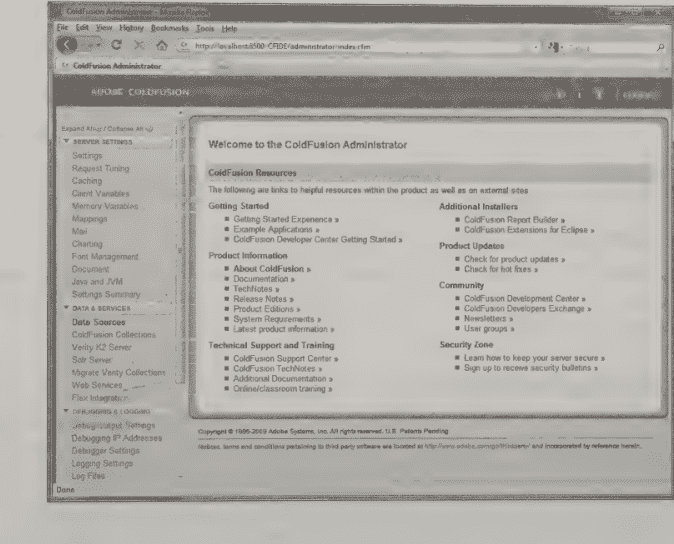

注意

ColdFusion 管理器密码最初在 ColdFusion 安装期间设置。

注意

管理器欢迎页的确切内容取决于所使用的安装类型和版本。

管理器界面分为几个区域：

- 屏幕顶部包含 ColdFusion 标志（如果您迷路了，可以使用它返回主页）、一个资源图标、一个系统信息图标（用于获取系统配置信息）、一个注销链接和一个帮助图标（这在需要时可提供额外的上下文帮助）。
- 屏幕左侧包含菜单，菜单可以展开以显示管理和配置选项。

## 第 2 章 访问 COLDFLUSION 管理器

- 菜单右侧是主管理器界面，它根据所选的选项而变化。在主页上，此界面包含指向文档、在线支持、培训、产品注册、社区网站、安全区域等的链接。

注意

使用屏幕顶部的 System Information 链接可以安装或更改您的 ColdFusion 许可和序列号（例如升级到企业版）。

尝试注销管理器（使用 Logout 按钮）然后重新登录。您应该养成结束时显式注销管理器的习惯。

提示

如果您登录了管理器，您的登录将在一段时间无活动后超时（强制您重新登录），但请不要依赖此。如果您离开座位，或在其他人可以访问您计算机的环境中工作，请始终显式注销 ColdFusion。

### 使用 ColdFusion 管理器

让我们简要查看管理器，然后配置一些所需的选项以便开始开发。如果您已经注销了 ColdFusion 管理器（或者您需要登录），请现在登录。

### 创建数据源

ColdFusion 管理器最重要的用途之一创建并定义数据源，数据源是 ColdFusion 与数据库交互的连接。数据源使用 Data Sources 菜单选项定义（它位于 Data & Services 部分）。

在本系列的几乎每个课程中，您都需要一个准备并配置好的数据源，我们将演示创建一个名为 ours 数据源的过程。

数据源和数据库将在第 5 节“审查数据库”和第 6 节“导入 SQL”中进行详细解释。

以下使用 ColdFusion 管理器创建 ours 数据源的步骤：

注意

如果您尚未安装示例文件和数据库，请参见附录 A，“安装 ColdFusion 和 ColdFusion Builder”。

1. 登录 ColdFusion 管理器。
2. 选择 Data Sources 菜单选项（它位于 Data & Services 部分）。

所有定义的数据源都列在此界面中，并且可以添加和编辑。

3. 在屏幕顶部，输入 `o` 作为新的数据源名称，并将驱动程序类型设置为 `Apache Derby Embedded`；点击“添加”（Add）按钮。

数据源定义屏幕（如图 2.2 所示）会提示定义数据源所需的任何信息。

4. `Apache Derby Embedded` 数据源唯一的必需字段是数据库文件夹名称。如果您将数据库保存在 `ColdFusion DB` 下（附录 A 中推荐），您只需要输入文件夹名称或即可。如果您将数据库保存到其他位置，请在此字段中提供 `aws` 数据源的完整路径。您还可以点击“浏览服务器”（Browse Server）按钮，使用 Java applet 创建树形控件，并将其作为服务器硬盘来交互式地定位文件。

图 2.2

数据源选项根据所选的数据源类型而异。

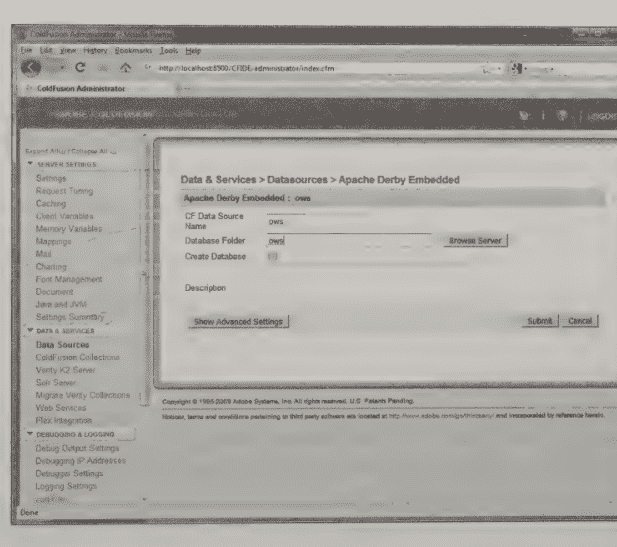

5. 填写完所有必填字段后，点击“提交”（Submit）按钮创建新的数据源。数据源列表将重新显示，新的 `aws` 数据源将列出且状态为 `OK`。屏幕将报告数据源已成功更新。如果返回错误状态消息，请点击进行任何必要的修正。

注意

数据源定义中所需的选项根据所使用的驱动程序而异。因此，用于创建和编辑数据源的屏幕也会根据所使用的驱动程序而异。

## 第 2 章 访问 ColdFusion 管理器

## 定义邮件服务器

在第 20 章“与电子邮件交互”中，您将学习如何使用 ColdFusion 生成电子邮件消息。ColdFusion 并不包含邮件服务器；因此，要生成电子邮件，必须提供邮件服务器的名称（SMTP 服务器）。

注意

如果您没有邮件服务器的权限，或者不知道邮件服务器的名称，请担心。您在一段时间内不会使用此功能，而且省略此设置不会影响您跟随后续课程。

要设置您的 SMTP 邮件服务器，请执行以下操作：

- 在 ColdFusion 管理器中，选择“邮件”（Mail）菜单选项（位于“服务器设置”Server Settings 部分）。
- 第一个标题为“邮件”（Mail）的字段提示邮件服务器主机（DNS 名称或 IP 地址）。根据要求提供此类信息。
- 在提交表单之前，您应该始终确保指定的邮件服务器是有效且可访问的。要做到这一点，检查页面下方的“邮件服务器连接”（Mail Server Connection）复选框。
- 点击“提交更改”（Submit Changes）按钮（屏幕顶部和底部都有）。假设邮件服务器可以访问，您将在屏幕顶部看到成功消息。如果无法访问指定的服务器，您将看到错误消息。

您现在已经配置了邮件服务器，并可以使用 ColdFusion 生成 SMTP 电子邮件。

## 启用调试

调试屏幕是另一组您应该熟悉的重要的屏幕，从“调试输出设置”（Debugging Output Settings）屏幕开始。要访问此屏幕，请选择“调试输出设置”（它位于“调试与日志”Debugging & Logging 部分）。

我不希望您开启这些选项中的任何一个，但我希望您知道这些选项在哪里以及如何获取它们，以便您在第 10 章“创建数据驱动页面”中使用它们。

现在转到 `IP 地址`。要获取它，请选择“调试 IP 地址”（Debugging IP Addresses）选项；它位于“调试与日志”Debugging & Logging 部分。此屏幕用于定义接收调试输出的客户端 IP 地址（我向您保证，在后面的章节中这更有意义）。确保列出了地址 `127.0.0.1` 和 `0:0:0.0:0:1`；如果没有，请添加它们。如果您没有本地安装 ColdFusion（并且正在访问远程 ColdFusion 服务器），请点击“添加”（Add）按钮添加您自己的 IP 地址。

调试和生成的调试输出是应用程序开发的重要部分，您将在书的后部分看到。

第 17 章“调试与故障排除”详细介绍了调试选项。

## 查看设置

我想向您展示的最后一个一个屏幕是“设置摘要”（Settings Summary）屏幕。顾其实名，它报告了所有的 ColdFusion 设置，包括所有定义的数据源。要访问此屏幕，请选择“设置摘要”（Settings Summary）菜单选项；它位于“设置”Settings 部分。ColdFusion 管理员将读取所有设置并生成完整的报告。设置之间也是链接的，如果需要进行更改，可以快速访问相应的屏幕。

提示

保留此屏幕的副本是一个好主意，这样当您需要恢复设置时，就可以随时获得所有设置信息。

现在，您已经完成了 ColdFusion 管理器的操作。请注销并进入下一章。

提示

要注销 ColdFusion 管理器，请点击右上角的“注销”（Logout）按钮。

注意

可以浏览其他管理员屏幕，但在您学习《Adobe ColdFusion 9 Web 应用程序构建工具第 2 卷：应用程序开发》中的第 25 章“ColdFusion 服务器配置”之前，请忍住更改任何设置的冲动。

## 第 3 章

本章内容

ColdFusion Builder 与 Eclipse 之间的关系 21

开始使用 ColdFusion Builder 22

## 介绍 ColdFusion Builder

ColdFusion 应用程序由文件组成——大量的大量的文件。这些文件是包含 CFML、HTML、SQL、JavaScript、CSS 等等的纯文本文件。由于它们是纯文本文件，ColdFusion 开发者可以自由使用任何他们喜欢的编辑器来编写和编辑他们的应用程序。

> 注意：虽然您可以使用任何编辑器，但必须使用以纯文本格式保存。

ColdFusion 9 中令人兴奋且期待的特性之一是 ColdFusion Builder，它是专门为我们设计的环境。

> 注意：如果需要关于 ColdFusion 的安装说明，请参见附录 A，“安装 ColdFusion”。

### ColdFusion Builder 与 Eclipse 之间的关系

ColdFusion 是构建在 Eclipse 之上的，它是一个集成开发环境，或 IDE。ColdFusion Builder 不仅仅是一个文本编辑器。相反，它是用于 ColdFusion 开发的完整工作空间。

ColdFusion 构建在 Eclipse 之上。Eclipse 支持许多编程语言。使用 Eclipse 进行 ColdFusion 开发长期以来一直支持，现在 ColdFusion Builder 提供了这一可靠的平台。

> 注意：Eclipse 并不是 Adobe 产品：它是由 Adobe 以及许多组织和个人支持的开源技术。要了解更多关于 Eclipse 的信息，请访问 `http://eclipse.org/`

## 章节

ColdFusion Builder 设计为以下两种方式之一安装和使用：

- 如果您没有 Eclipse 的相关经验，可以将 ColdFusion Builder 作为独立应用程序使用，无需关注 Eclipse 内部。
- 如果您已经在使用 Eclipse（或其他基于 Eclipse 的工具，如 Flash Builder），可以将 ColdFusion Builder 作为插件安装到现有的 Eclipse 中。这将只有一个集成开发环境。

Eclipse 是一个以代码为中心的工具，它是为资深程序员设计的。Eclipse 缺乏用户在 Adobe Dreamweaver 中使用的设计工具，但通过专注于核心程序员需要的内容，它更好地解决了这一群体的需求。

> 注意：Adobe Flash Builder 是构建在 Eclipse 之上的。许多 ColdFusion 开发者也编写 Flex 应用程序，因此基于 Eclipse 的 Adobe Flash Builder 和 ColdFusion Builder 可以提供单一的工作环境。

### 开始使用 ColdFusion Builder

当您启动 ColdFusion Builder 时，您将看到一个与图 3.1 类似的屏幕。（具体的屏幕布局可能取决于您所使用的操作系统以及安装的插件。）

> 注意：没有看到图 3.1 那样的界面？取决于 ColdFusion Builder 和 Eclipse 的配置，您可能会看到 Eclipse 启动屏幕。如果是这种情况，点击启动屏幕上方标签中的 X 按钮。

### 关于视图的说明

正如提到的，ColdFusion Builder 是构建在 Eclipse 之上的，它可以用于许多类型的语言和开发，并且每种语言都有不同的编辑器需求。为了满足所有语言的不同需求，Eclipse 支持名为“视图”（Perspectives）的功能。

视图只是一组根据需要激活的配置设置。作为原则，在编写 ColdFusion 代码时，您将使用 ColdFusion 视图。当您启动 ColdFusion Builder 时，您应该处于 ColdFusion 视图，因此在大多数情况下，您可以完全忽略视图。

# 图 3.1

ColdFusion Builder 界面包含编辑器和支持面板。

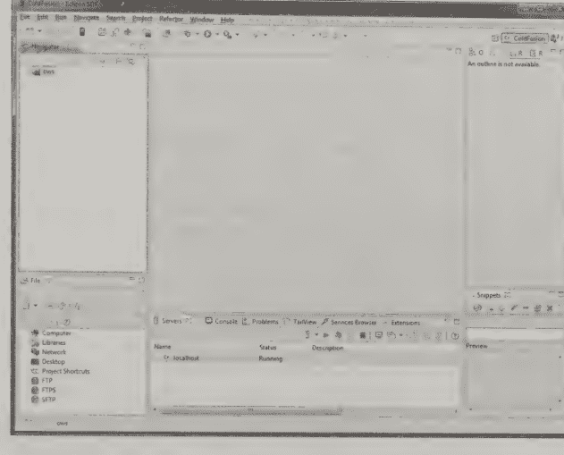


当前视图显示在 ColdFusion Builder 界面的右上角。如果你看到一个带有 ColdFusion 字样的小 CF 图标，那么你就可以开始工作了。如果你需要更改当前视图，请使用 Window（窗口） > Open Perspective（打开视图）菜单选项。ColdFusion 视图将列在 Other（其他）下。此外，最近使用的视图通常显示在屏幕右上角方便选择。

## ColdFusion Builder 界面

如图 3.1 所示，ColdFusion Builder 界面分为面板区域：

- 图 3.1 左侧的 Navigator（导航）面板（尽管它可以移动到其他地方）用于浏览和打开项目及文件。
- Navigator 面板下方是 File（文件）面板，提供对文件夹、文件、FTP 等的访问。
- 屏幕右侧是一个窗口，包含三个可以通过命名标签页选择的面板。Outline（大纲）面板显示已打开并选中的文件的代码（如果没有打开任何文件，则它为空）。RDS Dataview（数据视图）面板提供对所有 ColdFusion 数据源的访问。RDS Fileview（文件视图）面板提供对 ColdFusion 服务器上文件和文件夹的访问（此面板在你与远程 ColdFusion 服务器工作时才有用）。
- 右下角是 Snippets（代码）面板，用于存储和访问可重用的代码块。

## 第 3 章 介绍 ColdFusion BUILDER

- 屏幕中间的大区域是实际的 ColdFusion Builder 窗口。当你对文件进行操作时，CFML 工具栏和按钮将显示在该区域的顶部。
- 编辑器区域下方是一个包含系列非常重要的标签页的区块。我们稍后会使用这些标签页，并在后面的章节中用到。
- 屏幕顶部是用于打开和保存文件的工具栏和按钮。

**提示**：面板可以根据需要移动和重新定位。例如，我个人喜欢编辑器窗口尽可能大，因此我将 Outline 和 Snippets 面板移动到与 My File 面板同的标签页中，并将两个 RDS 面板移动到编辑器下方的标签页中。你可以根据自己的喜移动面板。

### 定义 ColdFusion 服务器

为了让许多 ColdFusion Builder 功能运行，工具需要知道如何连接到你的 ColdFusion 服务器。因此，你应该做的第一件事是定义你的 ColdFusion 服务器。

以下是定义本地 ColdFusion 服务器的步骤：

- 点击编辑器区域下方的 Servers 标签页。该标签页显示已定义的服务器列表，最初为空。
- 在标签页正方的工具栏中找到 Add Server（添加服务器）按钮；它是一个带有黄色 + 号的电脑图片。点击 Add Server 按钮显示 Add Server 窗口。
- 选择 ColdFusion 并点击 OK 显示 New ColdFusion Server Setup（新建 ColdFusion 服务器设置）窗口（如图 3.2 所示）。
- New ColdFusion Server Setup 窗口中的某些字段仅适用于 J2EE 配置安装。对于典型的本地 ColdFusion 开发安装，请指定以下内容：

```
Server Name:    localhost
Host Name:      localhost
WebServer Port:   8500
RDS Password:    ColdFusion 安装时提供的 RDS 密码
```

- 点击 Next（下一步）显示 Local Server（本地服务器）设置。
- 在 Server Home（服务器主目录）字段中，输入 ColdFusion 安装的根目录。在 Windows 上，根目录通常是 `C:\ColdFusion9`。Document Root（文档根目录）字段应该自动填充（如果 Server Home 指定正确）。将版本设为 9 (9.0.x)。

## 图 3.2

运行 ColdFusion Builder 后你应该做的第一件事是定义你的 ColdFusion 服务器连接。

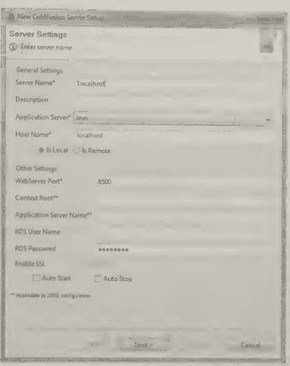

7. 点击 Next（下一步）显示 Install Extensions（安装扩展）窗口。
8. 确保勾选 Install Extensions 并点击 Finish（完成）。

你现在应该能在 Servers 标签页上看到你的 localhost 服务器，Status（状态）区域应显示 Running（表示 ColdFusion 服务器正在运行且 ColdFusion Builder 可以连接到它）。

你可以通过打开 Datiew 标签页并在那里展开 localhost 数据源来验证 ColdFusion Builder 是否正在与 ColdFusion 服务器通信。如果该数据存在，并且如果你展开它看到表格及其内容，说明一切正常。

**提示**：你可以右键点击 Servers 标签页上列出的服务器，以快速访问 ColdFusion Administrator（管理中心）、停止和启动 ColdFusion 等。

**注意**：如果你在多个 ColdFusion 服务器上开发（例如一个本地，一个测试，以及其他），你可以在 ColdFusion Builder 中定义这些每一个 ColdFusion 服务器。这样，你就可以使用它们进行编写和测试。

### 创建项目

ColdFusion 开发几乎不涉及单个文件。相反，ColdFusion 通常是文件和文件夹的大型（不断增长）集合。在 ColdFusion Builder 中，你处理的每个应用程序都定义为一个 `project`（项目），你可以定义所需数量的项目。

## 第 3 章 介绍 ColdFusion BUILDER

此书中的所有课程都是为 Orange Whip Studios（或 OWS）构建应用程序的一部分。因此，我们将创建一个名为 `ous` 的项目。步骤如下：

1. 找到 ColdFusion Builder File 菜单并选择 File > New > ColdFusion Project 显示 New ColdFusion Project 窗口。（你也可以在 Navigator 面板中右键点击并选择 New > ColdFusion Project。）
2. 指定 `ous` 为项目名称。
3. 取消勾选 Default Location（默认位置）选项，并在 Project Location 中指定应用程序路径（在具有默认配置的 Windows 上，路径应为 `C:\ColdFusion\root\ous`）。然后点击 Next。
4. 你现在需要为此项目指定 ColdFusion 服务器。从 Servers 下拉列表中选择 Localhost（你刚刚定义的服务器）。然后点击 Next。
5. 最后的屏幕将询问你有关其他源和应用程序的问题。留空这些并点击 Finish。

你已经设置好了一个用于此书中应用程序的项目。新项目将自动在 Navigator 面板中打开。如果项目一直没有打开，你可以在 Navigator 面板中右键点击它并选择 Open Project（打开项目），或双击它。

### 操作文件

现在你已经成功定义了 `ous` 项目，这里有一些你应该知道的基本文件访问技术。

### 创建文件夹

要在 ColdFusion Builder 中创建新文件夹，选择包含新文件夹的文件夹，右键点击（Windows）或 Control-点击（Mac），并选择 New > Folder（文件夹）。系统将提示你输入文件夹名称；输入名称后点击 Finish。

### 创建文件

要在 ColdFusion Builder 中创建新文件，选择文件夹，右键点击（Windows）或 Control-点击（Mac），并选择 New > ColdFusion Page（ColdFusion 页面）。系统将提示你输入文件名；输入名称后点击 Finish。

> **提示**：正如第1章所示，ColdFusion 文件需要 `.cfm` 扩展名。然而，当你输入文件名时，可以省略它，ColdFusion Builder 会为你添加。

### 保存、关闭和打开文件

要保存文件，请执行以下操作：

- 从 File 菜单中选择 Save（保存）。
- 按 Ctrl-S（Windows）或 Command-S（Mac）。

要关闭文件，请执行以下操作：

- 从 File 菜单中选择 Close（关闭）。

> **提示**：Windows 用户可以按 Ctrl-F4 关闭打开的文件。

要打开文件，请执行以下操作：

- 从 File 菜单中选择 Open（打开）。
- 双击 Navigator 面板中的文件。

现在，你已经准备好开始 ColdFusion 开发了。

## 第 4 章 预览 ColdFusion

- 你的应用程序使用的数据库位于 ColdFusion 根目录下的特殊文件夹中。
- Web 应用程序通常组织成映射到应用程序功能或部分的目录结构。然而，你在这里不需要那样做。为了简化学习过程，你将为书中的每个章节创建一个文件夹：第 4 章对应文件夹 `4`，第 5 章对应文件夹 `5`，依此类推。你为每个章节创建的文件应该存放在相应的文件夹中。

假设你正在本地运行 ColdFusion（建议这样做），并假设你已将文件安装在默认位置，如果你使用集成式 HTTP 服务器，访问该文件夹的 URL 将是 `http://localhost:8500/`；如果你使用外部 HTTP 服务器，则为 `http://localhost/ows/`。然后你将访问 `ows` 下的文件夹，例如本章的文件夹，路径为 `http://localhost:8500/ows/4` 或 `http://localhost/ows/4`（再次，取决于你是否使用 ColdFusion 的集成式 HTTP 服务器）。

**注意**：再次说明，`8500` 是 ColdFusion 集成 Web 服务器所使用的端口。在 i/Run/ColdFusion 安装中，集成服务器使用的默认端口是 `8300`。如果你使用外部 Web 服务器（例如 IIS 或 Apache），则可能会使用默认端口 `80`（在 URL 中也会完全省略）。

**提示**：如果你在解析 `localhost` 时遇到问题，请尝试使用地址 `127.0.0.1`。`127.0.0.1` 是指向本地主机的特殊 IP 地址，而 `localhost` 是应该解析到 `127.0.0.1` 的主机名。

### 第一个 ColdFusion 应用程序

让我们从一个简单的示例开始，以便熟悉 ColdFusion Builder。以下是步骤：

1. 在 `ows` 项目中创建一个名为 `4` 的新文件（表示第 4 章，即本章）。如果你需要关于如何执行此的提示，请参阅第 3 章中的“处理文件”部分。
2. 在 `4` 文件夹中创建一个新文件并命名为 `welcome.cfm`。
3. 你的新文件将自动打开，准备好让你编写代码。输入以下代码 `#DateFormat(Now())#`（先不要担心它的具体含义；我们在随后的章节中有足够的时间详细审查 CFML）：

```
It is #DateFormat(Now())#<br>
Welcome to ColdFusion!
```

注意，当你输入时，ColdFusion Builder 提供了帮助。例如，当你输入 `#` 时，系统会自动插入匹配的 `#`。此外，请注意自动颜色编码，不同的语言元素有不同的颜色。

### 一个更完整的示例

4. 这段代码需要位于 `<cfoutput>` 标签内。选中并高亮这两行，然后点击编辑器区域上方的 Wrap In Foutput 按钮（它是从左起第四个按钮，看起来像一个电脑显示器）。ColdFusion Builder 将为你插入 `<cfoutput>` 和 `</cfoutput>` 标签。你也可以使用快捷键 Ctrl-Shift-O。当然，你也可以自己写这些标签。

5. 打开大纲（Outline）面板，查看你的代码大纲是如何自动填充的。展开列表并点击每个项目，观察编辑器窗口中被选的内容。这个大纲很小，并不特别有用，但随着你的代码长度和复杂性的增加，大纲面板提供了一种查看标签嵌套情况的简单方法，并允许你点击元素跳转到它们。

6. 运行代码。查看编辑器区域的底部。你会看到系列标签。最左侧的名为 Source，且当前处于选中状态。在右侧，你会看到一个或多个带有 Web 浏览器名称的标签（Internet Explorer、Firefox 等，取决于你的操作系统和安装的浏览器）。点击浏览器标签以在该浏览器中运行你的代码。你应该能看到一个包含今天日期的欢迎消息。

**提示**：经验开发者经常在多个 Web 浏览器中测试代码，以确保无论使用哪种浏览器一切都能正常运行。

ColdFusion Builder 允许你通过嵌入 Web 浏览器直接在开发环境中运行应用程序。当然，你也可以使用真实的 Web 浏览器测试代码。例如，在你的 Web 浏览器中运行 `welcome.cfm`，打开该浏览器并访问 `http://localhost:8500/ows/4/welcome.cfm`。

### 一个更完整的示例

这是一个更完整的示例，由多个文件组成（通常情况下如此）。我不会进入代码本身的细节；现在，专注于创建和执行 CFM 文件以及它们是如何工作的。如果你能让所有内容正常运行，学习这本书将会轻松得多。

`bday` 应用程序非常简单；它提示你输入姓名和出生日期，并使用简单的日期算术计算年龄。该应用程序由两个文件组成：

- `bday1.cfm`（如列表 4.1 所示）是提示姓名和出生日期的单。
- `bday2.cfm`（如列表 4.2 所示）处理表单并显示结果。

使用 Dreamweaver 创建这两个新文件，并将它们都保存到 `4` 目录。然后按照此处显示的内容在每个文件中准确输入以下代码——你的文件不应包含任何其他内容。

## 第 4 章 预览 ColdFusion

列表 4.1 `bday1.cfm`

```
<html>
<body>
<form action="bday2.cfm" method="post">
  Name:<input type="text" name="name"><br>
  Date of birth:<input type="text" name="dob"><br>
  <input type="submit" value="calculate">
</form>
</body>
</html>
```

`bday` 应用程序非常简单；它提示你输入姓名和出生日期，并使用简单的日期算术计算年龄。该应用程序由两个文件组成：

- `bday1.cfm`（如列表 4.1 所示）是提示姓名和出生日期的表单。
- `bday2.cfm`（如列表 4.2 所示）处理表单并显示结果。

列表 4.2 `bday2.cfm`

```
<html>
<body>
<cfoutput>
  Hello #VarGet("name")#!<br>
  Your age is #DateDiff("y", VarGet("dob"), Now())# years.
</cfoutput>
</body>
</html>
```

这个例子有点极端，事实是确实存在更好的方法。你需要使用数据库。

### 数据库：定义

让我们从定义开始。简单来说，数据库是相似数据的结构化集合。这里的关键词是“结构化”和“相似性”，而电影列表就是这两个者的完美示例。

将电影列表想象成一个二维网格或表格，类似于图 5.1 所示。表格中的每个水平行都包含单部电影的信息。行由垂直列分隔。每列包含电影记录的一个部分。`MovieTitle`（电影标题）列包含电影标题等。

图 5.1

数据库在虚拟的二维网格中显示数据。

| 电影标题 | 评分 | 预算 |
|---|---|--|
| Being Unbearably Light | 5 | 300000 |
| Charlie's Devils | 1 | 750000 |
| Closet Encounters of the Odd Kind | 5 | 350000 |
| Four Bar-Mitzvahs and the Circumcision | 1 | 175000 |

电影列表包含了所有电影的相似数据。每个电影记录（或行）都包含相同类型的信息。每条记录都有标题、标语、预算金额等。数据是结构化的，因为数据可以被拆分为逻辑列（或字段），每个字段包含电影记录的一个部分。

这里有一个经验法则：任何可以拆分为具有相似字段记录的信息列表，可能可能都应该维护在数据库中。产品价格、电话簿、发票、发票行项目、假期安排以及演员和导演列表都是数据库的候选对象。

### 数据库在哪里使用？

你可能一直都在使用数据库，即使你并不知道。如果你使用基于软件的会计程序，你就在使用数据库。所有的应付账款、应收账款、供应商和客户信息都存储在数据库中。日程程序使用数据库存储预约和待事项列表。甚至电子邮件程序使用数据库存储目录列表和文件夹。

这些数据库的设计是为了对你这个终端用户隐藏。你永远不会自己将账户记录添加到数据库中。相反，你向会计程序中输入信息，由它将记录添加到数据库中。

### 数据库相关术语的解释

现在你已经理解了什么是数据库，我必须为你解释一些重要的数据库术语。在 SQL 世界中（你将在第 6 章“介绍 SQL”中深入学习 SQL），这种数据集合被称为“表”（`table`）。表中的单独记录被称为“行”（`rows`），组成行的字段被称为“列”（`columns`）。表格的集合被称为“数据库”（`database`）。

想象一个文件柜。柜子里有抽屉，每个抽屉都包含一组数据。文件柜是将相关但不同的信息放在一个地方的方法。每个柜抽屉包含一组记录。一个抽屉可能包含员工记录，另一个抽屉可能包含销售记录。每个抽屉内的单独记录是不同的，但它们都以字段的形式包含相同类型的数据。

图 5.2 所示的文件柜就是数据库——一个包含异不同信息的抽屉或表格的集合。每个抽屉包含一个或多个记录（或行），这些记录由不同的字段（或列）组成。

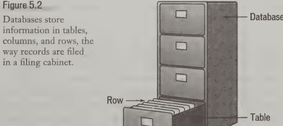

### 数据类型

数据库表中的每一行由一个或多个列组成。每列包含一条单一数据，它是存储在行中的完整记录的一部分。在创建表格时，需要定义它的每一列。定义列涉及指定列名、大小和数据类型。数据类型规定了列中可以存储什么的数据。


数据类型规定了列的特征，并指示数据库向其中输入什么类型的数据。某些数据类型允许输入自由格式的字母数字数据。另一些则将数据输入限制为特定数据，如数字、日期或真/假标记。常见数据类型的列表见表 5.1。

# 第 5 章：复习数据库

## 常见数据类型

### 表 5.1 常用数据类型及其用途

| 数据类型 | 限制 | 典型用途 |
| --- | --- | --- |
| 字符（Character） | 大小写文本、符号 | 姓名、地址、描述 |
| 数字（Numeric） | 正负数、小数点 | 数量、数字 |
| 日期（Date） | 日期、时间 | 日期、时间 |
| 金额（Money） | 正负数、小数点 | 价格、账单金额、发票行项目 |
| 布尔值（Boolean） | 是/否或真/假 | 开启/关闭标记、开关 |
| 二进制（Binary） | 非文本数据 | 图片、声音和视频数据 |

使用数据类型而不是仅仅将所有数据输入简单的文本字段有几个原因。主要原因之一是控制或限制用户可以输入到字段的数据。例如，必须包含人员年龄的字段可以指定为数字字段。这样，用户就无法输入其他内容——只能输入 0 到 9 的数字。这种限制防止无效数据进入你的数据库。

各种数据类型还用于控制数据的排序方式。在文本字段中输入的数据是逐字符进行排序的，就像左对齐一样。数字 0 在 1 之前，1 在 9 之前，9 在 a 之前，以此类推。由于每个字符都是单独评估的，包含数字 10 的文本字段会列在 1 之后、2 之前，因为 10 大于 1。

## 数据库入门

必要的。每当你的记录被添加、编辑或删除时，你只需要重新打印列表即可。

新数据或更改的数据会自动为你进行排序。

你刚刚看到了数据库的一个实际用途。电影列表是一个简单的数据库，涉及单张表和一小部分列。大多数设计良好的数据库应用程序都需要许多表以及链接它们的方法。当我们介绍关系型数据库时，你会再次回到这个电影列表。

你的第一张表大获成功。你已经能够满足任何列表请求，并以任何需要的方式进行排序。但正当你开始考虑如何利用你新发现的空间时，你的老板通知你，你将一份按导演名字排序的报告。

“没问题，”你说。你可以打开你的数据库应用程序并修改你的表。你添加了两个新列，一个用于导演的名字，另一个用于导演的姓氏。现在，每条电影记录都可以包含导演的名字，你创建了一个更完善的包含导演信息的电影列表。又一次，你的数据库化解了危机，一切如初——至少你是这样想的。

当一切看起来顺利时，你收到了一份备忘录，要求你将电影费用包含在数据库中，以便能够运行包含此类信息的报告。

你思考了几秒，并针对这个新问题提出了两个解决方案。第一个解决方案简单地向表中添加更多列，每项费用占用三列（日期、描述和金额）。

但你意识到这并不是所有情况的长期解决方案。你应该为多少项费用留出空间？每部电影可能、且很可能会有一组不同的费用，而你无法知道应该容纳多少项。不可避免的是，无论你选择哪个数字，在某个时刻都是不够的。此外，由于大多数记录都不会使用这些额外的列，这极大地是对磁盘空间的巨大浪费。此外，如果数据存储在多列中，数据操纵将变得极其复杂。如果你需要搜索特定的费用，这种情况会极大增加出现错误结果的概率。它还让数据排序变得不可能，因为数据库一次只排序一列，而你的数据是必须跨多列一起排序的。

## 注意

数据库设计中的一个重要规则是：如果某些列被大多数行使用，那么它们可能并不属于这张表。

你的第二个解决方案是在表中创建额外的行，每部电影的每项费用创建一行。通过这种解决方案，你可以添加任意数量的费用，而无需创建额外的列。

这种解决方案是不可行的。虽然它解决了处理超过预定数量费用的问题，但目前它引入了更严重的问题。添加额外的行需要反复重复基础电影信息——如标题和标语等内容——而且每一行新数据都要重复一遍。

重新插入这些信息不仅浪费了存储空间，还极大地增加了你面临冲突数据的可能性。例如，如果电影标题发生了变化，你必须确保更改每一个包含该电影数据的行。如果未能更新所有行，将导致查询和搜索返回冲突的结果。如果你搜索某部电影并发现两行，且每行的评分都不同，你如何知道哪一个是正确的？

如果冲突的数据只是名字的拼写，这个问题可能不会太严重，但想象一下这些数据是客户账单信息。如果你在每个订单中都重新输入客户的地址，然后客户搬了家，你可能会将订单送到错误的地址。

你应该尽可能避免维护同一份数据的多个活动副本。

## 注意

数据库设计的另一个重要规则是：数据绝不应无意义地重复。随着相同数据副本数量的增加，数据输入错误的概率也会随之增加。

## 提示

这里值得提到的一点是，“永不重复数据”的规则不适用于你的数据备份。备份数据极其重要，你的计划越多越好。永不重复数据的规则仅适用于活动数据——即在生产环境中持续使用的数据。

正当你思考这个问题时，你意识到你之前包含导演名字的解决方案是危险的。毕竟，如果某部电影有两个导演怎么办？你只分配了一个名字的空间。

## 理解关系型数据库

解决你问题的方案是将电影列表拆分为多个表。让我们从电影费用开始。

第一张表，电影列表，仍然只是电影列表。为了将电影与其他记录链接，你向列表中添加了一个新列，其中包含每部电影的唯一标识符。它可能是一个分配的电影编号，或者是一个随着向列表添加新电影而递增的顺序值。重要的是，没有电影具有相同的 `ID`。

## 提示

通常重用唯一标识符是一个好主意。例如，如果 `ID` 为 105 的电影被删除，该数字应该重新分配给一部新电影。这项政策保证了新电影没有机会链接到属于旧电影的数据。

接下来，你创建一个新表，包含几列：电影 `ID`、费用、费用描述和费用金额。只要某部电影没有关联费用，第二张表就保持为空。当产生费用时，会在费用表中添加一行。该行包含唯一标识此部特定电影的电影 `ID` 以及费用信息。

这里的点在于，费用表中没有存储任何电影信息，除了那个 `ID`，而该 `ID` 与电影列表表中分配的电影 `ID` 相同。在报告费用时，你如何知道指的是哪条电影记录？电影信息是从电影列表中检索的。在显示费用表的行时，数据库会将这些行关联回电影列表并获取电影信息。这种关系在本章后部分所示，见图 5.4。

## 图 5.4

| 电影 | 费用 |
| :--- | :--- |
| 电影 1 | 电影 1 |
| 电影 2 | 费用 1 |
| 电影 3 | 电影 1 |
| 电影 4 | 费用 2 |
|  | 电影 3 费用 |

外键值总是另一个表的主键值，这允许表相互关联。

这种数据库设计被称为关系型数据库。通过它，你可以将数据存储在不同的表中，并定义链接或关系来查找存储在其他表中的关联数据。在这个例子中，一部有两项费用的电影在费用表中会有两行。这两行都包含相同的电影 `ID`，因此它们都指向电影表中的同一条电影记录。

注意：将数据拆分为多个表以确保数据永不重复的过程被称为规范化。

### 主键和外键

主键是数据库术语，指包含唯一标识每行的列（或若干列）。主键通常是单列的，但也不必须是。

主键只有两个要求：

- 每行在主键中都必须有一个值。空字段（有时称为空值）是不允许的。
- 主键值绝不能重复。如果两部电影具有相同的 `ID`，所有的关系都会失效。事实上，大多数数据库应用程序都会防止你在主键中输入重复值。

当你要求提供按电影排序的所有费用列表时，你可以指令数据库建立关系并检索所需数据。电影表按字母顺序扫描，每检索到每部电影，数据库都会检查费用表中是否有电影 `ID` 与当前主键匹配的行。你甚至可以指令数据库忽略那些没有关联费用的电影，仅检索那些在费用表中具有相关行的电影。

## 提示

许多数据库应用程序支持一种用于自动生成主键值的功能。Microsoft Access 将其称为“自动编号”（Auto Number）字段，SQL Server 使用 `identity` 术语，其他数据库则使用其他术语来表达本质上相同的功能。使用此功能，每当向表中添加新行时，系统都会自动生成一个正确且安全的主键。

## 注意

并非所有数据类型都可以作为主键。你不能使用存储二进制数据（如声音、图像、变长记录或 OLE 链接）的数据类型的列作为主键。

费用表中的电影 `ID` 不是主键。如果某部电影列出了多项费用，那么该列中的值就不是唯一的。特定电影的所有费用记录都包含相同的电影 `ID`。电影 `ID` 是另一个表——电影表——中的主键。这就是一个外键。外键是一个非唯一的键，其值包含在另一个表的主键中。

为了查看外键是如何使用的，假设你被要求运行一份报告，查看哪些电影在特定日期产生了费用。为了实现这一点，你指示数据库应用程序扫描费用表，查找所有在该日期列出费用的行。数据库应用程序使用费用表中电影 `ID` 键字段的值来查找电影名称；它是通过使用电影表的主键来实现的。这种关系如图 5.4 所示。

关系型数据库模型解决了可扩展性问题。如果数据库能够处理不断增加的数据而无需重新设计，则被称为可扩展性良好。在设计数据库时，你应该始终考虑可扩展性。

现在你已经对原始数据库进行了重大更改，但你创建的是一个易于管理且可扩展的解决方案。你的老板再次感到高兴，你的数据库管理技能解了燃。

### 不同的关系类型

到目前为止讨论的关系类型是“一对多”关系。这种关系允许一个表中的单行与另一个表中的多行之间建立关联。例如，电影列表表中的单行可以与费用表中的多行相关联。一对多关系是关系型数据库中最常见的关系类型。

存在另外两种类型的关系型数据库关系：“一对一”和“多对多”。一对一关系允许一个表中的单行与另一个表中的最多的一行相关联。在实践中，这种类型的关系很少使用。如果你遇到需要一对一关系的情况，可能应该重新审视设计。大多数通过一对一关系链接的表可以简单地合并为一个大表。

多对多关系也很少使用。多对多关系允许一个表中的一个或多个行与另一个表中的一个或多个行相关。这种关系通常是设计不良的结果。大多数多对多关系可以通过多个一对多关系进行高效管理。

### 多表关系

既然你已经理解了关系型数据库，让我们再次看一眼导演问题。你可能记得最初的解决方案是将导演直接添加到电影表中，但那并不是一个可行的解决方案，因为它无法允许单部电影拥有多个导演。

实际上，建议的解决方案还存在一个更大的问题。正如我之前提到的，关系型数据库设计规定数据绝不重复。如果导演名称与电影一起列出，任何导演过超过一部电影的导演都会被列出多次。

与费用（关联单部电影）不同，导演可以与多部电影关联，电影也可以与多个导演关联。两个表将没有帮助。

这类关系问题的解决方案是使用三个数据库表：

- 电影列在自己的表中，每部电影都有一个唯一的 `ID`。
- 导演列在自己的表中，每个导演都有一个唯一的 `ID`。
- 添加第三张表，用于关联上述两个表。

例如，如果 105 号电影由导演 `ID` 3 执导，则会在第三表中添加单行。它将包含两个外键，即电影表和导演表的主键。要找出是谁导演了 105 号电影，你只需要在第三表中查找电影编号为 105，你就会发现导演 3 是该导演。然后你查看导演表来查找导演 3 是谁。

对于简单的映射来说，这听起来可能过于复杂，但有了我——这一切都将变得意义非。

如果 105 号电影有第二个导演（可能是导演 `ID` 5），你需要向该表添加第二行。这行新行也会在电影 `ID` 列中包含 105，但在导演列中包含一个不同的导演 `ID`。现在，你可以将每部电影关联两个、三个或更多导演。你通过向该第三张表再添加一条记录，将每个导演与某部电影关联。

如果你想找到特定导演执导的所有电影，你也可以这样做。首先，你会在导演表中找到该导演的 `ID`。然后，在第三张表中查找与该导演关联的电影 `ID`。最后，你查看电影表获取这些电影的名称。

这种多表关系在较大的应用程序中通常是必要的，你将在本章后面的部分使用它。图 5.5 总结了所使用的关系。

## 图 5.5

| 电影 |  | 导演 |  |
| --- | --- | --- | --- |
| 104 | 105 | 3 |  |
| 105 | 105 | 5 |  |
| 106 | 106 | 3 |  |
| 107 | 107 | 5 |  |
| 108 | 104 | 3 |  |

### 索引

数据库应用程序在使用关系时频繁使用表的主键。因此，通过主键访问特定行至关重要。当数据被添加到表时，你无法保证它是按顺序存储的。键值较大的行可能存储在键值小的行之前。

由于是排序顺序，索引本身保证 `cat` 会出现在索引中 `bison` 之后、`cow` 之前。对于所有对 `cat` 的引用，你都会首先搜索索引。由于列表是有序的，因此搜索索引是一个快速的过程。如果你寻找的单词是 `cat`，你不需要读到很 `dog`。当你在索引中找到 `cat` 时，你也找到了讨论 `cat` 的页码。

数据库使用索引的方式也是。数据库索引的作用与书籍索引相同——允许快速访问未排序的数据。就像书籍索引按字母顺序排列单词或主题以便于快速定位数据一样，数据库表索引也按排序顺序列出索引的值。就像书籍索引为每个索引项列出页码一样，数据库表索引列出了匹配行的物理位置，如图 5.6 所示。在数据库应用程序知道特定行的物理位置后，它可以直接检索该行，而无需扫描表中的每一行。

## 图 5.6

数据库索引是它们在表中出现的行列表。

| 索引项 | 表中的行号 |
| --- | --- |
| `cat` | 3545 |
| `cow` | 12 |
| `dog` | 76265 |

书末尾的索引与数据库表索引之间有两个重要的区别。这意味着每当向表中添加新行时，索引都会自动修改以反映这一变化。同样，如果某行被更新或删除，索引也会更新以反映这一变化。结果是索引始终是最新的且始终是有用的。其次，与书籍索引不同，表索引永远不会由最终用户显式地浏览。当指示数据库应用程序检索数据时，它使用索引来确定如何快速、高效地完成请求。

数据库应用程序维护索引并且它是使用索引的唯一实体。你，作为最终用户，从未在数据库中真正看到过索引，事实上，大多数现代数据库应用程序完全隐藏了索引的实际物理存储位置。

当你为表创建主键时，它会自动建立索引。数据库假设主键将经常用于查找和关联，因此它为你自动创建了该索引。

当你对费用表（`expenses`）运行报告以查找特定条目时，会发生以下过程。首先，数据库应用程序扫描费用表，以找到任何匹配所需日期的行。这返回了所有匹配费用的 `ID`。接下来，数据库应用程序为它检索到的每个费用行检索匹配的电影。它搜索主键以在电影列表表中找到匹配的电影记录。索引按顺序包含所有 `ID`，对于每个 `ID`，都列出了所需内容的物理位置。当数据库应用程序找到正确的索引值后，它从索引中获取行位置并直接跳转到表中的该位置。虽然这个过程在纸上看起来很长，但它实际上发生得非常快，花费的时间比任何顺序搜索所需的时间都要短。

### 使用索引

现在重新查看你的电影数据库。电影产量增加了，你表中的电影数量也随增长。最近，你注意到数据库操作花费的时间比以前更长了。字母顺序电影列表报告需要很长时间才能运行，随着表中添加更多电影，性能进一步下降。数据库设计本应是一个可扩展的解决方案，那么为什么额外的数据会让系统陷入瘫痪呢？

这里的解决方案是引入额外的索引。数据库应用程序会自动为主键创建索引。任何额外的索引都必须显式定义。为了改进按评分（`rating`）的排序和搜索，你只需要在评分列上创建一个索引。有了这个索引，数据库应用程序可以立即找到它正在寻找的内容，而无需顺序读取整个表。

一个表可以拥有的索引最大数量随数据库应用程序而异。有些数据库没有任何限制，允许对每一列都建立索引。这样，所有的搜索或排序都能受益于更快的响应。

## 注意事项

> 某些数据库应用程序限制了你可以拥有的索引数量。在创建几十个索引之前，请检查你是否应该注意任何限制。

在你为表中的每一列运行并创建索引之前，你必须意识到这其中的权衡。正如我们之前看到的，数据库表是动态的，不像书籍末尾的索引。随着数据的变化，索引也会发生变化——更新索引需要时间。表中的索引越多，写操作花费的时间越长。此外，每个索引都会占用额外的存储空间，因此不必要的索引会浪费宝贵的磁盘空间。

何时应该创建索引？答案完全取决于你。向表中添加索引会让读取操作变快，写操作变慢。你必须决定为每个应用程序创建多少个索引以及为哪些列建立索引。主要用于数据输入的应用程序对索引的需求较少。频繁用于搜索和报告的应用程序可以从额外的索引中受益。

在你的示例中，如果你经常按电影评分进行排序和搜索，你应该对电影列表按评分建立索引。最近，发布日期列可能是建立索引的候选对象。你很少需要按电影摘要进行排序，没有理由为摘要列建立索引。如果需要，你仍然可以搜索或排序摘要，但搜索将比评分搜索花费更长时间。是否添加索引取决于你以及你对应用程序将如何使用的判断。

## 提示

> 在许多数据库应用程序中，你可以根据需要创建和删除索引。你可能决定在运行一批用过的报告之前创建临时索引。它们能让你更快速地运行报告。在运行报告后，你可以删除这些新索引，这将表恢复到之前的状态。这样做的唯一缺点是，在额外索引存在时，写操作会变慢。

## 了解各种类型的数据库应用程序

当你从 Microsoft Access 表中访问数据时，该数据文件会在你的计算机上打开。你读取的任何数据也由运行在你计算机上的 Microsoft Access 读取。同样，任何数据更改都是由运行在你计算机上的 Microsoft Access 副本在本地完成的。

在评估共享文件型数据库应用程序时，考虑这一点非常重要。每个运行的 Microsoft Access 副本都在本地打开数据文件，这一事实具有严重的影响：

- **共享数据文件易受到数据损坏的影响**。每个访问表的用户都在本地打开了数据文件。如果用户未能正确终止应用程序或计算机挂起，这些文件就无法正常关闭。像这样强行关闭文件可能会损坏文件或向其中写入垃圾数据。
- **共享数据文件会产生大量不必要的网络流量**。如果你对特定费用进行搜索，搜索将在你自己的计算机上进行。运行在你计算机上的数据库应用程序必须确定哪些行是它需要的，哪些行是不需要的。为了进行这一判断，应用程序必须知道所有记录——包括它为本次特定查询将丢弃的记录。那些被丢弃的记录必须通过网络连接传输到你的计算机。因为数据反正会被丢弃，所以就产生了不必要的网络流量。
- **共享数据文件是不安全的**。因为用户必须打开他们想要工作的实际数据文件，所以他们对这些文件具有完全访问权限。这意味着用户可以故意或无意地删除包含所有表的整个数据文件。

这并不是说你不应该永远使用共享文件型数据库。以下是使用此类数据库的一些原因：

-


**共享文件型数据库廉价**。除非你选择`MySQL`这样的开源数据库，否则软件本身的成本远低于客户端/服务器数据库软件。与客户端/服务器软件不同，共享文件型数据库不需要专用数据库服务器硬件。

**共享文件型数据库比客户端/服务器数据库更容易学习和使用**。

### 客户端/服务器数据库

如`Microsoft SQL Server`、`Oracle`和`MySQL`等数据库都是客户端/服务器数据库。客户端/服务器应用程序分为两个不同的部分。服务器部分是一个负责所有数据访问和操作的软件。该软件运行在数据库所在的计算机上。在`Microsoft SQL Server`的情况下，它是一个运行`Windows`和`SQL Server`软件的计算机。

只有服务器软件与数据文件交互。所有数据请求、数据添加、删除和数据更新都汇聚到服务器软件中。这些请求来自运行客户端软件的计算机。客户端是用户与之交互的软件。例如，如果你请求按评分排序的电影列表，客户端软件通过网络向服务器软件提交请求。服务器软件处理请求；根据需要对数据进行过滤、丢弃和排序，并将结果传回你的客户端软件。此过程如图 5.8 所示。

## 图 5.8

客户端/服务器数据库允许客户端执行由服务器软件处理的数据库操作。

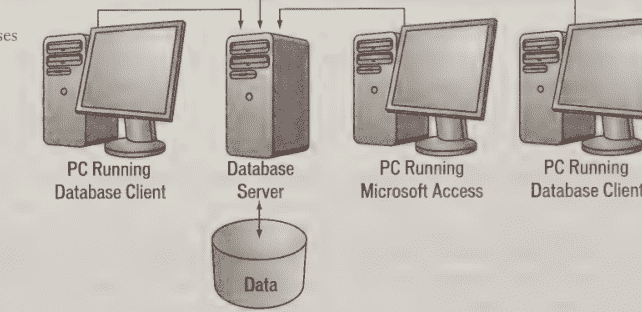

所有这些操作对你这个用户来说都是透明的。数据存储在别处，或者数据库服务器正在为你执行所有这些处理，这些事实都被隐藏了。你永远不需要直接访问数据文件。事实上，大多数网络的设置使得用户无法访问数据，甚至无法访问存储其数据的驱动器。

客户端/服务器数据库服务器通过以下方式克服了共享文件型数据库应用程序的局限性：

- **客户端/服务器数据库文件较不易受到因应用程序错误终止导致的数据损坏**。如果用户未能正常退出程序，或者他们的计算机死机，数据文件也不会损坏。也就是说，文件从未在用户的计算机上实际打开。

- **客户端/服务器数据库使用更少的网络带宽**。因为所有的过滤发生在服务器端，所有不必要的数据在结果传回客户端服务器之前都会被丢弃。只有必要的数据通过网络传输。

- **客户端/服务器数据库环境中的终端用户无法访问实际物理数据文件**。这种访问的缺失有助于确保文件不被删除或篡改。

- **客户端/服务器数据库提供更高的性能**。对于数据库服务器本身也是如此。此外，客户端/服务器数据库通常具有共享文件型数据库不具备的功能，这些可以提供更高的性能。

如你所见，客户端/服务器数据库比共享文件型数据库更安全、更健壮——但所有的额外力量和安全性都是代价：

- **运行客户端/服务器数据库昂贵**。软件本身的成本远高于共享文件型数据库应用程序。此外，你需要一台数据库服务器来运行客户端/服务器数据库。它必须是一台高性能计算机，且通常专为此用途。

- **客户端/服务器数据库更难设置、配置和管理**。许多公司聘用全职数据库管理员来做这项工作。

### 使用哪种数据库产品？

现在你已经学习了可以使用的各种数据库系统类型，如何确定哪种最适合你的应用程序呢？

遗憾的是，这个问题没有简单的答案。你真的需要审查你的应用程序需求、你愿意在系统中投入的资金，以及你已经拥有的系统。

为了开始，请尝试尽可能多回答以下问题：

- 你是否有现有的数据库系统？如果是，它是否是仍由供应商支持的当前技术？你需要链接到数据吗？

- 你是否有任何数据库专业知识或经验？

- 你内部是否有数据库程序员？

- 你预计会有多少个并发用户？

- 数据库的运行可用时间有多重要？

- 你是否拥有可以用于数据库的现有硬件？

这些问题并不容易，但付出的努力是值得的。你提前做的规划越充分，做出正确决策的机会就越大。只要你从信誉良好的供应商处选择已知且成熟的解决方案，你就是安全的。

### 表 5.2（续）

| 列名 | 数据类型 | 说明与大小 |
| --- | --- | --- |
| `AmountBudgeted` | 数值，货币 | 电影的预算金额（可能不等于实际成本加费用之和） |
| `RatingID` | 数值 | `FilmsRatings`表中关联评分的 ID |
| `Summary` | 备注或长文本 | 存储在变长度文本字段中的电影完整摘要（支持更长的摘要） |
| `ImageName` | 文本 | 关联图像的文件名（如果有） |
| `DateInTheaters` | 日期 | 预计上映日期 |

### 费用表 (`Expenses`)

`Expenses`表（表 5.3）包含与`Films`表中列出的任何电影相关的费用。

### 表 5.3 费用表

| 列名 | 数据类型 | 说明与大小 |
| --- | --- | --- |
| `ExpenseID` | 数值 | 每项费用的唯一 ID；可以在插入行时手动填充，也可以自动填充（如果定义为自动编号字段） |
| `FilmID` | 数值 | 关联电影的 ID |
| `ExpenseAmount` | 数值，货币 | 费用金额 |
| `Description` | 文本 | 费用描述 |
| `ExpenseDate` | 日期 | 费用日期 |

此表的主键是`ExpenseID`列。

此表包含一个外键：

- `FilmID`列与`Films`表的主键相关联。

### 导演表 (`Directors`)

`Directors`表（表 5.4）包含导演列表。该表通过`Directors`表与`Films`表关联。

### 表 5.4 导演表

| 列名 | 数据类型 | 说明与大小 |
| --- | --- | --- |
| `DirectorID` | 数值 | 每位导演的唯一 ID；可以在插入行时手动填充，也可以自动填充（如果定义为自动编号字段） |

## 第 5 章 审核数据库

表 5.4（续）

| 列名 | 数据类型 | 说明与大小 |
| --- | --- | --- |
| `FirstName` | 文本 | 导演的姓 |
| `LastName` | 文本 | 导演的姓 |

此表的主键是`DirectorID`列。

此表不包含外键。

### 电影-导演关系表 (`FilmsDirectors`)

`FilmsDirectors`表（表 5.5）用于关联`Films`表和`Directors`表（以便将导演与其电影关联起来）。

### 表 5.5 电影-导演关系表

| 列名 | 数据类型 | 说明与大小 |
| --- | --- | --- |
| `FRecID` | 数值 | 每行的唯一 ID；可以在插入行时手动填充，也可以自动填充（如果定义为自动编号字段） |
| `FilmID` | 数值 | 关联电影的 ID |
| `DirectorID` | 数值 | 关联导演的 ID |
| `Salary` | 数值，或货币 | 导演的薪水 |

- `FilmID`列与`Films`表的主键相关联。
- `DirectorID`列与`Directors`表的主键相关联。

### 演员表 (`Actors`)

`Actors`表（表 5.6）包含演员列表。该表通过`FilmsActors`表与`Films`表关联。

### 表 5.6 演员表

| 列名 | 数据类型 | 说明与大小 |
| --- | --- | --- |
| `ActorID` | 数值 | 每位演员的唯一 ID，可以在插入行时手动填充，也可以自动填充（如果定义为自动编号字段） |
| `ActorFirst` | 文本 | 演员的姓 |
| `LastName` | 文本 | 演员的姓 |
| `Age` | 数值 | 演员的年龄 |
| `FirstNameReal` | 文本 | 演员真实的真名 |

### 表 5.6（续）

| 列名 | 数据类型 | 说明与大小 |
| --- | --- | --- |
| `NameLastReal` | 文本 | 演员真实的姓氏 |
| `AgeReal` | 数值 | 演员真实的年龄（此值实际上每年都会增加） |
| `IsEgomaniac` | 位值或 是/否 | 标记演员是否为自恋狂者 |
| `IsTotalBabe` | 位值或 是/否 | 标记演员是否为极度美女 |
| `Gender` | 文本 | 演员的性别（M 或 F） |

此表的主键是`ActorID`列。

此表不包含外键。

### 电影-演员关系表 (`FilmsActors`)

`FilmsActors`表（表 5.7）用于关联`Films`表和`Actors`表（以便将演员与其电影关联起来）。

### 表 5.7 电影-演员关系表

| 列名 | 数据类型 | 说明与大小 |
| --- | --- | --- |
| `FARecID` | 数值 | 每行的唯一 ID；可以在插入行时手动填充，也可以自动填充（如果定义为自动编号字段） |
| `FilmID` | 数值 | 关联电影的 ID |
| `ActorID` | 数值 | 关联演员的 ID |
| `IsStarringRole` | 位值或 是/否 | 标记该角色是否为主演 |
| `Salary` | 数值或货币 | 演员的薪水 |

此表的主键是`FARecID`列。

此表包含两个外键：

- `FilmID`列与`Films`表的主键相关联。
- `ActorID`列与`Actors`表的主键相关联。

### 电影评分表 (`FilmsRatings`)

`FilmsRatings`表（表 5.8）包含`Films`表中使用的评分列表（`Films`表与此表关联）。

### 表 5.8 电影评分表

| 列名 | 数据类型 | 说明与大小 |
| --- | --- | --- |
| `RatingID` | 数值 | 评分的唯一 ID；可以在插入行时手动填充，也可以自动填充（如果定义为自动编号字段） |
| `Rating` | 文本 | 评分内容 |

此表的主键是`RatingID`列。

此表不包含外键。

### 用户角色表 (`UserRoles`)

`UserRoles`表（表 5.9）定义应用程序使用的角色。该表未与其他任何表关联。

### 表 5.9 用户角色表

| 列名 | 数据类型 | 说明与大小 |
| --- | --- | --- |
| `UserRoleID` | 数值 | 角色的唯一 ID；可以在插入行时手动填充，也可以自动填充（如果定义为自动编号字段） |
| `UserRoleName` | 文本 | 角色名称（标题） |
| `UserRoleFunction` | 文本 | 角色描述 |

此表的主键是`UserRoleID`列。

此表不包含外键。

### 联系人表 (`Contacts`)

`Contacts`表（表 5.10）包含联系人列表（包括客户）。

### 表 5.10 联系人表

| 列名 | 数据类型 | 说明与大小 |
| --- | --- | --- |
| `ContactID` | 数值 | 联系人的唯一 ID；可以在插入行时手动填充，也可以自动填充（如果定义为自动编号字段） |
| `FirstName` | 文本 | 联系人的名 |
| `LastName` | 文本 | 联系人的姓 |
| `Address` | 文本 | 联系人地址 |
| `City` | 文本 | 联系人城市 |
| `State` | 文本 | 联系人州（或省） |
| `Zip` | 文本 | 联系人邮编 |
| `Country` | 文本 | 联系人国家 |
| `Email` | 文本 | 联系人邮箱地址 |
| `Phone` | 文本 | 联系人电话 |
| `UserLogin` | 文本 | 联系人登录名 |
| `UserPassword` | 文本 | 联系人密码 |
| `MailingList` | 位值或 是/否 | 标记该联系人是否在邮件列表中 |
| `UserRoleID` | 数值 | 关联的安全级别 |

此表的主键是`ContactID`列。

此表包含一个外键：

- `UserRoleID`列与`UserRoles`表的主键相关联。

### 商品表 (`Merchandise`)

`Merchandise`表（表 5.11）包含待售商品。商品与电影相关，因此该表与`Films`表关联。

### 表 5.11 商品表

| 列名 | 数据类型 | 说明与大小 |
| --- | --- | --- |
| `MerchID` | 数值 | 每件商品的唯一 ID；可以在插入行时手动填充，也可以自动填充（如果定义为自动编号字段） |
| `FilmID` | 数值 | 关联电影的 ID |
| `MerchName` | 文本 | 商品名称 |
| `MerchDescription` | 文本 | 商品描述 |
| `MerchPrice` | 数值或货币 | 商品价格 |
| `ImageNameSmall` | 文本 | 商品小图的文件名（如果有） |
| `ImageNameLarge` | 文本 | 商品大图的文件名（如果有） |

此表的主键是`MerchID`列。

此表包含一个外键：

- `FilmID`列与`Films`表的主键相关联。

## 第5章 审查数据库

### `MerchandiseOrders`表

`MerchandiseOrders`表（表 5.12）包含电影商品订单。订单与联系人（买家）相关，因此此表与`Contacts`表相关。

表 5.12 `MerchandiseOrders`表

| 列名 | 数据类型 | 描述和大小 |
| --- | --- | --- |
| `OrderID` | 数字型 | 订单的唯一标识符（订单号）；可以在插入行时手动填充，也可以自动填充（如果定义为自动编号字段） |
| `ContactID` | 数字型 | 关联联系人的 ID |
| `OrderDate` | 日期 | 订单收货地址 |
| `ShipCity` | 文本 | 订单收货城市 |
| `ShipState` | 文本 | 订单收货州（或省） |
| `ShipZip` | 文本 | 订单收货邮政编码（或邮政代码） |
| `ShipCountry` | 文本 | 订单收货国家 |
| `ShipDate` | 日期 | 订单发货日期（发货时） |

此表的主键是`OrderID`列。

此表包含一个外键：

- `ContactID`列与`Contacts`表的主键相关。

### `MerchandiseOrdersItems`表

`MerchandiseOrdersItems`表（表 5.13）包含订单中的单个项目。订单项目与订单以及所订购商品相关，因此此表与`MerchandiseOrders`表和`Merchandise`表都相关。

表 5.13 `MerchandiseOrdersItems`表

| 列名 | 数据类型 | 描述和大小 |
| --- | --- | --- |
| `OrderItemID` | 数字型 | 订单项目的唯一标识；可以在插入行时手动填充，也可以自动填充（如果定义为自动编号字段） |
| `OrderID` | 数字型 | 关联订单的 ID |
| `ItemID` | 数字型 | 订购项目的 ID |
| `OrderQty` | 数字型 | 项目数量 |
| `ItemPrice` | 数字型或货币 | 单项价格 |

此表的主键是`OrderItemID`列。

此表包含两个外键：

- `OrderID`列与`MerchandiseOrders`表的主键相关。
- `ItemID`列与`Merchandise`表的主键相关。

## 第6章 引入 SQL

本章内容：

- 了解数据源 60
- 准备编写 SQL 查询 61
- 创建查询 62
- 排序查询结果 64
- 过滤数据 65

`SQL`——读作“sequel”或“S-Q-L”—是结构化查询语言（Structured Query Language）的缩写，是一种用于访问和操作关系型数据库中数据的语言。它的设计易于学习且极其强大，许多数据库厂商的接受证明了它在这两个方面都取得了成功。

1970年，被称为关系型数据库之父的 E. F. Codd 博士描述了一种通用的数据访问语言。1974年，IBM 圣何塞研究中心的工程师根据 Codd 的想法创建了结构化英语查询语言（Structured English Query Language），即`SEQUEL`。这种语言被纳入 IBM 的开创关系型数据库系统`System R`。

20世纪80年代末，两个最重要的标准机构之一——美国国家标准协会（ANSI）和国际标准组织（ISO）发布了 SQL 标准，为大规模接受打开了大门。有了这些标准，SQL 准备成为每个数据库供应商使用的事实标准。

尽管 SQL 自早期的`SEQUEL`时代以来已经发生了巨大变化，但其基础语言概念和发现保持不变。SQL 的美之处在于它的简单性。但不要被简单性欺骗了。SQL 是一种强大的语言，它鼓励你在解决问题时发挥创意。你也可以找到多种方法来执行复杂查询或提取数据。每种解决方案都有优缺点，没有方案是绝对正确或错误的。

不要一想到学习新语言就恐慌，请让我放心：SQL 是很容易学习的。事实上，你只需要学习四个语句就可以完成你经常需要的所有数据操作。表 6.1 列出了这些语句。

### 表 6.1 基于 SQL 的数据操作语句

| 语句 | 描述 |
| --- | --- |
| `SELECT` | 查询表中的特定数据。 |
| `INSERT` | 向表中添加新数据。 |

## 第6章 引入 SQL

表 6.1（续）

| 语句 | 描述 |
| --- | --- |
| `UPDATE` | 更新表中的现有数据。 |
| `DELETE` | 从表中删除数据。 |

这些语句每个接受一个或多个关键字作为参数。通过组合各种语句和关键字，你可以以你能想象的任何方式操作数据。

`ColdFusion`为你提供了为数据库添加基于 Web 的交互所需工具。然而，`ColdFusion`本身没有内置数据库，它可以与你选择的任何数据库通信，传递更新并返回查询结果。

提示：本章（以及下一章）绝不是完整的 SQL 教程，因此对于 `ColdFusion` 开发人员来说，一本好的 SQL 书是必不可少的。如果你想学习所有主要 SQL 语言元素的快速课程，你可能想买一本我的书《10分钟教学会 SQL》（ISBN: 0-072-32567-5）。

### 了解数据源

正如第5章“审查数据库”所解释的，数据库是存储相关数据的表集合。数据库通常有两种用法方式：


- 直接在 DBMS 应用程序中使用，例如 Microsoft Access、MySQL、Query Browser 或 SQL Server 的 Enterprise Manager。这些应用程序往往是针对特定数据库的。

- 通过客户端应用程序（如 ColdFusion），它们与数据库进行交互。

客户端应用程序是如何与数据库交互的？首先，我们需要一个驱动程序。数据库有两种主要的标准：

- ODBC 已经存在很长时间。

- JDBC 是 Java 的。

### 准备编写 SQL 查询

你已经有了数据源，因此你只需要一个可以访问数据的客户端应用程序。最终，你使用的客户端是通过代码运行 ColdFusion；毕竟，这就是你读这本书的原因。但在开始 SQL 之前，我们将使用更简单的：SQL 查询工具（用 ColdFusion 编写）。

## 第 6 章 SQL 简介

图 6.1

SQL 查询工具允许手动输入并执行 SQL 语句。

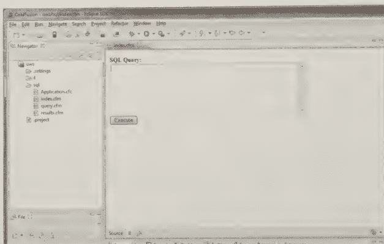

### 创建查询

在完成所有准备工作后，你就可以卷起袖子开始编写 SQL 了。你将最常用的 SQL 语句是 `SELECT` 语句，正如其名称所示，你使用 `SELECT` 来从表中选择数据。

大多数 `SELECT` 语句至少需要两个参数：

- 你想要选择的数据，称为选择列表（select list）。如果你指定了多个项目，必须用逗号分隔每一项。

- 从中选择数据的表（或多个表），用 `FROM` 关键字指定。

你将创建的第一个 `SELECT` 语句是对 `Films` 表中电影列表的查询。在 SQL 查询框中输入列表 6.1 中的代码，并点击执行（Execute）按钮执行该语句。

列表 6.1 简单的 SELECT 语句

```sql
SELECT
MovieTitle
FROM Films
```

就是这样！你写了你的第一个 SQL 语句。结果将如图 6.2 所示。

提示：你可以在一行长代码中输入 SQL 语句，也可以将其拆分为多行。在处理命令时，所有的空白字符（空格、制表符、换行符）都会被忽略。将语句拆分为多行并对参数进行缩进使其更容易阅读和调试。

## 图 6.2

SQL 查询工具在屏幕下半部分显示查询结果，以及使用的 SQL 语句和返回的行数。

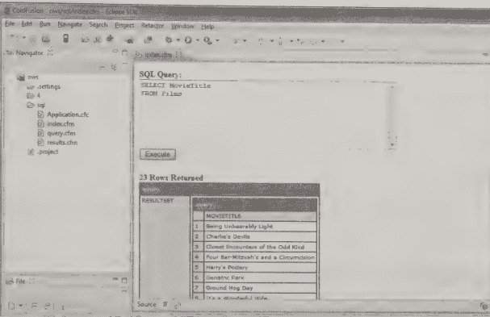

这是另一个示例。输入列表 6.2 中的代码，然后点击执行按钮显示两列。

## 列表 6.2 多列 SELECT 语句

```sql
SELECT
MovieTitle, PitchText
FROM Films
```

在继续之前，请仔细查看列表 6.2 中的 SQL 代码。你传递给 `SELECT` 语句的第一个参数是你想要看到的两个列的列表。列通过其名称（例如 `MovieTitle`）或 `表.列` 格式（例如 `Films.MovieTitle`，其中 `Films` 是表名，`MovieTitle` 是列名）指定。

由于你需要指定两个列，必须用逗号分隔它们。最后一个列名后不出现逗号；如果你在选择列表中只有一个列，则不需要逗号。

紧接选择列表之后，你指定要执行查询的表。你始终在表名之前加上 `FROM` 关键字。表通过名称指定，在本例中为 `Films`。

> 注意
> 
> SQL 语句是不区分大小写的，因此你可以将 `SELECT` 语句指定为 `SELECT`、`select`、`Select` 或任何你喜欢的格式。然而，通常是将所有的 SQL 关键字写为大写，参数写为小写或混合大小写。这样你可以更容易地阅读 SQL 代码并发现拼写错误。

现在修改 `SELECT` 语句使其看起来像列表 6.3 中的代码，然后执行它。

## 第 6 章 SQL 简介

列表 6.3 选择所有列

```sql
SELECT *
FROM Films
```

这一次，不再指定要选择的显式列，而是使用星号（`*`）。星号是一个特殊的列表选项，代表所有列。数据面板现在显示表中的所有列，顺序按照数据库表本身返回的顺序。

> 警告
> 
> 除非你真的需要每一列，否则不要在选择列表中使用星号。你选择的每一列都需要单独处理，随着表变大，检索不必要的列会极大影响检索时间。

## 排序查询结果

当你使用 `SELECT` 语句时，结果将按照它们在表中出现的顺序返回给你。这通常是行被添加到表的顺序。由于这可能不是你想要的顺序，这里是排序查询结果的方法。要对行进行排序，你需要添加 `ORDER BY` 子句。`ORDER BY` 始终位于表名之后；如果你尝试在此之前使用它，将产生 SQL 错误。

现在点击 SQL 按钮，输入列表 6.4 所示的 SQL 代码，然后点击 OK。

列表 6.4 带有排序输出的 SELECT

```sql
SELECT MovieTitle, PitchText, Summary
FROM Films
ORDER BY MovieTitle
```

你的输出将按 `MovieTitle` 列进行排序。

如果你需要按多个列进行排序怎么办？没问题。你可以向 `ORDER BY` 子句传递多个列。再次，如果你列出了多个列，必须用逗号分隔它们。列表 6.5 中的 SQL 代码演示了如何通过按 `RatingID` 排序，然后在每个 `RatingID` 内按 `MovieTitle` 排序来对多个列进行排序。

列表 6.5 输出按多列排序的 SELECT

```sql
SELECT RatingID, MovieTitle, Summary
FROM Films
ORDER BY RatingID, MovieTitle
```

你也可以使用 `ORDER` 按降序（Z–A）排序数据。要对某一列进行降序排序，只需使用 `DESC`（descending 的缩写）参数。列表 6.6 获取所有电影并按标题反序排序。

列表 6.6 带有反序排序输出的 SELECT

```sql
SELECT MovieTitle, PitchText, Summary
FROM Films
ORDER BY MovieTitle DESC
```

### 过滤数据

到目前为止，你的查询检索了表中的所有行。你也可以使用 `SELECT` 语句仅检索符合特定条件的行。要做到这一点，你需要使用 `WHERE` 子句。

### WHERE 条件

在之前的示例中，你只使用了 =（等于）运算符。你根据行是否等于特定值来过滤行。在 WHERE 子句中，可以使用许多其他运算符和条件；它们列在表 6.2 中。

可以随意尝试 SELECT 语句，并使用此处列出的任何 WHERE 子句。SQL 查询工具是安全的。默认情况下，它不会更新或修改数据（默认如此），因此使用它来尝试语句和子句是没有害处的。

## 表 6.2 WHERE 子句搜索条件

| 条件 | 描述 |
|---|---|
| = | 等于。检查相等性。 |
| <> | 不等于。检查不相等性。 |
| < | 小于。检查左侧的值是否小于右侧的值。 |
| <= | 小于等于。检查左侧的值是否小于等于右侧的值。 |
| > | 大于。检查左侧的值是否大于右侧的值。 |
| >= | 大于等于。检查左侧的值是否大于等于右侧的值。 |
| EXISTS | 检查子查询是否返回行。 |
| BETWEEN | 检查值是否在两个值之间的范围内；该范围是包含性的。 |
| IN | 检查一个值是否包含在值列表中。 |
| IS NULL | 检查列是否包含 NULL 值。 |
| IS NOT NULL | 检查列是否包含非 NULL 值。 |
| LIKE | 检查值是否匹配指定的模式。 |
| NOT | 否定任何测试。 |

### 检查相等性 =

使用 = 运算符测试值的等值性。以下示例仅检索姓为 Smith 的联系人：

```
WHERE LastName = 'Smith'
```

### 检查不相等性：<>

使用 <> 运算符测试值的不相等性。以下示例仅检索名为 Kim 的联系人：

```
WHERE FirstName <> 'Kim'
```

### 检查小于：

通过使用 < 运算符，你可以测试左侧的值是否小于右侧的值。以下示例仅检索姓氏小于 C 的联系人，这意味着他们的姓氏以 A 或 B 开头：

```
WHERE LastName < 'C'
```

### 检查小于等于：

通过使用 <= 运算符，你可以测试左侧的值是否小于等于右侧的值。以下示例检索年龄为 21 岁或以下的联系人：

```
WHERE Age <= 21
```

### 检查大于：

使用 > 运算符测试左侧的值是否大于右侧的值。以下示例仅检索评分为 3 或更高（大于 2）的联系人：

```
WHERE RatingID > 2
```

### 检查大于等于：

使用 >= 运算符测试左侧的值是否大于等于右侧的值。以下示例检索名字以字母 J 或更高字母开头的联系人：

```
WHERE FirstName >= 'J'
```

### BETWEEN

使用 BETWEEN 条件，你可以测试一个值是否落在另外两个值之间的范围内。以下示例仅检索年龄在 20 到 30 岁之间的演员。因为测试是包含性的，20 岁和 30 岁也会被检索出来：

```
WHERE Age BETWEEN 20 AND 30
```

BETWEEN 条件实际上只是组合 >= 和 <= 条件的一种方便方法。你也可以按如下方式指定前一个示例：

```
WHERE Age >= 20 AND Age <= 30
```

使用 BETWEEN 条件使语句更易读。

### EXISTS

使用 EXISTS 条件，你可以检查子查询是否返回了任何行。

## 过滤数据 69

### IN

你可以使用 IN 条件测试一个值是否属于特定集合。该值集合必须用括号括起来，并用逗号隔开。以下示例检索姓为 Black、Jones 或 Smith 的联系人：

```
WHERE LastName IN ('Black', 'Jones', 'Smith')
```

前一个示例实际上与以下内容相同：

```
WHERE LastName = 'Black' OR LastName = 'Jones' OR LastName = 'Smith'
```

使用 IN 条件有两个优势。首先，它使语句更易读。其次，更重要的是，你可以使用 IN 条件测试一个值是否在另一个 SELECT 语句的结果中（在 ( ) 中提供一个完整的 SELECT 语句，以匹配该语句返回的任何内容）：

### IS NULL IS NOT NULL

NULL 值是空列的值。IS NULL 条件测试具有 NULL 值的行；即这些行在指定的列中完全没有值。IS NOT NULL 测试在指定列中具有非 NULL 值的行。

以下示例检索所有 Email 列为空的联系人：

```
WHERE Email IS NULL
```

要仅检索有电子邮件地址的联系人，请使用以下示例：

```
WHERE Email IS NOT NULL
```

### LIKE

使用 LIKE 条件时，% 字符在通配符字符串匹配中表示任意内容。支持两种通配符类型。% 字符意味着从该位置开始的任何内容都被视为匹配。你还可以使用 [] 为特定字符创建通配符。

以下示例检索姓氏以字母 S 开头的演员。要匹配模式，姓氏必须以 S 作为第一个字符。

```
WHERE LastName LIKE 'S%'
```

要检索名字中任何位置带有 S 的演员，你可以使用：

```
WHERE LastName LIKE '%S%'
```

要检索以 S 结尾的演员，可以使用：

```
WHERE LastName LIKE '%S'
```

LIKE 条件可以被 NOT 运算符否定。以下示例检索姓氏不以 S 开头的演员：

```
WHERE LastName NOT LIKE 'S%'
```

使用 LIKE 条件，你还可以指定单个字符通配符。如果你想找到名为 Smyth 的，可以使用：

```
WHERE LastName LIKE 'Sm%th'
```

此示例检索以 Sm 开头、中间为 i 或 y、并以 th 结尾的名字。只要前两个字符是 Sm 且最后两个是 th，只要中间字符是 i 或 y，名称就被视为匹配。

### 提示

使用强大的 LIKE 条件，你可以以多种方式检索数据。但一切都有代价。通常，如果你在模式开头使用通配符，LIKE 条件的运行时间更长。

为了更强大的搜索，LIKE 可以与其他子句结合；你甚至可以在单个子句中包含多个 LIKE 子句。

## 第 7 章

- 本章内容
- 添加数据 71
- 修改数据 74
- 删除数据 75

## SQL 数据操作

第 6 章“介绍 SQL”介绍了数据驱动程序、数据源、SQL 和数据检索（使用 SELECT 语句）。你可能会发现你检索数据的时间远比插入、更新或删除数据的时间（这就是为什么我们先关注 SELECT）。

> 注意
> 
> 在本章中，你将从 aws 数据源中的表中添加、更新和删除行。你删除任何添加的行是为了确保书中出现的任何示例代码和截图看起来像它们应该的样子。你可以根据需要添加更多行，但如果你在完成后不清理，你的屏幕将与图中不同。这不是问题，只需注意即可。

### 使用 INSERT 语句

你使用 INSERT 语句向表中添加数据。INSERT 通常由三部分组成：

- 你想要插入数据的表，通过 `INTO` 关键字进行指定。
- 你想要插入值的列（或列）。如果你指定了多个项，每个项之间必须用逗号隔开。
- 要插入的值，通过 `VALUES` 关键字进行指定。

Directors（导演）表包含了在 Orange Whip Studios 工作或为该工作室工作的电影导演列表。如果导演没有列在此表中，则将无法为他们分配项目（与电影相关），因此可以立即添加任何新导演。

请参阅附录 B“示例应用程序数据”以获取每个数据文件及其内容的解释。现在，你已经准备好添加新导演了。以下代码包含 SQL INSERT 语句：

```sql
INSERT INTO Directors(FirstName, LastName)
VALUES('Benjamin', 'FORTA');
```

将此语句输入到如图 7.1 所示的 SQL 查询字段中。可以随地将我的名字替换为你的名字。完成后，点击 Execute（执行）按钮插入新行。假设没有发生任何问题，你应该看到一个类似于图 7.1 底部的确认屏幕。

## 图 7.1

在 SQL Query 字段中输入语句，然后点击 Execute。

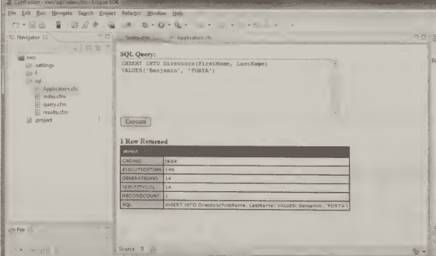

提示：如何判断 INSERT 成功还是失败？嗯，没消息就是好消息。如果没有返回错误，则 INSERT 成功了。如果发生了错误，错误将会显示。

## 理解 INSERT

现在你已成功使用 SQL INSERT 语句插入了一行数据，花几分钟查看该语句的语法。

你语句的第一行是：

`INSERT INTO Directors(FirstName, LastName)`

紧跟在 INTO 关键字后面的文本是正在插入新行的表名——在这种情况下，是 Directors 表。

接下来指定要添加的列。列列在括号内，由于指定了多个列，因此它们用逗号隔开。Directors 表中的某行都需要 FirstName 和 LastName，而 INSERT 语句指定了这两个列。

注意：当向表中插入行时，你可以根据需要为尽可能少或尽可能多的列提供值。唯一的限制是，任何定义为 NOT NULL（非空）的列——意味着不能留空——必须指定值。如果你不为 NULL 列设置值，数据库驱动程序将返回错误信息且该行不会插入。

下一行是：

`VALUES('Benjamin', 'FORTA')`

每当你插入行时，必须为列出的每个列指定一个值。值传递给 VALUES 关键字；所有值都包含括号内，就像它们的列名一样。指定了两个列，因此有两个值传递给 VALUES 关键字。

注意：在向表中插入行时，列可以按任何顺序指定。但请确保列的顺序与表名匹配，否则你会将错误的数据插入到列中。

要验证新导演已添加到表中，请使用以下 SQL 语句检索完整的导演列表：

`SELECT * FROM Directors`

如第 6 节所示，`SELECT *` 选择所有列。你应该能看到添加到表中的新行。记下 DirectorID 的值，你稍后需要它来更新或删除此行（系统为你生成的 ID 可能与为我生成的 14 不同）。

注意：在之前的 INSERT 语句中，没有为 DirectorID 列提供值。那个值是从哪里来的？Directors 表被设置为每插入一个新行都会自动分配主键值。这是许多数据库支持的功能——Access 将这些列称为 AutoNumber（自动编号），SQL Server 和 Derby 使用 Identity，其他数据库有它们自己的名称。因此，你不需要担心创建唯一值，因为数据库会为你完成这一点。

# 第 7 章 SQL 数据操作

提示：INSERT 通常一次只能插入一行，多次插入则需要多个 INSERT 语句。然而，某些 DBMS（包括 Derby）允许向 INSERT 传递多个 VALUE 子句。如果你查看用于填充示例表的脚本，将看到如何使用这种句法的。

## 修改数据

你使用 SQL UPDATE 语句来更新一个或多个列。这通常涉及指定以下内容：

- 包含你想要更新的数据的表。
- 你想要更新的列或列，前面带有 `SET` 关键字。如果你指定了多个项，每个项之间必须用逗号隔开。
- 可选的 WHERE 子句，用于指定要更新哪些行。如果没有提供 WHERE 子句，则将更新所有行。

更新一行。输入以下 SQL 语句（确保 WHERE 子句中使用的 ID 号是你之前记录的 DirectorID）：

```sql
UPDATE Directors
SET FirstName='Ben'
WHERE DirectorID = 14
```

点击 Execute 执行更新。再次，不会显示任何结果，因为 UPDATE 不返回数据（尽管确实会显示 SQL、执行时间和其他信息）。


如果你选择`Directors`表的内容，你将看到新导演的名字已经更改。

## 理解 UPDATE

现在，仔细观察你刚刚使用的 SQL 语句。第一行发出了`UPDATE`语句并指定了要更新的表名。与`INSERT`和`DELETE`语句一样，必须指定表名。

你接着指定了想要更改的列及其新值：

```sql
SET FirstName='Ben'
```

这是将`FirstName`列更新为`Ben`的指令。`SET`关键字对于`UPDATE`操作是必须的，因为不指定要更新的内容的操作意义不大。

`SET`关键字只能用于`UPDATE`语句。如果你更新多个列——例如，在一个操作中将`Benjamin`改为`Ben`并将`LastName`设置为`Forta`——`SET`关键字将如下：

```sql
SET FirstName='Ben', LastName='Forta'
```

## 更新多个列

在更新多个列时，每个列必须用逗号隔开。完整的（修订后的）`UPDATE`语句如下：

```sql
UPDATE Directors
SET FirstName='Ben', LastName='Forta'
WHERE DirectorID = 14
```

代码的最后一行指定了`WHERE`子句。`WHERE`子句在`UPDATE`语句是可选的。如果没有它，所有行都将被更新。以下代码使用主键列确保更新一行：

```sql
WHERE DirectorID = 14
```

要验证更新有效，检索`Directors`表中的所有数据。结果应该反映所做的更改。

**警告** 使用 SQL 语句时要确保提供`WHERE`子句；否则所有行都将被更新。

## 执行全局更新

有时，你想要更新表中的所有行。为此，你仍然使用`UPDATE`——只需省略`WHERE`子句，或者指定一个匹配多个行的`WHERE`子句。

当使用`WHERE`子句更新多个行时，在执行`UPDATE`之前，务必使用简单的`SELECT`语句测试该`WHERE`子句。如果`SELECT`返回正确的数据（即你想更新的数据），你就知道将其用于`UPDATE`是安全的。如果你不这样做，可能会更新错误的数据！

**提示** 在执行包含复杂语句或`WHERE`条件的`INSERT`、`UPDATE`或`DELETE`操作之前，你应该通过将其用于`SELECT`语句来测试语句或条件。如果`SELECT`返回错误的结果或由`WHERE`子句过滤的错误子集，你就知道该语句或条件是错误的。与`INSERT`、`UPDATE`和`DELETE`不同，`SELECT`语句永远不会更改数据。因此，如果语句或条件存在错误，你将在造成损害之前发现它。

## 删除数据

从表中删除数据比添加或更新数据简单得多——可能太简单了。

你使用`SQL DELETE`语句来删除数据。该语句接受两个参数——一个必需的，一个可选的：

- 从要删除数据的表名必须紧跟在`FROM`关键字之后指定。
- 可选的`WHERE`子句可以用于限制删除范围。

# 第 7 章 SQL 数据操作

`DELETE`语句的使用简单得极其危险。请看以下代码（但不要执行它）：

```sql
DELETE FROM Directors
```

该语句将从`Directors`表中删除所有导演，且在没有任何警告或确认的情况下执行此操作。

**提示** 某些数据库，特别是客户端/服务器数据库（例如 Microsoft SQL Server 和 Oracle），提供了防止意外或恶意删除的保护措施。防止批量删除通常有两种方法。一种是创建一段在特定操作发生并在服务器上运行的代码，验证每个`DELETE`语句并阻止任何不带`WHERE`子句的`DELETE`。另一种是根据登录情况限制不带`WHERE`子句的`DELETE`使用。只有某些具有管理权限的用户才被允许执行不带`WHERE`子句的`DELETE`。任何其他尝试`DELETE`的用户将收到错误消息，操作将终止。并不是所有的数据库系统都支持这些技术。请咨询数据库管理员的手册以确定可以使用哪些保护措施。

`DELETE`语句通常配合`WHERE`子句使用。例如，以下 SQL 语句将从`Directors`表中删除单个导演（你刚刚添加的那个）：

```sql
DELETE FROM Directors
WHERE DirectorID=14
```

为了验证该行已被删除，请最后检索所有导演。

与`WHERE`子句一样，`DELETE`语句的`WHERE`子句可以是一个检索要删除行的`SELECT`语句。如果你使用`SELECT`语句作为`WHERE`子句，请务先测试`SELECT`语句，以确保它检索了你想要的所有值且仅检索这些值。

**提示** 可以根据需要随时`INSERT`、`UPDATE`和`DELETE`行，但在完成后请清理更改，或直接用原始文件覆盖数据文件（将其恢复到原始状态）。

**注意** 主键值永远不会被重用。如果你在执行删除操作后`INSERT`行，新行将被分配全新的 ID，旧的（已删除的）ID 不会被重用。这种行为是关系型数据库工作机制的必要部分，并在第 5 章“回顾数据库”中进行了解释。

## 第二部分

## 使用 ColdFusion

- 8 CFML 基础
- 9 使用 CFML 编程
- 10 创建数据驱动页面
- 11 结构化开发的基础
- 12 ColdFusion 表单
- 13 表单数据验证
- 14 使用表单添加或更改数据
- 15 超 HTML 表单：ColdFusion 驱动的 Ajax
- 16 绘图、打印与报告
- 17 调试与故障排除

## 8 章 CFML 基础

### 本章内容

- 使用模板 79
- 使用函数 81
- 使用变量 85
- 使用表达式 91
- 使用 ColdFusion 数据类型 94
- 代码注释 101

### 使用模板

在第 4 章“预览 ColdFusion”中，我们学习了创建几个简单应用程序的过程。ColdFusion 应用程序由一个或多个文件组成，每个文件都有一个`.cfm`扩展名。这些文件通常被称为模板（templates）或页面（pages）——你会看到这两个术语经常交替使用。为了让你知道，它们指的都是同一个东西。稍后我将解释为什么使用“模板”这个词。

**注意** 如第 2 章“访问 ColdFusion 管理器”所述，与 ColdFusion 使用的 URL 将取决于是否使用了外部 Web 服务器。为了简单起见，本章及后续章节中的所有 URL 都假设 ColdFusion 是结合集成 Web 服务器（单机模式）使用的。因此，你会在所有 URL（包括内容和图表）中看到指定的端口地址`:8500`。如果你没有使用集成 Web 服务器，请直接从任何 URL 中省略`:8500`。

### 创建模板

如所述，ColdFusion 模板是纯文本文件。因此，可以使用许多不同的程序创建。在学习这些课程期间，我们将继续使用 ColdFusion Builder，但也有其他选择，包括 Adobe Dreamweaver，它在 Web 开发人员和设计师中非常流行。

**注意** ColdFusion 还使用了另外两种文件扩展名：`.cfc`和`.cfr`。我们将在后续章节中查看这些文件。

以下代码是名为`hello1.cfm`的简单 ColdFusion 文件的内容。实际上，在此时列表中并不存在任何 ColdFusion 代码——它是纯 HTML 和文本，但我们很快就会改变这一点。启动 ColdFusion Builder（如果它尚未打开），在我们的目录下创建一个文件夹，创建一个名为`hello1.cfm`的新文件，并按照列表 8.1 所示输入代码。

**列表 8.1 hello1.cfm**

```html
<html>
<head>
  <title>Hello 1</title>
</head>

<body>
  Hello, and welcome to ColdFusion!
</body>
</html>
```

**提示** 标签的大小写不重要，因此可以使用`<BODY>`、`<body>`或`<Body>`——这取决于你的选择。

### 执行模板

现在，让我们测试一下代码。有几种方法可以实现。最简单的方法是直接点击 ColdFusion Builder 编辑窗口下的浏览器标签页。

你也可以亲自执行该页面。只需打开 Web 浏览器并访问到此 URL：`http://localhost:8500/aws/8/hello1.cfm`

**提示** 未使用集成 Web 服务器？请参本章开头的注释。

你应该能看到一个类似于图 8.1 的页面。

**图 8.1**

（未提供图像）

### 模板详解

在本章中，我们将解释为什么 ColdFusion 文件通常被称为模板。在本章中，我们将学习如何使用模板创建动态内容。

只有`#Now()`表达式需要 ColdFusion 处理，因此只有它需要放在`<output>`块中。但如果你没有将表达式放在`<output>`块中会怎样？尝试一下：移除`<output>`标签，保存页面并执行。你将看到与图 8.3 类似的输出——这显然不是你想要的。因为在`<output>`块内的任何内容都会原样发送到客户端，因此在`<output>`块之外使用`Now()`会导致`Now()`本身被发送到客户端，而不是`Now()`返回的数据。这是为什么呢？因为如果它在`<output>`块之外（且不在任何其他 CFML 标签内），ColdFusion 将永远不会处理它。

省略数字`#Now()`有类似的效果。`<output>`标签处于它们该在的位置，但将`#Now()`改为`Now()`（去掉其前后的`#`号）。然后保存页面并执行。输出将看起来与图 8.4 相似。为什么？因为所有的`<output>`标签都会标记文本需要 ColdFusion 处理。ColdFusion 并不会处理标签之间的所有文本——相反，它会寻找由`#`符号界定的表达式，任何不在`#`符号内的文本都被视为字面文本，并将原样发送到客户端。

**图 8.4**

如果表达式被发送到浏览器，通常意味着你漏掉了`<output>`标签。

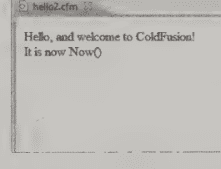

**注意** 在处理数据库驱动的内容时，`<output>`有另一个重要用途。关于这方面的更多信息可以查阅第 10 章“创建数据驱动页面”。

`Now()`是一个函数，是 CFML 支持的许多函数之一。`Now()`用于从系统获取信息（日期和时间），但日期的格式并非完全可读。另一个函数`DateFormat()`可以此提供帮助。`DateFormat()`是 ColdFusion 的输出格式化函数之一，它的工作是格式化日期以便在所有类型的格式中都是可读的。以下是你刚刚使用的代码的修订（参见列表 8.3）；将其保存为`hello.cfm`并浏览该文件，查看与图 8.5 所示类似的输出。

**图 8.5**

ColdFusion 提供了一系列输出格式化函数，可以更好地控制生成的输出。

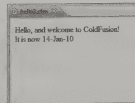

# 第 8 章 CFML 基础

**列表 8.3 hello3.cfm**

```html
<html
<head>
<title>Hello 3</title>
</head>
<body>
Hello, and welcome to ColdFusion!
<br>
<cfoutput>
It is now #DateFormat(Now())#
</cfoutput>
</body>
</html>
```

`DateFormat()`是一个接受（并要求）必须传递给它的数据的函数示例——毕竟，它需要知道你想要格式化哪个日期以供显示。`DateFormat()`可以接受硬编码字符串形式的日期，如`#DateFormat('8/17/2010')`，也可以接受由其他表达式（如`Now()`函数）返回的日期。`#DateFormat(Now())`告诉 ColdFusion 格式化`Now()`函数返回的日期。

**注意** 将参数传递给另一个函数被称为“嵌套”。在本章的示例中，说`Now()`函数被嵌套在`DateFormat()`函数中。

`DateFormat()`也接受第二个可选参数：一个用于描述输出格式的掩码。尝试将代码中的`#DateFormat(Now())`替换为以下任何内容，并尝试每一项查看它们的作用：

- `#DateFormat(Now(), "MMMM-DD-YYYY")`
- `#DateFormat(Now(), "MM/DD/YY")`
- `#DateFormat(Now(), "DD, MMM DD, YYYY")`

传递给参数总是用逗号分隔。如果传递单个参数，则不用逗号，但当存在两个或多个参数时，每个参数必须用逗号分隔。

你已经见过不接受参数的函数、接受必需参数的函数，以及同时接受必需参数和可选参数的函数。所有的 ColdFusion 函数（你将使用许多函数）工作方式都是相同的——有些接受参数，有些不接受。但所有函数，无论是否有参数，都会返回一个值。

**注意** 重要的是记住`#`不是函数的一部分。你在这里使用的函数是`DateFormat()`和`Now()`。这些符号用于界定（标记）表达式，但它们不是表达式本身的一部分。

我知道我已经说过了，但值得重复：CFML 代码在服务器上处理，而不是在客户端。你编写的 CFML 代码永远不会发送到 Web 浏览器。发送到浏览器的是什么？大多数浏览器都带有“查看源代码”选项，可以显示接收到的代码。如果你查看页面`hello3.cfm`的源代码，你会看到类似的内容：

```html
<html
<head>
<title>Hello 3</title>
</head>
<body>
Hello, and welcome to ColdFusion!
<br>

It is now 02-Jul-10
</body>
</html>
```

如你所见，这里完全没有 CFML 代码。`<output>`标签、函数、数字都被剥离了。提示：如果你发现输出不符合预期，查看源代码是一个非常有用的技巧。

# 变量

既然你已经有了机会，让我们介绍变量。变量是每个语言的重要部分。变量是存储信息的容器。在 CFML 中，你使用`<cfset>`语句创建变量。

```html
<cfset name="John">
```

一旦设置了变量，你就可以通过`#`号将其在`<output>`标签中使用：

```html
<cfoutput>
Hello, #name#!
</cfoutput>
```

你可以根据需要多次使用一个变量：

```html
<cfset name="John">
<cfoutput>
Hello, #name#!
How are you, #name#!
</cfoutput>
```

你也可以通过另一个`<cfset>`语句更改变量的值：

```html
<cfset name="Jane">
<cfoutput>
Hello, #name#!
</cfoutput>
```

普通变量仅存在于创建它的页面。如果你在一个页面中定义变量，另一个页面无法使用它，除非你显式传递它（参见第 10 章）。这种规则也有例外。在第 19 章“处理会话”中，你将学习如何创建跨请求使用的变量。（每个页面访问被称为请求。）

**图 8.6**

变量用于生成动态输出。


**列表 8.4 hello4.cfm**


```html
<html
<head>
<title>Hello 4</title>
</head>
<body>
<cfset firstName="John">
<cfoutput>
  Hello, #firstName#!
</cfoutput>
</body>
</html>
```

这段代码与之前的相似，它以`<cfset>`开始以设置变量：

```html
<cfset firstName="John">
<cfoutput>
  Hello, #firstName#!
</cfoutput>
```

你也可以通过另一个`<cfset>`语句更改变量的值：

```html
<cfset firstName="Jane">
<cfoutput>
  Hello, #firstName#!
</cfoutput>
```

页面的输出与图 8.6 相似。

# 第 8 章 CFML 基础

## 列表 8.5（续）

```
你的反转名字: #Reverse(firstName)#<br>
你名字的字符数: #Len(firstName)#<br>
你的名字重复3次: #RepeatString(firstName, 3)#<br>
</coutput>

<body>
<html>
```

让我们来看下接下来的代码。`<cfset>`用于创建一个名为`FirstName`的变量。该变量被使用了一次（Hello 消息），然后又使用了五次。`UCase()`将字符串转换为大写，`LCase()`将字符串转换为小写，`Reverse()`反转字符串。`Len()`返回字符串的长度（字符数），而`RepeatString()`将字符串重复指定的次数。

但像`UCase()`这样的函数并没有真正地转换字符串；相反，它们返回的是转换后的字符串。这种区别非常重要。看下面这行代码：

```
你的名字大写: #UCase(firstName)#
```

`UCase()`返回了转换为大写的`FirstName`，但`FirstName`的内容保持完好，完全没有被转换为任何内容。`FirstName`并没有被修改；而是创建了一个副本并进行了修改，然后将其返回。要将大写的`FirstName`保存到变量中，你必须这样做：

```
<CFset UpperFirstName=UCase(FirstName)>
```

这里创建了一个新变量`UpperFirstName`。`UpperFirstName`被赋值为`UCase(FirstName)`返回的值，即大写的`FirstName`。这个新变量可以像任何其他变量一样使用，并且根据需要频繁使用。列表 8.6 是列表 8.5 的修改版本。自己试一下——输出结果与图 8.8 完全相同。

### 列表 8.6 hello6.cfml

```
<html>
<head>
<title>Hello 6</title>
</head>

<body>
<cfset firstName="ben">
<cfset upperFirstName=UCase(firstName)>
<cfset lowerFirstName=LCase(firstName)>
<cfset reverseFirstName=Reverse(firstName)>
<cfset lenFirstName=Len(firstName)>
<cfset repeatFirstName=RepeatString(firstName, 3)>

<coutput>
Hello#FirstName#, 欢迎来到 ColdFusion!<p>
你的名字大写: #upperFirstName#<br>
你的名字小写: #lowerFirstName#<br>
你的名字反转: #reverseFirstName#<br>
你名字的字符数: #lenFirstName#<br>
```

### 列表 8.6（续）

```
你的名字重复3次: #repeatFirstName#<br>
</coutput>
```

```
<html>
</body>
</html>
```

这段代码值得仔细观察。现在存在六个`<cfset>`标签，并创建了六个变量。第一个创建了`firstName`变量，就像之前的示例一样。接下来创建了一个名为`upperFirstName`的新变量，它包含`firstName`的大写版本。然后通过额外的`<cfset>`语句分别创建了`lowerFirstName`、`reverseFirstName`、`lenFirstName`和`repeatFirstName`。

`<coutput>`块完全没有包含任何函数。相反，它显示了刚刚创建的变量的内容。在这个特定的列表中，除了代码这样组织更整洁之外，这样做其实意义不大。将函数输出保存到变量中的真正益处体现在函数在单个页面中被多次使用时。这时，你不需要反复使用同一个函数，而是只需使用一次，将输出保存到变量，然后使用该变量。

需要注意的一个重要点是，变量是可以被覆盖的。看下面的代码段：

```
<cfset firstName="Ben">
<cfset firstName="Ray">
```

在这里，它先被设置为 Ben，然后再次设置为 Ray。变量可以根据需要频繁地覆盖，在访问（显示或传递给其他函数）时的当前值是什么，就会使用哪个值。

知道这一点后，你认为下面这行代码是做什么的？

```
<cfset firstName=UCase(FirstName)>
```

这是一个覆盖的示例，但在这里被覆盖的是变量本身。我之前提到过像`uCase()`这样的函数并不转换文本；它们返回一个转换后的副本。通过使用像所示的代码`<cfset firstName=uCase(firstName)>`将`firstName`设置为`firstName`的大写版本，实际上用转换后的值覆盖了它。

## 变量命名

这里是讨论变量命名的好地方。当你创建一个变量时，你可以为它命名，名称的选择由你决定。但你需要了解一些关于变量命名的规则：

- 变量名可以包含字母数字，但不能以数字开头（所以`result12`可以的，但`4th`不行）。
- 变量名不能包含空格。如果你需要分隔单词，请使用下划线（例如使用`monthly_sales_figures`而不是`monthly sales figures`）。
- 除了下划线，变量名中不能包含字母数字字符（所以`Sales!`、`SSN!`和`first-name`都是无效的）。
- 变量名不区分大小写（`FirstName`与`FIRSTNAME`相同，`firstname`也相同）。

除此之外，你可以根据需要尽情创意。选择任何你想要的变量名；只需小心不要误覆盖已有的变量。

## 提示

避免使用缩写名称。

## 使用前缀

你应该使用前缀吗？嗯，有利有弊。以下是优点：

- 使用前缀可以提高性能。如果你显式提供变量，ColdFusion 查找变量的工作就会更少。
- 如果存在同名但类型不同的多个变量，100%确定获取你想要的变量的唯一方法是使用前缀。

至于缺点，只有一个：

- 如果你省略前缀，将可以访问多个类型（可能是表单字段和 URL 参数）。如果你提供了类型，你就限制了对指定类型的访问，尽管这会让你的代码重用性降低。

选择权在于你，没有真正的对错之分。如果你觉得合适可以使用前缀，如果不合适就不使用。如果你不指定前缀，ColdFusion 会为你找到变量。如果存在多个同名的变量（具有不同类型），则将使用预定义的优先级顺序。（如果还不熟悉这些类型，不要担心；它们很快就会变得熟悉，需要时你可以参考此列表。）顺序如下：

- 函数本地（用户定义函数）和 CFC 方法
- 线程本地（在`<cfthread>`语句内）
- 查询结果
- 函数参数（`ARGUMENTS`）
- 本地变量（`VARIABLES`）
- CGI 变量
- 文件变量
- URL 参数
- 表单字段
- COOKIE 值
- 客户端（`CLIENT`）

换句话说，如果你引用`#firstName#`（不指定前缀）且该变量既作为本地变量（`VARIABLES.firstName`）又作为表单字段（`FORM.firstName`）存在，将自动使用`VARIABLES.firstName`。

> **注意**
>
> 存在这种例外。某些 ColdFusion 变量类型必须通过显式前缀访问；这些将在后面的章节中介绍。

## 使用表达式

我在本章中使用了几次“表达式”这个词。什么是表达式？官方 Cold-Fusion 文档说，表达式是“允许你创建复杂应用程序的语言结构”。更好的理解方式是，表达式是由一个或多个以下内容组成的字符串：

- 字面量文本（字符串）、数字、日期、时间和其他值
- 运算符（`+`加法、`&`连接等）
- 函数

所以，`UCase(FirstName)`是一个表达式，`"Hello, my name is Ben"`、`12+4`以及`DateFormat(Now())`也是。尽管许多人发现很难准确地表述什么是表达式，但请意识到表达式是 ColdFusion 语言中重要的一部分。

### 构建表达式

表达式在需要的地方输入。表达式可以作为赋值的一部分传递给`<cfset>`语句，用于显示文本，并传递给几乎每一个 CFML 标签（除少数没有属性的标签外）。

可以使用像之前讨论过的简单表达式（变量、函数及其组合）。但也可以使用更复杂的表达式，而且表达式可以包含算术运算符、字符串运算符和决策运算符。你将在接下来的几章中使用这些内容。

在使用表达式时，使用井号（`#`）来界定文本块中的 ColdFusion 代码和变量。那么，你该如何显示`#`本身呢？查看下面的代码片段：

```
<cfoutput>
#1: #FirstName#n</cfoutput>
```

如果你有兴趣，可以尝试一下；你会发现 ColdFusion 在处理代码时会产生错误（见图 8.9）。

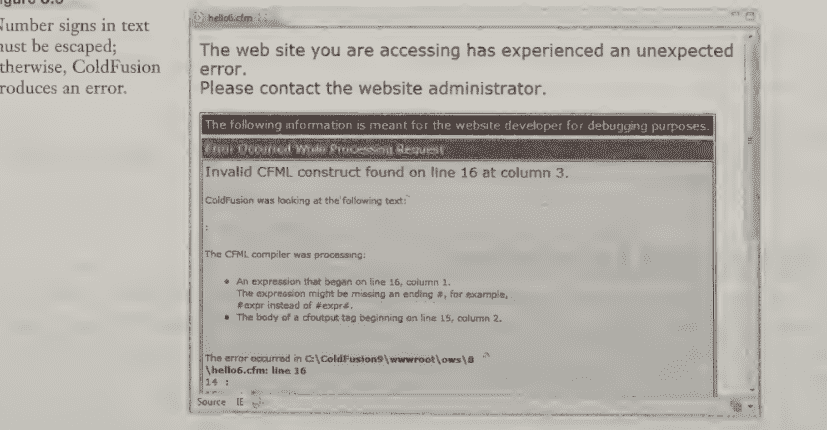

是什么导致了这个错误？当 ColdFusion 遇到行首的`#`时，它认为你正在界定一个变量或函数，并尝试寻找匹配的`#`（当然它不存在，因为这根本不是一个变量引用）。解决方案是转义井号（将其标记为真实的井号），如下：

```
<cfoutput>
##1: #FirstName#n</cfoutput>
```

当 ColdFusion 遇到`##`时，它知道`#`不是在界定变量或函数。相反，它会正确地显示单个`#`。

### 何时使用 `#`，何时不使用

在继续之前，让我们明确明确一下到底什么时候需要井号，什么时候不需要。

简单来说，井号用于标记文本字符串中的函数和变量。

在第一个示例中，井号显然是需要的：

```
Hello #VARIABLES.FirstName#
```

但当变量在标签内部使用时，例如这样呢？

```
<cfset FirstName=UCase(FirstName)>
```

在这里不需要井号，因为 ColdFusion 假设传递给标签的任何内容都是函数或变量，除非式定义为字符串。因此以下是错误的：

```
<cfset FirstName#==UCase(FirstName)>
```

这段代码实际上可以运行（ColdFusion 非常宽容），但它仍然是错误的，不应该使用。

下一个示例声明了一个变量并分配了一个字符串值，因此这里不需要井号：

```
<cfset FirstName="#Ben#">
```

但如果字符串包含变量，则需要井号。看下一个示例：

`FullName`被赋值了一个字符串，但该字符串包含两个变量（`FirstName`和`LastName`），这些变量必须包含在井号内（否则 ColdFusion 将分配文本，而不是变量值）：

```
<cfset FullName="#FirstName# #LastName#">
```

顺带一提，上一行代码在功能上与以下代码等效：

```
<cfset FullName=FirstName & " " & LastName>
```

在这里不需要井号，因为没有在字符串内部引用变量。

再次强调，规则是：只有在文本块中引用变量和函数时才使用井号。简单如此。


## 使用 ColdFusion 数据类型

你到为止使用的变量都是简单变量，它们已定义并包含一个值。

ColdFusion 支持三种高级数据类型，我现在简要介绍一下：列表（lists）、数组（arrays）和结构（structures）。

> **注意**
>
> 这是对列表、数组和结构的介绍。这三种类型在本书的其余部分都会反复使用，所以如果你读完这一章时还没有完全理解它们，不要担心。现在的目的是是确保你知道它们的存在以及它们是什么。你很快会有很多机会使用它们。

### 列表（Lists）

列表用于将相关信息分组。列表实际上是字符串（纯文本）——之所以成为列表是因为使用了用于分隔字符串内项目的分隔符。例如，下面是一个包含五个美国州的逗号分隔列表：

```text
California,Florida,Michigan,Massachusetts,New York
```

下一个示例也是一个列表。尽管它看起来不像列表，但句子也是由空格界定的列表：

```text
This is a ColdFusion list
```

列表的创建方式与其他任何变量都一样。例如，下面这行代码使用`<cfset>`标签创建一个包含六种水果列表的命名水果：

```
<cfset fruit="apple,banana,cherry,grape,mango,orange">
```

列表 8.7 中的代码演示了列表的使用。输入代码并将其保存为 8 目录下的`list.cfm`；然后执行它。你应该能看到与图 8.10 显示类似的输出。

#### 图 8.10

列表有助于将相关数据分组为简单的集合。


#### 列表 8.7

```
<html>
<head>
<title>List Example</title>
</head>
<body>
<cfset fruit="apple,banana,cherry,grape,mango,orange">
<cfoutput>
<cflist name="fruit" var="item">
  #item<br>
</cflist>
</cfoutput>
</body>
</html>
```

*（注：列表 8.7 的 OCR 存在严重乱码；我根据 ColdFusion 列表的上下文重构了逻辑代码）。*

### 数组（Arrays）

数组和列表一样，在单个变量中存储多个值。但与列表不同，数组可以包含更复杂的数据（包括列表甚至数组）。

`names[6]`指的是第六个元素。在二维数组中，必须指定两个维度，如接下来的四行代码所示（摘自之前的代码列表）：

```
<cfset names[1][1]="Ben">
<cfset names[1][2]="Forta">
<cfset names[2][1]="Ray">
<cfset names[2][2]="Camden">
```

`names[1][1]`指第一个维度中的第一个元素——可以将其看作网格中第一行的第一列。`names[1][2]`指该第一行的第二列，依此类推。

当为了显示索引访问时，必须使用索引。因此，以下行代码

```
The first name in the array #names[1][1]# #names[1][2]#
```

会生成以下输出：

```text
The first name in the array Ben Forta
```

为了更清晰地查看数组，你可以使用名为`<cfdump>`的标签。列表 8.9 包含了`array2.cfm`的代码（与`array1.cfm`相同，但输出代码不同）。输出如图 8.12 所示。

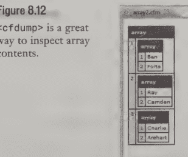

#### 列表 8.9 array2.cfm

```
<html>
<head>
<title>Array Example 2</title>
</head>
<body>
<cfset names=ArrayNew(2)">
<cfset names[1][1]="Ben">
<cfset names[1][2]="Forta">
<cfset names[2][1]="Ray">
<cfset names[2][2]="Camden">
<cfset names[3][1]="Charlie">
<cfset names[3][2]="Arehart">
<cfdump var="#names#">
</body>
</html>
```

我们稍后会查看`<cfdump>`。但现在，正如你所见，尽管它们不像数组那样易于使用，但数组是一项非常灵活且强大的语言特性。

正如你所看到的，数组首先使用`ArrayNew()`创建的，并根据需要添加元素。到目前为止，元素被添加到特定的数组位置（例如`{1}`）。数组元素也可以使用`ArrayAppend()`追加，如下所示：

```
<cfset names="Ben">
<cfset ArrayAppend(names, "Ray")
<cfset ArrayAppend(names, "Charlie")
```

此示例创建了一个单维数组，然后向其添加了三个元素。

在处理单维数组时，ColdFusion 提供了一种种快捷语法，可以在一步内创建并填充数组。以下代码段在功能上与之前的示例相同：

```
<cfset names="Ben", "Ray", "Charlie">
```

正如你所看到的，单维数组可以在不使用任何数组函数的情况下创建并填充。

ColdFusion 处理数据的速度比处理列表（lists）要快得多。对于非常短的数据集，你可能看不到数组和列表之间有多大区别，但随着集合数据量的增加，数组相对于列表的性能优势将变得更加明显。

## 结构（Structures）


# 第 8 章 CFML 基础

## 数组

`names[6]` 指的是第六个元素。在二维数组中，必须指定两个维度，如接下来的四行代码所示：

```cfml
<cfset names[1][1]="Ben">
<cfset names[1][2]="Forta">
<cfset names[2][1]="Ray">
<cfset names[2][2]="Camden">
```

`names[1][1]` 指第一个维度中的第一个元素——可以将其看作网格中第一行的第一列。`names[1][2]` 指该第一行的第二列，依此类推。

当为了显示索引访问时，必须使用索引。因此，以下代码：

```text
The first name in the array #names[1][1]# #names[1][2]#
```

会生成以下输出：

```text
The first name in the array Ben Forta
```

为了更清晰地查看数组，你可以使用名为`<cfdump>`的标签。列表 8.9 包含了`array2.cfm`的代码（与`array1.cfm`相同，但输出代码不同）。输出如图 8.12 所示。


### 列表 8.9 `array2.cfm`

```cfml
<html>
<head>
<title>Array Example 2</title>
</head>
<body>
<cfset names=ArrayNew(2)">
<cfset names[1][1]="Ben">
<cfset names[1][2]="Forta">
<cfset names[2][1]="Ray">
<cfset names[2][2]="Camden">
<cfset names[3][1]="Charlie">
<cfset names[3][2]="Arehart">
<cfdump var="#names#">
</body>
</html>
```

正如你所见，数组首先使用`ArrayNew()`创建，并根据需要添加元素。到目前为止，元素被添加到特定的数组位置，例如`{1}`。数组元素也可以使用`ArrayAppend()`追加，如下所示：

```cfml
<cfset names="Ben">
<cfset ArrayAppend(names, "Ray")
<cfset ArrayAppend(names, "Charlie")
```

此示例创建了一个单维数组，然后向其添加了三个元素。

在处理单维数组时，ColdFusion 提供了一种快捷语法，可以在一步内创建并填充数组。以下代码段在功能上与之前的示例相同：

```cfml
<cfset names="Ben", "Ray", "Charlie">
```

正如你所看到的，单维数组可以在不使用任何数组函数的情况下创建并填充。

ColdFusion 处理数据的速度比处理列表（lists）要快得多。对于非常短的数据集，你可能看不到数组和列表之间有多大区别，但随着集合数据量的增加，数组相对于列表的性能优势将变得更加明显。

## 结构（Structures）

结构是 ColdFusion 中最强大且灵活的数据类型，事实上非常强大，以至于许多内部变量实际上都是结构。

简单来说，结构提供了一种在数据内部存储数据的方法。与数组不同，结构没有特殊的维度，也不像网格。相反，它们可以被看作是顶层文件夹，可以存储数据或其他文件夹，而这些文件夹又可以存储数据、其他文件夹等。结构可以包含列表、数组，甚至其他结构。

为了让你预览一下结构长什么样，这里有一些代码。你可以自己试一下：将文件保存为`structure.cfm`，应该能看到如图 8.13 所示的输出。

### 图 8.13

| 文件 | 输出 |
|---|---|
| `structure.cfm` | `E-Mail Ben Forta` |

结构是 ColdFusion 中最重要的数据类型之一，并在内部被广泛使用。

### 列表 8.10 `structure.cfm`

```html
<html>
<head>
<title>Structure Example</title>
</head>

<body>
<cfset contact=StructNew()>
<cfset contact.FirstName="Ben">
<cfset contact.LastName="Forta">
<cfset contact.EMail="ben@forta.com">

<cfoutput>
e-mail:
<a href="mailto:#contact.EMail#">#contact.FirstName# #contact.LastName#</a>
</cfoutput>
</body>
</html>
```

结构使用`StructNew()`创建——与`ArrayNew()`不同——它不需要参数。结构创建后，接下来的三行代码设置了`contact`结构的所有变量：

```cfml
<cfset contact.FirstName="Ben">
<cfset contact.LastName="Forta">
<cfset contact.EMail="ben@forta.com">
```

要访问结构成员，只需通过名称引用它们。`#contact.FirstName#`访问`contact`结构中的`FirstName`成员。因此，代码：

```html
<a href="mailto:#contact.EMail#">#contact.FirstName# #contact.LastName#</a>
```

会生成以下输出：

```html
<a href="mailto:ben@forta.com">Ben Forta</a>
```

这只是冰山一角。结构极其强大。像数组一样，结构可以在不使用任何数组函数的情况下隐式创建并填充。

## 注释

你到目前为止使用的代码都很短小、简单且通俗易懂。但当你开始构建更大、更复杂的应用程序时，代码会变得更加错综复杂，此时注释变得至关重要。以下是应该为代码编写注释的原因：

- 如果尽可能让代码具有自描述性，那么以后再次查看代码时，你会记得自己做了什么以及为什么要这么做。
- 即使其他人需要处理你的代码也是如此。注释越详细、准确，在需要时进行更改或纠正就越容易、越安全。
- 有注释的代码比没有注释的代码更容易调试。
- 有注释的代码往往组织得更有条理。

列表 8.13 是`hello.cfm`的修订版本，唯一的变化是包含了注释。正如图 8.16 所示，这对代码中生成的任何输出没有影响，因为这些输出永远不会被发送到客户端浏览器。

### 图 8.16

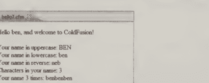

### 列表 8.13 `hello.cfm`

```html
<-- hello.cfm --
Name: hello.cfm
Author: Ben Forta (ben@@forta.com)
Description: Demonstrate use of comments
Created: 07/01/2010
-->
<<html>
<head>
<title>Hello 7</title>
</head>
<body>
<!-- Save name="ben" -->
<cfset firstName="ben">

<!-- Save converted versions of name -->
<cfset upperFirstname=UCase(firstName)>
<cfset lowerFirstname=LCase(firstName)>
<cfset reverseFirstname=Reverse(firstName)>
<!-- Save name length -->
<cfset lenName=Len(firstName)>
```

### 列表 8.13（续）

```html
<!-- Save repeated name -->
<cfset repeatFirstName=RepeatString(firstName, 3)>

<!-- Display output -->
<cfoutput>
Hello #FirstName#, and welcome to ColdFusion!<p>
Your name in uppercase: #upperFirstName#<br>
Your name in lowercase: #lowerFirstName#<br>
Your name in reverse: #reverseFirstName#<br>
Characters in your name: #lenFirstName#<br>
Your name 3 times: #repeatFirstName#<br>
</cfoutput>

</body>
</html>
```

注释写在`<!--`和`-->`标签之间。注释永远不应该嵌套，也不应该出现不匹配，例如只有起始标签而没有结束标签，或反之亦然。

ColdFusion 使用`<!--`和`-->`来分隔注释。HTML 使用`<!--`（两个连字符而不是三个）和`-->`。在 ColdFusion 代码内部，请始终使用 ColdFusion 注释而不是 HTML 注释。后者会被发送到客户端，虽然它们不会显示，但仍会被发送；前者不会。

务必不要混合使用注释样式，不要在注释的一端使用两个连字符，而在另一端使用三个。这样做可能会导致代码无法按预期执行。

为代码编写注释是一种实用的调试技术。当你测试代码并需要消除特定行时，可以通过将它们包裹在`<!--`和`-->`标签中来临时注释掉。

# 第 9 章 使用 CFML 编程

## 本章内容

- 使用条件处理：105
- If 语句：106
- 使用循环：123
- 代码复用：128
- 重新学习变量：131

## 使用条件处理

第 8 章“CFML 基础”介绍了 ColdFusion 标签（`<cfoutput>`和`<cfset>`）、函数和变量。本章将 CFML 向前推进一步，增加条件和程序化处理，这些内容开始为代码增加真正的力量。

你在上一章中编写的代码是线性的——ColdFusion 从页面顶部开始并顺序处理每一行。虽然这对于简单应用程序有效，但大多数情况下，你将编写根据条件执行各种操作的代码，例如：

- 根据一天中的时间或星期几显示不同的消息。
- 根据用户登录个性化内容。
- 告知用户搜索或其他操作的状态。
- 根据安全级别显示或隐藏选项。

所有这些操作都需要代码具备智能性，以辅助决策。条件处理是实现这一点的机制，ColdFusion 支持两种形式的条件处理：

- 使用`<cfif>`和相关标签创建的 If 语句。
- 使用`<cfswitch>`和`<cfcase>`创建的 Switch 语句。

让我们先详细查看这些内容。

## If 语句

语句是大多数开发语言的基础组成部分。尽管语法在不同语言之间有所不同，但基本概念和选项是相同的。If 语句用于创建被评估的条件，从而允许你根据结果执行操作。

传递给 If 语句的条件始终评估为 TRUE（真）或 FALSE（假）。任何可以用 TRUE / FALSE（或 YES / NO）回答的问题，都是有效条件。以下是一些有效示例：

- 今天是星期一吗？
- 变量`FirstName`是否存在？
- 是否从数据库中检索到了行？
- 变量一是否等于二？
- 句子中是否存在某个特定单词？

允许使用更复杂的条件（多重条件）：

- 今天是星期日还是星期六？
- 是否提供了信用卡号？如果是，是否已经通过验证？
- 当前用户是否为名叫 Ben、姓 Porta 的人，或者名叫 Ray、姓 Camden 的人？

这里的共同点是，所有条件都可以用 TRUE 或 FALSE 来回答。

注意：在 ColdFusion 中，评估条件时可以使用 TRUE 和 FALSE 单词。此外，YES 可以代替 TRUE，NO 可以代替 FALSE。值得注意的是，所有数字都是 TRUE 或 FALSE：0 是 FALSE，任何其他数字（正数或负数）都是 TRUE。

### 基础 If 语句

ColdFusion If 语句使用`<cfif>`标签创建。`<cfif>`不接受属性，而是接受一个条件。例如，下面的`<cfif>`语句检查变量`FirstName`是否包含值 Ben：

```cfml
<cfif FirstName="Ben">
```

关键字`IS`是用于测试相等性的运算符。ColdFusion 还支持其他运算符，列在表 9.1 中。

### 表 9.1 CFML 评估运算符

| 运算符 | 简写 | 说明 |
|---|---|---|
| EQUAL | `IS`, `EQ` | 测试相等性 |
| NOT EQUAL | `IS NOT`, `NEQ` | 测试不相等 |
| GREATER THAN | `GT` | 测试大于 |
| GREATER THAN OR EQUAL TO | `GTE` | 测试大于或等于 |
| LESS THAN | `LT` | 测试小于 |


## CFML 运算符与 `<cfif>` 语句

| 运算符 | 缩写 | 描述 |
|---|---|---|
| `LESS THAN OR EQUAL TO` | `LTE` | 测试小于或等于 |
| `CONTAINS` | | 测试一个值是否包含在第二个值中 |
| `DOES NOT CONTAIN` | | 测试一个值是否不包含在第二个值中 |

如表 9.1 所示，大多数 CFML 运算符都有你可以使用的简写形式。上一个示例中使用的 `IS` 运算符实际上是 `EQUAL` 的简写，如下：

```
<cfif FirstName="Ben">
```

要测试 `FirstName` 是否不是 Ben，你可以使用以下代码：

```
<cfif FirstName NOT="Ben">
```

或者

```
<cfif FirstName NEQ="Ben">
```

或者

```
<cfif FirstName NOT EQUAL="Ben">
```

甚至

```
<cfif FirstName IS="Ben">
```

在这一段代码中，`NOT` 运算符用于否定条件。准备好自己使用 `<cfif>` 吗？后面是一个检查今天是否是周末的简单应用程序。将文件保存为 `if1.cfm`，并在 ColdFusion Builder 或你的 Web 浏览器中执行它（如果是后者，使用集成 Web 服务器，请导航到 URL `http://localhost:8500/ows/if1.cfm`）。输出见图 9.1（如果今天是星期日）。

### 图 9.1

你可以使用 `<cfif>` 语句条件地显示输出。


## 列表 9.1 `if1.cfm`

```
<!--
Name: if1.cfm
Author: Ben Orta (ben@forta.com)
Description: Demonstrate use of <cfif>
Created: 01/01/2010
-->

<html>
<head>
<title>1</title>
</head>

<body>
<!-- Is it the weekend? -->
<cfif DayOfWeek(Now()) IS 1>
<!-- Yes it is, great! -->
It is the weekend, yeah!
</cfif>
</body>
</html>
```

**提示**：不要创建目录；本章创建的所有代码都放在该目录下。

列表 9.1 中的代码应该是通俗易懂的。注释描述了代码，标准的 HTML `<head>` 和 `<body>` 标签用于创建页面。然后是 `<cfif>` 语句：

```
<cfif DayOfWeek(Now()) IS 1>
```

正如你已经看到的，`DayOfWeek()` 是一个返回当前日期和时间的函数。`DayOfWeek()` 是一个返回指定日期（变量、字面量或另一个函数）星期的函数。`DayOfWeek(Now())` 返回当前的星期：1 代表星期日，2 代表星期一，以此类推。条件 `DayOfWeek(Now()) IS 1` 检查是否是星期日。如果是星期日，条件评估为 TRUE；否则，评估为 FALSE。

如果条件为 TRUE，`<cfif>` 和 `</cfif>` 标签之间的文本将显示。简单如此。

## 多条件 `If` 语句

列表 9.1 中的代码存在一些问题，最重要的是周末包括星期日和星期六。因此，检查是否为周末的代码需要检查这两个日子。

这里是代码的修订版本（见列表 9.2）；将此文件保存为 `if2.cfm` 并执行它。

**提示**：为了避免在修改时重新输入所有代码，可以使用 ColdFusion Builder 的文件 > 另存为菜单以新名称另保存文件，然后编辑新保存的文件。

## `Listing 9.2` `if2.cfm`

```html
<!--
Name: if2.cfm
Author: Ben Forta (ben@forta.com)
Description: Demonstrate use of multiple conditions
Created: 01/01/2010
-->
```

```html
<html>
<head>
<title>If 2</title>
</head>
<body>
<!---- Is it the weekend? -->
<cfif (DayOfWeek(Now()) IS 1 OR (DayOfWeek(Now())) IS 7)>
<!-- Yes it is, great! -->
It is the weekend, yeah!
</cfif>
</body>
</html>
```

这段代码与 `Listing 9.1` 相同，不同仅在于 `<cfif>` 语句本身：

`<cfif (DayOfWeek(Now()) IS 1 OR (DayOfWeek(Now())) IS 7)`

该语句包含两个条件：一个检查星期几是否为 1（周日），另一个检查是否为 7（周六）。如果是周日或周六，消息就会正确显示。问题解决了。

要让 ColdFusion 测试条件，使用了 `OR` 运算符。当指定的任一条件返回 TRUE 时，则返回 TRUE。只有当两个条件都不为 TRUE 时，才返回 FALSE。这与 `AND` 运算符相反，`AND` 要求两个条件都为 TRUE，且当仅有一个或没有条件为 TRUE 时返回 FALSE。请查看以下代码段：

`<cfif (FirstName IS "Ben") AND (LastName IS "Forta")`

要使此结果为 TRUE，`FirstName` 必须是 Ben 且 `LastName` 必须是 Forta。任何带有其他姓氏的 Ben 或带有其他名字的 Forta 均无法通过测试。

`AND` 和 `OR` 是逻辑运算符，称为布尔运算符。它们是最常使用的逻辑运算符，但如表 9.2 所示，两者都受支持。

## 表 9.2 CFML 逻辑运算符

| 运算符 | 描述 |
|---|---|
| `AND` | 如果两个条件都为真，则返回 TRUE |
| `OR` | 如果至少有一个条件为 TRUE，则返回 TRUE |
| `XOR` | 如果其中一个条件为 TRUE，则返回 TRUE，但如果两者都为 TRUE 或都不为 TRUE 则不返回 TRUE |

### 表 9.2（续）

| 运算符 | 描述 |
|---|---|
| `EQV` | 测试等效性，如果两个条件相同则返回 TRUE（两者均为 TRUE 或均为 FALSE，但如果一个为 TRUE 另一个为 FALSE 则不返回） |
| `IMP` | 测试蕴含；只有当第一个条件为 TRUE 且第二个条件为 FALSE 时，返回 FALSE |
| `NOT` | 取反任何其他逻辑运算符 |

**提示**：你可能已经注意到，当使用多个条件（无论是 AND 还是 OR）时，每个条件都包含在括号内。这并非强制要求，但通常是一个良好的做法。这不仅让代码更整洁、易于阅读，还能防止由于表达式以非预期方式进行评估而引入错误。例如，如果在条件中同时使用 AND 和 OR，AND 的评估始终在 OR 之前，这可能不正是你想要的。括号会在 AND 之前评估，因此通过使用括号，你可以显式地管理评估顺序。

## `If` 和 `Else`

`Listing 9.2` 中的代码在逻辑上是正确的：如果是周日或周六，那么确实是周末，并且显示周末消息。但如果不是周日或周六呢？现在什么都不显示；所以让我们修复这个问题。

`Listing 9.3` 包含了修改后的代码，能够在必要时显示非周末消息（见图 9.2）。将此代码保存为 `if3.cfm` 并执行它。

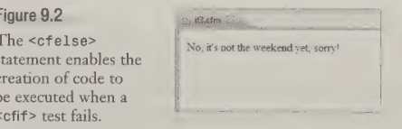

## `Listing 9.3` `if3.cfm`

```html
<!--
Name: if3.cfm
Author: Ben Forta (ben@forta.com)
Description: Demonstrate use of <cfif> and <cfelse>
--> 01/01/2010

<html>
<head>
<title>If 3</title>
</head>
```

### `Listing 9.3`（续）

```html
<body>
<!--!-- Is it the weekend? -->
<cfif (DayOfWeek(Now()) IS 1 OR (DayOfWeek(Now()) IS 7)>
<!--!-- Yes it is, great! -->
It is the weekend, yeah!
<cfelse>
<!--!-- No it is not :-( -->
No, it's not the weekend yet, sorry!
</cfif>

</body>
</html>
```

`Listing 9.2` 和 `9.3` 之间唯一的区别是引入了一个新标签——`<cfif>` 使用代码在条件为 TRUE 时执行，而 `<cfelse>` 定义了条件为 FALSE 时执行的代码。`<cfelse>` 不接受任何属性，且只能用在 `<cfif>` 和 `</cfif>` 标签之间。现在新代码会在周日或周六显示 "It is the weekend, yeah!"否则显示 "No, it's not the weekend yet, sorry!"。

在继续之前，`Listing 9.4` 包含了另一个改进——一个更简洁的 `<cfif>` 语句。将 `Listing 9.4` 保存为 `if4.cfm` 并执行它（它的执行结果应该与 `Listing 9.3` 完全相同）。

## `Listing 9.4` `if4.cfm`

```html
<!--
Name: if4.cfm
Author: Ben Forta (ben@forta.com)
Description: Demonstrate saving <cfif>
-->

<html>
<head>
<title>If 4</title>
</head>

<body>
<!-- Is it the weekend? -->
<cfif (DayOfWeek(Now()) IS 1 OR (DayOfWeek(Now()) IS 7)>
<!-- Yes it is, great! -->
It is the weekend, yeah!
<cfelse>
<!-- No it is not :-( -->
No, it's not the weekend yet, sorry!
</cfif>

</body>
</html>
```

### 图 9.3

如果 `dow` 为 1，则显示周日消息。


`<cfelseif>` 检查 `dow` 是否为 7，如果为真，显示周六消息（见图 9.4）。最后，使用 `<cfelse>` 在 `<cfif>` 或 `<cfelseif>` 均不为真时显示文本。`<cfelse>` 本质上是 `<cfelse>` 和 `<cfif>` 的组合。

### 图 9.4

如果 `dow` 为 7，则显示周六消息。


将条件的结果保存到变量中（就像你在这里使用 `dow` 变量以及之前使用 `weekend` 那样），而不是重复代码，可以使你的代码更具可读性。但它还有另一个益处。如果你在多个地方使用完全相同的表达式（例如获取星期几），你可能会面临这样的风险：某天你更新了代码，但没有更新所有必要位置的更改。如果只需要更改单个表达式，就可以避免这个潜在问题。

在 `<cfif>` 标签内使用的 `<cfelseif>` 语句数量没有限制，但你永远不能使用超过一个 `<cfif>` 或 `<cfelse>`。

**注意**：使用 `<cfelseif>` 和 `<cfelse>` 是可选的。然而，如果使用了 `<cfelse>`，它必须始终是 `</cfif>` 之前的最后一个标签。

## 整合一切

`<cfif>` 是 CFML 中最常用的标签之一。在进入下一个主题之前，让我们来看一个例子——一个稍微复杂的例子。

"猜数字"是一个简单的游戏：我正在想一个 1 到 10 之间的数字；猜猜我心里的是哪个：ColdFusion 会选择一个随机数，你猜一个数字，然后 ColdFusion 会告诉你你猜得是否正确。

列表 9 包含了 `guess1.cfm` 的代码。将其保存在 9 目录中，但不要在 ColdFusion Builder 中执行它。使用此 URI 来执行它：

```
http://localhost:8500/ows/guess1.cfm?guess=n
```

将 `n` 替换为 1 到 10 之间的数字。例如，如果你猜 5，使用此 URL：

```
http://localhost:8500/ows/guess1.cfm?guess=5
```

你必须传递 `guess` URL 参数，否则将抛出错误。当你传递该参数时，你将看到类似于图 9.5 和图 9.6 显示的输出。（实际上，如果你频繁地刷新页面，你将看到这两个图。）

### 图 9.5

`URL.guess` 匹配了 ColdFusion 选取的数字。


### 图 9.6

`URL.guess` 未匹配 ColdFusion 选取的数字。


## `列表 9.6` `guess1.cfm`

```
<---
Name:      guess1.cfm
Author:    Ben Forta (ben@forta.com)
Description: if statement demonstration
Created:    01/01/2010
-->

<html
<head>
<title>guess the number - 1</title>
</head>
<body>
  <!-- Pick a random number -->
  <cfset RandomNumber=RandRange(1, 10)>

  <!-- Check if matched -->
  <cfif RandomNumber IS URL.guess>
    <-- It matched -->
    <cfoutput>
nYou got it, I picked #RandomNumber#! Good job!
    </cfoutput>
  <cfelse>
    <-- No match -->
    <cfoutput>
Sorry, I picked #RandomNumber#! Try again!
    </cfoutput>
  </cfif>
</body>
</html>
```

### `列表 9.6`（续）

```html
<cfoutput>
</cfif>

<body>
</html>
```

代码执行的第一件事是选取一个随机数。为了做到这一点，`RandRange()` 函数接收两个参数（范围）并返回该范围内的随机数。以下代码行返回一个 1 到 10（包含）之间的随机数，并保存到名为 `RandomNumber` 的变量中：

```
<cfset RandomNumber=RandRange(1, 10)>
```

接下来，使用 `<cfif>` 语句将生成的随机数与猜测数字（作为 URL 参数传递）进行比较：

```html
<cfif RandomNumber IS URL.guess>
```

`URL.guess` 是包含 URL 中提供的猜测值的变量。如果它们匹配，则显示第一条消息；如果不匹配，则显示第二个消息。

- URL 变量及其用法将在第 10 章"创建数据驱动页面"中详细介绍。现在，但如果没有指定猜测数字怎么办？你可能还记得第 8 章提到，不存在的变量会产生错误。因此，你应该修改代码检查 URL 是否存在。列表 9.7 显示了这一点。

## `列表 9.7` `guess2.cfm`

```html
<cfoutput>
</cfif>

<body>
</html>
```

```
<---
Name:      guess2.cfm
Author:    Ben Forta (ben@forta.com)
Description: if statement demonstration
Created:    01/01/2010
-->

<html
<head>
<title>guess the number - 2</title>
</head>
<body>
  <!-- Pick a random number -->
  <cfset RandomNumber=RandRange(1, 10)>

  <!-- Check if matched -->
  <cfif RandomNumber IS URL.guess>
    <-- It matched -->
    <cfoutput>
nYou got it, I picked #RandomNumber#! Good job!
    </cfoutput>
  <cfelse>
    <-- No match -->
    <cfoutput>
Sorry, I picked #RandomNumber#! Try again!
    </cfoutput>
  </cfif>
</body>
</html>
```


列表 9.7 代码清晰地展示了缩进的价值。每个 `<cfif>` 块内的代码都缩进了，嵌套越深，缩进越远。这种格式在专业开发人员中非常流行，因为它更容易查找（不匹配）的代码。

## 图 9.7

通过检查变量是否存在，你的应用程序可以在时提供帮助和说明。

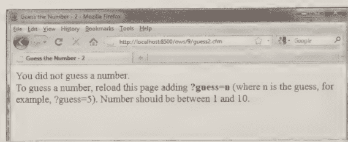

作为原则，除非绝对必要，否则应避免嵌套。而这里确实不需要嵌套。列表 9.8 更进了一步，这次使用了 `<cfelse>` 和多个子条件来创建更紧凑（性能更高）的代码。将列表 9.8 保存为 `guess3.cfm`。

## 列表 9.8 guess3.cfm

```
<---

Name:      guess3.cfm

Author:    Ben Forta (ben@forta.com)

Description: if statement demonstration

Created:    01/01/2010

-->

<html

<head>

<title>guess the number - 3</title>

</head>

<body>

  <!-- Pick a random number -->

  <cfset RandomNumber=RandRange(1, 10)>

  <!-- Check if matched -->

  <cfif IsDefined("URL.guess")

  AND (RandomNumber IS URL.guess)>

    <-- It matched -->

    <cfoutput>

nYou got it, I picked #RandomNumber#! Good job!

    </cfoutput>

  <cfelse IsDefined("URL.guess")

  AND (RandomNumber IS NOT URL.guess)>

    <-- Did not match -->

    <cfoutput>

Sorry, I picked #RandomNumber#! Try again!

    </cfoutput>

  <cfelse>

    <-- No guess specified, give instructions -->

    <cfoutput>

nYou did not guess a number.<BR>

To guess a number, reload this page adding

<B>?guess=n</B> (where n is the guess, for

* -->

  </cfoutput>

  </cfif>

</body>

</html>

```

## 列表 9.8 (续)

示例，`?guess=5`)。数字应该在 1 到 10 之间。

```
</body>

</html
```

再次，代码从生成随机数开始。然后使用了这个 `<if>` 语句：

```html
<if IsDefined("URL.guess")

AND (RandomNumber IS URL.guess)
```

如之前解释过的，`AND` 要求两个条件都为 `TRUE`（真）。因此，只有当 `URL.guess` 存在且数字匹配时，才会显示第一条消息。第二个条件在 `<elseif>` 中：

```html
<elseif IsDefined("URL.guess")

AND (RandomNumber IS NOT URL.guess)
```

在这里，同样使用 `IsDefined()` 来检查 `URL.guess` 是否存在。只有当数字不匹配时，第二个条件才为 `TRUE`，此时会显示第二条消息。

注意：注意列表 9.8 中的 `<if>` 和 `<elseif>` 语句跨越了两行。ColdFusion 会忽略空白（包括换行符），因此代码可以根据需要跨越许多行，而较短的代码行（如此处使用的）更容易阅读。

只有当 `<if>` 和 `<elseif>` 未被评估时，才会评估 `<else>`，这样可以很清楚地看出 `URL.guess` 未定义。

不使用嵌套也会产生相同的结果。

注意
原则上，除非必要，否则不要嵌套。虽然在你的代码中嵌套是合法的，但嵌套代码往往更容易出错、更难调试和执行。

再次查看这一行代码：

```html
<if IsDefined("URL.guess")

AND (RandomNumber IS URL.guess)
```

你可能会奇怪，如果 `URL.guess` 不存在，为什么不会产生错误？毕竟，如果 `IsDefined()` 返回 `FALSE`（假），下一个条件应该因为引用了 `URL.guess` 而导致错误吗？

答案是否定的，因为 ColdFusion 支持短路求值（short-circuit evaluation）。这意味着不影响结果的条件永远不会被评估。在 `AND` 条件中，如果第一个条件返回 `FALSE`，那么结果将始终为 `FALSE`，无论第二个条件返回 `TRUE` 还是 `FALSE`。同样，在 `OR` 条件中，如果第一个条件为 `TRUE`，结果将始终为 `TRUE`，无论第二个条件是 `TRUE` 还是 `FALSE`。通过短路求值，不影响最终结果的条件不会执行，从而节省了处理时间。在之前的示例中，如果 `IsDefined("URL.guess")` 返回 `FALSE`，则 `RandomNumber IS URL.guess` 甚至不会评估。

## 第 9 章：使用 CFML 编程

让我们通过最后一次修订来完成这个游戏应用。列表 9.9 应该保存为文件 `guess4.cfm`。

## 列表 9.9 guess4.cfm

```html
<---

Name:        guess4.cfm

Author:      Ben Forta (ben@forta.com)

Description: if 语句演示

Created:     01/01/2010

-->

<html>html>

<head>

<title>猜数字 - 4</title>

</head>

<body>

<-- 设置范围 --

<cfset GuessLow=1>

<cfset GuessHigh=10>

<-- 选取一个随机数 --

<cfset RandomNumber=RandomRange(GuessLow,GuessHigh)>

<-- 是否指定了猜测？ --

<cfset HaveGuess=IsDefined("URL.guess")>

<-- 如果指定了，匹配了吗？ --

<cfset Match=HaveGuess AND (RandomNumber IS URL.guess)>

<-- 反馈 --

<cfoutput>

<-- 匹配了 --

你猜对了，我选了 #RandomNumber#! 干得好！

<cfelse>

<-- 未匹配 --

抱歉，我选了 #RandomNumber#! 再试一次！

</cfif>

<cfif>

<-- 未指定猜测，提供操作说明 --

你没有猜数字。<BR>

要猜数字，请重新加载此页面并添加

<B>?guess=n</B> (其中 n 是猜测的数字，例如 ?guess=5)。数字应该在 #GuessLow# 和 #GuessHigh# 之间。

</cfif>

</cfoutput>

</body>

</html>
```

列表 9.9 中做了相当多的改动。首先，范围的高值和低值现在是变量了，定义如下：

```html
<!-- 设置范围 -->

  <cfset GuessLow=1>

  <cfset GuessHigh=10>
```

通过保存这些变量，更改范围（可能允许数字 1–20）将变得更容易。变量被传递给 `RandRange()` 函数并在最终输出中使用（当未指定猜测时提供操作说明），这样允许的范围就会包含在说明中。

接下来，简单的赋值 `<cfset HaveGuess=ISDefined("URL.guess")>` 将变量 `HaveGuess` 设置为 `TRUE`（如果指定了猜测）或 `FALSE`。下一次赋值将变量 `Match` 设置为 `TRUE`（如果指定了猜测）或 `FALSE`。换句话说，两个简单的 `<cfset>` 语句包含了所有必要的逻辑和决策，而且因为结果被保存到变量中，使用这些信息非常方便。

这使得显示代码变得整洁得多。如果提供了正确的猜测，`<cfif Match>` 就会显示第一条消息。`<cfelse>` 仅在 `<cfif>` 失败时才执行，这意味着猜测是错误的。此外，`<cfelse>` 会显示说明（自动包含了正确的范围）。

没有比这更简洁的了。

注意：列表 9.9 展示了一种逻辑与呈现分离的编码实践。这是一种良好的做法。

# 第 9 章 使用 CFML 编程

Listing 9.11 loop1.cfm

```
<!--...

loop1.cfm

Name: loop1.cfm

Author: Ben Forta (ben@forta.com)

Description: Demonstrate use of <cfloop from to

Created: 01/01/2010

-->

<html

<head>

<title>Loop 1</title>

</head>

<<body>

<!-- Start list -->

<ul>

<!-- loop i from 1 to 10 -->

<cfloop from="1" to="10" index="i">

<!-- Write item -->

<cfoutput><li>#i#</li></cfoutput>

</cfloop>

<!-- end list -->

</ul>

</body>

</</html>
```

`<cfloop>` 标签用于创建一个循环重复执行的代码块。Listing 9.11 中的无序列表创建了一个简单的循环，在 HTML 无序列表中显示从 1 到 10 的数字列表。HTML 无序列表在 `<cfloop>` 之前开始（你不会希望在循环内部开始它，因为每次迭代都会启动新列表），并以 `</cfloop>` 结束。循环本身使用以下代码创建：

```
<cfloop from="1" to="10" index="i">
```

在索引循环中，必须指定 `from` 和 `to` 值，并且 `<cfloop>` 和 `</cfloop>` 之间的代码将重复相应的次数。在这里，`from="1"` `to="10"`，循环重复 10 次。在循环内部，在 `index` 属性中命名的变量包含当前的递增值，因此 `i` 将是第一次循环、第二次循环，依此类推。

在循环内部，使用以下代码在列表项中显示 `i` 的值：

```
<cfoutput><li>#i#</li></cfoutput>
```

第一次，当 `i` 为 1 时，生成的输出将是：

```html
<li>Item 1</li>
```

在第二次循环时，它将是：

```html
<li>Item 2</li>
```

依此类推。

# 提示

想反向循环吗？可以的。使用 `step` 属性来指定从 `from` 值到 `to` 值的计数方式。`step="-1"` 使计数倒退，一次一个数字。

# 列表循环

列表循环的设计旨在处理 ColdFusion 列表变得简单且无错。无论是表单提交创建的列表、手动列表、源自数据库查询的列表（无论来源如何），任何列表（带有任何分隔符）都可以使用 `<cfloop>` 进行迭代。

- 有关列表的迭代，请参见第 8 章。

下面的示例使用了第 8 章中创建的列表，并遍历该列表每次显示一个元素（见图 9.9）。将 List 9.12 保存为 `loop2.cfm`。

# 图 9.9

任何列表（带有任何分隔符）都可以使用 `<cfloop>` 进行迭代。

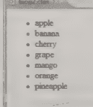

# Listing 9.12 loop2.cfm

```html
<!---

Name: loop2.cfm

Author: Ben Fortuna (ben@forta.com)

Description: Demonstrate use of <cfloop list

Created: 01/01/2010

---

<html>

<head>

<title>Loop 2</title>

</head>

<<body>

<!-- Create list -->

<cfset fruit="apple,banana,cherry,grape,mango,orange,pineapple">

<!-- Start list -->

<ul>

<!-- Loop through list# index="i" -->

<cfloop list="#fruit" index="i">

<!-- Write item -->

<cfoutput><li>#i#</li></cfoutput>

</cfloop>
```

# 第 9 章 使用 CFML 编程

Listing 9.12（续）

```html
<!-- end list -->

</ul>

</</body>

</</html>
```

`<cfset>` 标签用于创建列表——一个用逗号分隔的水果列表。`<cfloop>` 在 `list` 属性中接收要处理的列表，由于它是字符串，必须在变量名 `fruit` 周围使用井号符号。

`<cfloop>` 为列表中的每个元素重复循环一次。此外，在循环内部，它会将当前元素在 `index` 属性指定的变量中可用——在本例中为 `i`。因此，`i` 是第一次迭代，`banana` 是第二次迭代，依此类推。

注意

列表也可以通过索引循环进行循环遍历。`for="#ListLen(fruit)#"` 正确地设置了 `to` 和 `from`。在循环内部，可以使用 `ListGetAt()` 获取元素。

# 嵌套循环

与 `<cfif>` 和 `<cfswitch>` 语句一样，循环也是可以嵌套的。只要你在构建循环时足够小心，嵌套循环就能让你创建出极其强大的代码。Listing 9.13 包含一个嵌套循环的实际示例，使用三个循环来显示 Web 安全颜色的表格（见图 9.10）。将代码保存为 `loop3.cfm`。

# 图 9.10

显示 Web 浏览器安全的调色板需要使用三个嵌套循环。

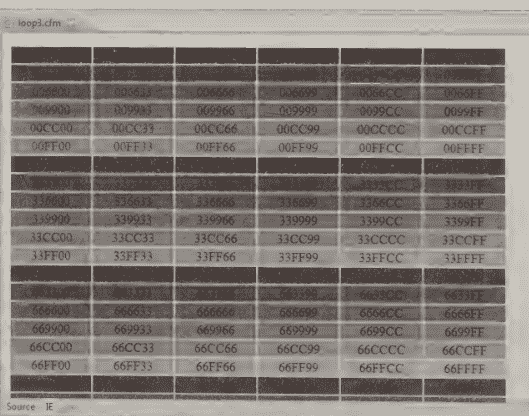

# Listing 9.13 loop3.cfm

```html
<!--

Name: loop3.cfm

Author: Ben Forta (ben@forta.com)

Description: Demonstrate use of nested loops

Created: 01/01/2010

-->

<html>

<head>

<title>Loop 3</title>

</head>

<<body>

<!-- Hex value -->

<cfset hex="00,33,66,99,CC,FF">

<!-- Create table -->

<table>

<!-- Start RR loop -->

<cfloop index="red" list="#hex#">

<!-- Start GG loop -->

<cfloop index="green" list="#hex#">

<tr>

<!-- Start BB loop -->

<cfloop index="blue" list="#hex#">

<!-- Build RGB value -->

<cfset rgb=red&green&blue>

<!-- And display it -->

<cfoutput>

<td bgcolor="#rgb" width="100" align="center">#rgb#</td>

</cfoutput>

</cfloop>

</tr>

</cfloop>

</cfloop>

</table>

</body>

</</html>
```

Listing 9.13 需要解释。Web 页面中的颜色以 RGB 值表示（如红、绿、蓝）。这种思想是通过调整颜色中红、绿、蓝量，可以创建所有可能的颜色。RGB 值使用十六进制表示法。不要慌——实际上非常简单。颜色量指定为 0 到 255。使用了十六进制等效值（00–FF）。因此，纯红色没有绿色或蓝色，即 `FF000`；黄色是红色和绿色没有蓝色。仍然困惑吗？执行代码你将看到完整的颜色列表以及对应的 RGB 值。为了列出所有颜色，代码必须遍历所有组合——所有的红色、每个红色中的所有绿色、以及每个绿色中的所有蓝色。在最内层循环中，名为 `rgb` 的变量创建如下：

```html
<cfset rgb=red&green&blue>
```


在第一次迭代，绿色和蓝色都是 00，所以 rgb 为 000。在下次迭代中，红色和绿色仍为 00，但蓝色是 33，所以 rgb 为 0033。当循环处理完毕，总共生成了 216 种颜色（每种六六可能的色调，用十六进制定义）。RGB 值的精确机制在这里并不重要。关键点是循环可以轻松嵌套，并且在每个循环中，外部循环创建的计数器和变量都是可见的。

# 重用代码

所有开发者在编写代码时都会考虑（或应该考虑）重用。这是一个好主意的理由有很多：

- 节省时间。写一次，就不要再写一遍。
- 更容易维护。在一个处进行更改，任何使用它的代码都会获取该更改。
- 更容易调试。需要修复的副本更少。
- 团队开发。开发者可以更容易地共享代码。

大多数代码重用涉及 ColdFusion 代码，但为了演示基本的重用，让我们来看一个简单的示例。Orange Whip Studios 正在缓慢构建网站。图 9.11 显示首页（仍在开发中），图 9.12 显示联系页（也在开发中）。

## 图 9.11

首页包含基础 Logo 和品牌设计。

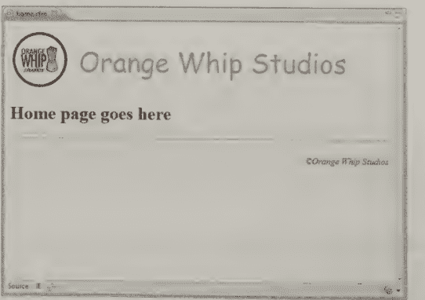

## 图 9.12

联系页包含与首页相同的元素。

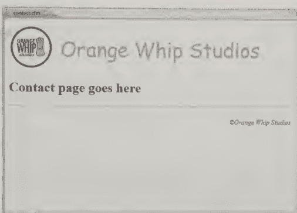

页面有许多共同点——它们都有相同的页眉、相同的 Logo 和版权声明。如果你在编写纯 HTML，你将不得不将创建这些页面组件的代码复制到你创建的每一个页面中。

但你正在使用 ColdFusion，ColdFusion 让代码重用变得极其简单。CFML `<include>` 标签用于将一个页面包含另一个页面。`<include>` 指定要包含的文件。在运行时，当 ColdFusion 遇到 `<include>` 标签时，它读取指定文件的内容并将其处理为同一文件的一部分。为了演示这一点，请看列表 9.14 和列表 9.15。前者是 `ows_header.cfm`，后者是 `ows_footer.cfm`。这两个文件之间，包含了 Orange Whip Studios 页面的所有格式。

## 列表 9.14 `ows_header.cfm`

```html
<!--

Name: ows_header.cfm

Author: Ben Forta (ben@forta.com)

Description: <include> header

Created: 01/01/2010

-->

<html

<head>

<title>Orange Whip Studios</title>

</head>

<<body>

<!-- header -->

<table width='100%'>

<tr>

<<td>


</td>

<td>

<font face="Comic Sans MS" size="7" color="#ff8000">Orange Whip Studios</font>

</td>

</tr>

</tr>

</table>
```

## 列表 9.15 `ows_footer.cfm`

```cfm
<---
Name: ows_footer.cfm

Author: Ben Porta (ben@forta.com)

Description: <include> 页脚

Created: 01/01/2010

-->
```

```html
<p>

<hr>

<p align="right">

<i>&copy;Orange Whip Studios</i>

</p>

</p>

</body>

</html>
```

现在页面的页（header）和页脚已经创建完成，可以使用 `<include>` 将它们包含在页面中。列表 9.16 是 `home.cfm`，列表 9.17 是 `contact.cfm`。

## 列表 9.16 `home.cfm`

```cfm
<---
Name: home.cfm

Author: Ben Porta (ben@forta.com)

Description: 展示 <include> 的用法

Created: 01/01/2010

-->
```

```html
<!-- 包含页头 -->

<include template="ows_header.cfm">

<h1>首页在此处</h1>
```

```html
<!-- 包含页脚 -->

<include template="ows_footer.cfm"
```

## 列表 9.17 `contact.cfm`

```cfm
<---
Name: contact.cfm

Author: Ben Porta (ben@forta.com)
```

## 列表 9.17（续）

```cfm
Description: 展示 <include> 的用法

Created: 01/01/2010

-->
```

```html
<!-- 包含页头 -->

<include template="ows_header.cfm">

<h1>联系页面在此处</h1>

<!-- 包含页脚 -->

<include template="ows_footer.cfm"
```

如你所见，列表 9.16 和 9.17 中的代码很少。每个列表都包含两个 `<include>` 语句：第一个包含 `ows_header.cfm`（列表 9.14），第二个包含 `ows_footer.cfm`（列表 9.15）。ColdFusion 会包含这两个文件，并生成之前在图 9.11 和 9.12 中看到的输出。每个页面特有的内容可以放在两个 `<include>` 标签之间。

为了看到这种方法的真正价值，请修改 `ows_header.cfm`（更改颜色、文本或任何内容），然后重命名 `home.cfm` 和 `contact.cfm`，查看你的更改如何自动应用到两个页面中。

- 我们将在第 1 章“结构化开发基础”中详细复习这个主题。

# 复习变量

另一个重要的标签是 `<cfparam>`。你在这里不会使用这个标签，但为了给接下来的章节做准备，我将解释它以及如何使用它。

在本章较前面，你使用了一个名为 `IsDefined()` 的函数，它用于检查变量是否存在。你使用 `IsDefined()` 仅仅是为了检查变量是否存在，但如果你想在变量不存在时创建一个带有默认值的变量呢？你可以执行类似下面的操作：

```cf
<cfif NOT IsDefined("FirstName")

<cfset FirstName="Ben">

</cfif>
```

为什么你想这样做呢？嗯，按照原则，你不应该在代码中间包含数据验证。这是一种坏习惯，有几个原因，最重要的一点是它们会导致代码不清晰、增加调试难度，并使代码复用非常困难。因此，最佳实践要求所有的验证都发生在你的核心代码之前。如果缺少所需的变量，抛出错误、将用户重定向到另一个页面或执行其他操作。如果缺少可选变量，则定义它们并分配默认值。无论哪种方式，当你到达核心代码时，你不需要任何类型的变量。它们应该已经处理完成了。

这就是我刚才向你展示的类型代码。

`<cfparam>` 有几种用途，但最常用的用法仅仅是前面代码的快捷方式。看下面的名称：

```cf
<cfparam name="FirstName" default="Ben">
```

当 ColdFusion 处理这一行时，它会检查是否存在名为 `FirstName` 的变量。如果存在，则忽略该标签并继续处理。然而，如果变量不存在，它将立即被创建并分配 `default` 中指定的值。所以通过使用 `<cfparam>`，你可以确保在标签处理后，无论何种，引用的变量都存在。这让编写整洁的代码变得简单得多。

> **提示**
>
> 你可以使用 `<CFPARAM>` 来检查（并创建）特定范围内的变量，包括 `URL` 和 `FORM`。正如你在接下来的章节中看到的，这可以极大简化传递值的处理。

# 第 10 章

## 本章内容

- 访问数据库 133
- 显示数据库查询结果 140
- 使用结果变量 148
- 分组结果输出 152
- 使用数据钻取 156
- 保护动态 SQL 语句 169
- 调试动态数据库查询 172

# 创建数据驱动页面

## 访问数据库

在过去的几个章节中，你创建并执行了 ColdFusion 模板。你处理了不同的变量类型、条件处理、代码复用等。

但这一章开始变得真正有趣了。现在是时候学习如何连接到数据库以创建完整的动态和数据驱动的页面了。

> **注意**
>
> 本章中的示例，以及实际上之后的所有章节，都使用了 `ows` 数据源和数据库中的数据。在继续之前，这些数据必须存在。我会提醒你一次，在本章中创建的所有文件都必须放在应用根目录下名为 `ows` 的目录中（Web 目录下的 `ows` 目录）。

对于你的第一个应用程序，你将创建一个页面，列出 Films 表中的所有电影。

## 静态网页

在创建你的第一个数据驱动 ColdFusion 模板之前，让我们先看看**不应该**如何创建这个页面。

列表 10.1 包含了电影列表页的 HTML 代码。HTML 代码相对简单；它包含了页头信息，然后是电影列表，每行一个，用换行符（`<html>` 标签）分隔。

## 列表 10.1 `movies.htm`—HTML 代码

```html
<html>

<head>

<title>Orange Whip Studios - Movie List</title>

</head>

<body>
```

## 列表 10.1（续）

```html
<body>

<h1>Movie List</h1>

</body>

</html>
```

图 10.1 显示了该代码生成的输出。


## 动态网页

为什么静态 HTML 文件不是创建网页的方法？当创建新电影时，或者当移动电影时，你需要做什么？如果电影标题或行目发生了变化，你该怎么办？

你可以直接修改 HTML 代码来反映这些变化，但你已经在数据库中拥有了所有信息。为什么要重新输入一遍呢？你会面临出错的风险——信息拼写错误、顺序混乱以及可能丢失电影。

更简单且可靠的解决方案是让网页显示 Films 表的内容。这样，任何表格更改对所有查看者都有效。

要创建你的第一个数据驱动 ColdFusion 模板，请复制列表 10.2 中的代码并将其保存为 `ows` 目录下的 `movies1.cfm`。（如果还不理解 ColdFusion 代码不要担心，我稍后会解释。）

## 列表 10.2 `movies1.cfm`—基础电影列表

```cfm
<!--

Name: movies1.cfm

Author: Ben Forta (ben@fronta.com)

Description: 第一个数据驱动网页

Created: 01/01/2010-->

<!-- 从数据库获取电影列表 --->

<cfquery name="movies" datasource="ows">

SELECT MovieTitle

FROM Movies

ORDER BY MovieTitle

</cfquery>

<!-- 创建 HTML 页面 -->

<html>

<head>

<title>Orange Whip Studios - Movie List</title>

</head>

<body>

<h1>Movie List</h1>

<!-- 显示电影查询 -->

<cfoutput query="movies">

#MovieTitle#<br>

</cfoutput>

</body>

</html>
```

# 第 10 章 创建数据驱动页面

现在在 ColdFusion Builder 中运行此页面，或者在浏览器中运行它：`http://localhost:8500/~aws/movies1.cfm`

> **提示**
>
> 提醒一下，端口号（URL 中的 8500）仅在你使用集成 HTTP 服务器时才需要。如果你使用带有外部 HTTP 服务器的 ColdFusion，则无需指定端口。

结果将与列表 10.1 相同。

## 理解数据驱动模板

如你所见，静态页面和动态页面之间（除 URL 中的文件扩展名外）没有任何区别。如果你查看刚刚生成的 HTML 源代码，你会发现除了大量的空白外，动态生成的代码与你在列表 10.1 中输入的静态代码完全相同，而与你在列表 10.2 中输入的（要短得多的）动态代码完全不同。

列表 10.2 中的代码是如何变成生成图 10.1 的 HTML 源代码的？让我们仔细检查一下代码。

## `<cfquery>` 标签

列表 10.2 的开头始于一个注释块（你编写的所有代码都应该是这样）。接着是一个名为 `<cfquery>` 的 ColdFusion 标签，它向指定的数据源提交 SQL 语句。SQL 语句通常是一个 `SELECT` 语句，但也可以是 `INSERT`、`UPDATE`、`DELETE`、存储过程或任何其他 SQL 语句。

- 请参阅第 6 章“简介 SQL”，以了解数据源、SQL 和 SQL 语句的概述。

`<cfquery>` 标签有几个属性（或参数），在被使用时会传递给它。列表 10.2 中的 `<cfquery>` 仅使用了两个属性：

- `name`：此属性用于为查询和任何返回的数据命名。
- `datasource`：此属性包含要使用的数据源的名称。

你指定的查询是 `movies`。稍后在你处理查询生成的结果时，将使用此名称。

> **警告**
>
> 不要使用保留字（对 ColdFusion 具有特殊含义的词）作为你的查询名称。例如，不要将查询命名为 `URL`，因为 `URL` 是一个保留前缀。

> **注意**
>
> 传递给 `<cfquery>` 的查询名称在页面内的每个查询中不需要唯一。如果你重用查询名称，子 `<cfquery>` 调用将覆盖较早查询检索的结果。

你为 `datasource` 属性指定了值，这是之前创建的数据源名称。`datasource` 属性是必须；如果没有它，ColdFusion 将不知道对哪个数据库执行 SQL 语句。

## 访问数据库

> **提示**
>
> 从 ColdFusion 9 开始，可以在 `Application.cfc` 文件中定义 `datasource`，而不是每个 `<cfquery>` 标签。`Application.cfc` 在第 18 章“简介 Web 框架”中介绍。

要执行的 SQL 语句位于 `<cfquery>` 和 `</cfquery>` 标签之间。使用了以下 SQL 语句，它按字母顺序检索所有电影标题：

```sql
SELECT MovieTitle

FROM Films

ORDER BY MovieTitle
```


> **提示**
> 列表 10.2 中的 SQL 语句被分成多行是为了使代码更具可读性。虽然编写比编辑器宽度宽的长 SQL 语句是完全合法的，但这些语句通常应该拆分成若干行。

`ColdFusion` 不关注 `<cfquery>` 和 `</cfquery>` 标签之间的实际文本（除非你使用 CFML 标签或函数，我们将在本章稍后部分介绍）。这些标签之间的任何内容都会发送到数据源进行处理。

当 `ColdFusion` 遇到 `<cfquery>` 标签时，它会创建一个查询请求并将其提交到指定的数据源。结果（如果有）将存储在临时缓冲区中，并由 `name` 属性指定的名称进行标识。这发生在 `ColdFusion` 处理模板中的下一行之前。

> **注意**
> 你会记得 `ColdFusion` 标签（包括 `<cfquery>` 标签）永远不会被发送到 Web 服务器传输到浏览器。与作为浏览器指令的 HTML 标签不同，CFML 标签是 `ColdFusion` 指令。

> **注意**
> `ColdFusion` 不会验证你指定的 SQL 代码。如果 SQL 代码中存在语法错误，`ColdFusion` 不会告诉你，因为那不是它的工作。如果合适，数据源将返回错误消息，`ColdFusion` 将其显示给你。返回这些错误消息的是数据源（数据库或数据库驱动程序），而不是 `ColdFusion`。

需要说明的一点是，在此时，没有任何数据被显示。`<cfquery>` 从数据库表中检索数据，但它并不显示这些数据。实际上，它对数据什么都没做——那是你的工作。它所做的只是在到达 `<cfquery>` 标签时执行特定的 SQL 语句。`<cfquery>` 对生成的内容完全没有影响，检索到的数据会被发送到客户端（除非你发送它）。

模板中的后续行是标准的 HTML 标签、头部、标题和章节。因为这些不是 `ColdFusion` 标签，它们会被发送到 Web 服务器，然后到客户端浏览器。

## 使用 `<cfoutput>` 显示 `<cfquery>` 数据

接下来显示查询结果，每一行。为了遍历查询结果，使用了 `<cfoutput>` 标签。

`<cfoutput>` 是你之前使用的相同的 `ColdFusion` 标签（在第 8 章“CFML 基础”中）。然而，这次你使用它创建一个块标签，用于输出 `<query>` 的结果。为了让 `ColdFusion` 知道输出哪些查询结果，查询名称通过 `query` 属性传递给 `<cfoutput>`。提供的名称与给 `<query>` 标签 `name` 属性的名称相同。在这种情况下，名称是 `movies`。

## 警告

> 传递给 `<cfquery query="movies">` 和 `<cfoutput>` 的查询名称是输出代码块。`ColdFusion` 为每个检索到的查询都会使用此代码一次。由于 `Films` 表中有 23 行数据，因此每个 `<cfoutput>` 代码块都会循环 23 次。该块中的任何 HTML 或 CFML 标签都会重复出现——每行一次。

## 注意

> `<cfoutput>` 代码块被处理的次数也是这样吗？这取决于你是否使用了 `query` 属性。如果没有查询，代码块将处理一次。如果有查询，它将为查询中的每行处理一次，如果查询没有返回结果，则不处理。

> **提示**
> 你会注意到我将 SQL 查询放在页面的最顶部，而不是放在需要它的地方（输出的中间）。这是推荐的代码编写方式——查询应该组织在页面顶部，集中在一起。这将帮助你编写整洁的代码，并在需要（或者说是当需要）时简化测试和调试。

## 使用表列

正如第 8 章解释过的，`ColdFusion` 使用 `#` 来分隔表达式和变量。`ColdFusion` 表达式也是由 `<query>` 检索的列。可以使用指定的列名；`ColdFusion` 都会用其实际值替换列名。当 `ColdFusion` 处理输出块时，它会将 `#Movie#` 替换为在 `movies` 查询中检索到的 `MovieTitle` 列的内容。每使用一次输出代码块，行的 `MovieTitle` 值就会被插入到 HTML 代码中。

`ColdFusion` 生成的内容可以被视为 HTML 文档中的任何其他内容；任何 HTML 格式标签都可以应用于它们。在本例中，查询结果必须用换行符（`<br>` 标签）分隔。

查看以下代码行：

```html
#MovieTitle<br>
```

检索到的第一行是 `Being Unbearably Light`，因此处理上述代码的第一行将生成以下内容：

```html
Being Unbearably Light<br>
```

列表 10.2 的输出是动态生成的——每刷新一次页面，基础查询就会执行一次并生成输出。

> **注意**
> 想自己试一下吗？打开数据库并更改任何电影标题之一，然后刷新网页——你会发现一旦做出更改，输出就会立即反映这些变化。

## 动态优势

为了查看数据驱动页面的真正威力，请看列表 10.3。这与列表 10.2 中的代码相同，但 SQL 语句中添加了一列（现在也检索 `PitchText`），并对输出进行了修改，以便它同时显示 `MovieTitle` 和 `PitchText` 列。将此文件保存为 `movies2.cfm`（如果你可以编辑 `movies1.cfm` 并使用文件菜单中的保存选项，将其保存为 `movies2.cfm`，如果你觉得那样更容易的话）。现在在 `ColdFusion Builder` 中运行该页面，或如下所示在浏览器中运行：

```text
http://localhost:8500/ows/10/movies2.cfm
```

> **提示**
> 再次，如果不使用内部 HTTP 服务器，请去掉端口号。

列表 10.2 显示了修改后的代码生成的输出。

**列表 10.3 `movies2.cfm`—扩展电影列表**

```sql
<query name="movies" datasource="ows">
SELECT *.MovieTitle, PitchText
</query>
```

## 第 10 章 创建数据驱动的页面

**列表 10.3（续）**

```sql
FROM Films
ORDER BY MovieTitle
</cfquery>

<!-- 创建 HTML 页面 -->
<html>
<head>
<title>Orange Whip Studios - 电影列表</title>
</head>
<body>
<h1>电影列表</h1>

<!-- 显示电影列表 -->
<cfoutput query="movies">
<p>#MovieTitle#<br>
#PitchText#</p>
</cfoutput>
</body>
</html>
```

如你所见，现在使用了两列，每列都由事实的井号（`#`）进行分隔。`MovieTitle` 以粗体形式显示（使用 `<strong>` 和 `</strong>` 标签），并在其后紧跟一个换行符；在下一行显示 `PitchText`，然后是一个段落换行符。对于显示的第一行，上述代码使用了：

```html
<p>#MovieTitle#</br>
#PitchText#</p>
```

与你为了让 `movies.htm` 中的静态页面看起来像图 10.2 而必须进行的更改相比，你将开始体会动态页面的优势。

感到兴奋吗？欢迎来到 `ColdFusion` 和奇妙的动态数据驱动 Web 页面世界！

## 显示数据库查询结果

列表 10.2 和 10.3 以简单的行输出显示了数据。但那是 `ColdFusion` 所能做的全部了——事实上，没有哪种输出是它无法生成的。`ColdFusion` 与这些格式化和生成输出完全无关；只要你能写出你想要的内容（HTML、JavaScript、Flash、HTML、Ajax 或任何其他客户端技术），`ColdFusion` 就会动态地生成输出。

为了理解这一点，让我们来看一些替代的输出选项。

## 使用列表显示数据

HTML 特性支持两种列表：有序列表（每个列表项目会自动编号）和无序列表（列表项目前有项目符号/符号）。创建 HTML 列表非常简单：

1. 使用 `<ul>`（用于无序列表）或 `<ol>`（用于有序列表）开始列表。
2. 使用匹配的结束标签（`</ul>` 或 `</ol>`）结束列表。
3. 在列表的开始和结束标签之间，使用 `<li>` 和 `</li>` 标签指定列表成员（称为*列表项*）。

例如，下面是一个包含三个名字的简单项目符号（无序）列表：

```html
<ul>
<li>Ben Forta</li>
<li>Charlie Arehart</li>
<li>Ray Camden</li>
</ul>
```

此列表的编号（有序）对应版本为：

```html
<ol>
<li>Ben Forta</li>
<li>Charlie Arehart</li>
<li>Ray Camden</li>
</ol>
```

那么，你将如何在无序列表中显示该列表呢？列表 10.4 包含了这些代码，你应该在浏览器中执行这些代码（或者如果你愿意的话，在 `ColdFusion Builder` 中执行）；输出结果应该看起来像图 10.3。

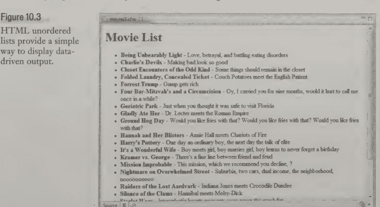

## 列表 10.4 `movies3cfm.cfm`—无序列表中的电影列表

```html
<!-- 
名称: movies3cfm.cfm
作者: Ben Forta (ben@forta.com)
描述: 数据驱动的 HTML 列表
创建日期: 2010/01/01
-->
```

## 列表 10.4（续）

```html
<!-- 从数据库获取电影列表 -->
<cfquery name="movies" datasource="ows">
SELECT MovieTitle, PitchText
FROM Films
ORDER BY MovieTitle
</cfquery>
```

```html
<!-- 创建 HTML 页面 -->
<html>
<head>
<title>Orange Whip Studios - 电影列表</title>
</head>
<body>
<h1>电影列表</h1>

<!-- 显示电影列表 -->
<ul>
<cfoutput query="movies">
<li><strong>#MovieTitle# - #PitchText</strong></li>
</cfoutput>
</ul>
</body>
</html>
```

让我们回顾一下列表 10.4。第一次看时应该看起来很眼熟，因为它本质上与列表 10.3 (`movies2.cfm`) 的代码相同，只是实际的数据输出发生了变化。新的输出代码是：

```html
<ul>
<cfoutput query="movies">
<li><strong>#MovieTitle# - #PitchText</strong></li>
</cfoutput>
</ul>
```

如你所见，列表在 `<cfoutput>` 标签之前开始，在 `</cfoutput>` 标签之后结束。这非常重要——输出块中的所有内容都会根据检索到的每行数据重复一次。因此，如果列表在输出块内部开始，将生成 23 个列表，每个列表包含一部电影，而不是一个包含 23 部电影的单一列表。只有需要重复的数据才应该放在输出块内部。输出代码本身非常简单。对于第一行，代码

```html
<li><strong>#MovieTitle# - #PitchText</strong></li>
```

是一个有效的列表项，其中电影标题为粗体（使用 `<strong>` 和 `</strong>`），其后紧跟该行。

**注意**
如你所见，更改格式只会影响代码的某个孤立部分。因此，开发者在编写复杂的界面之前，会先使用简单的输出（换行符或列表）测试他们的代码是否正常工作。这可以使开发变得更容易（同时调试代码和用户界面并不好玩）。

**警告**
在输出块中放置代码时要小心。只有需要为每行重复的代码应该放在 `<cfoutput>` 和 `</cfoutput>` 之间。任何其他代码都应该放在标签之外。

## 显示数据表格

显示数据的另一种方法是使用表格。HTML 表格允许你创建可以包含文本、图形等内容的网格。表格有助于实现更受控制的布局，帮助你将内容并排、在列中、环绕图像放置等。创建表格涉及三组标签：

- `<table>` 和 `</table>`：用于创建表格
- `<tr>` 和 `</tr>`：用于在表格中创建行
- `<td>` 和 `</td>`：用于在行内插入单元格
- `<th>` 和 `</th>`：也可以用于表头单元格——本质上是格式略有不同的数据，通常居中并加粗

所以一个带有表头行、两列和三行的简单表格如下：

```html
<table>
<tr>
  <th>表头</th>
  <th>表头</th>
</tr>
<tr>
  <td>数据1</td>
  <td>数据2</td>
</tr>
<tr>
  <td>数据3</td>
  <td>数据4</td>
</tr>
</table>
```

你也可以使用 `<th>` 标签定义表头单元格，如下所示：

```html
<table>
<tr>
  <th>列1</th>
  <th>列2</th>
</tr>
<tr>
  <td>数据1</td>
  <td>数据2</td>
</tr>
<tr>
  <td>数据3</td>
  <td>数据4</td>
</tr>
</table>
```


## 显示数据表格

显示数据的另一种方法是使用表格。HTML 表格允许你创建可以包含文本、图形等更多内容的网格。表格有助于实现更受控制的布局，帮助你将内容并排、在列中、环绕图像放置等。创建表格涉及三组标签：

- `<table>` 和 `</table>`：用于创建表格
- `<tr>` 和 `</tr>`：用于在表格中创建行
- `<td>` 和 `</td>`：用于在行内插入单元格
- `<th>` 和 `</th>`：也可以用于表头单元格——本质上是格式略有不同的数据，通常居中并加粗

所以一个带有表头行、两列和三行的简单表格如下：

（注：原文此处未提供代码块，翻译直接至后续描述。）

## 第 10 章 创建数据驱动的页面

### 列表 10.3（续）

```html
FROM Films

ORDER BY MovieTitle

</cfquery>

<!-- 创建 HTML 页面 -->

<html>

<head>

<title>Orange Whip Studios - 电影列表</title>

</head>

<body>

<h1>电影列表</h1>

<!-- 显示电影列表 -->

<cfoutput query="movies">

<p>#MovieTitle#<br>

#PitchText#</p>

</cfoutput>

</body>

</html>
```

如你所见，现在使用了两列，每列都由事实的井号（`#`）进行分隔。`MovieTitle` 以粗体形式显示（使用 `<strong>` 和 `</strong>` 标签），并在其后紧跟一个换行符；在下一行显示 `PitchText`，然后是一个段落换行符。对于显示的第一行，上述代码使用了：

```html
<p>#MovieTitle#</br>

#PitchText#</p>
```

与你为了让 `movies.htm` 中的静态页面看起来像图 10.2 而必须进行的更改相比，你将开始体会动态页面的优势。

感到兴奋吗？欢迎来到 ColdFusion 和奇妙的动态数据驱动 Web 页面世界！

## 显示数据库查询结果

列表 10.2 和 10.3 以简单的逐行输出显示了数据。但那是 ColdFusion 所能做的全部了——事实上，没有哪种输出是它无法生成的。ColdFusion 与这些格式化和生成输出完全无关；只要你能写出你想要的内容（HTML、JavaScript、Flash、HTML、Ajax 或任何其他客户端技术），ColdFusion 就会动态地生成输出。

为了理解这一点，让我们来看一些替代的输出选项。

## 使用列表显示数据

HTML 特性支持两种列表类型——有序列表（每个列表项目会自动编号）和无序列表（列表项目前有项目符号）。创建 HTML 列表非常简单：

1. 使用 `<ul>`（用于无序列表）或 `<ol>`（用于有序列表）开始列表。
2. 使用匹配的结束标签（`</ul>` 或 `</ol>`）结束列表。
3. 在列表的开始和结束标签之间，使用 `<li>` 和 `</li>` 标签指定列表成员（称为列表项）。

例如，下面是一个包含三个名字的简单项目符号（无序）列表：

```html
<ul>

<li>Ben Forta</li>

<li>Charlie Arehart</li>

<li>Ray Camden</li>

</ul>
```

此列表的编号（有序）对应版本为：

```html
<ol>

<li>Ben Forta</li>

<li>Charlie Arehart</li>

<li>Ray Camden</li>

</ol>
```

那么，你将如何在无序列表中显示该列表呢？列表 10.4 包含了这些代码，你应该在浏览器中执行这些代码（或者如果你愿意的话，在 ColdFusion Builder 中执行）；输出结果应该看起来像图 10.3。


### 列表 10.4 `movies3cfm.cfm`—无序列表中的电影列表

```html
<!-- --

名称: movies3cfm.cfm

作者: Ben Forta (ben@forta.com)

描述: 数据驱动的 HTML 列表

创建日期: 2010/01/01

-->
```

### 列表 10.4（续）

```html
<!-- 从数据库获取电影列表 -->

<cfquery name="movies" datasource="ows">

SELECT MovieTitle, PitchText

FROM Films

ORDER BY MovieTitle

</cfquery>
```

```html
<!-- 创建 HTML 页面 -->

<html>

<head>

<title>Orange Whip Studios - 电影列表</title>

</head>

<body>

<h1>电影列表</h1>

<!-- 显示电影列表 -->

<ul>

<cfoutput query="movies">

<li><strong>#MovieTitle# - #PitchText</strong></li>

</cfoutput>

</ul>

</body>

</html>
```

让我们回顾一下列表 10.4。第一次看时应该看起来很眼熟，因为它本质上与列表 10.3（`movies2.cfm`）的代码相同，只是实际的数据输出发生了变化。新的输出代码是：

```html
<ul>

<cfoutput query="movies">

<li><strong>#MovieTitle# - #PitchText</strong></li>

</cfoutput>

</ul>
```

如你所见，列表在 `<cfoutput>` 标签之前开始，在 `</cfoutput>` 标签之后结束。这非常重要——输出块中的所有内容都会根据检索到的每行数据重复一次。因此，如果列表在输出块内部开始，将生成 23 个列表，每个列表包含一部电影，而不是一个包含 23 部电影的单一列表。只有需要重复的数据才应该放在输出块内部。输出代码本身非常简单。对于第一行，代码

```html
<li><strong>#MovieTitle# - #PitchText</strong></li>
```

是一个有效的列表项，其中电影标题为粗体（使用 `<strong>` 和 `</strong>`），其后紧跟该行。

> **注意**
>
> 如你所见，更改格式只会影响代码的某个孤立部分。因此，开发者在编写复杂的界面之前，会使用简单的输出（换行符或列表）测试他们的代码是否正常工作。这可以使开发变得更容易（同时调试代码和用户界面并不好玩）。

> **警告**
>
> 在输出块中放置代码时要小心。只有需要为每行重复的代码应该放在 `<cfoutput>` 和 `</cfoutput>` 之间。任何其他代码都应该放在标签之外。

## 显示数据表格

显示数据的另一种方法是使用表格。HTML 表格允许你创建可以包含文本、图形等内容的网格。表格有助于实现更受控制的布局，帮助你将内容并排、在列中、环绕图像放置等。创建表格涉及三组标签：

- `<table>` 和 `</table>`：用于创建表格
- `<tr>` 和 `</tr>`：用于在表格中创建行
- `<td>` 和 `</td>`：用于在行内插入单元格
- `<th>` 和 `</th>`：也可以用于表头单元格——本质上是格式略有不同的数据，通常居中并加粗

所以一个带有表头行、两列和三行的简单表格如下：

（注：原文此处未提供代码块，翻译直接至后续描述。）

### 列表 10.6 `movies5.cfm`—HTML 表格中的电影列表

```cfm
<!---

Name: movies5.cfm

Author: Ben Porta (ben@forta.com)

Description: 数据驱动的 HTML 表格

Created: 01/01/2010

-->

<!-- 从数据库获取电影列表 -->

<cfquery name="movies" datasource="ows">

SELECT MovieTitle, PitchText,

Summary, DateInTheaters

FROM Films

ORDER BY MovieTitle

</cfquery>

<!-- 创建 HTML 页面 -->

<html>

<head>

<title>Orange Whip Studios - Movie List</title>

</head>

<body>

<!-- 开始表格 -->

<table>

<tr>

<th colspan="2">

<h2>Movie List</h2>

</th>

</tr>

<!---- 循环电影 --

<cfoutput query="movies">

<tr bgcolor="#cccccc">

<td>

<strong#MovieTitle#</strong>

<br>

#PitchText#

</td>

<td>

#DateFormat(DateInTheaters)#

</td>

</tr>

<tr>

<td colspan="2">

#Summary#

</td>

</tr>

</cfoutput>

<!-- 电影循环结束 -->

</table>

</body>

</html>
```

列表 10.6 中进行了一些更改。首先，`<cfquery>` 的 `SELECT` 语句被修改过，以取两个额外的列——`Summary` 包含电影摘要，`DateInTheaters` 包含电影的公映日期。

此外，在 `<cfoutput>` 标签之前增加了以下 HTML 代码：

```html
<tr>

  <th colspan="2">

    <font size="+2">Movie List</font>

  </th>

</tr>
```

这创建了一个表头单元格（表头内容通常居中并以粗体显示），包含文本“Movie List”并作为表格标题。由于表格宽度为两列，因此标题必须跨越两列，所以指定了可选的 `colspan="2"`。

输出块为每部电影创建了两行（两组 `<tr>` 和 `</tr>` 标签）。第一行包含两个单元格——一个包含 `MovieTitle` 和 `PitchText`（它们之间有一个换行符），另一个包含使用 `dateFormat()` 函数格式化的发布日期。第二行包含一个跨越两列的单元格，并显示 `Summary`。

- `dateFormat()` 函数在第 8 章中引入。

如图 10.6 所示，包含标题和标语行的表格具有背景颜色。要设置表格行（或特定单元格，甚至是整个表格）的背景颜色，可以使用 `bgcolor` 属性，并使用已知名称（如 `red` 和 `green`）或十六进制表示法的 RGB 值指定颜色如下：

```html
<tr bgcolor='#cccccc">
```

> **注意**
>
> 为了简单起见，本示例使用了硬编码的表格值。通常情况下，硬编码不是一种推荐的做法。作为一般原则，你应该使用 CSS 来控制颜色和字体等。虽然 CSS 超出了本章的讨论范围，但我建议你花时间学习并理解这项重要的 Web 技术。

十六进制值前面有一个 `#`，这与用于界定 Fusion 表达式的字符相同。如果在我们的 `<cfoutput>` 块中使用上述代码，ColdFusion 将生成一个错误信息，抱怨缺少闭合符号（它会认为 `ccccc` 是一个需要闭合的表达式）。因此，表格代码如下所示转义了 `#`：

```html
<tr bgcolor='#cccccc'>
```

- 转义 `#` 已在第 8 章中介绍过。

> **提示**
>
> 密切注意你将代码放置在 `<cfoutput>`、`<tr>` 或 `<td>` 标签内部的位置，这会导致 HTML 表格格式错误，某些浏览器可能无法显示该表格。

如你所见，只要你了解基本的 HTML 语法，并知道哪些需要为每行数据库数据重复，哪些不需要，创建动态数据驱动输出就是快速且无痛苦的。

## 第 10 章 创建数据驱动的页面

> **提示**
>
> ColdFusion 有一个标签名称，可以用于自动化创建数据驱动 HTML 表格的整个过程。虽然这个标签有效，但我建议不要使用它。HTML 表格并不难学，而且这样做是非常值得的，你会发现自己对精确格式和输出有更多的控制。

> **警告**
>
> 我已经说过好几次了，但由于这是初学者最常见的错误之一（而且在调试时非常令人恼火），我还会说一遍：在创建动态输出时，要特别注意哪些需要重复，哪些不需要。任何每行需要显示一次的内容（在行之前或之后）都必须放在输出块中，其他任何内容都不能。

## 使用结果变量

到目前，你已经显示了通过数据库查询获取的数据。但有时你需要访问查询本身（而不仅仅是在查询内部）。例如，如果你想显示获取的电影数量，你应该从哪里获取它？

为了简化此类操作，ColdFusion 可以在每个查询通过可选的 `RESULT` 结构返回特殊变量。表格 10.1 列出了这些变量。如你所见，`RecordCount` 可以提供获取的行数。

### 表格 10.1 查询结果变量

| 变量 | 说明 |
| --- | --- |
| `Cached` | 表示返回的查询是否为缓存副本的标志 |
| `ColumnList` | 查询结果中的列名（逗号分隔列表） |
| `ExecutionTime` | 查询执行时间（毫秒） |
| `RecordCount` | 查询中的行数 |
| `SQL` | 提交处理的 SQL 语句 |

为了演示使用这些特殊变量，请创建 `movies6.cfm` 文件，如列表 10.7 所示。保存代码并在浏览器中执行它。

### 列表 10.7 `movies6.cfm`—使用查询变量

```cfm
<!---

Name: movies6.cfm

Author: Ben Porta (ben@forta.com)

Description: 使用查询变量

Created: 01/01/2010

-->

<!-- 从数据库获取电影列表 -->

<cfquery name="movies" datasource="ows" result="result">

SELECT MovieTitle, PitchText,

Summary, DateInTheaters

FROM Films
```

### 图 10.7

可以访问 `RecordCount` 来获取查询中的行数。

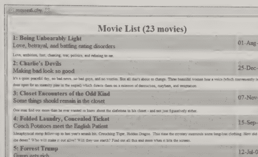

### 列表 10.7（续）

```cfm
ORDER BY MovieTitle

</cfquery>

<!-- 创建 HTML 页面 -->

<html>

<head>

<title>Orange Whip Studios - Movie List</title>

</head>

<body>

<!-- 开始表格 -->

<table>

<tr>

<th colspan="2">

<h2>

<cfoutput>

Movie List (#{result.RecordCount#} movies)

</cfoutput>

</h2>

</th>

</tr>

<!-- 循环电影 -->

<cfoutput query="movies">

<tr bgcolor="#cccccc">

<td>

<strong##CurrentRow#: #MovieTitle#</strong>

<br>

#PitchText#

</td>

<td>

#DateFormat(DateInTheaters)#

</td>

</tr>

<tr>

<td colspan="2">

#Summary#

</td>

</tr>

</cfoutput>

<!-- 电影循环结束 -->

</table>

</body>

</html>
```

Listing 10.8 的重大变化是在 `<cfoutput>` 循环内部直接引入了 `<cfif>` 语句。正如你所记得的，`<cfif>` 用于评估语句（条件），而这里使用了以下 `<cfif>` 语句：

`<cfCurrentRow MOD 2 IS 1>`

- `<cfif>` 语句在第 9 章“使用 CFML 编程”中引入。

### Listing 10.8 `movies7.cfm`—实现交替颜色

```cf
<!---

movies.cfm

Name: Ben Porta (ben@forta.com)
```


## 描述：实现交替颜色

创建时间：2010年1月1日

<!-- 从数据库获取电影列表 -->

```cf
<cfquery name="movies" datasource="ows">
SELECT MovieTitle, PitchText
FROM Films
ORDER BY MovieTitle
</cfquery>
```

<!-- 创建 HTML 页面 -->

```html
<html>
<head>
<title>Orange Whip Studios - Movie List</title>
</head>
<body>
<h1>Movie List</h1>

<!-- 显示电影列表 -->
<table>
<cfoutput query="movies">
<!---- 这一行应该显示什么颜色？ -->
<cfif CurrentRow MOD 2 IS 1>
<cfset bgcolor="MediumSeaGreen">
<cfelse>
<cfset bgcolor="White">
</cfif>
<cfset bgcolor="#bgcolor#">
<tr>
<td>#MovieTitle#</td>
<td>#PitchText#</td>
</tr>
</cfoutput>
</table>
</body>
</html>
```

如前所述，`CurrentRow` 包含当前的循环计数器。`MOD` 是一个算术运算符，用于返回等式的余数，因此测试 `MOD 2` 是检查奇偶数的方法（将一个数字除以 2，如果结果为 1 则则是奇数，否则为偶数）。所以 `MOD 2 IS 1` 实际上是在检查该数字是否为奇数。

在 `<cfif>` 语句内部，有两个 `<cfset>` 标签会被调用；如果 `CurrentRow` 是奇数，则调用第一个（将变量 `bgcolor` 设置为 `MediumSeaGreen`），如果是偶数，则调用第二个（将 `bgcolor` 设置为 `white`）。一旦到达 `</cfif>`，就会存在名为 `bgcolor` 的变量，并赋予一个颜色（取决于 `CurrentRow` 是奇数还是偶数，`MediumSeaGreen` 或绿色）。由于 `<cfif>` 代码位于 `<cfoutput>` 块内，它会对每一行进行处理，因此 `bgcolor` 在每行都会被重置。

> 参考第 8 章介绍 `<cfset>` 标签。

然后将 `bgcolor` 传递给 `<tr>` 标签的 `bgcolor` 属性，这样在奇数行中，`<tr>` 标签变为：

```html
<tr bgcolor="#bgcolor#">
```

在偶数行中，它变为：

```html
<tr bgcolor="White">
```

**提示**  
你会注意到我在 Listing 10.8 中将变量命名为 `bgcolor`：这与使用它的 HTML 属性同名。这并不是强制要求的（你可以根据意愿命名变量），但这样做使代码更清晰，因为变量的用途一目了然。

**注意**  
`CurrentRow` 中的值并不是行的唯一标识符（主键）。事实上，这个数字与表数据完全没有关系。它仅仅是一个循环计数器，绝不应该依赖它的任何其他用途。

## 分组输出

在引入新的复杂性之前，让我们复习一下 ColdFusion 如何处理查询的。

在 ColdFusion 中，使用 `<cfquery>` 标签创建数据查询。每个 `</cfquery>` 会执行一个 SQL 操作，如果存在结果则检索结果。结果由 ColdFusion 临时存储，并且仅在包含该查询的模板进行处理期间保留。

`<cfoutput>` 标签用于输出查询结果。`<cfoutput>` 接收一个查询名称作为属性，并遍历由查询检索的所有行。`<cfoutput>` 和 `</cfoutput>` 之间的代码块会针对检索的每一行重复执行。

到目前为止创建的所有示例都显示在单个列表或单个表格中。如果你想分子集处理结果，该怎么办？例如，假设你想按评分列出电影。你可以更改 `<cfquery>` 中的 SQL 语句以检索评分 ID，并将排序顺序设置为 `RatingID` 并在按 `MovieTitle`。

这将按照正确的顺序检索数据，但你将如何显示它呢？如果你像目前为止那样使用 `<cfoutput>`，`<cfoutput>` 块创建的每一行都将相同。如果其中一行显示了评分，那么所有行都必须显示，因为每一行都是用相同的代码块处理的。

查看图 10.8。如你所见，屏幕包含嵌套列表。顶层列表包含评分 ID，在每个评分 ID 内部是第二个列表，包含所有带有评分的电影。你将如何创建这样的输出呢？

## 图 10.8
分组提供了一种将数据按逻辑集合显示的方法。

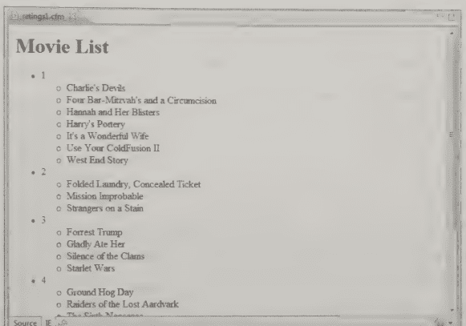

Listing 10.9 包含新页面的代码；将其保存为 `ratings1.cfm` 并在浏览器中执行它。

# Listing 10.9 ratings1.cfm—分组查询输出

```cf
<!---
Name:       ratings1.cfm
Author:     Ben Forta (ben@forta.com)
Description: Query output grouping
Created:     01/01/2010
-->

<!-- 从数据库获取电影列表 -->
<cfquery name="movies" datasource="ows">
SELECT MovieTitle, RatingID
FROM Films
ORDER BY RatingID, MovieTitle
</cfquery>

<!-- 创建 HTML 页面 -->
<html>
<head>
<title>Orange Whip Studios - Movie List</title>
</head>
```

# 第 10 章 创建数据驱动页面

Listing 10.9（续接）

```cf
<body>
<h1>Movie List</h1>

<!-- 显示电影列表 -->
<ul>
  <!-- 遍历评分 -->
  <cfoutput query="movies" group="RatingID">
    <li>#RatingID#</li>
    <ul>
      <!-- 对于每个评分，列出电影 -->
      <cfoutput>
        <li>#MovieTitle#</li>
      </cfoutput>
    </ul>
  </cfoutput>
</ul>
</body>
</html>
```

10.9 始于一个注释注释块，随后是一个 `<cfquery>`，该查询检索了所有电影（仅限标题和评分），并按 `RatingID` 和 `MovieTitle` 排序（先按 `RatingID` 排序，在每个 `RatingID` 内部按 `MovieTitle` 排序）。

代码的显示部分开始创建一个无序列表——这是外层列表，包含了评分。

然后，使用 `<cfoutput>` 创建一个输出块，但这次添加了 `group` 属性。`group="RatingID"` 告诉输出块仅当 `RatingID` 变化时才遍历外层循环。换句话说，外层循环按组值处理。因此，在这个示例中，它是按 `RatingID` 值处理的——无论具有该 `RatingID` 的电影有多少。

显示 `RatingID`，并启动第二个无序列表——这是每个 `RatingID` 内部的内层列表。

接下来是第二个 `<cfoutput>` 块，它显示 `MovieTitle`。这里没有指定查询；ColdFusion 不需要知道。为什么？因为使用了 `group`，ColdFusion 知道正在使用哪个查询，并且仅当 `RatingID` 不变化时才遍历内部的 `<cfoutput>`。

一旦 `RatingID` 变化，内部的 `<cfoutput>` 循环停止，内层列表通过 `</ul>` 结束。

此过程一直重复直到所有行处理完毕，此时外层 `<cfoutput>` 终止并生成最后的 `</ul>`。

那么每个 `<cfoutput>` 执行了多少次？电影列表包含 23 部电影，总共有 6 个评分。外层循环处理了 6 次，内层循环处理了 23 次。外层列表包含 6 个项目（每个 `RatingID` 值），每个项目包含一个带有该 `RatingID` 电影的子列表。

## 注意

对于分组工作，创建的顺序必须与 SQL 语句本身的排序顺序（`ORDER BY` 子）完全相同。

Listing 10.10 包含 Listing 10.9 的修改版本，这次在 HTML 表格中显示结果（如图 10.9 所示）。将 Listing 10.10 保存为 `ratings2.cfm`，然后在浏览器中执行它。

## 图 10.9
分组后的数据可以使用列表、表格和任何其他数据呈现形式。

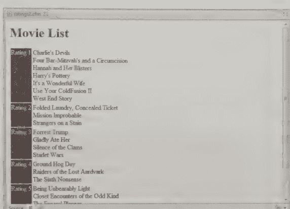

# Listing 10.10 ratings2.cfm—分组输出

```cf
<!---
Name:       ratings2.cfm
Author:     Ben Forta (ben@forta.com)
Description: Query output grouping
Created:     01/01/2010
-->

<!-- 从数据库获取电影列表 -->
<cfquery name="movies" datasource="ows">
SELECT MovieTitle, RatingID
FROM Films
ORDER BY RatingID, MovieTitle
</cfquery>

<!-- 创建 HTML 页面 -->
<html>
<head>
<title>Orange Whip Studios - Movie List</title>
</head>
```

# Listing 10.10（续接）

```cf
<body>
<h1>Movie List</h1>

<!-- 显示电影列表 -->
<table>
  <!-- 遍历范围 -->
  <cfoutput query="movies" group="RatingID">
    <tr valign="top">
      <td bgcolor="#00000">
        <font color="#FFFFFF">Rating #RatingID#</font>
      </td>
      <td>
        <!-- 对于每个评分，列出电影 -->
        <cfoutput>
          #MovieTitle#<br>
        </cfoutput>
      </td>
    </tr>
  </cfoutput>
</table>
</body>
</html>
```

Listing 10.10 中唯一变化的是输出代码。再次，`<cfoutput>` 标签是嵌套的——外层循环遍历 `RatingID`，内层循环遍历电影。

HTML 表格在循环发生之前创建（你只需要一个表格）。然后，对于每个 `RatingID` 创建包含两个单元格的新行。左单元格包含 `RatingID`，右单元格包含电影。

为了实现这一点，内部 `<cfoutput>` 循环位于右单元格内（`<td>` 和 `</td>` 之间），这样左侧列出的每个 `RatingID` 右侧都会列出相应的电影。

> 这里使用了单级分组，但数据分组的分级没有限制。要进行多级分组（组组），你只需要每组添加一个额外的 `<cfoutput>`（当然，SQL 语句必须对数据进行适当排序）。

你不会创建这里看到的屏幕（表单将在下一章介绍），但你将创建后两个屏幕。你的应用程序将显示电影列表（与本章之前创建的屏幕类似），并允许访问者点击任何电影以查看其详细信息。

## 介绍动态 SQL

你已经过许多保持不变的 `<cfquery>` 标签，其中每个标签都包含硬编码的 SQL——即你手动输入且保持不变的 SQL（如果数据库中的数据发生变化，结果可能会不同，但 SQL 本身保持不变）。但传递给 ColdFusion 的 SQL 并不一定是静态和硬编码的，`<cfquery>` 的真正威力在动态构造 SQL 时才会体现出来。

为了演示我们的意思，列表 10.11 包含了新文件 `dynamicsql.cfm` 的代码。保存代码并执行它，即可看到类似于图 10.10 所示的屏幕。

图 10.10

`<cfquery>` 结果结构包含了最终的（动态处理后的）SQL 和额外信息。

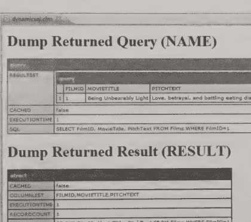

列表 10.11 dynamicsql.cfm—动态 SQL 演示

```cf
<!---
Name: dynamicsql.cfm
Author: Ben Forta (ben@forta.com)
Description: Dynamic SQL demonstration
Created: 01/01/2010
-->

<!-- 创建 FilmID 变量 -->
<cfset FilmID=1>

<!-- 从数据库获取电影 -->
<cfquery name="movie" datasource="ows" result="results">
SELECT FilmID, MovieTitle, PitchText
FROM Films
WHERE FilmID=#FilmID#
</cfquery>
```

列表 10.11（续）

```html
<h1>Dump Returned Query (NAME)</h1>
<cfdump var="#movie#">

<h1>Dump Returned Result (RESULT)</h1>
<cfdump var="#results#">
```

列表 10.11 首先如下所示创建一个变量：
`<cfset FilmID=1>`

接下来是一个包含以下 SQL 的 `<cfquery>` 标签：

```sql
SELECT FilmID, MovieTitle, PitchText
FROM Films
WHERE FilmID=#FilmID#
```

`WHERE` 子句指定了要检索的行，通常是一个实际值。例如，要检索 `FilmID` 为 1 的电影，你会使用此 SQL：

```sql
SELECT FilmID, MovieTitle, PitchText
FROM Films
WHERE FilmID=1
```

> 请参阅第 6 章“介绍 SQL”，获取有关 `SELECT` 语句及其 `WHERE` 子句的详细解释。

这正是列表 10.11 中代码所执行的。`#FilmID` 是一个 ColdFusion 表达式，ColdFusion 将处理它并返回 `FilmID` 的值，即为 1（如之前的 `<cfset>` 所示）。

换句话说，这里使用的 SQL 是动态的，因为 SQL 语句本身可以发生变化（在本例中基于 `FilmID` 的值）。如果你想检索另一部电影，只需更新 `FilmID` 使其包含不同的值即可。

最后一个代码块包含两个 `<cfdump>` 标签：

```html
<h1>Display Data</h1>
<cfdump var="#movie#">

<h1>Display cfquery results</h1>
<cfdump var="#results#">
```

前者简单地转储返回的查询（包含在 `movie` 变量中的数据）。后者转储结果结构，暴露了一个名为 `SQL` 的字段，其中包含了使用的 SQL 以及额外信息（包括本章早期表格 10.1 中列出的相同查询变量）。

如之前所示，使用 `result` 总是可选的，但如果需要，它可以暴露有关标签执行的有用信息。

## 注意

取决于所使用的 `<cfquery>` 属性，结果结构可能包含额外的成员。

## 实现数据下钻界面

现在你已经了解了如何使用动态 SQL，让我们回到数据下钻页面。你需要创建的第一个屏幕是详情页——即在选择电影时将显示的页面。图 10.11 显示了其中一部电影的详情。

## 图 10.11

在数据下钻应用程序中，详情页显示特定记录的所有细节。

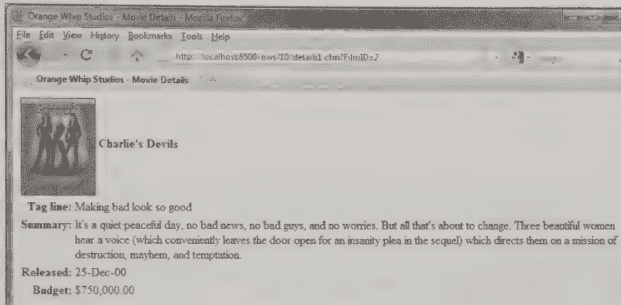

图 10.12 包含了文件 `details1.cfm` 的代码。你无法直接在 ColdFusion Builder 中运行此页面（你将在视频中学习如何操作）。保存代码并在浏览器中使用以下 URL 执行：

```
http://localhost:8500/ows/10/details1.cfm?FilmID=
```

你应该能看到类似于图 10.11 样的屏幕。

## 列表 10.12 details1.cfm—数据下钻详情

```cf
<!---
details1.cfm
Name: Ben Forta (ben@forta.com)
Description: Data drill-down details
Created: 01/01/2010
-->

<!-- 从数据库获取电影 -->
<cfquery name="movie" datasource="ows">
SELECT FilmID, MovieTitle, Summary, DateInSelect
FROM Films
WHERE FilmID=#FilmID#
</cfquery>

<!-- 创建 HTML -->
<html>
<head>
<title>#MovieTitle - Details</title>
</head>
<body>
```


# 第 10 章 创建数据驱动的页面

## 图 10.12

不要引用不存在的变量；如果你这样做，将生成错误消息。

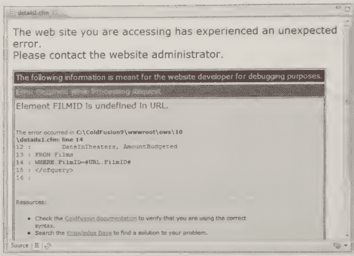

## 示例列表 10.13：`details2.cfm`——数据钻取详情

```cfm
<!...

details2.cfm

Name: Ben Forta (benforta.com)

Description: Data drill-down details

with basic validation

Created: 07/01/07

-->

<!-- 确保传递了 FilmID -->

<cfif not IsDefined("URL.filmid")>

  <!-- 如果没有传递，则跳转到电影列表 -->

  <cflocation url="movies6.cfm">

</cfif>

<!-- 从数据库获取电影信息 -->

<cfquery name="movie" datasource="ows">

SELECT FilmID, MovieTitle,

PitchText, Summary,

DateTheaters, AmountBudgeted

FROM Films

WHERE FilmID=#URL.FilmID#

</cfquery>

<!-- 创建 HTML 页面 -->

<html>

<head>

  <title>Orange Whip Studios - Movie Details</title>

</head>

<body>

<!-- 显示电影详情 -->
```

## 示例列表 10.13（续）

```cfm
<cfoutput query="movie">

<table>

  <tr>

    <td colspan="2">

      

      <strong>#MovieTitle#</strong>

    </td>

  </tr>

  <tr align="top">

    <th align="right">广告语:</th>

    <td>#PitchText#</td>

  </tr>

  <tr align="top">

    <th align="right">摘要:</th>

    <td>#Summary#</td>

  </tr>

  <tr align="top">

    <th align="right">上映日期:</th>

    <td>#DateFormat(DateInTheaters)#</td>

  </tr>

  <tr align="top">

    <th align="right">预算:</th>

    <td>#DollarFormat(AmountBudgeted)#</td>

  </tr>

</table>

</cfoutput>
```

```html
<body>
<html>
```

在示例列表 10.13 中，唯一变化是在 `<CFQUERY>` 标签之前引入了以下代码：

```cfm
<!-- 确保传递了 FilmID -->

<cfif not isDefined("URL.filmid")>

  <!-- 如果没有传递，则跳转到电影列表 -->

  <cflocation url="movies6.cfm">

</cfif>
```

如果没有传递 `FilmID`，用户本不应该进入此页面。你可以简单地显示错误消息，但为什么不将他们引导到需要去的地方呢？`<cflocation>` 是一个 ColdFusion 标签，用于将用户重定向到其他页面（甚至是其他网站）。`<cfif>` 检查 `URL.FilmID` 是否存在（使用 `isDefined()` 函数）。如果不存在，用户将自动发送到 `movies6.cfm` 页面。现在，如果没有 `FilmID`，SQL 代码将不会执行，因为如果没有它，永远无法到达 `<cfif>` 标签。

- `isDefined()` 函数在第 9 章中引入。

# 第 10 章 创建数据驱动的页面

到目前为止一切正常，但你还没有完全完成。仍然存在两个潜在的问题点。尝试执行以下 URL：

```text
http://localhost:8500/ows/10/details2.cfm?FilmID=1
```

`1` 是一个有效的 `FilmID`，所以显示了电影详情。这意味着 `` 标签指向了一个不存在的图像，导致浏览器错误。

此外，尝试这个 URL：

```text
http://localhost:8500/ows/details2.cfm?FilmID=1000
```

不存在 `FilmID` 为 `1000` 的电影，因此没有显示任何电影，也没有显示错误消息。

这两个问题都不是致命的，但还是应该予以解决。示例列表 10.14 包含了已保存页面的最终细节；将此文件保存为 `details3.cfm`。

## 示例列表 10.14：`details3.cfm`——数据钻取详情

```cfm
<!-- details3.cfm

Name: Ben Forta (ben@forta.com)

Author: Data drill-down details

Description: with complete validation

Created: 01/01/2010

-->

<!-- 电影列表页面 -->

<cfset list_page="movies8.cfm">

<!-- 确保传递了 FilmID -->

<cfif not IsDefined("URL.filmid")>

<!-- 如果没有传递，跳转到电影列表 -->

  <cflocation url="#list_page#">

</cfif>

<!-- 从数据库获取电影信息 -->

<cfquery name="movie" datasource="ows" result="result">

SELECT FilmID, MovieTitle,

PitchText, Summary,

DateInTheaters, AmountBudgeted

FROM Film

WHERE FilmID=#URL.FilmID#

</cfquery>

<!-- 确保我们有电影 -->

<cfif result.recordcount gt 0>

  <!-- 找到电影的逻辑 -->

</cfif>
```

在页面最底部有一个新链接，允许用户返回电影列表页面。该链接也使用了 `list_page` 变量。到此时，我希望电影链接 URL 使用变量的原因已经显而易见了。代码中有三个地方引用了电影列表文件。如果所有内容都是硬编码的，那么进行更改将涉及更多工作且更容易出错（出现的次数越多，你漏掉某一处的概率就随之增加）。通过使用变量，你只需要更改页面顶部的变量赋值——其他部分保持不变。

最后要做的是更新电影列表页面，使其包含指向新 `details3.cfm` 页的链接。列表 10.15 包含了修订后的电影列表代码（基于 `movies6.cfm`）。将其保存为 `movies8.cfm`，然后运行它，即可查看带有完整链接的完成页面。

## 列表 10.15：`movies8.cfm`——数据下钻结果

```cf
<!--

Name:      movies8.cfm

Author:    Ben Orta (ben@forta.com)

Description: Data drill-down

Created:  01/01/2010

-->

<!-- 从数据库获取电影列表 -->

<cfquery name="movies" datasource="ows" result="result">

SELECT FilmID, MovieTitle, PitchText,

Summary, DateInTheaters

FROM Films

ORDER BY MovieTitle

</cfquery>

<!-- 创建 HTML 页面 -->

<html>

<head>

<title>Orange Whip Studios - Movie List</title>

</head>

<body>

<!-- 开始表格 -->

<table>

<tr>

<th colspan="2">

<font size="+2">

<cfoutput>

Movie List (#result.RecordCount# movies)

</cfoutput>

</font>

</th>

</tr>

<!-- 循环电影 -->

<cfoutput query="movies">

<tr bgcolor="#cccccc">

<td>

<strong

#CurrentRow#:

<a href="details3.cfm?FilmID=URLEncodedFormat(Trim(FilmID))">#MovieTitle#</a>
```

# 第 10 章 创建数据驱动的页面

## 列表 10.15（续）

```cf
<<strong>

<br>

#PitchText#

</td>

<td>

#DateFormat(InTheaters)#

</td>

</tr>

<tr>

<td colspan="2">

<font size="-2">#Summary#</font>

</td>

</tr>

</cfoutput>

<!-- 电影循环结束 -->

</table>
```

列表 10.15 中仅做了两处更改。`<cfquery>` 中的 `SELECT` 语句现在检索了 `FilmID` 列——你需要将其传递给详情页。（你会记得详情页需要 `FilmID` 作为 URL 参数。）

`MovieTitle` 的显示已变为：

```html
<a href="details3.cfm?FilmID=URLEncodedFormat(Trim(FilmID))">

#MovieTitle#</a>
```

HTML 的 `<a>` 标签用于创建指向其他页面的链接。`<a>` 和 `</a>` 之间的文本是可以点击的，当点击它时，用户将被带到 `href` 属性中指定的 URL。因此，`<a href="details3.cfm">click here</a>` 显示文本 Click here，点击后将用户带到 `details3.cfm` 页面。

但你需要将 `FilmID` 传递给详情页，因此对于 `FilmID` 为 `1` 的情况，需要的 `href` 应该是：

```html
<a href="details3.cfm?FilmID=1">Being Unbearably Light</a>
```

对于 `FilmID` 为 `2` 的情况，则必须是：

```html
<a href="details3.cfm?FilmID=2">Charlie's Devils!</a>
```

这些链接是使用 `FilmID` 列创建的，以便 URL 参数 `FilmID` 能够为每部电影正确填充相应的值。当 ColdFusion 循环电影时，它会为每部电影创建一个链接。这些链接指向同一个页面——`details3.cfm`。唯一的区别是传递给 `FilmID` 参数的值，而这个值被用于显示 `details3.cfm`。因此，对于 `FilmID` 为 `1` 的电影，URL 正确地变为：

```html
<a href="details3.cfm?FilmID=1">Being Unbearably Light</a>
```

试一看；你应该能够点击任何电影查看详情，然后点击链接返回。

## 保护动态 SQL

如你所见，动态创建 SQL 的能力并非没有风险。在我们继续之前，我必须指出这不是 ColdFusion 漏洞。事实上，它甚至不是一个 bug 或漏洞。这确实是一个功能；许多数据库管理系统确实允许查询包含多个操作，而且这是合法的且符合设计的。

> 此外，这里讨论的风险是所有 Web 开发人员需要警惕的风险，无论他们使用的是 ColdFusion、PHP、ASP.NET、Java 还是其他任何技术。

害怕了吗？SQL 语句不仅仅用于查询。考虑以下示例：

```cf
<!-- 从数据库获取电影信息 -->

<cfquery name="movies" datasource="ows" result="result">

SELECT FilmID, MovieTitle, PitchText,

Summary, DateInTheaters

FROM Films

WHERE FilmID=#URL.FilmID#

</cfquery>
```

这是常见且流行的。如果有人篡改了 URL，使其变为：

`http://mydomain/path/file.cfm?FilmID=100`

生成的 SQL 语句将是：

```sql
SELECT FilmID, MovieTitle,

PitchText, Summary,

DateInTheaters

FROM Films

WHERE FilmID=100
```

但如果有人篡改了该 URL，使其变为：

`http://mydomain/path/file.cfm?FilmID=100;DELETE`

现在生成的 SQL 将是：

```sql
SELECT FilmID, MovieTitle,

PitchText, Summary,

DateInTheaters

FROM Films

WHERE FilmID=100;

DELETE
```

取决于所使用的数据库，你可能会执行两条语句：首先是 `SELECT`，然后是 `DELETE`（这将立即删除表中的所有数据）。

## 检查所有收到的变量

首先，你应该在将参数传递到数据库之前对其检查。作为原则，永远、永远不要在未经检查的情况下将客户端提供的数据（URL 参数、表单字段甚至 Cookie）传递到数据库。抛开攻击不谈，假设客户端提交的数据可以原样使用是非常不安全的。

因此，你可以使用如下代码：

```cf
<cfparam name="URL.FilmID" type="integer">
```

你可以在 SQL 语句之前添加此行。实际上，你应该在使用任何传递的变量之前（在页面的最顶部）添加这样一行。这一行代码将通过确保预期值符合要求来防止 SQL 注入攻击。

# 注意

SQL 注入（在 ColdFusion 应用程序中）主要是一个非文本字段（例如，数字字段）中的问题。如果文本值被篡改，你最终得到的将是被篡改的文本，但由于整个作为值传递的内核字符串（引号内的内容）都将包含篡改部分，因此它不会被当做独立的语句执行。另一方面，没有被引号括起的变量，其额外的文本可以被篡改以创建出额外的 SQL 语句。而 `<cfparam>` 可以保护你的安全。

如果你想获得更强的控制力，可以使用如下代码：

```cf
<cfif defined(URL.FilmID) and not IsNumeric(URL.FilmID)> throw an error or something ...

</cfif>
```

通过检查接收到的值是否符合预期类型，你将确保应用程序的安全。

# 提示

在每个页面的顶部使用 `<cfparam>` 标签定义所有变量的另一个用处是，你可以使用这些标签创建带有默认值的变量。这种方法允许你将所有的变量验证和初始化集中在一个地方，从而保持代码其余部分的整洁。

## 使用 `<cfqueryparam>`

`<cfqueryparam>` 标签可以可选用于 `<cfquery>` 标签内部。它主要用于变量绑定，这超出了本章的范围。但它还有另一个与本文讨论非常相关的重要用途。

作为防止 SQL 注入攻击的额外防线，你可以像这样使用 `<cfqueryparam>`：

```cf
<cfquery name="movie" datasource="ows" result="result">

SELECT FilmID, MovieTitle,

PitchText, Summary, DateInTheaters, AmountBudgeted

FROM Films

WHERE FilmID=<cfqueryparam value="#URL.FilmID#" ctype="CF_SQL_INTEGER">

</cfquery>
```

如果之前被篡改的 URL 被传递给此查询，该值将被拒绝并抛出错误。`ctype` 代码执行数据类型检查，不匹配类型的值将被拒绝。这意味着——只允许整数，而恶意的、篡改过的 URL 参数并不是整数。

# 提示

使用 `<cfqueryparam>` 还可以提高 SQL 查询的执行时间，从而提升你的应用程序性能。

# 防御 SQL 注入攻击

SQL 注入攻击与动态 SQL 本身一样悠久，不幸的是，许多网站已使用上述方法被黑客攻击。

ColdFusion 让保护自己免受此类攻击变得异常简单。无论是使用 `<cfparam>`、`<cfqueryparam>` 还是你自己的条件处理，保护自己都是简单的，而且这是你的责任。

- 在每一个 `<cfquery>` 语句的每一个变量都使用 `<cfqueryparam>`。
- 在每个页面顶部使用 `<cfparam>` 来初始化和验证每一个变量。

我的个人建议是两者都做。

# 调试动态数据库查询

在我们完成这个之前，有一点你需要注意。看以下代码：

```cf
<!-- 从数据库获取电影信息 -->

<cfquery name="movie" datasource="ows">

SELECT FilmID, MovieTitle,

PitchText, Summary,

DateInTheaters, AmountBudgeted

FROM Films

WHERE FilmID=$URL.FilmID

</cfquery>
```


如你现在所知，这段代码构建了一个动态 SQL 语句——表达式 `#URL.FilmID#` 会被该变量的内容替换，以便在运行时构建一个完整的 SELECT 语句。

这个示例是简单的；在 WHERE 子句中使用单个表达式。但随着表达式复杂性（或数量）的增加，你在 SQL 中引入问题的概率也会随之增加。为了找到这些问题，你需要确切知道 ColdFusion 生成了什么 SQL——要考虑到所有的动态处理。

我已经向你展示了获取生成 SQL 的一种方法（使用 `<cfquery>` 的 `result` 属性），但还有另一种选择。

在第 2 章“访问 ColdFusion 管理员”中，我提到了调试屏幕（并告诉过我们在本章中使用它们）。调试屏幕可以将调试输出附加到生成页面底部，如图 10.13 所示。

如你所示，附加的输出包含了数据库查询信息（包括 SQL、检索的行数和执行时间）、传递的参数、CGI 变量等。

要亲自尝试，请参阅第 2 章关于开启调试的说明。一旦在浏览器中执行任何页面，调试输出就会自动附加。

## 图 10.13

动态 SQL 与标准的 ColdFusion 调试输出一起显示。

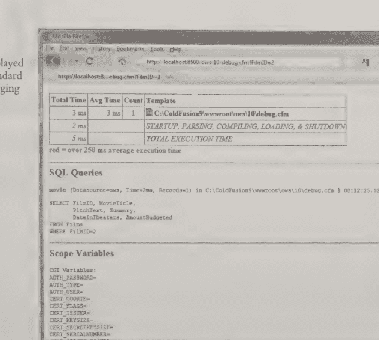

## SQL 查询

`movie(FilmSource=<<ows, Time=2hrs, Records=11)` in `C:\ColdFusion9\wwwroot\10\debug.cfm` @ 08:12:25.025

```
SELECT FilmID, MovieTitle,
Text, Summary,
FROM MovieTable, AmountBudgeted
WHERE FilmID=2
```

## 范围变量

```
CGI Variables:

AUTH_PASSWORD=
AUTH_TYPE=
AUTH_USER=
CERT_COOKIE=
CERT_FLAG=
CERT_ISSUER=
CERT_SERIAL=
CERT_SIZE=
```

## 单层应用

列表 11.1 中的代码存在的问题（实际上，上一章中编写的所有代码都是如此）在于表现层代码与数据访问代码紧密耦合。开发者将这种类型的应用称为单层应用。基本上，应用程序只有一个层（或一个层级），它包含了从数据库代码到应用程序逻辑的所有内容。

- 第 9 章“使用 CFML 编程”中猜数字游戏的处理过程就是应用程序逻辑的一个示例。

对于简单的应用程序来说，这可能不是问题。但随着应用程序复杂性和规模的增长，在你预料之后发生某些故障的概率也会随之增加。许多应用程序因为应用中某部分的简单更改而导致崩溃，而这些更改在其他地方引发了意料之外的影响。

而且，问题不仅在于发生故障的风险。请看一眼第 10 章列表中各种 `<query>` 标签中使用的 SQL 代码。你会发现它们非常相似，许多是完全相同的，是从一个文件复制到另一个文件的。这并不是对代码的高效利用。如果你想调整查询——也许是为了提高性能——你得对许多查询进行调整。如果你要对查询进行安全相关的更改，你也需要在到处进行修改，更多如此。

- 使用 `<query>` 和动态构建的 SQL 需要注意的安全问题在第 10 章“创建数据驱动页面”中进行了解释。

因此，我们面临两个不同但相关的问题：表现层和内容耦合过于紧密，以及代码在多个文件中多次重复。

幸运的是，这两个问题都有单一的解决方案。

## 多层应用

如所述，单层应用顾名其名，将所有内容都丢进一个层中。*多层应用（或 n 层应用）*是指被分成不同层的应用程序，每层只负责完整应用程序的一部分。

这听起来可能很复杂，但不必如此。考虑列表 11.1 中的代码（以及第 10 章中所有的数据驱动代码）。这些代码可以拆分为如下：

- 数据存储在数据库中。
- 所有的数据库访问查询都存储在一个特殊文件中。该文件不生成数据表现（例如它不生成 HTML），所有的数据库访问都通过该文件进行。
- 所有的表现（HTML 和 `<output>` 块）都在另一个文件中。该文件不包含任何数据库交互；相反，它依赖上一个文件来实现这些。

将应用程序分层迫使开发者以不同于仅仅表现层的方式来思考数据和应用程序逻辑，这是一件好事。考虑以下内容：

## 第 11 章 结构化开发基础

- 如果你对后端数据库进行了更改，只有数据访问层中的代码需要更改；表现层代码不需要。
- 由于相同的数据访问代码可以被多个表现层文件使用，任何一次更改将应用到该代码的所有使用处。
- 你可以自由更改表现形式，无论是颜色、表格、添加备选客户端技术（如 Macromedia Flash）或其他更多。这些更改是表现层的更改，因此数据库访问代码将保持不变。

我知道这听起来有点抽象，但请听我说。一会儿你就会理解了。关键是一种特殊的文件类型，称为 **ColdFusion 组件 (ColdFusion Components)**。

## 介绍 ColdFusion 组件

与你已经过的 ColdFusion 模板一样，ColdFusion 组件是你创建并使用的 ColdFusion 文件。两者都是纯文本文件，并包含 CFML 代码，但相似性仅存在于此。

- ColdFusion 模板没有固定格式，可以按任何顺序包含各种标签。ColdFusion 组件具有非常严格且僵化的格式。
- ColdFusion 模板在文件顶部开始处理并向下运行。ColdFusion 组件有一个或多个起始和结束点，本质上是单个文件内不同的功能块。
- ColdFusion 模板具有 `.cfm` 扩展名。ColdFusion 组件具有 `.cfc` 扩展名。
- ColdFusion 模板设计为由用户（在浏览器中）调用。ColdFusion 组件通常由代码调用（而不是终端用户）。

注意

如果你具有面向对象的开发经验并熟悉对象的概念，那么大部分内容对你来说都是熟悉的。ColdFusion 组件是对象的一种，本质上提供了对象功能的基础，但没有了与许多面向对象的语言相关的痛苦。如果你不知道什么是对象，不要被它吓到。在真正的形式下，ColdFusion 让这一切变得像 CFML 一样简单。

在本书的其余部分，你将大量使用 ColdFusion 组件（简称为 CFC），我们将重新回顾上一章的示例，这次将使用 CFC。

正如已经解释过的那样，CFC 是纯文本文件，因此可以使用任何编辑器创建它们，包括 ColdFusion Builder。然而，ColdFusion 自带了用于创建和使用 CFC 的复杂内置支持，我们很快就会使用这些功能。

注意

开发者使用“重构 (refactor)”一词来描述获取应用程序并对其进行重结构以使其更具可复用且高效的过程。

## 创建你的第一个 CFC

要创建 ColdFusion 组件，你需要学习一些新的 CFML 标签。

在本章中创建的所有文件都需要放在应用程序根目录下的 `/1` 目录中（Web 根目录下的 `ous` 目录）。

创建 ColdFusion 组件的第一步是创建一个新文件，因此在 11 文件夹中创建一个名为 `intro.cfc` 的文件。删除任何自动生成的内容，并确保该文件是空文件。

## `<cfcomponent>` 标签

ColdFusion 组件使用名为 `<cfcomponent>` 的标签定义。（直观，对吧？）组成 CFC 的所有代码都必须放在 `<cfcomponent>` 和 `</cfcomponent>` 之间。列表 11.2 intro.cfc—介绍步骤 1

```
<!-- 这是介绍性的 CFC -->

<cfcomponent>
```

一旦你输入了这些代码，将文件保存为 `intro.cfc`。你刚刚创建了一个 ColdFusion 组件。它目前没有任何功能，但它仍然是一个 ColdFusion 组件。

提示

在 `<cfcomponent>` 之前或 `</cfcomponent>` 之后在列表 11.2 中所示是不准确的。

## `<cffunction>` 标签

ColdFusion 组件通常包含一个或多个函数（通常称为方法）。函数是执行操作并返回结果的代码块。每个函数使用 `<cffunction>` 标签定义，并以 `</cffunction>` 结束。`<cffunction>` 接受一系列属性，但只有两个真正重要：

- `name` 是函数的名称（在 CFC 内必须唯一）。
- `returntype` 是返回的结果类型（字符串、日期、数组等）。

列表 11.3 intro.cfc，这次我们引入了三个函数。

## 结构化开发基础

列表 11.3 intro.cfc—介绍步骤 2

```html
<!-- 这是介绍性的 CFC -->

<cfcomponent>

<!-- 获取今天的日期 -->

<cffunction name='today' returntype='date'>

</cffunction>

<!-- 获取明天的日期 -->

<cffunction name='tomorrow' returntype='date'>

</cffunction>

<!-- 获取昨天的日期 -->

<cffunction name='yesterday' returntype='date'>

</cffunction>

</cfcomponent>
```

你可以看到，每个函数都有一对 `<cffunction>` 标签。列表 11.3 中的函数还没有内容。如果有内容——很快就会有了——它将放在这些标签之间。每个函数都有唯一的名称，并且每个函数都指定了返回数据类型。在示例中，三个函数分别返回今天的日期、明天的日期和昨天的日期。

## `<cfreturn>` 标签

使用 ColdFusion 组件时，会指定要执行的函数名称。函数中的任何代码都会被处理，并返回给调用代码。要返回数据，使用 `<cfreturn>` 标签。列表 11.4 是之前列表的修改版本，这次在主体中包含了 `<cfreturn>` 标签。列表 11.4 intro.cfc—介绍步骤 3

```html
<!-- 这是介绍性的 CFC -->

<cfcomponent>

<!-- 获取今天的日期 -->

<cffunction name='today' returntype='date'>

<cfreturn Now()>

</cffunction>

<!-- 获取明天的日期 -->

<cffunction name='tomorrow' returntype='date'>

<cfreturn DateAdd('d', 1, Now())>

</cffunction>

<!-- 获取昨天的日期 -->

<cffunction name='yesterday' returntype='date'>

</cffunction>

</cfcomponent>
```

## 列表 11.4（续）

```
<!-- 获取昨天的日期 -->

<cffunction name="yesterday" returntype="date">

<cfreturn DateAdd("d", -1, Now())>

</cffunction>
```

通常情况下，CFC（组件函数）函数包含大量的处理逻辑，然后通过 `<cfreturn>` 返回结果。但并非如此，这三个函数具有单行函数体，表达式在 `<cfreturn>` 标签内进行计算。`today` 函数返回 `Now()`，`tomorrow` 使用 `DateAdd()` 为 `Now()` 增加 1 天，`yesterday` 在 `Now()` 的基础上增加 1 天（本质上是从今天的日期中减去一天）。

- `Now()` 函数是在第 8 章“CFML 基础”中引入的。

当然，在返回的表达式中进行计算是可选的，并且代码：

```
<!-- 获取明天的日期 -->

<cffunction name="tomorrow" returntype="date">

<cfreturn DateAdd("d", 1, Now())>

</cffunction>
```

可以写成：

```
<!-- 获取明天的日期 -->

<cffunction name="tomorrow" returntype="date">

<cfset var result=DateAdd("d", 1, Now())>

<cfreturn result>

</cffunction>
```

后一种形式是大多数 CFC 函数倾向的样式。

> 提示：每个 CFC 函数都应该有且仅有一个 `<cfreturn>` 标签。避免在单个函数中使用多个 `<cfreturn>` 标签的坏习惯。

> 提示：从技术上讲，函数从不“返回结果”，但最佳实践规定每个 CFC 函数都要返回某些内容，即使是一个简单的真/假标志位。

## `<cfargument>` 标签

此类定义的函数是非常简单的，其特点在于它们接收数据并返回结果。你将创建的许多函数都需要接纳数据。例如，如果你正在创建一个返回电影详情的 CFC 函数，你将需要将电影 ID 传递给该函数。

在 CFC 代码中，传递的数据被称为“参数”（**arguments**），而用于定义参数的标签是 `<cfargument>` 标签。如果使用，`<cfargument>` 必须是 `<cffunction>` 内部的第一段代码，如果需要，可以使用多个 `<cfargument>` 标签。

> 提示：你有时也会使用“参数”（**parameter**）这个词。Parameters 和 arguments 指的是同一个东西。

## 第 11 章 结构化开发基础

以下代码段演示了 `<cfargument>` 的用法：

```
<cfargument name="radius" type="numeric" required="yes">
```

这段代码（将放入 `<cffunction>` 中）定义了一个名为 `radius` 的参数，该参数是必填的，且必须是一个数值。`type` 和 `required` 都是可选的，如果不指定，它们将被接受为无值。

为了演示参数的用法，这里有一个完整的函数：

```
<!-- 执行几何计算 -->

<cffunction name="geometry" returntype="struct">

<!-- cfargument name="radius" type="numeric" required="yes" -->

<!-- 需要一个半径 -->

<!-- 定义变量 -->

<cfset var result=StructNew()>

<!-- 保存半径 -->

<cfset result.circle=radius>

<!-- 第一个圆 -->

<cfset result.circle=StructNew()>

<!-- 计算周长 -->

<cfset result.circle.circumference=2*Pi()*radius>

<!-- 计算面积 -->

<cfset result.circle.area=Pi()*radius^2>

<!-- 现在处理球体 -->

<cfset result.sphere=StructNew()>

<!-- 计算体积 -->

<cfset result.sphere.volume=(4/3)*Pi()*radius^3>

<!-- 计算表面积 -->

<cfset result.sphere.surface=4*result.circle.area>

<!-- 返回结果 -->

<cfreturn result>

</cffunction>
```


`geometry` 函数执行了一系列几何计算。为它提供一个半径值，它将返回一个包含多个计算结果的结构。它计算了圆的周长和面积，以及球体的体积和表面积。

## 介绍 ColdFusion 组件 (CFC)

当 ColdFusion 处理 `<cfinvoke>` 标签时，它会定位并打开 `intro.cfc` 文件，找到 `today()` 函数并执行，并将结果保存到名为 `todayyet` 的变量中。随后代码使用一个简单的 `<cfoutput>` 块显示值。

如果你使用 `testcf.cfm`，将看到类似图 11.1 所示的结果。

### 图 11.1
CFC 处理对于 ColdFusion 生成的输出是隐藏的。

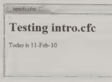

> **注意**：务必运行 `.cfm` 文件而不是 `.cfc` 文件，否则结果将不符合你的预期。

非常简单，对吧？在使用 ColdFusion Builder 时，它会变得更容易。

## 使用 ColdFusion Builder 的 CFC 支持

你已经看到过如何使用 `<cfinvoke>` 调用 ColdFusion 组件方法。你将学习如何在不编写任何代码的情况下调用 CFC 方法。以下是步骤：

1. 找到 ColdFusion Builder 服务浏览器标签页（它应该位于实际编辑器窗口下方的面板）。
2. 展开 `localhost` 选项以显示所有已知的 ColdFusion 组件列表，按它们所在的文件夹排序。默认情况下，ColdFusion 已知的每个 CFC 都会显示。
3. 你应该能看到一个名为 `ods.11` 的文件夹；`ods.11` 是 `ods` 文件夹下的第 11 个文件夹（路径中使用点表示法）。
4. 一旦找到文件夹，点击其左侧的箭头以显示其中的 ColdFusion 组件（只有一个 `ods.11.intro`，即之前创建的文件）。
5. 点击 `ods.11.intro` 旁边的箭头显示它包含的方法，如图 11.2 所示。

### 图 11.2
ColdFusion Builder 浏览器标签页提供了访问 ColdFusion 组件及其方法的简便方式。

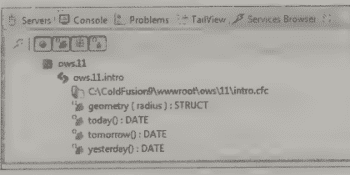

## 第 11 章 结构化开发基础

6. ColdFusion Builder 列出了所有 CFC 方法，以及它们的返回类型和任何参数。
7. 确保 `testcfc.cfm` 在 ColdFusion Builder 中打开。点击现有的 `<cfinvoke>` 代码之后、`<cfoutput>` 块之前的行（这是我们想要插入新代码的地方），然后在服务浏览器标签页上右键点击 `tomorrow()` 方法并选择 Insert CFInvoke（插入 CFInvoke）。
8. ColdFusion Builder 将为你生成一个完整的 `<cfinvoke>` 标签，指定返回组件并定义一个返回变量。在代码中，将 `returnvariable` 重命名为 `tomorrow`。
9. 在 `<cfoutput>` 块中添加以下代码（在现有行之后）：

```
Tomorrow is #DateFormat(tomorrowRet)#<br>
```

`testcfc.cfm` 现在看起来应该像列表 11.7 所示。

### 列表 11.7 `testcfc.cfm`—CFC 测试第 2 步

```
<!--
Name:        testcfc.cfm
Author:      Ben Forta (ben@forta.com)
Description: Quick CFC test
Created:     01/01/2010
-->
<!-- Title -->
<h1>Testing intro.cfc</h1>

<!-- Get today's date -->
<cfinvoke component='intro'
    method="tomorrow"
    returnvariable="tomorrowRet">

<!-- Get tomorrow's date -->
<cfinvoke>
    component="ods.11.intro"
    method="tomorrow"
    returnvariable="tomorrowRet">
</cfinvoke>

<!-- Output -->
<cfoutput>
    Today is #DateFormat(tomorrowRet)#<br>
    Tomorrow is #DateFormat(tomorrowRet)#<br>
</cfoutput>
```

运行 `testcfc.cfm`。你应该看到一个类似图 11.3 所示的页面。

### 图 11.3
务必通过执行代码来测试 ColdFusion 调用。


你会注意到 ColdFusion Builder 生成了一个闭合的 `<cfinvoke>` 标签。在我们简单的调用中并不需要，但留在那里也没有害处。

> **注意**：ColdFusion Builder 生成的 CFC 路径是全路径（从 Web 根目录开始）。只有在访问另一个目录中的组件时才需要，但在这里使用也没有害处。你可以根据需要更改 `component="intro"`。

你刚刚使用的 ColdFusion 方法是一个简单的方法。它不接受任何参数并返回一个简单的值。让我们再次尝试，现在使用一个更复杂的方法，即 `geometry` 方法。以下是步骤：

1. 在服务浏览器标签页上找到 `ods.11.geometry` 方法。
2. 选择 `geometry` 方法并插入一个 CFinvoke（你可以将其放在页面的最底部）。

ColdFusion Builder 生成了如下所示的 `<cfinvoke>`：

```
<cfinvoke>
    component="ods.11.intro"
    method="geometry"
    returnvariable="intro"
    <cfinvokeargument name="radius" value="" />
</cfinvoke>
```

`<cfinvokeargument>` 使用在 `<cfinvoke>` 内部来传递参数。

3. 为 `radius` 属性指定一个实际值。
4. 将 `returnvariable` 改为 `intro`。
5. 使用 `<cfdump>` 来查看结果，这是最简单的方法。
6. `testcfc.cfm` 看起来应该像列表 11.7 所示。

## 第 11 章 结构化开发基础

### 图 11.5
ColdFusion Builder 可以引导你创建 CFCs。

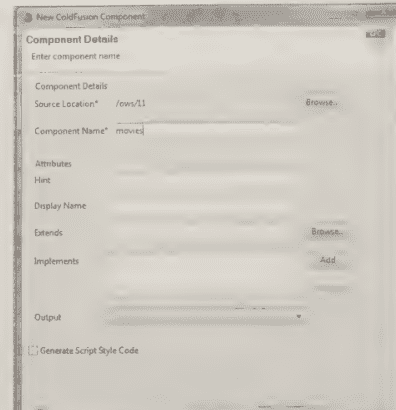

4. 现在，你需要定义所需的方法。点击 Next 显示组件属性和函数（Component Properties and Functions）屏幕。
5. `movies.cfc` 文件需要两个方法：一个用于列出所有电影，另一个返回电影详情。点击 Add 按钮显示新函数（New Function）屏幕（如图 11.6 所示）。将名称设置为 `List`，并选择 `query` 作为返回类型。你可以暂时忽略属性。点击 OK。

### 图 11.6
CFC 函数在新函数（New Function）屏幕上定义。

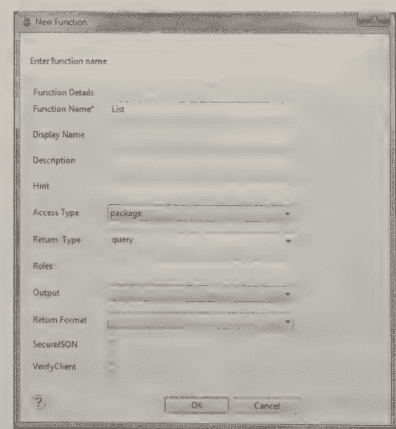

6. 点击 Add Function 添加第二个方法。将名称设置为 `GetDetails`，并选择 `query` 作为返回类型。然后点击 OK。

你现在应该可以看到你定义的两个函数，如图 11.7 所示。

### 图 11.7
每个 CFC 函数必须有唯一的名称。

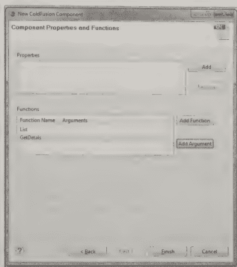

7. `List` 方法不需要参数（它只需返回所有电影），但 `GetDetails` 要求传递一个电影 ID 作为参数。参数在新函数参数（New Function Argument）屏幕上定义，因此点击 `GetDetails` 函数然后点击 Add Argument 显示该屏幕（如图 11.8 所示）。

### 图 11.8
方法参数在新函数参数（New Function Argument）屏幕上定义。

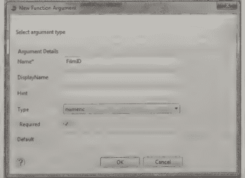

8. 将名称设置为 `FilmID`，类型设置为 `Numeric`，并勾选 Required 复选框。然后点击 OK。
9. 点击 Finish 按钮，ColdFusion Builder 将在 `11` 文件夹中生成一个名为 `movies.cfc` 的 ColdFusion 组件外壳。

生成的 ColdFusion 组件并不完整，因为 ColdFusion Builder 无法知道你打算在 CFC 方法中执行什么。但 ColdFusion Builder 能够创建以下基础布局，允许你填充缺失的部分：

```xml
<component>
  <cffunction name="Details" access="package" retype="query">
    <cfargument name="FilmID" type="numeric" required="true" />
  </cffunction>
  <cffunction name="List" access="package" retype="query">
  </cffunction>
</component>
```

你需要在每个方法中插入一个查询。`List` 方法的查询应该是：

```xml
<!-- Define local variables -->
<cfset var movies="" />

<!-- Get movie list from database -->
<cfquery name="movies" datasource="ows">
    SELECT FilmID, MovieTitle, PitchText,
    Summary, DateInTheaters
    FROM Films
    ORDER BY MovieTitle
</cfquery>
```

而 `GetDetails` 方法的查询应该是：

```xml
<!-- Define local variables -->
<cfset var movie="" />

<!-- Get a movie from database -->
<cfquery name="movie" datasource="ows">
    SELECT FilmID, MovieTitle,
    PitchText, Summary,
    DateInTheaters, AmountBudgeted
    FROM Films
    WHERE FilmID=#ARGUMENTS.FilmID#
</cfquery>
```

这些查询与第 10 章中使用的相同，但第二个查询中的 `WHERE` 子句有所不同，它已从

```sql
WHERE FilmID=#URL.FilmID#
```

变为

```sql
WHERE FilmID=#ARGUMENTS.FilmID#
```

因为 `FilmID` 现在是 CFC 方法参数，而不是 URL 参数。

> **提示**：可以随地从 `10` 文件夹中的 `movies8.cfm` 和 `details3.cfm` 复制并粘贴 `<cfquery>` 标签。

现在每个方法都包含了其查询，编辑每个方法中的 `<cfreturn>` 标签以返回该查询。列表 11.9 包含了你最终编辑后的 `movies.cfc` 应该的样子。

### 列表 11.9 `movies.cfc`——电影数据抽象组件

```xml
<cfcomponent>
    <cffunction name="List" access="public"
        returnType="query" output="false">
        <!-- Define local variables -->
        <cfset var movies="">
        <!-- Get movie list from database -->
        <cfquery name="movies" datasource="ows">
            SELECT FilmID, MovieTitle, PitchText,
            Summary, DateInTheaters
            FROM Films
            ORDER BY MovieTitle
        </cfquery>
        <cfreturn movies>
    </cffunction>

    <cffunction name="GetDetails" access="public"
        returnType="query" output="false">
        <cfargument name="FilmID" type="numeric" required="true">
        <!-- Define local variables -->
        <cfset var movies="">
        <!-- Get a movie from database -->
        <cfquery name="movie" datasource="ows">
            SELECT FilmID, MovieTitle,
            PitchText, Summary,
            DateInTheaters, AmountBudgeted
            FROM Films
            WHERE FilmID=#ARGUMENTS.FilmID#
        </cfquery>
        <cfreturn movie>
    </cffunction>
</cfcomponent>
```

列表 11.9 中的代码对于获取所有电影并返回该查询来说非常熟悉。`GetDetails` 接受 `FilmID` 作为参数，然后使用 `<cfquery>` 获取该查询，然后返回该查询。两个方法都通过 `<cfset>` 和 `FilmID` 关键字填充由 `FilmID` 生成的查询结果。

你需要调用 CFC 方法的 `.cfm` 页面。列表 11.10 包含 `movies.cfm`（基于 `10/movies.cfm`），列表 11.11 包含 `details.cfm`（基于 `10/details3.cfm`）。

> **提示**：通过复制 `10` 文件夹中的上述两个文件来节省打字时间。

### 列表 11.10 `movies.cfm` - CFC 驱动的电影列表

```xml
<!--
Name:        movies.cfm
Author:      Ben Forta (ben@forta.com)
Description: CFC driven drill-down
Created:     01/01/2010
-->
<!-- Get movie list -->
<cfinvoke
    component="movies"
    method="List"
    returnvariable="movies">

<!-- Create HTML page -->
<html>
<head>
    <title>Orange Whip Studios - Movie List</title>
</head>
<body>
    <!-- Start table -->
    <table>
        <tr>
            <th colspan="2">
                <font size="+2">
                    <cfoutput>
                        Movie List (#Movies.RecordCount#)
                    </cfoutput>
                </font>
            </th>
        </tr>

        <!-- loop through movies -->
        <cfoutput query="movies">
            <tr bgcolor="#cccccc">
                <td>
                    <strong>
                        #CurrentRow#:<a href="details.cfm?FilmID=
                        #URLEncodedFormat(Trim(FilmID))">#MovieTitle#</a>
                    </strong>
                    <br>
                    #PitchText#
                </td>
                <td>
                    #DateFormat(DateInTheaters)#
                </td>
            </tr>
            <tr>
                <td colspan="2">
                    <font size="-2">#Summary#</font>
                </td>
            </tr>
        </cfoutput>
        <!-- End of movie loop -->
    </table>
</body>
</html>
```

### 列表 11.11 `details.cfm` - CFC 驱动的电影详情

```xml
<!-- details.cfm -->
<!--
Name:        details.cfm
Author:      Ben Forta (ben@forta.com)
Description: CFC driven data drill-down
             with complete validation
Created:     01/01/2010
-->
<!-- Movie list page -->
<cfset list_page="movies.cfm">

<!-- Make sure FilmID was passed -->
<cfif not isDefined("URL.filmid")>
    <!-- it wasn't, send to movie list -->
    <cflocation url="#list_page#">
</cfif>

<!-- Get movie details -->
<cfinvoke
    component="movies"
    method="GetDetails"
    returnvariable="movie">

<!-- Build HTML page -->
<html>
<head>


## 第 11 章 结构化开发基础

### 列表 11.11 `details.cfm`——CFC 驱动的电影详情（续）

```xml
<!-- details.cfm -->

Name: details.cfm

Author: Ben Orta (ben@forta.com)

Description: CFC driven data drill-down
           with complete validation

Created: 01/01/2010

-->

<!-- Movie list page -->

<cfset list_page="movies.">

<!-- Make sure FilmID was passed -->

<cfif not isDefined(URL.filmid)>

<!-- it wasn't, send to movie list -->

<cfloction url="#list_page#">

</cfif>

<!-- Get movie details -->

<cfinvoke
    component="movies"
    method="GetDetails"
    returnvariable="movie">

<!-- Build HTML page -->

<html>

<head>

<title>Orange Whip Studios - Movie Details</title>

</head>

<body>

<!-- Display movie details -->

<cfoutput query="movie">

<table>

<tr>

<td colspan="2">

<!-- Check if image exists -->

<cfif FileExists(image_path)>

<!-- If it does, display it -->


</cfif>

#MovieTitle#

</th>

</tr>

<tr>

<td>

#DateFormat(DateInTheaters)#

</td>

</tr>

<tr>

<td>

#PitchText#

</td>

</tr>

<tr>

<td>

#Summary#

</td>

</tr>

<tr>

<td>

##AmountBudgeted#

</td>

</tr>

</table>

</cfoutput>

<p>

<!--... Link back to movie list -->

<a href="#list_page#">Movie list</a>

</p>

</body>

</html>
```

## 关于使用 ColdFusion 组件（CFC）的更多内容

你现在已经亲身体验了 ColdFusion 组件，在阅读此书的过程中，你将频繁地使用它们。ColdFusion 组件让应用程序分层变得简单，从而实现了：

- 更整洁的代码
- 更具重用性的代码
- 更易于维护的代码（在进行更改时不易损坏的代码）

在结束本章之前，还有几个关于 ColdFusion 组件的额外点值得提及。

## CFC 存储在何处

在本章中（实际上在整本书中）创建的 ColdFusion 组件存储在你的工作文件夹中。这在学习 ColdFusion 时是理想的，但在实践中，这并不是你想要的做法。

大多数开发者会创建一个特定的 `cfc` 文件夹（或多个文件夹），并将所有常用的 ColdFusion 组件存储在其中。这将有助于你定位和维护它们。正如你所见的，ColdFusion Builder 在生成 `<cfinvoke>` 标签时会自动考虑路径问题。

## 单元测试

ColdFusion 组件的一个尚未在此提到的重要益处是测试。在构建应用程序时，你会希望定期测试你的工作。应用程序越大、越复杂，测试就越困难。当代码产生阻碍时，问题会更加严重。例如，如果你正在测试 `<cfquery>` 中的 SQL，你不会希望 HTML 布局问题无谓地使测试复杂。

将代码拆分为分层极大地简化了测试。一旦你写好了 ColdFusion 组件，你就可以（也应该）创建一个简单的测试页面，该页面不包含复杂的显示代码，而是调用方法并转储它们的输出——就像我们在该方法早之前的 `<geometry>` 示例中所做的那样。经验丰富的开发者会为你创建的每个 ColdFusion 组件编写一个简单的前端。这种做法是高度推荐的。

## 为 ColdFusion 组件编写文档

随着你 ColdFusion 组件集合的不断扩大，你发现它们的用途也会随之增加。想要利用它们的开发者也会随之增加，假设你正在使用 ColdFusion 组件，因此需要解释它们的作用、每个方法的功能，以及你期望传递给任何参数的值。

为 ColdFusion 组件编写文档如此重要，以至于在创建它们的标签中直接内置了自说明文档功能。本章中使用的每个 CFC 标签 `<cfcomponent>`、`<cfunction>` 和 `<cfargument>` 都有一个名为 `Hint` 的可选属性。如列表 11.12 所示，`hint` 属性用于向我们的 `movies.cfc` 文件添加简短的文档片段。

### 列表 11.12 `movies.cfc`——提供 CFC 提示

```coldfusion
<!-- Movie component -->

<cfunction hint="Movie database abstraction">

<!-- List method -->

<cfunction name="List" access="public"
    returnType="query" output="false"
    hint="List all movies">

<!-- Define local variables -->

<cfset var movies="">

<!-- Get movie list from database -->

<cfquery name="movies" datasource="ows">
    SELECT FilmID, MovieTitle, PitchText,
        Summary, DateInTheaters
    FROM Films
    ORDER BY MovieTitle
</cfquery>

<cfreturn movies>

</cfunction>

<!-- GetDetails method -->

<cfunction name="Details" access="public"
    returnType="query" output="false"
    hint="Get movie details for a specific movie">

<cfargument name="FilmID" type="numeric"
    required="true" hint="File ID">

<!-- Define local variables -->

<cfset var movie="">

<!-- Get a movie from database -->

<cfquery name="movie" datasource="ows">
    SELECT FilmID, MovieTitle,
        PitchText, Summary,
        DateInTheaters, AmountBudgeted
    FROM Films
    WHERE FilmID=#ARGUMENTS.FilmID#
</cfquery>

<cfreturn movie>

</cfunction>

</cfcomponent>
```

那么这些提示（hints）起什么作用呢？它们对 ColdFusion 组件的实际处理没有任何影响。相反，它们被 ColdFusion 用于动态生成文档，如图 11.9 所示。

### 图 11.9

ColdFusion 使用从用于创建的标签中收集的信息自动生成 ColdFusion 组件文档。

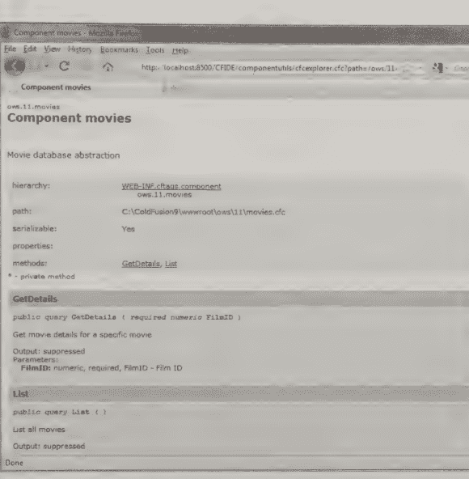

在本章早些时候，我告诉过不要直接运行 `.cfc` 文件，并说如果你运行它，结果可能不是你的预期。实际上，结果实际上是文档，如图 11.9 所示的示例。要访问这些文档，你可以：

- 在浏览器中指定 `.cfc` 的 URL。
- 在 ColdFusion Builder 中浏览 `.cfc`。

注意：当你浏览 CFC 文档时，可能会被要求输入 ColdFusion 管理员密码。

如果你愿意，也可以手动输入提示。此外，本章早些的“创建组件”向导允许在构建 CFC 时提供提示文本。然而，无论你决定如何操作，都强烈建议提供提示文本。

## 第 12 章 ColdFusion 表单

### 在本章中

- 使用表单 201
- 创建表单 201
- 处理表单提交 204
- 创建动态 SQL 语句 217
- 构建真正的动态语句 222
- 创建动态搜索屏幕 231

## 使用表单

在第 10 章“创建数据驱动的页面”中，你学习了如何创建 ColdFusion 模板来动态显示从数据库检索的数据。`Films` 表只有 23 行，因此数据可以轻松地放入 Web 浏览器窗口中，并且只需要少量滚动。

如果你有成百或上千行数据该怎么办？在一个很长的列表中显示所有数据是不切实际的。在电影列表中滚动寻找你正想要的那部电影效果并不好。解决方案是允许用户通过指定他们想要的内容来搜索他们寻找的内容。你可以允许他们输入标题、演员名称或标语的一部分。然后，你可以只显示符合搜索标准的电影。

要实现这一点，你需要做两件事。首先，你必须使用 HTML `<form>` 标签创建你的搜索表单。其次，你必须创建一个模板，根据表单收集和提交的数据动态构建 SQL `SELECT` 语句。

- 请参阅第 6 章“介绍 SQL”获取关于 `SELECT` 语句的解释。

## 创建表单

在创建搜索表单之前，你需要学习 ColdFusion 如何与 HTML 表单交互。列表 12.1 包含一个示例表单的代码，该表单提示输入姓和名。创建此模板，将其保存到应用程序根目录下名为 `12` 的新文件夹中，命名为 `form.cfm`。

提示：提醒一下，在本章中创建的文件位于目录 `12`，因此在 URL 中也要使用该目录。

### 列表 12.1 `form1.cfm`——HTML 表单

```html
<!--
Name:       form1.cfm
Author:     Ben Orta (benforta.com)
Description: Introduction to forms
Created:    01/01/2010
-->

<html>

<head>

<title>Learning ColdFusion Forms</title>

</head>

<body>

<!-- Movie search form -->

<form action="form1_action.cfm" method="POST">

<p>Please enter the movie name and then click <strong>Process</strong>.</p>

<p>

Movie: <input type="text" name="MovieTitle">

<br>

<input type="submit" value="Process">

</p>

</form>

</body>

</html>
```

执行代码显示表单，如图 12.1 所示。

### 图 12.1

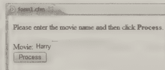

你可以使用 HTML 表单将数据收集到 ColdFusion。

## 使用 HTML 表单标签

你通过 `<form>` 标签创建 HTML 表单。`<form>` 通常接受两个参数。`action` 属性指定 Web 服务器应该执行的脚本或程序名称。要将表单提交到 ColdFusion，你需要指定将处理数据的模板名称：

```html
action="form1_action.cfm"
```

`method` 属性指定数据发送回 Web 服务器的方式。按照规定，ColdFusion 表单应以 `post` 方式提交。

警告：默认提交类型不是 `post`。它通常是 `get`。如果你在表单标签中使用 `method="post"` 属性，你可能会面临丢失数据的风险，特别是在长表单或带有 `textarea` 控件的情况下。

你的表单有一个输入字段：`<input type="text" name="MovieTitle">`。这是一个文本字段。`<input>` 标签中的 `name` 属性指定字段名称，ColdFusion 在处理时使用此名称来引用该字段。

表单中的每个字段通常都会赋予一个名称。如果两个字段具有相同的名称，两组值都将返回进行处理，并用逗号分隔。通常你会希望单独验证和操作每个字段，因此每个字段应该有自己的名称。例外是复选框和单选按钮输入，我们将在下面描述。

表单的最后一个项是类型为 `submit` 的 `<input>`。提交 `<input>` 创建了一个按钮，点击后会将表单内容提交到 Web 服务器。几乎每个表单都有提交按钮（或充当提交按钮的图形）。`value` 属性指定按钮内显示的文本，因此 `<input type="submit" value="Process">` 创建了一个带有 Process 文字的提交按钮。

提示：当你使用 `submit` 类型输入时，应该始终通过 `value` 属性指定文本。如果不这样做，将显示默认文本 Query（或其他），这可能会让你的用户困惑。

## 表单提交错误消息

如果你在字段中输入电影标题并提交表单，你将收到类似图 12.2 所示的 ColdFusion 错误消息。该错误显示 `file_action.cfm` 找不到。

### 图 12.2

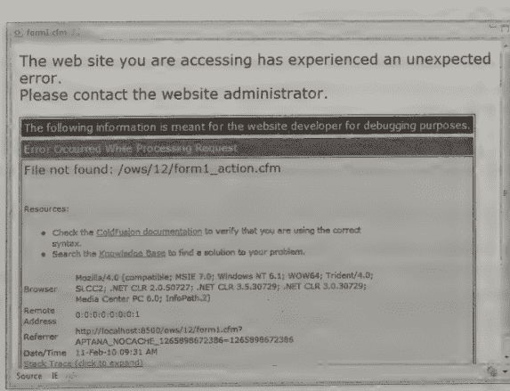

当 ColdFusion 无法处理你的请求时，会返回错误消息。

当然，这个错误信息是有效的。你提交了一个表单给 ColdFusion 并用模板对其进行处理，但你还没有创建该模板。因此，你的下一个任务是创建一个处理表单提交的模板。

# 处理表单

为了演示如何处理返回的表单，你必须创建一个简单的模板来显示你输入的电影标题。模板见列表 12.2。

### 列表 12.2 `form1_action.cfm`——表单字段

```html
<!--
form1_action.cfm

Name: Ben Forta (ben@benta.com)

Description: 表单简介

Created: 01/01/2010
-->

<html>

<head>

<title>学习 ColdFusion 表单 1</title>

</head>

<body>

<!-- 显示搜索文本 -->

<output>

<strong>电影标题：</strong> #FORM.MovieTitle#

</output>

</body>

</html>
```


# 处理文本提交

现在你应该已经熟悉`<output>`标签了；你用它来标记 ColdFusion 应该解析并处理的代码块。`<strong>电影标题：</strong> #FORM.MovieTitle#`会由 ColdFusion 处理，其中`#FORM.MovieTitle#`被替换为`MovieTitle`字段中输入的值。

**注意**

使用`FORM`前缀是可选的。它可以消除歧义并提高性能，但也降低了代码的可用性。

- 请参考第 8 章“CFML 基础”，了解 ColdFusion`<output>`标签的详细讨论。

创建一个名为`form1_action.cfm`的模板，包含列表 12.2 中的代码并保存它。然后再次点击表单的提交按钮重新提交电影名称。这次，你应该看到与图 12.3 类似的浏览器显示。你在表单的`MovieTitle`字段中输入的任何名称都会显示出来。

## 图 12.3

提交的表单字段可以通过引用字段名来显示。


你可以看到，`FORM`字段在 ColdFusion 中的用法与其他变量类型相同。

# 处理复选框和单选按钮

你经常使用的其他输入类型是复选框和单选按钮：

- **复选框（Check boxes）**用于选择具有两种状态的选项：开启或关闭、是或否、真或假。例如，为了询问访问是否想加入邮件列表，你可以创建一个复选框字段。如果用户勾选了框，他们的姓名会被添加到邮件列表中；如果用户未勾选，姓名则不会被添加。
- **单选按钮（Radio buttons）**用于从至少两个互斥的选项中选择一个。你可以实现一个提示支付类型的字段，选项如现金、信用卡或邮票（P.O.）。

列表 12.3 中的代码示例创建了一个同时使用选项按钮和复选框的表单。

## 列表 12.3 *form2.cfm——使用复选框和单选按钮*

```
<---

Name:   form2.cfm

Author: Ben Forta (ben@forta.com)

Description: 表单简介

Created: 01/01/2010

-->

<html>

<head>

<title>学习 ColdFusion 2</title>

</head>

<body>

<!-- 支付和邮件列表表单 -->

<form action="form2.action.cfm" method="POST">

请填写此表单并点击<span>Process</span>。

<p>

<!-- 支付类型单选按钮 -->

支付类型：<br>

<input type="radio" name="PaymentType" value="Cash">现金<br>

<input type="radio" name="PaymentType" value="Check">支<br>

<input type="radio" name="PaymentType" value="Credit card">信用卡<br>

<input type="radio" name="PaymentType" value="P.O.">邮票

</p>

<p>

列表 12.3（续）

<!-- 邮件列表复选框 -->

你想加入我们的邮件列表吗？

<input type="checkbox" name="MailingList" value="Yes">

<p>

<p><input type="submit" value="Process">

<p>

</form>

</body>

</html>
```

列表 12.4 显示了该表单在浏览器中的外观。

## 列表 12.4

你可以使用按钮和复选框输入类型来方便选择选项。


当你创建`form2_action.cfm`来处理此表单时，你应该注意几个重要点。首先，查看组成支付类型单选选择的四行代码：

```
<input type="radio" name="PaymentType" value="Cash">现金<br>
<input type="radio" name="PaymentType" value="Check">支<br>
<input type="radio" name="PaymentType" value="Credit">信用卡<br>
<input type="radio" name="PaymentType" value="P.O.">邮票<br>
```

每一个都包含完全相同的属性名称——`name="PaymentType"`。这四个字段具有相同的名称，因此你的浏览器知道它们属于同一组。如果每个单选按钮都有独立的名称，浏览器将不知道这些按钮是互斥的，从而允许选择多个选项。

另一个重要点：与`<input>`文本不同，单选按钮不会提示用户进行文本输入。此外，你必须使用`value`属性以便浏览器将特定值与每个按钮关联。代码`value="Cash"`指示浏览器如果选择了该单选按钮，则在`PaymentType`字段中返回值`Cash`。

现在你已经理解了单选按钮和复选框字段，准备好创建一个模板来处理它们了。使用列表 12.4 中的代码创建一个名为`form2_action.cfm`的模板。

赋值为默认属性中指定的任何值。这里的关键在于，单向地——无论变量是否存在——在处理`<cfparam>`标签后，变量都会存在。因此，在模板代码的后续部分引用该变量是安全的。

更新后的形式如列表 12.5 所示。`PaymentType`字段中的第一个选项按钮被修改为`<input type="radio" name="PaymentType" value="Cash" checked>`。`checked`属性确保该按钮被选中。`MailingList`复选框在被选中时值为`Yes`，而 action 页面上的`<cfparam>`确保了`MailingList`未被勾选时，其值会被自动设置为`No`。

## 列表 12.5 form3.cfm—预选表单字段值

```
<---

Name: form3.cfm

Author: Ben Orta (ben@forta.com)

Description: Introduction to forms

Created: 01/01/2010

-->

<html

<head>

<title>Learning ColdFusion Forms 3</title>

</head>

<body>

<!-- Payment and mailing list form --

<form action="form3.action.cfm" method="POST">

<p>Please fill in this form and click <<strong>Process</strong>.</p>

<p>

<!-- Payment type radio buttons --

Payment type:<br>

<input type="radio" name="PaymentType" value="Cash" CHECKED>Cash<br>

<input type="radio" name="PaymentType" value="Check">Check<br>

<input type="radio" name="PaymentType" value="Credit card">Credit card<br>

<input type="radio" name="PaymentType" value="P.O.">P.O.

</p>

<p>

<!-- Mailing list checkbox --

Would you like to be added to our mailing list?

<input type="checkbox" name="MailingList" value="Yes">

</p>

<p>

<input type="submit" value="Process">

</p>

</form>

</body>

</html>
```

## 第 12 章 ColdFusion 表单

将此模板创建并保存为`form3.cfm`。然后创建一个命名为`form3_action.cfm`的新文件，其中包含`form2_action.cfm`中的代码，并将以下代码添加到页面顶部（注释正下方）：

```
<!-- Initialize variables -->

<cfparam name="MailingList" default="No">
```

尝试运行并对这两个字段进行实验。你会发现此表单是可靠且健壮的，无论选择（或未选择）哪些选项，都不会生成 ColdFusion 错误消息。

## 处理列表框

你经常使用的另一种字段类型是列表框（list box）。使用列表框是允许用户选择一个或多个选项的有效方法。如果创建列表框仅接受单次选择，则可以保证始终返回一个值。如果你没有设置其中任何一个选项为预选，则列表中的第一个会被选中。必须选择一个选项。

列表框还允许多选或完全不选。如果你使用多选列表框，你再次需要一种方法来确保 ColdFusion 不产生“变量未定义”的错误。

列表 12.6 包含了你刚刚创建的数据输入表单，但将选项按钮替换为了列表框。将此模板保存为`form4.cfm`，并在浏览器中进行测试。

## 列表 12.6 form4.cfm—使用`<select>`列表框作为选项

```
<!--

Name: form4.cfm

Author: Ben Orta (ben@forta.com)

Description: Introduction to forms

Created: 01/01/2010

-->

<html

<head>

<title>Learning ColdFusion Forms 4</title>

</head>

<body>

<!-- Payment and mailing list form -->

<form action="form3_action.cfm" method="POST">

<!-- Payment type select list -->

<select name="PaymentType">

<option value="Cash">Cash</option>

<option value="Check">Check</option>

<option value="Credit card">Credit card</option>

<option value="P.O.">P.O.</option>

</select>
```

## 列表 12.6（续）

```
<p>

<p>

<!-- Mailing list checkbox -->

Would you like to be added to our mailing list?

<input type="checkbox" name="MailingList" value="Yes">

</p>

<p>

<input type="submit" value="Process">

</p>

</form>

</body>

</html>
```

对于这个表单，图 12.7 中的浏览器显示可能是更好的用户界面。使用单选按钮还是列表框取决于你的选择，两者之间没有硬性规定。然而，以下指南可能帮助你判断使用哪种：

- 如果你需要允许选择多个项目或都不选，使用列表框。
- 列表框占用的空间较小。使用列表框，选项占据的空间比单选按钮少。
- 单选按钮不需要点击即可向用户展示所有选项。统计显示，用户通常选择可见的选项。

## 图 12.7

你可以使用 HTML 列表框选择一个或多个选项。（img/85d7ac12f9c8ddc8642cef228）

## 处理文本区域

文本区域（Text area）是用户输入自由格式文本的框。当你创建一个文本区域时，指定了它占据的屏幕行数和列数。然而，该区域并不限制文本量。会在水平和垂直方向上滚动，以便用户可以使用更多文本。

列表 12.7 创建了一个带有注释文本区域的 HTML 表单。字段宽度指定为单行可输入的字符数；高度为无需滚动即可显示的行数。

## 第 12 章 ColdFusion 表单

**提示：**`<textarea>` `cols`属性指定的单行字符数取决于显示文本的字体以及特定的浏览器。请确保在多个浏览器中测试任何`<textarea>`字段，因为在一个浏览器中显示良好的字段在另一个浏览器中可能完全不合适。

## 列表 12.7 form5.cfm—使用`<textarea>`字段

```
<!--

Name: form5.cfm

Author: Ben Forta (ben@forta.com)

Description: Introduction to forms

Created: 01/01/2010

-->

<html

<head>

<title>Learning ColdFusion Forms 5</title>

</head>

<body>

<!-- Comments form -->

<form action="form5_action.cfm" method="POST">

请在框内输入您的注释，然后点击<strong>Send</strong>。

<p>

<textarea name="Comments" rows="6" cols="40"></textarea>

</p>

<input type="submit" value="Send">

</p>

</form>

</body>

</html>
```

列表 12.8 包含了 ColdFusion 如何显示`<textarea>`字段的内容。

## 列表 12.8 form5_action.cfm—处理`<textarea>`字段

```
<!--

Name: form5_action.cfm

Author: Ben Forta (ben@forta.com)

Description: Introduction to forms

Created: 01/01/2010

-->

<html

<head>

<title>Learning ColdFusion Forms 5</title>

</head>
```

## 处理表单提交

## 列表 12.8（续）

```
<body>

<!-- 向用户显示反馈 -->

<cfoutput>

感谢您的注释。您输入了：

<p>

<strong>#FORM.comments#</strong>

</p>

</cfoutput>

</body>

</html>
```

图 12.8 显示了你创建的`<textarea>`字段，图 12.9 显示了 ColdFusion 如何显示该字段。

## 图 12.8

HTML `<textarea>`是你接受用户自由格式输入的一种手段。（img/85d7ac21f9c8ddc8642cef230_0）

## 图 12.9

如果没有 ColdFusion 输出函数，`<textarea>`字段将不会保留换行符显示。（img/85d7ac21f9c8ddc8642cef230_1）

尝试在文本字段中输入换行（按下 Windows 的 [Enter] 或 Mac 的 [Return]）并提交。换行发生了什么？换行符被你的浏览器视为空白字符（就像空格一样），而浏览器会忽略所有空白。

`WHITE SPACE IS IGNORED`的显示与`WHITE SPACE IS IGNORED`无异。

显示换行的唯一方法是将换行替换为 HTML 段落标签：`<p>`。因此，你必须解析整个文本字段，并在需要的地方插入起始`<p>`标签和结束`</p>`标签。幸运的是，ColdFusion 让这个任务变得简单。ColdFusion `#ParagraphFormat()`函数会自动将每个双换行替换为`<p>`标签。（单换行不会被替换，因为 ColdFusion 无法判断下一它是新段落还是当前段落的一部分。）

**注意：**可以使用 ColdFusion 的`Replace()`和`ReplaceList()`函数代替`ParagraphFormat()`，以获得对段落格式的更大的控制。

## 图 12.10

你应该使用 ColdFusion 的`ParagraphFormat()`函数来显示`<textarea>`字段，并保留其中的换行符。

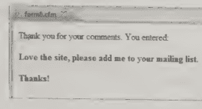

## 列表 12.10 form6_action.cfm—使用`ParagraphFormat`

```
<!--

Name: form6_action.cfm

Author: Ben Forta (ben@fortia.com)

Description: 表单介绍

Created: 01/01/2010

-->

<html

<head>

<title>学习 ColdFusion 表单 6</title>

</head>

<body>

<!-- 向用户显示反馈 -->

<cfoutput>

感谢您的评论。您输入了：

<p><strong>#ParagraphFormat(FORM.comments)##</strong></p>

</cfoutput>

</body>

</html>
```


# 按钮处理

HTML 表单规范仅支持两种类型的按钮。几乎所有的表单（包括你在本章中创建的所有表单）都有一个提交（Submit）按钮。顾如其名，提交按钮指示浏览器将表单字段提交到 Web 服务器。

> 提示：较新的浏览器实际上不需要提交按钮，它们在按下 Enter (Windows) 或 Return (Mac) 键时会强制提交。

第二种支持的按钮类型是重置（Reset）。重置会清除所有表单输入，并且如果存在任何默认值则返回这些值。输入到`<input type='text'>`或`<textarea>`字段中的任何文本都会被清除，复选框、列表框和单选按钮的选择也是如此。许多表单都有重置按钮，但你永远不需要超过一个。

## 提示

易用性专家对重置按钮持反对意见，因为许多人在想提交时会不小心点击了它们。

另一方面，你可能需要多个一个提交按钮。例如，如果你正在使用表单修改记录，你可以设置两个提交按钮：一个用于更新（Update），另一个用于删除（Delete）。（当然，你也可以使用两个表单来完成此任务。）如果你创建了多个提交按钮，必须使用`name`属性为按钮命名，并确保为每个按钮分配不同的`value`属性。列表 12.11 中的代码包含一个重置按钮和两个提交按钮。

## 列表 12.11 form7.cfm—带有重置的模板

```
<!--
Name:           form7.cfm
Author:         Ben Forta (ben@forta.com)
Description:    表单介绍
Created:        01/01/2010
-->
<html>
<head>
<title>学习 ColdFusion 表单 7</title>
</head>
<body>
<!-- 更新/删除表单 -->
<form action="form7_action.cfm" method="POST">
<p>
电影:
<input type="text" name="MovieTitle">
</p>
<p>
<!-- 提交按钮 -->
<input type="submit" name="Operation" value="Update">
<input type="submit" name="Operation" value="Delete">
<!-- 重置按钮 -->
<input type="reset" value="Clear">
</p>
</form>
</body>
</html>
```

此代码的结果如图 12.11 所示。

## 图 12.11

当你使用多个按钮时，必须为每个按钮分配不同的值。


当你命名提交按钮时，像处理任何其他表单字段一样处理它们。列表 12.12 展示了如何确定点击了哪个提交按钮。代码`<cfif FORM.Operation IS "Update">`检查是否点击了更新按钮，而`<elseif FORM.Operation IS "Delete">`检查是否点击了删除，但仅在未点击更新按钮的情况下检查。

## 列表 12.12 form7_action.cfm—多个提交按钮处理

```
Name: form7_action.cfm
Author: Ben Forta (ben@fort.com)
Description: 表单介绍
Created: 01/01/2010
--
<html>
<head>
<title>学习 ColdFusion 表单 7</title>
</head>
<body>
<!---- 用户反馈 -->
<cfoutput>
<cfif FORM.Operation IS "Update">
<!---- 点击了更新按钮 -->
你选择了 <strong>更新</strong> #MovieTitle#
<elseif FORM.Operation IS "Delete">
<!---- 点击了删除按钮 -->
你选择了 <strong>删除</strong> #MovieTitle#
</cfif>
</cfoutput>
</body>
</html>
```

# 创建动态 SQL 语句

注意

本节使用`<cfquery>`标签进行数据访问，这里的示例应该像前一节描述的那样使用 ColdFusion 组件（CFC）。但是，为了保持示例更简单，我将违反我刚刚教给你的规则。我猜每条规则都有例外。

## 第 12 章 ColdFusion 表单

现在你已经熟悉了表单以及 ColdFusion 如何处理它们，你可以返回到创建电影搜索界面了。第一个界面允许访问者通过标题搜索电影。因为这需要文本输入，你将需要一个类型为 text 的`<input>`字段。字段名称可以是任意的，但使用与你正在比较的值的表列相同的名称通常是一个好主意。

提示

当你创建搜索界面时，可以给表单起任何你想要的描述性名称。然而，在开始构建 ColdFusion 应用初期，你可能希望确保字段名称与表列名匹配，以便使 HTML 字段和 SQL 的匹配更加简单。

列表 12.13 中的代码包含一个简单的 HTML 表单，与你在本章早些创建的表单相似。该表单包含一个名为`MovieTitle`的单文本字段和一个提交按钮。

- 列表 12.13 `search.cfm`—电影搜索界面代码列表

```
<--
Name: search.cfm
Author: Ben Forta (ben@forta.com)
Description: 创建搜索界面
Created: 01/01/2010
-->
<html>
<head>
<title>Orange Whip Studios - 电影</title>
</head>
<body>
<!-- 页面头部 -->
<cfinclude template="header.cfm">
<!-- 搜索表单 -->
<form action="results.cfm" method="POST">
<table align="center" border="1">
<tr>
<td>
电影:
</td>
<td><input type="text" name="MovieTitle">
</td>
</tr>
<tr>
<td colspan="2">
<input type="submit" value="搜索">
</td>
</tr>
</table>
</form>
</body>
</html>
```

将此表单保存为`search.cfm`，然后执行它以显示如图 12.12 所示的界面。

## 图 12.12

电影搜索界面允许用户通过标题搜索。

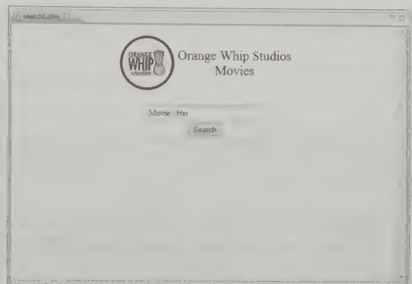

列表 12.13 起于注释块，紧接着是标准的 HTML 表头和`<body>`标签。然后使用`<include>`标签包含一个公共头部文件。表单本身放置在 HTML 表格中。表单包含一个名为`MovieTitle`的单文本字段和一个提交按钮。`<form> action="results.cfm"`指示 ColdFusion 使用列表 12.14 中的模板。

## 列表 12.14 results1.cfm—SQL 中的表单字段

```
<!--
Name: results1.cfm
Author: Ben Forta (ben@forta.com)
Description: 创建搜索界面
Created: 01/01/2010
-->
```

## 第 12 章 ColdFusion 表单

列表 12.14（续）

```
<!-- 从数据库获取电影列表 -->
<cfquery name="movies" datasource="ows">
SELECT MovieTitle, PitchText,
  Summary, DateInaters
FROM Films
WHERE MovieTitle LIKE '%%#FORM.MovieTitle#%%
  ORDER BY MovieTitle
</cfquery>
<!-- 创建 HTML 页面 -->
<html>
<head>
<title>Orange Whip Studios - 电影</title>
</head>
<body>
<!-- 页面头部 -->
<cfinclude template="header.cfm">
<!-- 显示电影列表 -->
<table>
<tr>
<th colspan="2">
<cfoutput>
<font size="*3">电影列表 (#Movies.RecordCount# 个电影)</font>
</cfoutput>
</th>
</tr>
<cfoutput query="movies">
<tr>
<td>
<font size="+2"><strong>当前行#: #MovieTitle#</strong></font><br>
<font size="+1"><em>#PitchText#</em></font>
</td>
<td>
<td-发行日期: #DateFormat(DateInaters)#</td>
<td></td>
</tr>
<tr>
<td colspan="2">#Summary#</td>
</td>
</tr>
</cfoutput>
</table>
</body>
</html>
```

列表 12.14 中的代码基于上一节创建的电影列表，因此大部分代码应该非常熟悉。这里唯一巨大的变化是在`<cfquery>`标签中。

列表 12.14 中的`WHERE`子句包含一个 ColdFusion 字段而不是静态值。因此，查看以下 WHERE 子句：

```
WHERE MovieTitle LIKE '%%#FORM.MovieTitle#%%'
```

`FORM.MovieTitle#`将被替换为`MovieTitle`字段中输入的任何内容。如果输入了单词 Her，那么 WHERE 子句将变为

```
WHERE MovieTitle LIKE '%Her%'
```

这将找到在`MovieTitle`中任何位置包含该文本的所有电影。如果你搜索所有以 C 结尾的电影，代码`WHERE MovieTitle LIKE '%#FORM.MovieTitle#%'`就会变成`MovieTitle LIKE '%%C'`，依此类推。你可以对任何子句执行此操作，而不只是 LIKE 运算符。

注意
如果完全没有指定搜索文本，该子句将变为`MovieTitle LIKE '%%'`——这是一个通配符搜索，找到所有记录。

- 参见第 10 章以了解`<CFQUERY>`标签的介绍。
- 参见第 6 章以了解 LIKE 运算符的解释。

你使用 LIKE 允许用户输入部分文本。子句`WHERE MovieTitle = 'Her'`仅查找标题为 Her 的电影；标题中包含 Her 以及其他文本的电影将不会被检索。使用通配符（如`MovieTitle LIKE '%Her%'`）允许用户也对部分名称进行搜索。

尝试尝试不同的搜索字符串。示例输出应该看起来如图 12.13 所示。取决于你指定的搜索标准，你自然会看到不同的搜索结果。

## 图 12.13

动态构建 WHERE 子句，你可以动态创建不同的搜索条件。

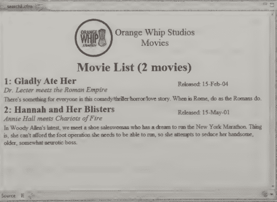

为了完成该应用程序，尝试复制电影详情页（在第 10 章中创建）并修改`results1.cfm`，使其能够对显示的搜索结果进行钻取（drill-down）。你将获得一个完整的钻取应用程序。

# 构建真正的动态语句

你刚在 Orange Whip Studios 推出电影搜索界面，立即发现自己被请求所淹没。你的用户问道：“按标题搜索很棒，但按宣传语（tag line）或评分搜索呢？”既然你已经引入了搜索数据的功能，你的用户希望能够在多个字段上进行搜索。

在搜索屏幕上添加字段是简单的。添加两个字段：一个用于宣传语，一个用于评分。更新后的搜索屏幕代码在列表 12.15 所示。

## 列表 12.15 search2.cfm—电影搜索屏幕

```
<---
    search2.cfm
Name:           Ben Orta (ben@forta.com)
Description:    Creating search screens
Created:        01/01/2010
-->
<html>
<head>
<title>Orange Whip Studios - Movies</title>
</head>
<body>
<!-- Page header -->
<cfinclude template="header.cfm">
<!-- Search form -->
<form action="results2.cfm" method="POST">
<table align="center" border="1">
<tr>
<td>
Movie:
</td>
<td>
<input type="text" name="MovieTitle">
</td>
</tr>
<tr>
<td>
Tag line:
</td>
<td>
<input type="text" name="PitchText">
</td>
</tr>
<tr>
<td>
Rating:
</td>
<td>
```

## 列表 12.15（续）

```
<input type="text" name="RatingID"> (1-6)
</td>
</tr>
<tr>
<td colspan="2" align="center">
<input type="submit" value="Search">
</td>
</tr>
</table>
</form>
</body>
</html>
```

此表单允许用户在三个字段之一指定指定，如图 12.14 所示。

## 图 12.14

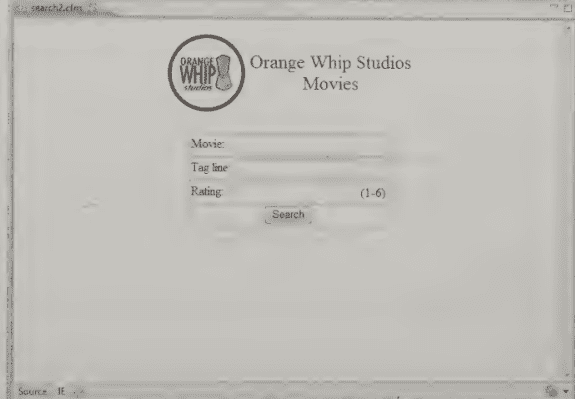

电影搜索屏幕现在允许通过三个字段进行搜索。

在实际执行搜索之前，你必须先创建一个搜索模板。完整的搜索代码在列表 12.16 所示；将此文件保存为`results2.cfm`。

## 列表 12.16 results2.cfm—动态构建 SQL 语句

```
<...
Name: results2.cfm
Author: Ben Forta (ben@forta.com)
Description: Creating search screens
Created: 01/01/2010
-->
<!-- 从数据库获取电影列表 -->
<cfquery name="movies" datasource="ows">
```

## 第 12 章 ColdFusion 表单

列表 12.16（续）

```
SELECT MovieTitle, PitchText, Summary, DateInTheaters
FROM Films
<!-- 按电影标题搜索 -->
<cfif FORM.MovieTitle IS NOT ''
WHERE MovieTitle LIKE '%#FORM.MovieTitle#%'
</cfif>
<!-- 按宣传语搜索 -->
<cfif FORM.PitchText IS NOT ''
WHERE PitchText LIKE '%#FORM.PitchText#%'
</cfif>
<!-- 按评分搜索 -->
<cfif FORM.RatingID IS NOT ''
WHERE RatingID = #FORM.RatingID#
</cfif>
ORDER BY MovieTitle
</cfquery>
<!-- 创建 HTML 页面 -->
<html>
<head>
<title>Orange Whip Studios - Movies</title>
</head>
<body>
<!-- 页面头部 -->
<cfinclude template='header.cfm'>
<!-- 显示电影列表 -->
<table>
<tr>
<cfoutput>
<th colspan="2"><font size="3">电影列表 (#movies.RecordCount)</font>
</th>
</cfoutput>
</tr>
<cfoutput query="movies">
<tr>
<td>
<font size="2">当前行: #MovieTitle#</strong><br>
<font size="1"><em>#PitchText#</em></font>
</td>
<td>发行日期: #DateFormat(DateInTheaters)#</td>
</tr>
<tr>
<td colspan="2">#Summary#</td>
</tr>
</cfoutput>
</table>
</body>
</html>
```


# 理解动态 SQL

在实际执行搜索之前，仔细查看列表 12.16 中的搜索模板。`<cfquery>` 标签与上一个搜索模板中使用的标签相似，但在这个模板中 `SELECT` 语句是不完整的。它没有指定用于执行搜索的 `WHERE` 子句，也没有指定搜索顺序。没有指定 `WHERE` 子句是因为搜索屏幕不支持该子句，而是支持以下搜索类型：

- 如果没有指定三个搜索字段中的任何一个，则不应使用 `WHERE` 子句，以便检索所有电影。
- 如果指定了电影标题，`WHERE` 子句必须过滤数据以找到指定的标题。例如，如果将 "the" 指定为搜索文本，`WHERE` 子句必须是 `MovieTitle LIKE '%the%'`。
- 如果指定了宣传语文本，`WHERE` 子句需要过滤数据以仅找到指定的文本。例如，如果将 "bad" 指定为搜索文本，`WHERE` 子句必须是 `PitchText LIKE '%bad%'`。
- 如果你按评分搜索并将 2 指定为搜索文本，则需要 `RatingID = 2` 的 `WHERE` 子句。

搜索模板如何处理所有这些搜索条件？答案是动态 SQL。

当你创建动态语句时，将语句拆分为独立的通用 SQL 和特定 SQL。通用 SQL 是你始终想要的 SQL 语句部分。示例 SQL 语句包含两个部分：

```sql
SELECT MovieTitle, PitchText, Summary, DateInTheaters
FROM Films
```

和：

```sql
ORDER BY MovieTitle
```

如果提供了搜索标准，通用部分就是需要的 SQL 语句。然而，如果指定了搜索文本，`WHERE` 子句的数量是无限的。

再次查看列表 12.16 以理解创建动态语句的过程。代码 `<cfif FORM.MovieTitle IS NOT ''>` 检查 `MovieTitle` 表单字段是否为空。如果在搜索表单的 `MovieTitle` 字段中没有输入文本，该条件将失败，在这种情况下，`</cfif>` 之前的任何代码都会被忽略。

- 参见第 9 章如何使用 `<CFIF>`。

如果 `MovieTitle` 字段中出现值，则处理代码 `WHERE MovieTitle LIKE '#FORM.MovieTitle%'` 并将其附加到 SQL 语句。`#FORM.MovieTitle#` 是一个字段，替换为 `MovieTitle` 字段中输入的任何内容。如果将 "the" 指定为搜索文本，此搜索将转换为 `WHERE MovieTitle LIKE '%the%'`。该文本被附加到之前的 SQL 语句，现在它变为：

```sql
SELECT MovieTitle, PitchText, Summary, DateInTheaters
FROM Films
WHERE MovieTitle LIKE '%the%'
```

你只需要 `ORDER BY` 子句。即使 `ORDER BY` 是固定的且不随不同的搜索而改变，它也必须动态构建，因为如果存在 `WHERE` 子句，`ORDER BY` 必须在其之后。在 ColdFusion 处理完 `ORDER BY` 后，完成的 SQL 语句如下：

```sql
SELECT MovieTitle, PitchText, Summary, DateInTheaters
FROM Films
WHERE MovieTitle LIKE '%%'
ORDER BY MovieTitle
```

你不能在 SQL 语句中使用双引号。当 ColdFusion 遇到双引号时，它认为已经到达 SQL 语句的结束。它会生成错误消息，因为在不应该有文本的地方出现了文本。要在 SQL 语句中包含字符串，请仅使用单引号。

同样，如果指定 `RatingID`（例如值 2）作为搜索文本，完整的 SQL 语句如下：

```sql
SELECT MovieTitle, PitchText, Summary, DateInTheaters
FROM Films
WHERE RatingID = 2
ORDER BY MovieTitle
```

代码 `<cfif FORM.MovieTitle IS NOT ''>` 结果为 FALSE，因为 `FORM.MovieTitle` 实际上是空的；ColdFusion 随后检查下一个条件，该条件也是 FALSE，依此类推。因为指定了 `RatingID`，第三个 `<CFIF>` 条件为 TRUE，生成了 `SELECT` 语句。

你可能注意到 `FORM.MovieTitle` 和 `FORM.PitchText` 周围有单引号，但 `FORM.RatingID` 没有。为什么？因为 `MovieTitle` 和 `PitchText` 在数据库中有数据类型，而 `RatingID` 是数值。它不是无类型的，并且需要你在需要时指定引号以创建字符串。

因此，一个模板能够生成四组不同的 SQL `SELECT` 语句，其值可以是动态的。现在执行各种搜索，但目前每次只使用一个表单字段。

## 拼接 SQL 子句

现在尝试在两个搜索字段中输入，或者在所有字段。发生了什么？你可能生成了如图 12.15 所示的错误。

### 图 12.15

必须仔细生成动态 SQL 以避免产生无效的 SQL。

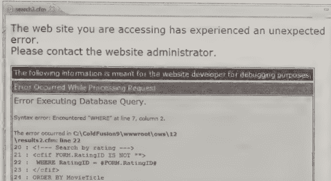

为什么会发生这种情况？嗯，假设指定的 `MovieTitle` 是 "Movie"，`RatingID` 是 2。通过一遍 `<if>` 语句来查看生成的 SQL 会像什么样。第一个条件为 TRUE，第二个为 FALSE，第三个为 TRUE。`SELECT` 语句看起来如下：

```sql
SELECT MovieTitle, PitchText, Summary, DateInTheaters
FROM Films
WHERE MovieTitle LIKE '%the%'
WHERE RatingID = 2
ORDER BY MovieTitle
```

显然，这不是一个有效的 `SELECT` 语句——只允许一个 `WHERE` 子句。该语句的正确语法是：

```sql
SELECT MovieTitle, PitchText, Summary, DateInTheaters
FROM Films
WHERE MovieTitle LIKE '%the%'
AND RatingID = 2
ORDER BY MovieTitle
```

那么，你如何生成这段代码呢？你不能硬编码任何带有 `WHERE` 或 `AND` 的条件，因为你不知道哪一个是第一个。`MovieTitle` 子句如果使用，将始终是第一个，但它并不总是被使用。

一个显而易见的解决方案（我建议你不一切避免）是使用嵌入的 `<if>` 语句来根据需要智能地使用 `WHERE` 或 `AND`。然而，这类代码非常复杂且容易出错。

更好的解决方案是根本不需要 `WHERE`——只使用 `AND`。你如何做到这一点呢？通过以下 SQL 语句：

```sql
SELECT MovieTitle, PitchText, Summary, DateInTheaters
FROM Films
```

# 第 12 章 ColdFusion 表单

```sql
WHERE 0=0
AND MovieTitle LIKE '%the%'
AND RatingID = 2
ORDER BY MovieTitle
```

`WHERE 0=0` 是一个占位子句。显然，0 等于 0，`WHERE 0=0` 会检索表中的每一行。对于每一行，数据库都会检查它是否为 0，当然，它总是如此的。这是一个合法的 `WHERE` 子句，但它没有任何作用，因为它是始终为真的。

那么为什么要用它呢？很简单。现在有了 `WHERE` 子句，你可以安全地对每个动态条件使用 `AND`。如果不存在其他条件，那么将评估 `WHERE 0=0`。如果存在附加条件，无论有多少个，都可以使用 `AND` 附加。

## 注意

`0=0` 并没有什么神奇之处。你可以使用任何在 `'A'='A'` 时为 TRUE 的条件。`WHERE primary key = primary key`（使用表的主键），以及你想要的几乎任何其他。

代码列表 12.17 包含一个修改后的搜索页面（这次使用下拉列表来选择分级）；将其保存为 `search3.cfm`。代码列表 12.16 显示了新改进的搜索界面。

### 代码列表 12.16

下拉列表框非常适合从一组有限的中进行选择。

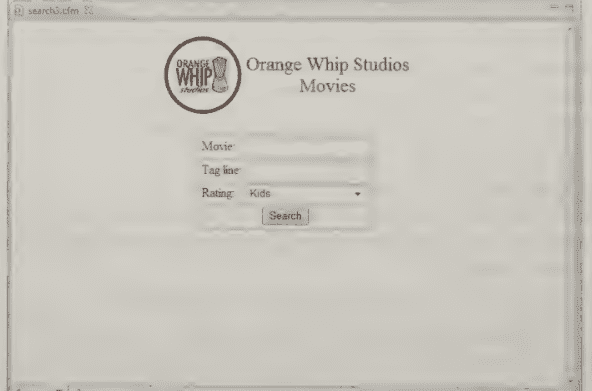

代码列表 12.18 包含修改后的搜索页面；将其保存为 `results3.cfm`。

### 代码列表 12.17 search3.cfm——修改后的电影搜索界面

```html
<---
Name: search3.cfm
Author: Ben Forta (ben@forta.com)
Description: Creating search screens
Created: 01/01/2010
-->
<html
```

### 代码列表 12.17（续）

```html
<head>
  <title>Orange Whip Studios - Movies</title>
</head>
<body><body>
  <!-- 页面头部 -->
  <cfinclude template="header.cfm">

  <!-- 搜索表单 -->
  <form action="results3.cfm" method="POST">
    <table align="center" border="1">
      <tr>
        <td>
          Movie:
        </td>
        <td>
          <input type="text" name="MovieTitle">
        </td>
      </tr>
      <tr>
        <td>
          Tag line:
        </td>
        <td>
          <input type="text" name="PitchText">
        </td>
      </tr>
      <tr>
        <td>
          Rating:
        </td>
        <td>
          <select name="RatingID">
            <option value=""></option>
            <option value="1">General (普通级)</option>
            <option value="2">Kids (儿童级)</option>
            <option value="3">Accompanied Minors (家长陪同级)</option>
            <option value="4">Teens (青少年级)</option>
            <option value="5">Adults (成年级)</option>
            <option value="6">Mature Audiences (成人级)</option>
          </select>
        </td>
      </tr>
      <tr>
        <td colspan="2" align="center">
          <input type="submit" value="Search (搜索)">
        </td>
      </tr>
    </table>
  </form>
</body>
</html>
```

# 第 12 章 ColdFusion 表单

代码列表 12.17 中唯一的变化是用于 `RatingID` 的下拉列表框。手动输入 1 到 6 并不直观，而且非常容易出错。对于像这样的下拉列表的有限列表，使用选择框是更好的选择。不过，这并不会改变字段的处理。无论如何，`RatingID` 都会被发送到操作页面，如代码列表 12.18 所示。

### 代码列表 12.18 results3.cfm——拼接 SQL 子句

```cfm
<!--
Name:       results3.cfm
Author:     Ben Forta (ben@forta.com)
Description: Creating search screens
Created:     01/01/2010
-->

<!-- 从数据库获取电影列表 -->
<query name="movies" datasource="ows">
SELECT MovieTitle, PitchText, Summary, DateInTheaters
FROM Films
WHERE
<!-- 按电影标题搜索 -->
<if FORM.MovieTitle IS NOT ""
AND MovieTitle LIKE '%#FORM.MovieTitle#'></if>

<!-- 按广告标语搜索 -->
<if FORM.PitchText IS NOT ""
AND PitchText LIKE '%#FORM.PitchText#'></if>

<!-- 按分级搜索 -->
<if FORM.RatingID IS NOT ""
AND RatingID = #FORM.RatingID#></if>

ORDER BY MovieTitle
</query>

<!-- 创建 HTML 页面 -->
<html
<head>
<title>Orange Whip Studios - Movies</title>
</head>
<body>
<!-- 页面头部 -->
<cfinclude template="header.cfm">

<!-- 显示电影列表 -->
<table>
<tr>
<th colspan="2">
<cfoutput>
<font size="3">Movie List (#Movies.RecordCount# 部电影)</font>
</cfoutput>
</th>
</tr>

<cfoutput query="movies">
<tr>
<td
```

### 代码列表 12.18（续）

```html
<font size="2"><strong>#CurrentRow# #MovieTitle#</strong></font><br>
<font size="1"><em>#PitchText#</em></font>
</td>
<td>Released: #DateFormat(InTheaters) (上映)</td>
<tr>
<td colspan="2">#Summary# (摘要)</td>
</tr>
</cfoutput>
</table>
</body>
</html>
```

`WHERE 0=0` 是一个占位子句。显然，0 等于 0，`WHERE 0=0` 会检索表中的每一行。对于每一行，数据库都会检查它是否为 0，当然，它总是如此的。这是一个合法的 `WHERE` 子句，但它没有任何作用，因为它是始终为真的。

那么为什么要用它呢？很简单。现在有了 `WHERE` 子句，你可以安全地对每个动态条件使用 `AND`。如果不存在其他条件，那么将评估 `WHERE 0=0`。如果存在附加条件，无论有多少个，都可以使用 `AND` 附加。

## 注意

`0=0` 并没有什么神奇之处。你可以使用任何在 `'A'='A'` 时为 TRUE 的条件。`WHERE primary key = primary key`（使用表的主键），以及你想要的几乎任何其他。

代码列表 12.17 包含一个修改后的搜索页面（这次使用下拉列表来选择分级）；将其保存为 `search3.cfm`。代码列表 12.16 显示了新改进的搜索界面。

### 代码列表 12.16

下拉列表框非常适合从一组有限的中进行选择。


代码列表 12.18 包含修改后的搜索页面；将其保存为 `results3.cfm`。

### 代码列表 12.17 search3.cfm——修改后的电影搜索界面

```html
<---
Name: search3.cfm
Author: Ben Forta (ben@forta.com)
Description: Creating search screens
Created: 01/01/2010
-->
<html
```

### 代码列表 12.17（续）

```html
<head>
  <title>Orange Whip Studios - Movies</title>
</head>
<body><body>
  <!-- 页面头部 -->
  <cfinclude template="header.cfm">

  <!-- 搜索表单 -->
  <form action="results3.cfm" method="POST">
    <table align="center" border="1">
      <tr>
        <td>
          Movie:
        </td>
        <td>
          <input type="text" name="MovieTitle">
        </td>
      </tr>
      <tr>
        <td>
          Tag line:
        </td>
        <td>
          <input type="text" name="PitchText">
        </td>
      </tr>
      <tr>
        <td>
          Rating:
        </td>
        <td>
          <select name="RatingID">


# 图 12.15

必须仔细生成动态 SQL 以避免产生无效的 SQL。


为什么会发生这种情况？嗯，假设指定的`MovieTitle`是`"Movie"`，`RatingID`是`2`。通过一遍`<if>`语句来查看生成的 SQL 会像什么样。第一个条件为 TRUE，第二个为 FALSE，第三个为 TRUE。`SELECT`语句看起来如下：

```
SELECT MovieTitle, PitchText, Summary, DateInTheaters
FROM Films
WHERE MovieTitle LIKE '%the%'
WHERE RatingID = 2
ORDER BY MovieTitle
```

显然，这不是一个有效的`SELECT`语句——只允许一个`WHERE`子句。该语句的正确语法是：

```
SELECT MovieTitle, PitchText, Summary, DateInTheaters
FROM Films
WHERE MovieTitle LIKE '%the%'
AND RatingID = 2
ORDER BY MovieTitle
```

那么，你如何生成这段代码呢？你不能硬编码任何带有`WHERE`或`AND`的条件，因为你不知道哪一个是第一个。`MovieTitle`子句如果使用，将始终是第一个，但它并不总是被使用。

一个显而易见的解决方案（我建议你绝对避免）是使用嵌入的`<if>`语句来根据需要智能地使用`WHERE`或`AND`。然而，这类代码非常复杂且容易出错。

更好的解决方案是根本不需要`WHERE`——只使用`AND`。你如何做到这一点呢？通过以下 SQL 语句：

```
SELECT MovieTitle, PitchText, Summary, DateInTheaters
FROM Films
WHERE 0=0
AND MovieTitle LIKE '%the%'
AND RatingID = 2
ORDER BY MovieTitle
```

`WHERE 0=0`是一个占位子句。显然，`0`等于`0`，`WHERE 0=0`会检索表中的每一行。对于每一行，数据库都会检查它是否为`0`，当然，它总是如此的。这是一个合法的`WHERE`子句，但它没有任何作用，因为它是始终为真的。

那么为什么要用它呢？很简单。现在有了`WHERE`子句，你可以安全地对每个动态条件使用`AND`。如果不存在其他条件，那么将评估`WHERE 0=0`。如果存在附加条件，无论有多少个，都可以使用`AND`附加。

# 注意

`0=0`并没有什么神奇之处。你可以使用任何在`'A'='A'`时为 TRUE 的条件。`WHERE primary key = primary key`（使用表的主键），以及你想要的几乎任何其他。

代码列表 12.17 包含一个修改后的搜索页面（这次使用下拉列表来选择分级）；将其保存为`search3.cfm`。代码列表 12.16 显示了新改进的搜索界面。

# 代码列表 12.16

下拉列表框非常适合从一组有限的中进行选择。


代码列表 12.18 包含修改后的搜索页面；将其保存为`results3.cfm`。

# 代码列表 12.17 `search3.cfm`——修改后的电影搜索界面

```
<!--
Name:      search3.cfm
Author:    Ben Forta (ben@forta.com)
Description: Creating search screens
Created:   01/01/2010
-->
```

# 代码列表 12.17 (续)

```
<html>
<head>
  <title>Orange Whip Studios - Movies</title>
</head>
<body>
  <!-- 页面头部 -->
  <cfinclude template="header.cfm">
  <!-- 搜索表单 -->
  <form action="results3.cfm" method="POST">
    <table align="center" border="1">
      <tr>
        <td>
        Movie:
      </td>
        <td>
        <input type="text" name="MovieTitle">
      </td>
      </tr>
      <tr>
        <td>
        Tag line:
      </td>
        <td>
        <input type="text" name="PitchText">
      </td>
      </tr>
      <tr>
        <td>
        Rating:
      </td>
        <td>
        <select name="RatingID">
          <option value=""></option>
          <option value="1">General</option>
          <option value="2">Kids</option>
          <option value="3">Accompanied Minors</option>
          <option value="4">Teens</option>
          <option value="5">Adults</option>
          <option value="6">Mature Audiences</option>
        </select>
      </td>
      </tr>
      <tr>
        <td colspan="2" align="center">
        <input type="submit" value="Search">
        </td>
      </tr>
    </table>
  </form>
</body>
</html>
```

# 第 12 章 ColdFusion 表单

代码列表 12.17 中唯一的变化是用于`RatingID`的下拉列表框。手动输入`1`到`6`并不直观，而且非常容易出错。对于像这样的下拉列表的有限列表，使用选择框是更好的选择。不过，这并不会改变字段的处理。无论如何，`RatingID`都会被发送到操作页面，如代码列表 12.18 所示。

代码列表 12.18 `results3.cfm`——拼接 SQL 子句

```
<!--
Name:       results3.cfm
Author:     Ben Forta (ben@forta.com)
Description: Creating search screens
Created:     01/01/2010
-->
<!-- 从数据库获取电影列表 -->
<query name="movies" datasource="ows">
SELECT MovieTitle, PitchText, Summary, DateInTheaters
FROM Films
WHERE
<!-- 按电影标题搜索 -->
<if FORM.MovieTitle IS NOT ""
AND MovieTitle LIKE '%#FORM.MovieTitle#'></if>
<!-- 按广告标语搜索 -->
<if FORM.PitchText IS NOT ""
AND PitchText LIKE '%#FORM.PitchText#'></if>
<!-- 按分级搜索 -->
<if FORM.RatingID IS NOT ""
AND RatingID = #FORM.RatingID#></if>
ORDER BY MovieTitle
</query>
<!-- 创建 HTML 页面 -->
<html>
<head>
```

# 代码列表 12.18 (续)

```
<title>Orange Whip Studios - Movies</title>
</head>
<body>
<!-- 页面头部 -->
<cfinclude template="header.cfm">
<!-- 显示电影列表 -->
<table>
<tr>
<th colspan="2">
<cfoutput>
<font size="3">Movie List (#Movies.RecordCount# 部电影)</font>
</cfoutput>
</th>
</tr>
<cfoutput query="movies">
<tr>
<td>
<font size="2"><strong>#CurrentRow# #MovieTitle#</strong></font><br>
<font size="1"><em>#PitchText#</em></font>
</td>
<td>Released: #DateFormat(DateInTheaters) (上映)</td>
<tr>
<td colspan="2">#Summary# (摘要)</td>
</tr>
</cfoutput>
</table>
</body>
</html>
```

# 代码列表 12.19 `search4.cfm`——数据驱动表单

```
<!--
Name:       search4.cfm
Author:     Ben Forta (ben@forta.com)
Description: Creating search screens
Created:    01/01/2010
-->
<!-- 获取分级 -->
<query datasource="ows" name="ratings">
SELECT RatingID, Rating
FROM FilmsRatings
ORDER BY RatingID
</query>
<html>
<head>
<title>Orange Whip Studios - Movies</title>
</head>
<body>
<!-- 页面头部 -->
<cfinclude template="header.cfm">
<!-- 搜索表单 -->
<form action="results3.cfm" method="POST">
<table align="center" border="1">
  <tr>
    <td>
    Movie:
    </td>
    <td>
    <input type="text" name="MovieTitle">
    </td>
  </tr>
  <tr>
    <td>
    Tag line:
    </td>
    <td>
    <input type="text" name="PitchText">
    </td>
  </tr>
  <tr>
    <td>
    Rating:
    </td>
    <td>
    <select name="RatingID">
      <cfoutput query="ratings">
        <option value="#ratings.RatingID#">#ratings.Rating#</option>
      </cfoutput>
    </select>
    </td>
  </tr>
  <tr>
    <td colspan="2" align="center">
    <input type="submit" value="Search">
    </td>
  </tr>
</table>
</form>
</body>
</html>
```


```html
<title>Orange Whip Studios - Movies</title>
</head>

<body>

<!-- 页面头部 -->

<cfinclude template="header.cfm">

<!-- 显示电影列表 -->

<table>

<tr>

<th colspan="2">

<cfoutput>

<font size="3">Movie List (#Movies.RecordCount# 部电影)</font>

</cfoutput>

</th>

</tr>

<cfoutput query="movies">

<tr>

<td>
```

## 代码列表 12.18（续）

```html
<font size="2"><strong>#CurrentRow# #MovieTitle#</strong></font><br>

<font size="1"><em>#PitchText#</em></font>

</td>

<td>Released: #DateFormat(DateInTheaters) (上映)</td>

<tr>

<td colspan="2">#Summary# (摘要)</td>

</tr>

</cfoutput>

</table>

</body>

</html>
```

`WHERE 0=0` 是一个占位子句。显然，`0` 等于 `0`，`WHERE 0=0` 会检索表中的每一行。对于每一行，数据库都会检查它是否为 `0`，当然，它总是如此的。这是一个合法的 `WHERE` 子句，但它没有任何作用，因为它是始终为真的。

那么为什么要用它呢？很简单。现在有了 `WHERE` 子句，你可以安全地对每个动态条件使用 `AND`。如果不存在其他条件，那么将评估 `WHERE 0=0`。如果存在附加条件，无论有多少个，都可以使用 `AND` 附加。

# 注意

`0=0` 并没有什么神奇之处。你可以使用任何在 `'A'='A'` 时为 `TRUE` 的条件。`WHERE primary key = primary key`（使用表的主键），以及你想要的几乎任何其他条件。

代码列表 12.17 包含一个修改后的搜索页面（这次使用下拉列表来选择分级）；将其保存为 `search3.cfm`。代码列表 12.16 显示了新改进的搜索界面。

# 代码列表 12.16

下拉列表框非常适合从一组有限的选项中进行选择。


代码列表 12.18 包含修改后的搜索页面；将其保存为 `results3.cfm`。

# 代码列表 12.17：`search3.cfm`——修改后的电影搜索界面

（此处已翻译）

# 列表 12.19（续）

```html
<td>

<select name="RatingID">

  <option value=""></option>

  <cfoutput query="ratings">

    <option value="#RatingID">#Rating#</option>

  </cfoutput>

</select>

</td></tr>

<tr>

<td colspan="2" align="center">

  <input type="submit" value="Search">

</td>

</tr>

</table>

</form>
```

列表 12.19 中的代码演示了一个数据驱动表单。模板顶部的 `<cfquery>` 你现在应该熟悉了。它创建了一个名为 `ratings` 的结果集，包含了数据库中每个评分的 ID 和名称。

下拉列表框也发生了变化。`<select>` 标签创建列表框并用 `</select>` 标签结束，但它位于一个 `<cfoutput>` 块内部。列表框中的单独条目使用 `<option>` 标签指定，但在这里它们位于 `<cfoutput>` 块中。该块为 `<cfquery>` 获取的每一行执行一次，为每一行创建一个条目。

在遍历结果集时，`<cfquery>` 块创建单独的对象，使用 `RatingID` 字段作为值，使用 `Rating` 作为描述。当 ColdFusion 处理 `RatingID` `1`（General）时，生成的代码为：

```html
<option value="1">General</option>
```

最终结果与之前在图 12.16 中显示的屏幕完全相同，但这次是由数据库查询填充的（而不是硬编码的）。

另外请注意列表框中包含了一个空白的 `<option>` 行。请记住，列表框总有一个选中项，因此如果你想允许用户不选择任何选项，你需要给他们一个*无选项*（即空白选项）。

就是这样：使用动态数据驱动 SQL 执行动态数据驱动搜索的动态数据驱动表单。

# 第 13 章：表单数据验证

## 本章内容

- 理解表单验证 235
- 使用服务器端验证 237
- 使用客户端验证 249
- 综合运用 259

## 理解表单验证

HTML 表单通过多种字段类型从用户那里收集数据。表单用于数据输入、作为前端搜索引擎、填写订单、签署访客簿、为安全应用程序提供用户名和密码等。尽管表单已成为 HTML 中最重要的功能之一，但这些表单几乎没有提供任何数据验证工具。

在开发 Web 应用程序时这变成了一个真正的问题。作为开发者，你需要能够控制用户输入到字段中的数据。如果没有这些，你的程序将因为不匹配或意料之外的数据而不断崩溃。到目前，你仅将表单用作搜索前端——而当表单用于插入或更新数据库表时（如你将在第 14 章“添加或更改数据的表单”中看到的），这会变得至关重要。

幸运的是，ColdFusion 提供了一套完整且健壮的工具来实现表单数据验证，包括客户端和服务器端。

HTML 自诞生以来，一直为 Web 页面开发者提供了多种格式化和显示数据的方法。随着 HTML 规范的每次修订，提供了额外的数据显示机制。结果是 HTML 是一个强大的数据发布工具。

尽管其数据呈现选项不断改进，但 HTML 的数据收集能力仍不如人意。事实上，自该语言早期以来，它们几乎没有发生变化。虽然 HTML 5 有改变的希望，但在本书编写期间，最广泛使用的浏览器并不支持增强的表单选项。因此，我们必须使用广泛使用的浏览器支持的表单选项。

HTML 数据收集是通过表单执行的。HTML 表单支持以下字段类型：

- 自由格式文本字段
- 选择框（或下拉列表框）
- 单选按钮
- 复选框
- 多行文本框
- 密码（隐藏输入）框

请参阅第 12 章“ColdFusion 表单”，获取更多关于 HTML 表单以及在 ColdFusion 中使用它们的信息。

那么，这个列表有什么问题呢？实际上没问题。这些字段类型都是你期望在任何开发语言中都能提供的标准字段。然而，问题在于这些字段的能力极其局限。主要有两个局限性：

- 无法将字段设置为必填项
- 无法定义数据类型或过滤器，例如，只接受数字、邮政编码、电子邮件地址或电话号码

这意味着没有简单的方法可以告诉 HTML，如果某些字段留空则不允许表单提交。同样，也无法指示 HTML 在特定字段中仅接受某些值或类型的数据。

HTML 本身恰好有一个验证选项，即 `maxlength` 属性，可以用于指定在文本字段中可以输入的字符最大数量。也就是说——没有其他验证选项可用。

为了克服这些局限性，HTML 开发者通常采用两种形式的验证选项：

- 服务器端验证
- 客户端验证

## 比较服务器端验证和客户端验证

服务器端验证涉及在表单提交后检查必填字段或无效值。服务器上的脚本首先验证表单，只有在满足所有验证要求后才继续处理。通常，如果验证失败，会将错误消息发送回用户的浏览器；用户返回页面进行修正并重新提交表单。当然，重新提交时必须再次验证表单，如果验证再次失败，必须重复该过程。

客户端脚本允许开发者在 HTML 代码中向浏览器嵌入指令。由于 HTML 本身没有提供执行此操作的机制，开发者转向使用脚本语言，例如 JavaScript，几乎每个浏览器都支持。这些解释语言支持基本的数据处理和用户反馈，非常适合表单验证。为了验证表单，作者会创建一个在点击提交按钮时立即执行的函数。该函数将在浏览器内部直接执行任何必要的验证，并仅在验证检查成功后才允许提交。这种方法的优点是，用户不需要提交表单就能发现发生了错误。任何错误通知都发生在表单提交之前。

## 每个选项的优缺点

这两个选项都不是完美的，因此它们经常被结合使用，互为补充。表 13.1 列出了每个选项的优缺点。

**表 13.1：客户端和服务器表单验证的优缺点**

| 验证类型 | 优点 | 缺点 |
|---|---|---|
| 服务器端 | 非常安全，无论使用什么浏览器都始终有效 | 不太用户友好，必须提交表单触发验证；任何错误都需要提交 |
| 客户端 | 更用户友好，用户更喜欢在提交表单前知道问题 | 不够安全，某些旧浏览器不支持；可以禁用；脚本语言的学习曲线较长 |

从用户的角度来看，客户端验证更优。显然，用户希望在提交表单进行处理*之前*就知道数据有问题。然而，从开发者的角度来看，服务器端验证的代码更简单，保证无论使用什么浏览器都有效，并且不太受浏览器兼容性问题的影响。

> 字段验证绝不应被认为是可选的，你应该养成在创建的每个表单中使用某种类型验证的习惯。不这样做将不可避免导致错误和应用程序崩溃。

## 使用服务器端验证

如前所述，服务器端验证涉及在应用程序中添加代码，在表单提交后执行表单验证。在 ColdFusion 中，这通常通过一系列 `<cfif>` 语句来实现，检查每个字段的值和数据类型。如果任何验证失败，可以使用 `<abort>` 函数终止处理，或者使用 `<oflocation>` 将用户重定向到另一个页面（可能是表单本身）。

## 使用手动服务器端验证

列表 13.1 所示的代码是一个简单的登录提示，用于访问内网站点。该文件（您应该将其保存为新目录 13 中的 `login1.cfm`）会提示输入用户 ID（user ID）和密码。HTML 唯一的验证规则 `maxlength` 被用于这两个字段，用以限制可以输入的字符数。表单本身如图 13.1 所示。

### 图 13.1

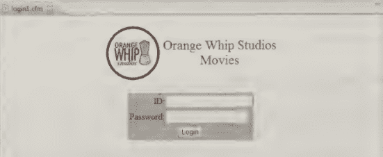

### 列表 13.1：`login1.cfm`—简单登录界面

```html
<!---

Name: login1.cfm

Author: Ben Porta (ben@forta.com)

Description: Basic server-side validation

Created: 01/01/2010

-->

<html>

<head>

<title>Orange Whip Studios - Intranet</title>

</head>

<body>

<!-- 页面头部 -->

<cfinclude template="header.cfm">

<!-- 登录表单 -->

<form action="process1.cfm" method="post">

<table align="center" bgcolor="orange">

<tr>

<td align="right">

ID:

</td>

<td>

<input type="text" name="LoginID" maxlength="5">

</td>

</tr>

</table>
```

### 列表 13.1（续）

```html
<tr>

<td align="right">

Password:

</td>

<td>

  <input type="password" name="LoginPassword" maxlength="20">

</td>

</tr>

<tr>

<td colspan="2" align="center">

  <input type="submit" value="Login">

</td>

</tr>

</table>

</form>

</body>

</html>
```

此特定表单将提交到一个名为 `process1.cfm` 的模板中（在 `action` 属性中指定）。该模板负责验证用户输入，并在所有验证规则通过后处理登录逻辑。在此处必需的验证规则有：

- 登录 ID（Login ID）是必填的。
- 登录 ID 必须是数字。
- 登录密码是必填的。

为了执行此验证，使用了三个 `<cfif>` 语句，如列表 13.2 所示。

### 列表 13.2：`process1.cfm`—基础服务器端登录验证代码

```html
<!--

Name: process1.cfm

Author: Ben Porta (ben@forta.com)

Description: Basic server-side validation

Created: 01/01/2010

-->

<html>

<head>

<title>Orange Whip Studios - Intranet</title>

</head>

<body>

<!------- 页面头部 -->

<cfinclude template="header.cfm">
```

### 第 13 章：表单数据验证

### 列表 13.2（续）

```html
<!-- 确保 Login 不为空 -->

<if Len(Trim(LoginID)) IS 0>

<h1>ERROR ID can't be left blank!</h1>

<cfabort>

</if>
```

```html
<!-- 确保 LoginID 是数字 -->

<if IsNumeric(LoginID) IS 'No'>

<h1>ERROR Invalid ID specified!</h1>

<cfabort>

</if>
```

```html
<!-- 确保 LoginPassword 不为空 -->

<if Len(Trim(LoginPassword)) IS 0>

<h1>ERROR Password can't be left blank!</h1>

<cfabort>

</if>
```

```html
<p align="center">

<h1>Intranet</h1>

</p>
```

内网内容将位于此处。

```html
<body>

</html>
```

第一个 `<cf>` 语句在用 `Trim()` 函数对 `LoginID` 进行修剪后检查其长度。使用 `Trim()` 函数是为了追踪那些空格字符，这些字符在文本字段中技术上是有效字符，但在此处无效的。如果 `Len()` 返回 `0`，则会显示错误消息，`<cfabort>` 语句将停止后续处理。

检查修剪后的字符串长度（以确定其是否为空）在功能上与与空字符串进行比较相同，例如：

```cfml
<cf Trim(LoginID) IS "">
```

我使用 `Len()` 来获取字符串长度（而不是与 `""` 比较）的原因是数字比较的处理速度通常比字符串比较更快。为了性能，我本可以消除比较值并使用以下代码：

```cfml
<cf not Len(Trim(LoginID))>
```

第二个 `<cf>` 语句检查数据类型。`IsNumeric()` 函数如果传递的值是数字（例如仅包含数字）则返回 `TRUE`，否则返回 `FALSE`。同样，如果 `<cf>` 检查失败，将显示错误并由 `<cfabort>` 停止后续处理，如图 13.2 所示。第三个 `<cf>` 检查是否指定了密码（并且字段没有留空）。

### 图 13.2

`<cfif>` 语句可用于验证检查，并在检查失败时显示错误消息。

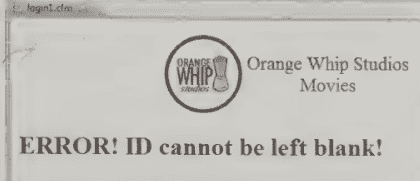

这种形式的验证是你可用的所有验证选项中最强大且灵活的。你可以使用的 `<cfif>` 语句数量没有限制。

这种验证形式是让你可用的所有验证选项中最强大且灵活的。你可以使用的 `<cfif>` 语句数量没有限制。

这种验证形式是是你可用的所有验证选项中最强大且灵活的。你可以使用的 `<cfif>` 语句数量没有限制。

这种验证形式是是你可用的所有验证选项中最强大且灵活的。你可以使用的 `<cfif>` 语句数量没有限制。

这种验证形式是是你可用的所有验证选项中最强大且灵活的。你可以使用的 `<cfif>` 语句数量没有限制。

这种验证形式是是你可用的所有验证选项中最强大且灵活的。你可以使用的 `<cfif>` 语句数量没有限制。

这种验证形式是是你可用的所有验证选项中最强大且灵活的。你可以使用的 `<cfif>` 语句数量没有限制。

这种验证形式是是你可用的所有验证选项中最强大且灵活的。你可以使用的 `<cfif>` 语句数量没有限制。由于此处出现重复，翻译逻辑如下：

```cfml
<cf not Len(Trim(LoginID))>
```

第二个 `<cf>` 语句检查数据类型。`IsNumeric()` 函数如果传递的值是数字（例如仅包含数字）则返回 `TRUE`，否则返回 `FALSE`。同样，如果 `<cf>` 检查失败，将显示错误并由 `<cfabort>` 停止后续处理，如图 13.2 所示。第三个 `<cf>` 检查是否指定了密码（并且字段没有留空）。

这种验证形式是是你可用的所有验证选项中最强大且灵活的。你可以使用的 `<cfif>` 语句数量没有限制。

这种验证形式是是你可用的所有验证选项中最强大且灵活的。你可以使用的 `<cfif>` 语句数量没有限制。

这种验证形式是是你可用的所有验证选项中最强大且灵活的。你可以使用的 `<cfif>` 语句数量没有限制。

这种验证形式是是你可用的所有验证选项中最强大且灵活的。你可以使用的 `<cfif>` 语句数量没有限制。

这种验证形式是是你可用的所有验证选项中最强大且灵活的。你可以使用的 `<cfif>` 语句数量没有限制。

这种验证形式是是你可用的所有验证选项中最强大且灵活的。你可以使用的 `<cfif>` 语句数量没有限制。

这种验证形式是是你可用的所有验证选项中最强大且灵活的。你可以使用的 `<cfif>` 语句数量没有限制。

这种验证形式是是你可用的所有验证选项中最强大且灵活的。你可以使用的 `<cfif>` 语句数量没有限制。


这种验证形式是你可用的所有验证选项中最强大且灵活的。你可以使用的`<cfif>`语句数量没有限制。

（由于原文结尾存在大量重复文本，已根据核心逻辑翻译）

```cfml
<cf not Len(Trim(LoginID))>
```

## 第13章 表单数据验证

### 图13.3

使用嵌入表单验证时，ColdFusion 会自动显示列出哪些检查未通过的错误消息。

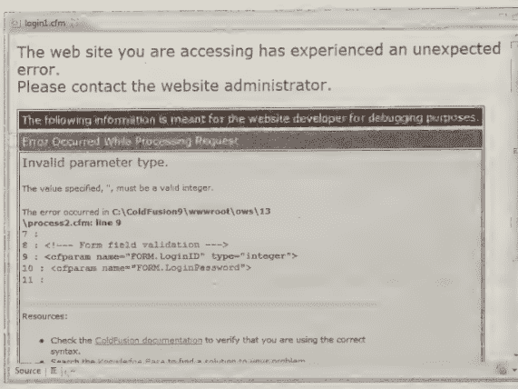

## 使用自动服务器端验证

服务器端验证是最安全的表单安全验证形式，但也可能变成维护的噩梦。ColdFusion 提供了救星！

ColdFusion 允许开发者在 HTML 表单中嵌入基本的表单验证指令。这些指令与表单的其他字段一起发送到用户的浏览器，但不会显示给用户。然而，当用户将表单提交回 Web 服务器时，这些隐藏字段也会被提交——ColdFusion 可以利用它们执行自动字段验证。

这些隐藏字段充当验证规则，ColdFusion 可以自动为你生成它们。例如，这通过一些新标签实现，如`<cfform>`和`<cfinput>`。

正如你已经看到的，`<form>`、`<input>`和相关标签被浏览器用于显示 HTML 表单。当 ColdFusion 在你的代码中看到`<form>`或`<input>`标签时，不会处理它们（如列表13.1所示）。它只是将它们传递给浏览器。ColdFusion 只处理 CFML 标签（或无块的表达式），而不处理 HTML 标签。

`<cfform>`是 ColdFusion 版本的`<form>`，`<cfinput>`是 ColdFusion 版本的`<input>`。这些标签可以互换，且代码：

```html
<cfform action="process.cfm" method="post">
  <input type="text" name="search">
  <input type="submit">
</cfform>
```

在功能上等同于：

```html
<cfform action="process.cfm" method="post">
  <cfinput type="text" name="search">
  <cfinput type="submit">
</cfform>
```

## 使用服务器端验证

当 ColdFusion 处理`<cform>`标签时，它会生成 HTML`<form>`标签；当它处理`<cfinput>`时，它会生成`<input>`。那么为什么要这样做呢？因为这些标签本质上封装了表单，允许 ColdFusion 根据需要插入其他代码，例如验证代码。例如，查看下面的代码段：

```html
<cfinput type="password"
name="LoginPassword"
maxlen="20"
required="yes"
message="Password is required!"
validateat="onServer">
```

此标签接受密码，就像列表13.1中看到的`<input>`一样。但与列表中的标签不同，这里使用了`<cfinput>`。一旦`<input>`被替换为`<cfinput>`，可能会引入额外的属性（这些 ColdFusion 的指令）。`required="yes"`告诉 ColdFusion 密码字段是必须的，`message`包含验证失败时显示的错误消息，而`validateat="onServer"`指令 ColdFusion 在提交后在服务器上验证页面。

当 ColdFusion 处理此标签时，它会生成并写入`<input>`标签（因为浏览器根本不知道`<cfinput>`是什么），并在`<form>`内部包含其他代码，以及包含验证规则的隐藏表单字段，ColdFusion 可以在提交时处理这些规则。

## 注意

`<cfinput>`标签必须在`<cform>`标签内使用：你不能将`<form>`与`<input>`配合使用。这样做会导致错误。

列表13.4包含更新后的登录界面，这次包含了提供验证规则的`<cform>`和`<cfinput>`标签。

## 列表13.4：`login2.cfm`—嵌入式服务器端验证规则

```html
<!--
Name:       login2.cfm
Author:     Ben Orta (ben@forta.com)
Description: Form field validation demo
Created:     01/01/2010
-->

<head>
<title>Orange Whip Studios - Intranet</title>
</head>

<body>
<!-- 页面头部 -->
<cfinclude template="header.cfm">

<!-- 登录表单 -->
<cfform action="process2.cfm"
```

## 列表13.4（续）

```html
<table align="center" color="orange">
<tr>
  <td align="right">
ID:
</td>
  <td>
    <cfinput type="text"
    name="LoginID"
    maxlength="5"
    required="yes"
    message="A valid numeric ID is required!"
    validate="integer"
    validateAt="onServer">
  </td>
</tr>
<tr>
  <td align="right">
Password:
</td>
  <td>
    <cfinput type="password"
    name="LoginPassword"
    maxlength="20"
    required="yes"
    message="Password is required!"
    validateAt="onServer">
  </td>
</tr>
<tr>
  <td colspan="2" align="center">
    <cfinput type="submit"
    name="Login"
    value="Login">
  </td>
</tr>
</table>
</cfform>
</body>
</html>
```

### 注意

使用`<cfinput>`时，每个表单字段都必须有一个`name`，即使是`type="button"`也是如此。

如果你运行这段代码，它看起来和之前完全一样（图13.1）。这是因为 ColdFusion 生成了相同的 HTML 表单代码。那么区别在哪里呢？查看源代码，你会发现 ColdFusion 生成的表单如下：

```html
<head>
<script type="text/javascript" src="CFIDE/scripts/cfform.js"></script>
<script type="text/javascript" src="CFIDE/scripts/masks.js"></script>
```

## 服务器端验证

```html
<title>Orange Whip Studios - Intranet</title>

<script type="text/javascript">/* <CDATA[ */
    if (window.ColdFusion) ColdFusion.required['LoginID']=true;
]]>*/script>

<script type="text/javascript">/* <CDATA[ */
    if (window.ColdFusion) ColdFusion.required['LoginPassword']=true;
]]>*/script>

<script type="text/javascript">
    CF_checkForm_1 = function(CF_this) {
        // onSubmit
        CF_error_exists = false;
        CF_error_messages = new Array();
        CF_error_fields = new Object();
        CF_FirstErrorField = null;

        // 显示错误消息并返回
        if(CF_error_messages.length > 0) {
            // show alert(1)
            CF_onError(CF_error_messages);
            // 如果字段支持，将焦点置于第一个错误
            if (CF_this[CF_FirstErrorField].type == "text") {
                CF_this[CF_FirstErrorField].focus();
            }
            return false;
        } else {
            return true;
        }
    }
</---->>script
</head>

<body>

<table align="center">
<tr>
<td></td>
<td align="center"><font size="+2">Orange Whip Studios<br>Movies</font></td>
</tr>
</table>

<form name="CFForm_1" id="CFForm_1" action="process2.cfm" method="post" onsubmit="return CF_checkForm_1(this)">

<table align="center" color="orange">
<tr>
  <td align="right">ID:
</td>
  <td>
    <cfinput type="text"
    name="LoginID"
    maxlength="5"
    required="yes"
    message="A valid numeric ID is required!"
    validate="integer"
    validateAt="onServer">
  </td>
</tr>
<tr>
  <td align="right">Password:
</td>
  <td>
    <cfinput type="password"
    name="LoginPassword"
    maxlength="20"
    required="yes"
    message="Password is required!"
    validateAt="onServer">
  </td>
</tr>
<tr>
  <td colspan="2" align="center">
    <cfinput type="submit"
    name="Login"
    value="Login">
  </td>
</tr>
</table>
</cfform>
</body>
</html>
```

### 注意

使用`<cfinput>`时，每个表单字段都必须有一个`name`，即使是`type="button"`也是如此。

如果你运行这段代码，它看起来和之前完全一样（图13.1）。这是因为 ColdFusion 生成了相同的 HTML 表单代码。那么区别在哪里？查看源代码，你会发现 ColdFusion 生成的表单如下：

```html
<head>
<script type="text/javascript" src="CFIDE/scripts/cfform.js"></script>
<script type="text/javascript" src="CFIDE/scripts/masks.js"></script>
```

### 图13.4

嵌入式服务器端验证捕捉的验证错误会抛出更友好的错误消息。

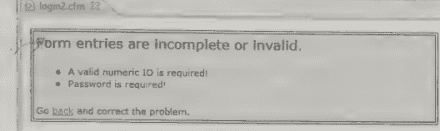

### 注意

这里的验证规则是由 ColdFusion 自动生成的。

你可以看到，验证规则简单且有效。而且由于验证规则被嵌入到表单中，你的表单及其规则不太可能不同步。

13.4中显示的屏幕是默认验证错误。可以使用`<error>`标签更改此屏幕。

这里的验证规则是由 ColdFusion 自动生成的。如果你需要，可以自己嵌入隐藏的验证规则，尽管你很少需要这样做。在 ColdFusion 的旧版本中，这是必要的，因为当时没有自动生成。

当然，当发生验证错误时，用户仍然必须返回表单进行修正。嵌入式验证规则的优势实际上只适用于开发者。嵌入式验证对提高用户体验没有帮助——对于这一点，你需要客户端验证。

## 使用客户端验证

使用服务器端验证最大的缺点是验证发生在表单提交之后。这意味着如果验证失败，用户必须返回表单、进行修正并将其重新提交到服务器。更糟糕的是，某些浏览器在点击后按钮时会丢失表单字段中的数据，强制用户重新输入所有数据。

幸运的是，有一种替代方案：客户端验证。

## 理解客户端验证

要执行客户端验证，你需要在 Web 页面上添加一系列浏览器指令。浏览器会解释这些指令，并在用户的计算机上（即客户端侧）在表单提交到服务器之前执行它们。

要验证表单，你编写一个脚本来拦截表单提交，并仅在通过一系列验证检查时允许其继续。如果任何检查失败，你就会显示错误消息并阻止表单提交。

当然，要做到这一点，你必须学习 JavaScript。

## 通过`<cform>`进行客户端验证

你已经看到 ColdFusion 如何通过自动为你生成代码来极大地简化服务器端验证。同样，它也可以对客户端验证执行相同的操作，生成验证表单字段所需的 JavaScript。最棒的部分是，你已经知道实现此功能所需的标签了：它们是`<cform>`和`<cfinput>`。

列表13.5包含了`login3.cfm`，它是`login2.cfm`的一个微调版本。它只进行了非常微小的修改。你能看出变化吗？

## 列表13.5：`login3.cfm`—客户端验证规则

```html
<!--
login3.cfm

Name:
Author: Ben Forta (ben@fora.com)
Description: Form validation demo
Created: 01/01/2010
-->

<head>
<title>Orange Whip Studios - Intranet</title>
</head>

<body>
<!-- Page header -->
<cfinclude template="header.cfm">

<!-- Login form -->
<cfform action="process2.cfm">

<table align="center" bgcolor="orange">
<tr>
<td align="right">
ID:
</td>
<td>
<cfinput type="text"
name="LoginID"
maxlength="5"
required="yes">
```


`message="A valid numeric ID is required!"`

`validate="integer"`

`validateAt="onSubmit"`

```
</td>
</tr>
<tr>
<td align="right">
Password:
</td>
<td>
<cfinput type="password"
name="LoginPassword"
maxlength="20"
```

# 列表 13.5 (续接)

```
required="yes"
message="Password is required!"
validateAt="onSubmit"
</td>
</tr>
<tr>
<td colspan="2" align="center">
  <input type="submit"
       name="submit"
       value="Login">
</td>
</tr>
</table>
```

```
</form>
</body>
</html>
```

列表 13.4 和 13.5 几乎完全相同。唯一的区别是 `<input>` 标签中的 `validateAt` 属性，它已经从 `validateAt="onSubmit"` 更改为 `validateAt="onSubmit"`。

`onSubmit` 告诉 ColdFusion 生成将由服务器处理的验证代码（如之前所示）。`onSubmit` 告诉 ColdFusion 生成在提交表单时将由浏览器处理的代码。`validateAt="onSubmit"` 生成 JavaScript 代码，并将其嵌入到你的表单中（方式与它嵌入用于服务器端验证的隐藏表单字段相同）。

运行 `login13.5.cf`；表单看起来应该和之前一模一样。但现在如果你生成了错误，你将在浏览器中直接看到一个弹出窗口，如图 13.5 所示。

### 图 13.5

客户端验证错误消息显示在浏览器的弹出框中。

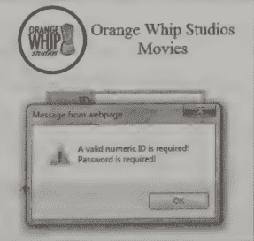

## 第 13 章 表单数据验证

使用客户端验证，表单从未被提交，因为它没有通过验证测试。`onSubmit` 本质上拦截了表单提交，只有在通过所有验证测试时才允许其继续。这显然是一个更友好的用户体验；如果用户看到像图 13.5 那样的弹出消息，他们将能够进行修正并恢复表单。

**注意**

弹出错误框是标准的浏览器对话框，它随浏览器而异，没有办法更改它的外观。你唯一可以更改的是实际错误消息本身。

值得注意的是，为了让这一切正常工作，背后有很多大量工作，而 ColdFusion 成功地让你免受了这些工作的影响。但只要查看源代码，就会发现生成的代码变得非常冗长且复杂：

```
<html
<script type="javascript" src="/CFIDE/scripts/cfform.js"></script>
<script type="javascript" src="/CFIDE/scripts/masks.js"></script>

<title>Orange Whip Studios Intranet</title>

<script type="javascript">/*[CDATA[ */
if (window.ColdFusion) ColdFusion.required['LoginID']=true;
*/</script>
<script type="javascript">/*[CDATA[ */
if (window.ColdFusion) ColdFusion.required['LoginPassword']=true;
*/</script>
<script type="javascript">
<!--
  _CF_checkCFForm_1 = function(_CF_this)
  {
    // reset on submit
    CF_error_exists = false;
    CF_error_messages = new Array();
    CF_error_fields = new Object();
    CF_Firsterror = null;

    // form element LoginID required check
    if (_CF.hasValue(_CF_this['LoginID'], 'TEXT', false )) {
      // form element LoginID 'INTEGER' validation checks
      if (_CF.checkonerror(_CF_this, 'LoginID').value, 'A valid numeric ID is required'); {
        CF_error_exists = true;
      }
    } else {
      CF_onerror(_CF_this, "LoginID", _CF_this['LoginID'].value, 'A valid numeric ID is required');
        CF_error_exists = true;
      }
    }
    // form element LoginPassword required check
```

### 使用客户端验证

```
if (!CF_hasValue(_CF_this['LoginPassword'], "PASSWORD", false ))
{
    _CF_onError(CF_this, 'LoginPassword', _CF_this['LoginPassword'].value,
    'Password is required!');
    CF_error_exists = true;
}

// display error messages and return success
if(_CF_error_exists)
{
    if(_CF_error_messages.length > 0 )
    {
        // show alert
        alert(_CF_error_messages);
        // set focus to first error, if the field supports focus().
        if(_CF_this[_FirstFieldError].type == "text" )
        {
            _CF_this[_FirstFieldError].focus();
        }
    }
    return false;
}else {
    return true;
}
---->
<script>
</head>

<body>
<table align="center">
<tr>
<td></td>
<td align="center"><font size="2">Orange Whip Studios</font></td>
</tr>
</table>

<form name="CFForm1" id="Form1" action="process2.cfm" method="post"
onsubmit="return _CF_checkForm1(this)">

<table align="center" bgcolor="orange">
<tr>
<td align="right">
ID:
</td>
<td>
<input type="text"
name="LoginID"
maxlength="5" />
</td>
</tr>
<tr>
<td align="right">
Password:
</td>
<td>
<input type="password"
name="LoginPassword"
maxlength="20" />
</td>
</tr>
<tr>
<td colspan="2" align="center">
<input type="submit" id="submit" value="Login" />
</td>
</tr>
</table>
</form>
</body>
</html>
```

这是大量的代码，而且客户端验证检查的内容与服务器端验证完全相同。客户端验证可以检查什么？使用 `required="yes"` 让表单字段变为必填，并使用 `validate="yes"` 让表单字段必填。 `<input>` 标签中的 `validateAt` 属性已经从 `validateAt="onSubmit"` 更改为 `validateAt="onSubmit"`。

**注**：`onSubmit` 告诉 ColdFusion 生成将由服务器处理的验证代码（如之前所示）。`onSubmit` 告诉 ColdFusion 生成在提交表单时将由浏览器处理的代码。`validateAt="onSubmit"` 生成 JavaScript 代码，并将其嵌入到你的表单中（方式与它嵌入用于服务器端验证的隐藏表单字段相同）。

运行 `login13.5.cf`；表单看起来应该和之前一模一样。但现在如果你生成了错误，你将在浏览器中直接看到一个弹出窗口，如图 13.5 所示。

### 扩展 `<input>` 验证选项

你无法为 `<input>` 添加自己的验证类型，但你可以通过提供正则表达式来扩展验证。正则表达式是用于匹配字符串的搜索模式。正则表达式的完整范围不在本书范围内，但这里有一个例子可以帮助理解概念。

**注意**

对学习正则表达式感兴趣？你可能想买一本《10 分钟精通正则表达式》（Sams 出，ISBN 067325667）。

网页使用的颜色通常是 RGB 值（用红、绿、蓝指定的颜色）。RGB 值是六个字符——三组十六进制值（00 到 FF）。要在表单中获取一组 RGB 值，你可以使用三个 `<input>` 标签，如下：

红色：

```
<input type="text"
name="color_r"
validate="regex"
pattern="[A-Fa-f0-9]{2} *"
message="RGB value must be 00-FF"
size="2"
length="2">
```

<br>

绿色：


```
<input type="text"
name="color_g"
validate="regex"
pattern="[A-Fa-f0-9]{2} *"
message="RGB value must be 00-FF"
size="2"
length="2">
```

<br>

蓝色：

```
<input type="text"
name="color_b"
validate="regex"
pattern="[A-Fa-f0-9]{2} *"
message="RGB value must be 00-FF"
```

# 第 13 章 表单数据验证

```
size="2"
maxlength="2"
```

`validate="regex"` 指定使用正则表达式进行验证。正则表达式被传递给 `pattern` 属性。`[A-Fa-f0-9]` 匹配 A 到 F（大写或小写）或 0 到 9 的单个字符。`{2,}` 指令浏览器只接受上一个表达式的至少 2 次实例。配合 `maxlength="2"`，便提供了接受 RGB 值所需的确切验证规则，只需极少的工作你就可以编写正则表达式来验证各种类型的数据。

如你所见，你可以编写正则表达式来验证各种类型的数据。

# 指定输入掩码 (Input Mask)

我们还没有完全完成。客户端验证比服务器端验证为用户提供更好的体验。让我们更进一步。

到目前为止，所有的验证都是在用户向表单字段输入数据后才检查错误。这引发了一个问题：为什么最初要让用户在表单字段中输入错误数据呢？如果表单需要特定数据（例如上面表单中的 `loginID`，它需要数字 ID），让我们阻止用户输入任何其他内容。

正如字面意思所示，在那个层控制用户输入是相当复杂的，需要一些非常复杂的脚本。坦率地说，你也不需要编写那些验证代码。`<input>` 标签支持一个名为 `mask` 的额外属性，它可以接受输入过滤器掩码。过滤器是由字符组成的字符串，这些字符识别了每个输入的字符是允许的。例如，`9` 用于仅允许数字（0 到 9）。因此，接下来的掩码将只允许两个数字而不再允许任何其他内容：

```
mask="99"
```

表 13.3 列出了 `<input mask=>` 支持的掩码字符。

| 字符 | 允许 |
|---|---|
| A | A 到 Z（大写或小写） |
| 9 | 任何数字 |
| X | A 到 Z（大写或小写）和任何数字 |
| ? | 任何字符 |
| - | 任何其他字符会将该字符插入到输入文本中 |

因此，对于美国邮政编码，你可以使用以下掩码：

```
mask="99999-99999"
```

这个掩码也适用于加拿大邮政编码：

```
mask="A9A 9A"
```

要掩码美国社会安全号码，你可以使用

```
mask="999-99-9999"
```

当然，掩码和验证可以结合使用，如列表 13.6 所示，这是我们登录页的更新。

# 列表 13.6 login4.cfm——带有客户端验证规则和掩码的登录界面

```
<!-- ... -->
Name:      login4.cfm
Author:    Ben Orta (ben@forta.com)
Description: 表单字段验证演示
Created:    01/01/2010
-->

<html
<head>
<title>Orange Whip Studios - 内部网</title>
</head>
<body>
<!-- 页面头部 -->
<cfinclude template="header.cfm">

<!-- 登录表单 -->
<cfform action="process2.cfm" bgcolor="orange">
<table align="center" bgcolor="">
<tr>
<td align="right">
ID:
</td>
<<td>
<cfinput type="text"
name="LoginIDID"
maxlength="10"
required="yes"
mask="99999"
message="A valid numeric ID is required!"
validateAt="integer"
validateAt="onSubmit">
</td>
</tr>
<tr>
<td align="right">
Password:
</td>
<td>
<cfinput type="password"
name="LoginPassword"
maxlength="20"
required="yes"
message="Password is required!"
validateAt="onSubmit">
```

# 列表 13.6（续）

```
</td>
</tr>
<tr>
  <td colspan="2" align="center">
    <input type="submit" name="submit" value="Login">
  </td>
</tr>
</table>
</cfform>
</body>
</html>
```

运行这个新的登录表单。它看起来和之前的登录界面一模一样，但看看到当你尝试在 `LoginID` 字段中输入字母时会发生什么。而这一切仅仅是额外增加了一个 `<input>` 属性。

# 服务器端和客户端的验证

你已经看到使用 `<input>` 在服务器端和客户端进行验证。到目前为止我们使用了其中之一，但它们并非非此即一的关系。事实上，`<input>` 支持同时使用多种验证类型。你只需要指定由逗号分隔的类型即可。

因此，要使用掩码、客户端验证和服务器端验证来验证 `UserID` 字段，你可以这样做操作：

```
<input type="text"
name="LoginID"
maxlength="5"
required="yes"
mask="99999"
message="A valid numeric ID is required!"
validateAt="integer"
validate="onSubmit,onServer">
```

# 防止多次提交表单

我想与你分享最后一个 `<input>` 宝道具。所有 Web 应用程序开发者都面临处理多次表单提交的问题。例如，用户填写了表单，点击了按钮，然后变得不耐烦并反复提交。

如果你的表单是进入数据库的前端，这将导致多次搜索。虽然这不会对你的数据产生负面影响，但它会减慢应用程序。当表单用于向数据库插入数据时，这可能会变成更严重的问题——因为多次表单提交是一个真实的问题，用户可能会无意中向你的表插入多行数据。

# 总结 25

再次，`<input>` 带来了救援：一个仅适用于表单按钮的特殊 `validate` 选项。`validate="submitOnce"` 生成 JavaScript 代码以防止多次提交表单。例如，为了防止我们的登录表单被多次提交，可以改为：

```
<input type="submit"
  name="submit"
  value="Login"
  validate="submitOnce">
```

简洁而简单，归功于 `<input>`。

# 总结

在你离开并将 `<form>` 和 `<input>` 插入到你所有的模板之前，还有一些你应该了解的细节：

- 并不是所有浏览器都支持 JavaScript。大多数新浏览器都支持，但仍然存在旧版浏览器。即使用户的浏览器支持 JavaScript，用户也可能选择禁用它。不支持或禁用 JavaScript 的浏览器通常会忽略它，使得如果只有客户端验证，你的表单可以在不经过验证的情况下提交。

- 你应该将 JavaScript 与与服务器端验证结合使用。如果浏览器支持 JavaScript，这些验证永远不会失败；如果浏览器不支持，你至少还有某种形式的验证。

- 不要仅仅依赖自动生成的服务器端验证（通过嵌入的隐藏字段）。聪明的黑客可以轻松地移除这些隐藏字段并在不经过服务器端验证的情况下提交你的表单。

- JavaScript 代码可能会很长。这会稍微增加你的 Web 页面的大小，从而增加从你的 Web 服务器下载它的时间。

- 混合使用验证类型。使用 `<input>` 生成多种验证类型；验证得越多，你的应用程序越安全。

- 手动服务器端验证是你的最后防线。无论使用哪些验证选项，使用手动服务器端测试（使用 `<?php` 或 `<cf>` 语句）都是安全的。如果你使用 `<input>`，用户永远不会被这些测试捕获，因此你可能不需要担心错误消息的美化。但对于那些只想找进入之的顽皮用户，手动服务器端验证是你的最后防线。

# 第 262 第 14 章 使用表单添加或更改数据

向表中添加数据涉及以下步骤：

- 1. 显示表单以收集数据。任何输入字段的名称必须与目标表中的列名相匹配。

- 2. 将表单提交给 ColdFusion 进行处理。ColdFusion 将通过 SQL 语句通过数据源添加该行。

## 创建添加记录的表单

用于添加数据的表单与你创建的用于搜索数据的表单没有区别。如列表 14.1 所示，该表单是使用表单 标签创建的，并为要插入的每个表行列创建了一个表单控件。将此文件保存为 `insert.cfm`（在 14 目录中）。你将能够执行该页面以显示表单，但先不要提交它（你还没有创建处理页面）。

列表 14.1 insert.cfm——新电影表单

```
<!---
Name:      insert.cfm
Author:    Ben Forta (ben@fora.com). 表行插入演示
Created:   01/01/2010
-->

<!----- 获取评分 ---
<query datasource="ows" name="ratings">
SELECT RatingID, Rating
FROM FilmsRatings
ORDER BY RatingID
</query>

<!----- 页面头部 ---
<include template="header.cfm">

<!----- 新电影表单 ---
<form action="insert2.cfm" method="post">
<table align="center" bgcolor="orange">
<tr>
<th colspan="2"><font size="+1">添加电影</font></th>
</tr>
<tr>
<td>
电影：
</td>
<td>
<input type="Text" name="MovieTitle" size="50" maxLength="100">
</td>
</tr>
</table>
</form>
```

# 列表 14.1（续上）

```
<tr>
<td>
台词：
</td>
<td>
<input type="Text"
name="PitchText"
size="50"
maxlength="100">
</td>
</tr>
<tr>
<td>
评分：
</td>
<td>
<!-- 评分列表 -- -->
<select name="RatingID">
<cfoutput query="#RatingID">
<option value="#RatingID">#Rating#</option>
</cfoutput>
</select>
</td>
</tr>
<tr>
<td>
摘要：
</td>
<td>
<textarea name="summary"
cols="40"
rows="5"
wrap="virtual"></textarea>
</td>
</tr>
<tr>
<td>
预算：
</td>
<td>
<input type="Text"
name="AmountBudgeted"
size="10"
maxlength="10">
</td>
</tr>
<tr>
<td>
上映日期：
</td>
<td>
<input type="Text"
name="DateInTheaters"
size="10"
maxlength="10">
</td>
</tr>
```

# 列表 14.1（续上）

```
</tr>
<td>
  图片文件：
</td>
<td><input type="Text"
  name="ImageName"
  size="20"
  maxlength="50">
</td>
</tr>
<tr>
<td colspan="2" align="center">
  <input type="submit" value="插入">
</td>
</tr>
</table>
</form>
```

<!-- 页面页脚footer.cfm -->

<include template="footer.cfm">

## 注意

列表 14.1 包含一个与第 12 章和第 13 章创建的表单不同的表单。此表单使用了这两个章节描述的表单技术和验证选项；必要时请参考它们。

`insert.cfm` 文件以及本章中的所有文件都包含了公共头部和页脚文件（分别为 `header.cfm` 和 `footer.cfm`）。这些文件包含 HTML 页面布局代码，包括任何 Logo。它们被包含在每个文件中（使用 `<include>` 标签），以便代码重用（并使代码列表更短、更于管理）。列表 14.2 和 14.3 包含了这两个文件的代码。

- `<include>` 标签和代码是在第 9 章“使用 CFML 编程”中引入的。

# 列表 14.2 header.cfm——电影表单页面头部

```
<!--
Name:           header.cfm
Author:         Ben Forta (ben@forta.com)
Description:    页面头部
Created:        01/01/2010
-->

<html>
<head>
  <title>Orange Whip Studios - 内部网</title>
</head>
<body>
<table align="center">
```

# 列表 14.2（续上）

```
<tr>
<td>
<imgimg src="../images/logo_c.gif" alt="Orange Whip Studios">
</td>
<td align="center">
<font size="2">Orange Whip Studios<br>电影维护</font>
</td>
</tr>
</table>
```

# 列表 14.3 footer.cfm——电影表单页面页脚

```
<!--
Name:           footer.cfm
Author:         Ben Forta (ben@forta.com)
Description:    页面页脚
Created:        01/01/2010
-->
</body>
</html>
```

`form` 的 `action` 属性指定了用于处理插入的模板名称，在这种情况下为 `insert2.cfm`。每个 `<input>`（或 `<cfinput>`）字段在属性中都指定了 `name`。这些名称与表中的列名对应。

## 提示

ColdFusion 可以利用表名和列名利用拖放功能。只需使用数据源，展开数据，然后显示其中的字段列表即可。同样地，你也可以将表名拖入你的源代码中。你还在文本字段中指定了 `size` 和 `maxLength` 属性。`size` 用于指定浏览器内文本框的大小。如果没有 `size` 属性，浏览器将使用其默认大小，这在不同浏览器之间会有差异。`size` 属性并不限制在字段中可以输入的字符数。`size="50"` 会创建一个占据 50 个字符宽的文本字段，但如果你输入的字符超过 50 个，文本将在字段内滚动。要限制可以输入的字符数，你必须使用 `maxLength` 属性。`maxLength="100"` 限制了输入。

`form` 的 `action` 属性指定了用于处理插入的模板名称，在这种情况下为 `insert2.cfm`。每个 `<input>`（或 `<cfinput>`）字段在属性中都指定了 `name`。这些名称与表中的列名对应。

## 提示

ColdFusion 可以利用表名和列名利用拖放功能。只需使用数据源，展开数据，然后显示其中的字段列表即可。同样地，你也可以将表名拖入你的源代码中。你还在文本字段中指定了 `size` 和 `maxLength` 属性。`size` 用于指定浏览器内文本框的大小。如果没有 `size` 属性，浏览器将使用其默认大小，这在不同浏览器之间会有差异。`size` 属性并不限制在字段中可以输入的字符数。`size="50"` 会创建一个占据 50 个字符宽的文本字段，但如果你输入的字符超过 50 个，文本将在字段内滚动。要限制可以输入的字符数，你必须使用 `maxLength` 属性。`maxLength="100"` 限制了输入。

`form` 的 `action` 属性指定了用于处理插入的模板名称，在这种情况下为 `insert2.cfm`。每个 `<input>`（或 `<cfinput>`）字段在属性中都指定了 `name`。这些名称与表中的列名对应。

（注：由于提供的原始文本后半部分存在重复和乱码，译文已根据逻辑对前半部分内容进行了清理和翻译，以确保符合“不重复输出原文”的原则。）


# 列表 14.1 insert.cfm——新电影表单

```
<!---
Name:      insert.cfm
Author:    Ben Forta (ben@fora.com). 表行插入演示
Created:    01/01/2010
-->

<!----- 获取评分 ---
<query datasource="ows" name="ratings">
SELECT RatingID, Rating
FROM FilmsRatings
ORDER BY RatingID
</query>

<!----- 页面头部 ---
<include template="header.cfm">

<!----- 新电影表单 ---
<form action="insert2.cfm" method="post">
<table align="center" bgcolor="orange">
<tr>
<th colspan="2"><font size="+1">添加电影</font></th>
</tr>
<tr>
<td>
电影：
</td>
<td>
<input type="Text" name="MovieTitle" size="50" maxLength="100">
</td>
</tr>
</table>
</form>
```

## 列表 14.1（续上）

```
<tr>
<td>
台词：
</td>
<td>
<input type="Text"
name="PitchText"
size="50"
maxlength="100">
</td>
</tr>
<tr>
<td>
评分：
</td>
<td>
<!-- 评分列表 -- -->
<select name="RatingID">
<cfoutput query="#RatingID">
<option value="#RatingID">#Rating#</option>
</cfoutput>
</select>
</td>
</tr>
<tr>
<td>
摘要：
</td>
<td>
<textarea name="summary"
cols="40"
rows="5"
wrap="virtual"></textarea>
</td>
</tr>
<tr>
<td>
预算：
</td>
<td>
<input type="Text"
name="AmountBudgeted"
size="10"
maxlength="10">
</td>
</tr>
<tr>
<td>
上映日期：
</td>
<td>
<input type="Text"
name="DateInTheaters"
size="10"
maxlength="10">
</td>
</tr>
```

## 列表 14.1（续上）

```
</tr>
<td>
  图片文件：
</td>
<td><input type="Text"
  name="ImageName"
  size="20"
  maxlength="50">
</td>
</tr>
<tr>
<td colspan="2" align="center">
  <input type="submit" value="插入">
</td>
</tr>
</table>
</form>
```

<!-- 页面页脚footer.cfm -->

<include template="footer.cfm">

## 注意

列表 14.1 包含一个与第 12 章和第 13 章创建的表单不同的表单。此表单使用了这两个章节描述的表单技术和验证选项；必要时请参考它们。

`insert.cfm` 文件以及本章中的所有文件都包含了公共头部和页脚文件（分别为 `header.cfm` 和 `footer.cfm`）。这些文件包含 HTML 页面布局代码，包括任何 Logo。它们被包含在每个文件中（使用 `<include>` 标签），以便代码重用（并使代码列表更短、更于管理）。列表 14.2 和 14.3 包含了这两个文件的代码。

- `<include>` 标签和代码是在第 9 章“使用 CFML 编程”中引入的。

## 列表 14.2 header.cfm——电影表单页面头部

```
<!--
Name:           header.cfm
Author:         Ben Forta (ben@forta.com)
Description:    页面头部
Created:        01/01/2010
-->

<html>
<head>
  <title>Orange Whip Studios - 内部网</title>
</head>
<body>
<table align="center">
```

## 列表 14.2（续上）

```
<tr>
<td>

</td>
<td align="center">
<font size="2">Orange Whip Studios<br>电影维护</font>
</td>
</tr>
</table>
```

## 列表 14.3 footer.cfm——电影表单页面页脚

```
<!--
Name:           footer.cfm
Author:         Ben Forta (ben@forta.com)
Description:    页面页脚
Created:        01/01/2010
-->
</body>
</html>
```

`form` 的 `action` 属性指定了用于处理插入的模板名称，在这种情况下为 `insert2.cfm`。每个 `<input>`（或 `<cfinput>`）字段在属性中都指定了 `name`。这些名称与表中的列名对应。

## 提示

ColdFusion 可以利用表名和列名利用拖放功能。只需使用数据源，展开数据，然后显示其中的字段列表即可。同样地，你也可以将表名拖入你的源代码中。你还在文本字段中指定了 `size` 和 `maxLength` 属性。`size` 用于指定浏览器内文本框的大小。如果没有 `size` 属性，浏览器将使用其默认大小，这在不同浏览器之间会有差异。`size` 属性并不限制在字段中可以输入的字符数。`size="50"` 会创建一个占据 50 个字符宽的文本字段，但如果你输入的字符超过 50 个，文本将在字段内滚动。要限制可以输入的字符数，你必须使用 `maxLength` 属性。

## 使用 SQL 语句添加数据

```sql
<query datasource="ows">
INSERT INTO Films (MovieTitle,
PitchText,
AmountBudgeted,
RatingID,
Summary,
ImageName,
DateInTheaters)
VALUES('#Trim(FORM.MovieTitle)),
#Trim(FORM.PitchText)#,
#FORM.AmountBudgeted#,
#FORM.RatingID#,
#Trim(FORM.Summary)#,
#Trim(FORM.ImageName)#,
#CreateOBCDate(DateInTheaters))
</query>
```

# 第 14 章使用表单添加或更改数据

注意

注意列表 14.4 中的 `<query>` 没有 `name` 属性。`name` 是一个可选属性，只有在你需要操作由 `<query>` 返回的数据时它才是必需的。由于该操作是 INSERT，不会返回任何数据：因此，`name` 属性是不需要的。

将列表 14.4 保存为 `insert2.cfm`，然后尝试使用 `insert1.cfm` 中的表单提交一部新电影。你会看到一个类似于图 14.2 所示的屏幕。

图 14.2

可以使用 ColdFusion 通过 SQL INSERT 语句添加数据。

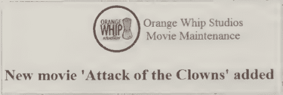

注意

你可以通过使用第 12 章创建的任何搜索模板浏览表，来验证电影是否已添加。

## 介绍 `<cfinsert>`

列表 14.4 中的示例演示了如何使用标准 SQL INSERT 命令向表中添加数据。如果你只需要为少数几列提供数据，这种方法非常有效；但如果这些列各异，使用 SQL INSERT 就会变得相当复杂。

例如，假设你针对相似的数据有两个或多个数据输入表单。其中一个可能收集极少的字段，而另一个则收集更完整的记录。你会如何创建一个 SQL 语句来处理这两组数据呢？

你可以创建两个独立的模板，每个模板包含一个不同的 SQL 语句，但这是一个糟糕的解决方案。你应该始终避免使用多个一个模板来执行给定的操作。这样，你就不会面临未来更改和修订被错误应用的风险。例如，如果表名或列名发生变化，你不必担心忘记某个引用了已更改列的模板。

提示

原则上，永远不要为了执行特定操作而创建多个一个模板。这有助于在进行更新或修订时防止模板中出现错误。创建一个带有条件代码的单一模板，总是比创建两个独立的模板要好。

另一个解决方案是使用动态 SQL。你可以编写一个基础的 SQL 语句，然后通过一系列 `<cfinsert>` 语句逐渐构建出一个完整的语句。

这是一个可行的方案，但并不是高效的。条件 SQL INSERT 代码要比条件 SQL SELECT 复杂得多。INSERT 语句要求列列表和值都是动态的。此外，INSERT 语法要求用逗号分隔所有的列名和值。这意味着列表中的最后一个项外，每个列名和值后面都必须跟一个逗号。你的条件 SQL 在构建语句时必须适应这些语法要求。

更好的解决方案是使用 `<cfinsert>`，它是一个特殊的 ColdFusion 标签，用于处理构建动态 SQL INSERT 语句的复杂性。`<cfinsert>` 接受以下参数作为属性：

- `datasource`—包含要插入数据表的数据源名称。
- `tablename`—目标表的名称。
- `formfields`—要插入的字段的逗号分隔的的列表。如果未提供此属性，将使用提交表单中的所有字段。

查看以下 ColdFusion 标签：

```
<cfinsert datasource="ows" tablename="FILMS">
```

这段代码的作用与列表 14.4 中的 `<query>` 标签相同。当 ColdFusion 处理 `<cfinsert>` 标签时，它会在内部构建一个动态 SQL 语句。如果提供了 `formfields` 属性，则使用指定的字段名。此示例中未指定 `formfields` 属性，因此 ColdFusion 自动使用提交的表单字段，动态构建列列表和值列表。`<cfinsert>` 甚至会自动处理必要时的单引号包含。

> 注意
>
> 当使用 Apache Derby 时，`<cfinsert>` 的表名必须大写。

在此期间，`insert1.cfm` 中创建的表单没有执行任何数据验证，这可能导致抛出数据库错误（例如在数值字段中插入文本会发生什么）。

列表 14.5 包含一个修订后的表单（`insert1.cfm` 的修改版）；将此文件保存为 `insert14.cfm`。列表 14.6 包含一个修订后的页面（`insert2.cfm` 的修改版）；将此文件保存为 `insert4.cfm`。

## 列表 14.5 insert3.cfm—使用 `<cform>` 进行字段验证

```
<--
Name: insert3.cfm
Author: Ben Forta (ben@forta.com)
Description: 表行插入演示
Created: 01/01/2010
-->
<!-- 获取评分 --
<cfquery datasource="ows" name="ratings">
SELECT RatingID, Rating
FROM FilmsRatings
ORDER BY RatingID
</cfquery>
```

## 列表 14.5 (续)

```
<!---- 页面页眉 -->

<cfinclude template="header.cfm">

<!---- 新电影表单 -->

<cfform action="insert4.cfm">

<table align="center" bgcolor="orange">

<tr>

  <th colspan="2">

    <font size="1">添加电影</font>

  </th>

</tr>

<tr>

  <td>

    电影名称：

  </td>

  <cfinput type="Text"

    name="MovieTitle"

    message="必须填写电影标题!"

    required="Yes"

    validateAt="onSubmit,onServer"

    size="50"

    maxlength="100">

  </td>

</tr>

<tr>

  <td>

    宣传标语（Tag line）：

  </td>

  <cfinput type="Text"

    name="PitchText"

    message="必须填写标语!"

    required="Yes"

    validateAt="onSubmit,onServer"

    size="50"

    maxlength="100">

  </td>

</tr>

<tr>

  <td>

    评分：

  </td>

  <!---- 评分列表 -->

  <select name="RatingID">

    <cfoutput query="ratings">

      <option value="#RatingID#">#Rating#</option>

    </cfoutput>

  </select>

  </td>

</tr>

</table>
```

```
摘要：

<td>

</td>

<textarea name="summary" cols="40" rows="5" wrap="virtual"></textarea>

</td>
```

```
<tr>

  <td>

    预算：

  </td>

  <cfinput type="Text" name="Amounted" message="预算必须是数值金额!" required="NO" validate="integer" validateAt="onSubmit,onServer" size="10">

  </td>

</tr>

<tr>

  <td>

    上映日期：

  </td>

  <cfinput type="Text" name="DateInTheaters" message="日期必须是有效的日期!" required="NO" validate="date" validateAt="onSubmit,onServer" size="10">

  </td>

</tr>

<tr>

  <td>

    图片文件：

  </td>

  <cfinput type="Text" name="ImageName" required="NO" size="20" maxlength="50">

  </td>

</tr>
```

## 列表 14.6 insert4.cfm—使用 `<cfinsert>` 标签添加数据

```
<!-----
Name: insert4.cfm
Author: Ben Porta (ben@forta.com).
Description: 行插入演示
Created: 01/01/2010
-->
<!-- 插入电影 -->
<cfinsert datasource="ows" tablename="FILMS">
```

```
<!-- 页面页眉 -->

<cfinclude template="header.cfm">

<!-- 反馈 -->

<cfoutput>

<h1>新电影 '#FORM.MovieTitle#' 已添加</h1>

</cfoutput>

<!-- 页面页脚 -->

<cfinclude template="footer.cfm">
```

## 控制 `<cfinsert>` 表单字段

`<cfinsert>` 指 ColdFusion 动态构建 SQL INSERT 语句。ColdFusion 在构建此语句时会自动使用所有提交的表单字段。

有时你可能希望 ColdFusion 不要包含某些字段。例如，你的表单中可能包含不是表列的隐藏字段，如列表 14.7 所示的隐藏字段。该字段可能是你实现的安全系统的一部分；它不是表中的列。如果你尝试将此字段传递给 `<cfinsert>`，ColdFusion 将隐藏的 `Login` 字段作为列传递给数据库。显然，这会产生数据库错误，因为 `Films` 表中不存在 `Login` 列。

## 列表 14.7 insert5.cfm—带有隐藏登录字段的电影添加

```cf
<---

Name:      insert5.cfm

Author:      Ben Forta (ben@forta.com).

Description:  表格行插入演示

Created:      01/01/2010

-->

<!---- 获取评分 -->

<cfquery datasource="ows" name="ratings">

SELECT FilmID, Rating

FROM FilmRatings

ORDER BY RatingID

</cfquery>

<!---- 页眉 -->

<cfinclude template="header.cfm">

<!---- 新电影表单 -->

<cfform action="insert6.cfm">

<!---- 登录字段 -->

<cfinput type="hidden"

name="Login"

value="Ben">

<table align="center" bgcolor="orange">

<tr>


```html
<th colspan="2">
  <font size="+1">添加电影</font>
</th>
</tr>
<tr>
  <td>
    电影：
  </td>
  <td>
    <cfinput type="Text"
      name="MovieTitle"
      message="必须填写电影标题！"
      required="Yes"
      validateAt="onSubmit,onServer"
      size="50"
      maxlength="100">
  </td>
</tr>
<tr>
  <td>
    标签标语：
  </td>
  <td>
    <cfinput type="Text"
      name="PitchText"
      message="必须填写标签标语！"
      required="Yes"
      validateAt="onSubmit,onServer"
      size="50">
  </td>
</tr>
</table>
```

# 第 14 章 使用表单添加或更改数据

## 列表 14.7（续）

```cf
</td>
maxlength="100">
</tr>
<tr>
  <td>
    评分：
  </td>
  <td>
    <!-- 评分列表 -->
    <select name="RatingID">
      <cfoutput query="ratings">
        <option value="#RatingID#">评分#</option>
      </cfoutput>
    </select>
  </td>
</tr>
<tr>
  <td>
    摘要：
  </td>
  <td>
    <textarea name="summary"
      cols="40"
      rows="5"
      wrap="virtual"></textarea>
  </td>
</tr>
<tr>
  <td>
    预算：
  </td>
  <td>
    <input type="Text"
      name="AmountBudgeted"
      message="预算必须是有效的数字金额!"
      required="NO"
      validate="integer"
      validateAt="onSubmit,onServer"
      size="10"
      maxlength="10">
  </td>
</tr>
<tr>
  <td>
    上映日期：
  </td>
  <td>
    <input type="Text"
      name="DateInTheaters"
      message="上映日期必须是有效的日期!"
      required="NO"
      validate="date"
      validateAt="onSubmit,onServer"
      size="10"
      maxlength="10">
  </td>
</tr>
```

## 列表 14.7（续）

```cf
</td>
</tr>
<tr>
  <td>
    图片文件：
  </td>
  <td>
    <input type="Text"
      name="ImageName"
      required="NO"
      size="20"
      maxlength="50">
  </td>
</tr>
<tr>
  <td colspan="2" align="center">
    <input type="submit" value="插入">
  </td>
</tr>
</table>
```

```cf
</form>

<!-- 页脚 -->
<cfinclude template="footer.cfm">
```

要解决这个问题，你必须使用 `formfields` 属性。`formfields` 指令 ColdFusion 只处理列表中的字段。任何其他字段都将被忽略。

需要注意的是，`formfields` 并不是用于指定 ColdFusion 应该处理哪些字段。相反，它是用来指定哪些字段**不**被处理。这种区别是细微的。`formfields` 值中列出的所有字段并不都需要存在。如果它们存在，则会被处理；如果不存在，则不会处理（因此不会产生错误）。任何不在 `formfields` 列表中的字段都会被忽略。

列表 14.8 包含一个更新后的插入模板。`<cfinsert>` 标签现在有一个 `formfields` 属性，因此 ColdFusion 现在知道要忽略隐藏的 Login ID。

## 列表 14.8：insert6.cfm 使用 `<cfinsert>` `formfields` 属性

```cf
<!--
Name: insert6.cfm
Author: Ben Forta (ben@forta.com)
Description: 行插入演示
Created: 01/01/2010
-->

<!-- 插入电影 -->
<cfinsert datasource="ows"
  tablename="FILMS"
  formfields="MovieTitle,
  PitchText,
  AmountBudgeted,
  RatingID">
```

# 第 14 章 使用表单添加或更改数据

## 列表 14.8（续）

```cf
Summary,
ImageName,
DateInTheaters>
```

```cf
<!-- 页眉 -->
<cfinclude template="header.cfm">

<!-- 反馈 -->
<cfoutput>
  <h1>新电影 "#FORM.MovieTitle#" 已添加</h1>
</cfoutput>

<!-- 页脚 -->
<cfinclude template="footer.cfm">
```

*（注：由于原文中后续部分存在大量重复内容，上述翻译已根据提供的原文结构进行了处理。）*

## 列表 14.9（续）

```html
<tr>
  <td>
    宣传标语：
  </td>
  <td>
    <cfinput type="Text"
      name="PitchText"
      value="#Trim(film.PitchText)#"
      message="必须填写宣传标语!"
      required="Yes"
      validateAt="onSubmit,onServer"
      size="50"
      maxlength="100">
  </td>
</tr>
```

```html
<tr>
  <td>
    评分：
  </td>
  <td>
    <!-- 评分列表 -->
    <select name="RatingID">
      <cfoutput query="ratings">
        <option value="#RatingID#"<cfif if="ratings.RatingID IS film.RatingID">selected</cfif>></option>
      </cfoutput>
    </select>
  </td>
</tr>
```

```html
<tr>
  <td>
    摘要：
  </td>
  <td>
    <cfoutput>
      <textarea name="summary"
        cols="40"
        rows="5"
        wrap="virtual">#Trim(Film.Summary)#</textarea>
    </cfoutput>
  </td>
</tr>
```

```html
<tr>
  <td>
    预算：
  </td>
  <td>
    <cfinput type="Text"
      name="AmountBudgeted"
      value="#Int(film.AmountBudgeted)#"
      message="预算必须是有效的数值"
      required="NO"
      validate="integer">
  </td>
</tr>
```

## 第 14 章 使用表单添加或更改数据

## 列表 14.9（续）

```html
validateAt="onSubmit,onServer"
size="10"
maxlength="10">
</td>
</tr>
<td>
  发行日期：
</td>
<td>
  <cfinput type="Text"
    name="DateInTheaters"
    value="#DateFormat(film.DateInTheaters, "MM/DD/YYYY")#"
    message="发行日期必须是有效的日期!"
    required="NO"
    validate="date"
    validateAt="onSubmit,onServer"
    size="10"
    maxlength="10">
</td>
</tr>
<tr>
  <td>
    图片文件：
  </td>
  <td>
    <cfinput type="Text"
      name="SourceName"
      value="#Trim(film.SourceName)#"
      required="NO"
      size="20"
      maxlength="50">
  </td>
</tr>
<td colspan="2" align="center">
  <input type="submit" value="更新">
</td>
</tr>
</table>
</cfform>
```

```html
<!-- 页面页脚 -->
<cfinclude template="footer.cfm">
```

在列表 14.9 中有一个可以查看的列表。先不要提交表单；你还没有创建操作页面。

为了向表单填充要更新的数据，你必须先从表中检索这些数据。因此，你必须指定一个 `FilmID` 来使用此模板。如果没有它，ColdFusion 将不知道要检索哪个记录。为了确保 `FilmID` 被传递，你做的第一件事是检查 `FilmID` 参数是否存在。以下代码仅在未传递 `FilmID` 的情况下返回 `TRUE`，以便向用户发回错误消息并使用 `<cfabort>` 标签停止模板处理：

```cfml
<CFIF NOT IsDefined("URL.FilmID")
```

如果没有 `<cfabort>` 标签，ColdFusion 将继续处理模板。当处理 `<cfquery>` 语句时会生成错误消息，因为 `WHERE` 子句 `WHERE FilmID = #URL.FilmID#` 引用了一个不存在的字段。

第一个 `<cfquery>` 标签检索要编辑的行，并在 `WHERE` 子句中使用 URL 来检索相应的行。第二个 `<cfquery>` 检索用于 `<select>`（或 `<cfselect>`）控件的评分列表。为了填充数据条目，将当前字段值传递给 `<input>`（或 `<cfinput>`）的 `value` 属性。传递给 `value="#MovieTitle#"` 的任何内容将显示 `MovieTitle` 列。

查询名称是必要的，因为它没有在与查询关联的 `<cfoutput>` 块中使用。`<cfinput>` 是 ColdFusion 标签，所以你可以直接将变量和列传递给它，而不需要使用 `<cfoutput>`。如果你使用的是 `<input>` 而不是 `<cfinput>`，则 `<input>` 标签需要放在 `<cfoutput>` 块内。这是使用 `<cfinput>` 代替 `<input>` 的另一个用处：`<cfinput>` 让带有数据的表单制作变得简单得多。

为了确保检索到的值后没有空白空格，在显示之前会使用 ColdFusion 的 `Trim()` 函数对字段进行修剪（trim）。为什么要这样做？某些数据库（例如 Microsoft SQL Server）会在文本字段中填充空格，以便它们占据表中的完整宽度。`MovieTitle` 字段是一个 255 字符宽的列，因此电影标题后面可能有很多空格。当你尝试编辑该字段时，这些额外的空格会很困扰。要向字段添加文本，你必须退格或删除所有这些额外的字符。

在使用表值填充表单时，与标准的浏览器输出不同，字段中的空格不会被移除。移除它们可以更容易编辑。ColdFusion 的 `Trim()` 函数会移除值开头和结尾的空格。如果你只想移除尾空格，可以使用 `RTrim()` 函数。

日期和数字也经过特殊格式处理。默认情况下，日期以相当不寻常的格式显示（提交时不会接受的格式）。因此，使用 `DateFormat()` 将日期格式化为可用的格式。

`AmountBudgeted` 列与小数点对齐；显示尾随小数点内的数字，可以使用 `int()` 函数将数字四舍五入整数。你也可以使用 `NumberFormat()` 进行更精确的数字格式化。

一个隐藏字段在 `FORM` 中创建了代码。以下代码创建了一个名为 `FilmID` 的隐藏字段，它包含了正在更新的电影的 ID：

```html
<input type="hidden" value="#Film.FilmID#"
```

此字段必须存在。如果没有它，当表单实际提交时，ColdFusion 不知道你正在更新哪一行。此外，由于它是 `<input>` 字段（而不是 `<cfinput>`），它必须被包含在 `<cfoutput>` 标签内。

# 第 14 章 使用表单添加或更改数据

记住，HTTP 会话会根据需要创建和销毁，每个会话都是相互独立的。ColdFusion 可能会在一个会话中为你检索特定的数据行，但它在下一个会话中并不知道这一点。当使用 `<cfupdate>` 时，ColdFusion 会通过表定位你想要更新的行，以确定其主键。你们都必须确保主键值被传递，就像你在列表 14.9 中使用隐藏字段做的那样。

`<cfupdate>` 标签与之前讨论的 `<cfinsert>` 标签类似。`<cfupdate>` 只需要两个属性——数据源和要更新的表名——并支持可选字段。

- `datasource`—包含要更新数据的表的数据源名称。
- `tablename`—目标表的名称。
- `formfields`—可选的、用逗号分隔的要更新字段列表。如果未提供此属性，则将使用提交表单中的所有字段。

正如你之前在插入数据时看到的，硬编码的 SQL 语句既灵活也不易维护。ColdFusion 提供了一种更简单的方法来更新数据库中的行。列表 14.11 中的代码执行了与列表 14.10 相同的更新，但它使用了 `<cfupdate>` 标签而不是 SQL `UPDATE` 标签。显然，这段代码更具可读性、且用并适应未来可能进行的表单字段更改。

## 列表 14.11：update3.cfm——使用 `<cfupdate>` 标签更新数据

```html
Name: update3.cfm
Author: Ben Porta (ben@forta.com)
Description: 表行更新演示
Created: 01/01/2010

<!-- 更新电影 -->
<cfupdate datasource="ows" tablename="FILMS">
  UPDATE Films SET MovieTitle=#FORM.MovieTitle
  WHERE FilmID=#FORM.FilmID
</cfupdate>

<!-- 页面头部 -->
<cfinclude template="header.cfm">

<!-- 反馈 -->
<cfoutput>
  <h1>电影 "#FORM.MovieTitle#" 已更新</h1>
</cfoutput>

<!-- 页面页脚 -->
<cfinclude template="footer.cfm">
```

要使用此代码，你必须更改 `update1.cfm` 中的 `<form>` `action` 属性，使其指向 `update3.cfm`。进行此更改，并尝试更新几部电影。

## `<cfupdate>` 与 SQL `UPDATE`

在添加数据时，选择使用 `<cfupdate>` 还是 SQL `UPDATE` 取决于你。以下关于何时使用每种选项的指南也类似：

- 在适当的情况下，使用 `<cfupdate>` 更新数据。
- 如果你需要更新特定的表单字段——而不是所有提交的字段——请使用带有 `fields` 属性的 `<cfupdate>` 标签。
- 如果因为需要复杂的 `UPDATE` 语句或你正在使用的字段不是表单字段而无法使用 `<cfupdate>`，请使用 SQL `UPDATE`。
- 如果你需要更新表中的多行（或所有）行，你必须使用 SQL `UPDATE`。

## 在 ColdFusion 中删除数据

ColdFusion 在添加和更新数据方面非常高效，但在删除数据方面并不擅长。`DELETE` 始终是一个危险的操作，ColdFusion 的开发者不希望让用户太容易地误删数据。

要在 ColdFusion 模板中执行删除操作，你必须使用 SQL `DELETE` 语句，如列表 14.12 所示。代码首先检查是否传递了 `FilmID`；如果 URL 中的 `FilmID` 字段不存在，语句将终止。如果传递了 `FilmID`，则使用 `<cfquery>` 将 SQL `DELETE` 语句传递给数据源。

- 请参第 6 章关于 `DELETE` 语句的说明。

## 列表 14.12：delete1.cfm——使用 SQL `DELETE` 删除表数据

```cf
<---
Name: delete1.cfm
Author: Ben Porta (ben@forta.com)
Description: 表行删除演示
Created: 01/01/2010
---

<!-- 检查是否提供了 FilmID -->
<cfif NOT IsDefined("FilmID")
  <h1>你没有指定 FilmID</h1>
  <cfabort>
</cfif>

<!-- 删除一部电影 -->
<cfquery datasource="ows">
  DELETE FROM Films
  WHERE FilmID=#FilmID#
</cfquery>
```

## 列表 14.12（续）


<!-- 页页头 -->
<cfinclude template="header.cfm">

<!-- 反馈 -->
<h1>电影已删除/</h1>

<!-- 页脚 -->
<cfinclude template="footer.cfm">

`ColdFusion` 中不存在 `<cfdelete>` 标签。删除行的唯一方法是使用 `SQL DELETE`。

## 注意

你无法删除 `Films` 表中在其他表中具有相关行的行。

## 重用表单

你现在可以对 `Films` 表进行添加、更新和删除操作。但如果你需要更改表单呢？如果你需要添加字段、更改验证或更新颜色呢？对“添加”表单必须进行的任何更改也必须在“更新”表单中进行。

考虑到你在过去几个章节中为了防止重复劳动所付出的所有努力，这似乎是适得其反的。

确实如此。

添加表单和更新表单之间的巨大区别在于字段是否被预填充以显示当前值。使用 `ColdFusion` 的条件表达式，你可以创建一个既可以添加数据也可以更新数据的单个表单。

要做到这一点，你只需要一种方法在 `<input>` 中条件地包含 `value` 属性。毕竟，看下面的两个 `<input>` 语句：

```
<input type="text" name="MovieTitle">
<input type="text" name="MovieTitle" value="#MovieTitle#">
```

第一个 `<input>` 用于新数据；没有预填充。第二个用于编辑，因此字段填充了初始值。

因此，创建嵌入了 `<cfif>` 语句并条件地包含 `value` 的 `<input>` 字段并不难。看下面的代码：

```
<input type="text" name="MovieTitle">
<cfif IsDefined("URL.FilmID")
value="#MovieTitle#"
</cfif>
```

此 `<input>` 只有在传递了 `FilmID` 时才包含 `value` 属性（这意味着这是一个编辑操作而不是添加操作）。使用这种技术，单个表单字段可以同时用于添加和编辑。

## 第 14 章使用表单添加或更改数据

这是完全有效的代码，这种技术非常流行。它唯一的问题是代码可能会变得非常难以阅读。每一行都嵌入了这些 `<cfid>` 语句使得代码非常复杂。有一个更好的解决方案。

`value` 可以是一个空字符串，`attribute=""` 是完全合法且有效的。为什么不一直使用 `value`，而是根据条件使用它呢？演示此点的最好方法是尝试，列表 14.13 包含了 `edit1.cfm` 的代码——这是一个新的双用途表单。

**列表 14.13 `edit1.cfm`——插入和更新结合表单**

```
<!---
Name:      edit1.cfm
Author:    Ben Porta (ben@forta.com)
Description: 双用途表单演示
Created:    01/01/2010
-->

<!-- 检查是否提供了 FormID -->
<!-- 如果是，则编辑，否则添加 --
<cfset EditMode=IsDefined(URL.FormID)>

<!-- 如果是编辑模式则获取要编辑的行 --
<cfif EditMode>
  <!-- 获取电影记录 --
  <cfquery datasource="ows" name="film">
    SELECT FilmID, MovieTitle, PitchText,
    Summary, AmountBudgeted, RatingID,
    ImageName, DateInTheaters
    FROM Films
    WHERE FilmID=#URL.FilmID#
  </cfquery>

  <!-- 保存到变量 --
  <cfset MovieTitle=Trim(film.MovieTitle)>
  <cfset PitchText=Trim(film.PitchText)>
  <cfset AmountBudgeted=Int(film.AmountBudgeted)>
  <cfset RatingID=film.RatingID>
  <cfset Summary=Trim(film.Summary)>
  <cfset ImageName=Trim(film.ImageName)>
  <cfset DateInTheaters=DateFormat(film.DateInTheaters, "MM/DD/YYYY")>

  <!-- 表单文本 --
  <cfset FormTitle="Update a Movie">
  <cfset ButtonText="Update">

<cfelse>
  <!-- 保存到变量 --
  <cfset MovieTitle=""
  <cfset PitchText=""
  <cfset AmountBudgeted=""
  <cfset RatingID=""
  <cfset Summary=""
  <cfset ImageName=""
  <cfset DateInTheaters=""
```

## 14.13（续）

```
<!-- 添加数据 -->
<input type="text" name="MovieTitle">
</cfif>

<!-- 获取评分 -->
<cfquery datasource="ows" name="ratings">
SELECT RatingID
FROM Ratings
ORDER BY RatingID
</query>

<!-- 页头 -->
<cfinclude template="header.cfm">

<!-- 更新表单 -->
<form action="edit1.cfm">
<cfif EditMode>
  <!-- 隐藏主键 -->
  <input type="hidden" name="FilmID" value="#FilmID#
</cfif>

<table align="center">
<tr>
  <th>电影</th>
  <td>
    <input type="text" name="MovieTitle" value="#MovieTitle#
  </td>
</tr>
<tr>
  <th>摘要</th>
  <td>
    <textarea name="Summary" cols="40" rows="5">#Summary#</textarea>
  </td>
</tr>
<tr>
  <th>预算</th>
  <td>
    <input type="text" name="AmountBudgeted" value="#AmountBudgeted#">
  </td>
</tr>
<tr>
  <th>评分</th>
  <td>
    <select name="RatingID">
      <cfoutput>
        <option value="#RatingID#" <cfif RatingID == film.RatingID>selected</cfif>>#RatingID#</option>
      </cfoutput>
    </select>
  </td>
</tr>
<tr>
  <th>上映日期</th>
  <td>
    <input type="text" name="DateInTheaters" value="#DateInTheaters#">
  </td>
</tr>
<tr>
  <th>图片</th>
  <td>
    <input type="text" name="ImageName" value="#ImageName#">
  </td>
</tr>
<tr>
  <th>标签</th>
  <td>
    <input type="text" name="PitchText" value="#PitchText#">
  </td>
</tr>
<tr>
  <td colspan="2" align="center">
    <input type="submit" value="#ButtonText#">
  </td>
</tr>
</table>
</form>

<!-- 页脚 -->
<cfinclude template="footer.cfm">
```

# 第 14 章 使用表单添加或更改数据

当执行到 `<cfif>` 标签时，一组变量已经创建完成。它们将包含值（来自 `Films` 表）或为空。它们可以作为 `value` 属性用于 `<input>` 和 `<cfinput>` 标签中。

查看 `<cfinput>` 字段本身。你会发现它们内部不再像以前那样存在条件代码了。相反，每个 `<input>` 标签都有一个 `value` 属性，无论是在执行插入还是更新。`value` 属性中的值是一个 `ColdFusion` 变量——即在模板顶部设置的变量，而不是数据库字段。

模板中的其余代码都使用了这些变量，不需要任何条件处理过程。即使是页面标题和提交按钮也可以通过这种方式初始化，因此它们也不再需要 `<cfif>` 标签了。

作为隐藏字段嵌入的主键（primary key）只有在编辑电影时才是必需的，因此嵌入该字段的代码被封装在一个 `<cfif>` 语句中：

```
<cfif EditMode>
<!-- 将主键作为隐藏字段嵌入 -->
<cfinput type="hidden" name="FilmID"
value="#Film.FilmID#">
</cfif>
```

甚至页面顶部的表单头部和提交按钮的文本也是由变量填充的。这样，`<form>` 是完全可复用的：

```
<INPUT TYPE="submit" VALUE="#Button#">
```

无论是在添加数据还是更新数据，表单都会提交到同一个 `action` 页面。因此，`action` 页面也必须支持添加和更新。列表 14.14 包含了新的 `action` 模板：`edit2.cfm`。

**列表 14.14 `edit2.cfm`——插入与更新组合页面**

```
<!---
edit2.cfm
Name:
Author: Ben Porta (ben@forta.com)
Description: 双用途表单演示
Created: 01/01/2010
-->
```

```
<-- 插入还是更新? -->
<cfset EditMode=IsDefined("FORM.FilmID")/>

<cfif EditMode>
<!-- 更新电影 -->
<cfupdate datasource="ows" tableName="FILMS">
<cfset action="updated">
<cfelse>
<!-- 添加电影 -->
<cfinsert datasource="ows" tableName="FILMS">
<cfset action="added">
</cfif>
</cfif>

<!-- 页面头部 -->
```

# 列表 14.14（续）

```
<cfinclude template="header.cfm"

<!-- 反馈信息 -->
<cffoutput>
<h1>Movie #FORM.MovieTitle# #action#</h1>
</cffoutput>
```

```
<!-- 页面页脚 -->
<cfinclude template="footer.cfm"
```

这段代码还通过逻辑：通过检查是否存在名为 `FilmID` 的 `FORM` 字段（即隐藏字段）来判断。如果 `EditMode` 为 `TRUE`，则使用 `<cfupdate>` 更新该行；否则，使用 `<cfinsert>` 插入它。同一个 `<cf>` 语句也用于设置一个变量，该变量在页面后续提供用户反馈时会使用。

它是简洁、简单且可复用的。

# 创建一个完整的应用程序

现在你已经创建了添加、修改和删除模板，让我们把它们整合在一起，创建一个完成的应用程序——这一次，它是使用 `CFC`（`ColdFusion` 组件）进行数据库访问并正确构建的。

以下模板是你在在本章及之前的章节中所学到的所有内容的结合。

列表 14.15 是提供数据库访问的 `ColdFusion` 组件（用于获取、添加、更新和删除电影）。

- `ColdFusion` 组件在第 11 章“结构化开发基础”中介绍。

# 列表 14.15 `movies.cfc`——电影数据库访问

```
<!--
Name: movies.cfc
Author: Ben Porta (ben@forta.com)
Description: 电影数据库访问组件
Created: 01/01/2010
-->
```

```
<cfcomponent hint="ows" movie database access>
```

```
<!-- 设置数据源 -->
<cfset ds="ows">
```

```
<!-- 获取电影列表 -->
<cffunction name="list"
returnype="query"
hint="列出所有电影"
>
```

```
<cfquery datasource="#ds#"
name="movies">
```

# 列表 14.15（续）

```
SELECT FilmID, MovieTitle
FROM Films
ORDER BY MovieTitle
</query>
<cfreturn movies>
```

```
</cffunction>
```

```
<!---- 获取电影详情 -->
<cffunction name="get"
returnype="query"
hint="获取电影详情"
<cfargument name="FilmID"
type="numeric"
required="yes"
hint="电影 ID">
<cfquery datasource="#ds#"
name="movie"
SELECT FilmID, MovieTitle,
PitchText, AmountBudgeted,
RatingID, Summary,
ImageName, DateInTheaters
FROM Films
WHERE FilmID=#ARGUMENTS.FilmID#
</query>
<cfreturn movie>
```

```
</cffunction>
```

```
<!---- 添加电影 -->
<cffunction name="add"
retype="boolean"
hint="添加电影">
```

```
<!---- 方法参数 -->
<cfargument name="MovieTitle"
type="string"
required="yes"
hint="电影标题"
<cfargument name="PitchText"
type="string"
required="yes"
hint="电影标语"
<cfargument name="AmountBudgeted"
type="numeric"
required="yes"
hint="预算金额"
<cfargument name="RatingID"
type="numeric"
required="yes"
hint="评分 ID"
<cfargument name="Summary"
type="string"
required="yes"
hint="摘要"
<cfargument name="ImageName"
type="string"
required="no"
default="*"
hint="图片名称">
<cfargument name="DateInTheaters"
type="date"
required="yes"
hint="上映日期">
```

# 列表 14.15（续）

```
<!-- 插入 -->
<cfquery datasource="#ds#">
INSERT INTO Films(MovieTitle,
PitchText,
AmountBudgeted,
RatingID,
Summary,
ImageName,
DateInTheaters)
VALUES('#ARGUMENTS.MovieTitle#',
'#ARGUMENTS.PitchText#',
#ARGUMENTS.AmountBudgeted#,
#ARGUMENTS.RatingID#,
'#ARGUMENTS.Summary#',
'#ARGUMENTS.ImageName#',
#CreateODBCDate(ARGUMENTS.DateInTheaters)#)
</cfquery>
```

```
<cfreturn true>
</cffunction>
```

```
<!-- 更新电影 -->
<cffunction name="update"
returnype="boolean"
hint="更新电影">
```

```
<!-- 方法参数 -->
<cfargument name="FilmID"
type="numeric"
required="yes"
hint="电影 ID">
<cfargument name="MovieTitle"
type="string"
required="yes"
hint="电影标题"
<cfargument name="PitchText"
type="string"
required="yes"
hint="电影标语"
<cfargument name="AmountBudgeted"
type="numeric"
required="yes"
hint="预算金额"
<cfargument name="RatingID"
type="numeric"
required="yes"
hint="评分 ID"
<cfargument name="Summary"
type="string"
required="yes"
hint="摘要"
<cfargument name="ImageName"
type="string"
required="no"
default="*"
hint="图片名称">
<cfargument name="DateInTheaters"


`type="date"`

`required="yes"`

`hint="上映日期"`>

```
<cfquery datasource="#ds#">
UPDATE Films
SET MovieTitle='#ARGUMENTS.MovieTitle#',
PitchText='##ARGUMENTS.PitchText#',
AmountBudgeted=#ARGUMENTS.AmountBudgeted#,
RatingID=#ARGUMENTS.RatingID#,
Summary='#ARGUMENTS.Summary#',
ImageName='#ARGUMENTS.ImageName#',
DateInTheaters='#CreateODBCDate(ARGUMENTS.DateInTheaters)#'
WHERE FilmID=#ARGUMENTS.FilmID#
</cfquery>
```

```
<cfreturn true>
</cffunction>
```

<!-- 删除电影 -->

```
<cffunction name="delete"
retntype="boolean"
hint="删除电影">
<cfargument name="FilmID"
type="numeric"
required="yes"
hint="电影 ID">
<cfquery datasource="#ds#">
DELETE FROM Films
WHERE FilmID=#ARGUMENTS.FilmID#
</cfquery>
<cfreturn true>
</cffunction>
```

<!-- 获取电影评分 -->

```
<cffunction name="getRatings"
returnype="query"
hint="获取电影评分列表">
<cfquery datasource="#ds#"
name="ratings">
SELECT RatingID, Rating
FROM FilmsRatings
ORDER BY RatingID
</cfquery>
<cfreturn ratings>
</cffunction>
```

```
</cfcomponent>
```

## Listing 14.16 movies.cfm—电影列表维护页面

```
<---
Name: movies.cfm
Author: Ben Forta (ben@forta.com)
Description: 电影维护应用程序
Created: 01/01/2010
-->

<!-- 获取所有电影 -->
<cfinvoke component="movies"
  method="list"
  returnvariable="movies">

<!-- 页面头部 -->
<cfinclude template="header.cfm">

<table align="center" bgcolor="orange">
  <!-- 遍历电影 -->
  <cfoutput query="movies">
    <tr>
      <!-- 电影名称 -->
      <td><strong>#MovieTitle#</strong></td>
      <!-- 编辑链接 -->
      <td>
        <a href="movie_edit.cfm?FilmID=#FilmID#">编辑</a>
      </td>
      <!-- 删除链接 -->
      <td>
        <a href="movie_delete.cfm?FilmID=#FilmID#">删除</a>
      </td>
    </tr>
  </cfoutput>

  <tr>
    <td>/</td>
    <!-- 添加电影链接 -->
    <td colspan="2" align="center">
      <a href="movie_edit.cfm">添加</a>
    </td>
  </tr>
</table>

<!-- 页面底部 -->
<cfinclude template="footer.cfm">
```

Listing 14.15 使用`<cfinvoke>`获取电影列表，然后为每部电影提供两个链接：一个编辑链接（链接到传递了`FilmID`的`movie_edit.cfm`）和一个删除链接（`movie_delete.cfm`，同样传递了`FilmID`）。页面底部的添加链接也指向`movie_edit.cfm`，但没有传递`FilmID`（因此该表单将用作添加表单）。

- 动态链接和数据下钻在第 12 章中介绍过。

Listing 14.17 基本上和你之前创建的可复添加和更新表单相同，但另一个实用的快捷方式。

## Listing 14.17 movie_edit.cfm—电影添加和更新表单

```
<!-
  Name:      movie_edit.cfm
  Author:    Ben Forta (ben@forta.com)
  Description: 双用途电影编辑表单
  Created:    01/01/2010
-->

<!-- 检查是否提供了 FilmID -->
<!-- 如果是，则编辑；否则添加 -->
<cfset EditMode=IsDefined("URL.FilmID") />

<!-- 如果是编辑模式，则获取要编辑的行 -->
<cfif EditMode>
  <!-- 获取文件记录 -->
  <cfinvokem component="movies"
             method="get"
             filmid="#URL.FilmID#"
             returnvariable="film">
    <!-- 保存到变量 -->
    <cfset MovieTitle=Trim(film.MovieTitle)>
    <cfset PitchText=Trim(film.PitchText)>
    <cfset AmountBudgeted=Int(film.AmountBudgeted)>
    <cfset RatingID=film.RatingID>
    <cfset Summary=Trim(film.Summary)>
    <cfset ImageName=Trim(film.ImageName)>
    <cfset DateInTheaters=DateFormat(film.DateInTheaters, "MM/DD/YYYY") />
    <!-- 表单文本 -->
    <cfset FormTitle="更新电影" />
    <cfset ButtonText="更新" />
<cfelse>
  <!-- 保存到变量 -->
  <cfset MovieTitle="" />
  <cfset PitchText="" />
  <cfset AmountBudgeted="" />
  <cfset RatingID="" />
  <cfset Summary="" />
  <cfset ImageName="" />
  <cfset DateInTheaters="" />
  <!-- 表单文本 -->
  <cfset FormTitle="添加电影" />
  <cfset ButtonText="插入" />
</cfif>

<!-- 获取评分 -->
<cfinvokem component="movies"
```

## 298 第 14 章 使用表单添加或更改数据

Listing 14.17（续上）

```
method="getRatings"
returnvariable="ratings"

<!-- 页面头部 -->
<include template="header.cfm">

<!-- 添加/更新电影表单 -->
<cfform action="movie_process.cfm">
<cfif EditMode>
  <!-- 将主键嵌入隐藏字段 -->
  <cfoutput>
    <input type="hidden" name="FilmID" value="#film.FilmID#">
  </cfoutput>
</cfif>

<table align="center" bgcolor="orange">
<tr>
  <th colspan="2">
    <cfoutput>
      <font size="+1">#FormTitle#</font>
    </cfoutput>
  </th>
</tr>
<tr>
  <td>电影：</td>
  <td>
    <cfinput type="Text"
      name="#MovieTitle#"
      value="MOVIE TITLE"
      message="标题是必的!"
      required="Yes"
      validateAt="onSubmit,onServer"
      size="50"
      maxlength="100">
  </td>
</tr>
<tr>
  <td>广告标语：</td>
  <td>
    <cfinput type="Text"
      name="#PitchText#"
      value="#PitchText#"
      message="广告标语是必的!"
      required="Yes"
      validateAt="onSubmit,onServer"
      size="50"
      maxlength="100">
  </td>
</tr>
<tr>
  <td>
```

## Listing 14.17（续上）

```
评分：
  </td>
  <td>
    <!-- 评分列表 -->
    <cfselect name="RatingID"
      query="ratings"
      value="RatingID"
      display="Rating"
      selected="#VARIABLES.RatingID#">
    </cfselect>
  </td>
</tr>
<tr>
  <td>摘要：</td>
  <td>
    <cfoutput>
      <textarea name="summary"
        cols="40"
        rows="5"
        wrap="virtual">#Summary#</textarea>
    </cfoutput>
  </td>
</tr>
<tr>
  <td>预算：</td>
  <td>
    <cfinput type="Text"
      name="#AmountBudgeted"
      value="#AmountBudgeted#"
      message="预算必须是有效的数字金额!"
      required="NO"
      validate="integer"
      validateAt="onSubmit,onServer"
      size="10"
      maxlength="10">
  </td>
</tr>
<tr>
  <td>上映日期：</td>
  <td>
    <cfinput type="Text"
      name="#DateInTheaters"
      value="#DateInTheaters#"
      message="日期必须是有效的!"
      required="NO"
      validateAt="onSubmit,onServer"
      size="10"
      maxlength="10">
  </td>
</tr>
```

## 299 第 14 章 使用表单添加或更改数据

Listing 14.17（续上）

```
<tr>
  <td>图片：</td>
  <td>
    <cfinput type="Text"
      name="#ImageName#"
      value="#ImageName#"
      message="图片名称是必的!"
      required="Yes"
      validateAt="onSubmit,onServer"
      size="50"
      maxlength="100">
  </td>
</tr>
<tr>
  <td colspan="2" align="center">
    <input type="submit" value="#ButtonText#">
  </td>
</tr>
</table>
</cfform>

<!-- 页面底部 -->
<cfinclude template="footer.cfm">
```

# 第 15 章

### 本章内容
- 使用扩展控件 303
- 使用 Ajax 312
- 使用绑定 318

## 超越 HTML：表单：ColdFusion 驱动的 Ajax

在过去的几个章节中，你已经广泛地使用了 HTML 表单，而表单无疑将在你构建的所有应用程序中发挥着重要作用。HTML 表单易于创建和使用，但它们的功能非常局限，性能并不强大。

例如，HTML 表单控件缺乏常用的控件，如日期选择器和数据网格。正如之前讨论过的，它们还缺乏任何真实的字段验证。它们在本质上也绑定于 Web 的页面请求模型：每次更改都需要与服务器进行往返交互，并随后刷新页面。

HTML 表单有许多待改进之处，Web 开发人员对表单产生了一种爱恨交织的关系：尽管这种简单性导致了功能的缺失，他们仍然欣赏它的简洁。

为了解决这些问题和局限性，ColdFusion 一直寻求新的创新技术并纳入产品供你使用。从 Java applet 到 Adobe Flash 控件再到 XForms 抽象，随着新选项的出现，ColdFusion 都会尝试利用这些技术。

ColdFusion 8 和 9 通过强大的新 HTML 控件和简化的 Ajax 支持延续了这一模式。本章将探索这些新选项。

> 注意
XForms 和 Adobe Flash 表单的涵盖范围超出了本书的范围，因此在本章中不进行讨论。

## 使用扩展控件

示例是介绍 ColdFusion 扩展表单控件的最好方式。在第 14 章“使用表单添加或更改数据”中，你创建了一系列表单，允许用户在 Films 表中插入和更新电影数据。其中一个字段是日期字段，要求用户输入有效的电影发行日期。

让用户输入日期总是会带来麻烦。有些用户用数字输入月份，另一些会拼写或缩写月份；有些用户会输入两位年份，另一些会输入四位年份；有些用户使用连字符作为分隔符，另一些则使用斜杠——以此此类推。与其让用户手动输入日期，你真正需要一个日期控件：一个允许用户浏览并选择所选日期的弹出日历。但正如已经提到的，HTML 表单中没有日期控件。

幸运的是，`<form>` 中有一个，而且它的功能正是我们想要的。要创建一个日期字段，你只需要使用`<input>`并更改`type="textfield"`——就这么简单。

列表 15.1 是一个插入的表单（基于第 14 章创建的那个）；图 15.1 显示了新表单。

## 图 15.1

ColdFusion 提供了增强的表单控件，包括文本编辑器和日期字段。

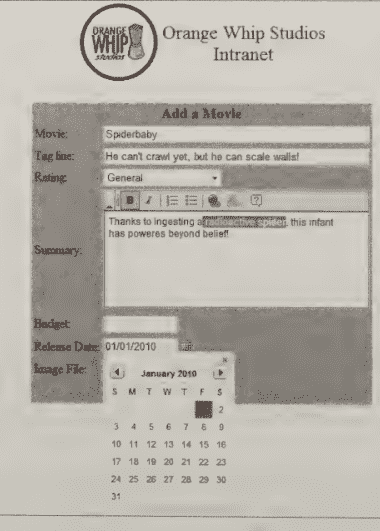

## 列表 15.1 insert1.cfm—新电影表单

```
<---
Name: insert1.cfm
Author: Ben Forta (ben@forta.com)
Description: Advanced HTML controls
Created: 01/01/2010
-->

<!-- Get ratings -->
```

### 列表 15.1（续）

```cf
<cfquery datasource="ows" name="ratings">
SELECT RatingID, Rating
FROM FilmsRatings
ORDER BY RatingID
</cfquery>

<!-- Page header -->
<cfinclude template="header.cfm">

<!-- New movie form -->
<cfform action="insert2.cfm">
<table align="center" bgcolor="orange">
<tr>
  <th colspan="2">
    <font size="1">Add a Movie</font>
  </th>
</tr>
<tr>
  <td>Movie:</td>
  <td>
    <input type="Text"
      name="MovieTitle"
      message="MOVIE TITLE is required!"
      required="Yes"
      validateAt="onSubmit,onServer"
      size="50"
      maxlength="100">
  </td>
</tr>
<tr>
  <td>Tag line:</td>
  <td>
    <input type="Text"
      name="PitchText"
      message="TAG LINE is required!"
      required="Yes"
      validateAt="onSubmit,onServer"
      size="50"
      maxlength="100">
  </td>
</tr>
<tr>
  <td>Rating:</td>
  <td>
    <!-- Ratings list -->
    <cfselect name="RatingID"
      query="ratings"
      display="Rating"
      value="RatingID" />
```

### 列表 15.1（续）

```cf
  </td>
</tr>
<tr>
  <td>Summary:</td>
  <td>
    <textarea name="summary"
      richtext="true"
      toolbar="150"
      height="150"
      wrap="virtual" />
  </td>
</tr>
<tr>
  <td>Budget:</td>
  <td>
    <input type="Text"
      name="AmountBudgeted"


`message="BUDGET must be a valid numeric amount!"`

`required="NO"`

`validate="integer"`

`validateAt="onSubmit,onServer"`

`size="10"`

`maxlength="10" />

</td>

</tr>

<tr>

<td>

Release Date:

</td><td>

  <cfinput type="DateField"`

`name="DateInTheaters"`

`message="RELEASE DATE must be a valid date!"`

`required="NO"`

`validate="date"`

`validateAt="onSubmit,onServer"`

`size="10"`

`maxlength="10" />

</td>

</tr>

<tr>

<td>

Image File:

</td><td>

  <input type="Text"`

`name="ImageName"`

`required="NO"`

`size="20"`

`maxlength="50" />

</td>

</tr>

### 列表 15.1（续）

```html
<tr>
<td colspan="2" align="center">
  <input type="submit" value="Insert">
</td>
</tr>
</table>
</cfform>
```

```html
<!-- Page footer -->
<cfinclude template="footer.cfm">
```

你已经看到过一些数据字段和文本编辑器了；让我们再看几个几个。
`<cfgrid>` 控件用于创建数据网格：如图 15.2 所示，它是二维电子表格类型的视图。

## ColdFusion 扩展控件

你已经看到了一些表单控件。但支持哪些其他类型的控件呢？表 15.1 列出了控件及其语法说明。

### 表 15.1 控件

| 控件 | 语法 | 说明 |
| :--- | :--- | :--- |
| 自动建议 | `<input type="text" autosuggest="">` | 支持简单的 Ajax 使用 |
| 按钮 | `<input type="button">` | 功能类似于 HTML `<input type="button">` |
| 复选框 | `<input type="checkbox">` | 功能类似于 HTML `<input="checkbox">` |
| 数据网格字段 | `<cfgrid type="datepicker">` | 支持简单的 Ajax 使用 | 不支持 HTML |
| 隐藏域 | `<cfinput type="hidden">` | 功能类似于 HTML `<input type="hidden">` |
| 密码 | `<cfinput type="password">` | 功能类似于 HTML `<input type="password">` |
| 选择框 | `<cfselect>` | 支持简单的 Ajax 使用 |
| 提交 | `<cfinput type="submit">` | 功能类似于 HTML `<input type="submit">` |
| 文本 | `<cfinput type="text">` | 功能类似于 HTML `<input type="text">` |
| 文本区域 | `<cftextarea>` | 功能类似于 HTML `<textarea>` |
| 树形 | `<cftree>` | 支持简单的 Ajax 使用 |
| 富文本 | `<cftextarea richtext="true">` | | | |

## 图 15.2

ColdFusion 的数据网格使其能够在滚动网格中显示多行。


列表 15.2 包含了创建图 15.2 中网格的代码。

### 列表 15.2 grid1.cfm—基础数据网格

---

## Listing 15.2 (CONTINUED)

```
Description: Basic data grid

Created: 01/01/2010

-->

<!---- Get movies -->

<cfinvoke component="movies"

method="list"

returnvariable="movies">

<!---- Page header -->

<cfinclude template="header.cfm">

<!---- Display grid -->

<cfform>

<cfgrid name="movieGrid"

width="400"

format="html"

query="movies" />

</cfform>

<!---- Page footer -->

<cfinclude template="footer.cfm">
```

`Listing 15.2` invokes the `list` method in `movies.cfc` to obtain a list of movies. Then it creates a data grid using `<cfgrid>`, passing the query to it.

`Listing 15.3` is the `list` method used to populate the grid.

## Listing 15.3 ListMethod

```
<!---- Get movie list -->

<cffunction name="list"

returntype="query"

hint="List all movies">

<!---- Create local variables -->

<cfset var movies="*">

<cfquery datasource="#ds#"

name="movies">

SELECT FilmID, MovieTitle, Summary, Rating

FROM Films, FilmsRatings

WHERE Films.RatingID=FilmsRatings.RatingID

ORDER BY MovieTitle

</cfquery>

<cfreturn movies>

</cffunction>
```

This is all it takes to populate a data grid. Data in the grid can be sorted by clicking column headers (click once to sort in ascending order and click again to sort in descending order), and columns can be resized and moved as needed.

By default, `<cfgrid>` displays all of the columns in the passed query, using the column names as the grid headers. This behavior can be changed by using the `<cfgridcolumn>` tag, as seen in `Listing 15.4`, which creates an updated data grid.

## Listing 15.4 grid2.cfm--Controlling the Data Grid Display

```
<!-- grid2.cfm

Name: Ben Forta (ben@forta.com)

Description: Controlling data grid display

Created: 01/01/2010

<!-- Get movies -->

<cfinvoke component="movies"

method="list"

returnvariable="movies">

<!-- Page header -->

<cfinclude template="header.cfm">

<!-- Display grid -->

<cfform>

<cfgrid name="movieGrid"

width="600"

format="html"

query="movies">

<cfgridcolumn name="FilmID"

display="no">

<cfgridcolumn name="MovieTitle"

header="Title"

width="200"

<cfgridcolumn name="Rating"

header="Rating"

width="100"

<cfgridcolumn name="Summary"

header="Summary"

width="400">

</cfgrid>

</cfform>

<!-- Page footer -->

<cfinclude template="footer.cfm">
```

The updated listing explicitly prevents the `FilmID` column from being displayed and provides alternate headers and widths for the other three columns.

**TIP**
The `<cfgridcolumn>` attribute can also be used to control the order in which grid columns appear.

**NOTE**
Additional `<cfgridcolumn>` attributes enable control of fonts, colors, and much more.

Another useful control, one that does not exist in HTML itself, is the auto-suggest control. This is actually less control and more a change to the way that text inputs usually work.

Imagine that you have a form that prompts the user to enter an address. There are lots of possible options for the `City` field, but if you have lots of names already stored in your database tables, you can assist the user by providing a drop-down list of suggestions (which the user can select or just ignore). This type of control is called auto-suggest control, and it usually pops up if the user pauses, giving you the opportunity to suggest text options.

There is no auto-suggest control in HTML. Creating an auto-suggest control requires some pretty sophisticated JavaScript—unless you are using ColdFusion, that is, in case you don't have to write any JavaScript at all.

To turn `<input type="text">` into an auto-suggest control, all you need to do is provide the suggestions. For example, the following code creates an auto-suggest control:

```
<input type="text"

name="fruit"

autosuggest="apple,banana,lemon,lime,mango,orange,pear">
```

If you were to save and run this code, you would see a regular text input control. If you typed the letter `L` and paused, you'd see a pop-up box containing the two options that begin with the letter `L`.

Of course, the list need not be hard-coded. `Listing 15.5` contains a complete auto-suggest example that creates the screen shown in Figure 15.3.

## Figure 15.3
Auto-suggest lists can be hard-coded and populated programmatically.


## Listing 15.5 autosuggest1.cfm—Basic Auto-Suggest

```
<!--

autosuggest1.cfm

Name:

Author: Ben Forta (ben@forta.com)

Description: Basic auto-suggest

Created: 01/01/2010

-->

<!-- Get ratings -->

<cfquery datasource="ows" name="ratings">

SELECT Rating

FROM Films

ORDER BY Rating

</cfquery>

<!-- Convert to list -->
```

---

## 第 15 章 超 HTML 表单：ColdFusion 驱动的 Ajax

### 列表 15.6（续）

```
<-- 定义变量 -->

<cfset var data="">

<!-- 执行搜索 -->

<cfquery datasource="#ds#" name="data">

SELECT MovieTitle

FROM Films

WHERE UCase(MovieTitle) LIKE UCase('#%ARGUMENTS.search#')

ORDER BY MovieTitle

</cfquery>

<!---- 返回结果 -->

<cfreturn ValueList(data.MovieTitle)

</cffunction>
```

列表 15.6 中的大部分代码是你之前见过的，但这里有一些非常重要的点需要注意。首先，该方法有一个 `access="remote"` 属性。通常，CFC 方法只能由同一服务器上的其他 ColdFusion 程序调用，但需要由 Web 浏览器调用的 CFC 方法（如 Ajax 控件所示）需要显式授权，这就是 `access="remote"` 所起的作用。

注意

任何包含 `access="remote"` 的 CFC 方法都可以被其他用户远程调用。对于你暴露的方法要非常小心，并注意 CFC 安全性（见于卷 2 第 24 章“创建高级 ColdFusion 组件”）。

`lookup` 方法接受一个参数——用户目前输入的字符串——在 `<cfquery>` 中使用文本，并返回一个包含匹配项逗号分隔列表（自动建议控件所需的格式）。

现在让我们看看使用 `<cfinput>` 控件调用 `lookupMovie` 方法的客户端代码。列表 15.7 显示了这些代码，结果如图 15.4 所示。

### 图 15.4

Ajax 驱动的自动建议控件通过回调用 ColdFusion 来检索建议。


| 查找电影 |
|---|
| 电影: H |
| Hannah 和她的姐姐们 |
| 哈利·波特 |

### 列表 15.7 autosuggest2.cfm—Ajax 自动建议

```
<...

Name: autosuggest2.cfm

Author: Ben Porta (ben@forta.com)

Description: Ajax auto-suggest

Created: 01/01/2010
```

### 列表 15.7（续）

```
<!-- 页头 -->

<cfinclude template="header.cfm">

<!-- 搜索表单 -->

<table align="center" bgcolor="orange">

<tr>

<th colspan="2">

<font size="+1">查找电影</font>

</th>

</tr>

<tr>

<td>

电影

</td>

<td>

<input type="Text"

name="MovieTitle"

autosuggest="cfc:movies.lookupMovie(cfautuggestvalue)"

size="50"

maxage="100">

</td>

</tr>

<tr>

<td colspan="2" align="center">

<input type="submit" value="Search">

</td>

</tr>
```


进入`/path/to/xxx`目录，找到`xxx.json`。

在表达式`cvar = avar + bvar`中，加法运算符（`+`）将`avar`与`bvar`相加，得到它们的和`cvar`。

在`List.of(arg0, arg1, arg2)`中，`List`接口的工厂方法`of()`接受一系列的元素，返回包含它们的只读列表。

之后我们这样调用`cmd`命令：`cmd arg0 arg1 arg2`。

```
if (condVar > someVal) {console.log("xxx")}
```

---

**列表 15.7 autosuggest2.cfm—Ajax 自动建议**

```
<...
Name: autosuggest2.cfm
Author: Ben Porta (ben@forta.com)
Description: Ajax auto-suggest
Created: 01/01/2010
```

**列表 15.7（续）**

```
<!-- 页头 -->
<cfinclude template="header.cfm">

<!-- 搜索表单 -->
<table align="center" bgcolor="orange">
<tr>
<th colspan="2">
<font size="+1">查找电影</font>
</th>
</tr>
<tr>
<td>电影</td>
<td>
<input type="Text"
name="MovieTitle"
autosuggest="cfc:movies.lookupMovie(cfautuggestvalue)"
size="50"
maxage="100">
</td>
</tr>
<tr>
<td colspan="2" align="center">
<input type="submit" value="Search">
</td>
</tr>
</table>
</cfform>

<!-- 页脚 -->
<cfinclude template="footer.cfm">
```

你对列表 15.7 会注意到的第一点是，它不包含任何数据库查询，也没有用于调用 CFC 方法的`<cfinvoke>`。相反，我们在`<cfinput>`控件中添加了这一行：`autosuggest="cfc:movies.lookupMovie(cfautuggestvalue)"`。

与列表 15.5 中的示例不同，`autosuggest`并不包含列表。相反，它指向一个 CFC（在本例中是名为`movies`的 CFC，位于当前文件夹中）以及名为`lookupMovie`的方法（在列表 15.6 中）。`lookupMovie`方法期望接收一个字符串，即用户到目前输入的文本。ColdFusion 并不要求你编写 JavaScript 来提取该值，而是允许你引用一个名为`cfautuggestvalue`的特殊客户端变量，当调用 CFC 方法时，该变量会被用户输入的值自动替换。`cfautuggestvalue`被包括在花括号`{}`之中，ColdFusion 用它来界定客户端代码中的表达式（类似于服务器端代码使用`#`来界定表达式）。

**注意**：不需要指向当前文件夹中 CFC 的完整路径。要指向另一个文件夹中的 CFC，则需要完全限定路径。

保存代码并尝试一下。每当你输入文本并停顿时，都会对 CFC 方法进行异步调用，检索并返回数据，然后提供建议。

你现在已经创建了一个 Ajax 驱动的控件，而无须担心 Ajax 到底是什么，也不需要编写一行 JavaScript 代码。

这就是我们热爱 ColdFusion 的原因！

让我们来看另一个更复杂的示例：一个必须处理任意数量数据并根据需要支持分页的数据网格。

同样，解决方案包含两个部分：访问数据的 CFC 和绑定到它的客户端代码。让我们先看 CFC 方法；列表 15.8 显示了代码。

**列表 15.8 lookupMovieMethod**

```
<-- 浏览电影 -->
<cffunction name="browse"
access="remote"
returnntype="struct"
hint="用于 Ajax 网格的浏览方法">
<cfargument name="page"
type="numeric"
required="yes">
<cfargument name="pageSize"
type="numeric"
required="yes">
<cfargument name="gridsortcolumn"
type="string"
required="no"
default="">
<cfargument name="gridsortdir"
type="string"
required="no"
default="">

<!-- 地变量 -->
<cfset var movies="#ds#">
<cfquery datasource="#ds#"
name="movies">
SELECT FilmID, MovieTitle, Rating
FROM Films, FilmsRatings
WHERE Films.RatingID=FilmsRatings.RatingID
<cfif ARGUMENTS.gridsortcolumn NEQ ""
AND ARGUMENTS.gridsortdir NEQ "*">
ORDER BY #ARGUMENTS.gridsortcolumn# #ARGUMENTS.gridsortdir#
</cfif>
</cfquery>

<!-- 并作为网格结构返回 -->
<cfreturn QueryConvertGrid(movies,
ARGUMENTS.page,
ARGUMENTS.pageSize)>
</cffunction>
```

列表 15.8 包含一个名为`browse`的方法，用于浏览表中的行。`browse`方法返回数据，每次一页，因此它必须知道请求的页码以及每页的行数。如果每页有 10 行且请求第 3 页，`browse`就会知道是 21 到 30 行，以此类推。

`browse`方法使用`<cfquery>`获取数据，可选地附加`ORDER BY`子句。最后，`QueryConvertGrid()`函数提取所需数据并将其格式化为`<cfgrid>`控件所需的格式。

任何包含`access="remote"`的 CFC 方法都可以被其他用户远程调用。对于你暴露的方法要非常小心，并注意 CFC 安全性（见于卷 2 第 24 章“创建高级 ColdFusion 组件”）。

`lookup`方法接受一个参数——用户目前输入的字符串——在`<cfquery>`中使用文本，并返回一个包含匹配项逗号分隔列表（自动建议控件所需的格式）。

现在让我们看看使用`<cfinput>`控件调用`lookupMovie`方法的客户端代码。列表 15.7 显示了这些代码，结果如图 15.4 所示。

**图 15.4** Ajax 驱动的自动建议控件通过回调用 ColdFusion 来检索建议。

| 查找电影 |
|---|
| 电影: H |
| Hannah 和她的姐姐们 |
| 哈利·波特 |

**说明**：图 15.4 对应的图片已嵌入原文档中（``），此处保留占位符。

---

**列表 15.8（续）**

```
<-- 浏览电影 -->
<cffunction name="browse"
access="remote"
returnntype="struct"
hint="用于 Ajax 网格的浏览方法">
<cfargument name="page"
type="numeric"
required="yes">
<cfargument name="pageSize"
type="numeric"
required="yes">
<cfargument name="gridsortcolumn"
type="string"
required="no"
default="">
<cfargument name="gridsortdir"
type="string"
required="no"
default="">

<!-- 地变量变量 -->
<cfset var movies="#ds#">
<cfquery datasource="#ds#"
name="movies">
SELECT FilmID, MovieTitle, Rating
FROM Films, FilmsRatings
WHERE Films.RatingID=FilmsRatings.RatingID
<cfif ARGUMENTS.gridsortcolumn NEQ ""
AND ARGUMENTS.gridsortdir NEQ "*">
ORDER BY #ARGUMENTS.gridsortcolumn# #ARGUMENTS.gridsortdir#
</cfif>
</cfquery>

<!-- 并作为网格结构返回 -->
<cfreturn QueryConvertGrid(movies,
ARGUMENTS.page,
ARGUMENTS.pageSize)>
</cffunction>
```

列表 15.8 包含一个名为`browse`的方法，用于浏览表中的行。`browse`方法返回数据，每次一页，因此它必须知道请求的页码以及每页的行数。如果每页有 10 行且请求第 3 页，`browse`就会知道是 21 到 30 行，以此类推。

`browse`方法使用`<cfquery>`获取数据，可选地附加`ORDER BY`子句。最后，`QueryConvertGrid()`函数提取所需数据并将其格式化为`<cfgrid>`控件所需的格式。

任何包含`access="remote"`的 CFC 方法都可以被其他用户远程调用。对于你暴露的方法要非常小心，并注意 CFC 安全性（见于卷 2 第 24 章“创建高级 ColdFusion 组件”）。

`lookup`方法接受一个参数——用户目前输入的字符串——在`<cfquery>`中使用文本，并返回一个包含匹配项逗号分隔列表（自动建议控件所需的格式）。

现在让我们看看使用`<cfinput>`控件调用`lookupMovie`方法的客户端代码。列表 15.7 显示了这些代码，结果如图 15.4 所示。

**图 15.4** Ajax 驱动的自动建议控件通过回调用 ColdFusion 来检索建议。

| 查找电影 |
|---|
| 电影: H |
| Hannah 和她的姐姐们 |
| 哈利·波特 |

**列表 15.7 autosuggest2.cfm—Ajax 自动建议**

```
<...
Name: autosuggest2.cfm
Author: Ben Porta (ben@forta.com)
Description: Ajax auto-suggest
Created: 01/01/2010
```

**列表 15.7（续）**

```
<!-- 页头 -->
<cfinclude template="header.cfm">

<!-- 搜索表单 -->
<table align="center" bgcolor="orange">
<tr>
<th colspan="2">
<font size="+1">查找电影</font>
</th>
</tr>
<tr>
<td>电影</td>
<td>
<input type="Text"
name="MovieTitle"
autosuggest="cfc:movies.lookupMovie(cfautuggestvalue)"
size="50"
maxage="100">
</td>
</tr>
<tr>
<td colspan="2" align="center">
<input type="submit" value="Search">
</td>
</tr>
</table>
</cfform>

<!-- 页脚 -->
<cfinclude template="footer.cfm">
```

你对列表 15.7 会注意到的第一点是，它不包含任何数据库查询，也没有用于调用 CFC 方法的`<cfinvoke>`。相反，我们在`<cfinput>`控件中添加了这一行：`autosuggest="cfc:movies.lookupMovie(cfautuggestvalue)"`。

与列表 15.5 中的示例不同，`autosuggest`并不包含列表。相反，它指向一个 CFC（在本例中是名为`movies`的 CFC，位于当前文件夹中）以及名为`lookupMovie`的方法（在列表 15.6 中）。`lookupMovie`方法期望接收一个字符串，即用户到目前输入的文本。ColdFusion 并不要求你编写 JavaScript 来提取该值，而是允许你引用一个名为`cfautuggestvalue`的特殊客户端变量，当调用 CFC 方法时，该变量会被用户输入的值自动替换。`cfautuggestvalue`被包括在花括号`{}`之中，ColdFusion 用它来界定客户端代码中的表达式（类似于服务器端代码使用`#`来界定表达式）。

**注意**：不需要指向当前文件夹中 CFC 的完整路径。要指向另一个文件夹中的 CFC，则需要完全限定路径。

保存代码并尝试一下。每当你输入文本并停顿时，都会对 CFC 方法进行异步调用，检索并返回数据，然后提供建议。

你现在已经创建了一个 Ajax 驱动的控件，而无须担心 Ajax 到底是什么，也不需要编写一行 JavaScript 代码。

这就是我们热爱 ColdFusion 的原因！

让我们来看另一个更复杂的示例：一个必须处理任意数量数据并根据需要支持分页的数据网格。

同样，解决方案包含两个部分：访问数据的 CFC 和绑定到它的客户端代码。让我们先看 CFC 方法；列表 15.8 显示了代码。

**列表 15.8 lookupMovieMethod**

```
<-- 浏览电影 -->
<cffunction name="browse"
access="remote"
returnntype="struct"
hint="用于 Ajax 网格的浏览方法">
<cfargument name="page"
type="numeric"
required="yes">
<cfargument name="pageSize"
type="numeric"
required="yes">
<cfargument name="gridsortcolumn"
type="string"
required="no"
default="">
<cfargument name="gridsortdir"
type="string"
required="no"
default="">

<!-- 地变量 -->
<cfset var movies="#ds#">
<cfquery datasource="#ds#"
name="movies">
SELECT FilmID, MovieTitle, Rating
FROM Films, FilmsRatings
WHERE Films.RatingID=FilmsRatings.RatingID
<cfif ARGUMENTS.gridsortcolumn NEQ ""
AND ARGUMENTS.gridsortdir NEQ "*">
ORDER BY #ARGUMENTS.gridsortcolumn# #ARGUMENTS.gridsortdir#
</cfif>
</cfquery>

<!-- 并作为网格结构返回 -->
<cfreturn QueryConvertGrid(movies,
ARGUMENTS.page,
ARGUMENTS.pageSize)>
</cffunction>
```

列表 15.8 包含一个名为`browse`的方法，用于浏览表中的行。`browse`方法返回数据，每次一页，因此它必须知道请求的页码以及每页的行数。如果每页有 10 行且请求第 3 页，`browse`就会知道是 21 到 30 行，以此类推。

`browse`方法使用`<cfquery>`获取数据，可选地附加`ORDER BY`子句。最后，`QueryConvertGrid()`函数提取所需数据并将其格式化为`<cfgrid>`控件所需的格式。

任何包含`access="remote"`的 CFC 方法都可以被其他用户远程调用。对于你暴露的方法要非常小心，并注意 CFC 安全性（见于卷 2 第 24 章“创建高级 ColdFusion 组件”）。

`lookup`方法接受一个参数——用户目前输入的字符串——在`<cfquery>`中使用文本，并返回一个包含匹配项逗号分隔列表（自动建议控件所需的格式）。

现在让我们看看使用`<cfinput>`控件调用`lookupMovie`方法的客户端代码。列表 15.7 显示了这些代码，结果如图 15.4 所示。

**图 15.4** Ajax 驱动的自动建议控件通过回调用 ColdFusion 来检索建议。

| 查找电影 |
|---|
| 电影: H |
| Hannah 和她的姐姐们 |
| 哈利·波特 |

**说明**：图 15.4 对应的图片已嵌入原文档中（``），此处保留占位符。


<cfargument name="gridsortcolumn"
type="string"
required="no"
default="">

<cfargument name="gridsortdir"
type="string"
required="no"
default="">

<!-- 地变量 -->
<cfset var movies="#ds#">

<cfquery datasource="#ds#"
name="movies"
SELECT FilmID, MovieTitle, Rating
FROM Films, FilmsRatings
WHERE Films.RatingID=FilmsRatings.RatingID

<cfif ARGUMENTS.gridsortcolumn NEQ ""
AND ARGUMENTS.gridsortdir NEQ "*"
ORDER BY #ARGUMENTS.gridsortcolumn# #ARGUMENTS.gridsortdir#
</cfif>
</cfquery>

<!-- 并作为网格结构返回 -->
<cfreturn QueryConvertGrid(movies,
ARGUMENTS.page,
ARGUMENTS.pageSize)>
</cffunction>

列表 15.8 包含一个名为 `browse` 的方法，用于浏览表中的行。`browse` 方法返回数据，每次一页，因此它必须知道请求的页码以及每页的行数。如果每页有 10 行且请求第 3 页，`browse` 就会知道是 21 到 30 行，以此类推。

`browse` 方法使用 `<cfquery>` 获取数据，可选地附加 `ORDER BY` 子句。最后，`QueryConvertGrid()` 函数提取所需数据并将其格式化为 `<cfgrid>` 控件所需的格式。

任何包含 `access="remote"` 的 CFC 方法都可以被其他用户远程调用。对于你暴露的方法要非常小心，并注意 CFC 安全性（见于卷 2 第 24 章“创建高级 ColdFusion 组件”）。

`lookup` 方法接受一个参数——用户目前输入的字符串——在 `<cfquery>` 中使用文本，并返回一个包含匹配项逗号分隔列表（自动建议控件所需的格式）。

现在让我们看看使用 `<cfinput>` 控件调用 `lookupMovie` 方法的客户端代码。列表 15.7 显示了这些代码，结果如图 15.4 所示。

**图 15.4**

Ajax 驱动的自动建议控件通过回调用 ColdFusion 来检索建议。


| 查找电影 |
|---|
| 电影: H |
| Hannah 和她的姐姐们 |
| 哈利·波特 |

**列表 15.7 autosuggest2.cfm—Ajax 自动建议**

```
<...
Name: autosuggest2.cfm
Author: Ben Porta (ben@forta.com)
Description: Ajax auto-suggest
Created: 01/01/2010
```

**列表 15.7（续）**

```
<!-- 页头 -->
<cfinclude template="header.cfm">

<!-- 搜索表单 -->
<table align="center" bgcolor="orange">
<tr>
<th colspan="2">
<font size="+1">查找电影</font>
</th>
</tr>
<tr>
<td>
电影
</td>
<td>
<input type="Text"
name="MovieTitle"
autosuggest="cfc:movies.lookupMovie(cfautuggestvalue)"
size="50"
maxage="100">
</td>
</tr>
<tr>
<td colspan="2" align="center">
<input type="submit" value="Search">
</td>
</tr>
</table>
</cfform>

<!-- 页脚 -->
<cfinclude template="footer.cfm">
```

这个 `cfgrid` 控件类似于列表 15.4 中的一个。大的 `query` 属性（传递实际查询）被新的 `bind` 属性取代。`bind` 属性指向一个 CFC 方法，使用与自动建议示例相同的语法。如已解释，CFC 方法期望接收四个参数（前两个页码和大小是必须的，后两个排序列和方向是可选的）。再次，ColdFusion 提供了特殊的变量来代替实际值：`{cfpage}` 被替换为当前页码，`{cfpagesize}` 被替换为传递给 `pages` 属性的值，以此类推。

你只需要保存并运行代码。要显示第一页数据，Web 浏览器中的 JavaScript 调用 CFC 方法，获取第一组行。然后，当你从页面排序或排序和重新排序数据时，CFC 方法会在后台异步被调用，并更新网格。

> **注意**
> `<cfgrid>` 控件也支持数据编辑，但该功能在本章中未介绍。

## 使用绑定

你已经看到了绑定的示例：Ajax 驱动的自动建议控件和数据网格都使用绑定来引用服务器上的 CFC 方法。

绑定也可以用于客户端，允许一个控件引用并与其他控件进行交互。让我们来看一些基础示例。

- 要全面了解 ColdFusion Ajax 绑定，请参阅第 30 章。

我们将从另一个数据格开始，但有一个有趣的变化。如图 15.6 所示，这个网格内部包含一个 `<textarea>` 框，因此在网格中选择某部电影时，摘要将显示在右侧的框中。这种用户界面显然需要控件之间的交互，因此需要绑定。

**图 15.6**

绑定允许控件与其他控件进行交互。


驱动此新数据格的 CFC 方法与之前使用的相同，因此我们不再重复介绍它，但列表 15.10 所示的客户端代码值得仔细观察。

**列表 15.10 browse.cfm—Ajax 数据格**

```
<---
Name: browse.cfm
Author: Ben Forta (ben@forta.com)
Description: Demonstrate using bindings
Created: 01/01/2010
-->

<!-- Page header -->
<cfinclude template="header.cfm">

<!-- Display -->
<cfform>
<table>
<tr valign="top">
<!-- The grid -->
<cfgrid name="movieGrid"
width="300"
format="html"
```

**第 15 章 超越 HTML 表单：ColdFusion 驱动的 Ajax**

**列表 15.10（续接）**

```
pagesize="0"
striperows="yes"
bind="cfc:movies.browse({cfgridpage},
{cfgridsortcolumn},
{cfgridsortdirection})">

<cfgridcolumn name="FilmID"
display="no">

<cfgridcolumn name="MovieTitle"
header="Title"
width="200">

<cfgridcolumn name="Rating"
header="Rating"
width="100">

<cfgridcolumn name="Summary"
display="no">
</cfgrid>
</td>

<!-- Summary box -->
<td>
<cftextarea name="summary" rows="15" cols="50"
bind="(movieGrid.summary)" />
</td>
</tr>
</table>
</cfform>

<!-- Page footer -->
```

```
<cftextarea name="summary" rows="15" cols="50"
bind="(movieGrid.summary)" />
```

除了一些表格标签和控件尺寸外，列表 15.8 的大部分内容保持不变。主要的变化是下面的代码：

在这里，创建并命名了一个 `<cftextarea>` 区域，然后使用 `bind` 将 `<cftextarea>` 连接到 `movieGrid.summary`（即数据格）。这样，每当 `movieGrid` 数据格中的选择发生变化时，`<cftextarea>` 中的值就会自动更新。

让我们来看一个示例：绑定的更复杂用法。我们已经多次使用了 `<select>` 控件，这些控件通常用从数据库检索的数据进行填充。

但如果你想要多个相关的 `<select>` 控件呢？如果你有一个 `<select>` 控件列出所有电影，然后另一个 `<select>` 控件列出根据第一个控件中选定的评分所对应的电影，该怎么办？显然，这种场景需要一种方法调用 ColdFusion 以初始获取评分，然后在每次评分变化时通过另一种方法获取新的电影列表。所需结果的示例如图 15.7 所示。我们如何实现这些结果？

**图 15.7**

绑定可以根据需要触发对 ColdFusion 的异步调用。


嗯，如果你还没有想出来，答案是使用绑定和对 ColdFusion 组件（CFC）的 Ajax 类型异步调用。

这个示例我们需要两个方法：一个用于填充每个 `<select>` 控件。让我们先寻找 CFC 方法，如列表 15.11 所示。

**列表 15.11 getRatings 和 getFilms.Methods**

```
<!-- Array of ratings types -->
<cffunction name="getRatings"
access="remote"
returnType="query"
hint="Get ratings for Ajax SELECT">

<!-- Define variables -->
<cfset var data="">

<!-- Get data -->
<cfquery name="data" datasource="#ds#">
SELECT RatingID, Trim(Rating) AS Rating
FROM FilmsRatings
ORDER BY Rating
</cfquery>

<!-- And return it -->
<cfreturn data>
</cffunction>
```

```
<!-- Get films by rating -->
<cffunction name="getFilms"
access="remote"
returnType="query"
hint="Get films by rating for Ajax SELECT">

<cfargament name="RatingID"
type="numeric"
required="true">

<!-- Define variables -->
<cfset var data="">

<!-- Get data -->
<cfquery name="data" datasource="#ds#">
SELECT FilmID, Trim(MovieTitle) AS MovieTitle
WHERE RatingID = #ARGUMENTS.RatingID
```

**第 15 章 超越 HTML 表单：ColdFusion 驱动的 Ajax**

**列表 15.11（续接）**

```
ORDER BY MovieTitle
```

```
<!--! And return it -->
<cfreturn data>
</cffunction>
```

和之前一样，两个方法都返回查询，且都具有 `access="remote"`。`getRatings` 方法不需要接受任何参数；它只需获取评分列表。`getFilms` 方法接受单个参数 `ratingID`，并检索与该评分匹配的电影并返回。两个方法中的 SQL 语句都使用 SQL `Trim()` 函数来去除任何末尾空格（因为这些可能会扭曲 Ajax 控件中的显示）。

这很简单。但客户端呢？代码在列表 15.12 中。

**列表 15.12 selects.cfm—相关的 SELECT 控件**

```
<!--
Name: selects.cfm
Author: Ben Forta (ben@forta.com)
Description: Related SELECT controls
Created: 01/01/2010
-->

<!-- Page header -->
<cfinclude template="header.cfm">

<!-- Search form -->
<cfform>
<table align="center" bgcolor="orange">
<tr>
<th colspan="2">
<font size="+1">查找电影</font>
</th>
</tr>
<tr>
<td>
Rating:<br>
<cfselect name="ratingID"
bind="cfc:movies.getRatings()"
display="Rating"
value="ratingID"
bindonload="true" />
</td>
</tr>
<td>
Movie:<br>
<cfselect name="FilmID"
bind="cfc:movies.getFilms({ratingID})"
display="MovieTitle"
value="FilmID" />
</td>
</tr>
```

**列表 15.12（续接）**

```
<tr>
<td colspan="2" align="center">
<input type="submit" value="Search">
</td>
</tr>
</table>
```

```
<!-- Page footer -->
<cfinclude-include template="footer.cfm" />
```


列表 15.12 中的代码包含两个 `<select>` 控件，它们都具有一个 `bind` 属性，将它们连接到我们的 CFC 方法。但这两个控件之间存在两个重要的区别。

第一个 `<select>` 控件 `ratingID` 简单地绑定到 `getRatings` 方法，没有传递参数（不需要）。然而，`getRatings` 将永远不会被调用，因为没有事件会强制该调用（与之前使用的数据格不同，它会自动请求第一页，`<select>` 绑定是在触发它们时发生的）。这就是为什么要使用 `bindonload="true"`；它告诉 JavaScript 代码在控件加载时立即触发服务器调用，这样第一个 `<select>` 控件就会自动填充并准备好使用。由于异步服务器调用返回查询，`display` 和 `value` 用于指定生成的 `<option>` 标签所使用的列。

# 第 16 章 图表绘制、打印与报告

- 将多个不同的图表结合起来，并将它们一起显示在页面上。例如，你可以创建一个散点图来显示随时间变化的个人购买情况，然后在其上方添加一个折线图来显示平均支出。
- 将图表保存到服务器设备中供日后使用。

# 构建简单图表

现在你已经了解了 ColdFusion 的图表功能可以做什么，让我们从一些基础示例开始。在大多数情况下，你只需要使用两个 CFML 标签 `<cfchart>` 和 `<cfchartseries>` 即可创建图表。

## 介绍 `<cfchart>` 和 `<cfchartseries>`

要在 ColdFusion 页面上显示图表，请使用 `<cfchart>` 标签。该标签控制图表的高度、宽度和格式，但它并不显示任何内容。在 `<cfchart>` 标签内部，使用 `<cfchartseries>` 标签，它决定了图表的类型（如柱状或饼图）以及显示图表的实际数据。

> **注意**
> 实际上，你有时会在 `<cfchart>` 标签内放置多个 `<cfchartseries>` 标签。请参见本章节后部分的“合并多个图表系列”。

表 16.1 显示了 `<cfchart>` 标签最重要的属性，表 16.2 显示了 `<cfchartseries>` 标签最重要的属性。

## 表 16.1 基础 `<cfchart>` 标签语法

| 属性 | 描述 |
|---|---|
| `chartwidth` | 可选。图表的宽度，单位为像素。默认值为 320。 |
| `chartheight` | 可选。图表的高度，单位为像素。默认值为 240。 |
| `xaxis` | 可选。沿图表 x 轴显示的文本。 |
| `yaxis` | 可选。当点击图表的各个部分时，将用户引导到的页面 URL。你可以在 URL 中传递变量，以便知道用户点击了图表的哪个部分。请参见本章节后部分的“从图表向下钻取”。 |
| `format` | 可选。创建图表时的图像格式类型。有效选项有 `flash`（默认值）、`png` 和 `jpg`。 |
| `seriesplacement` | 可选。对于具有多个数据系列的图表，你可以使用此属性 – `cluster`（聚集）、`stacked`（堆叠）或默认 – 来控制系列在视觉上的组合方式。如果数据系列代表相邻的信息片段而不是在视觉上相加，请使用 `cluster`。如果数据系列代表对于你绘制的每个项目应该相加成单个值的值，请使用 `stacked`。请参见本章节后部分的“合并多个图表系列”。 |

> **注意**
> 由于这些标签具有大量的属性（总共超过 40 个），我们在此表格中仅介绍了最重要的属性。其他属性将在本章节后部分介绍。

## 表 16.2 基础 `<cfchartseries>` 语法

| 属性 | 描述 |
| --- | --- |
| `type` | 必选。要创建的图表类型。通常，你将其设置为 `bar`（柱状）、`line`（折线）、`area`（面积）或 `pie`（饼图）。其他图表类型还有 `curve`、`cylinder`、`scatter`、`step` 和 `pyramid`。ColdFusion 文档包含这些较不常见类型图表的图片。 |
| `query` | 可选。包含要制图数据的查询名称。如果你不提供 `query` 属性，则需要提供 `<cfchartdata>` 标签来告诉 ColdFusion 在图表中显示哪些数据。 |
| `valuecolumn` | 如果提供了查询，则必选。包含图表上每个数据点实际值（用于图形表示的数字）的列名。 |
| `itemcolumn` | 如果提供了查询，则必选。包含每个数据点标签的列名。 |

> **注意**
> 在本章中，你经常会看到“数据点”一词。数据点是显示在图表上的实际数据。如果你正在创建一个饼图，数据点就是饼的切片。在柱状图中，数据点就是柱条。在折线或散点图中，数据点是绘制在图表上的单个点。

> **注意**
> 你不需要查询对象来创建图表。你也可以使用 `<cfchartdata>` 标签手动创建数据点。请参见本章节后部分的“使用 `<cfchartdata>` 绘制单个点”。

## 创建你的第一张图表

列表 16.1 显示了如何使用 `<cfchart>` 和 `<cfchartseries>` 创建简单的柱状图。生成的图表如图 16.1 所示。如你所见，产生一个相当有柱状图并不需要很多代码。任何人一眼看出图表，并立即理解哪些电影的成本高于平均水平，以及高出多少。

### 列表 16.1 `Charti.cfm` 从查询数据创建简单的柱状图

```
<!--
Charti.cfm
Name: Ben Porta
Description: 基础柱状图
Created: 01/01/2010
-->

<!-- 从数据库获取信息 -->
<cfinvoke component="ChartData"
method="GetBudgetData"
returnvariable="ChartQuery"
maxrows="10">

<html>
<head>
<title>图表：电影预算</title>
</head>
<body>
<h2>图表：电影预算</h2>

<!-- 此定义了图表的大小和外观 -->
<cfchart chartwidth="750"
  chartheight="500"
  yaxisitle="Budget">

<!-- 在图表内部 -->
<cfchartseries type="bar"
  query="chartquery"
  valuecolumn="amountbudgeted"
  itemcolumn="movietitle">
</cfchart>

</body>
</html>
```

## 图 16.1

使用 `<cfchart>` 和 `<cfchartdata>` 创建简单的图表很容易的。


## 生成图表

首先，使用普通的 `<invoke>` 标签来调用 CFC 方法，返回电影并从数据库获取信息。然后使用 `<chart>` 标签来确定图表的大小，并指定 y 轴沿线（即图表底部）的单词 `Budget`。最后，通过 `<chart>` 块，使用 `<chartseries>` 标签创建一个柱状图。指示 ColdFusion 绘制 `ChartQuery` 记录集中的信息，使用 `AmountBudgeted` 列中的数据进行绘制，并使用 `MovieTitle` 列为每条信息提供标签。

> **注意**
> 对于此示例和接下来的几个列表，我们使用 `maxrows="10"`（传递给 `<query>` 标签）将图表中显示的电影数量限制为十部。这可以在你学习如何使用图表标签时保持图表的图片。利用 `maxrows` 属性可以查看图表中显示的所有电影。

这里创建的图表是 Adobe Flash 图表，这是 ColdFusion 生成的默认图表格式。图表也可以生成为静态图像（JPEG 和 PNG 格式），尽管静态图表不具功能或功能丰富。

> **提示**
> 数据在图中的呈现顺序是它们从数据库检索的顺序。要更改顺序，只需使用适当的 SQL `ORDER` 子句对查询排序。

## 更改图表类型

创建的第一张图表是柱状图。很容易更改你的代码以显示不同类型的图。只需更改 `<chartseries>` 标签的 `type` 属性。图 16.2 显示了由 `Chart2.cfm` 创建的饼图，其代码见列表 16.2。区别在于 `<chartseries>` 标签中使用了 `type='Pie'`。

### 列表 16.2 `Chart2.cfm` 从查询数据创建简单的饼图

```
<!--
Name: Chart2.cfm
Author: Ben Forta
Description: 基础饼图
Created: 01/01/2010
-->

<!-- 从数据库获取信息 -->
<invoke component="ChartData"
method="GetBudgetData"
returnvariable="ChartQuery"
maxrows="10">

<html>
<head>
<title>图表：电影预算</title>
</head>
<body>
<h2>图表：电影预算</h2>

<!-- 此定义了图表的大小和外观 -->
<cfchart chartwidth="750"
  chartheight="500"
  yaxisitle="Budget">

<!-- 在图表内部 -->
<cfchartseries type="pie"
  query="chartquery"
  valuecolumn="amountbudgeted"
  itemcolumn="movietitle">
</cfchart>

</body>
</html>
```

## 图 16.2

更改图表类型只需要更改 `type` 属性。


# 使用 3D 图表增加深度

让基础图表看起来更高级的简单方法之一是给它添加 3D 效果。表 16.3 显示了为图表添加 3D 效果的 `<chart>` 选项。准备好你的红蓝眼镜吧！

> **注意**
> 3D 效果是否让图表更易读取决于具体情况。在简单的创作中，它通常看起来很好看，特别是数据点较少的条形图。一旦图表显示许多数据点，3D 效果就会分散用户的注意力。

> **注意**
> `xoffset` 和 `offset` 属性对饼图没有明显影响。你可以使用 `show3d=Yes` 让饼图以 3D 外观显示，但无法控制偏移量。

列表 16.3 显示了如何通过向列表 16.1 的代码中添加这些属性来生成 3D 图形。对 `xoffset` 和 `offset` 进行微调，使条形看起来更像是是从顶部而不是从侧面观察的。结果如图 16.3 所示。

## 图 16.3

添加 3D 图表效果以更好地显示图表细节。


## 表 16.3 `<chart>` 3D 效果选项

| 属性 | 描述 |
| --- | --- |
| `show3d` | 是否使用 3D 效果显示图表。默认值为 `No`。 |
| `offset` | 图表在 x 轴上旋转的幅度。换句话说，这控制了图表看起来像是从侧面观察的程度。你可以使用 -1 到 1 之间的值，但通常你希望对其进行实验，.1 到 .3 之间的正数效果最佳。值为 0 表示水平方向上没有 3D 效果。默认值为 .1。 |
| `yoffset` | 同样，图表围绕 y 轴旋转的幅度。你控制图表看起来像是从顶部观察的程度。同样，你可能希望对其进行实验，正数（.1 到 .3 之间）效果最佳。值为 0 表示垂直方向上没有 3D 效果。默认值为 .1。 |

### 列表 16.3 `Chart3.cfm` - 添加 3D 外观

```
<!--
Name: Chart3.cfm
Author: Ben Forta
Description: 3D bar chart
Created: 01/01/2010
--->

<!-- 从数据库中获取信息 -->
<cfinvoke component="ChartData"
method="GetObjData"
returnvariable="ChartQuery"
maxrows="10">

<html>
<head>
<title>Chart: Film Budgets</title>
</head>
<body>
<h2>Chart: Film Budgets</h2>

<!-- 这定义了图表的大小和外观 -->
<cfchart width="750"
yaxistitle="Budget"
show3d="yes"
offset=".03"
yoffset=".06">

<!-- 图表内部 -->
<cfchartseries type="bar"
query="chartquery"
valuecolumn="amountbudgeted"
itemcolumn="movietitle">
</cfchart>

</body>
</html>
```

# 控制字体和颜色

ColdFusion 提供了许多格式属性，可以用它们控制字体、颜色和边框。某些属性应用于 `<chart>` 级别，另一些则应用于 `<cfcharts>` 级别。属性及其值的完整列表太长，无法包含，因此请参考 ColdFusion 文档。

> **注意**
> 所有控制颜色的属性都可以接受 Web 风格的十六进制颜色值，例如白色的 `FFFFFF` 或蓝色的 `0000FF`。此外，可以使用以下任何颜色：`Aqua`， `Black`， `Blue`， `Fuchsia`， `Gray`， `Green`， `Lime`， `Maroon`， `Navy`， `Olive`， `Purple`， `Red`， `Silver`， `Teal` 和 `Yellow`。

列表 16.4 和图 16.4 显示了如何组合某些格式属性来改进你目前看到的条形的外观。

## 图 16.4

ColdFusion 图表标签对对图表格式提供了广泛的控制。


# 控制网格线和轴标签

几乎任何图表最重要的方面之一都是围绕 x 轴和 y 轴上实际图形周围的数字和标签。图形本身赋予了图表通过视觉传达信息的能力，但围绕图形的数字赋予了它上下文。ColdFusion 提供了许多选项来控制每个轴的刻度（即图表上可以绘制的最高和最低值之间的距离），以及控制沿轴上实际显示多少个不同的数字。

> **注意**
> 你不能调整刻度，以至于遮挡或截断图表中显示的任何实际数据。如果你的 `scalefrom` 高于图上的最低数据点，ColdFusion 将使用数据点的值。例如，如果一个预算图示例中绘制的最低预算为 $34,000，而你提供了 `scalefrom='50000'`，则 ColdFusion 将将刻度设置为 $34,000。反之亦然；如果你提供的 `scaleto` 值低于最高数据点，则将使用该点的值。

列表 16.4 显示了如何向图表添加添加格式、轴和网格线选项以使其更具吸引力，并且轴标签已格式化为货币（图 16.4）。你无法在图中看到颜色，但数据背景和整个图表背景使用了不同深色的浅蓝色。文本是深蓝色的，图条形本身具有绿色渐变。注意，网格线的数量（即水平轴上的刻标记数量）已通过 `gridlines` 属性设置为 6。这意味着在范围内除了第一个标记外，还将 5 个均匀分布的刻标记。

### 列表 16.4 `Chart4.cfm` - 格式、网格线和轴选项

```
<!--
Name: Chart4.cfm
Author: Ben Forta
Description: Extensive chart formatting
Created: 01/01/2010
-->

<!-- 从数据库中获取信息 -->
<cfinvoke component="ChartData"
method="GetObjData"
returnvariable="ChartQuery"
maxrows="10">

<html>
<head>
<title>Film Budgets</title>
</head>
<body>
<h2>Chart: Film Budgets</h2>

<!-- 这定义了图表的大小和外观 -->
<cfchart width="750"
height="450"
yaxistitle="Budget"

<!-- 3D 外观 -->
show3d="yes"
offset="04"
yoffset="04"

<!-- 字体和颜色 -->
showbordercolor="00366"
backgroundcolor="99dddd"
databackroundcolor="66bbbb"
tipbgcolor="ffff"
fontsize="11"
fontbold="yes"
fontitalic="yes"

<!-- 网格线和轴标签 -->
scalefrom="0"
scaleto="150000"
gridlines="6"
showygridlines="yes"
labelformat="currency">

<!-- 图表内部 -->
<cfchartseries type="bar"
  seriescolor="green"
  serieslabel="Budget Details:"
  query="chartquery"
  valuecolumn="amountbudgeted"
  itemcolumn="movietitle"
  paintstyle="light">
</cfchart>

</body>
</html>
```


十六进制颜色值的`#`是可选的。但如果你提供了它，必须通过双写`#`来进行转义，以免 ColdFusion 认为你正尝试引用变量。换句话说，你可以根据喜好提供`backgroundcolor="99DDDD"`或`backgroundcolor="#99DDDD"`，但不能提供`backgroundcolor="#99DDDD"`。

# 使用多个数据系列

现在你已经熟悉了创建和格式化图形的基本原理，我们想解释一下 ColdFusion 图表支持的一些更高级的内容。在下一节中，你将学习如何将多种图表类型组合到一个图中。然后你将学习如何创建用户可以点击的图表，以便深入分析图中显示的信息。

## 组合图表系列

到目前为止，你看到的所有图表只包含一个`<cfchartseries>`标签。这是合理的，因为你展示的图表每次只展示一组信息。你也可以创建代表多组信息的图表，只需在`<chart>`块中添加多个`<cfchartseries>`标签即可。额外的`<cfchartseries>`标签可以显示来自同一查询的不同列，也可以显示来自不同查询或源的信息。

## 第 16 章 图表绘制、打印与报告

图 16.5 显示了这样一个图表。每部电影都有两个柱形，成对聚集。一个柱形显示电影的预算，另一个显示截至目前该电影的实际支出，这些支出记录在`Expenses`表中。列表 16.5 显示了用于生成此图表的代码。

### 图 16.5
单个图表可以使用多个数据系列。


**列表 16.5** `Chart5.cfm`—绘制两组相关数据

```
<!---
Chart5.cfm
Name:
Author: Ben Forta
Description: Using multiple data series
Created: 01/01/2010
--->

<!--- 从数据库中获取信息 --->
<cfinvoke component="ChartData"
method="GetExpenses"
returnvariable="ChartQuery"
maxrows="5">

<html>
<head>
<title>Chart: Film Budgets</title>
</head>
<body>
<h2>Chart: Film Budgets</h2>

<!--- 这定义图表的尺寸和外观 --->
<cfchart width="750"
chartheight="450"
yaxistitle="Budget"
seriesplacement="cluster"

<!--- 3d 效果 --->
show3d="yes"
xoffset=".01"
yoffset=".03"

<!--- 字体和颜色 --->
showborder="yes"
databackcolor="dddddd"
fontbold="yes"
fontitalic="yes"

<!--- 网格线和轴标签 --->
scaleto="000000"
gridlines="5"
showxgridlines="yes"
showygridlines="no"
labelformat="currency">

<!--- 预算图 --->
<cfchartseries type="horizontalbar"
seriescolor="99ff99"
serieslabel="Amount Budgeted:"
query="chartquery"
valuecolumn="amountbudgeted"
itemcolumn="movietitle">

<!--- 支出图 --->
<cfchartseries type="horizontalbar"
seriescolor="ff4444"
serieslabel="Actual Expenses:"
query="chartquery"
valuecolumn="expensetotal"
itemcolumn="movietitle"
paintstyle="light">

</cfchart>
</body>
</html>
```

每当你在同一个查询中有多个列信息时，几乎你都可以使用与此列表类似的代码来显示它们。这里隐含的假设是`Amountbudgeted`和`ExpenseTotal`第一行中的数据与同一个现实世界项目相关。在这种情况下，该现实世界项目就是第一部电影。

### 组合不同类型的系列

你可以自由地在同一个图表的每个`<cfchartseries>`标签中使用不同的类型值（折线图、柱状图、面积图、散点图等）。例如，你可能想修改列表 16.5，使一个系列使用面积图而另一个使用折线图。折线图通常用于表示随时间变化的单个概念，而不是像电影预算那样的单个数据块，但在这种特殊情况下，结果是有效的。欢迎你尝试不同的柱状图组合，以亲眼观察各种可能性。

> **注意**：你不能将饼图与其他类型的图表组合。尝试将饼图与其他类型混合的`<cfchartseries>`标签将被忽略。

你还可以尝试使用`placement`属性来告诉 ColdFusion 改变组合图表系列的方式。例如，你可以使用`placement="stacked"`让柱形图以堆叠方式显示（如图 16.6 所示）。

### 图 16.6
单个图表可以使用多个数据系列。


## 从图表向下钻取

`<chart>`标签支持`URL`属性，你可以使用它创建可点击的图表，用户可以点击图表中的各种数据点以链接到不同的页面。当然，当他们点击图表时带到的页面由你决定。通常，这种想法是允许用户对他们点击的数据点进行缩放或钻取。

例如，如果图表显示了有关电影支出的信息（如上面的示例所示），那么点击其中一个支出柱形可能会显示一个列出实际支出记录的 HTML 表格。或者，它可能会弹出第二个图表，这是一个饼图，显示该特定电影的单项支出的分布。在任何情况下，你的可点击图表都可以被视为一种导航元素，类似于工具栏或一组 HTML 链接。它是用户探索你的视觉化数据的方式。

### 创建可点击的图表

要创建可点击的图表，只需向`<chart>`标签添加`URL`属性。当用户点击图表中的任一数据点时（饼图的扇区、柱状图的柱、折线图的点等），他们将被发送到你指定的 URL。因此，如果你希望在点击图表时浏览器导航到名为`FilmExpenseDetail.cfm`的 ColdFusion 页面，你应该使用`url="FilmExpenseDetail.cfm"`。你可以使用 HTML 接受的任何相对或绝对 URL。

然而，为了让详情页面是动态的，它需要知道用户点击了哪个数据点。为了实现这一点，ColdFusion 将用户点击的实际数据作为 URL 变量传递。为此，在`url`属性中包含表 16.4 显示的特殊值。ColdFusion 将通过将这些特殊值替换为实际数据来创建一个动态 URL。

### 表 16.4 `<chart>` URL 中的特殊值

| 变量 | 说明 |
|---|---|
| `$value$` | 所选行的值（即被点击数据点的`<chartseries>`标签的`valuecolumn`属性）。通常是你感兴趣在 URL 中传递的值。 |
| `$label$` | 所选行的标签（即被点击数据点的`itemlabel`属性）。 |
| `$series$` | 系列标签（即`<chartseries>`标签的`serieslabel`属性）。如果你的图表中有多个`<chartseries>`标签，则需要包含此值以显示点击了哪个系列。 |

例如，考虑以下`<chart>`标签：

```
<chart url="FilmExpenseDetail.cfm?MovieTitle=$label$">
```

当用户点击此饼图扇区时，他们点击的电影标题将作为`MovieTitle`参数传递给`FilmExpenseDetail.cfm`页面。在`FilmExpenseDetail.cfm`中，该值将作为`URL.MovieTitle`可用并像 URL 作用域内的任何变量一样使用。

列表 16.6 显示了如何使用`URL`属性创建可点击图表。此列表创建一个分解 Orange 电影总预算的饼图。当用户点击饼图时，他们将看到图 16.7 显示的详情页。稍后将介绍详情页的代码。

## 第 16 章 图表绘制、打印与报告

**图 16.7**
详情可以使用钻取函数显示。


**列表 16.6** `Chart5.cfm`—带钻取的图表

```
<!---
Chart5.cfm
Name:
Author: Ben Forta
Description: Using multiple data series
Created: 01/01/2010
--->

<!--- 从数据库中获取信息 --->
<cfinvoke component="ChartData"
method="GetExpenses"
returnvariable="ChartQuery"
maxrows="5">

<html>
<head>
<title>Chart: Film Budgets</title>
</head>
<body>
<h2>Chart: Film Budgets</h2>

<!--- 这定义图表的尺寸和外观 --->
<cfchart width="750"
chartheight="450"
yaxistitle="Budget"
seriesplacement="cluster"

<!--- 3d 效果 --->
show3d="yes"
xoffset=".01"
yoffset=".03"

<!--- 字体和颜色 --->
showborder="yes"
databackcolor="dddddd"
fontbold="yes"
fontitalic="yes"

<!--- 网格线和轴标签 --->
scaleto="000000"
gridlines="5"
showxgridlines="yes"
showygridlines="no"
labelformat="currency">

<!--- 预算图 --->
<cfchartseries type="horizontalbar"
seriescolor="99ff99"
serieslabel="Amount Budgeted:"
query="chartquery"
valuecolumn="amountbudgeted"
itemcolumn="movietitle">

<!--- 支出图 --->
<cfchartseries type="horizontalbar"
seriescolor="ff4444"
serieslabel="Actual Expenses:"
query="chartquery"
valuecolumn="expensetotal"
itemcolumn="movietitle"
paintstyle="light">

</cfchart>
</body>
</html>
```

### 创建详情页

创建图 16.7 显示的详情页相对简单。只需使用列表 16.6 中`<chart>`传递的 URL 参数查询数据库以获取相应的支出记录。然后可以使用`cfoutput`和 HTML 标签显示这些记录。

然而，有一个令人不愉快的问题需要处理。遗憾的是，`<chart>`并没有提供一种直接的方法在 URL 中传递唯一标识符。你能够传递的只有图表上显示的数据点的实际标签和值（分别为特殊的`ITEMLABEL`和`VALUES`值）。

因此，对于目前手头的例子（见列表 16.7），可以传递给`FilmExpenseDetail.cfm`的信息只有电影的标题和预算，因为这些是图表感知的唯一值。通常，最好在 URL 中传递`FilmID`，从而消除当两部标题相同的电影时可能出现的任何问题。由于目前在 ColdFusion 中无法实现，电影将仅通过标题（和预算）来识别。

> **注意**：在使用`<chart>`创建钻取应用时请记住。如果一个数据点无法通过图表上显示的标签和值的组合被安全且唯一地识别，你可能无法实现钻取。

**列表 16.7** `FilmExpenseDetail.cfm`—钻取时的详情页显示

```
<!---
Name: FilmExpenseDetail.cfm
Author: Ben Orta
Description: Movie drill-down
Created: 01/01/2010
--->

<!--- 这些 URL 参数将由图表传递 --->
<cfparam name="URL.MovieTitle" type="string">

<!--- 从数据库中获取信息 --->
<cfinvoke component="ChartData"
method="GetFilmID"
returnvariable="FilmID"
movietitle="#URL.MovieTitle#">

<!--- 如果无法确定 FilmID，则显示错误消息 --->
<cfif FilmID IS -1>
<cfthrow message="Could not retrieve film information."
detail="Unknown movie title provided.">
</cfif>

<!--- 现在我们已经有了 FilmID，可以从数据库中选择相应的支出记录 --->
<cfinvoke component="ChartData"
method="GetExpenseDetails"
returnvariable="ExpenseQuery"
filmid="#FilmID#">
```

## 第 16 章 绘图、打印与报告

**列表 16.7（续）**

```html
<html>
<head>
<title>费用详情</title>
</head>
<body>
<cfoutput>

<!-- 页面标题 -->
<h3>#URL.MovieTitle#</h3>

<!-- 用于显示费用的 HTML 表格 -->
<table border="1" width="500">
<tr>
<th width="100">日期</th>
<th width="100">金额</th>
<th width="300">描述</th>
</tr>

<!-- 遍历查询中的每项费用... -->
<cfloop query="expensequery">
<tr>
<td>#LSDateFormat(ExpenseDate)#</td>
<td>#CurrencyFormat(ExpenseAmount)#</td>
<td>#Description#</td>
</tr>
</cfloop>
</table>
</cfoutput>
</body>
</html>
```

调用该方法的目的是为了确定与传递给页面的`MovieTitle`（来自列表 16.6 中的图表）相对应的`FilmID`。作为一种预防措施，查询条件中还包含了`Budget`参数。如果这两部电影的标题恰好相同，由于它们的预算不同，仍然可以被正确识别。在页面的其余部分，`FilmID`存储电影的 ID 数字，并用于从数据库中检索任何相关信息。

> **注意**：如果没有从数据库中检索到电影（或检索到多部），则将使用`<cfthrow>`标签显示错误消息。

## 钻取到另一个图表

你可能想要钻取一个不同的图表以显示数据的不同视图或子集，而不仅仅是钻到一个简单的 HTML 页面。第二个图表页面又可以钻取另一个页面，以此类推。你可以使用本节中讨论的任何钻取技术来构建一个多层数据导航界面。

## 使用`<cfchartdata>`绘制单个数据点

为`<cfchartseries>`标签提供实际数据的最常用方法是指定`QUERY`属性，然后通过指定`itemcolumn`和`valuecolumn`属性告诉 ColdFusion 应该查看查询中的哪些列。你在本章中目前为止看到的所有示例都将帮助你以这种方式显示数据。

你也可以省略`query`、`itemcolumn`和`valuecolumn`属性，而是使用嵌套在`<cfchartseries>`内部的`<cfchartdata>`标签来绘制数据点。如果你想在图表上格式化个人硬编码的数据点，或者当你遇到无法完全直接地从查询中提取所需数据的情况，`<cfchartdata>`方法将变得非常有用。

**表格 16.5** `<cfchartdata>`语法

| 属性 | 描述 |
|---|---|
| `item` | 与你正在绘制的数据点相关的项，例如电影标题、购买类别或时间段——换句话说，就是你通常提供给`<cfchartseries>`标签的`itemcolumn`属性的信息。 |
| `value` | 数据点的值（数字）。这是你通常提供给`<cfchartseries>`标签的`valuecolumn`属性的值。 |

例如，如果你有一个名为`Query`的查询，包含`ExpenseDate`和`ExpenseAmount`两个列，并且你想确保数据在图表上显示时符合你的喜好格式，你可以使用

```
<cfchartseries type="line">
<cfloop query="ChartQuery">
```


进入`/path/to/xxx`目录，找到`xxx.json`。

在表达式`cvar = avar + bvar`中，加法运算符（`+`）将`avar`与`bvar`相加，得到它们的和`cvar`

在`List.of(arg0, arg1, arg2)`中，`List`接口的工厂方法`of()`接受一系列的元素，返回包含它们的只读列表。

之后我们这样调用`cmd`命令：`cmd arg0 arg1 arg2`。

```
if (condVar > someVal) {console.log("xxx")}
```

---

# 使用 `<cfchart>` 标签创建图表

使用以下代码可以动态生成图表数据：

```
<cfchartdata item="#DateFormat(ExpenseDate, 'm/d/yy')#" value="#ExpenseAmount#">
</cfloop>
</cfchartseries>
```

而不是使用：

```
<cfchartseries type="line"
query="ChartQuery"
valuecolumn="ExpenseAmount"
itemcolumn="ExpenseDate">
```

这种技术在创建基于非查询数据的图表时也有用。通过`<cfchartdata>`你可以将任何数据传递给图表。

# Flash Remoting 使用图表

可以使用`name`属性捕获图表的二进制内容，然后通过 Flash Remoting 供 Adobe Flash Player 使用。这种功能允许你创建一个 Flash 电影，用于显示动态生成的图表，也许可以作为复杂的数据输入或报告界面的一部分，而无需重新加载页面即可显示更新或更改的图表。这个主题超出了本书的范围。

# 创建可打印页面

从 Web 页面内部轻松打印可打印内容一直以来是一件麻烦，这是 Web 应用程序开发人员（所有开发者，而不只是 ColdFusion 开发者）严重的烦恼来源。考虑到 Web 应用程序开发很大一部分是数据报告和打印类型的应用，这是一个大问题。

事实是，Web 浏览器并不能正确打印 Web 页面，因此开发人员不得不采用复杂且痛苦的变通方法将内容转换为可打印格式。

ColdFusion 通过`<document>`族标签简单地解决了这个问题。

## 使用 `<document>` 标签

我们将从一个非常简单的示例开始。列表 16.8 包含了封装在对`<document>`标签中的简单文本。生成的输出如图 16.8 所示。

图 16.8

Adobe PDF 格式是 Web 上最常用的文档格式。


### 列表 16.8 `<document>` 标签

```html
<#-
Name: Print1.cfm
Author: Ben Forta
Description: Simple document
Created: 01/01/2010
-->

<cfdocument format="pdf">
Hello world!
</cfdocument>
```

列表 16.8 中的代码不能更简单了。通过将文本封装在`<document>`和`</cfdocument>`标签中，它们之间的内容会被转换为 PDF。

当然，你不局限于静态文本；你可以在文档中使用动态内容。列表 16.9 使用了 HTML、CFML 和动态数据的混合（见图 16.9）。

图 16.9

可打印输出可能包含 HTML、CFML 等更多。

实际上，根据提供的 OCR：
列表 16.9 使用了 HTML、CFML 等更多混合。


### 列表 16.9 Print2.cfm—数据驱动生成

```html
<#-
Name: Print2.cfm
Author: Ben Forta
Description: Data driven output
Created: 01/01/2010
-->

<cfinvoke component='ChartData' method='getData' returnvariable='getData'>

<!-- 生成文档 -->
<cfdocument format="pdf">

<!-- 页头 -->
<table align='center'>
<tr>
<td></td>
<td align='center'><font size='+2'>Orange Studios<br>Movies</font></td>
</tr>
</table>

<!-- 标题 -->
<div align='center'><h2>Budget Data</h2></div>

<!-- 详情 -->
<table>
<tr>
<th>Movie</th>
<th>Budget</th>
</tr>
<cfoutput query="getData">
<tr>
<td><strong>#MovieTitle#</strong></td>
<td>#LSCurrencyFormat(AmountBudgeted)</td>
</tr>
</cfoutput>
</table>
</cfdocument>
```

## `<document>` 支持什么？

你会注意到列表 16.9 中的代码使用了 HTML（包括通常应避免的`<font>`等标签）、图像、表格、CFML 表达式等。`<document>`支持以下所有：

- HTML 4
- XML 1
- DOM level 1 和 2
- CSS1 和 CSS2

换句话说，`<document>`能够将各种页面转换为可打印的 PDF。

## 创建可打印版本

你可能经常需要为现有页面创建可打印版本。你可能会尝试在现有页面中包含`<document>`标签，但遗憾的是行不通：ColdFusion 无法正确解析页面，因为它认为你的标签没有正确配对。

解决这个问题的方法是创建一个包装页面，一个定义可打印文档并包含原始页面的页面。列表 16.10 是第 11 章“结构化开发基础”中创建的页面的修改版本，它显示电影详情。修改后的页面如图 16.10 所示。

图 16.10

提供打印版本的链接通常非常方便。


---

# 第 348 页 第 16 节 绘图、打印与报告

列表 16.10（续）

```
Created: 01/01/2010
-->

<!-- 电影列表页面 -->
<cfset list_page="movies.cfm">

<!-- 确保传递了 FilmID -->
<cfif not IsDefined("URL.filmid")
<-- 如果没有传递，则跳转到电影列表 --
<cfflocation url="#list_page#"
</cfif>

<!-- 获取电影详情 -->
<cfinvoke
component="ows.11.movies"
method="GetDetails"
returnvariable="movie"
FilmID="#URL.filmid#"

<!-- 确保我们有一部电影 -->
<cfif movie.RecordCount IS 0
<-- 如果没有找到，则跳转到电影列表 --
<cfflocation url="#list_page#"
</cfif>

<!-- 构建图像路径 -->
<cfset image_src="../images/f#movie.FilmID.gif"
<cfset image_path="#ExpandPath(image_src)"

<!-- 创建 HTML 页面 -->
<html>
<head>
<title>Orange Whip Studios - 电影详情</title>
</head>

<body>

<!-- 显示电影详情 -->
<cfoutput query="movie">

<table>
<tr>
<td colspan="2">
<!-- 检查文件是否存在，否则 -->
<cfif FileExists(image_path)>
<-- 如果存在，则显示它 --

</td>
<td>#MovieTitle#</td>
</tr>
</table>
```

---

# 列表 16.10（续）

```
<tr valign="top">
<th align="right">标签/宣传标语 (Tag line):</th>
<td id="PitchText#"></td>
</tr>
<tr valign="top">
<th align="right">摘要 (Summary):</th>
<td id="summary#"></td>
</tr>
<tr valign="top">
<th align="right">上映日期 (Released):</th>
<td id="DateFormat(DateInTheaters)#"></td>
</tr>
<tr valign="top">
<th align="right">预算 (Budget):</th>
<td id="DollarFormat(AmountBudgeted)#"></td>
</tr>
</table>
```

```
<p>
<!-- 链接 -->
<a href="#detailsprint.cfm?FilmID=URL.FilmID#">可打印页面</a>
<a href="#list_page#">电影列表</a>
</p>

</body>
</html>
```

此页面最大的变化是在底部的链接部分添加了一行代码。创建了一个指向“可打印页面”的新链接；点击它时，它会打开`detailsprint.cfm`并将`FilmID`传递给该页面。该页面的代码非常简单，如列表 16.11 所示。

# 列表 16.11 detailsprint.cfm—可打印的电影详情

```
<#-
Name: detailsprint.cfm
Author: Ben Foorta (ben@forta.com)
Description: 详情页的可打印版本
Created: 01/01/2010
-->

<cfdocument format="pdf">
<cfinclude template="details.cfm">
</cfdocument>
```

列表 16.11 创建了`<cfdocument>`标签，并包含了现有的详情页以生成图 16.11 中的可打印输出。

# 第 16 节 绘图、打印与报告

图 16.11

生成的文档可能包含页眉和页脚。

# 保存生成的输出

您可以选择将生成的文件保存到磁盘，而不是实时保存。这样做的原因包括：

- 缓存，以避免不必要的重新生成页面
- 通过电子邮件发送生成的内容
- 生成可以静态提供服务的页面

要保存生成的输出，只需在`filename`属性中提供文件名即可。

# 使用 `<cfdocument>` 标签控制输出

`<cfdocument>`用于设置在`<cfdocument>`标签集内部以嵌入额外项目。`<cfdocument>`需要指定一个类型。表 16.6 列出了所有支持的类型。

# 表 16.6 `<cfdocumentitem>` 类型

| TYPE | 描述 |
|---|---|
| footer | 页脚 |
| header | 页眉 |
| pagebreak | 嵌入分页符；此类型无实际效果。 |

注意
分页由 ColdFusion 自动计算。使用`<cfdocumentitem type='pagebreak'>`来嵌入手动分页。

列表 16.12 是一个修订后的可打印电影列表，指定了更多选项。

# 列表 16.12 Print3.cfm—带有额外项目的打印输出

```
<!--
Name: Print3.cfm
Author: Ben Forta
Description: 带有额外选项的可打印输出
Created: 01/01/2010
-->

<!-- 获取预算数据 -->
<cfinvoke component="ChartData" method="GetBudgetData" returnvariable="BudgetData" />

<!-- 生成文档 -->
<cfdocumentitem format="pdf">

<!-- 页眉 -->
<cfdocumentitem type="header">
OWS 预算报告
</cfdocumentitem>

<!-- 页脚 -->
<cfdocumentitem type="footer">
<p align="center">
<cfoutput>
#CDOCUMENT.currentpagenumber# / #CDOCUMENT.totalpagecount#
</cfoutput>
</p>
</cfdocumentitem>

<!-- 页眉 -->
<table align="center">
<tr>
<td></td>
<td align="center"><font size="+2">Orange Whip Studios<br>Movies</font></td>
</tr>
</table>

<!-- 标题 -->
```

---

# 第 352 页 第 16 节 绘图、打印与报告

列表 16.12（续）

```
<div align="center">
<h2>预算数据</h2>
</div>

<!-- 分页 -->
<cfdocumentitem type='pagebreak' />

<!-- 详情 -->
<table>
<tr>
<th>电影</th>
<th>预算</th>
</tr>
<cfoutput query="movie">
<tr>
<td>#MovieTitle#</td>
<td>#CurrencyFormat(AmountBudgeted)#</td>
</tr>
</cfoutput>
</table>

</cfdocumentitem>
```

列表 16.12 还需要一些说明。`<cfdocument>`包含了以下内容：

```
<!-- 页眉 -->
<cfdocumentitem type="header">
OWS 预算报告
</cfdocumentitem>
```

这定义了页眉。页脚定义如下：

```
<!-- 页脚 -->
<cfdocumentitem type="footer">
<p align="center">
<cfoutput>
#CDOCUMENT.currentpagenumber# / #CDOCUMENT.totalpagecount#
</cfoutput>
</p>
</cfdocumentitem>
```

此页脚包含两个特殊变量。在`<cfdocument>`标签内，这些变量如表 16.7 所示。

# 表 16.7 CFDOCUMENT 范围变量

| 类型 | 描述 |
|---|---|
| currentpagenumber | 当前页码 |
| totalpagecount | 总页数 |

此外，列表 16.12 使用以下代码嵌入手动分页：

```
<!-- 分页 -->
<cfdocumentitem type="pagebreak" />
```

```
`<cfdocumentitem>`必须有一个结束标签，即使没有指定主体。末尾的`/`是可以使用的快捷方式。换句话说，该标签等同于
<!-- 分页 -->
<cfdocumentitem type="pagebreak"/></cfdocumentitem>
```

# 使用 `<cfdocumentsection>` 定义节

正如你所看到的，可以使用`<cfdocument>`和`<cfdocumentitem>`标签对生成的页面进行大量的控制。但你可能希望文档的不同部分具有不同的选项。例如，你可能希望标题页与其他页具有不同的边距。或者你可能希望文档的不同部分具有不同的页眉和页脚。

要这样做，请使用`<cfdocumentsection>`。一对`<cfdocument>`可以包含多个节，每个节由`<cfdocumentsection>`定义。在节中，你可以指定不同的边距，并使用`<cfdocumentitem>`标签指定页眉和页脚。

注意

使用`<cfdocumentsection>`时，所有内容必须位于节内。ColdFusion 会忽略节之外的内容

# 生成报告

`<cfdocument>`用于创建 Web 页面的打印版本。这些 Web 页面可能是报告（许多都是），并可能涉及以下功能：

- 分段报告
- 计算总和
- 重复和非重复区域
- 嵌入图表

# 理解 ColdFusion Report 生成器

虽然这些报告可以手动创建，但有一种更好的方法，使用 ColdFusion Report 生成器。ColdFusion Report 生成器是一个独立的程序，用于定义 Report 报告模板。它可以独立运行，也可以通过双击报告文件直接在 Dreamweaver 中运行。

注意

目前，ColdFusion Report 生成器是仅适用于 Windows 的实用程序。但使用 Report 生成器创建的报告可以在任何平台上由 ColdFusion 处理，并且可以在任何平台上查看。

# 第 16 章 图表化、打印与报告

ColdFusion Report Builder（报告生成器）创建并编辑特殊的`.cfr`扩展文件。与`.cfm`和`.cfe`文件不同，`.cfr`文件无法用文本编辑器编辑；必须使用 ColdFusion Report Builder。`.cfr`文件是报告模板，可以按原使用，也可以根据需要从 CFML 代码中调用（我们将在下文中进行解释）。

要启动 Report Builder，请从 Windows 的 Adobe > ColdFusion 9 程序组中选择 ColdFusion Report Builder。

## 使用设置向导


第一次运行 ColdFusion Report Builder 时，将启动一个设置向导（如图 16.12 所示）。此窗口配置 Report Builder，使其准备好使用。

图 16.12：ColdFusion Report 设置向导配置 Report Builder 以使用。


点击 Next（下一步）按钮提供与测量单位有关的基本信息。做出选择后，点击 Next，系统将要求您指定 Report Builder 如何连接到 ColdFusion（如图 16.13 所示）。

图 16.13：Report Builder 需要知道如何连接到 ColdFusion。


## 生成报告

ColdFusion Report Builder 使用 RDS 连接到 ColdFusion，系统会提示您输入服务器名称和登录信息（如图 16.14 所示）。

图 16.14：必须提供 RDS 登录信息以获得完整的 Report Builder 功能。


注意：您可以在没有 RDS 的情况下使用 ColdFusion Report Builder，但将无法使用 Query Builder、Chart Wizard 以及其他某些功能。

完成向导后，您就可以开始构建报告了。

注意：您可以随时通过在 Report Builder 中选择 File > New（文件 > 新建）并选择 Server Setup Wizard（服务器设置向导）来重新运行设置向导。

## 介绍 ColdFusion Report Builder

ColdFusion Report Builder 的界面看起来与您用过的其他报告编写工具相似。如图 16.15 所示的界面包含您应该注意的几个部分：

- Report Builder 中间的大型区域是定义和编辑报告的地方。
- 左侧的工具箱包含向报告中插入图像、子报告等更多内容的按钮，以及用于管理元素对齐的按钮。
- 屏幕顶部是用于打开文件、编辑、字体等功能的工具栏。
- 右上角的 Properties（属性）面板显示任何报告项的属性，并允许快速进行属性编辑。
- 右下角的 Fields and Parameters（字段和参数）面板用于访问查询列、计算字段和输入参数。

图 16.15：Report Builder 界面用于定义和编辑 ColdFusion 报告。


如果需要，ColdFusion Report Builder允许同时打开多个 `.cfr` 文件。

## 使用报告向导

创建报告最简单的方法，也是学习 Report Builder 最快的方法，是使用 Report Creation Wizard（报告创建向导）。我们将从创建一个电影开支报告开始。以下是遵循的步骤：

- 选择 File > New（文件 > 新建，或 New 按钮）显示 ColdFusion Report Builder 对话框（如图 16.16 所示）。

图 16.16：ColdFusion Report Builder Gallery 用于创建新的空白报告或启动向导。


- 选择 Report Creation Wizard 并点击 OK 启动向导。首先，我们需要报告中使用的查询列。您可以点击 Add（添加）手动添加查询列，点击 Import（导入）从现有报告导入查询，或点击 Query Builder（查询生成器）启动 Query Builder（如图 16.17 所示）。我们将使用 Query Builder，因此点击该按钮。

- SQL Query Builder 有两种模式，图 16.17 显示 SQL Query Builder 的交互模式；您也可以勾选 Advanced（高级）复选框手动输入 SQL。我们将使用 SQL Query Builder 模式。在左侧您将看到可用数据源列表；展开数据源然后展开 Tables（表）以显示可用表。

### 图 16.17

SQL Query Builder 简化了生成报告 SQL 语句的过程。


注意：如果不使用 RDS，将看不到可用数据源。

- 将 Films 和 Expenses 表拖入 SQL Query Builder（如图 16.18 所示）。注意 SQL 语句如何发生变化以反映选择。

- Report Builder 将尝试确定表关系，正如在图 16.18 中所示。如有必要，您也可以手动连接表。

- 如下所示（如图 16.18 所示），将 Films 和 Expenses 表拖入 SQL Query Builder。选择连接的表。

- 双击 MovieTitle 字段。

- 双击 ReportDate 字段。

- 同样击 ExpenseAmount 字段。

图 16.18：SQL Query Builder 随着选择而变化。


- 点击 Test 按钮。

- 点击 Save。

- 双击 MovieTitle。

- 点击 Next。

- 默认值。

- 点击 Next。

- 点击 Next。

- 点击 Finish。

- 双击静态文本。

- 保存报告。

- 检查报告。

## 生成报告

### 图 16.23

使用集成预览功能预览你的报告。


### 图 16.24

使用“查询字段”（Query Fields）编辑数据库查询字段，并使用“计算字段”（Calculated Fields）为你的报告定义计算字段。


#### 提示士

你可以通过点击每个报告上的 x1、x2 和 x4 按钮来对正在处理的报告进行放大。

## 运行你的报告

要运行报告，请从浏览器内部调用它的完整 URL。报告将显示出来，其外观与你在 ColdFusion Report生成器中预览时完全一致。

## 在 ColdFusion 代码内部调用报告

能够在浏览器中运行报告是有用的，但其他报告工具也可以做到这一点。ColdFusion 报告的独特之处在于可以在运行时获取通知。

查看列表 16.13。它使用一个名为 `<cfreport>` 的标签将报告嵌入到 `.cfm` 文件中。

### 列表 16.13 Report1.cfm—基础调用

```
<---
Name: Report1.cfm
Author: Ben Forta
Description: Invoke a ColdFusion report
Created: 01/01/2010
-->
```

```xml
<cfreport template="Expenses.cfr"
format="PDF" />
```

如果你运行这段代码，它将生成与之前相同的报告，但现在你是在自己的 CFML 中生成它，而不是由它自动生成。为什么这有价值？列表 16.14 展示了该代码的修改版本。

### 列表 16.14 Report2.cfm—将查询传递给报告

```
<---
Name: Report2.cfm
Author: Ben Forta
Description: Invoke a ColdFusion report
Created: 01/01/2010
-->
```

```xml
<cfquery name="Expenses" datasource="ows">
SELECT Films.MovieTitle, Expenses.ExpenseDate,
Expenses.Description,
Expenses.ExpenseAmount
FROM Films, Expenses
WHERE Expenses.FilmID = Films.FilmID
ORDER BY Films.MovieTitle, expenses.expendated
</cfquery>
```

```xml
<cfreport template="Expenses.cfr"
query="Expenses"
format="PDF" />
```

列表 16.14 使用 `<cfquery>` 创建一个数据库查询，然后将该查询传递给 `<cfreport>` 标签，从而覆盖报告内部的查询。此查询与报告内部使用的完全相同，但现在你可以看到查询是如何创建和传递的，你可以开始看到这一功能的强大之处。毕竟，你已经知道如何动态创建查询；利用这些知识，你可以创建一个表单来提示用户要包含在报告中的信息，从而让你能够创建真正的动态报告。

让我们来看一个例子。列表 16.15 是一个简单的表单；它允许选择电影或指定所有电影。

### 列表 16.15 ReportForm1.cfm—报告前端

```xml
<!--
Name: ReportForm1.cfm
Author: Ben Forta
Description: Report form front end
Created: 01/01/2010
-->

<!-- 获取电影列表 -->
<cfquery datasource="ows" name="movies">
SELECT FilmID, MovieTitle
FROM Films
ORDER BY MovieTitle
</cfquery>
```

```html
<html>
<head>
<title>Orange Whip Studios 费用报告</title>
</head>
<body>
<cfform action="Report3.cfm">
选择电影:
<cfselect name="FilmID"
query="movies"
display="MovieTitle"
value="FilmID"
queryPosition="below">
<option value="">--- 全部 --</option>
</cfselect>
<br>
<input name="sbt"
type="submit"
value="Report">
</cfform>
</body>
</html>
```

列表 16.15 中的表单会提示选择电影，并将 `FilmID` 传递给列表 16.16 所示的 Report3.cfm。

### 列表 16.16 Report3.cfm—动态报告

```xml
<!--
Name: Report3.cfm
Author: Ben Forta
Description: Invoke a ColdFusion report
Created: 01/01/2010
-->

<cfparam name="FilmID" default="">
```

## 第 16 章 绘图、打印与报告

列表 16.16（续）

```xml
<cfquery name="Expenses" datasource="ows">
SELECT Films.MovieTitle, Expenses.ExpenseDate,
      Expenses.Description,
      Expenses.ExpenseAmount
FROM Films, Expenses
WHERE Expenses.FilmID = Films.FilmID
<cfif FilmID NEQ "">
  AND Expenses.FilmID = #FilmID#
</cfif>
ORDER BY Films.MovieTitle, expenses.expendateded
</cfquery>

<cfreport template="Expenses.cfr">
  query="Expenses"
  format="PDF" />
</cfreport>
```

列表 16.16 与列表 16.14 相同，但这个 `<cfquery>` 是动态创建的，因此查询可以选择所有费用，也可以仅针对某部电影。使用了相同的 `<cfreport>` 标签，但现在报告可以显示所有电影的费用，也可以只显示单部电影。

此功能非常重要，以至于 ColdFusion Report Builder 可以自动为你创建 CFML 代码。要尝试这一点，请使用 ColdFusion Query Builder（打开 `expenses.cfr` 报告），并点击“代码片段”按钮（带有标签的那个）。你将看到一个包含 CFML 代码的屏幕，可能是单个 `.cfm` 文件（图 16.25），或一个 `.cfc` 和 `.cfm` 文件（图 16.26）。你可以使用页面底部的单选按钮选择代码样式，然后点击“保存”保存生成的 ColdFusion 代码，供你使用（并在需要时进行修改）。

图 16.25

Report Builder 可以生成调用的 CFML 代码。


## 生成报告

### 图 16.23

使用集成预览功能预览你的报告。


### 图 16.24

使用“查询字段”编辑数据库查询字段，并使用“计算字段”为你的报告定义计算字段。


#### 提示士

你可以通过点击每个报告上的 x1、x2 和 x4 按钮来对正在处理的报告进行放大。

## 运行你的报告

要运行报告，请从浏览器内部调用它的完整 URL。报告将显示出来，其外观与你在 ColdFusion Report生成器中预览时完全一致。

## 在 ColdFusion 代码内部调用报告

能够在浏览器中运行报告是有用的，但其他报告工具也可以做到这一点。ColdFusion 报告的独特之处在于可以在运行时获取通知。

查看列表 16.13。它使用一个名为 `<cfreport>` 的标签将报告嵌入到 `.cfm` 文件中。

### 列表 16.13 Report1.cfm—基础调用

```
<---
Name: Report1.cfm
Author: Ben Forta
Description: Invoke a ColdFusion report
Created: 01/01/2010
-->
```

```xml
<cfreport template="Expenses.cfr"
format="PDF" />
```

如果你运行这段代码，它将生成与之前相同的报告，但现在你是在自己的 CFML 中生成它，而不是由它自动生成。为什么这有价值？列表 16.14 展示了该代码的修改版本。

### 列表 16.14 Report2.cfm—将查询传递给报告

```
<---
Name: Report2.cfm
Author: Ben Forta
Description: Invoke a ColdFusion report
Created: 01/01/2010
-->
```

```xml
<cfquery name="Expenses" datasource="ows">
SELECT Films.MovieTitle, Expenses.ExpenseDate,
Expenses.Description,
Expenses.ExpenseAmount
FROM Films, Expenses
WHERE Expenses.FilmID = Films.FilmID
ORDER BY Films.MovieTitle, expenses.expendated
</cfquery>
```

```xml
<cfreport template="Expenses.cfr"
query="Expenses"
format="PDF" />
```

列表 16.14 使用 `<cfquery>` 创建一个数据库查询，然后将该查询传递给 `<cfreport>` 标签，从而覆盖报告内部的查询。此查询与报告内部使用的完全相同，但现在你可以看到查询是如何创建和传递的，你可以开始看到这一功能的强大之处。毕竟，你已经知道如何动态创建查询；利用这些知识，你可以创建一个表单来提示用户要包含在报告中的信息，从而让你能够创建真正的动态报告。

让我们来看一个例子。列表 16.15 是一个简单的表单；它允许选择电影或指定所有电影。

### 列表 16.15 ReportForm1.cfm—报告前端

```xml
<!--
Name: ReportForm1.cfm
Author: Ben Forta
Description: Report form front end
Created: 01/01/2010
-->

<!-- 获取电影列表 -->
<cfquery datasource="ows" name="movies">
SELECT FilmID, MovieTitle
FROM Films
ORDER BY MovieTitle
</cfquery>
```


```html
<html>
<head>
<title>Orange Whip Studios 费用报告</title>
</head>
<body>
<cfform action="Report3.cfm">
选择电影:
<cfselect name="FilmID"
query="movies"
display="MovieTitle"
value="FilmID"
queryPosition="below">
<option value="">--- 全部 --</option>
</cfselect>
<br>
<input name="sbt"
type="submit"
value="Report">
</cfform>
</body>
</html>
```

列表 16.15 中的表单会提示选择电影，并将`FilmID`传递给列表 16.16 所示的`Report3.cfm`。

### 列表 16.16 Report3.cfm—动态报告

```xml
<!--
Name: Report3.cfm
Author: Ben Forta
Description: Invoke a ColdFusion report
Created: 01/01/2010
-->

<cfparam name="FilmID" default="">
```

# 第 16 章 绘图、打印与报告

列表 16.16（续）

```xml
<cfquery name="Expenses" datasource="ows">
SELECT Films.MovieTitle, Expenses.ExpenseDate,
      Expenses.Description,
      Expenses.ExpenseAmount
FROM Films, Expenses
WHERE Expenses.FilmID = Films.FilmID
<cfif FilmID NEQ "">
  AND Expenses.FilmID = #FilmID#
</cfif>
ORDER BY Films.MovieTitle, expenses.expendateded
</cfquery>

<cfreport template="Expenses.cfr">
  query="Expenses"
  format="PDF" />
</cfreport>
```

列表 16.16 与列表 16.14 相同，但这个`<cfquery>`是动态创建的，因此查询可以选择所有费用，也可以仅针对某部电影。使用了相同的`<cfreport>`标签，但现在报告可以显示所有电影的费用，也可以只显示单部电影。

此功能非常重要，以至于 ColdFusion Report Builder 可以自动为你创建 CFML 代码。要尝试这一点，请使用 ColdFusion Query Builder（打开`expenses.cfr`报告），并点击“代码片段”按钮（带有标签的那个）。你将看到一个包含 CFML 代码的屏幕，可能是单个`.cfm`文件（图 16.25），或一个`.cfc`和`.cfm`文件（图 16.26）。你可以使用页面底部的单选按钮选择代码样式，然后点击“保存”保存生成的 ColdFusion 代码，供你使用（并在需要时进行修改）。

图 16.25

Report Builder 可以生成调用的 CFML 代码。


# 生成报告

## 图 16.23

使用集成预览功能预览你的报告。


## 图 16.24

使用“查询字段”编辑数据库查询字段，并使用“计算字段”为你的报告定义计算字段。


### 提示

你可以通过点击每个报告上的`x1`、`x2`和`x4`按钮来对正在处理的报告进行放大。

## 运行你的报告

要运行报告，请从浏览器内部调用它的完整 URL。报告将显示出来，其外观与你在 ColdFusion Report Builder 中预览时完全一致。

## 在 ColdFusion 代码内部调用报告

能够在浏览器中运行报告是有用的，但其他报告工具也可以做到这一点。ColdFusion 报告的独特之处在于可以在运行时获取通知。

查看列表 16.13。它使用一个名为`<cfreport>`的标签将报告嵌入到`.cfm`文件中。

### 列表 16.13 Report1.cfm—基础调用

```
<---
Name: Report1.cfm
Author: Ben Forta
Description: Invoke a ColdFusion report
Created: 01/01/2010
-->
```

```xml
<cfreport template="Expenses.cfr"
format="PDF" />
```

如果你运行这段代码，它将生成与之前相同的报告，但现在你是在自己的 CFML 中生成它，而不是由它自动生成。为什么这有价值？列表 16.14 展示了该代码的修改版本。

### 列表 16.14 Report2.cfm—将查询传递给报告

```
<---
Name: Report2.cfm
Author: Ben Forta
Description: Invoke a ColdFusion report
Created: 01/01/2010
-->
```

```xml
<cfquery name="Expenses" datasource="ows">
SELECT Films.MovieTitle, Expenses.ExpenseDate,
Expenses.Description,
Expenses.ExpenseAmount
FROM Films, Expenses
WHERE Expenses.FilmID = Films.FilmID
ORDER BY Films.MovieTitle, expenses.expendated
</cfquery>
```

```xml
<cfreport template="Expenses.cfr"
query="Expenses"
format="PDF" />
```

列表 16.14 使用`<cfquery>`创建一个数据库查询，然后将该查询传递给`<cfreport>`标签，从而覆盖报告内部的查询。此查询与报告内部使用的完全相同，但现在你可以看到查询是如何创建和传递的，你可以开始看到这一功能的强大之处。毕竟，你已经知道如何动态创建查询；利用这些知识，你可以创建一个表单来提示用户要包含在报告中的信息，从而让你能够创建真正的动态报告。

让我们来看一个例子。列表 16.15 是一个简单的表单；它允许选择电影或指定所有电影。

### 列表 16.15 ReportForm1.cfm—报告前端

```xml
<!--
Name: ReportForm1.cfm
Author: Ben Forta
Description: Report form front end
Created: 01/01/2010
-->

<!-- 获取电影列表 -->
<cfquery datasource="ows" name="movies">
SELECT FilmID, MovieTitle
FROM Films
ORDER BY MovieTitle
</cfquery>
```

```html
<html>
<head>
<title>Orange Whip Studios 费用报告</title>
</head>
<body>
<cfform action="Report3.cfm">
选择电影:
<cfselect name="FilmID"
query="movies"
display="MovieTitle"
value="FilmID"
queryPosition="below">
<option value="">--- 全部 --</option>
</cfselect>
<br>
<input name="sbt"
type="submit"
value="Report">
</cfform>
</body>
</html>
```

列表 16.15 中的表单会提示选择电影，并将`FilmID`传递给列表 16.16 所示的`Report3.cfm`。

### 列表 16.16 Report3.cfm—动态报告

```xml
<!--
Name: Report3.cfm
Author: Ben Forta
Description: Invoke a ColdFusion report
Created: 01/01/2010
-->

<cfparam name="FilmID" default="">
```

# 第 17 章 调试与故障排除

### 本章内容

- 排除 ColdFusion 应用程序 367
- ColdFusion 调试输出 379
- 使用 ColdFusion 日志 384
- 防止问题 386

## 排除 ColdFusion 应用程序

对于任何开发工具来说，迟早你都会发现自己正在调试或排除 ColdFusion 应用程序的问题。因为 ColdFusion 依赖许多其他软件组件来工作，所以有很多地方可能出现问题。隔离和纠正问题的关键在于理解如数据源、SQL 语法、URL 语法以及你的 Web 服务器——重要的是它们之间是如何工作的。

如果调试错误的前景看起来令人畏惧，不要慌。ColdFusion 拥有强大的内置调试和错误报告功能。这些功能结合对故障点的逻辑系统评估，将让你诊断并解决各种问题。更重要的是，由于防胜于治疗，我们介绍了一些指南和技术，以防止常见错误的发生。

> 本章不涵盖 ColdFusion 9 交互式单步调试器。请查看在线第 45 章“使用调试器”，了解这种用于理解和调试 ColdFusion 应用程序的强大工具。本章也没有关注 ColdFusion 服务器配置问题；这些主题超出了第一卷的介绍范围。

## 理解可能出现的问题

作为一名应用程序开发者，迟早你都会发现自己正在诊断或调试 ColdFusion 应用程序问题。因为 ColdFusion 依赖许多其他软件组件来工作，所以有很多地方可能出现问题。

本章基于以下假设：

- 你熟悉基础 ColdFusion 概念。
- 你了解 ColdFusion 如何使用数据源进行所有的数据库交互。
- 你熟悉基本的 SQL 语法和用法。
- 你知道如何使用 ColdFusion 管理器（ColdFusion Administrator）。
- 你熟练使用 Adobe ColdFusion Builder。

如果你对这些任何主题都不熟悉，我强烈建议你在继续之前先阅读之前的章节。

- 请参阅第 1 章“介绍 ColdFusion”，获取更多关于 ColdFusion 运行机制以及所有组件如何组合在一起创建一个完整应用程序的详细信息。
- 请参阅第 2 章“访问 ColdFusion 管理器”，学习如何使用 ColdFusion 管理器启用调试输出。
- 请参阅第 5 章“审查数据库”，获取有关数据库、表、行、列、键以及与其他数据库相关的任务的详细说明。
- 请参阅第 6 章“实现 SQL”，获取更多关于数据源以及 ColdFusion 如何使用它们进行所有数据库交互的信息。

几乎所有的 ColdFusion 编程错误都属于以下几类之一：

- Web 服务器配置问题
- 数据库错误
- SQL 语句语法或逻辑错误
- CFML 和 HTML 语法错误
- 其他常见的页面处理问题

让我们来看看这些潜在的问题领域。

# 调试 Web 服务器配置问题

在日常常规操作中，你几乎不会遇到由 Web 服务器配置不当引起的问题。这类问题几乎总是发生在 ColdFusion 的初始设置或首次测试 ColdFusion 时。在 ColdFusion 安装并正确配置后，它通常会保持该状态。

唯一的例外是可能会出现错误提示你 ColdFusion 未运行。显然，ColdFusion 必须运行才能处理模板。验证服务器正在运行的步骤（如果未运行则如何处理）取决于你的操作系统：

- 如果你在 Windows 上运行 ColdFusion，你需要运行“服务”（Services）程序。它将显示服务是否正在运行，并在服务未运行时允许你启动它。
- 如果你在 Linux、Solaris 或 Mac OS 上运行 ColdFusion，使用`ps`命令（`ps -ef | grep fusion`）列出进程以查看 ColdFusion 是否正在运行。

# 提示

Windows 服务可以在每次系统重启时自动启动。为了让服务自动启动，必须将“启动”（Startup）选项设置为“自动”。此设置由 ColdFusion 安装程序开启，通常应一直保持开启。如果服务没有自动启动，请检查这些选项。

# 提示

如果你的操作系统具有在系统重启时启动服务或守护进程的机制，请使用它。

另一个值得注意的情况是，每当你请求 ColdFusion 页面时，都会提示你保存文件。如果是这种情况，则发生了以下两种情况之一：

- ColdFusion 在 Web 服务器上没有正确安装。
- 你正在本地访问 URL（使用浏览器的“文件 > 打开”选项），而不是通过 Web 服务器访问。

# 调试数据库错误

数据库处理过程中可能会发生各种错误，源于 ColdFusion 或数据库服务器配置方式的问题。

ColdFusion 依赖数据库驱动程序（JDBC）进行所有的数据库交互。当 ColdFusion 无法与相应的驱动程序通信，或者驱动程序无法与数据库通信时，你将收到驱动错误消息。

数据库驱动错误消息通常是由驱动程序生成的，而不是 ColdFusion，ColdFusion 只显示从数据库驱动程序收到的任何错误消息。遗憾的是，这些错误通常是晦涩的甚至具有误导性的。

数据库错误消息随驱动程序而异，因此在这里列出所有可能的错误消息是没有意义的。相反，我们将查看常见的症状以及如何修复导致这些症状的问题。

# 提示

你可以使用 ColdFusion 管理器来验证数据源是否配置正确。

# 接收“找不到数据源”错误消息

ColdFusion 通过数据库驱动程序与数据库通信。如果数据库驱动程序报告找不到数据库，请检查以下内容：

- 确保你已经创建了数据源。
- 验证数据源名称拼写正确。数据源名称不区分大小写，所以你不需要担心这一点。

# 在尝试访问数据源时接收登录或权限错误

数据库系统通常要求你在访问数据库之前登录数据库。在设置数据源时，你必须指定驱动程序获取访问时应使用的登录名称和密码（无论你是在 ColdFusion 管理器中操作，还是使用`<cfquery>`标签的`UserName`和`Password`属性）。

如果你在 ColdFusion 管理器中创建数据源，当你提交添加数据源表单时，将验证你的设置。任何问题都会导致错误消息。

如果你在`<cfquery>`标签中指定登录凭据，任何错误将在页面执行时显示在运行时错误中。

以下步骤将帮助你定位此问题的根源：

- 验证用户名和密码拼写是否正确（在 ColdFusion 管理器中无法看到密码——密码字段仅显示星号）。
- 在某些数据库系统上，密码可能是敏感的。确保你没有错误地开启大写锁定（Caps Lock）。
- 验证你使用的名称和密码确实可以访问你尝试连接的数据库。你可以使用数据库系统自带的客户端应用程序进行验证。
- 验证所使用的登录账户确实拥有访问你正在使用的特定表和视图以及特定语句（SELECT、INSERT 和 UPDATE）的权限。许多 DBMS 允许管理员授予或拒绝用户特定对象的权限。

提示

在测试安全相关问题时，请确保使用的登录名称和密码与数据源定义相同。

# 接收表名错误

在验证数据源名称正确后，你仍然可能因为表名得到错误。某些数据库服务器（如 Microsoft SQL Server）对表名是区分大小写的。此外，在某些情况下，你需要提供完全限定名。你可以通过两种方式实现：

- 每当传递给 SQL 语句时，显式提供完全限定表名。完全限定表名通常由三部分组成，用点分隔。第一个是包含该表的模式（schema）或数据库名称；第二个是所有者名称（可能省略）；第三个是实际的表名。
- 某些数据库驱动程序（如 Microsoft SQL Server）允许你在未显式提供时指定一个使用的默认数据库名称。如果设置了此选项，每当未提供完全限定名时，将使用其值。

# 调试 SQL 语句或逻辑错误

使用该功能。你就可以编写更少、更简单的硬编码 SQL 语句。调试 SQL 语句是你可能花费大量调试时间进行的两种故障排除类型之一（另一种是 ColdFusion 语法错误，我们稍后将介绍）。如果你遇到以下任一情况，就会发现自己正在调试 SQL 语句：

- ColdFusion 报告 SQL 语法错误。例如图 17.1 是一个由于 SQL 语句中的名称拼写错误引起的错误。如果你只看到部分调试输出，如图 17.2 所示，请访问 ColdFusion 管理器并在“调试输出”（Debug Output）设置中开启“健壮异常信息”（Robust Exception Information）。（虽然此设置在开发阶段非常有帮助，但在生产环境中启用此设置通常是不恰当的，共享错误细节可能会暴露有关文件、数据库和其他配置细节的敏感信息。）
- 没有报告语法错误，但指定的 SQL 语句没有达到预期的结果。

显然，调试 SQL 语句的前提是精通 SQL 语言。我假设你已经熟悉基本的 SQL 语句并熟练使用它们。

图 17.1

ColdFusion 显示由数据库驱动程序的 SQL 错误消息。

## 第 17 章 调试与故障排除

## 图 17.2

在开发过程中，请确保在 ColdFusion 管理员中启用了“健壮异常信息”（Robust Exception Information），否则你将看不到完整的调试输出。


这里是 Orange Whip Studios 的当前列表：

您访问的网站遇到了意外错误。请联系网站管理员。


以下信息供开发者调试使用：

处理请求时发生错误

执行数据库查询时出错。

表`PLINS`不存在。

- 资源：
- 启用健性异常信息以提供错误来源的详细信息。
- 在管理员界面中，点击`Debugging & Logging > Debug Output Settings`，选择`Robust Exception Information`（健性异常信息）以验证你是否使用了正确的语法。
- 检查知识库（Knowledge Base）以查找你问题的解决方案。

| 浏览器 | 地址 | 引用页 | 日期/时间 |
|---|---|---|---|
| Mozilla/5.0 (Windows NT 6.0; en-US) (rv:1.9.1.7) Gecko/20100101 Firefox/3.5.3 (GBF) GTB7.0 (KHTML, NOT; Gecko/3.0729) | | http://localhost:8500/actfn/24/Film_list.cfm | 11-Feb-10 10:10:05 PM |

有关基本 SQL 语句及其用法的信息，请参阅第 7 章“SQL 数据操作”。

成功调试 SQL 语句的关键如下：

- **隔离问题**。在 ColdFusion 模板内部调试 SQL 语句可能是比较棘手的，特别是在创建动态 SQL 语句时。请参阅本章稍后的“查看动态生成的 SQL”部分，查看运行时生成的 SQL。尝试从另一个数据库客户端执行相同的语句，并在适当的情况下将动态参数替换为固定值。

- ColdFusion 语句与在任何数据库客户端中输入的条目之间的区别在于**ColdFusion 变量**的使用。如果你在语句中使用 ColdFusion 变量，请验证在必要时是否将它们括在引号中（如果该列期望字符串值）。如果期望是数字，则变量不能括在引号中。

注意

许多数据库不支持双引号，而是期望单引号。

- **审视结果 (Before)**。动态 SQL 语句是 ColdFusion 最强大的功能之一，但这种力量是需要付出代价的。当你创建一个动态 SQL 语句时，你放弃了对语句本身的直接控制，并允许它根据其他条件发生变化。这意味着单个 ColdFusion 查询可以用来生成无限数量的查询。

## ColdFusion 应用程序的故障排除

由于其中某些查询可能有效，而另一些则可能无效，因此调试 SQL 要求你能够准确确定动态生成的 SQL 语句的样貌。再次，ColdFusion 让这项任务变得非常简单，正如你在本章稍后的“查看动态生成的 SQL”部分将看到的那样。

- 将复杂的 SQL 语句拆分为更小、更简单的语句。如果你正在调试一个包含子查询的查询，请验证子查询是否能够独立于外部查询并正常工作。

警告

注意不要在 SQL 代码中遗漏变量周围的井号（`#`）。考虑以下 SQL 语句：

```sql
DELETE ACTORS
WHERE ActorID=ActorID
```

该代码本意是删除特定的演员：即 ID 在`ActorID`中指定的演员。但由于遗漏了井号，传递的不是演员 ID，而是演员列的名称。结果是？Actors 表中的每一行都被删除了，而不仅仅是删除那一个——这一切都是因为缺少了井号。

这是一个更正确的语句，也包含了井号：

```sql
DELETE ACTORS
WHERE ActorID=<cfparam value="#{url.stateid#" csqltype="CF_SQL_NUMERIC">
```

此语句确保了只有数值被传递到 SQL 语句。

顺带一句，此 WHERE 子句说明了为什么在用于 DELETE 或 UPDATE 语句之前，你应该始终在 SELECT 语句中测试 WHERE 子句。

当发生 SQL 语法错误时，ColdFusion 会在管理员调试输出设置中显示它提交的 SQL 语句。如果你的 SQL 语句是动态构建的，将显示完全构建的语句。显示变量的值。

提示

如果你使用 ColdFusion Builder，可以使用 RDS Dataview 的拖放支持完全避免表和列名的拼写错误。打开 RDS Dataview（Window > Show View > RDS Dataview）并选择（或配置）你的服务器，选择所需的源，并展开表以找到你需要的表和列。然后你可以点击表或列名将其拖到编辑器窗口，当松开鼠标键时它将被插入。

## 查看动态生成的 SQL

正如本章前面所述，在 ColdFusion 中调试 SQL 问题的常见挑战是识别`<cfquery>`标签内动态生成的 SQL 语句，因为任何有效的 CFML 都可以用来创建任何有效的 SQL。幸运的是，有几种解决方案，其中一些是最近版本引入的。

也许传统的方法是使用 ColdFusion 调试信息，这可以在 ColdFusion 管理员中启用。Debug Output Settings 包含一个标记为 Database Activity 的复选框，在开发期间，你可以启用此选项来显示完整的 SQL 语句和数据源名称（配合已启用的 Enable Exception Information 选项）。Debugging Output 将在稍后进一步讨论。

注意

自 ColdFusion 7 以来出现了新选项，允许你进行命名。ColdFusion 8 还增加了 Log Activity 选项，用于写入数据源日志。

## 调试 CFML 和 HTML 语法

最常见的 CFML 或 HTML 错误之一是标签缺失或不匹配。幸运的是，调试 CFML 或 HTML 时，语法错误是最最容易找到的。

ColdFusion 语法错误通常是以下情况之一：

- 井号（`#`）或引号不匹配
- 起始标签和结束标签不匹配；例如，`<cfif>`没有与之匹配的`</cfif>`
- 错误的嵌套标签
- 标签带有缺失或拼写错误的属性
- 标签周围缺少引号
- 标签使用不当

如果发生这些任何错误，ColdFusion 都会生成一条描述性的错误消息。该消息会列出错误前后的几行，并准确标识问题所在。

警告

如果你的模板包含 HTML 表单、框架或表格，你可能会遇到查看错误消息的困难。例如，如果错误发生在表格中间，该表格将永远不会结束，无法知道浏览器将如何尝试渲染部分表格。如果表格没有正确渲染和显示，你将看不到错误消息。

## 图 17.3

当发生错误时，ColdFusion 会生成描述性的错误消息。


提示

如果你认为发生了错误但没有显示错误消息，你可以在浏览器中查看源代码。生成的源代码将包含包含在网页中未显示的任何错误消息。

最常见的 CFML 或 HTML 错误之一是标签缺失或不匹配。如下所示，对代码进行缩进是确保所有标签都正确匹配的好方法：

```xml
<cf some condition here>
</cfoutput>
在此输出代码
<cfif another condition>
一些其他输出代码
</cfif>
</cfoutput>
<cfelse>
在此执行操作
</cfif>
```

ColdFusion Builder 用户可以利用可用的功能来帮助避免标签不匹配问题。例如，当你输入代码时，编辑器会自动检查语法错误，并在错误行的左侧用红色的 X 报告它们。如果你将鼠标悬停在那个红 X 上，弹出的消息将提供更多细节。图 17.4 显示了在图 17.3 中缺少所需斜杠的相同 cfquery 标签的错误消息。

- 有关 ColdFusion Builder 的更多信息，请参阅第 3 章“介绍 ColdFusion Builder”。

# 第 17 章 调试与故障排除

图 17.4

当您使用 CFML（以及其他）代码时，ColdFusion Builder 构建的内置错误检查功能。


## 调试常见的页面处理问题

除了可以通过 ColdFusion Builder 帮助检测并解决的语法问题外，还可能发生一些更典型的逻辑错误问题，其范围从变量问题到浏览器中处理 HTML 的方式问题，或者在 CFML 中处理浏览器输入的方式问题等。

## 在处理期间检查 CFML 变量内容

有时在运行模板时，问题完全不会产生任何错误。这可能发生在您的代码语法有效，但某处存在逻辑问题时。除了交互式调试器（在第 4 章中讨论）之外，定位此类 bug 的主要方法是在处理期间检查变量内容。实现此点的有几种方法：

- 在页面中根据需要嵌入变量显示代码，将变量的内容转储到屏幕上（或在浏览器中通过“查看源代码”查看 HTML 注释）。
- `<cfdump>`标签（在第 8 章“CFML 基础”中引入）可以显示任何变量（甚至是复杂变量）的内容，并可用于必要的调试（且从 ColdFusion 8 开始，此转储输出可以定向到日志文件或 ColdFusion 控制台）。
- `<cflog>`标签可以显示任何变量的内容，将其输出写入日志文件。
- `<cftrace>`标签可以显示任何变量的内容，其操作可以通过管理员启用和禁用，正如本章稍后在“使用跟踪”小节中讨论的那样。
- 通过显示变量内容，您通常可以确定在页面处理过程的任何一点，各种代码块执行了什么种的处理。

## 提示

您可以在模板中间的任何地方使用`<cfabort>`让 ColdFusion 停止后续处理。随着您验证某些代码行工作正常，您可以将`<cfabort>`标签移动到模板的更下方。

## 提示

在开发过程中，当您发现自己需要在需要调试信息和不需要调试信息之间切换时，可以将调试代码封装在`<cf IsDebugMode>`和`</cfif>`中。这样，只有当 ColdFusion 中启用了调试输出时，您的调试输出才会被处理。

## 图像未显示时的代码调试

当在从 ColdFusion 生成的 HTML 中引用图像（以及其他文件）时图像未显示，问题可能与路径有关。如果您正在使用相对路径（您通常应该这样做），请确保发送到浏览器的路径是有效的。路径中点号和斜杠过多或过少是常见现象。

## 提示

大多数浏览器允许您通过右键点击（Windows）或按 Ctrl 点击（Mac）图像并查看属性来检查图像路径（从代码中的相对路径构建 URL）。

## URL 变量未被处理时的代码调试

第 10 章“创建数据驱动的页面”讨论了如何向 URL 传递数据。您在 URL 上传递的参数可能不会被 ColdFusion 处理，尽管您在 URL 中看到了它们。URL 和 URL 参数可能很敏感，因此请注意以下几点：

- URL 中只能有一个问号字符。问号将 URL 本身查询字符串（URL 参数）分开。
- 每个额外的 URL 参数必须由连接符（`&`）隔开。
- URL 不应包含空格或其他特殊字符。旧版浏览器可能会在空格或特殊字符处停止处理 URL。如果您根据表格数据动态生成 URL，请确保修掉这些值中的任何空格。如果必须使用空格，请将其替换为加号。您可以使用 ColdFusion 的`URLEncFormat()`函数将文本转换为 URL 安全文本。

## 提示

在后续节讨论的 ColdFusion 调试输出列出了所有传递到您的页面的 URL 参数。这是一个非常有用的调试工具。

## 调试表单问题

第 12 章“ColdFusion 表单”引入了使用表单处理用户输入。在处理表单时可能会发生许多问题。

例如，使用错误的方法提交表单会导致错误。浏览器通过两种方式向 Web 服务器提交数据：GET 或 POST，提交方式在`<form>`或`<cfform>`属性中指定。按照原则，表单应该使用 POST 方法提交到 ColdFusion，但请注意`<form>`的默认方法是 GET，所以如果您遗漏或缺少`method="POST"`，ColdFusion 可能无法正确处理您的表单。

在 action 中引用表单字段时，您偶尔可能会收到未定义的错误消息。一个常见问题是，如果用户没有选择单选按钮、复选框和列表框，则缺少这些表单变量。在 action 中引用表单字段时，记住这一点很重要。如果您在不先检查复选框是否存在的情况下引用它，将发生错误。

解决方案始终在使用 is 函数检查任何表单字段（或可能不存在变量）是否存在。或者，您可以使用`<CFPARAM>`标签为变量分配默认值，确保它们始终存在。（此讨论也适用于未定义变量的检测和处理。）

如何检查哪些表单字段实际被提交以及它们的值是什么？启用 ColdFusion 调试（如解释），然后当您提交表单时，您的 action 页面将包含一个调试输出部分，描述提交的表单字段。如图 17.5 所示。名为`FORM.FIELDS`的变量包含所有提交字段的逗号分隔列表，而 Form Fields 部分列出了所有提交的字段及其值。您也可以在代码内部使用`<cfdump var="form#">`转储 FORM 作用域的内容，如果调试输出不可用的话，这可能很有用。


图 17.5

## ColdFusion 调试输出选项

除了表单字段不存在的问题外，您可能遇到字段存在但 CFML 中相应的表单变量与您的预期不符的情况。以下是表单定义中注意的其他问题：

- 确保表单字段有名称（用于在 ColdFusion 中创建变量）。
- 确保已选的框或单选按钮具有相同的名称（除非是 Flash Forms，在这种情况下复选框必须唯一命名）。
- 确保在双引号内指定表单字段名称。
- 确保表单字段名称没有空格或特殊字符。
- 确保属性值周围的所有引号都匹配。

### ColdFusion 调试输出

本章的节节讨论了 ColdFusion 调试输出的使用。本节讨论了调试输出选项，这些选项通过管理员启用或禁用，正如第 2 章“启用调试”中解释的那样。

提示

您可以将调试信息的显示限制在特定的 IP 地址。如果您启用了调试，应该使用此功能防止向您的网站访问者显示调试屏幕。

警告

至少应指定本地主机 IP 地址（127.0.0.1）。如果列表中没有 IP 地址，则调试信息将发送给任何浏览您网站的人。

提示

ColdFusion 开发人员长期以来一个问题一直是让管理员让他们访问管理员，以便更改本节中讨论的选项。从 ColdFusion 8 开始，管理员可以定义用户名和密码组合以允许个人访问管理员。使用此功能许可沙箱安全功能（ColdFusion 企业版），调试可以进一步限制到服务器上的一个或多个应用程序。更多信息请参见 Adobe ColdFusion 9 Web Application Construction Volume 3: Advanced Application Development 中的第 55 章“创建沙箱”。

ColdFusion 支持两种调试模式。它们都提供相同的功能，但界面不同。

### 经典调试

经典调试界面将调试信息附加到生成的 Web 页面末尾，如图 17.6 所示。这种格式的优点是它不使用任何复杂的客户端技术，因此在各种浏览器上使用更安全。

要选择此选项（安装时的默认选项），请在管理员中选择`classic.cfm`作为调试格式。

# 第 17 章 调试与故障排除


注意

这被称为经典格式，因为自该产品的第一个版本起，ColdFusion 就支持这种格式。

## 可停靠调试 (Dockable Debugging)

ColdFusion 还具有一个基于 HTML 的强大调试界面。如图 17.7 所示，调试信息显示在弹出窗口的树形控件中，或者停靠在输出本身上（点击图 17.7 底部的 Docked Debug Page 链接）。这种停靠格式的优点（除了界面更加简洁且易于使用之外）是调试输出不会干扰页面本身。

若要选择此项，请在 ColdFusion 管理器中使用`dockable.cfm`作为调试格式。

## 使用调试选项

无论通过何种方式访问调试信息（通过上面列出的任何选项），你都会访问相同的信息：

- 执行时间，以便你可以定位性能不佳的代码
- 数据库活动，以便你可以准确确定传递给数据库驱动程序的内容（在任何动态处理之后）、返回的内容以及此处理花费了多长时间
- 跟踪信息（下文介绍）
- 变量及其值

当你在应用程序的页面之间移动时，调试输出将提供有关代码内部实际发生情况的洞察。

注意

调试输出中显示的准确信息由 ColdFusion 管理器中的选项管理，将在第 2 章中讨论。

## ColdFusion 调试输出选项

图 17.7

ColdFusion 调试输出显示在基于 HTML 的弹出窗口中。


警告

虽然这些调试信息很有价值，但它们确实会产生一些开销，即使在开发某些复杂应用程序时也能察觉。强烈建议你在生产环境中禁用它。虽然提供了调试 IP 地址（作为管理员导航工具栏中的下一个链接提供），但该功能仅控制谁能看到调试输出；用户在执行每个页面时仍会产生开销。

## 使用跟踪 (Tracing)

ColdFusion 管理器的调试输出包含丰富的信息，但你有时也可能想生成自己的调试输出。例如，你可能想：

- 检查循环内变量的值。
- 确定遵循了哪个代码路径或分支（可能在系列`<cf>`语句中）。
- 检查 SESSION 或变量。
- 检查预期 URL 参数或 FORM 字段是否存在。
- 显示代码块检索的行数。

# 第 17 章 调试与故障排除

这类信息在调试逻辑问题非常有用——即某些恼人的情况：代码是有效的，但某些逻辑缺陷（或意外情况）阻止了其按预期运行。

我们之前讨论过`<dump>`标签，它默认将其输出显示在页面的生成输出中。如果你想在自动调试输出中插入自己的信息，可以使用`<cftrace>`标签，它会在页面上嵌入跟踪信息。`<cftrace>`接受一系列属性（均为可选），允许你转转储变量内容、显示文本（动态或静态）、终止处理等。


`<cftrace>`最简单的用法是在代码块周围放置一对标签；生成的输出将返回获取每次跟踪所需的时间，以及此操作与随后的每个操作之间的时间差。图 17.8 显示了在`cftrack`循环周围放置一对`<cftrace>`标签的结果。注意，生成的跟踪输出包含在标准调试输出中（如果在 ColdFusion 管理器中启用了该选项；参见调试输出设置中的跟踪信息部分）。


你还可以使用`text`属性通过`<cftrace>`显示额外的诊断数据。只需在代码的策略性位置嵌入此类`<cftrace>`标签即可。例如，如果你试图找出为什么变量被设置为特定值，请在页面顶部、在任何设置变量值的语句（或可能调用设置变量值的代码）之前和之后使用`<cftrace>`语句。

要输出简单文本，请使用以下`<cftrace>`语法：

```
<cftrace text="Just before the cfinclose">
```

要显示变量值，可以使用以下代码：

```
<cftrace text="firstname at top of page" var="firstname">
```

注意`<cftrace>`标签会将输出同时写入调试输出和`cftrace.log`文件（位于 ColdFusion logs 目录）。你还可以使用`Inline="yes"`属性在标签执行点处显示其输出。

## ColdFusion 调试输出选项

还要注意，可以在 ColdFusion 管理器的“调试输出设置”页面上启用和禁用跟踪，这样你即使在生产环境中也可以源代码中保留这些标签。如果管理员中禁用了跟踪信息选项，它们将不会产生任何输出或使用任何资源。

额外的`<cftrace>`属性允许消息的分类和优先级排序，但这里的两个示例已经足够了。通过在代码中使用`<cftrace>`块，你将获得关于发生了什么、何时以及为何的清晰且系统的视图。

## 代码计时 (Code Timing)

解决 ColdFusion 代码问题的另一个挑战是理解某些标签或代码段执行需要多长时间。幸运的是，ColdFusion 提供了几种工具来识别代码计时：

- `GetTickCount()`

- `<cftrace>`

- `<cftimer>`

- `<cfquery.executiontime>`

- `Result`属性

- 服务器监控分析功能

识别代码计时的最旧方法之一是使用`getTickcount()`函数，它返回从过去某个点开始的毫秒数。该函数可用于比较从某一点到稍后某一点的毫秒数差。

然而，使用`<cftrace>`标签的简单内置功能可能会更容易。当此标签执行时，它会显示自上一个`<cftrace>`标签执行以来经过的时间。你可以用`<cftrace>`标签包裹你想计时的代码块。

ColdFusion 还有一个专门用于代码计时的标签：`<cftimer>`。你将其封装在需要计时的代码周围。

最后，如果你想知道`<cfquery>`标签执行了多长时间，第 4 章讨论了服务器监控的分析功能。

## 使用 ColdFusion 日志文件

大多数日志文件都是纯文本。你可以将它们导入到选择的数据库或电子表中。ColdFusion 管理器列出了所有日志文件（见图 17.9），并包含一个你可以使用的日志查看器。


图 17.9

ColdFusion 管理器列出了所有日志文件。


## 日志过滤 (Log Filtering)

支持更高级的分析过滤（见图 17.11），允许你包含或排除过滤条件。


图 17.11

使用日志查看器搜索特定的日志条目。


# 第 17 章调试与故障排除

ColdFusion 提供了更多的日志，但许多人忽略了它们，因为它们没有列在 ColdFusion 管理器日志文件中。这些有时被称为运行时或 JRun，通常可以提供至关额外信息，特别是关于 ColdFusion 的问题。

在本节之前讨论的日志通常位于`[coldfusion]\logs`目录，而其他日志通常位于`[coldfusion]\runtime\logs`目录。它们的名称类似于`coldfusion-out.log`和`coldfusion-event.log`。（在多服务器部署中，这些日志则位于`[jrun4]\logs`目录。）

## 预防问题

如前所述，排除 ColdFusion 问题（实际上也包括开发问题）的最佳方法是从根源上防止这些问题的发生。

Bug 是不可避免的，随着应用程序规模的增长，引入 Bug 的概率也会随之增加。作为应用程序开发者，你需要具备两个目标：

- 开发无 Bug 代码。

- 万一你的代码并非无 Bug，确保它易于调试。

作为一名应用程序开发者，我清楚这些是非常高的目标。现实情况是，应用程序开发的时间往往比计划的要长，如果要在截止日期前发布，就必须做出牺牲。代码质量是第一个被牺牲的。

早晚，这些牺牲会反过来骚扰你。届时将是漫长的调试过程、快速修复、软件升级，甚至可能还有数据转换。然后，由于快速修补的代码往往会引入新的 Bug，整个循环又重新开始了。

虽然没有办法百分之百防止所有 Bug，但某些准则和编码实践可以帮助防止许多 Bug，并在它们发生时更容易找到。以下是我的“ColdFusion 开发十诫”：

1. 在编写代码之前。我们都这样做做过，而且可能不止一次。ColdFusion 让开始编码变得非常容易，以至于你往往忍不住启动编辑器并创建 CFM 文件来启动项目。这是一件坏事。没有什么比没有妥善的规划对你的开发努力更有害了。你应该花在规划上的时间比编码时间多——我指的不是规划你的 IPO 和随后的退休。规划涉及思考应用程序的每一个方面，从数据库设计到 UI，从资源管理到进度和交付物，从实现细节到语言和表现。你绝不会在没有蓝图的情况下盖房子（好吧，你可能会尝试，但你永远无法获得开工许可），构建应用程序也是大无相同。我经常对我要求查看的没有任何支持文档的应用程序数量感到惊讶。这些不仅仅是来自小公司；我说的是一些规模最大、最受尊敬的企业。可扩展性问题？我毫不怀疑。如果这样一个应用程序真的运行得良好，我反而会感到惊讶。你可以期望一个违背开发者意愿而增长的应用具有可扩展性，但不要期望它无 Bug、易于管理或按时交付。是的，我知道详细的规划需要时间，我们中没有人有时间。但从长远来看，你会领先的。

2. 组织你的应用程序。规划应用程序的延伸就是组织它（以及任何其他应用程序）。应用程序由许多碎片组成，保持它们井井有条是至关重要的。这包括目录结构、确定通用文件的存放位置、将图像移动到自己的目录（或服务器）、将链接拆分为更小、更易管理（且更可复用）的链接，并确保不同应用程序之间组织的一致。回到之前的承诺“在编码前规划”，组织工作应该作为计划的一部分被详细记录。你还应该考虑 ColdFusion 框架，如 Fusebox、Model-Glue 和 Mach-II，来帮助构建你的应用程序，特别是如果你在一个大型团队工作，或者有多个开发者在项目周期内进行维护。

3. 制定编码标准。这是一个有趣的点，也是我问过的问题。Adobe 尚未发布关于编码标准的正式建议，在我看来他们也不应该发布。Adobe 的工作是为开发者创建杀手级的工具和产品，而我们的工作是根据最适合我们的方式使用它们。我不认为某一套编码标准适用于所有开发者。我相信，在某个时刻，任何开发者都应该编写不符合某些标准的代码——编码标准涵盖了从文件命名、目录命名规范到变量命名规范、源代码内部的代码组织和排序，到错误处理、模块化等一切内容。例如，如果所有包含日期的变量都以`dt`开头，那么对名为`dtordate`变量的引用就变得自显易懂。编码标准的目的是确保你的代码具有某种程度的一致性，无论是为了让其他开发者处理你的代码，还是仅仅为了让你在六个月后知道自己在做什么（以及为什么），编码标准提供了一种创建能够描述和解释自身代码的机制。编码标准没有对错之分，取决于如何使用。然而，你可以将 Adobe 内部使用创建但公开的《ColdFusion 编码指南》(`https://livedocs.adobe.com/public/coding_standards/contents.html`) 作为起点。注意，这些指南自 ColdFusion 7 以来就没有更新过。

4. 为你的代码编写注释。这是一个显而易见的点，但显然我们中很少有人时间关注这些显而易见的事。我会重说一遍：所有代码必须编写注释。（记录一下，我曾因为一名员工提交了未注释的代码而解雇了他；我认为这是一项严重的违规。）每个源代码文件都需要一个描述性的头部，列出描述、作者信息、创建日期、按时间顺序变化的列表、任何依赖和假设以及任何其他相关信息。此外，每个条件语句、每个循环、每组变量赋值以及每个包含或组件引用都必须用简单的语句进行注释，解释正在做什么以及为什么要这样做。这很痛苦，我知道。但下一次（或其他人）必须处理这些代码时，你将不尽地感激这份努力。你甚至可能安全地编写更改代码，而不会在此过程中破坏程序。

5. 绝不要在现场服务器上进行更改。这是另一个显而易见的点，但值得避开。所有的开发和测试都应该在专门建立的服务器上进行。是的，这意味着你需要额外的硬件，但一台新机器的成本与应用程序崩溃的成本相比，由于那个微小的变化并不如你预期的那样微不足道。ColdFusion 开发是免费的，每个开发者都可以拥有自己的或副本。编写你的代码，测试它，根据需要进行调试，将其部署到你的服务器，再次测试，再测试几次，最后部署到你的现场生产服务器。不要频繁这样做。再次，不要直接在生产服务器上编辑代码。与其每天上传即使有细微变化的应用程序版本，不如收集更改，多测试几次，然后每月、每周或任何你认为合适的时间进行部署。关键在于你的生产服务器是神圣不可侵犯的；除非万不得，否则越少越好。

6. 功能优先，特性之后。这又是一个显而易见的点，是一个常见的初学者错误。编写酷的代码或使用 HTML 菜单生成代码（或 Ajax、Flash 表单）比使用数据验证程序（尤其是服务器端）有趣得多，但验证程序对于应用程序的成功和可靠性通常更为。专注于创建一个可以运行的应用程序；然后根据需要进行美化。这样做可以增加你按时完成的几率。最终结果可能不像你想要的那么酷，但一个真正可以运行的应用程序即使不酷也有其价值。此外（正如下一诫所述），当代码充斥着格式时，调试逻辑问题是很的。

7. 增量构建和测试。测试完整的应用程序是困难的。应用程序越大，组件越多，参与项目的开发者越多，调试和测试就越困难。当你开发应用程序的组件时，测试它们。编写小的测试存根来返回硬编码值，或根据需要使用障眼法，但无论你如何做，你写的每个组件都必须有自己的测试工具。可以使用 CFML 测试框架，如 CFUnit (`http://cfunit.sourceforge.net/`) 和 CFC-Unit (`http://cfunit.org/cfunit/`)。如果这些工具对你有帮助，请随意使用，或者创建你自己的。显然，当你完成后必须测试整个应用程序，有些问题直到那时才会显现，但你越能隔离测试代码就越好。

8. 永远不要重复轮子，并计划不要这样做。我详细写过这一点。编写代码时要考虑复用，并尽可能复用代码。在设计代码时，花额外的时间确保它不是硬编码或高度任务的。

# 预防问题

除非绝对必要，否则不要过于具体。这样做的好处是什么？重用现有代码可以缩短你的开发时间。当你使用已经用过并测试过的组件时，构建无 bug 代码的机会要得多。此外，如果你进行了后续的修复和修正，所有使用改进后组件的代码都将从中获益，而且没有任何副作用。

**9. 使用你手头所有的工具，而不仅仅是 ColdFusion。** ColdFusion 应用通常不是独立的实体。它们依赖于数据库服务器、邮件服务器等。此外，ColdFusion 可以利用 Web Services、Java、Flex、Ajax、Flash Remix、Live-Cycle Data Services、COM。.NET、CORBA、C/C++ 代码等。根据需要使用尽可能多这些工具，并始终尝试为特定任务选择最佳工具。最好的 ColdFusion 应用不是那些纯用 ColdFusion 编写的，而是那些为任务利用了最佳技术并由 ColdFusion 整合在一起的程序。

**10. 实现版本控制和源代码跟踪。** 源代码会发生，而变化是有危险的。随着应用程序的增长，跟踪更改和源代码的需求也之增加。选择一个适合你的版本控制包并使用它。要寻找的关键特征包括：锁定文件的能力（这样在你编辑文件时没人编辑它——如果发生这种情况，某人的更改将会丢失）或合并更改的能力；查看更改历史的能力（更改了什么、被谁更改、以及何时更改）；回滚整个应用程序的能力（这样当最新升级崩溃时，你可以轻松地将整个应用程序回滚到先前的已知状态）；创建和检查文件依赖项（这样你就会知道你的更改会影响哪些代码）以及报告。此外，如果你可以将该产品与 ColdFusion Builder 集成，那就更好。底线：我不在乎你使用哪个产品，只要用一个就行。

在你实现版本控制机制之前，至少使用 ColdFusion Builder 的本地历史（Local History）功能。你可以在导航（项目）视图中右键点击文件（在查看从项目打开的文件时在编辑器中右键点击），并选择比较与（Compare With）> 本地历史（Local History）。此功能允许你看到文件的之前的版本，但受限于 Window > Preferences > General > Workspace > Local History 中设置的天数和数量限制。

第 11 章“结构化开发基础”讲解了代码重用的基础知识以及如何创建自己的组件。

# 第 3 部分

构建 ColdFusion 应用

- 18 介绍 Web 应用程序框架

- 19 使用会（Sessions）

- 20 与电子邮件交互

- 21 保护你的应用程序

# 第 18 章

介绍 Web 应用程序框架

### 本章内容

- 使用 Application.cfc 394

- 使用应用程序变量 400

- 自定义错误消息的外观 408

- 处理缺失的模板 417

- 使用锁（Locks）防止竞态条件 420

- 应用程序变量超时 431

- 处理服务器启动 434

ColdFusion 为构建复杂的 Web 应用提供了一虽小但非常重要的功能。这些功能与让你针对特定站点或项目的所有 ColdFusion 模板表现得就像它们之间相互相关有关——也就是说，让它们表现得像一个单一应用程序。这些功能被统称为 Web 应用程序框架。

Web 应用程序框架旨在帮助你完成以下工作：

- **一致的视觉效果。** 应用程序框架允许你轻松地在应用程序顶部和底部包含一致的页眉或页脚。它还允许你对用户错误消息使用相同的视觉效果。你还可以用它来保持字体和标题等内容在页面之间一致。

- **页面间共享变量。** 到目前为止，你在书中处理过的所有变量在每个页面请求处理完后都会“死”掉。Web 应用程序框架为你提供了多种方法，在页面请求之间维护变量的值。变量可以按用户、按会话（session）或整个应用程序进行维护。

- **处理前和后。** 应用程序框架为你提供了一种简单的方法，在每个页面请求*之前*执行所需的自定义代码。这种能力的常见用途是为你的应用程序提供密码保护。你还可以在请求*之后*执行自定义代码。通过在请求之前之后执行代码，你可以在应用程序启动和结束时执行代码。这使得应用程序范围的变量可以在启动时设置并在应用程序过期后进行清理。

- **处理错误。** 在完美的世界里，开发者永远不会出错，但对于我们这些生活在这个世界的人来说，错误还是会发生。应用程序框架提供了一种处理错误的简单方法。它还处理对的 ColdFusion 模板请求。

# 第 18 章 介绍 Web 应用程序框架

综合来看，是 Web 应用程序框架真正让你向用户展示 Web 体验。没有这些功能，你的单个模板将始终独立存在，像小微程序一样。框架是把你的模板结合在一起的力量。

# 使用 Application.cfc

要开始使用 Web 应用程序框架，你必须创建一个名为`Application.cfc`的特殊文件。在很多方面，这个文件只是一个普通的 ColdFusion 组件。组件在第 24 章“创建 ColdFusion 组件”（见《ColdFusion 9 Web Application Construction Kit, Volume 2: Application Development》）中进行了深入讨论。只有两件事让`Application.cfc`变得特殊：

- 你的`Application.cfc`文件中的代码将在应用程序的任何页面之前自动执行。

- 如果你尝试用浏览器访问`Application.cfc`页面，你将收到来自 ColdFusion 的错误消息。

`Application.cfc`文件有时被称为应用程序组件。到目前为止这听起来可能并不特别，但你会发现，这两个特殊属性实际上对于让你的应用程序更具凝聚力且更容易开发非常有帮助。

> 注意

> 在 Unix/Linux 系统中，文件名是区分大小写敏感的。`Application.cfc`文件的拼写必须与此处完全一致。即使你在 Windows 系统上进行开发，也要注意大小写，这样当你决定将应用程序移动到 Linux 或 Unix 服务器时，ColdFusion 能够找到该文件。

> 注意

> 旧版本的 ColdFusion 使用另一个`Application.cfm`来启用应用程序框架。这在当前的 ColdFusion 版本中仍然有效；但现在建议使用`Application.cfc`而不是`Application.cfm`。

# Application.cfc 的放置


正如我们所说，你`Application.cfc`文件中的代码会在构成应用程序的每个页面之前自动执行。你可能想知道这具体是如何实现的。答案是：每当用户访问`.cfm`时，ColdFusion都会检查相同文件夹中是否存在名为`Application.cfc`的文件。如果是，它就会执行它。

> **注意**
> 这种行为可以通过ColdFusion管理员的设置进行修改。

# 使用Application.cfc

这一切意味着你应该做你本来可能要做的事，即将所有的ColdFusion模板放在一个文件夹中。我们把该文件夹称为应用程序。在应用程序文件夹中，你可以以任何方式组织模板，使用任何数量的子文件夹等等。如果你在该文件夹中放入`Application.cfc`文件，它将被自动包含。

例如，考虑图18.1中的虚拟文件夹结构。在这里，应用程序命名为`MyApp`，位于Web服务器的根目录下。基础Web页面位于那里，例如首页（`Index.cfm`）、联系我们页（`Contact.cfm`）和公司信息页（`Company.cfm`）。那里还有一个`Header.cfm`模板，我们打算将其包含在页面的顶部。

# 图18.1

`Application.cfc`文件在你的任何模板之前包含。

由于此文件夹中也存在名为`Application.cfc`的文件，每当用户访问`Index.cfm`或`Company.cfm`时，它都会包含。当用户访问`Intranet`或`Store`文件夹中的任何ColdFusion模板或`Intranet`文件夹的任何子文件夹时，也会被包含。无论子文件夹结构有多深，`MyApp`文件夹中的`Application.cfc`文件将被自动包含。

> **注意**
> 不要担心重建这个文件夹结构。本章的代码示例都不依赖它。我们只是在尝试明确`Application.cfc`模板可能放在哪里。

# Application.cfc

正如你将在第24章学到的，ColdFusion组件是方法和数据的集合。你可以将其想象成信息（数据）以及对信息可以进行的操作（方法）的包。`Application.cfc`文件允许你执行这些——包括数据和方法。然而，某些方法是特殊的。例如，如果你创建一个名为`onRequestStart`的方法，该方法将在每个页面请求之前执行。表18.1列出了这些方法及其工作原理。在本章的晚些部分，我们将演示这些工作。

# 表18.1 Application.cfc方法

| 方法 | 用途 |
| --- | --- |
| `onApplicationStart` | 当应用程序启动时。用户首次执行应用程序内的页面时运行。此方法可以用于初始化应用程序变量。 |

## 第18章 介绍Web应用程序框架

## 表18.1（续）

| 方法 | 目的 |
| --- | --- |
| `onApplicationEnd` | 在应用程序结束时执行。所有应用程序都有超时时间，可以是应用程序本身设置，也可以是ColdFusion管理员中指定的默认应用程序超时值。当没有用户请求文件时，应用程序将超时。你可以使用此方法将应用程序变量的状态记录到数据库、日志到文件或发送电子邮件通知应用程序已超时。 |
| `onRequestStart` | 在每个页面请求之前执行。用于应用程序中页面所需的`Request`作用域变量、检查安全凭据或执行需要在每个页面请求上执行的其它检查。 |
| `onRequestEnd` | 在每个页面请求之前执行。这可以用于指定应用程序中页面所需的`Request`作用域变量、检查安全凭据或执行需要在每个页面请求上执行的其他检查。 |
| `onRequest` | 在`onRequestStart`之后立即执行。可用于过滤请求并修改结果。 |
| `onCFRequest` | 在通过HTTP访问CFC时执行。 |
| `onSessionStart` | 在用户会话开始时执行。会话将在第19章“处理会话”中介绍。 |
| `onSessionEnd` | 在用户会话结束时执行。 |
| `onError` | 在发生错误时执行。本章稍后将对此进行详细介绍。 |
| `onMissingTemplate` | 当请求ColdFusion模板但该模板不存在时执行。 |

在本章的示例中，我们将主要关注`onApplicationStart`、`onRequestStart`、`onError`和`onMissingTemplate`方法。第19章将涵盖`onSessionStart`和`onSessionEnd`。

## 基础Application.cfc模板

查看代码列表18.1，这是一个简单的`Application.cfc`文件。此示例使用了`onRequestStart`方法。由于`<cfset>`标签在每个页面请求之前执行，因此在任何ColdFusion模板中都可以引用`companyName`变量。例如，`companyName`变量的值将始终是`Orange Whip Studios`。

如果你保存此文件，请务必将其保存为`Application.cfc`，而不是`Application1.cfc`。

## 代码列表18.1 Application.cfc——一个简单的应用程序模板

```
<...
Filename: Application.cfc（“应用程序组件”）
Created by: Raymond Camden (ray@camdenfamily.com)
Purpose: 设置“常量”变量并包含一致的头部
-->
```

## 使用Application.cfc

## 代码列表18.1（续）

```
<cfcomponent output="false">

<cffunction name="onRequestStart" returnType="boolean" output="true">
  <!-- 我们的所有页面在这里设置任何变量 -->

  <cfset request.companyName = 'Orange Whip Studios'>
  <!-- 在每个页面顶部显示我们的网站头部 -->
  <cfinclude template="SiteHeader.cfm">

  <cfreturn true>
</cffunction>

</cfcomponent>
```

正如你将在第24章中学到的，所有组件都以`<cfcomponent>`标签开始和结束。该组件只使用一个方法：`onRequestStart`。该方法将在每个请求之前执行。该方法开始时定义两个作用域变量：`dataSource`和`companyName`。

此外，代码列表18.1中的`<cfinclude>`标签确保了公司的标准页眉将位于每个页面的顶部。代码列表18.2显示了`SiteHeader.cfm`模板本身。注意，它可以使用由`Application.cfc`设置的`CompanyName`变量。

如果这是你的应用程序，你就不再需要在`Index.cfm`或`CompanyInfo.cfm`页面顶部放置该`<cfinclude>`标签（见图18.1），你也不需要记住在任何新模板中包含它了。ColdFusion现在会为你处理这些工作。

## 代码列表18.2 SiteHeader.cfm——每个页面都包含的简单头部

```
<-
Filename: SiteHeader.cfm
Created by: Nate Weiss (NMW)
Please Note 由 Application.cfc 包含在每个页面中
--

<html>
<head>
<title><cfoutput>#request.companyName#</cfoutput></title>
<style>
  .header {
    font-size: 18px;
    font-family: sans-serif;
  }
  .footer {
    font-size: 10px;
    color: silver;
    font-family: sans-serif;
  }
  body {
    font-family: sans-serif;
  }
  .error {
    color: gray;
  }
</style>
```

```
<style>
</head>

<body>
<!-- 公司 Logo --

<cfoutput><span class="header">#request.companyName#</span></cfoutput>
<br clear="left">
```

## 使用onRequest()

Web应用程序框架还预留了特殊的`OnRequest`方法，它在每个页面请求结束时自动执行，而不是开始开始。代码列表18.3是代码列表18.1的修改。这次我们的`Application.cf`包含了一个`onRequest`方法。它只有一行代码，一个简单的`<cfinclude>`标签，用于在每个页面的底部包含`Footer.cfm`模板。代码列表18.4显示了`Footer.cfm`文件本身，它显示了版权声明。最终效果是版权声明显示在应用程序中每个页面的底部。

当然，还有其他方法可以实现这种效果。可以使用`onRequest()`方法并只需在应用程序的每个页面的底部放置`<cfinclude>`标签。但这可能很繁琐，你可能偶尔忘记这样做。或者，你可以将版权声明放在`onRequest`方法中并完全删除`Footer.cfm`文件。那样也可以，将它们留存在单独的文件中，如果将来页脚变得更加复杂，会更易于管理。

如果你保存代码列表18.3，请务必将其保存为`Application.cf`，而不是`Application2.cf`。

## 代码列表18.3 Application2.cf——在每个页面底部包含页脚

```
<<!--
Filename: Application.cf（“应用程序组件”）
Created by: Raymond Camden (ray@codemyfamily.com)
Purpose: 设置“常量”变量并包含头部
-->

<cfcomponent output="false">

<cffunction name="onRequestStart" returnType="boolean" output="true">
  <!-- 我们的所有页面在这里设置任何变量 -->
  <cfset request.companyName = "Orange Whip Studios">

  <!-- 在每个页面顶部显示我们的网站头部 -->
  <cfinclude template="SiteHeader.cfm">
  <cfreturn true>
</cffunction>

<cffunction name="onRequest" returnType="void" output="true">
<!-- 在每个页面底部显示我们的页脚 -->
<cfinclude template="SiteFooter.cfm">

</cffunction>

</cfcomponent>
```

## 代码列表18.4 SiteFooter.cfm——每个页面都包含的简单页脚

```
<--
Filename: SiteFooter.cfm
Created by: Nate Weiss (NMW)
Please Note 由 RequestEnd 包含在每个页面中
-->

<!-- 在每个页面底部显示版权声明 -->
<cfoutput>
<p class="footer">
(c) #year(now())# #request.companyName#. All rights reserved.
</p>
</cfoutput>

</body>
</html>
```

## 注意

表达式`#year(now())#`是显示当前年份的简单方法。你也可以使用`#dateFormat(now(),"yyyy")#`来获得相同的效果。

## 提示

虽然`Application.cfc`可以让你轻松地为网站自动添加头部或页脚（或两者都有！），但通常不建议这样做。正如你可以想象的，有时你可能希望某个页面没有页脚。在这种情况下，你必须手动添加一个语句来阻止页脚。随着时间的推移，那些代码可能会变得越来越复杂。通常，最佳实践建议使用`<cfinclude>`或自定义标签来实现布局。

代码列表18.5为Orange Whip Studio的首页提供了初步代码。正如你所看到的，它只是一条欢迎用户访问网站的简单消息。当然，在这里你会提供指向应用程序中所有有趣部分的链接。此模板的目的是演示网站头部和页脚现在会自动包含在此文件夹（或其子文件夹）中所有ColdFusion模板的顶部和底部。此模板还可以使用`Application.cfc`文件设置的`REQUEST.companyName`变量。如果你保存此文件，请务必将其保存为`Index.cfm`，而不是`Index.cfm`。

## 代码列表18.5 Index.cfm——Orange Whip Studio的基础首页

```
<--
Filename: Index.cfm
Created by: Nate Weiss (NMW)
Please Note 头部和页脚是自动生成的
-->

<cfoutput>
```

# 第18章 引入Web应用程序框架

列表18.5（续）

```
<<blockquote>
<p>你好，欢迎来到
#REQUEST.companyName# 的网络首页！我们诚挚
希望你在此行得愉快。我们为制作出几乎与拷贝自的原作一样出色的电影感到自豪。我们
已经这样做多年了。在这个网站上，你
可以找到 Orange Whip Studios 黄金时代的所有经典电影，
以及我们最新、最精彩的新片。祝玩得开心！</p>
</blockquote>
</cfoutput>
```

## 使用应用变量

因此，在本章中，你已经看到了ColdFusion的Web应用程序功能如何帮助你在整个应用程序中保持一致的视觉效果和感受。你还看到了通过特殊的`Application.cfc`组件以及`onRequestStart`和`onRequestEnd`方法设置“之前”和“之后”处理是是多么简单。换句话说，你的页面开始看起来和行为上变得一致了。

接下来，你将学习你的模板如何在页面请求之间开始共享变量。基本上，这是你的应用程序获取服务器内存的一个部分，用于存储值。这就是它大脑的大脑所在。

## 什么是应用变量？

假设现在是奥斯卡颁奖季。Orange Whip Studios认为它所有的电影都是竞争者。紧张气氛很高，总裁想在工作室的主页上设置一个新的“推荐电影”框，以帮助比其宿敌Miramax创造出更多“热度”。推荐电影在每次查看主页时都应该是不同的，无间断地轮播该工作室的所有电影。你的任务是尽快完成这个项目。

嗯。你可以为每个页面请求从数据库中检索电影并以某种方式随机选择一个，但这只能保证该电影不会连续被选中三次或四次。你需要的是某种方法来记住你在电影列表中的当前位置，以便它们能够按顺序均匀地显示。你正在考虑使用一张表（table）来记住哪些电影已经显示过，并在再次运行一遍它们时删除表中的所有行，但看起来似乎大材小用了。你希望有某种变量可以在请求之间持久化，而不是像你习惯的ColdFusion变量那样在每个页面结束时消失。

好极，这正是应用变量的用途。与其使用一个名为`lastMovieID`的变量，你可以设置一个名为`lastMovieID`的变量。在将此值设置为5后，它将保持为5，直到你再次更改它（或直到服务器重启）。本质上，你设置的应用变量是ColdFusion内存中的一小部分，你的应用程序可以将其用于自己的目的。

## 何时使用应用变量

通常，每当你需要变量在应用程序的所有页面和所有访问者之间共享时，你就可以使用应用变量。变量保留在ColdFusion的内存中，应用程序中的任何页面都可以访问或更改其值。如果你的某个页面上的某些代码更改了应用变量的值，对应用程序任何页面的下一次访问将反映新值。

> **注意**
> 如果你希望每个访问网站的游客都拥有变量的独立副本，则不应使用应用变量。换句话说，应用变量不应用于任何个性化内容，因为它们不区分你网站的访问者。

- 第19章解释了如何创建为每个访问者单独维护的变量。

考虑在以下场景应用变量：

- 轮播横幅广告，以便所有广告的显示次数相同
- 维护各种类型事件的计数器，例如当前在线人数或服务器启动以来的点击次数
- 维护某些偶尔变化或可能根本不变化，但计算或检索需要时间的信息；你网站的标题和根URL都是示例

不要将应用变量用于每用户任务，例如：

- 维护购物车
- 记住用户从每次访问之间的电子邮件地址或用户名
- 记录用户在你的网站上期间访问过的页面历史

## 使用Application.cfc组件

我们已经讨论过`Application.cfc`文件的特殊用途。我们没有提到的是，通过包含`Application.cfc`文件，你将自动启用应用变量的使用。应用变量是持久变量之一；你将在第19章学习另外两种类型——客户端（client）变量和会话（session）变量。

到为止，我们展示的示例`Application.cfc`文件只演示了方法。组件也可以包含数据。组件中有两个存储数据的主要作用域（scope）：`VARIABLES`和`THIS`。但在`Application.cfc`组件中，某些方法名是特殊的。`THIS`作用域也是如此。通过在`THIS`作用域中设置特定值，你可以控制应用程序的行为。现在我们将仅关注这些值中的三个，如表18.2所示。

## 第18章 引入Web应用程序框架

表18.2 与应用变量相关的THIS作用域

| 属性 | 描述 |
|---|---|


| name | 你的应用程序的名称。名称可以是你想要的任何内容，最长 64 个字符。ColdFusion 在内部使用此名称为你存储和查找你的应用变量。它在每个服务器上应该是唯一的。 |
| --- | --- |
| applicationTimeout | 可选。你希望你的应用变量在服务器内存中存在多久。如果你不提供此值，它将默认为 ColdFusion 管理界面“Memory Variables”页面中设置的值。参见本章稍后的“应用变量超时”部分。最大值不能高于 ColdFusion 管理界面“Memory Variables”页面中指定的最大值。 |
| datasource | 可选。几乎每个 ColdFusion 应用程序都会使用数据库以及配合 `<query>` 标签。因为此标签被频繁使用，ColdFusion 9 增加了为一个应用程序内的所有查询设置默认数据源的功能。 |

> 注意：ColdFusion 根据 `THIS` 作用域的 `NAME` 维护你的应用变量。因此，确保同一台 ColdFusion 服务器上的其他应用程序不使用相同的 `NAME` 是非常重要的。如果是这样，ColdFusion 将认为它们是同一个应用程序，并在所有合并的页面之间共享变量。更改其中一个中的变量也会更改另一个中的，依此类推。可以想象你发现自己处于一种实际上是你想要的这种情况（如果由于某种原因，应用程序中的所有页面无法嵌套在单个文件夹中）；否则，请确保每个 `Application.cfc` 的 `THIS` 获得自己的 `NAME`。

## 使用应用变量

现在应用变量已经启用，使用它们非常简单。基本上，你通过与设置普通变量相同来创建或设置应用变量，通常使用 `<cfset>` 标签。唯一的区别是存在 `APPLICATION` 单词，后面跟着一个点。例如，下面的行将 `APPLICATION.ourHitCount` 设置为 0。该变量对应用程序中的所有页面都可用，并保持 0 直到被更改：

```cfml
<cfset APPLICATION.ourHitCount = 0>
```

你可以在使用普通变量的地方使用应用变量。例如，以下代码对应用变量加 1 并输出四舍五入到千位的值：

```cfml
<cfset APPLICATION.ourHitCount = APPLICATION.ourHitCount + 1>
<cfoutput>#round(APPLICATION.ourHitCount / 1000)## 千</cfoutput>
```

你也可以将应用变量用于 ColdFusion 标签，例如 `<cfif>`、`<cfparam>` 和 `<cfoutput>`。如果你想回顾变量的使用，请参见第 8 章“ColdFusion 基础”和第 9 章“使用 CFML”。

## 初始化应用变量

应用变量是持久的。这简单意味着一旦你创建了它们，它们就会一直存在。因此，没有理由每次请求都设置它们。一旦你创建了应用变量，就不需要再次创建它。处理这种情况的一种简单方法是使用 `isDefined()` 函数。

```cfml
<cfif not isDefined('application.foo')
  <cfset application.foo = 'bar'>
</cfif>
```

这段代码将检查变量 `application.foo` 是否存在。如果没有，它将创建它。但是，`application.cfc` 组件提供了更简单的方法。表 18.1 中提到的特殊方法之一是 `onApplicationStart()` 方法。该方法仅在应用程序启动时执行。相反，还有一个 `onApplicationEnd()` 方法。它可以用于执行各种操作。列表 18.6 显示了之前处理的较新版本的 `Application.cfc`。

如果你保存此文件，请确保将其保存为 `Application.cfc`，而不是 `Application3.cfc`。

- 列表 18.6：`Application3.cfc`——使用 `onApplicationStart()` 和 `onApplicationEnd()`

## 第 18 章 介绍 Web 应用程序框架

列表 18.6（继续）

```cfml
<cfreturn true>
</cffunction>

<cffunction name="onRequestEnd" returnType="void" output="true">

<!-- 在每个页面底部显示我们的网站页脚 -->
<cfinclude template="SiteFooter.cfm">

</cffunction>
```

这里有很多新代码，让我们逐行攻克。第一行新代码是：

```cfml
<cfset this.name="ows18"
```

这一行使用 `THIS` 作用域来命名应用程序。记住，你的应用程序每一个名称都应该是唯一的。如果你在多个 `Application.cfc` 文件中使用相同的名称，它们本质上将作为同一个应用程序运行。注意这行代码位于任何方法之外。这行代码会在 ColdFusion 加载 `Application.cfc` 文件时运行。

在代码块中你会发现这一行：

```cfml
<cfset this.dataSource="ows"
```

如前所述，这段代码为应用程序中的所有查询和其他数据库驱动的标签设置了默认数据源。

下一组新代码是 `onApplicationStart` 方法。该方法实际上只做一件事：创建一个 `APPLICATION` 变量，并用当前时间初始化。其意在于存储应用程序启动的时间。当用户首次启动应用程序时，ColdFusion 会自动调用此方法。你不需要做任何操作来启用此功能——ColdFusion 会为你处理好。

接下来我们有 `onApplicationEnd` 方法。该方法会在应用程序结束时触发。通常，自动执行 ColdFusion 代码的唯一方法是使用 ColdFusion 调度程序。除外，ColdFusion 仅在有人请求文件时才会执行。`onApplicationEnd` 方法（以及 `onSessionEnd` 方法）在没有用户实际请求 ColdFusion 文档的情况下运行。

由于此方法是在应用程序结束时触发的而不是由用户触发，因此你无法从该方法输出任何内容。即使你这样做了，也没有人能看到！你可以做的是清理应用程序。这包括将信息记录到数据库或发送电子邮件，或者执行任何在应用程序结束时有意义的事情。让我们检查第一行：

```cfml
<cfargument name="appScope" required="true"
```

这只是定义了一个用于设置该方法的参数。在我们的案例中，ColdFusion 服务器会自动将 `APPLICATION` 作用域的副本（其中存储的所有数据）复制到 `onApplicationEnd` 方法中。这很重要。你不能像通常那样访问 `APPLICATION` 作用域。相反，你必须使用传递给方法的副本。下一行将显示此示例：

```cfml
<cflog file="#this.name#" text="App appended after #dateDiff('n',arguments.appScope.appStarted,now())# minutes.">
```

`<cflog>` 标签将信息记录到文件中。`file` 属性直接告诉 `<cflog>` 使用什么名称作为文件。在这个文件中只使用了两个属性。提供文件时，不需要在名称后添加 `.log`；在你的代码中，我们使用应用程序名称的值。这就足够了。我们回想起之前在组件中使用了 `THIS` 作用域。`text` 属性定义了发送到文件的内容。如果你还记得，我们将加载的时间存储在一个名为 `application.appStarted` 的变量中。正如我们上面所说，在 `onApplicationEnd` 方法中无法访问 `APPLICATION` 作用域。相反，我们必须使用传递的副本。我们将其命名为 `appScope`，因此我们可以通过 `arguments.appStarted` 访问我们的原始值。我们使用 `dateDiff` 函数返回应用程序启动到当前时间之间的分钟数。这让我们能够记录应用程序在超时之前的运行总时间。

文件的其余部分简单地复制了之前的 `onRequestStart` 和 `onRequestEnd` 方法。

## 让应用程序运行起来

应用程序变量可以相对容易地让那个特色电影小部件运行起来。其思路是让一个外框风格的框（它循环播放 Orange Whip Studio 的每部电影）显示在网站首页上。该框在每次访问页面时都应该变化，均匀地循环所有电影。

列表 18.7 展示了使用应用程序变量实现此目标的一种简单方法。注意模板被分成了两个独立的部分。前半部分是有趣的部分，使用一个名为 `movieList` 的应用程序变量来正确循环电影。后半部分只是将名称和描述输出到页面。

## 列表 18.7：`FeaturedMovie.cfm`——使用应用程序变量跟踪内容循环

```cfml
<---
文件名: FeaturedMovie.cfm
创建者: Nate Weiss (NMW)
用途: 在页面上显示单部电影，循环播放
请注意：必须启用应用程序变量
-->

<-- 要显示的电影列表（列表初始为空） -->
<cfparam name="application.movielist" type="string" default="">

<-- 如果这是我们第一次运行此程序， -->
<-- 或者我们没有电影可以循环了 -->
<-- 从数据库获取所有当前的 FilmID -->
<cfquery name="getFilmIds">
SELECT FilmID FROM Films
ORDER BY MovieTitle
</cfquery>
```

列表 18.7（继续）

```cfml
<-- 将 FilmIDs 转换为简单的逗号分隔列表 -->
<cfset application.movieList = valueList(getFilmIds.FilmID)>
```

```cfml
<-- 从列表中选择第一部电影显示 -->
<cfset thisMovieID = listOf(application.movieList)>
<-- 重新保存列表，保留除第一部以外的所有电影 -->
<cfset application.movieList = listRest(application.movieList)>
```

```cfml
<-- 现在我们已经选择了要“特色介绍”的电影 -->
<cfquery name="movieData">
SELECT MovieTitle, Rating, AmountBudgeted, DateInaters
FROM Films f, Ratings r
WHERE FilmID = #thisMovieID# AND Rating = r.Rating
</cfquery>
```

```html
<-- 显示我们的特色电影 -->
<-- 为我们的“特色”显示设置格式 -->
<style type="text/css">
.fm { background:RoyalBlue; color:white; text-align:left; font-family:sans-serif; font-size:10px}
.fa { background:LightBlue; font-family:sans-serif; font-size:12px}
</style>
```

```html
<-- 在 HTML 表格中显示特色电影信息 -->
<table width="150" align="right" border="0" cellspacing="0">
<-- 特色电影 -->
<tr><th class="fm">#movieData.MovieTitle#</tr>
<-- 标题、摘要、评分 -->
<tr><td class="fm">#movieData.Summary#</td></tr>
<tr><td align="right">Rated: #movieData.Rating#</td></tr>
<-- 成本（四舍五入到百万），发布日期 -->
<tr><th class="fm">Production Cost $#round(movieData.AmountBudgeted / 1000000)# Million<br>DateInaters #dateFormat(movieData.DateInaters, "mmmm yyyy")#</th></tr>
</table
```

如你所见，模板的顶部非常简单。思路是使用应用程序变量 `movieList` 来加载可用电影列表。如果数据库中有 20 部电影，列表最初持有 20 个 ID。第一次访问首页时，第一部电影被选为特色，然后从列表中删除，列表中剩余 19 部电影。下一次，第二部电影被选为（剩余 18 部），以此类推，直到所有电影都经过特色介绍。该过程再次开始。

逐行查看代码，你可以看到这实际上是如何发生的。`<cfparam>` 标签用于在 `applicationList` 尚不存在时将其设置为空字符串。由于该变量一旦设置实际上将永久存在，因此这行代码仅在第一次运行时有效（直到服务器重启）。这行代码本可以放在 `Application.cfc` 的 `onApplicationStart` 方法中。我们把它留在这里是为了让你更容易看到此模板中发生了什么。

`<cfif>` 标签用于测试 `movieList` 是否为空。如果是第一次运行或所有可用电影都已在循环中，它就为空。如果是空的，将用当前电影 ID 列表填充。获取当前列表是一个简单的两步过程：查询数据库，然后使用 `list` 函数从查询结果创建列表。

`listFirst()` 函数用于从列表中获取第一部电影 ID。该值被放在 `thisMovieID` 变量中。这是要在页面上特色显示的电影。

最后，`listRest()` 函数用于从 `APPLICATIONList` 中切掉第一个电影 ID。变量现在少了一个电影。最终，它将减少到零，在这种情况下 `<cfif>` 标签可以再次测试 `movieList` 是否为空，从而循环。

# 第 18 章 介绍 Web 应用框架

**列表 18.8** `Index.cfm`——在公司首页中包含推荐电影

```cfml
<...
Filename: Index.cfm
Created by: Nate Weiss (NMW)
请注意：头部和页脚是自动提供的
-->
<cfoutput>
<p>你好，欢迎来到网络上的
#request.companyName 首页！我们确实
希望你在此过得愉快。我们对制作出与被复制的电影几乎不相上下的电影感到自豪。我们
已经这样做多年了。在这个网站上，你
将能够找到来自 Orange Whip Studios 黄金时代的所有经典电影，
以及我们最新、最出色的新片。
祝玩得开心！<br>
</cfoutput>
<!-- 显示“推荐电影” -->
<cfinclude template='FeaturedMovie.cfm'>
```

## 自定义错误消息的外观

Web 应用框架提供了一种简单的方法来自定义用户访问你的页面时可能出现的错误消息的外观。如你所知，错误消息可能是因为代码中的语法问题、数据库连接问题，或者仅仅是因为用户在填写表单时漏掉了一个或多个必填字段导致的。

应用框架允许你自定义这些任何错误消息。如果你愿意，可以完全将它们从用户的视图中隐藏。这让你能够在那些可怕的错误消息出现时，保持整个应用程序一致的外观和感受。你有多种处理异常的方法。我们将涵盖这两种，从简单的解决方案开始。

## 引入 `<cferror>` 标签

你使用 `<cferror>` 标签来指定如何显示错误消息。自定义整个应用程序中的错误消息通常分两个步骤：

1. 首先，你创建一个错误显示模板，该模板显示错误消息以及你认为适当的任何图形或其他格式。
2. 接下来，你使用 `<cferror>` 标签告诉 ColdFusion 使用你刚刚创建的错误显示模板来显示错误。通常情况下，你将 `<cferror>` 标签放在你的 `Application.cfm` 文件中。

表 18.3 显示了 `<cferror>` 标签支持的属性。

## 自定义错误消息的外观

接下来的两个部分将讨论如何自定义为异常错误（语法错误、数据库错误等）和验证错误（用户未能正确填写表单时）显示的错误消息。

## 表 18.3：`<cferror>` 标签属性

| 属性 | 描述 |
| --- | --- |
| type | 你想要使用自定义的错误模板捕获并显示的错误类型。允许的值为 `Request`、`Validation` 和 `Exception`。不再推荐使用 `Validation` 模板，且不会对其进行介绍。如果你不提供此属性，则假设为 `Request`，但最好始终提供它。 |
| template | 必填。你自定义的错误模板的相对路径和文件名。你指定名称的方式与你使用 `<cfinclude>` 标签指定包含文件的方式相同。 |
| mailto | 可选。管理员的地址，用户可以使用该地址发送某些关于错误发生的通知。此属性的唯一用途是为错误显示模板提供一个适当的电子邮件地址。它本身并不会发送任何电子邮件消息。 |
| exception | 可选。你想要使用自定义的错误显示模板捕获并显示的特定异常。默认值为 `Any`，这适用于大多数情况。请参阅在线版第 44 章“错误处理”，以讨论你可以在此处提供的其他值。 |

## 请求异常错误模板

如果你想自定义所显示的错误消息，必须首先创建一个错误显示模板。每当页面请求由于某种类型的未捕获错误条件无法完成时，该模板就会显示给用户。

ColdFusion 允许你创建两种类型的错误显示模板：

- **请求错误显示模板。** 显示自定义错误消息的最简单方法。你可以包含任何图像或格式，使错误与你网站的外观和感受匹配。不允许使用 `<cfoutput>`、`<cfset>` 或 `<cfinclude>` 等 CFML 标签。也不允许 CFML 函数和变量。请求错误模板提供了处理错误的最后手段。它们通常在异常错误模板失败后运行。
- **异常显示模板。** 这些更加灵活。你可以使用任何需要的 CFML 标签。例如，你可能希望在发生特定类型的错误时让 ColdFusion 自动向网站管理员发送电子邮件。主要的限制是 ColdFusion 无法为某些严重的错误显示模板。


通常，最佳实践是每个类型创建一个模板。然后异常模板显示的最频繁，除非错误严重到 ColdFusion 无法安全地继续解释 CFML 标签，此时将显示请求模板。如果异常模板本身导致错误或无法找到，请求模板也会启动。

> **注意**：如果你不在乎在这些错误模板中使用 CFML 标签，你可以只创建请求模板并跳过异常模板。

> **注意**：对于那些历史爱好者来说，请求类型的错误显示模板是 ColdFusion 早期版本的遗留。曾几何时你无法对任何类型的错误做出智能响应。坦率地说，那些日子已经结束了。

## 创建自定义请求错误页

要创建请求显示模板，请执行以下操作：

1. 创建一个名为`ErrorRequest.cfm`的 ColdFusion 模板，位于与你的`Application.cfm`文件相同的目录中。包含你想要的任何图像或格式，使用你通常使用的``或其他标签。记住不要在该模板中放置任何 CFML 标签。

2. 在你希望实际错误消息出现包含`error.diagnostics`变量（如果你想显示它）。与你习惯的不同，该变量不需要位于`<output>`标签之间。

3. 如果需要，可以包含`error.mailto`变量来显示网站管理员或其他适当人员的电子邮件地址。你还可以使用表 18.4 所示的任何其他变量。

4. 在你的`Application.cfm`文件中包含`<cferror>`标签，并将`type`属性设置为`Request`，`template`属性设置为`ErrorRequest.cfm`。将你的错误显示模板与应用程序关联起来正是此。

**表 18.4 错误显示模板中提供的特殊错误变量**

| 属性 | 描述 |
| :--- | :--- |
| `error.browser` | 错误发生时使用的浏览器，由浏览器本身报告。这与你通常作为`<cgi.http_useragent>`变量获得的值相同，该值通常包含浏览器版本号和操作系统。 |
| `error.dateTime` | 错误发生的日期时间，格式为`MM/DD/YY HH:MM:SS`。你可以在异常模板中使用`dateFormat`函数以不同的格式格式日期，但在请求模板中不行。 |
| `error.diagnostics` | 实际的错误消息。通常，这是错误显示模板中最重要包含（或不包含）的内容。请注意，此消息的文本可能会受到 ColdFusion 管理器中调试设置页面上当前启用的设置的影响。详细信息请参阅第 17 章“调试与故障排除”。 |

## 自定义错误消息的外观

**表 18.4（续）**

| 属性 | 描述 |
| --- | --- |
| `error.generatedContent` | 直到错误发生一刻，请求的 ColdFusion 模板（以及任何包含的模板等）所生成的实际 HTML。你可以用它来显示已成功生成的页面部分。 |
| `error.HTTPReferer` | 错误发生时的来源页面，假设用户通过链接到达问题页面。此值由浏览器报告，并可能为空（特别是当用户直接访问页面时）。注意 referer 的拼写错误 |
| `error.mailTo` | 电子邮件地址，推用于网站管理员或其他适当人员，通过`<cferror>`标签提供。查看后续示例以了解如何使用它。 |
| `error.queryString` | 提供错误的模板的查询字符串。换句话说，URL 中问号之后的所有内容。这与你通常作为`#cgi.query_string`变量获得的值相同。 |
| `error.remoteAddress` | 用户机器的 IP 地址。这与你通常作为`#cgi.remote_addr`变量获得的值相同。 |
| `error.template` | 发生错误的 ColdFusion 模板（cfm 文件）的文件。 |

列表 18.9 是请求错误模板的良好示例。注意使用了`<cfoutput>`或其他 CFML 标签。注意使用的变量是之前提到的特殊错误变量。

**列表 18.9 `ErrorRequest.cfm`—自定义错误消息的显示**

```
<!--
Filename: ErrorRequest.cfm
Created by: Nate Weiss (NMW)
请注意通过 <cferror> 在 Application.cfc 中包含
-->

<html>
<head><title>错误</title></head>
<body>
<!-- 给可怜用户的讽刺性消息 -->
<h2>谁知道呢？</h2>
<p>我们非常抱歉，但由于技术问题阻止我们向您显示我们要查找的内容。遗憾的是，这些事情偶尔会发生，尽管我们的技术团队拥有最顶尖的人才。也许我们所有的程序员都需要加薪，或者需要更多的假期。一如既往，也存在一种非常真实的可能性：外星人（或我们在米拉麦克斯工作室的竞争对手）破坏了我们的网站。</p>
<p>尽管如此，我们自然会尽快纠正这个问题。请稍后重试。</p>
</body>
</html>
```

**列表 18.9（继续）**

```html
<!-- "mailto" 链接，用户可以发送邮件 -->
<p>如果你愿意，可以
<a href="mailto:error.mailto#">向网站管理员发送邮件</a></p>
<p>谢谢你。<br>

<!-- 也许公司 Logo 会让他们感觉好点 -->


<!-- 显示实际错误消息 -->
<blockquote>
<hr><span class="error">#error.diagnostics</span>
</blockquote>

</body>
</html>
```

ColdFusion 提供了`<cftry>`和`<cffcatch>`标签，这些标签允许你捕获特定的错误，并对这些错误进行响应或从中恢复。有关详细信息，请参阅在线版的第 45 章“使用调试器”。

列表 18.10 展示了如何在你的`Application.cfc`文件中使用`<cferror>`标签。请注意，邮件地址`webmaster@orangewhipstudios.com`是通过标签的`mailto`属性提供的，这意味着管理员的邮件地址将插入到列表 18.9 中`error.mailto`引用的位置。图 18.3 显示了如果你在某个模板中编写了代码错误，错误消息将如何显示。

**图 18.3**

自定义错误页面有助于保持你应用程序的视觉风格和感受。


要测试此列表，请将其保存为`Application.cfc`，而不是`Application4.cfc`。

**列表 18.10 `Application4.cfc`——在`Application.cfc`中使用`<cferror>`标签**

```cfcf
<!--
文件名: Application.cfc（“应用程序组件”）
创建者: Raymond Camden (ray@camdenfamily.com)
用途: 设置“常量”变量并包含一致的头文件
-->

<cfcomponent output="false">
```

**列表 18.10（继续）**

```cfml
<cfset name="this.name = 'ows'">
<cfset this.dataSource = 'ows'>
<cferror type="Request" template="ErrorRequest.cfm" mailto="webmaster@orangewhipstudios.com">

<cffunction name="applicationStart" returnType="boolean" output="false">
<!-- 应用程序何时启动？ -->
<cfset application.appStarted = now()>
<cfreturn value="true" />
</cffunction>

<cffunction name="applicationEnd" returnType="void" output="false">
<cfargument name="appScope" required="true">
<!-- 记录应用程序运行了多少分钟 -->
<cflog file="this.name" text="App ended after #dateDiff('n',arguments.appStarted,now())# minutes.">
</cffunction>

<cffunction name="onRequestStart" returnType="boolean" output="true">
<!-- 在这里设置的变量可以被我们所有的页面使用 -->
<cfset request.companyName = "Orange Whip Studios"/>
<!-- 在每个页面的顶部显示我们的网站头部 -->
<cfinclude template="SiteHeader.cfm" />
<cfreturn value="true" />
</cffunction>

<cffunction name="onRequestEnd" returnType="void" output="true">
<!-- 在每个页面的底部显示我们的网站底部 -->
<cfinclude template="SiteFooter.cfm" />
</cffunction>

</cfcomponent>
```

## 额外的错误变量

在列表 18.9 中，你看到了`error.diagnostics`变量如何向用户显示实际发生了哪种特定错误。许多额外的变量也可以同样的方式使用。你将在下一节的列表 18.11 中看到其中几个变量的使用。

> **注意**：请注意，`error.generatedContent`变量在请求错误显示模板中是不可用的。

> **提示**：这些是在请求错误显示模板中唯一可以使用变量。在接下来讨论的异常错误显示模板中，你可以使用所有类型的 ColdFusion变量。

## 创建自定义异常页面

你已经看到过如何创建一个请求错误显示模板，在模板中，你被禁止使用任何 CFML 标签或函数。现在，你可以创建一个异常错误模板，在其中你可以使用任何你想要的 CFML 标签和函数。

例如，列表 18.11 与列表 18.10 类似，但它没有向用户显示`error.diagnostics`消息。这意味着用户将不知道实际发生了哪种类型的错误。毕竟，用户可能并不关心细节，而且你可能根本就不想让他们看到实际错误消息。此外，与其允许用户向管理员发送邮件消息，此处的 ColdFusion 将通过`<cfmail>`标签自动发送错误消息。

现在你所做的是在你的`Application.cfc`中添加第二个`<cferror>`标签，这次是`type="Exception" template="ErrorException.cfm"`。你可以将这个`<cferror>`标签直接放在第一个标签之后，这样当你的异常错误显示模板出现问题时，第一个标签就可以执行。由于此修改非常简单，它将不会列在本章中。你可以在网站上找到它，名为`Application5.cfm`。

**列表 18.11 `Exception.cfm`——在`Application.cfc`中发生错误时发送邮件**

```html
<!DOCTYPE html>
<
文件名: Exception.cfm
创建者: Nate Weiss
-->
<html>
<head>
<title>错误</title>
</head>
<body>
<h2>我们知道吗？</h2>
<p>由于技术问题，我们无法显示错误。</p>
<p>我们的技术人员（或者竞争对手）破坏了我们的网站。</p>
<p>我们抱歉，我们会尽快尝试修复此问题。</p>
<p>谢谢你。</p>

<!-- 也许公司 Logo 会让他们感觉好点 -->

```

**列表 18.11（继续）**

```html
URL 参数: #error.queryString#
来源页面: #error.HTTPReferer#
错误消息: #error.diagnostics
<cfmail>
```

> **注意**：发送邮件是一种很好的方法，`<cfmail>`标签已提前引入。它在列表 18.11 中的用法一目了然。

- 更多信息请参阅第 20 章“与电子邮件交互”。
- 参阅应用程序中可能发生的任何错误。

## 使用 OnError 方法

正如我们在本章早期讨论过的样，`Application.cfc`包含了一些在特定情况下执行的特殊方法。我们演示了`onApplicationStart`和`onDestroy`方法是如何根据应用程序的生命周期执行的。其中一个特殊方法是`onError`。正如你可能猜到的，当发生异常时，此方法会被调用。与绑定特定错误类型或异常的`<cferror>`标签不同，`onError`方法会在发生任何错误时触发。

那么如何使用这个方法呢？该方法可以执行我们已经涵盖的许多操作。你可以将错误邮件给管理员，或者将错误记录到文件或数据库。你甚至可以向用户显示消息，但请记住`onError`方法会对任何错误运行。

在使用`onError`方法时可以考虑的另一种方案是处理错误的非视觉部分（向管理员发送邮件、日志等），并使用`<cfthrow>`标签来接管。`<cfthrow>`标签将在第 44 章中讨论。`onError`方法只是临时处理错误，并将其传回 ColdFusion。如果你已经创建了请求、异常和验证方法，这种方法允许你继续使用这些模板，同时为你的应用程序添加一些额外功能。列表 18.12 展示了我们`Application.cfc`文件的最新版本，即带有`onError`方法的版本。如果你保存此方法，请确保将其保存为`Application.cfc`，而不是`Application5.cfc`。

**列表 18.12 `Application.cfc`——使用`onError`**

```cfml
<cfcomponent output="false">
<cfset name="this.name = 'ows'">
<cfset this.dataSource = 'ows'>
<cferror type="Request" template="ErrorRequest.cfm" mailto="webmaster@orangewhipstudios.com">
<cferror type="Exception" template="ErrorException.cfm">

<cffunction name="applicationStart" returnType="boolean" output="false">
<!-- 应用程序何时启动的？ -->
<cfset application.appStarted = now()>
<cfreturn value="true" />
</cffunction>

<cffunction name="applicationEnd" returnType="void" output="false">
<cfargument name="appScope" required="true">
<!-- 记录应用程序运行了多少分钟 -->
<cflog file="this.name" text="App ended after #dateDiff('n',arguments.appStarted,now())# minutes.">
</cffunction>

<cffunction name="onRequestStart" returnType="boolean" output="true">
<!-- 在这里设置的变量可以被我们所有的页面使用 -->
<cfset request.companyName = "Orange Whip Studios"/>
<!-- 在每个页面的顶部显示我们的网站头部 -->
<cfinclude template="SiteHeader.cfm" />
<cfreturn value="true" />
</cffunction>

<cffunction name="onRequestEnd" returnType="void" output="true">
<!-- 在每个页面的底部显示我们的网站底部 -->
<cfinclude template="SiteFooter.cfm" />
</cffunction>

<cffunction name="onError" returnType="void" output="false">
<!-- 处理错误逻辑 -->
<cflog file="this.name" text="Error occurred: #error.diagnostics">
<cfmail to="webmaster@orangewhipstudios.com" subject="Application Error">
An error occurred: #error.diagnostics
</cfmail>
</cffunction>

</cfcomponent>
```

**列表 18.12（续）**

目的：设置“常量”变量并包含一致的页眉

--...


# 列表 18.12 Application.cfc—使用`onError`方法

```
<cfcomponent output="false">

  <cfset this.name="ows18">
  <cfset this.dataSource="ows">

  <cferror type="Request" template="ErrorRequest.cfm"
        mailto="webmaster@orangewhhipstudios.com">
  <cferror type="Exception" template="ErrorException.cfm"
        mailto="webmaster@orangewhhipstudios.com">

  <cffunction name="onApplicationStart" returnType="boolean" output="false">
    <!-- 应用何时启动的？ -->
    <cfset application.appStarted = now()>
    <cfreturn true>
  </cffunction>

  <cffunction name="onApplicationEnd" returnType="void" output="false">
    <cfargument name="appScope" required="true">
    <!-- 记录运行了多少分钟 -->
    <cflog file="#this.name#" text="App ended after #dateDiff('n',arguments.appScope.appStarted,now())# minutes.">
  </cffunction>

  <cffunction name="onRequestStart" returnType="boolean" output="true">
    <!-- 这里的任何变量都可以被我们页面使用 -->
    <cfset request.companyName="Orange Whip Studios">

    <!-- 在每个页面顶部显示我们的站点页眉 -->
    <cfinclude template="SiteHeader.cfm">
    <cfreturn true>
  </cffunction>

  <cffunction name="onRequestEnd" returnType="void" output="true">
    <!-- 在每个页面底部显示我们的站点页脚 -->
    <cfinclude template="SiteFooter.cfm">
  </cffunction>

  <cffunction name="onError" returnType="void" output="false">
    <cfargument name="exception" required="true">
    <cfargument name="event" type="string" required="true">
    <!-- 使用 cflog 标签记录错误信息 -->
    <cfif arguments.event == ">
      <cflog file="#this.name#" type="error"
            text="#arguments.exception.message#">
    <cfelse>
      <cflog file="#this.name#" type="error"
```

# 列表 18.12（续）

```
text="Error in Method [#arguments.eventName#] #arguments.exception.message#"
</cfif>

<!-- 让 <cferror> 标签完成它的工作。 -->
<cfthrow object="#arguments.exception#">

</cffunction>

</cfcomponent>
```

此模板中唯一的新内容是结尾处的`onError`方法，因此我们将关注该部分。`onError`方法会自动传递两个参数。第一个是异常本身。这与之前讨论的 ERROR 结构相似。它具有相同的值，我们可以用它来记录日志、写入文件或进行任何其他操作。传递给方法的第二个参数是发生异常时正在运行的事件的名称。只有当错误发生在`Application.cfc`文件内部时，该参数才会有值。例如，如果`onStart`方法抛出错误，该名称将传递给`onError`方法。列表 18.12 中的`onError`方法会检查`eventName`是否有值。如果没有，它将记录该错误。注意，它使用的值与`ApplicationEnd`的`<cflog>`标签相同。传递给日志的值是异常消息。如果事件参数为空，传递给日志的文本会稍作修改，以包含事件名称。最后，我们使用`<cfthrow>`标签将错误从`onError`方法传回。不用太担心这个标签；它在第 44 章会有介绍。只需将`onError`方法视为处理错误的代码块“链”的一部分即可。

- ColdFusion 还提供了`<cftry>`和`<cfcatch>`标签，它们允许你捕获特定错误，并根据情况做出响应或从中恢复。详细信息请参阅第 44 章。

# 处理缺失的模板

ColdFusion 8 增加了处理对不存在的 ColdFusion 文件请求的能力。在过去，处理这些请求是有问题的，并且需要更新 Web 服务器设置。现在，你只需简单地向`Application.cfc`文件中添加另一个方法来处理这些缺失的模板。

但注意，对缺失模板的支持仅有助于对缺失的 ColdFusion 文件的请求。如果用户请求`dharma.html`（注意扩展名是`html`而不是`cfm`），ColdFusion 无法为你提供帮助；相反，你的 Web 服务器的 404 处理器将处理该请求。

# 使用`onMissingTemplate`

我们将添加到`Application.cfc`文件中的新方法是`onMissingTemplate`函数。该方法接收一个参数：所请求的脚本名称。列表 18.13 显示了`Application.cfc`的最新版本。请确保将此文件保存为`Application.cfc`，而不是`Application.cfc`。

# 列表 18.13 Application.cfc—与`onMissingTemplate`

```
<---
文件名: Application.cfc（“应用组件”）
创建者: Raymond Camden (ray@camdenfamily.com)
目的：设置“常量”变量并包含一致的页眉
---

<cfcomponent output="false">

  <cfset this.name = 'ows'
  <cfset this.dataSource="ows">

  <cferror type="Request" template="ErrorRequest.cfm"
        mailto="webmaster@orangewhhipstudios.com">
  <cferror type="Exception" template="ErrorException.cfm"
        mailto="webmaster@orangewhhipstudios.com">

  <cffunction name="onApplicationStart" returnType="boolean" output="false">
    <!-- 应用何时启动的？ -->
    <cfset application.appStarted = now()>
    <cfreturn true
  </cffunction>

  <cffunction name="onApplicationEnd" returnType="void" output="false">
    <cfargument name="appScope" required="true">
    <!-- 记录运行了多少分钟 -->
    <cflog file="#this.name#" text="App ended after #dateDiff('n',arguments.appScope.appStarted,now())# minutes.">
  </cffunction>

  <cffunction name="onRequestStart" returnType="boolean" output="true">
    <!-- 这里的任何变量都可以被我们页面使用 -->
    <cfset request.companyName="Orange Whip Studios">

    <!-- 在每个页面顶部显示我们的站点页眉 -->
    <cfinclude template="SiteHeader.cfm">
    <cfreturn true>
  </cffunction>

  <cffunction name="onRequestEnd" returnType="void" output="true">
    <!-- 在每个页面底部显示我们的站点页脚 -->
    <cfinclude template="SiteFooter.cfm">
  </cffunction>

  <cffunction name="onError" returnType="void" output="false">
    <cfargument name="exception" required="true">
    <cfargument name="event" type="string" required="true">
    <!-- 使用 cflog 标签记录错误信息 -->
    <cfif arguments.event == ">
      <cflog file="#this.name#" type="error"
            text="#arguments.exception.message#">
    <cfelse>
      <cflog file="#this.name#" type="error"
```

# 列表 18.13（续）

```
text="Error in Method [#arguments.eventName#] #arguments.exception.message#"
</cfif>

<!-- 让 <cferror> 标签完成它的工作。 -->
<cfthrow object="#arguments.exception#">

</cffunction>

<cffunction name="onMissingTemplate" returnType="boolean" output="false">
<cfargument name="targetpage" type="string" required="true">
  <!-- 记录它 -->
  <cflog file="#this.name#" text="Template: #arguments.targetpage#"
  <cflocation url="404.cfm?missingtemplate=#urlEncodedFormat(arguments.targetpage)#"
  addToken="false">
</function>
</cfcomponent>
```

让我们关注文档中的新代码：`onMissingTemplate`方法。与之前一样，此方法接收一个参数：请求的脚本名称，如果不存在，这就是传递给函数的值。完整路径也会被传递，因此你最终会得到类似的内容：`/aws/cfm/cfm`。我们在方法中做了两件事。首先，我们记录发生了缺失模板事件。这很重要，因为如果你经常看到加载不存在的文件，你可能也想记录该文件。其次，我们将用户引导到名为`404.cfm`的文件。我们将模板作为 URL 变量传递。`404.cfm`将为用户显示友好的错误信息。你可以查看列表 18.14。

# 列表 18.14 404.cfm—处理缺失的模板

```
<-- 文件名: 404.cfm
创建者: Raymond Camden (ray@camdenfamily.com)
目的：显示关于缺失文件的消息。 -->
<cfparam name="url.missingtemplate" default="">">

<cfoutput>
  <p>
  抱歉，我们无法加载 #url.missingtemplate#。请尝试我们的 <a href="index.cfm">首页</a>。
  </p>
</cfoutput>
```

这个文件并没有做太多。它首先确保 URL 变量`missingtemplate`有一个默认值。然后它告诉用户所请求的文件不存在，并友善地提供了一个返回首页的链接。

# 第 18 章 介绍 Web 应用程序框架

## 特殊考虑

在某些情况下，ColdFusion 会注意到你请求了一个不包含索引页（index page）的子目录。索引页是在未指定特定文件时，Web 服务器识别为文件夹中文件的任何文件。如果不存在此类文件，Web 服务器可能会返回一个文件列表。通常情况下，这并不是因为存在安全风险。如果你希望具有这种行为，则需要指定一个名为`welcomeFileList`的新作用域变量。该变量包含与你的 Web 服务器指定的索引文件匹配的文件列表。它告诉 ColdFusion 何时应该以及不应该为子目录运行`missingTemplate`。然而，这种场景仅适用于嵌入式 Run Web 服务器。它不适用于 Apache 或 IIS 等常见的 Web 服务器。

## 使用锁来保护竞态条件

ColdFusion 是一个多线程应用程序，这意味着服务器可以同时处理多个页面。通常来说，这是一个非常棒的功能。因为服务器可以同时执行多件事，它可以服务于两个、三个（或 50 个）同时访问你应用程序的访客。

但尽管多线程非常出色，它也意味着你需要考虑多人同时访问特定页面的情况。除非你采取措施来防止，否则页面请求可能会在同一时刻读取或更改同一个应用程序。如果你使用应用程序变量来跟踪任何类型的数据变化，并且数据完整性对你的应用程序至关重要（例如任何类型的计数器、总计或统计数据），你必须告诉 ColdFusion 当两个页面尝试同时执行“共享数据更改”代码时该如何做。

> 注意

这并不是 ColdFusion 程序员面临的问题。以某种方式或另一种方式，你在任何多线程编程环境中都会遇到这些问题。ColdFusion 让处理这些问题变得非常容易。

ColdFusion 提供了解决方案来帮助你轻松处理并发页面请求。一种可能的解决方案是`<lock>`标签。你可以使用`<lock>`标签来标记代码中设置、更改、访问或显示变量的区域。`<lock>`标签确保代码中可能存在问题的部分不会与其它可能存在问题的部分同时执行。正如你将在本节中学学的，锁定指令将导致一个页面等待片刻，让另一个页面执行工作，从而避免任何潜在问题。换句话说，保持你的代码是线程安全的。

> 注意

如果你使用`onApplicationStart`方法，则不需要使用任何`<lock>`标签。所有的应用程序变量都是完全线程安全的。`onSessionStart`也是如此。

## 什么是竞态条件？

现在是停下来思考一下理论的时候了。你需要理解竞态条件（race condition）的概念以及这种情况如何在你的 ColdFusion 应用程序中发生。简单来说，竞态条件是指两个不同的页面请求可以在同一时刻更改信息的任何情况。在许多情况下，竞态条件会导致不符合想要的结果。在其他情况下，你可能完全不在乎它们。

> 注意

我们强烈建议花几分钟时间来可视化并理解这些内容，特别是如果你将使用应用程序变量来存储随时间变化的值（特别是随着应用程序运行而按数字递增的值）。

这里有一个可以非常容易理解的例子。想象有一个名为`application.HitCount`的应用程序变量。该变量的目的是跟踪自 ColdFusion 服务器启动以来应用程序响应的单个页面查看次数。在`onRequestStart`方法中使用如下所示简单的代码，每当用户访问时都让计数器加 1：

```
<cfset application.HitCount = application.HitCount + 1>
```

到目前为止，这段代码运行符合预期。每当查看一次页面时，变量值就会增加 1。你可以随时输出它来显示当前的点击次数。没问题。

但如果两个人同时访问一个页面会发生什么？我们知道 ColdFusion 并不是一个一个处理页面的；它是同时处理它们的。记住，考虑 ColdFusion 执行上述`<cfset>`标签需要做什么。完成需要三个基本的微步骤：

1. ColdFusion 获取`application.HitCount`的当前值。

2. 它将该值加 1。

3. 最后，将`application.HitCount`设置为新的递增值。

大问题是，另一个页面请求可能在步骤 1 和 2 之间，或者步骤 2 和 3 之间更改了变量的值。为了好玩，假设计数器当前持有值为 100。现在两个用户 Bob 和 Jane 同时输入你应用程序的 URL。由于某种原因，Jane 的请求比 Bob 的请求晚了一小会儿到达服务器。Bob 的请求执行了第一个微步骤（获取值为 100）。现在，Bob 的请求正在执行它的第一步之后：找出 ColdFusion 持有的应用程序变量值是多少（哦，还是 100）。当 Bob 的请求执行第三个微步骤（将计数器更新为 101）时，Jane 的请求仍在执行它的第二步（在 100 的基础上加 1）。Jane 的请求现在完成了它的第三步，这把应用程序变量设置为——你猜得没错—— 101。也就是说，当两个请求都完成时，尽管自数字 100 进来了两个请求，计数只增加了 1。一些信息丢失了。诚然，对于像这样简单的计数器，你可能不在乎计数偏差了一或两个。但如果涉及的应用程序变量是像`totalSales`（总销售额），你可能会遇到真正的问题。


解决方案是使用`<lock>`来确保两个请求不会同时执行`<cfset>`标签（或任何代码）。例如，`<lock>`标签会导致 Jane 的请求等待 Bob 的请求完成`<cfset>`之后再开始。

## `<lock>`语法

现在你已经知道什么是竞态条件以及它们如何导致不可预测的结果，现在是时候学习如何使用锁定来避免它们了。我们很快会进入细节，但基本思想是在任何更改应用程序变量（或会话变量，将在下一章讨论）或任何可能被并发页面请求共享或更改的其他类型信息的代码周围放置起始和结束的`<lock>`标签。表 18.5 详细介绍了该标签的语法。

| 表 18.5 `<lock>`标签语法 | 属性 | 描述 |
| :--- | :--- |
| `type` | 可选。锁的类型或强度。允许的值有`Exclusive`（排他性）和`ReadOnly`（只读的）。你应该使用`Exclusive`来标记更改共享变量值的代码块。使用`ReadOnly`来标记不会更改任何共享值、但始终需要读取或输出信息最新版本的代码块。如果你不提供类型，则假设认为`Exclusive`。 |
| `scope` | 在`<lock>`标签之间使用的持久变量类型。允许值为`Application`（应用程序）、`Session`（会话）、`Request`（请求）和`Server`（服务器）。你应该在使用应用程序变量的代码周围使用`<lock scope="Application">`。在使用会话变量的代码周围将此值设置为`Session`（会话变量将在下一章讨论）。如果必须按每个请求进行锁定，则使用`Request`值。本书未讨论服务器变量的使用，且通常不建议使用。 |

## 表 18.5（续）

| 属性 | 描述 |
| --- | --- |
| `name` | 可选。你可以提供`name`属性而不是`scope`，以便对你的锁进行更细粒度的控制。这将在本章后后的“使用命名锁代替`scope`”部分中进行讨论。你必须始终提供`name`或`scope`，但不能两者都提供。 |
| `timeout` | 必选。ColdFusion 等待获取锁的时间（秒为单位）。如果另一个访问者的请求对该锁有类似的`<lock>`操作，ColdFusion 将等待指定的秒数，直到另一个请求的被锁部分完成后后再继续。通常情况下，这里 10 是一个合理的值。 |
| `throwTimeout` | 可选。默认值为`Ys`，这意味着如果 ColdFusion 无法在指定的超时时间内获取锁，则将显示错误消息。（你可以使用`<cfcatch>`捕获此错误以便不同的方式处理该情况。详情请参见第 44 章。） |

## 使用排斥锁 (`Exclusive Locks`)

如表 18.5 所示，锁有两种：排斥锁（`Exclusive`）和只读锁（`ReadOnly`）。让我们从简单的开始，讨论`type="Exclusive"`的`<lock>`标签。如果你愿意，仅使用排斥锁即可解决竞态条件。

排斥锁的工作原理如下：当你的模板在代码中遇到起始`<lock>`标签时，它会服务器请求锁。每个范围（`Application`、`Session`、`Request`、`Server`）只有一个可用锁，这就是为什么它被称为“排斥”的。一旦这个排斥锁授予了你的模板，它将一直保留在那里，直到代码中结束的`</lock>`标签，此时锁会被释放并返回给服务器。当你的模板持有锁时（即在`<lock>`标签之间的代码运行时），所有具有应用程序层级锁的其他模板都必须排队等待。ColdFusion 会暂停所有其他模板（直接在它们的起始`<lock>`标签处），直到你的模板释放锁为止。

列表 18.15 显示的代码展示了如何在代码中放置排斥锁。此列表与`FeaturedMovie`模板的之前的版本（列表 18.7）相似。唯一的重要区别是代码顶部的对`<lock>`标签。请注意，整个模板部分周围的`<lock>`标签正在更改`APPLICATION.movieList`变量的当前值。

### 列表 18.15 `FeaturedMovie2.cfm`—使用排斥锁安全地更新应用程序数据

```
<---
Filename: FeaturedMovie2.cfm
Created by: Nate Weiss (NWW)
Purpose: 在页面上循环显示单部电影
请注意，必须启用应用程序变量
-->
```

```cf
<!-- 访问共享数据时需要锁定 -->
<lock scope="application" type="Exclusive" timeout="10">

<!-- 要显示的电影列表（列表初始为空） -->
<cfparam name="movieList" type="string" default="">

<!-- 如果是第一次运行，或者 -->
<!-- 我们已经运行完了可以轮换的电影 -->
<cfif listlen(application.movieList) eq ">>
    <!-- 从数据库获取所有当前的 FilmID -->
    <cfquery name="getFilmIDs">
        SELECT FilmID FROM Movies
        ORDER BY Movietitle
    </cfquery>

    <!-- 将 FilmIDs 转换为简单的逗号分隔列表 -->
    <cfset application.movieList = valuelist(getFilmIDs.FilmID)>
</cfif>

<!-- 选取列表中的第一部电影现在显示 -->
<cfset thisMovieID = listfirst(application.movieList, 1)>
<!-- 重新保存列表，保留*除*第一部以外的所有电影 -->
<cfset application.movieList = listRest(application.movieList, 1)>

<!-- 现在我们已经选择了“Feature”电影， -->
<!-- 从数据库获取关于它的所有重要信息 -->
<cfquery name="GetFilm">
SELECT
MovieTitle, Summary, Rating,
AmountBudgeted, DateInTheaters
FROM Films f, FilmsRatings r
WHERE FilmID = #movieID#
and F.RatingID = r.RatingID
</cfquery>

<!-- 现在显示我们的特色电影 -->
<cfoutput>
    <!-- 为我们的“特色”显示定义格式 -->
    <style type="text/css">
TH.fm { background:RoyalBlue;color:white;text-align:left;
font-family:sans-serif;font-size:10px}
TD.fm { background:LightBlue;
font-family:sans-serif;font-size:12px}
</style>

    <!-- 在 HTML 表格中显示特色电影信息 -->
<table width="150%" align="right" border="0" cellspacing="0">
<tr><th class="fm">
特色电影
</th></tr>
<!-- 电影标题、摘要、评分 -->
<tr><td class="fm">
<b>#getFilm.MovieTitle#</b><br>
#getFilm.Summary#<br>
<p align="right">Rating: #getFilm.Rating#</p>
</td></tr>
</table
    <!-- 成本（四舍五入到百万），上映日期 -->
<table>
<tr><th class='fm'>
制作成本 $#format(get.AmountBudgeted / 10000000)# Million<br>
上映 #dateFormat(get.DateInTheaters, "mmmm d#")<br>
</tr>
</table>
<br clear='all'>
</cfoutput>
</lock>
```

列表 18.15 中`<lock>`标签的目的是确保在同一时刻只允许一个代码块发生。例如，考虑如果两个不同的用户在极短的时间内请求页面会发生什么。如果运气好，第二个页面请求在第一个退出之前到达代码块的开头，第二个请求将被强制等待，直到第一个代码块完成其工作。这保证了不会发生竞态条件行为（例如某部电影被跳过或显示两次）。

## 提示

如果有帮助，可以把锁想象成小学的通行证。如果你想去厕所，你需要从老师那里拿一张通行证。在你回来并还通行证之前，其他人都不允许去厕所。这样做是为了保护学生（以及厕所）不至于发生……损坏，对吧？

## 使用只读锁 (`ReadOnly Locks`)

好了，你已经看到排斥锁的作用了。它们只是确保两个相同范围的块块不允许同时执行。如果两个请求同时需要同一个锁，第一个请求将阻塞第二个请求。在某些情况下，这可能过度，并导致比实际需要更多的等待。

ColdFusion 提供了只读锁，它的程度没那么极端。只读锁不会互相阻塞。它们只会被排斥锁阻塞。通俗地说，只读锁意味着：“如果代码块中的变量正在其他地方被更改，请等待更改完成后后再运行此锁。”如果你有某些代码绝对需要读取应用程序变量的正确当前值，但完全不会更改它，请使用只读锁。然后，双检所有更改变量的代码是否都在排斥锁内完成。这样一来，你就能保证读取或显示的是变量的正确、最新值，而又不会产生强制其他页面请求等待的这种不必要的副作用。

# 列表 18.16（续）

```
<-- 在任何情况下，都选择列表中当前位置的电影 -->
<cfset st.currentMovie = listGet(st.movieList, st.currentPos)>
<-- 这部特出的电影将在短时间后“过期” -->
<cfset st.currentUntil = dateAdd('s', 5, now())>
</cfif>
```

```
<-- 使用 ReadOnly 锁以从应用程序作用域中获取电影 -->
<-- 如果上面的独占锁块当前正在另一个线程中执行， -->
<-- ColdFusion 将执行此块中的代码之前进行“等待”。 -->
<cfblock scope="APPLICATION" type="ReadOnly" timeout="10">
<cfset thisMovieID = APPLICATION.movieRotation.currentMovie
</cfblock>
```

```
<-- 现在既然我们已经选择了要“特写”的电影， -->
<-- 从数据库获取关于它的所有重要信息。 -->
<cfquery name="GetFilm" datasource="#REQUEST.Dataource#">
SELECT
MovieTitle, Summary, Rating,
AmountBudgeted, DateInTheaters
FROM f, FilmsRatings r
WHERE
<cfquery cfsqype="cf_sql_integer" value="#thisMovieID#">
AND f.RatingID = r.RatingID
</cfquery>
```

```
<-- 现在显示我们的特写电影 -->
<output>
<-- 定义我们“特写”显示的格式 -->
<style type="text/css">
Th.fm { background:RoyalBlue;color:white;text-align:left;
font-family:sans-serif;font-size:10px}
TD.fm { background:LightBlue;
font-family:sans-serif;font-size:12px}
</style>
```

```
<-- 在 HTML 表格中显示特写电影信息 -->
<table width="150" align="right" border="0" cellspacing="0">
<tr class="fm">
特写电影
</tr>
<-- 电影标题、摘要、评分 --
<td class="fm">
<b>#getFilm.MovieTitle#</b><br>
#getFilm.Summary#<br>
<p align="right">评分: #getFilm.Rating#</p>
</td>
</tr>
<-- 成本（四到百万）、发行日期 --
<tr class="fm">
制作成本 $#(val(getFilm.AmountBudgeted) / 1000000) 百万美元<br>
上映日期 DateFormat(getFilm.DateInTheaters, "mmmm d, yyyy")#
</td>
</tr>
<table>
<td clear="all"></</td>
</cfoutput>
```

```

# 第 18 章 介绍 Web 应用程序框架

此模板执行的第一件事是检查在`APPLICATION`作用域（`scope`）中是否需要进行更改。如果该模板以前没有运行过，或者现在是时候轮换特写电影了，就会进行更改。（记住，现在的轮换是基于时间的。）如果需要更改，则会打开一个独占锁（`Exclusive lock`）。在锁内部，如果模板以前没有运行过，将从数据库中检索电影列表并将其存储为值`movieList`，与之前一样。此外，还会设置值`currentPos`为 1（用于标识第一部电影）。此值将随着电影的循环而增加。执行继续到`<cflow>`块的底部，在那里从列表中提取当前电影 ID，并将值`currentUntil`设置为未来几秒的某个时间点。

另一方面，如果打开锁是因为`currentUntil`值已通过（我们仍在独占锁块内部），那么就是时候从那里选择下一部电影了。只要还没有到达列表末尾，唯一需要的就是让`currentPos`进。如果到达了最后一部电影，则将`currentPos`重置为列表开头。

## 注意

无论如何，模板顶部的整个独占锁块只有在电影需要更改时才会执行一次。如果您每 10 分钟轮换一次电影，并且有很多访问者，那么在绝大多数页面请求中才需要锁。

在下方，一个类型为`"ReadOnly"`的`<cflow>`块使用`<cfset>`将特写电影从`APPLICATION`作用域读到本地变量中。`ReadOnly`锁确保了特写电影当前正在其他页面请求中被更改，`<cfset>`将等待直到更改完成。由于更改偶尔发生一次，页面通常能够执行而无需在此等待。

## 提示

将`ReadOnly`视为一种优化需要某种类型锁定以保持正确性的代码性能的方法。例如，此模板可以仅使用独占锁来编写，这样做将确保结果始终是正确的（没有竞态条件）。引入`ReadOnly`锁是一种确保锁对性能的影响尽可能减小的方法。

## 注意

你也会在数据库产品中遇到显式锁定可能并发的操作的概念。从概念上说，数据库使用 SQL 关键字`BEGIN TRANSACTION`和`COMMIT TRANSACTION`的方式，这种方式类比于 ColdFusion 对开始和结束`<cflow>`标签的解释。

# 在作用域（`SCOPE`）内部使用命名锁

你已经看到了有时需要锁来避免竞态条件。你已经看到了实现它们最简单的方法——使用独占锁。你已经看到了如何通过混合使用独占锁和`ReadOnly`锁来避免潜在的瓶颈。希望你已经注意到一个模式正在显现：如果你担心竞态条件，你的目标应该是使用`<cflow>`保护你的数据，或者以尽可能最少阻塞的方式进行保护。

到目前为止，本章中所有的`<lock>`标签都有作用域锁。每个都使用`scope="Application"`属性来说表示：“此锁应该被应用程序中的所有其他锁阻塞。”正如你所看到的，一旦你“理解”了相关的概念思想，作用域锁的实现非常简单。作用域锁的问题在于，它们往往锁了太多内容。当你只使用变量来表示单个概念时，并没有问题。例如，特写模板的不同版本跟踪几个不同的变量，但它们都与随时间轮换的特写电影这同一个概念相关。考虑一下如果你需要为你的应用程序添加一个旋转小部件（`widget`）会发生什么。这样的小部件与特写电影类似，但它以不同的速率或根据某些逻辑进行旋转。为了起见，假设有一部特写电影以及几个也在应用程序级别维护数据的计数器，等等。暂时假设这些小部件出现在不同的页面上，而不是全部在同一个页面上。使用你到目前为止学的技巧，每当这些小部件之一需要更改它在`APPLICATION`作用域中保留的数据时，你将使用带有`scope="Application"`的`<lock>`来保护自己。问题是，`scope="Application"`锁不仅是为了阻塞其他页面请求中相同小部件的实例，或被这些实例阻塞。如果你的所有小部件只触碰自己的变量，这种方法就过度了。因此，允许两个小部件相互阻塞是浪费时间。ColdFusion 通过支持命名锁（`named locks`）让你对这种问题进行控制。若要向你的代码中添加锁，你需要在`<lock>`标签中使用`name`属性而不是`scope`属性。命名锁只会阻塞或等待具有相同名称的锁块。

例如，而不是使用如下这样的作用域锁：

```
<lock
scope="Application"
type="Exclusive"
timeout="10">
```

你可以使用命名锁，如下所示：

```
<lock
name="MovieRotation"
type="Exclusive"
timeout="10">
```


通过这种方式，你可以放心地操作特写电影使用的变量，因为知道独占锁将只会影响处理这些内容的代码。

## 在作用域内部使用命名锁

你已经看到了有时需要锁来避免竞态条件。你已经看到了实现它们最简单的方法——使用独占锁。你已经看到了如何通过混合使用独占锁和`ReadOnly`锁来避免潜在的瓶颈。希望你已经注意到一个模式正在显现：如果你担心竞态条件，你的目标应该是使用`<cflow>`保护你的数据，或者以尽可能最少阻塞的方式进行保护。

到目前为止，本章中所有的`<lock>`标签都有作用域锁。每个都使用`scope="Application"`属性来说：“此锁应该被应用程序中的所有其他锁阻塞。”正如你所看到的，一旦你“理解”了相关的概念思想，作用域锁的实现非常简单。作用域锁的问题在于，它们往往锁了太多内容。当你只使用变量来表示单个概念时，并没有问题。例如，特写模板的不同版本跟踪几个不同的变量，但它们都与随时间轮换的特写电影这同一个概念相关。考虑一下如果你需要为你的应用程序添加一个旋转小部件会发生什么。这样的小部件与特写电影类似，但它以不同的速率或根据某些逻辑进行旋转。为了起见，假设有一部特写电影以及几个也在应用程序级别维护数据的计数器，等等。暂时假设这些小部件出现在不同的页面上，而不是全部在同一个页面上。使用你到目前为止学的技巧，每当这些小部件之一需要更改它在`APPLICATION`作用域中保留的数据时，你将使用带有`scope="Application"`的`<lock>`来保护自己。问题是，`scope="Application"`锁不仅是为了阻塞其他页面请求中相同小部件的实例，或被这些实例阻塞。如果你的所有小部件只触碰自己的变量，这种方法就过度了。因此，允许两个小部件相互阻塞是浪费时间。ColdFusion 通过支持命名锁让你对这种问题进行控制。若要向你的代码中添加锁，你需要在`<lock>`标签中使用`name`属性而不是`scope`属性。命名锁只会阻塞或等待具有相同名称的锁块。

例如，而不是使用如下这样的作用域锁：

```
<lock
scope="Application"
type="Exclusive"
timeout="10">
```

你可以使用命名锁，如下所示：

```
<lock
name="MovieRotation"
type="Exclusive"
timeout="10">
```

通过这种方式，你可以放心地操作特写电影使用的变量，因为知道独占锁将只会影响处理这些内容的代码。

## 第 18 章 介绍 Web 应用程序框架

此模板执行的第一件事是检查在`APPLICATION`作用域中是否需要进行更改。如果该模板以前没有运行过，或者现在是时候轮换特写电影了，就会进行更改。（记住，现在的轮换是基于时间的。）如果需要更改，则会打开一个独占锁。在锁内部，如果模板以前没有运行过，将从数据库中检索电影列表并将其存储为值`movieList`，与之前一样。此外，还会设置值`currentPos`为 1（用于标识第一部电影）。此值将随着电影的循环而增加。执行继续到`<cflow>`块的底部，在那里从列表中提取当前电影 ID，并将值`currentUntil`设置为未来几秒的某个时间点。

另一方面，如果打开锁是因为`currentUntil`值已通过（我们仍在独占锁块内部），那么就是时候从那里选择下一部电影了。只要还没有到达列表末尾，唯一需要的就是让`currentPos`进。如果到达了最后一部电影，则将`currentPos`重置为列表开头。

### 注意

无论如何，模板顶部的整个独占锁块只有在电影需要更改时才会执行一次。如果您每 10 分钟轮换一次电影，并且有很多访问者，那么在绝大多数页面请求中才需要锁。

在下方，一个类型为`"ReadOnly"`的`<cflow>`块使用`<cfset>`将特写电影从`APPLICATION`作用域读到本地变量中。`ReadOnly`锁确保了特写电影当前正在其他页面请求中被更改`<cfset>`将等待直到更改完成。由于更改偶尔发生一次，页面通常能够执行而无需在此等待。

### 提示

将`ReadOnly`视为一种优化需要某种类型锁定以保持正确的代码性能的方法。例如，此模板可以仅使用独占锁来编写，这样做将确保结果始终是正确的（没有竞态条件）。引入`ReadOnly`锁是一种确保锁对性能的影响尽可能减小的方法。

### 注意

你也会在数据库产品中遇到显式锁定可能并发的操作的概念。从概念上说，数据库使用 SQL 关键字`BEGIN TRANSACTION`和`COMMIT TRANSACTION`的方式，这种方式类比于 ColdFusion 对开始和结束`<cflow>`标签的解释。

## 应用变量超时

默认情况下，应用程序变量在服务器上几乎是无限保留的。只有在连续两天没有访问应用程序页面时，它们才会失效。在不活动两天后，ColdFusion 会认为`APPLICATION`作用域（scope）已过期，并且如果`Application.cfc`文件存在`onApplicationEnd`方法，则会调用该方法。无论该方法是否存在，所有应用程序变量都会从内存中清除。

如果你的某一个应用程序使用了大量的应用程序变量，但访问频率非常低，你可以可能考虑缩短`APPLICATION`作用域过期的时间。这样做可以让 ColdFusion 重用被应用程序变量占用的内存。在实践中，这种灵活性实用的情况可能较少，但如果你想考虑如何调整应用程序的行为，仍然应该了解你拥哪些选项。

有两种方法可以将应用程序超时时间从默认的二值进行调整。你可以使用 ColdFusion 管理员（`ColdFusion Administrator`）或在`Application.cfc`文件中使用`THIS`作用域的`applicationTimeout`值。

### 使用 APPLICATIONTIMEOUT 调整超时

`Application.cfc`的`THIS`作用域接受一个可选的`applicationTimeout`值。你可以用它来显式指定未使用的`APPLICATION`作用域在过期前会在内存中保留多久。

`applicationTimeout`期望一个 ColdFusion 时间跨值，这是一种特殊的数值类型，用于以天、小时、分钟和秒来描述一段时间的时间。这意味着你必须使用`createTimeSpan()`函数来指定应用程序超时，该函数接受四个参数，分别表示所需的数天、小时、分钟和秒。

例如，要指定应用程序在不活动两小时后超时，你可以使用如下代码：

```
<cfset this.applicationTimeout="createTimeSpan(0,2,0)">
```

如果你不指定`applicationTimeout`，则将使用 ColdFusion 管理员中`Variables`页面上的默认超时时间（`Default timeout`）。详情请参阅下一节“使用 ColdFusion 管理员调整超时时间”。

如果你指定的`applicationTimeout`超过了 ColdFusion 管理员中`Variables`页面上的最大值（`Maximum value`），则将改用管理员中的最大超时时间（`Maximum Timeout`）。详情请参阅下一节。

不要忘记，你现在可以在应用程序超时时执行代码。列表 18.6 展示了`onApplicationEnd`方法的一个简单用法。

### 在 ColdFusion 管理员中调整超时

要调整每个应用程序的`APPLICATION`作用域在过期前的生存时间，请遵循以下步骤：

-   导航到 ColdFusion 管理员的 `Memory Variables` 页面。
-   在 `Default Timeout`（默认超时）下，为应用程序变量填入天、小时、分钟和秒。
-   如果需要，你也可以在此处调整应用程序变量的 `Timeout`（最大超时）。如果任何开发者尝试在`Application.cfc`的`THIS`作用域中使用`applicationTimeout`值使用更长的超时时间，则将使用该值（不会显示错误消息）。
-   点击 `Submit Changes`（提交更改）。

### 使用 onRequest()

到目前为止，我们看到了如何在页面请求之前、之后以及在应用程序启动期间运行代码的示例。修改页面行为另一种方法是使用`onRequest`方法。该方法在`onRequestStart`方法之后、`onRequestEnd`方法之前执行。它接受一个参数，即正在执行的模板。如果你实际上没有使用`<include>`包含该模板，那么你的页面将不会显示。

该方法有一些缺点。该方法倾向于“泄漏”到模板本身中。如果这些听起来很困惑，不要担心。如果你只是想用页眉和页脚封装一个页面，通常你不需要使用`onRequest`方法，例如你只需要使用`onRequestStart`和`onRequestEnd`即可。

考虑到这一点，让我们来看一个`onRequest`方法如何帮助的简单示例。你可能见过某些为文章提供“打印”版本的网站。这些是通常减少了 HTML 的文章版本。但如果你有旧的内容或页面，它们并不是为了支持打印版本而构建的怎么办？列表 18.17 显示我们最新的`Application.cfc`文件的修改版本。由于我们修改了两个方法并向`onRequest`方法添加了内容，我们只在这里列出它们。网站上有完整的框架。

#### 列表 18.17 Application.cfc—使用 onRequest

```
<cffunction name="onRequestStart" returnType="boolean" output="true">

  <!-- 在此处设置的变量都可以我们所有的页面使用 -->

  <cfset request.companyName = "Orange Whipped Studios">

  <!-- 在每个页面顶部显示我们的站点页眉 -->

  <cfif not isDefined('url.print')>

    <include template="SiteHeader.cfm" />

  </cfif>

  <cfreturn true>

</cffunction>
```

#### 列表 18.17（续）

```
</cffunction>

<cffunction name="onRequestEnd" returnType="void" output="true">

  <!-- 在每个页面底部显示我们的站点页脚 -->

  <cfif isDefined('url.print')>

    <cfinclude template="SiteFooter.cfm">

  </cfif>

</cffunction>

<cffunction name="onRequest" returnType="void" output="true">

  <cfargument name="targetPage" type="string" required="true">

  <cfset var content = "";

  <cfnot isDefined('url.print')>

    <cfinclude template="#arguments.targetPage#">

  <else>

    <!-- 显示打印版本 -->

    <!-- 首先让文件运行并保存结果 -->

    <cfsavecontent variable="content">

      <cfinclude template="#arguments.targetPage#">

    </cfsavecontent>

    <!-- 移除 HTML -->

    <cfset content=replace(content, "<.*?>", "", "all")

    <cfoutput><pre>#content#</pre></cfoutput>

  </cfif>

  </cffunction>
```

让我们从`onRequest`和`onRequestEnd`方法开始。这两个方法与之前的版本相同，不同之处在于现在会检查 URL 变量是否存在。如果变量存在，这些方法将不包含页眉和页脚。现在让我们来看`onRequest`方法。该方法接受一个参数，即正在执行的模板的文件。你必须包含此模板，否则它将永远不会显示。我们再次检查 URL 变量`print`是否存在。如果它不存在，我们只需包含代码。

有趣的部分发生在变量存在。首先，我们使用`<cfinclude>`包含模板，但将其封装在`<cfsavecontent>`标签中。这运行模板并将所有内容保存到一个变量中，在此例中为`content`。我们使用正则表达式（已在卷 2 的第 3 章“正则表达式”中讨论过）来移除 HTML。不用担心这段代码——只需知道它会移除 HTML 并留下文本。最后，我们将结果封装在`<pre>`标签中输出。最终结果是 HTML 看起来如下：

```
<h1>Welcome to our Site</h1>

Thanks for visiting!</body>
```

将按如下渲染：

Welcome to our Site
Thanks for visiting!

现在，通过在 URL 中添加`print=1`即可生成网站的打印版。

### 处理服务器启动

ColdFusion 9 增加了对新功能`Server.cfc`的支持，允许你指定一个在服务器启动运行时的特殊组件。该功能在 ColdFusion 管理员设置页面中启用。你必须首先启用该功能，然后指定哪个组件包含在启动时运行的代码。默认情况下，它是 Web 根目录下名为`Server`的组件。

启用后，ColdFusion 会在服务器启动时执行一个方法`onServerStart`。由于服务器正在启动，你无法使用`CFHTTP`访问服务器上的另一个 .cfm 文件，但你可以做其他事情。以下代码创建一个在服务器启动时记录日志并发送电子邮件的简单组件：

```
<component>

  <cffunction name="onServerStart">

    <cflog file="myserver" text="Server starting up!">

    <cfmail to="you@yourdomain.com" from="you@yourdomain.com"

      subject="Server Started">

      The ColdFusion Server just started up.

    </cfmail>

  </cffunction>

</component>
```


要实际启用此功能，首先进入 ColdFusion 管理员的 Settings 页面，点击 `Component with onServerStart()` 复选框。在旁边的框中，指定 `/root/Server` 作为组件路径。这告诉 ColdFusion 去哪里查找组件。最后，重启你的 ColdFusion 服务器。服务器启动后，你可以检查日志文件和电子邮件以确认 ColdFusion 运行了组件。ColdFusion 管理员提供了日志查看器以及查看未送达电子邮件的方法。`Server.cfc` 组件无法阻止服务器启动。如果你需要此类功能，可以考虑使用 `Server.cfc` 设置一个服务器范围变量，其他应用程序在启动可以检查该变量。

# 第 19 章：会话操作

## 本章

- 解决 Web 的无状态性 435
- 使用 Cookie 记住偏好 438
- 使用客户端变量 445
- 使用会话变量 457
- 在 `SessionStart` 和 `onSessionEnd` 中工作 471
- 重新审视锁定 472

在第 18 章“介绍 Web 应用程序框架”中，你学习了应用程序变量，这些变量在页面请求之间保存在你的 ColdFusion 服务器的内存中。你还学到应用程序变量在你的应用程序的所有页面之间是共享的。应用程序变量有许多用途，但由于它们没有为每个用户单独维护，因此它们在帮助你创建个性化网站体验方面作用有限。

本章将继续对 Web 应用程序框架的讨论，重点关注允许你按用户为单位跟踪变量的特性。这为跟踪每个用户需要、看到或正在交互的内容开启了各种机会。而且按照 ColdFusion 的典型风格，这一切都非常易于学习和使用。

## 解决 Web 的无状态性

Web 的构建块——TCP/IP、HTTP 和 HTML——并没有直接处理 Web 上的“会话”（session）概念。用户不会登录 Web，也永远不会注销。如果没有额外的工作，每个页面都是孤立的，处于它们自己的上下文中。浏览器请求内容，服务器做出响应，就结束了。系统不会保持连接，当用户完全离开网站时，服务器也不会收到通知。

从默认情况下来说，HTTP 和 HTML 并不提供知道用户是谁或他们身在何处的方法。当用户在你的网站页面之间移动时——可能在此过程中与某些内容进行交互——没有方法跟踪他们在整个过程中的进度或选择。对于每个页面请求而言，只有现在，没有未来也没有过去。Web 被认为是“无状态”的，因为它没有提供任何内置的基础设施来跟踪用户正在进行的操作的状态（状态或状况）。

作为 Web 开发者，Web 的无状态性对你意味着什么？这意味着，如果没有某种服务器端机制来模拟会话的概念，你将无法记住用户已将东西放入购物车，或者无法记住用户已登录你的网站的这一事实。Web 本身不提供用于记忆购物车内容以及用户在访问期间做出的其他类型选择的短期记忆。你需要某些东西来为你提供这种短期记忆。这正是你将在本章中学习到的。

## 状态维护的问题

HTTP 和 HTML 是无状态的并非偶然。Web 如此广受欢迎的主要原因之一是它非常简单。如果每个 Web 服务器的登录和注销需要极其昂贵的基础设施，或者如果假设你需要保持与服务器的持续连接以保持当前会话打开，那么它可能不会如此快速地变得巨大。

无会话方法的简单性使得惠及 Web 应用程序和整个 Web 的巨大可扩展性。这使得 Web 应用程序如此精薄和轻量化，并允许 Web 服务器同时服务于许多人。因此，Web 的无状态性是设计之初，大多数人应该对此感到庆幸。

Web 开发者除外。如果能由我们、联合国或其他机构颁发某种通用的用户 ID，我们的世界可能会容易得多。这种 ID 是无法伪造的。无论用户坐在哪台电脑前，它都能识别该用户。在这种情况发生之前，我们需要另一种方法来跟踪用户在我们自己的 Web 小世界中穿移动的轨迹。

## ColdFusion 提供的解决方案

在 Web 应用程序框架的基础上（该框架已经预留了服务器部分的大脑来处理每个应用程序），ColdFusion 提供了三类型的变量，帮助你维护用户在不同页面之间以及不同访问之间的状态。

与应用程序变量（你在上一章中学习过的）类似，这三者都是持久性变量，因为它们在页面请求之间保持存。然而，它们与应用程序变量不同，因为它们是为访问你网站的每个浏览器单独维护的。这几乎就像 ColdFusion 为每个访问者专门留出了一部分微小的内存。

## Cookies

Cookies 是一种简单的机制，要求浏览器记住某些内容，例如用户的喜好颜色或某种类型的 ID 号。信息存储在客户端机器的内存中（或其驱动器之一）。用户通常有方法在浏览器的设置中关闭 Cookies。在过去的几年里，Cookies 受到了很多负面报道，因此许多用户在浏览器级别禁用了它们。

> 注意：Cookies 并不是 ColdFusion 的功能，而是浏览器/Web 服务器的功能。ColdFusion 只是让使用它们变得简单。

## 客户端变量

客户端变量像 Cookies，不同之处信息存储在服务器上，而不是客户端机器上。值物理地存储在服务器的 Windows 注册表或数据库中。客户端变量旨在持有半永久数据，例如在用户访问前应持续几周或几个月的偏好。

## 会话变量

与客户端变量类似，会话变量存储在服务器上。然而，它们并不是物理存储，而是简单地维护在服务器的 RAM 中。会话变量旨在持有临时数据，例如购物车中的物品，或用户使用多个页面完成的某种类型向导式数据输入机制中的步骤。

## 选择使用哪种变量

有三种类型的访问者变量可供选择时，开发者有时很难确定用于特定任务的类型。我们建议在自己的自己的应用程序中开始使用任何一种之前，通读整个章节。然而，在将来，你可能想复习一下使用哪种类型的记忆。表 19.1 列出了 Cookies、客户端变量和会话变量的主要优缺点。

### 表 19.1 Cookies、客户端变量和会话变量的优缺点

| 变量类型 | 优点 | 缺点 |
|---|---|---|
| COOKIE | 并非 ColdFusion 特有，因此大多数开发者都熟悉。 | 仅限简单值（不带数组、结构体或查询）。可以在单次访问期间持续。容量有限。 |
| CLIENT | 存储容量很大。值不会离开服务器。可以在重启后持续存在。 |  |
| SESSION | 性能高；存储在 RAM 中。 | 不会在重启后持续存在。 |

## 使用 Cookies 记住偏好

Cookies 是一种简单的机制，要求浏览器记住某些内容，例如用户的喜好颜色或可能的某种类型的 ID 号。信息存储在客户端机器的内存中（或其驱动器之一）。用户通常有方法在浏览器的设置中关闭 Cookies。在过去的几年里，Cookies 受到了很多负面报道，因此许多用户在浏览器级别禁用了它们。

### 引入 COOKIE 作用域

Cookies 并不是特定的 ColdFusion 功能，而是其某种功能。ColdFusion 只是让使用它们变得简单。任何服务器端脚本环境都可以设置它们，它们甚至可以由 JavaScript 等语言实现。根据语言的不同，设置或检索 cookie 所需的实际代码不同。最好的实现让编码人员无需理解细节。

在 ColdFusion 中，Cookies 的概念通过简单的 COOKIE 作用域暴露给你。与你学习过的 APPLICATION 作用域类似，COOKIE 作用域是自动维护的。在 COOKIE 作用域内设置变量会指示浏览器记住 cookie。在作用域内引用变量将返回机器上的 cookie 值。

例如，以下行要求用户的浏览器记住一个 cookie 变量 `MyMessage`：

```cfml
<cfset cookie.myMessage = 'Hello, World!>
```

从那时起，你可以在 `<cfoutput>` 标签之间的 CFML 代码中输出 `#cookie.myMessage#`。

### 一个简单的 Cookie 练习

这个示例将说明使用 Cookies 时会发生什么。首先，临时更改你浏览器的偏好，以便每当 cookie 被设置时都能收到通知。

为了在浏览器上设置 cookie 时收到通知，请遵循以下指南：

- 如果你使用的是 Firefox，选择工具然后选项。在隐私选项卡中的 Cookie 部分中，将“保留时间直到”更改为“每次询问”。
- 如果你使用的是 Internet Explorer（5 或更高版本），从工具菜单选择 Internet 选项，然后选择安全选项卡。确保选择了正确的区域；然后选择“自定义级别”，并勾选“允许存储在计算机上的 Cookie”和“允许临时会话 Cookie”。
- 如果你使用的是其他浏览器或版本，你采取的步骤可能会略有不同，但你应该有办法在设置 cookie 时开启某种类型的通知。

现在使用你的浏览器访问列表 19.1 中的 `CookieSet.cfm` 模板。你应该会看到一个询问你是否接受 cookie 的提示。该提示可能根据浏览器和窗口的不同而不同，但它通常会向你显示正在设置的 cookie 名称和值。（注意，你可以拒绝允许 cookie）。继续点击 OK 让浏览器存储该 cookie。

如果你访问列表 19.2 中的 `CookieShow.cfm` 模板，你将看到你开始访问的时间；随后是你在访问列表 19.1 中代码的时间。点击几次浏览器的“刷新”按钮，你就会发现该值在页面请求之间不会发生变化。如果你回到列表 19.1，cookie 将被重置为一个新值。

关闭浏览器，重新打开并再次访问 `CookieShow.cfm` 模板。你将看到一条来自 ColdFusion 的错误消息，告诉你 `COOKIE.TimeVisit` 变量不存在。默认情况下，cookie 在浏览器关闭时过期。因此，该变量将不再随着每个页面请求传递给服务器，ColdFusion 也无法识别它。

## 列表 19.1：CookieSet.cfm—设置 Cookie

```cfml
<...

Filename: CookieSet.cfm

Created by: Nate Weiss (NMW)

Purpose: Sets a cookie to remember time of this page request

...

<html>

<head><title>Cookie Demonstration</title></head>

<body>

<!-- 设置一个 cookie 来记录当前时间 -->

<cfset cookie.TimeVisitStart = dateFormat(now(),"hh:mm:ss tt')>

The cookie has been set.

</body>

</html>
```

## 列表 19.2：CookieShow.cfm—显示 Cookie 的值

```cfml
<...

Filename: CookieShow.cfm

Created by: Nate Weiss (NMW)

Please Note: Displays the value of the TimeVisitStart cookie,

which gets set by CookieSet.cfm

--...

<html>

<head><title>Cookie Demonstration</title></head>

<body>

<cfoutput>

You started your visit at:

#cookie.TimeVisitStart#<br>

</cfoutput>

</body>

</html>
```

## 使用 Cookie（Using Cookies）

你可以轻松基于上一个示例进行扩展，使其在访问的现实世界中变得更有用。例如，你不希望在用户每次访问第一个页面时都记录“开始时间”值；你可能希望只在第一次访问时记录该值。因此，测试 cookie 的存在性并仅在它不存在时设置 cookie 是有意义的。同样，记住用户首次访问的完整日期/时间值而不仅仅是时间也是有意义的。

所以，与其使用：

```cfml
<cfset cookie.VisitStart = timeFormat(now(),"h:mm ss tt">
```

不如你使用：

```cfml
<cfif not isDefined("cookie.VisitStart")
  <cfset cookie.VisitStart = now()>
</cfif>
```

事实上，`isDefined` 测试和 `<cfset>` 标签可以用单个 `<cfparam>` 标签代替：

```cfml
<cfparam name="cookie.VisitStart" type="date" default="#now()#">
```

此 `<cfparam>` 标签可以放置在你的 `Application.cfc` 文件中，这样它在处理每个页面请求之前就会被遇到。现在你可以确保 ColdFusion 在用户首次访问任何起始页面时都会先设置 cookie，而且你永远不会收到“参数不存在”的错误消息，因为 cookie 保证是存在的。正如讨论过的，如果用户关闭并重新打开浏览器，cookie 将被重置。

- 如果你需要快速回顾 `<cfset>` 和 `<cfparam>` 之间的区别，请参第 8 章“CFML 基础”和第 9 章“使用 CFML 编程”。

你可以通过输出 cookie 值与当前时间之间的差值，在你的应用程序中输出已的时间。你可以将此代码放在应用程序的任何位置，也许作为某种页眉或页脚消息。例如，以下代码将显示用户使用应用程序的分钟数：

```cfml
<cfoutput>

Minutes Elapsed: #dateDiff("n", cookie.VisitStart, now())

</cfoutput>
```

接下来两个列表将它们列在一起。列表 19.3 是一个包含之前所示 `<cfparam>` 标签的 `Application.cfc` 文件。列表 19.4 是一个文件，通过 `<cfinclude>` 在当前应用程序的任何页面中显示已的时间。你也单独访问了列表 19.4——图 19.1 显示了结果的样式。

### 图 19.1

Cookie 可用于跟踪用户、偏好，或者在本例中，跟踪已的时间。


## 使用 Cookie 记住偏好（USING COOKIES TO REMEMBER PREFERENCES）

确保将列表 19.3 保存为 `Application.cfc`，而不是 `Application1.cfc`。

## 列表 19.3：Application.cfc—在 Application 中定义 Cookie 变量

```cfml
<--

Filename: Application.cfc

Created by: Raymond Camden (ray@camdenfamily.com)

Handles application events.

-->

<cfcomponent output="false">

  <cffunction name="onRequestStart" output="false" returnType="boolean">

    <cfparam name="cookie.VisitStart" type="date" default="#now()#">

    return true

  </cffunction>

</cfcomponent>
```

## 列表 19.4：TimeElapsed.cfm—执行计算

```cfml
<--

Filename: TimeElapsed.cfm

Created by: Nate Weiss (NMW)

Please Note: Displays the elapsed time

-->

<cfoutput>

Minutes Elapsed: #dateDiff("n", cookie.VisitStart, now())

</cfoutput>
```

## 控制 Cookie 过期时间

使用 `<cookie>` 标签而不是简单的 `<cfset>` 的常见原因是为了控制 Cookie 在过期之前会存在多长时间。例如，回看 19.3 所示的 `Application.cf` 文件，如果你没有在用户每次关闭浏览器时启动“已通过计数器”（Elapsed Counter），情况会怎样？

假设你想让经过时间一直计数到一周。你可以将 19.3 中的 `<param>` 所在替换为以下内容：

```xml
<!-- 如果不存在 'VisitStart' cookie，则创建它 -->

<cfif not defined('cookie.VisitStart')>

  <cookie

    name="VisitStart"

    value="now()"

    expires="7">

</cfif>
```


# 控制 Cookie 的共享方式

Netscape 的原始 cookie 规范定义了三个尚未讨论过的额外概念。这三个概念都与让你能够更细粒度控制 Cookie 在哪些页面可见有关：

- 在设置每个 cookie 时，可以指定一个网域（domain）。基本思想是，cookie 应该只对最初设置该 cookie 的服务器可见。这是为了保护用户的隐私。然而，如果一家公司运行着多个 Web 服务器，则认为在一个服务器上设置的 cookie 对其他服务器是可见的。为 cookie 指定网域将使 cookie 对该网域内的所有服务器可见。一个例子是名为 `www.foo.com` 的服务器，它与位于同一网域内的 cookie `store.foo.com` 共享一个 cookie。默认情况下，cookie 仅对特定网域有效。
- 在设置每个 cookie 时，可以指定一个路径（path）。这允许你控制 cookie 应该是对整个 Web 服务器（或多个服务器）可见，还是只对部分可见。例如，如果 cookie 仅用于 Web 服务器根目录下 `owns` 文件夹内的页面，那么让浏览器不要将 cookie 返回给任何其他页面（即使是同一服务器上的页面）可能是合理的。路径可以设置为 `/owns`，这将确保 cookie 仅对 `owns` 文件夹内的页面可见。同一台服务器上的这两个应用程序可以设置相同名称的 cookie 而不会相互覆盖，因为这些应用程序在设置 cookie 时使用了不同的路径。
- cookie 可以被标记为安全（secure）。这意味着只有在使用安全连接时（即如果页面的 URL 以 `https://` 而不是 `http` 开头），该 cookie 才应该被返回给服务器。如果要求浏览器访问服务器上的普通（非安全）页面，则不会发送该 cookie，因此对服务器不可见。这并不意味着存储在用户计算机上的 cookie 以更安全的方式存储；它仅意味着除非使用 SSL 加密，否则它不会传回服务器。

# 第 19 章 会话操作

作为 ColdFusion 开发者，你可以通过 `<cookie>` 标签的 `domain`、`path` 和 `secure` 属性访问这三个概念。如表 19.2 所示，所有三个属性都是可选的。

假设你有三台服务器，分别名为 `one.orangewhip.com`、`two.orangewhip.com` 和 `three.orangewhip.com`。要设置要在三个服务器之间共享的 cookie，请提取它们共享的域名部分，包括第一个点。以下代码将设置一个对所有三个服务器（以及任何以 `.orangewhip.com` 结尾的其他服务器）可见的 cookie：

```xml
<!-- 在我们的整个网域共享 cookie -->

<cookie
name="VisitStart"
value="#now()"
domain=".orangewhip.com">
```

下一个示例使用 `path` 属性在所有 URL 路径部分（主机名之后的部分）以 `/ows` 开头的页面之间共享 cookie。例如，以下代码将设置一个对路径为 `/ows/Home.cfm` 和 `/ows/store/checkout.cfm` 的页面可见，但对 `/owintra/login.cfm` 不见的 cookie：

```xml
<!-- 在 ows 文件夹内共享 cookie -->

<cookie
name="VisitStart"
value="#now()"
path="/ows">
```

最后，最后一个示例使用 `secure` 属性告诉浏览器仅让 cookie 对使用安全（`https://`）URL 的页面可见。此外，cookie 将在 30 天后过期，并在 `orangewhip.com` 网域内的服务器之间共享，但仅限于每个服务器的 `/ows` 部分：

```xml
<!-- 此 cookie 是共享但机密的 -->

<cookie
name="VisitStart"
value="#now()"
expires="30"
domain=".orangewhip.com"
path="/ows"
secure="Yes">
```

你可以指定仅在特定的子网域内共享 cookie。例如，`domain="*.intranet.orangewhip.com"` 将与所有主机名以 `.intranet.orangewhip.com` 结尾的服务器共享。`domain` 属性开头必须始终有一个领先的点。

你不能基于 IP 地址共享 cookie。若要在服务器之间共享 cookie，服务器必须具有互联网域名。

`domain` 属性经常被误解。有时人们认为可以使用它来指定要与哪些网域共享 cookie。但 `domain` 仅用于指定是否与同一网域内的其他服务器共享 cookie。

# 与其他应用程序共享 Cookie

由于 cookie 并不是 ColdFusion 特有的功能，用 Active Server Pages 设置的 cookie 在 ColdFusion 的 `COOKIE` 作用域中可见，而用 `<cfcookie>` 设置的 cookie 对其他应用程序（如 PHP、ASP.NET 或 JavaServer Pages）可见。浏览器并不知道页面是用什么语言驱动的。它只关心网域、路径、安全和过期的要求是否已满足。如果是，它就会将 cookie 提供给服务器。

## 提示

如果你发现在另一种语言中设置的 cookie 对 ColdFusion 可见，问题可能是 cookie 的路径。例如，由于 ColdFusion 默认将路径设置为 `/`，cookie 对服务器上的所有页面都可见；而 JavaScript 默认将路径设置为当前页面的路径。尝试将 cookie 的路径设置为 `/`，以便它的行为与 ColdFusion 一致。这种语法随语言而异。

# Cookie 的局限性

对于存储内容有一些相当严格的限制：

- 只有简单字符串可以存储。由于 ColdFusion 默认将路径设置为 `/`，cookie 对服务器上的所有页面都可见；JavaScript 默认将路径设置为当前页面的路径。尝试将 cookie 的路径设置为 `/`，以便它的行为与 ColdFusion 一致。这种语法随语言而异。
- 某些数据类型（如数组和结构）不能以字符串形式存储。
- Cookie 限制为 4KB。
- Cookie 存储在用户处。
- Cookie 可以被用户删除。

# 使用客户端变量

客户端变量与 cookie 不同在于它们存储在服务器端，而不是客户端。

## 表 19.3（续）

| 属性 | 描述 |
| --- | --- |
| `setClientCookies` | 可选项。默认值为 Yes，这允许 ColdFusion 在每个浏览器上自动设置 `CFID` cookie，用于正确地跟踪每个浏览器的客户端变量。如果你不想设置 cookie，可以将此值设置为 No。如果你这样做了，你将需要进行一些额外工作。更多详细信息，请参阅后文的*调整客户端变量的存储方式*。 |
| `setDomainCookies` | 可选项。默认值为 No，这会告诉 ColdFusion 设置 `CFID` cookie，使其仅对当前服务器可见。如果你在群集中运行了多个 ColdFusion 服务器，可以将此项设置为开启，以便在所有 ColdFusion 服务器之间共享客户端变量。更多详细信息，请参阅后文的*调整客户端变量的存储方式*。 |

目前，请先将注意力集中在 `clientManagement` 属性（其他属性将在稍后讨论）。列表 19.5 显示了如何使用 `.cfc` 文件为你的应用程序启用客户端变量。在将此代码保存到应用程序的 `Application.cfc` 之后，你就可以开始使用客户端变量了。（请确保将列表 19.5 保存为 `Application.cfc`，而不是 `Application2.cfc`）。

## 注意

如果你尝试在未启用的情况下使用客户端变量，将显示错误消息。

# 列表 19.5 Application2.cfc—在 Application.cfc 中启用客户端变量

```cfml
<...

Filename: Application.cfc

Created by: Raymond Camden (ray@camdenfamily.com)

Handles application events.

-->

<component output="false">

    <cfset this.name="OrangeWhipSite">

    <cfset this.clientManagement=true>

    <cfset this.dataSource="ows">

</component>
```

# 使用客户端变量

客户端变量是存储用户偏好、近期表单输入以及你不希望让用户反复提供的其他类型值的理想选择。

## 记住下次使用的

考虑一个典型的搜索表单，用户在其中输入他们查找的内容，然后提交表单查看搜索结果。如果表单能够记住用户上次搜索的内容，那就太好了。

# 第 19 章处理会话（SESSIONS）

列表 19.6 中的代码可以实现这一点。基本思想是表单的条件字段将使用一个名为 `SearchPref` 的变量值进行填充。该变量的值在页面顶部设置，如果可用，它将设置为用户上次运行的值。如果没有上一次搜索信息（如果这是用户第一次使用此页面），它将为空白。

# 列表 19.6 SearchForm1.cfm—使用客户端变量记住用户的上次搜索

```cfml
<!--

Filename: SearchForm1.cfm

Created by: Nate Weiss (NMW)

请注意：通过客户端变量维护“上一次”搜索

-->

<!-- 确定“搜索预填入”功能的值 -->

<!-- 当用户提交表单时，将搜索条件保存到客户端变量中 -->

<cfif isDefined(form.searchCriteria)>
<cfset client.lastSearch = form.searchCriteria>
<cfset searchPrefill = form.searchCriteria>

  <!-- 如果尚未提交，获取之前的搜索词（如果可能） -->

  <elseif isDefined(client.lastSearch)>
  <CFSET searchPrefill = client.lastSearch>

  <!-- 如果不存在之前的搜索条件，则仅显示空字符串 -->

  <else>
  <cfset searchPrefill = "**">
  </cfelse>
</cfif>

<html>
<head><title>Search Orange Whip</title></head>

<body>

<h2>Search Orange Whip</h2>

<!-- 简单表单，将提交回此页面 -->

<cfoutput>

<form action="<%=cgi.script_name%>" method="post">

<!-- 'Search Criteria' 字段 -->

Search For:

<input name="SearchCriteria" value="#searchPrefill#">

<!-- 提交按钮 -->

<input type="submit" value="Search"><br>

</form>

</cfoutput>

</body>

</html>
```

此模板的第一部分（`<cfif>` 部分）承担了大部分工作，因为它负责设置 `sesearchPrefill` 变量，该变量为用户提供了“上一次”记忆。有三种不同的情况需要处理。如果用户当前正在提交表单执行搜索，他们的搜索条件应该保存在名为 `client.lastSearch` 的客户端变量中。

如果用户当前没有提交表单，但过去有过搜索，他们的上一次搜索条件应该从 `lastSearch` 客户端变量中检索。如果没有可用的上次搜索，`isDefined('client.lastSearch')` 将失败，并且 `searchPreFill` 应该被设置为空字符串。

代码的其余部分普通的表单。但注意，`searchPreFill` 变量的值被传递给 `<input>` 标签，从而向用户展示搜索字段。

如果你第一次在浏览器中访问此页面，搜索字段将是空白的。要测试客户端变量的使用，请输入一个或两个单词进行搜索并提交表单。当然，还没有发生实际搜索，因为示例中还没有数据库代码，但表单应该正确地记住输入的搜索条件。你可以关闭浏览器并重新打开，该值应该仍然在那里。

## 注意

假设你没有在 ColdFusion 管理台中进行任何相反的更改，否则 `LastSearch` 的值将一直被记住，直到用户离开站点 90 天。

# 同时使用多个客户端变量

你可以使用的客户端变量数量没有限制。列表 19.7 在列表 19.6 的搜索表单的基础上构建，允许用户指定搜索应返回的记录数。第二个客户端变量 `lastMaxWidth` 使用与上一个列表相同的 `<cfif>` 逻辑来记住该值。

# 列表 19.7 SearchForm2.cfm—使用客户端变量记住搜索偏好

```cfml
<--

Filename: SearchForm2.cfm

Created by: Nate Weiss (NNAW)

请维护：通过客户端变量维护“上一次”搜索

-->

<--

当用户提交表单时，将搜索条件保存到客户端变量中

<cfif isDefined("form.searchCriteria")

<cfset client.lastSearch = form.searchCriteria>

<cfset client.lastMaxWidth = form.maxRows>

<-- 如果尚未提交，获取之前的搜索（如果可能） -->

<cfelse isDefined("client.lastSearch")

<isDefined("client.lastSearch")

<cfset searchPrefill = client.lastSearch>

<cfset searchMaxWidth = client.lastMaxWidth>

<-- 如果不存在之前的搜索条件，则仅显示空字符串 -->

<else>

<cfset searchPrefill = "**">

</cfelse>

</cfif>

<html>

<head><title>Search Orange Whip</title></head>

<body>

<h2>Search Orange Whip</h2>

<!-- 简单表单，将提交回此页面 -->

<cfoutput>

<form action="<%=cgi.script_name%>" method="post">

<!-- 'Search Criteria' 字段 -->

Search For:

<input name="SearchCriteria" value="#searchPrefill#">

<!-- 提交按钮 -->

<input type="submit" value="Search"><br>

</form>

</cfoutput>

</body>

</html>
```


# 第 19 章 处理会话（SESSIONS）

## 记住下次使用的搜索条件

考虑一个典型的搜索表单，用户在其中输入他们查找的内容，然后提交表单查看搜索结果。如果表单能够记住用户上次搜索的内容，那就太好了。

列表 19.6 中的代码可以实现这一点。基本思想是表单的条件字段将使用一个名为 `SearchPref` 的变量值进行填充。该变量的值在页面顶部设置，如果可用，它将设置为用户上次运行的值。如果没有上一次搜索信息（如果这是用户第一次使用此页面），它将为空白。

### 列表 19.6：SearchForm1.cfm—使用客户端变量记住用户的上次搜索

此模板的第一部分（`<cfif>` 部分）承担了大部分工作，因为它负责设置 `sesearchPrefill` 变量，该变量为用户提供了“上一次”记忆。有三种不同的情况需要处理。如果用户当前正在提交表单执行搜索，他们的搜索条件应该保存在名为 `client.lastSearch` 的客户端变量中。

如果用户当前没有提交表单，但过去有过搜索，他们的上一次搜索条件应该从 `lastSearch` 客户端变量中检索。如果没有可用的上次搜索，`isDefined('client.lastSearch')` 将失败，并且 `searchPreFill` 应该被设置为空字符串。

代码的其余部分是普通的表单。但注意，`searchPreFill` 变量的值被传递给 `<input>` 标签，从而向用户展示搜索字段。

如果你第一次在浏览器中访问此页面，搜索字段将是空白的。要测试客户端变量的使用，请输入一个或两个单词进行搜索并提交表单。当然，还没有发生实际搜索，因为示例中还没有数据库代码，但表单应该正确地记住输入的搜索条件。你可以关闭浏览器并重新打开，该值应该仍然在那里。

> **注意**
>
> 假设你没有在 ColdFusion 管理台中进行任何相反的更改，否则 `LastSearch` 的值将一直被记住，直到用户离开站点 90 天。

## 同时使用多个客户端变量

你可以使用的客户端变量数量没有限制。列表 19.7 在列表 19.6 的搜索表单的基础上构建，允许用户指定搜索应返回的记录数。第二个客户端变量 `lastMaxWidth` 使用与上一个列表相同的 `<cfif>` 逻辑来记住该值。

## 使用客户端变量

客户端变量是存储用户偏好、近期表单输入以及你不希望让用户反复提供的其他类型值的理想选择。

## 删除客户端变量

一旦设置，客户端变量被半永久地存储：只有当用户不返回站点 90 天时才会被删除。在下一节，你将学习如何调整保留变量的时间，但有时你需要通过程序删除客户端变量。

> **注意**
>
> 重要的是，客户端没有过期日期。客户端变量是单独过期：整个客户端过期。所以，并不是客户端变量在设置 90 天后被删除，而是客户端变量（以及分配给用户机器的所有其他客户端变量）在用户未访问 90 天后被删除。有关调整过期系统的更多信息，请参阅下一节的“调整客户端变量的存储方式”。

ColdFusion 提供了 `deleteClientVariable()` 函数，允许你删除客户端变量（不区分大小写）。另一个方便的功能是 `getClientVariablesList()` 函数，它返回当前浏览器已设置的客户端变量名称的逗号分隔列表。

列表 19.8 显示了如何使用这两个函数删除为浏览器设置的所有客户端变量。你可以在重置类型的页面上使用此类代码，或者当用户选择退出特殊区域时。

### 列表 19.8：DeleteClientVars.cfm—删除浏览器设置的客户端变量

```coldfusion
<!--

Filename: DeleteClientVars.cfm

Created by: Nate Weiss (NMW)

Purpose: 删除与浏览器关联的所有客户端变量

-->
```

# 第 19 章 会话

## 列表 19.8（续）

```html
<html>

<head><title>清除您的偏好设置</title></head>

<body>

<h2>清除您的偏好设置</h2>

<!-- 为此浏览器设置的每个客户端变量... -->

<cfoop list="#getClientVariablesList#" index="#thisVarName">

<!-- 继续删除客户端变量 -->

<cfset deleteClientVariable(thisVarName)>

<cfoutput>#thisVarName# 已删除。<br></cfoutput>

</cfoop>

<p>您的偏好设置已清除。</p>

</body>

</html>
```

除了 `deleteClientVariable()` 之外，你还可以将 `CLIENT` 作用域视为一个结构。例如，你可以使用 `structDelete(CLIENT, "name")` 来移除客户端变量。

## 调整客户端变量的存储方式

默认情况下，ColdFusion 将客户端变量存储在服务器的注册表（Registry）中，并对于 90 天内未返回你网站的任何访问者删除其所有客户端变量。当然，你可以根据需要调整这些行为。本节将讨论可用的客户端变量存储选项。

### 调整客户端变量的保留时间

通常情况下，对于每 90 天至少访问一次网站的用户，客户端变量是以近永久的方式维护的。如果一个实际用户在 90 天内没有访问你的网站（真丢脸！），ColdFusion 将清除他们所有的客户端变量。这有助于防止客户端变量存储变得异常庞大。

要将此值从默认的 90 天调整，请执行以下操作：

1. 打开 ColdFusion 管理器（ColdFusion Administrator）。
2. 导航到客户端变量（Client Variables）页面。
3. 在存储名称（Storage Name）下，点击 Registry 链接。
4. 将“对于未访问客户端清理的数据值”（Purge Data for Clients That Remain Unvisited For Value）更改为你所需的天数，然后点击“提交更改”（Submit Changes）。

> 请记住，每个客户端变量没有单独的超时。客户端变量自动清除的唯一情况是客户端浏览器在 90 天内完全没有访问服务器（或任何设置的清理数据值）。

### 在数据库中存储客户端变量

ColdFusion 可以将你的客户端变量存储在数据库中，而不是注册表。这对于那些不喜欢使用注册表进行存储的人，或者发现为了他们维护的客户端变量数量导致注册表变得非常大的人来说非常有吸引力。

如果你在集群中运行多个服务器，在 SQL 数据库中存储客户端变量的能力尤为重要。你可以让集群中的所有服务器将应用程序的客户端变量保存在同一个数据库中，这样就可以在页面之间保持变量持久化，而无需担心用户在下次访问时落到集群中的不同服务器上。参见后文的“在服务器之间共享客户端变量”章节。

> **注意**
>
> 在使用“注册表”一词时，我们指的是 Windows 注册表，假设 ColdFusion Server 安装在 Windows 机器。在其他平台上，ColdFusion 带有一个简单的注册表替代方案用于存储客户端变量。Linux 和 Unix 用户仍然可以使用注册表的默认客户端存储机制。然而，该注册表替代方案并非高性能利器，不建议用于流量较大的应用程序。

> **注意**
>
> 尽管注册表提供了一种使用客户端变量的快速简单方法，但几乎不建议在上线网站上使用。

要将客户端变量存储在数据库中，请按照以下步骤操作：

1. 创建一个数据库来存放客户端变量。你不需要在数据库中创建任何表；ColdFusion 会自动完成。如果你愿意，可以使用现有数据库，但我们建议使用全新的、专用的数据库来存储客户端变量。
2. 使用 ColdFusion 管理器为你的新数据库创建一个新的数据源。详情请参阅第 6 章“简介 SQL”。
3. 从下拉列表中导航到你的客户端数据源，然后点击“添加”（Add）按钮。将出现添加或编辑客户端存储的页面，如图 19.2 所示。
4. 根据需要调整“对于未访问客户端清理的数据值”值。此值在上述的“调整客户端变量的保留时间”中已描述。正如管理器页面中所注的，如果你在集群情况下使用客户端变量数据库，则此选项应仅对集群中的一个服务器启用。如果你没有使用集群，应保持此选项启用。
5. 勾选“禁用全局变量更新”（Disable Global Variable Updates）复选框，除非你特别关注访问计数（hitcount）和最后访问（lastvisit）属性的准确性。通常情况下，我们建议勾选此选项，因为可以极大减轻数据库的压力。唯一的副作用是客户端变量将根据客户端变量最后一次设置或更改的时间进行清除，而不是根据用户最后访问你网站的时间。

# 第 19 章 会话

图 19.2

你可以让 ColdFusion 将应用程序的客户端变量存储在数据库中，而不是注册表中。


7. 勾选“客户端数据库表”（Client Database Tables）选项，除非你已经在帖子中的数据库中执行过此过程。
8. 点击“提交”（Submit）按钮。

你现在可以将新的数据源名称保存到 Application.cfc 文件作用域中的 `clientStorage` 值中（参见表 19.3）。现在，你应用程序中的所有客户端变量都将存储在数据库中，而不是注册表中。

> **提示**
>
> 如果你返回 ColdFusion 管理器的客户端变量页面，并将“客户端会话默认存储机制”（Default Storage Mechanism for Client Sessions）值更改为你创建的数据源，它将用于所有未指定 `clientStorage` 属性的应用程序（参见表 19.3）。

## 在服务器之间共享客户端变量

正如本节开头解释的，ColdFusion 通过设置一个名为 `CFID` 的自己的客户端跟踪 Cookie 来跟踪每个浏览器。通常，它设置此 Cookie 以便其发送回设置它的服务器。如果你有三个 ColdFusion 服务器，每个访问者将为每个服务器获得一个不同的 `CFID` 号，这意味着客户端变量将为每个服务器单独维护。

在许多情况下，特别是当你集群中运行多个服务器时，你可能希望客户端变量可以在服务器之间共享，这样一个服务器设置的 `CLIENT.lastSearch` 变量对其他服务器也是可见。

要在服务器之间共享客户端变量，请执行以下操作：

1. 让 ColdFusion 将应用程序的客户端变量存储在数据库中，而不是注册表中。确保在涉及的所有服务器上都执行此操作。指令请参见上方的“在数据库中存储客户端变量”章节。
2. 在应用程序的 Application.cfc 文件的 `THIS` 作用域中添加 `setDomainCookies="Yes"` 属性。这会导致 ColdFusion 设置 `CFID` Cookie，使其可以在同一互联网域内的所有服务器之间共享。这大致相当于在 `<cfcookie>` 标签中使用 `DOMAIN` 属性。

现在，你可以像往常一样在代码中使用客户端变量了。无论你访问哪台服务器，ColdFusion 都会将所有客户端变量存储在你设置的公共数据库中。

> **注意**
>
> 为了让 Cookie 在服务器之间共享，它们必须都是同一个顶层互联网域的成员（例如，`orangewhipp.com`）。

> **提示**
>
> 有关在集群环境中使用客户端变量的更多信息，请参阅《Adobe ColdFusion 9 Web Application Construction Kit, Volume 3: Advanced Development》中的第 50 章“在集群中管理会话状态”。

## 将客户端变量存储为 Cookie

有些矛盾的是，你可以告诉 ColdFusion 将应用程序的客户端变量存储在用户机器的 Cookie 中，而不是服务器端。你通过在 Application.cfc 文件的 `THIS` 作用域中设置 `clientStorage` 变量来实现这一点。这基本上让你在希望将变量本质上存储为 Cookie 时，可以继续使用客户端前缀。

当你将代码作为第三方应用程序销售，并希望许可用户有使用服务器端或客户端端数据存储的选项时，这可能有用。遗憾的是，将适用 Cookie 大限制（上面的“Cookie 限制”部分）。这是一个冷门对象，因此在这里没有进行讨论。请咨询 ColdFusion 文档获取有关此功能的更多信息。

> **注意**
>
> 客户端变量的 Cookie 存储机制在集群环境或具有极大量独立访问者的网站中可能有用。

## 无需 Cookie 地使用客户端变量

上面，你学习了 ColdFusion 如何通过在浏览器机器上存储 `CFID` Cookie 来维护浏览器与其客户端变量之间的关联。这似乎意味着如果浏览器不支持 Cookie 或禁用了 Cookie，客户端变量将无法工作。别担心；一切并没有完全丧失。

实际上，ColdFusion 通常会设置两个 Cookie 来跟踪客户端变量：前面提到的 `cfid` 值和随机生成的 `ctoken` 值。将 `cfid` 和 `ctoken` 分别比作用户名和密码。只有当 `cfid` 和 `ctoken` 都有效时，ColdFusion 才能够成功查找相应的客户端变量。

由于某种原因（可能是因为用户配置了浏览器不使用 Cookie，或者用户与你的服务器之间的防火墙剔除了每个页面请求中的 Cookie），ColdFusion 将无法查找浏览器的客户端变量（client variables）。事实上，它将被强制将浏览器视为首次访问者，并为该浏览器生成新的 `cfid` 和 `ctoken`——这自然意味着在之前的访问期间可能设置的所有变量将会丢失。

你仍然可以在不需要 Cookie 的情况下使用客户端变量，但这需要额外的工作。基本上，你需要手动通过在应用程序中每个页面的 URL 中传递 `cfid` 和 `ctoken` 值，以便让 ColdFusion 能够获取这些值。

因此，如果你想让客户端变量在不支持（或不使用）Cookie 的浏览器中运行，你必须将 `cfid` 和 `ctoken` 作为 URL 参数包含在内，例如：

```html
<a href="MyPage.cfm">点击此处</a>
```

将更改为以下内容，并需要放在 `<cfoutput>` 标签之间：

```html
<a href="MyPage.cfm?cfid=client.cfid&ctoken=client.ctoken">点击此处</a>
```

ColdFusion 提供了一个快捷方法，可以让这项任务变得不那么繁琐。你不需要在 URL 中提供 `cfid` 和 `ctoken`，只需传递 `client.urlToken` 属性，该属性始终将当前的令牌/值对共同存储在一个字符串中，包括 `&` 和 `=` 符号。这意味着上一行代码可以缩短为以下内容，仍需要放在 `<cfoutput>` 标签之间：

```html
<a href="MyPage.cfm?#client.urlToken#">点击此处</a>
```

你必须确保在每个 URL 中传递 `client.urlToken`，而不仅仅是链接。例如，如果你正在使用 `<form>`（或 `<cfform>`）标签，你必须在表单的 `action` 中传递令牌值，如下：

```html
<form action="MyPage.cfm?#client.urlToken#" method="Post">
```

如果你正在使用 `frames`，你必须在 `src` 属性中传递令牌值，如下：

```html
<frame src="MyPage.cfm?#client.urlToken#">
```

以此类推。基本上，你将检查代码，并确保每当在任何类型的 URL 中看到你的 `.cfm` 模板之一时，都能正确地传递令牌值。

ColdFusion 提供了另一个快捷方法。`URLFormat` 实际上会检测当前浏览器是否可以接受 Cookie。你传递一个 URL，ColdFusion 将返回原样的 URL（如果浏览器接受 Cookie）或带有令牌信息的 URL。如果你使用此函数，则表单标签将变为：

```html


`<form action="#URLSessionFormat('MyPage.cfm')" method="Post">`

```
注意
```

记住，`URLSessionFormat` 必须始终放在 `<output>` 标签之间，除非该 URL 是作为参数传递给 CFML 标签（任何以 CF 开头的标签，例如 `<cfform>`）。

## 使用会话变量 (Session Variables)

如果用户收藏了你的其中一个页面，`cfid` 和 `ctoken` 信息应该是书签 URL 的一部分，这样即使他们的浏览器不支持 cookie，他们的客户端变量也不会丢失。然而，如果他们只是直接输入你网站的 URL，他们可能不会包含 `cfid` 和 `ctoken`。ColdFusion 将被迫将他们视为新访问者，这意味着他们之前的客户端变量将会丢失。ColdFusion 最终会清除丢失的会话（参见本章前面的“调整客户端变量的保留时间”部分）。

提示

除了此处提到的 `cfid`、`ctoken` 和 `urlToken` 属性外，还有几个自动维护的 `CLIENT` 作用域属性可用，包括 `hitCount`、`lastVisit` 和 `timeCreated`。

注意

## 在客户端变量中存储复杂数据类型

如前所述，你只能在 `CLIENT` 作用域中存储简单值（字符串、数字、日期和布尔值）。如果你尝试将 ColdFusion 的复杂数据类型（结构、数组、查询和对象引用）作为客户端变量，你将收到一条错误消息。

然而，你可以使用 `serializeJSON()` 函数将值转换为 JSON 字符串。在这种序列化格式下，该值可以作为客户端变量使用。稍后当你使用该变量时，可以使用 `deserializeJSON()` 函数将其从字符串转换回其复杂形式。

## 使用会话变量

我们已经在本章中涵盖了大量内容。你学习了 cookie 和客户端变量以及它们是如何工作的。ColdFusion 的 Web 应用程序框架提供了另一种可以感知其独立用户的持久化变量，以及另一种需要讨论的持久化变量：会话变量（session variables）。

### 什么是会话变量？

会话变量与客户端变量相似之处在于它们存储在服务器上，而不是浏览器的内存中。然而，与客户端变量不同，会话变量仅对用户的当前会话持久。稍后你将确切学习会话是如何定义的，但现在，可以将其视为对你网站访问的匿名标识。会话变量应该被视为“每次访问的变量”，而客户端变量是旨在每个用户访问之间持久的“每个用户的变量”。

会话变量没有物理存储在数据库或服务器的注册表中。相反，它们存储在服务器的 RAM 中。考虑到它们旨在持续很短的时间，这是合理的。此外，由于它们不需要进行物理存储和检索，预计会话变量的运行速度比客户端变量快一点。

### 启用会话变量

与客户端变量一样，在使用会话变量之前，必须使用 `Application.cfc` 文件启用它们。表 19.4 列出了与会话变量相关的附加值。通常，你只需要定义一个名称然后设置 `sessionManagement="Yes"`。

表 19.4 额外的 `Application.cfc` 作用域值

| 属性 | 目的 |
| --- | --- |
| `name` | 你的应用程序的名称。 |
| `sessionManagement` | `Yes` 或 `No`。设置为 `Yes` 以启用会话变量的使用。如果你在代码中未将此属性设置为 `Yes` 的情况下尝试使用会话变量，将显示错误消息。 |
| `setTimeout` | 可选。你希望会话变量在服务器内存中存在多长时间。如果你不提供此值，它将默认为 ColdFusion 管理员中设置的值。管理员指定了会话超时的最大值。如果你指定的值比管理员的高，则将使用指定的值。 |

例如，要启用会话管理，你可能在 `Application.cfc` 中使用类似以下的内容：

```html
<!-- 命名应用程序并启用会话变量 -->
<cfset this.name="OrangeWebsite">
<cfset this.sessionManagement="Yes">
<cfset this.dataSource="ow">
```

> 注意
> 会话变量可以在 ColdFusion 管理员中全局（整个服务器）禁用。如果管理员“内存变量”页面上的“启用会话变量”选项未勾选，无论你将 `sessionManagement` 属性设置为，都无法使用会话变量。

本书的网站包含一个 `Application.cfc` 模板，它启用了会话管理。它与之前使用的 `Application2.cfc` 模板（列表 19.5）完全相同，只是 `sessionManagement` 设置为 `Yes` 而不是 `clientManagement`。

### 使用会话变量

在通过 `sessionManagement` 启用会话变量后，你就可以在代码中使用它们。ColdFusion 提供了一个特殊的会话变量作用域，其工作方式与你熟悉的 `CLIENT` 和 `COOKIE` 作用域类似。你只需要在变量名前加上 `session` 前缀即可设置和使用会话变量。

例如，在上面的 `SearchForm.cfm` 示例中使用而不是 `client.lastSearch`，这些示例将以基本相同的方式运行。行为上的唯一区别是每个用户上次搜索的内存间隔是短的（直到会话结束），而不是长时间的（默认 90 天）。

对于搜索结果等，会话变量（session variables）提供的短期记忆可能让用户觉得更直观。也就是说，用户可能期望搜索页面在同一次访问期间记住他们上次搜索词，但如果它记得几周或几个月前的搜索标准，他们可能会感到惊讶——甚至恼。

你经常会发现在同一个应用程序中同时使用会话和客户端变量（client variables）。通常，只需要在当前访问期间记住的内容放在会话变量中，而在不同访问之间需要记住的内容应保存在客户端变量中。

## 用于多页数据录入会话变量

对于需要用户填写多个页的数据输入过程，会话变量可能特别好用。假设你被要求为 Orange Whip Studios 的内网构建一个数据输入界面。你的目标是让用户能够向工作室的数据库中添加新的电影记录。用户需要提供一些信息（标题、导演、演员等）。

最显而易见的解决方案是只创建一个复杂的表单。然而，由于被明确要求不要这样做，这可能会让公司聘来执行数据输入任务的实习生感到困惑。

在考虑了各种方案后，你决定以熟悉的“向导”（wizard）格式展示数据输入项，并带有用户可以在不同步骤之间导航的“下一步”（Next）和“上一步”（Back）按钮。然而，在用户完成所有步骤之前，任何内容都不应实际进入数据库。这意味着向导必须记住用户输入的所有内容，尽管他们可能在步骤之间来回移动。

嗯。你可以将所有内容作为隐藏字段从一个步骤传递到下一个步骤，但这听起来工作量很大，而且把记住所有数据的负担放在客户端上感觉是不对的。你需要在服务器端保留这些信息。你可以在数据库中创建某种类型的临时表，并在用户完成之前不断更新临时值，但这听起来也工作量很大。此外，你该如何为每个用户保持这些值的独立呢？如果用户中途放弃了向导路径怎么办？

答案当然是使用会话变量，它非常适合这种情况。你只需要在短时间内跟踪这些信息，因此会话变量是合适的。此外，会话变量不会永久存储在服务器上，因此如果用户没有完成向导，你就不会存储任何多余的数据。

### 在 SESSION 范围内维护结构

以下代码段创建一个名为 `session.movWiz` 的新结构。它包含了几条信息，其中许多项初始为空（空字符串）。因为变量位于 `SESSION` 范围内，系统会为每个用户保留该结构的特殊版本，但仅限该用户的当前访问。`step` 值负责跟踪当前处于数据输入向导的哪一步：

```
<if not isDefined("session.movWiz")
<-- 如果结构未定义，则创建/初始化它 -->
```

## 第 19 章 与会话的操作

```
<cfset session.movWiz = structNew()>
<!-- 表示当前向导步骤，从 1 开始 -->
<cfset session.movWiz.stepNum = 1>
<!-- 我们将从用户那里收集这些内容；初始为空 -->
<cfset session.movWiz.movieTitle = "">
<cfset session.movWiz.pitchText = "">
<cfset session.movWiz.directorID = "">
<cfset session.movWiz.ratingID = "">
<cfset session.movWiz.actorIds = "">
<cfset session.movWiz.starActorID = "">
</cf>
```

更新 `session.movWiz` 结构中的值非常简单。假设目前向导包含对应的 `goBack` 和 `goNext` 按钮。以下代码段将在用户点击 `Next` 按钮时增加结构中 `stepNum` 部分的值，并在点击时将其减 1：

```
<!-- 如果用户点击了 Back，向后退一步 -->
<cfif isDefined("form.goBack")>
<cfset session.movWiz.stepNum = session.movWiz.stepNum - 1>
<!-- 如果用户点击了 Next，向前移动一步 -->
<elseif isDefined("form.goNext")>
<cfset session.movWiz.stepNum = session.movWiz.stepNum + 1>
</cfif>
```

`movWiz` 结构中的其他值可以以类似的方式访问和更新。例如，为了给用户提供一个输入新电影标题的文本输入字段，你可以使用如下代码：

```
<input name="MovieTitle" value="#session.movWiz.movieTitle#">
```

输入字段将预填入 `movWiz` 结构中 `movieTitle` 部分的当前值。如果表表单使用了之前的代码段并提交到服务器，可以使用以下行将用户输入的值保存回 `movWiz` 结构中：

`<cfset session.movWiz.movieTitle = form.movieTitle>`

## 整合一切

列表 19.9 中的代码将之前所有的代码段组合成一个简单、直观的向导界面，用户会觉得它既熟悉又易用。该列表比通常的长一点，但每个部分都易于理解。

这里的思路是创建一个自动提交的表单页面，该页面根据用户处于向导的哪一步而变化。用户第一次来到该页面时，会看到向导的第 1 步。他们提交表单，再次调用模板，然后看到第 2 步，依此类推。

这个数据输入向导将在五个步骤中从用户那里收集信息，如下：

- 1. 电影标题
- 2. 简介（pitch text）
- 3. 导演 ID
- 4. 评分 ID
- 5. 演员 ID
- 6. 主演演员 ID

（注：此处原文文本似乎存在逻辑重复或错乱，翻译已根据原文逻辑处理）

会话变量不会永久存储在服务器上，因此如果用户没有完成向导，你就不会存储任何多余的数据。

## 列表 19.9（继续）

```html
<!-- 用于电影评分的一系列单选按钮 -->
<p>请选择评分：<br>
<cfloop query="getRatings">
<!-- 如果之前选择过此评分，则重新选中 -->
<cfset isChecked = ratingID EQ session.movie.Wiz.ratingID>
<!-- 显示单选按钮 -->
<cfoutput
type="radio"
name="ratingID"
checked="#isChecked#"
value="#ratingID#"><cfoutput>#ratingID#</cfoutput>
</cfloop>
</cfcase>
```

```html
<!-- 第二步：选择导演 -->
<cfcase value="2">
<!-- 从数据库获取导演列表 -->
<cfquery name="getDirectors">
SELECT DirectorID, FirstName || ' ' || LastName As FullName
FROM Directors
ORDER BY LastName
</cfquery>
<!-- 在 SELECT 列表中显示所有导演 -->
<!-- 如果用户已经选择了一个，则进行预选 -->
谁将担任这部电影的导演？<br>
<cfselect
size="#getDirectors.recordCount#"
query-query="#getDirectors#"
name="directorID"
display="#fullName"
value="#directorID"
selected="#session.movie.Wiz.directorID#">
</cfselect>
```

```html
<!-- 第三步：选择演员 -->
<cfcase value="3">
<!-- 从数据库获取演员列表 -->
<cfquery name="getActors" datasource="ows">
SELECT * FROM Actors
ORDER BY NameLast
</cfquery>
哪些演员将参演电影？<br>
<!-- 为每个演员显示一个复选框 -->
<cfloop query="getActors">
<!-- 复选框是否应该预勾选？ -->
<cfset isChecked = listfind(session.movie.Wiz.actorIDs,actorID)>
<!-- 复选框本身 -->
<cfoutput
type="checkbox"
name="actorID"
value="#actorID#"
checked="#isChecked#">
<!-- 演员姓名 -->
<cfoutput>#FirstName# #LastName#</cfoutput><br>
</cfloop>
</cfcase>
<!-- *
```

## 第 19 章 处理会话

列表 19.9（继续）

```html
<cfcase>
<!-- 第四步：谁是主角？ -->
<cfcase value="4">
<cfif session.movWiz.actorIDs EQ "">请返回上一步，并至少选择一位男演员或女演员参加电影。
<cfelse>
<!-- 获取参加电影的演员 -->
<cfquery name="GetActors" datasource="ows">
SELECT * FROM Actors
WHERE ActorID IN (#session.movWiz.ActorIDs#)
ORDER BY NameLast
</cfquery>
哪位演员将获得头衔名？<br>
<!-- 为每个演员显示单选按钮 -->
<cfloop query="GetActors">
<!-- 单选按钮是否应该预勾选？ -->
<cfset isChecked = session.movWiz.starActorID EQ actorID>
<!-- 单选按钮本身 -->
<cfoutput>
<input type="radio"
name="starActorID"
value="#actorID#"
checked="#isChecked#" -->
<cfoutput>#nameFirst# #nameLast#</cfoutput><br>
</cfloop>
</cfif>
</cfcase>
<!-- 第五步：最终确认 -->
<cfcase value="5">
你已成功完成新电影向导。<br>
点击“完成”按钮将电影添加到数据库中。<br>
如果需要更改任何内容，点击“返回”。<br>
</cfcase>
<cfswitch>
```

```html
<p>
<!-- 显示“返回”按钮，除非在第一步 -->
<cfif session.movWiz.stepNum lt 1>
<input type="submit" name="goBack" value="&lt; Back">
</cfif>
<!-- 显示“下一步”按钮，除非在最后一步 -->
<!-- 如果在最后一步，显示“完成” -->
<cfif session.movWiz.stepNum lt numberOfOfSteps>
<input type="submit" name="goNext" value="&Next&gt;">
<cfelse>
<input type="submit" name="goDone" value="Finish">
</cfif>
</cfform>
<body>
</html>
```


# 注意

为了保持代码尽可能清晰，列表 19.9 并没有阻止用户空填各种表单字段。可以使用第 13 章“表单数据验证”中引入的技术添加数据验证。

首先，定义了一个名为`numberOfSteps`的变量，并设置为 5。这样就避免了在模板的其余部分中硬编码数字 5。接下来，定义了`SESSION.movWiz`结构，使用了此列表之前代码段中所示的语法。该结构包含了从用户处收集的每项信息的默认值。

接下来，使用`<if> / <else>`逻辑块来判断用户是否刚刚完成了名为`movTitle`的表单元素。如果是，则用表单的值更新到`SESSION.movWiz`对应的值中，记住用户的输入以备后之用。其他可能的表单字段也以相同的方式在此代码块中进行测试。

接下来，代码检查是否提交了名为`Back`的表单字段。如果是，意味着用户点击了网络界面上的“返回”按钮（见图 19.3）。因此，`movWiz`结构中的`stepNum`将减 1。对名为`Next`和`Finish`的字段也执行了等效测试。如果用户点击“完成”，他们将被重定向到另一个名为`NewMovieCommit.cfm`的模板，该模板实际上负责在数据库中插入记录。

会话变量（Session variables）非常适合创建向导式界面。代码的其余部分根据用户所处的某一步向用户显示正确的表单。如果是第一步，`<case>`标签将生效，显示电影标题和描述的字段。每个表单字段都填充了来自`SESSION.movWiz`的当前值。这意味着当用户开始时，字段是空的，但如果他们以后点击“返回”按钮回到第一步，他们将看到之前输入过的值。也就是说，使用会话来维护向导各个步骤的状态。

其他`<case>`部分与第一个相似。代码的最后部分简单地决定是否为向导的每一步显示“下一步”、“返回”和“完成”按钮。正如预期的，“完成”按钮只在最后一步显示，“下一步”按钮显示于最后一步以外的所有步骤，“返回”按钮显示于除第一步以外的所有步骤。

## 删除会话变量

与`CLIENT`范围一样，会话值被视为结构处理。可以使用`structDelete()`函数来删除会话变量。例如，要删除`moviz`结构：

```html
<cfset structDelete(session, "moviz")
```

# 第 19 章处理会话

## 会话何时结束？

开发者经常疑惑会话到底何时结束。简单的答案是，默认情况下，ColdFusion 的会话管理功能是基于时间的。如果超过 20 分钟没有收到来自同一客户端的另一个请求，则认为该特定会话已过期。此时，与该浏览器关联的`SESSION`范围将从服务器内存中释放。

尽管如此，ColdFusion 还提供了几个选项，你可以通过它们微妙地更改会话的定义，并更精确地控制特定会话结束的时间。

## J2EE 会话变量与 ColdFusion

ColdFusion 包含一个允许使用 J2EE 会话变量的选项。这个新选项与以前版本中提供的“经典”ColdFusion 会话实现不同。

传统的实现使用`cfid`和`ctoken` Cookie 来识别客户端（即浏览器）。只要客户端在一定时间内访问你应用程序中的页面，这些页面请求就会被视为同一个会话的一部分。默认情况下，这段时间段为 20 分钟。如果超过 20 分钟没有收到来自客户端的另一个页面请求，会话将“超时”，会话信息将从服务器内存中丢弃。如果用户使用浏览器并再次打开你的页面，同一个会话将继续有效。在这方面，ColdFusion 的经典策略是唯一标识机器，然后从时间维度来定义“会话”的概念。

J2EE 会话变量选项调用 ColdFusion 以一种不同的方式定义会话。它不再使用在会话间持久存的`cfid`和`ctoken` Cookie 来跟踪用户的机器，而是使用一个名为`sessionID`的不同 Cookie。此 Cookie 不是持久的，当用户关闭浏览器时就会过期。因此，如果用户重新打开浏览器并再次访问你的页面，那将是一个全新的会话。

要启用 J2EE 会话变量功能，请在 ColdFusion 管理器的内存变量（Memory Variables）页面上勾选 J2EE Session Variables 复选框。

一旦你启用了此项：

注意
> 使用`sessionID` Cookie 是 Java2EE 规范的一部分。使用 J2EE 会话变量可以与其他可能与你的 ColdFusion 模板一起运行的 J2EE 代码共享会话变量，例如 Java Servlets、Enterprise JavaBeans、JSPs 等。换句话说，告诉 ColdFusion 使用 J2EE 会话变量是将你的 ColdFusion 代码与其他 J2EE 技术集成的极佳方式，使它们能够像单个应用程序一样运行。这里的假设是关闭浏览器意味着有结束会话的意愿。J2EE 会话更加安全，这是使用它们的另一个好理由！

## 默认行为

再次，默认情况下，用户关闭浏览器时会话会自动结束。你可以访问书中讨论的会话示例来亲自验证这一点，例如“新电影向导”（参见列表 19.9）。填写向导部分，然后关闭浏览器。现在重新打开它。你的会话副本（`SESSION`范围）没有发生任何变化，因此你仍然处于关闭浏览器前所处的向导步骤中。对于 ColdFusion 来说，这只是重新加载了页面。

## 调整会话超时时间

你可以通过与调整应用程序变量超时相同的步骤步骤来调整会话变量的超时时间。也就是说，你可以使用 ColdFusion 管理器调整 20 分钟的默认超时时间，或者可以在`Application.cfg`文件中定义的`THIS`范围中使用`sessionTimeout`属性为你的应用程序创建特定的超时时间。

- 对于具体说明，请参阅第 18 章中的“应用程序变量超时（Application Variable Timeouts）”章节。

## 程序化使会话过期

如果你想通过代码让会话过期，有几种处理方法。在过去，你可以使用`sessionTimeout`设置为 0 秒的`<cfapplication>`标签。然而，更合适的方法是直接使用`structDelete()`函数删除会话变量。例如，如果你想为用户提供某种注销链接，可以使用`structDelete()`移除你为用户设置为登录的会话变量。

## 在浏览器关闭时结束会话

让会话变量在用户关闭浏览器时过期的最简单方法是使用 J2EE 会话变量，正如早些时候在“J2EE 会话变量与 ColdFusion”节中所解释的那样。在此这种模式下，ColdFusion 服务器会设置一个非持久性 Cookie 来跟踪会话（与传统的会话变量模式不同，传统模式会设置持久性 Cookie）。当浏览器关闭时，会话跟踪 Cookie 就会丢失，这意味着如果用户没有使用 J2EE 会话变量而重新打开浏览器并返回你的应用程序，将创建一个新的会话。

假设你已经在`Application.cfg`文件的`THIS`范围中将`setClientCookies`属性设置为`No`，这意味着 ColdFusion 通常用于跟踪你的浏览器（以及客户端）变量的`cfid`和`cftoken` Cookie 不会在每个客户端机器上作为持久性 Cookie 维护。如果你不需要让客户端变量在用户关闭浏览器后保持持久化，那么这是一个可行的选项。

如果你决定设置`ClientCookie="No"`，你必须在每个 URL 中手动传递`cfid`和`cftoken`，如果浏览器不支持 Cookie。请参阅本章节前面的“不需要 Cookie 使用变量（Using Variables Without Requiring Cookies）”。

如果你想使用`ClientCookie="No"`但希望在 URL 中传递`cfid`和`ctoken`，以便在用户关闭浏览器时这些 Cookie，最直接的方法是在`Application.cfc`的`SessionStart`方法中使用以下`<cfset>`标签：

```html
<!-- 仅在浏览器关闭前保留 Session -->
<cfset Cookie.cfid = session.cfid>
<cfset Cookie.ctoken = session.ctoken>
```

这种技术基本上会在用户关闭浏览器时让 ColdFusion 丢失对客户端机器的所有记忆。当用户下次回来时，将不会提供`cfid`，因此 ColdFusion 将被迫使用一个新的值，从而放弃与之前浏览器关联的所有会话和客户端变量。其过期行为与 J2EE 会话非常相似。

注意
请注意，通过这种方式设置`cfid`和`ctoken`，你会在用户关闭浏览器时丢失所有的会话和客户端变量。如果你同时使用客户端变量和会话变量，并希望客户端变量在会话间持续而会话变量在用户关闭浏览器时过期，那么你应该使用之前所示或讨论的技术。

另一种完全不同的技术是设置你的非持久性 Cookie（例如`cookie`）。当浏览器关闭时，该 Cookie 不再存在。因此，你可以利用 Cookie 的不存在作为程序化使会话过期的依据，在前节所述。

遗憾的是，这种技术有一个缺点。如果浏览器不支持 Cookie 或禁用了 Cookie，会话将在每次页面请求时过期。然而，只要 Cookie 支持 Cookie（例如在内网应用中），它就会非常好用。

## 不需要 Cookie 的会话变量

除非你采取特殊步骤，否则浏览器必须接受一个或两个 Cookie 会话才能正常工作。如果你的应用程序需要支持不支持（或拒绝）接受 Cookie 的浏览器，你需要在每个 URL 中传递`session.URLToken`变量的值，因为你需要传递`client.URLToken`以允许变量在不使用 Cookie 的情况下工作。这将确保即使浏览器无法通过 Cookie 提供值，每个页面也能获得相应的`cfid`、`ctoken`或`jSessionID`。具体说明请参阅本章“不需要 Cookie 使用变量（Using Variables Without Requiring Cookies）”。在之前，你可以使用`URLSessionFormat`将`URLToken`值放入 URL 中。

提示
如果你在应用程序中同时使用了客户端变量和会话变量，你只需要传递`session.URLToken`或`client.URLToken`即可。你不需要在 URL 中传递两个值。如果你都传递了，也没问题。

# 会话变量的其他示例

我们的其他许多示例使用了会话变量。你可能想快速浏览一下这里列出的代码列表，查看会话变量的其他一些用法：

- 在第 20 章“与电子邮件交互”中，会话变量用于帮助用户从 ColdFusion 模板检查他们的电子邮件消息。
- 在第 21 章“保护您的应用程序”中，会话变量用于跟踪用户的登录状态。

# 使用 onSessionStart 和 onSessionEnd

在本章较早之前，我们讨论了如何在`Application.cfc`文件中使用会话变量，以及它们如何用于跟踪有关用户的信息。另一个你可能觉得很有实用的功能是可以在会话的开始和结束时运行代码。这种功能有许多使用方法。假设你想记录用户首次进入系统的时间。你可以通过代码轻松地实现这一点：

```cfset session.entered = now()
```

这行代码非常简单。然而，你只想运行它一次。你可以使用`isDefined`函数来检查变量是否存在，但更简单的方法是使用`Application.cfc`文件中的`onSessionStart`方法。这是一个特殊方法，只在用户会话的开始时运行。相反，记录用户会话结束的时间可能也有用。在过去，这在 ColdFusion 中（很大程度上）是不可能的。但现在我们有了`Application.cfc`文件提供的强大功能，我们就可以处理此类场景。每当用户会话超时时，`onSessionEnd`方法就会触发。该功能的一个简单用法就是将其记录到文件中。由于我们记录了用户首次进入系统的时间，我们可以记录用户在系统中的总时间。列表 19.11 展示了此方面的示例。请确保将文件保存为`Application.cfc`。

列表 19.1 Application4.cfc——支持会话事件

```
<--
Filename: Application.cfc
Created by: Raymond Camden (ray@camdenfamily.com)
Handles application events.
-->
<cfcomponent output="false">
  <cfset this.name="OrangeWhipSite_c20">
  <cfset this.sessionManagement=true>
  <cfset this.sessiontimeout=createtimespan(0,0,0,10)>
  <cffunction name="onSessionStart" returnType="void">
    <cfset session.created = now()>
  </cffunction>
  <cffunction name="onSessionEnd" returnType="void">
```

# 第 19 章处理会话

列表 19.11（续）

```
<argument name='theSession' type='struct' required='true">
  <cfset duration = dateDiff('s',arguments.theSession.created,now()))
  <clog file="#this.name#" text="Session lasted for #duration seconds.">
</cfunction>
```

```
</cfcomponent>


让我们来看这段内容中的两个方法。`onStart`方法简单地设置变量包含时间。`onEnd`方法将使用这个变量。首先注意，在`onSessionEnd`中你无法直接访问`SESSION`作用域。相反，`SESSION`作用域作为参数传递给方法。我们创建了一个变量来存储会话生存的秒数，然后将此信息记录到文本文件中。你可能已经注意到`sessiontimeout`设置得非常短。缩短这个值是为了让这种场景更容易测试。你不需要将其记录到文件中。你也可以将结果存储在数据库中。此日志将提供一种方便的方法，查看用户在你的网站上停留了多久。

## 重新回顾锁

与应用程序变量一样，会话变量保存在服务器的内存RAM中。这意味着，如果两个不同的页面请求同时读取和访问会话变量，可能会发生相同竞态条件（race condition）问题。（参见第18章中的“使用锁防止竞态条件”部分。）

- 如果你还没有阅读第18章的“使用锁防止竞态条件”，请在继续之前先查看该部分。

## 会话与`<clock>`标签

正如使用应用程序变量可能会遇到竞态条件一样，使用会话变量时也可能出现竞态条件。通常情况下，会话级别发生竞态条件的概率比应用程序级别要低得多，因为在任何给定时间内每个会话只有一个页面请求。尽管从宏观上看这不太可能，但仍然可能同时处理来自同一个会话的请求。以下是一些示例：

- 使用框架（frames）的页面允许浏览器同时发起多个一个页面请求。例如，如果一个框架集包含三个独立的框架页面，大多数浏览器将一次性发出所有三个请求。
- 使用Ajax的页面提供了另一个可能的竞态条件示例。一个页面可以触发多个Ajax请求。所有这些请求可能同时运行。
- 如果由于某种原因（例如网络拥堵或ColdFusion服务器负载过大）页面加载时间很长，用户可能会多次点击浏览器的刷新按钮，或者多次提交表单。

换句话说，尽管在会话变量上发生竞态条件的概率比应用程序变量小，但仍然可能遇到它们。因此，如果会话变量的性质会导致并发访问，你需要使用`<clock>`标签。通常，你会像在第18章所示那样使用`<clock>`，只是使用`scope="Session"`而不是`scope="Application"`。记住，在*大多数*情况下你不需要锁定会话变量。例如，会话变量被设置一次（登录时），然后被读取多次。即使你的网站使用了`cfcontent`，也不需要锁定。

**注意**
`scope="Session"`的锁用大白来说意思是“不要让来自该会话的其他请求干扰此代码”。

## 第20章与电子邮件交互

**本章内容**
- 介绍`<cfmail>`标签 47
- 使用ColdFusion检索电子邮件 49

ColdFusion的主要目的是创建动态的、数据驱动的Web页面。但它提供了一系列电子邮件相关的标签，让你能够发送与Web页面一样动态且数据驱动的电子邮件。你还可以编写检查和检索电子邮件消息的ColdFusion模板，甚至自动做出响应。

**注意**
`<cfmail>`代表标准的电子邮件消息传递，使用简单邮件传输协议（SMTP）。本书中没有详细解释SMTP；目前，你对SMTP只需要知道它是互联网上发送电子邮件的标准。几乎所有的电子邮件程序，如Thunderbird、Outlook、Apple Mail都发送标准的SMTP邮件。例外是专用消息系统，例如Lotus Notes或Microsoft Mail（MAPI风格）客户端。如果你想了解更多关于SMTP协议的知识，请访问万维网联盟网站`www.wc3.org`。

### 表20.1 发送邮件消息的关键`<cfmail>`属性

| 属性 | 用途 |
| --- | --- |
| `subject` | 必填。邮件消息的主题。 |
| `from` | 必填。发送消息时使用的电子邮件地址。这是消息消息时显示的发件人地址。该地址必须是标准的Internet格式电子邮件地址（参见本章后文的“使用友好电子邮件地址”章节）。 |
| `to` | 必填。接收消息的地址或多个地址。如需指定多个地址，请用逗号分隔。每个地址必须是标准的Internet格式电子邮件地址（参见“使用友好电子邮件地址”章节）。 |
| `cc` | 可选。发送消息抄送的地址或多个地址。这等同于使用普通程序发送邮件时的CC功能。如需指定多个地址，请用逗号分隔。每个地址必须是标准的Internet格式电子邮件地址（参见“使用友好电子邮件地址”章节）。 |
| `bcc` | 可选。发送消息密抄送的地址或多个地址。这等同于使用普通程序发送邮件时的BCC功能。如需指定多个地址，请用逗号分隔。每个地址必须是标准的Internet格式电子邮件地址（参见“使用友好电子邮件地址”章节）。 |
| `replyTo` | 可选。指定回复将发送到的地址。 |
| `failTo` | 可选。指定可以发送失败通知的地址。 |
| `type` | 可选。默认为文本或HTML，这意味着消息将作为普通的纯文本消息发送。HTML意味着消息中的HTML标签将会被解释为HTML，因此你可以在邮件消息中指定字体并包含图像。参见本章后文的“发送HTML格式的邮件”。 |
| `wrapText` | 可选。如果你的邮件中的文本将根据传递的数字自动换行。`wrapText`的典型值是72。默认值是不换行文本。 |
| `mailerID` | 可选。用于指定随邮件消息一起发送的X-Mailer头部。X-Mailer头部有助于识别使用什么软件发送消息。消息的接收者通常不会看到此头部，但在某些系统（如过滤器）中可能非常重要。通过使用`mailerID`，你可以让它看起来像你使用了不同的软件。如果你发现发出的消息在发送给某些用户时被过滤掉了，可以使用与另一个客户端（如Outlook或其他端用户客户端）匹配的`mailerID`。 |
| `mimeAttach` | 可选。服务器驱动器上的附件，应作为附件包含在邮件消息中。这是指定附件的旧方法，为了向后兼容而保留。现在建议你使用`<cfmail>`标签来指定附件。详情，请参见本章后文的“添加附件”。 |
| `charset` | 可选。这指定了邮件将使用的字符编码。它的默认值为ColdFusion管理员中设置的值。 |

### 表20.1（续）

| 属性 | 用途 |
| --- | --- |
| `spoolEnable` | 可选。控制在ColdFusion开始处理模板的其他部分之前是否应该发送邮件消息。默认值为Yes，这意味着消息被创建并置于队列中。实际发送将尽快进行，但不一定在页面请求完成之前完成。如果你使用`spoolEnable="No"`，消息将立即发送；在发送完成之前，ColdFusion不会继续执行`<cfmail>`标签。后者强制邮件发送成为同步过程。默认的Yes让它成为一个异步过程。 |
| `priority` | 可选。定义邮件的优先级。此属性可以是1到5之间的数字（1代表最高优先级），也可以是以下列表中的字符串值：`highest`（或`urgent`）、`high`、`normal`、`low`（或`non-urgent`）。 |
| `sign`, `keystore`, `keystorepassword`, `keyalias` | 可选。提供数字签名邮件的支持。此属性扩展了本章的范围，但在你需要通过ColdFusion发送邮件时请记住它。 |
| `useTLS` | 可选。分别指定是否使用安全套接层（SSL）或传输层安全（TLS）。 |

## 在管理员界面中指定邮件服务器

在可以使用`<cfmail>`标签发送邮件消息之前，你需要指定一个邮件服务器。你可以在`<cfmail>`标签中、`Application.cfc`文件中或ColdFusion管理员中指定邮件服务器。如果在管理员界面中指定，则在没有指定其他方法的情况下，将默认使用此邮件服务器。

要设置ColdFusion发送邮件，请按照以下步骤操作：

1. 如果你还不知道，请查找ColdFusion发送消息应使用的SMTP服务器主机名或IP地址。通常，这与你普通电子邮件客户端程序（Outlook Express、Eodora等）发送邮件时使用的同一台服务器，因此你通常可以在邮件客户端的设置或偏好设置中的某处找到主机名或IP地址。主机名通常以`mail`或`smtp`开头，例如`mail.orange.whipstudios.com`。为了测试，你可以使用`localhost`作为服务器名称。此服务器名称允许你在本地发送邮件并测试你的邮件设置。
2. 打开ColdFusion管理员并导航到Mail（邮件）页面，如图20.1所示。
3. 在Mail Server字段中提供邮件服务器的主机名或IP地址。
4. 勾选Verify Mail Server Connection（验证邮件服务器连接）选项。显然，如果你使用`localhost`作为服务器，则**不会**勾选此选项。

### 图20.1


在发送消息之前，ColdFusion需要知道使用哪一个邮件服务器。

5. 如果你的邮件服务器运行在通常端口以外的端口，请在Server Port字段中提供端口号这通常不需要）。
6. 点击Submit changes（提交更改）保存你的更改。

有关图20.1所示的其它邮件服务器选项的更多信息；请参见第25章，“Adobe ColdFusion 9 Web Application Construction Kit, Volume 2: Application Development”中的ColdFusion Server Configuration。

## 发送邮件消息

通过ColdFusion模板发送邮件非常简单。只需编写一对开启和结束的`<cfmail>`标签，并提供`to`、`from`和`subject`属性。在标签之间，输入应发送给接收者的实际消息。

当然，你可以在`<cfmail>`标签之间使用ColdFusion变量和函数来动态构建消息，使用你所熟悉的`#`语法。你不需要在`<cfmail>`标签内部（或外部）放置`<cfoutput>`标签；你的`#`变量和表达式将被求值，就像那里有一个`<cfoutput>`标签生效一样。

> **提示**
> 当你查看本章中的示例时，你会发现`<cfmail>`标签基本上是一个特殊修改过的`<cfoutput>`标签。它具有相似的行为（变量和表达式求值）和属性（如表20.2所列出的`group`、`maxrows`等）。

## 发送简单消息

列表20.1显示了使用`<cfmail>`标签发送消息是多么简单。此模板背后的想法是为Orange Whip Studios部门的工作人员提供一个简单的表单。他们不需要使用普通的电子邮件客户端程序，只需使用此网页即可。它为用户显示了一个简单的表单，用于输入消息并指定接收者。当表单提交时，消息就会发送。

### 列表20.1 `PersonnelMail1.cfm`—使用ColdFusion发送邮件

```
<-
Filename: PersonnelMail1.cfm
Author: Nate Weiss (MNW)
Purpose: A simple form for sending email
-->
```

### 列表20.1（续）

```
<html>
<head>
<title>Personnel Mailer</title>
<!-- 为th单元应用简单的CSS设置 -->
<style>
th { background:blue;color:white;text-align:right}
</style>
</head>
<body>
<h2>Personnel Mailer</h2>
<!-- 如果用户正在提交表单... -->
<cfif defined("form.subject")
<!-- 我们在这里不使用ColdFusion来抑制空白 -->
<cfprocessingdirective suppresswhitespace="No">
<!-- 根据表单输入发送邮件 -->
<cfmail
subject="#form.subject"
from="personnel@orangewhipstudios.com"
to="#form.address"
bcc="personneledirect@orangewhipstudios.com"
>
这是来自人事部门的消息：
#form.messageBody
对此消息有任何疑问，请回复或拨打分机352。谢谢！
</cfmail>
</cfprocessingdirective>
<!-- 向用户显示成功消息 -->
<p>邮件已发送。<br>
<!-- 否则，向用户显示表单... -->
<cfelse>
<!-- 为接收者和消息提供简单表单 -->
<cfform action="#cgi.script_name#" method="post">
<table cellpadding="2" cellspacing="2">
<!-- 表格行：电子邮件地址输入 -->
<tr>
<th>Email Address:</th>
<td>
<cfinput type="text" name="toAddress" required="yes" size="40"
message="你必须提供电子邮件地址。">
</td>
</tr>
<!-- 表格行：邮件主题输入 -->
<tr>
<th>Subject:</th>
<td>
<cfinput type="text" name="subject" required="yes" size="40"
message="你必须提供邮件主题。">
</td>
</tr>
```

### 列表20.1（续）

```html
<tr>
<td></td>
</tr>
<!-- 表格行：实际消息正文的输入 -->
<tr>
  <th>您的消息：</th>
  <td>
    <textarea name="messageBody" cols="30" rows="5" wrap="hard"
    required="yes" message="You must provide a message body.">您必须提供消息正文。</textarea>
  </td>
</tr>
<!-- 表格行：发送消息的提交按钮 -->
<tr>
  <td>&nbsp;</td>
  <td>
    <input type="submit" name="submit" value="立即发送消息">
  </td>
</tr>
</table>
</cfform>
</cfif>
</body>
</html>
```

此列表包含两个部分，由大的`<cfif></else>`块分隔。当首次访问页面时，运行模板的第二部分，显示图20.2所示的表单。


当提交表单时，模板的第一部分开始运行，它实际上使用`<cfmail>`标签发送电子邮件。邮件的主题和“收件人”由相应的表单值指定，消息内容本身通过将`#form.messageBody`变量与一些静态文本组合构造。此外，此模板发送的每条消息还会通过密抄（bcc）地址发送一份给人事总监。

在`<cfmail>`标签周围，使用了`<cfprocessingdirective>`标签来关闭ColdFusion默认的空白抑制行为。这在该模板中是必要的，因为接随其后的标签旨在输出电子邮件消息的精确文本，这包含了换行和其他空格字符，这些字符应该原封地包含在实际邮件中。如果没有`<cfprocessingdirective>`标签，ColdFusion将认为`<cfoutput>`标签内的换行符是空白并无情地抑制。

- 关于空白抑制和`<cfprocessingdirective>`标签的更多信息，请参阅第2卷“提高性能”第27章中的“控制空白”。

**注意**
在本列表中，起始和结束`<cfmail>`标签没有缩进是有原因的。如果缩进，用于缩进正文的空格或制表符将出现在实际邮件中。在使用`<cfmail>`时，你需要对通常的编码习惯进行一些例外。例外是使用`type="HTML"`时（如在“发送HTML格式的邮件”节中所讨论的），因为空格在HTML中是不重要的。

## 使用友好的电子邮件地址

提供给`to`、`from`、`cc`和`bcc`属性的电子邮件地址可以仅指定地址本身（例如`rcamden@orangewhipstudios.com`），也可以是地址与地址友好名称的组合。友好名称通常是人的真实姓和名。

要为电子邮件地址指定指定友好名称，请将友好名称放在双引号之间，随后紧跟在角括号内的实际电子邮件地址。因此，与其提供`rcamden@orangewhipstudios.com`，不如提供`"Raymond Camden <rcden@orangewhipstudios.com>"`。

要向`<cfmail>`标签的`from`、`cc`或`bcc`属性提供此类地址，你必须双写每个双引号（假设你已经对整个属性值使用了双引号），你最终可能会得到类似所示的内容：

```html
<cfmail
subject="晚餐计划"
from="Raymond Camden <<rcden@orangewhipstudios.com>"
to="Belinda Foxile=""><bfoxile@orangewhipstudios.com>"">
```


如果你发现双倍的双引号令人困惑，可以使用单引号代替双引号来包裹`from`和`to`属性，这将允许你正常地在友好名称周围提供双引号字符，如下所示：

```html
<cfmail
  subject="晚餐计划"
  from='Raymond Camden <rcden@orangewhipstudios.com>'
  to='Belinda Foxile <bfoxile@orangewhipstudios.com>'>
```

现在，当发送消息时，收件人邮件程序中显示的“收件人”和“发件人”地址可以显示每个人的真实姓名以及其电子邮件地址。友好名称和电子邮件地址实际如何呈现给用户取决于客户端软件。

## 第 20 章 与邮件交互

列表 20.2 中的 `PersonnelMail.cfm` 模板版本与列表 20.1 中的版本几乎相同，不同之处在于此版本除了收件人的电子邮件地址外还收集友好名称。此外，此版本使用了一些 JavaScript 来尝试根据友好名称预填充电子邮件地址字段。当用户更改`FirstName`（名）或`LastName`（姓）中的值时，`ToAddress`字段将填充名字的首字母加上整个姓。

> **注意**
>
> 没有空间详细介绍此模板中的 JavaScript 代码。提供它的目的是为了让你了解 JavaScript 在何处可能有用。详细信息请参阅 JavaScript 参考文档或在线教程。查看的一个好地方是 Dreamweaver 代码面板中的 JavaScript 部分。

## 限制输入

此版本的表单通过在`<cfmail>`标签中硬编码电子邮件地址的`@orangewhipstudios.com`部分，使得无法向 Orange Whip Studios 之外的任何人发送消息。此外，它强制用户从简短的主题列表中选择，而不是输入自己的主题，如图 20.3 所示。

**图 20.3** 基于 Web 的表单可以让发送邮件几乎无错。


在实际应用中，你可能会对允许用户做什么做出不同的选择。重点在于，通过限制所需的输入量，你可以让用户更容易地发送一致的消息，从而增加了发送邮件页面与普通电子邮件程序之间的差异价值，而后者对用户来说学习可能更复杂。

## 列表 20.2 `PersonnelMail.cfm`

```html
文件名: PersonnelMail2.cfm

作者: Nate Weiss

目的: 一个发送邮件的简单表单——提供带友好名称的电子邮件地址

-->

<html>

<head>

<title>人事办公室邮件发送器</title>
```

## 列表 20.2（续）

```html
<td>

<cfinput type="submit" name="submit" value="Send Message Now">

</td>

</tr>

</table>

<cfformm>

</cfif>
```

</body>
</html>

## 检查你的工作

如果你没有使用真实的邮件服务器，该如何检查从 ColdFusion 发送的邮件呢？如果你使用`localhost`作为你的邮件服务器，且不存在真实的邮件服务器，ColdFusion 将简单地将邮件消息留在一个特殊的文件夹中。该文件夹通常被称为 `Undelivered`（未送达），位于 ColdFusion 安装位置下方的 `Mail` 文件夹中。每条邮件消息都会以`.cfmail`格式的文本文件形式创建。如果你愿意，可以使用文本编辑器打开这些消息。

ColdFusion 管理员（`Administrator`）提供了一种更方便的方法。在 `Mail` 邮件设置页面上，点击 `View Undelivered Mail`（查看未送达邮件）按钮。这将进入一个简单的界面来浏览所有不需要的邮件。你可以查看它们，并将它们发送回你为真实邮件服务器设置的邮件池中。图 20.4 显示了一个示例。

## 图 20.4


ColdFusion 管理员提供了一种简单检查 ColdFusion 生成的邮件结果的方法。

## 发送数据驱动邮件

在上一节中，你看到`<cfmail>`变量和表达式可以被视为`<cfoutput>`标签的扩展版本，因为 ColdFusion 变量在`<cfmail>`内部求值时不需要显式的`<cfoutput>`。这两个标签之间的相似性并不仅于此。它们共享了特定于循环查询结果之性质的属性。这种能力允许你使用与输出数据驱动 HTML 代码时相同的语法和技术来发送数据驱动的邮件消息。

表 20.2 显示了与发送数据驱动邮件相关的`<cfmail>`属性。这些属性中的每一个其行为都与`<cfoutput>`的对应属性相同。这些属性并不是导致查询结果中的每一行都重复 HTML 输出，而是为了查询结果中的每一行生成重复邮件内容。

### 表 20.2 用于发送数据驱动邮件消息的额外 `<cfmail>` 属性

| 属性 | 目的 |
|---|---|
| `query` | 可选。一个用于发送数据驱动邮件的查询。与`<cfoutput>`标签的 `QUERY` 属性非常相似。 |
| `startRow` | 可选。一个数字，指示在发送数据驱动邮件时考虑查询的行。默认值从第一行开始。等同于`<cfoutput>`标签的`startRow`属性。 |
| `maxRows` | 可选。在发送数据驱动邮件时考虑的查询行最大数。等同于`<cfoutput>`标签的`maxRows`属性。 |
| `group` | 可选。查询中的一个列名，用于标识记录组。当遇到每个新组时，可以发生额外的输出或处理。你可以通过逗号分隔的列名列表包含嵌套的组。等同于`<cfoutput>`标签的`group`属性。 |
| `groupCaseSensitive` | 可选。在`group`指定的列中遇到新记录组时是否考虑测试大小写。等同于`<cfoutput>`标签的`groupCaseSensitive`属性。 |

你可能在想这些额外属性中的几个并不是真正必要的。在今天的 ColdFusion 中，你通常可以使用在`<cfmail>`标签周围包裹`<cfloop>`标签来发送多条消息，或者在`<cfmail>`标签内部使用`<cfloop>`将查询信息包含在消息本身中。然而，`<cfmail>`标签在`<cfloop>`标签存在之前出现在 CFML 中，这是这些属性今天存在的原因之一。

> **注意**

## 在消息中包含查询数据

通过向`<cfmail>`标签添加`query`属性，你可以轻松地查询应用程序发送的邮件消息中的数据。在`<cfmail>`中添加`query`属性类似于向`<cfoutput>`标签添加`query`——标签内部的内容将为查询的每一行重复执行。

此外，如果你添加了`group`属性，你就可以在`<cfmail>`标签内嵌套一对`<cfoutput>`标签。如果你这样做，内部的`<cfoutput>`块将针对查询的每条记录重复，而`<cfoutput>`块之外的所有内容仅在`group`列的值发生变化时输出。这与`<cfoutput>`标签本身的`group`行为一样。

- 请参见第 10 章“创建数据驱动查询”，获取更多关于分组查询结果的信息。

列表 20.3 显示了如何将`<cfmail>`标签与`query`和`group`属性结合使用发送数据驱动邮件。此示例创建了一个名为`<cf_SendOrderConfirmation>`的 CFML 自定义标签，它接受一个属性`orderID`，如下所示：

```html
<!-- 通过自定义标签发送确认邮件 -->

<cf_SendOrderConfirmation
  orderID="3">
```

该标签的意图是为下订单的人编写一种订单确认类型的邮件消息，详细列出他们购买的物品和时间。如果你曾经在网上买过东西，你可能在下单后立即收到了这样的一封确认邮件。

> **注意**

你应该将此列表保存为文件 `SendOrderConfirmation.cfm`，可以放在特殊的 `CustomTags` 文件夹中，也可以与本章的其他文件放在同一个文件夹中。

请参见卷 2 的第 23 章“创建自定义标签”，获取有关 `CustomTags` 文件夹和通用 CFML 自定义标签的信息。

## 列表 20.3 `SendOrderConfirmation1.cfm`——发送数据驱动邮件消息

```html
<...
Filename: SendOrderConfirmation1.cfm

Author: Nate Weiss (MNW)

Purpose: 向下订单的人发送邮件消息

-->

<!-- 标签属性 -->

<cfparam name="attributes.orderID" type="numeric">

<!-- 从数据库检索订单信息 -->

<cfquery name="getOrder">
SELECT

c.ContactID, c.FirstName, c.LastName, c.Email,

c.OrderDate, o.ShipAddress, o.ShipCity,

c.ShipState, o.ShipZip, o.ShipCountry,

oi.OrderQty, oi.ItemPrice,

m.MergeName,

f.MovieTitle

FROM

Contacts c,

MerchandiseOrders o,

MerchandiseOrdersItems oi,

Merchandise m,

Films f

WHERE

c.OrderID =

<cfqueryparam cf="sql" type="sql_integer" value="#attributes.orderID#">

AND c.ContactID = o.ContactID

AND m.MergeID = oi.ItemID

AND o.OrderID = oi.OrderID

AND f.FilmID = m.FilmID

ORDER BY

m.MergeName

</cfquery>

<!-- 查询 getOrders 查询以找到总花费 -->

<!-- dbtype="query" -->

<cfquery dbtype="query" name="getTotal">

SELECT SUM(ItemPrice * OrderQty) AS OrderTotal

FROM GetOrder

</cfquery>

<!-- 我们不希望 ColdFusion 在此处抑制空白 -->

<cfdirective suppressWhitespace="no">

<!-- 向用户发送邮件 -->

<!-- 因为 group 属性，内部 <cfoutput> -->

<!-- 块将为订单中的每一项重复 -->

<cfmail
  query='getOrder'
  group='ContactID'
  groupCaseSensitive='no'
  startrow=1
  subject='感谢您的订单（订单 #attributes.orderID#)'
  to="#FirstName##LastName# #Email#"
  from="Orange Store" <orders@ewhipstudios.com>

感谢来自 Orange Studios 购物。

以下是您的订单详情，我们将很快发货。

请保存或打印此邮件以备记录。

订单号：#attributes.orderID#n项目数量：#recordCount#n订单日期：#dateFormat(OrderDate, dddd, mmm, yyyy)#

#timeFormat(OrderDate)#

<cfoutput>

#currentRow#. #MergeName%

（纪念电影 "#MovieTitle#”）

价格：#lsCurrencyFormat(ItemPrice)#

数量：#OrderQty#

</cfoutput>

总金额：#lsCurrencyFormat(getTotal.OrderTotal)#

此订单将发货至：

#FirstName# #LastName#n#ShipAddress#n#ShipCity#n#ShipState# #ShipZip# #ShipCountry#n

如果您有任何问题，请通过 orders@ewhipstudios.com 给我们写信，或直接回复此邮件。

</cfmail>
</cfdirective>
```

此列表首先需要从数据库检索有关订单的所有相关信息，按`ContactID`列（或`MerchandiseOrders`或`Contacts`表中的任何其他列）分组。

接下来，使用 ColdFusion 的查询功能来获取订单总额，即每个价格乘以订购数量的总和。此查询仅返回一行（因为没有`GROUP BY`子句）和一列（命名为`OrderTotal`），这意味着可以通过引用`getTotal.OrderTotal`在任何时候输出总额。

你可以通过循环遍历`getOrders`查询来构建`getTotal`查询并累加价格。然而，通过订单查询功能通过查询获取总额，是使用熟悉的 SQL 风格语法来添加总额的一种快速且方便的方法。

> **注意**

通常情况下，每当你发送数据驱动的电子邮件时，应该使用带有`suppressWhitespace="No"`的`<cfprocessingdirective>`标签。例外是如果你在`<cfmail>`标签中使用`type="HTML"`，在这种情况下，你应该保持 suppression-support 选项不变。请参阅章节稍后的“发送 HTML 格式的邮件”部分。

现在，使用`<cfmail>`标签来始终确认确认消息。由于`query`属性被设置为`getorder`查询，该查询中的列可以在邮件消息本身的属性和正文中被引用。每个订购项目的特定列位于`<cfoutput>`块之外，该块只会重复一次，因为根据`group`属性定义，只有一组记录（即所有查询记录都具有相同的`ContactID`值）。

## 发送批量消息

你可以轻松地使用 ColdFusion 向整个邮件列表发送消息。只需执行一个查询，返回所有应其发送消息的人员的电子邮件地址，然后在`<cfmail>`标签的`to`属性中引用该查询的邮件列即可。

20.4 显示了向邮件列表发送消息是多么简单。此列表与早些的人事部门邮件发送器模板类似（参见代码列表 20.1 和 20.2）。它允许用户（推测为 Orange Whip Studios 的公关部门内部人员）输入一条消息，该消息将发送给客户邮件列表中的每个人。

## 代码列表 20.4 `SendBulkEmail.cfm`——向邮件列表中的每个人发送消息

```html
<!---
文件名: SendBulkEmail.cfm
作者: Nate Weiss (NMW)
目的: 创建表单以向邮件列表中的每个人发送电子邮件
-->

<html>
<head>
<title>邮件列表</title>

<!-- 对 <TH> 单元格应用简单的 CSS 格式 -->
```

## 代码列表 20.4（续上）

```html
<style>
th { background:blue;color:white;
  font-family:sans-serif;font-size:12px;
  text-align:right;padding:5px;
}
</style>
</head>

<body>

<!-- 页面标题 -->
<h2>向邮件列表发送消息</h2>

<!-- 如果用户正在提交表单， -->
<cfif isDefined("form.subject")

<!-- 从数据库中检索“邮件列表”记录 -->
<cfquery name="getList">
SELECT FirstName, LastName,Email
FROM Contacts
WHERE MailingList = 1
</cfquery>

<!-- 根据表单输入发送消息 -->
<cfmail
  query="getList"
  subject="#form.subject#"
  from="Orange Whip Studios" <mailings@orangewhipstudios.com>
  to="#FirstName# #LastName#" <#Email#"
  bcc="#personneledirector@orangewhipstudios.com"
  #FORM.messageBody
</cfmail>

<!-- 向用户显示“成功”消息 -->
<p>电子邮件消息已发送。</p>

<!-- 否则，显示表单以使用... -->
<cfelse>

<!-- 为接收者和消息提供简单的表单 -->
<cfform action="#cgi.script_name#" name="mailForm" method="POST">

<table cellpadding="2" cellspacing="2">

<!-- 表格行：邮件主题的输入 -->
<tr>
<th>主题：</th>
<td>
<input
  type="text"
  name="subject"
  required="yes"
  size="40"
  message="您必须为电子邮件提供主题。">
</td>
</tr>

<!-- 表格行：实际消息文本的输入 -->
<tr>
<th>您的消息：</th>
<td>
<textarea
  name="messageBody"
  cols="30"
  rows="5"
  wrap="hard"
  required="yes"
  message="您必须提供消息正文。" />
</td>
</tr>,
```

## 代码列表 20.4（续上）


与代码列表 20.1 和 20.2 不同，此列表向用户展示了一个简单的表单，用户可以在其中输入主题和消息。当表单提交时，模板顶部的 `<cfif>` 块将被执行。

`getlist` 获取 `Contacts` 表中已同意邮件列表的每个人的姓名和电子邮件地址（即布尔列 `MailingList` 被设置为 1，代表“真”或“是”）。然后，使用 `<cfmail>` 标签向每个用户发送消息。由于 `query='getList'` 属性，`<cfmail>` 会为查询中的每一行执行一次。

注意，查询没有使用 `datasource` 属性。该属性在 `Application.cf` 文件中指定。我们将在本章稍后部分创建此文件，但在测试之前，你应该将此文件复制到与 `SendBulkMail.cfm` 相同的文件夹中。

# 发送 HTML 格式的邮件

如 20.1 所示，你可以将 `<cfmail>` 标签的可选 `type` 属性设置为 `HTML`，这允许你使用普通的 HTML 标签为你的邮件消息添加格式、图像和其他媒体元素。

适用以下规则：

- 收件者的电子邮件客户端程序必须启用 HTML。大多数现代邮件客户端（如 Outlook Express 或 Thunderbird）都如何以 HTML 格式显示邮件消息内容。然而，如果在一个未启用 HTML 的程序中读取消息，用户将字面上看到消息，包括实际的 HTML 标签。
- 邮件消息应该是良好的 HTML 文档，包括打开和关闭的 `<html>`、`<head>` 和 `<body>` 标签。
- 对所有外部 URL 的引用必须是完全限定的绝对 URL，包括 `http://` 或 `https://`。特别包括了链接的 `href` 属性和图像的 `src` 属性。

`<cf_SendOrderConfirmation>` 标签的版本在 20.1 中提到，你可以将 `<cfmail>` 标签的可选 `type` 属性设置为 `HTML`，这允许你使用普通的 HTML 标签为你的邮件消息添加格式、图像和其他媒体元素。

按 `ContactID` 列（或 `MerchandiseOrders` 或 `Contacts` 表中的任何其他列）分组。

接下来，使用 ColdFusion 的查询功能来获取订单总额，即每个价格乘以订购数量的总和。此查询仅返回一行（因为没有 `GROUP BY` 子句）和一列（命名为 `OrderTotal`），这意味着可以通过引用 `getTotal.OrderTotal` 在任何时候输出总额。

你可以通过循环遍历 `getOrders` 查询来构建 `getTotal` 查询并累加价格。然而，通过订单查询功能通过查询获取总额，是使用熟悉的 SQL 风格语法来添加总额的一种快速且方便的方法。

注意

通常情况下，每当你发送数据驱动的电子邮件时，应该使用带有 `suppressWhitespace="No"` 的 `<cfprocessingdirective>` 标签。例外是如果你在 `<cfmail>` 标签中使用 `type="HTML"`，在这种情况下，你应该保持 suppression-support 选项不变。请参阅章节稍后的“发送 HTML 格式的邮件”部分。

现在，使用 `<cfmail>` 标签来始终确认确认消息。由于 `query` 属性被设置为 `getorder` 查询，该查询中的列可以在邮件消息本身的属性和正文中被引用。每个订购项目的特定列位于 `<cfoutput>` 块之外，该块只会重复一次，因为根据 `group` 属性定义，只有一组记录（即所有查询记录都具有相同的 `ContactID` 值）。

# 发送批量消息

你可以轻松地使用 ColdFusion 向整个邮件列表发送消息。只需执行一个查询，返回所有应其发送消息的人员的电子邮件地址，然后在 `<cfmail>` 标签的 `to` 属性中引用该查询的邮件列即可。

20.4 显示了向邮件列表发送消息是多么简单。此列表与早期的人事部门邮件发送器模板类似（参见代码列表 20.1 和 20.2）。它允许用户（推测为 Orange Whip Studios 的公关部门内部人员）输入一条消息，该消息将发送给客户邮件列表中的每个人。

# 代码列表 20.4 SendBulkEmail.cfm--向邮件列表中的每个人发送消息

```
<!---
文件名: SendBulkEmail.cfm
作者: Nate Weiss (NMW)
目的: 创建表单以向邮件列表中的每个人发送电子邮件
-->
<html>
<head>
<title>邮件列表</title>
<!-- 对 <TH> 单元格应用简单的 CSS 格式 -->
```

# 代码列表 20.4（续上）

```
<style>
th { background:blue;color:white;
  font-family:sans-serif;font-size:12px;
  text-align:right;padding:5px;
}</style>
</head>

<body>

<!-- 页面标题 -->
<h2>向邮件列表发送消息</h2>

<!-- 如果用户正在提交表单， -->
<cfif isDefined("form.subject")
<!-- 从数据库中检索“邮件列表”记录 -->
<cfquery name="getList">
SELECT FirstName, LastName,Email
FROM Contacts
WHERE MailingList = 1
</cfquery>
<!-- 根据表单输入发送消息 -->
<cfmail query="getList" subject="#form.subject#"
from="Orange Whip Studios" <mailings@orangewhipstudios.com>
to="#FirstName# #LastName#" <#Email#"
bcc="#personneledirector@orangewhipstudios.com"
#FORM.messageBody
</cfmail>

<!-- 向用户显示“成功”消息 -->
<p>电子邮件消息已发送。</p>

<!-- 否则，显示表单以使用... -->
<cfelse>
<!--为接收者和消息提供简单的表单 -->
<cfform action="#cgi.script_name#" name="mailForm" method="POST">

<table cellpadding="2" cellspacing="2">
<!-- 表格行：邮件主题的输入 -->
<tr>
<th>主题：</th>
<td>
<input type="text" name="subject" required="yes" size="40"
message="您必须为电子邮件提供主题。">
</td>
</tr>

<!-- 表格行：实际消息文本的输入 -->
<tr>
<th>您的消息：</th>
<td>
<textarea name="messageBody" cols="30" rows="5" wrap="hard"
required="yes" message="您必须提供消息正文。" />
</td>
</tr>,
```

# 代码列表 20.4（续上）

```
<!-- 表格行：发送消息的提交按钮 -->
<tr>
<td>&nbsp;</td>
<td>
<cfinput type="submit" name="submit" value="立即发送消息">
</td>
</tr>
</table>
</cform>
</cfif>

</body>
</body>
</html>
```

与代码列表 20.1 和 20.2 不同，此列表向用户展示了一个简单的表单，用户可以在其中输入主题和消息。当表单提交时，模板顶部的 `<cfif>` 块将被执行。

`getlist` 获取 `Contacts` 表中已同意邮件列表的每个人的姓名和电子邮件地址（即布尔列 `MailingList` 被设置为 1，代表“真”或“是”）。然后，使用 `<cfmail>` 标签向每个用户发送消息。由于 `query='getList'` 属性，`<cfmail>` 会为查询中的每一行执行一次。

注意，查询没有使用 `datasource` 属性。该属性在 `Application.cf` 文件中指定。我们将在本章稍后部分创建此文件，但在测试之前，你应该将此文件复制到与 `SendBulkMail.cfm` 相同的文件夹中。

# 发送 HTML 格式的邮件

如 20.1 所示，你可以将 `<cfmail>` 标签的选 `type` 属性设置为 `HTML`，这允许你使用普通的 HTML 标签为你的邮件消息添加格式、图像和其他媒体元素。

适用以下规则：

- 收件者的电子邮件客户端程序必须启用 HTML。大多数现代邮件客户端（如 Outlook Express 或 Thunderbird）都如何以 HTML 格式显示邮件消息内容。然而，如果在一个未启用 HTML 的程序中读取消息，用户将字面上看到消息，包括实际的 HTML 标签。
- 邮件消息应该是良好的 HTML 文档，包括打开和关闭的 `<html>`、`<head>` 和 `<body>` 标签。
- 对所有外部 URL 的引用必须是完全限定的绝对 URL，包括 `http://` 或 `https://`。特别包括了链接的 `href` 属性和图像的 `src` 属性。

`<cf_SendOrderConfirmation>` 标签的版本在 20.1 中提到，你可以将 `<cfmail>` 标签的可选 `type` 属性设置为 `HTML`，这允许你使用普通的 HTML 标签为你的邮件消息添加格式、图像和其他媒体元素。


与代码列表 20.1 和 20.2 不同，此列表向用户展示了一个简单的表单，用户可以在其中输入主题和消息。当表单提交时，模板顶部的 `<cfif>` 块将被执行。

`getlist` 获取 `Contacts` 表中已同意邮件列表的每个人的姓名和电子邮件地址（即布尔列 `MailingList` 被设置为 1，代表“真”或“是”）。然后，使用 `<cfmail>` 标签向每个用户发送消息。由于 `query='getList'` 属性，`<cfmail>` 会为查询中的每一行执行一次。

注意，查询没有使用 `datasource` 属性。该属性在 `Application.cf` 文件中指定。我们将在本章稍后部分创建此文件，但在测试之前，你应该将此文件复制到与 `SendBulkMail.cfm` 相同的文件夹中。

# 第 20 章 与电子邮件交互

## 发送 HTML 格式的邮件

如列表 20.1 所示，你可以将 `<cfmail>` 标签的可选 `type` 属性设置为 `HTML`，这允许你使用普通的 HTML 标签为你的邮件消息添加格式、图像和其他媒体元素。

适用以下规则：

- 收件者的电子邮件客户端程序必须启用 HTML。大多数现代邮件客户端（如 Outlook Express 或 Thunderbird）都以 HTML 格式显示邮件消息内容。然而，如果在一个未启用 HTML 的程序中读取消息，用户将字面上看到消息，包括实际的 HTML 标签。
- 邮件消息应该是良好的 HTML 文档，包括打开和关闭的 `<html>`、`<head>` 和 `<body>` 标签。
- 对所有外部 URL 的引用必须是完全限定的绝对 URL，包括 `http://` 或 `https://`。特别包括了链接的 `href` 属性和图像的 `src` 属性。

## 列表 20.5（续）

```cfhtml
<!-- 如果有可用图片... -->
<cfif ImageNameSmall#">

</cfif>
<td>
<em>(纪念电影“MovieTitle#”)</em><br>
<strong>价格：</strong>#lsCurrencyFormat(ItemPrice)#<br>
<strong>数量：</strong>#OrderQty#<br>&nbsp;<br>
</td>
</tr>
<cfoutput>
</table>

<p>总计：#lsCurrencyFormat(getTotal.OrderTotal)#</p>

<p><strong>此订单将发送/邮寄至：</strong><br>
#FirstName #LastName#<br>
#ShipAddress#<br>
#ShipCity#<br>
#ShipState# #ShipZip# #ShipCountry#</p>

<p>如果您有任何问题，请写回邮件至 <a href="orders@orangewhipstudios.com">orders@orangewhipstudios.com</a></a>，
或直接回复此邮件。<br>
</body>
</html>
</cfmail>

<!--- *** ... 如果我们没有没有发送 HTML 格式的邮件 *** -->
<cfelse>
<!-- 我们不希望 ColdFusion 在此处抑制空白符 -->
<cfprocessingdirective suppressWhitespace="no">

<!-- 发送给用户 -->
<!-- 因为 GROUP 属性，内层的 <CFOUTPUT> -->
<cfmail query="getOrder" to="#ContactID" groupCaseSensitive="No"
subject="感谢您的订单（订单号 #attributes.OrderID#）"
to="#FirstName #LastName# #Email#"
from="Orange Whip Online Store" <orders@orangewhipstudios.com>
>感谢您在 Orange Whip Studios 下单。
以下是您的订单详情，很快将发出。
请保存或打印此邮件以备记录。

订单号：#attributes.orderID
订单项目：#recordCount
订单日期：#dateFormat(OrderDate,"dddd, mmm d, yyyy")#
#timeFormat(OrderDate)
------------------------------------------------------
<cfoutput>
#currentRow#. #MerName#
```

## 列表 20.5（续）

```cfhtml
（纪念电影“#MovieTitle#”）
价格：#lsCurrencyFormat(ItemPrice#)
数量：#OrderQty#
</cfoutput>
```

```cfhtml
订单总计：#lsCurrencyFormat(getTotal.OrderTotal)
```

此订单将发送/邮寄至：

`#FirstName# #LastName#`

`#ShipAddress#`

`#ShipCity#`

`#ShipState# #ShipZip# #ShipCountry#`

如果您有任何问题，请写回邮件至 orders@orangewhipstudios.com，或直接回复此邮件。

```cfhtml
<cfprocessingdirective>
</cfif>
```

在大多数方面，列表 20.5 与之前的版本几乎相同（参见列表 20.3）。一个简单的 `<cfmail>` 标签决定了该标签是否在带有 `HTML="Yes"` 的情况下被调用。如果是，则使用带有 `type="HTML"` 的 `<cfmail>` 来发送 HTML 格式的消息的消息。如果不是，则使用另一个 `<cfmail>` 标签来发送纯文本消息。注意 `<cfprocessingdirective>` 标签仅在消息的纯文本版本周围，因为 HTML 对空白符不敏感。

正如已经提到的，在模板顶部定义了一个名为 `<imgSrcPath>` 的完全限定变量。为了方便起见，该变量随后可以在消息中 `` 标签的 `src` 属性中使用。例如，假设你正在访问本地机器上的 ColdFusion 服务器副本，该变量将求值为某些如 `http://localhost/ows/images/` 的内容。

> **注意**

`cgi.http_host` 变量可以用于引用 ColdFusion 服务器的主机名。`cgi.server_name` 也可以用于获取相同的值。

此外，列表 20.5 在 `getOrder` 之后进行了两个快速检查，以确保模板的后续继续是合理的。如果查询没有返回任何记录，则假设传递给参数的 `orderID` 是无效的，并显示相应的错误消息。如果查询返回的 Email 不是有效的电子邮件地址，也会显示错误消息。

此示例中由 `<cferror>` 标签创建的错误消息可以使用 `<cfcatch>` 标签捕获，正如在线第 44 章节“错误处理”中所讨论的那样。

> **注意**

如果收件者没有使用启用 HTML 的邮件客户端来读取消息，消息将字面显示，包括实际的 HTML 标签。因此，只有在你知道收件者正在使用启用 HTML 的邮件客户端时，才应该发送 `type="HTML"` 类型的消息。

## 添加自定义邮件头

所有 SMTP 消息都包含多个邮件头，这些邮件头为互联网邮件服务器提供了将消息路由到目的地所需的信息。邮件头还提供了电子邮件客户端程序用于向用户显示消息的信息，例如消息日期和发送者的电子邮件地址。

ColdFusion 允许你使用 `<cfmailparam>` 标签向邮件消息中添加你的邮件头。

> **提示**

> 你可以使用普通的电子邮件客户端程序查看这些邮件头的样貌。例如，在 Apple Mail 中，选择一条消息，然后选择查看 > 消息 > 原始源代码。

### 引入 `<cfmailparam>` 标签

ColdFusion 提供一个名为 `<cfmailparam>` 的标签，用于向邮件消息添加自定义邮件头。该标签可以用于向消息添加附件，正如在下一节中所讨论。在打开和关闭 `<cfmail>` 标签之间使用 `<cfmailparam>`。

### 表 20.3 `<cfmailparam>` 属性

| 属性 | 目的 |
|---|---|
| `name` | 你要添加到消息的邮件头名称。 |
| `value` | 邮件头的实际值。 |
| `file` | 你要通过邮件发送附件的文件名。 |
| `type` | 描述文件的有效 MIME 类型。 |
| `contentID` | 指定附件文件的标识符。 |
| `disposition` | 描述文件如何被添加到邮件中。有两种值：`attachment` 和 `inline`。 |

## 添加附件

正如表 20.3 所示，你也可以使用 `<cfmailparam>` 标签向邮件添加附件。

> **注意**

你为 `file` 值提供的文件指向 ColdFusion 服务器的驱动器（或网络上的位置）。它不能表示为相对路径或 URL。ColdFusion 无法从浏览器驱动器获取文件。如果你希望用户能够附件一个文件，你必须先将其上传到服务器。有关文件上传的详情，请参见……

> **提示**

附件不需要在你的服务器文档根目录下。事实上，你可能希望它不在那里，如果你希望人们只通过电子邮件而不是 Web 访问它。

要将名为 `BusinessPlan.doc` 的 Word 文档作为附件添加，你可能在打开和关闭 `<cfmail>` 标签之间包含 `<cfmailparam>` 标签：

```cfhtml
<!-- 业务消息 -->
<cfmailparam file="c:\OwsMailAttachments\BusinessPlan.doc">
```

> **提示**

要为消息添加多个附件，只需提供多个 `<cfmailparam>` 标签，每个指定一个文件。

## 覆盖默认邮件服务器设置

在本章前面的部分，你学习了 ColdFusion 管理员中邮件/邮件日志页面的设置（参见图 20.1）。这些设置允许 ColdFusion 服务器与你生成的消息进行通信。在大多数情况下，你只需在 ColdFusion 管理员中提供一次这些设置，就可以忘记它们。

然而，你可能会遇到希望在单个 `<cfmail>` 标签中指定邮件服务器设置的情况。例如，你的公司可能设置了两个邮件服务器，一个用于批量邮件，另一个用于普通消息。或者由于某些原因你无法访问 ColdFusion 管理员，也许因为你的应用程序运行在互联网服务提供商的共享 ColdFusion 服务器上。

要为特定的 `<cfmail>` 标签指定邮件服务器，请添加 `server` 属性，如表 20.4 所示。你还可以提供 `port` 和 `timeout` 属性来完全覆盖来自 ColdFusion 管理员的所有邮件服务器设置。

> **注意**

如果你需要为 `<cfmail>` 标签提供这些属性，请考虑在你的 `Application.cfc` 文件中设置变量 `APPLICATION.mailServer`，并为每个 `<cfmail>` 标签指定 `server="#APPLICATION.mailServer#"`。

### 表 20.4 用于覆盖邮件服务器的附加属性

| 属性 | 目的 |
|---|---|
| `server` | 可选。ColdFusion 用来发送消息的邮件服务器的主机或 IP 地址。如果省略，则默认为 ColdFusion 管理器中“邮件/邮件日志”页面上的“邮件服务器”设置。如果你使用的是 ColdFusion 企业版，可以在此处提供服务器列表。 |
| `port` | 可选。邮件服务器监听请求的端口号。如果省略，则默认为 ColdFusion 管理器中“邮件/邮件日志”页面上的设置。标准端口号为 25。除非你的邮件服务器以非正规方式设置的，否则你永远不需要指定端口。 |
| `timeout` | 可选。ColdFusion 尝试连接邮件服务器时应花费的秒数。如果省略，则默认为 ColdFusion 管理器中“邮件/邮件日志”页面上的“连接超时”设置。 |
| `username` | 可选。连接邮件服务器时使用的用户名。如果省略，则默认为 ColdFusion 管理器中“邮件/邮件日志”页面上的“用户名”设置。 |
| `password` | 可选。连接邮件服务器时使用的密码。如果省略，则默认为 ColdFusion 管理器中“邮件/邮件日志”页面上的“密码”设置。 |

除了 `<cfmail>` 标签中的邮件服务器设置外，你还可以使用 `Application.cfc` 提供服务器信息。`Application.cfc` 内部的 `this` 结构识别一个特殊的设置，即提供的 `smterver` 结构。如果指定，此设置将覆盖 ColdFusion 管理器中指定的 `server` 设置，但它不会覆盖 `<cfmail>` 标签中指定的 `server` 设置。

## 使用 ColdFusion 获取电子邮件

你已经看到过如何通过 ColdFusion 模板使用 `<cfmail>` 标签发送邮件消息。你还可以创建接收和处理传入邮件消息的 ColdFusion 模板。你的模板如何处理这些消息取决于你。你可能会向用户显示每条消息，或者让 ColdFusion 定期监控特定邮箱的内容，并以某种方式响应每条入站消息。

### 介绍 `<cfpop>` 标签

要使用 ColdFusion 检查或接收电子邮件消息，你需要使用 `<cfpop>` 标签，并提供你想让 ColdFusion 查看的邮箱的用户名和密码。ColdFusion 连接相应邮件服务器的方式与你自己的电子邮件客户端程序为你检索邮件的方式相同。

表 20.5 列出了 `<cfpop>` 标签支持的属性。

> **注意**

`<cfpop>` 标签只能用于检查位于使用邮局协议（POP 或 POP3）的服务器上的电子邮件。POP 服务器是最流行的邮箱服务器类型，很大程度上是因为 POP 协议非常简单。某些邮件服务器使用互联网邮件访问协议（IMAP，或 IMAP4）。`<cfpop>` 标签无法从 IMAP 邮箱中检索消息。应该使用本章稍后讨论的 `<cfimap>` 标签。

### 表 20.5 `<cfpop>` 标签属性

| 属性 | 目的 |
|---|---|
| `action` | `GetHeaderOnly`、`GetAll` 或 `Delete`。使用 `GetHeaderOnly` 可以快速仅检索消息的基本信息（主题、发件人等），而不检索消息本身。使用 `GetAll` 检索实际消息，包括任何附件（这可能需要一些时间）。使用 `Delete` 从邮箱中删除消息。 |
| `server` | 必需。ColdFusion 应该连接的 POP 服务器。你可以提供主机名（例如 `pop.orangehipstudios.com`）或 IP 地址。 |
| `username` | 必需。ColdFusion 应该访问的 POP 邮箱的用户名。取决于 POP 服务器，这可能区分大小写。 |
| `password` | 必需。ColdFusion 应该访问的 POP 邮箱的密码。取决于 POP 服务器，这可能区分大小写。 |
| `name` | ColdFusion 将入站消息的信息放入查询对象中。你可以遍历查询中的记录，以便对每条消息执行你所需的任何处理（例如对此处查询对象的 `GetMessages`）。如果 `action` 为 `GetHeaderOnly` 或 `GetAll`，则此属性是必需的。 |
| `maxrows` | 可选。应检索的最大消息数。由于你不知道正在访问的邮箱中有多少消息，除非你提供了 `messageNumber`（后文提到），否则提供 `maxrows` 通常是一个好主意。 |
| `startRow` | 可选。应该检索的第一条消息。例如，如果你已经处理了当前邮箱中的前 10 条消息，你可以指定 `startRow="11"` 从第 11 条消息开始。 |
| `messageNumber` | 可选。如果 `action` 为 `GetHeaderOnly` 或 `GetAll`，你可以使用此属性指定从 POP 服务器检索的消息。如果 `action` 为 `Delete`，则这是你想要从邮箱中删除的消息或多个消息。在任何情况下，你都可以提供单个消息编号或用逗号分隔的消息编号列表。 |

## 表 20.5（续表）

| 属性 | 目的 |
|---|---|
| `attachmentPath` | 可选。如果 `action` 为 `GetAll`，你可以指定服务器驱动器上的目录，ColdFusion 应在那里保存任何附件。如果你不提供此属性，附件将不会保存。 |
| `generateUniqueFileNames` | 可选。仅在你在使用 `attachmentPath` 属性时才应提供此属性。如果是 `Yes`，ColdFusion 将确保具有相同文件的附件在保存到服务器驱动器时会生成唯一的文件名。如果是 `No`（默认值），每个附件将以原始文件名保存，无论 `attachmentPath` 目录中是否存在同名文件。 |
| `port` | 可选。如果指定的 POP 服务器在非标准端口上监听请求。 |
| `timeout` | 可选。ColdFusion 等待响应的秒数。 |
| `debug` | 可选。如果启用，ColdFusion 将记录额外信息。 |
| `uid` | 可选。消息的唯一标识符。使用它。 |

当 `<cfpop>` 标签配合 `action='GetHeaderOnly'` 使用时，它返回一个包含以下内容的查询：

### 表 20.6 当 `ACTION='GetHeaderOnly'` 时 `<cfpop>` 返回的列

| 列 | 解释 |
|---|---|
| `date` | 消息原始发送的日期。遗憾的是，此日期值没有作为原生 CF 对象返回。你必须使用 `dateTime()` 函数将该值转换为你可以使用的格式。 |
| `subject` | 消息的主题行。 |


## 第20章 与电子邮件交互

### `<cfpop>` 返回的查询列

| 列名 | 说明 |
|---|---|
| `from` | 消息发件人的电子邮件地址。需要注意的是，无法保证发件地址实际上可以接收。 |
| `to` | 消息发送到的电子邮件地址。 |
| `cc` | 消息抄送的电子邮件地址或地址（如果有）。你可以使用 ColdFusion 的列表函数来查找单个地址。 |
| `replyTo` | 回复消息时使用的地址（如果已提供）。如果消息发送者未提供 `Reply-To` 地址，该列将包含空字符串，在这种情况下，回复发件人地址最为合适。 |
| `header` | 消息原始的、未解析的头部部分。这通常包含有关消息如何路由到邮件服务器的信息，以及使用哪个程序发送消息、消息的 MIME 内容类型等。你需要了解由 SMTP 协议定义的头名称（请参见“添加自定义邮件头”章节以使用 `header`）。 |
| `messageid` | 邮件消息的唯一标识符。它与 `uid` 列中使用的值不同。 |
| `uid` | 邮件消息的唯一标识符。可用于检索或删除单个消息。应该使用它代替 `messageNumber`，因为 `messageNumber` 可能会更改。 |

如果 `<cfpop>` 标签配合 `action="getAll"` 使用，返回的查询将包含上表中的所有列，以及下表中列出的列。

### 表 20.7 `<cfpop>` 在 `action="GetAll"` 时返回的其他列

| 列名 | 解释 |
|---|---|
| `body` | 消息的正文，以简单字符串的形式存在。该字符串通常包含纯文本，但如果消息是以 HTML 格式发送的，它将包含 HTML 标签。你可以检查 `Content-Type` 头部值是否为 `text/html` 来判断消息是否为 HTML 格式（参见本章节稍后出现的列表 20.8）。 |
| `attachment` | 如果你为 `<cfpop>` 标签提供了 `attachmentPath` 属性，此列包含包含原始附加到消息中的附件文件名列表。附件列表由制表符分隔。你可以使用 ColdFusion 的列表函数来处理该列表，但你必须指定 `Chr(9)`（即制表符）作为每个列表函数的分隔符，例如 `List(, Chr(9))`。 |
| `attachmentfiles` | 如果你为 `<cfpop>` 标签提供了 `attachmentPath` 属性，此列包含附件保存在 ColdFusion 服务器上（在 `attachmentPath` 指定的目录中）的文件名列表。你可以使用此列表中的值在检索消息后删除、显示或移动文件。附件列由制表符分隔。 |
| `text` | 如果电子邮件同时包含纯文本正文和 HTML 正文，则此值将包含邮件的纯文本版本。 |
| `htmlBody` | 如果电子邮件同时包含纯文本正文和 HTML 正文，则此值将包含邮件的 HTML 版本。 |

## 获取消息列表

大多数 `<cfpop>` 标签的用法都会调用其支持的三个 `action` 值。无论你是使用该标签向用户显示消息（例如一个基于 Web 的邮件检查系统），还是使用一个自动响应入站邮件的自动化代理，事件序列可能都涉及以下步骤：

1. 使用 `action="getHeaderOnly"` 登录邮件服务器，获取指定邮箱箱中当前的消息列表。此时，你可以根据发件人、日期或主题行进行显示或做出决策。
2. 使用 `action="GetAll"` 获取单个消息的完整列表。
3. 使用 `action="Delete"` 删除消息。

列表 20.6 是三个模板中的第一个，它演示了如何通过创建一个供用户检查邮件的 Web 系统来使用 `<cfpop>`。该模板允许用户通过提供 ColdFusion 访问其邮箱所需（用户名、密码和服务器）来登录。然后它会检查用户邮箱箱中的消息，并显示每条消息的发件地址、日期和主题行。用户可以点击每条消息的主题来阅读完整消息。

### 列表 20.6 CheckMail.cfm——简单的 POP 客户端起点

```cfm
<!---
Filename: CheckMail.cfm
Author: Nate Weiss (NMW)
Purpose: 创建一个非常简单的 POP 客户端
-->

<html>
<head><title>Check Mail</title></head>
<body>

<!-- 简单的基于 CSS 的格式样式 -->
<style>
body { font-family:sans-serif;font-size:12px }
th { font-size:12px;background:navy;color:white }
td { font-size:12px;background:lightgrey;color:navy }
</style>

<h2>Check Mail</h2>

<!-- 如果用户正在注销，
-- 如果用户正在提交不同的用户名/密码 -->
<cfif isDefined("url.logout") or isDefined("form.popServer")>
  <cfset structDelete(session,"mail")>
</cfif>

<!-- 如果我们没有用户名/密码 --
<cfif not isDefined("session.mail")>
  <!-- 显示服务器登录表单 -->
  <cfinclude template="CheckMailLogin.cfm">
</cfif>

<!-- 如果我们需要联系服务器获取消息列表 --
<!-- 如果已登录，或者点击了“刷新” -->
<cfif not isDefined("session.mail.getMessages") or isDefined("url.refresh")>
  <!-- 刷新页面输出缓冲区 -->
  <cfflush>

  <!-- 联系 POP 服务器并检索消息 -->
  <cfpop action="HeaderOnly" name="session.mail.getMessages"
    server="#session.mail.popServer"
    username="#session.mail.username" password="#session.mail.password"
    maxrows="50">
</cfif>

<!-- 如果没有检索到消息... --
<cfif session.mail.getMessages.recordCount eq 0>
  <p>你现在没有邮件消息。<br>
<!-- 如果检索到了消息... --
<cfelse>
  <!-- 以 HTML 表格格式显示消息 -->
  <table border="0" cellspacing="2" cols="3" width="550">
    <!-- 表格头 -->
    <tr>
      <th width="100">发送日期/</th>
      <th width="200">发件人/</th>
      <th width="200">主题/</th>
    </tr>
    <!-- 在表格行中显示每条消息的信息 -->
    <cfoutput query="session.mail.getMessages">
      <!-- 从 'date' 邮件头部解析日期 -->
      <cfset msgDate = parseDateTime(date, 'pop') />
      <!-- 让用户点击主题阅读完整消息 -->
      <cfset linkURL="CheckMail.cfm?uid=#urlEncodedFormat(uid)" />
      <tr valign="baseline">
        <td>
          <!-- 显示消息解析后的日期和时间 -->
          <strong>#dateFormat(msgDate)#</strong><br>
          #timeFormat(msgDate)# #ReplyTo
        </td>
        <td>
          <!-- 显示“发件人”地址，转义括号 -->
          #htmlTagEditFrom(from)#
        </td>
        <td><strong><a href="#linkURL#">#Subject#</a></strong></td>
      </tr>
    </cfoutput>
  </table>
  <cfif>
    <!-- “刷新”链接以获取新的消息列表 -->
    <strong><a href="CheckMail.cfm?Refresh=Yes">Refresh Message List</a></strong>
    <!-- “注销”链接以丢弃 SESSION.Mail 信息 -->
    <a href="CheckMail.cfm?Logout=Yes">Log Out</a>
  </cfif>
</body>
</html>
```

**注意**：不要忘记从下载的文件中复制 `Application.cfc` 文件。该代码直到列表 20.8 处才会进行描述。

在模板的底部，用户提供了“刷新消息列表”和“注销”链接，它们简单通过在 URL 中带有 `refresh=Yes` 或 `logout=Yes` 来重新加载列表。

**注意**：由于电子邮件地址可能包含角括号（参见本章较早部分的“使用友好电子邮件地址”章节），当在 Web 页面上显示由 `<cfpop>` 返回的电子邮件地址时，您应该始终使用 `htmlEditFormat()` 函数。否则，浏览器会认为角括号是 HTML 标签，这意味着电子邮件地址将不会显示在页面上（尽管在查看源代码时它是页面 HTML 的一部分）。在这里，`htmlEditFormat()` 被用于“发件人”列，但每当您输出“收件人”、“抄送”或“回复至”列时，也应该使用它。

## 接收和删除消息

列表 20.7 显示了 `CheckMailMsg.cfm`，当用户点击消息列表中的主题行时，消息将被删除。此模板要求传递一个 URL 参数 `uid`，该参数指示用户点击的消息的 `uid`。此外，模板模板传递一个 `Delete` 参数，表示用户想要删除指定的消息。

### 列表 20.7 CheckMailMsg.cfm—获取单个消息的正文

```cfm
<!---
Filename: CheckMailMsg.cfm
Author: Nate Weiss (MNW)
Purpose: 允许用户查看其 POP 服务器上的消息
-->

<html>
<head><title>Mail Message</title></head>
<body>
<!-- 简单的基于 CSS 的格式样式 -->
<style>
 body { font-family:sans-serif;font-size:12px }
th { font-size:12px;background:navy;color:white; }
td { font-size:12px;background:lightgrey;color:navy; }
</style>
<h2>Mail Message</h2>
<!-- 必须在 url 中传递一个消息 uid -->
<cfparam name="url.delete" type="boolean" default="No">

<!-- 如果我们没有用户名/密码 -->
<!-- 将用户重定向到主 CheckMailMsg.cfm 页面 -->
<cfif not isDefined(session.mail.getMessages)>
<cffocation url="CheckMailMsg.cfm">
</cfif>

<!-- 在查询中找到我们的位置 -->
<cfset position = listFindNoCase(value(session.mail.getMessages.uid), url.uid)>

<!-- 如果用户正尝试删除消息 -->
<cfif get("url.delete")>
```

### 列表 20.7（续）

```cfm
<!-- 连接 POP 服务器并删除消息 -->
<cfpop action="Delete" uid="#url.uid#"
server="#session.mail.popServer#"
username="#session.mail.username#"
password="#session.mail.password#">

<!-- 将用户带回主“检查邮件”页面 -->
<cffocation location="CheckMail.cfm?refresh=Yes" addToken="false">

<!-- 如果不是删除，则获取并显示消息 -->
<cfelse>
  <!-- 连接 POP 服务器并获取消息 -->
  <cfpop action="GetAll" name="GetMsg"
  uid="#url.uid#"
  server="#session.mail.popServer#"
  username="#session.mail.username#"
  password="#session.mail.password#">

  <cfset msgDate = parseDateTime(getMsg.Date, "pop")>
  <!-- 如果消息未从 POP 服务器获取 -->
  <cfif getMsg.recordCount neq 1>
    <cfthrow message="该消息可能已经被删除。">
  </cfif>
</cfif>
</cfelse>

  <!-- 我们将提供一个删除消息的链接 -->
  <cfset deleteurl="#cgi.script_name#?uid=#uid&delete=Yes">

  <!-- 以简单的表格格式显示消息 -->
  <table border="0" cellSpacing="0" cellPadding="3">
  <cfoutput>
  <tr><th bgcolor="wheat" align="left" nowrap>
    Message #position# of #session.mail.Messages.recordCount#
  </th></tr>
  <tr><td align="right" bgcolor="beige">
    <!-- 如果合适，提供“上一个”按钮 -->
    <cfset prevuid = session.mail.Messages.uid.decrementValue(position)>
    <cfif prevuid neq "">
    <a href="CheckMailMsg.cfm?uid=#prevuid#">
      
    </a>
    </cfif>
    <!-- 如果合适，提供“下一个”按钮 -->
    <cfset nextuid = session.mail.Messages.uid.incrementValue(position)>
    <cfif nextuid neq "">
    <a href="CheckMailMsg.cfm?uid=#nextuid#">
      
    </a>
    </cfif>
  </td></tr>
  </cfoutput>
  </table>
<tr><th align="right">From:</th>
<td>#htmlEditFormat(getMsg.From)#</td>
</tr>
<cfif getMsg.CC neq "">
<tr>
<th align="right">CC:</th>
<td>#htmlEditFormat(getMsg.CC)#</td>
</tr>
</cfif>
<tr>
<th align="right">Date:</th>
<td>#dateFormat(msgDate, "short")#</td>
</tr>
<tr>
<th align="right">Subject:</th>
<td>#htmlEditFormat(getMsg.Subject)#</td>
</tr>
<tr>
<th align="right">Message:</th>
<td>#htmlEditFormat(getMsg.Body)#</td>
</tr>
</table>
```

## 接收附件

如表 20.5 所示，`<cfpop>` 标签包含一个 `attachmentPath` 属性，当提供该属性时，它告诉 ColdFusion 将消息的任何附件保存到服务器驱动器。您的模板可以根据需要处理这些附件：移动文件、解析它们、显示给用户或您的应用程序所需的任何操作。支持附件只需要少量修改。在包含本章所有代码的下载压缩包中，`CheckMail2.cfm` 包含了新版本。更改如下所示：

```cfm
<!-- 将附件存储在 "Attach" 中 -->
<cfset attachDir = expandPath("Attach")>
<!-- 设置一个持有制表符的变量 -->
<cfset tab = chr(9)>
```

```cfm
<!-- 如果文件夹不存在，则创建它 -->
<cfif not directoryExists(attachDir)>
  <cfset directoryCreate(attachDir)>
</cfif>
```

注意：在以上代码中，`directoryCreate` 函数或 `cfdirectory` 标签应用于创建目录。原文本中的代码存在语法错误，这里已根据语义进行了合理的修正（如 `directoryCreate` 或 `<cfdirectory action="create" directory="#attachDir#">`），以保证代码的正确性。


<!-- 连接 POP 服务器并获取消息 -->
```
<cfpop action="GetAll" name="GetMsg"
uid="#url.uid#"
server="#session.mail.popServer#"
username="#session.mail.username#"
password="#session.mail.password#"
attachmentPath="#attachDir#"
generateUniqueFilenames="Yes">
```

## 第 20 章 与电子邮件交互

`<cfpop>` 已经过修改，可以指定之前创建的附件目录。请注意，我们告诉每个 `<cfpop>` 为附件生成唯一的文件名。如果两个邮件具有同名的附件，此指令可确保它们不会互相覆盖。

```xml
<-- 如果此消息包含任何附件 -->
<cfset numAttachments = listLen(getMsg.Attachments, TAB)>
<cfif numAttachments="0">
<tr>
<th align="right">附件:</th>
<td
<!---- 为每个附件提供一个链接 -->
<cfloop from="1" to="numAttachments" index="i">
<!---- 原始文件名，如其附在在消息上的所示 -->
<cfset thisOrig = listAt(getMsg.Attachments, TAB)>
<!---- 文件的完整路径，如其保存在此服务器上的路径 -->
<cfset thisFilePath = listAt(getMsg.Attachments, TAB)>
<!---- 存储的相对 URL，以便用户可以点击获取 -->
<cfset thisFileURL = "Attachment#getFileFromPath(thisFilePath)\#">
<!---- 实际链接 -->
<a href="#thisFileURL#">#thisOrig</a></a>
</cfloop>
</td>
</tr>
</cfif>
</cfloop>
```

最后，在消息详情视图中，我们可以检查附件是否与消息相关联。默认情况下，ColdFusion 会创建一个以制表符分隔的列表，并用该列表来解析和遍历可能的附件。每个附件都会通过一个简单的链接列出，用户可以通过它下载或查看附件。

## 使用后删除附件

通过 `<cfpop>` 下载附件的一个问题是，放置在目录中的附件文件永远不会被删除。随着时间的推移，该目录将会被模板显示过的每个消息的附件填满。如果能在用户查看完消息后删除这些文件，那就太好了，但由于 Web 的无状态性质，你实际上无法确定这一点。你可以在用户注销时删除用户的附件，但用户可能会在不注销的情况下关闭浏览器。幸运的是，ColdFusion 允许你在会话结束时自动运行代码。这是通过 `Application.cfc` 文件中的 `onSessionEnd()` 方法实现的。

列表 20.8 列出了该应用程序的 `Application.cfc` 文件。

## 列表 20.8 Application.cfc——删除之前由 `<CFPOP>` 保存的附件文件

```xml
<--
文件名: Application.cfc
创建者: Raymond Camden (ray@camdenfamily.com)
请注意，每个页面请求都会执行一次
-->

<cfcomponent output="false">
```

## 列表 20.8（续）

```xml
<-- 命名应用程序 ---->
<cfset this.name="OrangeWhipSite">
<cfset this.dataSource="ows">

<-- 开启会话管理 ---->
<cfset this.sessionManagement=true>
<cfset this.clientManagement=true>

<cffunction name="onSessionEnd" output="false" returnType="void">
<-- 查找需要删除的附件 ---->

  <cfset var attachDir=expandPath("Attach")
  <cfset var getFiles="">
  <cfset var thisFile="">

  <-- 获取目录中所有文件的列表 ---->
<cfdirectory directory="#attachDir#" name="getFiles">

  <-- 遍历目录中的每个文件 ---->
<cfloop query="getFiles">
    <-- 如果是文件（而不是目录） ---->
    <cfif getFiles.type neq "Dir">
      <-- 获取此文件的完整路径 ---->
      <cfset thisFile=expandPath("Attach\#getFiles.Name#")

      <-- 执行删除操作 ---->
      <cffile action="delete" file="#thisFile#">
    </cfif>
  </cfloop>
</cfif>
</cffunction>
</cfcomponent>
```

该文件的大部分内容仅用于处理客户端和会话的开启工作。我们关注的是 `onSessionEnd()` 方法。该方法会在用户会话过期时触发。它使用 `<cfdirectory>` 获取附件目录中的所有文件，遍历并删除每个文件。

## 引入 `<cfimap>` 标签

`<cfimap>` 长期以来一直是 ColdFusion 读取电子邮件的唯一手段。从 ColdFusion 9 开始，你现在也可以使用 `<cfimap>` 标签。互联网消息访问协议 (IMAP) 被广泛用作 POP 的替代方案。相比 POP，IMAP 具有一些优势。例如，IMAP 服务器可以识别消息是否已被读过。IMAP 还支持服务器端文件夹，允许多个客户端以相同的方式组织邮件。

正如你可能猜到的，`<cfimap>` 标签具有与 `<cfpop>` 标签相似的属性和功能。表 20.8 列出了 `<cfimap>` 标签支持的属性。

## 表 20.8 `<cfimap>` 标签属性

| 属性 | 目的 |
|---|---|
| action, GetHeaderOnly, GetAll, CreateFolder, DeleteFolder, Open, Close, RenameFolder, ListAllFolders, MarkRead, MoveEmail, Delete | 使用 `GetHeaderOnly` 可以快速检索消息的基本信息（主题、发件人等），而不检索消息本身。使用 `GetAll` 获取实际消息，包括任何附件（下载附件可能需要一些时间）。使用 `Delete` 从邮箱箱中删除消息。各种 action 允许你管理文件夹并将邮件移动到其中。`open` 和 `close` 选项允许你对已连接的 IMAP 服务器进行操作，由于连接不会重新创建，你的 IMAP 操作将运行得更快。 |
| server | 必填。ColdFusion 要连接的 IMAP 服务器。你可以提供主机名（如 `orangewithstudios.com`）或 IP 地址。 |
| connection | 连接的变量名。在打开和关闭连接时，如果传递给其他操作，你将使用现有的连接。 |
| folder | 在获取邮件或执行文件夹操作时使用。默认值为 `INBOX`。 |
| username | 必填。ColdFusion 应访问的 IMAP 邮箱箱的用户名。取决于 POP 服务器的不同，此名称可能是敏感的。 |
| password | 必填。ColdFusion 应访问的 IMAP 邮箱箱的密码。取决于 POP 服务器的不同，此密码可能是敏感的。 |
| name | ColdFusion 将传入消息的信息放入查询对象中。你遍历查询中的记录，对每条消息执行所需的任何处理。为查询对象提供一个名称（如 `getMessages`）。如果 action 为 `GetHeaderOnly`，则此属性是必填的。 | 当 action 为 `GetHeaderOnly` 或 `GetAll` 时，要检索的消息数量。 |
| startRow | 可选。检索的第一条消息。例如，如果你已经处理了 10 条消息，可以指定 `startRow`。 |
| uid | 一个 UUID 或 UUID 列表，代表每条消息的唯一标识。此属性比 `messageNumber` 好，因为 `messageNumber` 在请求之间可能会发生变化。 |
| newFolder | 在重命名或移动邮件到文件夹时指定的文件夹名称。 |

## 表 20.8（续）

| 属性 | 目的 |
|---|---|
| recurse | 指定是否递归遍历子文件夹。默认值为 `false`。 |
| secure | 指定连接是否应是安全的。默认值为 `false`。 |
| attachmentPath | 可选。如果 action 为 `GetAll`，可以指定 ColdFusion 保存附件的服务器磁盘目录。如果不提供此属性，附件将不会被保存。 |
| generateUniqueFilenames | 可选。仅在你使用 `attachmentPath` 时提供此属性。如果为 `Yes`，ColdFusion 将确保同名的附件保存在服务器上。如果为 `No`（默认值），将以原始名称保存，无论文件已存在。 |
| port | 可选。如果指定的 IMAP 服务器在非标准端口监听请求，请指定端口号。默认值为 `110`，这是 POP 服务器使用的端口。 |
| timeout | 可选。指定 ColdFusion 等待 IMAP 服务器响应的秒数。默认值为 `60`。 |
| debug | 可选。如果启用此属性，ColdFusion 将记录有关 IMAP 使用的附加信息。这些信息记录在控制台或日志文件中。 |
| stopOnError | 指定邮件服务器上的错误是否应在 ColdFusion 服务器上抛出错误。默认值为 `true`。 |

## 第 20 章 与电子邮件交互

## 表 20.9（续）

| 列 | 解释 |
|---|---|
| deleted | 一个是/否字段，表示该消息是否已删除 |
| draft | 一个是/否字段，表示该消息是否为草稿 |
| flagged | 一个是/否字段，表示该消息是否已标记 |
| recent | 一个是/否字段，表示该消息是否为最近到达 |
| seen | 一个是/否字段，表示该消息是否已读 |

`getAll` 动作的结果模仿了 `<cfpop>` 标签的结果。`ListAllFolders` 动作的结果如表 20.10 所示。

## 表 20.10 `<cfimap>` 对于 `ACTION="ListAllFolders"` 返回的列

| 列 | 解释 |
|---|---|
| fullName | 文件夹的完整路径 |
| name | 文件夹的 |
| new | 文件夹中新消息的数量 |
| totalMessages | 文件夹中的消息总数 |
| unread | 文件夹中未读消息的总数 |

通常情况下，使用 IMAP 的方式与使用 POP 非常相似。你可以获取邮件头信息、消息正文、附件等。你可以像使用 `<cfpop>` 一样轻松地使用 `<cfimap>` 构建一个基于 Web 的邮件客户端。不过，由于 IMAP 返回了额外的信息（包括消息状态和文件夹），实际上可以构建更丰富的客户端。列表 20.9 展示了一个简单的基于 IMAP 的浏览器。

## 列表 20.9 imagebrowser.cfm—简单的基于 IMAP 的邮件阅读器

```
<cfset imapserver="foo.goo.com">
<cfset username="cfjedimaster@boyzoid.com">
<cfset password="zoidrules">
<cfset server="#imapserver# username="#username# password="#password#"
a="open" connection="imapCon">
<cfimap action="listAllFolders" connection="imapCon" name="folders" recurse="true">
<table border="1">
<tr>
<th>Name (名称)</th>
<th>Messages (New) (消息 (新))</th>
</tr>
<cfoutput query="folders">
<cfset link="imapbrowser.cfm?folder=">
<cfset link &= urlEncodedFormat(fullname)">
<tr><td>
```

## 列表 20.9（续）

```
<td href="#link####fullname#"></a></td>
<td#totalMessages# (#unread#)</td></td>
</cfoutput>
</table>

<cfif isDefined("url.folder")>
<cfoutput><h2>#url.folder# 的消息</h2></cfoutput>

<cfimap action="getHeaderOnly" connection="imapCon" name="mail" folder="#url.folder#">

<table border="1">
<tr>
<th>From/ (发件人/)</th>
<th>Subject (主题)</th>
<th>Sent/ (发送/)</th>
<th>Read/ (已读/)</th>
</tr>

<cfoutput query="mail">
<tr>
<td#htmlEditFormat(from)#</td>
<td#subject#</td>
<td#dateFormat(sentdate)# #timeFormat(sentdate)#</td>
<td#seen#</td>
</tr>
</cfoutput>

</table>

</cfimap>
```

列表 20.9 首先设置了几个变量，我们将使用它们对 IMAP 服务器进行身份验证。你需要找到自己的 Exchange 服务器或其他兼容 IMAP 的服务器来亲自进行测试。

接下来，我们为服务器创建一个连接。这是使用 `<cfimap>` 标签的 `open` 动作完成的。一旦打开，连接将存储在名为 `imapcon` 的变量中，如 `connection` 属性所示。通过将此连接存储在变量中，我们可以执行其他操作，而无需重新对服务器进行身份验证。

现在我们有了连接，可以列出服务器上所有可用文件夹。大多数 IMAP 服务器都有类似的文件夹，例如联系人（Contacts）、日记（Journal）、收件箱（Inbox）和任务（Tasks）。这些文件夹以查询的形式返回。查询通过简单的 HTML 表格输出。注意，对于每个文件夹，我们都创建了一个链接：

```
<cfset link="imapbrowser.cfm?folder=">
<cfset link &= urlEncodedFormat(fullname)>
```

该链接指向自身，并传递查询中的 `fullname` 值。在此下方，我们检查 `url` 变量是否存在。如果存在。

## 图 21.1

基础身份验证提示用户使用标准对话框进行登录。


基础身份验证不是本章的重点。然而，它是为特定文件夹、单个文件或整个网站设置密码的一种快速、简单的方法。它通常适用于你希望为所有拥有密码的用户提供相同类型访问权限的情况。使用基础身份验证，你不需要使用任何 ColdFusion 代码来控制哪些用户允许查看。取决于你使用的 Web 服务器软件，每个用户的用户名和密码可能存储在文本文件中、LDAP 服务器、ODBC 数据库或某种专有格式中。要了解如何启用基础身份验证，请参阅你的 Web 服务器文档。

## 注意

HTTP 基础身份验证的缺点之一是用户输入的用户名和密码会发送到每个页面请求，且密码没有经过适当的加密。因此，在使用 HTTP 身份验证时，你应该考虑启用 SSL 加密（在前节中讨论过），这将使服务器和浏览器之间的所有通信都被加密。

## 提示

使用身份验证时，你应该能够通过检查 `CGI.AUTH_USER` 变量或 `CGI.REMOTE_USER` 变量来确定提供了哪个用户名。变量名取决于你正在使用的 Web 服务器软件。

## 注意

微软的 Web 服务器和浏览器通过扩展基础身份验证的概念，提供了一种专有选项集成 Windows 身份验证（Integrated Windows Authentication，也称为 NTLM 或挑战/响应），这使得人们可以使用他们的用户名和密码访问 Web 服务器。就本节而言，可以将 Windows 身份验证视为与基础身份验证属于同一大类。也就是说，它在书中有专门介绍，并在 Web 服务器级别启用。

## 基于应用程序的安全

这里使用的**基于应用程序的安全**一词用于涵盖任何你向用户提供一个或基于 Web 的文件进行登录的情况。大多数情况下，这意味着使用你已经熟悉的相同的 HTML 表单将该格式呈现给用户，并使用数据库查询来验证用户的用户名和密码是否有效。

这种安全方法让你对用户体验拥有最大的控制权，因为了登录面的外观、呈现时间、用户登录多长时间以及他们可以访问的内容。换句话说，通过创建自定义的安全或登录过程，可以根据你的需要让其运行。缺点是，你必须额外花一点精力才能完全获得你需要的以及获取方式。这正是本章很大一部分的内容。

## ColdFusion 的 `<clogin>` 框架


ColdFusion 提供了一系列标签和函数，用于创建登录页面并通常执行关于你的应用程序哪些页面可以被谁使用的规则。标签有`<clogin>`、`<cloginuser>`和`<clogout>`。对于 Web 应用程序，该框架提供了与基于会话的安全相同的用户体验。该框架的主要目的是更方便地保护使用 ColdFusion 组件（CFC）和 Flash Remoting 的高级应用程序。

## 注意

欲需详情和示例，请参阅本章后部分的“使用 ColdFusion 的`<clogin>`框架”。

# ColdFusion 沙箱安全

ColdFusion 9 提供了一组名为沙箱安全（Sandbox Security，也称为资源安全）的功能。ColdFusion 中的沙箱系统针对互联网服务供应商和托管公司，更加灵活且强大。现在可以使用 ColdFusion Administrator 指定哪些数据源、CFML 标签和其他服务器资源可以被哪些应用程序使用。例如，如果一个 ColdFusion 服务器被几个不同的开发者使用，他们可以各自确信他人无法访问其数据源中的数据；或者，如果 ISP 不想通过`<cfitle>`标签在服务器本身上创建或读取文件（见《Adobe Fusion 9 Web Application Construction Kit, Volume 3: Advanced Application Development》中的第 61 章“与操作系统交互”），ISP 可以轻松地禁用`<cfitle>`的使用，同时允许开发者使用 CFML 的其他功能。

## 注意

由于沙箱安全主要为管理 ColdFusion 服务器的 ISP 和托管公司设计，因此书中没有详细介绍该内容。如果你对沙箱系统允许和禁止的功能感兴趣，请参阅 ColdFusion 文档、ColdFusion Administrator 中沙箱页的在线帮助，或者我们的配套卷《Adobe Fusion 9 Web Application Construction Kit, Volume 2: Application Development》。

# 操作系统安全

ColdFusion 包含一个`<cfauthenticate>`标签。这允许你将 ColdFusion 代码直接集成到操作系统（只要你的操作系统是 Windows）。`<cfauthenticate>`标签允许你不针对 Windows 域检查用户名和密码。你可以可选地检索用户所属的组列表。

# 使用 ColdFusion 控制访问

本章的其余部分讨论了如何构建你自己的表单安全机制。通常情况下，建立这种机制需要三个基本步骤：

- 决定哪些页面或信息应该受密码保护
- 创建登录页面并验证用户名和密码
- 根据用户身份限制对页面或信息的访问，可以使用自定义的基于会话的机制或`<eflogin>`框架

# 决定保护什么

首先，你必须准确决定你试图通过安全措施保护的具体内容。当然，这一步不涉及编写任何代码，但我们强烈建议尽可能彻底地考虑这一点。你应该花时间思考你的应用程序需要什么类型的安全措施以及用户将如何获得访问。

确保你有了这些问题的答案：

- 整个应用程序都需要安全保护吗，还是只有部分？对于公司内网，你通常希望保护整个应用程序。对于向公众开放的互联网网站，你通常只想保护某些区域（例如，会员专区或注册用户区域）。
- 你需要多细粒度的访问？某些应用程序只需要阻止某些人员访问特定的文件夹或页面。其他程序需要在更精确、感知数据的层级上阻止访问。例如，如果你正在创建某种“管理账户”的页面，你并不是试图将注册用户排除在页面之外。相反，你需要用户只看到并更改他们自己的账户信息。
- 应该何时要求用户输入用户名密码？是在他们第一次进入应用程序时，还是仅当他们尝试获取需要权限的内容时？前者可能让安全对用户来说显得不够连贯，后者将更符合用户习惯。

我们还建议考虑密码将如何维护，而不是它们将保护什么：

- 用户名和密码是否应该在一段时间后失效？例如，如果一个用户为你的网站购买了 30 天会员，第 31 天会发生什么？
- 用户是否有自愿更改密码的选择？用户名呢？
- 某些用户是否只能从特定的 IP 地址登录？或者在一天中的某些时间、一周中的几天？
- 用户名和密码将如何管理？你需要实现某种形式的用户组（例如操作系统中的用户）吗？你需要按组授予查看某些项目的权限吗？个人用户级别呢？

这些问题的答案将帮助你创建实现你构想的安全策略所需的任何数据库表或其他验证机制。你将学习在处理本章代码示例时，请了解何时以及何时引用任何自定义表。

## 使用会话变量（Session Variables）进行身份验证

下一节概述了一种处理用户登录机制的有效且直接的方法。基本上，该策略是开启 ColdFusion 的会话管理功能（这是你在第 19 章“使用会话”中学习过的），并使用会话变量来跟踪每个用户是否登录。实现这一方法有很多种，但也可以简单用户登录后在`SESSION`作用范围内设置单个变量。

注意：在应用程序中使用`SESSION`作用范围之前，你需要使用`Application.cfc`文件启用它。详情请参阅第 19 章。

## 检查和维护登录状态

例如，假设用户刚刚填写了用户名/密码表单（在此时或稍后），并且你已经验证了用户名和密码是正确的。然后你可以使用如下行代码来表示该用户已登录：

```css
<cfset session.isLoggedIn="Yes">
```

正如你在上一章中学到的，`isLoggedIn`变量在用户的整个访问期间都会被跟踪（直到其会话超时）。从现在起，如果你想确保在向用户显示内容之前他们已经登录，你只需要检查该变量是否存在即可：

```html
<cfif not isDefined("session.isLoggedIn")
对不起，你没有查看该内容的权限。
<cfabort>
</cfif>
```

到此，你就拥有了基本的安全性。显然，这还不是最终代码，但这确实是基本思想。除非用户的会话已经遇到了第一种情况，否则用户将无法通过该代码段。本章中的其他示例只是这这两个代码段的扩展变体。

因此，你所做的是将这两行代码放在正确的位置。第一行必须封装在任何验证用户密码的代码中（可能是通过检查某种数据库表），而第二行必须放在你需要保护的任何页面上。

## 限制对你的应用程序的访问

假设你要求用户在进入应用程序时立即登录。你可以在应用程序的首页或主页上放置登录表单，但如果用户由于某种原因没有经过该页面怎么办？例如，如果他们使用书签或输入其他页面的 URL，他们将绕过你的登录屏幕。你必须想出一个办法确保无论用户请求哪个页面，在每个会话的第一个页面请求时都会提示他们输入密码。

一个很好的解决方案是使用 ColdFusion Web 框架保留的特殊`Application.cfc`文件，这是你在第 18 章“介绍 Web 应用程序框架”中学习过的。你会记得如果你创建一个名为`Application.cfc`的模板，它会在每个页面请求之前自动包含。这意味着你可以在`Application.cfc`中放置一些代码，以检查`SESSION`作用范围是否持有`isLoggedIn`值，如之前所述。如果没有该值，则必须向用户显示登录表单。如果有值，则用户已经在当前会话中登录。

考虑到这一点，请查看列表 21.1 所示的`Application.cfc`文件。确保将其保存为列表`Application.cfc`，而不是`Application1.cfc`。

## 列表 21.1 Application.cfc—将用户发送到登录页面

```html
<!--... 
文件名: Application.cfc
创建者: Raymond Camden (ray@camdenfamily.com)
注意：每个页面请求时都会执行
-->
```

```css
<!-- 命名应用程序， ... -->
<cfset this.name="OrangeWhipSite">
<!-- 开启会话管理。 ... -->
<cfset this.sessionManagement=true>
<!-- 默认数据源 --->
<cfset this.dataSource="ows">-->
```

```javascript
<cffunction name="onApplicationStart" output="false" returnType="void">

<!-- 在这里设置的变量可以被我们所有的页面使用 -->
<cfset application.companyName="Orange Whip Studios" />
</cffunction>
```

```javascript
<cffunction name="onRequestStart" output="false" returnType="void">

<!-- 如果用户未登录，强制他们移动 --->
<cfif not defined("session.auth.LoggedIn")
<!-- 如果用户现在正在提交“登录”表单， ... -->
<!-- 包含“登录检查”代码以验证用户 -->
<cfif defined("form.UserLogin")
<cfinclude template="loginCheck.cfm">
<cfabort />
</cfif>
<cfinclude template="loginForm.cfm">
</cfif>
</cfif>
</cffunction>
```

```html
<cfcomponent>
```

首先，使用此作用范围命名应用程序。然后开启`sessionManagement`。不要忘记会话默认不是启用的。`Application.cfc`文件中的第一个方法`onApplication`将在应用程序启动或第一个用户访问网站时运行。设置了一个变量。它将在后的其他代码列表中使用。`onRequestStart`方法将在每个请求之前运行。使用`isDefined(test)`来检查`isLoggedIn`值是否存在。如果不存在，则使用`<cfinclude>`包含名为`LoginForm.cfm`的模板，该模板向用户显示登录屏幕。注意，`<cfabort>`标签直接放在`<cfinclude>`之后，以便不再显示任何后续内容。

效果是你的应用程序中的所有页面都已锁定了，在创建设置`SESSION.auth.isLoggedIn`值的代码之前，它们永远不会出现。

注意：你很快就会看到如何使用`Auth`结构来持有其他与用户登录状态相关的值。如果你不需要在跟踪登录状态之外跟踪任何额外信息，可以使用名为`SESSION.IsLoggedIn`的变量代替`SESSION.Auth.IsLoggedIn`。然而，向`Auth`结构中添加内容并不费费精力，而且它能为你提供额外的灵活性。

## 创建登录页面

下一步是创建一个登录页面，用户可以在其中输入他们的用户名和密码。列表 21.1 中的代码是一个简单的示例。此代码在提交时实际上仍然没有执行任何操作，但看到大多数登录页面都是用普通的`<form>`或`<cform>`代码构建的非常有帮助。几乎所有的登录页面都是这种骨架的某种变体。

图 21.2 显示了表单对用户来说像什么样。


注意：在任何要求用户输入密码的地方都使用`type="password"`，如列表 21.2 所示。这样，当用户输入时，他们的密码将被掩盖，这样从他们肩膀后看的人就看不到他们的密码。

## 列表 21.2 LoginFormForm.cfm—一个基础登录页面

```html
<!--...
文件名: LoginFormForm.cfm
创建者: Nate Weiss (NMW)
目的：每当用户尚未登录时显示
注意：由 Application.cfc 包含
-->

<!-- 如果用户现在正在提交“登录”表单， -->
```

## 列表 21.2（续）

```html
<!--!-- 包含“登录检查”代码以验证用户 -->
<cfif isDefined("form.UserLogin")
  <cfinclude template="LoginCheck.cfm">
</cfif>
```

```html
<html>
<head>
  <title>请登录</title>
</head>
```

```html
<!--!-- 页面加载时在“用户名”字段中放置光标-->
<body onload="document.LoginForm.form.user.focus();">
```

```html
<!--!-- 开始我们的登录表单 -->
<cfform action="cgi.script_name#?cgi.query_string#" name="LoginForm"
      method="post">
  <!<!-- 使用 HTML 表格进行简单的格式化 -->
  <table border="0">
    <tr>
      <td colspan="2" bgcolor="silver">请登录</td></tr>
    <tr>
      <th>用户名:</th>
      <td>
        <!<!-- “用户名”的文本字段 -->
        <cfinput
        type="text"
        name="userLogin"
        size="20"
        value=""
        maxlength="100"
        required="Yes"
        message="请输入您的用户名。">
      </td>
    </tr>
    <tr>
      <th>密码:</th>
      <td>
        <!<!-- 密码的文本字段 -->
        <cfinput
        type="password"
        name="userPassword"
        size="12"
        value=""
        maxlength="100"
        required="Yes"
        message="请先输入您的密码。">
        <!!-- 显示为“回车”的提交按钮 -->
        <input type="Submit" value="Enter">
      </td>
    </tr>
  </table>
</cfform>
```

## 第 21 章保护您的应用程序

## 列表 21.2（续）

```html
<<table>

<cfform>

</cfform>

<body>n</</html>
```

### 注意

通常情况下，用户在出现时并不是直接访问`LoginForm.cfm`页面。相反，列表 21.2 中的代码是通过`Application.cfc`（列表 21.1）中的`<cfif>`测试包含的，该测试在用户首次访问应用程序中的其他页面（后续列表 21.4 中的`OrderHistory.cfm`模板）时执行。

请注意，此表单的属性被设置为`#cgi.script_name#`。特殊的`cgi.script_name`变量持有当前正在执行的 ColdFusion 模板的相对 URL。例如，如果用户在请求`HomePage.cfm`模板时显示的是登录页面，那么此表单在提交时将再次请求该页面。换句话说，此表单始终提交回其所在页面的 URL。除了当前脚本，我们还使用`cgi.query_string`添加了查询字符串。这确保了如果人员请求的是`HomePage.cfm?id=5`，那么问号后面的部分（即查询字符串）在提交表单时也会包含进去。

### 提示

当您的代码需要重新加载或重新提交当前执行的模板时，使用`cgi.script_name`和`cgi.query_string`会非常有用。

当表单实际提交时，`form.userInput`值将存在，表示用户已输入了经过准确性检查的名称和密码。结果是`<cfinclude>`标签触发，并包含了`LoginCheck.cfm`模板中的密码验证代码（参见列表 21.3）。

此表单上的文本和密码字段使用了`<input>`和`<cfform>`提供的`required`和`message`客户端-side validation 属性。如果您需要查看字段验证技术，请参阅第 13 章“表单数据验证”。

### 注意

此模板的`<body>`标签在其`onLoad`属性中包含 JavaScript 代码，这导致页面加载时光标被放置在用户的`Login`字段中。您必须咨询其他参考资料以详细讨论 JavaScript，但您可以使用相同的基本技术让任何表单元素在页面首次加载时获得焦点。

### 提示

JavaScript 是大小写敏感的，因此`onLoad`代码必须正确大写；否则浏览器中将弹出脚本错误消息。例如，如果您愿意，完全可以不留这段`onLoad`代码。

## 验证登录名和密码

列表 21.3 为您的`LoginCheck.cfm`模板提供了简单的代码。当用户尝试通过提交列表 21.2 中的登录表单来获取访问时，将包含此模板。

## 使用会话变量进行身份验证

此模板中最重要的行是将`session.auth.isLoggedIn`变量设置为`Yes`的`<cfset>`语句。在为会话设置此值后，`Application.cfc`（参见列表 21.1）中的`isDefined()`测试将成功，用户将能够正常查看页面。

### 列表 21.3 LoginCheck.cfm—授予访问


# 代码文件：LoginCheck.cfm

```cf
<!---
Filename: LoginCheck.cfm
Created by: Nate Weiss (NMW)
Purpose: 验证用户的密码输入
Note: 由 LoginForm.cfm 包含
-->
<-- 确保我们有登录名和密码 --
<cfparam name="form.userLogin" type="string">
<cfparam name="form.userPassword" type="string">
<-- 根据此用户名/密码查找记录 --
<-- 如果没有返回行，说明密码无效 --
<cfquery name="getUser">
SELECT ContactID, FirstName
FROM Contacts
WHERE UserLogin = <cfquery sqltype="cf_sql_varchar" value="#form.UserLogin#">
AND Password = <cfparam sqltype="cf_sql_varchar" value="#form.UserPassword#">
</cfquery>
<-- 如果用户名和密码正确 --
<cfif getUser.recordCount gt 1
<-- 记住用户的登录状态，加上 --
<-- ContactID 和 First Name，存储在结构中 --
<cfset session.auth.isLoggedIn = "Yes">
<cfset session.auth.contactID = getUser.contactID>
<cfset session.auth.firstName = getUser.firstName>
<-- 现在用户已登录，将他们发送 --
<-- 到任何合适的起始页面 --
<cfflocation url="#cgi.script_name##cgi.query_string#">
</cfif>
```

此模板中的查询可以调整或替换为您需要的任何类型的数据库或查找过程。例如，与其在数据库表中查找，不如查询 LDAP 服务器以获取用户的第一个名字。另一个建议是使用加密或哈希密码。这种方法可以确保即使有人访问了您的数据库，也无法访问密码。

首先，`<cfparam>` 标签确保登录名和密码作为表单字段存在（除非用户由于某种错误被重定向到此页面，否则应该是这样的）。接下来，一个简单的 `<cfquery>` 标签尝试从 `Contacts` 表中检索记录，该表中的 `UserLogin` 和 `Password` 列与用户在登录表单中输入的用户名和密码匹配。如果此查询返回了记录，则根据定义，用户已输入了有效的用户名和密码，因此应被视为已登录。

注意 `<cfqueryparam>` 的使用。此标签可以防止跨站脚本 (XSS) 攻击。此外，在大多数数据库中，它会带来轻微性能提升。此标签在第 10 章“创建数据驱动的页面”中有更详细的描述。

这里的假设是没有两个用户具有相同的 `UserName` 和 `Password`。您必须确保在应用程序中执行此规则。例如，当用户首次选择（或被分配）名称和密码时，需要一种检查机制确保没有其他人已经拥有这些信息。

您可能想知道现在如何测试登录。`Contacts` 表中存在多个用户，但您可以使用用户名和密码 `tanta` 进行登录。我们的应用程序目前仅有一个 `Application.cf` 文件和两个与安全相关的文件。该系列的下载包含一个简单的空 `index.cfm` 文件。您可以复制该文件或创建一个空白的 `index.cfm` 文件。如果您尝试请求它，您应该看到安全代码文件加载并显示登录表单。

## 根据登录进行个性化

在列表 21.1 到 21.3 部署后，可以保证应用程序的所有页面都存在 `session.auth` 结构。此外，用户的唯一 ID 和第一个名字将可用：

分别是是 `session.auth.contactID` 和 `session.auth.firstName`。这使得为用户提供个性化页面（例如“管理我的账户”或“我的订单历史”）变得简单。

列表 21.4 显示了一个名为 `OrderHistory.cfm` 的模板，它允许用户查看他们过去下过的商品订单。由于经过验证的 `contactID` 是可用的，因此以一种相当安全的方式执行此操作非常简单。在大多数方面，这只是一个数据显示模板，你已经在第 10 章中学习过类似的内容。这里唯一的新概念是使用来自 `SESSION` 作用域的身份信息（在本例中为 `contactID`）。

## 列表 21.4 OrderHistory.cfm—基于登录的个性化

```html
<!---
Filename: OrderHistory.cfm
Created by: Nate Weiss (NMW)
Purpose: Displays a user's order history
-->

<!-- Retrieve user's orders, based on contactID -->
<query name="getOrders">
SELECT OrderID, OrderDate,
(SELECT COUNT(*)
FROM MerchandiseOrdersItems oi
WHERE oi.OrderID = o.OrderID) AS ItemCount
FROM MerchandiseOrders o
WHERE ContactID = 
<cfqueryparam cfsqtype="cf_sql_integer" value="#session.auth.contactID#">
ORDER BY OrderDate DESC
</cfquery>

<html
<head>
<title>Your Order History</title>
</head>
<body>
<!-- Personalized message at top of page ---->
<cfoutput>
<h2>Your Order History</h2>
<p><<strong>Welcome back, #session.auth.firstName!</strong></strong><br>
You have placed <strong>#getOrders.recordCount#</strong>
orders with us to date: <a href="#"></a></p>
</cfoutput>

<!-- Display orders as a simple HTML table ---->
<table border="1" width="300" cellpadding="5" cellspacing="2">
<!-- Column headers -->
<tr>
<th>OrderDate</th>
<th>Items</th>
</tr>
</table>


<!-- Display each order as a table row ---->
<cfoutput query="getOrders">
<tr>
<td> *
```

# 第 21 章 保护您的应用程序

## 列表 21.4 (续)

```html
<a href="OrderHistory.cfm?OrderID=#OrderID#">

  #DateFormat(orderDate, "mmmm d, yyyy")

</a>

</td></td>

<td>

<strong>#ItemCount#</strong>

</td>

</tr>

<td><cfoutput>

</td>

</table>

</</body>

</body>

```

首先，使用一个相当普通的 `<cfquery>` 标签来获取有关用户已下订单的信息。由于用户经过身份验证的 `contactID` 被用在 `WHERE` 子句中，因此你可以确定你获取到的是适用于该用户的订单信息。

接下来，向用户显示一条个性化消息，包括他们的名字。然后，使用一个普通的 `<cfoutput query>` 块显示订单记录。订单记录使用 HTML 表格格式以简单的表格形式显示。图 21.3 显示了最终用户将看到的界面样式。


## 谨慎处理传递的参数

当你处理敏感信息（如账户或购买历史）时，在从页面传递参数时需要更加谨慎。在强制用户登录后，你很容易觉得自己的工作已经完成了。当然，强制他们登录是一个重要步骤，但你的代码在暴露敏感数据之前，仍然应该在内部进行检查。

## 识别问题

这里有一个说明潜在漏洞的场景。在整合了列表 21.4 所示的 `OrderHistory.cfm` 模板后，你意识到人们需要查看每个订单的详情，例如购买的单个商品。你决定允许用户点击每个订单的“订单日期”列来查看该订单的详情。你决定将每个订单的日期转换为链接，并将所需的订单 ID 数字作为 URL 参数传递。

所以，你决定将此代码更改：

```html
#dateFormat(orderDate, "mmmm d, yyyy")#
```

改为：

```html
<a href="OrderHistory.cfm?OrderID=#OrderID#">
#dateFormat(orderDate, "mmmm d, yyyy")#
</a>
```

这是没有问题的。当用户点击链接时，会执行相同的模板——只是这次将所需的订单号作为 `URL.OrderID` 传递用。你只需要添加一个 `isDefined()` 检查来查看 URL 参数是否存在，如果存在，则运行第二个查询以获取所需订单详细记录（商品名称、价格和数量）。经过一番思考后，你可以写出：

```cfml
<cf isDefined(url.OrderID)>
<cfquery name="Detail">
SELECT m.MerName, oi.ItemPrice, oi.OrderQty
FROM Merchandise m, MerchandiseOrdersItems oi
WHERE m.MerID = oi.OrderID
AND oi.OrderID = <cfquery csqltype="sql_integer" value="#url.OrderID#">
</cfquery>
</cfif>
```

这段代码的问题在于，它没有确保 URL 中传递的订单号属于该用户。当用户注意到订单号正在 URL 中被传递时，他们可能会尝试摆弄传递的参数来……额，看看会发生什么。而且，如果用户将 URL 中的 `OrderID=5` 部分改为例如 `?OrderID=10`，他们就能看到其他人的订单详情。取决于你正在构建什么类型的应用程序，这种漏洞可能会是一个巨大的问题。

## 检查传递的参数

这个问题相对容易解决。你只需要确保在根据 URL 或表单参数检索敏感信息时，必须验证该参数是用户有权请求的。在这种情况下，你必须确保 `url.OrderID` 的值与用户的 ID 数字 `session.auth.contactID` 相关联。

在此应用程序中，最容易执行的策略是确保每个查询的 `WHERE` 子句中某处包含 `session.auth.contactID`。因此，为了将之前显示的不安全查询转换为安全的查询，你会在查询中添加另一个子查询或内连接，使 `Orders` 表直接参与。如果涉及了 `Orders` 表，查询就可以包含对其 `ContactID` 列的检查。

之前显示的代码段的安全版本如下，它添加了一个子查询以确保该订单是合法的：

```cfml
<cf isDefined(url.OrderID)>
<cfquery name="Detail">
SELECT m.MerName, oi.ItemPrice, oi.OrderQty
FROM Merchandise m, MerchandiseOrdersItems oi
WHERE m.MerID = oi.OrderID
AND oi.OrderID = <cfquery cfsqtype="sql_integer" value="#url.OrderID#">
AND oi.OrderID IN
(SELECT o.OrderID FROM MerchandiseOrders
WHERE o.ContactID = <cfquery cfsqtype="sql_integer" value="#session.auth.contactID#">)
</cfquery>
</cfif>
```

另一种使用额外连接编写查询的方式是：

```cfml
<cfif isDefined(url.OrderID)>
<cfquery name="getDetail">
SELECT
m.MerchName,m.MerchPrice,
oi.ItemPrice,oi.OrderQty
FROM
Merchandise m INNER JOIN
MerchandiseOrdersItems oi
ON m.MerID = oi.OrderID INNER JOIN
MerchandiseOrders o
ON o.OrderID = oi.OrderID
WHERE o.ContactID = <cfquery cfsqtype="sql_integer" value="#session.auth.contactID#">
AND oi.OrderID = <cfquery cfsqtype="sql_integer" value="#url.OrderID#">
</cfquery>
</cfif>
```

有了这些代码，用户修改 URL 中的订单号也没有关系。因为 `contactID` 现在是查询 `WHERE` 条件的一部分，如果请求的订单 ID 不一致，它将返回零记录。因此，用户将无法查看他们自己以外的任何订单。

## 整合并实现交互

列表 21.5 中的 `OrderHistory2.cfm` 模板在之前版本（参考列表 21.4）的基础上，增加了用户查看每个订单详情的功能。代码变长了一些，但这里没有什么大惊喜。主要的添加是显示详细信息。对模板还进行了一些格式处理，使其在显示给用户时更美观。

## 列表 21.5 (续)

```cfml
FROM MerchandiseOrders o
WHERE ContactID =
<cfquery param_type="cf_sql_integer" value="#session.auth.contactID#">
ORDER BY OrderDate DESC
</cfquery>
```

```cf
<!-- 判断 URL 中是否传递了数值型的 OrderID -->
<cfset showDetail = isDefined('url.orderID') and isNumeric(url.orderID)>

<!-- 如果传递了 OrderID，则获取订单详情 -->
<cfquery name="getDetail">
<!-- 查询必须检查 ContactID 以确保安全 -->
SELECT m.MerchName, o.ItemPrice, o.OrderQty
FROM Merchandise m, MerchandiseOrders o
WHERE m.MerchID = o.ItemID
AND o.OrderID =
<cfquery param_type="cf_sql_integer" value="#url.orderID#">
AND o.OrderID IN
(SELECT o.OrderID FROM MerchandiseOrders o
WHERE o.ContactID =
<cfquery param_type="cf_sql_integer" value="#session.auth.contactID#">
</cfquery>
```

```cfml
<!-- 如果没有详情记录，则不显示详情 -->
<!-- 用户可能在尝试“破解”URL 参数 -->
<cfset detail.RecordCount eq 0>
<cfset showDetail = False>
</cfquery>
```

```html
<html>
<head>
<title>您的订单历史</title>
<!-- 应用一些简单的 CSS 样式格式 -->
<style type="text/css">
BODY { font-family:sans-serif;font-size:12px;color:navy; }
H2 { font-family:sans-serif;font-size:12px;color:white; background:MediumBlue;text-align:left }
TD { font-family:sans-serif;font-size:12px }
</style>
</head>
<body>
```

```html
<!-- 页面顶部的个性化消息 ---
<cfoutput>
<h2>您的订单历史</h2>
<p><strong>欢迎回来，#session.auth.firstName!</strong><br>
到目前为止，您在我们处共下下了 <strong>#orders.RecordCount#</strong> 订单。</p>
</cfoutput>
```

## 第 21 章 保护您的应用程序

### 列表 21.5 (续)


```html
<!-- 在简单的 HTML 表格中显示订单 -->
<table border="1" width="300" cellpadding="5" cellspacing="2">
<!---->
  <tr>
    <th>下单日期</th>
    <th>项目</th>
  </tr>
<!---->

<!-- 将每个订单作为表格行显示 -->
<cfoutput query='getOrders'>
<!-- 判断是否显示此订单的详情 -->
<!-- 如果订单已展开则显示订单，否则显示向右箭头 -->
<cfset isExpanded = showDetail and (getOrders.OrderID eq url.orderID)>
<cfset arrowIcon = iif(isExpanded, 'ArrowDown.gif', 'ArrowRight.gif')>
<tr>
  <td>
    <!-- 带有箭头图标的订单详情链接 -->
    <a href="OrderHistory2.cf?OrderID=#orderID">
      
      #dateFormat(orderDate, "mmmm, d, yyyy")
    </a>
  </td>
  <td>
    <strong>#itemCount#</strong>

</td>
</tr>

<!-- 如果合适，显示此订单的详情 -->
<cfif isExpanded>
  <cfset orderTotal = 0>
  <tr>
    <td colspan="2">
    <!-- 在嵌套表格中显示详情 -->
    <table width="100%" cellpadding="0" border="0">
      <!-- 嵌套表格的列标题 -->
      <tr><th>项目</th><th>数量</th><th>价格</th></tr>
    </table>
    </td>
  </tr>
</cfif>

<!-- 将每个订购项目作为表格行显示 -->
<cfloop query=getOrderTotal>
  <cfset orderTotal = orderTotal + itemPrice>
  <tr>
    <td>#searchName#</td>
    <td>#orderQty#</td>
    <td>#dollarFormat(itemPrice)#</td>
  </tr>
</cfloop>
<!-- 嵌套表格中用于总计的最后一行 -->
<tr>
  <td colspan="2"><b>总计：</b></td>
  <td><strong>#dollarFormat(orderTotal)#</strong></td>
</tr>
</table>
```

## 列表 21.5 (续)

```html
<table>
<td></td>
<tr>
<cfif>
<cfoutput>
</table>

<body>
<html>
```

第一个`<cfquery>`与列表 21.4 相比没有变化。接下来，创建了一个名为`showDetail`的布尔变量。如果它的值为`true`，则传递一个数字作为`orderID`。在这种情况下，第二个`<cfquery>`（在列表之前的代码段中显示）将执行并仅返回该会话`contactID`的详情记录。查询后的`<cfif>`测试如果第二个查询没有返回任何记录，则将`showDetail`重置为`false`。代码其余部分可以取决于在 URL 中传递了有效的`deviceID`时`showDetail`为真。

在主`<cfoutput>`块顶部增加了两个`<cfset>`标签，用于判断当前输出的`deviceID`是否与 URL 中传递的`deviceID`相同。如果是，则将`isExpanded`变量设置为`true`。此外，创建了一个`arrowicon`，用于显示打开或关闭图标，以指示每个记录是否展开。如果当前订单是用户请求详情的订单，则`isExpanded`为`true`并显示`ArrowDown.gif`图像。使用`<cfif>`块显示相应的箭头，当`isExpanded`为`true`时，将显示详情。

在模板末尾有一个块，如果`isExpanded`为`true`，则显示详情。如果是，则会在主 HTML 表格中添加额外行，其`colspan=2`表示新行有一个单元格跨越了“日期”和“项目”列。在新单元格内，另一个`<table>`通过`<cfloop>`块为每个记录显示一行。每当输出每个详情时，`orderTotal`就会根据每个项目的价格递增。因此，当`<cfloop>`结束时，`orderTotal`将包含客户支付的总金额。总额显示在嵌套表格的最后一行。

结果是一个外观良好的界面，用户可以在其中快速查看每个订单的详情。首先，只显示日期和项目数量（如之前在图 21.3 中所示），有一个指向右侧的箭头，指示订单未展开。如果用户点击箭头或订单日期，页面将刷新，箭头指向下方，订单详情嵌套在日期下方。图 21.4 显示了结果。

图 21.4

只要稍加小心，就可以安全地为敏感信息提供交互式界面。


## 第 21 章保护您的应用程序

### 注意

此列表的`<head>`部分包含一个`<style>`块，用于应用一些类似 CSS 的格式。页面上的所有字体将是蓝色无衬线字体（取决于操作系统，通常为 Arial 或 Helvetica），`<th>`单元格除外，后者是蓝色背景上的白色字体。详情请参阅 CSS 参考。

### 其他场景

本章概述了一种实用的方法，可以强制用户登录您的应用程序，并仅显示适当的信息。当然，您的实际需求可能与所讨论的内容有所不同。这里是两种常见的其他场景，以及关于如何处理它们的建议。

### 延迟登录直到需要时登录

本章中的示例假设整个应用程序都需要保护，并且每个用户在访问您的任何页面时都应该被强制登录。然而，如果只有少数页面需要保护，您可能希望延迟登录，直到用户实际上请求敏感性质的内容。例如，用户除非访问“管理账户”或“订单历史”，否则不需要登录。

为了实现这种效果，您可以将`Application.cfm`中的`session.auth.isLoggedIn`（参见列表 21.1）移动到名为`ForceLogin.cfm`的新模板。然后，在任何需要密码的页面顶部，您可以放置一个带有`template="ForceLogin.cfm"`属性的`<include>`标签。这是在重要地方强制应用程序安全的简单有效的方法。另一种替代方案是将所有需要保护的页面放在一个子文件夹中。然后可以使用该子文件夹中的`Application.cfm`文件来保护所有文件。

### 实现不同的访问级别

本章重点关注强制用户登录以及使用登录信息安全地提供敏感信息的问题。一旦登录，本章示例中的每个用户都被视为平等的。每个用户仅有查看自己数据的权限。

如果您正在构建一个允许某些用户执行比他人更多操作的应用程序，您可能需要创建某种访问权限、许可或用户级别。这种需求最出现在内网应用程序中，例如高管需要查看大多数员工无法查看的报告页面，或者某些高级经理可以查看其他员工的绩效文件。

您可能需要添加另一个列来告诉您每个人是什么类型的用户。对于 Orange Whip Studio，这可能意味着在`Contacts`表中添加一个是/否列`isPrivileged`。想法是，如果该列为`true`，则用户应该获得其他人无法获得的某些权限。那么，在`LoginCheck.cfm`（参见列表 21.3）中，与`ContactID`和`FirstName`列一起查询此特殊列在

## 使用会话变量进行身份验证

`<cfquery>`，添加一行在`session.auth`结构中保存`isPrivileged`值，如下所示：

```cf
<cfset session.auth.isPrivileged = getUser.IsPrivileged>
```

提示

对于内网应用，你可以使用名为`IsSupervisor`或`IsAdministrator`的列代替`IsPrivileged`。

现在，每当你需要判断是否应该显示需要特殊权限的内容时，你都可以使用简单的`<cfif>`测试，例如：

```cf
<cfif session.auth.isPrivileged>
<a href="SalesData.cfm">机密销售数据</a>
</cfif>
```

或者，与其使用简单的“是/否”列，你也可以有一个名为`UserLevel`的数值列，并将其保存在`session.Login.cfm`中。这将为你提供一种set设置访问级别的方法，1 可能用于普通员工，2 用于主管，3 用于经理，100 用于开发人员。因此，如果只有权限 3 及以上的人员才能查看某个页面，可以使用类似下面的代码：

```cf
<cfif session.auth.userLevel lt 3>
拒绝访问！
</cfif>
```

## 访问权限、用户与组

根据应用程序的不同，你可能需要比之前代码段中建议的更复杂的方案。如果是这样，你可能考虑创建数据库表来表示访问权限、用户和组的某些概念。典型的实现方式是在用户和组之间建立多对多的关系，以便一个用户可以属于多个组，而每个组可以包含任意数量的用户。此外，组和访问权限之间存在一多多的关系。名为`GroupsUsers`和`GroupsRights`的表将维护这些关系。

在表建立好后，你可以调整本章中的代码示例，以执行由表所建立的规则。例如，假设你有一个名为`Rights`的表，其中包含`RightID`和`RightName`列，你可以在`Login.cfm`中的`GetUser`查询之后放置一个类似下面的查询（请参考列表 21:3）：

```cf
<!-- 根据组组成关系查找用户拥有的权限 -->
<cfquery name='rights'>
SELECT r.RightName
FROM Rights r, GroupsRights gr
W r.RightID = gr.RightID
AND gu.GroupID = gr.GroupID
AND gu.ContactID = <cfparam sqltype="cf_sql_integer" value="#session.auth.contactID#">
</cfquery>
```

```cf
<!-- 将逗号分隔的权限列表保存到会话 -->
<cfset session.auth.rightsList = valueList(rights.RightName)>
```

*

## 第 21 章 保护您的应用程序

现在`session.auth.rights`将是一个字符串值列表，代表应该授予用户的权限。用户之所以生成这些权限，是因为这些权限已经授予了他们所属的组。

在之前的代码就绪后，可以使用下面的代码根据用户实际拥有的权限来查找特定用户是否允许执行某操作：

```cf
<cfif listFind(session.auth.rightsList, "SalesAdmin")
  <a href="SalesData.cfm">机密销售数据/</a>
</cfif>
```

或者

```cf
<cfif not listFind(session.auth.rightsList, "SellCompany")
  拒绝访问。
  <cfabort>
</cfif>
```

注意

下一节讨论的`<cflogin>`框架提供了`IsUserRole()`函数，这是一种基于组或权限实现安全性的类似方法。特别是列表 21.9 所示的`OrderHistory4.cfm`模板使用了此函数来为不同用户提供不同级别的访问。

## 使用 ColdFusion 的`<cflogin>`框架

到目前为止，本章介绍了一种基于会话的、使用用户名和密码保护和个性化应用程序的简单方法。以之前的示例为基础，你可以轻松地创建自己的自定义安全框架。为了本节的目的，我们将这种安全类型称为“自建安全框架”。

通过 ColdFusion，你还可以选择使用作为 CFML 语言一部分提供的安全框架。这个新框架包含了几个标签；最重要的是`<cflogin>`标签，你将在本节中学习它。ColdFusion 文档将该新框架称为用户安全。为了清晰起见，我们称`<cflogin>`框架。

由于`<cflogin>`框架与 CFML 语言的其他部分紧密集成，你可能想要使用它。表 21.1 显示了`<cflogin>`框架与自建框架相比的一些优缺点。

### 表 21.1 <cflogin> 与自建框架对比

| 策略 | 优点 | 缺点 |

| :--- | :--- | :--- |

| 自建框架 | 针对特定需求设计 | 无法立即识别；需要同样细致的代码 |

| <cflogin> 框架 | 与 CFCs 紧密集成；灵活 | 不一定适用于所有需求；绑定会话作用域 |

## <cflogin> 框架提供的标签和函数

`<cflogin>`框架目前包含八个标签，如表 2.2 所示。

### 表 21.2 <cflogin> 标签和函数

| 标签或函数 | 用途 |

| :--- | :--- |

| <cflogin> | 强制用户登录；通常在 Application.cfe 文件成对使用。 |

| <cfloginuser> | 用户登录后，使用此标签获取用户信息。 |

| getAuthUser() | 用户登录后，使用此函数获取名称或 ID。 |

| isInRole() | 如果你需要不同的权限或特权，使用此函数。 |

| isAdminRole() | 允许你检查用户是否属于一组角色。 |

| getRoles() | 返回所有角色的列表。 |

| isLoggedIn() | 如果用户已登录则返回 true。 |

| <cflogout> | 如果你想为用户提供显式退出的方法，使用此标签。 |

## 使用 <cflogin> 和 <cfloginuser>

你需要的第一件事是在你想保护的应用程序任何部分添加`<cflogin>`和`<cfloginuser>`标签。为了保持代码整洁，本章中的示例将`<cflogin>`和`<cfloginuser>`代码保留在名为`UserLogin.cfm`的独立 ColdFusion 模板中（列表 21.6）。

一旦建立了模板，你需要在任何想要的 Cold-Fusion 页面包含它。要保护整个应用程序，只需将`<cfinclude>`放在`Application.cfe`中。它会自动为每个页面请求执行，`<cflogin>`及相关标签将自动保护你应用程序的所有页面。

列表 21.6 UserLogin.cfm——使用 <cflogin> 框架

```cf
<!---
Filename: UserLogin.cfm
Created by: Nate Weiss (NMW)
Purpose: 要求每个用户登录
注意：由 Application.cfc 包含
-->

<!-- 强制用户登录 -->
<!-- 此代码仅在用户尚未登录时执行！ -->
<!-- 一旦用户通过 <cfloginuser> 登录，此代码将被跳过 -->
<cflogin>

<!-- 如果用户还没有获取登录表单，则显示它 -->
<cfif not (isDefined('form.userLogin') and isDefined('form.userPassword'))>
<cfinclude template="UserLogin.cfm">
<</cfabort>

<!-- 否则，用户正在提交登录表单 -->
<!-- 此代码判断用户名和密码是否有效 -->
<cfelse>

<!-- 根据此用户名/密码查找记录 -->
<!-- 如果没有返回行，则密码无效 -->
<cfquery name="getUser">
SELECT * ContactID, FirstName, rTrim(UserRoleName) as UserRoleName
```

# 列表 21.6（续）

```
FROM Contacts LEFT OUTER JOIN UserRoles
ON Contacts.UserRoleID = UserRoles.UserRoleID
WHERE UserLogin =
<cfquery sqltype="cf_sql_varchar" value="#form.UserLogin#">
AND Password =
<cfquery sqltype="cf_sql_varchar" value="#form.User#">
</cfquery>

<!-- 如果用户名和密码正确... -->
<cfif get.user.recordCount eq 1>
  <!-- 告诉 ColdFusion 考虑用户已“登录” -->
  <!-- 对于 NAME 属性，我们将提供用户的 -->
  <!-- ContactID 姓名和第一个名字，用逗号隔开 -->
  <!-- 之后，我们可以通过 GetUser() 访问 NAME 值 -->
  <cfloginuser
    name="#getUser.ContactID##getUser.FirstName#"
    password="#form.UserPassword#"
    roles="#getUser.UserRoleName#">
<cfelse>
  抱歉，该用户名和密码无法识别。
  请重试。
  <cfinclude template="LoginForm.cfm">
  <cfabort>
</cfif>

</cfif>

</cflogin>
```


此模板在概念上与之前讨论的自定义`LoginCheck.cfm`模板非常相似（参见列表 21.3）。该逻辑核心在于`getUser`查询，该查询检查所提供的用户名和密码。它使用`<cflogin>`和`<cfloginuser>`记住每个用户的登录状态，而不是`session.auth`结构。

## 注意

每当列表 21.6 需要向用户显示登录表单时，它使用`<cfinclude>`标签通过`LoginForm.cfm`来实现。此登录表单通常与列表 21.2 之前显示的完全相同；不同在于它利用了两个用户定义函数来处理登录表单时可能提供的任何 URL 和 FORM 变量。此版本登录表单的实际代码包含在本书辅助网站中；它在第二卷第 22 章“构建用户定义函数”中也有讨论。

第一要注意的是`<cflogin>`标签。在大多数情况下，`<cflogin>`标签没有属性，仅简单地声明需要登录（关于`<cflogin>`可选属性的信息，请参见表 21.3 之前的注释）。由`<cflogin>`内部的代码执行收集用户名和密码的工作，或强制用户登录。如果他们已经登录，`<cflogin>`块中的代码将完全跳过。只有当用户必须登录时，`<cflogin>`代码才会执行。

# 第 21 章 保护您的应用程序

在`<login>`块的顶部，一个`<cfif>`测试检查`userLogin`和`password`字段是否提供。换句话说，用户是否被展示了登录表单？如果没有，则通过`<include>`标签显示登录表单。注意，需要`<cfabort>`标签来确保在显示表单后停止执行。

因此，以`<cfelse>`开始的代码仅在用户尚未成功登录且当前正尝试使用登录表单登录时才会执行。此外，使用了一个简单的`<cfquery>`标签来验证用户名和密码。它与列表 21.3 中使用的查询几乎相同。唯一的区别是该查询还从`UserRoles`表中检索了用户的安全角色。

对于此示例应用程序，安全角色在概念上类似于操作系统中的用户角色：你可以使用角色来确定哪些用户具有访问权限。例如，在 Admin 安全角色中，可能执行其他用户无法执行的操作。你将在本章的`OrderHistory.cfm`模板中看到它的运作。

你不必使用数据库查询来验证用户凭据并检索其信息。例如，如果你将此类信息存储在 LDAP 数据存储中（例如 Java System Directory Server 产品之一，或 Microsoft Windows 2003、2008 或 .NET 系统），你可以使用`<cfid>`标签代替`<cfquery>`来验证用户的安全数据。ColdFusion 文档包含一个这样使用`<cfif>`、`<login>`和`</login>`的示例。

如果用户名和密码有效，`<login>`标签将告诉 ColdFusion 现在应该登录。如果无效，则重新播放登录表单。表 21.3 显示了`<login>`支持的属性。

查看列表 21.6 中使用的`<login>`。`name`属性的目的是以某种方式向 ColdFusion 传递值。`name`的实际值可以是你想要的任何值；只要用户处于登录，ColdFusion 就会保留该值。任何时候你可以使用`<getUser>`函数来检索你传递给`name`的值。由于应用程序中的各个页面需要方便地使用用户的`ContactID`和第一个名字，它们作为简单的逗号分隔列表传递给`name`。

在幕后，`<login>`框架在浏览器上设置了一个 Cookie，以记住用户已登录。Cookie 的名称将以 AUTHORIZATION 开头。`<login>`支持两个可选属性来控制 Cookie 的设置。（此处由于原文多次重复，已按逻辑处理。）

（此处重复话省略）`<login>`支持的属性。

## 表 21.3 `<loginuser>`标签属性

| 属性 | 目的 |
| :--- | :--- |
| `name` | 必填。只要用户登录，ColdFusion 就会保留某种标识字符串。你提供的值稍后可以通过`getUser()`函数获取。 |
| `password` | 必填。用户登录时的密码。 |
| `roles` | 可选。你希望用户属于的角色。稍后，可以使用`isUserRole()`函数判断用户是否属于某个特定角色。你可以使用`GetRoles()`返回用户的所有角色。 |

传递给`cfloginuser`的其他值非常直观。用户输入的密码传递给`password`属性，分配给用户的角色名称传递给`roles`属性。

## 第 21 章 保护您的应用程序

## 列表 21.7 Application.cfc—使用 `<login>`框架进行记录

```cfml
<---
Filename: Application.cfc
Created by: Raymond Camden (ray@camdenfamily.com)
注意：对于每个页面请求都会执行
-->

<cfcomponent output="false">
<-- 命名应用程序。 ---->
<cfset this.name="OrangeWhipSite"/>
<-- 开启会话管理。 -->
<cfset this.sessionManagement=true/>
<-- 默认数据源 -->
<cfset this.dataSource="ows"/>

<cffunction name="onApplicationStart" output="false" returnType="void">
<-- 此处的任何变量都所有页面可以使用 -->
<cfset application.companyName = "Orange Whip Studios"/>
</cffunction>

<cffunction name="onRequestStart" output="false" returnType="void">
<cfinclude template="ForceUserLogin.cfm"/>
</cffunction>

</cfcomponent>
```

### 在应用程序页面中使用`getAuthUser()`

一旦你将列表 21.7 保存为名为`Application.cfc`的文件，用户在访问该文件夹（或其子文件夹）中的任何页面时都将被强制登录。然而，上面创建的订单历史页面将不再工作，因为它们依赖于由自定义登录框架填充的`session.auth`变量。为了让订单历史页面支持`<login>`框架，必须进行一些更改。基本上，这意味着只需通过引用`getAuthUser()`返回的值来获取用户 ID 和姓，而不是使用`session.auth.contactID`和`session.auth.firstName`。列表 21.8 显示了订单历史模板的新版本。

## 列表 21.8 OrderHistory3.cfm—使用`getAuthUser()`

```html
<---
Filename: OrderHistory3.cfm
Created by: Nate Weiss (NMW)
Purpose: 显示用户的订单历史
-->

<html>
<head>
<title>订单历史</title>
```

### 列表 21.8（续）

```html
<-- 应用一些简单的 CSS 样式格式 -->
<style type="css">
BODY (font-family:sans-serif;font-size:12px;color:navy)
H2 (font-size:20px)
TH (font-family:sans-serif;font-size:12px;color:white;
background:MediumBlue;text-align:left)
TD (font-family:sans-serif;font-size:12px)
</style>
</head>
<body>
<!-- getAuthUser() 返回用户登录时提供给 
<!-- "clogin" 标签 name 属性的内容。 -->
<!-- 我们提供了用户的 ID 和姓，用逗号
<!-- 隔开，我们可以使用列表函数来获取它们。 -->
<cfset contactID = listFirst(getAuthUser())>
<cfset contactName = listRest(getAuthUser())>
```

```html
<!-- 页面顶部的个性化消息 -->
<cfoutput>
<h2>您的订单历史</h2>
<p>欢迎回来，#contactName!<<<strong><br>
</cfoutput>
```

```html
<!-- 根据 ContactID 获取用户的订单 -->
<cfquery name="getOrders">
SELECT OrderID, OrderDate,
(SELECT Count(*)) AS ItemCount
FROM MerchandiseItems oi
WHERE oi.OrderID = o.orderID
FROM MerchandiseOrders o
WHERE ContactID = <cfqueryparam cftype="cf_sql_integer" value="#contactID#" />
ORDER BY OrderDate DESC
</cfquery>
```

```html
<!-- Determine URL 中是否传递了数字型的 OrderID -->
<cfset showDetail=isEnabled('url.OrderID') and isNumeric(url.orderID)>
<!-- 如果传递了 OrderID，则获取订单详情 -->
<!-- 查询必须检查 ContactID 以确保安全 -->
<cfif showDetail>
<cfquery name="getDetail">
SELECT m.MerchName, oi.ItemPrice, oi.Qty
FROM Merchandise m, MerchandiseOrdersItems oi
WHERE m.MerchID = oi.ItemID
AND oi.OrderID = <cfqueryparam cftype="cf_sql_integer" value="#url.orderID#" />
AND oi.OrderID IN
(SELECT o.OrderID FROM MerchandiseOrders o
WHERE O.OrderID = <cfqueryparam cftype="cf_sql_integer" value="#contactID#" />)
</cfquery>
```

### 列表 21.8（续）

```html
</cfquery>

<!---- 如果没有详情记录，则不显示详情 -->
<!---- 用户可能正尝试“破解”URL 参数 -->
<cfif getDetail.recordCount eq 0>
  <cfset showDetail = False>
</cfif>
<!-- -->
<cfif getOrders.recordCount eq 0>
<!-- 到此为止尚未没有订单。<br>
<cfelse>
<cfoutput>
<!-- 到此为止已下单的订单：
<strong>#getOrders.recordCount#</strong><br>
</cfoutput>

<!---- 使用简单的 HTML 表格显示订单 -->
<table border="1" width="300" cellpadding="5" cellspacing="2">
<!---- 列标题 -->
<tr>
<th>订购日期/</th>
<th>项目/</th>
</tr>

<!---- 将每个订单作为表格行显示 -->
<cfoutput query="getOrders">
<!---- 决定是否显示此订单的详情 -->
<!-- 如果展开则显示向下箭头，否则显示向右箭头 -->
<cfset isExpanded = showDetail and (getOrders.OrderID eq url.OrderID)>
<cfset arrowIcon = iif(isExpanded, "ArrowDown.gif", "ArrowRight.gif")>
<<tr>
<!---- 链接到订单详情，带有箭头图标 -->
<a href="OrderHistory3.cfm?OrderID=#OrderID#">

#dateFormat(orderDate, "mmmm d, yyyy")#
</a>
</td>
<td>
<strong>#ItemCount#</strong>
</td>
</tr>
<!---- 如果合适，则显示此订单的详情 -->
<cfif isExpanded>
<cfset orderTotal = 0>
<tr>
<td colspan="2">
<!---- 在嵌套表格中显示详情 -->
<table width="100%" cellspacing="0" border="0">
<!---- 嵌套表格的列标题 -->
<tr>
<th>项目/</th>
<th>数量/</th>
<th>价格/</th>
</tr>
<cfoutput query="getDetail">
<tr>
<td>#MerchName#</td>
<td>#Qty#</td>
<td>$#ItemPrice#</td>
</tr>
</cfoutput>
</table>
</td>
```

```html
</cfif>

</cfif>

</cfif>

</cfoutput>

</table>
```

### 列表 21.8（续）

```html
<!---- 如果合适，则显示此订单的详情 -->
<cfif isExpanded>
<cfset orderTotal = 0>
<tr>
<td colspan="2">
<!---- 在嵌套表格中显示详情 -->
<table width="100%" cellspacing="0" border="0">
<!---- 嵌套表格的列标题 -->
<tr>
<th>项目/</th>
<th>数量/</th>
<th>价格/</th>
</tr>
```

等等，OCR 文本是碎片化的。让我重新重构逻辑：

```html
</cfif>
```

### 动态限制角色函数

在列表 21.6 中，分配给用户的角色提供给了`<login>`标签。在其他地方，ColdFusion 知道哪些用户属于角色。为了方便讨论，可以将“角色”一词与“组”等同。在示例中，`isUserRole()`可以判断用户是否是某个角色的成员。

例如，如果你想为 Admin 成员而不是其他人员显示某些链接、选项或信息，使用`<cfif>`标签可以：

```html
<cfif isUserRole('Admin')>

  <!-- 特殊信息 -->

</cfif>
```

## 列表 21.9 OrderHistory4.cfm—使用`isUserRole`限制访问

列表 21.9 是订单历史模板的另一个版本。该版本使用`isInRole`函数判断用户是否是 Admin 角色的成员。如果是，则用户可以通过下拉列表查看任何客户的订单历史。如果用户是普通访问者（不是 Admin 成员），则他们只能访问自己的订单历史。

```html
<!---
Filename: OrderHistory4.cfm
Created by: Nate Weiss (NMW)
Purpose: 显示用户的订单历史
-->

<html>
<head>
<title>订单历史</title>

  <!-- 应用一些简单的 CSS 样式格式 -->

  <style type="text/css">
BODY (font-family:sans-serif;font-size:12px;color:navy)
H2 (font-size:20px)
TH (font-family:sans-serif;font-size:12px;color:white;
background:MediumBlue;text-align:left)
TD (font-family:sans-serif;font-size:12px)
  </style>
</head>
<body>
  <!-- GetUser() 返回用户登录时提供给 NAME

  <!-- 属性的 <cflogin 标签的内容。 -->

  我们提供了用户的 ID 和姓，用逗号

  <!-- 隔开，我们可以使用函数来获取它们。 -->

  <cfset contactID = listFirst(getUser())>

  <cfset contactName = listLast(getUser())>

  <!-- 如果当前用户是管理员，允许

  来选择显示哪个客户的订单历史 -->

  <cfif isUserRole('Admin')>

  <!-- 此会话变量跟踪要显示哪个客户的订单历史 -->

  <cfparam name="session.orderHistorySelected" default="#contactID# />

  <!-- 如果用户当前从列表中选择了不同的联系人 -->
```

# 列表 21.9（续接）

```html
<cfif isDefined("form.selectedUser")
<cfset session.orderHistorySelectedUser = form.selectedUser>
</cfif>

<!-- 模板的其余部分，在查询中使用选定联系人的 ID -->

<cfset showHistoryForContactID = session.orderHistorySelectedUser>
```

```html
<!-- 简单的 HTML 表单，允许用户选择 -->
```


<!-- 显示哪个人的订单历史 -->

<cfform action="cgi.script_name#" method="POST">
<h2>订单历史</h2>
客户：

```html
<!-- 获取所有联系人列表，用于显示在下拉列表中 -->
<cfquery name="getUsers">
    SELECT CONTACTID, LastName || ', ' || FirstName AS FullName
    FROM Contacts
    ORDER BY LastName, FirstName
</cfquery>
```

```html
<!-- 联系人下拉列表 -->
<cfselect
    name="selectedUser"
    selected="#session.orderHistorySelectedUser#"
    query="getUsers"
    display="FullName"
    value="ContactID"></cfselect>
```

```html
<!-- 提交按钮，供用户选择不同的联系人 -->
<input type="Submit" value="Go">
</cfform>
```

```html
<!-- 普通用户只能查看自己的订单历史 -->
<cfelse>
    <cfset showHistoryForContactID = contactID>
```

```html
<!-- 页面顶部的个性化消息 -->
<cfoutput>
    <h2>您的订单历史</h2>
    <p><strong>欢迎回来，#contactName#!</strong><br>
</cfoutput>
```

```html
</cfif>
```

```html
<!-- 根据 ContactID 获取用户的订单 -->
<cfquery name="getOrders">
    SELECT OrderID, OrderDate,
    (SELECT Count(*)
    FROM MerchandiseOrdersItems oi
    WHERE oi.OrderID = o.OrderID) AS ItemCount
    FROM MerchandiseOrders o
```

# 列表 21.9（续接）

```html
    WHERE ContactID =
    <cfqueryparam cfsqltype="cf_sql_varchar" value="#showHistoryForContactID#">
    ORDER BY OrderDate DESC
</cfquery>
```

```html
<!-- 确定判断是否在 URL 中传递了数字型的 OrderID -->
<cfset showDetail = isDefined('url.orderID') and isNumeric(url.orderID)>
<!-- 如果传递了 OrderID，则获取订单详情 -->
<cfquery name="getDetail">
    SELECT m.MerchName, oi.ItemPrice,
    FROM Merchandise m, MerchandiseOrdersItems oi
    WHERE m.MerchID = oi.ItemID
    AND oi.OrderID = 
    <cfqueryparam cfsqltype="cf_sql_integer" value="#url.orderID#">
    ) AND o.OrderID IN
    (SELECT o.OrderID FROM MerchandiseOrders o
    WHERE o.ContactID = 
    <cfqueryparam cfsqltype="cf_sql_integer" value="#showHistoryForContactID#">
    </cfquery>
    <!-- 如果没有详情记录，则不显示详情 --
    <!-- 用户可能正尝试“黑进”URL 参数 --
    <cfif detail.recordCount eq 0>
        <cfset showDetail = False>
    </cfif>
</cfif>
```

```html
<cfif getOrders.recordCount eq 0>
    <p>截至目前尚未没有任何订单。<br>
<cfelse>
    <cfoutput>
        <p>截至目前已下达订单数：
        <strong>#getOrders.recordCount#</strong><br>
    </cfoutput>
```

```html
<!-- 使用简单的 HTML 表格显示订单 -->
<table border="1" width="300" cellpadding="5" cellspacing="2">
    <!-- 列标题 -->
    <tr>
        <th>订购日期</th>
        <th>项目</th>
    </tr>
```

```html
<!-- 将每条订单显示为表格行 -->
<cfoutput query="getOrders">
    <!-- 确定是否显示此订单的详情 --
    <!-- 如果已展开则显示箭头，否则显示右箭头 --
    <cfset isExpanded = showDetail and (getOrders.OrderID eq url.orderID)>
    <cfset arrowIcon = if(isExpanded, "ArrowDown.gif", "ArrowRight.gif")>
```

# 列表 21.9（续接）

```html
    <tr>
        <td>
            <!-- 显示订单详情的链接，带有箭头图标 -->
            <a href="OrderHistory.cfm?orderID=#orderID#">
                
                #dateFormat(OrderDate, "mmmm, d, yyyy")#
            </a>
        </td>
        <td>
            <strong>#ItemCount#</strong></td>
    </tr>
    <!-- 如果合适，则显示此订单的详情 -->
    <cfif isExpanded>
        <cfset orderTotal = 0>
        <tr>
            <td colspan="2">
                <!-- 在嵌套表格内显示详情 -->
                <table width="100%" cellspacing="0" border="0">
                    <!-- 嵌套表格的列标题 -->
                    <tr>
                        <th>项目</th>
                        <th>价格</th>
                    </tr>
                    <!-- 将每个订单被订购的物品显示为表格行 -->
                    <cfloop query="getDetail">
                        <cfset orderTotal = orderTotal + itemPrice>
                        <tr>
                            <td>#MerchName#</td>
                            <td>#Qty#</td>
                            <td>#dollarFormat(ItemPrice)#</td>
                        </tr>
                    </cfloop>
                    <!-- 嵌套表格中用于总计的最后一行 -->
                    <tr>
                        <td colspan="2"><strong>总计：</strong></td>
                        <td><strong>#dollarFormat(orderTotal)#</strong></td>
                    </tr>
                </table>
            </td>
        </tr>
    </cfif>
</cfoutput>
</table>
</cfif>
</body>
</html>
```

如你所见，`getUserRole()` 函数被用于判断用户是否为管理员。如果是，则使用 `<cfselect>` 标签为用户提供一个来自 Contacts 表中所有人的下拉列表。`session.orderHistorySelectedUser` 变量用于跟踪用户的当前选择；这与第 19 章中 `SearchForm.cfm` 中使用 `client.lastSearch` 的方式非常相似。创建另一个名为 `showHistoryForContactID` 的变量来存储 `session.orderHistorySelectedUser` 的当前值。相反，如果用户不是管理员，则该值简单地设置为他们自己的联系 ID。换句话说，在完成此列表顶部大型 `<cfif>` 块之后，`showHistoryForContactID` 始终持有适当的 ID，以便检索其查询部分，让使用户看到相应的订单历史。

图 21.5 显示了以身份登录的用户的结果（你可以使用用户名和密码登录以查看这些结果）。所有其他用户将继续看到图 21.4 中的界面。


你可能还想知道用户属于哪些角色。ColdFusion 拥有 `getUserRole()` 函数，它返回登录时分配给用户的所有角色。另一个功能是 `isUserAnyRole()`。在讨论此函数之前，让我们考虑 `getUserRole()` 如何处理多个角色。如果你向 `getUserRole()` 传递一个角色列表，则用户必须处于所有角色中，函数才会返回真值。如果你想查看用户是否属于任何一个角色，你将使用 `isUserAnyRole()` 函数。

# 防御跨站脚本攻击

列表 21.10（续）

```cf
<cfauthenticate username="#username#" password="#password#" result="result"
domain="#domain#" listGroups="yes">
<cfdump var="#result#" label="Result of NT authentication.">
```

脚本首先为身份验证所需的三个主要部分创建变量：用户名、密码和域。正如代码中明确指出的，你需要更改这些值。然而，如果你想查看身份验证失败的结果，可以保持这些不变。最后，我们运行 `<cfauthenticate>` 标签，传入值并告诉它将结果返回在一个名为 `result` 的结构体中，并列出用户所属的组。我们转储该结果结构体。再次强调，你必须修改这些值以获得有效的身份验证结果。

你的 Web 应用程序受到跨站脚本攻击的一种方式。这简单是指在 Web 表单内使用 HTML 和其他代码。举个简单的例子，想象一个允许人们编写自己的条目的论坛应用程序。有人可以写一个包含 JavaScript 代码的条目。当其他人查看该页面时，JavaScript 代码就会执行，就像是你自己编写它的一样。这可能非常危险。幸运的是，ColdFusion 提供了一个简单的解决方案。在第 18 章，你学习了 `Application.cfc` 文件以及如何通过 `THIS` 作用域配置 ColdFusion 应用程序。你可以为 `THIS` 作用域添加一个属性：

```cf
<cfset this.scriptProtect="all">
<script>alert('hi');</script>
```

这一行代码将清理所有的 `FORM`、`URL`、`CGI` 和 `COOKIE` 变量。例如，这行文本：

```html
<InvalidTag>alert('hi');</script>
```


如果你想更具体一些，可以只指定上述作用域之一，而不是“ALL”。你还可以为服务器上的所有文件自动开启此功能。你可以通过在 ColdFusion 管理器中启用“启用全局脚本保护”（Enable Global Script Protection）来实现这一点。

# 第 4 部分

- A 安装 ColdFusion 和 ColdFusion Builder
- B 示例应用程序数据文件

# 附录

## 附录 A

- 本附录内容
  - 安装 ColdFusion 9 557
  - 安装 ColdFusion Builder 560
  - 安装 ColdFusion Report Builder 561
  - 安装示例和数据文件 561

## 安装 ColdFusion 和 ColdFusion Builder

本附录提供了有关安装 ColdFusion、ColdFusion Report Builder、ColdFusion Builder 以及书中课程中使用的示例文件的信息。

### 安装 ColdFusion 9

ColdFusion 9 支持 Windows、Mac OS X、Linux 和 Unix 系统。所有这些平台都由完全相同的 ColdFusion 支持；区别在于安装程序。因此，尽管具体的安装步骤因平台而异，但一旦安装了 ColdFusion，无论使用哪种平台，一切都是相同且一致的。

> 注意
>
> 可以在书籍网页上找到下载 ColdFusion 的链接：http://www.forta.com/books/032166034X/

### ColdFusion 9 的不同版本

- ColdFusion 9 共有三个版本：
  - ColdFusion Developer Edition（开发者版）
  - ColdFusion Standard（标准版）
  - ColdFusion Enterprise（企业版）

如前所述，这里有一个 ColdFusion 安装程序和单一的 ColdFusion 应用程序。不同的版本通过指定的序列号进行激活。

> 注意
>
> ColdFusion Developer Edition 在功能上等同于 ColdFusion Enterprise，但有 IP 地址限制。

## 安装 ColdFusion 和 ColdFusion Builder

> 提示
>
> 强烈建议安装本地的 ColdFusion Developer Edition。虽然你确实可以在远程托管服务器上学习和练习 ColdFusion，但拥有一个你可以完全控制的本地无限制版本将极大提升你的 ColdFusion 体验。书中所有的课程都假设你正在使用免费的 ColdFusion Developer Edition。

### 安装前检查清单

为了确保 ColdFusion 在你的硬件平台上以最佳性能运行，请确保按照此处列出的步骤操作：

- 检查安装文档中的系统要求。
- 检查你的硬件规格。如果 RAM 或磁盘空间不足，或者处理器无法处理负载，则需要进行升级。

支持平台的完整列表以及每个平台的系统要求可以在 http://www.adobe.com/products/coldfusion/productinfo/systemreqs 找到。

### 选择你的硬件

你可能已经知道将使用哪个硬件平台来运行 ColdFusion：即你已经拥有的硬件。但如果你仍在决定，请记住以下几点：

- 几乎所有的 ColdFusion 代码在所有支持的平台上都能完美执行。因此，如果你在开发期间或之后切换到另一个平台，你的应用程序几乎或完全不需要进行迁移。
- 从 ColdFusion 的角度来看，硬件平台之间没有真正的区别。使用哪种平台的决定应该由成本、体验、支持等因素驱动。

### 检查你的 Web 服务器

如第 1 章“介绍 ColdFusion”所述，Web 服务器是独立的软件程序，能够使你的系统与其他 Web 服务器之间进行双向通信。许多操作系统都有大量的 Web 服务器可供选择。你必须选择与你的操作系统和 ColdFusion 兼容的 Web 服务器。

ColdFusion 主要用于 Microsoft Internet Information Server (IIS) 和 Apache。此外，还提供嵌入式 Web 服务器，允许你在无需安装和配置 Web 服务器的情况下进行开发。

- Microsoft IIS 是免费的并与 Windows 捆带。IIS 的主要优势之一是它可以使用 Windows 的用户列表和安全选项，消除了维护多个密码列表和安全权限的复杂性。

- Apache 是最古老且仍然受欢迎的 Web 服务器之一。Apache 服务器是一个适用于大多数操作系统（包括 Windows、Linux 和 Solaris）的免费开源软件项目。尽管受欢迎，但 Apache 的安装和管理比 IIS 困难。

由于你用 ColdFusion 开发的应用程序在所有支持的 Web 服务器之间是通用的，因此你的生产环境 Web 服务器与开发时使用的 Web 服务器相比，只需对 ColdFusion 代码进行极小的更改。

安装 Web 服务器后，你必须验证它运行正常。要做到这一点，启动 Web 浏览器并访问 URL http://localhost/。如果一切正常，应该显示服务器默认的主页。

如果主页没有出现，你可能需要进行一些故障排除。首先，在命令提示符输入 `ping 127.0.0.1`。如果 ping 成功，说明 TCP/IP 工作正常。问题可能出在 Web 服务器上。更多信息请咨询 Web 服务器的文档。

## 在 Windows 和 Mac OS 上安装 ColdFusion

你在 Windows 和 Mac 系统上使用交互式安装程序安装 ColdFusion。你必须拥有管理员权限安装 ColdFusion。

在安装过程中，系统会提示输入信息：

- 序列号（激活 ColdFusion 为 ColdFusion Standard 或 ColdFusion Enterprise）。如果你安装的是 ColdFusion Developer Edition 或 30 天试用版，可以省略序列号。（试用版在 30 天后将回到 Developer Edition）。

- 安装类型，如果你安装的是 ColdFusion Enterprise 或 ColdFusion Developer Edition。你可以安装独立配置（集成 J2EE 服务器，仅实例）、JRun 加 ColdFusion，或在现有 J2EE 服务器上安装附加实例。ColdFusion Standard 始终带有独立配置。

- 使用的 Web 服务器。ColdFusion 将显示检测到的 Web 服务器列表，并提供使用内部 HTTP 服务器的选择（仅用于开发系统）。

- 用于保护 ColdFusion 管理器和 RDS 访问的密码（ColdFusion Builder、ColdFusion Report Builder 和 Dreamweaver 用于访问数据库等）。

> 提示
>
> 独立模式对于开发来说最简单，因为不需要 Web 服务器。书中的大多数示例都假设正在使用独立模式。

完成并验证这些信息后，安装程序将安装并配置 ColdFusion，并创建开始菜单以访问 ColdFusion 文档和 ColdFusion 管理器。

## 在 Linux 和 Unix 上安装 ColdFusion

要在 Linux 和 Unix 系统上安装 ColdFusion，请确保已为安装文件分配了适当的属性。必须使用 `chmod` 命令将安装文件设置为可执行：

```bash
chmod 755 filename
```

您必须以管理员身份登录以便提示相关信息：

在安装过程中，系统将提示您输入：

- 产品序列号（将激活 ColdFusion 为 ColdFusion 标准版或 ColdFusion 企业版）。如果您正在安装 ColdFusion 开发者版或 30 天试用版，可以跳过序列号。（如果不提供序列号，试用版将在 30 天后回退为开发者版）
- 安装类型，如果您正在安装 ColdFusion 企业版或 ColdFusion 开发者版。您可以安装独立配置（集成的 J2EE 服务器，仅限实例）、JRun 加 ColdFusion，或者在现有的 J2EE 服务器上安装额外的实例。ColdFusion 标准版始终使用独立配置进行安装。
- Apache 的位置和账户信息（如果您没有使用集的 HTTP 服务器）。
- 用于保护 ColdFusion 管理员和 RDS 访问的密码（ColdFusion Builder、ColdFusion Report Builder 和 Dreamweaver 用于访问数据库等其他功能）。

> 提示
>
> 独立模式对于开发来说是最简单使用的，因为不需要 Web 服务器。本书中的大多数示例都假设正在使用独立模式。

## 安装 ColdFusion Builder

ColdFusion Builder 是一个基于 Eclipse 的 ColdFusion 开发环境。它运行在 Windows 和 OS X 上，并可以通过两种方式安装：

- 如果您已经有了 Eclipse 3.1 或更高版本（可能是因为您正在使用 Adobe Flex Builder），那么您可以在该 Eclipse 安装中安装 ColdFusion Builder。
- 如果您没有安装 Eclipse，请执行完整的 ColdFusion Builder 安装（这也会安装 Eclipse）。

> 备注
>
> 如需下载 ColdFusion Builder 的链接，请参阅本书的网页：http://www.forta.com/books/032166034X/

## 安装 ColdFusion Report Builder

ColdFusion Report Builder 是一个 Windows 应用程序（尽管它创建的报告可以被所有平台上的所有 ColdFusion 版本处理）。

可以从 Adobe 下载 ColdFusion Report Builder 安装程序。您可以运行此安装程序在开发机器上手动安装 ColdFusion Report Builder。

> 备注
>
> 如需下载 ColdFusion Report Builder 的链接，请参阅本书的网页：http://www.forta.com/books/032166034X/

## 安装示例和数据文件

学习产品的最佳方法是使用它，在本书中您将通过构建应用程序来学习 ColdFusion：有些非常简单，有些相当复杂。您将为一家虚拟公司 Orange Whip Studios（简称 OWS）创建应用程序。

构建应用程序涉及编写代码、使用数据库以及访问图像和其他文件。您不需要手动创建所有内容——这些可以在本书的网页下载。您可以安装所有文件，或只安装您需要的文件；选择权在您。

> 备注
>
> 附录中提到的 OWS 数据文件和其他文件的链接可以在本书的网页找到：http://www.forta.com/books/032166834X/

### 安装什么

OWS 文件分在两个可下载的 Zip 文件中。

`Osdata.zip` 文件包含一个名为 `ows` 的文件夹，其中包含了书中课程和示例使用的 Apache Derby 数据库。

`ows.zip` 文件包含子目录，每个子目录包含组成应用程序的文件。请注意以下子目录：

- `images` 目录包含许多应用程序中使用的 GIF 和 JPEG 图像。
- `sql` 目录包含第 6 章“介绍 SQL”和第 7 章“SQL 数据操作”中使用的查询工具。
- 数字命名目录包含书中特定章节中创建的文件，目录编号与章节编号对应。例如，目录 8 包含第 8 章“CFML 基础”中创建的文件。

所有读者都应该安装数据库目录和 `images` 目录。本书将引导您完成创建表格和设计图像的过程。如果没有数据库，大多数示例将无法运行；如果没有图像，您的屏幕看起来将像书中的截图一样。

`sql` 目录是可选的，只有当您没有其他工具或程序可以学习 SQL 时才应该安装它。

> 警告
>
> 为了确保数据库和服务器的安全，请勿在生产服务器上安装 `sql` 目录中的文件。

数字命名目录不应该安装，除非您计划自己尝试运行示例（那将很可惜）。提供这些文件是为了让您在需要时参考它们，甚至复制特定文件以节省时间。要真正学会 ColdFusion，您将需要完成书中的每个课程并自己创建文件。

## 安装 OWS 文件

ColdFusion 数据库的默认位置是 ColdFusion 数据库文件夹（ColdFusion 根目录下的 `db` 文件夹；在 Windows 机器上，通常是 `c:\coldfusion9db`）。`owdata.zip` 文件包含一个名为 `ows` 的文件夹，您应该将其保存到数据库文件夹中。

将 `ows.zip` 的内容安装在 Web 服务器根目录下。如果您在 Windows 上使用默认默认的独立模式运行 ColdFusion，那么 Web 根将是：

```text
c:\coldfusion9db
```

如果您使用 Microsoft IIS，Web 根将是：

```text
c:\inetpub\wwwroot
```


安装 OWS 文件，请执行以下操作：

1. 创建名为 Web 服务器的目录。
2. 将 `images` 目录复制到 Web 根。
3. 将 `sql` 目录复制到 Web 根。
4. 将数字命名目录复制到 Web 根。

## 示例数据文件

## 示例表格

“Orange Whip Studios”是示例使用的虚拟公司。

> **备注**  
> 示例应用程序使用 Apache Derby，所有货币字段均表示为实型（real types）。

## Actors 表

Actors 表包含所有演员的列表，包括姓名、地址和其他个人信息。它包含了表 B.1 列出的列。

### B.1 Actors 表

| 列名 | 数据类型 | 描述 |
| --- | --- | --- |
| `ActorID` | Numeric | 演员 ID |
| `NameFirst` | Text (50 chars) | 演员（舞台）艺名 |
| `NameLast` | Text (50 chars) | 演员（舞台）艺姓 |
| `Age` | Numeric | 演员（舞台）年龄 |
| `NameFirstReal` | Text (50 chars) | 演员真实的真名 |
| `NameLastReal` | Text (50 chars) | 演员真实的姓 |
| `AgeReal` | Numeric | 演员的真实年龄 |
| `IsEgomaniac` | Small Integer | 自恋标记 |
| `IsTotalBabe` | Small Integer | 极美女标记 |
| `Gender` | Text (1 char) | 性别 (`M` 或 `F`) |

## Contacts 表

Contacts 表存储所有联系人，包括邮件列表成员和在线商店客户。它包含了表 B.2 列出的列。

### B.2 Contacts 表

| 列名 | 数据类型 | 描述 |
| --- | --- | --- |
| `ContactID` | Numeric | 联系人 ID |
| `FirstName` | Text (50 chars) | 联系人名 |
| `LastName` | Text (50 chars) | 联系人姓 |
| `Address` | Text (100 chars) | 联系人地址 |
| `City` | Text (50 chars) | 联系人城市 |
| `State` | Text (5 chars) | 联系人州 |
| `Zip` | Text (10 chars) | 联系人邮编 |
| `Country` | Text (50 chars) | 联系人国家 |
| `Email` | Text (100 chars) | 联系人邮箱地址 |
| `Phone` | Text (50 chars) | 联系人电话 |
| `UserLogin` | Text (50 chars) | 联系人登录名 |
| `UserPassword` | Text (50 chars) | 联系人登录密码 |
| `MailingList` | Small Integer | 邮件列表标记 |
| `UserRoleID` | Numeric | 相关角色的 ID |

## Directors 表

Directors 表存储所有电影导演。Directors 表包含了表 B.3 列出的列。

### B.3 导演表

| 列名 | 数据类型 | 描述 |
| --- | --- | --- |
| `DirectorID` | 数字 (标识列) | 唯一导演 ID |
| `FirstName` | 文本 (50字符) | 导演名 |
| `LastName` | 文本 (50字符) | 导演姓 |

#### 主键

- `DirectorID`

#### 外键

- 无

## 费用表 (Expenses)

费用表列出了与列出的电影相关的费用。费用表包含表 B.4 中的列。

### B.4 费用表

| 列名 | 数据类型 | 描述 |
| --- | --- | --- |
| `ExpenseID` | 数字 (标识列) | 唯一费用 ID |
| `FilmID` | 数字 | 电影 ID |
| `ExpenseAmount` | 实数 | 费用金额 |
| `Description` | 文本 (100字符) | 费用描述 |
| `Expense Date` | 日期 | 费用日期 |

#### 主键

- `ExpenseID`

#### 外键

- `FilmID` 关联 Films 表中的主键

## 电影表 (Films)

电影表列出了所有电影及相关信息。电影表包含表 B.5 中的列。

### B.5 电影表

| 列名 | 数据类型 | 描述 |
| --- | --- | --- |
| `FilmID` | 数字 (标识列) | 唯一电影 ID |
| `MovieTitle` | 文本 (255字符) | 电影标题 |
| `PitchText` | 文本 (100字符) | 电影剧情简介 |
| `AmountBudgeted` | 货币 (或数字) | 电影预算（计划内） |
| `RatingID` | 数字 | 电影评分 ID |
| `Summary` | 备备注 (或文本) | 电影剧情摘要 |
| `ImageName` | 文本 (50字符) | 电影海报图片文件名 |
| `DateInTheaters` | 日期 | 电影进入院的日期 |

#### 主键

- `FilmID`

#### 外键

- `RatingID` 关联 FilmsRatings 表中的主键

## 电影演员表 (FilmsActors)

电影演员表将演员与其参演的电影相关。电影演员表包含表 B.6 中的列。获取演员及其电影需要进行三表连接（Films、Actors 和 FilmsActors）。

### B.6 电影演员表

| 列名 | 数据类型 | 描述 |
| --- | --- | --- |
| `FARecID` | 数字 (标识列) | 唯一电影演员 ID |
| `FilmID` | 数字 | 电影 ID |
| `ActorID` | 数字 | 演员 ID |
| `IsStarringRole` | 小整数 | 是否为主演标记 |
| `Salary` | 实数 | 演员薪水 |

#### 主键

- `FARecID`

#### 外键

- `FilmID` 关联 Films 表中的主键
- `ActorID` 关联 Actors 表中的主键

## 电影导演表 (FilmsDirectors)

电影导演表将导演与其执导电影相关。电影导演表包含表 B.7 中的列。获取演员及其电影需要进行三表连接（Films、Directors 和 FilmsDirectors）。

### B.7 电影导演表

| 列名 | 数据类型 | 描述 |
| --- | --- | --- |
| `RecID` | 数字 (标识列) | 唯一电影导演 ID |
| `FilmID` | 数字 | 电影 ID |
| `DirectorID` | 数字 | 导演 ID |
| `Salary` | 实数 | 导演薪水 |

#### 主键

- `FDRecID`

#### 外键

- `FilmID` 关联 Films 表中的主键
- `DirectorID` 关联 Directors 表中的主键

## 电影评分表 (FilmsRatings)

电影评分表列出了所有电影评分。电影评分表包含表 B.8 中的列。

### B.8 电影评分表

| 列名 | 数据类型 | 描述 |
| --- | --- | --- |
| `RatingID` | 数字 (标识列) | 唯一评分 ID |
| `Rating` | 文本 (50字符) | 评分描述 |

#### 主键

- `RatingID`

#### 外键

- 无

## 商品表 (Merchandise)

商品表列出了在线商店出售的电影相关商品。商品表包含表 B.9 中的列。

### B.9 商品表

| 列名 | 数据类型 | 描述 |
| --- | --- | --- |
| `MerchID` | 数字 (标识列) | 唯一商品 ID |
| `FilmID` | 数字 | 电影 ID |
| `MerchName` | 文本 (50字符) | 商品名称 |
| `MerchandiseDescription` | 文本 (100字符) | 商品描述 |
| `MerchPrice` | 实数 | 商品价格 |
| `ImageNameSmall` | 文本 (50字符) | 商品小图文件名 |
| `ImageNameLarge` | 文本 (50字符) | 商品大图文件名 |

#### 主键

- `MerchID`

#### 外键

- `FilmID` 关联 Films 表中的主键

## 商品订单表 (MerchandiseOrders)

商品订单表存储在线商品订单信息。商品订单表包含表 B.10 中的列。

### B.10 商品订单表

| 列名 | 数据类型 | 描述 |
| --- | --- | --- |
| `OrderID` | 数字 (标识列) | 唯一订单 ID |
| `ContactID` | 数字 | 买家联系人 ID |
| `OrderDate` | 日期 | 订单日期 |
| `ShipAddress` | 文本 (100字符) | 收货地址 |
| `ShipCity` | 文本 (50字符) | 收货城市 |
| `ShipState` | 文本 (5字符) | 收货州（省） |
| `ShipZip` | 文本 (10字符) | 收货邮政编码 |
| `ShipCountry` | 文本 (50字符) | 收货国家 |
| `ShipDate` | 日期 | 发货日期 |

#### 主键

- `OrderID`

#### 外键

- `ContactID` 关联 Contacts 表中的主键

## 商品订单项表 (MerchandiseOrdersItems)

商品订单项表包含每个订单中的商品。商品订单项表包含表 B.11 中的列。

### B.11 商品订单项表

| 列名 | 数据类型 | 描述 |
| --- | --- | --- |
| `OrderItemID` | 数字 (标识列) | 唯一订单项 ID |
| `OrderID` | 数字 | 订单 ID |
| `ItemID` | 数字 | 订购商品 ID |
| `OrderQty` | 数字 | 订购数量 |
| `ItemPrice` | 实数 | 商品售价 |

#### 主键

- `OrderItemID`

#### 外键

- `OrderID` 关联 MerchandiseOrders 表中的主键
- `ItemID` 关联 Merchandise 表中的主键

## 用户角色表 (UserRoles)

用户角色表定义了安全应用程序使用的用户安全角色。用户角色表包含表 B.12 中的列。

### B.12 用户角色表

| 列名 | 数据类型 | 描述 |
| --- | --- | --- |
| `UserRoleID` | 数字 (标识列) | 唯一角色 ID |
| `UserRoleName` | 文本 (20字符) | 角色名称 |
| `UserRoleFunction` | 文本 (75字符) | 角色用途 |

#### 主键

- `UserRoleID`

#### 外键

- 无

## 索引 (INDEX)

## 符号 (SYMBOLS)

## 数字 (NUMBERS)

## A

### 572

#### 索引

- `<cftags>`：nsyntax，326–327
- URL：解析所需的值，339
- 用于绘制数据点的 `<cfchartdata>`，343
- `<cfcharties>` 标签语法，327
- `<cfcomponent>` 标签，179、397
- `<cfcs>` 代码，363。ColdFusion 组件（CFCFs）
- `<cfdocument>` 作用域变量，352–353
- 用于创建页面的 `<cfdocument>` 标签，344–347
- 保存生成的输出，350
- `<cfdocumentitems>` 标签，353
- 用于显示章节的 `<cfdocumentsections>` 标签，353
- `<cfparam>` 标签数组内容，97
- 用于显示复杂数据类型，188
- 动态 SQL 示例，158
- 变量以及，376
- `<cfm>`，100
- `<cfelse>` 标签 if 语句，110–112
- `<cfselect>` 语句，114、173
- `Application.cfcode(list)` 中的 `<cferror>` 标签，412–413
- 基础，408–409
- `<cfform>` 标签客户端表单验证，250–255
- 用于字段验证（列表），269–272
- 验证以及，244–245
- `<cffunction>` 标签，179
- `<cfcontrol>` 标签，308–310、317
- `<cfdbcolumns>` 属性，310
- 与用于验证的 `<cfparam>` 比较，241
- 错误消息和，241
- `<cfif>` 标签 If 语句以及，106、110–114
- `movieList` 测试和，407
- 嵌套，117
- `<cfinclude>` 标签，397–398、542
- 支持的 `<cfparam>` 标签，256–257
- `<cfinput>` 标签输入控制，314
- 客户端表单验证，扩展选项，255–256
- 防止多次表单提交，258–259
- 对多个验证的支持
- 动态和，244、245
- `<cfinsert>` 标签，用于添加数据表，268–277
- `<cffields>` 属性，262–276
- 使用（列表），276–276
- 用于多个表的数据以及，276
- 表单字段，272–276
- 与 SQL `INSERT` 比较，276–277
- `<cfinvoke>` 标签，189、348
- `<cfinvokargument>` 标签，189、301
- `<cfclock>` 标签，163
- 用于代码标记，420
- 语法以及，374–375
- 变量以及，376
- `<cfframe>` 框架
- `<cflogin>/<cflogout>` 标签，540–543
- `getURL` 标签，登录
- 应用程序设置，544–547
- Cold（列表），549
- 函数和状态，539–540
- 动态限制访问，557–552
- `<cfloop>` 标签，128、125、126
- `cfm` 文件扩展名，279
- `<cfmail>` 标签，414、473
- `<cfmailparam>` 标签，496
- CFML：服务器端 ColdFusion 语言（CFML）
- ColdFusion 语言，列表
- `<cfintenticate>` 标签
- 基础，520
- 使用（列表），553–554
- 选项，82–83
- 用于显示 `<cfquery>`，137–138
- 重要性，173
- 动态 SQL 和，157
- 54
- `<cfop>` 标签，498–502
- `<cfprocessingdirective>` 标签，480
- `<cfquery>` 标签，485
- `<cfoutput>` 用于显示，137–138
- 基础，136–137
- 动态 SQL 和，157
- 分组输出结果和，152
- 导入的，173
- SQL 和，374
- `<cfquery>` 标签，防止 SQL 注入的防御，171
- 文件扩展名，279
- `<cfreport>` 标签，362
- `<cfreturn>` 标签，180、181
- `<cfset>` 标签
- 数组元素，96–97
- 基础，86
- 导入的，173
- 列表，创建和，94–95
- 变量以及，402
- `<table>` 标签，148
- `<cffooter>` 标签，383
- `<cftrace>` 标签
- 基础，382–383
- 变量以及，376
- `<cfupdate>` 标签，更新数据和
- 图表，283–284
- 服务器和图表
- 复选框和单选按钮
- 使用（列表），205
- 复选框，205–210
- 经典的（SQL）
- 390
- 226–231
- 可点击图表，339–342
- 调整的，452–454
- 基础，437–446
- 删除和，446–447
- 记住用户偏好，45
- 记住最后搜索偏好（列表），477–449
- 跨，455–456
- 存储为 cookie，455
- 不需要查询，455–457
- 客户端定义的，050
- 客户端服务器数据库，491
- 客户端表单验证，249–259
- 扩展的，255–256
- 基础，237
- 输入掩码，指定，256–258
- 多次表单提交，258–259
- 与服务器比较，236–237
- 在 Eclipse 视图中，21–22
- 参数以及，84
- 连接 SQL 查询，226–231
- 条件处理，170–180、181–196
- 基础，178–184、186–196
- 数据库访问，291–295
- CFML 编程和，105
- If 语句，110–114
- switch 语句以及，121–123
- 客户端验证规则（列表），250–251
- 调试，377
- 维护的，117–118、119
- 重用 CFML，128–131
- 使用，185–187
- 单元测试，197
- 数据驱动页面，创建，201–204
- 数据标记，创建，16
- 调试，启用，18
- 邮件服务器，定义，18
- 在邮件中，477–478
- 超时，使用，432
- HTML 列表，141–143
- 列表，94
- 查询（SQL），61–64
- 搜索界面（动态 SQL），231–233
- 结构，99
- 表格，使用 HTML，144
- 用于表格的标签，143
- 模板，79–80、135–136
- CFC，185–189
- 创建，189–190
- 拖放功能，265–266
- Eclipse 视图和，22–23
- 文件和索引，26–27
- 安装，560
- 调用 CFCs，185–186
- 项目中的定义，25–26
- 添加数据到，72
- 对数据进行过滤，65
- 索引多于，48
- 通过 `<cfquery>` 获取，138
- 更新，74
- 定义的，85
- 跨站脚本防御，554
- 错误消息显示（列表），411–412
- 异常错误，414–415
- 请求错误页面，410–413

## 数据

- 添加或更改表单。查看表单以添加或更改
- 使用 `<finsert>` 标签（列表），272
- 使用 SQL 语句（列表），266–267
- 删除，284–285
- 使用表格删除，140–143
- 使用表格，143–148
- 数据库
  - 客户端服务器，49–51
  - 数据类型，37–39
  - 数据库驱动错误，369
  - 数据库系统，配置，51–52
  - 调试错误，369–371
  - 数据，35–36
  - OWS 数据库，52–58
  - OWS 示例，40–41
  - OWS 示例表格，563–570
  - 关系型数据库
  - 共享文件，48–49
  - 在其中存储变量，453–454
  - 术语定义，37
  - 用途，36
- 数据库，访问，133–140
- 用于 CF 的，186–199
- 动态 Web，135–136
- Web 页面，133–134
- 数据驱动页面，创建，201–204
- 数据标记，创建，16
- 调试，启用，18
- 邮件服务器，定义，18
- 在邮件中，477–478
- 超时，使用，432
- HTML 列表，141–143
- 列表，94
- 查询（SQL），61–64
- 搜索界面（动态 SQL），231–233
- 结构，99
- 表格，使用 HTML，144
- 用于表格的标签，143
- 模板，79–80、135–136
- CFC，185–189
- 创建，189–190
- 拖放功能，265–266
- Eclipse 视图和，22–23
- 文件和索引，26–27
- 安装，560
- 调用 CFCs，185–186
- 项目中的定义，25–26
- 添加数据到，72
- 对数据进行过滤，65
- 索引多于，48
- 通过 `<cfquery>` 获取，138
- 更新，74
- 定义的，85
- 跨站脚本防御，554

- 可停靠调试，380
- 记录 CFCs：47–199
- 域属性，444
- SQL 字符串中的双引号（`"`），226
- 从图表钻取，338–344
- 驱动程序 Driver 侧边栏
- 搜索中的下拉列表框，228–290
- 费用支出，100–101
- 动态的，446
- 动态报告，363–365
- 数据下钻，157–159
- 动态 SQL 文档（列表），157–158
- 基础，157、225–226
- 搜索屏幕，231–233
- 动态 SQL 语句，基础，222–234
- 动态 SQL 基础，235–226
- SQL 子句，构建动态 SQL 语句，217–221

## 动态 Web 页面

- 访问数据库以及，135–136
- 概述，3
- 查看动态生成的 SQL，373–374

## E

### Eclipse，与 ColdFusion 的关系

- Builder，21–
- 附件，297
- 附件，删除，510–511
- 附件，509–510
- 消息，289–491
- `<cfml>` 标签，351
- `<cfml>` 标签，477–478、496
- `<cfml>` 标签，496
- `<cfop>` 标签，498–502
- 数据驱动的邮件，298
- 自定义主处理程序，496、485–489
- 默认邮件服务器设置，网络，497–498
- 友好地址，481
- HTML 格式邮件发送，491–495
- 基于 IMAP 的邮件阅读器（列表），514–515
- 消息，日期查询，148–486
- 消息，接收/删除，502–509
- 消息列表，502–508
- 消息发送，478–485
- 带有检索 CF 时，498
- 事件发生时发送事件（列表），414–415
- 已发送邮件，检查，485
- 在 CF Admin 中指定邮件服务器，477–478
- 等号，用于，607

- `<cfml>` 标签和语句，以及，241
- 自定义显示的（列表），411–412
- 自定义异常错误，414–415
- 自定义请求错误页面，410–413
- 使用 `<insert>` 标签显示，272–276
- 显示，205
- 表单变量，408–409
- 表单提交，202–203
- `onErrorMethod`，415
- 模板，490–401
- 错误
  - 客户端验证，251–252
  - 无值的单选按钮/复选框，以及，208
  - 服务端验证，248–297
  - SQL 子句和，86–87、192
  - 评值练习，66
  - 异常错误页面，自定义，414–415
  - 异常，除请求请求外，400–410
  - 排斥锁，421–428
- EXISTS 条件，返回 OWLS (3)，565
- 表达式生成器 Expression Builder，360
- 文本表达式 `<CFML>`，491–492
- 定义的，91
- 扩展控件。服务端，扩展 488 以及，68

## F

### 字段

- 服务器某些字段
- 文件，作为模板，380
- ColdFusion Builder 中的文件和文件夹，26–77
- `FilmID` 控制，323
- Films 表（OWS），52–53、565–566
- FilmsActors（OWS），55–56
- FilmsDirectors（OWA），54、367、57
- FilmRatings（OWS），55–56
- Flash Reports，带有图表的，343–344
- 在 ColdFusion Builder 中创建，26
- 字体和图表（图形），333
- 表单控件，307–312
- 表单字段主要和键属性，42
- ColdFusion 不存在，208–209
- 使用 `<insert>` 标签控制，272–276
- 显示，205
- 字段名和表列名，218
- 表单字段（传递的）一个 SQL（列表），219–220
- 表单类型，207
- 表单字段值，预选（列表），209
- 命名，218
- 处理（列表），204
- 搜索，222–223
- 提交按钮和，215
- 文本字段，处理，211–215
- WHERE 子句和，220–221
- 表单提交，发布，204–217
- 按钮，215–217
- 复选框和单选按钮，205–210
- 列表框，210–211
- 模板用于，204
- 文本字段，204–205
- 表单验证，235
- 基础，235–257
- 客户端。服务端客户端表单验证
- 服务端。服务端服务端表单验证
- 服务端。服务端客户端，236–237
- `<form>` 标签（HTML），201
- 图表格式化，330
- `formfields` 属性 `<cfinstart>`，269、275–276
- 表单，201–233
- 添加记录表单，创建，262–266
- 基础，347
- 创建，201–204
- 构建数据更新表单，277–282
- 日期和，303–304
- 调试，378–379
- 创建动态 SQL 搜索，231–233
- 动态 SQL 语句，动态 SQL 语句，335–371
- 表单提交，处理，见表单 forms，重用，285–291
- 添加或更改数据的表单，261–302
- `<cfinstart>`，用于添加表数据
- 添加记录表单，266–262
- 添加，使用 ColdFusion（基础），277–282
- 完整应用程序，数据，266–261
- 删除，284–285
- 重用，285–291
- 友好地址，481–485
- CF，190
- CFML，81–85

## G

- 几何索引，182
- GET 方法，378
- `getAuth(user)` 标签，在应用程序页面，544–547
- `getDetails`，193、321–322
- `getCount()` 函数，383
- 全局更新，75
- 3D 图表，331–332
- Bar Chart，来自数据（列表），227
- `<cfinstart>` 标签语法，326
- `<cfchart>` 标签语法，329
- `<cfchart>` 标签语法，格式，341–344
- 可点击图表，399–342
- 从图表钻取，388–384
- 网格线和轴，控制，333
- 颜色，控制，333–355
- 多个图表，组合，335–372
- Pie Chart，创建数据（列表），329–330
- 绘制多个数据集（列表），336–357
- 大于，测试，68
- 绿色纸，150
- 组和访问，537–538
- 索引（列表），115–117、118–120

## H

- 页头和页脚，添加到站点，397–399
- `hello`（列表），386
- 首页框架，客户端表单验证，以及，237
- 数据收集限制，235–236
- 列表顺序，141–143
- 表格，143–148
- HTML，用于表单，选项，303–323
- 扩展控件，312–318
- `Format()` 函数，506
- HTML 格式邮件（列表），491–495
- HTTP 身份验证，518–519
- HyperText Language。见 Markup Language
- `<cfelse>` 标签和，110–112
- `<cfif>` 标签和，110–112
- 示例，114–121
- 多个，113–114
- 多个条件，108–110
- switch 语句，121–123
- image tags，166
- `image_path` 和 `image_src`，166
- 索引循环，123–125
- 索引数据库，45–48
- 输入掩码，指定（客户端）表单验证，256–258
- 插入和更新表单（列表），286–290
- `<cfinsert>` 标签和，268–269
- `<cfinsert>` 标签，用于添加表，276–277
- 数据，带有，266–267
- 添加 ColdFusion，9–570
- ColdFusion Builder，560
- ColdFusion 文件，562–563
- 接口（数据钻取），156、159–169
- Internet Information Server (IIS)，558
- 调用 CFCs，184–186
- 行和，69
- IS NULL/IS NOT NULL，测试
- `isUserRole(function)`，548–551
- 登录页面，创建（列表），524–526
- 登录屏幕，简单（列表），238–239
- 客户端验证规则的登录屏幕和登录状态，检查和维护，552
- 由浏览器调用，314
- `movies.cfc`，295、302
- `on`，159
- MOD 运算符，151–152
- 添加和更新表单（列表），297–300
- 带有字段的添加（列表），273–275
- 数据抽象组件（列表），99–299
- 数据库访问（列表），302
- 删除处理（列表），347–350
- 详情页（OWS 列表），350
- 新表单（列表），262–264
- 页面页头（列表），264–265

## J

- JEE 会话变量，468–470
- JavaScript 控件和，312；验证以及，259
- JRun 执行，386
- `sessionID` cookie，468
- `LoginCheck.cfm`（列表），572
- 根据……的个性化（列表），528–530
- lookup 方法（列表）

## L

- 小于 (`<`)，测试，68
- LIKE 条件，测试模式匹配，69
- 换行符（文本区域字段），213–214
- 行 On，560
- 列表框，处理，210–211
- `list` 执行，125–226
- `list` 方法，数据库访问和，191
- 用于填充组，303
- 使用……显示数据，140–143
- 本地历史功能（CF Builder），389
- 索引循环，123–125
- `list` 执行，125–226
- `list` 时代，124、126–127
- 嵌套循环，126–128

## N

- `name` 属性，268
- 命名锁与作用域锁，428–430
- 命名
  - 字段名，218
  - 表单字段，203、218
  - `hrefs`，181、218
  - 表格列名，218
  - 变体，89–90
- 嵌套锁与死锁，430
- 嵌套循环，126–128
- 定义，be 84
- 无选项选项，动态开关
- 屏幕，以及，223
- `Now()` 函数（FCLM），83
- t 层级应用，177–178
- 数字符号 (`$`)
  - 表达式和，82
  - 函数和，84
  - 在 SQL 代码中，373
  - 在文本中，错误以及，92–93
  - 使用转换和变量
  - 数字，MOD 运算符和，151–152

## O

- `onApplicationEnd()` 方法，403–404
- `onApplicationStart()` 方法，403–404
- `onError()` 方法，415–417
- 一对多关系，43
- 一对一关系，43
- 多实例化函数，417–420
- `onRequest()` 方法，398–400
- `onRequest()` 方法，394
- `onSession/StartSession` 方法，357
- 操作系统安全，520、553–554
- 运算符。见操作特定的
- CFML 评估运算符，106–109
- 逻辑（CFML），109–110
- 单选按钮，205–210
- 单选按钮和复选框处理（列表），207
- OR 运算符
- AND 和数据，过滤，65–66
- AND 和运算符，109
- 橙白工作室工作室（OW）应用。参见 OWS 应用
- 订单，提供详情（列表），532–536
- 覆盖变量，89
- OWS 应用基础主页（列表），数据库字段，52–58
- 特色入场页（列表），408–40–42
- 暂停文件用于，562
- 电影详情页（列表），347–350
- 电影示例（示例），345
- 概述，36
- 示例数据库策略，363–570
- 跟踪移动内容关系（列表），405–407
- `owours_cfm`（列表），130
- `owours_header.cfm`（列表），129–130

### 可打印页面

- CFDOCUMENT 作用域变量，352–353
- `<cfdocumentitem>` 标签，通过它控制输出，350–353
- 使用 `<cfdocumentsections>` 定义章节，335
- 使用 `<cfdocument>` 标签创建，344–347
- 数据驱动文档，346
- PDF 生成（列表），345
- 保存 `<cfdocument>` 大输出，350
- 网页，创建可打印版本（CF Builder），25–26

## P

- 页面处理器，5；另见数据查询，打印页面
- 定义的，79
- 段落函数，215
- 参数，`<cfinsert>` 标签和，269
- SQL WHERE 子句中传递的表单字段（列表），292–295
- 传递的参数，成本，530
- 密码的维护，521
- PDF 生成器（列表），345
- 使用源时的权限错误，369–373
- 来自查询数据的数据饼图（列表），329–330
- POP 客户端（列表），506
- up-pop 错误（选择），251–252
- POST 方法，358
- 偏好
  - 成员搜索偏好的客户端变量（列表），用于记忆的代码，438
- 前缀和变量，90–91
- 演示和语言，列表，121
- 主键
  - 外键，和，42–43
  - 值，删除数据和，776

## Q

- 查询（动态数据库），调试，172–173
- 查询（SQL）创建，61–64
- 数据库查询，显示。参见数据库查询结果，显示动态数据库查询，172–173
- `query RESULT` 变量，148–152
- 排序 sorting，64
- 在 SQL 语句中，226
- 变量类型和，267

## R

- 竞态条件，定义，420–422
- 单选按钮，205–210
- 范围差，255–256
- `RatingControl` id，323
- RDS 数据，373
- RDS 登录，355
- 只读锁，425–428
- 重构，定义，178
- 正则表达式定义，使用它验证，255–256
- 关系型数据库索引，445–458
- 电影示例列表，441–42
- 主键和外键，42–43
- 关系，的，43–44
- 关系，多表，44–45

## 57

- `Replace()` 和 `ReplaceList()` 函数，214
- ColdFusion Builder，353–356、365
- 动态报告（列表），362–365
- 从 ColdFusion 调用，362
- 将查询传递给报告（列表），361
- 运行，361–361
- 请求错误页，自定义，410–413
- 请求与其它，420–448
- 重置按钮，215–216
- 返回类型（CF8），180
- 富文本控制，304–307
- 用于动态重构的行，访问，357–552
- EXISTS，继续行和，68
- 插入，72–74
- 更新，75

## S

- Sandbox Hoover，520
- 从输出标签生成，350
- 映射与列出，428–439
- 屏幕，CF Builder，23–24
- 脚本，跨站，再次防御，554
- 条，231–231
- 基础框架，用户配置 (`cflogin`)，338–539
- 应用程序安全，520–522
- 基于应用程序的安全，519
- `<cflogin>` 框架，518–519
- `<cflogin>` 框架跨站脚本，再次防御，554
- HTTP 身份验证，操作安全，520、535–554
- 身份验证。登录状态的 Session 变量，检查和维护，522
- 基于登录的个性化，sessions，526–528
- 验证名称/密码，结束，468–469
- `OnSession/Start/OnSession` 方法，471–472
- SET 关键字，和，在 CF Admin 中查看，19
- 共享文件，48
- 短路求值，119
- 单层插入，175
- `size` 属性（文本字段），265
- SMTP 服务器，设置，184
- 源代码跟踪，389
- 结构化查询语言（SQL）基础，169、171–172
- SQL 注入攻击，SQL Query Builder，357–359
- SQL 查询工具，61–62
- SSL（安全锁层）加密，517–518
- `state`，386
- Web 的无状态，435–437
- `stat`（SQL），构建，222–225
- 特定 SQL 语句双问号，226
- 动态 SQL，217–221；安全和，169–172
- 单问号在，226
- SQL 语句逻辑错误，调试，374
- 基于 SQL 的数据操作，59–60
- 用于 Options 的 SQL 写入（列表），210
- `serialize(JSON)` 函数，457
- arrangement attribute (charts)，338
- Server(Definition)，224–254
- 启动，434
- 共享变量，454–455
- 服务器端验证，239
- `<cfparam>`，241；自动，244
- 基础，236
- 与客户端端，236
- 手动，338–241
- 服务器端验证代码（列表），239–240
- 服务器端-变量规则基础，437–457
- 删除，466–467
- 启用，458–459
- 示例的，471
- JEE，468
- 多页数据输入需要 cookies，470
- 身份验证级别的 session 变量，实现，536–537
- 访问权限，537–538
- 访问控制，限制，522–524
- 延迟登录，536
- 登录页，524–526
- 基础，3–4
- 创建，133–134
- 存储客户端变量，452–455
- `client\variables` 中的复杂数据类型，457
- string，匹配，69
- strings，列表和，94
- `Struct()` 函数，99
- 结构化开发，197
- CFCs。来自组件
- 结构化查询语言（SQL）基础，59–60
- clauses，缩进，222–231
- 数据，添加，71
- 数据，过滤，75–79
- 数据，源，60
- 数据驱动，346
- 调试，172–173
- 调试动态数据库查询，172–173
- 调试 SQL 语句，374
- 使用动态 SQL 调试，172–173
- 显示动态数据库查询，172–173
- 双问号，226
- 动态 SQL，217–221；安全和，169–172
- 错误，92–93
- 错误，371–374
- 等性，67
- EXISTS，继续行和，68
- for，67
- for `<=`，67
- for `<` (than)，6
- for `>` (greater than)，6
- for inequality，67
- for if，121–123
- in SQL 代码中，373
- in SQL 文本中，226
- 文本中，错误以及，92–93
- 插入，72–74
- insert as，264
- 注入，169–172
- 缩进，222–331
- 检查，376–379
- 从 ColdFusion 调用，362–365
- 和数据，65–66
- 和运算符，109
- `and(JSON)` 函数，457
- JSON，457
- 逻辑（CFML），109–110
- 手动，238–241
- 电影示例列表，441–42
- 电影详情页（列表），347–350
- 电影示例（示例），345
- 嵌套锁与死锁，430
- 嵌套循环，126–128
- 定义，be 84
- 单选按钮，205–210
- 单选按钮和复选框处理（列表），207
- OR 运算符
- AND 和数据，过滤，65–66
- AND 和运算符，109
- 橙白工作室（OW）应用。参见 OWS 应用
- 订单，提供详情（列表），532–536
- 覆盖变量，89
- OWS 应用基础主页（列表），数据库字段，52–58
- 特色入场页（列表），408–40–42
- 暂停文件用于，562
- 电影详情页（列表），347–350
- 电影示例（示例），345
- 概述，36
- 示例数据库策略，363–570
- 跟踪移动内容关系（列表），405–407
- `owours_cfm`（列表），130
- `owours_header.cfm`（列表），129–130

### 可打印页面

- CFDOCUMENT 作用域变量，352–353
- `<cfdocumentitem>` 标签，通过它控制输出，350–353
- `<cfdocumentsections>` 用于定义章节，335
- 使用 `<cfdocument>` 标签创建，344–347
- 数据驱动文档，346
- PDF 生成（列表），345
- 保存 `<cfdocument>` 大输出，350
- 网页，创建可打印版本（CF Builder），25–26

## 索引 581

- 变量。另见应用程序变量
- CFML。另见变量基础
- CFML，编程，以及，131–132
- 查看动态生成的 SQL，373–374
- Web 服务器
  - 基础，4–5
  - 选择，558
- 下载 CFML 的网站
- 获取更多信息的网站，388
- 在传递给数据库之前进行检查，171–172
- 客户端变量，437
- 错误变量，410–411、438
- JEE 会话变量，413–460
- RESULT 结构和，148–152
- 会话变量，437
- 变量基础，85–91
  - 定义，89
  - 命名，89–90
  - 覆盖，89
  - 前缀，以及，90–91
  - 使用，85–89
- 变量类型，90
- 验证用户名/密码（列表），526–528
- VeriSign，518
- 版本控制，389

## W

### Web 应用程序框架

- 应用程序变量。另见应用程序变量，文件。
- `Application.cf` 文件，221–222
- 错误消息，自定义。另见功能，391–394
- 缺失模板，处理（列表），417–420
- MissingTemplate 函数，417–420
- 使用锁防止竞态条件。另见锁。
- Web 页面
  - 构建动态页面，135–136
  - 构建静态页面，133–134
- MX 编码指南，387
- SQL 查询语言，61–62
- VeriSign，518
- WHERE 子句，表单字段（已传递）在（列表），219–220
- WHERE 子句
  - 动态 SQL 以及，225、226、227、228
  - 字段、名称和值以及，221–222
- WHERE 子句，与 AND 和 OR 运算符结合（列表），66
- WHERE 条件，数据过滤以及，67–70
- 在 Windows 上安装 ColdFusion，559

## 待阅

阅读

创建

### 结识 Creative Edge

这是一个来自全球顶级专家、为创意人士提供的无限书籍、视频和教程的新资源库。

Creative Edge 是你获取灵感、解答技术问题以及保持顶尖水平的一站式平台，让你能够专注于你最擅长的领域——创意。

每月仅需 `$24.99` 即可访问——随你需要，随时随。

# creative edge

`creativeedge.com`

# ADOBE COLDFUSION 9

## 入门

# Web 应用程序构建工具包

第 1 卷

ColdFusion Web Construction Kit 是最畅销的 ColdFusion 系列——比任何其他书籍，使用它学习该产品的 ColdFusion 开发者都多。

本入门卷从 Web 和网络基础知识、数据库概念和设计开始；然后涵盖全面的基础主题：创建数据驱动的页面、构建完整的应用程序、实现安全机制、集成电子邮件、构建可重用的函数和组件、生成数据驱动的报告和图表、构建基于 Ajax 的用户界面等。从设计和规划到应用程序部署和故障排除，本教学参考书将提供你成功工作、创建和在 ColdFusion 9 中进步的一切。

- 学习关键的 CFML 语言增强
- 利用 ColdFusion 集成的 Ajax 支持
- 使用 ColdFusion，基于 Eclipse 的新型 ColdFusion IDE
- 利用嵌入 ColdFusion 引擎的 Apache Derby 数据库引擎
- 以及更多

Ben Forta 是 Adobe Systems, Inc. 的平台推广总监，也是 ColdFusion 社区中最知名、最受信赖的名字之一。Ben 编写了许多关于 ColdFusion、SQL、正则表达式和相关技术的书籍，全球十多种语言已印刷了五十万册 Ben Forta 的书籍。Ben 定期撰写 ColdFusion 专栏，现在花费大量时间在全球范围内讲座和演讲。

访问书籍页面：<http://forta.com/books/032166034X>

ColdFusion 9 的完整内容将将在第 2 卷《应用程序开发》（ISBN-0-321-67919-9）和第 3 卷《高级应用程序开发》（ISBN-0-321-67920-2）中继续。

美元 `$59.99`，加元 `$71.99`

ISBN-13：978-0-321-66034-3

ISBN-10：0-321-66034-X

ADOBE Press 书籍由 Peachpit 出版。

<http://www.adobepress.com>

书籍级别：入门 / 中级

计算机书架分类：编程 / 互联网应用程序开发

涵盖：适用于 Windows、Mac、Linux、Solaris 的 Adobe ColdFusion 9

封面设计：Charles Charles-Will
