# Adobe Illustrator CC 教程 (2017 发布)

987654321

购买任何格式的《课堂教程》即可获得完成书中的练习所需的文件。您可以在 peachpit.com 的“我的账户”选项卡上找到这些文件。

1. 访问 www.peachpit.com/register。
2. 登录或创建帐户。
3. 输入购买证明：9780134663449。
4. 回答问题。
5. 可以通过账户页面上的“已产品”选项卡访问练习文件。
6. 点击标题下方的链接将它们下载到您的计算机。

# Peachpit

技术书籍、电子书和创意人士视频的出版商

首页 > 账户

# 账户

- 数字购买 | 已产品 | 愿望清单 | 已保存内容

已产品（这是什么？）

ADOBE ILLUSTRATOR CC (2017 版)

课堂教程 (CLASSROOM IN A BOOK)

2016 年 6 月 6 日

优惠：访问内容

注册另一个产品

# 数字产品券

（这是什么？）

输入代码以接收数字产品或练习文件。

提交代码

# 个人信息

编辑电子邮件和用户名

更改密码

管理账单与配送地址

编辑个人资料

# 通讯订阅

管理订阅

# 折扣码

管理代码

关于 | 附属网站 | 联系我们 | 职位 | 法律通知 | 隐私政策 | 推广 | 地图 | 为我们写作

- 关于课堂教程
- 前提条件
- 安装程序
- 本书使用的字体
- 在线内容
- 练习文件
- 网络版
- 访问练习文件和网络版
- 恢复默认设置
- 删除或保存当前 Illustrator 首选项文件
- 完成课程后恢复保存设置
- 额外资源
- Adobe 授权培训中心
- 新的、现代的 UI
- 内置 Adobe Stock
- 文本形状改进
- 实时形状改进
- 改进资产和画板导出
- 像素级绘制
- 其他增强
- 入门
- 创建新文档
- 绘制形状
- 圆角形状角
- 应用颜色
- 编辑颜色
- 编辑描边
- 使用图层
- 使用铅笔工具绘制
- 使用形状生成工具创建形状
- 创建混合
- 变换作品
- 使用形状工具绘制
- 使用吸管工具采样格式
- 将图像置入 Illustrator
- 使用图像描摹
- 创建和编辑渐变
- 使用字体
- 对齐作品
- 使用画刷
- 使用符号
- 创建裁剪蒙罩
- 使用效果
- 介绍 Adobe Illustrator
- 启动 Illustrator 并打开文件
- 探索工作区
- 了解工具面板
- 使用控制面板
- 使用面板
- 使用面板组
- 重置并保存您的工作区
- 使用面板菜单
- 更改视图
- 使用视图命令
- 使用缩放工具
- 滚动文档
- 查看作品
- 导航画板
- 使用画板面板
- 安排多个文档
- 寻找使用 Illustrator 的资源
- 选择对象
- 使用选择工具
- 使用直接选择工具
- 使用选区框创建选择
- 隐藏和锁定对象
- 选择相似对象
- 在轮廓模式下选择
- 对齐对象
- 对象相互对齐
- 与关键对象对齐
- 对齐锚点
- 分布对象
- 对齐画板
- 使用组
- 组合项目
- 在隔离模式下编辑组
- 创建嵌套组
- 探索对象排列
- 排列对象
- 选择后方的对象
- 开始课程
- 创建新文档
- 使用基础形状
- 创建和编辑矩形
- 圆角处理
- 使用圆角矩形工具
- 创建和编辑椭圆
- 创建和编辑圆形
- 创建多边形
- 编辑多边形
- 修改描边宽度和对齐
- 绘制线条
- 创建星形
- 使用形状工具 (Shaper tool)
- 使用形状工具绘制形状
- 使用形状工具编辑形状
- 使用形状工具穿孔（Punching）形状
- 使用形状工具组合形状
- 使用绘制模式
- 使用在后方绘制 (Draw Behind) 模式
- 使用在内部绘制 (Draw Inside) 模式
- 使用图像描摹 (Image Trace)
- 开始课程
- 编辑路径和形状
- 使用剪刀工具裁剪
- 合并路径
- 使用刀工具裁剪
- 使用橡皮擦工具
- 组合形状
- 使用形状生成器工具 (Shape Builder tool)
- 使用路径查找面板 (Pathfinder panel)
- 创建复合路径
- 使用宽度工具
- 描边转路径 (Outlining strokes)
- 完成插图
- 开始课程
- 使用画板
- 在文档中添加画板
- 编辑画板
- 重命名画板
- 重新排序画板
- 使用标尺和辅助线
- 创建辅助线
- 编辑标尺原点
- 变换内容
- 使用变换面板定位艺术品
- 使用智能辅助定位艺术品
- 缩放对象
- 反射对象
- 旋转对象
- 使用效果扭曲对象
- 变形对象 (Shearing)
- 使用自由变换工具
- 创建 PDF
- 开始课程
- 钢笔工具入门
- 选择路径
- 使用钢笔工具绘制直线
- 介绍曲线路径
- 使用钢笔工具绘制曲线
- 使用钢笔工具绘制一系列曲线
- 将滑点转换为角点
- 组合曲线和直线
- 使用钢笔工具创建艺术品
- 绘制咖啡杯
- 使用曲率工具绘制
- 编辑曲线
- 反射勺子形状
- 圆角处理
- 编辑路径和点
- 删除和添加锚点
- 在滑点和角点之间转换
- 使用锚点工具
- 创建虚线
- 在路径上添加箭头
- 使用铅笔工具
- 使用铅笔工具绘制自由形状路径
- 使用铅笔工具绘制直线段
- 使用连接工具连接
- 开始课程
- 探索色彩模式
- 使用颜色
- 使用颜色面板应用现有颜色
- 将颜色保存为色板 (Swatch)
- 创建色板副本
- 编辑色板
- 创建和编辑全局色板
- 使用取色器创建颜色
- 使用 Illustrator 色板库
- 添加专色
- 创建并保存颜色的色 (Tint)
- 转换颜色
- 复制外观属性
- 创建颜色组
- 使用颜色指南面板获取创意灵感
- 在“编辑颜色”对话框中编辑颜色组
- 编辑艺术品中的颜色
- 为艺术品分配颜色
- 使用活性填充 (Live Paint)
- 创建活性填充组
- 使用活性填充桶工具绘画
- 修改活性填充组
- 开始课程
- 在海报上添加文字
- 在点添加文本
- 添加区域文字
- 使用自动调整大小 (Auto Sizing)
- 转换区域类型和点类型
- 导入纯文本文件
- 文字流 (Threading text)
- 文字格式化
- 修改字体族和字体样式
- 修复字体 🎥
- 修改字体大小
- 修改字体颜色
- 修改额外的字符格式
- 使用字符面板 (Glyphs) 🎥
- 修改段落格式
- 使用触摸字体工具 (Touch Type tool) 修改文本
- 调整文字对象的大小和形状
- 创建文本
- 创建并应用文本样式
- 创建并应用段落样式
- 编辑段落样式
- 创建并应用字符样式
- 编辑字符样式
- 采样文本格式
- 文字环绕
- 文字变形
- 使用预设套络变形 (Envelope wrap) 重塑文本
- 编辑套络变形
- 路径上的文字处理
- 在闭合路径上创建文字
- 创建文字路径
- 开始课程
- 理解图层
- 创建图层和子图层
- 创建新图层
- 创建子图层
- 编辑图层和对象
- 定位图层
- 在图层之间移动内容
- 查看图层
- 重新排序图层
- 收集到新图层
- 复制图层内容
- 粘贴图层
- 修改图层顺序
- 为图层应用外观属性
- 创建裁剪蒙版
- 开始课程
- 使用渐变
- 为填充应用线性渐变
- 编辑渐变
- 保存渐变
- 调整线性渐变填充
- 为描边应用线性渐变
- 编辑描边上的渐变
- 为艺术品应用径向渐变
- 编辑径向渐变中的颜色
- 调整径向渐变
- 为多个对象应用渐变
- 为渐变添加透明度
- 使用混合对象
- 创建指定步数的混合 (Blend)
- 修改混合
- 创建和编辑平滑颜色混合
- 使用模式绘画
- 应用现有模式
- 创建你自己的模式
- 应用你的模式
- 编辑你的模式
- 开始课程
- 使用画笔
- 使用书法画笔
- 将书法画笔应用到艺术品
- 使用画笔工具绘制
- 使用画笔工具编辑路径
- 编辑画笔
- 删除画笔描边
- 使用艺术画笔
- 应用现有艺术画笔
- 使用图像创建艺术画笔
- 编辑艺术画笔
- 使用毛刷画笔
- 修改毛刷画笔选项
- 使用毛刷画笔绘画
- 使用模式画笔
- 创建模式画笔
- 应用模式画笔
- 编辑模式画笔
- 使用墨水笔工具
- 使用墨水笔工具绘制
- 使用墨水笔工具合并路径
- 使用 橡皮擦工具编辑
- 开始课程
- 使用外观面板
- 编辑外观属性
- 为艺术品添加另一个描边和填充
- 为文本添加另一个描边和填充
- 重新排序外观属性
- 使用实时效果
- 应用效果
- 编辑效果
- 使用变形效果样式化文本
- 使用变形效果样式化文本
- 应用路径偏移效果
- 应用 Photoshop 效果
- 3D 效果 🎥
- 使用图形样式
- 应用现有图形样式
- 创建并应用图形样式
- 更新图形样式
- 将图形样式应用到图层
- 缩放描边和效果
- 开始课程
- 使用符号
- 使用现有的 Illustrator 符号库
- 编辑符号
- 使用动态符号
- 创建符号
- 复制符号
- 替换符号
- 断开符号链接
- 使用 Creative Cloud
- 向 CC Libraries 添加资源
- 使用库资源
- 更新库资源
- 使用透视网格
- 使用预设网格
- 调整透视网格
- 在透视中绘制
- 在透视中选择和变换对象
- 同时移动平面和对象
- 在没有活动网格的情况下绘制
- 在透视中添加和编辑文本
- 垂直方向移动对象
- 移动平面以匹配对象
- 将内容引入透视
- 在透视中编辑符号
- 释放透视对象
- 完成
- 开始课程
- 组合艺术品组合
- 放置图像文件
- 放置图像
- 缩放放置的图像
- 使用“显示导入选项”放置 Photoshop 图像
- 放置多个图像
- 对图像应用颜色编辑
- 图像遮罩
- 对图像应用简单遮罩
- 编辑剪切路径（遮罩）
- 使用文本对对象遮罩
- 创建透明度遮罩
- 编辑透明度遮罩
- 在放置的图像中采样颜色
- 使用图像链接
- 查找链接信息
- 嵌入和取消嵌入图像
- 替换链接图像
- 打包文件
- 开始课程
- 创建像素级绘图
- 将新艺术品对齐到像素网格
- 将现有艺术品对齐到像素网格
- 导出艺术品和资源
- 导出画板
- 导出单个资源
- 从你的设计创建 CSS
- 为生成 CSS 准备你的设计
- 处理字符样式和 CSS 代码
- 处理图形样式和 CSS 代码
- 复制 CSS
- 导出 CSS

Adobe® Illustrator® CC 是用于打印、多媒体和在线图形的行业标准插图应用程序。无论你是为打印出版制作艺术品的设计师或技术插画师、制作多媒体图形的艺术家，还是网页或在线内容的创作者，Adobe Illustrator 都能提供你所需的工具来获得专业级的结果。

# 关于 Classroom in a Book

Adobe Classroom in a Book (2017 版) 是在 Adobe 产品专家支持下开发的 Adobe 图形和出版软件官方训练系列丛的一部分。书中的功能和练习基于 Illustrator CC (2017.1 版本)。

本书的课程设计目的是让你能够按照自己的节奏进行学习。如果你是 Adobe Illustrator 的初学者，你将学习到掌握该应用程序以开展实际工作所需要的基础知识。如果你是经验丰富的用户，你会发现《Classroom in a Book》教了你许多高级功能，包括使用最新版本 Adobe Illustrator 的技巧和技巧。

尽管每节课程都提供了创建特定项目的分步说明，但仍有探索和实验的空间。你可以从头到尾阅读这本书，也可以只学习对应你兴趣和需求的课程。每节课程的最后都有一个回顾部分，总结了你涵盖的内容。

在开始使用 Illustrator CC Classroom in a Book (2017 版) 之前，你应该对你的电脑及其操作系统有基本的了解。确保你知道如何使用鼠标、标准菜单和命令，以及如何打开、保存和关闭文件。如果你需要复习这些技术，请参阅 Windows 或 Mac OS 的打印版或在线文档。

在开始使用 Illustrator CC Classroom in a Book (2017 版) 之前，请确保你的系统设置正确，并且已安装了所需的软件和硬件。

你必须单独购买 Illustrator CC 软件。有关安装软件的完整说明，请访问 `http://helpx.adobe.com/illustrator.html`。你必须从 Adobe Creative Cloud 将 Illustrator 安装到硬盘上。请按照屏幕说明操作。

当平台不同时，Mac OS 命令先出现，然后是 Windows 命令，并在括号中注明平台。例如，“按下 Option (Mac OS) 或 Alt (Windows) 并点击远离艺术品的地方。”

《Classroom in a Book》课程使用的字体属于你的 Creative Cloud 订阅包含的 Typekit Portfolio 计划的一部分，Creative Cloud 预览会员可以访问来自 Typekit 的用于网页和桌面使用的字体选择。

关于字体和安装的更多信息，请参阅 Adobe CC Web Read File `http://helpx.adobe.com/illustrator.html`。

你购买的《Classroom in a Book》包含了通过你在 peachpit.com 账户页面提供的在线材料。这些包括：

为了完成书中的项目，你需要从 peachpit.com 下载课程文件。你可以下载单个课程的文件，也可能可以在一个文件中一次性下载所有文件。

网页版是该书的在线交互版本，提供了更丰富的学习体验。你可以从任何连接到互联网的设备访问网页版，它包含：

- 书籍的完整文本
- 与文本相对应的、数小时的教学视频
- 交互式测验

此外，当 Adobe 在主要 Creative Cloud 版本之间添加重大的功能更新时，网页版可能会更新。为了适应这些变化，在线书籍的某些章节可能会更新或可能会添加新章节。

如果你从 peachpit.com 或 adobepress.com 购买了电子书，你的网页版将自动出现在账户页面上的“数字购买”选项卡下。点击“启动”链接访问产品。继续阅读以了解如何注册你的产品以获取课程文件。

如果你从不同的供应商购买电子书或购买了纸质书，你必须在 peachpit.com 上注册你的购买以访问在线内容：

1. 转到 www.peachpit.com/register。
2. 登录或创建新账户。
3. 输入 ISBN: 978013466349。
4. 回答问题作为购买证明。

点击“启动”链接访问产品。

课程文件可以通过账户页面上的“注册产品”选项卡访问。

点击产品标题下方的“访问额外内容”链接进入下载页面。点击课程文件链接将其下载到你的计算机。

# 偏好设置文件

偏好设置文件控制打开 Adobe Illustrator 时命令设置在屏幕上的显示方式。如果你需要复习这些技术，请参阅 Windows 或 Mac OS 的打印版或在线文档。

> **注意**
>
> 你可以移动原始偏好设置文件而不是重命名它。

> **注意**
>
> 如果查找偏好设置文件有困难，请联系 `briantraining.com` 寻求帮助。

## 恢复默认偏好设置

1. 退出 Illustrator。
2. 删除当前的偏好设置文件。将你保存的原始偏好设置文件移动到 `Illustrator 21 Settings` 文件夹中。

> **注意**
>
> 你可以移动原始偏好设置文件而不是重命名它。

# 资源与支持

Adobe Illustrator CC Classroom in a Book (2017 版) 并不是为了替代程序自带文档，也不是作为所有功能的全面参考。书中仅解释了课程中使用的命令和选项。有关程序功能和教程的全面信息，请参考以下资源：

- **Adobe Illustrator 学习与支持**：`helpx.adobe.com/illustrator.html`（在 Illustrator 中选择 `帮助 > Illustrator 支持中心` 即可访问），你可以在 Adobe.com 上查找并浏览教程、帮助和支持。
- **Adobe 论坛**：`forums.adobe.com` 让你参与 Adobe 产品的讨论、提问和解答。
- **Adobe Create 杂志**：`create.adobe.com` 提供了有关设计和设计问题的有用文章、展示顶级设计师作品的画廊以及更多内容。
- **教育工作者资源**：`www.adobe.com/education` 和 `edex.adobe.com` 为教授 Adobe 软件课程的导师提供了宝贵信息。找到解决方案对于各层次的教育，包括用于准备 Adobe 认证关联（Adobe Certified Associate）考试的免费课程。

## 实用链接

- **Adobe Illustrator CC 产品主页**：访问 `www.adobe.com/products/illustrator`。
- **Adobe 附加组件**：`creative.adobe.com/addons` 是查找工具、服务、扩展、代码示例等的中心资源库，用于补充和扩展你的 Adobe 产品。
- **Adobe 授权培训中心**（Adobe Authorized Training Centers）提供关于 Adobe 产品的讲师指导课程和培训。你可以在 `training.adobe.com/trainingpartners` 找到 Adobe 授权培训中心（AATCs）的目录。

# Illustrator CC (2017 版本) 新功能概述

Adobe Illustrator CC (2017 版本) 包含许多新颖且创新的功能，帮助你更高效地为打印、网页和数字视频出版制作艺术品。书中的功能和练习均基于 Illustrator CC (2017 版本)。在本节中，你将学习这些许多新功能——它们如何运作，以及你如何在工作中使用它们。

## 用户界面改进

Illustrator CC (2017 版本) 采用了扁平化 UI（用户界面），并为工具和面板提供了新图标，提供了更整洁的外观，并帮助你专注于艺术创作。

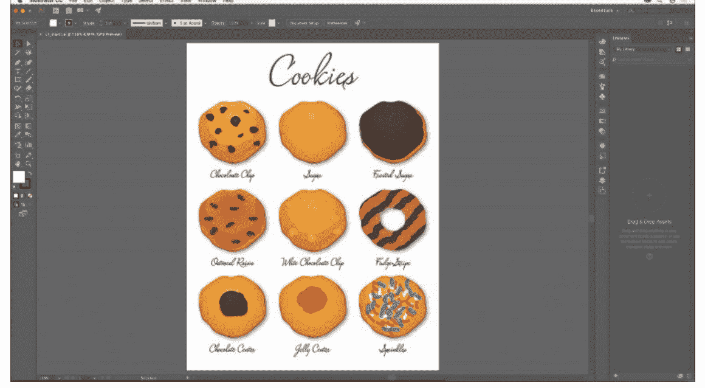

## Adobe Stock 集成

当你通过`库（Libraries）`面板在 Adobe Stock 上搜索图像并将其放入文档时，`链接（Links）`面板会在你布局中放置的未经许可的 Adobe Stock 图像旁边显示一个购物车图标。点击购物车图标即可启动购买流程。

## 文本功能增强

Illustrator CC (2017 版本) 有许多文本方面的改进。以下是这些改进和新功能的列表：

- 你现在可以选择文本对象，并在滚动字体下拉菜单中的字体列表时实时预览字体。
- 你现在可以将某些字体标记为收藏，并对收藏字体进行筛选。
- 你现在可以在字体列表顶部查看最近使用的字体。
- 文本可以放在文本容器中。
- 你现在可以找到与给定字体（星标）相似的字体，并根据分类（衬线/无衬线/手写体等）筛选字体。

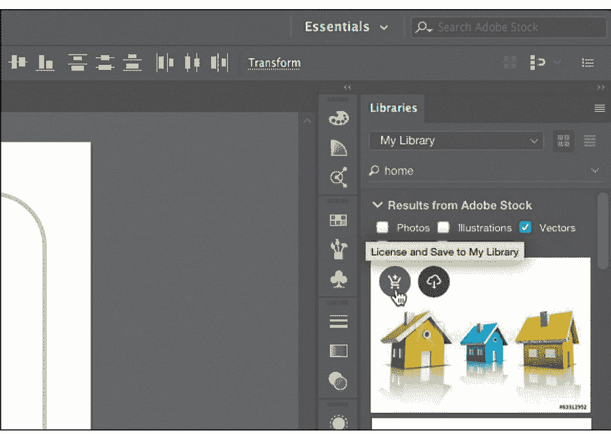

- 你现在可以无需进入`字符（Glyphs）`面板即可更改字符的字形。右键菜单显示选中字符的字形选项。
- 文字工具和区域工具默认将创建一个填充有占位符文本的文本对象。你也可以随时右键点击文本框并填充占位符文本（你可以通过 Illustrator 偏好关闭默认填充占位符文本）。

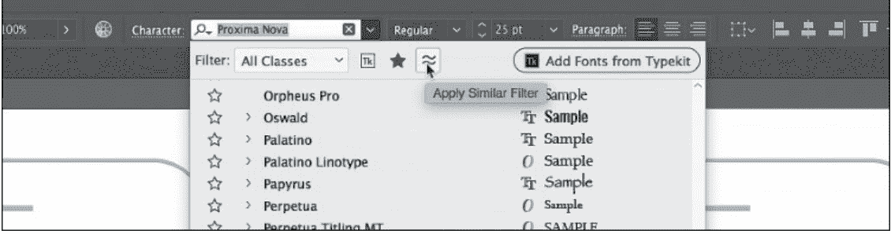

## 动态形状增强

更多的 Illustrator 形状工具现在是完全动态、交互且可动态调整的，因此你可以快速创建矢量形状，而无需应用效果或使用其他工具。

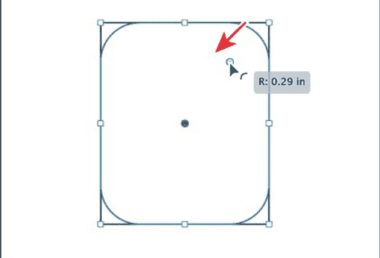

一致的视觉体验让处理`动态形状（Live Shapes）`变得更容易。当形状缩放到很小尺寸，控件会自动隐藏，多边形在非等比例缩放后仍保持动态特性。

## 资源导出

现在只需点击按钮即可将单个艺术品或整个画板导出为各种文件大小和格式。非常适合移动和网络工作流。该功能确保你将时间花在完善设计上，而不是手动重复的导出工作流。

## 其他改进

- **缩放至选取**——你现在可以直接缩放至所选内容，而不是必须使用缩放工具框选区域来缩放。
- **稳定性与性能改进**——实施了一系列稳定性修复、错误修复和性能改进，帮助你工作得更好、更快。
- **隐藏字符的键盘快捷键**——现在为以下字符提供了快捷键：半空格（En Space）、全空格（Em Space）、窄空格（Thin Space）、上标、下标、任意连字符（Discretionary Hyphen）和不间断空格（Non-Breaking Space）。这些也可以在键盘快捷键列表中进行自定义。
- **新文档对话框**——当你选择 `文件 > 新建` 时，新建文档对话框经过了完全翻新。
- **Adobe Experience Design CC (预览) 集成**——将你的 Illustrator CC 艺术品复制并粘贴到 Adobe Experience Design CC 中，这是一个用于设计、原型制作和共享 UX/UI Web 及应用设计的新合一工具。

尽管此列表仅涉及 Illustrator CC (2017 版本) 的部分新增强功能，但它体现了 Adobe 为你的出版需求提供可能最佳工具的承诺。我们希望你像我们一样喜欢使用 Illustrator CC (2017 版本)。

# 课程概览

在 Adobe Illustrator CC (2017 版本) 的交互演示中，你将概述应用程序的主要功能。

- **预计时长**：约 45 分钟。
- **课程文件**：请在 `peachpit.com` 上登录你的账户下载本章节的课程文件，或者前往本书开头的“入门”部分并按照“访问课程文件和网页版”下的说明操作。
- **更新**：你的账户页面也是你找到任何章节更新的地方。

# 创建基础图形

绘制形状是 Illustrator 的基石，在接下来的课程中你将创建许多形状。为了开始你的艺术创作，你将创建一个矩形。

> **注意**
>
> 在第 3 节“使用形状创建明信片作品”中学习更多关于创建和编辑形状的知识。

## 创建矩形

1. 选择 `视图 (View) > 适应画板到窗口`。
2. 选择 `视图 (View) > 缩小显示`。

> 你看到的白色区域称为**画板**，它是你放置可打印艺术作品的地方。画板类似于 Adobe InDesign® 等程序中的页面。

3. 选择左侧工具面板中的`矩形工具`。
4. 将指针置于画板的左上角（见图中的红色 X 标记）。点击并向下拖动到该处。当指针旁边的灰色测量标签显示宽度**约为 5.5 英寸**，高度为 2.2 英寸时，释放鼠标按钮。该形状将保持选中状态。

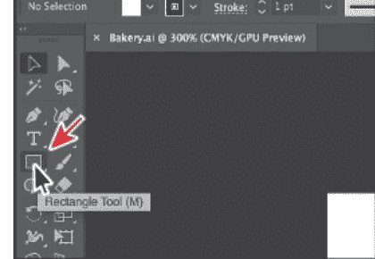
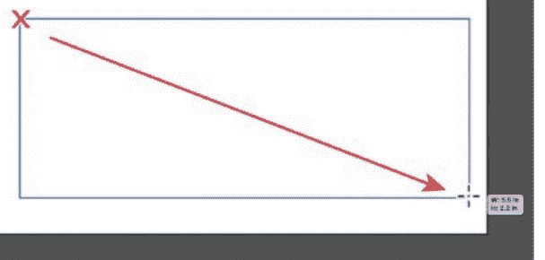

> 形状可以通过绘制或通过使用形状工具点击画板并在创建前修改形状属性来创建。
>
> 你创建的大多数形状都是**活形状**（Live Shapes），这意味着在形状创建后，宽度、高度、角、角度和边数等属性可以继续被修改。接下来，你为你创建的矩形圆化角。

> **提示**
>
> 你可以圆化所有的角，也可以独立处理每个角。你将在第 3 节“使用形状创建明信片作品”中学习更多关于创建和编辑活形状的知识。

## 圆化矩形角

1. 选择左侧工具面板中的`选择工具`。
2. 在矩形仍被选中的情况下，点击并拖拽右上角的部件 (O) 向矩形中心。当灰色测量标签显示数值约为 0.15 英寸时，释放鼠标按钮。

## 应用填充颜色

为艺术作品应用颜色是 Illustrator 的常用任务。你创建的形状具有描边（边框）和填充。在本节中，你将更改选中形状的填充。

> **注意**
>
> 在第 7 节“使用颜色增强标志牌”中学习更多关于填充和描边的知识。

1. 在`选择工具`仍被选中且矩形仍被选中的情况下，点击文档上方控制面板中的`填充颜色`以显示`色板面板`。将指针停在出现的色板面板中的橙色色块上。当出现工具提示（“C=0, M=35, Y=85, K=0”）时，点击以将橙色应用到形状的填充上。

> **注意**
>
> 你可以通过形状外部的蓝色框（默认情况下）来判断一个形状是否被选中。

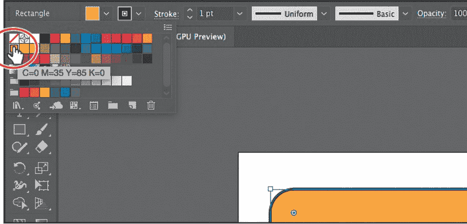

2. 按下 `Escape` 键隐藏色板面板并保持形状被选中状态。

## 编辑颜色

在 Illustrator 中有许多方法可以创建你自己的颜色并编辑每个文档中默认出现的颜色。在本节中，你将编辑刚刚应用的橙色。

> **注意**
>
> 在第 7 节“使用颜色增强标志牌”中学习更多关于创建和编辑颜色的知识。

1. 在矩形仍被选中的情况下，再次点击控制面板中的`填充颜色`，双击你在上步骤中选中的橙色色块进行编辑（在下图中圈出）。

> **注意**
>
> 今后，你会发现自己在继续之前需要隐藏像色板面板这样的面板。你可以按 `Escape` 键来实现此操作。

2. 在`色板选项`对话框中，将值更改为 `C = 8, M = 18, Y = 63, K = 0` 并选择`预览`。点击 `OK` 编辑矩形的颜色并更改色块颜色值。按下 `Escape` 键隐藏色板面板。

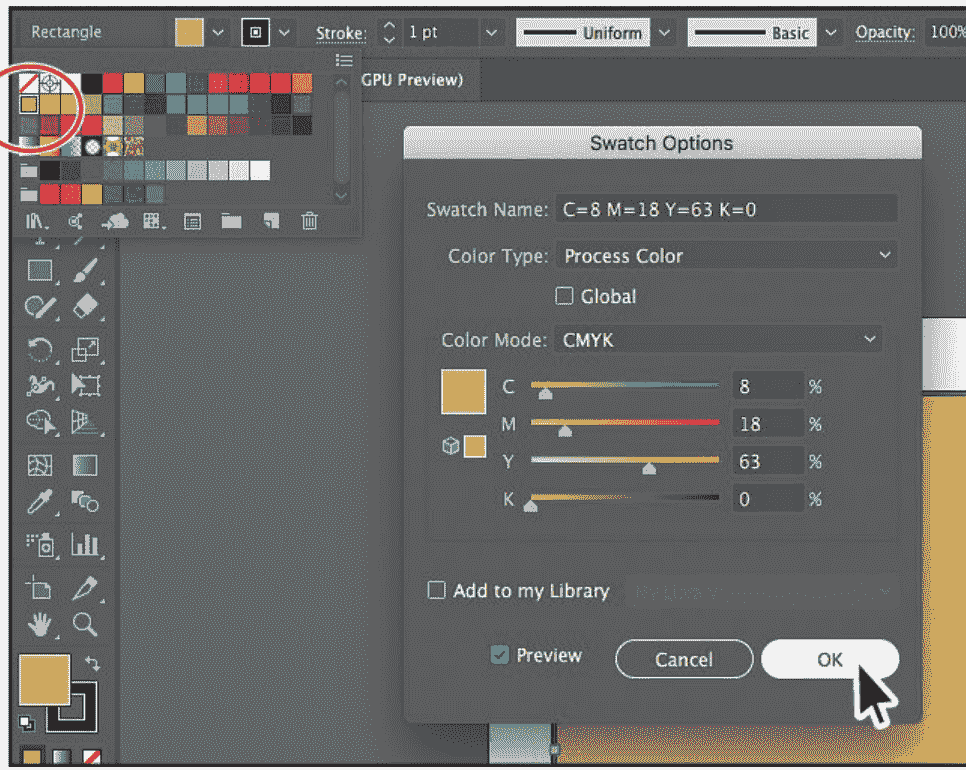

3. 选择 `文件 (File) > 保存` 以保存文档。

## 调整描边

描边可以是形状和路径等艺术作品的可见轮廓（边框）。对于描边，你有许多可以更改的外显示属性，包括宽度、颜色、虚线等。在本节中，你将调整矩形的描边。

> **注意**
>
> 在第 3 节“使用形状创建明信片作品”中学习更多关于处理描边的的操作知识。

1. 在矩形仍被选中的情况下，点击控制面板中的`描边颜色`（图中圈出）以显示色板面板。点击与你填充时相同的橙色色块。
2. 点击文档上方控制面板中的`描边 (Stroke)`字打开`描边面板`。更改以下选项：

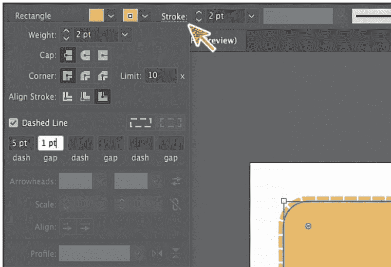

- **描边宽度**：2 pt
- **描边对齐**：描边向外对齐
- **虚线**：已选中
- **虚线**：5 pt，间隙：1 pt。在输入间隙值后，按 `Enter` 或 `Return` 键。

3. 选择 `对象 (Object) > 锁定 (Lock) > 选择 (Selection)` 以临时锁定矩形，使其无法被选中。

## 使用图层组织图稿

图层可以让你轻松组织和选择艺术作品。接下来，使用图层面板组织你的艺术作品。

> **注意**
>
> 在第 9 节“组织你的艺术作品”中学习更多关于使用图层的知识。

1. 选择 `窗口 (Window) > 图层` 显示`图层面板`。
2. 双击图层面板中的“图层 1”。输入 **背景** 并按 `Enter` 或 `Return` 更改图层名称。命名图层是有帮助的。目前矩形位于此图层。

3. 点击图层面板底部的`新建图层`按钮 (+)。双击新图层 Layer 2，输入 **内容** 并按 `Enter` 或 `Return` 更改图层名称。这创建了一个新图层。

## 使用钢笔工具绘制路径

钢笔工具 (✎) 允许你绘制包含曲线和直线的自由路径。使用钢笔工具绘制的路径是可编辑的。

> **注意**
>
> 在第 6 节“创建插画”中学习更多关于钢笔工具和其他绘制工具的知识。

1. 点击并按住工具面板中的`形状工具`。可能会出现关于形状工具的窗口。将其关闭。
2. 再次点击并按住`形状工具`，在工具菜单中选择`钢笔工具`。

3. 按下字母 `D` 设置默认填充（白色）、描边颜色（黑色）和描边宽度（1 pt），用于即将创建的作品。

# 使用形状工具绘制

在 Illustrator 中绘制和编辑形状的另一种方法是使用形状工具 (✔️)。形状工具识别手势并将其转换为形状。接下来，你将使用形状工具创建玛芬的顶部。

> **注意**
> 在第 3 课“使用形状创建艺术品”中学习更多关于使用形状工具的知识。

- 1 按住工具面板中的钢笔工具 (✎)，选择形状工具 (✔️)。
- 2 设置填充颜色（白色）、描边颜色（黑色）和描边宽度（1 pt），用于准备创建的艺术品。
- 3 在形状组上方画一个小圆。绘制看起来很粗糙，当你松开鼠标按钮时，Illustrator 会将其转换为圆形或椭圆。

在右侧绘制另一个较大的椭圆。注意如果你拖得太远，形状可能会消失。再次尝试。将指针置在空白区域，并拖过线条使它们出现。

- 6 绘制更多重叠的形状。见下图。

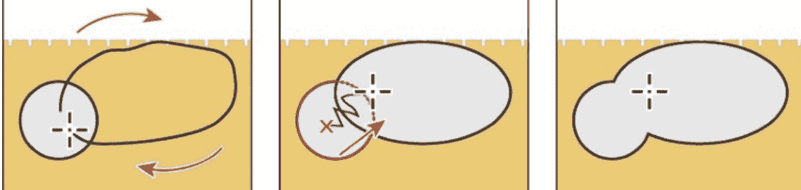

- 7 在较大的形状上画（见图中的红色 X）。
- 8 使用形状工具，点击边界框 (⇩) 以访问单个形状。

- 9 点击较大的形状将其选中。稍微移动它。

使用形状工具创建形状后，你仍然可以单独进行编辑。选中的形状具有可以用于缩放等的小部件。

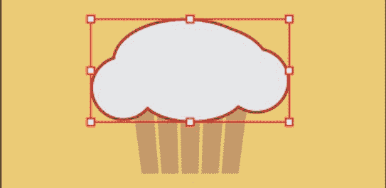

- 10 选择“选择 (Select)” > “取消选择 (Deselect)”。
- 11 选择你刚刚在棕色组上方创建的形状。保持艺术品选中。

# 使用吸管工具采样格式

有时你可能只是想要从一个对象复制外观属性（例如文本格式、填充或描边）。可以使用吸管工具 (✎) 完成，这可以大大加快你的创作进程。

> **注意**
> 在第 7 课“使用颜色增强标识牌”中学习更多关于吸管工具的知识。

- 1 在形状仍被选中的情况下，在工具面板中选择吸管工具 (✎)。
- 2 点击作为混合对象的棕色组，将外观复制到选中的艺术品上。
- 3 在左侧工具面板中选择选择工具。选择“选择 (Select)” > “所有画板 (All Arboard)”来选中形状。
- 4 选择“对象 (Object)” > “组合 (Group)”将它们分组。
- 5 选择“对象 (Object)” > “隐藏 (Hide)” > “选择 (Selection)”来临时隐藏玛芬。

# 在 Illustrator 中放置图像

在 Illustrator 中，你可以放置栅格图像（如 JPEG 和 Adobe Photoshop 文件），并将其链接或嵌入。接下来，你将放置一张手写文本图像。

> **注意**
> 在第 14 课“与其他 Adobe 应用程序配合 Illustrator CC”中学习更多关于放置图像的知识。

- 1 选择“视图 (View)” > “适合窗口画板 (Fit Artboard In Window)”。

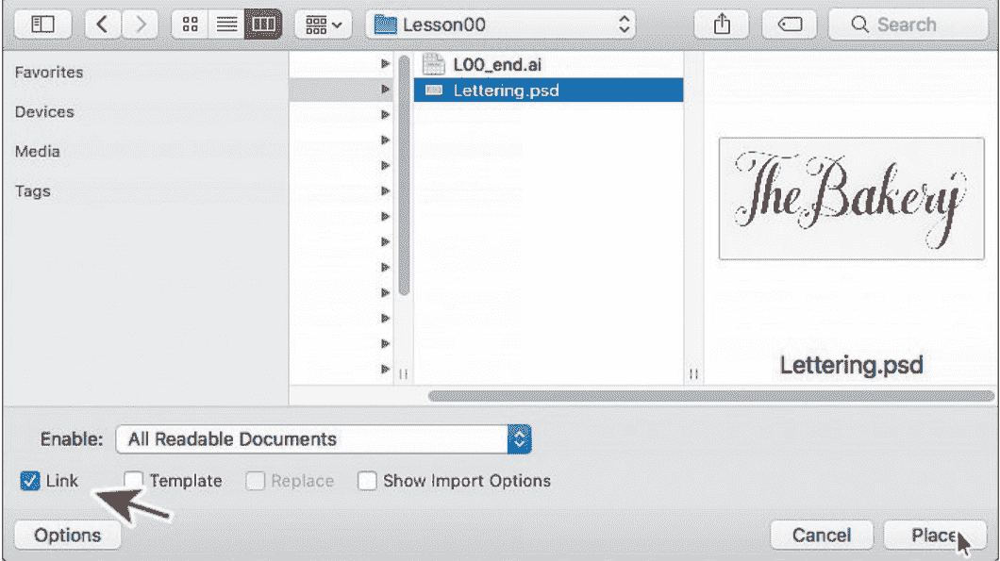

- 2 选择“文件 (File)” > “放置 (Place)”。在放置对话框中，导航到 `Lessons > Lesson00` 文件夹，并选择 `Lettering.psd` 文件。确保对话框中的“链接 (Link)”选项已选中，然后点击“放置”。

> **注意**
> 如果在对话框中没有看到“链接”选项，请点击“选项 (Options)”按钮。

- 3 使用已加载的图形光标，点击矩形的左上角以放置图像。

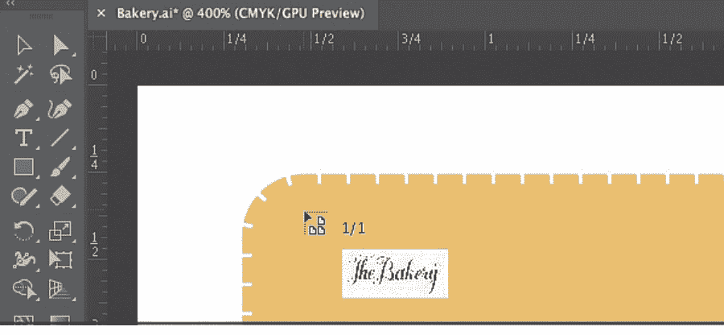

> **注意**
> 此项目的手写字线条由 Danielle Fritz 创建；(www.behance.net/danielle_fritz)。

- 4 选中选择工具（黑色），将图像拖到背景中大黄色矩形的中心点上上，使其大致位于画板的中心。它应该覆盖黄色矩形。保持图像选中状态。

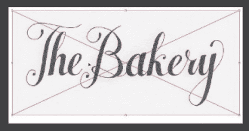

# 使用图像描摹 (Image Trace)

你可以使用图像描摹将位图图像转换为矢量艺术。接下来，你将描摹刚刚放置的 Photoshop 文件。

> **注意**
> 在第 3 节“使用形状创建明信片艺术品”中学习更多关于图像描摹的知识。

- 1 选中手写字图像，点击控制面板中的“图像描摹 (Image Trace)”按钮。
- 2 选择“窗口 (Window)” > “图像描摹 (Image Trace)”。在图像描摹面板中，点击面板顶部的“黑白 (Black And White)”按钮（见下图的第一部分）。图像被转换为矢量路径，但尚未可编辑。

转换手写字的另一种方法是使用 Adobe Capture CC 应用。要了解更多关于 Adobe Capture 的信息，请访问 `http://www.adobe.com/products/capture.html`。

- 3 在图像描摹面板中，点击“高级 (Advanced)”左侧的切换箭头。选择面板底部附近的“忽略白色 (Ignore White)”以移除白色。通过点击图像描摹面板右上角的小 X 关闭图像描摹面板。

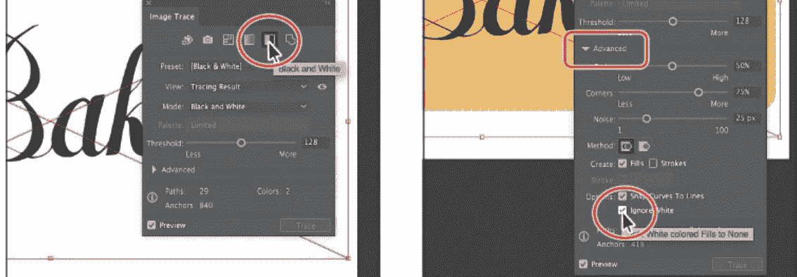

- 4 选中字体，点击控制面板中的“扩展 (Expand)”按钮，使对象成为一组组合在一起的可编辑矢量形状。

# 创建和编辑渐变

渐变是两种或多种颜色的色彩混合，你可以将其应用于艺术品的填充或描边。接下来，你将把渐变应用到字体上。

> **注意**
> 在第 10 节“渐变、混合和图案”中学习更多关于使用渐变的知识。

- 1 保持字体仍选中状态，点击控制面板中的“填充 (Fill)”颜色，并选择带有提示文字“白到黑 (White, Black)”的色块。按 `Escape` 键隐藏面板。

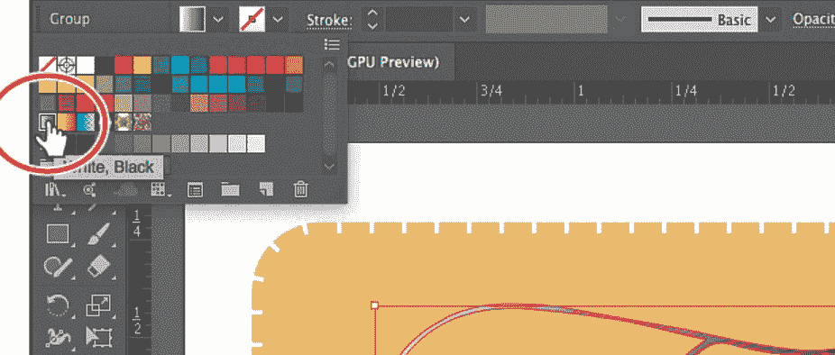

- 2 选择“窗口 (Window)” > “渐变 (Gradient)”打开渐变面板。在渐变面板中，点击“填充”框以确保你正在编辑填充（在图中圈出）。
- 3 双击渐变面板中渐变滑块左侧的小白色颜色变点（在图中圈出）。在弹出的面板中，点击“色板 (Swatches)”按钮（如果尚未选中），并选择带有提示文字“C=50, M=70, Y=80, K=70”的棕色色块。

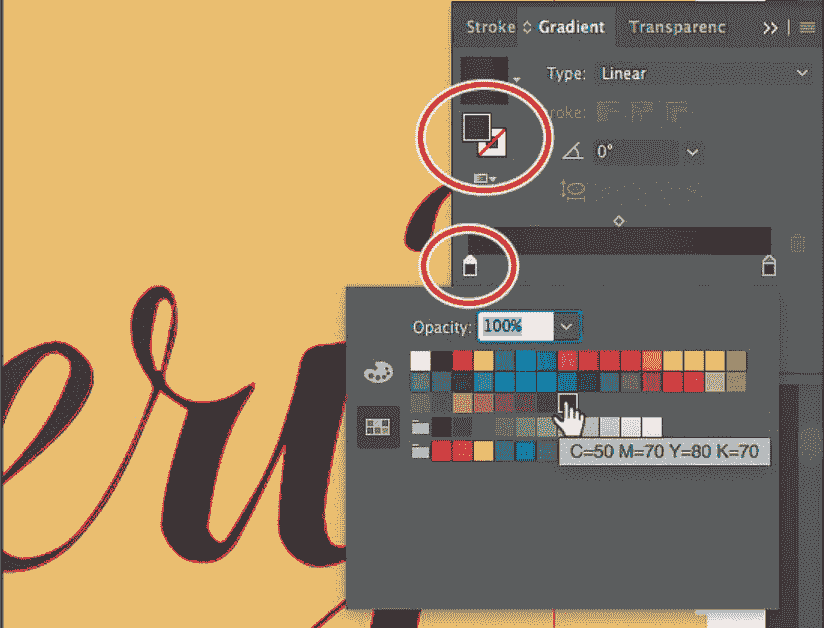

- 4 按 `Escape` 键隐藏色板。
- 5 选择左侧工具面板中的渐变工具 ()。在按住 `Shift` 键的同时，点击并跨越画板上的字体，向下拖动，从图中的红色 X 开始，以重新定位并调整渐变的大小。释放鼠标按钮，然后释放按键。

# 使用文字 (Type)

接下来，你将向项目中添加一些文本并更改格式。你将选择一个需要互联网连接的 Typekit 字体。如果你没有连接互联网，可以仅选择你已有的其他字体。

> **注意**
> 在第 8 节“在海报上添加文字”中学习更多关于使用文字的知识。

- 1 在左侧工具面板中选择文字工具 (T)，并点击画板上“The Bakery”字体下方的空白区域。将出现一个带有选中文本“Lorem ipsum”的文本区域。输入 San Francisco。

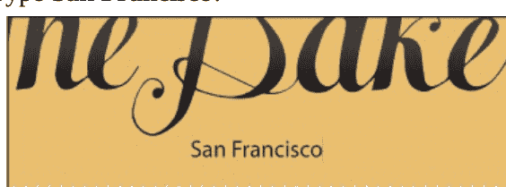

- 2 当光标仍在文本中时，选择“选择 (Select)” > “全选 (All)”来选中它。

> **注意**
> 如果你在控制面板中没有看到字体大小之类的字符选项，点击“字符 (Character)”一字以查看字符面板。

- 3 在艺术品上方控制面板中，将字体大小更改为 14 pt。

接下来，你将应用 Typekit 字体。你需要连接互联网。如果你没有连接互联网，可以仅选择你已有的其他字体。

- 4 点击字体字段右侧的箭头。点击“添加字体 (Add Fonts)”按钮进入 Typekit。

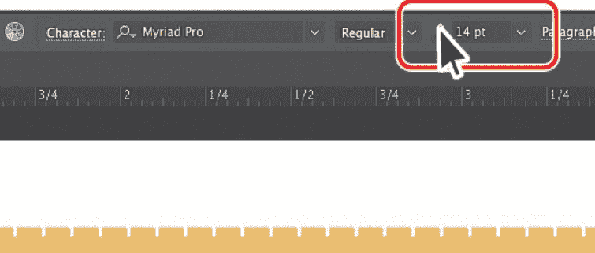

如果你遇到同步问题，在 Creative Cloud 应用中将看到任何提示信息。

> **注意**
> 字体可能需要几分钟来同步。

- 8 关闭浏览器并返回 Illustrator。在字体仍选中状态下，在控制面板字段中开始。
- 9 将光标悬停在字体上以显示实时预览。点击应用。

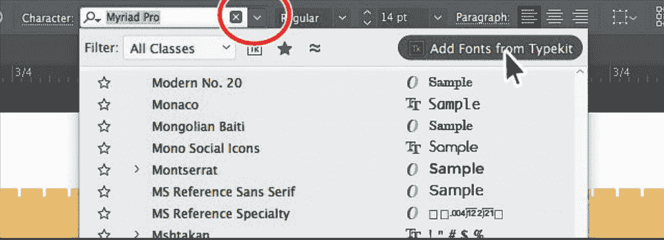

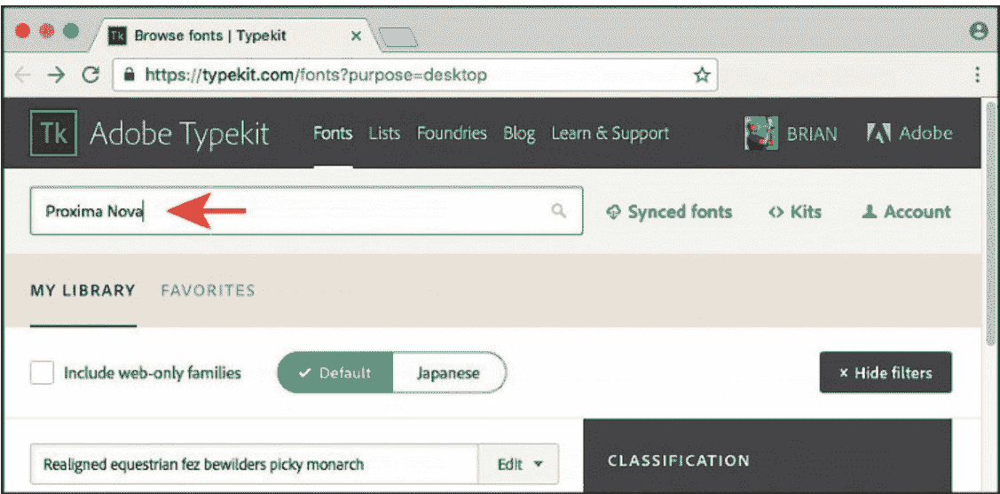

## 显示 Typekit 结果

### 字体

- Regular (常规)
- Italic (斜体)
- Light (纤细)
- Bold (粗体)
- Bold Italic (粗斜体)

# 对齐艺术品

Illustrator 可以轻松地相对于彼此、画板或关键对象对齐或分布多个对象。在本节中，你将多个对象对齐到画板。

> **注意**
> 在第 2 节“选择艺术品的技巧”中学习更多关于对齐艺术品的知识。

- 1 选择“对象 (Object)” > “解锁所有 (Unlock All)”以解锁背景中的矩形。
- 2 在工具面板中选择选择工具，并选择“选择” > “取消”。

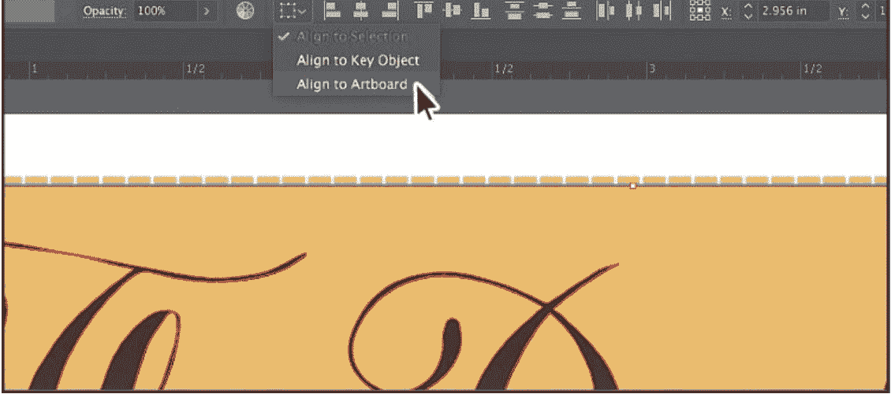

> **注意**
> 对齐选项可能不在控制面板中。如果你没有看到对齐按钮，点击控制面板中的“对齐 (Align)”字（或选择“窗口” > “对齐”）以打开对齐面板。控制面板中显示的选项取决于你的屏幕分辨率。

- 3 点击文档上方控制面板中的对齐按钮，并在弹出的菜单中选择“对齐画板 (Align To Artboard)”，如果尚未设置的话。选中的内容现在将对齐画板。
- 4 点击“水平居中对齐 (Horizontal Align Center)”按钮将选中的艺术品对齐到画板中心。

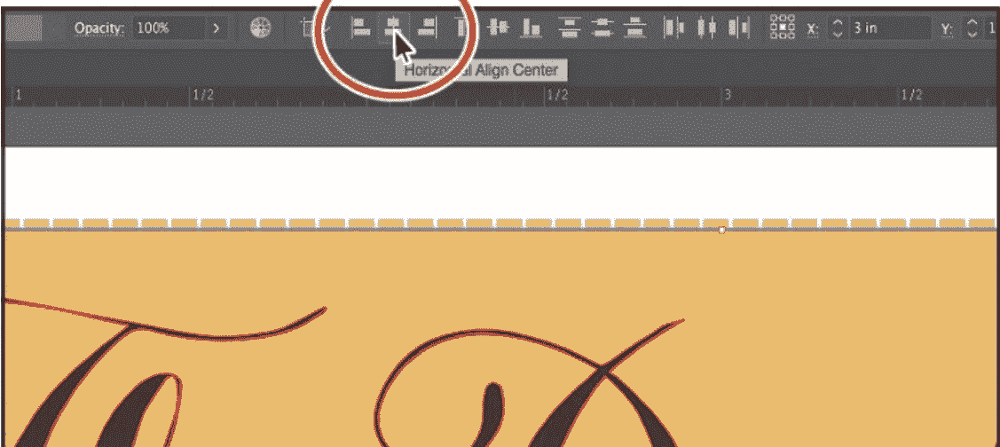

- 5 选择“对象 (Object)” > “显示所有 (Show All)”并选择“选择” > “取消选择”。
- 6 点击厨帽，并将其拖到如图所示的位置。你可能需要将松芬组移开位置。

# 使用画刷 (Brushes)

画刷可以样式路径的外观。你可以对现有路径应用画刷笔触，也可以使用画笔工具绘制路径的同时应用画刷笔触。

> **注意**
> 在第 11 节“使用画刷创建海报”中学习更多关于使用画刷的知识。

- 1 通过选择“窗口 (Window)” > “图层 (Layers)”打开图层面板。点击内容 (Content) 图层以使其确保它已被选中。你需要确保所有的艺术品都在此图层上，使其位于背景内容之上。

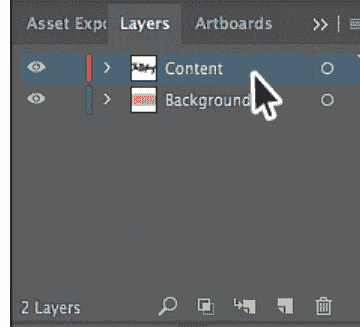

- 2 在左侧的工具面板中选择线段工具 (\\/)。按住 `Shift` 键，从文本左侧向左侧点击并拖动（起始位置见图中红色的 X 标记）。当灰色测量标签显示宽度约为 1.6 英寸时，松开鼠标按钮，然后释放 `Shift` 键。

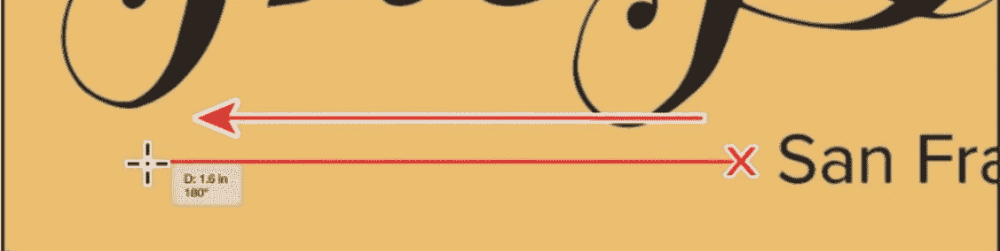

- 3 选择“窗口 (Window)” > “笔刷库 (Brush Libraries)” > “边界 (Borders)” > “Borders_Novelty”打开 Borders_Novelty 笔刷面板。

> **注意**
> 该笔刷是图案笔刷，这意味着它会沿着路径重复艺术品（在本例中）。笔刷艺术品会根据描边粗细在路径上进行缩放。

- 4 选择选择工具 (cur)，并点击面板中的月桂笔刷将其应用到你刚刚绘制的路径上。点击 Borders_Novelty 面板右上角的 X 关闭它。

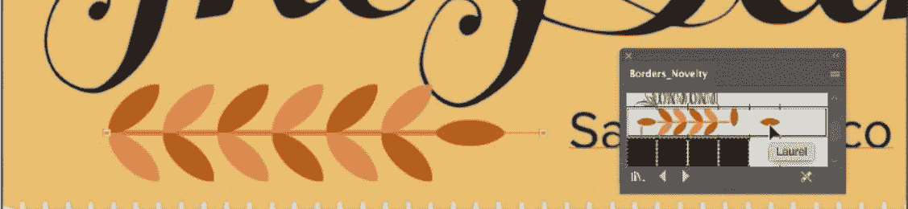

- 5 在艺术品上方的控制面板中将描边宽度 (Stroke weight) 改为 0.5 pt。

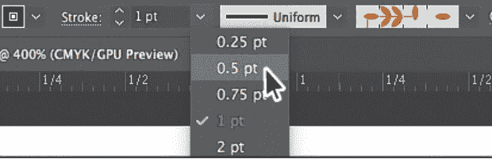

## 6 反射对象

在保持路径选中状态的情况下，选择`对象 (Object) > 变换 (Transform) > 反射 (Reflect)`。在反射对话框中选择`垂直 (Vertical)`，并点击`复制 (Copy)`。

线条的反射副本直接放置在原线条上方。

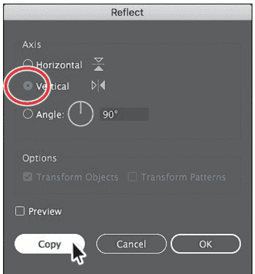

> **提示**
> 你也可以按方向键来移动选中的艺术品。

## 7 移动线条

在选中选择工具的情况下，将两条线都拖动到如图所示的位置。当你拖动线条时，会出现对齐辅助线，显示艺术品何时与文本对齐。

## 8 取消选择

选择`选择 (Select) > 取消选择 (Deselect)`。

## 使用符号

符号是存储在`符号面板 (Symbols panel)`中的可重复使用的艺术对象。符号非常有用，因为它们可以帮助节省时间，并节省文件大小。现在你将从艺术品创建一个符号。

> **注意**
> 在第 13 课“为 T 恤制作艺术品”中学习更多关于使用符号的知识。

### 1 选中玛芬组

选中选择工具 (`V`)，点击棕色玛芬组以选中它。

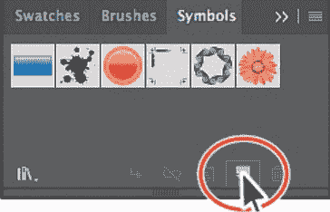

### 2 打开符号面板并新建符号

选择`窗口 (Window) > 符号 (Symbols)`打开符号面板。点击符号面板底部的`新建符号按钮`。

### 3 设置符号选项

在弹出的`符号选项 (Symbol Options)`对话框中，将符号命名为 `Muffin`，点击确定。如果出现警告对话框，也点击确定。

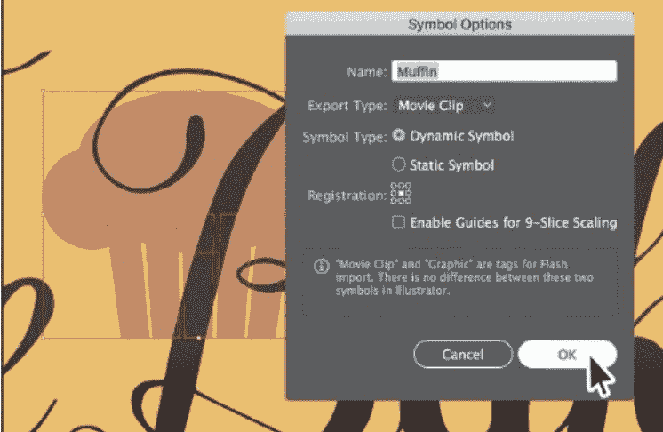

艺术品现在作为保存的符号出现在符号面板中，而你用于创建符号的画板上的玛芬艺术品现在变成了一个符号实例。

### 4 移动玛芬到中心

选中选择工具 (`V`)，将已经在画板上的玛芬拖动到画板的大致中心位置。

### 5 置于底层

选择`对象 (Object) > 排列 (Arrange) > 置于底层 (Send To Back)`，将玛芬发送到内容图层上所有艺术品的后面。

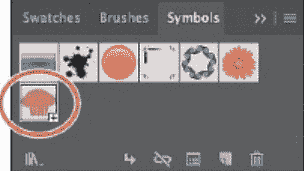

> **注意**
> 你的玛芬符号实例位置可能与图中不同。没关系。

### 6 复制并排列符号实例

从符号面板中将玛芬符号缩略图拖到画板两次，并将它们排列在“San Francisco”文本的两侧，如图。确保原始玛芬实例左右的玛芬实例超出了背景中较大的矩形。

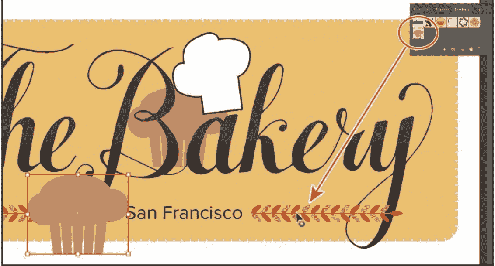

### 7 调整中心玛芬大小

选中画板中央的玛芬实例。使用 `Option+Shift-拖动` (Mac OS) 或 `Alt+Shift-拖动` (Windows) 艺术品的任何角远离其中心以使其变大。调整大小后，将其拖到合适位置。以图为参考。保持其选中状态。

### 8 编辑符号

点击艺术品上方控制面板中的`编辑符号 (Edit Symbol)`按钮，在隔离模式 (`Isolation mode`)下编辑符号艺术品，而不影响其他艺术品。在弹出的对话框中，点击确定。

### 9 全选

选择`选择 (Select) > 全选 (All)`。

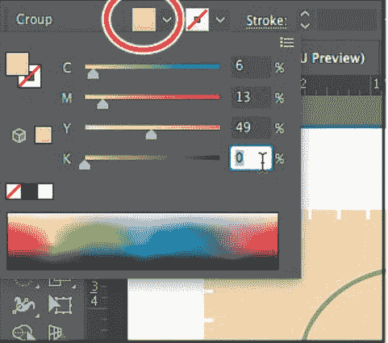
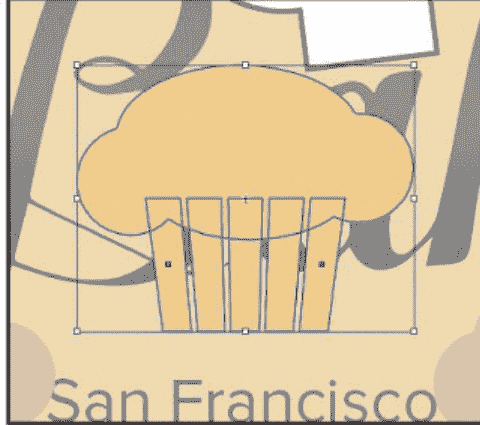

### 10 更改填充颜色

按 `Shift` 点击文档上方（图中圆圈处）的`填充颜色 (Fill)`，将 CMYK 值改为 `C=6, M=13, Y=49, K=0` 以更改颜色。按 `Escape` 键关闭面板。

> **提示**
> 如果 `Escape` 键无效，也可以双击艺术品以外区域退出隔离模式。

### 11 退出隔离模式

按 `Escape` 键退出隔离模式，其他玛芬发生了变化。

### 12 选择相同符号实例并编组

点击一个玛芬，选择`选择 (Select) > 相同 (Same) > 符号实例 (Symbol Instance)`。选择`对象 (Object) > 组 (Group)`。

### 13 置于底层

选择`对象 (Object) > 排列 (Arrange) > 置于底层 (Send To Back)`。

## 创建剪切遮罩

剪切遮罩（`clipping mask`）是一种用于遮罩其他艺术品的对象，使其仅形状区域可见即裁剪艺术品。接下来你将复制矩形并使用它来遮罩艺术品。

> **注意**
> 在第 14 课“与其他应用程序使用 Illustrator”中学习更多关于使用剪切遮罩的知识。

### 1 选中大矩形

选中选择工具后，点击背景中的大矩形。

### 2 复制矩形

选择`编辑 (Edit) > 复制 (Copy)`。

### 3 置于顶层粘贴

点击玛芬组选中其所在的图层。选择`编辑 (Edit) > 置于顶层 (Paste In Front)`，在与玛芬相同的位置粘贴矩形。

### 4 同时选中矩形和玛芬组

在矩形仍选中的情况下，按住 `Shift` 键并点击画板底部的玛芬组也将其选中。

### 5 创建剪切遮罩

选择`对象 (Object) > 剪切遮罩 (Clipping Mask) > 创建 (Make)`。

## 使用效果

效果可以在不改变基础对象的情况下更改其外观。接下来你将为你绘制的文本应用微妙的阴影（`Drop Shadow`）效果。

> **注意**
> 在第 12 课“探索效果和图形样式的应用”中学习更多关于效果的知识。

### 1 选中文本

选中选择工具，点击“The Bakery”文本。

> **注意**
> 在效果菜单的 Illustrator 部分选择样式 (`Stylize`) 选项。

### 2 应用阴影效果

选择`效果 (Effect) > 样式 (Stylize) > 阴影 (Drop Shadow)`。在阴影对话框中，设置以下选项（如有必要）：

- `模式 (Mode)`：`正片 (Multiply)`（默认设置）
- `不透明度 (Opacity)`：`10%`
- `X 偏移 (X Offset)` 和 `Y 偏移 (Y Offset)`：`0.02 英寸`
- `模糊 (Blur)`：`0`

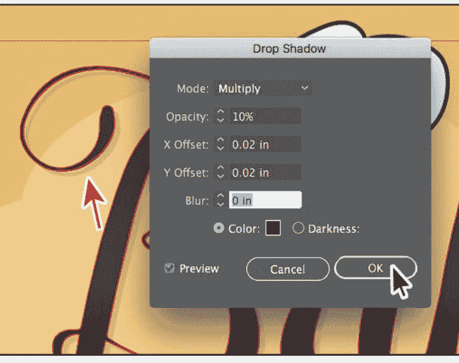

### 3 预览并确定

选择`预览 (Preview)`查看效果应用到艺术品上，然后点击确定。

### 4 取消选择

选择`选择 (Select) > 取消选择 (Deselect)`。

### 5 保存并关闭

选择`文件 (File) > 保存 (Save)`，然后选择`文件 (File) > 关闭 (Close)`。

# 1. 认识工作区域

## 课程概述

在本节中，你将探索工作区并学习如何执行：

- 打开 Illustrator 文件。
- 使用工具面板。
- 使用面板。
- 重置并保存你的工作区。
- 使用查看选项更改放大比例。
- 导航多个画板和文档。
- 探索文档组。
- 寻找使用 Illustrator 的资源。

本节大约需要 45 分钟完成。

请登录你的 `peachpit.com` 账户下载本章节的课程文件，或转到书开头的“入门”部分并按照“访问课程文件和网络版”下的说明进行操作。

你的账户页面也是你查找章节或课程文件任何更新的地方。查看“课程与更新文件 (`Lesson & Update Files`)”选项卡以获取最新内容。

为了充分利用 Adobe Illustrator CC 强大的绘制、绘画和编辑功能，学习如何导航工作区至关重要。工作区由应用程序栏、菜单、工具面板、控制面板、文档窗口和默认面板组组成。

## 介绍 Adobe Illustrator

在 Illustrator 中，你主要创建和处理矢量图形（有时称为矢量形状或矢量对象）。矢量图形由数学向量定义的线条和曲线组成。你可以自由地移动或修改矢量图形而不丢失细节或清晰度，因为它们与分辨率无关。换句话说，矢量图形在调整大小、打印到 PostScript 打印机、保存为 PDF 文件或导入到基于矢量的图形应用程序时，都能保持清晰的边缘。因此，矢量图形是如 Logo 等将在各种尺寸和媒介中使用的艺术品的最佳选择。

> **提示**
> 要了解更多关于位图图形的知识，请在 Illustrator 帮助（`帮助 > Illustrator 帮助`）中搜索“导入位图图像”。

Illustrator 还允许你引入位图图像——技术上称为栅格图像——它们使用图像元素（像素）的矩形网格来表示视觉内容。每个像素都被分配特定的位置和颜色值。栅格图像可以在 Adobe Photoshop® 程序中创建。

> **图示对比：** 作为矢量艺术绘制的标志 vs 作为栅格图像的标志

## 启动 Illustrator 并打开文件

要在 Illustrator 中开始工作，在第一节课程中你将探索 Illustrator。在本节中，你将打开几个艺术文件，但在开始之前，你将恢复 Adobe Illustrator CC 的默认偏好。这是你在本书的每节开始时都会执行的操作，以确保工具和面板的功能与本节中的描述完全一致。

> **注意**
> 如果你还没有从账户页面将本节的项目文件下载到计算机，请确保现在执行此操作。参见书开头的“入门”部分。

### 1 恢复默认偏好

若要删除或禁用（通过重命名）Adobe Illustrator CC 偏好文件，请参阅书开头的“入门”部分中的“恢复默认偏好”。

### 2 启动 Illustrator

双击 Adobe Illustrator CC 图标启动 Adobe Illustrator。

当 Illustrator 打开后，你很可能会看到一个“启动”屏幕，显示你打开的文件列表以及 Illustrator 的其他资源。

### 3 打开课程文件

选择`文件 > 打开`或点击启动屏幕上的按钮。在硬盘的 `Lessons > Lesson01` 文件夹中找到 `L1_start.ai` 文件并点击“打开”。

本节包含一个为了项目目的而创建的虚拟业务名称、地址和网站地址。

### 4 重置工作区

选择`窗口 > 工作区 > 重置基本要素`。

此命令确保包含所有工具和面板在工作区被设置为默认设置。

> **注意**
> 如果你在“工作区”菜单中没有看到“重置基本要素”，在选择`窗口 > 工作区 > 重置基本要素`之前，先选择`窗口 > 工作区 > 基本要素`。

### 5 适应画板

选择`视图 > 画板适应窗口`。

> **注意**
> 如果库面板位于你的工作区中并覆盖了文档的部分内容，你可以选择`窗口 > 库`来将其隐藏。

这将活动画板缩至文档窗口内，以便你可以看到整个画板。正如你很快将学到的，画板是包含可打印艺术作品的区域，类似于 Adobe InDesign 中的页面。

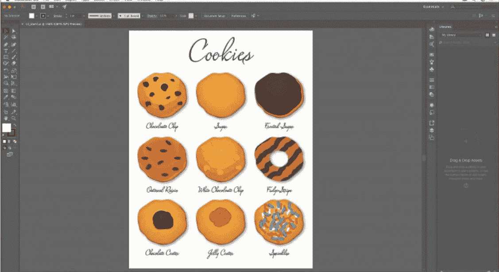

当文件打开且 Illustrator 完全启动后，应用程序栏、菜单、工具面板、控制面板和面板组将出现在屏幕上。在屏幕右侧停靠，你会发现大多数默认面板默认以图标形式出现。Illustrator 还通过菜单栏下方的控制面板整合了你最经常访问的许多选项。这让你可见面板更少，并留了更大的工作区域。

你将使用 `L1_start.ai` 文件练习导航、缩放和查看 Illustrator 文以及工作区。

## 探索工作区

你使用各种元素（如面板、栏和窗口）来创建和操作你的文档和文件。这些元素的任何排列都称为工作区。当你首次启动 Illustrator 时，你会看到默认工作区，你可以根据执行的任务对其进行自定义定制。你可以创建并保存多个工作区——例如，一个用于编辑，另一个用于查看——并在工作时在它们之间切换。

> **注意**
> 本节中的插图使用 Mac OS 操作系统拍摄的，与你使用的可能略有不同，特别是如果你使用的是 Windows OS 时。

下面描述了默认工作区的各个区域：

- 应用程序栏
- 控制面板
- 面板
- 工具面板
- 文档窗口
- 状态栏

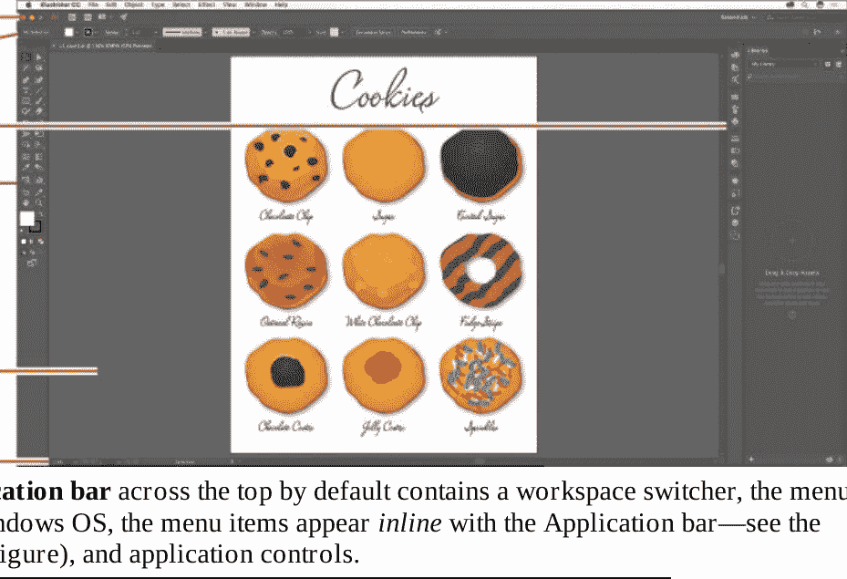

位于顶部的**应用程序栏**默认包含一个工作区切换器、菜单栏（在 Windows OS 上，菜单项与应用程序栏*内联*显示——请见下图）和应用程序控件。

**控制面板**显示当前选中对象的选项。

**面板**帮助你监控和修改你的工作。某些面板默认显示，你可以通过从“窗口”菜单中选择它们来显示任何面板。

**工具面板**包含用于创建和编辑图像、艺术作品、页面元素等的工具。相关工具被归类在一起。

**文档窗口**显示你正在处理的文件。

**状态栏**出现在文档窗口的左下边缘。它显示信息、缩放和导航控件。

## 认识工具面板

工作区左侧的工具面板包含选择工具、绘制和绘画工具、编辑工具、查看工具、填充和描边框、绘图模式和屏幕模式。随着课程的进行，你将学习其中许多工具的具体功能。

> **注意**
> 此处以及本节中所示工具面板有两个列。根据你的屏幕分辨率和工作区，你可能会看到单列的工具面板。

工具面板工具列表：

- `添加锚点工具 (+)`
- `删除锚点工具 (-)`
- `锚点工具 (Shift+C)`
- `区域文字工具`
- `文字路径工具`
- `垂直工具`
- `垂直文字工具`
- `圆矩形工具 (Shift+T)`
- `矩形工具 (M)`
- `钢笔工具`
- `路径工具`
- `钢笔工具 (Shift+R)`
- `圆角矩形工具`
- `椭圆工具`
- `星形工具`
- `钢笔工具`
- `橡皮擦工具`
- `变形工具`
- `剪刀工具`
- `旋转工具`
- `缩放工具`
- `自由变换工具`
- `透视工具`
- `混合工具`
- `柱状图工具`
- `渐变工具`
- `无填充`
- `默认画笔工具`
- `渐变画笔工具 (U)`
- `组工具`
- `弧工具`
- `螺旋工具`
- `矩形网格工具`
- `极坐标网格工具`
- `笔触画笔`
- `网格工具`
- `刀具`
- `重塑工具`
- `透视选择工具`
- `堆叠柱图工具`
- `柱状图工具`
- `堆叠折线图工具`
- `折线图工具`
- `面积图工具`
- `散点图工具`
- `饼图工具`
- `雷达图工具`
- `切割片工具`

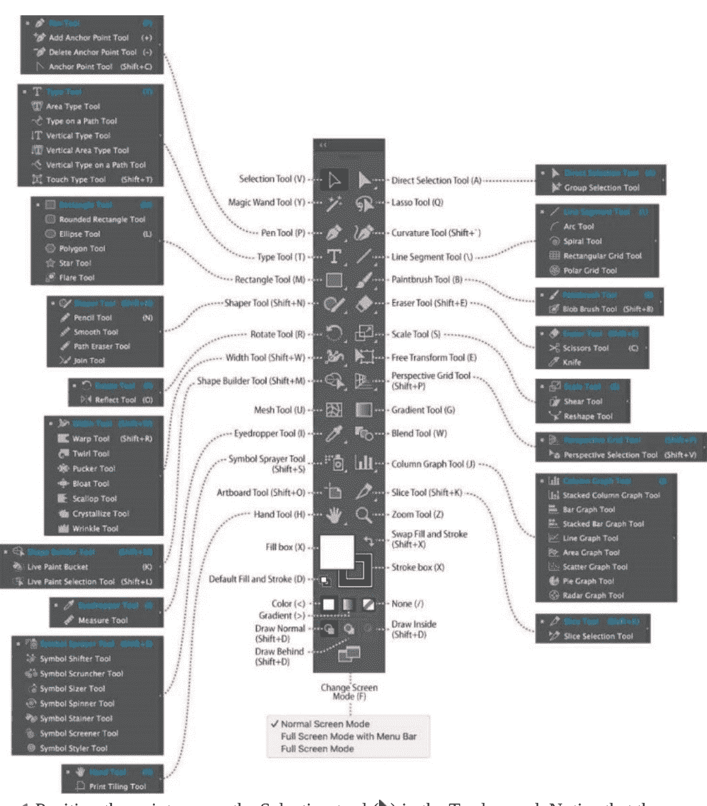

将指针悬停在工具面板中的选择工具 (`V`) 上。注意提示框中显示了名称（Selection Tool）和快捷键。

> **提示**
> 你可以修改 Illustrator 自带的默认快捷键。要执行此操作，选择`编辑 > 快捷键`。更多信息请参阅 Illustrator 帮助中的“快捷键”。

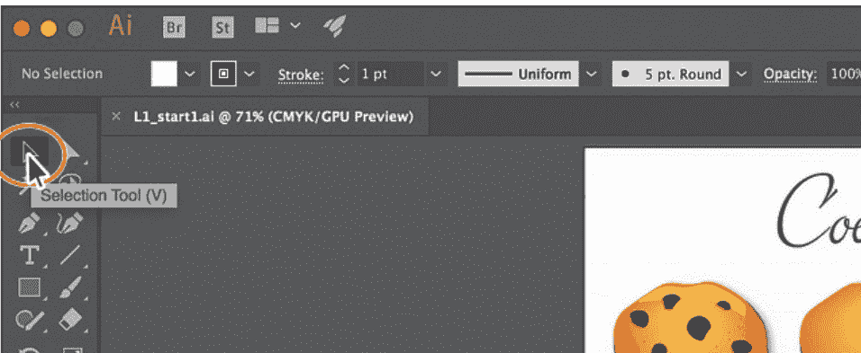

将指针悬停在直接选择工具 (`A`) 上，并按住鼠标键直到工具菜单出现。释放鼠标键并点击组选择工具来选择它。

> **提示**
> 你可以通过选择 `Illustrator CC > 偏好设置 > 一般` (Mac OS) 或 `编辑 > 偏好设置 > 一般` (Windows) 并取消勾选“显示工具提示”来关闭工具提示。

> **提示**
> 你还可以通过按住 `Option` (Mac OS) 或 `Alt` (Windows) 并点击工具面板来选择隐藏工具。每次点击都会选择工具序列中的下一个隐藏工具。

工具面板中任何显示小三角形的工具都包含可以通过这种方式选择的额外工具。

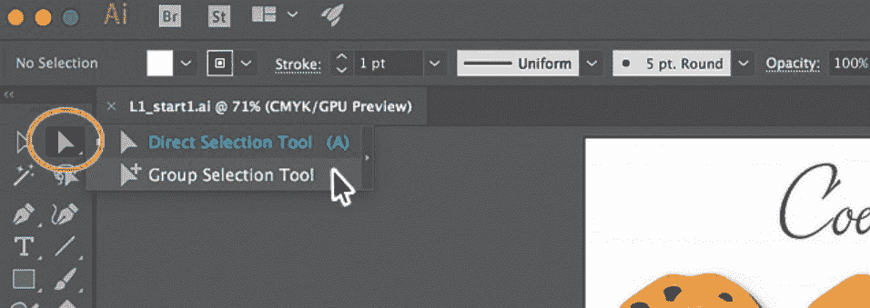

点击并按住矩形工具 上的鼠标键以显示更多工具。点击隐藏工具面板右边缘的箭头将工具从工具面板中分离，以便你随时访问它们。

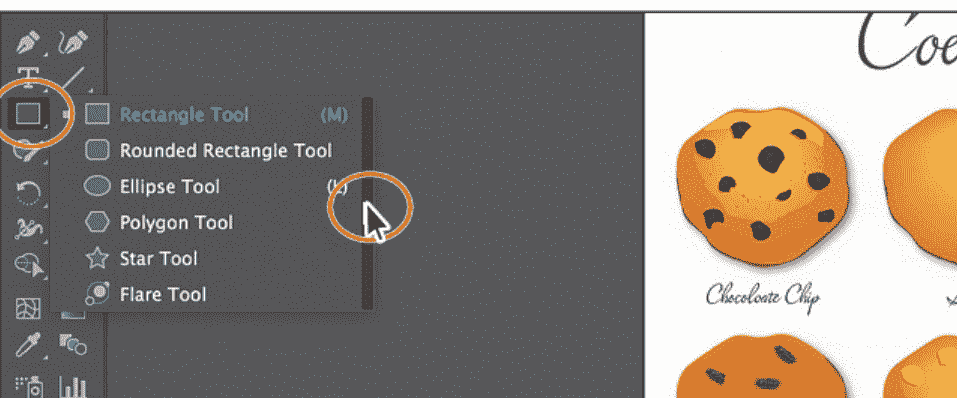

点击浮动工具面板标题栏的左上角（Mac OS）或右上角（Windows）的关闭按钮 (`X`) 来关闭它。工具将返回到“工具”面板。

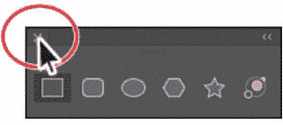

> **提示**
> 你也可以折叠浮动工具面板，或将它们停靠到工作区或彼此之间。

接下来，你将学习如何调整工具面板的大小并使其浮动。在本节的插图中，工具面板默认为双列的。正如我之前提到的，取决于你的屏幕分辨率和工作区，你刚开始看到的可能是单列的工具面板，这没关系。

点击工具面板左上角的双箭头，可以将单列展开为双列，或将双列折叠为单列（取决于你的屏幕分辨率）。

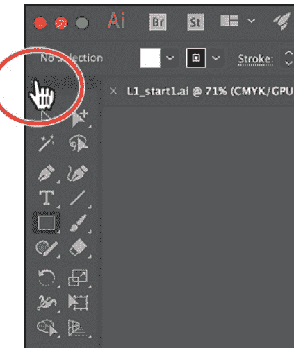
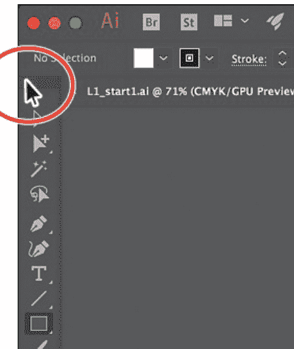

点击相同的双箭头来展开（或折叠）工具面板。

点击工具面板顶部的深灰色标题栏或标题栏下方的虚线，并将工具面板拖入工作区。现在工具面板浮动在工作区中。

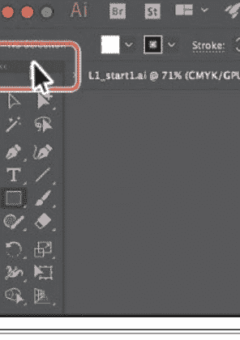
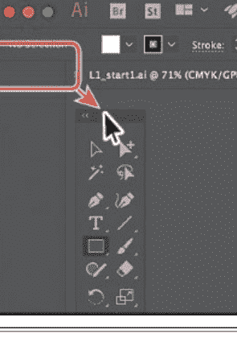
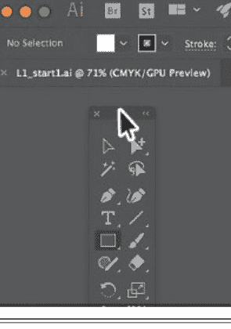

> **提示**
> 你可以点击工具面板顶部的双箭头，或双击工具面板顶部的标题栏，在双列和单列之间切换。小心不要点到 `X`！

要再次停靠工具面板，将它的标题栏或下方的虚线拖到应用程序窗口的左侧。当指针到达左边缘时，会出现一个名为“投放区域”的半透明蓝色框。释放鼠标按钮，将工具面板整齐地停靠在工作区的侧边。

## 自定义工具面板

你可能会发现自己大部分时间都在使用一组特定的工具。在 Illustrator 中，你可以创建自定义工具面板，其中包含你常用的工具。

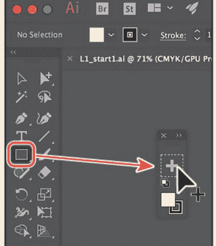

# 创建自定义工具面板

通过选择 **窗口 > 工具 > 新工具面板**，你可以创建一个自定义工具面板。它们会与 Illustrator 一起保存，无论打开了哪个文档都可以关闭和打开。它们是自由浮动的，也可以停靠并保存到你创建的自定义工作区中。每个新的自定义工具面板底部都有描边和填充控件，并有一个加号（`+`），你可以从主工具面板将工具副本拖到你正在创建的自定义面板上。

# 使用控制面板

控制面板是停靠在工作区顶部、停靠的工具面板上方的面板。它提供了与当前所选内容相关的选项、命令和其他面板的快速访问。你可以点击类似“描边”或“不透明度”来显示相关面板。例如，点击“描边”字将显示描边面板。

- 在工具面板中选择选择工具（`V`），点击画稿中“Cookies”单词中的字母“C”。

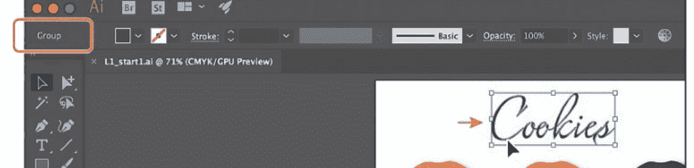

所选画稿的选项会出现在控制面板中，包括“组”、颜色选项、描边等。你还可以将控制面板移动到工作区中，以适应你的工作风格。

- 使用任何工具，将控制面板的抓取条（沿左边缘的虚线）拖入工作区。

## 提示

你也可以通过控制面板右侧菜单中选择“停靠到顶部”或“停靠到底部”来停靠控制面板。

一旦控制面板变为自由浮动，你就可以拖动面板左边缘出现的深灰色抓取条，将其移动到工作区的顶部或底部。

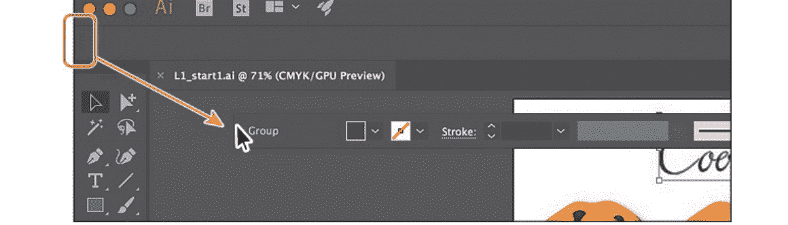

在默认工作区中，控制面板可以通过左边缘的深灰色抓取条拖到应用程序窗口底部。当指针（而非面板）到达应用程序窗口底部时，会出现一条蓝线，指示它将停靠的投放区域。然后你可以释放鼠标按钮将其停靠。

通过面板左边缘的抓取条拖动控制面板。当指针到达应用程序栏底部（工具面板右侧）时，会出现一条蓝线指示投放区域。当你释放鼠标按钮时，面板即被停靠。

选择 **选择 > 取消选择**，使画板上的内容不再被选中。

# 使用面板

面板在“窗口”菜单中按字母顺序列出，让你能够快速访问许多使修改画稿更简单的工具。默认情况下，某些面板停靠在工作区的右侧并以图标显示。

接下来，你将尝试隐藏、关闭和打开面板。

- 从应用程序栏右上角的工作区切换器中选择“重置基本值”，将面板重置到原始位置。

通过选择 **窗口 > 工作区 > 重置基本值**，你可以将面板重置到原始位置。

## 提示

按下 `Tab` 键可以切换所有面板的隐藏和显示。你可以通过 `Shift+Tab` 在隐藏和显示之间切换，一次性隐藏或显示工具（Tools）和控制（Control）面板以外的所有面板。

- 拖动色板（Swatches）面板的面板标签、面板标题栏或面板背后的区域，拖到画笔（Brushes）和符号（Symbols）面板图标上。当您看到面板图标之间出现一条蓝线且画笔面板组周围出现轮廓时，松开鼠标按钮。

接下来，你将组织面板以为工作区腾出更多空间。

- 从应用程序栏中的工作区切换器中选择“重置必备（Reset Essentials）”，以确保面板重置为默认状态。

## 注意

许多面板只需双击两次面板标签即可返回面板的全尺寸视图。如果再次双击一次，面板将完全展开。

- 点击停靠顶部的双箭头以展开面板。

- 点击颜色指南（Color Guide）面板标签以确保它被选中。双击面板标签缩小面板尺寸。再次双击标签将最小化面板。这在面板处于浮动状态（未停靠）时也可以完成。

## 提示

要缩小和扩大面板尺寸，除了双击面板标签外，你还可以点击面板标签名称左侧的小箭头图标（如果存在的话）。

## 注意

取决于您的屏幕大小、屏幕分辨率以及展开的面板数量，您可能无法将分割线拖得太远。

- 点击同一组中的颜色（Color）面板。拖动颜色面板组与下方符号面板组之间的分割线，向上移动以调整该组的大小。

- 从控制面板上方应用程序栏最右侧的工作区切换器中选择“重置必备（Reset Essentials）”。

- 选择 **窗口（Window） > 库（Libraries）** 来关闭库面板。

## 注意

如果你将一组面板拖入停靠区并释放到现有组中，两个组将合并。重置工作区并打开面板组再次尝试。

- 选择 **窗口（Window） > 对齐（Align to...）** 以打开对齐面板组。将对齐面板组的标题栏（对齐标签上方的栏）拖到工作区右侧的停靠面板。将指针置于符号面板图标所在的组下方，直到组下方出现单条蓝线。松开鼠标按钮在停靠区创建一个新组。

接下来，你将把停靠面板中的面板从一个组拖到另一个组。

## 提示

你也可以将面板停靠在工作区的右侧或左侧。这是节省空间的好方法。

## 提示

当停靠区折叠时，你还可以向上或向下拖动每个面板组顶部的虚灰线来重排整个面板组。

将变换（Transform）面板图标向上拖到颜色面板图标正下方。颜色面板图标和颜色指南面板图标之间出现一条蓝线，用蓝色勾勒出颜色面板组。松开鼠标按钮。

排列停靠面板可以帮助更好地工作。

# 重置并保存工作区

你可以将面板重置到默认位置，这在整个学习过程中。你还可以保存工作区，以便以后访问。

> **注意**
>
> **提示**
>
> 要删除工作区，选择 **窗口（Window） > 管理工作区（Workspaces）**。

- 从工作区切换器中选择“重置必备（Reset Essentials）”。

- 关闭库面板。

- 在对话框中选择工作区。

- 选择 **窗口（Window） > 库（Libraries）** 来关闭。

# 使用视图命令

你可以通过视图（View）菜单来放大或缩小视图。

- **视图（View） > 缩放放大（Zoom In）**...
- **视图（View） > 缩放缩小（Zoom Out）**...

- 从工作区切换器中选择“重置必备（Reset Essentials）”。

- 缩放面板以工作面板。

- 在对话框中选择工作区名称。

- 选择 **窗口（Window） > 库（Libraries）** 来关闭。

# 使用缩放工具

除了“视图”菜单中的选项外，你还可以使用缩放工具（`🔍`）放大或缩小 artwork 查看到预定义的放大倍数。

- 在“工具”面板中选择缩放工具（`🔍`），然后将指针移动到“文档”窗口内。注意，缩放工具指针的中心会出现一个加号（`+`）。

- 将缩放工具置于故事板右下角带有彩色糖针的饼干上并点击一下。 artwork 将以更高的放大倍数显示。注意，你刚才点击的地方现在位于“文档”窗口的中心。

- 再次点击带有彩色糖针的饼干。视图将再次增大，你会发现你点击的区域被放大了。

- 在保持选中缩放工具的情况下，将指针置于带有彩色糖针的饼干上，并按住 `Option` (Mac OS) 或 `Alt` (Windows) 键。缩放工具指针的中心会出现一个减号（`–`）。在按住 `Option` 或 `Alt` 键的情况下，双击 artwork 以缩小 artwork 的视图。

使用缩放工具，你还可以通过在文档中拖动来放大缩小。默认情况下，如果你的电脑符合 GPU 性能系统要求并已启用，则缩放将具有动画效果。

- 选择 **视图 > 画板适应窗口**。

- 在保持选中缩放工具的情况下，从文档的左侧向右侧拖动以放大。从右向左拖动以缩小。

## 注意

如果你的电脑不符合 GPU 性能系统要求，你将改为选择缩放工具并在想要放大的区域周围拖动一个虚线矩形（称为选区框/marquee）。

## 提示

如果你使用缩放工具点击并保持几秒，只要你的电脑符合 GPU 性能要求且已启用，你就可以动画缩放进行放大。

## 注意

在某些版本的 Mac OS 中，缩放工具（`🔍`）的键盘快捷键会打开 Spotlight 或 Finder。如果你决定在 Illustrator 中使用这些快捷键，你可能希望在 Mac OS 系统设置中关闭或更改这些键盘快捷键。

- 双击“工具”面板中的手工具（`Ψ`）以使 artwork 适应“文档”窗口。

缩放工具在编辑过程中经常使用，用于放大和缩小 artwork 的视图。因此，Illustrator 允许你随时通过键盘选择它，而无需先取消你可能正在使用的其他工具。

- 要使用键盘访问缩放工具（放大），请按 `Command+spacebar` (Mac OS) 或 `Ctrl+spacebar` (Windows)。

- 要使用键盘访问缩放工具（缩小），请按 `Command+Option+spacebar` (Mac OS) 或 `Ctrl+Alt+spacebar` (Windows)。

# GPU 性能

图形处理器（GPU）位于视频卡上并作为显示系统的一部分，是一种特殊的处理器，可以快速执行用于处理和显示图像的命令。GPU 加速计算在广泛的 design、动画和视频应用中提供了更快的性能。

Illustrator 中的 GPU 性能有一种名为“GPU 预览”的预览模式，它允许在图形处理器上渲染 Illustrator artwork。

此功能适用于安装了 NVIDIA GPU 的 Windows 电脑和兼容的 Mac OS 电脑。

此功能默认对 RGB 和 CMYK 文档开启，可以通过点击应用程序栏中的 GPU 性能图标在首选项中访问。

要了解更多关于 GPU 性能的信息，请访问 `https://helpx.adobe.com/zh/illustrator/gpu-performance`。

# 滚动文档

在 Illustrator 中，你可以使用手工具（`H`）来滚动文档。当缩放工具激活时，你可以拖动文档来放大缩小。

- 当缩放工具激活时，如果你的电脑符合 GPU 性能要求且已启用，缩放将具有动画效果。

- 在缩放工具激活时，你可以拖动文档来放大缩小。

- 缩放工具（`🔍`）缩小。

- 双击“工具”面板中的手工具（`Ψ`）以使 artwork 适应“文档”窗口。

缩放工具在编辑过程中频繁使用，用于放大和缩小 artwork 的视图。

使用缩放工具，你还可以通过在文档中拖动来放大缩小。默认情况下，如果你的电脑符合 GPU 性能系统要求并已启用，则缩放将具有动画效果。

- 选择 **视图 > 画板适应窗口**。

- 在保持选中缩放工具的情况下，从文档的左侧向右拖动以放大。从右向左拖动以缩小。

# 使用导航面板进行缩放和平移

导航面板是用于在单个画板或多个画板文档中导航的另一种方法。当你需要在一个窗口中查看文档中的所有画板，并在放大视图下编辑任何一个画板的内容时，这种方法非常有用。你可以通过选择 **窗口 (Window) > 导航 (Navigator)** 打开导航面板。它位于工作区中的一个浮动组中。

导航面板有多种使用方式，包括：

- 导航面板中的红框称为代理视图区域，它表示当前显示的文档区域。

- 输入缩放级别或点击山峰图标来更改艺术稿的放大倍数。

- 将指针置在导航面板的代理视图区域内。当指针变成手形（`∮`）时，拖动即可平移到艺术稿的不同部分。

# 在画板间进行导航

画板代表了可以包含可打印艺术稿的区域（类似于 Adobe InDesign 等程序中的页面）。你可以使用画板创建用于打印或放置的区域。多个画板对于创建各种内容非常有用，例如多页 PDF、具有不同尺寸或不同元素的打印页面、网站的独立元素、故事板脚本，或 Adobe Flash® 或 After Effects 中的单个动画项目。你可以通过创建多个画板，轻松地在不同设计之间共享内容、创建多页 PDF 并打印多个页面。

Illustrator 允许在单个文件内最多包含 100 个画板（取决于它们的大小）。在初次创建 Illustrator 文档时，可以添加多个画板，也可以在文档创建后添加、删除和编辑画板。接下来，你将学习如何高效地导航包含包含多个画板的文档。

- **注意事项**

如果应用程序窗口的右上角出现“搜索 Adobe Stock”信息，点击关闭（Close）将其关闭。

- 1 选择`文件 (File)` > `打开 (Open)`。在打开对话框中，导航到 `(Lessons)` > `Lesson01` 文件夹，选择硬盘上的 `L1_start2.ai` 文件。点击`打开 (Open)` 打开文件。

- 2 选择`视图 (View)` > `适合所有窗口 (Fit All In Window)` 以适应文档窗口中的所有画板。注意文档中有两个画板，包含了明片正反面的设计。

文档中的画板可以按任何顺序、方向或尺寸进行排列——它们甚至可以相互重叠。假设你想创建一个四页的手册。你可以为手册的每一页创建不同的画板，所有画板具有相同的尺寸和方向。它们可以水平、垂直或你喜欢的任何方式进行排列。

- 3 在工具面板中选择`选择工具 ( \ )`，并点击以选择左侧画板上的“GRAND OPENING CELEBRATION”文本。

- 4 选择`视图 (View)` > `画板适合窗口 (Fit Artboard In Window)`。

当你选择艺术稿时，该艺术稿所在的画板将成为活动艺术稿。通过选择“画板适合窗口”命令，当前活动的画板将适应窗口。活动画板可以在文档窗口左下角的画板导航菜单中标识。

## 注意事项

在第 5 节“变换艺术稿”中学习如何处理画板工作。

- 从左下角的画板导航菜单中选择 `2 向后 (Back)` 以显示下一个画板。

注意文档窗口右侧的箭头。你可以使用这些箭头导航到第一个 (`⏮`)、上一个 (`⏮`)、下一个 (`⏭`) 和最后一个 (`⏭`) 画板。

- 点击`上一个 (⏮)` 导航到文档窗口中的前一个画板。

- 7 选择 `选择 (Select)` > `取消 (Deselect)` 以取消选择文本。

## 使用画板面板

导航多个画板的另一种方法是使用画板面板。画板面板列出了文档中的所有画板。此面板允许你在画板之间进行导航、重命名画板、添加或删除画板以及编辑画板设置。接下来，将打开画板面板。

- 1 选择`窗口 (Window)` > `画板 (Artboards)` 显示停靠在侧边的画板面板。

> 注意事项

双击画板面板中的画板名称可以重命名画板。点击画板名称右侧的图标允许你编辑画板选项。

- 2 双击画板面板中“向后 (Back)”左侧的数字 `2`。这将适应窗口中的画板 #2。

- 3 双击画板面板中“向前 (Front)”左侧的数字 `1` 以显示窗口中的第一个画板。

注意当你双击导航到画板时，画板将适应窗口。

- 4 点击停靠的画板图标 `📄` 以折叠该面板。

## 排列多个文档

你将需要同时打开多个 Illustrator 文档。当你同时打开多个文档时，文档窗口会被标记。你可以通过其他方式排列打开的文档，例如并排，这样就可以轻松地比较或将项目从一个文档拖到另一个。你还可以使用排列窗口来快速显示你打开的文档。

你现在打开了两个 Illustrator 文件：`L1_start1.ai` 和 `L1_start2.ai`。每个文件在文档窗口顶部都有自己的标签。这些文档被视为一组文档窗口。你可以在文件打开时创建文档组来松散关联文件。

- 1 点击文档窗口标签在窗口中显示 `L1_start1.ai`。

> 注意事项

小心直接向右拖动。否则可能会取消文档窗口的停靠。如果发生这种情况，选择`窗口 (Window)` > `排列 (Arrange)` > `合并所有 (All)`。

- 2 点击并拖动 `L1_start1.ai` 文档标签到 `L1_start2.ai` 标签的右侧。释放鼠标按钮设置新顺序。

当文档平铺时，你可以拖动每个文档窗口之间的分割线，以显示更多或更少的特定文档。你也可以在文档之间拖动艺术稿，这将将其从一个文档复制到另一个文档。

要更改平铺窗口的排列，可以拖动文档标签到新位置。但是，使用排列窗口会更快速以各种配置排列打开的文档。

注意

在 Mac OS 上，菜单栏位于应用程序栏上方。此外，取决于屏幕的分分辨率，Windows 菜单可能会出现在应用程序栏中。

- 5 点击应用程序栏中的`排列文档按钮 ( )` 显示“排列文档”窗口。点击“合并所有”按钮 `( )` 将文档重新组合在一起。

- 6 再次点击应用程序栏中的`排列文档按钮 ( )` 再次显示“排列文档”窗口。点击“排列文档”窗口中的“垂直并排”按钮 `( )`。

提示

你也可以选择`窗口 > 排列 > 合并所有窗口`来将两个文档返回同一组的标签页中。

- 7 点击选中 `L1_start1.ai` 标签页（如果尚未被选中）。然后，点击 `L1_start1.ai` 文档标签页上的关闭按钮 `(X)` 关闭文档。如果出现对话框询问是否要保存文档，点击“不保存”（Mac OS）或“否”（Windows）。

- 8 选择`文件 > 关闭`以不保存的情况下关闭 `L1_start2.ai` 文档。

# 查找使用 Illustrator 的资源

有关使用 Illustrator 面板、工具和其他应用程序功能的完整且最新信息，请访问 Adobe 网站。通过选择`帮助 > Illustrator 帮助`，你从中搜索 Illustrator 帮助和支持文档，以及其他与 Illustrator 用户相关的网站。社区帮助汇集了活跃的 Adobe 产品、Adobe 产品团队成员、作者和专家，为你提供有关 Adobe 产品的最有用、相关性强且最新的信息。

如果你选择`帮助 > Illustrator 帮助`，还可以通过点击对应版本的下载链接来下载 Illustrator 内容的 PDF 版本。

# 数据恢复

当你在程序崩溃后重启 Illustrator 时，你可以选择恢复进行中的文件，这样你几个小时的工作就不会被白费。恢复的文件在文件名中带有“[已恢复]”字样。

你可以在程序偏好设置中开启或关闭数据恢复，并设置选项，例如保存恢复数据的频率（`Illustrator CC > 偏好 > 文件处理与剪贴板 [Mac OS]` 或 `编辑 > 偏好 > 文件处理与剪贴板 [Windows]`）。

## 复习题

- 1 描述更改文档视图的两种方法。

- 2 你如何在 Illustrator 中选择工具？

- 3 你如何保存面板位置和可见性偏好？

- 4 描述在 Illustrator 中在画板之间导航的三种方法。

- 5 描述排列文档窗口有何帮助。

## 复习答案

- 1 你可以从“视图”菜单中选择命令来放大或缩小文档，或使其适应屏幕；你还可以使用工具面板中的缩放工具 `(🔍)` 并在文档上点击或拖动以放大或缩小视图。此外，你可以使用键盘快捷键来放大或缩小 artwork 的显示。你还可以使用“导航器”面板来滚动 artwork或在不使用文档窗口的情况下更改其缩放倍数。

- 2 要选择工具，你可以在工具面板中点击该工具，或者按下该工具的键盘快捷键。例如，你可以按 `V` 从键盘选择选择工具 `(🔘)`。选中的工具将保持激活，直到你点击其他工具。

- 3 你可以通过选择`窗口 > 工作空间 > 新工作空间`来保存面板位置和可见性偏好，创建自定义工作区域，并更容易找到你所需的控件。

- 4 要在 Illustrator 中在画板之间导航，你可以从文档窗口左下角的“画板导航”菜单中选择画板编号；你可以使用文档窗口左下角的画板导航箭头前往第一个、上一个、下一个和最后一个画板；你可以使用“画板”面板导航到画板；或者你可以使用“导航器”面板拖动代理视图区域在画板之间导航。

- 5 排列文档窗口允许你平铺窗口或层叠排列文档组。如果你正在处理多个 Illustrator 文件并需要在它们之间比较或共享内容，这将非常有用。

# 2. 选择画稿的技巧

课程概述

在本节中，你将学习如何执行以下操作：

- 区分不同的选择工具并使用不同的选择技术。

- 识别智能参考。

- 保存选择以备后用。

- 隐藏和锁定项目。

- 使用工具和命令将形状和点相互以及与画板对齐。

- 组合和取消组合项目。

- 在隔离模式下工作。

本课程大约需要 45 分钟完成。

请登录你的 peachpit.com 账户下载本章节的课程文件，或者前往本书开头的“入门”部分，并遵循“访问课程文件和网页版”下的说明。

你的账户页面也是你查找章节或课程文件更新的地方。查看“课程”

选择画稿是重要内容之一。在本节中，你将学习如何选择、隐藏和锁定项目；相互以及与画板对齐；以及。

## 开始课程

在 Illustrator 中创建和选择画稿是程序的基石。在本节中，你将学习选择的基础。高级选择技巧将在第 9 节“使用图层”中使用。

注意

智能参考默认开启。

- 1 为了确保工具和面板功能如本节所示，请确保开启（通过）

- 2 启动 Illustrator CC。

- 3 选择`文件 > 打开`，并打开 `L2_start.ai` 文件。

- 4 选择`视图 > 适应窗口`。

- 5 选择`窗口 > 工作空间 > 重置`。

## 选择对象

无论是从头创建还是编辑现有画稿，都需要熟悉选择对象。有很多方法和工具，在本节中，你将探索`选择工具 ( )` 和`直接选择工具 ( )`。

## 使用选择工具

工具面板中的`选择工具 ( )` 允许你选择、移动、旋转和调整整个对象的大小。在本节中，你将熟悉该工具。

- 1 如果尚未选中，点击工具面板中的`选择工具 ( )`。将指针悬停在不同的 artwork 上，不要点击。

当你经过对象时出现的图标 `(A)` 表示有可以选择的 artwork。当你悬停在对象上时，对象会用某种颜色勾勒（在此为蓝色）。

- 2 选择工具面板中的`缩放工具 (Q)`，并在右侧圆形上缓慢点击几次以放大。

提示

你将在第 3 节“使用形状创建明片画稿”中学习更多关于智能参考的信息。

- 3 选择工具面板中的`选择工具 ( )`，然后将指针放在左侧蓝圆的边缘。

由于智能参考默认开启，可能会出现“路径”或“锚点”等文字。

- 4 点击左侧蓝圆的任意位置以选中它。选中的圆周围会出现一个带有八个手节点的边界框。

边界框用于对 artwork（矢量或位图）进行更改时，例如调整大小或旋转。边界框还表示项目已被选中并准备好修改，且边界框的颜色表示对象所在的图层。

图层将在第 9 节中详细讨论。

**注意**

要选择没有填充颜的项目，可以点击描边（边缘）或在对象上拖动选择选取框。

- 5 使用`选择工具`，点击右侧的蓝色圆圈。注意，左侧的蓝色圆圈现在已取消选中，只有右侧的圆圈被选中。

- 6 按住 `Shift` 键，点击左侧的蓝色圆圈将其添加到选择中，然后松开键。现在两个蓝色圆圈都被选中了，并且有一个更大的边界框围着它们。

- 7 点击选中的圆圈内部（蓝色区域）并拖动，将圆圈移动到文档中的任何位置。由于两个圆圈都被选中，它们会一起移动。在拖动时，你可能会注意到出现的洋红色线条。这些被称为对齐线，由于开启了智能辅助（`视图 > 智能辅助`），它们是可见的。当你拖动时，对象将与画板上的其他对象对齐。还要注意指针旁边的测量标签（灰色框），它显示了对象距离其原始位置的距离。测量标签的出现也是因为开启了智能辅助。

- 8 选择 `文件 > 还原`，将文档恢复到最后保存的版本。在弹出的对话框中，点击“还原”。

## 使用直接选择工具

在 Illustrator 中，当你绘图时，你创建了由锚点和路径组成的路径。锚点用于控制路径的形状，其作用就像将电线固定在原位的图钉。你创建的形状（例如正方形）由位于四个角落的四个锚点组成，锚点之间由路径连接。你可以通过拖动锚点（以及其他其他方法）来更改路径或形状的形状。`直接选择工具` 允许你选择对象内的锚点或路径段，以便对其进行形状重塑。接下来，你将熟悉如何使用`直接选择工具`选择锚点并重塑路径。

- 1 选择 `视图 > 适合所有窗口`。

- 2 在工具面板中选择`缩放工具 (🔍)`，在蓝色圆圈下方的一系列红色绿色形状上点击几次以放大。

**提示** 你也可以点击形状的中间来选择它，并查看其边缘的锚点。这是一种查看点位置的简单方法，然后你可以点击某个点来选中它。

- 3 在工具面板中选择`直接选择工具 (⮜)`。在不点击的情况下，将指针置于其中一个绿色形状的左上角。指针旁边应该出现“anchor”（锚点）字样。

当“anchor”悬停路径或对象的锚点上时，会显示“anchor”字样。“anchor”标签的显示是因为开启了智能辅助（`视图 > 智能辅助`）。还要注意指针右侧的小白框。白色框中心出现的小点表示光标位于一个锚点上。

**注意**

该图显示了点击选择锚点随后的状态。

- 4 点击选择该锚点。

注意，只有你选的那个锚点是实心的（有填充颜的），这表示它已被选中，而形状中的其他锚点是空心的，表示它们未被选中。移动锚点可以重塑路径。

- 5 在保持选中`直接选择工具`的情况下，拖动选中的锚点向上以编辑对象的形状。

- 6 尝试点击形状边缘的另一个点，注意前一个点已取消选中。

- 7 选择 `文件 > 还原`，将文件恢复到最后保存的版本。在弹出的对话框中，点击“还原”。

注意

当你拖动锚点时出现的灰色测量标签具有 `dX` 和 `dY` 值。`dX` 表示指针沿 x 轴（水平）移动的距离，`dY` 表示指针沿 y 轴（垂直）移动的距离。

## 使用选取框创建选择

另一种选择内容的方法是跨越想要选择的内容进行拖动（称为“选取框选择”），这是你接下来要做的。

- 1 选择 `视图 > 适合所有窗口`。

- 2 在工具面板中选择`缩放工具 (Q)`，在右侧的蓝色圆圈上缓慢点击三次。

- 3 在工具面板中选择`选择工具 (V)`。将指针置于最左侧蓝色圆圈的上方左侧，然后向向右拖动，创建一个覆盖了两个圆圈顶部的选取框。

使用`选择工具 (↗)` 拖动时，只需包含对象的一小部分即可选中它。

- 4 选择 `选择 > 取消选择`，或点击没有对象的地方。

现在，你将使用`直接选择工具`，通过在锚点周围拖动选取框来选择蓝色圆圈中的多个锚点。

- 5 在工具面板中选择`直接选择工具 (⬡)`。从最左侧蓝色圆圈的左上角开始（见下图），跨越两个圆圈的顶部边缘拖动。只有选取。

- 6 点击并拖动选中的锚点之一，查看锚点如何一起移动。

当你想要选择内容但又不想精确点击某个锚点时，可以使用这种方法。

- 7 选择 `文件 > 还原`，将文档恢复到最后保存的版本。

## 隐藏和锁定对象

有时如果对象堆叠在一起，选择内容可能会更加困难。在本节中，你将学习如何锁定和隐藏内容使选择更容易。

- 1 选择 `视图 > 适合所有窗口`。

接下来，你将尝试拖动内容来选择。

- 2 使用`选择工具 (👆)`，将指针置于雪人后面的蓝色区域（见下图中的“x”），拖过作为眼睛的椭圆。注意你选中了大形状。

- 3 选择 `编辑 > 撤销`。

- 4 在选中蓝色形状的情况下，选择 `对象 > 锁定 > 选择`，或按下 `Command+2` (Mac OS) 或 `Ctrl+2` (Windows)。

锁定对象可以防止你选择和编辑它们。

- 5 使用`选择工具 (👆)`，将指针置于雪人帽子左侧的蓝色区域，跨越雪人的头部选择整个物体（包括帽子）。

**注意** 选取框内的任何内容将被选中。

- 6 按住 `Shift` 键并逐个点击眼睛，将其从选择中移除。

- 7 选择 `对象 > 隐藏 > 选择`，或按下 `Command+3` (Mac OS) 或 `Ctrl+3` (Windows)。

选中的形状被临时隐藏，以便你可以更容易地选择对象。

- 8 选择 `文件 > 保存` 保存文件。

## 选择相似对象

你还可以使用“选择相似对象”按钮或`选择 > 相同`命令，根据相似的填充颜色、描边颜色、描边宽度等选择内容。对象的描边是轮廓（边界），描边宽度是描边的宽度。接下来，你将选择应用了相同填充和描边的多个对象。

- 1 选择`选择工具 (↖)`，并点击右侧蓝色圆圈之一。

如果没有发生任何事情，再次点击该按钮（而不是右侧的箭头）。

- 2 点击控制面板中选择相似对象按钮 (`⋯`) 右侧的箭头以显示菜单。选择“填充颜色”以选择任何画板上具有相同的与所选对象相同的填充颜色（蓝色）。

注意，具有相同蓝色填充的圆形已被选中。

+ 3 点击蓝色圆圈下方的红色或绿色填充形状之一，然后选择“选择” > “相同项” > “描边颜色”。

现在，所有具有相同描边（边框）颜色的形状都已选中。如果你知道自己可能需要反复选择一组对象（例如这些已选中的对象），你可以保存你所做的选择，以便以后轻松找回。保存的选择仅在该文档中有效。这就是你接下来要做的。

根据用途或功能对选择进行命名很有帮助。例如，如果你将选择命名为“1 pt描边”，那么当你以后更改作品的描边宽度时，该名称可能会产生误导。

+ 4 在保持形状选中的状态下，选择“选择” > “保存选择”。在“保存选择”对话框中将选择命名为 `Scarf`，并点击确定，这样以后就可以选择此项。

+ 5 选择“选择” > “取消选择”。

## 在轮廓模式下选择

默认情况下，Adobe Illustrator 显示所有作品并显示其上色属性（如填充和描边）。但是，你可以显示作品，使只显示轮廓（或路径）。接种在轮廓模式下选择作品的方法，如果你想在一系列堆叠的对象中选择对象，这种方法将非常有用。

+ 1 选择“对象” > “显示全部”，这样你就可以看到之前隐藏的作品了。

+ 2 使用选择工具（选择），点击其中一个白色眼睛形状内部来选中它。

由于该形状具有白色填充（填充对象内部的颜色、图案或渐变），你可以点击对象边界内的任何位置来选中它。

+ 3 选择“视图” > “轮廓”，以轮廓形式查看作品。

+ 4 使用选择工具，点击另一个眼睛形状的内部。

注意，你无法使用这种方法选择对象。轮廓模式以轮廓形式显示作品，且不带填充。要在轮廓模式下进行选择，你可以点击对象的边缘或在形状上拖动选框框来选择它。

5 在已选择选择工具的情况下，拖动选框跨越两个眼睛形状。按几次向上方向键，将两个形状向上移动一点。

6 选择“视图” > “GPU 预览”或“视图” > “CPU 预览”（或“预览”），如果 GPU GPU 预览即可查看上色的作品。

## 使用魔术棒工具选择作品

你可以使用工具面板中的魔术棒工具 (`🪄`) 选择文档中所有具有相同属性（如颜色填充）的对象。填充是应用到对象内部的颜色。你可以通过双击工具面板中的魔术棒工具，根据选项（如描边宽度、描边颜色等）自定义魔术棒工具来选择对象。

## 对齐对象

Illustrator 可以让你轻松地相对于彼此、故事板或关键对象对齐或分布多个对象。在本节中，你将探索对齐对象的不同选项。

## 对象相互对齐

对齐的一种类型是对象相互对齐，这是你接下来要做的。例如，如果你想对齐一组所选形状的顶部，这会非常有用。

+ 1 选择“选择” > “Scarf”，重新选择右侧的红色和绿色形状。

+ 2 点击文档窗口左下角的“下一个故事板”按钮，使带有所选红色和绿色形状的作品适应窗口。

+ 3 选择工具面板中的缩放工具，并在红色和绿色形状上拖动（从左到右）以放大。

**注意** 对齐选项可能不会出现在控制面板中（见图）。如果你没有看到对齐选项，点击控制面板中的“对齐”字样以打开对齐面板。控制面板中显示的选项数量取决于你的分辨率。

+ 4 如果尚未选中，从控制面板中的“对齐到”按钮中选择“选择对象”，以确保所选对象相互对齐。

+ 5 点击控制面板（或对齐面板）中的“垂直对齐底部”按钮。注意，所有所选对象的底部都会移动并与最低的选中对象对齐。

+ 6 选择“编辑” > “取消对齐”，将对象恢复原始位置。保持对象被选中状态以进行下一节。

## 与关键对象对齐

关键对象是你想要对齐的对象。例如，如果你想对齐一组所选形状的顶部，这会非常有用。

+ 1 选择“选择” > “Scarf”，重新选择右侧的红色和绿色形状。

+ 2 点击文档窗口左下角的“下一个故事板”按钮，使带有所选红色和绿色形状的作品适应窗口。

+ 3 选择工具面板中的缩放工具，并在红色和绿色形状上拖动（从左到右）以放大。

**注意** 对齐选项可能不会出现在控制面板中（见图）。如果你没有看到对齐选项，点击控制面板中的“对齐”字样以打开对齐面板。控制面板中显示的选项数量取决于你的分辨率。

+ 4 如果尚未选中，从控制面板中的“对齐到”按钮中选择“关键对象”，以确保所选对象与关键对象对齐。

+ 5 点击所需的关键对象（例如一个红色形状）使其成为关键对象（选中对象周围会出现加粗轮廓）。

+ 6 点击控制面板（或对齐面板）中的“垂直对齐顶部”按钮。注意，所有所选对象的顶部都会与关键对象的顶部对齐。

+ 7 选择“编辑” > “取消对齐”，将对象恢复原始位置。

## 分布间距

分布间距（Distribute Spacing）分布`所选对象之间的间距`，而分布对象（Distribute Objects）分布所选对象中心之间的间距。你可以设置的值是设置对象之间*特定*距离的一种极方法。不过，在输入值之前，你必须定义一个关键对象。

6 选择`选择(Select)` > `取消选择(Deselect)`。

## 对齐到画板

你还可以将内容对齐到画板，而不是选择对象或关键对象。对齐到画板会将每个所选对象分别对齐到画板。接下来，你将把白色半圆形形状与雪人一起对齐到画板。

- 1 选中`选择工具` (▷)，点击右侧画板底部的白色半圆形形状以选中它。选择`编辑(Edit)` > `剪切(Cut)`。
- 2 点击文档窗口左下角的`上一个按钮` (◂)，导航到文档中的第一个（左侧）画板，那里有一个雪人。
- 3 选择`编辑(Edit)` > `粘贴(Paste)`以粘贴白色半圆形。

> **提示**
>
> 如果你需要复习“对齐到选择对象”按钮，请参阅[对象相互对齐]章节。

- 4 点击控制面板中的`对齐到选择对象按钮` (◩)，并在出现的菜单中选择`对齐到画板`。现在你对齐的任何内容都将对齐到画板。
- 5 点击`水平居中对齐按钮`（以防万一），然后点击`垂直底端对齐按钮`，将白色半圆形对齐到画板的水平居中和垂直底部。

- 6 选择`选择(Select)` > `取消选择(Deselect)`。

## 使用组

你可以将对象组合成一个组，这样这些对象就会被视为单个单元。这样，你就可以移动或变换多个对象，而不影响它们各自的属性或之间的相对位置。这也可以让以后选择美术作品变得更容易。

## 分组项目

接下来，你将选择多个对象并从它们创建一个组。

- 1 选择`视图(View)` > `适合窗口(Fit All In Window)`以查看两个画板。
- 2 选择`选择(Select)` > `围巾(Scarf)`来选择一系列红色和绿色形状。
- 3 选择`对象(Object)` > `组合(Group)`将所选美术作品组合在一起。
- 4 选择`选择(Select)` > `取消选择(Deselect)`。
- 5 选中`选择工具` (►)，点击新组中的一个形状。因为它们被组在在一起，现在所有形状都被选中了。
- 6 将形状组拖动到雪人头正下方。

这将成为雪人围巾的一部分。现在，你拖到雪人上的组位于其他作品之后。你稍后会修复它。

- 7 选择`选择(Select)` > `取消选择(Deselect)`。

## 在隔离模式下编辑组

隔离模式可以隔离组（或子图层），这样你可以轻松地选择和编辑特定对象或对象的部分，而无需取消分组。在隔离模式下，隔离组之外的所有对象都被锁定并变暗，这样它们就不会受你所编辑的影响。接下来，你将使用隔离模式编辑一个组。

- 1 使用`选择工具` (►)，点击雪人的帽子。

你会发现它选中了一组形状。

> **提示**
>
> 要进入隔离模式，你也可以用`选择工具`选择一个组，然后点击控制面板中的`隔离已选对象按钮` (回)。

- 2 双击帽子中的一个形状以进入隔离模式。

注意，文档中的其余内容显示为变暗（你无法选择它）。在文档窗口顶部，出现了一个灰色条，上面有`图层 1`和`<Group>`的字样。这表示你隔离了一个位于图层 1 的组对象。你将在第 9 课`使用图层组织美术作品`中学习更多知识。

- 3 点击选择帽子中的红色形状。在控制面板的`填充颜色`中，点击选择另一种颜色。我选择了绿色。

当你进入隔离模式时，组会被临时取消组合。这允许你编辑组中的对象或添加新内容，而无需取消分组。

- 4 双击组中形状外部以退出隔离模式。
- 5 点击选择帽子中相同的形状。注意它再次与帽子中的其他形状组在了一起，你也可以选择其他对象。

> **提示**
>
> 要退出隔离模式，你也可以点击文档窗口左上角的灰色箭头，或者取消所有内容并点击控制面板中的`退出隔离模式按钮` ( )。在隔离模式下，你也可以按 `Escape` 键，或双击文档窗口的空白区域来退出隔离模式。

## 创建嵌套组

组也可以被嵌套——在其他对象或组内部进行分组，形成在设计美术作品时使用的更大的组。这是将相关内容保持在一起的好方法。在本节中，你将探索如何创建嵌套组。

- 1 选中`选择工具` (►)，拖过一个框跨越形状。选择`对象(Object)` > `组合(Group)`。

你创建了一个嵌套组——一个组中的组。分组后，你拖到雪人上的组（围巾）位于头部之后。

- 2 选择`选择(Select)` > `取消选择(Deselect)`。

## 堆叠顺序

当你堆叠对象时，创建顺序决定了它们的显示方式。

> **提示**
>
> 要了解更多关于堆叠顺序的信息，请查看堆叠顺序章节。

## 排列对象

接下来，你将使用排列命令来改变对象的堆叠方式。

- 1 拖过一个框跨越形状。
- 2 使用`选择工具` (🖉)，选择右侧画板上的任意蓝色圆形，将其拖到雪人小眼睛上方。释放鼠标。

圆形消失了但仍被选中。它位于椭圆（眼睛）之后，因为在创建时它就在后面，这意味着它的堆叠顺序靠后。

- 2 保持选中状态，选择`对象排列(Arrange)` > `置于顶层`。这将蓝色圆形带到堆叠的最前端，使其成为顶层对象。

## 选择后面的对象

当你将对象堆叠在一起时，有时很难选择下方的对象。接下来，你将学习如何通过堆栈来选择对象。

- 1 选中右侧画板上的任意蓝色圆形，将其拖到左侧画板的左侧雪人小眼睛上方。释放鼠标。

圆形消失了但仍被选中。它位于椭圆（眼睛）之后，因为在创建时它就在后面，这意味着它的堆叠顺序靠后。

- 2 保持选中状态，选择`对象排列(Arrange)` > `置于顶层`。这将蓝色圆形带到堆叠的最前端，使其成为顶层对象。
- 3 使用`选择工具` (🖉)，选择右侧画板上的另一个蓝色圆形，将其拖到左侧画板的左侧雪人小眼睛上方。释放鼠标。这个圆形消失了另一个，但这次你将取消选择该圆形并使用另一种方法重新选择。
- 4 选择`取消选择(Deselect)`。因为它位于较大的眼睛形状之后，你无法再看到蓝色圆形。

> **注意**
>
> 你可能会看到指针处显示一个角括号 (🖉)。

> **注意**
>
> 要选择隐藏的蓝色圆形，请确保你点击圆形与眼睛重叠的地方。否则你无法选择蓝色圆形。

- 5 将指针置于刚才取消选择的位于眼睛后面的蓝色圆形位置，按住 `Command` (Mac OS) 或 `Ctrl` (Windows) 键，并点击直到圆形被再次选中（这可能需要多次点击）。

7 选择`文件` > `保存`，然后选择`文件` > `关闭`。

## 复习题

- 1 如何选择一个没有填充色的对象？
- 2 解释在不选择`对象` > `取消分组`的情况下，选择组内项的两种方法。
- 3 在两个选择工具（`选择工具 [Selection]` 和 `直接选择工具 [Direct Selection]`）中，哪一个允许你编辑对象的单个锚点？
- 4 在创建了一个将要反复使用的选择后，你会做什么？
- 5 为了将对象对齐到画板，在选择对齐选项之前，你需要在`对齐`面板或`控制`面板中首先选择什么？
- 6 有时你无法选择某个对象是因为位于另一个对象下方。解释解决此问题的解决方法。

## 复习答案

- 1 你可以通过点击描边或跨越对象的任何部分拖选框来选择没有填充色的对象。
- 2 你可以取消对象的组，或者双击组以进入隔离模式，根据需要编辑形状，然后按 `Escape` 键或双击组外部来退出隔离模式。阅读第 9 节`使用图层组织你的作品`，查看如何使用图层进行复杂的选择。此外，使用`组选择工具` ()，你可以点击一次来选择组内的单个项目。再次点击可将后续项目添加到选择中。
- 3 使用`直接选择工具` (A)，你可以选择一个或多个单个锚点，并更改对象的形状。
- 4 对于任何你预计会再次使用的选择，选择`选择` > `保存选择`。为该选择命名，以便你可以随时从`选择`菜单中重新选择。
- 5 为了将对象对齐到画板，首先选择`对齐到画板`选项。
- 6 如果访问某个对象受阻，可以选择`对象` > `隐藏` > `选择`来隐藏遮挡对象。该对象并没有删除，只是隐藏在相同位置，直到你选择`对象` > `显示全部`。你也可以使用`选择工具` (V)，按住 `Command` (Mac OS) 或 `Ctrl` (Windows) 键并点击重叠的对象，直到选中你想要的对象。

# 3. 使用形状创建明片艺术作品（Artwork）

## 本节概述

在本节中，你将学习执行以下操作：

- 创建具有多个画板的文档。
- 使用工具和命令创建各种形状。
- 理解动态形状 (Live Shapes)。
- 圆角处理。
- 使用形状工具 (Shaper tool)。
- 使用绘制模式。
- 使用图像描摹 (Image Trace) 创建形状。

完成本节大约需要 60 分钟。

请在 `peachpit.com` 上登录你的账户以下载本章节的课程文件，或者前往本书开头的“入门”部分，并按照“访问课程文件和网络版”下的说明操作。

你的“账户”页面也是你查找章节或课程文件任何更新的地方。查看“课程与更新文件”选项卡以获取最新内容。

基础形状是创建 Illustrator 作品的基础的基础。在本节中，你将创建一个新文档，然后使用形状工具为明片创建并编辑一系列形状。

## 开始本节

在本节中，你将探索使用形状工具创建艺术作品的不同方法，以及为明片创建作品的各种创作方法。

> **注意**
>
> 如果你尚未从“账户”页面将本节的项目文件下载到计算机，请确保现在进行下载。参见书籍开头的“入门”部分。

1. 为了确保工具和面板的功能与本节描述的完全一致，请删除或禁用（通过重命名）`Adobe Illustrator CC` 偏好文件。参见书籍开头的“入门”部分中的“恢复默认偏好”。
2. 启动 `Adobe Illustrator CC`。

3. 选择“文件” > “打开”。找到名为 `L3_end.ai` 文件，它位于你复制到硬盘的 `Lessons > Lesson03` 文件夹中。
   该文件包含你将在本节中创建的完成插图。
4. 选择“视图” > “适合窗口”；保持文件打开以参考，或选择“文件” > “关闭”。

## 创建新文档

你现在将为明片创建一个文档，该文档将有两个画板，每个画板都包含你之后将合并的内容。

> **提示**
>
> 在“新建文档”对话框中，你会找到任何更新。

1. 选择“文件” > “新建”创建一个新文档。在“新建文档”对话框中，选择以下内容：
   * 选择“打印”类别。
   * 选择“信”预设。
   * 在右侧的详细信息区域更改：
     - 名称：从“Untitled-1”更改为 `Postcard`。
     - 单位：从“点”更改为“英寸”。
     - 宽度：输入 `6 英`。
     - 高度：输入 `4.25 英`。
     - 方向：选择横向。
     - 画板：输入 `2`。
     - 颜色模式：选择 `CMYK`。
2. 点击“新建文档”对话框中的创建。
3. 选择“文件” > “另存为”。在“另存为”对话框中，确保文件名为 `Postcard.ai`，并将其保存到 `Lessons > Lesson03` 文件夹。格式设置为 `Adobe Illustrator (ai) (mac OS)` 或保存类型设置为 `AI (Windows)`，然后点击保存。
4. 在 `Illustrator` 选项对话框中，保持 `Illustrator` 选项默认设置，点击确定。

`Adobe (.ai)` 被称为原生格式。这意味着保留了所有的 `Illustrator` 数据，包括多个画板。

`Illustrator` 对话框充满了保存 `Illustrator` 文档的选项，从指定任何链接文件的版本。如果你想了解更多这些选项，请在 `Illustrator` 帮助（帮助 > `Illustrator` 帮助）中搜索“保存作品”。

## 新建文档

最近使用 电影和视频 空白预设

明片

6 英寸

高度 方向 画板

4 25

上 下

0 0

左 右

0 0

颜色模式

CMYK

更多设置

信 612 x 792 点

A4 595.28 x 841.89 点

法律 612 x 1000 点

宽幅 792 x 1224 点

查看所有预设 (20)

粗体明片套装免费

经典名片套装免费

简单广告布局免费

在 Adobe Stock 上查找更多模板

去

关闭

创建

## 注意

你可以在最初通过`文件 > 新建`，在“新建文档”对话框的“更多设置”中设置出血位。

6. 在“文档设置”对话框的“出血”部分中，将“顶部（Top）”字段中的值更改为 `0.125 in`，你可以点击字段左侧的向上箭头或直接输入数值，所有四个字段都会随之改变。点击“确定”。注意在两个画板周围出现的红线。红线表示出血区域。打印的典型出血量约为 1/8 英寸，但具体取决于打印供应商。

## 使用基础形状

在本节的第一部分中，你将创建一系列基础形状，例如矩形、圆形、圆角矩形、多边形等。你创建的形状由锚点组成，并由连接这些锚点的路径构成。例如，一个基础正方形由四个角的锚点以及连接这些锚点的路径组成（见右图）。形状被称为闭合路径。

路径可以是闭合的，也可以是开启的且两带有不同的锚点（称为点）。开启和闭合路径都可以应用填充。

你将从设置工作区开始此练习。

1. 选择`窗口 > 工作区 > 基础型（Essentials）`（如果尚未选中），然后选择`窗口 > 工作区 > 重置基础型（Reset Essentials）`。
2. 在文档窗口左下角的“画板导航”菜单中选择 `2`。
3. 如必要，选择`查看 > 画板适合窗口`。

## 创建和编辑矩形

你将在本节开始创建一系列矩形，这将作为你明信片作品的开头。所有的形状工具（星形工具和闪光工具外）都会创建“活形状（Live Shapes）”。活形状具有宽度、高度、旋转、角半径和角样式等属性，这些属性在以后仍然可以编辑，并且在缩放或旋转形状时会被保留。

> **注意**
>
> 在学习本节时，请记住你不需要完全匹配所绘制形状的尺寸。它们仅作为参考。

1. 在“工具”面板中选择矩形工具 ( )。将指针置在画板中心附近，点击并向右下方拖动，直到矩形宽度约为 `1.25 英寸`，高度为 `1.5 英寸`，如光标旁边的灰色提示所示。

> **提示**
>
> 在使用矩形、圆角矩形或圆形工具拖动绘制时，按住 `Option` (Mac OS) 或 `Alt` (Windows) 键可以从形状的中心点开始绘制。

当你通过拖动创建形状时，指针旁出现的提示框被称为“测量标签”，它是智能指南（`查看 > 智能指南`）的一部分，我们将在整个本节中讨论它。默认情况下，形状填充为白色并带有黑色描边（边框）。接下来，你将通过输入数值（如宽度和高度）而不是通过绘制来创建另一个矩形。使用任何形状工具，你都可以绘制形状，或者在选择形状工具后点击画板以在对话框中输入数值。

> **注意**
>
> 宽度可能不恰好是 `1.25 in`，高度不恰好是 `1.5 in`，这没关系。

2. 在仍选中矩形工具的情况下，将指针置于你绘制的矩形下方并点击。在“矩形”对话框中，你将看到与之前绘制的形状相同的数值。点击“确定”，创建一个与你绘制的形状相同的新矩形。保持该矩形选中状态以进行下一步。
3. 选中新矩形，将指针置在矩形中心的小蓝点上（称为中心点小部件）。当指针发生变化时，拖动形状使其与上方的矩形水平居对齐。当形状对齐时，会出现一条洋红色引导线。它应该仍然位于上方矩形的下方。

4. `Option-拖动` (Mac OS) 或 `Alt-拖动` (Windows) 选中矩形的右中间边界点向左移动，以从中心进行缩放。当你看到测量标签中的宽度为 `0.7 in` 时，释放鼠标按钮然后松开键盘。

你也可以通过输入特定数值来更改选中形状的尺寸、位置等，这是你接下来要做的。

> **提示**
>
> 根据你的屏幕分辨率，你还可能在“控制”面板中看到“变换”选项，如宽度和高度。“变换”面板包含了活形状的大多数变换属性。

5. 在“变换”面板中，确保“链接角半径”已开启 (8)，并将任何半径值更改为 `0.25`。如有必要，点击另一个字段或按 `Tab` 键以应用所有角。
6. 在“变换”面板中，选中活形状，你将看到“缩放角”选项。开启此选项，当你放大或缩小活形状时，角半径也会随之缩放。如果没有开启，角半径将保持不变。

## 使用网格工作

文档网格允许你更精确地工作，操作如下：

* 要显示或隐藏网格，选择`查看 > 显示/隐藏网格`。
* 要将对象对齐网格，选择`查看 > 对齐网格`。
* 要指定网格间距、网格样式（线条或点）或网格显示在前还是后，选择`Illustrator > 首好`。

## 圆角

圆化形状的角很容易。在本节中，你将学习几种处理已创建的角的方法。

> **提示**
>
> 形状小部件（如角小部件）在形状缩小时会隐藏，缩放时会自动出现。

1. 在“工具”面板中选择选择工具 ( )，点击上方（较大）矩形以选中它。矩形的每个角都会出现一个角小部件 (◎)。拖动任何角小部件向矩形中心，可以在不考虑细节的情况下更改所有角的半径。
2. 双击任何角小部件打开“变换”面板。在“变换”面板中，确保“链接角半径”已开启 (8)，并将任何半径值更改为 `0.25`。

**关闭“变换”面板。**

> **提示**
>
> 在“变换”面板中，选中活形状，你将看到“缩放角”选项。开启此选项，当你放大或缩小活形状时，角半径也会随之缩放。如果没有开启，角半径将保持不变。

3. 使用直接选择工具 (`A`)，双击左上角的角小部件。在“圆角”对话框中，将半径更改为 `0`（零），并点击“确定”。注意只有那个角发生了变化。

“圆角”（`Corners`）对话框允许你编辑圆角类型和半径，但它还有一个名为“圆角化”（`Rounding`）的额外选项，用于设置绝对与相对圆角。绝对（`Absolute`）会使圆角正好等于半径值。相对（`Relative`）则使半径值角点的角度来确定。

4. 点击选择（`Select`）> 取消选择（`Deselect`）。
5. 拖动跨过矩形的右上角来选择它。这样，你接下来的操作只会影响右上角。将右上角的控制部件拖离形状中心，直到你看到测量标签中显示 `0`。你需要拖过该角点。

6. 在工具面板中选择选择工具（`Selection tool`），并选择（`Select`）> 全选（`All`）。

> **注意**
>
> 就像我在之前的课程中提到的，在以后你会发现，通过在控制面板中打开一个面板，在继续操作之前需要将其隐藏。你可以通过按 `Escape` 键来实现。

7. 点击控制面板中的填充颜色（`Fill color`）()。点击黑色（`Black`），将两个矩形都填充为黑色。
8. 点击选择（`Select`）> 取消选择（`Deselect`）。

## 使用圆角矩形工具

接下来，你将使用圆角矩形工具创建一个带有圆角的的矩形。圆角矩形也是活动形状（`Live Shapes`），这意味着你可以之后编辑圆角半径等属性。在使用圆角矩形工具绘制时，你可以同时编辑矩形四个角的半径。

1. 点击并按住矩形工具（()）上的鼠标按钮，在工具面板中选择圆角矩形工具（()）。

> **提示**
>
> 你也可以通过按住向下箭头键或向上箭头键来快速更改圆角半径。

2. 将指针置于较大矩形的右侧。点击并向向右拖动，直到矩形的宽度为 `1.1 英寸`，高度为 `2 英寸`，但不要松开鼠标。在按住鼠标按钮的情况下，按几次向下箭头，可以看到圆角变得不那么圆了。按向上箭头，可以看到角变得更圆了。无论圆角有多圆，都松开鼠标。

> **注意**
>
> 你在测量标签中看到的数值可能与图中看到的不同，这是没关系的。

> **提示**
>
> 如果你的屏幕分辨率支持，你也可以在控制面板中一次性编辑所有角的圆角半径和类型。

3. 在选中圆角矩形且仍选中圆角矩形工具的情况下，拖动任何一个角控制部件，直到测量标签显示数值为 `0.2 英寸`。

由于形状填充了黑色，可能很难看到角控制部件。你可能需要放大，或者可以选择`视图（View）> 轮廓（Outline）`来临时移除形状的填充。

> **注意**
>
> 如果你的分辨率支持，你可以点击控制面板中的圆角类型按钮并选择倒角（`Chamfer`）来更改矩形的四个角。你也可以双击形状上的任何角控制部件来打开变换（`Transform`）面板并编辑每个角的圆角类型。

4. 点击控制面板中的形状（`Shape`），并在四个角的圆角类型中选择倒角（`Chamfer`）。

5. 选择`窗口（Window）> 色板库（Swatch Libraries）> 图样（Patterns）> 装饰（Decorative）> 装饰旧版（Decorative Legacy）`。在装饰旧版面板中，选择锯齿形颜色（`Zigzag Color`）色块应用到填充。当然，你可以选择任何喜欢的填充，只需知道你的看起来将与本课程剩余部分的图示不同。

6. 关闭装饰旧版面板。

> **提示**
>
> 智能线（`Smart Guides`）的颜色可以通过选择 `Illustrator CC > 偏好（Preferences） > 智能线（Mac OS）` 或 `编辑（Edit） > 偏好（Preferences） > 智能线（Windows）` 来更改。

7. 在工具面板中选择选择工具（`Selection tool`）。拖动带有锯齿填充的矩形，使其与左侧的矩形水平居中，如图所示。当出现水平洋红色实线（智能线）时，松开鼠标。

确保原始矩形与圆角矩形之间的水平距离大致如你看到的那样。

6. 选中圆后，点击控制面板中的“填充颜色”（`Fill color`），并将颜色改为蓝色，工具提示显示“C=70 M=15 Y=0 K=0”。
7. 将圆从中心拖动到画板的右下角，如如下图所示。

8. 选择“对象”（`Object`） > “隐藏”（`Hide`） > “选取”（`Selection`）来临时隐藏圆。

## 创建多边形

使用多边形工具 (◯)，默认可以创建一个六边形。多边形默认从中心开始绘制，这与你为止操作过的其他工具不同。现在你将使用多边形工具 (◯) 创建一个三角形并添加到卫星艺术品中。

1. 点击文档窗口左下角的“下一个画板”（`Next Artboard`）按钮（回）。
2. 选择缩放工具 (`Q`)，在画布顶部附近点击几次。
3. 在工具面板中点击并按住圆形工具 (`O`) 鼠标按钮，然后选择多边形工具 (◯)。
4. 选择“视图”（`View`） > “智能指南”（`Smart Guides`）将其关闭。

到目前为止，你一直在默认的“预览模式”（`Preview mode`）下工作，该模式让你看到对象是如何使用填充色和描边色绘制的。如果绘制属性看起来很干扰，你也可以在“轮廓模式”（`Outline mode`）下工作，这也是接下来要做的。

5. 按 `D` 键应用默认的白色填充和黑色描边。

> **注意**
>
> 轮廓模式会临时移除所有绘制属性（如彩色填充和描边），以加快选择和重绘作品的速度。你无法通过点击形状中间来选择或移动形状，因为填充会暂时消失。

6. 选择“视图”（`View`） > “轮廓”（`Outline`）切换到轮廓模式。
7. 将指针置于画板的空白区域。向右拖动开始绘制多边形，但不要释放鼠标按钮。按一次下箭头键将多边形的边数减少到五，且不要释放鼠标按钮。按住 `Shift` 键使形状变直。

注意，你看不到灰色的测量标签（工具提示），因为该工具提示是你关闭的智能指南的一部分。洋红色的对齐线也没有显示形状未吸附到画板上的其他内容。智能指南在某些情况下（例如需要精确性时）非常有用，可以根据需要开启或关闭。

## 编辑多边形

多边形也是“活动形状”（`Live Shapes`），这意味着尺寸、旋转、边数等属性都更具可编辑性。接下来，你将调整并编辑多边形形状。

1. 选择“视图”（`View`） > “智能指南”（`Smart Guides`）将其重新开启。
2. 拖动多边形左下角的边界点，离开形状中心，直到你在测量标签中看到宽度为 `1 英寸`，高度为 `0.8 英寸`。
   这将导致多边形失去比例，意味着所有的边长度不等。接下来，你将使用变换（`Transform`）面板使各边相等。
3. 选择“窗口”（`Window`） > “变换”（`Transform`）打开变换面板。在变换面板中，点击“等边形”（`Make Sides Equal`）按钮。

> **提示**
>
> 你会在控制面板中的“形状”（`Shape`）面板中同样找到“等边形”按钮。

4. 在仍选中多边形工具的情况下，拖动边界框右侧的边数控件将边数改为三。

### 步骤 5

将三角形从其中心（小蓝点）拖动到你创建的第一个矩形下方。拖动直到出现垂直的洋红色引导线，表示三角形与矩形在水平上对齐。请参考图示。

### 步骤 6

选择“选择” > “取消选取”。

## 更改描边宽度和对齐

在本节中，你大部分都在编辑形状的填充，但对描边（对象或路径的可见轮廓或边界）操作得不多。每个形状和路径默认都以 1 磅黑色描边创建。你可以轻松更改描边的颜色或描边粗细以使其变细或变粗，这也是你接下来要做的。

> **注意**
>
> 你的矩形可能在三角形下方，没关系，因为你接下来将把它拖到位。

> **提示**
>
> 你也可以通过选择“视图” > “隐藏边界框”来关闭边界框，这样你就可以使用选择工具通过锚点拖动形状，而不会改变其形状。

### 步骤 1

在工具面板中选择缩放工具 `Q`，点击三角形下方的小矩形几次以放大查看。确保你仍然能看到上方的三角形。

### 步骤 2

选择选择工具 `P`。点击三角形下方矩形的边框以选中它。按并住 `Command` (Mac OS) 或 `Control` (Windows) 键临时切换到直接选择工具。将矩形的左上点拖动到三角形的左下点。当锚点出现（变大）时，释放鼠标按钮然后松开键。

### 步骤 3

将矩形的右上边界点向右拖动，直到右边缘与三角形的右边缘对齐。对齐时会显示“锚点”字样。

### 步骤 4

如果没有 GPU 预览，选择“视图” > “GPU 预览”或“视图” > “使用 CPU 预览”（或“预览”）。

### 步骤 5

在控制面板中将选中矩形的描边宽度改为 0，将填充颜色改为黑色。

### 步骤 6

选择“选择” > “取消选取”。

### 步骤 5（续）

将线条的左端向右拖动，使其对齐到最近的矩形的左边缘。确保你在线条另一端看到出现“线条扩展”字样。

### 步骤 6

在选中线条的状态下，在控制面板中将描边宽度改为 20 pt，并将描边颜色更改为黑色。

### 步骤 7

选择“对象” > “排列” > “置于底层”。

### 步骤 8

选择“选择” > “活动画板上全部”，然后选择“对象” > “组合”。

### 步骤 9

选择选择工具，选择“对象” > “变换” > “缩放”。在缩放对话框中，更改以下内容：

- **比例缩放**：50
- **缩放角形**：选中
- **缩放描边与效果**：选中
- **变换对象**：选中
- **变换图案**：选中

### 步骤 10

点击确定。

### 步骤 11

选择“视图” > “适合所有窗口”，这样你就能看到两个画板了。

### 步骤 12

选中选择工具，将组拖动到第一个画板上。

现在不需要考虑位置。

### 步骤 13

选择“对象” > “隐藏” > “选择”。

通过临时隐藏卫星艺术作品，你可以专注于创建所需的其他艺术作品。

## 创建星形

接下来，你将使用星形工具创建几颗星形。（在编写本书时）星形工具不会创建活动形状，这意味着事后编辑星形可能会更加困难。在使用星形工具绘图时，你会使用键盘修饰键来获取所需的角数，并改变星形手臂的半径（手臂长度）。以下是你在本节绘制星形时将使用的键盘修饰键及其功能：

- **方向键**：在绘图时，按向上箭头键或向下箭头键分别向星形中添加或删除手臂。
- **Shift 键**：这将使星形变直（对其进行约束）。
- **Command** (Mac OS) 或 **Ctrl** (Windows)：在创建星形时按住键并拖动，可以更改星形手臂的半径（使手臂变长或变短）。

接下来，你将创建一个星形。这将涉及几次键盘命令，因此在接到指示之前请不要松开鼠标按钮。

### 步骤 1

如果必要，从文档窗口左下角的画板导航菜单中选择 1。选择“视图” > “适合画板到窗口”。

### 步骤 2

在工具面板上点击并按住多边形工具，然后选择星形工具。将指针光标置在画板上的任意位置。

> **提示**
>
> 你也可以使用星形工具点击文档窗口，并在星形对话框中编辑选项，而不是直接绘图。

### 步骤 3

点击并向右缓慢拖动以创建一个星形。注意，随着指针的移动，星形的大小会变化并自由旋转。拖动直到测量标签显示宽度约为 2 英寸，然后停止拖动。不要松开鼠标按钮！

### 步骤 4

按两次向上箭头键，将星形的角数增加到七个。不要松开鼠标按钮！

### 步骤 5

按住 `Command` (Mac OS) 或 `Ctrl` (Windows)，继续向右稍微拖动。这将保持内半径不变，使手臂变长。拖动直到你看到宽度约为 2.7 英寸，停止拖动，不要松开鼠标按钮。松开 `Command` 或 `Ctrl`，但不要松开鼠标按钮。

### 步骤 6

按住 `Shift` 键。当星形变直时，最后松开鼠标按钮，然后松开 `Shift` 键。

### 步骤 7

在控制面板中将星形的描边宽度改为 0。

### 步骤 8

在控制面板中将填充颜色更改为工具提示显示“CMYK 黄”的颜色。

### 步骤 9

选择选择工具，按住 `Shift` 键，并将星形边界框的一个角向中心拖动。当星形宽度约为 0.4 英寸时，松开鼠标按钮，然后松开键。

### 步骤 10

选择星形工具，再画四个大小不同的星形，总共五个。

### 步骤 11

选择“选择” > “活动画板上全部”并删除它们。

## 使用形状笔工具

绘制形状的另一种方法是使用形状笔工具。形状笔工具可以识别手势，允许你在不切换工具的情况下创建、编辑和变换形状。

> **注意**
>
> 形状笔工具位于工具面板。

## 使用形状笔工具绘制形状

### 步骤 1

如果必要，选择“视图” > “适合画板到窗口”。

### 步骤 2

在工具面板上点击并按住形状笔工具。将指针光标置在画板上的任意位置。

### 步骤 3

在中心附近画一个矩形的形状粗略表示。以该图为参考。

> **注意**
>
> 如果你想删除一个形状，只需在其上涂鸦即可。

### 步骤 4

在你刚刚绘制的形状上画一个涂鸦。

### 步骤 5

在画板中心附近画一个椭圆。

## 使用形状笔工具编辑形状

形状创建后，你也可以使用形状笔工具编辑这些形状，而无需切换工具。接下来，你将编辑之前创建的椭圆。

> **注意**
>
> 你的形状看起来可能和我的不一样，并且可能或没有旋转（像我的一样）。

### 步骤 1

使用形状笔工具点击椭圆以选择它。拖动椭圆的一个角，将椭圆变成完美的圆。中心会出现洋红色的提示十字准线（智能指南），表示椭圆已变成圆形（宽度和高度相等的椭圆）。

[注：此处应有图片占位符 img/0c5910fd22f9e44018e950cfb41c7e75_161_1.png]

### 步骤 2

将形状拖到画板的左上角。按住 `Shift` 拖动圆形的右下边界点，使其宽度和高度约为 1 英寸。

## 使用形状工具进行形状穿孔

形状工具不仅可以让你绘制形状，还可以通过单一工具对它们进行组合、减去和连续编辑。在接下来的步骤中，你将多绘制几个形状，并使用形状工具从原始圆中添加和减去它们，从而创建一个月亮形。

> **提示**
>
> 你也可以按 `Cmd++` (Mac OS) 或 `Ctrl++` (Windows) 放大到所选的图稿。

### 步骤 1

选择缩放工具，多次点击左上角的圆以放大查看。

### 步骤 2

在工具面板中选择形状工具。在现有圆的右侧画一个圆，使其与原始部分重叠。

### 步骤 3

将指针置于圆的右侧。在右侧的圆形形状上涂抹，在指针到达右侧圆的左边缘*之前*停止。当你松开鼠标时，右侧的圆将被删除，两个圆的重叠区域将被移除。

> **提示**
>
> 你也可以双击形状组以选择底层的形状。

### 步骤 4

将指针悬停在生成的灰色形状上，以查看两个原始形状的轮廓。使用形状工具点击灰色形状以选中合并后的组，这被称为“形状组”。

### 步骤 5

点击形状组右侧的箭头组件以选择底层的形状。点击箭头组件后，形状组将进入“构造模式”。

即使形状的部分可能已被穿孔或合并，形状组中的所有形状仍然保持可编辑状态。

### 步骤 6

点击右侧圆的边缘以选中它。从中心点组件拖动该圆，使其看起来更像图中的图形。

注意，你拖拽的圆仍然从另一个圆中被穿孔了。你不仅可以重新定位形状组中的单个形状，还可以对其进行缩放、旋转等操作。你还可以使用形状工具来转换用其他绘制工具绘制的形状（如缩放、重塑、穿孔、组合等）。接下来，你将使用形状工具在月亮形上添加内容。

> **注意**
>
> 如果尝试选择形状时不小心取消了选择，请重复之前的步骤。右侧的圆现在没有填充，因此无法通过点击内部来选中。

## 使用形状工具组合形状

接下来，你将使用形状工具将几个形状与你刚刚创建的月亮形组合。

### 步骤 1

选中形状工具，画出两个小正方形（或矩形），它们与月亮形的左边缘重叠。见下图的第一部分。

> **注意**
>
> 如果涂抹得太远（进入了空白区域），形状可能会消失。

### 步骤 2

将指针置在灰色月亮形状内部，并在你画的其中一个正方形上涂抹，在到达正方形边缘之前停止。对画出的另一个正方形重复此操作。

当你从一个形状内部向后涂抹，进入前方形状的重叠区域时，形状就会合并。

### 步骤 3

点击灰色月亮形状内部以选中它。点击形状组右侧的箭头组件以选择底层的形状。

> **注意**
>
> 为了看到角组件，你需要将形状放大到足够远。

### 步骤 4

点击其中一个小正方形以选中它。将指针移到角部，当指针变化时，拖动以旋转。如有必要，从中心拖动正方形，使其看起来更像下图。

### 步骤 5

拖动任何角组件使角部变圆一点，如你在下图第三部分看到的那样。你可能需要放大。

### 步骤 6

对你画的另一个正方形重复前面的步骤。

### 步骤 7

点击远离形状的空白区域以取消选择。点击灰色月亮形状以选中形状组。再次点击，你会看到交叉网线，这意味着形状组现在处于“面选择模式”，被称为“形状组选择”。你可以更改合并组区域的颜色。

### 步骤 8

在控制面板中将填充颜色更改为黄色，工具提示显示为“C=5 M=0 Y=90 K=0”。

### 步骤 9

选择“视图” > “适应所有窗口”。

### 步骤 10

选择“对象” > “显示全部”以显示你到为止创建的所有图稿。

## 使用绘制模式

Illustrator 提供了三种不同的绘制模式，位于工具面板的底部：常规绘制、在后方绘制和在内部绘制。绘制模式允许你以不同的方式绘制形状。这三种绘制模式如下：

> **注意**
>
> 了解更多关于剪切遮罩的信息，请参第 14 节，“在其他 Adobe 中使用 Illustrator CC”。

- **常规绘制模式**：你在常规模式下开始绘制，形状会堆叠在上方。
- **在后方绘制**：此模式允许你在其他对象之后绘制对象。
- **在内部绘制**：此模式允许你在选定对象内进行绘制。

## 使用在后方绘制

在整个课程中，你一直使用常规模式。接下来，你将学习如何将图稿置于后。你创建的每个形状都将在其他对象之后。

> **注意**
>
> 如果尝试选择形状时不小心取消了选择，请重复之前的步骤。右侧的圆现在没有填充，因此无法通过点击内部来选中。

### 步骤 1

选中形状工具，画出两个小正方形（或矩形），与月亮形的左边缘重叠。见下图的第一部分。

> **注意**
>
> 如果涂抹得太远（进入了空白区域），形状可能会消失。

### 步骤 2

将指针置在灰色月亮形状内部，并在你画的其中一个正方形上涂抹，在到达正方形边缘之前停止。对画出的另一个正方形重复此操作。

### 步骤 3

选择缩放工具，多次点击左上角的圆以放大查看。

### 步骤 4

在工具面板中选择形状工具。在现有圆的右侧画一个圆，使其与原始部分重叠。

注意，你拖拽的圆仍然从另一个圆中被穿孔了。你不仅可以重新定位形状组中的单个形状，还可以对其进行缩放、旋转等操作。你还可以使用形状工具来转换用其他绘制工具绘制的形状（如缩放、重塑、穿孔、组合等）。接下来，你将使用形状工具在月亮形上添加内容。

> **注意**
> 如果尝试选择形状时不小心取消了选择，请重复之前的步骤。右侧的圆现在没有填充，因此无法通过点击内部来选中。

## 使用形状工具组合形状

接下来，你将使用形状工具将几个形状与你刚刚创建的月亮形组合。

1. 选中`形状工具` (✓)，画出两个小正方形（或矩形），它们与月亮形的左边缘重叠。见下图的第一部分。

> **注意**
> 如果涂抹得太远（进入了空白区域），形状可能会消失。

2. 将指针置于灰色月亮形状内部，并在你画的其中一个正方形上涂抹，在到达正方形边缘之前停止。对画出的另一个正方形重复此操作。

当你从一个形状内部向后涂抹，进入前方形状的重叠区域时，形状就会合并。

3. 点击灰色月亮形状内部以选中它。点击形状组右侧的箭头组件 (⊔)以选择底层的形状。

> **注意**
> 为了看到角组件，你需要将形状放大到足够远。

4. 点击其中一个小正方形以选中它。将指针移到角部，当指针变化 (�) 时，拖动以旋转。如有必要，从中心拖动正方形，使其看起来更像下图。

5. 拖动任何角组件使角部变圆一点，如你在下图第三部分看到的那样。你可能需要放大。

6. 对你画的另一个正方形重复前面的步骤。

7. 点击远离形状的空白区域以取消选择。点击灰色月亮形状以选中形状组。再次点击，你会看到交叉网线，这意味着形状组现在处于“面选择模式”（`Face Selection Mode`），被称为“形状组选择”（`Shaper Group Select`）。你可以更改合并组区域的颜色。

8. 在控制面板中将填充颜色更改为黄色，工具提示显示为“C=5 M=0 Y=90 K=0”。

9. 选择 `视图` > `适应所有窗口`。

10. 选择 `对象` > `显示全部` 以显示你到为止创建的所有图稿。

## 使用绘制模式

Illustrator 提供了三种不同的绘制模式，位于工具面板的底部：`常规绘制`（`Draw Normal`）、`在后方绘制`（`Draw Behind`）和 `在内部绘制`（`Draw Inside`）。绘制模式允许你以不同的方式绘制形状。这三种绘制模式如下：

> **注意**
> 了解更多关于剪切遮罩的信息，请参第 14 节，“在其他 Adobe 中使用 Illustrator CC”。

- **常规绘制模式**：你在常规模式下开始绘制，形状会堆叠在上方。
- **在后方绘制**：此模式允许你在其他对象之后绘制对象。
- **在内部绘制**：此模式允许你在选定对象内进行绘制。

## 使用在后方绘制

在整个课程中，你一直使用常规模式。接下来，你将学习如何将图稿置于后方。你创建的每个形状都将在其他对象之后。

> **注意**
> （注意：OCR 文本包含了大量的重复和错乱片段。我根据提供的页码重构了逻辑流程。）

你刚刚绘制的椭圆在圆形内部，一部分被隐藏了。

5. 选择 `编辑` (Edit) > `撤销椭圆` (Undo Ellipse) 来移除椭圆。

在内部绘制（`Draw Inside`）模式下，你还可以向形状放置或粘贴内容。

> **提示**
> 你将在第14课“在 Adobe 应用程序中使用 Illustrator CC”中学习更多关于放置图像的知识。

6. 选择 `文件` (File) > `放置` (Place)。在放置对话框中，选择你硬盘上 `Lessons > Lesson03` 文件夹下的 `map.ai` 文件。确保已勾选 `链接` (Link) 选项，并点击 `放置` (Place)。点击画布内任意位置放置图像。

> **注意**
> 你可能需要点击 `选项` (Options) 按钮才能看到 `链接` (Link) 选项。

7. 点击蓝色圆形的左侧放置地图图像。见图。

矢量地图内容被放置在蓝色圆形内部。

> **提示**
> 你也可以按 `Shift+D` 在不同可用的绘制模式之间进行切换。

- 点击工具面板底部的 `常规绘制` (Draw Normal) 按钮。
- 当你完成形状内容的绘制后，可以点击 `常规绘制` (Draw Normal) 按钮，这样创建的任何新内容都将正常绘制（堆叠而非在内部）。
- 选择 `选择` (Select) > `取消选择` (Deselect)。

> **提示**
> 你可以通过选择 `对象` (Object) > `剪切蒙罩` (Clipping Mask) > `释放` (Release) 来分离形状。这将产生两个堆叠的对象。

- 选择选择工具，并点击选择地图美术（即蓝色圆形内部的内容）。注意它选中了蓝色圆形。

蓝色圆形现在是一个掩罩，也称为裁剪路径（`clipping path`）。地图美术和圆形形成了一个剪切组，现在被视为一个单一对象。如果你查看控制面板的左侧，你会看到两个按钮，允许你编辑裁剪路径（蓝色圆形）或内容（地图美术）。

> **提示**
> 你也可以双击蓝色圆形进入隔离模式（`Isolation mode`），并按 `Escape` 键退出。

> **提示**
> 有时，在隔离模式下选择 `视图` (View) > `轮廓` (Outline) 有助于更容易看到和选择形状。

- 点击控制面板左侧的 `编辑内容` (Edit Contents) 选中地图美术。
- 从地图边界内部拖动地图美术，以显示你想显示的地图任何部分。

- 点击控制面板左侧的 `编辑裁剪路径` (Edit Clipping Path) 再次选中掩罩（蓝色圆形）。
- 选择 `选择` (Select) > `取消选择` (Deselect) 并选择 `文件` (File) > `保存` (Save)。

## 使用图像描

在本节中，你将学习如何使用图像描（`Image Trace`）命令。图像描可以处理现有的美术作品，例如来自 Adobe Photoshop 的位图。然后你可以将绘制转换为矢量路径或实时绘制（`Live Paint`）对象。这对于将绘画转换为矢量艺术、描摹位图标志、描摹图案或纹理等非常有用。

> **提示**
> 使用设备上的 Adobe Capture CC 拍摄任何物体、设计或形状，并通过几个简单的步骤将其转换为矢量形状。将生成的矢量存储在 Creative Cloud 库中，并在 Illustrator 或 Photoshop 中访问或精炼它们。Adobe Capture 目前适用于 iOS（iPhone 和 iPad）和 Android。

1. 选择 `文件` (File) > `放置` (Place)。在放置对话框中，选择你硬盘上 `Lessons > Lesson03` 文件夹下的 `rocket-ship.jpg` 文件，并点击 `放置` (Place)。点击画布内任意位置放置图像。

> **提示**
> 描摹较大或更高分辨率的图像可能会获得更好的结果。

2. 点击控制面板中的 `图像描` (Image Trace) 按钮。你看到的描摹结果可能与图中略有不同，这是没关系的。

| 文件 (File) | 编辑 (Edit) | 对象 (Object) | 类型 (Type) | 选择 (Select) | 效果 (Effect) | 视图 (View) | 窗口 (Window) | 帮助 (Help) |
|---|---|---|---|---|---|---|---|---|
| 链接文件 (Linked File) | rocket-ship.jpg CMYK | PPI: 326 | 嵌入 (Embed) | 编辑原始文件 | 图像描 (Image Trace) | 掩罩 | | |
| Postcard.ai* @ 196% (CMYK/GPU Preview) | | 将图像转换为 T | | | | | | |

这使用默认描摹选项将图像转换为图像描对象。这意味着你还无法编辑矢量内容，但可以更改描摹设置甚至是原始放置的图像，然后查看更新。

> **注意**
> 你也可以选中位图内容时选择 `对象` (Object) > `图像描` (Image Trace) > `创建` (Make)，或从图像描面板（`窗口` > `图像描`）开始描摹。

3. 从控制面板左侧的预设菜单中选择 `6 色` (6 Colors)。

Illustrator 带有预设描摹选项，你可以将其应用到你的图像描对象上。如有需要，你可以以默认预设为起点更改描摹设置。

图像描对象由原始源图像和描摹结果（即矢量美术）组成。默认情况下，只有描摹结果可见。然而，你可以更改原始图像和描摹结果显示方式，以最适合你的需求。

> **提示**
> 你也可以通过 `窗口` > `图像描` 打开图像描面板。

4. 在图像描面板，点击左侧的箭头展开 `高级` (Advanced) 以显示以下选项：

- `颜色`：8
- `路径`：4
- `杂点`：3
- `忽略白色`：6

关闭图像描面板。

5. 当描摹对象仍被选中时，点击控制面板中的 `扩展` (Expand)。

蓝色圆形火箭不再是描摹对象，而是由路径组成的。

> **提示**
> 你也可以双击蓝色圆形进入隔离模式，并按 `Escape` 键退出。

6. 带有选择工具，将指针位于边界框的边缘。当指针变为 (↻) 时，旋转火箭 30°。

7. 将所有美术作品拖到所示位置。

8. 选择 `文件` (File) > `保存` (Save) 并选择 `关闭` (Close)。

## 复习问题

1. 创建形状的工具有哪些？
2. 什么是实时形状 (Live Shape)？
3. 如何选择无填充的形状？
4. 什么是描摹工具？
5. 如何将位图转换为矢量？

## 复习答案

1. 形状工具包括矩形、圆矩形、圆形、多边形、星形和光晕。正如第1课“熟悉工作区域”中所提到的，从工具面板分离出一组工具，将指针放在工具面板中出现的工具上，按住鼠标键直到工具组出现。拖到组右侧的三角形，然后释放鼠标键。
2. 使用形状工具绘制矩形、圆矩形、圆形或多边形后，你可以继续修改其属性，如宽度、高度、圆角、类型和半径。这被称为实时形状。
3. 无填充的项目可以通过点击描边或拖动选择框跨越项目来选择。
4. 在 Illustrator 中绘制和编辑形状的另一种方法是使用描摹工具。描摹工具识别自然手势并根据这些手势生成实时形状。
5. 你可以通过描摹将图像转换为矢量形状。要将描摹转换为路径，点击控制面板中的 `扩展` (Expand)。生成的路径是成组的。

# 4. 编辑和组合形状与路径

## 课程概述

在本节中，你将学习如何进行以下操作：

- 使用剪刀工具进行剪切。
- 合并路径。
- 使用切刀工具。
- 使用橡皮擦工具。
- 使用路径查找器（`Pathfinder`）命令创建形状。
- 创建复合路径。
- 使用宽度工具编辑描边。
- 描边轮廓化。

完成本课程大约需要 45 分钟。

请登录你的 peachpit.com 账户下载本章节的课程文件。

你的“账户”（`Account`）页面也是查找章节或课程文件更新的地方。请查看“课程与更新文件”（`Lesson & Update Files`）选项卡以获取最新内容。

在你开始创建简单的路径和形状后不久，你很可能想进一步完善它们以创建更复杂的艺术品。在本节中，你将探索如何编辑和组合形状以及路径。

## 开始课程

在第 3 节“使用形状为明片创建艺术品”中，你学习了如何创建和编辑以制作基础形状。在本节中，你将利用基础形状和路径，学习如何同时编辑和组合它们来创建新的艺术品。

> **备注**
> 此项目的艺术品由 Dan Stiles (www.danstiles.com) 创建。

> **备注**
> 如果你还没有从“账户”页面将本节的项目文件下载到电脑上，请确保现在就下载。参见参考书开头的“入门指南”（`Getting Started`）部分。

1. 为了确保工具和面板的功能与本节描述完全一致，请删除或禁用（通过重命名）Adobe Illustrator CC 偏好设置。参见参考书开头“入门指南”部分中的“恢复默认设置”。
2. 启动 Adobe Illustrator CC。
3. 选择 `文件` > `打开`。找到名为 `L4_end.ai` 的文件，该文件位于你复制到硬盘的 `Lessons > Lesson04` 文件夹中。此文件包含了完成的艺术品。

4. 选择 `视图` > `适合所有窗口`；保持文件打开以供参考，或选择 `文件` > `关闭`（我已关闭了它）。
5. 选择 `文件` > `打开`。在“打开”对话框中，导航到 `Lessons > Lesson04` 文件夹，并选择硬盘上的 `L4_start.ai` 文件。点击 `打开` 打开文件。

> **提示**
> 默认情况下，Mac OS 会显示 .ai 扩展名，但你可以在“另存为”对话框中的任一平台上添加扩展名。

6. 选择 `文件` > `另存为`。在“另存为”对话框中，将名称更改为 `BirdInTheHand.ai` (Mac OS) 或 `BirdInTheHand` (Windows)，并选择 `Lesson04` 文件夹。将“格式”选项保留为 `Adobe Illustrator (ai)` (Mac OS) 或将“保存类型”选项保留为 `Adobe Illustrator (*AI)` (Windows)，并点击 `保存`。
7. 在 Illustrator 选项对话框中，将 Illustrator 选项保持默认设置，并点击 `确定`。

## 编辑路径和形状

在 Illustrator 中，你可以通过多种方式编辑和组合路径与形状以实现你想要的艺术品。有时，为了获得所需的作品，你会从简单的方案开始，并利用不同的方法来实现更复杂的路径。这包括使用剪刀工具 (✂)、切刀工具 ()、宽度工具 ()、形状生成工具 ()、路径查找器效果以及橡皮擦工具 ()；合并路径；描边轮廓化；以及更多操作。

> **注意**
> 你将在第 5 节“转换艺术品”中探索转换艺术品的其他方法。

## 使用剪刀工具进行剪切

有几种工具可以让你剪切和分割形状。你将从剪刀工具 (✂) 开始，它可以在锚点处或线段上分割路径并使其成为开放路径。接下来，你将用剪刀工具剪切形状以重塑它。

1. 选择 `视图` > `适合所有窗口`。
2. 选择 `视图` > `智能指南`，并确保它们已开启。
3. 从文档窗口左下角的画板导航菜单中选择 `Bird 1`。选择 `视图` > `适合画板窗口`。
4. 在工具面板中选择缩放工具 (🔍)，双击画板右上角的红色形状以进行放大。
5. 在工具面板中选择选择工具 (`selection`)，并点击红色形状以选中它。

## 6. 使用剪刀工具剪切路径

在选中形状的情况下，在工具面板中点击并按住`橡皮擦工具` (⬭)，然后选择`剪刀工具` (✂)。将指针悬停在左侧路径上的蓝色锚点上（见图），当看到“锚点”（anchor）一词时，点击在该处剪切路径。

> **备注**

如果你用`剪刀工具`点击闭合形状的描边（例如圆形），它仅仅会剪切路径使其变为开放（具有两个端点的路径）。

如果你没有直接点击点或路径，你将看到一个警告对话框。你只需点击“确定”并重试。使用`剪刀工具`进行的剪切必须在线段或曲线上，而不是开放路径的端点。当你使用`剪刀工具`点击时，会创建一个新的锚点并被选中。

## 7. 关闭智能指南

选择 `视图` > `智能指南` 将其关闭。

## 8. 移动锚点

选择`直接选择工具` (⏖)，并将你刚刚点击的锚点向左移动。

## 9. 拖动另一个锚点

将最初用剪刀剪切路径的另一个锚点向上向左拖动（见图）。

## 合并路径

假设你画了一个“U”型形状，后来决定闭合该形状，用一条直线连接“U”的两个端点。

`吸管工具`可以从你点击的位置采样描边和填充等外观属性，并将这些相同的外观属性应用到所选的艺术品上。

- **6** 选择`选择工具`，并如图所示将原先为红色的形状拖到目标位置。

- **7** 选择 `选择` > `取消选择`。

## 使用钢刀工具切割

切割形状的另一种方法是使用`钢刀工具` (✂️)。使用`钢刀工具`切割时，跨过形状，结果将是两个闭合路径。

- **1** 从文档窗口左下角的画板导航菜单中选择 `3 Bird 2`。

- **2** 点击并按住工具面板上的`剪刀工具` (✂️)，选择`钢刀工具` (✂️)。

> **提示** 按下`大写锁定` (Caps Lock) 会将`钢刀指针`变为更精确的光标 (+)。这可以让你更容易看到切割发生的位置。

- **3** 将`钢刀指针` (✂️) 放置在绿色形状上方并朝向画板顶部。从形状上方（见图中红色 X）开始，向下拖过整个形状，将形状切割为两部分。

使用`钢刀工具`跨过形状会产生非常自由的切割，完全不是直线。

- **4** 将指针放置在绿色形状上方，位于刚刚切割位置的右侧。按住 `Option+Shift` (Mac OS) 或 `Alt+Shift` (Windows)，向下拖过整个形状，以完全的直线将其切割为两部分。释放鼠标按钮和按键。

按下 `Option` 键 (Mac OS) 或 `Alt` 键 (Windows) 可以让你进行直线切割。同时按下 `Shift` 键会将切割限制在 45 度。

- **5** 在按下上一步按键的同时，尝试在刚才切割的位置右侧再切两次。

不要担心生成的形状宽度是否*完全*相同。请参考图中大致的切割位置。

- **6** 选择 `选择` > `取消选择`。

- **7** 选择`选择工具` (⎙)，并从左侧点击第一个绿色形状以选中它。在控制面板的填充颜色中选择 `CMYK 青色` (Cyan)。

当将指针名称悬停在面板面板颜色上时，你会看到一个带有颜色名称的黄色提示框。

- **8** 点击最右侧的绿色形状选中它。在控制面板的填充颜色中选择红色。我选择了一个名为“C=15 M=100 Y=90 K=10”的颜色。查看下图中的形状。

- **9** 剩余三个绿色形状时，点击中间的绿色形状选中它。在控制面板中点击填充颜色，选择名为“C=0 M=80 Y=95 K=0”的橙色。

- **10** 拖过你切割的所有形状以选中它们。在控制面板中将描边宽度改为 0。

- **11** 选择 `选择` > `活动画板上全部`，然后选择 `对象` > `分组`。

- **12** 选择 `选择` > `取消选择`，然后选择 `文件` > `保存`。

## 使用橡皮擦工具

`橡皮擦工具`可以删除矢量艺术品的任何区域，无论其结构如何。你可以将`橡皮擦`用于路径、复合路径、`Live Paint` 组内部的路径以及裁剪内容。接下来，你将使用`橡皮擦工具`修改几个形状。

> **注意**
>
> 你无法删除位图图像、文本、符号、图表或渐变网对象。

- 从文档窗口左下角的画板导航菜单中选择 `2 Bird 1`。

- 使用`选择工具`，选择画板左上角较小的白色圆形。

通过选择白色形状，你将只删除该形状而不删除其他任何内容。如果你取消选择所有对象，则可以删除工具触到的跨越所有层的任何对象。

- 点击并按住工具面板上的`钢刀工具`，在工具面板中选择`橡皮擦工具`。

- 双击`橡皮擦工具`以编辑该工具。在`橡皮擦工具对话框`中，将`大小` (Size) 改为 `20 pt`。

- **5** 将指针放置在白色圆形的左上角（见图中红色 X 处）。点击并拖过“U”型形状的圆形以删除圆形的上半部分。

当你释放鼠标按钮时，圆形的上半部分被删除，圆形仍然是一个闭合路径。

- **6** 在控制面板中将描边宽度改为 0，从填充颜色中选择蓝色。我选择了一个名为“C=85 M=50 Y=0 K=0”的蓝色，当悬停在色块上时会出现该颜色。

你也可以进行直线删除，这就是我们要做的。

- **7** 选择`选择工具` (V)，点击画板右下角的白色圆形。

- **8** 在工具面板中选择`橡皮擦工具` (E)。按下 `Shift` 键，从白色圆形的左侧开始拖过圆形的上半部分。释放鼠标按钮和 `Shift` 键。

白色圆形现在是两个独立的形状。

> **提示** 如果你需要删除形状的大部分，始终可以使用工具选项框或按下 `[` `]` 来调整`橡皮擦`的大小。

- **9** 拖过顶部的形状将其完全删除。你可能需要拖过几次。

看起来像你删除了蓝色形状的一部分，但因为它没有选中，所以没有被删除。

- **10** 在圆形的最后部分仍然被选中的，在工具面板中选择`吸管工具` (I)，点击你删除部分的小蓝色圆形（位于画板左上角）。

这将填充和描边等外观属性从小形状复制到较大的形状。

- **11** 选中较大的蓝色形状，选择 `对象` > `变换` > `旋转`。在`旋转对话框`中，将`角度` (Angle)改为 `-20`，并选择`预览` (Preview)。点击确定。

- **12** 在工具面板中选择`选择工具`。将每个形状从其中心拖到中间的大蓝色圆形上，创建一个鸟（参考图）。

- **13** 选择 `选择` > `活动画板上全部`，然后选择 `对象` > `分组`。

- **14** 选择 `文件` > `保存`。

## 组合形状

很多时候，从简单形状创建更复杂的形状比尝试用`钢笔工具`等绘制工具创建它们更容易。在 Illustrator 中，你可以以不同的方式组合矢量对象。生成的路径或形状取决于你组合路径的方法。在本节中，你将探索几种常用的形状组合方法。

## 使用形状生成工具

你学习的组合形状的第一种方法涉及使用`形状生成工具` (+)。此工具允许你直接在艺术品中视觉且直观地合并、删除、填充和编辑重叠的形状和路径。使用`形状生成工具`，你将从圆形和正方形等一系列形状创建一个复杂的鸟形状。

- **1** 从文档窗口左下角的画板导航菜单中选择 `4 Butterfly`。

- **2** 选择 `视图` > `缩放画板到`，以确保它适合在文档窗口内。

- **3** 在工具面板中选择`缩放工具` (🔍)，点击画板左侧的红色和绿色形状几次以放大。

- **4** 选择`选择工具` (V)，拖动选择框跨越红色/橙色矩形、白色圆形和绿色矩形，以选中画板上的形状。

为了使用`形状生成工具` (✎) 编辑形状，这些形状需要被选中。使用`形状生成工具`，你现在将组合、删除并涂色这些简单形状以创建蝴蝶翅膀的一部分。

> **提示**
>
> 你也可以按下 `Shift` 键并拖动选择框跨过一系列形状来组合它们。在选中`形状生成工具` (✎) 的情况下，按下 `Shift+Option` (Mac OS) 或 `Shift+Alt` (Windows) 并跨过选中的形状，可以让你删除选择框内的一系列形状。

- **5** 在工具面板中选择`形状生成工具` (✎)。将指针放置在形状的左上角之外，从图中红色 X 处开始向下向右拖入红色/橙色矩形。释放鼠标按钮以组合形状。

> **注意**
>
> 你最终合并的形状可能会有不同的描边和/或填充，这没关系。你稍后会更改它们。

- **6** 将光标悬停在形状的右上角，从图中红色的 X 开始向下并向左拖动，进入红色/橙色矩形中。释放鼠标按钮以合并形状。

接下来，你将删除几个形状。

> **注意**
>
> 当你将光标悬停在形状上时，在点击删除之前，确保你看到了这些形状内部的网格（mesh）。

- **7** 在形状保持选中状态时，按住 `Option` (Mac OS) 或 `Alt` (Windows) 键。注意，在按住修饰键时，光标会显示减号（–）。逐个点击红色形状以删除它们。

- **8** 在工具面板中双击“`形状生成工具`”（Shape Builder tool）。在“`形状生成工具选项`”对话框中，从选择选项中选择“`直线`”（Straight Line）。点击确定关闭对话框。

默认情况下，`形状生成工具`允许你以自由形式跨越形状。“`直线`”选项允许你仅以直线跨越形状。

> **注意**
>
> 按下 `Option` (Mac OS) 或 `Alt` (Windows) 修饰键可以启用`形状生成工具`中所谓的“`擦除模式`”（Erase mode）。

- **9** 在形状保持选中状态时，按住 `Option` (Mac OS) 或 `Alt` (Windows) 键，并从上到下穿过中间的绿色形状以将其移除。释放鼠标按钮，然后松开按住的按键。

- **10** 选择`选择工具` (☞)。在蓝色形状保持选中状态时，将控制面板中的填充颜色更改为橙红色，工具提示名称应显示为“C=0 M=90 Y=85 K=0”。

- **11** 选择 `对象` > `分组`，将现在是橙色的形状分在一起。

- **12** 选择 `视图` > `缩放窗口`。

- **13** 将组中的其中一个橙色形状拖动到画布的右侧，位于黄色形状上方。查看下图以了解如何对它们进行定位。

> **注意**
>
> 如果你发现将形状拖动到位置有困难，你可以随时使用“`对齐`”（Align panel）面板来练习对齐！

- **14** 将橙色/黄色形状（图中有一个箭头指向它）拖入两个翅状形状的中心。

- **15** 选择 `选择` > `取消选择`，然后选择 `文件` > `保存`。

## 使用路径查找器面板

`路径查找器面板`是不同方式合并形状的另一种方法。当应用“`合并`”（Unite）等形状模式时，选中的原始对象会被永久地转换，但你可以按住修饰键，从而保留原始的底层对象。

| 减去前层 | 排除 |
| :--- | :--- |
| 合并 | 相交 |
| **路径查找器** | **形状模式：扩展** |
| **路径查找：** | |
| 分割 | 合并轮廓 | 减去后层 |
| 修剪 | 裁剪 | |

当应用“`合并`”（Merge）等路径查找效果时，选中的原始对象会被永久地转换。如果效果产生多个形状，它们将自动分组。

- **1** 从文档窗口左下角的画布导航菜单中选择 `5 Bird 3`。

- **2** 选择 `窗口` > `路径查找器`以打开`路径查找器面板组`。

- **3** 在选中`选择工具` (▶) 的情况下，按住 `Shift` 键并点击下方的红色椭圆和蓝色矩形以同时选择这两个对象。

你需要创建一个看起来像鸟翅膀的形状。你将使用`路径查找器面板`和这些形状来创建最终艺术作品。

> **注意**：`路径查找器面板`中的“`合并`”（Unite）按钮与`形状生成工具`产生类似的结果，通过将形状合并为一个。

- **4** 在形状选中状态下，在`路径查找器面板`中，点击形状模式部分的“`减去前层`”（❐−）按钮，从底部形状中永久地减去顶部形状。

- **5** 选择 `编辑` > `撤销减去`以撤销“`减去前层`”命令并恢复两个形状。保持它们选中状态。

### 路径查找器面板中的形状模式

`路径查找器面板`顶行的按钮被称为形状模式，它们创建路径的方式与路径查找效果类似，但它们也可以用于创建复合形状。当选取多个形状时，在按下 `Option` (Mac OS) 或 `Alt` (Windows) 键的同时点击形状模式会创建一个复合形状。

- **1** 在形状保持选中状态下，按住 `Option` (Mac OS) 或 `Alt` (Windows) 键，点击`路径查找器面板`形状模式部分的“`减去前层`”按钮，从底部形状中永久地减去顶部形状。

- **2** 选择 `选择` > `取消选择`。

- **3** 使用`选择工具`，双击复合路径进入隔离模式。

- **4** 选择 `视图` > `轮廓`以便看到轮廓。

- **5** 选择 `视图` > `GPU 预览`（如果不可用则选择 `视图` > `CPU` ）。

- **6** 将白色椭圆拖到左侧。

- **7** 按 `Esc` 键退出隔离模式。

- **8** 点击形状以外区域取消选择，然后再次点击选中。

- **9** 点击`路径查找器面板`中的“`扩展`”（Expand）按钮。关闭`路径查找器面板`。

- **10** 将蓝色翅膀形状拖到鸟上方。

- **11** 选择 `选择` > `活动画布上全部`，然后选择 `对象` > `分组`。

## 创建复合路径

复合路径允许你使用矢量对象在另一个对象上切出一个孔。每当我想到复合路径时，我就会想到甜圈形状，它是由两个圆创建的。路径重叠的地方会出现孔。复合路径被视为一个组，复合路径中的单个对象仍然可以进行编辑（如果你不再希望它们是复合路径的话）。接下来，你将为蝴蝶创建一个复合路径。

- **1** 从文档窗口左下角的画布菜单中选择 `4 Butterfly`。

- **2** 如必要，选择 `视图` > `缩放窗口`。

- **3** 在选中`选择工具`的情况下，选中带有黑色描边的白色圆。将其拖到上方较大的橙色圆上，稍微偏离。

- **4** 跨越两个形状以选中它们。

- **5** 将形状拖动到蝴蝶较大的橙色翅膀上。选中的形状应该在最上方。如果不是，选择 `对象` > `排列` > `置于顶层`。

- **6** 选择 `对象` > `复合路径` > `建立`，并保持艺术作品选中状态。

现在你可以看到白色圆圈似乎消失了，你可以穿过形状看到蝴蝶翅膀的红橙色。白色圆圈被用来在橙色形状上“打”出一个孔。在形状仍被选中的状态下，你应该在文档窗口上方的控制面板左侧看到“复合路径”（Compound Path）。

- **7** 使用 `Option-拖动`（Mac OS）或 `Alt-拖动`（Windows）将新的复合路径拖到橙色翅膀形状的右侧。释放鼠标按钮，释放按键。

- **8** 通过选择 `选择` > `活动画板上的全部` 选择蝴蝶的所有形状。

- **9** 选择 `对象` > `组`。

## 选择对象 > 变换 > 旋转

1. 选择 **对象 > 变换 > 旋转**（Object > Transform > Rotate）。在旋转对话框中，将角度更改为 `-45`，确保勾选了预览，然后点击确定。

2. 选择 **文件 > 保存**（File > Save）。

## 使用形状工具合并路径

在第 3 课“使用形状创建明片插画”中，你学习了形状工具。形状工具不仅可以创建路径和形状，还可以以各种方式合并路径和形状。

使用形状工具合并 artwork 后，结果是一个“形状组”。原始路径仍然可以访问，并被视为一个合并的组，但外观属性应用于整个形状组。

要了解更多关于使用形状工具合并路径的知识，请在 Illustrator 帮助中搜索“形状 tool”（帮助 > Illustrator 帮助）。

## 使用宽度工具

你不仅可以像第 3 课中那样调整描边的粗细，还可以通过使用宽度工具或向描边应用宽度配置文件来更改常规描边宽度。这允许你沿路径描边创建变宽。接下来，你将使用宽度工具创建一只鸟。

1. 从文档窗口左下角的画板菜单中选择 **6 Bird 4**。
2. 如果必要，选择 **查看 > 将画板适合窗口**（View > Fit Artboard In Window）。
3. 选择 **查看 > 智能参考**（View > Smart Guides）将它们重新打开。
4. 在工具面板中选择 **宽度工具**（`⌥`）。注意鼠标指针上带有一个加号符号（`+`）。如果你点击并拖动，你将编辑描边的宽度。向右侧远离线条的方向进行拖动。注意，当你拖动时，你正在向左和向右拉伸描边。当测量标签显示 Side 1 和 Side 2 大约为 `0.5 in` 时，释放鼠标。

你刚刚创建的是路径上的变宽描边，而不是带有填充的形状。原始路径上填充为蓝色的新点称为宽度点。从宽度点延伸出的线条是控制柄。

> **提示**
> 如果你通过点击选择了一个宽度点，可以按 `Delete` 键将其删除。如果描边上只有一个宽度点，删除该点将完全移除宽度。

> **注意**
> 你不需要将鼠标指针置于线条中心上并拖动来创建另一个宽度点。你可以从描边的任何位置进行拖动。

5. 点击画板上的空白区域以取消选择路径。
6. 将鼠标指针置在路径上的任何位置，你刚刚创建的新宽度点将出现（在下图的第一部分有一个箭头指向它）。你看到的与鼠标指针对齐的宽度点是你点击时将创建新点的地方。将鼠标指针置在原始宽度点上，当看到从它延伸出的线条且鼠标指针发生变化（`⌥`）时，点击并稍微向上拖动它。

除了点击和拖动为路径添加宽度点外，你还可以双击并在对话框中输入值。这就是你接下来要做的。

> **提示**
> 你可以双击路径上的任何位置来添加新的宽度点。

7. 将鼠标指针置在蓝色线条顶部的锚点上，注意鼠标指针旁边有一个波浪线（`∼`），并且出现了“锚点”（anchor）字样（见下图的第一部分）。双击该点创建一个新的宽度点并打开**宽度点编辑**（Width Point Edit）对话框。
   - 在宽度点编辑对话框中，点击**等比例调整宽度**（Adjust Widths Proportionately）按钮，使 Side 1 和 Side 2 同时变化。将 Side 1 宽度更改为 `0.10 in`，并点击确定。

宽度点编辑对话框允许你一起或单独调整宽度点。如果你选择相邻点，做的任何更改都会影响它们。

> **提示**
> 如果你扩展描边后它在控制面板左侧的选择指示器中显示为“组”（Group），则该线条设置了填充。如果 artwork 是组，选择 **编辑 > 撤销**（Edit > Undo），对路径应用无填充，然后再次尝试。

8. 在形状被选中状态下，选择 **对象 > 变换 > 旋转**。在旋转对话框中，将角度更改为 `45`。点击确定。

9. 如图所示将形状拖到位置。

10. 选择 **选择 > 活动画板上的**，然后选择 **对象 > 组**。

## 完成插画

为了完成插画，你把每个画板上分组的 artwork 拖入左侧的主插画。

1. 选择 **查看 > 全部适合窗口**（View > Fit All In Window）。
2. 选择 **查看 > 智能参考**（View > Smart Guides）将它们关闭。
3. 如图所示将每个 artwork 组拖入主插画。你可能需要调整每个组的大小以适应现有的 artwork。

> **更好**
> 使用选择工具时，你可以按住 `Shift` 键并拖动角点来按比例调整美术的大小。完成缩放后，松开鼠标按钮，然后释放 `Shift` 键。

4. 选择 **查看 > 智能指南**（View > Smart Guides），为下一节课程开启它们。
5. 选择 **文件 > 保存**（File > Save），然后选择 **文件 > 关闭**（File > Close）。

## 复习题

1. 列出两种将多个形状合并为一个的方法。
2. 剪刀工具（`✂`）和切刀工具（`🔪`）有什么区别？
3. 如何使用橡擦工具（`🖉`）直线擦除？
4. 在路径查找面板中，形状模式和路径查找效果的主要区别是什么？
5. 为什么要对描边创建轮廓？

## 复习答案

1. 使用**形状生成工具**（`⇧`），你可以直接在美术中视觉化且直观地合并、删除、填充和编辑重叠的形状和路径。你也可以使用**路径查找效果**（可以通过效果菜单或路径查找面板找到），从重叠的对象中创建新形状。正如你在第 3 节“使用形状创建明片美术作品”中所看到的，可以使用**形状描绘工具**来组合形状。
2. **剪刀工具**（`✂`）用于在锚点处或沿线段分割路径、图形框或空文本框。**切刀工具**（`🔪`）则是沿着你绘制的开放路径切割对象。当你用切刀工具切割形状时，它们会变成闭合路径。当你用剪刀工具切割形状时，它会变成两个路径。
3. 要使用**橡擦工具**（`🖉`）直线擦除，你需要在开始使用橡擦工具拖动之前按住 `Shift` 键。
4. 在路径查找面板中，当应用形状模式（如合并 Unite）时，所选的原始对象将被永久转换，但你可以按住修饰键，保留原始的底层对象。当应用路径查找效果（如合并 Merge）时，原始对象将被永久转换。
5. 路径像线条一样，默认情况下可以显示描边颜色但不显示填充颜色。如果你在 Illustrator 中创建一条线并想应用描边和填充，你可以对描边创建轮廓，这将线条转换为闭合形状（或复合路径）。

# 5. 变换美术作品

## 课程概述

在本节课程中，你将学习如何进行操作：

- 在现有文档中添加、编辑、重命名和重新排列画板顺序。
- 导航画板。
- 使用标尺和指南。
- 精确定位对象。
- 使用智能指南定位并对齐内容。
- 使用各种方法移动、缩放、旋转、反射和倾斜对象。
- 使用自由变换工具扭变对象。
- 创建 PDF。

本节课程大约需要 60 分钟完成。

请登录 peachpit.com 上的账户以下载本章节的课程文件，或者前往书开头的“入门”部分，并按照“访问课程文件和网页版”下的说明操作。

你的“账户”页面也是你查找章节更新或课程文件更新的地方。查看“课程与更新文件”标签页以获取最新内容。

在创建美术作品时，你可以通过多种方式修改对象，快速且精确地控制它们的大小、形状和方向。在本节课程中，你将在创建几件美术作品的同时，探索创建和编辑画板、各种变换命令以及专用工具。

## 开始课程

在本节课程中，你将变换美术作品并将其作为封面。在开始之前，你将存储 Adobe Illustrator 的默认选项，然后打开一个包含完成的美术的文件，查看你将创建的内容。

1. 为了确保工具和面板的功能与本节课程描述完全一致，请删除或禁用（通过重命名）Adobe Illustrator CC 首选项文件。请参见书开头“入门”部分中的“恢复默认首选项”。

> **注意**
> 如果你尚未从账户页面下载电脑下载本节课程的项目文件，请确保现在下载。请参见书开头的“入门”部分。

2. 启动 Adobe Illustrator CC。
3. 选择 **文件 > 打开**，并打开硬盘上 `Lessons > Lesson05` 文件夹中的 `L5_end.ai` 文件。

此文件包含三个画板，构成了书的前封面、封底和护封。

4. 选择 **查看 > 适应窗口**，并在工作时保留美术作品。如果你不想保持文件打开，选择 **文件 > 关闭**（不保存）。

要开始工作，你将打开一个现有的美术文件。

5. 选择 **文件 > 打开**。在打开对话框中，导航到硬盘上的 `Lesson05` 文件夹。
6. 选择 **文件 > 另存为**。在保存对话框中，将文件命名为 `BookCover`，并导航到 `Lesson05` 文件夹。
7. 在 Illustrator 选项中保持默认设置，点击确定。

> **注意**
> 如果在工作区菜单中没有看到重置，选择 **窗口**。

## 使用画板

画板代表包含打印或导出美术作品的区域，类似于 InDesign 或 Photoshop 中的页面。

### 添加画板

你可以在工作的任何时候添加或删除画板。你可以创建不同尺寸的画板，甚至让它们重叠。所有画板都有编号并可以有唯一的名称。接下来，你将为 BookCover 添加两个画板。

1. 选择 **查看 > 适应窗口**，并按 `Command+–` (Mac OS) 或 `Ctrl+–` (Windows) 缩小。
2. 按住空格键临时访问手工具。向左拖动画板以看到更多画布。

> **提示**
> 你可能会发现很难精确匹配数值。在创建画板后，你可以在控制面板中更改宽度或高度值。

3. 在工具面板中选择 **画板工具**（`⧉`）。将画板指针置在现有画板的右侧并与其顶部边缘对齐（出现一条洋红色指南）。向下并向右拖动。当指针旁测量标签显示宽度为 `5.5 英寸`、高度为 `6 英寸` 时，释放鼠标按钮。

### 编辑画板

创建画板后，你可以随时使用画板工具、菜单命令或画板面板来编辑或删除画板。接下来，你将使用多种方法重新调整画板的位置并更改画板的大小。

1. 两次按下 `Command+-` (Mac OS) 或 `Ctrl+-` (Windows) 缩小视图。

> **注意事项**
> 默认情况下，当你拖动带有内容的画板时，内容会随画板一起移动。如果你只想移动画板而不移动其上的内容，请选择画板工具，然后在控制面板中点击取消勾选“移动/复制画板时带图稿”。

> **提示**
> 在选中画板工具的情况下，你可以按 `Shift` 键按比例缩放画板大小，或者按 `Option` (Mac OS) 或 `Alt` (Windows) 键并拖动以从中心缩放画板大小。

2. 在保持选中画板工具的情况下，将画板 3（最右侧）拖到原始画板（画板 1）的左侧。确保不要拖得离画板 1（原始画板）太近。我们不希望不适合单个画板的内容重叠到另一个画板上。

你可以随时重新调整画板的位置，并在必要时甚至让它们重叠。

3. 在选中画板工具的情况下，拖动你所移动画板的底部中心边界点，向下拖动，直到高度变为 `8.5 英寸`，如测量标签所示。底部将对齐到右侧画板的底部，并会出现品红色的对齐（智能）指南。

调整画板大小的另一种方法是在控制面板中输入值，这就是你接下来要做的操作。

> **注意事项**
> 如果你在控制面板中没有看到宽度 和高度 ，请点击控制面板中的画板选项按钮，并在弹出的对话框中输入值。

4. 点击中间画板右侧的画板 2。“画板 2”将在画板面板中高亮显示。选择控制面板中参考定位器中的左上点。确保关闭“等宽等高比例”，这样就可以独立更改画板的高宽。在控制面板中高度改为 `8.5`，宽度改为 `17.5`，然后按 `Enter` 或 `Return` 键接受该值。

选择左上点允许你从画板的左上角缩放画板。默认情况下，画板是从中心缩放的。

> **提示**
> 要删除画板，使用画板工具选中画板，然后按 `Delete` 键、点击控制面板中的删除画板按钮，或点击画板右上角的删除图标。你可以删除除一个图稿以外的所有内容。

在控制面板中，选中画板工具时，你将看到编辑当前活动画板的许多选项。预设菜单允许你将选定的画板更改为一组尺寸。注意，预设菜单中的尺寸包含了典型的打印、视频、平板和网页尺寸。你还可以让画板适应图稿边界或选定的图稿，这是让画板适应特定内容的极佳方法。控制面板中的其他选项包括切换方向、重命名或删除画板，甚至显示其他有用的指南，如中心标记或视频安全区域。

选择 **选择工具**，并选择 **查看 > 适应所有窗口**。

注意画板 2 周围非常细微的轮廓，画板导航菜单（文档窗口左下角）中显示“2”，且画板面板中“画板 2”被高亮显示，这些都表示画板 2 是当前活动画板。一次只能有一个活动画板。如“查看 > 适应画板到窗口”之类的命令适用于活动画板。

### 重命名画板

默认情况下，画板会被分配一个数字和名称。当你在文档中导航画板时，为它们命名会很有帮助。接下来，你将重命名画板，以便你的名称更有实用。

1. 在画板面板中，双击名称“画板 1”。将名称更改为 **Book Front Cover**（封面），然后按 `Enter` 或 `Return` 键。

> **提示**
> 你也可以通过双击工具面板中的画板工具来更改画板名称。这样做会更改画板选项对话框中当前活动画板的名称。你可以使用选择工具点击画板使其成为当前活动画板。

现在你将重命名其余画板。

> **提示**
> 画板选项图标出现在画板面板中每个画板名称的右侧。它不仅允许访问每个画板的选项，还指示了方向（垂直或水平）。

2. 双击画板面板中名称“画板 2”右侧的画板图标。这将打开**画板选项**对话框。

> **注意事项**
> 当画板选中时，你只需点击图标。

3. 在画板选项对话框中，将名称更改为 **Dust Cover**（封封），点击 OK。

4. 双击面板中的“画板 3”，将其更改为 **Book Cover**（书封）。
5. 选择 **文件 > 保存**，保持画板面板显示。

### 重新排列画板

当你在文档中导航画板时，它们在画板面板中的顺序很重要，特别是当你使用下一个画板和上一个画板按钮导航文档时。默认情况下，画板根据其创建顺序排列，但你可以更改该顺序。接下来，你将在画板面板中重新排列画板。

1. 在画板面板打开的情况下，双击“Book Front Cover”左侧的数字 1。这将“Book Front Cover”变为活动画板并适应窗口。

> **提示**
> 你还可以通过选择画板面板中的画板并点击底部的向上或向下按钮来排列画板。

2. 点击并拖动“Book Back Cover”画板，直到它出现在“Book Front Cover”画板上方。释放鼠标。

这将移动 Book Back Cover 的顺序，使其成为列表中的第一个画板。

3. 如果必要，双击画板面板中“Book Back Cover”名称的右侧或左侧，以适应窗口。

4. 点击文档窗口左下角的下一个画板按钮导航到下一个画板（Book Front Cover）。这将使 Book Front Cover 适应窗口。

如果你没有在画板面板中更改画板的顺序，上一步中点击下一个画板按钮将显示 Dust Cover 画板。

5. 选择 **文件 > 保存**。

### 编辑文档设置选项

现在画板已经设置好，你将专注于转换图稿以创建项目内容。

你可以在文档设置对话框中更改画板的默认设置选项，如单位、出血导线、类型设置（如语言）等。你有两种方法访问文档设置对话框：

- 选择 **文件 > 文档设置**。
- 如果文档窗口中没有选中内容，点击控制面板中的文档设置按钮。

## 使用标尺和线

# 使用标尺和辅助线

在本节中，你将学习如何使用标尺和辅助线来对齐和测量内容。标尺可以帮助你准确地放置和测量对象。它们出现在文档窗口的顶部和左侧，可以显示或隐藏。Illustrator 中有两种类型的标尺：`画板标尺`和`全局标尺`。`画板标尺`是默认标尺，它将标尺原点设置在`活动画板`的左上角。`全局标尺`则将标尺原点设置在`第一个画板`的左上角（即“画板”面板列表中位于顶部的画板），无论哪个画板处于活动状态。`辅助线`是从标尺创建的非打印线条，可以帮助你对齐对象。

> **注意**：你可以通过选择 `查看 > 标尺 > 并选择更改全局标尺或更改画板标尺`（取决于选择哪个选项），在画板标尺和全局标尺之间切换，但现在不要这样做。

## 创建辅助线

接下来，你将创建几个辅助线，以便以后更准确地对齐书封上的内容。

1. 如果你没有看到文档窗口顶部和左侧边缘的标尺，请选择 `查看 > 标尺 > 显示标尺`。
2. 选择 `查看 > 适合所有窗口`。
3. 选中`选择工具`，点击每个画板，在此过程中，观察水平和垂直标尺（位于文档窗口顶部和左侧的标尺）。

注意，每个标尺的 0（零）始终位于活动（选中的）画板（你最后点击的画板）的左上角。每个标尺上的点（出现 0 的水平和垂直位置交叉点）被称为标尺原点。默认情况下，标尺原点位于活动画板的左上角。如你所见，两个标尺上的 0 点都对应于活动画板的边缘。

- 使用`选择工具`，点击最右侧名为“Dust Cover”（书封）的画板。选择 `查看 > 适合画板窗口`。

正如你刚刚看到的，这会将第一个画板设为活动画板，并将标尺原点 (0,0) 设置在该画板的左上角。

- 通过选择 `窗口 > 图层` 打开`图层面板`，如果尚未选中，请选择名为“Guides”的层。

辅助线与绘制的对象类似，它们可以被选中并重新定位，也可以通过按退格键/删除键进行删除。它们也会列在活动图层的`图层面板`中；这就是为什么你选中了名为“Guides”的层。

- 按住 `Shift` 从左侧标尺向右拖动，在水平标尺的 8 英寸处创建一个垂直辅助线（画板上方的标尺）。当辅助线到达标尺上的 8 英寸时，释放鼠标按钮，然后释放 `Shift` 键。

按住 `Shift` 键拖动会将辅助线“吸附”到标尺上的刻度值。辅助线被选中，当被选中时，当你将指针移开时，它的颜色将与与其关联的层的颜色匹配（在这种情况下为红色）。

> **注意**：如果你没有看到 X 值，可以点击控制面板中的“变换”字样，或打开`变换面板`（`窗口 > 变换`）。

> **提示**：要更改文档的单位（英寸、磅等），你可以右键点击任意标尺并选择新单位。

7. 在辅助线仍被选中的情况下（在此情况下，如果被选中，它将显示为红色），将控制面板中的 X 值更改为 `8.75 in`，并按回车或 Return。

## 编辑标尺原点

每个标尺上（水平和垂直）出现 0 的点被称为标尺原点。默认情况下，标尺原点位于活动画板的左上角。在水平标尺上，0（零）右侧的测量值为正，左侧为负。在垂直标尺上，0（零）下方的测量值为正，上方为负。你可以移动标尺原点，以便从另一个位置开始水平和/或垂直测量，这就是你接下来要做的。

> **提示**：如果你从标尺交叉点按 `Command-拖动` (Mac OS) 或 `Ctrl-拖动` (Windows)，你将创建一个水平和垂直辅助线，它们在你释放鼠标按钮的键的位置处交叉，然后释放 `Command/Ctrl` 键。

1. 将指针放置在文档窗口的左上角（标尺交叉处），将指针拖到你刚刚设置的辅助线与画板顶部相交叉的地方。

这设置了标尺原点。

## 变换内容

### 使用变换面板对齐作品

接下来，你将内容添加到画板的背景中，然后精确地定位内容。

1. 选择 **查看 > 适合所有窗口**。
2. 按 `Command+–` (Mac OS) 或 `Ctrl+–` (Windows)（或 **查看 > 缩小**）来缩小。你应该能看到位于底部之外的作品。
3. 点击原始画板，即中间的名为“Book Cover”的画板，以确保它是活动画板（检查标尺并确保 `0,0` 从左上角开始）。
4. 使用选择工具，点击位于画封正下方包含“The Ultimate Guide...”的文本对象。
5. 点击控制面板中参考定位器的左上点。然后，将 `X` 值更改为 `0.45` (英寸)，并将 `Y` 值更改为 `1` (英寸)。

内容现在已精确地定位在画板上，相对于画板的左上角。

> **注意**：再次，取决于屏幕的分辨率，变换选项可能不会出现在控制面板中。如果没有出现，你可以点击“变换”字样查看变换面板，或者你可以选择 **窗口 > 变换**。
>
> **提示**：在这种情况下，你也可以将选中的作品对齐到画板，首先设置参考点定位器 (⊙)。
>
> **注意**：默认情况下，按 `Command+;` (Mac OS) 或 `Ctrl+;` (Windows) 可以隐藏和显示辅助线。

7. 选择 **查看 > 辅助线 > 锁定辅助线**。

> **提示**：你会发现 Illustrator 中至少有几种方法可以完成大多数任务。

### 注意

再次说明，取决于你的屏幕分辨率，“变换”（Transform）选项可能不会出现在控制面板中。如果它们没有出现，你可以点击“变换”字样查看变换面板，或者选择 **窗口 > 变换**。

8. 在控制面板中仍选中参考点定位器左上角点的情况下，将 `X` 值更改为 `0`，`Y` 值更改为 `0`。

形状的左上角将置于画板的左上角，并覆盖整个画板。

### 使用智能对齐定位 artwork

在开启智能对齐（**视图 > 智能对齐**）移动对象时，指针旁边会出现测量标签，显示对象距离原始位置的距离（`X` 和 `Y`）。你将使用智能对齐来确保对象距离画板边缘有一定的距离。

1. 选中选择工具后，点击“封尘封盖”（Dust Cover，最大的）画板使其成为活动图稿。选择 **视图 > 适应窗口**。
2. 选择 **视图 > 缩小**，直到你看到包含绿色矩形、黑色矩形以及画板下方以“终极徒步指南...”（The Ultimate Hiking Guide...）开头的文本标题组。
3. 点击选中该组，并选择 **视图 > 隐藏边界框**。

此命令会隐藏组周围的边界框，使你可以使用选择工具通过拖动边界点来调整该组的大小。

在组仍被选中的情况下，你可能想要检查变换面板或控制面板中的 `X` 和 `Y` 值，以确保它们均被设置为 `0`（零）。

使用选择工具，将指针悬停在所选组的左上角。将该组向上拖动到“封尘封盖”画板，直到画板的左上角。它会自动“吸附”到角上。

5. 选择 **视图 > 显示边界框**。
6. 点击选中画板下方以“关于作者...”（About the Author...）开头的文本框，
7. 在控制面板中仍选中参考点定位器左上角点的情况下，将 `X` 值更改为 `0`，`Y` 值更改为 `0`。

> 按 `Command++` (Mac OS) 或 `Ctrl++` (Windows)（或 **视图 > 放大**）来放大选中的对象。

### 提示

在这种情况下，你也可以选择 **视图 > 轮廓** 进入轮廓模式。这将有助于在绿色背景上看到选中的图稿。

- 选择 **视图 > 隐藏边缘**，这样你就只看到图稿的边界框。

选择隐藏边缘会隐藏图稿的内部边缘，但不会隐藏其边界框。这可以使移动和定位图稿变得更容易。

- 选中选择工具 (`V`)，将文本对象缓慢向画板中心拖动。当测量标签显示约为 `dX: 0.5 英寸` 和 `dY: 0.6 英寸` 时，释放鼠标按钮。保持图稿被选中状态。

`dX` 表示沿 `x` 轴（水平）移动的距离，`dY` 表示沿 `y` 轴（垂直）移动的距离。如果你无法获得精确值，不要担心；在缩小得这么远的情况下很难实现。此外，由于画布上有其他内容，智能对齐正尝试对其进行吸附。你随时可以在控制面板或变换面板中更改 `X` 和 `Y` 值。

11. 选择 **视图 > 适应窗口**，然后选择 **文件 > 保存**。

### 缩放对象

到本书为止，你一直使用选择工具缩放大部分内容。在本节中，你将使用其他几种方法来缩放图稿。

1. 按 `Command−` (Mac OS) 或 `Ctrl+−` (Windows)（或 **视图 > 缩小**）几次，直到你看到图稿底部边缘外的条形码。你可能需要向下滚动才能看到。

> **提示**
>
> 你也可以选择 **对象 > 变换 > 缩放** 来访问缩放对话框。

2. 选中选择工具 (`V`)，点击选中条形码，并双击工具面板中的缩放工具 (❐)。
3. 在缩放对话框中，将“比例”更改为 `40%`，并选择“缩放描边和效果”。切换“预览”的开启关闭以查看尺寸变化。点击确定。

这种缩放图稿的方法可能有用，例如当存在大量重叠图稿、当精度很重要时、你需要非均匀缩放内容等时候。

4. 选择选择工具 (↖)，并将条形码拖到名为“封尘封盖”（Dust Cover）的画板上。如图。
5. 按 `Command++` (Mac OS) 或 `Ctrl++` (Windows)（或 **视图 > 放大**）来放大选中的条形码。
6. 拖动条形码，使其底部与画板底部对齐，右边缘靠近左侧。

7. 选择 **视图 > 适应窗口**。
8. 选中选择工具 (`V`)，点击选中条形码，并双击工具面板中的缩放工具 (❐)。
9. 在缩放对话框中，将“比例”更改为 `40%`，并选择“缩放描边和效果”。切换“预览”的开启关闭以查看尺寸变化。点击确定。

10. 按 `Command++` (Mac OS) 或 `Ctrl++` (Windows)（或 **视图 > 放大**）来放大选中的条形码。
11. 拖动条形码，使其底部与画板底部对齐，右边缘靠近左侧。

12. 选中选择工具 (`V`)，将文本对象缓慢向画板中心拖动。

artwork 被镜像了。当测量标签显示 `180°`（你可能看不到）时，松开鼠标按钮，然后松开修改键。保持 artwork 被选中。

先将新的 artwork 留在原地。稍后我们会再移动它。

### 提示

如果你想在拖动的同时复制并镜像 artwork，请使用“镜像”工具开始拖动。在拖动过程中，按住 `Option` (Mac OS) 或 `Alt` (Windows) 键。当 artwork 到所需位置时，松开鼠标按钮和按键。按下 `Shift+Option` (Mac OS) 或 `Shift+Alt` (Windows) 将复制镜像后的 artwork，并将镜像角度限制为 45 度。

### 旋转对象

有许多旋转 artwork 方法，包括从精确到自由的各种旋转方法。在之前的课程中，你已经学习可以使用“选择”工具旋转选定内容。默认情况下，你通过绕过内容中心的指定参考点来旋转对象。在这节课程中，你将学习“旋转”工具和“旋转”命令。

### 提示

要将参考点设置为 artwork 的中心，可以先取消选择，然后重新选择 artwork。

1. 在保持上一节的 artwork 选中状态的情况下，在工具面板中选择“旋转”工具 (↺)（它在“镜像”工具 [回] 下）。将指针置在所选 artwork 的右边缘（黄色形状的中心），并点击设置旋转中心。查看图示确认点击位置。

默认情况下，旋转中心位于所选 artwork 的中心。“旋转”工具允许你围绕不同的参考点旋转内容。

> **注意**
>
> 你看到的测量标签可能与图示显示不同，这没关系。

2. 开始顺时针（向下）拖动。在拖动过程中，按下 `Option+Shift` (Mac OS) 或 `Alt+Shift` (Windows) 以在旋转的同时复制 artwork，并将旋转限制为 45 度。当看到测量标签显示 `–90 度` 时，松开鼠标按钮和按键。

> **注意**
>
> 根据你的屏幕分辨率，“变换”选项可能会出现在“控制”面板中。

3. 选中新的 artwork，点击“控制”面板中的“变换”字样显示“变换”面板。

你应该能看到 `90°` 的旋转值。“变换”面板（或控制面板）是精确旋转 artwork 的另一个地方。你可以随时查看旋转角度并稍后对单个对象进行更改。

4. 选择 **对象 > 变换 > 再次变换**，以在选定形状上重复之前的变换。
5. 在保持形状选中状态的情况下，选择“选择”工具 (形)，并 `Shift`-点击另外三个白色形状以选中全部四个。
6. 选择 **对象 > 组合**。

> **提示** 在使用包括旋转在内的各种方法变换内容后，你会发现边界框可能发生了旋转。你可以选择 **对象 > 变换 > 重置边界框** 来重新设置 artwork 周围的边界框。

7. 在保持组选中状态的情况下，双击工具面板中的“旋转”工具。在出现的“旋转”对话框中，将“角度”值更改为 `45°`，并点击“拷贝”。

8. 在保持新的 artwork 选中状态的情况下，选择 **对象 > 变换 > 缩放**。...

### 使用效果扭曲对象

你可以使用各种工具以不同的方式扭曲对象的原始形状。现在你将使用效果扭曲指南针的部分。这些是不同类型的变换，因为它们是以效果形式应用的，这意味着你最终可以以后在“外观”面板中编辑该效果或将其删除。

> **注意**
>
> 要了解更多关于效果，请参考第 12 节“探索效果和图形样式的创意用途”。

1. 选择“选择”工具 (Selection)，点击选中指南针部分的黄色八边形形状。
2. 选择 **效果 > 扭曲与变换 > 收缩与膨胀**。
3. 在“收缩与膨胀”对话框中，选择“预览”，向左拖动滑块将值更改约为 `-25%`，从而扭曲形状。点击“确定”。

你应用的效果是实时的，这意味着它们可以随时进行编辑。

4. 选择“选择”工具 (Selection)，点击选中黄色八边形。
5. 选择 **效果 > 扭曲与变换 > 收缩与膨胀**。
6. 在“收缩与膨胀”对话框中，选择“预览”，向左拖动滑块将值更改约为 `-25%`，从而扭曲形状。点击“确定”。

9. 选择选择工具并开始向左拖动新形状。在拖动时，按住 `Shift` 键以限制移动。当形状看起来与图相似时，松开鼠标按钮然后释放键盘。

10. 选择 **对象 (Object) > 显示全部 (Show All)**。
11. 跨越选择所有的“火焰”作品（包括你剪切作品上方的黄色/绿色火焰），并选择 **对象 (Object) > 组 (Group)**。

### 注意

由于火焰作品上的任何描边都会缩放，因为变换面板中仍选定了缩放描边和效果 (Scale Strokes & Effects) 选项。

12. 按住 `Shift` 键，拖动火焰作品的一个角使其缩小。当测量标签显示宽度约为 `0.25 英寸` 时，松开鼠标按钮然后释放 `Shift` 键。

### 使用自由变换工具进行变换

自由变换工具允许你扭变对象，结合了移动、缩放、倾斜、旋转和变形（透视或自由）等功能。自由变换工具还支持触摸，这意味着你可以在某些设备上使用触摸控制来控制变换。

> **注意**
>
> 要了解触摸控制，请在 Adobe 帮助（**帮助 > Illustrator 帮助**）中搜索“触摸工作区”。

1. 将你刚刚调整大小的火焰作品组拖到地图右侧的空白区域。
2. 拖动整个地图以选择它，并选择 **对象 (Object) > 组 (Group)**。

3. 选择 **视图 (View) > 适合窗口 (Fit All In Window)**。如图所示，将地图作品拖到防罩 (Dust Cover) 画板上，并保持其选中状态。

4. 按几次 `Command++` (Mac OS) 或 `Ctrl++` (Windows)（或 **视图 > 放大**）以直接缩放至选中的地图。
5. 在选中地图的情况下，在工具面板中选择自由变换工具 (⬜) 。

> **注意**
>
> 要了解更多关于自由变换工具选项的信息，请在 Adobe 帮助（**帮助 > Illustrator 帮助**）中搜索“自由变换”。

当选中自由变换工具时，文档窗口中会出现自由变换小部件。该小部件是悬浮的，可以重新定位，包含更改自由变换工具工作方式的选项。默认情况下，自由变换工具允许你移动、倾斜、旋转和缩放对象。通过选择其他选项，如透视变形 (Perspective Distort)，你可以更改工具的工作方式。

- 限制 (Constrain)
- 自由变换 (Free Transform)
- 选定操作（深灰色背景）
- 透视变形 (Perspective Distort)
- 自由变形 (Free Distort)

> **注意**
>
> 你可能想放大地图以便让变换更简单一些。

6. 将指针悬停在作品边界框顶部的中间点上，指针会改变外观 (✥)，表示你可以进行倾斜或变形。开始向地图拖动。在绘图时，按住 `Option` (Mac OS) 或 `Alt` (Windows) 键以同时更改两边。当看到测量标签显示宽度为 `7 英寸` 时，松开鼠标按钮然后释放按。

7. 将指针悬停在选定作品的左下角，当指针看起来像这样时：✜，双击它。这将移动参考点并确保作品将绕该点旋转。顺时针方向拖动右上角，直到在测量标签中看到 `–10°`。

> **提示**
>
> 你可以将参考点拖到某个位置。你也可以双击参考点来重置其位置。
>
> 与其他变换工具一样，在使用自由变换工具拖动时按住 `Shift` 键，可以限制大多数变换的移动。如果你不想按住 `Shift` 键，也可以在变换之前在自由变换小部件中选择“限制 (Constrain)”选项来自动限制移动。拖动后，“限制”选项将被取消。

8. 在仍选中自由变换工具的情况下，点击自由变换小部件中的透视变形 (Perspective Distort) 选项（如下图圈所示）。

9. 将指针悬停在选定作品的左下角，当指针看起来像这样时：✜，双击它。这将移动参考点并确保作品将绕该点旋转。顺时针方向拖动右上角，直到在测量标签中看到 `–10°`。

> **注意**
>
> 要了解更多关于自由变换工具选项的信息，请在 Adobe 帮助（**帮助 > Illustrator 帮助**）中搜索“自由变换”。
>
> 当选中自由变换工具时，文档窗口中会出现自由变换小部件。该小部件是悬浮的，可以重新定位，包含更改自由变换工具工作方式的选项。默认情况下，自由变换工具允许你移动、倾斜、旋转和缩放对象。通过选择其他选项，如透视变形 (Perspective Distort)，你可以更改工具的工作方式。

> **注意**
>
> 要了解更多关于自由变换工具选项的信息，请在 Adobe 帮助（**帮助 > Illustrator 帮助**）中搜索“自由变换”。
>
> 当选中自由变换工具时，文档窗口中会出现自由变换小部件。该小部件是悬浮的，可以重新定位，包含更改自由变换工具工作方式的选项。默认情况下，自由变换工具允许你移动、倾斜、旋转和缩放对象。通过选择其他选项，如透视变形 (Perspective Distort)，你可以更改工具的工作方式。

# 6. 使用绘制工具创建插图

## 课程概述

# 在本节中，你将学习如何进行操作

- 理解路径和锚点
- 使用钢笔工具绘制曲线和直线
- 编辑曲线和直线
- 添加和删除锚点
- 使用曲率工具进行绘制
- 删除和添加锚点
- 在平滑点和角点之间转换
- 创建虚线并添加箭头
- 使用铅笔工具进行绘制和编辑
- 使用连接工具

完成本节大约需要 90 分钟。

请登录你在 `peachpit.com` 上的账户以下载本章节的课程文件，或者前往本书开头的“入门”部分，并按照“访问课程文件和网络版”下的说明操作。

你的“账户”页面也是查找章节或课程文件更新的地方。请查看“课程与更新文件”标签页以获取最新内容。

除了像之前的几节中使用形状创建作品外，你还可以使用铅笔工具、钢笔工具和曲率工具等绘制工具创建作品。通过这些工具，你可以进行精确绘制，包括直线、曲线和复杂的形状。你将从钢笔工具开始，并使用所有这些工具以及更多工具来创建插图。

## 开始课程

在本节的第一部分，你将理解路径，并通过大量练习来熟悉使用钢笔工具进行绘制。

> **注意**
>
> 如果你尚未从“账户”页面将本节的项目文件下载到计算机，请确保现在就下载。请参阅本书开头的“入门”部分。

1. 为了确保工具和面板的功能与本节描述的完全一致，请删除或禁用（通过重命名）`Adobe Illustrator CC` 偏好文件。请参阅开头“入门”部分中的“恢复默认偏好”。
2. 启动 `Adobe Illustrator CC`。
3. 选择“文件 > 打开”，并打开硬盘上 `Lessons > Lesson06` 文件夹下的 `L6_practice.ai` 文件。

文档由六个画板组成，编号从 1 到 6。随着你学习本节的第一部分，你将在画板之间移动。

4. 选择“文件 > 存为”。在“另存为”对话框中，导航到 `Lesson06` 文件夹并打开它。将文件重命名为 `PenPractice.ai`。在“格式”菜单（Mac OS）中选择 Illustrator (ai)，或在“保存类型”菜单（Windows）中选择 Illustrator (*.AI)。
5. 在 Illustrator 对话框中，保留默认设置，然后点击确定。
6. 选择“窗口 > 工作区 > 重置基础画”。

> **注意**
>
> 如果你在菜单中没有看到“重置基础画”，请在选择“窗口 > 工作区 > 重置基础画”之前，先选择“窗口 > 工作区 > 基础画”。

7. 选择“窗口 > 库”以隐藏库面板。

## 钢笔工具绘制的简介

钢笔工具是 Illustrator 中主要的绘制工具之一，用于创建既自由又精确的作品，并在编辑矢量作品时也起着重要作用。在使用 Illustrator 时，理解像钢笔这样的工具是非常重要的。请记住，需要大量的练习才能熟练使用钢笔工具！

> **提示**
>
> Adobe 创建了一个用于学习钢笔工具的简单示例。在此查看：https://helpx.adobe.com/illustrator/how-to/pen-tool-game.html。

在本节中，你将开始探索钢笔工具，在课程稍后部分，你将使用钢笔和其他工具及命令创建作品。

1. 从文档窗口左下角的“画板导航”菜单中选择。
2. 选择“视图 > 画板适应到窗口”。
3. 在工具面板中选择缩放工具，在画板下半部分点击两次以放大。
4. 选择“视图 > 智能参考”以关闭智能参考。
5. 在控制面板中，选择填充：无 和描边：`1 pt`。
6. 在工具面板中选择钢笔工具。
7. 在控制面板中，选择填充：无。
8. 使用钢笔工具创建锚点。
9. 将指针悬停在线条上以创建路径。
10. 使用选择工具选择该路径。
11. 取消路径选择。

> **注意**
>
> 当您将光标悬停在未选中的线段上，直接选择工具光标旁边会出现一个黑色实心正方形，表示您将选择该线段。

4. 在选中选择工具的情况下，点击画板上的空白区域以取消对路径的选取。
5. 在工具面板中选择直接选择工具。将光标悬停在两个锚点之间路径的任意位置。当光标发生变化时，点击路径以显示所有锚点。

您刚刚选择了一个线段（路径）。如果您按下退格键或删除键（不要按），只会删除两个锚点之间的路径那部分。

6. 将光标悬停在标记为 4 的锚点上；该锚点将比其他锚点略大，光标旁边将显示一个带有圆点的小框。这两者都表示如果点击，将选择该锚点。点击选择该锚点，选中的锚点将被填充（显示为实心），而其他锚点仍然为空心（未选中）。

7. 向上拖动锚点一点以重新定位。

锚点移动了，但其他锚点保持不动。这是编辑路径的一种方法，就像您在第 2 课中看到的。

8. 点击画板上的空白区域以取消选取。

> **注意**
>
> 如果整个路径消失了，请选择“编辑 > 撤销剪切”，然后重试。

9. 将直接选择光标悬停在点 5 和 6 之间的路径上。当光标发生变化时，点击选择。选择“编辑 > 剪切”。

这将移除锚点 5 和 6 之间选中的线段。接下来，您将学习如何再次连接这些路径。

10. 选择钢笔工具，并将光标悬停在标记为 5 的锚点上。注意钢笔工具显示为正斜杠，表示如果点击，将从该锚点继续画图。点击该点。
11. 将光标悬停在与剪切线段连接的另一个锚点（点 6）上。光标现在显示一个合并符号，表示您正在连接到另一条路径。点击该点以重新连接路径。
12. 选择“文件 > 保存”。

## 使用钢笔工具绘制直线

在之前的课程中，您已经学习了将 Shift 键与智能指南结合使用，可以限制对象的形状。Shift 键和智能指南还可以约束使用钢笔工具绘制的路径，以创建 45° 角度的直线路径。接下来，您将学习如何绘制直线并在绘制时约束角度。

1. 从文档窗口左下角的“画板导航”菜单中选择 2。
2. 在工具面板中选择缩放工具，并在作品的下半部分点击两次以缩放。
3. 选择“视图 > 智能指南”以开启智能指南。
4. 选中钢笔工具，在标记为“工作区域”的区域，点击标记为 1 的点（您在那里看到“start”），设置第一个锚点。

智能指南大多尝试将您创建的锚点“吸附”到画板上的其他内容，这可能导致难以在您想要的位置精确添加锚点。这是预期行为，有时这也是为什么您在绘图时可能会关闭智能指南。

5. 将光标移动到原始锚点上方，到达标记为 2 的点。当您看到光标旁边出现的灰色测量标签显示 1.5 英寸，并出现一个小 X 时（告诉您光标与您创建的第一点是对齐的），点击设置另一个锚点。

正如您在之前的课程中学到的那样，测量标签和对齐线是智能指南的一部分。在使用钢笔工具绘图时，显示距离的测量标签有时有用。

6. 选择“视图 > 智能指南”以关闭智能指南。

在关闭智能指南的情况下，为了对齐点，您需要按下 Shift 键，这就是您接下来要做的。

> **注意**
>
> 您设置的点不需要与画板顶部路径的完全相同的位置。

7. 按住 Shift 键，点击标记为 3 的点。

在关闭智能指南的情况下，没有测量标签，该点之所以与上一个点对齐是因为您正按住 Shift 键。

8. 点击设置点 4，然后点击设置点 5。

在没有开启智能指南的情况下，没有测量标签，该点只与上一个点对齐，是因为您正按住 Shift 键。

9. 按住 Shift 键，点击点 6 和 7。
10. 选择“选择 > 取消选取”。

## 介绍曲线路径

在本课程中，您将学习如何使用钢笔工具绘制曲线。在 Illustrator 等矢量绘制软件中，可以使用锚点和控制柄来绘制曲线。通过设置锚点并拖动控制柄，可以定义曲线的形状。这种带有控制柄的锚点被称为平滑点。虽然这种方式绘制曲线需要一些时间，但您将逐渐熟悉这种感觉。

### 平滑点与角点

路径有两种锚点：角点和平滑点。在角点处，路径突然改变方向；在平滑点，路径段以连续曲线的形式连接。

> **来自 Illustrator**

1. 从画板导航菜单中选择 3。您将在“练习”区域绘制。
2. 在工具面板中选择缩放工具，并在作品下半部分点击两次。
3. 在工具面板中选择钢笔工具。在控制面板中确保填充颜色为“无”，描边颜色为黑色。此外，确保描边宽度为 `1 磅`。
4. 选中钢笔工具后，点击空白区域以创建锚点。
5. 将光标移离开您创建的原始点，点击并拖动该点以创建曲线路径。

注意当您拖开该点时，会出现控制柄。控制柄由指向控制点的控制线组成。控制柄的角度和长度决定了曲线的形状。控制柄不打印。

6. 将光标移离开您刚刚创建的锚点以查看橡皮带。

移动一下光标观察其变化。

7. 继续在不同区域点击和拖拽以创建一系列点。
8. 选择“选择 > 取消选取”。保持文件打开以便下一节。

#### 路径的组件

在绘图时，您会创建一个名为路径的线。路径由一个或多个直线或曲线组成。每个段的开始和结束由锚点标记，锚点就像固定丝线的钉子。路径可以是封闭的（例如圆形），也可以开放的，具有不同的端点（例如波浪线）。您通过拖动锚点、锚点处控制线端的控制点或路径段本身来改变路径的形状。

> **来自 Illustrator 帮助**

- A. 线段
- B. 锚点
- C. 控制线
- D. 控制点

## 使用钢笔工具绘制曲线

在本节课程中，你将利用刚刚学到的绘制曲线的知识，使用钢笔工具描出一个弯曲形状。

1. 按下空格键临时选择手工具，并向下拖动，直到你在当前画板（画板 3）的顶部看到曲线。

> **注意**
>
> 在拖动时，画板可能会滚动。如果看不到曲线，请选择“查看 > 缩小”，直到你看到曲线和锚点。按空格键允许你使用手工具重新定位美术作品。

2. 在选中钢笔工具的情况下，从标记为 1 的点开始点击并拖动到红点，然后释放鼠标按钮。

这将创建了一条与路径大致方向一致的方向线。到在此为止，你创建路径时只是简单点击来创建锚点，而不是像这一步这样进行拖动。为了创建更具“弯曲感”的路径，在第一个锚点上画出方向线会有帮助。

> **注意**
>
> 拉动方向句柄越长，曲线越陡峭；当方向句柄越短，曲线越平缓。

3. 点击点 2 并向下拖动。当指针到达红点且你正在创建的路径遵循灰色圆弧时，释放鼠标按钮。

如果你创建的路径没有与模板完全对齐，请选择直接选择工具，并逐个选择锚点以显示方向句柄。然后你可以拖动方向句柄的末端（称为方向点），直到你的路径更准确地遵循模板。

4. 选择选择工具，点击画板上没有对象的区域，或选择“选择 > 取消选择”。取消选择第一条路径允许你创建新路径。如果你在路径仍被选中的状态下，用钢笔工具点击画板上的某处，该路径将连接到你绘制的下一个点。

> **提示**
>
> 在使用钢笔工具绘图时，要取消选择选择可以按 Command (Mac OS) 或 Ctrl (Windows) 临时切换到直接选择工具，然后点击没有对象的画板。结束路径的另一种方法是在绘制完成后按 Escape 键。

如果你想尝试绘制曲线以进行更多练习，请向下滚动到同一画板中的练习区域，并描绘不同的曲线。

## 使用钢笔工具绘制一系列曲线

现在你已经尝试了绘制曲线，你将绘制一个包含几条连续曲线的形状。

1. 在文档窗口右下角的画板导航菜单中选择 4。选择缩放工具，并在画板的上半部分点击几次以放大。
2. 在控制面板中，确保填充颜色为“无”，且描边颜色为“黑色”。同样，确保控制面板中的描边线宽仍为 `1 pt`。
3. 选择钢笔工具。点击标记为“start”的点 1，并沿着圆弧的方向向上拖动，在红点处停止。

> **注意**
>
> 如果你绘制的路径不准确，不要担心。在路径完成后，你可以用直接选择工具修正线条。

4. 将指针置于标记为 2 的点（右侧）上方，点击并向下拖动到红点，在释放鼠标按钮之前用方向句柄调整第一个圆弧（点 1 和 2 之间）。

涉及到平点（曲线）时，你会发现自己花费了大量精力在你正在创建的锚点后面（之前）的路径段上。记住，默认情况下一个点有两个方向线。前一个方向线控制前一个线段的形状。

> **提示**
>
> 当你拖出锚点的方向句柄时，可以按住空格键重新定位锚点。当锚点处于你想要的位置时，释放空格键。

5. 沿着路径继续，交替向上向下拖动。仅在有数字的地方放置锚点，并在标记为 6 的点结束。

如果在绘制过程中出错，你可以通过选择“编辑 > 撤销钢笔”来撤销操作，然后重新绘制最后一个点。注意，你的方向线可能与图形不匹配，这没关系。

6. 路径完成后，选择直接选择工具，点击选择路径中的任何锚点。

当选中锚点时，会出现方向句柄，如有你可以重新调整路径的曲线。选中曲线后，你还可以更改曲线的描边和填充。当你这样做时，画的下一条线将具有相同的属性。如果你想再次绘制该形状进行更多练习，向下滚动到同一画板的下半部分（标记为 Practice），向下描绘形状。

> **注意**
>
> 关于这些属性的更多信息，请参阅第 7 节。

7. 选择“选择 > 取消选择”。

### 将平点转换为角点

在创建曲线时，方向句柄决定了曲线的形状和大小。移除锚点的方向线可以将平点转换为角点。在下节课程中，你将在平点和角点之间进行转换。

1. 在文档窗口左下角的画板导航菜单中选择 5。

在故事板上方，你可以看到将要描绘的路径。使用故事板底部的练习部分进行你自己的描绘。

2. 选择缩放工具，并在画板上半部分点击几次以放大。

在控制面板中，确保填充颜色为“无”，描边颜色为“黑色”。同样，确保控制面板中的描边线宽仍为 `1 pt`。

3. 选择钢笔工具。按住 Shift 键点击点 1，并沿着圆弧的方向向上拖动，在红点处停止。释放鼠标按钮，释放 Shift 键。

点击点 2（右侧）并开始向下拖动到金点。在绘制时，当曲线看起来正确时按住 Shift 键，释放鼠标按钮，释放 Shift 键。保留路径。

现在你需要改变方向并创建另一个圆弧。分割方向线转换为角点。

Option (Mac OS) 或 Alt (Windows) 键本质上允许你为该锚点创建一个独立的另一个方向线。如果不按下 Option (Mac OS) 或 Alt (Windows) 键，方向句柄将不会被分割，因此它将保持为平点。

4. 按 Option (Mac OS) 或 Alt (Windows) 键，并将指针置于你创建的最后一个锚点上方。当钢笔指针旁边出现转换点图标时，点击并拖动方向线到红点。释放鼠标按钮，释放修饰键。如果你没有看到光标，你可能会创建一个额外的环。

## 绘制路径后的锚点转换

绘制路径后，你还可以选择单个或多个锚点，点击控制面板中的“将选中锚点转换为角点”按钮或“将选中锚点转换为平点”按钮。

你也可以 `Option`-拖动 (Mac OS) 或 `Alt`-拖动 (Windows) 方向句柄的末端（称为方向点）。图的第一部分箭头指向它。这两种方法都可以“分割”方向句柄，使其能够指向不同的方向。

- 将钢笔工具指针置于模板路径右侧的点 3 上方，并拖动到红点。当路径与模板路径相似时，释放鼠标按钮。
- 8 按住 `Option` (Mac OS) 或 `Alt` (Windows) 键，将指针悬停在最后一个创建的锚点上。当钢笔工具指针 (✎) 旁边出现转换点图标 (^) 时，点击并拖动一条方向线直达红点。释放鼠标按钮，然后释放修饰键。

对于下一个点，你将不会释放鼠标按钮来分割方向手柄，所以请注意。

- 9 对于第 4 个锚点，点击并向下拖动到金色点，直到路径看起来正确。此时不要释放鼠标按钮。按下 `Option` (Mac OS) 或 `Alt` (Windows) 键，并向上拖动到红点以创建下一条曲线。释放鼠标按钮，然后释放修饰键。

- 10 继续使用 `Option` (Mac OS) 或 `Alt` (Windows) 键通过此过程来创建角点，直到路径完成。
- 11 使用直接选择工具微调路径，然后取消选择路径。

如果你想通过更多练习来绘制相同的形状，请滚动到同一幅画中的练习区域，并在那里描摹该形状。

## 结合曲线和直线

当然，在现实世界中，当你使用钢笔工具绘图时，你不会只创建曲线或直线。在接下来的部分中，你将学习如何从曲线变为直线，以及从直线变为曲线。

- 1 从文档窗口左下角的画板导航菜单中选择 6。选择缩放工具 (🔍)，并在画板的上半部分点击几次以放大。
- 2 选择钢笔工具 (✎)。点击标记为“start”的第 1 个点，并向上拖动，在红点处停止。释放鼠标按钮。

到为止，你一直是在拖动到模板中的金色点或红点。在现实世界中，这些点显然是不存在的，所以对于下一个点，你将在拖动并在没有太多模板引导的情况下创建一个点。别担心，你始终可以选择 `Edit > Undo Pen` 并重试！

- 3 点击并向下拖动第 2 个点，当路径大致匹配模板时，释放鼠标按钮。

这种创建曲线的方法你现在应该已经熟悉了。

如果你点击第 3 个点（不要这样做），即使按下 `Shift` 键（以产生直线），路径也会是弯曲的。你创建的最后一个点是一个平滑锚点，并有一个前导方向手柄。右侧的图显示了如果你在下一个点用钢笔工具点击，路径将是什么样子。

现在你将通过删除前导方向手柄来以直线继续路径。

- 4 将指针悬停在最后一个创建的点（第 2 个点）上。当转换点图标 (⬈) 出现时，点击。这将删除锚点上的前导方向手柄（而不是后置方向手柄），如下图的第二所示。

- 5 按住 `Shift` 键，并点击模板路径右侧的下一个点以设置下一个点，创建一个直线段。
- 6 对于下一个弧，将指针悬停在最后一个创建的点上。当转换点图标 (arc) 出现时，点击从该点向下拖动到红点。这将创建一个新的、独立的方向线。

在本节的剩余部分中，我将要求你遵循模板的剩余部分完成路径。我没有包含任何插图，如果你需要指导，请查看之前步骤中的插图。

- 7 点击创建下一个点，并向上拖动完成弧。
- 8 点击你刚刚创建的锚点以移除方向线。
- 9 `Shift`-点击下一个点以创建第二个直线段。
- 10 从最后一个创建的点点击向上拖动以创建方向线。
- 11 在终点（第 6 个点）上点击向下拖动创建最后一个弧。

如果你想通过更多练习来绘制相同的形状，请滚动到故事板中的练习区域，并在那里描摹该形状。确保你先取消选择之前的作品。

- 12 选择 `File > Save`，然后选择 `File > Close`。

记住，你可以根据需要多次返回 `L6_practice.ai` 文件并处理那些钢笔工具模板。按照你需要的速度慢下来，练习、练习、再练习。

## 使用钢笔工具创建作品

接下来，你将利用所学的知识创建一些用于你项目的艺术品。首先，你将画一个咖啡杯，它结合了曲线和转角。在练习这个形状时请慢慢来，并使用提供的模板引导来帮助你绘制。

提示：不要忘记，你始终可以撤销你画的点。

选中后，你可以将指针悬停在之前的路径段上并拖动以进行修改，这就是你接下来要做的操作。

> **提示**
>
> 你也可以按下 `Option+Shift` (Mac OS) 或 `Alt+Shift` (Windows) 键来将手柄限制在垂直方向，这可以确保手柄的长度相同。

- 6 将指针悬停在点 C 和点 D 之间的路径上。按下 `Option` (Mac OS) 或 `Alt` (Windows) 键。指针外观会发生变化（※）。向下拖动路径使路径变为弯曲，如图所示。释放鼠标按钮，然后释放按键。现在，你可以继续绘制路径了。

拖动路径会将路径变为曲线，而不是直线。这在顶部的锚点上添加了方向手柄。

- 7 将指针悬停在点 E 上。注意，随着你移动指针，你可以看到钢笔工具出现了“橡皮筋”效果，这意味着你仍在绘制路径。点击点 E 以创建一个角点并释放鼠标按钮。

> **注意**
>
> 在上一步中释放鼠标按钮后，如果你将指针移开，然后将其带回点 E，指针旁边会出现转换点图标 [^]。

- 8 当钢笔工具的指针悬停在点 E 上时，点击并从该点向上向右拖动到红点处。

这创建一个新的前导方向手柄，并设置下一条路径为曲线。

- 9 通过从锚点拖动到红点，继续绘制点 F。

对于下一个点 G，你将创建另一个平滑点，但在绘制过程中，你可以使用修饰键独立编辑方向手柄。在下一步中，在接到指示之前不要释放鼠标按钮。

> **注意**
>
> 你也可以在指针到达金点时，通过拖动并释放鼠标按钮来创建该点。然后你可以将钢笔工具悬停在锚点上。当指针旁边出现转换点图标 (^) 时，你就可以画出一个新的方向手柄。

- 10 从点 G 开始拖动到金点。当指针到达金点时，在不释放鼠标按钮的情况下按下 `Option` (Mac OS) 或 `Alt` (Windows) 键，并继续从金点拖动到红点，使这一个方向手柄变长。当指针到达红点时，释放鼠标按钮，然后释放按键。

接下来，你将创建一个平滑点并分割方向手柄。

- 11 首先从锚点拖动到金点，继续绘制点 H。在不释放鼠标按钮的情况下，按下 `Option` (Mac OS) 或 `Alt` (Windows) 键，并从金点拖动到红点。

- 12 首先从锚点拖动到金点，继续绘制点 I。在不释放鼠标按钮的情况下，按下 `Option` (Mac OS) 或 `Alt` (Windows) 键，并继续从金点拖动到红点。

- 13 从锚点拖动到红点，继续绘制点 J。

- 14 从点 K 开始拖动到红点。拖动过程中，按下 `Shift` 键以限制方向手柄。当你到达红点时，释放鼠标按钮，然后释放按键。

- 15 从锚点拖动到红点，继续绘制点 L。接下来，你将创建一个平滑点并分割方向手柄。

> **注意**
>
> 如果你在将指针移开之前按下 `Shift` 键并拖动，该点将保持对齐。

- 16 将钢笔工具悬停在点 A 上。注意，当你移动指针时，你可以看到钢笔工具的“橡皮筋”效果，这意味着你仍在绘制路径。点击点 A 以创建一个角点并释放鼠标按钮。现在，你可以继续绘制路径。

*(注：此处根据上下文逻辑进行了翻译整合，原文部分存在重复，已对齐)*

接下来，你将添加一个点并一步将其转换为角点。

- 10 `Option`-点击 (Mac OS) 或 `Alt`-点击 (Windows) 点 H。

当在使用曲率工具创建点时，通过 `Option`-点击 (Mac OS) 或 `Alt`-点击 (Windows)，你将创建一个角点而不是默认的平滑点。

- 11 `Shift`-点击点 I。

> **提示**
>
> 要使用曲率工具关闭路径，将指针悬停在路径中你创建的第一个点上，指针旁边会出现一个圆圈（%）。点击即可关闭路径。

- 12 按下 `Escape` 键停止绘制，然后选择 `Select > Deselect`。

## 编辑曲线

在本节的这部分，你将使用之前学过的几种方法以及一些新方法来调整你绘制的曲线。

## 反射勺子形状

由于你创建的勺子是对称的，所以你只画了它的一半。现在你将复制、反射并合并勺子路径以创建一个完整的勺子。

- 1 选择 `View > Smart Guides` 来开启它们。
- 2 选择选择工具，并点击选择勺子路径。

- 3 在图层面板中，点击名为“Template”的图层的可见性列（眼睛图标）以隐藏内容。
- 4 在工具面板中按下旋转工具，并选择反射工具。
- 5 在按住 `Option` (Mac OS) 或 `Alt` (Windows) 键的同时，将指针置于点 I 之上（见下图的第一部分）。当你看到“anchor（锚点）”一词出现时，按住修饰键点击。
- 6 在 `Reflect` 对话框中，根据需要选择 `Vertical`，并点击 `Preview`。点击 `Copy` 以一步内复制形状并反射它。
- 7 选择选择工具，并 `Shift`-点击原始路径以同时选择两者，然后按两次 `Cmd+J` (Mac OS) 或 `Ctrl+J` (Windows) 将路径合并在一起。
- 8 选择 `Select > Deselect`。

## 圆化角点

在[第3课](“使用形状创建明片艺术品”)中，你学习了实时形状以及圆角功能。你也可以对路径上的角点进行圆角，这就是你接下来要做的。

- 1 选择缩放工具 (🔍)，并在勺子顶部点击几次以放大。
- 2 选择直接选择工具，并跨越图中所示两个点进行拖动以选择它们。
- 3 注意到每个锚点旁边都显示了一个实时圆角小部件 (◎)。在选中两个点的情况下，你可以通过拖动其中一个实时圆角小部件或双击其中一个来编辑两者的半径。
- 4 将右侧点上的实时圆角小部件向勺子中心稍微拖动一点，使角部变圆。当测量标签显示半径约为 0.1 时，松开鼠标按钮。
- 5 选择 `Select > Deselect`。

- 5 选择 `View > Smart Guides` 来关闭智能参考线。
- 6 选择选择工具，并点击选择勺子路径。
- 7 选择 `Edit > Copy`。

## 编辑路径和点

接下来，你将编辑你之前创建的咖啡杯的几个路径和点。

- 1 从文档窗口左下角的画板导航菜单中选择 1 个主画板 (1 Main)。

> **注意**
>
> 你将需要通过描边来选择勺子，因为它没有填充。

- 2 使用选择工具，点击画板以使其成为活动画板。选择 `Edit > Paste` 来粘贴勺子。暂时将其拖到侧边。
- 3 选择直接选择工具 (△)，从图中看到的红色 X 开始，跨越咖啡杯的“手柄”进行拖动，以仅选择路径的该部分。

这样使用直接选择工具进行选择只会选择选框区域内的路径段和锚点。使用选择工具 (►) 点击则选择整个路径。

- 4 选择 `Edit > Copy`，然后选择 `Edit > Paste Front`。
- 5 按下 `Cmd+J` (Mac OS) 或 `Ctrl+J` (Windows) 来关闭路径。
- 6 选择选择工具，并 `Shift`-点击边界路径使其变小。见下图。

- 7 选择直接选择工具，将指针置于锚点上。拖动路径。
- 8 选择钢笔工具，将指针置于路径上。
- 9 向上拖动路径使曲线更圆润。

> **提示**
>
> 如果你想调整手柄而不是拖动路径，按下 `Shift` 键来约束手柄垂直。

> **提示**
>
> 选中锚点后，你也可以在控制面板中点击“删除选定锚点”来删除点。

- 10 选择 `Select > Deselect`，然后 `File > Save`。

## 删除和添加锚点

大多数情况下，使用钢笔或曲率工具绘制路径的目标是避免过多的点。你可以通过删除不需要的点来减少路径的复杂性或改变其形状（从而获得更多控制），或者可以通过添加点来扩展路径。接下来，你将为咖啡杯删除和添加锚点，使其底部更平。

- 1 选择缩放工具，在杯子底部*缓慢地*点击几次以放大。
- 2 选择直接选择工具，点击杯子边缘。
- 3 选择钢笔工具，将指针置于杯子底部的锚点上（见图）。

- 4 再次将钢笔工具指针置于杯子底部。查看下图的第一部分以确定指针的位置。这次，当钢笔指针右侧出现加号 (+) 时，点击以添加一个锚点。
- 5 将指针向右移动一点，点击路径添加另一个点。保持最后一个点被选中。

## 在平滑点和角点之间转换

为了更精确地控制创建的路径，你可以使用几种方法将点从平滑点转换为角点，以及从角点转换为平滑点。

> **提示**
>
> 你也可以像之前看到过，通过曲率工具双击锚点（或 `Option`-点击 [Mac OS], `Alt`-点击 [Windows]）在角点和平滑点之间转换。

- 1 选择直接选择工具 (A)，在最后一个点仍被选中的情况下，`Shift`-点击你向左侧添加了另一个点。在控制面板中点击“将选定锚点转换为角点”按钮。

同时选中两个点后，点击控制面板中的“垂直对齐底部”按钮将一个点对齐到另一个点。正如你在第 2 节中看到的，选定的锚点会与最后一个选定的锚点对齐，这被称为关键锚点。

> **注意**
>
> 如果点击对齐按钮后点对齐到了画板上，请重试。确保先在控制面板中勾选了“对齐到关键锚点”。

- 3 按下方向箭头五次，将两个点都向下移动。
- 4 选择 `Select > Deselect`。

> **注意**
>
> 如果你发现很难选择第二个锚点，也可以跨越咖啡杯底部拖动一个选框来选择这两个锚点，或者进入轮廓模式（`View > Outline`）。

- 5 使用直接选择工具，点击咖啡杯路径以显示所有锚点。首先点击图中标记为 1 的锚点，然后按住 `Shift` 并点击标记为 2 的锚点。点击“水平对齐左侧”按钮将它们对齐。

首先点击图中标记为 3 的锚点，然后按住 Shift 并点击标记为 4 的锚点。点击“水平对齐右侧”按钮（—）将它们对齐。保持路径（以及锚点）处于选中状态。

## 使用锚点工具

另一种将锚点在平滑点和角点之间进行转换的方法是使用锚点工具。接下来，你将使用锚点工具 (∠) 转换锚点，并查看如何使用此工具拆分方向柄。

- 1 将指针悬停在工具面板中的钢笔工具 (🖋) 上，点击并按住鼠标按钮显示更多工具。选择锚点工具 (∠)。

  你还会看到添加锚点工具 (⊕) 和删除锚点工具 (✎)，它们专门用于添加或删除锚点。

  2. 将指针悬停在图中带有箭头指向的点上。点击将该点从平滑点（带有方向柄的点）转换为角点。

如果你将锚点工具指针悬停在已拆分的方向柄末端，可以按下 Option (Mac OS) 或 Alt (Windows) 键，当指针发生变化 (⬍) 时，点击使方向柄再次变为单条直线（不再拆分）。

- 3 将指针悬停在刚刚转换的点下方的锚点上。当指针看起来像这样时：⬎，点击并向上拖动。在拖动过程中按住 Shift 键。向上拖动直到到达上方的锚点。释放鼠标按钮，然后松开。

如果指针看起来像这样：⍏，则不要拖动。这意味着指针没有悬停在锚点上，如果你拖动，将重塑曲线的形状。

使用锚点工具，你可以执行诸如平滑点和角点之间的转换、拆分方向柄等任务。

接下来，你对咖啡杯底部的右侧进行相同的操作。

- 4 将指针悬停在图中带有箭头指向的点上。点击将该点从平滑点（带有方向柄的点）转换为角点。

- 5 将指针悬停在刚刚转换的点下方的锚点上。当指针看起来像这样时：⬓，点击并向下拖动。在拖动过程中按住 Shift 键。向下拖动直到相反方向柄的末端到达上方的点。释放鼠标按钮，然后松开。

- 6 选择 `选择 > 取消选择`，然后选择 `文件 > 保存`。

## 创建虚线

虚线应用于对象的描边，并可以添加到闭合路径或开放路径中。虚线是通过指定一系列虚线长度和它们之间的间隙创建的。接下来，你将为一条线添加虚线。

- 1 选择 `视图 > 将画板适合窗口`。

2 在图层面板中，点击名为“Text”的图层的可见性列以显示图层内容。

- 3 选择缩放工具 (Q)，双击以放大到现在显示的红色圆圈。

4 在工具面板中选择选择工具 (V)，点击红色圆圈中心的深灰色路径。

> 注意

“保持虚线长度”允许你在不对齐角点的情况下保留外观。

- 5 点击控制面板中的“描边”字。更改选项：

  * 宽度：8 pt

  * 虚线：已勾选

  * 虚线长度：4 pt

  * 间隙：2 pt

  * 对齐角点：未勾选

- 6 按下 Esc 键。

> 注意

在更改数值时小心按 Esc 键。

- 7 选择 `文件 > 保存`。

## 为路径添加箭头

你可以使用描边为路径末端添加箭头。Illust 中有很多箭头样式可以选择。接下来，你将为虚线应用箭头。

- 1 选中线条后，点击控制面板中的“描边”（或 `窗口 > 描边`）。在描边面板中更改：

  * 起端箭头：在线条的开头添加箭头。

    * 缩放：30%

  * 端端箭头：在线条的末端添加箭头。

    * 缩放：50%

  * 点击路径末端

- 2 点击咖啡杯路径，将填充颜色更改为白色。

- 3 点击勺子，将颜色更改为灰色（我选择了 C=0 M=0 Y=10 的颜色）。

- 4 选中勺子，选择 `对象 > 变换 > 旋转`，将角度更改为90，选择预览，然后点击确定。

> 注意

如果勺子在层级顺序中位于咖啡杯后面，可以选择 `对象 > 排列 > 置于顶层`。

- 5 将勺子拖到所示位置。

## 使用钢笔工具

钢笔工具 (✎) 允许你绘制包含曲线和直线的自由开放和闭合路径。当你使用钢笔工具绘图时，会在路径必要处根据你设置的钢笔工具选项创建锚点。路径完成后可以轻松地调整。

## 使用钢笔工具绘制自由路径

接下来，你将使用钢笔工具绘制并编辑简单的路径。

- 1 在文档窗口左下角的画板导航菜单中选择“咖啡豆”。

2 如果需要，选择 `视图 > 将画板适合窗口`。

3 在图层面板中，点击名为“Template”的图层的可见性列以显示图层内容。

4 在工具面板中选择缩放工具 (Q)，在画板顶部缓慢点击几次，以放大到看到“A”的地方。

5 选择 `选择 > 取消选择`。

6 在控制面板中，确保填充颜色为“无”（❐），且描边颜色为黑色。还要确保控制面板中的描边宽度为 1 pt。

> 注意

点击形状工具时可能会出现窗口。将其关闭。

提示：涉及保真度（Fidelity）值时，将滑块向“精确”（Accurate）移动通常产生更多的锚点，并更准确地反映你绘制的路径。将滑块向“平滑”（Smooth）移动会使锚点更少，路径更平滑、更不复杂。

+ 7 在工具面板中点击并按住形状工具（Shaper tool）以选择铅笔工具（Pencil tool）。双击“铅笔工具”。在“铅笔工具选项”对话框中，设置以下选项，其余选项保持默认设置：

- 将保真度滑块向右移动，靠近“平滑”一个位置。这将减少使用铅笔工具绘制路径上的点数量，并使路径更平滑。

- 保持选中（Keep Selected）：**选中**（默认设置）

- Option 键（Windows 上的 Alt 键）切换到平滑工具（Option Key Toggles To Smooth Tool）：**选中**（平滑工具用于在绘制后平滑路径）

- 端点在范围内时关闭路径（Close Paths When Ends Are Within）：**选中**（默认设置）

+ 8 点击“确定”。铅笔工具指针旁边出现的星号（*）表示你正创建一个新路径。如果你没有看到星号，意味着你正准备重新绘制指针附近的形状。

注意：如果你看到的是 X (X) 而不是铅笔图标，说明大写锁定（Caps Lock）键处于激活状态。大写锁定会将铅笔工具图标变为 X，以增加精度。

9 从模板中的红色 X 开始，点击并绕着虚线模板路径拖动。当指针靠近路径起点（红色 X 处）时，旁边会显示一个小圆圈（ )），表示如果松开鼠标按钮，路径将关闭。当你看到圆圈时，松开鼠标按钮以关闭路径。

注意，在你绘制时，路径看起来可能并不完全平滑。松开鼠标按钮后，路径将根据你在“铅笔工具选项”对话框中设置的保真度值进行平滑处理。

- 注意

使用铅笔工具编辑路径时，可能会发现创建了一个新路径而不是编辑原始形状。你可以随时撤销，并确保最后回到了原始路径（或至少接近原始路径）。

10 将铅笔工具放置在路径上或路径附近以重新绘制它。当指针上的星号消失时，点击并拖动以重塑路径。确保你回到了原始路径。将其视为重新绘制路径的部分即可。

如果你想“平滑”绘制的路径部分，可以按住 Option 键（Mac OS）或 Alt 键（Windows）并沿着路径拖动。这可以简化路径并移除锚点。这是因为你之前在“铅笔选项”对话框中选择了“Option 键（Windows 上的 Alt 键）切换到平滑工具”。

## 使用铅笔工具绘制直线段

除了绘制更多自由形式路径外，你还可以使用铅笔工具创建可以限制为 45° 角的直线。这就是你接下来要做的。

+ 1 如果看不到，请向下滚动画板以查看标记为“B”和“C”的模板形状。

2 将指针置在标记为“B”的路径底部的红色 X 上。点击并绕形状左侧拖动，并在绿色 X 处停止，但先不要松开鼠标按钮。

在绘制路径时，到达绿色 X 后，你可以松开鼠标停止绘制，稍后从同一位置开始绘制。当你使用铅笔工具继续绘制路径时，你会发现在铅笔工具指针（✎）旁边会出现一条线，且指针位于路径的末端。

+ 3 在保持鼠标按钮按住状态的情况下，按下 Option（Mac OS）或 Alt（Windows），并沿着形状的平直边缘拖出一条直线。当你再次到达红色 X 且铅笔工具指针（✎）旁边显示一个小圆圈时，松开鼠标按钮，然后释放按以关闭路径。

+ 4 将指针置在标记为“C”的路径顶部的红色 X 上（它在“B”下方）。点击并绕形状右侧拖动，并在绿色 X 处停止，但先不要松开鼠标按钮。

5 在保持鼠标按钮按住状态的情况下，按下 Shift 键，并沿着形状的平直边缘拖出一条直线。当你再次到达红色 X 且铅笔工具指针（）旁边显示一个小圆圈时，松开鼠标按钮，然后释放按以关闭路径。

+ 6 在选中形状“C”的情况下，选择`对象 > 旋转`。在“旋转”框中，将角度更改为 -25°，选择“预览”，然后点击“确定”。

## 完成路径

+ 1 选择`查看 > 适应画板`。

+ 2 使用铅笔工具（✎）拖过路径进行选择。在控制面板中将填充更改为名为“CoffeeBean”的颜色。

+ 3 使用选择工具，拖过形状 B 进行选择。在控制面板中更改填充颜色。

+ 4 选择`选择 > 取消选择`。

+ 5 选择`查看 > 全部`。

+ 6 使用选择工具，拖过“蒸汽”形状进行选择。

+ 7 在控制面板中将填充颜色更改为名为“Steam”的颜色，并将描边宽度设为 0。

+ 8 选择`对象 > 组合`，并将组向下移动如图所示。

## 使用工具连接

在跨路径拖动（也称为擦除）时，路径将被“扩展并连接”或“裁剪并连接”。在本例中，路径被扩展并连接。

+ 1 选择`查看 > Steam`。使用连接工具（✎）拖过右侧路径的两个端点（见图）。

+ 2 使用铅笔工具（✎）拖过重叠路径。路径将被“裁剪并连接”。

+ 3 拖过（或擦除）左侧路径的多余部分将其移除并关闭路径。

## 复习答案

- 1 要绘制一条直线，点击钢笔工具 (✏️)，然后移动指针并再次点击。第一次点击设置线条的起始锚点，第二次点击设置线条的结束锚点。要使直线保持垂直、水平或沿 45° 对角线方向，请在使用钢笔工具创建第二个锚点时按住 Shift 键。

- 2 要使用钢笔工具绘制曲线，点击以创建锚点，拖动以设置曲线的方向，然后再次点击以结束曲线。

- 3 要将曲线上的平滑点转换为转角点，请使用直接选择工具 (A) 选择该锚点，然后使用锚点工具 (↗) 拖动方向句柄来更改方向。另一种方法是使用直接选择工具选择一个点或多个点，然后点击控制面板中的“将所选锚点转换为转角点”按钮 (Corner)。

- 4 要编辑曲线上的某条线段，请选择直接选择工具，并拖动该线段以移动它，或者拖动锚点上的方向句柄来调整线段的长度和形状。使用直接选择工具拖动路径段，或者按住 Option (Mac OS) 或 Alt (Windows) 键并使用钢笔工具拖动路径段是另一种重塑路径的方法。

- 5 要更改铅笔工具 (✏️) 的工作方式，双击工具面板中的铅笔工具以打开“铅笔工具”对话框。你可以更改平滑度、保真度和其它选项。

- 6 与合并（Join）命令不同，合并工具在合并时可以修剪重叠的路径，而且不会简单地在要合并的锚点之间创建直线。它会考虑要合并的两条路径之间产生的角度。

# 7. 使用颜色增强标识

## 课程概述

在本节中，你将学习如何进行以下操作：

- 理解颜色模式和主要的颜色控制。

- 使用各种方法创建、编辑和使用颜色绘制。

- 命名并保存颜色，并建立色板。

- 使用颜色组工作。

- 使用颜色指南（Color Guide）面板。

- 探索“编辑颜色/重新上色”功能。

- 将外观属性从一个对象并并到另一个对象。

- 使用实时绘制（Live Paint）。

完成本课程大约需要 90 分钟。

请登录你的 peachpit.com 账户下载本章节的课程文件。

你的“账户”页面也是查找章节或课程文件任何更新的地方。

查看“课程与更新文件”（Lesson & Update Files）标签以获取最新内容。

利用 Adobe Illustrator CC 中的颜色控制来为你的插画增添色彩。在这个信息丰富的课程中，你将发现如何创建和绘制填充色与描边、如何使用颜色指南面板寻找灵感、与颜色组工作、重新上色作品等。

## 开始课程

在本节中，你将学习颜色的基础知识，并使用颜色面板、色板面板等为艺术商店的招牌和 Logo 创建并编辑颜色。

- 1 为确保工具和面板的功能与本节中的描述完全一致，请在 Adobe Illustrator CC 首选项文件中删除或停用（通过重命名）。请参见书籍开头“入门指南”部分中的“恢复默认设置”。

- 2 启动 Adobe Illustrator CC。

- 3 选择`文件 > 打开`，并打开 Lessons > Lesson07 文件夹中的 L7_end.ai 文件，以查看你将要绘制的作品的最终版本。

- 4 选择`视图 > 适应所有窗口`。你可以保持文件打开以供参考，或者选择`文件 > 关闭`将其关闭。

## 注意

如果你尚未从“账户”页面将本节的项目文件下载到电脑，请确保现在下载。请参见书籍开头“入门指南”部分。

- 5 选择`文件 > 打开`。在“打开”对话框中，导航到 Lessons > Lesson07 文件夹，并选择硬盘上的 L7_start.ai 文件。点击“打开”打开文件。该文件已包含所有组件，只需进行绘制即可。

- 6 选择`视图 > 适应所有窗口`。

- 7 选择`文件 > 另存为`。在“保存”对话框中，导航到 Lesson07 文件夹，并命名为 ArtSign.ai。将“格式”选项设置为 Adobe Illustrator (ai) (Mac OS) 或将“保存类型”设置为 Adobe Illustrator (*.AI) (Windows)，然后点击“保存”。

- 8 在“Illustrator 选项”对话框中，保持选项默认设置，然后点击“确定”。

## 注意

如果在菜单中没有看到“重置基本工作”（Reset Essentials），请先选择`窗口 > 工作区 > 基本工作`，然后再选择`窗口 > 工作区 > 重置基本工作`。

- 9 选择`窗口 > 工作区 > 重置基本工作`

## 探索颜色模式

有许多方法可以色彩。在开始创建文档之前，你应该决定使用哪种模式。

- CMYK——青、品、黄、黑。用于打印。

- RGB——红、绿、蓝。用于屏幕。

随着探索的深入，你将在许多地方看到它们，如颜色面板、色板面板等。

## 新文档

选择颜色模式后，相应的面板会打开。

## 使用颜色

在本节中，你将学习传统的上色方法，如颜色面板、色板面板等。

在之前的课程中，你学习了对象可以有填充、描边或两者都有。在工具面板（左侧）底部，注意填充和描边框。填充框是白色（在这种情况下），描边框是黑色的。如果你一个一个点击，你会发现被点击的会带到前面。

## 应用现有颜色

正如本节所示，Illustrator 提供了许多方法来获得色彩。你将从将现有颜色应用到形状开始，然后学习创建和应用颜色的最常用方法。

正如之前提到的，每个新文档在 Illustrator 中都有一系列默认颜色，以色板面板中开关的形式供你在作品中使用。你探索的第一种颜色工作方法是使用现有颜色绘制形状。

注意：在整个课程中，你将在一个创建文档时设置为 CMYK 模式的文档上工作，这意味着你创建的大多数颜色默认将由青、品、黄、黑组成。

- 1 如果你没有关闭 L7_end.ai 文档，点击文档窗口顶部的 ArtSign.ai 文档标签。

- 2 在文档窗口左下角的画板导航菜单中选择“1 Art Sign”（如果尚未选择），然后选择`视图 > 适应画板`。

- 3 使用选择工具 (👆)，点击选择背景中的大型红色形状。

- 4 点击控制面板（`▉`）中的填充颜色，色板面板会出现。将指针悬停在列表中的开关上，显示带有开关名称的工具提示。点击应用名为“Sign Bg”的开关以更改所选作品的颜色。

- 5 按 `Escape` 键隐藏色板面板。

6. 选择“选择 > 取消选择”以确保没有内容被选中。

## 使用颜色面板创建自定义颜色

在 Illustrator 中，有许多方法可以创建你自己的颜色。使用“颜色”面板（`窗口 > 颜色`），你可以为对象的填充和描边应用颜色，还可以使用不同的模型（例如 CMYK）编辑和混合颜色。“颜色”面板显示所选内容的当前填充和描边颜色，你可以从面板底部的色谱条上直观地选择颜色，也可以通过以各种方式更改颜色值来混合你自己的颜色。

接下来，你将使用“颜色”面板创建一个自定义颜色。

- 1 使用选择工具（`选择`），点击画板上方“ART”字样下方的灰色椭圆。

- 2 如必要，选择“窗口 > 颜色”打开“颜色”面板。点击“颜色”面板的菜单图标（`菜单`），从菜单中选择 CMYK（如果尚未选中），然后从同一菜单中选择“显示选项”（如果已出现）。

> 提示
>
> 你可以拖动“颜色”面板的底部以显示更多的色谱条。

- 3 在“颜色”面板中，点击“填充”框（如果未选中）。图中有一个箭头指向它。点击色谱中的浅绿色部分来采样浅绿色并将其应用到填充。

由于色谱条非常小，你可能无法获得与我完全相同的颜色。这没关系，因为稍后你会对其进行编辑以匹配。

如果你在“颜色”面板中创建颜色时选中了艺术稿，则颜色将会自动应用。

> **提示**
>
> 每个 CMYK 值都是 100% 的百分比。

- 4 在“颜色”面板中，在 CMYK 文本字段中输入以下值：`C=52, M=0, Y=100, K=0`。这确保了我们都使用相同的绿色。

在“颜色”面板中创建的颜色除了所选艺术稿的填充或描边外不会保存在任何地方。如果你想在文档的其他地方轻松重复刚刚创建的颜色，可以将其保存为“色板”面板中的切换。如前所述，所有文档都带有默认数量的色板。在“色板”面板中保存或编辑的所有颜色（默认情况下）仅适用于当前文档，因为每个文档都有自己的定义色板。

## 将颜色保存为切换

你可以在“色板”面板中命名并保存不同类型的颜色、渐变和图案，以便以后应用和编辑它们。色板在“色板”面板中按创建顺序列出，但你可以根据需要重新排列色板或将色板组织成组。

接下来，你将刚刚在“颜色”面板中创建的颜色保存为切换。

- 1 选择“窗口 > 色板”打开“色板”面板。确保选中了“绿色填充”框（图中有一个箭头指向它），点击面板底部的“新建色板”按钮，根据所选艺术稿的填充颜色创建色板。

- 2 在弹出的“新建色板”对话框中，更改选项：

  - 色板名称：浅绿色
  - 添加到我的库：取消勾选（在第 13 节“制作 T 恤的艺术稿”中，你将学习有关库的所有知识。）

> 提示
>
> 为颜色命名是一种艺术形式。你可以根据其值（`C=45, ...`）、外观（浅绿色）或描述性名称（如“文本标题”）等属性对其进行命名。

- 3 点击“确定”。

注意新的“浅绿色”色板在“色板”面板中被突出显示（它周围有一个白色框）。这是因为已自动应用到所选的形状上。你可能需要在“色板”面板中滚动以看到它。

- 4 选择“选择 > 取消选择”。

## 创建色板的副本

创建并保存颜色作为色板的最简单方法之一是制作色板副本。接下来，你将通过复制和编辑“浅绿色”色板创建另一个色板。

- 1 如必要，点击“色板”面板顶部的绿色“填充”框。

- 2 点击“色板”面板底部的“新建色板”按钮，根据所选艺术稿的填充颜色创建色板。在弹出的“新建色板”对话框中，更改选项：

  - 色板名称：浅绿色
  - 添加到我的库：取消勾选（在第 13 节“制作 T 恤的艺术稿”中，你将学习有关库的所有知识。）

- 3 点击“确定”。

注意新的“浅绿色”色板在“色板”面板中被突出显示（它周围有一个白色框）。这是因为已自动应用到所选的形状上。你可能需要在“色板”面板中滚动以看到它。

- 4 选择“选择 > 取消选择”。

所有应用了全局色板的形状都会更新，即使它们未被选中。

## 使用颜色选择器创建颜色

创建颜色的另一种方法是使用颜色选择器。颜色选择器允许你通过数值定义颜色或点击色块，在颜色字段和色谱中选择颜色，它存在于 InDesign 和 Photoshop 等 Adobe 应用程序中。接下来，你将使用颜色选择器创建一个颜色，然后将其作为颜色保存到色板面板中。

- 1 使用选择工具，点击画笔棕色末端右侧的灰色椭圆。

> 提示
>
> 你也可以双击颜色面板中或工具面板底部的“填充”框（或“描边”框）来访问颜色选择器。

- 2 双击色板面板顶部的灰色“填充”框以打开颜色选择器。

在颜色选择器对话框中，较大的颜色字段显示了饱和度（水平）和亮度（垂直）。颜色字段右侧的色谱条显示了色相。

- 3 在颜色选择器对话框中，在色谱条（下图中标记为“B”）中点击并上下拖动以更改颜色范围。确保最后得到的三角形是蓝色的（不一定是蓝色）。

> 提示
>
> 你也可以通过选择 H、S、B、R、G 或 B 来更改色谱。

- 4 在颜色字段中（下图中标记为“A”）中点击并拖动。当你向左右拖动时，调整饱和度；当你上下拖动时，调整亮度。当你点击 OK 时创建的颜色（先不要点）将出现在新颜色矩形中，标记为“C”。先不要担心与图中的颜色匹配。

在色谱条中拖动。

在颜色字段中拖动。

- 5 在 CMYK 字段中，将值更改为 `C=90、M=15、Y=0 和 K=0`。

- 6 点击 OK，你应该能看到蓝色已应用于形状的填充。

> **注意事项**
>
> 颜色选择器中的“颜色色板”按钮向你显示色板面板中的切换器和默认色本（Illustrator 自带的色板集），并让你从中选择一种颜色。如有必要，可以通过点击“颜色模式”按钮并编辑色板值来返回色谱。

- 7 在色板面板中，点击面板底部的“新建色板”按钮，并在新建色板对话框中将颜色命名为 Blue。选择“全局”，确保取消勾选“添加到我的库”，然后点击 OK 即可看到该颜色作为色板出现在色板面板中。

- 8 选择“选择 > 取消选择”，然后选择“文件 > 保存”。

## 使用 Illustrator 色板库

色板库是预设颜色的集合，例如 Pantone 和 TOYO，以及主题库，例如 Eartone 和 Ice Cream。Illustrator 拥有默认色板库，打开它们时会作为独立面板出现，且这些是无法编辑的。当从库中将颜色应用于艺术作品时，库中的颜色将成为仅保存于当前文档中的色板，并出现在色板面板中。库是创建颜色的良好起点。

> **注意**
>
> 有时使用四色（通常为 CMYK）和专网色（例如 PANTONE）是实用的，你可能使用一种专网墨在年度报告的同一页上打印公司 Logo 的颜色，而照片则使用四色印刷。你还可以使用专网印刷版在色彩作业区域覆盖光油。在这两种情况下，你的打印任务总共将使用五种墨水——四种四色墨和一种专网或光油。

现在，你将使用 Pantone Plus 库创建一个专网色，该颜色使用专网墨打印。当颜色在 Illustrator 中定义稍后打印时，颜色的外观可能会有所不同。这就是为什么大多数打印商和设计师依赖色彩匹配系统（如 PANTONE 系统）来帮助保持颜色一致，并在某些情况下提供更广泛的颜色。

## 添加专网色

在本节中，你将看到如何打开颜色库（例如 PANTONE 颜色系统），以及如何将色彩匹配系统（PMS）颜色添加到色板面板中。

> 提示
>
> 你也可以选择“窗口 > 色板库 > 色本 > PANTONE+ 涂版”。

- 1 在色板面板中，点击面板底部的“色板库”按钮 `⊞`。选择“色本 > PANTONE+ 固涂版”。

PANTONE+ 固涂版库会在自己的面板中出现。

- 2 在查找字段中输入 `137`。随着你的输入，列表会进行过滤，显示的色板范围越来越小。

- 3 点击搜索字段下方的色板 `PANTON 137 C` 将其添加到色板面板。点击搜索字段右侧的 `X` 停止过滤。

- 4 关闭 PANTON+ 固涂版面板。

> **注意事项**
>
> 如果你在 PANTON+ 固涂版面板打开时退出 Illustrator，并在重新打开时，该面板不会自动打开。

> 提示
>
> 你也可以选择“窗口 > 色板库 > 色本 > PANTONE+ 涂版”。

> 提示
>
> 现在你已经知道了通过哪些方法获取颜色属性，你可以使用选择工具 (`选择`) 填充色板面板中的色板。

## 添加专网色

- 5 在色板面板中，使用选择工具 (`选择`) 填充形状，`PANTONE 137 C`。

- 1 在色板面板中，点击面板底部的“色板库”按钮 `⊞`。选择“色本 > PANTONE+ 固涂版”。

- 2 使用选择工具 (`选择`)，选择最后一个灰色椭圆。

- 6 选择“选择 > 取消选择”，然后选择“文件 > 保存”。

## 专网色与色板面板中的色板

在色板面板中，在网格视图下通过图标识别专网色，在缩略图视图下通过点识别。

## 创建并保存浅色

浅色是颜色与白色的混合。你可以从四色（如 CMYK）创建浅色，也可以从专网色创建。接下来，你将把 PANTONE 137 C 使用四色而不是专网色。

- 1 使用选择工具 (`选择`)，选择形状。

> **注意事项**
>
> 你可能需要从颜色面板中选择“显示”来查看滑块。

- 2 点击颜色面板 (`颜色面板`) 展开颜色面板。将浅色滑块向左拖动到 70%。

- 3 在右侧的色板面板中点击底部的“新建色板”按钮以保存浅色。注意色板面板中的色板。

- 4 将指针悬停在色板上查看其名称，`PANTONE 137 C`。

- 5 选择“选择 > 取消选择”，然后选择“文件 > 保存”。

## 转换颜色

在处理颜色时，Illustrator 提供了编辑颜色命令（编辑 > 编辑颜色），允许你在颜色模式之间转换颜色、混合颜色、反转颜色等，适用于所选艺术作品。接下来，你将把 PANTONE 137 C 使用四色而不是专网色。

1. 选择“选择 > 画板全部”以选择画布上的所有艺术作品，包括应用了专网色和浅色的形状。

> **注意事项**
>
> 目前，编辑颜色菜单中的“转换为 RGB”是灰色的（无法选择）。这是因为文档颜色模式是 CMYK。要使用此方法将所选内容转换为 RGB，请先选择“文件 > 文档颜色模式 > RGB颜色”。

2. 选择“编辑 > 编辑颜色 > 转换为 CMYK”。

选取形状中任何应用专网色的颜色现在都由四色组成。使用此方法转换为 CMYK 不影响色板面板中的专网色板（在本例中为 PANTONE 137 C）。它只是将所选的艺术作品颜色转换为 CMYK。色板面板中的色板不再应用于艺术作品。

## 复制外观属性

有时你可能只想从一个对象简单复制外观属性，例如文本格式、填充和描边。这可以通过吸管工具完成，并可以加快你的创作进程。

1. 选择“选择 > 取消选择”。
2. 使用选择工具，选择最后一个灰色椭圆。
3. 在工具面板中选择吸管工具。点击画笔的黄色/橙色部分（而不是着色）。如图所示。

灰色椭圆应用了画笔形状的属性，包括 1 pt 的黑色描边。

4. 在控制面板中点击描边颜色，并将颜色更改为“无”。
5. 在工具面板中选择选择工具，并选择“选择 > 取消选择”。
6. 选择“文件 > 保存”。

## 创建颜色组

在 Illustrator 中，你可以将颜色保存到颜色组中，颜色组由色板面板中相关的颜色块组成。根据用途对颜色进行组织（例如将所有用于 Logo 的颜色分组）对于组织管理及更多方面非常有帮助，你很快就会看到。颜色组不能包含图案、渐变、“无”颜色或注册专用色。

接下来，你将为你创建的一些色块创建一个颜色组，以保持它们整齐有序。

1. 在色板面板中，点击色块“Sign Bg”将其选中。按住 Shift 键，点击右侧名为“Blue”的色块以选取五个颜色块。

2. 点击色板面板底部的“新建颜色组”按钮。在“新建颜色组”对话框中将名称更改为“Palette Colors”，并点击确定以保存该组。

> **注意**
>
> 如果当点击“新建颜色组”按钮时选中了对象，则会出现一个扩展的“新建颜色组”对话框。在此对话框中，你可以根据画中的颜色创建颜色组，并将颜色转换为全局颜色。

3. 在选中选择工具的状态下，点击色板面板的空白区域以取消选中刚创建的颜色组。

颜色组中的每个色块仍然可以通过双击组内的色块并在“色板选项”对话框中编辑值来独立编辑。

> **提示**
>
> 除了将颜色拖入或拖出颜色组外，你还可以重命名颜色组、重新排列组内的颜色顺序等。

4. 向下拖动色板底部，直到看到面板中的所有色块。点击并拖动颜色组中名为“Sign Bg”的色块，到 PANTONE 137 70% 色块的右侧。

你可以将颜色拖入或拖出颜色组。在拖入颜色组时，请确保你看到组内色块的右边缘出现了一条线。否则，你可能会将白色色块拖到错误的位置。你可以随时选择“编辑 > 撤销移动色块”并重试。

## 使用颜色指南面板获取创作灵感

颜色指南面板可以在你创建作品时为你提供颜色灵感。你可以用它来挑选色调、类比色等，然后直接应用于作品，使用多种方法对其进行编辑，或将其作为组保存到色板面板中。

接下来，你将使用颜色指南面板为几个将成为 Logo 的画笔选择不同的颜色，然后将这些颜色作为颜色组保存到色板面板中。

1. 从文档窗口左下角的画板导航菜单中选择“2 Pencils 1”。

2. 使用选择工具（黑色），点击较深色的画笔主体。确保工具面板或色板面板中选中了“填充”框。
3. 选择“窗口 > 颜色指南”打开该面板。点击“将基础色设置为当前颜色”按钮（见下图）。

这允许颜色指南面板根据“将基础色设置为当前颜色”按钮上显示的颜色来建议颜色。你在颜色指南面板中看到的颜色可能与图中不同。没关系。

接下来，你将使用“和谐规则”进行颜色实验。

> **提示**
>
> 你也可以点击颜色指南面板的菜单图标并选择一种不同的颜色变化（不同于默认的色调/深色），例如“显示暖色/冷色”。

4. 从颜色指南面板中的“和谐规则”菜单（在图中圈出）中选择“类比”。

在基础色（深绿色）右侧会创建一个基础颜色组，这些颜色的一系列色调和深色出现在面板主体中。有很多和谐规则可以选择，每种规则都能根据你想要的任何颜色即时生成配色方案。你设置的基础色（深绿色）是生成配色方案中颜色的基础。

接下来，你将对“铅笔颜色”组中的颜色进行一些更改。在“编辑颜色”对话框的左侧，你可以单独或一起编辑每个颜色组的颜色，并进行视觉化或使用特定的颜色值进行精确编辑。在色轮中，你将看到代表所选色组中每种颜色的标记（圆圈）。

> **提示**
>
> 你会发现该组中的所有颜色都会一起移动和变化。这是因为它们默认情况下是链接在一起的。

> **注意**
>
> 最大的黄色/绿色标记是你在最初在“颜色指南”面板中设置的颜色组的基础色。

5. 在对话框左侧的色轮上，拖动位于色轮左下部分名为“标记”的蓝色圆圈，将其向左下方稍微移动一点。

将颜色标记移离色轮中心会增加饱和度，而向中心移动则会降低饱和度。在色轮上移动颜色标记（顺时针或逆时针）会编辑色相。

> **注意**
>
> 如果你想完全匹配我所实现的颜色，可以调整“编辑颜色”对话框色轮下方的 H、S、B（色相、饱和度、亮度）值以匹配图中所示。

拖动色轮下方的“调整亮度”滑块向右，一次性亮所有颜色。

接下来，你将独立编辑组中的颜色，然后将这些颜色保存为新组。

点击“取消链接和谐颜色”按钮，使其在“编辑颜色”对话框中显示像这样，以便独立编辑颜色。

颜色标记（圆圈）与色轮中心之间的线变为虚线，表示你可以独立编辑颜色。接下来，由于它们现在已取消链接，你将只编辑其中一种颜色。你将使用特定的颜色值而不是通过在色轮中拖动颜色来编辑该颜色。

8. 点击色轮下方 H、S、B 值右侧的颜色图标，如果 CMYK 滑块可见，请从菜单中选择 CMYK。

> **注意**
>
> 图中显示了更改 CMYK 值后的结果。

9. 点击选择色轮中的红色/紫色标记（图中圈出的部分）。将 CMYK 值更改为 C=29、M=81、Y=100 和 K=28。

注意，标记在色轮中移动了，而且它是唯一一个移动的标记。这是因为你点击了“取消链接和谐颜色”按钮。保持对话框打开。

> **注意**
>
> 你的“编辑颜色”对话框中的颜色标记与图中显示的不同是没关系的。

10. 点击“编辑颜色”对话框右上角的“保存更改到颜色组”按钮以将更改保存到颜色组中。

如果你决定更改另一个颜色组中的颜色，可以在“编辑颜色”对话框的右侧选择要编辑的颜色组，并在左侧编辑颜色。然后可以通过点击对话框右上角的“保存更改到颜色组”按钮将更改保存到该组。

> **注意**
>
> 如果点击 OK 后出现对话框，请点击“是”将更改保存到“色板”面板中的颜色组中。

11. 点击 OK 关闭“编辑颜色”对话框。

组中颜色的更改应该显示在“色板”面板中。如果你看到的颜色与图中不匹配，请不要担心。

12. 选择 文件 > 保存。

## 在画稿中编辑颜色

你还可以使用“重新上画稿”命令编辑所选画稿的颜色。当画稿未使用全局色板时，这种方法非常有用，更新所选画稿中的一系列颜色可能花费大量时间。接下来，你将编辑使用未保存到“色板”面板的颜色创建的铅笔画稿颜色。

1. 选择 > 活动画板上全部以选择所有画稿。

> **提示**
>
> 你也可以通过选择画稿然后选择 编辑 > 编辑颜色 > 重新上画稿来访问“重新上画稿”对话框。

2. 点击“重新上画稿”按钮 

3. 在“重新上画稿”对话框中，点击颜色组存储图标，从菜单中选择“源自画稿”以显示颜色组。在“重新上画稿”对话框中，你可以将这些颜色组应用到所选画稿的颜色。
4. 点击“重新上画稿”对话框右上角的“源自画稿”图标以显示所选画稿的颜色。
5. 在“重新上画稿”对话框中，点击“编辑”选项卡以使用色轮编辑颜色。
6. 确保“链接”图标处于禁用状态，以便独立编辑颜色。“链接”图标应该看起来像这样，而不是像这样：

颜色标记（圆圈）与色轮中心之间的线变为虚线。当你创建颜色组时，使用了色轮和 CMYK 滑块。这次你将使用另一种方法编辑颜色。

7. 点击“显示”按钮以条的形式显示颜色。
8. 有时选择颜色条。

> **提示**
>
> 如果你想回到原始颜色，请点击“源自画稿”。

9. 在对话框底部，将 M 值更改为100。如果“重新上画稿”对话框显示，你应该看到画稿在变化。

10. 将指针悬停在选中的颜色条上，右键点击颜色条从菜单中选择“选择色调”。点击空白处关闭该菜单。

## 重新上画稿

## 重新上画稿

## 重新上画稿

点击深色颜色条并编辑它。

在选中颜色条时选择色调。

更改色调。

以条的形式编辑颜色只是查看和编辑颜色的另一种方式，而且有很多编辑选项。要了解更多这些选项，请在 Illustrator 帮助中搜索“颜色组（和谐）”。

> **提示**
>
> 你可以通过点击对话框右侧的颜色组存储图标并点击“新建颜色组”，将编辑后的颜色保存为颜色组。

11. 在“重新上画稿”对话框中点击 OK。
12. 选择 > 取消，然后选择 文件 > 保存。

## 为画稿分配颜色

在上节中，你学习了如何在“重新上画稿”对话框中编辑已选画稿的颜色。你还可以“重新上画稿”对话框将现有颜色组的颜色“分配”到你的画稿中。接下来，你为其他画稿分配颜色组。

1. 从文档窗口左下角的画板导航菜单中选择“3 支铅笔”。
2. 选择 选择 > 活动画板上全部以选择彩色铅笔画稿。
3. 点击控制面板中的“重新上画稿”按钮。
4. 点击“重新上画稿”对话框右侧的颜色组存储图标以显示颜色（如果它们尚未显示）。确保在对话框左上角选中了“分配”按钮。

在“重新上画稿”对话框的左侧，注意来自画稿的选中的铅笔画作列在“当前颜色 (7)”列中，这采用了所谓的“色相优先排序”。这意味着它们从上到下按照色轮的顺序排列：红色、橙色、黄色、绿色、靛蓝色和紫色。

> **注意**
>
> 如果画作颜色没有变化，请确保在“重新上画稿”对话框的左下角选择了“重新上色 (Recolor Art)”。

5. 在“重新上画稿”对话框的“颜色组”下，选择您之前创建的“铅笔颜色”颜色组。画板上选中的画作颜色应该发生变化。

在“重新上画稿”对话框的左侧，请注意“铅笔颜色”组中的颜色已分配给铅笔画作中的颜色。“当前颜色”列显示铅笔画作原始颜色，每个颜色点右侧的箭头指向“新”列，该列包含颜色变为后的颜色（或重新分配的颜色）。

> **注意**
>
> 在分配颜色组时，白色、黑色和灰色通常会被保留或保持不变。

6. 点击“隐藏颜色组”图标来隐藏颜色组。通过对话框顶部的标题栏拖动对话框，以便看到画作。
7. 点击“当前颜色”列中奶油色色条右侧的小箭头（见下图）。

这告诉 Illustrator 不要更改所选画作（铅笔画作）的颜色。您可以在画板上的画作中看到这一反映。

您也可能不喜欢“铅笔颜色”组中的颜色分配到画作上的方式。您可以通过不同的方式编辑“新”列中的颜色，甚至重新分配当前颜色。这就是您接下来要执行的操作。

8. 将浅蓝色条向上移动，重叠在“当前颜色”列中的深蓝色条上方。

## 重配色画作

## 重配色画作

本质上，您只是告诉 Illustrator 将“新”列中的深蓝色和浅蓝色替换为洋红色（红色）。Illustrator 使用与原始颜色相同的色调值分配这两种颜色。

在“新”列中，将该列顶部的黄色框向下拖动到蓝色上方并松开鼠标。

这是您可以将组颜色重新分配给画作颜色的方法之一。

“新”列中的颜色显示了您在画作中看到的效果。如果您点击“新”列中的一种颜色，注意对话框底部的 CMYK 滑块允许您编辑该特定颜色。

> **提示**
>
> 您也可以双击“新”列中的颜色以在颜色选择器中对其编辑。

10. 点击“新”列中的边界（红色）颜色框（如图中所示）。如有必要，将 Y 值（黄色）改为 100。
11. 点击对话框右侧的“显示颜色组存储”图标以显示颜色组。
12. 点击“重新上画稿”对话框右上角的“保存更改到颜色组”按钮，在不关闭对话框的情况下将更改保存到颜色组。
13. 点击 OK 关闭“重新上画稿”对话框。您对颜色组进行的更改将保存在色板面板中。

> **注意**
>
> 要了解更多信息，请在 Illustrator 帮助中搜索“使用颜色组”（帮助 > Illustrator 帮助）。

14. 选择“选择 > 取消选择”，然后选择“文件 > 保存”。

在“重新上画稿”对话框中，可以对选中的画作进行多种颜色编辑，包括减少颜色数量、应用其他颜色（如潘通色）等。

## 使用活上绘制 (Live Paint)

活上绘制让您能够直观地为矢量图形上色，它会自动检测并纠正可能影响填充和描边的间隙。路径将绘制表面划分为可上色的区域，无论该区域是由单条路径边界还是多条路径段边界定义的。使用活上绘制绘制对象就像在涂色书上涂色或使用水彩画素描，而底层形状不会被编辑。

> **注意**
>
> 要了解更多信息，请在 Illustrator 帮助中搜索“使用颜色组”（帮助 > Illustrator 帮助）。

## 创建活上绘制

接下来，您将看到如何使用活上绘制工具启用对描边的上色。

# 修改实时上色组 (Live Paint group)

当你创建一个实时上色组时，每个路径都保持可编辑状态。当你移动或调整路径时，之前应用的颜色并不会仅仅停留在原处（就像在自然媒体绘画或图像编辑软件中那样）。相反，颜色会自动重新应用到由交织路径形成的新区域。接下来，你将编辑实时上色组中的路径。

1. 选择选择工具，并跨越图形中的灰色矩形和底部的棕色手柄。见下图的第一部分。
2. 选择 对象 > 实时上色 > 创建。
3. 将选中的组直接向上拖，使其与上方的白色矩形重叠。
4. 使用选择工具，按 Shift 点击白色矩形以同时选择两个对象。
5. 点击控制面板中的合并实时上色按钮，将新的白色形状添加到实时上色组。

6. 在工具面板中选择实时上色桶工具。在色板面板中，点击选择一种较浅的灰色。点击绘制画笔的顶部。在色板面板中点击选择一种较深的灰色，然后点击重叠区域。

# 7. 选择选择工具，在选中实时上色对象的情况下，双击该实时上色对象进入隔离模式。

> **提示**
>
> 例如，你也可以使用直接选择工具 (↗) 编辑所选艺术作品的锚点。路径仍然是可编辑的，颜色会重新应用到由编辑路径形成的新区域。

8. 点击底部的灰色形状（位于棕色“手柄”上方）。拖动顶部中间的边界点来调整大小。注意每次松开鼠标按钮时，填充颜色和描边是如何变化的。

9. 选择 `选择 (Select)` > `取消选择 (Deselect)`，然后按 `Escape` 键退出隔离模式。

10. 选择 `对象 (Object)` > `显示全部 (Show All)`，以显示我在文件中隐藏的画笔末端。

11. 选择 `视图 (View)` > `适应窗口 (Fit All In Window)`。

12. 选择 `文件 (File)` > `保存 (Save)`，然后选择 `文件 (File)` > `关闭 (Close)`。

## 复习题

1. 描述什么是全局颜色 (global color)。

2. 如何保存颜色？

3. 描述什么是色调 (tint)。

4. 如何选择色彩和谐方案作为色彩灵感？

5. 列出重色艺术品 (Recolor Artwork) 框允许你执行的两件事。

6. 解释实时上色 (Live Paint) 可以让你做什么。

## 复习答案

1. 全局颜色是一种色块，当你编辑它时，它会自动更新应用到它的所有艺术作品。所有专色都是全局的；但数色可以是全局的，也可以是局部的。

2. 你可以通过以下任一将颜色添加到色板面板，以便为艺术作品中的其他对象绘制颜色：

   - 从填充框中拖动颜色，并将其释放到色板上。

   - 点击色板面板底部的 `新建色板 (New Swatch)` 按钮。

   - 从色板面板菜单选择 `新建色板 (New Swatch)`。

   - 从颜色面板菜单 (❐) 选择 `创建新建色板 (Create New Swatch)`。

3. 色调是颜色与白色混合以使颜色变浅。你可以从全局数色（如 CMYK）或从专色创建色调。

4. 你可以从 `色彩指南 (Color Guide)` 面板选择色彩和谐方案。色彩和谐方案用于根据单一颜色生成配色方案。

5. 你使用 `重色艺术品 (Recolor Artwork)` 对话框更改所选艺术作品使用的颜色、创建和编辑颜色组，或重新分配或减少艺术作品中的颜色等功能。

6. 实时上色让你能够直观地绘制矢量图形，它通过自动检测并修正可能影响填充和描边应用的间隙。路径将绘制表面分为区域，任何区域都可以着色，无论该区域是由单个路径边界还是多个路径段的边界组成。

# 8. 在海报中添加文字

## 课程概述

在本节中，你将学习如何执行操作：

- 创建和编辑区域文字和点文字。

- 导入文本。

- 创建文本列。

- 更改文本属性。

- 修复缺失字体。

- 使用字符 (Glyphs)。

- 使用触摸字体工具 (Touch Type tool) 修改文本。

- 创建和编辑段落和字符样式。

- 让文字环绕对象。

- 使用变形 (warp) 重新调整文本。

- 在路径上和形状上创建文字。

- 创建文字轮廓。

完成本节大约需要 75 分钟。

请在 peachpit.com 上登录你的账户下载此章节的课程文件，或者前往本书开头的“入门”部分，并按照“访问课程文件和网络版”下的说明操作。

你的账户页面也是你查找任何章节更新的地方。

# BUZZ SODA

## 简介

在 Buzz Soda，我们制作蜂蜜。我们与众不同之处在于独特。几千年来，埃及人一直用蜂蜜来制作蜂蜜酒。

## 品鉴活动

我们遍游世界将产品带到当地活动。你可以在商店和世界各地的活动中找到我们。有关我们的活动列表，请访问我们的网站或在 Twitter 上关注我们。

| 地点 | 日期 |
| :--- | :--- |
| 纽约，纽约 | 6月20日 |
| 洛杉矶，加州 | 6月23日 |
| 波士顿，马诸塞州 | 6月26日 |
| 西雅图，华盛顿 | 6月30日 |
| 芝哥，伊利诺伊 | 7月3日 |

Buzz Soda 是最新且最美味的演进。我们希望你下次尝试。Buzz Soda 还含有丰富的抗氧化剂，对健康有益。

` > `打开 (Open)`。在 `Lessons > Lesson08` 文件夹中找到 `L8_end.ai` 文件。点击打开。

由于文件使用了特定的 Typekit 字体，你可能会看到缺失字体框。只需点击缺失字体框即可。你将在本节稍后的部分学习关于 Typekit 的所有知识。

如果你喜欢，可以保留打开的文件以供以后参考。我已经关闭了它。

4. 选择 `文件 (File)` > `打开 (Open)`。在打开对话框中，导航到 `Lessons > Lesson08` 文件夹并选择硬盘上的 `L8_start.ai` 文件。点击打开打开文件。

此文件已包含非文本组件。你将添加所有元素以完成海报和卡片（正反面）。

5. 选择 `文件 (File)` > `另存为 (Save As)`。在“另存为”对话框中，导航到 `Lesson08` 文件夹，并将文件命名为 `BuzzSoda.ai`。将“格式”选项保持为 Adobe Illustrator (ai) (Mac OS) 或将“另存类型”选项设置为 Adobe Illustrator (*.AI) (Windows)，然后点击“保存”。

6. 在“Illustrator 选项”框中，将 Illustrator 选项保持默认设置，然后点击“确定”。

> **注意**
>
> 如果你在“工作区”菜单中没有看到“重置基本项”（Reset Essentials），请在选择 `窗口 (Window)` > `工作区 (Workspace)` > `重置基本项 (Reset Essentials)` 之前先选择 `窗口 (Window)` > `工作区 (Workspace)` > `基础（Essentials）`。

7. 选择 `窗口 (Window)` > `工作区 (Workspace)` > `重置基本项 (Reset Essentials)`。

## 在海报上添加文字

文字功能是 Illustrator 中最强大的工具之一。你可以为艺术作品添加单行文字，像在 Adobe InDesign 中那样创建文本列和行，将文本置入形状中或沿路径放置，并将字母形状作为图形对象处理。在 Illustrator 中，你可以通过三种主要方式创建文本：点文字、区域文字和路径文字。

## 在点上添加文本

点文字是一行水平或垂直的文本，它从你点击的地方开始并随着你输入字符而生成。每行文本都是独立的——该行在编辑时会扩展或收缩，但除非你使用段落回车或软回车，否则它不会换行到下一行。输入此类文本对于为艺术作品添加标题或几个单词非常有用。接下来，你将以点文字的形式向海报上添加一些文本。

- 确保在“文档”窗口左下角的“画板导航”菜单中选择了 `1 Poster`。

2. 在“工具”面板中选择 `缩放 (Q)`，在大画板的上半部分点击两次，速度要慢。

> **注意**
>
> 选择图层意味着你之后创建的任何内容都将位于该层上。你将在第 9 节“使用图层组织艺术作品”中学习关于图层及其使用方法的所有知识。

3. 选择 `窗口 (Window)` > `图层 (Layers)` 以显示面板。如果尚未选中，请选择名为“Text”的图层。点击“图层”面板标签将其折叠。

4. 在“工具”面板中选择 `文字工具 (T)`，在画板顶部附近的白色区域点击（不要拖动）。光标出现在画板上，并附带一些选中的占位符文本“Lorem ipsum”。输入 `BUZZ soda`（确保 BUZZ 为大写）。

> **注意**
>
> 通过这种方式缩放点文字时，如果你拖动任何边界点，文本将会被拉伸。这可能会导致字体大小不是整数（例如，12.93 pt）。

5. 在“工具”面板中选择 `选择工具 (V)`，并拖动右下角的边界点，使其远离文本中心。

- 选择 `编辑 (Edit)` > `取消缩放 (Undo Scale)`，然后选择 `视图 (View)` > `适应画板到窗口 (Fit Artboard to Window)`。

## 添加区域文字

区域文字使用对象（如矩形）的边界来控制字符的流向（水平或垂直方向）。当文本到达边界时，它会自动换行以适应定义的区域。当你想要创建一个或多个段落时（例如用于海报或小册），通过这种方式输入文本非常有用。

要创建区域文字，你需要在需要放置文本的地方点击 `文字工具 (T)` 并拖动以创建一个区域文字对象（也称为文本区域、文本对象或类型对象）。你也可以通过文字工具点击对象的边缘（或对象内部）来将现有形状或对象转换为类型对象。当光标出现时，你就可以输入。接下来，你创建一个文本对象并输入更多文本。

1. 在“文档”窗口左下角的“画板导航”菜单中选择 `2 CardFront`。

2. 选择 `文字工具 (T)`。将指针大致置于画板中间。点击并向右下方拖动，创建一个宽度和高度均为 1 英寸的文本区域。

默认情况下，文本对象将由选中的占位符文本填充，你可以用自己的内容替换它。

> **提示**
>
> 用文本填充文本对象是一个可以更改的偏好。选择 `Illustrator > 偏好 (Preferences)` (Mac OS) 或 `编辑 (Edit)` > `偏好 (Preferences)` (Windows)，选择“文字”类别，并取消勾选“填充新类型对象以占位符文本 (Fill New Type Objects with Placeholder Text)”以关闭该选项。

3. 在选中占位符文本的情况下，输入 `Buzz Soda Company`。

注意文本是如何水平换行以适应文本区域的。

4. 选择 `选择工具 (V)`，并拖动右下角的边界点向左移动，再向右移动，观察文本如何在区域内换行。

你可以拖动文本区域上的八个边界点的任何一个来调整大小，而不只是右下角的。

在继续之前，确保文本区域看起来与图中所示。

## 使用自动调整大小

默认情况下，当你使用文字工具拖动创建区域文字时，文字区域不会调整大小以适应内部的文本（类似于 InDesign 默认处理文本框的方式）。如果文本过多，超出部分的文本将无法显示。对于每个文本区域，你可以开启“自动调整大小”（Auto Sizing）功能，使区域区域能够适应文本。

图中显示了双击之前的状态。

1. 在选中文本区域的情况下，查看底部的边界点，你会看到该区域未设置自动调整大小。将指针悬停在框末端的部件上并双击。

通过双击该部件开启自动调整大小。当编辑文本时，框架会收缩或扩展以适应文本。

> **提示**
>
> 如果对区域开启了自动调整大小，拖动一个边界点将关闭该功能。

> **提示**
>
> 如果使用 `选择工具 (V)` 或 `直接选择工具 (A)` 双击文本，`文字工具 (T)` 将被选中。

## 注意

在这种情况下，当看到此光标 (I) 时点击将创建一个新的点文字区域。

- 仍然在有“Buzz Soda Co”文本的 `2 CardFront` 画板上，使用 `文字工具 (T)` 在“Soda Co.”一词之前插入光标。确保你看到的是此光标 (I)而非那个。点击插入光标。按 `Enter` 或 `Return` ，输入 `Raleigh, North Carolina`。

文字区域将垂直扩展以适应新内容。如果你双击自动调整大小部件，该区域的设置将被关闭。无论添加多少文本，文字区域将保持当前大小。

- 选择并删除除“Buzz Soda Co.”以外的所有。

注意由于开启了自动调整大小，文字区域垂直收缩以适应文本。

## 在区域文字和点文字之间转换

你可以轻松地在区域对象和点文字对象之间转换。当你通过点击（创建点文字）输入标题但稍又想调整大小并添加更多文本而不拉伸内部时，这非常有用。这种方法也适用于从 InDesign 粘贴文本到 Illustrator，因为从 InDesign 粘贴到 Illustrator（未选中内容时）是以点文字粘贴的。大多数情况下，它更适合区域文字对象，以便文本在内部流动。接下来，你把 `2 CardFront` 画板上的“Buzz Soda Co”文本对象从区域文字转换为点文字。

1. 在有“Buzz Soda Co”文本的 `2 CardFront` 画板上，使用 `文字工具 (T)` 在“Soda Co.” S 之前插入光标。按下 `Backspace` 或 `Delete` 删除“Buzz”和“Soda”之间的空格。

> **提示**
>
> 要查看软回车，可以通过选择 `类型 (Type)` > `显示隐藏字符 (Show Hidden Characters)` 来显示隐藏字符。

2. 按 `Shift+Enter` (Shift+Return) 添加软回车。

> **提示**
>
> 选中文本对象时，也可以根据所选文本区域选择 `类型 (Type)` > `转换为文字类型 (Convert To Point Type)` 或 `转换为区域类型 (Convert To Area Type)`。

3. 选择 `选择工具 (V)`，将指针位于文本对象边缘的注释器 (—)。注释器上的实心端点表示它是区域类型。

当指针变化 (⊹) 时，点击一下即可看到“双击转换为文字类型”的消息。双击注释器即可将区域类型转换为文字类型。

现在注释器末端应该是空的 (○)，表示它是文字类型对象。如果你调整边界框的大小，文本也会缩放。

4. 按住 `Shift` 键，向右下方拖动右下边界点，直到看到指针旁测量标签中的宽度为 2.5 英寸。松开鼠标按钮，释放按键。

因为文本现在是文字类型，当调整文本区域大小时，它会拉伸。

# 导入纯文本文件

你可以从另一个应用程序创建的文件将文本导入到画中。在本书书中，Illustrator 支持 DOC、DOCX、RTF、纯文本 (ASCII) 作为 ANSI、Unicode、Shift JIS、GB2312、中文大5、西里尔、GB18030、希腊、土耳其、波罗和中欧编码。从文件导入文本而不是复制粘贴的优点之一是，导入的文本默认保留了其字符和段落格式。例如，来自 RTF 文件的文本在 Illustrator 中保留其字体和样式规格，除非你在导入文本时选择删除格式。在本节中，你将把纯文本文件的文本置入设计中。

> **提示**
>
> 如果你还没有准备好最终文本，可以向文档添加占位符文本。光标位于文字对象或路径文字上，选择 `类型 (Type)` > `填充占位符文本 (Fill With Placeholder Text)`。

1. 从文档窗口左下角的画板导航菜单中选择 `1 Poster`。

2. 选择 `文件 (File)` > `放置 (Place)`。在 `Lessons > Lesson08` 文件夹中选择 `L8_text.txt` 文件。在放置对话框中，如有必要点击“选项 (Options)”按钮查看导入选项。显示“显示导入选项”，点击“放置”。

> **提示**
>
> 你也可以将文本放置到现有的文本区域中。

3. 在文本导入选项对话框中，你可以在导入文本之前设置某些选项。保留默认设置，然后点击确定。

## 文本导入选项

### 编码

- **平台**：Mac (基于 intel 芯片)
- **字符集**：ANSI

### 额外回车

- 在每行末尾删除
- 在段落间删除

### 额外空格

- 将 `[ ]` 更多空格替换为制表符

4. 将加载的文本图标放在画板侧边蓝色框的左上角。当出现“锚点 (anchor)”字样时，点击并向右下方拖动。拖动直到指针到达蓝色框的右下角，然后释放鼠标。

如果你只是点击文本指针，将创建一个比画板尺寸小的区域类型对象。

在 Buzz Soda，我们制作有机苏打水。我们与众不同的是独特美味且富有营养：蜂蜜。我们热爱我们的蜜蜂，并坚持使用公平可持续的采集方法来培养蜂蜜。蜜蜂在我们的酿酒厂中饲养，也供应该地区的许多市场。

在苏打水中使用蜂蜜，几千年前埃及人就用蜂蜜制作了名为蜂蜜酒的饮料，虽然我们并不是第一个在清爽饮料中使用蜂蜜的人。与其他苏打水相比，它的糖分更少，味道更吸引人，你将享受到主要因素：

Buzz Soda，我们的原始 Buzz soda，以及柚子苏打水是新品，我们希望你下次寻找清爽饮料时尝试一下。

它含有抗氧化剂，可提供广泛的健康益处。

你可以在世界各地的商店和活动中找到我们的产品。（此处重复内容已已略）

新的文本区域可能包含文本。在下一节中，你将学习如何格式化文本以提高可读性。随着格式（如字体大小）的变化，文本将开始在文本区域之间流动，这正是你所需要的。

> > 提示
>
> 你可以通过选择一个贯接文本区域（但保留文本）并选择 `Type > Threaded Text > Remove Threading`（移除贯接）来分割贯接文本，使每个文本区域不再与下一个连接。选择 `Type > Threaded Text > Release Selection`（释放选择）将断开所选文本区域的链接并移除文本。

## 类型格式化

你可以使用字符和段落格式对文本进行格式化，对其应用填充和描边属性，并通过它们更改其透明度。你可以将这些更改应用于单个字符、范围字符，或所选类型对象中的所有字符。正如你很快将看到的，选择类型对象而不是选择内部文本，可以让你对对象中的所有文本应用格式选项，包括来自字符和段落面板的选项、填充和描边属性以及透明度设置。

在本节中，你将发现如何更改文本属性（如大小和字体），稍后学习如何将该格式保存为文本样式。

## 更改字体族和字体样式

在本节中，你将为文本应用字体。在将计算机上的本地字体应用于文本后，Creative Cloud 订阅者可以应用已同步到计算机的 Typekit 字体。Typekit 是一种订阅服务，提供字体库，用于 InDesign 或 Microsoft Word 等桌面应用程序以及网站。Creative Cloud 订阅包含一个 Typekit 组合，试用版 Creative Cloud 成员可以访问部分用于网页和桌面的字体。正如你很快看到的，字体将出现在 Illustrator 的字体列表中与本地安装的字体并列。默认情况下，Creative Cloud 应用程序（1.9 及更高版本）中启用了 Typekit，以便你同步字体并在桌面应用程序中使用它们。

> > 注意
>
> 你的计算机上必须安装 Creative Cloud 桌面应用程序，并且必须连接互联网以首次同步字体。在安装第一个 Creative Cloud 应用程序（如 Illustrator）时，通常会自动安装 Creative Cloud 桌面应用程序。

> > 注意
>
> 有关 Typekit 字体许可的疑问，请访问 `https://helpx.adobe.com/typekit/using/font-licensing.html`。有关使用 Typekit 字体的更多信息，请访问 `https://helpx.adobe.com/creative-cloud/help/add-fonts-typekit.html`。

## 同步 Typekit 字体

接下来，你将选择并同步 Typekit 字体到计算机，以便在 Illustrator 中使用它们。

- 确保已启动 Creative Cloud 桌面应用程序并已使用 Adobe ID 登录（这需要连接互联网）。

## 注意

要了解有关 Creative Cloud 桌面应用程序，请访问 `https://www.adobe.com/creativecloud/desktop-app.html`。

- 2 在 Illustrator 中，从文档窗口左下角的画板导航菜单中选择 1 Poster（海报）。
- 3 选择 `Select（选择） > Deselect（取消选择）`。
- 4 连续两次按下 `Command+ (Mac OS)` 或 `Ctrl++ (Windows)` 以缩放画板中心文字文本。
- 5 在工具面板中选择文字工具 (T)，将指针悬停在文本上，点击以在文本的任一列中插入光标。选择 `Select（选择） > All（全部）` 或按下 `Command+A (Mac OS)` 或 `Ctrl+A (Windows)` 以选择贯接对象中的所有文本。

## 注意

你可能会在控制面板中看到“Character”（字符）而不是列出的字体菜单。点击“Character”显示字符面板，然后点击 Font 菜单。

## 注意

如果你被带到 Typekit.com 主页，只需点击 Browse Fonts（浏览字体）按钮。

- 6 点击控制面板中字体菜单右侧的箭头，注意出现的字体是本地安装的字体。点击 Add Fonts From Typekit（从 Typekit 添加字体）按钮。

在 Buzz Soda，我们创造与众不同的工艺品，是独特滋养的蜂蜜。我们热爱我们的蜜蜂，

浏览器将打开并应当显示 Typekit.com 网站并使用你的 Adobe ID 登录。如果你没有连接互联网，可以从 Illustrator 的字体菜单选择任何其他字体。

- 7 一旦在浏览器中打开了 Typekit.com 网站，点击右侧分类选项中的 Sans Serif（无衬线）按钮对字体进行排序。
- 8 选择 Sort By Name（按名称排序）按字母顺序对字体排序（图中圈出）。

## 注意

你还可以在页面顶部的 Search Typekit 字段中搜索“Adelle Sans”字体。

- 9 将鼠标悬停在“Adelle Sans”或其他字体上并点击。

## Adobe Typekit

搜索 Typekit...

我的库 收藏夹 市场

Realigned equestrian for bewilders picky march

# Realigned e Requis Realigned Reigned

Axux Next

字体

10 种样式

Abolition

字体

12 种样式

Akagi

字体

10 种配对或排列

Adelle Sans

字体

12 种样式

...（后续内容根据逻辑处理）

- 1 在选中文字工具的情况下，选择画板顶部的单词“soda”。
- 2 点击图层面板图标展开面板。点击名为“Poster Heading”图层左侧的可见性列。点击图层面板标签将其折叠。
- 3 在仍选中“soda”文字的情况下，点击控制面板中的描边颜色。当调色板面板出现时，选择色块“BuzzBrown”。

- 4 在控制面板中将文本的描边宽度改为 `2 pt`。
- 5 在控制面板中将填充颜色更改为名为“Gold”的色块。

- 6 选择 > 取消选择。
- 7 选择 文件 > 保存。

## 修改额外的字符格式

在 Illustrator 中，你可以更改字体、字体大小和颜色之外的许多文本属性。像 InDesign 一样，文本属性分为字符格式和段落格式，并可以在控制面板以及两个主面板：字符面板和段落面板中找到。通过点击控制面板中下划线的“字符”字样或选择窗口 > 文字 > 字符可以访问字符面板，它包含所选文本的格式，如字体、字体大小、字间距等。在本节中，你将应用许多可能的属性，以尝试格式化文本的不同方法。

- 1 通过选择窗口 > 文字 > 字符打开字符面板。点击字符标签页左侧的双向箭头显示更多选项。

| 字符 | 段落 | OpenType |
|---|---|---|
| A | Touch Type Tool | |
| B | Copal Std Outline | |
| C | Outline | |
| D | 88 pt | 105.6 pt | N |
| E | Auto | 0 | O |
| F | 100% | 100% | P |
| G | 0 pt | 0' | Q |
| H | | | R |
| I | English: USA | Sharp |

- A. Touch Type tool
- B. Copal Std Outline
- C. Outline
- D. 88 pt | 105.6 pt | N
- E. Auto | 0 | O
- F. 100% | 100% | P
- G. 0 pt | 0' | Q
- H. | | R
- I. English: USA | Sharp

控制面板中下划线的“字符”字样或通过窗口 > 文字 > 字符，包含所选文本的格式，如字体、字体大小、字间距等。在本节中，你将应用许多可能的属性，以尝试格式化文本的不同方法。

- 1 通过选择窗口 > 文字 > 字符打开字符面板。点击字符标签页左侧的双向箭头显示更多选项。

- A. Touch Type tool
- B. Copal Std Outline
- C. Outline
- D. 88 pt | 105.6 pt | N
- E. Auto | 0 | O
- F. 100% | 100% | P
- G. 0 pt | 0' | Q
- H. | | R
- I. English: USA | Sharp

控制面板中下划线的“字符”字样或通过窗口 > 文字 > 字符，包含所选文本的格式，如字体、字体大小、字间距等。在本节中，你将应用许多可能的属性，以尝试格式化文本的不同方法。

# 使用字符面板 (Glyphs) 🎥

要了解如何使用字符面板，请查看网络版包含的“使用字符面板”视频。欲需更多信息，请参阅本书书开头“入门指南”中的“网络版”章节。

## 更改段落格式

与字符格式不同，你可以在输入新文本或更改现有文本的外观之前设置段落格式，例如对齐或缩进。段落格式适用于整个段落，而不仅仅是所选内容。此类格式的大部分在控制面板或段落面板中完成。你可以点击控制面板中下划线的“段落”字样，或通过窗口 > 类型 > 段落来访问段落面板。

- ▶ 提示
- 点击字符面板组中的“段落”选项卡打开段落面板。

如有必要，点击段落面板选项卡左侧的双箭头显示更多选项。

以下是段落面板中提供的格式选项。

| 字符 | 段落 | OpenType |
|---|---|---|
| A | | |
| B | 0 pt | 0 pt | F |
| C | 0 pt | | |
| D | 0 pt | 0 pt | G |
| E | 连字符 | | |

- **A. 对齐方式**
- **B. 左缩进**
- **C. 首行左缩进**
- **D. 段落前间距**
- **E. 连字符**
- **F. 右缩进**
- **G. 段落后间距**

- 2 在仍选中“SODA”文本的状态下，按 `Cmd+A` (Mac OS) 或 `Ctrl+A` (Windows) 选中所有“BUZZ SODA”文本。
- 3 点击居中对齐按钮以使文本居中对齐。

由于文本是点字体，它似乎跳转到了左侧。默认情况下，文本根据点字体对象的最左侧边缘对齐。

- 4 选择选择工具，并将文本对象拖入画板中心。参考图示进行放置。

- 5 选择视图 > 适合窗口。
- 6 选择文字工具，并在“BUZZ SODA”下方的流式文本中插入光标。按 `Cmd+A` (Mac OS) 或 `Ctrl+A` (Windows) 选中文本。
- 7 在段落面板中将段落后间距更改为 `6 pt`。

在 Buzz Soda，我们制作有机苏打水。与众不同的是独特美味且富有营养的蜂蜜：我们使用公平且可持续的采收方式来培育蜂蜜。蜜蜂在我们的酿酒厂中饲养，从当地著名的农户那里采集蜂蜜。

在苏打水中使用蜂蜜是 Buzz Soda 的特色。几千年前，埃及人使用蜂蜜制作一种名为“蜂蜜酒”（Mead）的饮料，这是首次在清爽饮料中使用蜂蜜。由于含有更少的精制糖和更多，你将享受我们的三种主要口味：原味。

| 字符 | 段落 | OpenType |
|---|---|---|
| 8 pt | | |
| 8 pt | | |
| Hydrate | | |

Buzz soda, ch, fruit Buzz Buzz Soda 是我们进化中的，带有蜂蜜的清爽，和苏打健康益处你可以在世界上找到（的）。你可以在 Tw 上找到我们。

设置段落后的间距值而不是按回车键（Enter 或 Return），对于一致性和便于日后编辑非常有用。

- 8 选择“选择 > 取消选择”，并选择“文件 > 保存”。

## 使用文字工具修改

使用文字工具，你可以使用鼠标光标或触摸控制修改字符的属性，如大小、缩放和旋转。这是一种非常视觉化（而且对个人来说更有趣）的运用字符格式属性的方法：基线平移、水平和垂直缩放、旋转和字间距。

- 1 选择缩放工具，缓慢点击几次“BUZZ SODA”行以放大。确保你能看到所有“BUZZ SODA”文本。
- 2 使用选择工具，点击以选中“BUZZ SODA”对象。
- 3 通过按住工具面板中的文字工具然后选择文字工具来选择文字工具。

在选择文字工具后，文档窗口顶部会短暂出现一条消息，提示你点击一个字符来选中它。

- 注意：在点击字母后，你可能仍会在“BUZZ SODA”文本周围看到一个边界框。本节的图示未显示它。

- 4 点击“BUZZ”中的字母“B”将其选中。

选中字母后，字母周围会出现一个带有一个上方点的框。框周围的不同点允许你以不同的方式调整字符，正如你所看到的。

点击并拖动框的右上角远离中心以使字母变大。当你看到测量标签中的宽度 (W:) 和高度 (H:) 约为 140% 时，停止拖动。

注意宽度和高度会按比例变化。

在这里 Buzz Soda，我们制作有机苏打水。与众不同的是独特美味且富有营养的蜂蜜：我们使用公平且可持续的采收方式来培育蜂蜜。蜜蜂在我们的酿酒厂中饲养，从当地著名的农户那里采集蜂蜜。

在苏打水中使用蜂蜜是 Buzz Soda 的特色。几千年前，埃及人使用蜂蜜制作一种名为“蜂蜜酒”的饮料，这是首次在清爽饮料中使用蜂蜜。由于含有更少的精制糖和更多，你将享受我们的三种主要口味：原味。

Buzz soda, ch, fruit Buzz Buzz Soda 是我们进化中的，带有蜂蜜的清爽，和苏打健康益处你可以在世界上找到（的）。你可以在 Tw 上找到我们。

设置段落后的间距值而不是按回车键，对于一致性和便于日后编辑非常有用。

- 8 选择“选择 > 取消选择”，并选择“文件 > 保存”。

## 使用文字工具修改

使用文字工具，你可以使用鼠标光标或触摸控制修改字符的属性，如大小、缩放和旋转。这是一种非常视觉化（而且对个人来说更有趣）的运用字符格式属性的方法：基线平移、水平和垂直缩放、旋转和字间距。

- 1 选择缩放工具，缓慢点击几次“BUZZ SODA”行以放大。确保你能看到所有“BUZZ SODA”文本。
- 2 使用选择工具，点击以选中“BUZZ SODA”对象。
- 3 通过按住工具面板中的文字工具然后选择文字工具来选择文字工具。

在选择文字工具后，文档窗口顶部会短暂出现一条消息，提示你点击一个字符来选中它。

- 注意：在点击字母后，你可能仍会在“BUZZ SODA”文本周围看到一个边界框。本节的图示未显示它。

- 4 点击“BUZZ”中的字母“B”将其选中。

选中字母后，字母周围会出现一个带有一个上方点的框。框周围的不同点允许你以不同的方式调整字符，正如你所看到的。

点击并拖动框的右上角远离中心以使字母变大。当你看到测量标签中的宽度 (W:) 和高度 (H:) 约为 140% 时，停止拖动。

注意宽度和高度会按比例变化。

在这里 Buzz Soda，我们制作有机苏打水。与众不同的是独特美味且富有营养的蜂蜜：我们使用公平且可持续的采收方式来培育蜂蜜。蜜蜂在我们的酿酒厂中饲养，从当地著名的农户那里采集蜂蜜。

在苏打水中使用蜂蜜是 Buzz Soda 的特色。几千年前，埃及人使用蜂蜜制作一种名为“蜂蜜酒”的饮料，这是首次在清爽饮料中使用蜂蜜。由于含有更少的精制糖和更多，你将享受我们的三种主要口味：原味。

Buzz soda, ch, fruit Buzz Buzz Soda 是我们进化中的，带有蜂蜜的清爽，和苏打健康益处你可以在世界上找到（的）。你可以在 Tw 上找到我们。

设置段落后的间距值而不是按回车键，对于一致性和便于日后编辑非常有用。

- 8 选择“选择 > 取消选择”，并选择“文件 > 保存”。

## 使用文字工具修改

使用文字工具，你可以使用鼠标光标或触摸控制修改字符的属性，如大小、缩放和旋转。这是一种非常视觉化（而且对个人来说更有趣）的运用字符格式属性的方法：基线平移、水平和垂直缩放、旋转和字间距。

- 1 选择缩放工具，缓慢点击几次“BUZZ SODA”行以放大。确保你能看到所有“BUZZ SODA”文本。
- 2 使用选择工具，点击以选中“BUZZ SODA”对象。
- 3 通过按住工具面板中的文字工具然后选择文字工具来选择文字工具。

在选择文字工具后，文档窗口顶部会短暂出现一条消息，提示你点击一个字符来选中它。

- 注意：在点击字母后，你可能仍会在“BUZZ SODA”文本周围看到一个边界框。本节的图示未显示它。

- 4 点击“BUZZ”中的字母“B”将其选中。

选中字母后，字母周围会出现一个带有一个上方点的框。框周围的不同点允许你以不同的方式调整字符，正如你所看到的。

点击并拖动框的右上角远离中心以使字母变大。当你看到测量标签中的宽度 (W:) 和高度 (H:) 约为 140% 时，停止拖动。

注意宽度和高度会按比例变化。

在这里 Buzz Soda，我们制作有机苏打水。与众不同的是独特美味且富有营养的蜂蜜：我们使用公平且可持续的采收方式来培育蜂蜜。蜜蜂在我们的酿酒厂中饲养，从当地著名的农户那里采集蜂蜜。

在苏打水中使用蜂蜜是 Buzz Soda 的特色。几千年前，埃及人使用蜂蜜制作一种名为“蜂蜜酒”的饮料，这是首次在清爽饮料中使用蜂蜜。由于含有更少的精制糖和更多，你将享受我们的三种主要口味：原味。

Buzz soda, ch, fruit Buzz Buzz Soda 是我们进化中的，带有蜂蜜的清爽，和苏打健康益处你可以在世界上找到（的）。你可以在 Tw 上找到我们。

设置段落后的间距值而不是按回车键，对于一致性和便于日后编辑非常有用。

- 8 选择“选择 > 取消选择”，并选择“文件 > 保存”。

# 鉴赏活动

我们遍布全美，为您带来精选天然汽打水的味道。我们希望在您下次寻找清爽饮料时，尝试一下我们的产品。

纽约，纽约州

洛杉矶，加州

波士顿，马萨诸塞州

西图，华盛顿州

芝加哥，伊利诺伊州

6月20日

# 鉴赏活动

我们遍布全美，为您带来精选天然汽打水的味道。我们希望在您下次寻找清爽饮料时，尝试一下我们的产品。

对“We travel all...”头的文本点击三次以选择段落。

纽约，纽约州

洛杉矶，加州

波士顿，马萨诸塞州

西图，华盛顿州

芝加哥，伊利诺伊州

6月20日

- 选择文字工具，并对“We travel all...”头的文本点击三次以选择该段落。
- 在控制面板中将字体大小更改为 `10 pt`。
- 选择选择工具。点击文字对象的右上角以选择锚点。拖动该点以调整文字形状为黄色形状。在拖动时按住 `Shift` 键。完成后松鼠标按钮然后释放 `Shift` 键。

# 鉴赏活动

我们遍布全美，为您带来精选天然汽打水的味道。我们希望在您下次寻找清爽饮料时，尝试一下我们的产品。

# 鉴赏活动

我们遍布全美，为您带来精选天然汽打水的味道。我们希望在您下次寻找清爽饮料时，尝试一下我们的产品。

# 创建文本列

您可以使用`文字 > 区域类型选项` (`Type > Area Type Options`) 命令轻松创建文本列和行。这对于创建一个具有多个列的单一文字对象，或组织文本（例如表格或简单图表）非常有用。接下来，您将为创建的区域对象添加几列。

- 选择`选择 > 取消选择` (`Select > Deselect`)。

- 选择`选择工具`，并点击文本以选择区域类型对象。点击带有红色加号的文字对象右下角的输出端口（较大的框）（如图中圈出的所示）。当您移开时，指针将变为加载文本的图标 (∞)。

- 点击并拖动在下方绘制一个文字区域，大致如如下所示。

# 鉴赏活动

我们遍布全美，为您带来精选天然汽打水的味道。我们希望在您下次寻找清爽饮料时，尝试一下我们的产品。

# 鉴赏活动

我们遍布全美，为您带来精选天然汽打水的味道。我们希望在您下次寻找清爽饮料时，尝试一下我们的产品。

## 提示

要了解更多关于区域类型选项对话框中的大量选项，请在 Illustrator 帮助中搜索“Creating Text”（`帮助 > Illustrator 帮助`）。

- 选中新的区域对象后，选择`文字 > 区域类型选项` (`Type > Area Type Options`)。在区域类型对话框中，更改列 (Columns) 部分的数字 2，并选择预览。点击确定。文本现在在列之间流动。

- 上下拖动底部中间的边界点以查看文本列的流动情况。拖动使列中的文本分布均匀。

# 鉴赏活动

我们遍布全美，为您带来精选天然汽打水的味道。我们希望在您下次寻找清爽饮料时，尝试一下我们的产品。

| 纽约，纽约州 | 6月23日 |
|---|---|
| 洛杉矶，加州 | 6月26日 |
| 波士顿，马萨诸塞州 | 6月30日 |
| 西图，华盛顿州 | 7月3日 |
| 芝加哥，伊利诺伊州 | 6月20日 |

# 鉴赏活动

我们遍布全美，为您带来精选天然汽打水的味道。我们希望在您下次寻找清爽饮料时，尝试一下我们的产品。

| 纽约，纽约州 | 6月28日 |
|---|---|
| 洛杉矶，加州 | 6月26日 |
| 波士顿，马萨诸塞州 | 6月30日 |
| 西图，华盛顿州 | 7月3日 |
| 芝加哥，伊利诺伊州 | 6月20日 |

# 创建并应用文本样式

样式允许您一致地格式化文本，并且需要全局更新文本属性时非常有帮助。一旦创建了样式，您只需要编辑保存的样式，所有使用该样式格式化的文本都会更新。Illustrator 提供了两种文本样式。

## 注意

如果创建了样式，您只需要编辑保存的样式，所有使用该样式格式化的文本都会更新。Illustrator 提供了两种文本样式。

- **段落** (`Paragraph`)：保留属性并将其应用于段落。
- **字符** (`Character`)：保留属性并将其应用于字符。

# 创建并应用文本样式

样式允许您一致地格式化文本，并且需要全局更新文本属性时非常有帮助。一旦创建了样式，您只需要编辑保存的样式，所有使用该样式格式化的文本都会更新。Illustrator 提供了两种文本样式。

1. 选择`视图 > 全部适应` (`View > Fit All`)。
2. 选择`文字工具` (`T`)，对“We travel all...”头的文本点击三次以选择该段落。
3. 选择`文字 > 段落样式` (`Type > Paragraph Styles`)，点击新建样式 (`New Style`)。
4. 双击样式编辑名称。将样式名称更改为 `Body`，按回车。
5. 在选中文字工具的情况下，点击并拖动选择两列中的文本，确保不要选中卡片艺术上的文本。

# 鉴赏活动

我们遍布全美，为您带来精选天然汽打水的味道。我们希望在您下次寻找清爽饮料时，尝试一下我们的产品。

## 注意

正如您在这一步之后看到的，文本外观并没有变化。现在，您只是在做一些额外的工作，以便以后工作更快。如果您以后决定更改“body”样式的格式，当前选中的所有文本将更新为该样式。

文本的外观不会发生变化，因为目前所有文本的格式均相同。

7. 选择`选择` > `取消选择` (`Select > Deselect`)。

## 编辑段落样式

创建段落样式后，你可以轻松编辑样式格式。然后，任何应用该样式的地方，格式都将自动更新。接下来，你将编辑“正文”（`Body`）样式，以亲身体验为什么可以使用段落样式来节省时间并保持一致性。

> **提示**
>
> 你也可以从段落样式面板菜单中选择“段落样式选项”。

1. 在段落样式面板列表中双击“正文”（`Body`）样式名称右侧，打开“段落样式选项”对话框，选择对话框左侧的“缩进和间距”（`Indents And Spacing`）类别，根据需要更改以下内容：

- **段后间距**: 8 pt

由于默认选择了“预览”（`Preview`），你可以将对话框移开，查看所有应用“正文”（`Body`）样式处的文本变化。

> **提示**
>
> 处理段落样式有很多选项，其中大部分可以在段落样式面板菜单中找到，包括复制、删除和编辑段落样式。要了解更多这些选项，请在 Illustrator 帮助中搜索“paragraph styles”（`帮助 > Illustrator 帮助`）。

2. 点击确定（`OK`）。
3. 选择`文件` > `保存` (`File > Save`)。

## 创建并应用字符样式

字符样式与段落样式不同，它只能应用于选定的文本，且只能包含字符格式。接下来，你将从文本列中的文本样式创建一个字符样式。

1. 选择`缩放工具` (`Q`) 并放大第一列中的文本。
2. 在第一列中，使用`文字工具` (`T`) 选中 `Buzz Soda`。
3. 在控制面板中将填充颜色更改为名为“BuzzBrown”的色板。

> **注意**
>
> 如果你选择了 `Adele Sans` 以外的字体且没有设置斜体（`Italic`），请尝试选择另一种字体。

4. 点击控制面板中的“字符”（`Character`）字样，点击下划线按钮 (`U`) 为文本添加下划线。从字体样式菜单中选择“斜体”（`Italic`）。
5. 在段落样式面板组中，点击“字符样式”（`Character Styles`）面板标签。

6. 在字符样式面板中，按 `Option-点击`（mac OS）或 `Alt-点击`（Windows）字符样式面板底部的“新建样式”按钮 (`+`)。按 `Option-点击`（mac OS）或 `Alt-点击`（Windows）新建样式按钮允许你在样式被添加到面板之前编辑样式选项。
7. 在字符样式对话框中，更改以下选项：
   - **样式名称**：强调（`Emphasis`）
   - **添加到我的库中**：取消勾选
8. 点击确定（`OK`）。

汽水饮料。有了更具吸引力的口味，我们将享受三款主要的 Buzz 苏打、樱桃 Buzz 苏打。`Buzz Soda` 是下次寻找清爽饮料时可以尝试的新型软饮料。蜂蜜 `Buzz Soda` 是为成人设计的，提供广泛的健康益处。

该样式记录了应用于所选文本的属性。

> **注意**
>
> 如果你应用了字符样式且样式名称旁边出现加号，你可以按 `Option-点击`（Mac OS）或 `Alt-点击`（Windows）样式名称来应用它。

9. 在选中文本的情况下，点击字符样式面板中名为“强调”（`Emphasis`）的样式，将样式分配给该文本，这样当样式格式发生变化时它就会更新。

> **注意**
>
> 你必须选择整个短语“`Buzz soda`”，而不仅仅是将光标置于文本中。

在 `Buzz Soda`，我们制作手工有机苏打。我们与众不同之处在于独特美味且富有营养的：蜂蜜。我们热爱我们的蜜蜂，并坚持采用公平且可持续的采蜜实践。这些蜜蜂在我们的酿酒厂中饲养，还为当地的许多农贸市场生产蜂蜜。

在苏打水中使用蜂蜜是一种独特的千禧一代做法；很久以前，埃及人就使用蜂蜜制作一种名为“米德”（`Meade`）的饮料，而我们并非第一个在苏打饮料中使用蜂蜜的人。与其他苏打水相比，它的精糖更少，口味更吸引人，你将喜欢我们的三种主要口味：原始 `Buzz 苏打`、樱桃 `Buzz 苏打` 和西柚橘 `Buzz 苏打`。

`Buzz Soda` 是软饮料中最新、最美味的演变！我们希望你下次寻找清爽饮料时尝试一下。由于它是用蜂蜜制成的，它还富含抗氧化剂，提供广泛的健康益处。

10. 在下一列（文本对象）中，每当你看到“`Buzz Soda`”或“`Buzz soda`”，选中它，并点击字符样式面板中的“强调”（`Emphasis`）样式以应用它。
11. 选择`选择` > `取消选择` (`Select > Deselect`)。

## 编辑字符样式

创建字符样式后，你可以轻松编辑样式格式，在任何应用该样式的地方，格式都将自动更新。

> **注意**
>
> 如果“字体族”字段为空，请选择 `Adele Sans`（或你选择的字体），然后就可以选择字体样式。

1. 在字符样式面板中双击“强调”（`Emphasis`）样式名称右侧（不是样式名称本身）。在“字符样式选项”对话框中，点击对话框左侧的“基本字符格式”（`Basic Character Formats`）类别，更改以下内容：

## 字符样式选项

- 从字体样式菜单中选择“常规”（`Regular`）
- **添加到我的库中**：取消勾选
- **预览**：选中

2. 点击确定（`OK`）。

## 采样文本

使用吸管工具 (✎) 可以采样属性并将其应用于文本，而无需创建样式。

1. 选择`缩放工具` (`Q`) 并放大第一列中的文本。
2. 在第一列中，使用`文字工具` (`T`) 选中 `Buzz Soda`。
3. 在控制面板中将填充颜色更改为名为“BuzzBrown”的色板。

> **注意**
>
> 如果你选择了 `Adele Sans` 以外的字体且没有设置斜体（`Italic`），请尝试选择另一种字体。

4. 点击控制面板中的“字符”（`Character`）字样，点击下划线按钮 (`U`) 为文本添加下划线。从字体样式菜单中选择“斜体”（`Italic`）。
5. 在段落样式面板组中，点击“字符样式”（`Character Styles`）面板标签。

6. 在字符样式面板中，按 `Option-点击`（mac OS）或 `Alt-点击`（Windows）字符样式面板底部的“新建样式”按钮 (`+`)。按 `Option-点击`（mac OS）或 `Alt-点击`（Windows）新建样式按钮允许你在样式被添加到面板之前编辑样式选项。
7. 在字符样式对话框中，更改以下选项：
   - **样式名称**：强调（`Emphasis`）
   - **添加到我的库中**：取消勾选
8. 点击确定（`OK`）。

汽水饮料。有了更具吸引力的口味，我们将享受三款主要的 Buzz 苏打、樱桃 Buzz 苏打。`Buzz Soda` 是下次寻找清爽饮料时可以尝试的新型软饮料。蜂蜜 `Buzz Soda` 是为成人设计的，提供广泛的健康益处。

（此处由于原文存在重复段，已根据不重复的逻辑进行翻译）

该样式记录了应用于所选文本的属性。

> **注意**
>
> 如果你应用了字符样式且样式名称旁边出现加号，你可以按 `Option-点击`（Mac OS）或 `Alt-点击`（Windows）样式名称来应用它。

9. 在选中文本的情况下，点击字符样式面板中名为“强调”（`Emphasis`）的样式，将样式分配给该文本，这样当样式格式发生变化时它就会更新。

> **注意**
>
> 你必须选择整个短语“`Buzz soda`”，而不仅仅是将光标置于文本中。

在 `Buzz Soda`，我们制作手工有机苏打。我们与众不同之处在于独特美味且富有营养的：蜂蜜。我们热爱我们的蜜蜂，并坚持采用公平且可持续的采蜜实践。这些蜜蜂在我们的酿酒厂中饲养，还为当地的许多农贸市场生产蜂蜜。

在苏打水中使用蜂蜜是一种独特的千禧一代做法；很久以前，埃及人就使用蜂蜜制作一种名为“米德”（`Meade`）的饮料，而我们并非第一个在苏打饮料中使用蜂蜜的人。与其他苏打水相比，它的精糖更少，口味更吸引人，你将喜欢我们的三种主要口味：原始 `Buzz 苏打`、樱桃 `Buzz 苏打` 和西柚橘 `Buzz 苏打`。

`Buzz Soda` 是软饮料中最新、最美味的演变！我们希望你下次寻找清爽饮料时尝试一下。由于它是用蜂蜜制成的，它还富含抗氧化剂，提供广泛的健康益处。

10. 在下一列（文本对象）中，每当你看到“`Buzz Soda`”或“`Buzz soda`”，选中它，并点击字符样式面板中的“强调”（`Emphasis`）样式以应用它。
11. 选择`选择` > `取消选择` (`Select > Deselect`)。

## 采样文本

使用吸管工具 (✎) 可以采样属性并将其应用于文本，而无需创建样式。

1. 选择`缩放工具` (`Q`) 并放大第一列中的文本。
2. 在第一列中，使用`文字工具` (`T`) 选中 `Buzz Soda`。

## 绕过文本

在 Illustrator 中，你可以轻松绕过对象，如图像、矢量图形，以创建视觉效果。接下来，像 InDesign 一样，你可以让文本绕过。

- 1 选择`视图（View）` > `适应画板（Fit Artboard）`。
- 2 使用`选择工具 (V)`点击位于下方的黄色形状。
- 3 选择`对象（Object）` > `文本绕过` > `制作（Make）`。如果出现对话框，点击确定。

要让文本绕过对象，该对象必须与文本位于同一层，且位于文本上方。

- 4 在黄色形状仍被选中的情况下，选择`对象（Object）` > `排列` > `置于顶层（Bring To Front）`。

（此处省略重复的段落翻译）

文本现在应该绕过那个黄色形状。

- 5 选择`对象（Object）` > `文本绕过` > `文本绕过选项（Text Wrap Options）`。在文本绕过框中，将偏移量改为`15 pt`，并选择`预览（Preview）`以查看变化。点击确定（OK）。
- 6 在选中`选择工具（selection tool）`的情况下，点击第二列文本并向下拖动底部中间点，以确保文本“We will gladly show you around.”是最后显示的。

汽打水罐。从低甜度到比其他饮料更具吸引力的口味，你将享受我们的三种主要口味：原味 Buzz 汽水、樱桃 Buzz 汽水和柚子 Buzz 汽水。

Buzz Soda 是软饮料领域最新、最好吃的进化。我们希望你下次想喝清爽饮料时能尝试一下我们。由于它是用蜂蜜制成的，Buzz Soda 还含有丰富的抗氧化剂，具有广泛的益处。

你可以在世界各地的杂商店和特别活动中找到我们的产品。要查看我们下一次出现的活动列表，请查看我们的 Twitter 和 Facebook。如果你位于北卡罗来州罗莱（Raleigh, NC）附近，请务必光临，我们将乐意为你展示。

品尝

我们乐意为你导览。

测试 E

我们是

H 瓶

天然汽打水。我们

希望你尝试

一杯清爽的

饮料。

纽约，纽约

+ 注意

你的文本可能会不同的换行，这没关系。

# 扭曲文本

你可以通过封（envelopes）将文本扭曲成不同的形状，创建出出的设计效果。你可以用画板上的对象创建一个封，也可以使用预设的扭曲形状或网格网格作为封。当你探索使用封进行扭曲时，你还会发现除了图表、参考或链接对象外，你可以在任何对象上使用封。

+ 提示

还有几种扭曲内容文本的额外方法，包括使用网格和你创建的对象。要了解更多关于这些其他方法的信息，请在 Illustrator 帮助（`帮助 > Illustrator 帮助`）中搜索“使用封重塑”。

# 使用预设的封扭曲变形重塑文本

Illustrator 自带一系列预设的扭曲形状，你可以用它们扭曲文本。接下来，你将应用 Illustrator 提供的一种预设扭曲形状。

+ 从文档窗口左下角的画板导航菜单中选择`卡片正面（CardFront）`。
+ 如有必要，选择`视图（View）` > `适合窗口画板（Fit Artboard In Window）`。

你可能已经注意到字体大小不是整数。这是当你调整点文字区域时可能发生的情况。

+ 3 使用`文字工具 (T)`，选择单词“BUZZ”，并在控制面板中将`字体大小（Font Size）`更改为 `92 pt`。
+ 4 选择`文字（Type）` > `更改大小（Change Case）` > `大写（UPPERCASE）`来更改单词的大小。
+ 5 选择单词“Soda Co”，并在控制面板中将`字体大小（Font Size）`更改为 `62 pt`。

+ 6 选择`选择工具 (V)`，确保选择了文本对象。点击控制面板中的`制作封（Make Envelope）`按钮（而不是按钮右侧的箭头）。

通过选择`对象（Object）` > `封扭曲（Envelope Distort）` > `用变形制作（Make With Warp）`也可以实现相同的视觉效果。有关封的更多信息，请参见 Illustrator 帮助（`帮助 > Illustrator 帮助`）中的“使用封重塑”。

+ 7 在出现的`扭曲选项（Warp Options）`对话框中，选择`预览（Preview）`。文本默认显示为弧形。确保`样式（Style）`菜单中选择了`弧形（Arc）`。移动`弯曲（Bend）`、`水平（Horizontal）`和`垂直变形（Vertical Distortion）`滑块以查看文本上的效果。实验完成后，将两个变形滑块都拖到 `0%`，确保`弯曲`为 `24%`，然后点击确定。

# 编辑封扭曲

如果你想进行任何更改，可以分别编辑组成封扭曲对象的文本和形状。接下来，你将编辑文本，然后编辑扭曲形状。

+ 1 在封对象仍被选的情况下，点击控制面板左侧的`编辑内容（Edit Contents）`按钮。这是你在扭曲形状中编辑文本的一种方法。

+ 提示

如果使用`选择工具`而非`文字工具`双击，将进入`隔离模式（Isolation mode）`。这是编辑封扭曲对象内文本的另一种方法。如果是这样，按 `Escape` 键退出隔离模式。

+ 2 选中`文字工具 (T)`，将光标置于扭曲的文本上方。注意未扭曲的文本显示为蓝色。在单词“Soda Co,”中插入光标并点击三次以选择这些单词。

+ 3 在`字符面板（窗口 > 文字 > 字符）`中，将`行距（Leading）`更改为 `50 pt`。你也可以编辑预设形状，这就是你接下来要做的。

+ 注意

更改扭曲样式可能会扭曲画板上的扭曲对象。

+ 提示

要将文本从扭曲形状中提取，使用`选择工具`选择文本，并选择`对象（Object）` > `封扭曲（Envelope Distort）` > `释放（Release）`。这将两个对象：文字对象和一个向上形形状。

+ 4 选择`选择工具 (V)`，确保封对象仍被选中。点击控制面板中的`编辑（Edit）`按钮。注意控制面板中封扭曲对象的选项。你可以从`样式（Style）`菜单中选择另一种扭曲形状，然后更改扭曲选项，如`水平`、`垂直`和`弯曲`。这些与你首次创建封扭曲时`扭曲选项`对话框中的选项相同。
+ 5 在控制面板中将`弯曲`改为 `12%`。确保`水平（H）`变形为 `0`，`垂直（V）`变形为 `0`。
+ 6 使用`选择工具`将封对象（扭曲的文本）拖到黄色形状的近似中心。确保与图中所示垂直位置一致。

# 路径文字

除了在点和区域区域文字，你还可以路径文字。文本可以沿着开启或关闭路径的边缘流动，并带来非常有创意的文本展示方式。

# 在路径上创建文字

在本节，你将向开启路径添加一些文本。

+ 1 使用`直接工具 (A)`，选择开启路径。

+ 2 使用`选择工具 (V)`，选择路径。
+ 3 使用`文字工具 (T)`，将光标置于路径上方。注意未扭曲的文本显示为蓝色。在单词“Soda Co,”中插入光标并点击三次以选择这些单词。

+ 4 使用`选择工具 (V)`，复制路径。
+ 5 选择`编辑（Edit）` > `置于顶层（Paste In Front）`将副本放在原始路径上方。

+ 6 使用`文字工具 (T)`，将光标置于路径上方。文字光标 (I) 变为带圈文字光标 (⭕)。这表示如果你点击（不要点击），文本将放置在圆圈*内部*，从而在内创建一个文字对象。

圆的形状。

以及 Facebook 时间。

位于北卡罗来纳州罗来利附近

停止的治疗方法。

会向你显示

我们不是要在形状内部添加文本，而是想将文本添加到路径上，这正是你接下来要做的。

+ 注意

与其按下 `Option (Mac OS)` 或 `Alt (Windows)` 键来允许“文字”工具在路径上打字，不如通过长按工具面板中的“文字”工具来选择“描边路径创建文字”工具 (ψ)。

+ 4 按住 `Option (Mac OS)` 或 `Alt (Windows)` 键的同时，将光标置在黑色描边白色圆圈的左侧（参考图示）。会出现一个带有交叉波浪线路径 (ψ) 的插入点。点击后会出现占位符文本。

一定会停下来。

会向你显示

+ 5 输入 `CERTIFIED ORGANIC`。

如果不小心点击了叶子，请选择“编辑 > 撤销文字”，然后重试。

+ 6 点击文本三次以选中它。将字号大小更改为 `12 pt`，字体更改为 `Adelle Sans Regular`（如果尚不是该字体），并将填充颜色更改为名为 `BuzzBrown` 的色块。接下来，你将编辑圆上文字的描边路径文字选项。

## 注意

要了解如“翻转”等描边路径文字选项，请在 Illustrator 帮助中搜索“在路径上创建文字”（`帮助 > Illustrator 帮助`）。

+ 7 在“工具”面板中选择“选择”工具 (🖉)。在选中路径文字对象的情况下，选择“文字 > 描边路径创建文字 > 描边路径文字选项”。在“描边路径文字”对话框中，选择“预览”，并更改以下选项：

+ * 效果：彩虹 (Rainbow)
+ * 对齐路径：升部 (Ascender)
+ * 间距：`-11 pt`

+ 8 选择预览查看效果，然后点击“确定”。

## 注意

括号出现在文字开头、路径末尾以及起始结束括号之间的中间点。所有这些括号都可以调整，以重新定位文字在路径中的位置。

+ 9 将光标置于单词“CERTIFIED”左侧末端的横线上。你看到的那条线被称为括号。当你看到此光标 (∮) 且箭头指向右侧时，顺时针方向稍微拖动一下圆圈。
+ 10 选择`对象 > 解锁所有`。拖动过叶子，然后拖过路径和绿色圆圈以选中所有对象。如有必要，将叶子（这会连带所有三个对象）拖出文本列之外，使它们互不接触。

# 创建文字轮廓

将文字转换为轮廓意味着将文字转换为矢量形状，你可以像处理其他图形对象一样对其进行编辑和操作。文字轮廓对于更改大字体的外观很有用，但对于正文或其他小字号字体很少用。如果你将所有内容都转换为轮廓，文件接收者不需要安装你的字体即可正确打开并查看文件。

当你从文字创建轮廓时，应该考虑文字已不再是可编辑的。位图字体和受轮廓保护的字体无法转换为轮廓，且不建议将小于 `10 点` 的文字转换为轮廓。当文字转换为轮廓时，文字会失去其调整信息——即内置在轮廓字体中、用于调整其形状以在多种尺寸下进行最佳显示或打印的指令。你必须将选取中的所有文字转换为轮廓；你无法转换文字对象中的单个字母。

接下来，你将主标题转换为轮廓并定位内容。

## 注意

原始文本仍然在那里，只是被隐藏了。这样，如果你需要进行更改，可以始终选择`对象 > 显示所有`来查看原始文本。

+ 1 选择`视图 > 将画板适应窗口`。
+ 2 在选中“选择”工具 ( ) 的情况下，点击画板顶部的标题“BUZZ SODA”来选中它。
+ 3 选择`编辑 > 复制`，然后选择`对象 > 隐藏 > 选择对象`。
+ 4 选择`编辑 > 粘贴在顶部`。

+ 5 选择`文字 > 创建轮廓`。像图中所示将其拖动到位（如果它尚不在那里的话）。

文字不再链接到特定字体。相反，它现在是艺术作品，就像你中的任何其他矢量艺术一样。

+ 6 选择`视图 > 导辅助 > 隐藏`，然后`取消选择`。
+ 7 选择`视图 > 将画板适应窗口`。

+ 8 选择`文件 > 保存`。

## 复习题

1. 在 Illustrator 中创建文字的方法有哪些两种？
2. “文字”工具 (T) 可以让你做什么？
3. 什么是溢出？
4. 什么是流？
5. 字符样式和段落样式的区别是什么？
6. 将文字转换为轮廓的优势是什么？

## 复习答案

1. 可以以下方法创建文字：
   - 使用“文字”工具点击画板并开始输入。
   - 使用“文字”工具拖动创建一个区域。
   - 在路径描边上点击 `Option (Mac OS)` 或点击 `Alt (Windows)`。
2. “文字”工具 (T) 允许你在视觉上编辑字符格式。你可以调整字间距、基线偏移以及水平和垂直缩放。
3. 文字溢出了区域。对象中的红色加号 (+) 表示额外文字。
4. 文字流允许通过链接对象将文字流向另一个对象。链接文字可以是任何形状；但必须输入区域区域或路径。
5. 字符样式可以应用于选中的文字。段落样式应用于整个段落。段落样式适用于缩进、边距和行间距。

# 9 使用图层组织你的作品

## 课程概述

在本节中，你将学习如何执行：

- 使用`图层面板`。
- 创建、重排和锁定层及子层。
- 在层之间移动对象。
- 从一个文件复制并粘贴对象和层。
- 将层合并为单一层。
- 在图层面板中查找对象。
- 隔离内容。
- 创建层剪罩。
- 为对象和层应用外观属性。

完成本节大约需要 45 分钟。

请登录你的 `peach.com` 账户下载本章节的文件，或参考书中“开始”部分“访问课程文件和在线版”下的说明。你的账户页面也是查看章节或课程文件更新的地方。查看“课程与更新”选项卡以获取最新内容。

图层让你将工作组织成不同的级别，可以单独或一起进行编辑和查看。每个 Illustrator CC 文档至少有一个层。在作品中创建多个图层可以让你轻松控制作品的打印、显示、选择和编辑。

## 开始学习

在本节中，你将在组织房地产应用设计作品的同时，探索图层面板的各种方法。

+ 1 为了确保工具和面板的功能与本节描述完全一致，请删除或禁用（通过重命名）`Adobe Illustrator CC 偏好设置文件`。参考“开始”部分中的“恢复默认偏好设置”。

## 注意

如果你还没有从“账户”（Account）页面将本课程的项目文件下载到电脑，请确保现在立即下载。请参本书开头的“入门指南”部分。

+ 2. 启动 `Adobe Illustrator CC`。

+ 3. 选择 `文件（File）` > `打开（Open）`，并打开硬盘上 `Lessons > Lesson09` 文件夹中的 `L9_end.ai` 文件。
+ 4. 选择 `查看（View）` > `适应窗口（Fit All In Window）`。
+ 5. 选择 `窗口（Window）` > `工作区（Workspace）` > `重置基本要素（Reset Essentials）`。

## 注意

如果在工作区（Workspace）菜单中没有看到“重置基本要素”，请在选择`窗口 > 工作区 > 重置基本要素`之前，先选择`窗口 > 工作区 > 基本要素`。

要开始工作，你将打开一个内容不完整的现有艺术文件。

+ 6 选择 `文件（File）` > `打开（Open）`。在打开对话框中，导航到硬盘上的 `Lessons > Lesson09` 文件夹以及 `L9_start.ai` 文件对话框。点击打开。

可能会出现缺失字体（Missing Fonts）对话框，表示文件中使用了一个 Illustrator 在你机器上找不到的字体（ProximaNova）。该文件使用了 Typekit 字体，你可能尚未将其与你的机器同步，因此你将在继续操作之前修复缺失的字体。

## 注意

如果字体无法同步，你可能没有连接互联网，或者你可能需要启动 Creative Cloud 桌面应用程序，使用 Adobe ID 登录，选择 **素材（Assets） > 字体（Fonts）**，并开启 Typekit。如果你学习过第 8 课“为海报添加字体”，那么你已经开启了它。了解更多信息，请访问 <http://helpxp.adobe.com/creative-cloud/help/add-fonts-typekit.html>。

在“缺失字体”对话框中，确保在该列选中了“同步”（Sync），并点击同步。过一段时间后，字体应该会同步到你的机器，你应该会在“缺失字体”对话框中看到成功消息。

这将 Typekit 字体同步到你的电脑，并确保字体在 Illustrator 中按预期显示。

## 注意

如果你在“缺失字体”对话框中看到警告消息或无法选择“同步”，你可以点击“查找字体”（Find Fonts）用本地字体替换该字体。在“查找字体”对话框中，确保在“文档字体”（Fonts Document）部分选中了 Proxima Nova，并在“替换为字体”（Replace With Font）菜单中选择“系统”（System）。这将显示 Illustrator 可用的所有本地字体。从“字体中的字体”（Fonts In）部分选择一种字体，并点击“全部更改”（Change All）来替换字体。对 Proxima Nova Bold 执行相同的操作。点击完成。

- 选择 **文件（File） > 另存为（Save As）**，将文件命名为 `RealEstateApp.ai`，并选择 `Lesson09` 文件夹。将格式（Format）选项设置为 `Adobe Illustrator (ai) (Mac OS)` 或将创建为类型”（As Type）选项设置为 `Adobe Illustrator (*AI) (Windows)`，然后点击保存。在 Illustrator 选项对话框中，将 Illustrator 选项保持默认设置，然后点击确定。
- 选择 **选择（Select） > 取消选择（Deselect）**（如果可用）。
- 选择 **查看（View） > 适应窗口（Fit All In Window）**。

## 理解图层

图层是不可见的文件夹，帮助你持有和管理组成艺术作品的所有项目（其中某些项目可能难以选择或跟踪）。如果你打乱这些文件夹，就会更改艺术作品中项目的堆叠顺序。（你在第 2 课“选择艺术作品的技巧”中学习过堆叠顺序。）

文档中图层的结构可以根据你的需要变得简单或复杂。当你创建一个新的 Illustrator 文档时，你创建的所有内容都组织在一个层中。然而，你可以创建新的图层和子层（类似于子文件夹）来组织你的艺术作品，你将在本课中学习。

- 点击工作区右侧的图层面板图标，或选择 **窗口（Window） > 图层（Layers）**。

除了组织内容外，图层面板提供了一种轻松选择、隐藏、锁定和更改艺术作品外观属性的方法。在接下来的图中，图层面板看起来可能与你的不一样，这没关系。你可以在学习课程的过程中参考此图。

- A. 图层颜色
- B. 可性列
- C. 模板层图标
- D. 编辑列（锁定/解锁）
- E. 展开三角形（展开/折叠）
- F. 定位对象
- G. 创建/释放剪切蒙
- H. 创建新子层
- I. 创建新图层
- J. 删除选择
- K. 目标列
- L. 选择列
- M. 当前图层指示（三角形）

## 创建图层和子层

默认情况下，每个文档从一个图层开始，命名为“图层 1”（Layer 1）。当你创建艺术作品时，随时重命名并添加图层和子层。将对象放在不同的图层上可以让你更容易地选择和编辑它们。例如，通过放在单独的图层上，你可以一次更改类型而不影响艺术作品的其他部分。

## 创建新图层

接下来，你将更改默认图层名称，然后使用不同的方法创建新图层。此项目的想法是组织艺术作品以便你可以方便地管理。在本课中，你将学习如何有效地使用图层和子层。

> **注意**
>
> 此项目的想法是组织艺术作品以便你可以方便地管理。在本课中，你将学习如何有效地使用图层和子层。

1. 如果图层面板可见，点击工作区右侧的图层面板图标（图层），或选择 **窗口（Window） > 图层（Layers）**。

   

2. 双击名称“图层 1”将其重命名为手机（Phone Body）。

   > **注意**
   >
   > 如果你双击名称，将打开图层选项对话框。

3. 点击图层面板底部的新建图层按钮 (+)。

   未命名的图层和子层按编号。例如，第二个图层是“图层 2”（Layer 2）。当图层或子层包含项目时，图层名称左侧会出现展开三角形 (`>`)。你可以点击三角形来显示或隐藏内容。如果没有出现三角形，则该图层没有内容。

4. 双击“图层 2”的缩略图将其重命名为手机内容（Phone Content）。

   复制层的颜色与原始图层（Menu Icons）相同。在本节中，这没关系，但在现实世界中，你可能希望为每个图层设置不同的颜色。这在稍后选择美术时很有帮助。

   直接双击面板中的新图层名称，将其更改为 Design Content。按 Enter 键或 Return 键接受更改。

   

## 创建子层

接下来，你将创建一个子层，子层是嵌套在图层内部的层。子层可以用于在不分组或取消分组内容的情况下组织层内的内容。

要一步到位创建新子层并对其命名，可以 Option-点击（Mac OS）或 Alt-点击（Windows）“创建新建子层”按钮，或者从图层面板菜单中选择“新建子层”打开图层选项对话框。

点击名为“Phone Content”的图层以选中它，然后点击图层面板底部的“创建新建子层”按钮在该层中创建一个新的子层。

一个新的子层被创建并直接显示在其主图层 Phone Content 下方，并被选中。你可以将这个新子层视为名为“Phone Content”的“父”图层的“孩子”。

向左拖动图层面板的左边缘使其加宽，这样你就可以轻松读取图层名称。

双击新子层名称（在我的情况下是 Layer 5），将其更改为 **Main Menu**，然后按 Enter 键或 Return 键。创建新子层会打开选中的图层以显示现有的子层和内容。

点击 Phone Content 图层左侧的展开三角形 (`v`) 以隐藏图层内容。

## 编辑图层和对象

通过重新排列图层面板中的图层，你可以更改美术作品中对象的堆叠顺序。在画板上，图层面板列表中较高的图层中的对象位于位于列表中较低图层中的对象前面，而且每个图层也有自己的堆叠顺序。图层有很多情况下非常有用，包括可以在图层和子层之间移动对象，以组织并更方便地选择你的美术作品。

## 定位图层

在处理美术作品时，有时你会选择画板上的内容，并希望在图层面板中定位相同的内容。这可以帮助你确定内容是如何组织的。

1. 使用选择工具 (`↗`)，点击左侧画板底部带有文本的绿色矩形。点击图层面板底部的“定位对象”按钮 (`⊕`) 在图层面板中显示该对象组。

   

   点击“定位对象”按钮将打开图层以便查看图层内容，如果有必要，图层面板将滚动以显示选中的内容。在图层面板中，你会看到 `<Group>` 对象最右侧有选择指示器（图中有一个箭头指向它），以及该组中的对象。

2. 在图层面板中，双击 `<Group>` 文本并将其重命名为 Description。

   

   当内容被分组时，会创建一个包含分组内容的组对象 `<Group>`。查看控制面板左侧，以查看选择指示器中的“Group”字样。重命名组不会改变它是一个组的事实，但它可以让你更容易在图层面板中找到它。

3. 选择 **Select（选择） > Deselect（取消选择）**。

4. 点击 Description 组左侧的展开三角形 (`▷`) 折叠该组。

5. 点击 Phone Body 名称左侧的三角形以折叠图层并隐藏整个图层的内容。

   

   保持图层、子层和组折叠状态是减少图层面板视觉杂乱的好方法。Phone Content 层和 Phone Body 是唯一带有展开三角形的层，它们是唯一包含内容的层。

## 在图层之间移动内容

接下来，你将美术作品移动到不同的图层，以利用你创建的图层和子层。

1. 在作品中，使用选择工具 (`selection`)，点击文本“FOR SALE $450,000”以选中一组内容。

   在图层面板中，注意 Phone Body 有展开三角形（图中箭头指向它）。在图层面板中，注意 Phone Body 显示了选择指示器。

   

2. 在图层面板中，注意 Phone Body 显示了选择指示器。如果你想移动作品，点击子层左侧的 (`▷`)。点击图层面板中的展开三角形 (`▷`) 显示图层内容。

   

3. 选择 **Select（选择） > Deselect（取消选择）**。

4. 点击 Description 组左侧的展开三角形 (`▷`) 折叠该组。

5. 点击 Phone Body 名称左侧的三角形以折叠图层并隐藏整个图层的内容。

   

6. 点击 Phone Body 左侧的展开三角形 (`∨`) 以隐藏内容。

## 图层面板

图层面板可以隐藏图层、子层或单个对象的视图。当图层被隐藏时，内容也会锁定且无法选择。你还可以使用图层面板单独显示图层对象，可以使用预览模式或轮廓模式。在本节中，你将学习如何在轮廓模式下查看图层，以便更容易选择美术作品。

1. 选择 **View（视图） > Outline（轮廓）**。这将显示美术作品，只显示其轮廓（或路径）。你将看到绿色形状下方的菜单图标。图中有一个箭头指向它们。

   

2. 如果没有 GPU 预览，选择 **View（视图） > GPU Preview（GPU 预览）** 或 **View > Preview On CPU（在 CPU 上预览，或预览）** 以查看绘制完成的作品。

   在轮廓（Outline）模式下显示图层对于选择对象上的锚点或中心点也非常有用。

4. 选择选择工具 (`👆`)，并点击手机图标之一来选择该组。

5. 点击图层面板底部的定位对象 (`⊕`) 按钮，查看所选组在图层面板中的位置。

6. 选择 **编辑 (Edit) > 剪切 (Cut)**，从文档中剪切手机图标组。

   剪切内容或删除内容将将其从图层面板中移除。

7. 点击手机机身（Phone Body）层左侧的显示三角形 (`▷`) 以隐藏内容。

   

> **Note**
>
> 在图中，所有图层都已关闭。你的界面看起来可能不同，这没关系。

8. 点击选择菜单图标（Menu Icons）层，并选择 **编辑 (Edit) > 原地粘贴 (Paste In Place)**，将组粘贴到该图层中。

   

   在创建或粘贴内容之前选择图层是你在 Illustrator 中经常需要的操作。这样，你就可以在操作过程中组织内容，将其保持在你认为最佳的图层中。

> **Note**
>
> “原地粘贴”（Paste In Place）和“在所有画板上粘贴”（Paste on All Artboards）命令会将美术品粘贴到活动画板上，位置与复制美术品时的画板相同。

按 Command-点击 (Mac OS) 或 Ctrl-点击 (Windows) 设计内容（Design Content）层名称左侧的眼睛图标 (`👁`)，再次在预览（Preview）模式下显示该图层的内容。

现在菜单图标位于设计内容的后面，因为在图层面板中，菜单图标层位于设计内容层之下。接下来我们将修复这个问题。

## 重新排列图层顺序

在早期的课程中，你已经了解到对象具有堆叠顺序，取决于它们创建的时间和方式。这种堆叠顺序适用于图层面板中的每个图层。通过在美术作品中创建多个图层，你可以控制重叠对象的显示方式。接下来，你将重新排列图层以实现不同的堆叠顺序。

1. 点击设计内容（Design Content）层左侧的显示三角形 (`▷`) 以显示图层内容（如有必要）。

2. Option-点击 (Mac OS) 或 Alt-点击 (Windows) 设计内容左侧的眼睛图标 (`👁`) 以隐藏其他图层。

   

   隐藏除你想处理的内容以外的所有图层非常有用，这样你就可以专注于当前的内容。

   在选中选择工具（Selection）的情况下，如有必要，点击远离美术品的空白区域以取消选择。按住 Shift 拖动图像移出画板左边缘到画板的大中心。松开鼠标，然后释放 Shift 键。

   

3. 在图层面板的设计内容层中选择 `<Image>` 对象。

4. 选择 **对象 (Object) > 排列 (Arrange) > 置于底层 (Send To Back)**。

   

> **Tip**
>
> 你也可以将 `<Image>` 对象拖动到图层面板中下方 `<Group>` 对象的下方。当出现高亮线时，松开鼠标以重新排列图层。排列命令在所选内容所在的图层内生效。

5. 选择 **选择 (Select) > 取消选择 (Deselect)**。

6. 点击设计内容层左侧的显示三角形 (`▷`) 以隐藏图层内容。

   我认为养成折叠图层的习惯是个好习惯，这样你就可以在图层面板中轻松找到内容并进行图层操作。

7. 从图层面板菜单 (`📖`) 中选择显示所有图层（Show All Layers），或 Option-点击 (Mac OS) 或 Alt-点击 (Windows) 设计内容层左侧的眼睛图标 (`👁`) 再次显示所有图层。

8. 将每个图层拖到手机内容（Phone Content）层上方。当图层被高亮时，松开鼠标将图层移动到手机内容层。它们现在是你的手机内容的子图层。

   

## 合并到新图层

为了简化美术作品，你可以合并图层、子图层、内容或组，将内容合并为一个图层或子图层。注意，项目将合并到你最后选择的图层或组中。接下来，你把内容合并到一个新图层，然后将几个子图层合并为一个。

1. 点击手机内容（Phone Content）层左侧的显示三角形 (`▷`) 隐藏图层内容。点击手机机身（Phone Body）层左侧的显示三角形 (`▷`) 显示图层内容。

2. 按住 Option (Mac OS) 或 Alt (Windows) 键，点击缩略图中带有圆形的 `<Path>` 对象以选择画板上的内容。

   如果你正在查看图层面板中的内容并需要选择它，或者至少查看它在文档中的位置，这将很有帮助。你也可以点击选择列（选择指示器出现的地方）来选择内容而不选择图层。

> **Tip**
>
> 你也可以 Command-点击 (Mac OS) 或 Ctrl-点击 (Windows) 图层面板中的图层或子图层来选择多个非连续的图层。

3. 在手机机身（Phone Body）层的内容中，选中 `<Path>` 层后，Shift-点击其上方的 `<Path>` 对象以选择两个对象。见图。

4. 点击图层面板菜单图标 (`≡`)，选择收集到新图层（Collect In New Layer）创建一个子图层（在此情况下），并将选内容放入其中。

   新图层中的对象保留了原始的堆叠顺序。

   

   现在菜单图标位于设计内容的后面，因为在图层面板中，菜单图标层位于设计内容层之下。我们将修复这个问题。

> **Note**

“原地粘贴”（Paste In Place）和“在所有画板上粘贴”（Paste on All Artboards）命令会将美术品粘贴到活动画板上，位置与复制美术品时的画板相同。

Command-点击 (Mac OS) 或 Ctrl-点击 (Windows) 设计内容层名称左侧的眼睛图标 (👁)，再次在预览（Preview）模式下显示该图层的内容。

然后点击“水平对齐”按钮，将 `Back` 子层的内容对齐到 `2 Phone Back` 画板的水平中心。

6. 点击图层面板选择原始的 `<Compound Path>`（复合路径）对象。将其拖到 `Front` 子层以将其移动到该子层。

7. 点击 `Phone Body` 图层左侧的收起三角形隐藏内容。

8. 选择“视图” > “适合所有项于窗口”。

9. 选择“选择” > “取消选择”，然后选择“文件” > “保存”。

## 粘贴图层

为了完成设计，你将从另一个文件复制并粘贴剩余的艺术作品。你可以将分层文件粘贴到另一个文件中，甚至可以保持图层完整。在本节中，你还将学习一些新知识，包括如何为图层应用外观属性以及重新排列图层。

1. 选择“窗口” > “工作区” > “重置基本”。

2. 选择“文件” > “打开”。打开硬盘上 `Lessons > Lesson09` 文件夹下的 `Menu.ai` 文件。

3. 选择“视图” > “将画板适合窗口”。

4. 点击图层面板图标显示该面板。要查看每个图层中对象的组织情况，可以在图层面板中依次按 Option-点击 (Mac OS) 或 Alt-点击 (Windows) 图层的眼睛图标 (👁)，以显示一个图层并隐藏其他图层。你也可以点击每个图层名称左侧的收起三角形 (▷) 来展开和折叠图层以便进一步检查。完成后，确保两个图层都显示状态，且它们处于折叠状态。

> 注意：我再次调整了图层面板的大小，以便看到更多的图层名称。

5. 选择“选择” > “全部”，然后选择“编辑” > “复制”以选择并将内容复制到剪贴板。

6. 选择“文件” > “关闭”以不保存任何更改关闭 `Menu.ai` 文件。如果出现警告对话框，点击“否”(Windows) 或“不保存”(Mac OS)。

## 注意事项

如果目标文档具有同名的图层，Illustrator 会将粘贴的内容合并到同名的图层中。

7. 在 `RealEstateApp.ai` 文件中，从图层面板菜单选择“粘贴时保留图层”。选项旁边的复选标记表示其已选中。

当选了“粘贴时保留图层”时，艺术作品将粘贴到其复制所在的图层（层）中，无论图层面板中激活的是哪个图层。如果未选择该选项，所有对象将粘贴到活动图层中，且原始文件的图层不会被粘贴。

8. 选择“编辑” > “粘贴”，将内容粘贴到文档窗口的中心。

“粘贴时保留图层”选项使得 `Menu.ai` 的图层作为两个独立的图层（`Text` 和 `Background`）粘贴在图层面板的顶部。现在你把新粘贴的图层移动到 `Phone Content` 图层的 `Main Menu` 子层，然后更改图层的顺序。

9. 选择 `Text` 图层（如果尚未选中），并按 Shift-点击图层面板中的 `Background` 图层名称以同时选择两个图层。

10. 点击 `Phone Content` 图层左侧的收起三角形 (▷) 显示图层内容。

11. 将所选的任一图层（`Text` 或 `Background`）拖到 `Main Menu` 子层上方，将内容移动到新图层。

两个粘贴的图层将成为 `Main Menu` 子层的子层。注意它们保留了各自的图层颜色。

12. 选择“选择” > “取消选择”。点击 `Main Menu` 子层左侧的收起三角形 (▷) 隐藏内容。

## 修改图层顺序

如你所见，你可以轻松在图层面板中拖动图层、子层、组和其他内容来重新组织图层顺序。图层面板还有几个命令（如反转图层顺序等），可以让命名和重新组织图层变得更容易。

1. 点击 `Design Content` 子层，并按 Shift-点击 `Main Menu` 子层以选择所有图层（`Design Content`、`Menu Icons` 和 `Main Menu`）。

2. 从图层面板菜单 ≡ 选择“反转顺序”来反转图层顺序。

3. 点击 `Main Menu` 图层名称最右侧的选取列以选择图层内容。

4. 在选中选择工具的情况下，将内容拖到其他艺术作品上，如副本所示。

5. 选择“选择” > “取消选择”（如果可用）。

## 为图层应用外观属性

你可以为图层、组和对象应用外观属性，如样式、效果和透明度。当属性应用到图层时，它会影响整个图层。如果应用到对象，则只影响该对象。要了解更多关于外观属性的信息，请参见第 12 节“探索外观”。

1. 点击 `Design Content` 子层，并按 Shift-点击 `Main Menu` 子层以选择所有图层（`Design Content`、`Menu Icons` 和 `Main Menu`）。

2. 从图层面板菜单选择“反转顺序”。

## 创建剪切蒙版

图层面板允许你创建剪切蒙版来控制图层或组的显示。在第 14 节“在 Illustrator 中使用掩罩”中，你将学习创建独立于图层的掩罩。

现在你为手机内容创建一个剪切蒙版。

1. 选择“窗口” > “图层”打开图层面板。点击 `Phone Body` 图层左侧的收起三角形 (▷) 显示内容，并点击 `Phone Content` 图层左侧的收起三角形 (▷) 隐藏内容。

   再次折叠 `Phone Content` 图层可以使图层面板更整洁。

2. 将命名为 `<Path>` 的图层拖到 `Phone Content` 图层将其移动到该层。

   此路径将作为所有内容的剪切蒙版。

3. 如果必要，点击 `Phone Content` 图层左侧的收起三角形 (▷) 显示图层内容。

在图层面板中，掩罩对象位于被遮罩的对象上方。对于图层蒙版，掩罩对象必须是图层中最顶部的对象。你可以为整个图层、子层或一组对象创建剪切蒙版。你想遮罩 `Phone Content` 层中的所有内容，因此剪切对象需要在 `Phone Content` 图层的顶部，这就是你刚刚做的。

4. 按住 Option (Mac OS) 或 Alt (Windows) 键，点击 `Phone Content` 图层顶部的 `<Path>` 对象以选择画板上的内容。

制作蒙版不需要选择形状。我只是想看看到它有多大以及位于何处。

5. 选择“选择” > “取消选择”。

> 提示：要释放剪切蒙版，你可以再次选择 `Phone Content` 层并点击相同的“建立/释放剪切蒙版”按钮 (❐)。

6. 选择 `Phone Content` 图层以在图层面板中高亮显示。点击图层（Layers）面板的底部点击创建/释放剪切蒙版按钮。

`<Path>` 子图的名称带有下划线，表示它是蒙版形状，并已重命名为“剪切路径（Clipping Path）”。在作品中，`<Path>` 子图隐藏了超出形状的手机内容部分。

现在作品已完成，你想将所有图层合并为一个图层，然后删除空图层。这被称为合并作品（flattening artwork）。以单层文件交付完成的作品可以防止意外发生，例如在打印期间隐藏图层或遗漏作品部分。若要在不删除隐藏层的情况下合并特定图层，可以选择想要合并的图层，然后从图层面板菜单中选择合并所选（Merge Selected）。

> 注意：要查看图层面板可使用的快捷键完整列表，请参考 Illustrator 帮助中的“快捷键”（帮助 > Illustrator 帮助）。

- 选择“文件” > “保存”，然后选择“文件” > “关闭”。

## 复习题

1. 请列出创建作品时使用图层的至少两个优点。

2. 描述如何在文件中重新排列图层顺序。

3. 更改图层颜色的目的是什么？

4. 如果将一个分层文件粘贴到另一个文件中，会发生什么？为什么“粘贴保留图层（Paste Remembers Layers）”选项很有用？

5. 如何创建图层剪切蒙版？

## 复习答案

1. 在创建作品时使用图层的优点包括：组织内容、更易地选择内容、保护不想更改的作品、隐藏当前未处理的作品以防分散注意力，以及控制打印内容。

2. 你通过在图层面板中选择图层名称并将图层拖到新位置来重新排列图层。图层面板中的图层顺序控制着文档的图层顺序——面板中位于顶部的图层在作品中位于最上层。

3. 图层的颜色控制选定的锚点和方向线在图层上的显示方式，并帮助你识别对象位于文档的哪个图层。

4. 粘贴命令默认将从不同图层复制的文件或对象粘贴到活动图层中。“粘贴保留图层”选项在粘贴对象时保持原始图层完好无损。

5. 通过选择图层并点击图层面板中的创建/释放剪切蒙版按钮（ ）在图层上创建剪切蒙版。图层中最顶部的对象成为剪切蒙版。

# 10. 渐变、混合和图案

## 课程概述

在本节中，你将学习如何执行以下操作：

- 创建并保存渐变填充。
- 在描边上应用并编辑渐变。
- 应用并编辑径向渐变。
- 向渐变中添加颜色。
- 调整渐变的方向。
- 调整渐变中颜色的透明度。
- 在中间步骤混合对象的形状。
- 在对象之间创建平滑的颜色混合。
- 修改混合及其路径、形状和颜色。
- 创建并使用图案绘制。

完成本节大约需要 60 分钟。

请在 peachpit.com 上登录你的账户以下载本章节的课程文件，或前往本书开头的“入门”部分，并按照“访问课程文件和网络版”下的说明进行操作。

你的账户页面也是你查找章节或课程文件任何更新的地方。查看“课程与更新文件（Lesson & Update Files）”选项卡以获取最新内容。

为了在 Illustrator 中为作品添加纹理和趣味，你可以应用渐变填充（两种或多种颜色的渐进混合）、图案，以及形状和颜色的混合。在本节中，你将探索如何使用这些每项来完成项目。

### 开始课程

在本节中，你将探索处理渐变、混合形状和颜色以及创建和应用图案的方法。

在开始之前，你将恢复 Adobe Illustrator CC 的默认首选项。然后你将打开本节完成的艺术文件，查看你将创建的内容。

- 为了确保工具和面板的功能与本节描述的完全一致，请删除或禁用（通过重命名）Adobe Illustrator CC 首选项文件。参见书开头“入门”部分中的“恢复默认首选项”。

> 注意：如果你尚未从账户页面向电脑下载本节的项目文件，请确保现在就下载。参见书开头的“入门”部分。

- 启动 Adobe Illustrator CC。
- 选择“文件” > “打开”，并打开硬盘上 `Lessons > Lesson10` 文件夹下的 `L10_end.ai` 文件。

4. 选择“视图” > “缩小”使完成的作品变得更小，如果你想在工作时让它留在屏幕上。（使用手形工具 [在这里] 将作品移动到你想去的地方。）

要开始工作，你将打开该文件。

5. 选择“文件” > “打开”，导航到 `Lessons > Lesson10` 文件夹，并选择 `L10_start.ai` 文件。

6. 在 Illustrator 对话框中，保持选项默认，然后点击确定。

> 注意：如果在工作切换器中没有看到“基本”，选择“窗口” > “重置”。

## 使用渐变

渐变填充是两种或多种颜色的渐进混合，它始终包含起始颜色和结束颜色。你可以在 Illustrator 中创建不同类型的渐变填充，包括线性的、沿线的、中心的。你可以使用 Illustrator CC 提供的渐变，或创建自己的并将其保存为色样。

你可以使用渐变面板（窗口 > 渐变）或渐变工具来应用、创建和修改渐变。在渐变面板中，填充框或描边框显示应用于填充或描边的渐变和渐变类型。

> 注意：你看到的渐变面板与图示不匹配，没关系。

- C. 反转渐变
- D. 渐变中点
- E. 渐变滑块
- F. 颜色停止
- G. 透明度
- H. 位置
- I. 渐变类型
- J. 描边渐变类型
- K. 角度
- L. 纵横比
- M. 删除停止点

在渐变面板中，渐变滑块下方（如上图标记为“E”），左侧的渐变停止（标记为“F”）称为颜色停止。它标记起始颜色；右侧渐变停止标记结束颜色。颜色停止是渐变滑块从一种颜色变为另一种颜色的点。可以通过点击渐变滑块下方添加更多颜色停止点，双击颜色停止会打开一个面板，你可以从中从色样、颜色滑块或吸管中选择颜色。

### 在填充上应用线性渐变

使用最简单的双色线性渐变，起始颜色（左侧颜色停止点）沿一条直线与结束颜色（右侧颜色停止点）混合。为了开始课程，你将为黄色背景形状创建一个渐变填充，以模拟天空。

1. 使用选择工具 (⬘)，点击选择背景中的大型黄色矩形。

2. 在控制面板中将填充颜色更改为名为“白、黑（White, Black）”的渐变色样。

默认的黑白渐变将应用于所选背景形状的填充上。

## 编辑渐变

接下来，你将编辑已应用的默认黑白渐变中的颜色。

1. 打开渐变面板（窗口/Window > 渐变/Gradient），并执行以下操作：

    - 确保选中了“填充”（Fill）框（如图中圆圈圈出）。
    - 双击最左侧的白色渐变色停止点，以选择渐变的起始颜色（图中有一个箭头指向它）。
    - 在弹出的面板中点击“色板”（Swatches）按钮。
    - 点击选择名为“Sky 1”的浅灰色色块。

2. 按 `Escape` 键或点击渐变面板中的空白区域以关闭色板面板。

3. 在渐变面板中，执行以下操作：

- 双击渐变滑块右侧的黑色色停止点，以编辑渐变面板中的颜色（如图中圆圈圈出）。在弹出的面板中，点击“颜色”按钮 (◐) 打开颜色面板。
- 如果没有显示 CMYK 值，点击菜单图标 (≡) 并从菜单中选择 CMYK。

> 提示：要在文本字段之间切换，请按 `Tab` 键。按 `Enter` 或 `Return` 键以应用最后输入的值。

- 将 CMYK 值更改为 C=40, M=4, Y=10, 和 K=0。
- 输入最后一个值后，点击渐变面板中的空白区域返回渐变面板。

下图显示了目前为止渐变效果。

## 保存渐变

接下来，你将在色板面板中保存你刚刚编辑的渐变。

1. 在渐变面板中，点击“类型”（Type）文字左侧的渐变菜单箭头 (⊜)，并点击弹出面板底部的“添加到色板”（Add To Swatches）按钮 (⊞)。

> 提示：与 Illustrator 中的大多数操作一样，保存渐变色块有多种方法。你也可以通过选择一个带有渐变填充或描边的对象，点击色板面板中的“填充”框或“描边”框（取决于渐变被应用于哪一个），然后点击色板面板底部的“新建色板”（⊞）按钮。

渐变菜单列出了你可以应用的所有默认和已保存的渐变。

2. 打开色板面板（窗口/Window > 色板/Swatches）。在色板面板中，双击你想保存的渐变将其添加到你的色板中。

双击“新建渐变色板 1”缩图打开色板选项对话框。

3. 在色板选项对话框中，在“色板名称”字段中输入 Sky，然后点击确定。

4. 点击色板面板底部的“显示色板种类”（Show Swatch Kinds）按钮，并从菜单中选择“显示渐变色板”（Show Gradient Swatches），以便在色板面板中显示渐变色板。

色板面板允许你根据类型对颜色。例如，如果你只想在面板中显示渐变色板，可以临时对面板中的色板进行排序。

5. 在矩形仍被选中的情况下，通过在色板面板中选择不同的渐变，为形状填充应用某些渐变。

- 6 点击色板面板中名为“Sky”的渐变（你刚刚保存的那个），确保在继续下一步之前已应用它。

- 7 点击色板面板底部的“显示色板种类”按钮，并从菜单中选择“显示所有色板”（Show All Swatches）。

- 8 选择`文件（File） > 保存（Save）`，并保持矩形处于选中状态。

## 调整线性渐变填充

一旦你用渐变绘制了一个对象，就可以使用渐变工具调整渐变的方向、原点以及起点和终点。现在我们将调整背景形状中的渐变填充。

- 1 在工具箱面板中选择渐变工具。

> 提示：
>
> 你可以通过选择`视图（View） > 隐藏渐变标记器（Hide Gradient Annotator）`来隐藏渐变标记器（条）。要再次显示它，请选择`视图（View） > 显示渐变标记器（Show Gradient Annotator）`。

使用渐变工具，你可以对对象的填充应用渐变，或编辑现有的渐变。注意中间出现的渐变标记器（条）。左侧较大的圆圈是起点，右侧较小的正方形是终点。

- 2 使用渐变工具，将指针置于渐变上。注意渐变标记器（条）。左侧较大的圆圈是起点，右侧较小的正方形是终点。

> 注意：
>
> 如果将指针悬停在渐变上，外观可能会变化。

- 3 使用渐变工具，在画布底部点击并按住 `Shift` 键，向右拖动以更改起始颜色的位置。

- 4 使用渐变工具，在画布顶部点击并按住 `Shift` 键，向右拖动以更改颜色的位置。

- 5 使用渐变工具，将指针置于标记器顶部的小正方形上。会出现一个旋转图标 (↻)。

- 6 使用渐变工具，双击工具箱面板中的渐变工具打开渐变面板。确保选中了“填充”框（如图中圆圈圈出），然后将“角度”字段更改为 80 并按 `Enter` 或 `Return`。

- 7 选择`对象（Object） > 锁定（Lock） > 选择（Selection）`以锁定矩形，以免以后意外移动它并方便进行其他创作。

- 8 选择`文件（File） > 保存（Save）`。

## 为描边应用线性渐变

你也可以将渐变应用于描边。与应用于填充的渐变不同，你无法使用渐变工具编辑描边上的渐变。然而，描边的渐变在渐变面板中有更多选项。接下来，你将为描边渐变添加一系列颜色，为作品创建一个框架。

- 1 在工具箱面板中选择选择工具（形），点击画布边缘的红色描边以选中矩形。在控制面板的描边宽度菜单中选择 18 pt。

> 注意：
>
> 根据屏幕分辨率，你可能会看到单列工具箱。

- 2 点击工具箱底部的“描边”框，点击“填充”框下方的“渐变”框以应用最后使用的渐变。

> 注意：
>
> 如果控制面板中没有看到变换选项，可以点击控制面板中的变换显示变换面板，或直接打开变换面板（`窗口/Window > 变换/Transform`）。

- 3 在控制面板中，确保关闭了“等比例缩放”，并选中了参考定位器的中心点。更改为宽度调整为 14.75 英寸，高度调整为 6.25 英寸。这将确保描线条位于画板边界内。

- 4 在工具面板中选择缩放工具 (🔍)，并在所选矩形的右上角进行拖动以进行放大。

## 编辑描边上的渐变

对于描边上的渐变，你可以选择渐变与描边的对齐方式：内部、沿边或跨越。在本节中，你将探索如何将渐变对齐到描边，并编辑渐变的颜色。

- 1 在渐变面板中，点击“描边”（Stroke）框（如果尚未选中；在图中用圆圈所示）以编辑应用于描边的渐变。将类型（Type）保留为线性（Linear），点击跨越描边的应用渐变按钮（IT）来更改渐变类型。

> 注意
>
> 你可以通过三种方式向描边应用渐变：描边内部（默认）（IT）、沿描边（IT）以及跨越描边（IT）。

- 2 双击右侧的蓝色颜色停止点，点击色板按钮（IT）显示色板。点击选择名为“Border 2”的色板。点击面板外部区域以接受选择。

放大到角部。编辑描边渐变类型。调整颜色停止点颜色。

- 3 双击最左侧的颜色停止点（白色颜色停止点），在选中色板按钮（IT）的情况下，点击选择名为“Border 3”的色板。按 `Escape` 键隐藏色板并返回渐变面板。

- 4 将指针置于渐变滑块下方、两个颜色停止点之间。当出现带有加号（`+`）的指针时，点击以添加另一个颜色停止点，如在文插图中间部分所示。

- 5 双击你的新颜色停止点，在选中色板（□）的情况下，点击名为“Border 1”的色板。按 `Escape` 键隐藏色板并返回渐变面板。

编辑最左侧的颜色停止点。

添加新的颜色停止点。

更改颜色停止点的颜色。

## 注意

选中的颜色停止点在停止图标（□）的顶部有一个实心白色三角形。未选中的颜色停止点在停止图标（△）顶部有一个空心三角形。

- 6 在颜色停止点仍选中的情况下，将位置（Location）更改为 80%。

在接下来几步中，你将发现如何通过在渐变面板中拖动颜色停止点的副本为渐变添加更多颜色。

- 7 按住 `Option` (Mac OS) 或 `Alt` (Windows) 键将选中的（中间）颜色停止点向左拖动（靠近最左侧的颜色停止点），当看到位置值约为 25% 时释放鼠标按钮，然后释放修饰键。

▶ 提示

> 你可以通过选择颜色停止点并点击删除按钮，或将颜色停止点向下拖出渐变面板来删除渐变中的颜色。记住，渐变必须至少包含两种颜色！

- 8 按住 `Option` (Mac OS) 或 `Alt` (Windows) 键将最右侧（Border 3）颜色停止点向左拖动。释放鼠标按钮，当位置位于约为 35% 时释放修饰键。

- 9 选择 `选择 > 取消选择`。

- 10 选择 `文件 > 保存`。

## 在美术上应用径向渐变

如前所述，使用径向渐变，渐变的起始颜色（最左侧的颜色停止点）定义了填充的中心点，它向外辐射到结束颜色（最右侧的颜色停止点）。接下来，你将为船的窗户（称为圆窗）创建并应用径向渐变填充。

- 1. 选择 `查看 > 画板适合窗口`。

- 2. 选中缩放工具 (O)，跨越红色帆下方的白色椭圆从左向右拖动以放大。

- 3. 在工具面板中选择选择工具 (V)，点击白色椭圆。

- 4. 在控制面板中将填充颜色改为白色。按 `Escape` 键隐藏色板面板。

- 5. 点击渐变图标显示渐变面板（如果必要）。在渐变面板中，确保选中了填充。从类型中选择径向（Radial），将形状的线性渐变转换为径向渐变。保持椭圆选中并显示渐变面板。

## 编辑径向渐变中的颜色

接下来，你将使用渐变工具调整径向渐变中的颜色。

- 1. 在渐变面板中，椭圆仍处于选中状态，点击反转渐变（Reverse Gradient）交换渐变中的白色和黑色。

- 2. 在工具面板中选择渐变工具。

- 3. 将指针置于椭圆上的渐变指示器上显示渐变滑块，并执行以下操作：

* 双击椭圆中的黑色颜色停止点编辑颜色。

* 如果未选中，在面板中点击颜色按钮。

* 如果必要，选择 CMK 显示滑块。

* 将颜色值改为 C=22, M=0, Y=3, K=0。按 `Enter` 或 `Return` 更改值并隐藏面板。

## 注意

当双击颜色停止点时，可以在面板中查看位置。构建此径向渐变时，你可以复制图中看到的数值以匹配颜色停止点的位置。

## 注意

对于接下来的步骤，我稍微放大了美术作品以便于查看渐变中的颜色停止点。注意渐变指示器从椭圆中心开始指向右侧。当指针在其上方时，渐变指示器周围的虚线表示它是径向渐变。你很快将看到径向渐变的额外选项。

- 4 将指针置于渐变滑块下方，位于渐变末端白色颜色停止左左。当出现带有加号（`+`）的指针时，点击为渐变添加另一种颜色（如文插图第一部分圆圈所示）。

- 5 双击新的颜色停止点。在出现的面板中，点击色板按钮（❐），并选择色板“Window 1”。将位置更改为 87%。按 `Enter` 或 `Return` 更改值并隐藏面板。

- 6 按住 `Option` (Mac OS) 或 `Alt` (Windows) 键将刚刚创建的颜色停止点向左拖动（距离见文插图）。释放鼠标按钮，然后释放修饰键。

- 7 双击新的颜色停止点，在出现的面板中将位置更改为 80%。按 `Enter` 或 `Return` 更改值并隐藏面板。

一旦设置了渐变颜色，你始终可以删除、添加甚至更改颜色的顺序。

## ▶ 提示

> 当你编辑应用了色板的颜色停止点时，很容易看到应用了哪个色板，因为它在面板中高亮显示。

- 8 双击最左侧的浅蓝色颜色停止点，在出现的面板中将位置更改为 70%。按 `Enter` 或 `Return` 隐藏面板。

- 9 选择 `文件 > 保存`。

## 调整径向渐变，调整径向渐变的宽高比例，调整位置并更改径向渐变的半径和起点。

接下来，你将更改径向渐变的宽高比例，调整位置并更改径向渐变的半径和起点。

- 1 选中渐变工具 [] 且椭圆仍处于选中状态，将指针置于渐变指示器的末端（见文插图第一部分）。点击并向右拖动黑色菱形 ◆，在椭圆形状的右边缘之前停止，并释放鼠标按钮。

> 注意
>
> 你在绘制渐变指示器末端时可能看不到点线。这没关系。如果你在拖动端点之前将指针置于渐变指示器条上，它就会出现。

这拉长了渐变。确保你仍然能在渐变的边缘看到一些白色。如果没有，你可以将菱形向左拖一点。

- 2 在渐变面板中，确保选中了填充框，然后从菜单中选择宽高比例 [] 更改为 80%。

* 宽高比例将径向渐变变为椭圆渐变并使渐变可以更好地匹配作品的形状。调整宽高比例的另一种方法是进行视觉化操作。在选中渐变工具的情况下，将指针悬停在所选作品的渐变上，然后将指针悬停在虚线路径出现的顶部黑圈上，指针会变为。此时，你可以拖动来更改渐变的宽高比例。

## 注意

宽高比例是 0.5% 到 32,767% 之间的值。随着比例变小，椭圆会变得扁平变宽。

- 接下来，你将拖动渐变滑块来重新定位椭圆中的渐变。

- 使用渐变工具，点击并稍微向上拖动渐变滑块，以移动椭圆中的渐变。参考图所示的拖拽位置。

## 提示

你可以拖动大白点左侧的小点来重新定位渐变中心，而无需移动整个渐变条。这也会改变渐变的半径。

- 在工具面板中选择选择工具 (V)，双击工具面板中的缩放工具 (⧉)。将等比例缩放值改为 60%，并点击确定。

如果你对应用了渐变的形状进行变换（例如缩放或旋转形状等其他变换），渐变也会随之变换。顺便提一下，双击缩放工具等同于选择`对象 > 变换 > 缩放`（在此情况下）。

- 5 再次选择选择工具，并 `Option`-拖动 (Mac OS) 或 `Alt`-拖动 (Windows) 窗口向右移动创建副本。将其放置在原始对象的右侧，如图所示。

- 6 选择 `选择 > 取消选择`，然后选择 `文件 > 保存`。

## 对多个对象应用渐变

你可以通过选取所有对象、应用渐变颜色，然后使用渐变工具跨越这些对象拖动来应用渐变。

现在你将为风帆应用线性渐变填充并编辑其中的颜色。

- 1 选择 `查看 > 画板适合窗口`。

- 2 在选中选择工具的情况下，点击选取最左侧的红色帆形状。`Shift`-点击右侧的红色帆以同时选中这两个形状。

- 3 在控制面板中，从填充颜色选择名为“Sails”（风帆）的渐变。如有必要，按 `Escape` 键隐藏色板面板。

当你对多个选中对象的填充或描边应用渐变时，它们是独立应用的。接下来，你将调整形状上的渐变，使渐变像一个对象一样跨越两个形状混合。

- 4 确保选中工具面板底部或色板面板中的填充框。

- 5 选择工具面板中的渐变工具。

注意，每只风帆上都有一个渐变标记器（条条）。这表明通过对多个选中对象应用渐变，渐变是独立应用于每个对象的。*

- 6 从最左侧帆形状的中心拖动到右侧风帆的最右边缘，如图所示，将渐变均匀地应用于两个形状。

- 7 选择 `选择 > 取消选择`。

- 8 选择 `文件 > 保存`。

## 为渐变添加透明度

通过指定渐变中不同颜色停止点的透明度值，可以创建淡入或淡出的渐变来显示或隐藏作品。

- 打开图层面板，点击 Water（水）层左侧的可见性列以显示内容。确保选择了 Water 层。你可能需要向下滚动面板或如图所示折叠图层。

| 资源 | 图层 | 画板 |
|---|---|---|
| | > Ship | |
| | > Water | |
| | > Background | |
| 3 层 | 🔍 🗑️ | |

> 注意由于文档单位设置为英寸，你不需要输入“in”。

> 注意类似于控制面板，渐变面板是应用渐变的另一种方法。

- 在工具面板中选择矩形工具 (U)，点击文档窗口任意位置。在矩形对话框中，将宽度改为 15 英寸，高度改为 2 英寸。点击确定创建矩形。

- 3 按 `D` 键确保矩形的默认填充为白色描边为黑色。

- 4 点击渐变面板图标。确保选中填充框，点击渐变箭头 (v)，然后选择白色、黑色将通用渐变应用于填充。

根据你的屏幕分辨率，你可能需要点击控制面板中的“对齐”来访问对齐面板。

- 5 选择选择工具 (V)，从控制面板中的对齐菜单中选择画板（如有必要）。

- 6 点击水平对齐按钮和垂直对齐按钮，将矩形对齐到画板的中心和底部。

- 7 在控制面板中将描边宽度改为 `0`。

- 8 从渐变面板的角度菜单中选择 -90，以旋转矩形内的渐变。

- 9 双击渐变面板中的白色停止点。在出现的面板中，确保选中色板按钮，选择颜色“Water”（水）。按一次 `Escape` 键隐藏色板。

- 10 在仍选中左侧停止点的情况下，将透明度改为 `0%`。

- 11 双击渐变面板中的右侧停止点。在出现的面板中，确保选中色板按钮，选择黑色。按一次 `Escape` 键隐藏色板。

- 12 拖动渐变中点向右，直到在位置字段看到 60% 的值。折叠渐变面板。

- 13 选择 `对象 > 锁定 > 选中对象`。

- 14 选择 `文件 > 保存`。

## 使用混合对象

你可以混合两个对象来创建并均匀分布形状。混合的两个形状可以是相同的也可以是不同的。你还可以沿着路径进行混合。以下是你可以创建的不同对象的示例：

- 在两个相同的形状之间混合。

- 在两个相同的形状之间混合，每个形状具有不同的填充。

- 在两个具有不同填充的形状形状之间混合。

- 沿着路径在两个对象之间混合。

当你创建混合时，混合对象视为一个对象，称为混合对象。如果你移动其中一个原始对象或编辑原始锚点，混合会随之变化。你还可以扩展混合以将其划分为不同的对象。

## 按指定步骤创建混合

接下来，你将使用混合工具 (`B`) 混合两个形状，稍后将使用它们来为水创建图案填充。

1. 如有必要，在文档窗口中向下滚动，以便看到画板底部的形状。你将在这两个形状之间创建混合。

2. 在工具面板中选择缩放工具 (`Q`)，从左到右跨越画板底部的大和小形状进行拖动以放大。

> **提示**
>
> 你可以在混合中添加两个以上的对象。

3. 在工具面板中选择混合工具 (`B`)，将指针悬停在左侧较大的形状上。当指针显示星号 (`*`) 时点击。然后，将指针悬停在右侧的小形状上，直到指针显示加号 (`+`)，表示你可以向混合中添加对象。点击在两个对象之间创建混合。

4. 在仍选中混合对象的情况下，选择 `对象` > `混合` > `混合选项`。在混合选项对话框中，从间距菜单中选择`指定步骤`，将指定步骤改为 `10`，然后点击确定。

## 提示

要编辑对象的混合选项，你也可以选择混合对象然后双击混合工具（Blend tool）。你也可以在创建混合对象之前，双击工具面板中的混合工具 (`◎`) 来设置工具选项。

- 在工具面板中选择选择工具 (`☞`)，并双击混合对象的任意位置以进入隔离模式。

这会临时取消混合对象的组合，让你能够编辑每个原始形状以及间骨（spine）。间骨是混合对象中各个步骤阶段所沿其对齐的路径。默认情况下，间骨是一条直线。

- 选择 `视图` > `轮廓`。

在轮廓模式下，你可以看到两个原始形状的轮廓以及它们之间的一直线。你看到的直线被称为间骨，它是混合对象中各个步骤对齐的路径。默认情况下，一个混合对象由这三个对象组成。在轮廓模式下，编辑原始对象之间的路径可能会更容易。

7. 点击选择较小形状的边缘。

8. 如果支持，选择 `视图` > `GPU 预览`；如果不支持，选择 `视图` > `在 CPU 上预览`。

## 提示

要从原始对象中释放或删除混合，请选择混合对象并选择 `对象` > `混合` > `释放`。

9. 将较小形状大致拖入较大形状的中心，你将看到意料之外的混合变化。

确保你拖动的是形状而不是路径（间骨）。你可能需要放大（`Command++` [Mac OS] 或 `Ctrl++` [Windows]）以便于选择。

10. 选择 `选择` > `取消选择`，并按 `Escape` 键退出隔离模式。

# 修改混合

现在你将创建另一个混合，并编辑对象沿其进行混合的直线路径（称为间骨）。你将在刚刚创建的混合对象的两个副本之间创建一个混合。在两个已经是混合对象的对象之间进行混合可能会产生意想不到的结果。这就是为什么你先要扩展混合对象（并理解其含义）。

1. 选择 `视图` > `将画板适合窗口`。

2. 在工具面板中选择缩放工具 (`Q`)，并向右拖动，跨过船只右侧的橙色旗帜进行放大。

3. 选择选择工具 (`V`) 并点击选择旗帜。`Option-拖动` (Mac OS) 或 `Alt-拖动` (Windows) 将旗帜沿橙色帆的边缘向下拖动，如图所示。

在之前创建的混合中，你是在混合创建后编辑的混合选项的。对于下一个混合，你将先编辑混合选项，然后根据这些选项创建混合。

- 双击工具面板中的混合工具 (` `) 打开混合选项 (`Blend Options`) 对话框。将指定的步骤（`steps`）更改为 `6`。点击确定。

- 选择混合工具后，将指针置在上方旗帜上。当指针显示星号 (`*`) 时点击。然后将指针悬停在下方旗帜上，直到指针显示加号 (`+`)。点击混合对象。现在这两个对象之间有了一个具有 `6` 个步骤的混合。

扩展混合对象会将混合划分为不同的对象，你可以像对待任何对象一样编辑它们。默认情况下对象是组合的。要扩展混合，可以选择 `对象` > `混合` > `扩展`。

6. 选择 `视图` > `轮廓`。

7. 选择 `选择` > `取消选择`。

重塑混合间骨的另一种方法沿着另一条路径混合形状。你可以绘制另一条路径，同样选择混合，然后选择 `对象` > `混合` > `替换间骨`。

8. 在工具面板中选择钢笔工具 (`✎`)。按下 `Option Key` (Mac OS) 或 `Alt Key` (Windows)，将指针置于旗帜之间的路径上。当指针变为 (`✎`) 时，向左拖动路径。

9. 如果支持，选择 `视图` > `GPU 预览`；如果不支持，选择 `视图` > `在 CPU 上预览`。按下 `Option` (Mac OS) 或 `Alt` (Windows)，多拖动选中的路径（如果需要），使旗帜看起来来自帆布后面（见下图）。

10. 选择 `选择` > `取消选择`。

# 创建并编辑颜色混合

你可以为形状和颜色选择多个选项来创建混合。当你在混合选项对话框中选择 `颜色` (`Smooth Color`) 时，Illustrator 将形状和颜色合并为许多中间步骤，从原始对象创建一个渐变混合。如果对象填充或描边了不同的颜色，将计算步骤数以提供颜色过渡。如果对象包含相同颜色或渐变或图案，步骤数将根据对象之间的最大距离计算。

现在你将把两个形状合并为颜色混合以制作船只。

1. 选择 `视图` > `将画板适合窗口`。

2. 选择缩放工具 (`🔍`)，点击两次以放大船只的窗口。你现在将混合两条路径形成船只。两条路径都有颜色且没有填充。有边的对象的混合方式不同。

3. 在工具面板中选择混合工具 (`⊕`)，将指针 (`Δ`) 置于上方路径上并点击。将指针 (`+`) 置于下方路径上并点击。保持混合对象处于选中状态。

你创建的混合使用的是混合选项对话框中的最后设置（指定步骤: `6`）。

接下来，你将更改船只的混合设置，使其以颜色混合而不是指定步骤混合。

4. 选中混合对象时，双击工具面板中的混合工具。在混合选项对话框中，从间距 (`Spacing`) 菜单中选择 `颜色` (`Smooth Color`) 来设置混合选项，这些设置将保留直到你更改它们。选择 `预览`，然后点击确定。

5. 选择 `选择` > `取消选择`。

在对象之间创建颜色混合时，Illustrator会自动计算创建对象过渡所需的中间步骤。一旦对对象应用了颜色混合，就可以编辑它。接下来你将编辑组成混合的路径。

* **注意**

在某些情况下，路径之间的颜色混合可能是困难的。例如，如果线条交叉或线条过于弯曲，可能会出现意外的结果。

6. 使用选择工具 (` `)，双击颜色混合（船只）进入隔离模式。点击上方路径将其选中，并在控制面板中将描边颜色 (`Stroke`) 更改为任何颜色。按 `Escape` 键隐藏面板。观察颜色是如何混合的。

7. 选择 `编辑` > `撤销色块`，直到显示原始描边颜色。

8. 双击混合对象以外以退出隔离模式并取消选择船只。

9. 选择 `视图` > `将画板适合窗口`。

10. 选择 `文件` > `保存`。

## 使用图案绘画

除了工艺色、专色和渐变外，色板面板还可以包含图案色块。Illustrator 在默认色板面板中提供了每种类型的样本色块作为独立的库，并让你创建自己的图案和渐变。在本节中，你将关注图案的创建、应用和编辑。

## 应用现有图案

图案是保存在色板面板中的字体，可以应用到对象的描边或填充上。你可以使用任何 Illustrator 工具自定义现有图案和从零设计图案。所有图案都从单个瓷砖开始，在形状内平铺（重复），从尺标原点开始并向右继续。接下来，你将把现有图案应用到形状上。

1. 选择 `对象` > `解锁所有`。

2. 选择 `选择` > `取消选择`。

3. 在选择选择工具的情况下，点击代表天空蓝色渐变矩形。

4. 选择 `窗口` > `属性` 打开外观面板。点击面板底部的添加新填充按钮。这为矩形添加了第二个渐变填充，并层在第一个填充之上。

> **注意**
>
> 你将在第 12 节“探索效果和图形样式的创意用法”中学习关于外观面板的所有知识。

5. 在外观面板中，点击顶部的“填充:”单词以选择顶部的填充行（如有必要）。上图中有一个箭头指向它。

6. 选择 `窗口` > `色板库` > `图案` > `装饰性` > `Vonster 图案` 打开图案库。

## ▶ 提示

你可以在查找字段中输入“diadem”来对图案色块进行排序，或从面板菜单中选择小型列表视图（`Small List View`）来查看图案色色的名称。

7. 在 Vonster Patterns 面板中，选择 `Diadem` 图案色块用图案填充路径。关闭 Vonster Patterns 面板。

图案色块将作为第二个填充覆盖在第一个填充之上，并被添加到此文档的色板面板列表中。

8. 点击画上方控制面板中的“不透明度”（`Opacity`）字样以打开透明度面板（或选择 `窗口` > `透明度`）。在混合模式菜单中选择“滤色”（`Screen`），并将不透明度值改为 `30`。按 `Escape` 键隐藏面板。

9. 选择 `对象` > `锁定` > `选择`，然后选择 `文件` > `保存`。

## 创建你自己的图案

在本节中，你将创建自己的自定义图案，并将其作为色块添加到此文档的色板面板中。

1. 按住空格键。如有必要，向上拖动画板，直到能看到混合对象位于画板底部为止。松开空格键。

> **注意**
>
> 你不需要选择任何内容即可开始创建一个空白图案。

2. 使用选择工具 (`↗`)，点击以选择混合对象，并选择 `对象` > `图案` > `制作图案`。在弹出的对话框中点击“确定”。

当你创建图案时，Illustrator 会进入图案编辑模式，这与你之前课程中用过的组隔离模式类似。图案编辑模式允许你交互式地创建和编辑图案，同时在画板上预览图案的更改。在此模式下，所有其他画稿都会变暗且无法编辑。图案选项面板（`窗口` > `图案选项`）也会打开，为你提供创建图案所需的所有选项。

## 注意

图案可以由形状、符号或嵌入的位图图像等对象组成。例如，为了为衬衫创建一个法兰纹，你可以创建三个重叠的矩形或线条，每个对象具有不同的外观选项。

3. 使用选择工具，点击中间的画稿以选择它。现在混合对象是一组对象。在图案中，混合对象会被展开并分组，这意味着你不能再作为混合对象来编辑画稿。从今以后，我将混合对象称为“组”。

4. 多次按下 `Command++` (Mac OS) 或 `Ctrl++` (Windows) 放大。中心画稿周围的一系列浅色对象是图案的重复。它们仅用于预览，并经过变暗处理以让你专注于原始对象。原始对象周围的蓝色方框是图案瓷砖，即重复的区域。

5. 在图案选项面板中，将名称更改为 `Waves`，并在平铺类型菜单中选择“按列排列六形”（`Hex By Column`）。

名称将作为工具tip出现在色板面板中，平铺类型决定了图案如何平铺。你有三个主要的平铺类型选择：默认网格图案、砖块式图案或六形图案。

6. 从图案选项面板底部的“拷贝”菜单中选择 `1 x 1`。这将移除重复，让你暂时专注于图案画稿。

7. 在选中选择工具的情况下，将组稍微拖动一下。完成拖动后，注意蓝色瓷砖随画稿一起移动。

## **提示**

由于混合对象在图案编辑模式中是重复的，可能很难选择那三个原始对象。你可以选择 `查看` > `轮廓`进入轮廓模式，仅查看原始混合对象。

8. 在组仍被选中的情况下，按 `Option-拖动` (Mac OS) 或 `Alt-拖动` (Windows) 两次以制作三个对象。更改每个对象的大小，使其略有不同，并按照如图所示的方式进行排列。

9. 在图案选项面板中，更改以下选项（以底图作为指南）：

    - 从“拷贝”菜单中选择 `5 x 5` 再次查看重复。
    - 选择面板中间的“瓷砖适应画稿”（`Size Tile To Art`）选项。

“瓷砖适应画稿”将瓷砖区域（蓝色六形形状）调整到画稿边界，从而更改重复对象之间的间距。取消勾选“瓷砖适应画稿”，你可以手动在“宽度”和“高度”字段中更改图案区域的尺寸以包含更多内容或编辑间距。你还可以使用图案选项面板左上角的图案瓷砖工具手动编辑瓷砖。

> **提示**
>
> 间距值可以是正值或负值，可以将瓷砖拉开或靠近。

    - 将水平间距更改为 `-0.25 in`，并将垂直间距更改为 `-1 in`。
    - 对于“重叠”，点击“下在上”按钮，并观察变化。默认情况下，当对象水平重叠时，左侧在上方；当对象垂直重叠时，上方在上方。

用该形状来遮罩船只，使其看起来像是在水面上。

使用选择工具并选中新形状，按住 `Shift` 并点击深色的船只形状。

选择 `对象` > `剪切蒙版` > `制作`。

10. 选择 `选择` > `取消选择`，然后选择 `文件` > `保存`。

11. 选择 `文件` > `关闭`。

## 复习习题

1. 什么是渐变？

2. 如何调整渐变中颜色之间的混合度？

3. 说出两种向渐变添加颜色的方法。

## 复习答案

- **1** 渐变是两种或多种颜色或同种颜色的色调之间的渐进混合。渐变可以应用于对象的描边或填充。

- **2** 要调整渐变中颜色之间的混合度，在选中渐变工具的情况下，将指针悬停在渐变标记器上或渐变面板中，你可以拖动菱形图标或渐变滑块的颜色停止点。

- **3** 要向渐变添加颜色，在渐变面板中，点击渐变滑块下方以向渐变添加一个渐变停止点。然后，双击颜色停止点来编辑颜色，使用出现的面板来混合新颜色或应用现有的色板。你可以在新的工具面板中选择渐变工具，将指针悬停在填充了渐色的对象上，然后点击画中出现的渐变滑块下方以添加颜色停止点。

- **4** 使用渐变工具拖动以调整渐变的方向。拖动长距离会逐渐改变颜色；拖动短距离会使颜色变化更突兀。你还可以使用渐变工具旋转渐变，并更改半径、宽高比、起点等。

- **5** 渐变和混合之间的区别是颜色结合的方式——颜色在渐变内部混合，在混合的对象之间混合。

- **6** 当你在 Illustrator 中保存图案时，它会被保存为“色板”面板中的一个色板。默认情况下，色板会在当前文档打开时保存。

## 11. 使用画笔创建海报

### 课程概述

在本节中，你将学习如何进行以下操作：

- 使用四种画笔类型：书法画笔、艺术画笔、毛刷画笔和图案画笔。
- 将画笔应用于路径。
- 使用画笔工具绘制和编辑路径。
- 从位图像创建艺术画笔。
- 更改画笔颜色并调整画笔设置。
- 从 Adobe Illustrator 作品创建新画笔。
- 使用液画笔工具和橡皮擦工具。

完成本节大约需要 60 分钟。

请在 `peachpit.com` 上登录您的账户下载本章节的课程文件，或者前往本书开头的“入门”部分并按照“访问课程文件和网页版”下的说明操作。

您的账户页面也是您查找章节或课程文件任何更新的地方。查看“课程与更新文件”选项卡以获取最新内容。

Adobe Illustrator CC 中多样的画笔类型允许你通过绘制或使用画笔工具或绘图工具轻松创建各种效果。你可以使用液画笔工具；选择艺术、书法、图案、毛刷或散布画笔；或者根据你的作品创建新画笔。

### 开始课程

在本节中，你将学习如何使用画笔面板中的不同画笔类型，以及如何更改画笔选项并创建自己的画笔。在开始之前，将恢复 Adobe Illustrator 的默认偏好。然后你将打开完成的作品。

1. 为了确保工具和面板按照描述的功能，请删除或停用（通过重命名）Adobe Illustrator 偏好。参见书开头“入门”部分的“恢复默认偏好”。

> **注意**：如果你尚未将本节的项目文件下载到电脑，请参见“入门”部分。

2. 启动 Adobe Illustrator。

3. 选择“文件 > 打开”。在打开对话框中，导航到 `Lessons11` 文件夹，选择磁盘上的 `L11_end.ai`。点击打开。

4. 如果你想，选择“查看 > 缩小”使完成的作品变小，然后调整尺寸并留在作品。（使用手工具移动作品。）如果你不想离开作品，选择“文件 > 关闭”。

为了开始工作，你将打开一个现有文件。

5. 选择“文件 > 打开”。在打开对话框中，导航到 `Lessons11` 文件夹，选择磁盘上的 `L11_start.ai`。点击打开。

6. 选择“查看 > 适应画板”。

7. 选择“文件 > 另存为”。在另存为对话框中，将文件命名为 `Poster.ai`，并选择 `Lesson11` 文件夹。将格式设置为 Adobe Illustrator (Mac) 或将另存类型设置为 Adobe Illustrator (Windows)，然后点击保存。

8. 在 Illustrator 选项对话框中，保持默认设置，然后点击确定。

如果你在工作区切换器中没有看到“基本”，选择“窗口 > 工作区 > 基本”。

9. 从应用程序栏中的工作区切换器中选择“基本”。

### 使用画笔

使用画笔可以用图案、图形、画笔描边或倾斜线条装饰路径。你可以修改 Illustrator 提供的画笔并创建自己的画笔。

**画笔类型：**

- A. 书法画笔
- B. 艺术画笔
- C. 毛刷画笔
- D. 图案画笔
- E. 散布画笔

你可以向现有路径应用画笔描边，也可以使用画笔工具绘制路径并同时应用画笔描边。你可以更改画笔的颜色、大小和其他特征，并在应用画笔后编辑路径（包括添加填充）。画笔面板（窗口 > 画笔）中出现了五种画笔：书法、艺术、毛刷、图案和散布。在本节中，你将发现如何使用散布画笔以外的所有画笔。

#### A. 画笔库菜单

#### B. 画笔库

#### C. 库面板

#### D. 删除描边

#### E. 选中对象的选项

#### F. 新画笔

#### G. 删除画笔

### 使用书法画笔

你将学习的第一种画笔是书法画笔。书法画笔类似于用书法笔倾斜端绘制的线条。书法画笔由中心跟随路径的椭圆形定义，你可以使用这些画笔创建出使用扁平倾斜笔尖绘制的手绘线条。

#### 将书法画笔应用于作品

为了开始，你需要过滤画笔面板中显示的画笔类型，使其只显示书法画笔。

1. 点击工作区右侧的画笔面板图标显示画笔面板。点击画笔面板菜单图标，选择“列表视图”。

> **注意**：画笔面板菜单中画笔类型旁勾选表示该画笔类型在面板可见。

2. 再次点击画笔面板图标，取消勾选“显示艺术画笔”、“显示毛刷画笔”和“显示图案画笔”，让画笔面板仅显示书法画笔。你无法一次性取消选择，因此必须不断点击菜单图标访问菜单。

3. 选择工具面板中的选择工具，按住 Shift 并点击橙色/黄色船只形状上方的两个粉色曲线路径以同时选择两者；将其应用于粉色路径。

4. 选择 `5 pt. Flat` 画笔将其应用于粉色路径。

> **注意**：就像使用真正的书法笔一样，当你应用书法画笔（如 `5 pt. Flat` 画笔）时，路径绘制越垂直，路径的描边看起来越细。

5. 将描边宽度改为 `6 pt`，并在控制面板中将描边颜色改为白色。如有必要，按 `Esc` 键隐藏色板面板。

6. 选择“选择 > 取消选择”。

7. 使用选择工具，点击你应用画笔的较小的白色路径（图中有一个箭头指向它）。在控制面板中将描边颜色改为浅灰色（我选择了具有工具提示值“C=0, M=0, Y=0, K=10”的颜色）。

8. 选择“选择 > 取消选择”，然后选择“文件 > 保存”。

#### 使用画笔工具绘图

如前所述，画笔工具允许你在绘图时应用画笔笔触。使用画笔工具绘图会创建矢量路径，你可以使用画笔工具或其他绘图工具对其进行编辑。接下来，你将使用画笔工具，从默认画笔库选择书法画笔在水面上绘制波浪。你的波浪看起来可能与课程中看到的不一样，这没关系——尽情享受吧。

1. 使用选择工具，点击船只下方较蓝色的水域形状。

2. 选择“选择 > 取消选择”。

该水域形状位于船只后方的子图层上。选择水域形状会在“图层”面板中选中该图层，这意味着你创建的所有波浪也将与水域形状位于同一个子图层上。

3. 在工具面板中选择画笔工具。

4. 点击画笔面板底部的画笔库菜单按钮，选择 `Artistic > Artistic_Calligraphic`（艺术书法）。会出现一个包含各种画笔的画笔库面板。

Illustrator 自带了许多画笔库，你可以在作品中使用它们。之前讨论的每种画笔类型都有系列库可供选择。

5. 点击 `Artistic_Calligraphic` 面板菜单图标，并选择“列表视图”。点击名为“`50 pt. Flat`”的画笔将其添加到画笔面板中。

6. 关闭 `Artistic_Calligraphic` 画笔库。从画笔库（如 `Artistic_Calligraphic` 库）中选择画笔会将该画笔仅添加到活动文档的画笔面板中。

7. 在控制面板中，将填充颜色更改为“无”，描边颜色更改为名为“Dark Blue”（深蓝）的色块，描边宽度更改为 `1 pt`（如有必要）。

注意画笔指针旁边有一个星号，表示你正准备绘制一条新路径。

> **注意**：这种书法画笔会在路径上创建随机角度，因此你的路径看起来可能与图中的不一样，这没关系。

8. 将指针置于画板左侧之外，在船的正下方。从左到右绘制一条长长的曲线路径，在横跨水面中间处停止（见图）。尝试创建三条路径，从左到右绘制，一直横跨水面。你可以参考图示了解我是如何绘图的思路。

9. 选择“选择 > 取消选择”（如有必要），然后选择“文件 > 保存”。

#### 使用画笔工具编辑路径

现在你将使用画笔工具编辑你绘制的其中一条路径。

1. 在工具面板中选择选择工具，并点击以选择你在水面上绘制的第一条路径（紧贴在船底下方的那条）。

> **提示**：你也可以使用位于工具面板中铅笔工具下方的平滑工具和路径橡擦器工具来编辑使用画笔工具绘制的路径。

2. 在工具面板中选择画笔工具。将指针置在所选路径的右端附近。当指针置于选中的路径上时，指针旁边不会出现星号。向右拖动以将路径延伸到画板的右边缘。选中的路径将从你开始绘制的点开始进行编辑。

3. 按住 `Command` (Mac OS) 或 `Ctrl` (Windows) 键以切换到选择工具，并点击选择你用画笔工具绘制的另一条曲线路径。点击后，释放按键以返回画笔工具。

4. 使用画笔工具，将指针移动到所选路径的某部分。当指针旁边出现星号时，向右拖动以重绘路径。

5. 选择“选择 > 取消选择”（如有必要），然后选择“文件 > 保存”。

接下来，你将编辑画笔工具选项。

6. 双击工具面板中的画笔工具显示画笔工具选项对话框，并进行以下更改：

   - 拟真度：拖动滑块
   - 保持选择：**选中**

7. 点击确定。画笔工具选项对话框改变了画笔工具的功能。

   - 拟真度：拖动滑块到右侧
   - 保持选择：取消勾选

8. 在控制面板中，将描边颜色更改为“Medium Blue”（中蓝），描边宽度更改为 `0.5 pt`。

9. 当画笔工具被选中时，在船下方的水面上绘制三到四条路径，重叠现有的波浪。

注意在绘制这些路径后，画笔工具仍被选中，你可以对它们进行编辑。

10. 双击工具面板中的画笔工具。在画笔工具选项对话框中，取消勾选“保持选择”，然后点击确定。当你绘图时路径将不会被选中。

> **注意**：此时也可以使用直接选择工具选择路径进行编辑。

11. 选择“选择 > 取消选择”（如有必要），然后选择“文件 > 保存”。

#### 编辑画笔

要编辑画笔，双击画笔面板中的画笔。编辑画笔时也可以选择应用程序。

> **提示**：对话框中的预览窗口将显示你的更改。

> **注意**：你的更改只会改变画笔本身。

1. 在画笔面板中双击缩图。

2. 在对话框中进行以下更改：

   - 名称：`30 pt. Flat`
   - 角度：`0°`
   - 从右侧菜单中选择固定。如果选择随机，则每次绘制时都会创建随机角度
   - 圆角：`5%`（默认值不同）
   - 大小：`30 pt`

3. 点击确定。

4. 在出现的对话框中，确保保留描边，以免将画笔应用到现有的波浪上。

5. 在控制面板中将描边颜色更改为“Light Blue”（浅蓝），描边宽度更改为 `1 pt`。

6. 点击画笔面板中的 `30 pt. Flat` 画笔，以确保你将使用它绘图。使用画笔工具在水面上绘制三条路径以创建更多波浪，重叠现有的波浪。如果你喜欢，可以参考图示。

7. 选择“选择 > 取消选择”（如有必要），然后选择“文件 > 保存”。

作品应该已经被取消选择，如果是的话，“取消选择”命令将呈灰色状态。

### 移除画笔描触

你可以轻松移除在不需要的地方应用的画笔描触。现在你将移除云上的画笔描触。

> **注意**：图中显示了点击移除画笔描触按钮后的结果。

1. 使用选择工具，点击天空中的带有白色描边的蓝色云。

2. 点击画笔面板底部的移除画笔描触按钮。

移除画笔描触不会移除描边颜色宽度；它只是移除了画笔。

3. 在控制面板中将描边宽度更改为 `0 pt`。

### 使用艺术画笔

艺术画笔会将艺术或嵌入位图图像均匀地沿着路径长度拉伸。与其他画笔一样，你可以编辑画笔选项来影响画笔如何应用到作品中。

#### 应用现有的艺术画笔

接下来，你将把现有的艺术画笔应用于船前的波浪。

1. 在画笔面板中，点击画笔面板菜单图标，并取消勾选“显示书法画笔”。然后从同一面板菜单中选择“显示艺术画笔”，使艺术画笔在画笔面板可见。

2. 点击画笔面板底部的画笔库菜单按钮，选择“艺术” > “Artistic_Paintbrush”。

3. 点击 `Artistic_Paintbrush` 面板菜单图标，并选择“列表视图”。点击列表中名为“Brush 3”的画笔，将其添加到此文档的画笔面板中。关闭 `Artistic_Paintbrush` 面板组。

4. 在工具面板中选择画笔工具。

5. 在控制面板中，将填充颜色更改为“无”，描边颜色更改为白色（如有必要），并将描边宽度更改为 `1 pt`（如有必要）。

6. 点击工作区右侧的图层面板打开图层面板。点击“喷雾/树”子图，使新的艺术作品位于该图层。点击图层面板图标折叠面板。

| 资源资源器 (Asset Explorer) | 图层 (Layers) | 画板 (Artboards) |
|---|---|---|
| | 蒙罩 (Mask) | |
| | <Pa... | |
| | 文本 (Text) | |
| | 边框 (Border) | |
| | Spra... | |
| | 船 (Ship) | |
| | 水 (Water) | |
| | ... | |
| 1 层 | | |

选中画笔指针后，按下 `Caps Lock` 键查看精确的光标。在某些情况下，这有助于更精确地绘制。

7. 将画笔指针置于船头底部的红色区域（图中标记为 X）。沿船身红色条底部向左拖动，紧贴水水线。查看图了解我是如何绘制的，不必担心完全精确。你可以随时选择“编辑 > 撤销艺术笔触”并重新绘制路径。

8. 从相同的起点（红色 X）开始绘制路径，但这次向右拖动。然后绕起点周围绘制一个“U”字形（从左到右），以覆盖任何露出的红色。图中显示了两个路径——从图中 X 处开始绘制“U”形。

9. 尝试再添加几个绘制路径，始终从你绘制的原始路径的终点的相同点开始。

10. 选择“文件 > 保存”。

#### 使用位图图像创建艺术画笔

在本节中，你将放置一个位图图像并将其嵌入，以便用于新的艺术画笔。当你创建一个新画笔（对于任何类型的画笔）时，它只会出现在当前文档的画笔面板中。

> **注意**：要了解有关创建画笔的指南，请参考 Illustrator 帮助中的“创建或修改画笔”。

> **注意**：你可能需要点击 Mac OS 上的“选项”按钮才能看到“链接”选项。

# 应用现有的艺术画笔

接下来，你将把现有的艺术画笔应用于船前的波浪。

1. 在`画笔（Brushes）`面板中，点击`画笔面板菜单图标`，并取消勾选`显示书法画笔（Show Calligraphic Brushes）`。然后从同一面板菜单中选择`显示艺术画笔（Show Art Brushes）`，使艺术画笔在画笔面板可见。
2. 点击`画笔面板`底部的`画笔库菜单按钮`，选择`艺术（Artistic）` > `Artistic_Paintbrush`。
3. 点击`Artistic_Paintbrush`面板菜单图标，并选择`列表视图（List View）`。点击列表中名为`Brush 3`的画笔，将其添加到此文档的`画笔面板`中。关闭`Artistic_Paintbrush`面板组。
4. 在`工具（Tools）`面板中选择`画笔工具`。
5. 在`控制（Control）`面板中，将填充颜色更改为`无`，描边颜色更改为白色（如有必要），并将描边宽度更改为`1 pt`（如有必要）。
6. 点击工作区右侧的`图层面板`打开图层面板。点击`喷雾/树（Spray/Tree）`子图层，使新的艺术作品位于该图层。点击图层面板图标折叠面板。

| 资源资源器 (Asset Explorer) | 图层 (Layers) | 画板 (Artboards) |
|---|---|---|
| | 蒙罩 (Mask) | |
| | <Pa... | |
| | 文本 (Text) | |
| | 边框 (Border) | |
| | Spra... | |
| | 船 (Ship) | |
| | 水 (Water) | |
| | ... | | |
| 1 层 | | |

> **提示**
> 选中画笔指针后，按下 `Caps Lock` 键查看精确的光标。在某些情况下，这有助于更精确地绘制。

7. 将画笔指针置于船头底部的红色区域（图中标记为 X）。沿船身红色条底部向左拖动，紧贴水线。查看图了解我是如何绘制的，不必担心完全精确。你可以随时选择`编辑（Edit）` > `撤销艺术笔触（Undo Art Stroke）`并重新绘制路径。

8. 从相同的起点（红色 X）开始绘制路径，但这次向右拖动。然后绕起点周围绘制一个“U”字形（从左到右），以覆盖任何露出的红色。图中显示了两个路径——从图中 X 处开始绘制“U”形。

9. 尝试再添加几个绘制路径，始终从你绘制的原始路径的终点的相同点开始。

10. 选择`文件（File）` > `保存（Save）`。

# 使用位图图像创建艺术画笔

在本节中，你将放置一个位图图像并将其嵌入，以便用于新的艺术画笔。当你创建一个新画笔（对于任何类型的画笔）时，它只会出现在当前文档的`画笔面板`中。

> **注意**
> 要了解有关创建画笔的指南，请参考 Illustrator 帮助（`帮助（Help）` > `Illustrator 帮助（Illustrator Help）`）中的“创建或修改画笔”。

> **注意**
> 你可能需要点击 Mac OS 上的`选项（Options）`按钮才能看到`链接（Link）`选项。

1. 选择`文件（File）` > `放置（Place）`。在放置对话框中，导航到 `Lesson 11` 文件夹，并选择名为 `tree.psd` 的图像。确保取消勾选`链接`选项。点击`放置`。

2. 将指针置在右侧画板之外。点击放置图像。

接下来，你将从选定的艺术作品创建一个艺术画笔。你可以从矢量艺术作品或嵌入位图图像创建艺术画笔，但该艺术作品不能包含渐变、混合、其他笔触、网格对象、图表、链接文件、蒙罩或未转换为轮廓的文本。

## 注意

在处理嵌入图像和画笔时，对 Illustrator 中文档的性能有直接影响。用于画笔的嵌入图像大小有一个固定限制。你可能会看到一个对话框，提示你在创建画笔之前需要对图像进行重采样。

### 新画笔

选择新画笔类型：

- 书法画笔 (`Calligraphic Brush`)
- 散布画笔 (`Scatter Brush`)
- 艺术画笔 (`Art Brush`)
- 毛笔画笔 (`Bristle Brush`)
- 图案画笔 (`Pattern Brush`)

7. 选中`选择工具（Selection）`，点击选择船右侧的黑色弯线。
8. 点击`画笔面板`中名为`棕榈树（Palm Tree）`的画笔以应用它。

> **注意**
> 原始树图像沿路径拉伸。这是艺术画笔的默认行为。

# 编辑艺术画笔

接下来，你将编辑棕榈树艺术画笔并更新画板上棕榈树的外观。

> **提示**
> 要了解更多关于`画笔选项（Brush Options）`对话框的信息，请参考 Illustrator 帮助中的“画笔选项”。

1. 在选中棕榈树路径后，双击`画笔面板`中名为`Palm Tree`的画笔打开`画笔选项`对话框。

2. 在`画笔选项`对话框中，选择`预览（Preview）`更新画板上棕榈树的外观。更改设置：
   - 拉伸（`Stretch`）
   - 起点（`Start`）
   - 终点（`End`）
   - 跨越（`Across`）

3. 在选中`选择工具（Selection tool）`的状态下，点击选择船右侧的黑色曲线。

4. 点击`画笔面板`中名为`棕榈树（Palm Tree）`的画笔以应用它。

> **注意**
> 原始树图像沿路径拉伸。这是艺术画笔的默认行为。

---

# 使用毛笔画笔

7. 在`控制面板`中将填充颜色设置为`无（None）`，并将描边颜色设置为`白色（White）`。按下 `Escape` 键隐藏刷色板面板。确保`控制面板`中的描边宽度为 `1 pt`。

> **提示**
> 如果您想在绘图时编辑路径，可以在`画笔工具`的选项中选择`保持选中（Keep Selected）`选项，或者使用`选择工具`选择路径。您不需要完全填充形状。

> **提示**
> 如果您不喜欢刚刚绘制的内容，可以选择`编辑（Edit）` > `撤销毛笔笔触（Undo Bristle Stroke）`。

8. 将指针置在最大的烟囱顶部。（参见下图中的红色 X）。向上拖动然后向下向左移动，以松散地跟随烟雾形状的边缘。当到达烟雾形状末端时释放鼠标键。

> **注意**
> 当你释放鼠标键时，请注意你刚刚绘制的路径被烟雾形状遮罩了。
> 在图的第一部分，我调暗了形状路径，以便你更容易看到烟雾路径。

9. 使用`画笔工具`使用`拖把（Mop）`画笔在烟雾形状内部绘制更多路径。尝试从每个烟囱开始，沿着烟雾形状绘制。这种思路是用你绘制的路径填充整个烟雾形状。

> 绘制第一条路径。
> 注意绘制更多后的结果。

10. 选择`查看（View）` > `轮廓（Outline）`，查看你在绘制时创建的所有路径。
11. 选择`选择（Select）` > `对象（Object）` > `毛笔笔触（Bristle Brush Strokes）`，以选择所有使用拖把画笔通过`画笔工具`创建的路径。
12. 选择`对象（Object）` > `组合（Group）`，如果支持，则选择`查看（View）` > `GPU 预览（GPU Preview）`，否则则选择`查看（View）` > `在 CPU 上预览（Preview On CPU）`。

> 在轮廓模式下查看作品。
> 注意预览模式下的结果。

> **注意**
> 如果工具面板显示为单列，请点击工具面板底部的`绘图模式（Drawing Modes）`按钮，然后从出现的菜单中选择`常规绘制（Draw Normal）`。

13. 点击工具面板底部的`常规绘制（Draw Normal）`按钮。
14. 在工具面板中选择`选择工具（Selection tool）`。选择`选择（Select）` > `取消选择（Deselect）`。
15. 双击烟雾形状的边缘进入隔离模式。点击同一烟雾形状的边缘将其选中。在`控制面板`中将描边颜色改为`无（None）`。

> **提示**
> 你也可以双击作品空白处以退出隔离模式。

16. 多按几次 `Escape` 键以隐藏面板并退出隔离模式。
17. 点击工作区右侧的`图层面板`图标打开图层面板。点击`喷雾/树（Spray/Tree）`子图层名称左侧的眼睛图标以隐藏图层上的作品。点击图层面板图标折叠面板。

18. 选择`选择（Select）` > `取消选择（Deselect）`，然后选择`文件（File）` > `保存（Save）`。

> **注意**
> 在保存时，你可能会看到一个警告对话框，指示文档包含多个具有透明度的毛笔路径。如之前所述，使用毛笔画笔绘制会创建一系列应用了该笔刷的独立矢量路径。这可能会导致打印或保存为 EPS/PDF 或旧版本的 Illustrator 文档出现问题。为了减少毛笔画笔路径的复杂性和数量，你可以对应用了毛笔的路径进行栅格化。选择应用了毛笔的路径，并选择`对象（Object）` > `栅格化（Rasterize）`。

## 毛笔画笔与数位板

当你配合数位板使用毛笔时，Illustrator 会交互式地跟踪手笔在板上的移动。它会解释绘制路径上任何点的方向和压力输入的所有方面。Illustrator 提供的输出根据手笔的 x 轴位置、y 轴位置、压力、倾斜、方向和旋转进行建模。

——摘自 Illustrator 帮助

## 使用图案画笔

图案画笔（`Pattern brushes`）绘制由独立部分或磁砖组成的图案。当你将图案画笔应用到作品时，图案的不同磁砖将应用到路径的不同部分，取决于该部分在路径上的位置——末端、中间或角。在创建自己的项目时（从草地到城市街景），有数百种有趣的图案画笔可供选择。接下来，你把现有的图案画笔应用到路径以创建...

> 图案画笔示例

1. 选择`查看（View）` > `画板适合窗口（Fit Artboard In Window）`。

> **提示**
> 和其他画笔一样，Illustrator 自带了一系列图案画笔。要访问它们，点击`画笔面板`，然后从菜单中选择库。

2. 在`画笔面板`中，点击`画笔面板菜单`，然后从菜单中选择库。
3. 在选中`选择工具`时，点击`画笔面板`。
4. 在`画笔面板`中，点击`画笔面板菜单`，然后从菜单中选择库。
5. 在`画笔面板`中，点击`画笔面板菜单`，然后从菜单中选择库。
6. 在`画笔面板`中，点击`画笔面板菜单`，然后从菜单中选择库。
7. 在`画笔面板`中，点击`画笔面板菜单`，然后从菜单中选择库。
8. 在`图案画笔选项（Pattern Brush Options）`对话框中，更改比例（`Scale`）。

# 18 选择“选择（Select） > 取消选择（Deselect）”，然后选择“文件（File） > 保存（Save）”。

在保存时，你可能会看到一个警告对话框，指示文档包含多个具有透明度的枯笔路径。如之前所述，使用枯笔画刷绘制会创建一系列应用了该笔刷的独立矢量路径。这可能会导致打印或保存为 EPS/PDF 或旧版本的 Illustrator 文档出现问题。为了减少枯笔画刷路径的复杂性和数量，你可以对应用了枯笔的路径进行栅格化。选择应用了枯笔的路径，并选择“对象（Object） > 栅格化（Rasterize）”。

## 7 在“间距”（Spacing）选项下，点击“侧边瓷砖”（Side Tile）框（从左数第二个瓷砖）。出现的菜单中将显示最初选中的 artwork，以及“无”（None）和色板面板中找到任何图案采样。从菜单中选择“泡波”（Pompadour）。在瓷砖下方的预览区域，你将看到新的 artwork 如何影响路径。

## 8 再次点击“侧边瓷砖”框，选择“原始”（Original）选项。

## 提示

要保存画笔并在另一个文件中重复使用，你可以用你想要使用的画笔创建一个画笔库。更多信息，请参阅 Illustrator 帮助中的“使用画笔库”。

## 9 点击“外角瓷砖”（Outer Corner Tile）框显示菜单。

Illustrator 根据原始绳纹 artwork 自动生成了外角瓷砖。在菜单中，你可以从四种自动生成的角类型中选择：

**自动居中。** 侧边瓷砖绕过角拉伸并在其上居中。

**自动间隔。** 侧边瓷砖的副本一直延伸到角部，每侧有一个副本。使用折叠消除技术将其拉伸成所需形状。

**自动切片。** 侧边瓷砖被对角线切片，碎片组合在一起，类似于木质画框中的斜角。

**自动重叠。** 瓷砖的副本在角部重叠。

## 10 从菜单中选择“自动间隔”。这将根据绳纹，为应用该图案画笔的任何路径生成外外角。

## 11 点击“确定”。画笔面板中出现了“边框”（Border）画笔。

# 应用图案画笔

在本节中，你将把“边框”图案画笔应用于 artwork 周围的矩形边框。正如你所看到的，当使用绘制工具将画笔应用于 artwork 时，你先用绘制工具绘制路径，然后在画笔面板中选择画笔将其应用到路径上。

1. 选择“视图” > “将画板适合窗口”。
2. 在选中“选择”工具的情况下，点击边框上矩形的白色描边。
3. 在“工具”面板中，点击“填充”色框，并确保选择了“无”。然后点击“描边”框并选择“无”。
4. 在选中矩形的情况下，在“画笔”面板中点击“边框”画笔。
5. 选择“选择” > “取消选择”。

矩形用“边框”画笔绘制，侧边是侧边瓷砖，每个角是外角瓷砖。

# 编辑图案画笔

现在你将使用你创建的图案采样来编辑“边框”图案画笔。

> **提示**
>
> 有关创建图案采样的更多信息，请参阅 Illustrator 帮助中的“关于图案”。

1. 点击“色板”面板图标展开“色板”面板，或选择“窗口” > “色板”。
2. 选择“视图” > “图案对象”，以缩放到画板右边缘的救生圈。
3. 使用“选择”工具，将救生圈拖入“色板”面板。新的图案采样将出现在“色板”面板中。

创建图案画笔后，如果你不打算将其用于额外的 artwork，可以从“色板”面板中删除图案采样。

4. 选择“选择” > “取消选择”。
5. 在“色板”面板中，双击刚刚创建的图案采样。在“图案选项”对话框中，将采样命名为 `Corner`，并在“复制”中选择 1。

6. 点击文档顶部灰色条上的“完成”。
7. 选择“视图” > “将画板适合窗口”。
8. 在“画笔”面板中，双击“边框”画笔打开“图案选项”对话框。

你也可以通过按 `Option` (Mac) 或 `Alt` (Windows) 键并从画板拖动 artwork 到想要更改的画笔瓷砖上来更改画笔的瓷砖。点击“外角”框，从出现的菜单中选择 `Corner` 图案采样。将“比例”更改为 70%，并点击“确定”。图中显示选择了外角瓷砖。

10. 在出现的对话框中，点击“应用描边”以更新画板上的边框。
11. 在选中“选择”工具的情况下，点击包含它的路径之一。在“画笔”面板中点击“边框”画笔进行应用。注意救生圈没有应用到路径。路径是用“边框”画笔的侧边瓷砖绘制的。由于路径没有角，外角和内角瓷砖未应用。

在课程早些，你学会了通过点击“画笔”面板中的“无描边”按钮从对象移除画笔。在这种情况下，你选择了“编辑” > “取消画笔”，因为点击“无描边”会清除路径的格式，留下默认填充和描边。

12. 选择“编辑” > “取消画笔”从路径移除画笔。
13. 选择“选择” > “取消选择”，然后选择“文件” > “保存”。

# 使用混合笔工具

你可以使用混合笔工具绘制与其他相同颜色交叉并合并的填充形状。使用混合笔工具进行绘图。与画笔工具创建开放式路径不同，混合笔工具允许你创建只有填充（无描边）的闭合形状，然后可以用橡皮擦或混合笔工具轻松编辑。带有描边的形状无法用混合笔工具编辑。

用工具创建的路径

用混合笔工具创建的形状

## 使用混合笔工具绘图

接下来，你将使用混合笔工具创建云的一部分。

1. 点击工作区右侧的“图层”面板图标展开“图层”面板。点击“船”图层左侧的眼睛图标隐藏该层内容。点击“背景”图层选中。

2. 将填充颜色更改为名为“浅蓝色”的采样，并在“控制”面板中将描边颜色更改为“无”。

使用混合笔工具绘图时，如果在绘图前设置了填充和描边，描边颜色将成为混合笔工具制作形状的填充颜色。如果在绘图前仅设置了填充，它将成为创建形状的填充。

3. 点击并按住“工具”面板中的画笔工具，选择混合笔工具。在“工具”面板中双击混合笔工具。在混合笔工具对话框中，更改以下：
   - 保留：选中
   - 大小：70 pt
   点击“确定”。

4. 将指针置于天空中小蓝云的左侧。拖动创建一个不与右侧小云接触的云形状（见图）。

> **提示**
>
> 你还可以通过多次按右括号键 (`]`) 或左括号键 (`[`) 来增大或减小画笔的大小。

当你使用混合笔工具绘图时，你创建的是填充的闭合形状。这些形状可以包含任何类型的填充，包括渐变、纯色、图案等。注意在开始涂图之前，混合笔指针周围有一个圆。该圆表示画笔的大小（70 pt，你在上一步骤中设置的）。

## 使用混合笔工具合并路径

除了使用混合笔工具绘图外，你还可以用它交叉并合并相同颜色的形状。用混合笔工具合并的对象需要相同的外观属性、无描边、位于同一图层或组，并且在堆叠顺序上相邻。

> **注意**
>
> 要了解更多关于混合笔工具的指南，请在 Illustrator 帮助（帮助 > Illustrator 帮助）中搜索“使用填充和描边绘图”。在该帮助页面，进入“使用混合笔工具合并路径”。

接下来，你将刚刚创建的云与其右侧的小云合并，创建一个大云。

1. 选择“选择” > “取消选择”。

> **注意**
>
> 在图中，你绘制的云有一个蓝色轮廓。你可能看不到，没关系。

2. 在选中混合笔工具 (🖌) 的情况下，从你创建的云形状内部拖到右侧小云的内部，连接这两个形状。

> **注意**
>
> 如果你发现形状没有合并，可能是因为它们具有不同的描边和填充。你可以用“选择”工具 (↖) 同时选中你创建的云和小云，并在“控制”面板中确保填充颜色为浅蓝色采样，且描边为“无”。然后你可以选择混合笔工具并尝试从一朵云拖动到另一朵云。

3. 继续使用混合笔工具绘图，使两朵云看起来更像单朵云。

> 如果你发现正在创建新形状而不是合并现有的云形状，编辑，撤销你创建的内容。然后，使用选择工具 (↗) 重新选择并取消云朵形状，然后继续。

4. 选择“选择 (Select) > 取消选择 (Deselect)”，然后选择“文件 (File) > 保存 (Save)”。

## 使用橡皮擦工具进行编辑

在使用墨笔工具（Blob Brush）绘制和合并形状时，可能会画得太多并想要编辑已完成的内容。你可以结合橡皮擦工具 (✎) 和墨笔工具来塑造形状，并纠正任何你不喜欢的更改。

> **提示**
>
> 在使用墨笔工具和橡皮擦工具画图时，建议使用较短的笔画并经常释放鼠标按钮。你可以撤销所做的编辑，但如果你在不释放鼠标按钮的情况下画了一条长笔画，撤销操作将删除整条笔画。

1. 使用选择工具 (↗)点击选择云朵形状。在擦除之前选择形状可以限制橡皮擦工具仅擦除选中的形状。
2. 在工具面板中双击橡皮擦工具 (✎)。在橡皮擦工具选项对话框中，将“大小 (Size)”更改为 40 pt，并点击确定。

## 橡皮擦工具选项

3. 将光标悬停在云朵形状的边缘，使用橡皮擦工具沿云朵的底部拖动以移除部分。尝试在墨笔工具和橡皮擦工具之间切换以编辑云朵。

墨笔工具和橡皮擦工具的指针都包含一个圆圈，表示画笔的直径。

4. 选择“选择 (Select) > 取消选择 (Deselect)”。
5. 如果必要，点击工作区右侧的图层面板图标以展开图层面板。点击所有子图层左侧的可见性列以确保它们都显示。点击图层面板顶部名为“蒙罩 (Mask)”的主图层。点击图层面板底“创建/释放剪切蒙版”按钮。

通过点击“创建/释放剪切蒙版”按钮，你正在使用现有的矩形形状来遮罩内容。要了解更多关于蒙罩的信息，请参见第 14 节，“在其他 Adobe 中使用 Illustrator CC”。

6. 点击图层面板标签以折叠面板组。
7. 选择“对象 (Object) > 显示全部 (Show All)”以显示海报文本。
8. 选择“选择 (Select) > 取消选择 (Deselect)”。
9. 选择“文件 (File) > 保存 (Save)”，并关闭所有打开的文件。

## 复习题

1. 使用画笔工具 (🖌️) 将画笔应用到艺术品与使用绘图工具之一将画笔应用到艺术品有什么区别？
2. 描述艺术画笔（Art brush）中的 artwork是如何应用到内容的。
3. 描述在绘制时如何使用画笔工具编辑路径。“保持选择 (Keep Selected)”选项是如何影响画笔工具的？
4. 必须对位图图像进行什么操作才能在某些画笔中使用？
5. 对于哪些种类型的画笔，你必须在创建画笔之前在画板上选择艺术品？
6. 墨笔工具 (🖌️) 允许你创建什么？

## 复习答案

1. 使用画笔工具 🖌 绘画时，如果在画笔面板中选择了某种画笔并并在画板上绘制，则该画笔会在你绘制时直接应用到路径上。若要使用绘图工具应用画笔，你需要选择该工具并在艺术品中绘制。你选择艺术品中的路径并在画笔面板中选择一种画笔。画笔将应用到选中的路径上。
2. 艺术画笔是由 artwork（矢量或嵌入式位图）制成的。当你通过对象的描边应用艺术画笔时，艺术画笔中的 artwork 默认会沿选中的描边拉伸。
3. 若要使用画笔工具编辑路径，请在选中的路径上拖动以重新绘制。“保持选择 (Keep Selected)”选项会在你使用画笔工具绘制时保留最后一条路径。当你想要在绘制时方便地编辑之前的路径时，请勾选“保持选择”选项。当你想要用画笔绘制分层路径而不改变之前的路径时，请取消勾选“保持选择”选项。使用选择工具路径来选择路径，然后对其进行编辑。
4. 为了在某些画笔（艺术、图案和散布）中使用，位图图像必须被嵌入（embedded）。
5. 对于艺术（Art）和散布（Scatter）画笔，你需要选择艺术品，才能通过画笔面板中的“新建画笔 🖌️” 按钮创建画笔。
6. 使用墨笔工具 💧 编辑填充形状，你可以让这些形状与相同颜色的形状相交并合并，或者从零开始创建 artwork。

# 12. 探索效果和图形样式的创意用途

## 课程概述

在本节中，你将学习如何：

- 使用外观 (Appearance) 面板。
- 编辑并启用属性。
- 重新排列属性。
- 访问效果。
- 同步字体。
- 应用图形样式。
- 应用图层。
- 缩放描边和效果。

本节大约需要 60 分钟。

在本节中，你将学习如何：

- 使用外观 (Appearance) 面板。
- 编辑并启用属性。
- 重新排列属性。
- 访问效果。
- 同步字体。
- 应用图形样式。
- 应用图层。
- 缩放描边和效果。

通过点击“创建/释放剪切蒙版”按钮，你正在使用现有的矩形形状来遮罩内容。要了解更多关于蒙罩的信息，请参见第 14 节，“在其他 Adobe 中使用 Illustrator CC”。

## 开始课程

在本节中，你将使用外观 (Appearance) 面板更改艺术品的显示。在开始之前，你需要恢复 Illustrator 的默认设置。然后，你将打开一个现有文件。

要开始工作，你将打开一个现有文件。（等等，让我重新对齐 OCR 流程）。

如果你还没有下载本节课程的项目文件，请确保已下载。请参见书开头的“入门”。

1. 为了确保工具和面板的功能与本节描述的完全一致，请删除或（通过重命名）Illustrator CC 偏好文件。参见“入门”中的“恢复默认设置”。
2. 启动 Illustrator CC。
3. 选择“文件 (File) > 打开 (Open)”，并打开硬盘上 `Lessons12` 文件夹中的 `L12_end.ai` 文件。

此文件显示了一个完成的自行车之旅传单插图。

> **你的下一次冒险等待着你**
>
> **MTN RIDGE BIKE TOURS**
>
> 拨打 1-800-000-0000 今日预订您的之旅

- **注意：** 你需要互联网连接来同步字体。

4. 在可能会出现的“缺失字体 (Missing Fonts)”对话框中，点击“同步字体 (Sync Fonts)”将所有缺失字体同步到你的计算机上。同步完成后并看到显示“没有更多缺失字体”的消息后，点击关闭。

# 你的下一次冒险等待开启

# MTN 岭地

## 自行之旅

立即拨打 1-800-000-0000 预订您的行程

**注意：** 如需了解解决字体缺失的帮助，请参考第 4 步。

6. 选择“文件 > 打开”。在“打开”对话框中，导航到 `Lessons > Lesson12` 文件夹，并选择击硬盘上的 `L12_start.ai` 文件。点击“打开”打开文件。

`L12_start.ai` 文件与 `L12_end.ai` 使用相同的字体。如果你已经同步了字体，则无需再次同步。如果你没有打开过 `L12_end.ai` 文件，那么此步骤很可能会出现“缺失字体”对话框。点击“同步字体”将所有缺失的字体同步到你的电脑。同步完成后，当你看到显示没有更多缺失字体的消息时，点击“关闭”。

7. 选择“文件 > 另存为”，将文件命名为 `BikeTours.ai`，并选择 `Lesson12` 文件夹。将“格式”选项设置为 `Adobe Illustrator (ai) (Mac OS)` 或将“保存类型”选项设置为 `Adobe Illustrator (*AI) (Windows)`，然后点击“保存”。

8. 在“Illustrator 选项”对话框中，保持 Illustrator 选项的默认设置，然后点击“确定”。

9. 在应用程序栏的工作区切换器中选择“重置基本功能”以重置工作区。

> **● 注意**
>
> 如果你没有在工作区切换器菜单中重置基本功能，请在选择“窗口 > 工作区 > 重置基本功能”之前，先选择“窗口 > 工作区 > 基本功能”。

10. 选择“视图 > 画板适合窗口”。

## 使用“外观”面板

外观属性是一种审美属性——例如填充、描边、透明度或效果——它会影响对象的外观，但不会影响其基本结构。到目前，你一直在控制面板、色板面板等处更改外观属性。这些属性以及更多属性也可以在选定艺术品的“外观”面板中找到。在本节中，你将专注于使用“外观”面板来应用和编辑外观属性。

1. 选择“窗口 > 外观”查看“外观”面板。

> **► 提示**
>
> 如果你想像我一样向下拖动“外观”面板组的底部使其变高。

2. 选择“选择工具 (selection)”，并点击背景中位于“CALL 1-800...”文本后面的橙色形状。

“外观”面板显示了该对象是什么（路径）以及应用在它上面的外观属性（描边、填充、投影投影和不度）。

## 注意

你看到的“外观”面板内容可能与图中所示的略有不同，没关系。

“外观”面板中可用的不同选项描述在这里：

**A.** 选中对象和缩略图

**B.** 属性行

+ **C.** 可见性列

+ **D.** 选项链接

+ **E.** 添加新描边

+ **F.** 添加新填充

+ **G.** 添加新效果

+ **H.** 清除外观

+ **I.** 复制选中项目

+ **J.** 删除选中项目

+ **K.** 表示已应用效果

“外观”面板（`窗口 > 外观`）可查看并调整选定对象、组或层的外观属性。填充和描边按堆叠顺序列出；面板从上到下的顺序对应艺术品从前到后的顺序。应用在艺术品上的效果从上到下列出。使用“外观”面板的优势在于，可以随时更改这些外观属性，而不影响艺术品本身。

## 编辑外观属性

通过“外观”面板来更改艺术品的填充颜色。

## 注意

你将通过“外观”面板开始更改艺术品的的填充颜色。

> **注意**

你可能需要多次点击“填充”框来打开色板面板。

+ **1** 在选中形状的情况下，在“外观”面板中多次点击“填充”框，直到出现色板面板。选择名为“Mountain”的色板将其应用到填充。按 `Esc` 键隐藏色板面板。

你发现可以在“外观”面板中更改外观属性，如填充。

+ **2** 点击“外观”面板中的“描边”行以显示描边权重。将描边权重设置为 `0`。

**3** 点击“描边”以显示描边面板。

“外观”面板中的“描边”显示面板。填充、描边等属性可以通过点击“外观”面板中的三角形来显示或隐藏。

“外观”面板中的“描边”显示面板。

点击“填充”左侧的三角形显示选项。

“外观”面板中的“描边”显示面板。

## 添加另一个描边和填充

Illustrator 中的艺术品可以应用多个描边和填充以添加有趣的元素。现在你将使用“外观”面板为对象添加另一个填充。

- **注意** 图中展开了填充行。你的看起来可能不是那样，没关系。

+ 在保持形状选中的情况下，点击“外观”面板底部的“添加新填充”。图中显示了点击“添加新填充”后的面板样式。面板中添加了第二个填充行。默认情况下，新的填充或描边属性行会添加到选定属性行的上方，如果没有选定属性行，则加在面板顶部。

+ 多次点击填充行中的原始填充颜色框，直到出现色板面板。选择名为“USGS 22 Gavel Beach”的色板将其应用到原始填充。按 `Esc` 键隐藏色板面板。

# MTN 岭地

立即拨打 `1-800-000-0000` 预订您的行程

图案不会显示在选定的艺术品中，因为你添加的新填充覆盖了原始填充。这两个填充是堆叠的。

+ **提示** 关闭点击划线单词（如“描边”）时出现面板的其他方法还包括按 `Esc` 键、点击描边属性行或按回车键。

**3** 点击顶部填充行左侧的眼睛图标隐藏它。

隐藏顶部填充行。结果。

你现在应该能在形状中看到图案填充。在下一节中，你将重新排序

在“外观”（`Appearance`）面板中调整属性行的顺序，使图案位于颜色填充的上方。

**4** 点击顶部的“填充”（`Fill`）属性行左侧的眼睛图标将其显示。接下来，你将使用“外观”面板为形状添加另一个“描边”（`stroke`）。这是一种仅通过一个对象实现有趣设计效果的极佳方法。

**5** 选中选择工具 `⮑`，点击选择作为自行车轮胎的黑色圆圈。

**6** 点击“外观”面板底部的“添加新描边”按钮 `⌤`。

“外观”面板中添加了一个新的“描边”（`Stroke`）属性行，它是原始行的副本。

**7** 选中新的“描边”（`Stroke`）属性行后，将描边宽度更改为 `10 pt`。

**8** 点击“描边”（`Stroke`）字样以打开描边面板。点击“描边对齐到中心”按钮 `��`，选择“虚线”（`Dashed Line`），并确保“虚线”（`Dash`）设置为 `12 pt`。按下 `Escape` 键隐藏描边面板。

现在选中的圆圈上应用了第二个描边。这是一种为你的设计增加趣味性的极佳方法，无需创建形状副本、更改格式（此处为描边）并将它们叠在一起。

- **9** 选择 `选择 > 取消选择`。

## 为文本添加另一个描边和填充

为文本添加多个描边和填充是增加文本趣味性的极佳方法。接下来，你将为文本添加另一个填充。

- **1** 选择文字工具 (`T`)，并选择文本“MTN RIDGES.”

注意到“外观”面板顶部出现了“类型：无外观”（`Type: No Appearance`）。这指的是类型对象，而不是其内部的文本。

你还会看到“字符”（`Characters`）字样。文本的格式（不是类型对象的格式）将列在“字符”字样下方。你应该看到描边（无）和填充（白色）。

此外请注意，你无法为文本添加另一个描边或填充，因为底部的“添加新描边”和“添加新填充”按钮是灰色的。要为文本添加新的描边和/或填充，你需要选择类型对象，而不是内部的文本。

- **2** 选择选择工具 (` `)。现在选中了类型对象（而不是文本）。

## ► 提示

你也可以点击“外观”面板顶部的“类型：无外观”（`Type: No Appearance`）来选择类型对象（而不是其内部的文本）。

- **3** 点击“外观”面板底部的“添加新填充”按钮 (` `) 在“字符”字样上方添加另一个填充。

再次，“字符”指的是文本对象内部文本的格式。如果你双击“字符”字样，你将选中文本并看到它的格式选项（填充、描边等）。

## ► 笔记

如果你在好奇为什么我会将一个色板命名为“USGS 8B Intermit. Pond”，请知道我并没有那样做。该图案色板可以在 Illustrator 中默认找到（`窗口 > 色板库 > 图案库 > 基础图形 > 基础文本`）。

- **4** 点击“填充”（`Fill`）属性行以选中它（如果它尚未被选中）。点击填充颜色框，并选择名为“USGS 8B Intermit. Pond”的图案色板。按下 `Escape` 键隐藏色板。

## 提示

关闭点击下划线单词（如“不透明度”）时出现面板的其它方法还包括按下 `Escape` 键、点击相同的属性行，或按下 `Enter` 或 `Return` 键。

- **5** 如果必要，点击同一填充行左侧的收起三角形 (`�`) 显示其他属性。点击“不透明度”（`Opacity`）字样显示透明度面板并将不透明度更改 `20%`。按下 `Escape` 键隐藏透明度面板。

## 提示

根据“属性”面板中选中的哪个属性行，面板（如控制面板、渐变面板等）中的选项将影响所选属性。

- **6** 保持类型对象选中状态。

## 重新排列外观属性

外观属性行的顺序可以极大地改变你的艺术作品的效果。在“外观”面板中，填充和描边按堆叠顺序列出——面板从上到下的顺序对应于作品从前到后。你可以类似于在“图层”面板中拖动图层的方式重新排列堆叠顺序。接下来，你将通过重新排列“外观”面板中的属性来更改作品的外观。

- **1** 选择选择工具 (`�`) 并点击选择“CALL 1-800...”文本下方的底部形状。

## 提示

你还可以对每个填充行应用混合模式和不透明度更改以获得不同的效果。

- **2** 在“外观”面板中，将底部的填充属性行（应用了图案色板的那个）拖动到原始填充属性行的上方。当填充行上方出现一条线时，松开鼠标按钮查看结果。

将新的填充属性移动到原始填充属性上方更改了外观。

MTN RIDGES 填充现在位于实色填充上方。

CALL 1-800

- **3** 选择 `选择 > 取消选择`

## 使用实时效果

效果在不更改底层数据的情况下改变对象的外观。应用效果会将效果添加到对象的显示面板中。

> **笔记**
>
> 当你应用光化效果时，文档光化设置决定结果。要了解文档光化设置，请搜索“文档光化设置”。

Illustrator 中有两种类型的效果：矢量效果（`vector`）和光化效果（`raster`）。点击“效果”（`Effect`）菜单以查看不同类型。

Illustrator 效果（矢量）：菜单的上半部分包含矢量效果。你可以将它们应用于对象的填充或描边。这些矢量效果包括：`3D 效果`、`SVG 滤镜`、`变形效果`、`投影阴影`、`羽化`、`内光`和`外光`。

Photoshop 效果（光化）：菜单的下半部分包含光化效果。你可以将它们应用于位图对象。

在本节中，你将首先探索如何应用效果。你还将探索一些常用的效果。

## 应用效果

效果通过“效果”菜单或“外观”面板应用，可以应用于对象、组或图层。你首先将学习如何使用“效果”菜单应用效果，然后使用“外观”面板应用。

- **1** 选中选择工具 (`selection`) 后， `Shift+` 点击黄色背景形状和下方的棕色形状。箭头在图中指向它们。

- **2** 选择 `对象 > 组合`。

在应用效果之前将对象组合，效果将应用于组，而不是单个对象。你稍后会看到如果取消组合，效果将被移除。

- **3** 从出现菜单的矢量效果部分选择 `效果 > 样式化 > 投影阴影`。

- **4** 在投影阴影对话框中，更改以下选项：

- 模式：正片（默认设置）

- 不透明度：`50%`

- X 偏移：`0 in`

- Y 偏移：`0 in`

- 模糊：`0.25 in`

- 颜色：选定

- **5** 勾选“预览”以查看应用于组的阴影。点击确定。

由于阴影应用于组的，它出现在组的边缘，而不是独立地出现在每个对象上。如果你现在查看“外观”面板，你会看到顶部是“组”字样，并应用了投影阴影效果。“内容”字指的是组内部的内容。组中的每个对象都可以有自己的外观属性。

**6.** 选择 `[文件] > [保存]`，并保持组被选中状态。

## 编辑效果

效果是实时的，因此在应用到对象后可以进行编辑。你可以通过选中应用了效果的对象，然后在“外观”面板中点击效果名称，或者双击“外观”面板中的属性行来编辑该效果。这会显示该效果的对话框。你对效果所做的任何更改都将更新在画稿中。在这一节中，你将将编辑应用于背景形状组的“投影影”效果。

- **注意事项**

- 如果你尝试对已经应用了相同效果的艺术稿应用效果，Illustrator 将警告你即将应用相同的效果。

在组仍被选中的情况下，选择 `[对象] > [取消组]` 来取消形状的组，并让它们都处于选中状态。

注意，投影影不再应用于该组。当效果被应用于一个组时，它会影响整个组。如果对象不再成组，效果将不再应用。在“外观”面板中，你将看到“混合外观”。这意味着当前选中了多个路径，且它们具有不同的外观（例如，不同的填充颜色）。

## 提示

如果你选择 `[效果] > [投影影]`，会出现“投影影”对话框，允许你在应用效果之前进行更改。

- **2** 在形状被选中（且已取消组）的情况下，选择 `[效果] > [应用投影影]`。

这是应用具有相同设置的最后一次效果的快速方法。投影影效果现在独立地应用于每个选中的对象。

## 注意事项

你也可以独立地选择每个形状，在“外观”面板中编辑投影影效果。

- **3** 在所有形状都被选中的情况下，点击“外观”面板中的文本“投影影”。

- **4** 在“投影影”对话框中，将“不透明度”更改为 `75%`。勾选“预览”查看更改，然后点击“确定”。

## 使用扭曲效果设置文本

文本可以应用各种效果，如你在第 8 节“在海报上添加文字”中看到的“扭曲”。接下来，你将使用扭曲效果来扭曲文本。你在第 8 节中应用的扭曲与此扭曲效果的区别在于，后者是一种效果，可以很容易地开启、关闭、编辑或删除。

- **1** 选中选择工具 `⮑`，点击文本“MTN RIDGES”，并按住 `Shift` 键点击文本“BIKE TOURS”文本。

- **2** 选择 `[效果] > [扭曲] > [弧形]`。

- **3** 在“扭曲选项”对话框中，为了创建弧形效果，将“弯曲”设置为 `65%`。勾选“预览”以预览更改。尝试从“样式”菜单中选择其他样式，然后返回“弧形”。尝试调整“水平扭变”和“垂直扭变”滑块以查看效果。确保扭变值恢复为 `0`，然后点击“确定”。

- **4** 选择 `[选择] > [取消选择]`。

- **5** 点击“BIKE TOURS”文本。在“外观”面板中，点击“扭曲：弧形”文本来编辑效果。在“扭曲选项”对话框中，将“弯曲”更改为 `–65%`。点击“确定”。

## 使用扭曲效果编辑文本

你可以编辑应用了扭曲效果的文本，但有时更容易先关闭效果，对文本进行更改，然后重新开启效果。

- **1** 选中选择工具 (` `)，点击“MTN RIDGES”文字对象。点击“外观”面板中“扭曲：弧形”行左侧的可视性图标 (` `) 以临时关闭效果。

注意，画板上的文本不再是扭曲状态（见下图）。

- **2** 在工具面板中选择文字工具 (`T`)，并将文本更改为“MTN RIDGE”。

- **3** 在工具面板中选择选择工具 (` `)。这选中了文字对象，而不是文本。

- **4** 点击“外观”面板中“扭曲：弧形”行左侧的可视性列，开启效果的可视性，使文本再次变为扭曲。

- **5** 在“外观”面板中，点击“扭曲：弧形”文本来编辑效果。在“扭曲选项”对话框中，将“弯曲”更改为 `64%`。点击“确定”。

注意：你可能想通过按几次箭头键让文本更靠近或远离黑色圆轮形状。

- **6** 选择 `[选择] > [取消选择]`，然后选择 `[文件] > [保存]`。

## 应用偏移路径效果

接下来，你将对自行车轮胎（黑色圆圈）上的虚线描边进行偏移。此过程允许你创建多个堆叠形状的外观。

- **1** 选中选择工具 (` `)，点击黑色圆圈选中它。

- **2** 点击“外观”面板中具有 `10 pt` 描边的描边行以选中。

- **3** 在“外观”面板中选中描边属性行的情况下，点击面板底部的“添加效果 (Fx)”按钮，并选择 `[路径] > [偏移路径]`。

- **4** 在“偏移路径”对话框中，将“偏移”更改为 `0.5`。勾选“预览”，然后点击“确定”。

- **5** 在“外观”面板中，点击“描边”左侧的三角形展开它。注意效果已应用于描边。

- **6** 选择 `[选择] > [取消选择]`。

- **7** 选择 `[文件] > [保存]`。

## 应用栅化效果

如前，栅化效果生成像素而非矢量数据。它们包括“内光”、“外光”。接下来，你将对某些形状应用栅化效果。

- **1** 选中选择工具 (` `)，在图层面板（`窗口 > 图层`）中点击该图层选中它。

- **2** 选择 `[效果] > [纹理]`。

当你选择栅化效果时，“滤镜库”会打开。像在 Photoshop 中使用滤镜一样，在 Illustrator 中你可以看到它们如何影响画稿。

- **3** 在可调整大小的滤镜库对话框中，包含预览区域 (`A`)、可以点击的效果缩略图 (`B`)、当前选中效果的设置 (`C`) 以及应用的效果列表 (`D`)。如果你想应用不同的效果，展开中间面板 (`B`) 中的分类并点击效果缩略图。

## 提示

你可以点击“D”部分名称左侧的眼睛图标来查看没有效果的画稿。

## 注意事项

滤镜库允许每次应用一个效果。如果你想应用多个效果，可以点击“确定”应用当前效果，然后从效果菜单中选择另一个。

- **4** 在对话框右上角更改“纹理”设置（如有必要）：

* 纹理：砂岩

* 缩放：`145`

* 浮雕：`4`

* 光源：顶部

**5** 点击“确定”将栅化效果应用于所有四个形状。

**6.** 选择 `[选择] > [取消选择]`。

## 处理 3D 效果 🎥

若要了解更多关于处理 3D 效果的知识，请查看电子版中包含的“处理 3D 效果”视频。如需更多信息，请参阅书书开头的“电子版”部分。

## 使用图形样式

*图形样式*是一组保存的外观属性，可以重复使用。通过应用图形样式，你可以快速且全局地更改对象和文本的外观。图形样式面板（`窗口 > 图形样式`）允许你创建、保存、应用和移除属性、图层和组的效果。还可以断开对象与应用的图形样式之间的链接，以便编辑该对象的属性而不影响使用相同图形样式的对象。图形样式面板中提供的不同选项描述如下：

# A. 图形样式缩略图

# B. 图形样式库菜单

# C. 断开到图形样式的链接

# D. 新建图形样式

# E. 删除图形样式

例如，如果你有一张使用形状代表城市的地图，你可以创建一个图形样式，将该形状涂成绿色并添加投影。然后，你可以使用该图形样式来绘制地图上所有的城市形状。如果你决定使用不同的颜色，可以将图形样式的填充颜色更改为蓝色。所有使用该图形样式的对象都将更新为蓝色。

## 应用现有的图形样式

你可以从 Illustrator 自带的图形样式库将图形样式应用于你的作品。接下来，你将探索一些内置的图形样式并将它们应用于作品中。

1. 选择 `窗口 > 图形样式`。点击面板底部的图形样式菜单按钮，选择 `Vonster Pattern Styles`。

> **提示**
>
> 使用 `Vonster Pattern Styles` 样式库面板底部的箭头可以加载面板中的上一个或下一个图形样式库。

2. 使用选择工具（`selection`），选择底部的背景山脉形状。

3. 点击 `Splatterz 2` 样式，然后在 `Vonster Pattern Styles` 面板中点击 `Splatterz 3` 图形样式。关闭 `Vonster Pattern Styles` 面板。

点击样式会将外观属性应用于所选作品，并将这两种图形样式都添加到活动文档的图形样式面板中。

> **注意**
>
> 你可能会在控制面板的左侧看到警告图标。没关系。这是一个有用的指示，表示最顶部的填充/描边在外观面板中未激活。

4. 在作品仍被选中的情况下，查看外观面板以查看应用于所选作品的填充。还要注意面板顶部的“Path: Splatter 3”。这表示已应用名为 `Splatter 3` 的图形样式。

5. 点击图形样式面板标签再次显示面板。你现在应该可以看到面板中列出的两个图形样式：`Splatter 2` 和 `Splatter 3`。

6. 在图形样式面板中右键点击并按住 `Splatter 2` 图形样式缩略图，在所选作品上预览该图形样式。预览完成后，释放鼠标。

预览图形样式是查看它将如何影响所选对象的好方法，而无需实际应用。

## 创建并应用图形样式

现在你将创建一个新的图形样式并将该样式应用于作品。

> **提示**
>
> 要创建图形样式，你也可以点击选择你用于制作图形样式的对象。在外观面板中，将列表顶部的外观缩略图拖入图形样式面板。这两个面板不能位于同一个面板组中。

1. 在选中选择工具的情况下，点击下图中箭头指向的黄色形状。

2. 点击图形样式面板标签显示图形样式面板。点击新建图形样式按钮 

所选形状的外观属性将保存为图形样式。

3. 在图形样式面板中，双击新的图形样式缩略图。在图形样式选项对话框中，将新样式命名为 `Mountain`。点击确定。

> **注意**
>
> 你可以向下拖动外观面板底部查看更多属性，就像我做的那样。

4. 点击外观面板标签。这表示已将名为 `Mountain` 的图形样式应用于所选作品。

5. 使用选择工具，点击背景中底部的矩形形状（位于“Call 1-800...”文本下方）。在图形样式面板中，点击名为“Mountain”的图形样式以应用样式。

6. 保持形状选中状态，然后选择 `文件 > 保存`。

## 将图形样式应用于文本

当你将图形样式应用于文本区域时，默认情况下图形样式的填充颜色将覆盖文本的填充颜色。如果你从图形样式面板菜单取消“覆盖字符颜色”，文本中的填充颜色（如果有）将覆盖图形样式的颜色。

如果你在图形样式面板菜单中选择“用于预览”，你就可以右键点击并按住图形样式以在文本上预览该图形样式。

## 更新图形样式

一旦创建了图形样式，你就可以更新该样式，所有应用了该样式的作品也将更新外观。如果你编辑了应用了样式的作品的外观，图形样式将被覆盖，且在更新样式时作品将不会更新。

1. 在底部的黄色形状仍被选中的情况下，查看图形样式面板；你会发现 `Mountain` 图形样式缩略图被高亮（周围有边框），表示它已应用。

2. 点击外观面板标签。注意面板顶部的文本“Path: Mountain”，表示已应用 `Mountain` 图形样式。正如你之前看到的，这是判断样式是否应用于所选作品的另一种方法。

3. 点击黄色填充颜色框几次打开色板面板。选择名为 `Mountain2` 的色块。按 `Escape` 键隐藏色板。

注意外观面板顶部的“Path: Mountain”文本现在仅为“Path”，这告诉你图形样式已不再应用。

4. 点击图形样式面板标签，查看图形样式不再具有高亮（边框）。

5. 按住 `Option` (Mac OS) 或 `Alt` (Windows) 键，将选中的形状拖动到图形样式面板中的 `Mountain` 图形样式缩略图上。释放鼠标，当缩略图变为高亮时释放修饰键。由于应用了图形样式，现在两个山脉形状看起来是一样的。

6. 选择 `选择 > 取消选择`。

7. 点击外观面板标签。你应该会在面板顶部看到“无选择: Mountain”（你可能需要向上滚动）。

当你对作品应用外观设置、图形样式等更多内容时，你绘制的下一个形状将具有外观面板中列出的相同外观设置。

8. 点击选择背景中应用了 `Mountain` 样式的顶端形状。下图中有一个箭头指向它。

9. 点击“填充”外观行的填充颜色，在弹出的色板面板中选择 `Mountain1` 色块。

10. 选择 `选择 > 取消选择`，然后选择 `文件 > 保存`。

## 将图形样式应用于图层

当图形样式应用于图层时，添加到该图层的所有内容都将应用相同的样式。现在你为名为 `Block Text` 的图层应用投影图形样式；这将一次性将样式应用于图层的所有内容。

> **注意**
>
> 如果你将图形样式应用于作品，然后将图形样式应用于其所在的图层（或子图层），图形样式格式将添加到作品的外观中——它是累积的。这可能会以你意料不到的方式更改作品，应用到图层的样式将添加到作品的格式中。

1. 在图层面板中，点击 `Block Text` 图层的目标图标（📷）。这会选中此图层内容并将该层设置为任何外观属性的目标。

> **提示**
>
> 在图层面板中，你可以将目标图标拖到图层面板底部的垃圾桶（🗑️）以移除外观属性。

2. 点击图形样式图标 (❐)，然后点击名为“Shadow”（投影）的图形样式，将该样式应用于层及其所有内容。

现在图层面板中“Block Text”（块文本）层的目标图标已变为阴影状态。

> **提示**：在图形样式面板中，显示带有红色斜线的小框 (◌◍) 的图形样式缩略图表示该图形样式不包含描边或填充。例如，它可能只是一个投影或外光。

3. 点击外观面板选项卡，在选中“块文本”层上所有艺术品的情况下，你应该看到“Layer: Shadow”（层：阴影）字样。

这说明图层面板中的目标图标已被选中，并且阴影图形样式已应用于该图层。

> **注意**
>
> 如果你想编辑应用于任一文本对象的投影效果，可以通过几种方法实现。你可以点击图层面板中的目标图标以查看外观面板中的“Drop Shadow”效果，或者选择艺术品（在此情况下为文本对象），点击外观面板中的“Layer: Shadow”以查看图层的外观属性，然后点击“Drop Shadow”。

4. 选择 `选择 > 取消选择`，然后选择 `文件 > 保存`。

## 应用多个图形样式

你可以对已经应用了图形样式的对象应用另一种图形样式。如果你想为对象添加属性，这将非常有用。在对选中的艺术品应用图形样式后，你可以通过 `Option-点击` (Mac OS) 或 `Alt-点击` (Windows) 另一个图形样式缩略图，将图形样式格式添加到现有格式中，而不是替换它。

## 缩放描边和效果

在 Illustrator 中，默认情况下，缩放（调整大小）内容时，任何应用的描边和效果都不会发生变化。例如，假设你将一个具有 2 pt 描边的圆从很缩放到画板大小。形状可能会改变大小，但描边默认将保持为 2 pt。这可能会以你无预意的方式改变缩放艺术品的外观，因此在变换艺术品时需要注意这一点。接下来，我们将放大辐条组。

1. 如果必要，选择 `视图 > 画板缩至窗口`。

2. 在图层面板中，点击名为“Spokes”（辐条）层的可见性列以显示艺术品。

这显示了画板上的一组大轮辐条。

3. 点击辐条艺术品，注意控制面板中 6 pt 的描边线宽。

> **注意**
>
> 如果你选择 `窗口 > 变换` 打开变换面板，你可能需要从面板菜单中选择显示选项。

4. 点击控制面板中的 X、Y、W 或 H 以显示变换面板（`窗口 > 变换`），并在面板中进行以下编辑：

- 选择变换面板底部的“缩放描边和效果”。

如果不选中此选项，缩放辐条将不会影响其缩放时的描边宽度或效果。我们选择此选项是为了让辐条随之变小，而不是保持相同的描边宽度。

- 点击“等比例约束宽度高度”按钮 确保它是激活状态。

- 将宽度（W）更改为 5 英寸。按 `Tab` 键移动到下一个字段。高度应随宽度比例变化。

缩放辐条后，如果你查看控制面板中的描边宽度，你会发现它已经发生了变化（已缩放）。

5. 选择 `选择 > 取消选择`。

# 你的下一次冒险正在等待

拨打 1-800-000-0000 今日预订您的之旅

6. 选择 `文件 > 保存`，然后选择 `文件 > 关闭`。

## 复习题

1. 如何为艺术品添加第二个填充或描边？

2. 写出两种向对象应用效果的方法。

3. 当对矢量艺术品应用 Photoshop（栅化）效果时，艺术品会发生什么？

4. 在哪里可以访问应用于对象的效果选项？

5. 向图层应用图形样式与应用于对象有什么区别？

## 复习答案

1. 为艺术品添加第二个填充或描边，请点击外观面板底部的“新建描边”或“新建填充”按钮。

2. 向对象应用效果的两种方法是使用菜单栏中的效果菜单，或者双击外观面板中对象旁边的 fx 图标。

3. 当对矢量艺术品应用 Photoshop（栅化）效果时，艺术品将变为栅化，这意味着它不能再作为矢量路径进行编辑。

4. 你可以通过双击外观面板中的效果名称来访问应用于对象的选项。

5. 向图层应用图形样式会影响图层上的所有对象，而向单个对象应用则仅影响该对象。

# 13. 创建 T恤艺术品

## 课程概述

在本节中，你将学习：

- 使用符号。

- 创建、修改和重新定义符号。

- 从 Creative Cloud 存储并检索资源。

- 理解 Creative Cloud。

- 理解透视网。

- 变换艺术品。

本节大约需要 60 分钟。

请从你的账户页面下载本节的项目文件。参考书籍开头的“入门”部分。

在本节中，你将探索一些概念，如符号、库面板、通过 Creative Cloud 使你的设计可用，以及使用透视网渲染艺术品。

## 开始课程

在本节中，你将探索 T恤艺术品。在开始之前，你将恢复 Illustrator 的默认设置。然后，你将打开本节的完成文件查看你将创建的内容。

> **注意**
>
> 如果你还没有下载本节的项目文件，请现在下载。参考账户页面。

> **注意**
>
> 如果出现字体对话框，点击关闭。

1. 为了确保工具和面板的功能与本节描述完全一致，请删除或禁用（重命名）Adobe Illustrator CC偏好文件。参考书籍开头的“入门”部分的“恢复默认设置”。

2. 启动 `Adobe Illustrator CC`。

3. 选择 `文件 > 打开`，打开硬盘上 `Lessons > Lesson13` 文件夹下的 `L13_end.ai` 文件。

将为 T恤设计创建艺术品。

4. 选择 `视图 > 画板缩至窗口` 并保持文件打开以参考，或者选择 `文件 > 关闭`。

5. 选择 `文件 > 打开`。在打开对话框中，导航到硬盘上的 `Lessons > Lesson13` 文件夹，并选择 `L13_start.ai` 文件。点击打开打开文件。

6. 选择 `视图 > 全部缩至窗口`。

7. 选择 `文件 > 另存为`。在另存为对话框中，导航到 `Lesson13` 文件夹，并将文件重命名为 `T-shirt.ai`。将格式选项设置为 `Adobe Illustrator (ai)` (Mac OS)。

或者将“存储为类型”选项设置为 `Adobe Illustrator (*.AI)` (Windows)，然后点击保存。

8. 在 Illustrator 选项对话框中，将 Illustrator 选项保持为默认设置，然后点击确定。

9. 从应用程序栏中的工作区切换器中选择“重置基本画”。

> **注意**
>
> 如果你在菜单中没有看到“重置基本画”，请在选择“窗口 > 工作区 > 重置基本画”之前，先选择“窗口 > 工作区 > 基本画”。

## 使用符号

符号是一个可重复使用的艺术对象，存储在符号面板中（`窗口 > 符号`）。例如，如果你从绘制的一朵花创建一个符号，那么你就可以快速地向你的艺术作品中添加多个花朵符号的实例，这样你就不需要重复绘制每一朵花。文档中的所有实例都链接到符号面板中的原始符号。当你编辑原始符号时，所有的花朵实例（在此例中）都会随之链接并更新。你可以瞬间将所有花朵从白色变为红色！符号不仅可以节省时间，还能极大地减小文件大小。

> **注意**
>
> Illustrator 自带了一系列符号库，范围从提基图标、头发到网页图标。你可以在符号面板中访问这些符号库，或者通过选择“窗口 > 符号库”来访问，并轻松将其整合到自己的艺术作品中。

1. 点击工作区右侧的符号面板图标显示符号面板。符号面板中提供的不同选项在此说明：

A. 符号缩略图

B. 符号库菜单

C. 放置符号实例

D. 断开符号链接

E. 符号选项

F. 新符号

G. 删除符号

## 使用现有的 Illustrator 符号库

你将开始从现有的符号库中一个符号添加到艺术作品中。

1. 通过选择“窗口 > 画板”打开画板面板。双击名称“T-Shirt”左侧的“2”，显示中间的艺术作品。

2. 选择“视图 > 智能指南”以临时关闭智能指南。

3. 点击图层面板标签显示图层面板。点击“内容”层使其被选中。通过点击图层名称左侧的展开三角形（如有必要），确保两个图层都处于折叠状态。

在向文档中添加符号时，添加时所选的图层就是它们将成为所属的图层。

4. 点击工作区右侧的符号面板图标显示符号面板。

你在符号面板中看到的符号是可以此文档中使用的符号。每个文档都有其自己的已保存符号。

5. 在符号面板中，点击面板底部的符号库菜单按钮，并从菜单中选择“提基”。

提基库将作为一个浮动面板打开。此库中的符号不是你正在处理的文件的一部分，但你可以将任何符号导入文档并在艺术作品中使用它们。

> **提示**
>
> 如果你想同时看到符号名称和符号图片，点击符号面板的菜单图标（—），然后选择“小列表视图”或“大列表视图”。

6. 将指针悬停在提基面板中的符号上，以工具提示查看名称。点击名为“吉他”的符号添加到文档的符号面板中。关闭提基面板。

当你像刚才那样将符号添加到符号面板时，它们仅会与活动文档一起保存。

## 提示

你也可以复制画板上的符号实例并根据需要粘贴任意数量。这与将符号实例从符号面板拖动到画板上是一样的。

+ 7 使用选择工具 (`↗`)，将吉他符号从符号面板拖到画板上，并到黑色 T 恤的中心。执行两次，在 T 恤上创建两个吉他实例。

每当你将一个符号拖到画板上时，就会创建一个吉他符号实例。接下来，你将调整页面上一个符号实例的大小。

尽管你可以通过许多方式变换符号实例，但静态符号（如吉他）实例的特定属性无法编辑。例如，填充颜色被锁定了，因为它由符号面板中的原始符号控制。

+ 8 如果右侧的吉他实例未选中，点击将其选中。按住 Shift 拖动右上角的边界点向中心移动使其变小，同时保持其比例。松开鼠标键，然后释放键盘。

符号实例被视为一组对象，只能更改某些变换和外观属性（如缩放、旋转、移动、透明度等）。在不断开与原始符号链接的情况下，你无法编辑构成实例的单个艺术作品。当画板上仍选中符号实例时，请注意在控制面板中，你会看到“符号 (静态)”和与符号相关的选项。

+ 9 在保持选中同一实例的情况下，选择“对象 > 变换 > 镜像”。在“镜像”对话框中，选择“垂直”，然后选择“预览”。点击确定。

## 编辑符号

在接下来的章节中，你将编辑吉他符号，文档中的所有实例都将更新。编辑符号有多种方法，在本节中你将关注其中一种。

## 提示

编辑符号的另一种方法是选择画板上的符号实例，然后点击控制面板中的“编辑符号”按钮。

+ 1 选中选择工具 (`...`) 后，双击你刚刚调整大小的吉他符号实例。会出现一个警告对话框，说明你正要编辑原始符号，所有实例都将更新。点击确定继续。

这将带你进入符号编辑模式，因此你无法编辑页面上的任何其他对象。你双击的吉他符号实例将显示得更大且不会刷新。这是因为在符号编辑模式下，你查看的是原始符号艺术作品。你现在可以编辑构成符号的艺术作品。

2 选择缩放工具 (`,`) ，并跨符号内容拖动以放大。

> 注意

可能很难选择该形状。你可能需要放大放大或进入轮廓模式（视图 > 轮廓）。

+ 3 选择直接选择工具 (` `)，点击选择吉他艺术作品的蓝色颈。图中有一个箭头指向它。

4 在控制面板中将填充颜色更改为棕色色。

5 双击符号内容之外，或点击画板左上角的“退出符号编辑”按钮 (` `) 直到退出符号编辑模式，这样就可以编辑其他内容。

6 选择“视图 > 画板适合窗口”，注意画板上的两个吉他符号实例都发生了变化。

# 使用动态符号

正如你刚刚看到的，编辑符号会更新文档中的所有实例。符号也可以是动态的，这意味着你可以使用直接选择工具 (` `) 更改实例某些外观属性，而不编辑原始符号。在本节中，你将编辑吉他符号的属性使其成为动态符号，然后单独编辑每个实例。

+ 1 在符号面板中，点击吉他符号缩略图将其选中（如果尚未选中）。点击符号面板底部的符号选项按钮 (` `)。

提示

你可以通过查看符号面板中的缩略图来判断符号是否是动态的。如果缩略图右下角有一个小加号 (`+`)，它就是动态符号。

+ 2 在“符号选项”对话框中，选择“动态符号”，然后点击确定。该符号及其实例现在是动态的。

- 选择缩放工具并跨越符号内容（吉他）进行拖动以放大。

- 在工具面板中选择**直接选择工具 (A)**。点击以选择右侧吉他实例的较大形状。

选中符号后，注意控制面板左侧的“Symbol (Dynamic) [符号（动态）]”字样，这说明它是一个动态符号。

提示

在使用直接选择工具对动态符号进行编辑后，你可以使用选择工具重新选择整个实例，并点击控制面板中的“Reset（重置）”以将外观重置为与原始符号相同。

- 在色板面板（窗口 > 色板）中，将填充颜色更改为带有工具提示“C=25 M=40 Y=65 K=0”的浅棕色色块。

尝试点击同一把吉他的其他蓝色部分并同样更改它们的填充颜色。我使用直接选择工具和色板面板更改了所有蓝色形状的填充颜色。

- 6 选择选择工具 (V)，并再次双击右侧的吉他以编辑原始符号。在弹出的对话框中点击 OK。

- 7 在符号编辑模式下，点击吉他，并选择 Object（对象） > Ungroup（取消编组）。

- 8 选择 Select（选择） > Deselect（取消选择）。

- 9 选择吉他顶部的较大形状。向上拖动顶部正的的封定点以使其变高。见下图的第一部分。

- 10 在符号内容之外双击，或点击画板左上角的“Exit Symbol Editing Mode（退出符号编辑模式）(V)”按钮，直到退出符号编辑模式，即可看到更改。

你会发现两个符号实例的顶部形状发生了变化，但颜色仍然不同。

注意

右侧的吉他看起来可能与你的不同，没关系。我在上一步步骤中已使用直接选择工具和色板面板更改了所有蓝色形状的填充颜色。

## 符号选项

在符号选项对话框中，你会遇到几个选项。这里对这些选项进行了简要描述：

- **导出类型**：电影剪（Movie Clip）是 Flash 和 Illustrator 中的默认符号类型。在 Illustrator 中，此选项不会影响作品。如果作品是从 Flash 导入或导出以供 Flash 使用，Flash 中的电影剪符号可以包含可重用的动画，而 Flash 中的图形（graphic）符号将保持静态。

- **动态符号（Dynamic Symbol）**：选择此选项允许对动态实例进行本地外观覆盖，但与主符号的关系保持不变。

- **静态符号（Static Symbol）**：选择此选项不允许进行本地外观覆盖；仅允许某些操作，如变换、不透明度等。

- 在注册网格（Registration grid）上指定一个位置，在该处设置符号的锚点。锚点的位置影响符号在屏幕上的位置。

- 如果勾选启用 9 切缩放指南（Select Enable Guides for 9-Slice Scaling），如果你想在 Illustrator 或 Flash 中利用 9 切缩放。

> 来自 Illustrator 帮助文档

## 创建符号

Illustrator 还允许你创建并保存自己的符号。你可以从对象创建符号，包括路径、复合路径、文本、嵌入（非链接）位图图像、网格对象和对象组。符号甚至可以包含活动对象，例如画笔画、混合、效果或其他符号实例。接下来，你将从现有作品创建你自己的符号。

- 1 从文档窗口左下角的 Artboard（画板）菜单中选择 3 Symbol Artwork。

- 在选中选择工具 (V) 的情况下，点击画板上顶部的“音符”形状以选中它。

**提示**

你也可以将选中的内容拖入符号面板的空白区域来创建符号。

- 3 点击符号面板底部的“新符号（+）”按钮，从选中的作品创建符号。

**提示**

默认情况下，选中的作品成为新符号的实例。如果你不希望作品成为符号的实例，可以在创建新符号时按下 Shift 键。

- 4 在打开的符号选项对话框中，将名称更改为 `Note1`，并选择 Graphic（图形）作为导出类型。确保也选了动态符号，以防你以后想编辑其中一个实例的外观。点击 OK 创建符号。

在符号选项对话框中，你会看到一条说明，解释了 Illustrator 中的电影剪类型和图形类型没有区别。如果你不计划将此内容导出到 Adobe Flash，无需担心选择导出类型。

创建符号后，侧边栏音符作品被转换为新符号的实例。在符号选项对话框中，你会看到一条说明，解释了 Illustrator 中的电影剪类型和图形类型没有区别。如果你不计划将此内容导出到 Adobe Flash，无需担心选择导出类型。

4 多次按下 Command++ (Mac OS) 或 Ctrl++ (Windows) 放大。

5 在工具面板中选择选择工具 (selection)，并点击便签形状。

# 备注

你所看到的路径选择的颜色可能与图中显示的颜色不同，这没关系。

6 在控制面板中，将填充颜色更改为浅灰色色块，其工具提示显示为“C=0 M=0 Y=0 K=40”。

7 双击符号内容以外的空白处以退出符号编辑模式，这样你就可以编辑其余内容了。

8 选择 查看 > 适应画板缩入 (View > Fitboard In)。

9 选择选择工具 (selection)，并点击其中一个便签符号实例。是哪一个符号（Note1 或 Note 2）都不要。选择选择 > 相同 > 符号实例 (Select > Same > Symbol Instance)。这是选择文档中所有符号实例的极佳方法。

# 备注

如果你想的话，可以选择画板上的另一个便签符号实例并对它们也进行分组。练习你所学的知识是很好的，对吧？

10 选择 对象 > 组 (Object > Group) 将该便签符号的实例组合在一起。

# 11 选择 选择 > 取消选择 (Select > Deselect)。

# 符号层

当你使用上述任何方法编辑符号时，打开图层面板，你会发现符号有自己的层级。

与在隔离模式下处理组类似，你只能看到与该符号相关的层，而不是文档的层级。在图层面板中，你可以对符号进行重命名、添加、删除/显示/隐藏以及重新排列内容。

# 断开与符号的链接

有时，你需要编辑画板上的特定实例。正如你所学到的，你只能对符号实例进行更改（如缩放、透明度和翻转），而将符号保存为动态仅允许使用直接选择工具编辑某些外观属性。在某些情况下，你可能需要断开符号与实例之间的链接。这会将实例拆分为画板上的原始艺术作品，如果编辑了符号，该实例将不再更新。

接下来，你将断开一个吉他符号实例的链接。

## 提示

你也可以通过选择画板上的符号实例，然后点击符号面板底部的断开符号链接按钮 (`🔗`) 来断开符号实例的链接。

- 1 选定选择工具 (`↖`)，点击选择左侧的吉他符号实例。在控制面板中，点击断开链接按钮。

此对象现在是一系列路径，如控制面板左侧的“混合对象 (Mixed Objects)”字样所示，并且可以直接编辑。你应该能够看到形状的锚点。如果吉他符号被编辑，此内容将不再更新。

- 2 选择缩放工具 (`🔍`)，并跨越所选吉他艺术品的上方拖动以放大。

- 3 选择 选择 > 取消选择 (Select > Deselect)。

- 4 选中选择工具，点击吉他顶部的小蓝圈。按 Option-拖动 (Mac OS) 或 Alt-拖动 (Windows) 圆圈向上创建副本。

释放鼠标键，然后释放修饰键。

- 5 选择 选择 > 取消选择 (Select > Deselect)。

- 6 选择 文件 > 保存 (File > Save)。

# 符号工具

工具面板中的符号喷刷工具 (` `) 允许你在画板上喷涂符号，创建符号集。

符号集是你使用符号喷刷工具创建的一组符号实例。这非常有用，例如，如果你要创建草的草叶。散布草叶会大大加快这一过程，并让编辑单个草实例或作为一组编辑喷涂的草变得容易得多。你可以先用符号喷刷工具使用一个符号，然后再次使用另一个符号，从而创建混合的符号实例集。

你使用符号工具来修改集中的多个符号实例。例如，你可以使用符号收紧工具 (Symbol Scruncher tool) 将实例分散到更大的区域，或者逐渐为实例着色，以使其看起来更真实。

> 来自自 Illustrator 帮助文档

# 与 Creative Cloud 库协作

Creative Cloud Libraries 是一种创建和共享存储内容的简单方法，如图像、颜色、文本样式、Adobe Stock 资产、Creative Cloud 市场资产等，可以在许多 Adobe 应用（如 Adobe Photoshop CC、Adobe Illustrator CC、Adobe InDesign CC 和某些 Adobe 移动应用）之间共享。

- 备注

为了使用 Creative Cloud Libraries，你需要登录你的 Adobe ID 并连接到互联网。

Creative Cloud Libraries 连接到你的 Creative 配置文件，将你关注的创意资产置于指尖。当你在 Illustrator 中创建作品并将其保存到 Creative Cloud 库时，该资产可以在你所有的 Illustrator 文件中使用。

## 添加资产到 CC 库

- 备注

为了使用 Creative Cloud Libraries，你需要登录你的 Adobe ID 并连接到互联网。

Creative Cloud Libraries 允许你创建图像、颜色、文本样式、Adobe Stock 资产、Creative Cloud 市场资产等，并在 Adobe Photoshop CC、Adobe Illustrator CC、Adobe InDesign CC 和某些 Adobe 移动应用之间共享。

Creative Cloud Libraries 连接到你的 Creative 配置文件，将你关注的创意资产置于指尖。当你在 Illustrator 中创建作品并将其保存到 Creative Cloud 库时，该资产可以在你所有的 Illustrator 文件中使用。

> **备注**
>
> 为了使用 Creative Cloud Libraries，你需要登录你的 Adobe ID 并连接到互联网。

## 添加 Cloud 库

Creative Cloud Libraries 是一种创建和共享存储内容的简单方法，如图像、颜色、文本样式、Adobe Stock 资产、Creative Cloud 市场资产等，可以在许多 Adobe 应用（如 Adobe Photoshop CC、Adobe Illustrator CC、Adobe InDesign CC 和某些 Adobe 移动应用）之间共享。

> **注**：由于提供的原文文本存在严重的重复，此处已完成核心内容翻译。

8. 选择 `查看 > 适应画板缩入` (`View > Fitboard In`)。

9. 选择`选择工具` (`selection`)，并点击其中一个便签符号实例。是哪一个符号（`Note1` 或 `Note 2`）都不要。选择 `选择 > 相同 > 符号实例` (`Select > Same > Symbol Instance`)。这是选择文档中所有符号实例的极佳方法。

> **备注**
>
> 如果你想的话，可以选择画板上的另一个便签符号实例并对它们也进行分组。练习你所学的知识是很好的，对吧？

10. 选择 `对象 > 组` (`Object > Group`) 将该便签符号的实例组合在一起。

11. 选择 `选择 > 取消选择` (`Select > Deselect`)。

## 符号层

当你使用上述任何方法编辑符号时，打开图层面板，你会发现符号有自己的层级。

与在隔离模式下处理组类似，你只能看到与该符号相关的层，而不是文档的层级。在图层面板中，你可以对符号进行重命名、添加、删除/显示/隐藏以及重新排列内容。

## 断开与符号的链接

有时，你需要编辑画板上的特定实例。正如你所学到的，你只能对符号实例进行更改（如缩放、透明度和翻转），而将符号保存为动态仅允许使用直接选择工具编辑某些外观属性。在某些情况下，你可能需要断开符号与实例之间的链接。这会将实例拆分为画板上的原始艺术作品，如果编辑了符号，该实例将不再更新。

接下来，你将断开一个吉他符号实例的链接。

> **提示**
>
> 你也可以通过选择画板上的符号实例，然后点击符号面板底部的断开符号链接按钮 (🔗) 来断开符号实例的链接。

1. 选定`选择工具` (↖)，点击选择左侧的吉他符号实例。在控制面板中，点击断开链接按钮。

此对象现在是一系列路径，如控制面板左侧的“混合对象 (Mixed Objects)”字样所示，并且可以直接编辑。你应该能够看到形状的锚点。如果吉他符号被编辑，此内容将不再更新。

2. 选择`缩放工具` (🔍)，并跨越所选吉他艺术品的上方拖动以放大。

3. 选择 `选择 > 取消选择` (`Select > Deselect`)。

4. 选中`选择工具`，点击吉他顶部的小蓝圈。`Option-拖动` (Mac OS) 或 `Alt-拖动` (Windows) 圆圈向上创建副本。

释放鼠标键，然后释放修饰键。

5. 选择 `选择 > 取消选择` (`Select > Deselect`)。

6. 选择 `文件 > 保存` (`File > Save`)。

## 符号工具

工具面板中的符号喷刷工具允许你在画板上喷涂符号，创建符号集。

符号集是你使用符号喷刷工具创建的一组符号实例。这非常有用，例如，如果你要创建草的草叶。散布草叶会大大加快这一过程，并让编辑单个草实例或作为一组编辑喷涂的草变得容易得多。你可以先用符号喷刷工具使用一个符号，然后再次使用另一个符号，从而创建混合的符号实例集。

你使用符号工具来修改集中的多个符号实例。例如，你可以使用符号收紧工具 (`Symbol Scruncher tool`) 将实例分散到更大的区域，或者逐渐为实例着色，以使其看起来更真实。

> 来自自 Illustrator 帮助文档

## 与 Creative Cloud 库协作

Creative Cloud Libraries 是一种创建和共享存储内容的简单方法，如图像、颜色、文本样式、Adobe Stock 资产、Creative Cloud 市场资产等，可以在许多 Adobe 应用（如 Adobe Photoshop CC、Adobe Illustrator CC、Adobe InDesign CC 和某些 Adobe 移动应用）之间共享。

> **备注**
>
> 为了使用 Creative Cloud Libraries，你需要登录你的 Adobe ID 并连接到互联网。

Creative Cloud Libraries 连接到你的 Creative 配置文件，将你关注的创意资产置于指尖。当你在 Illustrator 中创建作品并将其保存到 Creative Cloud 库时，该资产可以在你所有的 Illustrator 文件中使用。

> **注**：由于原文文本存在大量重复，翻译已按要求去重并输出核心内容。

当你在“媒体库”面板中保存资源时，请注意它是如何按资源类型组织的。你可以通过点击“媒体库”面板右上角的按钮更改项目的显示方式（图标或列表）。

> **提示**
>
> 你可以双击“媒体库”面板中的资源名称来对其编辑。

9. 鼠标跨过右下角带有“Guitar”字样的黑色艺术品，以选择所有艺术品。

10. 将选中的艺术品拖入“媒体库”面板。当出现加号 (`+`) 和一个名称（例如“Artwork 1”）时，释放鼠标按键以绘制该图形。

你存储在 Creative Cloud 库中并作为图形的资源将保留其矢量形式。当你从另一个 Illustrator 文档中复用 Creative Cloud 库中的图形时，它是矢量形式的。

11. 将光标悬停在新的吉他资源上（在“媒体库”面板中可能名为“Artwork 1”）。双击名称并将其改为 `Pick`。按下 Enter 或 Return 键接受更改。

12. 选择 `文件 > 关闭` 以关闭 Sample.ai 文件并返回 TShirt.ai 文件。如果系统提示，请不要保存文件。

注意，“媒体库”面板仍然显示你之前选择的库中的资源（我的 My Library）。无论在 Illustrator 中打开哪个文档，媒体库及其资源都是可用的。

> **提示**
>
> 你可以通过在“媒体库”面板中选择想要共享的库，然后从面板菜单中选择“共享链接”，与他人共享你的库。

## 使用媒体库资源

现在你已经在“媒体库”面板中拥有资源，一旦同步，只要你登录了相同的 Creative Cloud 账户，这些资源就可以用于支持媒体库的其他应用程序和应用。接下来，你将在 TShirtai 文件中使用这些资源。

1. 当画面停留在第 2 个 T 恤艺术品上时，选择 `查看 > 将画板适合窗口`。

2. 选择`文字工具`，并点击它的空白区域。输入 Rock On。

3. 选择`选择工具` (`V`)，在文本对象仍被选中的情况下，点击“媒体库”面板中的“Guitar”段落样式缩图以应用文本格式。

4. 选择 `窗口 > 文字 > 段落样式`。如果出现警告对话框，点击确定。在“段落样式”面板中，注意名为“Guitar”的新样式。

5. 在选中文本区域的情况下，在控制面板中将填充颜色更改为白色。将字体大小改为 40 pt。

6. 将文本区域拖到吉他下方的黑色 T 恤上，如插所示。

> **提示**
>
> 你将在下一节中学到，从“媒体库”面板拖入的图形是链接的。如果你使用 `Option-拖动` (Mac OS) 或 `Alt-拖动` (Windows) 将艺术品从“媒体库”面板拖入文档，它默认将会被嵌入。

7. 将“媒体库”面板中的 `Pick` 资源拖到画板的空白区域。

8. 选择 `文件 > 保存`，并保持艺术品处于选中状态。

稍后，当你将艺术添加到透视网格时，你将使用在“媒体库”面板中保存的颜色来查看其效果。

## 更新媒体库资源

当你从 Creative Cloud 库中将图形拖到 Illustrator 项目时，它会自动作为链接资源放置。如果你对媒体库资源进行更改，项目中的链接实例将同步更新。接下来，你将看到如何更新资源。

1. 在画板上的 `Pick` 资源仍被选的情况下，查看控制面板的左上角。点击“链接文件”打开“链接”面板。

在出现的“链接”面板中，你会看到 `Pick` 资源的名称，以及名称右侧的云图标。云图标表示该艺术品是链接的媒体库资源。

> **注意**
>
> 你将在第 14 节“与其他 Adobe 应用程序一起使用 Illustrator CC”中学习更多关于“链接”面板的知识。

2. 回到“媒体库”面板，双击 `Pick` 资源的缩图。该艺术品将出现在新的临时文档中。

3. 使用`选择工具`点击选中黑色形状。在控制面板中将填充颜色更改为带有工具提示“C=0 M=0 Y=0 K=70”的灰色。

4. 选择 `文件 > 保存`，然后选择 `文件 > 关闭`。

在“媒体库”面板中，图形缩图应该在那里。

5. 回到“媒体库”面板，在艺术品仍被选中的情况下，点击控制面板中的“链接”。

## 透视绘图基础

单点透视对于道路、铁路轨道或正对着观众的建筑非常有用。双点透视适用于绘制立方体（如建筑）或两条条通向远方延伸的道路，它通常有两个消失点。三点透视通常用于从上方或下方观察的建筑。

1. 选择 `视图 (View) > 透视网格 (Perspective Grid) > 三点透视 (Three Point Perspective) > [3P-常规视图 (3P-Normal View)]`。注意网格已变为三点透视。

除了显示每个墙面的消失点外，现在还有一个点显示这些墙面向地面或高空延伸。

2. 选择 `视图 (View) > 透视网格 (Perspective Grid) > 双点透视 (Two Point Perspective) > [2P-常规视图 (2P-Normal View)]`。注意网格变回默认的双点透视。

### 调整透视网格

要在你所需的透视角度下创建艺术，你可以使用透视网格工具或使用 `视图 (View) > 透视网格 (Perspective Grid) > 定义网格 (Define Grid)` 命令来调整网格。如果网格上有内容，你可以对其进行更改，尽管在添加内容之前确定网格的外观会更容易一些。

在本节中，你将对网格进行几次调整。

1. 确保`智能参考` (`Smart Guides`) 已开启（`视图 (View) > 智能参考 (Smart Guides)`）。

你可能需要缩小视图以看到地面点。

2. 在选中`透视网格工具` 的情况下，将指针悬停在左侧地面点上（图中圆圈所示）。当指针变化为时，向上拖动以移动整个透视网格。尽可能与图中的位置匹配，但不需要完全一致。

左、右地面点允许你将透视网格拖动到画板上的不同位置，或者移动到另一个画板。在这个示例中，你并不真的需要移动网格，因为你正在创建的透视作品将成为第 2 T-Shirt 画板上现有作品的一部分，但理解如何实现这一点非常重要。

3. 按 `Command+-` (Mac OS) 或 `Ctrl+-` (Windows) 缩小视图。

4. 将指针悬停在视平线的右端，指针将显示垂直箭头 (↑)。点击并向下拖动，直到你在指针旁边的灰色测量标签中看到大约 230 pt。

你对网格放大得越近，可以调整的增量就越精细。

接下来，你将调整平面，以便画出一个侧面比另一个侧面明显的立方体。这需要你移动一个消失点。

5. 选择 `视图 (View) > 透视网格 (Perspective Grid) > 锁定站点 (Lock Station Point)`。

这将锁定左右消失点，使它们一同移动。

> **提示**
>
> 如果你在网格上有作品，它将随网格一起移动。

6. 使用`透视网格工具`，将指针悬停在右侧消失点上（图中圆圈所示）。当指针包含水平箭头 (↔) 时，向右拖动，直到测量标签显示 X 值约为 11 in。

这将改变网格上的两个平面，你创建的透视作品将具有更明显的右侧面。

为你的绘图设置网格是使用所需的透视网格创建作品的重要步骤。接下来，你将使用定义透视网格 (`Define Perspective Grid`) 对话框访问你已经调整的一些以及更多的透视网格选项。

7. 选择 `视图 (View) > 将画板缩入窗口 (Fit Artboard In Window)`。

8. 选择 `视图 (View) > 透视网格 (Perspective Grid) > 定义网格 (Define Grid)`。

> **提示**
>
> 设置好定义透视网格设置后，你可以将其保存为预设以便以后访问。在定义透视网格对话框中，更改设置，然后点击保存预设按钮 ()。

9. 在定义透视网格对话框中，更改以下选项：

- **单位 (Units)**：英寸 (Inches)
- **网格间距 (Gridline Every)**：0.3 in

更改“网格间距”选项会调整网格单元的大小，并可以帮助你在网格上进行绘制和编辑时更加精确，因为内容默认会吸附到网格线上。注意，你也可以更改网格的比例 (`Scale`)，如果涉及实际测量，你可能需要这样做。你还可以使用透视网格工具编辑设置，如视平高度 (`Horizon Height`) 和视角 (`Viewing Angle`)。将网格颜色和不透明 (`Grid Color & Opacity`) 设置保持默认值。

完成更改后，点击确定。网格的外观将发生微变化。网格现在看起来应该非常接近（但不需要完全一致）：

> **提示**
>
> 如果你在网格上有作品，它将随网格一起移动。

> **提示**
>
> 要了解更多透视网格对话框中的选项，请搜索“Perspective drawing”。

> **提示**
>
> 当你选择不是透视网格的工具时，无法编辑网格。

10. 选择 `视图 (View) > 透视网格 (Perspective Grid) > 锁定网格 (Lock Grid)`。

这将限制网格的移动。

11. 选择 `文件 (File) > 保存`。

### 在透视中绘制

要在透视中绘制物体，你需要选择一个平面。当网格显示时，文档左上角会出现一个平面切换器 (`Plane Switching`)。选中的平面是你将添加内容的活动平面。你可以悬停在每个平面上查看。

首先，我们将通过创建一些简单的形状来开始。

1. 在工具面板中选择`矩形工具`。

| 无选择 | | 描边 (Stroke): |
| --- | --- | --- |
| L13_end.ai @ 171% (CMYK/预览) | TShirt.ai @ 105 | |
| | | |
| 左侧网格(1) (Left Grid(1)) | | |

2. 在平面切换器中选择`左侧网格(1)`（如果未选中）。

> **提示**
>
> 在透视中绘制时，你会发现仍然可以使用常用的物体绘制快捷键，例如 `Shift-拖动` 进行约束。

> **提示**
>
> 你可以通过选择 `视图 (View) > 透视网格 (Perspective Grid) > 吸附网格 (Snap To Grid)` 来关闭网格吸附。默认开启。

### 3

将指针置在透视网格的原点（图中看到红色 X 的地方）。注意指针指向左侧 (☚)，表示正要在左网格平面上绘制。向上向左拖动，直到灰色测量标签显示宽度约为 1.2 in，高度约为 3.3 in。在你绘制时，形状应该吸附到网格线上。

放大网格会将更多靠近消失点的网格线引入视野。这就是为什么根据缩放级别，你的网格可能与图形不完全匹配，但这没关系。

### 4

选中矩形后，在控制面板中将填充颜色更改为名为“C=0 M=0 Y=0 K=70”的深灰色块。按 `Esc` 键隐藏色板面板。

### 5

如果必要，在控制面板中将描边颜色更改为无 (∅)。

有许多方法向透视网格中添加内容。接下来，我们将用另一种方法创建另一个矩形。

### 6

在保持矩形工具选中的情况下，点击平面切换组件中的右网格(3)，在右网格平面上进行透视绘制。

### 7

将指针悬停在你刚刚绘制的矩形的右上角。当出现“锚点”（anchor）字时，点击。在矩形对话框中，将显示你绘制的最后一个矩形的宽度和高度。点击确定。

注意，现在指针有一个指向右侧的箭头 (➡)，这表示你创建的内容将出现在右网格平面。

### 8

选中矩形后，点击工具面板底部的填充（Fill）框，以确保编辑的是所选形状的填充颜色。在库（Libraries）面板中，点击你之前保存的棕色以应用它。

在本示例中，你不需要为立方体创建顶部或底部，因为顶部在地平线以上。如果你需要为正在创建的立方体绘制顶部，将选择平面切换组件中的透视水平网格(`HorizontalGrid(2)`)在地面（水平）平面上进行透视绘制。

# ▶ 提示

你也可以按 `Shift+Command+I` (Mac OS) 或 `Shift+Ctrl+1` (Windows) 来切换显示或隐藏透视网格。

- 9 选择 `视图 > 透视网格 > 隐藏网格`，以隐藏透视网格并查看你的作品。
- 10 选择 `选取 > 取消选择`，然后选择 `文件 > 保存`。

## 在透视模式中选择和变换对象

你可以使用选择工具在透视模式中选择对象，例如选择工具 (🖉) 和透视选择工具 (⊕)。透视选择工具使用活动平面的设置来选择对象。如果你使用选择工具拖动一个在透视中绘制的对象，它将保持原始透视状态，但不会改变以匹配透视网格。

接下来，你将调整绘制的最后一个矩形的大小，它是吉他放大器的正面。

> **注意**
>
> 如果网格没有出现，你可以选择 `视图 > 透视网格 > 显示网格`。

> **提示**
>
> 在缩放内容时，放大网格可能会更容易。

- 1 将指针悬停在透视网格工具 (`P`) 上，点击并按住鼠标按钮，然后选择透视选择工具 (`Po`)。注意透视网格再次出现。
- 2 点击右网格平面上棕色填充的矩形进行选择。

- 3 在选中透视选择工具的情况下，将矩形的右中间点向右拖动。当测量标签显示宽度约为3英寸时，释放鼠标按钮。确保矩形对齐到网格线。

使用透视选择工具拖动或缩放形状时将以透视方式进行。

> **注意**
>
> 根据屏幕的分辨率，你可能会在控制面板（`Control panel`）中看到变换（`Transform`）选项。

> **提示**
>
> 使用透视选择工具选择作品会选择它所在的网格平面（在平面切换组件中）。

- 4 使用透视选择工具，点击选择你创建的第一个矩形（在左平面 ）。点击控制面板中的“变换”字，然后点击控制面板中参考点定位器的右中间点。在取消勾选限制宽度和高度比例的情况下，如有必要，将宽度更改为1.5英寸。

除了缩放作品和执行其他变换，你还可以使用透视选择工具在透视模式下拖动作品。例如，在水平网格上或向下拖动透视选择工具会让作品变小或变大。拖动它会让作品在透视中“更远”，向下拖动则会让它在透视中“更近”。

- 5 选择 `选取 > 取消选择`，然后选择 `文件 > 保存`。

## 共同移动平面和对象

正如你在本节开头看到的，通常在作品在其上调整网格是最好的。但 Illustrator 允许你通过移动网格平面来移动对象。这对于精确的垂直移动很有帮助。

接下来，你将一起移动网格平面和作品。

- 1 选择缩放工具，缓慢地点击透视网格的底部中心两次，以放大网格。

> **提示**
>
> 如果你使用网格平面控制移动平面，也可以选择 `编辑 > 撤销透视网格编辑` 将平面放回原始位置。

- 2 选择透视选择工具 (➚)，将指针悬停在左网格平面控制上（如图中圆圈所示），并双击。在左侧消失平面（`Left Vanishing Plane`）对话框中，将位置更改为 -0.15英寸，选择移动所有对象，并点击确定。

- 3 在工具面板中选择透视选择工具 (✎)。按下键盘上的数字 `3` 键，在平面切换小部件中选择右侧网格(3) 平面。将文本拖动到较大框的右上角。
- 4 选择缩放工具并对文本进行放大。

> **提示**
>
> 你也可以通过点击控制面板中的编辑文本按钮 ( ) 进入隔离模式来编辑文本。如需退出隔离模式，你也可以双击文档窗口顶部文档标签页下方出现的灰色箭头。

- 5 选择透视选择工具并双击文本对象以进入隔离模式。
- 6 在“AMP”一词之前插入光标，输入 `Guitar` 并在其后加一个空格。你可能需要放大以便更容易看清它（我就是这么做的）。
- 7 选择透视选择工具 (✎)，双击画板以退出隔离模式。
- 8 如必要，拖动“Guitar AMP”使其适应棕色框的角。

你可能需要缩小，以便在后续步骤中看到整个棕色形状。

## 垂直方向移动物体

现在你将在网格上添加几个圆形，以创建吉他放大器的正面（扬声器）。然后你将在其中一个圆形按当前位置垂直的方向（向后）进行复制，以产生深度感。这种技术在创建平行物体（如椅腿）时非常有用。

- 点击并按住工具面板中的矩形工具。选择圆形工具。

> **提示**
>
> 将对象从一个平面移动到另一个平面：使用透视选择工具在网格上开始拖动图形，不要松开鼠标。按下数字 `1`、`2` 或 `3` 键（取决于你打算将物体附加到哪个网格）切换到你选择的网格平面。这些键盘命令仅适用于主键盘，不适用于扩展数字小键盘。

> **注意**
>
> 根据你的屏幕分辨率，变换选项（如宽度）可能会出现在你的控制面板中。

- 确保在平面切换小部件中选择了正确的平面，按住 `Shift` 拖动创建一个宽度和高度均为 2 英寸的小圆。松开鼠标，然后松开按键。
- 按下 `D` 键为圆应用默认填充和描边。
- 选中圆后，在控制面板中将填充颜色更改为“无”，确保描边颜色为黑色，并在控制面板中将描边宽度更改为 `10 pt`。
- 在工具面板中选择透视选择工具 (*)，并将圆形大致拖动到棕色矩形的中心。
- 在圆仍被选中的情况下，选择 `编辑 > 复制`，然后选择 `编辑 > 置于顶层`。

- 7 选中新圆后，点击控制面板中的“变换”，在确保“限制宽度和高度比例”选项被选中且选中了参考点的右中间点的情况下，将宽度更改为 1.3 英寸。

确保较小的圆的位置大致如图所示。

- 8 在选中透视选择工具的情况下，按住数字 5 键并按其描边拖动较小的圆向左稍微移动。当圆看起来有点像下图第一部分时，松开鼠标，然后松开 5 键。此时圆可能位于其他内容之后。你接下来将修复它。

- 9 如必要，选择 `对象 > 排列 > 置于顶层` 将较小的圆移到最。

## 注意

在绘制或移动物体时，用于垂直移动的键盘快捷键 5（以及用于平面切换的键盘快捷键 1、2、3 和 4）仅适用于主键盘，不适用于扩展数字小键盘。

> 提示
>
> 在按下数字 5 键并拖动的同时，你可以按下 `Option` (Mac OS) 或 `Alt` (Windows) 来复制你正在拖动的物体。

此操作将物体相对于其当前位置平行移动，并对其进行透视缩放。

- 10 选择 `选择 > 取消选择`，然后选择 `文件 > 保存`。

## 移动平面以匹配物体

当你想要以现有物体（如较小的圆）相同的深度或高度以透视方式绘制或引入物体时，你可以将相应的网格移动到所需的高度或深度。接下来，你把右侧网格平面移动到与较小圆相同的深度，并在上面添加一个标志。

- 1 在选中透视选择工具 (❐) 的情况下，点击点击小圆。

- 2 选择 `对象 > 透视 > 匹配移动平面`。你添加到右侧平面的任何内容将处于相同的深度。

## 将内容引入透视

如果你已经创建了不具透视的内容，Illustrator 提供了一个将物体引入透视的选项。

> 提示
>
> 与使用透视选择工具将物体拖动到平面上，你也可以使用透视选择工具选择物体，选择 `对象 > 附加到活动平面`。

- 1 使用透视选择工具，确保在平面切换小部件中选择了右侧网格(3)。

- 2 选择 `视图 > 适合画板窗口`。

这会将内容添加到活动平面中，但不会改变其外观。

> 注意
>
> 想要引入透视的符号不能包含诸如位图、封套对象或渐变。

- 3 使用透视选择工具，将画板左上角的标志实例拖动到较小圆的中心以附加。

注意标志位于画板上其他图形之后。透视网格上的内容具有相同的堆叠顺序。

- 4 选择 `对象 > 排列 > 置于顶层` 将标志置于最上。

- 5 选择 `选择 > 取消选择`。

- 6 在符号面板（`窗口 > 符号`）中，拖出名为“Button”的符号。

你可能需要稍微放大图形以进行下一步。

- 7 使用透视选择工具，确保在平面切换小部件中选择了右侧网格(3)，并将按钮拖到棕色矩形上。

- 8 向右拖动符号实例。拖动时，按下 `Option+Shift` (Mac OS) 或 `Alt+Shift` (Windows) 并继续拖动创建副本。松开鼠标，然后松开修饰键。

## 编辑透视符号

将符号引入透视后，你可能需要编辑它们。只需记住，某些功能（如替换符号或断开与符号实例的链接）对透视符号不起作用。接下来，你将更改标志的颜色。

- 1 在工具面板中选择缩放工具 (Q)，并放大标志。

> 注意
>
> 你也可以使用透视选择工具双击符号来编辑它。

- 2 在工具面板中选择选择工具 (P)，双击你拖入透视的标志。在弹出的警告对话框中点击确定。选择“V”图形。

这将进入符号编辑模式，并隐藏画板上剩余的艺术稿。

- 3 在控制面板中，将填充颜色更改为名为“CMYK Red”的红色色块。按 `Escape` 键隐藏色板面板。

- 4 双击符号内容以外区域以退出符号编辑模式，这样你就可以编辑剩余的内容了。

- 5 如必要，选择 `选择 > 取消选择`。

## 使用透视释放对象

你可以将对象从其透视网格平面释放，并将其作为普通艺术稿使用，使其不再受透视网格的影响。

- 1 选择 `视图 > 适应画板到窗口`。

- 2 在工具面板中选择透视选择工具 (⬈)。点击选择右网格平面上的棕色矩形。选择 `对象 > 透视 > 移动平面以匹配对象`。

现在右侧网格平面已恢复到课程中早前的状态。

- 3 在保持棕色矩形选中的情况下，选择 `编辑 > 复制`，然后选择 `编辑 > 粘贴在顶层`。

- 4 选中复制的内容后，在控制面板中将填充颜色更改为黑色。按 `Escape` 键隐藏色板面板。

## 提示

当指针悬停在网格上时按下 `Shift` 键将隐藏透视网格中活动平面以外的所有平面。

- 5 按住 `Shift` 键并向下拖动顶部中间的点使矩形变小。参考下图的第一部分作为指南。

- 6 选择 `对象 > 排列 > 置于顶层`。

- 7 在控制面板中将不透明度改为 95%。

- 8 选择 `选择 > 活动画板上所有对象`，然后选择 `编辑 > 复制`。

- 9 从文档窗口左下角的画板菜单中选择 2 T-Shirt，然后选择 `编辑 > 粘贴`。

- 10 选择 `对象 > 透视 > 带透视释放`。

带透视释放不会影响对象的外观。

## 完成工作

接下来，你将完成 T恤艺术稿。

- 1 选择 `对象 > 组合`，然后选择 `对象 > 排列 > 置于底层`。

- 2 在工具面板中选择选择工具 ( ➤ )，按 `Shift` 拖动选中艺术稿的一个角使其变小。当灰色测量标签显示宽度约为 1.6 英寸时，松开鼠标按钮然后释放 `Shift` 键。

- 3 如图所示安排所有艺术稿。

我最后移动了一些音符符号实例，让它看起来更好一点。

- 4 选择 `选择 > 取消选择`。

- 5 选择 `文件 > 保存`，然后选择 `文件 > 关闭`。

## 复习题

- 1 使用符号的三个好处是什么？

- 2 你如何更新现有的符号？

- 3 什么是动态符号？

- 4 在 Illustrator 中，你可以在库中保存什么类型的内容？

- 5 解释如何嵌入链接的库图形资源。

- 6 在在网格平面上绘制内容之前，必须完成什么以确保对象在正确的网格平面上？

## 复习题答案

- 1 使用符号的三个好处如下：

- 你可以编辑一个符号，所有实例都会同步更新。

- 你可以将艺术稿映射到 3D 对象（课程中未讨论）。

- 使用符号可以减小文件大小。

- 2 要更新现有的符号，可以双击符号面板中的符号图标、双击画板上的符号实例，或者选择画板上的实例并点击控制面板中的“编辑符号”按钮。然后你可以在隔离模式下进行编辑。

- 3 当符号被保存为动态（Dynamic）时，你可以使用直接选择工具（选择）更改实例的某些外观属性，无需编辑原始符号。

- 4 在 Illustrator 中，你可以保存颜色（填充和描边）、图形资源和字体格式。

- 5 在 Illustrator 默认情况下，当将图形资源从库面板拖入文档时，会创建一个指向原始库资源的链接。要嵌入图形资源，请选择文档中的该资源，并点击控制面板中的“嵌入”。一旦嵌入，如果编辑了原始库资源，该图形将不再更新。

- 6 必须通过在“平面切换部件”中选择它来选取正确的网格平面。你可以使用以下键盘命令选择它：左侧网格(1)、水平网格(2)、右侧网格(3)或无活动网格(4)；或者使用透视选择工具（选择）选择你要选择的网格上的内容。

在第 8 课“在海报上添加类型”中（了解更多关于如何解决此的问题）。你也可以直接点击“缺失字体”对话框中的“关闭”，并在继续操作时忽略缺失字体。第三种方法是点击“缺失字体”对话框中的“查找字体”按钮，并用你机器上的本地字体替换字体。

> **注意**
>
> 你也可以进入“帮助”（`帮助 > Illustrator 帮助`）并搜索“查找缺失字体”。

- 7 选择 `文件 > 另存为`。在“另存为”对话框中，导航到 Lesson14 文件夹并打开它。将文件命名为 **GreenIsle.ai**。将“格式”选项保留为 Adobe Illustrator (ai) (Mac OS) 或将“保存为类型”选项设置为 Adobe Illustrator (*.Ai) (Windows)，然后点击保存。在 Illustrator 选项对话框中，将 Illustrator 选项保持默认设置。点击确定。

- 8 选择 `视图 > 画板适合窗口`。

- 9 选择 `窗口 > 工作区 > 重置基本要素` 以重置基本要素工作区。

## 使用 Adobe Bridge

Adobe Bridge CC 是你的 Adobe Creative Cloud 订阅中可用的一款应用程序。Bridge 为你提供了集中访问创意项目所需的所有媒体资源的通道。

Bridge 简化了你的工作流并让你保持整洁。你可以轻松地进行批量编辑、添加水印，甚至设置集中的色彩偏好。你可以在 Illustrator 内部通过选择 `文件 > 在 Bridge 中浏览` 来访问 Adobe Bridge。

## 组合 artwork

你可以通过多种方式将 Illustrator 与其他图形应用程序的图像结合，以获得广泛的创意效果。在应用程序之间共享 artwork可以将连续色绘画和照片与矢量艺术结合。Illustrator 允许你创建类型的栅格图像，而 Adobe Photoshop 则擅长许多额外的图像编辑任务。在 Photoshop 中编辑或创建的图像可以插入到 Illustrator 中。

> 注意
>
> 要了解更多关于处理矢量和栅格图像的知识，请参见第 1 课“熟悉工作区域”中的“介绍 Adobe Illustrator”部分。

本节将引导你完成创建复合图像的过程，包括将位图图像与矢量艺术结合以及在应用程序之间进行工作。你将把 Photoshop 中创建的摄影图像添加到 Illustrator 中创建的小海报中。然后你将调整图像的颜色、遮罩图像、从图像中采样颜色用于 Illustrator artwork。你将更新一个放置的图像，然后将其打包文件。

## 放置图像文件

你可以使用打开命令、放置命令、粘贴命令、拖放操作以及图库面板将 Photoshop 或其他应用程序的 artwork 引入 Illustrator。Illustrator 支持 Adobe Photoshop 数据，包括图层、层、可编辑文本和路径。这意味着你可以在 Photoshop 和 Illustrator 之间传输文件而不会丢失编辑 artwork 能力。

> 注意
>
> Illustrator 包含对 DeviceN 栅格的支持。例如，如果你在 Photoshop 中创建双色图像并将其放置在 Illustrator 中，它将正确分离并对专色进行调色。

使用 `文件 > 放置` 命令放置文件时，无论是什么类型的图像文件（JPG、GIF、PSD、.AI 等），都可以嵌入或链接。嵌入文件会将图像的副本存储在 Illustrator 文件中，文件大小会增加以反映所放置文件的添加。链接文件保持为外部文件，并在 Illustrator 文件中放置指向该外部文件的链接。链接文件不会显著增加 Illustrator 文件的大小。链接文件是确保图像更新反映在 Illustrator 文件中的极佳方法。链接文件必须始终随 Illustrator 文件，否则链接将断开，放置的文件将出现在 Illustrator artwork 中。

## 放置图像

首先，你将把 JPEG (jpg) 图像放置到文档中。

- 1 点击图层面板图标打开图层面板。在图层面板中，选择名为“Pictures”的图层。

当你放置图像时，它会被添加到选定的图层。该图层已经包含了你在画板左边缘之外看到的几个形状。

- 2 选择 `文件 > 放置`。

## 注意

你可能需要点击“放置”对话框中的“选项”按钮以显示“链接”选项。

- 导航到 `Lessons > Lesson14 > images` 文件夹，并选择 `Kayak.jpg` 文件。确保“放置”对话框中选了“链接”。点击放置。

光标现在应该显示加载的图形光标。你可以在光标旁边看到“1/1”，表示正在放置的图像数量（1 张 1），以及一个缩略图，让你看到正在放置的是什么图像。

## 提示

选中图像上的 X 表示该图像是链接的（显示边缘），查看 `视图 > 显示边缘`。

- 将加载的图形光标置在画板的左上角附近，点击放置图像。保持图像被选中。

 

调整加载的图形光标。点击放置图像。图像出现在画板上。图像是原始大小的 100%。注意在控制面板中，选中图像后你可以你可以缩放百分比以及旋转信息、尺寸等更多内容。

## 缩放图像

你可以像处理其他对象一样复制和转换放置的图像。与矢量艺术不同，你需要考虑图像的分辨率，因为没有足够分辨率的栅格图像在打印时可能会看起来像素。在 Illustrator 中操作时，如果你将图像缩小，分辨率就会增加。如果你将图像放大，分辨率就会降低。接下来，你将变换 `Kayak.jpg`。

> 注意
>
> 在 Illustrator 中对链接图像进行的变换以及任何产生的分辨率变化，都不会更改原始图像。

> 提示
>
> 要转换放置的图像，你也可以打开变换面板（`窗口 > 变换`）并在那里更改设置。

- 1 按住 `Shift` 键，使用选择工具 (V) 拖动右下边界点向图像中心移动，直到测量标签显示宽度约为 5 英寸。松开鼠标，然后松开按。

缩放图像后

- 选择 `选择 > 取消选择`，然后选择 `文件 > 保存`。

## 显示导入选项放置 Photoshop 图像

当你在 Illustrator 中放置图像文件时，你可以在导入文件时更改图像选项（如果可用）。例如，如果你放置一个 Photoshop 文件 (.psd)，你可以选择平坦化图像，甚至保留文件中的原始 Photoshop 层。接下来，你将放置一个 Photoshop 文件，设置导入选项并将其嵌入 Illustrator 文件中。

- 在图层面板中，点击 Pictures 图层的眼睛图标 (👁) 以隐藏内容，然后选择 Background 图层。

- 选择 `文件 > 放置`。

在“放置”对话框中，导航到 `Lessons > Lesson14 > images` 文件夹，并选择 `Lilypads.psd` 文件。在“放置”对话框中，设置以下选项（如果你没看到关于选项，点击“选项”按钮：

- 链接：未取消（取消勾选“链接”选项会将图像文件嵌入 Illustrator 文件中。嵌入 Photoshop 文件则可以在放置时提供更多选项，正如您将看到的那样。）

- 显示导入选项：已选择（勾选此选项将打开一个导入选项对话框，您可以在放置之前设置导入选项。）

即使是所示，您也可能看不到 Photoshop 文件的预览，尽管图中显示了预览，但这没关系。

- 点击“放置”。

出现 Photoshop 导入选项对话框是因为您在“放置”对话框中选择了“显示导入选项”。

即使您在“放置”对话框中选择了“显示导入选项”，如果图像没有多个图层，导入选项对话框也不会出现。

要了解更多关于图层复合的信息，请查看 Illustrator 帮助文档中的“从 Photoshop 导入 artwork”（`帮助 > Illustrator 帮助`）。

- 5 在 Photoshop 导入选项对话框中，设置以下选项：

- 图层复合：**全部**（图层复合是您在 Photoshop 中创建的图层面板状态快照。在 Photoshop 中，您可以在单个 Photoshop 文件中创建、管理和查看多个版本的布局。Photoshop 中与图层复合相关的任何注释将出现在注释区域。）

- 显示预览：**已选择**（预览显示所选图层复合的预览。）

- 将图层转换为对象：**已选择**（此选项和下一个选项之所以可用，是因为您取消勾选了“链接”选项并选择了嵌入 Photoshop 图像。）

- 导入隐藏图层：**已选择**（导入 Photoshop 中隐藏的图层）

- 点击确定。

> **注意**
>
> Photoshop 导入选项对话框可能会出现颜色模式警告。这表示您正在放置的图像颜色模式可能与 Illustrator 文档的颜色模式不同。对于此图像（以及后续），如果出现颜色警告对话框，请点击确定将其关闭。

注意：“相交”一词可能被文档窗口的顶部边缘遮挡。

- 7 将加载的图形光标置在画板的左上角，点击放置图像。

# 放置多个图像

在 Illustrator 中，您也可以在一次操作中放置多个文件。接下来，您将同时放置两个图像然后进行定位。

- 1 在图层面板中，点击“背景”图层左侧的收起三角形（∨）以折叠图层内容。点击名为“Pictures”和“Text”图层的可见列以显示它们的内容，并确保选中“背景”图层。

- 2 选择“文件 > 放置”。

> **提示** 您也可以按 `Shift` 键在“放置”对话框中选择一组文件。

> **注意** 您在 Illustrator 中看到的“放置”对话框可能会显示不同的视图（如列表视图），这是没可以的。

- 3 在“放置”对话框中，选择 `Water.jpg` 文件。`Command-点击` (Mac) 或 `Ctrl-点击` (Windows) 名为 `Text` 的图像以同时选择两个图像。如有必要，点击“选项”按钮显示其他选项。取消勾选“导入选项”并确保“链接”选项未被选中。点击“放置”。

> **注意** 您在 Illustrator 中看到的“放置”对话框可能会以不同的视图（如列表视图）显示图像，这是没关系的。

- 4 将加载的光标放置在画板的左侧。按方向键调整。

- 5 在画板左侧，按方向键（左或右）来调整调整。

> **提示** 按住空格键并拖动。

- 6 在右侧放置光标。按方向键放置。

- 7 在图层面板中。

- 8 在画板上放置。

- 9 在画板上放置。

- 10 在画板上放置。

# 图像遮罩

> **注意**
>
> 你会听到人们使用“裁剪蒙罩”、“裁剪路径”和“蒙罩”这些词。大多数人在提到这些词时，指的是同一个意思。
>
> 为了实现某些设计效果，你可以应用裁剪蒙罩（裁剪路径），或者应用一个形状可以遮挡其他艺术品的对象，使得形状内的区域可见。在右图的第一部分是一个上方有一个白色圆形的图像。在图的第二部分，白色圆圈被用来遮罩图像。
>
> 只有矢量对象可以作为裁剪路径；然而，任何艺术品都可以被遮罩。你也可以导入在 Photoshop 文件中创建的蒙罩。裁剪路径和被遮罩的对象被称为裁剪组。

## 为图像应用简单的蒙罩

在这一短节中，你将看到如何让 Illustrator 为 `Kayak.jpg` 图像创建一个简单的蒙罩，这样你就可以隐藏图像的一部分。

> **提示**
>
> 你也可以通过选择“对象 > 裁剪蒙罩 > 制作”来应用裁剪蒙罩。

- 1 选中选择工具 (`V`)，点击 `Kayak.jpg` 图像以选中它（你放置的第一张图像）。点击控制面板中的“蒙罩”按钮。

点击“蒙罩”按钮将根据图像的形状和大小对图像应用裁剪蒙罩。在这种情况下，图像本身看起来没有变化。

> **注意**
>
> 你可能需要将图层面板的左边缘向左拖动，以便看到更多名称，就像我在图中做的那样。
>
> 在图层面板中，点击面板底部的“定位对象”按钮 ( )。

| 资源 | 图层 | 画板 |
|---|---|---|
| | 文字 | |
| | 图片 | |
| | <裁剪蒙罩组> | |
| | <裁剪路径> | |
| | <链接文件> | |
| | <路径> | |
| | <路径> | 3 图层 | |

注意创建的 `<裁剪蒙罩组>`（蒙罩）子层包含了 `<裁剪路径>` 和 `<链接文件>` 子层，而 `<裁剪路径>` 对象就是裁剪路径（蒙罩），`<裁剪蒙罩组>` 是包含蒙罩和被遮罩对象（链接图像）的集合。

## 编辑裁剪路径（蒙罩）

为了编辑裁剪路径，你需要能够选中它。Illustrator 提供了几种方法来实现这一点。接下来，你将编辑刚刚创建的蒙罩。

> **提示**
>
> 你也可以双击裁剪蒙罩组（被裁剪路径遮罩的对象）来进入隔离模式。然后你可以点击被遮罩的对象（在本例中为图像）来选中它，或点击裁剪路径的边缘来选中裁剪路径。完成编辑后，可以使用之前课程中讨论过的各种方法退出隔离模式（例如按 `Escape` 键）。

- 1 在画板上仍选中 kayak 图像时，点击控制面板中的“编辑内容”按钮。在图层面板中，注意 `<裁剪蒙罩组>` 中的 `<链接文件>` 子层在子层名称的最右侧显示了选中对象指示器（小色块）。

- 2 点击控制面板中的“编辑裁剪路径”按钮，注意 `<裁剪路径>` 现在在图层面板中选中（它在图层面板中显示了选中对象指示器）。

当一个对象被遮罩时，你可以编辑蒙罩、被遮罩的对象或两者都编辑。使用这两个按钮来选择要编辑哪一个。当你第一次点击一个被遮罩的对象时，你将编辑蒙罩和被遮罩的对象。

- 3 在控制面板中选中“编辑裁剪路径”按钮后，选择“视图 > 轮廓”。

> **提示**
>
> 你还可以使用变换选项（如旋转、倾斜等）编辑裁剪路径，或使用直接选择工具进行编辑。

- 4 使用选择工具拖动所选蒙罩的顶部中间边界点，直到测量标签显示高度约为 3.25 英寸。

- 5 选择“视图 > GPU 预览”（或如果只有该选项，则选择“在 CPU 上进行预览”）。

- 6 点击控制面板中的“变换”（或 `X`、`Y`、`W`、或 `H`）（或打开变换面板 [窗口 > 变换]），并确保选中了参考点中心。确保“限制宽度和高度比例”是关闭的，并将宽度更改为 3.5 英寸。如果你发现高度不是 3.25 英寸，请将其修改。

- 7 在控制面板中，点击“编辑内容”按钮来编辑 `Kayak.jpg` 图像。

- 3 在工具面板中选择矩形工具，并在画板的大致中心位置点击。在矩形对话框中，确保取消勾选“限制宽度和高度比例”，将“宽度”更改为 9 英寸，“高度”更改为 8 英寸。点击确定。这将成为蒙罩。

- 4 按 `D` 键，为新矩形设置默认描边颜色（黑色，1 pt）和填充颜色（白色）。

- 5 选择选择工具，在选中矩形的状态下，点击控制面板中的“水平居中对齐”按钮（对齐），然后点击“垂直底部对齐”按钮（对齐），将矩形对齐到画板的底部中央。

> **注意** 将成为不透明蒙罩的对象（蒙罩对象）需要位于最上方。

> **注意** 如果你想创建一个与图像尺寸相同的蒙罩，而不是绘制形状，你可以只需点击透明度面板中的“制作蒙罩”按钮。

- 6 按住 `Shift` 键，并点击 `Water.jpg` 图像将其也选中。

- 7 选择 `窗口 > 透明度` 以打开透明度面板。点击“制作蒙罩”按钮，并保持作品选中状态。

点击“制作蒙罩”按钮后，该按钮现在显示为“释放”。如果你再次点击该按钮，图像将不再被蒙罩。

## 编辑不透明蒙罩

接下来，你将调整刚刚创建的不透明蒙罩。

> **提示** 要禁用或启用不透明蒙罩，你也可以从透明度面板菜单中选择“禁用不透明蒙罩”或“启用不透明蒙罩”。

- 1 在透明度面板中，`Shift-点击`蒙罩缩略图（如黑色背景白色矩形所示）以禁用蒙罩。

注意透明度面板中的蒙罩上出现了一个红色的 X，整个 `Water.jpg` 图像重新出现在文档窗口中。

- 2 在透明度面板中，再次 `Shift-点击`蒙罩缩略图以启用蒙罩。

> **提示** 在画板上单独显示蒙罩（如果原始蒙罩有颜色，则以灰度显示），你也可以在透明度面板中 `Option-点击`（Mac OS）或 `Alt-点击`（Windows）蒙罩缩略图。

- 3 点击选择透明度面板右侧的蒙罩缩略图。如果画板上没有选中蒙罩，请使用选择工具点击以选中它。

点击透明度面板中的不透明蒙罩会选中画板上的蒙罩（矩形路径）。选中蒙罩后，你无法编辑画板上的其他作品。此外，注意文档标签显示 (`<不透明蒙罩>`/不透明蒙罩)，表示你现在正在编辑蒙罩。

- 点击工作区右侧的图层面板图标 📄 显示图层面板。如有，点击 `<不透明蒙罩>` 图层的展开三角形 (▷) 以显示内容。

在图层面板中，注意出现了 `<不透明蒙罩>` 图层，这表示选中的是蒙罩——而不是被蒙罩的作品。

- 在透明度面板和画板上都选中蒙罩的情况下，在控制面板中将填充颜色更改为白到黑的线性渐变，称为“白色，黑色”。

你现在会看到，在蒙罩为白色的地方，`Water.jpg` 图像会显示出来；而在黑色地方，它被隐藏了。渐变蒙罩逐渐显示出图像。

- 6 确保选中了“填充”框（位于工具面板底部或色板面板中）。

- 7 在工具面板中选择渐变工具。按住 `Shift` 键，将指针置在靠近 `Water.jpg` 图像底部的附近。点击并拖动到蒙罩形状顶部的下方，如图所示。释放鼠标按钮，然后释放 `Shift` 键。

拖动以编辑不透明蒙罩。

注意结果。

- 8 点击透明度面板图标，注意蒙罩在透明度面板中的外观发生了变化。

接下来，你将移动图像但不移动不透明蒙罩。当透明度面板中选中图像缩略图时，图像和蒙罩默认链接在一起，如果你移动图像，蒙罩也会随之移动。

> **注意** 只有当透明度面板中选中图像缩略图而非蒙罩缩略图时，你才能访问链接图标。

- 9 在透明度面板中，点击图像缩略图，使不再编辑蒙罩。点击图像缩略图和蒙罩缩略图之间的链接图标。这允许你只移动图像或蒙罩，而不移动两者。

| 描边 | 渐变 | 透明度 |
| :--- | :--- | :--- |
| 不透明度：100% | | |
| 释放剪切 | 反转蒙罩 | |

> **注意** `Water.jpg` 的位置不需要与图形完全一致。

- 10 使用选择工具开始向下拖动 `Water.jpg` 图像。拖动时，按住 `Shift` 键以限制垂直移动。拖动后释放鼠标按钮，然后释放 `Shift` 键，查看它的位置。

- 11 在透明度面板中，点击图像缩略图和蒙罩缩略图之间的断开链接图标 🔗 以重新链接。

- 12 选择 `对象 > 排列 > 置于底层`，将 `Water.jpg` 图像发送 `Lilypads.psd` 图像之后。

看起来可能没有任何变化。

- 13 取消选择，然后选择 `文件 > 保存`。

# 处理图像

当你置入图像并进行链接或嵌入时，你可以在链接面板中看到这些图像的列表。你使用链接面板来查看和管理所有链接或嵌入的作品。链接面板显示作品的小型缩略图，并使用图标指示作品的状态。

## 查找链接信息

当你置入图像时，查看原始图像的位置、对图像应用的变换（如旋转和缩放）以及更多信息可能会很有用。接下来，你将探索链接面板以发现图像信息。

- 1 选择 `窗口 > 工作区 > 重置基本`。选择 `窗口 > 库` 以关闭库面板，以便获得更多工作区域。

- 2 选择 `窗口 > 链接` 以打开链接面板。

查看链接面板，你将看到所有置入图像的列表。缩略图右侧有名称的图像是链接的，没有名称的是嵌入的。你也可以通过图标判断图像是否已嵌入（图标）。

> **提示** 你也可以双击图层列表中的图像来查看图像信息。

- 点击图像列表下方的“跳转链接”选项。

`Kayak.jpg` 图像将被选中并在文档窗口中居中。控制面板（位于左侧）的选取指示器中将出现“链接文件”字样。

- 5 在控制面板中，点击链接“Kayak.jpg”以显示选项菜单。

出现的选项菜单与“链接”面板中的选项相同。如果你选择的是嵌入图像，则会在控制面板中看到链接名称“嵌入”。

- 6 按 `Escape` (Esc) 键隐藏菜单，并保持 `Kayak.jpg` 图像处于选中状态。

# 嵌入和取消嵌入图像

如前所述，如果你在放置图像时选择不链接图像，则该图像将嵌入到 Illustrator 文件中。这意味着图像数据存储在 Illustrator 文档内部。如果你愿意，可以在放置并链接图像之后再选择嵌入图像。此外，你可能还想在 Illustrator 之外使用嵌入图像，或者在 Photoshop 等图像编辑应用程序中对其进行编辑。Illustrator 允许你取消嵌入图像，将嵌入的作品以 PSD 或 TIFF 文件（由你选择）保存到你的文件系统中，并自动将其链接到 Illustrator 文件。接下来，你将在文档中嵌入一个图像。

- 1 选择 `视图 > 画板适合窗口`。

- 2 在画板上的 `Kayak.jpg` 图像仍被选中的情况下，点击控制面板中的“嵌入”按钮来嵌入图像。

> **注意**
>
> 某些文件格式（如 `PSD`）在嵌入图像时可能会显示“导入选项”对话框，允许你选择放置选项。
>
> 与原始图像文件的链接被移除，图像数据被嵌入 Illustrator 文档中。从视觉上看，你可以判断出图像已嵌入，因为它中间不再有 X（在选中图像并显示边缘时：`视图 > 显示边缘`），并且“链接”面板中的名称最右侧会出现一个嵌入图标 🖼。
>
> 嵌入图像后，你可能会发现需要在 Adobe Photoshop 程序中对该图像进行编辑。你可以轻松地取消嵌入图像，这正是你对 `Kayak.jpg` 图像将要的操作。

- 3 在画板上的 `Kayak.jpg` 图像仍被选中的情况下，点击控制面板中的“取消嵌入”按钮。你也可以从“链接”菜单 📄 中选择“取消嵌入”。

> **注意**
>
> 嵌入的 `Kayak.jpg` 图像数据已从文件中取消嵌入，并保存为 `images` 文件夹中的 `TIFF` 文件。画板上的皮艇图像现在链接到该 `TIFF` 文件。

4 在“取消嵌入”对话框中，导航到 `Lessons > Lesson14 > images` 文件夹（如果你不在那里的话）。从“文件格式”（File Format）菜单（Mac OS）或“另存为类型”（Save As Type）菜单（Windows）选择 TIFF (*.TIF)，并点击保存。

# 替换链接图像

你可以轻松用另一个图像替换链接或嵌入图像以更新作品。替换图像的位置正是原始图像所在的位置，因此如果新图像的尺寸相同，则不需要任何调整。如果你缩放了正在替换的图像，可能需要调整替换图像的大小以匹配原始图像。接下来，你将替换若干图像。

1 选择选择工具 (V)，并将带有渐变填充的矩形从画画板的左边缘拖动到 Kayak.tif 图像上，使用智能指南（Smart Guides）使其在图像上居中。

2 选择 `对象 (Object) > 排列 (Arrange) > 置于顶层 (Bring To Front)`，将渐变填充的矩形带到图像上方。

3 在图层（Layers）面板中，点击“背景”（Background）层左侧的编辑列，以锁定画画板上的图层内容。

4 跨过 Kayak.tif 图像、渐变填充的矩形及其下方的浅灰色矩形以选择作品。确保不要选中文本。见下图。

5 选择 `对象 (Object) > 编组 (Group)`。

6 向上拖动新组，使其顶部与画画板顶部对齐。

7 选择 `视图 (View) > 智能指南 (Smart Guides)` 将其关闭。

8 使用 `Option`-拖动（Mac OS）或 `Alt`-拖动（Windows）将组向下移动以创建副本。参考图示作为放置副本的指南。

- 注意：

要查看放置副本的位置，请查看 Lessons 文件夹中的 14_ai。

9 重复此操作两次，直到你有四个图像。见下图。

10 在“链接”（Links）面板中，你将看到列出的 Kayak.jpg。

GreenIsle Report (.txt) 包含有关文档内容的信息。

5 返回到 Illustrator，并选择 `文件 (File) > 关闭 (Close)`。

## 复习题

- 1 描述 Illustrator 中“链接”（linking）和“嵌入”（embedding）之间的区别。

- 2 哪些类型的对象可以作为蒙罩？

- 3 如何为置入图像创建不透明度蒙罩？

- 4 使用效果（effects）可以对选中对象应用哪些颜色修改？

- 5 描述如何用另一张图像替换文档中的置入图像。

- 6 描述“封装”（packaging）的功能。

## 复习答案

- 1 链接文件是通过链接与 Illustrator 文件连接的独立外部文件。链接文件不会显著增加 Illustrator 文件的大小。链接文件必须与 Illustrator 文件放在一起，以保留链接关系，并确保在打开 Illustrator 文件时置入的文件能够正常显示。嵌入文件则包含在 Illustrator 文件中。Illustrator 文件的大小反映了嵌入文件的增加。由于嵌入文件是文件的一部分，因此链接不会断开。你可以使用“链接”（Links）面板中的“重新链接”（Relink）按钮更新链接文件和嵌入文件。

- 2 蒙罩可以是简单路径或复合路径，且蒙罩（如不透明度蒙罩）可以随置入的 Photoshop 文件一并导入。你也可以使用任何作为组或层顶层对象的形状创建图裁剪蒙罩。

- 3 通过将用作蒙罩的对象放置在需要蒙罩的对象上方来创建不透明度蒙罩。然后选择蒙罩对象和需要蒙罩的对象，在“透明度”（Transparency）面板中点击“制作蒙罩”（Make Mask）按钮，或从透明度菜单中选择“制作不透明度蒙罩”（Make Opacity Mask）。

- 4 你可以使用效果更改颜色模式（RGB、CMYK 或灰度模式）或调整选中对象的单个颜色。你还可以对选中对象的颜色进行饱和或去饱和处理，或反转颜色。你可以对置入的图像以及在 Illustrator 中创建的作品应用颜色修改。

- 5 若要用不同的图像替换置入图像，请在“链接”（Links）面板中选择该图像。然后点击“重新链接”（Relink）按钮，找到并选择替换图像。点击“置入”（Place）。

- 6 封装用于收集 Illustrator 文档所需的所有组件。封装会创建 Illustrator 文件、链接图像以及必要的字体（如果需要）的副本，并将这些副本收集到一个文件夹中。

# 15. 导出资源

## 课程概述

在本节中，你将学习如何执行以下操作：

- 创建像素级绘图。
- 使用“为屏幕稿导出”（Export For Screens）命令。
- 使用“资源导出”（Asset Export）面板工作。
- 生成、导出并复制/粘贴 CSS（级联样式表）代码。

完成本节课程大约需要 30 分钟。

请登录你的 peachpit.com 账户以下载本章节的课程文件，或者前往本书开头的“快速入门”（Getting Started）部分，按照“访问课程文件和网络版”下的说明操作。

你的“账户”（Account）页面也是查找章节或课程文件更新的地方。查看“课程与更新文件”（Lesson & Update Files）选项卡以获取最新内容。

你可以通过各种方法优化 Illustrator 内容，以便用于 Web、应用程序和幻屏演示。例如，你可以轻松导出资源并为 Web 或应用程序保存它们，导出 CSS 和图像文件，并以 SVG 文件或 SVG 代码的形式生成 SVG（可缩放矢量图形）。

## 开始课程

在开始本节之前，你将恢复 Adobe Illustrator CC 的默认首好并打开课程文件。

## 注意事项

如果你尚未从“账户”页面将本节的项目文件下载到计算机，请确保现在进行下载。参见本书开头的“快速入门”（Getting Started）部分。

- 1 为确保工具和面板的功能与本节中的描述完全一致，请删除或停用（通过重命名）Adobe Illustrator CC 偏好文件。参见书开头“快速入门”部分中的“恢复默认首好”（Restoring default preferences）。

- 2 启动 Adobe Illustrator CC。

- 3 选择 `文件 (File) > 打开 (Open)`。在“打开”对话框中，导航到 `Lessons > Lesson15` 文件夹。选择 `L15_startai` 文件，并点击“打开”。本节为了项目目的创建一个虚构的业务名称、地址和网址。

- 4 可能会出现“缺失字体”（Missing Fonts）对话框。点击“同步字体”（Sync Fonts）将所有缺失字体同步到你的计算机（你的列表可能与插图不匹配）。同步完成后，看到“没有更多缺失字体”的消息后，点击“关闭”（Close）。

## 注意事项

如果无法同步字体，可以前往 Creative Cloud 桌面应用程序并选择“资源”（Assets） > “字体”（Fonts）查看问题可能所在（更多信息请参考第 8 节“在海报上添加字体”中的“更改字体族和字体样式”部分）。你也可以直接点击“缺失字体”对话框中的“关闭”，并在继续操作时忽略缺失字体。第三种方法是点击“缺失字体”对话框中的“查找字体”（Find Fonts）按钮，并用机器上的本地字体替换字体。

## 注意事项

如果你在“工作区”（Workspace）菜单中没有看到“重置基本项”（Reset Essentials），请在选择“窗口 (Window) > 工作区 (Workspace) > 重置基本项”之前，先选择“窗口 (Window) > 工作区 (Workspace) > 基本项 (Essentials)”。

- 5 选择 `窗口 (Window) > 工作区 (Workspace) > 重置基本项 (Reset Essentials)`，以确保工作区设置为默认设置。

- 6 选择 `视图 (View) > 适合画板 (Fit Artboard)`。

- 7 选择 `文件 (File) > 另存为 (Save As)`。在“另存为”对话框中，导航到 `Lessons > Lesson15` 文件夹，并命名为 `AssetExport.ai`。将格式设置为 Adobe Illustrator (ai) (Mac OS) 或另存为类型设置为 Adobe Illustrator (*.AI) (Windows)，然后点击保存。在“Illustrator 选项”对话框中，保持选项默认设置，然后点击“确定”。

- 8 必要时选择 `选择 (Select) > 取消选择 (Deselect)`。

## 创建像素级绘图

在为 Web、应用程序和屏幕演示创建内容时，确保保存的图像看起来锐利非常重要。为了让设计师能够创建像素精确的设计，可以使用“对齐像素”（Snap Pixel）选项将作品对齐到像素网格。像素网格是每英寸 72 个正方形的水平网格，在开启“像素预览”（View > Pixel Preview）时可见。像素对齐是一个对象级属性，允许将对象的垂直和水平路径对齐到像素网格。当修改对象时，该属性会保留。只要设置了该属性，对象的任何垂直或水平路径都会对齐到像素网格。

## 将作品对齐到像素网格

当启用“对齐像素”（View > Snap To Pixel）时，绘制、修改或转换的形状看起来会非常清晰。这使得大多数作品（包括动态形状）自动对齐到像素网格。在本节开头，你将探索像素网格以及如何对其进行对齐。

> 提示

创建文档后，你可以使用此命令更改文档颜色模式（`文件 (File) > 文档颜色模式`）。这将设置创建的所有新颜色和现有色型的默认颜色模式。在为 Web、应用程序或屏幕演示创建内容时，RGB 是正确的颜色模式。

- 1 在 `AssetExport.ai` 文件中，选择 `文件 (File) > 文档颜色模式`，你会发现 RGB 颜色已被选中。

- 2 当为屏幕显示（网页、应用等）进行设计时，RGB（红、绿、蓝）是 Illustrator 文档的首选颜色模式。当你创建新文档（`文件 (File) > 新建`）时，可以通过颜色模式选项选择使用的颜色模式。在“新建文档”对话框中，选择“打印”以外的任何文档配置都会将颜色模式设置为 RGB。

- 3 选择选择工具 (selection)，并点击下方带有“ACCESSORIES”字样的棕色圆。多次按下 `Cmd++` (Mac OS) 或 `Ctrl++` (Windows) 以缩放到选中的作品。

- 4 选择 `视图 (View) > 像素预览 (Pixel Preview)` 以预览设计的栅格化版本。

## 预览模式

## 像素预览模式

当你以 GIF、JPG、PNG 等格式导出资源时，任何矢量艺术品在生成的文件中都会被栅格化。开启“像素预览”是查看作品在栅格化后外观极佳方法。

> **提示**

你可以通过选择 `Illustrator CC > 首选项 > 辅助线与网格` (Mac OS) 或 `编辑 > 首好 > 辅助线与网格` (Windows) 并取消勾选“显示像素网格（放大大于600%）”来关闭像素网格。

- 4 从文档窗口左下角（状态栏）的“视图”菜单中选择600%，并确保你还能看到“ACCESSORIES”文字上方的棕色圆圈。

通过放大到至少600%并开启像素预览，你可以看到像素网格的出现。像素网格将画板划分为 1 pt (1/72英寸) 的增量。对于接下来的步骤，你需要看到像素网格（缩放比例为600%或更高）。

- 5 点击选择棕色圆圈上的一个白色路径。

  这是为下一个绘制的物体设置描边和填充格式的简单方法，使其与所选艺术品保持匹配。

在本书编写期间，受“对齐到像素”影响的创建工具包括钢笔工具、曲点工具、如椭圆工具和矩形工具等形状工具、线段工具、弧线工具、网格工具以及画板工具。

- 6 在工具面板中选择矩形工具。在棕色圆圈上画一个简单的矩形。

你可能会注意到矩形的边缘看起来有点“模糊”。这是因为在本文中，关闭了“对齐到像素”。

- 7 按 Delete 键或 Backspace 键删除矩形。

- 8 选择 `视图 > 对齐到像素`（或选择控制面板右侧的“画板对齐到像素网格”选项）来开启对齐到像素。

现在，任何绘制、修改或变换的形状在可能的情况下都将对齐到像素网格。默认情况下，当你使用 Web 或移动文档配置创建新文档时，“对齐到像素”是开启的。

- 9 在选中矩形工具时，画一个简单的矩形来完成棕色圆圈上的咖啡杯，并注意到边缘变得“干净”了。

绘制的艺术品的垂直和水平线段对齐到了像素网格。在下一节中，你将看到可以将现有的艺术品对齐到像素网格。在这种情况下，你只是为了看到差异而重新画了该形状。

- 10 选择选择工具 (✜)，并将矩形如图所示拖到位置。你可能需要调整矩形的大小使其看起来更好看。

## 将现有艺术品对齐到像素网格

你也可以通过多种方式将现有的艺术品对齐到像素网格，你将在本节中这样做。

- 1 选择选择工具 (✜)，点击选择你绘制的矩形上方的圆矩形。

- 2 在控制面板中选择“对齐所选画品到像素网格” (⠿)（或选择 `对象 > 变为完美像素`）。

在艺术品对齐到像素网格之前。

圆矩形是在未选择“画板对齐到像素网格”选项时创建的。水平和垂直直边缘被对齐到最近的像素网格线。执行此操作时会保留活动形状（Live Shapes）和活动圆角（Live Corners）。进行像素对齐（变为完美像素）的物体如果没有任何直的垂直或水平线段，则不会被修改以对齐到像素网格。例如，因为旋转矩形没有直的垂直或水平线段，所以当为其设置像素对齐属性时，它不会被移动以产生清晰的路径。

> **提示**

你可以选择`选择 > 对象 > 未对齐到像素网格`来选择文档中所有符合条件但当前未对齐到像素网格的艺术品。你可以选择`对象 > 变为完美像素`。小心！如果你对齐已转换为轮廓的文本，文本的外可能会以你意想不到的方式发生变化。

- 3 点击选择圆矩形上方的波浪白色线条之一。在控制面板中选择“对齐所选画品到像素网格”选项。

你可能会在窗口中看到“选择包含无法变为像素的艺术”。在这种情况下，使用切柄。

- 4 点击切柄。

- 5 拖动切柄对齐艺术品。

拖动后，注意到边缘是像素。

通过选择工具移动艺术品时会被限制在整数像素上。对齐像素取决于设置。

- 6 选择控制面板右侧的“对齐到像素网格”选项。

- 7 选择控制面板右侧的“对齐到像素网格”选项。

- 8 取消勾选。

# 导出画板和资源

在 Illustrator 中，使用`文件 > 导出为 屏幕`命令或资源面板，你可以导出画板和资源。导出的内容可以使用多种格式保存，如 GIF、JPEG、SVG 和 PNG。这些格式针对网络、设备和屏幕演示进行了优化。

要了解更多关于处理网络图形的信息，请在 Illustrator 帮助中搜索“导出艺术品的格式”。

## 注意

要了解更多关于创建切片的信息，请在 Adobe Illustrator 帮助中搜索“创建切片”。

## 切分内容

过去，在导出命令或资源面板出现之前，你需要隔离想要导出的艺术品。这是通过将艺术品放在单独的画板或对内容切分来实现的。在 Illustrator 中，你可以创建切片来定义艺术品中不同元素的边界。当你使用`文件 > 导出 > 存储为网络（旧版）`命令保存作品时，你可以将每个切片保存为具有独立格式和设置的文件。

使用“导出为屏幕”命令或资源面板时，不需要通过切片来隔离艺术品，因为艺术品会自动隔离。

## 导出画板

在本节中，你将看到如何导出文档中的画板。如果你想向他人展示你正在设计的内容，或者捕获设计用于演示、网站、应用程序或其他地方，这将非常实用。

- 1 选择 `视图 > 画板适合窗口`。

- 2 选择 `文件 > 导出 > 导出为屏幕`。

- 3 在选中“画板”选项卡时，在对话框右侧确保选中了“全部”。

你可以选择导出“全部”或特定范围的画板。此文档只有一个画板，因此选择“全部”等同于选择范围为 1 的范围。选择“导出完整文档”将所有艺术作品导出到单个文件中。

- 4 点击导出字段右侧的文件夹图标 。导航到 `Lessons > Lesson15` 文件夹，并点击“选取”（Mac OS）或“选择文件夹”（Windows）。

- 5 在对话框的“格式”部分，点击“格式”菜单，并选择“JPG 80”。

在“导出为屏幕”（Export For Screens）对话框的“格式”部分，你可以为导出的资源（在此情况下为编辑内容）设置文件名缩放因子，并更改格式。你还可以通过点击“+ 添加缩放”（Add Scale）按钮导出具有不同缩放因子和格式的多个版本。

- 6 点击“导出画板”。

Lesson15 文件夹应该会打开，你会看到一个新的 `Artboard 1-80.jpg`。“-” 后缀指的是你在导出时设置的质量。

- 7 关闭文件夹并返回 Illustrator。

## 导出单个资源

你还可以使用“资源导出”（Asset Export）面板快速方便地以 JPG、GIF、PNG 和 SVG 等文件格式导出单个资源。“资源导出”面板允许你收集可能需要频繁导出的资源，对于 Web 和移动端工作流来说是一个极佳的工具，因为它允许点击一下即可导出多个资源。

> 注意：有多种方法可以各种格式导出艺术作品。你可以在 Illustrator 文档中选择艺术作品，并选择文件 > 导出选取。这会将选中的艺术作品添加到“资源导出”面板，并打开“导出为屏幕”对话框。你可以从与上一节相同的格式中进行选择。

在本节中，你将打开“资源导出”面板，查看如何在面板中收集艺术作品并使用它来导出这些收集的艺术作品。

- 1 选中“选择工具”（⮜），点击选择画板顶部的白色“Pluralist”Logo。

- 2 多次按下 `Cmd++` (Mac OS) 或 `Ctrl++` (Windows) 以放大查看该 Logo。

- 3 在选中 Logo 的情况下，选择窗口 > 资源导出以打开“资源导出”面板。“资源导出”面板是你保存内容以供现在或稍后导出的地方。正如你将看到的，它可以与“导出为屏幕”对话框配合使用，为选定的资源设置导出选项。

> 提示：要将艺术作品添加到“资源导出”面板，你也可以右键点击文档窗口中的艺术作品，并选择“收集用于导出”。

> 提示：要从“资源导出”面板中删除资源，你可以删除文档中的原始艺术作品，或者在“资源导出”面板中选择资源缩略图，并点击“从此面板移除所选资源”按钮。

- 4 将选中的 Pluralist Logo 拖入“资源导出”面板的顶部。当你看到加号 (`+`) 出现时，松开鼠标即可将艺术作品添加到“资源导出”面板。

你添加到面板的艺术作品现在被称为“Asset 1”或类似的名称。该资源与文档中的原始艺术作品绑定。换句话说，如果你更新了原始艺术作品，“资源导出”面板中的资源也会随更新。你添加到“资源导出”面板的每个资源都会随面板保存，并一直存在，直到你从文档或资源面板中删除它。

- 注意：你可能需要双击来编辑名称。

- 5 点击“资源导出”面板中的资源名称（我看到的是“Asset 1”），并将其重命名为 Pluralist Logo。

在“资源导出”面板中如何命名资源取决于你。我喜欢给它们命名，以便以后可以轻松跟踪每个资源的用途。

- 6 点击 Pluralist Logo 资源缩略图以在“资源导出”面板中选中它。

当你使用各种方法向面板添加越来越多的资源时，你需要先选择你想要导出的资源。

> 注意：如果你正在创建用于 iOS 或 Android 的资源，你也可以点击 iOS 或 Android 选项，默认创建一系列缩放的导出选项。

- 7 在“资源导出”面板的“导出设置”区域，如有必要，从“格式”菜单中选择 SVG。

SVG 非常适合网站，但在这种情况下，一位同事也要求了相同 Logo 的 PNG 版本。

- 8 点击面板中 SVG 选项下方的“添加缩放”按钮。将缩放更改为 `1x` 并确保格式为 PNG。

这设置了“资源导出”面板中所有选中资源的格式。如果你需要所选资源的多个缩放版本（例如，对于 JPEG 或 PNG 等格式，可能用于 Retina 和非 Retina 显示器），你还可以设置缩放比例（`1x`, `2x` 等）。你还可以为导出的文件名添加后缀。后缀可以是类似 `@Lx`，用来表示导出的 100% 缩放版本。

- 9 点击“资源导出”面板底部的 Pluralist Logo 缩略图以确保选中它。点击“资源导出”面板底部的“导出”按钮以导出选中资源。在出现的对话框中，导航到 `Lessons > Lesson15 > Asset_Export` 文件夹，并点击“选取”（Mac OS）或“选择文件夹”（Windows）导出资源。

SVG 文件（`Pluralist Logo.svg`）和 PNG 文件（`Pluralist Logo.png`）都将导出到 Asset_Export 文件夹。

你还可以点击“资源导出”面板底部的启动导出为屏幕对话框按钮。

## 存储为网页（旧版）

如果你以前依赖存储为网页对话框，你仍然可以使用它。通过选择文件 > 导出 > 存储为网页（旧版），你可以选择优化选项并预览艺术作品。

## 从设计创建 CSS

如果你打算从 Illustrator CC 导出或复制粘贴，在创建 CSS 之前设置 Illustrator CC 文件可以让你为生成的 CSS 样式命名。在本节中，你将查看 CSS 属性面板，并查看如何使用命名或未命名的内容来设置样式导出的内容。

- 1 选择选取 > 取消选取（如果可用）。

- 2 选择视图 > 将画板适应窗口，然后按下 `Command–` (Mac OS) 或 `Ctrl–` (Windows) 缩小。重置基础设置。

- 3 选择窗口 (Window) > 工作区 (Workspace) > CSS 属性 (CSS Properties) 打开 CSS 属性面板。通过该面板你可以执行以下操作：

- 预览选中对象的 CSS 代码。
- 复制选中对象的 CSS 代码。
- 将选中对象的生成样式导出到 CSS 文件（以及任何图像）。
- 更改导出的 CSS 代码选项。
- 将所有对象的 CSS 导出到 CSS 文件。

- 5 选中选择工具 ( )，点击选择画板顶部导航栏和标志后方的蓝色矩形（见下图）。

在 CSS 属性面板中，你会在预览区域看到一条消息。而不是 CSS 代码（这通常是预览区域显示的内容），该消息指出该对象需要在图层 (Layers) 面板中命名，或者你需要让 Illustrator 从“未命名对象”创建样式。

## 注意

你可能需要向左拖动图层面板的左边缘以查看对象的完整名称。

- 6 打开图层面板 (Window > Layers)，并点击面板底部的定位对象按钮 (回) 以轻松在面板中找到选中的对象。

- 7 在图层面板中双击选中的 `<Rectangle>` 对象的名称，将其更改为 `navbar`（小写）。按 Enter 键或回车键确认更改。

- 8 再次查看 CSS 属性面板，你应该会在预览区域看到一个名为 `.navbar` 的样式。

## 注意

如果你看到名为“navbar_1_”的样式，通常是因为图层面板中名称“navbar”后面多了一个空格。

## 提示

你可以判断一个样式是否是 CSS 中的类，因为它的名称前面有一个点 (`.`)。

当内容在图层面板中未命名时（具有默认命名），默认情况下不会为其创建 CSS 样式。如果你在图层面板中命名对象，就会生成 CSS，且创建的样式名称将与图层面板中的对象名称匹配。Illustrator 为大多数内容创建名为类的样式。

对于设计中的对象（不包括文本对象，如你将看到的），你在图层面板中赋予的名称应与在 Dreamweaver 等独立 HTML 编辑器中创建的 HTML 类名匹配。但你也可以放弃在图层面板中命名对象，只需创建通用样式，然后将其导出或粘贴到 HTML 编辑器中命名。你将看到如何操作。

使用选择工具，点击选择你之前处理的杯子后面的棕色圆形。在 CSS 属性面板中，不会出现样式，因为该对象在图层面板中未命名（它只是通用的 `<Path>` 名称）。

点击 CSS 属性面板底部的导出选项按钮 ([icon])。

出现的 CSS 导出选项对话框包含你可以设置的导出选项，例如使用哪些单位、在样式中包含哪些属性，以及其他选项，例如包含哪些矢量前缀。

- 11 选择“为未命名对象生成 CSS”，并点击确定。

- 12 在保持选中棕色圆形的情况下，CSS 属性面板的预览区域中出现了一个名为 `st0` 的样式。

`st0` 是 "style 0" 的缩写，在开启“为未命名对象生成 CSS”后，图层面板中未格式化的通用名称将被命名为 `st1`、`st2` 等。这种样式命名方式非常有用，例如，如果你正在创建网页，并打算从 Illustrator 粘贴或导出 CSS 并在你的 HTML 编辑器中命名，或者你仅为 HTML 编辑器中已有的样式需要一些 CSS 格式。

- 13 选择选择 (Select) > 取消选择 (Deselect)，然后选择文件 (File > Save)。

# 处理字符样式和 CSS 代码

Illustrator 也会根据文本格式创建 CSS 样式。字体族、字号、行高（在 CSS 中称为 `line-height`）、颜色、字距和字符间距（在 CSS 中统称为 `letter-spacing`）等格式都可以被 CSS 代码捕获。应用于设计中文本的任何字符样式都在 CSS 属性面板中作为 CSS 样式列出，并与字符样式同名。当内容在图层面板中未命名时（具有默认命名），默认情况下不会为其创建 CSS 样式。如果你在图层面板中命名对象，就会生成 CSS，且创建的样式名称将与图层面板中的对象名称匹配。

## 复制 CSS

有时，矩形可能会获取你设计中的部分 CSS 代码，以便将其粘贴到 HTML 编辑器或发送给 Web 开发人员。Illustrator 允许你轻松地复制粘贴 CSS 代码。接下来，你将复制几个对象的 CSS，并学习分组如何改变 CSS 代码的生成方式。

## 注意

当选择某些内容时，你可能会在面板底部看到一个警告图标 (⚠)。这表示并不是所有的 Illustrator 外观属性（例如应用于形状的多个描边）都可以写入所选内容的 CSS 代码中。

- 1 在矩形仍保持选中状态时，点击 CSS 属性面板底部的“复制所选样式”按钮 ( )。这将复制面板中当前显示的 CSS 代码。

接下来，你将选择多个对象并同时复制生成的 CSS 代码。

- 2 选中选择工具 ( ) 矩形仍保持选中状态，按住 Shift 点击棕色圆形以同时选择两个对象。

在 CSS 属性面板中，你将看不到任何 CSS 代码，因为你需要让 Illustrator 为多个选中的对象生成 CSS 代码。

## 提示

当选中内容的 CSS 属性面板中出现 CSS 代码时，你也可以选择部分代码，右键点击选中的代码，然后选择“复制”来仅复制该部分。

## 注意

你看到的样式可能不同，这没关系。

- 3 点击面板底部的“生成 CSS”按钮。

两个 CSS 样式 `.st0` 和 `.content_1_` 的代码现在出现在 CSS 属性面板的预览区域中。你的样式名称可能不同，你可能需要向下滚动面板。它们的顺序也可能不同，这没关系。

当 CSS 属性面板中显示这两种样式时，你可以复制样式并将它们粘贴到你的 HTML 编辑器代码中，或者粘贴到电子邮件发送给 Web 开发人员。

- 4 使用选择工具，点击选中船只。

在 CSS 属性面板中，你将看到图像样式的 CSS 代码。当 Illustrator 遇到无法从一组对象生成 CSS 代码的作品（或位图图像）时，在导出 CSS 时会将输出的内容栅格化（**不是**画布上的作品）。生成的 CSS 代码可以应用于 HTML 对象（如 div），PNG 图像将作为背景图像应用于 HTML 对象中。

- 5 拖动选区框跨过棕色圆形和杯子形状以选中它们。

> 注意：你看到的样式可能不同，这没关系。

- 6 点击 CSS 属性面板底部的“生成 CSS”按钮，为选中的作品生成 CSS 代码。

你将在面板中看到所有所选对象的 CSS 代码。如果你现在复制 CSS 代码，将不会创建图像，只有引用它们的代码。要生成图像，你需要导出代码，你将在下一节中进行。

- 7 选择“对象 > 分组”将对象组合在一起。保持组选中状态以进入下一节。

注意，在 CSS 属性面板中，现在显示了一个单一的 CSS 样式（图像）。分组内容告诉 Illustrator 从分组内容创建一个单一图像（在这种情况下）。如果你打算将其放置在网页上，拥有单一的网页图像可能会更好。

## 导出 CSS

你也可以导出页面设计的部分或全部 CSS 代码。导出 CSS 代码具有显著优势，可以创建一个 CSS 文件 (.css) 并为被认为不支持的内容导出 PNG 文件。在本节中，你将看到这两种方法。

- 1 在组仍保持选中状态时，点击 CSS 属性面板底部的“导出所选 CSS”按钮 📷。

- 2 在导出 CSS 对话框中，确保文件名为 AssetExport。导航到 `Lessons > Lesson15 > CSS_Export` 文件夹，点击保存以名为 `AssetExport.css` 的 CSS 文件和一个 PNG 图像文件。

## 提示

当选中内容的 CSS 属性面板中出现 CSS 代码时，你也可以选择部分代码，右键点击选中的代码，然后选择“复制”来仅复制该部分。

- 2. 在导出 CSS 对话框中，确保文件名为 `AssetExport`。导航到 `Lessons > Lesson15 > CSS_Export` 文件夹，点击保存以名为 `AssetExport.css` 的 CSS 文件和一个 PNG 图像文件。

## 提示

当选中内容的 CSS 属性面板中出现 CSS 代码时，你也可以选择部分代码，右键点击选中的代码，然后选择“复制”来仅复制该部分。

- 3. 点击面板底部的“生成 CSS”按钮。

两个 CSS 样式 `.st0` 和 `.content_1_` 的代码现在出现在 CSS 属性面板的预览区域中。你的样式名称可能不同，你可能需要向下滚动面板。它们的顺序也可能不同，这没关系。

当 CSS 属性面板中显示这两种样式时，你可以复制样式并将它们粘贴到你的 HTML 编辑器代码中，或者粘贴到电子邮件发送给 Web 开发人员。

- 4. 使用选择工具，点击选中船只。

在 CSS 属性面板中，你将看到图像样式的 CSS 代码。当 Illustrator 遇到无法从一组对象生成 CSS 代码的作品（或位图图像）时，在导出 CSS 时会将输出的内容栅格化（**不是**画布上的作品）。生成的 CSS 代码可以应用于 HTML 对象（如 `div`），PNG 图像将作为背景图像应用于 HTML 对象中。

- 5. 拖动选区框跨过棕色圆形和杯子形状以选中它们。

> ● 注意
>
> 你看到的样式可能不同，这没关系。

- 6. 点击 CSS 属性面板底部的“生成 CSS”按钮，为选中的作品生成 CSS 代码。

你将在面板中看到所有所选对象的 CSS 代码。如果你现在复制 CSS 代码，将不会创建图像，只有引用它们的代码。要生成图像，你需要导出代码，你将在下一节中进行。

- 7. 选择“对象 > 分组”将对象组合在一起。保持组选中状态以进入下一节。

注意，在 CSS 属性面板中，现在显示了一个单一的 CSS 样式（图像）。分组内容告诉 Illustrator 从分组内容创建一个单一图像（在这种情况下）。如果你打算将其放置在网页上，拥有单一的网页图像可能会更好。

# 目录

3D 效果，357

9切片缩放，373

# A

- 添加锚点工具 (`Add Anchor Point tool`), 179
- 调整颜色对话框 (`Adjust Colors dialog box`), 413
- Adobe 授权培训中心 (`Adobe Authorized Training Centers`), 5
- Adobe Bridge CC, 405
- Adobe Capture CC, 22, 103
- Adobe CC Libraries。另见 Creative Cloud Libraries
- Adobe Color 网站，205
- Adobe Dreamweaver，440
- Adobe Experience Design CC, 9
- Adobe 论坛，5
- Adobe Illustrator。另见 Illustrator CC
- Adobe Stock 图片，6
- 对齐选择按钮 (`Align To Selection button`), 25, 68, 70
- 对齐 (`aligning`)
    - 锚点，69
    - 与画板对齐，70
    - 画作，25
    - 对象，67–70
    - 对齐像素网格，431–434
- 对齐辅助 (`alignment guides`), 61
- 锚点工具 (`Anchor Point tool`), 179
- 锚点 (`anchor points`)
    - 添加，177
    - 对齐，69
    - 转换，163–164, 178, 179
    - 删除，177
    - 编辑，175–176
    - 解释，62
    - 关键，69, 178
    - 路径和，160
    - 选择，62, 161, 162
    - 形状和，80
    - 带圆角平滑，159
    - 符号和，373
    - 撤销，167
- Android 导出选项，438
- 外观属性 (`appearance attributes`), 342–349
    - 添加多个，345–348
    - 应用于图层，274
    - 删除，344, 362
    - 描述，342
    - 编辑，343–344
    - 作为图形样式，357
    - 重新排序，349
    - 采样，21, 111, 114, 202
    - 文本填充，347–348
- 外观面板 (`Appearance panel`), 342–349
    - 在其中编辑属性，343–344
    - 在其中编辑效果，352, 365
    - 在其中添加多个属性，345–348
    - 选项概览，342
    - 在其中重新排序属性行，349
- 应用程序栏 (`Application bar`), 34
- 区域文字 (`area type`)
    - 添加到文档，222
    - 自动调整尺寸功能，223
    - 转换为点类型，224
    - 选项的设置，241
- 排列文档窗口 (`Arrange Documents window`), 55
- 排列 (`arranging`)
    - 文档，54–56
    - 对象，73, 267
- 路径上的箭头 (`arrowheads on paths`), 181
- 艺术笔刷 (`Art brushes`), 319–322, 337
    - 应用现有的，319–320
    - 从位图图像创建，320–321
    - 编辑选项，322
- 画板选项对话框 (`Artboard Options dialog box`), 132
- 画板工具 (`Artboard tool`), 129, 130, 131, 132, 151
    - 画板，129–133
    - 添加到文档，129–130
    - 与内容对齐，70
    - 删除，131
    - 编辑，130–131
    - 解释，13
    - 导出，435–436
    - 适应窗口大小，33
    - 导航，51–54, 57
    - 重命名，53, 132
    - 重新排序，133
    - 调整大小，130–131
    - 标尺，134, 151
- 画板面板 (`Artboards panel`), 53–54, 129, 132, 133
- 画作 (`artwork`)
    - 对齐，25, 431–434
    - 为其分配颜色，211–213
    - 组合矢量和位图，405
    - 使用钢笔工具创建，167–171
    - 在其中编辑颜色，209–210
    - 拼化，276
    - 应用渐变，289
    - 放置，137–139
    - 调整大小，124
    - 旋转，104, 114, 123, 143–144
    - 变换，19, 137–149
    - 查看，46–50
- 渐变的宽高比 (`aspect ratio of gradients`), 292
- 资源导出面板 (`Asset Export panel`), 435, 437–438, 451
- 属性行 (`attribute rows`)
    - 删除，344
    - 重新排序，349
- 自动调整尺寸功能 (`Auto Sizing feature`), 223

# B

- 贝塞尔曲线 (`Bezier curves`), 159
- 位图图像 (`bitmap images`), 32
- 混合对象 (`blend objects`), 298, 305
- 混合选项对话框 (`Blend Options dialog box`), 299, 301, 302
- 混合工具 (`Blend tool`), 18, 298–299, 301, 302
- 混合 (`blends`), 298–304
    - 创建，18–19, 298–300
    - 示例，298
    - 扩展，301
    - 修改，300–301
    - 释放，300
- 平滑颜色 (`smooth color`), 302–303
    - 脊骨，299, 301
- 喷涂笔刷 (`Blob Brush tool`), 332–336
    - 绘制，332–333
    - 使用橡皮擦工具，335–336
    - 与路径合并，334
    - 设置大小，333
- 边界框 (`bounding box`), 61, 90, 144
- 括号 (`brackets`), 251
- 亮度调整 (`brightness adjustment`), 46
- 置于顶层命令 (`To Front`), 74, 119
- 刺毛笔刷 (`Bristle brushes`), 323–326
    - 编辑选项，323
    - 手画板，326
    - 绘画，324–326
    - 保存问题，326
- 笔刷 (`brushes`), 26–27, 310–337
    - 艺术，319–322
    - 喷涂笔刷，332–336
    - 刺毛，323–326
    - 书法，313–318
- 笔刷面板 (`Brushes panel`), 313, 317
    - 书法笔刷，313–318
    - 应用于画作，313–314
    - 编辑选项，317–318
    - 与画笔工具，314–319
    - 与钢笔工具，111
    - 与铅笔工具，155

# C

- 大写锁定键 (`Caps Lock`)
- 级联文档 (`cascading documents`), 54
- CC Libraries。另见 Cloud Libraries
- 字符面板 (`Character panel`), 23, 229, 235–236, 395
- 字符样式 (`character styles`), 242
    - 创建并应用，244–245
- CSS 代码，444–445
- 字符样式面板 (`Character Styles panel`), 244–245
    - 应用格式化，235–236
    - 应用样式，242, 245
- 圆形 (`circles`), 创建/编辑，87–88
- CSS 类 (`classes`), 442
- 课堂系列 (`Classroom in a Book series`), 1
- 清除按钮 (`Clear button`), 232
- 剪组 (`clip groups`), 102
- 剪罩 (`clipping masks`), 29, 414
    - 应用于图像，414
    - 创建，29, 275–277
    - 编辑，415–416
- 裁剪路径 (`clipping paths`), 102, 414, 415–416
- 裁剪集 (`clipping set`), 414
- 闭合路径 (`closed paths`), 80, 160
    - 创建，174, 183
- CMYK 颜色模式，191, 192, 202
- 咖啡绘画 (`coffee drawing`), 167–171
- 收集新图层命令 (`Collect New Layer`), 268
- 颜色组 (`color groups`)
    - 创建，203
    - 编辑，206–208
    - 隐藏，212
    - 保存更改，208, 213
    - 显示，211, 213
- 控制面板 (`Control panel`), 34, 38–39
- 颜色 (`Color`)
- 转换 (`converting`)
    - 锚点，163–164, 178, 179
    - 区域文字转点类型，224
    - 模式间的颜色转换，202
    - 转换点图标，163, 164, 165, 169, 170
- 复制选取样式按钮 (`Copy Selected Style`), 447
- 复制 (`copying`)
    - 外观属性，21, 111, 114, 202
    - CSS 代码，447–449
    - 角点，156
    - 在平滑和之间转换，163–164, 178, 179, 187
    - 区分平滑点，159
    - 运行步骤，175
    - 角小部件，13, 82, 98
- 创建新图层按钮 (`Create New Layer`), 15, 258
- 创建报告选项 (`Create Report`), 426
- Creative Cloud，228, 230, 256, 430
- Creative Cloud Libraries，380–385
    - 添加资源，380–382
    - 与他人共享，382
    - 在其中更新资源，384–385
    - 使用资源，383
- CSS 选项，313–314
    - 字符样式，444, 445
    - 导出，313, 340
    - 图形样式，317, 343
    - 属性面板，313, 314, 317, 318, 319
    - 预览更改，317, 320
    - 编辑，317, 318, 322, 323, 327, 330–331
    - 导出，313, 340
    - 样式，444, 445
- CSS 导出，313, 340
- CSS 属性，313, 314, 317, 318, 319
- 颜色模式，191, 409, 431
- 颜色面板 (`Color panel`), 40–41, 193
- 颜色选择器 (`Color Picker`), 198–199
- 颜色停点 (`Color stops`), 281, 287–288, 290, 291, 309
- 颜色色板 (`Color swatches`), 194–198
    - 创建副本，195
    - 编辑，196
    - 全局，196–198
    - 库，199–200
    - 保存颜色，194, 199, 217
- 特色 (`spot-color`), 200, 201
- 颜色色板按钮 (`Color Swatches`), 199
- 颜色主题面板 (`Color Themes panel`), 205
- 颜色，192–213
    - 应用，14, 192–193
    - 分配给画作，211–213
    - 混合，302–303
- 颜色选择器 (`Color Picker`)，198–199
    - 模式间转换，202
    - 使用吸管复制，202
    - 创建自定义，193–194
    - 编辑，14, 196, 206–210
    - 渐变，287–288, 289–291
    - 分组，203
    - 选择指南，204–205
- 图像编辑 (`image editing for`), 413
- 图层 (`layer`), 259, 277
    - 采样，421
- 特色 (`spot`), 199, 200, 201
- 色板 (`swatches for`), 194–198
- 调色 (`tints of`), 201, 217
- 文字列 (`columns, text`), 241
- 组合形状 (`combining shapes`), 115–120
- 路径查找面板 (`Pathfinder panel for`), 117–119
- 形状生成工具 (`Shape Builder tool for`), 115–116
- 塑造工具 (`Shaper tool for`), 98–99
- 复合路径 (`compound paths`), 119–120
- 约束柄 (`constraining handles`), 169, 176
- 上下文菜单 (`context-sensitive menus`), 45

# D

- 虚线 (`dashed lines`), 180
- 装饰面板 (`Decorative panel`), 85
- 定义网格 (`Define Grid`), 387
- 定义网格框 (`Define Grid box`), 389
- 删除
    - 锚点，177
    - 外观属性，344, 362
    - 画板，131
- 直接选择工具 (`Direct Selection tool`), 61, 90, 144
    - 括号，路径文字，251
    - 亮度调整，46
    - 置于顶层命令，74, 119
- dX 和 dY 测量 (`dX and dY measurements`), 63, 139
- 动态符号 (`dynamic symbols`), 372–373, 401
- 绘制模式 (`Drawing Modes`), 100, 101, 324
- 投影投影效果 (`Drop Shadow effect`), 29, 351, 352, 362
- 复制 (`duplicating`)
    - 图层内容，269–270
    - 符号，375–376
- 文档 (`documents`)
    - 添加到，129–130
    - 排列，54–56
    - 级联文档，54
    - 文档网格，38
    - 文档窗口，55
    - 停靠面板 (`docking panels`)，45

- 虚线 (dashed lines), 180
- 装饰面板 (Decorative panel), 85
- 定义网格 (Define Grid), 387
- 定义网格框 (Define Grid box), 389
- 删除
    - 锚点，177
    - 外观属性，344, 362
    - 画板，131
- 直接选择工具 (Direct Selection tool), 61, 90, 144
    - 括号，路径文字，251
    - 亮度调整，46
    - 置于顶层命令，74, 119
- dX 和 dY 测量 (dX and dY measurements), 63, 139
- 动态符号 (dynamic symbols), 372–373, 401
- 绘制模式 (Drawing Modes), 100, 101, 324
- 投影投影效果 (Drop Shadow effect), 29, 351, 352, 362
- 复制 (duplicating)
    - 图层内容，269–270
    - 符号，375–376

路径，175–176, 316–317
模式，308
在透视中，399
点，175–176
多边形，89
矩形，81–82
形状，96, 109–114
笔画，15, 90–91
色板，196
符号，371, 372–373, 399
文本，354

效果菜单，350–351
效果，29, 350–357
3D 效果，357
应用于对象，350–351, 365
使用其修改颜色，427
使用其扭变形对象，145–146
投影投影效果，29, 351, 352
在“外观”面板中编辑，352, 365
偏移效果，354–355
Photoshop，350, 356–357
缩放，141, 151, 363–364
使用其设置文本样式，353–354
矢量与位图，350
扭变效果，353–354

椭圆工具，86, 87
椭圆，创建/编辑，86–87
嵌入文件，406, 423, 427
端点，80
封套扭变形，247–248

- 橡皮擦工具
    液滴笔刷工具和，335–336
    擦除艺术部分，113–114, 125
    设置其大小，113, 114, 335

导出对话框，450
“导出到屏幕”对话框，435–436, 439
“导出所选 CSS”按钮，449

导出，435–439
画板，435–436
CSS 代码，440, 443, 449–450
其文件格式，435, 451
改进后的功能，8
单个资产，437–439
符号，373

眼睛形图标，174, 264, 271, 357

吸管工具
对放置的图像取色，421
使用其拷贝外观属性，21, 111, 114, 202
使用其采样文本格式，245–246

眼镜形图标，232

# F

保真度滑块，182

文件
嵌入的，406, 423
Illustrator 偏好，4–5
导入纯文本，225–226
关于课程的等信息，2, 3
链接的，406, 421–426
打包，426
保存 PDF，150

填充颜色选项，14

填充
添加多个，345–346, 365
为路径更改，168
颜色，192
渐变，281, 284–286
文本，347–348

滤镜库对话框，356, 357
平化艺术稿，276
翻转内容，142
浮动面板，37

字体
应用，23–24, 231–232
更改颜色，234
修复缺失的字体，232, 256
调整/调整大小，233
同步 Typekit，228–230
在本书中使用，参见文本

格式
使用吸管工具采样，21, 245–246
字体或文本，228–339

自由变换工具，19, 148–149, 151
自由变换组件，148
Fritz, Danielle，21

# G

- 生成 CSS 色板，447, 448

全局色板，196–198, 217
全局标尺，134, 151
字符面板，236
GPU 性能，48
渐变调整器，284, 290
渐变面板，22–23, 281, 282, 295
渐变滑块，281, 284, 290
渐变工具，23, 281, 284, 420
渐变，22–23, 281–297
调整，284, 292–293, 309
应用于多个对象，294
利用，289–293
中的颜色点，281, 287–288, 290, 291, 309
编辑，282, 278–288, 289–291
解释，281, 309
填充，281, 284–286
线性渐变，281, 284–286
不透明度罩，419–420
径向渐变，281, 289–293
旋转，285, 286
保存，283
笔画，286–288
添加透明度，295–297
参见混合

图形样式，357–363, 365
添加多个，363
应用，358
创建，359
CSS 代码，446
说明，357
层和，362
文本和，360
更新，360–361
样式面板，357, 362, 446

图形符号，373
图形表格，326
网格文档，82
像素，431–434
参见透视网格

网格平面
之间移动对象，396
一起移动对象，393–394
移动匹配，397

组选择工具，73, 75
颜色，203
文档，54
隔离的，71–72
活画画，214–216
嵌套的，72–73
对象，71–73
面板，42–44
引导对齐，61
创建，134–135
隐藏/显示，136
智能，61, 138–139

手工具，47, 49
约束，169, 176
方向，160
宽度点，121, 122
和谐规则，204
帮助资源，56
隐藏字符，9
外观属性，344
边界框，90
颜色组，212
渐变调整器，284
引导，136
对象，65, 75
透视网格，392
水平对齐，70
水平分布，69, 70
色相前排序，211

# I

Illustrator CC 文件格式，79
新功能，6–9
文件，4–5
资源，5, 56
启动，32–33
Illustrator 选项对话框，79
眼睛图标，174, 264, 271, 357
功能概览，257
打开，257
目标图标，274

图像，103–104
图像颜色编辑，413
与艺术稿结合，405
图像描摹功能，22, 103–104
从...创建画刷，320–321
链接和嵌入，406, 421–426
遮罩，21, 406–407, 408–412
在其中采样颜色，421
缩放，407–408
描摹，22, 103–104
变换，407

导入文本，225–226
安装 Illustrator，2
符号，370–371
iOS 导出选项，438
隔离模式，71–72, 75, 102, 248, 395

# J

合并命令，110, 185
合并工具，185–186
合并路径，110–111, 185–186

# K

关键锚点，69, 178
关键对象，68

键盘快捷键
隐藏字符，9
在“层”面板中，276
修改默认，36, 48
字体大小，233
在“工具”面板中，35
放大/缩小，46

刀具，111–112, 125

# L

层选项对话框，269

层，15, 254–277
外观遮罩应用于，274
裁剪遮罩，275–276, 277
颜色，259, 277
创建新的，258–259
删除，258
在...上复制，269
说明，257
平化，276
样式应用于，362
定位，261–262
合并，268–269
之间移动对象，262–263
命名/重命名，15, 258
粘贴，271–272, 277
重排序，266–267, 273, 277
选择，221
子层和，260
符号，378
查看，264–265

层面板，15, 257
眼睛图标，174, 264, 271, 357
功能概览，257
打开，257
目标图标，274

少，2
画刷，315, 327, 329
样式，358
符号，369, 370
库面板，380–381

线性渐变，281
使用其调整填充，284–286
应用于填充，281
应用于笔画，286
创建虚线，180
使用线段工具绘制，91–93
使用线段工具绘制，158–159
使用铅笔工具绘制，183–184

链接图标，420
链接文件，406, 421–426
嵌入文件对比，406, 427
查找，422
替换，223–426
图像，406, 421–426
库资产，384–385
符号，378–379
文本，226, 277

链接面板，384, 421, 422
活圆角，78
活画画，214, 216
创建组，214
修改组，216
使用其绘画，215
活画画工具，214, 215, 216
活形状，7, 80, 105
定位对象按钮，261, 410, 414, 441
对象，64
透视网格，389

# M

魔棒工具，67
放大级别，46
遮罩按钮，418
选，63–64
遮罩按钮，414
遮罩，414–421, 427
应用于图像，415–416
编辑剪切，417–421
不透明度，417
形状，417
文本，226, 277

测量标签，80
测量单位，135, 140
菜单面板，45
合并层，268–269
路径，334
Microsoft 选项对话框，226
减前按钮，117, 118
字体字体对话框，256, 340, 380, 430
电影剪符号，373

# N

命名内容，441, 442, 451
命名/重命名
画板，53, 132
颜色，194
层，15, 258
选择，66
原生格式，79
导航面板，51
嵌套组，72–73
新建画板按钮，130
新建画刷对话框，321, 328
新建文档对话框，12, 78–79
新建色板对话框，194, 195, 197
新建符号按钮，374
下一个画板按钮，67, 88, 133

# 对象

对齐，67–70
排列，73, 267
混合，298–303
取消选择，161
扭变形，145–146
分布，69–70
应用渐变，294
分组，71–73
隐藏，65, 75
遮罩，416–417
在透视中移动，393–394
翻转，142
旋转，143–144
缩放，92, 140
选择，66–67
变形，146–47
堆叠顺序，73, 266
文本或类型，224
参见偏移效果
偏移效果，354–355
单点透视，387

不透明度
渐变，295–297
不透明度罩，417–421
创建，417–418
禁用/启用，419–421
编辑，419–421

打开路径，91, 160
重排序，349
外观属性，344
画板，133
层，266–267, 273, 277
对象，73, 266

轮廓模式
在...模式下查看，50, 88, 264

轮廓
笔画，123
文本，252
溢出文本，226, 253
叠印模式，50

路径擦除工具，316
路径查找面板，117–119, 125

路径 (paths)
- 开启箭头，181
- 剪切，102, 414, 415–416
- 闭合路径，80, 160
- 合并，120
- 组成，160
- 复合路径，119–120
- 曲线路径，159–162
- 编辑，175–176, 316–317
- 解释，62
- 任意形状，16, 182–183
- 拼接，110–111, 185–186
- 合并，334
- 开放路径，91, 160
- 栅格化，326
- 选择，156–158
- 简化，123
- 文字路径，249–251

图案笔刷，326–331
- 应用，326–327, 330
- 创建，328–329
- 编辑，330–331

图案编辑模式，305, 306, 308
图案选项面板，305, 306, 307
图案瓷，306

图案 (patterns)，304–308
- 应用现有图案，204–305
- 创建自己的图案，305–307
- 编辑，308
- 保存副本，307
- 对应的色板，304, 307, 330
- 平铺效果，306–307

PDF 文件创建，150

钢笔工具，155–171
- 使用该工具创建的艺术，167–171
- 使用该工具绘制的曲线，161–162, 187
- 探索用法，155–156
- 使用该工具绘制的直线，158–159, 187
- 切换预览，156

铅笔工具，16, 182–185
- 使用该工具绘制的任意形状路径，182–183
- 设置选项，182, 187
- 使用该工具绘制的直线段，183–184
- 垂直移动，396–397

透视 (perspective)
- 将内容引入，397–398
- 在透视中绘制艺术，390–392
- 在透中编辑符号，399
- 一点、二点和三点透视，387
- 在透视中选择对象，392
- 在透视中添加和编辑文字，395
- 在透视中变换对象，392–393

透视网格，386–400
- 调整，387–389
- 使用网格绘制艺术，390–392
- 不使用网格绘制，394
- 功能概述，386
- 隐藏和显示，392
- 在网格中移动平面和对象，393–394, 396, 397
- 垂直移动，396–397
- 使用预设，387
- 从网格中释放对象，399–400
- 设置选项，389
- 添加到网格的符号，397–398
- 处理文字，395
- 关闭对网格吸附，390

透视网格 (Perspective Grid)，386, 387–388, 389
透视选择工具，386, 392–393, 395, 396, 398

Photoshop 效果，350, 356–357, 365
Photoshop 图像。见图像
Photoshop 导入选项对话框，409
饼图部件，86
像素网格，431–434
- 将艺术对齐到网格，431–434, 451
- 关闭，432
像素预览模式，50, 431
像素吸附功能，8
置入对话框，21, 406, 408, 411
占位符文字，225
平面切换部件，390, 391, 398, 401
平面。见网格平面

点类型 (point type)
- 添加到文档，221
- 将区域类型转换为点类型，224

点 (points)
- 消失，387, 388
- 宽度，121–123
见 锚点

多边形工具，
多边形 (polygons)
- 创建，88–89
- 编辑，89
- 艺术定位，137–139
- 智能辅助线，138–139
- 变换面板，137–138

偏好文件，4–5

预设
- Adobe PDF，150
- 透视网格，387, 389
- 文字扭曲，247

预览模式，50

预览 (previews)
- 笔刷选项，317
- 像素预览模式，50, 431
- 钢笔工具切换，156
- 上一个按钮，70, 133
- 颜色处理，199
- 文档配置文件，79
- 代理视图，51
- 膨胀效果，145

R

径向渐变，281
- 调整，292–293
- 应用到艺术，289
- 编辑颜色，289–291

栅格效果，350, 356–357

栅格图像
- 与矢量艺术组合，405
- 创建笔刷，320–321
- 矢量图形的解释，321
- 栅格化路径，326

重新颜色对话框，209–213
- 为艺术分配颜色，211–213

矩形工具，13, 80, 418
矩形，80–85
创建/编辑，80–82
圆角矩形，13, 82–85

反射工具，142, 174
- 反射对象，142, 174

混合 (blends)，300
- 带透视的对象，399–400

重新链接按钮，425, 427
删除描边按钮，318
- 重命名。见 命名/重命名
- 排序。见 排序/排序
- 替换图像，423–426
- 符号，376–378

重置命令，33, 40, 44
- 调整大小。见 调整大小

资源，Illustrator，5, 56
RGB 颜色模式，191, 202, 431
旋转对话框，114, 123, 144
旋转工具，143, 144
- 艺术，104, 114, 123, 144
- 渐变，285, 286
- 图像，425–426

圆角矩形工具，84–85
- 圆角点，175
- 标尺起点，135, 136, 151

标尺
- 全局 vs. 画板，134, 151
与辅助线工作，134–136

S

采样属性 (sampling attributes)，21, 111, 114, 202
图像中的颜色，221
文字格式，245–246
存储副本选项，307
存储为 Web 对话框，439

保存 (saving)
- 色板，194, 199
- 渐变，283
- 图案，304, 307, 330
- PDF 文件，150
- 偏好文件，5

选择，66, 75
工作区，44

缩放对话框，92, 140, 308
缩放工具，293, 308
- 缩放效果，141, 151, 363–364
- 渐变，293
- 对象，92, 140–141
- 图案，308
- 置入图像，407–408
- 描边，141, 151, 363–364
- 类型，221

滚动文档，49
跨越路径扫描，186
路径段 (segments, path)，160

选择 (selecting)
- 锚点，62, 161, 162
- 隐藏工具，36
- 图层，221
- 对象，60–74
- 路径，156–158
- 文字，240

选择工具，13, 60–61, 63

选择 (selections)
- 边界框，61
- 选框，63–64
- 命名，66
轮廓模式，66–67
保存，66, 75
相似对象，65–66
堆叠对象，74

# 制作工具

60–63, 67

# 缩放查看

9

# 形状生成器工具 (Shape Builder tool)

17, 115–116, 125

# 形状模式

117–119

# 形状变形工具 (Shaper tool)

95–99, 105

- 与形状组合，98–99, 120
- 使用该工具绘制形状，16, 95–96
- 使用该工具冲出形状，96
- 使用该工具冲出形状，97–98

# 形状 (shapes)

80–99

- 圆形，87–88
- 合并，98–99, 115–120
- 创建复杂形状，17
- 删除，95, 116
- 绘制，13, 95–96
- 编辑，96, 109–114
- 椭圆，86–87
- 解释，80
- 线条，91–93
- 活混合，13, 80
- 遮罩对象，417
- 合并，334
- 多边形，88–89
- 矩形，80–85
- 圆角，13, 82–83
- 星角形，93–94
- 描边编辑，90–91
- 部件，82

# 共享库 (Libraries)

382

# 锐化工具 (Sharper tool)

19–20

# 剪切工具 (Shear tool)

146–147

# 剪切对象

146–147

# 快捷键

见 键盘

# 相似对象

65–66

# 简化路径

123

# 调整大小 (sizing/resizing)

- 画板，130–131
- 艺术，124
- 字体，233
- 面板，43
- 类型对象，240–241

# 智能辅助线 (Smart Guides)

- 解释，61
- 使用位置，138–139
- 关闭，88
- 平滑混合，302–303
- 平滑点，159
- 在角之间转换，163–164, 178

# 平滑工具 (Smooth tool)

316

# 对齐网格选项 (Snap To Grid)

82

# 对齐像素选项 (Snap To Pixel)

431, 432

# 混合的脊线 (spine of a blend)

299, 301

# 专色

199, 200

# 堆叠顺序

73, 266

# 星形工具

93, 94

# 星形创建

93–94

# 状态栏

34

# 直线 (straight lines)

- 与曲线组合，165–166
- 使用钢笔工具绘制，158–159, 187
- 使用铅笔工具绘制，183–184

# 描边颜色

15

# 描边面板

90–91

- 添加多条描边，346–347
- 对齐，90–91
- 颜色，91, 192
- 虚线，180
- 编辑，15
- 渐变，286–288
- 轮廓化，123

# 绘制

215

# 缩放

141, 151, 363–364

# 宽度

90, 121–128

# 样式 (styles)

- 字符，242, 244–245, 444–445
- 图形，357–363, 446
- 段落，242–243, 444

# 子图层

260

# 色选项对话框

14, 196

# 色板 (swatches)

- 颜色，194–198
- 渐变，283
- 图案，304, 307, 330

# 色板面板

16, 40, 194–198, 201, 283

# 符号选项对话框

372, 373, 374

# 符号弓工具 (Symbol Archer tool)

379

# 符号集

379

# 符号喷画工具 (Symbol Sprayer tool)

379

# 符号化工具 (symbolism tools)

379

# 符号 (symbol)

27–28, 369–379

- 添加现有符号，369–371
- 使用优势，401
- 断开链接，378–379
- 创建自己的符号，374–375
- 复制，375–376
- 动态，372–373
- 编辑，371, 372–373, 399
- 解释，369
- 实例，370–371
- 图层，378
- 库，369, 370
- 在透视中，397–399
- 替换，376–378
- 缩略图，45, 372, 374
- 对应工具，379
- 查看名称，370

# 符号面板 (Symbols panel)

40, 369, 370, 374

# 同步 Typekit 字体

228–230

# T

# 目标图标

274, 362

# 模板

文档模板，9, 78

# 文字 (text)

23–25, 218–253

- 区域类型文字，222–223, 224
- 自动调整大小功能，223
- 字符格式，235–236
- 创建列，241
- 编辑，354
- 添加填充，347–348
- 使用的字体，228–234
- 应用的图形样式，360
- 从文件导入，225–226
- 改进的功能，7
- 使用字体类型工具遮罩对象，416
- 使用修改，238–239
- 从创建的轮廓，252
- 段落格式，237–238
- 基于路径的，249–251
- 和透视网格，395
- 点类型文字，221, 224
- 采样属性，245–246
- 通过点击选择，240
- 应用的样式，242–245
- 文字穿流，226–227
- 扭曲，247–248, 353–354
- 换行，246

# 见作为字体：类型 Text 导入选项对话框

225

# 纹理效果 (Texturizer effect)

颜色，356–357

# 主题 (themes)

205

# 插图

35

# 工具提示

36

# 触控工具

238–239, 253

# 触摸工作区

49, 148

# 图像追踪

22, 103–104

# 字符追踪

236

# 变换面板

- 作品定位，137–138
- 活性形状变换，81–82
- 图案变换，308
- 描边和效果缩放，141, 151, 364
- 变换作品，19, 137–149
- 扭曲对象，145–146
- 编辑图案，308
- 自由变换工具用于，148–149
- 透视变换，392–393
- 对象定位，137–139
- 镜像对象，142
- 旋转对象，143–144
- 缩放对象，140–141
- 倾斜对象，146–147

# 透明度

- 渐变，295–297
- 不透明蒙罩，419–421
- 图案，305
- 透明面板，305, 418, 419–420

# 两点透视

387

# 类型对象

- 区域，222, 224, 241
- 两者之间的转换，224
- 点，221, 224
- 调整大小/重塑，240–241 另见文本
- 创建路径创建文字工具，251
- 文字工具，23, 221, 222, 237, 240

# Typekit 字体

- 应用，23–24
- 同步，228–230

# U

# 取消嵌入图像

423

# 合并模式

117

# 未命名内容

441, 442, 451

# 更新

- 图形样式，360–361
- 库资源，384–385
- 符号，371

# 用户界面 (UI)

6, 46

# V

# 消失点

387, 388

# 矢量效果

350

# 矢量图形

32, 405

# 供应商前缀

450

# 垂直对齐

70

# 垂直分布

69, 70

# 查看作品

46–50

- 手工具用于，49
- 模式用于，50
- 视图命令用于，46–47
- 缩放工具用于，47–48

# W

# 扭变效果

353–354

# 扭曲文字

- 预设封套扭曲用于，247–248
- 扭变效果用于，353–354

# 书籍网络版

3

# 文档的网络配置

79

# 网络资源

19, 56

# 笔宽

描边，90

# 小部件

- 角，13, 82–83, 98
- 自由变换，148
- 饼图，86
- 切换平面，390, 391

# 宽度

描边，90, 121–123

# 宽度点编辑对话框

122

# 宽度点

121–123

# 宽度工具

121–123

# 工作区

34–45

- 默认区域，34
- 控制面板中的，38–39
- 面板功能中的，40–44, 45
- 重置和保存，44
- 工具面板中的，35–38
- 触摸工作区，49

# 文字换行

246

# Y

# 让行标志图标

447

# Z

# 锯齿号效果

145

# 缩放工具

47–48

# 放大/缩小

46, 47–48

# 贡献者

**Brian Wood** 是一位 Web 开发者，编写了十二本培训书籍（涵盖 Adobe Illustrator、Adobe InDesign、Adobe Muse 和 Adobe DPS），以及关于 Dreamweaver & CSS、InDesign、Illustrator、Acrobat 和 Adobe Muse 等许多培训视频。除了为大小各客户提供培训外，Brian 还经常在 Adobe MAX 和 HOW 会议等国家会议以及 AIGA 等其他行业举办的活动上演讲。欲了解更多信息，请查看 www.youtube.com/askbrianwood 或访问 www.brianwoodtraining.com。

# 制作说明

《Adobe Illustrator CC 课堂教程》（2017 版版）是使用 Adobe InDesign CC 2015 电子制作的。艺术作品使用 Adobe InDesign CC、Adobe Illustrator CC 和 Adobe Photoshop CC 制作。

课程中提到的公司名称、网站或地址仅供演示之用，并非指任何实际组织或个人。

# 图像

照片图像和插图旨在供教程使用。

# 使用的字体

本书全程使用了 Adobe Myriad Pro 和 Adobe Warn Pro 字体。有关 OpenType 和 Adobe 字体的更多信息，请访问 www.adobe.com/type/opentype/。

# 团队感谢

以下人员对《Adobe Illustrator CC 课堂教程》（2017 版）本版本的开发做出了贡献：

- 作者/设计：Brian Wood
- 执行编辑：Nancy Davis
- 高级制作编辑：Tracey Croom
- 文案：Kim Wimpsett
- 校对：David Van Ness
- 校对：Caleb Lowery / 设计师、涂鸦、攀岩者 / www.lcandadd.com
- 校对：Rita Mae Reese / www.ritaamaereese.com/
- 设计：Jolyn Roorda
- 排版：Brian Wood
- 校对：Patricia Pane
- 索引：James Minkink
- 封面设计：Eddie Yuen
- 内设计：Mimi Heft

# 项目感谢

以下人员为《Adobe Illustrator CC 课堂教程》（2017 版）课程文件提供了艺术作品支持：

- Danielie Fritz (www.behance.net/danielle-fritz): “Adobe Illustrator CC（2017 版）快速上手”的手写字体。
- Dan Stiles (www.danstiles.com) 第4 节，“编辑和组合形状与路径”。
