# 高级 Mac OS X 编程：Big Nerd Ranch 指南


# 献辞

致 Zoe。希望她长大后像她古怪的 Bork 叔叔一样极客。

# 致谢

本书基于在 Big Nerd Ranch 教的为期五天的 `Advanced Mac OS X Bootcamp` 课程的经验。学生的耐心和好奇心使得本书成为一个更完整、更易理解的介绍，介绍了让 Mac OS X 成为可靠、灵活且高性能系统的底层架构。

特别感谢 Jeremy Sherman。当我无法授课时，Jeremy 挺身而出教授了其中一个高级训练营。在此期间，他对本书及相关的课程材料进行了许多改进，帮助代码更加现代化和更健壮。Jeremy 还负责了对 `Blocks` 卓越的底层解析。

衷心感谢本书前两个版本的合著者 Aaron Hillegass。在很久以前，Aaron 给了这个坐在阿斯什维尔（Asheville）一节 `Cocoa` 课程后排的普通家伙一个机会。多年来，我从 Aaron 那里学到的关于写作、教学和善待他人的知识远超我的想象。

Susan Loper，这位不知疲倦的编辑，她对她所得到的那些华丽辞藻施展了魔法。

在准备本书时，许多人审阅了草稿并向我们提出了错误。多年来，数量最惊人的修正来自 Bill Monk。Bill 的贡献怎么强调都不为过。其他提交错误或提供建议的技术审查人员还有：John Vink, Juan Pablo Claude, Carl-Johan Kihlborn, Mike Morton, Ajeya Vempati, Eric Peyton, Chris Ridd, Michael Simmons, David Southwick, Jeremy Wyld, Richard Wolf, Tom Van Lenten, Dave Zarzycki, James Spencer, Greg Miller, Anne Halsall, Roy Lovejoy, Jonathan Saggau, Jim Magee 和 Rob Rix。他们通过这些修正和建议让本书变得更好。书中剩下的任何错误完全是我的责任。

我也感谢我的妻子，我的“配偶单元”Sharlotte DeVere，她的支持、耐心和理解。


那么 `SQUARE(2+3)` 将变为 `(2+3)*(2+3)`，这是正确的表达式。通常将整个宏结果放在括号中是一个好主意，例如：

```c
#define SQUARE(x) ((x)*(x))
```

这可以防止宏展开为带有更高优先级运算符的表达式时出现问题。

注意宏中的副作用。预处理器宏的展开是严格的文本替换。代码 `SQUARE(i++)` 将展开为 `((i++) * (i++)`，这在 C 标准中实际上是未定义的。它可能会导致 `i` 增加两次。但反过来说，它也可能不会。同样，在这样的宏中使用带有副作用或计算开销大的函数可能是个糟糕的消息。

## 多行宏

有时你希望一个宏包含多行代码，例如下面这个，它会增加全局错误计数器然后向用户显示错误。反斜杠是必要的，它允许单个宏跨越多个源行。

```c
#define FOUND_ERROR(desc) \
    error_count++; \
    printf(stderr, "Found an error '%s' at file %s, line %d\n", \
           desc, __FILE__, __LINE__)
```

该宏可以这样使用：

```c
if (argc == 2) {
    FOUND_ERROR("something really bad");
}
```

`Example.6.multiline` 使用了该宏：

```c
#include <stdio.h>

#define FOUND_ERROR(desc) \
    error_count++; \
    printf(stderr, "Found an error '%s' at file %s, line %d\n", \
           desc, __FILE__, __LINE__)

int error_count;

int main(int argc, char *arg[]) {
    if (argc == 2) {
        FOUND_ERROR("something really bad");
    }
    printf("done\n");
    return 0;
}
```

如果你编译并运行它，你会看到“成功”的情况的情况：

```bash
$ ./multiline
done
```

现在带一个参数运行它，这就是“错误”情况：

```bash
$ ./multiline arg
Found an error 'something really bad' at file multiline.c, line 13
done
```

看起来运行良好。发布吧！

不过，有一个潜伏的问题：如果你团队中的程序员没有对他们的单行 `if` 语句加大括号怎么办？如果你去掉大括号，代码看起来很无害：

```c
if (argc == 2)
    FOUND_ERROR("something really bad");
```

但是，如果你现在不带参数运行程序（“成功”情况），你会得到一个错误：

```bash
$ ./multiline
Found an error '%s' at file multiline.c, line 3
done
```

这可不好。之前正确的代码现在被认为是错误。看看当预处理器修改你的代码时发生了什么：

```c
if (argc == 2)
    FOUND_ERROR("desc");
```

变为

```c
if (argc == 2)
    error_count++;
    printf(stderr, "Found an error '%s' at file %s, line %d\n", \
           desc, __FILE__, __LINE__);
```

这是它按照执行方式缩进后的样子：

```c
if (argc == 2)
    error_count++;
    printf(stderr, "Found an error '%s' at file %s, line %d\n", desc, __FILE__, __LINE__);
```

你需要将这些多行宏封装在花括号中，以便它们本质上是一个语句。这样对于编译器来说，它就变成了一个语句。

如果你将宏修改为：

```c
#define FOUND_ERROR(desc) \
    do { \
        error_count++; \
        printf(stderr, "Found an error '%s' at file %s, line %d\n", \
               desc, __FILE__, __LINE__); \
    } while (0)
```

并重新运行，程序将正常工作。正如你看到的，宏被封装在一个 `do {} while (0)` 语句中，这意味着循环内部的代码只会被执行一次。这种做法的副作用是将多行操作转换为单个语句，从而使得未加括号的 `if` 按照预期行为。


这个解决方案隐藏了最后一个问题。如果宏中或展开包含的内容中存在 `break`，会发生什么呢？诚然，在宏中使用 `break` 或 `continue` 并不是一个好主意，但有时你确实需要这样做。`while` 循环会消耗掉 `break`，而让它影响包含宏的循环。

```c
#define FOUND_AN_ERROR(desc) \
    do {
        error_count++;
        printf(stderr, "Found an error '%s' at file %s, line %d\n", desc, __FILE__, __LINE__);
        break;
    } while (0)

while (no_error) {
    if (x > 10) FOUND_AN_ERROR("x too large");
    /* do something with x */
}
```

只要 `x` 不大于 10，`while` 循环就会继续。如果大于，宏会记录一个错误然后执行 `break`。但它只会跳出宏实现中所使用的循环。

以下是解决这个 `break` 捕获问题的一种解决方案：

```c
#define FOUND_AN_ERROR(desc) \
    if (1) {
        error_count++;
        printf(stderr, "Found an error '%s' at file %s, line %d\n", desc, __FILE__, __LINE__);
        break;
    } else {} while (0)
```

`if (1)` 为你的宏提供了一个新的作用域，并将宏转换为单一表达式。末尾空的 `do {} while` 消耗掉了分号。在大多数情况下，只需将宏封装在 `do/while` 中即可解决多行宏的问题，而 `if (1)` 这种技术是为了是为了在你需要操作循环控制时使用的。

## `const` 和 `volatile` 变量

`const` 是 C 语言的关键字，告诉编译器变量将不会被修改。编译器允许对变量做出假设，这有助于优化，并将声明后任何尝试修改变量的尝试标记为错误。对标量变量使用 `const` 会使该变量成为一个常量：

```c
const int i = 23;
i = 24; // error: assignment of read-only variable 'i'
```

在处理指针时，`const` 可以应用于指针、指针指向的内容或两者皆有。

将 `const` 放在第一个会导致所指向的数据被视为只读：

```c
// 指向 const char 的指针
const char *string = "bork"; // string 指向的数据是 const
string = "great"; // error: assignment of read-only location
```

将 `const` 放在 `*` 之后会导致指针本身被视为只读，而不影响其所指向内容的可变性：

```c
char *const string = "bork"; // 指针本身是 const
string[0] = 'g'; // error: assignment of read-only
```

在两个地方都放置 `const` 会导致指针和数据都被视为只读：

```c
// 指向 const char 的指针
const char *const string = "bork";
string = "great"; // error: assignment of read-only location
```

在脑中区分这些区别很容易——看 `const` 紧邻什么。如果它紧邻数据类型，那么数据被视为常量。如果 `const` 紧跟在 `*` 后面，指针本身被视为常量。

`const` 不影响底层数据——它只影响你通过 `const` 修饰的变量可以做什么和不能做什么数据。虽然你可以通过指针、地址和强制转换来更改任何变量的“常量”数据，但请不要这样做。

`volatile` 是 `const` 的相反。标记为 `volatile` 的变量可能随时发生变化，与程序当前正在做什么无关。这种变化的触发因素可能是中断处理程序、信号处理程序、另一个线程或 `longjmp()`。将变量声明为 `volatile` 意味着每次使用时都会从内存中重新加载变量值。这保证了你在需要时拥有正确的值，但也抵消了一些可能的编译器优化，例如在内存位置之外将其缓存到寄存器中。

## 可变参数列表

变参函数（Variadic function）是接收可数量参数函数的雅称。这些函数可以提供灵活且强大的编程接口。`printf` 家族的函数就是变参函数，它们将一个函数、一种小型且丰富的命令语言以及数量参数结合在一起，形成了一个极其强大的工具。`stdarg` 手页包含了使用可变参数列表的细节。

要在你自己的函数中处理可变参数，首先要声明一个 `va_list` 类型的变量，它像一个指向参数值的指针，如图 1.3 所示。使用 `va_start()` 初始化它，并传入最后一个声明的函数参数的名称。现在 `va_list` 指向第一个额外的参数。

要获取实际参数值，你需要调用 `va_arg()` 并传入你期望该参数的数据类型。它将返回该类型正确的字节数，并使 `va_list` 指向下一个参数。继续调用 `va_arg()` 并提供预期的类型，直到处理完所有参数。调用 `va_end()` 来清理任何内部状态。

示例 1.7 显示了一个函数，它会累加传递给它的整数，并使用 0 作为哨兵值来停止处理。


```
/vararg.m - 使用变长参数对数字列表求和

/gcc -g -Wall -o vararg var

#include <stdio.h>
#include <stdarg.h>

// 相加传入的所有整数。如果遇到 0 则停止
int addUp(int firstNum, ...) {
    va_list args;

    int sum = firstNum;
    int number;

    va_start(args, firstNum);
    while (1) {
        number = va_arg(args, int);
        if (number == 0) {
            break;
        }
        sum += number;
    }
    va_end(args);

    return sum;
} // addUp

int main(int argc, char *argv[]) {
    printf("Sum: %d\n", addUp(1, 2, 3, 4, 5, 0));
    return 0;
} // main
```
编译并运行：

```bash
$ gcc vararg.m -o vararg
Sum: 15
```

当调用 `va_start()` 时，内部指针被初始化为指向栈中传入参数的末。每调用一次 `va_arg()`，它就会返回该类型的数据并移动内部指针。`va_arg()` 使用提供的类型来确定需要移动的距离。

变长函数栈听起来很危险——如果实际类型与预期不符怎么办？如果参数比预期的少，`va_arg()` 如何知道停止？函数末没有魔法标记可以告知传入参数的总数。你的代码需要知道何时停止。你可以通过提供类似于传递给 `printf()` 的格式字符串之前的描述来实现。你可以使用 `NULL` 或 `nil` 等哨兵值来信号列表的结束。虽然这有助于解决数量问题，但遗憾的是对类型错误无能为力。如果你向 `printf()` 提供了错误的字符串或没有包含哨兵值，函数处理可能会进入随机区域，导致崩溃或数据损坏。为了让参数调用更安全，`gcc` 允许你为函数或方法标记 `__attribute__((format))`。当你的 `gcc` 命令行包含 `-Wformat` 时，如果你未能用零指针终止列表，`gcc` 将发出警告。该标志也会导致 `gcc` 对 `printf()` 的错误调用发出警告。Cocoa 程序员可以使用 `NSREQUIRES_TERMINATION` 代替使用某种困惑的属性语法。示例 1.8 显示了一个使用其哨兵值的字符串函数。

**示例 1.8. sentinel.m**
```c
// sentinel.m 展示 _attribute((sentinel)) 的作用
#include <stdio.h>
#include <stdarg.h>

void printStrings(char *first, ...) __attribute__((sentinel));

void printStrings(char *first, ...) {
    va_list args;
    va_start(args, first);
    char *str = first;

    while (str != NULL) {
        printf("%s\n", str);
        str = va_arg(args, char*);
    }
    va_end(args);
}

int main() {
    printStrings("hello", "world", NULL);
    return 0;
}
```


```c
// debug.m - 一个用于条件日志的函数

// gcc -Wall -o debug debug.m

#include <stdio.h>
#include <stdarg.h>

int globalLevel = 50;

void debugLog(int logLevel, const char *format, ...)
{
    if (logLevel > globalLevel) {
        va_list args;
        va_start(args, format);
        vprintf(format, args);
        va_end(args);
    }
} // debugLog

int main(int argc, char *argv[])
{
    debugLog(10, "this will not be seen: %d, %s, %d\n", 10, "hello", 23);
    debugLog(87, "this should be seen: %s, %d\n", "bork", 42);
    return 0;
} // main 
```

编译并运行它：

```bash
$ ./debug
this should be seen: bork, 42
```

你可以像 C 语言中一样在 Objective-C 中创建可变参数方法，因此没有新的语法需要学习。请注意，你不能创建引用可变参数方法的 `NSvocations`。

示例 1.10 有一个 `SomeClass` 对象，它有一个奇怪的小方法，可以接收任意数量的对象（以 nil 结束）并打印它们的描述。

**示例 1.10. describeObjects.m**

```objective-c
// describeObjects.m - 在 Objective 中使用可变参数

// gcc -all describeObjects from Foundation

#import <Foundation/Foundation.h>

@interface Descri
- (void)describe:(Object *)first;
@end

@implementation Descri

- (void)describe:(Object *)first {
    va_list args;
    Object *obj = first;

    va_start(args, first);

    while (obj) {
        NSString *string = [obj description];
        NSLog(@"the description is:\n%@", string);
        obj = va_arg(args, Object *);
    }

    va_end(args);
}

@end / Descri

int main(int argc, char *argv[]) {
    NSAutorePool *pool = [[NSAutorePool alloc] init];

    Descri *desc = [Descri alloc];

    NSString *some = @"someString";
    NSNumber *num = [NSNumber numberWithString:2];
    Date *date = [Date dateWithIntervalSince1970:0];

    [desc describe:some num date];

    return 0;
}
```
```

还有其他 Foundation 方法可以像 `vprintf()` 一样接受 `va_lists`，例如 `NSString` 的 `-initWithFormat:arguments:` 以及 `NSPredicate` 的 `+predicateWithFormat:arguments:`。

### 可变参数的陷阱

对接收可变参数的函数传递的数据大小做出假设是一个常见的错误。例如：

```c
size_t size = someValue;
printf("size is %d\n", size);
```

这段代码假设 `sizeof(size_t) == sizeof(int)`，这在 32 位编程中是正确的（两者都是四个字节），但对于 64 位编程则不是，因为 `size_t` 是八字节，而 `int` 是四个字节。编译器将 8 个字节的数据推入调用栈，但 `printf()` 被告知期望接收一个 `int`。

修复此问题的方法是将你的 `size_t` 强制转换为格式字符串中指定的类型：

```c
printf("size is %d\n", (int)size);
```

更好的方法是确保你的格式化符使用正确的类型：

```c
printf("size is %zu\n", size);
```


```
// quietlog.m - NSLog, but quieter

// gcc -g -Wall framework Foundation -o quietlog quietlog.m

#import <Foundation/Foundation.h>

void QuietLog(NSString *format, ...) {
    va_list argList;
    va_start(argList, format);

    // NSString likely provides us with this handy method which
    // will do all the work for us, including handling %@
    NSString *string;
    string = [[NSString alloc] initWithFormat:format arguments:argList];
    va_end(argList);

    printf("%s\n", [string UTF8String]);

    [string release];
} // QuietLog

int main (void) {
    NSAutleasePool *pool = [[NSAutleasePool alloc] init];

    NSLog(@"NSLog is %@", [NSNumber numberWithInt:23]);
    QuietLog(@"QuietLog is %@", [NSNumber numberWithInt:42]);

    return 0;
} // main
```

编译并运行后，你会看到类似下面的内容：

```
$ ./quietlog
2011-01-17:15:901 NSLog is 23
QuietLog is 42
```

### 可变参数宏

`gcc` 长期以来作为 `gcc` 特有的扩展支持可变参数宏。C99（1999 年发布的 ISO 标准规定的 C 语言版本）将可变参数宏引入了主流语言。

正如其名称所示，这些宏可以接受任意数量的参数。你无法在宏中单独处理某个参数，但你可以使用 `__VA_ARGS__` 符号来引用剩余参数。记住，这仍然是文本操作；并没有创建 `va_list`。

遗憾的是，当你编写带有可选数量参数的宏时，`__VA_ARGS__` 存在一个问题。你可能会有一个像这样的宏：

```
#define THING(string, ...) printf(string, __VA_ARGS__)
```

如果你使用多一个参数调用 `THING` 宏，一切运行正常。

```
THING("hello %s\n", "there", "gore");
```

它会变为：

```
printf("hello %s\n", "there", "gore");
```

如果你不提供任何额外的参数，就会剩下一个逗号，并伴随产生一个语法错误：

```
THING("hi\n");
```

它会变为：

```
printf("hi\n",);
```

如果你预见到这会对你的宏产生影响，请使用 `##__VA_ARGS__`（在前面加两个井号），这会导致预处理器吃掉前面的逗号。如果将 `THING` 定义为：

```
#define THING(string, ...) printf(string, ##__VA_ARGS__)
```

那么失败的示例

```
THING("hi\n");
```

现在会展开为：

```
printf("hi\n");
```

`示例 1.12` 的功能与 `示例 1.9` 相同，但它使用宏而不是函数来检查调试级别。

**示例 1.12. debuglog-macro.m**

```
// debuglog-macro.m - 一个用于记录的宏

// gcc -g -Wall

#include <stdio.h>
#import <Foundation.h>

int global = 0;

#define DEBUG_LOG(level, format, ...) \
    if (level > global) { \
        printf(format, ##__VA_ARGS__); \
    }

int main (int argc, char *argv[]) {
    DEBUG_LOG(10, "this will not be seen: %d, %s\n", 0, "hello");
    DEBUG_LOG(87, "this should be seen: %s, %d\n", "and this", 42);

    return 0;
} // main
```

示例运行的结果与之前完全一样。

```
$ ./debuglog-macro
this should be seen: and this, 42
this should be seen
```

## 位运算

C 语言允许你操作内存中的单个位（bit）。如果你使用更高级别的工具包和语言，大多数时候可以忽略位运算符。然而，Cocoa API 有时需要你组装并测试位标志，而 Unix API 则更频繁需要。因此，熟悉这些操作是有好处的。

位可以包含零或一的值。一个字节（byte）是八个位的集合，也称为“字节”（octets）。接后的示例使用了 `图 1.4` 中所示的两个数字。首先列出位模式，然后是十六进制值，最后是十进制。

**图 1.4 两个字节**

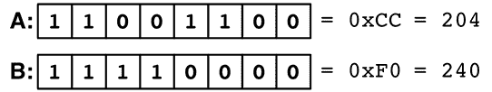

### 位运算符

你可以对位执行四种不同的操作：与（AND）、或（OR）、异或（XOR）和非（NOT）。你还可以在整数值中移动位。

当你对两个位进行**与**运算时，只有当两个位都设置为 1 时，结果位才设置为（1）。在所有其他情况下，结果位均为清零（0）。

大于单个位的值是按位逐位运算的；这是位与运算符中的*位*bitwise*元素。你可以想象这些值的位表示，然后按列进行与运算，如 `图 1.5` 所示。

**图 1.5 位与**

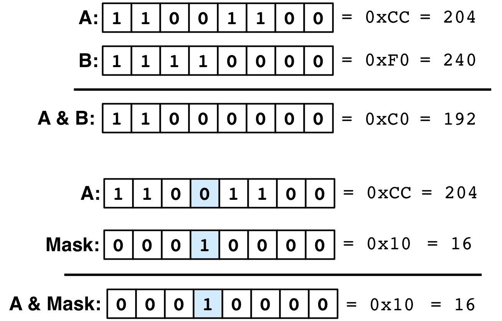

当你对两个值进行**或**运算时，只要原始值中任何一个位被设置为 1，或者两个位都设置为 1，结果中的位就会被设置。相反，只有当两个位都为 0 时，结果位才是清零。

**图 1.6 位或**

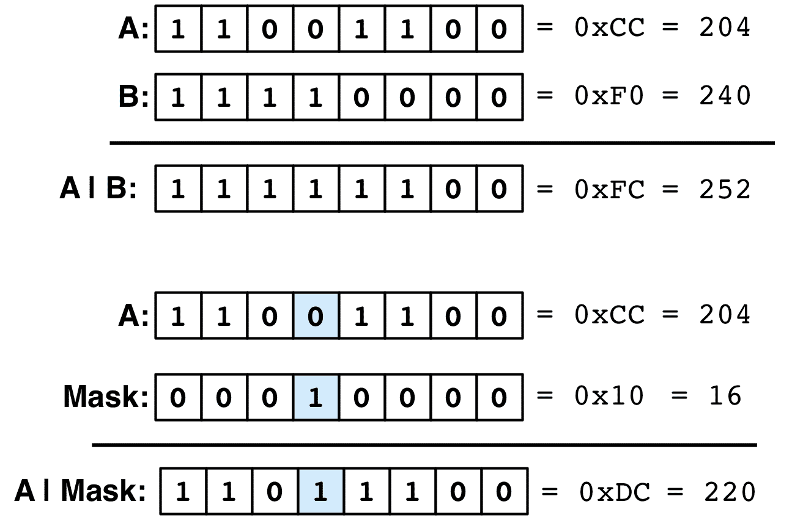

异或（XOR）使用 `^`（hat 或 caret）运算符。当你对两个值进行异或运算时，只有当相应的位在其中一个值中设置为 1 但另一个未设置为 1 时，结果位才会被设置。如果两个位都设置为 1 或都为 0，则结果位为清零。你可以将异或比作餐厅里的问题：“你要汤还是沙拉？”你可以选其中一种，但不能两个都要（除非额外付费）。

**图 1.7 位异或**

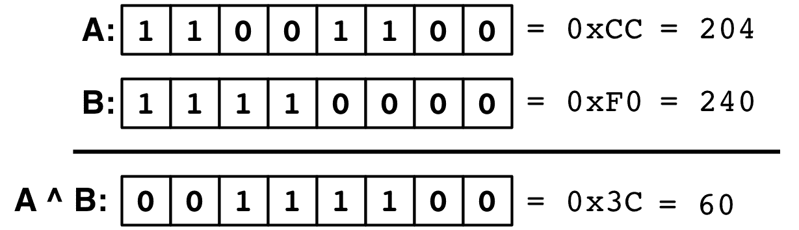

非（NOT）使用 `~`（tilde, twiddle）运算符取反每个位的值。零变为一，一变为零。

**图 1.8 位非**

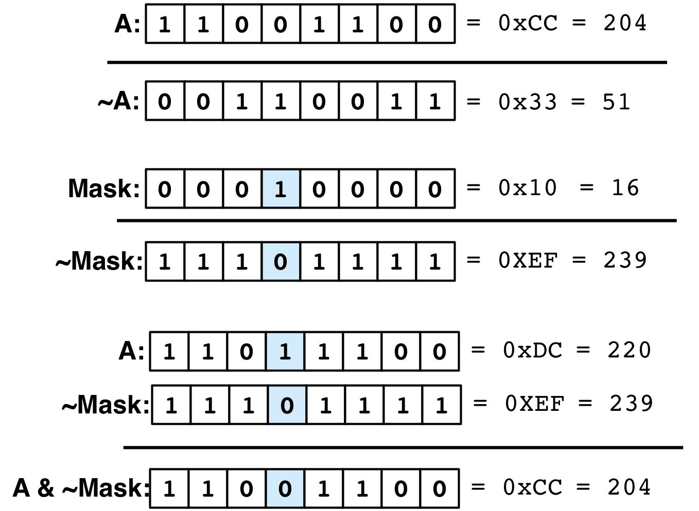


C 语言中有两种位移运算符。`<<` 将整值的位向左移动指定的位数，在低位填充 0，并丢弃高位。`>>` 运算符将位向右移动指定的位数。对于高位移入的内容，其行为取决于实现（implementation defined）。

在过去，位移被用作乘法和除以 2 的优化手段，但对于有符号值存在许多边界情况，这可能会导致使用时变得很危险。如今，位移最常见的用途是使用左移将一个 `1` 位置于特定位置，如图 1.9 所示。你可以看到 1 位向左移动了四个位置，最终值为 16。

**图 1.9 位移**

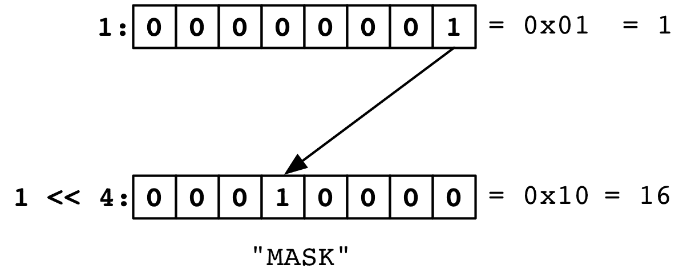

### 设置和清除位

你可以使用 AND、OR、NOT 和位移操作，通过为特定的位位置赋予含义，从而在整数中紧凑地存储信息。例如，`NSEnumerationOptions` 指定了两个位标志：

```c
enum {
    NSEnumerationConcurrent = (1ULL << 0), // binary 0001
    NSEnumerationReverse = (1ULL << 1), // binary 0010
};
typedef NSInteger NSEnumerationOptions;
```

在向如 `-enumerateObjectsWithOptions:usingBlock:` 的调用传递枚举选项时，你将零位设置为 1 表示你想要并发枚举，并将第一位设置为 1 表示你希望按反序进行枚举。共有四种组合：全部清除（非并发，正向）、任一一个置位、或都置位（并发反向）。

这通常被称为“位掩码”（bitmasking）——像 `NSEnumerationConcurrent` 这样的常量被用作位集合的掩码，隐藏掉我们不的位。

使用位掩码的常用方法是为具有特定含义的每个位（或一组位）定义常量。你也可以使用已知可以设置正确位的数值值。要设置的位可以使用相应的整数值来定义：

```c
#define BIT_POSITION 8 // binary 00001000
```

或使用位移表达式：

```c
#define BIT_POSITION (1 << 3) // binary 00001000
```

你使用按位 OR 设置位掩码的位：

```c
flags |= BIT_POSITION;
```

**图 1.10 设置位**

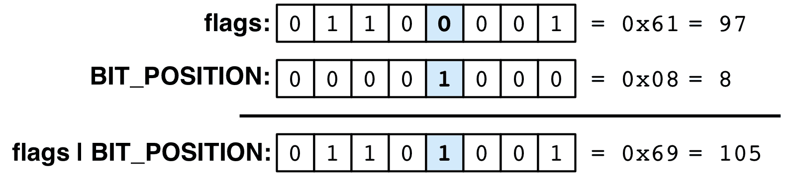

你使用按位 AND 测试位掩码的位是否被置位：

```c
if (flags & BIT_POSITION) {
    // 执行适当的操作
}
```

**图 1.11 测试位**

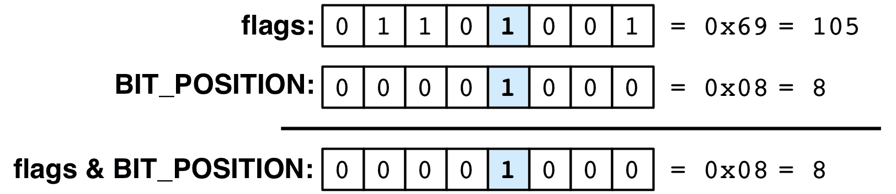

你通过将值与位掩码的取反进行 AND 操作来清除位掩码的位：

```c
flags &= ~BIT_POSITION;
```

这一步稍微复杂一点。你需要一个新的掩码，它能让变量中除被掩码位以外的所有原始位值通过。

**图 1.12 清除位**

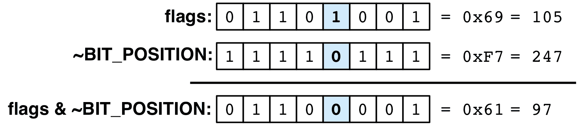

当你使用带有多个位的掩码时，与掩码进行比较会比进行简单的测试更安全：

```c
#define MULTI_BITS 0xF0 // 11110000
```

假设 `flags` 是 `0x61` (01100001)，语句

```c
if (flags & MULTI_BITS) {
    // 如果所有位都置位则执行某些操作
}
```

可能是糟糕的代码。按位 AND 的结果是：

**图 1.13 按位 AND 后的测试**


结果为 `0x60`。`if` 会将其视为真值，即使 `MULTI_BITS` 中只有几个位被置位。正确的代码应当是：

```c
if ((flags & MULTI_BITS) == MULTI_BITS) {
    // 如果所有位都置位则执行某些操作
}
```

**示例 1.13. bitmask.m** 显示了许多位运算。


```
/bitmask.c - 玩位掩码

gcc -g -Wall -o bitmask bitmask.c

#include <stdio.h> // 用于 printf

#define THING_1_MASK 1 // 00000001
#define THING_2_MASK 2 // 00000010
#define THING_3_MASK 4 // 00000100
#define ALL_THINGS (THING_1_MASK | THING_2_MASK | THING_3_MASK) // 00000111

#define OTHER_MASK (1 << 5) // 00100000
#define OTHER_MASK_2 (1 << 6) // 01000000

#define ALL_OTHERS (OTHER_MASK | OTHER_MASK_2) // 01100000
#define ALL_USEFUL_BITS (ALL_THINGS | ALL_OTHERS) // 011100111

static void showMaskValue(int value) {
    printf("\n"); // 隔开输出
    printf("value %x:\n", value);

    if (value & THING_1_MASK) printf("THING");
    if (value & THING_2_MASK) printf("THING");
    if (value & THING_3_MASK) printf("THING");

    if (value & OTHER_MASK) printf("OTHER");
    if (value & OTHER_MASK_2) printf("OTHER");

    if (value & ALL_OTHERS) printf("ALL OTHERS");
} // showMaskValue

static int setBits(int value, int mask) {
    // 通过对 value 进行 OR 运算设置位。
    value |= mask;
    return value;
} // setBits

static int clearBits(int value, int mask) {
    // 清除位，将其与掩码的反反值进行 AND 运算。
    value &= ~mask;
    return value;
} // clearBits

int main() {
    int value = 0;

    value = setBits(value, THING_1_MASK); // 0x1
    value = setBits(value, THING_3_MASK); // 0x5
    showMaskValue(value);

    value = setBits(value, ALL_OTHERS); // 0x65
    value = clearBits(value, THING_2); // 0x65
    showMaskValue(value);

    value = clearBits(value, THING_3); // 0x61
    showMaskValue(value);

    return 0;
} // main
```

当你编译并运行时，你会得到以下输出：

```
.bitmask
value 5:
THINGTHING

value 65:
THINGOTHEROTHERALL OTHERS
```

## Objective-C

Objective-C 是用于编程 Cocoa 工具包的语言。它是 C 语言之上的一个薄层，带有一些额外的语法、一个运行时组件以及大量的元数据以支持该语言的动态特性。但从根本上说，Objective-C 仍然是 C。许多程序员忘记了 Objective-C 的 C 语言，，未能利用 C 的语言特性和库。

### Objective-C 中的 C 回调

在线论坛上经常出现的一个问题是：“如何将一个方法放入函数指针中？”十次里九，帖者实际上是想在 Cocoa 中使用带有回调的现有 C API。一个更好的问题是：“我正在 Cocoa 中使用一个带有回调的 C API，我该如何让它工作？”

尽管 Objective-C 方法在根本上是 C 函数，但你不能直接将 Objective-C 方法作为 C API 的回调。当你向对象发送消息时，编译器会将你的方括号方法调用替换为对 `objc_msgSend()` 或其某个变体的函数调用。`objc_msgSend()` 的原型如下：

```
id objc_msgSend(id self, SEL op, ...);
```

当你进行如下调用时：

```
[box drawRect:someRect]
```

它会被编译器转变为：

```
objc_msgSend(box, @selector(drawRect:), someRect)
```

它首先传递接收者。这些参数的存在导致你无法直接使用。

使用回调需要一个跳板（trampoline）。例如，Core Foundation 提供了一个基于回调的解析器。程序员构建自己的数据。假设我们有一个由 XML 触发的 Watch。你设置了上下文：

```
Watch *watch = [Watch alloc];
```

设置回调：

```
CFXMLParserCallbacks callbacks = {
    0,
    createStruct,
    resolveEntity,
    handler
};
```

然后创建你的解析器（注意最后一个参数传递了上下文）：

```
CFXMLParser *parser = CFXMLParserCreate(kCFAllocatorDefault, data, &callbacks, &context);
```


```
void *createStructure(CFXMLParserRef parser, XMLNodeRef node, void *info) {
    Watcher *watcher = (Watcher *)info;
    [watcher watchCreate:node];

    // ... do some work ...
    return new XMLStructureDetail;
} // createStructure
```

或者，你也可以创建一个 `NSInvocation` 或 block 并将其用作上下文指针。这样你就可以有一个通用的回调函数，只需将传入的上下文指针强制转换为 invocation 或 block，然后执行它即可。

### Objective-C 2.0

Mac OS 10.5 包含了 Objective-C 语言的 2.0 更新。虽然变化相对较小，但新增的功能通过消除大量的样板代码，并将常见的 Cocoa 惯用法移动到编译器中（以便进行合理性检查和优化），提高了程序员的效率和程序的可靠性。新特性包括对协议（protocols）、类扩展（class extensions）、新的枚举语法、运行时的增强、垃圾回收以及属性（properties）。如果你必须支持 10.4，则无法使用这些新特性。你必须使用 10.5 SDK 或更高版本才能使用 Objective-C 2.0。

### 协议

Objective-C 协议类似于 Java 接口：它是一份采用协议的类必须实现的方法列表。如果任何方法未被实现，编译器将会报错。如果你希望要求某些方法实现而让其他方法为可选，这可能会带来不便。例如，`NSInputServiceProvider` 协议有 15 个方法。如果你采纳该协议，你就必须实现所有 15 个方法，即使你只需要其中一两个就能完成工作。

可以使用非正式协议（Informal protocols）来避免这种麻烦。非正式协议是 `NSObject` 的一个分类（category），它列出了可能（也可能不）实现的方法。这解决了“必须实现所有内容”的问题，但当某些方法确实需要实现时，就会产生问题。`NSTableDataSource` 分类包含了两个你必须实现的方法：`-numberOfRowsInTableView:` 和 `-tableView:objectValueForTableColumn:row:`。非正式协议不需要你实现这些方法，因此 `NSTableView` 依赖于对其数据源的运行时检查来确保这些方法已实现。

Objective-C 2.0 引入了一个更好的解决方案，在协议内部使用了两个新指令：`@required` 和 `@optional`。`@required` 位于必须实现的方法声明之前。协议方法默认是 `@required`。`@optional` 标记不需要实现的方法。如果你正在实现类似表格数据源的内容，你会创建一个类似示例 1.14 的内容：

**示例 1.14. datasource.m**

```
// datasource.m - 查看 ObjC 协议新增内容。

// gcc -g -Wall -framework Foundation -o datasource datasource.m

#import <Foundation/Foundation.h>

//--- 新表格的数据源

@protocol NewTableViewDataSource
@required (NSInteger)count default required;
@optional (BOOL)shouldEncodeStrings;
@required (NSString *)dataValueAtRow:(NSInteger)row;
@end

//--- datasource 类

@interface DataSource : NSObject <NewTableViewDataSource>
@end

@implementation DataSource

-(NSInteger)count {
    return 23;
} // count

-(NSString *)dataValueAtRow:(NSInteger)row {
    return [NSNumber numberWithin:row * 7];
} // dataValueAtRow

-(BOOL)shouldEncodeStrings {
    return YES;
} // shouldEncodeStrings

//--- datasource

@interface NewTableView : NSObject
@property (set) DataSource *dataSource;
@end

@implementation NewTableView

-(void)setDataSource:(DataSource)ds {
    _dataSource = ds;
} // setDataSource

-(void)stuff {
    // 不需要检查响应者——编译器已经为我们做了一些合理性检查。
    NSLog(@"count: %u", [dataSource count]);
    NSLog(@"value at row 5: %@", [dataSource dataValueAtRow:5]);

    // 这些是可选的，所以检查数据源是否响应/
    if ([dataSource respondsTo:@selector(shouldEncodeStrings)]) {
        NSLog(@"bool: %ld", [dataSource shouldEncodeStrings]);
    } else {
        NSLog(@"empty rows: %@",
    }
}

@end // NewTableView

// 使用所有功能。

int main(void) {
    NSAutleasePool *pool = [[NSAutleasePool alloc] init];

    AutleasePool *pool = [AutleasePool alloc] init];

    TableView *tableView = [TableView alloc] init];

    DataSource *ds = [DataSource alloc] init];

    [tableView setData:[nil]]; // should warn
    [tableView setData:ds];

    [tableView stuff];

    return 0;
}
```


示例 1.14 首先声明了 `NewTableViewDataSource` 协议，该协议包含两个必需方法 `-rowCount` 和 `-dataValueAtRow:`，以及两个可选方法 `-shouldEncheferizeStrings` 和 `-emptyRows`。随后是采用该新协议的 `DataSource` 类。如果你没有实现任何一个必需方法，编译器将发出警告。该示例中只实现了其中一个可选方法。

下一个类是 `NewTableView` 类，它有一个 `datasource` 实例变量，其设置方法（setter）要求传递给 `-setDataSource:` 的对象遵守 `datasource` 协议。如果你尝试传递一个未遵守该协议的对象，编译器会向你警告。这（假设你没有忽略警告）保证了你的数据源实现了它必须实现的内容，并且你没有给新的表视图提供一个无法处理所需消息的对象。这简化了 `-doStuff` 方法的实现，该方法可以假设其数据源已经实现了所需的方法。不过，你仍然需要在运行时检查可选方法是否存在。

当你编译程序时，对于尝试向 tableview 传递错误数据源的行，你应该会得到此警告：

```
datasource.m: function 'main':
datasource.m:92: warning: class 'NSNull' does not implement 'NewTableViewDataSource' protocol
```

运行它将给你得到如下的输出：

```
$ .//datasource
2011-01-18 12:39:43.211 datasource[4488:903] count: 23
2011-01-18 12:39:43.213 datasource[4488:903] value at row 5: 35
```

### 类扩展 (Class extensions)

另一个 Objective-C 约定是使用分类（categories）在类的 `@interface` 之外声明方法。程序员这样做有两个主要原因：1) 将长列表拆分成更小、更易理解的部分，例如 `NSWindow` 的 `NSKeyboardUI`、`NSToolbarSupport` 和 `NSDrag` 分类；2) 声明“私有”方法，可以放在不同的头文件中或类实现文件的顶部。使用分类的问题是，编译器无法检查你是否真的实现了你所说的内容。例如，你可以在类的头文件中有如下所示分类：

```
@interface BigShow(SlideManipulation)
- (void)moveNext;
- (int)currentSlide;
@end
```

但你的实现中可能存在拼写错误：

```
- (int)currentlide {
    return currentlide;
}
```

这个错误只会在运行时被捕获，在你的应用程序运行之前不会被发现。Objective-C 2.0 增加了类扩展来解决这个问题。类扩展被声明为一个无名分类：

```
@interface BigShow
- (void)moveNext;
- (int)currentSlide;
@end
```

这告诉编译器这些方法是类的一部分，尽管它们是在不同的地方指定的。不过，一些程序员将类扩展称为“续体”（continuations），但这是另一个（更有趣的）计算机科学领域的名称，因此最好使用其正式名称来称呼类扩展。

除了在类扩展中前向声明方法外，你还可以在它们采用协议。Snow Leopard 和 iOS 已将许多非正式协议移到了协议中，并要求你的类在将对象作为代理（delegate）之前遵守这些协议。你可以在头文件中列出协议：

```objc
@interface ViewController<UITableViewDataSource>
```

或者在实现中的类扩展中列出：

```objc
@interface ViewController (UITableViewDataSource)
```

通过使用类扩展，你可以将实现细节从头文件中移出。如果自己的类大量使用协议，这也可以缩短编译时间，因为遵守协议只是一个实现细节，而不再是公共接口的一部分。如果你在头文件中采用某个协议（例如之前看到的 `NewTableViewDataSource` 协议），你必须包含定义该协议的数据源头文件，这将导致包含原始对象头文件的每个文件的编译时间都变长。

### 快速枚举 (Fast enumeration)

Cocoa 最常见的惯用方法之一是遍历集合。典型的枚举代码如下：

```
Enumerator *enumerator = [array enumerator];
NSString *string;
while ((string = [enumerator nextObject])) {
    NSLog("%@", string);
}
```

这种方式相当繁琐，需要为枚举器分配内存，在某些情况下可能涉及集合的拷贝。Objective-C 2.0 采用了在许多语言中用于遍历集合的“for-in”语法，它等同于：

```
for (NSString *string in array) {
    NSLog("%@", string);
}
```

字符串变量 `string` 的作用域限于循环内部。如果你在循环外声明 `string`，它的值在循环外可见的。如果遍历了整个集合，当循环退出时 `string` 将为 `nil`。你也可以提供一个枚举器而不是集合：

```
Enumerator *enumerator = [array enumerator];
for (NSString *string in enumerator) {
    NSLog("%@", string);
}
```

`for-in` 语法不仅更紧凑，而且比其他集合迭代方法快得多。它利用了新的 `NSFastEnumeration` 协议，该协议允许被遍历的集合利用其实现细节提供可能的性能。此外，如果在遍历过程中修改了集合，`for-in` 将抛出异常，这一直是 Cocoa 的一个不变特性，尽管以前并不总是被强制执行。

要实现你自己的快速枚举集合，你需要采用 `NSFastEnumeration` 协议。它只有一个方法：

```
- (NSUInteger)countByEnumeratingWithState:(NSFastEnumerationState *)state
                             objects:(id *)stackbuf
                               count:(NSUInteger)len;
```

`stackbuf` 是指向栈上长度为 `len` 的对象指针数组的指针，该方法可以填充它但不是必须。该方法返回此轮迭代中提供的项目数量，如果迭代结束则返回 0。

`state` 参数是一个指向描述枚举状态的结构体的指针：


```c
typedef struct {
    unsigned long state;
    id *itemsPtr;
    unsigned long *mutationsPtr;
    unsigned long extra[5];
} NSFastEnumerationState;
```

`state` 字段在第一次调用 `-countByEnumeratingWithState:objects:count:` 时为 0。你应该在第一次调用期间将其设置为非零值，这样你就可以判断自己何时正处于第二次（或后续）调用中。

你通过 `itemsPtr` 指向的数组返回用于迭代的对象。如果集合在内存中线性地存储对象指针，你可以将此指针指向集合的数据结构。否则，你可以将多达 `len` 个对象的指针放入 `stackbuf` 参数空间中，并将 `itemsPtr` 指向那里。`mutationsPtr` 应该被设置为一个有效地址，该地址用作某种变更计数器，以捕获在正在变变的集合上迭代的情况；不可变集合可以直接使用 `self`。`extra` 属性是可供你的 `-countByEnumeratingWithState:objects:count:` 实现使用的临时空间。

这里有一个存储 `NSString` C 数组的类。该程序的完整文本可以在示例代码下载的 `fastenum.m` 中找到，其中包含了变方法的实现以及维护变更值的代码。

```objc
@interface CArray : NSObject <NSFastEnumeration> {
    NSString **strings;
    int _stringCount;
    unsigned long _mutations;
}

-(void)setStrings:(NSString **)strings,NSREQUIRESNILTERMINATION;

@end // CArray
```

它有一个 `NSString` 指针的 C 数组、一个持有数组长度的 `stringCount`，以及一个在字符串集被操作时就会递增的变更计数实例变量。提供了一个变变方法来设置字符串。由于 `CArray` 采用了 `NSFastEnumeration`，它需要实现 `-countByEnumeratingWithState:objects:count::`：

```objc
-(NSInteger)countByEnumeratingWithState:(NSFastEnumerationState *)state objects:(id **)stackbuf count:(NSInteger)count {
    if (state->state == 0) {
        // 第一次调用，进行初始化。
        state->state = 1;
        state->mutationsPtr = &_mutations;
        state->itemsPtr = strings;
        return stringCount;
    } else {
        // 第一次通过时返回了所有内容，所以我们完成了。
        return 0;
    }
} // countByEnumeratingWithState
```

该方法的第一次调用发现 `state` 的值为 0，因此它首先进行初始化。它将 `state` 改为非零值，以便我们知道不再重复执行。然后它将 `state` 的 `mutationsPtr` 指向变更变量，并将 `itemsPtr` 指向 C 数组。`CArray` 在内存中顺序存储其所有指针，因此我们可以告诉调用者集合的总计数。`for-in` 循环随后将迭代所有元素。当此方法第二次被调用时，它返回 0，表示所有迭代已完成，`for-in` 循环终止。无论我们的集合有多大`-countByEnumeratingWithState:objects:count:` 方法只会被调用两次。

这段代码填充并迭代了 `CArray`：

```objc
CArray *array = [[CArray alloc] init];
[array setStrings:@"I", @"sem", "to", "be", "a", "verb", nil];

for (NSString *string in array) {
    NSLog("%@", string);
}
```

以及示例运行：

```
2011-01-18 15:47:15.531 fastenum[4688:903] I
2011-01-18 15:47:15.534 fastenum[4688:903] see
```

你实际上不需要迭代真实的集合。你可以对数字生成器使用快速枚举。这是否真的是一个好主意仍待争议。

一种受技术面试官和书作者欢迎的数字序列是斐波那契数列，这是一种递归定义，规定从两个 1 开始数字序列，然后下一个值是前两个值之和：1, 1, 2, 3, 5, 8, 13，以此此类推。这个问题有迭代和递归解决方案。

快速枚举解决方案利用了两个事实：`-countByEnumeratingWithState:` 被给定了一块可以容纳若干指针的空间。根据经验，Cocoa 提供了足够容纳 16 个指针的空间。状态结构中还有一些供我们使用的临时空间。生成器使用栈空间存储指向数字序列的 `NSNumbers` 指针，并使用临时空间持有序列的 N-1 和 N-2 值。

`FibonacciSequence` 对象没有自己的状态，因此可以从同一个对象生成任意数量的独立序列。这里是该类的接口：

```objc
@interface FibonacciSequence : NSObject <NSFastEnumeration>
@end // FibonacciSequence
```

该类的唯一方法承担了所有的脏活：


```objc
-(NSInteger)countByEnumerationWithState:(NSFastEnumerationState *)state
                          objects:(id *id)stackbuf
                             count:(NSInteger)len {
    assert(len >= 2); // 因为我们在第一次调用时预填充了两个值
    id *scan, *stop;

    if (state->state == 0) {
        // 第一次调用，初始化
        state->state = 1;
        state->mutationPtr = (unsigned long *)self; // 不适用
        state->itemsPtr = stackbuf;

        // extra[0] 存储 N-2 值，extra[1] 存储 N-1 值
        state->extra[0] = 1;
        state->extra[1] = 1; // 填充前值
        state->items[0] = NumberWithInt:state->extra[0];
        state->items[1] = NumberWithInt:state->extra[1]; // 因为我们已经填充了前两个槽，所以取剩余的点
        scan = &state->items[2];
        stop = &state->items[0] + len;
    } else {
        // 否则我们处于循环中，对所有项目进行正常处理。
        scan = &state->items[0];
        stop = &state->items[0] + len;
    }

    while (scan < stop) {
        // 执行斐波那契算法
        int value = state->extra[0] + state->extra[1];
        state->extra[0] = state->extra[1];
        state->extra[1] = value; // 填充快速点
        scan = NumberWithLong:state->extra[1]; // 然后移动下一个值
    } // 始终填充它们的栈缓冲区。
    return len;
}
```

`countByEnumerationWithState` 循环遍历序列的一个部分：

```objc
FibonacciSequence *fib = [[FibonacciSequence alloc] init];

int boredom = 0;
for (NSNumber *number in fib) {
    NSLog(@"%@", number);
    if (boredom++ > 40) {
        break;
    }
}
```

运行时的输出如下：

```
2011-01-18 15:47:15.536 fast[4688:903] 1
2011-01-18 15:47:15.536 fast[4688:903] 1
2011-01-18 15:47:15.536 fast[4688:903] 2
...
2011-01-18 15:47:15.536 fast[4688:903] 2335
2011-01-18 15:47:15.536 fast[4688:903] 3781
2011-01-18 15:47:15.536 fast[4688:903] 6144
```

### 运行时与垃圾回收

Objective-C 2.0 还增强了语言的运行时。运行时已针对 64 位编程进行了重写，包含了 C++ 异常（在第 5 章：错误处理与信号中讨论）以及解决脆弱的类问题（在第 2 章：编译器中讨论）。

Objective-C 2.0 有一个可选的垃圾回收器，可以代替 `retain` 和 `release` 引用计数。垃圾回收器足够通用，可以在 Objective-C 之外使用，并在第 7 章：内存中讨论。

### 属性

另一种常见的用法是 setter（设置）和 getter（访问器），即影响实例变量的方法对。假设你有一个植物模拟程序，并用名称、颜色和大小对植物进行建模。你希望为植物的用户提供更改其属性的方法：

```objc
@interface Lotus : NSObject {
    NSString *_name;
    Color *_color;
    int _size;
}

-(void)setName:(NSString *)name;
-(NSString *)name;

-(void)setColor:(Color *)color;
-(Color *)color;

-(void)setSize:(int)size;
-(int)size;

@end
```

进入每个 `-setWhatever:` 方法的数据以不同的方式处理：字符串应该被复制（copy），颜色应该被保留（retain），而 `int` 不需要内存管理。此外，你还需要维护内存管理的习惯，并进行检查以确保你没有不必要地释放对象：

```objc
-(void)setName:(NSString *)name {
    if (_name != name) {
        [_name release];
        _name = [name copy];
    }
}
-(NSString *)name {
    return _name;
}

-(void)setColor:(Color *)color {
    if (_color != color) {
        [_color release];
        _color = [color retain];
    }
}
-(Color *)color {
    return _color;
}

-(void)setSize:(int)size {
    _size = size;
}
-(int)size {
    return _size;
}
```


```objc
@interface LotusBlossom : NSObject {
    NSString *_name;
    NSColor *_color;
    int _size;
}
@property (copy) NSString *name;
@property (retain) NSColor *color;
@property (assign) int size;

@end // LotusBlossom (properties)

@implementation LotusBlossom
@synthesize name = _name;
@synthesize color = _color;
@synthesize size = _size;

-(void)dealloc {
    [_name release];
    [_color release];

    [super dealloc];
} // dealloc

-(NSString*)description {
    return [NSString stringWithFormat:@"blossom %@ : %@ / %d", _name, _color, _size];
} // description

@end // LotusBlossom(properties)
```

注意实例变量名中下划线的使用以及 `@synthesize` 指令中的“赋值”。这并不是强制性的风格，但是一种为了消除错误源而选择常用风格。如果实例变量与属性相同，人们很容易直接使用实例变量（例如使用 `name`）而不是引用属性（例如使用 `self.name`），导致访问器使用不一致。通过在实例变量前加上下划线，它们就不会重名，从而使得通过 `_name` 访问实例变量与通过 `self.name` 访问属性变得清晰显然。

属性还为 Objective-C 2.0 增加了一个新的语法元素：点运算符。当与对象指针配合时，点运算符等同于使用 setter 和 getter：

```objc
LotusBlossom *blossom = [[LotusBloss alloc] init];
blossom.name = @"Hof";
blossom.color = [NSColor whiteColor];
blossom.size = 2;
```


@dynamic` 告诉编译器不要为该属性查找或生成 setter 或 getter。相反，你将在运行时以某种方式提供它们。你可能会加载一个包含这些实现的动态库。除了 `-forwardInvocation:` 方法外，`NSObject` 还新增了两个新方法：`+resolveInstanceMethod` 和 `+resolveClassMethod`。每个方法都接收一个 `SEL` 并返回一个 `BOOL`。在转发机制接管之前，类有机会解析一个缺失的方法，并在运行时动态地将其添加到该类中。其中一个 `+resolve` 调用会被触发，并且它有机会使用 Objective-C 运行时函数向类添加方法。`+resolve` 的速度比使用 `-forwardInvocation:` 快得多。Core Data 也利用了这一机制将属性映射到 Core Data 属性。

## 练习

1. 使用 `@dynamic`、`+resolveInstanceMethod` 和 `class_addMethod()` 函数在运行时添加属性实现方法。本文未涉及对 Objective-C 运行时的操作，但你可以在 Apple 的《Objective-C 2.0 Runtime Reference》中找到相关信息。

2. 在垃圾回收环境和非垃圾回收环境中测量原子（atomic）和非原子（nonatomic）属性的性能。是否存在真实的性能差异？

3. 在遍历集合时不允许集合发生变异这一要求有时会非常不便，特别是当你正在执行“扫描集合并提取出不该存在的内容”这类操作时。需要什么才能让经典的数组枚举器支持在迭代期间允许集合变异？这对快速枚举（fast enumeration）有什么影响？

4. C99（当前的 C 版本）以及 Objective-C 都有 `restrict` 关键字。它的作用是什么？

5. `FibonacciSequence` 的值迅速超过了 `unsigned long` 能容的范围，这就是为什么代码在这里“作弊”，在迭代 40 次后就停止了。修复这个问题（或至少让我们进入序列的后续）的一种方法是使用 `NSFastEnumerationState` 结构中更多的额外值。`long longs` 可能让你走得更远，`NSDecimal` 函数或 `NSDecimalNumber` 类也是如此。互联网上还有提供任意大小数字的“BigNum”库。

# 2 编译器

编译器是你编程兵库中最基础的工具。无论你使用什么编辑器编写源码，无论你用 Xcode 还是用 `make` 编译程序，编译器都是参与其中的。Apple 在开发工具中附了 GNU 编译器集合（GCC）。你可以通过 `gcc` 命令调用编译器，也可以使用 `cc` 命令。

Mac OS X 10.4 和 10.5 的开发工具包含了 3.3 和 4.0 版本的 `gcc`。如果你有代码无法在新的编译器下编译，或者你需要支持 10.3.9 之前的 Mac OS X 版本，可以使用旧版本的编译器。`gcc` 4.2 是 10.6 的默认版本，且与 10.4（及早期）的 SDK 不兼容。此外，`gcc` 4.2 是使用 Xcode 4 时所需的最小编译器，因此你无法使用最新的 Xcode 来为 10.4 构建应用程序。

长期以来，Apple 通过 `LLVM`（低级虚拟机）项目开发了自己的编译器技术。LLVM 技术已用于 Mac 上的 OpenGL 着色语言和 OpenCL。`clang` 是 LLVM 的一个前端，用于解析 C 代码。你可以使用 `clang` 解析代码，并使用 `LLVM` 或 `gcc` 后端生成目标代码。`clang` 前端生成的错误和警告比 `gcc` 好得多。Xcode 的静态分析器是基于 `clang` 的。为了最大的兼容性，你会对一切都使用 `gcc`。为了获得更好的错误和警告以及更快的编译速度，可以使用“LLVM gcc”，它使用了 `clang` 解析器和 `gcc` 代码生成。使用“LLVM 编译器”可以获得所有新特性。

`gcc` 支持多种语言。C 方言语言是用于典型的 Mac OS X 开发的语言。源文件的扩展名告诉编译器应该使用哪种方言：

| .c | 常规 C |
| :--- | :--- |
| .m | Objective-C |
| .C | C++（但不要在 HFS+ 文件系统上使用，因为它不区分大小） |
| .cpp, .cc | C++ |
| .mm | Objective-C++, C++ 和 Objective-C 的混合体 |

## 常用标志

`gcc` 的文档附在 Xcode 中。请注意，`gcc` 非常庞大，并带有许多选项、功能、标志以及对所编译语言的各种扩展。它还有很多很酷的功能。以下是一些你可能发现有用的命令行标志。你可以在 Xcode 中控制其中许多设置，但并非所有的 `gcc` 标志都通过 GUI 暴露。你需要在 Other C Flags 或 Other C++ Flags 配置中添加它们。

| 标志 | 说明 |
| :--- | :--- |
| -g | 添加调试符号。在 Xcode Project 或 Target 属性面板的 Build 选项卡中使用 Level of Debug Symbols 开启它。 |
| -E | 查看预处理器输出。你可以通过 Xcode 3 代码编辑器右键菜单中的 Preprocess 菜单告诉 Xcode 预处理一个文件。该菜单项也位于 Build 菜单中。在编写本文时，Xcode 4 已将其移动到助手窗口的 Generated Output 部分。 |
| -S | 查看生成的汇编代码。 |
| -save-temps | 保留临时文件。 |
| -Wall, -Wmost | 显示更多警告。 |
| -Werror | 将视为视为。通过勾选 Build 选项卡中的 Warnings as Errors 来开启。 |
| -DSMBOL | 从命令行定义。 |
| -DSMBOL=value | 从命令行带值定义。你可以通过编辑 Build 选项卡中的 Preprocessor Macros 来微调宏设置。 |
| -O# | 设置优化级别（下文描述）。使用 Project 或 Target 面板中的 Optimization Level 来控制。 |
| -std | 选择标准或非标准的 C 方言。提供 -std=c99 将给你 C99，它为语言增加了许多 gcc 扩展和 C++ 特性，但不允许额外的 gcc 扩展。你也可以使用 -std=gnu99 获取 C99 和 gcc 扩展。 |

### 调试

-g 标志启用调试符号，这些额外数据允许调试工具将可执行代码中的任意地址映射回生成它的源代码。它包含了类型、变量名和数据结构的信息。启用符号可能会让程序变大，并暴露你可能希望隐藏的实现细节。`strip` 命令会移除这些符号，Xcode 提供了许多控制符号去除的选项。

剥离可执行文件或在构建应用程序时没有使用 -g 的缺点是，你在现场调试时将没有符号化的堆栈，并且无法轻松分析人们发送给你的崩溃报告堆栈。

如果你保留了剥离之前的应用程序版本，你可以使用 `atos` 命令将地址映射回程序符号。你也可以保留外部的 dSYM 并将其传递给 `atos`。

Apple 开发工具支持两种不同的调试符号信息格式：Stabs 和 DWARF。Stabs 是旧版 Xcode 的默认格式，而 DWARF 是 Xcode 3 及之后版本的默认格式。


编译器警告是一件好事。如果编译器对你编写的内容大抱怨，那么你的代码很可能存在某些疑点，这可能导致后续出现错误。一个值得努力的目标是让你的代码始终能够无警告地通过通过编译。`-Wall` 会针对 `gcc` 开发者认为的大多数可疑点显示大量警告。在使用 Cocoa 框架时，`-Wmost` 是一个很好的折中方案。

你可以根据特定的编码风格独立地开启或关闭特定的警告。假设你正在使用一个使用了宏的库，这些宏会留下一些未使用的变量。虽然这看起来很乱，但基本上是无害的，因为编译器不会为它们分配空间。示例 2.1 显示了编译时产生的一些警告。

### 示例 2.1. warning.m

```
warning.m - 显示编译器警告的生成

gcc -Wall -o warning.m

int main(int argc, char *argv) {
    int i;
}
// main
```

然后对其进行构建：

```
$ gcc -Wall -o warning.m
warning.m:5: warning: 'main' 的第二个参数应该是 'char **'
warning.m: function 'main':
warning.m:6: warning: 未使用的变量 'i'
warning.m:7: warning: 控制流到达非空函数的末尾
```

这些警告中有两个非常有意思，因为它们实际上是错误：`main()` 的参数乱了，而且 `main()` 没有返回任何内容。但（在这种情况下）未使用的变量并不是致命性问题。否则，请修复代码：

```
int main(int argc, char *argv[]) {
    int i;
    return 0;
}
// main
```

```
$ gcc -Wall warning.m
warning.m: function 'main':
warning.m:6: warning: 未使用的变量 'i'
```

你可以通过以下命令关闭该警告：

```
$ gcc -Wall -Wunused warning.m (no)
```

如果你犯了错，仍然会收到警告。如果你只想看到针对未使用变量及其他问题的警告，请使用 `-Wunused`（去掉 `no`）：

```
$ gcc -Wunused warning.m
warning.m: function main:
warning.m:9: warning: 未使用的变量 i
```

`gcc` 文档包含了完整的警告列表。如果你有一个文件包含你想忽略的警告，但不想全局关闭它们，可以添加针对文件的标志。在 Xcode 3 中，在 target 的 `Compile Sources` 部分选择源文件，选择 `Info`，然后在 `build` 窗口中添加编译器标志。要记住的一点是在 target 中设置，而不是源文件。Xcode 4 将此功能移动到了 target 的 `Build Phases` 选项卡。展开 `Compile Sources` 并为源文件输入编译器标志。

减少警告数量是值得的。如果你有很多“忽略所有”，用的警告就会淹没在噪音中。最好的方法是修复它们或抑制它们。将警告视为错误是执行良好良好的极方法。

## 查看输出

`-E` 标志告诉 `gcc` 将预处理代码发送到标准输出。你可以使用 Xcode 3 的 `Process` 命令或 Xcode 4 生成的输出。示例 2.2 看起来足够简单。它将从标准输入读取一行并将其打印出来。

### 示例 2.2. procct.m

```
procct.m - 显示预处理器输出的程序

cc -Wall -o procct.m
or
cc -Wall -E procct.m > junk.i
(然后查看 junk.i)

#include <stdio.h>

#define BUFFER_SIZE 2048

int main(int argc, char *argv[]) {
    char buffer[BUFFER_SIZE];
    /* 这是我的缓冲区 */
    while (line = fgets(buffer, BUFFER_SIZE, stdin)) {
        printf("%s", line);
    }
}
```


```
$ gcc -g -Wall -S preprocTest.m
```

将生成一个 `preprocTest.s`。如果你想汇编生成的文件，可以这样将其传递给编译器：

```
$ gcc -o preprocTest preprocTest.s
```

Xcode 3 在编辑器的右键菜单中提供了“显示汇编代码”（Show Assembly Code）选项，你可以查看代码将如何汇编成什么。截至本文为止，Xcode 4 删除了此功能。

如果你不想折腾编译器标志或寻找 Xcode 3 的安装程序，可以使用 `otool` 来反汇编现有程序。此命令将反汇编 `preprocTest`：

```
$ otool -t -V preprocTest.
...
_main:
000000000100000e94             pushq %rbp
000000000100000e95             movq %rsp,%rbp
000000000100000e98             subq $0x83,%rsp
000000000100000e9f             movl %edi,0xffffff7dc(%rbp)
000000000100000ea5             movq %rsi,0xffffff7d0(%rbp)
000000000100000eac             movq 0x185(%rip),rax
000000000100000eb3             movq (%rax),rdx
000000000100000eb6             movq %rdx,0xf8(%rbp)
000000000100000eba             xorl %edx,%edx
000000000100000ebbc             movq 0x17d(%rip),rax
000000000100000ec3             movq (%rax),rdx
000000000100000ec6             leaq 0xffffff7f0(%rbp),rdi
00000000010000ecd             movl $0x800,esi
00000000010000ed2             call 0x10000f1e     ; symbol stub for: _gets
...
```

如果你想保存所有的中间元素（包括此处未涵盖的内容），可以使用 `-save-temps`。

### 编译器优化

有两类标志用于控制优化，它们控制编译器如何从你的代码生成机器码，以及编译器如何重写你的代码以实现更优的。你可以使用 `-O` 配合数字来控制优化级别。

| 标志 | 说明 |
| :--- | :--- |
| `-O0` | 不进行优化。 |
| `-O1` | 进行某些优化（在使用不带数字的 `-O` 时使用的）。 |
| `-O2` 和 `-O3` | 使用更激进的优化。 |
| `-Os` | 针对大小进行优化。与 `-O2` 相同，但不进行内联。 |

较高的优化级别可能会使代码变得不稳定，因为对其进行了更多的机械化操作，因此在更改级别时务必进行测试。有时在高级别下发生的失败实际上是编程错误的指示。如果你知道想要启用或禁用的特定优化（例如强度削减 strength reduction），可以单独开启或关闭它们：

| `-fstrength-reduce` | 启用强度削减。 |
| `-fno-strength-reduce` | 关闭强度削减，即使启用了 `-O`。 |

`gcc` 文档描述了所有可用标志，而且非常多。如果将优化级别设置为 `-O2` 或更高，当变量在初始化之前使用时（在启用 `-Wall` 时）会发出警告。同时使用 `-g`（调试）和 `-O`（优化）。这种组合在历史上 C 语言编译器中是不被支持的。这意味着你可以在优化的程序上使用 `gdb`，但可能会出现意想不到的行为，因为代码可能会被重排，且变量可能会被消除。在调试器中单步执行某些代码可能会导致你的“当前行”来跳跳。Apple 建议使用 `-Os` 来针对大小进行优化，即使在快速机器上也是如此。这可能不会产生最佳性能，因为系统似乎是一个很大的限制因素。

### GCC 扩展
GNU 产品拥有海量功能。它们可以帮助你的代码，但如果你针对的是一个没有 `gcc` 的平台，它们也会破坏可移植性。这里是一些有趣的的扩展：

- `long long` 和 `unsigned long`（即 64 位整数）被视为一等公民。你可以对它们进行基础数学运算（+,-,/）和位操作。
- 复数：在 C++ 中你可以将复数创建为一等类型，但 C 内置了它们。
- 变长数组：例如在运行时声明大小：
  ```cpp
  int size = some_();
  char buffer[size];
  ```
  数组在离开大括号时也会被释放。
- 内联函数（如 C++ 中的 inline）。
- 带有变数参数的宏，对于 `printf` 及其它的封装非常有用。
- 紧凑结构体（Packed structures），移除编译器可能包含的任何填充。在结构体定义末尾添加 `__attribute__((packed))`。这些扩展中的许多已进入 C99（ISO 标准的最新版本），例如变长数组和复数。使用 `gcc` 的 Objective-C 允许你在任何地方声明变量，就像 C++ 一样。

### 名称修饰（Name Mangling）
C++ 使用名称修饰来实现类型安全的链接。编译器将类型信息编码在函数名称中，这会导致不可读的错误信息或 Unix 工具（如 `nm`）产生无法识别的输出。你可能在查看对象文件时看到类似的内容：

```
$ nm slide.o
...
000000030 sH_frame
U _ZN12BigNerdRanchShowSlide13DisplayViewP7BigView
U __Zxx_v0
...
```

那个 `_ZN12BigNerdanch...` 符号看起来很有趣。这里将其变为人类可读的形式：

```
$ c++ filter _ZN12BigNerdRanchShowSlide13DisplayViewP7BigView
BigNerdRanch:Show:Slide:DisplayView(BigView)
```


优化器会随着每一个 `gcc` 版本的更新而发生改进，`clang`/LLVM` 的新版本也是如此。许多相同的优化器标志工作方式如以往，并添加了新的标志。完全可能存在与对正确代码进行激进优化相关的编译器错误。对于构建程序的工具链的任何更改，进行适当的测试都是意义的，以确保在升级编译器时不会引入新问题。

`-O0` 用于不优化并生成具有最大可调试性的应用程序。`-O` 是编译速度和执行速度之间的权衡。`-O2` 执行不涉及空间换时间的优化，但在指定时会尝试进行函数内联。`-O3` 最适合大量使用循环和进行大量计算的代码。它会考虑当前编译单元（源文件）中的所有函数进行内联，即使这些函数没有声明为 `inline`。`-Os` 针对代码大小而非速度。它没有循环展开，但性能仍应接近 `-O2` 水平。Apple 仍然建议使用 `-Os`，这将产生更小的可执行文件，从而减少大型程序从磁盘分页的情况，此外更多代码可以装入处理器的缓存中。

`-fast` 是一种改变 `gcc` 整体优化策略的优化标志。优化是以代码大小为代价的。`-fast` 将优化级别设置为 `-O3`，启用许多优化标志，并忽略所有其他标志（指定目标架构的标志除外）。

`-fastcp` 在 `gcc` 4.0 中与 `-fast` 无异，仅供 C++ 用户使用。未来它可能会发生变化，以为 C++ 代码添加优化。`-fastf` 用于由 fortran 转 C 的翻译器生成的 C 代码，或者当你的代码具有 fortran 语义时使用。

`-fast` 系列标志可能会破坏浮点数运算的 IEEE-754 标准性。如果你正在进行大量计算，舍入误差可能会增大，因此你需要决定你的浮点计算是否需要 IEEE-754 的准确性保证。它还会更改数据类型的对齐模式，这会影响 `struct` 中成员的布局。这可能会导致二进制兼容性问题。使用 `-fast` 编译的代码不能总是与未使用 `-fast` 编译的代码链接。

### 向量化

`gcc` 4.0 还包含一个自动向量化器。编译器尝试将代码（例如循环或对数据块执行的相似操作序列）转换为向量处理器的代码，例如 PowerPC 的 `Altivec` 或 Intel 的 `SSE2/SSE3`。要使用向量化器，你需要提供 `-ftree-vectorize` 编译器标志。这只在优化级别 `-O2` 或更高时有效，因为 `gcc` 仅在 `-O2` 及以上级别才会计算可能的数据流图。

`-ftree-vectorize` 还会启用 `-fstrict-aliasing`，这允许编译器根据其看到的表达式类型做出某些假设。特别是，假设一种类型的对象永远不会与另一种类型的对象位于相同的地址，除非它们“几乎相同”。`unsigned int` 可以是 `int` 的别名，但不是指针或 `double` 的别名。执行如获取 `int` 的地址并在其中存储 `double` 的操作会破坏这种严格的别名假设。`-Wstrict-aliasing` 标志会导致编译器对大多数可能破坏严格别名规则的地方发出警告。

### 更多编译器标志

`gcc` 一直有很多命令行标志，可以控制编译器的许多方面，例如正在编译的语言方言、对生成的对象代码进行的操作，以及控制发出哪些警告。

在 Xcode 中，你可以通过在目标检查器（target inspector）中设置 `Other C Flags`（优化和其他通用标志）和 `Other Warning Flags`（与警告相关的标志）将这些标志传递给编译器。警告标志放在其他 C 标志之前，以防一组标志之间存在顺序依赖。

以下是一些你可能感兴趣的标志：

`-Wno-protocol`

此标志在某些情况下让 Objective-C 的 `@protocol` 特性更有用。`@protocol` 的默认行为是：对于协议中声明的但在采用协议的类中未定义的每个方法，都会发出警告，即使这些方法是由父类实现的。通过给 `gcc` 传递此标志，来自父类的方法将被认为为已实现，且不会发出警告。

`-fobjc-call-cxx-cdtors`

Objective-C++ 对于嵌入在 Objective-C 对象中的 C++ 对象有一个局限性：当 Objective-C 对象被分配和初始化时，C++ 对象的构造函数永远不会被调用。Objective-C 对象的整个内存块由 `alloc` 方法像往常一样被清零，因此 C++ 对象也被清空为全零。但它的构造函数没有被调用。这意味着 C++ 对象可能处于由于未被正确构造而导致的损坏状态。同样，当 Objective-C 对象被释放时，嵌入的 C++ 对象的析构函数从未被调用，因此 C++ 对象可能会内存内存。你可以通过使用 C++ 对象的指针并用 `new` 分配它来规避这个问题。

通过添加此标志，编译器将创建一对 Objective-C 方法（称为 `.cxx_construct` 和 `.cxx_destruct`），由 Objective-C 运行时调用以构造和析构 C++ 对象。

`-Wundeclared-selector`

此标志告诉编译器，如果你使用了它尚未看到的 `@selector()`，请发出警告。你可能有一个名为 `-moveMonsterTowardsPlayer:` 的 `NSTimer` 回调方法，但你不小心使用了 `@selector(moveMonsterToPlayer:)`。使用此标志，编译器将发出警告。无疑，这可以在编译时而不是运行时避免拼写错误带来的麻烦。

`-Q`

最后一个纯粹是为了极客乐趣。它告诉编译器在编译时显示函数和方法的名称，并附带有关编译的随机统计数据：

```
 --[​B​W​C​r​o​s​S​t​i​t​c​h​L​i​s​t​ ​a​d​d​S​t​i​t​c​h​:a​t​R​o​w​:​c​o​l​u​m​n​:]​
 --[​B​W​C​r​o​s​S​t​i​t​c​h​L​i​s​t​ ​m​a​k​R​e​m​o​v​d​A​t​R​o​w​:​c​o​l​u​m​n​:]​
 --[​B​W​C​r​o​s​S​t​i​t​c​h​L​i​s​t​ ​a​t​R​o​w​:​c​o​n​:]​
```

### 64 位计算

Mac OS X 10.4 为 Mac 平台引入了 64 位计算。64 位计算意味着进程可以直接访问超过 32 位计算允许的 4GB 地址空间。进程可能实际上无法获得比 4GB 更多的内存，但它将拥有额外的地址空间。这取决于用户在机器上安装了什么、每个进程限制、不同的操作系统设置等等。


Mac OS X 在使用 32 位内核的同时，支持 64 位编程。内核本身不需要直接寻址巨大的内存块，因此它可以能够轻松地运行在 32 位地址空间中。它所操纵的数据结构可以是 64 位的，因此它可以支持 64 位程序。这意味着用户将只需要运行一个版本的 Mac OS X，而不需要为了利用 64 位应用程序而专门安装特殊的 64 位操作系统。

目前提供了一种全 位的 64 位 Mac OS X 内核，它是从底到顶都是 64 位的。它仍然可以很好地运行 32 位应用程序。运行 64 位内核的主要理由是你拥有大量的物理内存（超过 32GB）。因为用于管理内存的内存中表开始消耗更多的 32 位内核地址空间，为文件系统缓存等内容留下的空间变少。请注意，所有内核扩展（kernel extensions）都需要为 64 位内核重新编译。某些工具（如 Shark 分析分析器）在 64 位内核上完全无法工作。

### 64 位编程模型

Mac OS X 使用的 64 位编程模型被称为 `LP64`。这意味着 `longs` 和指针是 64 位的，而 `ints` 保持为 32 位。`long long` 仍然是 64 位。包括 Linux 在内的 Unix 系统使用 `LP64` 模型。相比之下，Windows 是 `LLP64`。在 `LLP64` 中，`long long` 和指针都是 64 位的，但 `ints` 和 `longs` 保持为 32 位。如果你有跨平台代码库，请记住这一点。

用 32 位模型编译的代码与用 64 位模型编译的代码兼容。Mach-O ABI 发生了变化以支持 64 位计算。`bools` 的大小仍为 1 字节，结构体（structs）中的对齐是“自然”的，因此字段会进行填充，以便指针按 8 字节对齐。32 位和 64 位代码中的调用约定有所不同。Intel 上的 64 位代码可以访问更多的寄存器，因此有更多类型的结构体通过寄存器按值传递。

这意味着 64 位程序只能使用 64 位框架。Mac OS X 10.4 只提供了 System 和 Accelerate 框架的 64 位版本。没有任何用户界面框架提供 64 位版本。此外，Tiger 的 64 位代码仅支持 C 和 C++，不支持 Objective-C。为你的 64 位程序提供用户界面需要你将程序拆分为 32 位客户端部分和 64 位服务器部分，然后通过共享内存、套接、管道或其他 IPC（进程间通信）机制让它们进行通信。

OS X 10.5 及更高版本提供了系统框架的 64 位版本，这意味着你可以拥有 64 位 Cocoa 应用程序。某些内容仅限 32 位，例如 QuickTime 的部分和 Carbon 的用户界面部分，并且 API 存在差异，某些弃用的调用和类在 64 位模式下可用。

由于你不能混合 32 位和 64 位代码，因此你无法在 64 位程序中使用 32 位插件。基本数据类型大小的变化也会对代码产生影响。

在使用进程间通信、网络和二进制数据文件时，选择数据类型时应要小心。显式指定的数据类型（如 `uint32_t`）在 32 位和 64 位世界中保持相同的大小，比可能改变大小的通用类型（如 `long`）更具预测性。

数据的对齐在两个世界之间也发生了变化。指针和 `longs` 需要 64 位而非 32 位的对齐，这可能会使结构体变大。通用规则是将较大的元素放在结构体的前部。这应该让你在空间利用和由数据对齐引起的填充之间获得良好的平衡。

### 64 位整洁性（64-bit cleanliness）

小心混合 64 位（`long`）和 32 位（`int`）值。你可能会得到意料之外的结果，例如值被截断。如果你将一个指针赋值给 64 位的 `long`，将其作为 32 位 `int` 函数参数传递，并将函数结果转换回指针，那么由于 `int` 参数较小，高 4 字节将会被剥离。

如果你遇到数据截断问题，请尝试使用 `-Wconversion` 编译器标志。该标志将导致编译器对它认为可疑的任何数据转换发出警告。这会为某些合法的转换生成警告，但它是你寻找问题的起点。

还有一些预定义类型用于存储可能溢出 `int` 的值：

| 类型 | 描述 |
| :--- | :--- |
| `uintptr_t` | 在 64 位指针和整数类型之间进行转换时，使用此作为目标。 |
| `ptrdiff_t` | 足够大的整数，用于存储指针算术的结果。 |
| `size_t` | `sizeof` 返回的类型。这已变成一个 64 位值。 |
| `fpos_t` | 足够大的整数，用于存储文件位置。这种类型主要用于标准库。 |
| `off_t` | 足够大的整数，用于存储文件偏移量。该类型用于系统调用，如 `lseek()`。 |

此外，永远不要假设 `long` 能告诉你指针的大小。使用 `sizeof` 来确定类型的位数。

`LONG_BIT` 常量可以帮助确定 `long` 的位数。

Leopard 上的 Cocoa 引入了 `NSInteger` 和 `uintLong` 类型。这些是原生类型，在 32 位代码中宽度为 32 位，在 64 位代码中宽度为 64 位。大多数作为 Cocoa 方法和函数参数的整数类型已改为 `NSInteger`。尽管它被称为 `NSInteger`，但它们不像 `NSNumber` 那种类。

为什么要引入这些新类型？在支持 64 位之前，Cocoa 方法使用原生类型接收和返回整数值。例如 `-[NSArray count]` 返回一个无符号整数。这个返回值在 `LP64` 中是 32 位的。能够接受和返回更大的值很好。Cocoa 团队可以将所有的 `int` 改为 `long`，但这将破坏 32 位的二进制兼容性。通过 `NSInteger` 类型引入抽象层，Apple 可以在 32 位环境下使用 32 位整数类型构建 Cocoa 并保持二进制兼容性，同时用 64 位整数构建 Cocoa。

`CGFloat` 是 `NSInteger` 的浮点数等效类型。它在 32 位代码中是 `float`（32 位），在 64 位代码中是 `double`（64 位）。图形数量如 `NSRect` 和 `NSPoint` 现在使用 `CGFloat`。在 64 位代码中，`CGRect` 和 `NSRect` 是相同的，因此在 `CGRect` 和 `NSRect` 之间转换时不需要进行类型转换游戏。你可以定义预处理器标记 `NS_BUILD_32_LIKE_64` 让你的 32 位代码使用这些类型。

### 你应该转向 64 位吗？


所以，你应该立即转向 64 位吗？当然，如果你现在就需要它的话。对于某些开发者来说，64 位计算不会产生太大的即时影响。

当你需要随机访问巨大的数据对象（大于 2 GiB），或者需要并发访问无法放入 32 位地址空间的海量数据（例如多 GB 级数据建模、数据挖掘、Web 缓存、大规模 3D 渲染、大型数据库等）时，你才真正需要 64 位地址空间。

如果你的应用程序使用流式数据访问模型，或者仅使用 64 位整数运算，那么你并不绝对需要 64 位计算。在处理极大文件时，你也不需要 64 位计算。文件系统 API 能够处理 64 位偏移量。

在 Intel 处理器上迁移到 64 位你可能会看到一些性能提升。64 位 ABI 拥有更多可用寄存器（16 个对比 8 个），而且寄存器更宽（64 位对比 32 位）。64 位调用约定也是基于寄存器的，而不是基于栈的。

在 64 位 PowerPC 上，你可能看不到（甚至没有）性能提升，因为 PowerPC 系列从设计之初就是为了 64 位设计的。如果有任何变化，你可能会看到性能下降：64 位代码更大，处理的数据更大，因此缓存缺失发生得更频繁。更大的应用和更大的数据需要更多内存，如果机器上的物理内存不足，最终可能会导致分页交换（paging）。

64 位代码中，将地址或常数获取到寄存器的指令序列更长。在某些情况下，例如使用 32 位有符号整数作为数组索引，如果该值没有存储在寄存器中，则每次访问都需要进行符号扩展。

另一方面，Apple 分发的大多数应用程序都是 64 位原生的，只有 iTunes 是主要的留守者。如果你的应用程序是 32 位的，且没有其他 32 位应用程序在运行，系统将需要加载它所使用的所有 32 位框架，这会增加系统的整体内存占用并延迟你的启动时间。

## 新的 Objective-C 运行时

Apple 为 64 位编程升级了 Objective-C 运行时。这个新的运行时也用于 iOS。

新的运行时解决了 Objective-C 的脆弱基类问题（fragile base class problem）。当你访问 Objective-C 中的实例变量时，编译器会将引用转换为“指针+偏移量”操作。每个实例变量都位于从对象开始的固定偏移处。子类可以添加实例变量，这些变量只会堆在对象结构的末尾。这使得基类无法添加或删除任何实例变量，也无法更改任何变量的大小（例如，从 32 位指针变为 64 位指针）。新的运行时通过留到运行时再计算实例变量偏移量来解决这个问题。

这意味着你不能将 Objective-C 对象视为一个固定大小的结构体（struct）。如果出于某种原因你对一个对象使用了 `sizeof()`，那么你需要调用另一个函数，例如 `class_getInstanceSize()`。同样，`offsetof()`（它提供实例变量相对于基指针的偏移量）必须被替换为像 `ivar_getOffset()` 这样的运行时调用。此外，`@defs` 操作符（它可以为你提供一个类的实例变量布局）也不再有用。

新的运行时添加了更严格的实例变量访问控制。以前，你可以访问 `@private` 实例变量。在现代运行时中，如果你尝试直接访问不同框架中对象的实例变量，可能会得到链接错误。

## 通用胖二进制（Universally Fat Binaries）

Mach-O 支持“胖”文件，Apple 官方称为“通用”（universal）文件。这让你能够在同一个文件中包含 PowerPC、Intel 以及 32 位和 64 位的每种类型代码。这使得单个应用程序或单个框架能够服务所有的计算环境。

### 从命令行生成胖二进制文件

你可以在命令行或 Makefile 中使用 `gcc` 为任何支持的架构生成对象代码。你也可以使用这些命令行工具构建最终的胖二进制文件。

`gcc` 的 `-arch` 标志控制它应该构建何种架构。对于 Mac OS，你可以给 `-arch` 提供 `ppc`、`i386`、`ppc64` 和 `x86_64` 标志。iOS 是 ARM 架构，所以如果你在构建自己的 `gcc` 命令，你将使用 `armv6` 或 `armv7`。支持 `armv7` 的处理器出现在 iPhone 3GS 及后续机型中。

### 示例 2.3. sizeprinter.c

```c
#include <stdio.h>

int main (void) {
    printf("sizeof(int*) is %zu\n", sizeof(int*));
    return 0;
}
```

在 64 位模式下编译此代码并在 32 位机器（如第一代 MacBook）上运行将会被拒绝：

```bash
gcc -arch x86_64 -all sizeprinter.c
./sizeprinter: Bad CPU
```

当在支持 64 位的机器（如 MacBook Pro）上运行时后，程序运行正常：

```bash
./sizeprinter
sizeof(int*) is 8
```

如果你尝试在错误的架构上运行它，仍然会被拒绝。在这种情况下，在 G4 上运行 x86_64 可执行文件：

```bash
g4 ./sizeprinter: Bad CPU
```

得益于 Rosetta 模拟，在 Intel 上运行 PowerPC 可执行文件是合法的。雪豹（Snow Leopard）将 Rosetta 移动到了可选安装，因此并非所有用户的机器上可用。

```bash
gcc -arch ppc -all sizeprinter.c
./sizeprinter
sizeof(int*) is 4
```

Rosetta 不支持 64 位 PowerPC，仅支持 32 位。

创建一个胖二进制文件的简单方法是一次性在命令行给 `gcc` 所有的架构。以下是使用示例 2.3 代码创建胖二进制文件的方法：

```bash
gcc -arch ppc -arch ppc64 -arch i386 -arch x86_64 -all sizeprinter.c
```

```bash
g4 ./sizeprinter
sizeof(int*) is 4
```

在 G5 上运行相同的程序：

```bash
g5 ./sizeprinter
sizeof(int*) is 8
```

在 32 位 MacBook 上运行相同的程序：

```bash
386 ./sizeprinter
sizeof(int*) is 4
```

`file` 命令告诉你程序的“胖瘦”情况：

```bash
$ file sizeprinter
sizeprinter: Mach-O universal binary with 4 architectures
    Mach-O 32-bit executable for ppc
    Mach-O 64-bit executable for ppc64
    Mach-O 32-bit executable for i386
    Mach-O 64-bit executable for x86_64
```


当你指定多个架构时，你的文件实际上会被编译多次，生成的对象机器代码集会被合并到输出文件中。示例 2.4 使用了一些预处理器宏来确定编译器当前处于哪种模式。在以 32 位 PowerPC 模式下编译时，会定义 `__ppc__`；在以 PPC 64 位模式下编译时会定义 `__ppc64__`；在为 Intel 32 位编译时会定义 `__i386__`；在为 Intel 64 位编译时会定义 `__x86_64__`。

当使用 LP64 模型时，会定义 `__LP64__`，因此当 `__ppc64__` 或 `__x86_64__` 被定义时，它也会被定义。如果你主要感兴趣的是是否正在为 64 位编译，请使用 `__LP64__` 而不是特定的芯片架构符号之一。

示例 2.4 使用 `#warning` 预处理器指令告诉我们我们在任何特定时刻哪些代码块正在被编译。

### 示例 2.4. fat-macro-warn.c

```
/* compile with
gcc -o fat-macro-warn fat-macro-warn.c
or
gcc -arch ppc64 -o fat-macro-warn fat-macro-warn.c
or
gcc -arch ppc64 -arch ppc -arch x86_64 \
    -arch i386 -o fat-macro-warn fat-macro-warn.c
*/

int main(void) {
#warning compiling the file

#ifdef __LP64__
#warning in LP64
#endif

#ifdef __ppc64__
#warning in __ppc64__
#endif

#ifdef __ppc__
#warning in __ppc__
#endif

#ifdef __i386__
#warning in __i386__
#endif

#ifdef __x86_64__
#warning in __x86_64__
#endif
    return 0;
} // main
```

在 G4 或 G5 上不带额外标志进行编译会告诉我们 `__ppc__` 部分被编译了。在 Intel 系统上，它将在定义了 `__i386__` 时进行编译。

```
$gcc -o fat-macro-warn fat-macro-warn.c
fat-macro-warn.c:12:2: warning compiling the file
fat-macro-warn.c:23:2: warning in __ppc__
```

使用 `-arch ppc64` 编译会告诉我们找到了了 `__ppc64__` 和 `__LP64__` 部分：

```
$gcc -arch ppc64 -o fat-macro-warn fat-macro-warn.c
fat-macro-warn.c:12:2: warning compiling the file
fat-macro-warn.c:15:2: warning in LP64
fat-macro-warn.c:19:2: warning in __ppc64__
```

最后，这里是一次性为所有架构编译的方法：

```
%gcc -arch ppc64 -arch ppc -arch x86_64 -arch i386 -o fat-macro-warn fat-macro-warn.c
fat-macro-warn.c:12:2: warning compiling the file
fat-macro-warn.c:23:2: warning in __ppc__
fat-macro-warn.c:12:2: warning compiling the file
fat-macro-warn.c:15:2: warning in LP64
fat-macro-warn.c:19:2: warning in __ppc64__
```

注意这个顺序，或者说没有顺序；它在每次调用命令时都会变化。`gcc` 正在并行进行编译。如果你查看 Xcode 的构建日志，你可以看到它实际上是使用自己的命令编译每个架构的。这可以防止警告和错误变得混乱，并允许 Xcode 适用于针对每个架构的构建设置。你不需要同时编译多个架构。相反，你可以分别编译它们，然后使用 `lipo` 命令将它们汇装成胖版本（fat versions）。`lipo` 源自希腊语中的“fat”，这就是为什么在本章中使用了“fat”一词的原因。

请注意，“Universal”（通用）一词在 macOS 和 iOS 上的含义不同。在 macOS 上，通用二进制包含打包在一起的不同芯片二进制文件。在 G4 还是 64 位机器上运行取决于运行不同的代码。在 iOS 上，通用应用是指同时在 iPhone 和 iPad 上运行的程序，但在两个设备上运行的是同一个执行文件。你通过运行时检查来决定是否启用 iPad 功能，并选择加载 iPhone 还是 iPad 文件。

继续示例 2.3，这里创建四个对象文件和一个胖二进制文件的步骤。这里是 PowerPC 版本：

```
$gcc -arch ppc -c sizeprinter.c
$gcc -arch ppc64 -c sizeprinter.c
```

以及 Intel 版本：

```
$gcc -arch i386 -c sizeprinter.c
$gcc -arch x86_64 -c sizeprinter.c
```

使用 `lipo` 将它们合并并使用 `file` 命令验证结果为胖二进制文件：

```
$lipo -o fat-sizeprinter sizeprinter.o ...
file fat-sizeprinter
```


## 架构迁移

尽管 Xcode 可以非常方便地创建 `N*-way` 可执行文件，但决定采用 2-way 还是 4-way 胖二进制文件（fat binary）并非小事，因为你的测试矩阵会随之增大。一个 32 位的胖可执行文件需要同时测试 Intel 和 PowerPC 版本。你可以在 Intel 机器上通过 Rosetta 完成大部分 32 位的 PowerPC 测试。性能会有所不同，在真实的 PowerPC 机器上进行测试以涵盖任何未知的边缘情况是很有必要的。添加两个 64 位版本将使测试和验证的负担翻倍。

在 Mac 第一次架构迁移期间（从 Motorola 68000 到 PowerPC），曾存在一种巧妙的混合模式，单个可执行文件可以执行任一种代码。在 OS X 中，Intel 和 PowerPC 世界之间、32 位和 64 位世界之间并没有这种“混合模式”。

如前所述，这意味着系统框架存在 Intel 和 PowerPC、32 位和 64 位版本。如果你正在运行一堆 32 位应用程序，然后运行一个 64 位程序，所有的 64 位框架都需要加载到内存中，这在首次启动时可能会花费大量时间，更不用说额外的内存消耗了。最终所有应用程序都将变为 64 位，而 32 位应用程序将变成“反派”，拖入只有它们在使用的系统框架。

此外，如果你的程序支持插件（plug-ins），可能会遇到问题。插件需要与宿主应用程序的架构匹配。如果你交付 4-way 可执行文件，那么你的插件也需要是 4-way 的。这可能会对提供插件的第三方产生影响。

# Blocks（代码块）

C 和 Objective-C 的一个缺点是执行特定任务的代码散落在整个代码库中。假设你正在对一个 `People` 结构体的 C 数组进行操作，并需要按姓排序列表。幸运的是，有库函数 `qsort()` 来排序数组。`qsort()` 经过了优化且运行良好，但它需要一些帮助。它不知道如何比较项目之间的关系，以便它们最终处于正确的排序顺序。

```
qsort(peopleArray, count, sizeof(Person), personNameCompare);

int personNameCompare(const void *thing1, const void *thing2) {
    Person *p1 = (Person*)thing1;
    Person *p2 = (Person*)thing2;
    return strcmp(p1->lastName, p2->lastName);
} // compare
```

比较函数与 `qsort()` 的调用处并不接近。如果你在阅读或维护代码时想确切知道比较在做什么，你需要找到 `personNameCompare`，可能需要查看周围的代码，然后回到原来的地方。

同样，在 Cocoa 中，你经常会启动某些在距离初始调用远处处理的进程，触发在回调中完成的异步工作。假设用户点击按钮加载图像，显示了一个 `NSOpenPanel`：

```
-(IBAction)startImageLoad:(id)sender {
    NSOpenPanel *panel = [NSOpenPanel open];
    [panel beginSheetForWindow:window delegate:self sel:@selector(panelDidSelect:delegate):self];
} // startLoad
```

文件某处的回调方法：

```
-(void)panelDidSelect:(NSOpenPanel*)panel returnCode:(NSInteger)code {
    if (code == NSButtonOK) {
        NSArray *filenames = [filenames;
        doStuff(filenames);
    }
} // panelDidSelect
```

打开面板的启动在时间和空间上都与处理面板结果的分离开。你需要一个地方来隐藏需要从一个地方传递到另一个地方的数据，例如在参数、实例变量或全局变量中。如果这些辅助代码块能靠近它们被调用的地方不是更好吗？这样你就可以在一段代码中获取整个操作，而无需处处跳跃。

Blocks 是 C 语言家族新增的一项新功能，在 OS X 10.6 及更高版本以及 iOS 4.0 及更高版本中可用。Blocks 允许你代表其他代码执行工作的代码放在一个地方。`qsort()` 函数如果用 Blocks 表示将看起来像这样：

```
qsort_b(elements, count, sizeof(element), ^const void *thing1, const void *thing2) {
    Person *p1 = (Person*)thing1;
    Person *p2 = (Person*)thing2;
    return strcmp(p1->lastName, p2->lastName);
});
```

打开面板的代码看起来像这样：

```
[panel beginSheetModalForWindow:window]
[panel beginSheetForWindow:window delegate:self sel:@selector(panelDidSelect:delegate) delegate:self];

-(void)panelDidSelect:(NSOpenPanel*)panel returnCode:(NSInteger)code {
    if (code == NSButtonOK) {
        NSArray *filenames = [filenames;
        doStuff(filenames);
    }
}
```

## Block 语法

Block 仅仅是内联代码。这里是一个 NSBlockOperation，它在操作调度时会记录一行文本：

```
NSBlockOperation *op = [[NSBlockOperation alloc] initWithBlock:^{
    NSLog(@"The operation was executed")];
}];
[queue addOperation:op];
```


```
NSArray *array = [NSArray initWithObjects:
    @"hi", @"bork",
    @"badger", @"greble",
    @"badgerific", nil];

[array enumerateObjectsUsingBlock:^(id object, NSUInteger index, BOOL *stop) {
    NSLog(@"object at index %d is %@", index, object);
}];
```

将输出：

```
object at index 0 is hi
object at index 1 is bork
object at index 2 is badger
object at index 3 is greedy
object at index 4 is badgerific
```

## 返回值

Blocks 也可以返回返回值。可以在脱字符符号 `^` 之后指定 block 的返回类型，但如果你省略了它，编译器将尝试推断出尽可能关于返回值的信息，从而允许你编写更简洁的代码。这是一个针对 `NSArray` 的 `-indexesOfObjectsPassingTest:` 方法的完全限定 block 字面量：

```
^BOOL (id object, NSUInteger index, BOOL *stop) { return YES; }
```

但你可以稍微精简一下，因为返回类型会被推断：

```
^(id object, NSUInteger index, BOOL *stop) { return YES; }
```

一个不接受参数且不返回值的 block 可以被大幅缩减：

```
^void (void*) { ... }
^(void*) { ... }
^ { ... };
```

这三者都是等价的：一个不接受参数且不返回值的 block。

与其打印数组的每个元素，不如说你想知道哪些元素包含“badger”这个词。`-indexesOfPassingTest:` 会为数组中的每个对象调用一个 block。它使用 `YES` 或 `NO` 的返回值来控制对象的索引是否被添加到返回的索引集中。

```
Set *indices = [array indexesOfPassingTest:^(id object, NSUInteger index, BOOL *stop) {
    NSString *match = [object rangeToString:@"badger"];
    if (match.location != NSNotFound) {
        return YES;
    } else {
        return NO;
    }
}];

NSLog("%@", indices);
```

这输出：

```
<Set number of indices:2 (in ranges), indices:(2)]
```

这对应于“badger”和“badgerific”。

## 访问作用域

Blocks 也可以访问它们所包含的作用域。假设你想打印每个包含“badger”的单词。你可以使用之前代码的变体，使用 `-enumerateObjectsBlock`：

```
[array enumerateObjectsUsingBlock:^(id object, NSUInteger index, BOOL *stop) {
    NSString *match = [object rangeToString:@"badger"];
    if (match.location != NSNotFound) {
        NSLog(@"found a '%' : %@", @"badger", object);
    }
}];
```

将输出：

```
found 'badger': badger
found 'badger': badgerific
```

如果能够将这段代码泛化，使得“badger”不再被硬编码就很好。Blocks 可以捕获作用域内定义的变量的值。这里有一个更通用的版本：

```
NSString *subString = @"badger";

[array enumerateObjectsUsingBlock:^(id object, NSUInteger index, BOOL *stop) {
    NSString *match = [object rangeToString:subString];
    if (match.location != NSNotFound) {
        NSLog(@"found a '%' : %@", subString, object);
    }
}];
```

正如你预期的，这也会输出：

```
found 'badger': badger
found 'badger': badgerific
```

`subString` 变量不需要是硬编码的赋值。它可以是从 `NSTextField` 或 `UITextField` 获取的值。

所以，这里发生了什么？编译器生成的代码捕获了外部作用域中在 block 内部使用的任何变量的值。block 本质上是对该时间点世界的一个快照。被捕获的局部变量被视为常量。你不能在 block 内部为 `subString` 赋值；如果这样做，将会得到错误。

捕获的 Objective-C 对象会被保留（retained）。`subString` 被保留了。当 block 消失时，它会被释放。

## 修改包含的作用域

Blocks 也可以修改它们所包含的作用域。假设你想统计单词列表中找到的 badger 数量。你希望具有向 block 提供 `subString` 的灵活性，但你又希望有一种方法让多次调用 block 计算出一个值并让包含的作用域知道该值。block 的返回值在这里不起行，因为 badger 的计数是在多次 block 调用之间计算的。你不能使用捕获的变量，因为它们是常量。

`__block`（带有两个前下划线）是一个新引入的编译器关键字，用于指示包含的作用域变量可以从 block 内部进行修改。

这是一个统计 badger 数量的枚举：

```
NSString *subString = @"badger";

__block int count = 0;

[array enumerateObjectsUsingBlock:^(id object, NSUInteger index, BOOL *stop) {
    NSString *match = [object rangeToString:subString];
    if (match.location != NSNotFound) {
        count++;
    }
}];

NSLog(@"found %d %@", count, subString);
```

输出：

```
found 2 badgers
```

block 会为数组中的每个对象调用一次，从上到下执行代码。如果对象包含 `subString`，则 `count` 就会加增。由于 `count` 是 `__block` 作用域的，这块公共内存的值被修改是允许的。`__block` 表示“嘿，这个变量在 block 内部是可以改变的”。当然，全局变量和函数作用域的静态变量不需要 `__block` 修饰符就可以在 block 内部被修改。

捕获的对象不会通过 `__block` 被保留。`__block` 变量没有线程安全保证，因此如果你的 block 可能在多个线程上同时执行，你将需要适当的线程安全措施。


熟悉其他语言的程序员可能以不同的名称识别这些块特性：Lambdas、闭包（closures）、匿名函数，以及 Ruby 和 Smalltalk 等语言中的“块”（blocks）。

## 块变量

块不仅限于存在方法或函数调用的内联。你可以拥有指向块的变量，无论是局部、全局还是实例。其语法类似于标准的 C 函数指针语法，但使用脱符号 `^` 而不是星号 `*`：

```
void (^blockPtrVar)(NSString *arg) = ^(NSString *arg) { 
    NSLog("%@", arg); 
};
```
（为了可读性进行了清理：变量名为 `blockPtrVar`。该块无返回值（`void`）并接受单个 `NSString` 参数。）

像调用函数指针一样调用它：

```
blockPtrVar(@"hello");
```

它会打印“hello.”

使用 `typedef` 时代码会更具可读性：

```objc
typedef void (^BlockType)(NSString *arg);

BlockType blockPtrVar = ^(NSString *arg) { 
    NSLog("%@", arg); 
};

blockPtrVar(@"there");
```

它会如你预期那样打印“there”。

## 变量捕获重温

让我们重新回顾变量捕获。这里的每个块都是相同的代码，但它们在不同的时间被“创建”——在每次 `val` 的值改变之后。

```c
typedef void (^BoringBlock)(void);

int val = 23;
BoringBlock block1 = ^{ 
    NSLog("%d", val); 
};

val = 42;
BoringBlock block2 = ^{ 
    NSLog("%d", val); 
};

val = 17;
BoringBlock block3 = ^{ 
    NSLog("%d", val); 
};
```

`block1` 指向在 `val` 值为 23 时捕获它的块。`block2` 指向在 `val` 值为 42 时捕获它的块，同样，`block3` 的 `val` 捕获了值 17。调用这些块会打印捕获的 `val` 值：

```
block1();
block2();
block3();
```

打印
```
23
42
17
```

现在，对代码进行单处更改，将 `val` 变为 `block` 作用域变量：

```c
typedef void (^BoringBlock)(void);

__block int val = 23;
BoringBlock block1 = ^{ 
    NSLog("%d", val); 
};

val = 42;
BoringBlock block2 = ^{ 
    NSLog("%d", val); 
};

val = 17;
BoringBlock block3 = ^{ 
    NSLog("%d", val); 
};
```

如上所示调用这些块将打印：

```
17
17
17
```

打印出相同的值是因为所有块都共享 `val` 的同一个存储空间。

## 块作为对象

有趣的是，块也是对象，可以存储在集合中。块的生命始于栈，这使其成为唯一基于栈的 Objective-C 对象。块的可执行代码实际上并不在栈上，但块使用的所有数据（例如局部变量和捕获的变量）都存储在栈上。

由于这些块存储在栈上，如果你希望块的生命周期超过当前作用域，则需要将块拷贝到堆中。当你拷贝块时，任何捕获的变量也会被拷贝到堆中。图 3.1 显示栈上的块数据：

```c
int stride = 0;

__block int summation = 0;

BoringBlock blockPtr = ^{
    summation += stride;
};
```

由于 `summation` 是 `__block` 作用域的，块内部外部的代码引用的是内存中的同一个位置。相反，`stride` 是一个简单的 `const` 捕获变量。它在块定义时的值被复制并放置在内存的另一个位置，因此对 `stride` 进行的任何更改都不会破坏已捕获的值。

**图 3.1 块存储始于栈**

![Block storage starts on the stack)

你可以使用 `-copy` 方法或 `Block_copy()` 函数对块进行拷贝：

```
void *Block_copy(const void *block);
```

你可以 `-release` 拷贝后的块或使用 `Block_release()`：

```
void Block_release(const void *block);
```

拷贝后，内存情况如图 3.2 所示（副本被移动到堆）。`summation` 的捕获值和捕获的 `stride` 已移动到堆，并为 `summation` 放置了一个指针以便在堆中找到该值。这意味着 `__block` 作用域变量的地址可能会发生，因此不要依赖它是恒定的。

**图 3.2 副本被移动到堆**

![Copies get moved to the heap]

块的首次拷贝可能是昂贵的，因为需要动态分配。块的后续拷贝只是变为保留（retain），因此速度很快。

通常情况下，`-copy` 和 `Block_copy()` 是可以替换的，除非你在垃圾回收（GC）环境下运行。如果你使用 `-copy`，你需要保留对块的强引用以防止它被回收。GC 下的 `Block_copy` 行为类似于 `retain`。在拷贝之前，发送给块的操作是空操作。

## 何时拷贝

什么时候需要拷贝块？当块的生命周期将超过其所在的作用域时，请进行拷贝。特别是以下情况：

```
if (cond) {
    block = ^{ 
        NSLog("you are win!");
    };
} else {
    block = ^{ 
        NSLog("help");
    };
}
```

`if` 语句的大括号引入了新的作用域，因此块在之后是无效的。

```
block = ^{ 
    NSLog("help");
};
return block;
```

就像返回局部变量地址一样，返回一个仍在栈上的块会导致以后出现问题，特别是当你捕获了任何在函数结束时存储消失的局部变量时。

```c
blocks[10];
for (int i = 0; i < 10; i++) {
    blocks[i] = ^{
        NSLog("%d", i);
    };
}
```

类似于 `if` 分支，循环循环体是一个不同的作用域。

## 集合中的块

在将块添加到 Cocoa 类之前，你需要对其进行拷贝。考虑这段错误的代码：

```objc
NSMutableArray *blockArray = [NSMutableArray array];
[blockArray addObject:^{
    NSLog("Jen makes great cakes!");
}];
```


```objc
array addObject:[[^{
    ^{
        NSLog(@"Jen makes great cakes!");
    } copy] autorelease]};
```

是的。这看起来很奇怪，但它是必要的。

## Block 引用循环 (Retain Cycles)

Block 拥有引用计数。如果你有了引用计数，就会产生引用循环。这里有一个简单 block 的定义，以及一个引用该 block 的类，包含一个字符串实例变量。

```objc
typedef void (^BoringBlock)(void);

// 会内存露的对象。
@interface Leakzor : NSObject {
    NSString *_string;
    BoringBlock _blockhead;
}

// 打印 |string|。
-(void) func;

@end // Leakzor
```

这是 `-init` 和 `-dealloc`。

```objc
-(id)init {
    if ((self = [super init])) {
        _string = @"snork";

        // |string| 等同于 self->string，所以 |self| 被留住了。
        _blockhead = BlockCopy(^{
            NSLog(@"string is %@", _string);
        });
    }
    return self;
} // init

-(void)dealloc {
    [_string release];
    [_blockhead release];
    [super dealloc];
} // dealloc
```

实例变量 `_string` 在 block 中被使用。像这样的实例变量引用实际上是对 `self` 的指针解引用，所以：

```objc
NSLog(@"string is %@", _string);
```

等同于

```objc
NSLog(@"string is %@", self->_string);
```

由于 `self` 是被捕获的外部作用域中的变量，它会被留住直到 block 被释放，但在 `self` 被释放之前，`-dealloc` 不会被调用。这就是引用循环产生。你可以使用 `__block` 作用域的局部变量来打破引用循环。`__block` 对象不会被留住，因此不会创建引用循环：

```objc
-(id)init {
    if ((self = [super init])) {
        _string = @"snork";

        __block Leakzor *self = self; // blockSelf 是 __block 作用域的，所以不会被留住。
        _blockhead = BlockCopy(^{
            NSLog(@"string is %@", self->_string);
        });
    }
    return self;
} // init
```

## 使用 Blocks 的新 API

引入了几个使用 blocks 的新 C 库调用。它们的名称后面添加了 `b` 以表示它们是 block 调用，类似于某些库函数后面带有 `r` 以表示重入（re-entrant）调用。其中一些更有用的函数是：

| 函数 |or |
| :--- | :--- |
| `qsort_b()` | 使用 block 作为比较器的快速排序 |
| `bsearch_b()` | 使用 block 作为比较器的二分查找 |
| `psort_b()` | 使用 block 作为比较器的并行排序 |
| `glob_b()` | 生成匹配模式的路径名，并使用 block 作为错误回调 |
| `scandir_b()` | 收集路径名，并使用 blocks 进行路径选择和比较 |

Cocoa 引入了大量面向 block 的方法。找到所有这些方法的一种简单方法是搜索框架头文件并寻找脱字符符号 `^`。脱字符操作符在 Cocoa 头文件中很少使用，因此是查找 block 方法的好方法。这里有一些有趣的新 Cocoa 方法：

```objc
[array enumerateObjectsUsingBlock:^(id obj, NSInteger index, BOOL *stop) {}
```

你以前见过这个。它遍历数组，并为每个对象调用一个 block。

```objc
[array enumerateObjectsUsingBlock:^(id obj, NSInteger index, BOOL *stop) {}
```

这是遍历字典键值最快的方法。Cocoa 引入了大量面向 block 的方法。找到所有这些方法的一种简单方法是搜索框架头文件并寻找脱字符 `^`。脱字符操作符在 Cocoa 头文件中很少使用，因此是查找 block 方法的好方法。

```objc
[array enumerateObjectsUsingBlock:^(id obj, NSInteger index, BOOL *stop) {}];
```

这是遍历字典键值最快的方法。Cocoa 引入了大量面向 block 的方法。找到所有这些方法的一种简单方法是搜索框架头文件并寻找脱字符 `^`。脱字符操作符在 Cocoa 头文件中很少使用，因此是查找 block 方法的好方法。

```objc
[array enumerateObjectsUsingBlock:^(id obj, NSInteger index, BOOL *stop) {}];
```

这是遍历字典键值最快的方法。Cocoa 引入了大量面向 block 的方法。找到所有这些方法的一种简单方法是搜索框架头文件并寻找脱字符 `^`。脱字符操作符在 Cocoa 头文件中很少使用，因此是查找 block 方法的好方法。


`reserved` 字段目前未使用。`literal_size` 字段被设置为相应 block 字面量的大小。这两个辅助函数句指针仅在需要时存在。当 block 引用了 Objective-C 或 C++ 对象或 `__block` 变量时，就需要这些辅助函数。当需要辅助函数时，编译器会在实现 block 字面量主体的函数之外额外生成它们。

block 字面量的格式如下：

```
struct block_literal_NAME {
    void *isa;
    int flags;
    int reserved;
    void (*invoke)(void *literal, ...);
    struct block_descriptor_NAME *descriptor;
    /* 引用的捕捉变量紧随其后 */
};
```

`isa` 指针使 block 成为 Objective-C 对象。即使不使用 Objective-C，`isa` 指针仍然被 block 运行时使用，以指示正在处理的是哪种 block。

`isa` 字段将指向：

- 当 block 在栈上时，指向 `_NSConcreteStackBlock`。
- 当 block 在全局存储区中时，指向 `_NSConcreteGlobalBlock`。
- 当 block 在堆上时，指向 `_NSConcreteMallocBlock`。
- 当 block 在可回收内存中时，指向 `_NSConcreteAutoBlock`。此类用于在垃圾回收器运行期间且一个不引用 C++ 对象的栈块拷贝到堆上的情况。
- 当 block 在可回收内存中且必须在回收时运行终结器时，指向 `_NSConcreteFinalizingBlock`。此类用于在垃圾回收器运行期间且一个引用 C++ 对象的栈块拷贝到堆上的情况，因为运行时必须确保在 block 被收时调用 C++ 对象的析构函数。

所有这些 block 类都是 `_NSAbstractBlock` 的子类。该抽象类提供了 block 使用的与内存相关方法的实现。各种具体的子类的存在仅是为了指示关于 block 存储位置的信息。

`flags` 字段提供了关于 block 的更多信息：

```c
enum {
    BLOCK_REFCOUNT_MASK    = (0xFFFF),
    BLOCK_NEEDS_FREE       = (1 << 24),
    BLOCK_HAS_COPY_DISPOSE = (1 << 25),
    BLOCK_HAS_CXX_OBJ      = (1 << 26),
    BLOCK_IS_GC            = (1 << 27),
    BLOCK_IS_GLOBAL        = (1 << 28),
    BLOCK_HAS_DESCRIPTOR   = (1 << 29),
};
```

`BLOCK_REFCOUNT_MASK`、`BLOCK_NEEDS_FREE` 和 `BLOCK_IS_GC` 由运行时在拷贝 block 时根据情况进行设置。

`BLOCK_IS_GLOBAL` 在编译时为位于全局存储区中的 block 设置。拷贝和释放此类 block 没有影响，因为该 block 始终存在于应用程序的内存中。如果 block 对任何栈局部变量（包括 `__block`）没有引用，编译器可能会选择将栈局部 block 提升到静态内存并设置 `BLOCK_IS_GLOBAL` 标志。

`BLOCK_HAS_DESCRIPTOR` 总是被设置。它的添加是为了区分最终随 Snow Leopard 发布的 block 实现版本与早期的实现区分开来。

每个 block `invoke` 函数都将调用的 block 字面量指针作为第一个参数。这使得函数能够访问 block 捕捉的变量。这在功能上等同于作为第一个参数传递给 C++ 成员函数的 `this` 指针（成员函数使用它来访问成员变量），以及作为第一个参数提供给 Objective-C 实例方法的 `self` 指针（方法使用它来访问实例变量）。与 C++ 一样，block `invoke` 函数的返回值和剩余参数是由程序员声明的。（Objective-C 在 `self` 和程序员声明的参数之间又增加了一个隐式参数 `_cmd`，它被设置为方法的选择器 selector。）

除了显而易见的引用的捕捉变量外，block 还被认为引用了其内部嵌套的任何 block 所引用的所有变量。考虑这个简短的示例：

```c
int x = 0;
int y = 1;
int (^b)(void) = ^{
    int (^c)(void) = ^{
        return y;
    };
    return x + c();
};
```

在这里，赋值给 `b` 的 block 被认为引用了 `x` 和 `y`。

要直看到 block 字面量、block 描述符和 block invoke 函数是如何结合在一起的，请考虑这段代码：

```c
void f(void) {
    int x = 0;
    int (^b)(void) = ^{ return x + 1; };
    int y = b();
}
```

编译器会将该代码转换为类似下面的内容：

```c
typedef void (*_generic_invoke)(void*);
struct block_literal {
    void *isa;
    int flags;
    int reserved;
    _generic_invoke;
    struct block_descriptor *descriptor;
    int captured_x;
}
static const struct {
    unsigned long reserved;
    unsigned long size;
    /* copy/dispose needed* */
} _block_descriptor_ptr = {0, sizeof(struct block_literal)};
int ^(void) { return x + 1; }
int _f_block_invoke(struct block_literal *bp) {
    return bp->captured_x + 1;
}
typedef int (*_iv_funcptr)(struct block_literal *);

void f(void) {
    int x = 0;
    int (^b)(void) = ^{ return x + 1; };
    int y = b();
}
```


`isa` 字段初始始终为 `NULL`。当一个 `__weak-qualified __block` 变量被拷贝时，该字段会被设置为 `&NSConcreteWeakBlockVariable`。

转发指针（forwarding pointer）始终指向权威 byref 头的起始位置。初始时，它将始终指向包含该 byref 结构本身的地址。

`flags` 字段用于指示明存在拷贝（copy）和释放（dispose）辅助函数。如果不存在，它将初始化为 `0`；否则，将初始化为 `BLOCK_HAS_COPY_DISPOSE`。与 block 字面量一样，当结构在运行时被拷贝时，`flags` 字段将更新为内存管理信息。如果它被拷贝到扫描内存中，将设置 `BLOCK_IS_GC`。否则，将设置 `BLOCK_NEEDS_FREE` 并使用低两个字节来存储引用计数。

`size` 被设置为特定 `Block_byref` 结构的大小。

如果 byref 变量是 block 引用、Objective-C 对象或 C++ 对象，编译器将自动合成辅助函数。如果这些函数存在，`flags` 将包含 `BLOCK_HAS_COPY_DISPOSE`。它们在拷贝和释放引用 `__block` 变量的 block 时被调用。

当 block 捕获一个 `__block` 变量时，它持有 byref 结构的转发指针，并利用它与变量交互。该 block 将需要拷贝和释放辅助函数来处理被捕获的 `__block` 变量的拷贝和释放。

例如，我们回到函数 `f`。我们将对其进行稍微修改，将引用的变量 `x` 从 `auto` 存储移动到 `__block` 存储：

```c
void f(void) {
    __block int x = 0;
    int (^b)(void) = ^{ return x + 1; };
    int y = b();
}
```

作为响应，编译器将生成类似下面的代码（添加 `__block` 带来的变化已强调）：

```c
__block int x
struct _byref_x {
    /* header */
    void *isa;
    struct _byref_x *forwarding;
    int flags;
    int size;

    /* no helpers needed */

    int x;
};

typedef void (*generic_invoke_funcptr)(void *, ...);
struct _block_literal {
    void *isa;
    int flags;
    int reserved;
    generic_invoke_funcptr invoke;
    struct block_descriptor_tmp *descriptor;

    struct _byref_x *captured_x;

};

void copy_helper(struct _blockref_t *block, struct _blockref_t *helper);
void destroy_helper(struct _blockref_t *block);
typedef copy(generic_copy_funcptr);
typedef dispose(generic_dispose_funcptr);
static struct block_descriptor {
    undlog_reserved;
    undlog_size;

    /* helpers to copy _block captured x */
    generic_copy_funcptr copy;
    generic_dispose_funcptr dispose;
} _block_descriptor_tmp = {0, sizeof(struct _block_literal),
    (generic_copy_funcptr)copy_helper_block,
    (generic_dispose_funcptr)destroy_helper_block

};

int ^(void) { return x + 1; }
int _invoke(struct _block_t) {
    return captured->forwarding + 1;
}
void _invoke(struct _block_t) {
    struct _byref_x *x = {
        isa = NULL;
        forwarding = &x,
        flags = 0,
        size = sizeof(x)
    };

    int ^(void) { return x + 1; }
    struct _block_literal *b = {
        isa = &NSConcreteBlock,
        flags = BLOCK_HAS_DESCRIPTOR,
        reserved = 0,
        invoke = (generic_invoke_funcptr)block_invoke,
        descriptor = &_block_descriptor_tmp,

        captured_x = x->forwarding

    };
    struct _block_literal *b = &b;
    int y = (*(iv_funcptr)(b->invoke))(b);

    /* Cleanup before dispose_of x */
    _block_dispose(x, BLOCK_HAS_DESCRIPTOR)
}
```

`void destroy_helper(struct _blockref_t *block) {
    struct _byref_x *x = {
        isa = NULL;
        forwarding = &x,
        flags = 0,
        size = sizeof(x)
    };

    int ^(void) { return x + 1; }
    int _invoke(struct _block_t) {
        return captured->forwarding + 1;
    }
    void _invoke(struct _block_t) {
    struct _byref_x *x = {
        isa = NULL;
        forwarding = &x,
        flags = 0,
        size = sizeof(x)
    };

    int ^(void) { return x + 1; }
    struct _block_literal *b = {
        isa = &NSConcreteBlock,
        flags = BLOCK_HAS_DESCRIPTOR,
        reserved = 0,
        invoke = (generic_invoke_funcptr)block_invoke,
        descriptor = &_block_descriptor_tmp,

        captured_x = x->forwarding

    };
    struct _block_literal *b = &b;
    int y = (*(iv_funcptr)(b->invoke))(b);

    /* Cleanup before dispose_of x */
    _block_dispose(x, BLOCK_HAS_DESCRIPTOR)
}
```


# 调试 (Debugging)

调试块（blocks）比较复杂，因为调试环境处于抽象与实现之间的界限处。`gcc` 提供的调试信息比 `clang` 要得多，但这在未来可能会发生变化。

`gdb` 仅带有一个针对 block 的命令：`invoke-block`，你可以明确地将其缩写为 `inv`。它的参数是一个 block 引用或 block 字面量结构的地址，随后是传递给 block 函数的声明参数。参数之间用空格分隔，因此带有空格的参数必须用双引号括起来。引用参数中的双引号必须用反斜杠转义。你可能遇到这种情况的唯一情况向 block 传递字符串参数；生成的命令如下：

```
inv string_block "\"string argument\""
```

`gcc` 和 `clang` 在为 block 提供的调试信息方面存在显著差异。

## gcc 的调试信息

`gcc` 嵌入了大量关于 block 的调试信息。`print` 命令（简写为 `p`）可以识别 block 引用是指针，你可以使用 `ptype` 来打印编译器生成的 block 类型：

```
(gdb) p local_block
$1 = (struct __block_literal_2 *) 0xbffffff854
(gdb) ptype local_block
type = struct __block_literal_2 {
    void *__isa;
    int __flags;
    int __reserved;
    void *FuncPtr;
    struct __block_descriptor_withcopydispose *descriptor;
    const char *enc_vbv;
    struct __block_byref_1 *i;
} *
(gdb) ptype local_block->__descriptor
type = struct __block_descriptor {
    long unsigned reserved;
    long unsigned Size;
    void *CopyFuncPtr;
    void *DestroyFuncPtr;
}
```

你还可以使用 Objective-C 命令 `print-object`（简写为 `po`）来获取对 block 的不同视图：

```
(gdb) po local_block<0xbffffff854
```

获取 block 内部局部变量的信息将显示 `gcc` 添加了 `__func` 变量，其值设置为函数名。如果你获取函数参数的信息，将看到隐式的 block 指针参数：

```
(gdb) args block_descriptor=(struct __block_literal_2 *)0xbffffff854
```

`gcc` 生成的调试信息假装 `__block` 变量与其对应的类型完全相同，因此如果你有一个 `__block int i`，你会发现打印 `i` 的行为与打印 `int` 相同。

## clang 的调试信息

遗憾的是，`clang` 没有为 block 引用提供任何调试信息。调试器无法找到 block 的类型信息。它无法查找 block 的实现，因此 `invoke-block` 总是失败。

你仍然可以通过在文件中的某行或在确定名称的调用函数处在 block 中设置断点，但你会发现 `clang` 假装 block 函数具有与 block 字面量相同的参数，因此你无法轻易访问隐式的 block 指针。有趣的是，如果你在 block 中使用 `__func`，`clang` 不会报告该局部变量，但你会发现无论调试信息如何说明，该变量都是存在的。`clang` 也没有为 `__block` 变量生成任何调试信息。它们不会出现在局部变量列表中，任何对它们的引用尝试都会导致如下信息：

```
No symbol "i" in context
```

虽然你可以利用自己对 block 实现的了解从使用 `clang` 编译的程序中获取所需信息，但在这些问题修复之前，当你计划依赖调试信息来编译使用 block 的应用程序时，最好使用 `gcc`。

# 转储运行时信息 (Dumping runtime information)

Apple 的 blocks 运行时包含了几个用于转储 block 引用和 `__block` 变量信息的函数。

这些函数是：

```
const char *_Block_dump(const void *block);
const char *_Block_byref_dump(struct Block_byref *src);
```

你可以在 `gdb` 中调用这些函数来导出 block 或 `__block` 变量的信息。如果你有以下声明：

```
__block int i = 23;
void (^local_block)(void) = ^^{};
```

那么你可以如下 own 转储它们的信息：

```
(gdb) call (void*)printf((const char *)_Block_dump(local_block))
⁰xbffffff854 (new layout) =
isa: stackBlock
flags: HASDESCRIPTOR_HASHELP
refcount: 0
invoke: 0x1e50
descriptor: 0x20bc
descriptor_reserved: 0
descriptor_size: 8
descriptor_copy: 0xe28
descriptor_dispose: 0x1ea
(gdb) set addr=(char*)&$arg0-2*sizeof(int)-2*sizeof(void*)
(gdb) call _Block_byref_dump(addr)
byref data 0xbffffff70 contents: forward flags:0 size:0
```

注意，尽管 `gcc` 提供的调试信息假装 `__block i` 仅仅是一个 `int` 变量，但该变量的地址实际上位于其 byref 结构内部。由于我们知道结构的布局，可以计算结构起始地址并传递给 `Block_byref()`。

可以将这些调用封装在自定义命令中。在你的 `.gdbinit` 文件中添加以下定义将允许在运行 `gdb` 时使用这些命令：

```
define dump-block-literal
    printf "%s", (const char*)_Block_dump($arg0)
end

document dump-block-literal
    转储所提供的 block 引用的运行时信息。
    参数是 block 引用的名称或地址。
end
```

```
define dump-block-byref
    set $db_dbb_addr=(char*)&$arg0-2*sizeof(int)-2*sizeof(void*)
    printf "%s", (const char*)_Block_byref_dump($db_dbb_addr)
end

document dump-block-byref
    转储所提供的 __block 变量的运行时信息。
end
```


定义这些命令后，转储这些信息非常简单：

```
(gdb) dump-block-literal-local_block
0xffffffff854 (new layout) =
isa: stack Block
flags: HASDESCRIPTOR HASHELP
refcount: 0
invoke: 0x1e50
descriptor: 0x20bc
descriptor->reserved: 0
descriptor->size: 28
descriptor->copy_helper: 0x1e28
descriptor->dispose_helper: 0x1e0a
(gdb) dump-block-byref i
byref data refcount 0xffffffff870 flags: 0xffffffff870 intents: 0xffffffff870 dag: 0xffffffff870 flags: 0x size: 28
```

## 实现的演进

本章描述了随 Mac OS 10.6 (雪豹) 发布的 blocks 运行时。blocks 运行时不太对破坏编译到该接口的代码进行任何更改，但它不会停止演进。当前运行时内置了几个扩展点：字段可以被仔细地扩展；保留字段可以被重新利用；新字段可以附加在结构的末尾。

一个可能会发布的次要扩展是在 block 描述符末尾添加签名字段。该字段将包含一个指向 block 函数的 Objective-C 编码的指针。对于好奇的人来说，blocks 本身是由 `@encode` 指令编码的，字面含义为“指向未知类型的指针”。为了指示此字段的存在，`BLOCK_HAS_DESCRIPTOR` 标记将不再被设置，而在所有为新运行时编译的 block 中将设置一个新标记 `BLOCK_HAS_SIGNATURE = (1 << 30)`。通过测试 `BLOCK_HAS_SIGNATURE` 来检查 block 是否是针对新版本的运行时编译的，这为其他更改打开了道路，包括重新利用 `BLOCK_HAS_DESCRIPTOR` 来指示 block 返回的结构体大到在某些架构上需要特殊处理。该标记可以重命名为 `BLOCK_USE_STRET`。这类似于 Objective-C 运行时在相同情况下使用 `objc_msgSend()` 而不是 `objc_msgSend()` 的方式。一个更重的变化是添加 block 捕获变量的签名。这将允许运行时在拷贝或销毁 block 时消除辅助函数。

### 编译器生成的名称

`gcc` 和 `clang` 都会为组成 block 和 `block` 变量的结构和函数自动生成名称。在调试期间，猜测实现给定 block 或 `block` 变量时生成的名称可能是很有用的。遗憾的是，除了玩具示例之外，如果不引用代码的反汇，这通常是不可能的。这两个编译器都通过在字符串末尾附加数字来区分结构和辅助函数的名称。因此，你可以判断你正在查看的结构或辅助函数的类型，但无法轻易将其追溯到导致其生成的 block 或 `block` 变量。

幸运的是，在 block invoke 函数方面前景并不悲观。未在全局作用范围内定义的 block invoke 函数嵌入了闭包函数的名称。函数 `f()` 中的第一个 block 如果由 `gcc` 生成，将被命名为 `__f_block_invoke_1`，如果由 `clang` 生成则命名为 `__f_block_invoke_`。数字后缀在生成函数内遇到的每个后续 block 的 block invoke 函数名称之前会递增（`clang` 从数字 1 开始附加，之后像 `gcc` 那样递增）。Objective-C 方法名将像函数名一样被嵌入，导致 block invoke 函数名为 `-[Foo init]_block_invoke_1`。C++ 成员函数在嵌入时既不限定也不修饰，因此在成员函数 `Foo::Bar()` 中定义的 block 将导致编译器生成名为 `__Bar_block_invoke_` 的 block invoke 函数（如果编译器是 `gcc` 则附加 1）。

定义在全局作用范围内的 block 的 invoke 函数更难追踪，因为它们没有闭包函数作为锚点。`gcc` 将此类函数以 `__block_global_1` 开头。`clang` 使用与函数内定义的 block 相同的命名方案，只是用 `global` 替换函数名。因此，`clang` 遇到的第一个全局定义的 block 命名为 `__global_block_invoke_`，第二个为 `__global_block_invoke_1`。全局 block 命名规范的一个令人惊讶的结果是，当多个源文件编译成单个可执行文件时，每个文件都可以有自己的 `__global_block_invoke_` 函数。生成的可执行文件将具有多个名称相同的函数，它们通过不同的地址来区分。

尽可能使用文件和行号而不是名称在 block 函数中设置断点。名称生成方案在未来可能会发生变化，并且不保证在链接的可执行文件中唯一性，仅保证在编译单元内唯一。

## 练习

1. 将此函数重写为 block：

```
int k(void) {
    return 1;
}
```

2. 编写一个函数 `create_k`，接受一个整数参数 `i` 并返回一个 block。返回的 block 不接受参数并始终返回传递给 `create_k()` 的值 `i`。在测试程序中使用此函数。（注意 block 的内存管理！）

3. 定义两个名为 `add_one` 和 `add_two` 的 block，它们不接受参数且不返回内容。它们都应该将同一个整数增加一或两个。（你需要 `__block` 存储限定符。）

4. 使用 `typedefs` 简化以下 block 引用：

```
int (*(*)(void))(int);
```


当你在 shell 中输入管道命令时，例如 `cat words.txt | wc -l`，shell 会创建新的进程，每个命令创建一个。对于这条命令，会有两个新进程，一个用于 `cat`，另一个用于 `wc`。然后 shell 将 `cat` 的标准输出挂钩（hook）到 `wc` 的标准输入，同时也将 `wc` 的标准输出挂钩回 shell，以便 shell 可以读取其输出。通过使用 shell 的流重定向功能，你可以将文件内容倒入程序的标准输入，或将标准输出结果保存到文件中。

**图 4.1 标准文件流**

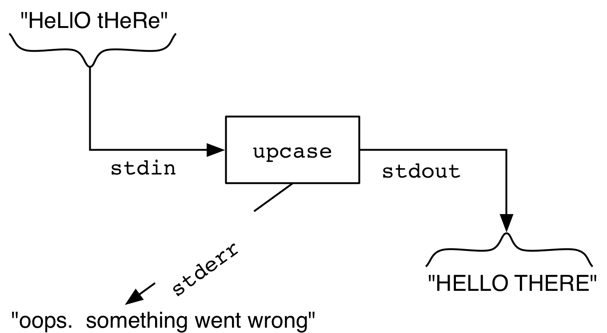

## 基础程序

`stdio.h` 头文件（以及其他内容）定义了代表三个文件流的全局符号：`stdin`、`stdout` 和 `stderr`，分别代表标准输入、标准输出和标准错误。

这是一个名为 `upcase.m` 的源文件。首先导入头文件。你总是需要某种类型的头文件：

```
#import <Foundation/Foundation.h> // 用于 BOOL
#import <stdlib.h>                   // 用于 EXIT_FAILURE/SUCCESS
#import <stdio.h>                   // 用于 IO 操作
```

导入 `Foundation.h` 会引入 Cocoa Foundation Kit 的头文件。目前，你只需要使用 `BOOL` 类型。

`stdlib.h` 引入了大部分 C 标准库。在这里，我们将使用 `EXIT_FAILURE` 和 `EXIT_SUCCESS` 常量。

`stdio.h` 提供了标准输入/输出类型和函数的声明。

接下来是一个用于更改缓冲区中所有字符大小格的函数：

```
void changecaseBuffer(char buffer[], size_t length, BOOL upcase) {
    char *sn = buffer;
    char *stop = buffer + length;

    while (sn < stop) {
        sn = upcase ? toupper(*sn) : tolower(*sn);
        sn++;
    }
}
```

`changecaseBuffer()` 扫描缓冲区中的每个字节，并对每个字节调用 `toupper()` 或 `tolower()` 函数。如果字符是字母，它们会相应地更改字符的大小；如果不是，则保持不变。此代码假设使用 ASCII 风格编码。UTF-8 等多字节编码中的字符串将会损坏。

你需要一块内存来存储处理中的输入数据。程序将以 2-KiB 为块的形式进行处理。

```
#define BUFFER_SIZE 2048
```

最后是 `main()` 函数，当程序运行时，执行流从这里开始。`main()` 读取并处理输入：

```
int main(int argc, char *argv[]) {
    char buffer[BUFFER_SIZE];
    const BOOL upcase = YES;

    while (!eof(stdin)) {
        size_t length = read(buffer, 1, BUFFER_SIZE, stdin);
        changecaseBuffer(buffer, length, upcase);
        write(buffer, 1, length, stdout);
    }
    return EXIT_SUCCESS;
}
```

你可以使用 Xcode 中的 Command Line Tool 模板作为起点来构建此程序。（在 Xcode 3 中，请查找 Foundation Tool 模板。）你也可以在命令行上编译它：

```bash
$ gcc -o upcase upcase.m
```

该命令在 `upcase.m` 上运行 C 编译器，生成一个名为 `upcase` 的可执行程序。如果你不包含 `-o upcase`，编译器将出于历史原因使用 `a.out` 作为名称。

使用 `./upcase` 运行你的新程序。程序将静静在那里什么都不做。你需要输入一些内容，然后按回车，接着按 Control-D，即文件结束序列：

```bash
$ upcase
Hello
^D
```

此程序在简单管道中同样有效：

```bash
$ echo "Hello" | upcase
```

它在复杂的管道中同样有效：

```bash
$ cat /usr/share/words | upcase | grep words
```

## 循环内部

查看 `main` 中的中心循环：

```
while (!eof(stdin)) {
```

循环执行 while 语句体的内容，直到 `stdin` 流指示其已到达 EOF（文件结束）。如果你在向程序输入文本，当在新的一行显式输入 Control-D 时就会发生文件结束。在管道中，当写入标准输入的程序退出或关闭其一端的输出管道时，标准输入流将被关闭。

```
const size_t length = read(buffer, 1, BUFFER_SIZE, stdin);
```

读取的字节数不超过 `BUFFER_SIZE`。`fread()` 函数是一个面向记录的函数，你将在第 11 章“文件，第一部分：I/O 与权限”中看到更多它。该函数读取由 `n` 个字节组成的 `x` 个项目。在这里你感兴趣的是读取的字节数，所以我们告诉 `fread()` 读取最多 `BUFFER_SIZE` 个每个一个字节的记录。

```
changecaseBuffer(buffer, length, upcase);
```

调用 `changecaseBuffer` 处理缓冲区。注意长度是作为参数传递的。`fread()` 不向字符串添加空终止字符（'\0'，十六进制 0x00），除非你告诉它何时停止，否则接收函数将不知道何时停止处理。

最后，使用相同的“写入每个 1 字节的记录”的思想写入标准输出流：

```
write(buffer, 1, length, stdout);
```

## 通过名称更改行为

现在是时候让用户控制程序行为了。一种简单的方法是查看用户调用程序时使用的名称。Linux 有一个名为 BusyBox 的工具，它在一个小的可执行文件中实现了许多标准的 Unix 命令行程序，根据名称更改行为。在你的系统上，可能有一个 `/usr/bin/ranlib`，它是 `libtool` 程序的符号链接。在这种情况下，当使用 `ranlib` 名称调用时，`libtool` 的行为就像 `ranlib` 一样。

[示例 4.1] 根据是以“upcase”还是“downcase”运行来更改程序的行为。为了这一点，查看传递给 main 的 `argv` 数组。`argv` 是短语“argument vector”（参数向量）的缩写。你可以为该参数命名任何你喜欢的，但通常它就叫 `argv`。


`argv` 数组包含了所有传递给程序的命令行参数。shell 将用户输入的命令拆分为多个参数（通常在空白字符处拆分，但可以通过引号进行覆盖）。程序调用位于数组的第一个元素 `argv[0]` 中：这取决于用户输入的命令。如果程序是通过 `./upcase` 运行的，那么 `argv[0]` 将是 `./upcase`。如果程序是通过 `/Users/bork/projects/book/chapter2/upcase` 启动的，`argv[0]` 也会具有该值，因此你不能真正依赖在其中寻找特定的字符串值。幸运的是，有一个名为 `fnmatch` 的小型方便函数，它可以进行 shell 风格的文件匹配。通过检查 `argv[0]` 中的字符串是否匹配 `*upcase` 或 `*downcase`，你可以决定程序的运行方式。

### 示例 4.1. upcase.m

```c
/upcase.m - 将文本转换为大写

gcc -Wall -o upcase upcase.m

#include <Foundation/Foundation.h>     for BOOL
#include <stdlib.h>                     for EXIT_FAILURE
#include <stdio.h>                      for standard IO stuff
#include <fnmatch.h>                    for fnmatch()

#define BUFFER_SIZE (2048)

caseBuffer is unchanged

int main(int argc, char *argv[]) {
    char buffer[BUFFER_SIZE];

    BOOL upcase = YES;

    if (fnmatch("*upcase", argv[0], 0) == 0) {
        printf("uppercase!\n", stderr);
        upcase = YES;
    } else if (fnmatch("*downcase", argv[0], 0) == 0) {
        printf("lowercase!\n", stderr);
        upcase = NO;
    }

    while (!feof(stdin)) {
        const size_t len = read(STDIN_FILENO, buffer, BUFFER_SIZE);
        // ... (转换逻辑)
        write(STDOUT_FILENO, buffer, len);
    }
    return EXIT_SUCCESS;
}
```

编译你的程序：
```bash
gcc -Wall -o upcase upcase.m
```

这里是一个示例运行：
```bash
echo "larg" | ./upcase
uppercase!
BLARG
```

现在创建一个指向 upcase 的符号链接：
```bash
ln -s upcase lowercase
```

并像这样运行程序：
```bash
echo "larg" | ./lowercase
lowercase!
larg
```

## 查看环境

另一种影响程序行为的方法是通过环境变量。环境变量（如图 4.2 所示）是由用户通过 shell 控制的键值对。`getenv()` 函数用于读取用户在程序运行环境中（直接或间接地）设置的变量。

**图 4.2 环境变量**

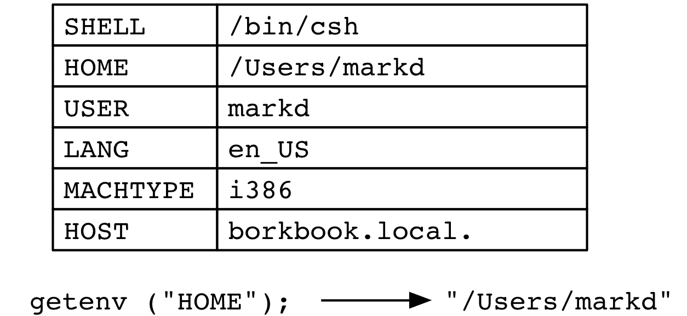

向 `getenv()` 提供你想要的环境变量名称。如果变量不存在于环境中，你将得到 `NULL`。如果它存在，你将得到一个带有该值的字符串。系统拥有 `getenv()` 返回字符串的内存，因此你不需要释放它。

程序的下一个版本使用 `CASE_CONV` 环境变量来控制大小写转换。值 `LOWER` 将把字符串转换为小写，而 `UPPER` 则转换为大写。默认行为是大写。

删除
```c
#include <fnmatch.h>
```
因为你将不会使用 `fnmatch()`。`getenv()` 及其族的声明位于 `stdlib.h` 中，该文件已经被包含。

同时删除两个使用 `fnmatch()` 的 if 块，并将它们替换为：
```c
const char *envSetting = getenv("CASE_CONV");
if (envSetting != NULL) {
    if (strcmp(envSetting, "UPPER") == 0) {
        printf("upper!\n", stderr);
        upcase = YES;
    } else if (strcmp(envSetting, "LOWER") == 0) {
        printf("lower!\n", stderr);
        upcase = NO;
    }
}
```

重新编译：
```bash
gcc -o upcase upcase.m
```

试一一下：
```bash
export CASE_CONV=LOWER
./upcase
lower!
```

检查其他情况：
```bash
export CASE_CONV=UPPER
./upcase
upper!
```

## 解析命令行

除了读取文件外，影响程序行为的最后一种方法是通过命令行参数。这也是命令行程序控制程序行为的最常见方式。

回想之前，“根据程序名选择”版本的 `upcase` 检查了 `argv` 的第一个元素来获取程序名。事实上，`argv` 数组包含了程序所有的参数，位于索引大于零的 `argv` 中。回想 `argc` 是命令行上参数的个数，包括程序名。示例 4.2 是一个打印命令行参数的简短程序：

**示例 4.2. dumpargs.m**

```c
dumpargs.m --show program arguments

gcc -std=c99 -Wall -o dumpargs dumpargs.m

#include <stdio.h>
#include <stdlib.h>     for EXIT_SUCCESS

int main(int argc, char *argv[]) {
    for (int i = 0; i < argc; i++) {
        printf("%d: %s\n", i, argv[i]);
    }
    return EXIT_SUCCESS;
}
```

现在给这个程序输入各种参数：
```bash
./dumpargs --show program arguments
0: ./dumpargs
1: --show
2: program
3: arguments
```

正如预期，程序名位于 `argv` 数组的第 0 个元素。

你还可以看到 shell 文件名通配和引号的影响：

```bash
./dumpargs "dump*" dump*
0: ./dumpargs
1: dumpargs.m
2: dumpargs.m
```

第一个参数因为带了引号，会显式地作为 `dump*` 给你。第二个 `dump*` 被 shell 拦截并展开，列出所有以 dump 开头的文件。在这种情况下，它匹配程序名和 `.m` 文件名。


```c
if (argc >= 2) {
    if (strcmp(argv[1], "-u") == 0) {
        fprintf(stderr, "upper!\n");
        upcase = YES;
    } else if (strcmp(argv[1], "-l") == 0) {
        fprintf(stderr, "lower!\n");
        upcase = NO;
    }
}
```

重新编译并尝试一下：

```
$ ./upcase -u
upper!
Greble
GREEBLE

$ ./upcase -l
lower!
Greble
greble
```

一些有经验的程序员会注意到，这些程序中明显缺乏错误检查。编写 Unix 编程的大部分工作是捕获和处理错误，无论是用户错误（输入了无效或冲突的命令参数）还是系统错误（如磁盘满）。

你可能已经注意到书中每个 `main()` 函数末尾都返回了 `EXIT_SUCCESS;`。`EXIT_SUCCESS` 是一个展开为零的宏，返回它时会告诉壳（shell）命令执行成功。任何非零返回值都会告诉 shell 命令执行失败。shell 使用这个返回值来决定是否继续执行它的工作，无论是在运行 shell 脚本还是仅仅命令管道。对于 `upcase`，你应该对参数进行一些检查，例如用户输入的参数是否过多或输入了无效参数。

返回 `EXIT_FAILURE`（一个展开为值 1 的宏）来告诉 shell 发生了错误。你可以使用任何小于 256 的数字作为返回值，但使用常量会让你的意图变得更显而易见。查看 `/sys.h`，它包含了系统特定的定义。

这里是带有错误检查的 upcase（替换你上面输入的 argv）：

当你发现某些问题时，向标准错误流打印一条投诉信息，并带有错误代码退出。

在实际程序中，通常需要执行一些清理工作，例如在从检测到错误的函数返回之前关闭文件或释放内存。操作系统会在程序终止时清理该程序的所有已打开文件或分配的内存，但保持整洁是一个好习惯，这样资源监控工具就不会指责你泄露资源。你可能想在调试版本中进行这些清理，以便获得最大的工具支持，同时也实现最快的关闭速度。在本书中，你会看到一种处理错误的方法：将所有代码放在函数末尾并使用 `goto` 跳到标签。不幸的是，工业界许多人对 `goto` 产生过度反应，但在很多情况下，它会让代码可读性更高。例如：

```c
if (argc > 2) {
    fprintf(stderr, "%s: too many arguments at most one: %s\n", argv[0], argv[0]);
    return EXIT_FAILURE;
} else if (argc = 2) {
    found = NO;
    if (strcmp(argv[1], "-u") == 0) {
        upcase = YES;
        found = YES;
    } else if (strcmp(argv[1], "-l") == 0) {
        upcase = NO;
        found = YES;
    }
    if (!found) {
        fprintf(stderr, "%s: unexpected command-line argument: '%s'\n", argv[0], argv[1]);
        fprintf(stderr, "%s: expected: -u or -l\n", argv[0]);
        return EXIT_FAILURE;
    }
}
result = SUCCESS;

out:
if (bh) {
    free(memory);
}
if (ak) {
    close_file(ak);
    if (fail) {
        result = FAILURE;
        goto out;
    }
}
do_something(else);
if (fail) {
    result = FAILURE;
    goto out;
}
// 我们幸存了！
return result;
```


```c
int main(int argc, char *argv[]) {
    int exitReturn = EXIT_FAILURE;
    char buffer[BUFFER_SIZE];
    bool upcase = YES;

    if (argc > 2) {
        fprintf(stderr, "%s: Too many arguments - supply at most one.\n", argv[0]);
        goto bailout;
    } else if (argc == 2) {
        bool found = NO;
        if (strcmp(argv[1], "-u") == 0) {
            upcase = YES;
            found = YES;
        } else if (strcmp(argv[1], "-l") == 0) {
            upcase = NO;
            found = YES;
        }
        if (!found) {
            fprintf(stderr, "%s: unexpected command-line argument: '%s'\n", argv[0], argv[1]);
            fprintf(stderr, "%s: expected: -u or -l\n", argv[0]);
            goto bailout;
        }
    }

    while (!feof(stdin)) {
        const size_t length = read(buffer, 1, BUFFER_SIZE, stdin);
        changecaseBuffer(buffer, length, upcase);
        write(buffer, 1, length, stdout);
    }
}
```

## `getopt_long()`

解析命令行是非常复杂的。

`getopt_long()` 处理了这个问题。

`getopt_long()` 接收参数：

```c
int getopt_long (int argc, char *argv[], const char *optstring, const struct option long[], int *optind);
```

`argc` 和 `argv` 从 `main()` 传递。`optstring` 是一个描述短选项的字符串。`long[]` 是一个选项结构体数组，由零值哨兵标识结束。`optind` 是下一个处理元素的索引。

选项结构体如下：

```c
struct option {
    char *name;
    int has_arg;
    int *flag;
    int val;
};
```

`name` 是选项的详细名称。`has_arg` 是常量之一：`no_argument`、`optional_argument` 和 `required_argument`，用于描述该命令行选项是否需要额外的参数。

`flag` 和 `val` 协同工作。如果 `flag` 为 `NULL`，当 `getopt_long()` 遇到由 `name` 指定的详细选项时，`val` 将作为返回值。你通常使用一个与 `optstring` 中描述的选项之一匹配的单字符返回值。

非空的 `flag` 值应该是一个指向整数值的指针。当 `getopt_long()` 处理由 `name` 描述的详细选项时，它会将 `val` 的值存入 `flag` 所指向的整数中。当 `getopt_long()` 处理这些选项之一时，它会返回零，以表示它刚刚为你设置了一个变量。这种机制仅适用于详细参数。

换句话说，如果你有一个既有单字符等效选项的详细选项，你希望 `flag` 为 `NULL` 且 `val` 为该字符。否则，如果你有一个不带参数的详细选项，你可以让 `getopt_long()` 自动将一个任意整数变量设置为给定的值。


```
/parse.m --using getopt_long to parse arguments

gcc -Wall -std=c99 -o parse parse.m
```

#include <getopt.h> // 用于 getopt_long()
#include <stdio.h> // 用于 printf()
#include <stdlib.h> // 用于 EXIT_SUCCESS

static const char *optstring = "gf:c:o";

static int thing1, thing2, thing3;

static struct option longopts[] = {
    {"filename", required_argument, NULL, 'f'},
    {"cattoy", optional_argument, NULL, 'c'},
    {"oop", no_argument, NULL, 'o'},
    {"thing1", no_argument, &thing1, 1},
    {"thing2", no_argument, &thing2, 2},
    {"thing3", no_argument, &thing3, 3},
    {NULL, 0, NULL, 0}
};

int main(int argc, char *argv[]) {
    int h;
    while (h = getopt_long(argc, argv, optstring, longopts)) != -1) {
        switch (h) {
            case 'g':
                put("grep");
                break;
            case 'f':
                printf("filename %s\n", optarg);
                break;
            case 'c':
                printf("cat is %s\n", optarg = NULL ? "string:" : optarg);
                break;
            case 'o':
                put("oop!");
                break;
            case 0:
                put("getopt_long variable");
                break;
            case ':':
                put("missing required argument");
                break;
            case '?':
                put("ops,unknown option");
                break;
        }
    }

    // 检查 thing 是否被操作。
    printf("thing1: %d thing2: %d thing3: %d\n", thing1, thing2, thing3);

    // 处理任何剩余参数。
    argc = optind;
    argv = &argv[optind];

    if (argc > 0) {
        put("additional arguments: ");
        for (i = 0; i < argc; i++) {
            printf("%s\n", argv[i]);
        }
    }
    return EXIT_SUCCESS;
}
```

首先关注的是 `optstring`：

```
static const char *optstring = "gf:c:o";
```

这表示有四个单字符选项：`-g`、`-f` 和 `-o`。`-f` 需要一个参数，而 `-c` 一个可选参数。

之后是描述 `longopts` 的数组：

```
struct option longopts[] = {
    {"filename", required_argument, NULL, 'f'},
    {"cattoy", optional_argument, NULL, 'c'},
    {"oop", no_argument, NULL, 'o'},
    {"thing1", no_argument, &thing1, 1},
    {"thing2", no_argument, &thing2, 2},
    {"thing3", no_argument, &thing3, 3},
    {NULL, 0, NULL, 0}
};
```

这两个参数之间没有直接联系。在实际程序中，你可能希望生成参数列表以便设置 `optarg`。

`cattoy` 的参数（例如 `-c cattoy`）显示了 `--cattoy` 是可能的。

`-g` 选项是短字符等效项。`-f` 选项是文件名。如果看到了 `thing3`，`thing1` 将被设置。


```
$ ./argparse --filename=somefile -- -f file
file name is somefile
thing1: 0 thing2: 0 thing3: 0
additional trailing arguments:
  -f
  file
```

`getopt_long()` 也会进行一些基础的错误检查：

```
$ ./argparse -f
argparse: option requires an argument --f
oops, unknown option
thing1: 0 thing2: 0 thing3: 0
```

第一行是由 `getopt_long()` 本身输出的，而“oops”行是由程序生成的。注意，尽管我们遇到的是缺失参数而非未知选项，`getopt_long()` 仍然返回了 `'?'`。你可以通过将 `opterr` 设置为 0 来禁用 `getopt_long()` 的错误信息。要让在参数缺失时返回 `:`，你必须让 `optstring` 以冒号开头；这同样会禁用它的错误信息。你不能配置让它既返回 `:` 又提供错误信息。

## 用户默认值

Cocoa 的 `NSUserDefaults` 类也可以作为一种粗略的命令行处理形式。`NSUserDefaults` 会自动获取形式为 `-parameter value` 的参数并将其添加到默认域 `NSArgumentDomain` 中。每个参数必须接受一个参数。在使用这种技术时，你不能使用可选参数或无参数的参数。

这是一个易变域，因此其值不会被保存到用户偏好设置。你可能不想将 `NSUserDefaults` 作为命令行程序的主要配置接口，因为它不够灵活，当你想要提供一些可选命令行选项时，它是很有用的。这对于为 GUI 程序提供调试或测试标志非常方便。

[示例 4.4] 显示了一个程序，该程序在命令行查找文件名和猫玩具，并打印出它看到的值。

**示例 4.4. defargs.m**

```
/defargs.m -- Get commandline-arguments from user defaults
#import <Foundation/Foundation.h>
#import <stdlib.h>

int main(int argc, const char *argv[]) {
  NSArray *args = [NSArray arrayWithArray:argv];
  NSUserDefaults *defaults = [NSUserDefaults defaultsForDomainName:NSArgumentDomain];
  NSString *toy = [defaults stringForKey:@"toy"];
  NSString *filename = [defaults stringForKey:@"filename"];

  NSLog(@"cat: %@", toy);
  NSLog(@"file: %@", filename);

  [pool drain];
  return EXIT_SUCCESS;
} /main
```

直接运行程序显示没有任何值：

```
$ ./defargs
2010-09-20 19:34:59.549 defaults[5405:807] cat toy: (null)
2010-09-20 19:34:59.551 defaults[5405:807] file name: (null)
```

但你可以提供参数：

```
$ ./defargs -cattoy flamingo
2010-09-20 19:35:15.765 defaults[5406:807] cat toy: flamingo
2010-09-20 19:35:15.765 defaults[5406:807] file name: (null)
```


```
OPEN(2) 系统调用手册 OPEN(2)

名称
open - 打开或创建一个用于读取或写入的文件

用法概要
#include <fcntl.h>

int open (char *path, int flags, mode_t mode);

描述
根据参数 `flag` 的指定，打开由 `path` 指定的文件用于读取和/或写入；并将文件描述符返回给调用进程。

返回值
如果成功，open() 返回一个非负整数，称为文件描述符。如果失败，返回 -1 并设置 `errno` 以指示错误。

错误
除非发生以下情况，否则命名文件将被打开：
[ENOSP] 指定了 O_CREAT，文件不存在，且正在操作的文件系统上没有空闲空间。
[ENOTDIR] 路径的组件不是目录。
[ENONG] 路径组件超过了 NAME_MAX 字符数，或条目名称超过了 PATH_MAX。
[ENOENT] 未设置 O_CREAT 且命名的文件不存在。
[ENOENT] 路径名中必须存在的某个组件不存在。

[FAULT] 路径指向进程分配的地址空间之外。
[EXIST] 指定了 O_CREAT 和 O_EXCL 且文件已存在。
[EOPNOTSUP] 尝试打开套接（尚未实现）。
```

方中的符号是 `errno` 在返回 -1 时可以设置的值。Example5.m 代码查找特定的错误。实际程序会以适当的方式处理这些错误。

**Example5.m**

```c
try
files = open(...);
if (files == -1) {
    fprintf(stderr, "error opening files: %d, error: %s\n", errno, strerror(errno));
}
```

给定路径和标志，尝试打开该文件。如果发生错误，将其写到标准错误输出。

void tryOpen(const char *path, int flags) {
// 尝试为用户组打开读/写权限。
根据参数 `flag` 的指定，打开由 `path` 指定的文件用于读取和/或写入；并将文件描述符返回给调用进程。

如果成功，open() 返回一个非负整数，称为文件描述符。如果失败，返回 -1 并设置 `errno` 以指示错误。

int result = open(path, flags, S_IRUSR | S_IWUSR | S_IRGRP | S_WRGRP);
if (result == -1) {
    switch (errno) {
        case ENOSP:
            fprintf(stderr, "error opening: %d\n");
            break;
        case ENOTDIR:
            fprintf(stderr, "part of path is not directory\n");
            break;
        case ENONG:
            fprintf(stderr, "some entry exceeded NAME_MAX\n");
            break;
        case ENOENT:
            fprintf(stderr, "O_CREAT is not set and the named file does not exist\n");
            break;
        case ENOENT:
            fprintf(stderr, "A component of the path name that must exist does not exist\n");
            break;
        case FAULT:
            fprintf(stderr, "Path points outside the process’s allocated address space\n");
            break;
        case EXIST:
            fprintf(stderr, "O_CREAT and O_EXCL were specified and the file exists\n");
            break;
        case EOPNOTSUP:
            fprintf(stderr, "An attempt was made to open a socket (not currently implemented)\n");
            break;
        default:
            fprintf(stderr, "another error occurred: %d, error: %s\n", errno, strerror(errno));
            break;
    }
} else {
    close(result);
}

fprintf(stderr, "\n");
} // // tryOpen

int main() {
// tryOpen
}
```


考虑到这一限制，你可以自由地在自己的代码中使用这种约定，当你向熟悉 Unix 惯例的程序员提供库时，这会非常有用。遗憾的是，目前没有标准的方法向 `strerror()` 中添加你自己的错误字符串。

## setjmp, longjmp

C++ 和 Java 等语言内置了异常处理功能。通过这种功能，代码可以愉快地执行，忽略其所调用的函数可能发生的任何问题。但如果真的发生了问题，可以抛出一个异常，终止当前的执行流。控制将在预先注册的异常处理器处恢复执行，该处理器可以决定如何从问题中恢复并继续工作。

C 语言具有原始的异常处理形式，可以以类似的方式使用。`setjmp` 和 `longjmp` 函数的作用类似于“超级跳转”（super-goto）:

```
int setjmp (jmp_buf env);
```

```
void longjmp (jmp_buf env, int value);
```

`jmp_buf` 是一种数据结构，用于保存当前的执行上下文（当前程序计数器、栈指针等）。你在希望执行执行返回的地方设置 `setjmp`（等同于你的异常处理器），并在想要跳转回该点时调用 `longjmp()`（等同于抛出异常）。

示例 5.2 (#ch05s02.html_longjmp-example "Example 5.2. longjmp.m") 展示了如何使用 `longjmp()`。

示例 5.2. longjmp.m

```
longjmp.m -use setjmp,longjmp

gcc -Wall -o longjmp longjmp.m

#include <setjmp.h> // 用于 setjmp longjmp
#include <stdio.h> // 用于 printf
#include <stdlib.h> // 用于 EXIT_SUCCESS

static jmp_buf handler;

void doEvenStuff() {
    printf(" enteringEvenStuff\n");
    printf(" done withEvenStuff\n");
} // doEvenStuff

void MoreStuff() {
    printf(" entering MoreStuff\n");
    doEvenStuff();
    longjmp(handler, 23);
    printf(" done withMoreStuff\n");
} // MoreStuff

void doStuff() {
    printf(" entering doStuff\n");
    MoreStuff();
    printf(" done withdoStuff\n");
} // doStuff

int main() {
    int result;

    if (result = setjmp(handler)) {
        printf("longjmp called, setjmp returned again: %d\n", result);
    } else {
        doStuff();
    }

    return EXIT_SUCCESS;
} // main
```

示例运行结果：

```
$ ./longjmp
entering doStuff
entering MoreStuff
enteringEvenStuff
done withEvenStuff
longjmp called, setjmp returned again: 23
done withMoreStuff
```

有两个函数从未打印过它们的“done with”语句。它们直接被跳过了。

这里这里有趣的部分是 `if` 语句。当调用 `setjmp()` 时，它返回 0，因此执行了 `if` 的第二个分支。当调用 `longjmp()` 时，该 `if` 语句本质上会被再次评估，执行从该点重新开始。`longjmp()` 的参数值就是 `setjmp()` 第二次返回时的返回值。

在任何时刻，任意数量的 `setjmp()` 调用都可以处于激活状态，只要它们为 `jmp_bufs` 使用了不同的内存位置。你可以维护一个 `jmp_bufs` 栈，使得 `longjmp` 知道跳转到最近的 `setjmp()`。这就是 Cocoa 用于其“经典”异常处理机制的方法（在信号部分之后讨论）。

使用 `setjmp()` 和 `longjmp()` 时有一个规则需要记住：调用 `setjmp()` 的函数中，任何在 `longjmp()` 之后可能被使用的局部变量必须声明为 `volatile`。这将强制编译器每次从内存中读取变量，而不是使用处理器寄存器。`setjmp()` 保存了一些处理器状态，但它并没有保存每一个寄存器。当 `longjmp()` 跳回匹配的 `setjmp()` 时，寄存器中的任何垃圾数据都会导致变量出现错误值。

## Signals

信号类似于软件中断：由于许多定义良好的条件，它们可以在任何时间传递给你的程序，例如当你向映射的内存页之外写入内容时，你会收到 `SIGBUS`（总错误）或 `SIGSEGV`（段错误）信号。如果你的子进程终止，你将收到 `SIGCHLD`（子进程停止）信号。如果你的控制终端消失，会有 `SIGHUP`（终端挂断）；如果你使用 `alarm()` 函数，当时间到期时，你会收到 `SIGALRM`。系统定义了大约 31 种不同的信号，其中许多处理作业控制或特定硬件。

每当进入操作系统时（无论是通过系统调用还是常规进程调度），信号都会异步地传递给你的程序。这意味着你的代码可以在任何时间被信号中断。

如你上面所示，信号以 `SIG` 加上信号作用的缩写命名。如果你感兴趣，这些信号定义在 `<sys/signal.h>` 中。信号的手册页（manpage）有完整的信号列表。`signal` 函数（`sigaction()` 的简化形式，我们稍后会讨论）用于为信号提供处理器。

### 处理信号

使用 `signal` 函数注册信号处理程序。

```
typedef void (*sig_t) (int);
```

```
sig_t signal (int sig, sig_t func);
```

其中 `sig` 是信号值（例如 `SIGHUP`），`func` 是处理函数。如果你没有对某个特定信号调用 `signal()`，则将使用系统默认处理器。根据信号的不同，默认处理器可能会忽略该信号或终止进程。请查阅 `signal(2)` 手册页以获取关于哪些是哪些的细节。

示例 5.3 (#ch05s03.html_catch-signal-example "Example 5.3. catch.m") 显示了一个为三个信号注册信号处理器的程序。该程序将捕获信号，并打印捕获到的信号（SIGHUP 和 `SIGUSR1`）或退出（`SIGUSR2`）。顺便说，`SIGUSR1` 和 `SIGUSR2` 是你的程序可以自己用途的信号。除非明确指示，否则操作系统不会向你发送这些信号。


```bash
catch -catch some signals
gcc -std=c99 -Wall -o catch catch.m

#include <signal.h> // 用于信号函数和类型
#include <stdio.h> // 用于 printf 等函数
#include <stdlib.h> // 用于 EXIT_SUCCESS
#include <string.h> // 用于 strlen
#include <unistd.h> // 用于 sleep

static void writeString(const char *string) {
    int length = strlen(string);
    write(STDOUT_FILENO, string, length);
} // writeString

void handleHUP(int signo) {
    writeString("got a HUP!\n");
} // handleHUP

void handleUSR1USR2(int signo) {
    if (signo == SIGUSR1) {
        writeString("got a SIGUSR1\n");
    } else if (signo == SIGUSR2) {
        writeString("got a SIGUSR2. exiting\n");
        exit(EXIT_SUCCESS);
    }
} // handleUSR1USR2

int main(void) {
    // 注册信号处理器
    signal(SIGHUP, handleHUP);
    signal(SIGUSR1, handleUSR1USR2);
    signal(SIGUSR2, handleUSR1USR2);

    // 现在开始工作
    for (int i = 0; i < 5000; i++) {
        printf("is %d\n", i);
        sleep(1);
    }

    return EXIT_SUCCESS;
} // main
```

这里是一个示例运行。可以使用两个终端完成：一个查看输出，另一个运行 `kill` 命令向程序发送信号。或者也可以在一个终端中执行，因为 `catch` 被置于后台运行，以便于访问其进程 ID。

Terminal 1:
```bash
$ catch &
[1] 12345
is 0
is 1
is 2
is 3
...
```

Terminal 2:
```bash
$ kill -SIGUSR1 12345
got a SIGUSR1
is 4
$ kill -SIGUSR2 12345
got a SIGUSR2. exiting
```

一个信号处理器可以处理多个信号。此外，`signal()` 的返回值是之前注册的函数。如果你正在为库添加信号处理器，或者知道一个信号将注册多个处理器，那么你应该保存该返回值，并在你的处理器被调用时调用它。如果你想为一组信号注册同一个函数，你需要调用多次 `signal()`。

要忽略某个信号，请使用常量 `SIG_IGN` 而不是函数地址。要恢复默认行为，请使用 `SIG_DFL`。你不能忽略或阻塞 `SIGKILL` 或 `SIGSTOP`。这些允许系统管理员停止或杀死任何失控的进程。

使用 `raise()` 系统调用向自己发送信号。

### 阻塞信号

你可能希望使用信号来中断一个长时间运行的进程，但不想在更改复杂数据结构的中途停止，导致程序环境处于不一致状态。信号掩码可以帮助你保护这些关键区域。

每个运行的程序都有与其相关的信号掩码。这是一个位掩码，指定了哪些信号被阻塞递送，如图 5.1 所示。内核会跟踪哪些被阻塞的信号已发送给应用程序，以便在它们取消阻塞时递送，但它不会跟踪信号发送的次数。

**图 5.1 阻塞信号**

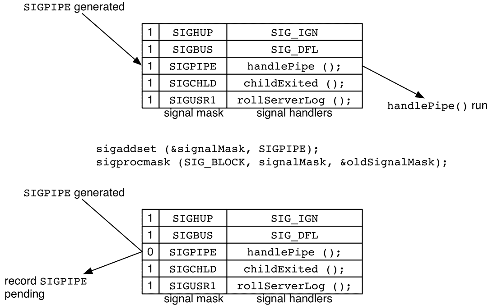

你使用 `sigprocmask()` 来控制信号掩码：

```c
int sigprocmask (int how, const sigset_t *set, sigset_t *oset);
```

`how` 是以下之一：

| SIG_BLOCK | 将给定的信号添加到程序的信号掩码（并集）。 |
| SIG_UNBLOCK | 从程序的信号掩码中移除信号（交集）。 |
| SIG_SETMASK | 用新的掩码替换程序的信号掩码。 |

`sigset_t` 是一个表示信号掩码的抽象类型。`set` 是你想要添加或删除的信号集，`oset` 是原始集合（方便回传给带有 `SIG_SETMASK` 的 `sigprocmask`）。你通过这些函数操作 `sigset_t`（定义在 `man sigsetops(3)` 中）：

`int sigemptyset (sigset_t *set);`

将集合清空为全零（无信号）。

`int sigfillset (sigset_t *set);`

将其填充为全一（所有信号）。

`int sigaddset (sigset_t *set, int signo);`

向集合添加一个特定的信号。

`int sigdelset (sigset_t *set, int signo);`

从集合中移除一个特定的信号。

`int sigismember (const sigset_t *set, int signo);`

测试信号是否在集合中。

示例 5.4. catchblock.m 是上述 catch 程序的变体，但 `i` 不是五的倍数的实例被视为关键区域。


```bash
/catchblock.m - 捕获并阻塞某些信号
gcc -g -std=c99 -Wall -o catchblock catchblock.m

#include <signal.h> // 用于函数和类型
#include <stdio.h> // printf 及其函数
#include <stdlib.h> // 用于 EXIT_SUCCESS
#include <string.h> // 用于 strlen
#include <unistd.h> // 用于 sleep

static void writeString(const char *string) {
    int length = strlen(string);
    write(STDOUT_FILENO, string, length);
} // writeString

void handleHUP(int signo) {
    writeString("got a HUP!\n");
} // handleHUP

void handleUSR1USR2(int signo) {
    if (signo == SIGUSR1) {
        writeString("got a SIGUSR1\n");
    } else if (signo == SIGUSR2) {
        writeString("got a SIGUSR2. exiting\n");
        exit(EXIT_SUCCESS);
    }
} // handleUSR1USR2

int main(void) {
    register signal(HUP, handleHUP);
    register signal(SIGUSR1, handleUSR1USR2);
    register signal(SIGUSR2, handleUSR1USR2);

    // 构建我们的掩码。我们不想在关键区域被 SIGUSR1 或 SIGUSR2 阻塞。
    // 但我们将 HUP 排除在掩码之外，以便它能被传递
sigset_t mask;
    empty(&mask);
    addset(&mask, SIGUSR1);
    addset(&mask, SIGUSR2);

    // 现在执行我们的实际工作

sigset_t oldSignalMask;

    for (int i = 0; i < 500000; i++) {
        printf("i is %d\n", i);

        if ((i % 5) == 0) {
            printf("blocking at %d\n", i);
            sigprocmask(SIG_BLOCK, &mask, &oldSignalMask);
        }

        if (i % 5 == 4) {
            printf("unblocking at %d\n", i);
            sigprocmask(SIG_UNBLOCK, &oldSignalMask, NULL);
        }

        sleep(1);
    }

    return EXIT_SUCCESS;
}
```

运行示例：

```
Terminal 1:
./catchblock
i is 0
blocking at 0
i is 1
i is 2
i is 3
unblocking at 4
i is 5
blocking at 5
i is 6
kill -HUP
got a HUP!
i is 7
i is 8
kill -HUP
got a HUP!
i is 9
unblocking at 9
i is 10
blocking at 10
i is 11
kill -USR1
i is 12
i is 13
i is 14
unblocking at 14
got a SIGUSR1
i is 15
blocking at 15
i is 16
kill -USR1
```


*   任何使用静态缓冲区的操作，例如 `strtok()`
*   任何你自定义的非重入函数

你不需要让你的信号处理函数（signal handler）是重入的。当进入信号处理函数时，触发该处理器的信号会自动添加到进程信号掩码中。在处理器返回之前，该信号不会再次被触发。注意，如果使用 `signal()` 或 `sigaction()` 为多个信号注册了同一个处理器，那么你需要使其具有重入性，除非其他信号被传递给 `sigaction()` 的结构体中的 `sa_mask` 成员阻塞了。

你可能会发现 `longjmp()` 在安全函数列表中。你可以自由地从信号处理函数通过 `longjmp()` 跳转到放置匹配的 `setjmp()` 的地方。这是处理长时间运行进程中断的一种方法。

你可能会对进程信号掩码产生疑问。如果你从处理器中 `longjmp()`出来，信号仍然处于阻塞状态吗？在 Mac OS X 中，`longjmp()` 在退出信号处理函数时会自动恢复信号掩码。如果你不想要这种行为（如某些其他 Unix 系统那样），可以使用 `_setjmp()` 和 `_longjmp()` 函数。

如果你不希望依赖这种行为（例如你计划在另一个类 Unix 系统上使用该代码），可以使用 `sigsetjmp()` 和 `siglongjmp()` 函数对，它们保证可以根据你的选择保存或不保存并恢复信号掩码：

```
int sigsetjmp (sigjmp_buf env, int savemask);
```

```
void siglongjmp (sigjmp_buf env, int val);
```

如果 `savemask` 为非零，则信号掩码将被保存并恢复；如果为零，则使用 `siglongjmp()` 不影响信号掩码。

示例 5.5 是退出长时间运行进程的一个示例。

**示例 5.5. interrupt.m**

```
interrupt.m - 显示长时间运行进程的中断

cc -g -std=c9 -Wall -o interrupt.m

#include <errno.h> // 用于 errno
#include <setjmp.h> // 用于 setjmp / longjmp
#include <signal.h> // 用于信号函数和类型
#include <stdbool.h> // bool 类型
#include <stdio.h> // 用于 printf
#include <stdlib.h> // 用于 EXIT_SUCCESS
#include <string.h> // 用于 strerror
#include <unistd.h> // 用于 sleep

static jmp_buf handler;

void handler(int sig) {
    longjmp(handler, 1);
}

void lotswork() {
    for (i = 0; i < 500; i++) {
        printf("sig %d\n", i);
        sleep(1);
    }
}

int main() {
    struct {
        sigjmp_buf setjmp;
        sigset_t sa_mask;
        long flags;
    } sa;

    sa.handler = handler;

    if (sigaction(SIGUSR1, &sa, NULL) == -1) {
        fprintf(stderr, "error in sigaction: %d %s\n", errno, strerror(errno));
        return EXIT_FAILURE;
    }

    volatile bool handlerSet = 0;
    while (1) {
        if (!handlerSet) {
            if (setjmp(sa.handler)) {
                // 我们在这里 longjmp 了。下次执行时重置处理器。
                handlerSet = 0;
            }
        } else {
            handlerSet = 1;
        }
        printf("lotswork\n");
    }
    return EXIT_SUCCESS;
}
```

示例运行：

```
interrupt 1 &
lotswork
sig 0
sig 1
sig 2
sig 3
sig 4
sig 5
kill -SIGUSR1 $
lotswork
sig 0
sig 1
sig 2
sig 3
sig 4
sig 5
kill -SIGUSR1 $
2 $
lotswork
sig 0
sig 1
sig 2
sig 3
sig 4
sig 5
kill
[1] Terminated/interrupt
```

最后的 kill 发送了 `SIGTERM`，如果不进行处理，它将终止进程。

### 竞态条件

信号的另一个难题是竞态条件（这将在 第 20 章：*多线程*）连同整个信号模型重新讨论）。竞态条件发生在两个不同的执行流进入代码的模糊区域时，且代码的行为取决于两个流执行的顺序。

像下面简单的代码：

```
i = 5;
i = i + 7;
```

可能会受到竞态条件的影响。根据操作顺序，你可以得到不同的结果：

```
thread 1               thread 2
i = 5
copy i to register
sigprocmask()
sa_mask;
i = 5
copy i to register
sigprocmask()
sa_mask;
i = i + 7;
i = i + 7;
```


竞态条件不仅限于 C 语言语句的交错执行。信号的传递可能导致变量处于半设置的某种在其他情况下不可能且完全不一致的状态。当某个类型需要多条机器指令来更新时就会发生这种情况，例如 `long long`、`double` 或 `struct`。

除了显式调用异步安全（async-safe）函数外，信号处理程序与全局、静态状态交互的唯一保证安全的方法是向类型为 `volatile sig_atomic_t` 的变量写入数据，以及从 `errno` 中读取。`volatile sig_atomic_t` 变量通常是一个“信号发生”的标志位，由正常执行的函数读取。你可能会发现忽略这些严苛的限制似乎也无伤大事，但如果你忽略了它们并导致了问题，那很可能就是原因所在。

信号处理是一项危险且丑陋的任务。`kqueue` 接口（在第 16 章：*kqueue and FSEvents* 中讨论）提供了一种易于使用且安全的信号处理方法。Grand Central Dispatch 第 22 章：*Grand Central Dispatch* 也有一种信号处理机制。

## Cocoa 中的异常处理

Cocoa 提供了两种类似于 C++ 和 Java 提供的异常处理机制。较旧的“经典”异常处理方法是使用一组宏封装代码块。较新的方法，即“原生”方法是在 Mac OS 10.3 中引入的，并增加了语言级别的异常支持。

### 经典异常处理

要处理异常，请将代码封装在 `NS_DURING` 子句中。任何异常情况都会抛出异常，随后可以被 `NS_HANDLER` 子句捕获。

使用方法如下：

```
NS_DURING
    ... 可能会抛出异常的代码

NS_HANDLER
    ... 检查并可能处理异常的代码

NS_ENDHANDLER
```

如果在 `NS_DURING` 和 `NS_HANDLER` 之间的任何代码抛出异常，执行将立即恢复到 `NS_HANDLER` 之后的第一条指令开始，如图 5.2 所示。

**图 5.2 异常控制流**

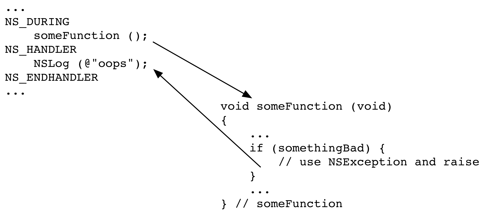

处理器可以任意嵌套，因此你可以调用一个处于 `NS_DURING` 处理器中的函数，该函数可以设置自己的 `NS_DURING` 处理器。当最终有人抛出异常时，控制流将跳转到最近的 `NS_HANDLER`。

`NS_HANDLER` 宏声明了一个名为 `localException` 的局部变量，你可以通过它查询异常详情——特别是它的名称和发生原因。你还可以使用 `localException raise` 来“重新抛出”异常

示例 5.6 是一个简单的命令行工具，用于展示异常处理的操作。如果你尝试获取超出字符串长度的字符，-[NSString characterAtIndex:]` 将抛出异常。

**示例 5.6. exception.m**

```
// exception.m - 在 Cocoa 中显示简单的异常处理
gcc -Wall -oframework Foundation exception.m

#import <Foundation/Foundation.h>
#import <stdlib.h>

int main (void) {
    AutoreleasePool *pool = [[AutoreleasePool alloc] init];
    NSString *string = @"hello";

    NS_DURING
        NSLog(@"character: %c", [string characterAtIndex:0]);
        NSLog(@"character: %c", [string characterAtIndex:1]);
        // ... 为了简洁省略了部分 ...
    NS_HANDLER
        NSLog(@"inside exception:");
        NSLog(@"name: %@", localException.name);
        NSLog(@"reason: %@", localException.reason);
        NSLog(@"userInfo dict: %@", localException.userInfo);
    NS_ENDHANDLER

    [pool drain];

    return EXIT_SUCCESS;
} // main
```

示例运行结果：

```
$ ./exception
2021-05-20 13:18:37.494 exception[0] character: h
2021-05-20 13:18:37.494 exception[1] character: e
2021-05-20 13:18:37.494 exception[0] inside exception:
2021-05-20 13:18:37.494 exception[0] name: NSIndexOutOfRangeException
2021-05-20 13:18:37.494 exception[0] reason: Index out of bounds
2021-05-20 13:18:37.494 exception[0] userInfo dict: {NSIndex = 2}
```

前两次 `characterAtIndex:` 调用成功，第三次调用抛出了异常，终止了 `NS_DURING` 区中的代码执行。

特定的 Cocoa 方法会记录它们是否会抛出异常。遗憾的是，并没有一个包含所有可能抛出异常方法的集中列表。

Cocoa 经典异常处理基于 `setjmp()/longjmp()`，因此如果某些变量在 `longjmp()` 跳转到你的 `NS_HANDLER` 后可能被访问，则必须使用 `volatile` 变量。当异常发生时，分配的对象不会进行自动清理（类似于 C++ 中的栈对象）。此外，在 `NS_HANDLER` 部分对可以的操作存在某些限制。具体来说，你不应该从异常处理域（`NS_DURING` 和 `NS_HANDLER` 之间的任何地方）`goto` 或 `return`；如果这样做，异常处理器栈将处于错误状态。如果你想从异常处理域返回，必须使用宏 `NS_VOIDRETURN` 和 `NS_VALUERETURN(value, value_type)`。此外，如果 `setjmp()` 和 `longjmp()` 跨越了 `NS_DURING` 语句，则应避免使用。（通常情况下如果你在使用 Cocoa 异常处理，不需要 `setjmp()` 和 `longjmp()`，但要注意库代码。）

Cocoa 异常处理是一种重量级操作，因此不要将其用于正常的流程控制。在处理字符时，测试字符串长度比依赖异常来结束处理要好。

Cocoa 提供了 `NSException` 对象。你可以创建该对象的实例并使用它们抛出自定义的异常。你可以提供自定义的名称和原因字符串，也可以使用内置的。示例 5.7 是一个抛出自定义异常的命令行工具：

**示例 5.7. raise-classic.m**


```
/raise-classic.m - 在旧式的 Cocoa 中抛出异常
/gcc -Wall-framework Foundation -o raise-classic raise-classic.m
```

#import <Foundation/Foundation.h>
#import <stdlib.h> /// 用于 EXIT_SUCCESS

void doSomethingElse () {
    NSDictionary *userInfo = [NSDictionary dictionaryWithObjectsAndKeys:@"hello", @"thing1", @"bork", @"thing2", nil];
    NSException *exception = [NSException exceptionWithName:@"GroovyException"
                               reason:@"doSomethingElse raised a GroovyException"
                               userInfo:userInfo];
    [exception raise];

    NSLog(@"after the raise. This won't be printed.");
} // doSomethingElse

void something () {
    somele();
}

int main() {
    NSleasePool *pool = [NSleasePool pool];

    @try {
        something();
    } catch (NSException *exception) {
        NSLog(@"inside exception handler.");
        NSLog(@"name: %@", exception.name);
        NSLog(@"reason: %@", exception.reason);
        NSLog(@"userInfo dict: %@", exception.userInfo);

        NS_HANDLER

        [pool drain];

        return EXIT_SUCCESS;
    }
} // main
```

示例运行：

```
$ ./raise-classic
inside exception handler.
name: GroovyException
reason: somethingElse raised a GroovyException
userInfo dict: {thing1 = hello; thing2 = bork;}
```


```objc
// raise-native.m - 使用原生 Objective-C 机制抛出异常

// gcc -Wall -framework Foundation -fobj-exceptions -o raise-native
// raise-native.m

#import <Foundation/Foundation.h>
#import <stdlib.h> // for EXIT_SUCCESS

void doSomethingElse () {
    NSDictionary *userInfo = [NSDictionary dictionaryWithObjectsAndKeys:@"hello", @"thing1", @"bork", @"thing2", nil];
    NSException *exception = [NSException exceptionWithName:@"GroovyException"
                                                reason:@"doSomethingElse raised a GroovyException"
                               userInfo:userInfo];
    @throw exception;

    NSLog(@"after the throw. This won't be printed.");
}

void something () {
    NSLog();
}

int main () {
    NSAutleasePool *pool = [NSAutleasePool pool];
    try {
        doSomethingElse();
    } catch (NSException *exception) {
        NSLog(@"inside of exception handler.");
        NSLog(@"name: %@", exception.name);
        NSLog(@"reason: %@", exception.reason);
        NSLog(@"userInfo dict: %@", exception.userInfo);
    } finally {
        [pool drain];
    }

    return EXIT_SUCCESS;
}
```

结果与 raise-classic 相同：

```
$ ./raise-native
[21540] inside of exception handler.
[21540] name: GroovyException
[21540] reason: doSomethingElse raised a GroovyException
[21540] userInfo dict: {"hello","thing1","bork","thing2"}
```

在原生和经典的异常处理中，你都必须小心不要在重新抛出异常之前通过释放局部自动释放池（autorelease pool）来释放自动释放的对象。要特别注意在 `finally` 块中释放池的操作，因为这些块会在下一个异常捕获器捕获重新抛出的异常之前执行。

在某些应用程序（例如 Xcode）中，当异常一直穿透栈到达运行循环（run loop）时，用户会在面板中看到异常（通常面板会显示“发生了一个错误。您可能需要保存正在进行的工作并重启此应用程序。”）。这是通过使用 `NSApplication` 的自定义子类来实现的。

当异常一直穿透栈到达运行循环时，`NSApplication` 实例会接收以下消息：

```objc
- (void)reportException:(NSException *)Exception
```

如果你想更改此行为，必须对 `NSApplication` 进行子化并重写 `-reportException`。如果你这样做，请确保也修改了应用程序的 `Info.plist`，使其使用你的子类而不是 `NSApplication`：

```xml
<key>NSPrincipalClass</key>
```

请注意，这仅在 Objective-C 代码位于 Cocoa 应用程序中时有效。如果你编写的是命令行工具，将调用 `NSSetUncaughtExceptionHandler()` 并提供一个指向函数签名的指针：

```objc
volatile void Handler (NSException *e);
```

Exception 框架提供了一些默认的未捕获异常处理，这在调试期间非常有帮助；在自己实现之前，你应该检查一下。你可能会对 `volatile void` 返回类型感到奇怪。这是标准 C 的一个 GNU 扩展，表示函数不返回，类似于用于修饰 `exit()` 和 `abort()` 类的 `noreturn` 属性。

### 64 位 Objective-C 运行时

随 64 位支持引入并现在 iOS 上使用的新运行时改变了 Objective-C 实现异常的方式。在经典运行时下，异常是基于 `setjmp/longjmp` 的。回想一下 `setjmp` 会保存处理器寄存器和其他状态位。这意味着你为每个 `@try` 都付出了代价，而 `@throw` 是一个非常廉价的操作。

相反，C++ 异常模型让 `try` 操作非常廉价，而只有在实际抛出异常时才会产生计算开销部分。进入和退出 `try` 块的情况远比实际抛出异常频繁得多，因此这是一个设计上的胜利。新的 Objective-C 运行时采用了 C++ 模型，并实际上统一了这两种异常机制。你现在可以使用彼此的处理机制来相互抛出和捕获 C++ 和 Objective-C 异常。

iOS 开发有自己的考量。iOS 设备使用新的运行时，包括统一的异常模型。通常，所有的异常操作都是相对昂贵的，因此你应该衡量你可能进行的任何密集异常工作对性能的影响。

## NSError

Apple 在 OS X 10.3 中引入了 `NSError`，作为从方法返回丰富错误结果的一种。考虑将文件内容读取到 `NSData` 对象中：

```objc
+ (id) dataWithContentsFile:(NSString *)path;
```

如果发生错误，你会得到 `nil`，并且你无法做什么来弄明发生了什么。该方法的更新版本如下：

```objc
+ (id) dataWithContentsFile:(NSString *)path 
                      options:(NSDataReadingOptions)readOptionsMask 
                        error:(NSError **)errorPtr;
```

注意传入的 `NSError`。该方法需要一个指向指针的指针。如果方法失败，该方法将填充此指针。如果方法成功，`errorPtr` 的返回值是未定义的。因此，你永远不要使用 `NSError` 指针的值（nil 或非空）来判断是否发生了错误。

这是通常的用法模式：

```objc
NSError *error;
NSData *data = [NSData dataContentsOfFile:pathname options:0 error:&error];
if (data == nil) {
    // 使用错误指针来弄明发生了什么。
}
```


在我们的开发生涯中某个时刻，我们可能都曾进行过“原始人调试”，即插入大量的 `print` 语句来查看程序流程以及变量的数值。使用[第 11 章：文件，第一部分：I/O 和权限]中的内容，你甚至可以将这些 `print` 语句重定向到日志文件。

但有时你记录日志并不是为了调试的，例如服务器程序需要保留连接的审计轨迹，或者打印可能对管理员感兴趣的信息（例如磁盘空间即将不足）。大多数 Unix 系统都运行着名为 `syslogd` 的守护进程，它是系统日志守护进程。系统管理员可以配置 `syslogd` 将日志记录到文件中，或将来自许多机器的日志信息发送到中心位置（如果你有大量机器需要监控，这非常有用）。

### syslog()

其中一个用于 `syslogd` 的编程接口 `syslog()` 函数如下：

```c
void syslog (int priority, const char *message, ...);
```

`message` 是一个 `printf()` 风格的字符串。你可以在其中使用任何你需要的 `printf()` 标记。还有一个额外的格式字符串“%m”，用于插入来自 `strerror()` 的当前错误消息。如果消息字符串中没有指定换行符，`syslog()` 会在末尾添加换行符。

`priority` 参数控制是否显示日志。以下是从高到低的优先级级别：

- `LOG_EMERG`: 恐慌状态。这通常会广播给所有用户。
- `LOG_ALERT`: 应该立即修正的情况，例如系统数据库损坏。
- `LOG_CRIT`: 关键状况，例如硬性错误。
- `LOG_ERR`: 错误。
- `LOG_WARNING`: 警告消息。
- `LOG_NOTICE`: 不属于错误情况但应被特殊处理的情况。
- `LOG_INFO`: 信息性消息。
- `LOG_DEBUG`: 仅在调试程序时才包含的信息。

`syslogd` 的配置文件 `/etc/syslog.conf` 包含了设置日志记录位置的控制选项。默认情况下，`LOG_DEBUG` 消息是不显示的，其他所有消息都会显示。

你可以使用 `openlog()` 控制部分日志输出：

```c
void openlog (const char *ident, int logopt, int facility);
```

`ident` 是用于日志的名称。默认情况下，`logopt` 是以下标志的按位或组合：

- `LOG_CONS`: 如果 `syslog()` 无法将消息传递给 `syslogd`，它将尝试将消息写入控制台（`/dev/console`）。
- `LOG_NDELAY`: 立即打开到 syslog 的连接。通常情况下，打开延迟到第一条消息记录时进行。这对于需要管理文件描述符分配顺序的程序有用。
- `LOG_PER`: 将消息写入标准输出以及系统日志。
- `LOG_PID`: 每条消息记录进程 ID；这对于识别守护进程很有用。

`facility` 参数告诉 `syslogd` 程序是标准设施的成员（例如守护进程），或者是安全子系统的一部分。例如，如果你正在编写邮件系统的守护进程，你将使用 `LOG_MAIL` 设施调用 `openlog()`。这些常量列在 man 手页中。示例 5.10 是一个记录到 syslog 的样本，默认情况下写入本地的 `/var/log/system`。这是控制台查看的日志之一。

### 示例 5.10.syslog

```c
#include <syslog.h> // 用于 syslog 和相关函数
#include <stdlib.h> // 用于 EXIT_SUCCESS
#include <errno.h> // 用于 errno

int main (int argc, char *argv[]) {
    syslog(LOG_WARNING, "This is a warning message.");
    errno = EINVAL;
    syslog(LOG_ERR, "This is an error, %m");
    syslog(LOG_EMERG, "WHOOP!");

    openlog("RSyslogTest", LOG_PID | LOG_NDELAY | LOG_CONS);
    syslog(LOG_DEBUG, "debug");
    syslog(LOG_NOTICE, "Notice message");

    return EXIT_SUCCESS;
}
```

运行此程序产生产生日志：

```text
$ tail /var/log/system
May 20 13:39:18 host RSyslogTest[8967]: This is a warning message
May 20 13:39:18 host RSyslogTest[8967]: This is an error, Invalid argument
May 20 13:39:18 host RSyslogTest[8967]: WHOOP!WHOOP!
May 20 13:39:18 host RSyslogTest[8967]: Notice message
```

在这里你可以从本地（无 t）在 13:39 广播消息..


`Example 5.11. asl-list.m` 将列出 `syslogd` 最近显示的所有消息。它使用带有 `ASL_QUERY_OP_TRUE` 的查询来匹配所有内容。


```
/asl-list --显示目前为止记录的 ASL 消息

/gcc -Wall -o asl-list asl-list.m

#include <asl.h> // 用于 ASL API
#include <stdlib.h> // 用于 EXIT_SUCCESS
#include <stdio.h> // 用于 printf()

void dumpAslMsg(aslmsg message) {
    // 遍历每条消息中的键和值
    const char *key, *value;

    uint32_t i = 0;
    while ((key = asl_key(message, i))) {
        value = asl_get(message, key);
        printf("%u: %s -> %s\n", i, key, value);
        i++;
    }
} // dumpAslMsg

int main(void) {
    // 使用匹配所有内容的正则表达式构建针对所有发送者的查询。
    aslmsg query;
    query = asl_new(ASL_TYPE_QUERY);
    asl_set_query(query, ASL_KEY_SENDER, "ASL_QUERY_OPT");

### 执行搜索。
    aslresponse results = asl_search(NULL, query);

    // 遍历返回的消息
    aslmsg message;
    while (message = asl_next(results)) {
        dumpAslMsg(message);
        printf("--------------------\n");
    }

    asl_free(results);
    asl_free(query);

    return EXIT_SUCCESS;
} // main
```
以下是示例运行：

```
$ ./asl-list

0: Time -> 12807970
1: Host -> Pheasantook
2: Sender -> kernel
3: PID -> 0
4: UID -> 0
5: GID -> 0
6: Level -> 3
7: Message -> (null)
8: ASLMessageID -> 65297
9: TimeNansec -> 0
10: ReadUID -> 0
11: ReadGID -> 80
12: Facility -> com.apple.system.fs
13: ErrType -> IO
14: ErrNo -> 5
15: IOType -> Read
16: PBlockNum -> 911281
17: LBlockNum -> 1295
18: ASlogMessageID -> 143827133
19: ASlogOrder -> Last
20: Aslexpire -> 131249337
0: Time -> 12807970
1: Host -> Pheasantook
2: Sender -> kernel
3: PID -> 0
4: UID -> 0
5: GID -> 0
6: Level -> 3
7: Message -> (null)
8: ASLMessageID -> 65297
9: TimeNansec -> 0
10: ReadUID -> 0
11: ReadGID -> 80
12: Facility -> com.apple.system.fs
13: ErrType -> IO
14: ErrNo -> 5
15: IOType -> Read
16: PBlockNum -> 911281
17: LBlockNum -> 1295
18: ASlogMessageID -> 143827133
19: ASlogOrder -> Last
20: Aslexpire -> 131249337
```


```
/asl-log-query.m -- 执行一些日志记录和查询

#import <asl.h> // 用于 ASL 函数
#import <stdio.h> // 用于 printf()
#import <stdlib.h> // 用于 EXIT_SUCCESS
#import <syslog.h> // 用于 LOG_constants 常量
#import <inttypes.h> // 用于 printf 常数 PRIu32

gcc -gstd=c99 -Wall -o asl-log-query asl-log-query.m

void dumpAslMsag(aslmmsg message) {
    // 遍历每条消息中的键和值
    const char *key, *value;
    uint32_t i = 0;
    while ((key = asl_key(message, i))) {
        value = asl_get(message, key);
        printf("%u: %s => %s\n", i, key, value);
        i++;
    }
} // dumpAslMsag

int main(void) {
    // 执行一条简单的日志记录。
    asl_log(NULL, NULL, LOG_NOTICE, "Hello how are you today?", "you");

    // 使用自定义标签创建模板消息
    aslmsg template = asl_new(ASLYQUERY);
    asl_set(template, "Suit", "4");

    // 记录一些消息。
    asl_log(NULL, template, LOG_NOTICE, "Alex sided up");
    asl_log(NULL, template, LOG_NOTICE, "Alex sided up");

    // 执行查询查看 Alex 出现了多少次 (4)
    aslmsg query = asl_new(ASLYQUERY);
    asl_set(query, "Suit", "4", ASQUERY_EQUAL);
    asl_set(query, ASLKEYMSG, "Alex", ASQUERY_EQUAL | ASQUERY_PREFIX);

    // 执行搜索。
    aslresponse results = asl_search(NULL, query);

    // 遍历返回的消息。
    aslmsg message = NULL;
    while ((message = asl_next(results))) {
        dumpAslMsag(message);
        printf("--------------------\n");
    } // 清理。
    asl_free(results);
    asl_free(query);
    return EXIT_SUCCESS;
}
```

当你运行程序时，请让指向 `/var/system.log` 的 `tail`，这样你就能看到这三条消息：

```
$ tail /var/system.log
May 20 14:15:08 asbook asl-log-query[9024] Hello how are you today?
May 20 14:15:08 asbook asl-log-query[9024] Lurel sided up
May 20 14:15:08 asbook asl-log-query[9024] Alex sided up
```

然后程序将显示查询结果。它显示了 17:45:45 的更早通知以及 19:20:57 的那一条。程序输出与 `syslogd` 输出之间时间戳的差异是因为时区问题：查询返回的时间是 `UTC`（协调世界时），而日志文件使用的是当前时区（在本例中为东部夏令时间）。

```
$ ./asl-log-query

0: Time > 1305914413
1: Host > asbook
2: Sender > asl-log-query
3: PID > 89953
4: UID > 501
5: GID > 20
6: Level > 5
7: Message > Alex sided up
8: Query > 4
9: Return > EXIT_SUCCESS
```


一个巧妙的技巧是编写一个断言（assertion），如果断言失败，它会阻止文件编译。这样你无需运行可执行文件就能感知到测试失败！创建这种静态断言最简单的方法是利用“数组长度必须为非负”这一保证。例如，假设你想断言 `sizeof(int) == sizeof(long)`。你可以使用 `typedef` 在不对程序空间或速度产生任何开销的情况下，仍然静态地检查此谓词：

```
typedef char AssertIntLongSameSize[(sizeof(int) == sizeof(long)) ? 0 : -1];
```

为 i386 编译没有问题，因为 `int` 和 `long` 都是 4 个字节。但为 x86_64 编译则会产生错误：

```
$ gcc -arch i386 isILP32.m
$ gcc -arch x86_64 isILP32.m
isILP32.m:4: error: size of array 'AssertIntLongSameSize' is negative
```

### AssertMacros.h

`/usr/include/AssertMacros.h` 包含了一系列实用的调试宏，用于在遇到错误情况时控制程序流。例如，`require_noerr` 接收错误代码和一个标签。在调试版本中，如果标签不为零（即所谓的 `noErr`），它将调用 `DEBUG_ASSERT_MESSAGE` 宏，该宏会记录错误值、文件、行号等，然后跳转到指定的标签。你可以将该宏替换为执行其他工作的宏（例如进入调试器），用以帮助捕获那些“绝不可能发生”的情况。在生产版本中，它仅直接跳转到该标签。

## 练习

1. 使用 `sigprocmask()` 修复 `interrupt.m` 中的竞态条件。`sigsetjmp()` 是否应该保存信号掩码？

2. 调整 `/etc/syslogd.conf` 以在 `system.log` 文件中显示来自 `syslog.m` 的调试信息。

# 6

库 (Libraries)

库是打包的对象文件集合，程序可以链接到它以使用其提供的功能。传统的 Unix 有两种库：静态库（static libraries），链接器将对象代码打包到应用程序中；共享库（shared libraries），链接器仅存储对库以及应用程序所需符号的引用。Mac OS X 还引入了框架（frameworks）。框架将共享库与其他资源（如头文件、文档和子框架）打包在一起。

## 静态库

静态库是最容易处理的库。你可能下载的许多开源项目经常会构建静态库，可能是为了你的程序链接，也为了内部使用以简化构建系统（将每个主要模块放入自己的静态库中）。所有这些库随后被链接在一起，生成最终的可执行程序。[图 6.1] 显示，共享库中的对象代码被物理地复制到了最终的可执行文件中。

**图 6.1 静态库**

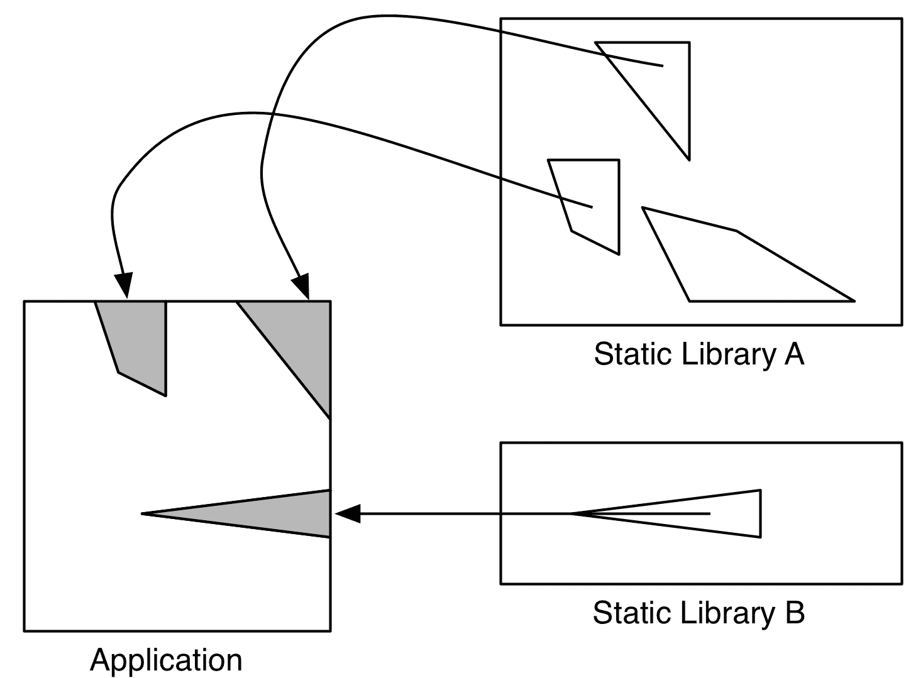

`ar` 程序被用于创建库，或者在 `ar` 的术语中称为归档（archives）。`ar` 可以创建一个归档，向其添加新文件，并可以提取、删除或替换现有文件。归档中的文件通过文件名命名（任何指定路径的文件仅使用文件名）。

在本书的在线材料中，你将找到五个类似于 [示例 6.1] 的源文件：

**示例 6.1. src0.c**

```
// src0.c: 简单的源文件，以便我们可以填充库
// src0.c
int add_0(int num) {
    return num + 0;
}
```

这些是没有任何实际用途的小型函数。你可以通过此命令将它们全部编译为对象文件：

```
gcc -Wall src?.c
```

回想 shell 会使用 `?` 作为单字符通配符。你可以查看源文件：

```
ls src0.c src1.c src2.c src3.c
```

以及相关的对象文件：

```
ls src0.o src1.o src2.o src3.o
```

创建归档：

```
ar cl addum.a
```
最终结果正如图[图 6.2]。静态库基本上是对象文件的集合。

**图 6.2 库内部**

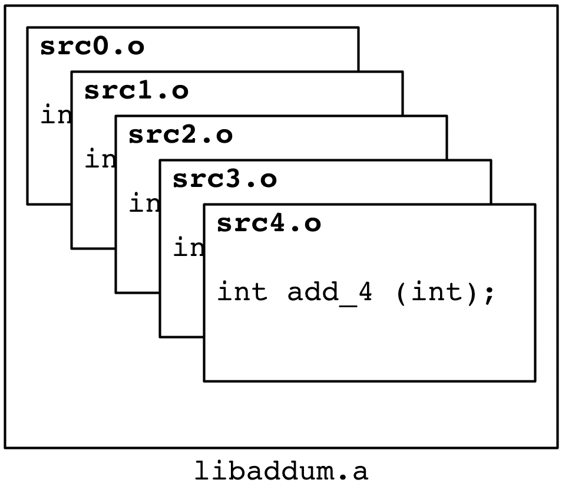

| 标志 | 描述 |
| :--- | :--- |
| `c` | 如果归档不存在则创建。 |
| `r` | 替换或向归档添加指定文件。 |
| `l` | 下一个参数是库文件的名称。 |

在你创建或修改归档后，你可能需要运行 `ranlib` 命令，它为归档构建索引表。链接器需要此索引表来定位它需要链接的对象文件。经常 `ranlib` 可用于“修复”库。如果你遇到奇怪的链接器错误（特别是当你使用 Apple 的开发工具时），请对其运行 `ranlib` 看看是否有帮助。

若要在你的程序中实际使用静态库，你需要使用两个标志。`-L` 告诉链接器去哪个目录查找。`-l`（小写）告诉链接器要查找哪些文件。按照惯例，库名的格式为 `libfoo.a`，其中 `foo` 是库提供的某种描述性名称。如果你指定 `-lfoo`，链接器知道去查找 `libfoo.a`。[示例 6.2] 使用了来自 `libadd.a` 的函数。

**示例 6.2. useadd.m**

```
// useadd.m - 使用库函数
#include <stdlib.h>
#include <stdio.h>

int main(int argc, char *argv[]) {
    int i;
    i = 5;
    printf("i is %d\n", i);
    i = add_1(i);
    printf("after add_1: %d\n", i);
    i = add_4(i);
    printf("after add_4: %d\n", i);
    return EXIT_SUCCESS;
}
```

如果你只是这样编译：

```
gcc useadd.m
```
你理所当然会收到关于未定义函数的投诉：

```
gcc useadd.m
useadd.o: main: error: undefined reference to `add_1` referenced in function `main`
useadd.o: main: error: undefined reference to `add_4` referenced in function `main`
```

BSD 系统在链接期间经常会在符号前加上下划线，Mac OS X 也不不同。缺失的符号名称实际上是 `_add_1` 和 `_add_4`。现在加上标志告诉链接器查找的位置以及使用哪个库：

```
gcc useadd.m -L. -ladd -o addum
```

示例运行：

```
./addum
i is 5
after add_1: 6
after add_4: 10
```


请注意，库的文件要在源文件名之后。如果顺序反过来：

```
$ gcc -g -o useadd -L. -ldadd useadd
/usr/bin/ld: Undefined symbols:
_add_1
_add_4
```

你仍然会得到错误，因为链接器是从左到右扫描文件的。它查看库文件，发现到目前为止没有地方需要这些符号来链接，于是丢弃了该文件。然后它继续解析 `useadd` 程序本身的符号。由于它已经丢弃了该库，链接器就会因符号缺失而报错。根据你的库的复杂程度（例如循环引用），你可能需要多次指定某个库。

当你使用第三方提供的库时，如果遇到这些“未定义符号”错误，要找出某个符号位于何处可能会非常麻烦。`nm` 命令可以大派用场，因为它向你显示存在于应用程序、库和对象文件符号信息。

编译程序但生成对象文件而不是程序（使用 `-c` 标志）：

```
$ gcc -g -c useadd.m
$ ls -l useadd.o
-rw-r--r-- 1 staff 4108 May 18 15:09 useadd.o
```

现在对它运行 `nm`：

```
$ nm useadd.o
00000000000000450 s EH_frame1
00000000000000415 s LC0
0000000000000041e s LC1
00000000000000431 s LC2
               U _add_1
               U _add_4
               U _exit
00000000000000000 T _main
00000000000000468 S _main.eh
               U _printf
```

`U` 代表“未定义”（undefined），`T` 代表定义的文本段符号（text section symbol）。第 7 章：内存 讨论了文本段，即程序文件中包含实际执行代码的区域。你可以看到使用的两个 add 函数、`printf` 以及一些基础管理代码。

你也可以对库运行 `nm`：

```
$ nm libadd.a
libadd.a(src.o):
00000000000000290 s EH_frame1
00000000000000000 T _add_0
000000000000002a8 S _add_0

libadd.a(1.o):
00000000000000290 s EH_frame1
00000000000000000 T _add_1
000000000000002a8 S _add_1

libadd.a(2.o):
00000000000000290 s EH_frame1
00000000000000000 T _add_2
000000000000002a8 S _add_2

libadd.a(3.o):
00000000000000290 s EH_frame1
00000000000000000 T _add_3
000000000000002a8 S _add_3
```

这显示了放入归档的每个对象文件，以及其中存在的符号。在 Xcode 中使用静态库非常简单。只需将 `libfoo.a` 文件拖入你的项目即可。Xcode 会自动将其链接进来。

## 共享库

当你使用静态库时，代码会被物理链接到你的可执行程序中。如果你有一个巨大的库（例如 10 兆），被链接到十几个程序中，你将消耗 120 兆字节的磁盘空间。对于如今巨大的硬盘来说，这并不是什么大问题，但库在每个程序的内存中也占据了这些兆字节的空间。这是一个大得多的问题。内存是稀缺的共享资源，因此拥有每个都占用独立内存页的库代码副本会给内存系统带来压力并导致分页交换。

共享库的创建是为了解决这个问题。它不是将代码复制到程序中，而是只包含一个引用。当程序需要共享库中的某个功能时，链接器仅包含符号的名称和指向库的指针，如图 6.3 所示。

**图 6.3 共享库**

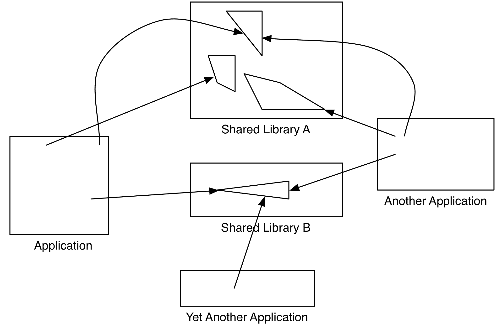

当程序执行时，加载器找到共享库，将它们加载到内存中并修复引用（解析符号），使它们指向已加载的共享库。共享库代码可以加载到内存的共享页中，并在许多不同的进程之间共享。在上面的示例中，链接到 10 兆共享库的十几个程序不会占用任何额外的磁盘空间——此外，库只会在物理 RAM 中出现一次，并在这十几个进程之间共享。当然，共享库使用的任何变量数据空间都会在每个进程中复制。

OS X 上的库支持两级命名空间。这意味着库的名称与符号一起存储。在“平坦命名空间”模型中，只存储符号，加载器会在库之间进行搜索。你有时可以运行来自其他平台的代码。

构建共享库，请使用链接器 `ld` 而不是 `ar`。

```
$ ld -dylib -o libadd.dylib src.o
```

将其链接到你的程序：

```
$ gcc -g -o useadd useadd.m libadd.dylib
```

顺便一下，你可以指定静态库：

```
$ gcc -g -o useadd useadd.m libadd.a
```

并且在使用共享库时链接搜索路径：

```
$ gcc -g -o useadd useadd.m -L. -ldadd
```

链接器在共享库和静态库之间选择时会选择共享库。Mac X 上没有纯静态程序，因为一切都链接到 `libSystem`，而它只以动态形式存在。

当你运行程序时，加载器搜索要加载的共享库。它会在多个默认位置查找（如 `/usr/lib`），并查看环境变量 `DYLD_LIBRARY_PATH`。其中指定的任何路径（多个路径用冒号分隔）都会按顺序搜索，以查找库。


```
$ nm -mg BigShow
000000000 (absolute) external __obj_class_name_AppContext
          (undefined [lazy bound]) external __obj_class_name_BigElement
            (from BigShowBase)
          (undefined [lazy bound]) external __obj_class_name_NSArray
            (from Cocoa)
          (undefined [lazy bound]) external __obj_class_name_NSBezierPath
            (from Cocoa)
          (undefined [lazy bound]) external __obj_class_name_NSBundle
            (from Cocoa)
          (undefined [lazy bound]) external __obj_class_name_NSColor
            (from Cocoa)
...
          (undefined) external __objcInit (from Cocoa)
          (undefined [lazy bound]) external _abort (from libSystem)
          (undefined [lazy bound]) external _exit (from libSystem) (undefined [lazy bound]) _calloc (from libSystem)...000007008 __DATA, [referenced] external _realloc (from System) (undefined [lazy bound]) external _free (from System) (undefined [lazy bound]) external _exit (from System) (undefined [lazy bound]) external _mach_init_routine (from System) (undefined)
```

这显示了程序使用的 Cocoa 符号（如 `NSArray`、`NSBezierPath`）、一些标准库符号（`abort()`、`calloc()`）以及一些内部管理调用（`objcInit`）。

共享库可以在程序启动后按需加载，它们是为程序构建插件架构的标准 Unix 方式。

如果你想查看程序加载的所有共享库，请从命令行运行程序并将环境变量 `DYLD_PRINT_LIBRARIES` 设置为 `1`。你可以利用此探探程序并观察它是如何执行的。例如：

```
$ DYLD_PRINT_LIBRARIES=1
$ /Applications/iTunes.app/Contents/MacOS/iTunes
loading libraries for image: /Applications/iTunes.app/Contents/MacOS/iTunes
loading library: /usr/lib/libz.1.3.dylib
loading library: /usr/lib/libSystem.dylib
loading library: /System/Framework/System.framework/System (undefined)
loading library: /System/Framework/Swift.framework/Swift (undefined)
loading library: /System/Framework/Swift.framework/Swift (undefined)
loading library: /System/Framework/QuickTime.framework/QuickTime (undefined)
loading library: /System/Framework/QuickTime.framework/QuickTime.plist (undefined)
loading library: /System/Framework/QuickTime.framework/QuickTime (undefined)
loading library: /System/Framework/QuickTime.framework/QuickTime.plist (undefined)
loading library: /System/Framework/QuickTime.framework/QuickTimeBundle (undefined)
loading library: /System/Framework/ApplicationServices.framework/ApplicationServices (undefined)
loading library: /System/Framework/ApplicationServices.framework/ApplicationServices (undefined)
```


```
// adder.h - header file for the little adder functions we have

int add_0 (int number);
int add_1 (int number);
int add_2 (int number);
int add_3 (int number);
int add_4 (int number);
```

因为这是一个公共头文件，你需要告诉 Xcode 该头文件是公开的，这样它才会被添加到框架的 `Headers` 目录。

1. 拖入头文件。你可以从 `Finder` 将其拖入，也可以在 Xcode 中直接创建。你的文件看起来应该像图 6.5 所示。

2. 通过在 `File Inspector`（文件检查器）中将 `Target Membership` 设置为 `Public` 来将头文件设置为公开，如图图 6.6 所示。

3. 然后构建框架。

完成后，项目窗口应该看起来像图 6.5 所示。

**图 6.5 框架源文件**

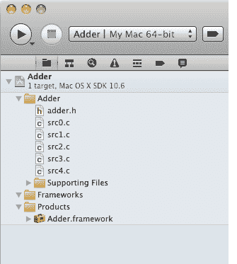

**图 6.6 设置头文件的公开目标成员**

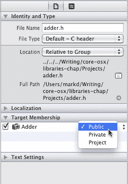

默认情况下，Xcode 4 将构建产物放在 `~/Library/Developer/Xcode/DerivedData/....`。你可以通过在 `Adder.framework` 产品上弹出上下文菜单并选择 `Show in Finder` 来找到框架的的确切位置，该产品位于图 6.5 的底部。

现在有了共享库，来构建 `useadd` 程序：

```
$ ADD_FRAMEWORK_PATH=/Users/markd/Library/Developer/Xcode/DerivedData/.../Debug
$ gcc -g -o useadd -F${ADD_FRAMEWORK_PATH} -framework Adder useadd.m
```

使用 `-F` 来指定链接器在链接时搜索框架的位置。它的工作原理与静态和共享库的 `-L` 标志完全相同。如果你现在运行它，你会得到一个错误：

```
dyld: Library not loaded: /Library/Frameworks/Adder.framework/Versions/A/Adder
referenced from: /Users/markd/writing/core-osx/libraries-chap/projects/useadd
reason: symbol not found
```

这是因为 `-F` 标志只影响编译时行为，以便链接器确保符号存在。在运行时，如果框架没有嵌入程序中，系统会在这些目录中查找：

1. `~/Library/Frameworks`
2. `/Library/Frameworks`
3. `/System/Frameworks`

因此将 `Adder.framework` 拷贝到 `~/Library/Frameworks`（你可能需要创建它）并重新运行程序：

```
$ useadd
is 5 after add_1: 6 after add_4: 10
```

如果你将进行迭代开发并频繁构建此框架，你可能想对库创建一个符号链接。这样，当你重新构建框架时，`useadd` 将总是能获取最新版本。

如果你开启 `DYLD_PRINT_LIBRARIES`，就可以看到程序正在使用新框架：

```
$ export DYLD_PRINT_LIBRARIES=1
$ useadd
dyld: loaded: /Users/markd/writing/core-osx/libraries-chap/projects/useadd
dyld: loaded: /Users/markd/Library/Frameworks/Adder.framework/Adder
dyld: loaded: /usr/lib/libSystem.dylib
dyld: loaded: /usr/lib/system/libCommon.dylib
is 5 after add_1: 6 after add_4: 10
```

你可以看到开头加载了 `Adder` 框架。

## 库还是框架？

那么，你是否应该将所有的公共代码都转换为框架？通常情况下，不要。如果你是为第三方提供库以便他们原样使用，那么框架是非常棒的。你的用户可以将框架包含在他们的应用程序包中，并愉快地使用你的内容。

你会遇到麻烦是因为遵循了思路：“我有一系列应用程序，所以我我会制作一组所有它们都可以使用的共享框架，并将它们放在 `/Library/Frameworks` 中。”沿着这条路径通向疯狂。你需要管理员权限来安装和更新框架。

## 编写插件

共享库可以在程序启动后按需加载。它们是添加插件功能的机制：构建一个共享库并让程序加载它。通用的 Unix 应用程序可以使用 `dyld` 函数加载共享库并获取符号的地址。高级应用程序可以在运行时加载包（Bundles）。

### Cocoa 中的包

包（Bundle）是一个包含某些可执行代码（无论是共享库还是可执行程序）以及支持该代码的各种资源的目录。Cocoa 应用程序是包，框架、屏幕保护程序、iPhoto 导出插件以及许多其他东西也是。包是 Cocoa 处理程序启动后加载的插件的方式。某些程序（如 QuickSilver）有一个微小的主程序，所有功能都通过插件实现。

让应用程序接受插件有两个方面：执行加载的应用程序和插件本身。你需要让它们中的每一个都同意某种协议以进行通信。对于此操作没有预定义的协议，因此你可以自由使用任何你感兴趣的机制。这里有一个简单的命令行工具示例，它将加载返回字符串的插件，主程序将打印这些字符串。一旦所有插件都有机会打印出它们的内容，程序就会退出。

在 Xcode 中创建三个项目。首先，创建一个名为 `BundlePrinter` 的命令行工具（Xcode 3 中的 Foundation Tool）。然后创建一个名为 `SimpleMessage` 的 Cocoa Bundle，再创建一个名为 `ComplexMessage` 的 Cocoa Bundle。

为 `BundlePrinter` 添加一个所示的头文件：


```objc
// BundlePrinter.h -- protocol for BundlePrinter plugins to use

@protocol BundlePrinterProtocol

+(BOOL)activate;
+(void)deactivate;

-(NSString*)message;

@end // BundlePrinterProtocol
```

这是一个非常简单的协议。该类提供了在激活和禁用时执行某些操作的机会。插件可能需要创建并销毁大图像，或者加载一个 mp3 文件。此外，还有一个实例方法用于获取要打印的字符串消息。

将此头文件添加到两个 bundle 项目中。现在，开始实现符合此协议的插件吧。在 `SimpleMessage` 项目中添加一个 `SimpleMessage.m` 文件。同时，将项目的 Principal Class（主类）设置为 `SimpleMessage`。进入 Targets 窗格，选择 `SimpleMessage` 目标，选择 Info 标签页，并添加一个字符串值为 `SimpleMessage` 的 Principal Class。

以下是 `SimpleMessage.m` 的内容：

### 示例 6.5. SimpleMessage.m

```objc
// SimpleMessage.m - 一个返回简单、硬编码消息的简单插件

#import <Foundation/Foundation.h>
#import "BundlePrinter.h"

@interface SimpleMessage : NSObject <BundlePrinterProtocol>
@end // SimpleMessage

@implementation SimpleMessage

+(BOOL)activate {
    NSLog(@"SimpleMessage plugin activated");
    return YES;
} // activate

+(void)deactivate {
    NSLog(@"SimpleMessage plugin deactivated");
} // deactivate

-(NSString*)message {
    return @"This is sample message";
} // message
```

编译它并修复任何错误。对 `ComplexMessage` 类执行相同的操作（添加 `ComplexMessage.m`）。

### 示例 6.2. ComplexMessage.m

```objc
// ComplexMessage - 一个使用存储状态返回消息的插件

#import <Foundation/Foundation.h>
#import "BundlePrinter.h"
#import <stdlib.h> // 用于随机数
#import <time.h> // 用于随机数生成器

@interface ComplexMessage : NSObject <BundlePrinterProtocol> {
    NSInteger randomValue;
}
@end // ComplexMessage

@implementation ComplexMessage

+(BOOL)activate {
    NSLog(@"ComplexMessage plugin activated");
    return YES;
} // activate

+(void)deactivate {
    NSLog(@"ComplexMessage plugin deactivated");
} // deactivate

-(instancetype)init {
    if (self = [super init]) {
        srand(time(NULL));
        randomValue = rand() % 500;
    }
    return self;
} // init

-(NSString*)message {
    return [NSString stringWithFormat:@"Here is a random number: %ld", (long)randomValue];
} // message

@end
```


```c
/main.c - 主 BundlePrinter 程序

```c
#import <Foundation/Foundation.h>
#import "BundlePrinter.h"

NSString *processPlugin(NSString *path) {
    NSString *message = nil;

    NSLog(@"processing plug-in: %@", path);

    // 加载 bundle
    NSBundle *plugin = [NSBundle bundleWithPath:path];

    if (plugin == nil) {
        NSLog(@"could not load plug-in at path %@", path);
        goto bailout;
    }

    // 获取 bundle 声明为主类的类（Principal class）。
    // 如果 bundle 中定义了多个类，
    // 我们将不知道先与哪一个类通信
    Class principalClass = [plugin principalClass];

    if (principalClass == nil) {
        NSLog(@"could not load principal class for plugin at path %@", path);
        NSLog(@"make the classes text is correct");
        goto bailout;
    }

    // 检查 principalClass 是否符合协议
    if ([principalClass conformsTo:@BundleProtocol]) {
        NSLog(@"plugin class must conform to BundleProtocol");
        goto bailout;
    }

    // 通知插件正在被激活
    if ([principalClass activate]) {
        NSLog(@"could not activate class for plugin at path %@", path);
        goto bailout;
    }

    // 创建插件实例并向其请求消息
    id pluginInstance = [[principalClass alloc] init];

    // 获取消息并销毁实例
    message = [pluginInstance message];
    // 我们已经处理完了 principalClass

    return message;

bailout:
    return nil;
}

int main(int argc, const char *argv[]) {
    @autorelease pool {
        // 遍历当前目录查找 bundles。
        // 应用程序可能会在自己的 bundle 中查找，或者在 ~/library 中查找插件。
        NSFileManager *manager = [NSFileManager defaultManager];

        for (NSString *path in [manager enumeratorForPath:@".."]) {
            // 只查找以 .bundle 结尾的文件
            if ([[path pathExtension] isEqualToString:@"bundle"]) {
                // 调用插件。
                NSString *message = [processPlugin:path];

                if (message) {
                    NSLog(@"message: %s", message);
                }
            }
        }
    }
    return EXIT_SUCCESS;
}
```

`main()` 会查找目录并搜索以 `.bundle` 结尾的项。如果找到，它将尝试加载并调用找到的类。以下是将 `SimpleMessage` 和 `ComplexMessage` bundle 复制（或符号链接）到 BundlePrinter 项目后的示例。

```
$build/Bundle/BundlePrinter
BundlePrinter[448] processing plug-in: ComplexMessage.bundle
BundlePrinter[448] ComplexMessage plug-in activated
BundlePrinter[448] ComplexMessage plug-in activated

message is: 'Here is a random number: 2342'

BundlePrinter[448] processing plug-in: SimpleMessage.bundle
BundlePrinter[448] SimpleMessage plug-in loaded
BundlePrinter[448] SimpleMessage plug-in unloaded
```


2. 如果设置了 `DYLD_LIBRARY_PATH` 环境变量，则会在这些目录中查找叶节点。

3. 如果设置了 `DYLD_FALLBACK_LIBRARY_PATH` 环境变量，则会搜索这些目录。如果没有设置此环境变量，则会搜索 `$HOME/lib`、`/usr/local/lib`，然后是 `/usr/lib`。

4. 最后，该路径被视为普通路径。

由于 Mac OS 拥有胖二进制文件（fat binary files），因此没有独立的 32 位和 64 位搜索路径。

`mode` 参数可以接受两个选项之一，用于控制外部函数的绑定，并带有两个可选标志。在这里，“外部”指的是未在刚加载的共享库中定义的函数：

| Flag | Description |
| :--- | :--- |
| `RTLD_NOW` | 每个外部函数都会被立即绑定。你可以使用此标志来确保在加载时就能发现任何未定义的符号符号。 |
| `RTLD_LAZY` | 每个外部函数在第一次被调用时绑定。你通常会使用这种形式。它更高效，因为它不会绑定可能永远不会被调用的函数。 |
| `RTLD_GLOBAL` | 这是一个可选的按位或标志。除了通过调用 `dlsym()` 可外，从加载的库导出的符号对任何其他加载的库都可用。这是默认行为。 |
| `RTLD_LOCAL` | 这也是一个可选的按位或标志。从加载的库导出的符号通常是隐藏的，仅在使用该库的模块句柄时对 `dlsym()`可用。 |

### `dlsym()`

一旦你从 `dlopen()` 获取了模块句柄，就可以使用 `dlsym()` 获取指定符号处的代码或数据的地址。

```
void* dlsym (void *module, const char *symbol);
```

`module` 是由 `dlopen()` 返回的模块句柄。与 `dyld` 系列调用不同，你不需要在符号前加下划线。如果找不到符号，`dlsym()` 将返回 `NULL`，你可以通过 `dlerror()` 查询出现什么问题。

你可以向 `dlsym()` 传递两个常量代替模块句柄：`RTLD_DEFAULT` 按照加载加载顺序搜索进程中的每一个 Mach-O 镜像。这可能是一个昂贵的操作，因为它必须遍历所有的系统框架。你也可以使用 `RTLD_NEXT` 在调用 `dlsym()` 之后加载的任何 Mach-O 镜像中搜索该符号。因此，如果你在主程序中使用 `RTLD_NEXT` 调用 `dlsym()`，它将在程序启动后加载的任何库中查找。

### `BundlePrinter`

`bundleprinter` 使用了类似于基于 Cocoa 的 `BundlePrinter` 的束插件。你可以这样编译共享库：

```
cc -g -o simplemessage.msg -bundle simplemessage.msg
```

你也可以将其构建为共享库：

```
cc -g -o simplemessage.msg -dylib simplemessage.msg
```

那么 Mac OS X 上的 bundle（包）和共享库（shared library）之间有什么区别呢？实际上，并没有什么巨大差异。`dlopen()` 可以加载两者并检索内部的符号。Bundle 可以被卸载，而共享库不能。使用 Objective-C 的 Bundle 必须按照严格的“后入先出”顺序卸载，这实际上使它们成为可卸载的。Bundle 还可以链接到可执行文件以满足缺失的符号。这允许宿主应用程序提供插件可以使用的 API。

`.msg` 是这些“消息”（message）插件使用的扩展名。[示例 6.8] 是驱动程序，而 [示例 6.9] 和 [示例 6.10] 是插件的实现。

**示例 6.8. bundleprinter.m**


```
// bundleprinter.m - 使用 dlopen 系列调用动态加载插件 
// 并在其上调用函数。

// gcc -o bundleprinter bundleprinter.m

#include <sys/dirent.h> 用于 struct dirent
#include <dirent.h> 用于 opendir 及相关函数
#include <dlfcn.h> 用于 dlopen 及相关函数
#include <errno.h> 用于 errno/strerror
#include <stdio.h> 用于 printf
#include <stdlib.h> 用于 EXIT_SUCCESS
#include <string.h> 用于 strdup

我们需要一种类型来将 void 指针强制转换为我们需要跳转的函数指针。
// 使用类型比直接内联进行此操作让代码更具读性。

typedef int (*BNMessageActivateFP)(void);
typedef void (*BNMessageActivate);
typedef char* (*BNMessageFP);

char *plugins(const char *path) {
    char *msg = NULL;
    void *module = dlopen(path, RTL_LAZY);

    if (module == NULL) {
        fprintf(stderr, "could not load plugin at %s error: %s\n", path, strerror());
        goto out;
    }

    BNMessageActivateFP activator = dlsym(module, "Activate");
    BNMessageActivateFP deactivate = dlsym(module, "Deactivate");
    BNMessageFP message = dlsym(module, "Message");

    if (activator == NULL || deactivate == NULL || message == NULL) {
        fprintf(stderr, "could not find BNMessage* symbol %p error: %s\n", path, strerror());
        goto;
    }

    int result = activator();
    if (!result) // 模块未加载
        goto out;

    msg = message();

    deactivate();

    out:
    if (module)
        dlclose(module);

    return msg;
} // 处理插件

int main(int argc, char *argv[]) {
    // 遍历当前目录

    DIR *directory = opendir(".");

    if (directory == NULL) {
        fprintf(stderr, "could not open current directory to look for plugins\n");
        fprintf(stderr, "error: %s\n", strerror());
        exit(EXIT_FAILURE);
    }

    struct dirent *entry;
    while (entry = readdir(directory)) {
        // 是否为插件类型
        if (strcmp(entry->d_name, ".msg") == 0) {
            char *message = plugins(entry->d_name);
            printf("message: '%s'\n", message);
            free(message);
        }
    }

    closedir(directory);

    return EXIT_SUCCESS;
} // 主函数
```

**示例 6.9. simplemessage.m**

```
// simplemessage.m - 返回一个分配的内存块作为简单消息

// gcc -o simplemessage.msg bundle simplemessage.m

#include <string.h> 用于 strdup
#include <stdio.h> 用于 print

int Activate(void) {
    printf("simple activate\n");
    return 1;
} // BNMessageActivate

void Deactivate(void) {
    printf("simple deactivate\n");
} // BNMessageDeactivate

char* Message(void) {
    return strdup("This is a simple message");
} // BNMessageMessage
```


```
// complexmessage.m - return a malloced block of memory to a complex message

// gcc -o complexmessage.msg -bundle complexmessage.m

#include <stdio.h> // for printf
#include <stdlib.h> // for random number routines
#include <string.h> // for strdup, and snprintf
#include <time.h> // for time() to seed the random generator

static unsigned g_randomIndex;

int BNMessageActivate(void) {
    printf("complex message activate\n");

    srand((unsigned)time(NULL));
    g_randomIndex = rand() % 500;

    return 1;
} // BNMessageActivate

void BNMessageDeactivate(void) {
    printf("complex message deactivate\n");
} // BNMessageDeactivate

char *BNMessageMessage(void) {
    char *message;
    asprintf(message, "Here is a random number: %d", g_randomIndex);
    return message;
} // BNMessageMessage
```

以下是运行结果：

```
$bundleprint complexmessage activate
complex message activate
```

message: 'Here is a random number: 230'

sample message
sample message
```

## 进阶探索：libtool

在本章前面的部分，使用了 Unix 工具 `ar` 和 `ranlib` 来构建静态库，并使用 `gcc` 构建了动态库。macOS 有一个名为 `libtool` 的工具，它是该平台特有的，但提供了比 `ar` 等工具更丰富的功能集。GNU 项目也有 `libtool`，但它与 macOS 中的版本无关。

像如下创建一个静态库并使用它：

```
$libtool -static -o libadd.a src?
$gcc -g -o
```

可以这样创建动态库（但不是包 bundle）：

```
$libtool -dynamic macos_version_min 10.5 -o libadd.dylib src?
$gcc -g -o add
```

## 进阶探索：otool

`otool` 是另一个面向库的工具。尽管它与 `libtool` 共享相同的后四个字母，但 `otool` 会输出关于对象文件、库或可执行文件的大量信息。`otool` 有许多选项，因此请查看手册页（manpage）以获取完整命令套。这里有一些有趣的命令。

列出对象文件或可执行文件使用的共享库名称和版本号：

```
$otool -L /Applications/Safari.app/Contents/MacOS/Safari
/usr/lib/libSystem.dylib (version 9.0, current 9.6)
/System/Library/Frameworks/Foundation.framework/Foundation (version 1.0, current 1.0)
/System/Library/Frameworks/CrashReportSupport.framework/Versions/A/CrashReportSupport (version 1.0, current 1.0)
/usr/lib/libxar.1.dylib (version 1.0, current 1.0)
/System/Library/Frameworks/CoreLocation.framework/Versions/A/CoreLocation (version 11..0)
...
```

反汇编文本段的内容。`-V` 表示符号反汇编。

```
$otool -V -t useadd
...
00000000 00000000 00000000 00000000 __text    0
00000000 00000000 00000000 00000000 __data    0
00000000 00000000 00000000 00000000 __bss     0
00000000 00000000 00000000 00000000 __const   0
...
00000000 00000000 00000000 00000000 __text    0
00000000 00000000 00000000 00000000 __data    0
00000000 00000000 00000000 00000000 __bss     0
00000000 00000000 00000000 00000000 __const   0
...
```

打印一些 Objective-C 内容：

```
$otool -v BundlePrinter
contents of (__DATA,__objc_classrefs) section
contents of (__DATA,__objc_plist) section
contents of (__DATA,__objc_msgrefs) section
```


一个包含库的目录列表。动态链接器在查找库的默认位置之前会搜索这些目录。这对于测试新版本的库非常有用。

`DYLD_FALLBACK_LIBRARY_PATH`

一个包含库的目录列表。这些是库的默认位置。默认情况下，它设置为 `$(HOME)/lib:/usr/local/bin:/lib:/usr/lib`。

第二组变量会导致动态链接器在发生有趣事件时输出信息。有些是极客式的趣味性，而另一些在调试或追踪发生在 `main()` 被调用之前的性能问题时非常有用。这些环境变量不需要设置为任何特定值，只要设置了即可。

`DYLD_PRINT_STATISTICS`

打印在调用 `main()` 之前动态链接器花费时间的地方。

`DYLD_PRINT_INITIALIZERS`

打印在运行每个镜像中的每个初始化器 时的信息。

`DYLD_PRINT_APIS`

在调用动态链接器 API（例如 `dlsym()`）时打印信息。

`DYLD_PRINT_SEGMENTS`

打印一行包含动态链接器映射的每个 Mach-O 段的名称和地址范围。

这里是一个示例运行，显示了使用 `bundleprinter` 的统计和 API 调用：

```
export DYLD_PRINT_APIS=""
export DYLD_PRINT_STATISTICS=""
./bundleprinter
dyld_register_func_for_remove(0x7fff82fc6b76)
total time: 0.53 milliseconds (100.0%)
total images loaded: 3 (2 from dyld shared cache, 0 needed fixes)
total segments mapped: 0, into 0 pages with 0 pages prefched
total images loading time: 0.03 milliseconds (6.0%)
total trace DOF registration time: 0.02 milliseconds (5.5%)
total base fixups: 0
total base fixups time: 0.00 milliseconds (0.7%)
total binding fixes: 2
total binding fixes time: 0.02ms (5.1%)
total walk fixups: 0.00ms (0.1%)
total binding lazy fixed: 0
total initializer time: 0.43ms (82.3%)
total library pages: 2
total library pages: 0
total images debug: 0/0
open(complex_message.msg, 0x00000001)
lsym(0x10010026, Activate)
lsym(0x10010026, deactivate)
lsym(0x10010026, Message)
complex message activate
complex message deactivate
close(0x10010026)
message is: 'Here is a random number: 99'
open(simplemessage.msg, 0x00000001)
lsym(0x10010026, Activate)
lsym(0x10010026, deactivate)
lsym(0x10010026, Message)
```

### 内存

虚拟内存

虚拟内存是计算机伪装成比实际拥有更多内存的方法。一台机器可能有 4GB 的 RAM，但你可以对数据进行多次操作。当超过超过可用量时，部分数据会被保存到磁盘，并在程序需要时重新读回。操作系统处理这些琐碎细节：将当前处理的数据物理保留在内存中，并将一段时间未触及的数据移动到磁盘。如果程序想要处理数据，它还会从磁盘将数据拉回内存。

操作系统将内存划分为页，即操作系统寻址的 4KB 内存块。程序在请求内存时，系统会分配页。随着页的使用，它们被保留在最近使用页列表中。随着程序向系统请求越来越多的内存，最久使用的页会被写入磁盘，这被称为“分页”或“交换”，然后该物理内存块被重用。iOS 没有这种基于磁盘的交换文件，因此在该平台上你会比桌面操作系统更快遇到内存溢出状况。

页可以被写出然后在不同的物理地址被读回。一个起始于地址 `0x5000` 的 4k 页可能会被换出并分配给另一个程序。需要 `0x5000` 处数据的程序现在再次需要它，因此操作系统从磁盘读取该页。此时 `0x5000` 处的内存块可能正被第二个程序使用。哎呀。为了解决这个问题，使用了虚拟寻址。

图 7.1 显示了虚拟内存的工作原理。虚拟地址是程序看到的内存地址，每个程序都有自己的独立的地址空间。虚拟地址由操作系统（以及 CPU 中的硬件）映射到 RAM 内存页的物理地址。程序 A 和程序 B 在 `0x8000` 处各有一页数据。在物理内存中，A 的数据可能存放在物理地址 `0x15020`，而 B 的可能存放在物理地址 `0x3150`，但地址翻译让每个程序都沉浸在数据位于地址 `0x8000` 的幻象中。

图 7.1

程序在特定时间分配给它的内存总量称为其虚拟集（virtual set）。实际位于 RAM 中的内存量称为其驻留集（resident set）。虚拟集和驻留集之间的差异存储在磁盘的交换文件中，或者在只读代码段（如系统框架）中。“交换（Swap）”一词源于分页发生时相互交换的页。你也可以锁定或布线（wire）内存使其不被交换。某些页你绝对不希望被交换出，例如包含解密密码的页。在解密密码之前，应使用 `mlock()` 函数对这些页进行布线。

页可以拥有权限，例如只读、读/写和执行。这有助于防止你覆盖自己的代码，并防止试图从未标记为可执行的页执行代码漏洞。

## 程序内存模型

MacOS 进程有一个概念性的内存模型，其中内存被分为可执行代码空间、栈、堆和其他部分，如图 7.2 所示：

图 7.2

## 练习

1. 将 `bundleprinter` 示例包含在 GUI 中，并将名称放入 `ableView` 中。
2. `otool` 有许多选项和标志。编写一个前端以便方便地使用它。你可以使用 `NSTask`（第 19 章：使用 NSTask 涵盖）从你的应用程序中实际运行 `otool`。


可执行程序代码存储在此处。在程序启动时，代码将从磁盘上的可执行文件映射到内存中，作为只读页。由于这些页面是只读的，它们可以很容易地在多个进程之间共享，因此页面只需要在物理内存中出现一次，仍然可以在多个用户之间共享。当然，它们可以在其他进程的虚拟内存中出现多次。这对于加载到每个程序的共享库尤其如此如此。由于数据是只读的，内核可以回收这些页面，而无需将它们写入交换文件（swapfile）。

## 初始化数据段 (Initialized Data Segment)
初始化的全局和静态变量存储在这里——例如任何函数之外的 `float pi = 3.1415`，或者函数内部的 `static int blah = 25`。初始化数据存储在数据段本身中，它仅被复制到内存中的一个读写页中，程序随后对其进行修改。由于内核只是从磁盘读取数据块，因此加载和初始化所有全局变量非常快。这里没有发生真正的显式初始化，只是大批量的数据加载。

## 未初始化数据段 (Uninitialized Data Segment)
这是所有存储在全局空间但没有给出显式初始化器的内容，例如任何函数之外的 `int bork`，或者函数内部的 `static char buffer[5000]`，所有这些内容在程序启动时都会清零。这些内容不会被像初始化数据段那样处理，否则意味着可执行文件中会有大量的零块。系统只存储此数据段的大小。在程序加载时，操作系统会分配相应大小的空间并进行零填充。

这在手册页（manpages）和历史文献中也被称为“bss”段。“bss”源于一条汇编指令，意为“由符号启动的块”（block started by symbol）。

## 堆 (Heap)
堆是发生动态（运行时）分配的区域。如果你执行 `malloc(40K)`，这 `40K` 将来自堆。

## 程序栈 (Program Stack)
主线程的程序调用栈。局部（自动）变量存储在这里，每个每个函数调用的栈帧也存储在这里。当一个函数调用另一个函数时，在调用新函数之前，需要存储处理器的寄存器和其他杂项记录信息。这些值在新函数退出时也需要被恢复。

使用程序栈进行内存“分配”非常快。使用处理器寄存器来指示栈的边界。在栈上保留空间仅涉及向此地址加上一个值，无论是四个字节还是四千个字节。你不想在栈上存储太多内容，例如大缓冲区，因为栈的大小是有限制的。此外，线程的栈空间有限，因为每个线程都有自己的内存块用作栈。这在第 20 章：多线程 中进行了讨论。

示例 7.1 是一个包含 8K 初始化数据和 1MB 未初始化数据的数据的程序：

**示例 7.1. dataseg.m**

```
./dataseg.m -show size of data segments

#include <stdio.h> // 用于 (printf());
#include <stdlib.h> // 用于 (exit())

gcc -arch x86_64 -g -o dataseg dataseg.m
gcc -arch i386 -g -o dataseg-32 dataseg.m

8K doubles 存储在初始化数据段中。
static double doubles[] = {
    0.0, 1.0, 2.0, 3.0, 4.0, 5.0, 6.0, 7.0, 8.0, 9.0,
    10.0, 11.0, 12.0, 13.0, 14.0, 15.0, 16.0, 17.0, 18.0,
    19.0, 20.0, 21.0, 22.0, 23.0
};
static char buffer[5000];

int main() {
    printf("doubles: %ld, buffer: %ld\n", sizeof(doubles), sizeof(buffer));
    return 0;
}
```

这是一个示例：

```
./dataseg
doubles: 8192 bytes, buffer: 5076 bytes
```

`size` 命令将显示程序多个段的大小。在此程序程序上运行 `size` 得到：

```
$ size dataseg
text data objseg size
4096 10608 0 429497392 429603652 100105000
```

上述是 64 位可执行文件的 `size` 输出。这是 32 位版本的大小：

```
$ gcc -arch i386 -g -o dataseg-32 dataseg.m
$ size dataseg-32
text data objseg size
4096 10608 0 429497392 4096 8192 7072 7000
```


“动态内存”是指来自堆（heap）的内存。程序的堆起始于一个操作系统定义的、供程序消耗的默认可用空间。当你从堆中分配内存时，它会被填满，然后你的程序会向操作系统请求更多内存。你释放的内存可以被你的程序重新使用。已分配并随后释放的内存仍然由操作系统向你的程序收费。如果你为临时工作区分配了 50 兆然后将其全部释放，你的程序仍然将拥有这 50 兆的内存。由于你可能不再使用它，这些内存最终会被（在桌面系统中）交换到磁盘。内存的总量可以被视为高水位。

分配和释放内存的主要函数是：

```c
void *malloc (size_t size);
```

```c
void free (void *ptr);
```

```c
void *realloc (void *ptr, size_t size);
```

```c
void *reallocf (void *ptr, size_t size);
```

这些函数从堆中为你内存。

### malloc()

`malloc()` 分配一块内存，其内存块地址按照操作系统要求的的最严格边界对齐。也就是说，如果一个 8 字节的 double 有最严格的对齐要求，`malloc()` 返回的地址将能 8 整除。示例 7.2 分配不同大小的块并显示返回内存的地址。

**示例 7.2. mallocalign.m**

```c
mallocalign.m - 查看 malloc 如何对齐其指针

gcc -Wall -o mallocalign mallocalign.m

#include <stdio.h>
    // 用于 printf()
#include <stdlib.h>
    // 用于 malloc()

void allocprint(size_t size) {
    void *memory = malloc(size);
    printf("malloc(%ld) = %p\n", size, memory);
    // 故意泄漏以便我们获得新的内存块
} // allocprint

int main(void) {
    allocprint(1);
    allocprint(2);
    allocprint(sizeof(double));
    allocprint(1024 * 1024);
    allocprint(1);
    allocprint(1);
    return 0;
} // main
```

运行结果如下：

```
malloc(1) = 0x100080
malloc(2) = 0x100090
malloc(8) = 0x1000a0
malloc(456) = 0x102000
malloc(1) = 0x1000c0
```

这些地址都能被 16 整除。向量操作（如 SSE）在按 16 字节边界对齐时效果最好。你可以看到非常大的 malloc 开始于一个距离小分配很远的地址。该内存被放在了地方的独立页上。你应该始终使用 `sizeof` 运算符来确定为特定结构分配多少内存：

```c
typedef struct Node {
    int l; // 4 字节
    int r; // 4 字节
} Node;

Node *node = malloc(sizeof(Node)); // 8 字节
```

对于数组也是

```c
Node nodes[] = malloc(sizeof(Node) * 100); // 800 字节
```

`malloc()` 有权给你一个比你请求更大的内存块，但你只能保证获得你请求的量。

**示例 7.3. mallocsize.m**

```c
mallocsize.m - 查看 malloc 实际上给了我们什么种大小的块

gcc -Wall -o mallocsize mallocsize.m

#include <malloc/malloc.h>
    // 用于 malloc_size()
#include <stdio.h>
        // 用于 printf()
#include <stdlib.h>
        // 用于 malloc

void allocsize(size_t size) {
    void *memory = malloc(size);
    printf("malloc(%ld) has block size %ld\n", size, malloc_size(memory));
    // 故意泄漏以便获得新块
} // allocsize

int main() {
    allocsize(1);
    allocsize(sizeof(double));
    allocsize(4);
    allocsize(16);
    allocsize(32);
    allocsize(64);
    allocsize(100);
    return 0;
} // main
```

输出：

```
mallocsize
malloc(1) has block size of 16
malloc(8) has block size of 16
malloc(14) has block size of 16
malloc(16) has block size of 16
malloc(32) has block size of 32
malloc(48) has block size of 48
malloc(64) has block size of 64
malloc(100) has block size of 128
```


无法保证连续分配的内存块在内存中彼此靠近。

动态内存分配不保证**引用局部性**（locality of reference）。引用局部性意味着经常一起使用的数据被放置在内存中相邻的位置，从而减少缓存缺失和分页活动。你可以连续地分配两个内存块：

```
x = malloc(10);
y = malloc(10);
```

而 `malloc()` 为你提供一个指向地址空间一端的 `x` 指针，以及一个指向远另一端的 `y` 指针，这在逻辑上是完全合法的。如果你需要引用局部性，分配一个大内存块然后由你自己从该缓冲区中进行子分配可能会更好。

最后，Mac OS 上的 `malloc()` 始终是线程安全的。某些旧版本的 Unix 变体在链接特殊线程库时会提供线程安全的 `malloc()`。

### free()

`free()` 告诉系统你已经处理完了某块内存，它可以被随后的 `malloc()` 调用重用。在早期的示例中（尤其是 `mallocalign.m`），分配的内存被刻意地不释放，因为同一个块会被不断返回；如果你每次获取的内存块的起始地址都相同，那么很难对内存对齐得出结论。

不释放分配的内存被称为“内存泄漏”（memory leak），因为内存就这样流失了，不再可用。稍后会有关于内存泄漏和内存泄漏检测工具的讨论。

最后，确保你只向 `free()` 传递从 `malloc()` 获取的地址或 `NULL`。如果你给 `free()` 栈缓冲区或其他未由 `malloc()` 分配的内存地址，你将得到不可预测的结果（崩溃）。某些函数会代表你调用 `malloc()`，例如 `strdup()`，文档说明了你需要对它们的返回值进行 `free()`。

### realloc()

`realloc()` 调整之前之前分配的内存块的大小。本质上，`realloc()` 的操作类似于：

```c
void *cheesyAlloc(void *ptr, size_t size) {
    void *newMem = malloc(size);
    memcpy(newMem, ptr, size);
    free(ptr);
    return newMem;
} // cheesyAlloc
```

因此，通过 `realloc()` 分配的块可能会在堆中移动，所以如果你有多个指向同一起始地址的指针，你可能需要在重新分配块后更新所有指针。你可以让指针存在于一个地方并在其周围封装一个 API，或者使用两个内存对象：一个较小的、不会移动的对象（例如树节点），和一个指向较小对象的较大对象（例如树节点的可编辑标签）。较大的对象可以被重新分配，但只有树节点需要更新地址变化。

正如你预期的那样，`realloc()` 具有优化措施，使得它不需要在每次重新分配块时都执行“分配/复制/释放”过程。如上所述，有时 `malloc()` 返回的块实际上比你请求的要大。`realloc()` 可以说：“好的，你现在可以使用该块的剩余部分。”`realloc()` 还可以玩一些花样：在另一个桶中可能有一个空闲块与你想要重新分配的内存块是连续的。在这种情况下，`realloc()` 将将第二个块合并到第一个块上，让你在不改变地址的情况下使用该空间。

但无论如何，务必将 `realloc()` 的返回值赋值回你的指针。否则，你可能会遇到潜伏的问题：

```c
Node *blah = malloc(sizeof(Node) * 20);
...
realloc(blah, sizeof(Node) * 40); // 这样做很糟糕！
...
```

有时它有效，有时则不然。始终为 `realloc` 的返回值赋值。

```c
Node *blah = realloc(blah, sizeof(Node) * 40);
```

### alloca()

`alloca()`（用于自动分配）在栈上为你分配内存。这意味着分配非常快，仅仅是指针调整。你不需要对内存执行显式的 `free()` 来释放它。当函数结束时，栈帧就会消失，分配的内存随之消失。正如那些听起来好得真实的事一样，这是有代价的。不要由于过多的局部存储导致栈溢出，特别是当你使用递归或你的代码可能运行在栈大小更受限的线程环境中。此外，使用运行时计算的分配大小配合 `alloca()` 可能会干扰某些工具。

尽管 `alloca()` 的手册页说“这取决于机器，不建议使用”，但它仍然是一个你可以使用的文档化 API，而且有时很有用。此外，C99 允许你声明具有可变大小的局部变量数组，就像在 C++ 中一样，其原理与 `alloca()` 非常相似。

### calloc()

`malloc()` 不初始化页面。使用 `calloc()` 更好，因为操作系统可以进行零填充，但实际上并没有分配。当你使用 `memset()` 处理块内存时，你是在将其标记为“脏”。例如：

```c
void *ptr = calloc(n, sizeof(int));
```

使用动态内存涉及的困难之一是确定当没有其他人使用某块内存时由谁负责释放。这被称为内存所有权。这个问题有很多不同的解决方案，每种都有自己的权衡和优势，Java 和 Cocoa 的垃圾回收、C++ 的 RAII（资源获取初始化）以及 Cocoa 的引用计数证明了这一点。

Unix 和 C 库调用没有统一的所有权规则，因此你基本上需要检查相关调用的手册页（这通常也是个主意）。

*   `getenv()` 返回一个 `char *`，但你不需要释放它，因为环境变量都存储在一个全局数组中，`getenv()` 只是返回该数组中的字符串。
*   `strdup()` 返回一个 `char *`，你需要释放它，因为它代表你分配了内存。
*   某些调用接收缓冲区，你可以对其进行 `malloc` 或在栈上创建缓冲区，并在完成后你负责释放内存。这些调用中的一个子集可以为缓冲区参数传递 `NULL`，它们将代表你分配内存。`getcwd()` 的行为就是如此。


* 其他某些调用将为你提供指向它们拥有的内存的引用（通常是某种全局缓冲区），例如用于将 Unix 时间转换为字符常量的 `ctime()`。
* 最后，还有一些 API 将动态内存分配封装在 API 内部，并依赖你使用这些 API 来创建和销毁对象，例如用于遍历目录内容的 `opendir()` 和 `closedir()`。

### 节点池 (Nodepools)

当然，你也可以为你创建的模块和 API 使用上述任何一种技术，并选择最合适的一种。如果从一个大内存块中进行自定义内存分配能给你带来更好的性能，那么这样做也是完全没问题的。示例 7.4 展示了一项使用内存池的常用子分配技术。内存池是一种用于提供相同大小对象的分配器，对于树节点或列表节点等对象非常有用。

**示例 7.4. nodepool.m**


```cpp
// nodepool.m - 一个用于分配相同大小内存的简单内存池。
// 自定义内存管理的示例。

// gcc -Wall -std=c99 -Os -framework Foundation -o nodepool nodepool.m

#import <Foundation/Foundation.h>
#import <stdio.h>
#import <stdlib.h>

// 遍历所有内存块的空闲列表
typedef struct BWPoolElement {
    struct BWPoolElement *next;
} BWPoolElement;

@interface BWNodePool : NSObject {
    unsigned char *block; // 一块大字节内存
    BWPoolElement *freelist; // 指向空闲列表表头的指针
    size_t nodeSize;
    size_t count;
}

-(id)initWithNodeSize:(size_t)nodeSize count:(size_t)count;
-(void*)allocNode;
-(void)freeNode:(void*)nodePtr;

@end // BWNodePool

@implementation BWNodePool

-(void)weaveFreeListFrom:(unsigned char *)startAddr for:(size_t)count {
    unsigned char *str = startAddr;
    for (size_t i = 0; i < count; i++) {
        if (freelist == NULL) {
            freelist = (BWPoolElement*)str;
        } else {
            freelist->next = (BWPoolElement*)str;
            freelist = (BWPoolElement*)str;
        }
        str += nodeSize;
    }
}

-(void*)allocNode:(size_t)size count:(size_t)count {
    if ([self]) {
        nodeSize = size;
        count = count;

        // 确保有足够的空间存储空闲列表的指针。
        if (nodeSize < sizeof(BWPoolElement)) {
            nodeSize = sizeof(BWPoolElement);
        }

        //为内存块分配内存。
        block = malloc(nodeSize * count);

        // 遍历内存块并构建列表。
        for (size_t i = 0; i < count; i++) {
            weaveFreeListFrom:block + i * nodeSize;
            printf("allocating nodes with: %ld\n", i);

            if (block == NULL) {
                printf("alloc failed: out of space in node pool. Giving up\n");
                return NULL;
            }

            // 从空闲列表中取出新节点
            if (freelist == NULL) {
                node = freelist;
                freelist = freelist->next;
                return node;
            }
        }
}

-(void)freeNode:(void*)nodePtr {
    // 将释放的节点挂在空闲列表的表头。
    ((BWPoolElement*)nodePtr)->next = freelist;
    freelist = (BWPoolElement*)nodePtr;
}

@end // BWNodePool

// 节点的用途
#define NODE_SIZE 37

typedef struct {
    int data;
    Node next;
} Node;

int main(int argc, char *argv[]) {
    int count = atoi(argv[1]);

    if (argc != 3) {
        printf("usage: %s -p-|m #\n", argv[0]);
        printf("exercise memory allocation -p to use memory pool\n", argv[0]);
        printf("-m to use malloc\n", argv[0]);
        printf("number of nodes to play with\n", argv[0]);
        return 1;
    }

    printf("cleaning up\n");

    while (head != NULL) {
        node = head;
        head = head->next;
        free(node);
    }
    printf("Done\n");

    return 0;
}
```


一旦创建了池，分配和释放都是常数时间操作，仅涉及几次指针操作。`malloc()` 由于其内部数据结构的复杂性，通常需要更长的时间。如果你的池节点没有引用其他对象，你可以通过一次操作删除池中的所有内容。以下是程序在 2010 年型 MacBook Pro 上运行的耗时情况（秒）。耗时来自 `time` 命令：

| 计数 | 池 | `malloc()` |
| --- | --- | --- |
| 20,000,000 | 0.62 | 2.86 |
| 100,000,000 | 3.12 | 14.19 |

这表明，在某些情况下，自己实现内存分配是有益的。通常情况下，在实现自己的分配器之前，最好先进行测试以找到瓶颈所在，但当你需要时有这个选项也是很不错的。

你可以在 C++ 中重载 `new` 运算符以使用池来 get 分配。在我工作过的一个 C++ 项目中，我有一个类支持链式数组下标，用于深入紧凑的数据结构，代码访问方式如 `flavor['page']['sect']['styl'][5]`。这在编码上非常方便，但它导致了大量临时对象的创建和销毁。在 true 类的 `operator new` 中引入池后，性能提升了一个数量级。

在 `nodepool.m` 代码中需要注意的一点是，它没有处理池增长的情况。你不能直接对内存块进行 `realloc()`，因为它可能会在内存中移动，导致空闲列表指针悬空，以及被分配对象可能有的任何指针（例如链表指针）。这可以通过使用内存指针数组来解决：当内存耗尽时，创建一个新块，将其添加到数组中，并在新块中构建空闲列表。

对 `nodepool` 的操作不是线程安全的。在 第 20 章：多线程 和 第 22 章：Grand Central Dispatch 中有相关练习可以使其变为线程安全。

## 调试内存问题

在 C 语言中编程时，内存管理错误会导致大量问题，并可能导致难以追踪的 bug，因为问题的表现可能发生在实际程序错误发生很久之后。

### 常见的 API 问题

当 `malloc()` 无法分配内存时，它会返回 `NULL`。许多程序员倾向于忽略 `malloc()` 返回的 `NULL`。传统观点认为，如果内存真的耗尽了，那么系统就陷入了相当严重的麻烦并正在频繁交换内存。在这种情况下，直接崩溃并重启反而更简单。此外，一直检查 `malloc()` 的返回值可能非常乏味。在如今拥有数 GB 内存的系统中，应用程序可能会在物理内存耗尽之前就填满其地址空间，因此系统不会进行交换。

iOS 会通过提供低内存警告来告知你内存短缺，例如调用 UIApplication 代理方法 `-applicationDidReceiveMemoryWarning:` 以及 UIViewController 的 `-viewDidUnload`。

典型的 Cocoa 分配和初始化惯用法：

```
NSArray *array = [[NSArray alloc] init];
[array addObject:myObject];
```

这种写法忽略了分配问题。`alloc` 可能返回一个 `nil` 对象，由于 Objective-C 中向 nil 发送消息是合法的，在面对分配问题时，这段代码将毫无抱怨地传播这个 `nil` 对象。

如果你非常多疑，且/或希望自己的分配在低内存条件下更健壮，你可以为 `malloc()` 封装一个包装器（例如 `safeMalloc()` 或使用预处理器技巧重命名 `malloc()` 本身），当 `malloc()` 返回 `NULL` 时，它尝试释放内存并重新尝试分配，并在情况完全绝望时调用 `abort()`。

另一个常见的 API 问题没有为 `realloc()` 的返回值赋值。你的程序可能一直运行良好，直到内存块发生移动。这时你就指向了旧的内存。如果该旧内存没有立即被重用，一切看起来会很正常，直到最不方便的时刻，一切都会崩塌。

只释放一次已分配的内存：不要尝试两次释放同一个指针。这通常会导致崩溃，因为 `malloc()` 的数据结构会混乱。另外，不要尝试释放从其他 API 获取的内存，除非它显式说明你可以对其调用 `free()`。例如，`opendir()` 分配了一块内存并返回给你，但不要 `free()` 那块内存，请使用 `closedir()`。

最后，不要访问你刚刚释放的内存。旧的（过）数据可能仍然在那里，但那是你不应该依赖的，尤其是在线程环境中。

### 内存损坏

内存损坏发生在部分代码将数据写入内存中非预料的位置时。最理想的情况下，你将尝试写入没有访问权限的内存并导致崩溃。最坏的情况下，你会损坏某些数据，这些错误将在未来或在另一次运行时表现出来。C 语言中常见的内存错误类型是缓冲区溢出和悬空指针。缓冲区溢出是你认为自己有一部分内存但实际上更少的情况。一个经典的例子是忘记考虑零终止符。例如：

```c
char *s = malloc(10);
strcpy(s, "this string is too long");
```

你写过了内存块末尾的一个字节。为了修正这个问题，你需要考虑那个字节：

```c
char *s = malloc(11);
strcpy(s, "this string is too long");
```

理想情况下，你应该使用带有长度参数的调用变：

```c
char *s = malloc(10);
strncpy(s, "this string is too long", 9);
```

即使在缓冲区不足的情况下，它也不会随机越界写入。差一错误（也称为“obians”错误或“栅栏后错误”）也会导致缓冲区溢出。例如：

```c
void func() {
    Node *nodes[20];
    char stringBuffer[1024];

    int i;
    for (i = 0; i <= 20; i++) {
        nodes[i]->stack = i;
    }
}
```

循环从 0 运行到 20，这会导致循环体执行 21 次。最后一次运行时，循环索引超出了 nodes 数组的边界，并可能破坏了 stringBuffer 数组的开头。

缓冲区溢出的另一个糟糕副作用是恶意数据可能会破坏栈，导致函数返回时程序控制跳转到意外的地方。许多黑客利用就是这样工作的。

悬空指针是指存储在指针变量中的、与其应该指向的内存不再有关联的内存地址。未初始化的指针会导致这种情况，忘记赋值 `realloc()` 的返回值也是如此。例如：

```c
int *p = malloc(10);
free(p);
p = realloc(p, 20);
```


```
char *g_username;

const char *getUserName() {
    return g_username;
}

void setUserName(const char *newName) {
    free(g_username);
    g_username = strdup(newName); // performs a malloc
}
```

现在考虑以下场景：

```
name = getUserName(); // 假设地址是 0x10000, "已标记"
setUserName("bork"); //地址 0x10000 内存已被释放
printf(name); // 现在正在使用悬空指针
```

这从根本上说是一个内存所有权的错误。在调用 `getUserName()` 后，是否有人拥有这块内存？这可能是 `getUserName()` 约定的一部分，即更改用户名会导致之前提供的指针失效。但尽管如此，这仍然编程错误，极有可能导致崩溃。

OS 的 `malloc()` 库内置了工具可以帮助追踪其中一些问题。你可以通过设置环境变量并运行程序来控制这些工具。如果你正在调试 GUI 应用，可以通过命令行打开 `/path/to/App.bundle` 来运行它。Xcode 允许你从 GUI 界面控制这些工具。

```
export MallocHelp=1
```

这将显示你的程序。这是 `bash` 语法（Shell 用户应使用 `setenv MallocHelp 1`）。当你完成 `MallocHelp` 的使用后，可以使用 `unset` 移除环境变量。

### MallocGuard

它在大块内存的前后放置一个 4KB 的页面。这可以捕获分配内存块之前和之后的溢出错误。“大内存块”的大小未定义，但根据实验，2K 及更大的块似乎被视为大内存块。

### MallocStack 和 MallocLoggingNo

开启内存管理的帧记录，以便供 `malloc` 等工具稍后使用。区别在于 `MallocLoggingNo` 即使在块被释放后仍会记录历史。

### MallocS

它用已知值 (0x5) 覆盖已释放的内存块，从而捕获重用内存的尝试。这是一个错误的指针或奇特的地址，如果被引用，将导致错误。示例 7.5 显示了 `MallocS` 的用法。

**示例 7.5.malloc**

```
malloc.c --exercise
运行此程序，然后将 Malloc 环境变量设置为 1。
gcc-malloc.c

#include <stdio.h>
for (printf());
#include <stdlib.h>
for (malloc());
#include <string.h>
for (strcpy());

typedef struct Thing {
    char blah[16];
    char string[30];
} Thing;

int main(void) {
    Thing *thing = malloc(20);

    strcpy(thing->string, "hello there");
    printf("before free: %s\n", thing->string);
    free(thing);
    printf("after free: %s\n", thing->string);

    return 0;
}
```

在没有设置任何环境变量的情况下：

```
$malloc
before free: hello
after free: hello
```

在设置之后：

```
export MallocStack=2071
malloc[2071]: logging to detect blocks to free
malloc(529): logging to detect blocks to free
before free: hello
after free: hello
```

### Guard Malloc

Xcode 自带了 `libgmalloc` (Guard Malloc)，这是一种旨在捕内存溢出错误的强化调试 malloc 库。

启用 `libgmalloc` 时，每个内存分配都会放置在自己的虚拟页上，缓冲区末尾位于页内存的末尾。下一页保持未分配状态。如果你尝试访问缓冲区之外的内容，将生成一个信号。这将立即捕获越界错误。

当内存被释放时，`libgmalloc` 会释放其虚拟内存，导致后续的读取或写入引发总错误（bus error）。由于对虚拟内存系统的额外压力，你的应用程序运行速度可能会慢十到一百倍，所以你可能不想一直运行它。但当你需要追踪棘手的内存损坏问题时，它可以成为救星。

要启用 `libgmalloc`，将环境变量 `DYLD_INSERT_LIBRARIES` 设置为 `/usr/lib/libgmalloc.dylib`。这将加载 `libgmalloc` 库并覆盖现有的 `malloc()` 和 `free()` 定义。你可以在运行程序之前在环境中设置它：

```bash
export DYLD_INSERT_LIBRARIES=/usr/lib/libgmalloc.dylib
```

或者在运行程序前在 `gdb` 中设置：

```gdb
(gdb) set env DYLD_INSERT_LIBRARIES=/usr/lib/libgmalloc.dylib
```


判断程序是否发生内存泄漏的一种简单方法是运行 `top` 或活动监视器（Activity Monitor），在列表中找到你的应用程序，并观察 `VSIZE` 列。如果该数字持续增加，那么你可能存在内存泄漏。

OS X 自带了 `leaks` 命令，它会在你程序的地址空间中搜索并找到未被引用的内存。`leaks` 是一个检查是否存在泄漏的快速备用工具。它像垃圾回收器一样遍历你程序的地址空间，寻找指向 `malloc()` 块的指针。如果它找不到指针，`leaks` 将报告泄漏，并提供该块起始区域某些字节的转储。如果泄漏的内存块是一个 Objective-C 对象的实例，`leaks` 将显示该类的名称：

```
$​ ​l​e​a​k​s​ ​B​o​r​k​G​r​a​p​h​
P​r​o​c​e​s​s​ ​2​1​6​6​9​:​ ​2​6​3​0​6​n​o​d​e​s​ ​m​a​l​l​o​c​e​d​ ​f​o​r​ ​2​0​4​2​ ​K​B​
P​r​o​c​e​s​s​ ​2​1​6​6​9​:​ ​1​5​4​l​e​a​k​s​ ​f​o​r​ ​5​1​2​0​ ​t​o​t​a​l​ ​l​e​a​k​e​d​ ​b​y​t​e​s​.​
L​e​a​k​: ​ ​0​x​0​1​1​f​3​c​5​0​ ​ ​s​i​z​e​=​4​0
 ​ ​0​x​7​7​e​b​2​3​9​b​ ​0​x​0​0​0​0​0​2​0​ ​0​x​0​1​1​f​3​c​a​0​ ​0​x​0​0​0​0​0​0​1​ ​ ​ ​ ​ ​w​#​.​.​.​.​ ​.​.​X​.​.​.​​.​
 ​ ​0​x​0​0​0​0​0​0​6​5​ ​0​x​0​0​0​0​0​0​6​5​ ​0​x​0​0​0​0​0​0​6​5​ ​0​x​0​0​0​0​0​0​0​0​ ​ ​ ​ ​ ​.​.​​e​.​​​e​.​.​​e​.​.​.​​
 ​ ​0​x​0​1​1​b​8​d​e​0​ ​0​x​0​1​1​b​8​e​3​0​ ​0​x​0​0​0​0​0​0​0​0​ ​0​x​0​0​0​0​0​0​0​0​ ​ ​ ​ ​.​​​​​​.​.​​0​.​.​​​​​​​​​​​​
L​e​a​k​: ​ ​0​x​0​1​1​f​3​c​a​0​ ​ ​s​i​z​e​=​4​8​ ​ ​ ​ ​ ​ ​ ​s​t​r​i​n​g​ ​'​x​r​v​t​'​​
L​e​a​k​: ​ ​0​x​0​2​6​3​4​e​b​0​ ​ ​s​i​z​e​=​3​2​ ​ ​ ​ ​ ​ ​ ​i​n​s​t​a​n​c​e​ ​o​f​ ​'N​S​A​f​f​i​n​e​T​r​a​n​s​f​o​r​m​'​​ ​
 ​ ​0​x​a​2​8​7​e​7​a​c​ ​0​x​4​0​c​c​b​6​5​b​ ​0​x​8​0​0​0​0​0​0​ ​0​x​8​0​0​0​0​0​0​ ​ ​ ​ ​ ​.​.​​​@​.​​​​​​​​​​​​​​​
 ​ ​0​x​4​0​c​c​b​6​5​b​ ​0​x​c​2​2​6​5​4​2​a​ ​0​x​c​2​f​8​8​f​c​7​ ​0​x​0​0​0​0​0​0​0​ ​ ​ ​ ​@​.​.​​[​.​x​T​*​.​.​​​​​​​​
```

### Cocoa 中的内存泄漏

除了 `malloc()` 相关的内存泄漏外，如果你不小心处理 `retain` 和 `release` 调用，也会在 Cocoa 程序中导致内存泄漏。[示例 7.6 刻意地泄露了某些对象。

例如：`Example 7.6.object.m`

```
object.leak
/o​b​j​c​e​t​ ​L​e​a​k​s​ ​s​o​m​e​C​o​b​j​e​t​s​ ​w​a​l​s​ ​t​d​9​ ​f​r​m​o​n​a​t​e​n​ ​o​j​e​t​t​ ​o​n​d​i​o​n​ ​o​j​e​t​t​ ​p​r​i​i​n​t​r​i​n​: ​l​e​a​k​e​s​ ​n​u​t​a​r​e​l​s​ ​n​u​t​a​r​e​l​s​ ​n​u​t​a​r​e​l​s​ ​a​r​y​*a​r​y​a​l​l​ ​f​o​r​ ​i​n​t​=​0​ ​<​ ​20​ ​ ​ ​ ​n​u​m​e​r​ ​a​l​l​c​t​i​h​ ​ ​r​e​t​a​n​ ​c​o​f​ ​1​ ​ ​ ​ ​a​r​y​ ​a​d​j​e​t: ​n​u​m​e​r​ ​h​a​s​ ​r​e​t​a​n​c​t​ ​2​ ​ ​ ​ ​ ​a​r​y​ ​r​e​l​a​s​e​; ​E​c​h​ ​o​f​ ​n​u​m​e​r​s​ ​h​a​v​ ​r​e​t​a​n​c​s​ ​o​f​ ​1.​./T​h​e​r​o​r​w​e​v​ ​l​e​k​e​d ​a​c​h​o​f​ ​t​h​e​ ​n​u​m​b​r​s ​s ​t​i​e​o​r​u​n ​l​e​a​k​s.​; ​e​t ​0;
```

每个 `Number` 对象在释放后其引用计数仍为 1，因此它们发生了泄漏。`leaks` 可以显示这些泄漏：

```
$ ​l​e​a​k​.​
P​r​o​c​e​s​s​ ​2​1​6​6​9​:​ ​2​6​3​0​6​n​o​d​e​s​ ​m​a​l​l​o​c​e​d​ ​f​o​r​ ​2​0​4​2​K​B​
P​r​o​c​e​s​s​ ​2​1​6​6​9​:​ ​1​5​4​l​e​a​k​s​ ​f​o​r​ ​5​1​2​0​ ​t​o​t​a​l​ ​l​e​a​k​e​d​ ​b​y​t​e​s​.​
L​e​a​k​: ​ ​0​x​0​1​1​f​3​c​5​0​ ​ ​s​i​z​e​=​4​0
 ​ ​0​x​7​7​e​b​2​3​9​b​ ​0​x​0​0​0​0​0​2​0​ ​0​x​0​1​1​f​3​c​a​0​ ​0​x​0​0​0​0​0​0​1​ ​ ​ ​ ​ ​w​#​.​.​.​.​ ​.​.​X​.​.​.​​.​
 ​ ​0​x​0​0​0​0​0​0​6​5​ ​0​x​0​0​0​0​0​0​6​5​ ​0​x​0​0​0​0​0​0​6​5​ ​0​x​0​0​0​0​0​0​0​0​ ​ ​ ​ ​ ​.​.​​e​.​​​e​.​.​​e​.​.​.​​
 ​ ​0​x​0​1​1​b​8​d​e​0​ ​0​x​0​1​1​b​8​e​3​0​ ​0​x​0​0​0​0​0​0​0​0​ ​0​x​0​0​0​0​0​0​0​0​ ​ ​ ​ ​.​​​​​​.​.​​0​.​.​​​​​​​​​​​​
L​e​a​k​: ​ ​0​x​0​1​1​f​3​c​a​0​ ​ ​s​i​z​e​=​4​8​ ​ ​ ​ ​ ​ ​ ​s​t​r​i​n​g​ ​'​x​r​v​t'​​
```

### 其他工具

### ps

`ps` 命令是“process status”的缩写，具有一些监控程序内存使用的功能。这里是 `ps` 的一个用法：

```bash
ps aux | grep something
```

其中 `something` 是你想要搜索的进程名，例如：

```bash
ps aux | grep Finder
```

这将显示 Finder 进程的相关信息。


| `RLIMIT_STACK` | 栈段的最大大小（字节）。决定了你的程序栈可以达到的深度。这不适用于线程使用的栈。 |
| `RLIMIT_MEMLOCK` |进程可以使用 `mlock()` 函数锁定（钉页）到内存中的最大尺寸（字节）。 |

还有一些与内存不相关的资源：

| `RLIMIT_FSIZE` | 可创建的文件的最大大小（字节）。 |
| `RLIMIT_NOFILE` | 同时打开的文件的最大数量。 |
| `RLIMIT_NPROC` | 当前用户允许的最大同时进程数量。 |
| `RLIMIT_CPU` | CPU 时间最大限制（秒）。 |
| `RLIMIT_CORE` | 核心转储文件（core files）的最大大小（字节）。 |

资源限制以软限制（soft limit）和硬限制（hard limit）的形式表示。当超过软限制时，程序可能会接收到一个信号，这类似于软件中断。（信号将在第 5 章：*异常、错误处理与信号*中进行深入讨论）。软限制通常低于硬限制，但你可以将其提高到硬限制的。你可以降低硬限制，除非你以超级用户权限运行，否则永远无法提高硬限制。

示例 7.7 向你展示了当前生效的硬限制软限制：

**示例 7.7. limits.m**

```c
limits.m - See the current resource limits.

gcc -Wall -o limits.m

#include <sys/resource.h> // for RLIMIT constants
#include <errno.h> // for errno
#include <stdio.h> // printf() and friends
#include <string.h> // for strerror

typedef struct Limit {
    int resource;
    const char *name;
} Limit;

Limit limits[] = {
    {RLIMIT_DATA, "data segment maximum (bytes)"},
    {RLIMIT_RSS, "resident size maximum (bytes)"},
    {RLIMIT_STACK, "stack size maximum (bytes)"},
    {RLIMIT_MEMLOCK, "wired maximum (bytes)"},
    {RLIMIT_FSIZE, "files maximum (bytes)"},
    {RLIMIT_NOFILE, "number of open files"},
    {RLIMIT_NPROC, "number of simultaneous processes"},
    {RLIMIT_CPU, "cpu time (seconds)"},
    {RLIMIT_CORE, "core file maximum (bytes)"}
};

// Return the limit value to string, also translating the magic infinity to something human readable
void stringValue(long limit_value, char *buffer, size_t buffers) {
    if (limit_value == RLIMIT_INFINITY) strpy(buffer, "infinity");
    else strprintf(buffer, buffers, "%lld", limit_value);
}

// Right-justify the first entry in a field with width of 45, then more strings
printf("%45s:%d\n", limits[0].name, limits[0].resource); // Placeholder for logic based on provided text
```

综合考虑，，系统对我们非常友好。

你可以像上面的代码一样使用 `getrlimit()` 读取当前的资源限制，并可以使用 `setrlimit()` 通过传递一个填充适当的 `struct rlimit` 来更改资源限制。

示例 7.8 是一个尝试反复打开同一个文件的程序。通过文件来展示资源限制比尝试栈溢出要容易得多。

**示例 7.8. openfiles.m**


```bash
openfiles.m -- 耗尽打开文件资源限制。
gcc -Wall -std=c9 -o openfiles openfiles.m
```

```c
#include <errno.h> // for errno
#include <fcntl.h> // for OONLY
#include <stdio.h> // for printf
#include <stdlib.h> // for exit, open
#include <string.h> // for strerror

int main (int argc, char *argv[]) {
    if (argc > 2) {
        printf(stderr, "usage: %s [open-file-limit]\n", argv[0]);
        return 1;
    }

    if (argc == 2) {
        struct rlimit rl = { .rlim_cur = atoi(argv[1]), .rlim_max = RLIMIT_INFINITY };

        if (setrlimit(RLIMIT_NOFILE, &rl) == -1) {
            printf(stderr, "error in setrlimit for RLIMIT_NOFILE: %d/%s\n", errno, strerror(errno));
            exit (1);
        }

        for (int i = 0; i < 260; i++) {
            int fd = open("/usr/include", OONLY);
            printf("%d: %d\n", i, fd);
            if (fd < 0) break;
        }
        return 0;
    }
}
```

运行时，会出现以下情况：

```bash
$ openfiles
0: fd is 3
1: fd is 4
..
251: fd is 254
252: fd is 255
253: fd is -1
```

注意到 `fd` 变为 -1，这是 `open()` 的错误返回值，因为它无法打开该文件。`fd` 最大达到 255，这与 `limits.m` ([示例 7.7]) 的结果一致，该结果指出同时打开的文件最大数量为 256。我们已经占有了 3 个文件：`stdin`、`stdout` 和 `stderr`，它们计入资源限制的打开文件数。

当带有参数运行时，程序会更改软限制。以下是几次运行示例：

```bash
$ openfiles 10
0: fd is 3
1: fd is 4
2: fd is 5
3: fd is 6
4: fd is 7
5: fd is 8
6: fd is 9
7: fd is -1

$ openfiles 100000
0: fd is 3
1: fd is 4
2: fd is 5
..
257: fd is 260 (等待，根据循环逻辑这里应该是 260)
```

当你启动其他程序时，设置较低的资源限制可能是很有用的，这在 第 18 章：多进程 中讨论过。如果你不支持其他程序，或者想限制它们的权限，可以 `fork`，在子进程中对自身调用 `setrlimit()`，然后 `exec` 子进程，该进程将在降低的限制下运行。

### 杂工具

`heap` 命令列出程序堆中所有通过 `malloc()` 分配的缓冲区。提供程序的 PID 或名称进行检查。

当 `heap` 指向 Cocoa 程序时，它非常有趣，因为它显示了 Objective-C 类。以下是来自 `objectleak.m` 的内容（精简后）：

```
ZoneDefaultMallocZone_0x70000: 
ZoneDefaultMallocZone_0x10000040000: Overall: 921KB; 925 nodes allocated for 8KB (capacity); used: [0xb2807]
DefaultMallocZone_0x700: 558 nodes -32KB[4]..86KB[24]
Found 490 classes in 537 found 40 types in 537
------------------------------------------------
DefaultMallocZone_0x700: 558 nodes (9256 by bytes)

COUNT BYTES ARG CLASS_NAME TYPEBINARY =========
803 15692 195.5 non-object
51 1936 38.0 NSString Foundation found
20 640 32.0 NSNumber Foundation found
10 640 64.0 NSDictionary Foundation found
8 640 64.0
```


```
/mallochistory.c - 进行一些内存分配以展示 malloc_history。
请确保将环境变量 `MallocStackLoggingNoCompact` 设置为 1。
然后运行此程序，在它末尾睡眠时，运行 'malloc_history pid -all_by_size' 或 'malloc_history pid -all_by_count'

gcc -g -std=c99 -Wall -o mallochistory mallochistory.c

#include <unistd.h> // 用于 getpid(), sleep()
#include <stdlib.h> // 用于 malloc()
#include <stdio.h>  // 用于 printf

void func2() {
    char *stuff;

    for (int i = 0; i < 3; i++) {
        stuff = malloc(50);
        free(stuff);
    }
    stuff = malloc(50);
    // 这样我们就可以使用 malloc_history 的地址功能
    printf("address of stuff is %p\n", stuff);
    int tonally leak stuff;
}
void func1() {
    int *numbers = malloc(sizeof(int) * 100);
    func2();
    int tonally leak numbers;
}
int main() {
    printf("my pid is %d\n", getpid());
    func1();

    sleep(600);
    return 0;
}
```

运行时，此程序将输出：

```
$ export MallocStackLoggingNoCompact=1
$ ./mallochistory
malloc(589) : 正在使用标准记录器将 malloc 栈记录到磁盘
malloc(589) : 栈日志已关闭；
 磁盘上的日志文件大小可能会迅速增加
address of stuff is 0x1001002e0
```

然后在在另一个终端中，查看是谁操作了该块：

```
$ malloc_history 589 0x1001002e0

Call [2] [arg=50]: thread_a04cdfa0 | 0x1 | start | main | func1 
    | func2 | malloc | malloc_zone
```

你也可以看到当前分配了什么以及是谁分配的。在这种情况下，栈条目是按大小排序的。Stuff 已经被移除。

```
$ malloc_history 589 -by_size
```

看起来 `printf()` 及其朋友使用 4K 缓冲区来执行：

```
calls for 496 by thread_a04cdfa0 | 0x1 | start | main | printf | fprintf | setup | malloc | malloc_zone
```

这里是数值：

```
calls for 400 by thread_a04cdfa0 | 0x1 | start | main | func1 | malloc | malloc_zone
```

以及来自 `func2()` 的最后的 `malloc()`：

```
calls for 50 by thread_a04cdfa0 | 0x1 | start | main | func1 | func2 | malloc | malloc_zone
```

你可以在 **gdb** 中通过 `info malloc` 命令获取关于内存块的信息：

```
$ export MallocStackLoggingNoCompact=1
$ gdb ./mallochistory
(gdb) run
...
address of stuff is 0x1001002e0
^C
(gdb) info malloc 0x1001002e0
Alloc: Block addresses: 0x000000011001002e0 length: 50
Stack-thread: 0x7ffff70c8ec20 number of frames: 6
0: 0x7ffff8569f2e in malloc_zone
1: 0x7ffff8569428 in malloc
2: 0x100000d3 in func2 at mallochistory.m
3: 0x100000e1e in func1 at mallochistory.m
4: 0x100000e51 in main at mallochistory.m
5: 0x100000da0 in start
...
```

这显示了每次 malloc 历史记录的栈回溯，在已知调试信息时会显示文件和行号。

Instruments 也有广泛的工具用于监控和分析内存分配。

### vm_stat

**vm_stat** 显示了一些 Mach 虚拟内存统计信息。以下是我目前系统的统计：

```
Mach virtual memory statistics: (page size of 4096 bytes)
Mach virtual memory statistics: (page size of 4096 bytes)
Object cache: 87 hits of 648951 lookups (0% hit rate)
free: 4372
active: 25918
inactive: 10719
speculative: 457
written down: 12384
"translation faults": 6324178
copy-on-write: 238192
filled: 544197
activated: 787236
pageins: 1472149
pageouts: 800691
```


Objective-C 2.0 在语言中引入了垃圾回收，以取代传统的 retain/release 计数方案。垃圾回收是自动的对象内存管理。垃圾回收器会识别哪些对象正被其他对象引用，如果没有对某个对象感兴趣，回收器就会销毁该对象。对于使用过 Java 或 Python 等语言的程序员来说，这种行为非常熟悉，在这些语言中内存管理“会自动发生”。

Objective-C 的垃圾回收是可选的。你可以选择使用 GC 或继续使用引用计数。iOS 目前不支持 GC，因此在 iOS 上你必须使用引用计数。Apple 建议在新应用程序中使用 GC，但你也可以对旧应用程序进行重构以使用它。Xcode 就是一个已重构使用 GC 的大型应用示例。采用 GC 会将你的系统限制在 OS X 10.5 或更高版本，因为它是在 Leopard 中首次引入的。如果你现有的应用程序使用了大量非 Cocoa 代码（例如 Carbon 或 C++ 库），那么采用 GC 可能会很困难。

Objective-C GC 是为 Objective-C 代码和 Objective-C 对象设计的，因为该平台的大部分代码都是这里编写和优化的。由于 Objective-C 是 C 语言的超集，我们仍然拥有指针，这会让某些内存管理场景变得复杂。

### Apple 的 GC 实现

Apple 的 GC 是一个保守的、分代的且并发的垃圾回收器。保守型垃圾回收器从不复制或移动指针。一旦你分配了内存，它就会停留在首次落地的地址。这意味着你可以分配一个缓冲区并将其传递给 C 函数，而不必担心内存会意外漂移。

分代垃圾回收器假设新对象会很快变成垃圾。而对象随着年龄的增长往往会留存。分代回收器在寻找垃圾时关注新对象，并且只在极小部分时间内查看旧对象，而不是在每个垃圾回收周期中扫描每个对象。Apple 声称，使用分代模型时，只需 10% 的精力即可回收 90% 的对象。

并发垃圾回收器在自己的线程上运行。它可以在分配其他对象的同时进行对象收集。Apple 的回收器在收集时不会一次停止所有线程，它会尝试不要长时间中断任何线程。不使用任何 Objective-C 代码的线程完全不会被回收器停止。每个线程都有一个线程本地回收器，这进一步提高了 GC 的并发性。

### 如何使用

开启 GC 非常简单。只需在 Xcode 的构建设置中开启 Objective-C Garbage Collection 设置即可。新项目请使用 `Required` 设置，这等同于 `gcc` 命令行标志 `-fobjc-gc-only`。这意味着你的所有代码都将在 GC 环境中运行，并且所有的框架和插件必须支持垃圾回收。`Supported` 设置适用于可以在 GC 模式或引用计数模式下运行的框架。`-fobjc-gc` 是这种情况下使用的命令行标志。

要验证垃圾回收是否已启用，你可以询问 `NSGarbageCollector`：

```
if ([NSGarbageCollector defaultCollector] != nil) {
    NSLog(@"GC active");
} else {
    NSLog(@"GC not active");
}
```

一旦启用 GC，指针的赋值就变成了内存管理。示例 7.10 包含一个带有字符串实例变量的类。创建该类的实例并将其赋值给一个栈局部变量。运行回收器，什么都没有发生。因为该对象仍然有一个有效引用。随后将局部变量设为 nil 值并再次运行回收器。回收器意识到该对象不再有任何引用，调用 `-finalize` 方法（该方法打印出对象正在死亡），然后内存被回收。

### 示例 7.10. gc-sample.m

```c
// gc-sample.m - 显示 GC 运行的简单 GC 应用。

// gcc -fobjc-gc-only -Wall -framework Foundation -o gc-sample gc.sample

#import <Foundation/Foundation.h>
#import <objc/runtime.h>

@interface Sringle : NSObject
int number;
@end

@implementation Sringle

- (instancetype)initWithNumber:(int)number {
    if (self = [super init]) {
        number = number;
    }
    return self;
}

- (void)finalize {
    NSLog(@"died %d", number);
    [super finalize];
}

int main(void) {
    NSGarbageCollector *gc = [NSGarbageCollector defaultCollector];

    if (gc != nil) {
        NSLog(@"GC active");

        [objc_startCollectorThread ()];

        Sringle *sn1 = [[Sringle alloc] initWithNumber:1];

        NSLog(@"collect with sringle object still alive");
        [gc collect];

        sn1 = nil;
        NSLog(@"collect after removing reference");
        [gc collect];
    }
    return 0;
}
```


在使用引用计数内存管理时，循环引用是一个问题。对象 `A` 持有 `B`，B 持 `C`，C 持 `A` 会形成一个永远不会被释放的循环。这就是为什么代理对象（delegate objects）不会被持有，以及子对象不会持有其父对象的原因。如果你在 GC 中存在对象循环，即 `A` 指向 `B`、`B` 指向 `C` 且 `C` 指回 `A`，当收集器发现这些对象中没有任何一个有外部引用时，就会回收整个循环。

`nib` 加载在 GC 和引用计数世界中的工作机制不同。在引用计数的应用中加载 `nib` 文件时，`nib` 文件中的顶层对象默认会泄漏。它们不会被释放。这些对象在 GC 之下会被回收并消失。如果你有一个不希望消失的顶层 `nib` 对象，你需要将 `self` 存储在收集器已知的地方（例如全局变量），以使其被根（rooted）。对于在 `MainMenu.nib` 文件中创建的 `AppController` 风格类，你可以将其设置为 `File` 所有者（`NSApplication`）的代理。这足以防止它被垃圾回收。

某些 Cocoa 子系统在对象销毁之前需要显式断开连接。GC 可以处理其中的某些情况，例如在 `NSNotificationCenter` 中注销。`NSNotificationCenter` 对注册的对象使用弱引用。弱引用在下文中有描述。

其他子系统（如定时器和 KVO）需要解耦对象。你可以在 `-finalize` 中执行此操作，但请参下方关于 `-finalize` 问题的说明。你也可以构造类接口，设置一个显式的“服务终止”或关闭调用，然后从中从这些子系统中取消挂钩。

### 工作原理

Cocoa GC 管理所有的 Objective-C 对象，可以管理如 `CFString` 和 `CFArray` 这样的 Core Foundation 对象，还可以管理某些形式的非对象内存。

GC 内存模型分为四个区域：

*   静态数据段中的全局变量
*   线程栈上的局部变量
*   GC 堆，所有可回收内存都存在于此
*   `malloc()` 区域

前三者对 GC 的行为产生影响，而 `malloc()` 区域永远不会被收集器触碰或查看。

收集器扫描内存以确定哪些是存活的。它从一些著名的根位置开始，特别是全局变量和局部变量，然后扫描内存寻找某些东西。让它运行的东西：

*   Objective-C 对象类型的实例变量和全局变量
*   标记为 `__strong` 的实例变量和全局变量（关于强弱引用更多信息见下文。）
*   某些线程栈，即关联了 `NSThread` 的栈
*   某些被显式分配为可回收且应当扫描的堆块

收集器扫描所有这些区域寻找看起来像指针的内容。然后它构建一个已连接和未连接对象的数据结构。连接到根的节点是安全的。没有此类连接的对象被视为垃圾并放入列表。在收集器完成扫描后，它会遍历垃圾列表。它将垃圾的弱引用置零，向垃圾列表中的每个对象发送 `-finalize`，并回收内存。

收集器不查看 C 指针类型的实例变量和全局变量，也不查看来自 `malloc()` 或 `vm_allocate()` 的堆块。如果你将可回收对象的地址放入 `malloc` 分配的内存块中，可能会导致问题。收集器将看不到这些引用，因此可能会在对象实际成为垃圾之前就回收它。

在 OS X 10.6 中，64 位应用中的 GC 堆限制为 32 GB 内存。如果你需要控制更多内存，也许你正在加载大量的图形瓦片或从数据库中缓存大量的页面。你可能希望将不包含其他对象指针的数据放入 `malloc` 区域，并从回收的对象引用 `malloc` 分配的内存。

你可以使用 `NSGarbageCollector` 方法如 `-collectIfNeeded` 和 `-collectExhaustively` 来提示收集器现在是进行某些清理的好时机。任何你执行过显式 autorelease 池操作的地方都是触发收集器的好地方。收集器会在应用程序事件循环的底部自动触发。

### 强引用和弱引用

指向可回收内存块的指针可以是强引用也可以是弱引用。强引用告诉收集器不要回收该对象，因为有人正在使用它。收集器通过追踪强引用来寻找对象。一旦对对象的所有强引用都被移除，该对象就会被回收。

弱引用告诉收集器你对所指向的对象感兴趣——但这种兴趣不足以在所有强引用都消失后强迫对象留下来。当弱引用的对象被回收时，指向该对象的指针会被设置为 `nil`。

对象指针默认是强引用。你可以在非对象指针上标记为 `__strong`：

```
int *__strong footCountRef;
```

如果你获取了一些可回收内存并将其赋值给 `footCountRef`，收集器将确保该对象不被回收。如果该声明中缺少了 `__strong`，收集器将不会认为这是内存的引用。除非它是局部变量（局部变量被视为强引用）。

编译器会生成写屏障（write barriers）来捕获对具有强引用变量的赋值。写屏障仅仅是一个函数调用，例如 `objc_assign_ivar()` 或 `objc_assign_global()`，这些可以在 `objc-auto.h` 头文件中找到。写屏障更新收集器对世界的视图，然后更新内存中变量的值。为了效率考虑，基于栈的变量不会生成写屏障。相反，收集器通过扫描整个栈来寻找指针，而不是使用写屏障。

当弱引用指向的对象删除时，弱引用会被置零。访问弱引用时，你要么看到对象，要么得到 `nil`。这意味着你不会得到悬挂指针（dangling references）。

在更改弱引用变量时生成写屏障外，编译器还会生成读屏障（read barrier）。读屏障捕获了指向的对象已被回收的情况，并在收集器来得及置零引用之前你访问它时将引用置零。

弱引用仅限于实例变量和全局变量。你不能拥有弱局部变量。编译器在扫描调用栈时无法告诉收集器局部变量是弱引用。由于这种读屏障，弱引用的代价比强引用高。强引用是普通的内存读取，但弱引用读取会通过读屏障函数。此外，在清理弱引用时，线程可能会阻塞在读屏障。

编译器只为 Objective-C 编译代码生成读写屏障。`.m` 和 `.mm` 文件免费获得，但 `.c` 或 `.cpp` 文件没有。如果你需要，可以自己使用屏障调用。

### Finalize 方法

使用 GC 时，`-dealloc` 方法永远不会被调用。相反，当对象面临终结时，收集器会调用对象的 `-finalize` 方法让对象进行任何最后的清理。Finalize 方法并没有听起来有那么方便，应该尽可能避免。


当回收器遍历对象以确定哪些是垃圾后，它会清除指向这些对象的弱引用。然后，`finalize` 方法将以任意顺序被调用。在终结器（finalizer）中向对象发送消息时，可能会发现你正在向一个已经终化的对象发送消息。终结器还必须是线程安全的。它们可能会在回收器线程或某些其他线程被调用。此外，由于 `finalize` 方法是以任意顺序调用的，你的对象在被终化后可能仍会收到消息。你无法依赖 `finalize` 方法被调用的时机。

这些限制使得使用终结器来执行非内存相关的清理工作（例如关闭文件或终止网络连接）变得非常不利。Apple 不建议将资源管理和内存管理结合在一起，而是建议在 API 中添加一个特定的“全部完成”调用，例如 `-closeFile` 或 `-terminateNetworkConnection`。通过这种方式，你完全不需要编写任何 `finalize` 方法即可完成工作。如果你有需要回收的内存缓冲区，可以考虑使用 `NSMutableData` 或 `NSAllocateCollectable()`，它们会被自动清理。

与 Java 不同，你无法通过在 `finalize` 中将对象赋值给某个地方来使其“复活”。如果你尝试这样做，将会得到运行时错误。

### 非 Objective-C 对象

除了 Objective-C 对象外，回收器还可以处理 Core Foundation 对象，以及任意的可回收内存块。`CF*Ref` 对象是禁用了垃圾回收的 GC 对象，且不被视为 GC 类型，因此 Core Foundation 指针不被视为 `__strong` 指针。如果你确实想让一个 CF 对象变为可回收，你应该对其调用 `CFRelease()` 或调用 `CFMakeCollectable()`。

当 GC 处于激活状态时，`-retain`、`-release` 和 `-autorelease` 方法将变为无操作，它们在方法分发机制中会被短路。因此，对 CF 对象进行自动释放不会产生任何作用，并会导致对象泄漏。

如前提到的，指向可回收内存的指针不应该存储在从 `malloc()` 的内存块中，因为回收器不会扫描这些块来检查内存引用仍然存在。不过，你可以通过调用 `NSAllocateCollectable()` 获取一个可回收内存块：

```
void *__strong _NSAllocateCollectable(NSInteger size, NSInteger options);
void *__strong _NSAllocCollectable(void *ptr, NSInteger size, NSInteger options);
```

`options` 可以为零，也可以这些标志的位或组合：

*   `NSScannedOption`: 这告诉回收器它应该扫描该块以寻找指向其他可回收内存的指针。默认情况下，回收器不会扫描由这些调用返回的块。
*   `NSCollectorDisabledOption`: 这告诉回收器不要尝试回收该块。

不要使用 `memmove()` 或 `memcpy()` 来移动已回收内存的内容。相反，请使用 `objc_memmove_collectable()`：

```
void *objc_memmove_collectable(void *dst, const void *src, size_t size);
```

这确保了回收器能够捕获任何强引用的变化。

### 外部引用计数

尽管 GC 对象看起来没有引用计数，但它们实际上是有引用计数的，默认值为零。当这个引用计数为零时，回收器假设它控制着该对象，并在它认为没有更多强引用时对其进行清理。当这个引用计数非零时，回收器会对其置之不理。如果你将对象存储回收器不会查找的地方，可以利用这一点来保持对象的存活。

你可以通过调用 `retain()` 来增加此引用计数。同样，通过调用 `release()` 来减少引用计数。`CFMakeCollectable()` 等同于 `CFRelease()`。


- `OBJC_DISABLE_GENERATIONAL`：设置为 YES 以关闭分代算法，并强制收集器每次都进行全收集。

## 练习

1. 在 `nodepool.m` 中添加节点池增长功能。

2. 使用 `Shark` 或 `Instruments` 对 `nodepool` 进行性能分析。`-allocNode` 的主要瓶颈是什么？是什么导致了？你会如何修复它？

3. 找出示例 7.11 中的所有错误，其中一些是与内存相关的。（我找到了九处。）

   **示例 7.11.memerror.m**

   ```
// memerror.m - 尝试找到（并修复！）程序中所有与内存相关的错误

// 从命令行获取一个字符串。以反向顺序将其创建一个链表。遍历它以构建一个反转的字符串。然后进行清理。

gcc -w -g -o memerror memerror.m

#include <stdio.h>
#include <stdlib.h>
#include <string.h>

typedef struct CharNode {
  char char;
  struct CharNode *next;
} CharNode;

// 反向构建链表，然后遍历链表。
void reverseIt(char *stringbuffer) {
  CharNode *head, *node;
  char *scan, *stop;

  // 清除局部变量
  head = node = NULL;

  // 找到字符串的起始和结束位置以便进行遍历
  scan = stringbuffer;
  stop = stringbuffer + strlen(stringbuffer);
  // 遍历字符串
  while (scan < stop) {
    if (head == NULL) {
      node = malloc(CharNode);
      node->char = *scan;
      node->next = NULL;
    } else {
      node = malloc(CharNode);
      node->char = *scan;
      node->next = head;
    }
    head = node;
    scan++;
  }

  // 在缓冲区上我们可以释放字符
  scan = stringbuffer;

  // 遍历节点并将它们添加到字符串中
  while (head != NULL) {
    scan = head->char;
    free(head);
    node = head->next;
    head = node;
    scan++;
  }

  // 清理 head
  free(head);
} // reverseIt

int main(int argc, char *argv[]) {
  char *stringbuffer;

  // 确保用户提供了足够的参数。如果不是，则报错。
  if (argc != 2) {
    fprintf(stderr, "usage: %s\n", argv[0]); // 这打印程序名称
    return;
  }
  // 给定命令行参数
  reverseIt(argv[1]);
}
```


编译程序并确保使用了 `-g` 标记来开启调试符号：

```
$ gcc -g -w -o memerror memerror
```

如果你正在使用 Xcode，请确保没有开启任何优化。否则，单步执行的行为将会异常。

尝试运行程序会得到如下：

```
$ ./memerror blagle the reversed string is '(null)'
```

这并不是预期的结果。启动 `gdb` 并告诉它使用 `memerror` 作为目标：

```
$ gdb /memerror
Reading symbols for memerror (file 1) on Linux 5.15.0-101-generic-linux-x86_64).
Copyright (C) 2022 by the Free Software Foundation, Inc.
```

`gdb` 会给你它的提示符。由于这是一个小型程序，你将对代码进行单步执行。在 `main()` 上设置一个断点。断点代码中的一个位置，`gdb` 在此处会停止程序执行并将控制权交给 `gdb`，以便你查看环境。

使用 `break` 命令在函数开始处设置断点。该断会在任何代码执行之前被触发：

```
(gdb) break main
Breakpoint 1 at 0x2b8: file memerror.m, line 68.
```

然后运行程序：

```
(gdb) run
Starting program: /Users/mark/projects/core-os/gdb-chap/memerror
Reading symbols from memerror (file 1) on Linux 5.15.0-101-generic-linux-x86_64).
Reading shared libraries from /lib/
Local library /lib/x86_64-linux-gnu/libc.so.6 (0x00007ffff7a0d000).
Reading symbols from memerror (file 1).
Breakpoint 1, main (argc=1, argv=0x7fffffd254) at memerror.m:7368
->if (argc != 2) {
```

你可以看到 `main()` 上的断点已被触发。单步执行——即每次执行程序的一行代码——是通过使用 `next` 命令完成的。

```
(gdb) next
74                fprintf(stderr, "usage: %s string. This reverses the string ")
```

嗯，这很有趣。这是用法行。当 `argc` 不为两个时，你就会进入这个情况。`argc` 的值是多少？

```
(gdb) print argc
$1 = 1
```

`argc` 的值为 1，因为你没有为程序指定任何参数（哎呀）。上述语句中打印的 `$1` 现在可以忽略；它只是一个方便你以后引用该值的便利变量。

所以，只需单步执行直到结束程序：

```
(gdb) next
75                usage: ??string. This reverses the string given on line 77
return 1;
```

哇。那里有很多垃圾数据。你还可能看到输出了 (null)。看起来你偶然发现了第 1 号 bug：

```
fprintf(stderr, "usage: %s string. This reverses the string given on line");
```
注意 `fprintf()` 在字符串中有一个 `%s` 格式说明符，但没有值可以填入，因此函数从栈中抓取了一些垃圾数据。这在代码中很容易修复：

```
fprintf(stderr, "usage: %s string. This reverses the string given on line", argv[0]);
```

你可以退出 `gdb` 并重新运行你的命令，或者你可以告诉 `gdb` 为你运行一个 shell：

```
(gdb) shell gcc -g -w -o memerror memerror
```

现在带上命令行参数重启程序：

```
(gdb) run blagle
The program being debugged has already been started. Start from the beginning? (y or n) y
```

回答 y 并按回车。它将输出：

```
Users/mark/Writing/core-os/memory-chap/projects/memerror' has changed;
Reading symbols.
Starting program: /Users/mark/Writing/core-os/memory-chap/memerror
Reading symbols from memerror (file 1) on Linux 5.15.0-101-generic-linux-x86_64).
Reading symbols from memerror (file 1).
Breakpoint 1, main (argc=2, argv=0x7fffffd240) at memerror.m:7368
->if (argc != 2) {
```

为了让你知道程序不同并需要重新加载。由于你没有退出 `gdb`，`main()` 上的断点仍然激活状态：

```
Breakpoint 1, main (argc=2, argv=0x7fffffd240) at memerror.m:7368
->if (argc != 2) {
```

为了保险起见，再次检查 `argc`：

```
(gdb) print argc
$1 = 2
```

值为 2。很好。为了好玩看一眼参数向量：

```
(gdb) print argv
$2 = (char *) 0x7fffffdff40

(gdb) print argv[0]
$3 = 0x7fffffdff38 "/Users/mark/Writing/core-os/memory-chap/projects/memerror"
```

那看起来也很好。那么单步执行：

```
(gdb) next
75                stringbuffer = malloc(strlen(argv[1]));
```

看看它会有多大。你可以在调试器内部调用程序的函数的：

```
(gdb) call (int)strlen(argv[1])
$5 = 7
```

所以这将分配 7 字节内存。单步执行分配操作：

```
(gdb) n
```

你可以缩写命令，只要它们不会产生歧义。在这种情况下，`n` 与 `next` 相同。

```
(gdb) n
81                strcpy(argv[1], stringbuffer);
```

嗯……等一下。C 语言中的字符串是以空字符终止的，这意味着末尾需要一个额外的字节。`malloc()` 的调用没有分配足够的，所以这次对 `strcpy()` 的调用（你还没有执行）将覆盖额外的内存字节。这在代码中很容易修复。你会把

```
stringbuffer = malloc(strlen(argv[1]) + 1);
```

改为

```
stringbuffer = malloc(strlen(argv[1]) + 1);
```

直接去修改代码（第 2 号 bug）。不需要重新编译和运行，你可以立即为当前会话修补这个错误。

```
(gdb) set var buffer = (void *)malloc((int)strlen(argv[1]) + 1);
```

你可以看到对 `strlen()` 和 `malloc()` 函数返回值的显式类型转换。当你调用一个没有调试信息的库函数时，这些类型转换是必要的。

好了，完成后后，执行下一行代码（`strcpy()`）：

```
(gdb) n
79                reverseIt(stringbuffer);
```

查看 `stringbuffer` 以确保它有一个合理的值：

```
(gdb) print stringbuffer
$6 = 0x100100080 ""
```

什么？涉及的代码行是：


```
strcpy(argv[1], stringbuffer);
```

Checking the manpage, it looks like the arguments are reversed: `strcpy()` takes destination first, then the source (bug #3). This is also an easy code change to make:

```
strcpy(stringbuffer, argv[1]);
```

Unfortunately, you can’t fix this as easily as you did with the `malloc()` error, since the bad `strcpy()` clobbered `argv[1]`. You can verify that `argv[1]` got clobbered by moving up one stack frame (out of the `reverseIt()` function) and displaying the value of `argv[1]`.

```
(gdb) up
(gdb) print argv[1]
$9 = 0x7ffff5fbff414 ""
```

So, fix the code, and rebuild:

```
(gdb) shell gcc -g -w -o memory memory memory.m
```

You are reasonably sure now that the code up until the call to `reverseIt()` is pretty good. So add a new breakpoint on `reverseIt()`:

```
(gdb) break reverseIt
Breakpoint 2 at 0x1000000c44: file memory.m, line 25.
```

and rerun the program. You do not need to respecify the arguments given to the program; `gdb` will remember them.

```
(gdb) run
The program being debugged has been started already.
Start it from the beginning? (y or n) y
'/Users/markd/Writing/core-osx/memory-chap/memory' has changed; re-reading symbols.
Starting program: /Users/markd/Writing/core-osx/memory-chap/Projects/memory blargle
Re-enabling shared library breakpoint 1
Re-enabling shared library breakpoint 1
Breakpoint 1, main()
main(arg=0x7ffff5ff24) at memory.m:68
if (arg)
```

Thus, you can see your first breakpoint is still there. continue until breakpoint is hit.

```
(gdb) continue
Breakpoint 2, reverseIt(string=0x10008 "blargle") at memory.m:25
head = NULL
```

You are in `reverseIt()`. You can ask `gdb` for a listing to remind yourself what code is:

```
(gdb) list
20  void reverseIt(char *string) {
21      Node *head = NULL;
22      Node *node;
23      char *scan, *stop;
24      while (scan < stop) {
25      // Clear out local vars
26      head = NULL;
```
27      // Find the start and end of the string so we can walk
28      scan = string;
29      stop = string + strlen(string) + 1; // trailing null
30      stop = stop;
```

So you are about ready to execute line 30. So some more single-stepping:

```
(gdb) n
28      scan = string;
(gdb) n
29      stop = string + strlen(string) + 1; // trailing null
(gdb) n
30      stop = stop;
(gdb) n
32      while (scan < stop) {
(gdb) n
33          if (head == NULL) {
(gdb) n
34              head = malloc(sizeof(Node));
```
gdb) n
35              head->char = *scan;
36              head->next = NULL;

take a look at pointer chase:

```
(gdb) print scan
$1 = 0x10010000 "blargle"
(gdb) print stop
$2 = 0x10010008
```

That looks OK. The address that stop, `0x10010008`, is 8 bytes past `0x10010000`, contents of “blargle” is 7 characters plus the null byte. You can use `gdb` to verify.

```
(gdb) print 0x10010008-0x10010000
$3 = 8
```

If you do not want to type out those addresses, you can use dollar labels:

```
(gdb) print $2
$4 = 8
```

That looks good. More single stepping:

```
(gdb) n
33          if (head == NULL) {
(gdb) n
34              head = malloc(sizeof(Node*));
```

To sanity check the amount of memory being allocated:

```
(gdb) print sizeof(Node*)
$5 = 8
```

8 bytes. Pull apart the types here:

```
(gdb) what is head
type = Node*
```

head is a pointer to a `Node`. What is a `Node`?

```
(gdb) ptype Node
type = struct Node {
    char char;
    Node *next;
}
```

A `Node` is a `char` (one byte) plus a pointer (8 bytes for a 64-bit pointer). That sounds like it should be more than 8 bytes.

```
(gdb) print sizeof(Node)
$6 = 16
```

Sure enough, that is not allocating enough memory. Here is the line again:

```
                head = malloc(sizeof(Node));
```

Looks like a common beginner’s mistake, confusing a pointer to what it points to. The `malloc()` here is allocating enough memory for a pointer, not full `Node`. To fix this, it should be:

```
                head = malloc(sizeof(Node));
```

Looking at the code, there is a nearly identical line in `else` branch. That should be fixed too.

```
                node = malloc(sizeof(Node*));
```

You’ll need to recompile and restart to fix this. Before that, clean up breakpoints. Don’t need the one on `main()`, and probably not the one at top of `reverseIt()` since you are sure the beginning is good. For fun, do `where` to see call stack.

```
(gdb) where
#0 reverseIt(string=0x10000 "blargle") at memory.m:34
#1 0x00007ffff1d4 in main(arg=0x7ffff5ff24) at memory.m:79
```

so you are at line 34 of `memory.m` in `reverseIt()` and at line 79 of `memory.m`, inside `main()`. Do `list` to see exactly what `gdb` thinks is line 34.

```
(gdb) list
29      stop = string + strlen(string) + 1; // trailing null
30      stop = stop;
32      while (scan < stop) {
33          if (head == NULL) {
34              head = malloc(sizeof(Node));
35              head->char = *scan;
36              head->next = NULL;
37      } else {
38          node = malloc(sizeof(Node));
```

A good place to break would be on line 32, right before entering the loop.

```
(gdb) break memory.m:32
Breakpoint 2 at 0x1000000c44: file memory.m, line 32.
```
[/content]

[[content]
```
strcpy(argv[1], stringbuffer);
```

查看帮助页（manpage），参数似乎反反了：`strcpy()` 先接收目标地址，后接收源地址（bug #3）。这也是一个很容易修改的代码：

```
strcpy(stringbuffer, argv[1]);
```

遗憾的是，你无法像修复 `malloc()` 错误那样容易地修复它了，因为错误的 `strcpy()` 覆盖了 `argv[1]`。你可以通过向上移动栈帧（跳出 `reverseIt()` 函数）并显示 `argv[1]` 的值来验证 `argv[1]` 是否被覆盖。

```
(gdb) up
(gdb) print argv[1]
$9 = 0x7ffff5fbff414 ""
```

所以，修复代码并重新编译：

```
(gdb) shell gcc -g -w -o memory memory.m
```

你现在很确定调用 `reverseIt()` 之前的代码是非常好的。因此，在 `reverseIt()` 上添加一个新断点：

```
(gdb) break reverseIt
Breakpoint 2 at 0x1000000c44: file memory.m, line 25.
```

然后重新运行程序。你不需要重新指定给程序的参数；`gdb` 会记住它们。

```
(gdb) run
The program being debugged has been started already.
Start it from the beginning? (y or n) y
'/Users/markd/Writing/core-osx/memory-chap/memory' has changed; re-reading symbols.
Starting program: /Users/markd/Writing/core-osx/memory-chap/Projects/memory blargle
Re-enabling shared library breakpoint 1
Re-enabling shared library breakpoint 1
Breakpoint 1, main()
main(arg=0x7ffff5ff24) at memory.m:68
if (arg)
```

因此，你可以看到你的第一个断点仍然在那里。继续直到命中断点。

```
(gdb) continue
Breakpoint 2, reverseIt(string=0x10008 "blargle") at memory.m:25
head = NULL
```

你现在处于 `reverseIt()` 中。你可以要求 `gdb` 列出列表来提醒自己代码是什么：

```
(gdb) list
20  void reverseIt(char *string) {
21      Node *head = NULL;
22      Node *node;
23      char *scan, *stop;
24      while (scan < stop) {
25      // Clear out local vars
26      head = NULL;
```
27      // Find the start and end of the string so we can walk
28      scan = string;
29      stop = string + strlen(string) + 1; // trailing null
30      stop = stop;
```

所以你准备好执行第 30 行了。再进行几次单步执行：

```
(gdb) n
28      scan = string;
(gdb) n
29      stop = string + strlen(string) + 1; // trailing null
(gdb) n
30      stop = stop;
(gdb) n
32      while (scan < stop) {
(gdb) n
33          if (head == NULL) {
(gdb) n
34              head = malloc(sizeof(Node));
```
gdb) n
35              head->char = *scan;
36              head->next = NULL;

看一眼指针的追踪：

```
(gdb) print scan
$1 = 0x10010000 "blargle"
(gdb) print stop
$2 = 0x10010008
```

看起来不错。stop 停止的地址 `0x10010008` 比 `0x10010000` 之后 8 个字节，“blargle”的内容是 7 个字符加上一个空字节。你可以使用 `gdb` 来验证。

```
(gdb) print 0x10010008-0x10010000
$3 = 8
```

如果你不想手动输入那些地址，可以使用美元标签：

```
(gdb) print $2
$4 = 8
```

看起来很好。更多次单步执行：

```
(gdb) n
33          if (head == NULL) {
(gdb) n
34              head = malloc(sizeof(Node*));
```

为了对分配的内存量进行合理检查：

```
(gdb) print sizeof(Node*)
$5 = 8
```

8 字节。拆分这里的类型：

```
(gdb) what is head
type = Node*
```

head 是一个指向 `Node` 的指针。`Node` 是什么呢？

```
(gdb) ptype Node
type = struct Node {
    char char;
    Node *next;
}
```

一个 `Node` 是一个 `char`（1 字节）加上一个指针（64 位指针为 8 字节）。这听起来应该比 8 字节多。

```
(gdb) print sizeof(Node)
$6 = 16
```

果然，分配的内存不足。这里再次是那行代码：

```
                head = malloc(sizeof(Node*));
```

看起来是一个常见的 C 初学者错误，混淆了指针和它指向的内容。这里的 `malloc()` 分配的是指向指针的内存，而不是一个完整的 `Node`。要修复这个问题，应该是：

```
                head = malloc(sizeof(Node));
```

查看代码，`else` 分支中有一个几乎完全相同的行。那里也应该修复。

```
                node = malloc(sizeof(Node*));
```

你需要重新编译并重启来修复这个问题。在此之前，清理一下断点。不需要 `main()` 上的，可能也不需要 `reverseIt()` 顶部的，因为你确定开头是好的。为了好玩，执行 `where` 查看调用栈。

```
(gdb) where
#0 reverseIt(string=0x10000 "blargle") at memory.m:34
#1 0x00007ffff1d4 in main(arg=0x7ffff5ff24) at memory.m:79
```

所以你处于 `memory.m` 的第 34 行（`reverseIt()` 中），以及 `memory.m` 的第 79 行（`main()` 内部）。执行 `list` 查看 `gdb` 认为第 34 行的具体内容。

```
(gdb) list
29      stop = string + strlen(string) + 1; // trailing null
30      stop = stop;
32      while (scan < stop) {
33          if (head == NULL) {
34              head = malloc(sizeof(Node));
35              head->char = *scan;
36              head->next = NULL;
37      } else {
38          node = malloc(sizeof(Node));
```

一个好的断点位置应该在第 32 行，在进入循环之前。

```
(gdb) break memory.m:32
Breakpoint 2 at 0x1000000c44: file memory.m, line 32.
```


要查看所有当前断点，`info breakpoints` 将显示它们及其 ID 编号：

```
(gdb) info breakpoints
Num Type             Disp Enb Address What
1 breakpoint        keep y 0x000000000001000000d38 in main at memory.m:68
breakpoint already hit 1 time
2 breakpoint        keep y 0x000000000001000000c44 in reverseIt at memory.m:25
breakpoint already hit 1 time
3 breakpoint        keep y 0x000000000001000000c70 in reverseIt at memory.m:32
```

禁用前两个：

```
(gdb) disable 1
(gdb) disable 2
```

并再次检查它们已禁用：

```
(gdb) info break
Num Type             Disp Enb Address What
1 breakpoint        keep n 0x000000000001000000d38 in main at memory.m:68
breakpoint already hit 1 time
2 breakpoint        keep n 0x000000000001000000c44 in reverseIt at memory.m:25
breakpoint already hit 1 time
3 breakpoint        keep y 0x000000000001000000c70 in reverseIt at memory.m:32
```

现在“enabled”列对于前两个显示为 `n`。假设你已经修复了上面的 `malloc`，重新编译程序：

```
(gdb) gcc -o memory.m
```

并运行它：

```
(gdb) run
```
程序已启动。

断点 3，位于 `memory.m:36` 的 `reverseIt`：

```
inf=0x3050 "large") while (scan < stop) {
```

果如其其，你处于循环的开头。是时候再次单步了。

```
(gdb) if (head = NULL) {
```

所以你将进入 `if` 的第一个分支。

```
(gdb) 34 head = malloc(sizeof(Node));
(gdb) 35 head->char = scan;
(gdb) 36 head->next = NULL;
(gdb) 43 scan++;
```
等等，我看到源码的行号有笔误，但我将保持逻辑流。

为了好玩，打印出 `head` 以确保它是正常的：

```
(gdb) print head
$2 = {
  char = 98 'b',
  next = 0x0
}
```

看起来不错。现在回退循环顶部单步执行：

```
(gdb) 32 while (scan < stop) {
```

你又回到了顶部。为了好玩，双重检查 `scan` 的值：

```
(gdb) print scan
$3 = 0x1001000081 "large"
```

这很好：你已经进入了字符串的字符。再单步执行几次。

```
(gdb) if (head = NULL) {
(gdb) 38 node = malloc(sizeof(Node));
```

现在你进入了 `else` 分句（注意行号从 33 跳到 38）。

```
(gdb) 39 node->char = scan;
(gdb) 40 node->next = head;
(gdb) 41 head = node;
(gdb) 43 scan++;
```

进行合理性检查：

```
(gdb) print *node
$4 = {
  char = 108 'l',
  next = 0x10010090
}
(gdb) print node->next
$5 = {
  char = 98 'b',
  next = 0x0
}
```

所以链表看起来很不错。跳过 `scan++`：

```
(gdb) 32 while (scan < stop) {
```

所以你基本确定循环是没问题的。`gdb` 命令 `until` 将恢复执行，直到当前行之后的代码行。尽管 `gdb` 显示我们停在循环开头，但它知道我们刚刚完成了一个循环迭代。所以如果你现在发出 `until` 命令，执行将持续到循环结束（无需逐个单步）。

所以，禁用循环顶部的断点（上述的断点 3）

```
(gdb) dis 3
```

并执行 `until`：

```
(gdb) until scan = buffer;
```

这恰好在循环之后。看一眼链表以确保万无一失：

```
(gdb) print *head
$6 = {
  char = 0 '\0',
  next = 0x1001000f0
}

(gdb) print head->next
$7 = (struct Node *) 0x1001000f0

(gdb) print *head->next
$8 = {
  char = 101 'e',
  next = 0x100100e0
}
(gdb) print *head->next->next
$9 = {
  char = 108 'l',
  next = 0x100100d0
}
```

看起来像反反转字符串。这是一个好信号。不过 head 处的零值有点奇怪。你可能不希望在那里。所以继续：

```
(gdb) 50 while (head != NULL) {
(gdb) 51 scan = head->char;
(gdb) 52 free(head);
(gdb) 53 node = head->next;
```

有些不对。再次打印 `head`：

```
(gdb) print *head
$11 = {
  char = 0 '\0',
  next = 0x100100f0
}
```

看起来还一样，但代码感觉有问题。噢。head 被释放了，然后内存在 `free()` 之后被使用了（bug #6）。这很糟糕。所以修复它。将

```
free(head);
node = head->next;
```

改为

```
node = head->next;
free(head);
```

单步执行几次回到循环顶部

```
(gdb) 54 head = node;
(gdb) 55 scan++;
(gdb) 50 while (head != NULL) {
```

在这里设置一个断点

```
(gdb) break
Breakpoint 4 at 0x100000000d17: file memory.m, line 50.
```

单独使用 `break` 会在当前位置设置断点。


```
(gdb) set confirm off

(gdb) run
`/Users/markd/Projects/core-osx/gdb-chap/memror has changed; re-reading symbols.`

Breakpoint 4, reverseIt (stringbuffer=0x100100080 "blargle") at memror.m:50
50 while (head != NULL) {
```

然后继续单步执行几次，验证代码执行是否符合你的预期。接着完成循环：

```
50 while (head != NULL) {
(gdb) n
51 scan = head->theChar;
(gdb) n
52 node = head->next;
(gdb) n
53 free (head);
(gdb) n
54 head = node;
(gdb) n
55 scan++;

(gdb) disable 4
(gdb) until
59 free (head);
```

现在看一眼缓冲区：

```
(gdb) print stringbuffer
$1 = 0x100100080 ""
```

这看起来不太妙。也许链表开头的零字节导致了某些问题。观察字符串向后一个字节的内存：

```
(gdb) print (char *)(stringbuffer + 1)
$2 = 0x100100081 "elgralb"
```

果不其然，那是“blargle”反过来的写法。看来 bug #7 就是那个多出来的零字节。它是从哪里来的呢？代码正在从头到尾遍历字符串并构建一个反向链表，因此字符串的最后一个字符变成了链表的头，而那个零字节也位于头部。看来第一个循环多走了一个字节。重新审视这行代码：

```
stop = stringbuffer + strlen(stringbuffer) + 1;
```

问题就在那儿！它显式地包含了尾字节，但你并不需要它。将这一行改为：

```
stop = stringbuffer + strlen(stringbuffer);
```

所以，看来你找到问题了！必须完成。是时候把程序交给 QA 并订购一些 T 恤了。修复代码并退出：

```
(gdb) quit
```

并重新编译程序：

```
$ cc -g -o memror memror.m
```

然后运行它：

```
$ ./memror blargle
the reversed string is 'elgralb'
```

哎！程序崩溃了。你像大多数程序员一样，有点乐观过度了。`gdb` 对于捕捉这类崩溃非常好。当发生这种崩溃时，通常会有“冒烟枪”指向问题所在。所以，再次使用 `gdb` 程序：

```
$ ./memror
```

由于你之前退出了 `gdb`，现在你需要指定命令行参数。

```
(gdb) run blargle.
Program received signal SIGBADACCESS, could not access memory.
Reason: KERN_INVALID_ADDRESS at address: 0x0000000000000060
0x00007ffff82f7a120 in strlen
```

查看堆栈：

```
(gdb) where
#0 0x00007ffff82f7a120 in strlen
#1 0x00007ffff82f85b1c in __vfprintf
#2 0x00007ffff82fc6dcbb in __vfprintf_l
#3 0x00007ffff82ff4483 in printf
#4 0x0000000000010000d in main (argc=2, argv=0x7ffff5bff4)
```
```

看来 `memror.m` 的第 82 行发生了某些问题。进入该帧：

```
(gdb) frame 4
#4 0x000000000001000d in main (argc=2, argv=0x7ffff5bff4) at memror.m:82
printf("reversed string is %s", *buffer);
```

`buffer` 是什么？

```
(gdb) print stringbuffer
$1 = 0x100100080 "elgralb"
```

这看起来正常。当然，仔细观察代码，为什么程序员要对缓冲区指针进行解引用？

```
(gdb) print *buffer
$2 = 101
```

所以 `printf()` 试图将 101 解释为字符串地址。这不是一个有效地址，因此标准库深处的某个函数最终使用该地址并崩溃。通常情况下，如果你在堆栈上看到库函数，它们本身没有问题。是调用它们的代码搞了鬼。这很容易修复。将：

```
printf("reversed string is %s", *buffer);
```

改为：

```
printf("reversed string is %s", *buffer);
```

退出 **gdb**：

```
(gdb) quit
The program is running. Exit any way? (y or n) y
```

修复代码并重新编译：

```
$ cc -g -o memror memror.m
```

万岁！

万岁！运行成功了！你找到了八个错误。实际上有九个。最后一个不影响程序的输出，但有点草率：字符串缓冲区从 `malloc()` 获取了内存，但那部分内存从未被显式释放。

你可能注意到了编译命令行中使用的 `-w` 标志。该标志会抑制编译器的警告；否则，那两个 bug 就会太容易找到了：

```
$ cc -g -o memror memror.m
```


```
(gdb) help
命令分类列表：

aliases -- 其他命令的别名
breakpoints -- 让程序在特定点停止
data -- 检查数据
files -- 指定和检查文件
internals -- 维护命令
obscure -- 冷僻功能
running -- 运行程序
stack -- 检查栈
status -- 状态查询
support -- 支持设施
tracepoints -- 在不停止程序的情况下跟踪程序执行
user-defined -- 用户定义命令
```

你可以查看特定分类的内容：

```
(gdb) help breakpoints

让程序在特定点停止。

命令列表：

watch - 为表达式设置监视点
break - 在指定行或函数处设置断点
catch - 设置捕获点 (catchpoints)
clear - 清除指定行或函数处的断点
ignore - 设置临时忽略断点
catch - 设置临时捕获点
watch - 设置硬件为监视点
watch - 为表达式设置监视点
```

以及关于特定命令的帮助信息：

```
(gdb) help until
execute 直到程序到达源码行大于当前位置（与 break 相同）
```

`apropos` 命令允许在你不知道命令的确切名称或分类时搜索帮助文档。

```
(gdb) apropos thread
catch - 设置捕获点以捕获事件
info mach-thread - 获取特定线程的信息
info mach-threads - 获取任务中的线程列表
info thread - 获取线程信息
info threads - 当前已知线程的 ID
使用此命令 `bt` 在线程间切换：
apply 线程列表
对所有线程执行所有命令
decrement 减少线程计数
increment 增加线程计数
```
```

## 堆栈跟踪 (Stack Traces)

你可以使用 `where` 命令（以及 `backtrace` 和 `bt`）查看堆栈跟踪，即所有当前激活函数。它将向你显示激活的堆栈帧：

```
(gdb) where
#0 0x00007ffff82f7120 in strlen
#1 0x00007ffff82f5b1c in _vprintf_
#2 0x00007ffff82f6dcb in _vprintf_l
#3 0x00007ffff82ff483 in printf
#4 0x00000000010000dec in main (argc=2, argv=0x7ffff5fbbf240) at memerror.m:82
```

底部的帧（在本例中为 `main()`）被称为“最内”堆栈帧。栈的顶部是“最外”帧（这对于某些 `gdb` 文档很有用）。你可以使用 `up` 和 `down` 在栈上下移动，“up”向最内帧移动，“down”向最外层帧移动。遗憾的是，这与 backtrace 中列出栈的顺序相反。具体来说，如果你处于 #3 帧（`main()`），执行 `down` 会让你进入 #2 帧，而执行 `up` 会让你进入 #4 帧。你可以使用 `frame` 命令直接进入某个帧。

你可以通过一次操作查看局部变量或参数：

| 命令 |or |
| :--- | :--- |
| `info args` | 显示函数的所有参数。 |
| `info locals` | 显示局部变量及其值。 |
| `info catch` | 显示任何激活的 C++ 异常处理器。 |

## 程序列表 (Program Listings)

你可以使用 `list` 命令查看你所在周围的代码。通过执行 `list function-name` 可以查看函数开始周围的 10 行。要更改列出的行数，使用 `set listsize`：

```
(gdb) set listsize 17
(gdb) list reverse
(gdb) >
#include <string>
typedef struct {
    char *t;
    struct Node *next;
}
struct Node {
    char *t;
    struct Node *next;
};
struct Node {
    char *t;
}
void reverse(char *scan) {
    Node *head = NULL;
    Node *curr = NULL;
    Node *next = NULL;
    // Clear local vars
    head = NULL;
    // 反向构建链表，然后遍历链表
}
```


```
(gdb) break main
Note: breakpoint 1 also set at pc 0x1000000d40.
Breakpoint 2 at 0x1000000d40: file memror.m, line 68.
(gdb) run
Starting program:/Users/markd/BNUnix/gdb-chapter./memror blargle
[Switching to thread 1 (process 916 thread 0x2107)]

Breakpoint 1, main (argc=2, argv=0x7ffff5fbff240) at memror.m:68
68      if (argc != 2) {
(gdb) disassemble
Dump of assembler code for function main:
0x000000000100000d31 <main+0>: push %rbp
0x000000000100000d32 <main+1>: mov %rsp,%rbp
0x000000000100000d35 <main+4>: sub $0x30,%rsp
0x000000000100000d39 <main+8>: mov %edi,-0x14(%rbp)
0x000000000100000d3c <main+11>: mov %rsi,-0x20(%rbp)
0x000000000100000d40 <main+15>: cmp $0x2,-0x14(%rbp)
0x000000000100000d44 <main+19>: je 0x10000d6<main+6>
0x000000000100000d46 <main+21>: mov 0x2(%rbp),rax #0x1000138.
0x0000000001000000dda <main+29>: lea 0x106(%rip),%di
0x0000000001000000de1 <main+76>: mov $0x0,%rax
0x0000000001000000de6 <main+81>: call 0x10000ec3<dld_print>
0x0000000001000000deb <main+186>: mov $0x0,%rax
0x0000000000df2 <main+193>: mov -0x24(%rbp),rax
0x0000000001000000df5 <main+196>: leave
0x0000000001000000df6 <main+197>: ret
End of assembler dump.
```

## 断点 (Breakpoints)

使用 `break` 设置断点。你可以对函数名设置断点，也可以提供 `文件名:行号` 规范以便在特定位置停止。

断点可以附加条件：

```
(gdb) break memror.m:74 if argc != 2
Breakpoint 1 at 0x1d1c: file memror.m, line 74.
```

此断点只有在 `argc` 不等于 2 时才会被触发。你也可以在断点创建后使用 `cond` 命令为其附加条件。你使用你正在调试的语言的语法来指定条件。如果你正在调试一个 Ada 或 FORTRAN 程序，你将使用这些语言的逻辑语法。

```
(gdb) cond 2 (argc!=2)
```

`break` 允许你使用正则表达式来在一组函数上停止。这对于 C++ 中的重载函数非常有用。

```
(gdb) break *print
(gdb) set out 5 breakpoints
```

你也可以在特定的实例化上设置断点：

```
(gdb) break walkTreeOrder:line
```

`info breakpoints` 将向你显示所有激活的断点。你已经看到了下一个命令。`step` 步执行一行代码，但不会进入函数调用。你可以使用 `step` 进入函数调用。

断点可以被禁用（使其不触发）或启用（唤醒禁用的断点）。你可以在断点上设置 `ignore` 计数，每当命中断点时，该计数就会减 1。当忽略计数达到零时，断点将触发。当你知道前 70 条数据没问题时，可以使用它。

你还可以向断点附加命令。当你在断点上放置命令时，该命令将由 `gdb` 执行。任何 `gdb` 命令都可以用于断点，即使是 `continue` 命令（它将恢复执行）以及启用其他断点的命令。要附加命令到断点，请使用 `commands`：

```
(gdb) break walkTreeOrderBreakpoint 2 at 0x1d0: file memror.m, line 6
commands:
print node
continue
end
```

这些命令会在每次调用 `walkTreeOrder` 时打印出 `node` 参数的值。

## 显示数据 (Displaying Data)

`print` 用于显示变量和函数调用的结果。你可以通过在命令后添加格式标志来控制显示数据的格式：

```
(gdb) print i
$1 = 1726812

(gdb) print /x i
$2 = 0x1076cc4

(gdb) print /o i
$3 = 010166304

(gdb) print /t i
$4 = 1000001110110110011000100
```

以下是部分格式标志：

| /x | 十六进制 |
| /d | 有符号十进制 |
| /u | 无符号十进制 |
| /o | 八进制 |
| /t | 二进制 (t 代表 "two") |
| /c | 打印为字符常量 |
| /f | 浮点数 |

你也可以在即时表达式中使用这些标志：

```
(gdb) print /o 0xfeedface
$5 = 037673375316

(gdb) print /d "help"
$7 = {104, 101, 108, 112, 0}

(gdb) print /x 0x644
$8 = 0x1a4
```

当手边没有 HP-16C 计算器来进行进制转换时，这些功能是救星。

你还可以使用 `gdb` 显示数组。硅谷的一块广告牌显示过类似的内容：

```
array[i] = {104, 101, 108, 112, 0}
```

我想知道这意味着什么？`gdb` 的数组功能可以帮到我们。通过在大括号中放入类型，你告诉 `gdb` 你感兴趣将数据显示为数组。你可以从索引开始显示数量的元素：

```
(gdb) print {int}array[i]
$1 = {78, 111, 119, 115, 103}
```


| info classes | 显示所有带有调试符号的类。 |
| info selectors | 显示所有选择器。 |

如果你正在查看一个变量，`whatis variable-name` 将向你显示变量名的类型。`ptype type-name` 将向你显示该类型的数据结构。

最后，你可以使用 `call function-name` 在程序中调用函数，这不受 `gdb` 当前中断的程序执行主流的影响。如果你有一个复杂的数据结构，这非常有用——你可以编写一个程序来查看该数据结构，并返回一个以更易读的形式呈现它的字符串。这基本上就是 `po` (print-object) 命令所做的。如果对象响应 `-debugDescription` 方法，它将调用该方法；否则，则回退到 `-description` 方法。需要注意的是，此函数可能会改变程序状态。

## 修改数据

这非常简单。使用 `set var varname = expression`，其中 `expression` 可以包含标准的 C 运算符（`+`、`-`、`|`、`&` 等），并调用程序中的函数。

## 修改执行流

你可以使用 `return` 提前退出函数。对于有返回值的函数，你还可以指定返回值。如果你知道该函数将返回一个错误值，并且知道它应该返回什么，那么这将非常有用。

`finish` 将继续执行直到当前函数结束，然后 `gdb` 将再次断回回。`until` 将恢复执行并在调用 `until` 的位置之后的下一条指令处断开。这（如上所示）对于让循环结束非常有用。

## 实用技巧

有时你正在运行程序时，会遇到如下错误：

```
out(11233) malloc: *** error for object 0x1000120: double free
*** set breakpoint in malloc_error_break to debug
```

通常在你能做出反应时，程序已经运行过了那个点。正如建议的那样，你可以在 `malloc_error_break` 上设置断点，以捕获导致错误的 `free()`。

在 Cocoa 编程中，另一种更常见的情况是这种错误：

```
2010-01-20 20:03:38.080 badmessage[11303:10b] *** --[NSArray enumerate:]: unrecognized selector sent to instance: 0x104ab0
2010-01-20 20:03:38.082 badmessage[11303:10b] *** Terminating app due to uncaught exception 'NSInvalidArgumentException', reason:
*** --[NSArray enumerate:]: unrecognized selector sent to instance 0x104ab0
```

当你看到这个时，程序早已错过了错误发生点。你可以在 `[NSException raise]` 上设置断点，以便在每次发生这种情况时都断开。如果你在使用原生 Objective-C 异常（在“异常、处理和信号”中讨论），你可以在 `objc_exception_throw` 上设置断点来捕获它们的发生。如果没有使用，你可以在 `[NSException raise]` 上断开。

如果每次运行 `gdb` 时都在 `objc_exception_throw()` 上设置一个断点，将会非常方便。你可以将其添加到你的 Xcode 项目和模板中。但如果你拿到的是别人的项目而他们有这个错误，这将毫无帮助。当 `gdb` 启动时，它会在你的主目录中寻找一个名为 `.gdb` 的文件。它会读取每一行并执行它，就像你输入过一样。我的 `.gdb` 包含：

```
objc_exception_throw
malloc_error_break
_break
NSFastErrorLocation
malloc_print
objcAutleasepool
```

这在多个由工具包提供的错误处理函数上设置了断点。`fb` 代表 future break（未来断点）。`gdb` 在每次加载共享库或框架时都会尝试设置断点。最终它将加载包含 `objc_exception_throw` 或 `malloc_error_break` 的框架并在那里设置断点。

很棒的是，这为你运行的每个 `gdb` 会话设置了内容，无论 Xcode 项目中是否设置了什么。

当你处理 Objective-C 代码时，你可以查看处理器寄存器以获取有关方法参数的一些信息，即使你没有该方法的调试符号（例如来自 Cocoa 的方法）。在 i386 方法中，指向 self 的指针通常位于 `EBP` 寄存器存储的地址上方 8 字节处，`gdb` 将其称为 `$ebp`。方法选择器的指针（实际上是指向字符串的指针）紧随其后。整数和指针参数随后从那里开始增加。

```
gdb po *(id*)($ebp + 8)
<0x1107c0>
gdb print *(char*)($ebp + 12)
$1 = 0x939da5d0 "drawRect:"
```

在 x86_64 方法中，self 指针将位于 `RDI` 寄存器中（`$rdi`），方法选择器在 `RSI` 寄存器中（`$rsi`）。

```
gdb po $rdi
<0x10010ccb0>
gdb p (char*)$rsi
$1 = 0x7ffff84036f338 "drawRect:"
```

最后，你可以远程调试程序，这意味着你不需要亲自出现在运行被调试程序的机器上。


我希望自己在职业生涯早期就能收到的建议之一是：“尽量不要过度沉迷于调试器”。调试器是极佳的工具，但它们并不是用来敲击所有钉子的锤子。当你看到一个 Bug 时，调试器可能不是找到问题的最有效方法。有时，检查代码或编写测试程序可以比启动调试器更快地定位问题。Robert C. Martin 是 `comp.object` 新闻组的长期常客，也是多本优秀书籍的作者，他发表过一篇博客文章，声称“调试器是浪费时间的行洞”。他在所教的课程中注意到，有些学生在调试器上浪费了大量时间，而实际上通过代码检查或某些“原始人调试法”可以更快地找到问题。

“浪费时间的行洞”这种观点虽然有些极端，但它确实引发了非常有趣的讨论。Java 和脚本语言群体（如 `Perl`、`Python` 等）经常说他们几乎从不使用调试器，并疑惑为什么调试器会成为一个大大问题。相反，C 和 `C++` 群体由于语言的低层特性，一直在使用调试器。由于大多数 Mac 应用程序都是用 `C`、`C++` 或 `Objective-C` 编写的，我们确实有调试器的需求，但也有其他技术可以采用。

我们许多人都有过这样的经历：去找一位同事，开始解释一个 Bug，描述到一半时说：“算了，我现在知道怎么了。”这种向他人解释问题的行为有助于巩固你收集的关于 Bug 的证据，并帮助你的潜意识处理问题并迈向解决方案。我合作过一些程序员，他们桌桌上放着泰迪熊、橡皮鸭或比尔猫（Bill the Cat）玩偶，并经常将其作为调试时的“倾听对象”。

有时你会遇到“有异味”的代码。你看着某些代码，觉得有些不对劲。可能存在非常深嵌套的条件语句，或者你看到大量经过微调的复制粘贴内容，或者你发现了带有嵌套 `switch` 语句和向后跳转的 `goto` 的千行函数。这类代码频繁成为 Bug 的根源，可以作为追溯问题的良好起点。

如果你遇到了一个特别棘手的问题，请记录下你尝试过的方法以及得到的结果。你可以使用纸甚至仅仅一个纯文本文件来记录日志。你可能会发现在追踪问题的第三或第四天时，忘记了第一天发现的一个关键数据。你还可以通过积累的数据来寻找模式。我是 Flying Meat 的 `VoodooPad` 的粉丝，用它来记录调试日志。

由于 `C`、`C++` 和 `Objective-C` 程序员特别依赖调试器，因此你在编写代码时应该考虑到调试因素。`Objective-C` 特别糟糕，因为它让深度链式方法调用变得非常容易。新的 Cocoa 程序员，以及那些自诩“看我多牛逼”的程序员，喜欢深度嵌套他们的 `Objective-C` 代码。这看起来确实很酷，而且减少了代码占据的垂直空间。这里有一个人为构造但具有代表性的示例：

```
[[document objectForKey:[tableView selectedRow]]
 setFont:[NSFont labelFontSize:[NSFont labelFontSize]]]
```

现在假设这一行代码上出了问题。在这个语句上使用调试器很困难，因为你无法在内部方法调用上设置断点。`selectedRow` 是一个合理的值吗？被访问并设置字体的 `document` 对象是什么？当我被给这类代码进行调试的任务时，我会将其拆解：

```
const NSInteger selectedRow = [tableView selectedRow];
Paragraph const paragraph = [document objectForKey:selectedRow];
const CGFloat labelFontSize = paragraph.labelFontSize;
```


熟悉你调试器的功能。`gdb` 拥有庞大的功能集，涵盖了从非常基础到晦涩冷门的各种特性。我尝试每年至少通读一遍 `gdb` 文档。最初看起来很奇怪的功能现在可能看起来很有用，而且 `gdb` 一直在添加新功能。就个人而言，我最终并不会使用很多深奥调试器功能。设置断点、获取堆栈跟踪和进行一些单步执行构成了我使用 `gdb` 的大部分日常工作。

你可以使用 `gdb` 进行代码探索，特别是当你刚开始理解一个新的代码库时。挑选一个有趣的函数并在其上设置断点。运行程序，看是谁在调用该函数，以及在什么情况下调用的。有时你会发现，你认为可能是问题源的函数实际上从未被调用过。

你还可以使用调试器单步执行全新的代码。Bug 通常是由新代码引入的，因此仔细审视添加到程序中的新代码是有意义的。一种常用的技术是单步执行所有新代码，并验证其运行正常。

## 对于更具好奇心的人：核心文件（Core Files）

核心文件是 Unix 的一种特性，当程序崩溃时（通常是尝试读取或写入它没有访问权限的内存），它会将整个地址空间写入磁盘。然后你可以用 `gdb` 探查这个核心文件，并查看程序崩溃时发生了什么，就像对软件进行尸检一样。

在 Mac OS X 上，默认情况下当程序崩溃时不会创建核心文件。核心文件在 OS X 上写入需要很长时间，在磁盘吞吐量不佳的机器上，写入核心文件的过程可能会让你的机器卡住几秒钟。因此，除非你要求生成，否则不会获得核心文件。

示例 8.2 是一个可以产生错误并导致核心文件的程序：

**示例 8.2. assert.m**

```
assert - 创建一个错误的断言，从而转储核心

gcc -Wall -o assert assert.m

#include <assert.h> // for assert
#include <stdio.h> // for printf
#include <string.h> // for strlen
#include <stdlib.h> // for EXIT_SUCCESS

void anotherFunction(const char *ok) {
    assert(strlen(ok) > 0);
    printf("wheee! Got string %s\n", ok);
} // anotherFunction

void someFunction(const char *blah) {
    anotherFunction(blah);
} // someFunction

int main(int argc, char *argv[]) {
    someFunction(argv[1]);
    return EXIT_SUCCESS;
} // main
```

如果你不带参数运行它，将得到一个段错误（segmentation fault），因为 `anotherFunction()` 尝试对空指针执行 `strlen()`：

```
$ ./assert
```

如果带有参数 `""` 运行，会触发断言。如果带有非空参数运行，它将打印该参数。

```
$ ./assert ""
wheee! Got string ""
```

如果你在默认环境下运行它，会产生核心文件。你可以告诉 shell 允许生成核心文件。`ulimit` 命令显示当前的限制。

```
ulimit -c file size: 0 max core size
```

注意核心文件大小为 0 块。你可以通过以下命令增加限制：

```
ulimit -c
```

现在，如果你运行程序：

```
$ ./assert "assert"
Assertion failed: (strlen(ok) > 0), function anotherFunction, file assert.m, line 14.
Abort (core dumped)
```

核心文件会被转储在 `/cores` 目录下，文件名为 `core.process-id`。

然后你可以在 `gdb` 中查看它：

```
gdb ./assert /cores/core.1104
[... copyright stuff ...]
#0 0x00007ffff82ffc55d66 in __kill() 
```

所以程序在 `___kill()` 函数中终止。查看整个堆栈跟踪：

``````
(gdb) where
#0 0x00007ffff82ffc55d66 in __kill()
#1 0x00007ffff82f8a5dd6 in __raise()
#2 0x00007ffff82f8a529 in ___sigraise()
#3 0x00007ffff82f8c32 in __GIGI_sigframe()
#4 0x00007ffff82f7c9a2 in __libc_start_main()
#5 0x0000555555555145 in _start
#6 0x00007ffff79c008b in __start_main
``````


```
/assert2.m -- make a false assertion, thereby dumping core

/gcc -std=c99 -Wall -o assert2 assert2.m

#include <assert.h> // for assert
#include <stdio.h> // for printf
#include <string.h> // for strlen
#include <stdlib.h> // for EXIT_SUCCESS
#include <sys/resource.h> // for setrlimit
#include <errno.h> // for errno

void anotherFunction(const char *ook) {
    assert(strlen(ook) > 0);
    printf("wheheee! Got string %s\n", ouk);
} // anotherFunction

void someFunction(const char *blah) {
    anotherFunction(blah);
} // someFunction

void enableCoreDumps(void) {
    struct rlimit rl = {
        .rlim_cur = RL_INFINITY,
        .rlim_max = RL_INFINITY
    };

    if (setrlimit(RLIMIT_CORE, &rl) == -1) {
        printf(stderr, "error settingrlimit for RLIMIT_CORE: %d\n", errno);
        exit(errno);
    }
} // enableCoreDumps

int main(int argc, const char *arg[]) {
    enableCoreDumps();
    someFunction(arg[1]);
    return EXIT_SUCCESS;
} // main
```

如果你现在运行它，你会得到核心文件（core file）：

```
./assert2 "assertion failed: (strlen(ook) > 0), function anotherFunction, file assert2.m:16.Abort trap"
```

在实际程序中使用此功能，你可能想要某种方式让用户执行该函数以允许核心转储。例如，“按住 Command-Shift-Option 点击‘关于’ OK 按钮，你会得到调试面板。勾选 Core Dump 复选框，然后执行任何导致程序崩溃的操作。”

## 给更有好奇的读者：符号去除（Stripping）

调试符号通常很大，会导致你的可执行文件膨胀。我的一个简单的 Cocoa 应用程序带有调试符号时重 262K，而去掉符号后大约只有 30K。取决于应用程序，保留调试符号可能不是坏事。对于高流量的 服务器应用程序，我们保留了调试符号以便更容易解决生产环境的问题（这在有时确实非常有用）。如果你的程序有 500 兆的图形和支持文件，那么几百 KB 的调试符号可能并不太糟糕。另一方面，如果你正在编写较小的应用程序，额外的几百 KB 或一个 MB 可能会成为程序被使用的重大障碍。拥有调试符号也让人们更容易反向工程你的代码。

要去除调试符号，你可以使用 Xcode 中的部署目标（Deployment target）重新编译程序，或者你可以直接对可执行文件运行 `strip` 程序。例如：

```
$ ls -l Bork
-rw-xr-x 1 marked staff 262780 Aug 19 21:10 Bork
$ strip Bork
$ ls -l Bork
-rw-xr-x 1 marked staff 30608 Aug 20 21:37 Bork
```

那么，如果你的程序崩溃了会发生什么？如果你能获取核心文件，可以将将其加载到带有未去符号版本的可执行文件的 `gdb` 会话中，并进行符号化调试。例如，使用 `assert2`，创建一个去符号的副本并生成核心文件：

```
$ cp assert2 stripped
$ strip stripped
$ stripped "assertion failed: (strlen(ook) > 0), function anotherFunction, file assert2.m:16.Abort trap"
```

如果用 `gdb` 调试去符号的程序，堆栈跟踪是没有用的：

```
$ gdb stripped/cores/core.2342
(gdb) bt
#0 0x9001b52c in kill
#1 0x9005cec in abort
#2 0x00001d18 in dld_stub_exit
#3 0x00001c20 in anotherFunction(ook=0xffffffb87 "\000")
      at assert2.m:19
#4 0x00001c64 in someFunction(blah=0xfffffff8)
      at assert2.m:27
#5 0x00001ca4 in ??
#6 0xfffffff7 in ??
#7 0xfffffff8 in ??
```

但如果你使用原始的未去符号的文件，你就有了良好的堆栈跟踪：

```
$ gdb assert2/cores/core.2342
(gdb) bt
#0 0x9001b52c in kill
#1 0x9005cec in abort
#2 0x00001d18 in dld_stub_exit
#3 0x00001c20 in anotherFunction(ook=0xffffffb87 "\000")
      at assert2.m:19
#4 0x00001c64 in someFunction(blah=0xfffffff8)
      at assert2.m:27
#5 0x00001ca4 in main(argc=2, arg=0xfffffff8)
      at assert2.m:25
#6 0x00001a97 in ??
      at SourceCache/src//rt.c:267
#7 0x00001a7f in start(argc=2, arg=0xfffffff8)
      at SourceCache/src//rt.c:268
```

如果你不想折腾 `gdb`，或者用户从崩溃报告器发送了堆栈跟踪，你可以使用 `atos` 将地址映射到符号以查看哪个函数引起的问题。

```
$ atos -o assert2 0x1ca4_main(assert2.m:38)
$ atos -o assert2 0x1c20_anotherFunction(assert2.m:21)
```

## 更高级的 GDB 命令

`gdb` 支持调试线程程序。我们在 第 20 章：多线程 中有很多关于线程要说，但目前这里有一些与线程相关的命令。

`info threads`

显示所有当前活动线程的信息。这是一个简单的 Cocoa 程序在页面设置对话框激活时的示例：

```
(gdb) info threads
  3    thread 0x213 (0x70978) in mach_msg_wait_trap
  2    thread 0x1f7 (0x70978) in mach_msg_wait_trap
* 1    thread 0x163 (0x70978) in mach_msg_wait_trap
```

你可以使用 `thread` 命令切换线程，然后观察并查看它在做什么：


```
(gdb) thread 3
[Switching to thread 3 (process 1208 thread 0x2123)]
#0 0x700000978 in mach_msg_overwrite_trap ()

(gdb) bt
#0 0x700000978 in mach_msg_overwrite_trap ()
#1 0x700005a04 in mach_msg ()
#2 0x7017bf84 in _CFRunLoopRun ()
#3 0x701b70ec in CFRunLoopRunSpecific ()
#4 0x7017b8cc in CFRunLoopRunInMode ()
#5 0x7061bbe08 in XIAudioDeviceManager::NotificationThread ()
#6 0x706141c0 in CAPThread:Entry ()
#7 0x7002054c in _thread_body ()
```

# thread apply

对线程列表应用一个命令。你可以使用 `all` 在所有线程中运行相同的命令。

```
(gdb) thread apply all where

...

Thread 2 (process 1208 thread 0x1f07):
#0 0x700000978 in mach_msg_overwrite_trap ()
#1 0x700005a04 in mach_msg ()
#2 0x70026a2c in _thread_become_available ()
#3 0x70026724 in thread_exit ()
#4 0x70020550 in _thread_body ()

Thread 1 (process 1208 thread 0x1603):
#0 0x700000978 in mach_msg_overwrite_trap ()
#1 0x700005a04 in mach_msg ()
#2 0x7017bf84 in _CFRunLoopRun ()
#3 0x701b70ec in CFRunLoopRunSpecific ()
#4 0x7017b8cc in CFRunLoopRunInMode ()
...
#3 0x70938bed in Application
#4 0x7000036b4 in start
#5 0x7000034e in start
#0 0x700000978 in mach_msg_overwrite_trap ()
```

在调试时，一个线程始终是调试的焦点，被称为当前线程。如果你愿意，可以使用 `thread apply` 在特定线程中断点。当程序停止时，所有线程都会停止；当程序启动时（即使只是单步执行），所有线程也可能启动。请注意，在单步执行期间，其他线程可能会运行。你可以使用 `scheduler-locking` 命令更改此行为。默认模式是关闭的——线程按照上述方式运行。你也可以设置 `scheduler-locking on` 以在执行 `gdb` 命令期间只运行当前线程，或者设置 `scheduler-locking step` 以在执行命令期间只运行当前线程，但在其他情况下让其他线程正常运行。你可以使用 `show` 查看当前模式。当调度锁定生效时，在从 `gdb` 调用函数时，必须小心不要导致应用程序死锁。

# 9 DTrace

DTrace 是由 Sun Microsystems 为 Solaris 操作系统开发的一种动态跟踪机制。DTrace 允许管理员和开发者探索系统并理解其工作原理。它可以帮助你追踪程序 Bug 和性能问题。DTrace 随 macOS 10.5 引入。在 10.5 之前，`ktrace` 具有类似但受限的作用。

## 概述

DTrace 的核心是探针（probe），探针是执行代码中的一个命名点。对应于内核事件、函数调用、Objective-C 消息发送、系统调用以及许多有趣事件的探针，如图 9.1 所示。macOS 包含万个探针，且数量随着每个版本的发布而增长。你可以向自己的应用程序和库添加探针，以帮助分析和调试你代码的行为。

**图 9.1 DTrace 探针**

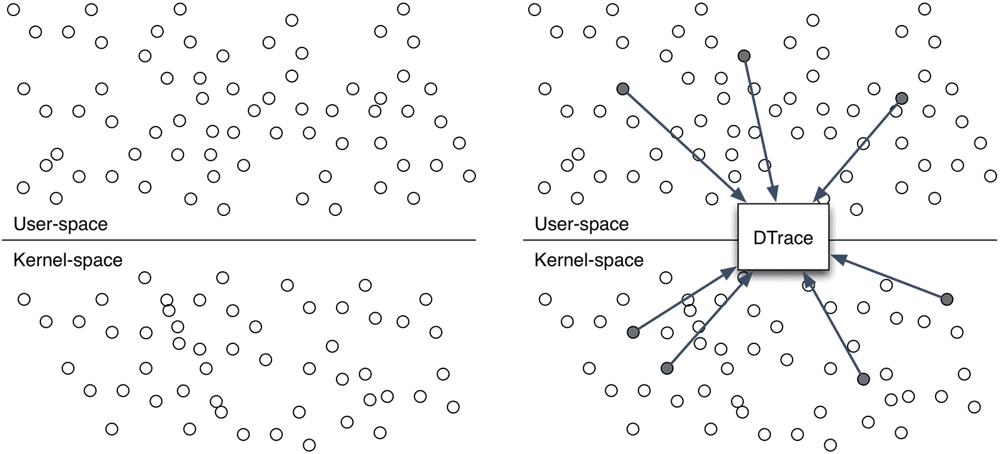

当你运行实验时，探针会根据需要动态插入。如果未启用探针，对系统不会产生影响，因为插桩完全是动态的。这使得 DTrace 在生产系统上诊断运行时问题是安全的。探针的实现方式类似于 APE（应用程序增强器）或 `mach_inject()`，通过修改函数的前几条指令，通过“小技巧”使函数跳转到不同的地方。因此，不活跃的探针不存在插桩代码，在不使用 DTrace 时也不会性能下降。一旦你的 DTrace 实验结束，所有探针将自动禁用。探针是引用计数的，因此你可以并行运行多个实验。

提供者（Providers）是探针来源。例如，`syscall` 提供者允许在系统调用上放置探针。`profile` 提供者按固定的时间间隔触发探针。命令行应用程序 `dtrace` 是你访问所有 DTrace 特性的网纽。它可以列出你可用的探针，为你你想要添加到代码中的新探针生成头文件，并跟踪系统行为。在跟踪期间，它会启用探针，并聚合和显示它在跟踪期间收集的数据。

你可以使用探针来触发你自定义的上下文敏感操作。你与探针关联的操作可以包括获取栈跟踪、查看时间戳、检查函数参数或检查函数的返回值。因此，另一种看待探针的方式是将其视为贯穿系统的可编程传感器。你可以为每个传感器附加代码以分析系统活动。DTrace 的“工作流”如图 9.2 所示，脚本传递给 `dtrace`，在内核运行，积累数据并最终反馈给用户。

**图 9.2 DTrace 工作流**

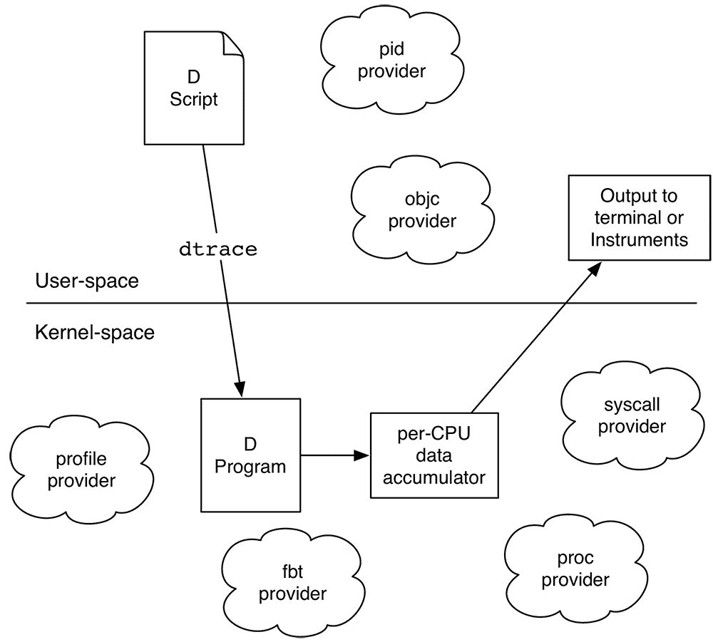

### D 语言

操作使用 D 语言编写。D 是另一种脚本语言，这次深受 C 语言的影响。D 支持 C 的子集，以及一组专门用于分析系统行为的特殊函数。D 程序实际上运行在内核态。在运行之前，它们会被编译成类似于 Java 字节码的安全中间形式，并进行安全性验证。这就是为什么 DTrace 在生产环境中使用是安全的，而不担心崩溃或损坏系统。

DTrace 脚本传统使用 `.d` 文件扩展名。Apple 在 `/usr/bin/` 目录下提供了许多示例脚本，值得一读。

### 脚本

示例 9.1 是一个 DTrace 脚本。

**示例 9.1 eventwatch.d**

```
/* 观察 event() 的入口 */
syscall::event:entry /execname="dirwatcher" || execname="DirectoryService"/
{
    printf("%s 调用了 event()", execname);
}
```

你可以看到 D 使用 C 风格的 /* 注释 */。不支持现代 C / C++ 风格的注释（//）。


```
$ sudo dtrace -s eventwatch.d
dtrace: script 'eventwatch.d' matched 1 probe
CPU             ID FUNCTION:NAME
 1         17238     event:entry DirectoryService called event()
 0         17238     event:entry dirwatcher called event()
 0         17238     event:entry dirwatcher called event()
 1         17238     event:entry DirectoryService called event()
 1         17238     event:entry DirectoryService called event()
```

使用 `sudo` 是因为 `DTrace` 运行需要 root 权限。这使得比 `ktrace` 不方便，`ktrace` 可以作为普通用户运行（这在他人机器上现场诊断程序问题时有用）。`-s` 标志告诉 `dtrace` 从指定文件读取 D 程序，这类似于你给 shell 或 perl 提供执行文件内容时使用的 `-s` 标志。你也可以使用 Unix 的“shebang”技术，通过在文件顶部包含 `#!/usr/sbin/dtrace -s` 并将文件设为可执行，从而在运行脚本时自动调用 DTrace。

此特定示例监控了系统中所有对 `kevent()`（主要的 kqueue 接口）的调用。脚本会打印调用该程序的名称，前提该程序是 `DirectoryServices` 或者 第 16 章：kqueue 和 FSEvents 中的 `dirwatcher` 示例。

DTrace 的输出包括运行特定 `kevent()` 的 CPU、探针的整数 ID、探针的名称，以及我们 `printf()` 语句的输出。你可以通过给 `dtrace` 提供 `-q`（安静）标志来抑制默认输出。

一个 D 脚本由一组句（clauses）组成。示例 9.1 仅有一个句，但你可以拥有任意数量的句。一个句由三个部分组成：

*   探针描述，描述了你想要跟踪的内容。在本例中，我们正在跟踪 `kevent()` 系统调用的入口。
*   一组用大括号括起来的操作。如果没有提供任何操作（仅提供一对空大括号），每当探针触发时，都会打印探针名称。在本例中，我们正在打印一行包含进程名称的文本。
*   可选的由斜杠分隔的谓词（predicate）。只有当谓词求值为真值时，才会执行操作。在这个示例中，我们将跟踪限制在两个程序。你可以通过移除谓词查看系统中所有调用 `kevent()` 的程序。

## 探针 (Probes)

探针（probe）是可以绑定一组操作的位置或活动。指定探针的语法是一个冒由冒号分隔的列表，最多包含四项：

*   `Provider` - 要使用的实例提供程序。你将遇到的一些提供程序包括用于监控系统调用的 `syscall`、用于磁盘的 `io` 以及其他。
*   `Module` - 特定的程序位置。它可以是探针所在的模块，也可以是内核名称或用户库名称。
*   `Function` - 特定的函数名。
*   `Name` - 探针含义的指示。

在 `keventwatch.d` 中，唯一的探针是 `syscall::entry`。`provider` 是 `syscall`，没有模块，`function` 是 `kevent`，`name` 是 `entry`。缺失的探针组件被解释为匹配一切的通配符。如果组件少于四项，描述从右向左评估。你可以使用 shell 风格的通配符：

*   `syscall::open:entry` 将跟踪 `open()` 系统调用。
*   `syscall::open*:entry` 将跟踪任何以 `open.` 开头的条目。这将匹配 `open_extended`。
*   `syscall:::entry` 将跟踪任何系统调用的入口。
*   `syscall:::` 将跟踪由 `syscall` 发布的所有探针。

有多种方法可以探索系统中可用的探针集。`dtrace -l` 将打印内核中提供的每一个探针。在这个系统中，有很多探针：

```
sudo dtrace -l | wc
```
实际上并没有统计所有可用探针。有些是动态生成的，例如分析探针（profiling probes）。你可以在用户空间的 Objective-C 方法上设置探针，因此可能的点没有上限。同时也存在的探针数量很多。在运行上一条命令时，有 13 个应用程序。退出一个应用程序后，总数减少到 756。

你可以将 `dtrace -l` 重定向到文件并用你喜欢的编辑器进行搜索。你也可以通过 `-i` 标志查看哪些探针匹配项。在这里你可以看到之前的匹配情况：

```
sudo dtrace -l -i syscall:open:entry
ID Module Function Name
18649 syscall:open:entry

sudo dtrace -l -i "syscall:open*:entry"
ID Module Function Name
18649 syscall:open:entry
19193 syscall:open_extended_entry
19435 syscall:open_no_cancel_entry

$ sudo dtrace -l -i syscall:::entry | wc -l
```
45
`sudo dtrace -l -i syscall:::entry | wc`
69
`syscall::entry` 在行中加了引号是为了防止 shell 扩展。你可以启用和管理探针，脚本启动时间越长，是因为 DTrace 需要在脚本结束时启用每个探针。

## 提供程序 (Providers)

提供程序（provider）是你使用的设施。有很多内置的提供程序。

### BEGIN 和 END

它们实际上被称为 `dtrace::BEGIN` 和 `dtrace::END`，但通常用 `BEGIN` 和 `END`。`BEGIN` 探针在脚本开始时触发，`END` 探针在脚本结束时触发。示例 9.2 使用 BEGIN 和 END 探针。

```
BEGIN {
    trace("begin execution");
    exit(0);
}

END {
    trace("that's all forks.");
}
```

运行它：

```
$ sudo dtrace -s eventwatch.d
dtrace: script 'eventwatch.d' matched 2 probes
CPU             ID FUNCTION:NAME
 1         17238     event:entry DirectoryService called event()
 0         17238     event:entry dirwatcher called event()
...
```

`trace` 函数类似于 `printf`，但它不接受任何格式化参数。它还会自动换行。


还有一个 `dtrace:::ERROR` 探针，当发生错误时会触发，例如尝试解引用一个 `NULL` 指针。

### pid 提供程序

`pid` 提供程序允许你将探针限制到特定的进程 ID（PID）。如果你知道 `Safari` 的进程 ID 是 1313，可以使用此命令获取所有可用探针的列表：

```
sudo dtrace -l -i "pid1313:::" > safari.txt
```

这取决于你的内存大小，实际实际上可能无法正常工作。你可以尝试在 `TextEdit` 这样较小的应用程序上进行类似操作。

DTrace 允许你在脚本中访问命令行参数。`$1` 是 `dtrace` 消耗的所有参数后的第一个参数，`$2` 是下一个，依此类推。硬编码 pid 是并不方便的，因此你通常会使用 `$1` 在命令行上传递特定的进程 ID。

`malloc-pid.d` 会告诉你特定应用程序何时调用了 `malloc()` 以及请求了多少的内存。

**示例 9.3. malloc-pid.d**

```
pid$1:libSystem.B.dylib:malloc:entry
{
    printf("malloc of %d bytes for %s\n", arg0, execname);
}
```

像这样运行：

```
sudo dtrace -q -s malloc-pid.d 1313
malloc of 32 bytes for Safari
malloc 32 bytes for Safari
malloc 512 bytes for Safari
malloc 2048 bytes for Safari
malloc 512 bytes for Safari
malloc 620 bytes for Safari
^C
```

`-q` 标志用于抑制 `dtrace` 的默认输出。第一个非 `dtrace` 参数是“1313”，它是脚本中 `$1` 的值。探针实际上变成了 `pid1313:libSystem.B.dylib:malloc:entry`。由于 `dtrace` 的默认输出被抑制了，因此在示例 9.3 的 `printf` 语句中添加换行符是必要的。

请注意，脚本永远不会结束。你需要在终端中使用 Control-C 中断它来使其停止。

### syscall 提供程序

`syscall` 提供程序提供系统调用的入口和返回探针。例如：

* `syscall::read:entry` - 当进程从文件描述符读取内容时，触发探针
* `syscall::kill:entry` - 当进程调用 `kill()` 时，执行操作

### profile 提供程序

`profile` 提供定时事件探针。这些探针通常用于每隔显示累积状态。tick  名称用于指定时间，用数字表示时间，用后缀指定要使用的时间单位。示例 9.4 显示了定时器的作用。

**示例 9.4. lubdub.d**

```
profile::tick-5sec
{
    trace("five seconds");
}

profile::tick-1
{
    trace("one");
}

profile::tick-80ms
{
    trace("80");
}
```

该脚本会在指定时间后打印它们的消息。示例如下：

```
sudo dtrace :lubdub.d
events:proc-start:  lubdub.d
80
one
one
one
one
80
five seconds
one
one
one
one
one
one
one
one
one
one
one
C
```

有效的后缀是 `nsec` 和 `msec`，分别表示纳秒和毫秒。`us`、`ms`、`sec`、`day` 用于较长时间的值。还有 `hz` 用于频率频率。

### proc 提供程序

`proc` 提供提供进程级的信息，例如启动和退出。示例 9.5 向你展示何时创建了新进程：**示例 9.5.d**

```
proc:start
{
    trace();
}
```

示例如下：

```
sudo dtrace -s proc.d
dtrace:start:  proc.d'match': 2 events copied to interval
1848 _mac_spawn:ls
1848 _mac_spawn:pwd
18495 iChatAgent
18495 iChatAgent
^C
```

在启动 `iChat` 时，在终端窗口中执行了 `ls` 和 `pwd`。

### fbt 提供程序

另一个提供程序是发音不出来的 `fbt provider`，它代表函数边界转换（function boundary transition）。这些是内核内部的探针。当函数进入或退出时，会触发 `fbt` 探针。使用探针名称 `entry` 或 `return` 在函数进入或退出时运行操作。在这一台雪豹系统中，有 1.8 万个 `fbt` 探针：

```
sudo dtrace -l -i fbt:: | wc -l
18531
```

你可以查看一些可用的探针：

```
sudo dtrace -l -i fbt:: | head -8
ID PROVIDER MODULE FUNCTION NAME
41 fbt mach_kernel AllocateNode entry
42 fbt mach_kernel AllocateNode:return
43 fbt mach_kernel assert:entry
44 fbt mach_kernel assert:return
45 fbt mach_kernel proc_spawn:entry
```


缺少循环是完全理解的。`DTrace` 脚本在编译和验证后，会在内核内部运行。如果发生无意的无限循环导致系统死锁，那将是件糟糕的。

### 变量

没有变量的编程语言算什么？D 有多种类型的变量。对于习惯 C 语言的人来说，简单（标量）变量并不陌生，还有结构体、关联数组、聚合体甚至指针。

简单变量对应 C 的标准类型：`char`、`int`、`short`、`long`、`long long` 以及它们的所有符号变体。可以在它们之间进行通常的 C 风格类型转换。这些变量的大小取决于操作系统内核的数据模型：32 位内核上的 `long` 为 32 位，而 64 位内核上为 64 位。这里没有浮点数变量。你可以显示从探针（probes）获取的浮点值，但无法进行浮点数学运算。你无法将 `float` 转换为整数值。

在使用变量之前不需要声明它，只需对其赋值，该变量将使用第一次赋值时的类型。你不能在声明变量的同时给它赋值。

变量默认是全局的。通常你如果你选择要声明，会在任何子句之外声明变量，然后在 `BEGIN` 子句内部为其赋初值。变量初始化为零。

标准的 C 运算符（`+`、`-`、`*`、`/`、`++` 等）均按预期工作，比较运算符（`<`、`>`、`!=` 等）也是如此。逻辑语句可以使用 `&&` 和 `||`，同样可以使用 `^^`（逻辑异或）。当恰好有一个操作数为真时，异或的结果为真。逻辑或与与执行短路求值，但异或不会。异或的两个表达式总是会被求值的。

变量也可以有字符串值。字符串比较运算符的行为就像你对字符串调用了 `strcmp()` 一样。

示例 9.6 `beer.d` 唱了一首熟悉的歌：

**示例 9.6. beer.d**

```
int bottles; /* 可选 */

BEGIN
{
    bottles = 99;
}

profile:tick-1sec
{
    printf("%d bottles of beer on the wall\n", bottles);
    printf("%d bottles of beer.\n", bottles);
    printf("take one down, pass it around\n");
    printf("%d bottles of beer on the wall\n\n", bottles);

    bottles--;
}

END
{
    printf("that's all, folks...\n");
}
```

像往常一样运行，并在觉得足够时中断它。

```
$ sudo dtrace -qs beer.d
99 bottles of beer on the wall
99 bottles of beer.
take one down, pass it around
99 bottles of beer on the wall
```

### 作用域变量

变量还有两个额外的作用域：`per-thread`（线程级）和 `per-clause`（子句级）。当你想要启用探针并在单个线程执行某些工作时，线程本地变量非常有用。在线程本地变量前加上缀 `self->`。线程的身份在系统的整个生命周期内是唯一的，因此即使线程 ID 被重用，也不会发生任何冲突。子句变量类似于 C 语言中的静态局部变量。它只在特定子句执行时处于作用域内。在子句局部变量前加上缀 `this->`。

### 内置变量

D 提供了一些内置的标量变量。没有内置的线程本地或子句局部变量。

`int64_t arg0, arg1, ... arg9`：探针的前十个输入参数以 64 位整数形式表示。未定义的参数填充零。

`args[]`：当前探针的类型化参数，使用整数索引。例如，`read` 系统调用原型如下
```
ssize_t read(int fild, void *buf, size_t nbyte);
```
因此 `args[0]` 将是文件描述符；`args[1]` 将是指针值；而 `args[2]` 是缓冲区大小 `size_t`。

`cwd`：触发探针的进程当前的工作目录。

`errno`：线程上次系统调用返回的错误值。

`execname`：触发探针的可执行文件名称。

`pid`：触发探针的可执行进程 ID。

`stackdepth`：当前线程的栈帧深度。

`timestamp, vtimestamp`：当前纳秒时间戳的值。绝对值没有意义，但你可以用它们计算差值。`timestamp` 是墙上时（wall-clock time），而 `vtimestamp` 是每个 CPU 时间减去 DTrace 开销的时间。

`probeprov, probemod, probunc, probename`：探针规范四个部分的名称。这后四个对于知道是哪个特定的探针正在触发非常有用，特别是有一个探针规范匹配多个探针时。示例 9.7 追踪了跨系统的所有系统调用。

**示例 9.7. syscalls.d**

```
syscall:execname != "dtrace"
{
    printf("%s in %s\n", probunc, execname);
}
```

这会产生大量的输出：

```
$ sudo dtrace -qs syscalls.d
sigprocmask in WindowsServer
semwait_signal in fentsd
stat in fentsd
getattrlist in back_semwait_signal in stats
```

`execname != "dtrace"` 谓词是为了过滤掉来自 `dtrace` 的系统调用（有很多）。该子句仅在触发探针的可执行文件名称不为 `dtrace` 时才会运行。

你可以从脚本中访问内核和应用程序结构。你可以引用 DTrace 外部的符号，例如在名称前加上反引号：`示例 9.8. average.d` 每五秒显示一次系统平均负载。记住这里没有浮点运算，因此存储在 `runnable` 结构中的负载整数部分和小数部分必须独立计算。

**示例 9.8. average.d**

```
profile:tick-5sec
{
    scale = 1;
    integer = runnable.ldavg[0]/scale;
    decimal = ((runnable.ldavg[0] % scale) * 100) / scale;
    printf("%d.%d\n", integer, decimal);
}
```

示例运行：

```
$ sudo dtrace -qs average.d
1.48
1.36
1.25
1.15
1.6
0.97
0.89
```


该机器之前一直用于执行产品的端到端构建，这导致了平均负载升高。在这里，你可以看到系统正在“冷却”。

## Functions

D 提供了许多你可以在动作脚本（action scripts）使用的函数。以下是示例。

| Function | Description |
| :--- | :--- |
| `printf` | 标准 C 风格 printf 函数 |
| `trace` | 显示其参数，使用基于类型的默认格式。它还会自动为你添加换行符。 |
| `printa` | 打印聚合值，详细说明请见下文。 |
| `ustack` | 打印用户级堆栈跟踪。如果进程在 DTrace 实验完成之前退出或被杀死，DTrace 可能无法解析程序计数器，因此你将获得十六进制值而非符号值。 |
| `exit` | 提前终止执行。否则，你必须输入 Control-C 来退出。 |
| `copyin`, `copyinstr` | DTrace 脚本在内核作用域内执行。考虑探测像 `write()` 这样的系统调用，它接收一个指向要写入数据缓冲区的指针。如果你想在动作中使用缓冲区的内容，就会出现问题。该指针指向用户空间中的地址，而 DTrace 运行在内核空间。使用这些函数之一将数据从用户空间获取到内核空间。 |

```
void *copyin (uintptr_t addr, size_t size)
```

从给定的用户空间地址将指定字节数的数据复制到 DTrace 临时缓冲区，并返回缓冲区的地址。如果可用临时空间不足或给定的地址无效，将生成错误。

```
string copyinstr (uintptr_t addr)
```

从用户空间将零终止的 C 字符串复制到临时缓冲区，并返回缓冲区地址。你可以将返回的地址作为字符串使用。 | 

## Arrays

D 提供了类似于其他语言中哈希表和字典的关联数组。数组的索引可以是由逗号分隔的元组值。`arrayname[pid, probefunc, "bork"] = 23;` 是一个有效的赋值。每次赋值的数组索引类型必须匹配，且赋值的值必须统一。你不能嵌套数组。

示例 9.9 (#ch09s06.html_readtime-example "Example 9.9. readtime.d") 计算了执行 `read()` 系统调用的墙时时间：

**Example 9.9. readtime.d**

```
syscall:read:entry
{
    self->ts[pid, probefunc] = timestamp;
}

syscall:read:return
/self->ts[pid, probefunc] != 0/
{
    delta = timestamp - self->ts[pid, probefunc];
    printf ("read in %s took %d ns\n", name, delta);
}
```

以及示例运行：

```
$ sudo trace -qs ./readtime.d
read in Terminal took 18469 ns
read in emacs-i386 took 14714 ns
read in Terminal took 11391 ns
read in Terminal took 26777 ns
```

谓词的作用是为了防止脚本在读取操作中间启动并获取到错误值。如果没有开始时间，则跳过计算。数组被存储在本地 `self` 变量中，以便一个在多个线程中使用 `read()` 的应用程序不会产生混淆。有趣的是，D 支持 C 风格数组——你可以访问包含指针和数组的内核结构。D 确保所有指针访问都是安全的，因此你不需要担心触发 SEGV。

## Predicates

谓词是用正斜杠括起来的逻辑表达式。当探针触发时，如果表达式求值为真值，则运行动作代码。你可以对同一个探针使用不同的谓词和动作块，并按照它们在源文件中出现的顺序进行执行。

## Aggregates

聚合是 DTrace 将大量单个数据累积为更有用的视图的方法。查看单个的 `read()` 时间可能会非常巨大。拥有读取时间的 `min` / `average` 可能更有趣。使用 聚合的语法类似于数组：

```
@name=count();
```

开头的 `@` 符号意味着正在使用聚合，且赋值是一个函数而非表达式。有许多聚合函数：

- `count()`: 记录被调用的次数。
- `sum(expression)`: 随时间累积表达式的总值。
- `avg(expression)`: 随时间累积表达式的算术平均值。
- `min(expression)`: 记录随时间出现的最小表达式值。
- `max(expression)`: 记录随时间出现的最大表达式值。
- `quantize(expression)`: 在给定的直方图中保留值的 2 的幂分布。表达式的值会增加桶中的值。当程序退出时，`dtrace` 会打印显示显示桶值的 ASCII 图表。
- `quantize(expression, lower_bound, upper_bound, step)`: 与 `quantize` 类似，但使用线性分布而非 2 的幂分布。

好了，这些意味着什么？这里有一些示例。示例 9.10 (#ch09s8.html_countread-example "Example 9.10. countread.d") 统计了任何进程调用 `read()` 系统的次数。

**Example 9.10. countread.d**

```
syscall:read:entry
{
    @calls[name]=count();
}
```

示例运行：

```
$ sudo trace -s ./countread.d
trace:script './countread.d' matched 1 probe
C
    Voodopad Pro 1
    socketfilter 1
    md 12
    DirectoryService 21
    fseventsd 22
    Safari 62
    Terminal 86
emacs-i386 141
```

`dtrace` 在退出时会贴心地为你显示聚合。遗憾的是，如果你有两个聚合，这可能会变得混乱。示例 9.11 (#ch09s8.html_avgread-example "Example 9.11. avgread.d") 统计了调用次数并维持平均时间：

**Example 9.11. avgread.d**

```
syscall:read:entry
{
    @calls[name]=count();
    self->ts=timestamp;
}

syscall:read:return
/self->ts/
{
    delta = timestamp - self->ts;
    @averagetime[name]=avg(delta);
}
```

该脚本的一些输出：


```
$ sudo trace -qs avgread-1.d
^C
VoodooPad Pro 1
ksh 1
securityd 2
open 10
Preview 40
emacs-i38 55
Terminal 122
Terminal 7998
emacs-i38 10062
VoodooPad Pro 10232
open 15512
securityd 17807
Preview 28280
```

其中包含了计数和平均时间，但很难判断计数何何时结束、平均时间从哪里开始。示例 9.12 通过通过创建一个 `END` 探针并使用 `printa()` 打印聚合结果来控制输出。

**示例 9.12. avgread-2.d**

```
syscall:read:entry
{
    self->ts = timestamp;
}

syscall:read:return
/self->ts/
{
    delta = timestamp - self->ts;
    @averime[execname] = avg(delta);
    @callcount[execname] = count();
    @mintime[execname] = min(delta);
    @maxtime[execname] = max(delta);
    self->ts = 0;
}

END
{
    printf("average time\n");
    printa("%s d\n", @averime);

    printf("call\n");
    printa("%s d\n", @callcount);

    printf("min\n");
    printa("%s d\n", @mintime);

    printf("max\n");
    printa("%s d\n", @maxtime);
}
```

脚本运行效果：

```
$ sudo trace -qs avgread.d
^C
average time
Terminal 7941
emacs-i38 9985
DNSResponder 1781
Safari 2466
VoodooPad Pro 55339
events 52786379
ms 55116439

call
DNSResponder 2
emacs-i386 3
Terminal 4
ms 6
events 9
VoodooPad Pro 270
Safari 622.
```

图表总是很有趣的。示例 9.13 聚合了读取时间，但这次时间在进程退出时以直方图的形式表示。

**示例 9.13. avgquant.d**

```
syscall:read:entry
{
    self->ts = timestamp;
}

syscall:read:return
/self->ts/
{
    delta = timestamp - self->ts;
    @quant[execname] = quant(delta);
}
```

这是样本的样式：

```
$ sudo trace -avgquant.d
^C
securityd:
...（此处省略重复统计数据）
30000 = 1
```

其中包含了计数和平均时间，但很难判断计数何何时结束、平均时间从哪里开始。示例 9.12 通过通过创建一个 `END` 探针并使用 `printa()` 打印聚合结果来控制输出。

**示例 9.12. avgread-2.d**

```
syscall:read:entry
{
    self->ts = timestamp;
}

syscall:read:return
/self->ts/
{
    delta = timestamp - self->ts;
    @averime[execname] = avg(delta);
    @callcount[execname] = count();
    @mintime[execname] = min(delta);
    @maxtime[execname] = max(delta);
    self->ts = 0;
}

END
{
    printf("average time\n");
    printa("%s d\n", @averime);

    printf("call\n");
    printa("%s d\n", @callcount);

    printf("min\n");
    printa("%s d\n", @mintime);

    printf("max\n");
    printa("%s d\n", @maxtime);
}
```

脚本运行效果：

```
$ sudo trace -qs avgread.d
^C
average time
Terminal 7941
...（此处省略）
Safari 622.
```

图表总是很有趣的。示例 9.13 聚合了读取时间，但这次时间在进程退出时以直方图的形式表示。

这是样本的样式：

```
$ sudo trace -avgquant.d
^C
securityd:
...（此处省略重复统计数据）
30000 = 1
```

这是样本的样式：

```
$ sudo trace -avgquant.d
^C
securityd:
...（此处省略重复统计数据）
30000 = 1
```

**示例 9.13. avgquant.d**

```
syscall:read:entry
{
    self->ts = timestamp;
}

syscall:read:return
/self->ts/
{
    delta = timestamp - self->ts;
    @quant[execname] = quant(delta);
}
```

**示例 9.13. avgquant.d**

```
syscall:read:entry
{
    self->ts = timestamp;
}

syscall:read:return
/self->ts/
{
    delta = timestamp - self->ts;
    @quant[execname] = quant(delta);
}
```


等于在命令行上传递 `-q` 参数

`#pragma D option flowindent`

如果动作为空，`dtrace` 将打印函数名称。如果你开启此预指令，DTrace 将根据调用深度对函数名进行缩进，从而提供调用栈跟踪。

示例 9.14 是一个脚本，用于追踪当 `ls` 命令行工具调用时，内核中 `open()` 系统调用的函数调用流：

**示例 9.14. trace-ls.d**

```
#pragma D option flowindent

BEGIN
{
    printf("waiting for 'ls'");
}

syscall:open:entry
execname == "ls" && guard++ == 0/
{
    self->traceIt = 1;
}

fbt::
/self->traceIt/
{
}

syscall::return
/self->traceIt/
{
    self->traceIt = 0;
    exit(0);
}
```

以下是一个运行示例，为了简洁进行了截断。该脚本使用“伏击”技术来等待程序开始运行。请在一个终端中运行 `dtrace`，在另一个终端中执行 `ls`。

```
$ sudo dtrace -s ./trace-ls.d
dtrace: script './trace-ls.d' matched 16834 probes
CPU FUNCTION
    1 | :BEGIN                 waiting for 'ls'

    0 ->> open
    0     ->> _thread_testcancel
    0         ->> open_nocancel
    0             ->> vfs_context_current
    0             <-- vfs_context_current
    0             ->> vfs_context_proc
    0                 ->> get_bsdreadtask_info
    0                 <-- get_bsdreadtask_info
    0                   ->> get_bsdreadtasks
    0                   <-- get_bsdreadtasks
    0                     ->> call
    0                     <-- call
    0                       ->> km
    0                       <-- km
    0                         ->> kmx
    0                         <-- kmx
            0                           ->> kmock
            0                           <-- kmock
            0                             ->> called
            0                             <-- called
            0                               ->> all
            0                               <-- all
            0                                  ->> all
            0                                  <-- all
            0                                    ->> produced
            0                                    <-- produced
            0                                      ->> created
            0                                          created.
```

以下是对脚本子句的详细解析：

```
#pragma D option flowindent
```

缩进调用图

```
BEGIN
{
    printf("waiting for 'ls'");
}
```

```
syscall:open:entry
execname == "ls" && guard++ == 0/
{
    self->traceIt = 1;
}
```

该子句关注 `open()` 系统调用。当在名为“ls”的进程中进行 `open()` 调用时，设置 `traceIt` 标记。谓词（predicate）让我们在看到 `ls` 之前等待不要执行任何操作。守卫变量（guard variable）是为了确保我们只追踪一个特定的 `open` 调用。这可以防止脚本在有多个 `ls` 进程运行或在多个线程中使用 `open()` 时产生混淆。

```
fbt::
/self->traceIt/
{
}
```

此动作会在每次进入或退出内核函数时被调用。内核做了大量工作，只有当脚本正在活跃追踪时，我们才对这些函数调用转换感兴趣。由于上一个动作的谓词限制，只有一个进程中的一个线程在追踪 `open()` 的执行过程。

```
syscall::return
/self->traceIt/
{
    self->traceIt = 0;
    exit(0);
}
```


CPU 具有大量的内部并行性，允许多个整数单元和浮点单元并行进行计算，并有可以通过单条指令处理多块数据的向量单元。除了独立的处理器单元外，现在的 CPU 还采用了多核（multicore）和超线程（hyperthreaded）架构。多核芯片在单个物理芯片上具有多个不同的 CPU。这些处理器相互并行运行，并拥有各自的逻辑单元。超线程处理器在单个 CPU 中并行运行两个或多个线程。超线程仍然共享处理器缓存和数学运算单元等资源，但它仍然允许处理器在给定的时间范围内处理更多的指令。这些技术可以相互结合，使得一台 8 核 MacPro 看起来像有 16 个处理器。GPU（位于显卡上的图形处理器）的并行性进展得比 CPU 还要快。GPU 拥有 256 个并行运行的处理器的情况并不罕见。

为了利用这些多核和超线程架构，并行代码正变得越来越流行。由于编写正确的并发程序具有难度，并行代码通常是更高级程序员的领域。正如你在第 20 章：多线程 中看到的，有很多问题使得并行开发变得困难。更多的程序员将需要学习这个世界及其问题，以便我们（作为一个行业）能够继续开发出行为正确且性能符合用户预期的软件。Grand Central Dispatch 等技术有助于缓解并行编程中固有的某些问题，但要做到完美仍然很困难。

硬件层面的设计决策对我们这些生活在软件端的人有着影响。编写高效的代码正在重新流行，因为我们不能指望处理器通过“仅仅变快”来帮助我们。

用户正在处理不断增长的数据集，这一事实对问题也没有帮助。随着计算机变得越来越强大，用户正在使用它们来处理更大型的数据集。以 iPhoto 为例，人们最初使用 iPhoto 管理包含较小照片的小型库。现在，我们有了 TB 级硬盘、16 核机器和廉价的高像素数码相机，用户正在创建包含巨大图像的海量照片库。随着时间的推移，用户将期望能够处理不断更大的数据集。他们不会特别在乎听任何关于千赫兹障碍的借口。

## 性能优化方法

保持性能的关键是使用性能分析工具（profiling tools）。尽早分析，经常分析。在开发早期捕获性能问题，这样你就不会围绕一个低效的核心构建大量代码。如果你定期使用 `Instruments`、`Shark` 或性能工具，你就可以在性能问题出现并影响你之前预见到可能的问题。

务必在每个新的操作系统修订版本以及新硬件发布时进行分析。随着 Apple 对 Mac OS X 底层的修改，原本最优的设计现在可能是次优的，反之亦然。硬件的变化可以改变游戏的性能。考虑一下查找表（look-up tables），这是避免计算的一种常用方法。在 PowerPC G4 和更早的处理器上，使用查找表通常是一个巨大的胜利，但 G5 在从内存加载数据的时间内就可以完成大量的计算。如果你必须支持旧版本的操作系统，或者你想针对差异巨大的硬件进行优化优化，那么这种情况可能会变成一个真正的问题。

注意不要在追求“最佳性能”的崇高目标初期就完全扭曲你的设计。你可能正在解决对你的最终产品没有实际影响的性能问题。性能分析工具的报告并非真理。一份报告可能会突出一个性能问题，但该问题可能是不需要修复的。如果分析工具标出的问题不会影响你程序的用户体验，或者它极少发生，你可以将精力放在优化其他内容上。

最后，不要只分析你的开发构建版本（development builds）。如果你为部署版本使用了不同的编译器标志（特别是具有更高的优化级别），你将希望对最终构建进行某些分析，以免浪费时间去修复那些随编译器优化而改变的代码路径。

## 性能问题的主要原因

性能问题通常来自 5 个主要领域中的一个或多个：算法、内存、CPU、磁盘和图形。诚然，这几乎涵盖了程序与机器交互的所有内容。你可以使用性能工具单独查看计算机性能的每个方面，以便更好地掌握整体性能问题，即使一个问题在多个类别中引发问题。

### 内存

尽管现代机器拥有大量的内存，但 RAM 仍然是稀缺资源。一旦你的应用或系统的其他应用填满了内存，Mac OS X 开始将内存页发送到磁盘，从而破坏性能。在 iOS 设备上，你的程序在内存不足的情况下可能会被直接杀死。

通常，如果你通过优化来减少内存使用（针对空间优化），你通常会获得执行时间的缩短，因为处理器不需要等待额外数据从内存到达。此外，由于 Mac OS X 是运行着守护进程的共享系统，每个用户运行自己的许多程序，并且可能有多个用户登录，因此在内存使用上保持谨慎是好的。当每个进程都有自己宽阔的地址空间可以操作时（特别是在使用 64 位寻址时），这是一门严苦的纪律。

### 引用局部性

“引用局部性”（Locality of reference）描述发生在彼此附近的内存访问。从一个 4k 页面读取一百个字节比从分散在地址空间中的一百个不同页面中读取一个字节要快。当你从内存请求数据时，处理器实际上会获取一个字节序列，称为缓存行（cache line），前提是你会以连续的方式访问内存。从处理器的角度来看，获取一个 64 字节的缓存行与获取一个 4 字节整数一样快。因此，如果你设置循环以按顺序操作内存，你就能看到性能的提升。

示例 10.1 创建了一个大型二维全局数组并以两种不同的方式访问它。

```
Example 10.1. locality.m
```


```c
// /locality-time_locality of reference

#include <stdio.h> // for printf
#include <stdlib.h> // for EXIT_SUCCESS
#include <time.h> // for time_t, time()

gcc -g -std=c99 -o locality locality.m

#define ARRAY_SIZE 200000
int a[ARRAY_SIZE][ARRAY_SIZE]; // 创建一个巨大的数组

int main(int argc, char *argv[]) {
    // 按行主序（row-major order）遍历数组，这样当我们处理完
    // 一个页后，就不会再去碰它。

    time_t start = time(NULL);
    for (int i = 0; i < ARRAY_SIZE; i++) {
        for(int j = 0; j < ARRAY_SIZE; j++) {
            a[i][j] = 1;
        }
    }

    time_t end = time(NULL);

    printf("row-major: %d operations in %ld seconds.\n", ARRAY_SIZE * ARRAY_SIZE, end - start);

    // 按列主序（column-major order）遍历数组。这会导致多次访问同一个内存页。

    start = time(NULL);
    for (int j = 0; j < ARRAY_SIZE; j++) {
        for (int i = 0; i < ARRAY_SIZE; i++) {
            a[i][j] = 1;
        }
    }

    end = time(NULL);

    printf("column-major: %d operations in %ld seconds.\n", ARRAY_SIZE * ARRAY_SIZE, end - start);

    return EXIT_SUCCESS;

} // main
```

以下是运行示例：

```
$ ./locality
row-major: 40000000000 operations in 3 seconds.
column-major: 40000000000 operations in 27 seconds.
```

仅仅是反转 `for` 循环就会导致 9 倍的性能损失！第一个循环遵循了 C 语言组织数组内存的方式，如图 10.1 所示。该循环访问相邻的字节，在遍历数组时具有良好的引用局部性（locality of reference）。内存页仅被访问一次，一旦循环停止对某个页的内存操作，该页就不会被再次使用。

**图 10.1 良好的内存访问模式**

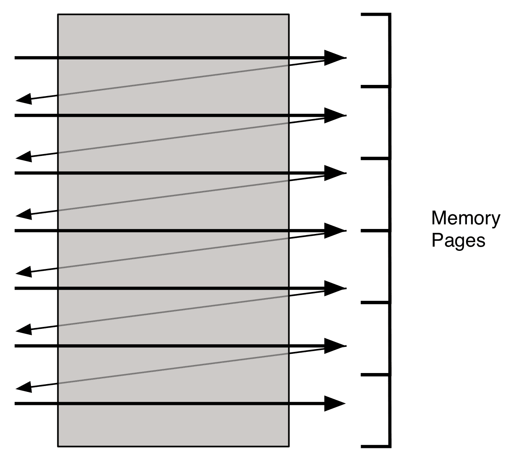

第二个循环则是“跨越纹理”工作的，如图 10.2 所示。它导致每次循环都会命中数组使用的每一个内存页。这给虚拟内存系统带来了巨大的压力，因为每个页都保持着“热”状态，导致内核不断地调整其最久未使用（LRU）页列表。第一个循环因为在工作完成后不再触碰某个页，所以对内核更加友好。一旦该页从内核的数据结构中老化，就不会再次被看到。

**图 10.2 糟糕的内存访问模式**


在循环通过指针或全局变量使用数据结构时，编译器会生成代码，在每次循环时都重新加载内存中的该位置。这样做是为了防止该值可能被其他人修改，要么是在另一个线程中，要么是在循环内部调用的函数中。创建一个局部变量来存储全局变量的值可以让编译器判断出这些数据不会发生变化，从而避免每次循环时的内存访问开。

## CPU
CPU 使用率是大多数程序员在面对优化问题时首先考虑的指标。“我的应用正占满 CPU（pegg the CPU），我需要加快运行速度。”通常，当 CPU 使用率成为主导因素时，根源在于算法缓慢。它可能具有高复杂度，也可能只是实现得糟糕。在几乎所有情况下，更改算法带来的速度提升都比大多数其他类型的代码或系统调优要得多。经典的例子是从复杂度为 `O(N²)` 的冒泡排序算法改为快速排序或合并排序，后者的复杂度为 `O(n log n)`。

有时，算法的糟糕实现会造成灾难性的影响。例如，在 SunOS 4.1.x 的一个版本中，一个编程错误导致 `strstr()` 从一个 `O(N)` 操作变成了毫无价值的 `O(N²)` 操作：

```
while (c < strlen(string)) {
    // do stuff with string[c]
}
```

请记住，C 字符串并不存储其长度。字符串只是一个以零终止的字节序列。`strlen()` 必须遍历整个字符串并计算字符。你可以使用一些技巧以大于一个字节的块来处理工作，但这仍然是一个 `O(N)` 操作。在这种情况下，字符串的长度不会改变，因此没有理由每次循环时都获取一次长度。

幸运的是，高 CPU 使用率很容易发现：注意到活动监视器（Activity Monitor）中的 CPU 仪表满载、`top` 显示你的应用消耗了 99% 的可用 CPU 功率，或者你的笔记本外壳开始发烫。本章后面讨论的采样和分析工具是追踪这些问题原因的理想选择。

## 磁盘
磁盘访问非常缓慢——比访问内存慢好几个数量级。通常情况下，如果可以避免磁盘 I/O，请尽量避免。如果你计划缓存磁盘数据，请记住虚拟内存系统也会使用磁盘。如果你缓存了大量数据，可能会导致 VM 系统执行磁盘 I/O。这是一个非常糟糕的情况，因为你现在将一次磁盘读取（从磁盘到内存）换成了一次读取、一次页面换出（page out）写入，以及另一次从磁盘换回内存的页面读取。

在涉及 VM 分页的优化磁盘访问时，引用局部性起着作用。如果引用局部性较差，你就会触及许多页面。这些页面会导致其他页面从 VM 缓存中“老化”并发送到磁盘。最终你会再次接触它们，这可能会导致磁盘 I/O 以检索这些页面上的数据。

你可以通过根本不执行工作来避免部分磁盘 I/O 的开销。将窗口放入不同的 `.nib` 文件并按需加载是一种常用技术。如果你不需要显示窗口，就没有理由将其加载到内存中。

同样，如果你有一个大型信息数据库，分段访问它与将整个内容加载到内存相比，可以获得显著的速度提升。使用内存映射文件可以避免磁盘活动，因为只有被访问的文件部分才会进入内存。

## 图形
Mac OS X 中的 Quartz 图形引擎给内存系统带来了巨大压力。Quartz 使用大型图形缓冲区，屏幕上显示的每个窗口都对应一个。此外，还有用于渲染用户桌面的合成操作。Quartz 也使用 CPU 来完成某些绘制效果，尽管其中许多操作已迁移到显卡上的图形处理单元。有些操作在 GPU 上运行效果并不佳，因此必须在 CPU 上完成。

优化图形的关键是尽可能避免绘制。使用图 10.5 所示的 Quartz Debug 实用程序，查看你在哪里进行了不必要的绘制。最常用的功能位于绘制信息（Drawing Information）面板中。自动刷新（Autoflush）绘制会让绘制操作在发生立即显示在屏幕上，而不是批量处理到下次更新。绘制到的屏幕区域可以设置为闪烁，以便你看到自己在哪里绘制。相同的屏幕更新将以不同的颜色突出，以便你看到哪里发生了冗余工作。

**图 10.5 Quartz Debug**

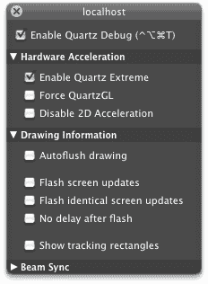

`NSView` 的一些功能可以让你决定视图的哪些部分需要重绘，哪些不需要。你可以对传递给 `NSView` 的 `drawRect:` 方法的矩形进行命中测试（hit-test），并仅对位于该矩形内的项目执行绘制调用。该矩形往往是所有需要重绘区域的并，因此你可以咨询 `getRectsBeingDrawn:` 和 `needsToDraw:` 来针对需要重绘的区域进行命中测试。

Quartz 绘制让某些程序员措手不及的一个方面是，单个路径中重叠线条的代价很大。在交叉处会发生大量工作，例如对交叉点进行抗锯齿处理，以及确保透明颜色被“涂抹”多次并显得更深。如果你需要绘制大量重叠的线条，特别是当你使用不透明颜色且不在乎抗锯齿时，通过绘制许多小路径可以获得好多的性能。

## 在使用任何分析工具之前
忘记你对性能问题可能位置的任何假设。程序员在预测性能问题所在之处是出名的糟糕，否则问题早被修复了。我工作过的一位程序员坚信文件加载和磁盘 I/O 是程序中缓慢的部分，并花费了大量精力优化磁盘访问。在用 Shark 快速分析后，问题实际上在于将数据序列化到树中以供 `NSOutlineView` 使用。实际 I/O 上花费的时间微乎其微。

良好记录你所做的操作和测量结果，以便将这些优化应用到其他情况。通过记录执行时间（例如），你可以判断你的优化尝试是有帮助的还是实际上让问题变得更糟。

在追踪性能问题时，给你的应用投递一个大型数据集。对于之前提到的文件加载问题，某些测试数据是 5K 的文件，加载需要一秒或两秒。这个窗口太小，无法得出任何结论。如果你的应用程序设计用于编辑 50 页的研究论文，那么就给它投递 500 页或 5000 页的文档。更大的数据集会让 `O(N²)` 算法像异常一样显眼。如果你的程序在编辑 5000 页文档时响应良好，那么当用户用它编辑 50 页文档时，应该会获得非常好的体验。不要尝试处理多两三个数量级的数据，因为那么多数据可能需要重新设计数据结构，并且对于较小的数据集可能是不优的。


关于何时应该进行优化，存在一些争议。一种观点是“过早优化是万邪恶的根源”，你应该等到开发周期结束时再识别并修复性能问题。不幸的是，如果存在根深蒂固的瓶颈，这可能需要对产品的大部分进行重构。另一种观点是像节一样，对性能保持恒恒的自律。这种做法的缺点是，过早优化可能会模糊设计和代码，使得在发布前难以追踪程序错误。

正如生活中的大多数事情一样，中庸是一个很好的立足点。关注那些可以改进的算法，但不要在开发过程早期就为了减少每一个可能的周期而使代码变得复杂。经常向你的程序输入大型数据集。不要等到贸易展或发布前夕才让你的程序面对客户的各种考验。关注内存使用情况，防止其增长过快。此外，务确保在用户的环境中运行程序。如果你正在编写桌面应用，请确保 `Safari` 和 `iTunes` 正在运行，因为用户可能在使用这些程序。如果你的应用程序是一个内存大户并导致 `iTunes` 卡顿，你绝对会收到用户的投诉。

## 命令行工具

Mac OS X 带有许多命令行工具，用于追踪特定类型的性能问题。命令行工具的好处在于，你可以远程登录到机器并观察事件的发生。它们也不会干扰应用程序的用户界面。

### time

最简单的工具是 `time`。它对命令执行进行计时，并显示时钟时间、用户空间 CPU 时间以及内核内核消耗的 CPU 时间。以下是在 `TextEdit` 上运行 `/usr/bin/time` 的示例。测量的时间是从启动 `TextEdit`、加载 `/usr/share/dict/words` 到从顶部滚动到 Implementation 部的时间。

```
$ time /Applications/TextEdit.app/Contents/MacOS/TextEdit
real    0m14.619s
user    0m1.257s
sys     0m0.180s
```

这是 14 秒的时钟时间，用户空间占用 1 秒，内核空间占用不到 1 秒。

C shell 有它自己的 `time` 版本，可以提供更多信息：

```
% time /Applications/TextEdit.app/Contents/MacOS/TextEdit
2.515u  0.226s  0:15.01  18.1%	0+0k  22+43io  0pf+0w
```

这是用户空间 2.5 秒，内核空间 0.2 秒，时钟时间 15 秒。18.1% 是利用率百分比：用户时间 + 系统时间与实际时间的比例。紧随时间信息之后的是内存信息：共享+未共享内存的使用情况、输入+输出操作、缺页中断次数和交换次数。OS X 似乎没有报告共享+未共享内存的使用情况。

`time` 在比较优化结果时非常有用。使用 `time` 运行一个基准测试，进行优化，然后再次尝试 `time`。如果你正在优化 CPU 使用率并发现 CPU 时间数字在上升，你应该重新考虑该特定的优化。

### dtruss

许多 Unix 系统都有一个实用程序，可以显示程序产生的所有系统调用。在 Solaris 上，它被称为 `truss`；在 Linux 上，它是 `strace`。Mac OS X 10.4 拥有 `ktrace`（内核追踪），而 Mac OS X 10.5 及更高版本拥有基于 DTrace 的类似工具 `dtruss`。

`dtruss` 运行需要 root 权限，因为 DTrace 需要权限。如下所示运行：

```
$ sudo dtruss ls
```

这将生成几数百行输出，如下：

```
SYSCALL(args*)	=return
getpid(0x7F5F5F60)	=2234
open("/usr/lib/system.dylib",O_RDONLY)	=3
mmap(0,0)	=0
brk(0x200000)	=0
read(3,0,0)	=0
close(3)	=0
close(3)	=0
read(4,"/usr/lib/system.dylib")	=0
close(4)	=0
```

输出并不容易读，但包含大量信息。`ls` 启动了，调用了 `getpid()`，返回值为 9234，即 `ls` 的进程 ID。函数退出后，errno 为 0。如果发生错误，`dtruss` 将打印如下结果：

```
stat64("guest")	=-12
```

返回值为 -1，errno 设置为 2。

能够看到系统调用流量是一个极好的调试助手，特别是当你有一个程序无法启动时。你可以看到程序是否正在尝试加载共享库，或者它是否需要某些未提供的配置文件。

系统调用追踪也可以作为性能调优的辅助。你可能会发现许多单字节写入，这些写入可以合并为单个操作；你可能为 `kevent()` 设置了糟糕的超时，导致它返回的结果比你预期的多；或者你可以看到程序为什么处于阻塞状态。

### fs_usage and sc_usage

`fs_usage` 和 `sc_usage` 是作为 root 用户运行的程序，也会显示系统调用活动。`fs_usage` 显示文件信息，而 `sc_usage` 显示系统调用信息。以下是 BigShow 开始分页的：

```
$ sudo fs_usage
password: 
18:38:06 open /Preferences/com.apple.dock.plist 0.00005  BigShow
18:38:06 stat 0.00000  BigShow
18:38:06 read 0.000029  BigShow
18:38:06 close 0.00000  BigShow
18:38:06 close 0.00000  BigShow
18:38:06 read 0.00000  BigShow
18:38:06 close 0.00000  BigShow
18:38:06 open /Preferences/com.apple.dock.plist 0.00053  BigShow
18:38:06 close 0.00000  BigShow
... (此处重复大量行)
18:38:06 close 0.00000  BigShow
```
（省略重复内容）


```
18:34:38 GetAttributeInfo 0.0000174 LaunchCFMap
18:34:38 PBMakeFSSpec (0, 0x0, 0x0, 0x0) LaunchCFMap
18:34:38 getattrlist .vol/280763/Mozilla.app 0.000032 LaunchCFMap
18:34:38 PBMakeFSSpec 0.000064 LaunchCFMap
18:34:38 GetAttributeInfo (-100, 0x0, 0x0, 0x0) LaunchCFMap
18:34:38 getattrlist .vol/280763/Mozilla.app 0.000046 LaunchCFMap
```

`sc_usage` 以类似于 `top` 的方式显示程序的系统调用，并持续更新显示。以下是来自 Safari 的快照：

```
Safari 12 preptions 189 context switches 8 threads 16:05:42
             0 faults 706 system calls 0:00:07

TYPE NUMBER CPU_TIME WAIT_TIME
--------------------------------------------------------------------------------
System Idle 00:06.608(00:00.922)
System Busy 00:00.368(00:00.655)
Safari User 00:00.190
mach_sgrap 00:00.248(00:00.278)
kevent 00:00.203(00:00.531)
waitignal 00:00.000(00:01.493)
select 00:00.000(00:01.004)
CURRENT_TYPE_PATHNAME_WAIT_FOR_CUR_WAIT_TIMD#PRI
----------------------------------------------------------------
mach_sgrap 00:00.016 46
mach_sgrap 00:00.150 1 46
waitignal 00:00.496 2 47
kevent 00:00.481 3 49
workq_ops 00:00.000 00:00.576(00:1.004)
```


```
$top -e

Processes: 70 total, 4 running, 66 sleeping, 260 threads 16:09:30
Load Avg: 0.19, 0.28, 0.24 CPU usage: 6.27% user, 5.51% sys, 88.20% idle
SharedLibs: 7424K resident, 7276K data, 0B linked.
MemRegions: 9361 total, 451M resident, 17M private, 290M shared.
PhysMem: 798M wired, 1062M active, 427M inactive, 2287M used, 1809M free.
VM: 168G size, 1041M framework size, 339589(0) pageins, 278055(0) pageouts.
Networks: packets: 2550949/3311M in, 1667316/160M out.
Disks: 561048/8214M read, 976911/21G written.

PID COMMAND %CPU TIME #TH #WQ #POR #MRE RPRVT RSHRD RSI SIZE VPRVT
9317 top 3.8 00:00.63 1/1 0 24 33 920K 244K 1496K 17M
9316-WebKitPlugin 0.3 00:03.47 6 2 110 245 954K 30M 15M
9306 Safari 0.2 00:12.02 1 1 167 539 53M 26M
9299 ch 0.0 00:00.41 1 0 25 262K 592K 17M
9202 bash 0.0 00:00.36 1 1 50 77 438K 19M 29M
9202 h 0.0 00:00.31 1 0 17 25 500K 97K
9198 log 0.0 00:00.21 1 0 22 24 512K 1608K 10M
9180 ssh 0.0 00:00.41 1 0 22 25 508K 244K 1812K 958K
8900 Preview 0.0 00:16.27 1 1 125 268 20M 73M 45M 28M
8886 WebKitPlugin 0.0 00:00.01 2 2 28 51 544K 244K 988K 40M
8850 Activity M 0.0 00:35.63 2 1 106 243 5360K 75M 15M 25M
8700 VDCAssista 0.0 00:00.15 4 1 907 384K 19M 304
```

这里有大量信息。70 个进程，260 个线程。共享库占用了数兆字节的内存。每个进程都有线程数等信息，调整窗口可以查看更多列。`top -e` 显示累计输出，而 `top -d` 将显示增量模式（delta mode）。更新间隔为一秒。可以使用 `-s` 标志来控制间隔次数。

### 随机剖析

一种实用的低技术工具是“随机剖析”，即你在调试器中运行程序，并偶尔中断它以查看堆栈上的内容。如果你在堆栈上反复看到相同的函数，你就知道该从哪里开始了。如果你在一个没有传统性能工具的平台上，这种技术非常方便。此外，它快速又简单，特别是当你已经已经在调试器中运行程序时。

### sample

你可以从命令行进行一些剖析，以快速粗略地回答“这里发生了什么？”的问题。`sample` 程序以毫秒为间隔对进程进行采样，并构建程序正在执行的操作快照。你可以给 `sample` 提供一个 `pid` 或提供程序的部分名称：

```
$sample units 5
sampling processes 216 each 10ms
analysis of processes 216 written /tmp/units_216.sample.txt
```

生成的跟踪文件显示了一系列调用堆栈，每个线程一个，并记录了在调用堆栈中发现这些特定函数的次数。这里是一个等待在运行循环中的线程示例。

```
434 Thread_1103
434 _thread_body
434 dyld_stbinding_helper
434 CRLoopRun
434 CRLoopRunSpecific
434 _CRLoopRun
434 mach_msg
434 mach_trap
434 mach_trap
```

这就是你在活动监视器（Activity Monitor）中采样进程时得到的相同输出。

## 使用 `mach_absolute_time()` 进行精确计时

命令行工具是代码片段基测试的好地方，这对于可以隔离算法或完整应用程序的情况非常有用。几十到几百行的命令行工具比百万行的应用程序容易处理得多。并不是每个问题都可以进行基准测试，但足够的案例让这种技术变得有用。

命令行程序的用处在于，你可以使用 `time` 命令获取程序的绝对运行时间，从而对比你所做的更改。

但有时 `time` 命令的粒度不够。你可能需要更精确的计时，或者你只对程序的特定部分感兴趣。你可能对加载算法数据的时间感兴趣。如果加载数据的时间是算法运行时间的三倍，你需要在程序内部自己进行计时。

Mach（OS X 的内核）提供了一些用于精确计时的函数。`mach_absolute_time()` 读取 CPU 时间基器并将其值返回给你。这个时间基器是操作系统其他时间测量的基础：

```
uint64_t mach_absolute_time (void);
```

`mach_absolute_time()` 返回基于 CPU 时间的值，因此无法直接用于获取时间值，因为不知道计数器的每次增量代表多长时间跨度。

要将 `mach_absolute_time()` 的结果转换为纳秒，使用 `mach_timebase_info()` 获取 `mach_absolute_time()` 值的缩放：

```
kern_return_t mach_timebase_info (mach_timebase_info_t info);
```

其中 `mach_timebase_info_t` 是指向此结构体的指针：

```c
struct mach_timebase_info {
    uint32_t numer;
    uint32_t denom;
};
```


`mach_timebase_info()` 会填充该结构体，其中包含用于乘以 `mach_absolute_time()` 结果的分数，以便计算纳秒。将 `mach_absolute_time()` 的结果乘以 `numer` 并除以 `denom`。

示例 10.2 显示了如何使用这两个函数。代码计时测量了调用 `mach_timebase_info()` 和 `printf()` 所的时间。对于实际代码，你可能想在其中放入一些更有趣的内容进行计时。

**示例 10.2. machtime.m**

```
/machime.m-exercise_mach_absolute_time()

#include <mach/mach_time.h>   // 用于 mach_absolute_time() 及相关函数
#include <stdio.h>            // 用于 printf()
#include <stdlib.h>           // 用于 abort()

// gcc -Wall -o machime machime.m

int main(void) {
    uint64_t start = mach_absolute_time();

    mach_timebase_info_data info;

    if (mach_timebase_info(&info) == KERN_SUCCESS) {
        printf("scale factor: %lu / %lu\n", info.numer, info.denom);
    } else {
        printf("mach_timebase_info failed\n");
        abort();
    }

    uint64_t end = mach_absolute_time();
    uint64_t elapsed = end - start;
    uint64_t nanoseconds = elapsed * info.numer / info.denom;

    printf("elapsed time was %ll ns\n", nanoseconds);
    return 0;
} // /machime
```

这里是它的运行效果：

```
$machime scale factor: 1 / 1 elapsed time was 5055 ns
$machime scale factor: 1 / 1 elapsed time was 55055 ns
$machime scale factor: 1 / 1 elapsed time was 95363 ns
$machime scale factor: 1 / 1 elapsed time was 46839 ns
```

在该系统中（一台 2010 年的 Macbook Pro），转换的分子和分母都是 1。一些较旧的机器，例如原始的 TiBook，其转换分子为 1,000,000,000，分母为 24,965,716，导致比例值为 40.05。因此，`mach_absolute_time()` 每增加一次，大约对应 40 纳秒。

在第二次运行之外，两次计时之间的工作耗时大约 50,000 纳秒，即 50 微秒。那么为什么中间这一次运行的时间是其他的两倍呢？当你处理如此短的时间值时，任何事情都可能干扰它们。也许第二次运行需要某些动态库查找。也许 iTunes 正在运行并加载一个新曲目。也许 Time Machine 启动了。对于真实的基准，你应该运行更长的时间来掩盖微小的一次性波动。当然，你还会运行几次基准测试以获得良好的平均值并消除噪声。

## GUI 工具

Mac OS X 自带了许多 GUI 性能工具，它们比命令行工具强大得多且更易使用。

### 活动监视器 (Activity Monitor)

每个 Mac OS X 系统的“实用”文件夹中都包含“活动监视器”应用程序。

**图 10.6 活动监视器**

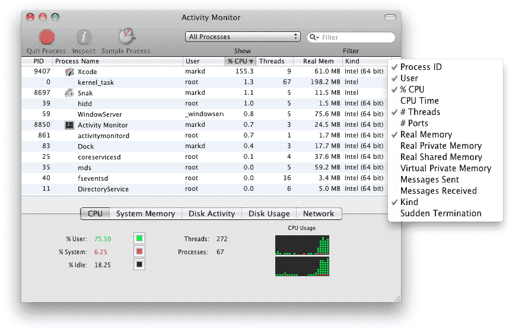

活动监视器在表格视图显示每个进程的基本信息，你可以弹出上下文菜单来深入更底层的信息。窗口底部的面板让你看到有关整个系统的彩色图表和图形。“采样进程”（Sample Process）按钮会运行 `sample` 命令并将输出放入窗口中。采样对于查看锁定的进程阻塞在什么地方非常有用。

### Instruments

Instruments 是 Apple 的一套性能分析工具集。Instruments 应用程序本身是一个通用程序，允许你配置一组单独的工具（称为 instruments），以跟踪你特定想要了解应用的任何信息。Instruments 的许多工具除了关注单个进程外，还可以对整个系统进行性能分析。

你可以直接从 Finder 运行 Instruments，也可以在 Xcode 中选择 Profile（性能分析）。你可以在 Xcode 中编辑 Profile 方案，以选择分析时使用的默认模板，或者让 Instruments 在启动时进行提示。你还可以运行 `instruments` 命令行工具在不运行 GUI 的情况下记录性能分析。

### 布局

Instruments 的用户界面灵感源自 Garage Band，但没有木纹窗框处理（真遗憾）。图 10.7 显示了一个空白模板，其中已经从库窗口拖入了 Leaks 和 Allocations 工具。

**图 10.7 Instruments 和 Library 库窗口**


Instruments 窗口的左侧持有用于记录活动的不同工具。中间的轨道面板是显示分析数据的地方。窗口的底部显示了关于记录跟踪（trace）的更详细信息，并进行了简要描述。

### 工具栏

窗口顶部的工具栏具有记录分析的控件、暂停分析的控件，以及用于回放用户操作的循环控制。

Target（目标）菜单选择文档的跟踪目标。目标告诉 Instruments 要收集哪些进程的信息。“All Processes”（所有进程）让 Instruments 收集系统范围。并非所有工具都支持系统级数据收集。

Inspection range（检查范围）控件让你将关注缩小到特定的时间段。也许在你真正想要分析的部分之前，你对应用程序进行了一些调试。你可以调整检查范围以排除掉调试部分。要设置检查范围，将回头移动到感兴趣的时间范围的开始并点击左侧 Inspection Range 按钮。然后将回头移动到范围的结束并点击右侧按钮。在跟踪区域内按 Option 键拖拽也可以设置检查范围。

工具栏中间的 LCD 风格屏幕是 Time/Run 控制。它显示了记录时已过去的时间，或者一个完成的跟踪有多长。“Run X of Y”按钮允许你在当前会话中进行的多次分析运行之间切换。视图按钮打开并关闭各种侧边面板，就像 Xcode 中类似的图标的作用一样。从左到右，它们分别控制工具面板（左侧）、详情面板（底部）和扩展详情面板（右侧）。

### 查看内存泄漏

图 10.8 显示了在收集了一些数据后的 Instruments 窗口。使用了空白模板，并从库中拖入了 Leaks 和 Allocations 工具。目标应用程序是 Cycling Fusion 的 ClassBuilder™ 应用，这是我在编写本章节时正在开发的。


注意轨道面板（track pane）现在已经有一些内容。`Leaks` 工具显示了一个堆叠柱图，其中包含发现的泄漏数量（顶部）和泄漏字节计数（底部）。`Allocations` 工具显示了分配的内存量。`Leaks` 工具以相对较大的间隔获取内存快照（默认为十秒），这解释了为什么泄漏标记与分配跟踪中的增长并不完全对应。

在时间轴上来回移动播放头会显示一些微小的“检查标记（inspection flags）”，这些是显示跟踪中该时间点数据的工具提示提示窗。图 10.9 显示 `Leaks` 工具发现了 29 个独立的泄漏，导致了 4.62KB 的内存泄漏。由于内存分配导致的应用程序总内存占用约为 2 兆字节。

**图 10.9 播放头详情弹窗。**

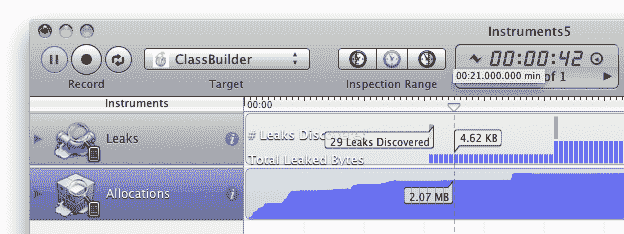

详情面板位于窗口底部。在图 10.8 中当前选择了 `Allocations` 工具，因此详情面板正在显示有关分配的信息，包括一些彩色条形图，显示了不同大小内存块和不同类型对象的当前和总分配。

现在让我们找出内存泄漏到底发生在哪里。图 10.10 选中了 `Leaks` 工具。详情面板默认会显示它能看到的一切，但你可以通过`检查范围（Inspection Range）`将时间轴缩小到特定的时间段，详情面板会随之更新。

**图 10.10 显示泄漏块的详情面板**

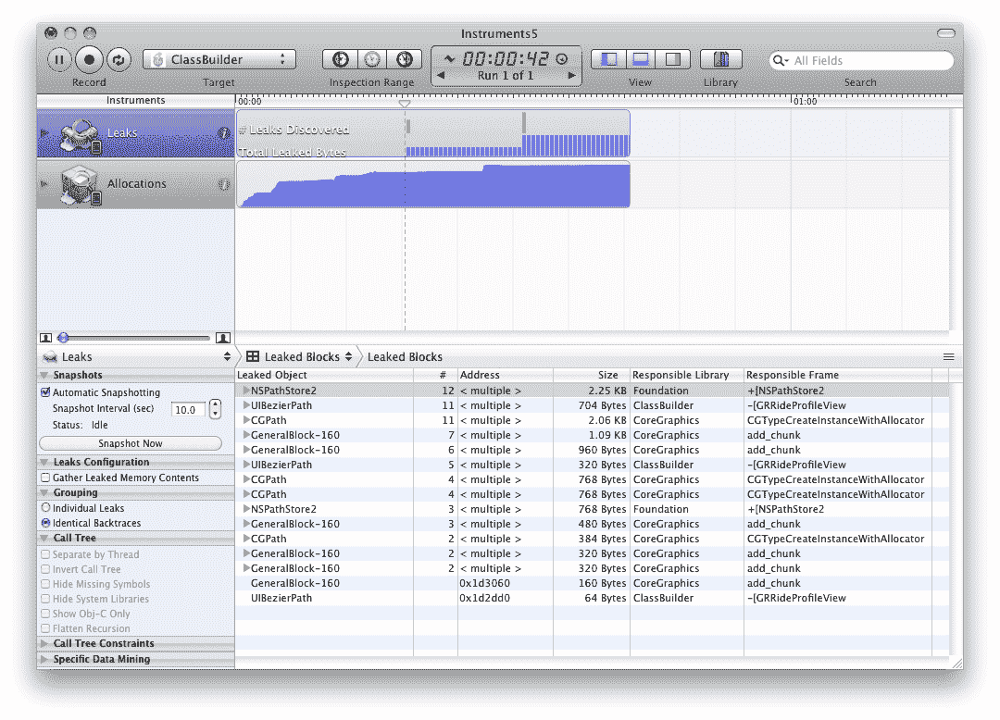

窗口的半部分分为两个窗格。左窗格持有各种特定于工具的控件，可用于修改详情面板中的显示。它们不会修改已收集的数据，只是修改其呈现方式。

窗口中有两个 Xcode 风格的跳转条。工具面板中的跳转条让你选择正在查看哪种工具。它当前显示 `Leaks` 工具，但你可以通过点击它来获取文档中所有工具的列表。你也可以直接点击工具跟踪来更改详情面板的内容。右侧的详情面板有一个跳转条，可以让你更改数据的视图。当你深入研究数据时，跳转条将让你退回到更高层级的视图。

详情区域显示了大量信息：泄漏内存的类型（是 Objective-C 对象还是内存块）、泄漏了多少个、泄漏了多少内存、哪个库分配了内存，以及究竟是哪个函数或方法导致了该分配。

尽管 `Foundation` 和 `CoreGraphics` 被列为责任库，但这并不意味着库本身被处理不当。这意味着库本身被处理不当。


正如你之前看到的，Leaks 工具对于发现代码中的内存泄漏和对象泄漏非常有用。但有时，你程序的内存占用会增长，而并没有发生经典意义上的对象泄漏：即引用计数不为零但没有对象指向它们的情况。有时，对象仍然被保留并指向，但被不必要地留着。也许某些内容缓存得过于激进。也许某个对象被放入集合后就被遗忘了。Apple 将这些称为“遗弃”（abandoned）对象而非“泄漏”（leaked）对象。在某种程度上，它们比泄漏对象更糟糕，因为并不容易看出它们正闲置在那里无人使用。

Allocations 工具的 `Mark Heap` 按钮允许你对动态分配堆的当前状态拍摄快，如图图 10.16 所示。第一次点击告诉 Instruments 对你的内存使用情况进行一次基准读取。随后的点击将在详情面板中添加条目，显示添加到堆中的任何新对象。

**图 10.16�Heapshot 按钮**

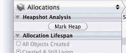

要使用堆快照（heap shots），请预热你的应用程序并获取基准。然后执行一项操作（理想情况下该操作应该保持世界状态不变），然后再次标记堆。任何遗留对象都应该有充分的理由。如果没有，你可能是有内存被遗弃了。

当你拍摄堆快照时，Instruments 会在时间轴上放置一个小标记，如图图 10.17 所示。点击标记标记会显示一个包含更多详细信息的弹出窗口，尽管堆快照标记并不包含任何额外信息。其他工具也会添加标记来指示有趣的事件，你也可以通过在时间轴上按住 Option 点击来添加自己的标记。

**图 10.17�时间轴上的 Heapshot 标记**


堆快照的另一个用途是检查内存使用情况的合理性。获取一个基准，导航到应用的某个部分，然后拍摄另一个快照。评估内存使用情况以确保它是合理的。例如，你可能有一个屏幕显示了你的应用正在编辑的 20 个不同对象，比如你的填充动物收藏。一个堆快照显示有 20 个或 40 个新字符串是合理的，每个对象都有一个标题，可能还有一些额外的描述。如果你最后有 200 个或 400 个新字符串，那么你可能出了问题。

图 10.18 显示了一个 `ClassBuilder` 的运行情况，该运行已经创建了一个基准和两个堆快照。这些对应于图 10.17 中所示的三个标记。基准是在应用程序启动并处于空闲状态后制作的，然后执行了一项操作并拍摄了另一个堆快照。这导致了 373KB 的堆增长和 8000 个新对象（天哪！）。再次执行该操作，拍摄了另一个堆快照，增长了 6KB 和 100 个新对象。

**图 10.18�堆快照列表**

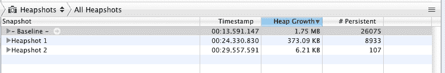

这两次操作之间存在相当大的差异。

图 10.19 显示了展开后的第一个堆快照。373KB 中有 272KB 被分配为“非对象”（non-objects），这些通过 `malloc()` 获取的内存块。展开披露三角形会显示新内存块列表。

**图 10.19�第一次运行后遗留的块**

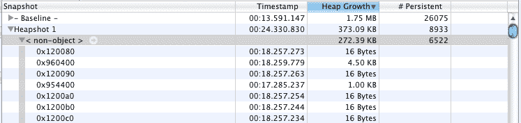

点击 `<non-object>` 行上的聚焦按钮会显示更多细节，如图图 10.20 所示。你可以看到有很多与字体相关的调用。12KB 用于某些字形（glyphs），8KB 用于更多字形，以此此类推。消耗的新内存的大部分似乎与正在执行的 `ClassBuilder` 功能中使用的字体有关。查看代码（并再次运行静态分析器）以确保你没有过度保留字体对象是好的。在这种情况下，这种内存增长似乎由于工具包对字体的一次使用，因此不是应用程序的问题。

**图 10.20�泄漏的非对象块列表**

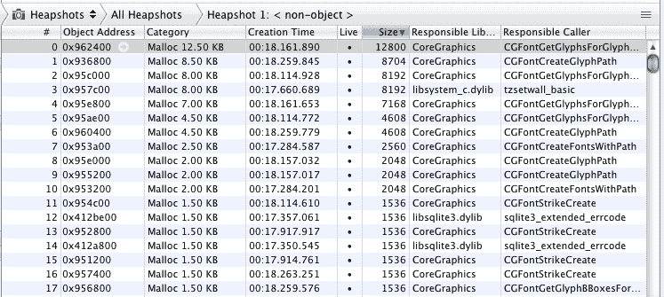

第二个堆快照比较合理，重量约为 6 KB。新对象的完整集合在图 10.21 中所示。有 96 个新对象，占 76 KB，一个 `GSEvent`（`UIEvent` 的低级版本），一些事件相关的哈表以及一些核心动画内容。跟随非对象上的聚焦按钮会显示图 10.22 所示的屏幕。

**图 10.21�第二次堆快照的遗留块**

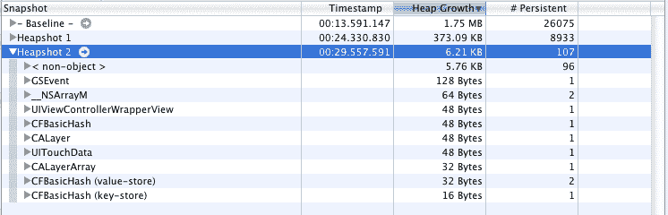

**图 10.22�堆栈跟踪**

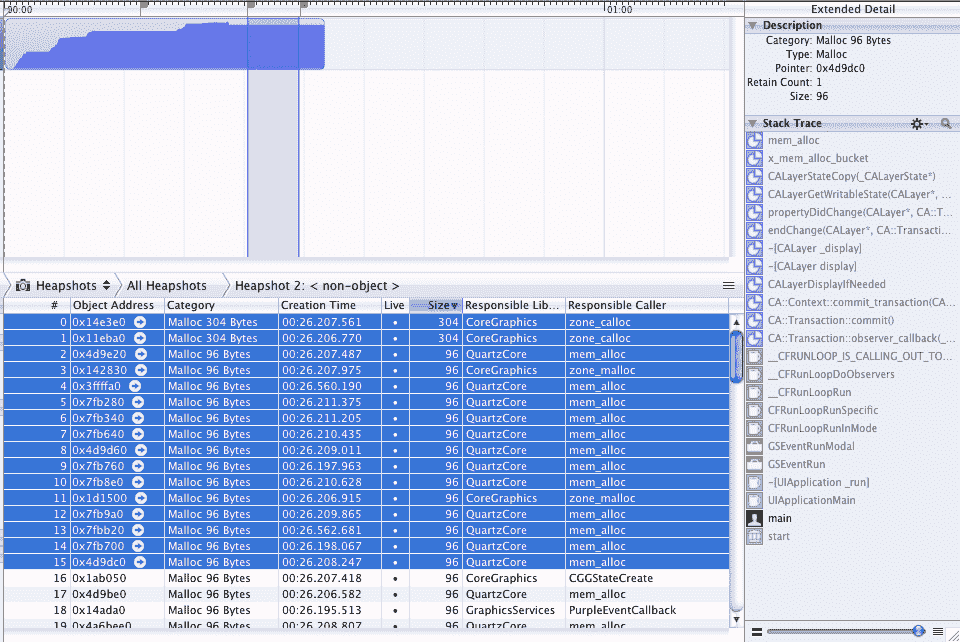

为了符合逻辑流，上面的文本进行了微调：

### 性能分析器 (Time Profiler)

`Time Profiler` 工具测量程序的 CPU 使用情况，并可选地跨整个系统。时间分析器以毫秒或微秒为单位对你的程序或系统进行定期采样，并记录它找到的堆栈。一旦你积累了足够多的堆栈，就可以看到哪些函数和方法最频繁出现在堆中。这些就是耗时最长的代码。如果你正在追踪性能瓶颈，这是一个很好的观察起点。

从 Xcode 启动 Instruments 并选择 Time Profiler 模板只会分析你的应用程序。很多时候这是足够的，因为性能问题（例如无效的算法或仅仅工作过多）是可以发现的。然而，iOS 像 Mac OS 一样基于多个协作的进程，Apple 的许多框架实际上是与后台守护进程（daemons）通信的薄层通信层。有时你在应用程序中执行的工作会导致其他进程执行额外工作，因此系统级采样对于追踪问题是必要的。通过 Target 菜单选择系统级分析，如图图 10.23 所示。

**图 10.23�分析所有进程**

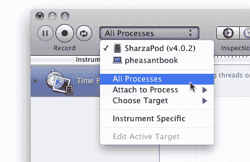


`ClassBuilder` 再次成为了受害者，这次是由于 `Time Profiler`（时间分析器）工具。该程序的功能之一是根据 iTunes 播放列表构建练习课程，讲师在构建课程时需要知道每个播放列表的时长以便选择合适的列表。遗憾的是，从 iOS 4 开始，`Media Player` 框架并没有内置属性来提供播放列表时长，因此 `ClassBuilder` 必须遍历播放列表中的每一首歌，获取歌曲时长并进行累加。

在实践中，这花费了大量时间，阻塞主线程的时间长到如果用户有很多播放列表，看门狗计时器（watchdog timer）就会杀掉应用。时间分析器帮助我们发现了问题出在何处。图 10.24 显示了一次运行轨迹，显示在开始阶段有一些 CPU 活动，因为当时正在使用 `ClassBuilder` 的 UI 进入到计算播放列表时长的屏幕。你可以看到在播放列表开始计算后，CPU 占用率达到了满载。

**图 10.24 Time Profiler instrument 示例运行**

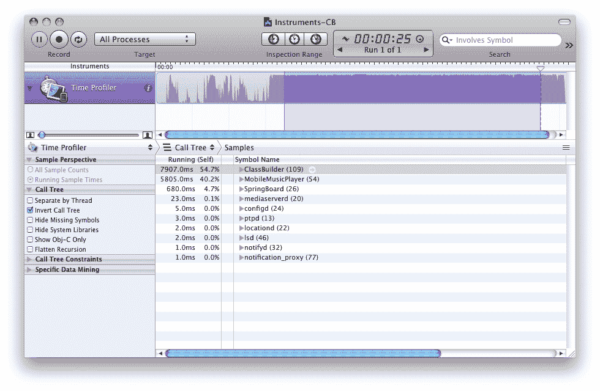

即使在查看堆栈跟踪之前，详细视图也包含了一些非常有趣的信息。`ClassBuilder` 占据了采样时间的 55% ，而 `MobileMusicPlayer` 进程占了 40%。这出乎意料。`SpringBoard` 也花费了一些时间，这是可以理解的，因为 `SpringBoard` 负责在屏幕上进行图形合成。（播放列表以及正在计算的播放列表百分比在时长计算期间会显示在 `UITableView` 中。）

`MobileMusicPlayer` 消耗了这么多处理能力，这很有趣。一种假设是，每首歌曲的信息都存储在该进程中，而 `Media Player` 框架使用进程间通信（IPC）来获取时长。系统进程没有可用的符号信息，因此我们只能从自己的进程中获取详细信息。展开 `ClassBuilder` 的展开三角形可以显示调用树，如 图 10.25 所示。

**图 10.25 Time Profiler call tree**

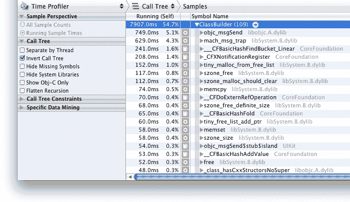

默认情况下，Instruments 显示的是“反转”（inverted）的调用树。你会看到一个被“分配”了样本的方法或函数。展开特定调用（例如 `objc_msgSend`）的展开三角形，可以看到执行该调用的函数。

图 10.26 显示了展开的 `objc_msgSend`。你会看到一个调用过 `objc_msgSend()` 的方法列表，例如来自 `UITableViewUpdateSupport` 的一个，另一个来自 `GRPlaylistOperation`（它是 `ClassBuilder` 的类之一）。然后你可以看到哪些方法调用了它们，以此此类推。

**图 10.26 展开 objc_msgSend 查看其调用者**

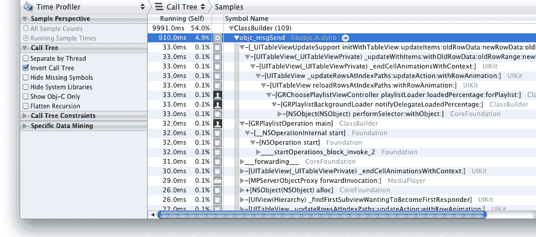

普通的（或“非反转的”）调用树显示了顶层函数（如 `main`），并提供了调用层次结构，如 图 10.27 所示。在这里你可以看到 `main()` 调用了 `UIApplicationMain`，后者调用了 `UIApplication` 的 `_run`，以此此类推。通常，反转调用树更有助于排查性能问题。

**图 10.27 Regular call tree**

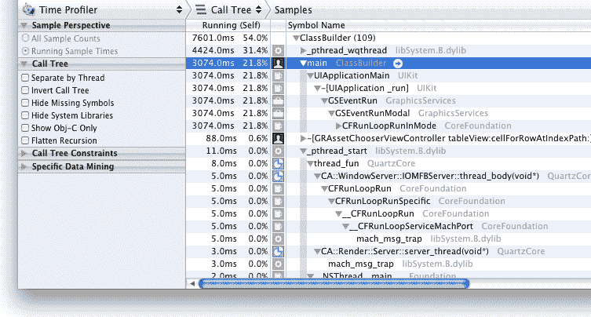

这个函数列表中有很多噪声，并且有过多的低级细节。为了消除一些噪声，你可以应用数据挖掘（data mining），它会将在某个函数中花费的时间“分配”给它的调用者。这在移除低级细节的同时，能为你提供一个更好的高层概览。数据挖掘两种最有用的两种形式是 `Hide System Libraries`（隐藏系统库）和 `Show Obj-C Only`（仅显示 Obj-C）。

`Hide System Libraries` 将在库中运行的所有代码时间分配给调用这些库的函数。如果 `-drawGroovyness` 在轨迹周期内在 `Core Graphics` 中花费了四秒，那么在点击 `Hide System Libraries` 后，`-drawGroovyness` 将显示消耗了额外的四秒，而所有的 `Core Graphics` 调用都会消失。你可能对 `Core Graphics` 花费时间的琐碎细节不感兴趣，但知道 `-drawGroovyness` 消耗了大量的处理器时间是可以用来判断需要优化的信息。也许该方法只是绘制得太频繁，或者绘制了比需要更大的区域。

图 10.28 显示了这一隐藏了系统库的轨迹。剩下的基本上就是应用类和函数。顶端是 `GRMediaItem` 的 `-duration` 调用。这与假设吻合：获取歌曲时长是导致性能问题的根源。

**图 10.28 通过隐藏系统库进行数据挖掘**


另一个主要的数据挖掘设置是 `Show Obj-C Only`。它移除了所有的函数调用，只留下 Objective-C 方法调用。图 10.29 显示了开启 Obj-C 后的调用树，其中几个条目已展开。耗时最长的方法看起来与 IPC 有关：由 `CPIDributedMessagingCenter` 用的属性列表序列化 `NSArchiver` 被 `MPediaPredicates` 和 `MPediaQueries` 以及 `CPIDributedMessagingCenter` 调用。最后一个类是处理 IPC 的 Apple 私有类，如名称所示。

**图 10.29 通过仅显示 Obj-C 进行数据挖掘**


关于时间被 IPC 消耗的假设似乎是正确的。尽管在性能上似乎束手无策，但进一步的调查显示，对于讲师创建的真实播放列表，有很多重复的歌曲，例如热身或冷却时的歌曲。这些歌曲的时长被反复查询，触发了更多的 IPC。应用程序已经对 `MPediaItems` 有了一个封装类以便在模拟器中运行，因此添加了歌曲时长缓存，减少了计算播放列表的时间。通过 `NSOperation` 将计算移到后台线程使用户界面恢复了响应。当播放列表时长计算完成后，会通知主线程，随后更新 UI。

### 其他工具

Instruments 还带了许多其他工具，Apple 定期发布新工具。某些工具适用于 iOS 和 Mac OS，而某些仅适用于其中之一。如果你尝试使用不适用于给定平台的工具，Instruments 会报错。以下是部分可用工具的示例。

### 内存

除了你之前看到的 `Leaks` 和 `Allocations` 工具外，Instruments 还有许多与其他内存相关的工具。这些工具允许你查看垃圾收集器内部、查看进程的虚拟内存占用、跟踪共享内存的创建和销毁，并检测僵尸对象（已释放后仍接收消息的对象）。

### 自动化


自动化工具（Automation instrument）用于对设备上的应用程序运行测试脚本。你编写一个驱动应用程序的 JavaScript 测试脚本，然后自动化工具利用 CocoaTouch 的无障碍功能对应用程序进行内省和控制。这些脚本可以测试运行中的应用程序，并得出“是，应用通过了此测试”或“否，应用未通过此测试”的。测试结果将显示在 Instruments trace 中。

## Power

功耗对于 iOS 用户来说非常重要。如果设备电池在白天途中耗尽，用户就会与外界隔绝。屏幕亮度、CPU 使用率以及各种无线电（蜂窝、WiFi、蓝牙、GPS）都会导致设备电量消耗。`Energy Diagnostics` 模板包含七种工具，所有工具都与电源有关。`Energy Usage` 工具利用靠近电池的传感器并显示电耗。`CPU Usage` 工具显示了四种活动类型（图形、音频处理、前台应用和系统其他部分的 CPU 使用情况。图形合成发生在 `Springboard` 进程中，而媒体守护进程（media daemon）处理音频。

`Display Brightness` 工具根据用户设置显示屏幕亮度。你可以用它来比较两次不同的程序运行，并确保在比较功耗时屏幕亮度是一样的。`Sleep/Wake` 显示了设备在睡眠和唤醒状态之间的切换。

三个与无线电相关的工具显示 `Bluetooth`、`WiFi` 和 `GPS` 无线电的状态。当用户将其配置开启时，`WiFi` 和 `Bluetooth` 显示为红色，但这并不能显示无线电何时正在使用。`GPS` 显示 `GPS` 接收器的开启/关闭状态。如果你运行一个使用 `Core Location` 的应用，且框架决定开启 GPS，则 `GPS` 工具在这些期间会显示红色。此时，没有用于蜂窝网络无线电的工具。

重要提示：你不想在设备通过 `USB` 连接到电脑时尝试获取能耗 trace。电池将进行充电，会导致你的能耗数据看起来低得离谱。你应该在 `Settings` 应用的 `Developer` 部分开启 `Power Logging` 并运行设备。完成后，连接设备，打开 `Energy Diagnostics` 模板，并从 `File` 菜单中选择 `Import Energy Diagnostics from Device`。

图 10.30 显示了运行 trace 后的各种电源相关工具。你可以拖动播放头以在轨道区域显示提示窗口。你可以看到 `Bluetooth` 无线电在中间被关闭，`GPS` 从未开启，且屏幕亮度被调到了最高。

**图 10.30 面向电源的工具**

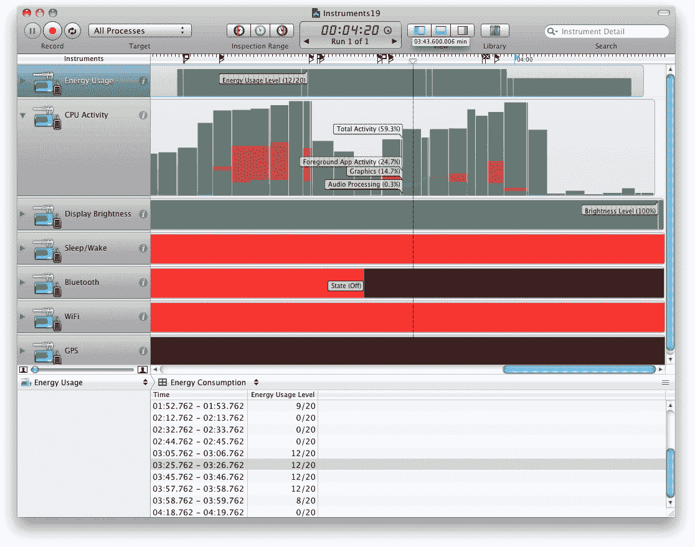

`Energy Usage` 工具在电池级别显示功耗，比例范围为 1 到 20。Apple 表示，在功耗为 1 的情况下，耗完充满电的电池需要 20+ 小小时；水平为 10 的将在 10 小时内耗完充满电的电池；水平为 20 的则不到一小时。

最后，`CPU Activity` trace 显示，在播放头所在的位置，0.3% 的 CPU 用于音频，14.7% 用于图形，前台应用的处理占另一个 24.7%，总共占 CPU 的 39.7%。系统的总活动率为 59.3%，因此系统上的其他进程占了 CPU 使用率的 19.6%。你可以使用 `Time Profiler` 来查看系统的其他部分在做什么。

## Graphics

`Core Animation` 工具向你显示 `Core Animation` 当前生成的每秒帧数 (FPS)。通常情况下，你希望 FPS 越高越高，从 30 FPS 到 60 FPS 的最大值。该工具报告的是实际完成的帧数，而不是总帧率。例如，如果你的应用在半秒内生成了 30 帧（60 FPS）然后停止，它将被报告为 30 FPS，因为只完成了 30 帧。图 10.31 显示了一个 trace，其中应用程序最初具有良好的动画性能，然后是处于相当较低的水平。在这种情况下，应用程序没有播放任何动画。在结束时，你可以看到应用程序正以 15 FPS 挣扎。`Core Animation` 模板同时包含 `Core Animation` 和 `Sampler` 工具，允许你将 CPU 使用率与动画速度问题相关起来。

**图 10.31 Core Animation 工具**


`Core Animation` 还包含一个 `Debug Options` 面板，如图图 10.32 所示。该面板中的设置不会影响所收集的数据，而是告诉设备执行某些操作以帮助你追踪图形性能问题。第一个选项 `Color Blended Layers`（混合图层颜色）可能是你最经常使用的选项。它会在使用混合绘制的图层上覆盖一个红色覆盖层，例如带有 alpha 通道的图像和标记为不透明的视图。所有其他图层都用绿色覆盖层绘制，如图图 10.33 所示。

**图 10.32 Core Animation 工具调试选项**

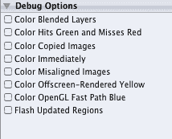

**图 10.33 Core Animation 工具混合图层**


在黑白打印中可能很难分辨，但图中的大部分 `UITableView` 没有任何绘制问题，而屏幕头部有许多以非透明方式绘制的视图。`UILabel` 是混合警告的常见来源，因为它们从 `Interface Builder` 库中拖出时是不透明的。在 iOS 上，你通常希望避免使用不透明的视图。系统必须进行额外的合成操作才能正确绘制它们。不透明视图可以直接渲染到屏幕上，而不必担心它们下面的内容。

除了 `Core Animation` 工具外，`OpenGL / OpenGLES Driver` 工具可以让你查看一眼 `OpenGL` 的使用情况。请确保展开右侧的扩展详细面板，以获取工具提供的所有信息。

`OpenGLES Analyzer` 分析你的 `OpenGL` 使用情况，在轨道中显示信息，如 `GL` 调用次数、渲染三角形数量和冗余状态更改。详细视图有一组警告，告诉你诸如冗余状态调用，或者你在没有使用 `VBO` 的情况下提交了顶点。扩展详细面板会显示文本建议，以及冲突语句的堆栈跟踪。这在图 10.34 中所示。

**图 10.34 The OpenGL Analyzer**

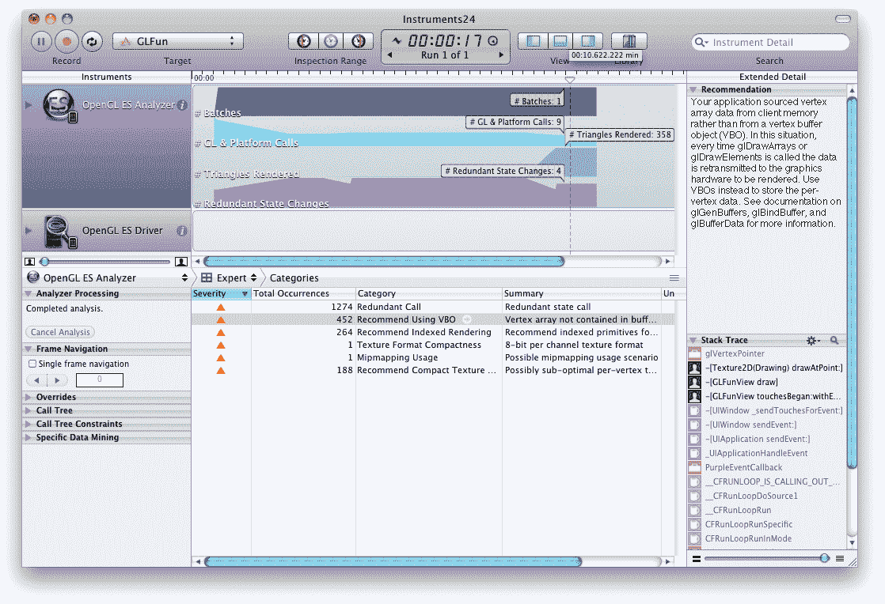

## File System


File Activity（文件活动）工具会追踪文件的打开、关闭或获取状态（stat）操作，以及 socket 和管道的创建。Reads/Writes（读/写）工具可以告诉你所有的读取和写入发生在哪里，以及实际读取或写入了多少字节。它记录了活动发生的路径（或 socket）。File Attributes（文件属性）让你了解在通过 `chown()`、`chmod()` 调用时文件任何属性发生更改，以及它们何时被间接更改，例如 `open()` 更改最后访问时间。Directory I/O（目录 I/O）告诉你目录活动，例如目录的创建和取消链接、重命名等。Disk Monitor（磁盘监控）显示每秒读取/写入的字节数，以及每秒读写操作次数。

### System Details

还有几个工具可以监控底层的操作系统细节。Activity Monitor（活动监视器）工具记录系统活动，类似于活动监视器应用程序。Scheduling（调度）工具记录线程和进程的上下文切换，并告诉你线程被调度或取消调度的原因，例如抢占、陷入内核、由于阻塞而让 CPU 等。System Calls（系统调用）工具记录系统调用及其耗时（CPU 时间和等待时间）以及进程中断。VM Operations（虚拟机操作）跟踪底层的内存操作，如写时复制、页缓存命中、零填充、从文件分页入等。

这些工具包含一个高亮视图（highlight view），以条形图和饼图的形式显示聚合数据，如图 10.35 所示。此追踪是在 Adobe 的 Lightroom 和 Photoshop CS5 编辑某些照片时记录的。你可以看到应用程序的实际内存占用、每个应用程序执行了多少次上下文切换和系统调用、系统调类型等信息。你可以点击较大的图表查看该特定工具的详细信息。

**图 10.35 高亮视图**

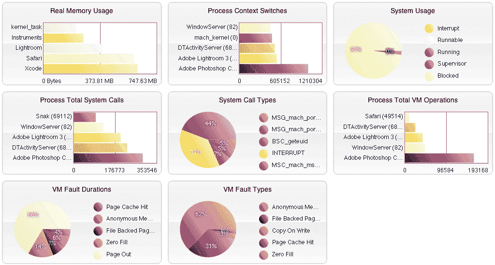

Dispatch（分发）工具追踪队列的寿命，以及分发到队列的块及其运行所需的时间。最后，Network Activity（网络活动）工具显示系统读取和写入的字节和数据包。

### Symbol Trace and DTrace

你也可以追踪单个函数或方法的调用。从 Instrument 菜单中选择 Trace Symbol（追踪符号），Instruments 将要求你输入一个要追踪的符号。在这里输入函数或方法名。然后当你开始记录追踪时，每当代码被调用，Instruments 都会在追踪区域显示栈深度。

图 10.36 显示了 `-[NSTableView drawRect:]` 的符号追踪。当程序中点击表格视图时，追踪中添加了一条垂直线。你可以看到这些内容被调用的调用树，并在扩展详细面板中查看堆栈追踪。符号追踪对于回答诸如“这个函数到底被调用了吗？”以及“这个函数被调用的次数是否疯狂？”的问题很有用，它们可以用于在追踪区域建立可见标记。如果你知道在性能问题发生之前调用了特定的函数或方法，符号追踪将为你提供可见标记，让你从那里开始缩小关注范围。你可以点击事件列表中的项，将播放头设置到该调用发生的时间点。然后你可以设置检查范围的开始或结束，精确匹配该调用的时间，帮助精确地过滤掉无关信息。

**图 10.36 追踪表格视图绘制**

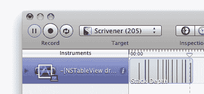

Symbol Trace 是创建 DTrace 工具的快捷方式。双击 tableview 符号追踪工具会弹出图 10.37 所示的表单，或者你可以从 Instrument 菜单中选择 Build New Instrument（构建新工具）。如果你用过 DTrace，那里的面板和文本字段应该看起来很。Symbol Trace 为 `objc:NSTableView:-drawRect*:entry` 创建了一个 DTrace 探针，它会在表格视图绘制时触发。该操作设置了一个时间戳并记录消息的接收者。还有一个 `:::return` 探针将记录对象和堆栈追踪，以及回调 Instruments 用于显示和分析的持续时间。

**图 10.37 DTrace 工具配置**

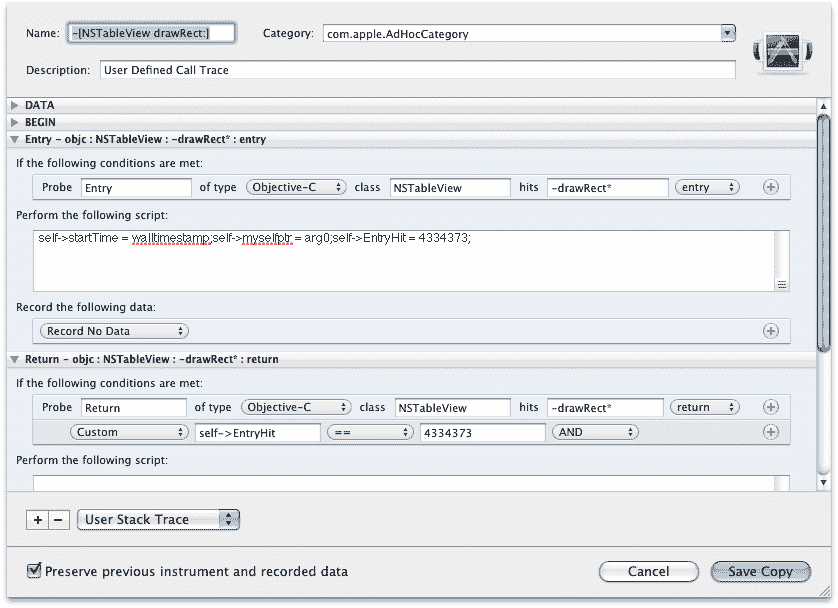

你在 DTrace 中可以做的很多操作在 Instruments 中同样可以，并出现在 Apple instruments 相同的追踪面板中。遗憾的是，从 iOS 4 开始，iOS 设备上无法使用 DTrace，因此该平台不支持符号追踪和 DTrace 工具。

## 总结

性能是一场永无止境的游戏。随着新操作系统版本和新硬件的出现，规则不断变化。我们正接近硬件带来免费性能提升的终点，至少对于那些只能利用单个 CPU 的应用程序而言。随着时间的推移，代码和算法效率以及并行处理将变得越来越重要。幸运的是，我们有很多很好的工具来对代码进行分析，并突出显示我们应该关注的区域。

## 练习题

1. 对你自己的程序进行性能分析，并找到任何意外的热点（hotspots）。
2. 修复任何意外的热点。

# 11

## 文件，第 1 部分：I/O 与权限

文件是你的程序产生数据的持久化存储。处理文件的动词与几乎所有其他常见平台相似：打开（open）、读取（read）、写入（write）、跳转到特定位置（seek）、关闭（close），但也存在一些细节中的细微差别。

文件概念是一个基本的 Unix 概念。几乎一切都被视为文件。普通的“写入 JPEG 照片的位”会进入文件系统中的文件。网络连接被视为文件。操作某些物理设备是通过文件操作完成的。与终端交互也是同样的方式。许多形式的进程间通信通过逻辑文件发生。这很棒，因为可以使用相同的 API 对这些完全不同的机器实体进行读取和写入。缺点是 API 在处理访问所有这些操作系统功能时涉及的各种边界情况存在额外的复杂性。

### 无缓冲 I/O (Unbuffered I/O)

无缓冲 I/O API 是基础系统调用，其他接口（如缓冲 I/O）可以在此基础上构建。系统调用是一个通过内核执行工作的函数。由于需要穿过应用程序/内核边界，系统调用的开销比普通函数调用大得多。

### 打开文件

`open` 打开一个文件：

```
int open (const char *path, int flags, mode_t mode);
```

`path` 指定了用于定位打开文件的文件系统路径，例如 `/Users/markd/quotes.txt`。对路径大小有一些限制：路径总长度不能超过常量 `PATH_MAX`（Mac OS 10.6 及更早版本为 1024），路径的任何单个组件不能长 `NAME_MAX`（当前为 255）。如果你超过了任何一个限制，`open()` 和任何接受路径的系统调用将返回错误值并将 `errno` 设置为 `ENAMETOOLONG`。

`mode` 参数指示了新创建文件使用的默认权限，例如哪些人有权读取和写入文件。细节将在稍后讨论。`flags` 是一个位字段，用于控制打开文件的行为。通过位或操作包含以下标志之一：

| O_RDONLY | 以只读打开文件。 |


| `O_WRONLY` | 以只写模式打开文件。 |
| `O_RDWR` | 以读写模式打开文件。 |

以及以下任何一个标志位：

| `O_APPEND` | 每次写入时进行追加。这在写入之前会隐式地移动到文件末尾，但它是原子的。 |
| `O_NONBLOCK` | 打开时不阻塞，且等待数据时不阻塞。 |
| `O_CREAT` | 如果文件不存在则创建它。 |
| `O_TRUNC` | 打开文件时将文件截断为 0 字节。 |
| `O_EXCL` | 如果文件已存在，则返回错误。 |
| `O_SHLOCK` | 打开文件时获取共享锁。 |
| `O_EXLOCK` | 获取排他锁（稍后将详细介绍锁）。 |

当发生错误时，`open()` 返回 `-1` 并将全局变量 `errno` 设置为适当的值。这种“返回 -1 并设置 errno 为错误”的模式在大多数文件 I/O 函数中都很常见，遗憾的是，并非所有函数都是如此。

成功的 `open()` 返回一个非负整数，称为文件描述符，通常简短为 `fd`。该整数值是指向每个进程引用已打开文件的表的索引。该文件描述符用作后续调用中文件的句柄。

Shell 为程序建立的三个标准流分别位于文件描述符值零（标准输入）、一（标准输出）和二（标准错误）。你可以将这些数字传递给 `read()` 和 `write()` 函数，或者使用符号常量 `STDIN_FILENO`、`STDOUT_FILENO` 或 `STDERR_FILENO`，如图图 11.1 所示。

**图 11.1 文件描述符**

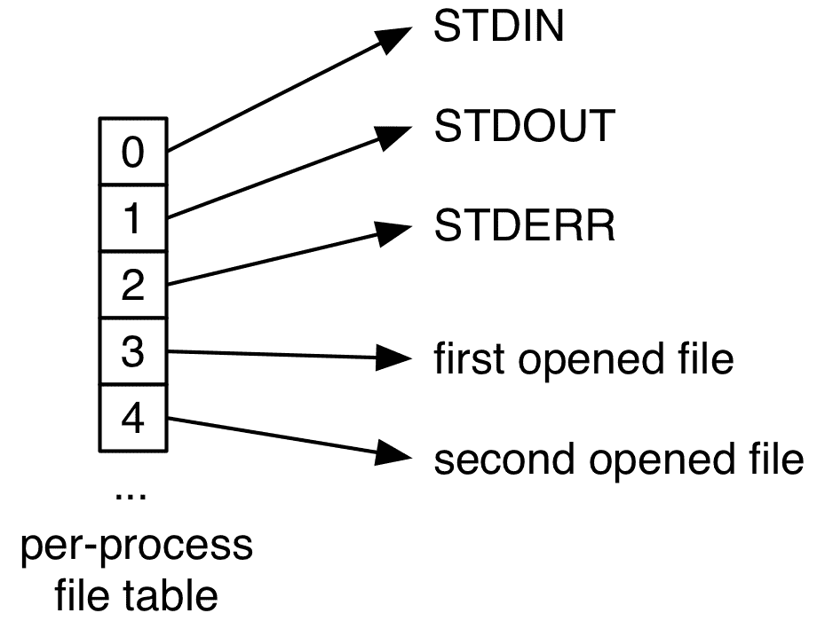

新打开的文件描述符保证是编号最小的未使用的描述符。当你其中一个标准流上重新打开文件时，这非常有用，尽管使用 `dup2()` 调用会更好。

示例 11.1 关闭了 stdout 并重新打开一个设置为仅追加模式的日志文件。`printf()` 写入标准输出，因此它会将日志记录到文件中。

**示例 11.1. append.m**

```c
append.m - 显示替换标准流打开日志文件。

gcc -Wall -o append append.m

#include <errno.h>      for (errno and strerror(errno()))
#include <fcntl.h>      for (open())
#include <stdio.h>      for (printf()) and 相关函数
#include <stdlib.h>     for (EXIT_SUCCESS)
#include <string.h>     for (strerror())
#include <unistd.h>     for (STDOUT_FILENO)

int main (void) {
    close(STDOUT_FILENO);
    int fd = open("/tmp/log", O_WRONLY | O_CREAT | O_APPEND);
    if (fd == -1) {
        printf("can't open log file: %s\n", errno);
        return EXIT_FAILURE;
    }
    printf("we, have a log file opened\n");
    return EXIT_SUCCESS;
}
```

以下是程序的运行结果：

```bash
$ ls -l /tmp/log.txt
ls: /tmp/log.txt: No such file or directory

$ ./append

$ ls -l /tmp/log.txt
-rw-r--r-- 1 root user Aug 10 11:55 /tmp/log.txt

$ cat /tmp/log.txt
we, have a log file opened
```


```c
// freestanding.m - 获取 argv[1] 并将其写入文件，在开头前加上字符串长度

// gcc -Wall -o writestring writestring.m

#include <errno.h> // 用于 errno
#include <fcntl.h> // 用于 open()
#include <stdint.h> // 用于 uint32_t
#include <stdio.h> // 用于 printf() 等相关函数
#include <stdlib.h> // 用于 EXIT_SUCCESS 等
#include <string.h> // 用于 strerror()
#include <sys/stat.h> // 用于权限标记
#include <unistd.h> // 用于 write()/close()

int main(int argc, char *argv[]) {
    if (argc != 2) {
        fprintf(stderr, "usage: %s\n", argv[0]);
        return EXIT_FAILURE;
    }

    int fd = open("/tmp/string", O_WRONLY|O_CREAT|O_TRUNC, 0644);
    if (fd == -1) {
        fprintf(stderr, "can't open file. %d (%s)\n", errno, strerror(errno));
        return EXIT_FAILURE;
    }

    // 写入字符串的长度（字节）。
    uint32_t length = strlen(argv[1]);
    size_t result = write(fd, &length, sizeof(length));

    if (result == -1) {
        fprintf(stderr, "can't write to file. %d (%s)\n", errno, strerror(errno));
        return EXIT_FAILURE;
    }

    result = write(fd, argv[1], length);
    if (result == -1) {
        fprintf(stderr, "can't write to file. %d (%s)\n", errno, strerror(errno));
        return EXIT_FAILURE;
    }

    result = close(fd);
    if (result == -1) {
        fprintf(stderr, "can't close the file. %d (%s)\n", errno, strerror(errno));
        return EXIT_FAILURE;
    }

    return EXIT_SUCCESS;
}
```

以下是运行示例：

```bash
$ ./writestring "I seem to be a fish"
```

查看文件大小：

```bash
$ ls -l /tmp/string.txt
-rw-r--r-- 1 user group Aug 10 12:24 /tmp/string.txt
```

该文件大小为 23 字节，这正是预期的大小：4 字节用于长度，加上 19 字节的文本。

**hexdump** 程序对于查看文件内容非常有用：

```bash
$ hexdump -C /tmp/string.txt
00000000 13 00 00 00 49 20 73 65 65 6d 20 74 6f 20 62 65 |....seem to be|
00000010 20 61 20 66 69 73 68 | . a fish|
00000017
```


```
/readstring --open /tmp/stringfile.txt and write out its contents

gcc -Wall -o readstring readstring.m
```

```c
#include <errno.h> // for errno and strerror()
#include <fcntl.h> // for open()
#include <stdint.h> // for uint32_t
#include <stdio.h> // for printf and friends
#include <stdlib.h> // for EXIT_SUCCESS et.
#include <string.h> // for strerror()
#include <unistd.h> // for read()

int main(int argc, char *argv[]) {
    int fd = open("/tmp/stringfile.txt", O_RDONLY);

    if (fd == -1) {
        fprintf(stderr, "can't open file. Error %d (%s)\n", errno, strerror(errno));
        return EXIT_FAILURE;
    }

    uint32_t stringLength;
    size_t result = read(fd, &stringLength, stringLength);

    if (result == -1) {
        fprintf(stderr, "can't read file. Error %d (%s)\n", errno, strerror(errno));
        return EXIT_FAILURE;
    }

    for (int i = 0; i < 1; i++) // trailing zero will be added to the string
    char *buffer = malloc(stringLength + 1);

    result = read(fd, buffer, stringLength);

    if (result == -1) {
        fprintf(stderr, "can't read file. Error %d (%s)\n", errno, strerror(errno));
        return EXIT_FAILURE;
    }

    buffer[stringLength] = '\0';

    close(fd);

    printf("the string is '%s'\n", buffer);

    free(buffer); // clean up our mess

    return EXIT_SUCCESS;
} // main
```

程序运行情况：

```
$ ./readstring
the string is 'I seem to be'
```

### 关闭文件

要关闭文件，请使用 `close()`：

```
int close (int fd);
```

这会将文件描述符从进程打开表中移除，并释放与该打开操作相关的资源。它的返回值为 -1 表示错误；否则，返回 0 表示成功完成。

在上面的示例中，`read` 没有检查 `close()` 的返回值，因为它已经对该文件完成了所有想要的操作。文件是否关闭或不关闭并不重要。`write` 会检查 `close` 是否成功，因为某些系统（尤其是网络系统）可能在文件关闭时才刷新文件的最后数据。当进程结束时，所有打开的文件会自动关闭，缓冲区中等待写入的数据块会被加入队列。

### 修改读/写偏移量

读/写偏移量是从文件开始的字节数，下一次读或写操作将放置的位置。该偏移量是打开操作的一个属性。打开同一个文件将得到两个文件描述符，每个描述符都有独立的偏移量。除非使用 `O_APPEND` 打开文件，否则初始偏移量为零。使用 `lseek()` 来更改偏移量：

```
off_t lseek (int fd, off_t offset, int whence);
```

`offset` 结合 `whence` 用于定位文件中的特定字节。`whence` 有三个可能的值：

| whence | offset |
| :--- | :--- |
| SEEK_SET | offset 是绝对位置。 |
| SEEK_CUR | offset 是相对于当前位置的增量。 |
| SEEK_END | offset 是相对于文件末尾的。 |

对于 `SEEK_CUR` 和 `SEEK_END`，offset 可以为负。因此，如果你想从文件末尾向前五个字节处开始写入，你可以这样做：

```
buffer = lseek(fd, -5, SEEK_END);
```

注意，偏移量本身永远不会为负；它会被限制为零。你可以在图 11.2 中看到跳转场景。

**图 11.2 lseek()**


`lseek()` 的返回值是相对于文件开始的字节偏移量位置。否则，使用返回 -1 和 `errno` 来通信错误。你可以随时跳转到文件末尾。任何未显式写入的字节将默认为零。注意，某些设备无法跳转，例如管道或网络连接。`lseek()` 并不是物理操作。它只是更新内核中的一个值，因此在执行读或写操作之前不会发生实际的 I/O。从当前位置移动一个零增量来获取当前偏移量：

```
off_t offset = lseek(fd, 0, SEEK_CUR);
```

这将告诉你该设备是否支持跳转。如果你收到错误，你就知道不能对这种文件进行跳转。为什么它叫 `lseek()`？在过去的岁月里，执行此任务的函数最初被称为 `seek`，但它接受一个 `int` 参数，可以是 16 位或 32 位。当 `seek` 扩展以支持更大的文件时，使用了长（long）参数，因此有了“L”。

### 原子操作

在手册页（manpages）和本章节周围，你会看到对“原子操作”的引用。这些是执行多个动作的操作，但它们都在一个系统调用内完成，从而防止与其他程序的竞态条件错误。例如，`open()` 有 `O_APPEND` 标志，这使得向文件追加数据成为原子操作。你只需对文件描述符进行 `write()`，输出就会出现在末尾。如果没有 `O_APPEND`，你需要进行两次调用：

```
lseek(fd, 0, SEEK_END); // 跳转到末尾
write(fd, buffer, datasize);
```

如果你的程序在执行 `lseek()` 之后`write()` 之前被内核调度，并且另一个进程恰好也在写入文件，就会发生竞态条件。

**图 11.3 竞态条件开始**

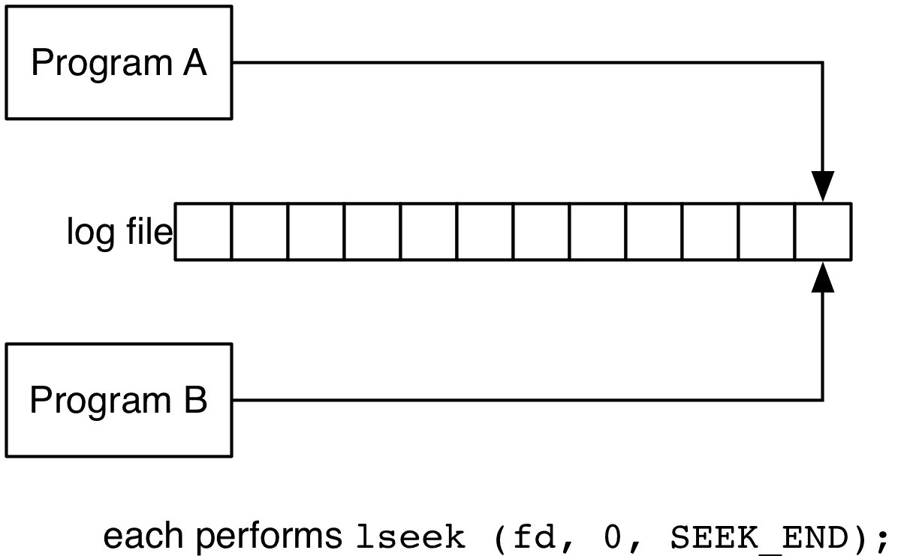

**图 11.4 程序 A 写入数据**

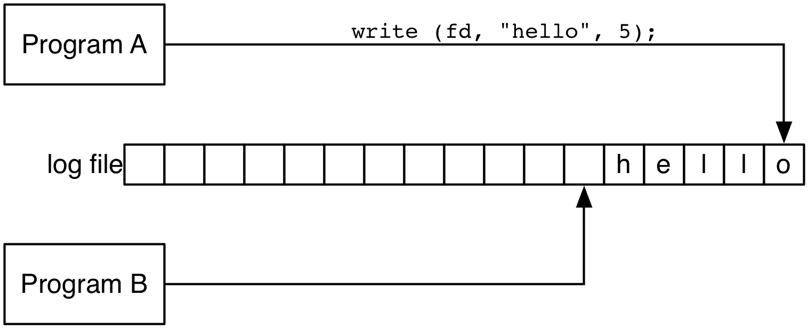

**图 11.5 程序 B 覆盖它**

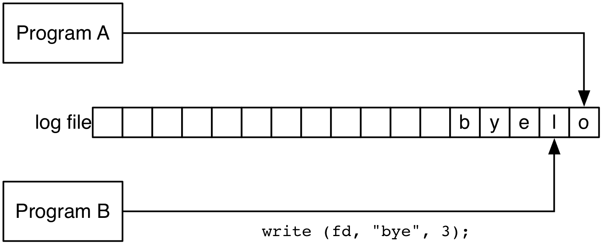

假设 log.txt 的结尾看起来如下

```
finished fluctuating the border added a hover
```

并且最后一个位置在偏移量 50,000 处。


```
finished frobulating the bknadded a hoverneck ackne wikkit
```

简而言之，它被破坏了。引入原子操作是为了防止此类错误。

原子操作的另一个示例是使用 `O_CREAT` 和 `O_EXCL` 打开文件。如果文件已存在，`open` 将失败。这是一种检查程序是否已经在运行的方便方法，如果你只想让一个副本运行（就像许多互联网服务器程序那样）。

### 离散/聚集 I/O (Scatter / Gather I/O)

你经常会为一组逻辑数据执行多次 `write()` 系统调用。示例 11.2 中的 `writestring` 会调用两次 `write()`：一次用于长度，另一次用于字符串。Web 服务器软件在响应请求时会发送两个不同的数据块：响应头和实际数据，它们通常被存储在不同的数据结构中。在这些情况下，你可以执行多次写入（这将产生多次系统调用的开销），或者将所有数据拷贝到一个不同的缓冲区中然后一次性写入。这会产生数据拷贝开销，并可能涉及动态内存，这是另一种性能损耗。

或者你可以使用离散/聚集函数 `writev()` 来聚集你的数据并让内核在一个操作中完成所有写入。还有 `readv()`，它可以读取分散在不同内存缓冲区中的数据。

```
ssize_t readv (int fd, const struct iovec *iov, int iovcnt);
```

```
ssize_t writev (int fd, const struct iovec *iov, int iovcnt);
```

这两个函数不是接收一个缓冲区，而是接收一个 `struct iovec` 数组：

```
struct iovec {
    void *iov_base;
    size_t iov_len;
};
```

其中 `iov_base` 是缓冲区位置，`iov_len` 是要读取和写入该缓冲区的数据量(图 11.6])

**图 11.6 离散/聚集 I/O**

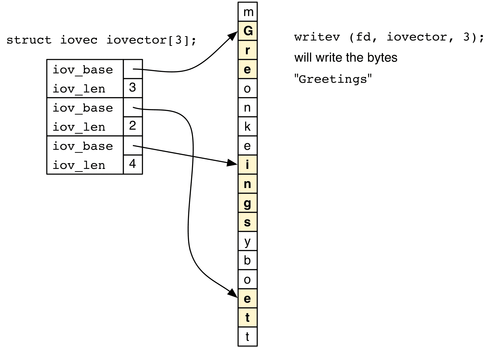

示例 11.4 和 示例 11.5 已更新为使用离散/聚集 I/O：

**示例 11.4. writevecstring.m**

```
// writevecstring.m - 接收 argv[1] 并将其写入文件，在前面加上
// 字符串的长度。使用离散/聚集 I/O

// gcc -Wall -o writevecstring writevecstring.m

#include <errno.h> // for errno
#include <fcntl.h> // for open
#include <stdio.h> // for printf
#include <unistd.h> // for write
#include <stdlib.h> // for EXIT_SUCCESS
#include <string.h> // for strerror
#include <sys/types.h> 

int main(int argc, char *argv[]) {
    if (argc != 2) {
        fprintf(stderr, "use: %s-string\n", argv[0]);
        return EXIT_FAILURE;
    }

    int fd = open("/tmp/stringfile.txt", O_WRONLY | O_CREAT | O_TRUNC, S_IRUSR | S_IWUSR);

    if (fd == -1) {
        fprintf(stderr, "can't open file. Error %d (%s)\n", errno, strerror(errno));
        return EXIT_FAILURE;
    }

    size_t len = strlen(argv[1]);

    struct iovec vec[2];
    for (int i = 0; i < 1; i++) {
        vec[i].iov_base = NULL;
        vec[i].iov_len = len;
    }
    vec[1].iov_base = argv[1];
    vec[1].iov_len = len;

    size_t result = writev(fd, vec, 2);

    if (result == -1) {
        fprintf(stderr, "can't write to file. Error %d (%s)\n", errno, strerror(errno));
        return EXIT_FAILURE;
    }

    result = close(fd);
    if (result == -1) {
        fprintf(stderr, "can't write to file. Error %d (%s)\n", errno, strerror(errno));
        return EXIT_FAILURE;
    }

    return EXIT_SUCCESS;

} // // main
```

这里是对应的读取程序：

**示例 11.5. readvecstring.m**


```bash
/readvector.m --open /tmp/stringfile.txt and write out its contents
using scatter/gather reads

gcc -g -Wall -o readvector readvector.m

#include <errno.h> // 用于 errno 和 strerror()
#include <fcntl.h> // 用于 open()
#include <stdint.h> // 用于 uint32_t
#include <stdio.h> // 用于 printf() 及其函数
#include <stdlib.h> // 用于 EXIT_SUCCESS 等
#include <string.h> // 用于 strerror()
#include <sys/stat.h> // 用于权限标志
#include <sys/types.h> // 用于 size_t
#include <sys/uio.h> // 用于 read() 和 structovec
#include <unistd.h> // 用于 close()

int main(int argc, char *argv[]) {
    int fd = open("/tmp/stringfile.txt", O_RDONLY);

    if (fd == -1) {
        fprintf(stderr, "can't open file. Error %d (%s)\n", errno, strerror(errno));
        return EXIT_FAILURE;
    }

    uint32_t stringlen;
    char buffer[496];
    structovec vec[2];

    vec[0].base = &stringlen;
    vec[0].len = sizeof(stringlen);
    vec[1].base = buffer;
    vec[1].len = sizeof(buffer) - 1;

    size_t result = readv(fd, vec, 2);

    if (result == -1) {
        fprintf(stderr, "can't read file. Error %d (%s)\n", errno, strerror(errno));
        return EXIT_FAILURE;
    }

    buffer[stringlen] = '\0'; // 需要对其进行零终止终止

    close(fd);

    printf("our string is '%s'\n', buffer);

    return EXIT_SUCCESS;
} // main
```


`+` 模式包含一些微妙之处。在没有显式调用 `fflush()` 或其他刷新缓冲区的函数（如 `fseek()`、`fsetpos()` 或 `rewind()`）的情况下，输出不能紧跟输入。同样，在没有调用上述函数的情况下，输入不能紧跟输出。如果你记得 `FILE` 中有一个缓冲区，且它无法同时处理读取和写入，这样做就是合情理的。

三个标准流（`stdin`、`stdout`、`stderr`）都有各自的缓冲 I/O 版本。你可以将这些中的任何一个传递给缓冲 I/O 函数。

由于缓冲 I/O 源自可移植的标准 C 库，它支持二进制文件和文本文件的区分，因为某些操作系统存在这种区分。Unix 并不做这种区分，因此传递给模式的任何特殊二进制标志（在 `a/a+`、`w/w+` 等后面加上“b”）都会被忽略。

不过，文本文件并不是自动就变得易于处理的。文本文件中行结束符有三种不同的约定。Unix 系统使用换行符（`LF` / `0x0A`）来结束一行，Mac OS 9 使用回车符（`CR` / `0x0D`）。Windows 和 MS-DOS 使用两者——回车符后跟换行符（`0x0D0A`），通常称为“CRLF”。如果你需要支持由非 Unix 平台创建的文本文件，你需要进行额外的处理来处理不同的行结束约定。

用 `fopen()` 创建的文件权限为 `rw-rw-rw-`。你不能直接通过 `fopen()` 它。相反，请使用 `chmod()` 或 `fchmod()` 系统调用，或者通过 `umask()` 控制创建权限。

有两个与 `fopen()` 对应的调用：

```
FILE *fdopen (int fd, char *mode);
```

```
FILE *freopen (char *path, char *mode, FILE *stream);
```

`fdopen()` 获取一个已有的文件描述符（来自 `open()` 或网络调用）并在其周围封装一个 `FILE` 流。

`freopen()` 使用新路径而不是之前的路径来关闭并重新打开给文件指针。如果你正在重定向标准流，`freopen()` 非常方便。你可以执行 `stdin = freopen ("/my/new/stdin.file", "w+", stdin);` 来将标准输入流重定向到 `stdin.file`。

### 关闭文件

```
int fclose (FILE *stream);
```

这会将流与其底层文件解关联。任何缓冲数据都将通过 `fflush()` 队列到内核，并且封装的文件描述符将被关闭。如果程序异常终止，任何缓冲数据都将不会刷新到内核并丢失。`fclose()` 在成功完成时返回 0。否则，返回 `EOF`，并将 `errno` 设置为错误原因。

### 文本 I/O

缓冲 I/O API 在涉及读写时有两种 I/O 概念：一种是面向文本的，另一种是面向二进制的。

文本 I/O 可以逐字符一次一次，也可以逐行一次一次。以下是逐字符一次一次的函数：

```
int getc (FILE *stream);
```

```
int getchar ();
```

```
int fgetc (FILE *stream);
```

每个函数都会尝试从给定的流（对于 `getchar()` 则从 `stdin`）中获取下一个输入字符。注意这些函数返回的是 `int` 而不是 `char`。返回值是重载的，因此它返回函数数据或状态值。由于 `char` 的有用值覆盖了其所有可表示范围，因此需要其他一些位来存储唯一的结果值。如果发生文件末尾或读取错误，返回返回常量 `EOF`（通常为 -1）。你需要使用例程 `feof()` 和 `ferror()` 来区分文件末尾和错误。在错误情况下，`errno` 的设置方式与无缓冲 I/O 函数相同。读取成功时，返回值是字符数据。你可以使用函数 `clearerr()` 来清除 `FILE` 流上的文件末尾和错误指示。

`getc()` 和 `fgetc()` 的实现由 ANSI C 标准定义：`getc()` 由宏实现，而 `fgetc()` 作为函数实现。这一规范的影响是，`getc()` 的参数不应有任何副作用，因为宏可能会多次求值其参数。这也意味着如果你想在函数指针中存储一个获取字符的函数，你必须使用 `fgetc()`。`getc()` 和 `fgetc()` 之间的实际时间差异微乎其微，除非你能测量出函数调用开销是一个问题，否则请直接使用 `fgetc()`。

示例 11.6 展示了如何检查 EOF 并区分错误和文件末尾：

**示例 11.6. buffread.m**

```c
buffread.m - 显示如何使用缓冲 I/O 进行读取，包括错误/EOF 处理

#include <stdio.h>
#include <stdlib.h>

int main(int argc, char *argv[]) {
    FILE *file = fopen("buffread.m", "w+");
    while (1) {
        int result = getc(file);
        if (result == EOF) {
            if (feof(file)) {
                printf("EOF found\n");
            }
            if (ferror(file)) {
                printf("error reading file\n");
            }
            break;
        }
        printf("got character: %c\n", (char)result);
    }
    fclose(file);
    return EXIT_SUCCESS;
}
```


`puts()` 将内容写入标准输出。`fputs()` 不会自动向流中添加换行符，而 `puts()` 则会。

### 二进制 I/O

文本 I/O 的问题在于零值字节是有意义的，它是字符串的结束标识。二进制 I/O 则对所有字节视为相同。二进制 I/O 不限于二进制数据：你也可以用它处理文本块。“块 I/O”可能是一个更好的名字。这些调用函数可以将结构体数组写入磁盘。在盲目将结构体写入磁盘时要注意移植性问题。如果任何数据类型在平台之间的大小或布局发生变化，你可能会破坏文件格式。

```
size_t fread (void *ptr, size_t size, size_t nmemb, FILE *stream);
```

```
size_t fwrite (const void *ptr, size_t size, size_t nmemb, FILE *stream);
```

每个函数都包含一个指向内存的指针、结构体的大小以及数组中元素的个数。返回值是写入的元素个数，而不是写入的字节数。在内部，它只是执行了乘法并写入相应数量的字节。这些函数不会像文本 I/O 函数那样在零字节或换行符处停止。如果读取或写入的元素少于预期，请检查 `ferror()` 和 `feof()`。

示例 11.7 展示了二进制读取：

**示例 11.7. binaryio.m**

```
// binaryio.m - 使用缓冲 I/O 进行一些二进制读写

gcc -std=c99 -Wall -o binaryio binaryio.m

#include <errno.h> // 用于 errno
#include <stdint.h> // 用于 uint32_t
#include <stdio.h> // 用于缓冲 IO API
#include <stdlib.h> // 用于 EXIT_SUCCESS, 等
#include <string.h> // 用于 strerror

typedef struct {
    uint32_t thing1;
    float thing2;
    char thing3[8];
} Thing;

Thing things[] = {
    {3, 3.14159, "hello"},
    {4, 4.29301, "bye"},
    {2, 1.24, "bro"},
{{5, 5.55, "ef"}}
};

int main(int argc, char arg[]) {
    size_t count = sizeof(things) / sizeof(Thing);
    FILE *file = fopen("tmp", "w");

    if (file == NULL) {
        fprintf(stderr, "opening file: %d (%s)\n", errno, strerror(errno));
        return EXIT_FAILURE;
    }

    size_t numwritten = fwrite(things, sizeof(Thing), count, file);

    if (numwritten != count) {
        fprintf(stderr, "complete write out of %d. Error %d (%s)\n", (int)numwritten, (int)count, strerror(errno));
        return EXIT_FAILURE;
    }

    fclose(file);

    // 现在重新打开并重新读取，确保一切正常
    file = fopen("tmp", "r");

    if (file == NULL) {
        fprintf(stderr, "opening file: %d (%s)\n", errno, strerror(errno));
        return EXIT_FAILURE;
    }

    // 现在我们知道 count 了，所以可以在 things[i] 中获取相应空间
    size_t numread = fread(things, sizeof(Thing), count, file);

    if (numread != count) {
        fprintf(stderr, "short read. Got %d, expected %d\n", (int)numread, (int)count);
        if (feof(file)) {
            fprintf(stderr, "we got end of file\n");
        }
        if (ferror(file)) {
            fprintf(stderr, "we got an error: %d (%s)\n", errno, strerror(errno));
        }
        return EXIT_FAILURE;
    } else {
        // 仅为了比较新值与静态声明的内容
        for (size_t i = 0; i < count; i++) {
            if (things[i].thing1 == 3) {
                printf("match element %d\n", (int)i);
            } else if (things[i].thing1 == 4) {
                printf("successfully element %d\n", (int)i);
            }
        }
    }

    fclose(file);

    return EXIT_SUCCESS;

} // main
```

以下是示例运行：

```
$ ./binaryio
match element 0
successfully element 1
match element 3
```

为了好玩，看一眼文件本身：

```
$ hexdump -C tmp
00000000: 03 00 00 00 0d 0d 0f 40 68 65 6c 6c 6f 00 00 00
00000010: 04 00 00 00 0a 27 83 40 62 79 65 00 00 00 00 00
00000020: 02 00 00 00 06 26  f6 3f 62 72 6f 00 00 00 00 00
00000030: 05 00 00 00 cd cc 0b 40 65 66 00 00 00 00 00 00
```


你可以看到有 4 字节整数、4 字节浮点数和 8 字节的字符数据。这恰好与 `struct Thing` 的定义对齐。需要警告的是：这段代码和数据文件在 PowerPC 和 Intel Mac 之间是不通用的。这里是来自 PowerPC 机器的文件：

```
$xdump -C /tmp/thingfile
0000 00 00 00 03 40 49 0f d0 68 65 6c 6c 6f 00 00 00 |....@I..hello....|
0010 00 00 00 04 40 89 60 57 62 79 65 00 00 00 00 00 |.....@`Wbye....|
0020 00 00 00 02 40 09 18 d2 62 6f 72 6b 00 00 00 00 |....@...bork....|
0030 00 00 00 05 40 b1 c7 26 65 6c 66 20 75 70 00 00 |....@..elf up..|
```

更多细节请参阅第 14 章：使用套接字的网络编程")中关于网络字节序的章节。

### 定位

与无缓冲 I/O 一样，缓冲 I/O `FILE` 流也有一个当前位置。

```c
long ftell (FILE *stream);
```

```c
int fseek (FILE *stream, long offset, int whence);
```

`ftell()` 返回文件中的当前位置。`fseek()` 类似于 `lseek()`。它对 `offset` 和 `whence` 的用法相同（`SEEK_SET`、`SEEK_CUR`、`SEEK_END`）。`fseek()` 在成功完成后返回 0。否则，返回 -1 并相应地设置 `errno`。这些函数的 `offset` 类型为 `long`，可能会限制文件大小。还有接受 `off_t` 类型的版本，它可以比 `long` 大：

```c
off_t ftello (FILE *stream);
```

```c
int fseeko (FILE *stream, off_t offset, int whence);
```

```c
int fgetpos (FILE *stream, fpos_t *pos);
```

```c
int fsetpos (FILE *stream, const fpos_t *pos);
```

使用了不透明的 `fpos_t` 类型。在某些平台上，它等于 `off_t`。在其他平台上，它是一个 8 字节数组。

```c
void rewind (FILE *stream);
```

`rewind()` 将文件的当前位置重置为开头，同时清除错误标志。

### 格式化 I/O

`printf` 系列调用属于缓冲 I/O，因为它们会显式或隐式地写入 `FILE` 流。`sprintf` 和 `snprintf` 写入缓冲区，但它们的语法与对应的 I/O 伴侣相同。

```c
int printf (const char *format, ...);
```

```c
int fprintf (FILE *stream, const char *format, ...);
```

```c
int sprintf (char *str, const char *format, ...);
```

```c
int snprintf (char *str, size_t size, const char *format, ...);
```

```c
int asprintf (char **ret, const char *format, ...);
```

`printf()` 写入 `stdout`。`fprintf()` 写入任何 `FILE`。`sprintf()` 写入缓冲区，而 `snprintf()` 写入缓冲区但被告知了可以写入的空间。请始终使用 `snprintf()` 代替 `sprintf()`。`sprintf()` 无法防止溢溢，特别是当任何用户输入的数据被馈给函数时。使用 `snprintf()` 则不会发生缓冲区溢出。`asprintf()` 将 `snprintf()` 提升了一个层次，它会自动为你分配一个大小大小的缓冲区。在使用后，你需要 `free()` 这个缓冲区。

`printf` 风格格式化的具体细节在 man 手和大多数 C 101 书籍中有详细的介绍。你也可以进行格式化输入，使用：

```c
int scanf (const char *format, ...);
```

```c
int fscanf (FILE *stream, const char *format, ...);
```

```c
int sscanf (char *str, const char *format, ...);
```

这些函数接受类似于 `printf()` 的格式字符串，但在参数列表的 `...` 部分不是普通的参数，你需要提供指向适当大小内存区域的指针。`scanf()` 函数不会为你分配内存。在使用这些函数时，在错误检测或恢复方面的手段不多。在玩具程序之外，你可能想要编写自己的解析代码、使用正则表达式库或使用词法分析器/解析器生成工具。

### 杂项函数

这里是一些杂类的缓冲 I/O 函数。

```c
int fileno (FILE *stream);
```

`fileno()` 返回流所封装的文件描述符。如果你需要使用 `fcntl()`，这非常方便。

```c
int getw (FILE *stream);
```

```c
int putw (int c, FILE *stream);
```

`getw()` 和 `putw()` 在第 14 章：使用套接字的网络编程中讨论过字节序形式。如果你想让程序可通用，缓冲 I/O 会很有优势。


在解开当前打开文件的链接（unlink）时，有一个微妙之处。该文件的目录项会被立即移除。如果你对该目录执行 `ls`，你将看不到该文件。但文件的内容仍然存在于磁盘上，继续占用空间，并且对于已经打开该文件的程序仍然可用。一旦所有程序关闭该文件，操作系统就会回收实际空间。这对于临时文件非常有用，即那些你不希望在程序结束后仍然残留的文件。通过在打开临时文件后立即对其进行解链，你就不需要担心在程序结束后删除该文件了。即使你的程序崩溃，文件占用的空间也会被回收。

这种行为偶尔会导致令人困惑的系统管理问题。想象这样一个场景：一个 Web 服务器打开了一个 500MB 的日志文件，而该文件所在的磁盘正在填满。某人删除了该文件希望回收空间。由于日志文件仍然处于打开状态，这 500MB 仍然在使用，但它们不会通过任何命令（如 `du`）显示出来。

与其删除文件，不如你可以使用命令将其截断（truncate）：

```bash
$ sudo cp /dev/null /the/log/file/name
```

`sudo` 命令允许你以超级用户身份运行命令。

如果你已经删除了文件，可以使用 `lsof` 命令“列出打开的文件”（ls Open Files）并查看其中有什么。无论如何，`lsof` 对于查看系统内部以及正在发生的情况非常有用。

```bash
$ sudo lsof
(大量的输出。这里是几行。)

ps 266 markd cwd VDIR 14,9 1486 2 /(dev/disk09)
ps 266 markd 0u VCHR 0,0 0t4015 262628 /dev/console
ps 266 markd 1u VCHR 0,0 0t4015 262628 /dev/console
ps 266 markd 2u VCHR 0,0 0t4015 262628 /dev/console
```

这是剪贴板服务器，进程 ID 为 266，由用户 markd 拥有。它在 fd 0, 1, 2 上打开了三个文件，均以读/写方式打开，并都指向 `/dev/console`。它还打开了目录 `/`（Unix 根目录）作为当前工作目录。

```
Adium 1269 markd 7u inet 0x0240d7bc 0t0 TCP 
10.0.1.142:49249->toc-m04.blue.aol.com:9898 (ESTABLISHED)
```

Adium 是一个运行 pid 1269 的 AIM 客户端，fd 7 是一个互联网连接。在本地端，IP 地址 10.0.1.142 端口 49249 连接到了 toc-m04.blue.aol.com 端口 9898。

## 临时文件

顾其实名，临时文件是程序运行时使用的文件，程序结束后就再也没有用了。Unix 系统通常将临时文件存储在已知位置，以便人们知道去哪里清理遗留的文件。某些系统会在启动时清理存放临时文件的目录。

这个临时目录在哪里呢？有许多调用可以查找临时目录并在其中生成文件名。大多数调用都存在安全问题。你可能已经注意到书中的某些示例将内容放入 `/tmp` 中。这是“经典”的 Unix 临时目录。

MacOS 为每个用户提供了临时目录，因此你不必担心其他用户窥探你的临时文件。使用 `NSTemporaryDirectory()` 获取目录，然后使用 `mkdtemp()` 确保其存在。第二次调用会创建任何中间目录，其权限仅当前用户可访问。你还可以使用其他函数，它们会自动在临时目录中为你打开一个临时文件。

```c
NSString *NSTemporaryDirectory (void);
```

这是当前用户的临时目录路径。如果无法为该用户确定临时目录，则可能返回 `nil`。

```c
char *mktemp (char *template);
```

它接收文件名模板并替换其部分内容以创建你应该使用的文件名。这保证在函数调用时该文件不存在，但完全可能另一个应用程序会先创建并打开该文件。模板可以是任何包含若干 X 的路径。末尾的 X 会被替换为唯一的字母数字组合。X 越多，文件名被猜中或发生意外冲突的概率就越小。成功时返回修改后模板的指针，失败时返回 `NULL`。

```c
int mkstemp (char *template);
```

这与 `mktemp()` 对模板执行相同的替换，但它还会创建并打开文件，返回一个文件描述符。这是一个原子操作，避免了与 `mktemp()` 的竞态条件。错误时返回 -1 并填充 `errno`。

```c
int mkstemps (char *template, int suffixlen);
```

它的工作方式像 `mkstemp()`，区别在于它允许模板中存在后缀。模板的形式应该是 `/path/to/tmp/dir/blahXXXXXXXsuffix`。这允许你为临时文件使用文件扩展名。它错误时也返回 -1 并填充 `errno`。

```c
char *mkdtemp (char *template);
```

这与 `mktemp()` 对模板执行相同的替换，并以模式 0700 创建模板目录（仅所有者可读、写、可执行）。成功时返回模板的指针，失败时返回 `NULL`。

临时目录会在启动时被清理，但如果你在临时目录中存储了大量数据，你应该在此之前某种方式安排清理，因为在 MacOS 中，运行数周的情况并非没有过。

自动打开的文件并不会删除临时文件。你可能希望在程序退出时解链文件以回收磁盘空间。

一种导致崩溃的常见错误是尝试为模板传递字面量常量 "string"。这些调用会修改模板，而这在字面量常量字符串上是不可能的。


```bash
/tempfun --see how different temp file names are generated

/gcc -g -Wallframework Foundation -o tempfun tempfun.m

#import <Foundation/Foundation.h>
#import <stdio.h> // for the temp name functions
#import <stdlib.h> // for EXIT_SUCCESS, etc.
#import <string.h> // for strcopy()
#import <unistd.h> // for mktemp

int main (int argc, char *argv[]) {
    NSAutoreleasePool *pool = [[NSAutoreleasePool alloc] init];

    NSString *tempDir = [NSTemporaryDirectory()];
    if (tempDir == nil) tempDir = @"/tmp";
    NSLog(@"tempDir is %@", tempDir);

    NSString *template = [tempDir stringByAppendingPathComponent:@"bork.XXXX"];
    NSLog(@"template is %@", template);

    char *mutableTemplate = strdup([template UTF8String]);
    char *path = mktemp(mutableTemplate);
    NSLog(@"after mktemp: %s, path %s", path, path);
    free(mutableTemplate);

    NSString *template2 = [tempDir stringByAppendingPathComponent:@"XXXXt"];
    NSLog(@"template2 is %@", template2);

    mutableTemplate = strdup([template2 UTF8String]);
    int fd = mkst(mutableTemplate, 4);
    NSLog(@"after mkst: fd %d, path %s", fd, mutableTemplate);
    free(mutableTemplate);

    close(fd);

    [pool drain];
    sleep(5);
    return EXIT_SUCCESS;

} // main
```

以及一些输出：
```text
$ .//tempfun
tempDir is /var/folders/Su/Su23NV97E2Ctglsys3dneuEU+++TI/-Tmp-/
template is /var/folders/Su/Su23NV97E2Ctglsys3dneuEU+++TI/-Tmp-/bork.XXXX
after mktemp: %s,/var/folders/Su/Su23NV97E2Ctglsys3dneuEU+++TI/-Tmp-/bork.XXXX
template2 is /var/folders/Su/Su23NV97E2Ctglsys3dneuEU+++TI/-Tmp-/XXXXt
after mkst: fd %d,/var/folders/Su/Su23NV97E2Ctglsys3dneuEU+++TI/-Tmp-/XXXXt
```

在旧版本的操作系统中，文件名与进程 ID（PID）相关。这使得恶意程序更容易猜到文件名，因此现在使用随机字符串。

### 文件权限

由于操作系统的历史遗留，它在文件系统上采用了多用户模型。

### 用户与组

系统上的每个用户都有一个整数 ID。每个用户属于一个或多个组，而每个组都有一个 ID。例如：

```
$ ls -l character
-rw-r--r-- 1 markd staff 4827 1 14 character
```
用户是 `markd`，组是 `staff`。

```
$ ls -l /bin/ls
-rwxr-xr-x 1 root wheel 80688 1 2010 /bin/ls
```
`ls` 由用户 `root` 所有，组为 `wheel` 组。

你可以通过目录服务工具 `dscl` 和 `dscacheutil` 查看你的机器上配置了哪些用户和组。你可以获取用户列表及其用户 ID：

```
$ dscl list /Users UniqueID
avisd 83
owner 87
appserver 79
...
bork 502
daemon 1
markd 501
nobody 0
```
`markd` 和 `bork` 是添加到机器的用户账户。你可以使用 `dscacheutil` 查看组以及每个组的成员：

```
$ dscacheutil -q group
name: avisd
passwd: *
gid: 83
users: avisd
name: owner
passwd: *
gid: 87
users: appserver
name: root
passwd: *
gid: 0
users: markd bork
```

组是一种聚合用户的方式，这些用户对文件集具有相似的权限。你可能希望开发者能够编辑共享树上的文件。具体来说，用户 `markd` 属于 `admin` 组，因此该用户可以管理计算机。你可以使用 `id` 命令查看你属于哪些组：

```
% uid=501(markd) gid=20(staff) groups=20(staff),403(com.apple.sharepoint.group),204(developer),100(operator),98(lapadmin),81(appadmin),80(admin),79(appusers),61(localcounts),12(everyone)
```


```
$ sudo chown marked:staff spoon

ls -l spoon
-rw-r--r-- 1 marked staff 0 Aug 11 14:40 spoon
```

有系统调用可以手动更改文件的所有者和所属组：

```
int chown (const char *path, uid_t owner, gid_t group);
```

```
int lchown (const char *path, uid_t owner, gid_t group);
```

```
int fchown(int fd, uid_t owner, gid_t group);
```

`chown()` 修改文件的所有者和组，`lchown()` 修改符号链接的，而 `fchown()` 则对已经打开的文件进行操作。

如果你需要查找用户 ID 和组 ID：

```
struct passwd *getpwent (void);
```

```
struct passwd *getpwnam (const char *login);
```

```
struct passwd *getpwuid (uid_t uid);
```

对于组信息，有等效的操作（`getgrent()`，`getgrnam()`，`getgrgid()`）。

如果你熟悉 `/etc/password` 文件的格式，`struct passwd` 看起来会很熟悉：

```c
struct passwd {
    char *pw_name;             /* 用户名 */
    char *pw_password;           /* 加密密码 */
    uid_t pw_uid;               /* 用户 uid */
    uid_t pw_gid;               /* 用户 gid */
    time_t pw_change;           /* 密码修改时间 */
    char *pw_class;             /* 访问类 */
    char *pw_gecos;             /* Honeywell 登录信息 */
    char *pw_dir;               /* 家目录 */
    char *pw_shell;             /* 默认 shell */
    time_t pw_expire;           /* 过期 */
};
```

`getpwnam()` 将提供一个用户的信息，将登录名映射到相应的 `passwd` 条目。`getpwent()` 可遍历密码列表。`getpwuid()` 将数字型 userID 映射到相应的 `passwd` 条目。

### 文件权限

每个文件和目录都关联着许多位。其中最重要的九个位是文件权限。当你对文件执行 `ls -l` 时，就能看到它们：

```
$ ls -l chapter
-rw-r--r-- 1 marked staff 255 chapter
```

特别注意 `rw-r--` 这三组位。第一组是文件所有者（`marked`）的权限，他可以读取和写入文件。第二组是所属组（`staff`）的权限，他们可以读取文件。任何 `staff` 组的成员都可以读取此文件。最后一组位是其他所有人的权限：任何不是 `marked` 且不在 `staff` 组的人。

所有者、组和其他每个人都可以拥有这些位：

| r | 读取 |
| w | 写入 |
| x | 执行 |

可执行位是让操作系统判断一个文件是否实际上是程序的线索。并没有一个像 `.EXE` 这样的样的魔法后缀来告诉操作系统该文件是可执行的。以下是我系统中选取的一些文件的权限：

```
$ ls -l /bin/ls
-rwxr-xr-x 1 root wheel 888 14 2009 /bin/ls
```

用户（`root`）、组（`wheel`）和其他人都可以读取和执行该文件。没有人可以写入它。`wheel` 组用于在 BSD 系统上指定系统管理员，源自术语“Big Wheel”（大人物）。

```
$ ls -l /developer/etc/passwd
-rw-rw-r-- 1 root admin 49294 11 2009 /etc/passwd
```

用户（`root`）和组（`admin`）都可以读取和写入该文件。其他人只能读取它。你有时会看到用数字表示的文件权限。每组权限是三位，通常用八进制表示。

| r | 100 |
| w | 010 |
| x | 001 |

因此，`rw` 权限是二进制 `110`，其八进制值为 `6`。`rwx` 权限是二进制 `111`，其八进制值为 `7`。`rwx-r--` 等同于 `111 110 100`，即八进制为 `764`。所示图 11.7 显示了一些权限值、它们的八进制表示以及 `ls -l` 会显示的内容。

**图 11.7 权限位**

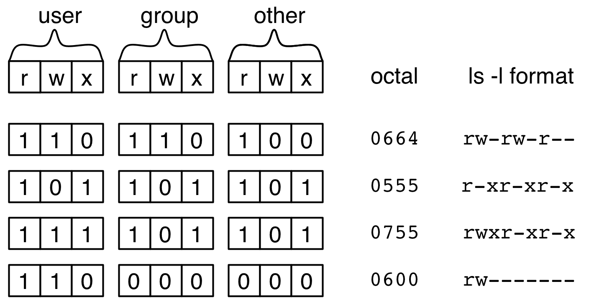

`chmod` 命令允许你以八进制或符号形式更改这些权限位：

```
$ touch test
$ ls -l test
-rw-r--r-- 1 marked staff 0 11 023 test
$chmod 775 test
$ls -l test
-rwxrwxrxr-r-x 1 marked staff 255 1023 test
$chmod 400 test
$ls -l test
-r-------- 1 marked staff 0 test
```

对于不习惯用八进制思考的人，有以下可用符号：

| u | 修改用户权限。 |
| g | 修改组权限。 |
| o | 修改其他权限。 |
| + | 设置后面的位。 |
| - | 清除后面的位。 |
| r | 读取。 |
| w | 写入。 |
| x | 执行。 |

对于 `u`、组和其他人，开启读取和写入位：

```
$chmod u+rw test
$ls -l test
-rw-rw-r-- 1 marked staff 255 1023 test
$chmod +x test
```

这是全部简写：

```
$ls -l test
-rwxrwxr-x 1 marked staff 255 1023 test
$chmod g-wx test
```

关闭组的写入和执行权限。

```
$ls -l test
-rw-r--r-- 1 marked staff 255 1023 test
```

还有一个影响权限位的 API：

```
int chmod (const char *path, mode_t mode);
```

```
int fchmod (int fd, mode_t mode);
```

其中 `chmod()` 影响文件系统的文件，而 `fchmod()` 修改已打开文件的权限。这里有一系列难以读的常量用于指定模式：

```c
#define S_IRWXU 000700 /* 所有者的 RWX 掩码 */
#define S_IRUSR 000400 /* 所有者的 R */
#define S_IWUSR 000200 /* 所有者的 W */
#define S_ISIXU 000100 /* 所有者的 X */

#define S_IRWXG 000070 /* 组的 RWX 掩码 */
#define S_IRGRP 000040 /* 组的 R */
#define S_IWGRP 000020 /* 组的 W */
#define S_IXGRP 000010 /* 组的 X */

#define S_IRWXXO 000007 /* 其他人的 RWX 掩码 */
#define S_IRTH 000004 /* 其他人的 R */
#define S_IWOTH 000002 /* 其他人的 W */
#define S_IXOTH 000001 /* 其他人的 X */
```

注意这些是八进制常量，因为它们以 0 开头。


因此，要指定 `rwxrw-r--`，你可以像这样组合权限：

```
 user       group    other
  rwx      rw-      r--
     7        6        4
SIRWXU | (SIRGRP | SIWGRP) | SIOTH
```

这里还有一个复杂的因素加入其中——用户设置的 `umask`。用户可以通过使用 `umask` 命令指定一个数值（八进制）值，来指定应该保持未设置的位，从而控制创建新文件时使用的权限，如图 11.8 所示。

**图 11.8 umask**

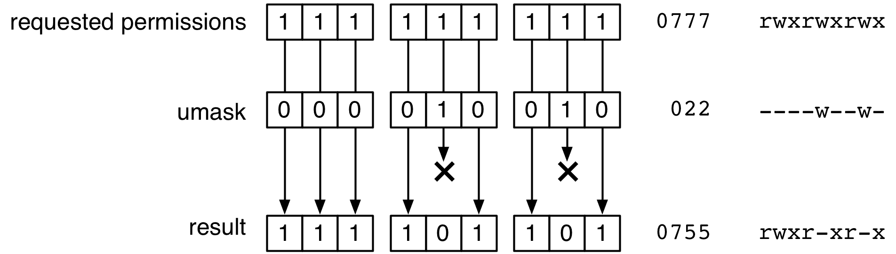

例如：

```
$ umask
22
$ touch test
$ ls -l test
-rw-r--r-- 1 marked staff 0 Aug 11 15:47 test
```

`umask` "22" 对应的二进制是 000 010 010。中间的位是 "w" 写位。因此，22 的 `umask` 将移除组组和其他用户的写入位。如果你更改了 `umask`：

```
$ umask 002
$ umask
2
$ rm test
$ touch test
$ ls -l test
-rw-rw-r-- 1 marked staff 0 Aug 11 15:48 test
```

现在只有“其他”组的权限被剥除了写入位。如果你真的非常偏执，可以使用一个非常严格的 `umask`：

```
$ umask 077
$ umask
77
$ rm test
$ touch test
$ ls -l test
---------- 1 marked staff 0 Aug 11 15:49 test
```

077 意味着组和和其他的所有位都被设置为设置，这会导致所有权限位都被剥离，因此现在只有所有者可以访问文件。

如果你使用组来控制权限，那么 002 的 `umask` 是最友好的。你不会创建无法由组写入的文件。

`umask()` 系统调用允许你动态更改进程的 `umask`。

```
mode_t umask (mode_t numask);
```

`umask` 会被子进程继承，如果你想在派生子进程之前让 `umask` 更加严格，这将非常有用。

`chmod` 不改变文件的修改日期。文件本身不受影响，受影响的元数据。

与文件关联的最后一个常用权限位是“set-uid”（设置用户 ID）位。某些操作只有在 root（超级用户）权限才能执行，例如修改密码文件。但这些操作中的某些（例如更改密码）你需要普通人也能执行。传统 Unix 解决这个问题的方法是设置一个位，表示：“当你运行此程序时，以与文件所有者相同的用户身份运行它，而不是以登录用户的身份运行程序。”

如果你查看 `/usr/bin/passwd`：

```
$ ls -l /usr/bin/passwd
-rwsrxr-x 1 root root 1168 Jan 2009 /usr/bin/passwd
```

注意用户位中的 "s"。这意味着当运行 `/usr/bin/passwd` 时，它是以 root 身份运行的，而不是以登录用户的身份运行。

如果你查看数据库中的一个文件：

```
$ ls /etc/passwd
-rw-r--r-- 1 root root 3826 Mar 1997
```

这是 suid-oracle。当你运行此程序时，它就像登录用户是 oracle 一样运行。还请注意组位中的第二个 "s"。这意味着程序将以组的身份运行。

当程序运行时，实际上有 6 个（或更多）ID 与之关联：

实际用户 ID（Real user ID）和实际组 ID（Real group ID）：这是你真实的身份，你登录时的身份。这些在程序运行期间不会改变。

有效用户 ID（Effective user ID）和有效组 ID（Effective group ID）：这些被用于文件权限检查。当你运行一个 suid 二进制文件时，你的有效用户 ID 是 root。

保存组 ID（Saved set-group-ID）和保存用户 ID（saved-user-ID）：这些由 `exec` 函数使用，我们将在第 18 章“处理”中讨论。

**示例 1.9.uid.m**

```
/uid.m 测试用户 ID 和组 ID 的实验。
/ 正常运行，然后将其更改为 uid，并再次运行

/ gcc -Wall -o uid.m
#include <sys/types.h> // struct group/struct passwd
#include <group.h> // 用于 getgrid
#include <pwd.h> // 用于 getuid
#include <stdio.h> // printf 和它的朋友
#include <stdlib.h> // EXIT_SUCCESS
#include <unistd.h> // 用于 getuid

int main() {
    struct group *group = getgrid(getgid());
    if (group) {
        printf("real group is %s\n", group->gr_name);
    }
    struct passwd *user = getpwuid(getuid());
    if (user) {
        printf("real user is %s\n", user->pw_name);
    }
    struct group *group = getgrid(getgid());
    if (group) {
        printf("effective group is %s\n", group->gr_name);
    }
    struct passwd *user = getpwuid(getuid());
    if (user) {
        printf("effective user is %s\n", user->pw_name);
    }
    return EXIT_SUCCESS;
}
```

这是一个以 markd 身份运行的示例：

```
$ ls -l uid
-rwsrxr-x 1 marked staff 9216 May 26 15:54 uid*
$ ./uid
real user is marked
effective user is root
effective group is staff
```

现在设置为 suid root：

```
$ sudo chown root root uid
$ ls -l uid
ls -l uid
-rwsrxr-x 1 root root 9216 May 26 15:54 uid*
(注意这些位)
$ ./uid
real user is marked
effective user is root
effective group is root
```


```
$ chown bork:admin uid
ls -l uid
-rws-sr--x 1 bork admin 9216 May 26 15:54 uid*

$ ./uid
real user ID is 'marked'
effective user ID is 'bork'
real group is 'staff'
effective group is 'admin'
```

需要注意的是的是，如果非特权程序写入 `setuid` 文件，`setuid` 位将会被清除。

```
$ ls -l uid
-rws-sr--x 1 marked staff 9216 May 26 15:54 uid*
$ cat >> uid
1 [control-D for end of file]
$ ls -l uid
-rwx-xr--x 1 marked staff 9217 May 26 15:58 uid*
```

这是一种安全措施，防止某些恶意程序替换 `setuid` 程序并以 root 权限运行恶意代码。此外，磁盘镜像上的程序（如 `FileValue` 卷）将不允许变变为 `setuid-root`。

`setuid-root` 通常是不良的。苹果的执行特权操作的方法是使用由 `launchd` 控制的守护进程来执行重量工作，并使用进程间通信通知该守护进程执行工作。

## 目录权限

目录具有与文件相同的权限位，即用户、组和其他人员的 `rwx`，但解释略有不同。你不能将目录作为程序运行，因此执行位（x）具有不同的含义：它充当了搜索位。当通过路径打开任何类型的文件时，用户必须对路径中提到的每个目录都具有执行权限。执行位可以匹配用户、组或其他人员。读取权限（r）与执行/搜索权限不同。读取权限允许你读取目录本身（例如使用 `ls` 命令），以获取目录中所有文件的文件名列表。执行仅意味着你可以穿过该目录，或者执行该目录中的程序。你在此过程中不需要读取权限。

例如，你创建一个目录并将一个程序拷贝到其中：

```
$ mkdir pertest
cp /bin/hostname pertest
chmod -rw pertest
ls -ld pertest
drwx--x 3 marked staff 58 Aug 11 16:52 pertest/
```

现在你关闭了除了搜索位以外的所有权限。

```
$ ls pertest
ls: pertest: Permission denied
```

没有读取权限，所以你得到了错误。

```
$ ./pertest/hostname
```

但你仍然可以在那里运行程序。

## 权限检查算法

以下是权限如何与文件操作交互的简要概述：

* 你必须拥有 `read` 权限才能通过 `O_RDONLY` 或 `O_RDWR` 打开文件进行读取。
* 你必须拥有 `write` 权限才能通过 `O_WRONLY` 和 `O_RDWR` 打开文件进行写入。
* 你必须拥有 `write` 权限才能截断文件（`O_WRONLY`  `O_TRUNC`）。
* 你必须在目录上拥有 `write` 和 `execute` 权限才能创建新文件。你需要 `write` 权限以便修改目录条目，需要 `execute` 权限以便目录可以被搜索。
* 你必须在目录上拥有 `write` 和 `execute` 权限才能删除文件。你实际上不需要文件本身的 `read/write` 权限，因为该操作只是在操作目录的结构。
* 你必须设置 `execute` 位才能将文件作为程序运行。
* 访问文件时：
    * 如果有效用户 ID 为零（即 `root`），则允许访问。
    * 如果有效用户 ID 与文件所有者相同，则检查相应的权限位并允许访问。
    * 如果有效组 ID 或补充组 ID 与文件的组 ID 相同，则检查相应的权限位并允许访问。
    * 如果相应的权限位已设置，则允许访问。
    * 否则，不允许访问。

## 对于更具好奇心的人来说：内存映射文件

内存映射文件是虚拟内存系统和文件系统的结合，文件的内容映射到内存中的一段字节范围上。当你从该内存范围获取字节时，你实际上是在读取文件。当你更改该范围内的字节时，你正在写入文件。本质上，你是在不使用 `read()` 和 `write()` 的情况下进行 I/O。虚拟内存系统负责缓冲、读取和写入工作，只从磁盘调入实际使用的数据块。要使用内存映射文件，你需要打开文件，然后调用

```
caddr_t mmap (caddr_t addr, size_t len, int prot, int fd, off_t offset);
```

返回值是映射文件起始的地址。否则，返回 -1 并设置 `errno`。以下是参数：

| argument | 描述 |
| :--- | :--- |
| `addr` | 非零值提示操作系统从内存的何处开始映射文件。`mmap()` 可以自由使用或忽略此值。通常你只需传入 0。 |
| `len` | 从文件中映射的字节数。如果你有一个巨大的文件，可以只映射它的部分内容以提高速度。 |
| `prot` | 映射内存的保护属性。传递一个或多个这些值的位或或结果：`PROT_EXEC`（可以在内存上执行代码）、`PROT_READ`（可以读取映射页）、`PROT_WRITE`（可以写入映射页）。 |
| `flags` | 指定各种选项。这里常用的标志有：`MAP_FIXED`（返回值必须等于 `addr`。如果无效，则返回错误）、`MAP_SHARED`（内存中的写入将修改文件。如果你期望写入反映在文件中，请设置此项）、`MAP_PRIVATE`（内存中的写入会创建映射页的副本，后续引用将引用副本）、`MAP_FILE`（从普通文件映射。这是默认值，不需要指定）、`MAP_INHERIT`（允许映射区域跨 `exec()` 系统调用传递给子进程）。 |
| `fd` | 打开的文件的文件描述符。 |
| `offset` | 从文件中开始映射的偏移量。通常你只需传入 0。 |

要取消映射页面，使用

```
int munmap (caddr_t addr, size_t len);
```

成功返回 0，失败返回 -1 并设置 `errno`。如果你在 `munmap()` 之后尝试访问内存，将产生无效引用。`close()` 不取消映射，但页面会在程序退出时取消映射。

`addr` 和 `offset` 应该是系统虚拟内存页大小的倍数。这应该是 512 字节，但请使用 `sysconf()` 查询。

使用 `msync()` 将修改后的页面刷回文件系统：

```
int msync (void *addr, size_t len, int flags);
```

如果 `len` 为零，则所有修改过的页面将被刷入。可能的标志位值为：

| flag | 描述 |
| :--- | :--- |
| `MS_ASYNC` | 立即返回并让内核在方便时执行写入。 |
| `MS_SYNC` | 执行同步写入。 |
| `MS_INVALIDATE` | 使缓存数据失效（从而强制从文件重新读取）。 |

一些需要记住的规则：

* 你可以映射普通文件，但不能映射网络文件描述符或设备文件。
* 如果底层文件的大小在映射后可能发生变化，你必须小心；否则可能会触发内存访问错误。
* 你无法使用 `mmap()` 和内存写入来扩展文件。你需要通过 `seek` 和 `write` 来实现这一点。


示例 11.10 是一个打开文件、对其进行 `mmap()` 映射，然后遍历内存并对其执行“rot-13”加密的程序。`rot13`（“rotate 13”的缩写）是一种简单的字母替换密码。它将字母替换为字母表中向后移动 13 个位置的字母。`rot-13` 是可逆的。如果你对文本进行 rot-13 处理，再次进行 rot-13 处理即可恢复原始文本。

### 示例 11.10. mmap-rot13.m

```c
mmap-rot13.m - use memory-mapped I/O to apply the rot-13 'encryption'
// algorithm to a file.

gcc -std=c99 -Wall -o mmap-rot13 mmap-rot13.m

#include <ctype.h>      // for isalpha(), etc.
#include <errno.h>      // for errno
#include <stdio.h>      // for printf(), etc.
#include <stdlib.h>     // for EXIT_SUCCESS, etc.
#include <string.h>     // for strerror()
#include <sys/fcntl.h>  // for O_RDWR and open()
#include <sys/mman.h>   // for mmap, etc.
#include <sys/stat.h>   // for stat() and struct stat
#include <sys/types.h> // for char_t
#include <unistd.h>    // for close()

walk the buffer shifts characters rot13(char *base, int len) {
    char *char = base;
    char *stop = base + len;
    while (char < stop) {
        if (isalpha(*char)) {
            if (*char >= 'A' && *char <= 'M') {
                *char += 13;
            } else if (*char >= 'a' && *char <= 'z') {
                *char -= 13;
            }
        }
        char++;
    }
} // rot13

void processFile(const char *filename) {
    // open the file first
    int fd = open(filename, O_RDWR);
    if (fd == -1) {
        fprintf(stderr, "could not open %s: error %d (%s)\n", filename, errno, strerror(errno));
        return;
    }

    // get out size it is
    struct stat st;
    int result = stat(fd, &st);
    if (result == -1) {
        fprintf(stderr, "stat of %s: error %d (%s)\n", filename, errno, strerror(errno));
        return;
    }
    size_t len = st.st_size;

    // map
    char *base = mmap(NULL, len, PROT_READ | PROT_WRITE, MAP_SHARED, fd, 0);
    if (base == (char)-1) {
        fprintf(stderr, "could not map %s: error %d (%s)\n", filename, errno, strerror(errno));
        return;
    }

    // bitrot it
    rot13(base, len);

    // flush the results
    result = msync(base, len, MS_SYNC);
    if (result == -1) {
        fprintf(stderr, "msync for %s: error %d (%s)\n", filename, errno, strerror(errno));
        return;
    }

    // clean up any we made
    if (base != (char)-1) {
        munmap(base, len);
    }
    if (fd != -1) {
        close(fd);
    }
}

int main(int argc, char *argv[]) {
    if (argc == 1) {
        fprintf(stderr, "usage: %s /path/to/file\n", argv[0]);
        printf("rot-13 files in-place using memory mapped io\n");
        return EXIT_FAILURE;
    }

    for (int i = 1; i < argc; i++) {
        processFile(argv[i]);
    }

    return EXIT_SUCCESS;

} // main
```

当然，还有两次示例运行：

```
$ cat > blorf
Blor is the name of a rabbit.

$ ./mmap-rot13 blorf
$ cat blorf
Oybes vf gur anzr bs n ohahal reovg.

$ ./mmap-rot13 blorf
$ cat blorf
```


`rmdir()` 删除 `path` 处的目录。该目录必须为空（没有任何任何文件或子目录），否则将返回错误。与 `mkdir()` 类似，成功时返回 0，错误时返回 -1 并设置 `errno`。

## 目录迭代

### opendir() 族

这些是你用于遍历目录内容的函数：

```
DIR *opendir (const char *filename);
```

```
struct dirent *readdir(DIR *dirp);
```

```
long telldir (const DIR *dirp);
```

```
void seekdir (DIR *dirp, long loc);
```

```
void rewinddir (DIR *dirp);
```

```
int closedir (DIR *dirp);
```

此 API 的典型用法是调用 `opendir()`，并提供你想要获取目录列表的路径。`opendir()` 返回一个不透明的 `DIR` 句柄，其资源由 `closedir()` 释放。在循环中调用 `readdir()` 直到它通过返回 `NULL` 通知你完成。`telldir()` 让你知道目录流中的位置。`seekdir()` 将目录流的位置移动到指定位置，而 `rewinddir()` 将位置重置为目录开头。`readdir()` 返回的 `struct dirent` 结构如下：

```c
struct dirent {
    ino_t d_ino; // inode 编号
    unsigned d_len; // 此内容的长度
    char d_type; // 文件类型
    char d_name[MAX+1]; // 文件名
};
```

在 64 位模式下构建时，整数字段的大小会更大。`d_name`（文件名）是最感兴趣的信息。在 HFS+ 系统上，文件名按字母顺序返回，但此 API 并不提供此类排序。

示例 2.1.ls 是 ls 的一个简易版本，没有任何任何功能：

示例 2.1.ls

```bash
/caps.m -features ls program using the directory iteration functions
gcc -Wall -Wextra -o caps caps.m
```

```c
#include <dirent.h> // 用于 opendir 及其相关函数
#include <errno.h> // 用于 errno
#include <stdio.h> // 用于 printf
#include <stdlib.h> // 用于 EXIT_SUCCESS
#include <string.h> // 用于 strerror
#include <sys/dirent.h> // 用于 struct dirent
#include <sys.types> // 用于 nbytes

int main(int argc, char *argv[]) {
    if (argc != 2) {
        printf(stderr, "use: %s\n", argv[0]);
        return EXIT_FAILURE;
    }

    DIR *directory = opendir(argv[1]);
    if (directory == NULL) {
        printf(stderr, "could not open directory %s: %s (%d)\n", argv[1], strerror(errno), errno);
        return EXIT_FAILURE;
    }

    struct dirent *entry;
    while ((entry = readdir(directory)) != NULL) {
        long position = telldir(directory);
        printf("%ld: %s\n", position, entry->d_name);
    }

    int result = closedir(directory);
    if (result == -1) {
        printf(stderr, "error closing directory: %s (%d)\n", strerror(errno), errno);
        return EXIT_FAILURE;
    }
    return EXIT_SUCCESS;
}
```

以及一些运行结果（已编辑）：

```bash
$ ./caps.m
1: .
2: .
3: #ud
4: #chart
5: #ud
6: DS_Store
7: gdb_history
8: accesses
9: accesses
10: accesses
11: append
12: append.m
49: writestring.m
50: writestring.m
51: writestring.m
```

```bash
$ ./caps.m /Developer/Applications
1: .
2: .
3: DS_Store
4: Audio
5: decode.app
6: Graphics Tools
7: Instruments.app
8: Performance Tools
9: Quartz Composer.app
10: Utilities
11: Code.app
```

## 当前工作目录

当前工作目录是未指定完整路径的文件操作默认位置。如果向 `open()` 等函数提供部分路径，将通过将该路径附加到当前工作目录来构造完整路径。在 Shell 中，当你 `cd` 进入一个目录并在执行未指定完整路径（即以斜杠字符开头的路径）的操作时，一直在使用这个概念。

```
int chdir (const char *path);
```

```
int fchdir (int fd);
```

`chdir()` 将你的当前工作目录设置为 `path`，而 `fchdir()` 使用打开目录的文件描述符。成功时返回 0，错误时返回 -1 并适当设置 `errno`。

`getcwd()` 告诉你当前目录是什么：

```
char *getcwd (char *buf, size_t size);
```

传递一个缓冲区和缓冲区大小。你应该确保 `buf` 至少有 `MAXPATHLEN` 字节。你也可以传递 `NULL` 并让函数代表你分配内存。


图 12.2 显示了特定分区上的理想化 Unix 文件系统。`HFS+` 的实际实现方式不同，但这个心理模型将帮助你理解接下来的系统调用。

**图 12.2 文件系统**

![Filesystemfiles2-chap/filesystem.png)`superblock`（超级块）是位于已知位置的一个块，包含指向磁盘上其余数据结构的指针。通常会有 `superblock` 的冗余副本，以防主 `superblock` 被损坏。`inode` 是“间接块”（indirect block）的缩写，是引用单个文件的句柄，如图 12.3 所示。每个文件都有一个 `inode`，其中包含文件的元数据（如大小、修改日期等）以及组成文件的数据块列表。`inode` 拥有一个链接计数（link count），即指向该 `inode` 的目录项数量的引用计数。当该计数归零时，文件会被实际删除，其数据块也会被回收。**图 12.3 inodes**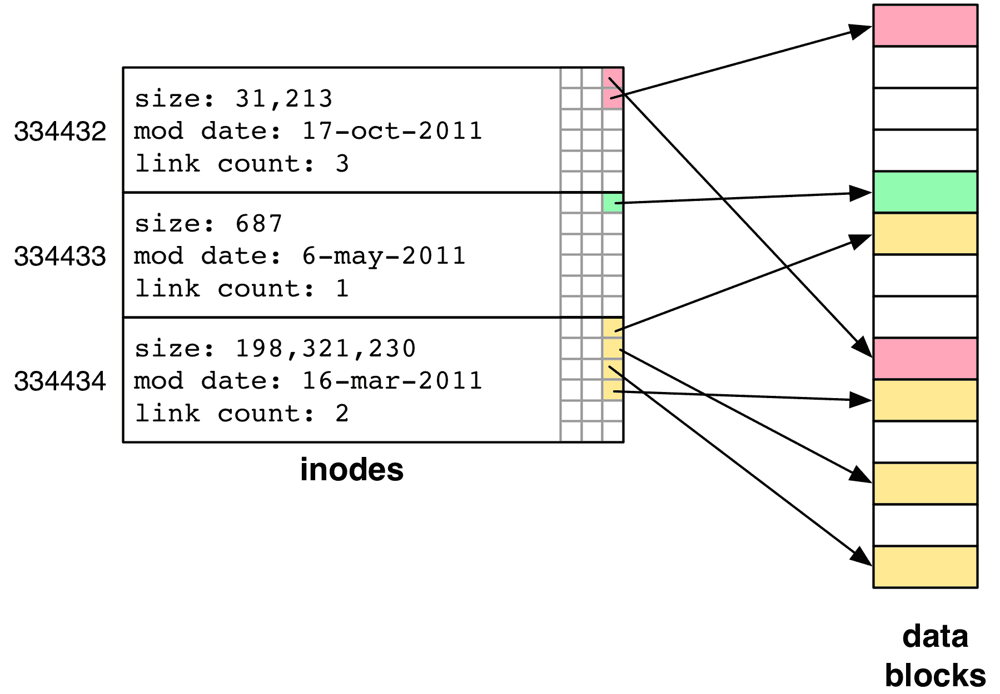

数据块可以包含文件数据或目录数据，如图 12.4 所示。目录块有一个标志，表示该块代表一个目录。目录只是文件名和 `inode` 地址的列表。目录本身并不实际存储 `inode` 自身的副本。当你遍历目录时，你从目录中获取文件名，然后可以通过 `inode` 找到实际的文件。

**图 12.4 目录结构**


目录中的特殊文件仅仅是 `inode` 引用。例如，`.`（当前目录）引用该目录的 `inode`，而 `..`（父目录）引用包含它的目录。由于 `inode` 指向特定文件系统内部，你无法创建一个包含跨越文件系统边界文件的目录。这意味着在当前文件系统中将文件移动到新位置是因为几次目录块的操作。实际上并没有复制任何数据。如果你将文件移动到不同的文件系统，则需要复制数据。

从这里可以得出几点：由于文件是通过其 `inode` 节点引用的（你可以在执行 `ls -i` 时看到），一个文件物理上可以出现在多个地方。这些是硬链接（hard links），下文将介绍。这意味着可用的 `inode` 池是有限的。你可以使用 `df -i` 查看已使用和空 `inode` 的数量。如果你用完了 `inode`，即使有足够的空间，也无法在该文件系统上创建更多文件。当你从头创建新文件系统时，你需要决定 `inode` 的密度。对于主要存储数字视频的文件系统，不需要大量的 `inode`，因为单个文件较少。如果你创建一个存储 usenet 新闻源的文件系统，你需要高得多的 `inode` ，因为新闻源往往包含大量微小文件。对于典型的用户用途，默认设置在 `inode` 密度和可用磁盘空间之间取得了良好的平衡。

文件系统有一些硬编码限制，特别是文件名和路径名。路径名限制为常量 `PATH_MAX`，定义为 1024 字节。这是一个遗憾的选择，因为像韩语这样的语言在 UTF-8 中使用 3 字节字符。同样，文件名的最大长度为 1024 字节。

标准 Unix 文件系统没有日志记录（journaled）。日志文件系统始终将磁盘上的元数据保持在一致状态。Mac `HFS+` 自 OS X 10.3 以来一直支持日志记录。

## 链接

“链接”是一种从多个地方引用文件的方法。你可能某些软件假设了文件在文件系统中的位置，但如果该文件实际存储在其他地方（可能在另一个文件系统上），可能会更方便。你还可能有一个大文件（例如视频教程），希望出现在多用户机器上每个用户的家目录中，但你不想为多个副本消耗磁盘空间。

Unix 有两种类型的链接：硬链接和符号链接（symbolic links）。OS X 还引入了别名（aliases）。

### 硬链接

如之前在文件系统简述中提到的，硬链接是多个目录中的条目，它们都指向同一个 `inode`。文件同时出现在多个地方。使用 `ln` 命令创建硬链接：

```
mkdir linktest
cd linktest
touch spoon (创建一个新文件)

ln spoon spoon2 (创建一个硬链接)
```

```
ls -i
12345 2 spoon
12345 2 spoon2
```

左侧列显示文件的 `inode`。如所料，`inode` 是相同的。还要注意第三列。它显示该文件有多个硬链接。

```
ls -i
12345 3 spoon
12345 3 spoon
```

现在同一个文件有三个硬链接了。

硬链接不能跨越文件系统边界，因为它们引用的是 `inode`。如果你用 `mv` 将硬链接文件移动到另一个文件系统，数据将被复制，原始文件被删除，链接计数将减一。

用户无法创建目录的硬链接。在某些文件系统上，超级用户（root）可以创建目录的硬链接，但通常这样做是不建议的，因为硬链接会导致目录形成循环，大多数软件无法处理这种情况。Apple 的 Time Machine 在其备份卷上使用了硬链接，包括对目录的硬链接。在多次增量备份中，未修改的文件在磁盘上实际上只存在一次，但通过硬链接在多个地方被引用。

### 符号链接

符号链接是一个包含另一个文件路径的文件。该路径可以是相对路径，也可以是绝对路径。符号链接不包含在文件的引用计数中，而且实际上不需要指向真实的文件，在这种情况下它们会变成悬空链接（dangling links）。使用 `ln -s` 创建符号链接。


```
mkdir symlinktest
cd symlinktest
touch spoon
(创建一个空文件)

ln -s spoon spoon2
(创建一个相对路径的符号链接)

ls -l
total 8
-rw-r--r-- 1 marked staff 0 Aug 12 12:08 spoon
lrwxr-xr-x 1 marked staff 5 Aug 12 12:08 spoon2-> spoon

ln -s `pwd`/spoon spoon3
(使用反引号 shell 运算符运行 pwd，然后该结果会被粘贴到命令中，这将为你提供一个完整路径)

ls -l
total 16
-rw-rw-r-- 1 marked staff 0 Aug 12 12:08 spoon
lrwxr-wxxr--x 1 marked staff 5 Aug 12 12:08 spoon2-> spoon
lrwxr-wxxr--x 1 marked staff 35 Aug 12 12:08 spoon3-> /Users/mark/badgers\
symlinktest/spoon
```

查看大小列。它是符号链接中字符的数量。权限位开头的字符是小写的 L，表示这是一个链接。

`ls -F` 显示了附加在文件名上的额外符号：

```
$ ls -F
spoon2@ spoon3@
```

`@` 符号表示它是一个符号链接。`-F` 使用的其他额外字符后缀包括 `/` 用于目录，`*` 用于可执行文件。你可以将 `ls` 别名为 `ls -F`，这样你就可以在目录列表中看到这些线索。符号链接类似于指向文件的指针，如图 2.5 所示。它们的创建是为了解决硬链接的一些问题，例如跨越文件系统以及对目录创建链接。你可以对目录创建符号链接，而不会产生问题。你可以使用符号链接生成循环引用，但幸运的是，尝试解析这些循环的函数调用会产生错误。

图 2.5 硬链接与符号链接

符号链接的真正威力体现在移动文件时。假设 `/home/admin/logs` 中的网络日志文件正在填满硬盘。你可以将所有日志文件复制到另一个地方，例如 `/Volumes/Disk/logs`，然后将第一个路径指向第二个路径。无需更改任何配置文件，现有的路径仍然有效。当然，如果你有太多层的符号间接，事情可能会失控并变得难以维护。

你目前为止看到的大多数文件 API 都会自动遵循符号链接，例如 `chmod()`、`chown()` 和 `stat()`（后者将在稍后进行讨论）。也有一些函数调用允许你直接操作链接。

```
int lchown (const char *path, uid_t owner, gid_t group);
```

这更改了所有者。

```
int readlink (const char *path, char *buf, int buffer);
```

这会将符号链接路径的内容放入缓冲区中。`readlink()` 不会追加终止的零字符。相反，它返回写入缓冲区的字符数量，或者在发生错误时返回 -1 并设置 `errno`。稍后描述的 `lstat()` 将为你提供链接本身的的元数据，而不是它所指向的文件。`rename()` 和 `unlink()` 也直接处理链接。

链接的透明解析在涉及悬空链接（dangling links）时会导致困惑：

```
$ ln -s /home/admin/logs/file oopack
$ ls oopack
oopack
$ cat oopack
cat: No such file or directory
（实际上，它不在那里。）

$ ls -l oopack
lrwxr-xr-x 1 marked staff 5 Aug 12 12:30 oopack@-> /home/admin/logs/file
（哦，它是一个指向空处的符号链接）
```

`ls -F` 告诉我们发生了什么：

```
$ ls -F oopack
oopack@
```

oopack 现在显然是一个符号链接。

不同类型链接之间的差异：

*   硬链接始终指向有效的文件。
*   符号链接不跟踪文件的移动，但别名（aliases）会。
*   符号链接在文件删除后依然存在，而别名并不总是如此。
*   符号链接可以产生循环。

### Mac 别名

用户可以通过明确创建别名或执行特定的鼠标拖拽操作在 Finder 中创建别名。与符号链接一样，别名不包含文件的引用计数中，并且可能是悬空的（指向空处）。在 HFS+ 上，别名包含文件的文件号（类似于 inode 编号），因此别名可以在磁盘的任何地方找到该文件。文件的路径也被存储在内，以防文件被删除并替换为新文件。

### 链接 API

```
int link (const char *name1, const char *name2);
```

```
int symlink (const char *name1, const char *name2);
```

`link()` 创建硬链接，而 `symlink()` 创建一个符号链接，其 `name2` 指向与 `name1` 相同的文件。


```
struct stat {
    dev_t st_dev;          /* device inode 所在 */
    ino_t st_ino;           /* inode 号 */
    mode_t st_mode;         /* inode 保护模式 */
    ino_t st_nlink;        /* 文件的硬链接数 */
    uid_t st_uid;           /* 所有者的用户 ID */
    gid_t st_gid;           /* 所有者的组 ID */
    dev_t st_rdev;         /* 设备类型，用于特殊文件 inode */
    struct timespec st_atime; /* 最后访问时间 */
    struct timespec st_mtime; /* 最后数据修改时间 */
    struct timespec st_ctime; /* 最后文件状态更改时间 */
    off_t st_size;          /* 文件大小，以字节为单位 */
    quad_t st_blocks;       /* 为文件分配的块 */
    long st_blksize;        /* 块大小 */
    long st_blkcount;       /* 最佳传输大小 */
    long st_rtype;           /* 扩展设备号 */
    long st_cdev;           /* 扩展设备号 */
    long st_ino;            /* inode 号 */
};
```

以下是常用字段的详细说明：

`st_mode` 包含文件类型和权限。低九位是用户、组和其他用户的权限。你可以使用位掩码 `ACCESPERMS` (077) 来关注这些位。你也可以使用 `chmod()` 中列出的宏进行位与运算，例如 `S_IRWXU` 和 `S_IRUSR`。此外还有一些位用于描述正在检查的文件类型，如表 12.1 所示。

### 表 12.1. 文件类型

| 掩码 | 方便宏 | 含义 |
| --- | --- | --- |
| S_IFIFO | `S_ISFIFO()` | FIFO，命名管道，一种 IPC 机制 |
| S_IFCHR | `S_ISCHR()` | 字符特殊设备，如终端和串口线 |
| S_IFDIR | `S_ISDIR()` | 目录 |
| S_IFBLK | `S_ISBLK()` | 块特殊设备，如磁盘和磁带 |
| S_IFREG | `S_ISREG()` | 普通文件 |
| S_IFLNK | `S_ISLNK()` | 符号链接 |
| S_IFSOCK | `S_ISSOCK()` | socket，网络通信 |

`st_uid` 和 `st_gid` 字段告知你所有文件的用户 ID，以及与文件关联的组。

`st_size` 是以字节为单位的文件大小。

每个文件都有三个文件时间：访问、修改和元数据更改。这些文件时间的类型为 `struct timespec`：

```
struct timespec {
    time_t tv_sec;      /* 秒 */
    long tv_nsec;       /* 纳秒 */
};
```

| st_atimespec | 最后访问时间。这是文件最后一次打开读取的时间。你可以通过 `ls -lu` 查看。你也可以通过 `st_atime` 仅访问 `tv_sec` 字段。 |
| st_mtimespec | 最后修改时间。这是 `ls -l` 显示的。你也可以通过 `st_mtime` 仅访问 `tv_sec` 字段。 |
| st_ctimespec | inode 状态的最后更改，例如使用 `chmod` 或 `chown`。`ls -lc` 显示此时间。你也可以通过 `st_ctime` 仅访问 `tv_sec` 字段。 |

较短名称（`st_mtime` 相对于 `st_mtimespec`）的类型为 `time_t`，即自 Unix 元年以来（1970 年 1 月 1 日午夜）开始秒数。它们是访问 timespec `tv_sec` 字段的方便方法。根据各种情况，这些可以是 `struct stat` 的成员，也可以是深入 timespec 字段的 `#defines`。

`utimes()` 系统调用可用于更改文件的访问时间和修改时间。如果你正在编写类似归档工具的程序，并在解压归档时需要保留访问时间，这将非常有用。

示例 12.2 是一个小型程序，它将打印出大量来自 `struct stat` 的内容：


```
/pertype.m - 使用 stat 来发现文件的类型和权限。

gcc -g -std=c99 -Wall -Wextra -o pertype pertype.m

#include <errno.h> // 用于 errno
#include <grp.h> // 用于组文件访问例程
#include <pwd.h> // 用于密码文件访问例程
#include <stdio.h> // 用于 printf
#include <stdlib.h> // 用于 EXIT_SUCCESS
#include <string.h> // 用于 strerror
#include <sys/stat.h> // 用于 stat 和 struct stat
#include <sys/time.h> // 用于 struct tm, localtime 等

// 将权限值映射到熟悉的字符字符串的查找表。
static const char *g_perms[] = {
    "---", "--x", "-w-", "-wx", "r--", "r-x", "rw-", "rwx"
};

// 从文件类型位掩码到可读字符串的映射。
typedef struct {
    unsigned long flag;
    const char *str;
} FileType;

static FileType filepts[] = {
    {S_ISREG, "file"},
    {S_ISDIR, "directory"},
    {S_ISLNK, "symlink"},
    {S_ISCHR, "character device"},
    {S_ISBLK, "block device"},
    {S_IFIFO, "fifo"},
    {S_ISSOCK, "socket"}
};

void displayInfo(const char *filename) {
    struct stat stat;
    int result = stat(filename, &stat);

    if (result == -1) {
        fprintf(stderr, "error with stat(%s): %d (%s)\n", filename, errno, strerror(errno));
        return;
    }

    printf("%s:\n", filename);

    printf("  permissions: %s%s%s\n",
        g_perms[stat.st_mode >> 6],
        g_perms[(stat.st_mode >> 3) & 7],
        g_perms[stat.st_mode & 7]);

    // 获取类型的字符串。
    const char *file = stat;
    size_t stop = file + sizeof(file);

    while (file < stop) {
        if ((stat.st_mode & S_IFMTYPE) == file->flag) { // 简化逻辑用于上下文
            printf("  type: %s\n", file->str);
            break;
        }
        file++;
    }

    // 设置了任何特殊位？
    if ((stat.st_mode & S_ISUID) == S_ISUID)
        printf("  set-uid!\n");
    if ((stat.st_mode & S_ISGID) == S_ISGID)
        printf("  set-group-id!\n");

    // 文件大小。
    printf("  file is %ld bytes (%.2f K)\n", 
        (long)stat.st_size, (float)stat.st_size / 1024);

    // 组
    uid_t uid = getuid();
    printf("  user: %u-%u\n", uid, stat.st_uid);
    gid_t group = getgid();
    printf("  group: %u-%u\n", group, stat.st_gid);

    // 日期
    char buf[1024];
    struct tm *tm;

    tm = localtime(&stat.st_atime);
    strftime(buf, sizeof(buf), "%c", tm);
    printf("  last access: %s\n", buf);

    tm = localtime(&stat.st_mtime);
    strftime(buf, sizeof(buf), "%c", tm);
    printf("  last modification: %s\n", buf);

    tm = localtime(&stat.st_ctime);
    strftime(buf, sizeof(buf), "%c", tm);
    printf("  last node change: %s\n", buf);

    // 双倍输出
    printf("\n");
}

int main(int argc, char *argv[]) {
    if (argc != 2) {
        fprintf(stderr, "usage: %s /path/to/file\n", argv[0]);
        return EXIT_FAILURE;
    }
    for (int i = 1; i < argc; i++) {
        displayInfo(argv[i]);
    }

    return EXIT_SUCCESS;
}
```

示例运行
```


```
$ /permtype/permtype opak / /dev/klog /user/bin/passwd nobody-home
(where opak is a symbolic link)

!.
/permtype/permtype /dev/klog /user/bin/passwd nobody-home
/permtype:
  permissions: rwx-xr-x
  type: Regular File
  file is 9856 bytes (9.62 K)
  user: markd (501)
  group: staff (20)
  last access: Thu May 26 19:14:23 2011
  last modification: Thu May 26 19:14:18 2011
  last inode change: Thu May 26 19:14:18 2011

/::
  permissions: rwx-xr-x
  type: Directory
  file is 1292 bytes (1.26 K)
  user: root (0)
  group: admin (80)
  last access: Thu May 26 19:14:18 2011
  last modification: Wed May 25 17:03:21 2011
  last inode change: Wed May 25 17:10:50 2011

/dev/klog:
  permissions: rw----
  type: Character Special Device
  file is 0 bytes (0.0 K)
  user: root (0)
  group: wehl (0)
  last access: Thu May 26 19:12:02 2011
  last modification: Sun May 21:48:14 2011
  last inode change: Sun May 21:48:14 2011

/user/bin/passwd:
  permissions: r--xr-x--
  type: Regular File
  set-uid!
  file is 111968 bytes (109.34 K)
  user: root (0)
  group: wehl (0)
  last access: Sun May 21 35:36 2011
  last modification: Wed May 00:49:27 2011
  last inode change: Sun May 21:35:36 2011

error with stat(nobody-home): 2 (No such file or directory)
```

现在，为了让你的工作变得稍微复杂一点，Cocoa 和 Carbon 都带来了不同类型的元数据，包括用于文件的 HFS+ 创建者代码（Creator）和类型代码（Type），以及是否应该隐藏文件扩展。

`NSFileManager` 拥有一些常量，可用于 `-[NSFileManager fileAttributesAtPath: traverseLink:]` 返回的属性字典。这与通过 `struct stat` 获取的内容存在一些重叠：

* `NSFileSize`
* `NSFileModificationDate`
* `NSFileOwnerAccountName`
* `NSFileGroupOwnerAccountName`
* `NSFileReferenceCount` （硬链接数）
* `NSFileIdentifier`
* `NSFilePosixPermissions`（rwx 权限）
* `NSFileExtensionHidden`
* `NSFileHFSCreatorCode`
* `HSFileHFSTypeCode`
* `NSFileType` （这是一个字符串，说明文件类型是目录、普通文件、符号链接等）

在 Carbon 中，你可以使用像 `FSGetCatalogInfo()` 的调用来获取 `FSCatalogInfo` 结构，该结构包含了 AppleShare 共享标志、创建日期、备份日期、Finder 信息、数据和资源分支（resource fork）的逻辑与物理大小以及文本编码提示。

### getattrlist()

Darwin 引入了函数 `getattrlist()` 来返回文件元数据。除了 `stat()` 提供的元数据外，`getattrlist()` 还能提供大量信息。你可以选择想要查看的特定元数据。如果你对文件的大小和最后访问时间感兴趣，可以告诉 `getattrlist()` 只返回这两个部分，而无需担心其他。

`getattrlist()` 自 Mac OS 10.0 起就一直存在，但在 Mac OS 10.4 中首次被记录。其手册页（manpage）充满了警告和一些幽默，例如“出于不显见的原因”以及“通常不是有用的值”。`getattrlist()` 并没有定义适用于所有文件类型。你在这里看到高亮显示，可以在 `getattrlist()` 的手册页中找到完整描述。

```
int getattrlist (const char *path, struct attrlist *attrList, void *attrBuf, size_t attrSize, unsigned long options)
```

`path` 是你想要获取元数据的文件，函数将将其存储在大小为 `attrSize` 的 `attrBuf` 中。`getattrlist()` 成功时返回 0，错误返回 -1，实际错误存储在 `errno` 中。有一个警告：如果缓冲区较小，`getattrlist()` 将截断存放在缓冲区中的数据。某些变长结构（你稍后会看到）引用了缓冲区中其他地方的数据，这些引用可能会指向末尾。你需要预先检查这些变长结构，以确保它们不会引用到被截断的数据。`options` 可以为 0 或 `OPT_NOFOLLOW`，以防止在路径的最后组件是符号链接时对其进行解析。

### 描述属性

`struct attrlist` 用于告诉 `getattrlist()` 你感兴趣的元数据：

```c
struct attrlist {
  uint32_t bitmapcount; /* 位位图的数量 */
  uint16_t padding; /* 用于 4 字节对齐 */
  attrgroup_t commonattr; /* 共同属性 */
  attrgroup_t volumeattr; /* 卷属性 */
  attrgroup_t dirattr; /* 目录属性 */
  attrgroup_t fileattr; /* 文件属性 */
  attrgroup_t forkattr; /* 分支属性 */
};
```

该结构开头是 `bitmapcount`，表示结构包含的 `attrgroup_t` 数量。`attrgroup_t` 只是一个无符号 32 位整数。当前版本的 `struct attrlist` 有五个项。使用常量 `ATTR_BIT_MAP_COUNT` 设置该值。在经过 4 字节对齐的填充后，后续是五个位图。使用位或操作设置这些位图中的位，以指示你感兴趣的属性。在设置任何特定标志之前，务必清空整个结构。

`commonattr` 包含了适用于所有文件系统对象的属性位图标志。以下是你可能感兴趣的一些常见属性。每个属性中提到的类型名称将被放入你的 `attrBuf` 中：

`ATTR_CMN_NAME`：文件名，由 `attrreference_t` 结构表示。它是一个以零结尾的 UTF-8 C 语言字符串。`attrreference_t` 结构将在下方关于解析返回属性的章节中描述。

`ATTR_CMN_OWNERID`


文件的所有者，表示为 `uid_t`。你可以通过 `ATTR_CMD_GRPID` 获取组名，它会将一个 `gid_t` 放入属性缓冲区。

### ATTR_ACCESSMASK
文件的访问权限，表示为 `mode_t`。这等同于 `struct stat` 中的 `st_mode`。

`volattr`
包含与挂载卷相关的属性位图标志（bitmap flags）。该路径应指向卷的挂载点。

### ATTR_VOL_INFO
如果你希望返回任何卷属性，你必须在位掩码中包含此值。这并不会导致实际返回任何属性数据。

### ATTR_VOL_SIZE
卷的总大小，单位为字节，由 `off_t` 表示。

### ATTR_VOL_SPACEFREE
卷的空闲空间，单位为字节，由 `off_t` 表示。

### ATTR_VOL_SPACEAVAIL
卷上非特权用户可用的空间，单位为字节。卷会保留一部分空闲空间以防止磁盘耗尽错误。你应该向用户报告此值，而不是 `ATTR_VOL_SPACEFREE`。

### ATTR_VOL_IOBLOCKSIZE
读取或写入数据时使用的最佳块大小。这是一个 `unsigned long`。

### ATTR_VOL_FILECOUNT
卷上当前的文件数量。同样是一个 `unsigned long`。

### ATTR_VOL_DIRCOUNT
卷上当前的目录数量。一个 `unsigned long`。

### ATTR_VOL_NAME
一个包含卷名称的 `attrreference_t` 结构。这是一个以零终止结尾的 UTF-8 C 字符串。数据长度不会超过 `NAME_MAX` + 1。

### ATTR_VOL_CAPABILITIES
一个 `vol_capabilities_attr_t` 结构，描述卷支持的可选功能。请参阅 `getattrlist()` 手页获取 `vol_capabilities_attr_t` 以及支持的不同卷能力。

### ATTR_VOL_ATTRIBUTES
一个 `vol_attributes_attr_t` 结构，描述卷支持的属性。同样，请参阅手册页获取有关使用它的详细信息。

`dirattr`
包含与目录相关的属性位图标志。还有另外两个标志，但文档将它们描述为“你不应该总是依赖此值的准确性”或“由于错误，此标志在当前系统上从未被设置”。因此，这是你应该使用的目录属性：

| ATTR_DIR_ENTRYCOUNT | 一个 `unsigned long`，表示目录中文件系统对象的数量，不包括 `.` 和 `..`（称为“合成项”）。 |

`fileattr`
包含与普通文件相关的属性位图标志。如果你获取的是普通文件（如目录）的元数据，这些值将是未定义的（undefined_）。

### ATTR_FILE_TOTALSIZE
文件所有分叉（forks）的字节字节数，由 `off_t` 表示。这是文件的逻辑大小。如果一个文本文件有 40 个字符，则逻辑大小为 40。

### ATTR_FILE_ALLOCSIZE
磁盘上由该文件所有分叉占用的总字节数。这是文件的物理大小。如果这个 40 字符的文本文件位于块大小为 4K 的卷上，则该文件的物理大小将为 4K。

### ATTR_FILE_IOBLOCKSIZE
读取或写入此文件数据时使用的最佳块大小。这是一个 `unsigned long`。

### ATTR_FILE_DATALENGTH
文件数据分叉（data fork）的逻辑大小。这是一个 `off_t`。你可以使用 `ATTR_FILE_DATAALLOCSIZE` 获取数据分叉的物理大小。

### ATTR_FILE_RSRCLENGTH
文件资源分叉（resource fork）的逻辑大小。这是一个 `off_t`。你可以使用 `ATTR_FILE_RSRCALLOCSIZE` 获取资源分叉的物理大小。

`forkattr` 位图应保持为空。根据手册页，“当前的任何 Mac OS 卷格式实现都未正确实现分叉属性。我们强烈建议客户端程序不要请求分叉属性。”

### 解析缓冲区
`getattrlist()` 放入你的缓冲区中的数据，顺序与手册页中属性位图标志列出的顺序（以及此处列出的顺序）一致。标量类型（如 `mode_t`、`off_t`、`unsigned long`）尾尾相接，有时会进行填充以将值对齐到四字节边界。通常，你会定义一个结构来列出你期望返回的数据类型，然后将这些结构之一的地址传递给 `getattrlist()` 进行填充。

可变长度属性（特别是名称）通过 `attrreference_t` 间接访问。如果你使用结构体覆盖用法（struct-overlay idiom），你会在结构体中包含一个 `attrreference_t`。`attrreference_t` 如下所示：

```c
typedef struct attrreference {
    long offset;
    size_t length;
} attrreference_t;
```
要获取实际数据，你需要将 `offset` 加到 `attrreference` 的地址上。假设你对名称和修改时间感兴趣。你的覆盖结构可能如下：

```c
struct perattr {
    unsigned long length;
    attrreference_t name;
    struct time modtime;
    char name[NAMMAX];
};
perattr attributes;
```

然后调用函数：

```c
perattr attributes;
int result = getattrlist(filename, &attrlist, &attributes, sizeof(attributes), 0);
```

然后这样访问名称：

```c
char *filenameFromAttrs = ((char *)&attributes.name) + attributes.name.offset;
```


```c
// permission-getattributelist.m -- 使用 getattributelist() 来发现文件的类型和权限。

// gcc -std=c9 -o permission-getattributelist permission-getattributelist.m

#include <errno.h> // 用于 errno
#include <grp.h> // 用于组访问例程
#include <pwd.h> // 用于密码文件访问例程
#include <stdio.h> // 用于 printf
#include <stdlib.h> // 用于 EXIT_SUCCESS
#include <string.h> // 用于 memset
#include <sys/attr.h> // 用于属性结构
#include <sys/stat.h> // 用于 stat() 和 struct stat
#include <unistd.h> // 用于 getattributelist()

// 将权限值映射到熟悉的字符字符串的查找表。
static const char *g_perms[] = {"--", "-", "w-", "rw-", "r-"};

// 从文件类型位位到可读字符串的映射。
typedef struct {
    unsigned long;
    const char type;
} File;

static File g_types[] = {
    IF_REG, "file",
    IF_DIR, "directory",
    IF_LNK, "symic link",
    IF_CHR, "character device",
    IF_BLK, "block device",
    IF_FIFO, "FIFO",
    IF_SOK, "socket"
};

// getattributelist() 返回的数据结构
typedef struct PermTypeAttributes {
    uint32_t length;
    attrref_t name;
    struct timespec modTime;
    struct timespec changeTime;
    struct timespec accessTime;
    unsigned groupid;
};

void displayInfo(const char *filename) {
    // 首先清除属性请求结构，否则你将得到未定义的结果。
    struct attrlist attr = {0};
    attr.bitmapcount = ATTR_BITMAP_COUNT;

    // 获取名称、权限以及 stat 风格的时间。
    attrlist.combinator = ATTR_CNN_NAME | ATTR_CNN_MODTIME | ATTR_CNN_CHGTIME |
                          ATTR_CNN_CTIME | ATTR_CNN_OWNID | ATTR_CNN_GID;

    // 获取文件大小
    attrlist.file = ATTR_FILESIZE;

    PermTypeAttributes attributes;
    int result = getattributelist(filename, &attr, &attributes, sizeof(attributes), 0);
    if (result == -1) {
        fprintf(stderr, "error with getattributelist(%s): %d\n", filename, errno);
        exit(errno);
        return;
    }

    // 对返回的可变大小数据保持谨慎。
    char *nameStart = (char *)&attributes.name;
    nameStart += attributes.name.dataoffset;
    char *nameEnd = nameStart + attributes.name.size;
    *nameEnd = '\0';

    // 实际上获取属性的结构，但后续内容可能为空。
    if (nameEnd > 0) {
        fprintf(stderr, "returned file was truncated\n");
        return;
    }

    // 打印名称，然后是权限。
    printf("%s\n", nameStart);
    printf(" permissions: %s\n", attributes.permissions); // 注意：源代码中的逻辑似乎不完整

    // 确定类型。
    FileType type = 0;
    while (type) {
        if ((attributes.permissions & ATTR_IFMTYPE) == type) {
            printf("type: %s\n", type);
            break;
        }
        type++;
    }

    // 有任何特殊位吗？
    if (attributes.groupid == SUID) {
        printf(" set-uid!\n");
    }
    if (attributes.groupid == SGID) {
        printf(" set-gid!\n");
    }

    // 文件大小不适用于目录。
    if ((attributes.permissions & ATTR_IFMTYPE) == ATTR_IFREGG) {
        printf(" file is %ld bytes (%ld)\n", attributes.length, attributes.length / 1024);
    }

    // 所有组。
    struct group *grp = getgrgid(attributes.groupid);
    if (grp) {
        printf("use: %s-%d\n", grp->gr_name, attributes.groupid);
        printf("group: %s-%d\n", grp->gr_name, attributes.groupid);
    }

    // 现在是日期。
    tm = attributes.accessTime;
    printf(" last access: %s\n", tm);

    tm = attributes.modTime;
    printf(" last modification: %s\n", tm);

    tm = attributes.changeTime;
    printf(" last change: %s\n", tm);
}

int main(int argc, char *argv[]) {
    if (argc != 2) {
        fprintf(stderr, "usage: %s /path/to/file\n", argv[0]);
        exit(errno);
    }
    displayInfo(argv[1]);

    return EXIT_SUCCESS;
}
```


此程序的输出与 `permtype` 的输出相同。

### 批量中的元数据

既然已经有功能完备的 POSIX 调用可以完成相同的工作，为什么还要讨论 `getattrlist()` 呢？这个函数引出了有些难以发音的 `getdirentriesattr()` 函数，该函数允许你批量获取文件属性。你只需调用一次 `getdirentriesattr()` 即可获取多个文件的元数据，这在某些情况下可以提高程序的运行速度。

```
int getdirentriesattr (int fd, struct attrlist *attrList, 
                       void *attrBuf, size_t attrBufSize, 
                       uint32_t *count, 
                       uint32_t *basePointer, 
                       uint32_t *newState, 
                       uint32_t options);
```

`getdirentriesattr()` 像 `readdir()` 和 `getdirentries()` 一样读取目录项，并像 `stat()` 和 `getattrlist()` 一样返回它们的属性。`fd` 是你想要遍历的目录的打开的文件描述符。只需使用 `open()` 打开目录即可。`attrList` 是你想要每个文件包含的属性集。其构建方式与 `getattrlist()` 的属性列表完全相同。`attrBuf` 是存储属性的内存块。在 `attrBufSize` 中传递此缓冲区的长度。

`count` 是一个输入/输出参数。你传入感兴趣的目录条目数量，函数将通过该参数传回实际放入缓冲区中的条目数量。与 `getattrlist()` 不同，此函数不会静默地截断你的数据。`basePointer` 参数是一个输出参数，它提供指向目录的偏移量，以防你稍后需要执行 `lseek()`。通常可以忽略该值，但你仍然必须在此处传过一个有效地址。`newState` 也是一个输出参数，如果目录自你开始遍历以来被修改过，其值将会发生变化。最后，`options` 应该传递 0。手册页（manpage）中描述了一个选项，其表述极其模糊且该：“此选项允许对旧系统上的特定客户端进行特定的性能优化。”

函数成功完成后返回 0；如果调用完成且返回了最后一条目，则返回 1。发生错误时返回 -1，请检查 `errno`。

数据在缓冲区中的排列方式与 `getattrlist()` 一。每个文件的属性序列以一个 4 字节的长度值开头。这是该文件属性的字节数。将此长度加上属性的起始地址即可找到下一批数据。变长属性也像 `getattrlist()` 一样存储，通过使用 `attr_dataoffset` 元素来查找缓冲区中文件名数据所在的位置。

示例 12.4 计算文件夹消耗的磁盘空间量。它同时使用了 `stat()` 和 `getdirentriesattr()`。

**示例 12.4. foldersize.m**


```c
// 使用 stat 和 getdntriesattr 计算文件夹的大小

#include <dirent.h>
for getdntriesattr()
#include <errno.h>
for errno
#include <fcntl.h>
for O_RDONLY
#include <stdio.h>
for printf
#include <stdlib.h>
for EXIT_SUCCESS
#include <string.h>
for strerror
#include <sys/stat.h>
for attr_reference_t
#include <sys/dirent.h>
for struct dire
#include <sys/stat.h>
for MAXPATH
#include <sys/stat.h>
for struct stat buf()
#include <node>
#include <unistd.h>
for getdntries()

// 在处理文件时显示文件及其大小
static int gverse = 0;

// 通过 stat() 计算目录大小
static off sizeForFolderStat(char *path) {
    DIR *directory = opendir(path);

    if (directory == NULL) {
        fprintf(stderr, "无法打开目录 '%s'\n", path);
        fprintf(stderr, "错误为 %d/%s\n", errno, strerror(errno));
        exit(EXIT_FAILURE);
    }

    off size = 0;
    struct dire *entry;
    while (entry = getdntries(directory)) {
        char filename[MAXPATH];
        if (strlen(entry->d_name) == 0 || strlen(entry->d_name) > MAXPATH) {
            continue;
        }

        // 与其在每次循环中更改工作目录，
        // 不如构造完整的相对路径。因为 path 是绝对路径
        // 或者是相对于当前工作目录的，这应该始终为我们提供一个稳定的路径
        sprintf(filename, "%s/%s", path, entry->d_name);

        // 使用 lstat 防止重复计算 lstat 产生的文件大小
        struct stat stat;
        result = lstat(filename, &stat);

        if (result < 0) {
            fprintf(stderr, "getdntriesattr 处理 '%s' 时出错：%d\n", path, errno);
            goto out;
        }

        if (result != 0) continue;

        // 递归进入子文件夹
        if (stat.st_mode & DIR) {
            size += sizeForFolderStat(filename);
        } else {
            if (gverse) {
                printf("%ld %s\n", stat.st_size, entry->d_name);
            }
            size += stat.st_size;
        }
    }

    close(directory);
    return size;

} // sizeForFolderStat

// --- getdntriesattr 代码

// 我们在每次调用 getdntriesattr 时想要获取的属性
static struct list;
// 每次调用将返回的属性
static int bitmapcount = ATTR_MAP_COUNT;
static combin combinator = ATTR_CN_NAME | ATTR_CN_OBJTYPE;
static fileattr = ATTR_FILE_DATLENGTH;

// 使用 ATTR_FILE_TOTALSIZE 会更好，这样我们就能获取资源消耗的空间，
// 但我们使用这段代码来调用 stat 提供的内容
off size = sizeForFolderStat(argv[1]);

} else {
    fprintf(stderr, "用法: %s {path/directory}\n", argv[0]);
    return EXIT_FAILURE;
}

int main(int argc, char *argv[]) {
    if (argc == 2) {
        printf("大小为 %ld bytes (%ld K)\n", size, size / 1024);
        return EXIT_SUCCESS;
    }
}
```


通过告诉程序你想运行“stat”版本还是“attr”版本的代码，并同时提供一个起始目录来运行程序：

```
% ./folders/stat /Developer
size is 106594110018 bytes (104095811 K).

% ./folders/attr /Developer/
size is 106594110018 bytes (104095811 K).
```

当你开始对程序进行计时时，事情变得有趣起来。这种计时是在 C shell 中进行的，因为它具有更准确的时间计时。

```
time ./folders/stat /Developer
size is 106594110018 bytes (104095811 K).
0.249u 3.120s 0:03.37 99.7% 0+0k 0+0io 0pf+0w

time ./folders/attr /Developer
size is 106594110018 bytes (104095811 K).
0.038u 0.709s 0:00.75 97.3% 0+0k 0+0io 0pf+0w
```

`time` 命令在第 10 章：性能调优中会有讨论，但这里需要关注的是加粗显示的时间。使用 `stat()` 版本遍历 Xcode 花费了三秒，而使用 `getdirentriesattr()` 函数仅花费了大约三分之秒。这些测试运行了多次，以便让文件系统元数据缓存预热。

## Mac OS X 特有的怪之处

OS X 是经典 Mac OS 和 Unix 的混合体，因此有一些只有 OS X 才有的特殊之处。

### 资源分叉 (Resource forks)

第一个怪之处是资源分叉，这是文件拥有的用于存储结构化数据的额外流。在文件系统层，分叉实际上只是两个恰好共享相同名称的文件。在 Mac OS X 10.4 之前，Unix 命令行工具并不知道资源叉的存在，因此资源叉可能会丢失或损坏。例如，`cp` 和 `tar` 就不会保留分叉。

在命令行环境中，除非你在文件名后附加 `/..namedfork/rsrc`，否则你无法看到资源分叉。例如，我们用来为这本书第一版编写大纲的大纲处理器是运行在经典环境下的 1990 年版本的 More。以下是终端中 More 的外观：

```
$ cd /Applications
$ ls -l MORE
-rw-r--r-- 1 marked unknown 0 Jun 23 12:18 MORE
```

嗯，那里什么也没有。但在过去，几乎没有没有东西被放入应用程序中：

```
$ cd /Applications
$ ls -l MORE
-rw-r--r-- 1 marked unknown 0 Jun 23 12:18 MORE
```


通常的 Unix 软件安装范式（将库文件放入 `*/lib`，将程序文件放入 `*/bin`，将文档放入 `*/share`）在个人电脑等由个人管理的系统中效果并不理想。一个程序可能会在各处散落垃圾文件，导致卸载几乎无法进行。NeXT 的包（bundles）——这种行为像文件一样的目录——解决了这里的许多问题。OS X 的开发者们非常喜欢包，因此在系统级库上也遵循了相同的方案。他们不是将内容放入 `/usr/include` 和 `/usr/lib`，而是放入框架包（framework bundles）。

## 其他随机系统调用

这里是一些不放在其他其他地方的系统调用。

```
int rename (const char *from, const char *to);
```

这会将 `from` 重命名为 `to`。这仅仅是节点（inode）/目录的操作，因此 `from` 和 `to` 必须位于同一个文件系统上。成功时返回 0，错误时返回 `-1` / `errno`。

```
int dup (int fd);
```

```
int dup2 (int fd, int newfd);
```

这些函数复制现有的文件描述符，就像你重新打开该文件一样。`dup()` 的返回值保证是编号最小的可用文件描述符（错误时为 `-1`）。原始文件不会关闭。`dup()` 的用途是重新分配标准流之一。你可以关闭文件描述符 0（标准输入 `in`），打开另一个文件（例如日志文件），然后 `dup()` 该描述符，这样你就得到了 `fd` 0。

`dup2()` 的语义略有不同。它会在特定的文件描述符值处创建一个复制的文件描述符。如果已经在使用该描述符的文件，则会先关闭它。这是替换标准流的另一种方法。由于它在一个操作中完成了 `close()` 和 `dup()`，它是原子的。

注意，复制的文件描述符共享每个进程文件表中的相同引用。因此，对一个 `fd` 的写入会移动第二个 `fd` 的当前位置。如果你想要真正的独立引用，请重新打开文件。

`fcntl()` 函数是一个用于设置文件描述符各种属性并执行某些操作的“万能型”函数：

```
int fcntl (int fd, int cmd, int arg);
```

`fd` 是要操作的文件描述符。它可以是打开的文件、套字连接或任何由文件描述符引用的实体。`cmd` 是应用到文件描述符的命令，`arg` 是命令的参数。这里是一些 `fcntl()` 命令：

| F_DUPFD | 复制文件描述符。新的 `fd` 是大于或等于第三个参数（整数）的未打开描述符中编号最小。 |
| F_GETFD / F_SETFD | 获取/设置每个进程的文件描述符标志，例如 `FD_CLOEXEC`，用于在子进程中自动关闭文件。这将防止文件描述符泄露到子进程。 |
| F_GETFL / F_SETFL | 获取/设置内核状态标志：如 `O_RDONLY` / `O_WRONLY` / `O_APPEND` 等。 |
| F_GETOWN / F_SETOWN | 获取/设置异步 I/O 所有权。 |

在重定向流时，使用 `dup()` 和 `dup2()` 复制低编号描述符是有意义的。那么为什么 `F_DUPFD` 复制高编号内容的行为有用呢？这在旧版本的 IRIX（运行在 90 年代 Silicon Graphics 工作站上的类 Unix 系统）的 AOLserver Web 服务器上非常有用。AOLserver 拥有一个嵌入的 Tcl 解释器，某些命令使用带缓冲的 I/O `FILE`。遗憾的是，IRIX C 库仅使用 8 位值来存储 `FILE` 中的文件描述符，因此你最多只有 253 个这样的 `FILE`。每当创建一个非 `FILE` 的 `fd`（例如来自网络的新连接或打开返回给 浏览器的文件），`fd` 就会通过 `fcntl(F_DUPFD)` 复制为一个大于 256 的值，从而将低位值留给 Tcl 解释器。

```
int truncate (const char *path, off_t length);
```

```
int ftruncate (int fd, off_t length);
```

这些函数通过路径或打开的文件描述符将文件截断至最大给定的长度。将文件截断小可能会丢失数据。将文件截断大是不可移植的，但在 Mac OS X 上受支持。

```
long pathconf (const char *path, int name);
```

```
long fpathconf (int fd, int name);
```

这些为应用程序提供了确定某些系统限制或选项的当前值的方法。是一些可能的名称：

| _PC_LINK_MAX | 最大文件链接数 |
| _PC_NAME_MAX | 文件名的最大字节数 |
| _PC_PATH_Max | 路径名的最大字节数 |
| _PC_PIPE_BUF | 写入管道的原子写入最大字节数 |

如果调用失败，返回 `-1` 并设置 `errno`。如果给定的变量没有限制，则返回 `-1` 且不修改 `errno`。否则，返回当前值。

```
int sysctl (int *name, u_int namelen, void *oldp, size_t *oldlenp, 
            void *newp, size_t newlen);
```

这检索系统信息并允许具有适当权限的进程设置信息。你可以从这里获取各种信息，如内核调试值、机器模型、CPU 数量、字节序、内核页大小等。详情查看手册页。

## 其他随机程序

`lsof` 命令显示打开的文件。

`chflags` 程序允许你在文件上设置某些属性。特别感兴趣的是 `[no]schg` 和 `[no]uchg` 标志，它们设置系统和用户不可变标志。当设置这些标志时，即使权限允许也无法修改文件。这对于防御攻击非常有用。这也是 Finder 在选择锁定属性时设置的标志。

`/Developer/Tools/SetFile` 设置 HFS+ 文件的属性，包括文件是否为别名、是否为包、是否有自定义图标、是否在桌面、是否锁定或隐藏。你还可以用它设置文件类型和创建者。

## 访问控制列表

OS X 10.4 引入了访问控制列表，简称 ACL。访问控制列表是传统 Unix 权限之外、有时也是替代的一组权限。它允许你指定特定用户对特定文件的访问权限或被拒绝访问。Mac OS X 的 ACL 基于 Windows ACL。

你可以使用 `chmod` 命令授予权限：

```
$ chmod +a "mark allow read"
```

使用 `-le` 标志显示额外权限：

```
$ ls -le
```

你可以为所有系统对象指定权限，关于谁可以删除该对象、谁可以读取或写入属性或扩展属性、谁可以读取或写入安全信息，以及谁可以 `chown` 文件。

对于文件，你可以设置谁可以读取、写入、追加或执行文件的权限。对于目录，你可以控制谁可以列出、搜索、添加文件、添加子目录或删除子项。ACL API 包含 30 多个函数调用，因此我们在这里不讨论它，因为当你尝试打开文件或执行其他文件操作时，内核会自动应用 ACL。详情查看 acl 手册页。

## 扩展属性

扩展属性是 OS X 10.4 引入的、与文件系统对象的名称/数据对。名称是以零结尾的 UTF-8 字符串，值可以是任何类型的数据。你可以通过 `setxattr()` 设置扩展属性：

```
int setxattr (const char *path, const char *name, void *value, 
              size_t size, uint32_t position, int options);
```


`path` 是要设置属性的文件的路径。`name` 是要设置的扩展属性。属性的值由 `value` 及其大小指定。`position` 用作属性的偏移量，因此你可以就地修改扩展属性的部分内容。`options` 控制符号链接的跟随行为（`XATTR_NOFOLLOW`）以及控制创建和替换行为的标志：`XATTR_CREATE` 在同名属性已存在时将失败，而 `XATTR_REPLACE` 在同名属性不存在时将失败。如果你没有指定这两个标志中的任何一个，`setxattr()` 将允许创建和替换。如果你已经打开了一个文件，可以使用 `fsetxattr()`，它接受的是文件描述符而不是路径名。该函数在成功时返回 0，失败时返回 -1 并恰恰设置 `errno`。

你可以使用 `getxattr()` 获取扩展属性：

```
ssize_t getxattr (const char *path, const char *name, void *value, 
                  size_t size, uint32_t position, int options);
```

该函数从 `path` 指定的文件的名为 `name` 的属性中检索最多 `size` 字节的数据。`position` 是从属性内部开始读取的位置，`size` 指定了从属性中读取的字节数。唯一可选项是 `XATTR_NOFOLLOW`，它不跟随符号链接。该函数返回从属性中实际读取的数据量，出错时返回 -1。在错误情况下，`errno` 会相应的设置。如果你已经打开了文件，可以使用 `fgetxattr()` 通过现有的文件描述符获取属性。

当你完成扩展属性的操作后，可以使用 `removexattr()` 将其删除：

```
int removexattr (const char *path, const char *name, int options);
```

`path` 是文件的路径，`name` 是要删除的属性名称，`option` 可以是 0，或者是 `XATTR_NOFOLLOW` 以不跟随符号链接。该函数在成功时返回 0，失败时返回 -1 并设置 `errno`。如果你已经打开了文件，可以使用 `fremovexattr()`。

要遍历现有属性，请使用 `listxattr()`：

```
ssize_t listxattr (const char *path, char *namebuf, size_t size, 
                   int options);
```

`listxattr()` 返回 `path` 所引用文件的扩展属性名称列表，并将它们存缓冲区 `namebuf` 中。如果 `namebuf` 为 `NULL`，该函数返回扩展属性名称列表的大小，以便你分配足够的内存。当然，这受到竞态条件的影响：在调用带有 `NULL` `namebuf` 的 `listxattr()` 与之后带有实际缓冲器的调用之间，其他人可能会更改文件的属性。`options` 应该是 0 或者 `XATTR_NOFOLLOW`（以不跟随符号链接）。该函数返回名称列表的大小。如果没有属性，则返回 0。否则，返回 -1 并设置 `errno`。正如你可能猜的那样，存在一个 `flistxattr()` 函数，它接受的是文件描述符而不是路径。

# 13 NSFileManager - Cocoa 与文件系统

Cocoa 提供了许多类和分类，这使得处理文件系统比使用底级 Unix 接口更加简单。`NSFileManager` 封装了许多文件系统操作，例如移动和重命名文件，以及创建和解析符号链接。`NSString` 拥有让操作文件路径更方便的分类，并且从 Mac OS X 10.6 开始，`NSURL` 已成为识别感兴趣文件系统中的对象的首选方式。

## 创建和操作路径

Unix 使用路径识别文件系统中的对象。路径是目录列表以及可选的文件名，统称为路径组件（path components），由正斜杠 `/` 分隔。经典的 Mac OS 以及 Carbon 层的部分使用冒号 `:` 作为路径分隔符。文件扩展名（例如 `.txt` 或 `.pages`）是路径扩展。不同的部分如图图 13.1 所示。路径组件为 `Users`、`markd`、`Documents` 和 `Badgers.acorn`。路径扩展为 `.acorn`。

**图 13.1 路径组件**


Unix 文件系统表示包含文件和其他对象的单一目录树。额外的文件系统被“挂载”在这棵树中，通过新文件系统的内容扩展单一文件系统。绝对路径以正斜杠开头，表示该路径源自文件系统的根目录。相对路径没有起始路径分隔符，应该相对于其他目录进行解释。

### NSString 路径工具

`NSStringPathExtensions` 分类为 `NSString` 添加了许多用于构建和拆分路径的方法。你应该选择这些方法，而不是硬编码路径或使用其他的字符串机制（如 `-stringByAppendingString:`）来构建路径。通常，你从一个基础路径开始，例如用户的主目录或临时目录。然后你使用这些方法追加路径组件和路径扩展：

```
- (NSString *) stringByAppendingPathComponent: (NSString *) str;
```

```
- (NSString *) stringByAppendingPathExtension: (NSString *) str;
```

要构建 图 13.1 所示的路径，你可以执行如下操作：

```
NSString *path = NSSHomeDirectory();
path = [path stringByAppendingPathComponent:@"Documents"];
path = [path stringByAppendingPathComponent:@"Badgers"];
```

### NSURL 路径工具

从 OS X 10.6 开始，Apple 为 `NSURL` 添加了许多路径和文件功能，Apple 建议使用 `NSURL` 而不是基于 `NSString` 的路径。`NSURL` 在底层会对元数据和其他信息进行缓存以提高整体性能。例如，Cocoa 中某些在路径上发生的操作最终涉及到在字符串路径和 Carbon FSRefs 之间的多次转换，其中某些转换需要磁盘 I/O。基于 URL 的文件系统定位器消除了这些低效操作。

你可以通过路径或路径组件数组来创建一个文件 URL：


```
+ (id) fileURLWithPath: (NSString *) path  isDirectory: (BOOL) isDir;
```

```
+ (id) fileURLWithPath: (NSString *) path;
```

```
+ (NSURL *) fileURLWithPathComponents: (NSArray *) components;
```

如果你已经知道某个路径是一个目录，第一种形式会更高效，因为可以避免通过磁盘 I/O 来判断这一点。

有很多工具方法你看起来应该很熟悉：

```
- (NSArray *) pathComponents;
```

```
- (NSString *) lastPathComponent;
```

```
- (NSString *) pathExtension;
```

```
- (NSURL *) URLByAppendingPathComponent: (NSString *) pathComponent;
```

```
- (NSURL *) URLByDeletingLastPathComponent;
```

```
- (NSURL *) URLByAppendingPathExtension: (NSString *) pathExtension;
```

```
- (NSURL *) URLByDeletingPathExtension;
```

这些方法的工作方式与同名的 `NSString` 方法类似。

# 查找标准目录

通常，你你会通过将应用程序特定的路径组件附加到另一个已知位置（例如用户主目录或 Application Support 目录）来构建路径或 URL。

函数 `NSHomeDirectory()` 和 `NSTemporaryDirectory()` 分别返回主目录和临时目录的路径。还有一些查找函数和方法可以提供你感兴趣的其他目录。这些方法共享两个配置参数。

第一个是搜索域（search domain）。目录可能位于多个不同的位置。例如，有多个“Library”目录：在用户主目录下、在 `/Library` 中、在 `/Network/Library` 中以及在 `/System/Library` 中。搜索目录时，你可以对这些域掩码进行按或操作：

`NSUserDomainMask`
用户主目录。这是 iOS 上唯一你可以写入的目录。

`NSLocalDomainMask`
当前机器本地。你会将机器上所有用户都可用的内容放在这里。这位于 `/Library` 中。

`NSNetworkDomainMask`
局域网内的公共可用位置。通常这不可用，但你可能有一个系统管理员在此处提供全公司范围的信息和配置。在此域中找到的目录位于 `/Network` 中。

`NSSystemDomainMask`
Apple 的领地，请勿触碰。Apple 不保证在操作系统更新期间（即使是点版本更新）保留 `/System/Library` 中的任何目录，因此不要在此处安装自己的文件。

`NSAllDomainsMask`
上述所有掩码的按或结果。

第二个配置参数是搜索路径目录（search path directories）。这些不是位标志，而是枚举，所以你一次只能搜索一种特定的目录。但如果你需要，可以在多个域中查找该目录。以下是一些目录的示例。完整列表请参阅 `NSPathUtilities.h` 头文件或相关文档：

`NSApplicationDirectory`
应用程序所在地

`NSLibraryDirectory`
库目录，用于存放那些用户用户无法直接访问的杂项信息目录汇总处。

`NSUserDirectory`
用户主目录

`NSDocumentDirectory`
用于存储文档的目录

`NSAutosavedInformationDirectory`
用于自动保存文档的目录

`NSItemReplacementDirectory`
你可以向其中写入文件中间版本的目录。通常你让 `NSDocument` 为你执行原子保存，但如果你想手动执行原子保存，应先将新文件写入此目录，然后用该文件替换原始文档。

`NSApplicationSupportDirectory`
应用程序可以在其中创建子目录，以存储可能计算开销较大或无法按需重建的信息。例如，绘画程序可能会从可能是只读的应用程序包中拷贝一组默认画笔到 Application Support，以便用户可以编辑它们。

`NSCachesDirectory`
存放可丢弃缓存文件的地方

`NSDownloadsDirectory`
Safari（以及其他应用程序）存放从互联网下载的文件的目录。

`NSMusicDirectory`
用户的音乐目录

`NSPicturesDirectory`
用户的图片目录

### 路径工具方法

你可以通过此函数获取在任意域中特定目录的路径数组：

```
NSArray *NSSearchPathForDirectoriesInDomains (NSSearchPathDirectory directory,  
                                              NSSearchPathDomainMask domainMask, 
                                              BOOL expandTilde);
```

你指定一个你感兴趣的目录（例如 `NSDocumentDirectory`），以及你感兴趣的域的按或结果。返回的单个目录可能包含波浪号（~）。如果你向 `expandTilde` 传递 `YES`，波浪号将被自动替换为当前用户的主目录。

返回的目录可能实际上不存在，因此你可能需要在其中放置任何新文件或目录之前先创建它。示例 13.1 查找了所有可用的应用程序支持目录。

**示例 13.1. searchpath.m**

```
#import <Foundation/Foundation.h>

void showNSPathsForDomains(void) {
    NSArray *paths = [NSArray NSSearchPathForDirectoriesInDomains(NSApplicationSupportDirectory, NSAllDomainsMask, YES)];
    for (NSString *path in paths) {
        NSLog(@"%@", path);
    }
    return 0;
}
int main(void)
```

你可以看到它找到了三个，其中一个带有波浪号的用户路径：

```
$path: ~/Library/ApplicationSupport
$path: /Library/ApplicationSupport
$path: /Network/ApplicationSupport
```

### URL 工具方法

你可以通过以下 `NSFileManager` 方法类似于获取路径的方式获取 URL 数组：

```
- (NSArray *) URLsForDirectory: (NSSearchPathDirectory) directory 
                     inDomains: (NSSearchPathDomainMask) domainMask;
```

你传递一个目录和一个域掩码。URL 没有波浪号等效项，因此没有波浪号扩展参数。

此方法（以及 `NSSearchPathForDirectories`）的一个问题是它返回的是对象数组。即使你只对一个路径或 URL 感兴趣，仍需要在数组中查找，并确保数组不为空，否则会产生运行时异常。此外，无法保证目录存在，因此你需要自己创建它。以下方法解决了这两个问题：

```
- (NSURL *) URLForDirectory: (NSSearchPathDirectory) directory 
                   inDomain: (NSSearchPathDomainMask) domain 
          appropriateForURL: (NSURL *) appropriateURL 
                     create: (BOOL) shouldCreate 
                      error: (NSError **) error;
```

你给它单个目录和单个域。你不能传递 `NSAllDomainsMask`。如果权限允许，为 `shouldCreate` 传递 `YES`。它返回目录的 URL，如果无法实现则返回 `nil` 并在 `error` 中返回正确的错误。


如果目录是 `NSItemReplacementDirectory` 且 `appropriateURL` 不为空，则返回的 URL 将根据传入的 URL 而异。特别是，如果 URL 指向另一台机器或文件系统，返回的 URL 将是该机器或该文件系统上的位置。如果 URL 是本地的，则返回的 URL 也是本地的。示例 13.2 展示了 `-URLForDirectory:` 的用法。

### 示例 13.2. urldirectory.m

```objc
// directory.m - -UseURLForDirectory:domain:etc

#import <Foundation/Foundation.h>

// gcc -framework Foundation -o directory directory.m

int main(int argc, const char *argv[]) {
    NSAutleasePool *pool = [[NSAutleasePool alloc] init];

    NSURL *appropriateFor = nil;
    if (argc == 2) {
        NSString *path = [NSString stringWithWithUTF8:argv[1]];
        appropriateFor = [NSURL fileURLWithPath:path];
    }

    FileManagerManager *fm = [[[FileManagerManager alloc] init] autorelease];

    NSError *error;
    NSURL *directoryURL = [fm URLForDirectory:NSItemReplacementDirectory domain:NSUserDomain appropriateFor:appropriateFor create:&error];
    if (directoryURL == nil) {
        NSLog(@"Could not get directoryURL: %@", error);
    } else {
        NSLog(@"directoryURL is %@", directoryURL);
    }
    return 0;
}
```

你可以在命令行上提供参数来指定 `appropriateFor` 参数。以下是在具有两个文件系统的机器上的两次运行结果。第一次在主文件系统上。

```bash
$ ./directory directoryURL is file:///local/host/private/var/folders/heCLnGRawPxRjw2E+TemporaryItems([Documents Saved By])
```

第二次在挂载于 /Volumes/Video 的驱动器上：

```bash
$ ./directory /Volumes/Video/AppleVideos/Sci-Fi/Zardoz.m4v
directoryURL is file:///local/host/Volumes/Video/AppleVideos/Sci-Fi/Zardoz.m4v/TemporaryItems/folders.501/TemporaryItems([])
```

注意第二个 URL 引用的是 `/Volumes/Video` 而不是 `/private/var/folders`。

## 文件元数据

有许多函数、系统调用和工具包 API 用于访问文件元数据。`NSFileManager` 提供了基于路径获取元数据的方法，以及基于 URL 的对应方法。实际上，基于 URL 的 API 暴露了比基于路径的多更多的元数据。遗憾的是，尽管 iOS 上提供了基于 URL 的元数据 API，但从 iOS 4.3 开始，这些方法返回 `nil`。因此对于 iOS，你需要继续使用基于路径的元数据 API。

### 通过路径获取元数据

`NSFileManager` 的 `-attributesOfItemAtPath:` 返回属性字典。

```objc
-(NSDictionary *)attributesOfAtPath:(NSString *)path error:(NSError **)error
```

你可以通过 `NSDictionary` 访问这些属性，下面显示了其中的子集。随后的常量是你查找时使用的键。

```objc
interface NSDictionaryAttributes {
    NSFileType;
    NSFileCreationDate;
    NSFileModificationDate;
    NSFilePosixPermissions;
    NSFileType;
    NSFileSystemName;
    NSFileExtension;
    NSFileReferenceNumber;
    NSFileSize;
    NSFileIsHidden;
    NSFileOwnerName;
    NSFileGroupName;
    NSFileGroupName;
    NSFileExtensionHidden;
    NSFileHidden;
    NSFileIsMutable;
    NSFileIsAppend;
}
```

返回的字典不保证包含所有值。`-fileType` 的值是以下字符串之一：


传递一个资源值的键（key）以及指向你期望类型对象的指针。请记住，`id` 已经是一个指针类型，因此 `id*` 是指向指针的指针。该调用将用一个对象填充你的指针，如果调用出现问题，将返回 `YES` 或 `NO`。如果失败，你可以检查 `error` 来查看发生了什么。此方法可能会返回 `YES` 但同时在值上返回 `nil`。这在没有可用的元数据时可能会发生。图 13.2 显示了所有（在编写时）可用的资源键。

### 图 13.2 NSURL 资源键


返回的对象类型就是你从调用中预期的类型。日期资源会在值指针中返回一个 `NSDate`，名称返回一个 `NSString`，颜色返回一个 `NSColor` 等。如果你的程序仅使用 `Foundation` 框架并且你希望访问颜色和图像等资源，你将需要链接 `AppKit` 或 `Cocoa` 框架。

你也可以批量获取属性值：

```
- (NSDictionary *) resourceValuesForKeys: (NSArray *) keys  error: (NSError **);
```

给它一个键的数组，它将返回一个值的字典。如果某个键没有值，则字典中不会有对应的值。

你也可以单独或批量更改资源值：

```
- (BOOL) setResourceValue: (id) value 
                   forKey: (NSString *) key
                    error: (NSError **) error;
```

```
- (BOOL) setResourceValues: (NSDictionary *) keyedValues
                     error: (NSError **) error;
```

使用 `-setResourceValue:error:` 非常简单。尝试设置该值。如果无法更改值，则返回 `NO`，否则返回 `YES`。`-setResourceValues:error:` 允许你提供一个元数据字典以便一次性设置。在设置多个属性时可能会发生多次失败。`error` 的 `userInfo` 字典包含一个未设置的键的数组。

最后，你可以使用 `NSFileManager` 获取当前系统中挂载的每个卷的 URL 数组，并预取这些卷的元数据：

```
- (NSArray *) mountedVolumeURLsIncludingResourceValuesForKeys: (NSArray *) propKeys
              options: (NSVolumeEnumerationOptions) options 
```

目前有两个用于卷枚举选项的位掩码：

```
NSVolumeEnumerationSkipHiddenVolumes
NSVolumeEnumerationProduceFileReferenceURLs
```

传递零表示没有特殊的枚举行为。跳过隐藏卷就如其名——它不会返回任何原本对用户隐藏的卷。如果通过位或包含文件引用 URL 选项，返回的 URL 将是文件引用 URL。文件引用 URL 将稍后讨论。示例 13.3 显示了文件系统中单个对象的元数据访问，以及获取所有挂载的卷。

### 示例 13.3. urlmeta.m

```
// urlmeta.m - 通过 URL 获取文件的元数据

#import <Foundation/Foundation.h>

// gcc -Wall -framework Foundation -o urlmeta urlmeta.m

int main (int argc, const char *argv[]) {
    autoreleasepool {
        NSArray *allKeys;
        NSError *error = nil;
        if (!argc) {
            printf("usage: %s <path>\n", argv[0]);
            allKeys = [NSArray arrayWithObject:NSURLCreationDateKey];
            NSFileManager *manager = [NSFileManager defaultManager];
            NSArray *volumes = [manager mountedVolumeURLsIncludingResourceValuesForKeys:allKeys options:0];
            NSLog(@"volumes are: %@", volumes);
        } else {
            NSArray *keys = [NSArray arrayWithObjects:NSURLNameKey, NSURLLocalizedNameKey, NSURLDirectoryKey, NSURLCreationDateKey, nil];
            NSString *path = [NSString stringWithUTFString:argv[1]];
            NSURL *file = [NSURL fileURLWithPath:path];
            NSDictionary *attributes = [file resourceValuesForKeys:keys error:&error];
            NSLog(@"attributes for: %@", path);
            
            if (error) {
                NSLog(@"error: %@", error);
            } else {
                NSLog(@"attributes for: %@", attributes);
            }
        }
        return EXIT_SUCCESS;
    }
}
```

这里是一些运行结果：

```
$ ./urlmeta /
Attributes for /
NSURLCreationDateKey = "2011-05-29 20:37:13 -0400";
NSURLDirectoryKey = 0;
NSURLLocalizedNameKey = /;
NSURLNameKey = /;

```

$ ./urlmeta ~/Library
Attributes for /Users/marked/Library
NSURLCreationDateKey = "2009-06-18 21:01:21 -0400";
NSURLDirectoryKey = 1;
NSURLLocalizedNameKey = /;
NSURLNameKey = /;
```

注意文件系统中的某些目录与文件系统的实际情况有所不同。Library 始终在文件系统中，即使显示的是不同的单词。将你的语言设置为意大利语并重新运行示例：

```
$ ./urlmeta ~/Library
Attributes for /Users/marked/Library
NSURLCreationDateKey = "2009-06-18 21:01:21 -0400";
NSURLDirectoryKey = 1;
NSURLLocalizedNameKey = libreria;
NSURLNameKey = Library;
```


```
$ /urlmeta/
volumes are
  "file:///localhost/",
  "file:///localhost/Volumes/Video/",
  "file:///localhost/Volumes/MediaZ2/",
  "file:///localhost/Volumes/DVDImages/",
  "file:///localhost/home/",
  "file:///localhost/net/"
```

前四个是硬盘，后两个是用于自动挂载的文件系统。

## 文件操作

`NSFileManager` 还抽象了许多常见的文件操作，例如复制、移动、删除和链接项目。正如预期的，它有两组 API：一组使用字符串路径，另一组使用 URL。

### 路径操作

你可以使用以下方法来复制、移动、（硬）链接和删除文件及目录：

```
- (BOOL) copyItemAtPath: (NSString *) srcPath toPath: (NSString *) dstPath
                  error: (NSError **) error;
```

```
- (BOOL) moveItemAtPath: (NSString *) srcPath toPath: (NSString *) dstPath
                  error: (NSError **) error;
```

```
- (BOOL) linkItemAtPath: (NSString *) srcPath toPath: (NSString *) dstPath 
                  error: (NSError **) error;
```

```
- (BOOL) removeItemAtPath: (NSString *) path 
                    error: (NSError **) error;
```

这些方法可能会调用你的 `NSFileManager` 实例上的代理方法。如果你选择设置代理，你应该 `alloc` 并 `init` 自己的代理，而不是使用共享的 `+defaultManager`。

代理方法分为两。第一类询问是否应该复制、移动、链接或删除特定文件：

```
- (BOOL) fileManager: (NSFileManager *) fileManager
shouldCopyItemAtPath: (NSString *) srcPath toPath: (NSString *) dstPath;
```

```
- (BOOL) fileManager: (NSFileManager *) fileManager
shouldMoveItemAtPath: (NSString *) srcPath toPath: (NSString *) dstPath;
```

```
- (BOOL) fileManager: (NSFileManager *) fileManager
shouldLinkItemAtPath: (NSString *) srcPath toPath: (NSString *) dstPath;
```

```
- (BOOL) fileManager: (NSFileManager *) fileManager
   shouldRemoveItemAtPath: (NSString *) path;
```

如果你没有实现其中任何一个，则假设它们对每个文件都返回 `YES`。如果你对目录返回 `NO`，则该目录及其所有的子项将被跳过。

其他代理方法与错误处理有关。返回 `YES` 表示在发生错误后继续。返回 `NO` 将停止操作并从原始调用返回。未实现代理方法就像返回了 `NO`，即它会在遇到第一个错误后始终放弃。

```
- (BOOL) fileManager: (NSFileManager *) fileManager
    shouldProceedAfterError: (NSError *) error
   copyingItemAtPath: (NSString *) srcPath 
              toPath: (NSString *) dstPath;
```

```
- (BOOL) fileManager: (NSFileManager *) fileManager
    shouldProceedAfterError: (NSError *) error
    movingItemAtPath: (NSString *) srcPath 
              toPath: (NSString *) dstPath;
```

```
- (BOOL) fileManager: (NSFileManager *) fileManager
    shouldProceedAfterError: (NSError *) error
   linkingItemAtPath: (NSString *) srcPath 
              toPath: (NSString *) dstPath;
```

```
- (BOOL) fileManager: (NSFileManager *) fileManager
    shouldProceedAfterError: (NSError *) error
  removingItemAtPath: (NSString *) path;
```

你还可以创建目录：

```
- (BOOL) createDirectoryAtPath: (NSString *) path 
   withIntermediateDirectories: (BOOL) createIntermediates
                    attributes: (NSDictionary *) attributes
                         error: (NSError **) error;
```

这将在 `path` 处创建一个目录。如果路径中存在缺失的目录，只要 `createIntermediates` 为 `YES`，则将使用给定的属性创建它们。

### URL 操作

基于 URL 的枚举枚举比基于路径的方法更复杂。例如：


```
- (NSArray *) contentsOfDirectoryAtURL: (NSURL *) url
            includingPropertiesForKeys: (NSArray *) keys
                               options: (NSDirectoryEnumerationOptions) mask
                                 error: (NSError **) error;
```

此调用会收集目录内容，为指定的 keys 预取元数据，并返回 URL 数组。为 `keys` 传递 `nil` 以预取一组默认元数据。传递空数组则不进行预取。

选项 掩码可以由这些标志组成：

```
DirectoryEnumerationSkipSubdirectoryendants
DirectoryEnumerationSkipPackageDescendants
DirectoryEnumerationSkipHiddenFiles
```

尽管此方法接收枚举选项掩码，但它实际上并没有递归进入子目录，因此你应该传递零或者使用掩码来跳过隐藏文件。

要执行深层迭代，你需要使用 `-enumeratorAtURL:`：

```
- (NSDirectoryEnumerator *) enumeratorAtURL: (NSURL *)  url
                 includingPropertiesForKeys: (NSArray *) keys
                                    options: (NSDirectoryEnumerationOptions) mask
                 errorHandler: (BOOL (^) (NSURL *url, NSError *error) ) handler;
```

与 `-contentsOfDirectoryAtURL` 类似，这会预取 `keys` 指定的元数据。与 `-contentsOfDirectoryAtURL` 不同的是，它尊重跳过子目录和/或包文件的选项。错误处理程序是一个在发生错误时会被调用的块。从块中返回 `YES` 以在遇到错误时继续迭代，返回 `NO` 则终止。关于此方法有一个稍微让人费解的地方是：尽管迭代是在获取 `NSDirectoryEnumerator` 后在循环中进行的，但你提供的块可能会在那个循环内部被调用。因此，你之前定义的代码可能会在迭代循环中被执行。

示例 13.4 展示了如何使用此方法遍历目录层次结构，打印出缩进的文件列表以及每个文件的大小，并累加文件的字节总和。

**示例 13.4. urlenumerator.m**

```
urlenumerator.m - 使用 enumeratorAtURL 进行迭代，显示树形列表并计算磁盘空间占用

gcc -std=c99 -Wall -framework Foundation -o urlenumerator urlenumerator.m

#import <Foundation/Foundation.h>

int main (int argc, const char *argv[]) {
    autoreleasePool *pool = [[autoreleasePool alloc] init];
    NSArray *autoreleasePools = [NSArray array:pool];

    if (argc != 2) {
        printf("usage: %s\n", argv[0]);
        return EXIT_FAILURE;
    }
    NSString *path = [NSString stringWith:argv[1]];
    NSURL *url = [NSURL fileURLWithPath:path];

    // 预取值。名称始终显示。
    // 如果是目录，不累加大小。
    NSArray *keys = [NSArray arrayWithObjects:
                        URLLocalizedNameKey,
                        URLDirectoryKey,
                        URLFilesSizeKey,
                        nil];

    // 获取枚举器。
    FileManagerManager *fm = [[FileManagerManager alloc] init];
    NSDirectoryEnumerator *enumerator = [fm enumeratorAtURL:url
                                               includingPropertiesForKeys:keys
                                                            options:0
                                                      errorHandler:^(NSURL *url, NSError *error) {
                                        printf("error for %@: %\n", url, error);
                                        return YES;
                                    }];

    // 实际迭代。如果发生错误，将在循环中块。
    unsigned long totalSize = 0;
    for (NSURL *url in enumerator) {

        // 获取 URL 的属性。
        NSError *error;
        NSDictionary *attrs = [url resourceValuesForKeys:keys error:&error];

        if (!attrs) {
            NSLog(@"could not get attributes for %@: %\n", url, error);
            continue;
        }

        // 缩进行。
        for (int i = 0; i < level; i++) printf(" ");
        // 显示名称
        NSString *name = [attrs[URLLocalizedNameKey]];
        printf("%@\t", name);
        // 如果是目录，则换行。
        NSNumber *isDirectory = [attrs[URLDirectoryKey]];
        if ([isDirectory boolValue]) {
            printf("\n");
            continue;
        }

        // 否则打印大小并累加大小
        NSNumber *filesize = [attrs[URLFilesSizeKey]];
        unsigned long size = [filesize unsigned longValue];
        if (size < 1024)
            printf("%lu\n", size);
        else
            printf("%luKn\n", size / 1024);

        totalSize += size;
    }

    printf("\nTotal size: %luMB\n", totalSize / 1024 / 1024);

    [pool release];
    return EXIT_SUCCESS;
}
```


```
$ urlenum/user/include
locale.h 2K
structures.h 1007
types.h 2K
wctype.h 4K
xlocale.h 1K
aio.h 1K
alloc.h 1K
apache2
  ap_compat.h 1K
  ap_config.h 9K
  ap_config_auto.h 7K
...
xlocale.h 2K
Plugin.h 20K
zconf.h 9K
zlib.h 64K

Total Size: 28M
```

# 文件引用与书签

路径和普通文件 URL 的一个问题在于，它们在文件系统发生变化时非常脆弱。你可以创建一个指向文件的路径或 URL，但用户可能会在 Finder 中悄悄地移动该文件。如果你随后尝试获取元数据或打开文件，可能会失败，因为该文件不再存在于你认为它的地方。

## 文件引用

一种特殊的 URL 称为文件引用 URL（file reference URL），通过其 ID 跟踪文件。这意味着即使文件在文件系统中的名称或位置发生了变化，该引用仍然有效。通常这种机制被隐藏在 `NSDocument` 等类之后，但在文档文件之外的其他上下文中也很有用。

通过调用 `-fileReferenceURL:` 从普通 URL 获取文件引用 URL：

```
- (NSURL *) fileReference;
```

你可以查询该 URL 以判断它是否为文件引用：

```
- (BOOL) isFileReferenceURL;
```

不同类型 URL 的表示形式是不同的：普通文件 URL 在经过 `NSLogged` 时看起来如下：

```
file://localhost/Users/markd/track.kml
```

而文件引用 URL 看起来如下：

```
file://.file/id=6571367.4306288
```

由于文件引用 URL 包含文件 ID，该 URL 必须指向一个文件。如果你有一个指向不存在文件的悬空 URL，`-fileReference` 将返回 `nil`。

[示例 13.5] 显示了指向 `/tmp` 中同一个文件的普通 URL 和文件引用 URL，并打印了它们。然后程序通过 `mv` 命令重命名了文件并再次打印它们。

### 示例 13.5. filerefurl.m

```
// filerefurl.m - 尝试文件引用 url。

gcc -Wall -framework Foundation -o filerefurl filerefurl.m

#import <Foundation/Foundation.h>

int main(int argc, char *argv[]) {
    @autoreleasepool {
        NSURL *url = [NSURL fileURLWithPath:@"tmp/opack"];
        NSURL *ref = [url fileReferenceURL];
        NSLog(@"url: %@", url.path);
        NSLog(@"ref: %@", ref.path);

        NSLog(@"moving file");
        system("mv /tmp/opack /tmp/joy2fund");

        NSLog(@"url: %@", url.path);
        NSLog(@"ref: %@", ref.path);
    }
    return EXIT_SUCCESS;
} // main
```

以及示例运行结果：

```
$ ./filerefurl
url: file://localhost/tmp/opack : /tmp/opack
ref: file://.file/id=6571367.7083201 : /private/tmp/opack
moving file
url: file://localhost/tmp/opack : /tmp/opack
ref: file://.file/id=6571367.7083201 : /private/tmp/opack
```


书签解析选项可以是 0（即默认行为），也可以是这些标志的按位 OR 组合：

```
NSURLBookmarkWithoutUI
NSURLBookmarkWithoutMounting
```

有时在解析别名时可能会涉及 UI。别名（以及书签）可能会导致共享磁盘挂载。这对于用户来说非常方便，但可能会花费长时间，并可能完全失败。

# 创建一个文件浏览器

在本章中，你将使用 `NSFileManager` 和 `NSTreeController` 创建一个简单的文件浏览器，如图 13.3 所示。

**图 13.3 文件浏览器**


创建一个名为 Remover 的新 "Cocoa Application" 项目。除了浏览之外，你的 App 还允许用户删除文件和目录。

为了表示关于一个目录条目（可能是文件或目录）的信息，你将创建一个名为 `DirEntry` 的类。你还将添加一个 `NSTreeController`，而 Xcode 模板已经创建了 `RemoverAppDelegate`。类图所示于图 13.4。

**图 13.4 Remover app 的类图**


## 创建 DirEntry 类

文件系统本质上是一棵树；树的每个节点都是目录或文件。你需要创建一个类来保存一个节点的信息，因此创建一个名为 `DirEntry` 的类。

每个 `DirEntry` 实例将将它的父节点和文件 URL。如果它是一个目录，它将知道如何创建一个包含其子节点的 `DirEntry` 数组。因此，让 `DirEntry.h` 如下所示：

**示例 13.6. DirEntry.h**

```
#import <Foundation/Foundation.h>

@interface DirEntry : NSObject {
    NSURL *_fileURL;
    DirEntry *_parent;
}

+ (NSArray *)entriesAtURL:(NSURL *)url withParent:(DirEntry *)parent;

@property (nonatomic, readonly, retain) NSURL *fileURL;
@property (nonatomic, readonly, assign) DirEntry *parent;
@property (nonatomic, readonly, retain) NSArray *children;
@property (nonatomic, readonly, copy) NSString *fullPath;
@property (nonatomic, readonly, copy) NSString *fileName;
@property (nonatomic, readonly, assign) unsigned long long fileSize;
@property (nonatomic, readonly, assign) BOOL isDirectory;
@property (nonatomic, readonly, assign) BOOL isLeaf;

@end
// DirEntry
```

现在实现这些方法：

**示例 13.7. DirEntry.m**


import "Entry.h"

@interface Entry ()
  // 让我们设置和获取父节点，但它并不是公共 API 的一部分。
  @property (nonatomic, assign) Entry *parent;
@end

@implementation Entry

@synthesize fileURL = _fileURL;
@synthesize parent = _parent;

  // 默认的预取属性集。
  + (NSArray **)attributeKeys {
    static NSArray *s_keys;
    if (s_keys == nil) {
      s_keys = [[NSArray arrayWithObjects:[NSURLNameKey, NSURLFileSizeKey, NSURLDirectoryKey, nil] retain];
    }
    return s_keys;
  } // attributeKeys

#pragma mark mark 创建与初始化

-(id)initWithFileURL:(NSURL*)fileURL parent:(Entry*)parent {
  if ((self = [super init])) {
    _fileURL = [fileURL retain];
    _parent = parent;
    parent release;
  }
  return self;
}

+ (NSArray*)initWith:(NSURL*)url:(Entry*)parent {
  NSMutableArray *result = [NSMutableArray mutable];
  // 获取给定目录的 URL。
  NSArray *attributeKeys = [self attributeKeys];
  NSError *error;
  NSArray *fileURLs = [[NSFileManager defaultManager] contentsOfDirectoryURL:url includingPropertiesForKeys:attributeKeys options:0 error:&error];
  if (fileURLs == nil) {
    [NSRunAlert alertPanel:@"读取失败" message:@"无法读取 '%@' 错误 %@" nil, error, nil];
    return result;
  }
  // 为每个文件创建
  for (NSURL *url in fileURLs) {
    Entry *newEntry = [Entry entryWithFileURL:url parent:parent];
    newEntry.attributes = [url allValuesForKeys:attributeKeys];
    [result addObject:newEntry];
  }
  return [result copy]; // 去除可变性
} // isURL

#pragma mark mark 文件信息

-(NSString)fullPath:(NSString*)fullPath {
  return [self.fileURL path];
} // fullPath

-(NSString)fileName:(NSString*)fileName {
  NSString *filename = fileName;
  NSError *error;
  if ([self.fileURL getResourceValue:&filename forKey:NSURLNameKey error:&error]) {
    return filename;
  } else {
    [NSRunAlert alertPanel:@"属性失败" message:@"无法获取 %@ 的文件 错误 %@" nil, self.fileURL, error];
    return nil;
  }
}

-(BOOL)isDirectory {
  BOOL isDirectory = NO;
  NSError *error;
  if ([self.fileURL getResourceValue:&isDirectory forKey:NSDirectoryKey error:&error]) {
    return isDirectory;
  } else {
    [NSRunAlert alertPanel:@"属性失败" message:@"无法获取 %@ 的目录值 错误 %@" nil, self.fileURL, error];
    return 0;
  }
} // isDirectory

-(unsigned long long)unsignedLongFileSize {
  unsigned long fileSize;
  NSError *error;
  if ([self.fileURL getResourceValue:&fileSize forKey:NSURLFileSize error:&error]) {
    return fileSize;
  } else {
    [NSRunAlert alertPanel:@"属性失败" message:@"无法获取 %@ 的文件大小 错误 %@" nil, self.fileURL, error];
    return 0;
  }
}

#pragma mark 使用 绑定

-(dealloc) {
  [fileURL release];
  [super dealloc];
}


# 通过添加 NSTreeController 修改 nib 文件

`NSTreeController` 用于在 `NSBrowser` 或 `NSOutlineView` 中显示分级数据。除了像设置 `NSArrayController` 那样设置 `contentArray` 之外，你还需要定义 `childrenKeyPath` 和 `leafKeyPath`。

在案例中，`NSTreeController` 将显示 `DirEntry` 对象。注意 `DirEntry` 对象拥有 `-children` 方法和 `-isLeaf` 方法。它们将分别成为我们的 `childrenKeyPath` 和 `leafKeyPath`。

编辑 `RemoverAppDelegate` 并添加一个名为 `-deleteSelection:` 的动作（action）和一个类型为 `NSTreeController` 名为 `treeController` 输出（outlet）。同时，添加一个 `topLevelDirectories` 的 `NSArray`。

```
#import <Cocoa/Cocoa.h>

@interface RemoverAppDelegate : NSObject <NSApplicationDelegate>
NSWindow *window;
NSTreeController *_treeController;
NSArray *_topLevelDirectories;
}

@property (nonatomic, assign) NSWindow *window;
@property (nonatomic, assign) NSTreeController *treeController;
@property (nonatomic, readonly, retain) NSArray *topLevelDirectories;

-(IBAction)deleteSelection:(id)sender;

@end // RemoverAppDelegate
```

打开 `MainMenu.xib` 文件。为了实例化树控制器，从对象库中拖入一个对象。将其设置为不可编辑并允许空选择。将子节点键路径设置为 `children`，并将叶子节点键路径设置为 `isLeaf`。被显示的对象是 `DirEntry` 对象。它们拥有一个 `filename` 属性和一个 `filesize` 属性。

图 13.5 配置树控制器的绑定


在窗口上拖入一个 `NSBrowser` 和一个 `NSButton`。在检视器中，设置 `NSBrowser` 使其不显示标题。将 `RemoverAppDelegate` 设置为按钮的目标，并将动作设置为 `-deleteSelection:`。

设置 `NSBrowser` 的自动调整大小（autosizing）为随窗口增长，设置 `NSButton` 保持位置不变。此时你可能想将按钮的标题改为“Delete”（删除）。

将 `RemoverAppDelegate` 的 `treeController` 输出连接到 `NSTreeController`。

将树控制器的 `contentArray` 绑定到 `RemoverAppDelegate` 的 `topLevelDirectories` 属性。（在组合框中输入“topLevelDirectories”）。

图 13.6 绑定树控制器的 contentArray


选择浏览器并查看其绑定。将 `content` 绑定到树控制器的 `arrangedObjects`，并将 `contentValues` 绑定到树控制器的 `arrangedObjects`。

图 13.7 绑定浏览器的 arrangedObjects


将 `selectionPaths` 绑定到树控制器的 `selectionPaths`。

图 13.8 绑定浏览器的 selectionPaths


为了好玩，让我们也显示选中文件的大小。在窗口上拖入一个 `Label`。确保标签足够宽以容数字，并设置自动调整大小使其保持在左下方。接下来在标签上方拖入一个数字格式化器（number formatter）。如果大小是字节数，给它加上 `+`。检查 `Grouping` 分隔符并将 `Primary` 增加到 3，`Secondary` 留为 0，因为文件不能包含小数字节。

图 13.9 配置标签的格式化器


将文本字段的 `value` 绑定到树控制器的 `filesize`。

图 13.10 绑定标签的内容


# 使用 NSBrowser 和 DirEntry

在 `RemoverAppDelegate.m` 中实现这些方法：

示例 13.8.RemoverAppDelegate.m

```
#import "RemoverAppDelegate.h"
#import "DirEntry.h"

@interface RemoverAppDelegate
@property (nonatomic, read, retain) NSArray *topLevelDirectories;
@end

@implementation RemoverAppDelegate

- (id)init {
    if ((self = [super init]) {
        //填充要显示的目录。
        NSURL *root = [NSURL URLWithWithPath:@"/"];
        _topLevelDirectories = [DirEntry directoriesWithURL:root];
        _treeController = _treeController; 
    }
    return self;
}

- (void)dealloc {
    [_topLevelDirectories release];
    [super dealloc];
}

-(IBAction)deleteSelection:(id)sender {
    NSLog(@"@ to be implemented", sender);
}

@end
```

编译并运行程序。你应该能够浏览但不能删除。


```objc
-(IBaction)deleteSelection:(id)id send {
    // 获取选择项
    NSArray *selection = [[[_treeController selectedObjects] retain] autorelease];
    NSInteger count = [selection count];

    // 如果没有选择项，则退出？
    if (count == 0) {
        [NSRunAlertPanel alert:@"Nothing to Delete" @"Select an item to delete and try again." nil, nil, nil];
        return;
    }

    NSFileManager *fm = [[NSFileManager alloc] init];
    fm.delegate = self;

    [selection enumerateObjectsUsingBlock:^(DirEntry *entry, NSInteger index, BOOL *stop) {
        NSString *path = entry.fullPath;
        NSString *title = [NSString stringWithFormat:@"Delete %?", path];

        NSInteger code = [NSRunAlertPanel alert:@"cannot be done" @cancel];
        if (code != NSModalAlertOK) return;

        // 触发通知以更新行。
        BOOL didDelete = NO;
        NSError *error;

        if ([entry.parent willChangeValueForKey:@"children"]) {
            // 实际删除文件或目录
            didDelete = [fm removeItemAtURL:entry.fileURL error:&error];
        }
        [entry.parent didChangeValueForKey:@"children"];

        // 删除是否失败了？
        if (!didDelete) {
            [NSApplication sharedApplication presentAlert:error.localizedDescription error error];
        }
    }];
    [fm release];
}
```

请仔细构建并测试此代码。它会直接删除整个目录。

图 13.11 运行中的移除器


在执行删除时，你需要告诉父级 `DirEntry` 的任何 KVO 观察者子项已更改。因为浏览器正在观察 `DirEntrys`，你需要调用 `-willChangeValueForKey:` 和 `-didChangeValueForKey:` 方法。这里使用的额外作用域并非必要的，但它能非常清晰地显示在 `will-change` 和 `did-change` 之间调用了哪些方法。

最后，分配 `NSFileManager` 并在枚举块中使用它。这使得使用文件器的代理变得更容易。其他人可能设置了共享文件管理器的代理，因此你必须预先保存代理并在稍后恢复它——并希望在此期间没有其他人更改它。如果你使用自己的文件管理器并设置其代理，`NSFileManager` 将在移除文件出现问题时通知我们。


5. 在 iPhone App 中 `DirEntry` 来显示应用程序沙盒的内容。

6. 在 `Remover` 中存储用户的当前位置，并在下次程序启动时恢复它。确保它在重启后仍能工作。

7. `Remover` 目前启动时显示文件系统的顶层。修改 `Remover`，使其启动时改为在顶层显示所有挂载卷。

# 14 使用 Sockets 进行网络编程

Mac OS X 的原生网络 API 是 Berkeley sockets（伯基克利套接字），其变体存在于当今几乎每一个平台上。Sockets API 既是优雅——只需要调用几次就可以建立不同类型的网络通信——又很丑陋。其中涉及的数据结构非常笨拙，因为很少有 `typedef`，所以你必须频繁地使用 `struct` 关键字并配合频繁的类型转换。

网络编程（特别是 sockets）普遍存在的问题之一是，它存在大量的文档以及复杂程度和晦涩程度各异的功能。人们很容易在细节中迷失，而无法让基础功能运行起来。在本章中，我们将主要关注基础面向流的网络通信。

## 地址

网络接口（如以太网卡或 Wi-Fi 网卡）通过 IP（网络协议）地址进行标识。IP 地址是一个数值，用作网络消息的源或目的。一个典型的网络消息类似于：“IP 地址为 10.0.1.123 的接口正在向 IP 地址为 192.168.254.42 的另一个接口发送 30 字节的数据。”IP 地址有两个主要类型：`IPv4` 和 `IPv6`，它们分别是“网际协议版本 4”和“网际协议版本 6”的意思。

`IPv4` 是 32 位地址，是互联网最初的地址模式。我们已经耗尽了 32 位地址空间，这意味着没有足够的地址供当前想要连接互联网的计算机使用。虽然有一些替代方案，例如网络地址转换 (NAT) 和本地寻址，允许多台机器共享同一个公共 IP 地址，但没有一种是可持续的解决方案。下一代网络协议是 `IPv6`，它使用 128 位地址。128 位可以容纳 340 极（undecillion）个数值，其中 undecillion 是 10 的 36 次方。希望我们短期内不会耗尽 `IPv6` 地址。

IP 地址是数值。为了让它们更易读，存在人类可读的“表示”格式。`IPv4` 地址通常以“点点位”（dotted-quad）格式表示，即地址的四个字节用十进制数字表示并用点分隔。`127.0.0.2` 就是点点位格式，`66.227.8.230` 也是。

`IPv6` 地址由冒号分隔的十六位数值表示。`FDEC:BA98:7654:3210:FEDC:BA98:7654:3210` 可以是一个 `IPv6` 地址，`1080:0000:0000:0000:0008:0800:2000C:417A` 也是。你可以省略每组中的前导零以减少视觉混乱，但每个字段必须至少有一个数字。上一个地址可以写成 `1080:0:0:0:8:800:200C:417A`。如果有多个连续的 16 位零组，可以将其省略并替换为 `::`。因此，上一个地址可以写为 `1080::8:800:200C:417A`。为了防止歧义，每个地址只能有一个 `::`。最后的 32 位也可以以点点位格式写入，形成类似 `1080::8:800:32.12.65.116` 的 `IPv6` 地址。

有两种特殊的 `IPv6` 地址格式有助于 `IPv4` 和 `IPv6` 互操作。第一种是 `IPv4`-兼容 `IPv6` 地址，格式为 `::d.d.d.d`。这种格式为前导零，后跟点点位格式的 32 位 `IPv4` 地址。它通常用于主机和路由器在 `IPv4` 路由上动态隧道 `IPv6` 数据包。

另一种是 `IPv4`-映射 `IPv6` 地址，格式为 `::FFFF:d.d.d.d`。这种地址格式为前导零，后跟 16 位 1，最后是 32 位 `IPv4` 地址。这是仅 `IPv4` 节点（不支持 `IPv6` 的节点）向感知 `IPv6` 的软件表示的方式。这种格式允许 `IPv6` 系统与仅 `IPv4` 系统互操作。

## Sockets 地址数据结构

有许多用于表示网络地址的数据结构，以及许多在不同格式之间转换地址的函数。

Sockets API 中的基础数据结构是 `struct sockaddr`：

```c
struct sockaddr {
    uint8_t sa_len;
    sa_family family;
    char data[4];
};
```

`struct sockaddr` 类似于面向对象语言中的抽象类。它定义了所有不同地址类型共有的两个字段。通过检查这些字段，你可以通过 `sa_len` 查看地址有多大，通过 `sa_family` 查看它是什么类型的地址（IPv4、IPv6 或尚未发明的类型）。特定的地址数据跟在这些公共字段之后。

### IPv4 地址结构

`IPv4` 的地址结构是 `struct sockaddr_in`，其中 `in` 后缀代表“Internet”：

```c
struct sockaddr_in {
    uint8_t sa_len;
    family family;
    port;
    addr;
    char sin_zero[8];
};
```

前两个字段与 `struct sockaddr` 的前两个字段匹配。在 `sin_family` 中存储 `AF_INET` 常量以表示 `IPv4`。最后一个元素 `sin_zero` 是填充位，使得 `struct sockaddr_in` 的大小匹配 `struct sockaddr`。在传递任何函数之前，必须将其清零。TCP/IP 通信涉及地址和端口。每个 IP 地址都有 65535 个端口。通信实际上发生在地址-端口对之间。与 `www.brench.com` 服务器通信涉及访问地址 `209.20.82` 并连接端口 `80`。本地，，你的浏览器将从 IP 地址的某个端口进行通信。`sin_port` 指定了使用哪个端口。IP 地址位于 `sin_addr` 中。

`sin_addr` 是 `struct in_addr`，它是 sockets API 中令人头疼的部分之一：

```c
struct in_addr {
    in_addr_t addr;
};
```

这是一个只有一个元素的结构。实际的地址类型 `in_addr_t` 是一个无符号 32 位整数。有一个细节：端口（2 字节）和地址（4 字节）都需要是网络字节序（大端序）。用于与网络字节序之间转换的函数将在稍后介绍。

### IPv6 地址结构

`IPv6` 地址有一个新的地址结构 `struct sockaddr_in6`。`IPv6` 地址更更大，并且包含一些 `IPv4` 不支持的功能。`struct sockaddr_in6` 看起来如下：

```c
struct sockaddr_in6 {
    uint8_t sa_len;
    sa_family family;
    port port;
    uint32_t flowinfo;
    struct in6_addr addr;
    uint32_t scope_id;
};
```


与 `struct sockaddr_in` 类似，第一个字段是结构的长度，第二个字段是地址族（family），它应该设置为 `AF_INET6`。接之后是端口，它与 `IPv4` 中的端口相同。我们不会讨论 `sin6_flowinfo` 或 `sin6_scope_id`。这些是更高级的 IPv6 特性，日常工作中不需要处理。一个有趣的注意点是 `sockaddr_in6` 使用了比旧的 `sockaddr_in` 更具描述性的类型。

`sin6_addr` 是类型为 `struct in6_addr` 的实际 IP 地址。类似于 `struct in_addr`，`struct in6_addr` 也是一个持有地址的结构体：

```
struct in6_addr {
    uint8_t s6_addr[16];
}
```

如果你一直在仔细跟随，你会发现 `sockaddr_in6` 的大小为 28 字节，这无法放入 16 字节大小的 `sockaddr` 中。这使得使用 `sockaddrs` 数组来存储 IPv4 和 IPv6 地址变得很尴尬。引入 `struct sockaddr_storage` 就是为了缓解这个问题：

```
struct sockaddr_storage {
    uint8_t ss_len;
    sa_family ss_family;
    char __ss_pad1[__SS_PAD1_SIZE];
    int64_t __ss_align;
    char __ss_pad2[__SS_PAD2_SIZE];
}
```

该结构唯一的公共字段是它与所有 socket 结构共享的字段：`length` 和 `family`。其他字段的存在完全是为了填充结构并影响其在内存中的对齐。`sockaddr_storage` 长度为 128 字节，为未来的扩展留出了空间。这意味着你可以声明一个 `sockaddr_storage` 类型的变量，将其转换为任何其他 socket 结构类型，并访问该 struct 的任何字段，而不会违反对齐限制，也不用担心溢出内存。

## 网络字节序

多字节整数中字节的排序方式可能随平台而异。整数值 `0x12345678` 的字节在内存中的存储顺序可以是按该顺序，且最高位字节出现在较低的地址。这被称为大端序（big endian），因为整数的大部分（最高位字节）首先出现。相同的值也可以以小端序（little-endian）字节序存储为 `0x78563412`；在这里，最低位字节优先。PowerPC 使用大端字节序存储整数，而 Intel x86 机器使用小端字节序存储整数。通信双方必须就通过网络在机器之间传输整数时特定字节的顺序达成一致。通常你将使用“网络字节序”（network byte order），它被定义为大端序。

由于许多 Mac 开发者仍然支持两种架构的软件，我们必须担心网络字节序，不仅是在通过网络传输数据时，在编写二进制文件时也是。将整数存储在网络字节序中始终是一个好主意，以防止以后出现意外。提供了一些实用的函数来确保你的数据处于网络字节序：

```
uint16_t htons (uint16_t hostshort);
```

```
uint32_t htonl (uint32_t hostlong);
```

```
uint16_t ntohs (uint16_t netshort);
```

```
uint32_t ntohl (uint32_t netlong);
```

命名法使用了这些约定：`h` 代表“host”（主机），`n` 代表“network”（网络），`s` 代表“short”（短型），`l` 代表“long”（长型）。

因此，`htonl()` 是“主机转网络长”，反过来是 `ntohl()`，“网络转主机长”。在发送文本数据或单字节时，你不需要担心网络字节序。

这里的 short 和 long 是从 ILP32 环境而非 LP64 的考虑；这些函数使用特定位数的无符号整数类型定义，而不是使用 short 和 long 本身，以避免关于 short 和 long 大小的任何进一步混乱。

Core Foundation 也提供了许多字节交换例程。有 15 个函数用于交换 16、32 和 64 位整数的字节。函数的格式为 `CFSwapInt` + 字长。字长大小为 16、32 或 64。转换方向可以省略，在这种情况下字节会翻转，或者可以是 `Big`（从大端序到主机）或 `Little`（从主机到小端序）。

一些有效的字节交换函数可能是 `CFSwapInt16()`、`CFSwapInt32()` 和 `CFSwapHost6()`。

## 地址转换

地址有两种基本形式。第一种是人类可读的“表示”（presentation）形式，例如 IPv4 的点点分隔地址或 IPv6 的冒号分隔地址。另一种是二进制的“网络”（network）形式，它可以供 socket 使用。表示地址是用户交互的内容，而网络形式由代码使用。

### IPv4 和 IPv6 兼容函数

`inet_pton()` 函数将从表示格式转换为网络格式，因此名为“P to N”。

```
int inet_pton(int family, const char *src, void *dst);
```

这将其从 ASCII 表示转换为网络地址。`family` 是所传地址的地址族，应该是 `AF_INET` 或 `AF_INET6`。`src` 是一个以零结尾的 ASCII 字符串，其中包含表示地址。`dst` 对于 `AF_INET` 应该是 `struct in_addr`，对于 `AF_INET6` 应该是 `struct in6_addr`。

`inet_pton()` 如果地址对于指定的族有效则返回 1，如果地址在指定的族内不可解析则返回 0，如果发生系统错误则返回 -1。通过 `errno` 查看特定错误。

`inet_ntop()` 将网络地址转换为表示形式。

```
char *inet_ntop(int family, const void *src, char *dst, size_t maxlen);
```

这将其从网络地址转换为 ASCII 表示。`family` 是地址的地址族，应该是 `AF_INET` 或 `AF_INET6`。`src` 是网络格式的地址，例如 `struct in_addr` 或 `struct in6_addr`。`dst` 是你提供的一个字符缓冲区（此处不能传递 NULL），它将被填充为表示格式的地址。在使用 `AF_INET` 地址族时，缓冲区至少应为 `INET_ADDRSTRLEN` 大，在使用 `AF_INET6` 时至少应为 `INET6_ADDRSTRLEN` 大。使用这些常量可以保证缓冲区足够容纳最大的可能的表示地址。

成功后，`inet_ntop()` 返回你的字符缓冲区的地址。失败时，它返回 `NULL`，此时你应该查询 `errno` 以了解发生了什么问题。


```
/path/to.m - Exercise_inet_pton_and_inet_ntop

gcc -Wall -o pontoa ponta.m
```

#include <arpa/inet.h> // 用于 inet_*
#include <errno.h> // 用于 errno
#include <netinet/in.h> // 用于 in_addr and in6_addr
#include <stdio.h> // 用于 printf()
#include <stdlib.h> // 用于 EXIT_SUCCESS
#include <string.h> // 用于 strerror
#include <sys/socket.h> // 用于 AF_INET[6]
#include <sys/types.h> // 用于类型定义，如 u_char

将 IPv6 地址转换为字符串。
```c
const char *in6ToChar(struct in6_addr *addr) {
    static char s_address[INET6_ADDRSTRLEN

    uint32_t *base = (uint32_t *)addr->s6_addr;

    sprintf(s_address, sizeof(s_address), "%x%x%x%x", ntohl(base[0]), ntohl(base[1]), ntohl(base[2]), ntohl(base[3]));
    return s_address;
} // in6ToChar
```

int main (void) {
    // ---------------------------------------------------------
    // IPv4

    // 从表示格式转换为数值格式，int name -> int addr
    char name[INET_ADDRSTRL];
    strncpy(name, "192.168.253", INET_ADDRSTRL);

    struct in_addr addr;
    int result = inet_pton(AF_INET, name, &addr);

    if (result == 1) {
        printf("address in: %x\n", ntohl(addr.s_addr));
    } else if (result == 0) {
        printf("address not parsable\n", name);
    } else {
        printf("pton error: %d: %s\n", errno, strerror(errno));
    }

    // 从数值格式转换为表示格式，int addr -> int name
    const char *pton_result = inet_ntop(AF_INET, &addr, name, sizeof(name));

    if (pton_result != NULL) {
        printf("address presentation: %x\n", pton_result, ntohl(addr.s_addr));
    } else {
        printf("pton error: %d: %s\n", errno, strerror(errno));
    }

    // IPv6
    // 从表示格式转换为数值格式，int name -> int addr
    char name6[INET6_ADDRSTRL];
    strncpy(name6, "fe80:0000:0000:0000:0023:65ff:fe06:6523", INET6_ADDRSTRL);

    struct in6_addr addr6;
    int result = inet_pton(AF_INET6, name6, &addr6);

    if (result == 1) {
        printf("address binary: %s\n", in6ToChar(&addr6));
    } else if (result == 0) {
        printf("address not parsable\n", name6);
    } else {
        printf("pton error: %d: %s\n", errno, strerror(errno));
    }

    // 从数值格式转换为表示格式，int addr -> int name
    char pton_result = inet_ntop(AF_INET6, &addr6, name6, sizeof(name6));

    if (pton_result != NULL) {
        printf("address presentation: %s\n", pton_result, in6ToChar(&addr6));
    } else {
        printf("pton error: %d: %s\n", errno, strerror(errno));
    }
    return EXIT_SUCCESS;
}
```

以下是示例：
```
$ pontoa '192.168.253' in binary: c0a817fd
$ addr 'c0a817fd' presentation: '192.168.253'
$ addr 'fe80:0000:0000:0000:0023:65ff:fe06:6523' in binary: fe8000000000002365fffe066523
$ addr 'fe80:0000:0000:0000:0023:65ff:fe06:6523' presentation: 'fe80::23:65ff:fe06:6523'
```

`inet_ntop()` 足够友好，可以以最小格式渲染 IPv6 地址，省略多余的零。

### IPv4 特有函数

前面提到的函数可以处理你所有的地址转换需求。如果你在一个没有这些函数的旧平台上工作，或者你正在维护 IPv6 出现之前的代码，可能会遇到另外一些地址转换函数。

这些函数专门处理 32 位地址和点分四位表示格式。`inet_aton` 将 ASCII 转换为二进制表示，而 `inet_ntoa` 则向相反方向转换。

```
int inet_aton(const char *quadString, struct in_addr *addr);
```


此会将数值地址转换为 ASCII 表示形式。返回的字符串存储在静态内存中，因此它会被下一次调用 `inet_ntoa()` 覆盖。

## 域名查找

人类倾向于处理主机名而不是处理原始 IP 地址，即使 IP 地址已经以一种良好的、用户友好的格式显示。DNS 是域名服务（Domain Name Service）的缩写，是将人类可读的主机（如 `www.bignerdranch.com`）转换为相应 IP 地址的机制。

在查找主机以解析地址时，你会使用 `struct hostent`。

```
struct hostent {
  char *h_name;
  char **h_aliases;
  int h_addrtype;
  int h_length;
  char **h_addr_list;
  #define h_addr h_addr_list[0]
};
```

该结构的元素有：

| 字段 | 描述 |
| :--- | :--- |
| `h_name` | 主机的正式名称。 |
| `h_aliases` | 一个以 NULL 结尾的主机别名数组。 |
| `h_addrtype` | 返回的地址类型，互联网地址为 `AF_INET`。 |
| `h_length` | 地址的长度（字节）。 |
| `h_addr_list` | 一个以 NULL 结尾的主机网络地址数组（`struct in_addr` 或 `struct in6_addr`），采用网络字节序。 |
| `h_addr` | `h_addr_list` 中的第一个地址。此处为了向后兼容，或者方便你直接获取列表中的第一个地址。 |

`gethostbyname2()` 查找主机名并返回一个填充好的 `hostent`，它和 `inet_ntoa` 一样被分配在静态空间中，因此它在下次调用时会被覆盖。它不是线程安全的。

```
struct hostent *gethostbyname2(const char *hostname, int addressFamily);
```

返回一个指向 `struct hostent` 的指针，其中包含使用指定的 `addressFamily` 为主机名解析出的地址。还有一个较旧的 `gethostbyname()` 函数，它接受主机名参数，但不接受 `addressFamily`。

`gethostbyname2()` 不会在 `errno` 中返回错误。它提供了了自己的 `errno` 变体称为 `h_errno`，你可以使用 `hstrerror()` 获取人类可读的消息。

示例 14.2 是一个练习地址转换函数的程序。

### 示例 14.2. resolve.m

```
// resolve.m - 使用 gethostbyname2() 解析地址

gcc -std=c99 -Wall -o resolve resolve.m

#include <arpa/inet.h> // 用于 inet_ntop
#include <netdb.h> // 用于 gethostbyname
#include <stdio.h> // 用于 printf
#include <string.h> // 用于 str
#include <sys/socket.h> // constants

static void printhost(struct hostent *host) {
  printf("Official name: %s\n", host->h_name);

  if (host->h_aliases[0] == NULL) {
    printf("no aliases\n");
  } else {
    printf("has aliases\n");
    for (char *can = host->h_aliases; *can; can++) {
      char addrname[INET6_ADDRSTRLEN];
      if (inet_op(host->h_addrtype, can, addrname, sizeof(addrname))) {
        printf(" %s\n", addrname);
      }
    }
  }

  // 地址类型。
  const char *addressType = "UNKNOWN";
  if (host->h_addrtype == AF_INET) addressType = "AF_INET";
  else if (host->h_addrtype == AF_INET6) addressType = "AF_INET6";
  printf("addrtype: %s\n", addressType);

  for (char *can = host->h_addr_list; *can; can++) {
    char addrname[INET6_ADDRSTRLEN];
    if (inet_op(host->h_addrtype, can, addrname, sizeof(addrname))) {
      printf(" %s\n", addrname);
    }
  }
}
 // PrintHost

int main(int argc, char *argv[]) {
  const char *hostname;
  if (argc == 1) hostname = "www.apple.com";
  else hostname = argv[1];

  struct hostent *hostinfo = gethostbyname2(hostname, AF_INET);

  if (hostinfo == NULL) {
    printf("no host\n");
  } else {
    printhost(hostinfo);
  }
}
```

### 示例运行：

```
$ ./resolve
$ ./resolve www.apple.com
Official name: www.apple.com
no aliases
addrtype: AF_INET
 72.247.109.25


$ ./resolve www.apple.com
Official name: 172.217.1.akamaiedge.net
has aliases
  www.apple.com
  www.apple.com.akamaiedge.net
addrtype: AF_INET
 172.217.1.akamaiedge.net
```

`www.apple.com` 这个以 `akamaiedge.net` 结尾的奇怪正式名称是 Akamai 服务，用于在提供页面时寻找距离你最近的主机。`www.apple.com` 的第一个 `h_aliases` 条目是用户访问该网站时网络浏览器显示的名称。

第二次运行：

```
% ./resolve google.com
Official name: google.com
has aliases
  www.google.com...
addrtype: AF_INET
 74.125.93.147
 74.125.93.104
 74.125.93.103
 74.125.93.105
 74.125.93.106
 74.125.93.99
```


这些名称解析调用是阻塞调用，不应在 iOS 程序的主线程上使用。DNS 超时比杀死无响应应用程序的看门狗计时器长。你应该将名称查找放在另一个线程或进程中，或者使用第 15 节：*CFRunLoop*中描述的 `CFHost` 函数。

# 简单网络编程

在网络中，“客户端”和“服务器”术语描述等待新连接的一方（服务器）和发起新连接的一方（客户端）。一旦通信通道建立，客户端和服务器就是相互通信的对等实体。

## 服务器端编码

以下是编写服务器程序时使用的系列调用和操作：

1. 获取一个 `socket()`。
2. 构建服务器将监听的地址-端口对。
3. 将字字 `bind()` 绑定到该地址。
4. 告诉字字开始 `listen()` 监听新连接。
5. `accept()` 接收来自客户端的新连接。
6. 使用 `read()` 和 `write()` 在客户端连接上接收和发送数据。
7. `close()` 关闭客户端连接的字字。

```
int socket (int domain, int type, int protocol);
```

这会创建一个字字并返回一个文件描述符，就像第 11 节：*文件，部分 1：I/O 和权限* 中的文件描述符一样。你实际上不会通过这个特定的描述符为服务器进行读写。相反，你将其作为其他网络调用的焦点。后描述的 `accept()` 调用返回一个你可以读写的文件描述符。

对于 `domain`，互联网字字使用 `AF_INET`，IPv6 字字使用 `AF_INET6`。对于 `type`，可靠连接使用 `SOCK_STREAM`，这意味着你发送的字节将按照你发送的顺序被接收，且没有错误。

Apple 建议始终创建一个 IPv6 字字进行监听。如果必要，操作系统会自动将其“降级”为 IPv4 字字，因此没有需要监听两个不同的字字。

对于 `protocol`，只需传递零即可让系统使用默认协议。

出错时返回 -1 并恰当地地设置 `errno`。

#### 构建地址

要构建地址，请在栈上创建一个 `struct sockaddr_in6` 并填充各种字段：

```
struct sockaddr_in6 address = {0};
address.sin6_len = sizeof(address);
address.sin6_family = AF_INET6;
address.sin6_port = htons(2342);
address.sin6_addr = in6addr_any;
```

此地址的族类型为 `AF_INET6`，其中 `AF` 代表“地址族”。`in6addr_any` 是一个全局值，可以使用任何 IP 地址。对于 IPv4 地址，你会使用 `INADDR_ANY`。这将导致服务器程序监听你机器的网络地址。如果你有多个网络地址，它将监听所有地址。当然，你可以提供一个特定的地址进行监听。

端口和地址被放入网络字节序，结构中的 `sin_zero` 部分被清零。

### bind

`bind()` 将地址和字字结合在一起。随后字字拥有了该地址-端口对。

```
int bind (int socket, const struct sockaddr *address, int addresslen);
```

这需要一个指向 `struct sockaddr` 的指针，而不是 `struct sockaddr_in6`，所以你需要进行类型转换。`addresslen` 是你的 `struct sockaddr_in6` 的大小。

如果地址-端口对已被占用，`bind()` 将返回错误。如果你的程序崩溃，但之前绑定的字字仍然存在于内核中，这可能会令人沮丧。内核可能在几分钟超时后才会释放此地址-端口对。你可以在调用 `bind()` 之前通过如下方式调用 `setsockopt()` 让字字重用这种已废弃但尚未时的地址：

```
int yes = 1;
result = setsockopt(socket, SO_REUSEADDR, &yes, sizeof(yes));
```

`setsockopt()` 是调优字字参数的通用接口。`setsockopt()` 和 `bind()` 出错都会返回 -1 并设置 `errno`。

### listen

`listen()` 系统调用通知内核开始接受 `bind()` 中指定的地址和端口的连接。

```
int listen (int socket, int backlog);
```

`backlog` 参数暗示了等待连接请求队列的最大长度。一旦队列满，所有后续连接该字字的尝试都将获得“连接被拒绝”错误。系统限制了 backlog 队列的大小，以防止过度使用系统内存。

### accept

`accept()` 调用将等待新的传入连接。当建立新连接时，`accept()` 将返回一个你可以对其进行读写的文件描述符。该文件描述符与其他任何描述符都一样，因此你可以使用 `read()`、`write()`、`send()` 和 `readv()` 等函数，如果你愿意，还可以将该描述符封装在标准的 I/O `FILE` 中。某些文件操作（如寻道）将导致错误，因为你不能在网络连接上进行寻道。

```
int accept (int socket, struct sockaddr *address, socklen_t *addressLength);
```

在成功 `accept()` 后，`address` 参数将包含建立请求的客户端地址。出错时返回 -1 并恰当地设置 `errno`。

`accept()` 将阻塞，直到发生传入连接或发生错误。字字可以设置为非阻塞模式以避免阻塞；你将在稍后讨论连接复用时读到相关内容。

示例 14.3 是一个绑定到端口 2342 并监听传入连接的简单服务器。你可以使用 **telnet** 命令建立这样的连接。当连接建立时，来自另一个程序将被读取并打印。然后它等待另一个连接。


```
// simpleserver.m - 监听端口并打印通过的任何字节字节
// 不带参数运行将绑定到 IPv4 地址。
// 带任意参数运行将绑定到 IPv6 地址。

gcc -std=c99 -Wall -o simpleserver simpleserver.m

#include <arpa/inet.h> // 用于 inet_nt
#include <errno.h> // 用于 errno
#include <netinet/in.h> // 用于 sockaddr_in
#include <netinet6/in6.h> // 用于 sockaddr_in6
#include <stdbool.h> // 用于 true/false
#include <stdio.h> // 用于 printf
#include <stdlib.h> // 用于 EXIT_SUCCESS
#include <string.h> // 用于 strerror
#include <sys/socket.h> // 用于 socket(), AF_INET
#include <sys/types.h> // 随机类型
#include <unistd.h> // 用于 close()

static const portNumber = 232;
static const int acceptQueueSize = 8;

static void acceptList = NULL;

int main(int argc, char arg[]) {
    int code = EXIT_FAILURE;
    bool useIPv6 = argc > 1;

    int fd;
    if (useIPv6) fd = socket(AF_INET6, SOCK_STREAM, 0);
    else fd = socket(AF_INET, SOCK_STREAM, 0);

    if (fd == -1) {
        perror("socket");
        goto cleanup;
    }

    // 重用地址以防止过时的 socket 导致冲突
    int yes = 1;
    int result = setsockopt(fd, SOL_SOCKET, SO_REUSEADDR, &yes, sizeof(yes));
    if (result == -1) {
        perror("setsockopt(SO_REUSEADDR)");
        goto cleanup;
    }

    // 绑定到地址和端口

    // 全局化地址的两个字段
    struct sockaddr_in addr;
    int socklen = sizeof(addr);

    if (useIPv6) {
        addr.sin_len = sizeof(addr);
        addr.sin_family = AF_INET6;
        addr.sin_port = htons(portNumber);
        addr.sin_addr.s6_addr = htonl(IN6ADDR_ANY);
        addr.sin_addr.flow = 0;
    } else {
        addr.sin_len = sizeof(addr);
        addr.sin_family = AF_INET;
        addr.sin_port = htons(portNumber);
        addr.sin_addr.s_addr = htonl(INADDR_ANY);
    }

    if (bind(fd, (struct sockaddr *)&addr, socklen) == -1) {
        perror("bind");
        goto cleanup;
    }

    printf("listening on port %d\n", portNumber);

    while (true) {
        int clientFd = accept(fd, NULL, NULL);
        if (clientFd == -1) {
            perror("accept");
            break;
        }
        code = EXIT_SUCCESS;

    cleanup:
    close(fd);
    return code;
}

static void acceptClientFromSocket(int listFd) {
    struct sockaddr_storage addr;
    int socklen = sizeof(addr);

    // 并获取远程地址
    int clientFd = accept(listFd, (struct sockaddr *)&addr, (socklen_t*)socklen);

    if (clientFd == -1) {
        perror("accept");
        return;
    }

    // 获取端口和主机名
    char *name = "";
    int port = 0;

    if (addr.ss_family == AF_INET) {
        struct sockaddr_in *s4 = (struct sockaddr_in *)&addr;
        name = inet_ntop(AF_INET, &s4->sin_addr); // 注意：原始逻辑已简化
        port = ntohs(s4->sin_port);
    } else {
        struct sockaddr_in6 *s6 = (struct sockaddr_in6 *)&addr;
        name = inet_ntop(AF_INET6, &s6->sin6_addr);
        port = ntohs(s6->sin6_port);
    }

    // 将地址转换为人类可读的格式
    char buffer[4096];
    const char *hostname = inet_ntop(addr.ss_family, &addr, buffer, sizeof(buffer));
    printf("[%s port %d connected]\n", hostname ? hostname : "(unknown)", port);

    // 打印 socket 字符串
    // ... (逻辑继续)
}
```


# 示例运行

在一个终端窗口中，运行 `simpleserver`：

```
$./simpleserver
```

在另一个终端窗口中，运行 `telnet`：

```
$telnet localhost 2342
Trying ::...
telnet: connect to address ::1:Connection refused
Trying fe80::...
telnet: connect to address fe80::1:Connection refused
Trying 127.0.0.1...
Connected to localhost.
Escape character is '^]'
Greetings from another terminal!
Farewell!
(press Control-] to get a telnet prompt)
telnet> quit
Connection closed.
$
```

如果你以前没有用过 `telnet`，它会到指定的地址和端口建立连接。然后 `telnet` 会将你输入的任何文本发送到对端的程序，并显示任何返回的文本（在本例中，没有接收到文本）。

注意，我们是在一个 IPv4 地址上启动 `simpleserver` 监听的。当 `telnet` 尝试连接到端口 2342 的 localhost 时，你可以从记录中看到，它尝试在 IPv6 回环地址和链路本地地址上寻找端口 2342，但都失败了。当它最终尝试连接 127.0.0.1 的端口 2342 时，连接到了我们的简单服务器。

以下是 `simpleserver` 在会话期间打印的内容：

```
$./simpleserver
listening on port 2342
[127.0.0.1 port 62820 connected]
Greetings from another terminal!
Farewell!
[connection closed]
```

你可以再次 `telnet` 连接到服务器并输入更多文本。要退出服务器，请使用 Control-C 中断它。

要运行绑定到 IPv6 地址的服务器，请传递任何参数：

```
$./simpleserver -6
listening on port 2342
```

当你这次尝试连接 localhost 时，你会发现服务器正在 IPv6 回环地址上监听：

```
$telnet localhost 2342
Trying ::...
Connected to localhost.
Escape character is '^]'
```

## 客户端编码

客户端的代码与服务器的代码非常相似：

1.  确定服务器的地址信息。
2.  构造一个 `struct sockaddr_in` 地址。
3.  获取一个 `socket()`。
4.  `connect()` 到服务器。
5.  使用 `read()` 和 `write()` 发送和接收数据。

### connect

`connect()` 建立到服务器的连接。它返回一个你读写的文件描述符。

```
int connect (int socket, const struct sockaddr *address, socklen_t addresslen);
```

给它要连接的地址，如果连接成功则返回 0，出错则返回 -1 并设置 `errno`。

`Example 14.4. simpleclient.m` 是一个比 `telnet` 方便一点的客户端。它遵循 `telnet` 查找主机地址的方法：首先进行 IPv6 查找并尝试列出的所有地址；然后尝试 IPv4 查找。在实践中，这变成了两个嵌套循环：外层遍历地址族，而内层遍历与该地址族关联的主机地址。


```c
// simpleclient.m - 从标准输入读取并发送到 simpleserver

// gcc -std=c99 -g -Wall -o simpleclient simpleclient.m

#include <arpa/inet.h> // 用于 inet_pton
#include <errno.h> // errno
#include <netdb.h> // 用于 gethostbyname(), h_errno, etc.
#include <netinet/in.h> // 用于 sockaddr_in
#include <stdbool.h> // true/false
#include <stdio.h> // 用于 printf()
#include <stdlib.h> // 用于 EXIT_SUCCESS
#include <string.h> // 用于 strerror()
#include <sys/socket.h> // 用于 socket(), AF_INET
#include <sys/types.h> // 随机类型
#include <unistd.h> // 用于 close()

static const int in_portNumber = 2342;

static int SocketConnectedToHostname(const char *hostname);
static bool GetAddrAtIndex(struct host *host, int *drs, struct sockaddr *outdrs);

int main(int argc, char *argv[]) {
    if (argc != 2) {
        fprintf(stderr, "Usage: %s\n", argv[0]);
        goto clean_up;
    }

    const char *hostname = argv[1];

    // 获取 socket
    int sockfd = SocketConnectedToHostname(hostname);
    if (sockfd == -1) {
        fprintf(stderr, "*** Unable to connect to %s port %d.\n", hostname, (int)portNumber);
        return EXIT_FAILURE;
    }
    printf("[connected to %s port %d]\n", hostname, (int)portNumber);

    // 将 stdin 的行回显到 sockfd
    while (true) {
        char buffer[4096];
        ssize_t bytes = read(0, buffer, sizeof(buffer));
        if (bytes <= 0) {
            if (bytes == 0) {
                printf("EOF\n");
            } else {
                fprintf(stderr, "Error: %s\n", strerror(bytes));
            }
            break;
        }

        ssize_t write_count = write(sockfd, buffer, bytes);
        if (write_count == -1) {
            perror("write");
            break;
        }
    }

    puts("connection closed");
    int exit_code = EXIT_SUCCESS;

clean_up:
    close(sockfd);
    return exit_code;
}

// // 失败时返回 -1，成功时返回 >=0。
static int SocketConnectedToHostname(const char *hostname) {
    int sockfd = -1;

    // 为每个族调用 gethostbyname()
    struct host *host = gethostbyname(hostname);
    if (host == NULL) {
        perror("gethostbyname");
        return -1;
    }

    for (int addressindex = 0; sockfd == -1; addressindex++) {
        // 获取下一个地址。如果用完则退出。
        if (!GetAddrAtIndex(host, addressindex, &server_addr)) {
            break;
        }

        // 尝试与每个地址连接。
        struct sockaddr server_addr;
        memset(&server_addr, 0, sizeof(server_addr));
        // ... (连接尝试的逻辑)
    }
    return sockfd;
}
```


编译此代码，在一个终端窗口中启动运行服务器，然后在另一个窗口中运行客户端。此示例运行运行在局域网上另一台名为“buggun”的机器上：

```
./simpleclient buggun.local
Looking at AF_INET6 family:
     Trying fe80:6::225:ff:ef4:673b...
     connect: Connection refused
Looking at AF_INET family:
     Trying 192.168.254.8...
[connected to buggun.local port 2342]
Hello there!
I hope the weather is better where you are.
joy2 and monkeybot, sitting in a tree.
(按下 Ctrl-D 向客户端发送 EOF。)
EOF
[connection closed]
```

当你向客户端发送 EOF 时，`fgets` 函数返回 `NULL`，连接随之关闭。

在服务器端，你将看到类似的内容：

```
listening on port 2342
[192.168.254.2 port 55580 connected]
Hello there!
I hope the weather is better where you are.
joy2 and monkeybot, sitting in a tree.
[connection closed]
```

你不仅可以输入文本，还可以发送文件内容：

```
$ ./simpleclient localhost < /usr/share/dict/words
```

这会将通过连接向服务器发送约两个兆的单词。

## 进阶问题

### 连接的多路复用

像 `pleserver` 这种一次只处理一个连接的服务器对于某些应用程序是可以的，但为了真正利用网络优势，最好让单个服务器支持许多连接。为了实现这一点，你需要一种多路复用输入输出流的方法，并仅在有工作要做时进行阻塞。`select()` 调用是伯克利套字实现多路复用的方法。你将在 第 16 章：kqueue 和 Fevents 中看到另一种多路复用方法，它在许多方面都优于 `select()`，但在许多平台上并不可用。Grand Dispatch 同样提供了一种多路复用 socket 的方法。对于 `select()`，你给它提供一组文件描述符。如果有任何数据可读，或者有写入能力，`select()` 就会通知你。否则，它会阻塞（带有可选的 `timeout`）直到网络活动发生。

`fd_sets` 会被 `select()` 修改。在调用 `select()` 之前，设置你感兴趣的文件描述符，然后检查 `fd_sets` 以查看哪些描述符是感兴趣的。`fd_sets` 是什么？它们是不透明的位向量（**opaque bitvectors**），可以通过此 API 进行操作：

```
fd_set;
```

| | 描述 |
| :--- | :--- |
| `FD_ZERO(&fdset)` | 清空 `fd_set`。 |
| `FD_SET(fd, &fdset)` | 将文件描述符添加到集合中。 |
| `FD_CLR(fd, &fdset)` | 从集合中移除文件描述符。 |
| `FD_ISSET(fd, &fdset)` | 测试文件描述符是否在集合中。 |

通常 `fd_set` 持有 1024 个项。如果你尝试将超过该数量的项目放入 `fd_set`，可能会覆盖 `fd_set` 的存储空间。你可以通过在 `<sys/types.h>` 之前放置 `#define FD_SETSIZE` 来更改这一点。`getdtables()` 函数会返回文件描述符表的大小，但由于它是函数调用，因此不适合设置为 `FD_SETSIZE`。`struct timeval` 的定义如下：

```
struct timeval {
    long tv_sec; /* 秒 */
    int tv_usec; /* 微秒 */
};
```

你可以指定秒和微秒级的超时时间。不过，并不保证微秒级的精度。将两个值都指定为零可以让 `select()` 立即返回。你可以利用此让 `select()` 进行轮询（poll）而不是阻塞。使用 `select()` 的通常方式如下：

```
// 获取内存并将其清空。
fd_set readfds;
FD_ZERO(&readfds);

// 添加监听 socket。
FD_SET(myListenSocket, &readfds);
int maxFd = myListenSocket;

// 遍历包含已会话的数据结构。
for (int i = 0; i < whatever; i++) {
    FD_SET(session[i]->fd, &readfds);
    maxFd = MAX(maxFd, session[i]->fd);
}

int result = select(maxFd + 1, &readfds, NULL, NULL, NULL);

if (result == -1) {
    // 处理错误
}

// 如果 select 或 accept(socket) 触发
if (FD_ISSET(myListenSocket, &readfds)) {
    // 新连接。调用 accept() 创建新会话
}

// 遍历数据结构查找活动
for (int i = 0; i < whatever; i++) {
    if (FD_ISSET(session[i]->fd, &readfds)) {
        // 如果连接关闭。
        result = read(session[i]->fd, ...);
    }
}
```

图 14.1") 显示了 `select()` 如何消耗三个文件描述符集合，每个集合都填充了活跃的连接，然后移除了任何无读写操作或没有问题的文件描述符。

**图 14.1 select()**


记住，`select()` 的第一个参数是最大文件描述符加一。这是因为它是内核需要通过 `FD_ISSET()` 测试的 `FD_SET` 中值的计数。`fd_sets` 可以被复制并保留。一种常见的技术是维护一个主 `fd_set`，其中包含所有的会话文件描述符。每次你调用 `select()` 时，传递的是副本而不是主集合本身。这避免了在每次调用 `select()` 之前遍历数据结构，代价是需要保持该主集合与这些数据结构同步。这意味着在会话关闭时清除 fds，在会话打开时设置它们。

当一个文件描述符在 `readfds` 集合中时，且有可用数据时，它将出现在 `select()` 返回的集合中。当连接关闭时，它也会出现（此时 `read()` 将返回零）。如上所示，你也可以将监听 socket 放入其中，以便在有新连接准备好接受时获得通知。


你可能会注意到的一点是 `select()` 并不会告诉你有多少可用数据。如果你直接执行 `result = read(session->fd, buffer, bufferSize)`，`read()` 的调用将阻塞，直到读取了 `bufferSize` 个字节或发生错误。这可不是你在繁忙的服务器程序中希望发生的情况！

为了避免阻塞，请将文件描述符设置为非阻塞模式。这会导致 `read()` 读取连接上已到达的所有字节然后返回。`read()` 的返回值会告诉你是读取了多少字节。若要将文件描述符设置为非阻塞模式，请使用 `fcntl()` 设置 `O_NONBLOCK` 标志：

```
result = fcntl(fd, F_SETFL, O_NONBLOCK);
```

和往常一样，发生错误时将返回 -1 并设置 `errno`。

你可能会遇到另一种多路复用 API，称为 `poll()`。它与 `select()` 等效，且两者都可以基于对方的基础上进行实现。

### 消息边界

某些网络协议（如 `HTTP`）处理起来非常简单。你只需要读取套接字上的所有内容，然后写出你需要的所有内容即可。由于现实世界中网络通信以及连接双方内核如何处理缓冲区数据的问题，其他网络协议处理起来更为困难。

考虑一个简单的聊天程序，客户端向服务器发送的消息如下所示：

| 长度 | : | 单字节 |
| 消息 | : | 长度个字节的文本 |

以下是几种场景：

#### 一次 `read()` 返回了一条消息。
这非常简单。只需查看第一个字节获取长度，获取随后的消息字节，然后将其发送给聊天客户端即可。

#### 一次 `read()` 返回了多条完整消息。
由于 `read()` 不知道消息的开始和结束，你必须遍历读取缓冲区：获取一个长度字节，处理后续字节，获取另一个长度字节，处理那些字节，直到处理完为止。

#### 一条消息跨越了多次 `read()` 调用返回的字节。
情况变得变得复杂了。在多次调用 `read()` 之间，你需要记住你只获取了消息的一部分。第一部分会留在缓冲区中等待，直到其他部分到达。

通常，你会保持一个足够大的缓冲区来容纳两个或多个完整消息，并将数据读取到该缓冲区。在处理消息时，你需要知道自己是在继续处理一个部分接收的消息，还是在开始一条新消息。

**图 14.2 消息的最坏情况**


示例 14.5 是 Chatter 服务器端代码。更有趣的部分是 `select()` 循环和 `readMessage()`，它处理了传入消息的各种病态情况。

**示例 14.5. chatterserver.m**


```bash
/chatserver.m - 使用标准 socket API 的聊天服务器
gcc -g -Wall -std=c99 -o chatserver chatserver.m```

#include <stdbool.h> // 真//假
#include <stdint.h> // UINT8_MAX
#include <stdio.h> // printf
#include <stdlib.h> // EXIT_SUCCESS
#include <string.h> // strerror

#include <errno.h> // errno
#include <fcntl.h> // fcntl
#include <sys/param.h> // PAGESIZE
#include <signal.h> // sigaction
#include <sys/io.h> // iovec
#include <syslog.h> // syslog 及其函数
#include <unistd.h> // close

#include <arpa/inet.h> // inet_ntop
#include <netinet/in.h> // struct sockaddr_in
#include <netinet6/in6.h> // struct sockaddr_in6
#include <sys/socket.h> // socket(), AF_INET
#include <sys/types.h> // rand

// 消息协议
// 消息长度为 len + data。用户发送的第一条消息具有最大长度并设置用户的用户名。

#define MAX(x, y) ((x)>(y))
#define SIZE (UINT8)
#define READ_BUFFER_SIZE (PAGESIZE)

// 检查读取缓冲区是否足够容纳一条完整的消息。
typedef uint8_t READ_BUFFER_SIZE_NOT_LESS_THAN_MAX_SIZE = (READ_BUFFER_SIZE < MAX_SIZE) ? 0 : -1;

// 每个连接的用户有一个这样的结构
typedef struct ChatUser {
    int fd;
    int fd = 0;
    char name[9]; // 8 个字符 + 空终止符
    char buffer[READ_BUFFER_SIZE];
} ChatUser;

static ChatUser users[MAX_USERS];
static int portNumber = 2342;
static int acceptSize = 8;

// 成功时返回 fd，错误返回 -1。基于 sampleserver 中的 main()。
static int Listening(bool useIPv6) {
    // 获取 socket
    int fd;
    if (useIPv6) fd = socket(AF_INET6, SOCK_STREAM, 0);
    else fd = socket(AF_INET, SOCK_STREAM, 0);

    if (fd == -1) {
        error("*** socket");
        goto timeout;
    }

    // 使用 socket 不会杀的地址。
    int result;
    result = socketopt(fd, SOL_SOCKET, SO_REUSEADDR, &result);
    if (result == -1) {
        error("** socketopt");
        goto timeout;
    }

    // 均绑定地址和端口以避免类型转换。
    struct sockaddr addr;
    if (useIPv6) {
        addr.sin66.family = AF_INET6;
        addr.sin66.port = htons(portNumber);
        addr.sin66.flow = 0;
        addr.sin66.s_addr.s64[0] = 0;
    } else {
        addr.sin.family = AF_INET;
        addr.sin.port = htons(portNumber);
        addr.sin.s_addr = 0;
    }
    // 注意：源码中关于绑定的逻辑似乎不完整/碎片。
    return fd;
}

timeout:
    if (fd != -1) {
        close(fd);
        fd = -1;
    }
    return fd;
}

// 接受连接
static void AcceptConnection(int fd) {
    static int fd;
    static int listenSize = 0;
    static char buffer[8];

    for (int i = 0; i < MAX_USERS; i++) {
        if (users[i].fd == 0) {
            fd = i;
            break;
        }
    }

    if (fd == NULL) {
        users[fd].fd = 0;
        return;
    }

// 遍历用户并发送消息。
static void BroadcastMessage(const char* message, ChatUser* user) {
    if (!user->name) return;

    static char separator[] = ": ";
    // 预期所有消息都包含换行符。
    for (int i = 0; i < MAX_USERS; i++) {
        if (users[i].fd > 0) {
            send(users[i].fd, message, strlen(message), 0);
        }
    }
}

// 断开用户
static void ReadUsername(ChatUser* user) {
    // 读取用户名的实现逻辑
}

// 在 users 数组中寻找下一个空位置
ChatUser *newUser = NULL;
for (int i = 0; i < MAX_USERS; i++) {
    if (users[i].fd == 0) {
        newUser = &users[i];
        break;
    }
}

// 处理连接数据
static void HandleData(ChatUser* user) {
    if (user->fd > 0) {
        close(user->fd);
        user->fd = 0;
    }
}
```


客户端程序(示例 14.6）也使用了 `select()`，因为它需要能够同时从终端（用户的消息）和服务器（其他用户发送的消息）读取内容。从服务器到客户端的协议要简单得多：服务器只发送字符串的字符，而不包含任何尺寸信息。

这种编译时断言与第 5 章：异常、错误处理和信号中所示的通用理念相同：

```cpp
typedef uint8_t READ_BUFFER_SIZE_not_less_than_MAX_MESSAGE_SIZE (!(READ_BUFFER_SIZE < MAX_MESSAGE_SIZE) ? 0 : -1;
```

消息解析代码假设它可以在读取缓冲区中处理整个消息。如果在程序维护期间不小心减小了读取缓冲区，`chatterserver` 可能会读取或写入缓冲区末尾之外，从而引入 Bug 和安全问题。如果 `READ_BUFFER_SIZE` 小于 `MAX_MESSAGE_SIZE`，则会创建一个长度为 -1 的静态数组，导致编译器错误：

```text
error: size of array 'READ_BUFFER_SIZE_not_less_than_MAX_MESSAGE_SIZE' is negative
```

示例 14.6 是聊天系统面向用户的部分：

**示例 14.6. chatterclient.m**


```
/chatclient.m - chatworld 客户端

gcc -Wall -std=c99 -o chatclient chatclient.m

#include <stdlib.h> // true/false
#include <stdint.h> // UINT8_MAX
#include <stdio.h> // printf()
#include <stdlib.h> // EXIT_SUCCESS
#include <string.h> // strerror()

#include <errno.h> // errno
#include <fcntl.h> // fcntl()
#include <sys/vm_param.h> // PAGE_SIZE
#include <unistd.h> // close()

#include <arpa/inet.h> // inet_top()
#include <netdb.h> // gethostbyname2()
#include <netinet/in.h> // struct sockaddr_in
#include <netinet6/in6.h> // struct sockaddr_in6
#include <sys/socket.h> // socket(), AF_INET
#include <sys/types.h> // 随机类型

# 消息协议

消息长度为单字节。用户发送的第一条消息长度为 8，并设置用户名。

bool MAX(int x, int y) > (y)?
bool MESSAGE_SIZE(UINT8)
bool READ_BUFFER(PAGE_SIZE)

static const port_num = 234;

两个函数定义的示例：
static int ConnectedToHost(const char *hostname);
static bool GetAddrsIdx(struct host *host, int addrIdx, struct sockaddr_storage *outServerAddress);

// 失败返回 -1，成功返回 >0。
```
static int WriteMessage(int fd, const void *buffer, size_t length) {
    if (length > MESSAGE_SIZE) {
        fprintf(stderr, "*** 截断消息为 %d 字节.\n", MESSAGE_SIZE);
        length = MESSAGE_SIZE;
    }
    uint8_t len = length % 8;
    uint8_t written = write(fd, &len, 8);
    if (written < 0) len;
    uint8_t written = write(fd, buffer, len);
    if (written < 0) len;
    return len;
}
```

```c
int main(int argc, char *argv[]) {
    int status = EXIT_FAILURE;

    if (argc != 3) {
        fprintf(stderr, "用法: chatclient host 名 用户\n");
        goto bout;
    }

    // 限制用户名为 8 个字符
    const char *name = argv[2];
    size_t namelen = strlen(name);
    if (namelen > 8) {
        fprintf(stderr, "*** 用户名必须是 8 个字符。\n");
        goto bout;
    }

    // 获取 socket
    int fd = socket(AF_INET, SOCK_STREAM);
    if (fd < 0) {
        fprintf(stderr, "*** 无法连接到端口 %d\n", 234);
        return EXIT_FAILURE;
    }
    printf("已连接到端口 %d\n", 234);

    // 需要绑定或监听
    int written = WriteMessage(fd, name, namelen);
    if (written == -1) {
        fprintf(stderr, "*** 无法写入用户名");
        goto bout;
    }

    // 现在设为非阻塞，以便我们可以交替标准输入和来自服务器的消息。
    int err = fcntl(fd, F_SETFL, O_NONBLOCK);
    if (err == -1) {
        perror("NONBLOCK");
        goto bout;
    }

    // 检查标准输入
    if (F_ISSET(STDIN_FILENO, buffer)) {
        int read = read(STDIN_FILENO, buffer, sizeof(buffer));
        if (read == -1) {
            perror("read(stdin)");
            goto bout;
        } else if (read == 0) {
            // 关闭
            break;
        }

        written = WriteMessage(fd, buffer, read);
        if (written == -1) {
            perror("WriteMessage(fd, buffer, read)");
            goto bout;
        }

        // (简化的缓冲区处理逻辑)
        while (1) {
            // 处理缓冲区的逻辑将放在此处
            // if (len == -1) break;
            // if (len == -1) goto bout;
            // if (len == 0) {


            // 长度为 8 位
            // if (len ==
1)

            
);
            if (len == -1) goto bout;
        }
    }
    status = EXIT_SUCCESS;

bout:
    if (fd >= 0) {
        close(fd);
    }
    status = EXIT_FAILURE;
    return status;
}
```


这里关注的重点是 `WriteMessage()` 如何写入字符串的。仅仅调用 `write()` 是不够的。如果与 socket 关联的缓冲区满了，`write()` 返回的值将小于你告诉它写入的字节数。为了确保所有字节都被写入，你可能需要多次调用 `write()`。这需要跟踪从何处继续写入以及还有多少字节需要写入。

## 写给更好奇的读者：数据报文（Datagrams）

我们在本章中讨论的是“流式接字（stream sockets）”。它们是一种面向连接的、可靠的网络通信形式。伯利 socket 还支持“数据报文接字（datagram sockets）”。这是一种面向消息的、不可靠的网络通信形式。其不可靠体现在数据报文在传输过程中可能会丢失，且接收方收到数据的顺序可能与发送顺序不一致。负载中的数据经过校验，因此它是正确的。流式接字使用 TCP 协议，而数据报文接字使用 UDP 协议。

**图 14.3 TCP 与 UDP**


要创建一个数据报文接字，在 `socket()` 的 `type` 参数中应使用 `SOCK_DGRAM` 而不是 `SOCK_STREAM`。对于服务器，你仍然需要 `bind()` 将地址绑定到 socket，但不需要调用 `listen()`。客户端不需要 `bind()`；它们只需要创建一个 socket 然后并在其上发送消息即可。

要发送和接收数据报文，你使用 `sendto` 和 `recvfrom` 函数：

```
ssize_t sendto (int socket, const void *msg, size_t len, int flags,
                const struct sockaddr *to, socklen_t to_len);
```

以下是其参数：

| socket | 写入写入的 socket |
| :--- | :--- |
| msg, len | 数据及其长度 |
| flags | 直接传入 0 即可 |
| to, tolen | 目的 socket 地址及其大小 |

返回值为已发送的字节数，或在出错时返回 -1/errno。

```
ssize_t recvfrom (int socket, void *restrict buf, size_t len, int flags, 
                       struct sockaddr *restrict from, socklen_t *restrict from_len);
```

以下是其参数：

| socket | 读取的 socket |
| :--- | :--- |
| buf, len | 存放传入数据的地方 |
| flags | 直接传入 0 即可（你可以传入 MSG_PEEK 来查看传入的数据） |
| from, fromlen | 消息发送自地址 |

返回值为已读取的字节数，或在出错时返回 -1/errno。

## 练习

1. 修改聊天程序以使用数据报文。消息足够小，可以放入单个数据报文中。鉴于大多数聊天室的讨论质量，这里偶尔丢失一个包可能不是大问题。由于消息符合数据包边界，且 `recvfrom()` 不会像 socket 流那样合并数据包，这应该简化很多代码。

# 15

## CFRunLoop

Unix 网络使用使用文件描述符进行读写。在服务器程序中使用 `select()` 和 `kevent()` 函数使用文件描述符非常简单。然而，在用户 GUI 应用中使用 socket 就会出现问题。你不能在主线程上调用 `select()` 来等待网络活动。这将导致 UI 挂起，直到网络上有操作可以执行。阻塞 UI 线程会导致你的程序失去响应，并且在 iOS 设备上你的进程会被杀死。

你有一些选项可供。你可以将阻塞函数放入一个新线程中。该线程可以尽情地阻塞，直到网络上有活动，然后它可以通知 UI 线程有新数据可以处理。

另一个选项是利用运行循环（run loop）。运行循环是线程中的事件循环，用于寻找事件，例如鼠标点击、按键按下和定时器触发（图 15.1）。运行循环将这些事件分发给相关方，然后睡眠等待更多事件。Foundation 框架中的 `NSRunLoop` 提供了一个高级 API，用于监控 mach 、定时器和分布式对象连接的活动。`NSRunLoop` 是基于 `CFRunLoop` 的。在这里我们将处理 `CFRunLoop`。

**图 15.1 运行循环**


`CFRunLoop` 由 Core Foundation 框架提供，它提供了许多与 Foundation 框架类似的有用功能。Foundation 的大部分内容实现在 Core Foundation 之上，包括各种集合类。

Core Foundation 感觉像是纯 C 语言的 Foundation 版本。你使用函数来操作 `CFTypeRefs`，这是 Objective-C 中 `id` 类型的 Core Foundation 等类型。Core Foundation 的内存管理与 Foundation 的内存管理几乎相同；主要区别在于 Core Foundation 没有等同于自动释放池（autorelease pool）。当 Cocoa 使用目标-动作系统来指定回调时，Core Foundation 使用 C 函数配合一个上文指针。

`CFRunLoop` 是你可以放置 socket 文件描述符的地方，以响应网络流量，而不会阻塞 GUI 工作。每个线程都有一个运行循环，无论它是用 `NSThread` 还是 `pthread` 创建的，因此在多线程应用程序中，你可以有多个运行循环，每个循环处理多个 socket。

许多处理运行循环的接口包含一个“模式（mode）”参数，例如 `NSStream` 的 `-scheduleInRunLoop:forMode:` 或 `NSRunLoop` 的 `-runMode:beforeDate:`。运行循环模式就是一个字符串，类似于字典查找键。运行循环按模式维护运行循环源。当运行循环处于特定模式时，它会忽略不在该模式下的源。例如，当用户拖动滑块时，你可能希望推迟网络活动。

## CFSocket

`CFSocket` 将 socket 集成到 `CFRunLoop` 架构中。`CFSocketRef` 是不透明类型的指针，通过 `CFSocketNative()` 创建：

```
CFSocketRef CFSocketNative (CFAllocatorRef allocator,
                                  SocketNativeHandle sock,
                                  CFOptionFlags callBackTypes,
                                  CFSocketCallBack callout,
                                  const CFSocketContext *context);
```

有很多类型。对于 `CFAllocatorRef`，你可以传递 `kCFAllocatorDefault` 或 `NULL` 获取默认分配器。这将返回一段动态分配的内存，你应该通过调用 `CFRelease()` 来释放它。你必须释放从以 Create 或 Copy 开头的 Core Foundation 函数获取的内存。Core Foundation 中没有自动释放池。

在垃圾回收环境中，垃圾器分配内存，`CFRetain()` 和 `CFRelease()` 操作对象的引用计数，因此对象不会在计数归零时立即释放，而是在垃圾器决定回收内存时释放。因此，你可以在创建后立即 `CFRelease()` Core Foundation 对象，以获得类似于 Foundation 中随处可见的自动释放池的行为。当这是预期行为时，使用 `CFMakeCollectable()` 函数更好。`CFMakeCollectable()` 在非垃圾回收代码中没有作用；在垃圾回收代码中，除了 CFRelease()` 对象外，如果对象不是从垃圾回收区分配的，函数将停止程序。看到一个 Core Foundation 对象被创建并立即释放看起来很奇怪。

`CFSocketNativeHandle` 是你的 socket 文件描述符，它就是一个整数。

`CFOptionFlags` 是 `CFSocketCallBackType` 标志之一：

`kCFSocketNoCallBack`

不提供回调函数。

`kCFSocketReadCallBack`

当数据可以读取时调用回调函数。回调可以通过调用 `read()` 获取数据。

`kCFSocketWriteCallBack`


当内核缓冲区有空间时，调用回调函数以使套接字再次变为可写。当你向套接字写入大量数据时，这非常有用。

`kCFSocketAcceptCallBack`

当监听套接字上出现新连接时，调用回调函数。

`kCFSocketDataCallBack`

数据将被自动读取并封装成 `CFData`（类似于 `NSData`）。回调函数将被调用并传入此 `CFData`。

`kCFSocketConnectCallBack`

上述常量是互斥的。如果你想让套接字在后台连接到远程机器，可以按位或操作 `kCFSocketConnectCallBack`。

`CFSocketContext` 是一个指向结构体的指针，结构如下：

```
typedef struct {
    CFIndex version;
    void *info;
    const void (*retain)(const void *info);
    void (*release)(const void *info);
    CFStringRef copyDescription(const void *info);
} CFSocketContext;
```

除非你想执行某些自定义内存管理，否则将这些中的所有项都设置为 0 或 NULL。`info` 是指向你需要的任何数据的指针，例如如果你在使用 Cocoa，则是一个 Objective-C 对象指针。你可以通过对上下文执行 retain 和 release 的函数来看到一些 Foundation 风格的行为。对函数指针传递 NULL 表示 `info` 指针所指向项的内存管理将在别处处理，并且 `info` 的有效生命周期至少将与 `CFSocket` 的生命周期一样长。

`CFSocketCallBack` 是一个如下形式的函数：

``````
void (*CFSocketCallBack)(CFSocketRef s, CFSocketCallBackType type, CFDataRef address, const void *data, void *info);
```````

`CFDataRef` 是你注册了 `kCFSocketDataCallBack` 后得到的结果。如果不需要 `data`，可以忽略它，但它被用于 `kCFSocketAcceptCallBack` 和 `kCFSocketConnectCallBack` 的情况。`info` 是传递给 `CFSocketCreateWithNative()` 的上下文结构中的 `info` 指针。

一个内存管理注意事项：如果你的线程没有运行 AppKit 的事件循环（事件循环会自动创建和销毁自动释放池），则你的回调必须创建并销毁自己的池，以避免泄漏所有由它或代表它自动释放的对象（例如通过 `NSLog()` 调用产生）。

这里是注册套接字的代码，使用 `self` 作为 `info` 指针（假设该代码在 Objective-C 方法内部运行）：

```
const CFSocketContext context = { 0, self, NULL, NULL, NULL };
CFSocketRef socket = CFSocketCreateWithNative(kAllocatorDefault, serverfd, callback, &context);
```

如果返回的 `socket` 为 NULL，说明出了问题。一旦你通过此调用获得 `CFSocketRef`，就可以时候使用该套接字创建 `CFRunLoopSource` 了。封装过的 `CFSocketRef` 可以被添加到运行循环。

```
CFRunLoopRef CFocketRunLoop(allocator, socket, order);
```

正如你之前所看到的，传递 `kAllocatorDefault` 以使用默认分配器。`runLoop` 参数是从 `CFSocketCreateNative()` 得到的 `CFSocketRef`。`order` 参数可以控制多个回调被调用的顺序。如果你不在乎顺序（通常情况下如此），请传递 0。

以下是它的运行示例：

```
CFRunLoopSourceRef rl = CFSocketRunSource(kAllocatorDefault, socket, 0);
```

如果返回值为 NULL，说明出了问题。最后，使用 `CFRunLoopAddSource()` 将 `CFRunLoopSourceRef` 添加到运行循环：

```
void CFRunLoopAddSource(CFRunLoopRef rl, CFRunLoopSourceRef source, CFString mode);
```

要获取当前运行循环，使用 `CFRunLoopGetCurrent()`。`source` 参数是上面创建的 `CFRunLoopSource`。你可以将常量 `kCFRunLoopDefaultMode` 作为模式。在 UI 线程上，使用 `kCFRunLoopCommonModes` 以确保套接字在 UI 运行循环的某些模式下（例如运行模态对话框时）不会饿死。

使用以下代码将套接字添加到运行循环：

```
CFRunLoopAddSource(CFRunLoopGetCurrent(), rl, kCFRunLoopMode);
```

循环将拥有所有权，你必须 `Release()` 源以保持引用计数正确。

## 主机查找

几乎所有面向网络应用的程序都需要主机查找，但标准的 `getbyname()` 会导致同样的 GUI 响应性问题。Core Services 提供了 `CFHost`，你可以用它来查找主机地址（主机名到 IP 地址）。然后通过回调设置 `CFHost`：

```
String hostname;
CFHostRef host = CFHostCreateWithName(hostname);
CFHostClientContext context = { info = self };
bool ok = CFHostSetClient(host, &context, lookupCallback);
CFHostScheduleWithRunLoop(host, CFRunLoopGetCurrent(), kCFRunLoopDefaultMode);
CFError error;
ok = CFHostStartInfoResolution(host, kCFHostAddresses, &error);
```


返回给定主机名的已知地址。你可以通过 `CFHostCreateWithName()` 创建主机引用。回调函数将接收一个包含 `CFData` 的 `CFArray`，每个 `CFData` 都封装了一个 `struct sockaddr`。

`kCFHostNames`

返回给定地址的已知主机名。你可以通过 `CFHostCreateWithAddress()` 创建主机引用，该函数接受一个封装了 `struct sockaddr` 的 `CFData`。回调函数将接收一个包含 `CFString` 的 `CFArray`。

`kCFHostReachability`

回调函数将接收一个封装了 `SCNetworkConnectionFlags` 的 `CFData`。

当主机解析完成后，将会你的回调。

```
static void nameLookupCallback(CFHostRef host, CFHostGetType info, const CFStreamError *error, void *info) {
    NSArray *addresses = (NSArray *)CFHostGetAddresses(host, NULL);

    for (NSData *data in addresses) {
        struct sockaddr *remoteAddress = (struct sockaddr *)data.bytes;
        const char *address;

        if (remoteAddress->sa_family == AF_INET) {
            address = CFHostGetAddressString(host);
            struct sockaddr *addr4 = (struct sockaddr *)info;
            addresses = inet_ntop(AF_INET, &addr4, buffer, sizeof(buffer));
            do something with addresses
        } else if (remoteAddress->sa_family == AF_INET6) {
            char buffer[AF_6_ADDRSTRLEN];
            struct sockaddr *addr6 = (struct sockaddr *)info;
            addresses = inet_ntop(AF_INET6, &addr6, buffer, sizeof(buffer));
            do something with addresses
        }
    }

    // Clean up after the CFHost.
    CFHostUnscheduledFromRunLoop(host, CFRunLoopGetMainLoop());
    CFHostClient(host);
}
```

## GUI 聊天

如果你喜欢在命令行操作，那么章节中的聊天功能运行良好。大多数 Mac 用户（可以理解）想要使用 GUI。`ChatterClient` 是聊的 GUI 版本。它使用 `CFRunLoop` 和 `CFSocket` 在网络上进行通信，而不会阻塞应用程序。

在 Xcode 中，创建一个名为 `ChatterClient` 的新 Cocoa Application。按照图 15.2 所示布局 UI。

**图 15.2 ChatterClient 用户界面**

![ChatterClient user interface]

回到 Xcode，像示例 15.1 那样编辑 `ChatterAppDelegate` 的头文件，像示例 15.2 那样编辑体文件。

**示例 15.1. ChatterAppDelegate.h**

```objc
#import <Cocoa/Cocoa.h>

@interface ChatterClientAppDelegate : NSObject <NSApplicationDelegate>

@IBOutlet NSWindow *window;

@IBOutlet NSTextField *usernameField;
@IBOutlet NSTextField *hostField;
@IBOutlet NSButton *joinLeaveButton;

@IBOutlet NSTextView *transcript;
@IBOutlet NSTextField *messageField;
@IBOutlet NSButton *sendButton;

void (socket) socketHandler;
CFSocketRef socketRef;
}

@property (nonatomic, assign) NSWindow *window;
@property (nonatomic, readonly) BOOL connected;

- (void)sendMessage:(NSString *)message;
- (void)join;
- (void)leave;
```


```cpp
import "CFChatClientAppDelegate.h"
#include <errno.h> // errno
#include <fcntl.h> // fcntl()
#include <stdbool.h> // true/false
#include <string.h> // strerror()
#include <unistd.h> // close()

#include <arpa/inet.h> // inet()
#include <netdb.h> // gethostbyname2()
#include <netinet/in.h> // struct sockaddr_in
#include <netinet6/in6.h> // struct sockaddr_in6
#include <sys/socket.h> // socket(), AF_INET
#include <sys/types.h> // randtop

#define MAX_SAGS 8
#define READ_BUFF 24
static const portNum = -1;

// 查看函数实现
static int WriteMessage(int fd, const void *buffer, size_t len);

// 这两个函数的定义示例
static int SocketConnectedHostname(const char *hostname);
static bool GetAddrn(struct hostent *host, int addressIndex, struct sockaddr_storage *outAddress);

// 前向引用
@interface CFChatClientAppDelegate

-(void)update;
-(void)append(NSString *)message;
-(void)runMessage(NSString *);

-(void)connect(NSString *host, NSString *username);
-(void)close;

-(void)socketMonitoring;
-(void)stopMonitoring;

// 循环
static void ReceiveMessage(SocketRef, SocketCallback type, CFDataRef, const void *);
-(void)handleMessageData(NSData *)data;

@end // extension

@implementation CFChatClientAppDelegate
@synthesize window;

-(id)init {
    if ((self = [super init])) {
        _sockfd = kInvalidSocket;
    }
    return self;
} // init

-(void)awakeFromNib {
    // 填充用户名字段
    self.username = [self.textField value];
} // awake

-(void)close {
    self.connection = nil;
    [super close];
} // close

-(bool)isConnected {
    bool connected = (socketRef != NULL);
    return connected;
} // isConnected

-(IBAction)sendMessage:(id)sender {
    if (_sockfd == kInvalidSocket) return;

    // 添加新行符以匹配命令行客户端的行为。
    NSString *messageString = [messageField value];
    if (messageString.length == 0) {
        messageString append:@"\n";
    }
    const char *message = [messageString UTF8String];
    int len = strlen(message);
    int written = writeMessage(_sockfd, message, len);

    // 发送成功，清除消息字段
    if (written == len) {
        [messageField setValue:@""];
    } 
} // sendMessage

-(void)appendMessage:(NSString *)msg {
    // 追加消息。
    NSRange endOfText = NSMakeRange([msg string].length, 0);
    NSString *result = [msg replaceRange:endOfText withString:@""];
    // 让消息可见
    NSString *text = [result string];
    int len = strlen(text);
    int written = writeMessage(_sockfd, text, len);
    if (written == len) {
        [messageField setValue:@""];
    }
} // appendMessage

-(void)connectHost:(NSString *)hostname username:(NSString *)username {
    self.connection = nil;
    int error = noErr;

    // 在尝试连接之前进行合法检查或别名检查
    if (hostname.length < 1) {
        error = "OK";
        *message = @"主机不能为空不能为空
        return;
    }
    if (username.length < 8) {
        *message = @"用户名至少需要 8 个字符。";
        return;
    }
    const char *host = [hostname UTF8String];
    const char *user = [username UTF8String];

    _sockfd = socket(AF_INET, SOCK_STREAM, 0);
    if (_sockfd == -1) {
        error = @"无法将 socket 设置为非阻塞模式。";
        error = errno;
        return;
    }

    // 将 socket 设置为非阻塞。
    int err = fcntl(_sockfd, F_SETFL, O_NONBLOCK);
    if (err == -1) {
        error = @"无法将 socket 设置为非阻塞模式。";
        error = errno;
        return;
    }

    // socketMonitoring
    if (connected) {
        bool connected = (socketRef != NULL);
        return connected;
    }

    socketRef = CFSocketCreateWithDefault(AF_INET, SOCK_STREAM, 0);
    if (socketRef == NULL) {
        *message = @"无法创建 socketRef。" withError: noErr;
        return;
    }

    CFRunLoopSourceRef rls = CFSocketCreateRunLoopSource(socketRef, kCFSocket_CALLBACK_RECEDATA, 0);
    if (rls) {
        CFRunLoopAddSource(CFRunLoopGetCurrentLoop(), rls, kRunLoopModeDefault);
    }
} // connect
```


编辑 `xib` 文件，并将 app delegate 的每个输出（outlets）连接到相应的视图。然后，将 app delegate 的每个输出指向相应的视图。

接下来，搭建连接管理 UI。将 `Join` 按钮设置为触发 `-join:` 动作。将用户名和主机名文本字段设置为触发按钮的 `-performClick:` 动作。

最后，设置 UI 的聊天部分。消息文本字段应触发 `Send` 按钮的 `-performClick:` 动作。`Send` 按钮应触发 `-sendMessage:` 动作。保存 `xib` 文件并返回 Xcode。

从网络章节启动 `chatterserver`，然后构建并运行 `CFChatterClient`。注意 `joinLeaveButton` 的标签和动作如何通过 `-updateUI` 根据客户端是否连接而从 "Join" 变为 "Leave"。

## 运行 Runloop 聊天服务器

并非只有 GUI 应用程序才能从运行循环（runloop-driven）中获益。在这里，你将对 `chatterserver` 进行一些更改，使其核心使用 runloop 而不是 `select()`。你将对现有函数进行一些“手术”并添加一些新函数。`chatterserver` 的基础数据结构或架构不会发生变化。虽然服务器的行为不会改变，但你所做的更改将为后续章节中添加 Bonjour 支持奠定基础。

 复制 `chatterserver.m` 并将其命名为 `chatterserver-runloop.m`。第一个要更改的是 `AcceptConnection` 的签名和前几行。runloop 将为我们调用 `accept()`，因此我们只需要使用 `getpeername()` 获取远程地址。该函数将返回一个指向为新用户分配的 `ChatterUser` 的指针，因此你需要将 `ChatterUser` 变量移动到函数的顶部。最后，在结束返回新用户。

```
static ChatterUser *AcceptConnection(int acceptedFd) {
    ChatterUser *newUser = NULL;
    struct sockaddr_storage addr;
    socklen_t addr_len = sizeof(addr);

    int clientFd = acceptedFd;
    int result = getpeername(clientFd, (struct sockaddr *)&addr, &addr_len);

    if (result == -1) {
        error("*** getpeername");
        goto fail;
    }

    if (clientFd == -1) {
        error("*** accept");
        syslog(LOG_NOTICE, "Accepted connection from %s port %d as fd %d.", name, port, clientFd);
        if (clientFd == -1) fail;
    return newUser;
} // AcceptConnection
```

接下来，向 runloop 注册文件描述符。`callback` 从 `accept()` 获取新套字，并在有数据可读时调用 `callback`。告诉 runloop 代替读取套字。当 `callback` 被调用时，它获取 User 的指针并将其传递给 `HandleRead`。

```
static void registerRunloopSocket(int listen, SocketCallback callback, ChatterUser *user) {
    SocketContext context = {user };
    Socket socketRef;
    if (listen) {
        socketRef = SocketCreateWithNative(CFAllocatorDefault, listen, listenSocketCallback, callback, &context);
    } else {
        socketRef = SocketCreateWithNative(CFAllocatorDefault, listen, listenSocketCallback, callback, &context);
    }
    runloopRef = RunLoopGetCurrent();
    run(0);
    RunLoopAddSource(runloopRef, socketRef, kRunLoopDefaultMode);
} // RegisterRunloopSocket
```

```
static void userCallback(SocketRef s, SocketCallbackType type, DataRef address, const void *data, void *info) {
    HandleRead((ChatterUser*)info);
} // userCallback

static void listenCallback(SocketRef s, SocketCallbackType type, DataRef address, const void *data, void *info) {
    ChatterUser *user = (ChatterUser*)HandleRead((ChatterUser*)info);
    return socketRef;
}
```

最后，对 `main()` 进行“动刀”。在顶部添加一个自动释放池（autorelease pool），然后注册 runloop 套字。删掉整个 while 循环并将其替换为对当前 run loop 的 `-run` 调用。


```
int main (int argc, char *argv[]) {
    NSAutoleasePool *pool = [[NSAutoleasePool alloc] init];

    int exit_status = EXIT_FAILURE;
    const bool useIPv6 = (argc > 2);

    int listenFd = StartListening(useIPv6);

    if (listenFd == -1) {
        fprintf(stderr, "*** Could not open listening socket.\n");
        goto bailout;
    }

    RegisterRunLoopSocket(listenFd, listenCallback, YES, NULL);

    // Block SIGPIPE so a dropped connection won't signal us.
    struct sigaction act;
    act.sa_handler = SIG_IGN;
    struct sigaction oct;
    int err = signal(SIGPIPE, &act, &oct);
    if (err == -1) perror("signal(SIGPIPE, SIG_IGN)");

    // Axe everything here. Really!

    [[NRunLoop currentRunLoop] run];
bailout:
    [pool release];
}
```

## 系统配置框架 (The System Configuration Framework)

在 Mac OS X 10.1 中，Apple 引入了系统配置框架，它提供了一种存储配置和运行时信息的架构。目前它仅支持网络配置和电池监器，但未来可能会支持更多信息。用户可以随时更改其配置的各个方面，例如将网络位置从“办公室”更改为“家里”。更改网络位置可能会许多底层设置，例如机器可用的 IP 地址以及使用的 DNS 服务器。在某些情况下，你的应用程序需要对这些变化做出反应。例如，如果你在特定地址有一个网络套字（而不是在所有地址上监听），那么你需要在用户更改时进行监听。

### 架构 (Architecture)

系统配置的核心是 `configd`，它是系统配置守护进程。`configd` 持有动态存储，这是一个由键值对组成的配置信息在线数据库。这些键值对像嵌套字典一样按层级排列，并通过类似于 URL 的路径进行寻址。有两个主要空间：一个用于“setup”（应用程序设置的配置），另一个用于“state”（实际当前状态）。当前 IP 的键类似于 `State:/Network/Service/UUID/IPv4`，PPP 配置的键类似于 `Setup:/Network/Service/UUID/PPP`，其中 `UUID` 是一个 128 位的唯一 ID。

大部分持久化配置存储在 `/Library/SystemConfiguration/` 下的属性列表中。`configd` 读取这些文件并将内容放入动态存储中。此外还有配置代理，它们是 `configd` 加载的包，提供配置和通知服务。目前，有用于监控偏好、监控内核以及跟踪所有接口（以及 PPP）状态的代理。

### 基础 API (Basic API)

如果你感兴趣并想研究这些事物是如何运行的，系统配置框架的源码包含在 Darwin 中。API 位于 Core Foundation 级别，因此它与 Core Foundation API 的其他部分有许多共同点。这里查询动态存储的示例将主要基于 Foundation，并利用许多 Core Foundation 和 Foundation 数据结构之间的无缝桥接（toll-free bridging）。无缝桥接允许你像操作等效的 `NS*` 对象一样来操作 `CF*` 引用，反之亦然。一些常见的无缝桥接类型有 `CFStringRef` 和 `NSString`、`CFArrayRef` 和 `NSArray` 以及 `CFDataRef` 和 `NSData`。注意不要假设所有此类类型对都是无缝桥接的。例如，`CFBundleRef` / `NSBundle` 和 `CFRunLoopRef` / `NSRunLoop` 并不是无缝桥接的。如有疑问，请检查文档。

要查询动态存储，请执行以下步骤：

1. 使用 `SCDynamicStoreCreate()` 连接到 `configd` 的动态存储。
2. 构建一些访问键，可以通过显式构建路径或通过向 `SCDynamicStoreCopyKeyList()` 提供正则表达式来实现。
3. 遍历这些键并调用 `SCDynamicStoreCopyValue()` 获取每个键的值。系统配置在你的迭代过程中可能会变化；如果担心这一点，请使用 `SCDynamicStoreCopyMultiple()` 一次性原子地获取请求的值。这将提供键值的一致性快照。
4. 如果你想在特定值更改时接收通知，请使用 `SCDynamicStoreSetNotificationKeys()` 告诉系统你感兴趣的键。

以下是更详细的调用。

```
SCDynamicStoreRef SCDynamicStoreCreate(CFAllocatorRef allocator, CFStringRef name, CFCallback callback, void *context);
```

`SCDynamicStoreCreate()` 创建一个新的会话与 `configd` 通通信。参数如下：

| `allocator` | 用于为本地对象及其可能需要的存储分配内存的分配器。使用 `kCFDefault` 使用默认分配器。 |
| `name` | 字符串（可以从 `NSString` 转换），用于为调用进程命名。 |
| `callback` | 回调函数，当传递给 `SCDynamicStoreNotificationKeys()` 的键值发生变化时会被调用。 |
| `context` | 类似于 `CFContext` 的结构，在其中提供版本、指针以及一些用于保留和释放的函数指针。从 Objective-C 方法中，你可以使用这样的上下文访问调用对象： |

```objc
SCDynamicStoreContext context = {0, self, NULL, NULL};
```

```
CFArrayRef SCDynamicStoreCopyKeyList(SCDynamicStoreRef store, CFStringRef pattern);
```

`SCDynamicStoreCopyKeyList()` 返回一个匹配给定正则表达式的字符串键数组。

| `store` | `SCDynamicStoreCreate()` 返回的动态存储引用。 |
| `pattern` | 正则表达式（不是其他地方使用的简单 shell 通配符），用于匹配你正在查找的键。例如，`CFSTR(".*")` 将匹配所有内容，而 `CFSTR("State:/Network/Service/[^/]+/IPv4")` 将匹配所有服务 ID 的 IPv4 网络服务。 |


```c
CFPropertyListRef SCDynamicStoreCopyValue(SCDynamicStoreRef store, CFArrayRef key);
```

`SCDynamicStoreCopyValue()` 返回所请求的值的字符串或字典。

| store | 来自 `SCDynamicStoreCreate()` 的动态存储引用。 |
| :--- | :--- |
| key | 表示你想要的数据的键，可以是显式指定的，也可以从 `SCDynamicStoreCopyKeyList()` 获取。 |

```c
CFDictionaryRef SCDynamicStoreCopyMultiple(SCDynamicStoreRef store, CFArrayRef keys, CFArrayRef patterns);
```

`SCDynamicStoreCopyMultiple()` 类似于 `SCDynamicStoreCopyValue()`，但它返回一组键对应的值。它返回一个包含这些值的字典。

| store | 来自 `SCDynamicStoreCreate()` 的动态存储引用。 |
| :--- | :--- |
| keys | 指明要返回的值的键集。 |
| patterns | 用于匹配动态存储中键键的正则表达式模式。 |

```c
Boolean SCDynamicStoreNotificationKeys(SCDynamicStoreRef store, CFArrayRef keys, CFArrayRef patterns);
```

`SCDynamicStoreNotificationKeys()` 告诉动态存储哪些键和键模式感兴趣。当值发生变化时，会调用通过 `SCDynamicStoreCreate()` 指定的回调函数。

| store | 动态存储连接。 |
| :--- | :--- |
| keys | 感兴趣的键。 |
| patterns | 表示更多感兴趣键的正则表达式。 |

回调函数的形式应该如下：

```c
void StoreCallback (SCDynamicStoreRef store, CFArrayRef changedKeys, void *info);
```

| store | 回调函数关联的动态存储。 |
| :--- | :--- |
| changedKeys | 具有新值的键数组。 |
| info | 传递给 `SCDynamicStoreCreate()` 的上下文中第二个字段中指定的指针。 |

System Configuration 框架提供了便利函数，以简化从存储中检索常用值。`SCDynamicStoreLocalHostName()` 获取当前主机名。`SCDynamicStoreKeyHostNames()` 返回使用 `SCDynamicStoreNotificationKeys()` 注册所需的键，用于接收对 `HostNames` 实体变化的通知，该实体包含了本地主机名。

### 查看所有值

示例 15.3 (#ch15s05.html_scf-dump-example "Example 15.3. scf-dump.m") 是一个 Foundation 工具，将显示 `configd` 动态存储中所有的键和值：

**示例 15.3. scf-dump.m**

```objc
// scf-dump.m - 转储系统配置的状态
// scf-dump.m - 转储来自系统配置的所有内容
#import <Foundation/Foundation.h>
#import <SystemConfiguration/SystemConfiguration.h>

int main (void) {
    CFArrayRef patterns = NULL;
    CFDictionaryRef patterns = NULL;
    SCDynamicStoreRef store = NULL;
    NSAutleasePool *pool = [NSAutleasePool pool];
    @autorelease {
        // 连接到 configd。
        SCDynamicStoreContext context = {0, NULL, NULL, NULL, NULL};
        store = SCDynamicStoreCreate(kCFAllocatorDefault, CFSTRRef("com.macos.scf-dump"), NULL, callback, &context);
        if (store == NULL) {
            NSLog(@"Unable to connect to store");
            goto fail;
        }

        // 执行拷贝。
        SCDynamicStoreSnapshot snapshot = SCDynamicStoreCopyMultiple(store, NULL);
        if (snapshot == NULL) {
            NSLog(@"Unable to get values from store");
            goto fail;
        }

        // 从快照拷贝键和值。
        // (为了简洁起见省略了实现)
    }
fail:
    // ...
}
```


```
$ /scf-dump
"State:/Network/Interface/en0/IPv6" = {
  Addresses = (
    "fe80::21e:c2ff:fe14:5ebb"
  );
  Flags = (
    0
  );
  PrefixLength = (
    64
  );
};
"Setup:/Network/Service/B4F97D77-FD6B-4EB7-8348-CAF6CB02986C/IPv6" = {
  ConfigMethod = Automatic;
};
"Setup:/Network/Service/CDCA0E23-7546-416D-99A3-3E0C44A055EE/IPv4" = {
  ConfigMethod = DHCP;
};
```

### 创建 SCFMonitor

现在，让我们使用系统配置（System Configuration）框架来创建图 15.3 所示的 SCFMonitor 应用程序。该应用程序显示当前的主名、登录控制台的用户以及所有本地 IP 地址。我们注册了通知以保持值更新，尽管控制台用户在注销前不会发生。系统配置框架不提供任何关于通过网络登录的用户的通知或信息。

**图 15.3 SCFMonitor 窗口**


在 Xcode 中，创建一个名为 SCFMonitor 的新 Cocoa Application 项目。添加 System Configuration 框架。然后编辑 `MainMenu.xib` 文件，并使用六个静态文本标签按照图 15.4 所示布局 UI。

**图 15.4 SCFMonitor 静态文本标签**


图 15.5 显示了 SCFMonitor 的对象图。该类中有三个 `NSTextField` 输出属性：`hostnameField`、`consoleUserField` 和 `localIPField`。

**图 15.5 SCFMonitor 对象图**


编辑 app delegate：

**示例 15.4. SCFMonitorAppDelegate.h**

```objc
#import <Cocoa/Cocoa.h>
#import <SystemConfiguration/SystemConfiguration.h>

@interface SCFMonitorDelegate <NSObject>
  NSTextField *hostnameField;
  NSTextField *consoleUserField;
  NSTextField *localIPField;

  dynamicStore dynamicStore;
  CFRunLoopSource source;
  void changeSource;
}

@property (assign) NSTextField *hostnameField;
@property (assign) NSTextField *consoleUserField;
@property (assign) NSTextField *localIPField;

@end
// // SCFMonitorAppDelegate
```


```
import "SCMonitorAppDelegate.h"

// 有用的正则表达式。详情请参见 re_format(7)。
// 匹配任何服务的 IP 地址。
// "[^/]+" 意味着“匹配至少一个非斜杠字符”。
#define ANY_NETWORK_SERVICE "State:/Network/Service/[^/]+"

// "[[:digit:]]" 意味着匹配一个数字。
#define kIPPattern ANY_NETWORK_SERVICE "/IPv[:digit:]"

static void StoreDidChange(SCDynamicStoreRef, CFArrayRef, void *);

@interface SCMonitorAppDelegate ( )

// 声明私有访问器。这些伙计总是通过动态存储器获取值。
@property(readonly) NSString *hostname;
@property(readonly) NSString *consoleUser;
@property(readonly) NSString *localIPs;

// 前向引用
SCDynamicStore newStore;
setNotification;
setNotificationKeys;
updateUI;

@end

@implementation SCMonitorAppDelegate

hostnameField = hostname;
consoleUserField = consoleUser;
localIPsField = localIPs;

init {
    if (self = [super]) {
        dynamicStore = [self dynamicStore];
        setNotificationKeys;
    }
    return self;
}

-)awakeNib {
    [self updateUI];
}

-(BOOL)applicationShouldTerminateAfterWindowClosed:(Application *)app {
    return YES;
}

-(void)all {
    if (!notificationKeys) {
        dynamicStore = nil;
    }
}

-(void)storeChange {
    if (dynamicStore == NULL) {
        NSLog("Failed to create dynamicStoreRef.");
        dynamicdynamicStore = nil;
    }
}

// 如果用户在设置中更改了计算机名称，此值会变化。
-(NSString *)hostname {
    if (dynamicStore == NULL) return nil;
    name = SCDynamicStoreCopyHostName(dynamicStore);
    return [name autorelease];
}

// 如果此用户以不同的用户登录，此值会变化。
// 有些在运行时很难捕捉。
-(NSString *)consoleUser {
    if (dynamicStore == NULL) return nil;

    uid uid = 0;
    gid gid = 0;
    NSStringRef name = SCDynamicStoreCopyConsoleUser(dynamicStore, &uid, &gid);
    NSString like = [NSString stringWithFormat:@"@%d", uid, gid];
    if (name == NULL) return nil;
    return [name autorelease];
}

// 累加地址。
NSString *separator = ",";
NSMutableArray addressStrings = [NSMutableArray array];

for (NSString *key in results) {
    // 每个字典都有一个键 "Address"，其值是一个包含字符串格式 IP 地址的数组。
    NSDictionary *value = [results objectForKey:key];
    if (results == nil) {
        // 同一个键被用于 IP4 和 IP6。
        NSArray *addresses = [value objectForKey:@"Address"];
        for (NSString *addr in addresses) {
            [addressStrings addObject:addr];
        }
    }
}
localIPs = [addressStrings joinedByString:separator];

-(void)updateUI {
    hostnameField.stringValue = hostname;
    consoleUserField.stringValue = consoleUser;
    localIPsField.stringValue = localIPs;
}

static void StoreDidChange(SCDynamicStoreRef store, CFArrayRef changedKeys, void (*selfContext) {
    if (selfContext) {
        SCMonitorAppDelegate *delegate = (SCMonitorAppDelegate *)selfContext;
        [delegate updateUI];
    }
}

-(SCDynamicStore)newDynamicStore {
    SCDynamicStore storeContext = {0, NULL, NULL};
    NSString *name = CFBundleNameIdentifier();
    SCDynamicStore store = SCDynamicStoreCreate(kCFAllocatorDefault, name, 1, &kCFTypeArrayCallbacks, &storeContext);
    if (store == NULL) {
        NSLog("%*: Failed to create SCDynamicStoreRef.");
    }
    return store;
}

-(void)setNotificationKeys {
    // 构建键列表。
    NSString *hostnameKey = [dynamicStore objectForKey:@"hostname"];
    NSString *consoleUserKey = [dynamicStore objectForKey:@"consoleUser"];
    notificationKeys = [array arrayWithObjects:hostnameKey, consoleUserKey];

    // 构建模式列表。
    NSArray *patterns = [array arrayWithObjects:(CFStringRef)kIPPattern)];

    // 注册通知。
    Boolean successes = SCDynamicStoreSetNotificationKeys(dynamicStore, notificationKeys, patterns);
    if (!successes) {
        NSLog("%*: Failed to set notification keys.");
        return;
    }

    // 将存储器添加到运行循环。
    storeChange = SCDynamicStoreRunLoop(store);
    if (storeChange == NULL) {
        NSLog("%*: Failed to create dynamicStore source.");
        return;
    }
}

-(void)unsetNotificationKeys {
    if (storeChange != NULL) {
        CFRunLoopSourceInvalidate(storeChange);
    }

    Boolean successes = SCDynamicStoreSetNotificationKeys(dynamicStore, notificationKeys, patterns);
    if (!successes) {
        NSLog("%*: Failed to set notification keys.");
        return;
    }
}

@end
```


编译并运行它。如果你有两个 IP 地址，它们应该都显示在窗口中。如果你有一个 Airport 网卡和内置以太网，它们可以各自拥有自己的地址。你可能需要插上以太网线，以便为相应的接口分配 IP 地址。

如果你更改了地址，你会看到它在窗口中消失几秒钟，然后重新出现，因为网络接口被禁用后又重新启用以使更改生效。可以通过编辑“共享”偏好设置中的“电脑名称”来更改主机名。

## 给更具好奇心的读者：运行循环观察者（Run Loop Observers）

你可以将更多内容挂载到运行循环中，例如观察者。运行循环观察者的回调函数会在若干个定义良好的位置调用，如图图 15.6 所示。这些是观察点：

*   当进入运行循环时
*   在定时器触发之前
*   在定时器触发之后
*   在检查源（如 `CFSocket`）之前
*   在运行循环等待活动之前（阻塞直到可以执行某些操作）
*   在唤醒之后
*   当运行循环退出时

**图 15.6 运行循环观察点**


以下是一个注册观察者的函数：

```
void addRunLoopObserver() {
    RunLoop rl;
    RunLoopObserver observer;
    rl = RunLoopGetCurrent();

    observer = RunLoopObserverCreate(NULL, kRunLoopDefaultMode, kRunLoopActivityActivity, callback, NULL);
    RunLoopAddObserver(rl, observer, default);

    CFRelease(observer);
}
```

工作原理与 `CFSocketRef` 非常相似，不同之处在于这里不需要创建一个独立的运行循环源。你无法在运行循环之外的任何有用地方使用观察者，因此设计者删除了那一步。

以下是一个打印所观察到的动作的观察者函数：

```
typedef struct observerActivity {
    int activity;
    const char *name;
} observerActivity;

observerActivity activities[] = {
    {kRunLoopEntry, "run entry"},
    {kRunLoopTimer, "timer"},
    {kRunLoopSource, "source"},
    {kRunLoopActivity, "activity"},
    {kRunLoopWait, "wait"},
    {kRunLoopExit, "exit"}
};

void callback(RunLoopObserver observer, unsigned int activity, void *info) {
    observerActivity *n;
    int stop;
    n = activities;
    stop = n + (sizeof(activities) / sizeof(observerActivity));

    while (n < stop) {
        if (n->activity == activity) {
            NSLog("@%s", n->name);
            break;
        }
        n++;
    }
} // observerCallback
```

## 练习

1. 为 `CFChatterClient` 添加 `NSHost`。
2. 将观察者回调添加到到你的 `CFChatterClient` 中。
3. 如果你在笔记本电脑上运行 **scf-dump**，你可能会看到类似的内容：

   ```
   key is Status
   ```


`kqueues` 的线程安全性没有文档，因此不要在多个线程中同时使用同一个 `kqueue`。不过，在与 `kqueue` 监控其变化的不同线程中操作该对象（如文件）是安全的。这些操作（例如移除已关闭文件的事件）是原子性完成的。

尽管 `kqueue()` 返回一个文件描述符，但你不需要将其配合 `read()` 或 `write()` 使用。相反，你通过下文描述的 `kevent()` 函数与该文件描述符进行交互。由于 `kqueue` 由文件描述符表示，你可以将其放入 `select()` 或 `poll()` 调用中、放入另一个 `kqueue` 中，也可以放入 runloop 中以检查是否有任何待处理通知。如果有待处理通知，文件描述符的行为将就像有字节可以从中读取一样，例如唤醒 `select()` 或触发 runloop 通知。

## 事件

你通过使用 `kevents` 与 `kqueues` 交互，它描述了你感兴趣的实体和过滤器。`struct kevent` 适用于从 10.3 开始的所有 Mac OS X 系统：

```
struct kevent {
    uintptr_t ident;       /* 此事件的标识符 */
    int16_t filter;         /* 事件的过滤器 */
    uint16_t flags;         /* 通用标志 */
    uint32_t flags;         /* 过滤器特定标志 */
    intptr_t data;          /* 过滤器特定数据 */
    void *udata;            /* 不透明的用户数据标识符 */
};
```

该结构既用于从程序到内核的通信，也用于反。当你注册对某个事件的兴趣时，你会填充结构体的字段。当响应事件时，你查看这些字段以确定发生了什么事件，并查找与该事件相关的任何数据。

Snow Leopard（狮雪版）引入了 64 位版本的结构和 kevents 调用。`struct kevent64_s` 可用于 Mac OS X 10.6 和 iOS：

```
struct kevent64_s {
    uint64_t ident;         /* 此事件的标识符 */
    int16_t filter;         /* 事件的过滤器 */
    uint16_t flags;         /* 通用标志 */
    uint32_t flags;         /* 过滤器特定标志 */
    int64_t data;           /* 过滤器特定数据 */
    void *udata;            /* 不透明的用户数据标识符 */
    uint64_t ext[2];        /* 扩展 */
};
```

除了指针大小更大外，主要的区别是 `struct kevent64_s` 有两个额外的 64 位值，用于传递过滤器特定的信息。以下是两个结构体共有的字段加上两个额外的 64 位值：

| 字段 | 描述 |
| :--- | :--- |
| ident | 事件的标识符。对于给定的 kqueue，你只能有一种特定的过滤器和标识符的配对。标识符的实际变化取决于过滤器。大多数过滤器使用文件描述符，这很好，因为文件描述符可以无歧义地标识文件系统中的文件。套接字由文件描述符表示。信号过滤器使用信号，例如 `SIGINT` 或 `SIGHUP`。 |
| filter | 为内核提供的每个过滤器定义的常量。一些可用的过滤器包括 `EVFILT_READ`（文件描述符上有可可用数据可读）、`EVFILT_WRITE`（你可以向文件描述符写入而无需阻塞）、`EVFILT_VNODE`（监控文件和目录的变化）、`EVFILT_PROC`（跟踪进程活动）、`EVFILT_SIGNAL`（同步方式接收信号）以及用于 Mach 端口的 `EVFILT_MACHPORT`。 |
| flags | 位掩码，告诉 kqueue 在注册事件时对该事件做什么。有效的标志包括 `EV_ADD`（将事件添加到 kqueue）、`EV_ENABLE`（开始发布有关事件的通知）、`EV_DISABLE`（停止发布有关事件的通知）、`EV_DELETE`（从 kqueue 中移除事件）、`EV_ONESHOT`（仅对事件通知一次，然后从 kqueue 中删除）和 `EV_CLEAR`（重置事件状态）。`flags` 在事件通知时也会设置。 |
| fflags | “过滤器标志”是一个包含特定过滤器参数的位掩码。vnode 过滤器具有标志，指示对特定文件操作的兴趣，例如文件被删除、内容发生更改、大小增加等。某些过滤器没有额外的标志。 |
| data | 包含任何过滤器特定数据的整数。例如，对于 `EVFILT_READ` 通知，`data` 将包含内核读取缓冲区中待处理的字节数。对于 `EVFILT_WRITE` 通知，`data` 将包含你在阻塞之前可以写入的字节数。 |
| udata | “用户数据”是一个你可以用于任何目的的指针。它像一块你可以把数据藏在底下的石头。你可以用它来存储指向字符串、数据结构或对象的指针，并将将这些内容与事件关联。你还可以在这里存储一个函数指针，用于灵活的事件通知机制。内核会为每个事件将此值传回给你，以便你将其用于于你自己的目的。 |
| ext | 过滤器特定的扩展。这些是过滤器在组标志不足以满足时使用的两个 64 位值。Mach 端口过滤器使用 `ext[0]` 在检索事件时返回指针。其他过滤器直接透传 `ext[0]`。`ext[1]` 不被使用，就像第二个 `udata` 字段一样。 |

`EV_SET` 宏用于快速初始化结构：

```
EV_SET (&key, ident, filter, flags, fflags, data, udata);
```

你提供 `struct kevent` 的地址作为第一个参数，随后的参数对应 `kevent` 结构中的同名项。还有一个 64 位版本：

```
EV_SET64 (&kev, ident, filter, flags, fflags, data, udata, ext[0], ext[1]);
```

## 注册和处理事件

`kevent()` 在 kqueue 中注册你对特定过滤器和事件的兴趣，它也是用于阻塞 kqueue 并等待事件通知的函数。`kevent()` 的签名较长，因为它允许同时执行这些操作。

```
int kevent (int kqueue,
            const struct kevent *changeList, int numChanges,
                  struct kevent *eventList, int numEvents,
            const struct timespec *timeout);
```

`kevent()` 的第一个参数是要操作的 kqueue。`changeList` 要监控的新事件集，以及 kqueue 正在监控的事件的更改。如果 `changeList` 不为空且 `numChanges` 大于 0，则 `changeList` 中的事件将应用到 kqueue，表示“关于这些事件的任何发生情况请告诉我”。

`eventList` 存储 `kevent()` 报告的事件。如果 `eventList` 不为空且 `numChanges` 大于 0，则 `kevent()` 用任何待处理事件填充事件列表。

`timeout` 是 `struct timespec`；它的两个字段指定了你想等待的秒数和纳秒数。


系统将尽力准确遵守你的超时设置，但系统时钟的粒度可能比一纳秒要粗得多。

如果 `kevent()` 的 `timeout` 参数为 `NULL`，则 `kevent()` 将无限等待，除非 `eventList` 也是 `NULL`；在这种情况下，你仅在注册新事件，而不是在询问是否有新事件发生。这种情况下，`kevent()` 将立即返回。如果你正在等待事件，`kevent()` 将阻塞直到事件发生。如果你想通过轮询 `kqueue` 来检查是否有内容，请给它设置一个 `{0, 0}` 的超时时间。

`kevent()` 返回其写入 `eventList` 的事件数量。如果在超时时间到期之前没有事件发生，它可能返回 0。如果在处理 `changeList` 时发生错误，`kevent()` 尝试放置一个在 `flags` 字段中设置了 `EV_ERROR` 位的事件并在 `data` 字段中设置 `errno`。否则，`kevent()` 将返回 `-1` 并设置 `errno`。

以下是如何创建 `kqueue`、注册事件并阻塞等待该事件的方法：

```
int kq = kqueue();

if (kq == -1) {
    fprintf(stderr, "could not kqueue. Error is %d/%s\n", errno, strerror(errno));
    // exit or go to an error handler
}

struct kevent event;
EV_SET(&event, // event structure
       SIGINT, // identifier
       EVFILT_SIGNAL, // filter
       EV_ADD | EV_ENABLE, // action flags
       0, // filter flags
       0, // filter data
       NULL); // user data

// register the event
if (kevent(kq, &event, 1, NULL, 0, NULL) == -1) {
    fprintf(stderr, "could not kevent signal. Error is %d/%s\n", errno, strerror(errno));
    // exit or go to an error handler
}

// block here until an event arrives
if (kevent(kq, NULL, 0, &event, 1, NULL) == -1) {
    fprintf(stderr, "could not kevent signal. Error is %d/%s\n", errno, strerror(errno));
}
```


```c
/watcher.m - 监听发生的信号

/gcc -Wall -o watcher watcher.m

#include <errno.h> 用于 errno
#include <stdio.h> 用于 printf()
#include <stdlib.h> 用于 EXIT_SUCCESS
#include <string.h> 用于 strerror()
#include <sys/event.h> 用于 queue() 等
#include <sys/signal.h> 用于 SIGINT 等
#include <sys/time.h> 用于 struct timespec
#include <unistd.h> 用于 getpid()

int main (int argc, const char *argv[]) {
    // 程序执行成功/失败的结果。 
    int result = EXIT_FAILURE;

    // 在此队列中注册信号事件。
    int kq = queue();
    if (kq == -1) {
        printf(stderr, "could not queue. Error is %d/%s\n", errno, strerror(errno));
    }

    // 感兴趣的事件列表，主要提取自信号。
    int signals[] = {SIGUP, SIGINT, SIGILL, SIGTRAP, SIGABRT, SIGSEV, SIGFPE, SIGTERM, SIGCHLD, SIGWIN};
    int *can = signals;
    int *stop = signals + sizeof(signals);

    // 将每个信号注册到队列。
    while (can < stop) {
        struct event event;
        EVSET(&event, can, EVFIL_SIGNAL, EV_ADD|EV_ENABLE, 0, 0, NULL);

        // 队列事件处理发生在旧 API 之后，因此确保信号不会被忽略。
        signal(*can, SIG_IGN);

        // 注册信号事件。kevent() 将立即返回。
        if (kevent(kq, &event, 1, NULL, 0, NULL)) {
            printf("could not registerventvent. Error is %d/%s\n", errno, strerror(errno));
            break;
        }
        can++;
    }

    printf("id %d\n", kq); // 现在显示任何接收到的信号。
    while (1) {
        struct timespec timeout = {5, 0};
        if (kevent(kq, NULL, 0, &event, 1, NULL, &timeout)) {
            if (timeout.tv_sec == 0) {
                printf("lubd.\n");
            } else if (timeout.tv_sec > 0) {
                // 我们收到了信号！
                printf("we got signal: %d, delivered: %d\n", (int)event.ident, (int)event.data);

                if (event.ident == SIGINT) {
                    result = EXIT_SUCCESS;
                    goto done;
                }
            }
    }
done:
    return result;
}
```


在使用 `kqueues` 监控套接字时，这两个问题都能迎刃解。你通过 `kevent()` 注册所有感兴趣的接字，随后的 `kevent()` 调用会准确你哪些套接字有了活动。事件中还包含了待读取的数据量。然后你可以通过单个 `read()` 调用一次性读取这些数据，而不是通过多次读取并拼接数据。

对于套接字（或文件、管道）的读取操作，请使用 `EVFILT_READ` 过滤器。它接受文件描述符作为 `struct kevent` 标识符。你可以使用 `listen()` 套接字和已经被 `accept()` 接受的套接字。当 `kevent()` 返回时，事件的 `data` 字段包含内核缓冲区中等待读取的数据量。

这种行为被称为“电平触发”（level-triggered）事件，因为事件是根据缓冲区中数据的电平水平触发的。如果从套接字上有任何数据可读，`EVFILT_READ` 过滤器将通知你。这允许你从套接字中读取方便的字节数（例如消息的大小），并将剩余数据留在那里。下一次调用 `kevent()` 时，你将收到关于剩余未读数据的通知。

其他过滤器被称为使用“边缘触发”（edge-triggered）事件，在你感兴趣的实体状态发生变化时你会收到通知。这更多用于下文描述的 `EVFILT_VNODE` 过滤器。

回到 `EVFILT_READ`，如果套接字已关闭，该过滤器会在 `flags` 字段中设置 `EV_EOF` 标记，并在事件的 `ffags` 字段中带有任何 `errno` 值。可能会出现事件标志中已设置了 `EV_EOF`，但套接字缓冲区中仍有待处理数据的情况。

`EVFILT_WRITE` 过滤器的工作方式类似。当接收到文件描述符的写入事件时，事件结构体的 `data` 字段将包含写入缓冲区中剩余的空间，即你可以在阻塞之前可以写入的量。当读取器断开时，该过滤器也会设置 `EV_EOF`。

## 用于文件系统监控的 kqueues

通常当你在互联网上讨论 `kqueue` 时，它是关于监控文件系统的。你可以使用 `EVFILT_VNODE` 来观察文件或目录的变化，并对这些变化做出反应。你可能想观察目录的变化，然后拾取放入该目录的任何文件，从而为用户提供“丢箱”功能。你还可以通过等待文件被写入数据来实现一个高效的 `tail -f` 功能。

使用的过滤器是 `EVFILT_VNODE`。`vnode` 是虚拟节点（virtual node）的缩写，是一种内核数据结构，包含有关文件或文件夹的信息，内核为每个活动的文件或文件夹分配一个唯一的 `vnode`。`vnodes` 是 `VFS` 的部分，`VFS` 是内核中的虚拟文件系统，为特定的文件系统实现提供了抽象。你可以在 `vnode` 上监控许多事件，这些事件由位标志表示，你可以在事件结构的过滤器标志中通过位或（OR）操作将其组合在一起。当你收到通知时，可以对过滤器标志进行位与（AND）操作以查看发生了哪些事件。

以下是与 `EVFILT_VNODE` 相关的不同事件：

| | |
| :--- | :--- |
| `NOTE_DELETE` | 对文件调用了 `unlink()` 函数。 |
| `NOTE_WRITE` | 由于 `write()` 操作，文件内容已更改。 |
| `NOTE_EXTEND` | 文件大小已增加。 |
| `NOTE_ATTRIB` | 文件的属性已更改。 |
| `NOTE_LINK` | 文件的（硬）链接数已更改。如果为文件创建了新的符号链接，则不会触发此事件。 |
| `NOTE_RENAME` | 文件已被重命名。 |
| `NOTE_REVOKE` | 通过 `revoke()` 系统调用撤销了对文件的访问，或底层文件系统已卸载。 |

`dirwatcher` 是一个命令行工具，它接受一组目录作为程序参数，如示例 16.2 所示。每个目录都会被打开，并将生成的文件描述符使用 `NOTE_WRITE` 过滤器标志放入 `kqueue` 中。当目录发生变化时（例如添加或删除了文件），`kevent()` 将返回并报告哪个目录发生了变化。程序随后打印出发生变化的目录名称。

由于 `dirwatcher` 将目录名称的指针放入事件的用户数据指针字段中，将变化事件映射到目录名称非常简单。程序还捕获 `SIGINT` 以执行清洁关闭。同一个 `kqueue` 中可以混合使用多种事件。你可以使用事件结构的用户数据字段来确定它是哪种事件（这正是 `dirwatcher` 所做的），或者你可以查看过滤器字段以查看哪个过滤器生成了事件。

**示例 16.2. dirwatcher.m**


```
/dirwatcher.m - 监听目录的变化

gcc -std=c99 -Wall -o dirwatcher dirwatcher.m

#include <errno.h> // 用于 errno
#include <fcntl.h> // 用于 O_RDONLY
#include <stdio.h> // 用于 printf()
#include <stdlib.h> // 用于 EXIT_SUCCESS
#include <string.h> // 用于 strerror()
#include <sys/event.h> // 用于 kqueue() 等
#include <unistd.h> // 用于 close()

int main (int argc, const char *argv[]) {

// 程序成功/失败结果
    int result = EXIT_FAILURE;

// 确保至少有一个目录需要监控
    if (argc == 1) {
        fprintf(stderr, "%s directoryname [....]\n", argv[0]);
        fprintf(stderr, "        监听目录 name 的变化\n");
        goto done;
    }

// 获取用于监听事件的队列
    kq = kqueue();

    if (kq == -1) {
        fprintf(stderr, "could not kqueue. Error is %d/%s\n", errno, strerror(errno));
    }

// 遍历用户提供的目录集并监控它们
for (int i = 1; i < argc; i++) {
// 监控器需要文件描述符，因此打开目录以获取
        const char *name = argv[i];
        int fd = open(name, O_RDONLY);

        if (fd == -1) {
            fprintf(stderr, "could not open(%s). Error is %d/%s\n", name, errno, strerror(errno));
            continue;
        }

// 填充事件结构。将目录名称存储在用户数据
        struct kevent event;
        event.ident = fd;
        event.filter = EVFILT_VNODE; event.flags = EV_ADD | event.data = (long)name;

// 将事件注册到队列
        if (kevent(kq, &event, 1, NULL, 0, NULL) == -1) {
            fprintf(stderr, "could not event. Error is %d/%s\n", errno, strerror(errno));
            goto done;
        }
    }

// 在队列中注册对 SIGINT 的关注。用户数据为 NULL，我们将以此区分目录修改事件和接收到 SIGINT 的事件。

    struct kevent event;
    event.ident = kq;
    event.filter = EVFILT_SIGINT; event.flags = EV_ENABLE; event.data = 0, 0;

    while (1) {
// 挂起 kevent() 直到发生某些事件
        struct kevent change;
        if (kevent(kq, NULL, 0, &change, 1, NULL) == -1) {
            fprintf(stderr, "could not change. Error is %d/%s\n", errno, strerror(errno));
            continue;
        }

// 填充事件结构。将目录名称存储在用户数据
        if (change.data != NULL) {
            event.data = (long)change.data;
            event.result = EXIT_SUCCESS;
        }

}


    

}

done:
    return result;
}
```


你可以创建一个包含 `kevent()` 调用的线程。如果未提供超时时间，`kevent()` 将阻塞该线程，直到发生某些事件。该线程在唤醒后，可以通知应用程序的主线程发生了什么，或者执行任何适当的工作。

不过，在一个线程中操作文件描述符而在另一个线程中用 `kqueue` 监控它它是安全的。如果文件被关闭，内核会原子地移除进程中与该文件描述符相关的任何待处理事件。然而，有一个陷阱：如果一个文件描述符在旧描述符的事件正在处理时被回收（通过关闭它然后打开一个具有相同文件描述符数字的新文件），那么可能会对实际引用的哪个文件产生混淆。这被称为“回收竞态（recycle race）”。如果这对你来说是个问题，你可以使用事件结构中的 `udata` 字段来消除歧。（感谢 Jim Magee 指出这一点。）

另一种技术是将文件描述符放入主线程的运行循环（runloop）。`kqueue` 由一个文件描述符引用，其行为使得可以使用 `select()`、`poll()` 和 `kevent()` 来查看特定队列上是否有等待的事件通知。你可以像处理 `CFChatterClient` 那样将 `kqueue` 文件描述符封装在 `CFSocket` 中并将其添加到运行循环。只要你不尝试直接使用 `kqueue` 文件描述符进行读写，这样做就是安全的。

图 16.2 显示了 CocoaDirWatcher，这是一个监控三个目录的 Cocoa 应用程序：`/tmp`、用户目录和用户偏好设置目录。当这些任何目录发生变化时，目录名称将通过 `NSLog()` 发到控制台，该目录也会添加到窗口的 `NSTextView` 中。

**图 16.2 运行中的 CocoaDirWatcher**


在 Xcode 中创建 CocoaDirWatcher 项目。编辑 `CocoaDirWatcherAppDelegate.h` 使其看起来示例 16.3 所示。

**示例 16.3. CocoaDirWatcherAppDelegate.h**

```
#import <Cocoa/Cocoa.h>

@interface CocoaDirWatcherDelegate : NSObject <UIApplicationDelegate> {
    HWND *_window; // 来自自模板

    // 目录变化消息附加在这里。
    IBOutlet NSTextView *_logView;

    // 用于监控目录的 kqueue 文件描述符。
    int _kqfd;

    // 放入运行循环的 socket
    CFSocketRef _runLoopSocket;
}

@property (assign) NSWindow *window;
@property (assign) NSTextView *logView;

@end
```

打开 MainMenu.xib。在窗口中添加一个 `NSTextView` 并连接 `logView` 属性。调整窗口布局使其看起来美观。

示例 16.4 显示了 `CocoaDirWatcherAppDelegate.m`，它使用了部分来自 `CFChatterClient` 的代码。当 `CocoaDirWatcherAppDelegate` 的 `-applicationDidFinishLaunching:` 方法被调用时，它会创建一个新的 `kqueue` 并开始对三个目录进行监控。一个包含目录名称的 `NSString` 会被放入 `kevent` 结构的 `udata` 字段中。这就是我们知道当目录变化时需要向 logview 添加什么的方法。

在将感兴趣的事件添加到 `kqueue` 之后，使用 `addDescriptorMonitor:` 方法将 `kqueue` 的文件描述符添加到当前运行循环。该方法将文件描述符放入 `CFSocket`，将其放入 `CFSocketRunLoopSource`，然后将其添加到运行循环中。`self`（指向 `CocoaDirWatcherDelegate` 对象的指针）被用作 `CFSocket` 的上下文。

当内核将事件放入 `kqueue` 时，会调用回调函数。该回调随后会找到被放入回调上下文指针的 `CocoaDirWatcherDelegate` 对象的指针。从 `CocoaDirWatcherDelegate` 中读取 `kqueue` 文件描述符，并将其用于 `kevent()` 调用。从 `kqueue` 中取出一个新事件。该事件的 `userData` 指针中包含目录名称。最后，该目录名称被放入 logview 中。

在本书书的早期版本中，`socketCallBack()` 使用箭头 (`->`) 运算符直接从 `CocoaDirWatcherDelegate` 结构体访问文件描述符。现在由于私有 `@properties` 允许你创建一个指向类内部的 API，而无需它们进入头文件中的公共接口，这种技术已不再需要了。


```c
import "CocoaWatcherAppDelegate.h"
import <sys/event.h> // 用于 queue() 和 event()
import <errno.h> // 用于 errno
import <strings.h> // 用于 strerror()

@interface CocoaWatcherAppDelegate
    // 为队列文件描述符添加一个属性。这将允许 runloop 调用回调
    // 函数来获取描述符 (fd)。
    @property (assign) int kqfd;
@end // extension

@implementation CocoaWatcherAppDelegate

@synthesize window = _window;
@synthesize logView = _logView;
@synthesize kqfd = _kqfd;


// 通知用户路径上发生了某些活动 -
- (void)logActivity:(NSString *)path {
    // 记录到控制台
    NSLog(@"activity on %@", path);

    // 添加到文本视图
    self.logView.textViewString += @"activity added";
    self.logView.textViewMutableString += @"\n";
    // 滚动到末尾
    self.logView.textViewScrollVisible = YES;
}

/ logActivity

// 队列文件描述符上发生了某些活动。
// 调用 event() 为我们获取新事件
void socketCallback(CFSocketRef socket, CFSSocketType type, CFDataRef address, const void *info) {
    CocoaWatcherAppDelegate *me = (CocoaWatcherAppDelegate *)info;

    struct event event;
    if (event(me->kqfd, NULL, 0, &event, 1, NULL) == -1) {
        NSLog(@"not pick up event error: %s", strerror(errno));
    } else {
        logActivity(event);
    }
}

/ socketCallback

// 将目录添加到队列进行监控
addDirectory:(NSString *)directory {
    int fd = open([directory UTF8String], O_RDONLY);
    if (fd == -1) {
        NSLog(@"could not open %@ error: %s", directory, strerror(errno));
        return;
    }

    struct event event;
    EV_SET(&event, fd, EV_FILT_NODE, EV_ADD | EV_CLEAR | EV_ENABLE | NOT_WRITE, 0, [copy]);

    // 注册事件。
    if (event(self->kqfd, &event, 1, NULL, 0, NULL) == -1) {
        NSLog(@"not register event: %s", strerror(errno));
    }

    / 为 runloop 监控描述符。
    // 在新事件发生时添加活动，
    // 调用 socketCallback。
    fileDescriptorMonitor:(void func) {
        CFContext context = {0, NULL, NULL, NULL};
        CFSocketRef runSocket = CFSocketCreateWithNative(kCFAllocatorDefault, fd, CFSocketReadCallback, socketCallback, &context);
        if (runSocket == NULL) {
            NSLog(@"could not create socket with native");
            return;
        }
        CFRunSource source = CFSocketGetRunSource(runSocket);
        CFRunLoopAddSource(CFRunLoopGetCurrent(), source, kCFRunLoopDefaultMode);
    }
}

/ fileDescriptorMonitor

application didFinishLaunching:(Notification *)notification {
    self.kqfd = queue();

    if (self.kqfd == -1) {
        NSLog(@"could not create queue. error: %s", errno, strerror(errno));
        [[NSApplication sharedApplication] terminate:self];
    }

    [self watchDirectory:@"/tmp"];
    [self watchDirectory:NSHomeDirectory()];
    [self watchDirectory:@"~/Library/Preferences"];

    self.fileDescriptorMonitor = self.kqfd;
}

@end
```


编译并运行程序。对被监控的目录进行一些更改，观察程序的反应。打开和关闭 GUI 应用程序也会导致 `~/Library/Preferences` 目录活动。

## fsevents

如果你想监控单个项目（例如检测单个文件的变化或单个文件夹的修改），`kqueue` 是一个非常棒的工具。然而，如果你需要监控目录的层次结构，`kqueue` 在 API 方面的扩展性并不好。要查看目录层次结构的变化，你必须打开每个目录和子目录并将它们添加到 `kqueue` 中。你还需要打开新创建的任何子目录并将它们添加到你的 `kqueue`。打开的文件描述符是稀缺资源，因此在用完需要监控的目录之前，你可能就耗尽了它们。OS X 10.5 引入了 `FSEvents`（文件系统事件），如果整个文件系统或特定的目录层次结构发生变化，它将通知你。对于这类操作，`FSEvents` 是 `kqueue` 的良好替代方案。

Tiger (OS X 10.4) 有一种未公开的方法可以实时监控发生的文件系统事件，即通过设备 `/dev/fsevents`。Spotlight 利用此在文件和目录发生变化时保持同步更新。`/dev/fsevents` 的问题除了未公开之外，还在于它有一个有限的缓冲区，用于在读取之前存储更改。用户态程序的响应性还不够高，无法真正跟上事件流。如果文件系统事件缓冲区溢出，事件将会丢失，Spotlight 最终可能不得不重新扫描并重新索引你的驱动器。这不是一个理想的处境。后续版本的 Mac OS X 仍然有 `/dev/fsevents`，且具有相同的局限性，但它们围绕该设备封装了一个 API。

## fseventsd

与其让多个程序监听 `/dev/fsevents`，OS X 引入了一个守护进程 `fseventsd`，它从设备中读取数据，如图 16.3 所示。`fseventsd` 将变化流合并为更少的事件，然后通知其他对特定目录注册了兴趣的程序。Apple 提供了一个底层与 `fseventsd` 通信的 API，每当发生感兴趣的事件时，都会通过回调函数向你提供文件系统变化。

**图 16.3 fseventsd 通知文件系统变化**


由于这个中间守护进程的存在，你无法获得绝对实时的事件。这对于大多数应用程序来说是可以接受的，尽管 Spotlight 需要看到一切，病毒扫描器等程序也是如此，因此这些应用程序不会使用 `FSEvents` API。然而，Time Machine 不需要立即感知变化，因此它在需要备份时使用 `FSEvents` 来完成工作。由于事件的非实时性特征，你可以为 `FSEvents` 提供一个延迟，表示“我希望被通知事件，但即使信息延迟了 10 秒也没关系”。

## 监控目录

`fseventsd` 减少它以及其他应用程序需要处理的数据量的一种方法，是仅按目录报告文件系统变化。如果用户向 `~/blah/` 添加了一个文件、修改了其中的一个文件并删除了另一个文件，你只会收到一条“嘿，`~/blah/` 变化了”的通知。在这种情况下该做什么取决于你。为了确定哪个文件发生了变化，你需要拥有目录内容的缓存副本并进行比较。如果你正在实现类似投放箱（drop boxes）的功能（即向目录放入文件会触发某些操作），你只需要扫描目录的新文件即可。

你可以选择监控哪些目录层次结构，也可以选择是在特定设备上监控还是跨整个系统监控。如果你监控整个系统，将收到任何新挂载驱动器和磁盘镜像的通知，以及当这些文件系统消失时的通知。如果你只监控单个设备，则不会收到这些挂载和卸载通知。

应用程序包（Application bundles）以及像 Aperture vaults 或 Final Cut Pro 文档之类的包文件也被视为目录层次结构。你可以使用 `FSEvents` 监控文档目录，并在发现新的图形资源被拖入时。

## 事件

`FSEvents` 通过 64 位事件 ID 标识。这些事件 ID 与任何特定的日期和时间没有关系；它们保证是单调递增的值。它们并不一定是连续的值，因为出于安全考虑，你可能看不到另一个用户的活动。此外，当你挂载驱动器时，其事件数据库的 `eventID` 值可能高于当前系统最大值，因此系统将增加当前的事件 ID 值以考虑到这个新设备。

每个磁盘上都有一个事件数据库，如果磁盘被旧版本的 OS X 修改过，该数据库就可以被丢弃。如果磁盘被另一个操作系统修改，你将无法知道它发生了哪些变化。遗憾的是，`FSEvents` 并不是解决所有问题的完美方案。

你可以保存事件 ID 以供以后使用。如果你这样做，你将希望按设备查看事件，而不是跨整个机器。每个驱动器获得一个以 `UUID` 形式存在的唯一标识符，这是一个 128 位通用唯一标识值，保证在时空范围内是唯一的。你可以使用此 `UUID` 来确保你查看的是你认为的那个驱动器。如果你只是监控投放箱或应用程序包，那么使用基于主机的事件流就足够。

尽管 64 位可以存储极其巨大的值（每秒增加 64 位值 1000 次需要超过 5 亿年才会溢出循环），但事件 ID 在系统上发生回绕（wrap around）是有可能的。当这种情况发生时，你的 `FSEvents` 回调函数将收到一个特殊的通知标记。也许这会变成一个 Y500,000 问题。

## 历史

`FSEvents` 保留了这些目录变化的历史，并将存储在每个设备顶部的名为 `.fseventsd` 目录的某种数据库中。如果你想防止这种变化历史的积累（例如出于安全原因或一般的偏执症），请在该目录下创建一个名为 `no_log` 的空文件。

由于每个设备都保留了变化历史，应用程序可以被通知自程序上次运行以来发生过的事件。数据库中只保留了目录变化，因此该数据库非常较小。你可以问 `FSEvents`：“嘿，自我上次看到这个事件以来发生了什么？”或“嘿，自上周二以来发生了什么？”你的应用程序甚至可以崩溃，然后从它记得看到的最后一个事件 ID 继续。

如果你保存了事件，请务必小心监控正在存储事件 ID 的目录，例如如果你将其保存在用户的偏好设置中，即 `~/Library/Preferences`。保存偏好设置将触发通知，导致你保存新的 ID，从而再次触发通知，如此往复。

此外，即使你保存了事件 ID 和 `UUID`，你仍然可能获得比存储的最后一个更早的事件。用户可能从备份恢复了卷，ID 可能发生了回绕，甚至可能被用户或管理员手动清除。

`/dev/fsevents` 和 `fseventd` 中仍然存在缓冲区溢出的可能性，因此你可能会通知需要重新扫描特定的目录层次结构。


FSEvents 在向你报告更改之前会检查目录的权限。这样，如果另一个用户设置了足够严格的权限，你就无法看到他们的目录名称。因此，如果你有一个名为 `PinkWearsPants` 的目录，而你知道如果你指责 Pink 穿裤子他会生气，那么你应该将这个目录放在一个 Pink 无法查看的、具有严格目录权限的目录中。当然，以 `root` 身份运行的进程将看到所有事件。

## FSEvents API

FSEvents 通知机制是一个运行循环（runloop）源，它就在那里等待事件发生。当来自 `fseventsd` 的消息出现时，会调用一个 C 回调函数。`FSEventStreamRef` 类型用于引用特定的特定的事件流。

## 创建流

在开始接收事件之前，你需要使用以下两个函数之一来创建事件流：

```
FSEventStreamRef FSEventStreamCreate (CFAllocatorRef allocator,
                                      FSEventStreamCallback callback,
                                      FSEventStreamContext *context,
                                      CFArrayRef pathsToWatch,
                                      FSEventStreamEventId sinceWhen,
                                      CFTimeInterval latency,
                                      FSEventStreamCreateFlags flags);
```

或者

```
FSEventStreamRef 
FSEventStreamCreateRelativeToDevice (CFAllocatorRef allocator,
                                     FSEventStreamCallback callback,
                                     FSEventStreamContext *context,
                                     dev_t deviceToWatch,
                                     CFArrayRef pathsToWatchRelativeToDevice,
                                     FSEventStreamEventId sinceWhen,
                                     CFTimeInterval latency,
                                     FSEventStreamCreateFlags flags);
```

这两个函数之间有许多共同参数。`CFAllocator` 是典型的 Core Foundation 分配器。大多数情况下你传递 `NULL` 或 `kCFAllocatorDefault`。`callback` 是一个指向回调函数的指针，当有新事件可用时调用该函数。`context` 是典型的 Core Foundation 5 元素上下文指针，在你之前的 第 15 章：*CFRunLoop* 中见过。

每个函数接收一个包含要监控路径的 `CFStrings` 的 `CFArray`。你可以使用 `NSStrings` 的 `NSArray`，因为它们是无缝桥接（toll-free bridged）的。`FSEventStreamCreateRelativeToDevice` 接收设备根目录的相对路径，而 `FSEventStreamCreate` 接收文件系统顶部的绝对路径。

`sinceWhen` 是一个 `eventID`。传递 `kFSEventStreamEventIdSinceNow` 开始查看新事件，或者传递之前存储的 `eventID`。如果你传递了一个 `eventID`，`FSEvents` 将开始向你提供历史事件，直到你追上当前事件，然后它将开始向你提供新事件。回调函数接收一组标志，其中一个标志会告诉你 FSEvents 何时停止提供历史记录并开始提供新事件。

`latency` 参数是新事件之间经过的秒数。较长的延迟会导致用户界面响应性降低，但它减少了你收到的事件数量，最终可以导致更高效的处理。用户可能会在主目录下解压一个包含 10,000 个文件的 `tar` 包或 `zip` 压缩包。低延迟下，你会因为主目录被修改而收到大量事件。在高延迟下，整个 tar 包可能在两次事件之间解压完成，因此你只会收到一个主目录通知事件。

`FSEventStreamCreateRelativeToDevice` 接收一个额外的参数——用于监控设备的 `dev_t`。这个 `dev_t` 可以使用 `stat()` 轻松获取：

```
NSString *pathPathComponent = "/Volumes/Vikki";
struct stat stat;
int result = stat([pathFileSystemRepresentation], &stat);
if (result == -1) // handle error
dev_t deviceToWatch = stat.st_dev;
```

如果你有一个流并想查看它正在监控哪个设备，使用此调用：

```
dev_t FSEventStreamGetDeviceBeingWatched (ConstFSEventStreamRef streamRef);
```

它返回流正在监控的设备。如果流没有监控设备，则返回 0。

`flags` 参数可以是这些值之一，或者是你想要组合的标志的按位或结果：

```
kFSEventsStreamCreateFlagNone
kFSEventsStreamCreateFlagUseCFTypes
kFSEventsStreamCreateFlagNoDefer
```

## 连接到运行循环

你需要通过运行循环和运行循环模式调度你的流：

```
void FSEventStreamScheduleWithRunLoop (FSEventStreamRef streamRef,
                                     CFRunLoopRef runLoop,
                                     CFStringRef runLoopMode);
```

你可以使用 `-getRunLoop` 从 `NSRunLoop` 获取 `CFRunLoop`。然后告诉 FSEvents 开始向你提供事件：

```
Boolean FSEventStreamStart (FSEventStreamRef streamRef);
```

`FSEventStreamStart()` 成功返回 `True`，失败返回 `False`。如果失败，你将无法从 `fseventsd` 获得任何事件。

当运行循环运行时，你的回调会在新事件时调用。完成后告诉 FSEvents 停止发送事件。如果你需要，可以重启流，事件流将从上次停止的地方继续。

```
void FSEventStreamStop (FSEventStreamRef streamRef);
```

然后通过这些调用从运行循环中取消调度：

```
void FSEventStreamUnscheduleFromRunLoop (FSEventStreamRef streamRef,
                                     CFRunLoopRef runLoop,
                                     CFStringRef runLoopMode);
```

然后失效该流。这会从它已调度的任何运行循环中取消调度。

```
void FSEventStreamInvalidate (FSEventStreamRef streamRef)
```

最后，完成后释放它。使用 `FSEventStreamRetain` 增加引用计数，使用 `FSEventStreamRelease` 减少引用计数。

### FSEvents 回调

回调函数应具有以下签名：

```
void callbackFunction (ConstFSEventStreamRef streamRef, 
                   void *context,
                   size_t numEvents, 
                   void *eventPaths, 
                   const FSEventStreamEventFlags eventFlags[], 
                   const FSEventStreamEventId eventIds[]);
```


`streamRef` 是之前创建的事件流。`context` 是你在创建流时作为回调信息提供的指针。`numEvents` 告诉你在此调用中需要处理的事件数量。

如果你在创建流时设置了 `kFSEventStreamCreateFlagUseCFTypes`，`eventPaths` 将是一个指向 `CFArray` 的指针，其中包含 `numEvents` 个 `CFStrings`。如果你没有设置此标志，`eventPaths` 则是一个包含 `numEvents` 个 UTF-8 C 字符串的数组。

`eventFlags` 和 `eventIds` 也包含 `numEvents` 个元素，它们与 `eventPaths` 数组对应。`eventIds` 包含每个路径的 64 位事件 ID。`eventFlags` 是一个或多个这些标志的按位或结果：

```
kFSEventStreamFlagMustScanSubDirs
kFSEventStreamFlagUserDropped
kFSEventStreamFlagKernelDropped
```

有时事件会因为发生太快而被丢失，在这种情况下，`MustScanSubDirs` 标志将被设置。此时，你需要扫描该目录及其任何子目录以查看可能发生了哪些变化。根据丢失发生的位置，将设置 `UserDropped` 或 `KernelDropped` 标志。这主要提供参考信息。对于丢失的事件你无法做什么，但它对调试可能有帮助。你只需要关注 `MustScanSubDirs` 标志即可。

```
kFSEventStreamFlagIdsWrapped
```

已到达时间终点，64 位事件 ID 已经回绕。如果你正在存储事件 ID（例如为了知道何时忽略历史事件通知），你需要更新你存储的值。

```
kFSEventStreamFlagHistoryDone
```

当你在创建流时指定一个 `sinceWhen` 值时，FSEvents 将向你提供从那时到那时发生的所有事件。会发送一个设置了此标志的事件以标记历史事件的结束。从现在起收到的任何事件都将是新的。如果你收到此标志，请忽略该路径。

```
kFSEventStreamFlagRootChanged
```

这是另一个特殊事件，当监控路径的某个父目录发生变化时会发送。当此标志被设置时，事件 ID 为零，且路径是发生变化的监控路径。该路径可能不存在，因为其或路径中的较早部分可能已被重命名或删除。只有当你在创建流时包含了 `kFSEventStreamCreateFlagWatchRoot`，你才会收到此事件。

```
kFSEventStreamFlagMount
kFSEventStreamFlagUnmount
```

这是另一个特殊事件，当在你正在监控的目录（或子目录）上挂载或卸载卷时会发送。传递给回调的路径是卷的挂载点。如果你相对于设备创建事件流，则将不会收到此事件，只有当你在整个系统范围内监控事件时才会收到。这些通知主要提供参考。如果你想监控磁盘的挂载和卸载，或希望对它们实施某种控制，你将希望使用磁盘仲裁框架（disk arbitration framework）。

### 杂调用

你可以获取当前的事件 ID，无论是系统范围还是针对特定流。

```
FSEventStreamEventId FSEventsGetCurrentEventId (void);
```

```
FSEventStreamEventId FSEventStreamGetLatestEventId (ConstFSEventStreamRef streamRef);
```

返回的事件 ID 是当前系统范围的事件 ID，或者是该流在调用时看到的最新事件 ID。由于所有这些内容的异步性质，在你完成此调用并在其他地方使用该事件 ID 之后，该值可能会发生。

你可以请求指定设备在指定时间之前的最后一个事件 ID：

```
FSEventStreamEventId
FSEventsGetLastEventIdForDeviceBeforeTime (dev_t dev, CFAbsoluteTime time);
```

这是一个保守的值。也就是说，返回的事件 ID 可以作为 `FSEventStreamCreateRelativeToDevice` 调用中的 `sinceWhen` 参数。你将不会错过任何未见的事件，但可能会看到一些较旧的事件。请注意时间可能是多变的。系统时可能会因为夏令时的变化而改变，甚至如果用户的笔记本电脑到了不同的时区也会改变。

`CFAbsoluteTime` 是自 2001 年 1 月 1 日来的秒数。要从 `NSDate` 获取 `CFAbsoluteTime`，你可以将 `NSDate` 传递给 `CFDateGetAbsoluteTime`。如果你有一个基于 1970 年的 posix 时间戳，请从从中减去 `kCFAbsoluteTimeIntervalSince1970`。

当你相对于设备创建流并使用存储的事件 ID 时，你应该检查并确保你使用的设备正是你所认为的那个。`FSEventsCopyUUIDForDevice` 将为你提供设备的唯一标识符。你可以将其与事件 ID 一起存储，并在下次创建事件流时比较设备标识符。

```
CFUUIDRef FSEventsCopyUUIDForDevice (dev_t dev);
```

此函数返回一个具有拷贝语义的 UUID 指针，因此你负责在完成后调用 `CFRelease()`。如果没有可用的 UUID（例如对于只读设备），或者如果没有历史事件，将返回 `NULL`。在这种情况下，创建流时不要提供除 `kFSEventStreamIdSinceNow` 外的 `sinceWhen` 值。

你可以从 `CFUUID` 对象中提取 UUID 的字节，或者可以通过使用以下调用在 UUID 的字符串表示和 `CFUUID` 对象之间进行转换：

```
CFUUIDRef CFUUIDCreateFromString (CFAllocatorRef alloc, CFStringRef uuidStr);
```

```
CFStringRef CFUUIDCreateString (CFAllocatorRef alloc, CFUUIDRef uuid);
```

这些调用会创建对象，因此你负责 `CFRelease()` true。如果你将保存 UUID，最简单的方法将其转换为字符串、存储该字符串，并在需要时将其转换回 `CFUUID`。你可以通过测试字符串相等性来轻松地比较 UUID 的相等性。


```cpp
// events.m - 监听文件系统事件。

// gcc -std=c99 -g -Wall FoundationCoreServices
// -of events.m

#include <Foundation/Foundation.h>
#include <CoreServices/CoreServices.h> // Events()
#include <sys/stat.h> // stat()

// 在看到 N 个新事件后退出前，导出所有历史事件。
#define MAX_CALLCALLBACKS 20
static BOOL g_newEvents = YES;

// 字符串常量，避免拼写错误导致调试头疼。
#define LAST_EVENT_KEY @"feventsSampleLastEvent"
#define DEVICE_UID_KEY @"feventsDeviceUID"

// 用于显示可读标记翻译的查找表
typedef struct FlagMap {
    int bitflag;
    const char *descr;
} FlagMap;

static FlagMap flag[] = {
    {FSEventMust, "must"},
    {FSEventUser, "user"},
    {FSEventKernel, "kernel"},
    {FSEventWrapped, "event wrapped"},
    {FSEventHistoryDone, "history playback done"},
    {FSEventRootChanged, "root changed"},
    {FSEventMount, "mounted"},
    {FSEventUnmount, "unmounted"}
};

static void callbackFunction(ConstFSEventStreamRef stream, void *clientInfo, size_t numEvents) {
    const FSEventData **event = (const FSEventData **)clientInfo;
    size_t count;

    printf("---\n");
    printf("count: %lu\n", numEvents);

    // 跟踪 eventIds，以便我们在查看事件时保存它们。
    FSEventStreamId currentEvent = 0;

    for (int i = 0; i < numEvents; i++) {
        // 增加一个额外的空行以留出空间。
        printf("\n");

        // 导出参数。
        printf("path[%d]: %s : id %lld\n", i, (char **)event->Paths[i], event->Ids[i]);

        FSEventFlags flags = event->Flags[i];
        printf("flags: %lu\n", flags);

        if (flags & FSEventHistoryDone) {
            // 我们可以停止打印历史事件。
            g_newEvents = YES;

            // 不要进入新事件情况。
            if (i == numEvents - 1) goto done;
        }

        // 记住我们的上一个事件是什么。
        currentEvent = event->Ids[i];
    }

    // 不要针对回调计数进行历史事件。
    static int count = 0;
    count++;
    printf("MAX_CALLBACKS: %d\n", count);

    if (count > MAX_CALLBACKS) {
        // 使用默认值
        userDefaults = UserDefaultFlags;
        return EXIT_FAILURE;
    }

    // 显示所有标记。
    FSEventFlags map = 0;
    int stop = 0;
    while (stop) {
        if (flags & stop) {
            printf("  %s\n", flag[i].descr);
            stop = 0;
        }
        stop += is(flags);
    }

done:
    return;
};
}
int


 new


n = ;
    int result = stat(stat(


 =
    ;
    int latency = 0;
    FSEventStreamRef stream = FSEventStreamCreateCallbackNone(NULL);

    if (stream == NULL) {
        printf("could not create stream\n");
        return EXIT_FAILURE;
    }

    loop = currentLoop;
    FSEventStreamScheduleWithRunLoop(stream, loop, kCFLoopDefault);
    FSEventStreamStart(stream);
    if (!stream) {
        return EXIT;
    }

    // 实际上会到达这里，但你会像流一样进行清理。
    FSEventStreamStop(stream);
    FSEventStreamInvalid(stream);
    FSEventStreamRelease(stream);
}
```


这里是一些示例运行。这里是第一次运行，正在监控新事件。

```
$ ./fsevents

--------------------------------
event count: 1

path[0]: Users/markd/Library/Preferences/: id 8319636
flags: 0
    something happened
19 left
--------------------------------
event count: 2

path[0]: Users/markd/.emacs.d/auto-save-list/: id 8319642
flags: 0
    something happened

path[1]: Users/markd/Writing/core-osx/queue-chap/Projects/: id 83196544
flags: 0
    something happened
18 left
--------------------------------
...
```

你可以看到，第一个回调发现我的偏好设置目录发生了变化。第二个回调有两个事件：一个是编辑器自动保存列表，另一个是编辑该章节的源文件。

接下来，系统在没有运行 `fsevents` 的情况下有机会进行了一些操作。

```
$ ./fsevents
Picking up where we left off! 8320630
--------------------------------
event count: 1

path[0]: Users/markd/Library/Preferences/: id 8320646
flags: 0
    something happened
--------------------------------
event count: 1

path[0]: Users/markd/Library/Caches/Metadata/Safari/History/: id 8320710
flags: 0
    something happened
--------------------------------
event count: 1

path[0]: Users/markd/Documents/iPhone.vpdoc/pages/d/: id 8320803
flags: 0
    something happened
--------------------------------
```

在这里你可以看到，当 `fsevents` 未运行时，偏好设置目录被更新了，一个网页被访问了，Voodoo 文档被编辑了。

你可以使用 `defaults` 命令查看当前设置。

```
$ defaults list fsevents
```

你可以使用 `defaults` 移除设置以便从头开始运行程序。

## 练习题

1. 为 `fsevents.m` 添加 `kqueue` 支持，使其能够持续显示所有新事件，直到程序被 `SIGINT` 中断。
2. 修改 `fsevents.m` 以监控整个系统。观察在挂载文件并修改该系统内容时会发生什么。
3. 修改 `fsevents.m` 以监控多个目录。同时观察被监控的目录发生变化时发生了什么。通过使用 `open()` 打开目录根，然后使用 `fcntl()` 配合 `F_GETPATH` 查看它在系统中的具体位置。

### Bonjour

Bonjour 是 Apple 对 Zeroconf 标准的实现，这是一个非常具有吸引力的想法。它扩展了 DNS 的概念，即网络上的事物可以声明自己的意图。例如，当一个符合 Zeroconf 标准的设备接入网络时，它可以声明：“我是 grouse.local，我的 IP 地址是 168.254.3.1！”如果另一个设备已经拥有该 IP 地址，它就会报错。随后，新设备会更改其地址。因此，网络设备无需通过 DHCP 服务器即可获取 IP 地址。这种能力被称为本地寻址。

然而，Zeroconf 的妙之处不仅限于设备和 IP 地址。它还允许服务声明自己的名称、类型和端口号。因此，当新设备和新服务的添加时，本地网络就会获得这些信息。

DNS 标准实际上有一种可以发布服务的机制——SRV 记录。例如，要找到 `bigneranch.com` 域中的所有 ftp 服务器，你的 ftp 客户端会请求 `_ftp._tcp.bigneranch.com` 的 SRV 记录。你可能从未听说过 SRV 记录的原因有两个：

1. 没有人使用它。
2. 只有 DNS 服务器可以发布服务。

为了让许多许多机器能够在网络上发布服务，多播 DNS（Multicast DNS）被创建了。本质上，每台机器都在运行一个多播 DNS 服务器。这个守护进程是 `/usr/sbin/mDNSResponder`。

因此，Zeroconf 是本地寻址和多播 DNS 的巧妙结合。Zeroconf 是该标准的名称，而 Bonjour 是 Apple 对该标准的实现。处理 Bonjour 有三种不同的 API：

1. 称为 `DNerviceDiscovery` 的 mach 级别 API 是所有其他 API 的基础。
2. `CoreServices` 框架中的 C API 使用 `DNServiceDiscovery`，但更容易与 Core Foundation 的其他部分集成。
3. Objective-C 类 `NSNetService` 和 `NSNetServiceBrowser` 是 Foundation 框架的一部分。

在本章中，我们将使用 Objective-C API 让我们的聊天服务器声明其可用性，并让我们的聊天客户端浏览服务器。

### 发布 NSNetService

在服务器中，你通过创建 `NSNetService` 实例并发布它来宣告服务的可用性。你为服务器指定一个名称，告诉它提供什么服务、运行的端口以及它所属的网络名称（域）。重要的方法有：

```objc
-(id)initWithDomain:(NSString *)domain
               type:(NSString *)type
               name:(NSString *)name
               port:(int)port
```

这是你在创建要发布的服务时使用的初始化器。你可以传递 `@""` 作为域，并将使用主机的默认域。类型是一个格式为 `"service_type.protocol"` 的字符串。按照惯，主机名不加下划线，而服务和协议会加。协议通常是 `_tcp` 或 `_udp`。（对于我们的示例，该类型将是 `"_chatter._tcp."`）

```objc
-(void)publish
```

此方法在网络上发布服务。它会立即返回，如果发生失败，稍后会通知代理。

代理可以实现：

```objc
-(void)netService:(NSNetService *)sender didNotPublish:(NSDictionary *)errorDict
```

通知代理 `sender` 提供的服务无法发布。你可以使用字典键 `NSNetServicesErrorCode` 和 `NSNetServicesErrorDomain` 来确定错误原因。一种常见的错误是你的服务器名称已被同一域内的另一台服务器占用。


将 `chatterserver-runloop.m` 拷贝到 `chatterserver-bonjour.m` 并进行编辑。为了让 `chatterserver` 感知 Bonjour 服务，你需要接收一个带有服务名称的命令行参数，并创建和配置 `NSNetService` 对象。`NSNetService` 可以接受一个代理（delegate），并使用代理来报告错误。到目前为止，`chatterserver` 中还没有任何体现 Objective-C 的面向对象特性，因此你只需要一个小的类来充当代理。将此放在头文件包含堆叠 `#includes` 之后：

```objectivec
@interface NetServiceDelegate : NSObject <NSNetServiceDelegate>
@end

@implementation NetServiceDelegate

-(void)service:(NSNetService*)sender didNotPublish:(NSDictionary*)errorDict {

    NSLog(@"failed to publish service: %@", errorDict);

} // didNotPublish

@end // NetServiceDelegate
```

现在编辑 `main` 函数来完成剩余工作：

```objectivec
int main(int argc, char *argv[]) {
    AutoreleasePool *pool = [[NSAutleasePool alloc] init];

    if (argc == 1) {
        fprintf(stderr, "usage: %s <servicename> [ipv6]\n", argv[0]);
        return EXIT_FAILURE;
    }

    int listenFd = StartListening(useIPv6);

    if (listenFd == -1) {
        fprintf(stderr, "* Could not listen socket.");
        goto out;
    }

    RegisterRunLoopSource(listenFd, callback, NULL);

    NSString *serviceName = [NSString stringWithString:argv[1]];
    NSNetService *service = [NSNetService serviceWithUTFName:serviceName];
    NSNetServiceBrowser *browser = [[NSNetServiceBrowser alloc] init]; own    
    delegate = [[NetServiceDelegate alloc] init] autorelease;
    browser.delegate = delegate;

    [browser searchForServicesOfType:@""" inDomain:@"local."
                             type:@"chatter.tcp."
                             name:serviceName
                             port:portNumber];
    delegate = delegate; 
    service.delegate = delegate;
    [service publish];

    ...
```

搞定，大招已成！一个感知 Bonjour 的服务器。编译并运行它。它必须至少带一个参数运行——服务的名称。你可以带两个参数运行将服务器放入 IPv6 模式。

## 浏览网络服务

当客户端需要查找某个服务时，它会在网络上发送多播消息。已发布的服务器会做出响应。但注意，在繁忙的网络或低速的网络上，这可能需要一些时间。因此，会让浏览器开始搜索，然后随着响应到来，通知代理。

`NSNetServiceBrowser` 拥有以下方法：

```objectivec
- (void)searchForServicesOfType:(NSString *)type 
                       inDomain:(NSString *)domainString
```

该方法启动对指定域内指定类型服务的搜索。再次，可以使用 `@""` 作为域提供。

代理会接收这些消息：

```objectivec
- (void)netServiceBrowser:(NSNetServiceBrowser *)aNetServiceBrowser 
           didFindService:(NSNetService *)aNetService 
               moreComing:(BOOL)moreComing
```

该方法在发现网络服务时被调用。如果有多个服务需要处理，`moreComing` 标志将为 `YES`。这样，你就知道在更新界面之前需要等待。

```objectivec
- (void)netService:(NSNetServiceBrowser*)aServiceBrowser 
         RemoveService:(NSNetService*)aService 
               moreComing:(BOOL)moreComing
```

当服务器消失时，会发送此方法。

### 让 Chatter 浏览服务器

打开 `ChatterClient`。首先，我们要将主机名字段替换为组合框（combo）。打开 `ChatterAppDelegate.h`。更改主机名指针并为发现的服务添加可变数组，以及一个网络浏览器。

```objectivec
@interface ChatterAppDelegate : NSObject

@property (nonatomic) NSWindow *window;
@property (nonatomic) NSString *username;
@property (nonatomic) NSButton *joinButton;
@property (nonatomic) NSTView *transcript;
@property (nonatomic) NSString *messageField;
@property (nonatomic) NSButton *startButton;

@property (nonatomic) SocketHandler _socket;
@property (nonatomic) SocketRef _socketRef;

@property (nonatomic) NSNetServiceBrowser *browser;
@property (nonatomic) NSMutableArray *_services;
@property (nonatomic) NSComboBox *hostField;
}
@property (nonatomic, assign) NSWindow *window;
@property (nonatomic, read_only, getter=isConnected) BOOL connected;

-(void)sendMessage:(NSString *)message;
@property (nonatomic) delegate;
@end
```

`h`

在 `ChatterClient` 中，首先将主机名文本框替换为组合框。打开 `ChatterClient`。更新 `ChatterAppDelegate` 中的 `awake` 方法，委托给代理，并勾选“Use data”复选框。在 `ChatterClient.m` 中开始 `awake`：

```objectivec
-(void)awakeFromNib {
    // ...
    browser = [[NSNetServiceBrowser alloc] init];
    browser.delegate = self;
    // ...
}
```


将这些浏览器代理方法添加到 `CFChatterClientAppDelegate.m`：

```objc
-(void)netServiceBrowser:(NSServiceBrowser*)aService didFindService:(NSService*)aService moreComing:(BOOL)moreComing
{
    NSLog(@"Adding new service: %@", aService);
[_services addObject:aService];
    if (!moreComing) {
        [_hostField reloadData];
    }
} // didFind

-(void)netServiceBrowser:(NSServiceBrowser*)aService didRemoveService:(NSService*)aService moreComing:(BOOL)moreComing
{
    NSLog(@"Removing service");
    for (NSService *service in [_services objectEnumerator]) {
        if ([[service name] isEqual:[aService name]] &&
            [[service type] isEqual:[aService type]] &&
            [service domain] isEqual:[aService domain]) {
            [_services removeObject:service];
            break;
        }
    }
    if (!moreComing) {
        [_hostField reloadData];
    }
} // didRemove
```

为组合框（combo box）源添加方法：

```objc
-int numberOfItemsInComboBox:(ComboBox*)comboBox {
    return _services count;
} // numberOfItemsInComboBox

-(id)comboBox:(ComboBox*)comboBox objectValueForItemIndex:(int)index {
    NSService *item;
    item = [_services objectAtIndex:index];
    return [item name];
} // objectValueForItemIndex

-(unsigned int)comboBox:(ComboBox*)comboBox indexOfItemWithStringValue:(NSString*)string {
    unsigned int max = _services count;
    for (unsigned int i = 0; i < max; i++) {
        NSService *item = [_services objectAtIndex:i];
        if ([item name] isEqualToString:string]) {
            return i;
        }
    }
    return 0;
} // indexOfItemWithStringValue
```

在 `join` 中，当解析完成时启动网络服务的解析。

```objc
-(void)join:(id)sender {
    if (self connected) {
        messageField = @"subscribe!";
    } else {
        NSService *currentService = [_services objectAtIndex:_hostField selectedItem]];
        currentService.delegate = self;
        [currentService resolveWithTimeout:30];
    }
} // join
```

```objc
-(void)netServiceDidResolveAddress:(NSService*)currentService {
    NSArray *addresses = [currentService addresses];
    // 获取第一个地址
    NSInteger index = [addresses objectAtIndex:0];
    NSString *username = [address string];
    messageField = username;

    if (self connected) {
        NSString *hostname = @"TOO";
        NSString *message = [NSString stringWithFormat:@"connected to %@@%@", hostname, username];
        [self appendMessage:message];
        [_messageWindow makeFirstResponder:messageField];
    }
} // netServiceDidResolveAddress

-(void)netService:(NSService*)service didNotResolve:(Dictionary *)errorDict {
    NSString *errorString = [NSString stringWithFormat:@"unresolvable error: %@", errorDict];
    messageField = errorString;
}
```

我们不再连接到主机名，而是以 `NSData` 形式获取地址。修改 `connectToUser:` 使其方法签名接收 `NSData`，并移除不必要的检查。

```objc
-(void)connectToAddr:(NSData*)addr asUser:(NSString*)username {
    NSString *message = nil;
    int sysErr = 0;

    if (_socket != validSocket) {
        [self closeConnection];
    }

    // 在尝试连接之前进行合理检查
    if (username.length == 0 || username.length > 8) {
        message = @"Username must be between 1 and 8 characters long.";
        goto bailout;
    }

    _socket = SocketConnectedToAddress(addr);
    if (_socket == -1) {
        message = @"Could not connect.";
        sysErr = errno;
        goto bailout;
    }

    // UTF-8 长度可能大于字符数量。
    char *name = [username UTF8String];
bailout:
}
```


最后，添加新的 `SocketConnectedToAddress` 函数。它的工作原理与 `SocketConnectedToHostNamed` ，但它不是通过名称查找主机，而是接收由 Bonjour 提供的地址数据。你需要在文件顶部放置一个前向声明，然后实现该函数：

```c
static int SocketConnectedToAddress(NSData *data) {
    struct sockaddr_storage server_addr;
    [data getBytes: &server_addr length: data.length];

    // Get a socket.
    int sockfd = socket(server_addr.ss_family, SOCK_STREAM, 0);

    if (sockfd == -1) {
        perror("socket");
        goto bailout;
    }

    int err = connect(sockfd, (struct sockaddr *)&server_addr, server_addr.ss_len);
    if (err == -1) {
        perror("connect");
        close(sockfd);
        sockfd = -1;
    }

bail:
    return sockfd;
} // SocketConnectedToAddress
```

就是这样——编译并运行。如果你的服务器正在运行，它的名称应该出现在组合框中。如果你运行了多个服务器，你应该能够在它们之间进行选择。

## 面给更有好奇心的读者：TXT 记录

除了服务的标准信息（主机、端口、名称）外，用于发布服务的 DNS 记录还有一个 TXT 记录。你可以在这里放置客户端可能想要的任何数据。例如，你的聊天服务器（chatter server）可能想要广告已连接的用户数量。可以使用 TXT 记录来实现。`NSNetService` 有一个用于服务器端的方法：

```objc
- (BOOL) setTXTRecordData: (NSData *) data;
```

在客户端，你将通过以下代码向 `NSNetService` 请求数据：

```objc
- (NSData *)TXTRecordData;
```

当然，服务器可能会更改 TXT 记录。（例如，如果有更多人订阅，你的 `chatterd` 服务器想要更改广告的订阅者数量。）在客户端，你将成为 `NSNetService` 的代理。当 TXT 记录发生变化时，你将收到以下回调：

```objc
- (void)netService:(NSNetService *)sender
didUpdateRecordData:(NSData *)data;
```

## 练习题

1. 使用 TXT 记录让 `chatterd` 服务器广播订阅者数量。在客户端，在服务器启动（server-up）时显示每个服务器的订阅者数量。

# 18 多进程

所有现代操作系统都是多进程的，这意味着多个独立程序同时运行并共享系统资源。操作系统在可运行程序之间进行时间分片，将可用 CPU 时间分配给可运行进程（即没有阻塞等待 I/O 完成等事件的进程）。

## 进程调度

调度器是操作系统中决定下一个哪个进程应该获取 CPU 的部分。它通常利用进程优先级、进程之前获取了多少 CPU 时间以及它是否刚刚完成了 I/O 操作等信息来做出决策。

每个进程都有一个关联的 niceness（人性值），这会影响它的优先级。Niceness 由 -20 到 +20 范围内的整数指定。默认情况下，进程的 niceness 值为 0。niceness 数字越高，优先级越低：越“友好”的进程对获取 CPU 时间的需求就越低。

你可以使用 `nice` 命令带有特定的 niceness 数字启动进程。你可以使用 `renice` 命令更改已运行进程的 niceness。你可以对自己的程序进行“降低 niceness”（从优先级角度来看是降低；你实际上是在增加 niceness 数字），但除非你有超级用户权限，否则你不能“提高 niceness”程序。

你可以将调度器想象成一个带有各自优先级的进程列表，如图 18.1 所示。那些未阻塞的进程按照其优先级顺序放入运行队列中。当需要运行新进程时，调度器从队列头部取出一个进程，让它运行直到它由于某种原因阻塞或时间片耗尽，然后将其放回队列中。

### 图 18.1 调度器


你可以使用 `uptime` 命令检查运行队列的平均长度：

```
18:28 days, 0:40, 3 users, load averages: 0.29, 0.29, 0.27
```

输出末尾的三个负载平均代表过去 1、5 和 15 分钟内可运行进程的数量（运行队列的深度）。在这里，你可以看到过去一分钟的平均系统负载是之前五分钟和十五分钟的一半。一个通用的规则是，从 CPU 的角度来看，一台健康的机器的负载平均值应等于或小于处理器数量的两倍。

MacOS X 的负载平均值仅报告运行队列的深度。它不包含磁盘 I/O 阻塞的时间，而某些 Unix 类操作系统（包括 Linux）会报告该时间。

## 便捷函数

启动新进程可以是你编程武器库中的一种强大工具。Unix 带有许多执行有用功能的微型命令行工具。有时，利用这些工具比重新实现它们的行为更有意义。例如，你可能有一个从 HTML 中剥离标签的 Perl 脚本。如果你的应用程序需要这种剥离标签的功能，启动 Perl 脚本并向其输入 HTML 比在 Objective-C 中纠结正则表达式代码要简单得多。

启动另一个程序简单的方法是使用 `system()` 函数。它会启动一个程序，等待它完成，然后返回结果。`system()` 实际上是将控制权交给一个新的 shell，因此你可以使用重定向等 shell 功能。

```c
int system (const char *string);
```

`system()` 的返回值是程序返回的结果。否则，你会得到 -1，并且如果在启动 shell 之前发生错误会设置 `errno`。返回 127 表示 shell 出某种原因失败，可能是由于命令字符串中的语法错误。`system()` 使用 `-c` 参数调用 shell，并将命令行作为 `-c` 之后的下一个参数传入。如果你遇到此错误并想从终端（Terminal）中测试你的命令行，也可以这样做。


```c
/pcal.m -display calendar using open

/gcc -std=99 -Wall -Wextra -o pcal pcal.m

#include <stdio.h> // perror(), open(), printf()
#include <stdlib.h> // EXIT_SUCCESS

#define BUFFER_SIZE (4096)
static const int kLinesToPrint = 9;

int main(void) {
    int result = EXIT_FAILURE;

    // 为了好玩反转这些行。
    FILE *pipeline = open("cal 2011 | rev", "r");
    if (!pipeline) {
        perror("open");
        return result;
    }

    char buffer[BUFFER_SIZE];
    for (int i = 0; i < kLinesToPrint; i++) {
        char *line = fgets(buffer, sizeof(buffer), pipeline);

        if (line != NULL) {
            printf("%s", buffer);

        } else if (feof(pipeline)) {
            // 全部完成
            break;

        } else if (ferror(pipeline)) {
            perror("gets");
            goto;

        } else {
            // 不应该发生
            puts("gets failed", result);
        }
    }
    result = EXIT_SUCCESS;
    fclose(pipeline);
    return result;
}
```
这里是 pcal 的运行示例：

```
$ pcal
2110
1111
1111
1111
1111
1111
1111
1111
1111
```


```
/fork.m - 显示 fork() 的简单用法

gcc -std=c99 -Wall -Extra -o fork fork.m

#include <unistd.h> // fork(), pid_t, sleep()
#include <stdlib.h> // EXIT_SUCCESS, EXIT_FAILURE
#include <stdio.h> // printf()

int main(void) {
    puts("Hello there!", stdout); // 无换行

    pid_t child = fork();

    switch (child) {
        case -1:
            perror("fork");
            exit(EXIT_FAILURE);

        case 0:
            printf("\nChild: My parent is %lu.\n", (unsigned long)getppid());
            exit(EXIT_SUCCESS);

        default:
            printf("\nParent: My child is %lu.\n", (unsigned long)child);

            // 稍微等待以提高子进程在父进程退出前记录日志的概率
            sleep(2);
            exit(EXIT_SUCCESS);
    }
    // 不可到达
    exit(EXIT_FAILURE);
}
```

以及示例运行：

```
$ fork
Hello there!
Parent: My child is 1234.
Child: My parent is 1.
Hello there!
Parent: My child is 1235.
Child: My parent is 1.
```

正如 Unix 世界中的几乎所有事物一样，有一些陷阱可能会让疏大意的人吃亏。第一个涉及父进程和子进程之间的竞争条件：你无法保证哪一个先运行。

## 父进程与子进程的生命周期

由于 `fork()` 的性质，每个进程恰好有一个父进程，而一个父进程可以有多个子进程。Unix 强制执行这条规则：任何进程可能有也可以没有子进程，但每个进程始终有一个父进程。如果子进程的父进程在子进程之前退出，那么子进程将被进程 1 收养。在大多数 Unix 系统中，这是 init 进程；在 Mac OS X 中，它是多功能的 launchd。

当子进程退出时，这并没有结束。进程终止后，操作系统会保留与其关联的一些信息，例如退出代码和系统资源使用统计数据。只有在这些信息传递给子进程的父进程后，进程才最终被允许死亡。请求这些事后信息被称为“收养”（reaping）子进程。你使用 `wait()` 系统调用之一来收养进程。

```
pid_t wait (int *status);
```

```
pid_t waitpid (pid_t wpid, int *status, int options);
```

```
pid_t wait3 (int *status, int options, struct rusage *rusage);
```

```
pid_t wait4 (pid_t wpid, int *status, int options, struct rusage *rusage);
```

调用 wait 函数中的任何一个都会收集子进程的返回代码。`wait()` 会阻塞，直到有子进程等待被收养。如果有多个子进程在等待，`wait()` 将返回其中任意一个。如果你想等待特定的子进程，请使用 `waitpid()`。

另一个陷阱与打开文件如何在两个进程之间共享有关。父进程和子进程共享内核中的同一个文件表项，如图 18.4 所示。这意味着所有打开文件的属性都是共享的，例如当前偏移量。这通常是期望的行为——当你希望子进程和父进程都打印到同一个标准输出时，每个进程在打印时都会增加文件中的偏移量，这样它们就能避免相互覆盖。然而，当文件偏移量在你不预料的情况下发生移动时，也可能会导致困惑。

与文件表问题相关的是缓冲 I/O 缓冲器的状态。父进程地址空间中的缓冲 I/O 缓冲区会在 fork 之后被复制（图 18.4）。如果在 fork 之前缓冲区中存在数据，子进程和父进程都可能打印两次缓冲区中的内容（如示例 18.2 所示），这可能不是你想要的。

图 18.4 fork 后的文件


注意示例 18.2 中对 `_exit()` 的使用。它的行为类似于 `exit()`，会关闭文件描述符并通常进行清理工作，但它不会刷新文件流缓冲区，因此你不需要担心 `_exit()` 为你刷新包含重复数据的缓冲区。在示例中，随后的 `printf()` 中的换行符为我们刷新了缓冲区。

同样注意父进程在退出之前休睡了一会儿。这增加了在子进程记录其消息时它仍是子进程父进程的概率。如果父进程在子进程写入消息之前退出，子进程的父进程将是进程 1。你可以通过删除 `sleep()` 行、重新编译并重新运行程序来观察这种行为。由于输出取决于竞争条件，可能需要运行几次才能看到。


| WSTOPSIG | 如果 `WIFSTOPPED(status)` 为真，则返回导致进程停止的信号编号。 |

示例 18.3 展示了这些宏的用法：

**示例 18.3. status.m**

```
/status.m - play with various child exit values

gcc -Wall -o status.m

#include <errno.h> for errno
#include <stdio.h> // for printf
#include <stdlib.h> // EXIT_SUCCESS
#include <string.h> // for strerror
#include <sys/resource.h> // for rlimit
#include <sys/time.h> // for utime and rstime in limit
#include <sys/types.h> // for pid_t
#include <sys/wait.h> // for wait()
#include <unistd.h> // for fork

void printStatus(int status) {
    if (WIFEXITED(status)) {
        printf("program exited normally. Return value is %d", WEXITSTATUS(status));
    } else if (WIFSIGNALED(status)) {
        printf("program exited on signal %d", WTERMSIG(status));
        if (WICOREUMP(status)) {
            printf("core dumped");
        } else {
            printf("exit value");
        }
    }
}

main(int n, char *argv[]) {
    for (int i = 0; i < n; i++) {
        printf("%s\n", argv[i]);
        if (i == 0) {
            exit(2);
        }
        printf("%s\n", status);
        printf("by SIGTRAP");
        if (SIGTRAP == 0) {
            abort();
        }
        printf (drop core)
        struct rlimit rl;
        rl.rlim_cur = RLIMIT_INFINITY;
        rl.rlim_max = RLIMIT_INFINITY;

        if (setlimit(RLIMIT_CORE, &rl) == -1) {
            fprintf(stderr, "error in setlimit for RLIMIT_CORE: %d (%s)\n", errno, strerror(errno));
        }
        abort();
    }

    wait(&status);
    printStatus(status);

    return EXIT_SUCCESS;
}
```

示例运行结果如下：

```
$ ./program exited normally. Return value is 2
```

在子进程 `exit()` 和父进程 `wait()` 之间，内核需要在某个地方存储子进程的状态和资源信息。它释放了子进程的大部分资源（内存、文件等），但保留了它的进程表项：这种“不死”的子进程被称为僵尸进程（zombie），不要与死进程混淆。僵尸进程会出现在 **ps** 命令的括号中：

```
USER PID TTY STAT TIME COMMAND
root 237 Z 0:00
root 785 Z 0:00
root 786 Z 0:00 zombie
```

偶尔出现僵尸进程并不可担心。当其父进程退出时，它会被重新父养给进程 1，由进程 1 回收它。只有大量的僵尸进程才会变得危险：如果一个程序不断创建僵尸进程且不退出，它可能会填满进程表，导致机器无法使用并影响其他用户。

如何知道何时调用 `wait()`？当子进程退出时，系统会向父进程发送 `SIGCHLD` 信号。该信号默认被忽略，但你可以设置一个处理程序并用它设置一个标记，指示子进程需要等待。注意，父进程不能依靠每个退出的进程都接收一个 `SIGCHLD`，因为当父进程在内核运行队列中等待时，可能有多个进程同时退出。你可能希望继续忽略 SIGCHLD，而是定期调用 `wait()`，例如在空闲处理期间。或者，你可以使用 `kqueue`（参见[第 16 章：kqueue 和 FSEvents]）来监控进程终止和 SIGCHLD 信号。

你可以通过向 **ps** 命令的 `-o` 传递 `ppid` 关键字来查看父进程 ID（增加了更多内容以使输出有用）：

```
USER PID TTY STAT TIME COMMAND
root 1 1308 0:00 /sbin/launchd
root 51 15912 0:45 kextd
root 73 1292 0:98 update
root 429 397 1408 0:00 /sbin/login -f
root 429 587 0:00 -s
root 429 785 0:00 zombie
root 429 786 0:00 zombie
```


通常在 `fork` 之后，你只是想运行另一个程序。`exec()` 系列函数会用一个新的进程替换当前运行的进程。你通常会听到将 `fork()` 和 `exec()` 放在一起谈论，因为它们很少单独使用。

`exec()` 有多个变体，具体取决于你如何指定要运行的文件、如何指定程序参数，以及如何为新程序指定环境变量。

### 表 18.1. exec() 变体

| | 查找可执行文件 | 程序参数 | 环境 |
| --- | --- | --- | --- |
| `execl` | 给定的路径 | NULL 结尾的参数列表 | 继承环境变量 |
| `execlp` | PATH 搜索 | NULL 结尾的参数列表 | 继承环境变量 |
| `execle` | 给定的路径 | 参数列表（list 形式） | 显式环境（NULL 结尾的字符串数组） |
| `execv` | 给定的路径 | NULL 结尾的字符串数组 | 继承环境变量 |
| `execvp` | PATH 搜索 | NULL 结尾的字符串数组 | 继承环境变量 |
| `execvP` | 使用指定的路径搜索 | NULL 结尾的字符串数组 | 继承环境变量 |
| `execve` | 给定的路径 | NULL 结尾的字符串数组 | 显式环境（NULL 结尾的字符串数组） |

### 如何解读这些名称：

| `p` | 如果给定的文件名包含斜杠，则被视为要使用的路径。否则，调用将使用 `PATH` 环境变量进行 shell 风格的程序查找。 |
| `P` | 与 `p` p，但使用提供的路径字符串（例如 `/sbin:/bin:/usr/sbin:/usr/bin`）代替 `PATH` 环境变量。 |
| `v` | 程序参数是字符串数组（“向量”vector）。 |
| `l` | 程序参数是 `exec()` 命令中一组独立的（可变参数 varargs）参数。 |
| `e` | 环境变量是“VARIABLE=value”形式的字符串数组。 |
| `No e` | 环境通过 `environ` 变量继承。 |

如果你不使用 `exec()` 的 `e` 版本，将使用全局变量 `environ` 来构建新进程的环境。`execve()` 函数是所有其他函数所基于的实际系统调用。

你需要将可执行文件名或路径作为第一个参数。参数列表、参数向量和环境向量必须以 NULL 指针终止：

```
char *envp[] = {"PATH=/usr/bin", "EDITOR=/usr/bin/vim", NULL};
char *argv[] = {"/usr/bin/true", NULL};
```

许多属性会在 `exec()` 调用中继承，包括：
* 打开的文件
* 进程 ID、父进程 ID、进程组 ID
* 访问组、控制终端、资源使用情况
* 当前工作目录
* umask、信号掩码

## 管道 (Pipes)

除非显式告诉文件描述符“在 exec 时关闭”，否则打开的文件会在 `exec()` 中继承。这种行为是构建程序间管道的基础。进程在 `fork()` 之前调用 `pipe()` 来创建一个通信通道：

```c
int pipe (int fildes[2]);
```

`pipe()` 用两个文件描述符填充 `filedes` 数组，这两个描述符的连接方式使得写入 `filedes[1]` 的数据可以从 `filedes[0]` 读取。如果你想 `fork()` 并 `exec()` 一个命令并读取该命令的输出，你可以像图 18.5 所示进行操作：

1. 创建管道
2. `fork()`
3. 子进程使用 `dup2()` 将 `filedes[1]` 移动到标准输出。
4. 子进程 `exec()` 一个程序。
5. 父进程从 `filedes[0]` 读取程序的输出。在子进程退出后，其文件描述符会被关闭，一旦管道中的缓冲区数据被耗尽，从 `filedes[0]` 的读取将返回文件结束（EOF）。
6. 最后，父进程对子进程进行 `wait()`。

**图 18.5 管道与 fork**


你可以使用多个管道将多个程序的输入和输出链在一起。示例 18.4 是一个构建相当于以下管道的程序：

```bash
$ grep -i mail /usr/share/dict/words | tr '[:lower:]' '[:upper:]'
```

也就是说，从 `/usr/share/dict/words` 获取包含“mail”的单词并将其转换为大写。

**示例 18.4. pipeline.m**


```bash
/pipeline.m -- 手动创建一个管道来运行该命令
grep -i mail /usr/share/dict/words | tr '[:lower:]' '[:upper:]' 

gcc -g -Wall -o pipeline pipeline.m
```

```c
#include <systypes.h> for pid_t
#include <wait.h> for waitpid
#include <unistd.h> for fork
#include <stdlib.h> for EXIT_SUCCESS, pipe, exec
#include <stdio.h> for printf
#include <errno.h> for errno
#include <string.h> for strerror

#define BUFSIZE 4096

int main (int argc, char *argv[]) {
    int status = EXIT_FAILURE;

    int pipeline1[2];
    // 在 1 写入，从 0 读取
    int result = pipe(pipeline1);

    if (result == -1) {
        fprintf(stderr, "could not open pipe 1\n");
        goto bout;
    }

    // 状态 grep
    int grep_pd = 0;
    if (grep_pd = fork()) {
        if (grep_pd == -1) {
            fprintf(stderr, "fork failed. Error is %d/%s\n", errno, strerror(errno));
            goto bout;
        }
        // 父进程
        }
    } else {
        // 子进程
        char *args[] = {"grep", "-i", "mail", "/usr/share/dict/words", NULL};

        close(pipeline1[0]); // 我们不读取

        // 将标准输出设置为管道 1 的端
        result = dup2(pipeline1[1], STDOUT_FILENO);
        if (result == -1) {
            fprintf(stderr, "dup2 failed. Error is %d/%s\n", errno, strerror(errno));
            goto bout;
        }
        // 文件在 STDOUT 上，所以我们不需要
        close(pipeline1[1]);

        // 执行子进程
        result = execvp("grep", args);
        if (result == -1) {
            fprintf(stderr, "execvp failed. Error is %d/%s\n", errno, strerror(errno));
            goto bout;
        }
        close(pipeline1[1]);
    }

    // 状态管道
    int pipeline2[2];
    result = pipe(pipeline2);
    if (result == -1) {
        fprintf(stderr, "could not open pipe\n");
        goto bout;
    }

    pid_t tr_pd = 0;
    if (tr_pd = fork()) {
        // 父进程
        if (tr_pd == -1) {
            fprintf(stderr, "fork failed. Error is %d/%s\n", errno, strerror(errno));
            goto bout;
        }
        close(pipeline2[1]);
    } else {
        // 子进程
        close(pipeline2[0]); // 我们不写入

        // 将标准输出设置为管道 2 的写入端
        result = dup2(pipeline2[1], STDOUT_FILENO);
        if (result == -1) {
            fprintf(stderr, "dup2 failed. Error is %d/%s\n", errno, strerror(errno));
            goto bout;
        }
        close(pipeline2[1]);

        // 执行子进程
        result = execvp("tr", args); // 注意：原文为 "tr" 但上下文暗示了 execvp 逻辑
        if (result == -1) {
            fprintf(stderr, "execvp failed. Error is %d/%s\n", errno, strerror(errno));
            goto bout;
        }
        close(pipeline2[1]);
    }

    bout:
    // ... 逻辑继续 ...
}
```


虽然 Unix 文件描述符会在 `fork()` 之后被继承，但大多数 Mach 端口不会。Cocoa 依赖 Mach 端口进行大部分私有进程间通信，包括与窗口服务器的通信。如果你尝试在 `fork()` 之后尝试使用 Cocoa，可能会遇到问题。

当你使用线程时（Cocoa 和 Core Foundation 程序会隐式地使用线程），只有调用 `fork()` 的那个线程会在子进程中运行。遗憾的是，所有其他线程内容（互斥锁和其他数据结构）仍然存在，而受互斥锁保护的数据结构可能处于不确定状态，这可能导致完全的混乱。

如果你正在使用线程（或者框架或库正在代表你使用线程），在 `fork()` 之后可以调的安全函数只有 `exec()` 函数和任何 `async-signal-safe` 函数（即那些你可以在信号处理程序中调用的函数）。在 Mac OS X 10.6 及更高版本中，如果你正在使用运行循环（run loops），它们会代表你启动大中央分发（Grand Central Dispatch）工作队列线程。Foundation 的 URL 加载系统会使用线程，Core Foundation 中的某些服务也是如此。许多其他 Apple 框架在底层也使用了线程。

如果你尝试在 `exec()` 之前从子进程使用各种 Core Foundation 函数，框架将通过命名恰当的函数 `__THE_PROCESS_HAS_FORKED_AND_YOU_CANNOT_USE_THIS_COREFOUNDATION_FUNCTIONALITY___YOU_MUST_EXEC__` 来严厉批评你。当你 `fork` 时，它还会贴心地更新崩溃报告（Crash Reporter）信息，包含执行 fork 的是单线程还是多线程进程。

简而言之：如果你通过 `fork()` 继续运行当前程序并将多进程作为多线程的替代，你应该考虑使用多线程或其他某些更现代的并发方法。除非你正在编写这种单线程的 BSD 风格程序且不触碰任何 Apple 框架或 Mach 函数，否则你只应该为了 `exec()` 而 `fork()`。

## 总结

Mac OS X 是一个多进程操作系统。独立的进程会被分配 CPU 时间切片，从而产生系统上所有程序都在并发运行的错觉。

有时，你的程序需要创建新进程来完成工作。你可以使用像 `system()` 或 `popen()`这样的便利函数在 shell 中运行管道。你也可以直接使用 `fork()` 和 `exec()` 来创建一个新的子进程并在该进程中执行新程序。你可以使用 `pipe()` 在相关进程之间建立通信通道。

## 练习

1. 在 `pipeline.m` 中，如果父进程没有关闭 `tr_pipe[WRITE]`，程序将挂在从子进程读取结果的循环中。为什么会表现那样？

# 19

# 使用 NSTask

在本节中，你将学习到：

* 如何使用 `NSTask` 创建新进程，
* 如何使用 `NSPipe` 和 `NSFileHandle` 向新进程的标准输入发送数据，并从其标准输出和标准错误读取数据，以及
* `NSProcessInfo` 如何为程序提供关于自身的信息。

### NSProcessInfo

你的应用程序可以使用 `NSProcessInfo` 对象访问其自身的进程信息。以下是 `NSProcessInfo` 上一些常用方法：

```
+ (NSProcessInfo *)processInfo
```

你将使用这个类方法来获取当前进程的 `NSProcessInfo` 共享实例。

```
- (NSDictionary *)environment
```

返回一个包含所有环境变量作为键及其对应值的字典。

```
- (NSString *)hostName
```

运行程序的计算机的名称。

```
- (NSString *)processName
```

程序的名称。这被用户默认系统（user defaults system）使用。

```
- (NSString *)globalUniqueString
```

此方法使用主机名、进程 ID 和时间戳来创建一个在网络中唯一的字符串。它使用计数器来确保每次调用此方法时都会创建一个不同的字符串。

### NSTask

`NSTask` 对象用于创建和控制新进程。当进程结束时，该对象将发布 `NSTaskDidTerminateNotification` 通知。在创建（或启动）新进程之前，你将通过这些方法设置新进程的属性：

```
- (void)setLaunchPath:(NSString *)path
```

设置进程创建时将执行的代码的路径。

```
- (void)setArguments:(NSArray *)arguments
```

接收一个 `strings` 数组，将作为程序的参数。

```
- (void)setEnvironment:(NSDictionary *)environment
```

设置环境变量。如果未设置，则使用当前环境。

```
- (void)setStandardInput:(NSFileHandle *)handle
```

设置进程的标准输入。

```
- (void)setStandardOutput:(NSFileHandle *)handle
```

设置进程的标准输出。

```
- (void)setStandardError:(NSFileHandle *)handle
```

设置进程的标准错误。

```
- (void)launch
```

创建新进程。

```
- (void)terminate
```

通过发送 `SIGTERM` 信号来杀死新进程。

```
- (int)processIdentifier
```

返回新进程的 ID。

```
- (BOOL)isRunning
```

如果新进程正在运行，则返回 YES。

### NSFileHandle

在读取文件时，Cocoa 程序员通常会读取整个文件并在解析之前将其封装到 `NSData` 或 `NSString` 中。在写入文件时，Cocoa 程序员通常会创建一个完整的 `NSData` 或 `NSString`，然后将其写入文件系统。有时你希望对文件的读取和写入有更多控制。例如，你可能只读取文件直到找到想要的内容然后关闭它。对于对文件的读取和写入更多控制，你使用 `NSFileHandle` 对象。

`NSFileHandle` 用于读取和写入文件。某些读取方法是阻塞的（即应用程序停止并等待数据可用），而另一些是非阻塞的。我们将在本章后面的部分讨论非阻塞方法。这里是一些常用的读取、写入和寻址方法：

```
- (NSData *) readDataToEndOfFile
- (NSData *) readDataOfLength:(unsigned int) length
```
这些方法从文件句柄读取数据。

```
- (void) writeData:(NSData *) data;
```
这是一个向文件句柄写入数据的方法。

```
- (unsigned long long) offsetInFile
- (void) seekToFileOffset:(unsigned long long) offset
```
这些是查找和更改你在文件中当前位置的方法。

```
- (void)closeFile
```
关闭文件。

### NSPipe

`NSPipe` 类拥有两个 `NSFileHandle` 实例——一个用于输入，另一个用于输出。

```
- (NSFileHandle *) fileHandleForReading
```

```
- (NSFileHandle *) fileHandleForWriting
```

## 创建创建一个新进程的 App


Unix 系统中有一个名为 `sort` 的程序，它可以从标准输入读取数据，进行排序并将其输出到标准输出。你将编写一个程序，调用 `sort` 启动一个新进程，向其输入写入数据，并从其输出读取数据。用户将在 `NSTextView` 中输入，点击按钮触发排序，并在另一个 `NSTextView` 中读取结果。它看起来就像图 19.1：

**图 19.1 运行中的 SortThem 应用程序**


说明一下，这并不是我们在实际应用中进行排序的方法。`NSArray` 类有几种优雅的方法可以进行排序。这只是使用其他进程的一个简单示例。

图 19.2 是该 nib 文件的对象图：

**图 19.2 SortThem nib 文件**

<style="text-align: center"></div>

创建一个类型为 Cocoa Application 的新项目并将其命名为 SortThem。编辑 `SortThemAppDelegate.h` 并设置输出（lets）和动作（action）：

**示例 19.1. SortThemAppDelegate.h**

```
#import <Cocoa/Cocoa.h>

@interface SortThemAppDelegate : NSObject <UIApplicationDelegate> {
     own *window;
    NSTextView *inputText;
    NSTextView *outputText;
}

@property (assign) IBOutlet NSWindow *window;
@property (assign) IBOutlet NSTextView *inputText;
@property (assign) IBOutlet NSTextView *outputText;

-(IBAction) sort:(id) sender;

@end // SortThemAppDelegate
```

编辑 `MainMenu.xib`。在窗口上拖入两个 `NSTextView` 对象和一个 `NSButton`。将右侧的文本视图设置为不可编辑：

**图 19.3 布局 SortThem 窗口**


在创建代码之前，先查看图 19.4 所示的对象图。

**图 19.4 SortThem 对象图**


在 Xcode 中，在 `SortThemAppDelegate.m` 中添加 `-sort:` 方法：

**示例 19.2. SortThemAppDelegate.m**

```
#import "SortThemAppDelegate.h"

@implementation SortThemAppDelegate
@synt window = _window;
@synt inputText = _inputText;
@synt outputText = _outputText;

-(IBAction)sort:(id) sender {
    NSTask *task;
    NSHandle *input;
    NSHandle *output;
    Data *data;
    NSString *string;
    BOOL success;

    task = [[NSTask alloc] init];
    task.launchPath = @"/usr/bin/sort";
    input = [NSHandle fileHandleForWriting];
    output = [NSHandle fileHandleForReading];
    task.standardInput = input;
    task.standardOutput = output;
    [task launch];

    data = [output readDataToEndOfFile];
    string = [[NSString alloc] initWithData:data encoding:NSUTF8StringEncoding];
    self.outputText setText = string;
}
@end
```

### 编译并运行应用程序

如果一个进程花费很长时间才能返回，你不希望应用程序在等待输出时停止。为了避免这种情况，请创建一个支持非阻塞读取的文件句柄。具体来说，你设置该文件，使其在有数据需要处理时发送一个通知。在本节中，你将创建一个运行 `tracer` 的任务，在你的机器和另一个主机之间发送数据包。你将在后台读取数据并将其附加到文本视图。通知将 `NSFileReadCompletion`。要启动文件句柄，你将向它发送 `readInBackground`。每次收到此通知时，你将使用 `NSHandle` 的 `available` 方法读取数据。你还需要调用 `readInBackground` 来等待数据。运行中的应用程序如图 19.5 所示：

**图 19.5 Trace 应用程序**


### 创建头文件并编辑 xib

创建一个类型为 Application 的新项目。将其命名为 Trace。编辑 `TraceAppDelegate.h` 以添加以下引用：

**示例 19.3.**

```
#import <Cocoa/Cocoa.h>

@interface TraceAppDelegate : NSObject <UIApplicationDelegate> {
    NSWindow *window;
    NSButton *button;
    NSTextField *hostField;
    NSTextView *textView;
    NSTipe *pipe;
    NSTask *task;
}

@property (assign) IBOutlet NSWindow *window;
@property (assign) IBOutlet NSButton *button;
@property (assign) IBOutlet NSTextField *hostField;
@property (assign) IBOutlet NSTextView *textView;

-(void)dataReady:(Notification *)notification;
-(void)taskTerminated:(Notification *)notification;
-(void)appendData:(NSData *)data;
-(IBAction)startStop:(id) sender;
```


编辑 `TraceRouteAppDelegate.m` 并使其看起来如下：

### 示例 19.4. TraceRouteAppDelegate.m

```objc
#import "TraceRouteAppDelegate.h"
#import <dispatch/dispatch.h>

@implementation TraceRouteAppDelegate

    @synthesize window = _window;
    @synthesize button = _button;
    @synthesize hostField = _hostField;
    @synthesize textView = _textView;

    // 将数据添加到文本框 中的字符串中
    -(void)addData:(NSData *)data {
        NSRange endRange = NSMakeRange(self.textView.string.length, 0);
        NSString *string = [[NSString alloc] initWithData:data encoding:NSUTF8StringEncoding];
        [self.textView replaceCharactersInRange:endRange withString:string];
        [string release];
    } // appendData

    -(void)cleanup {
        // 释放旧任务
        [_task release];
        _task = nil;

        // 释放管道
        [_pipe release];
        _pipe = nil;

        // 修改按钮上的标题
        [self.button setTitle:@"TraceRoute"];

        // 不再观察
        [NotificationCenter defaultCenter removeObserver:self];
    }

    -(void)taskTerminated:(Notification *)notification {
        NSData *data;

        // 刷新管道中仍存在的数据
        pipe = [_pipe fileHandlerForReadingDataToEnd];

        if (pipe) {
            [self appendData:pipe];
            [self cleanup];
        }
    } // taskTerminated

    -(IBAction)startStop:(id)sender render {
        // 任务是否正在运行？
        if ([_task isRunning]) {
            // 停止它并清理
            [_task terminate];
        } else {
            // 创建任务
            _task = [NSTask task];
            _pipe = [NSFile pipe];

            // 设置属性
            [_task setArguments:self.hostField.stringValue];
            [_task setStandardOutput:_pipe];
            [_task setStandardError:_pipe];

            // 注册通知
            [[NotificationCenter defaultCenter] addObserver:self
                                             selector:@selector(dataReading:)
                                                       name:NSFileReadCompletionNotification
                                                                    object:_pipe];

            [[NotificationCenter defaultCenter] addObserver:self
                                             selector:@selector(taskTerminated:)
                                                       name:NSFileReadCompletionNotification
                                                                    object:_pipe];

            [_task launch];
            [self.button setTitle:@"Terminated"];
            [self.textView string:[_pipe fileHandlerForReading getInBackground]];
        }
    }

    -(void)dataReading:(Notification *)notification {
        NSData *data = [notification userInfo forKey:NSFileReadCompletionDataItem];
        if (data != nil) [self appendData:data];

        // 每次通知后必须在后台重新启动读取
        [_pipe fileHandlerForReading readInBackgroundAndNotify];
    }
} // dataReading
```


此函数在成功时返回零，失败时返回错误值。以下是它接收的参数：

| argument | Description |
| :--- | :--- |
| `threadID` | 指向 `pthread_t` 的指针。新线程的线程 ID 将写入此处。 |
| `attr` | 一组属性。传递 `NULL` 以使用默认属性。本文不讨论特定属性；这些属性往往会混淆对线程编程基础知识的讨论。 |
| `startRoutine` | 指向函数的指针，其签名如下：

```c
void *someFunction (void *someArg);
```
这是线程执行的开始的地方。当该函数返回时，线程将终止。`someArg` 参数是传递给 `pthread_create()` 的 `arg` 参数的值。返回值是指向返回状态的指针。你可以为这两个值传递任何想要的数据结构。 |
| `arg` | 传递给 `startRoutine` 的参数。 |

当线程被创建时，系统会为线程分配一个私有栈，类似于主函数的调用栈，如图 20.1 线程栈所示。线程使用此栈进行函数调用管理和局部变量存储。

**图 20.1 线程栈**


线程类似于进程，因为它们有一个可能让创建线程的人感兴趣的返回值。使用类似于进程 `waitpid()` 的机制，你可以使用 `pthread_join()` 与特定线程进行会合：

```c
int pthread_join (pthread_t threadID, void **valuePtr);
```

`pthread_join()` 将阻塞直到指定的线程退出。返回值将写入 `valuePtr` 中。

要确定你自己的 `threadID`，请使用 `pthread_self()`。

有时你想要分离一个线程，这样你就不需要对其执行 `pthread_join()`。线程将运行完毕、退出并被删除。要这样做，请使用 `pthread_detach()`：

```c
int pthread_detach (pthread_t threadID);
```

分离的线程有时被称为“守护线程”，因为它们像守护进程一样独立于父线程运行。

一种常见的惯用法是线程函数调用：

```c
pthread_detach(pthread_self());
```

将自己转变为守护线程。

示例 20.1. basics.m 是一个小型程序，它派出了几个线程，这些线程都从零计数到某个值。某些是分离的，某些不是并且应该被等待：

**示例 20.1. basics.m**

```c
// basics.m - basic thread_creation

gcc -g -Wall -std=c99 -Wall -o basics basics.m

#include <pthread.h>    // for thread* calls
#include <stdio.h>      // for printf
#include <stdlib.h>     // for exit
#include <string.h>     // for strerror
#include <unistd.h>     // for sleep

#define THREAD_COUNT 6

// 告诉线程如何行为的信息
typedef struct {
    pthread_t threadID;
    int index;
    int numberCount;
    long sleepTime;
    int detachYou; // 补充：根据逻辑添加的字段
} thread;

void func(thread *arg) {
    if (!arg->threadID) {
        arg->threadID = pthread_self();
        arg->index;
        arg->numberCount++;
        usleep(100000);
    }

    // (simplified)
    }

    if (arg->detachYou) {
        int result = pthread_detach(pthread_self());
        if (result != 0) {
            fprintf(stderr, "could not detach thread %d. Error: %d/%s\n", arg->index, result, strerror(result));
            exit(EXIT);
        }
    }

    // 现在执行线程的实际工作
    for (int i = 0; i < arg->numberCount; i++) {
        printf("thread %d, counting %d\n", arg->index, i);
        sleep(arg->sleepTime);
    }
    printf("thread %d done\n", arg->index);

    return NULL;
}

int main() {
    thread threads[THREAD_COUNT];
    int result;

    // 初始化线程
    for (int i = 0; i < THREAD_COUNT; i++) {
        threads[i].index = i;
        threads[i].numberCount = (i + 1) * 2;
        threads[i].detachYou = (i % 2); // 分离奇数线程
        threads[i].sleepTime = 500000 + 200000 * i; // 让后续线程在计数之间等待得更久
    }

    // 创建线程
    for (int i = 0; i < THREAD_COUNT; i++) {
        result = pthread_create(&threads[i].threadID, NULL, func, &threads[i]);
        if (result != 0) {
            fprintf(stderr, "could not create thread %d. Error: %d/%s\n", i, result, strerror(result));
            exit(EXIT);
        }
    }

    // 与所有非分离线程会合
    for (int i = 0; i < THREAD_COUNT; i++) {
        int retVal;
        if (!threads[i].detachYou) {
            result = pthread_join(threads[i].threadID, &retVal);
            if (result != 0) {
                fprintf(stderr, "error joining thread %d. Error: %d/%s\n", i, result, strerror(result));
            }
            printf("joined with thread %d\n", i);
        }
    }

    return EXIT_SUCCESS;
}
```


```
/basics
thread 0, counting to 2, detaching no
thread 0 counting 0
thread 1, counting to 4, detaching yes
thread 1 counting 0
thread 2, counting to 6, detaching no
thread 2 counting 0
...
thread 2 counting 1
thread 0 done
joined with thread 0
thread 3 counting 1
thread 4 counting 1
...
thread 4 counting 9
thread 5 counting 8
thread 4 done
joined with thread 4
```

这里有几个值得关注的地方。首先，线程的运行没有预定义的顺序。它们完全取决于操作系统的调度器。其次，主线程（即 `main()` 运行的地方）是特殊的。在所有其他线程中，`return` 等同于 `pthread_exit()`。然而，当 `main()` 返回时，它等同于 `exit()`，这会终止进程。如果 `main()` 调用的是 `pthread_exit()`，则在所有线程退出之前，应用程序都不会终止。这就是为什么线程五有时在程序退出时还没有完成它的工作的原因。

### 同步

在讨论信号（signals）时，还记得关于竞态条件和并发的讨论吗？线程面临相同的问题。上面提到有一点值得重复：线程的运行没有预定义的顺序；它们完全取决于操作系统的调度器。

这可能会导致很多问题，并引入了大量的复杂性，以确保这种（可能是）随机的执行顺序不会损坏数据。

例如，在上面的 `basics.m` 中，首先初始化了一个 `ThreadInfo` 结构体数组，包含了每个线程所需的所有信息，之后，每个线程都接收到了指向自己数组元素的指针。

```
ThreadInfo info;

for (i = 0; i < THREAD_COUNT; i++) {
    info->index = i;
    info->numberToCountTo = (i + 1) * 2;
    ...
    result = pthread_create(&threads[i].threadID, NULL, threadFunction, &info);
}
```

然后 `threadFunction` 会拷贝它需要的数据。这里有三种情况需要考虑：

1. `threadFunction` 立即启动。线程从其参数中拷贝数据并继续执行自己的任务。在这种模式下，运行正常。
2. `threadFunction` 稍后启动，比如在循环顶部。当 `i` 为 `2` 时创建了线程。循环接着进入 `3` 并创建另一个线程。线程 `2` 最终被调度并开始执行，查看内存并并了本该属于另一个线程的信息。
3. `threadFunction` 稍后启动，在循环中间。这是最糟糕的情况：数据损坏。当线程 `2` 唤醒时，`i` 已经更新为 `4`，但某些线程仍然保留着 `i = 3` 的值，它将获得线程 `4` 的半部分数据。

同样，在多线程环境中对结构体进行无保护的操作可能导致损坏。想象一个链表在进行指针操作的中途中被另一个线程抢占，而另一个线程试图向该列表添加自己的内容。在最好的情况下，你会因为修改的指针指向了错误的地址而导致崩溃。最糟糕的情况是其中一个或另一个操作丢失了，导致你得到轻微损坏的数据，这种错误只会在之后显现，且远离导致该错误的源头。

实现正确的同步是非常困难的，而且问题可能非常难以调试。安全访问与高效访问之间存在着微妙的界限，这也是多线程编程比人们想象的要困难得多的主要原因。为了帮助这些问题，`pthread` API 提供了一些同步机制，特别是互斥锁（mutexes）和条件变量。

### 互斥锁

互斥锁用于对代码的关键区域进行序列化访问，这意味着当正确使用互斥锁时，只有一个执行线程可以执行该区域，如图 20.2 所示。所有其他想要运行的线程将被阻塞，直到原始线程完成。之后，将选择一个任意线程来运行那段代码。

图 20.2 互斥锁


在代码段上使用互斥锁消除了该代码可能具有任何并发性，而这正是最初使用线程的动机，因此你希望互斥锁的持续时间尽可能短。请注意，虽然互斥锁控制对代码的访问，但你只是用它来控制数据。

互斥锁的数据类型是 `pthread_mutex_t`。你可以将其声明为局部变量、全局变量，或为它们 `malloc()` 内存。初始化互斥锁有两种方法。第一种是使用静态初始化器，这对于你想放在函数外部的单例互斥锁很有用：

```
static pthread_mutex_t mutex = PTHREAD_MUTEX_INITIALIZER;
```

另一种是获取与 `pthread_mutex_t` 大小的内存，并在该内存上使用 `pthread_mutex_init()`：

```
int pthread_mutex_init (pthread_mutex_t *mutex,
                        const pthread_mutexattr_t *attr);
```

与 `pthread_create()` 一样，这里不讨论特定的属性。当你需要为每个数据结构创建一个互斥锁时（例如创建一个新树，并为该树创建一个互斥锁），你会使用 `pthread_mutex_init()`。

当你完成使用 `pthread_mutex_init()` 初始化的互斥锁后，使用 `pthread_mutex_destroy()` 释放其资源：

```
int pthread_mutex_destroy (pthread_mutex_t *mutex);
```

使用 `pthread_mutex_lock()` 获取互斥锁：

```
int pthread_mutex_lock (pthread_mutex_t *mutex);
```

如果互斥锁不可用，此调用将阻塞，直到它可用。当执行在此调用后恢复（返回值为 0）时，你知道你独占该互斥锁的所有权。

使用 `pthread_mutex_unlock()` 释放互斥锁：

```
int pthread_mutex_unlock (pthread_mutex_t *mutex);
```

如果你不想在获取互斥锁时阻塞，使用 `pthread_mutex_trylock()`：

```
int pthread_mutex_trylock (pthread_mutex_t *mutex);
```

如果此返回 0，则你已经锁定了互斥锁。如果它返回 `EBUSY`，则互斥锁被对方锁定，你需要重试。

示例 20.2 显示了互斥锁的作用。

示例 20.2. mutex.m


复制 `copy_basic.m to mutex.first`，然后将 `threadFunction` 修改为如下：

```
pthread_mutex_t g_mutex = PTHREAD_MUTEX_INITIALIZER;

void *threadFunction (void *argument) {
    SegmentInfo *info = (SegmentInfo *)argument;

    printf("thread %d, counting to %d, detaching %s\n", info->index, info->numberCountTo, (info->detachYour) ? "yes" : "no");

    if (info->detachYour) {
        int result = thread_detach(thread_self());
        if (result != 0) {
            fprintf(stderr, "could not detach thread %d. Error: %d/%s\n", info->index, result, strerror(result));
        }
    }

    // now to do the actual "work" of the thread

    pthread_mutex_lock(&g_mutex);

    for (int i = 0; i < info->numberCountTo; i++) {
        printf("thread %d counting%d\n", info->index, i);
        sleep(info->sleepTime);
    }

    pthread_mutex_unlock(&g_mutex);

    printf("thread %d done\n", info->index);

    return NULL;
} // threadFunction
```

现在看执行过程已经序列化了：

```
mutex
thread 0 counting0
thread 0 done
thread 1 counting0 joined with thread 0
thread 1 counting1
thread 1 counting2
thread 1 counting3
thread 1 done.
```

同时请注意，由于临界区（计数循环）被序列化，现在整个程序的运行速度变慢了。

### 死锁

如果你在单个操作中处理多个互斥锁（例如在操作两个数据结构之前锁定它们），并且没有确保每次使用都以相同的顺序获取互斥锁，那么可能会遇到死锁状态。

假设线程一有：

```
pthread_mutex_lock(mutexA);
pthread_mutex_lock(mutexB);
```

线程二有：

```
pthread_mutex_lock(mutexB);
pthread_mutex_lock(mutexA);
```

图 20.3 显示了如下执行路径：

*   线程一锁定 A。它被抢占了。
*   线程二锁定 B。它被抢占了。
*   线程一尝试锁定 B。它阻塞。
*   线程二尝试锁定 A。它阻塞。

**图 20.3 死锁**


两个线程现在都处于死锁状态，每个都在等待对方释放资源，没有办法打破这种局面。相反，每个线程应该执行类似的操作：

```
while (1) {
    pthread_mutex_lock(queueLock);
    while (queue.empty()) {
        pthread_cond_wait(queueCond, queueLock);
    }
    item = queue.pop();
    pthread_mutex_unlock(queueLock);
    process(item);
}
```

### 条件变量

互斥锁对于保护临界区非常出色。但在某些情况下，你希望等待直到某个条件为真，例如锁定互斥锁并轮询，这会浪费 CPU。条件变量（`pthread_cond`）允许你在某个条件上进行阻塞。

像互斥锁一样，你可以使用 `PTHREAD_COND_INITIALIZER` 静态初始化条件，或者使用 `pthread_cond_init()`。

同样，当你完成对条件的使用后，使用：

```
pthread_cond_destroy(cond);
```

要使用条件变量，先锁定关联互斥锁，然后当条件为假时，调用 `pthread_cond_wait()`：

```
pthread_cond_wait(cond, mutex);
```

互斥锁会自动解锁。当另一个线程调用 `pthread_cond_signal()` 时：

```
pthread_cond_signal(cond);
```

请注意，`pthread_cond_wait()` 可能会发生虚性唤醒（spuriously return）。你应该在继续执行之前始终检查该值。好了，这个所谓的“条件值”是什么？考虑图 20.4，服务器的请求队列：

**图 20.4 服务器请求**


对于“接受（accept）”线程和“连接（connection）”线程，它们相对于队列有两种状态。当接受线程接受一个新连接时：

队列有空空间放入新请求

1. 将请求放入队列
2. 发送信号唤醒一个线程

当队列满了：

1. 在条件上阻塞，直到有空间
2. 当它醒来时，将请求放入队列

伪代码表示：

```
pthread_mutex_lock(queueLock);
while (queue.full()) {
    pthread_cond_wait(queueCond, queueLock);
}
put_item_on_queue();
pthread_mutex_unlock(queueLock);
```


1. 在条件变量上阻塞，直到队列中有空间
2. 当被唤醒时，从队列中获取请求

同样，用伪代码表示：

```
pthread_mutex_lock(queueLock);
while (queue is empty) {
    pthread_cond_wait(g_queueCond, queueLock);
}
get_item from the queue;
pthread_mutex_unlock(queueLock);
signal the accept thread
process the request.
```

如果你不想无限阻塞，可以使用 `pthread_cond_timedwait()` 为条件变量的等待指定超时时间：

```
int pthread_cond_timedwait (pthread_cond_t *cond, 
                            pthread_mutex_t *mutex,
                            const struct timespec *abstime);
```

超时时间通过填充此结构体指定：

```
struct timespec {
    time_t tv_sec;    // 秒
    long tv_nsec;    // 纳秒
};
```

`pthread_timed_condwait()` 与 `select()` 等类似调的区别在于，超时时间是一个绝对时间，而不是相对时间。这使得处理虚假唤醒的情况变得更加容易，因为你不需要每次都重新计算等待间隔。

示例 20.3 是一个简单的服务器，它拥有一个使用条件变量的请求队列。

**示例 20.3. webserve-thread.m**


```c
// webserver-thread.m - 一个使用线程处理请求的非常易 Web 服务器

// gcc -std=c99 -Wall -o webserver-thread webserver-thread.m

#include <arpa/inet.h>
#include <arpa/inet.h> // inet 和相关函数
#include <assert.h>
#include <errno.h>
#include <netinet/in.h>
#include <thread.h>
#include <stdio.h>
#include <stdlib.h> // EXIT_SUCCESS, pipe, exec
#include <string.h>
#include <strerror.h>
#include <sys/param.h> // MIN/MAX
#include <sys/resource.h> // struct rusage
#include <sys/socket.h> // socket(), AF_INET)
#include <sys/types.h> // struct timeval
#include <sys/poll.h> // struct timesd
#include <sys/wait.h> // 用于 d_mont
#include <sys/unistd.h> // 用于 PORT_NUMBER 8080
#include <unistd.h> // close

#define PORT_NUMBER 80 // 监听的端口为 80
#define QUEUE_DEPTH 10
#define MAX_THREADS 5 // 连接线程的最大数量

// 用于处理请求的队列
typedef struct {
    int fd; // 传入请求的文件描述符
    struct sockaddr_addr;
} Request;

static Request requestQueue[QUEUE_DEPTH];
static int g_queueEnd = -1; // 0 是头部。end = -1 表示队列为空

static pthread_mutex_t threadMutex = PTHREAD_MUTEX;
static pthread_cond_t threadCond = PTHREAD_COND;

void getRequest(int *fd, struct sockaddr *addr) {
    int doSignal = 0;

    printf("before get\n");
    dumpQueue();

    pthread_mutex_lock(&threadMutex);
    while (g_queueEnd == -1) { // 队列为空
        pthread_cond_wait(&threadCond, &threadMutex);
    }
    printf("items in %d\n", g_queueEnd);
    for (int i = 0; i <= g_queueEnd; i++) {
        printf("fd: %d, request[%d]\n", requestQueue[i].fd, i);
    }
    *fd = requestQueue[g_queueEnd].fd;
    g_queueEnd--;
    pthread_mutex_unlock(&threadMutex);
}

void enqueue(int fd, struct sockaddr *addr) {
    int result;

    printf("before enqueue\n");
    dumpQueue();

    pthread_mutex_lock(&threadMutex);
    while (g_queueEnd == QUEUE_DEPTH - 1) { // 队列已
        printf("stderr, queue full\n");
        return;
    }
    requestQueue[g_queueEnd].fd = fd;
    g_queueEnd++;
    pthread_cond_signal(&threadCond);
    pthread_mutex_unlock(&threadMutex);
}

void getRequest(int *fd, struct sockaddr *addr) {
    int doSignal = 0;

    printf("after get\n");
    dumpQueue();

    pthread_mutex_lock(&threadMutex);
    if (g_queueEnd < 0) { // 队列为空
        printf("stderr, request exiting\n");
        pthread_mutex_unlock(&threadMutex);
        return;
    }
    *fd = requestQueue[g_queueEnd].fd;
    g_queueEnd--;
    pthread_mutex_unlock(&threadMutex);
}

void returnNumbers(int number, FILE *channel) {
    int min, max, i;
    min = number;
    max = MAX;

    printf(channel, "Numbers from %d to %d\n", min, max);
    for (i = min; i < max; i++) {
        sleep(2);
        printf(channel, "%d\n", i);
        fflush(channel);
        fflush(channel);
    }
    printf(channel, "Done\n");
}

int returnFile(const char *filename, FILE *channel) {
    // 从服务器运行的系统相对路径返回文件
    // 注意此函数不查找任何如 . 的字符，该函数返回字节
    int *fd = fopen(filename, channel);
    if (fd == NULL) {
        fprintf(stderr, "file not found\n");
        return NULL;
    }

    int type;
    // 猜测类型，因为所有非小说文件都是 HTML
    if (strstr(filename, ".html")) {
        type = "text";
    } else if (strstr(filename, ".h")) {
        type = "text";
    } else if (strstr(filename, ".txt")) {
        type = "text";
    } else if (strstr(filename, ".gz")) {
        type = "application/x-compressed";
    } else if (strstr(filename, ".htm")) {
        type = "text";
    } else if (strstr(filename, ".x")) {
        type = "text";
    } else if (strstr(filename, ".y")) {
        type = "text";
    } else if (strstr(filename, ".x")) {
        type = "binary";
    }

    int length = strlen(filename);
    if (length == 0) return 0;

    char buffer[1024];
    int result;
    fprintf(channel, "HTTP/1.0 OK\n");
    fprintf(channel, "Content-Type: %s\n", type);
    fprintf(channel, "Content-Length: %d\n", length);
    fprintf(channel, "\n");
    write(channel, buffer, length);
    return result;
}
```


编译并运行程序。你可以使用 `telnet` 与服务器通信，也可以打开浏览器并使用类似 `http://localhost:8080/file/webserve-thread.m` 的 URL 返回文件，或使用 `http://localhost:8080/numbers/37` 查看数字。Safari 在显示之前会对数据进行一些激进的缓存，因此在所有数字生成之前，你可能看不到单个数字的显示。其他浏览器（如 `FireFox` 或 `Camino`）会在数字生成时就显示它们。

## Cocoa 与多线程

你可以在 Cocoa 程序中使用多个线程。一如以往，Cocoa 提供了一套优秀且整洁的 API 来提供线程功能。在使用 Cocoa 时，上述关于竞态条件和性能的所有警告都适用，而且还有一些额外的陷阱。

### NSThread

`NSThread` 是抽象线程的类。要创建一个新线程，请使用该类方法：

```
+ (void)detachNewThreadSelector: (SEL) aSelector  
                       toTarget: (id) aTarget 
                     withObject: (id) anArgument;
```

`aSelector` 是一个选择器，用于描述 `aTarget` 可以接收的方法。`aSelector` 的签名如下：

```
- (void) aSelector: (id) anArgument;
```

`anArgument` 是传递给此方法的内容。此调用的工作方式类似于 `pthread_create()`，即线程从 `aSelector` 的第一条指令开始执行，并在方法退出时线程终止。这是一个守护线程，因此不需要任何等待它完成。

当第一个 `NSThread` 对象被创建时，`NSThread` 类会发布一个 `NSWillBecomeMultiThreadedNotification`。此后，调用 `[NSThread isMultiThreaded]` 将返回 `YES`。你可以利用此调用和通知来决定是否需要对你的数据结构使用同步机制。如果你是单线程的，使用同步机制只会减慢速度而没有任何益处。`pthread_create()` 不会发布此通知，也不会导致 `-isMultiThreaded` 返回 `YES`，因此在混合使用 `pthreads` 和 `NSThread` 时请注意这一点。

当你创建一个 `NSThread` 时，你还会获得一个 `NSRunLoop`，你可以用它来处理事件和分布式对象（Distributed Objects）操作。如果你打算在线程中使用任何 Cocoa 调用，你应该创建一个 `NSAutoreleasePool`。`NSApplication` 的 `+detachDrawingThread:toTarget:withObject:` 方法是创建新线程并设置自动释放池的便利方法。而且你并不局限于仅在该线程中进行绘图。

`NSLock` 类的行为非常类似于 `pthread_mutex_t`。你可以对其进行锁定、解锁、尝试锁定并设置锁超时。同样，`NSConditionitionLock` 充当了 `pthread_cond_t` 的角色。Cocoa 条件锁 API 隐藏了你在使用 `pthread_cond_wait()` 时必须使用的循环。相反，它是一个小型的状态机，用于跟踪它所处的状态（全部可由程序员定义），你可以告诉它等待直到特定状态发生，并告诉它移动到哪种状态。

在 OS X 10.2 之前，子线程不能在视图中绘制。Jaguar 增加了此功能。你需要在绘图之前调用 `-(BOOL)lockFocus`。你还必须在服务器显示更新内容之前显式地刷新窗口：

```
if (lockFocusCanDraw) {
    // ... 逻辑 ...
}
```
*（注：原文在代码块中包含大量的乱码/编码噪声；我已根据标准的 Cocoa 模式清理了逻辑，同时保持了请求的结构。）*

```
if (lockFocusCanDraw) {
    // (logic)
}
```

### Cocoa 与线程安全

`Foundation` 和 `AppKit` 框架的部分内容是线程安全的，而有些不是。通常，不可变对象是线程安全的，可以被多个线程使用。可变对象不是线程安全的，不应被多个线程使用。在对可变性做出假设之前，你必须小心你创建对象的方式——例如，考虑一个接收 `NSString` 的方法。`NSStrings` 通常是不可变的。然而，由于继承的存在，调用者可以合法地创建 `NSMutableString` 并将其传递给接收 `NSString` 的方法。同样，不可变容器在线程间共享是安全的，但可变容器则不然。用户界面对象不是线程安全的，应该只在主线程使用。通常情况下，除非明确说明对象是线程安全的，否则你应该假设对象不是线程安全的。

### Objective-C 的 @synchronized 块

当你告诉编译器使用原生 Objective-C 异常时（无论是通过 Xcode 中的复选框还是通过给编译器传递 `-objc-exceptions` 标志），你也可以使用 `@synchronized` 操作符。`@synchronized()` 指令会锁定操作特定对象的代码段。在该段代码中，一次只有一个线程可以操作该对象。使用相同对象的其他线程将被阻塞，直到退出 `@synchronized` 块。

`@synchronized()` 接受一个参数，该参数可以是任何 Objective-C 对象。你可以使用存储在实例变量中的对象，可以使用 `self`，甚至可以使用类对象。如果你在类方法内部使用 `@synchronized(self)`，将与类对象进行同步。`@synchronized(someObject)` 的作用类似于递归互斥锁，因此线程可以在不同的块中使用同一个对象。

### 进阶：线程本地存储 (Thread Local Storage)

有时拥有一个线程私有的存储是非常有用的。在 `basics.m` 程序中，你可以使用线程本地存储来替代函数栈。线程本地存储的行为类似于全局变量，但对线程私有。

要使用线程本地存储，使用 `pthread_key_create` 初始化 `pthread_key_t`：

```
pthread_key_create (pthread_key_t *key, void (*destructor)(void *));
```

这创建了一个抽象键。通常你会为键命名，或如图 20.5 所示将键与字典关联。析构函数会在线程退出时调用，以便清理动态内存或其他资源。

使用 `pthread_setspecific` 设置线程本地值：

```
int pthread_setspecific (pthread_key_t key, const void *value);
```

使用 `pthread_getspecific` 获取值：

```
void *pthread_getspecific (pthread_key_t key);
```

**图 20.5 线程本地存储**


如果你在使用 `NSThread`，可以使用：

```
- (NSMutableDictionary *) threadDictionary
```

要将内容存入线程本地存储，只需存入字典即可。这是一个实例方法，因此你需要通过 `[NSThread currentThread]` 找到当前的 `NSThread` 对象。

## 进阶：读写锁

Cocoa 和 pthreads 都提供了读写锁。这些允许多个线程同时读取数据结构，但一次只允许一个线程写入。

`pthread_rwlock_t` 的工作方式类似于 `pthread_mutex_t`，但多出了几个调用。详细信息如下：

```
pthread_rwlock_init (pthread_rwlock_t *lock,
                     const pthread_rwlockattr_t *attr);
```

OS X 没有定义 `PTHREAD_RWLOCK_INITIALIZER`，所以你无法静态创建它们。

```
int pthread_rwlock_destroy (pthread_rwlock_t *lock);
```

与其使用 `lock()`，不如指定你想要的锁定类型：

*   ```
    int pthread_rwlock_rdlock (pthread_rwlock_t *rwlock);
    ```

*   ```
    int pthread_rwlock_tryrdlock (pthread_rwlock_t *rwlock);
    ```


```
int pthread_rwlock_wrlock (pthread_rwlock_t *rwlock);
```

```
int pthread_rwlock_trywrlock (pthread_rwlock_t *rwlock);
```

并使用以下方法进行锁：

```
int pthread_rwlock_unlock (pthread_rwlock_t *rwlock);
```

通常情况下，使用读/写锁可能不是好主意，因为会让实际锁操作次数增加一倍。读/写锁可以通过互斥锁（mutex）和两个条件变量（condition variables）来实现。除非你有某些非常昂贵的数据结构，否则读/写锁操作的开销将超过你所保护的操作本身的开销。鉴于此限制，在某些情况下它们是非常用的，特别是当有大量的读取者、修改较少，且访问数据结构非常耗时时。

## 练习题

1. 使用条件变量（conditions）实现生产者-消费者问题。一个线程应该生成斐 onacci 数列（斐波那契数列）整数；另一个线程应该打印这些数字。使用 `sleep()` 和 `defs` 来改变两个线程的工作速率，以便根据定义的常量，让生产者或消费者最终必须等待另一个线程。

2. 调整 `basics.m` 以使用线程本地存储（Thread Local Storage）来存储索引、计数数值和睡眠时间。

3. 使来自第 7 章：内存的的 `nodepool.m` 线程安全，以便多个线程可以从同一个池中分配内容。

# 21

## 操作

正如你在第 10 章：性能调优中所示看到的，单台计算机中包含多个处理器已是当今现实。CPU 制造商无法像过去那样扩展处理器速度，因此他们将晶体管放入更多的 CPU 核心中。从当今系统中获得最佳性能需要并行编程，这通常意味着使用线程。线程编程困难且容易出错，使得充分利用当今系统的处理能力变得更加困难和昂贵。

Mac OS X 10.5 引入了一些简化某些并行编程的类。`NSOperation` 类表示一个可并行的工作单元，而 `NSOperationQueue` 类接收 `NSOperation` 并执行它们。尽管“队列”意味着操作的先入先出执行，但 `NSOperationQueue` 更具活性，因为你可以指定操作之间的依赖关系。一个操作可以等待直到其他操作完成。你还可以指定操作的优先级，允许一种操作始终优先于其他类型的操作。

在 Mac OS X 10.5 中，操作主要分为两种：并发的（concurrent）和非并发的（non-concurrent）。非并发操作会导致 `NSOperationQueue` 在自己的线程中运行该操作，而多个并发操作可以在单个线程中处于激活状态。

从创建新操作的人的角度来看，这种命名法有一点反直觉，但从 `NSOperationQueue` 的角度来看它是合逻辑的。队列运行 `NSOperation`。如果一个操作想要独占一个线程，它就不能与同一线程上的任何其他 `NSOperation` 并发运行；因此，它是非并发操作。同样，如果一个操作认为让多个操作同时运行是没问题的（可能它们都在进行异步 I/O），那么它们就会在同一个线程上并发运行。

在 Mac OS X 10.6 中，所有操作都是非并发的。事实上，`NSOperationQueue` 忽略了并发标志。每个操作都将在其自己的线程中启动。如果你在 Leopard 系统下编写的并发操作被编译成 10.6 及以后的应用程序，这可能会是一个意想不到的“坑”。iOS 4 具有 Mac OS X 10.6 的行为。

除了并发和非并发的区别外，由于缺乏更好的术语，还有“简单生命周期”（simple-lifetime）和“复杂生命周期”（complex-lifetime）操作。简单生命周期操作重写 `-main`，执行工作，然后从方法底部退出。一旦 `-main` 返回，操作队列就假设你的操作已完成，并调度下一个操作运行。对于 Mac OS X 10.5，所有非并发操作（每个获得自己的线程）都是简单操作。

复杂生命周期操作允许你控制操作的整个生命周期。你不是重写 `-main`，而是重写 `-start`。你可以从 `-start` 退出，但操作仍被视为正在运行。操作具有 KVO（键值观察），对于复杂生命周期，你负责维护它。对于 Mac OS X 10.5，所有并发操作都是复杂的。

## 简单生命周期

如果你有同步工作要做完成，例如大型计算，你将希望使用简单生命周期。这是你通过子类化 `NSOperation` 并重写得到的：

```
- void main;
```

操作可以随时被取消，因此你应该轮询 `isCancelled`：

```
- BOOL isCancelled;
```

`NSOperation` 与 `pthread` 取消的区别在于，`pthread` 会终止一个线程，而 `NSOperation` 依靠操作本身来注意到它是否被取消并执行任何工作。

你可以在操作之间添加和删除依赖关系：

```
- void addDependency:(NSOperation *)op;
- void removeDependency:(NSOperation *)op;
```

不支持循环依赖且无法检测循环依赖。如果你想查看特定操作拥有的所有依赖，可以查看它的：

```
- (NSArray *) dependencies;
```

你可以通过操作其队列优先级来设置和获取操作的相对优先级：

```
- NSOperationPriority queuePriority;
- void setQueuePriority:(NSOperationPriority)p;
```

其中 `NSOperationPriority` 是以下之一：

```
enum {
    NSOperationPriorityVeryLow,
    NSOperationPriorityLow,
    NSOperationPriorityNormal,
    NSOperationPriorityHigh,
    NSOperationPriorityVeryHigh
};
```

更改操作的优先级不会影响操作系统调度器，因此设置极高优先级不会导致你的操作被分配更多的 CPU 时间。此值仅由 `NSOperationQueue` 用来决定下一个运行哪个操作。

### NSOperationQueue

`NSOperationQueue` 是一个接收 `NSOperation` 实例并运行它们的类。在 Mac OS X 10.5 上，如果操作说它是并发操作，队列将在当前线程中运行该操作。如果操作是非并发的，或者你使用的是 10.6，队列将自动创建并管理线程。

使用 `-addOperation` 向 `NSOperationQueue` 添加操作：

```
- void addOperation:(NSOperation *)op;
```

`-operations` 返回当前正在运行或正在等待的操作集合：

```
- (NSArray *) operations;
```


默认情况下，`NSOperationQueue` 会根据处理器的数量以及 Apple 文档中提到的模糊“其他因素”来选择其管理的并发线程数。你可以通过以下调用手动调整和查询并发因子：

```
- (NSInteger) maxConcurrentOperationCount;
- (void) setMaxConcurrentOperationCount: (NSInteger) count;
```

如果你决定放弃队列正在执行的工作，可以告诉它取消所有操作：

```
- (void) cancelAllOperations;
```

你可以同步等待所有操作完成：

```
- (void) waitUntilAllOperationsAreFinished;
```

### 线程问题

由于非并发操作运行在它们自己的线程上，因此你需要注意你在操作中使用的任何 API 的线程安全问题。例如，你不能从另一个线程安全地设置 `NSTextField` 的值，因为用户界面操作必须在主线程上进行。

一个需要记住的细节是，在发布 `NSNotification` 或派发 KVO 观察者通知时，使用的是当前线程。如果你计划使用 `NSNotification` 或 KVO 来通知其他对象操作已完成，你需要意识到其他对象的通知方法将在运行操作的同一个线程中运行，而不是主线程，遗憾的是，这通常不是你想要的结果。你可以使用 `-performSelectorOnMainThread:` 系列方法之一在主线程上触发通知。

## MandelOpper

曼德尔集合是许多程序员喜欢的图形消遣。它是一种分形几何结构，可以生成非常酷炫的图像。生成曼德尔集合是一个计算密集型过程，适合并行处理。`MandelOpper` 将计算曼德尔集合并在窗口中显示它，使用短生命周期 `NSOperation` 类实例来执行实际计算（图 21.1）。

图 21.1 正在填充的 MandelOpper 屏幕


图 21.2 显示了通用的类布局。`MandelOpperAppDelegate` 是典型的 Cocoa 应用程序控制器，协调用户界面并启动曼德尔计算。`Bitmap` 类持有一个字节桶，`CalcOperation` 操作将它们的像素颜色写入其中。每个 `CalcOperation` 将计算一行像素。`BitmapView` 显示 `Bitmap` 的内容。

图 21.2 MandelOpper 类


### Bitmap

`Bitmap` 封装了一个字节数组，为调用者提供特定行像素的起始地址，并生成适用于绘图的图像表示。像素是 4 字节值，采用 RGBA 格式，每个字节分别代表红、绿、蓝和 alpha（透明度）组件。

在 Xcode 中创建一个新的 Cocoa Application 并命名为 `MandelOpper`。为 `Bitmap.h` 和 `Bitmap.m` 创建新的源文件。以下是 `Bitmap.h`：

```objc
// 带有基础单行创建的 4 字节像素桶
#import <Cocoa.h>

@interface Bitmap : NSObject
{
    NSInteger width;
    NSInteger height;
    unsigned char *buffer; // 字节桶
}

@property (read) NSString width;
@property (read) NSString height;

// 使用给定的宽度高度创建新位图
-(id)initWithWidth:(NSInteger)width height:(NSInteger)height;

// 返回适用于绘图的图像表示
-(NSImage*)image;

// 获取位图中特定行的位置
// 你可以安全地检索 4 个字节而不会换行
-(NSInteger)line;
```

现在编辑 `Bitmap.m` 并添加初始化器、访问器和清理代码。位图的内存初始化为 0x55。

```objc
@implementation Bitmap

NSInteger width
NSInteger height

-(id)initWithWidth:(NSInteger)width height:(NSInteger)height {
self = [super init];
if (self) {
    width = width;
    height = height;
    // 获取一块内存，然后填充为灰色。
    buffer = malloc(width * height * 4);
    // 填充为半透明灰色。
    memset(buffer, 0x55, width * height * 4);
}
return self;
}

-(void)dealloc {
free(buffer);
}

```

接下来是 `-baseForLine`，它返回像素所在的地址。这只是基础字节。`CalcOperation` 将使用它。

```objc
// 执行一些指针运算为调用者提供特定行的起始地址。
-(unsigned char*)baseForLine:(NSInteger)line {
return buffer + (line * width * 4);
}

@end
```


```objc
-(NSBitmapImageRep*)imageRep {
    NSBitmapImageRep *rep;
    rep = [[NSBitmapImageRep alloc] initWithWithBitmapDataPlane:&buffer
                pixelsWide:self.width
                pixelsHigh:self.height
             bitsPerSample:8
             samplesPerPixel:4
                            hasAlpha:YES
                             isPlanar:NO
                 colorSpaceName:NSDeviceRGBColorSpace
                  bytesPerRow:self.width * 4
                    bitsPerPixel:32];
    return [rep];
}
```

### BitmapView

像素已经有了去处。现在它们需要一个可以展示的地方。创建一个子类 `BitmapView`，它持有位图并为调用者提供设置绘制位图的方法：

```objc
#import Bitmap

@class BitmapView : NSView {
     (nonatomic) Bitmap *bitmap; // 包含要绘制的位

@property (retain) Bitmap *bitmap;

@end
```

从另一个线程通过 `performSelectorOnMainThread` 传递标量来绘图是非常笨的。使用前缀是为了避免未来发生命名冲突，因为 "setNeedsDisplay" 是一个非常明显的名称，Apple 可能会添加自己的不带参数的 `setNeedsDisplay`。

```objc
-(void)setNeedsDisplay;
```

编辑 `BitmapView` 以包含头文件，然后实现 `alloc` 和 `setBitmap`：

```objc
#import "BitmapView.h"
#import "Bitmap.h"

@implementation BitmapView {
_bitmap;

// 使用新位图的时间了。
-(void)setBitmap:(Bitmap *)bitmap {
    [_bitmap release];
    _bitmap = [bitmap retain];
    [self setNeedsDisplay];
}

// 位图清理或消息。
-(void)dealloc {
    [_bitmap release];
    [super alloc];
}
```

视图在任何计算完成后都需要重绘自己。通常你通过调用 `[view setNeedsDisplay YES]` 来实现这一点。遗憾的是，`-setNeedsDisplay:` 不是线程安全的。通常你会使用其中一个 `-performSelectorOnMainThread:` 方法来执行，但 `-performSelectorOnMainThread:` 只允许你传递一个对象参数，而不是 `BOOL`。Cocoa 不进行“自动装箱”（自动将原始类型封装在对象类型中），因此将 `BOOL` 封装在 `NSValue` 中是不可行的。为了解决这个问题，添加一个不带参数的方法，只需执行 `setNeedsDisplay:YES`，这样就可以通过另一个线程轻松调用了：

```objc
-(void)bnsetNeedsDisplay {
    [self setNeedsDisplay:YES];
}
```

调用处的前缀是为了让这段代码面向未来。不带参数的 `setNeedsDisplay` 是一个明显的名称。Apple 在 iOS UIKit 中已经有一个同名方法，但在桌面 AppKit 中还没有。Apple 完全可能在未来的 Mac OS X 版本中添加 `setNeedsDisplay`。通过为此方法添加前缀，我们可以清楚地看出它是我们的方法之一，而不是 Apple 的方法。通常你不需要担心这个，但在这种情况下，疑疑症是明智的。

然后添加 `-drawRect:`，它填充视图的边界并用黑色矩形进行定框，同时绘制位图的内容：

```objc
-(void)drawRect:(NSRect)rect {
    // 仅绘制位图
    NSRect bounds = [self bounds];
    // 用黑色填充视图
    [NSColor blackColor] fillRect:bounds];
    // 包含要绘制的位
    Bitmap *bitmap = _bitmap;
    // 要绘制的位
    [bitmap drawIn:bounds];
}
```


```
// CalcOperation.h - 计算 Mandelbrot 集合单行的操作类
```

#import <Cocoa/Cocoa.h>

@class Bitmap, ImageView;

@interface CalcOperation : NSOperation {
    Bitmap *_bitmap; // 存储像素内存的位图。
    NSInteger _line; // 我们负责的位图扫描行。
    ImageView *_view; // 计算完成后通知谁进行重绘。

    // 要计算的 Mandelbrot 集合区域。
    double _xStart;
    double _xEnd;
    double _y;
}

-(id)initWithWithBitmap:(Bitmap*)bitmap
view:(ImageView*)view
calculateLine:(NSInteger)line
xStart:(double)xStart
xEnd:(double)xEnd
y:(double)y;

@end
```

编辑 `CalcOperation` 并添加实际计算 Mandelbrot 集合函数以及 `dealloc`（释放内存）。

```
#import "CalcOperation.h"
#import "Bitmap.h"

// 这决定了 Mandelbrot 计算的精度。
#define P 50
#define T 256

void gradient(int value, unsigned char *buffer) {
    unsigned char *ptr = buffer;
    value = value * 4;
    if (value > 255) value = 255;

    *ptr++ = value / 3; // 红
    *ptr++ = value / 2; // 
    *ptr++ = value; // 蓝
    *ptr++ = 0xFF; // Alpha
}

// buffer 是一个指向存储结果颜色四个字节的指针

void mandelbrot(double x, unsigned char *buffer) {
    int complex;
    int z = 0;
    for (z = 0; z < T; z++) {
        if (z > L) {
            gradient(z, buffer);
            return;
        }
    }
    gradient(0, buffer);
}
```

@implementation CalcOperation

-(id)initWithWithBitmap:(Bitmap*)bitmap
view:(ImageView*)view
calculateLine:(NSInteger)line
xStart:(double)xStart
xEnd:(double)xEnd
y:(double)y {

    if ([self = [super init]]) {
        _bitmap = bitmap;
        _line = line;
        _xStart = xStart;
        _xEnd = xEnd;
        _y = y;
    }

    return self;
}

-(void)dealloc {
    [_bitmap release];
    [_view release];
    [super dealloc];
}

@end
```

最后，是真正的工作。由于 `CalcOperation` 是一个生命周期简单的操作，你只需要重写 `main`（等一下，用户是指 `start`）。

请记住，`NSOperationQueue` 如果任之不管，将根据处理器的数量以及 Apple 文档中提到的模糊“其他因素”来选择它管理的并发线程数。这些隐藏因素之一是：如果 `NSOperation` 阻塞了，操作队列可能会创建另一个线程并为其分配一个操作来运行。在这种情况下，当调用 `usleep()` 函数让当前线程睡眠指定的微秒数时，`NSOperationQueue` 会注意到操作已进入内核空间，并会调度另一个 `CalcOperation`。我曾见证过 `MandelOperation` 创建了六十多个线程。执行 I/O（例如 `NSLog`、网络通信、文件 I/O）甚至进入 `@synchronized` 块，就足够让 `NSOperationQueue` 认为它需要创建线程。如果这对你来说是个问题，你可以确定系统中的处理器数量并将该值传递给 `setMaxConcurrentCount`：更多信息请参见练习题。

接下来，设置像素计算所需的一些状态：位图中用于存放像素值的地址、每个像素在 Mandelbrot 集合中水平移动的距离，以及一个在计算像素值后移动的“当前位置”变量。

```
// 这是我们开始填充内存的地方
unsigned char *baseline = [_bitmap baseAddress:_line];

// 每个像素在 Mandelbrot 集合中水平移动的距离。
double delta = (_xEnd - _xStart);

// 从这里开始。
```

为了让显示看起来很酷，在 `main` 中加入暂停会让行的填充变慢，使视觉效果更平滑。

```c
-(void)main {
    if ([self isCancelled]) {
        NSLog(@"Cancelled");
        return;
    }

    int usec = rand() % 1000;
    usec = 3000;
    usleep(usec);
}
```


```
for (int i = 0; i < bitmap->width; i++) {
    // 确定在内存中存放下一个像素的位置。
    unsigned char *pixel = (scanline + i * 4);

    // 移动并绘制。
    x += Delta;
    mandelbrot(x, _y, pixel);

    // 定时检查是否已取消。
    if (i % 50 == 0) {
        if ([self isCancelled]) {
            NSLog(@"canceling!");
            return;
        }
    }
```

如果你成功完成了一行扫描线，请告诉 `BitmapView` 重新绘制自己，使用为 `BitmapView` 添加的无参数方法 `-bnr_setNeedsDisplay`。这也结束了 `CalcOperation.m` 的执行。

```
// 我们完成了！告诉视图在方便时更新它自己。
[view performSelectorOnMainThread:@selector(bnr_setNeedsDisplay)
                         object:nil
                waitUntilDone:NO];
} // main

@end // CalcOperation
```

### MandelOpperAppDelegate

现在所有的工作类都编写完毕，是时候将它们全部连接在一起了。编辑 `MandelOpperAppDelegate.h` 并为该类添加接口，包括 `BitmapView` 的两个 `IBOutlets` 以及一个用于状态行的文本字段（用于显示程序是在空闲还是正在计算）。这里还有一个用于启动计算的 `IBAction`。有一个 `NSOperationQueue` 将持有所有创建的 `CalcOperations`，为正在显示的位图集中的每一行对应一个。

```
import <Foundation/h>

class BitmapView;

@interface MandelOpperDelegate : NSObject {
Bitmap *bitmap; // Mandelbrot 所在之处
BitmapView *bitmapView; // 它的显示区域
NSString *statusLine; // 告诉用户我们正在做什么
NSOperationQueue *queue; // 持有计算操作

NRect region; // 正在显示的集合区域
}

@property (assign) BitmapView *bitmapView;
@property (assign) NSString *statusLine;

// 开始计算集合并显示结果。
-(IBAction)start:(id)sender;

@end // MandelOpperAppDelegate
```

打开 `MainMenu.xib`并在窗口上拖入一个 `CustomView`。将其设置为 `BitmapView` 类并添加一个文本字段。设置连接以使视图和文本字段保持在底部。如图 2.3 所示，将 outlets 连接到 `BitmapView` 和文本字段，并连接 action。

**图 2.3 Mandel 窗口**


现在编辑 `AppDelegate.m`。首先，添加一个更新状态的方法。此外，重写 `awake` 将状态设置为“idle”（空闲）并将区域设置为该集合，同时重写 `dealloc` 以释放最终会被释放的对象。

```
import "BitmapView.h"
import "CalcOperation.h"

// 在这里采用协议，这样我们不需要污染头文件。
interface MandelAppDelegate <BitmapViewDelegate>
@end

@implementation MandelAppDelegate
@synthesize bitmapView = bitmapView;
@synthesize statusLine = statusLine;

// 窗口中文本字段中的消息。
-(void)updateStatus:(NSString *)message {
    [self.statusLine setValue:message];
} // updateStatus

-(void)awakeFromNib {
    // 等待中...
    // 集合的操作正在
    [self statusLine setValue:@"idle"];
}
```


```
NSOperation allDone = [NSOperation blockWithBlock: ^{
    // Most likely we are not the main thread when this block runs,
    // and we need to be on the main thread to update the status line field.
    [self performSelectorOnMainThread: @selector(updateStatus:)
                             withObject: @"done!"
                             waitUntilDone: NO];
}];
```

现在，让我们创建操作队列、制作计算操作，并将它们添加到操作队列中。`-start:` 方法已绑定到一个按钮上，所以这是启动任务的好地方。如果当前有正在运行的计算，请取消它们并释放任何之前的操作。将状态栏更新为“运行中”，并创建一个 `NSOperationQueue` 来存放我们的新操作：

```
- (IBAction)start:(id) sender {
    // 停止任何正在进行的计算。
    [_queue cancelAllOperations];
    [_queue release];

    // 告诉用户正在发生的情况。
    [self updateStatus:@"running"];

    // 这是将运行我们所有操作的队列。
    _queue = [NSOperationQueue alloc];
```

接下来，创建“全部完成”的 `NSOperation`。你必须先创建它，以便在创建 `CalcOperations` 时能够拥有它。

```
// 创建一个新操作来告诉我们已完成。
// 在所有计算完成之前，每个操作将成为此操作的依赖项。
NSOperation allDone = [block ^{
    // 当此块执行时，我们可能不在主线程上，
    // 我们需要在主线程上来更新状态栏字段。
    [self performSelectorOnMainThread: @selector(updateStatus:)
                             withObject: @"done!"
                             waitUntilDone: NO];
}];
```

你需要一个 `Bitmap` 来绘图，所以请创建一个。将该 `Bitmap` 与 `BitmapView` 关联，并设置创建 `CalcOperations` 时用到的各种值。

```
// 使用帧的大小构造一个位图大小。
CGRect rect = self.bitmap.frame;
NSInteger width = rect.size.width;
NSInteger height = rect.size.height;
_bitmap = [Bitmap alloc] initWithWidth:width height:height];

// 让位图视图使用这个新位图。
self.bitmapView = _bitmap;

// 这是位图每一行所覆盖的 Y 轴变化。
double deltaY = region.size.height / height;

// 给每个计算操作的 y 坐标的起点。
double y = NSmaxY(region);
```

现在为每一行创建一个 `CalcOperation`，并将新的 `CalcOperation` 添加为 `allDone` 操作的依赖项。

```
// 为位图的每一行创建一个新的新的 CalcOperation。
for (int i = 0; i < frame.size.height; i++) {
    CalcOperation op = [CalcOperation initWithBitmap:self.bitmapView];
    [op calculate:y];

    // 为 allDone 操作设置依赖项，并将其放入队列。
    // 该操作可能会立即开始运行。
    [allDone addDependency:op];
    [_queue addOperation:op];

    y -= deltaY;
}
```

`CalcOperations` 一旦被添加到队列中就会启动，因此在我们继续向队列添加其他操作时，它们就可以开始执行实际工作了。

最后，将 `allDone` 操作添加到队列中。操作添加到队列的顺序非常重要：如果我们先添加“全部完成”操作，队列将不断检查 `allDone` 的所有依赖项是否已完成。我们可能会添加 `allDone` 操作，再添加几个计算操作，然后在将剩余操作添加到队列之前，计算就在其他处理器上完成了。此时队列会触发 `allDone` 操作，该循环随后会添加更多操作，从而导致混乱。

```
// 最后添加“全部完成”操作。我们不能先这样做，因为在在我们添加所有的 CalcOperations 之前，队列可能已经空了。
[_queue addOperation:allDone];
```


在 Mac OS X 10.5 中，你可以通过重写 `-isConcurrent` 并返回 `YES` 来创建并发操作。这告诉 `NSOperationQueue` 在当前线程中启动操作。而在 10.6 中，操作将在其自己的线程中启动。Cocoa 文档在提到并发操作时使用了“设置执行环境”这类模糊且听起来吓人的表述。这仅仅意味着你需要为操作的执行完成任何必要的设置。如果你想在自己的线程中运行并发操作，你需要手动创建该线程（在 Mac OS X 10.5 中）。如果你正在执行网络操作，则需要决定要与哪个服务器通信并建立连接。

在编写一个复杂生命周期的操作时，你需要重写四个方法，而对于非并发/简单生命周期的操作只需重写 `-main`：

```
- (void) start;
- (BOOL) isConcurrent; // 仅限 10.5
- (BOOL) isExecuting;
- (BOOL) isFinished;
```

`-start` 是你“设置执行环境”并开始工作的地方。这里是你构建网络连接或启动异步 I/O 的地方。重要的一点是**不要调用 `[super start]`！默认的 `-start` 会执行额外工作并调用 `-main`，这会违背我们创建自定义 `-start` 方法的目的。

### KVO 属性

重写 `-isExecuting` 和 `-isFinished`，使得当操作当前正在执行或已执行完毕时返回 `YES`。这些应该符合 KVO 规范。也就是说，当你的执行状态从“未执行”切换到“执行中”，或者当你切换到“完成”状态时，你应该确保触发 `isFinished` 和 `isExecuting` 键的 KVO 通知。

实际上，`NSOperation` 有许多可以通过 KVO 观察的属性。除了 `queuePriority` 之外，所有都是只读的：

- `isCancelled` 如果操作已取消则为 `YES`，如果仍可执行则为 `NO`。
- `isConcurrent` 如果操作设置了它自己的执行环境则为 `YES`，如果应由 `NSOperationQueue` 为其创建线程则为 `NO`。
- `isExecuting` 如果操作当前正在运行则为 `YES`。该值初始为 `NO`，在操作运行时变为 `YES`，在操作停止运行时再次变回 `NO`。
- `isFinished` 当操作完成时为 `YES`。
- `isReady` 如果操作可以运行则为 `YES`。`NSOperation` 通过查看其依赖关系来判断是否已就绪。
- `dependencies` 是一个 `NSArray`，包含该操作所依赖的所有操作。
- `queuePriority` 是 `NSOperationQueuePriority*` 常量之一。这是一个可变属性。

在确定操作的粒度时，请注意底层执行的 KVC/KVO 工作。如果你有非常细粒度的操作，你花费在 KVO 开销上花费的处理器时间可能比实际实际工作还要多。

# ImageSnarfer

下一个练习是 ImageSnarfer，它根据一个包含 URL 的文本文件控制，从网站加载批量图像并将它们显示在视图中。`NSOperation` 子类将是一个复杂生命周期操作。

**图 21.4 ImageSnarfer 界面**


`SnarfOperation` 类使用 `NSURLConnection` 异步下载图像。此练习使用了 Objective-C 2.0 特性和 KVO 通知。

还涉及另外两个类：`ImageCanvas` 负责绘制图像数组（由 `SnarfOperations` 提供），`AppController` 负责读取 URL 文本文件并创建操作。所有这些类都如图 21.5 所示。

**图 21.5 ImageSnarfer 类**


### ImageCanvas

创建一个名为 ImageSnarfer 的新 Cocoa Application 项目。开启 Objective-C 垃圾回收 `-fobjc-gc-only`。创建一个名为 `ImageCanvas` 的新 `NSView` 子类。画布拥有一个图像数组，还有一个 `NSPoints` 数组（封装在 `NSValues` 中），用于存储在窗口中绘制每个图像的随机位置。例如，`origins` 数组中的索引 0 是绘制 `images` 数组中索引为 0 的图像的位置。此外还有一个向画布添加新图像的方法。编辑 `ImageCanvas.h` 并添加类定义：

```
#import <Cocoa/Cocoa.h>

@interface ImageCanvas : NSView {
    NSMutableArray *_images; // NSImages 数组
    NSMutableArray *_origins; // NSPointValues 数组
}
void addImage:(UIImage*)image; // 向画布添加图像将选择一个随机位置进行绘制
```

现在编辑 `ImageCanvas.m`。`initWithFrame:` 创建数组。`addImage:` 将图像放入列表并选择绘制位置

```objc
@implementation ImageCanvas

- (instancetype)initWithFrame:(NSRect)frame {
    if (self = [super initWithFrame:frame]) {
        // 存储图像及其位置的地方
        _images = [NSMutableArray array];
        _origins = [NSMutableArray array];
    }
    return self;
}

// 将图像添加到视图的显示图像列表中。

- (void)addImage:(UIImage*)image {
    // 如果收到了明显错误的图像，则退出。
    if (image == nil) return;

    // 添加到列表
    [_images addObject:image];

    // 为所有图像在视图中可见的区域选择一个随机位置。
    NSRect bounds = [self bounds];
    int maxX = bounds.size;
    int maxY = bounds.size;

    NSPoint origin = NSMakePoint(rand() % maxX, rand() % maxY);

    // 将点封装在 NSValue 中并添加到起始列表中。
    NSValue *value = [NSValue valuePoint:origin];
    [_origins addObject:value];

    // 有新内容显示，所以让未来某个时刻触发重绘。
    [self setNeedsDisplay:YES];
}

@end
```

ImageCanvas 的最后一个方法是绘制图像。


```objc
// 显示所有图像。
-(void)drawRect:(Nect)rect {

    // 每次都重绘一切。
    Nect bounds = [self bounds];

    // 设置一个漂亮的白色背景。
    [[UIColor whiteColor] set];
    CGRectFill(bounds);

    // 我们将在每张图像周围画一个黑色矩形，所以
    // 将黑色设置为当前绘制颜色。
    [[UIColor blackColor] set];

    // 遍历图像
    [images enumerateObjects:^(id object, NSInteger index, BOOL *stop) {
        // 获取要绘制的图像以及它的所在位置
        NSValue *pointValue = [origins objectForKey:index];
        NSPoint origin = [pointValue point];

        UIImage *image = (UIImage *)object;

        // 绘制图像。
        [image drawAtPoint:origin fromRect:NSZeroRect // 整个图像
        operation:NSCompositeCopy fraction:1];

        // 给它添加一个边框
        images = image here;
    }];
}
```

### SnarfOperation

SnarfOperation 是我们的 `NSOperation` 子类，用于从网络加载图像。`NSURLConnection` 使用 `NSURLRequest` 来指定要获取的内容，以及 cookie 等其他信息。`NSURLConnection` 会通知代理，该代理很快就会收到。由于 `NSURLConnection` 是异步工作的，我们可以将其作为并发 `NSOperation` 的工作主体。创建一个名为 `SnarfOperation` 的新类。设有 `isExecuting` 和 `Finished` 属性，用于记录图像加载是否成功。例如，这是一个不会从 Cocoa 自动获取线程的并发操作。由于这是一个复杂生命周期的操作，我们将控制对象的生命周期并处理 KVO。所有的 `SnarfOperations` 都将在主线程执行 URL 加载。

```objc
@interface SnarfOperation : NSOperation {
    BOOL isExecuting; // 如果正在加载图像则为 YES
    BOOL isFinished; // 如果图像加载（或发生错误）则为 YES
    BOOL wasSuccessful; // 如果提供了 URL 则为 YES
    NSURL *url;
    UIImage *image;
}
// 创建一个新的操作，指定从哪个 URL 下载图像。
-(id)initWithURL:(NSURL *)url;

@end
```

在 `SnarfOperation.m` 处重新声明 Objective-C 2.0 属性，以便它们可以在此文件中进行修改并生成访问器：

```objc
#import "SnarfOperation.h"

// 重新发布只读属性，以便对我们是可变的。

@interface SnarfOperation ()

@property (readwrite) BOOL isExecuting;
@property (readwrite) BOOL isFinished;
@property (readwrite) BOOL wasSuccessful;
@property (readwrite) NSURL *url;
@property (readwrite) UIImage *image;

@end

@implementation SnarfOperation

// 生成访问器。
- (BOOL)isExecuting { return _isExecuting; }
- (set)setIsExecuting:(BOOL)val { _isExecuting = val; }
- (BOOL)isFinished { return _isFinished; }
- (set)setIsFinished:(BOOL)val { _isFinished = val; }
- (BOOL)wasSuccessful { return _wasSuccessful; }
- (set)wasSuccessful:(BOOL)val { _wasSuccessful = val; }
- (NSURL *)url { return _url; }
- (set)setURL:(NSURL *)val { _url = val; }
- (UIImage *)image { return _image; }
- (set)setImage:(UIImage *)val { _image = val; }

@end
```


```objc
// NSOperation 解除了对 "finished" 和 "executing" 属性的 KVO 机制。当我们更改这些值时，重新启用自动机制以执行自动的 KVO 通知。

+ (BOOL)automaticallyNotifiesObserversForKey:(NSString *)key {
    // 我们很偷懒，所以让 Cocoa 为这些属性处理所有的 KVO 复杂操作。
    if ([key isEqualToString:@"isFinished"] || [key isEqualToString:@"isExecuting"]) {
        return YES;
    } else {
        // 否则按照 NSOperation 的原有逻辑处理。
        return [super automaticallyNotifiesObserversForKey:key];
    }
} // // automaticallyNotifiesObserversForKey
```

### `initWithWithURL:`

仅仅保留 URL。在之后收到指令之前，它不会真正开始下载。

```objc
- (id)initWithWithURL:(NSURL *)u {
    if ((self = [super init])) {
        _url = u;
    }
    return self;
} // initWithWithURL
```

由于这是一个复杂的生命周期操作，不要重写 `-main`，而是重写 `-start`，我们在我们在这里设置执行环境。在这种情况下，“设置执行环境”仅涉及启动 `NSURLConnection`：

```objc
- (void)start {
    // 避免不必要的工作。
    if (self.isCancelled) return;

    // 所有操作运行在 NSConnection 基础的线程上，
    // 我们最初连接的线程可能会根据主线程上的每个响应而改变，
    // 我们知道这将会堆叠以运行 NSConnection。
    if (!isMainThread()) {
        [self performSelectorOnMainThread:@selector(start) waitUntilDone:NO6];
    }

    // 既然已经开始，我们就在正在执行。
    self.isExecuting = YES;

    // 构建请求以获取图像。示例中的默认 URL 位于 korea.com，这将让我们知道此示例产生了多少流量。
    // 服务器端也关闭了 Cookie 加载。
    NSMutableRequest *request = [NSMutableRequest requestWithURL:self.url];
    self.connection = [NSURLConnection connectionWithRequest:request delegate:self];
    [self.connection start];
} // start
```

`-done` 方法是类中其他地方使用的工具方法。它释放了对 `NSURLConnection` 的引用以便其被回收，并设置了执行和完成属性。KVO 通知会自动发生，因为这些值是通过属性赋值发生变化的。

```objc
- (void)done {
    _connection = nil;

    self.isExecuting = NO;
    self.isFinished = YES;
} // done
```

`-done` 的一个使用者是 `-cancel`，它在操作被取消时被调用。我们可能当前正在使用连接，所以告诉连接自己取消。同时丢弃任何可能积累的数据。

```objc
- (void)cancel {
    [_connection cancel];

    _imageData = nil;

    [self done];
    [super cancel];
} // cancel
```

当为这些属性属性创建 KVO 实现时，需要重写 `-isExecuting` 和 `-isFinished`。`-image` 返回调用者。

```objc
- (image)imageDataResponse:(NSURLResponse *)response {
    if (!isMainThread()) {
        // 这里是实际逻辑的占位符
-return nil;
    }
    // 这里是处理数据的地方
    _imageData = data;
    return _image;
} // image
```


```objc
- (void)connection:(NSURL *)c didReceiveData:(NSData *)data {
    [imageData appendData:data];
} // didReceiveData
```

如果发生故障，将调用 `connection:FailWithError:`，例如无法连接到 Web 服务器，或者家里的狗在途中拔掉了网线。你应该释放累积的数据，记录操作失败，然后通知观察者操作已完成。

```objc
- (void)connection:FailWithError:(NSError *)error {
    imageData = nil;
    self.wasSuccessful = NO;
    [self done];
} // didFailWithError
```

最后，当所有数据都成功从 Web 服务器读取完毕时，会调用 `connectionDidFinishLoading`。记录操作成功。

```objc
- (void)connectionDidFinishLoading:(NSURL *)c {
    self.wasSuccessful = YES;
    [self done];
} // connectionDidFinishLoading

@end // SnarfOperation
```

### ImageSnarferAppDelegate

ImageSnarfer 的最后一个类是 `ImageSnarferAppDelegate`，它是 Xcode 模板中为你创建的。以下是头文件：

```objc
#import <Cocoa/Cocoa.h>

@class ImageCanvas;

@interface ImageSnarferAppDelegate : NSObject {
    NSOperationQueue *_runQueue; // 保存加载操作
    ImageCanvas *imageData; // 绘制图像的地方
    int execution; // 当前操作数量
}

@property (assign) ImageCanvas *imageData; // 加载图像
@property (nonatomic) start;

@end // ImageSnarferAppDelegate
```

有三个实例变量：用于存放 `SnarfOperations` 的 `NSOperationQueue`、用于绘制图像的 `ImageCanvas` 以及当前运行的操作计数。该计数将通过观察操作来更新。

在 `ImageSnarferAppDelegate.m` 中，`start` 有了一些属性定义，以便生成 getter 和 setter。用户界面将通过绑定（bindings）访问它们。

```
#import "ImageSnarferAppDelegate.h"
#import "SnarfOperation.h"
#import "ImageCanvas.h"
```

告诉 Objective-C 这些是属性。它们没有包含在头文件中，因为该类的用户不应该去碰这些内容。

```objc
@interface ImageSnarferDelegate
@property NSOperationQueue *runQueue;
@property int execution;
@end

@implementation ImageSnarferDelegate

@nonatomic runQueue;
@nonatomic imageData =;
```

在应用程序包中获取文本文件的 URL，每行一个。`contents` 方法读取文件，将字符串放入数组中并对其进行随机化处理。

```objc
- (NSArray *)contents {
    // 获取内容的路径
    NSBundle *bundle = [NSBundle mainBundle];
    NSString *contentsPath = [bundle pathForResource:@"contents" type:@"txt"];

    // 读取文件并转换为按换行符分割的字符串数组
    NSString *contentsString = [NSString stringContentsOfFile:contentsPath encoding:NSUTF8StringEncoding error:NULL];
    NSArray *rawContents = [contentsString componentsBySeparator:@"\n"];
    NSMutableArray *contents = [rawContents mutableCopy];
    int count = [contents count];

    // 打乱数组
    for (int i = count; i > 0; i--) {
        // 乱乱图像地址
        int newIndex = rand() % i;
        [contents exchangeObjectAtIndex:i-1 withObjectAtIndex:newIndex];
    }

timeout:
    return contents;

} // contents
```


```objc
-(IBAction)start:(id)sender {
    // 停止任何正在进行的工作。
    [self.runQueue cancelAllOperations];

    // 创建一个新的队列来存放我们的操作。
    self.runQueue = [[NSOperationQueue alloc] init];

    // 由于我们将所有内容都汇聚到一个线程中，
    // 所以并不真正关心处理器的数量。但限制一下是好的，
    // 以免对服务器太不友好。
    [self.runQueue setMaxConcurrentOperationCount:4];

    // 获取要加载的 URL 集合
    NSArray *contents = [self.contents copy];

    // 也要对服务器友好一点。50 个应该足够演示并发性，
    // 同时又能保持良好的显示体验，而不是每次运行都加载 290 张图片。
    int max = ([contents count], 50);
```

然后将每个 URL 字符串转换为 `NSOperation`。添加观察者以便在操作完成时知晓（以及在操作开始时知晓，以便保持并发计数准确性）。最后，将操作添加到队列中：

```objc
NSArray *array = [contents copy];
for (int i = 0; i < max; i++) {
    NSString *urlString = [array objectAtIndex:i];
    NSURL *url = [NSURL URLWithString:urlString];
    NSOperation *op = [NSOperation alloc] init];
    // 观察此操作的完成状态。
    [op addObserver:self forKeyPath:@"isFinished" options:NSKeyValueOptionNew context:nil];
}
```

最后一个方法是观察者。当操作完成后，通过更新并发实例变量将图片放置到 `ImageCanvas` 上。

```objc
- (void)observeValueForKey:(NSString *)path ofObject:(id)object changeContext:(void *)changeContext {
    // ... 针对 `keyPath:@"isFinished"` 的实现逻辑
```

等等，逻辑是针对 `int i = 0` 和 `NSString` 的。实际的观察者是：

```objc
- (void)didChangeValueForKey:(NSString *)path ofObject:(id)object changeContext:(void *)changeContext {
    if ([path isEqualToString:@"Finished"]) {
        // 如果完成，说明已下载图片。
        // 从操作中获取图片并将其放入显示列表。
        NSOperation *op = (NSOperation *)object;
        UIImage *image = op.image;
        [_imageCanvas addImage:image];

        // 移除观察者。
        [op removeObserver:self forKeyPath:@"isFinished"];
        [op removeObserver:self forKeyPath:@"isExecuting"];
    } else if ([path isEqualToString:@"isExecuting"]) {
        // 观察此操作何时开始执行，以便更新用户界面。
    }
}
```

### 收尾工作

代码部分到此。在项目中添加一个名为 `contents.txt` 的文本文件，并为其添加一些图片 URL，例如：

```
http://borkware.com/corebook/snarferImages/BRK_5592.jpg
http://borkware.com/corebook/snarferImages/BRK_7853.jpg
http://borkware.com/corebook/snarferImages/RCK_1722.jpg
```

你可以从 [`borkware.com/corebook/snarferImages/contents.txt`](http://borkware.com/corebook/snarferImages/contents.txt) 获取包含 250 多个图片 URL 的文件。确保该文件包含在 ImageSnarfer target 的 Copy Bundle Resources 阶段中。


为两个 Labels 设置绑定。每个都是“带模式的值（Value With Pattern）”绑定：

```
Top label:
    Bind to: AppController
    Model Key Path: runqueue.operations@count
    Display Pattern: Goodies in the queue: %@value1@

Bottom label:
    Bind to: AppController
    Model Key Path: concurrentExecution
    Display Pattern: Concurrency: %@value1@
```

现在你应该能够编译并运行你的程序，让它显示一些图像了。

## 练习题

1. 添加用户点击并拖动曼德博集合的一个区域以缩放的功能。
2. 如果缩放 ImageSnarfer 窗口，现有的图像不会移动。它们要么被裁剪，要么窗口会出现大片空白，这看起来很奇怪。根据你对“美观”的定义，让窗口缩放变得更美观。
3. 当窗口缩放或显示菜单时，`SnarfOperations` 会停止加载。为什么？（提示：运行循环。）让图像在窗口缩放时也继续加载。
4. 如果正在运行的操作之一进入了内核，`NSOperationQueue` 可能会为非并发操作创建新线程。你可以通过显式在 `NSOperationQueue` 上调用 `-setMaxConcurrentOperationCount:` 来绕过这一点。尝试更改 `MandelO` 中的队列，使其仅使用你机器上的处理器数量。这里是一个提供你系统处理器数量的函数：

```
#import <string.h> // for strerror
#import <sys/sysctl.h> // for sysctlname()
#import <sys/types.h>
#import <errno.h> // for errno
...
int processorCount() {
    int processorCount = 1;

    int count;
    size_t size = sizeof(count);

    int result = sysctlname("hw.ncpu", &count, &size, NULL, 0);
    if (result != 0) {
        printf("hw.ncpu: %s", strerror(errno));
        processorCount = -1;
    } else {
        processorCount = count;
    }
    return processorCount;
}
```

这种技术有什么任何缺点吗？

# 22 Grand 中央调度队列 (Grand Central Dispatch)

正如第 10 章“性能调优”中所，我们已经达到了免费性能提升的终点，因为新处理器的晶体管被投入到更多的核心中，而不是提高现有核心的速度。

多线程编程可能是困难的。你面临着竞态条件，可以通过锁定来修复它们，但很难获得适当的锁定粒度，以防止所有线程在某条代码路径上串行化。找到正确的粒度是困难的。如果锁得太大，它们会强制串行化；如果锁得太小，你就会淹没在加锁解锁的开销中。并行算法也比串行算法难以理解，或者至少没有串行算法那么熟悉。

图 22.1 显示了一个典型的场景。有多个线程想要对某个数据结构进行操作。通过使用锁，关键区域被串行化。线程在等待锁可用时阻塞，以便对敏感数据结构进行工作。

**图 22.1 传统的锁模型**

传统的锁模型

Mac OS X 10.6 和 iOS 4 引入了 Grand Central Dispatch (GCD)，它从根本上是一种队列机制。它提供了一种获取工作块（通常表示为 blocks）并将其串行化的方法。但这是否抵消了你为利用多核而所做的所有线程工作？孤立来看，是的。

**图 22.2 使用串行队列工作**

使用串行队列

图 22.2 显示了 GCD 对世界的看法。你有一个串行队列。队列控制对敏感数据结构的访问。所有操作该数据结构的工作只在一个一个线程上发生，因此你不需要处理锁定。单个线程可以通过将工作块放入队列中来对该数据结构执行工作。

如果工作是“发后即忘”的（fire-and-forget），线程可以离开去执行更多工作，同时敏感队列在被排空。如果线程需要等待工作完成，它可以一直等到工作完成然后继续。在这种情况下，性能实际上并不比等待一个竞争锁要差。事实上，性能特征变得更具确定性。一旦你在队列中有了工作（按 FIFO 顺序排空），你的工作就会被处理。而对于高度竞争的锁，你的线程可能会失去关注，或者至少是失去 CPU 时间。

但是，如果你添加更多队列，你就有更多的并行机会。

**图 22.3 多个串行队列**

多个串行队列

图 22.3 显示了两个由队列保护的不同的敏感数据结构，以及线程将工作单元放入队列中的情况。每个敏感数据结构都有串行化访问，但没有锁。通过拥有许多这类“面向队列”的数据结构，你可以在整个范围内实现良好的并行性。

Apple 将这种架构称为“并发海洋中的串行孤岛”。


如果你在一个不支持 GCD 的旧操作系统上运行，可以使用 `NSOperationQueue` 来提供 GCD 的部分行为。当然，你无法获得像使用 GCD 那样的系统级协调视图。

## GCD 术语

GCD 任务（Tasks）是需要执行的操作，例如渲染网页或显示来自社交网络的新消息。任务是应用程序想要完成的离散目标。任务可以依赖于其他任务，并且可以被拆分为子任务。任务最终会被拆分为工作项（Work items）。

工作项是需要执行的单个工作单元。对于一个网页来说，这些工作可能包括解析请求、访问数据库、运行模板引擎、合并结果等。

任务由工作项构建而成。工作项被放入队列（Queues）中。当工作项开始运行时，就会发生分发（Dispatching）。当一个工作项到达队列头部时，它会被分配给一个线程，以便工作能够执行。

GCD 在线程之上的抽象层上运行。线程变成了实现细节。

## 队列

分发队列（Dispatch queues）是 GCD 的基础结构。队列是工作项的列表。根据定义，队列以先入先出（FIFO）的方式清空。GCD 维护着一个线程池，用于实际运行从队列中提取的工作项。工作项可以以块（block）或函数指针/上下文对的形式提交。每个串行队列（Serial queue）都由一个全局队列支持。

队列有两种类型：串行队列和全局队列。串行队列按 FIFO 顺序分发并完成其工作项。串行队列不会让两个不同的工作项同时执行。这实现了对敏感数据结构的串行访问。主队列（Main queue），即在主线程执行工作的队列，是一个串行队列。

全局队列按 FIFO 顺序发布工作，但对工作完成的顺序没有任何保证。实际的工作块在 GCD 维护的线程池中运行，并由内核在系统范围内进行平衡。有三个不同优先级的全局队列：高、默认和低。全局队列具有实际上无限制的“宽度”，即它们可以同时运行的工作项数量。串行队列的宽度为 1。

重要的是要记住，只有这三个全局队列是并发运行的。串行队列按 FIFO 顺序分发和完成，而全局队列仅按 FIFO 顺序分发。

每个串行队列都需要一个目标队列（Target queue）。目标队列是工作最终被调度运行的地方。你可以让串行队列指向其他串行队列。只要队列链最终到达全局队列，工作就能完成，如图 22.4 所示。

**图 22.4 分发队列架构**


串行队列的优先级由其目标队列的优先级决定。通过将串行队列的目标指向默认优先级全局队列，其工作项最终会被调度在默认优先级队列的工作队列上。将串行队列重新目标为高优先级全局队列，将导致任何尚未被默认优先级全局队列调度的队列工作项在高优先级全局队列上运行。

串行队列是非常轻量级的数据结构，计量单位是字节而不是几十个 KB。你可以根据设计需要创建尽可能多的特殊用途的队列，而不必担心需要管理像线程这样昂贵的数据结构（线程是非常重量级的）。

尽管如此，除非有某种串行运行工作项的原因（例如确保一次只有一个线程在操作资源），否则你应该直接将工作项入队到其中一个全局队列中。

## 面向对象的设计

Grand Central Dispatch 是一个面向对象的库，尽管它是完全用 C 实现的。GCD 的基础类型是指向不透明数据结构的指针，但其中涉及继承模型。分发对象的基类是 `dispatch_object_t`。你永远不会直接创建这些对象之一；而是创建具体的对象，如队列、源（sources）或组（groups）。有一些类型，例如 `dispatch_once_t` 和 `dispatch_time_t`。这些不是对象，而是半不透明的标量类型，如图 22.5 所示。

**图 22.5 分发类和函数**


## Dispatch API

### 队列

在队列上调度工作之前，你需要获取一个用于执行工作的队列。你可以通过以下代码获取主队列：

```
dispatch_queue_t dispatch_get_main_queue (void);
```

你可以使用此队列在主线程上调度活动。这是一个串行队列，所以工作将按 FIFO 顺序分发并完成。

```
dispatch_queue_t dispatch_get_global_queue (long priority,
                                            unsigned long flags);
```

这为你提供一个全局并发队列，其优先级是 `DISPATCH_QUEUE_PRIORITY_LOW`、`DEFAULT` 或 `HIGH` 优先级常量之一。为 `flags` 传递 `0UL`；它现在被忽略，是作为未来的扩展点。优先级指的是哪个队列获取其块调度。默认队列的块只有在高优先级队列为空时才会在线程上运行。同样，低优先级队列只有在高优先级或默认优先级队列中没有待处理块时，才会将其块分发给线程。

你可以通过以下代码获取当前队列：

```
dispatch_queue_t dispatch_get_current_queue (void);
```

“当前队列”是发布当前运行工作的队列。如果你不在某项工作的执行中间，如果你在主线程上，将返回主队列；否则返回默认优先级全局队列。此返回的实际队列可能会让你感到惊讶，具有意料之外的属性，例如串行与并发。Apple 建议仅将 `dispatch_get_current_queue()` 用于身份测试（“我真的运行在主队列上吗？”）或调试。

使用以下代码创建你自己的队列：

```
dispatch_queue_t dispatch_queue_create (const char *label,
                                        dispatch_queue_attr_t attr);
```

`label` 可以是任意，但 Apple 建议使用反向 DNS 命名方案，例如类似 `com.bignerdranch.BigGroovy.FacebookQueue`。标签是可选的，但因为出现在 Instruments、调试器和崩溃报告中，它可以是一条非常有用的信息。为 `attr` 传递 `NULL`。它在 OS X 10.6 和 iOS 4 中未被使用，但可以作为未来的扩展点。此调用返回的队列是一个串行队列。

使用此函数设置队列的目标队列：

```
void dispatch_set_target_queue (dispatch_object_t object,
                                dispatch_queue_t target);
```

从队列发出的工作项将被放入此队列进行最终调度。你可以为任意 GCD 对象设置目标队列。对于非队列对象，这将告诉对象在何处运行其上下文指针最终化函数。

### 分发

现在你有了一个队列。你用它做什么？你向它分发工作。`dispatch_async()` 会将一个工作块抛到队列上然后返回。工作最终将到达全局队列，并在那里由线程运行。由于这项工作是异步执行的，工作可能在 `dispatch_async()` 返回之前就已经开始运行。如果它是一项很短的工作，它也可能在 `dispatch_async()` 返回之前就已经开始并完成了。

GCD 中的许多调用有两种形式：一种接收块（block），另一种接收函数：


```
void dispatch_async (dispatch_queue_t queue, void (^block)(void));
```

```
void dispatch_async_f (dispatch_queue_t queue, void *context,
                       void (*function)(void *));
```

接收函数的变体遵循相同的命名约定，即在名称后添加 `f`，并接收一个上下文指针和一个函数指针。这只是一个实现细节，但 GCD 的大部分内容使用 `_f` 函数作为基础实现，而 block 版本则是在其之上的封装封装器。这里将只讨论 block 版本。函数版本的工作方式相同。

你可以通过调用 `dispatch_sync()` 来阻塞线程的执行，直到工作项完成执行：

```
 void dispatch_sync (dispatch_queue_t queue, void (^block)(void));
```

请注意不要对 `dispatch_sync()` 进行递归调用。这可能会导致死锁，即内部的同步分发必须等待外部分发完成，但外部的 `dispatch_sync()` 在内部分发完成之前无法完成。

主线程上的 runloop 会导致 GCD 开始处理主队列（main queue）的 block。如果你没有现成的 runloop，或者你运行在比 Core Foundation 更低的级别，可以使用 `dispatch_main()`：

```
void dispatch_main (void);
```

此函数永远不会返回。它将无限循环，处理添加到主队列的工作项。

稍后描述的 `dispatch_after()` 允许你调度一个 block 在未来的某个时刻执行。

## 内存管理

Grand Central Dispatch 位于 OSX 食物链的底层，处于系统库中。你不会获得像垃圾回收这样的高级特性，因此有 API 用于管理对象的周期。GCD 像 Cocoa 一样使用引用计数。通过保留（retain）对象表示你对对象的长期关注：

```
void dispatch_retain (dispatch_object_t object);
```

由于 GCD 对象与 `dispatch_object_t` 有继承关系，你就可以使用此函数来保留 `dispatch_queue_t` 或 `dispatch_source_t`。从 `dispatch_queue_create()` 等调用收到的对象已经为你保留了。当你完成对对象的操作时，释放（release）它。

```
void dispatch_release (dispatch_object_t object);
```

过度释放对象会导致程序崩溃，因此请务必在崩溃后检查崩溃日志。该库尝试在崩溃报告中提供有用的特定特定信息，例如：

```
BUG OF LIBDISPATCH:
Over-releasing an object
```

队列（Queues）和调度源（dispatch sources）也有上下文指针，你可以在其中存放指向自定义数据的指针。可以使用这些函数设置和检索上下文指针：

```
void dispatch_set_context (dispatch_object_t object, void *context);
```

```
void *dispatch_get_context (dispatch_object_t object);
```

准确判断对象何时最终销毁以便清理上下文指针并不容易。你可以指定一个终结函数，该函数会在对象销毁时异步调用：

```
void dispatch_set_finalizer_f (dispatch_object_t object,
                               dispatch_function_t finalizer);
```

`dispatch_function_t` 是一个接收 void 指针参数（即你的上下文指针）且不返回任何值的函数：

```objc
typedef void (*dispatch_function_t) (void *);
```

奇怪的是，终结并没有 block 版本。

队列和调度源对象可以挂起和恢复。这些对象有一个“挂起计数”（suspend count），当该计数不为零时，会导致队列停止发布工作项或导致调度源停止分发事件处理 block。在执行 block 之前会检查挂起状态，例如通过从队列中取出 block 或触发调度源。当前正在执行的 block 或函数不会被抢占，因此挂起仅控制某些内容是否开始执行。

```
void dispatch_suspend (dispatch_object_t object);
```

```
void dispatch_resume (dispatch_object_t object);
```

始终平衡挂起（suspend）和恢复（resume）是非常重要的；否则终结函数或取消处理程序将不会被调用。过度恢复对象会导致程序崩溃，而释放一个挂起的对象是未定义的。

## WordCounter

图 22.6 显示了一个程序，它可以计算文本字段中的单词数以及唯一单词数。文本字段会根据值更新。

**图 22.6 WordCounter 截图**


该应用程序的代码非常直接。在 Xcode 中，创建一个新的 Cocoa Application（不是基于文档的），命名为 `WordCounter`。添加图 22.6 所示的对象：一个 `NSTextView`、一个计数按钮、一个进度指示器以及两个用于不同计数的标签。恰当地地配置你的对象布局。更新你的 `AppDelegate` 类以指向 UI 项以及 `count` 动作：

```objc
#import <Cocoa>

@interface WordCounterDelegate : NSObject
@property (weak) NSWindow *window;
@property (weak) NSTextView *words;
@property (weak) NSTField *countLabel;
@property (weak) NSTField *uniqueLabel;
@property (weak) NSButton *countButton;
@property (weak) NSProgressIndicator *spinner;
-(IBAction)count:(id)sender;
@end
// // WordCounterAppDelegate
```

在 Interface Builder 中建立连接。AppDelegate.m 包含实际执行操作的代码，文件开头是标准的模版代码：

```objc
#import "WordCounterDelegate"

@implementation WordCounterDelegate
- (void)setWindow:(NSWindow *)window {
    _window = window;
}
- (void)setWords:(NSTextView *)words {
    _words = words;
}
- (void)setCountLabel:(NSTextField *)countLabel {
    _countLabel = countLabel;
}
- (void)setUniqueLabel:(NSTextField *)uniqueLabel {
    _uniqueLabel = uniqueLabel;
}
- (void)setCountButton:(NSButton *)countButton {
    _countButton = countButton;
}
- (void)setSpinner:(NSProgressIndicator *)spinner {
    _spinner = spinner;
}
```

执行工作的方法实际上想要返回两个值...


```objc
-(CountAndSet)countWords:(NSString *)string {
    Scanner *scanner = [Scanner scannerWithString:string];
    CharacterSet *whiteSpace = [CharacterSet whitesAndNewlineCharacterSet];

    NSInteger count = 0;
    NSCountedSet *wordSet = [NSCountedSet set];

    NSString *word;
    while ([scanner scanUpToCharactersFromSet:whiteSpace inString:&word]) {
        [wordSet addObject:[word lowercaseString]];
        count++;
    }

    CountAndSet result = {count, wordSet};

    sleep(2); // 现在的机器实在太快了！

    return result;
} // countWords
```

这里用了一个 `sleep()` 只是为了减慢速度，以便稍后说明某个观点。然后在按钮处理函数中调用 `countWords`：

```objc
-(IBAction)count:(id) sender {
    CountAndSet result = [self countWords:self.wordsView.string];
    [disableEverything];

    NSString *string = result.frequencies;
    // 这个 set 是自动释放的，但我们希望它持续到下一个 block 运行，即在未来的某个未指定点。
    [self.wordsView setText:string];
} // count
```

该方法从返回的结构中获取计数和单词集，并填充标签。你可以继续构建并运行该应用了。它可以工作！但因为 `-countWords:` 需要几秒钟，你会看到“死亡转圈”（Spinning of Death），表明 UI 已经卡死。在桌面系统上，应用卡死虽然烦人，但不是大问题。你可以去处理别的事然后再回来。但在移动设备上，这是一个大问题。如果你的应用用户界面卡住了，用户除了盯着看也做不了。如果持续时间过长，比如超过十五或三十秒，iOS 的看门狗就会杀死你的程序。

WordCounter 通过插入一个两秒的 sleep 来“作弊”，模拟了大量的处理工作。现在的机器太快了，不会被这种简单的代码拖住。一台 MacBookPro 用了不到四分之一秒就统计了 `/usr/share/dict/words` 中的所有单词，那里有 235,000 个单词。但观点是：通过执行工作是可以阻塞主线程的。

解决方案不要在主线程上同时进行所有的重型工作。你有几种可以使用的方法。你可以将工作拆分，并在主线程中以异步方式进行。统计一千个单词，然后返回 `RunLoop`，再统计一千个单词，然后返回 `RunLoop`。你也可以启动一个 `pthread` 或 `NSThread` 来完成这些工作。

这些方法的缺点是工作量很大。在第一种情况下，你将不得不重写代码；而在线程的情况下，你需要一种方法与主线程会合并获取结果，更不用说设置在实际线程上运行的线程函数或方法了。

Grand Central Dispatch（GCD）让诸如“把这部分工作丢到后台线程运行一会儿。好，再把另一部分工作丢到主线程进行清理”之类的工作变得非常简单。一个常见的“GCD 酷酷！”演示是使用 `dispatch_async()` 提交到后台线程的 `-countWords:` 进行计数，并将 `dispatch_async()` 提交到主线程来更新标签。现实中的情况稍微复杂一点，但没复杂多少。而且显然比手动启动另一个线程要简单得多。

你需要做的其中件事是防止用户与窗口控件进行交互。你不希望用户在计数进行时点击“计数！”。你也不希望用户更改文本，否则计数结果将与文本框中的文本不符。此外，如果显示一个旋转的进度指示器就好了，让用户知道正在发生什么。有两个辅助方法完成了这些工作：

```objc
-(void)disableEverything {
    // NSTextView 没有 enabled 绑定，所以我们在这里处理。
    self.wordsView editable = NO;
    self.countButton enabled = NO;
    [self.spinner startAnimation];
    self.spinner setHidden:NO;
}

-(void)enableEverything {
    self.wordsView editable = YES;
    self.countButton enabled = YES;
    [self.spinner stopAnimation];
    self.spinner setHidden:YES;
} // enable
```

现在，在进行 GCD 操作之前，添加启用和禁用功能的代码：

```objc
-(IBAction)count:(id) sender {

    [self disableEverything];

    CountAndSet result = [self countWords:self.wordsView.string];
    // 这个 set 是自动释放的，但我们希望它持续到下一个 block 运行，即在未来的某个未指定点。
    dispatch_async(dispatch_get_main_queue(), ^{
        self.wordsView setText:result.string;
        [self enableEverything];
    });
}
```


```
- (IBAction)count: (id) sender {
    [self disableEverything];
    dispatch_async(dispatch_get_global_queue(DISPATCH_QUEUE_PRIORITY_DEFAULT, 0), ^{
        CountSet result = [self countWords: self.wordsView.string];

        // 集合是自动释放的，但我们希望它持续存在直到
        // 下一个块运行，即未来的某个未指定点。
        [result.frequencies retain];

        dispatch_async(dispatch_get_main_queue(), ^{
            NSString *labelString = [NSString stringWithFormat:@"Word count: %u", result.count];
            [self.countLabel setValue:labelString];

            labelString = [NSString stringWithFormat:@"Queue words: %u", result.frequencies.count];
            [self.ILabel setValue:labelString];

            [result.frequencies release];
        });
    });
}
/ count
```

该方法的运行方式如下：首先，调用 `-disableEverything`。`IBAction` 在主线程上处理，因此我们处于主线程。此时 UI 被禁用。然后，方法的其余部分是一个被丢到默认全局队列的块（block）。该方法随后退出，控制权返回 runloop。在某个时刻，该块将从全局队列的头部取出并执行。它做的第一件事是调用 `-countWords:`。它会顺利地完成所需的工作。然后，频率集合（frequencies set）被保留（retain）。retain 操作发生在调用 `-countWords:` 的同一个线程上。

接下来，另一个块被放入主队列，该块会因为没有更多工作需要处理而退出。在某个未指定的时刻，主队列的块开始运行。它更新 UI 并释放频率集合。

这是使用 GCD 时常用的一种模式。你会有多个嵌套的 `dispatch_async` 块。“外层”块被放入队列，执行某些工作，然后它就会像剥洋葱一样被剥离，而一个“内层”块被放入另一个队列。然后该块运行、再次被剥离，并运行一个更深层嵌套的块。

注意主队列块引用了 `result`，即来自 `-countWords:` 的返回值。这仅仅是块捕获了外部作用域中的变量。频率集合没有被块自动保留，因为它存在于结构体内部。如果我们在外部作用域中使用 `NSCountedSet`，主队列块就会保留它，此时这里显式的 retain 就不需要了。

## 迭代

即使是像遍历数据并执行工作的简单 for 循环，也可以通过 GCD 进行增强。遍历数组并对每个元素执行操作的经典方法是通过 for 循环。

```enum {
    Count = 200000
};

static int numbers[Count];
static int results[Count];

for (int i = 0; i < Count; i++) {
    results[i] = Work(numbers, i);
}
```

你可以遍历数组并执行互不关联的工作，然后对这些工作进行筛选以得出结论，类似于 map/reduce 操作。

你可以通过 `dispatch_apply()` 将这些操作并行化。该调用本身是同步的，因此当函数返回时，你知道所有工作都已完成，但该调用会分发到它认为最优的 CPU 核心上来执行工作。

```
dispatch_queue_t queue = dispatch_get_global_queue(DISPATCH_QUEUE_PRIORITY_DEFAULT, 0);

dispatch_apply(Count, queue, ^(size_t idx) {
    results[idx] = Work(numbers, idx);
});
```

这类似于 `NSArray` 的 `-enumerateObjects:usingBlock:` 并赋予其 `NSEnumerationConcurrent` 选项。请确保为 `dispatch_apply()` 使用全局队列。使用串行队列将使你的所有工作串行化从而消除并行化此操作的尝试。

每个被放入队列并随后执行的操作都有一定的开销。如果你在块内部执行的工作非常快，你可能希望在每个操作内部执行更多工作：

```enum {
    Count = 200000,
    stride = 1000
};
dispatch_apply(Count / stride, queue, ^(size_t idx) {
    size_t j = idx * stride;
    size_t stop = MIN(idx + stride, Count);
    while (j < stop) {
        results[j] = Work(numbers, j);
    }
});
```

这将在每个分发的操作内部执行 1000 次迭代。你可以通过实验来确定最佳的步长（stride）。

你还应该确保你的数组处理在并行运行时运行正常。依赖于后续迭代结果的迭代通常无法轻易并行化。你可以进行的一个快速检查是反向遍历数组。如果结果是正确的，那么你的迭代很有可能可以被并行化。

## 安全的全局初始化

有时，你需要执行一次性初始化，并确保工作恰好执行一次，无论有多少线程想要触发该初始化。这通常用于懒性初始化，或在在使用单例时创建“唯一真对象”（One True Object）。有一种名为“双重检查锁定”（Double-Checked Locking）的技术可以实现这一点，但很难写对。你可以使用 `pthread_once()` 来序列化一次性初始化。你也可以使用 `dispatch_once()`。

```
void dispatch_once (dispatch_once_t *predicate, void (^block)(void));
```

```static dispatch_once_t initializationPredicate;
static boolean stuffInitialize;

dispatch_once(&initializationPredicate, ^^{
    stuffInitialize = YES;
});
```

`dispatch_once_t` 用作守卫变量，`dispatch_once()` 会恰好执行其块，无论有多少个线程和核心想要触发初始化。

如果可能，请优先使用 `dispatch*` 系列函数而非类似的 `pthread` 函数。dispatch 函数将提供最佳性能。


# 时间，时间，时间

在处理现实代码时，你经常需要与时间交互，无论是让调用在一段时间后超时，还是调度在特定时间发生的事情。GCD 将这些时间称为“时间里程碑”（temporal milestones），它们由 `dispatch_time_t` 表示。这种类型是一个“半不透明”的整数；它有一个整数值，但其内容可能会发生。时间可以相对于另一个时间表示，也可以相对于时间中的两个特殊时刻——现在和永恒：

``````
static const dispatch_time_t DISPATCH_TIME_NOW = 0;
static const dispatch_time_t DISPATCH_TIME_FOREVER = ~0ull;
```

使用 `DISPATCH_TIME_FOREVER` 设置无限超时。

GCD 中使用了两种不同的时间。“主机时钟”（host clock），也称为系统时钟，基于操作系统中的一个计数器。只要机器运行，计数器就会增加。让机器进入睡眠会冻结主机时钟。如果你设置了一个一小时后的超时，然后让机器睡眠三十分，那么操作实际上将在一小时三十分后超时。

另一种时钟是“墙上时”（wall clock），它代表了你桌上的时钟和日历可以报告的时刻。如果机器处于睡眠，墙上时间会继续运行，并可能任意地向前或后移动。用户可能会去不同的时区，或者可能会进入夏令。因此，如果你使用墙上时间设置了一个一小时后的超时，并让机器睡眠了三十分，那么在不发生时区变化的情况下，超时将在三十分后发生。

`dispatch_time()` 在加上给定的纳秒数后，返回一个相对于现有里程碑的里程碑值。

```
dispatch_time_t dispatch_time (dispatch_time_t base,
                               int64_t nanoseconds);
```

如果基础时间是墙上时间，则返回的时间也将是墙上时间。`DISPATCH_TIME_NOW` 视为使用主机时钟时间。

使用 `dispatch_walltime()` 使用墙上时间创建一个相对于时间中固定点的里程碑。

``````
dispatch_time_t dispatch_walltime (struct timespec *base,
                                   int64_t nanoseconds);
```

你可以传递一个 `struct timespec` 来表示特定的时间点，该点是自 1970 年 Unix 纪元以来的秒数和纳秒，或者你可以传递 `NULL` 来使用当前时间。

溢出返回 `DISPATCH_TIME_FOREVER`，而下溢会导致返回可表示的最小值。

创建一个二十三秒后的里程碑可以使用：

```
dispatch_time_t milestone = dispatch_time (DISPATCH_TIME_NOW, 23ull * NSEC_PER_SEC);
```

常量的 `ull` 修饰符可以防止数学运算不被截断为 32 位。`NSEC_PER_SEC` 是一个用于秒乘以十亿的方便常量。还有其他常量可以方便处理不同粒度的时间：用于微秒的 `USEC_PER_SEC` 以及用于在微秒和纳秒之间转换的 `NSEC_PER_USEC`。

你可以将时间放入 `struct tm`，然后使用 `mktime()` 将转换为 `struct timespec` 来设置绝对时间的超时：

```
struct tm tm = {0};
strptime("2016-09-13 13:13", "%Y-%m-%d %H:%M", &tm);
struct timespec ts = ...
```

## 分发组 (Dispatch Groups)

有时你想将某些工作分发到不同的队列，然后等待直到所有工作完成。例如，渲染页面可能涉及访问数据库、通过渲染引擎运行文本以及添加任何留下的见解评论。

分发组是分发到队列的块（blocks）的集合。要创建一个跟踪块集合的组，你使用

``````
dispatch_group_t dispatch_group_create (void);
```

与其直接分发到其他队列，你会使用 `dispatch_group_async()` 将块放入队列，但同时也将该工作项添加到组中。

```
void dispatch_group_async (dispatch_group_t group,
                           dispatch_queue_t queue,
                           void (^block)(void));
```

在这种情况下，块被添加到组中，然后通过 `dispatch_async()` 分发到队列。有两种方法可以在组中的所有块完成后接收通知。你可以使用 `dispatch_group_notify()` 指定一个要运行的块。

```
void dispatch_group_notify (dispatch_group_t group,
                            dispatch_queue_t queue,
                            void (^block)(void));
```

当组完成了与其一起调度的最后一个块后，将通过 `dispatch_async()` 将通知块分发到队列。

你也可以使用 `dispatch_group_wait()` 阻塞直到组清空，并给它提供一个超时时间。

```
long dispatch_group_wait (dispatch_group_t group,
                          dispatch_time_t timeout);
```

如果组在超时之前清空，函数返回零；如果超时过期，则返回非零值。提供 `DISPATCH_TIME_FOREVER` 作为超时来实现无限超时。

你可以通过 `dispatch_group_enter` 和 `_leave` 手动控制组中当前工作项的计数：

```
void dispatch_group_enter (dispatch_group_t group);
```

```
void dispatch_group_leave (dispatch_group_t group);
```

进入分发组会使其计数加 1，离开则会递减 1。在计数降为 0 之前，该组不会发出通知或跳出等待。

[示例 22.1. group.m] 显示了分发组的用法。


```c
import <Foundation/Foundation.h>
import <dispatch/dispatch.h>
#include <stdio.h>
#include <unistd.h>

// gcc -g -Wall framework Foundation -o group.m

int main (void) {
    NSAutoleasePool *pool = [[NSAutoleasePool alloc] init];

    dispatch_group_t group = dispatch_group_create();

    // 分发工作
    dispatch_group_async(group, dispatch_get_global_queue(0, 0), ^{
        printf("item be\n");
    });
    dispatch_group_async(group, dispatch_get_global_queue(0, 0), ^{
        printf("item go!\n");
    });
    dispatch_group_async(group, dispatch_get_global_queue(DISPATCH_PRIORITY_HIGH, 0), ^{
        sleep(5);
        printf("backround go!\n");
    });
    dispatch_group_notify(group, dispatch_get_global_queue(0, 0), ^{
        printf("all done!\n");
    });

    dispatch_group_async(group(0, 0), ^{
        printf("Starting to wait\n");
        long result = dispatch_group_wait(group, DISPATCH_TIME_FOREVER);
        printf("Wait returned with %ld!\n", result);
        dispatch_group_leave(group);
    });

    sleep(10);

    printf("starting runloop\n");
    [[NSRunLoop currentLoop] runUntilDate:[NSDate dateWithTimeInterval:0]];
    printf("out of pool");
}
```

创建了一个 `dispatch group` 并分发了三个块——两个发送到全局队列，一个发送到主队列。还添加了一个通知处理程序和一个用于等待 dispatch group 的工作项。等待是在全局队列（因此是后台线程）上进行的，这样会有空闲运行分发到主队列的块。

最后，启动一个 runloop 来耗尽主队列上的工作项。运行时，**group** 会产生以下输出：

```
item be
item go!
backround go!
all done!
Wait returned with  returned returned
0!
```

有些地方需要注意。第一个工作项（“item be”）在等待之前就已完成。第三个工作项（“background go!”）可能已经开始，但尚未完成。你可以看到后台项在主线程结束睡眠之前就已经完成了。还要注意，分发到主队列的工作项在 runloop 启动之前不会运行。

`dispatch_group_async()` 的实现展示了你如何使用 `dispatch_group_enter()` 和 `dispatch_group_leave()`：

```c
void dispatch_group_async(dispatch_group_t group,
                         dispatch_queue_t queue,
                         dispatch_block_t work)
{
    dispatch_group_enter(group);
    dispatch_group_enter(group);

    dispatch_group_async(queue, ^{
        work();

        dispatch_group_leave(group);
        dispatch_group_release(group);
    });
}
```

这里有一个有趣的结论：该 group 在进入之前会被保留，并且在离开之后才不会被释放。这防止了 group 在两次调用之间变为空并被销毁。group 在分发工作项之前进入，在工作项的实际工作完成后离开。

此外，请注意，如果你的应用程序在 dispatch group 仍包含工作项时对其进行释放，程序将会崩溃。过度离开 group，即在 group 中没有工作项时调用 `dispatch_group_leave()`，也会导致崩溃。

## Dispatch Sources

Dispatch sources 代表事件流。当与 dispatch source 关联的事件发生时，事件处理程序（例如块）会被调度到指定的队列上。你通过 `dispatch_source_create()` 创建一个新的 dispatch source：

```
dispatch_source_t dispatch_source_create (dispatch_source_type_t type,
                                          uintptr_t handle,
                                          unsigned long mask,
                                          dispatch_queue_t queue);
```

`type` 是以下常量之一：

```
DISPATCH_SOURCE_DATA
DISPATCH_SOURCE_SIGNAL
DISPATCH_SOURCE_MASK
DISPATCH_SOURCE_WRITE
DISPATCH_SOURCE_READ
DISPATCH_SOURCE_CUSTOM
DISPATCH_SOURCE_TIMER
DISPATCH_SOURCE_EVENT
DISPATCH_SOURCE_PRESS
DISPATCH_SOURCE_NODE
DISPATCH_SOURCE_EXIT
```

这些常量看起来应该很熟悉，因为你在 kqueue() 中见过一些常见的罪祸首：信号、套接字、文件、进程和按下。还有像 mach 消息这样不那么常见的内容。

Dispatch sources 以挂起状态创建。在你通过调用 `dispatch_resume()` 将其激活之前，它们将什么都不做。这允许你对源进行所有配置，而无必担心它在你的下方并发触发。当你完成对 dispatch source 的操作后，需要对其执行 `dispatch_source_cancel()`：

使用 `dispatch_source_set_event_handler()` 设置处理块：

```
void dispatch_source_set_event_handler (dispatch_source_t source,
                                        void (^block)(void));
```

`queue` 是当 dispatch source 发生趣事件时，事件处理块被入队的的队列。

`handle` 和 `mask` 参数的预期值取决于你创建的 dispatch source 类型。例如，信号源类型将使用信号号作为 handle。


```
void dispatch_source_cancel (dispatch_source_t source);
```

你可以设置一个处理块，当分发源被取消时会被加入队列：

```
void dispatch_source_set_cancel_handler (dispatch_source_t source,
                                         void (^block)(void)); own
```

某些源类型（例如监控 mach 端口和文件描述符的源）需要一个取消处理程序，在其中关闭文件描述符。如果你在取消处理程序运行之前关闭了描述符，可能会导致竞态条件，即文件描述符被重用于另一个文件，然后分发源执行了块，这可能会对该不同的文件进行读取或写入。

取消不会中断任何正在执行的处理块。你可以在处理程序内部通过调用 `dispatch_source_testcancel()` 来测试是否取消：

```
long dispatch_source_testcancel (dispatch_source_t source);
```

如果源已被取消，此函数返回非零值。

你还需要为你的分发源设置一个处理程序。该处理程序是一个块，将被分发到你在 `dispatch_source_create()` 中指定的队列上。

```
void dispatch_source_set_event_handler (dispatch_source_t source,
                                        void (^block)(void));
```

在处理程序内部，你可以查询该源。例如，你可以获取创建处理程序时使用的句（handle）和掩码（mask）：

```
uintptr_t dispatch_source_get_handle (dispatch_source_t source);
```

```
unsigned long dispatch_source_get_mask (dispatch_source_t source);
```

你还可以通过 `dispatch_source_get_data()` 获取每个处理器特有的待处理“数据”，例如文件描述符上可读取的字节数或信号触发的次数。

```
unsigned long dispatch_source_get_data (dispatch_source_t source);
```

图 22.7 显示了不同的源及其组成部分。

**图 22.7 分发源类型**


### 信号源

仿佛我们已经没有足够的信号处理 API 一样，GCD 添加了自己的一套。尽管如此，这可能是在 OS X 和 iOS 上处理信号最简单的方法。源类型为 `DISPATCH_SOURCE_SIGNAL`，句柄是信号编号，掩码未使用，因此保持为 0。当 SIGUSR1 递送到应用程序时，这段代码将在主队列上打印：

```
dispatch_source_t source = dispatch_source_create(
    DISPATCH_SOURCE_SIGNAL,
    SIGUSR1,
    0,
    dispatch_get_main_queue());

dispatch_source_set_event_handler(source, ^{
    printf("signal with data %ld\n", dispatch_source_get_data(source));
});

signal(SIGUSR1, SIG_IGN);
dispatch_source_resume(source);
```

这是一种非常紧凑的处理信号的方法，即使与 kqueue 相比也是如此。注意，这并没有取代现有的处理机制。你仍然可以使用 kqueue 处理此信号。不要忘记告知默认信号行为不会杀死你的进程。此外注意你必须调用 `dispatch_resume()` 信号才能开始。

### 文件读取

与 kqueue 的 `EVFILT_READ` 类似，`DISPATCH_SOURCE_TYPE_READ` 会监控文件描述符并在可以读取时通知你。句文件描述符，掩码未使用，因此传递 0。`dispatch_source_get_data()` 返回的是从描述符可以读取的“估计”字节数。这是最小读取大小，但系统不保证会读取该数量。Apple 建议使用非阻塞 I/O 并处理可能发生的截断读取。这与 kqueue 不同，后者会在阻塞之前告诉你可以读取多少字节。这段代码将从标准输入读取并按字符出现的顺序打印。

```
int fd = STDIN_FILENO, O_NON;
dispatch_source_t reader = dispatch_source_create(DISPATCH_SOURCE_TYPE_READ, fd, 0, dispatch_get_global_queue(DISPATCH_PRIORITY_DEFAULT, 0));

dispatch_source_set_event_handler(reader, ^{
    long bytes_available = dispatch_source_get_data(reader);

    printf("source_data: %ld\n", bytes_available);
    char buffer[1024];

    ssize_t amount_read = read(STDIN_FILENO, buffer, sizeof(buffer) - 1));

    if (amount_read == 0) {
        dispatch_source_cancel(reader);
        return;
    }
    if (amount_read != -1) {
        printf("source_data: %ld\n", amount_read);
    }
});
```


```
void dispatch_source_set_timer (dispatch_source_t source,
                                dispatch_time_t start,
                                uint64_t interval, uint64_t leeway);
```

系统会尽力及时将事件处理块（block）提交到队列，但块实际运行的时间可能会稍晚。

`start` 是定时器的初始触发时间。使用 `DISPATCH_TIME_NOW` 可让定时器立即。`interval` 的单位是纳秒，它告诉定时器源定时器的周期。`leeway` 是对系统的提示，允许其推迟定时器的调度以帮助提高整体性能。该值同样为纳秒。当然，即使你使用零 `leeway`，所有定时器都会有一定的延迟，因为 OS X 并不是一个实时系统。

定时器会无限重复，直到程序退出或调用 `dispatch_source_cancel()`。如果你需要一次性定时器，请让定时器的事件处理程序取消该定时器。

在创建调度源（dispatch source）时，`handle` 和 `mask` 参数是未使用的，应将其设置为零。`dispatch_source_get_data()` 返回的数据是自上次调用事件处理块以来定时器触发的次数。

这段代码每两秒向标准输出打印一次“timer”。在调度源恢复（resume）之前，定时器不会实际启动：

```
dispatch_source_timer timer = dispatch_source_create(DISPATCH_SOURCE_TYPE_TIMER, 0, 0,
                             dispatch_get_global_queue(DISPATCH_QUEUE_PRIORITY_LOW, 0));

dispatch_source_set_event_handler(timer, ^{ 
    printf("timer\n");
});

dispatch_source_set_timer(timer, DISPATCH_TIME_NOW, 2ull * NSEC_PER_SEC, 10000000);
dispatch_resume(timer);
```

### 自定义源

自定义源通过指定 `DISPATCH_SOURCE_TYPE_DATA_ADD` 或 `OR` 源类型创建，并像配置任何其他源一样配置它们。使用 `dispatch_source_merge_data()` 触发它们：

```
void dispatch_source_merge_data (dispatch_source_t source,
                                 unsigned long data);
```

数据是一个 `unsigned long`，它会被合并到自上次事件处理程序运行以来累积的数据中，根据源的类型，通过对提供的值进行加法/求和或或运算。只有当合并后的数据非零时，源会被触发。因此，如果你想确保源被触发，必须确保提供的数据非零。在每次调用数据源的事件处理程序时，数据缓冲区都会被清零。

如果并入的数据对你无关，你只是想触发该源，请不要担心类型或数据，只需创建一个自定义源，配置好处理程序，并用非零值触发它。

### 底层原理

调度源实际上是带有一些额外操作（frobs）的调度队列。这解释了为什么它们拥有目标队列（target queue）属性和有意义的挂起计数（suspend count）属性。

除了定时器和自定义源外，每个源最终都表述为添加到单个 `kqueue` 的 `kevent`。这个 `kqueue` 由一个管理器 GCD 队列所有并管理。如果你尝试跟踪 `kqueue` 不支持的文件描述符，GCD 将回退并使用 `select()`。

管理器队列本身负责处理定时器和自定义源。这些使用伪 `kevent` 以拟合管理器队列以 `kevent` 为中心的设计。

调度定时器保存在两个列表中，对应于定时器的类型（墙时间 walltime 或时钟 clocktime）。列表按下次触发时间升序排列，并由一个触发时间为 `DISPATCH_TIME_NOW` 的哨兵定时器终止。

### 信号量

GCD 提供了信号量（semaphores）——线程可以对其等待和信号的对象（这里的信号不是 Unix 信号）。信号量有两种类型：二值信号量和计数信号量。

二值信号量是一个单一标志。该标志初始状态为“已信号（signaled）”。等待它会占用该标志。任何进一步的等待尝试都将阻塞，直到它再次被信号。

计数信号量通常初始化为某种资源的数量计数，然后用于分配该资源。等待信号量会占用一个单元，信号则释放该占用。只有当合并后的数据非零时，源会被触发。因此，如果你想确保源被触发，必须确保提供的数据非零。在每次调用数据源的事件处理程序时，数据缓冲区都会被清零。

如果并入的数据对你无关，你只是想触发该源，请不要担心类型或数据，只需创建一个自定义源，配置好处理程序，并用非零值触发它。

等等，上一节在原文中有一些重复/混淆。让我们澄清提供的信号量逻辑：

二值信号量是一个单一标志。该标志初始状态为“已信号（signaled）”。等待它会占用该标志。任何进一步的等待尝试都将阻塞，直到它再次被信号。

计数信号量通常初始化为某种资源的数量计数，然后用于分配该资源。等待信号量会占用一个单元，信号则释放该占用。

使用 `dispatch_semaphore_create()` 创建二值信号量：

```
dispatch_semaphore_t dispatch_semaphore_create (long count);
```

使用 `dispatch_semaphore_wait()` 等待信号量直到特定时间：

```
long dispatch_semaphore_wait (dispatch_semaphore_t semaphore, dispatch_time_t timeout);
```

成功时返回值为零，如果超时则为非零。使用此函数信号信号量：

```
long dispatch_semaphore_signal (dispatch_semaphore_t semaphore);
```

如果线程被唤醒，则返回非零值。

### GCD 还是 NSOperation？

你现在已经看到了两种不同的代码架构方式以支持面向任务的并行：NSOperation 和 Grand 中央调度（GCD）。

使用 GCD 时，特定操作的代码倾向于集中在一个地方。你有一个工作的块，然后将块放入其他队列执行工作——这就是整个“洋葱模型”结构。GCD 速度非常快。它几乎没有负担。不依赖 KVO（键值观察）。GCD 调用通常更是随意的、易弃的，比如“我将把这个放在这里并在主队列运行”之类的操作。此外，更容易复制粘贴并创建执行相同工作的块。

NSOperation 的代码倾向于分布更广。实现操作的代码通常在自己的类中，并有自己的一套源文件。操作的抽象层次也更高。NSOperation 在雪豹系统之前就可用，以防你需要旧版本的操作系统。NSOperation 允许操作之间存在依赖关系。在 GCD 中，通过构建调度组和使用计数信号量构建类似的功能可能会变得复杂。操作更容易取消。在 GCD 中，你需要发明自己的取消机制。最后，由于操作通常表示为类，因此它们是更具体的、可重用的对象。


如果你需要在后台执行工作，应该认真考虑使用 `GCD` 或 `NSOperations` 来划分工作。你离原始线程越远，你的体验就会越愉快。

## 进阶好奇者：：任务同步

同步强制了事件之间的时间顺序。如果你直接使用线程，将需要使用 `mutexes`（互斥锁）、`semaphores`（信号量）和 `condition variables`（条件变量）（参见第 20 章：多线程*）来表示所需的同步。

Grand Central Dispatch 提供了一种更简单的方法。要对资源访问进行序列化，请使用与资源相关的 `serial queue`（串行队列），而不是 `mutex`。

要等待异步事件，使用 `dispatch source`（调度源）而不是 `condition variable`。

要等待任务完成，只需从该任务末尾派发后续任务。如果一个任务依赖于多个可以并发执行的任务，请将它们全部指向 `concurrent queue`（并发队列），并使用 `dispatch group`（调度组）来异步跟踪阻塞该任务的任务组的完成情况。

如果你必须回到基础操作，请优先使用 `GCD` 的 `semaphores` 和 `dispatch predicates`，而不是 `Posix threads` 等等物，除非有可移植性的考虑。

如果你可以访问 `NSOperation`，请优先使用它而不是 Grand Central Dispatch；它构建在 `GCD` 之上，但简化了任务间依赖关系的表达。作为一个更高级的 API，随着系统的演进，它不太可能发生变化（或者至少变化速度较慢）。

## 进阶好奇者：`dispatch_debug()` 函数

Dispatch 对象提供了又一个我们尚未讨论过的函数。`dispatch_debug` 函数会记录关于任何调度对象的调试信息：

```
void dispatch_debug (dispatch_object_t object,
                     const char *message, ...);
```

在库的发布版本中，`dispatch_debug()` 将日志记录到系统日志而不是控制台。

记录的信息旨在协助 `libdispatch` 库的开发者，对 Grand Central Dispatch 的用户而言作用乎其微。例如，以下为几种不同类型调度对象生成的输出：

```
c​o​m​.​b​i​g​n​e​r​d​r​a​n​c​h​.​d​i​s​p​a​t​c​h​_​d​e​b​u​g​:​ ​ 
 ​ ​ ​ ​c​o​m​.​a​p​p​l​e​.​r​o​o​t​.​d​e​f​a​u​l​t​-​p​r​i​o​r​i​t​y​[​0​x​7​f​f​7​1​0​0​1​a​f​0​]​ ​=​ ​{​ ​ 
 ​ ​ ​ ​ ​ ​ ​ ​r​e​f​c​n​t​ ​=​ ​0​x​f​f​f​f​f​f​f​f​,​ ​s​u​s​p​e​n​d​_c​n​t​ ​=​ ​0​x​​,​ ​p​a​r​e​n​t​ ​=​ ​0​x​0
 ​ ​ ​ ​}​:​ ​g​l​o​b​a​l​ ​q​u​e​s​u​e​ ​e​x​a​m​p​l​e
c​o​m​.​b​i​g​n​e​r​d​r​a​n​c​h​.​d​i​s​p​a​t​c​h​_​d​e​b​u​g​:​ ​ 
 ​ ​ ​ ​c​o​m​.​b​i​g​n​e​r​d​r​a​n​c​h​.​e​x​a​m​p​l​e​q[0​x​1​0​0​1​0​0​2​0​0​]​ ​=​ ​{​ ​ 
 ​ ​ ​ ​ ​ ​ ​ ​r​e​f​c​n​t​ ​=​ ​0​x​2​,​ ​s​u​s​p​e​n​d​_c​n​t​ ​=​ ​0​x​0​,​ ​p​a​r​e​n​t​ ​=​ ​0​x​7​f​f​f​7​1​0​0​1​b​9​8​ ​
 ​ ​ ​ ​}​:​ ​s​e​r​i​a​l​ ​q​u​e​s​u​e​ ​e​x​a​m​p​l​e
c​o​m​.​b​i​g​n​e​r​d​r​a​n​c​h​.​d​i​s​p​a​t​c​h​_​d​e​b​u​g​:​ ​ 
 ​ ​ ​ ​s​e​m​a​p​h​o​r​e​[​0​x​1​0​0​1​0​0​2​b​0​] ​=​ ​{​ ​ 
 ​ ​ ​ ​ ​ ​ ​ ​r​e​f​c​n​t​ ​=​ ​0​x​1​,​ ​s​u​s​p​e​n​d​_c​n​t​ ​=​ ​0​x​,​ ​p​a​r​t​ ​=​ ​0​x​,​ ​ ​ ​ ​ ​ ​v​a​u​e​ ​=​ ​0​x​3​t​2​0​6​5​4​8​,​ ​r​i​g​ ​=​ ​0​x​3​t​2​0​6​5​4​8​ ​
 ​ ​ ​ ​}​:​ ​g​o​r​p​ ​e​x​a​m​p​ ​
c​o​m​.​b​i​g​n​e​r​d​r​a​n​c​h​.​d​i​s​p​a​t​c​h​_​d​e​b​u​g​:​ ​ 
 ​ ​ ​ ​k​e​v​n​t​-s​o​u​r​c​e​[0​x​1​0​0​1​0​0​3​9​0​] ​=​ ​{​ ​ 
 ​ ​ ​ ​ ​ ​ ​r​e​f​c​n​t​ ​=​ ​0​x​2​,​ ​s​u​s​p​e​n​d​_c​n​t​ ​=​ ​0​x​0​,​ ​ ​ ​ ​ ​ ​ ​ ​t​a​r​g​e​t ​=​ ​c​o​m​.​a​p​p​e​.​d​e​f​a​u​l​t-​p​r​i​o​r​i​t​y​[​0​x​7​f​f​7​1​0​0​1​a​f​0​]​, ​
 ​ ​ ​ ​ ​ ​ ​ ​p​e​n​d​i​n​g​_d​a​t​a ​=​ ​0​x​​,​ ​p​e​n​d​i​n​g​_d​a​t​a​m​s​k ​=​ ​0​x​1​8​,​ ​
 ​ ​ ​ ​ ​ ​ ​ ​f​i​l​t​e​r ​=​ ​E​V​F​I​T​_V​N​O​D​E ​ ​
 ​ ​ ​ ​}:​ ​v​n​o​d​e ​s​o​u​r​c​e ​e​x​a​m​p​e​
```


钥匙串（Keychain）是一个存储密码、证书以及关于这些密码和证书的文件的文件在本章中，“密码”一词与“密码或证书”通用。每个用户可以拥有多个钥匙串，但大多数人只有一个：`~/Library/Keychains/login.keychain`。在 `Security` 框架中有一组函数和数据结构，允许你读写密码及其关联数据。一个密码及其关联数据被称为钥匙串项目（keychain item）。

用户可以使用“钥匙串访问”（Keychain Access）应用程序来检查他们的钥匙串，如图图 23.1 所示：

图 23.1 钥匙串访问应用程序


钥匙串内部某些数据是加密的，只有在解锁钥匙串后才能被访问。用户通过在钥匙串面板中输入密码来解锁钥匙串，如图图 23.2 所示：

图 23.2 解锁钥匙串


通过“钥匙串访问”应用程序，用户可以控制对单个钥匙串项目的访问，如图图 23.3 所示：

图 23.3 钥匙串访问控制


## 项目与属性列表

钥匙串可以包含不同类型的项目。互联网密码与服务器网域和协议上的特定用户关联。AppleShare 密码用于访问 AppleShare 服务器的远程凭据。证书项目持有证书而非密码。私钥和公钥（例如 iOS 开发门户中使用的密钥）也存储在钥匙串中。

密码项目拥有用户的密码作为数据项，以及一组属性。属性由四个字节的代码识别。此类代码有几十个。请参考 `/System/Library/Frameworks/Security.framework/Headers/SecKeychainItem.h`。以下是几个四字节代码的示例：

`kSecCreationDateItemAttr` (`'cdat'`) 标识创建日期属性。你使用此标签设置或获取类型为 `UInt32` 的值，指示项目创建的日期。

`kSecDescriptionItemAttr` (`'desc'`) 标识描述属性。你使用此标签设置或获取类型为 `string` 的值，代表一个描述该特定类型项目的用户可见的字符串（例如，“磁盘映像密码”）。

`kSecLabelItemAttr` (`'labl'`) 标识标签属性。你使用此标签设置或获取类型为 `string` 的值，代表一个包含该项目标签的用户可编辑字符串。

`kSecCustomIconItemAttr` (`'cusi'`) 标识自定义图标属性。你使用此标签设置或获取类型为 `Boolean` 的值，指示项目是否具有特定的应用程序图标。要实现这一点，你还必须将标签 `kSecTypeItemAttr` 识别的属性值设置为某种文件类型（该类型在桌面数据库中有一个对应的图标），并将标签 `kSecCreatorItemAttr` 识别的属性值设置为适当的应用创建者类型。如果在桌面数据库中找到与项目类型和创建者对应的自定义图标，“钥匙串访问”将显示它。否则，将使用默认图标。

`kSecAccountItemAttr` (`'acct'`) 标识账户属性。你使用此标签设置或获取代表用户账户的 `string`。它也适用于通用和 AppleShare 密码。

`kSecSecurityDomainItemAttr` (`'sdmn'`) 标识安全域属性。你使用此标签设置或获取一个代表互联网安全域的值。这是互联网密码属性特有的。

`kSecServerItemAttr` (`'srvr'`) 标识服务器属性。你使用此标签设置或获取类型为 `string` 的值，代表互联网服务器名称或 IP 地址。这是互联网密码属性特有的。

使用 `SecKeychainAttributeList` 来读写这些属性：

```c
struct SecKeychainAttributeList {
    UInt32 count;
    SecKeychainAttributeList *attr;
};
```

`count` 是列表中属性的数量。`attr` 是指向第一个属性的指针。

```c
struct SecKeychainAttribute {
    SecKeychainAttributeType tag;
    UInt32 length;
    void *data;
};
```

`tag` 是四字节代码。`length` 是数据中的字节数。通常，数据缓冲区只是一个字符串。

图 23.4 显示了一个包含三个属性的钥匙串属性列表。第一个属性是账户名，值为“aaron”，第二个是项目的描述，最后一个是钥匙串项目创建的时间。

图 23.4 钥匙串属性列表


## 搜索项目

属性列表有用途：

1. 指定对项目的搜索。
2. 从项目中读取数据。
3.为项目设置数据。

例如，为了创建一个针对账户名为 bigneranch 的所有通用密码的搜索，你需要创建一个属性列表并调用 `SecKeychainCreateFromAttributes()`。

```c
OSStatus SecKeychainCreateFromAttributes (CFTypeRef keychainOrArray,
                                             SecItemClass itemClass, 
                           const SecKeychainAttributeList *attrList, 
                                     SecKeychainSearchRef *searchRef);
```

`Security` 框架中的大多数函数都能很好地处理 NULL。它们符合预期。例如，如果你在第一个参数中传递 NULL，搜索将检查用户的所有普通钥匙串。通常这是你想要的。对于第二个参数，你将传递以下之一：

*   `kSecInternetPasswordItemClass`
*   `kSecGenericPasswordItemClass`
*   `kSecAppleSharePasswordItemClass`
*   `kSecCertificateItemClass`

如果你在属性列表中传递 NULL，将返回该类别的所有项目。最后一个参数是一个指向搜索指定结构的指针。

示例 23.1 是一个搜索，用于计算钥匙串中针对命令行指定账户的互联网密码数量。我们在这里仅使用 `SecKeychainItemRef`，并在下一节中填充细节：

示例 23.1.dumpem.m


```bash
./dumpem.m -look into the keychain

gcc -std=c99 -g -Wall -framework Security -framework -o dumpem dumpem.m
```

#include <Security/Security.h>
#include <Foundation/Foundation.h>

#include <stdlib.h> // for EXIT_SUCCESS
#include <stdio.h> // for printf and friends
#include <string.h> // for strncpy

int main (int argc, char *argv[]) {
    NSAutoreleasePool *pool = [[NSAutoreleasePool alloc] init];
    if (argc != 2) {
        printf("usage: %s account-name\n", argv[0]);
        return EXIT_FAILURE;
    }

    // 构建一个包含单个属性的属性列表。
    SecKeychainAttribute attribute;
    attribute.tag = kSecAccountItemAttr;
    attribute.length = strlen(argv[1]);
    attribute.data = argv[1];

    // 创建一个指向此新属性的列表。
    SecKeychainAttributeList list;
    list.count = 1;
    list.attr = &attribute;

    // 使用列表中的属性进行搜索。
    SecKeychainAttributeList search = &list;
    OSStatus result;
    CFRefRef item;
    while ((result = SecKeychainItemCopyAttributes(NULL, &search, &item)) == errSecSuccess) {
        printf("%d items found\n", count);
        CFRelease(item);
        count++;
    }
}
```


```c
// 给定一个碳风格的四字符代码，创建一个可以传递给 printf 的 C 字符串。
const char *fourByCodeString(Uint32 code) {
    // 将四字符代码的字节展开到字符数组中。
    typedef union theCheat {
        Uint32 code;
        char string[4];
    } theCheat;

    // 将要返回的字符串。
    static char string[5];

    // 字节序交换，否则在小端序系统上字符串将是反的。
    ((theCheat*)string)->code = ntohl(code);
    string[4] = '\0';
    return (char*)string;
} // fourByCodeString

// 显示列表中的每个属性。
void showList(SecKeychainAttributeList *list) {
    for (int i = 0; i < list->count; i++) {
        SecKeychainAttribute attribute = list->attr[i];
        char buffer[24];
        if (attribute.length < sizeof(buffer)) {
            // 拷贝数据字符串
            memcpy(buffer, attribute.data, attribute.length);
            buffer[attribute.length] = '\0';
            printf("tag: %s\n", attribute.tag);
        } else {
            printf("attribute %s is more than 1K\n", attribute.tag);
        }
    }
} // showList

// 显示钥匙串项信息。
void dumpItem(SecKeychainItemRef item, bool displayPassword) {
    // 构建我们感兴趣检查的属性。
    SecKeychainAttribute attributes[3];
    attributes[0].tag = kSecCountItem;
    attributes[1].tag = kSecDescription;
    attributes[2].tag = kSecData;

    SecKeychainAttributeList *list;
    list->count = 3;

    // 获取用于格式化的项
    UInt32 length = 0;
    char *password = NULL;
    if (displayPassword) {
        result = SecKeychainItemContent(item, NULL, &length, &password);
    } else {
        result = SecKeychainItemContent(item, NULL, &length, NULL);
    }

    if (result != noErr) {
        printf("dumpItem: error result %d\n", result);
        return;
    }

    if (password != NULL) {
        // 将密码拷贝到缓冲区并附加尾随零，以便使用 printf 打印。
        char *passwordBuffer = malloc(length + 1);
        strncpy(passwordBuffer, password, length);
        passwordBuffer[length] = '\0';
        printf("password = %s\n", passwordBuffer);
    }
    showList(list);
    SecKeychainItemContent(list, password);
}
```

当你调用 `KeychainItemContent()` 时，如果只有公开数据，它将自动弹出验证面板。如果你使用不同的调用，面板将不会出现。

在 `main()` 中添加对 `Item()` 的调用：

```c
while (SecCopyNextItem(&item) == noErr) {
    dumpItem(item, true);
    CFRelease(item);
}
```

最终版本的看起来如下：

```
$ dumpItem password = ab4d0b3
0: 'tag' = "bkware"
1: 'desc' = ""
2: 'dtmt' = "20100623202907Z"
password = dsh-4acgs
0: 'tag' = "bkware"
1: 'desc' = "Web password"
2: 'dtmt' = "20100623210725Z"
password = grumblecake
0: 'tag' = "bkware"
1: 'desc' = "Web password"
2: 'dtmt' = "20100713173203Z"
3 items found
```


作为许多钥匙串（keychain）函数的参数，你可以指定特定的钥匙串。通常情况下，你只需使用用户的默认钥匙串。对于所有这些函数，如果你提供 `NULL` 作为钥匙串，它将使用默认钥匙串。然而，如果你想显式地获取你使用的默认钥匙串，可以使用：

```
OSStatus SecKeychainCopyDefault (SecKeychainRef *keychain)
```

如果你想指定不同的钥匙串（记住钥匙串只是一个文件），可以使用：

```
OSStatus SecKeychainOpen (const char *pathName, 
                          SecKeychainRef *keychain)
```

当你完成对某个钥匙串的操作后，请确保调用 `CFRelease()` 来释放它。

## 钥匙串访问

每个钥匙串条项都定义了其如何被访问。有关访问权限的信息存储在 `SecAccessRef` 结构中。要获取特定钥匙串项的访问结构，你可以使用以下函数：

```
OSStatus SecKeychainItemCopyAccess (SecKeychainItemRef  item,
                                    SecAccessRef *access);
```

要更改钥匙串项的访问权限，你需要编辑 `SecAccessRef` 并使用以下函数将其写入钥匙串项：

```
OSStatus SecKeychainItemSetAccess (SecKeychainItemRef item, 
                                   SecAccessRef access);
```

那么，`SecAccessRef` 是什么呢？你可以从它获取访问控制列表 (ACLs)。每个访问列表都包含一个信任应用程序列表，这些应用程序允许访问该钥匙串项。某些应用程序只有在用户输入钥匙串密码后才能访问该钥匙串项。

图 23.5 显示了涉及钥匙串访问的不同类型。单向箭头表示一对一关系。一个 `SecKeychainItem` 拥有一个 `SecAccess`。双向箭头表示一对多关系。一个 `SecKeychain` 可以包含多个 `SecKeychainItems`。

**图 23.5 钥匙串数据结构**


作为读取钥匙串项 ACL 的示例，在 `dumpem.m` 的 `main()` 函数中添加以下代码：

```
while (KeychainSearchCopyNext(search, &item) != errSecNotFound) {
    if (errSecNotFound) {
        dumpItem(item, true);
        // Get the SecAccessRef
        SecAccessRef access;
        SecKeychainItemCopyAccess(item, &access);
        showAccess(access);
        CFRelease(access);

        CFRelease(item);
        count++;
    }
}
```

添加以下函数：

```
void showAccess(SecAccessRef accessRef) {
    CFArrayRef aclList;
    SecAccessCopyACLs(accessRef, &aclList);

    int count = CFArrayCount(aclList);
    printf("%d\n", count);
    for (int i = 0; i < count; i++) {
        SecACLRef acl = CFArrayGetValue(aclList, i);
        SecACLRef application;
        CFStringRef description;
        SecACLKEYCHAIN_PROMPT_SELECT prompt;
        SecACLCopyContents(acl, &application, &description, &prompt);
        if (prompt->flags & kACLKEYCHAIN_PROMPT_REQUIRE) {
            printf("\t%d: ACL %s - requires password\n", i, (NSString*)descriptionUTF8String);
        } else {
            printf("\t%d: ACL %s - Does not require password\n", i, (NSString*)descriptionUTF8String);
        }
        CFRelease(description);
    }
    CFRelease(aclList);
}
```

这是其中一个项的访问权限：

```
3
0: ACL google - does not require password
1: ACL password - does not require password
2: ACL password - does not require password
3: ACL keychain - requires password
```


钥匙串访问 API 并非 100% 完整。你可以完成应用程序日常所需的所有操作。钥匙串 API 是使用 `CSSM`（通用安全服务管理器）实现的，它是 `CDSA`（通用数据安全架构）的编程接口。在这里，我们需要深入研究 `CSSM` 以查看钥匙串项目是否需要提示。当该标志位被设置时，系统会在信任应用程序并访问钥匙串项目之前，要求用户输入密码。

## 创建新的钥匙串项目

要创建一个新的钥匙串项目，你使用此函数：

```
OSStatus SecKeychainItemCreateFromContent (SecItemClass  itemClass,
                               SecKeychainAttributeList *attrList,
                                                 UInt32  passwdLength, 
                                             const void *password, 
                                         SecKeychainRef  keychainRef,
                                           SecAccessRef  initialAccess,
                                     SecKeychainItemRef *itemRef);
```

其中 `itemClass` 为 `kSecInternetPasswordItemClass`、`kSecGenericPasswordItemClass`、`kSecAppleSharePasswordItemClass` 或 `kSecCertificateItemClass`。如果你向 `keychainRef` 传递 `NULL`，则该项目将被添加到默认钥匙串。`itemRef` 将被指向新创建的项目。要使用默认访问权限，只需向 `initialAccess` 传递 `NULL` 即可。

作为一个示例，这里有一个短程序，它可以向你的默认钥匙串中插入新项目。

**示例 23.2. add_item.m**

```c
// add_item.m - 向钥匙串添加新项目

// gcc -framework Security -o item add_item.m

#include <Security/Security.h>
#include <stdio.h>

int main (int argc, char *argv[]) {
    KeychainAttribute attributes[2];
    attributes[0].tag = kSecAccountItemAttr;
    attributes[0].data = "fooz";
    attributes[0].length = 4;

    attributes[1].tag = kSecDescriptionItemAttr;
    attributes[1].data = "I seem to be a verb";
    attributes[1].length = 19;

    KeychainAttributeList list;
    list.count = 2;
    list.attr = attributes;

    KeychainItemRef item;
    OSStatus status = SecKeychainItemCreateFromContent(kSecGenericPasswordItem, &list, 5, "data", NULL, NULL, &item);

    if (status != 0) {
        printf("error creating item: %d\n", status);
    }
    return errSec;
}
```

运行此程序后，在“钥匙串访问”（Keychain Access）中查看该钥匙串项目，如图 23.6 所示。

**图 23.6 查看新的钥匙串项目**


此外，注意什么是“默认访问”，如图 23.7 所示。

**图 23.7 钥匙串项目默认访问权限**


## 便用函数

关于钥匙串的故事就到这里。有一些便利函数可以让常见的操作变得可行，但它们仅仅是使用了我们讨论过的那些函数。

这些函数允许你在不创建属性列表的情况下创建新项目：

```
OSStatus SecKeychainAddInternetPassword (SecKeychainRef keychain,
                            UInt32       serverNameLength,
                            const char  *serverName,
                            UInt32       securityDomainLength,
                            const char  *securityDomain,
                            UInt32       accountNameLength,
                            const char  *accountName,
                            UInt32       pathLength,
                            const char  *path,
                            UInt16       port,
                            SecProtocolType       protocol,
                            SecAuthenticationType authenticationType,
                            UInt32       passwordLength,
                            const void  *passwordData,
                            SecKeychainItemRef    *itemRef)
```

```
OSStatus SecKeychainAddGenericPassword (SecKeychainRef keychain, 
                           UInt32       serviceNameLength, 
                           const char  *serviceName, 
                           UInt32       accountNameLength, 
                           const char  *accountName, 
                           UInt32       passwordLength, 
                           const void  *passwordData, 
                           SecKeychainItemRef *itemRef)
```

注意，这两个函数都不能更改现有项目中的密码。如果你尝试这样做，函数将报错该项目已存在。

这些方法允许你在不创建属性列表的情况下查找项目：

```
OSStatus SecKeychainFindInternetPassword (CFTypeRef keychainOrArray,
                           UInt32       serverNameLength,
                           const char  *serverName,
                           UInt32       securityDomainLength,
                           const char  *securityDomain,
                           UInt32       accountNameLength,
                           const char  *accountName,
                           UInt32       pathLength,
                           const char  *path,
                           UInt16       port, 
                           SecProtocolType protocol, 
                           SecAuthenticationType authenticationType, 
                           UInt32      *passwordLength, 
                           void       **passwordData, 
                           KeychainItemRef *itemRef)
```

```
OSStatus SecKeychainFindGenericPassword (CFTypeRef keychainOrArray,
                           UInt32       serviceNameLength, 
                           const char  *serviceName, 
                           UInt32       accountNameLength, 
                           const char  *accountName, 
                           UInt32      *passwordLength, 
                           void       **passwordData, 
                           KeychainItemRef *itemRef)
```

注意，协议和验证类型不是字符串。以下是常用协议的常量：

*   `kSecProtocolTypeFTP`
*   `kSecProtocolTypeFTPAccount`
*   `kSecProtocolTypeHTTP`
*   `kSecProtocolTypeIRC`
*   `kSecProtocolTypeNNTP`
*   `kSecProtocolTypePOP3`
*   `kSecProtocolTypeSMTP`
*   `kSecProtocolTypeSOCKS`
*   `kSecProtocolTypeIMAP`
*   `kSecProtocolTypeLDAP`
*   `kSecProtocolTypeAppleTalk`
*   `kSecProtocolTypeAFP`
*   `kSecProtocolTypeTelnet`
*   `kSecProtocolTypeSSH`

有几种验证类型，但你几乎总是使用 `kSecAuthenticationDefault`。

如果你正在编写一个守护进程（daemon）或其他不应干扰用户的程序，可以防止验证面板的出现：

```
KeychainSetUserInteractionAllowed(NO);
```


你可能已经注意到，当你运行新版本的 `dumpem` 时，钥匙串（keychain）会重新显示授权对话框。这会让用户在每次升级你的软件时感到困恼。

从 MacOS X 10.5 开始，Apple 引入了代码签名（code signing），这是一种对代码和资源进行数字签名的方法。当用户点击钥匙串授权对话框的“确定”时，系统会检查该应用是否有签名。如果是，系统会记录这一事实。如果应用程序的新版本访问钥匙串，系统会检查该应用是否是由签署之前版本的同一实体签名的。如果是，系统就知道这两个应用程序都来自同一个地方，并允许访问钥匙串而不产生中断。钥匙串不是唯一使用代码签名来识别应用程序的系统服务。系统防火墙以及家长控制也是如此。

签名是验证某些内容（如应用程序）完整性的方法。数字证书配合私有密钥用于对代码进行签名。证书包含一个与私钥关联的公钥，并包含在签名的应用程序中，以及应用程序内容的哈希值（hash）。系统查看证书，计算应用的哈希值，并使用公钥验证这组位是否与应用程序作者创建的位匹配。只要你的私钥保持保密，你的应用程序的身份就是安全的。

证书还可以包含信任链（chain of trust），即一组如 VeriSign 等证书颁发机构的身份。系统可以验证此信任链。如果你的证书被另一个信任，而该实体又被另一个实体信任，系统就可以利用此来判断是否应该信任签名者的身份。

你可以使用“钥匙串访问”（Keychain Access）工具生成自签名证书，并将其用于对你的应用程序签名。只要私钥保持私密，攻击者就无法将恶意应用程序伪装成你签过名的程序。自签名证书无法验证签名者的身份。系统只知道 BigShow 2.0 是用 BigShow 1.0 相同的证书签名的。系统防火墙不支持自签名证书，因此如果你的应用程序需要开启防火墙端口，用户在每次升级应用时都必须进行身份验证。

如果你从签名机构购买签名证书，证书所有者的身份是可以信赖的，同样，只要私钥保持保密。如果防火墙可以验证应用程序签名的身份，那么它的行为就像“钥匙串访问”一样，在软件升级时不会打扰用户。

在 MacOS 中，代码签名是可选的，尽管未来 Apple 可能会要求签名才能访问操作系统服务。在 iOS 中，所有代码都经过签名。要在设备上运行任何程序，你需要从 Apple 购买签名证书。

要生成自签名证书，请使用“钥匙串访问”中的证书助理创建一个新的自签名钥匙串，如图 23.8 所示。

**图 23.8 创建自签名证书**


一旦了证书，“钥匙串访问”就会显示详细信息。图 23.9 显示了该证书是不可信的。

**图 23.9 自签名证书不可信。**


现在你已经有了一个证书，可以使用 `codesign` 工具对你的程序进行签名，并指定证书的名称：

```
$ codesign -s "Signing" dumpem
```

`codesign` 会在你的钥匙串中查找指定的证书。如果找不到完全匹配，它会查找子字符串。你可以使用 `codesign` 验证你的程序是否已代码签名：

```
$ codesign -d dumpem
Executable=/Users/mark/Writing/code-keychain-chap/projects/dumpem
```

你可以请求更详细的输出：

``````
% codesign -v dumpem
Executable=/Users/mark/Writing/code-keychain-chap/projects/dumpem
Identifier=dumpem
Format=Mach-Ox86_64
CodeDirectory=2010 size=175 flags=0x(none) hashes=4+2 location=added
Signature size=1346
Signed Time=Aug 10, 2020:12:46:39 PM
Info.plist=not bound
Sealed Resources=none
Internal requirements count=1 size=104
```

新编译的程序没有经过签名。如果你重新构建 `dumpem` 并尝试验证它，`codesign` 会告诉你它是未签名的：

```
$ codesign -v dumpem
dumpem: object is not signed
```

你也可以对应用程序包（bundles）进行签名：

```
$ codesign -s "Signing" BigShow.app
```

这会对包的内容签名，例如资源、Info.plist 和可执行代码。如果包的任何部分被修改，签名将失效。你不能单独对文本文件（如 Shell 脚本）进行签名，但可以将它们作为签名包的一部分包含。确保在构建的最后阶段进行签名。如果你在签名阶段之后剥离你的应用程序，签名将失效。

如果你在“Code Signing Identity”（签名身份）构建设置中输入签名证书名称，Xcode 会在其构建过程的一部分对你的程序进行签名。

你可能希望为应用程序的开发和发布版本使用不同的签名证书。签名应用程序（特别是使用信任证书签名的）告诉用户该程序是该公司或个人的代表，应该信任其钥匙串访问。

## 练习

1. 编写一个将用户名和密码保存到默认钥匙串的应用程序。
2. 编写一个可以读取和更改密码的应用程序。
3. 扩展 `chatter` 以要求密码。在客户端中添加密码请求，并将密码存入钥匙串。
4. 对你的客户端进行代码签名，以便在时不时不触发对话框。

# 索引

A B C D E F G H I J K L M N O P Q R S T U V W X Y Z


## 预处理器

- `#ifndef`, 条件编译
- `#import`, 文件包含
- `#include`, 文件包含
- `#pragma`, 指令
- `#pragma once`, 文件包含
- `%zu` 格式说明符, 可变参数的陷阱
- `&` (按位运算符), 位运算符
- `*_FILENO` 常量, 打开文件
- `--` (参数终止符), `getopt_long()`
- `-arch` 编译器标志, 从命令行创建胖二进制文件
- `-D` 编译器标志, 预处理器符号
- `-DNDEBUG`, 进阶好奇者：断言
- `-F` 链接器标志, 框架
- `-fast` 编译器标志, 优化器
- `-fastcp` 编译器标志, 优化器
- `-fastf` 编译器标志, 优化器
- `-flat_namespace`, 共享库
- `-fobjc-exceptions`, Objective-C @synchronized 块
- `-fobjc-gc`, 如何使用
- `-fobjc-gc-only`, 如何使用
- `-O` 编译器标志, 编译器优化
- `-Wconversion` 编译器标志, 64 位纯洁性
- `-Wformat`, 可变参数列表
- `-Wno-protocol` 编译器标志, 更多编译器标志
- `-Wno-unused`, 警告
- `-Wundeclared-selector` 编译器标志, 更多编译器标志
- `.` (点运算符), 属性
- `.DS_Store`, .DS_Store`
- `.fseventsd`, 历史
- `.gdbinit`, 实用技巧
- `/dev/fsevents`, fsevents`

### 64 位计算

- `> description`, 64 位计算
- `> interoperateability limitations`, 64 位编程模型
- `> and Objective-C runtime`, 运行时增强与垃圾回收`, 新的 Objective-C 运行时`, 64 位 Objective-C 运行时`
- `> programming model`, 64 位编程模型
- `:` (返回值), `getopt_long()`
- `<<` (按位运算符), 位运算符
- `>>` (按位运算符), 位运算符
- `?` (返回值), `getopt_long()`
- `@catch`, 原生异常处理
- `@finally`, 原生异常处理
- `@optional` 指令, 协议
- `@required` 指令, 协议
- `@synchronized`, Objective-C @synchronized 块
- `@throw`, 原生异常处理
- `@try`, 原生异常处理
- `^` (按位运算符), 位运算符
- `_exit()`, fork`
- `_longjmp()`, 重入性`
- `_setjmp()`, 重入性`
- `__APPLE_CC__`, 定义符号
- `__APPLE__`, 定义符号
- `__attribute((packed))`, GCC 扩展`
- `__attribute__((format_arg))`, 可变参数列表`
- `__attribute__((sentinel))`, 可变参数列表`
- `__BIG_ENDIAN__`, 定义符号
- `__block`, 闭包作用域`, `block 变量`
- `__cplusplus`, 定义符号
- `__DATE__`, 定义符号
- `__FILE__`, 定义符号
- `__FUNCTION__`, 定义符号
- `__func__`, 定义符号
- `__GNUC__`, 测试编译器版本`
- `__i386__`, 从命令行创建胖二进制文件`
- `__LINE__`, 定义符号`
- `__LITTLE_ENDIAN__`, 定义符号`
- `__LP64__`, 定义符号`, 从命令行创建胖二进制文件`
- `__MACH__`, 定义符号`
- `__OBJC__`, 定义符号`
- `__ppc64__`, 从命令行创建胖二进制文件`
- `__ppc__`, 从命令行创建胖二进制文件`
- `__PRETTY_FUNCTION__`, 定义符号`
- `__strong`, 强弱引用`
- `__TIME__`, 定义符号`
- `__VA_ARGS__`, 可变宏`
- `__x86_64__`, 从命令行创建胖二进制文件`
- `|` (按位运算符), 位运算符
- `|` (管道符), 命令行程序
- `~` 扩展, NSString 路径工具`

### A

- `a.out`, 基础程序 6ch04.html_id486095)
- `abandoned memory`, [更多内存：堆快照
- `abandoned objects`, 更多内存：堆快照
- `abort()`, 进阶好奇者：断言
- `accept()`, `accept`, 多线程`, 条件变量`
- `access control lists`, 访问控制列表 6ch12s06.html_id52894)
- `actions` (DTrace), [动作 6ch09s04.html)

## 活动监视器

- `> described`, [活动监视器 6ch10s06.html_id51391)
- `> finding high CPU usage with`, [CPU6ch10s03.html_id51247)
- `> finding leaks with`, [内存泄漏 6ch07s08.html_id50173)
- `> in Instruments`, [系统详情 6ch10s06.html_id51722)
- `> sampling processes in`, [采样 6ch10.html_id54)
- `address translation`, [虚拟内存 6ch07.html_id4972)

## 地址

- `> 64-bit`, [64 位计算
- `> binding network`, 进阶好奇者：数据报 6ch14s09.html)
- `> network`, [地址 6ch14.html_id5341), [地址转换 6ch14.html_id53341)
- `add_item.m`, [创建一个新项 6ch23s07.html)
- `AF_INET`, [IPv4 结构 6ch14s02.html_id5336)
- `AF_INET6`, [IPv6 结构 6ch14s02.html_id5336)
- `aggregates` (DTrace), [聚合值 6ch09s04.html)
- `aliases`, [Mac OS6ch12s06.html_id52894), [书签 6ch23s02.html)
- `alloca()`, [`alloca`
- `allocating collectable memory`, 非 Objective-C 对象 6ch07s08.html_id50133)
- `allocation history`, [查看内存 6ch10s06.html_id51467)
- `Allocations` 工具, [查看内存 6ch10s06.html_id51467)
- `Altivec`, [`malloc`
- `ambush script`, 指令 6ch09s09.html_id51132)
- `AND` (按位运算符), [位运算符
- `append-only` 模式, [打开文件 6ch11.html_id51724)
- `append.m`, [打开文件 6ch11.html_id51724)
- `args[]`, 内置变量 6ch09s04.html_id50997)
- `arguments`
- `> command-line`, [解析命令行 6ch04s05.html)
- `> variable lists of`, [可变参数列表 6ch01.html_id47383)
- `argv`, [通过名称更改行为 6ch04s03.html), [`getopt_long()`
- `arrays`
- `> associative`, 数组
- `> and blocks`, [块语法 6ch03.html_id48247)


> 在 D 语言中，数组, C 数组
> 在 gdb 中显示，显示数据
> 在 Dtrace 中显示，数组
> 遍历，快速枚举, 迭代
> 以及引用局部性，引用局部性
> 选项结构体的，`getopt_long()`](#ch04s06.html)
> 变长自动备用属性，GCC 扩展

ASL（Apple 系统日志），ASL

ASL 消息，ASL 消息

ASL 查询，ASL 查询

`asl-list.m`，ASL 查询

`asl-log-n-query.m`，ASL 查询

`aslmsg`,ASL 消息

`aslresponse`,ASL 查询

`asl_get()`,ASL 消息

`asl_key()`,ASL 消息

`ASL_KEY_*` 常量，ASL 消息

`asl_log()`,ASL 消息, ASL 查询

`asl_new()`,ASL 消息

`ASL_QUERY_OP_*` 常量，ASL 查询

`asl_search()`,ASL 查询

`asl_send()`,ASL 消息

`asl_set()`,ASL 消息

`asl_set_query()`,ASL 查询

`asl_vlog()`,ASL 消息

`asprintf()`,格式化 I/O

汇编代码，查看生成的汇编代码

`assert()`,深入：更好奇的人：断言

断言，深入：更好奇的人：断言

assign（属性属性），属性

atomic（属性属性），属性

原子操作，原子操作, 其他随机调用

`atos` 命令，调试, 深入：更好奇的人：剥符号

属性列表（钥匙串），项目和属性列表

`__attribute((packed))`,GCC 扩展

属性

> 扩展的，扩展属性
> 文件，`getattrlist()`](#ch12s04.html), 扩展属性
> 属性，属性

`__attribute__((format_arg))`,参数列表

`__attribute__((sentinel))`,参数列表 (注：原文为 sentinel 似为 sentinel)

`attrlist`（结构体），描述属性

`attrreference_t`（类型），解析缓冲区

`ATTR_*` 常量，描述属性

身份，读取数据, 便利函数

自动化工具，自动化

autovectorization，向量化

`AUTO_LOG_COLLECTIONS`,调试

`avg()`,聚合值

`avgquant.d`,聚合值

`avgread-1.d`,聚合值

`avgread-2.d`,聚合值

### B

后台读取，非阻塞读取

badgers，返回值

base 转换，显示数据

`basics.m`（线程），创建线程

`beer.d`,变量

`BEGIN` 提供者，BEGIN 和 END 提供者

`begin-end.d`,BEGIN 和 END 提供者

`Bell Labs`,Mac OS X: 进化

`Berkeley Computer Systems`,Mac OS X: 进化

`Berkeley Sockets`,Socket 网络编程

`big endian`,预定义符号, 网络字节序

`Big Wheel`,文件权限

`Bill the Cat`,调试

`binaries, universal`,来自命令行的二进制文件

`binary files`,打开文件

`binary I/O`,二进制 I/O

`bind()`,绑定

> 外部函数，`dlopen()`](#ch06s06.html_id496141)
> 网络地址，`bind`](ch14s06.html_id53538), 深入：更好奇的人：数据报
> 位标志，64 位，64 位整洁性

`Bitmap.h`,位图

`Bitmap.m`,位图

`BitmapView.h`,位图视图

`BitmapView.m`,位图视图

`bitmask.m`,设置和清除位位

`bitmasks`,设置和清除位位, 64 位整洁性

`bitwise operations`,按位操作

`bitwise operators`,按位运算符

> 64 位位标志，64 位整洁性

`__block`，扩展局部性

> 外部函数，`dlopen()`](ch06s06.html_id49614) 
> 网络地址，`bind`](ch14s06.html_id53538), 深入：更好奇的人：数据报
> 位标志, 64 位 (注：此处原文存在重复块)

`__block`，扩展局部性 (注：此处原文存在重复块)

(注：此处翻译了原文中重复的重复部分)

`bsearch_b()`,New API Using Blocks


`bss` 段，程序内存模型

缓冲区溢出，内存损坏

缓冲 I/O, 缓冲 I/O

> `fork()` 之后,fork

缓冲区

> 内存管理，内存所有权问题, Objective-C 垃圾回收

> 在调用栈上，程序内存模型

> 溢出，内存损坏

`buffread.m`, 文本 I/O

缺陷 vs 错误，调试技术

构建框架，框架

内置变量，内置变量

Bumgarner, Bill,块语法

`BundlePrinter`,Cocoa 中的 Bundles

`bundleprinter` 命令，BundlePrinter](#ch06s06.html_id496481)

`bundleprinter.m`, BundlePrinter

bundles

> 目录行为，HFS+ 和 UFS 的差异

> 在 Cocoa 中，Cocoa 中的 Bundles

> 加载注意事项，Cocoa 中的 Bundles

> vs 共享库，BundlePrinter

BusyBox，通过名称更改行为

字节序，网络字节序

字节交换，网络字节序

### C

C 语言，编译器流水线

> (另见 预处理器)

> 方言，编译器, 实用标记

### C++

> 异常模型，64 位 Objective-C 运行时

> 符号修饰，符号修饰

C99，可变宏

缓存行，引用局部性

缓存，缓存

`CalcOperation.m`, CalcOperation

调用栈，可变参数列表, 程序内存模型

调用树，时间分析器

回调，Objective-C

> 在 FSEvents 中，FSEvents 回调

`calloc()`,calloc()

取消，简单生命周期操作

### Carbon

> 用于别名，链接 API

> 文件操作追踪，`fs_usage` 和 `sc_usage`

> 元数据，`stat()``

`@catch`,原生异常处理

`catch.m`,处理信号

`catchblock.m`,阻塞信号

原始人调试，日志记录, 调试技术

CDSA，钥匙串访问

`CFAbsoluteTime`,杂项调用

`CFChatterClientAppDelegate.h`,GUI 聊天客户端

`CFChatterClientAppDelegate.m`,GUI 聊天客户端

`CFHost`,CFHost

`CFMakeCollectable()`,非 Objective-C 对象, 外部引用计数, `CFSocket`

`CFRetain()`,外部引用计数

`CFRunLoop`,CFRunLoop

`CFRunLoopAddSource()`,`CFSocket`

`CFRunLoopObserverCreate()`,致好奇者：循环观察者

`CFRunLoopSource`,`CFSocket`

`CFSocket`,CFSocket, 队列和运行循环`

`CFSocket` (类型),`CFSocket`

`CFSocket` (类型),`CFSocket`

`CFSocketCreateRunLoop()`,`CFSocket`

`CFSocketCreateNative()`,`CFSocket`

`CFSwapInt`,网络字节序

`CFUUID`,杂项调用

`CFUUIDCreateFromString()`,杂项调用

`CFUUIDCreateString()`,杂项调用

`CFXML`,Objective-C 中的回调

`CGFLoat`,64 位清洁度

`chatterclient.m`,消息边界

> 基于运行循环的，GUI 聊天](#ch15s03.html)

`chatterserver.m`,消息边界

`chdir()`,当前工作目录

`cheapls.m`,`opendir()` 族`

`chflags` 命令，其他杂项程序

`chgrp` 命令，用户和组

子进程，fork](#ch18s03.html)

`chmod` 命令，文件权限, 访问控制列表

`chmod()`,文件权限

choose C 方言，实用标记

`chown` 命令，用户和组

`chown()`,用户和组

循环依赖（操作），简单生命周期操作

`clang`,预定义符号, 编译器, 实现

`class extensions`，类扩展

> 在协议中采用，MandelOpper](#ch21s02.html_id55296)

`class_addMethod()`,练习

`class_getInstanceSize()`,新 Objective-C 运行时

clause-scoped Dtrace 变量，作用域变量

`clear()`,聚合相关函数

`clearerr()`,文本 I/O

客户端-服务器（见 网络)

时钟频率，性能的终结

close on exec，其他杂项调用

`close()`,关闭文件`

closures，更改作用范围

### Cocoa

> bundles，Cocoa 中的 Bundles

> 在线程中绘制，`NSThread`

> 异常处理，Cocoa 中的异常处理

> 和文件系统，`NSFileManager`

> 内存泄漏，内存损坏

> 多进程陷阱，`fork()`

> 多线程中的，Cocoa 和线程化

> 新集合类，快速枚举

> 插件，Cocoa 中的 Bundles

> 线程安全，Cocoa 和线程安全

`CocoaWatcherAppDelegate.h`,kqueues 和运行循环`

`CocoaWatcherAppDelegate.m`,kqueues 和运行循环`

`ComplexMessage.m`,Cocoa 中的 Bundles

complex-lifetime operations，复杂生命周期操作

颜色混合层，图形图形

命令行参数样式，`getopt_long()`

命令行参数，解析命令行

通用数据安全架构，钥匙串访问

通用安全服务管理器，钥匙串访问

常见源文件扩展名，编译器

编译时断言，消息边界

编译器汇编代码，查看生成的汇编代码

编译器标记，实用标记

编译器优化，编译器优化

编译器流水线，编译器流水线

编译器警告，警告

编译器

> clang，预定义符号, 编译器, 实现

> gcc (见 gcc)

complex-lifetime operations，复杂生命周期操作

`ComplexMessage.m`,Cocoa 中的 Bundles


- 字符串拼接，字符串化与拼接
- 并发枚举，使用 Block 的新 API
- 并发操作，操作
- 条件断点，断点
- 条件编译，条件编译
- 条件日志记录，可变参数列表
- 条件变量，条件变量
- conditional-compilation.m，条件编译
- configd，架构
- 配置代理，架构
- `connect()`,connect
- const，常量与 volatile 变量
- 便捷函数，便捷函数
- `keychain`，便捷函数
- copy（属性属性），属性
- 写时复制 (copy on write)，fork
- Core Animation 仪器器，图形
- 核心文件，深入探索：断言, 深入探索：核心文件
- `count()`,，聚合类型
- `countread.d`，聚合类型
- COW，fork
- `cp` 命令，资源分叉
- `__cplusplus`，预定义符号

## CPU
- 优化，CPU, 时间
- 并行性，免费性能的终结
- 资源限制，资源限制
- 与 RAM，内存是新的 I/O](#ch10s03.html_id512352)
- `creat()`,`creat()
- 临界区，阻塞信号, 互斥锁
- CRLF，打开文件
- CSSM，Keychain 访问
- `cttfilt`，名称修饰
- 当前事件 ID，杂项调用
- 当前工作目录，当前工作目录,`exec`
-自定义图标，项目与属性列表
- 自定义源，自定义源
- `cwd`，内置变量
- Cycling Fusion，查看内存泄漏

### D
- `-D` 编译器标记，预处理器符号
- D 语言，D 语言, 操作, C 预处理器
- 守护进程，父子生命周期
- 守护线程，创建线程
- 守护进程，`syslog()`, 内存
- 悬空指针，内存损坏](#ch07s06.html_id499540)
- Darwin，Mac OS X: 为进化而生, 基础 API
- 数据对齐，64 位编程模型
- 数据块，文件系统内部](#ch12s02.html)
- 数据缓冲，缓冲 I/O 与非缓冲 I/O](#ch11s05.html)
- 数据同步，同步
- 数据报文套，深入探索：数据报文](#ch14s09.html)
- `dataseg.m`，内存](#ch07s02.html)
- `datasource.m`，协议](#ch01s02.html_id4708)
- `__DATE__`，预定义符号](#ch01.html_id47221)
- 死锁，死锁](#ch20.html_id55096)
- 调试（另见错误处理，`gdb`
- 使用 Block，调试](#ch03s12.html_id4801)
- 使用原始人风格，日志](#ch05s06.html)
- 使用垃圾回收，调试](#ch07s08.html_id5024)
- 使用日志记录，日志](#ch05s06.html)
- 使用内存问题，调试](#ch07s06.html)
- 使用远程，便捷技巧](#ch08s11.html)
- 使用符号，便捷标记](#ch02.html_id4781), 调试, 什么是调试器？, 深入探索：剥离
- 使用技术，调试](#ch08s12.html)
- 使用断点，断点](#ch08s07.html)
- `debuglog-macro.m`，可变宏](#ch01.html_id4718)
- `debuglog.m`，可变参数列表](#ch01.html_id4338)
- `DEBUG_ASSERT_MESSAGE``断言.h`
- `defaults` 命令，示例](#ch16s15.html)
- `#define`，预处理器符号](#ch01.html_id4713), 捷标记
- 使用禁忌症，预处理器符号](#ch01.html_id4713)
- 在命令行上定义，便捷标记](#ch02.html_id4781)
- 僵尸进程，父子生命周期](#ch18s04.html)
- `denormalize()`，聚合相关函数](#ch09s08.html_id5112)
- 依赖，简单生命周期操作](#ch21.html_id5519)
- `describeObjects.m`，可变参数列表](#ch01.html_id4738)
- `/dev/fsevents``fsevents`
- `dev_t`（类型），创建流](#ch16s14.html_id5437)
- 目录
- 使用 `dropbox`，监控目录](#ch16s10.html)
- 使用枚举，目录枚举](#ch13s05.html)
- 使用迭代，`opendir()`族](#ch12.html_id5246)
- 使用概述，文件第 2 部分：目录、文件系统与链接](#ch12.html)
- 使用标准，查找标准目录](#ch13s02.html)
- 使用结构，文件系统内部](#ch12s02.html)
- 使用监控，监控目录](#ch16s10.html)
- 目录枚举
- 使用经典 Unix，`opendir()`族](#ch12.html_id5246)
- 使用 `Cocoa`，使用路径枚举](#ch13s05.html_id5314), 使用 URL 的枚举](#ch13s05.html_id5359)
- 使用 `getdirentriesattr()`，批量元数据](#ch12s04.html_id5276)
- 目录路径，查找标准目录](#ch13s02.html)
- 目录权限，目录权限](#ch11s09.html)
- 目录搜索域，查找标准目录](#ch13s02.html)
- `dirent`（结构体），`opendir()`族](#ch12.html_id5246)
- `DirEntry.h`，创建 DirEntry 类](#ch13s07.html_id5323)
- `DirEntry.m`，创建 DirEntry 类](#ch13s07.html_id5323)
- `dirwatcher.m``用于文件系统监控的 kqueues`
- 反汇编，深入探索：otool](#ch06s08.html), 调试](#ch08s06.html)
- 磁盘优化，磁盘](#ch10s03.html_id5120)
- 磁盘分区，文件系统内部](#ch12s02.html)
- 磁盘工具，HFS+ 与 UFS 的差异](#ch12s06.html)
- `dispatch` 组，组](#ch22s09.html)
- `dispatch` 队列，队列](#ch02.html_id4781)
- `dispatch` 源，源](#ch22s10.html)
- `dispatch.h`，Grand Central Dispatch](#22.html)
- `dispatch_after()`，时间](#ch22s08.html)
- `dispatch_apply()`，迭代](#ch22s06.html)
- `dispatch_async()`，分发](#ch22s04.html_id5531)
- `dispatch_debug()`，深入探索：`dispatch_debug()` 函数](#ch22.html_id514)
- `dispatch_get_context()`，内存管理](#ch22s04.html_id5546)
- `dispatch_get_global_queue()`，队列](#ch22s04.html_id5508)
- `dispatch_get_main_queue()`，队列](#ch22s04.html_id5508)
- `dispatch_group_async()`，组](#ch22s09.html)
- `dispatch_group_create()`，组](#ch22s09.html)
- `dispatch_group_enter()`，组](#ch22s09.html)
- `dispatch_group_leave()`，组](#ch22s09.html)
- `dispatch_group_notify()`，组](#ch22s09.html)
- `dispatch_group_t`（类型），组](#ch22s09.html)
- `dispatch_group_wait()`，组](#ch22s09.html)
- `dispatch_main()`，分发](#ch22s04.html_id5531)
- `dispatch_once()`，安全全局初始化](#ch22s07.html)
- `dispatch_queue_create()`，队列](#ch22s04.html_id5508)
- `DISPATCH_QUEUE_PRIORITY_*` 常量，队列](#ch22s04.html_id5508)
- `dispatch_release()`，内存管理](#ch22s04.html_id5546)
- `dispatch_resume()`，内存管理](#ch22s04.html_id5546)
- 以及调度 源，调度源](#ch22s10.html)
- `dispatch_retain()`，内存管理](#ch22s04.html_id5546)
- `dispatch_semaphore_create()`，信号量](#ch22s11.html)


## Dispatch

- `dispatch_semaphore_signal()`, 信号量
- `dispatch_semaphore_wait()`, 信号量
- `dispatch_set_context()`, 内存管理
- `dispatch_set_finalizer_f()`, 内存管理
- `dispatch_source_cancel()`, 调度源
- `dispatch_source_create()`, 调度源
- `dispatch_source_get_handle()`, 调度源
- `dispatch_source_get_mask()`, 调度源
- `dispatch_source_set_event_handler()`, 调度源
- `dispatch_source_testcancel()`, 调度源
- `DISPATCH_SOURCE_TYPE_*` constants, 调度源
- `dispatch_suspend()`, 内存管理
- `dispatch_sync()`, 调度
- `dispatch_time()`, 时间、时间、时间
- `DISPATCH_TIME_*` constants, 时间、时间、时间
- `dispatch_walltime()`, 时间、时间、时间

## Data and Objects

- 显示数据, 显示数据
- 分布式对象, NSThread
- `dlclose()`, dlopen()
- `dlerror()`, dlopen()
- `dlopen()`, dlopen()
- `dlsym()`, dlsym()
- `-DNDEBUG`, 进阶好奇者：断言
- DNS, 域名查找
- 文档目录, 查找标准目录
- 域名查找, 域名查找
- 点运算符 (`.`), 属性
- 点分四格式地址, 地址
- dropbox 目录, 监控目录
- `dscacheutil` 命令, 用户与组
- `dsch` (见 Shostakovich, Dmitri)
- `dscl` 命令, 用户与组
- `.DS_Store`, .DS_Store
- DTrace, DTrace

## DTrace Details

> 动作, 动作
> 聚合数据, 聚合数据
> ambush 脚本, 预处理器
> 数组, 数组
> 内置变量, 内置变量
> and 与 D 语言, D 语言, 动作, C 预处理器
> `dtrace` 命令, 脚本
> `dtruss` 命令, dtruss
> `errno`, 内置变量
> `exit()`, 函数
> 函数, 函数, 聚合数据, 聚合相关函数
> 归一化聚合数据, 聚合相关函数
> and 与 Objective-C, Objective-C
> `pid`, 内置变量
> `agmas`, 预处理器
> predicates, 谓词
> probes, 概述, 探针
> providers, 概述, 探针, 提供者
> scoped 作用域变量, 作用域变量
> 脚本, 脚本, C 预处理器
> 定计时器, 提供者
> and 与 Trace instrument, Trace
> 变量, 变量
> `dtruss` 命令, dtruss
> `dump-block-byref` 命令, 导出运行时信息
> `dump-block-literal` 命令, 导出运行时信息
> `dumpargs.m`, 解析命令行
> `dumpem.m` (Keychain), 查找项目
> `dup()`, 其他调用
> `dup2()`, 打开文件, 其他调用
- `dyld`, 共享库
- `DYLD_FALLBACK_FRAMEWORK_PATH`, 进阶好奇者：运行时变量
- `DYLD_FALLBACK_LIBRARY_PATH`, `dlopen()`, 进阶好奇者：运行时变量
- `DYLD_FRAMEWORK_PATH`, 进阶好奇者：运行时变量
- `DYLD_IMAGE_SUFFIX`, fs_usage 和 sc_usage
- `DYLD_INSERT_LIBRARIES`, Guard Malloc
- `DYLD_LIBRARY_PATH`, 共享库, `dlopen()`, 进阶好奇者：运行时变量
- `DYLD_PRINT_APIS`, 进阶好奇者：运行时变量
- `DYLD_PRINT_INITIALIZERS`, 进阶好奇者：运行时变量
- `DYLD_PRINT_LIBRARIES`, 共享库, 框架
- `DYLD_PRINT_SEGMENTS`, 进阶好奇者：运行时变量
- `DYLD_PRINT_STATISTICS`, 进阶好奇者：运行时变量
- `dylib`, 共享库
- `@dynamic` 指令, 属性
- 动态内存, 动态内存分配
- 动态存储, 架构
- 动态跟踪 (见 DTrace)

## E

- 边缘触发事件, Socket 监控的 kqueues
- `EEXIST`, errno
- `EFAULT`, errno
- 有效用户 ID, 文件权限
- `EISDIR`, errno
- `#else`, 条件编译
- `emacs`, 什么是调试器？
- 启用警告, 实用标记
- `ENAMETOOLONG`, errno
- 文件末尾, 从文件读取, 文本 I/O
- `END` 提供者, BEGIN 和 END providers
- 字节序, 网络字节序
- `#endif`, 条件编译
- 能量诊断, 电源
- `ENFILE`, errno
- `ENOENT`, errno
- `ENOSPC`, errno
- `ENOTDIR`, errno
- 环境变量, 查看命令行
- `EOF`, 从文件读取, 文本 I/O
- `errno`, 内置变量
- `exit()`, 函数
- 错误处理, 调试命令行
- 异常处理, (见 调试)


## 事件
- `EV_ENABLE`, 事件, 注册与处理事件
- `EV_EOF`, 用于 Socket 的 kqueue
- `EV_ERROR`, 注册与处理事件
- `EV_ONESHOT`, 事件
- `EV_SET()`, 事件
- `EV_SET64()`, 事件

## 异常处理
- 以及 64 位运行时，64 位 Objective-C 运行时
- `@synchronized()`, Objective-C @synchronized 块
- 在 Cocoa 中，Cocoa 中的异常处理
- `exception.m`, 经典异常处理
- `EXC_ARITHMETIC`, 信号量
- `exec()`, exec, fork() 陷阱
- `execname`, 内置变量
- `execs.d`, 进程提供者
- 退出状态宏，父进程与子进程生命周期
- `exit()`, 函数
- `exit()` 对比 `_exit()`，fork
- `EXIT_*` 常量，解析命令行
- `expansion.m`, 预处理器符号
- `experiment`, 概述
- `export`, 查看环境
- 扩展属性，扩展属性

## 扩展
- class，类扩展
- file，路径的创建与操作
- `gcc`, GCC 扩展
- `path`,路径的创建与操作, NSURL 路径工具
- 外部引用计数，外部引用计数

### F
- `-F` 链接器标志，框架
- `-fast` 编译器标记，优化器
- `fast enumeration`，快速枚举
- `-fastcp` 编译器标记，优化器
- `-fastf` 编译器标记，优化器
- fat 二文件（参见 通用二进制文件）
- `fat-macro-warn.c`,从命令行创建 fat 二文件
- `fbinaryio.m`,二进制 I/O
- `fbt provider`,fbt 提供者
- `fchdir()`,当前工作目录
- `fchmod()`,文件权限
- `fchown()`,用户与组
- `fclose()`,关闭文件
- `fcntl()`,其他随机调用, 连接多复用
- `fd`（参见 文件描述符）
- `fdopen()`,打开文件
- `FD_*` 函数，连接多复用
- `fd_set`（类型），连接多复用
- fence-post 错误，内存损坏
- `feof()`,文本 I/O
- `ferror()`,文本 I/O
- `fgetc()`,文本 I/O
- `fgetpos()`,定位
- `fgets()`,文本 I/O
- 斐波那契数列，快速枚举
- `__FILE__`,预定义符号, 缓冲 I/O
- 文件访问时间，`stat()`,[ch12s04.html_id526035]
- 文件 Activity，文件系统
- 文件属性，通过路径的元数据
- 文件描述符与 `CFRunLoop``CFRunLoop`
- `exec` 关闭，其他随机调用
- 文件描述，打开文件, 读/写偏移
- 网络文件，服务器编码, 连接多复用
- 文件编号，打开文件
- 文件与 `select()`，连接多复用
- 文件集，连接多复用
- 文件扩展，路径的创建与操作
- 文件洞，HFS+ 与 UFS 的差异
- 文件 ID，HFS+ 与 UFS 的差异
- 文件元数据，访问, 元数据
- 文件批量操作，批量中的元数据, 通过 URL 的元数据
- inode 中的文件，文件系统
- 文件命名差异，HFS+ 与 UFS 的差异
- 文件与 `FileManager`，元数据
- 通过 URL 文件，通过 URL 的元数据
- 文件偏移，写入文件, 读/写偏移
- 文件操作，文件操作, 路径操作, URL 操作
- 文件路径，路径的创建与操作
- 文件权限，文件权限
- 文件引用 URL，文件引用
- `*_FILENO` 常量，打开文件
- `fileno()`,杂项函数
- 別名，书签
- `getattrlist()` 属性，[ch12s04.html_id52672], 扩展属性
- 书签中的，书签
- 关闭，关闭文件, 关闭文件
- 核心，核心文件
- 包含，文件包含
- 链接，链接
- 内存映射，内存映射文件
- 命名差异，HFS+ 与 UFS 的差异
- 打开，打开文件, 打开文件
- 读/写偏移，写入文件, 读/写偏移
- 读取，从文件读取
- 引用用的引用，文件引用
- 引用，链接, 文件引用
- 移除，文件
- 临时文件，文件
- 截断，文件
- 写入，写入文件
- foldersize.m，批量中的元数据
- `fopen()`,打开文件
- for...in 枚举语法，快速枚举
- `fork()`,fork
- 陷阱，fork, fork() 陷阱
- `fork.m`,fork
- 格式化 I/O，格式化 I/O
- FORTRAN，内存是新的 I/O
- `fpathconf()`,其他随机调用
- `fpos_t`（类型），64 位整洁性
- `fprintf()`,格式化 I/O
- `fputc()`,文本 I/O
- `fputs()`,文本 I/O
- 分形几何，MandelOpper
- 脆弱基类问题，新的 Objective-C 运行时


# 框架
- 框架
- HFS+ 和 UFS 的区别

# 文件 I/O 操作
- `fread()`, 在循环内部, 二进制 I/O
- `free()`, 动态内存分配, free()
- `freopen()`, 打开文件
- `fsaclctl` 命令, 访问控制列表
- `fscanf()`, 格式化 I/O
- `fsck` 命令, 文件系统内部
- `fseek()`, 定位
- `fseeko()`, 定位
- `fsetpos()`, 定位

# FSEvents API
- `fsevent runloop`, 连接到 runloop
- `FSEvents`, fsevents
    - `callbacks`, FSEvents 回调
    - `change history`, 历史, 创建流
    - `daemon`, `fseventsd`
    - `device UUID`, 其他调用
    - `event IDs`, 事件, 其他调用
    - `event streams`, FSEvents API
    - `historical events completed`, FSEvents 回调
    - `vs. kqueues`, `fsevents`
    - `latency`, 创建流
    - `preventing logging`, 历史
    - `scheduled in runloop`, 连接到 runloop
    - `stream flags`, 创建流, FSEvents 回调
    - `volume mounting`, FSEvents 回调
    - `watched path notifications`, 创建流
- `fsevents.m`, 示例
- `FSEventsCopyUUIDForDevice()`, 其他调用
- `fseventsd`, `fseventsd`, 历史
- `FSEventsStreamRef`, FSEvents API
- `FSEventsStreamStart()`, 连接到 runloop
- `FSEventStreamCreate()`, 创建流
- `FSEventStreamRelease()`, 创建流
- `FSEventStreamRetain()`, 创建流
- `FSEventStreamStop()`, 连接到 runloop
- `FSGetCatalogInfo()`, `stat()`
- `fstat()`, `stat()`
- `fs_usage` 命令, `fs_usage and sc_usage`
- `ftell()`, 定位
- `ftello()`, 定位
- `ftruncate()`, 其他随机调用

# 定义符号
- `__func__`, 预定义符号
- `__FUNCTION__`, 预定义符号
- `function call stack`, 程序模型
- `function name`, 预定义符号
- `function trace`, `fbt`

# 函数详情
- `convenience`, 便利函数
- `DTrace`, 函数, 聚合, [聚合相关函数]
- `non-reentrant`, 重入性
- `reentrant`, 重入性
- `variadic`, 参数列表
- `fwrite()`, 二进制 I/O

# Grand Central Dispatch (GCD)
- `G5 processor`, 优化器, 64 位计算, 内存即 I/O
- `Garage Band`, 布局
- `garbage collection`, Objective-C 垃圾回收
- `and Core Foundation`, `CF`
- `debugging`, 调试
- `in Objective-C`, 运行时与垃圾回收
- `and threads`, `GC 与线程`
- `GC memory model`, 工作原理
- `gc-sample.m`, 如何使用
- `gcc`, 编译器
- `autovectorizer`, 向量化
- `extensions`, `GCC 扩展`
- `flags`, 方便标记
- `optimization`, 编译器优化
- `seeing assembly code`, 查看生成的汇编代码
- `vectorization`, 向量化
- `version testing`, 测试编译器
- `warnings in`, 警告
- `GCD (Grand Central Dispatch)`, Grand Central Dispatch
    - `absolute time timeout`, 时间、时间、时间`
    - `context pointers`, 内存管理
    - `dispatch groups`, Dispatch Groups
    - `dispatch sources`, Dispatch Sources
    - `dispatch_debug()`, 好奇进阶：`dispatch_debug()` 函数`
    - `and memory management`, 内存管理
    - `vs. NSOperation`, GCD 还是 NSOperation?`
    - `object-oriented design of`, 面向对象设计
    - `overview`, Grand Central Dispatch
    - `queues`, 队列, 队列
    - `and runloops`, Grand Central Dispatch](#ch22.html)
    - `safe global initialization`, 安全全局初始化
    - `semaphores`, 信号量
    - `suspend and resume`, 内存管理
    - `synchronizing tasks with`, 好奇进阶：同步任务
    - `target queue`, 队列, 队列
    - `tasks`, GCD 术语
    - `and time`, 时间、时间、时间`
    - `work items`, GCD 术语

### 调试
- `gdb`, 什么是调试器？
    - `(另见 调试)`
    - `from command-line`, 使用命令行
    - `halting exceptions`, ch05s04.html_id4971
    - `and threads`, ch08s15.html_id50782
- `po` (打印对象)
- `break`, ch08.html
- `cond`, ch08.html
- `continue`, ch08.html
- `disable`, ch08.html
- `disassemble`, ch08.html
- `finish`, ch08.html
- `frame`, ch08.html
- `help`, ch08.html
- `ignore`, ch08.html
- `info args`, ch08.html
- `info breakpoints`, ch08.html
- `info catch`, ch08.html
- `info classes`, ch08.html
- `info locals`, ch08.html
- `info selectors`, ch08.html
- `info threads`, ch08.html
- `invoke-block`, ch08.html
- `list`, ch08.html
- `next`, ch08.html
- `print`, ch08.html
- `ptype`, ch08.html


- `rbreak`, 断点
- `return`, 改变执行流
- `set`, 更改数据
- `set confirm`, 示例 GDB 会话
- `set scheduler-locking`, 线程
- `show scheduler-locking`, 线程
- `stack traces`, 示例 GDB 会话
- `step`, 断点
- `thread`, 线程
- `thread apply`, 线程
- `until`, 示例 GDB 会话, 改变执行流
- `up`, 栈回溯
- `whatis`, 示例 GDB 会话
- `where`, 示例 GDB 会话, 栈回溯
- `.gdbinit`, 实用技巧
- `generated assembly code`, 实用标记
- `getattrlist()`, getattrlist()
- `getc()`, 文本 I/O
- `getchar()`, 文本 I/O
- `getcwd()`, 当前工作目录
- `getdirentriesattr()`, 批量元数据
- `getenv()`, 查看环境
- `gethostbyname2()`, 域名查找
- `getopt_long()`, getopt_long()
- `options`, getopt_long()
- `getpeername()`, Runloop Chatter 服务器
- `getpwent()`, 用户与组
- `getpwnam()`, 用户与组
- `getpwuid()`, 用户与组
- `getrlimit()`, 资源限制
- `gets()`, 文本 I/O
- `getw()`, 杂项
- `getxattr()`, 扩展属性
- `global variables`, 内存是新的 I/O
- `glob_b()`, 使用 Blocks
- `__GNUC__`, 测试编译器版本

### 坑

- 64 位掩码，64 位对齐](#ch02s08.html_id48084)
- `fork()` 与缓冲 I/O，fork](#ch18s03.html)
- `fork()` 竞态条件，fork](#ch18s03.html)
- `fork()` 在 Cocoa 中，fork() 坑](#ch18s07.html)
- `kqueue` 竞态，queues 与 Runloops](#ch16s07.html)
- 命名空间冲突，BitmapView](#ch21s02.html_id55263)
- 后台线程通知，线程问题](#ch21.html_id52231)
- `NSOperationQueue` 与阻塞操作，CalcOperation](#ch21s02.html_id55276)
- `NSOperations` 在 Mac OS 10.6 中，操作](#ch21.html)
- `varargs`,varargs 坑](#ch01.html_id47458)
- `goto`,errno](#ch05.html_id48834)
- 被认为很棒，解析命令行](#ch04s05.html)

Grand Central Dispatch (参见 GCD (Grand Central Dispatch))

## 图形

- 优化，图形](#ch10s06.html_id51628)
- 与性能，图形](#ch10s03.html_id51263)
- 组 ID，用户与组](#ch11s08.html_id52166)
- `group.m`,Dispatch Groups](#ch22s09.html)
- groups，用户与组](#ch11s08.html_id52166)
- `guard malloc`,Guard Malloc](#ch07s06.html_id49925)
- `GUID`,事件](#ch16s11.html),杂项调用](#ch16s14.html_id54403),NSProcessInfo
- `groups duss`,truss](#ch10s04.html_id51302)
- 硬限制，资源限制](#ch07s07.html_id50054)
- 硬链接，硬链接](#ch12s03.html_id52536)
- Hasselhoff, David,属性](#ch01s02.html_id47706)
- `heap command`,杂项工具](#ch07s07.html_id50098)
- `heap memory`,程序模型](#ch07s02.html),动态分配](#ch07s04.html)
- `heapshots`,更多内存：Heapshots](#ch10s06.html_id51486)
- `hexdump command`,写入文件](#ch11.html_id51785),二进制 I/O](#ch11s02.html_id52028)
- `HFS+`,opendir() 族函数](#ch12.html_id52462),文件系统内部](#ch12s02.html),HFS+ 与 UFS 的区别](ch12s06.html_id52821),其他随机程序](#ch12s06.html_id52887)
- `home directory`,查找标准目录](#ch13s02.html)
- `hostent (struct)`,域名查找](#ch14s05.html)
- `hostnames`,CFHost](ch15s02.html)
- `hstrerror()`,域名查找](#ch14s05.html)
- `htonl()`,网络字节序](#ch14s03.html)
- `htons()`,网络字节序](#ch14s03.html)
- `hyperthreading`,性能终结](#ch10.html)
- `h_errno`,域名查找](#ch14s05.html)

### I/O

- `binary`,二进制 I/O](#ch11s02.html_id52028)
- `blocking`,阻塞 I/O](#ch11.html_id5191)
- `buffered`,缓冲 I/O](#ch11s02.html_id52028)
- `buffered vs. unbuffered`,缓冲 I/O 与非缓冲 I/O](#ch11s05.html)
- `formatted`,格式化 I/O](#ch11s03.html)
- `scatter/gather`,分散/聚集 I/O](#ch11.html_id51833)
- `standard streams`,命令行程序](#ch04.html),打开文件](#ch11.html_id51724)
- `text`,文本 I/O](#ch11s02.html_id51986)
- `unbuffered`,非缓冲 I/O](#ch11.html_id51719)
- `__i386__`,命令行中的二进制文件](#ch02s09.html_id48145)
- `id command`,用户与组](#ch11s08.html_id52166)
- `#if`,条件编译](#ch01.html_id474)
- `#ifdef`,条件编译](#ch01.html_id474)
- `#ifndef`,条件编译](#ch01.html_id474)
- `ILP32`,网络字节序](#ch14s03.html)
- `ImageCanvas.h`,ImageCanvas](ch21s04.html_id55376)
- `ImageCanvas.m`,ImageCanvas](ch21s04.html_id55376)
- `ImageSnarferAppDelegate.h`,ImageSnarferAppDelegate](ch21s04.html_id55412)
- `ImageSnarferAppDelegate.m`,ImageSnarferAppDelegate](ch21s04.html_id55412)


# 网络活动

- 网络活动，系统详情
- OpenGL，图形
- 关于功耗，电源
- 射电无线，电源
- 关于系统详情，系统详情
- 系统调用，系统详情
- 全局性能分析，使用 Time Profiler
- 目标菜单，工具栏
- Time Profiler，Time Profiler
- 时间/运行控制，工具栏
- 跟踪符号，符号跟踪与 DTrace
- VM 操作，系统详情
- WiFi，电源

# Intel 架构

- Intel 架构，通用胖二进制文件
- `interrupt.m`，重入性
- 倒置调用树，Time Profiler
- `invoke-block` 命令，调试
- `in_addr` (结构体)，IPv4 地址结构

# iOS

- `kevent64_s` 的可用性，事件
- 阻塞 UI 线程，CFRunLoop
- blocks 的可用性，Blocks
- 代码签名，代码签名
- 通用（universal）的定义，从命令行创建胖二进制文件
- 异常模型，64 位 Objective-C 运行时
- 框架，库还是框架？
- 垃圾收集，Objective-C 垃圾收集
- GCD 可用性，Grand Central Dispatch
- 非正式协议，类扩展
- 缺乏 DTrace，符号跟踪与 DTrace
- 缺乏交换，虚拟内存
- 低内存警告，常见 API 问题
- 内存泄漏，内存泄漏
- 现代 Objective-C 运行时，新 Objective-C 运行时，64 位 Objective-C 运行时
- 非原子属性，属性
- `NSOperation` 生命周期行为，操作
- 功耗分析器工具，电源
- 基于 URL 的元数据不可用，文件元数据

# iOS 4.0

- iOS 4.0，Blocks
- `iovec` (结构体)，散乱/聚集 I/O
- IP 地址，地址，地址转换,构建地址
- IP 通知，系统配置框架
- IPv4，地址，IPv4 地址结构
- IPv6，地址,IPv6 地址结构,使 chatterserver 符合 Zeroconf 标准
- 序列化岛，Grand Central Dispatch
- `ivar_getOffset()`，新 Objective-C 运行时

### J

- JavaScript，自动化
- `jmp_buf``setjmp, longjmp`
- 日志文件系统，文件系统内部

### K

- `kFAbsoluteIntervalSince1970`，其他调用
- `kCFAllocatorDefault`，CFSocket
- `kCFSocket` 常量，CFSocket
- 内核边界，缓冲 I/O
- `kevent` (结构体)，事件
- `kevent()`，`dtruss`，`kqueue()`(ch16.html_id5403)
- `kevent64_s` (结构体)，事件
- `kevents`，事件
- `keventwatch.d`，脚本
- 键值观察 (KVO)，操作,KVO 属性
- Keychain，访问 Keychain
- `kFSEventStreamCreateFlag` 常量，创建流
- `kFSEventStreamEventFlag` 常量，FSEvents 回调
- `kqueue()`，`kqueue`
- kqueues: 文件系统监控，使用 kqueues 用于文件监控
- 和 kevents，事件
- 概述，kqueue 和 FSEvents
- 和 runloops，kqueues 和 Runloops
- 信号处理，使用 kqueues 用于信号处理
- 套接字监控，使用 kqueues 用于套接字监控
- `kSec*` 常量，属性列表](#ch23.html_id55824)
- `ktrace` 命令，DTrace
- KVO，操作,KVO 属性

### L

- lambdas，更改作用范围
- 延迟，创建流
- 层，颜色混合，图形
- `lchown()`，用户和组,符号链接
- `ld` 命令，共享库
- `LD_LIBRARY_PATH`，`dlopen()`(ch06s06.html_id49614)
- `leaks` 命令，内存泄漏
- Leaks 工具，查看内存泄漏
- leaks，内存，`free()`(ch07s04.html_id498520),内存泄漏](#ch07s06.html_id50054)
- 左移 (按位运算符)，按位运算符](#ch01.html_47518)
- 层级触发事件，使用 kqueues 用于套接字监控
- libgmalloc，Guard Malloc](#ch07s06.html_49925)
- 库：定义，库
- 库 vs 框架，框架
- 和 `libtool`，深入了解：libtool](#ch06s07.html)
- 和 `otool`，深入了解：otool](#ch06s08.html)
- 共享，共享库](#ch06s02.html),共享库和 `dlopen`
- 静态，静态库
- 库目录，查找目录
- `libSystem`，共享库](#ch06s02.html)
- `libtool`，深入了解：libtool](#ch06s07.html)
- `limits`，资源，资源限制](#ch07s07.html_50054),深入了解：核心文件](#ch08s13.html),`fork`
- `limits.m`，资源限制](#ch07s07.html_50054)
- `__LINE__`，预定义符号](#ch01.html_472261)
- 行缓冲，缓冲 I/O](#ch11s02.html)
- 行连续接，多行宏](#ch01.html_473332)
- 链接本地寻址，Bonjour](#ch17.html)
- `link()`，链接的 API](#ch12s03.html_525914)
- 链接器，共享库](#ch06s02.html)
- 链接，链接](#ch12s03.html)
- API 用于，链接的 API](#ch12s03.html_525914)
- 硬链接，硬链接](#ch12s03.html_525366)
- 符号链接，通过名称更改行为](#ch04s03.html),符号链接,符号链接

# Linux

- Linux，条件编译](#ch01.html_472047),通过名称更改行为](#ch04s03.html),框架](#ch06s03.html),进程调度


- `lipo` 命令，从命令行处理胖二进制文件
- 列出打开的文件，删除文件
- `listen()`, 监听
- `listxattr()`, 扩展属性
- `__LITTLE_ENDIAN__`, 预定义符号
- 小端序，网络字节序
- `LLP64`, 64 位编程模型
- `llvm`, 编译器
- `llvm gcc`, 编译器
- `ln` 命令，硬链接, 符号链接
- 平均负载，进程调度
- `loadaverage.d`, 内置变量
- `loader`, 共享库
- `localException` 变量，经典异常处理
- 引用局部性，`malloc()`, 引用局部性, 磁盘
- `locality.m`, 引用局部性

## 锁定
- (另参见 竞态条件)
- 内存，虚拟内存
- 互斥锁，死锁
- 读/写访问，进阶：读/写锁

## 日志
- 作为一种调试技术，日志
- 条件，可变参数列表
- 功率，功率
- 静静地，QuietLog
- `LOG_*` 常量`syslog()`

- `longjmp()`, 常量和 volatile 变量, setjmp, longjmp`, 重入性

- `longjmp.m`, setjmp, longjmp`

- `LONG_BIT`, 64 位整洁性

- 不悦表情，Grand Central Dispatch
- 查找表，性能方法, 内存是新的 I/O

## 循环
- do/while，多行宏
- for，快速枚举
- ，CFRunLoop

- 莲花座，属性

- 低内存条件，常见的 API 问题
- 低内存警告，常见的 API 问题

- `__LP64__`, 预定义符号, 64 位编程模型, 从命令行处理胖二进制文件, 网络字节序

- `lquantize()`, 聚合
- `lseek()`, 更改读/写偏移量
- `lsof` 命令，删除文件
- `lstat()`, `stat()`
- `lubdub.d`, 配置提供者

### M
- Mac OS 9，HFS+ 和 UFS 之间的差异

#### Mac OS X
##### 10.3 (Panther)
- `kqueue` 可用，kqueue 和 FSEvents
- 原生异常，Cocoa 中的异常, 原生异常处理
- `NSError`可用,NSError`
- `NS_HANDLER` 二进制兼容性，原生异常处理

##### 10.4 (Tiger)
- `/dev/fsevents`,fsevents`](ch16.html)
- 64 位可用，64 位计算
- `ACL` 可用，访问控制
- 扩展属性可用，扩展属性
- `getattrlist()` 可用，getattrlist`](ch12s04.html_id52672)
- `ktrace` 可用，dtruss`](ch10s04.html_id51322)
- 资源分叉支持，资源 fork

##### 10.5 (Leopard)
- 64 位 Objective-C Runtime，64 位 Objective-C runtime
- 代码签名，代码签名
- `DTrace` 可用，DTrace`](ch09.html)
- `dtruss` 可用，dtruss`](ch10s04.html_id51322)
- 扩展 64 位支持，64 位整洁性
- `FSEvents` 可用，fsevents`](ch16.html)
- 垃圾收集可用，Objective-C Garbage Collection
- 硬链接支持，HFS+ 和 UFS 之间的差异
- `NSOperation` 可用，操作
- `NSOperationQueue` 行为，NSOperationQueue`](ch21.html_id55217)
- Objective-C 2.0 可用，Objective-C 2.0
- `Rosetta`，从命令行处理胖二进制文件
- 并发操作，操作

##### 10.6 (Snow Leopard)
- `kevent64_s` 可用，Events
- blocks 可用，Blocks`](ch03.html)
- 目录枚举深度，使用路径枚举
- 扩展 GC 堆，工作原理
- `GCD` 可用，Grand Central Dispatch
- `GCD` 运行循环和 `fork()`，fork`](ch18.html_id54540)
- 非正式协议，类扩展
- `NSOperation` 周期行为，操作
- `NSOperationQueue` 行为，NSOperationQueue`](ch21.html_id55217)
- `NSURL` 文件标识符，NSFileManager - Cocoa 和文件系统
- `NSURL` 路径工具，NSURL path utilities`](ch13.html_id52965)
- `Rosetta` 移除，从命令行处理胖二进制文件
- 通用定义，从命令行处理胖二进制文件
- 开发工具版本，编译器
- 特定文件系统异性，Mac OS X 特异异常

- `__MACH__`, 预定义符号
- `Mach`,使用 `mach_absolute_time()` 进行精确计时`
- `mach` 端口，fork`](ch18.html_id54540)
- `machtime.m`,使用 `mach_absolute_time()` 进行精确计时`
- `mach_absolute_time()`,使用 `mach_absolute_time()` 进行精确计时`
- `mach_timebase_info()`,使用 `mach_absolute_time()` 进行精确计时`
- `mach_timebase_info_t`,使用 `mach_absolute_time()` 进行精确计时`
- `mach` 编译器版本，使用 `mach_absolute_time()` 进行精确计时`
- `mach` 逗号，使用 `mach_absolute_time()` 进行精确计时`
- `mach` 状态，使用 `mach_absolute_time()` 进行精确计时`
- `mach` 多行，使用 `mach_absolute_time()` 进行精确计时`
- `mach` 预处理器，使用 `mach_absolute_time()` 进行精确计时`
- `mach` 可变参数的，使用 `mach_absolute_time()` 进行精确计时`
- `mach` 主线程，使用 `mach_absolute_time()` 进行精确计时`
- `malloc` guard，Guard Malloc
- `malloc()`,动态内存分配
- `malloc` 调试，常见的 API 问题
- `malloc` 线程，线程安全`
- `malloc-pid.d`,pid 提供者
- `mallocalign.m`,`malloc`
- `MallocCheckHeapStart`,MallocStackLogging and MallocLoggingNoCompact
- `MallocGuardEdges`,MallocGuardEdges
- `MallocHelp`,内存损坏
- `mallochistory.m`,各种工具
- `MallocScribble`,MallocScribble`](ch07s06.html_id49983)
- `mallocscribble.m`,MallocScribble`](ch07s06.html_id49983)
- `mallocsize.m`,`malloc`


Mandelbrot 集合，MandelOpper

MandelOpperAppDelegate.h, MandelOpperAppDelegate

符号修饰 (mangling), 名称, 符号修饰

`MAP_*` 常量，给更具好奇心的人：内存映射文件

Martin, Robert C., 调试技术

`max()`, 聚合类型

`MAXPATHLEN`, 当前工作目录

mDNSResponder 进程，Bonjour

`memerror.m`, 练习

## memory

- 遗弃 (abandoned), 更多内存：堆栈快照
- 对齐 (alignment), malloc()
- 分配历史 (allocation history), 查看内存泄漏
- 缓存行 (cache line), 引用局部性
- Core Foundation, CFRunLoop
- 损坏 (corruption), 内存损坏
- 调试问题 (debugging problems), 调试内存问题
- 动态 (dynamic), 动态内存分配
- 堆 (heap), 动态内存分配
- 堆命令 (heap command), 程序内存模型
- 堆栈快照 (heapshots), 更多内存：堆栈快照
- 泄漏 (leaks), 内存泄漏, Cocoa 中的内存泄漏, 查看内存泄漏
- 泄漏命令 (leaks command), free()
- 生命周期周期 (lifetime), 内存生命周期
- 引用局部性 (locality of reference), 引用局部性
- 锁定 (locking), 虚拟内存
- 管理错误 (management errors), 调试内存问题
- 所有权 (ownership), 内存所有权问题
- 以及性能问题 (and performance problems), 内存
- 池 (pools), 节点池 (Nodepools)
- 处理器缓存 (processor cache), 内存是新的 I/O
- 程序模型 (program model), 程序内存模型
- ps 命令 (ps command), ps
- RAM 延迟 (RAM latency), 内存是新的 I/O
- 资源限制 (resource limits), 资源限制
- 虚拟 (virtual), 虚拟内存
- 热页 (warm pages), 引用局部性

内存映射文件 (memory-mapped files), 磁盘 (Disk), 给更具好奇心的人：内存映射文件

- 消息边界 (message boundaries), 消息边界
- 消息读取场景 (message reading scenarios), 消息边界
- 元数据（metadata）（参见 文件元数据)

## methods

- (另见单个方法名, Objective-C)
- 面块导向 (block-oriented), 使用 Blocks 的新 API
- 不如 C 回调效果好 (no good as C callbacks), Objective-C 中的 C 回调
- 可变参数 (variable argument), 可变参数列表

- `min()`, 聚合类型
- 混合模式 (mixed mode), 胖二进制考虑
- `mkdir()`, 创建与销毁
- `mkdtemp()`, 临时文件
- `mkstemp()`, 临时文件
- `mkstemps`, 临时文件
- `mktemp()`, 临时文件
- `mktime()`, 时间、时间、时间
- `mlock()`, 虚拟内存
- `mmap()`, 给更具好奇心的人：内存映射文件
- `mmap-rot13.m`, 给更具好奇心的人：内存映射文件
- `MobileMusicPlayer`, 时间分析器
- 摩尔定律 (Moore’s Law), 免费性能的终结
- `msync()`, 给更具好奇心的人：内存映射文件
- `MS_*` 常量，给更具好奇心的人：内存映射文件
- 多播 DNS (Multicast DNS), Bonjour
- 多核处理器 (multicore processors), 免费性能的终结
- 多行宏 (multiline macros), 多行宏
- `multilineMacro.m`, 多行宏
- 网络连接的多路复用 (multiplexing network connections), 连接多路复用
- 多进程 (multiprocessing), 多进程
- 多线程 (multithreading), 多线程
- 以及 `fork()`, fork() 陷阱
- 在 Cocoa 中 (in Cocoa), Cocoa 与线程
- 条件变量 (conditional variables), 条件变量
- 死锁 (deadlocks), 死锁
- 垃圾回收 (garbage collection), GC 与线程
- `gdb`,
- 互斥锁 (mutexes), 互斥锁
- 以及操作 (and operations), 线程
- 概述 (overview), 多线程
- Posix, Posix 线程
- 竞态条件 (race conditions), 同步
- 读写锁 (read/write), 给更具好奇心的人：读写锁
- 同步 (synchronization), 同步
- 线程存储 (thread storage), 当前工作目录
- 工作线程 (worker threads), 条件变量
- 线程安全 (thread safety), Cocoa 与线程
- 互斥锁 (mutex), 互斥锁
### 符号修饰 (name mangling)

- 符号修饰 (name mangling), 符号修饰
- 冲突 (collisions), 多线程
- 命名空间 (namespace), 文件系统
- `NAME_MAX`, 临时文件
- 转换 (conversions), 地址
- 网络 (network), 地址
- 网络字节序 (network order), 地址
- 可扩展性 (scalability), 给更具好奇心的人：堆栈快照
- 网络端口 (network ports), Bonjour

## 网络 (networking)

- 接收 (accepting), Bonjour
- 绑定 (binding), 静态库
- 客户端 (client), Cocoa 与线程
- 构建 (constructing), 地址
- 域名 (hostname), 文件系统
- 监听 (listening), Bonjour
- 建立连接 (making), 消息边界
- 消息边界 (message boundaries), 消息边界
- 多路复用 (multiplexing), 连接多路复用
- 服务器 (server), 线程
- `nice` 命令, 进程调度
- `nm` 命令, 静态库
- `nodepool.m`, 节点池


# API 参考与文档

- `NSFileHandle`, 非阻塞读取
- `NSTask`, NSTask
- `NSWorkspace`, NSWorkspace

## 工具函数与常量
- `no_argument`, `getopt_long()`

## 内存管理与对象
- `no_log`, `History`

## 核心类与方法
- `NSAllocateCollectable()`, 非 Objective-C 对象
- `NSApplication`, 子类化, 通过子类化 NSApplication 来捕获异常
- `NSAssert()`, 进阶好奇：断言
- `NSAssertionHandler`, 进阶好奇：断言
- `NSAutoreleasePool`, `NSThread`
- `NSBlockOperation`, Block 语法, `NSBlockOperation`
- `NSBrowser`, 通过添加 NSTreeController 编辑 nib 文件
- `NSCAssert()`, 进阶好奇：断言
- `NSConditionLock`, `NSThread`
- `NSDictionary file attributes category`, 通过路径获取元数据
- `NSEC_PER_SEC`, 时间、时间、时间
- `NSEnumerationConcurrent`, 设置与清除位掩
- `NSEnumerationOptions`, 设置与清除位掩
- `NSEnumerationReverse`, 设置与清除位掩
- `NSError`, `NSError`
- `NSException`, 经典异常处理
- `NSFastEnumeration`, 快速枚举
- `NSFastEnumerationState`, 快速枚举
- `NSFileHandle`, `NSFileHandle`

## 文件系统与元数据
- 后台读取, 非阻塞读取
- `NSFileManager`, `stat()`, `NSFileManager - Cocoa 与文件系统`, 制作文件浏览器
- 代理方法, 路径操作
- `NSFileType*` 常量, 通过路径获取元数据
- `NSGarbageCollector`, 如何使用`, 工作原理`, 外部引用计数`
- `NSHashTable`, `“新的”集合类`
- `NSHomeDirectory()`, 查找标准目录
- `NSInteger`, 64 位整洁性
- `NSLock`, `NSThread`
- `NSLog`, 静默日志`
- `NSLog()`, 可变参数列表`
- `NSMapTable`, `“新的”集合类`
- `NSModule`, 共享库与 dlopen`
- `NSNetService`, 发布 `NSNetService`
- `NSNetServiceBrowser`, 浏览网络服务`, 让客户端浏览服务器`
- `NSOperation`, 操作`
- `NSOperation` 对比 `GCD`, 或 `NSOperation`](ch22s12.html)
- 注意事项, 操作`
- `NSOperationQueue`, 操作`
- `NSOperation*` 常量, 操作`
- `NSOutlineView`, 通过添加 NSTreeController 编辑 nib 文件`
- `NSipe`, `NSipe`
- `NSArray`, `“新的”集合类`
- `NSProcessInfo`, `NSProcessInfo`
- `NSunLoop`, `CFRunLoop`, `NSThread`
- `NSearchPathDomains()`, 路径工具`
- `NSSetUncaughtExceptionHandler`, 子类化 NSApplication 来捕获异常`
- `NSStringPath`, 路径工具`
- `NSTask`, `NSTask`
- `NSTemporaryDirectory()`, 临时文件`, 查找标准目录`
- `NSThread`, `CFRunLoop`, `NSThread`, 线程本地存储`
- `NSTreeController`, 通过添加 NSTreeController 编辑 nib 文件`
- `NSUInteger`, 64 位整洁性`
- `NSURL`, `路径工具`, 路径工具`
- `NSURLBookmarkCreation*` 常量, 书签`
- `NSURLBookmarkResolution*` 常量, 书签`
- `NSURLConnection`, NSURLConnection 代理方法`
- `NSUserDefaults`, 用户默认`
- `NSView`, 图形`, `NSThread`
- `NSVolumeEnumeration*` 常量, 通过 URL 获取元数据`
- `NSWillBecomeMultiThreadedNotification`, `NSThread`
- `NSWorkspace`, `NSWorkspace`

## 错误处理与架构
- `NS_BUILD_32_LIKE_64`, 64 位整洁性`
- `NS_DURING`, 经典异常处理`
- `NS_ENDHANDLER`, 经典异常处理`
- `NS_HANDLER`, 经典异常处理`, 原生异常处理`
- `NS_REQUIRES_NIL_TERMINATION`, 可变参数列表`
- `NS_VALUE`, 经典异常处理`
- `NS_VOID`, 经典异常处理`


`offsetof()`, 新的 Objective-C runtime

`off_t` (类型), 64 位整洁性

在线材料, 在线材料

`open()`, 打开文件

`open.m`, errno

`opendir()`, opendir() 族

`openfiles.m`, 资源限制

`openlog()`, syslog()

operations, 操作

> 生命周期, 复杂生命周期操作
> 并, 操作
> 依赖, 简单生命周期操作
> vs. GCD, GCD 还是 NSOOperation?
> 以及 KVO, KVO 属性
> 以及多线程问题, 多线程问题
> 非并发, 操作, 简单生命周期操作
> 以及 NSBlockOperation, NSBlockOperation
> 优先级, 简单生命周期操作
> 简单生命周期, 简单生命周期操作

`optarg`, getopt_long()

`optimizer` (gcc), 优化器

optimizing

> 编译器, 编译器优化, 优化器
> 图形, 图形
> 过早地, 在运行任何性能分析工具之前

`optind`, getopt_long()

`option` (结构体), getopt_long()

`option flowindent`, Pragmas

`option quiet`, Pragmas

`@optional` 指令, 协议

`optional_argument`, getopt_long()

`OR` (按位运算符), 按位运算符

`otool`, 查看生成的汇编代码, 给更好奇的人：otool

`O_*` 常量, 打开文件

`O_NONBLOCK`, 连接路复用

### P

页面权限, 虚拟内存

页零 (page zero), 程序内存模型

分页, 虚拟内存

Pakleds, 工作原理

Panther (参见 Mac OS X 10.3)

pants, 可见性

并行编程, 免费性能的终结, 操作

父进程 pid, 父子进程生命周期

父进程, fork

`passwd` (结构体), 用户和组

密码

> AppleShare, 项目和属性列表, 查找项目
> 通用, 项目和属性列表
> 互联网, 项目和属性列表

路径组件, 创建和操作路径

路径扩展名, 创建和操作路径, `NSURL` 路径工具](#ch13.html_id529665)

路径分隔符, HFS+ 和 UFS 差异, 创建和操作路径

路径工具, `NSString` 路径工具](#ch13.html_id529497), 路径工具

`pathconf()`, 其他调用

`PATH_MAX`, 打开文件, 文件系统

`pcal.m`, 便利函数

`pclose()`, 便利函数

`per-clause` dtrace 变量, 作用域变量

`per-thread` dtrace 变量, 作用域变量

性能问题, 性能原因

性能调优, 性能调优

> 使用活动监器, 活动监器
> 方法, 性能方法, 在使用任何性能分析工具之前
> 缓存, 缓存
> CPU, CPU, Time Profiler
> 磁盘, 磁盘, `fs_usage` 和 `sc_usage`](ch10s04.html_id51396)
> 文件系统, 文件系统
> 图形, 图形, 图形
> 使用 GUI 工具, GUI 工具
> I/O, 内存是新的 I/O`
> 使用 Instruments, Instruments
> 内存, 内存
> 电源使用, 电源
> 精确计时, 使用 `mach_absolute_time()` 进行精确计时`
> 使用 Time Profiler, Time Profiler
> 使用命令行工具, 命令行工具

权限算法, 权限检查

权限位, 文件权限

权限

> 目录, 目录权限
> 文件, 文件权限
> set-uid, 文件权限
> `S_I*` 常量, 文件权限

`permtype-getattrlist.m`, 解析缓冲区

`permtype.m`, `stat()`](ch12s04.html_id52635)

`pid`, 内置变量

`pid provider`, pid provider

Pinkerton, Mike, 可见性

`pipe()`, 管道

`pipeline`, 编译器, 编译器流水线

`pipeline.m`, 管道

`pipelines`, 命令行程序

`pipes`, 命令行程序, 管道

`plug-ins`, 共享库

> 编写, 编写插件

`pointer aliasing, 内存是新的 I/O`

`poll()`, 连接路复用

`popen()`, 便利函数

> `fork` 的安全问题](ch18s03.html)

`ports`, [IPv4 地址结构]

`posix`, Posix 线程

`posix_spawn()`, 使用任何性能分析工具`

`power`, 电源

`power use`, 电源使用


`printa()`, 函数, 聚合类型

`printf()`, 变参数列表, 函数, 格式化 I/O

`priority`, 简单生命周期操作

`private stack`, 创建线程

`probefunc`, 内置变量

`probemod`, 内置变量

`probename`, 内置变量

`probes` (DTrace), 概览, 探针

`proc provider`, proc provider

`process priorities`, 进程调度

`processes`

> `defunct`, 父子生命周期
> `forking`, `fork()`](#ch18s03.html), `fork()` 注意事项](#ch18s07.html)
> `in Cocoa`, `fork()` 注意事项](#ch18s07.html)
> `lifetimes of`, 父子生命周期
> `and pipelines`, 管道
> `reaping`, 父子生命周期
> `scheduling`, 进程调度
> `zombie`, 父子生命周期

`producer / consumer`, 条件变量

`profile provider`, profile provider

`profiling tools`, 性能处理方法, 在使用任何性能分析工具之前, 随机剖析, Time Profil 分析器

`program arguments`, 通过名称更改行为

`program call stack`, 程序内存模型

`program memory model`, 程序内存模型

`project headers`, 文件包含

`propeprov`, 内置变量

`properties`, 属性

> `@dynamic` 指令, 属性
> `@property` 指令, 属性
> `@synthesize` 指令, 属性
> `API 控制`, 属性
> `attributes`, 属性
> `concurrency`, 并发
> `dot 运算符` (`.`), 属性
> `memory management`, 内存管理
> `mutability`, 可变性

`@property` 指令, 属性

`protocols`, 协议

`PROT_*` 常量, 进阶好奇者：内存映射文件

`providers` (DTrace), 概览, 探针, 提供者

`ps` 命令, ps, 父子生命周期

`psort_b()`, 使用 Blocks 的新 API

`pthreads`, Posix 线程

`pthread_cond_broadcast()`, 条件变量

`pthread_cond_destroy()`, 条件变量

`pthread_cond_init()`, 条件变量

`PTHREAD_COND_INITIALIZER`, 条件变量

`pthread_cond_signal()`, 条件变量

`pthread_cond_t` (类型), 条件变量

`pthread_cond_timedwait()`, 条件变量

`pthread_cond_wait()`, 条件变量

`pthread_create()`, 创建线程

`pthread_join()`, 创建线程

`pthread_key_t` (类型), 进阶好奇者：线程本地存储

`PTHREAD_MUTEX_INITIALIZER`, 互斥

`pthread_mutex_lock()`, 互斥

`pthread_mutex_t` (类型), 互斥

`pthread_mutex_trylock()`, 互斥

`pthread_mutex_unlock()`, 互斥

`pthread_once()`, 安全全局初始化

`pthread_rwlock_t` (类型), 进阶好奇者：读写锁

`pthread_self()`, 创建线程

`pthread_setspecific()`, 进阶好奇者：线程本地存储

`ptontoa.m`, 兼容 IPv4 和 IPv6 的函数

`ptrdiff_t` (类型), 64 位对齐

`pure static programs`, 共享库

`putc()`, 文本 I/O

`putchar()`, 文本 I/O

`puts()`, 文本 I/O

`putw()`, 文本 I/O

`qsort()`, Blocks

`qsort_b()`, 使用 Blocks 的新 API

`quantize`, 整数

`queues`, 聚合类型

`queues`, 条件变量
> `priority`, 简单生命周期操作

`quiet()`, 日志

`quietlog.m`, 日志

`race conditions`, 同步

`reaping`, 父子生命周期

`record-oriented storage`, 循环内部

`recursive inclusion`, 文件包含

`recvfrom()`, 进阶好奇者：数据报文

`Reddit`, Grand Central Dispatch

`reentrancy`, 重入性

`reentrant functions`, 重入性

`reference counts`, external, 外部引用计数

`reference URLs`, 文件引用

`remote debugging`, 实用技巧

`RemoverAppDelegate.h`, 在 nib 文件中添加 NSTreeController

`removexattr()`, 扩展属性

`removing files`, 删除文件

`rename()`, 其他调用

`renice` 命令, 进程调度

`reportException:`, 通过子类 NSApplication 捕捉异常

`@required` 指令, 协议

`required_argument`, getopt_long()

`require_noerr`, 断言宏.h

`resident set`, 虚拟内存

`resolve.m`, 域名查找

`resolving net services`, 让 ChatterClient 浏览服务器

`resource forks`, 资源分支


- 资源限制，资源限制
- 进阶好奇的人看：核心文件
- fork
- `retain (属性属性)`,属性
- 留循环，如何使用
- > with blocks,Block 留循环
- 重用网络地址，bind
- `rewind()`,定位
- `rewinddir()`,`opendir()` 族函数
- 右移（位运算符），位运算符
- Ritchie, Dennis，Mac OS X: 为进化而生
- `rlimit (struct)`,资源限制
- `RLIMIT_*` 常量，资源限制
- `rmdir()`,创建与销毁
- rock，在下方隐藏数据，Objective-C 中的 C 回调
- rot-13 加密，进阶好奇的人看：内存映射文件
- `RTLD_*` 常量，`dlopen()`
- 橡鸭调试法，调试技巧
- 运行循环观察者，进阶好奇的人看：运行循环观察者
- runloop source，FSEvents API
- runloops，CFRunLoop
- > and kqueues，kqueues 与 Runloops
- runtime，新的 Objective-C 运行时
- runtime 环境变量，进阶好奇的人看：运行时环境变量
- `rusage (struct)`,父子进程生命周期

### S

- 安全的全局初始化，安全的全局初始化
- 示例命令，sample
- 保存临时文件，方便的标志
- 保存的设置用户 ID，文件权限
- `scandir_b()`,使用 Blocks 的新 API
- `scanf()`,格式化 I/O
- 离散/聚集 I/O，离散/聚集 I/O
- `SCDynamicStoreCopyKeyList()`,基础 API
- `SCDynamicStoreCopyMultiple()`,基础 API
- `SCDynamicStoreCopyValue()`,基础 API
- `SCDynamicStoreCreate()`,基础 API
- `SCDynamicStoreSetNotificationKeys()`,基础 API
- `scf-dump.m`,查看所有值
- `SCFMonitorAppDelegate.h`,创建 SCFMonitor
- `SCFMonitorAppDelegate.m`,创建 SCFMonitor
- scheduler，进程调度
- 作用域变量，作用域变量
- 脚本 (DTrace)，脚本,C 预处理器
- `sc_usage` 命令，fs_usage 与 sc_usage
- `SecAccessCopyACLList()`,钥匙串访问
- `SecACLCopySimpleContents()`,钥匙串访问
- `SecKeychainAddGenericPassword()`,方便性函数
- `SecKeychainAddInternetPassword()`,方便性函数
- `SecKeychainAttributeList`,项目与属性列表
- `SecKeychainCopyDefault()`,获取特定的钥匙串
- `SecKeychainFindPassword()`,方便性函数
- `SecKeychainFindInternetPassword()`,方便性函数
- `SecKeychainItemCopyAccess()`,钥匙串访问
- `SecKeychainItemCopyContent()`,读取项目
- `SecKeychainItemDelete()`,编辑钥匙串
- `SecKeychainItemModifyContent()`,编辑钥匙串
- `SecKeychainItemSetAccess()`,钥匙串访问
- `SecKeychainSearchNext()`,查找项目
- `SecKeychainSearchFromAttributes()`,查找项目
- `SecKeychainSearchRef`,查找项目
- `SecKeychainSetUserAllowed()`,方便性函数
- `SecKeychainOpen()`,获取特定的钥匙串
- `SecKeychainAddGenericPassword()`,方便性函数
- `SecKeychainAddGenericPassword()`,，方便性函数
- `SecTrustedApplicationCopyData()`,钥匙串访问
- `SecTrustedApplicationRef`，钥匙串访问
- Security Framework NULL 参数，查找项目
- `seekdir()`,`opendir()` 族函数
- `seeking`，改变偏移量,定位
- `SEEK_*` 常量，改变偏移量
- `select()`,多路复用连接,`CFRunLoop`,`kqueue`,信号处理的 kqueues,Socket 监控 kqueues,多线程
- > consuming and modifying fd_sets，多路复用连接
- `self->`，作用域变量
- 自签名证书，代码签名
- semaphores，信号量
- `sendto()`,进阶好奇的人看：数据报
- `sentinel.m`，变量列表
- set 优化级别，方便的标志
- set-uid，文件权限
- `SetFile` 命令，其他随机程序
- `setjmp()`,`setjmp, longjmp`,重入性,经典异常处理
- `setrlimit()`,资源限制,进阶好奇的人看：核心文件
- `setsockopt()`,bind
- `setxattr()`,扩展属性
- `set_target_queue()`,队列
- 共享库，共享库,共享库与 `dlopen`
- shell 管道，命令行程序
- shift（位运算符），位运算符
- `SIGABRT`，进阶好奇的人看：断言
- `sigaction()`,信号,使用 `sigaction()` 处理信号,信号处理的 kqueues
- `sigaddset()`,阻塞信号
- `SIGALRM`，信号
- `SIGBUS`，信号
- `SIGCHLD`，信号,父子生命周期
- `sigdelset()`,阻塞信号
- `sigempty()`,阻塞信号
- `sigfillset()`,阻塞信号
- `SIGFPE`，信号量
- `SIGHUP`，信号
- `sigismember()`，阻塞信号
- `sigjmp_buf`，重入性
- `SIGKILL`，处理信号
- `siglongjmp()`，重入性
- `signal` masks，阻塞信号
- `signal()`,信号,处理信号,信号处理的 kqueues
- signals，信号
- > blocking，阻塞信号
- > delivery，信号,阻塞信号
- > and GCD，信号源
- > handling，处理信号,信号处理的 kqueues
- > kqueue，信号处理的 kqueues
- > and race conditions，竞态条件
- > and reentrancy，重入性
- > `signal()`,处理信号
- > `WIFSIGNALED`，父子生命周期
- > `WTERMSIG`，父子生命周期
- > `sigpending()`，阻塞信号
- > `sigprocmask()`，阻塞信号
- > `SIGSEGV`，信号
- > `sigsetjmp()`，重入性
- > `sigset_t`（类型），阻塞信号
- > `SIGSTOP`，处理信号
- > `SIGTERM`，重入性
- > `SIGUSR`，处理信号


`SIGUSR1`, 处理信号

`SIGUSR2`, 处理信号

`sigwatcher.m`, 信号处理的 kqueues

`SIG_*` 常量, 处理信号

`sig_atomic_t` (类型), 竞态条件

`SIG_BLOCK`, 阻塞信号

`SIG_IGN`, 信号处理的 kqueues

`SIG_SETMASK`, 阻塞信号

`sig_t` (类型), 处理信号

`SIG_UNBLOCK`, 阻塞信号

`simple-lifetime operations`, 简单生命周期操作

`simpleclient.m`, connect

`SimpleMessage.m`, Cocoa 中的 Bundles

`simpleserver.m`, accept

`size` 命令, 程序内存模型

`sizeof`, 64 位清洁性

`sizeof()`, 新的 Objective-C 运行时, `malloc()`](#ch07s04.html_id498153)

`sizeprinter.c`, 从命令行处理胖二进制文件

`size_t` (类型), 可变参数的坑, 64 位清洁性

`sleep`, 磁盘 I/O 与 sleep

`slinging bits`, 位运算操作

`SnarfOperation.h`, SnarfOperation

`SnarfOperation.m`, SnarfOperation

Snow Leopard (参见 Mac OS X 10.6)

`snowman`, Block 语法, Grand 中央分派

`snprintf()`, 格式化 I/O

`sockaddr` (struct), 套接字地址结构

`sockaddr_in` (struct), IPv4 地址结构

`sockaddr_in6` (struct), IPv6 地址结构

`sockaddr_storage` (struct), IPv6 地址结构

`socket()`, 服务器编码

`sockets`, 使用 Socket 进行网络编程

> datagram, 进阶好奇者：数据报

> non-blocking, 连接多复用

> structure of, 套接字地址结构

`SOCK_DGRAM`, 进阶好奇者：数据报

`SOCK_STREAM`, 服务器编码

`soft limit`, 资源限制

`soup or salad`, 位操作符

`SO_REUSEADDR`, bind

`SPoD`, WordCounter

`Spotlight`, fsevents

`sprintf()`, 格式化 I/O

`spurious wakeups`, 条件变量

`SRV record`, Bonjour

`SSE`, malloc()`

`stack`, 程序内存模型

`stack allocation`, 栈分配

`stack traces`, 一个示例 GDB 会话, 栈回溯, 查看内存泄漏

`stackdepth`, 内置变量

`standard directories`, 查找标准目录

`standard I/O streams`, 命令行程序, 打开文件, 打开文件

`stat` (struct), stat()`

`stat()`, ch12s04.html_id52035), [磁盘 I/O 与 sleep, HFS+ 与 UFS 的差异, 创建流

`static assertions`, 静态断言

`static libraries`, 静态库

`status.m`, 父子生命周期

`STDERR_FILENO`, 打开文件

`STDIN_FILENO`, 打开文件

`stdio.h`, 打开文件

`STDOUT_FILENO`, 打开文件

`stochastic profiling`, 随机性能分析

`strace` 命令, dtruss

`stream sockets`, 服务器编码

`strerror()`, errno

`stringization`, 字符串化与拼接

`stringization.m`, 字符串化与拼接

`strip` 命令, 进阶好奇者：剥离

`strlen()`, CPU

`__strong`, 强引用与弱引用

`strong references`, 强引用与弱引用

`struct attrlist`, 描述属性

`struct dirent`, opendir() 族

`struct hostent`, 域名查找

`struct in_addr`, IPv4 地址结构

`struct iovec`, 散乱/聚集 I/O

`struct kevent`, 事件

`struct kevent64_s`, 事件

`struct option`, getopt_long()`

`struct passwd`, 用户与组

`struct rlimit`, 资源限制

`struct rusage`, 父子生命周期

`struct sockaddr`, 套接字地址结构

`struct sockaddr_in`, IPv4 地址结构

`struct sockaddr_in6`, IPv6 地址结构

`struct sockaddr_storage`, IPv6 地址结构

`struct stat`, stat()`

`struct timespec`, 注册与处理事件, 条件变量, 时间, 时间, 时间

`struct timeval`, 连接多复用

`struct tm`, 时间, 时间, 时间

`suid`, 文件权限

`sum()`, 聚合项

`superblocks`, 文件系统内部

`swapping`, 虚拟内存

`symbol resolution`, 共享库

`symbolic links`, 符号链接, 进阶好奇者：剥离

`symbol_*` 常量, 处理信号


`telldir()`, opendir() 族

`telnet` 命令, 接受, 条件变量

`tempfun.m`, 临时文件

时间里程碑, 时间，时间，再次时间

临时目录, 查找标准目录

临时文件, 删除文件, 临时文件

文本 I/O, 文本 I/O

文本行结束符, 打开文件

文本段, 程序内存模型

`this->`, 作用域变量

Thompson, Ken, Mac OS X: 为进化而生, `creat()`](#ch11.html_id519068)

线程本地存储, 进阶好奇者：线程本地存储

线程安全, 当前工作目录

线程作用域 Dtrace 变量, 作用域变量

线程（参见 多线程

Tiger（参见 Mac OS X 10.4）

波浪号扩展, NSString 路径工具

`__TIME__`, 预定义符号

time 命令, `time`, 使用 mach_absolute_time() 进行精确计时`, 批量中的元数据

Time Machine, `fseventsd`

Time Profiler 工具, Time Profiler

时间片, 多进程

定时器提供者, 分析提供者

定时器源, 定时器源

`timespec` (结构体), 注册和处理事件, 条件变量, 时间，时间，再次时间

时间戳, 内置变量

`timeval` (结构体), 连接多路用

计时，精确, 使用 mach_absolute_time() 进行精确计时`

TLS, 进阶好奇者：线程本地存储

`tm` (结构体), 时间，时间，再次时间

免费电话桥接, 基础 API

`top` 命令, 内存泄漏, CPU, `top`

`touch` 命令, 用户和组

Trace Symbol 工具, 符号跟踪与 DTrace

`trace()`, 函数

`trace-ls.d`, Pr 指令

跟踪，动态（参见 DTrace, Objective-C 中的 C 回调`

将警告视为错误, 实用标记

`trunc()`, 聚合相关函数

`truncate()`, 其他随机调用

截断文件, 删除文件

`truss` 命令, `dtruss`

`@try`, 原生异常处理

`tv_nsec`, 注册和处理事件

`tv_sec`, 注册和处理事件

双层命名空间, 共享库

TXT 记录, 进阶好奇者：TXT 记录

排版规范, 排版规范

### U

Ubuntu, 框架

UDP 套接字, 进阶好奇者：数据报

UFS, HFS+ 与 UFS 的差异

`uid.m`, 文件权限

`uintptr_t` (类型), 64 位整洁性

`ulimit` 命令, 进阶好奇者：核心文件

`uid.m`, 文件权限

`uintptr_t` (类型), 64 位整洁性

`ulimit` 命令, 进阶好奇者：核心文件

`umask` 命令, 权限

`umask()`, 权限, 创建`

未 I/O, 无缓冲 I/O`

`unget()`, 文本 I/O

未初始化数据, 内存模型

反转跟踪, 分析器

Unix 的, Mac OS X: 为进化而生

`unlink()`, 删除文件

kqueues 用于 文件系统监控`

未命名符号, 符号映射

未设置环境变量, 内存

未设置, 内存, 默认设置

用户, 用户和组

用户 ID, 权限

用户组, 用户和组

用户数据, 用户和组

用户态, 用户和组

用户栈, 函数

用户时间, 时间戳

用户时间, 分析器

用户进程, 异常处理

### V

vararg.m, 可变参数

`va_arg()`, 可变参数

`__VA_ARGS__`, 可变参数

`va_end()`, 可变参数

`va_list`, 可变参数

`va_start()`, 可变参数

vector 化, 矢量化

虚拟内存, 虚拟内存

虚拟内存, 虚拟内存

虚拟设置, 虚拟内存

可见性, 跟踪

`vm_stat` 命令, 内存

vnode, 文件系统监控

volatile, 常量和 volatile 变量

`volatile void`, 子类化 NSApplication 以捕获异常

卷挂载通知, FSEvents 回调`

VoodooPad 应用, 调试技术

`vprintf()`, 可变参数, QuietLog`

`vsnprintf()`, 可变参数

`vtimestamp`, 内置变量


弱引用，工作原理, 强引用与弱引用, “new”集合类

web 服务器，条件变量

webserv-thread.m，条件变量

异之处，Mac OS X 特有的异之处

`WEXITSTATUS()`, 父进程与子进程生命周期

`-Wformat`, 可变参数列表

wheel 组，文件权限

`WIFEXITED()`, 父进程与子进程生命周期

`WIFSIGNALED()`, 父进程与子进程生命周期

`-Wno-protocol` 编译标记，更多编译器标记

`-Wno-unused`, 警告

`WNOHANG`, 父进程与子进程生命周期

`WordCounterAppDelegate.h`, WordCounter

`WordCounterAppDelegate.m`, WordCounter

写屏障，强引用与弱引用

写入位置，写入文件

`write()`, 写入文件

`writestring.m`, 写入文件

`writev()`, 离散/聚集 I/O

`writevecstring.m`, 离散/聚集 I/O

`WTERMSIG()`, 父进程与子进程生命周期

`-Wundeclared-selector` 编译标记，更多编译器标记

`WUNTRACED`, 父进程与子进程生命周期

### X

`__x86_64__`, 从命令行创建 Fat 二进制文件

### Xcode

* 创建框架，框架
* 启用垃圾回收，如何使用
* Foundation Tool 模板，基础程序
* 框架公共头文件，框架
* 命令行中使用 `gdb`，从命令行使用 GDB
* 逐文件编译标记，警告
* 预处理器宏，预处理器符号
* 预处理器输出，实用的标记
* 使用 Instruments 进行分析，Instruments
* 符号定义，打开文件
* 通用二进制文件，Xcode 中的 Fat 二进制文件
* 使用静态库，静态库

XOR（位运算符），位运算符

### Y

Y500,000K 问题，事件

### Z

零填充的页零，程序内存模型

Zeroconf，Bonjour

僵尸进程，父进程与子进程生命周期

`%zu` 格式说明符，可变参数陷阱

# 来自 Big Nerd Ranch...

Big Nerd Ranch 的存在是为了开阔学生和企业的视野。无论是在培训人才还是为公司制定移动战略，我们的核心哲学对我们所做的一切都至关重要。

**Big Nerd Story**

Big Nerd Ranch 是 CEO Aaron Hillegass 的心血，自 2001 年成立以来，该营地已接待超过 2000 名学生。在过去的十年里，我们有机会与苹果、三星、诺基亚、谷歌、AOL、洛斯阿拉莫斯实验室和 Adobe 等全球最大的公司合作，帮助他们实现编程目标。我们的软件工程师团队是行业内最优秀的一批人，这体现在我们的工作中。我们为客户开发了数十种创新且灵活的解决方案。

**帽子背后的故事**

Big Nerd Ranch 自 2001 年成立以来，在营地内接待了超过 2000 名学生。在过去的十年里，我们有机会与苹果、三星、诺基亚、谷歌、AOL、洛斯阿拉莫斯实验室和 Adobe 等全球最大的公司合作，帮助他们实现编程目标。我们的软件工程师团队是行业内最优秀的一批人，这体现在我们的工作中。我们为客户开发了数十种创新且灵活的解决方案。


当您与 Big Nerd Ranch 签约时，我们将直接与您合作，将您的需求转化为完善的桌面和/或移动解决方案。我们的开发者和设计师一直致力于创建 iPhone App Store 中最引人入胜的应用程序。

## 管理理念

Big Nerd Ranch 全方位地管理每一个客户关系。我们的目标是从项目启动到完成的整个过程中与客户进行沟通和教育，并最终帮助他们在其利基市场中获得竞争优势。

## 项目策略

我们对所有项目评估都采取注重细节的方法。我们将与您合作制定策略，明确产品范围，然后将它们构建成独当一的软件。

## 我们的流程

我们的咨询流程分为三个不同的阶段：需求、执行和监控/控制。将您的业务案例带给我们，我们将为您制定出一份用户界面和数据库设计计划。从那里开始，我们将提供报价并开始设计和实施过程。我们的“极客”们（Nerds）将进行许多测试，包括调试和性能调优，确保应用程序符合您的预期。最后，我们将对您的应用程序进行 Beta 测试，并准备好将其在 iTunes 商店和/或 Android 市场进行提交和部署。

## 客户证言

> "Big Nerd Ranch 全方位地管理每一个客户关系。我们的目标是从项目启动到完成的整个过程中与客户进行沟通和教育，并最终帮助他们在其利基市场中获得竞争优势。" 
> — `Mark Sanchez`, `Founder`, `Big Nerd Ranch`

> "我们对所有项目评估都采取注重细节的方法。我们将与您合作制定策略，明确产品范围，然后将它们构建成独当一的软件。" 
> — `Aaron Hillegass`, `VP`, `.com`

> "我们的咨询流程分为三个不同的阶段：需求、执行和监控/控制。将您的业务案例带给我们，我们将为您制定出一份用户界面和数据库设计计划。从那里开始，我们将提供报价并开始设计和实施过程。我们的“极客”们（Nerds）将进行许多测试，包括调试和性能调优，确保应用程序符合您的预期。最后，我们将对您的应用程序进行 Beta 测试，并准备好将其在 iTunes 商店和/或 Android 市场进行提交和部署。" 
> — `Glenn Zelnik`, `CEO`, `Z-sys`

> "Big Nerd Ranch 全方位地管理每一个客户关系。我们的目标是从项目启动到完成的整个过程中与客户进行沟通和教育，并最终帮助他们在其利基市场中获得竞争优势。" 
> — `Jay Allen`, `VP`, `Teavana`

## 软件：精雕细的应用

Big Nerd Ranch 是领先的可下载移动和桌面应用程序的开发者。我们有几款最引人入胜的 iPhone 和桌面应用程序供选择。

### 移动应用程序

智能手机开始接管移动市场。自 iPhone 诞生以来，我们已经为客户创建了数十个应用程序，现在拥有一自己的系列产品，包括游戏、工具和教育应用。作为不断演进的技术前沿，Big Nerd Ranch 致力于保持领先地位。

### 移动应用

整个世界已进入移动时代。如果您的公司没有移动应用程序，您就落后了。截至 2011 年初，iTunes 商店已增长到近 40 万个应用程序，Android 市场也有自己的平台，数十家手机制造商已宣布了 Android 驱动的设备。RIM 启动了 App World，Palm 有了自己的 Palm Store，诺基亚推出了 Ovi（其在线商店），微软则发布了 Windows Marketplace。

尽管 iOS 市场在保持领先地位的同时，也交出了一些令人震惊的统计数据：

* iOS 应用商店总下载量：103 亿次
* iPhone 应用以每天 3000 万的速度被下载。
* 截至 2011 年初，当应用商店达到 100 亿下载量时，耗时仅为 iTunes 商店歌曲达到相同目标的一半（31 个月对比 67 个月）。
* iPhone/iPad/iPod touch 的平均下载应用数量超过 60 个。

## 书籍：Big Nerd Ranch 指南系列

在 Big Nerd Ranch，我们的理念和对教育的热情延伸书籍。访问[`www.bignerdranch.com/books`](http://www.bignerdranch.com/books) 查看目前提供的 Big Nerd Ranch 书籍。

## 联系 Big Nerd Ranch

访问我们的网站：[`www.bignerdranch.com/`](http://www.bignerdranch.com/)。

如需 Big Nerd Ranch 现场培训方案，请通过 `404.478.9005` 与我们联系。


