# 使用 Maple 进行高级问题求解：应用数学、运筹学、商业分析与决策分析（数学教材）


## 1. 引言

本文档旨在介绍一种新型的文档解析方法，该方法能够高效地从复杂版面中提取结构化信息。

## 2. 方法概述

我们提出了一种基于深度学习的端到端模型，该模型融合了视觉特征与文本语义，能够同时处理文本、表格和图像等多种元素。

- 步骤一：图像预处理与版面分析
- 步骤二：多模态特征提取
- 步骤三：结构化输出生成

### 2.1 版面分析模块

该模块负责识别文档中的标题、段落、表格、图片等区域，并输出其边界框及类别信息。

| 区域类型 | 数量 | 平均置信度 |
|---|---:|---:|
| 标题 | 12 | 0.98 |
| 段落 | 45 | 0.95 |
| 表格 | 3 | 0.92 |
| 图片 | 5 | 0.90 |

> 实验结果表明，该方法在多个公开数据集上取得了最优性能。

未来的工作将聚焦于提升模型在低资源场景下的泛化能力。

# 前言

摘自第一卷：*使用 Maple™ 进行高级问题求解：第一门课程*

研究问题求解对于任何希望使用应用数学解决现实世界问题的人来说都是必不可少的。我们使用计算机代数系统 Maple™ 来求解数学方程、创建模型和仿真，以及获得有助于我们进行分析的绘图。我们展示了应用数学的精辟应用，演示了有效使用计算工具来协助进行数学运算，提供使用 Maple 获得的结果的讨论，并激发对更多应用的思考和分析。本书可作为入门课程或顶点课程，具体取决于所涵盖的章节，以开始培养学生应用数学建模过程的能力，即通过制定、构建、求解、分析和批评数学模型。本书适用于大二或大三应用数学或运筹学专业学生的第一门课程，向这些学生介绍他们将在专业中重温的数学主题。该文本也可用于初级研究生课程，或作为数学专业以及数学教育专业的顶点体验，因为随着最新国家数学教师委员会（NCTM）标准的出台，建模在中学教育中发挥着更大的作用。我们还介绍了许多额外的数学主题，学生可在其专业中以后更深入地学习。

虽然微积分（工程或商业）是先修材料，但许多章节，尤其是第二卷中的章节，需要多元微积分。此外，一些章节需要使用线性代数。对于没有必要背景的学生，可以在特定课程中省略这些章节。我们意识到，本书中的章节数量多于一个学期所能涵盖的数量。增加的主题和章节数量为根据学生的背景设计课程提供了灵活性。


## 目标与定位

本课程在数学专题学习与数学在数学、科学和工程等各领域中的应用之间架起桥梁。本教材让学生尽早看到假设如何驱动模型，并有机会将数学建模过程完整地串联起来。学生将研究来自数学、运筹学、工程、计算机科学、商业、管理、生物学、物理学和化学等多学科的真实问题。本书为整个建模过程提供入门材料。学生会发现自己正在运用这一过程并提升解决问题的能力，成为二十一世纪称职、自信的问题解决者。本课程向学生介绍问题求解的以下几个方面：

- **创造性问题求解。** 学生通过以下步骤学习问题求解过程：确定待解决的问题、做出假设并收集数据、提出模型（或构建模型）、检验假设、必要时改进模型、在适当时将模型与数据拟合，并分析模型的数学结构，以评估当假设未完全满足时结果的敏感性。
- **问题分析。** 给定一个模型，学生将学习反向推导以揭示假设，评估这些假设与情景的契合程度，并估计当假设未完全满足时结果的敏感性。
- **问题研究。** 学生调查某一特定领域，以理解相关行为，并学会如何将已有成果应用或扩展到新的情景中。

## 课程内容

我们在早期引入问题求解。第一卷《使用 Maple™ 的高级问题求解：第一教程》是一门典型的应用数学或运筹学导论课程，涵盖 QDES、数学规划、回归数据拟合、概率问题求解和模拟等内容。本卷（第二卷）包含离散动力系统、约束与无约束优化、线性系统、高级回归、博弈论和多属性决策。

## 教材组织

第一卷涵盖入门主题。第一卷的第 1 章在第二卷中重复出现，介绍 Maple 及其基本命令结构，并介绍问题求解过程。由于本书将 Maple 作为数学建模的工具，该章为在建模过程中使用技术提供了基础或基石。在第一卷中，第 2 章介绍常微分方程，第 3 章涵盖常微分方程组。第 4 章涵盖线性规划、整数规划、混合整数规划以及单纯形法。第 5 章涵盖模型拟合，重点介绍用于拟合数据的回归方法。第 6 章涵盖统计与概率问题求解；第 7 章将这些思想扩展到蒙特卡罗模拟。各种情景均在问题求解过程的框架内设计，需要学生进行思考和探索。

第二卷涵盖更高级的主题。第 1 章（问题求解与 Maple 入门）再次出现。第 2 章涵盖离散动力系统，与第一卷的第 2 章和第 3 章互补。第 3 章和第 4 章涵盖单变量与多变量问题中的约束优化和无约束优化。第 5 章讨论如何利用线性系统解决工程、经济学和化学中的问题。第 6 章继续讨论回归，但引入了更高级的主题，如非线性回归、逻辑回归和泊松回归。第 7 章涵盖博弈论，并大量依赖线性和非线性规划方法。第 8 章作为第二卷的结尾，讨论了多属性或多准则决策，涉及数据包络分析（DEA）、简单加性加权法（SAW）、层次分析法（AHP）和逼近理想解排序法（TOPSIS）等方法，最后还研究了如何选择权重。

## 学生项目

学生项目构成了本课程的主干。在每个项目中，学生应用数学建模过程和所学的数学工具。每章以及许多小节都配有学生项目集。我们注意到，在一学期中，学生从第一个项目到最终提交的项目报告都取得了显著进步。学生项目需要时间来应用建模过程，因此我们通常不会给学生布置超过一个项目。其中大多数项目设计为由两三名学生合作完成的团队项目，但能力强的学生也可以将其作为个人项目完成。COMAP 的数学建模竞赛¹ 为进一步开展重要项目提供了丰富来源。

## 技术

对于严谨的数学建模而言，技术是基础。我们选择计算机代数系统 Maple 作为本书的平台；其实任何技术都可以使用——从图形计算器、符号计算器到电子表格。

## 强调数值近似

数值求解技术用于求解动力系统、借助某些数值分析方法进行解释性建模，以及用于优化搜索过程。这些方法最容易应用于迭代和递推公式。学生在早期就会接触到数值技术。我们以迭代和算法化的方式呈现数值过程。

## 关注算法

所有算法均以逐步格式给出，以帮助学生学会使用这些方法和 Maple 进行数学建模。示例紧跟算法小结，以说明算法的使用与应用。在整本书中，我们强调过程和解释，而不是机械地套用公式。

## 问题求解与应用

每章都包含模型示例、实际应用以及问题和项目。问题在应用情景中进行建模、表述和求解。这些模型和应用对学生在当今复杂世界中的成长起着重要作用。

¹ 参见 https://www.comap.com/undergraduate/contests/matrix/index.html

## 练习

每节和每章末尾均提供练习，以便学生练习求解技术并运用所讨论的数学概念。每章末尾还设有复习题，其中一些复习题综合了本章多个小节的内容。每章末尾还提供项目，以增强学生对概念及其在实际问题中应用的理解。

## 计算机使用

Maple 是本书所使用的计算机代数系统。学习 Maple 语法和命令结构的实验课程广泛开设。我们重点培养学生使用 Maple 辅助数学建模的能力。我们演示二维和三维绘图。我们提供 Maple 软件包*PSM*和*PSMμ2*，其中包含可与各卷配合使用的程序、函数和数据。这些软件包可从 Maple Cloud（https://maple.cloud）免费获取。

## 致谢

我们首先要感谢 Frank R. Giordano，他作为导师，选择让我们每个人都参与数学建模。

*William Fox.* 我感谢多年来与我一同授课并参与问题与项目开发的同事们：Jack Pollin、David Cameron、Rickey Kolb、Steve Maddox、Dan Hogan、Paul Grimm、Rich West、Chris Fowler、Mike Jaye、Mike Huber、Jack Piccuito、Jeff Appleglet、Steve Horton 和 Gary Krahn。特别感谢来自 Francis Marion University 的 William Hank Richardson，他协助开发和改进了本书中使用的许多 Maple 程序。

*William Bauldry.* 我还要感谢多年来分享专业知识和智慧、并塑造了我对建模、教学和技术的思考方式的同事们：Wade Ellis、Joe Fiedler、Rich West、Jeff Hirst、Greg Rhoads，以及最近的 Mike Bossé。Maplesoft 的员工们从最初到现在一直给予我极大的支持与帮助——从 1987 年我刚开始在 *Macintosh Programmer's Workshop* 中将 Maple 作为工具使用，一直到今天的 Maple 2019。


我们还要感谢 CRC/Taylor & Francis 的各位优秀人士对本项目提供的帮助和支持。

William P. Fox
William C. Baudry

# 1

*问题求解与 Maple 简介*

## 目标：

- 1. 理解问题求解的本质。
- 2. 理解 Maple 命令的使用。
- 3. 理解 Maple 应用中心及其用途。

### 1.1 问题求解

我们所说的 *问题求解* 是什么意思？我们将其解释为存在一个真实问题，其理解和求解需要定量分析和一种或多种使用数学的求解技术。为了说明上下文，我们说我们需要一个定义明确的问题。在我们有了定义明确的问题后，我们必须头脑风暴可能影响该问题的变量和假设。我们构建或选择一个已知模型，并选择一种求解技术或多种技术的组合来获得答案。我们求解并进行敏感性分析。我们解释所有结果，进行实施，并在必要时完善整个过程。

在许多方面，这一过程与其它书籍中描述的数学建模过程非常相似：Albright [A2011]、Giordano 等 [GFH2013]，以及 Meerschaert [M2007] 等。读者可能希望查阅这些书籍以获得更详细的方法。作为 Giordano 书籍的合著者，我的方法与我们在该书中描述的方法最为相似。

问题求解有四步和五步流程。我们介绍并描述一种简单的五步方法。

我的文档

文件(F) 编辑(E) 查看(V) 收藏(A) 工具(T) 帮助(H)

地址(D) My Documents

- 系统任务
  - 隐藏此文件夹的内容
- 其它位置
  - 桌面
  - 共享文档
  - 我的电脑
  - 网上邻居
- 详细信息
  - 图片收藏
  - 我的音乐

2个对象

提供了洞察力并能够检验各种可能性。在本书中，我们选择的工具是计算机代数系统 Maple™。

### 1.2 Maple 简介

Maple 是一个符号计算系统或计算机代数系统（CAS），以符号或代数方式处理信息。您可以使用这些符号功能来获得许多数学问题的精确解析解。当精确解不存在时，Maple 还可提供所需精度的数值估计。

Maple 2019 及更高版本与之前的 Maple 版本不同。使用 Maple 2019，您可以创建专业质量的文档、演示文稿和自定义计算工具。您可以通过多种界面访问 Maple 计算引擎：标准工作表、经典工作表、命令行版本、图形计算器（仅限 Windows）或 Maple 应用。虽然您输入命令的方式与之前的 Maple 版本非常相似，但语句会在屏幕上以“漂亮打印”格式显示；也就是说，语句看起来更像排版的数学。

## 标准工作表

这是一个功能齐全的图形用户界面，提供有助于创建文档的功能，展示所有假设、计算以及结果中的任何误差范围。您甚至可以隐藏计算以专注于问题设置和最终结果。

## 经典工作表

基本工作表环境最适合内存有限的老式计算机。

## 命令行版本

没有图形用户界面功能的命令行界面，用于求解非常大、复杂的問題或批处理。

## Maplesoft™ 图形计算器

图形计算器是 Maple 计算引擎的图形界面，允许您执行简单计算并创建可自定义、可缩放的图形。图形计算器仅在 Windows 版本中提供。

## Maple 应用

包含窗口、文本框区域和其他视觉功能的图形用户界面，可让您通过点选访问 Maple 的强大功能。它允许您在不使用工作表或命令行界面的情况下执行计算和绘制函数。

Maple 的广泛数学功能可通过所有这些界面最轻松地访问。之前的旧版本依赖其先进的工作表式图形界面。工作表是探索数学思想或数学替代方案甚至创建技术报告的灵活文档。

实验性数学建模是统计分析的自然垫脚石，与计算机有着明显的联系，计算机可以快速求解方程，并绘制和显示数据以协助模型测试和评估。软件计算机代数系统 Maple 是协助这一过程的强大工具。在处理现实世界问题时，数据需求可能非常庞大。例如，在评估移民趋势以及这些趋势的政治、社会和经济影响时，使用了数千个数据点；在某些情况下，使用了数百万个数据点。此类问题无法通过手工有效或高效地分析。绘制、曲线拟合以及使用拟合优度技术进行统计分析所需的处理，不借助计算机软件系统是不可行的。

Maple 系统易于学习，可应用于许多数学应用。虽然这些展示了其多功能性，但 Maple 也是一个极其强大的软件包。Maple 提供了超过 5000 个内置定义和数学函数，涵盖每个数学兴趣：微积分、微分方程、线性代数、统计学和群论，仅举几例。统计包将许多标准耗时的统计问题简化为一步解决方案，包括均值、中位数、百分位数、峰度、矩、方差、标准差等。Maple 有许多参考资料，其中简短列表包括：

- Maple Quick Reference
- Maple Flight Manual
- Maple Language Reference Manual
- Maple Library Reference Manual
- Maple “What’s New” Release Notes
- Maple “Getting Started” tutorials and worksheets

本章介绍了一些基本 Maple 命令的快速回顾。它并非旨在成为 Maple 的自包含教程，但在建模章节中涉及更复杂的命令之前，它将提供基础知识的快速回顾。对于 Maple 新手，有许多优秀的参考资料。此外，还有一套自包含的教程，可通过单击 Maple 开屏上的“Getting Started”按钮访问。见图 1.1。

### 1.3 Maple 的结构

Maple 是计算机代数系统（CAS）的一个例子。它由数千个命令组成，用于执行代数、微积分、微分方程、离散数学、几何、线性代数、数值分析、线性规划、统计学和绘图等操作。它经过逻辑设计以最小化存储分配，同时保持用户友好。Maple 允许用户以解析或数值方式求解和评估复杂的方程和计算，例如优化问题、方程的最小二乘解，以及涉及特殊函数的方程。


图 1.1：Maple 2020 开屏

开屏中的“New to Maple?” 部分将引导至视频、教程和更多信息链接，如图 1.2 所示。


图 1.2：Maple 2019 中“New to Maple” 部分的展开视图

## 命令

要从开屏开始使用 Maple，我们建议单击图 1.1 中显示的“New Worksheet”按钮。在 Maple 的 *命令提示符* 处输入命令：>。见图 1.3。工作表显示命令提示符，而 *文档* 则不显示。


图 1.3：Maple 的命令提示符

## 记号和约定

在本書中，使用不同类型的字体和样式来区分 Maple 命令、Maple 输出和其他信息。Maple 命令直接复制自 Maple 2019，输出会立即跟随 Maple 命令。在下面的第一个示例中，变量 *a* 已被分配一个表达式作为其值。请注意符号 := 被使用


以指明此赋值。在示例的第二行中，表达式 a 的值对 x 求导。

在“工作表”或“文档”模式下输入命令，如下所示：
\[
a := 2*x^3 \rightarrow -\frac{5}{6}x.
\]
（→ 表示按“右箭头”光标键以退出上标模式。）您将按此方式输入语句，但屏幕版本显示如下：

```
a := 2·x³ − 5·x/6

diff(a,x)

6x² − 5/6
```

屏幕版本显示了 Maple 对您所输入内容的数学解释。

## 1.4 Maple 概述

Maple 有多种类型的窗口：工作表或文档窗口、帮助窗口、二维绘图窗口、三维绘图窗口以及动画窗口。许多“Maple 助手”使用“maple”窗口。在本书中，最常用的是工作表和帮助窗口。我们对每种窗口进行简要说明。

工作表是 Maple 与用户之间所有交互发生的场所。在工作表内，用户输入命令（输入）和文本（用于说明的备注），Maple 生成数值或符号结果（输出和图形）。用户可以操作这些交互，以创建流畅的文档，并通过单击“文件”，再单击“另存为”并命名文档来保存。文档名称可以是任何单词或字母和/或数字的组合，长度不超过九个字符。文档首次保存后，可通过单击“文件”，单击“打开”，并输入文档名称来检索。修改后，可通过单击“文件”，再单击“保存”来重新保存。我们将使用“工作表”模式而非“文档”模式，因为工作表显示命令提示符，而文档则不显示。

工作表的输入和文本区域可以修改以更改文档，但一旦 Maple 将图形和输出区域插入文档，这些区域便无法修改。必须编辑命令并重新执行，以更改其关联的输出。输入区域由 > 提示符标识，该提示符位于所有输入到 Maple 的命令之前。（注意：Maple 仅识别 Maple 生成的 > 提示符。如果用户自行键入符号 >，Maple 不会将其视为输入提示符，而是视为“大于”符号。）

Maple 的帮助数据库还包括一部数学百科全书。尝试输入

```
> ? Definition, integral
```

# 数据输入

通常，一组数据将描述一个过程。输入数据是分析数据的第一步。Maple 提供了一种通过列表手动输入数据的便捷方法。列表是一组数据，Maple 的许多操作可应用于该组数据。假设已知五名大学生的体重分别为 185、202、225、195 和 145。我们演示将数据输入 Maple 所需的命令。

```
> weights := [185, 202, 225, 195, 145];

weights := [185, 202, 225, 195, 145]
```

命令中使用方括号表示列表。方括号将保持数据的初始顺序，并允许重复值，并且可以通过本书后面描述的方法进行操作。列表元素之间需要逗号。列表中可以包含任何字母数字元素；整数、有理数、小数、字符串、变量名和表达式均允许。如果任何数据缺失，可以在其位置输入占位符，例如字母 x。如果组中有第六名学生且体重未知，则可以使用符号来表示第六名学生的体重。

```
> weights := [185, 202, 225, 195, 145, x];

weights := [185, 202, 225, 195, 145, x]
```

# 数据输入与验证

下面的 Maple 行演示了输入、验证和命名钓鱼比赛中捕获的鲈鱼的长度和体重数据。在后续章节中，提出了几种根据鱼的长度预测斯努克鱼体重的模型。我们按行输入数据。打印数据以验证正确输入。

```
> length_inches := [12, 14, 12.5, 16, 21.5];

length_inches := [12, 14, 12.5, 16, 21.5]

> weight_oz := [15, 21, 10, 33, 41];

weight_oz := [15, 21, 10, 33, 41]
```

# 纠正错误输入

在上述示例中，Maple 在输入后立即显示了斯努克鱼数据。这样做是为了帮助用户验证所有元素是否已正确输入。对于错误较多的条目，重新输入每个命令通常是纠正错误输入的最佳方法。

# 变换与函数

如前所述，符号 := 用于将语句右侧的值赋给语句左侧的名称。例如，x:=3; 将值 3 赋给 x，要取消赋值 x，请使用命令 x:=‘x’。可以使用映射箭头符号 → 定义函数。该函数可以数值或符号方式求值，我们提供一个简短示例。

```
> f := x -> x^2 - 3*x + 4.5;
    f := x -> x^2 - 3x + 4.5
> f(5);
    14.5
> f(x - 2);
    (x - 2)^2 - 3x + 10.5
```

问题解决方案可能建议变换变量。也许我们想通过取自然对数（ln）来变换 x 和 y。在二维情况下，模型建议因变量和自变量之间存在函数关系。给定自变量的值，函数可以变换给定数据，以产生因变量的预测值。变换数据需要理解 Maple 中使用的代数运算和函数。表 1.1 列出了 Maple 识别的常规算术运算。

# 表 1.1：Maple 算术函数

| 符号 | 运算 |
|---|---|
| + | 加法 |
| − | 减法 |
| * | 乘法 |
| / | 除法 |
| ^ | 幂运算 |

Maple 还识别许多其他函数。表 1.2 提供了简略列表。

**表 1.2：Maple 代数函数**

| 命令 | 运算 |
|---|---|
| `abs` | 实数或复数参数的绝对值 |
| `arg` | 复数的辐角 |
| `ceil` | 大于或等于 *x* 的最小整数 |
| `conjugate` | 复数的共轭 |
| `exp` | 指数函数：*e*ˣ = exp(*x*) = ∑<sub>k=0</sub><sup>∞</sup> *x*<sup>k</sup>/*k*! |
| `factorial, !` | 阶乘函数，factorial(*n*) = *n*! |
| `floor` | 小于或等于 *x* 的最大整数 |
| `ln` | 自然对数（以 *e* = 2.718... 为底） |
| `log[b]` | 以任意底数 *b* 的对数 |
| `log 10` | 以 10 为底的对数 |
| `max, min` | 实数列表的最大值/最小值 |
| `RootOf` | 用于表示代数方程根的函数 |

我们通过取长度和体重数据的自然对数来说明。

```
ln_length := map(x → evalf(ln(x)), length_inches);
ln_length := [2.484906650, 2.639057330, 2.525728644, 2.772588722, 3.068052935]

ln_weight := map(x → evalf(ln(x)), weight_oz);
ln_weight := [2.708050201, 3.044522438, 2.302585093, 3.496507561, 3.713572067]
```

其他一些可用函数将在后续章节中讨论，届时将考虑可对数据列执行的统计操作：总和、均值、标准差等。表 1.3 提供了一些数据变换示例及其 Maple 命令。

**表 1.3：工作表中 Maple 命令示例**

| 表达式 | 键入的命令 |
|---|---|
| *x*² | `x^2` |
| 2*x*² + 2.5 + 9 | `2*x^2 + 2.5 + x + 9` |
| (*x*² + 2)<sup>0.5</sup> | `(x^2 + 2)^0.5` |

# 列操作

本节介绍可直接对工作表列执行的操作。这些操作需要在使用前加载 `LinearAlgebra` 包。以下通过六个示例演示这些命令，使用两列数据；`c1 := [1, 2, 3, 4]` 和 `c2 := [5, 6, 7, 8]`。

```
```maple
> with(LinearAlgebra):
> c1 := <1|2|3|4>;
                         c1 := [1, 2, 3, 4]
> c2 := <5|6|7|8>;
                         c2 := [5, 6, 7, 8]
```
```

对向量 c1 和 c2 求和

```
```maple
> VectorAdd(c1,c2);
                         [6, 8, 10, 12]
> c1 + c2;
                         [6, 8, 10, 12]
```
```

要将常数添加到 c1 的条目中，请使用 `+~`

```
```maple
> 10 +~ c1;
                         [11, 12, 13, 14]
```
```

要将 c2 乘以常数，请使用以下任一方法

```
```maple
> VectorScalarMultiply(c2, 0.5);
                         [2.50000000000000000  3.0  3.50000000000000000  4.0]
> 0.5 · c2;
                         [2.5  3.0  3.5  4.0]
```
```

要将函数应用于向量的元素，请使用 map 或 `~`。

```
```maple
> map(ln,c1);
       evalf(%);
                         [0   ln(2)   ln(3)   2 ln(2)]
                         [0.0  0.6931471806  1.098612289  1.386294361]
> ln~(c2);
                         [ln(5)  ln(6)  ln(7)  3 ln(2)]
> map(x → x^2,c2);
                         [25  36  49  64]
```
```


## 数组和矩阵

数组和矩阵是用于存储和操作数据的结构化设备。数组是表的特化；矩阵是二维数组。*array* 和 *matrix* 都是线性代数包的一部分，使用前需要先执行 `with(LinearAlgebra):` 命令。**表 1.4** 展示了 *Array* 和 *Matrix* 命令的几个使用示例。

**表 1.4：数组和矩阵命令**

| 命令 | 输出 |
|---|---|
| `with(LinearAlgebra):` | （加载 `LinearAlgebra` 包） |
| `a := Array([1, 2, 2, 3, 4]);` | `a := [ 1 2 2 3 4 ]` |
| `b := Array([[1, 2], [3, 5]]);` | `b := [[1, 2], [3, 5]]` |
| `c := Vector[row]([9, 3, 1, 8, 3]);` | `c := [ 9 3 1 8 3 ]` |
| `d := Matrix([[7, 3], [2, 3]]);` | `d := [[7, 3], [2, 3]]` |

## 保存和打印工作表

要从 Windows 或 MacOS 启动 Maple，双击 Maple 图标启动 Maple。启动 Maple 后，它会自动打开一个空工作表，闪烁的光标位于字符提示符 > 的右侧。要保存工作表，点击 File 然后点击 *Save As* 然后指定工作表的名称。工作表命名并保存后，点击 File 然后点击 Save 以重新保存工作表。要打开之前保存的工作表，点击 File 然后点击 Open，然后指定工作表的名称。

重新打开文档后，文档将包含命令并显示结果，但不会有任何已定义的值。执行命令后，结果会存储在内存中。如果关闭文档然后重新打开，Maple 会恢复命令，但不会召回结果。

完成包含命令和结果的文档后，可以通过选择 File ▸ Print 打印文档（会调出标准打印对话框）。

要退出 Maple，选择 File ▸ Exit（Windows）或 Maple 2019 ▸ Quit（Macintosh）；即从 File 菜单选择 Exit（Windows）或从 Maple 2019 菜单选择 Quit（Macintosh）。退出时[content]

## 数组和矩阵

数组和矩阵是用于存储和操作数据的结构化设备。数组是表的特化；矩阵是二维数组。*array* 和 *matrix* 都是线性代数包的一部分，使用前需要先执行 `with(LinearAlgebra):` 命令。**表 1.4** 展示了 *Array* 和 *Matrix* 命令的几个使用示例。

**表 1.4：数组和矩阵命令**

| 命令 | 输出 |
|---|---|
| `with(LinearAlgebra):` | （加载 `LinearAlgebra` 包） |
| `a := Array([1, 2, 2, 3, 4]);` | `a := [ 1 2 2 3 4 ]` |
| `b := Array([[1, 2], [3, 5]]);` | `b := [[1, 2], [3, 5]]` |
| `c := Vector[row]([9, 3, 1, 8, 3]);` | `c := [ 9 3 1 8 3 ]` |
| `d := Matrix([[7, 3], [2, 3]]);` | `d := [[7, 3], [2, 3]]` |

## 保存和打印工作表

要从 Windows 或 MacOS 启动 Maple，双击 Maple 图标启动 Maple。启动 Maple 后，它会自动打开一个空工作表，闪烁的光标位于字符提示符 > 的右侧。要保存工作表，点击 File 然后点击 *Save As* 然后指定工作表的名称。工作表命名并保存后，点击 File 然后点击 Save 以重新保存工作表。要打开之前保存的工作表，点击 File 然后点击 Open，然后指定工作表的名称。

重新打开文档后，文档将包含命令并显示结果，但不会有任何已定义的值。执行命令后，结果会存储在内存中。如果关闭文档然后重新打开，Maple 会恢复命令，但不会召回结果。

完成包含命令和结果的文档后，可以通过选择 File ▸ Print 打印文档（会调出标准打印对话框）。

要退出 Maple，选择 File ▸ Exit（Windows）或 Maple 2019 ▸ Quit（Macintosh）；即从 File 菜单选择 Exit（Windows）或从 Maple 2019 菜单选择 Quit（Macintosh）。退出时将提示保存工作。

Maple。（在命令行版本中在 Maple 提示符下输入“quit”、“done”或“stop”。注意：这些是命令行版本中唯一不需要在末尾加分号的命令；使用这些命令时没有保存工作的机会。）

## 过程

proc 命令非常有用。以下内容直接来自 Maple 2019 中的 Maple 帮助页面，解释了过程并提供了示例。

## 过程

| 调用序列 | 评估规则 |
|---|---|
| 参数 | 注释 |
| 描述 | 示例 |
| 隐式局部变量 | 细节 |
| 过程的操作数 | |

```
Calling Sequence
proc (parameterSequence) :: returnType; local localSequence;
global globalSequence; option optionSequence; description
descriptionSequence; uses usesSequence; statementSequence
end proc;
```

## 参数

parameterSequence - 形式参数声明
returnType - （可选）对返回值的类型的断言
localSequence - （可选）局部变量的名称
globalSequence - （可选）过程中使用到的全局变量的名称
optionSequence - （可选）过程选项的名称
descriptionSequence - （可选）描述过程的字符串序列
usesSequence - （可选）过程使用的模块或包的名称
statementSequence - 构成过程体的语句

## 1. 引言

本文档旨在介绍人工智能在医疗健康领域的应用现状与未来发展趋势。随着深度学习、大数据和云计算技术的飞速发展，AI辅助诊断、个性化治疗和药物研发等场景正逐步落地，为提升医疗服务质量和效率带来了新的机遇。

近年来，医疗影像分析成为AI应用最为成熟的领域之一。通过卷积神经网络（CNN）等模型，系统能够自动识别X光、CT和MRI影像中的病灶，辅助医生进行早期筛查和诊断，显著降低了漏诊率。

## 2. 主要应用场景

- 医学影像分析
- 药物研发与临床试验
- 电子病历与健康管理
- 基因组学与精准医疗

在药物研发方面，AI技术能够通过分析海量化合物数据和蛋白质结构，加速候选药物的筛选过程，缩短研发周期并降低成本。同时，在临床试验设计中，AI也能帮助优化患者分组和剂量选择。

> “AI不会取代医生，但会使用AI的医生将取代不会使用AI的医生。” —— 某医疗AI专家

尽管前景广阔，AI在医疗领域的应用仍面临数据隐私、算法可解释性和监管合规等挑战。未来，跨学科合作与政策支持将是推动该领域健康发展的关键。

此描述信息也会被打印出来。即使是库过程，其主体在打印时通常会被省略，其描述（如果有）也会被打印。descriptionSequence 也在 Describe 命令打印过程信息时使用。

- 可选的 uses usesSequence; 子句等价于用 use 语句包裹 statementSequence。换句话说，`proc ... uses LinearAlgebra; ... end proc` 等价于：`proc ... use LinearAlgebra in ... end use; end proc`
- statementSequence 由一个或多个用分号（;）分隔的 Maple 语言语句组成，实现过程的算法。
- 被赋给名称 f 的过程通过使用 f(argumentSeq) 调用。参见 Argument Processing 了解参数传递的解释。
- 过程调用的值是执行的最后一个语句的值，或 return 语句中指定的值。
- 在 1-D 和 2-D 数学记法中，proc 和 end proc 之间输入的语句必须以冒号（:）或分号（;）结尾。

## 隐式局部变量

- 对于在过程内使用但未在 local localSequence; 或 global globalSequence; 中明确提及的任何变量，使用以下规则确定它是局部还是全局：

  *变量会在外层过程中从最内层开始搜索已有的 locals 和 globals（显式或隐式）。如果在某个外层过程中遇到该名称作为参数、局部变量或全局变量，则引用的是它。否则，对其进行赋值的任何变量，或作为 ‘for’ 循环的控制变量出现的变量都会自动设为局部。剩余的变量被视为全局。*

  - **注意。** 任何以 __Env 开头的名称都被视为环境变量，不受上述规则约束。

## 过程的操作数

- Maple 过程是像其他任何表达式一样的有效表达式（例如，整数、和、不等式、列表等）。因此，它具有可使用 op 函数提取的子部分。过程有八个这样的操作数：

  `op 1` 是 parameterSequence，

  `op 2` 是 localSequence，

  `op 3` 是 optionSequence，

op 4 是 remember 表，
op 5 是 descriptionSequence，
op 6 是 globalSequence，
op 7 是词法表（见下文说明），以及
op 8 是 returnType（如果存在）。

- 如果过程的子部分不存在，则这些操作数中的任何一个都将为 NULL。

  - **注意：** 词法表是用于记录未声明变量与外层过程的 locals、globals 或 parameters 之间对应关系的内部结构。它不对应于过程所写出的任何部分。

## 评估规则

- 过程具有特殊的评估规则（如表），因此如果名称 `f` 被赋值为一个过程，则：
  - `f` 仅求值为名称 `f`，
  - `eval(f)` 产生实际的过程，以及
  - `op(eval(f))` 产生上面提到的八个操作数的序列（其中任何一个或全部都可能为 NULL）。

- 在过程内部，在其 `statementSequence` 执行期间，局部变量具有 *单层求值*。这意味着在表达式中使用变量会产生该变量的当前值，而不是先求值该值。这与过程外部变量的求值方式不同，但与其它编程语言中变量的工作方式相似。

## 注释

- Remember 表（option remember）不应用于预期接受可变对象（如 rtables 或 tables）作为输入的过程，因为 Maple 在从 remember 表检索值时不会检测到此类对象已发生变化。

## 示例

```
〉 lc := proc( s, u, t, v )
       description "form a linear combination of the arguments";
       s · u + t · v;
     end proc;
   lc := proc(s,u,t,v)
       description "form a linear combination of the arguments";
       s * u + t * v
     end proc
```


```
```maple
> lc(π, x − l, y)
                         π x − l y
> Describe(lc)
# 将参数构成线性组合
lc(s, u, t, v)
> lc
                         lc
> eval(lc)
proc (s, u, t, v)
    description "form a linear combination of the arguments";
        s * u + t * v
end proc
> op(1, eval(lc))
                         s, u, t, v
> addList := proc(a::list, b::integer)::integer;
    local x, i, s;
    description "add a list of numbers and multiply by a constant";
    x := b;
    s := 0;
    for i in a do
        s := s + a[i];
    end do;
    s := s * x;
    end proc;
addList := proc(a :: list, b :: integer) :: integer;
local x, i, s;
description "add a list of numbers and multiply by a constant";
x := b; s := 0; for i in a do s := s + a[i] end do; s := s * x;
end proc
> sumList := addList([1, 2, 3, 4, 5], 2)
                         sumList := 30
```
```

## 详细信息

有关定义、修改和处理参数的详细信息，请参阅过程参数。

## 另请参阅

_nresults、assertions、函数调用、kernelopts、最后名称求值、过程选项、ProcessOptions、procname、读取和保存过程、remember、return、separator、特殊求值规则、use

我们添加一个使用牛顿法求可微函数根的示例过程。首先，回顾牛顿求根算法的迭代公式：

$$x_{new}=x_{old}-\frac{f(x_{old})}{f'(x_{old})}$$

我们反复迭代该公式，求出 $x_{new}$ 的新值，直到绝对差值 $|x_{new}-x_{old}|<tol$，或 $|f(x_{new})|<tol$。

## **Maple 过程：**用于求多项式根的牛顿法

*假设：*

+   1. 函数必须可微。
+   
+   2. 你需要为方法提供一个较为合理的起始点 $x_0$ 估计值。我们建议先绘制函数图像，并估计一个接近目标根的值。

*算法：*

+   1. 选择容差 $tol$（$tol$ 应较小）以及允许的最大迭代次数 $MaxN$。
+   
+   2. 选择初始值 $xold$。
+   
+   3. 迭代计算 $xnew:=xold-f(xold)/f'(xold)$。
+   
+   4. 当 $|xnew-xold|<tol$ 或 $|f(xnew)|$ 近似等于 $0$ 时停止。

*Maple 过程：*

```
Newton := proc(f, x0, tol, MaxN)
    local df, xold, xnew, i;
    df := D(f);
    xold := x0;
    print(xold);
    for i from 1 to MaxN do
        xnew := xold - \\frac{f(xold)}{f'(xold)};
        if |f(xnew)| < tol or |xnew-xold| < tol then
            return(xnew);
        end if;
        xold := xnew;
        print(xold);
    end do;
    return(cat(MaxN, " iterate "), xold);
end proc :
```

## Maple 简介

我们来看一个示例。

```
> f := x → (x − 5)^2 − 3;
  f := x ↦ (x − 5)^2 − 3;
```

我们绘制函数图像，以便估计该过程所需的根。

```
> plot(f(x), x = −1..10, thickness = 3, color = black);
```

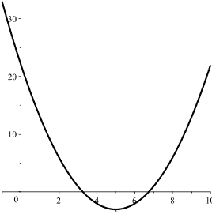

```
> Newton(f, 2.0, 10^−9, 30);

2.0
3.000000000
3.250000000
3.267857143
3.267949190
3.267949192
3.267949192
```

```
> f(3.267949192);

1. 10^−9
```

```
> Newton(f, 7.0, 10^−9, 30);

7.0
6.750000000
6.732142857
6.732050810
6.732050808
6.732050808
```

```
> f(6.732050808);

1. 10^−9
```

我们得到两个根的近似值：$x = 3.2679449192$ 和 $x = 6.732050808$。

在本书两卷中，我们经常会创建**过程**，使用专门的技术解决问题。

## 关键命令快速回顾

## 赋值和基本数学运算

例如，让我们计算 $(1.2^{4.1} + 4.3(9.8))/34$。

```
```maple
> (1.2^4.1 + 4.3 · 9.8)/34;
                         1.301522146
```
```

所有 Maple 语句都在 `>` 提示符后输入。再次注意，Maple 命令以分号结尾；在文档界面中，分号是可选的。以蓝色显示的 Maple 输出会在页面中居中。

若要为一个数或表达式分配标签或名称，可以使用 `:=`。例如，让我们使用两条 Maple 语句，分别将 11.5 赋值给 $a$，将 9 赋值给 $b$。

```
```maple
> a := 11.5;
                         a := 11.5

> b := 9;
                         b := 9
```
```

我们可以在同一行或同一输入单元格中输入多个命令。如果使用冒号而不是分号分隔两个命令，那么即使两个命令都已执行，输出中也只会显示第二个命令。冒号会抑制输出。

```
```maple
> a := 11.5 : b := 9;
                         b := 9
```
```

完成赋值后，我们就可以执行算术运算。例如，让我们计算 $a^2+b^3$、$a^2\cdot b^3$ 和 $\sqrt{a^2+b^3}$。

```
```maple
> a^2 + b^3;
  a^2 · b^3;
  sqrt(a^2 + b^3);
                         861.25
                         96410.25
                         29.34706118
```
```

一个非常有用的命令是 **evalf**。该命令会生成给定表达式的十进制等价形式。其助记含义是*按浮点数（十进制）求值*。

```
> c := evalf(a^2/b^3);
```

0.1814128944

对于表达式，我们同样使用赋值运算符 `:=` 为 $y$ 赋值。

```
> y := x^2 + 21.6 · x − 1
```

$y := x^2 + 21.6x − 1$

要计算此类表达式在特定 $x$ 值下的结果，可以使用 *subs* 命令（替换）或 *eval* 命令（求值）。例如，我们希望用 $3$ 替换 $x$。

```
> subs(x = 3, y);
```

72.8

```
> eval(y, x = 3);
```

72.8

要使用诸如 $f(3)$ 这样的函数记号，必须使用另一种赋值形式。要创建函数赋值 $f$，可以使用如下的 *箭头* 运算符。（输入“−”，然后输入“>”即可得到箭头运算符；显示结果会变为“→”。）

```
> f := x → x^2 + 21.6 · x − 1;
```

$f := x \mapsto x^2 + 21.6x − 1$

```
> f(3);
```

72.8

我们甚至可以用诸如 $(x+h)$ 这样的变量替换 $x$：

```
> f(x+h);
```

$(x+h)^2 + 21.6x + 21.6h − 1$

表达式（对象）和函数（操作）这两种形式在编程和绘图中都非常重要，后文将对此进行介绍。使用 *unapply* 命令，可以轻松地从表达式创建函数。

```
> y := x^3 + 3 · cos(x) − 4;
```

$x^3 + 3\cos(x) − 4$

```
> f := unapply(y, x);
```

$f := x \mapsto x^3 + 3\cos(x) − 4$

```
> f(x);
```

$x^3 + 3\cos(x) − 4$

```
```maple
> s := (x, y) → Pi · (x^2 · y^3 + 3)'
s := (x, y) ↦ π(x^2 · y^3 + 3)'

> s(2, 5);
503 π

> evalf(%);
1580.221105
```
```

表达式 `evalf(%)` 包含符号 `%`，表示插入上一个求值表达式的结果。（如果你在 Maple 文档中重新执行了其他语句，那么这里的结果可能并不是紧接在上方的结果。）

## 代数与微积分

回到表达式 $y = x^2 + 21.6x - 1$。

```
```maple
> y := x^2 + 21.6x − 1;
y := x^2 + 21.6x − 1
```
```

让我们对 $y$ 进行因式分解。可以使用 `factor` 命令或 `solve` 命令。`solve` 命令的用途更广。

```
```maple
> factor(y);
(x + 21.64619749)(x − 0.04619749036)

> solve(y = 0);
0.04619749036, −21.64619749
```
```

考虑函数 $q(x) = ax^2 + bx + c$。我们使用 `solve` 命令并得到以下结果：

```
```maple
> restart;

> q := x → ax^2 + bx + c;
q := x ↦ ax^2 + bx + c

> solve(q(x) = 0, x);
−b + √(−4ac + b^2) / 2a,  −b − √(−4ac + b^2) / 2a
```
```

注意，这些结果就是求根公式。我们还使用了 `restart` 命令。`restart` 会忘记之前对 $f$、$a$、$b$、$c$ 以及其他所有已定义对象所做的赋值。

在微积分中，我们可以对单变量和多变量函数进行微分和积分。微分和积分所使用的命令如下：

*diff* 和 *Diff*：微分或偏微分，以及“非定积分”形式的微分

*int* 和 *Int*：定积分和不定积分

例如，让我们对表达式 $y = 2x^2 + 24.1x - 1$ 求导，然后求一般形式下以及从 $x = 1$ 到 $x = 4$ 的曲线下面积。

```
```text
> y := 2x^2 + 24.1 · x − 1
y := 2x^2 + 24.1x − 1
```
```

```
```text
> Diff(y, x)
\frac{d}{dx}(2x^2 + 24.1x - 1)
```
```

```
```text
> diff(y, x)
4x + 24.1
```
```

```
```text
> Int(y, x)
∫ (2x² + 24.1x − 1) dx
```
```

```
```text
> int(y, x)
0.6666666667x³ + 12.05000000x² − x
```
```

```
```text
> Int(y, x = 1..4)
∫₁⁴ (2x² + 24.1x − 1) dx
```
```

```
```text
> int(y, x = 1..4)
219.7500000
```
```

注意 *diff* 和 *Diff* 之间的区别。首字母大写表示该命令的“惰性形式”。

通常，我们希望找出一阶导数的临界点（即 $y' = 0$ 的位置）。可以按如下方式使用 *solve* 命令：

```
```text
> solve(diff(y, x) = 0, x);
−6.025000000
```
```

## 绘图与图形

Maple 提供了功能极其详细且完善的 *plot* 命令，可以绘制二维和三维图形。出于建模目的，通常会使用二维图。我们建议在绘图前通过 *with(plots)* 加载 plots 程序包。*plot* 的语法是 *plot(y, hr, vr, options)*，其中 *y* 是要绘制的表达式，*hr* 是水平范围，*vr* 是垂直范围。此外，还可以在垂直范围后添加许多其他选项，用于控制各种项目。表 1.5 列出了一些选项（默认值


### 3.2.1 数据来源

本文使用的数据来源于中国气象数据网（http://data.cma.cn）提供的中国地面气候资料日值数据集（V3.0），该数据集包含中国699个基准站、基本气象站1951年1月以来本站气压、气温、降水量、蒸发量、相对湿度、风向风速、日照时数和0 cm地温要素的日值数据。

考虑到数据的连续性和完整性，本文选取了北京、上海、广州、成都、武汉、西安、沈阳、乌鲁木齐、拉萨、海口等10个代表城市作为研究对象，时间范围为2000年1月1日至2019年12月31日，共20年。

对于个别站点存在的缺测数据，本文采用线性插值法进行插补；对于连续缺测超过5天的数据，则剔除该时段，不参与统计分析。

### 3.2.2 数据预处理

在数据预处理阶段，首先对原始数据进行质量控制和异常值检测。质量控制包括：

1. 气候学界限值检查：检查各要素值是否超出该要素在气候上可能出现的最大值和最小值；
2. 台站极值检查：检查各要素值是否超出该站历史极值；
3. 时间一致性检查：检查同一站点不同时间观测值之间的合理性；
4. 空间一致性检查：检查同一时间不同站点观测值之间的合理性。

经过上述质量控制后，对通过检查的数据进行标准化处理，以消除量纲影响，便于后续的统计分析。

```maple
> plot(sin(x), color = black, thickness = 3);
```

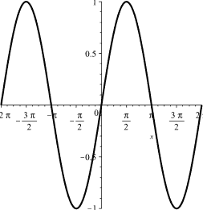

```maple
> plot(sin(x), x = 0..infinity, color = black, thickness = 3);
```

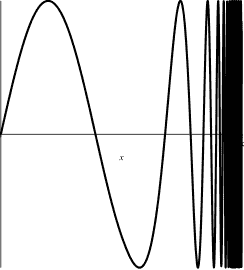

## 散点图

前面的图展示了具有连续 $x$ 值的函数；其定义域要么默认为 $-10..10$，要么由用户选定。然而，Maple 也可以绘制离散数据集。利用表 1.6 中提供的数据，我们给出一个绘制五个人年龄与其各自体重关系的示例。

**表 1.6：年龄-体重数据**

| 年龄（岁） | 1 | 5 | 13 | 17 | 24 |
|---|---:|---:|---:|---:|---:|
| 体重（磅） | 15 | 40 | 90 | 160 | 180 |

```maple
age := [1, 5, 13, 17, 24]:
wt := [15, 40, 90, 160, 180]:
agewt := {seq([age[k], wt[k]], k = 1..5)};
          agewt := {[1, 15], [5, 40], [13, 90], [17, 160], [24, 180]}
plot(agewt, style = point, symbol = diamond, symbolsize = 14);
```

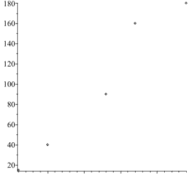

我们也可以使用

```maple
with(plots):
pointplot(agewt, symbol = diamond, symbolsize = 14);
```

## 多重绘图

也可以在同一组坐标轴上绘制多个函数。一种方法要求两个函数具有相同的定义域。第二种方法使用 `display` 命令，该命令需要通过 `with(plots):` 加载 plots 包。如下所示，这种方法不受定义域限制。

```maple
> myOptions := (scaling = constrained, axes = framed, thickness = 2) :
  plot([sin(x), x^0.5], x = 0..5, myOptions);
```

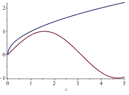

```maple
> with(plots) :
> curve := plot(30*sin(x), x = 0..30) :
> points := pointplot(agewt, symbol = diamond, symbolsize = 14) :
> display(curve, points);
```

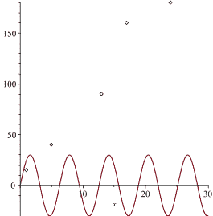

向现有图形添加曲线的一种有趣方法是，先选中所需的输出表达式（屏幕上为蓝色字体），然后将该选中内容“拖放”到现有绘图图像上。试试吧！

## 1.5 Maple 培训

网站 https://www.maplesoft.com/support/training/quickstart.aspx 提供了介绍基本功能的 Maple 培训视频。该网站有一个完整的视频教程“Maple 快速入门”。涵盖的 Maple 基本功能包括：

- 数值计算
- 符号计算
- 基本 Maple 过程编程
- 可视化
- 微积分
- 线性代数
- 学生程序包
- 其他 Maple 程序包

该培训可作为 Maple 命令的基础复习。该网站还提供“快速入门”PDF 参考文档。

## 1.6 Maple 应用中心

*Maple 应用中心*位于 https://www.maplesoft.com/applications/ ，包含大量可供学生和从业者使用的工作表。作者也在该站点上提供了若干工作表。

## 练习

在 Maple 中执行以下操作：

## 1.1 线性空间

**定义 1.1.1**  设 V 是一个非空集合，F 是一个数域。如果在 V 上定义了一个代数运算，称为加法，即对于 V 中任意两个元素 α, β，在 V 中有唯一的一个元素 γ 与之对应，称为 α 与 β 的和，记为 γ = α + β；在 F 与 V 的元素间还定义了一个运算，称为数量乘法，即对于 F 中任意数 k 与 V 中任意元素 α，在 V 中有唯一的一个元素 δ 与之对应，称为 k 与 α 的数量乘积，记为 δ = kα。如果加法和数量乘法满足下列八条运算规则，那么称 V 为数域 F 上的线性空间。

1. 加法交换律：α + β = β + α；
2. 加法结合律：(α + β) + γ = α + (β + γ)；
3. 零元素：在 V 中存在一个元素 0，使对任意 α ∈ V，有 α + 0 = α；
4. 负元素：对于 V 中任意元素 α，存在 β ∈ V，使 α + β = 0；
5. 1α = α；
6. 数乘结合律：k(lα) = (kl)α；
7. 数乘对加法的分配律：k(α + β) = kα + kβ；
8. 数乘对数的分配律：(k + l)α = kα + lα。

其中 α, β, γ 是 V 中任意元素，k, l 是 F 中任意数。

**例 1.1.1**  数域 F 上的 n 维向量全体按通常的向量加法和数量乘法构成 F 上的一个线性空间，记为 $F^n$。

**例 1.1.2**  数域 F 上的 m × n 矩阵全体按矩阵的加法和数量乘法构成 F 上的一个线性空间，记为 $F^{m\times n}$。

**例 1.1.3**  区间 [a, b] 上全体连续实函数按通常的函数加法和数乘函数构成实数域 R 上的一个线性空间，记为 $C[a, b]$。

**例 1.1.4**  数域 F 上一元多项式环 $F[x]$ 按通常的多项式加法和数与多项式的乘法构成 F 上的一个线性空间。

**例 1.1.5**  数域 F 上所有次数不超过 n 的多项式（包括零多项式）按通常的多项式加法和数与多项式的乘法构成 F 上的一个线性空间，记为 $F[x]_n$。

**例 1.1.6**  齐次线性方程组 $Ax = 0$ 的全部解向量按通常的向量加法和数量乘法构成一个线性空间，称为解空间。

- [GFH2013] Frank Giordano, William P. Fox 和 Steven Horton，*数学建模初级教程*，Nelson Education，2013.
- [M2007] Mark Meerschaert，*数学建模*，第三版，2007.

## Maple 参考资料与帮助

- [T2017] Ian Thompson，*理解 Maple*，2017.
- [MUM2018] Maplesoft，*Maple 用户手册*，2018.  
  https://www.maplesoft.com/support/help/category.aspx?CID=2317
- [MPG2018] Maplesoft，*Maple 编程指南*，2018.  
  https://www.maplesoft.com/support/help/category.aspx?CID=2318
- [MPG2012] L. Bernardin, P. Chin, P. DeMarco, K. O. Geddes, D. E. G. Hare, K. M. Heal, G. Labahn, J. P. May, J. McCarron, M. B. Monagan, D. Ohashi 和 S. M. Vorkoetter，*Maple 编程指南*，2012.
- [ENM2007] Richard H. Enns 和 George McGuire，*计算机代数秘籍：科学建模高级指南*，2007.

## 2 离散动力模型

**目标：**

1. 为一个实际问题定义并构建离散动力系统。
2. 迭代求解。
3. 用图形表示解。
4. 理解平衡值与稳定性。
5. 求解线性和非线性离散动力系统。
6. 求解离散动力系统（组）。

### 2.1 引言

考虑一种正在美国蔓延的疾病，例如新型流感或流行性感冒。美国疾病控制与预防中心（CDC）希望在这种新疾病真正成为“实际”流行病之前，了解并试验针对它的模型。¹ 我们将人群分为三类：易感者（能够感染这种新流感）、感染者（目前患有流感并具有传染性）和移除者（已经患过流感且不会再次感染，或已死于流感）。我们为模型做出以下假设：

> ¹ CDC 网站“FluView”监测美国当前疫情。

- 没有人进入或离开该社区。
- 社区外没有接触。
- 每个人要么是易感者 $S$、感染者 $I$，要么是移除者 $R$。
- 初始时，每个人要么是 $S$，要么是 $I$。
- 一旦有人今年得了流感，就不会再次感染（“已产生免疫力”）。
- 该疾病的平均持续时间为 2 周，在此期间该人被认定为感染者并可传播疾病。
- 模型的时间步长为一周。

我们能否构建一个模型来为 CDC 提供有用的信息？我们将在本章后面再次讨论该模型。

### 2.2 用动力系统建模

购买新车是一项重大开销。在查看品牌和型号以确定你喜欢的车型后，就该考虑“成本”和可用的融资方案了。还款通常在每月月底进行。所欠金额根据汽车总价、各种费用以及贷款利率预先确定。这个过程可以建模为动力系统。

离散动力系统（DDS）的另一个名称是“差分方程”。本章将广泛使用 DDS。我们从基本定义开始：

序列是定义域为非负整数集、值域为实数子集的函数。动力系统是序列各项之间的一种关系；DDS 描述一个对象随时间的演化。数值解是满足动力系统的一张数值表。

让我们简要回顾一下“关系”和“函数”的概念，因为它们是上述定义的基础。关系是有序对的集合，通常写成（输入，输出）。作为一种有序对，关系可以表示一个变量如何依赖于另一个变量。关系的定义域是有序对中所有第一个坐标的集合，值域是有序对中所有第二个坐标的集合。函数是一种特殊类型的关系。函数是这样一种关系：定义域中的每个元素在值域中恰好有一个关联元素。函数的定义域是所有自变量（允许的输入）的集合，值域是所有可能的因变量值（输出）的集合。

函数、定义域和值域的概念在动力系统模型中清晰可见。让我们定义一个递推关系，即下一项依赖于先前各项的关系，其形式为方程

$$a(n+1)=f(a(n),a(n-1),\ldots,a(0),n)\qquad\text{or}\qquad a_{n+1}=f(a_n,a_{n-1},\ldots,a_0,n).$$

使用下标作为自变量使记号更加紧凑且易于阅读。


递推关系（也称递归公式）出现在应用数学的许多分支中。**离散动力系统**（DDS 或 *差分方程*）是由递推关系定义的序列。离散动力系统是一个“变化系统”，其中系统在每次离散迭代中的变化取决于其先前的状态。假设我们有一个函数 $y=f(x)$。*一阶*离散动力系统由数列 $a(n)$（$n=0,1,\ldots$）给出，其中第一个数之后的每个数都与前一个数相关，关系为

$$a(n+1)=f(a(n)).$$

（许多书籍和文章将关系式 $a(n+1)-a(n)=g(a(n))$ 称为 *一阶差分方程*。）

动力系统的*阶*是公式中出现的最大自变量与最小自变量（或函数的变量）之差。例如，$A(n+2)=0.5A(n+1)+2A(n)$ 是一个二阶 DDS，因为最大自变量 $n+2$ 减去最小自变量 $n$，即 $(n+2)-n=2$。

## 示例 2.1. 一个简单的一阶离散动力系统。

将动力系统 $A$ 定义为 $n$ 个时间段后患者血液中的抗生素含量。其定义域是表示时间段 0, 1, 2, $\ldots$, $n$ 的非负整数，这些将作为函数的输入。由于定义域是离散的，我们便得到一个离散动力系统。值域是由定义域中每个值确定的 $A(n)$ 的集合。因此，$A(n)$ 也代表因变量。对于定义域中的每个输入值 0, 1, 2, $\ldots$, $n$，结果有且仅有一个量 $A(n)$，因此 $A$ 是一个函数。

动力系统包含三个组成部分：

-   表示 $A(n)$ 的数列公式，
-   时间段 $n$ 定义良好，且
-   至少一个起始值 $(n_0,A(n_0))$。（所需起始值的个数与 DDS 的阶数相对应。）

起始值集合称为**初始条件**。在上面的例子中，如果开始时系统中没有抗生素，那么 $A(0)=0$ mg 就是我们的初始条件。然而，如果我们从服用初始 200 mg 药片后开始，那么 $A(0)=200$ mg 就是我们的初始条件。一个带有初始条件的离散动力系统示例为：

$$A(n+1)=0.5A(n)$$
$$A(0)=200$$

我们主要关注 DDS 的多个方面之一：DDS 是否具有稳定平衡？对于指定的 $n$，系统在第 $n$ 个周期后的值是多少？DDS 的长期行为是什么？

接下来，让我们看看能辅助我们研究 DDS 的 Maple 命令。

## 用于离散动力系统的 Maple 命令

我们将使用 Maple 中熟悉的命令和库，如 *plots*，并向我们的 Maple 工具箱中添加新命令。

```
**rsolve** – *recurrence equation solver*

Calling Sequence

`rsolve(eqns, f, n)`

`rsolve(eqns, f(n), ‘genfunc’(z))`

`rsolve(eqns, f(n), ‘ztransform’(z))`

`rsolve(eqns, f(n), ‘series’)`

Parameters

eqns – single equation or a set of equations

fcn – function name or set of function names

z – name, the generating function variable
```

```
**seq** – *create a sequence*

Calling Sequence

`seq(f, m..n)`

`seq(f, i = m..n)`

`seq(f, i = m..n, step)`

`seq(f, i = x)`

Parameters

f – any expression

i – name

m, n – numerical values

x – expression

step – (optional) numerical value
```

查看 Maple 帮助页面中关于 *rsolve* 和 *seq* 的详细信息及许多示例。

我们将求解的几个模型具有闭式解；我们可以使用 *rsolve* 获得公式，然后使用 *seq* 获得解的数值。

许多动力系统没有闭式解析解，因此我们不能使用 *rsolve* 和 *seq* 来获得解。当这种情况发生时，我们将使用 **proc** 编写一个小程序，通过迭代获得数值解。为了绘制动力系统解的图形，我们将使用 plot 命令查看顺序数据对 (k, A(k))。我们将在下一节的示例中说明 map 的使用。

## 2.3 线性系统

我们感兴趣的是对离散变化进行建模。使用离散动力系统建模采用一种方法来解释某些离散行为或做出长期预测。我们用于离散动力系统建模的一个强大范式是：

未来值 = 现值 + 变化

我们将用这一范式研究的动力系统在外观和组成上会有显著差异，但我们能用类似方法求解其中一大类“看似”不同的动力系统。在本章中，我们将使用迭代和图形方法来回答关于离散动力系统的问题。

我们将使用流程图来帮助我们观察因变量如何变化。流程图有助于理解这一范式并将问题转化为数学表述。让我们考虑为新款福特野马车融资。总价为 25,000 美元。我们可以首付 2,000 美元，因此需要融资 23,000 美元。经销商向我们提供 72 个月 2% 年利率（APR）的融资方案。考虑下面图 2.1 中该汽车融资情况的流程图。

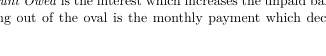

图 2.1：汽车融资流程图

我们将使用流程图来帮助构建离散动力模型。设 A(n) = n 个月后所欠金额。注意指向“所欠金额”的箭头是利息，它会增加未付余额。从椭圆指向外部的箭头是每月还款，它会减少债务。

A(n + 1) = 下个月所欠金额（未来）
A(n) = 当前所欠金额（现在）
i = 月利率
P = 每月还款额

于是我们的范式“未来 = 现在 + 变化”给出

A(n + 1) = A(n) + (i · A(n) − P)

我们将对具有常系数的动力系统建模。例如，一个具有常系数的三阶齐次离散动力系统可以写成如下形式

$$a(n+3)=b_2a(n+2)+b_1a(n+1)+b_0a(n)$$

其中 $b_0$、$b_1$ 和 $b_2$ 是任意常数。如果在右侧添加一个不涉及 $a(n)$ 的项，则该 DDS 将是非齐次的。

我们稍后将演示的“汉诺塔”谜题涉及将一叠圆盘从一根柱子移动到另一根柱子。移动 $n$ 个圆盘所需的离散移动次数 $H(n)$ 取决于移动 $n-1$ 个圆盘所需的离散移动次数。对于示例 2.1 中的药物剂量模型，该模型显示 $n$ 小时后血液中的药物量取决于 $n-1$ 小时后血液中的药物量。对于财务问题，如购买野马，$n$ 个月后我们仍欠的金额取决于 $n-1$ 个月后所欠的金额。当我们讨论 *马尔可夫链* 作为离散动力系统的一个示例时，我们也会发现这种基于状态转移的过程非常有用。

回顾一下，*一阶* DDS 是这样一种系统：下一次迭代 $a(n)$（即系统经过 $n$ 次迭代后的状态）仅通过关系式与上一次迭代 $a(n-1)$ 相关：

$$a(n)=f\bigl(a(n-1)\bigr);$$

即，对于 $n=2,3,\ldots$，$a(n)$ 仅是 $a(n-1)$ 的函数。例如，$a(n)=2a(n-1)$ 是一阶 DDS。如果函数 $f$ 涉及 $a(n)$ 的函数，只是 $a(n)$ 的常数倍（常系数），我们就称该离散动力系统是*线性*的。如果函数 $f$ 涉及幂（如 $a(n)^2$），或函数关系（如 $a(n)/a(n-1)$ 或 $\sin(a(n-1))$），我们就称该离散动力系统是*非线性*的。

## 示例 2.2. 汉诺塔的迭代。

汉诺塔谜题于 1883 年由法国数学家爱德华·卢卡斯（Édouard Lucas，1842-1891）以笔名“（暹罗的）N. 克劳斯教授”发明，该笔名源自 Li-Sou-Stian 学院的官话。³ 该谜题由一个带三根竖直柱子的底板和一系列外径依次减小的圆盘（现在通常为 6 到 10 个）组成。圆盘最初在第一根柱子上，最大的圆盘在底部，其上是次大的圆盘，依此类推，直到最上面的最小圆盘，形成一个塔或金字塔，如图 2.2 所示。

游戏的目标是每次移动一个圆盘，用尽可能少的移动次数将所有圆盘移到第三根柱子上，形成同样的金字塔。在每次移动过程中，较大的圆盘不能放在较小的圆盘上面——这就是为什么需要第二根和第三根柱子。卢卡斯最初的游戏规则如下。

> ³ 这个谜题也被称为“梵天塔”或“卢卡斯塔”。关于这个游戏有几个有趣的传说。参见 Paul Stockmeyer 的网页 http://www.cs.wm.edu/~pkstot/tob.html 了解原始游戏盒和说明。


图 2.2：汉诺塔谜题¹

这个游戏的目标是将这些圆盘移动到另一个柱子上，并且每次只能移动一个圆盘，同时遵守以下规则：

- I. 每次移动后，所有圆盘都将堆叠在一个、两个或三个柱子上，并且从底部到顶部按递减顺序排列。
- II. 可以从三个圆盘堆中的任意一个取下顶部圆盘，并将其放置在一个空柱子上。
- III. 可以从三个圆盘堆中的任意一个取下顶部圆盘，并将其放置在另一个圆盘堆的顶部，前提是该圆盘堆的顶部圆盘更大。

卢卡斯最初的“河内塔”游戏有八个圆盘。这个谜题是用来演示移动传说中的“婆罗门圣塔”的模型，而这座塔实际上有“六十四层纯金结构，并饰以钻石”。贝尔纳雷斯寺庙的僧侣负责移动这座塔，他们按照由来已久的仪式，每分钟移动一个圆盘，并且规定较大的圆盘不能放在较小的圆盘上。正如卢卡斯的故事所述，这些僧侣相信，一旦六十四个圆盘全部转移完毕，地球就会在一团尘埃中崩塌。

这个传说有些令人不安，因此让我们使用归纳法，找出将 \(n\) 个圆盘从第一个柱子转移到第三个柱子所需移动次数的公式。假设我们有 \(n+1\) 个圆盘。那么，我们可以用 \(a(n)\) 次移动将 \(n\) 个较小的圆盘从第一个柱子移动到第二个柱子，其中 \(a(n)\) 表示移动 \(n\) 个圆盘所需的次数。然后，我们将最大的圆盘从第一个柱子移动到第三个柱子。最后，我们用 \(a(n)\) 次移动将 \(n\) 个较小的圆盘从第二个柱子移动到第三个柱子。因此，\(a(n+1)=a(n)+1+a(n)=2a(n)+1\)。所以，给出所需移动次数的递推关系为 \(a(n+1)=2a(n)+1\)；初始值为 \(a(1)=1\)，这意味着我们从只有一个圆盘需要移动的情况开始。图 2.3 展示了汉诺塔的一个合理流程图。

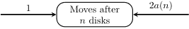

图 2.3：汉诺塔流程图

存在一个公式，可以计算将 \(n\) 个圆盘从第一个柱子移动到第三个柱子所需的移动次数。我们将研究求解这一递推关系的方法，以找出该公式。第一种方法是迭代。稍后，我们将学习一种更好的方法，即显式求解 D/Ds。

让我们通过迭代递推关系来建立表 2.1：

$$a(n+1)=2a(n)+1$$
$$a(1)=1.$$

表 2.1：汉诺塔递推关系

| 圆盘数量 | 递推关系 | 移动次数 |
|---|---|---:|
| 1 | \(a(1)=1\) | 1 |
| 2 | \(a(2)=2a(1)+1=2(1)+1\) | 3 |
| 3 | \(a(3)=2a(2)+1=2(3)+1\) | 7 |
| 4 | \(a(4)=2a(3)+1=2(7)+1\) | 15 |
| 5 | \(a(5)=2a(4)+1=2(15)+1\) | 31 |
| 6 | \(a(6)=2a(5)+1=2(31)+1\) | 63 |
| 7 | \(a(7)=2a(6)+1=2(63)+1\) | 127 |
| ⋮ | ⋮ | ⋮ |
| \(n\) | \(a(n)=2a(n-1)+1\) | \(2a(n-1)+1\) |

通过迭代，我们反复计算递推关系，每次计算 \(n\) 的下一个值。为了找出移动六十四个圆盘需要多少分钟，我们必须将给定的递推关系迭代 64 次。我们将使用 Maple 帮助完成表 2.2 的计算。

## 表 2.2：包含六十四个圆盘的汉诺塔

| 圆盘数 | 所需移动次数 |
|---:|---:|
| 1 | 1 |
| 5 | 31 |
| 10 | 1023 |
| 15 | 32767 |
| 20 | 1048575 |
| 25 | 33554431 |
| 30 | 1073741823 |
| 35 | 34359738367 |
| 40 | 1099511627775 |
| 45 | 35184372088831 |
| 50 | 1125899906842623 |
| 55 | 36028797018963967 |
| 60 | 1152921504606846975 |
| 64 | 18446744073709551615 |

上表显示，需要 18446744073709551615 ≈ 1.84467 × 10^19 分钟。让我们将其换算为等价的其他时间单位。一天有 1440 分钟，一年有 525,600 分钟。按照每分钟移动一次的速度，\(a(64)\) 相当于 3.5135 × 10^13 年。想象一下这段时间究竟有多长。（宇宙的估计年龄为 1.37 × 10^10 年。）

离散动力系统的强大之处在于，它们总能通过迭代求解。通过迭代值表和这些值的图像，我们能够分析复杂的建模问题。

在 Maple 中，要获得迭代值，我们可以使用 `proc` 编写一个过程；或者，当递推关系具有闭式解时，使用 `rsolve` 和 `seq` 命令。下面我们将分别介绍这两种方法，以获得表 2.1 和表 2.2 中的值。首先介绍 `rsolve` 和 `seq`。

```
rsolve({H(n + 1) = 2 · H(n) + 1, H(1) = 1}, H(n));
                         -1 + 2^n
```

我们得到了闭式解析解 \(H(n)=2^n−1\)。如果不存在公式，`rsolve` 将只会原样返回输入内容。使用 `rsolve` 是快速判断离散动力系统是否具有闭式解的一种方法。

现在，我们可以使用 `rsolve` 得到的公式配合 `seq` 生成数值。此外，由于存在公式，我们不必迭代计算直到所需的 \(n\) 值。

```
```maple
> seq([n, 2^n - 1], n = 1..64, 7);  # 注意步长为 7
[1, 1], [8, 255], [15, 32767], [22, 4194303], [29, 536870911], [36, 68719476735],
[43, 8796093022207], [50, 1125899906842623], [57, 144115188075855871],
[64, 18446744073709551615]
```
```

当一个动力系统没有闭式解析解时，**rsolve** 命令会选择其输入，因此我们无法在 `(seq)` 命令中使用公式来生成数值。我们需要使用 **proc** 创建一个程序，对离散动力系统进行迭代。将该程序命名为 *Tower*，并使用输入参数 *n0*、*t0* 和 *n*，其中 *n0* 是定义域中的第一个非负整数，*t0* 是第一个排列值（即 *(n0, t0)* 是初始条件），而 *n* 是定义域中所需的非负整数值。我们使用 `option remember`，使程序能够存储并调用之前迭代得到的值。如果不记忆这些值，简单的递归可能需要进行大量计算才能得到某个值。例如，斐波那契数由 \(F(n)=F(n−1)+F(n−2)\) 给出；当不记忆先前的值时，计算 \(F(n)\) 大约需要 2ⁿ 次计算。

```
```maple
> Tower := proc(n0,t0,n)
      option remember;
      local T;
      if n > n0 then
         T := 2 · Tower(n0,t0,n − 1) + 1;
      else
         T := t0;
      end if;
      return T;
   end proc:
```
```

现在，我们可以使用 **seq** 和过程 *Tower* 来生成数值。（*Tower* 包含在本书的 *PSMv2* Maple 软件包中。）此外，由于存在公式，我们不必迭代计算直到所需的 *n* 值。

```
```maple
> seq([n, Tower(1,1,n)], n = 1..64, 7);  # 注意步长为 7
[1, 1], [8, 255], [15, 32767], [22, 4194303], [29, 536870911], [36, 68719476735],
[43, 8796093022207], [50, 1125899906842623], [57, 144115188075855871],
[64, 18446744073709551615]
```
```

这些值与使用公式得到的值相同吗？

让我们绘制这个递推关系。

```
pts := seq([n, Tower(1, 1, n)], n = 1..15):
plot([pts], style = point, symbol = solidcircle, symbolsize = 14);
```

很容易看出，这个递推关系增长得有多快。

## 示例 2.3：药物剂量问题

医生为一名患者开出某种药物的口服剂量：每小时 100 mg。假设药物服用后会立即被吸收到血液中。同时假设，患者的身体每小时会清除血液中药物总量的 25%。再假设，患者在服用第一片药之前，血液中的药物含量为 0 mg。72 小时后，患者血液中会有多少药物？

*一般问题陈述。*

确定血液中药物含量与时间之间的关系。

*假设。*

- 该问题可以用离散动力系统建模。
- 患者体型和健康状况正常。
- 患者没有服用会影响该处方药的其他药物。
- 不存在会影响药物吸收率或清除率的内部或外部因素。
- 患者始终在正确的时间服用规定剂量。

*变量。*

定义 \(a(n)\) = 经过 \(n=0,1,2,\ldots\) 小时后血液中的药物含量。


要找到 \(a(72)\) 的值，我们可以迭代递推式使用 `seq`，也可以使用 `rsolve` 得到公式。让我们从迭代开始。（请记得使用 `restart` 或打开一个新的 Worksheet 以获得全新的 Maple 环境。）由于这是一个简单的递推式，我们将使用一个‘捷径’过程。

```maple
> a := n -> piecewise(n > 0, 0.75 * a(n - 1) + 100, 0);
```

$$a := n \mapsto \begin{cases}0.75\,a(n-1)+100 & 0<n\\0 & otherwise\end{cases}$$

询问 Maple \(a(72)\) 将执行迭代并显示结果。

```maple
> a(72);
```

$$399.999996$$

我们可以通过使用 \(\operatorname{seq}(a(k), k=0..72)\) 来查看所有迭代值。让我们尝试使用 `rsolve` 找到公式。（请记得 `restart`。）

```maple
> rsolve({a(n + 1) = 0.75 * a(n) + 100, a(0) = 0}, a(n));
```

$$400 - 400\left(\frac{3}{4}\right)^n$$

注意，在这种情况下，尽管我们输入的是小数，Maple 仍返回了精确的答案。

患者血液中药物量的长期水平是多少？

```maple
> limit(400 - 400 * 0.75^n, n = infinity);
```

$$400$$

检查迭代会显示，患者血液中大约在 24 小时后会有 400 mg 的药物。

是时候画图了。

```maple
> pts := [seq([n, 400 - 400 * 0.75^n], n = 0..48)]:
```

暗示

$$a(n)=r^n\cdot a(0)\quad\text{for }n=0,1,2,\ldots$$

让我们用 Maple 检查一下。

```maple
rsolve({a(n+1) = 1.001 * a(n), a(0) = 1000}, a(n)):
Money := unapply(%, n);
Money -> 1000 (1001/1000)^n
```

注意，Maple 在使用 `rsolve` 时会将数值转换为有理数。回想一下，`unapply` 将表达式转换为函数。

总体趋势是什么？

```maple
Limit(Money(n), n = infinity) = limit(Money(n), n = infinity);
lim[n→∞] 1000 (1001/1000)^n = ∞
```

```maple
with(plots):
```

```maple
pointplot([seq([i, Money(i)], i = 0..12*4)], title = "Money over Time");
```

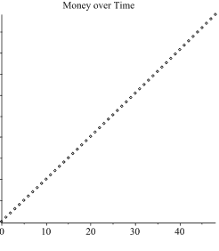

该图看起来像一条直线，尽管该函数显然是非线性的。

需要多少年绘图才会显示出一些曲率？

让我们查看 4 年的值序列，看看 *Money* 如何增长。

```maple
Money_table := seq(eval(Money(i)), i = 0..12*4);

Money_table := 1000., 1001., 1002.001000, 1003.003001,
                1004.006004, 1005.010010, 1006.015020, 1007.021035,
                1008.028056, 1009.036084, 1010.045120, 1011.055165,
                1012.066220, 1013.078287, 1014.091365, 1015.105456,
                1016.120562, 1017.136682, 1018.153819, 1019.171973,
                1020.191145, 1021.211336, 1022.232547, 1023.254780,
                1024.278035, 1025.302313, 1026.327615, 1027.353943,
                1028.381297, 1029.409678, 1030.439088, 1031.469527,
                1032.500996, 1033.533497, 1034.567031, 1035.601598,
                1036.637199, 1037.673836, 1038.711510, 1039.750222,
                1040.789972, 1041.830762, 1042.872593, 1043.915465,
                1044.953981, 1046.004340, 1047.050345, 1048.097395,
                1049.145492
```

账户是否能达到 $10,000？我们可以确定大约需要 192 年才能达到 $10,000。

```maple
> months := fsolve(10000 = Money(n), n);

                         months := 2303.736194

> years := months/12;

                          years := 191.9780162
```

由于 \(Money(n)\) 随着 \(n\) 增大趋向于无穷大，只要没有取款，账户就会持续增长。

## 例 2.5. 一个简单的抵押贷款

五年前，你的父母通过 20 年期、年利率 4% APR 的融资购买了价值 $150,000 的房屋。他们的月供为 $908.97。他们已支付 60 期款项，并希望知道此时他们实际欠房屋的金额。他们可以用此信息来决定是否以更低的利率 3.25% APR 为期 15 年或 3.5% APR 为期 20 年再融资。

每个期间所欠金额的变化会因利息增加而增加，因付款减少而减少。

### 一般问题

建立并使用一个模型，将时间与房屋抵押贷款的欠款金额联系起来。

### 假设

- 初始利率为 4% APR。
- 月利率为 4%/12 = 0.33%。
- 每月按时付款。
- 再融资的当前利率为 15 年期 3.25% 和 20 年期 3.50%。

### 变量

设 \(b(n)\) = 经过 \(n\) 个月后欠房屋的金额。

### 流程图

我们在图 2.6 中绘制了流程。

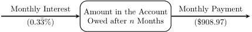

图 2.6：抵押贷款欠款金额的流程图

### 模型构建

\[
\textit{future} = \textit{present} + \textit{change}
\]
\[
b(n+1)=b(n)+(0.04/12\cdot b(n))-908.97 \quad\text{and}\quad b(0)=150000
\]
\[
=(1+0.04/12)\cdot b(n)-908.97 \quad\text{and}\quad b(0)=150000
\]

### 模型求解

使用 `rsolve` 找到 \(b(n)\) 的公式。由于 Maple 为 `rsolve` 转换为有理数，我们将嵌入 `evalf` 以返回小数。

```maple
rsolve({b(n+1) = (1 + 0.04/12) * b(n) - 908.97, b(0) = 150000}, b(n));
b := unapply(evalf(%), n);
    b := n ↦ -122691.0273 * 1.003333333^n + 272691.0273
```

首先，进行合理性检查。

```maple
b(12 * 20);

0.1695
```

最后一笔付款剩下 $0.17 未付；这是由于计算中 0.04/12 为循环小数导致的舍入误差。

让我们绘制整个 20 年（240 个月）的 DDS。注意该图显示余额在 240 个月内基本达到 0。

```maple
with(plots):
MCpts := [seq([i, b(i)], i = 0..240)]:
pointplot(MCpts, title = "Mortgage Balance");
```

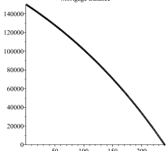

现在让我们制作一个抵押贷款余额表，截至第 60 个月。

```maple
Mortgage_table := seq(b(i), i = 0..60);

Mortgage_table := 150000.0000, 149591.0299, 149180.6967, 148768.9957,
                  148355.9222, 147941.4719, 147525.6401, 147108.4222, 146689.8135,
                  146269.8095, 145848.4056, 145425.5968, 145001.3787, 144575.7466,
                  144148.6957, 143720.2214, 143290.3187, 142858.9831, 142426.2096,
                  141991.9936, 141556.3303, 141119.2146, 140680.6419, 140240.6074,
                  139799.1061, 139356.1329, 138911.6833, 138463.7522, 138018.3347,
                  137569.4258, 137119.0206, 136667.1138, 136213.7009, 135758.7764,
                  135302.3357, 134844.3734, 134384.8846, 133923.8641, 133461.3071,
                  132997.2080, 132531.5619, 132064.3638, 131595.6083, 131125.2903,
                  130653.4045, 130179.9458, 129704.9090, 129228.2886, 128750.0796,
                  128270.2764, 127788.8740, 127305.8668, 126821.2496, 126335.0171,
                  125847.1639, 125357.6843, 124866.5733, 124373.8251, 123879.4345,
                  123383.3959, 122885.7038
```

从表中，我们看到抵押贷款余额为 \(b(60) = 122885.7038\)。支付 60 个月后，你的父母仍欠原 $150,000 中的 $122,885.70。他们已支付总额 $54,538.20，但其中只有 $27,114.30 用于本金，其余 $27,423.90 为利息。如果家庭继续使用这笔贷款，他们将支付 240 期 $908.97，总计 $218,152.80。他们将支付总利息 $68,152.80。他们已支付利息 $27,423.90，因此他们还将支付额外利息 $40,728.90。他们是否应该再融资？

再融资的替代方案为 15 年期 3.25% 或 20 年期 3.50%。假设再融资没有额外成本，仅为当前欠款 $122,885.70 重新获得抵押贷款，最佳选择是什么？

你将在练习集中被要求解决这个问题。

## 练习

迭代并绘制以下 DDS。解释它们的长期行为。对于每个 DDS，找到一个可能解释/建模的现实场景。

1. \(a(n+1)=0.5a(n)+0.1,\quad a(0)=0.1\)
2. \(a(n+1)=0.5a(n)+0.1,\quad a(0)=0.2\)
3. \(a(n+1)=0.5a(n)+0.1,\quad a(0)=0.3\)
4. \(a(n+1)=1.01a(n)-1000,\quad a(0)=90000\)
5. \(a(n+1)=1.01a(n)-1000,\quad a(0)=100000\)
6. \(a(n+1)=1.01a(n)-1000,\quad a(0)=110000\)
7. \(a(n+1)=-1.3a(n)+20,\quad a(0)=9\)
8. \(a(n+1)=-4a(n)+50,\quad a(0)=9\)
9. \(a(n+1)=0.1a(n)+1000,\quad a(0)=9\)
10. \(a(n+1)=0.9987a(n)+0.335,\quad a(0)=72\)
11. 考虑例 2.5（第 49 页）中的抵押贷款问题。确定每个再融资替代方案与当前抵押贷款相比的成本。向你的父母提出建议。

## 2.4 平衡值和长期行为

### 平衡值

回想我们最初的范式

> *Future = Present + Change.*

当 DDS 停止变化时，*change* 等于零，因此 *future* 等于 *present*，并保持不变。使 *change* 等于 0 的值，如果存在，


求解 \(ev\) 可得 DDS 的平衡值为 \(ev=-1\)。

现在，考虑 DDS \(a(n+1)=a(n)+1\)。利用我们的观察，可以写出

\[
ev=ev+1.
\]

该方程无解，因此 DDS \(a(n+1)=2a(n)+1\) 不存在任何平衡值。

## 示例 2.6：求平衡值

考虑下面四个 DDS。求出它们的平衡值（如果存在）。

- 1. \(a(n+1)=0.3a(n)-10\)
- 2. \(a(n+1)=1.3a(n)+20\)
- 3. \(a(n+1)=0.5a(n)\)
- 4. \(a(n+1)=-0.1a(n)+11\)

*解答。*

- 1. \(ev=0.3ev-10 \Longrightarrow ev=-10/0.7\approx -14.286\)
- 2. \(ev=1.3ev+20 \Longrightarrow ev=-20/0.3\approx -66.667\)
- 3. \(ev=0.5ev \Longrightarrow ev=0\)
- 4. \(ev=-0.1ev+11 \Longrightarrow ev=11\)

上面我们观察到，具有平衡值的 DDS，在给定某些特定初始条件 \(a(0)\) 时，可能永远不会达到其平衡值。在上面的示例 2.6 中，对于 DDS 3，任取一个不等于 \(0\)（即 \(ev\)）的初始值 \(A\)。通过迭代可得，对于任意 \(k\)，都有 \(a(k)=-2^kA\ne0\)。因此，该 DDS 从非零值开始时永远无法达到其平衡状态，尽管 \(\lim_{n\to\infty}a(n)=0\)，而 \(0\) 正是其平衡值。

我们发现，汉诺塔问题中的 DDS 的平衡值为 \(-1\)。假设从初始值 \(a(0)=0\) 开始迭代汉诺塔的 DDS。那么

\[
\begin{aligned}
a(1)&=2a(0)+1=3,\\
a(2)&=2a(1)+1=7,\\
a(3)&=2a(2)+1=15,\\
a(4)&=2a(3)+1=31,
\end{aligned}
\]

等等。这些值会不断增大，永远不会达到 \(-1\)。由于 \(a(n)\) 表示汉诺塔的移动次数，因此在移动盘片数量的语境下，\(-1\) 这个值没有实际意义。

我们将在离散动力系统的许多应用中研究平衡值。一般来说，线性非齐次离散动力系统的非齐次部分为常数时，将具有一个平衡值。你能找出任何例外吗？线性齐次离散动力系统总是具有零平衡值。为什么？

## 2.5 平衡值的图形方法

我们可以使用 Maple 检查 DDS 迭代的图像。如果这些值达到某个特定值并保持不变，图像就会变得水平，那么这个值就是平衡值（变化已经停止）。

动力系统通常用于表示我们试图理解的现实世界行为。我们建立现实的模型，以便预测未来的行为，并深入了解这种行为以及如何影响或改变它。因此，我们非常关注模型的预测结果。理解模型未来如何变化，是我们的目标。

## 形式为：\(a(n+1)=r\cdot a(n)+b\) 的模型，其中 \(r\) 和 \(b\) 为常数

考虑一个储蓄账户：年利率为 12%，按月复利，每月存入 1000 美元。重复之前的分析，但加入每月存款。（记得先新建一个 Maple 工作表，然后加载 plots 程序包。）

```text
DDS := a(n+1) = \left(1 + \frac{0.12}{12}\right)\cdot a(n) + 1000;
```

```text
rsolve({DDS, a(0) = 0}, a(n));

a := unapply(%, n);

a \mapsto 101000\left(\frac{101}{100}\right)^n - 100000
```

```text
pts := {seq([k, a(k)], {k = 0..24})}
pointplot(pts, title = “Savings Account with Monthly Deposit”);
```

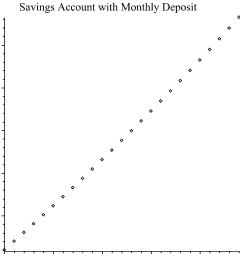

DDS \(a(n+1)=1.01a(n)+1000\) 中，\(r=1.01>1\)，因此它会无限增长。图像表明不存在平衡值——也就是图像会在某个常数值处变为水平的值。从解析角度看，我们有 \(ev=1.01ev+1000 \Longrightarrow ev=-10000\)。确实存在一个平衡值 \(ev=-10000\)，但在我们的储蓄账户问题中永远无法达到该值。没有取款时，储蓄账户不可能亏空 100,000 美元！

如果 \(r\) 小于 0，会发生什么？

像之前一样进行处理，但令 \(r\) 为负数。新的 DDS 为

\[
a(n+1)=-1.01a(n)+1000
\]

其中 \(a(0)=0\)。解析求出平衡值。

\[
ev=-1.01ev+1000
\]

\[
ev=497.5124378
\]

平衡值的定义意味着，如果我们从 \(a(0)=497.5124378\) 开始，就会永远保持在这个值上。从图 2.7 中 DDS 的图像可以看出，数值在正数和负数之间振荡，并且随着振荡向外扩展，每次振荡的幅度都无限增大。尽管存在一个平衡值，但本例的解并不趋向这个不动点。

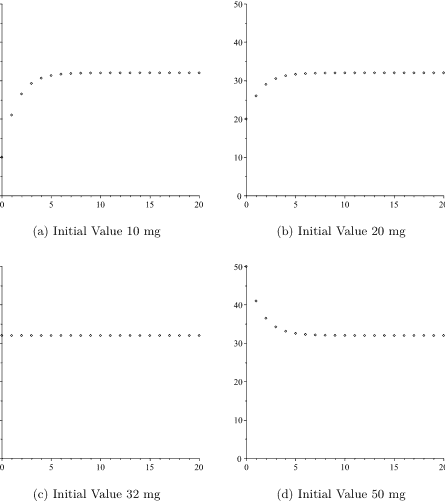

**图 2.8：具有四个不同初始值的药物浓度 DDS**

无论初始值是什么，每幅图都显示 \(a(n)\) 的未来各项会趋近于 32。因此，32 就是平衡值。我们也可以很容易地通过代数方法求出平衡值。

\[
a(n+1)=0.5a(n)+16 \quad\longrightarrow\quad ev=0.5ev+16 \quad\longrightarrow\quad ev=32
\]

一般来说，求这类 DDS 的平衡值，需要求解关于 \(ev\) 的方程 \(ev=r\cdot ev+b\)。我们得到

\[
a=\frac{b}{1-r},\quad\text{when }r\ne1.
\]

让我们使用 `rsolve` 求出一个通式，然后为该 DDS 生成一个数值表。

```text
rsolve({a(n + 1) = 0.5 · a(n) + 64, a(0) = A}, a(n));
a := unapply(%, [A, n]);
A (1/2)^n − 128 (1/2)^n + 128

inits := [0, 50, 100, 150, 200]:
gen := (i, j) → evalf₄(a(initsᵢ, j));
DrugContTable := Matrix(10, 5, gen);
```

|  | \(A=0\) | \(A=50\) | \(A=100\) | \(A=150\) | \(A=200\) |
|---:|---:|---:|---:|---:|---:|
| \(n=0\) | 64.0 | 89.0 | 114.0 | 139.0 | 164.0 |
| \(n=1\) | 96.0 | 108.5 | 121.0 | 133.5 | 146.0 |
| \(n=2\) | 112.0 | 118.2 | 124.5 | 130.8 | 137.0 |
| \(n=3\) | 120.0 | 123.1 | 126.2 | 129.4 | 132.5 |
| \(n=4\) | 124.0 | 125.6 | 127.1 | 128.7 | 130.2 |
| \(n=5\) | 126.0 | 126.8 | 127.6 | 128.3 | 129.1 |
| \(n=6\) | 127.0 | 127.4 | 127.8 | 128.2 | 128.6 |
| \(n=7\) | 127.5 | 127.7 | 127.9 | 128.1 | 128.3 |
| \(n=8\) | 127.8 | 127.8 | 127.9 | 128.0 | 128.1 |
| \(n=9\) | 127.9 | 127.9 | 128.0 | 128.0 | 128.1 |

注意，所有序列都收敛于 128，即吸引不动点。（若要查看超过 10 行，先执行 `interface(rtablesize=100)`。）

## 示例 2.8：具有不稳定平衡值的人工模型

考虑一个金融模型：每月向一个账户存入 100 美元，该账户支付 12% 的年利率并按月复利。DDS 为

\[
B(n+1)=\left(1+\frac{0.12}{12}\right)B(n)+100,\quad B(0)=100.
\]

首先确定 \(B(n)\) 的公式。

```text
rsolve({B(n + 1) = (1 + 0.12/12) · B(n) + 100, B(0) = 100}, B(n));
B := unapply(%, n);
B := n ↦ 10100 · (101/100)^n − 10000
```

代数方法可以轻松求出平衡值。

```text
ev := solve(ev = 1.01 · ev + 100, ev);
ev := −10000.
```

\(ev\) 的值为 −10000。如果 DDS 曾经达到 −10000 的输入值，那么系统就会永远保持在 −10000。由于每月存入 100 美元且没有取款，账户必须保持为正数——我们无法达到这个平衡值！我们称这个平衡值是不稳定的，或称排斥不动点。

我们也可以使用这种方法来确定抵押贷款的还款额。此时 DDS 为

\[
B(n+1)=1.00541667B(n)-P,\qquad B(0)=73395
\]

其解为

\[
B(n)=1.00541667^n c+ev.
\]

建立一个包含两个方程和两个未知数的方程组。

\[
73395=c+d \qquad\qquad\qquad\qquad\text{(由 }B(0)=73395\text{ 得)}
\]

\[
0=1.00541667^{180}c+d \qquad\qquad\text{(由 }B(180)=0\text{ 得)}
\]

求解该方程组。

```text
\begin{aligned}
&>\ solve\ \{\{73395=c+d,\ 0=1.00541667^{180}c+d\},\ \{c,d\}\};\\
&\qquad\qquad\{c=-44638.66498,\ d=118033.6650\}
\end{aligned}
```

因此

\[
B(n)=-44638.66498\cdot1.00541667^n+118033.6650.
\]

（注意：计算过程中出现了一些舍入误差。）

为了求出还款额 \(P\)，我们知道

\[
ev=1.00541667ev-P.
\]

代入 \(ev=118033.6650\)，求解可得

\[
P=639.3494.
\]

这个值与我们最初的还款额一致，但存在一些舍入误差。金融计算中的舍入误差可能非常严重<sup>6</sup>——务必小心！

## 平衡值与极限

研究平衡值的行为，根本上依赖于*极限*这一概念。初等微积分以极限为基础，并对这一概念进行了细致研究。高等微积分或实分析给出了精确而严谨的定义，但使用这种定义会使我们对平衡值的研究变得过于复杂。序列的*极限*的非正式定义如下：

\[
\lim_{k\to\infty}a(k)=L\ \text{当且仅当对于足够大的 }n\text{，}a(n)\text{必须接近 }L。
\]

这个定义将满足我们的需要，并使我们能够专注于相关离散动力系统的行为。

<sup>6</sup>参见 Whiteside，《*Computer capers: Tales of electronic thievery, embezzlement, and fraud*》，Crowell，纽约，c1978。

<sup>7</sup>更为形式化、能够精确定义“足够大”和“接近”的定义是：\(\lim_{n\to\infty}a(k)=L\) 当且仅当对于任意容差 \(\varepsilon>0\)，存在一个正整数 \(N\)，使得当 \(n>N\) 时，有 \(|a(n)-L|<\varepsilon\)。参见 Baudry，《*Intro. to Real Analysis*》[Baudry2009]。

## 1. 引言

本文档旨在介绍一种基于深度学习的图像识别方法，该方法在多个标准数据集上取得了领先的性能。我们详细阐述了模型的架构设计、训练策略以及实验结果分析。

## 2. 相关工作

近年来，卷积神经网络（CNN）在计算机视觉领域取得了巨大成功。从早期的 AlexNet 到后来的 ResNet、DenseNet，网络结构不断演化，识别精度持续提升。

- 基于注意力的模型
- 基于图神经网络的模型
- 基于 Transformer 的视觉模型

## 3. 方法

我们提出了一种新颖的混合架构，结合了 CNN 的局部特征提取能力和 Transformer 的全局建模能力。整体流程如下：

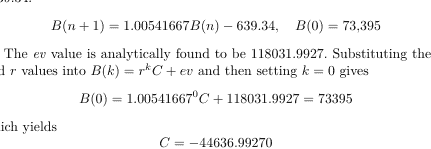

| 数据集 | 准确率 | 参数量 |
|---|---:|---:|
| CIFAR-10 | 98.5% | 1.2M |
| ImageNet | 91.2% | 86M |


我们感兴趣的是当 $k$ 无界地变大时 $a(k)$ 会发生什么。 （换句话说，当我们迭代多次时。）可能发生的是，对于较大的 $k$ 值，$a(k)$ 接近某个数 $L$，甚至等于它。 如果增加 $k$（进行更多迭代）会使 $a(k)$ 越来越接近 $L$，以至于对于非常大的 $k$ 值，$a(k)$ 基本上等于 $L$，那么 $L$ 就是 $a(k)$ 的极限。 如果 $a(k)$ 有极限，那么我们也说 $a(k)$ 收敛到 $L$ 或简单地说 $a(k)$ 收敛。 重要的是要理解，如果 $a(k)$ 收敛到 $L$，那么进一步增加 $k$ 永远不会使 $a(k)$ 与 $L$ “相距太远”。 另外请记住，我们关注的是 $k$ 的大值。 大到什么程度取决于 DDS。 比较 $k$ 必须有多大才能使两个序列 DDS$_1$：$a(k)=e^{-k}$ 和 DDS$_2$：$b(k)=1/(\ln(k)+1)$。

如果增加 $k$ 会使 $a(k)$ 继续增加或振荡，并且 $a(k)$ 不开始收敛到某个数 $L$，我们就说 $a(k)$ 发散且极限不存在。

## Example 2.9. Convergent Difference Equations.

考虑

- 1. 差分方程 $a(n+1)=0.9a(n)+2$ 且 $a(0)=1$。 以 6 位小数精度迭代得到以下结果：
  
  $$a(1)=2.9$$
  
  $$a(150)=19.999997$$
  $$a(151)=19.999998$$
  $$\vdots$$
  $$a(156)=19.999999$$
  $$\vdots$$
  $$a(166)=20.000000$$
  
  且对于所有 $k>166$，$a(k)=20$。 因此，对于这个差分方程，$a(k)$ 的极限是 20。

- 2. 差分方程 $b(n+1)=-0.1b(n)+11$ 且 $b(0)=1$。 以 6 位小数精度迭代，我们看到以下结果：
  
  $$b(4)=9.999100$$
  $$b(5)=10.000090$$
  $$b(6)=9.999991$$
  $$b(7)=10.000001$$
  $$b(8)=9.999999$$
  $$b(9)=10.000000$$

且对于所有 $k>9$，$b(k)=10$。 因此，对于这个差分方程，$b(k)$ 的极限是 10。

即使 $b(4)$ 小于 10 且 $b(5)$ 大于 10，$b(5)$ 也比 $b(4)$ 更接近 10。 增加 $k$ 使 $a(k)$ 越来越接近 10。 因此，$b(k)$ 当 $k\to\infty$ 时的极限是 10。 画出它的图像！

如果 $a(k)$ 不收敛到 $L$，则序列发散。 序列发散的方式有几种。 如果当 $k$ 无限增大时 $a(k)$ 变为无限大，则 $a(k)$ 发散。 如果当 $k$ 无限增大时 $a(k)$ 在负方向上变得无限大，则 $a(k)$ 也发散。 如果 $a(k)$ 在 $k$ 无限增大时在大的正值和大的负值之间振荡，并且总是远离 0，则 $a(k)$ 发散。 如果 $a(k)$ 在 $k$ 无限增大时在两个或多个固定值之间按模式振荡，则 $a(k)$ 发散。 如果 $a(k)$ 在 $k$ 无限增大时表现出绝对没有任何行为模式，则 $a(k)$ 发散。 给定一个随机序列 $a(k)$，它很可能会发散。

## Example 2.10. Divergent Difference Equations.

考虑

- 1. 差分方程 $a(n+1)=4a(n)+2$ 且 $a(0)=1$。 该差分方程的迭代产生
  
  \[
  \begin{aligned}
  a(10)&=1747626\\
  a(11)&=6990506\\
  a(12)&=27962026\\
  a(13)&=111848106
  \end{aligned}
  \]
  
  进一步增加 $k$ 会导致 $a(k)$ 增加。 因此，$a(k)$ 发散。

- 2. 差分方程 $a(n+1)=-4a(n)+2$ 且 $a(0)=1$。 在这种情况下，迭代产生
  
  \[
  \begin{aligned}
  a(10)&=629146\\
  a(11)&=-2516582\\
  a(12)&=1006630\\
  a(13)&=-40265318
  \end{aligned}
  \]
  
  随着 $k$ 越来越大，$a(k)$ 越来越远离 0，始终在正值和负值之间振荡。 因此，$a(k)$ 发散。

我们用一个非常有用的定理来结束本节。

## Theorem. Limits are Stable Equilibria.

如果一个动力系统有一个极限，那么该极限就是一个稳定平衡值；即，是一个吸引的固定点。

这产生了一个类似于之前看到的简单的一阶 DDS。 初步检查时似乎是合理的，但无界增长的长期行为是令人不安的。 为什么酵母培养物在罐中（或有限空间中）无界增长会令人担忧？

有某些因素会影响种群增长。 这些因素包括资源：食物、氧气、空间等。 可用资源可以支持某种最大种群。 随着接近这个数字，变化或增长率应该下降，种群永远不应超过其资源支持的数量。 如果种群超过最大支持数量，增长应该变为负值。

## Example 2.11. Growth of a Cancer Culture.

*Problem.*

为了确定我们的治疗是否成功，我们需要预测癌细胞在受控环境中作为可用资源和当前细胞‘种群’的函数的生长情况。

*Assumptions and Variables.*

我们假设种群大小最好用培养物的生物量重量来描述。 定义 $y(n)$ 为第 $n$ 周期后细胞培养物的种群大小。 存在一个由可用资源可持续的最大环境容纳量 $M$。 培养物在建立的条件下生长。

*Model.*

$n$: 以小时为单位的时间周期  
$y(n)$: 第 $n$ 周期后的种群大小  
$M$: 我们的系统的环境容纳量

$$y(n+1)=y(n)+k\,y(n)\left(M-y(n)\right)$$

其中 $k$ 是比例常数（*增长率* 的函数）。

使用实验中收集的数据，我们首先绘制 $y(n)$ 与 $n$ 的关系图并找到大约 670 的稳定 $y$。 接下来，我们绘制 $y(n+1)-y(n)$ 与 $y(n)(670-y(n))$ 的关系图以找到斜率，即 $k$，约为 0.00090。 当 $k=0.00090$ 且生物量环境容纳量为 670 时。 我们的特殊模型为

$$y(n+1)=y(n)+0.0009\,y(n)(670-y(n))$$

再次，这是非线性的，因为 $y^2(n)$ 项（在展开模型右边后）。 该模型没有闭式解析解。 从初始条件 *生物量* = 30.0 开始在 Maple 中迭代的数值解如下。

```
> k, M, init := 0.0009, 670, 30.0 :
```

```
> biomass := proc(n :: integer)
    option remember;
    piecewise(n > 0,
        biomass(n - 1) + k * biomass(n - 1) * (M - biomass(n - 1)),
        init);
    end proc :
```

我们使用 option remember 在过程中‘记住’（存储）生物量值，因为它们在计算中被计算出来，以便大幅减少所需的计算次数。 试着在没有该选项的情况下运行！

```
> pts := [seq([n, biomass(n)], n = 0..30)] :
```

```
> pointplot(pts, view = [0..30, 0..700], title = "Biomass");
```

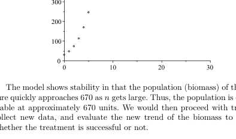

该模型显示出稳定性，即随着 $n$ 变大，细胞培养物的种群（生物量）迅速接近 670。 因此，种群最终稳定在大约 670 个单位。 然后我们将继续进行治疗，收集新数据，并评估生物量的新趋势以确定治疗是否成功。

## Example 2.12. Spread of a Contagious Disease.

一所大学宿舍有 1000 名学生。 有几名学生从春假旅行归来，他们在旅行中接触到了麻疹，一种高度传染性疾病。 健康中心希望建立一个模型来确定疾病传播的速度，以便确定有效的疫苗接种和隔离程序。

```
> `pointplot(pts, title = “Mumps Infections”);`
```

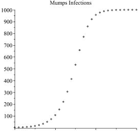

到第 21 天，基本上所有学生都被感染。 让我们看看每周的计数。

```
> `seq(round(Mumps(k)), k in [7, 14, 21, 28])`  
`33, 413, 977, 1000`
```

**Interpretation.**  
结果显示，到 3 周时基本上所有学生都会被感染。 由于只有约 3% 的人在一周内被感染，必须尽一切努力在一周内将疫苗送到学校并为学生接种疫苗。

我们可以通过减少模型中的 *k* 并使用 *Mumps*(7) 作为新曲线的初始值来模拟疫苗对麻疹传播的影响。

# Exercises

迭代并绘制以下 DDS 的图形。 解释它们的长期行为。 对于每个 DDS，找到一个它可能解释/建模的现实场景。

- 1. 考虑模型 $a(n+1)=r\cdot a(n)(1-a(n))$。 设 $a(0)=0.2$。 确定以下 $r$ 值的数值和图形解。 找到解中的模式。
  
  (a) $r=2$
  
  (b) $r=3$


## 1. 引言

本文档旨在介绍人工智能在医疗影像诊断中的应用现状与未来发展趋势。随着深度学习技术的快速发展，AI辅助诊断系统已在多个临床场景中展现出显著价值。

近年来，基于卷积神经网络（CNN）的模型在肺部CT影像、眼底视网膜图像以及病理切片分析中取得了突破性进展。这些系统不仅提高了诊断效率，还降低了漏诊率。

## 2. 关键技术

- 图像预处理与增强
- 病灶自动检测与分割
- 多模态数据融合分析
- 可解释性AI模型设计

| 方法 | 准确率 | 灵敏度 | 特异度 |
|------|--------|--------|--------|
| CNN | 92.5%  | 91.0%  | 93.8%  |
| Transformer | 94.1% | 93.2% | 95.0% |
| 混合模型 | 95.3% | 94.5% | 96.1% |

> > “AI不会取代医生，但使用AI的医生将取代不使用AI的医生。” —— 某医学影像专家

## 3. 挑战与展望

尽管前景广阔，AI医疗影像仍面临数据隐私、标注质量、模型泛化能力以及法规监管等挑战。未来需加强联邦学习与标准化数据集的构建。

综上所述，AI辅助诊断技术正逐步从实验室走向临床落地，有望成为医疗体系的重要基础设施。

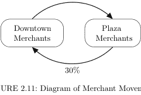

**问题。**  
确定商户随时间的行为，以判断市中心能否存活。

**假设与变量。**  
设 *n* 表示月份数。我们定义

*D(n)* = 第 *n* 个月月末位于市中心的商户数量  
*P(n)* = 第 *n* 个月月末位于广场的商户数量

我们假设商户无论留下还是搬迁都不会获得任何激励。

**模型。**  
任意时间段内位于市中心的商户数量，等于仍留在市中心的原有市中心商户数量加上从广场迁往市中心的商户数量。对于广场商户数量也同样成立：该数量等于留在广场的原有商户数量加上从市中心迁往广场的商户数量。在数学上，我们将该模型写为如下系统：

\[
\begin{aligned}
d(n+1) &= 0.60d(n)+0.30p(n)\\
p(n+1) &= 0.40d(n)+0.70p(n)
\end{aligned}
\]

其中，*d*(0)=150、*p*(0)=100，分别为初始时的市中心和广场商户数量。  
下面我们用 Maple 来探究这个系统。

```
```maple
> d := proc(n)
    option remember;
    if n < 1 then 150 else 0.60 · d(n − 1) + 0.30 · p(n − 1) end if:
  end proc:
> p := proc(n)
    option remember;
    if n < 1 then 100 else 0.40 · d(n − 1) + 0.70 · p(n − 1) end if:
  end proc:
```
```

数值上，我们有：

```
Pts := Matrix([seq([k, d(k), p(k)], k = 0..9)]);
```

| k | d(k) | p(k) |
|---:|---:|---:|
| 0 | 150 | 100 |
| 1 | 120.0 | 130.0 |
| 2 | 111.0 | 139.0 |
| 3 | 108.300000 | 141.700000 |
| 4 | 107.490000 | 142.510000 |
| 5 | 107.247000 | 142.753000 |
| 6 | 107.174100 | 142.825900 |
| 7 | 107.152230 | 142.847770 |
| 8 | 107.1456690 | 142.8543310 |
| 9 | 107.1437007 | 142.8562993 |

现在用图形表示：

```
g1 := pointplot(Pts[.., [1, 2]], color = red):
g2 := pointplot(Pts[.., [1, 3]], color = blue):
display(g1, g2, legend = [evaln(d(n)), evaln(p(n))]);
```

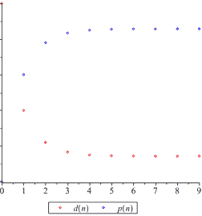

模型.

定义如下符号：

$$B(n)=\text{ 周期 }n\text{ 后湖中鲈鱼的数量}$$
$$T(n)=\text{ 周期 }n\text{ 后湖中湖鳟的数量}$$
$$B(n)\cdot T(n)=\text{ 两个物种的相互作用}$$

于是

$$B(n+1)=1.20B(n)-0.0010\,B(n)\cdot T(n)$$
$$T(n+1)=1.30T(n)-0.0020\,B(n)\cdot T(n)$$

将 $B(n)=x$ 和 $T(n)=y$ 代入即可求得平衡值，然后解出 $x$ 和 $y$。我们有

$$x=1.2x-0.001xy$$
$$y=1.3y-0.002xy$$

我们将这些方程重写为

$$0.2x-0.001xy=0 \qquad\Longrightarrow\qquad x(0.2-0.001y)=0$$
$$0.3y-0.002xy=0 \qquad\Longrightarrow\qquad y(0.3-0.002x)=0$$

解为 $(x=0\text{ 或 }y=200)$ 和 $(y=0\text{ 或 }x=150)$，因此平衡值为 $(0,0)$ 和 $(150,200)$。

我们的下一个任务是研究该系统的长期行为以及平衡点的稳定性。

Hugh 最初考虑在他的湖中投放 151 条鲈鱼和 199 条湖鳟。具体求解留作学生练习。（别忘了在鲈鱼和湖鳟的程序中使用 <em>remember</em> 选项。）从 Hugh 的初始条件出发，鲈鱼将无限增长，而湖鳟将灭绝（$T(29)=0$）。这显然不是 Hugh 所期望的。

# 例 2.15 快餐消费倾向。

一所拥有 14,000 名学生的大学学生会计划引入供应汉堡、玉米卷和披萨的快餐连锁店。这些连锁店委托进行了一项学生调查，获得了以下关于午餐的信息：在吃过汉堡的学生中，75% 下一顿午餐还会吃汉堡，5% 会改吃玉米卷，20% 会改吃披萨。在上次吃玉米卷的学生中，20% 下一顿会吃汉堡，60% 会继续吃玉米卷，35% 会改吃披萨。在吃披萨的学生中，40% 下一顿会吃汉堡，20% 会吃玉米卷，40% 会继续吃披萨。参见<em>图 2.12</em>。

### 1. 引言

本文档旨在介绍一种基于深度学习的图像识别方法，该方法在多个标准数据集上取得了领先的性能表现。

### 2. 相关工作

近年来，卷积神经网络（CNN）在计算机视觉领域取得了显著进展。从早期的 AlexNet 到后来的 ResNet、DenseNet 等，网络结构不断演化，识别精度持续提升。

- 基于区域的目标检测方法（如 R-CNN 系列）
- 基于回归的单阶段检测方法（如 YOLO 系列）
- 基于 Transformer 的视觉模型（如 ViT）

### 3. 方法

我们提出了一种新颖的注意力机制，能够自适应地聚焦于图像中的关键区域，从而提升特征的判别能力。

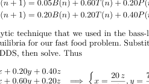

| 方法 | 准确率 (%) | 参数量 (M) |
|------|-----------|-----------|
| ResNet-50 | 76.5 | 25.6 |
| Ours | **80.2** | 28.3 |

# 项目

项目 2.1 小鸟与鹗鹰。

问题。

预测同一环境中作为时间函数的小鸟与鹗鹰的数量。当沿海鱼类资源不充足时，鹗鹰会捕食小鸟。假定下面给出的系数是准确的。

变量。

B(n) = 第 n 个周期结束时的小鸟数量  
H(n) = 第 n 个周期结束时的鹰数量

模型。

B(n + 1) = 1.2 B(n) − 0.001 B(n)H(n)  
H(n + 1) = 1.3 H(n) − 0.002 H(n)B(n)

(a) 求该系统的平衡值。

(b) 利用表 2.5 中给出的初始条件迭代该系统，确定长期来看鹰和小鸟会发生什么。

表 2.5：小鸟与鹰的初始条件

| 小鸟 | 鹰 |
|---|---|
| 150 | 200 |
| 151 | 199 |
| 149 | 210 |
| 10 | 10 |
| 100 | 100 |

项目 2.2 在壁球比赛中获胜。

Rickey 和 Grant 经常打壁球，而且竞争非常激烈。他们的壁球比赛包含两局。当 Rickey 赢下第一局时，他有 75% 的概率赢下第二局。当 Grant 赢下第一局时，他只有 55% 的概率赢下第二局。画出“转移”图。将该情形建模为离散动力系统（DDS），并确定他们壁球比赛获胜的长期百分比。需要哪些假设？

# 项目 2.3 选民分布。

大选日临近了。新独立党对共和党和民主党双方都造成了影响方面的担忧。假设在下次选举中，投票给共和党的人中有 79% 会再次投给共和党，1% 投给民主党，20% 投给独立党。之前投给民主党的人中，5% 会投给共和党，70% 会再次投给民主党，20% 投给独立党。之前投给独立党的人中，35% 会投给共和党，20% 会投给民主党，45% 会再次投给独立党。

(a) 建立描述该情形的离散动力系统。

(b) 假设系统中初始有 399,998 名选民。从长远来看，分别会有多少人投给共和党、民主党和独立党？（提示：你可以按任何期望的方式将这 399,998 名选民拆分为初始条件。）

(c) 新情景。除上述情况外，社区还在增长：

18 岁新增人口 + 新迁入人口 − 死亡人口 − 现有迁出人口。

共和党预测两次选举之间将增加 2,000 名选民。民主党也估计两次选举之间增加 2,000 名选民。独立党估计两次选举之间增加 1,000 名选民。如果这种增长率持续下去，选民的长期分布将是什么？

# 2.8 案例研究：捕食者–猎物模型、SIR 模型与军事模型

# 捕食者–猎物模型：狐狸与兔子

在研究单一物种种群动态时，我们通常会考虑“自然”增长率和环境“承载能力”等因素。数学生态学经常研究相互作用的种群，因为它们会影响彼此的增长速率。在本案例研究中，我们研究一种非常特殊的相互作用情况，其中恰好有两个物种：一个捕食者，它捕食一个猎物。这种配对在自然界中随处可见：

- 狮子和瞪羚，
- 鸟类和昆虫，


- 熊猫和竹子；
- 捕蝇草和昆虫。

设 \(x(n)\) 表示时间段 \(n\) 时猎物种群的规模，\(y(n)\) 表示时间段 \(n\) 时捕食者种群的规模。

为了使模型保持简单，我们将作出一些在大多数捕食者—猎物情形中并不现实的假设。具体来说，我们假设：

- 1. 捕食者物种完全依赖单一猎物物种作为唯一食物来源（例如，考拉和桉树）
- 2. 猎物物种拥有无限的食物供应，并且
- 3. 猎物没有其他威胁，只有特定的捕食者。

我们将使用 Lotka-Volterra 模型。¹² 如果不存在捕食者，那么第二个假设意味着猎物物种将无限制地呈指数增长，即 \(x(n+1)=a\,x(n)\)。

但由于存在捕食者，猎物增长率中必须包含一个负项。为了建立模型，关于捕食者—猎物相互作用的关键附加假设是：

- 1. 捕食者与猎物相遇的速率与两个种群的规模的乘积成正比。
- 2. 捕食者与猎物之间的相遇中，有固定比例会导致猎物死亡。

这些假设得出结论：猎物增长率中的负项与种群规模乘积 \(xy\) 成正比。综合这些因素可得

$$x(n+1)=x(n)+a\,x(n)-b\,x(n)\cdot y(n)$$

现在考虑捕食者种群。如果没有食物供应，捕食者将以与其规模成正比的速率灭绝；也就是说，我们会得到 \(y(n+1)=-c\,y(n)\)。

我们假设“自然增长率”由出生率和死亡率共同构成，并且二者都与当前种群规模成正比。在没有食物的情况下，没有能量供应来支持出生率。但这里存在食物供应：猎物。对狐狸不利的事情对兔子却有利。也就是说，支持捕食者种群增长的能量与猎物的死亡数量成正比，因此

$$y(n+1)=y(n)-c\,y(n)+p\,x(n)\cdot y(n)$$

综合以上内容，得到离散版本的 Lotka-Volterra 捕食者—猎物模型

x(n + 1) = (1 + a) x(n) − b x(n) y(n)
y(n + 1) = (1 − c) y(n) + p x(n) y(n)      for n = 0, 1, 2, …, (2.1)

其中 \((x(0), y(0)) = (x0, y0)\)，并且 \(a\)、\(b\)、\(c\) 和 \(p\) 是正的常数。

与 (2.1) 类似，连续 Lotka-Volterra 模型由以下相互关联的微分方程组构成：

x′(t) = +α x(t) − β x(t) y(t)      for t ≥ 0,
y′(t) = −γ y(t) + ρ x(t) y(t)

这些方程彼此无法分离，也无法用闭式形式求解。然而，连续模型和离散模型一样，可以通过数值方法求解并绘图，从而获得关于所研究系统的认识。

让我们使用离散 Lotka-Volterra 系统，对一座小岛上相互隔离的狐狸和野兔种群进行建模。通过实地收集的数据，我们得到了 (2.1) 中参数的估计值：

\(\{a, b, c, p\} = \{0.039, 0.0003, 0.12, 0.0001\}\)

使用 Maple 研究该模型的行为。

为了简化 Maple 代码，我们将使用全局变量，即在任何程序之外定义、但可在任何程序内部使用的变量。记得加载 `plots`，并使用 `option remember`，以大幅减少所需的计算量。

```
> PredPrey := proc(n :: integer)
    local u, v, rn, fn;
    global r0, f0, a, b, c, p;
    option remember;
    if n < 1 then
        u := [r0, f0];  # Initial {rabbits, foxes}
    else
        v := PredPrey(n − 1);
        rn := v[1];   # current rabbits
        fn := v[2];   # current foxes
        u := [(1 + a)·rn − b·rn·fn, (1 − c)·fn + p·rn·fn];
    end if;
    return(u);
    end proc;
> r0, f0 := 900, 110;
> a, b, c, p := 0.039, 0.0003, 0.12, 0.0001 :
```

```
> RF := Matrix([seq(PredPrey(i), i = 0..200)]);
```

RF :=

| 900 | 110 |
|---:|---:|
| 905.4000 | 106.7000 |
| 911.7287460 | 103.5566180 |
| 918.9615035 | 100.5713784 |
| 927.0746346 | 97.74493550 |
| 936.0454902 | 95.0772282 |
| 945.8522811 | 92.56762196 |
| 956.4739312 | 90.21503696 |
| 967.8899152 | 88.01806562 |
| 980.0800826 | 85.97507576 |
| ⋮ | ⋮ |

201 × 2 矩阵

（双击输出的蓝色矩阵，即可打开*矩阵浏览器*查看全部条目。）

```
> Rabbits := [seq([i, RF[i, 1]], i = 1..201)]:
  pointplot(Rabbits, title = "Rabbits");
```

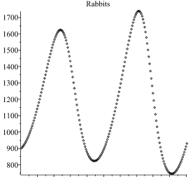

```
> Foxes := [seq(i, [RF[i,2]], i = 1..201)]:
> pointplot(Foxes, title = "Foxes");
```

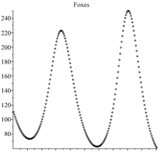

```
> pointplot(RF, labels = ["Rabbits", "Foxes"], title = "Predator-Prey");
```

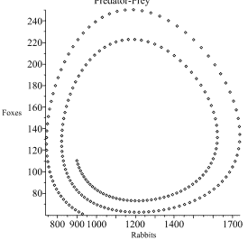

如果让该模型运行更多次迭代，就会看到狐狸相对于兔子的图像继续呈螺旋状变化。我们可以认为该模型看起来是合理的。我们还可以求出系统的平衡值。兔子和狐狸有两组平衡点，分别为 \((0, 0)\) 和 \((1200, 130)\)。螺旋轨道表明，系统正在远离 \((1200, 130)\)。

## 离散 SIR 传染病模型

一种新型流感变体正在美国各地传播。疾病控制与预防中心（CDC）希望在这种疾病真正成为流行病之前，了解并试验一个针对该新疾病的模型。对于我们的模型，人口分为三类：易感者、感染者和移除者。我们作出以下假设。

- 社区是封闭的；没有人进入或离开，也不存在外部接触。
- 每个人要么容易感染新型流感，要么已经感染并能够传播流感，要么已经感染过流感并获得免疫（包括因该疾病死亡的人）。
- 初始时，每个人要么是易感者，要么是感染者；不存在初始免疫者。
- 一旦某人感染这种流感并康复，就会获得免疫，且不会再次感染。
- 疾病的平均病程为 2 周；在此期间，该人处于感染状态并具有传染性。

我们的模型时间段为一周。定义变量：

\(n\) = 当前周数  
\(S(n)\) = 第 \(n\) 周的易感者人数  
\(I(n)\) = 第 \(n\) 周处于感染状态且具有传染性的人数  
\(R(n)\) = 第 \(n\) 周已经康复（或死亡）并获得免疫的人数

首先考察 \(R(n)\)。一个人患流感的时间为 2 周。因此，每周有一半的感染者会被移除。所以

$$R(n+1)=R(n)+0.5I(n).$$

数值 0.5 称为每周的*移除率*。该数值表示每周从感染状态中“移除”的感染者所占的比例。如果有真实数据可用，我们就可以分析这些数据来估计移除率参数。

现在考察 \(I(n)\)。感染者人数会因新增感染而增加，也会因随时间移除感染者而减少。由于疾病持续 2 周，每周会有一半的感染者被移除，即 \(0.5 I(n)\)。感染人数的增加与接触感染者并随后感染疾病的易感者人数成正比，即为 \(a S(n) \cdot I(n)\)。参数 \(a\) 表示接触导致感染的可能性，即传播系数。我们意识到这是一个概率系数。我们假设该速率为常数，并且可以根据初始条件估计得到。

作为说明，假设宿舍中有 1,000 名学生。健康中心报告称，最初有 3 名学生感染。下一周，有 5 名学生因类似流感的症状来到健康中心。我们有 \(I(0) = 3\)、\(S(0) = 997\)，并且新增了 5 名感染者。那么

$$5 = aS(0)I(0) = a997 \cdot 3 \quad\Longrightarrow\quad a = 0.00167$$

疾病的正常病程为 2 周，因此平均而言，我们预计每周有 \(0.5 I(n)\) 人康复，剩余 \(0.5 I(n)\) 人仍处于感染状态。于是得到

$$I(n+1)=0.5I(n)+0.00167S(n)I(n)$$

最后考察 \(S(n)\)。易感者人数只会因其中一部分人感染而减少。使用前面相同的传播系数，可得到模型

$$S(n+1)=S(n)-aS(n)I(n)$$

我们的耦合 SIR 模型为

$$\begin{aligned}
S(n+1)&=S(n)-0.00167S(n)I(n)\\
I(n+1)&=0.5I(n)+0.00167S(n)I(n)\\
R(n+1)&=R(n)+0.5I(n)
\end{aligned}\tag{2.2}$$

其中 \((S(0), I(0), R(0)) = (997, 3, 0)\)。

离散 SIR 模型 (2.2) 可以通过迭代求解并以图形方式查看。使用 Maple 完成此操作，以观察其行为并获得认识。（由于 Maple 已预定义 \(I = \sqrt{-1}\)，因此请对变量使用小写字母。）

```
DSIR := proc(n :: integer)
    local u, v, s, i, r;
    global s0, i0, r0;
    option remember;
    if n < 1 then
        u := [s0, i0, r0];    # Initial [susceptible, infected, removed]
    else
        v := DSIR(n − 1);
        s := v[1];    # current susceptible
        i := v[2];    # current infected
        r := v[3];    # current infected
        u := [s − 0.00167 · s · i, 0.5 · i + 0.00167 · s · i, r + 0.5 · i];
    end if;
    return(u);
end proc:
```


> 感染者 := [seq([k, Flu[k, 2]], k = 1..26)]:  
> IP := pointplot(感染者, title = "感染者", color = blue);

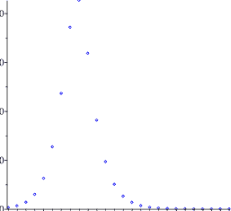

> 移除者 := [seq([k, Flu[k, 3]], k = 1..26)]:  
> RP := pointplot(移除者, title = "移除者", color = gold);

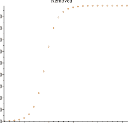

```
display(SP, IP, RP, legend = ["易感者", "感染者", "移除者"])
```

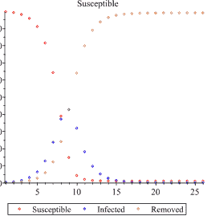

流感疫情的最大感染人数出现在第8周左右，即感染者图表达到峰值时。最大人数略大于400，从表格中可知约为427。25周后，略多于9名学生从未感染流感。在练习集中，你将需要检查模型对参数值的敏感性。

使用plots包中的specacurve函数来查看流感的DDS轨迹。

```
pp := pointplot3d(Flu, symbolsize = 16, color = red) :
sp := spacecurve(Flu) :
display(pp, sp, axes = frame, orientation = [-20, 70],
        tickmarks = [3, 5, 5]);
```

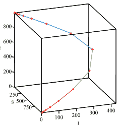

从轨迹图中你能了解到流感进展的哪些信息？注意数据点之间的间距——请记住，数据点是在相等的时间间隔内采集的。

## 建模军事叛乱

叛乱势力在乌尔巴尼亚市（弗里多尼亚国中部的一个主要大都市）拥有强大的据点。情报估计他们目前约有1,000名战斗人员。当地警察部队约有1,300名警官，其中许多人没有接受过执法方法或应对叛乱活动的现代战术方面的正式培训。根据过去一年收集的数据，每周约有8%的叛乱分子倒戈加入警察队伍，而约有11%的警察倒戈加入叛乱分子。情报还估计，每周约有120名新的叛乱分子从邻国西尔瓦尼亚抵达。弗里多尼亚国内的招募工作每周也新增约85名新警察。在与叛乱势力的武装冲突中，当地警察平均每周能够俘虏或击毙约10%的叛乱力量，同时损失约3%的自身力量。见图2.14。

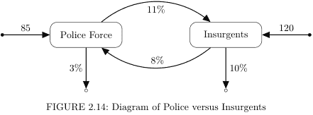

图2.14：警察与叛乱分子示意图

### 问题。

建立这一叛乱活动的数学模型。确定DDS的平衡状态（如果存在的话）。

### 变量。

$n$ = 当前时间段  
$p(n)$ = 时间段$n$结束时警察部队的人数  
$r(n)$ = 时间段$n$结束时叛乱分子/反抗者的人数

其中 $n = 0, 1, 2, \ldots$ 周。

### 模型。

```
$$\begin{aligned}
p(n+1) &= p(n)-0.03p(n)-0.11p(n)+0.08r(n)+85 \\
       &= 0.86p(n)+0.08r(n)+85 \\
r(n+1) &= r(n)+0.11p(n)-0.08r(n)-0.1r(n)+120 \\
       &= 0.11p(n)+0.82r(n)+120
\end{aligned}$$
```

其中 $P(0)=1300$，$I(0)=1000$，且 $n=0,1,2,\ldots$。

使用Maple来研究**警察-叛乱分子**DDS。

```
Insurgency := proc(n :: integer)
    local u, v, p, r;
    global p0, r0;
    option remember;
    if n < 1 then
        u := [p0, r0];    # 初始 [警察, 叛乱分子]
    else
        v := Insurgency(n − 1);
        p := v[1];        # 当前警察人数
        r := v[2];        # 当前叛乱分子人数
        u := [0.86 p + 0.08 r + 85, 0.11 p + 0.82 r + 120];
    end if;
    return(u);
end proc;
```

```
p0, r0 := 1300, 1000:
```

```
PR := Matrix([seq(Insurgency(k), k = 0..52)]);
```

PR :=

| 1300 | 1000 |
|---:|---:|
| 1283.0 | 1083.0 |
| 1275.0200 | 1149.1900 |
| 1273.452400 | 1202.588000 |
| 1276.376104 | 1246.201924 |
| 1282.379603 | 1282.286949 |
| 1290.429415 | 1312.537054 |
| 1299.772261 | 1338.227620 |
| 1309.862354 | 1360.321597 |
| 1320.307352 | 1379.548569 |
| ⋮ | ⋮ |

（双击输出矩阵（屏幕上显示为蓝色）以打开*矩阵浏览器*查看所有条目。）

接下来是图表。

```
police := [seq(k, PR[k, 1]), k = 1..53)];
insurgents := [seq(k, PR[k, 2]), k = 1..53)];
pol := pointplot(police, symbol = circle);
ins := pointplot(insurgents, symbol = solidbox);
```

```
```r
> display(pol, ins, labels = c("周", "人数"),
+     title = "叛乱模型", legend = c("警察", "叛乱分子"));
```
```

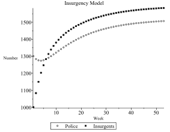

在这个叛乱模型中，我们看到在当前条件下，叛乱在5周后超过了政府。这对政府来说是不可接受的，因此我们必须修改影响参数的条件，以使警察获得胜利。在练习中，你将需要尝试修改DDS的参数。

## 练习

+ 1. 求出所给出的捕食者-猎物模型的平衡值。
+ 2. 使用以下参数集确定捕食者-猎物模型的结果。
   (a) 初始有200只狐狸和400只兔子。
   (b) 初始有2,000只狐狸和10,00只兔子。
   (c) 兔子的出生率增加到0.1。
+ 3. 求出所给出的SIR模型的平衡值。
+ 4. 在SIR模型中，使用以下更改的参数确定结果。
   (a) 初始有5人患病，下周有10人患病。
   (b) 流感仅持续1周。
   (c) 流感持续4周。

## 3

*使用单变量优化解决问题*

### 目标：

+ 1. 建立单变量和多变量优化问题的求解过程。
+ 2. 识别何时需要适用的约束条件。
+ 3. 在适用时进行敏感性分析，并解释结果。
+ 4. 了解数值技术以及何时使用它们来获得近似解。

### 3.1 单变量无约束优化

*Rigs-R-Us* 公司有一座距海岸9.5英里的石油钻井平台。该钻井平台需要通过水下管道连接到泵站。一条陆上管道将把拟建的泵站连接到距钻井平台沿海岸线15.7英里的炼油厂。见图3.1。

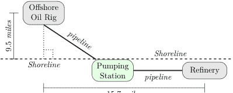

图3.1：石油管道路线和拟建泵站

- 如果 \(f''(x_c) < 0\)（凹向下），则 \(f\) 在 \(x_c\) 处有局部最大值。
- 如果 \(f''(x_c) = 0\)，则 \(f\) 在 \(x_c\) 处可能有拐点（凹凸性改变）。

**定理. 扩展导数检验。**
设 \(f'(x_c) = f''(x_c) = 0\)，其中 \(x_c \in (a,b)\)。则

- 如果第一个非零导数是偶数阶（即4阶、6阶、8阶等）且
  - 在 \(x_c\) 处为正，则 \(f\) 在 \(x_c\) 处有局部最小值，
  - 在 \(x_c\) 处为负，则 \(f\) 在 \(x_c\) 处有局部最大值，
- 如果第一个非零导数是奇数阶（即3阶、5阶、7阶等），则 \(f\) 在 \(x_c\) 处没有极值。

**定理. 一阶导数检验。**
设 \(f'(x_c) = 0\)，其中 \(x_c \in (a,b)\)。则

- 如果在 \(x_c\) 以下 \(f'(x) > 0\)（递增）且在 \(x_c\) 以上 \(f'(x) < 0\)（递减），则 \(f\) 在 \(x_c\) 处有局部最大值，
- 如果在 \(x_c\) 以下 \(f'(x) < 0\)（递减）且在 \(x_c\) 以上 \(f'(x) > 0\)（递增），则 \(f\) 在 \(x_c\) 处有局部最小值，
- 如果 \(f'(x)\) 在 \(x_c\) 周围不改变符号，则 \(f(x_c)\) 既不是局部最大值也不是局部最小值。

**定理. 不可导点检验。**
假设 \(f'(x_c)\) 不存在。在这种情况下，检验 \(x_c\) 附近的点：在 \(x_1 < x_c < x_2\) 的“附近”\(x_1\) 和 \(x_2\) 处评估 \(f\)。见表3.1。

表3.1：检验不可导点

| 关系 | 分类 |
|---|---|
| \(f(x_1) \leq f(x_c)\) 且 \(f(x_c) \leq f(x_2)\) | 则 \(x_c\) 不是局部极值 |
| \(f(x_1) \geq f(x_c)\) 且 \(f(x_c) \leq f(x_2)\) | 则 \(x_c\) 是局部最小值 |
| \(f(x_1) \leq f(x_c)\) 且 \(f(x_c) \geq f(x_2)\) | 则 \(x_c\) 是局部最大值 |
| \(f(x_1) \geq f(x_c)\) 且 \(f(x_c) \geq f(x_2)\) | 则 \(x_c\) 不是局部极值 |

**定理. 区间端点检验。**
假设 \(f\) 在 \((a,b)\) 上可微，并且在 \(x=a\) 和 \(x=b\) 处分别有右导数和左导数。则对于 \(x=a\)，

- 如果 \(f'(a) > 0\)，则 \(f(a)\) 是局部最小值。
- 如果 \(f'(a) < 0\)，则 \(f(a)\) 是局部最大值。


# diff 或 Diff – *微分或偏微分*

调用序列
`diff(f, x1, ..., xj)`

\[
\frac{d^j}{dx_1\cdots dx_j}f
\]

`diff(f, [x1$])`

\[
\frac{d^n}{dx_1^n}f
\]

**Remark:** these calling sequences are also valid with the inert *Diff* command

**Parameters**

- `f` — 代数表达式或方程
- `x1, x2, ..., xj` — 表示微分变量的名称
- `n` — 代数表达式进入微分构造如 x$n，代表 n 阶导数，假定为整数阶微分

# solve – *求解一个或多个方程*

调用序列
`solve(equations, variables)`

**Parameters**

- `equations` — 方程或不等式，或方程或不等式的集合或列表
- `variables` — （可选）名称或名称的集合或列表；求解的未知数

# fsolve – *使用浮点算术求解一个或多个方程*

调用序列
`fsolve(equations, variables, complex)`

**Parameters**

- `equations` — 方程，set(equation)，表达式，set(expression)，list(equation)
- `variables` — （可选）名称或名称的集合或列表；求解的未知数
- `complex` — （可选）文字；搜索复数解

> Note: For simple functions *f(x)*, Maple can use *f′(x)*, *f″(x)*, etc., for derivatives.

# Basic Applications Calculus Max-Min Theory

# Example 3.2. Chemical Manufacturing Company.

一家化工制造公司以每吨 200 美元的价格出售硫酸。*x* 吨的日总生产成本为美元

$$C(x)=150000+145.5x+0.0025x^2,$$

日产量最多为 7,500 吨。制造商应生产多少吨硫酸才能使日利润最大化？

*Solution.* 利润函数为

$$\begin{aligned}
Profit &= Revenue-Cost \\
&=(200x)-(150000+145.5x+0.0025x^2) \\
&=-150000+54.5x-0.0025x^2 \qquad \text{for }0\le x\le 7000
\end{aligned}$$

*Profit* 是二阶可微的，因此使用 Maple 进行二阶导数检验。我们将 Maple 的 *D* 运算符应用于 *Profit* 函数以计算导数函数。

```
〉 Profit := x → −150000 + 54.5 · x − 0.0025 · x²;
dProfit := D(Profit);
d2Profit := D(dProfit);
        Profit := x → −150000 + 54.5 · x + (−1)0.0025 · x²
        dProfit := x → 54.5 − 0.0050 x
        d2Profit := x → −0.0050
```

```
〉 c := solve(dProfit(x) = 0, x);
        c := 10900.
```

```
〉 Profit(c);
        147025.0000
```

我们必须检查端点，因为 *Profit* 定义在区间 [0, 7500] 上。

```
〉 [0, Profit(0)], [7500, Profit(7500)];
        [0, −150000.], [7500, 118125.0000]
```

即使 *Profit(c)* 最大，*c* = 10,900 吨也大于最大产量 7,500 吨。因此公司应尽可能多地生产，7,500 吨，最大 *Profit*(7500) = $118,125.00。

通过绘制 *Profit* 在 [0, 7500] 和 [0, 12000] 上的图形来验证分析，显示端点解被选中是因为临界点在 *Profit* 的定义域之外。

# Example 3.3. Computer Production.

*Bell Computers* 生产一台 SP6 计算机的 *可变成本* 为 250 美元。他们在工厂运营并生产计算机时有 5,500 美元的 *固定成本*。如果 *Bell* 在其新 SP6 上花费 *x* 美元用于广告，他们

可以以每台 50 美元的价格出售 $\sqrt{x}$ 台 SP6。公司应生产多少台 SP6 计算机才能使利润最大化？

**Solution.** 由于收入是价格乘以数量，总成本是固定成本加上可变成本乘以数量，Bell 的利润函数由下式给出

```
```text
> varcost, fixedcost, price := 250, 5500, 550:

> Revenue := x → price · √x:
  Cost := x → fixedcost + x · varcost + √x:
> Profit := Revenue − Cost:  # Note this is an equation of functions!
  Profit(x);

                    300√x − 5500 − x
```
```

Profit 是二阶可微的，因此再次使用 Maple 进行二阶导数检验。

```
```text
> dProfit := D(Profit):
  dProfit(x);

  c := solve(dProfit(x) = 0, x);

                    150
                    ─── − 1
                    √x
  c := 22500

> d2Profit := D(dProfit):
  d2Profit(c);

                    √22500
                    ───────
                    6750000
```
```

由于 $Profit''(c)$ 为负，我们得到最大值 $Profit(22500) = \$17,000$。图形将验证我们的分析。

```
```text
> plot(Profit, 0..30000, thickness = 2, title = “Bell Computer Profit”);
```
```

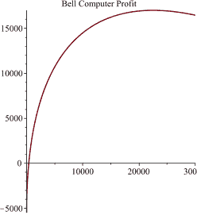

返回本节开头介绍的抽水站示例。

# **Example 3.4. Oil Pumping Station Location.**

Rigs-R-Us 的一座石油钻井平台位于离岸 9.5 英里处。钻井平台将通过一条水下管道连接到一座抽水站，然后通过一条陆上管道连接到炼油厂。炼油厂距离钻井平台沿海岸线向下 15.7 英里。见图 3.2。水下管道安装成本为每英里 32,575 美元

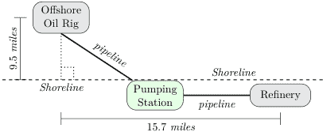

陆上管道成本为每英里 14,442 美元。确定抽水站的位置以最小化管道总成本。

*Problem.*

找出抽水站位置与管道安装成本之间的关系，然后最小化成本。

*Assumptions.*

首先，我们假设如果以更大批量购买管道则没有成本节约。我们进一步假设铺设管道的准备地形成本，无论是海上还是陆上，都包含在给定的每英里成本数字中。

*Variables.*

$x$ = 抽水站沿水平距离的位置，从 $x = 0$ 到 $x = 15.7$ 英里

$TC$ = 水下和陆上管道的管道总成本

*Model Construction.*

使用毕达哥拉斯定理计算水下管道距离；即高度为 9.5 英里、沿海岸线基数为 $x$ 英里的直角三角形的斜边。斜边的长度为 $\sqrt{9.5^2 + x^2}$。岸上管道的长度为 $15.7 - x$。因此总成本为

```
$$TC = 32575\cdot\sqrt{9.5^2+x^2}+14442\cdot(15.7-x).$$
```

我们转向 Maple 进行二阶导数检验以确定最小成本抽水站位置。

```
> TC := x → 32575 · √(9.5² + x²) + 14442 · (15.7 − x) :
> dTC := D(TC);

\[
dTC := x \to \frac{32575x}{\sqrt{90.25+x^2}} - 14442
\]

> c := solve(dTC(x) = 0, x);

\[
c := 4.698818368
\]

> d2TC := D(dTC);

\[
d2TC := x \to \frac{32575}{\sqrt{90.25+x^2}} - \frac{32575x^2}{(90.25+x^2)^{3/2}}
\]

> d2TC(c);

\[
2469.416868
\]
```

由于 c = 4.6988 时二阶导数为正，我们得到最小总成本。因此，如果抽水站位于距离炼油厂 15.7 − 4.6988 ≈ 11.0 英里处，我们将使管道总成本最小化，TC(c) = $50,4126.27。

再次，我们绘制总成本函数以验证我们的结果。

```
> plot(TC, 0..8, thickness = 2, title = “Pipeline Cost”);
```

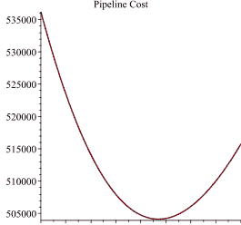

如何修改 plot 命令以在曲线上显示最小值处的点？

# Exercises

+   1. 每天早上高峰时段，10,000 人从新泽西州前往纽约。乘坐地铁需要 40 分钟。如果有 $x$ 千人驾车前往纽约市，行程需要 $20+5x$ 分钟。
+   
+   (a) 制定问题以最小化人均平均出行时间。
+   
+   (b) 找到使人均平均时间最小化的驾车人数。

+   2. 设 $f(x)=2x^3-1$。使用微积分求
+   
+   $$\max_{-1\le x\le 1} f(x)$$

的最优解

+   3. 求 $f(x)=\sin(2+\pi x)/x$ 在区间 $1\le x\le 4$ 上的所有极值。

+   4. 考虑函数 $f(x)=0.5x^3-8x^2$。
+   
+   (a) 使用图形找到并分类 $f$ 的所有极值。
+   
+   (b) 使用分析技术（即微积分）找到并分类 $f$ 的所有极值。
+   
+   (c) 定义：可微函数
+   
+   - **凸或上凸** 在区间 $[a,b]$ 上 iff $f$ 位于其所有切线之上；即对于 $[a,b]$ 中所有 $x_1<x<x_2$，
+     $$f'(x)\le\frac{f(x_2)-f(x_1)}{x_2-x_1}$$
+   
+   - **凹或下凸** 在区间 $[a,b]$ 上 iff $f$ 位于其所有切线之下；即对于 $[a,b]$ 中所有 $x_1<x<x_2$，
+     $$f'(x)\ge\frac{f(x_2)-f(x_1)}{x_2-x_1}$$
+   
+   二次可微函数
+   
+   - 在 $[a,b]$ 上 **凸** iff 其二阶导数非负。
+   - 在 $[a,b]$ 上 **凹** iff 其二阶导数非正。
+   
+   应用 **凹**（下凸）的定义来证明 $f$ 在区间 $[-6,5]$ 上是凹的。
+   
+   (d) $f$ 凸的最大区间？凹的？
+   
+   (e) 为什么在优化中知道凹凸性很重要？


5. E. N. Throat 博士一直在通过 X 射线观察咳嗽时气管的收缩情况。他发现气管似乎会收缩到正常大小的 33%（1/3）。他请求数学系证实或否认他的说法。你进行了一些初步研究，发现根据关于气管壁弹性以及气管壁附近空气因摩擦而减速方式的合理假设，平均流速 $v$ 可以由下式建模：

$$v=c(r_0-r)^2 \text{ cm/sec}\quad \text{for } \frac{1}{2}r_0\le r\le r_0$$

其中，$c$ 是正常数（令 $c=1$），$r_0$ 是气管静息状态下的半径，单位为厘米。

+   (a) 求使 $v$ 最大的 $r$ 值。
+   
+   (b) 你的结果支持还是否定了 Throat 博士的说法？

## 3.2 使用 Maple 的数值搜索技术

### 单变量技术

当微积分方法不可行时，我们会转而采用数值近似技术。大多数优化数值方法的基本思路，是按照特定方案生成一系列不断改进的最优解近似值。我们将研究消去法（黄金分割法和斐波那契法）以及插值法（牛顿法）。

在优化的数值方法中，我们通过对决策变量的各种组合求取目标函数值，然后据此对最优解作出判断。消去法可以用于寻找甚至是不连续函数的最优解。要使用这些消去法，必须作出一个重要的关系假设。函数必须是*单峰的*。单峰函数——*uni-modal* 源于“one mode”（一个峰）——是只有一个最大值（峰）或一个最小值（谷），但不会同时具有二者的函数。用数学形式表述如下：

**定义：单峰函数。**

函数在区间 $[a,b]$ 上是*单峰的*，当且仅当

+   1. $f$ 在 $[a,b]$ 上有一个最大值（最小值）$x^*$，并且
+   
+   2. 在 $[a,x^*]$ 上严格递增（递减），即 $x<x^*\Rightarrow f(x)<f(x^*)$，并且
+   
+   3. 在 $[x^*,b]$ 上严格递减（递增），即 $x>x^*\Rightarrow f(x)<f(x^*)$。

图 3.3 展示了单峰函数和非单峰函数的示例。单峰函数可能可微，也可能不可微，甚至可能不连续。

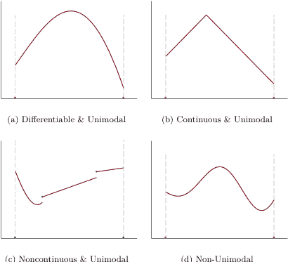

**图 3.3：**单峰函数和非单峰函数示例

因此，单峰函数可以是不可微的（具有尖角），甚至可以是不连续的。如果已知一个函数在给定闭区间上是单峰的，那么就可以找到其最优值（最大值或最小值）。

在本节中，我们将学习多种数值搜索技术。对于“消去法”，我们接受区间形式的答案。如果需要单个值，通常会分别计算最终区间两个端点和中点处的函数值，然后从这三个值中取最优值，以近似得到单个值。

## 黄金分割搜索

通过确定包含目标值的、越来越窄的区间来搜索某个值的技术，称为*括区间法*。*黄金分割搜索*是使用黄金比例的一种括区间法。这项较新的技术由 Jack Keifer 于 1953 年提出。

为了更好地理解黄金比例，考虑一条如图 3.4 所示被分成两部分的线段。如果整条线段的长度与较长部分长度之比，等于较长部分长度与较短部分长度之比，那么我们就说这条线段按*黄金比例*分割。取原线段长度为 1，可以用符号表示为

$$\frac{1}{r} = \frac{r}{1-r}$$

对上述关系进行代数运算可得 $r^2+r-1=0$。该二次方程的正根 $r=(\sqrt{5}-1)/2$ 满足上述线段的要求。黄金比例的数值为 $\phi\approx0.6180339880$。（黄金比例的传统符号是 $\phi$。）这个著名的比例是斐波那契数列相邻项之比的极限值，我们将在下一种方法中看到这一点。另一种括区间法——*斐波那契搜索*——常被用来替代黄金分割法。

为了使用黄金分割搜索过程，我们必须确保某些假设成立。这些关键假设是：

+   1. 函数在指定区间上必须是单峰的。
+   
+   2. 函数必须在一个已知的不确定区间上具有最优解，并且
+   
+   3. 我们将接受区间解，因为通过括区间法无法找到精确的最优值，只能得到近似值。

使用该技术只能找到*区间解*，即包含精确最优值的区间，也称为*最终不确定区间*。最终区间的长度由用户控制，可以通过选择一个*容差*值使其任意小。假设函数是单峰的，就能保证最终区间长度小于所选容差。

[^1]: 参见 http://mathworld.wolfram.com/GoldenRatio.html。

## 使用黄金分割搜索在区间上求函数的最大值

假设我们知道 $f$ 在区间 $I$ 上是单峰的。将 $I$ 分成两个子区间 $I_1$ 和 $I_2$，则 $f$ 的最大值必定在其中一个区间内。在每个区间中检查一个测试点——较大的测试点表明哪个区间包含最大值，因为 $f$ 是单峰的，并且恰好只有一个最优值。我们可以让区间相互重叠，并将端点作为测试点，从而减少函数求值次数。通过巧妙地选择测试点，使下一次迭代能够复用当前测试点之一，还可以进一步减少函数求值次数。这些思想促成了黄金分割搜索，该方法由 Jack Kiefer 教授在其 1953 年的硕士论文中提出。

最大值的黄金分割搜索是一个迭代过程，需要在测试点 $x_1$ 和 $x_2$ 处计算 $f(x)$，其中

$$x_1=a+r(b-a)\qquad\text{and}\qquad x_2=b-r(b-a).$$

测试点位于原始区间 $I_0=[a,b]$ 内，并用于确定一个新的、更小的搜索区间 $I_1$。谨慎选择 $r$，就可以在下一次迭代中复用函数求值结果：$x_1$ 或 $x_2$ 将成为新区间的端点，而另一个测试点将成为新缩小区间中的测试点。在黄金分割搜索中，选择黄金比例 $0.618$ 作为 $r$。如果 $f(x_1)>f(x_2)$，新区间为 $[x_2,b]$；如果 $f(x_1)<f(x_2)$，新区间为 $[a,x_1]$。以这种方式持续迭代，直到最终区间长度小于所选容差。最终区间 $I_N$ 包含或括住最优解。最终区间 $I_N$ 的长度决定近似最优解的精度。为了达到所需容差或最终区间长度所需的最大迭代次数 $N$ 为

$$N=\left\lceil\frac{1}{\ln(0.618)}\cdot\ln\left(\frac{\text{tolerance}}{b-a}\right)\right\rceil.$$

当要求给出点解，而不是包含该解的小区间时，分别计算最终区间端点和中点处的函数值。选择使 $f(x)$ 取得最大值的 $x$ 值。如何修改该过程以搜索最小值点？图 3.5 展示了黄金分割搜索所选子区间的变化过程。

> J. Kiefer，“用于最大值的序列极小极大搜索”，《美国数学学会学报》，4 (3)，1953 年，第 502–506 页。

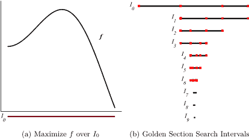

图 3.5：黄金分割搜索区间的变化过程

下面以算法形式给出黄金分割搜索。

+   **黄金分割搜索算法**
+   
+   在区间 $[a,b]$ 上求单峰函数 $f$ 的最大值。
+   
+   **输入：**
+   - 函数：$f$
+   - 端点：$a, b$
+   - 容差：$t$
+   
+   **输出：**最优点 $x^*$ 和最大值 $f(x^*)$
+   
+   **步骤 1。**初始化：令 $r = 0.618$，$a_0 = a$，$b_0 = b$，计数器 $k = 1$，上限 $N = \lceil \ln(t/(b-a))/\ln(0.618)\rceil$。
+   
+   **步骤 2。**计算测试点 $x_1 = a_{k-1} + r(b_{k-1}-a_{k-1})$ 和 $x_2 = b_{k-1} - r(b_{k-1}-a_{k-1})$。
+   
+   **步骤 3。**计算 $f(x_1)$ 和 $f(x_2)$。
+   
+   **步骤 4。**如果 $f(x_1) \geq f(x_2)$，则 $I_k = [x_2,b]$；即 $a = x_2$。
+   如果 $f(x_1) < f(x_2)$，则 $I_k = [a,x_1]$；即 $b = x_1$。
+   
+   **步骤 5。**如果 $k = N$ 或 $b_k-a_k < t$，则停止。
+   返回估计值 $x^* = \operatorname{midpoint}(I_k)$ 和 $f(x^*)$。
+   否则，令 $k = k + 1$，并返回步骤 2。

尽管黄金分割搜索可以用于任意单峰函数，以在指定区间上寻找最大值（或最小值），但其主要


## 示例 3.5. 最大化不可微函数

最大化

$$f(x)=-|2-x|-|5-4x|-|8-9x|$$

在区间 $[0,3]$ 上。

绝对值函数不可微，因为它们存在拐点——绘制 $f$ 的图像即可看出这一点。因此，求一阶导数并令其等于零不是一个选项。我们将使用 Maple 中的黄金分割搜索来求解此问题。我们的 Maple 过程 `GoldenSectionSearch` 位于文本的 `PSMv2` 包中。使用 `with(PSMv2)` 使该过程可用。

```maple
with(PSMv2):

f := x -> -|2 - x| - |5 - 4x| - |8 - 9x|;

GoldenSectionSearch(f, 0, 3, 0.1):
fnormal(%, 5);    # to fit the output to the page width
```

最大值为 $f(0.907318)=-2.629270$，容差为 0.100000。

| Iteration | $x_1$ | $x_2$ | $f(x_1)$ | $f(x_2)$ | Interval |
|---:|---:|---:|---:|---:|:---|
| 0 | 1.8541 | 1.1459 | −11.249 | −3.5836 | [0.0, 3] |
| 1 | 1.1459 | 0.70820 | −3.5836 | −5.0851 | [0.0, 1.8541] |
| 2 | 1.4164 | 1.1459 | −5.9969 | −3.5836 | [0.70820, 1.8541] |
| 3 | 1.1459 | 0.97871 | −3.5836 | −2.9149 | [0.70820, 1.4164] |
| 4 | 0.97871 | 0.87539 | −2.9149 | −2.7446 | [0.70820, 1.1459] |
| 5 | 0.87539 | 0.81153 | −2.7446 | −3.6386 | [0.70820, 0.97871] |
| 6 | 0.91486 | 0.87539 | −2.6594 | −2.7446 | [0.81153, 0.97871] |
| 7 | 0.93925 | 0.91486 | −2.7570 | −2.6594 | [0.87539, 0.97871] |
| 8 | 0.91486 | 0.89978 | −2.6594 | −2.5991 | [0.87539, 0.93925] |

最终区间的中点为 $0.907318$ 且 $f(\text{midpoint})=-2.629270$，因此我们估计函数在 $x$ 值 $0.9$ 处的最大值为 $-2.629$（精度在 $0.1$ 以内）。

## 示例 3.6. 最大化超越函数

最大化函数

$$g(x)=1-\exp(-x)+\frac{1}{1+x}$$

在区间 $[0,20]$ 上。 （记住 $\exp(-x)=e^{-x}$。）

```maple
g := x -> 1 - exp(-x) + 1/(1 + x):

GoldenSectionSearch(g, 0, 20, 0.001):
fnormal(%, 5);  # to fit the output to the page width
```

最大值为 $f(2.512908)=1.203632$，容差为 0.001000。

| Iteration | \(x_1\) | \(x_2\) | \(f(x_1)\) | \(f(x_2)\) | Interval |
|---:|---:|---:|---:|---:|:---|
| 0 | 12.3631 | 7.6393 | 1.0748 | 1.1153 | [0.0, 20] |
| 1 | 7.6393 | 4.7214 | 1.1153 | 1.1659 | [0.0, 12.361] |
| 2 | 4.7214 | 2.9180 | 1.1659 | 1.2012 | [0.0, 7.6393] |
| 3 | 2.9180 | 1.8034 | 1.2012 | 1.1920 | [0.0, 4.7214] |
| 4 | 3.6068 | 2.9180 | 1.1899 | 1.2012 | [1.8034, 4.7214] |
| 5 | 2.9180 | 2.4922 | 1.2012 | 1.2036 | [1.8034, 3.6068] |
| 6 | 2.4922 | 2.2291 | 1.2036 | 1.2021 | [1.8034, 2.9180] |
| 7 | 2.6548 | 2.4922 | 1.2033 | 1.2036 | [2.2291, 2.9180] |
| 8 | 2.4922 | 2.3917 | 1.2036 | 1.2034 | [2.2291, 2.6548] |
| 9 | 2.5543 | 2.4922 | 1.2036 | 1.2036 | [2.3917, 2.6548] |
| 10 | 2.4922 | 2.4538 | 1.2036 | 1.2036 | [2.3917, 2.5543] |
| 11 | 2.5160 | 2.4922 | 1.2036 | 1.2036 | [2.4538, 2.5543] |
| 12 | 2.5306 | 2.5160 | 1.2036 | 1.2036 | [2.4922, 2.5543] |
| 13 | 2.5160 | 2.5069 | 1.2036 | 1.2036 | [2.4922, 2.5306] |
| 14 | 2.5216 | 2.5160 | 1.2036 | 1.2036 | [2.5069, 2.5306] |
| 15 | 2.5160 | 2.5125 | 1.2036 | 1.2036 | [2.5069, 2.5216] |
| 16 | 2.5125 | 2.5104 | 1.2036 | 1.2036 | [2.5069, 2.5160] |
| 17 | 2.5138 | 2.5125 | 1.2036 | 1.2036 | [2.5104, 2.5160] |
| 18 | 2.5125 | 2.5117 | 1.2036 | 1.2036 | [2.5104, 2.5138] |
| 19 | 2.5130 | 2.5125 | 1.2036 | 1.2036 | [2.5117, 2.5138] |
| 20 | 2.5133 | 2.5130 | 1.2036 | 1.2036 | [2.5125, 2.5138] |
| 21 | 2.5130 | 2.5128 | 1.2036 | 1.2036 | [2.5125, 2.5133] |

黄金分割搜索给出的函数最大值为 1.204，$x$ 值为 $x=2.513$。

## Fibonacci 搜索

Fibonacci 搜索使用 Fibonacci 数的比率来基于表达式生成一系列测试点

$$F_n = F_{n-1} + F_{n-2} \quad \Longrightarrow \quad 1 = \frac{F_{n-1}}{F_n} + \frac{F_{n-2}}{F_n}.$$

由于 $\lim_{n\to\infty} F_{n-1}/F_n$ 等于黄金比例，Fibonacci 搜索是黄金分割搜索的“极限”形式。然而，Fibonacci 搜索比黄金分割搜索收敛更快。

为了使用 Fibonacci 搜索过程，我们必须确保关键假设成立：

- 函数必须在指定区间上是单峰的。
- 函数必须在已知的区间不确定性上具有最优解。
- 我们将接受区间解，因为精确的最优值无法通过 bracketing 找到，只能近似。

这些与黄金分割搜索所需的假设相同——两种搜索是密切相关的 bracketing 方法。

与之前一样，只能使用此或任何 bracketing 技术找到区间解——最终的不确定区间。最终区间的长度或容差值可由用户控制，并且可以任意小，仅受计算精度和可用计算时间的限制。最终区间保证在特定迭代次数内小于该容差值。

将黄金分割搜索的测试点生成公式中的黄金比例 $r$ 替换为 Fibonacci 数的比率，得到

$$x_1 = a + \frac{F_{n-2}}{F_n}\,(b-a)$$

$$x_2 = a + \frac{F_{n-1}}{F_n}\,(b-a)$$

这些是 Fibonacci 搜索测试点生成器。测试点必须位于原始区间 $[a,b]$ 内，因为 $a < x_1 < x_2 < b$，并且将以与黄金分割搜索相同的方式确定新的搜索区间。

如果 $f(x_1) < f(x_2)$，则新的区间为 $[x_1,b]$。

如果 $f(x_1) > f(x_2)$，则新的区间为 $[a,x_2]$。

相等意味着计算精度超出或发生计算错误。

迭代继续进行，直到最终区间长度小于我们设定的容差。我们的最终区间必须包含最优解。最终区间的大小决定了近似最优解的精度，反之亦然。实现此接受区间长度所需的迭代次数是满足不等式

$$\frac{b-a}{\text{tolerance}} < F_k.$$

的最小 Fibonacci 数。

当我们需要点解而不是区间解时，选择点的方法是评估函数 $f(x)$ 在最终区间的端点和中点。对于最大化问题，选择使 $f(x)$ 值最大的端点或中点。

Fibonacci 搜索算法如下。

## Fibonacci 搜索算法

在区间 $[a,b]$ 上求单峰函数 $f$ 的最大值。

- **INPUTS:**
  - **Function:** $f$
  - **Endpoints:** $a, b$
  - **Tolerance:** $t$
- **OUTPUTS:**
  - **Optimal point:** $x^*$
  - **Maximum value:** $f(x^*)$

**Step 1. Initialize:** Set $a_0=a$, $b_0=b$, counter $k=1$.

**Step 2.** 计算迭代次数 $n$，使得 $F_n$ 是第一个满足 $(b-a)/t<F_n$ 的 Fibonacci 数。

**Step 3.** 计算测试点：

$$x_1=a+\frac{F_{n-2}}{F_n}\,(b-a)$$

$$x_2=a+\frac{F_{n-1}}{F_n}\,(b-a)$$

**Step 4.** 计算 $f(x_1)$ 和 $f(x_2)$。

**Step 5.** 如果 $f(x_1)<f(x_2)$，则新的区间为 $[x_1,b]$。

设 $x_1=x_2$。

为新的区间计算新的 $x_2$。

如果 $f(x_1)>f(x_2)$，则新的区间为 $[a,x_2]$。

设 $x_2=x_1$。

为新的区间计算新的 $x_1$。

**Step 6.** 如果 $n=2$ 或 $b_n-a_n<t$，则 STOP。

返回估计值 $x^*=\operatorname{midpoint}(I_n)$ 和 $f(x^*)$。

否则，设 $n=n-1$ 并返回 Step 4。

尽管 Fibonacci 搜索可以用任何单峰函数在指定区间上找到最大值（或最小值），但其主要优势在于当常规微积分程序失效时，例如当 $f$ 不可微或不连续时。重做黄金分割搜索的第一个示例。

## 示例 3.7. 最大化不可微函数（重述）

最大化

$$f(x)=-|2-x|-|5-4x|-|8-9x|$$

在区间 $[0,3]$ 上。

我们将使用文本的 `PSMv2` 库包中的 `FibonacciSearch` 程序。

```maple
f := x -> -|2 - x| - |5 - 4x| - |8 - 9x|;
f := x -> -|2 - x| - |5 - 4x| - |8 - 9x|;
FibonacciSearch(f, 0, 3, 0.1);
fnormal(%, 5);  # to fit the output to the page width
```

最大值为 $f(0.905658)=-2.622630$，容差为 0.100000。

| Iteration | $x_1$ | $x_2$ | $f(x_1)$ | $f(x_2)$ | Interval |
|---:|---:|---:|---:|---:|:---|
| 0.0 | 1.1471 | 1.8529 | -3.5882 | -11.235 | [0.0, 3] |
| 1 | 0.70588 | 1.1471 | -5.1176 | -3.5882 | [0.0, 1.8529] |
| 2 | 1.1471 | 1.4160 | -3.5882 | -5.9916 | [0.70588, 1.8529] |
| 3 | 0.97639 | 1.1471 | -2.9056 | -3.5882 | [0.70588, 1.4160] |
| 4 | 0.87395 | 0.97639 | -2.7647 | -2.9056 | [0.70588, 1.1471] |
| 5 | 0.80893 | 0.87395 | -3.6749 | -2.7647 | [0.70588, 0.97639] |
| 6 | 0.87395 | 0.91260 | -2.7647 | -2.6504 | [0.80893, 0.97639] |
| 7 | 0.91260 | 0.93737 | -2.6504 | -2.7495 | [0.87395, 0.97639] |
| 8 | 0.89811 | 0.91260 | -2.5924 | -2.6504 | [0.87395, 0.93737] |

此答案与黄金分割搜索找到的最优值相比如何？

现在重做之前的第二个示例。

## 示例 3.8. 最大化超越函数（重述）

最大化函数

$$g(x)=1-\exp(-x)+\frac{1}{1+x}$$

在区间 $[0,20]$ 上。

```maple
g := x -> 1 - exp(-x) + 1/(1 + x):
```


> FibonacciSearch(9, 0, 20, 0.1):
> fnormal(%, 5);  # to fit the output to the page width

最大值为 f(2.523088)=1.203630，容差为 0.001000

| Iteration | $x_1$ | $x_2$ | $f(x_1)$ | $f(x_2)$ | Interval |
|---:|---:|---:|---:|---:|:---|
| 0.0 | 7.6395 | 12.361 | 1.1153 | 1.0748 | [0.0, 20] |
| 1 | 4.7210 | 7.6395 | 1.1659 | 1.1153 | [0.0, 12.361] |
| 2 | 2.9179 | 4.7210 | 1.2012 | 1.1659 | [0.0, 7.6395] |
| 3 | 1.8032 | 2.9179 | 1.1920 | 1.2012 | [0.0, 4.7210] |
| 4 | 2.9179 | 3.6066 | 1.2012 | 1.1899 | [1.8032, 4.7210] |
| 5 | 2.4920 | 2.9179 | 1.2036 | 1.2012 | [1.8032, 3.6066] |
| 6 | 2.2289 | 2.4920 | 1.2021 | 1.2036 | [1.8032, 2.9179] |
| 7 | 2.4920 | 2.6547 | 1.2036 | 1.2033 | [2.2289, 2.9179] |
| 8 | 2.3916 | 2.4920 | 1.2034 | 1.2036 | [2.2289, 2.6547] |
| 9 | 2.4920 | 2.5542 | 1.2036 | 1.2036 | [2.3916, 2.6547] |
| 10 | 2.4537 | 2.4920 | 1.2036 | 1.2036 | [2.3916, 2.5542] |
| 11 | 2.4920 | 2.5158 | 1.2036 | 1.2036 | [2.4537, 2.5542] |
| 12 | 2.5158 | 2.5304 | 1.2036 | 1.2036 | [2.4920, 2.5542] |

Fibonacci 搜索给出的最大值为 $f(2.5)=1.204$。该答案与黄金分割搜索找到的最优值相比如何？

## 插值与导数：牛顿法

### 求临界点（函数导数的根）

牛顿法可以改编为求解非线性优化问题。对于单变量的二阶可微函数，该改编是直接的。牛顿法应用于导数，而不是我们希望优化的原始函数——函数的临界点出现在导数的根处。将 $f$ 用 $f'$ 替换在牛顿法的迭代公式中：

$$N(x)=x-\frac{f(x)}{f'(x)} \quad\Rightarrow\quad M(x)=x-\frac{f'(x)}{f''(x)}$$

给定指定的收敛 $\varepsilon>0$，牛顿法的迭代可以在 $|x_{k+1}-x_k|\leq\varepsilon$ 或 $|f'(x_k)|<\varepsilon$ 时终止。

为了使用修正的牛顿法寻找临界点，函数的一阶和二阶导数必须在感兴趣的邻域内存在。还要注意，只要 $x_k$ 处的二阶导数为零，下一点 $x_{k+1}$ 就无法计算。(*解释原因？*) 该方法仅近似临界点的值；它不知道自己是在寻找原始函数的最大值还是最小值。利用二阶导数的符号来确定临界值是最大值、最小值还是既非其一（可能是拐点）。

## **例 3.9. 一个简单应用。**

在区间 $[0,7]$ 上最大化多项式 $p(x)=5x-x^2$。

这个简单问题很容易用初等微积分求解。

- 1. 求导：$p'=5-2x$。
- 2. 唯一的临界点，$p'$ 的根，是 $x^*=5/2$。
- 3. 再次求导：$p''=-2<0$。
- 4. 二阶导数检验表明 $p$ 在 $x^*=5/2$ 处有最大值 $25/4$。

让我们使用 Maple 实现修正的牛顿法来寻找 $p$ 的最大值。

```
> p := x → 5x − x² :
  dp := D(p) :
  ddp := D(dp) :

> Newton := x → x − dp(x)/ddp(x) :
```

从 $x_0=1.0$ 开始。

```
> x₀ := 1.0 :
  x₁ := Newton(x₀);
  x₂ := Newton(x₁);

                         x[0] := 1.0
                         x[1] := 2.500000000
                         x[2] := 2.500000000
```

从任何其他值开始也得到 $x^*=2.5$。由于这个简单的二次函数具有线性导数，导数的线性近似无论起始点如何都是精确的，答案将在第二次迭代出现。见 **图 3.6**。代数化简 $p$ 的迭代函数可证实这一点：$Newton(x)=2.5$。

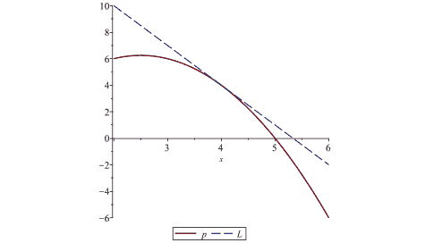

函数在该点处的线性近似的斜率精确地等于函数在该点处的斜率，因此线性近似在该点与函数相切，如图所示。

## **例 3.10. 一个三次多项式。**

在区间 $[0,3]$ 上以容差 $\varepsilon=0.01$ 寻找 $p(x)=-2x^3+10x+5$ 的最大点，如果可能的话。

我们将使用 Maple 使用相同的过程，这次起始值为 $x=1.0$。

```
> p := x → −2x^3 + 10x + 5:
    dp := D(p):
    ddp := D(dp):

> Newton := x → x − dp(x)/ddp(x):
```

再次从 $x_0=1.0$ 开始。

```
> x_0 := 1.0:
    x_1 := Newton(x_0):
    x_2 := Newton(x_1):

                     x[0] := 1.0
                     x[1] := 1.333333333
                     x[2] := 1.291666667

> abs(x[2] − x[1]) < 0.01
                     0.041666666 < 0.01
```

尚未达到期望的容差——我们还没完成。

```
Newton(x₂);
|x₃ − x₂| < 0.01;

x₃ := 1.290994624
0.000672043 < 0.01
```

我们得到结果了！检查二阶导数可知 p(1.29) = 13.6 是我们的最大值（在 0.01 以内）。

Maple 的 *Student[Calculus1]* 包包含用于寻找函数根的 *NewtonsMethod*。要使用 *NewtonsMethod* 寻找临界点，我们所要做的就是用其一阶导数替换函数。下面举例说明。

```
with(Student[Calculus1]);

p := x → −2x³ + 10x + 5:
dp := D(p):
NewtonsMethod(dp, x = 1.0);

1.290994449

NewtonsMethod(dp, x = 1.0, output = sequence);

1.0, 1.333333333, 1.291666667, 1.290994624, 1.290994449

NewtonsMethod(dp, x = 0.3, output = plot);
```

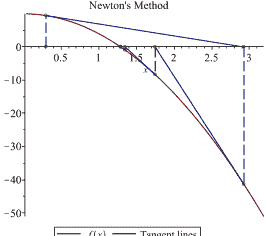

从初始点 x₀ = 0.3 开始，Newton 法对 f(x) = −6x² + 10 的迭代最多为 5 次

尝试使用 *output=animation* 的 *NewtonsMethod*。

## 练习

比较在以下情况下使用黄金分割、Fibonacci 和牛顿法得到的结果。

- 1. 在闭区间 $[-2,1]$ 上最大化 $f(x)=-x^2-2x$。最终区间的容差为 0.6。提示：从 $x=-0.5$ 开始牛顿法。
- 2. 在闭区间 $[-3,1]$ 上最大化 $f(x)=-x^2-3x$。最终区间的容差为 0.6。提示：从 $x=1$ 开始牛顿法。
- 3. 在闭区间 $[-3,1]$ 上最小化 $f(x)=x^2+2x$。最终区间的容差为 0.5。提示：从 $x=-3$ 开始牛顿法。
- 4. 在区间 $[-1,3]$ 上以容差 0.1 最小化 $f(x)=-x+e^x$。提示：从 $x=-1$ 开始牛顿法。
- 5. 列出黄金分割和 Fibonacci 搜索方法都需要的至少两个假设。
- 6. 考虑在区间 $[-1,3]$ 上最小化 $f(x)=-x+e^x$。假设搜索方法得到最终区间 $[-0.80,0.25]$，在容差 $\varepsilon$ 以内。报告一个单一的最佳 $x$ 值以最小化区间上的 $f(x)$。解释你的推理。
- 7. 修改黄金分割（第 109 页）算法以寻找单峰函数的最小值。编写一个 Maple 过程来实现你的修改。
- 8. 修改 Fibonacci 搜索（第 113 页）算法以寻找单峰函数的最小值。编写一个 Maple 过程来实现你的修改。

## 项目

- **项目 3.1.** 在 Maple 中编写一个使用 *割线法搜索* 的程序。将你的程序应用于上述练习 1 至 4。
- **项目 3.2.** 在 Maple 中编写一个使用 *Regula-Falsi 搜索* 方法的程序。将你的程序应用于上述练习 1 至 4。
- **项目 3.3.** 仔细分析所呈现的不同搜索方法的 *收敛速率*。

## 参考文献和进一步阅读

[BSS2013] Mokhtar S. Bazaraa, Hanif D. Sherali, and Chitharanjan M. Shetty, *Nonlinear Programming: Theory and Algorithms*, Wiley, 2013.

[B2016] William C. Bouldry, *Introduction to Computation*, 2016.

[F1992] William P. Fox, “Teaching nonlinear programming with Minitab,” COED Journal, Vol. II (1992), no. 1, 80–84.

[F1993] William P. Fox, “Using microcomputers in undergraduate nonlinear optimization,” Collegiate Mathematics, Vol. XI (1993), no. 3, 214–218.

[FA2000] William P. Fox and Jeffrey Applegate, “Some fun with Newton’s method,” COED Journal, Vol. X (2000), no. 4, 38–43.

[FGMW1987] William P. Fox, Frank Giordano, S. Maddox, and Maurice D. Wey, *Mathematical Modeling with Minitab*, Brooks/Cole, 1987.

[FR2000] William P. Fox and William Richardson, “Mathematical modeling with least squares using Maple,” Maple Application Center, Nonlinear Mathematics, 2000.

[FGW1997] William P. Fox, Frank Giordano, and Maurice Weir, *A First Course in Mathematical Modeling*, 2nd Ed., Brooks/Cole, 1997.

[FW2001] William P. Fox and Margie Witherspoon, “Single variable optimization when calculus fails: Golden section search methods in nonlinear optimization using Maple,” COED Journal, Vol. XI (2001), no. 2, 50–56.

[GFH2014] Frank Giordano, William P. Fox, and Steven Horton, *A First Course in Mathematical Modeling*, 5th ed., Nelson Education, 2014.

[M2013] Mark M. Meerschaert, *Mathematical Modeling*, Academic Press, 2013.

[PRS1976] D.T. Phillips, A. Ravindran, and J. Solberg, *Operations Research*, Wiley, 1976.

[PFTV2007] William H. Press, Brian P. Flannery, Saul A. Teukolsky, William T. Vetterling, et al., *Numerical Recipes*, Cambridge U. Press, 2007.

[R1979] S.S. Rao, *Optimization: Theory and Applications*, Wiley Eastern Ltd., 1979.

[WVG2003] W.L. Winston, M. Venkataramanan, and J.B. Goldberg, *Introduction to Mathematical Programming*, Duxbury, 2003.


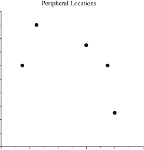

FIGURE 4.1: Grid of the Five Departments

中央计算机将被放置在坐标 $(m,n)$ 处，其中 $m$ 和 $n$ 均为表示办公空间的网格中的整数。确定使所需电缆总量最小的坐标 $(m,n)$。报告在此放置下所需的电缆总英尺数以及坐标 $(m,n)$。

为了建模和解决这类问题，我们需要 **多变量优化**。在本章中，我们的目标是介绍约束和无约束非线性优化。欲获得更全面的覆盖，我们建议学习该主题的完整著作，例如 Ruszczynski 的 *Nonlinear Optimization*（Princeton Univ. Press, 2006）。

## Basic Theory

我们首先介绍如何找到无约束非线性优化问题的最优解（如果存在）

Maximize (or minimize) $f(x_1,x_2,\ldots,x_n)$ over $\mathbb{R}^n$

我们假设 $f$ 的所有一阶和二阶偏导数在 $f$ 的定义域的所有点上存在且连续。设 $f$ 对 $x_i$ 的偏导数为

$$\frac{\partial f(x_1,x_2,\ldots,x_n)}{\partial x_i}.$$

## 1. 引言

本文档旨在介绍一种新型的文档解析方法，该方法能够高效地从复杂版面中提取结构化信息。该方法结合了深度学习与规则引擎，适用于多种文档类型。

## 2. 方法概述

本方法主要包含以下三个核心步骤：版面分析、内容识别与结构重建。每个步骤均经过优化，以处理高噪声和低分辨率图像。

- 版面分析：检测文本块、表格区域和图像区域。
- 内容识别：对检测区域进行OCR和语义分类。
- 结构重建：根据阅读顺序和层级关系生成结构化输出。

### 2.1 版面分析

版面分析模块采用基于注意力机制的神经网络，能够准确区分文本、图片、表格和装饰元素。该模块的输出为带置信度的区域框。

| 区域类型 | 平均精度 | 平均召回率 |
|---------|---------|----------|
| 文本    | 0.95    | 0.93     |
| 表格    | 0.89    | 0.87     |
| 图片    | 0.97    | 0.96     |

> > 实验结果表明，该方法在公开数据集上取得了领先的性能。

更多细节将在后续章节中讨论。

So $g$’s Hessian is

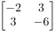

Hessian 将在二阶导数检验中发挥第二导数的作用，我们将其从单变量推广到多变量函数。我们将使用行列式来分析 Hessian。回顾，$2\times2$ 矩阵 $A$ 的行列式为

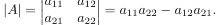

较大矩阵的行列式计算是使用余子式展开递归定义的。我们可以使用主序主子式来分析 Hessian。

## Definition 4.1. Leading Principal Minor.

平方矩阵 $A$ 的 *主序主子式* 是通过删除 $A$ 的 $n-i$ 行并删除相同的 $n-i$ 列得到的 $i\times i$ 子矩阵的行列式，其中 $i=0,1,2,\ldots,n-1$。

## Example 4.3. The Leading Principal Minors of a Hessian Matrix.

给定 $3\times3$ Hessian 矩阵

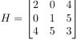

确定所有主序主子式。

- 1. 有三个 1 阶主序主子式，$(i=1$: 删除 $3-1=2$ 行和相同列)。
  
  a. 删除第 1 行和第 2 行以及第 1 列和第 2 列：$M=[3]$。则
  
  $$|3|=3$$
  
  b. 删除第 1 行和第 3 行以及第 1 列和第 3 列：$M=[1]$。则
  
  $$|1|=1$$
  
  c. 删除第 2 行和第 3 行以及第 2 列和第 3 列：$M=[1]$。则
  
  $$|2|=2$$
  
  1 阶主序主子式为主对角线上的元素。

- 2. 有三个 2 阶主序主子式，$(i=2$: 删除 $3-2=1$ 行和相同列)。

> 有关行列式的完整讨论，请参阅，例如 Gilbert Strang 的 *Introduction to Linear Algebra*。

(a) 删除第 1 行和第 1 列：$M=\begin{bmatrix}5&5\\5&3\end{bmatrix}$。则

$\left|\begin{matrix}1&5\\5&3\end{matrix}\right|=-22$

(b) 删除第 2 行和第 2 列：$M=\begin{bmatrix}2&4\\4&3\end{bmatrix}$。则

$\left|\begin{matrix}2&4\\4&3\end{matrix}\right|=-10$

(c) 删除第 3 行和第 3 列：$M=\begin{bmatrix}2&0\\0&1\end{bmatrix}$。则

$\left|\begin{matrix}2&0\\0&1\end{matrix}\right|=2$

3. 只有一个 3 阶主序主子式，即 $H$ 本身的行列式。³（不删除行或列。）则

$|H|=-60$

注意，矩阵的主序主子式只是沿主对角线形成的所有子矩阵的行列式。

我们如何使用这些行列式，即 Hessian 矩阵的主序主子式，来确定多元函数的凸性？下面的定理回答了我们的问题。

## Theorem. Convexity and the Hessian Matrix.

假设 $f(x_1,x_2,\ldots,x_n)$ 在其定义域 $D$ 的所有点上具有连续的二阶偏导数。设 $H$ 为 $f$ 的 Hessian 矩阵。则

- a. 如果 $H$ 的所有主序主子式非负，则 $f$ 为凸；
- b. 如果 $H$ 的所有主序主子式与 $(-1)^k$ 的符号相符，其中 $k$ 为子式的阶数（偶数阶为正，奇数阶为负），则 $f$ 为凹；
- c. 否则，$f$ 既不凸也不凹。

## Example 4.4. Determining Convexity.

使用其 Hessian 矩阵确定函数 $f(x_1,x_2)=x_1^2+3x_2^2$ 的凸性。

1. $f$ 的 Hessian 为

$$H(f)=\begin{bmatrix}\frac{\partial^2 f}{\partial x_1^2} & \frac{\partial^2 f}{\partial x_1\partial x_2}\\[2pt]\frac{\partial^2 f}{\partial x_2\partial x_1} & \frac{\partial^2 f}{\partial x_2^2}\end{bmatrix}=\begin{bmatrix}2&0\\0&6\end{bmatrix}$$

- 2.
  a. 1 阶主序主子式为：$|2|=2>0$ 和 $|6|=6>0$。
  b. 2 阶主序主子式为 $|H|=12>0$。

- 3. 由于所有主序主子式均非负，凸性与 Hessian 矩阵定理告诉我们 $f$ 是一个凸函数。

[Figure 4.2](#figure-4-2) 显示了 $f$ 的图像。

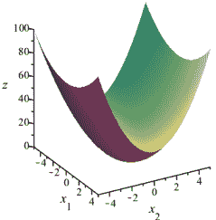

**FIGURE 4.2:** Graph of $f(x_1,x_2)=x_1^2+3x_2^2$

## Example 4.5. Determining Convexity Using the Hessian.

使用其 Hessian 矩阵确定函数 $g(x_1,x_2)=-x_1^2-3x_2^2+x_1x_2$ 的凸性。

- 1. $g$ 的 Hessian 为

$$H(g)=\begin{bmatrix}\frac{\partial^2 g}{\partial x_1^2} & \frac{\partial^2 g}{\partial x_1\partial x_2}\\[2pt]\frac{\partial^2 g}{\partial x_2\partial x_1} & \frac{\partial^2 g}{\partial x_2^2}\end{bmatrix}=\begin{bmatrix}-2&1\\1&-6\end{bmatrix}$$

- 2.
  a. 1 阶主序主子式为：$|-2|=-2<0$ & $|-6|=-6<0$。
  b. 2 阶主序主子式为 $|H|=11>0$。

3. 由于 1 阶主序主子式为负而 2 阶为正，凸性与 Hessian 矩阵定理告诉我们 $g$ 是一个凹函数。

[Figure 4.3](#) 显示了 $g$ 的图像。

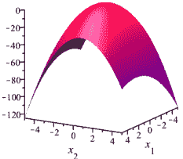

**FIGURE 4.3:** Graph of $g(x_1,x_2)=-x_1^2-3x_2^2+x_1x_2$

## Example 4.6. Determining Nonconvexity Using the Hessian.

使用其 Hessian 矩阵确定函数 $h(x_1,x_2)=x_1^2-3x_2^2+x_1x_2$ 的凸性。

- 1. $h$ 的 Hessian 为
   
   $$
   H(h)=\begin{bmatrix}
   \frac{\partial^2h}{\partial x_1^2} & \frac{\partial^2h}{\partial x_1\partial x_2}\\
   \frac{\partial^2h}{\partial x_1\partial x_2} & \frac{\partial^2h}{\partial x_2^2}
   \end{bmatrix}
   =\begin{bmatrix}2 & 1\\1 & -6\end{bmatrix}
   $$

- 2. 1 阶主序主子式为：$|2|=2>0$ & $|-6|=-6<0$。
  
  停止。由于我们有相反的符号，$h$ 既不能是凸的也不能是凹的；$h$ 有一个鞍点。

该函数既不凸也不凹；该 Hessian 矩阵称为 *不定*。

# Figure 4.4 shows h’s graph.

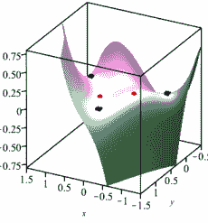

**FIGURE 4.4:** Graph of $h(x_1,x_2)=x_1^2-3x_2^2+x_1x_2$

一次快速的 Maple 验证了该分析。

```
with(Student[VectorCalculus]):   # for ‘Hessian’
with(LinearAlgebra):             # for ‘IsDefinite’
h := (x1,x2) -> x1^2 - 3*x2^2 + x1*x2:

H := Hessian(h(x1,x2), [x1,x2]);
                         [ 2   1 ]
                         [       ]
                         [ 1  -6 ]

IsDefinite(H, query = 'indefinite');
                         true
```

凸性与 Hessian 矩阵定理的第 a 部分（第 126 页）说凸函数具有所有非负的主序主子式；函数的 Hessian 此时称为 **正定**。定理的第 b 部分说凹函数具有所有非正的主序主子式；函数的 Hessian 此时称为 **负定**。第 c 部分给出了我们一个 **不定** Hessian。当变量出现在函数 Hessian 中时，正定性的计算会变得更加复杂。让我们使用 Maple 来测试和验证我们示例中函数的正定性。（请记住加载 `Student[VectorCalculus]` 和 `LinearAlgebra` 包。）

```
f := (x,y) -> x^2 + 3*y^2:
g := (x,y) -> -x^2 - 3*y^2 + x*y:
h := (x,y) -> x^2 - 3*y^2 + x*y:
```
³ Maple 使用相同的记号表示行列式。输入矩阵 $H$，然后执行 $|H|$。


> Hf := Hessian(f(x1,x2), [x1,x2]);
  IsDefinite(Hf, query = 'positive_definite');
  IsDefinite(Hf, query = 'negative_definite');
  IsDefinite(Hf, query = 'indefinite');

                         Hf := [ 2  0 ]
                               [ 0  6 ]
                               true
                               false
                               false

> Hg := Hessian(g(x1,x2), [x1,x2]);
  IsDefinite(Hg, query = 'positive_definite');
  IsDefinite(Hg, query = 'negative_definite');
  IsDefinite(Hg, query = 'indefinite');

                         Hg := [ -2   1 ]
                               [  1  -6 ]
                               false
                               true
                               false

> Hh := Hessian(g(x1,x2), [x1,x2]);
  IsDefinite(Hh, query = 'positive_definite');
  IsDefinite(Hh, query = 'negative_definite');
  IsDefinite(Hh, query = 'indefinite');

                         Hh := [ 2   1 ]
                               [ 1  -6 ]
                               false
                               false
                               true

Maple 有多个计算函数 Hessian 的函数。*Hessian* 命令的版本在 *Student[VectorCalculus], Vector-Calculus,* 和 *LinearAlgebra* 包中。查阅 Maple 的帮助页面以帮助您决定在特定情况下使用哪个版本最合适。

在更一般的情况下，如果函数包含幂高于 2 的项或包含超越函数，例如 $x_1x_2^2$ 或 $\sin(x_1x_2)$，Hessian 将包含变量的项。那么将驻点分类为最大值、最小值或鞍点时的 definiteness 分析会稍微复杂一些。

对于两个变量，我们使用 *二次型*

$$Q(x_1,x_2) = [x_1\quad x_2] \times H \times \begin{bmatrix}x_1\\x_2\end{bmatrix}$$

来测试 Hessian 矩阵。一般来说，我们使用 $Q(\vec{x}) = \vec{x}^{T}H\,\vec{x}$。然后定义

## 定义 4.2. 矩阵的 Definiteness。

设 $H$ 为 $f$ 的 Hessian 矩阵。则 $H$ 是

+   1. **正定** iff $H > 0$ 对于 domain$(f)$ 中每个非零向量 $z$，
+   2. **半正定** iff $H \geq 0$ 对于 domain$(f)$ 中每个非零向量 $z$，
+   3. **负定** iff $H < 0$ 对于 domain$(f)$ 中每个非零向量 $z$，
+   4. **半负定** iff $H \leq 0$ 对于 domain$(f)$ 中每个非零向量 $z$，
+   5. **不定** 否则。

我们可以将 definiteness 与主子式的符号联系起来。

**正定：** 所有 leading principal minors 均为正。

**半正定：** 所有 leading principal minors 均非负（某些可能为零）。

**负定：** leading principal minors 遵循 $(-1)^k$ 的符号，其中 $k$ 为 leading principal minor 的阶数。偶数阶 leading principal minors 为正，奇数阶 leading principal minors 为负。

**半负定：** 所有非零 leading principal minors 遵循 $(-1)^k$ 的符号，其中 $k$ 为 leading principal minor 的阶数。偶数阶非零 leading principal minors 为正，奇数阶非零 leading principal minors 为负。某些可能为零。

**不定：** 某些 leading principal minors 不遵循上述任何规则。

如果 Hessian 也是自变量的函数，其 definiteness 可能会从一个点到另一个点变化。要测试点 $x^*$ 处的 Hessian 的 definiteness，将 Hessian 在该点求值。例如，在矩阵

```
$$H(x_1,x_2)=\begin{bmatrix}2x_1 & x_2 \\ x_2 & 4\end{bmatrix},$$
```

中，$x_1$ 和 $x_2$ 的具体值决定了 $H$ 在 $[x_1,x_2]$ 处是正定、半正定、负定、半负定还是不定。**给出每种情况的一个例子！**

*表 4.2* 总结了 Hessian 矩阵 definiteness 与驻点（极值）分类为最大值、最小值、鞍点或“不确定”之间的关系。

## 表 4.2：Hessian Definiteness 摘要

| 行列式：$H_k = k$ 阶 leading principal minors | 结果 | 关于驻点的结论 |
|---|---|---|
| 所有 $H_k > 0$ | 正定，$f$ 为凸 | 最小值 |
| 所有 $H_k \geq 0$ | 半正定，$f$ 为凸 | 局部最小值 |
| $\operatorname{sgn}(H_k)=\operatorname{sgn}((-1)^k)$ | 负定，$f$ 为凹 | 最大值 |
| $\operatorname{sgn}(H_k)=\operatorname{sgn}((-1)^k)$ 或某些，但不是全部，$H_k=0$ | 半负定，$f$ 为凹 | 局部最大值 |
| $H_k$ 不全为 0，但无上述情况 | 不定，$f$ 既非 | 鞍点 |
| $H_k=0$ 对所有 $k$ | 不定 | *不确定* |

## 示例 4.7. 使用摘要表。

+   1. 假设函数 $f(x_1,x_2)$ 的 Hessian 给出为
   
   $$H(x_1,x_2):=\begin{bmatrix}-2 & -1\\-1 & -4\end{bmatrix}$$
   
   1 阶 leading principal minors 为 $-2$ 和 $-4$。2 阶 leading principal minor 为 $|H(x_1,x_2)|=7$。由于一阶为负，二阶为正，leading principal minors 遵循 $(-1)^k$ 的符号。摘要表表明 $f$ 为凹且找到的驻点为最大值。此 Hessian 矩阵为负定。
   
   ```matlab
   >> H := Matrix([-2, -1], [-1, -4]);
   H := [-2  -1
         -1  -4]
   >> IsDefinite(H, query = 'negative_definite');
   true
   ```

+   2. 假设函数 $f$ 的 Hessian 给出为
   
   $$H:=\begin{bmatrix}3 & 2 & 1\\6 & 5 & 4\\9 & 8 & 7\end{bmatrix}$$

1 阶 leading principal minors 为 3、5 和 7。2 阶 leading principal minors 为 3、12 和 3。3 阶 leading principal minor，即 $H$ 的行列式，为 0。所有 leading principal minors 均为正或零。摘要表表明如果 $f$ 为凸且任何对应的驻点将为局部最小值。此 Hessian 矩阵为半正定。

```
> H := Matrix([[3, 2, 1], [6, 5, 4], [9, 8, 7]]);

H :=
\begin{bmatrix}
3 & 2 & 1 \\
6 & 5 & 4 \\
9 & 8 & 7
\end{bmatrix}

> IsDefinite(H, query = 'positive_definite');
        false
> IsDefinite(H, query = 'positive_semidefinite');
        true
```

3. 假设函数 $f$ 的 Hessian 给出为

```
$$H := \begin{bmatrix}-2 & -4 \\ -4 & -3\end{bmatrix}$$
```

1 阶 leading principal minors 为 $-2$ 和 $-3$。2 阶 leading principal minor 为 $|H| = -10$。由于一阶和二阶均为负，摘要表表明 Hessian 为不定且找到的驻点为鞍点。

```
> H := Matrix([[-2, -4], [-4, -3]]);

H :=
\begin{bmatrix}
-2 & -4 \\
-4 & -3
\end{bmatrix}

> IsDefinite(H, query = 'indefinite');
        true
```

## 4.2 无约束优化：示例

上一节的定义和定理被用于解决以下示例中的一组无约束优化问题。在下面的 Maple 会话中，请记住从新文档开始并加载 Student[VectorCalculus] 和 Student[LinearAlgebra] 包。

## 示例 4.8. 寻找极值，I。

求并分类

$$f(x_1,x_2)=55x_1-4x_1^2+135x_2-15x_2^2-100.$$

的所有驻点。

## 深度学习

深度学习是机器学习的一个子集，使用具有多层的人工神经网络来模拟数据中的复杂模式。它推动了计算机视觉、自然语言处理和语音识别方面的突破。

-   - 用于图像数据的卷积神经网络（CNNs）
-   - 用于序列数据的循环神经网络（RNNs）
-   - 用于基于注意力的建模的 Transformer

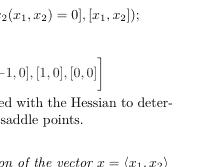

| 模型 | 精度 |
|-------|----------|
| CNN   | 98.2%    |
| RNN   | 95.7%    |
| Transformer | 99.1% |

```
```python
import torch
import torch.nn as nn

model = nn.Sequential(
    nn.Linear(784, 256),
    nn.ReLU(),
    nn.Linear(256, 10)
)
```
```

> > "深度学习是 21 世纪的电力。" — Andrew Ng

该领域继续快速发展，使生成式 AI、自动驾驶和个性化医疗等新应用成为可能。


```text
> for i to 6 do
    CP_i, H(CP_i), Determinant(H(CP_i));
  end do;
```

\[
\begin{bmatrix}\frac{\sqrt{5}}{5} & \frac{2}{5}\end{bmatrix},\quad
\begin{bmatrix}\frac{12\sqrt{5}}{25} & \frac{2}{5}\\[2pt]\frac{2}{5} & \frac{2\sqrt{5}}{5}\end{bmatrix},\quad
\frac{4}{5}
\]

\[
\begin{bmatrix}-\frac{\sqrt{5}}{5} & \frac{2}{5}\end{bmatrix},\quad
\begin{bmatrix}-\frac{12\sqrt{5}}{25} & \frac{2}{5}\\[2pt]\frac{2}{5} & -\frac{2\sqrt{5}}{5}\end{bmatrix},\quad
\frac{4}{5}
\]

\[
\begin{bmatrix}0 & 1\end{bmatrix},\quad
\begin{bmatrix}0 & 1\\1 & 0\end{bmatrix},\quad
-1
\]

\[
\begin{bmatrix}-1 & 0\end{bmatrix},\quad
\begin{bmatrix}0 & 2\\2 & -2\end{bmatrix},\quad
-4
\]

\[
\begin{bmatrix}1 & 0\end{bmatrix},\quad
\begin{bmatrix}0 & 2\\2 & 2\end{bmatrix},\quad
-4
\]

\[
\begin{bmatrix}0 & 0\end{bmatrix},\quad
\begin{bmatrix}0 & -1\\-1 & 0\end{bmatrix},\quad
-1
\]

我们使用 Maple 的 *Student[LinearAlgebra]* 包中的 *Determinant* 命令计算 \(|H|\)，从而得到每个临界点的二阶顺序主子式。*Minor* 命令将给出 H 的一阶顺序主子式，如下所示：

```text
> Minor(H(CP_1), 1, 1);
  Minor(H(CP_1), 2, 2);
```

\[
\frac{2\sqrt{5}}{5}
\]

\[
\frac{12\sqrt{5}}{5}
\]

*Determinant*、*IsDefinite* 和 *Minor* 都在 *Student[LinearAlgebra]* 包中。如何修改上面的 for 循环以确定每个临界点处 Hessian 矩阵的定性？

[表 4.3](#) 以表格形式展示了为 \(h\) 收集的数据，便于分析。

## 表 4.3：h 的临界点分析

| 临界点 | 顺序主子式 | 分类与结果 |
|---|---|---|
|  | 一阶顺序主子式 | 二阶顺序主子式 |
| (0, 0) | 0, 0; [≥ 0] | −1 — 非凸非凹，鞍点 |
| (1, 0) | 0, 0; [≥ 0] | −4 — 非凸非凹，鞍点 |
| (0, 1) | 0, 0; [≥ 0] | −1 — 非凸非凹，鞍点 |
| (−1, 0) | 0, −2; [∼ (−1)¹] | −4 — 非凸非凹，鞍点 |
| (√5/5, 2/5) | 12√5/5, 2√5/5; [≥ 0] | 4/5 — 凸，局部极小值 |
| (−√5/5, 2/5) | −12√5/5, −2√5/5; [∼ (−1)¹] | 4/5; [∼ (−1)²] — 凹，局部极大值 |

使用 Maple 验证每个 Hessian 矩阵的定性很容易。

```text
> IsDefinite(H(CP₁), query = 'positive_definite');
  IsDefinite(H(CP₂), query = 'negative_definite');
                         true
                         true
> seq(IsDefinite(H(CPₖ), query = 'indefinite'), k = 3..6);
                         true, true, true, true
```

我们发现最大值点和最小值点分别为 \(h(-\sqrt{5}/5, 2/5) \approx 0.072\) 和 \(h(\sqrt{5}/5, 2/5) \approx -0.072\)。最后，图 4.6 展示了 \(h\) 的图形，其中最大值点和最小值点用球体标记，鞍点用方框标记。请在 \(h\) 的图形中仔细放大每个临界点，以验证所声称的性质。

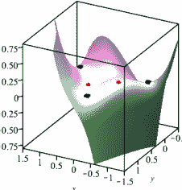

**图 4.6：** \(h(x_1,x_2)\) 的图形及其临界点

我们也可以使用 Maple 的 *Student[LinearAlgebra]* 包中的 *Minor* 命令，形式如下：

```maple
> Minor(Minor(M, 1, 1, output = matrix), 1, 1);
```

来计算较大矩阵 \(M\) 的顺序主子式；然而，随着顺序主子式的数量迅速增加，语法很快就会变得复杂。

潮汐会改变岛屿周围的海平面。局部潮汐变化受多种因素影响，其中许多因素与当地地形有关。港口中的岛屿是航行危险物。在下一个示例中，我们将利用一个基于海底水深数据与陆地高程数据相结合的函数来寻找岛屿。

## 示例 4.11：寻找岛屿

结合水深与地形数据集，可得到由以下方程建模的海陆表面：

\[
f(x_1,x_2)=-300x_2^3-695x_2^2+7x_2-300x_1^3-679x_1^2-235x_1+570
\]

其中 \((x,y)\in[-2.2,2]\times[-2.2,2]\)。

直接使用前面示例中的模板在 Maple 中运行，我们得到：

```text
> f := (x, y) ↦ −300 y^3 − 695 y^2 + 7 y − 300 x^3 − 679 x^2 − 235 x + 570 :
    dx := D_1(f),
    dy := D_2(f);
        dx := (x, y) ↦ −900 x^2 − 1358 x − 235
        dy := (x, y) ↦ −900 y^2 − 1390 y + 7

> Hessian(f(x, y), [x, y]);
    H := unapply(%, [x, y]);
        [ −1800 x − 1358       0       ]
        [       0       −1800 y − 1390 ]

> use RealDomain in
    CriticalPoints := evalf~(solve([dx(x, y) = 0, dy(x, y) = 0], [x, y]));
    end use;
    CP := map(rhs~, CriticalPoints);
        CP := {[−0.19940, −1.5495], [−1.3095, −1.5495], [−0.19940, 0.00504], [−1.3095, 0.00504]}

> for i to 4 do
      CP_i, f(op(CP_i)), H(op(CP_i));
  end do;
      [−0.19940, −1.5495], 28.8149803,
      [ −999.08000      0     ]
      [       0      1399.1000 ]

      [−1.3095, −1.5495], −176.379930,
      [ 999.1000       0     ]
      [      0       1399.100 ]

      [−0.19940, 0.00504], 592.2577678,
      [ −999.08000       0     ]
      [       0      −1399.07200 ]

      [−1.3095, 0.00504], 387.0628571,
      [ 999.1000       0     ]
      [      0       −1399.0720 ]

> IsDefinite(H(op(CP_3)), query = 'negative_definite');
                              true
```

我们发现 \(CP_3\)，即 \(x=-0.1994\)、\(y=0.0050\)，其高度为 \(f(-0.1994,0.0050)\approx592.2578\)。Hessian 矩阵 \(H(-0.1994,0.0050)\) 在该点为负定，这表明我们找到了最大值。假设 \(f(x,y)=0\) 为海平面，那么我们在港口中发现了一个高出海平面 \(592.2578\) 英尺的岛屿。这是一个不容忽视的岛屿，船只必须避开！见图 4.7。

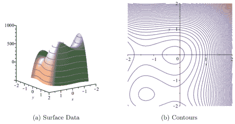

作为本节的最后一个示例，我们来讨论多元优化中一个有趣且非常实用的应用：寻找拟合数据集的最小二乘回归线。我们首先利用前面为优化开发的方法从理论上求出回归线。然后，我们将逐步在 Maple 中进行计算，为一个小型数据集求出最小二乘回归线。

## 示例 4.12：求最小二乘回归线

在使用最小二乘回归将直线 \(y=a+bx\) 拟合到一组 \(n\) 个数据点 \(\{(x_i,y_i)\}\) 时，我们最小化误差平方和（SSE）：

\[
SSE=\sum_{i=1}^{n}\left(y_i-(a+bx_i)\right)^2.
\]

变量为 \(a\) 和 \(b\)。

首先，找出确定临界点的方程组。第一步，

\[
\frac{\partial f}{\partial a}=\sum_{i=1}^{n}2\left(y_i-(a+bx_i)\right)(-1)
\]

\[
\frac{\partial f}{\partial b}=\sum_{i=1}^{n}2\left(y_i-(a+bx_i)\right)(-x_i)
\]

当**最小二乘正规方程**成立时，\(\{\partial f/\partial a=0,\partial f/\partial b=0\}\) 成立：

\[
na+b\sum_{i=1}^{n}x_i=\sum_{i=1}^{n}y_i
\]

\[
a\sum_{i=1}^{n}x_i+b\sum_{i=1}^{n}x_i^2=\sum_{i=1}^{n}x_i y_i
\]

请记住，一旦给定数据集，这些求和都是常数。Hessian 矩阵为

\[
H=\begin{bmatrix}2n & 2\sum_{i=1}^{n}x_i\\ 2\sum_{i=1}^{n}x_i & 2\sum_{i=1}^{n}x_i^2\end{bmatrix}
\]

因此，一阶顺序主子式分别为 \(2n\) 和 \(2\sum_{i=1}^{n}x_i^2\)，二者都大于 0。二阶顺序主子式为

\[
|H|=4n\sum_{i=1}^{n}x_i^2-\left[\sum_{i=1}^{n}x_i\right]^2
\]

也可以证明其大于零。因此，\(H\) 是正定的，临界点 \((a,b)\) 必定是极小值点。

让我们用 Maple 对一个非常小的数据集进行这种优化计算：

| X | 1 | 2 | 3 |
|---|---:|---:|---:|
| Y | 2 | 4.8 | 7 |

我们再次直接使用 Maple。

```text
X, Y := [1, 2, 3], [2, 4.8, 7]:
n := 3:
sse := sum((Y_i-(a+b·X_i))^2, i=1..n):
SSE := unapply(sse, [a,b]):
      sse := (-a-b+2)^2+(-a-2b+4.8)^2+(-a-3b+7)^2

da := D_1(SSE):
db := D_2(SSE):
      da := (a,b) ↦ -27.6+6a+12b
      db := (a,b) ↦ -65.2+12a+28b

solve([da(a,b)=0, db(a,b)=0], [a,b]);
CP := %1;
      [a = -0.4000000000, b = 2.5000000000]
CP := [a = -0.4000000000, b = 2.5000000000]
```

```text
> H := Hessian(SSE(a,b), [a, b]);
[ 6  12 ]
[12  28]
```

```text
> IsDefinite(H, query = 'positive_definite');
true
```

```text
> L := subs(CP, a + b x);
L := 2.500000000 x − 0.400000000
```

Hessian 矩阵是正定的，因此我们找到了 SSE（误差平方和）的最小值。该小型数据集的线性回归线为 \(y=2.5x-0.4\)。图 4.8 中的图形显示了回归线与数据的拟合程度。

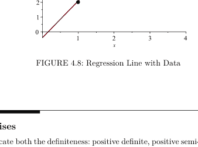

**图 4.8：** 回归线与数据

## 练习

- 1. 指出给定 Hessian 矩阵的定性——正定、半正定、负定、半负定或不定——以及导出这些 Hessian 矩阵的函数 \(f\) 的凹凸性。


## 多变量优化

- 1. 计算以下海森矩阵：
  - (a) $H=\begin{bmatrix}2&3\\3&5\end{bmatrix}$
  - (b) $H=\begin{bmatrix}4&3\\3&2\end{bmatrix}$
  - (c) $H=\begin{bmatrix}-2&1\\1&-2\end{bmatrix}$
  - (d) $H=\begin{bmatrix}-3&4\\4&-5\end{bmatrix}$
  - (e) $H=\begin{bmatrix}6x&0\\0&2x\end{bmatrix}$
  - (f) $H=\begin{bmatrix}x^2&0\\0&2y\end{bmatrix}$
  - (g) $H=\begin{bmatrix}2&2&3\\2&6&4\\3&4&4\end{bmatrix}$
  - (h) $H=\begin{bmatrix}1&2&2\\2&1&2\\2&2&1\end{bmatrix}$
  - (i) $H=\begin{bmatrix}12x&2&2\\2&-12y&-1\\2&-1&18z\end{bmatrix}$

- 2. 利用海森矩阵 $H$ 判断给定函数的凸性。找出并分类函数的临界点。
  - (a) $f(x,y)=x^2+3xy-y^2$
  - (b) $f(x,y)=x^2+y^2$
  - (c) $f(x,y)=-x^2-xy-2y^2$
  - (d) $f(x,y)=3x+5y-4x^2+y^2-5xy$
  - (e) $f(x,y,z)=2x+3y+3z-xy+xz-yz-x^2-3y^2-z^2$

- 3. 确定使得 $g(x,y)=ax^2+bxy+cy^2$ 为凸函数的 $a$、$b$、$c$ 取值。确定 $g$ 为凹函数时的取值。

- 4. 找出下列函数的所有极值点并分类。
  - (a) $f(x,y)=x^2+3xy-y^2$
  - (b) $f(x,y)=x^2+y^2$
  - (c) $f(x,y)=-x^2-xy-2y^2$
  - (d) $f(x,y)=3x+5y-4x^2+y^2-5xy$
  - (e) $f(x,y)=3x^3+7x^2+2x+3y^3+7y^2-y-5$
  - (f) $f(x,y,z)=2x+3y+3z+xy+xz-yz-x^2-3y^2-z^2$

- 5. 找出并分类 $f(x,y)=e^{(x-y)}+x^2+y^2$ 的所有临界点。

- 6. 找出并分类 $f(x,y)=(x^2+y^2)^{1.5}-4(x^2+y^2)$ 的所有临界点。

- 7. 三口油井位于坐标 $(0,0)$、$(12,6)$ 和 $(10,20)$ 处。每口油井产油量相同。需要从每口油井铺设管道到位于 $(a,b)$ 的中央炼油厂。炼油厂应建在何处才能使总欧氏距离平方和最小？

$$d^2=\sum_{i=1}^{3}\left[(a-x_i)^2+(b-y_i)^2\right]$$

也就是说，确定最优位置 $(a,b)$。

在许多问题中（*大多数实际问题*），要找到平稳点或临界点，并利用它们来确定平稳点的性质，是相当困难的。在本节中，我们将讨论用于最大化或最小化多变量函数的数值方法。

### 梯度搜索法

我们希望求解上述式 4.1 给出的*无约束非线性规划问题*（NLP）。微积分告诉我们，如果函数 $f$ 是凹函数，那么最优解（如果存在）将出现在平稳点 $x^*$ 处；也就是说，在满足下面条件的点 $x^*$ 处：

$$\frac{\partial f}{\partial x_1}(x^*)=\frac{\partial f}{\partial x_2}(x^*)=\cdots=\frac{\partial f}{\partial x_n}(x^*)=0$$

在许多问题中，求平稳点相当困难。*最速上升法*（最大化）和*最速下降法*（最小化）通过求平稳点的近似值提供了另一种选择。我们将重点讨论梯度方法，即最速上升法。

考察图 4.9 中所示的函数。

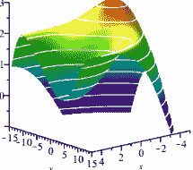

图 4.9：由一个函数定义的曲面

我们希望在曲面上找到最大值点。如果我们从山的底部出发，也许会通过求梯度向量来进行，因为梯度是指向“上坡”方向、即最大方向的向量。

## 1. 引言

本文档旨在介绍一种基于深度学习的图像识别方法，该方法在多个标准数据集上取得了优异的性能表现。

## 2. 相关工作

近年来，卷积神经网络（CNN）在计算机视觉领域取得了显著进展。本文方法基于ResNet架构，并引入了注意力机制。

- 方法一：基于区域提议的检测方法
- 方法二：基于回归的检测方法
- 方法三：基于Transformer的检测方法

## 3. 方法

我们提出了一种端到端的训练框架，整体流程如下图所示。

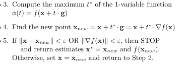

> 注意：训练过程中需要调整学习率，并采用数据增强策略以避免过拟合。

```python
model = ResNet50()
model.train()
```

## 1. 引言

本文档旨在介绍一种新型的文档解析方法，该方法能够高效地从复杂布局的文档中提取结构化信息。该方法结合了深度学习与传统的规则匹配技术，在准确率和召回率上均取得了显著提升。

在当今信息爆炸的时代，从海量文档中快速、准确地提取关键信息已成为一项至关重要的技术。无论是学术研究、商业分析还是法律文书处理，都依赖于对文档内容的深度理解。

## 2. 相关工作

近年来，基于Transformer的模型在自然语言处理领域取得了巨大成功。然而，将这些模型直接应用于文档解析任务时，往往会忽略文档的视觉布局信息。为此，研究者们提出了多种多模态文档解析模型。

- LayoutLMv3：通过统一文本和图像掩码策略，有效融合了视觉与文本信息。
- Donut：采用端到端的OCR-free架构，直接对文档图像进行理解。
- UDOP：将文档解析任务统一为序列生成问题，简化了模型设计。

## 3. 方法

我们提出了一种基于图神经网络（GNN）的文档解析框架。该框架首先利用视觉特征提取器获取文档图像的区域特征，然后构建区域间的空间关系图，最后通过GNN进行信息传播与聚合，实现精确的语义角色标注。

> 核心思想：将文档解析视为图节点分类问题，充分利用文档的二维空间结构。

## 4. 实验与结果

我们在公开数据集PubLayNet和DocBank上进行了大量实验。实验结果表明，我们的方法在多个评估指标上均优于现有的基线模型。

SAf := SteepestAscent(f, (0, 0), 0.01, graph);

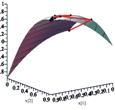

SAf =

|   | 点 | 梯度 | 函数值 | 梯度步长 |
|---|---|---|---|---|
| 1 | [0.; 0.] | [0.; 2.] | 0. | 0.2500 |
| 2 | [0.; 0.5000] | [1.000; 0.] | 0.5000 | 0.5000 |
| 3 | [0.5000; 0.5000] | [0.; 1.000] | 0.7500 | 0.2500 |
| 4 | [0.5000; 0.7500] | [0.500; 0.] | 0.8750 | 0.5000 |
| 5 | [0.7500; 0.7500] | [0.; 0.500] | 0.9375 | 0.2500 |
| 6 | [0.7500; 0.8750] | [0.250; 0.] | 0.9699 | 0.5000 |
| 7 | [0.8750; 0.8750] | [0.; 0.250] | 0.9844 | 0.2500 |
| 8 | [0.8750; 0.9375] | [0.125; 0.] | 0.9922 | 0.5000 |
| 9 | [0.9375; 0.9375] | [0.; 0.125] | 0.9961 | 0.2500 |
| 10 | [0.9375; 0.9688] | [0.063; 0.] | 0.9980 | 0.5000 |
| ⋮ | ⋮ | ⋮ | ⋮ | ⋮ |

14 × 4 DataFrame

要查看生成的点的列表，请使用 $SAf['Pts'][-1]$；要仅查看最后一个点及其函数值，请使用 $SAf['Pts'][-1]$、$SAf['Fcn'][-1]$。

```text
SAf['Pts'][-1], SAf['Fcn'][-1];
[[0.9844], [0.9922]], 0.9999
```

多变量微积分解可以通过求解方程组 $\{\partial f/\partial x_1=0,\partial f/\partial x_2=0\}$，并检查 $f$ 在临界点处的海森矩阵来直接计算。

$\frac{\partial f}{\partial x_1}=2x_2-2x_1=0$

$\frac{\partial f}{\partial x_2}=2x_1+2-4x_2=0 \quad\Longrightarrow\quad x^*=\langle x_1,x_2\rangle=\langle1,1\rangle$

海森矩阵

$\begin{bmatrix}-2 & 2 \\ 2 & -4\end{bmatrix}$

是负定的，因此点 $x^*=\langle1,1\rangle$ 是极大值点，$f(x^*)=1$。

为了用最速上升法获得更精确的近似，我们可以将容差设得更小。查看 $f$ 的等高线图可以确认在图 4.10 中大约 $(1,1)$ 处有一座山丘。


图 4.10：$f$ 的等高线图

### 示例 4.14：最速上升法示例（二）

使用最速上升法最大化 \(g(x) = 55x_1 - 4x_1^2 + 135x_2 - 15x_2^2 - 100\)，从点 \(\{1,1\}\) 出发，容差为 \(\epsilon = 0.01\)。

图 4.11 为最大值提供了直观参考。


图 4.11：\(g\) 的曲面图及等高线

梯度为 \(\nabla g(x) = \langle 55 - 8x_1, 135 - 30x_2\rangle\)。

### 迭代 1.

我们从 \(x_0 = \{1,1\}\) 开始。此时 \(\nabla g(x_0) = \langle 47,105\rangle\)。从 \(\{1,1\}\) 出发，我们沿 \(\langle 47,105\rangle\) 方向移动。我们沿直线 \(L(t) = \{1,1\} + t\langle 47,105\rangle\) 走多远？我们需要最大化函数

\[g(L(t)) = g(x_0 + t\cdot\nabla g(x_0))\]
\[= -4(1+47t)^2 - 15(1+105t)^2 + 55(1+47t) + 135(1+105t) - 100\]
\[= -174211t^2 + 13234t + 71.\]

这个函数也可以用简单的一元微积分来最大化：

\[\frac{d}{dt}g(L(t)) = 0 \quad\Longrightarrow\quad t^* = 0.03798\]

新点 \(x_1\) 通过计算 \(L(t^*) = x_0 + t^*\cdot\nabla g(x_0)\) 得到。

\[x_1 = \{1,1\} + t^*\cdot\langle 47,105\rangle = \langle 2.785, 4.988\rangle\]

由于 \(|x_1-x_0| > 0.01\)，再次迭代。

### 迭代 2

现在计算 ∇g(x₁) = (32.719, −14.645)。我们从 (2.785, 4.988) 出发，沿 (32.719, −14.645) 方向移动。我们沿直线 L(t) = (2.785, 4.988) + (32.719, −14.645)t 走多远？我们需要最大化函数

$$g(L(t)) = g(x_1 + t \cdot \nabla g(x_1))$$

$$= 322.33 + 1285.0t - 7499.3t^2.$$

这个函数也可以用简单的一元微积分来最大化：

$$\frac{d}{dt}g(L(t)) = 0 \quad\Longrightarrow\quad t^* = 0.08567$$

新点 x₂ 通过计算 L(t*) = x₁ + t* · ∇g(x₁) 得到。

$$x_2 = (5.588, 3.733)$$

由于 ‖x₂ − x₁‖ > 0.01，我们必须再次迭代。

使用我们的 *SteepestAscent* 函数让 Maple 完成迭代。将 g 定义为向量 x 的函数。

```text
g := x → −4x₁² − 15x₂² + 55x₁ + 135x₂ − 100:
```


## 3.2 基于深度学习的文本检测与识别

随着深度学习技术的快速发展，基于深度学习的文本检测与识别方法逐渐成为主流。这类方法通常利用卷积神经网络（CNN）和循环神经网络（RNN）等模型，自动学习图像中文本的视觉特征和序列特征，从而实现端到端的文本检测与识别。

在文本检测方面，基于深度学习的方法主要分为两类：基于候选区域的方法和基于语义分割的方法。基于候选区域的方法（如 Faster R-CNN、SSD 等）先生成可能包含文本的候选区域，然后对候选区域进行分类和回归，得到最终的文本检测框。基于语义分割的方法（如 FCN、U-Net 等）则直接对图像进行像素级分类，将文本区域与背景区域进行分割，再通过后处理得到文本检测框。

在文本识别方面，基于深度学习的方法通常采用序列到序列（Seq2Seq）模型，将文本图像转换为字符序列。其中，卷积神经网络用于提取图像特征，循环神经网络（如 LSTM、GRU）用于建模字符序列的上下文依赖关系，最后通过 CTC（Connectionist Temporal Classification）或注意力机制（Attention）进行序列解码，得到最终的文本内容。

近年来，端到端的文本检测与识别方法逐渐兴起，这类方法将检测和识别任务统一在一个深度学习模型中，通过共享特征提取网络，实现检测和识别的联合优化，从而提升整体性能。例如，FOTS（Fast Oriented Text Spotting）和 Mask TextSpotter 等方法在自然场景文本检测与识别任务中取得了显著的效果。

尽管基于深度学习的文本检测与识别方法取得了很大的进展，但仍然面临一些挑战，如复杂背景下的文本检测、多方向文本的识别、手写文本的识别等。未来的研究将更加注重模型的轻量化、实时性和鲁棒性，以满足实际应用的需求。

综上所述，基于深度学习的文本检测与识别方法在自然场景文本识别领域具有广阔的应用前景，随着技术的不断进步，其性能和应用范围将进一步提升。

appropriately. 在合适的条件下，该数值方法更高效，并且更快地收敛到近似最优解：**二次收敛** vs **最陡上升法的线性收敛**。

多变量优化的牛顿法基于单变量求根算法。修改该过程，使其寻找一阶导数的根而不是原函数的根：

$$x_{n+1}=x_n+\frac{f(x_n)}{f'(x_n)}\ \Longrightarrow\ x_{n+1}=x_n+\frac{f'(x_n)}{f''(x_n)}$$

并迭代直到 $|x_{n+1}-x_n|<\epsilon$ 对于我们选择的容差 $\epsilon>0$。

通过使用梯度和海森矩阵，即二阶偏导数矩阵，将修正的牛顿法推广到多个变量。

$$x_{n+1}=x_n+\left(f''(x_n)\right)^{-1}f'(x_n)\ \Longrightarrow\ x_{n+1}=x_n+\left(H(x_n)\right)^{-1}\nabla f(x_n)$$

现在迭代直到 $\|x_{n+1}-x_n\|<\epsilon$ 对于我们选择的容差 $\epsilon>0$。应用一点线性代数，我们得到该方法作为算法。

```
**Modified Newton’s Method Algorithm**

Find the unconstrained maximum of the function $f:\mathbb{R}^n\to\mathbb{R}$.

**INPUTS:**

- Function: $f$
- Starting point: $x_0$
- Tolerance and Maximum Iterations: $\epsilon, N$

**OUTPUTS:** Maximal point $x^*$ and maximum value $f(x^*)$

**Step 1.** Initialize: Set $x=x_0$

**Step 2.** Calculate the gradient $\mathbf{g}=\nabla f(x)$ and $H=$ Hessian$(x)$

**Step 3.** Compute $d=|H|$ and create new matrices

$$H_1=\text{substitute }\mathbf{g}\text{ for column 1 of }H$$
$$H_2=\text{substitute }\mathbf{g}\text{ for column 2 of }H$$

**Step 4.** Compute: $\Delta x_1=|H_1|/d$ and $\Delta x_2=|H_2|/d$.

**Step 5.** Find the new point $x_{new}=\langle x_1+\Delta x_1,x_2+\Delta x_2\rangle$

**Step 6.** If $\|\langle\Delta x_1,\Delta x_2\rangle\|<\epsilon$, then STOP and return estimates $x^*=x_{new}$ and $f(x_{new})$.

Otherwise, set $x=x_{new}$ and return to Step 2.
```

再次记住 $\|y\|=\|\langle y_1,y_2\rangle\|=\sqrt{y_1^2+y_2^2}$。让我们使用牛顿法重复我们对最陡上升法的示例。我们将使用书中 PSMv2 包中的函数 $ModifiedNewtonMethod$。通过 `with(PSMv2)` 加载该包。`ModifiedNewtonMethod` 函数的语法是

ModifiedNewtonMethod(f, (x₀, y₀), ε, N)

其中 *f* 是函数，(x₀, y₀) 是起始向量，ε 是容差，*N* 是允许的最大迭代次数。`ModifiedNewtonMethod` 的输出是一个 `DataFrame`，包含生成的点、函数值、海森矩阵以及海森矩阵的正定性。

### Example 4.16. Modified Newton’s Method Example, I.

将 *f*(x) = 2x₁x₂ + 2x₂ − x₁² − 2x₂² 在 ε = 0.01 的精度内最大化，从 x₀ = ⟨0, 0⟩ 开始。

将迭代次数限制为 *N* = 20。

```
> f := x → 2x₁x₂ + 2x₂ − x₁² − 2x₂²:
> MNf := ModifiedNewtonMethod(f, ⟨0, 0⟩, 0.01, 20);
```

| SAf | k | xₖ | F(xₖ) | Hessian | definiteness |
|---:|---:|---|---:|---|---|
|  | 1 | [0, 0]ᵀ | 0. | [−2, 2; 2, 4] | negative_definite |
|  | 2 | [1, 1]ᵀ | 0. | [−2, 2; 2, 4] | negative_definite |
|  | 3 | [1, 1]ᵀ | 0. | [−2, 2; 2, 4] | negative_definite |

我们有 *f* 的最大值为 1，位于 (1, 1)，因为该处的海森矩阵为负定。

继续第二个例子。

### Example 4.17. Modified Newton’s Method Example, II.

从点 (1, 1) 开始，将 *g*(x) = 55x₁ − 4x₁² + 135x₂ − 15x₂² − 100 最大化，容差为 ε = 0.01，迭代次数限制为 *N* = 20。

```
> g := x → 55x₁ − 4x₁² + 135x₂ − 15x₂² − 100:
> MNg := ModifiedNewtonMethod(g, ⟨1, 1⟩, 0.01, 20);
```

| SAg | k | xₖ | F(xₖ) | Hessian | definiteness |
|---:|---:|---|---:|---|---|
|  | 1 | [1, 1]ᵀ | 71. | [−8, 0; 0, −30] | negative_definite |
|  | 2 | [6.875, 4.500]ᵀ | 392.9 | [−8, 0; 0, −30] | negative_definite |
|  | 3 | [6.875, 4.500]ᵀ | 392.9 | [−8, 0; 0, −30] | negative_definite |

我们有 \(g\) 的最大值为 392.9，位于 \((6.875, 4.500)\)，因为该处的海森矩阵为负定。

现在，第三个例子。

### Example 4.18. Modified Newton’s Method Example, III.

从点 \((0.8,0.8)\) 开始，将 \(h(x)=2x_1x_2+2x_2-e^{x_1}-e^{x_2}+10\) 最大化，容差为 \(\epsilon=0.01\)，迭代次数不超过 \(N=20\)。

```
h := x -> 2x1x2 + 2x2 - e^x1 - e^x2 + 10:
MNg := ModifiedNewtonMethod(h, (0.8, 0.8), 0.01, 20);
```

| SA_g | \(x_k\) | \(F(x_k)\) | Hessian | definiteness |
|---:|---|---:|---|---|
| 1 | [0.8, 0.8] | 8.428 | [-2.226, 2; 2, -2.226] | negative_definite |
| 2 | [2.224, 2.697] | 3.306 | [-9.241, 2; 2, -14.83] | negative_definite |
| 3 | [1.669, 2.057] | 7.851 | [-5.306, 2; 2, -7.820] | negative_definite |
| 4 | [1.288, 1.642] | 8.723 | [-3.264, 2; 2, -5.164] | negative_definite |
| 5 | [1.088, 1.450] | 8.825 | [-2.968, 2; 2, -4.265] | negative_definite |
| 6 | [1.034, 1.404] | 8.829 | [-2.813, 2; 2, -4.073] | negative_definite |
| 7 | [1.031, 1.402] | 8.827 | [-2.803, 2; 2, -4.061] | negative_definite |

我们有 \(h\) 的最大值为 8.827，位于 \((1.031, 1.402)\)，因为该处的海森矩阵为负定。

尽管牛顿法更快更直接，但我们必须谨慎。该方法需要相对较好的初始点。尝试从 \((0.5,0.5)\) 开始寻找 \(h\) 的最大值，并查看 *DataFrame* 报告中的最后一项。

```
MNh2 := ModifiedNewtonMethod(h, (0.5, 0.5), 0.01, 20):
MNh2[-1, ..];
```

|  |  |
|---|---|
| \(x_k\) | [-0.2667, 0.3829] |
| \(F(x_k)\) | 8.329 |
| Hessian | [-0.7659, 2; 2, -1.467] |
| definiteness | indefinite |

我们从 \((0.5, 0.5)\) 开始，与原来的 \((0.8, 0.8)\) 相差不远。但海森矩阵为不定，说明我们找到的是近似鞍点，而不是最大值。修正牛顿法对所选初始值非常敏感。

## Comparisons of Methods

我们比较了这两种方法，发现修正牛顿法比梯度法收敛更快。表 4.4 显示了比较结果。

**TABLE 4.4: Comparison of the Steepest Ascent and Modified Newton’s Methods**

|   | Initial Value | Iterations | Solution | max $f(x)$ |
|---|---|---:|---|---:|
| Steepest Ascent | $(0,0)$ | 16 | $(0.9922, 0.9961)$ | 1.0 |
| Modified Newton | $(0,0)$ | 2 | $(1.0, 1.0)$ | 1.0 |

|   | Initial Value | Iterations | Solution | max $g(x)$ |
|---|---|---:|---|---:|
| Steepest Ascent | $(0,0)$ | 4 | $(-0.266, 0.385)$ | 8.3291 |
| Modified Newton | $(0,0)$ | 2 | $(-0.269, 0.381)$ | 8.3291 |

|   | Initial Value | Iterations | Solution | max $h(x)$ |
|---|---|---:|---|---:|
| Steepest Ascent | $(0.5, 0.5)$ | 6 | $(1.025, 1.397)$ | 8.828 |
| Modified Newton | $(0.8, 0.8)$ | 7 | $(1.031, 1.402)$ | 8.827 |

作为最后的比较，将修正牛顿法点添加到显示 \(g\) 的最陡上升点的等高线图，即图 4.12，以得到下图 4.13。


在给出良好的初始值时，修正牛顿法搜索比最陡上升梯度法更快更直接。

## Exercises

- 1. 将 $f(x)=2x_1x_2-2x_1^2-2x_2^2$ 在 0.1 的容差内最大化。
  - a. 从点 $x=\langle1,1\rangle$ 开始。执行最陡上升梯度搜索的 2 次完整迭代。对每次迭代清楚地显示 $x_n$、$x_{n+1}$、$\nabla f(x_n)$ 和 $t^*$。证明该过程最终会找到近似最大值。
  - b. 使用牛顿法找到最大值。从 $x=\langle1,1\rangle$ 开始。对每次迭代清楚地显示 $x_n$、$x_{n+1}$、$\nabla f(x_n)$ 和海森矩阵。指出何时达到停止准则。

- 2. 将 $f(x)=3x_1x_2-4x_1^2-4x_2^2$ 在 0.1 的容差内最大化。
  - a. 从点 $x=\langle1,1\rangle$ 开始。执行最陡上升梯度搜索的 2 次完整迭代。对每次迭代清楚地显示 $x_n$、$x_{n+1}$、$\nabla f(x_n)$ 和 $t^*$。证明该过程最终会找到近似最大值。
  - b. 使用牛顿法找到最大值。从 $x=\langle1,1\rangle$ 开始。对每次迭代清楚地显示 $x_n$、$x_{n+1}$、$\nabla f(x_n)$ 和海森矩阵。指出何时达到停止准则。


- **3.** 应用修正的牛顿法求解下列问题：
  - **a.** 求 \(f(x,y)=-x^3+3x+84y-6y^2\) 的最大值，初始值为 \(\langle1,1\rangle\)。为什么不能从 \(\langle0,0\rangle\) 开始？
  - **b.** 求 \(f(x,y)=-4x+4x^2-3y+y^2\) 的最小值，从 \(\langle0,0\rangle\) 开始。
  - **c.** 从 \(\langle0,0\rangle\) 开始，对 \(f(x,y)=(x-2)^4+(x-2y)^2\) 进行 3 次修正牛顿法迭代以求最小值。为什么这个问题收敛速度不如 b？

- **4.** 使用梯度搜索近似求 \(f(x)=(x_1-2)^2+x_1+x_2^2\) 的最小值。从 \(\langle2.5,1.5\rangle\) 开始。

## Projects

- **Project 4.1.** 修改最速上升算法（第 147 页）以近似函数的最小值。这种技术称为 *最速下降算法*。

- **Project 4.2.** 在 Maple 中编写一个程序，使用一维黄金分割搜索算法代替微积分来执行梯度搜索的迭代。用你的代码求最大值

\[
f(x,y)=xy-x^2-y^2-2x-2y+4
\]

- **Project 4.3.** 在 Maple 中编写一个程序，使用一维 Fibonacci 搜索算法代替微积分来执行梯度搜索的迭代。用你的代码求最大值

\[
f(x,y)=xy-x^2-y^2-2x-2y+4
\]

## References and Further Reading

- [B2016] William C. Bauldry, *Introduction to Computation*, 2016.

- [BSS2013] Mokhtar S. Bazaraa, Hanif D. Sherali, and Chitharanjan M. Shetty, *Nonlinear Programming: Theory and Algorithms*, Wiley, 2013.

- [F1992] William P. Fox, “Teaching nonlinear programming with Minitab,” *COED Journal*, Vol. II (1992), no. 1, 80–84.

- [F1993] William P. Fox, “Using microcomputers in undergraduate nonlinear optimization,” *Collegiate Microcomputer*, Vol. XI (1993), no. 3, 214–218.

- [FGMW1987] William P. Fox, Frank Giordano, S. Maddox, and Maurice D. Weir, *Mathematical Modeling with Minitab*, Brooks/Cole, 1987.

- [FR2000] William P. Fox and William Richardson, “Mathematical modeling with least squares using Maple,” Maple Application Center, Nonlinear Mathematics, 2000.

- [FGW1997] William P. Fox, Frank Giordano, and Maurice Weir, *A First Course in Mathematical Modeling*, 2nd Ed., Brooks/Cole, 1997.

- [FW2001] William P. Fox and Margie Witherspoon, “Single variable optimization when calculus fails: Golden section search methods in nonlinear optimization using Maple,” *COED Journal*, Vol. XI (2001), no. 2, 50–56.

- [M2013] Mark M. Meerschaert, *Mathematical Modeling*, Academic Press, 2013.

- [PRS1976] D.T. Phillips, A. Ravindran, and J. Solberg, *Operations Research*, Wiley, 1976.

- [PFTV2007] William H. Press, Brian P. Flannery, Saul A. Teukolsky, William T. Vetterling, et al., *Numerical Recipes*, Cambridge U. Press, 2007.

- [R1979] S.S. Rao, *Optimization: Theory and Applications*, Wiley Eastern Ltd., 1979.

## 4.4 Constrained Optimization: The Method of Lagrange Multipliers

### Equality Constraints: The Method of Lagrange Multipliers

一家公司生产新型手机，预计将席卷市场。该手机的两个主要输入部件是电路板和 LCD 触摸屏，使手机更快、更智能、更易于使用。预计生产手机的数量 \(E\) 等于 \(E = 250a^{1/4}b^{1/2}\)，其中 \(a\) 和 \(b\) 分别为可用的电路板生产工时数和 LCD 触摸屏生产工时数。这种公式经济学家称之为 Cobb-Douglas 函数。我们的劳动力按工作类型付费：电路板人工成本为每小时 \$5，LCD 触摸屏人工成本为每小时 \$8。如果公司在短期内为这些部件分配 \$175,000，那么最多可以生产多少部手机？

这类问题可使用约束优化建模。我们首先讨论等式约束下的优化，然后在下一节讨论不等式约束下的优化。

拉格朗日乘子⁶ 可用于求解所有约束均为等式的非线性规划问题（NLPs）。考虑由下式给出的 NLP

最大化（最小化） \(z = f(\mathbf{x})\)

受约束

\[
g_1(\mathbf{x})=b_1,\quad g_2(\mathbf{x})=b_2,\quad \ldots,\quad g_m(\mathbf{x})=b_m
\]

其中 \(m \le n\)。

我们可以为手机问题建立等式约束模型：最大化使用所有可用生产工时所生产的手机数量。

\[
\begin{aligned}
\text{Maximize } E &= 250 a^{1/4}b^{1/2}\\
\text{subject to } 5a + 8b &= 175000
\end{aligned}
\]

### Lagrange Multipliers: Introduction and Basic Theory

为了求解形式如（4.2）的 NLPs，我们为第 \(i\) 个约束关联一个拉格朗日乘子 \(\lambda_i\)，并形成拉格朗日函数

\[
L(\mathbf{x},\boldsymbol{\lambda}) = f(\mathbf{x}) + \sum_{i=1}^{m} \lambda_i \left(g_i(\mathbf{x}) - b_i\right) \tag{4.3}
\]

拉格朗日乘子的计算过程要求拉格朗日函数（4.3）的所有偏导数在 \(\mathbf{x}^*\) 处等于零。这些是 \(\mathbf{x}^*\) 为 NLP 问题解的必要条件；即这些条件是 \(\mathbf{x} = \langle x_1, x_2, \ldots, x_n\rangle\) 为（4.2）的解所必需的。我们有

**命题（拉格朗日乘子必要条件）。** 对于 \(\mathbf{x}^*\) 为拉格朗日函数的解，所有偏导数必须满足

\[
\frac{\partial L}{\partial x_i} = 0 \quad \text{对于 } i = 1,2,\ldots,n \text{（变量）}
\]

\[
\frac{\partial L}{\partial \lambda_j} = 0 \quad \text{对于 } j = 1,2,\ldots,m \text{（约束）}
\]

在 \(\mathbf{x}^*\) 处。

我们将考虑的最优候选点 \(\mathbf{x}\) 为

**定义（正则点）。** \(\mathbf{x}\) 是 *正则点* 当且仅当集合 \(\{\nabla g_i(\mathbf{x}) : i = 1,\ldots,m\}\) 线性无关。

拉格朗日技术的核心定理是

**定理（拉格朗日乘子）。** 设 \(\mathbf{x}\) 是满足 *拉格朗日乘子必要条件* 的点。则

- **a.** 如果 \(f\) 为凹函数且每个 \(g_i\) 为线性，则 \(\mathbf{x}\) 是最大化问题（4.2）的最优解。
- **b.** 如果 \(f\) 为凸函数且每个 \(g_i\) 为线性，则 \(\mathbf{x}\) 是最小化问题（4.2）的最优解。

之前，我们使用 Hessian 矩阵来判断函数是凸、凹还是两者皆非。另请注意，该定理将约束限制为线性函数。

如果约束是非线性的呢？我们可以在充分条件中使用 *边界 Hessian*。对于一个约束的二元拉格朗日函数

\[
L(x_1,x_2,\lambda)=f(x_1,x_2)+\lambda(g(x_1,x_2)-b),
\]

定义边界 Hessian 矩阵为

\[
BdH=\begin{bmatrix}
0 & g_1 & g_2\\
g_1 & f_{11}-\lambda g_{11} & f_{12}-\lambda g_{12}\\
g_2 & f_{21}-\lambda g_{21} & f_{22}-\lambda g_{22}
\end{bmatrix}
\]

该边界 Hessian 矩阵的行列式为

\[
|BdH|=g_1g_2\cdot(f_{21}-\lambda g_{21})+g_2g_1\cdot(f_{12}-\lambda g_{12})-g_2^2\cdot(f_{11}-\lambda g_{11})-g_1^2\cdot(f_{22}-\lambda g_{22})
\]

在二元情形下带一个约束时，*最大值* 的必要条件是其边界 Hessian 的行列式在临界点处求值时为正。

在二元情形下带一个约束时，*最小值* 的必要条件是其边界 Hessian 的行列式在临界点处求值时为负。

如果 \(\mathbf{x}\) 是正则点且 \(g_i(\mathbf{x}) = 0\)（所有约束在 \(\mathbf{x}\) 处均满足），

\[
M_{\mathbf{x}}=\{\mathbf{y}\mid \nabla g_i(\mathbf{x})\cdot \mathbf{y}=0\}
\]

定义了在 \(\mathbf{x}\) 处与可行域相切的平面。（‘·’ 为通常的点积。）

**引理。** 如果 \(\mathbf{x}\) 为正则，\(g_i(\mathbf{x}) = 0\)，且 \(\nabla g_i(\mathbf{x}) \cdot \mathbf{y} = 0\)，则 \(\nabla f(\mathbf{x}) \cdot \mathbf{y} = 0\)。

请注意，拉格朗日乘子条件对于最小化问题与最大化问题是完全相同的。这就是这些条件单独不是充分条件的原因。因此，给定的解可能是最大值或最小值。为了确定找到的点是最大值、最小值还是鞍点，我们将使用 Hessian。

拉格朗日乘子本身具有重要的建模解释。乘子 \(\lambda\) 是稀缺资源的“影子价格”。因此，\(\lambda_i\) 是第 \(i\) 个约束的影子价格。如果约束的右端项增加一个很小的量 \(\Delta\)，则最优解将改变 \(\lambda_i \cdot \Delta\)。我们将通过图形和计算来说明影子价格。

### Graphical Interpretation of Lagrange Multipliers

我们可以通过研究其几何解释来最好地理解拉格朗日乘子法。这种几何解释涉及函数和约束的梯度。最初，仅考虑一个约束，\(g(\mathbf{x}) = b\)，则拉格朗日方程简化为

\[
\nabla f = \lambda \nabla g.
\]

解是点 \(\mathbf{x}\)，其中梯度向量 \(\nabla g(\mathbf{x})\) 与曲面上的等值线垂直。梯度向量 \(\nabla f\) 总是指向 \(f\) 增长最快的方向。在最大值或最小值处，该方向必须垂直于 \(f\) 曲面 \(S\) 上的等值线。因此，由于 \(\nabla f\) 和 \(\nabla g\) 沿同一垂直线指向，则 \(\nabla f = \lambda \nabla g\)。此外，\(g\) 的曲线必须在最优点处与 \(f\) 的等值线相切。见图 4.14。多个约束情形的几何论证类似。


(a) 等值线和约束　　　　　　　　　(b) 曲面和约束

**图 4.14：拉格朗日乘子的几何解释：一个等式约束**


让我们先预览一个示例的图形化解法。

$$\begin{aligned}
\text{最大化 } & z=-2x^2-2y^2+xy+8x+3y \\
\text{约束条件为 } & 3x+y=6
\end{aligned}$$

使用 Maple 生成 $z=f(x,y)$ 的等高线图，并将单个约束叠加到等高线图上。请参见**图 4.15**。我们可以从这一图形表示中获得哪些信息？首先，我们注意到，无约束最优解不在约束条件上。我们估计无约束最大值点为 $(x^*,y^*)=(2.3,1.3)$。约束条件下的最优解位于约束线与某条 $z=f(x,y)$ 等高线相切的点处。从图中看，该点约为 $(1.8,1.0)$。我们清楚地看到，约束线没有经过无约束最大值点，因此，可以对约束进行修改/调整（如果可行），直到该直线经过无约束解。在这一点上，我们将不再增加（或减少）任何受约束资源（见**图 4.16**）。在可能的情况下，通过绘制信息图形，可以获得有关问题的宝贵洞见。


**图 4.15：**带线性约束 $g$ 的 $f$ 等高线图

将 $\lambda$ 的值解释为“影子价格”，会引导我们思考：当某个约束所控制的资源数量发生变化时，会发生什么情况。**图 4.16**以图形方式展示了这一概念。


**图 4.16：**资源约束 $g$ 增加常数 $\alpha$

现在让我们转向计算。

## 使用 Maple 计算拉格朗日乘子

(4.2) 式（第 163 页）中的方程组给出了关于 $n+m$ 个未知数 $\{x_i,\lambda_j\}$ 的 $n+m$ 个方程。一般来说，除了简单问题之外，如果没有计算机，这个方程组将非常难以求解。此外，由于拉格朗日乘子条件只是必要条件而非充分条件，我们可能会找到一些解 $(x_i,\lambda_i)$，但这些解对于特定的 NLP 并不是最优解。我们需要能够对解中找到的点进行分类。确定最优性的常用方法包括：

- a. Hessian 矩阵的定性
- b. 通过 $\det(BdH)$ 判断边界 Hessian 的定性

在下面的示例中，只要可行，我们将使用 Maple 对这些方法进行说明。

### 示例 4.19。使用 Maple 求解拉格朗日乘子。

最大化 $z=-2x^2-2y^2+xy+8x+3y$  
约束条件为  
$3x+y=6$

首先定义 $f$ 和 $g$，然后显示图形。

```text
f := (x,y) -> -2*x^2 - 2*y^2 + x*y + 8*x + 3*y
g := t -> 6 - 3*t
```

对于绘图，我们将等高线图嵌入 3D 图中，以便更好地直观表示 $f$。要嵌入图形，请使用 `plots` 包中的 `transform` 命令。

```text
T := transform((x, y) → [x, y, -500]);
```

这样，T 就会将 2D 等高线图上的点 $(x,y)$ 嵌入到平面 $z=-500$ 上的 3D 图中。

```text
rng := (x = -10..10, y = -10..10):
Surface := plot3d(f(x, y), rng, style = patchcontour, contours = 15):
Contours := contourplot(f(x, y), rng, contours = 15):
```

现在，将图形组合起来。

```text
display(Surface, T(Contours));
```


旋转 3D 图形，从多个不同角度进行观察。能够旋转 3D 图像是一个极其有用的功能。

回到计算部分。  
拉格朗日函数为 $L(x,y,\lambda)=f(x,y)+\lambda(g(x,y)-b)$。

```text
L := (x, y, λ) → f(x, y) + λ*(3*x + y - 6);
```

计算必要条件方程组。

```text
NecessCond := {diff(L(x, y, λ), x) = 0, diff(L(x, y, λ), y) = 0, diff(L(x, y, λ), λ) = 0};
NecessCond := {-4*x + y + 8 + 3*λ = 0, x - 4*y + 3 + λ = 0, 3*x + y - 6 = 0}
```

求解方程组 $NecessCond$，以找到潜在的最优点。

```text
> opt := fsolve(NecessCond, {λ, x, y});
  opt := {λ = -0.7608695652, x = 1.673913043, y = 0.9782608696}
> subs(opt, L(x, y, λ)), subs(opt, f(x, y));
  10.44565217, 10.44565217
```

解释为什么这两个值相等！

Maple 有多个用于求解约束优化问题的命令，这并不令人意外；应根据所需输出的形式选择要使用的命令。表 4.5 列出了最常用的命令。

**表 4.5：**用于约束优化的 Maple 命令

| 程序包 | 命令 |
|---|---|
| Student[MultivariateCalculus] | LagrangeMultipliers |
| | *基本形式：* `LagrangeMultipliers(ObjectiveFcn, [constraints], [vars], options)` |
| | *选项：*返回更详细的报告和/或图形 |
| Optimization | NLPSolve |
| | *基本形式：* `NLPSolve(ObjectiveFcn, [constraints], options)` |
| | *选项：*设置求解方法、起始点、详细输出等 |
| Optimization | Maximize/Minimize |
| | *基本形式：* `Maximize(ObjectiveFcn, [constraints], options)`<br>`Minimize(ObjectiveFcn, [constraints], options)` |
| | *选项：*建议设置起始点 |

请记住，在“现实世界的问题”中，使用拉格朗日乘子法求解时，一个关键要素是乘子 $\lambda$ 的值及其解释。

### 使用拉格朗日乘子

```text
> with(Student[MultivariateCalculus]):
> Obj := f(x, y)
  Obj := -2*x^2 + x*y - 2*y^2 + 8*x + 3*y
> Cnstr := 3*x + y - 6:
```

```text
> LagrangeMultipliers(Obj, [Cnstr], [x, y], output = detailed);
[ x = 77/46, y = 45/46, λ₁ = 35/46, -2*x^2 + x*y - 2*y^2 + 8*x + 3*y = 961/92 ]
```

图形输出可能非常有用。

```text
> LagrangeMultipliers(Obj, [Cnstr], [x, y], output = plot);
```


曲面

$f(x, y) = -2x^2 + xy - 2y^2 + 8x + 3y$

与一个或多个形如 $10.44565217 = constant$ 的平面的交线。

### 使用 NLPSolve

现在，约束必须写成方程（或不等式）。

```text
> with(Optimization):
> NLPSolve(Obj, {3*x + y = 6}, maximize);
[10.4456521739130430, [x = 1.67391304347826, y = 0.9782608695652177]]
```

由于 NLPSolve 使用了不同的方法，我们失去了 $\lambda$ 的值。尝试使用拉格朗日方程作为目标函数并不能得到正确的值。

```text
> NLPSolve(Obj + λ*(3*x + y - 6), {3*x + y = 6}, maximize);
[10.4456521739130430, [λ = 1.00000000000000, x = 1.67391304347826, y = 0.978260869565217]]
```

### 使用 Maximize

```text
> with(Optimization):
```

如果可行，这将增加受限资源，因为这样会提高目标函数的值。

从图中可以看出，增量变化必须很小，否则目标函数可能开始下降。回看**图 4.16**。如果将 $g(x,y)=b$ 右侧增加一个单位，使约束条件变为 $3x+y=7$，那么新点 $(x^*,y^*)$ 处的解应产生新的最大函数值 $f(x^{**},y^{**})$，其近似等于原最大值加上 $\lambda$ 乘以变化量，即 $f(x^{**},y^{**})\approx f(x^*,y^*)+\lambda\Delta$，这里为 $10.4457+0.7609=11.2065$。实际上，改变约束会产生一个新的解 $11.04347826$。（**请验证这一点！**）实际增量约为 0.5978。

### 示例 4.20。具有多个约束的拉格朗日乘子。

在约束 $x+y=3$ 且 $x+3y+2z=7$ 的条件下，使 $w=x^2+y^2+3z$ 最小化。

首先，使用 Maple 直接求解该问题。

```text
with(Student[MultivariateCalculus]);
```

```text
f := (x,y,z) -> x^2 + y^2 + 3*z:
```

```text
Constraints := (3 - (x + y), 7 - (x + 3y + 2z));
```

现在，定义拉格朗日函数 $L$ 并求其梯度。

```text
L := (x,y,z,λ,μ) -> f(x,y,z) + λ*Constraints + μ*Constraints2:
```

```text
grad := Gradient(L(x,y,z,λ,μ), [x,y,z,λ,μ]);

grad := [
  2x + λ + μ
  2y + λ + 3μ
  3 + 2μ
  x + y − 3
  x + 3y + 2z − 7
]
```

构造方程组并求解，以找到潜在解。

```text
LMsystem := [seq(Q = 0, Q in grad)]:
LMsystem := [2x + λ + μ = 0, 2y + λ + 3μ = 0, 3 + 2μ = 0, x + y − 3 = 0, x + 3y + 2z − 7 = 0]

fsolve(LMsystem):
fnormal(%, 4);
subs(%, f(x,y,z));
{λ = −0., μ = −1.500, x = 0.7500, y = 2.250, z = −0.2500}
4.8750000
```

检查该解！（我们将使用命令的“完整形式”，也就是“全名”，以避免加载程序包。）


> 学生：VectorCalculus := Hessian(f(x,y,z), [x,y,z]);
> LinearAlgebra::IsDefinite(%, query = 'positive_semidefinite');

\[
\begin{bmatrix}
2 & 0 & 0\\
0 & 2 & 0\\
0 & 0 & 0
\end{bmatrix}
\]

true

该 Hessian 矩阵始终为半正定矩阵。该函数是凸函数，因此我们的临界点是一个最小值点。

现在，我们将使用 Maple 的 LagrangeMultipliers 函数来求解该问题。

```
> with(Student[MultivariateCalculus]):

> LagrangeMultipliers(f(x,y,z), [Constraints], [x,y,z], output = detailed);

\[
x=\frac{3}{4},\ y=\frac{9}{4},\ z=-\frac{1}{4},\ \lambda_1=0,\ \lambda_2=-\frac{3}{2},\ x^2+y^2+3z=\frac{39}{8}
\]
```

同一个 Hessian 矩阵表明，该答案就是我们所需的最小值。

解释我们所求得的影子价格 λ = 0 和 μ = −3/2。如果我们只有资金增加两个约束资源中的一个，那么应该选择哪一个？由于第一个约束的影子价格为 0，我们预计目标函数的值不会得到改善；因此，我们不会花费额外资金来增加第一种资源。由于第二个约束的影子价格为 −1.5，如果将该资源增加 Δ，我们预计目标函数的值将改变 −1.5Δ（由于我们是在求最小值，因此这意味着目标函数得到改善！）；只要增加资源 2 的成本小于 1.5Δ，我们就会投入额外资金来增加第二种资源。为什么成本必须小于 1.5Δ？

## 使用拉格朗日乘数的应用

许多应用型约束优化问题都可以使用拉格朗日乘数求解。我们将从重新讨论本节开头的问题开始（见第 162 页）。

## 示例 4.21。柯布-道格拉斯函数。

一家公司生产预计将席卷市场的新型手机。新手机的两个主要投入部件是电路板和 LCD 触摸屏，它们使手机运行更快、更智能且更易于使用。预计生产的手机数量 P 等于 P = 250 a^{1/4}b^{1/2}，其中 a 和 b 分别表示可用的电路板生产工时数和 LCD 触摸屏生产工时数。这类公式在经济学中被称为柯布-道格拉斯生产函数。

### 1.2.1 线性表的定义和特点

**1. 线性表的定义**

线性表(Linear List)是由 n(n≥0)个数据元素(结点)a1,a2,...,an 组成的有限序列。

该序列中的所有结点具有相同的数据类型。其中数据元素的个数 n 定义为表的长度。当 n=0 时，称为空表。

将线性表记为：

(a1, a2, ..., ai-1, ai, ai+1, ..., an)

则表中 ai-1 领先于 ai，ai 领先于 ai+1，称 ai-1 是 ai 的直接前驱结点，ai+1 是 ai 的直接后继结点。

当 i=1,2,...,n-1 时，ai 有且仅有一个直接后继，当 i=2,3,...,n 时，ai 有且仅有一个直接前驱。

**2. 线性表的特点**

- 线性表只能在线性表的两端做插入、删除操作。
- 线性表中数据元素之间的关系是一对一的关系，即除了第一个和最后一个数据元素之外，其它数据元素都是首尾相接的。
- 线性表是一种典型的线性结构。

**3. 线性表的存储结构**

线性表的存储结构有顺序存储结构和链式存储结构两种。前者称为顺序表，后者称为链表。


**图 4.17：**柯布-道格拉斯手机生产函数

## 示例 4.22。石油转运公司的储油设施。

一家小型石油转运公司的管理层希望制定一项最低成本政策，同时考虑可用储油空间的限制。根据历史数据记录，已经推导出一个描述系统成本的公式。

$$f(x)=\sum_{n=1}^{N}\frac{a_n b_n}{x_n}+\frac{h_n x_n}{2}$$

其中

- $a_n$ 是第 n 项的固定成本；
- $b_n$ 是第 n 项的单位时间提取率；
- $h_n$ 是第 n 项的单位时间持有成本。

储罐空间约束为：

$$g(x)=\sum_{n=1}^{N}t_nx_n=T$$

其中，$t_n$ 是第 n 项所需的空间（单位为千桶），$T$ 是可用的储罐空间（单位为千桶）。表 4.6 中所示的参数值基于公司数年来收集的数据。

```
```text
> solns := solve(sys, [x1, x2, x3]):
  Matrix(solns);
  [ x1 = 11.07037450   x2 = 12.81525533   x3 = 9.175877141 ]
  [ x1 = 11.07037450   x2 = -12.81525533  x3 = -9.175877141 ]
  [ x1 = 11.07037450   x2 = 12.81525533   x3 = -9.175877141 ]
  [ x1 = 11.07037450   x2 = -12.81525533  x3 = 9.175877141 ]
  [ x1 = -11.07037450  x2 = 12.81525533   x3 = 9.175877141 ]
  [ x1 = -11.07037450  x2 = -12.81525533  x3 = 9.175877141 ]
  [ x1 = -11.07037450  x2 = 12.81525533   x3 = -9.175877141 ]
  [ x1 = -11.07037450  x2 = -12.81525533  x3 = -9.175877141 ]
```
```

唯一有用的解是 $x_1,x_2,x_3>0$ 的情况，因此我们选择第一行。

```
```text
> Soln := solns1;
  Soln := [x1 = 11.07037450, x2 = 12.81525533, x3 = 9.175877141]
```
```

由于该解不满足约束 $g(\mathbf{x})=22$，所以解 $\mathbf{x}^*=(11.07,12.82,9.18)$ 提供了一个无约束上界。

```
```text
> g(rhs~(Soln)) = 22;

  64.76524317 = 22
```
```

现在，我们求解约束优化问题，并且已知其解将小于刚才求得的无约束值。

```
```text
> L := (x, λ) → f(x) + λ · (g(x) − 22):
```
```

```
```text
> Lgrad := Gradient(L(x, λ), [x1, x2, x3, λ]):

> Lsys := [seq(G = 0, G in Lgrad)]:
```
```

像上面一样使用 solve 会得到大量我们不需要的复数值和负值。我们将使用 fsolve，并以无约束解和 $\lambda=1$ 作为初始值。

```
```text
> StartingPt := {op(Soln), λ = 1}:
  Lsolns := fnormal(fsolve(Lsys, StartingPt), 4);
    Lsolns := {λ = 0.7397, x1 = 4.761, x2 = 3.213, x3 = 4.045}
```
```

我们求得的是最小值吗？

### 1.1 认识三角形

三角形是生活中常见的图形。观察图1-1中哪些图片中有三角形？


如图1-2，由不在同一条直线上的三条线段首尾顺次相接所组成的图形叫做三角形（triangle）。


三角形用符号"△"表示。如图1-2的三角形记作"△ABC"，读作"三角形ABC"。

点A，B，C叫做三角形的顶点；线段AB，BC，CA叫做三角形的边；∠A，∠B，∠C叫做三角形的内角（简称三角形的角）。

## 1.2 常用逻辑用语

1.2.1 命题与量词

在数学中，我们将可以判断真假的陈述句叫做命题。命题由题设和结论两部分组成。题设是已知事项，结论是由已知事项推出的事项。命题常写成“如果……那么……”的形式，“如果”后接的部分是题设，“那么”后接的部分是结论。

例如，“如果两条直线都与第三条直线平行，那么这两条直线也互相平行”这个命题的题设是“两条直线都与第三条直线平行”，结论是“这两条直线也互相平行”。

根据命题是否成立，命题可分为真命题和假命题。如果题设成立，那么结论一定成立，这样的命题叫做真命题；如果题设成立时，不能保证结论一定成立，这样的命题叫做假命题。

判断一个命题是假命题，只需举出一个反例即可。例如，命题“如果两个角相等，那么它们是对顶角”是假命题，因为两个角相等时，它们不一定是对顶角。

“所有”“任意”“每一个”等表示全体的量词在逻辑中称为全称量词，通常用符号“∀”表示，含有全称量词的命题称为全称量词命题。

“存在”“有的”“有一个”等表示部分或个体的量词在逻辑中称为存在量词，通常用符号“∃”表示，含有存在量词的命题称为存在量词命题。

例如，“所有正方形都是平行四边形”是全称量词命题；“有些三角形是直角三角形”是存在量词命题。

1.2.2 充分条件和必要条件

一般地，“如果p，那么q”是一个真命题，我们就说由p可以推出q，记作p⇒q，并且说p是q的充分条件，q是p的必要条件。

如果p⇒q且q⇒p，那么p是q的充分且必要条件，简称充要条件，记作p⇔q。

例如，“x>2”是“x>1”的充分不必要条件；“x>1”是“x>2”的必要不充分条件；“x²=1”是“x=1”的必要不充分条件，也是“x=-1”的必要不充分条件。

1.2.3 全称量词命题与存在量词命题的否定

全称量词命题p：∀x∈M，p(x)，它的否定¬p：∃x∈M，¬p(x)。存在量词命题p：∃x∈M，p(x)，它的否定¬p：∀x∈M，¬p(x)。

势驻点或正则点的性质。带边界 Hessian 矩阵通常可以写成如下分块矩阵：


如果可能，我们可以根据带边界 Hessian 矩阵的定性，将驻点分类为极大值点或极小值点。如果带边界 Hessian 矩阵是不定的，则必须使用其他分类方法。

## 互补松弛条件

KTC 计算求解过程会求解关于 $\lambda_i$ 和 $\mu_i$ 的 $2^m$ 种可能情况，其中 $m$ 等于约束的数量，然后应用必要条件来寻找最优点。这里的 2 来自每个 $\lambda_i$ 的两种可能性：$\lambda_i = 0$ 或 $\lambda_i \ne 0$。实际上，这一过程还包含更多内容：它确实涉及必要条件 (4.6c) 中嵌入的互补松弛条件 $2\mu_i\lambda_i = 0$。如果 $\mu_i$ 等于零，那么影子价格 $\lambda_i$ 可以不为零，并且第 $i$ 个约束是*紧约束*——最优点位于约束边界上。如果 $\mu_i$ 不等于零，那么影子价格 $\lambda_i$ 必须为零，并且第 $i$ 个约束是*非紧约束*——存在由 $\mu_i$ 表示的松弛（$\le$ 约束）或*剩余*（$\ge$ 约束）。确保满足互补松弛条件，可以减少求解公式 (4.6a) 和 (4.6b) 中其他必要条件所需的工作量。

基于这一分析，互补松弛必要条件 (4.6c) 导出了一个求解过程，该过程重点关注我们的四种计算和几何解释。我们将 $\mu_i^2$ 定义为松弛变量或剩余变量。因此，如果 $\mu_i^2$ 等于零，那么我们的最优点位于第 $i$ 个约束上；如果 $\mu_i^2$ 大于零，那么最优点位于第 $i$ 个约束边界的内部。然而，如果由于 $\mu_i^2$ 等于负数而导致 $\mu_i$ 未定义，那么所关注的点就是*不可行的*。图 4.18 展示了这些条件。


图 4.18：互补松弛性的几何解释

# 使用 Maple 进行计算 KKT 条件

首先，我们将使用 Maple 完成计算，并逐步介绍求解过程。

# 示例 4.23：二元二约束线性问题

```
$$\begin{aligned}
\text{最大化 } z &= 3x+2y\\
\text{约束条件为}\quad &2x+y\le 100\\
&x+y\le 80
\end{aligned}$$
```

为该问题定义广义拉格朗日函数（4.5）。

```
$$L(x,\lambda,\mu)=(3x+2y)+\lambda_1(2x+y+\mu_1^2-100)+\lambda_2(x+y+\mu_2^2-80)$$
```

六个必要条件如下：

+   1. \(\partial L/\partial x=0\Rightarrow 3+2\lambda_1+\lambda_2=0\)  （4.7a）  
+   2. \(\partial L/\partial y=0\Rightarrow 2+\lambda_1+\lambda_2=0\)  （4.7b）  
+   3. \(\partial L/\partial \lambda_1=0\Rightarrow 2x+y+\mu_1^2-100=0\)  （4.7c）  
+   4. \(\partial L/\partial \lambda_2=0\Rightarrow x+y+\mu_2^2-80=0\)  （4.7d）  
+   5. \(\partial L/\partial \mu_1=0\Rightarrow 2\mu_1\lambda_1=0\)  （4.7e）  
+   6. \(\partial L/\partial \mu_2=0\Rightarrow 2\mu_2\lambda_2=0\)  （4.7f）

注意，由于有两个约束，为求得最优解，需要考虑四种（\(2^2\)）情况。这四种情况源于必要条件 \(2\mu_1\lambda_1=0\) 和 \(2\mu_2\lambda_2=0\)，也就是互补松弛条件。这些情况汇总于表 4.7 中。

# ## 3.2 基于多源数据的城市交通拥堵预测模型

城市交通拥堵预测是智能交通系统的核心功能之一。传统的预测方法主要依赖单一数据源（如固定检测器数据），难以全面反映交通运行状态。本文提出一种基于多源数据融合的交通拥堵预测模型，综合利用浮动车 GPS 数据、交通卡口数据、气象数据和节假日信息，通过深度学习算法实现对未来 15—60 分钟交通拥堵状况的准确预测。

模型整体架构如图 3-2 所示，主要包括数据采集层、数据预处理层、特征融合层、预测引擎层和结果输出层五个部分。数据采集层负责接入多源异构数据；预处理层完成数据清洗、缺失值填补和标准化；特征融合层采用注意力机制对多源特征进行自适应加权；预测引擎层基于改进的时空图卷积网络（ST-GCN）构建；结果输出层提供路段级和路网级两种粒度的预测结果。


在特征融合方面，本文设计了一种动态注意力融合机制（Dynamic Attention Fusion，DAF）。该机制能够根据实时交通状态自动调整不同数据源的权重，在拥堵形成初期重点依赖浮动车数据，在拥堵消散阶段则更多参考卡口数据。实验表明，与固定权重融合方法相比，DAF 机制使预测精度提升了 12.3%。

预测引擎采用改进的 ST-GCN 模型，在原有空间图卷积和时间卷积的基础上，引入了外部因素嵌入层和残差连接结构。模型输入为过去 60 分钟的多源特征序列，输出为未来 15、30、45、60 分钟四个时间尺度的拥堵指数预测值。训练过程中采用分阶段训练策略，先预训练基础模块，再联合微调整个网络。

为验证模型有效性，本文选取某市核心城区约 50 平方公里范围作为实验区域，收集了 2023 年 1 月至 6 月共 6 个月的实测数据。对比实验选取了 ARIMA、LSTM、GRU 和标准 ST-GCN 作为基线模型，采用 MAE、RMSE 和 MAPE 作为评价指标。实验结果如表 3-1 所示。

| 模型 | MAE | RMSE | MAPE(%) |
|------|-----|------|---------|
| ARIMA | 8.42 | 11.37 | 15.8 |
| LSTM | 6.15 | 8.92 | 11.2 |
| GRU | 5.87 | 8.45 | 10.6 |
| ST-GCN | 4.93 | 7.21 | 8.9 |
| 本文模型 | 3.86 | 5.64 | 6.8 |

如果改变约束 1 或约束 2 的右端值，目标函数值将近似增加 \(-\lambda\cdot\Delta=\Delta\)。几何解释强化了计算结果，使其更具实际意义，并充分展示了绑定约束（即 \(\mu_i^2=0\) 的约束）对解的影响。

下面给出上述计算过程的简短 Maple 会话。

```
with(Student[MultivariateCalculus]);
f := (x, y) → 3x + 2y:
Constrnt := [2x + y − 100, x + y − 80]:
L := (x, y, λ₁, λ₂, μ₁, μ₂) → f(x, y) + λ₁·Constrnt[1] + λ₂·Constrnt[2] + μ₁² + μ₂²:
grad := Gradient(L(x, y, λ₁, λ₂, μ₁, μ₂), [x, y, λ₁, λ₂, μ₁, μ₂]):
NecCond := [seq(G = 0, G in grad)]:
(NecCond);
```

```
3 + 2λ₁ + λ₂ = 0
2 + λ₁ + λ₂ = 0
μ₁² + 2x + y − 100 = 0
μ₂² + x + y − 80 = 0
2λ₁μ₁ = 0
2λ₂μ₂ = 0
```

```
soln := solve(NecCond, [x, y, λ₁, λ₂, μ₁, μ₂]);
soln := [[x = 20, y = 60, λ₁ = −1, λ₂ = −1, μ₁ = 0, μ₂ = 0]];
f(20, 60);
subs(x = 20, y = 60, Constraint);
180
[0, 0]
```

我们如何知道找到的是最大值？回顾求最大值或最小值的规则。

最大值：如果 \(f(x)\) 是凹函数，且每个约束 \(g_i(x)\) 都是凸函数，那么任何满足必要条件的点，都是在约束条件下使函数达到最大值的最优解，并且每个 \(\lambda_i\le 0\)。

最小值：如果 \(f(x)\) 是凸函数，且每个约束 \(g_i(x)\) 都是凸函数，那么任何满足必要条件的点，都是在约束条件下使函数达到最小值的最优解，并且每个 \(\lambda_i>0\)。

目标函数是线性的，因此既是凸函数也是凹函数；约束条件同样具有这一性质。由于 \(\lambda_i\) 的值都为负数，因此我们找到了最大值。

我们可以使用 Maple 自带的 `LagrangeMultipliers`。

```
LagrangeMultipliers(f(x, y), Constrnt, [x, y], output = detailed);
[x = 20, y = 60, λ₁ = 1, λ₂ = 1.3 · x + 2 · y = 180]
```

注意 Maple 中 \(\lambda\) 的符号不同。请解释这种差异是如何产生的。

# ### 1.1 认识三角形

三角形是生活中常见的图形。观察图 1-1 中哪些图片中有三角形？


如图 1-2，由不在同一条直线上的三条线段首尾顺次相接所组成的图形叫做三角形（triangle）。


如图 1-2，线段 AB、BC、CA 是三角形的边。点 A、B、C 是三角形的顶点。∠A、∠B、∠C 是三角形的内角，简称三角形的角。

三角形用符号“△”表示，如图 1-2 的三角形记作“△ABC”，读作“三角形 ABC”。

三角形的边 AB、BC、CA 可以用小写字母 a、b、c 表示。如图 1-2，顶点 A 所对的边 BC 用 a 表示，顶点 B 所对的边 CA 用 b 表示，顶点 C 所对的边 AB 用 c 表示。

如图 1-3，用橡皮筋在钉子板上围出不同形状的三角形，并画出这些三角形。


# **示例 4.25：几何约束非线性优化问题**

最大化 \(z=(x-14)^2+(y-11)^2\)  
约束条件为  
\[(x-11)^2+(y-13)^2\le 49\]  
\[x+y\le 19\]

使用 Maple 生成等高线图，并叠加约束条件，从而得到下方练习表中所示的几何解释。正如图中直观显示的那样，最优解是目标函数的*等值线与约束条件相切的点*，并且沿着 \(f\) 的等高线增大的方向。该解满足另一个约束 \((x-11)^2+(y-13)^2\le 49\)，但该约束存在松弛量。该解对应于约束 2 绑定、约束 1 非绑定的情况。约束分别为非绑定和绑定时，在计算上表示为

\[(\lambda_1=0,\mu_1^2\ne 0)\text{ and }(\lambda_2\ne 0,\mu_2=0).\]

请根据下图估计解。

```
```maple
with(plots):
f := (x,y) -> (x-14)^2 + (y-11)^2:
g1 := (x,y) -> (x-11)^2 + (y-13)^2:
g2 := (x,y) -> x + y:
rng := (x = 2..21, y = 2..21):
fillplots := (filledregions = true, coloring = [wheat, white]):
fcp := contourplot(f(x,y), rng, contours = 40, color = grey):
fcp19 := contourplot(f(x,y), rng, contours = [19], color = black):
g1cp := contourplot(g1(x,y), rng, contours = [49], color = red,
    thickness = 2, fillplots):
g2cp := contourplot(g2(x,y), rng, contours = [19], thickness = 2):
```
```

```
```text
> display(fcp, fcp19, g1cp, g2cp);
```
```


我们利用约束 1 非绑定、约束 2 绑定这一事实，直接求解这种情况，以找出最优解。从图形上可以得到一个较好的近似值，但无法得到在敏感性分析中非常重要的影子价格。在本例中，我们看到：

\((\lambda_1 = 0,\; \mu_1^2 \ne 0)\) 和 \((\lambda_2 \ne 0,\; \mu_2^2 = 0)\)。

该情况下的*必要条件*为：

\(\partial L/\partial x \implies 2x - 28 + \lambda_2 = 0\)

\(\partial L/\partial y \implies 2y - 22 + \lambda_2 = 0\)

\(\partial L/\partial \lambda_1 \implies (x - 11)^2 + (y - 13)^2 + \mu_1^2 - 49 = 0\)

\(\partial L/\partial \lambda_2 \implies x + y - 19 = 0\)

让我们使用 Maple 求出最优点和影子价格。上文已经定义了 \(f\) 和 \(g_i\)，因此首先加载 *Student[MultivariateCalculus]* 程序包，以便使用 *Gradient*。

```
```text
> with(Student[MultivariateCalculus]):
> L := (x, y, λ, μ) → f(x, y) + λ₁(g₁(x, y) + μ₁² − 49) + λ₂(g₂(x, y) + μ₂² − 19):
> grud := Gradient(L(x, y, λ, μ), [x, y, λ₁, λ₂, μ₁, μ₂]):
```

我们将在必要条件方程组中加入定义 \(\lambda_1=0\) 和 \(\mu_2=0\) 的情况。

```
```text
> CasewNecCond := [λ₁ = 0, μ₂ = 0, seq(G = 0, G in grad)]:
```

为求解该方程组，我们将使用 Maple 的一些“巧妙功能”：使用 `Real-Domain` 可以忽略方程组的复数解；同时，我们求解 \(\mu_1^2\)，而不是求解 \(\mu_1\)。

```
```text
> soln := RealDomain:solve(CasewNecCond, [x, y, λ₁, λ₂, μ₁², μ₂]);
    soln := [[x = 11, y = 8, λ₁ = 0, λ₂ = 6, μ₁² = 24, μ₂² = 0]]
> f(11, 8);
                         18
```

满足这些条件的最优解为：\(x^*=11\)、\(y^*=8\)、\(\lambda_1=0\)、\(\lambda_2=6\)、\(\mu_1^2=24\) 和 \(\mu_2^2=0\)。目标函数值为 \(f(x^*, y^*)=18\)。

对影子价格的解释表明，如果约束 2 获得更多资源，我们的目标函数将会减小。如果将 \(\Delta\) 加到约束 2 的右端，目标函数值将近似减少 \(6\Delta\)。如果将该约束的右端值从 19 改为 20，则最优解变为 \(x^*=11.5\)、\(y^*=8.5\)，且 \(f(x^*,y^*)=12.5\)，即减少了 5.5 个单位（验证过程留作练习）。

还可以使用 Student[MultivariateCalculus] 程序包中的 `LagrangeMultipliers` 函数来获取详细信息。要从 Maple 中获取额外分析结果：

+   - 按照拉格朗日函数中出现的形式书写约束条件；
+   - 将约束条件中的常数写成小数；并且
+   - 将 \(\lambda_i\) 和 \(\mu_i\) 列为变量。

```
```text
> Soln2 := LagrangeMultipliers(f(x, y), [g₁(x, y) + μ₁² − 49.0,
      g₂(x, y) + μ₂² − 19.0], [x, y, λ₁, λ₂, μ₁, μ₂], output = detailed):
```

为了使输出更易读，将小数规范化为四位有效数字，并增大所显示矩阵的大小。（此处为适应文本篇幅，显示内容较小并缩减为三位数字——执行代码即可查看完整的解。）

```
```text
> interface(rtablesize = 20):
```


因此，必要条件为

$\partial L/\partial x \Rightarrow 2(x-14)+2\lambda_1(x-11)+2\lambda_2x=0$  
$\partial L/\partial y \Rightarrow 2(y-11)+2\lambda_1(y-13)+2\lambda_2y=0$  
$\partial L/\partial \lambda_1 \Rightarrow (x-11)^2+(y-13)^2+\mu_1^2-49=0$  
$\partial L/\partial \lambda_2 \Rightarrow x+y+\mu_2^2-19=0$  
$\partial L/\partial \mu_1 \Rightarrow 2\lambda_1\mu_1=0$  
$\partial L/\partial \mu_2 \Rightarrow 2\lambda_2\mu_2=0$

在 Maple 中定义函数，然后研究 $\lambda_i$ 和 $\mu_i$ 为零或非零的情况。我们将使用常数的十进制形式来强制浮点运算以简化计算。请记住加载 *Student[MultivariateCalculus]* 包以使 *Gradient* 函数可用。

```
g := (x, y) → (x − 14)^2 + (y − 11)^2:
g₁ := (x, y) → (x − 11)^2 + (y − 13)^2:
g₂ := (x, y) → x + y:
L := (x, y, λ₁, λ₂, μ₁, μ₂) → f(x, y) + λ₁ · (g₁(x, y) + μ₁² − 49.0) + λ₂ · (g₂(x, y) + μ₂² − 19.0):
grad := Gradient(L(x, y, λ₁, λ₂, μ₁, μ₂), [x, y, λ₁, λ₂, μ₁, μ₂]):
NecessaryConditions := [seq(G = 0, G in grad)]:
```

在每种情况下，我们将求解变量 $\mu_i$ 而不是 $\mu_i$ 以降低复杂度。我们还将使用 *RealDomain:-solve* 以避免复数解。将变量列表定义为 *vars* 可减少输入并使命令结构更简洁、更易读。

```
vars := [x, y, λ₁, λ₂, μ₁², μ₂²]:
```

CASE 1.  λ₁ = 0 且 λ₂ = 0。则 μ₁² ≠ 0 且 μ₂² ≠ 0。

```
Case1 := λ₁ = 0, λ₂ = 0:
subs(Case1, NecessaryConditions):
s1 := RealDomain:-solve(%, vars):
Matrix(subs(Case1, s1));
[2x − 28 = 0, 2y − 22 = 0, (x − 11)^2 + (y − 13)^2 + μ₁² − 49.0 = 0,
x + y + μ₂² − 19.0 = 0, μ₁ = 0, μ₂ = 0]
[x = 14, y = 11, 0 = 0, 0 = 0, μ₁² = 36, μ₂² = −6.]
```

此情况不可行，因为 $\mu_2^2=-6$，这表明条件 2，$g_2(x,y)\leq 19$，被违反。通过手工求解该必要条件系统很容易。第一个必要条件给出 $x=14$ 和 $y=11$，然后将 $x$ 和 $y$ 的值代入两个约束很容易得到 $\mu_1^2=36$ 和 $\mu_2^2=-6$。使用 Maple，提供了求解全部四种情况的模板。

## Case 2. $\lambda_1 = 0$ 且 $\lambda_2 \ne 0$。则 $\mu_1^2 \ne 0$ 且 $\mu_2^2 = 0$。

```
Case2 := λ₁ = 0, μ₂ = 0;
subs(Case2, NecessaryConditions);
s2 := RealDomain:-solve(%, vars);
Matrix(subs(Case2, s2));

[2x − 28 + λ₂ = 0, 2y − 22 + λ₂ = 0, (x − 11)² + (y − 13)² + μ₁² − 49.0 = 0,
x + y − 19.0 = 0, 0 = 0]

[x = 11.   y = 8.   0 = 0   λ₂ = 6   μ₁² = 24.   0 = 0.]
```

所有必要条件在点 $(x^*, y^*) = (11, 8)$ 处均得到满足，其中 $\lambda_1 = 0$，$\lambda_2 = 6$，$\mu_1^2 = 24$，且 $\mu_2^2 = 0$。 （请验证！）该点处 $f$ 的值为 18。将 $(11, 8)$ 证明为最优点作为练习留给读者。

## Case 3. $\lambda_1 \ne 0$ 且 $\lambda_2 = 0$。则 $\mu_1^2 = 0$ 且 $\mu_2^2 \ne 0$。

```
Case3 := λ₁ = 0, μ₂ = 0;
subs(Case3, NecessaryConditions);
s3 := RealDomain:-solve(%, vars);
fnormal(Matrix(subs(Case3, s3)), 4);

[2x − 28 + λ₁(2x − 22) = 0, 2y − 22 + λ₁(2y − 26) = 0, (x − 11)² + (y − 13)²
− 49.0 = 0, x + y − 19.0 = 0, 0 = 0]

[x = 5.176   y = 16.88   λ₁ = −1.515   0. = 0.   0. = 0.   μ₂² = −3.059]
[x = 16.892  y = 9.117   λ₁ = −0.4849  0. = 0.   0. = 0.   μ₂² = −6.941]
```

此情况也不可行，因为两种情况下 $\mu_2^2$ 均为负值，这表明条件 2，$g_2$，被违反。

## Case 4. $\lambda_1 \ne 0$ 且 $\lambda_2 \ne 0$。则 $\mu_1^2 = 0$ 且 $\mu_2^2 = 0$。

```
Case4 := μ₁ = 0, μ₂ = 0;
subs(Case4, NecessaryConditions);
s4 := RealDomain:-solve(%, vars);
fnormal(Matrix(subs(Case4, s4)), 4);

[2x − 28 + λ₁(2x − 22) + λ₂ = 0, 2y − 22 + λ₁(2y − 26) + λ₂ = 0,
(x − 11)² + (y − 13)² − 49.0 = 0, x + y − 19.0 = 0, 0 = 0]

[x = 12.77   y = 6.228   λ₁ = −0.4148   λ₂ = 3.926   0. = 0.   0. = 0.]
[x = 4.228   y = 14.77   λ₁ = −1.585    λ₂ = −1.926  0. = 0.   0. = 0.]
```

此情况再次不可行。函数值为 $f(12.77, 6.228) = 24.284$ 且 $f(4.228, 14.77) = 109.720$。这些不是最优值，因为它们不满足局部相对最小值的充分条件。证明 $f(4.228, 14.77)$ 是相对最大值。为什么会发生这种情况？

使用 **Figure 4.21**，该图显示了 $f$ 的等高线、约束条件以及上述情况中发现的六个点，从几何上解释为什么每个点都作为潜在解出现。

```
> Case$_4$: \mu_1^2 = 0, \mu_2^2 = 0 :
> 
> subs(Case$_4$, NecessaryConditions);
> 
> s4 := RealDomain:-solve(%, vars) :
> 
> Matrix(subs(Case$_4$, s4));
> 
> [4x - 8 + \lambda_1 = 0, 2y - 6 + \lambda_1 + \lambda_2 = 0, x + y - 4.0 = 0, y - 2.0 = 0]
> 
> [x = 2.  y = 2.  0 = 0  \lambda_2 = 2.  \mu_1 = 0.  0 = 0.]
```

Case IV 得到了与 Case II 相同的解。

使用 Figure 4.22，该图显示了 $f$ 的等高线、约束条件以及上述情况中发现的点，从几何上解释每个点为何作为潜在解出现。


FIGURE 4.22: Infeasible Solutions and the Real Solution Redux

# Applications Using the Kuhn-Tucker Conditions Method

# Example 4.28. Maximizing Profit from Perfume Manufacturing.

一家公司生产香水。他们最多可按每盎司 $10 的价格购买 1,925 盎司的主要化学原料。一盎司化学原料可生产一盎司香水 #1，加工成本为每盎司 $3。另一方面，化学原料可生产售价更高的香水 #2，加工成本为每盎司 $5。分析部门利用历史数据估计，如果生产 $x$ 盎司，香水 #1 将以 $(30 - 0.01x)$ 美元/盎司的价格出售，而香水 #2 如果生产 $y$ 盎司，则可售价为 $(50 - 0.02y)$ 美元/盎司。公司希望最大化利润。

# MODEL FORMULATION. Let

$x$ = 生产的香水 #1 盎司数  
$y$ = 生产的香水 #2 盎司数  
$z$ = 购买的主要化学原料盎司数

Then

Maximize $P(x,y,z)=x\cdot(30-0.01x)+y\cdot(50-0.02y)-(3x+5y+10z)$  
subject to  
$x+y\le z$  
$z\le 1925$

Solution. 建立模型，定义拉格朗日函数 $L$，并使用前面的示例中的技术。

```
P := (x,y,z) -> x·(30 − 0.01x) + y·(50 − 0.02y) − (3x + 5y + 10z):
g1 := (x,y,z) -> x + y − z:
g2 := (x,y,z) -> z:
L := (x,y,z,λ1,λ2,μ1,μ2) -> P(x,y,z) + λ1·g1(x,y,z) + μ1² − 0.0
    + λ2·(g2(x,y,z) − 1925.0):
grad := Gradient(L(x,z,λ1,λ2,μ1,μ2), [x,y,z,λ1,λ2,μ1,μ2]):
vars := [x,y,z,λ1,λ2,μ1,μ2]:
NecessaryConditions := [seq(G = 0, G in grad)]:
    {NecessaryConditions};
    [
      27 − 0.02x + λ1 = 0
      45 − 0.04y + λ1 = 0
      −10 − λ1 + λ2 = 0
      μ1² + x + y − z = 0
      z + μ2² − 1925.0 = 0
    ]
```

再次，我们准备开始处理四种情况。Maple 的结果摘要如表 4.9 所示。

# TABLE 4.9: Perfume Application’s Four Cases

| Case | x | y | z | λ₁ | λ₂ | μ₁² | μ₂² |
|---|---:|---:|---:|---:|---:|---:|---:|
| I. | — | — | — | 0 | 0 | — | — |
| II. | 1350 | 1125 | 1925 | 0 | 10 | −550 | 0 |
| III. | 850 | 875 | 1725 | −10 | 0 | 0 | 200 |
| IV. | 983.33 | 941.67 | 1925 | −7.333 | 2.667 | 0 | 0 |

*Remarks:*

**Case I.** ∂L/∂z = 0 变为 −10 = 0；此情况不可行。

**Case II.** μ₁² 为负值违反约束 1。

**Case III.** λᵢ ≤ 0 且 μᵢ ≥ 0：**候选解。**

**Case IV.** λᵢs 符号不同因此不是最优点。

我们有一个凹利润函数 P，线性约束，且 λᵢ（λ₁ = −10）对所有绑定约束为负。因此，我们满足了点 (850,875) 为最优解的充分条件。最优生产策略是购买 z = 1725 盎司化学原料并生产 x = 850 盎司香水 #1 和 y = 875 盎司香水 #2，利润为 P = $22,537.50。

考虑 λ₁ 影子价格的意义。我们如何在此场景中解释影子价格？如果我们能以零成本获得额外一盎司（Δ = 1）主要化学原料，利润将提高到约 $22,537.50 + $10。额外一盎司主要化学原料的最大成本是多少仍能带来更高利润？

# Example 4.29. Minimum Variance of Expected Investment Returns.

一家新公司有 $5,000 用于投资以产生计划项目的资金；公司需要赚取约 12% 的利息。一位股票专家建议了三只共同基金 A、B 和 C，公司可投资于其中。基于往年的回报，这些基金似乎相对稳定。预期回报、回报方差以及基金之间的协方差如表 4.10 所示。


# 表 4.10：共同基金投资数据

|  | A | B | C |
|---|---:|---:|---:|
| Expected Value | 0.14 | 0.11 | 0.10 |
| Variance | 0.2 | 0.08 | 0.18 |

|  | AB | AC | BC |
|---|---:|---:|---:|
| Covariance | 0.05 | 0.02 | 0.03 |

我们使用期望值、方差和协方差的定律来构建我们的模型。

**模型公式。** 设 $x_j$ 为投资于基金 $j$ 的美元数，$j = 1, 2, 3$，分别代表基金 $A$、$B$ 和 $C$。我们的目标是最小化投资的方差，因此

$$V = \operatorname{var}(x_1A + x_2B + x_3C)$$
$$= x_1^2\operatorname{var}(A) + x_2^2\operatorname{var}(B) + x_3^2\operatorname{var}(C) + 2x_1x_2\operatorname{cov}(AB) + 2x_1x_3\operatorname{cov}(AC)$$
$$\qquad + 2x_2x_3\operatorname{cov}(BC)$$
$$= 0.20x_1^2 + 0.08x_2^2 + 0.18x_3^2 + 0.10x_1x_2 + 0.04x_1x_3 + 0.06x_2x_3$$

我们的约束条件为：$g_1$，预期回报至少为 12%，以及 $g_2$，投资总额不超过 $\$5000$。我们有非线性规划

最小化 $V = 0.20x_1^2 + 0.08x_2^2 + 0.18x_3^2 + 0.10x_1x_2 + 0.04x_1x_3 + 0.06x_2x_3$

受约束条件

$$0.14x_1 + 0.11x_2 + 0.10x_3 \geq 0.12 \cdot 5000 = 600$$
$$x_1 + x_2 + x_3 \leq 5000$$

**解。** 建立拉格朗日函数 $L$。

$$L(x, \lambda, \mu) = f(x) + \lambda_1(g_1(x) - \mu_1^2 - 600) + \lambda_2(g_2(x) + \mu_2^2 - 5000)$$

* (为什么是 $\mu_1^2$ 被减去而不是加上？) *

定义模型函数并计算必要的条件。

```
with(Student[MultivariateCalculus]):

V := x -> 0.20x₁² + 0.08x₂² + 0.18x₃² + 0.10x₁x₂ + 0.04x₁x₃ + 0.06x₂x₃:
g₁ := x -> 0.14x₁ + 0.11x₂ + 0.10x₃:
g₂ := x -> x₁ + x₂ + x₃:

grad := Gradient(L(x, λ, μ), [x₁, x₂, x₃, λ₁, λ₂]):
```

请注意，我们再次将 $\mu_1$ 和 $\mu_2$ 从变量列表中省略——互补松弛条件是通过考虑我们标准的四种情况 $(4 = 2^{\text{number of constraints}})$ 来处理的。

```
NecessaryConditions := [seq(G = 0, G in grad)]:
  ⟨NecessaryConditions⟩;

  0.40 x₁ + 0.10 x₂ + 0.04 x₃ + 0.14 λ₁ + λ₂ = 0
  0.10 x₂ + 0.10 x₁ + 0.06 x₃ + 0.11 λ₁ + λ₂ = 0
  0.36 x₃ + 0.04 x₁ + 0.06 x₂ + 0.10 λ₁ + λ₂ = 0
  0.14 x₁ + 0.11 x₂ + 0.10 x₃ − μ₁² − 600.0 = 0
  x₁ + x₂ + x₃ + μ₂² − 5000.0 = 0
```

让 Maple 来完成工作。

```
S := LagrangeMultipliers(V(x), [g₁(x) − μ₁² − 600, g₂(x) + μ₂² − 5000],
  [x₁, x₂, x₃, λ₁, λ₂, μ₁, μ₂], output = detailed):
S := fnormal(S[4]);
```

输出结果会溢出页面且难以阅读，因此我们将使用“Maple 魔法”将其放入更易于处理的形式。

```
L := linsolve(map(lhs, S[1..7]) | V):
Sdata := map(rhs, Matrix(S), [1..7, 10]):
[Land, Sdata];
```

| x₁ | x₂ | x₃ | λ₁ | λ₂ | μ₁ | μ₂ | V |
|---:|---:|---:|---:|---:|---:|---:|---:|
| 1905.0 | 2381.0 | 714.3 | 13810.0 | −904.8 | 0.0 | 0.0 | 1881000.0 |
| 702.2 | 3118.0 | 1180.0 | 0.0 | 639.9 | −6.382 I | 0.0 | 1600000.0 |
| 702.2 | 3118.0 | 1180.0 | 0.0 | 639.9 | 6.382 I | 0.0 | 1600000.0 |
| 0.0 | 0.0 | 0.0 | 0.0 | 0.0 | −24.49 I | −70.71 | 0.0 |
| 0.0 | 0.0 | 0.0 | 0.0 | 0.0 | −24.49 I | 70.71 | 0.0 |
| 0.0 | 0.0 | 0.0 | 0.0 | 0.0 | 24.49 I | −70.71 | 0.0 |
| 0.0 | 0.0 | 0.0 | 0.0 | 0.0 | 24.49 I | 70.71 | 0.0 |
| 1250.0 | 2929.0 | 1028.0 | 5958.0 | 0.0 | 0.0 | −14.39 I | 1787000.0 |
| 1250.0 | 2929.0 | 1028.0 | 5958.0 | 0.0 | 0.0 | 14.39 I | 1787000.0 |

检查结果可知只有第一行具有可行解；其余行具有负的 $\mu_i^2$（虚数 $\mu_i$）。请注意，在第 1 行中，两个 $\lambda_i > 0$，即两个约束条件都是起作用的。然后

> s₁[1..3];
> **Optimum** := eval(V(x), s₁);
> [x₁ = 1904.761905, x₂ = 2380.952381, x₃ = 714.285714]
> 1.880952381 × 10⁶

检查海森矩阵。

> H := Student:-VectorCalculus:-Hessian(V(x), [x₁, x₂, x₃]);

$$
H = \begin{bmatrix}
0.40 & 0.10 & 0.04 \\
0.10 & 0.16 & 0.06 \\
0.04 & 0.06 & 0.36
\end{bmatrix}
$$

海森矩阵 $H$ 具有所有正的顺序主子式。因此，由于 $H$ 始终是正定的，我们的解就是最优最小值。预期回报为 12.0%，由 $g_1(x)/5000 = (0.14 \cdot 1904.8 + 0.11 \cdot 2381 + 0.10 \cdot 714.2)/5000$ 求得。

# 练习

+   1. 使用 Kuhn-Tucker 条件 KTC 方法求解以下约束问题。
+   
+   (a) 在 $x+2y=4$ 约束下最小化 $z=x^2+y^2$。
+   
+   (b) 在 $x+2y=4$ 约束下最大化 $z=(x-3)^2+(y-2)^2$。
+   
+   (c) 在 $x^2+y^2=1$ 约束下最大化 $z=x^2+4xy+y^2$。
+   
+   (d) 在 $x^2+y^2=4$ 且 $x+2y=4$ 约束下最大化 $z=x^2+4xy+y^2$。

+   2. 在 $2X-Y=4$ 约束下最大化 $Z=3X^2+Y^2+2XY+6X+2Y$。
      你找到了最大值吗？解释。

+   3. 两个制造工艺 $f_1$ 和 $f_2$ 都使用一种资源，可用资源为 $b$ 单位。最大化 $f_1(x_1)+f_2(x_2)$ 受约束 $x_1+x_2=b$。
+   
+   如果 $f_1(x_1)=50-(x_1-2)^2$ 且 $f_2(x_2)=50-(x_2-2)^2$，使用 KTC 方法分析制造工艺。
+   
+   (a) 确定使用 $x_1$ 和 $x_2$ 的数量以最大化 $f_1+f_2$；
+   
+   (b) 确定资源 $b$ 的使用量。

+   4. 使用 Kuhn-Tucker 条件求解以下非线性问题的最优解。
+   
+   (a) 在 $2x+3y\geq16$ 且 $-5x+12y\leq20$ 约束下最大化 $f(x,y)=-x^2-y^2+xy+7x+4y$。

(b) 在 $x^2+y\ge 3$ 且 $2.5-0.5x-y\le 0$ 约束下最小化 $f(x,y)=2x+xy+3y$。

(c) 在 $x^2+y\ge 3$、$x+0.5\ge 0$ 且 $y\ge 0$ 约束下最小化 $f(x,y)=2x+xy+3y$。

(d) 在 $-x+2y\le 4$、$x^2+y^2\le 14$ 且 $x,y\ge 0$ 约束下最大化 $f(x,y)=-(x-0.4)^2-(y-5)^2$。

5. 在以下约束下最小化 $z=x^2+y^2$
$2x+y\le 100$
$x+y\le 80$


6. 在以下约束下最大化 $z=-(x-4)^2+xy-(y-4)^2$
$2x+3y\le18$
$2x+y\le8$


# 项目

**项目 4.1。** 一家报纸出版商必须购买三种类型的纸张库存。出版商必须满足需求，但希望在过程中最小化成本。选择了 *经济批量* 模型来协助其决策。具有约束的 *经济订货量* EOQ 模型，其中总成本是单个数量成本之和为 $C(Q_1,Q_2,Q_3)=C(Q_1)+C(Q_2)+C(Q_3)$ 其中

$C(Q_i)=a_i d_i/Q_i+b_i Q_i/2$

其中

\(d_i\) = 订货率  
\(h_i\) = 单位时间的存储成本（持有成本）  
\(Q_i/2\) = 平均库存/手头数量  
\(a\) = 下订单的成本

约束条件是出版商用于存放三种纸张的存储面积。物品不能堆叠，但可以并排放置。可用存储面积为 \(S = 200\) 平方英尺。**表 4.11** 显示了出版商使用情况和成本的收集数据。

**表 4.11：纸张使用和成本数据**

|  | TYPE I. | TYPE II. | TYPE III. | units |
|---|---:|---:|---:|---|
| \(d_i\) | 32 | 24 | 20 | rolls/week |
| \(a_i\) | 25 | 18 | 20 | dollars |
| \(h_i\) | 1.00 | 1.50 | 2.00 | dollars |
| \(s_i\) | 4 | 3 | 2 | sq ft/roll |

# 要求。

+   (a) 找到使总成本无约束最小的纸张数量，并证明这些值不满足约束。这些值有什么用途？
+   
+   (b) 假设使用全部 200 平方英尺，使用拉格朗日乘数法找到约束最优解。
+   
+   (c) 确定并解释影子价格。

**项目 4.2。** 在储罐存储问题中，例 4.22（第 175 页），确定是使用 50 立方单位的圆柱形储罐还是矩形储罐更好。

**项目 4.3。** 使用柯布-道格拉斯函数 \(P(L,K)=\alpha L^aK^b\) 其中 $L$ 为劳动，$K$ 为资本，基于使用的劳动和资本量预测以千计的产量。假设资本和劳动的年价格分别为 $10,000 美元和 $7,000 美元。公司估计 \(a\) 为 1.2，$a = 0.3$，且 $b = 0.6$。你的总成本假设为 $T = P_L L + P_K k$，其中 $P_L$ 和 $P_K$ 为资本和劳动的价格。有三种可能的资金水平：$63,940、$55,060 或 $71,510。确定哪种预算对公司而言能产生最佳解决方案。解释拉格朗日乘数。


## 参考文献和进一步阅读

- [BSS2013] Mokhtar S. Bazaraa, Hanif D. Sherali, and Chitharanjan M. Shetty, *Nonlinear Programming: Theory and Algorithms*, Wiley, 2013.
- [EK1988] J. Ecker and M. Kupferschmid, *Introduction to Operations Research*, John Wiley & Sons Inc., 1988.
- [HL2009] Frederick Hillier and G. Lieberman, *Introduction to Operations Research*, 9th ed., McGraw-Hill Science/Engineering/Math, 2009.
- [W2002] W. L. Winston, *Introduction to Mathematical Programming: Applications and Algorithms*, 4th ed., Duxbury Press, 2002.

## 5 使用线性代数技术求解线性方程组的问题求解

### 目标：

- 建立方程组来求解问题。
- 识别唯一解、无解和无穷多解作为结果。

### 5.1 引言

在19世纪中期，随着铁路横跨大陆，大量铁制桥梁被建造起来。桁架，即刚性三角支撑结构的一种流行设计是带垂直支撑的 Warren 桁架。¹ 1926年哥伦比亚河上的 Bridge of the Gods 的中心跨度就是一个很好的例子。


**图 5.1：** 带垂直支撑的 Bridge of the Gods Warren 桁架

> ¹ 参见 Frank Griggs 的 “The Warren Truss,” *Structure*, 2015年7月，简要介绍了 Warren 桁架的历史；可在 https://www.structuremag.org/?p=8715 获取。

Warren 桁架支撑了重载的运输。土木工程技术“节点法”用于分析桁架上的作用力。桁架的各个部分通过铆钉、可旋转的销钉接头或焊缝连接，这些连接允许力从桁架的一个构件传递到另一个构件。

图 5.2 显示了一个在左下端点 $p_1$ 处固定的桁架，并在右下端点 $p_4$ 处可水平移动。桁架在 $p_1$、$p_2$、$p_3$ 和 $p_4$ 处有销钉接头。10 千牛顿(kN)的载荷放置在接头 $p_3$ 处；桁架构件上的力大小为 $f_1$、$f_2$、$f_3$、$f_4$ 和 $f_5$，如图指示。静止支撑构件同时具有水平力 $F_1$ 和垂直力 $F_2$（见图 5.3）；水平可移动支撑构件只有垂直力 $F_3$。


如果桁架处于静力平衡，每个接头处的力必须总和为零向量。如果存在非零净力，接头就会移动——桁架就不会处于静力平衡。因此，向量的相应分量也必须为零；即，每个接头处力的水平分量之和必须为零，垂直分量之和也必须为零。

> ² 该问题的变体出现在许多教科书中；参见，例如，Burden and Faires [BurdenFaires2005]，Fox [Fox2011Maple]。


**图 5.3：** 力矢量分量

一个线性方程组将对力进行建模。我们将在本章后面建立该模型并求解其线性系统。

### 5.2 方程组简介

在本章中，我们说明如何使用方程组来求解来自科学、工程和经济学的实际应用。之前，我们已经看到线性系统在求解离散动力系统和最小二乘模型拟合中的例子。Maple 的 *LinearAlgebra* 包有许多函数和程序，对于求解这些问题非常有用。

线性方程组恰好有三种可能性：系统有唯一解、无穷多个解或无解。考虑以下二维线性方程组：

$$\begin{aligned}a_1x+b_1y&=c_1\\a_2x+b_2y&=c_2\end{aligned}$$

该系统的增广矩阵为

$$A=\left[\begin{array}{cc|c}a_1&b_1&c_1\\a_2&b_2&c_2\end{array}\right]$$

对增广矩阵进行行化简以找到三种可能结果之一。

**唯一解。** 对 $A$ 进行行化简得到

$$\left[\begin{array}{cc|c}1&0&d\\0&1&e\end{array}\right]$$

这给出唯一解 $(x,y)=(d,e)$。

**无穷多解。** 对 $A$ 进行行化简得到三种可能性之一。首先，

$$\begin{bmatrix}1 & b_1/a_1 & c_1/a_1\\0 & 0 & 0\end{bmatrix}$$

这给出解 $(x,y)=(a_1t,c_1-b_1t)$，其中 $t$ 为任意值。其次，如果 $a_1=0$ 且 $b_1\ne0$，则行化简得到

$$\begin{bmatrix}0 & 1 & d\\0 & 0 & 0\end{bmatrix}$$

解为 $(t,d)$，其中 $t$ 为任意值。第三，如果 $a_1\ne0$ 且 $b_1=0$，则行化简得到

$$\begin{bmatrix}1 & 0 & d\\0 & 0 & 0\end{bmatrix}$$

解为 $(d,t)$，其中 $t$ 为任意值。

**无解。** 行化简得到

$$\begin{bmatrix}1 & h & d\\0 & 0 & e\end{bmatrix}$$

其中 $e\ne0$。则无解，因为 $0x+0y=e\ne0$ 不可能成立。

这些替代情况在 **图 5.4** 中以视觉方式表示。


(a) 无解                (b) 唯一解                (c) 无穷多解

**图 5.4：** 线性系统解的三种替代情况

> 描述三维中三个线性方程的可能性；即，3D 中三个平面的交点。

在本章中，我们将依赖矩阵形式来识别我们的解。

以下描述来自 *Linear Algebra Package 细节* 帮助页面。¹

> ¹ 输入 `help('LinearAlgebra, Details')` 以获取完整描述。

- Maple 的 **LinearAlgebra** 包是进行计算线性代数的高效且稳健的例程套件。
- 完全的矩形和稀疏矩阵在数据结构级别得到完全支持，⁴ 以及上三角和下三角矩阵、单位三角矩阵、带状矩阵以及其他多种矩阵。此外，**对称**、**斜对称**、**厄米特** 和 **斜厄米特** 是已知的限定词，用于适当减少存储并在算法之间进行选择。

> ⁴ 对于对矩阵内部结构等感兴趣的人，输入命令 `help("linearalgebra, about, data")`。

根据 V. Z. Aladjev，

> **LinearAlgebra** 模块设计为适应不同的使用场景：随意使用和编程使用。相应地，有为轻松随意使用而设计的函数和记号（*有时以牺牲一些效率为代价*），也有为最大效率而设计的函数（*有时以牺牲易用性为代价*）。这样，**LinearAlgebra** 设施可以轻松地从一年级课堂使用扩展到重工业使用，强调每种类型使用所需的不同品质。⁵

> ⁵ V. Z. Aladjev, *Computer Algebra Systems: A New Software Toolbox for Maple*, Fultus Corp., 2004, 第 451 页。

我们将使用最多的 *LinearAlgebra* 命令是：

- *GaussianElimination:* 对矩阵 *A* 执行高斯消元并返回上三角矩阵 *U*。
- *ReducedRowEchelonForm:* 对矩阵 *A* 执行高斯消元并返回 *A* 的简化行阶梯形。

（*对于学习过线性代数的人的注记：* 这两个命令都使用 *LinearAlgebra* 的 *LUDecomposition* 函数来确定 *A* 的上三角因子。）

回想一下，有许多方法可以输入矩阵。其中最简单的方法之一是使用 Maple 的 *Matrix palette*。输入 `help("worksheet, matpalette")` 获取详细信息。

从一个简单的 3 × 3 线性方程组开始。

**例 5.1. 一个 3 × 3 系统。**

确定以下线性方程组的解。

$$\begin{aligned}2x + 4y + 4z &= 4\\x + 3y + z &= 4\\-x + 3y + 2z &= -1\end{aligned}$$

加载线性代数包，以增广形式输入系统的矩阵，使用高斯消元对矩阵进行行化简，然后解释结果：

```maple
with(LinearAlgebra):
A := <2,1,-1>|<4,3,3>|<4,1,2>|<4,4,-1>;
```

$$A=\begin{bmatrix}2 & 4 & 4 & 4\\1 & 3 & 1 & 4\\-1 & 3 & 2 & -1\end{bmatrix}$$

```maple
ReducedRowEchelonForm(A);
```

$$\begin{bmatrix}1 & 0 & 0 & 2\\0 & 1 & 0 & 1\\0 & 0 & 1 & -1\end{bmatrix}$$

我们将结果解释为唯一解：$(x,y,z)=(2,1,-1)$。

让我们将维度增加一个。

**例 5.2. 一个 $4 \times 4$ 系统。**

确定以下线性方程组的解。

$$\begin{aligned}
2x+4y+4z+2w&=2\\
2x+2y+z-w&=-1\\
x+4y-z-2w&=1\\
-x+2y+w&=1
\end{aligned}$$

```maple
B := Matrix([[2,4,4,2,2],[2,2,1,-1,-1],[1,4,-1,-2,1],[-1,2,0,1,1]]);
```

$$B=\begin{bmatrix}2 & 4 & 4 & 2 & 2\\2 & 2 & 1 & -1 & -1\\1 & 4 & -1 & -2 & 1\\-1 & 2 & 0 & 1 & 1\end{bmatrix}$$

```maple
ReducedRowEchelonForm(B);
```

$$\begin{bmatrix}1 & 0 & 0 & -1 & 0\\0 & 1 & 0 & 0 & 0\\0 & 0 & 1 & 1 & 0\\0 & 0 & 0 & 0 & 1\end{bmatrix}$$

我们解释结果：系统无解，因为行化简后的增广矩阵的最后一行给出方程 $0=1$。


# 练习

使用 Maple 求解下面的方程组并解释结果。

- 1. \(x-5y=-154\)  
  \(x-3y=-84\)
  
- 2. \(11x-6y=494\)  
  \(x+7y=-23\)
  
- 3. \(9x+y=56\)  
  \(6x-5y=128\)
  
- 4. \(6x+y=50\)  
  \(18x+3y=150\)
  
- 5. \(x+2y+3z=5\)  
  \(x-y+6z=1\)  
  \(3x-2y=4\)
  
- 6. \(x+y+3z-4w=12\)  
  \(3x+y-2z-w=0\)
  
- 7. \(2x+3y+4z=5\)  
  \(x-y+2z=6\)  
  \(3x-5y-z=0\)
  
- 8. \(2x-3y+2z=21\)  
  \(x+4y-z=1\)  
  \(-x+2y+z=17\)
  
- 9. \(3x-4y+5z-4w=12\)  
  \(x-y+z-2w=0\)  
  \(2x+y+2z+3w=52\)  
  \(2x-2y+2z-3w=1\)

# 项目

**Project 5.1.** 使用线性代数对 \(Ax=b\) 建模一种求解方法，并用 Maple 命令说明你的方法。

**Project 5.2.** 设 \(A\) 是一个随机的 \(n\times(n+1)\) 矩阵，表示 \(n\) 个变量的 \(n\) 个线性方程的线性系统。估计该系统具有唯一解的概率，当

- (a) $n = 3$.  
- (b) $n = 4$.  
- (c) $n = 5$.  
- (d) $n > 5$.

# 5.3  使用线性方程组的具有唯一解的模型

让我们使用节点法来分析引言中的 Warren 桁架。

**Example 5.3. Analysis of a Truss by the Method of Joints.** 桁架的一个 Warren 桁架段带有垂直支撑，在左下端点 $p_1$ 处固定，在右下端点 $p_4$ 处可水平移动，如图 5.5 所示。桁架的销节点位于 $p_1$、$p_2$、$p_3$ 和 $p_4$。在节点 $p_3$ 处放置一个 10 千牛顿 (kN) 的载荷；图上标出了大小为 $f_1$、$f_2$、$f_3$、$f_4$ 和 $f_5$ 的桁架上的力。静止支撑构件具有水平力 $F_1$ 和垂直力 $F_2$；水平可移动支撑构件只有垂直力 $F_3$。


图 5.5：带垂直支撑的 Warren 桁架段

由于桁架处于静力平衡，力的平衡牛顿定律意味着每个节点处的力矢量之和必须为零矢量。因此，力的水平分量之和和垂直分量之和都必须为零。

由于该矩阵很大（手工输入的话），请使用 *Matrix palette* 输入它。将大小设为 8 × 9，单击“Insert Matrix”按钮，然后填写条目。

```
T :=
[ -1  0  0   √2/2  1  0   0   0   0
   0 -1  0   √2/2  0  0   0   0   0
   0  0  0  -√2/2  0  0  √3/2 0   0
   0  0  0  -√2/2  0 -1  √3/2 0   0
   0  0  0    0    0 -1   0   1   0
   0  0  0    0    0  1   0   0 10000
   0  0  0    0    0  0  -√3/2 -1  0
   0  0 -1    0    0  0  -1/2  0   0 ]
```

```
eval(ReducedRowEchelonForm(T));

[ 1.0  0.0  0.0  0.0  0.0  0.0  0.0  0.0   0.0
  0.0  1.0  0.0  0.0  0.0  0.0  0.0  0.0  -23660.25405
  0.0  0.0  1.0  0.0  0.0  0.0  0.0  0.0   13660.25405
  0.0  0.0  0.0  1.0  0.0  0.0  0.0  0.0  -33460.65216
  0.0  0.0  0.0  0.0  1.0  0.0  0.0  0.0   23660.25405
  0.0  0.0  0.0  0.0  0.0  1.0  0.0  0.0   10000.0
  0.0  0.0  0.0  0.0  0.0  0.0  1.0  0.0  -27320.50810
  0.0  0.0  0.0  0.0  0.0  0.0  0.0  1.0   23660.25405 ]
```

注意我们使用了 `eval` 来强制十进制运算。

我们将线性系统的解解释为力的大小：$F_1 = 0$, $F_2 = -23660.25$, $F_3 = -13660.25$, $f_1 = -33460.65$, $f_2 = 23660.25$, $f_3 = 10000$, $f_4 = -27320.51$, 和 $f_5 = 23660.25$。

本问题在节末作为练习继续。

1973 年诺贝尔经济学奖获得者 Wassily Leontief 在 1965 年 4 月的 *Scientific American* 期刊上解释了他的投入产出模型，展示了美国经济的相互依存关系。[^6] 他将 1958 年的美国经济组织成一个 81 × 81 矩阵。经济的 81 个部门，如钢铁、农业、制造业、运输和公用事业，每个都代表依赖于其他资源产出投入的资源。例如，服装的生产需要来自制造业、运输、农业和其他部门的投入。下面是一个 Leontief 模型的简要示例及其求解。

> [^6]: Wassily W. Leontief, “The Structure of the U.S. Economy,” *Scientific American*, April, 1968, pp. 25–35.

设 \(I\) 为单位矩阵。我们可以按如下方式求解 \(\mathbf{x}\)：

\[
\begin{aligned}
\mathbf{x} &= C\mathbf{x}+\mathbf{d}\\
\mathbf{x}-C\mathbf{x} &= \mathbf{d}\\
(I-C)\mathbf{x} &= \mathbf{d}\\
\mathbf{x} &= (I-C)^{-1}\mathbf{d}
\end{aligned}
\]

如果经济生产 900 百万美元的石油、300 百万美元的纺织品、850 百万美元的运输、800 百万美元的化工和 750 百万美元的制造业，那么这些生产中有多少被经济内部消耗？

使用 Maple 输入增广矩阵 \(L=\langle C\mid\mathbf{d}\rangle\) 并对其进行行化简。记得先加载 *LinearAlgebra*。

```
```text
> C := <<0.9, 0, -0.2, -0.4, 0>|<-0.4, 0.9, -0.15, -0.3, -0.35)
       |<-0.6, 0, 0.9, -0.25, 0>|<-0.2, -0.1, -0.3, 0.8, -0.1)
       |<-0.1, 0, -0.3, 0, 0.8>>:
  d := <900, 300, 850, 800, 750>:
  L := <C | d>;

  L :=
  [  0.9   -0.4   -0.6   -0.2   -0.1   900 ]
  [  0     0.9    0     -0.1    0     300 ]
  [ -0.2   -0.15   0.9   -0.3   -0.3   850 ]
  [ -0.4   -0.3   -0.25   0.8    0     800 ]
  [  0     -0.35   0     -0.1    0.8   750 ]

> evalf(~(ReducedRowEchelonForm(L)), 5);

  [ 1.0   0.0   0.0   0.0   0.0   6944.2 ]
  [ 0.0   1.0   0.0   0.0   0.0   1070.0 ]
  [ 0.0   0.0   1.0   0.0   0.0   5620.6 ]
  [ 0.0   0.0   0.0   1.0   0.0   6629.8 ]
  [ 0.0   0.0   0.0   0.0   1.0   2234.3 ]
```
```

我们将唯一解解释为各部门为满足总需求需要生产的数量：

- - 石油：\(x_1=6944.2\)
- - 纺织品：\(x_2=1070.0\)
- - 运输：\(x_3=5620.6\)
- - 化工：\(x_4=6629.8\)
- - 制造业：\(x_5=2234.3\)

我们在第 1 卷第 5 章研究了最小二乘法。我们在第 2 卷第 4 章使用多元微积分最小化误差平方和从而得到最小二乘法。现在，我们将把最小二乘曲线拟合视为求解线性方程组。

拟合抛物线 $f(x)=ax^2+bx+c$ 的误差平方和由下式给出

$$S=\sum_{i=1}^{n}\left(y_i-(ax_i^2+bx_i+c)\right)^2.$$

为了最小化 $S$，首先将一阶偏导数设为 0，然后求解得到的结果系统。经过一些代数运算后，我们得到正规方程

$$\begin{aligned}
\frac{\partial S}{\partial a}=0&=\sum y_ix_i^2-a\sum x_i^4-b\sum x_i^3-c\sum x_i^2\\
\frac{\partial S}{\partial b}=0&=\sum y_ix_i-a\sum x_i^3-b\sum x_i^2-c\sum x_i\\
\frac{\partial S}{\partial c}=0&=\sum y_i-a\sum x_i^2-b\sum x_i-c\sum 1
\end{aligned}$$

将这些方程重写为线性方程组。

$$\begin{aligned}
a\sum x_i^4+b\sum x_i^3+c\sum x_i^2&=\sum y_ix_i^2\\
a\sum x_i^3+b\sum x_i^2+c\sum x_i&=\sum y_ix_i\\
a\sum x_i^2+b\sum x_i+c\sum 1&=\sum y_i
\end{aligned}\tag{5.1}$$

*观察方程中的模式；三次拟合的系统会是什么？*

# **Example 5.5. A Least Squares Model as a System of Equations.**

将二次模型 $f(x)=ax^2+bx+c$ 拟合到以下数据：

| $x$ | 0 | 1 | 2 | 3 | 4 |
|---|---:|---:|---:|---:|---:|
| $y$ | 62 | 50 | 39 | 18 | 2 |

将以下内容代入 (5.1)。

$$\sum 1=5,\quad \sum x_i=10,\quad \sum x_i^2=30,\quad \sum x_i^3=96,$$
$$\sum y_i=171,\quad \sum y_ix_i=190,\quad \sum y_ix_i^2=400$$

我们得到线性系统

$$\begin{aligned}
354a+96b+30c&=400\\
96a+30b+10c&=190\\
30a+10b+5c&=171
\end{aligned}$$

将系统的增广系数矩阵输入 Maple 并进行行化简以求解。

```
A := Matrix([[354, 96, 30, 400], [96, 30, 10, 190], [30, 10, 5, 171]]):
ReducedRowEchelonForm(A);
```

输出给出 \(a=-197/111\), \(b=-326/36\), 和 \(c=11557/185\)。因此，我们数据的二次模型为

\[f(x)=-\frac{197}{111}x^2-\frac{326}{37}x+\frac{11557}{185}.\]

检查拟合。

```
with(plots):
f := x -> -197/111*x^2 - 326/37*x + 11557/185:
Pts := zip((x, y) -> [x, y], [0..4], []):
DataPlot := pointplot(Pts, symbol = solidcircle, symbolsize = 18):
fPlot := plot(f, -1..5, -10..70, thickness = 2):
display(DataPlot, fPlot);
```


该图直观地显示拟合捕捉到了数据的趋势。

我们下一个线性方程组应用的例子是拟合曲线到数据的一种不同方法：这次是平滑连接


数据点通过三次多项式连接，形成一条分段曲线。这些曲线称为“三次样条”（cubic splines）：cubic 指三次（三阶），spline 则得名于最初用来绘制这种曲线的制图员柔性曲线尺。数据点称为“节点”（knots）。20 世纪 60 年代，雷诺公司的法国设计工程师皮埃尔·贝塞尔（Pierre Bézier）将样条引入汽车车身设计。如今样条已无处不在，应用于众多领域。20 世纪 90 年代由苹果公司开发的 TrueType 使用二维二次样条生成手机或计算机屏幕上的字符；20 世纪 80 年代由 Adobe 公司开发的 PostScript 则使用二维三次样条处理打印字符。

## 示例 5.6　将自然三次样条作为方程组

对下列数据拟合一条自然三次样条⁷：

| $x$ | 7 | 14 | 21 | 28 | 35 | 42 |
|---|---:|---:|---:|---:|---:|---:|
| $y$ | 125 | 275 | 800 | 1200 | 1700 | 1650 |

我们将需要 5 个三次方程。

当 $x \in [7,14]$ 时：$S_1(x)=a_{1,3}x^3+a_{1,2}x^2+a_{1,1}x+a_{1,0}$

当 $x \in [14,21]$ 时：$S_2(x)=a_{2,3}x^3+a_{2,2}x^2+a_{2,1}x+a_{2,0}$

当 $x \in [21,28]$ 时：$S_3(x)=a_{3,3}x^3+a_{3,2}x^2+a_{3,1}x+a_{3,0}$

当 $x \in [28,35]$ 时：$S_4(x)=a_{4,3}x^3+a_{4,2}x^2+a_{4,1}x+a_{4,0}$

当 $x \in [35,42]$ 时：$S_5(x)=a_{5,3}x^3+a_{5,2}x^2+a_{5,1}x+a_{5,0}$

这里有 20 个未知数 $a_{i,j}$，因此需要 20 个方程才能唯一解出这些未知数。数据对 $(x,y)$ 给出 10 个方程：$S_1(7)=125$、$S_1(14)=275$、$S_2(14)=275$、$S_2(21)=800$，等等。我们还需要 10 个方程。

为了使样条平滑，我们要求在节点（数据点）处，曲线的一阶导数和二阶导数分别相等，即斜率和凹凸性匹配。因此，对 $i=1..4$，令

$S_i'(x_{i+1})=S_{i+1}'(x_{i+1})$，且 $S_i''(x_{i+1})=S_{i+1}''(x_{i+1})$。

这些要求又多给出 8 个方程。最后两个方程使用“自然”样条的条件：

$S_1'(x_1)=0$，且 $S_5'(x_6)=0$

这样我们就有了所需的 20 个方程。下面用 Maple 构造方程、增广系数矩阵，并求出样条。

⁷自然三次样条通过要求样条在两个端部数据点处的二阶导数为 0，来模拟工程师最初使用的柔性曲线尺。“夹持”三次样条则使用两个端部数据点处一阶导数的指定值。

首先，加载所需程序包并输入数据。

```
with(LinearAlgebra):
with(plots):
N := 6:
X := [(7k) $ k = 1..6]:
Y := [125, 275, 800, 1200, 1700, 1650]:
Pts := zip((x, y) → [x, y, X, Y]):
    Pts := [[7,125], [14,275], [21,800], [28,1200], [35,1700], [42,1650]]:
```

为了增强代码的通用性，我们使用“索引式过程名”来定义各个三次函数。

```
S := proc(x)
    local i;
    i := op(x);
    return(a[i,3] · x^3 + a[i,2] · x^2 + a[i,1] · x + a[i,0];
end proc:
```

现在为我们的 6 点数据集定义自然三次样条函数。

```
Spline := proc(x)
    piecewise(x ≤ X₂, S₁(x), x ≤ X₃, S₂(x), x ≤ X₄, S₃(x),
              x ≤ X₅, S₄(x), S₅(x));
end proc:
```

为了避免一些绕弯的语句，我们直接定义三次曲线段的导数函数。

```
dS := proc(x)
    local i;
    i := op(proname);
    return(3 · a[i,3] · x^2 + 2a[i,2] · x + a[i,1]);
end proc:

d2S := proc(x) local i;
    i := op(proname);
    return(6 · a[i,3] · x + 2a[i,2]);
end proc:
```

下面计算构成这 20 个线性方程组的 3 组方程。

```
KnotEqs := seq('Sᵢ(Xᵢ) = Yᵢ, Sᵢ(Xᵢ₊₁) = Yᵢ₊₁', i = 1..N − 1):
SmoothEqs := seq('dSᵢ(Xᵢ₊₁) = dSᵢ₊₁(Xᵢ₊₁)', i = 1..N − 2),
            seq('d2Sᵢ(Xᵢ₊₁) = d2Sᵢ₊₁(Xᵢ₊₁)', i = 1..N − 2):
NaturalEqs := d2S₁(X₁) = 0, d2S₅(X₆) = 0:
```

将方程组显示为向量后，阅读起来会容易得多。

> ⟨KnotEqs⟩;

```
343 a_{1,3} + 49 a_{1,2} + 7 a_{1,1} + a_{1,0} = 125
2744 a_{1,3} + 196 a_{1,2} + 14 a_{1,1} + a_{1,0} = 275
2744 a_{2,3} + 196 a_{2,2} + 14 a_{2,1} + a_{2,0} = 275
9261 a_{2,3} + 441 a_{2,2} + 21 a_{2,1} + a_{2,0} = 800
9261 a_{3,3} + 441 a_{3,2} + 21 a_{3,1} + a_{3,0} = 800
21952 a_{3,3} + 784 a_{3,2} + 28 a_{3,1} + a_{3,0} = 1200
21952 a_{4,3} + 784 a_{4,2} + 28 a_{4,1} + a_{4,0} = 1200
42875 a_{4,3} + 1225 a_{4,2} + 35 a_{4,1} + a_{4,0} = 1700
42875 a_{5,3} + 1225 a_{5,2} + 35 a_{5,1} + a_{5,0} = 1700
74088 a_{5,3} + 1764 a_{5,2} + 42 a_{5,1} + a_{5,0} = 1650
```

> ⟨SmoothEqs⟩;

```
588 a_{1,3} + 28 a_{1,2} + a_{1,1} = 588 a_{2,3} + 28 a_{2,2} + a_{2,1}
1323 a_{2,3} + 42 a_{2,2} + a_{2,1} = 1323 a_{3,3} + 42 a_{3,2} + a_{3,1}
2352 a_{3,3} + 56 a_{3,2} + a_{3,1} = 2352 a_{4,3} + 56 a_{4,2} + a_{4,1}
3675 a_{4,3} + 70 a_{4,2} + a_{4,1} = 3675 a_{5,3} + 70 a_{5,2} + a_{5,1}
84 a_{1,3} + 2 a_{1,2} = 84 a_{2,3} + 2 a_{2,2}
126 a_{2,3} + 2 a_{2,2} = 126 a_{3,3} + 2 a_{3,2}
168 a_{3,3} + 2 a_{3,2} = 168 a_{4,3} + 2 a_{4,2}
210 a_{4,3} + 2 a_{4,2} = 210 a_{5,3} + 2 a_{5,2}
```

> ⟨NaturalEqs⟩;

```
42 a_{1,3} + 2 a_{1,2} = 0
252 a_{5,3} + 2 a_{5,2} = 0
```

获取该系统的变量列表，即方程中的系数：

```
> indets(⟨KnotEqs⟩):
vars := convert(%, list);
vars := [a_{1,0}, a_{1,1}, a_{1,2}, a_{1,3}, a_{2,0}, a_{2,1}, a_{2,2}, a_{2,3}, a_{3,0}, a_{3,1}, a_{3,2}, a_{3,3}, a_{4,0},
         a_{4,1}, a_{4,2}, a_{4,3}, a_{5,0}, a_{5,1}, a_{5,2}, a_{5,3}]
```

使用 `LinearAlgebra` 的 `GenerateMatrix` 创建方程组的增广矩阵。（要查看完整矩阵，可在执行下一条 Maple 命令之前执行 `interface(rtablesize=50)`。）

> A := GenerateMatrix({KnotEqs, SmoothEqs, NaturalEqs}, vars, augmented = true);

A := \begin{bmatrix}
1 & 7 & 49 & 343 & 0 & 0 & 0 & 0 & 0 & \cdots \\
1 & 14 & 196 & 2744 & 0 & 0 & 0 & 0 & 0 & \cdots \\
0 & 0 & 0 & 0 & 1 & 14 & 196 & 2744 & 0 & \cdots \\
0 & 0 & 0 & 0 & 1 & 21 & 441 & 9261 & 0 & \cdots \\
0 & 0 & 0 & 0 & 0 & 0 & 0 & 0 & 1 & 21 & \cdots \\
0 & 0 & 0 & 0 & 0 & 0 & 0 & 0 & 1 & 28 & \cdots \\
0 & 0 & 0 & 0 & 0 & 0 & 0 & 0 & 0 & 0 & \cdots \\
0 & 0 & 0 & 0 & 0 & 0 & 0 & 0 & 0 & 0 & \cdots \\
0 & 0 & 0 & 0 & 0 & 0 & 0 & 0 & 0 & 0 & \cdots \\
0 & 0 & 0 & 0 & 0 & 0 & 0 & 0 & 0 & 0 & \cdots \\
\vdots & \vdots & \vdots & \vdots & \vdots & \vdots & \vdots & \vdots & \vdots & \vdots
\end{bmatrix}\quad 20\times21\ \text{矩阵}

计算 A 的简化行阶梯形。

> RA := ReducedRowEchelonForm(A);

A := \begin{bmatrix}
1 & 0 & 0 & 0 & 0 & 0 & 0 & 0 & 0 & \cdots \\
0 & 1 & 0 & 0 & 0 & 0 & 0 & 0 & 0 & \cdots \\
0 & 0 & 1 & 0 & 0 & 0 & 0 & 0 & 0 & \cdots \\
0 & 0 & 0 & 1 & 0 & 0 & 0 & 0 & 0 & \cdots \\
0 & 0 & 0 & 0 & 1 & 0 & 0 & 0 & 0 & \cdots \\
0 & 0 & 0 & 0 & 0 & 1 & 0 & 0 & 0 & \cdots \\
0 & 0 & 0 & 0 & 0 & 0 & 1 & 0 & 0 & \cdots \\
0 & 0 & 0 & 0 & 0 & 0 & 0 & 1 & 0 & \cdots \\
0 & 0 & 0 & 0 & 0 & 0 & 0 & 0 & 1 & \cdots \\
0 & 0 & 0 & 0 & 0 & 0 & 0 & 0 & 0 & 1 & \cdots \\
\vdots & \vdots & \vdots & \vdots & \vdots & \vdots & \vdots & \vdots & \vdots & \vdots
\end{bmatrix}\quad 20\times21\ \text{矩阵}

使用 *LinearAlgebra* 的 `GenerateEquations` 获取系数的值。

```
> theFit := GenerateEquations(RA, vars);
  theFit := {a[1,0] = -\frac{79000}{1463}, a[1,1] = \frac{71475}{10241}, a[1,2] = \frac{23825}{71687},
  a[2,0] = \frac{511375}{209}, a[2,1] = -\frac{695900}{1463}, a[2,2] = \frac{28275}{931}, a[2,3] = -\frac{40750}{71687}, a[2,4] = -\frac{1525100}{209},
  a[3,1] = \frac{1340575}{1463}, a[3,2] = -\frac{362850}{10241}, a[3,3] = \frac{1825}{3773}, a[4,0] = \frac{3953300}{209}, a[4,1] = -\frac{2768225}{1463},
  a[3,1] = \frac{646350}{10241}, a[4,3] = \frac{7275}{10241}, a[4,4] = -\frac{3553925}{209}, a[5,0] = \frac{389275}{71687}, a[5,1] = -\frac{359275}{1463}, a[5,2] = -\frac{153875}{10241}, a[5,3] = \frac{7175}{71687}};
```

为系数赋值。

```
> assign(theFit);
```

并绘制结果。

```
> SplinePlot := plot(Spline(x), x = X_1..X_N):
  DataPlot := pointplot(Pts, symbol = solidcircle, symbolsize = 18):
  display(SplinePlot, DataPlot);
```


自然三次样条对数据拟合得很好。注意：不要在数据范围之外使用该样条函数！将绘图范围扩大到数据区间之外即可明白原因。

```
Use Maple’s

CurveFitting:-Spline(Pts, x, 3, endpoints = ’natural’);
```

以验证我们求得的曲线。

一般来说，连接 N 个节点（数据点）需要 N − 1 个三次方程。为了建立方程组，我们需要：

- 1. 2(N − 2) 个方程，用于匹配 N − 1 条连接三次曲线段的端点，


2. \((N-1)\) 个方程匹配三次曲线在 \(N-1\) 个连接点处的第一个导数，

3. \((N-1)\) 个方程匹配三次曲线在 \(N-1\) 个连接点处的第二个导数，

4. 要么是自然三次样条的 2 个方程，将第一个三次曲线的左端和最后一个三次曲线的右端的二阶导数设为 0，要么是 clamped 三次样条的 2 个方程，将第一个三次曲线的左端和最后一个三次曲线的右端的一阶导数设为给定值。

将这些方程合并后，我们得到系统总共有 \(4N-4\) 个方程，对应 \((N-1)\times 4\) 个变量。

## 练习

1. 一座桥太远了。重新审视例 5.3 中的桁架。建立并求解桁架的模型：

   (a) 如果节点 \(p_1\) 和节点 \(p_4\) 处的角度均为 \(\pi/3\)。
   (b) 如果节点 \(p_1\) 和节点 \(p_4\) 处的角度均为 \(\pi/4\)。
   (c) 如果节点 \(p_1\) 和节点 \(p_4\) 处的角度均为 \(\pi/6\)。

2. 考虑例 5.4 中的 Leontief 输入-输出模型。

   (a) 确定以下技术矩阵的解：

|  | 石油 | 纺织品 | 运输 | 化工 | 制造业 |
|---|---:|---:|---:|---:|---:|
| 石油 | 0.2 | 0.3 | 0.6 | 0.2 | 0.1 |
| 纺织品 | 0.0 | 0.2 | 0.0 | 0.1 | 0.0 |
| 运输 | 0.2 | 0.15 | 0.2 | 0.3 | 0.3 |
| 化工 | 0.4 | 0.35 | 0.25 | 0.2 | 0.0 |
| 制造业 | 0.0 | 0.35 | 0.0 | 0.1 | 0.2 |

   (b) 如果经济现在生产 1,000 百万美元的石油、400 百万美元的纺织品、950 百万美元的运输、750 百万美元的化工产品和 950 百万美元的制造业产品，那么其中有多少生产被经济内部消耗？

3. 使用最小二乘技术拟合模型 \(f(x)=kx^2\) 到以下数据：

| \(x\) | 0.5 | 1.0 | 1.5 | 2.0 | 2.5 |
|---|---:|---:|---:|---:|---:|
| \(y\) | 0.7 | 3.4 | 7.2 | 12.4 | 20.1 |

4. 使用最小二乘技术拟合模型 \(W = kL^3\) 到以下数据：

| 长度 \(L\) | 12.5 | 12.625 | 12.625 | 14.125 | 14.5 | 14.5 | 17.27 | 17.75 |
|---|---:|---:|---:|---:|---:|---:|---:|---:|
| 重量 \(W\) | 17 | 16 | 17 | 23 | 26 | 27 | 43 | 49 |

5. 使用三次样条插值拟合以下数据点集。

   (a)

| \(x\) | 1 | 2 | 3 |
|---|---:|---:|---:|
| \(y\) | 9 | 27 | 48 |

   (b)

| \(x\) | 0.5 | 1.0 | 1.5 | 2.0 | 2.5 |
|---|---:|---:|---:|---:|---:|
| \(y\) | 0.7 | 3.4 | 7.2 | 12.4 | 20.1 |

## 项目

**项目 1.** 制造商的主要决策之一是选择生产多少产品。考虑到经济由许多商品的生产者组成，这个问题很快变得非常复杂。列昂惕夫于 1973 年因“对投入产出方法的开发及其在重要经济问题上的应用”而获得经济学诺贝尔奖（参见 https://www.nobelprize.org/prizes/economic-sciences/1973/leontief/biographical/）。我们现在要讨论的内容来自他的工作，因此得名 *Leontief Model*。一个这样的模型示例如下。

首先，将经济划分为某些部门。实际上有数百个部门，但为了简单起见，我们假设有三个部门：制造业 \((m)\)、电子 \((e)\) 和农业 \((a)\)。我们必须决定生产每个部门的单位数量，将数量表示为 *生产向量*

\[
\mathbf{x}=\begin{bmatrix}m\\e\\a\end{bmatrix}
\]

现在，假设公众想要 100 单位的制造业、200 单位的电子产品和 300 单位的农业。将这些数据放入 *(外部) 需求向量*

\[
\mathbf{d}=\begin{bmatrix}100\\200\\300\end{bmatrix}
\]

现在，有人可能会说，如果这就是经济想要的，那么这就是应该生产的数量；即 \(\mathbf{x}=\mathbf{d}\)。问题是，某些资源的生产实际上也会 *消耗* 资源。换句话说，制造东西需要东西。生产所消耗的数量可以用 *投入产出矩阵* 来表示。


矩阵 \(T\) 表明生产 1 单位的制造业会消耗 0.1 单位的制造业、0.2 单位的电子产品和 0.1 单位的农业。生产 1 单位的电子产品会消耗 0.2 单位的制造业、0.1 单位的电子产品和 0.1 单位的农业。最后，生产 1 单位的农业会消耗 0.3 单位的制造业、0.3 单位的电子产品和 0.1 单位的农业。因此，我们不仅要考虑人们想要什么，还必须弥补生产人们想要的东西过程中所消耗的部分。生产所消耗的数量称为 *内部需求*；它由乘积 \(Tx\) 给出。因此，我们生产的数量需要同时满足内部需求和外部需求。也就是说，

\[
x = Tx + d
\]

使用上面的矩阵 \(T\)，确定我们这个三部门经济的生产向量 \(x\)，也称为 *总需求*，以及内部需求 \(Tx\)。

**项目 2.** 瓦西里·列昂惕夫（1906–1999），俄罗斯出生的诺贝尔奖获得者美国经济学家，他除了发展高度复杂的经济理论外，还喜欢钓鳟鱼、芭蕾和美酒。在本项目中，我们将研究他工作的一个非常简单的特例，称为 *封闭交换模型*。

很久很久以前，在遥远的 Eigenbazistan 国，一个叫 Matrixville 的小镇上，住着一个农民、一个裁缝、一个木匠、一个煤矿工人和懒汉鲍勃。农民生产食物；裁缝生产衣服；木匠生产住房；煤矿工人提供能源；而懒汉鲍勃生产高品质 100 度白酒，其中一半他自己喝掉。让我们做以下假设：

- 每个人都从中央池购买和销售（即没有外部供给或需求）。
- 所有生产的产品都被消费。

这种经济被称为 *封闭交换模型*。表 5.3 指定了我们镇上每个人消费的每种商品的比例。

**表 5.3：Matrixville 的封闭交换模型**

| | 食物 | 衣服 | 住房 | 能源 | 白酒 |
|---|---:|---:|---:|---:|---:|
| 农民 | 0.25 | 0.15 | 0.25 | 0.18 | 0.20 |
| 裁缝 | 0.15 | 0.28 | 0.18 | 0.17 | 0.05 |
| 木匠 | 0.22 | 0.19 | 0.22 | 0.22 | 0.10 |
| 煤矿工人 | 0.20 | 0.15 | 0.20 | 0.28 | 0.15 |
| 懒汉鲍勃 | 0.18 | 0.23 | 0.15 | 0.15 | 0.50 |

例如，木匠消耗所有食物的 22%、所有衣服的 19%、所有住房的 22%、所有能源的 22% 和所有高品质 100 度白酒的 10%。

如果矩阵 \(I-T\) 可逆，总需求方程 \(x=Tx+d\) 可以求解 \(x\)。

(a) 使用表 5.3 确定 \(C=I-T\)。

(b) 如果可能，确定 \(C^{-1}\)。

(c) 如果可行，计算此封闭交换模型的总需求 \(x\)。

(d) 对于学习过线性代数的人：总需求 \(x\) 与 \(T\) 的特征值和特征向量之间有什么关系，如果有的话？

## 5.4 化学计量化学平衡与无穷多解

在你的生命中你见证了无数化学反应。你会如何向别人描述它们？你如何获得关于反应的定量信息？化学家使用 *化学计量化学方程式* 来回答这些问题。

根据定义，化学方程式是化学反应的书面表示，显示反应物和产物、它们的物理状态以及反应进行的方向。此外，许多化学方程式指定了发生反应所需的条件（例如高温）。化学方程式仅在方程式平衡时才提供化学反应的化学计量信息。

要使化学方程式平衡，化学方程式两边必须存在相同数量的每种类型的原子。法国


化学家安托万-洛朗·拉瓦锡¹⁰（1743–1794）于18世纪下半叶提出了*物质守恒*定律。守恒定律指出，物质既不能被创造，也不能被毁灭。拉瓦锡为化学物质命名所确立的原则沿用至今。

约翰·道尔顿¹¹（1766–1844）于19世纪初提出了第一个有实际用途的物质原子理论，他是第一个将古代原子观与化学计量学联系起来的人。道尔顿在研究气象学时得出结论：蒸发的水以独立气体的形式存在于空气中。固体不能在同一时间占据同一空间，但显然水和空气可以。如果水和空气由离散的粒子组成，那么蒸发就可以看作两种独立粒子的混合。他对气体混合物进行了一系列实验，以确定单个气体的性质会对混合物整体的性质产生什么影响。在试图解释这些实验结果时，道尔顿假设组成不同气体的粒子大小必然不同。道尔顿写道：

> 确定参与这些组合的原子的相对大小和重量，以及相对数量，成为一项研究目标……由此展开了一系列调查，用于确定参与任何形式相互结合的各种化学基本粒子的数量和重量。¹²

根据道尔顿1803年提出的*物质原子理论*，所有物质都由原子组成。在化学反应中，原子可以结合、分离或重新排列，但不能被创造或毁灭。其基本假设包括：

- 1. 所有物质均由原子组成；原子是不可分割且不可毁灭的实体，是化学粒子的最终单位。
- 2. 同一种元素的所有原子在质量和性质上都相同。不同元素的原子具有不同的质量和不同的性质。
- 3. 化合物由两种或更多种不同类型的原子结合形成。原子按照小的整数比结合。
- 4. 原子是化学变化的单位。化学反应只涉及原子的结合、分离或重新排列。

让我们考察化学方程式的含义，并将其与数学方程式进行比较，以获得一些认识。化学方程式将反应开始时和结束时的化学物质分别标识为反应物和生成物：反应物 → 生成物。

¹⁰ 参见 https://www.britannica.com/biography/Antoine-Lavoisier。  
¹¹ 参见 https://www.britannica.com/biography/John-Dalton。  
¹² 这段引文出自道尔顿1810年为伦敦皇家学会讲座所作的笔记。

## 化学方程式与数学方程式的比较

即使 $x$ 表示距离或质量等物理量，我们通常仍会认为 $x+2x=3x$ 这样的方程式纯粹是数学方程式。化学方程式可能看起来像数学方程式，但它描述的是实验观察结果：某一特定化学反应中反应物和生成物的数量及种类。反应物出现在化学方程式的左侧，生成物出现在右侧。例如，参见表5.4。生成物是反应物结合的结果，通过实验观察可知，而不是通过数学推导得到的。

**表5.4：化学方程式与数学方程式的比较**

| 化学方程式 | 数学方程式 |
|---|---|
| 丙烷的燃烧<br>$\mathrm{C_3H_8 + 5O_2 \rightarrow 3CO_2 + 4H_2O}$ | 线性方程<br>$x=2x+3$ |
| 左侧：反应物；右侧：生成物<br>当其体现物质守恒时即为配平 | 左侧和右侧没有标准顺序<br>找到所有能使命题为真的值时即得到解 |

事实上，在不同浓度或不同温度下混合相同的反应物，往往会由相同反应物生成不同的生成物。大学一年级化学学生无法预测这些影响，通常也不会要求他们进行预测。另一方面，化学方程式与数学方程式相似，因为方程式左右两侧所能出现的内容存在一定限制。这些数学规则体现了物质守恒对反应的影响——物质守恒定律表明，在化学反应过程中没有原子会被毁灭或创造。

## 化学家如何配平化学方程式

在化学家看来，许多化学方程式可以通过观察配平，也就是通过“试错”过程来配平。化学家的目标是：

- 识别已配平的方程式。
- 识别未配平的方程式。
- 在给定反应物和生成物的情况下，通过观察配平化学方程式。
- 在给出反应物和生成物的化合物名称时，写出未配平的方程式。

根据化学教材，配平方程式的步骤如下：

- 步骤1。确定正在发生的反应：了解反应物、生成物及其物理状态。
- 步骤2。写出概括步骤1所述反应的未配平方程式。
- 步骤3。从最复杂的分子开始，通过观察配平方程式。不要改变任何反应物或生成物的身份。

因此，方程式的配平是通过观察完成的，这是一种“试错”过程，有些学生很快就能掌握，而另一些学生则会在挫败中苦苦挣扎。

## 使用方程组配平化学方程式

化学方程式的配平可以作为求解线性方程组的一种应用。将变量作为每种化合物的乘数，并针对反应中的每一种原子建立方程，就得到一个线性方程组。这个方程组通常是欠定的，即变量多于方程。欠定方程组有无穷多个解。我们的目标是提供一种方法，从无穷多个解中找出一个整数解。通过下面的例子可以最好地理解这种方法；该例子也为配平更复杂的氧化还原方程式奠定基础。

### 示例5.7。二氧化硫反应

配平化学方程式

$$\mathrm{S_6 + O_2 \longrightarrow SO_2}$$

- 步骤1。为每种化合物引入乘数。共有三种化合物，因此确定三个乘数：$\{x_1, x_2, x_3\}$。反应方程式变为

$$x_1\mathrm{S_6} + x_2\mathrm{O_2} \longrightarrow x_3\mathrm{SO_2}$$

- 步骤2。确定所有元素：S（硫）和 O（氧）。针对每种元素建立方程，使反应物一侧该化学物质所含元素的数量（乘数）等于生成物一侧的数量。

$$\begin{aligned}\mathrm{S:}\quad 6x_1 &= x_3\\[2pt]\mathrm{O:}\quad 2x_2 &= 2x_3\end{aligned}$$

- 步骤3。建立齐次方程组，即将所有变量放在方程左侧，右侧设为零。

$$\begin{aligned}\mathrm{S:}\quad 6x_1 - x_3 &= 0\\[2pt]\mathrm{O:}\quad 2x_2 - 2x_3 &= 0\end{aligned}$$

- 步骤4。用矩阵表示法 $A\mathbf{x}=\mathbf{b}$ 写出方程组，其中 $A$ 是系数矩阵，$\mathbf{b}$ 是由零组成的列向量。然后构造该方程组的增广矩阵。

$$[A\mid \mathbf{b}]=\begin{bmatrix}6&0&-1&\mid&0\\0&2&-2&\mid&0\end{bmatrix}$$

- 步骤5。对增广矩阵 $[A\mid \mathbf{b}]$ 应用高斯消元法（行化简），得到 $[H\mid \mathbf{c}]$，其中 $H$ 为简化行阶梯形。

$$[H\mid \mathbf{c}]=\begin{bmatrix}1&0&-1/6&\mid&0\\0&1&-1&\mid&0\end{bmatrix}$$

读取方程组的解：$x_1-x_3/6=0$ 且 $x_2-x_3=0$。

配平化学方程式意味着求解方程组的*最小整数* $x_1$、$x_2$ 和 $x_3$。由于未知数多于方程，因此解有无穷多个。注意，$x_3$ 出现在每个方程中，因此 $x_3$ 可以取任意值。分数 $1/6$ 是某个方程中 $x_3$ 的系数，因此选择能够消除该分数的最小整数，即令 $x_3=6$。于是 $x_1=1$，$x_2=6$。

配平后的反应方程式为

$$\mathrm{S}_6+6\,\mathrm{O}_2\longrightarrow 6\,\mathrm{SO}_2.$$

现在给出下面这个更复杂的未配平方程式，通过观察配平会比较困难。

### 示例5.8。乙二胺与四氧化二氮混合

配平反应

$$\mathrm{C}_2\mathrm{H}_8\mathrm{N}_2+\mathrm{N}_2\mathrm{O}_4\longrightarrow\mathrm{N}_2+\mathrm{CO}_2+\mathrm{H}_2\mathrm{O}$$

- 步骤1。引入五个乘数 $x_1$ 到 $x_5$，每个项对应一个乘数。

$$x_1\,\mathrm{C}_2\mathrm{H}_8\mathrm{N}_2+x_2\,\mathrm{N}_2\mathrm{O}_4\longrightarrow x_3\,\mathrm{N}_2+x_4\,\mathrm{CO}_2+x_5\,\mathrm{H}_2\mathrm{O}$$

- 步骤2。列出每种元素对应的方程。

$$\begin{aligned}
\mathrm{C}:&\quad 2x_1=x_4\\
\mathrm{H}:&\quad 8x_1=2x_5\\
\mathrm{N}:&\quad 2x_1+2x_2=2x_3\\
\mathrm{O}:&\quad 4x_2=2x_4+x_5
\end{aligned}$$

- 步骤3。写出齐次方程组的增广矩阵。

$$[A\mid \mathbf{b}]=\begin{bmatrix}2&0&0&-1&0&\mid&0\\8&0&0&0&-2&\mid&0\\2&2&-2&0&0&\mid&0\\0&4&0&-2&-1&\mid&0\end{bmatrix}$$


# 项目

**项目 1。** 解释为什么我们需要对配平的化学反应使用最小整数解。请提供示例。

**项目 2。** 煤油的还原分三个步骤进行

$$\mathrm{C_{10}H_{16} + O_2 \longrightarrow CO + H_2}$$
$$\mathrm{CO + O_2 \longrightarrow CO_2}$$
$$\mathrm{H_2 + O_2 \longrightarrow H_2O}$$

同时配平这三个反应。

# 参考文献与延伸阅读

[BKWK2009] Robert T. Balmer、William D. Keat、George Wise、Philip Kosky，《探索工程：工程与设计导论》，Elsevier Science & Tech.，2009 年。

[FVC2007a] William P. Fox、K. Varanzo 和 J. Croteau，“化学计量学的数学建模”，PRIMUS，XVII(4)，301–315，2007 年。

[FVC2007b] William P. Fox、K. Varanzo 和 J. Croteau，“使用 MAPLE 配平氧化还原化学方程式”，Computers in Education Journal (COED)，第 XII 卷第 2 期，2007 年 4 月至 6 月，第 50–57 页。

[LLM2016] D. Lay、S. Lay 和 J. McDonald，《线性代数及其应用》，Pearson Education，英国伦敦，2016 年。

[MB1985] Ronald E. Miller 和 Peter D. Blair，《投入产出分析：基础与扩展》，Prentice Hall，1985 年。

[Tro2016] Nivaldo J. Tro，《化学：分子方法》，第 4 版，Pearson，2016 年。


Taylor & Francis

Taylor & Francis 集团

http://taylorandfrancis.com

# 6

*回归模型与高级回归模型概述*

+   **目标：**
+   
+   (1) 理解相关性和线性的概念。
+   
+   (2) 构建并解释非线性回归模型。
+   
+   (3) 构建并解释逻辑回归模型。
+   
+   (4) 构建并解释泊松回归模型。
+   
+   (5) 理解何时使用每种类型的回归模型。
+   
+   (6) 理解技术在回归中的应用。

菲律宾国家统计协调委员会（NSCB）收集了过去十年中恐怖分子和叛乱分子实施的暴力行为数据。在同一时期，NSCB 还收集了人口相关数据，例如教育水平（识字率）、就业情况、民众对政府的满意度、族群等。政府希望了解可以针对哪些领域进行改进，以减少暴力行为的数量。政府部门应采取什么措施来改善这一状况？

在本章中，我们将讨论几种回归技术，作为寻找适当模型的背景知识和关键方法。我们不会试图全面涵盖回归，而是使用真实示例来说明如何运用这些技术获得洞察、进行预测和解释，并回答诸如上述菲律宾问题之类的情境相关问题。

我们将研究的形式包括简单线性回归、多元回归、指数和正弦非线性回归、二元逻辑回归以及泊松回归。

> 1 本章改编自 Fox 和 Hammond 的文章“高级回归模型：使用 R 进行最小二乘、非线性、泊松和二元逻辑回归”，该文收录于 Márquez 和 Lev 编著的《数据科学与数字业务》中，Springer，2019 年。

# 6.1 重新介绍回归

简单线性回归²通过最小化误差平方和来构建模型 $f(x)=ax+b$。³作为一个优化问题，其形式为

$$\operatorname{Minimize}\ SSE=\sum_{i=1}^{n}(y_i-f(x_i))^2 \qquad (6.1)$$

大多数程序都能轻松完成式（6.1）的计算；计算器也可以处理小型数据集。Excel、JMP、R、SAS、Stata 和 SPSS 都是最常用的程序之一。我们将继续使用 Maple。

对于线性回归的普通最小二乘法，在本章中，我们主要关注数学建模，以及如何使用模型来*解释*或*预测*所研究或分析的现象。其他标准用途包括*变量筛选*和*参数估计*。我们将使用基本的诊断指标——百分比相对误差和残差图——进行分析。百分比相对误差的计算公式为

$$\%RE=\frac{y_i-f(x_i)}{y_i}\cdot100. \qquad (6.2)$$

关于百分比相对误差大小的一条经验法则是：大多数误差应小于 20%，而在需要进行预测的区域附近，误差应小于 10%。

残差相对于模型的图形可以直观地展示模型拟合的优劣。检查图形中是否存在图 6.1 所示的趋势或模式。如果存在明显模式，则模型并不充分，即使我们可能不得不使用它。如果没有可视模式，那么我们可以将其视为模型充分的证据。

我们什么时候应该使用简单线性回归，什么时候应该使用更高级的方法？让我们从*相关性*这一概念开始回答。

# 相关性

许多决策者对线性回归中的相关性存在误解，这些误解通常源于该术语在非技术语境下的常见用法。*《牛津英语词典》*将其定义为

相关性：*名词*

+   1. 两个或多个事物之间相互的关系或联系。


**图 6.1：** 残差图中的模式

在线性回归语境中，*统计学定义*是通过*皮尔逊积矩相关系数*给出的，该系数通常简称为*相关系数*，甚至直接称为*相关性*：

相关性是衡量两个变量之间线性关系强度的指标。⁴

*线性关系*是该定义中的关键术语。一些关于相关性的定义仅仅说明它是衡量两个变量之间关系的指标，

而没有提及线性。例如，某个流行电子表格软件帮助菜单中的定义：

**CORREL：** 返回 Array1 和 Array2 单元格区域的相关系数。使用相关系数确定两个属性之间的关系。例如，可以考察某地平均气温与空调使用情况之间的关系。

这些定义助长了人们对相关性的误解。

决策者会产生误解并不奇怪，他们往往认为相关性能够完整地衡量变量之间的关系。决策者表达出的最常见误解包括：

+   - 相关性意味着因果关系。
+   - 相关性能衡量一切。
+   - 当相关性数值较大且从视觉上看呈线性时，这种关系就一定是线性的。
+   - 当相关性数值较大时，不需要进行模型诊断。
+   - 课堂上讲授的回归软件包就是必须使用的软件包。

下一节将通过示例说明围绕相关性的一些误解，并展示我们在数学建模课程中采用的可能修正方法。我们现在介绍的一项诊断测试是“常识检验”——模型是否回答了所提出的问题，以及是否提供了*现实的结果*？

# 6.2 建模、相关性与回归

回到本章开头介绍的菲律宾情境。研究人员实际上是从线性回归开始的。例如，2008 年，对各地区识字率指数与重大暴力行为数量（由恐怖分子或叛乱分子实施）进行分析后，得到线性模型

$$f(x)=-1.5463x+146.54$$

其相关系数为 −0.3742，或 $R^2=0.14$（$R^2$ 是相关系数的平方）。该模型绘于*图 6.2*中。

# 2008 年识字率与重大暴力行为


图 6.2：菲律宾：2008 年识字率与重大暴力行为

在全部数据中，图 6.2 所表示的是整体结果中“最佳”的模型之一——需要注意的是，R² 仅为 0.14，这意味着线性拟合效果很差，或者线性关系非常弱。我们将在本章稍后再次回到这一情境；不过，可以先说明的是，线性回归无法有效解释、预测或回答菲律宾政府提出的问题。

# 6.3 线性、非线性与多元回归

许多应用并不是线性的。例如，摆锤可以用微分方程 θ'' + ω² sin(θ) = 0 建模；通过用 θ 替换 sin(θ)，可以将该方程“线性化”，对于较小的 θ 值而言，这是一种良好的线性近似。关于相关性与线性关系可能性之间的联系，有两条广泛使用的经验法则：一条来自 Devore [D2012]，适用于数学、科学和工程数据，如表 6.1 所示；另一条来自 Johnson [J2012]，解释较为宽松，适用于非数学、非科学和非工程数据，如表 6.2 所示。


**表6.1：数学、科学和工程数据的线性可能性；Devore**

| 相关系数 ρ | 关系 |
|---|---|
| 0.8 < |ρ| ≤ 1.0 | 强线性关系 |
| 0.5 < |ρ| ≤ 0.8 | 中等线性关系 |
| 0.0 ≤ |ρ| ≤ 0.5 | 弱线性关系 |

**表6.2：非数学、非科学和非工程数据的线性可能性；Johnson**

| 相关系数 ρ | 关系 |
|---|---|
| 0.5 < |ρ| ≤ 1.0 | 强线性关系 |
| 0.3 < |ρ| ≤ 0.5 | 中等线性关系 |
| 0.1 ≤ |ρ| ≤ 0.3 | 弱线性关系 |
| 0.0 ≤ |ρ| ≤ 0.1 | 无线性关系 |

在我们的建模工作中，我们强调对ρ≈0的解释。非常小的相关系数可以被解释为表明不存在线性关系，或者存在非线性关系。许多新手分析师在解释时未能注意到潜在非线性关系的重要性。

让我们看一个示例，尝试将线性模型拟合到可能不是线性的数据上。

## 示例6.1. 指数衰减。

构建一个数学模型，预测骨科外科患者出院后的恢复程度。有两个变量：在医院的天数t，以及每个v的医学预后指数，数值越大表示预后越好。表6.3中的数据来自Neter等人[NKNW1996，第469页]。

**表6.3：住院时间与康复指数数据**

| t | 2 | 5 | 7 | 10 | 14 | 19 | 26 | 31 | 34 | 38 | 45 | 52 | 53 | 60 | 65 |
|---|---|---|---|---|---|---|---|---|---|---|---|---|---|---|---|
| y | 54 | 50 | 45 | 37 | 35 | 25 | 20 | 16 | 18 | 13 | 8 | 11 | 8 | 4 | 6 |

首先，绘制数据的散点图。

```
t := [2, 5, 7, 10, 14, 19, 26, 31, 34, 38, 45, 52, 53, 60, 65];
y := [54, 50, 45, 37, 35, 25, 20, 16, 18, 13, 8, 11, 8, 4, 6];
Pts := zip((x, y) → [x, y], t, y);
```

```
pointplot(Pts, labels = [days, ‘Recovery Index‘], labeldirections =
  [horizontal, vertical], title = "Hospital Stay vs. Recovery Index");
```


散点图显示明显的负趋势。

检查相关系数ρ。

```
ρ := Statistics:-Correlation(t, y);
‘R² := ρ²;

ρ := −0.941052825413336
R² := 0.885580420218423
```

无论采用哪种经验法则，相关系数ρ = −0.94都表明存在强线性关系。有了这个值，观察散点图让我们认为将得到一个极好的线性回归模型。

让我们确定线性模型，称之为RI。

```
Statistics:-Fit(a · x + b, t, y, x);
RI := unapply(evalf(%, 6), x);
RI := x ↦ −0.752508 x + 46.4604
```

是时候进行诊断了。计算残差和百分比相对误差，然后绘制残差图。

```
Residuals := [seq(yᵢ − RI(tᵢ), i = 1..15)]:
```

```
RelErr := [seq(Residualsᵢ / yᵢ · 100, i = 1..15)];
```

查看最差的百分比相对误差值。

```
SRE := sort(RelErr);
SRE[1..2], SRE[-2.. -1];
[-57.46925000, -44.5707500], [67.25200000, 140.8770000]
```

```
plotplot(ResidualPts, symbol = soliddiamond, symbolsize = 16,
    title = "Residuals");
```


我们得到了模型，$y = f(t) = 49.4601 - 0.75251t$。平方误差和为451.1945，相关系数为−0.94，$R^2$（确定系数，即相关系数的平方）为0.886。这些都是“良好”线性模型的指标。

但是……

尽管一些百分比相对误差较小，但其他误差相当大，十五个中有八个超过20%。最大的两个正误差约为67%和140%，最大的两个负误差约为−45%和−57%。你对使用该模型进行预测有多大信心？残差图清楚显示了一个弯曲模式。残差和百分比相对误差表明我们没有得到适当的模型。统计回归的高级课程将展示如何尝试纠正这种不足。

进一步，假设我们需要预测时间为100天时的指数。

```
RI(100);
−28.790400
```

负值显然是不可接受的，并且在我们的问题情境中没有意义，因为指数总是正的。该模型没有通过常识检验。

相关系数高达−0.94，问题出在哪里？残差图诊断显示了弯曲模式。在许多回归分析书籍中，对弯曲残差的建议首选补救措施是添加模型中缺少的非线性项。由于我们只有(t, y)数据点，我们将在模型中加入一个非线性项 a2x²。

## 示例6.2. 多元线性回归。

将抛物线模型 f(x) = a0 + a1x + a2x² 拟合到表6.3的住院时间与康复指数数据。

这个模型虽然是抛物线，但在“变量”a0、a1和a2中是线性的。

让我们用Maple求解拟合。

```
> with(Statistics):
> Fit(a0 + a1·x + a2·x², t, y, x):
> QF := unapply(evalf(%), x);
QF := x -> 55.82 − 1.710x + 0.01481x²
```

使用公式 R S = 1 − S S E / S S T 计算 R²，即二次拟合的确定系数。

```
> SSE := sum((y_i − QF(t_i))², i = 1..15);
> μ := Mean(y):
> SST := sum((y_i − μ)², i = 1..15);
SSE := 72.34557123
SST := 3943.333333
> RSq := 1 − SSE/SST;
RSq := 0.9816537013
```

这些诊断看起来相当不错。误差平方和要小得多。确定系数 R² 更大，相关系数已增加到0.99。

让我们绘制新的残差图，看看是否仍然存在弯曲模式。

```
> QRResidualPts := [seq([t_i, y_i − QF(t_i)], i = 1..15)]:
```

## 一个荒谬的值！

必须谨慎选择未知参数的初始值（例如，参见Fox [Fox2012]）。当计算基于良好的输入参数时，Maple会生成良好的模型。我们如何获得a0和a1的合理近似值？让我们使用一种标准技术：对模型进行变换使其线性化。对我们的模型取对数。

y = a0 e^{a1 x}
ln(y) = ln(a0 e^{a1 x})
= ln(a0) + a1 x

将 ln(y) 重新标记为 Y， ln(a0) 重新标记为 A0，得到
Y = A0 + a1 x

现在使用Maple拟合变换后的模型。

```
> LinearFit(A0 + a1·x, t, ln~(y), x);
4.03715886613379 - 0.0379741808112946·x
```

用于参数的良好估计值是
 a0 = e^{A0} = 56.667 和 a1 = -0.03797。

```
> NonlinearFit(a0·exp(a1·x), t, y, x,
initialvalues = [a0 = 56.667, a1 = -0.03797]);
NEDF := unapply(evalf(%,5), x);
NEDF(100);
NEDF := x ↦ 58.607 e^{-0.039586 x}
1.118797159
```

这个预测更接近我们的预期。用于测试结果的常用技术是使用不同但相近的初始值重新计算模型。试试吧！

注意非线性拟合的参数值与估计值有多接近。差异源于计算中最小二乘应用的位置：应用于数据点的对数，而不是数据点本身。写出模型和变换后模型的一般最小二乘公式，以查看差异。另外，将Maple的ExponentialFit得到的模型与我们得到的模型进行比较。

对于非线性模型，线性相关和R²没有意义。计算平方误差和得到 SSE = 45.495。这个值远小于线性模型得到的 SSE = 451.1945。非线性模型看起来合理。现在检查非线性模型的残差图是否存在模式。

```
> EDResidualPts := [seq([ti, yi - NEDF(ti)], i = 1..15)]:
```

```
> plotpoint(EDResidualPts, symbol = soliddiamond, symbolsize = 16,
>     title = "Exponential Decay Fit’s Residuals");
```


[图6.3]显示了叠加在数据上的指数衰减模型


图6.3：医院恢复数据的指数衰减拟合

百分比相对误差也大大改善——只有四个超过20%，且没有一个超过36.3%。请验证这一点！


# 练习

在练习 1 到 4 中计算相关系数，然后使用线性回归用给定的模型拟合以下数据。

- 1. x | 1 2 3 4 5
  y | 1 1 2 2 4
  (a) y = a + bx
  (b) y = a x²

- 2. 弹簧拉伸的数据：
  x (×10⁻³) | 5 10 20 30 40 50 60 70 80 90 100
  y (×10⁵) | 0 19 57 94 134 173 216 256 297 343 390
  (a) y = a x
  (b) y = a + b x
  (c) y = a x²

- 3.  ponderosa 松树的数据：
  x | 17 19 20 22 23 25 28 31 32 33 36 37 39 42
  y | 19 25 32 51 57 71 113 140 153 187 192 205 250 260
  (a) y = a x
  (b) y = a + b x
  (c) y = a x²
  (d) y = a x³
  (e) y = a₃ x³ + a₂ x² + a₁ x + a₀

- 4. 用模型 y = a x^{3/2} 拟合开普勒的行星数据：

| Body | Period | Distance from sun (m) |
|------|--------|-----------------------|
| Mercury | 7.60 × 10⁶ | 5.79 × 10¹⁰ |
| Venus | 1.94 × 10⁷ | 1.08 × 10¹¹ |
| Earth | 3.16 × 10⁷ | 1.5 × 10¹¹ |
| Mars | 5.94 × 10⁷ | 2.28 × 10¹¹ |
| Jupiter | 3.74 × 10⁸ | 7.79 × 10¹¹ |
| Saturn | 9.35 × 10⁸ | 1.43 × 10¹² |
| Uranus | 2.64 × 10⁹ | 2.87 × 10¹² |
| Neptune | 5.22 × 10⁹ | 4.5 × 10¹² |

如前所述，参数 a_i 的良好估计对于获得良好的拟合是必要的。检查 Maple 默认参数值的拟合！使用上面的线性拟合来估计 a0 和 a1；利用你对三角学的知识来估计其他参数。

a0 = 15, a1 = 0.8, a2 = 6, a3 = 1.6, a4 = 1.

使用 PSMov2 包中的 NonlinearRegression。

```
> sinemodel := a1 + a3 : x + a2 : sin(a3 : x + a4) :
> paramestimates := [a0 = 15, a1 = 0.8, a2 = 6, a3 = 1.6, a4 = 1.0] :
> NonlinearRegression(Month, Tons, sinemodel, paramestimates);
```

| Coefficient | Standard Error | T-Statistic | P-value |
|---|---|---|---|
| a0 | 14.187 | 0.56742 | 25.002 | 0. |
| a1 | 0.84795 | 0.047473 | 17.862 | 0. |
| a2 | 6.6892 | 0.38351 | 17.442 | 0. |
| a3 | 1.5735 | 0.010024 | 156.98 | 0. |
| a4 | 0.082625 | 0.12415 | 0.66555 | 0.51580 |

Model: m(x) = 14.187 + 0.84795 x + 6.6892 sin(1.5735 x + 0.082625)

系数的 p 值看起来非常好，除了相位偏移 a4。绘制模型与数据。

```
> m := rhs(%) :
> display(plot(m, x = 0..21, thickness = 2),
pointplot(Pts, symbol = solidcircle, symbolsize = 14),
labels = [month, 'Tons Shipped'],
labeldirections = [horizontal, vertical]) :
```


该模型很好地捕捉了振荡和上升趋势。平方误差之和仅为 SSE = 21.8。新的 SSE 比线性模型的要小得多。显然，基于正弦+线性回归的模型在预测趋势方面比仅使用简单线性回归做得好得多。

## 示例 6.5. 阿富汗伤亡建模。

在 2010 年 1 月的一则新闻报道中，美国退役将军 Barry McCaffrey 称阿富汗局势将变得更糟。McCaffrey 将军声称伤亡人数将在未来一年内翻倍。问题是分析数据以确定它是否支持他的断言。

Gen. McCaffrey 用于其分析的数据是 2001–2009 年可获得的数字，如表 6.5 所示。该表还显示了当时不可用的 2010 年和 2011 年部分伤亡人数。

### 表 6.5：阿富汗按月伤亡人数

| Month | 2001 | 2002 | 2003 | 2004 | 2005 | 2006 | 2007 | 2008 | 2009 | 2010 | 2011 |
|---|---|---|---|---|---|---|---|---|---|---|---|
| 1 |  | 12 | 10 | 25 | 6 | 7 | 21 | 19 | 83 | 199 | 308 |
| 2 |  | 13 | 9 | 17 | 5 | 17 | 39 | 18 | 52 | 247 | 245 |
| 3 |  | 53 | 14 | 12 | 16 | 7 | 26 | 53 | 78 | 346 | 345 |
| 4 |  | 8 | 13 | 11 | 29 | 13 | 61 | 37 | 60 | 307 | 411 |
| 5 |  | 2 | 8 | 31 | 34 | 39 | 87 | 117 | 156 | 443 |  |
| 6 |  | 3 | 4 | 34 | 60 | 68 | 100 | 167 | 213 | 583 |  |
| 7 |  | 6 | 10 | 25 | 38 | 59 | 100 | 151 | 394 | 667 |  |
| 8 |  | 2 | 13 | 22 | 72 | 56 | 103 | 167 | 493 | 631 |  |
| 9 |  | 5 | 19 | 34 | 47 | 70 | 88 | 122 | 390 | 674 |  |
| 10 | 5 | 8 | 5 | 38 | 27 | 68 | 131 | 90 | 348 | 631 |  |
| 11 | 10 | 4 | 27 | 18 | 12 | 51 | 75 | 37 | 214 | 605 |  |
| 12 | 28 | 6 | 12 | 9 | 20 | 23 | 46 | 50 | 168 | 359 |  |

首先，做一个快速的“合理性模型”。汇总 Gen. McCaffrey 有数据的年份的数字（表 6.6）并绘制散点图。

### 表 6.6：阿富汗按年伤亡人数

| 2002 | 2003 | 2004 | 2005 | 2006 | 2007 | 2008 | 2009 |
|---|---|---|---|---|---|---|---|
| 122 | 144 | 276 | 366 | 478 | 877 | 1028 | 2649 |

散点图的形状表明我们使用抛物线作为我们的“合理能力模型”。

```
with(plots):
  with(Statistics):
  CasYr := [122, 144, 276, 366, 478, 877, 1028, 2649]:
  Yr := {$1..8}:
  Pts := zip((x, y) → [x, y], Yr, CasYr):
  Fit(a + b · x + c · x², Yr, CasYr, x):
  RM := unapply(evalf(%, 5), x):
  RM(9);

              RM := x → 606.39 − 404.54x + 76.726x²
                         3180.336
```

模型的预测值虽然远小于实际的 2010 年值，但不是翻倍。然而，模型确实表明需要进一步分析。

我们将重点关注 2010 年之前的四年，即 2006 年至 2009 年，并问，基于这些伤亡数字，我们是否期望阿富汗在下一年的 2010 年伤亡人数翻倍？

```
Cas := [7, 17, 7, 13, 39, 68, 59, 56, 70, 68, 51, 23, 21, 39, 26, 61, 87, 100, 100,
        103, 88, 131, 75, 46, 19, 18, 53, 37, 117, 167, 151, 167, 122, 90, 37, 50, 83, 52,
        78, 60, 156, 213, 394, 493, 390, 348, 214, 168]:
Mon := [ $1..nops(Cas) ]:
Pts := zip((x, y) → [x, y], Mon, Cas):
```

与之前相同，绘制 Gen. McCaffrey 在该期间可获得数据的散点图和线图。见图 6.5。线图可能更好地显示数据中的趋势，例如上升趋势或在散点图中不明显的振荡。然而，当有大量数据点连接时，线图可能很难阅读或解释。良好的绘图始终是一种平衡。建模 2006 年至 2009 年的数据后，我们可以使用 2010 年的值来测试我们模型的预测 goodness。从图中可以看出两个趋势。首先，数据季节性振荡。这一次，振荡的幅度在增长。我们将尝试用 x · sin(x) 项来捕捉这一点。其次，数据似乎有一个整体的上升趋势。我们将尝试用线性分量来捕捉这一特征。我们选择的非线性模型是

$$m(x) = a_0 + a_1 \cdot x + a_2 \cdot x \cdot \sin(a_3 \cdot x + a_4).$$

使用前一示例中描述的技术，我们拟合非线性模型：一个具有线性趋势的振幅增长正弦。我们从散点图中估计参数：

$$[a_0 = 10, a_1 = 2, a_2 = 47, a_3 = 0.5, a_4 = 0.3].$$

## 单预测变量逻辑回归

我们从三个单预测变量逻辑回归模型示例开始，其中因变量是二元的，即 {0,1}。我们将使用的逻辑回归模型形式是

$$f(x)=\frac{e^{b_0+b_1x}}{1+e^{b_0+b_1x}}.$$

逻辑函数近似于单位阶跃函数，给了逻辑回归其名称。最一般的形式处理具有有限数量状态的因变量。

### 示例 6.6. 损坏与飞行时间。

经过若干小时的飞行时间后，设备要么损坏，要么未损坏。令因变量 $y$ 为二元变量，其中

$$y=\begin{cases}1 & \text{存在损坏}\\0 & \text{不存在损坏}\end{cases}$$

并令 $t$ 为飞行时间（小时）。

在报告期内，已收集表 6.7 的数据。

**表 6.7：损坏 vs. 飞行时间**

| $t$ | 4 | 2 | 4 | 3 | 9 | 6 | 2 | 11 | 6 | 7 | 3 | 2 | 5 | 3 | 3 | 8 |
|---|---:|---:|---:|---:|---:|---:|---:|---:|---:|---:|---:|---:|---:|---:|---:|---:|
| $y$ | 1 | 1 | 0 | 1 | 0 | 0 | 0 | 0 | 1 | 0 | 1 | 1 | 0 | 0 | 0 | 0 |

| $t$ | 10 | 5 | 13 | 7 | 3 | 4 | 2 | 3 | 2 | 5 | 6 | 6 | 3 | 4 | 10 |
|---|---:|---:|---:|---:|---:|---:|---:|---:|---:|---:|---:|---:|---:|---:|---:|
| $y$ | 0 | 1 | 0 | 0 | 1 | 0 | 1 | 1 | 0 | 0 | 0 | 1 | 0 | 1 | 0 |

计算损坏的逻辑回归。

```
with(Statistics):

 t := [4, 2, 4, 3, 9, 6, 2, 11, 6, 7, 3, 2, 5, 3, 3, 8,
       10, 5, 13, 7, 3, 4, 2, 3, 2, 5, 6, 6, 3, 4, 10]:
 y := [1, 1, 0, 1, 0, 0, 0, 0, 1, 0, 1, 1, 0, 0, 0, 0,
       0, 1, 0, 0, 1, 0, 1, 1, 0, 0, 0, 1, 0, 1, 0]:
 Pts := zip((u, v) -> [u, v], t, y):
 LM := exp(a + b*x)/(1 + exp(a + b*x))
```

现在，拟合。

```
NonlinearFit(LM, t, y, x, initialvalues = [a = 1.5, b = -0.5]):
Damage := unapply(evalf(%, 5), x);

Damage := x -> \frac{e^{-0.39190 x + 1.4432}}{1 + e^{-0.39190 x + 1.4432}}
```


> plot(Damage,0.1 + max(t), thickness = 2);


分析者必须决定在 x 的哪些区间我们将 y 概率称为 1 或 0，使用拟合得到的对数 S 曲线所示。

我们在下一个示例中从时间切换到时间差分。

## Example 6.7. Damages vs. Time Differentials.

用表 6.8 中给出的时间差分替换前一个示例中的时间。

### TABLE 6.8: Damage vs. Time Differentials (TD)

| TD | 19.2 | 24.1 | -7.1 | 3.9 | 4.5 | 10.6 | -3 | 16.2 |
| y | 1 | 1 | 0 | 1 | 0 | 0 | 0 | 0 |

| TD | 72.8 | 28.7 | 11.5 | 56.3 | -0.5 | -1.3 | 12.9 | 34.1 |
| y | 1 | 0 | 0 | 1 | 0 | 0 | 1 | 1 |

| TD | 6.6 | -2.5 | 24.2 | 2.3 | 36.9 | -11.7 | 2.1 | 10.4 |
| y | 0 | 0 | 0 | 0 | 1 | 0 | 1 | 1 |

| TD | 9.1 | 2 | 12.6 | 18 | 1.5 | 27.3 | -8.4 |
| y | 0 | 0 | 0 | 1 | 0 | 1 | 0 |

我们可以重复前一个示例的程序。

```
TD := [19.2, 24.1, −7.1, 3.9, 4.5, 10.6, −3, 16.2, 72.8, 28.7, 11.5, 56.3, −0.5,
−1.3, 12.9, 34.1, 6.6, −2.5, 24.2, 2.3, 36.9, −11.7, 2.1, 10.4, 9.1, 2, 12.6, 18,
1.5, 27.3, −8.4];

NonlinearFit(LM, TD, y, x, initialvalues = [a = 0.5, b = 1]):
  TDDamage := unapply(evalf(%, 5), x);
  TDDamage := x ↦ x^a · (e^(0.0545353x−1.1997) / (1 + e^(0.0545353x−1.1997)));

plot(TDDamage, min(TD) − 1..max(TD), thickness = 2);
```


同样，分析者必须决定在 x 的哪些区间我们将 y 概率称为 1 或 0，使用上图所示的对数 S 曲线。

非人化并不是人类冲突中的新现象。自文明开始以来，社会就对对手进行非人化，以便在夺取、胁迫、致残或最终杀害时避免良心的痛苦，同时进行这些极端暴力行为。通过剥夺这些对手的人类特征，对手被塑造成应受愤怒的对象，暴力被视为正义。⁷ 非人化至今仍在发达和发展中社会中发生。下一个示例分析非人化在其各种形式下对国家赢得冲突的能力结果的影响。

## Example 6.8. Conflict and Dehumanization.

为了将非人化作为定量统计量来检验，我们结合了 Erik Melander、Magnus Öberg 和 Jonathan Hall 的 25 个冲突数据集，“Uppsala Peace and Conflict,”（表 1，第 25 页）8 与 Joakim Kreutz 的 “How and When Armed Conflicts End: Introducing the UCDP Conflict Termination Dataset”9，以为每个冲突指定一个二元“胜负”评估。我们将平民伤亡作为冲突期间非人化程度的代理指标。表 6.9 中的冲突从高强度到低强度不等，包括内部和外部国家敌对。因此，数据是一个相当普遍的代表。

### TABLE 6.9: Top 25 Worst Conflicts Estimated by War-Related Deaths

| Year | Side A | Side B | Side A: Win = 1 Lose = 0 | Civilian (1,000s) | Military (1,000s) | Percentage Civilian Deaths |
|---|---|---|---|---|---|---|
| 1946-48 | India | CPI | 1 | 800 | 0 | 100.0 |
| 1949-62 | Columbia | Mil. Junta | 1 | 200 | 100 | 66.67 |
| 1950-51 | China | Taiwan | 1 | 1,000 | * | 100.0 |
| 1950-53 | Korea | South Korea | 0 | 1,000 | 1,889 | 34.60 |
| 1954-62 | Algeria/France | FLN | 0 | 82 | 18 | 82.00 |
| 1956-59 | China | Tibet | 1 | 60 | 40 | 60.00 |
| 1956-65 | Rwanda/Tutsi | Hutu | 0 | 102 | 3 | 97.14 |
| 1961-70 | Iraq | KDP | 1 | 100 | 5 | 95.24 |
| 1963-72 | Sudan | Anya Nya | 1 | 250 | 250 | 50.00 |
| 1965-66 | Indonesia | OPM | 1 | 500 | * | 100.0 |
| 1965-75 | N. Vietnam | S. Vietnam | 1 | 1,000 | 1,658 | 48.59 |
| 1966-87 | Guatemala | FAR | 1 | 100 | 38 | 72.46 |
| 1967-70 | Nigeria | Rep. Biafra | 1 | 1,000 | 1,000 | 50.00 |
| 1967-70 | Egypt | Israel | 0 | 50 | 25 | 66.67 |
| 1971-71 | Bangladesh | JSS/SB | 1 | 1,000 | 500 | 66.67 |
| 1971-78 | Uganda | Military Fact. | 1 | 300 | 0 | 100.0 |
| 1972-72 | Burundi | Military Fact. | 1 | 80 | 20 | 80.00 |
| 1974-87 | Ethiopia | OLF | 1 | 500 | 46 | 91.58 |
| 1975-90 | Lebanon | LNM | 1 | 76 | 25 | 75.25 |
| 1975-78 | Cambodia | Khmer Rouge | 0 | 1,500 | 500 | 75.00 |
| 1975-87 | Angola | FNLA | 1 | 200 | 13 | 93.90 |
| 1978-87 | Afghanistan | USSR | 1 | 50 | 50 | 50.00 |
| 1979-87 | El Salvador | FMLN | 1 | 50 | 15 | 76.92 |
| 1981-87 | Uganda | Kikosi Maalum | 1 | 100 | 2 | 98.04 |
| 1981-87 | Mozambique | Renamo | 1 | 350 | 51 | 87.28 |

* * denotes missing values.

> 8 E. Melander, M. Öberg, and J. Hall, "The 'New Wars' Debate Revisited: An Empirical Evaluation of the Atrociousness of 'New Wars,'" Uppsala Univ. Press, Uppsala, 2006. Available at www.pcr.uu.se/digitalAssets/654/c_65444-1_k_uppr_no_9.pdf.

> 9 J. Kreutz, "How and When Armed Conflicts End: Introducing the UCDP Conflict Termination Dataset," J. Peace Research, 47(2), 2010, 243-250.

通过在表 6.9 中包含平民伤亡与总伤亡的比率，我们能够确定每个冲突中伤亡为平民的百分比。该比率提供了一个可量化的变量来分析。

二元逻辑回归分析是分析非人化影响解释的第一种方法要选择的方法（通过更高百分比的平民伤亡作为代理显示）对冲突结果的影响为胜利（1）或失败（0）。这种类型的回归模型将使我们能够推断自变量、平民伤亡百分比是否对冲突结果、胜负有统计学上的显著影响。使用表 6.9 的数据，我们将平民伤亡百分比指定为自变量，将冲突中 A 方胜/负结果指定为二元因变量，然后建立二元逻辑回归模型。使用 Maple 从模型中得出逻辑回归统计数据如下。

```
> with(Statistics):

> CivilianCasualtyPercent := 0.01 . [100, 66.67, 100, 34.6, 82, 60, 97.14,
  95.24, 50, 100, 48.59, 72.46, 50, 66.67, 66.67, 100, 80, 91.58, 75.25, 75, 93.9,
  50, 76.92, 98.04, 87.28] :

> WinLose := [1, 1, 1, 0, 1, 0, 1, 1, 1, 1, 1, 0, 1, 1, 1, 1, 0, 1, 1, 1, 1, 1] :
```

```
> model := exp(a . x + b) / (1 + exp(a . x + b)) :
```

我们从数据中推导出参数的估计值。（参见例如 Bauldry [B1997] 的简单方法。）取 a = −1.9 和 b = 0.05 初始。

```
> NonlinearFit(model, CivilianCasualtyPercent, WinLose, t, initialvalues
    = [a = −1.9, b = 0.05]);

                                  0.800002645508260
```

该结果未通过常识检验。通过增加 infolevel 向 Maple 请求更多信息。

```
> infolevel[Statistics] := 2 :
  infolevel[Optimization] := 1 :
> NonlinearFit(model, CivilianCasualtyPercent, WinLose, t, initialvalues
    = [a = −1.9, b = 0.05]);
  In NonlinearFit (algebraic form)
  LSSolve: calling nonlinear LS solver
  LSSolve: using method=modifiednewton
  LSSolve: number of problem variables 3
  LSSolve: number of residuals 25
  attemptsolution: conditions for a minimum are not all satisfied, but
  a better point could not be found
                                  0.800002645508260
```

Maple 的 *NonlinearFit* 无法优化回归。让我们尝试我们的 *NonlinearRegression*。

```
with(PSMv2):

NonlinearRegression(CivilianCasualtyPercent, WinLose, model,
[a = −1.9, b = 0.05]);
In Fit
In NonlinearFit (algebraic form)
LSSolve: calling nonlinear LS solver
LSSolve: using method=modifiednewton
LSSolve: number of problem variables 2
LSSolve: number of residuals 25
attemptsolution: conditions for a minimum are not all satisfied, but
a better point could not be found

                 Coefficient   Standard Error   T-Statistic   P-value
                 a   1.9305       2.6384          0.73170      0.47174
                 b  −0.044361     1.8723         −0.023693     0.98130

                         e^1.9305 x −0.044361
                 Model: m(x) = ----------------
                                1 + e^1.9305 x −0.044361
```

该逻辑模型结果在初看时似乎好得多。然而，系数的 P 值告诉我们对该模型没有信心。*用数据绘制模型！*

*分析解释：* 我们分析的结论是，平民伤亡百分比与 A 方冲突导致胜利或失败没有显著相关性。因此，从这项初步研究中，我们可以宽松地得出结论，非人化对国家赢得或输掉冲突的能力结果没有显著影响。需要进一步调查。

## One-Predictor Poisson Regression

根据 Devore [2012]，*简单线性回归模型* 定义为：

存在参数 β₀、β₁ 和 σ²，使得对于 x 的任何固定输入值，因变量是一个与 x 通过 *模型方程* Y = β₀ + β₁x + ε 相关的随机变量。模型方程中的量 ε 是“误差”——一个假设为均值为 0、方差为 σ² 的正态分布随机变量。

我们将此定义扩展到响应变量 y 假设具有均值 μᵧ 和方差 σ² 的正态分布。我们发现均值可以用我们多个预测变量 x₁、x₂、…、xₙ 的线性函数 Y = β₀ + β₁x₁ + β₂x₂ + ··· + βₖxₖ 来建模。


最小二乘法的关键假设是

- 因变量与自变量之间的关系是线性的，
- 误差相互独立且呈正态分布，并且
- 误差的同方差性[^10]。

如果任何假设不满足，则模型的充分性受到质疑。在初级课程中，残差图中的模式是否出现被用来获取有关模型充分性的信息。 (参见 [A19978], [D2012])。

## 正态性假设丢失

在 logistic 和 Poisson 回归中，因变量的概率介于 0 和 1 之间。根据 Neter [NKNW1996]，该约束同时丢失了上述的正态性和恒定方差假设。在没有这些假设的情况下，F 和 t 检验不能用于分析回归模型。当这种情况发生时，用概率 p 的 logistic 变换，称为 logit p，对模型和数据进行变换，将区间 [0, 1] 映射到 (−∞, +∞)，消除 0–1 约束：

$$\ln\left(\frac{p}{1-p}\right)=\beta_0+\beta_1x_1+\beta_2x_2+\cdots+\beta_nx_n$$

$\beta$s 现在可以解释为增加或减少事件的“对数几率”，并且 $\exp(\beta)$（“几率乘数”）可用于作为相关解释变量单位增加或减少的几率比。

当因变量为计数形式时，我们面临另一种不同的约束。计数都是对应于罕见事件的正整数。因此，Poisson 分布（而不是正态分布）更为合适，因为 Poisson 的均值大于 0，且计数都是正整数。回想一下，Poisson 分布给出了在时间段 t 内发生 y 次事件的概率为

$$P(y;\mu)=\frac{\exp(-\mu t)\cdot(\mu t)^y}{y!}.$$

然后，因变量的对数与解释变量的线性函数相关联。

$$\ln(Y)=\beta_0+\beta_1x_1+\beta_2x_2+\cdots+\beta_nx_n$$

因此

$$Y=(e^{\beta_0})(e^{\beta_1x_1})(e^{\beta_2x_2})\cdots(e^{\beta_nx_n}).$$

换句话说，Poisson 回归模型将“对数结果率”表示为预测变量的线性函数，有时称为“暴露变量”。

$b_i$ 的估计值是用于最大化对数似然函数 $\ln L$ 的数值搜索方法（如果收敛）的最终值（6.4）。$se(b_i)$ 的值，$b_i$ 的标准误差估计值，是方差-协方差矩阵 $VC = -H(X'B^{-1}B)^{-1}B^{-1}$ 主对角线的平方根。$t_i^* = b_i/se(b_i)$ 的值和 $p$ 值，概率 $P(T > |t_i^*|)$。在下面的 Poisson 回归分析汇总表中，设 $m$ 为模型中的变量数，设 $k$ 为因变量 $y$ 的数据元素数。汇总见表 6.10。

**TABLE 6.10: Poisson Regression Variables Summary**

|  | Degrees of Freedom ($df$) | Deviance | Mean Deviance ($MDev$) | Ratio |
|---|---|---|---|---|
| Regression | $m$ | $D_{reg}=D_t-D_{res}$ | $MDev(reg)=D_{reg}/m$ | $\lvert MDev(reg)\rvert$ |
| Residual | $k-1-m$ | $D_{res}=$ result from the full model with $m$ predictors | $MDev(res)=D_{res}/(k-1-m)$ |  |
| Total | $k-1$ | $D_t=$ result from reduced model $y=e^{b_0}$ | $MDev(t)=D_t/(k-1)$ |  |

请注意，使用 Poisson 回归的前提是因变量 $Y$ 必须是离散计数，且大数是罕见事件。我们选择了两个有已发表解的数据集作为基本示例。首先，程序概述如下：

- **Step 0.** 输入 $X$ 和 $Y$ 的数据。
- **Step 1.** 对于 $Y$：
  - (a) 生成直方图，并且  
  - (b) 对 Poisson 分布进行卡方拟合优度检验。¹

  如果 $Y$ 服从 Poisson 分布，则继续。如果 $Y$ 是“计数数据”，则无论卡方检验结果如何，都使用 Poisson 回归。
- **Step 2.** 计算使 (6.5) 最小化的常数模型 $y=\exp(b_0)$ 中的 $b_0$ 值；即最小化两倍偏差。
- **Step 3.** 计算使偏差 (6.5) 最小化的模型 $y = \exp(b_0 + b_1 x)$ 中的 $b_0$ 和 $b_1$ 值。
- **Step 4.** 解释结果和几率比。

我们将按照上述大纲逐步进行一个示例。

## Example 6.10. Hospital Surgeries.

一组医院收集了剖腹产手术数量与总出生人数的数据（见表 6.11）。

**TABLE 6.11: Total Births vs. Caesarean Surgeries**

|    |      |      |      |      |      |      |      |      |      |      |
|----|------|------|------|------|------|------|------|------|------|------|
| Total | 3246 | 2750 | 2507 | 2371 | 1904 | 1501 | 1272 | 1080 | 1027 | 970 |
| Special | 26 | 24 | 21 | 21 | 21 | 20 | 19 | 18 | 18 | 17 |
| Total | 739 | 679 | 502 | 236 | 357 | 309 | 192 | 138 | 100 | 95 |
| Special | 17 | 16 | 16 | 16 | 16 | 15 | 14 | 14 | 13 | 13 |

使用医院的数据集按照上述步骤执行 Poisson 回归。

**Step 0.** 输入数据。

```
> zhc := [3246,2750,2507,2371,1904,1501,1272,1080,1027,970,739,679,502,236,357,309,192,138,100,95] :
> yhc := [26,24,21,21,21,20,19,18,18,17,17,16,16,16,16,15,14,14,13,13] :
> N := nops(yhc);
N := 20
```

**Step 1.** 绘制直方图，然后对 `yhc` 进行卡方拟合优度检验（如适用）。

（注意：Maple 的 Histogram 函数在 Statistics 包中。分箱数据有大量选项；我们将使用 `frequencyscale = absolute` 使条的高度等于相关箱中条目的频率。用 `TallyInto` 收集箱计数。）

```
> with(Statistics):
Dirac(0) := 1.0: # needed for the Poisson distribution
> Bins := $[min(yhc)..max(yhc)];
Bins := [13,14,15,16,17,18,19,20,21,22,23,24,25,26]
```

```
> Histogram(yhc, frequencyscale = absolute);
```


```
> TallyInto(yhc, default, bins = max(yhc) - min(yhc) + 1):
> ObsFreq := rhs~ (%);
ObsFreq := [2, 2, 1, 4, 2, 2, 1, 1, 3, 0, 0, 1, 0, 1]
```

现在进行卡方检验。首先，从估计的 Poisson 分布生成预测值。

```
> λ_est := Mean(yhc);
λ_est := 17.750000000000
```

```
> P := Distribution(Poisson(λ_est)) :
```

```
> PredFreq := [seq(N*PDF(P,t), t in Bins)];
PredFreq := [1.090438738, 1.382520543, 1.635982643, 1.814918244, 1.894988167, 1.868668887, 1.745730144, 1.549335503, 1.309557389, 1.056574712, 0.8154000494, 0.6030562866, 0.4281699634, 0.2923083404]
```

我们准备使用 Maple 的卡方检验 `ChiSquareGoodnessOfFitTest`，显著性水平为 0.05。使用 `summarize = embed` 选项，因为它产生最易读的输出。命令以冒号终止：“嵌入输出”使得返回结果变得不必要。

**Step 3.** 找到最佳指数模型 $y = \exp(b_0 + b_1x)$。让我们使用 Maple 的 `ExponentialFit` 找到模型。

```
> ExponentialFit(zhc, yhc, x, summarize = embed) :
```

### Summary

Model: $14.136875e^{0.00019056858x}$

| Coefficients | Estimate | Standard Error | t-value | $P(>\lvert t\rvert)$ |
|---|---|---|---|---|
| Parameter 1 | $2.64879$ | $0.0192928$ | $137.294$ | $0.$ |
| Parameter 2 | $0.000190569$ | $0.0000132697$ | $14.3612$ | $2.66 \times 10^{-11}$ |

R-squared: 0.999650  
Adjusted R-squared: 0.999611

### Residuals

| Residual Sum of Squares | Residual Mean Square | Residual Standard Error | Degrees of Freedom |
|---|---:|---:|---:|---:|
| 0.0574687 | 0.00319270 | 0.0565040 | 18 |

### Five Point Summary

| Minimum | First Quartile | Median | Third Quartile | Maximum |
|---|---|---|---|---|
| -0.102894 | -0.0420307 | 0.00279072 | 0.0449234 | 0.0788279 |

**Step 4.** 通过计算几率比得出结论。  
使用几率乘数 $\exp(\beta_1)$ 作为近似几率比，通常称为 Poisson 回归的风险比。

```
> OR := exp(0.000190569);
OR := 1.000190587
```

OR 表示 x 增加一个单位时可能增加的幅度。（这个概念与线性规划中的“机会成本”和经济学中的“边际收益”有何关系？）

返回本章开头描述的菲律宾识字率与暴力关系的例子。

## Example 6.11. Violence in the Philippines.

显著暴力行为的数量，SigActs 表 6.12 中，是整数计数。


# 表 6.12：识字率（*Lit*）与重大暴力行为（*SigActs*），菲律宾，2008 年

| 省份 | Lit | SigActs | 省份 | Lit | SigActs |
|---|---|---:|---:|---:|---:|
| 巴西兰 | 71.6 | 29 | 迪纳加特群岛 | 85.7 | 0 |
| 南拉瑙 | 71.6 | 30 | 北苏里高 | 85.7 | 10 |
| 马京达瑙 | 71.6 | 122 | 南苏里高 | 85.7 | 31 |
| 苏禄 | 71.6 | 26 | 布基农 | 85.9 | 14 |
| 塔威塔威 | 71.6 | 1 | 卡米金 | 85.9 | 0 |
| 比利兰 | 72.9 | 0 | 北拉瑙 | 85.9 | 57 |
| 东萨马 | 72.9 | 11 | 莱特 | 72.9 | 2 |
| 北萨马 | 72.9 | 23 | 西萨马 | 72.9 | 64 |
| 南莱特 | 72.9 | 0 | 北哥打巴托 | 78.3 | 125 |
| 萨兰加尼 | 78.3 | 23 | 南哥打巴托 | 78.3 | 5 |
| 苏禄 | 78.3 | 18 | 北三宝颜 | 79.6 | 8 |
| 南三宝颜 | 79.6 | 10 | 三宝颜锡布格 | 79.6 | 3 |
| 阿尔拜 | 79.9 | 35 | 北甘马粦 | 79.9 | 12 |
| 南甘马粦 | 79.9 | 44 | 卡坦端内斯 | 79.9 | 9 |
| 马斯巴特 | 79.9 | 42 | 索索贡 | 79.9 | 52 |
| 康波斯特拉谷 | 81.7 | 126 | 北达沃 | 81.7 | 35 |
| 南达沃 | 81.7 | 64 | 东达沃 | 81.7 | 40 |
| 阿克兰 | 82.6 | 0 | 安蒂克 | 82.6 | 1 |
| 卡皮斯 | 82.6 | 8 | 吉马拉斯 | 82.6 | 0 |
| 伊洛伊洛 | 82.6 | 8 | 西内格罗斯 | 82.6 | 26 |
| 马林杜克 | 83.9 | 0 | 西民都洛 | 83.9 | 5 |
| 东民都洛 | 83.9 | 7 | 巴拉望 | 83.9 | 2 |
| 罗姆布隆 | 83.9 | 0 | 北阿古桑 | 85.7 | 13 |
| 南阿古桑 | 85.7 | 33 |  |  |  |

## 1.1.1 认识金属材料

金属材料是重要的结构和功能材料，广泛应用于工业生产、建筑、交通运输、航空航天等领域。

金属材料通常分为黑色金属和有色金属两大类。黑色金属包括铁、铬、锰及其合金，有色金属包括铜、铝、钛、镁及其合金等。


金属材料具有许多优良的性能，如导电性、导热性、延展性和高强度等。

- 导电性好
- 导热性好
- 延展性好
- 强度高

合金是在金属中加热熔合某些金属或非金属所制得的具有金属特性的物质。合金的强度和硬度一般比组成它们的纯金属更高，抗腐蚀性能也更好。

| 金属材料类别 | 常见材料 | 主要用途 |
| --- | --- | --- |
| 黑色金属 | 铁、钢 | 建筑、机械制造 |
| 有色金属 | 铜、铝 | 电线、航空材料 |

金属材料在现代社会的发展中起着不可替代的作用。

## **示例 6.12：医院分娩数据再分析**

在示例 6.10 的基础上增加一个预测变量：医院类型，即农村医院（0）或城市医院（1）。新数据见表 6.13。

**表 6.13：总分娩数与剖宫产手术数及医院类型**

|  | 3246 | 2750 | 2507 | 2371 | 1904 | 1501 | 1272 | 1080 | 1027 | 970 |
|---|---:|---:|---:|---:|---:|---:|---:|---:|---:|---:|
| **总数** |  |  |  |  |  |  |  |  |  |  |
| **特殊项** | 26 | 24 | 21 | 21 | 20 | 20 | 19 | 18 | 18 | 17 |
| **类型** | 1 | 1 | 1 | 1 | 1 | 1 | 1 | 1 | 1 | 1 |

|  | 739 | 679 | 502 | 236 | 357 | 309 | 192 | 138 | 100 | 95 |
|---|---:|---:|---:|---:|---:|---:|---:|---:|---:|---:|
| **总数** |  |  |  |  |  |  |  |  |  |  |
| **特殊项** | 17 | 16 | 16 | 16 | 16 | 15 | 14 | 14 | 13 | 13 |
| **类型** | 1 | 1 | 1 | 1 | 1 | 0 | 1 | 0 | 0 | 0 |

数据已录入为 $B$：总数，$C$：特殊项，以及 $T$：类型。加载 *Statistics* 软件包后，定义模型。

```
> model := exp(a + b·x + c·y);
                 model := e^(a+b·x+c·y)
```

收集数据，并使用 *NonlinearFit* 拟合模型。

```
> data := ⟨⟨C⟩ | ⟨T⟩ | ⟨B⟩⟩:

> outops := [leastsquaresfunction, degreesoffreedom, residualmeansquare,
             residualstandarddeviation, residualsumsquares];
  theLabels := ['Degrees of Freedom', ‘Residual Mean Square’,
                ‘Residual Standard Deviation’, ‘Residual Sum of Squares’];

> m := NonlinearFit(model, data, [x,y], output = outops)

> f := unapply(formal(m,1,5),x);
                  f := x → e^0.15397x+1.2047y+3.0022

> Matrix([theLabels, m2..5]);
  LinearAlgebra:-Transpose(%);

  ⎡ ‘Degrees of Freedom’                 17       ⎤
  ⎢ ‘Residual Mean Square’           124410.     ⎥
  ⎢ ‘Residual Standard Deviation’      352.72   ⎥
  ⎣ ‘Residual Sum of Squares’      2.1150 10^6  ⎦
```

模型的统计分析收尾工作留作练习。

## 练习

- 1. 调整示例 6.5 中关于阿富汗伤亡人数的非线性模型，使正弦项的振幅更快增大。如果有变化，结论如何变化？

- 2. 使用下面的 Maple 语句和 Explore 命令绘制交互式图形，研究逻辑函数中各参数的作用。
  
  > LP := (a,b) -> plot(1/(1 + exp(a·x + b)), x = −4..4, y = −0.1..1.1) :
  > Explore(LP(a,b), a = −10.0..10.0, b = −10.0..10.0);

- 3. 对表 6.14 中的数据：（a）绘制数据图；（b）说明应使用哪种回归来建立数据模型。

# 表 6.14：轮胎胎纹数据

| 编号 | 小时数 | 胎纹（cm） |
|---|---|---|
| 1 | 2 | 5.4 |
| 2 | 5 | 5.0 |
| 3 | 7 | 4.5 |
| 4 | 10 | 3.7 |
| 5 | 14 | 3.5 |
| 6 | 19 | 2.5 |
| 7 | 26 | 2.0 |
| 8 | 31 | 1.6 |
| 9 | 34 | 1.8 |
| 10 | 38 | 1.3 |
| 11 | 45 | 0.8 |
| 12 | 52 | 1.1 |
| 13 | 53 | 0.8 |
| 14 | 60 | 0.4 |
| 15 | 65 | 0.6 |

# 表 6.16：吸烟者和不吸烟者的肺癌发病率

| 年龄 | 不吸烟者 | 1–9 | 10–14 | 15–19 | 20–24 | 25–34 | > 35 |
|---|---:|---:|---:|---:|---:|---:|---:|
| 15–20 | 1 (10366) | 0 (3121) | 0 (3577) | 0 (4319) | 0 (5683) | 0 (3042) | 0 (670) |
| 20–25 | 0 (8162) | 0 (2397) | 1 (3286) | 0 (4214) | 1 (6385) | 1 (4050) | 0 (1166) |
| 25–30 | 0 (5969) | 0 (2288) | 1 (2546) | 0 (3185) | 1 (5483) | 4 (4290) | 0 (1482) |
| 30–35 | 0 (4496) | 0 (2015) | 2 (2219) | 4 (2560) | 6 (4687) | 9 (4268) | 4 (1580) |
| 35–40 | 0 (3152) | 1 (1648) | 0 (1826) | 0 (1893) | 5 (3646) | 9 (3529) | 6 (1136) |
| 40–45 | 0 (2801) | 2 (1310) | 1 (1386) | 2 (1334) | 12 (2411) | 11 (2424) | 10 (924) |
| 45–50 | 0 (1421) | 0 (927) | 2 (988) | 2 (849) | 9 (1567) | 10 (1409) | 7 (556) |
| 50–55 | 0 (1121) | 3 (710) | 4 (684) | 2 (470) | 7 (857) | 5 (663) | 4 (255) |
| >55 | 2 (826) | 0 (606) | 3 (449) | 5 (280) | 7 (416) | 3 (284) | 1 (104) |

8. 建立缺课天数模型，其中：

- 学校：学校 1 或学校 2
- 性别：女性为 1，男性为 2
- 族裔：类别 1 至 6
- 数学测试：分数
- 语言测试：分数
- 双语情况：类别 1 至 4

| 学校 | 性别 | 族裔 | 数学分数 | 语言分数 | 双语情况 | 缺课天数 |
|---:|---:|---:|---:|---:|---:|---:|
| 1 | 2 | 4 | 56.98 | 42.45 | 2 | 4 |
| 1 | 2 | 4 | 37.09 | 46.82 | 2 | 4 |
| 2 | 1 | 4 | 32.37 | 43.57 | 2 | 2 |
| 1 | 1 | 4 | 29.06 | 43.57 | 2 | 3 |
| 2 | 1 | 4 | 6.75 | 27.25 | 3 | 3 |
| 1 | 1 | 4 | 61.65 | 48.41 | 0 | 13 |
| 1 | 1 | 4 | 56.99 | 40.74 | 2 | 11 |
| 2 | 2 | 4 | 10.39 | 15.36 | 2 | 7 |
| 1 | 2 | 4 | 50.52 | 51.12 | 2 | 10 |
| 1 | 2 | 6 | 49.47 | 42.45 | 0 | 9 |

# 回归分析的推荐步骤：

- 步骤 1。确保理解问题，以及需要得出哪些答案或预测结果。
- 步骤 2。获取现有数据，确定因变量和自变量。
- 步骤 3。绘制因变量与每个自变量的关系图，并注意任何明显的趋势。
- 步骤 4。如果因变量是二元变量 {0,1}，则使用二元逻辑回归。如果因变量是服从泊松分布的计数数据，则使用泊松回归。否则，应根据所研究问题的具体情况，尝试线性回归、多元回归或非线性回归——科学研究优先于曲线拟合。
- 步骤 5。确保模型产生可接受的结果。始终进行常识检验。

# 参考文献及延伸阅读

[AA1979] A. Affi 和 S. Azen，《统计分析》，第 2 版，Academic Press，英国伦敦，1979 年，第 143–144 页。

[B1997] William C. Baudry，《为美国人口拟合逻辑函数》，*MapleTech*，4(3)，1997 年，第 73–77 页。

[D2012] Jay L. Devore，《工程与科学的概率和统计》，第 8 版，Cengage Learning，2012 年。

[FF1996] William P. Fox 和 Christopher Fowler，《理解协方差与相关性》，*PRIMUS*，VI (3)，1996 年，第 235–244 页。

[Fox2011M] William P. Fox，《使用 Maple 进行数学建模》，Nelson Education，2011 年。

[Fox2011E] William P. Fox，《使用 Excel Solver 进行非线性回归》，*Computers in Education Journal*，2011 年 10–12 月，2(4)，第 77–86 页。

[Fox2012] William P. Fox，《数学建模中非线性回归“良好”初始点的问题及其重要性：使用 Maple 进行基本模型拟合，以预测振荡数据》，*J. Computers in Mathematics and Science Teaching*，31(1)，2012 年，第 1–16 页。


[GFH2014] Frank Giordano, William P. Fox, and Steven Horton, *A First Course in Mathematical Modeling*, 5th ed., Nelson Education, 2014.

[J2012] I. Johnson, *An Introductory Handbook on Probability, Statistics, and Excel*, 2012. 可在 records.vu.ca/~johnstoi/maybe/maybe4.htm 获取（访问日期 2019 年 4 月 25 日）。

[M1990] Raymond H. Myers, *Classical and Modern Regression with Applications*, 2nd ed., Duxbury Press, 1990.

[NKNW1996] John Neter, Michael H. Kutner, Christopher J. Nachtsheim, and William Wasserman, *Applied Linear Statistical Models*, Vol. 4, Irwin Chicago, 1996.

## 引言

**完全信息：** 一个博弈具有 *完全信息* 如果在序贯博弈中，每个参与者都知道先前参与者所选择的策略，或者在同时博弈中每个参与者事先都知道其他参与者的策略和结果。

**常和** 或 **零和：** 一个博弈是 *常和博弈* 如果所有策略组合的收益之和都相同，且是一个 *零和博弈* 如果收益之和始终为零。在这些博弈中，一个参与者获益当且仅当另一个参与者受损；否则，我们有一个 *变和博弈*。

**扩展式：** 博弈以树状图呈现。

**正规式：** 博弈以收益矩阵呈现。本章仅介绍正规式及其相关的求解方法。

**结果：** *结果* 是所有参与者采取行动或策略后产生的一组收益。

**完全冲突博弈：** 参与者之间的博弈，其中所有策略对的结果之和要么是相同的常数，要么为零。

**部分冲突博弈：** 结果之和可变的博弈。

博弈论的研究提供了许多经典和标准的博弈，这些博弈为博弈的进行、策略和战术提供了启示。**表 7.1** 提供了若干经典博弈的简要总结；完整列表见：

http://en.wikipedia.org/wiki/List_of_games_in_game_theory

我们主要关注两人博弈。博弈中两名参与者之间不可调和的、相互冲突的利益惊人地类似于客厅游戏以及敌对国家之间的军事冲突。Giordano 等人 [GFH2014] 在数学建模的背景下解释了两人博弈。参与者做出行动和反行动，直到 *交战规则* 宣布博弈结束。交战规则决定了在博弈展开的每个阶段每个参与者可以或必须做什么——在当前阶段的博弈情况下可用的和/或必需的行动——例如，在石头剪刀布游戏中，双方同时各做一次行动，石头胜剪刀，剪刀胜布，布胜石头。虽然该游戏仅包含一次行动选择（决策选择），但像国际象棋或围棋这样的游戏可能需要数百次行动才能结束。

博弈中的结果或收益由参与者选择的策略决定。这些结果可能来自计算值或期望值、序数排名、由彩票系统开发的基数价值（参见 [vNM1944]、[Straffin1993]），或由成对比较得出的基数价值（参见 [Fox2014]）。在这里，我们假设我们的博弈具有基数结果（区间或比率数据）或收益，因为这将使我们能够进行数学计算。

## 表 7.1：博弈论中的经典两人博弈

| 博弈 | 每位参与者的策略数 | 纯策略纳什均衡的数量 | 序贯 | 完全信息 | 零和 |
|---|---|---|---|---|---|
| 性别之战 | 2 | 2 | 否 | 否 | 否 |
| 布洛托博弈 | 可变 | 可变 | 否 | 否 | 是 |
| 鸡 | 2 | 2 | 否 | 否 | 否 |
| 配对硬币 | 2 | 0 | 否 | 否 | 是 |
| 纳什议价博弈 | 无限 | 无限 | 否 | 否 | 否 |
| 囚徒困境 | 2 | 1 | 否 | 否 | 否 |
| 石头剪刀布 | 3 | 0 | 否 | 否 | 是 |
| 鹿猎 | 2 | 2 | 否 | 否 | 否 |
| 信任博弈 | 无限 | 1 | 是 | 是 | 否 |

我们仅介绍用于寻找纯策略解的 *移动图*，以及零和博弈所有解的线性规划表述。还有其他方法，以及求解许多完全冲突博弈的捷径方法。有关捷径方法的更多信息，请参阅 [Straffin1993] 和其他建议阅读（第 336 页）。

对于部分冲突博弈，我们将介绍
- 用于确定纯策略解的移动图（如果存在），
- 用于使策略均衡的两人两策略博弈的线性规划表述，
- 每个参与者策略多于两个时的非线性规划方法，以及
- 寻找安全水平的线性规划方法，因为所有参与者都寻求最大化其偏好结果。

我们使用这样一个概念：每个部分冲突博弈都有一个 *纳什均衡混合策略解*，即使该博弈具有纯策略解（[CH2000]）。我们通过简要讨论 *纳什仲裁方案* 及其非线性表述作结。

*N* 人博弈的概念和求解方法，例如三人完全和部分冲突博弈，将留待今后研究。

## 7.2 博弈论的背景

博弈论是战略决策制定的研究；即“研究理性决策者之间冲突与合作的数学模型”（[Myerson1991]）。博弈论在商业、军事、政府、网络和工业等许多领域都有应用。有关博弈论在这些领域应用的更多信息，请参阅 [CS2001]、[Cantwell2003]、[EK2010] 和 [Aginger1999]。此外，[MF2009] 讨论了博弈论在军阀政治中的应用，该政治融合了军事和外交决策。

博弈论的研究始于完全冲突博弈，也称为零和博弈，即一个人的收益恰好等于其他参与者的净损失。博弈论随着应用于广泛的应用问题而不断发展。“Google Scholar”搜索返回超过 300 万条结果。

两人零和博弈的纳什均衡可以通过求解线性规划问题及其对偶解来找到（[Dantzig1951] 和 [Dantzig2002]、[Dorfman1951]）。在他们的工作中，Dantzig 和 Dorfman 分别假设收益矩阵中包含对行参与者 Mᵢⱼ 的结果或收益的每个元素都是正的。更现代的方法（例如 [Fox2008] 和 [Fox2010]）表明收益矩阵条目可以为正或负。

### 7.2.1 两人完全冲突博弈

我们根据 [Straffin1993] 开始介绍两人完全冲突博弈的特征：

有两个参与者：第一个 Rose 是 *行参与者*，另一个 Colin 是 *列参与者*。

Rose 必须从她的 1 到 *m* 个策略中选择，Colin 必须从他的 1 到 *n* 个策略中选择。

如果 Rose 选择第 *i* 个策略而 Colin 选择第 *j* 个策略，则 Rose 获得 aᵢⱼ 的收益，而 Colin 损失 aᵢⱼ 的金额。在表 7.2 中，这显示为收益对，其中 Rose 获得 Mᵢⱼ 的收益，而 Colin 获得 Nᵢⱼ 的收益。

*博弈是同时的和重复的。*

存在两种可能的解类型。*纯策略解* 是每个参与者通过在重复博弈中始终选择相同策略来实现其最佳结果。*混合策略解* 是参与者在同时重复博弈中随机选择其策略以获得最佳结果。

尽管本章中未涉及，但在序贯博弈中，参与者会向前看并进行逆向推理。

表 7.2 显示了同时博弈的通用收益矩阵。

**表 7.2：两人完全冲突博弈的一般收益矩阵**

| Rose 的策略 / Colin 的策略 | *列 1* | *列 2* | ⋯ | *列 n* |
|---|---|---|---|---|
| *行 1* | (M₁,₁, N₁,₁) | (M₁,₂, N₁,₂) | ⋯ | (M₁,ₙ, N₁,ₙ) |
| *行 2* | (M₂,₁, N₂,₁) | (M₂,₂, N₂,₂) | ⋯ | (M₂,ₙ, N₂,ₙ) |
| ⋮ | ⋮ | ⋮ | ⋱ | ⋮ |
| *行 m* | (Mₘ,₁, Nₘ,₁) | (Mₘ,₂, Nₘ,₂) | ⋯ | (Mₘ,ₙ, Nₘ,ₙ) |

一个博弈当且仅当对所有策略 i 和 j，收益对 Mᵢ,ⱼ + Nᵢ,ⱼ 之和始终等于 0 或相同的常数 c 时，才是 *完全冲突博弈*。如果和等于零，则我们仅列出行收益 Mᵢ,ⱼ。

例如，如果一个参与者在另一个参与者损失 x 时赢得 x，则和 Mᵢ,ⱼ + Nᵢ,ⱼ = x − x = 0。在商业营销策略中，如果一个参与者获得市场份额的 x%，则另一个参与者获得 y% = 100 − x% 基于 100% 的市场。我们仅列出 x% 作为结果，因为当行参与者获得 x% 时，列参与者损失 x%。

### 移动图

*移动图* 在每一行（垂直箭头）和每一列（水平箭头）中从较小收益画箭头指向较大收益。如果存在一个或多个所有箭头都指向它的收益，则这些收益构成 *纯策略纳什均衡*。

### 例 7.1. 棒球特许经营。

几支小联盟棒球队希望进入新市场。球队可以选择位于人口更稠密的地区，或人口较少且周围有其他城镇的城镇。假设国家联盟和美国联盟都对新特许经营感兴趣。假设国家联盟将在人口稠密地区或人口较少地区设立特许经营。美国联盟也在做同样的决定——他们将在人口稠密地区或人口较少地区设立


area. This situation is similar to that of the Cubs and the White Sox both being in Chicago, or the Yankees and Mets both being in New York City. Analysts have estimated the market shares. We place both sets of payoffs in a single game matrix. Listing the row player’s payoff, the American League’s payoff, as first in the ordered pair, we have the payoff matrix shown in Table 7.3. The payoff matrix represents a constant-sum total-conflict game. Arrows are added to the table to create the movement diagram.

## TABLE 7.3: New Baseball Franchise Payoff Matrix and Movement Diagram

|  | National League Franchise |  |
|---|---|---|
|  | Densely Populated | Less Densely Populated |
| **American League Franchise — Densely Populated** | (65, 35) | (70, 30) |
| **American League Franchise — Less Densely Populated** | (55, 45) | (60, 40) |

Arrows point leftward from the right column to the left column and upward from the bottom row to the top row.

The payoff (65, 35) only has arrows pointing in for the densely populated areas choice for franchise strategies for both players, no arrows exits that outcome. The movement diagram indicates that neither player can unilaterally improve their solution giving a Nash equilibrium ([Straffin1993]).

## Linear Programming in Total Conflict Games

Von Neumann’s minimax theorem ([vNeumann1928]) states that for every two-person, zero-sum game with finitely many strategies, there exists an outcome value V and a set of strategies for each player, such that

- (a) Given Player 2’s strategy, the best payoff possible for Player 1 is V, and
- (b) Given Player 1’s strategy, the best payoff possible for Player 2 is −V.

Equivalently, Player 1’s strategy guarantees him a payoff of V regardless of Player 2’s strategy, and similarly Player 2 can guarantee a payoff of −V regardless of Player 1’s strategy. The name minimax arises from each player minimizing the maximum payoff possible for the other; since the game is zero-sum, the Player also minimizes his own maximum loss; i.e., maximize his minimum payoff.

Every total conflict game may be formulated as a linear programming problem ([Dantzig1951] and [Dorfman1951]). Consider a total-conflict two-person

The weights y_i yield Colin's strategy, v is the value of the game to Colin.

Put Example 7.1 into the two formulations and solve to obtain the solution
x1 = 1, x2 = 0, yielding V = 65,
y1 = 1, y2 = 0, yielding v = 35

The overall solution is that each league should place its new franchise in a densely populated area giving the solution of a (65,35) market share split.

The primal-dual simplex method only works in the zero-sum game format ([Fox2010]). We may convert this game to a zero-sum form to obtain the solution via linear programming. Since this is a constant sum game, whatever the American League gains, the national League loses. For example out of 100%, if the American League franchise gains 65%, then the National League franchise loses 65% of the market as in Table 7.4

## TABLE 7.4: Zero-Sum Game Payoff Matrix for a New Baseball Franchise

| | National League Franchise | |
| | Densely Populated | Less Densely Populated |
| American League Franchise | Densely Populated | 65 | 67 |
| | Less Densely Populated | 55 | 60 |

For a zero-sum game, we only need a single formulation of the linear program. The Row Player maximizes and the Column Player minimizes with rows' values constituting a primal and dual relationship. The linear program used in zero-sum games is equivalent to the formulation in (7.1) with a_ij for M_ij designating the zero-sum outcomes for the Row Player; the linear program is shown in (7.3).

```
Maximize V
subject to
 a1,1 x1 + a2,1 x2 + ⋯ + am,1 xm − V ≥ 0
 a1,2 x1 + a2,2 x2 + ⋯ + am,2 ym − V ≥ 0
 :
 a1,m x1 + a2,m x2 + ⋯ + am,m xm − V ≥ 0
 x1 + x2 + ⋯ + xm = 1
with V, xi ≥ 0
(7.3)
```

where $V$ is the value of the game, $a_{ij}$ are the payoff-matrix entries, and $x_i$'s are the weights (probabilities to play the strategies).

For the baseball franchise example, place the payoffs into (7.3), letting $V$ be the value of the game to the Row Player, the American League, giving

```
$$\begin{aligned}
\text{Maximize }&V\\
\text{subject to }&65x_1+55x_2-V\ge 0\\
&70x_1+60x_2-V\ge 0\\
&V,x_1,x_2\ge 0
\end{aligned}$$
```

Maple solves this LP easily.

```
```maple
> with(Optimization):
> Obj := V:
> RowConstraints := {65*x_1 + 55*x_2 - V >= 0, 70*x_1 + 60*x_2 - V >= 0,
    x_1 + x_2 <= 1, x_1 + x_2 >= 1,
    V >= 0, x_1 >= 0, x_2 >= 0}:
> RowSoln := Optimization:-LinearProgramming(Obj, RowConstraints, maximize);
  fnormal(RowSoln[2], 4);
          RowSoln := [65.0000000671188, [V = 65.0000000671188,
                         x_1 = 1.0000000103260, x_2 = 0.]]
                         [V = 65.00, x_1 = 1.000, x_2 = 0.]
```
```

We applied $fnormal$ to the result to eliminate numerical error artifacts.

Now for the other player.

```
```maple
> Obj := v:
> ColConstraints := {35*y_1 + 30*y_2 - v >= 0, 45*y_1 + 40*y_2 - v >= 0,
    y_1 + y_2 <= 1, y_1 + y_2 >= 1,
    v >= 0, y_1 >= 0, y_2 >= 0}:
> ColSoln := Optimization:-LinearProgramming(Obj, ColConstraints, maximize);
  fnormal(ColSoln[2], 4);
          ColSoln := [35.0000000361409, [v = 35.0000000361409,
                         y_1 = 1.0000000103260, y_2 = 0.]]
                         [v = 35.00, y_1 = 1.000, y_2 = 0.]
```
```

Note that the solutions are not exact; this is due to numerical methods used internally by Maple and why we applied $fnormal$ to the result.

The optimal solution strategies found are identical, as before, with both players choosing a more densely populated area as their best strategy. The use of linear programming is quite efficacious for large games between two players

each having many strategies ([Fox2010], [Fox2014], and [GEH2014]). We note that the solution to the National League franchise game is found either as the dual solution, (See [Winston2002], Section 11.3) or by simply re-solving the linear program from Column Player’s perspective. In Chapter 4 of *Advanced Problem Solving with Maple™: A First Course*, we showed how Maple can be used to solve both the primal and dual linear programs.

## The Partial Conflict Game

Partial conflict games are games in which one player wins, but the other player does not have to lose. Both players could win something or both could lose something. Solution methods for partial conflict games include looking for dominance, analyzing movement diagrams, and finding equalizing strategies. Here we present an extension from the total conflict game to the partial conflict game as an application of linear programming; see [Fox2010] and [Fox2014]. Because of the nature of partial conflict games where both players are trying to maximize their outcomes, we can model all players’ strategies as their own maximizing linear programs. We treat each player as a separate linear programming maximization problem.

Again, use the payoff matrix of Table 7.2. Now assume that Mᵢⱼ + Nᵢⱼ is not always equal to zero or the same constant for all i and j. In non-cooperative partial-conflict games, we first look for a pure-strategy solution using a movement diagram.

The Row Player, Rose, maximizes payoffs, so she would prefer the highest payoff in each column. Vertical arrows are in columns with Rose’s values. Similarly, The Column Player, Colin, maximizes his payoffs, so he would prefer the highest payoff in each row. Draw an arrow to the highest payoff in that row. Horizontal arrows are in rows with Colin’s values. If all arrows point to a cell from every direction, then that cell will be a pure Nash equilibrium.

If all the arrows do not point at a value or values, i.e., there is no pure Nash equilibrium, then we must use equalizing strategies to find the weights (probabilities) for each player. For a game with two players having two strategies each, proceed as follows:

**Rose’s game:** Rose maximizing and Colin “equalizing” is a total-conflict game that yields Colin’s equalizing strategy.

**Colin’s game:** Colin maximizing and Rose “equalizing” is a total-conflict game that yields Rose’s equalizing strategy.

Note: If either side plays its equalizing strategy, the other side cannot unilaterally improve its own situation—the other player is stymied.

This analysis translates into two maximizing linear programming formulations shown in (7.4) and (7.5) below. The LP formulation in (7.4) provides the Nash equalizing solution for Colin with strategies played by Rose, while the LP formulation in (7.5) provides the Nash equalizing solution for Rose with


## 1. 引言

本文档旨在介绍人工智能在医疗影像诊断中的应用现状与未来发展趋势。随着深度学习技术的飞速发展，AI辅助诊断系统已逐渐从实验室走向临床实践，为医生提供高效、精准的决策支持。

## 2. 核心技术

- 卷积神经网络（CNN）
- 生成对抗网络（GAN）
- 自然语言处理（NLP）
- 强化学习（RL）

## 3. 应用场景

| 场景 | 描述 | 成熟度 |
|------|------|--------|
| 肺结节检测 | 基于CT影像的自动筛查 | 高 |
| 视网膜病变 | 糖尿病视网膜病变分级 | 高 |
| 病理切片分析 | 肿瘤细胞识别与分类 | 中 |
| 骨折检测 | X光片骨折位置定位 | 中 |

## 4. 挑战与展望

尽管AI在医疗影像领域取得了显著成果，但仍面临数据隐私、模型可解释性、跨机构泛化能力等挑战。未来，多模态融合与联邦学习有望成为突破方向。

> “AI不会取代医生，但会使用AI的医生将取代不使用的医生。”


# 图 7.1：具有纳什均衡的收益多边形

当结果为混合策略时，其含义是该博弈需要重复多次才能在长期内实现该结果。

# 示例 7.3. 一个 3 × 3 非零和博弈。

Rose 和 Colin 各有三种策略，其收益如表 7.6 所示。

# 表 7.6：Rose 和 Colin 策略

|       | Colin |   |   |
|       | C1    | C2 | C3 |
| Rose  |       |    |    |
| R1    | (-1,1) | (0,2) | (0,2) |
| R2    | (2,1) | (1,-1) | (0,0) |
| R3    | (0,0) | (1,1) | (1,2) |

首先，我们使用移动图来找到两个纳什均衡点。它们是 R2C1 = (2,1) 和 R3C3 = (1,2)。这些纯策略解并不等价，试图实现它们可能会导致其他结果。我们可能会采用前面描述的非线性方法来寻找其他均衡解，如果存在的话。我们发现当 p = q = 0.667 时，非线性方法确实产生另一个解，其中 x1 = 0, x2 = 0.667, x3 = 0.333, y1 = 0.333, y2 = 0, 且 y3 = 0.667。获得该解的 Maple 语句为：

```
> with(Optimization):
> M := Matrix([[-1,0,0],[2,1,0],[0,1,1]]):
> N := Matrix([[1,2,2],[1,-1,0],[0,1,2]]):
```

```
> X := Vector[row](3, symbol = x) :
> Y := Vector[3, symbol = y) :
```

```
> Objective := expand(X . M . Y + X . N . Y - p . q) :
```

```
> Constraints := {seq((M . Y)_i <= p, i = 1..3),
seq((X . N)_i <= q, i = 1..3),
add(x_i, i = 1..3) = 1, add(y_i, i = 1..3) = 1}
```

由于目标函数是二次的，使用 Optimization 包中的 Maple 二次规划求解器 QPSolve。

```
> Soln := QPSolve(Objective, Constraints, assume = nonnegative,
maximize) :
> fnormal(Soln, 3);
```

```
[0, .. p = 0.667, q = 0.667, x1 = 0., x2 = 0.667, x3 = 0.333, y1 = 0.333,
y2 = 0., y3 = 0.667]
```

# 部分冲突博弈中的沟通与合作

允许沟通可能会改变博弈的解。玩家可能会考虑行动组合、威胁和承诺以试图获得更好的结果。行动策略在参考文献和进一步阅读中列出的多个来源中进行了探讨（第 336 页）。

# 纳什仲裁方法

当我们通过其他方法未能获得玩家可接受的解时，博弈可能会进入仲裁。纳什仲裁定理（Nash, 1950）指出

存在一个满足公理的唯一仲裁解

- **理性：** 解点是可行的。
- **线性不变性：** 改变尺度不会改变解。
- **对称性：** 解不会歧视任何玩家。
- **无关替代独立性：** 消除不会被选择的解不会改变解。

# 谨慎策略（安全水平）

安全水平是部分冲突博弈中玩家的收益，其中每个玩家都试图最大化自己的收益。我们可以使用每个安全水平的一个单独线性规划来求解这些收益。

# 博弈论背景

使用安全水平 (10, 22.86) 作为我们的现状点，我们可以制定纳什仲裁方案。我们更正式地重述上述四个公理，这些公理在使用纳什仲裁方案时得到满足。

**公理 1：_理性._** 解必须在谈判集合中。

**公理 2：_线性不变性._** 如果玩家 1 或玩家 2 的效用函数通过正线性函数进行转换，解点应通过相同的函数进行转换。

**公理 3：_对称性._** 如果多边形关于通过现状点的斜率为 +1 的直线对称，则解应位于该直线上。没有玩家被偏爱，没有玩家被歧视。

**公理 4：_无关替代独立性._** 假设 $N$ 是多边形 $P$ 的解点，其现状点为 $SQP$。假设 $Q$ 是另一个多边形，它同时包含 $SQP$ 和 $N$，并且完全包含在 $P$ 中。那么 $N$ 也应是 $Q$ 的解点，其现状点为 $SQP$，即，通过从考虑中消除非解点，解点不会改变。

**定理。纳什仲裁定理** (Nash, ² 1950)。
存在唯一一个满足四个公理理性、线性不变性、对称性和无关替代独立性的仲裁方案。仲裁方案为：如果现状 $(SQP)$ 点为 $(x_0,y_0)$，则仲裁解点 $N$ 是多边形中满足 $x \geq x_0, y \geq y_0$ 的点 $(x,y)$，它使乘积 $Z=(x-x_0)(y-y_0)$ 最大化。

我们以非线性优化框架（_Kuhn-Tucker 条件_）应用纳什定理。我们示例的公式为

```
Maximize  Z = (x − 10)(y − 22.86)
subject to
    3x + y = 100
    x ≥ 10
    y ≥ 22.86
    x, y ≥ 0
```

Maple 使用 _QPSolve_ 很容易找到解。在此示例中，对于现状点 $(10, 22.86)$，_QPSolve_ 给出的纳什仲裁点为 $(17.86, 46.43)$。

我们假设两位指挥官 Imamura 和 Kenney 都是理性的玩家，各自试图获得最佳结果。此外，我们假设没有可以推断的沟通或合作，因为两人是交战中的敌人。进一步，每个都了解双方可用的情报资产，并了解情报资产正在产生什么。我们假设美国飞机可以轰炸的天数以及航行到新几内亚的天数估计是准确的。

玩家 Kenney 和 Imamura 两人都有相同的航线策略集合：{北，南}，其收益以轰炸暴露天数给出，如表 7.7 所示。Imamura 损失的正好是 Kenney 获得的。

**表 7.7：俾斯麦海战的收益（_Kenney, Imamura_）**

|  |  | **Imamura** |
|---|---|---|
|  |  | North | South |
| **Kenney** | North | (2, −2) | (2, −2) |
|  | South | (1, −1) | (3, −3) |

绘制收益图，图 7.3，显示这是一个完全冲突博弈。


**图 7.3：** 俾斯麦海战收益图

作为完全冲突博弈，[表 7.8](#) 只需列出 Kenney 的结果以找到解。

**表 7.8：俾斯麦海战作为零和博弈**

| Kenney |  | **Imamura** |
|---|---|---|
|  |  | **North** | **South** |
| **North** |  | 2 | 2 |
| **South** |  | 1 | 3 |

Imamura 有一个占优的列策略：航行 *North*，因为列中的值相应地小于或等于航行 *South* 的值。占优的 *North* 列将消除 *South* 列。看到这一选项后，Kenney 会在 *North* 搜索——该选项提供的结果大于在 *South* 搜索，(2 > 1)。他也可以应用 *minimax* 定理（*鞍点方法*）来找到一个合理的纳什均衡，即 Kenney 搜索 *Northern* 而 Imamura 采取北线。见 [表 7.9](#)。

**表 7.9：Minimax 方法（鞍点方法）**

| Kenney |  | **Imamura** |  | **行最小值** | **最小值的最大值** |
|---|---|---|---|---|---|
|  |  | **North** | **South** |  |  |
| **North** |  | 2 | 2 | 2 | **2** |
| **South** |  | 1 | 3 | 1 |  |
| **列最大值** |  | 2 | 3 |  |  |
| **最大值的最小值** |  | **2** |  |  |  |

应用于俾斯麦海战，纳什均衡（*North, North*）意味着没有玩家可以通过单方面改变策略而获得更好结果。解是日本航行 *North*，Kenney 搜索 *North*，产生 2 天轰炸时间。这一结果，(*North, North*)，确实是 1943 年的真实结果。

接下来，假设允许沟通。我们将首先考虑每个玩家的先手。如果 Kenney 先手，(*North, North*) 仍将是结果。然而，(*North, South*) 也成为具有相同值 2 的有效回应。

如果 Imamura 先手，(*North, North*) 将是结果。关于在零和博弈中先手的重要之处是，虽然它赋予


或者，仅从踢球者的角度来看，请参见表 7.11。

**表 7.11：踢球者罚球收益**

|  | 守门员 |  |
|---|---|---|
|  | 向左扑 | 向右扑 |
| 踢球者 | 踢向左侧 | -1 | 1 |
|  | 踢向右侧 | 1 | -1 |

不存在纯策略。我们可以使用线性规划或剩余数法，求出这个零和博弈的混合策略解。混合策略的结果是：踢球者随机选择向左和向右各踢 50%，而守门员随机选择向左和向右各扑 50%。对每位参与者而言，博弈的价值都是 0。

让我们使用真实数据来细化这个博弈。Ignacio Palacios-Huerta 于 2002 年对意大利足球联赛开展了一项研究。他观察到，踢球者可以将球踢向守门员的左侧或右侧，而守门员同样可以向左侧或右侧扑救。球速足够快，因此踢球者和守门员实际上是同时做出决定的。根据这些决定，踢球者可能进球，也可能不进球。该博弈的结构与我们简化后的博弈极为相似。如果守门员向球飞行的方向扑救，那么他很有可能阻止进球；如果他向错误的方向扑救，那么踢球者很可能进球。

在分析了大约 1400 次罚球后，Palacios-Huerta 确定了四种结果下的经验进球概率：踢球者向左或向右踢，以及守门员向左或向右扑救。他的研究结果得出了表 7.12 中的收益矩阵。

**表 7.12：罚球进球概率**

|  | 守门员 |  |
|---|---|---|
|  | 向左扑 | 向右扑 |
| 踢球者 | 踢向左侧 | (0.58, −0.58) | (0.95, −0.95) |
|  | 踢向右侧 | (0.93, −0.93) | (0.70, −0.70) |

### 3.1 数据清洗

数据清洗是数据预处理中最关键的步骤之一，其目的是检测和修正数据集中可能存在的错误、不一致或不完整的信息。常见的数据清洗操作包括处理缺失值、去除重复记录、修正异常值以及统一数据格式等。

在实际应用中，数据清洗往往占据整个数据分析项目约60%至80%的时间，因此建立一套系统化的清洗流程对于提升数据质量和工作效率至关重要。

- 缺失值处理：删除、填充或插值
- 重复值处理：识别并合并或删除
- 异常值检测：基于统计方法或业务规则
- 格式统一：日期、文本、数值等标准化

| 清洗步骤 | 方法 | 适用场景 |
|---------|------|---------|
| 缺失值 | 均值填充 | 数值型数据 |
| 缺失值 | 众数填充 | 分类型数据 |
| 重复值 | 去重 | 记录重复 |
| 异常值 | 3σ原则 | 正态分布数据 |

> 数据质量决定了分析结果的上限，而算法只是逼近这个上限的手段。

```python
import pandas as pd

df = pd.read_csv('data.csv')
df = df.drop_duplicates()
df = df.fillna(df.mean())
```

其中，\(V\) 再次表示 Judge 的击球率。

```text
Minimize V
subject to
    0.337 · y₁ + 0.246 · y₂ + 0.220 · y₃ + 0.200 · y₄ − V ≤ 0
    0.283 · y₁ + 0.571 · y₂ + 0.339 · y₃ + 0.303 · y₄ − V ≤ 0
    0.188 · y₁ + 0.347 · y₂ + 0.714 · y₃ + 0.227 · y₄ − V ≤ 0
    0.200 · y₁ + 0.227 · y₂ + 0.154 · y₃ + 0.500 · y₄ − V ≤ 0
    y₁ + y₂ + y₃ + y₄ = 1
    y₁, y₂, y₃, y₄, V ≥ 0
```

我们发现，为了使 Judge 的 0.291 击球率保持不变且不再上升，右投手（RHP）应随机向 Judge 投出：65.94% 的快速球、0% 的曲球、3.24% 的变速球，以及 30.82% 的指叉快速球。

Judge 对阵左投手（LHP）的统计数据见表 7.15。

**表 7.15：Aaron Judge 对阵左投手**

| Judge / LHP | FB | CB | CH | SF |
|---|---:|---:|---:|---:|
| FB | 0.353 | 0.185 | 0.220 | 0.244 |
| CB | 0.143 | 0.333 | 0.333 | 0.253 |
| CH | 0.071 | 0.333 | 0.353 | 0.247 |
| SF | 0.300 | 0.240 | 0.254 | 0.450 |

按照之前的方式建立模型，并求解线性规划问题。

```text
Maximize V
subject to
    0.353 · x₁ + 0.143 · x₂ + 0.071 · x₃ + 0.300 · x₄ − V ≥ 0
    0.185 · x₁ + 0.333 · x₂ + 0.333 · x₃ + 0.240 · x₄ − V ≥ 0
    0.220 · x₁ + 0.333 · x₂ + 0.353 · x₃ + 0.254 · x₄ − V ≥ 0
    0.244 · x₁ + 0.253 · x₂ + 0.247 · x₃ + 0.450 · x₄ − V ≥ 0
    x₁ + x₂ + x₃ + x₄ = 1
    x₁, x₂, x₃, x₄, V ≥ 0
```

我们得到 Judge 对阵左投手时的最优解。Judge 应做出如下猜测：从不猜快速球，24.0% 的概率猜曲球，从不猜变速球，76.0% 的概率猜指叉快速球，此时击球率为 .262。

对于面对 Judge 的左投手，求解以下线性规划问题：

```text
Minimize V
subject to
0.353 · y₁ + 0.185 · y₂ + 0.220 · y₃ + 0.244 · y₄ − V ≤ 0
0.143 · y₁ + 0.333 · y₂ + 0.333 · y₃ + 0.253 · y₄ − V ≤ 0
0.071 · y₁ + 0.333 · y₂ + 0.353 · y₃ + 0.247 · y₄ − V ≤ 0
0.300 · y₁ + 0.240 · y₂ + 0.254 · y₃ + 0.450 · y₄ − V ≤ 0
y₁ + y₂ + y₃ + y₄ = 1
y₁, y₂, y₃, y₄, V ≥ 0
```

投手应随机投出 26.2% 的快速球、62.8% 的曲球，不投变速球，也不投指叉快速球。这样，Judge 的击球率将保持在 .262，不会再上升。

对方球队的经理正处于一场胶着比赛之中。比赛有两个出局，跑垒员处于得分位置，而 Judge 即将上场击球。经理应让左投手继续留在场上，还是换上一名右投手？从百分比来看，应让左投手继续留在场上，因为 0.262 < 0.291。应告知捕手和投手，随机选择投给 Judge 的球种。

Judge 的经理希望提高他对曲球和左投手的击球能力。只有提高针对这些策略的表现，他才能改变结果。

### 示例 7.7：霸王行动。

*霸王行动*（Operation Overlord）是第二次世界大战诺曼底战役的代号，可以放在博弈论的背景下进行分析。1944 年，盟军正在策划解放欧洲的行动；德国人则在策划相应的防御。有两个已知的初始两栖登陆地点：诺曼底海滩和加莱海滩。任何登陆行动在防守薄弱的情况下都能成功，因此德国人不希望在潜在的登陆地点部署薄弱的防御。加莱更难登陆，但距离盟军取得成功的目标更近。

假设盟军成功的概率如*表 7.16*所示。

| 盟军登陆地点 | 德军防御：诺曼底 | 德军防御：加莱 |
|---|---|---|
| 诺曼底 | 75% | 100% |
| 加莱 | 100% | 20% |

盟军成功登陆加莱可获得 100 分，成功登陆诺曼底可获得 80 分，而在任一地点登陆失败都获得 0 分。应做出怎样的决策？

我们计算期望值，并将其填入表 7.17 的收益矩阵中。

**表 7.17：盟军登陆收益矩阵**

| 盟军登陆地点 | 诺曼底 | 加莱 |
|---|---:|---:|
| 诺曼底 | 0.75 · 80 = 60 | 1 · 80 = 80 |
| 加莱 | 1 · 100 = 100 | 0.2 · 100 = 20 |

在这个示例中不存在纯策略解。我们使用混合策略来确定博弈结果。

盟军应采用诺曼底 80%、加莱 20% 的混合策略，以实现 68 分的结果。同时，德国人应在防御部署中采用诺曼底 60%、加莱 40% 的策略，将盟军的得分限制在 68 分。

登陆行动显然并不是双管齐下的。那么，这些混合策略在战略思维中意味着什么？最有可能的做法是对加莱进行强力佯攻，并大量泄露有关加莱的信息，而真正的登陆地点诺曼底则严格保密。德国人可以选择相信有关加莱的信息，或者大致平均地分配防御力量。尽管真实结果曾一度悬而未决，但最终盟军取得了胜利。

### 示例 7.8：选择正确的行动方案。

美国陆军指挥与参谋学院提出了这种方法，用于为一项任务选择最佳行动方案（COA）。对于两支部队之间可能发生的战斗，我们可以利用博弈论计算双方的最优行动方案。

**步骤 1 和 2。** 列出己方行动方案，并按从最佳到最差的顺序排列。

- COA 1：决定性胜利
- COA 4：消耗战式胜利
- COA 2：因达到顶点而失败
- COA 3：原地失败

**步骤 3。** 假设敌方有六种不同的可能行动方案。对于敌方的每个行动方案，按从最佳到最差的顺序进行排列，其中行表示己方行动方案。例如，己方 COA 1 对敌方 COA 1 的效果最佳，而己方 COA 2 对敌方 COA 6 的效果最差。

**步骤 4。** 使用表 7.18，分别判断在每种情况下我们预计会获胜、失败还是平局。

**表 7.18：敌方 COA 与己方 COA**

| 己方行动方案 | 敌方 COA 1 | 敌方 COA 2 | 敌方 COA 3 | 敌方 COA 4 | 敌方 COA 5 | 敌方 COA 6 |
|---|---|---|---|---|---|---|
| COA 1 | 最佳 | 胜利 | 胜利 | 平局 | 失败 | 失败 |
| COA 4 | 胜利 | 胜利 | 胜利 | 胜利 | 失败 | 失败 |
| COA 2 | 胜利 | 胜利 | 失败 | 失败 | 失败 | 最差 |
| COA 3 | 平局 | 平局 | 平局 | 失败 | 失败 | 失败 |

**步骤 5 和 6。** 给出分数。由于己方有 4 个行动方案，敌方有 6 个行动方案，因此我们使用从 24（最佳）到 1（最差）的分数。参见表 7.19。

**表 7.19：敌方 COA 与己方 COA 的分数**

| 己方行动方案 | 敌方 COA 1 | 敌方 COA 2 | 敌方 COA 3 | 敌方 COA 4 | 敌方 COA 5 | 敌方 COA 6 |
|---|---|---|---|---|---|---|
| COA 1 | 最佳 24 | 胜利 23 | 胜利 22 | 平局 – | 失败 3 | 失败 2 |
| COA 4 | 胜利 21 | 胜利 20 | 胜利 19 | 胜利 18 | 失败 10 | 失败 9 |
| COA 2 | 胜利 17 | 胜利 16 | 失败 11 | 失败 7 | 失败 8 | 最差 1 |
| COA 3 | 平局 – | 平局 – | 平局 – | 失败 6 | 失败 5 | 失败 4 |

**步骤 7 和 8。** 将失败情况按数值顺序排列。

**步骤 9。** 填入平局的分数。参见表 7.20。


# 表 7.20：敌方 COA 与我方 COA 得分（含平局）

| 我方行动方案 | **敌方行动方案** | COA 1 | COA 2 | COA 3 | COA 4 | COA 5 | COA 6 |
|---|---|---:|---:|---:|---:|---:|---:|
| COA 1 |  | Best<br>24 | Win<br>23 | Win<br>22 | Draw<br>15 | Loss<br>3 | Loss<br>2 |
| COA 4 |  | Win<br>21 | Win<br>20 | Win<br>19 | Win<br>18 | Loss<br>10 | Loss<br>9 |
| COA 2 |  | Win<br>17 | Win<br>16 | Loss<br>11 | Loss<br>7 | Loss<br>8 | Worst<br>1 |
| COA 3 |  | Draw<br>14 | Draw<br>13 | Draw<br>12 | Loss<br>6 | Loss<br>5 | Loss<br>4 |

**步骤 10.** 将行动方案恢复到原始顺序。添加 *minimax* 数据。见表 7.21。

# 表 7.21：敌方 COA 与我方 COA Minimax

| 我方行动方案 (COA) |  | **敌方行动方案 (COA)** |  |  |  |  |  | **Min** |
|---|---:|---:|---:|---:|---:|---:|---:|---:|
|  |  | 1 | 2 | 3 | 4 | 5 | 6 |  |
| 1 |  | 24 | 23 | 22 | 15 | 3 | 2 | 2 |
| 2 |  | 17 | 16 | 11 | 7 | 8 | 1 | 1 |
| 3 |  | 14 | 13 | 12 | 6 | 5 | 4 | 4 |
| 4 |  | 21 | 20 | 19 | 18 | 10 | 9 | **9** |
| **Max** |  | 24 | 23 | 22 | 18 | **10** | 18 | No saddle |

没有纯策略解。由于收益矩阵的大小，我们没有使用移动图，而是使用了 Minimax 定理。基本上，我们在每一行中找到最小值，然后使用这些最小值的最大值。然后我们在每一列中找到最大值，然后是这些最大值的最小值。如果行最小值的最大值等于列最大值的最小值，则我们有纯策略解。如果不是，我们必须找到混合策略解。在上面的步骤 10 中，最小值的最大值为 9，而最大值的最小值为 10。它们不相等。

线性规划可用于零和博弈中寻找解，无论是纯策略解还是混合策略解。因此，我们使用线性规划求解此

博弈。设 V 为博弈的值，x₁ 到 x₄ 为我方采用策略（COA 1）至 4 的概率。值 y₁ 到 y₆ 表示敌方应采用 COA 1 至 COA 6 的概率，以获得最佳结果。

```
Maximize V
subject to
  24x₁ + 16x₂ + 13x₃ + 21x₄ − V ≥ 0
  23x₁ + 17x₂ + 12x₃ + 20x₄ − V ≥ 0
  22x₁ + 11x₂ +  6x₃ + 19x₄ − V ≥ 0
   3x₁ +  7x₂ +  5x₃ + 10x₄ − V ≥ 0
  15x₁ +  8x₂ +  4x₃ +  9x₄ − V ≥ 0
   2x₁ +  1x₂ + 14x₃ + 18x₄ − V ≥ 0
  x₁ + x₂ + x₃ + x₄ = 1
  x₁, x₂, x₃, x₄ ≥ 0
```

敌方的线性规划为

```
Minimize v
subject to
  24y₁ + 23y₂ + 22y₃ + 3y₄ + 15y₅ + 2y₆ − v ≤ 0
  16y₁ + 17y₂ + 11y₃ + 7y₄ + 8y₅ + y₆ − v ≤ 0
  13y₁ + 12y₂ + 6y₃ + 5y₄ + 4y₅ + 14y₆ − v ≤ 0
  21y₁ + 20y₂ + 19y₃ + 10y₄ + 9y₅ + 18y₆ − v ≤ 0
  y₁ + y₂ + y₃ + y₄ + y₅ + y₆ = 1
  y₁, y₂, y₃, y₄, y₅, y₆ ≥ 0
```

Maple 给出的解为 V = 9.462 当“友方”选择 x₁ = 7.7%，x₂ = 0，x₃ = 0，x₄ = 92.3% 时，而“敌方”最佳结果出现在 y₁ = 0，y₂ = 0，y₃ = 0，y₄ = 46.2% 且 y₅ = 53.9% 时，将“友方”限制在 9.462。

**解释：** 在 92.3% 时，我们看到我们应该几乎总是沿维斯瓦河防御（COA 4）。博弈的值 V = 9.462 大于始终选择防御维斯瓦河（COA 4）的纯策略解 9。这意味着我们从保密和采用欺骗中受益。我们可以通过“让敌方相信”我们的“北上进攻、南线牵制”（COA 1）而受益。对敌方而言为负的 9.462 并不意味着敌方会失败。我们需要进一步考虑数值和任务分析的意义。

# 练习

使用任何方法求解问题。

+   1. 根据表 7.22 中的收益矩阵，每个玩家应做什么？

# 表 7.22：进攻与防御

| 进攻与防御表 | Colonel Blotto | |
| | Defend City I D1 | Defend City II D2 |
| Colonel Sotto | Attack City I A1 | 30 | 30 |
| | Attack City II A2 | 20 | 0 |

使用下表 7.23 进行练习 2. 至 10。

# 表 7.23：收益表

| 收益表 | Colin | |
| Rose | R1 | C1: a | C2: b |
| | R2 | c | d |

+   2. 要使 R1C1 处的 a 成为纯策略解，需要满足什么假设？
+   3. 要使 R1C1 处的 b 成为纯策略解，需要满足什么假设？
+   4. 要使 R1C1 处的 c 成为纯策略解，需要满足什么假设？
+   5. 要使 R1C1 处的 d 成为纯策略解，需要满足什么假设？
+   6. 要使博弈中没有鞍点解，需要满足什么假设？
+   7. 证明博弈的值为
+   
+   \[
+   x = \frac{ad-bc}{(a-c)+(d-b)}.
+   \]
+   8. 在 **表 7.23** 中设 \(a=1/4\)，\(b=1/4\)，\(c=2\)，和 \(d=0\)。此博弈的纯策略解是什么？
+   9. 在 **表 7.23** 中设 \(a=-3\)，\(b=5\)，\(c=4\)，和 \(d=-3\)。解是什么？
+   10. 设 \(a>d>b>c\)。证明 Colin 应以 \(C_1\) 和 \(C_2\) 的概率 \(x\) 和 \((1-x)\)  chơi，其中
+   
+   \[
+   x = \frac{d-b}{(a-c)+(d-b)}.
+   \]
+   11. 考虑 **表 7.24** 的击球手-投手对决。收益矩阵中的所有条目都反映了投手被击中的百分比，即打击率。每个玩家的最佳策略是什么？

**表 7.24：击球手-投手对决收益**

| 收益表 | **投手** |  |
|---|---|---|
|  | Throw Fast Ball (\(C_1\)) | Throw Knuckle Ball (\(C_2\)) |
| **击球手** — Guess Fast Ball (\(R_1\)) | .360 | .160 |
|  — Guess Knuckle Ball (\(R_2\)) | .310 | .260 |

+   12. 求 **表 7.25** 所示博弈的解。

**表 7.25：二对三博弈**

| 收益表 | **Colin** |  |  |
|---|---|---:|---:|---:|
|  | \(C_1\) | \(C_2\) | \(C_3\) |
| **Rose** \(R_1\) | 85 | 45 | 75 |
|  \(R_2\) | 75 | 35 | 35 |

# 零和博弈示例

13. 求 **表 7.26** 给出的博弈的解。

# 表 7.26：四对四博弈

| 收益表 |  | Colin |  |  |  |
|---|---|---|---|---|---|
|  |  | C₁ | C₂ | C₃ | C₄ |
| Rose | R₁ | 40 | 80 | 35 | 60 |
|  | R₂ | 55 | 90 | 55 | 70 |
|  | R₃ | 55 | 40 | 45 | 75 |
|  | R₄ | 45 | 25 | 50 | 50 |

14. **表 7.27** 表示职业运动员（Rose）与管理层（Colin）之间的合同决策博弈。运动员有两个策略，管理层有三个策略。数值以千计。各自应做出什么决策？

# 表 7.27：二对三博弈

| 收益表 |  | Colin |  |  |
|---|---|---|---|---|
|  |  | C₁ | C₂ | C₃ |
| Rose | R₁ | 490 | 220 | 195 |
|  | R₂ | 425 | 350 | 150 |

15. 求 **表 7.28** 给出的博弈。

# 表 7.28：博弈收益表

|  |  | Colin |  |
|---|---|---|---|
|  |  | C₁ | C₂ |
| Rose | R₁ | (2, −2) | (1, −1) |
|  | R₂ | (3, −3) | (4, −4) |

16. 捕食者有两种捕捉猎物的策略：伏击或追逐。猎物有两种逃脱策略：躲藏或奔跑。博弈矩阵出现在 **表 7.29** 中。求解该博弈。

# 表 7.31：Jeter-Romero 击球手-投手对决收益

| **收益表** |  | *Ricky Romero* |  |
|---|---|---|---|
|  |  | Throw Fast Ball ($C_1$) | Throw Split-Finger ($C_2$) |
| *Derek Jeter* | Guess Fast Ball ($R_1$) | .343 | .267 |
|  | Guess Split-Finger ($R_2$) | .195 | .406 |

19. 求解具有 **表 7.32** 收益矩阵的博弈。

# 表 7.32：收益表

| **收益表** |  | *Colin* |  |  |
|---|---|---|---|---|
|  |  | $C_1$ | $C_2$ | $C_3$ |
| *Rose* | $R_1$ | 0.5 | 0.9 | 0.9 |
|  | $R_2$ | 0.1 | 0 | 0.1 |
|  | $R_3$ | 0.9 | 0.9 | 0.5 |

20. 求解具有 **表 7.33** 收益矩阵的博弈。

# 表 7.33：收益表

| **收益表** |  | *Colin* |  |
|---|---|---|---|
|  |  | $C_1$ | $C_2$ |
| *Rose* | $R_1$ | 6 | 5 |
|  | $R_2$ | 1 | 4 |
|  | $R_3$ | 8 | 5 |

27. 通过任何方法确定表 7.40 至 7.44 所示零和博弈的解，但需展示/说明工作。说明 Rose 和 Colin 的博弈值，以及每个玩家应选择的策略。

a)

**表 7.40：收益表**

| 收益表 |  | **Colin** |  |  |
|---|---|---|---|---|
|  |  | $C_1$ | $C_2$ | $C_3$ |
| *Rose* | $R_1$ | 10 | 20 | 14 |
|  | $R_2$ | 5 | 21 | 8 |
|  | $R_3$ | 8 | 22 | 0 |

b)

**表 7.41：收益表**

| 收益表 |  | **Colin** |  |
|---|---|---|---|
|  |  | $C_1$ | $C_2$ |
| *Rose* | $R_1$ | −8 | 12 |
|  | $R_2$ | 2 | 6 |
|  | $R_3$ | 0 | −2 |

c)

**表 7.42：收益表**

| 收益表 |  | **Colin** |  |
|---|---|---|---|
|  |  | $C_1$ | $C_2$ |
| *Rose* | $R_1$ | 8 | 2 |
|  | $R_2$ | 5 | 16 |


# d)

# 表 7.43：收益表

| 收益表 | 科林 |  |
|---|---|---|
|  |  | C1 | C2 | C3 |
| 罗丝 | R1 | 15 | 12 | 11 |
|  | R2 | 14 | 16 | 17 |

# e)

# 表 7.44：收益表

| 收益表 | 科林 |  |
|---|---|---|
|  |  | C1 | C2 | C3 | C4 |
| 罗丝 | R1 | 3 | 2 | 4 | 1 |
|  | R2 | -9 | 1 | -1 | 0 |
|  | R3 | 6 | 4 | 7 | 3 |

28. 对于罗丝和科林之间的表 7.45 博弈，写出罗丝的线性规划模型。使用 Maple 的单纯形法或优化包，找出并说明该博弈在博弈背景下的完整解。

# 表 7.45：收益表

| 收益表 | 科林 |  |
|---|---|---|
|  |  | C1 | C2 | C3 | C4 |
| 罗丝 | R1 | 0 | 1 | 2 | 6 |
|  | R2 | 2 | 4 | 1 | 2 |
|  | R3 | 1 | -1 | 4 | -1 |
|  | R4 | -1 | 1 | -1 | 3 |
|  | R5 | -2 | -2 | 2 | 2 |

# 项目

**项目 7.1.** 研究三人博弈的求解方法。分析罗丝、科林和拉里之间如表 7.46 和 7.47 所示的三人零和博弈。

表 7.46：拉里选 $D_1$ 时的收益表

| 拉里 $D_1$ |  | 科林 |  |
|---|---|---|---|
|  |  | $C_1$ | $C_2$ |
| 罗丝 | $R_1$ | $(4,4,-8)$ | $(-2,4,-2)$ |
|  | $R_2$ | $(4,-5,1)$ | $(3,-3,0)$ |

表 7.47：拉里选 $D_2$ 时的收益表

| 拉里 $D_2$ |  | 科林 |  |
|---|---|---|---|
|  |  | $C_1$ | $C_2$ |
| 罗丝 | $R_1$ | $(-2,0,2)$ | $(-2,-1,3)$ |
|  | $R_2$ | $(-4,5,-1)$ | $(1,2,-3)$ |

+ a) 画出这个零和博弈的移动图。找出所有均衡（如果有）。如果这个博弈在没有可能的联盟的情况下进行，你预期会发生什么？
+ 
+ b) 如果科林和罗丝联合起来对抗拉里，建立并求解由此产生的 2 × 4 博弈。每个玩家应采取什么策略，三人的收益各是多少？请手工求解（展示你的计算过程！），然后使用“三人博弈模板”进行检验。
+ 
+ c) 已知科林 vs. 罗丝-拉里联盟和罗丝 vs. 科林-拉里联盟的结果如下：
+ 
+ 科林 vs. 罗丝-拉里：$(3,-3,0)$，罗丝 vs. 科林-拉里：$(-2,0,2)$
+ 
+ 如果不允许旁支付，那么任何玩家加入联盟是否会比单独行动更糟？请简要解释（包括用于判断的数值）。
+ 
+ d) 如果有的话，首选联盟是什么？
+ 
+ e) 简要解释在这个博弈中*旁支付*可能如何运作。

### 7.4 部分冲突博弈的示例

下面给出一些部分冲突博弈及其解的示例。

# **示例 7.9. 古巴导弹危机——一场经典的懦夫博弈⁷。**

“我们正面对面互相对峙，我想对方刚才眨眼了。”这是1962年10月古巴导弹危机最紧张时刻，美国国务卿迪安·腊斯克说出的令人不寒而栗的话。腊斯克所指的，是苏联发出的信号，表明其希望化解这场超级大国之间迄今最危险的核对抗；许多分析人士将这一事件解读为核“懦夫博弈”的经典案例。

我们将重点回顾1962年的情景。古巴导弹危机爆发于1962年10月，起因是苏联试图在古巴部署中程和中远程核弹道导弹，这些导弹能够打击美国大部分地区。从古巴发射的导弹射程使得主要政治、人口和经济中心都成为目标。美国的目标是立即撤除苏联的导弹。美国的决策者认真考虑了两种实现这一目标的策略：海上封锁或空袭。

肯尼迪总统在对全国发表的讲话中说明了局势以及美国的目标。他制定了几个初步步骤。首先，为了阻止进攻性军事集结，对所有运往古巴的进攻性军事装备实施严格隔离。他接着表示，任何从古巴向任何人发射导弹的行为，都将被视为苏联对美国发动的战争行为，从而导致美国对苏联进行全面报复性核打击。他呼吁苏联总理赫鲁晓夫结束这一对世界的威胁，恢复世界和平。

我们将用古巴导弹危机来说明这一理论的某些部分——这不仅仅是一个抽象的数学模型，而是一个反映了现实生活中的选择以及有血有肉的决策者内在思维的模型。事实上，肯尼迪总统的特别顾问西奥多·索伦森在描述古巴导弹危机期间肯尼迪总统的关键顾问委员会——执行委员会（EXCOM）的讨论时，使用了“走棋”这样的语言。索伦森说：

> 我们讨论了苏联对美国的任何可能走棋会作何反应，我们对苏联的行动又必须作何反应，等等，试图沿着每一条道路追踪到它们的最终结论。

**问题：** 建立一个数学模型，允许考虑两个对手的不同决策。

# 假设：我们假设两个对手都是理性的参与者。

# 模型选择：博弈论。

美国的目标是立即撤除苏联的导弹；美国的决策者认真考虑了两种实现这一目标的策略：

+ 1. 海上封锁（B），或者用委婉的说法称为“隔离”，以阻止更多导弹的运输，之后可能还会采取更强硬的行动，促使苏联撤出已部署的导弹。
+ 2. “外科手术式”空袭（A），尽可能摧毁已部署的导弹，之后可能还会入侵该岛。

苏联决策者可以选择的方案是：

+ 1. 撤除（W）他们的导弹。
+ 2. 保留（M）他们的导弹。

我们设 (x, y) 为（美国获得的收益，苏联获得的收益），其中4表示最好结果，3次之，2再次之，1为最差结果。表 7.48 给出了这些收益。

# 表 7.48：古巴导弹危机的收益

|  | 苏联 |  |
|---|---|---|
|  | 撤除导弹（W） | 保留导弹（M） |
| 美国 | 封锁（B） | (3, 3) | (2, 4) |
|  | 空袭（A） | (4, 2) | (1, 1) |

我们在表 7.49 中给出移动图，其中有均衡位于 (4, 2) 和 (2, 4)。纳什均衡已用方框标出。注意，两个均衡 (4, 2) 和 (2, 4) 都可以由我们的箭头图找到。

如同在懦夫博弈中，当两个玩家都试图达到自己的均衡时，博弈的结果最终会落到 (1, 1)。这对两国及其领导人来说都是灾难性的。最好的解决方案是 (3, 3) 的妥协位置。然而，(3, 3) 并不稳定。这一选择最终会让我们回到 (1, 1)。在这种情况下，避免“懦夫困境”的一种方法是尝试策略性走棋。

双方并不是同时或独立地选择策略。苏联是在我们的封锁实施之后才作出回应的。即使在封锁之后，美国仍然保留了空袭这一可行选择。如果苏联同意从古巴撤除武器，美国将同意

# 部分冲突博弈的示例

# 表 7.49：古巴导弹危机移动图

|  | **苏联** |  |
|---|---|---|
|  | 撤除导弹（W） | 保留导弹（M） |
| **罗丝** | **封锁（B）**<br>(3, 3) ⟹ (2, 4) |  |
|  | **空袭（A）**<br>(4, 2) ⟸ (1, 1) |  |

(a) 解除隔离，并且 (b) 同意不入侵古巴。如果苏联保留导弹，美国会优先选择空袭而非封锁。司法部长罗伯特·肯尼迪说：“如果他们不撤除导弹，那我们就会动手。”美国使用了承诺与威胁相结合的手段。苏联知道我们在两个领域的可信度都很高（意志坚定）。因此，他们撤除了导弹，危机结束。赫鲁晓夫和肯尼迪都是明智的。

不必说，表 7.48 中列出的策略选择、可能结果以及相应的收益，只是这场持续十三天的危机的一个粗略轮廓。双方考虑的备选方案远不止列出的两个，而且每个方案还有多种变化。例如，苏联曾要求美国撤除在土耳其的导弹，作为其从古巴撤除导弹的交换条件，而美国对此公开不予理会。

尽管如此，大多数观察这场危机的人认为，这两个超级大国当时正走在一条碰撞航线上，这实际上也是一本描述这场核对抗的书名⁸。分析人士还一致认为，双方都不急于采取任何不可逆转的步骤，比如懦夫博弈中的某个司机可能会当着另一个司机的面挑衅地扯下方向盘，从而取消转向避让的选项。

虽然从某种意义上说，美国“赢”了，因为苏联撤除了导弹，但苏联总理尼基塔·赫鲁晓夫同时从肯尼迪总统那里得到了不入侵古巴的承诺，这似乎表明最终结果是一种妥协。但这并不是博弈论对懦夫博弈的预测，因为与妥协相关的策略并不构成纳什均衡。

要理解这一点，假设博弈处于妥协位置 (3, 3)，即美国封锁古巴，苏联撤除导弹。这一策略

> ⁸亨利·M·帕赫特，《碰撞航线：古巴导弹危机与共处》，普雷格出版社，纽约，1963年。


# 表 7.50：作家协会与管理方的支付矩阵

| 作家协会（*Rose*） | 管理方（*Colin*） |  |
|---|---|---|
|  | 现状 (SQ) | 加薪 (IN) |
| 罢工 (S) | (1, 3) | (3, 2) |
| 不罢工 (NS) | (2, 4) | (4, 1) |

# 表 7.51：作家协会与管理方的移动图

| 作家协会（*Rose*） | 管理方（*Colin*） |  |
|---|---|---|
|  | 现状 (SQ) | 加薪 (IN) |
| 罢工 (S) | (1, 3) ⇐ (3, 2) |  |
| 不罢工 (NS) | (2, 4) ⇐ (4, 1) |  |

移动箭头指向 (2, 4)。

移动箭头指向 (2, 4) 作为纯纳什均衡。我们还注意到，这一结果并不令作家协会满意，他们希望获得更好的结果。支付矩阵中的 (3, 2) 和 (4, 1) 都为作家提供了更好的结果。

作家可以采用多种选择来争取更好的结果。他们可以先尝试战略行动，如果这未能产生更好的结果，则可以转向纳什仲裁。这两种方法都在博弈中运用了沟通。在战略行动中，我们审视博弈，看结果是否因“先动”、威胁对手、向对手承诺，或威胁与承诺的组合而改变。

考察战略行动。如果作家先动，他们的最佳结果仍然是 (2, 4)。如果管理方先动，最佳结果也是 (2, 4)。先动使双方停留在纳什均衡。作家考虑一种威胁：他们告诉管理方，如果管理方选择 SQ，他们将罢工，从而使结果变为 (1, 3)。这一结果确实是一种威胁，因为它对作家和管理方都更糟。然而，管理方在 IN 下的选择都比 (1, 3) 更差，因此他们不接受这一威胁。作家没有可以提供的承诺。此时，我们可以如前所述，引入使用纳什仲裁方法的仲裁者。

纳什仲裁的公式如下

```
Maximize Z = (x - 2) · (y - 3)
subject to
  3/2 x + y = 7
  x ≥ 2
  y ≥ 3
```

作家和管理方的安全水平通过使用公式 (7.9) 和 (7.10) 的审慎策略求得。计算得到安全水平为 (2, 3)。我们在图 7.4 中展示了这一结果。


**图 7.4：** 作家协会罢工的支付多边形

纳什均衡值 (2, 4) 位于帕累托最优线段（从 (4, 1) 到 (2, 4)）上。但作家可以通过罢工并迫使仲裁来做得更好，而他们也正是这样做的。

在此示例中，我们考虑“约束性仲裁”，即由第三方为参与方制定最符合其愿望且对所有参与方都可接受的结果。纳什发现，这一结果可以通过以下方式获得：

现状点由各方的安全水平构成。我们使用审慎策略求得值 (2, 3)。纳什仲裁方案的函数是 *最大化* (x − 2)(y − 3)。使用 Maple 的 *Optimization* 包中的 *QPSolve*，我们求得二次规划的理想解为 x = 2.33 和 y = 3.5。

我们得到 (x, y) = (2.33, 3.5) 作为仲裁解。我们现在可以确定仲裁者应如何进行。我们解下列联立

DMN 的四个可能结果是：如何保持匿名性，结果会筹集多少资金，以及最后 DMN 的领导者能在多大程度上维持对网络的控制。

在进行 AHP 分析之后，我们得到了表 7.53 中带有基数效用值的新的支付矩阵。

# 表 7.53：暗钱网络修订版

| 支付表 | DMN |  |
|---|---|---|
|  | C | D |
| 状态 A | (0.168, 0.089) | (0.366, 0.099) |
| 状态 B | (0.140, 0.462) | (0.323, 0.348) |

通过基数标度，现在可以进行适当的分析，其中可能包括混合策略或仲裁结果，例如求取审慎策略、纳什均衡策略和纳什仲裁。利用 Feix¹¹ 开发的一系列博弈论求解器，我们得到以下结果。

-   纳什均衡：在 (A,D) 处找到了纯策略纳什均衡，值为 (0.366,0.099)，所使用的策略为非动能和分散化。
-   混合纳什均衡策略：国家以 91.9% 的时间选择非动能，8.1% 的时间选择动能；DMN 始终选择维持组织。
-   审慎策略：当国家选择 C 且 DMN 选择 A 时，安全水平为 (0.168,0.099) 。

由于 DMN 不存在均衡策略，国家应尝试对 DMN 进行均衡。结果如下。这与我们在加入 AHP 成对比较之前的最初分析有显著不同。先前对国家的建议是 50% 的时间使用动能策略，50% 的时间使用非动能策略。然而，很明显，在适当标度下，建议应当是在绝大多数时间（92%）执行非动能策略，而仅在偶尔情况下（8%）对网络节点进行动能打击。这大大强化了执行非动能策略以击败 DMN 的建议。

最后，如果国家和 DMN 可以进入仲裁，结果将是 BD，这与适当标度之前的预测相同。

# 示例 7.12. 部分冲突博弈的行动方案决策过程。

回到第 7.3 节示例 7.8 的零和博弈。在许多现实世界分析中，一方的胜利并不必然意味着另一方的失败。根据任务和所采用的行动方案，双方可能都赢或都输。再次假设参与人 I 有四个策略，参与人 II 有六个策略可供选择。我们使用 AHP 方法（参见 Fox [Fox2014]）获得每个参与人支付的基数价值。尽管此示例基于作战行动方案，但在竞争双方都有可采用的行动方案时，这种方法同样适用。与示例 7.11 一样，我们使用 AHP 将组合行动方案的序数排序转换为基数价值。

博弈的支付矩阵变为

```
with(Optimization):

A := Matrix([[6, 5.75, 5.5, 0.75, 3.75, 0.5],
             [4, 4.25, 2.75, 1.75, 2, 0.25],
             [3.25, 3, 1.5, 1.25, 1, 3.5],
             [5.25, 5, 4.75, 2.5, 2.25, 4.5]]):

B := Matrix([[0.167, 0.333, 0.5, 0.6336, 3.667, 3.833],
             [1.5, 1.333, 2.333, 0.8554, 2.833, 4],
             [2.1667, 2, 3.1667, 0.3574, 3.5, 1.833],
             [0.667, 0.833, 1.5, 2.95, 2.667, 1.1667]]):

X := Vector[row](4, symbol = x):
Y := Vector(6, symbol = y):
Constraints := {seq((A . Y)_i <= p, i = 1..4),
                seq((X . B)_i <= q, i = 1..4),
                add(x_i, i = 1..4) = 1, add(y_i, i = 1..6) = 1}
Objective := expand(X . A . Y + X . B . Y - p - q):
```

根据 P 和 Q 的起始条件，使用 Maple 的 QPSolve（因为目标函数是二次的）或 NLPSolve（因为它是非线性的）来求解。如前所述，使用 fnormal 消除数值伪影。

```
theProgram := (Objective, Constraints, assume = nonnegative,
              maximize):

fnormal(QPSolve(theProgram), 3);
[3.08, [p = 2.86, q = .634, x_1 = 1., x_2 = 0., x_3 = 0., x_4 = 0., y_1 = 0., y_2 = 0.,
        y_3 = 0., y_4 = 0., y_5 = 0.727, y_6 = 0.273]]

fnormal(NLPSolve(theProgram, initialpoint = {p = 3, q = 6}), 3);
[0., [p = 2.50, q = 5.95, x_1 = 0., x_2 = 0., x_3 = 0., x_4 = 1., y_1 = 0., y_2 = 0.,
      y_3 = 0., y_4 = 1., y_5 = 0., y_6 = 0.]]
```

3. 求表 7.56 的所有解。

# 表 7.56：美国 vs. 国家资助的恐怖主义

| 支付表 |  | Colin |  |
|---|---|---|---|
|  |  | 武装 | 解除武装 |
| Rose | 武装 | (2, 2) | (1, 1) |
|  | 解除武装 | (4, 1) | (3, 3) |

4. 考虑表 7.57 至 7.59 中的以下经典斗鸡博弈。求其解。

(a)

# 表 7.57：经典斗鸡博弈 I

| 支付表 |  | Colin |  |
|---|---|---|---|
|  |  | C | D |
| Rose | A | (3, 3) | (2, 4) |
|  | B | (4, 2) | (1, 1) |

(b)

# 表 7.58：经典斗鸡博弈 II

| 支付表 |  | Colin |  |
|---|---|---|---|
|  |  | C | D |
| Rose | A | (2, 3) | (4, 1) |
|  | B | (1, 2) | (3, 4) |


(c)

## 表 7.59：经典胆小鬼博弈 III

| 收益表 | Colin |  |
|---|---|---|
|  | C | D |
| Rose | A | (4,3) | (3,4) |
|  | B | (2,1) | (1,2) |

5. 考虑表 7.60 和表 7.61 中的经典囚徒困境博弈。求出其解。

(a)

## 表 7.60：经典囚徒困境 I

| 收益表 | Colin |  |
|---|---|---|
|  | C | D |
| Rose | A | (3,3) | (-1,5) |
|  | B | (5,-1) | (0,0) |

(b)

## 表 7.61：经典囚徒困境 II

| 收益表 | Colin |  |
|---|---|---|
|  | C | D |
| Rose | A | (3,3) | (1,5) |
|  | B | (4,0) | (0,2) |

## 项目

**项目 7.1。** XYZ 公司由 Rose 公司和 Colin 公司组成。Rose 公司可以生产产品 $R_1$ 和 $R_2$。Colin 公司可以生产产品 $C_1$ 和 $C_2$。这些产品之间并不存在严格竞争，但根据市场上同时存在的产品组合不同，会产生互动效应，如下表 7.62 所示。该表反映的是每年的利润，单位为百万美元。例如，如果同时生产并销售产品 $R_2$ 和 $C_1$，Rose 每年的利润为 400 万美元，Colin 每年的利润为 500 万美元。Rose 可以生产 $R_1$ 和 $R_2$ 的任意组合，Colin 可以生产 $C_1$ 和 $C_2$ 的任意组合。假设以下信息为每家公司所知。

注意：CEO 对仅仅将总利润相加并不*满意*。如果其他方案无法产生他希望的结果，他可能希望采用*纳什仲裁点*，根据各公司在战略上的地位按比例分配收益。此外，他并不认为给 Rose 一美元与给 Colin 一美元对公司的重要性相同。

### 表 7.62：公司收益矩阵

| 收益表 | Colin 公司 |  |
|---|---|---|
|  | $C_1$ | $C_2$ |
| **Rose 公司** $R_1$ | (3, 7) | (8, 5) |
| $R_2$ | (4, 5) | (5, 6) |

- a. 假设两家公司拥有完全信息，并且在不相互沟通的情况下独立实施市场策略。可能出现哪些结果？说明你选择该结果的理由。
- b. 假设每家公司都有机会采取一次战略行动。分别尝试每位参与者的*先手行动*；判断先手行动是否会改善博弈结果。
- c. 如果 Rose 和 Colin 之间的关系变得“敌对”，求出、陈述并解释：
  i. Rose 的安全水平和审慎策略。
  ii. Colin 的安全水平和审慎策略。

现在假设 CEO 对 Rose 和 Colin 缺乏自发合作感到失望，于是决定介入并为公司规定“最佳”方案。CEO 聘请一名仲裁人，为公司确定“最优生产和营销计划”。该策略是什么？

- d. 从 CEO 的角度解释“帕累托最优”的概念。你在问题（1）中找到的“可能结果”是否达到或超过帕累托最优？简要说明，并给出收益多边形图。
- e. 使用上面求得的安全水平，求出并陈述纳什仲裁点。
- f. 简要讨论如何实施纳什点。具体而言，Rose 应生产并销售 $R_1$ 和 $R_2$ 的何种组合，Colin 应生产并销售 $C_1$ 和 $C_2$ 的何种组合？双方的努力是否必须协调，还是只需生产“最优组合”？请简要说明。
- g. 当 CEO 规定的方案得到实施时，Rose 和 Colin 各自将获得多少年度利润？

## 7.5 结论

我们介绍了有关应用博弈论及其在商业、政府和工业领域中的应用的一些基础内容。我们介绍了用于求解这些同时发生的完全冲突和部分冲突博弈的一些解法。关于序贯博弈、合作博弈和 $N$ 人博弈的分析，请参阅其他阅读材料。

## 参考文献与延伸阅读

[Aiginger1999] Karl Aiginger，《博弈论模型在经验产业组织中的应用》，载于 *竞争、效率与福利*，Springer，1999 年，第 253–277 页。

[Aumann1987] R.J. Aumann，《博弈论》，载于 *新帕尔格雷夫经济学词典*，John Eatwell、Murray Milgate 和 Peter Newman 编，Macmillan Press，1987 年。

[BSC2013] Mokhtar S. Bazaraa、Hanif D. Sherali 和 Chitharanjan M. Shetty，《非线性规划：理论与算法》，John Wiley & Sons，2013 年。

[Brams1994] S. Brams，《行动理论》，*美国科学家*（1994 年），第 81 卷，562–570 页。

[Cantwell2003] Gregory L. Cantwell，《两人零和博弈论能否改进军事决策行动方案选择课程？》

技术报告，陆军指挥与参谋学院，堪萨斯州莱文沃思堡，高级军事研究学院，2003 年。

[CLG2002] P-A. Chiappori、Steven Levitt 和 Timothy Groseclose，《当参与者具有异质性时检验混合策略均衡：足球点球的案例》，*美国经济评论*（92），2002 年，第 4 期，1138–1151 页。

[CS2001] Kalyan Chatterjee 和 William Samuelson，《博弈论与商业应用》，Springer，2001 年。

[CFE2016] Christopher Couch、William P. Fox 和 Sean F. Everton，《暗钱网络的数学建模与分析》，*国防建模与仿真杂志* 13（2016 年），第 3 期，343–354 页。

[Dantzig1951] George B. Dantzig，《受线性不等式约束的变量线性函数最大化》，纽约，1951 年。

[Dantzig2002] George B. Dantzig，《线性规划》，*运筹学* 50（2002 年），第 1 期，42–47 页。

[Dixit1993] Avinash K. Dixit 和 Barry J. Nalebuff，《战略思维：商业、政治与日常生活中的竞争优势》，Norton & Co.，1993 年。

[Dorfman1951] Robert Dorfman，《单纯形法在博弈论问题中的应用》，载于 *生产与分配的活动分析：会议论文集*，1951 年，第 348–358 页。

[EK2010] David Easley 和 Jon Kleinberg，《网络、群体与市场：对高度连接世界的推理》，剑桥大学出版社，2010 年。

[Fox2008] William P. Fox，《冲突与决策的数学建模：2007–2008 年美国编剧协会罢工》，*教育计算机杂志* 18（2008 年），第 3 期，2–11 页。

[Fox2011Maple] William P. Fox，《使用 Maple 进行数学建模》，Nelson Education，2011 年。

[Fox2010] William P. Fox，《教授优化在博弈论零和与非零和博弈中的应用》，*国际数据分析技术与策略杂志* 2（2010 年），第 3 期，258–284 页。

[Fox2014] William P. Fox，《在数学建模中使用多属性决策方法，为高价值恐怖分子生成优先级排序表》，*美国运筹学研究杂志*（2014 年），第 4 期，365–374 页。

[GH2009] Rick Gillman 和 David Housman，《冲突与合作模型》，美国数学学会，2009 年。

[GFH2014] Frank Giordano、William P. Fox 和 Steven Horton，《数学建模入门》，第 5 版，Nelson Education，2014 年。

[Koopmans1951] Tjalling Koopmans，《生产与分配的活动分析：会议论文集》，技术报告，1951 年。

[KT1951] H. W. Kuhn 和 A. W. Tucker，《非线性规划》，载于 *第二届伯克利数学统计与概率研讨会论文集*，1951 年，第 481–492 页。

[MF2009] Gordon H. McCormick 和 Lindsay Fritz，《军阀政治的逻辑》，*第三世界季刊* 30（2009 年），第 1 期，81–112 页。

[Myerson1991] Roger B. Myerson，《博弈论：冲突分析》，哈佛大学出版社，马萨诸塞州剑桥，1991 年。

[Nash2009NPS] John Nash，《海军研究生院讲座》，2009 年 2 月 19 日。

[Nash1951] John Nash，《非合作博弈》，*数学年刊*（1951 年），286–295 页。

[Nash1950] John Nash 等，《$n$ 人博弈中的均衡点》，*美国国家科学院院刊* **36**（1950 年），第 1 期，48–49 页。

[Nash1950BP] John Nash，《讨价还价问题》，*计量经济学：计量经济学会杂志*（1950 年），155–162 页。

[vNeumann1928] John von Neumann，《关于社会博弈的理论》，*数学年刊* **100**（1928 年），第 1 期，295–320 页。

[vNM1944] John von Neumann 和 Oskar Morgenstern，《博弈论与经济行为》，普林斯顿大学出版社，1944 年。

[SP1973] J. Maynard Smith 和 George R. Price，《动物冲突的逻辑》，*自然* **246**（1973 年），第 5427 期，15 页。

[Straffin1993] Philip D. Straffin，《博弈论与策略》，第 36 卷，MAA，1993 年。

[Williams1986] J. D. Williams，《完备策略师：策略博弈论入门》，Courier Corporation，1986 年。

[Wiens2003] E. Wiens，《博弈论》，http://www.ewald.ca/operationsresearch/gametheoryintroduction.php。（访问日期：2019 年 5 月 18 日。）

[WikiGameTheory] *维基百科*，《博弈论》，http://en.wikipedia.org/wiki/List_of_games_in_game_theory。（访问日期：2019 年 5 月 18 日。）

[Winston2002] W. L. Winston，《数学规划应用与算法导论》，第 4 版，Duxbury Press/Brooks-Cole Pub.，2002 年。


## 1. 引言

本文档旨在介绍一种新型的文档解析方法，该方法能够高效地从复杂版面中提取结构化信息。

随着数字化办公的普及，文档格式日益多样化，传统的解析方式已难以满足需求。

## 2. 方法概述

- 步骤一：图像预处理与版面分析
- 步骤二：文本行检测与识别
- 步骤三：结构重建与语义标注

上述步骤中，版面分析是核心环节，它决定了后续处理的准确性。

| 方法 | 准确率 | 速度 |
|------|--------|------|
| 传统方法 | 85% | 慢 |
| 本文方法 | 97% | 快 |

> 实验结果表明，本文方法在准确率和速度上均优于传统方法。

未来工作将聚焦于多模态文档的理解与生成。

- 2. DEA擅长估计DMU的相对效率，但不直接衡量绝对效率。换言之，DEA可以显示一个DMU与其同类相比表现如何，但不能与理论最大值相比。
- 3. 由于DEA是一种非参数技术，统计假设检验较为困难——这些检验是当前研究的重点。
- 4. 由于具有多投入多产出的标准DEA公式会为每个DMU创建一个单独的线性规划，大规模问题在计算上可能极其繁重。
- 5. 线性规划并不保证所有权重都被考虑。我们发现，权重值仅针对那些能最优决定效率评级的指标而设定。如果决策者认为所有指标（所有投入和产出）都被加权至关重要，那么DEA并不适用。

## 敏感性分析

敏感性分析始终是每个建模项目中的重要环节。根据Nerali（[Nerali1998]），任何产出的增加都不会使效率评级变差，单独减少投入也不会使已经达到的效率评级变差。因此，在我们的示例中，我们只减少产出并增加投入。我们将视情况在示例中简要说明敏感性分析。

### 示例8.1：制造单元

一个制造过程涉及三个DMU，每个DMU有两个投入和三个产出。管理层希望评估每个DMU的效率，以便有针对性地分配资源来改进绩效。数据见表8.2。

**表8.2：制造DMU数据**

| DMU | 投入1 | 投入2 | 产出1 | 产出2 | 产出3 |
| --- | ---: | ---: | ---: | ---: | ---: |
| I | 5 | 14 | 9 | 4 | 16 |
| II | 8 | 15 | 5 | 7 | 10 |
| III | 7 | 12 | 4 | 9 | 13 |

由于没有给出单位，且数值尺度相近，因此数据无需归一化。

定义变量

- $t_i$ = $DMU_i$ 的产出单一单位的价值
- $w_j$ = $DMU_i$ 的投入单一单位的成本或权重
- $X$ = 投入数据矩阵
- $Y$ = 产出数据矩阵
- $DMU_i$ = $DMU_i$ 线性规划的目标函数
- $Eff_i$ = $DMU_i$ 的相对效率，对应一组权重

以上均针对 $i = 1, 2, 3$。

假设如下

- 任何DMU的效率不能超过100%。
- 如果某个效率低于100%，则该DMU是低效的。
- 成本按比例缩放，使得每个线性规划的投入成本总和等于1。例如，在DMU1的LP中使用$5w_1 + 14w_2 = 1$。
- 所有值和权重必须严格为正。（在不等式中，我们可能需要使用诸如0.0001这样的常数代替0，以帮助数值例程收敛。）

为计算DMU1的效率，使用线性规划

$$
\begin{aligned}
\text{Maximize } DMU_1 &= 9t_1 + 4t_2 + 16t_3\\
\text{subject to}\quad
-9t_1 - 4t_2 - 16t_3 + 5w_1 + 14w_2 &\ge 0,\\
-5t_1 - 7t_2 - 10t_3 + 8w_1 + 15w_2 &\ge 0,\\
-4t_1 - 9t_2 - 13t_3 + 7w_1 + 12w_2 &\ge 0,\\
5w_1 + 14w_2 &= 1,\\
t_i, w_j &\ge 0 \quad \text{for all } i, j.
\end{aligned}
$$

为计算DMU2的效率，使用线性规划

$$
\begin{aligned}
\text{Maximize } DMU_2 &= 5t_1 + 7t_2 + 10t_3\\
\text{subject to}\quad
-9t_1 - 4t_2 - 16t_3 + 5w_1 + 14w_2 &\ge 0,\\
-5t_1 - 7t_2 - 10t_3 + 8w_1 + 15w_2 &\ge 0,\\
-4t_1 - 9t_2 - 13t_3 + 7w_1 + 12w_2 &\ge 0,\\
8w_1 + 15w_2 &= 1,\\
t_i, w_j &\ge 0 \quad \text{for all } i, j.
\end{aligned}
$$

为计算DMU3的效率，使用线性规划

$$
\begin{aligned}
\text{Maximize } DMU_3 &= 4t_1 + 9t_2 + 13t_3\\
\text{subject to}\quad
-9t_1 - 4t_2 - 16t_3 + 5w_1 + 14w_2 &\ge 0,\\
-5t_1 - 7t_2 - 10t_3 + 8w_1 + 15w_2 &\ge 0,\\
-4t_1 - 9t_2 - 13t_3 + 7w_1 + 12w_2 &\ge 0,\\
7w_1 + 12w_2 &= 1,\\
t_i, w_j &\ge 0 \quad \text{for all } i, j.
\end{aligned}
$$

使用Maple求解这三个线性规划。

```
> with(Optimization):
```

定义输入和输出数据矩阵。使用*矩阵面板*可让录入更容易、更不易出错。设置大小，然后点击*插入矩阵*。

```
> Inputs := \begin{bmatrix}5&14\\8&15\\7&12\end{bmatrix}:
> Outputs := \begin{bmatrix}9&4&16\\5&7&10\\4&9&13\end{bmatrix}:
```

定义决策变量和权重。

```
> T := {t_i $ i = 1..3}:
> W := {w_i $ i = 1..2}:
```

计算LP的目标函数。

```
> DMUObj := Outputs . T;
\begin{bmatrix}9t_1+4t_2+16t_3\\5t_1+7t_2+10t_3\\4t_1+9t_2+13t_3\end{bmatrix}
```

建立约束条件。

```
> Inputs . W - Outputs . T >=~ 0;  # '>=~ 0' applies '>= 0' element-wise.
> MainConstraints := convert(%, set):
\left\{\begin{aligned}
0 &\le 5w_1+14w_2-9t_1-4t_2-16t_3\\
0 &\le 8w_1+15w_2-5t_1-7t_2-10t_3\\
0 &\le 7w_1+12w_2-4t_1-9t_2-13t_3
\end{aligned}\right.
```

```
> Inputs . W =~ 1 : # '=~ 1' applies '= 1' to each element.
> DMUcons := convert(%, list):
>   [5 w1 + 14 w2 = 1]
>   [8 w1 + 15 w2 = 1]
>   [7 w1 + 12 w2 = 1]
```

现在求解这三个线性规划。

```
> NumDMU := 3:
> for i to NumDMU do
>   Constraints_i := MainConstraints union {DMUcons_i}:
>   LPSolve(DMUObj, Constraints_i, assume = nonnegative, maximize):
>   Eff_i := fnormal(%, 4):
> end do:
> Matrix(convert(Eff, list));
```

```
[ 1.0    [t1 = 0.0, t2 = 0.0, t3 = 0.06250, w1 = 0.0, w2 = 0.07143] ]
[ 0.7733 [t1 = 0.08000, t2 = 0.05333, t3 = 0.0, w1 = 0.0, w2 = 0.06667] ]
[ 1.0    [t1 = 0.0, t2 = 0.0, t3 = 0.07065, w1 = 0.0, w2 = 0.08333] ]
```

线性规划的解显示，DMU1和DMU3的相对效率为100%，而DMU2的效率为77.3%。

**解释。** DMU2正以DMU1和DMU3效率的77.3%运行。管理层可以借鉴DMU1或DMU3的最佳实践，集中精力改进DMU2。

为了计算线性规划的影子价格，并特别关注DMU2的影子价格，需要求解对偶线性规划。Maple的simplex包中的dual命令不处理等式约束，因此请用两个不等式≤和≥替换所有等式。

```
> for i to NumDMU do
>   DualConstraints_i := MainConstraints union
>   {1 <= lhs(DMUcons_i), 1 >= lhs(DMUcons_i)}:
>   DualLP_i := simplex[dual](DMUObj, DualConstraints_i, λ):
>   LPSolve(DualLP_i, assume = nonnegative):
>   DualEff_i := fnormal(%, 4):
> end do:
> Matrix(convert(DualEff, list));
```

```
[ 1.0    [λ1 = 0.0, λ2 = 1.0, λ3 = 0.0, λ4 = 0.0, λ5 = 1.0] ]
[ 0.7733 [λ1 = 0.0, λ2 = 0.7733, λ3 = 0.0, λ4 = 0.6615, λ5 = 0.2615] ]
[ 1.0    [λ1 = 0.0, λ2 = 1.0, λ3 = 0.0, λ4 = 1.0, λ5 = 0.0] ]
```

考察DMU₂对偶线性规划的影子价格可知，λ₅ = 0.26、λ₄ = 0.66、λ₃ = 0。DMU₂的平均产出向量可写成

$$
0.26\begin{bmatrix}9\\4\\16\end{bmatrix}+0.66\begin{bmatrix}4\\9\\13\end{bmatrix}=\begin{bmatrix}5\\7\\12.785\end{bmatrix},
$$

其平均输入向量为

$$
0.26\begin{bmatrix}5\\14\end{bmatrix}+0.66\begin{bmatrix}7\\12\end{bmatrix}=\begin{bmatrix}5.94\\11.6\end{bmatrix}.
$$

表8.2中的产出3为10个单位。因此，低效之处在于产出3，它需要12.785个单位。我们发现，他们短缺2.785个单位（= 12.785 − 10）。这一计算有助于聚焦于处理产出3中发现的低效问题。

**敏感性分析。**

在线性规划中，敏感性分析有时被称为“假设分析”。假设在管理层不提供额外培训的情况下，DMU₂的产出3值从10降至9个单位，而投入2从15增加到16。我们发现，在重新求解线性规划时，这些技术系数的变化很容易处理。由于受影响的是DMU₂，我们可能只需修改并求解DMU₂的线性规划。通过这些改动，DMU₂的效率现在仅为DMU₁或DMU₃的74%。

### 示例8.2：学院内五个系所的排名

文理学院中的五个理学系所计划接受审查。院长提供了表8.3中的数据，并要求给出相对效率评级。

| 系所 | 投入 | 产出 |  |  |
|---|---:|---:|---:|---:|
|  | 教师人数 | 学生学分时 | 学生人数 | 总学位数 |
| 生物学 | 25 | 18,341 | 9,086 | 63 |
| 化学 | 15 | 8,190 | 4,049 | 23 |
| 计算机科学 | 10 | 2,857 | 1,255 | 31 |
| 数学 | 33 | 22,277 | 6,102 | 31 |
| 物理学 | 12 | 6,830 | 2,910 | 19 |

²改编自[Bauldry2009a]。


由于数据值相差数量级，将学生学分小时数和学生人数均除以 1,000。按照前一个示例中相同的 Maple 命令序列进行操作。

```
> Inputs := Matrix(5, [1, 25, 15, 10, 33]);

> Outputs :=
\[
\begin{bmatrix}
18.341 & 9.086 & 63 \\
8.190 & 4.049 & 23 \\
2.857 & 1.255 & 31 \\
22.277 & 6.102 & 31 \\
6.830 & 2.910 & 19
\end{bmatrix}
\]

> T := {t_i, i = 1..3}:
> W := {w_i, i = 1..3}:
> DMUObj := Outputs . T;
\[
\begin{bmatrix}
18.341t_1 + 9.086t_2 + 63t_3 \\
8.190t_1 + 4.049t_2 + 23t_3 \\
2.857t_1 + 1.255t_2 + 31t_3 \\
22.277t_1 + 6.102t_2 + 31t_3 \\
6.830t_1 + 2.910t_2 + 19t_3
\end{bmatrix}
\]

> Inputs . W - Outputs . T >= 0;
> MainConstraints := convert(%, set);
\[
\begin{aligned}
0 &\le 25w_1 - 18.341t_1 - 9.086t_2 - 63t_3 \\
0 &\le 15w_1 - 8.190t_1 - 4.049t_2 - 23t_3 \\
0 &\le 10w_1 - 2.857t_1 - 1.255t_2 - 31t_3 \\
0 &\le 33w_1 - 22.277t_1 - 6.102t_2 - 31t_3 \\
0 &\le 13w_1 - 6.830t_1 - 2.910t_2 - 19t_3
\end{aligned}
\]

> Inputs . W =~ 1;
> DMUCons := convert(%, list);
\[
\begin{bmatrix}
25w_1 = 1 \\
15w_1 = 1 \\
10w_1 = 1 \\
33w_1 = 1 \\
13w_1 = 1
\end{bmatrix}
\]
```

数百个，是14岁以下、14至65岁和65岁以上患者的住院天数。确定三家医院的相对效率。

**表 8.4：三家医院的数据**

| Hospital | No. Beds | Labor Hr. | ≤ 14 | 14-65 | ≥ 65 |
|---|---:|---:|---:|---:|---:|
| I | 5 | 14 | 9 | 4 | 16 |
| II | 8 | 15 | 5 | 7 | 10 |
| III | 7 | 12 | 4 | 9 | 13 |

- 2. 练习 1 中的三家医院已修订程序。使用表 8.5 的新数据重新分析其相对效率。

**表 8.5：三家医院修订后的数据**

| Hospital | No. Beds | Labor Hr. | ≤ 14 | 14-65 | ≥ 65 |
|---|---:|---:|---:|---:|---:|
| I | 4 | 16 | 6 | 5 | 15 |
| II | 9 | 13 | 10 | 6 | 9 |
| III | 5 | 11 | 5 | 10 | 12 |

- 3. 北卡罗来纳州 Spruce Pine 的 First National Bank 在 Spruce Pine 大都会区设有四个分支机构。首席执行官指示进行一次效率研究。需要收集的数据为：

- INPUT 1：劳动小时数（每月百小时）
- INPUT 2：柜员使用空间（百平方英尺）
- INPUT 3：用品使用量（每月美元）

- OUTPUT 1：每月贷款申请数
- OUTPUT 2：存款（每月千美元）
- OUTPUT 3：处理的支票（每月千美元）

银行分支机构的数据见表 8.6。

**表 8.6：银行分支机构数据**

| Branch | Labor Hr. | Space | Supplies | Loans | Deposits | Checks |
|---|---:|---:|---:|---:|---:|---:|
| I | 15 | 20 | 50 | 200 | 15 | 35 |
| II | 14 | 23 | 51 | 220 | 18 | 45 |
| III | 16 | 19 | 51 | 210 | 17 | 20 |
| IV | 13 | 18 | 49 | 199 | 21 | 35 |

- (a) 确定各分支机构的相对效率。
- (b) 您可能会向效率较低的分支机构建议哪些“最佳实践”？

## 8.3 简单加权求和

简单加权求和 Simple Additive Weighting (SAW) 由 Churchman 和 Ackoff 在 1950 年代提出 [ChurchmanAckoff1954]；它是 MADM 方法中最简单的方法，但由于易于实施，仍是最广泛使用的方法之一。SAW，也称为加权求和法 [Fishburn1967]，是一种简单易行的过程。

### 方法

给定一组 n 个备选方案和一组用于在备选方案之间进行选择的 m 个标准，SAW 为每个备选方案创建一个函数来评估其整体效用。每个备选方案根据每个标准进行评估，给出矩阵 M = [m_ij]，其中 m_ij 是备选方案 i 相对于标准 j 的评估。每个标准都赋予权重 w_j；所有权重的总和必须等于 1；即 Σ_i w_i = 1。如果标准权重相等，则我们只需对备选方案值求和。第 i 个备选方案相对于 m 个标准的总体或综合绩效得分 P_i 由下式给出

`P_i = 1/m Σ_{j=1}^m w_j m_{ij}. (8.3)`

对于 i = 1, ..., n。以矩阵/向量表示法写 P→ = [P_i] 为

`P→ = 1/m M w→.`

**表 8.7：汽车选择数据**

| Cars | Cost ($1000) | MPG City | MPG Highway | Performance | Interior & Style | Safety | Reliability |
|---|---:|---:|---:|---:|---:|---:|
| Prius | 27.8 | 44 | 40 | 7.5 | 8.7 | 9.4 | 3 |
| Fusion | 28.5 | 47 | 47 | 8.4 | 8.1 | 9.6 | 4 |
| Volt | 38.7 | 35 | 40 | 8.2 | 6.3 | 9.6 | 3 |
| Camry | 25.5 | 43 | 39 | 7.8 | 7.5 | 9.4 | 5 |
| Sonata | 27.5 | 36 | 40 | 7.6 | 8.3 | 9.6 | 5 |
| Leaf | 36.2 | 40 | 40 | 8.1 | 8.0 | 9.4 | 3 |

最初，我们假设所有标准权重相等以获得基线排名。尽管不同标准的值相对接近，让我们出于说明目的对数据进行归一化。有三种典型的方法可以使用：

$m_{ij} \rightarrow \frac{m_{ij}}{M_j},\quad m_{ij} \rightarrow \frac{m_{ij}-m_j}{M_j-m_j},\quad m_{ij} \rightarrow \operatorname{rank}_j(m_{ij})$

其中 $M_j$ 和 $m_j$ 是第 j 列中的最大值和最小值，$\operatorname{rank}_j$ 是第 j 列的排序。我们的 PSMv2 包中的 SAW 程序使用第一种方法。

我们将成本数据从第一个基线排名中排除，因为成本越大越差，而所有其他数据则越大越好。SAW 要求标准排名一致。

```
[-] CarModel := Vector[row]([Prius, Fusion, Volt, Camry, Sonata, Leaf]);

[-] CarData :=
    [  44   40   7.5  8.7  9.4  3
       47   47   8.4  8.1  9.6  4
       35   40   8.2  6.3  9.6  3
       43   39   7.8  7.5  9.4  5
       36   40   7.6  8.3  9.6  5
       40   40   8.1  8.0  9.4  3 ];

    Price := (27.8, 28.5, 38.7, 25.5, 27.5, 36.2);

[-] equalWeights := (1/6$6);
```

SAW 函数将返回一个排名矩阵。第一行是原始排名，第二行是归一化的，使最大排名为 1。我们将对排名应用 fnormal 并添加图例以更易于阅读结果。

```
SAW(CarData, equalWeights):
  (CarModel, fnormal(%, 3));

              Prius  Fusion  Volt  Camry  Sonata  Leaf
              0.877  0.955   0.816 0.919  0.913   0.847
              0.918  1.0     0.854 0.962  0.955   0.887
```

我们以等权重得到的排序为 Fusion、Camry、Sonata、Prius、Volt 和 Leaf。

让我们将成本添加到排名中。为了使“越大越好”匹配，通过 cᵢ → 1/cᵢ 反转成本，然后将该标准附加到数据中。

```
PriceR := Price~(-1);   # the '~' applies the power to each element

(CarModel, fnormal(SAW(<PriceR | CarData>, {1/7$7}), 3));

              Prius  Fusion  Volt  Camry  Sonata  Leaf
              0.882  0.947   0.794 0.931  0.915   0.827
              0.932  1.0     0.838 0.983  0.966   0.874
```

将成本添加到考虑的标准中后，排名变为 Fusion、Camry、Sonata、Prius、Leaf 和 Volt。只有 Leaf 和 Volt 互换了位置。成本是否应该比其他标准权重更大？

权重向量可以从成对偏好评估中创建。该技术由 Saaty 于 1980 年提出，当他开发我们在第 8.4 节中将研究的层次分析法时。使用表 8.8 的量表决定哪一项对更重要以及重要多少。

**表 8.8：Saaty 的九点量表**

| Importance level | Definition |
|---:|---|
| 1 | Equal importance |
| 2 | *Intermediate* |
| 3 | Moderate importance |
| 4 | *Intermediate* |
| 5 | Strong importance |
| 6 | *Intermediate* |
| 7 | Very Strong importance |
| 8 | *Intermediate* |
| 9 | Extreme importance |

如果 Criterion_j 比 Criterion_i 重要 k 倍，则 Criterion_i 比 Criterion_j 重要 1/k 倍，即倒数。

首先比较成本与其他标准。

| to | Cost | City | Hwy | Perform. | Style | Safety | Reliable |
|---|---:|---:|---:|---:|---:|---:|---:|
| Cost | 1 | 4 | 5 | 3 | 7 | 2 | 3 |

创建所有成对评估，形成上三角 *比较矩阵*。

| to | Cost | City | Hwy | Perform. | Style | Safety | Reliable |
|---|---:|---:|---:|---:|---:|---:|---:|
| Cost | 1 | 4 | 5 | 3 | 7 | 2 | 3 |
| City |  | 1 | 3 | 1/2 | 6 | 1/3 | 1/3 |
| Hwy |  |  | 1 | 1/4 | 3 | 1/4 | 1/4 |
| Perform. |  |  |  | 1 | 6 | 1/2 | 1/2 |
| Style |  |  |  |  | 1 | 1/6 | 1/5 |
| Safety |  |  |  |  |  | 1 | 2 |
| Reliable |  |  |  |  |  |  | 1 |

请注意，如果成本对性能为 3（*弱更重要*），则性能对成本为 1/3，即倒数值。使用倒数填充矩阵的下三角，使得如果 m_ij = k，则 m_ji = 1/k。

| to | Cost | City | Hwy | Perform. | Style | Safety | Reliable |
|---|---:|---:|---:|---:|---:|---:|---:|
| Cost | 1 | 4 | 5 | 3 | 7 | 2 | 3 |
| City | 1/4 | 1 | 3 | 1/2 | 6 | 1/3 | 1/3 |
| Hwy | 1/5 | 1/3 | 1 | 1/4 | 3 | 1/4 | 1/4 |
| Perform. | 1/3 | 2 | 4 | 1 | 6 | 1/2 | 1/2 |
| Style | 1/7 | 1/6 | 1/3 | 1/6 | 1 | 1/6 | 1/5 |
| Safety | 1/2 | 3 | 4 | 2 | 6 | 1 | 2 |
| Reliable | 1/3 | 3 | 4 | 2 | 5 | 1/2 | 1 |

比较矩阵是 *正倒数矩阵*。这种类型的矩阵具有主导的正特征值和特征向量。该特征向量将是我们权重向量。*SAW* 程序将使用简化的幂方法从比较矩阵计算（近似）权重向量。

我们必须确保比较评估是一致的；即，如果 a 优于 b 且 b 优于 c，则 a 优于 c；根据 Saaty 的方案，计算一致性比率 CR 作为检验。CR 的值必须小于或等于 0.1 才能被认为是一致的。如果 CR > 0.1，则必须重新审视和调整偏好选择。首先计算比较矩阵的最大特征值 λ。然后计算一致性指数 CI

$$CI = \frac{\lambda - n}{n - 1}$$


是时候使用 Maple 了。

```
> Labels := Vector[row]([Susan, Steve, Sarah, Tom, Claire, Fred, David, Claudia, Bob, Jenn]) :
Kite := Matrix([[0.1806, 0.2022, 0.1751, 0.1088], [0.1389, 0.1553, 0.1375, 0.1131], [0.1250, 0.1042, 0.1375, 0.1131], [0.1111, 0.0194, 0.1144, 0.1009], [0.1111, 0.0194, 0.1144, 0.1009], [0.0833, 0.0000, 0.0938, 0.0975], [0.0833, 0.0000, 0.0938, 0.0975], [0.0833, 0.3177, 0.1042, 0.1088], [0.0556, 0.1818, 0.0241, 0.0885], [0.0278, 0.0000, 0.0052, 0.0707]]) :
w := [0.47986, 0.26215, 0.155397, 0.102592) :
> Results := <Labels, f_normal(SAW(Kite, w), 3)>;
```

| Susan | Steve | Sarah | Tom | Claire | Fred | David | Claudia | Bob | Jenn |
| 0.901 | 0.722 | 0.643 | 0.504 | 0.504 | 0.393 | 0.393 | 0.675 | 0.399 | 0.143 |
| 1.0 | 0.801 | 0.714 | 0.560 | 0.560 | 0.436 | 0.436 | 0.749 | 0.443 | 0.158 |

对数组进行排序后，结果更容易解析。程序 MatrixSort 在 PSMv2 包中，语法为 MatrixSort(Matrix, (row/col), <options>)。选项为 sortby=‘row’/‘column’ 和 order=‘ascending’/‘descending’，默认值分别为 ‘row’ 和 ‘ascending’。

```
> MatrixSort(Results, 3, order = 'descending');
```

| Susan | Steve | Claudia | Sarah | Claire | Tom | Bob | David | Fred | Jenn |
| 0.901 | 0.722 | 0.675 | 0.643 | 0.504 | 0.504 | 0.399 | 0.393 | 0.393 | 0.143 |
| 1.0 | 0.801 | 0.749 | 0.714 | 0.560 | 0.560 | 0.443 | 0.436 | 0.436 | 0.158 |

我们看到“总体中心性”的最终排名顺序为
Susan > Steve > Claudia > Sarah > Claire > Bob > David > Fred > Jenn
Tom

## 敏感性分析。

我们可以对权重进行敏感性分析，以确定变化如何影响最终排名。我们建议使用算法方法来修改权重。例如，如果我们反转 TC（总中心性）和 BTW（中介中心性）的权重，排名就会变为

| Susan | Claudia | Steve | Sarah | Bob | Claire | Tom | David | Fred | Jenn |
| 0.822 | 0.792 | 0.661 | 0.563 | 0.457 | 0.384 | 0.384 | 0.293 | 0.293 | 0.109 |
| 1.0 | 0.964 | 0.804 | 0.686 | 0.556 | 0.467 | 0.467 | 0.356 | 0.356 | 0.133 |

Susan 仍然是“顶级节点”，但 Claudia 和 Steve 互换了第二名；Bob 现在排在 Claire 之上，而不是并列。

## 练习

在每个问题中使用 SAW 找到在以下权重下的排名：

- (a) 等权重。
- (b) 选择并说明权重。

1. 使用下表数据对医院 A 的程序进行排序。

| Hospital A | Procedure |  |  |  |
|---|---|---|---|---|
|  | I | II | III | IV |
| X-Ray Time | 6 | 5 | 4 | 3 |
| Laboratory Time | 5 | 4 | 3 | 2 |
| Profit | $200 | $150 | $100 | $80 |

2. 使用下表数据对医院 B 的程序进行排序。

| Hospital B | Procedure |  |  |  |
|---|---|---|---|---|
|  | I | II | III | IV |
| X-Ray Time | 6 | 5 | 5 | 3 |
| Laboratory Time | 5 | 4 | 3 | 3 |
| Profit | $190 | $150 | $110 | $80 |

3. 一名大学生计划毕业后搬到新城市。根据以下数据对城市进行从最佳到最差的排序。

| City | Housing Affordability | Cultural Opportunity | Crime Rate | Quality of Schools |
|---|---|---|---|---|
| I | 250 | 5 | 10 | 0.75 |
| II | 325 | 4 | 12 | 0.60 |
| III | 676 | 6 | 9 | 0.81 |
| IV | 1,020 | 10 | 6 | 0.80 |
| V | 275 | 3 | 11 | 0.35 |
| VI | 290 | 4 | 13 | 0.41 |
| VII | 425 | 6 | 12 | 0.62 |
| VIII | 500 | 7 | 10 | 0.73 |
| IX | 300 | 8 | 9 | 0.79 |

每对都进行主观或客观比较。主观评估使用我们与 SAW 一起介绍的 Saaty 九点量表。参见表 8.8。

AHP 过程可以描述为将问题分解为子问题的方法。在大多数情况下，决策者需要在许多备选方案中进行选择。每个备选方案都有一组属性或特征。AHP 将标准称为可以主观或客观测量的准则。层次过程的属性元素可以与决策问题的任何方面相关，无论是有形还是无形，仔细测量还是粗略估计，是否充分理解或理解不足——本质上适用于手头的决策的任何内容。

为了执行 AHP，我们需要一个目标或一个目标以及一组备选方案，每个备选方案都有用于比较的标准（属性）。一旦建立了层次结构，决策者就会系统地成对评估各个元素（一次比较两个），相对于它们在层次结构中高于它们的元素的<|message|> 影响。决策者可以使用关于元素的具体数据或关于元素相对意义和重要性的主观判断来进行比较。由于主观判断是不完美的，因此敏感性分析将非常重要。

该过程将主观评估转换为可处理和比较的数值，涵盖问题的整个范围。每个层次元素的优先级或数值权重都会被导出，从而使多样且通常不可通约的元素能够以合理且一致的方式相互比较。过程的最后一步是为每个决策备选方案计算数值优先级分数。这些分数代表备选方案实现决策目标的相对能力；它们允许对各种行动方案进行直接考虑。

AHP 可由个人用于简单决策，也可由团队用于大型复杂问题。当决策的重要元素难以量化或比较，或当团队成员因其不同的专业、词汇或观点而阻碍沟通时，该方法具有独特的优势。

## 分析层次过程的方法论

AHP 的程序可以总结为：

- STEP 1. 按照图 8.2 建立决策的层次结构。
- Goal: Select the best alternative
- Criteria: List c1, c2, c3, . . . , cm
- Alternatives: List a1, a2, a3, . . . , an

- STEP 2. 判断和比较。
- 使用表 8.10 中所示的 9 点量表成对比较标准（属性）和相对于每个标准的备选方案来构建比较矩阵。具有 m 个标准和 n 个备选方案的问题将需要 n + 1

矩阵。求出每个矩阵的主导特征向量。幂方法通常用于计算特征向量；参见，例如，[BurdenFairies2005]。在 AHP 中，目标是获得系统的特征向量集，以衡量备选方案相对于标准的相对重要性。

**TABLE 8.10: Saaty’s Nine-Point Scale**

| Importance level | Definition |
|---|---|
| 1 | Equal importance |
| 3 | Moderate importance |
| 5 | Strong importance |
| 7 | Very Strong importance |
| 9 | Extreme importance |

**TABLE NOTES:** Even numbers represent intermediate importance levels which should only be used as compromises. If the importance level of A to B is 3, then that of B to A is 1/3, the reciprocal.

Saaty 的 *consistency ratio* $CR$ 衡量成对评估相对重要性的一致性。$CR$ 的值必须小于或等于 0.1 才能被视为有效。要计算 $CR$，首先近似比较矩阵的最大特征值 $\lambda$。然后用

$$CI = \frac{\lambda - n}{n - 1}.$$

计算一致性指数 $CI$。

最后，$CR = CI/RI$，其中 $RI$ 是 *random index*（来自 [Saaty1980]）从

| $n$ | 1 | 2 | 3 | 4 | 5 | 6 | 7 | 8 | 9 | 10 |
|---|---:|---:|---:|---:|---:|---:|---:|---:|---:|---:|
| $RI$ | 0.0 | 0.0 | 0.58 | 0.90 | 1.12 | 1.24 | 1.32 | 1.41 | 1.45 | 1.49 |

找到

如果 $CR > 0.1$，我们必须返回到成对比较并修复不一致。一般来说，一致性确保如果 $A > B$ 且 $B > C$，则 $A > C$ 对所有 $A$、$B$ 和 $C$ 都成立。

**STEP 3.** 将所有备选方案比较特征向量组合成一个矩阵，然后乘以标准矩阵的特征向量以获得总体比较排名。

**STEP 4.** 在 $m$ 个标准权重合并为 $n \times m$ 归一化矩阵（$n$ 个备选方案乘以 $m$ 个标准）后，乘以标准排名向量以获得最终排名。

**STEP 5.** 解释最终排名呈现的顺序。


be size, antenna gain (how much the antenna focuses the signal), and ease of assembly.⁷


## FIGURE 8.3: VHF Antenna Types

我们将使用本书 Maple 包 PSMv2 中的 AHP 和 AnalyzeComparisonMat 程序。加载包 via with 后，使用 Describe 命令查看简要说明和参数列表。

## STEP 1. Build the 3-level hierarchy listing the criteria and alternatives.

目标：选择最佳天线
准则：尺寸、增益、装配
备选方案：垂直、八木、J-极

```
> CritLabel := ['Size', 'Gain', 'Assembly']:
> AltLabel := ['Vertical', 'Yagi', 'J-Pole']:
```

## STEP 2. Perform the pairwise comparisons using Saaty’s 9-point scale.

使用第 1 步中列表指定的行和列顺序。业余无线电操作员的选择如下。

## Criteria comparison matrix:

```
> CritPM :=
[
[ 1    0.2   0.333 ]
[ 5    1     3    ]
[ 3    0.333 1    ]
]:
```

```
AnalyzeComparisonMat(%):
[[ 0.1047  0.6370  0.2582 ], 0.03276]
```

一致性比率 0.03 非常好。

## Alternatives by Size comparison matrix:

```
> SizePM := [ [ 1 5 0.5 ] [ 0.2 1 0.2 ] [ 2 5 1 ] ] : AnalyzeComparisonMat(%); [[ 0.3522 0.08875 0.5591 ], 0.04655]
```

一致性比率 0.05 非常好。

## Alternatives by Gain comparison matrix:

```
> GainPM := [ [ 1 0.143 0.33 ] [ 7 1 5 ] [ 3 0.2 1 ] ] : AnalyzeComparisonMat(%); [[ 0.08080 0.7308 0.1884 ], 0.05431]
```

一致性比率 0.05 非常好。

## Alternatives by Assembly comparison matrix:

```
> AssemblyPM := [ [ 1 5 3 ] [ 0.2 1 0.333 ] [ 0.33 3 1 ] ] : AnalyzeComparisonMat(%); [[ 0.6374 0.1048 0.2578 ], 0.03017]
```

一致性比率 0.03 非常好。

STEP 3. The AHP program will combine the eigenvectors from the three alternatives' priority matrices to form the overall alternative priority matrix.

STEP 4. Obtain the AHP rankings.

```
> Results := AHP(CritLabels, CritPM, AltLabels, SizePM, GainPM, AssemblyPM); CriteriaWeights = [ "Size" "Gain" "Assembly" ] [ 0.1047 0.6370 0.2582 ] ConsistencyRatio = 0.03276 AlternativesRanking = [ "Vertical" "Yagi" "J-Pole" ] [ 0.2529 0.5020 0.2451 ] AltPriorityMatrix = [ [ 0.3522 0.08080 0.6374 ] [ 0.08875 0.7308 0.1048 ] [ 0.5591 0.1884 0.2578 ] ]
```

我们取原始数据用 1/cost 替换成本，然后归一化列。

```
> AltMN := evalf( Matrix( [ [seq( (AltM[i,j] / add(AltM[,i])), i = 1..7) ] ] ) ,4) :
```

## STEP 4. Execute the procedure and obtain the output to interpret.

注意：我们的 AHP 程序将接受备选方案的比较矩阵或合并为单个备选方案比较矩阵的特征向量。

```
> Result := AHP(Criteria, PCM, Model, AltMN);
```

CriteriaWeights = [ ["Cost" "MPG-City" "MPG-Hwy" "Safety" "Reliab." "Perform." "Style"] [0.3178 0.2545 0.1515 0.09450 0.08783 0.05443 0.03939] ] ConsistencyRatio = 0.01932

AlternativesRanking = [ ["Prius" "Fusion" "Volt" "Camry" "Sonata" "Leaf"] [0.1659 0.1759 0.1468 0.1833 0.1776 0.1504] ]

再次使用 MatrixSort 使结果更易于解析。

```
> MatrixSort(rhs(Result[3]), 2, order = 'descending');
```

[ ["Camry" "Sonata" "Fusion" "Prius" "Leaf" "Volt"] [0.1833 0.1776 0.1759 0.1659 0.1504 0.1468] ]

我们看到最佳汽车的最终排序为 Camry > Sonata > Fusion > Prius > Leaf > Volt。

## SENSITIVITY ANALYSIS. We alter our pairwise comparison values to obtain a new set of weights and obtain new results: Camry, Fusion, Sonata, Prius, Leaf, and Volt. First we adjust the weights and place the weights into a new comparison matrix.

我们通过逐步降低其值来改变成本，即最大的决策准则。然后我们创建了一个新的决策权重矩阵，其中包含原始权重作为参考。然后我们将其乘以仍按准则顺序排列的归一化备选方案矩阵的转置。使用 Statistics:-Rank 找到排序。随着决策权重的变化，汽车的排名保持不变。也就是说，结果值发生了变化，但汽车的相对排名没有变化。Maple 工作如下。

```
> with(LinearAlgebra):
```

```
> rhs(Result[1]);
w1 := %[2]
[ "Cost" "MPG-City" "MPG-Hwy" "Safety" "Reliab." "Perform." "Style" ]
[ 0.3178 0.2545 0.1515 0.09450 0.08783 0.05443 0.03939 ]
```

```
AdjVec := fnormal((Vector[row]([−1, 1./$6$]), 4));
[−1  0.1667  0.1667  0.1667  0.1667  0.1667]
w₂ := fnormal(w₁ + 0.025 · AdjVec, 4);
[0.2928  0.2587  0.1557  0.09867  0.09200  0.05860  0.04356]
for i from 3 to 6 do
  wᵢ := fnormal(wᵢ₋₁ + 0.025 · AdjVec, 4):
end do:
NewW := Matrix(convert(convert ~ (w, list), listlist));
NewW :=
[0.3178  0.2545  0.1515  0.09450  0.08783  0.05443  0.03939
 0.2928  0.2587  0.1557  0.09867  0.09200  0.05860  0.04356
 0.2678  0.2629  0.1599  0.1028   0.09617  0.06277  0.04773
 0.2428  0.2671  0.1641  0.1070   0.1003   0.06694  0.05190
 0.2178  0.2713  0.1683  0.1112   0.1045   0.07111  0.05607
 0.1928  0.2755  0.1725  0.1154   0.1087   0.07528  0.06024]
fnormal(Transpose(AltM · Transpose(NewW)), 4);
(Statistics:-Rank~(convert(%, listlist)));
[4, 6, 1, 5, 3, 2]
[4, 6, 1, 5, 3, 2]
[4, 6, 1, 5, 3, 2]
[4, 6, 1, 5, 3, 2]
[4, 6, 1, 5, 3, 2]
[4, 6, 1, 5, 3, 2]
```

再次，我们建议使用敏感性分析来尝试找到断点（如果存在）。

在下一次敏感性分析中，取最小的准则 Interior 和 Style，并将其值增加 0.1、0.2 和 0.25，按比例调整其他权重。新的结果显示在第 3 次和第 4 次增量之间发生了排名顺序的变化。因此，断点是在 Interior 和 Style 的准则权重上增加 0.2 到 0.25 之间。用 Maple 验证这些计算！

## Example 8.7. The Kite Network Redux.

重新审视 Krackhardt 的 Kite 社会网络；根据 Newman¹ 搜索关键影响者节点。有四种指标有助于识别

现在定义最佳的理想正备选方案为

$$A_b=\{(\min\{t_{ij}\mid i=1..m;\ j\in J_-\},\ \max\{t_{ij}\mid i=1..m;\ j\in J_+\})\\ \equiv \{t_{bj}\mid j=1..n\}\},$$

并且最差的理想负备选方案为

$$A_w=\{(\max\{t_{ij}\mid i=1..m;\ j\in J_-\},\ \min\{t_{ij}\mid i=1..m;\ j\in J_+\})\\ \equiv \{t_{wj}\mid j=1..n\}\},$$

**STEP 5.** Calculate the Euclidean distances between each alternative and the ideal positive alternative

$$d_{ib}=\sqrt{\sum_{j=1}^{n}(t_{ij}-t_{bj})^2},\quad \text{for } i=1..m,$$

然后是理想负备选方案

$$d_{iw}=\sqrt{\sum_{j=1}^{n}(t_{ij}-t_{wj})^2},\quad \text{for } i=1..m.$$

**STEP 6.** Calculate each alternative’s similarity to the worst condition

$$s_{iw}=\frac{d_{iw}}{d_{iw}+d_{ib}}\quad \text{for } i=1..m.$$

注意 $0\le s_{iw}\le 1$ 对每个 $i$ 成立，并且

$s_{iw}=1$ 当且仅当备选方案 $i$ 等于理想正备选方案，$d_{ib}=0$；并且  
$s_{iw}=0$ 当且仅当备选方案 $i$ 等于理想负备选方案，$d_{iw}=0$。

**STEP 7.** Rank the alternatives by their $s_{iw}$ values.

## Normalization

Wojciech Salabun¹⁰ 提出了四种归一化方法：三种线性归一化方法和我们在第 2 步中使用的向量方法。每种方法都有“利润”（越大越好）和“成本”（越小越好）的变体。向量归一化使用单维分数和比率之间的非线性距离，应产生更平滑的权衡 [HwangYon1981]。

¹⁰W. Salabun, “Normalization of attribute values in TOPSIS method,” Chapter 4 in Behzadian et al, *Nowe Trendy w Nauce Inżynieryjnych*, CREATIVETIME, 2012.

## Projects

**Project 1.** Write a program using the technology of your choice to implement:
- (a) SAW,
- (b) AHP, and
- (c) TOPSIS.

**Project 2.** Enhance your program to perform sensitivity analysis.

**Project 3.** Perform and discuss a comparative analysis using the Kite network and each MADM method.

## 8.6  Methods of Choosing Weights

最后，我们考虑几种用于选择 SAW、AHP 和 TOPSIS 的权重的标准方法。

## Rank Order Centroid Method

*rank order centroid*（ROC）方法是将权重分配给根据重要性排序的若干项的简单方法。一般来说，决策者比分配权重更容易、更快地对项目进行排序。该方法将这些排名作为输入，并根据以下模式将它们转换为 *m* 个项目的权重。

- 1. List the *m* items in rank-order from most important to least important.
- 2. Assign the *i*th item in the list the weight $w_i$ where

$$w_i = \frac{1}{m}\sum_{k=i}^{m}\frac{1}{k}$$

例如，对于四项：

```
m := 4 :
weights := [ seq ( w_i := 1/m · sum (1/k, k := i..m), i := 1..m ) ];
add(weights);
weights := [ w₁ = 25/48, w₂ = 13/48, w₃ = 7/48, w₄ = 1/16 ]
w₁ + w₂ + w₃ + w₄ = 1
```


ROC 方法简单易懂，但它给出的权重高度分散。例如，考虑下面示例中各因子的加权。

## 示例8.10 机构项目

假设某机构选定了四个主要准则，并按顺序排列为

+   1. 缩短工期,  2. 项目成本,  3. 机构管控,  4. 竞争

使用ROC方法按所列重要性对四个准则进行排序，得到上面计算出的权重：

$w_1 = 0.52, w_2 = 0.27, w_3 = 0.15,\text{ and } w_4 = 0.06.$

这些权重几乎消除了第四因素（鼓励竞争）的影响。这种排序可能会成为一个问题。

## 比率方法

比率方法是计算关键因素权重的另一种简单方法。决策者首先按重要性对所有项目进行排序。接着，根据排序为每个项目赋予初始权重，从排序最低的项目开始，初始权重为10。决策者向上移动排序，为每个后续项目赋予一个10的倍数且大于前一个项目的权重，以表示该项目的相对重要性。最后，将每个原始权重除以所有权重之和进行归一化。每次权重增加基于项目之间的重要性差异，是决策者的主观判断。第一步中的项目排序有助于分配更准确的权重。

使用比率方法并采用项目经理分配的初始权重，对示例8.10的因子进行评分，得到：

|  | 准则 | 1 | 2 | 3 | 4 |
|---|---:|---:|---:|---:|
|  | 原始权重 | 50 | 40 | 20 | 10 |
|  | 归一化权重 | 0.417 | 0.333 | 0.167 | 0.083 |

虽然与ROC一样简单，但比率方法同样存在权重分散的问题。

## 成对比较

我们已经在SAW、AHP和TOPSIS的多个示例中使用了成对比较。成对比较的主要任务是将每个项目相对于其他项目的相对重要性逐一排序，构建成对比较矩阵。我们使用Saaty的1（同等重要）到9（极其重要）的排序系统来评估相对重要性。（见表8.10，第362页。）反向关系使用倒数。例如，如果A比B重要3倍，那么B的重要程度仅为A的1/3。使用倒数使成对比较矩阵成为一个正互反矩阵，该矩阵必须具有一个主特征值和对应的特征向量。该特征向量在归一化后给出归一化的权重集。特征值有助于确定决策者评分的一致性。关于一致性度量的方法和应用的进一步分析见[Tennessee2006]。

假设我们有来自示例8.10的以下成对比较矩阵，其中准则按排序顺序列出。

```
> PCM := [ [ 1 5 5/2 8 ] [ 1/5 1 1/2 1 ] [ 2/5 2 1 2 ] [ 1/8 1 1/2 1 ] ] ;
> AnalyzeComparisonMat(PCM);
```

[[ 0.5927 0.1046 0.2092 0.09356 ] , 0.01037]

注意：特征向量可以通过计算PCM的行和并除以所有元素之和来快速近似。这种快速技术给出的PCM准则权重为[0.60, 0.10, 0.20, 0.10]——非常接近特征向量权重。请注意，不同因素常常具有相同或非常接近的权重。

## 熵方法

1947年，Shannon和Weaver¹¹开发了用于准则加权的熵方法。在加权语境下，熵是信息中不确定性的概率度量。与尖锐峰分布相比，宽分布代表特定值的不确定性更大。要理解这个概念，比较两个均值为0的正态分布图，一个标准差小，另一个标准差大。熵方法的计算可以分解为简单步骤。从矩阵Mₘ×ₙ开始，该矩阵对备选方案进行排序。

第一步：计算 R = [rᵢⱼ]，即通过将M的每列除以该列之和来归一化M。

第二步：计算发散度向量 e = [eⱼ]，其中 j = 1..m，eⱼ = -1/ln(n) · Σᵢ₌₁ⁿ rᵢⱼ ln(rᵢⱼ)。

> ¹¹参见C. Shannon和W. Weaver，《通信的数学理论》，伊利诺伊大学出版社，1949年。

第三步：归一化权重 **w = [w_j]** 随后由下式给出：

$$w_j = \frac{1-e_j}{\sum_{k=1}^{m}(1-e_k)}.$$

发散度向量 **d = [d_j] = 1 − e** 表示每个属性所包含的平均信息量，数值越高表示信息越多。

本书的 **PSMv2** 软件包包含通过熵方法从矩阵计算权重的 **EntropyWeights** 函数，以及通过列和归一化矩阵的 **Normalize** 函数。例如，使用上面汽车选择示例（第377页）中的 **AltM** 偏好矩阵。

```
> AltM :=
[
  [27.8  9.4  3  7.5  44  40  8.7]
  [28.5  9.6  4  8.4  47  47  8.1]
  [38.7  9.6  3  8.2  35  40  6.3]
  [25.5  9.4  5  7.8  43  39  7.5]
  [27.5  9.6  5  7.6  36  40  8.3]
  [36.2  9.4  3  8.1  36.2  40  8.0]
].
```

```
> EntropyWeights(AltM);
[
  [0.2300  0.0010  0.4995  0.0155  0.1227  0.0389  0.0924]
]
```

将这些权重与其他方法的值进行比较。这些权重可以在我们的方法（SAW、AHP或TOPSIS）中使用，以替代成对比较权重法。

## 比较

表8.11显示了每种方法为示例8.10的机构项目生成的权重。

表8.11：权重生成方法比较

| 方法 | 工期 | 项目成本 | 机构管控 | 竞争 |
|---|---:|---:|---:|---:|
| ROC | 0.52 | 0.272 | 0.12 | 0.06 |
| 比率 | 0.417 | 0.333 | 0.167 | 0.083 |
| 成对比较 | 0.593 | 0.105 | 0.209 | 0.0936 |
| 熵 | 0.2492 | 0.203 | 0.203 | 0.345 |

## 权重选择方法

[ChurchmanAckoff1954] C. Churchman 和 R. Ackoff，“一种近似价值度量”，*美国运筹学学会杂志*，第2卷，第2期，1954年。

[CooperLSTZ2001] W. Cooper, S. Li, L. Seiford, K. Tone, R. Thrall 和 J. Zhu，*DEA中的稳定性与稳定性分析：若干最新进展*，*生产力分析杂志* 15 (2001), 217–246。

[CooperSeifordTone2007] W. Cooper, L. Seiford 和 K. Tone，*数据包络分析：含模型、应用、参考文献及DEA-Solver软件的综合教材*，Kluwer Academic Publishers，2007年。

[Figueroa2014] S. Figueroa，*通过统计分析和效率措施改进第6新兵招募旅的招募工作*，硕士论文，美国海军研究生院，加利福尼亚州蒙特雷，2014年12月。

[Fishburn1967] P. Fishburn，“非完全乘积集的加性效用：在优先级和分配中的应用”，*美国运筹学学会（ORSA）*，15 (1967), 537–542。

[Fox2014] W. Fox，*使用决策方法中的数学模型寻找Noordin暗网中的关键节点*，*美国运筹学杂志* 4 (2014), 255–267。

[FoxEverton2013] W. Fox 和 S. Everton，*社交网络分析中的数学建模：使用TOPSIS寻找社交网络中的节点影响力*，*数学与系统科学杂志* 3 (2013), 531–541。

[FoxEverton2015] W. Fox 和 S. Everton，*使用数据包络分析和层次分析法寻找社交网络中的节点影响力*，*国防建模与仿真杂志* 12 (2015)，第2期，157–165。

[GiordanoFoxHorton2014] F. Giordano, W. Fox 和 S. Horton，*数学建模入门教程*，第5版，Nelson Education，2014年。

[Hartwich1999] F. Hartwich，*农业研究成果的加权：层次分析法（AHP）的优势与局限*，1999年。

[Hurley2001] W. Hurley，*层次分析法：关于保持排序的敏感性方法的一点说明*，*计算机与运筹学研究* 28 (2001)，第2期，185–188。

[HwangLL1993] C.-L. Hwang, Y.-J. Lai 和 T.-Y. Liu，*多目标决策的新方法，计算机与运筹学研究* 20 (1993)，第8期，889–899。

[HwangYoon1981] C.-L. Hwang 和 K. Yoon，*多属性决策*，经济学和数学系统讲义，第186卷，Springer-Verlag，1981年。


[Krackhardt1990] D. Krackhardt, 评估政治格局：组织中的结构、认知与权力, Administrative Science Quarterly 35 (1990), no. 2, 342–369。

[Leonelli2012] R. Leonelli, 通过敏感性分析增强决策支持工具, 硕士论文, 曼彻斯特大学, 2012。

[Neralic1998] L. Neralic, 数据包络分析模型中的敏感性分析, Mathematical Communications 3 (1998), 41–59。

[Saaty1980] T. Saaty, 层次分析法, McGraw-Hill, 1980。

[Temesi2006] J. Temesi, “决策者在成对比较中的一致性,” Int. J. Management and Decision Making, 7, No. 2/3, (2006), pp. 267–274。

[Thanassoulis2001] E. Thanassoulis, 数据包络分析的理论与应用导论, Springer Science+Business Media, 2001。

[Trick2014] M. Trick, 数据包络分析。URL: http://mat.gsia.cmu.edu/classes/QUANT/NOTES/chap12.pdf. 访问时间 2019 年 6 月。

[Trick1996] M. Trick, 咨询人员的多个标准决策。URL: http://mat.gsia.cmu.edu/classes/mstc/multiple/multiple.html. 访问时间 2019 年 6 月。

[Winston2002] W. Winston, 数学规划导论 应用与算法, 第 4 版, Duxbury Press, 2002。

[Yoon1987] K. Yoon, 离散妥协情境的调和, J. Operational Research Society 38 (1987), 277–286。

[Zhenhua2009] G. Zhenhua, DEA/AHP 方法在供应商选择中的应用, Proc. 2009 International Conference on Information Management and Industrial Engineering, IEEE Computer Society, 2009, pp. 449–451。

## 索引

### 算法

- Fibonacci Search, 113
- Golden Section Search, 109
-  steepest ascent 方法, 147
- 修正牛顿法, 156
- 吸引不动点, 59
- 平衡化学方程式, 230
- 诺曼底战役, 霸王行动, 308
- 比斯马克海战役, 300
- Cobb-Douglas 函数, 173
- 竞争性猎人模型, 75
- 凸多变量函数, 123
- 相关性, 236
  - 相关系数, 237
  - 数学、科学和工程数据的线性可能性, 表, 240
  - 非数学、非科学和非工程数据的线性可能性, 表, 240
- 三次样条, 219
- 黑钱网络, 329
- 矩阵的定号性, 130
  - 不定, 131
  - 负定, 131
  - 负半定, 131
  - 正定, 131
  - 正半定, 131
  - 使用 Hessian 的汇总, 表, 132
- 离散动力系统, 35
  - 一阶, 35
  - 齐次, 38
  - 初始条件, 35
  - 线性, 38
  - 线性非齐次
    - 行为表, 62
  - 非齐次, 38
  - 非线性, 38, 66
  - 范式, 37
- 定义域, 34
- 动力学解
  - 数值解, 34
- 动力系统
  - 定义, 34
- 平衡值, 53
- 不动点, 53
- 函数, 34
- 博弈论
  - 经典两玩家博弈, 表, 286
  - 扩展式, 285
  - 混合策略解, 287
  - 移动图, 288
  - 纳什均衡, 284
  - 规范式, 285
  - 部分冲突博弈, 285
  - 完全信息, 285
  - 纯策略解, 284
  - 序贯博弈, 284
  - 同时博弈, 284
  - 每位玩家的策略, 284
  - 完全冲突博弈, 285
  - 零和博弈, 285
- Hessian 矩阵, 124
- Krackhardt’s Kite Network, 356
- Lagrange 乘子, 163
  - 图形解释, 165
  - 必要条件, 163
  - 正则点, 164
- 主序子式, 125
- 最小二乘曲线拟合
  - 作为线性方程组, 217
- 最小二乘回归线, 141
  - 正规方程, 142
- Leontief 输入-输出经济模型, 215
- 线性回归, 236
  - 多元线性回归, 243
  - 局部和全局极值, 96
- Lotka-Volterra 模型, 81
  - 连续, 82
  - 离散, 82
- Maple
  - 内置代数函数, 11
  - 帮助系统, 9
  - Maple 应用中心, 30
  - plot, 26
  - plots 包, 28
  - proc, 15
  - Procedure, 15
  - with, 8
  - 工作表, 6
- 数学建模过程, 1
- 节点法, 206
- 选择权重的 方法
  - 熵方法, 383
  - 成对比较, 382
  - 秩序质心, 381
  - 比率方法, 382
- 非线性回归
  - 指数衰减, 244
- logistic 回归, 256
- Poisson 回归, 256
- 正弦回归, 250
- 数值技术
  - Fibonacci Search, 112
  - Golden Section Search, 106
  - 修正牛顿法, 115
- 问题求解
  - 五步法, 1
- 值域, 34
- 关系, 34
- 序列, 34
  - 收敛, 64
  - 发散, 64
  - 极限, 63
- 稳定平衡, 59
- 定理
  - 扩展导数检验, 97
  - 极值定理, 96
  - 一阶导数检验, 97
  - 区间端点检验, 97
  - Lagrange 乘子, 164
  - 多变量局部极值刻画, 123
  - 多变量最优解
    - 必要条件, 180
    - 充分条件, 180
  - Nash 仲裁定理, 299
  - 不可微点检验, 97
  - 二阶导数检验, 96
- 汉诺塔谜题, 38
- 单峰函数, 105
- Warren 桁架, 205

