# UNIX 环境高级编程 第三版


# 赞誉：*《UNIX®环境高级编程（第 2 版）》*

> “史蒂芬·拉戈（Stephen Rago）的更新之作，是使用多功能 UNIX 及类 UNIX 操作系统家族的专业人士群体期待已久的福音。它移除了过时的内容，纳入了新的发展成果，并全面更新了所有主题、示例和应用的背景，使其与 UNIX 及类 UNIX 环境的主流实现的最新版本保持一致。与此同时，它也保留了原经典的风格与韵味。”
>
> —Mukesh Kacker，Pronto Networks, Inc. 联合创始人兼前首席技术官

> “UNIX 编程不可或缺的经典之作之一。”
>
> —Eric S. Raymond，*《UNIX 编程艺术》*的作者

> “这是任何认真或专业的 UNIX 系统程序员都不可或缺的权威参考书。拉戈在忠实于原著的同时，更新并扩展了史蒂文斯的经典文本。书中通过清晰的示例展示了这些 API 的用法。他还提到了在不同 UNIX 系统实现之间编程时需要注意的许多陷阱，并指出如何利用相关标准（如 POSIX 1003.1（2004 版）和 Single UNIX Specification 第 3 版）来避免这些陷阱。”
>
> —Andrew Josey，The Open Group 认证总监，POSIX 1003.1 工作组主席

> “*《UNIX®环境高级编程（第 2 版）》*是为 UNIX 系统编写程序的任何人必备的参考书。当我想理解或重新学习各种系统接口时，它是我翻开的第一本书。史蒂芬·拉戈对本书进行了成功的修订，在保持第 1 版可读性和实用性的同时，纳入了 GNU/Linux 和 Apple 的 OS X 等较新的操作系统。它在我电脑旁永远占有一席之地。”
>
> —Benjamin Kuperman 博士，Swarthmore College

# 第 1 版赞誉

> “《UNIX®环境高级编程》是任何在 UNIX 下工作的严肃 C 程序员都必须拥有的书。其深度、全面性和解释的清晰度无可匹敌。”
>
> —UniForum Monthly

> “许多读者推荐 W. Richard Stevens 所著的《UNIX®环境高级编程》（Addison-Wesley），我很高兴他们这样做了；我之前甚至没听说过这本书，而它早在 1992 年就已出版。我刚拿到一本，前几章就引人入胜。”
>
> —Open Systems Today

> “在 W. Richard Stevens 所著的《UNIX®环境高级编程》（Addison-Wesley）中，可以找到对 [UNIX 内部机制] 更易读、更详尽的论述。这本书包含大量贴近实际的示例，当我有系统编程任务要做时，我觉得它非常有帮助。”
>
> —RS/Magazine

## 第二版序

在我几乎每一次访谈中，以及在演讲后的提问环节，都会有人以不同形式问到同一个问题：“你预料到 Unix 能持续这么久吗？”当然，答案总是一样的：不，我们并没有完全预见到所发生的一切。即便是“该系统以某种形式存在的时间已经远远超过商业计算行业寿命的一半”这一说法，如今也已过时。

发展的历程是动荡而复杂的。自 20 世纪 70 年代初以来，计算机技术发生了巨大变化，最显著的是通用网络、无处不在的图形以及随手可得的个人计算，但 Unix 系统总能在某种程度上容纳所有这些现象。商业环境虽然如今在桌面上由微软和英特尔主导，但在某些方面已经从单一供应商转向了多种来源，并且近年来更加依赖公共标准和免费可用的源代码。

幸运的是，Unix 被视为一种现象而不仅仅是品牌，它能够顺应甚至引领这一浪潮。AT&T 在 20 世纪 70 和 80 年代保护实际的 Unix 源代码，但鼓励基于该系统的接口和语言的标准化工作。例如，SVID——System V 接口定义——由 AT&T 发布，并成为 POSIX 工作及其后续工作的基础。事实证明，Unix 能够相当优雅地适应网络环境，并且可能不那么优雅但仍然充分地适应了图形环境。同样，Unix 的基本内核接口及其许多独特的用户级工具被纳入了开源运动的技术基础。

重要的是，关于 Unix 系统的论文和著作总是受到鼓励，即使系统软件本身是专有的，例如莫里斯·巴赫（Maurice Bach）的著作*《UNIX操作系统设计》*。事实上，我认为该系统长寿的核心原因之一是它吸引了非常才华横溢的作家来解释它的美妙与神秘。布赖恩·克尼汉（Brian Kernighan）是其中之一；里奇·史蒂文斯（Rich Stevens）当然是另一位。本书的第一版以及他关于网络的一系列著作，被理所当然地视为出色的阐述之作，并广受欢迎。

然而，本书的第一版出版时，Linux 以及源自伯克利 CSRG 的 Unix 接口的几种开源实现还没有广泛普及，而且当时许多人的网络连接只是通过串行调制解调器。史蒂夫·拉戈（Steve Rago）仔细地更新了本书，以反映技术变化以及自第一版出版以来各种 ISO 和 IEEE 标准的发展。因此，他的示例是新鲜的，而且刚刚经过测试。

这是一部经典的、极具价值的第二版。

新泽西州默里山（Murray Hill, New Jersey）

2005 年 3 月

丹尼斯·里奇（Dennis Ritchie）

## 前言

### 引言

距离我第一次更新《UNIX环境高级编程》已经快八年了，然而已经发生了如此多的变化。

- 在第二版出版之前，Open Group 创建了 2004 版的单一 UNIX 规范，合并了两套勘误表中的更改。2008 年，Open Group 创建了新版本的单一 UNIX 规范，更新了基础定义，添加了新接口，并移除了过时的接口。这被称为 POSIX.1 的 2008 版，其中包含基础规范第 7 版，并于 2009 年出版。2010 年，它与更新后的 curses 接口捆绑在一起，作为单一 UNIX 规范第 4 版重新发布。
- 运行在 Intel 处理器上的 Mac OS X 操作系统 10.5、10.6 和 10.8 版本已被 Open Group 认证为 UNIX® 系统。
- Apple Computer 停止了对 PowerPC 平台的 Mac OS X 的开发。从 10.6 版本（Snow Leopard）起，新的操作系统版本只面向 x86 平台发布。
- Solaris 操作系统以开源形式发布，以试图与 FreeBSD、Linux 和 Mac OS X 所遵循的开源模型的流行度竞争。在 Oracle 公司于 2010 年收购 Sun Microsystems 之后，它停止了 OpenSolaris 的开发。Solaris 社区转而组建了 Illumos 项目，以基于 OpenSolaris 继续开源开发。更多信息请参见 http://www.illumos.org/。
- 2011 年，C 标准更新了，但由于系统尚未跟上这些变化，我们在本书中仍然引用 1999 版本。

最值得注意的是，第二版中使用的平台已经过时。在本书（第三版）中，我涵盖以下平台：

- 1. FreeBSD 8.0，源自加州大学伯克利分校计算机系统研究组的 4.4BSD 版本，运行在 32 位 Intel Pentium 处理器上。
- 2. Linux 3.2.0（Ubuntu 12.04 发行版），一个免费的类 UNIX 操作系统，运行在 64 位 Intel Core i5 处理器上。
- 3. Apple Mac OS X 10.6.8（Darwin 10.8.0），运行在 64 位 Intel Core 2 Duo 处理器上。（Darwin 基于 FreeBSD 和 Mach。）我选择切换到 Intel 平台而不是继续使用基于 PowerPC 的平台，因为最新版本的 Mac OS X 不再移植到 PowerPC 平台。这个选择的缺点是所涵盖的处理器现在偏向 Intel。在讨论异构性问题时，拥有不同特性的处理器（例如字节序和整数大小）是很有帮助的。
- 4. Solaris 10，源自 Sun Microsystems（现为 Oracle）的 System V Release 4，运行在 64 位 UltraSPARC IIi 处理器上。

### 自第二版以来的变化

POSIX.1-2008 中对单一 UNIX 规范的最大变化之一，是将与 STREAMS 相关的接口降级为过时状态。这是这些接口在未来版本的标准中被完全移除之前的第一步。因此，我不得不从本书的这一版中删除 STREAMS 内容。这是一个令人遗憾的变化，因为 STREAMS 接口与 socket 接口形成了很好的对比，并且在很多方面更加灵活。诚然，我对 STREAMS 机制并非完全没有偏见，但它在当前系统中的作用已经减弱，这一点是没有争议的：

- Linux 的基本系统中不包含 STREAMS，尽管有可用的软件包（LiS 和 OpenSS7）来添加此功能。
- 尽管 Solaris 10 包含 STREAMS，但 Solaris 11 使用的 socket 实现并不是构建在 STREAMS 之上的。
- Mac OS X 不包含对 STREAMS 的支持。
- FreeBSD 不包含对 STREAMS 的支持（而且从未包含过）。

因此，随着 STREAMS 相关材料的移除，就有了用新主题（如 POSIX 异步 I/O）替换它的机会。

在第二版中，所涵盖的 Linux 版本基于 2.4 版源代码。在本版中，我将 Linux 版本更新为 3.2。这两个版本之间差异最大的领域之一是线程子系统。在 Linux 2.4 和 Linux 2.6 之间，线程实现被更改为本地 POSIX 线程库（NPTL）。NPTL 使 Linux 上的线程行为更像其他系统上的线程。

总的来说，本版包含 70 多个新接口，包括处理异步 I/O、自旋锁、屏障和 POSIX 信号量的接口。大多数过时的接口已被移除，除了一些普遍存在的接口。

### 致谢

许多读者通过电子邮件就第二版发表了评论和错误报告。感谢他们提高了所呈现信息的准确性。以下人员是第一个提出特定建议或指出具体错误的人：Seth Arnold、Luke Bakken、Rick Ballard、Johannes Bittner、David Bronder、Vlad Buslov、Peter Butler、Yuching Chen、Mike Cheng、Jim Collins、Bob Cousins、Will Dennis、Thomas Dickey、Loïc Domaigné、Igor Fuksman、Alex Gezerlis、M. Scott Gordon、Timothy Goya、Tony Graham、Michael Hobgood、Michael Kerrisk、Youngho Kwon、Richard Li、Xueke Liu、Yun Long、Dan McGregor、Dylan McNamee、Greg Miller、Simon Morgan、Harry Newton、Jim Oldfield、Scott Parish、Zvezdan Petkovic、David Reiss、Konstantinos Sakoutis、David Smoot、David Somers、Andriy Tkachuk、Nathan Weeks、Florian Weimer、Qingyang Xu 和 Michael Zalokar。

技术审阅者提高了所呈现信息的准确性。感谢 Steve Albert、Bogdan Barbu 和 Robert Day。特别感谢 Geoff Clare 和 Andrew Josey 对单一 UNIX 规范的见解，并帮助提高了第 2 章的准确性。还要感谢 Ken Thompson 回答历史问题。

再次，与 Addison-Wesley 的员工合作非常愉快。感谢 Kim Boedigheimer、Romny French、John Fuller、Jessica Goldstein、Julie Nahil 和 Debra Williams-Cauley。此外，感谢 Jill Hobbs 这次提供了她的文字编辑专业知识。

最后，感谢我的家人在我花大量时间编写这个更新版本时给予的理解。

和以前一样，这里介绍的源代码可在 www.apuebook.com 获取。我欢迎任何读者通过电子邮件提出意见、建议或错误修复。


## 第二版前言

## 引言

Rich Stevens 和我第一次通过电子邮件交流是在我向他报告他第一本书《UNIX 网络编程》中的一个印刷错误时。他常开玩笑说我是给他这本书寄出第一份勘误通知的人。直到他于 1999 年去世，我们不定期地通过电子邮件交流，通常是在我们其中一人有一个问题，认为对方可能能够回答。我们在 USENIX 大会上共进晚餐，并在 Rich 在该地区授课时见面。

Rich Stevens 是一位朋友，他始终以绅士的风度行事。当我在 1993 年撰写《UNIX System V 网络编程》时，我本意是将其作为 Rich 的《UNIX 网络编程》的 System V 版本。按照他的本性，Rich 很乐意为我审阅章节，并没有把我当作竞争对手，而是当作同事。我们经常谈论合作编写他《TCP/IP Illustrated》书籍的 STREAMS 版本。如果事情发展不同，我们也许真的会去做，但由于 Rich 已不在人世，修订《UNIX 环境高级编程》是我能与他合著书籍的最近距离。

当 Addison-Wesley 的编辑告诉我他们想要更新 Rich 的这本书时，我认为不会有太多需要更改的内容。即使在 13 年后，Rich 的作品依然经受住了考验。但今天的 UNIX 行业与这本书首次出版时相比已大不相同。

- System V 变种正慢慢被 Linux 取代。那些随自有硬件提供自有版本 UNIX 系统的主要系统厂商，要么已提供 Linux 端口，要么已宣布支持 Linux。Solaris 或许是 UNIX System V Release 4 最后一个仍有可观市场份额的后裔。
- 在 4.4BSD 发布后，加州大学伯克利分校的计算科学研究组 CSRG 决定结束其对 UNIX 操作系统的开发，但仍有多个志愿者团体维护着公开可用的版本。
- Linux 的引入，得到了数千名志愿者的支持，使得任何拥有计算机的人都可以运行一个类似于 UNIX 系统的操作系统，并且可以免费获得最新硬件设备的源代码。Linux 的成功有些令人好奇，鉴于有几种免费的 BSD 替代方案唾手可得。
- 继续其作为创新公司的趋势，苹果电脑放弃了旧的 Mac 操作系统，并将其替换为基于 Mach 和 FreeBSD 的系统。

因此，我尝试更新本书中呈现的信息，以反映这四种平台。

在 Rich 于 1992 年撰写《UNIX 环境高级编程》之后，我处理掉了大部分 UNIX 程序员手册。至今，我最常放在桌边的两本书是一本词典和一本《UNIX 环境高级编程》。我希望你同样会觉得这次修订有用。

## 与第一版的更改

Rich 的作品经受住了考验。我尽量不改变他对这本书的最初设想，但在 13 年间发生了很多事情。尤其是影响 UNIX 编程接口的标准。

在整本书中，我根据标准化组织中的持续努力更新了已更改的接口。这在第 2 章中最为明显，因为其主要主题是标准。我们在此次修订中使用的 POSIX.1 标准的 2001 版本，比第一版所依据的 1990 版本更为全面。1990 年的 ISO C 标准在 1999 年进行了更新，其中一些更改影响了 POSIX.1 标准中的接口。

现在有更多接口由 POSIX.1 规范覆盖。单一 UNIX 规范 Single UNIX Specification 的基础规范 已与 POSIX.1 合并，由 The Open Group 之前为 X/Open 发布。POSIX.1 现在包含了多个 1003.1 标准和草案标准，这些标准过去是单独发布的。

因此，我增加了章节来涵盖一些新主题。线程和多线程编程是重要概念，因为它们为程序员处理并发和异步提供了一种更清晰的方式。

套接字接口现在是 POSIX.1 的一部分。它提供了一个统一的进程间通信 IPC 接口，无论进程的位置如何，并且是 IPC 章节的自然扩展。

我包含了 POSIX.1 中出现的大多数实时接口。这些最好在专门的实时编程文本中处理。参考文献中有一本此类书籍。

我更新了最后几章中的案例研究，以涵盖更多相关的现实世界示例。例如，如今很少有系统通过串行或并行端口连接到 PostScript 打印机。如今大多数 PostScript 打印机都是通过网络访问的，因此我更改了涉及 PostScript 打印机通信的案例研究以考虑这一点。

调制解调器通信章节在今天已不太相关。为了不丢失原始材料，它已在本书网站上以两种格式提供：PostScript (..../..../..../..../www.apuebook.com/lostchapter/modem.ps) 和 PDF (..../..../..../..../www.apuebook.com/lostchapter/modem.pdf)。

本书中所示示例的源代码也可在 www.apuebook.com 上获得。大多数示例已在四个平台上运行：

- FreeBSD 5.2.1，是加州大学伯克利分校计算机系统研究组发布的 4.4BSD 的衍生产品，运行在 Intel Pentium 处理器上
- Linux 2.4.22 Mandrak e 9.2 发行版，一种免费的类 UNIX 操作系统，运行在 Intel Pentium 处理器上
- Solaris 9，Sun Microsystems 的 System V Release 4 的衍生产品，运行在 64 位 UltraSPARC III 处理器上
- Darwin 7.4.0，一种基于 FreeBSD 和 Mach 的操作系统环境，由 Apple Mac OS X 版本 10.3 支持，运行在 PowerPC 处理器上

## 致谢

Rich Stevens 独自撰写了本书的第一版，它立即成为经典之作。

如果没有我家人的支持，我不可能更新这本书。他们忍受了家中到处散落的纸堆 我的脸埋在计算机终端后面。我的妻子 Jeanne 甚至帮我在一台测试机上安装了 Linux。

技术审阅者提出了许多改进建议，并帮助确保内容准确。非常感谢 David Bausum、David Boreham、Keith Bostic、Mark Ellis、Phil Howard、Andrew Josey、Mukesh Kacker、Brian Kernighan、Bengt Kleberg、Ben Kuperman、Eric Raymond 和 Andy Rudoff。

我还要感谢 Andy Rudoff 回答有关 Solaris 的问题，以及 Dennis Ritchie 挖掘旧论文并回答历史问题问题。再次，Addison-Wesley 的工作人员合作得非常愉快。感谢 Tyrrell Albaugh、Mary Franz、John Fuller、Karen Gettman、Jessica Goldstein、Noreen Regina 和 John Wait。感谢 Evelyn Pyle 进行出色的校对工作。

正如 Rich 所做的那样，我也欢迎任何读者通过电子邮件发送评论、建议或错误修复。

此页 intentionally left blank

## 第一版前言

## 引言

本书描述了 Unix 系统的编程接口——系统调用接口以及标准 C 库中提供的许多函数。它适用于在 Unix 下运行的任何程序的编写者。

像大多数操作系统一样，Unix 为正在运行的程序提供众多服务——打开文件、读取文件、启动新程序、分配内存区域、获取当前时间等。这被称为系统调用接口。此外，标准 C 库提供了许多几乎每个 C 程序都会使用的函数 格式化变量的值以输出、比较两个字符串等。

系统调用接口和库例程传统上在 Unix 程序员手册的第 2 节和第 3 节中描述。本书并不是这些章节的重复。Unix 程序员手册中缺少示例和原理，而这正是本书提供的。

## Unix 标准

20 世纪 80 年代不同版本 Unix 的激增在 20 世纪 80 年代后期开始的各种国际标准下得到缓和。这些包括 C 编程语言的 ANSI 标准、仍在开发中的 IEEE POSIX 系列，以及 X/Open 可移植性指南。

本书还描述了这些标准。但我们并不是单独描述标准，而是将它们与标准的流行实现相关联——System V Release 4 和即将推出的 4.4BSD。这提供了一个现实世界的描述，这通常在标准本身以及仅描述标准的书籍中缺乏。


## 书籍组织

本书分为六个部分：

- 1. 对基本 Unix 编程概念和术语的概述和介绍（第 1 章），并讨论各种 Unix 标准化工作和不同的 Unix 实现（第 2 章）。
- 2. I/O——非缓冲 I/O（第 3 章），文件和目录的属性（第 4 章），标准 I/O 库（第 5 章），以及标准系统数据文件（第 6 章）。
- 3. 进程——Unix 进程的环境（第 7 章），进程控制（第 8 章），不同进程之间的关系（第 9 章），以及信号（第 10 章）。
- 4. 更多 I/O——终端 I/O（第 11 章），高级 I/O（第 12 章），以及守护进程（第 13 章）。
- 5. IPC——进程间通信（第 14 章和第 15 章）。
- 6. 示例——一个数据库库（第 16 章），与 PostScript 打印机通信（第 17 章），一个调制解调器拨号程序（第 18 章），以及使用伪终端（第 19 章）。

具备 C 语言的阅读熟悉程度以及一些使用 Unix 的经验会有所帮助。本书不假设有 Unix 编程经验。本书面向熟悉 Unix 的程序员以及熟悉其他操作系统并希望了解大多数 Unix 系统提供的服务细节的程序员。

## 文本中的示例

本书包含许多示例——大约 10,000 行源代码。所有示例均使用 C 编程语言编写。此外，这些示例使用的是 ANSI C。在阅读本书时，您应随手备有一份您系统的 Unix 程序员手册，因为对其中一些更晦涩和实现相关的特性会引用该手册。

几乎每个函数和系统调用都通过一个小型、完整的程序来演示。这让我们可以看到参数和返回值，并且通常比在更大的程序中使用该函数更容易理解。但由于其中一些小型程序是人为构造的示例，因此也包含了一些更大的示例（第 16、17、18 和 19 章）。这些较大的示例在更大、真实的示例中演示了编程技术。

所有示例均直接从其源文件包含在文本中。所有示例的可机器读取副本可通过匿名 FTP 从 Internet 主机 ftp.uu.net 获取，文件名为 published/books/stevens.advprog.tar.z。获取源代码可让您修改本书中的程序并在您的系统上进行实验。

## 用于测试示例的系统

不幸的是，所有操作系统都是移动目标。Unix 也不例外。下图显示了 System V 和 4.xBSD 的各种版本的近期演变。

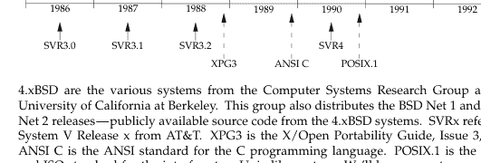

4.xBSD 是加州大学伯克利分校计算机系统研究组的各种系统。该小组还分发 BSD Net 1 和 BSD Net 2 版本——来自 4.xBSD 系统的公开可用源代码。SVR x 指的是 AT&T 的 System V 第 x 版。XPG3 是 X/Open 可移植性指南，第 3 版，ANSI C 是 C 编程语言的 ANSI 标准。POSIX.1 是 IEEE 和 ISO 对类 Unix 系统接口的标准。我们将在第 2.2 节和第 2.3 节中对这些不同的标准和各种 Unix 版本进行更多讨论。

> 在本文中，我们使用术语 4.3+BSD 来指代伯克利的 Unix 系统，它介于 BSD Net 2 版本和 4.4BSD 之间。

在撰写本文时，4.4BSD 尚未发布，因此该系统不能称为 4.4BSD。尽管如此，仍需要一个简单的名称来指代该系统，并且在全文中使用 4.3+BSD。

本书中的大多数示例已在四种不同的 Unix 版本上运行：

- 1. 来自 U.H. Corp. 的 Unix System V/386 Release 4.0 Version 2.0（“vanilla SVR4”），运行在 Intel 80386 处理器上。
- 2. 加州大学伯克利分校计算机科学系计算机系统研究组的 4.3+BSD，运行在 Hewlett Packard 工作站上。
- 3. 来自 Berkeley Software Design, Inc. 的 BSD/386（BSD Net 2 版本的衍生产品），运行在 Intel 80386 处理器上。该系统几乎与我们所称的 4.3+BSD 相同。
- 4. 来自 Sun Microsystems 的 SunOS 4.1.1 和 4.1.2（具有强烈的伯克利血统但包含许多 System V 特性的系统），运行在 SPARCstation SLC 上。

文本中提供了许多计时测试，并且用于测试的系统已标明。

## 致谢

我再次感谢我的家人，他们在过去一年半里给予了我爱、支持和许多失去的周末。写书在许多方面都是一件家庭事务。感谢 Sally、Bill、Ellen 和 David。

我特别感谢 Brian Kernighan 对本书的帮助。他对整部手稿进行了多次彻底审阅，并温和地督促我写出更好的散文，希望这些都体现在最终成果中。Steve Rago 也是一个很好的资源，他审阅了整部手稿并回答了许多关于 System V 细节和历史的问题。感谢 Addison-Wesley 使用的其他技术审阅者，他们对手稿的各个部分提供了宝贵的意见：Maury Bach、Mark Ellis、Jeff Gitlin、Peter Honeyman、John Linderman、Doug McIlroy、Evi Nemeth、Craig Partridge、Dave Presotto、Gary Wilson 和 Gary Wright。

U.C. Berkeley CSRG 的 Keith Bostic 和 Kirk McKusick 提供了用于在最新 BSD 系统上测试示例的账户。（还要特别感谢 Peter Salus。）UHC 的 Sam Nataros 和 Joachim Sacksen 提供了用于测试示例的 SVR4 副本。Trent Hein 帮助获得了 BSD/386 的 alpha 和 beta 版。

多年来，其他朋友在许多微小但重要的方面提供了帮助：Paul Luchina、Joe Gosdil、Jim Hogue、Ed Tankus 和 Gary Wright。我在 Addison-Wesley 的编辑 John Wait 在整个过程中一直是我的好朋友。他从未抱怨截止日期的推迟和页数的不断增加。特别感谢国家光学天文台（NOAO），尤其是 Sidney Wolff、Richard Wolff 和 Steve Grandi，提供了计算机时间。

*真正的* Unix 书籍是用 troff 编写的，本书遵循这一久经考验的传统。本书的照排副本由作者使用 James Clark 编写的 groff 包制作。非常感谢 James Clark 提供了这一出色的系统以及他对错误修复的快速响应。也许总有一天我会真正理解 troff 页脚陷阱。

我欢迎任何读者通过电子邮件提供评论、建议或错误修复。

## UNIX 系统概述

## 1.1 引言

所有操作系统都为其运行的程序提供服务。典型的服务包括执行新程序、打开文件、读取文件、分配内存区域、获取当前时间等。本书的重点是描述各种版本的 UNIX 操作系统提供的服务。

以严格的线性方式描述 UNIX 系统，而不向前引用尚未描述的术语几乎是不可能的（而且可能很无聊）。本章从程序员的角度对 UNIX 系统进行了一次旋风式游览。我们将对贯穿全文的术语和概念给出简要描述和示例。我们将在后面的章节中更详细地描述这些特性。本章还为刚接触此环境的新程序员提供了对 UNIX 系统为程序员提供的服务的介绍和概述。

## 1.2 UNIX 架构

严格来说，操作系统可以定义为控制计算机硬件资源并提供程序运行环境的软件。通常，我们称这种软件为内核，因为它相对较小且驻留在环境的核心。图 1.1 显示了 UNIX 系统架构的图表。

内核的接口是一层称为系统调用的软件（图 1.1 中的阴影部分）。通用函数的库建立在系统调用之上


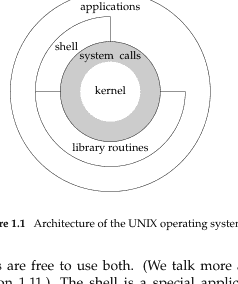

## Figure 1.1 Architecture of the UNIX operating system

interface, but applications are free to use both. (We talk more about system calls and library functions in Section 1.11.) The shell is a special application that provides an interface for running other applications.

In a broad sense, an operating system consists of the kernel and all the other software that makes a computer useful and gives the computer its personality. This other software includes system utilities, applications, shells, libraries of common functions, and so on.

For example, Linux is the kernel used by the GNU operating system. Some people refer to this combination as the GNU/Linux operating system, but it is more commonly referred to as simply Linux. Although this usage may not be correct in a strict sense, it is understandable, given the dual meaning of the phrase operating system. (It also has the advantage of being more succinct.)

## 1.3 Logging In

### Login Name

When we log in to a UNIX system, we enter our login name, followed by our password. The system then looks up our login name in its password file, usually the file /etc/passwd. If we look at our entry in the password file, we see that it's composed of seven colon-separated fields: the login name, encrypted password, numeric user ID (205), numeric group ID (105), a comment field, home directory (/home/sar), and shell program (/bin/ksh).

```
sar:x:205:105:Stephen Rago:/home/sar:/bin/ksh
```

All contemporary systems have moved the encrypted password to a different file. In Chapter 6, we'll look at these files and some functions to access them.

## Shells

Once we log in, some system information messages are typically displayed, and then we can type commands to the shell program. (Some systems start a window management program when you log in, but you generally end up with a shell running in one of the windows.) A shell is a command-line interpreter that reads user input and executes commands. The user input to a shell is normally from the terminal (an interactive shell) or sometimes from a file (called a shell script). The common shells in use are summarized in Figure 1.2.

| Name | Path | FreeBSD 8.0 | Linux 3.2.0 | Mac OS X 10.6.8 | Solaris 10 |
|---|---|---|---|---|---|
| Bourne shell | /bin/sh | • | • | copy of bash | • |
| Bourne-again shell | /bin/bash | optional | • | • | • |
| C shell | /bin/csh | link to tcsh | optional | link to tcsh | • |
| Korn shell | /bin/ksh | optional | optional | • | • |
| TENEX C shell | /bin/tcsh | • | optional | • | • |

Figure 1.2 Common shells used on UNIX systems

The system knows which shell to execute for us based on the final field in our entry in the password file.

The Bourne shell, developed by Steve Bourne at Bell Labs, has been in use since Version 7 and is provided with almost every UNIX system in existence. The control-flow constructs of the Bourne shell are reminiscent of Algol 68.

Additionally, the C shell was provided by AT&T with System V/386 Release 3.2 and was also included in System V Release 4 (SVR4). (We'll have more to say about these different versions of the UNIX System in the next chapter.) The C shell was built on the 6th Edition shell, not the Bourne shell. Its control flow looks more like the C language, and it supports additional features that weren't provided by the Bourne shell: job control, a history mechanism, and command-line editing.

The Korn shell is considered a successor to the Bourne shell and was first provided with SVR4. The Korn shell, developed by David Korn at Bell Labs, runs on most UNIX systems, but before SVR4 was usually an extra-cost add-on, so it is not as widespread as the other two shells. It is upward compatible with the Bourne shell and includes those features that made the C shell popular: job control, command-line editing, and so on.

The default shell used by different Linux distributions varies. Some distributions use the Bourne-again shell. Others use the BSD replacement for the Bourne shell, called dash (Debian Almquist shell, originally written by Kenneth Almquist and later ported to Linux). The default user shell in FreeBSD is derived from the Almquist shell. The default shell in Mac OS X is the Bourne-again shell. Solaris, having its heritage in both BSD and System V, provides all the shells shown in Figure 1.2. Free ports of the shells are available on the Internet.

Throughout the text, we will use parenthetical notes such as this to describe historical notes and to compare different implementations of the UNIX System. Often the reason for a particular implementation technique becomes clear when the historical reasons are described.

Throughout this text, we’ll show interactive shell examples to execute a program that we’ve developed. These examples use features common to the Bourne shell, the Korn shell, and the Bourne-again shell.

## 1.4 Files and Directories

### File System

The UNIX file system is a hierarchical arrangement of directories and files. Everything starts in the directory called root, whose name is the single character /.

A directory is a file that contains directory entries. Logically, we can think of each directory entry as containing a filename along with a structure of information describing the attributes of the file. The attributes of a file are such things as the type of file (regular file, directory), the size of the file, the owner of the file, permissions for the file (whether other users may access this file), and when the file was last modified. The stat and fstat functions return a structure of information containing all the attributes of a file. In Chapter 4, we’ll examine all the attributes of a file in great detail.

> We make a distinction between the logical view of a directory entry and the way it is actually stored on disk. Most implementations of UNIX file systems don’t store attributes in the directory entries themselves, because of the difficulty of keeping them in sync when a file has multiple hard links. This will become clear when we discuss hard links in Chapter 4.

### Filename

The names in a directory are called filenames. The only two characters that cannot appear in a filename are the slash character (/) and the null character. The slash separates the filenames that form a pathname (described next) and the null character terminates a pathname. Nevertheless, it’s good practice to restrict the characters in a filename to a subset of the normal printing characters. (If we use some of the shell’s special characters in the filename, we have to use the shell’s quoting mechanism to reference the filename, and this can get complicated.) Indeed, for portability, POSIX.1 recommends restricting filenames to consist of the following characters: letters (a-z, A-Z), numbers (0-9), period (.), dash (-), and underscore (_).

The Research UNIX System and some older UNIX System V file systems restricted a filename to 14 characters. BSD versions extended this limit to 255 characters. Today, almost all commercial UNIX file systems support at least 255-character filenames.

### Pathname

A sequence of one or more filenames, separated by slashes and optionally starting with a slash, forms a pathname. A pathname that begins with a slash is called an absolute pathname; otherwise, it's called a relative pathname. Relative pathnames refer to files relative to the current directory. The name for the root of the file system (/) is a special-case absolute pathname that has no filename component.

### Example

Listing the names of all the files in a directory is not difficult. Figure 1.3 shows a bare-bones implementation of the ls(1) command.

```
#include "apue.h"
#include <dirent.h>

int
main(int argc, char *argv[])
{
    DIR             *dp;
    struct dirent   *dirp;

    if (argc != 2)
        err_quit("usage: ls directory_name");

    if ((dp = opendir(argv[1])) == NULL)
        err_sys("can't open %s", argv[1]);
    while ((dirp = readdir(dp)) != NULL)
        printf("%s\n", dirp->d_name);

    closedir(dp);
    exit(0);
}
```

Figure 1.3 List all the files in a directory

The notation ls(1) is the normal way to reference a particular entry in the UNIX system manuals. It refers to the entry for ls in Section 1. The sections are normally numbered 1 through 8, and all the entries within each section are arranged alphabetically. Throughout this text, we assume that you have a copy of the manuals for your UNIX system.

Historically, UNIX systems lumped all eight sections together into what was called the UNIX Programmer's Manual. As the page count increased, the trend changed to distributing the sections among separate manuals: one for users, one for programmers, and one for system administrators, for example.


某些 UNIX 系统会用大写字母进一步划分手册页中的特定章节。例如，AT&T [1990c] 中的所有标准输入/输出（I/O）函数都被标明位于第 3S 节，如 fopen(3S)。其他一些系统则用字母替代数字章节，比如用 C 表示命令。

如今，大多数手册都以电子形式分发。如果你的手册是在线的，查看 ls 命令手册页的方式大致如下：

```
man 1 ls
```

或者

```
man -sl ls
```

图 1.3 是一个程序，它仅仅打印目录中每个文件的名称，不做其他事。如果源文件名为 myls.c，我们可以通过运行以下命令将其编译为默认的 a.out 可执行文件：

```
cc myls.c
```

从历史上看，cc(1) 是 C 编译器。在使用 GNU C 编译系统的系统上，C 编译器是 gcc(1)。在这里，cc 通常链接到 gcc。

# 一些示例输出如下

```
$ ./a.out /dev
.
..
cdrom
stderr
stdout
stdin
fd
sda4
sda3
sda2
sda1
sda
tty2
tty1
console
tty
zero
null
many more lines that aren't shown
mem
$ ./a.out /etc/ssl/private
can't open /etc/ssl/private: Permission denied
$ ./a.out /dev/tty
can't open /dev/tty: Not a directory
```

在整本书中，我们将以这种方式展示我们运行的命令和产生的输出：我们输入的字符以这种字体显示，而程序输出则以这种样式显示。如果我们需要为输出添加注释，我们会用斜体显示注释。我们输入前的美元符号是 shell 打印的提示符。我们总是将 shell 提示符显示为美元符号。

请注意，目录列表并不是按字母顺序排列的。ls 命令在打印之前会对名称进行排序。

这个 20 行的程序中有许多细节需要考虑。

- 首先，我们包含一个我们自己的头文件：apue.h。在本书中几乎每个程序里我们都包含这个头文件。该头文件包含一些标准系统头文件，并定义了许多常量和函数原型，我们在文本的示例中会用到它们。这个头文件的清单见附录 B。
- 其次，我们包含一个系统头文件 dirent.h，以获取 opendir 和 readdir 的函数原型，以及 dirent 结构的定义。在某些系统上，这些定义被拆分到多个头文件中。例如，在 Ubuntu 12.04 Linux 发行版中，`/usr/include/dirent.h` 声明了函数原型，并包含了 `bits/dirent.h`，后者定义了 dirent 结构（实际上存储在 `/usr/include/x86_64-linux-gnu/bits` 中）。
- main 函数的声明使用了 ISO C 标准支持的风格。（我们将在下一章中详细讨论 ISO C 标准。）
- 我们从命令行获取一个参数 argv[1]，作为要列出的目录名。在第 7 章中，我们将了解 main 函数如何被调用，以及程序如何访问命令行参数和环境变量。
- 由于目录项的实际格式因 UNIX 系统而异，我们使用 opendir、readdir 和 closedir 函数来操作目录。
- opendir 函数返回一个指向 DIR 结构的指针，我们将这个指针传递给 readdir 函数。我们不关心 DIR 结构中有什么。然后我们在循环中调用 readdir 来读取每个目录项。readdir 函数返回一个指向 dirent 结构的指针，或者当处理完目录时返回空指针。我们只检查 dirent 结构中每个目录项的名称（d_name）。使用这个名称，我们可以调用 stat 函数（第 4.2 节）来确定文件的所有属性。
- 我们调用两个自己的函数来处理错误：err_sys 和 err_quit。从前面的输出可以看出，err_sys 函数会打印一条信息性消息，描述遇到的错误类型（“Permission denied” 或 “Not a directory”）。这两个错误函数在附录 B 中给出并描述。我们还会在第 1.7 节中更详细地讨论错误处理。
- 当程序完成时，它调用 exit 函数，参数为 0。exit 函数终止程序。按照惯例，参数 0 表示正常，参数在 1 到 255 之间表示发生了错误。在第 8.5 节中，我们将展示任何程序（如 shell 或我们编写的程序）如何获取它所执行程序的退出状态。

```
#include "apue.h"
#define BUFFSIZE    4096

int
main(void)
{
    int     n;
    char    buf[BUFFSIZE];

    while ((n = read(STDIN_FILENO, buf, BUFFSIZE)) > 0)
        if (write(STDOUT_FILENO, buf, n) != n)
            err_sys("write error");

    if (n < 0)
        err_sys("read error");

    exit(0);
}
```

**图 1.4** 将标准输入复制到标准输出

`<unistd.h>` 头文件（由 `apue.h` 包含）以及两个常量 `STDIN_FILENO` 和 `STDOUT_FILENO` 是 POSIX 标准的一部分（我们将在下一章中详细讨论）。该头文件包含许多 UNIX 系统服务的函数原型，例如我们调用的 read 和 write 函数。

常量 `STDIN_FILENO` 和 `STDOUT_FILENO` 在 `<unistd.h>` 中定义，指定了标准输入和标准输出的文件描述符。按照 POSIX.1 的要求，这些值分别为 0 和 1，但为了可读性，我们使用这些名称。

在第 3.9 节中，我们将详细讨论 `BUFFSIZE` 常量，了解不同值如何影响程序的效率。然而，无论这个常量的值是多少，这个程序仍然可以复制任何普通文件。

read 函数返回读取的字节数，这个值被用作要写入的字节数。当到达输入文件的末尾时，read 返回 0，程序停止。如果发生读取错误，read 返回 −1。大多数系统函数在发生错误时返回 −1。

如果我们将程序编译成标准名称（`a.out`）并这样执行：

```
./a.out > data
```

标准输入是终端，标准输出被重定向到文件 `data`，标准错误也是终端。如果此输出文件不存在，shell 会默认创建它。程序将我们输入的每一行复制到标准输出，直到我们输入文件结束字符（通常是 Control-D）。

如果我们运行：

```
./a.out < infile > outfile
```

那么名为 `infile` 的文件将被复制到名为 `outfile` 的文件中。

在第 3 章中，我们将更详细地描述无缓冲 I/O 函数。

# 标准 I/O

标准 I/O 函数为无缓冲 I/O 函数提供了带缓冲的接口。使用标准 I/O 使我们无需选择最佳的缓冲区大小，例如图 1.4 中的 BUFFSIZE 常量。标准 I/O 函数还简化了对输入行的处理（这是 UNIX 应用程序中的常见情况）。例如，fgets 函数读取整行。相比之下，read 函数读取指定数量的字节。正如我们将在第 5.4 节中看到的，标准 I/O 库提供的函数让我们可以控制库所使用的缓冲方式。

最常见的标准 I/O 函数是 printf。在调用 printf 的程序中，我们总是包含 <stdio.h>——通常通过包含 apue.h——因为这个头文件包含了所有标准 I/O 函数的原型。

# 示例

图 1.5 中的程序与我们之前调用 read 和 write 的程序类似，我们将在第 5.8 节中更详细地讨论它。该程序将标准输入复制到标准输出，并且可以复制任何普通文件。

```
#include "apue.h"
int
main(void)
{
    int     c;
    while ((c = getc(stdin)) != EOF)
        if (putc(c, stdout) == EOF)
            err_sys("output error");
    if (ferror(stdin))
        err_sys("input error");
    exit(0);
}
```

图 1.5 使用标准 I/O 将标准输入复制到标准输出

getc 函数一次读取一个字符，这个字符由 putc 写入。在读取完最后一个输入字节后，getc 返回常量 EOF（在 <stdio.h> 中定义）。标准 I/O 常量 stdin 和 stdout 也定义在 <stdio.h> 头文件中，分别指代标准输入和标准输出。

# 1.6 程序与进程

## 程序

程序是磁盘上某个目录中的可执行文件。程序被读入内存，并由内核通过七个 exec 函数之一来执行。我们将在第 8.10 节中介绍这些函数。


```c
#include "apue.h"
#include <sys/wait.h>

int
main(void)
{
    char    buf[MAXLINE];    /* from apue.h */
    pid_t   pid;
    int     status;

    printf("%% ");    /* print prompt (printf requires %% to print %) */
    while (fgets(buf, MAXLINE, stdin) != NULL) {
        if (buf[strlen(buf) - 1] == '\n')
            buf[strlen(buf) - 1] = 0; /* replace newline with null */

        if ((pid = fork()) < 0) {
            err_sys("fork error");
        } else if (pid == 0) {       /* child */
            execlp(buf, buf, (char *)0);
            err_ret("couldn't execute: %s", buf);
            exit(127);
        }

        /* parent */
        if ((pid = waitpid(pid, &status, 0)) < 0)
            err_sys("waitpid error");
        printf("%% ");
    }
    exit(0);
}
```

*Figure 1.7* 从标准输入读取命令并执行它们

这个 30 行的程序中有几个特性值得考虑。

- 我们使用标准 I/O 函数 `fgets` 一次从标准输入读取一行。当我们键入文件结束字符（通常是 Control-D）作为一行的第一个字符时，`fgets` 返回空指针，循环停止，进程终止。在第 18 章中，我们将描述所有特殊的终端字符——文件结束、退格一个字符、擦除整行等等——以及如何更改它们。
- 因为 `fgets` 返回的每一行都以换行符结尾，后跟空字节，所以我们使用标准 C 函数 `strlen` 计算字符串的长度，然后将换行符替换为空字节。我们这样做是因为 `execlp` 函数需要以空字符结尾的参数，而不是以换行符结尾的参数。
- 我们调用 `fork` 创建一个新的进程，它是调用者的副本。我们说调用者是父进程，而新创建的进程是子进程。然后 `fork` 向父进程返回新子进程的非负进程 ID，并向子进程返回 0。因为 fork 创建了一个新进程，我们说它被调用一次——由父进程调用——但返回两次——在父进程和子进程中。
- 在子进程中，我们调用 execlp 执行从标准输入读取的命令。这用新的程序文件替换子进程。fork 后跟 exec 的组合在某些操作系统中称为生成新进程。在 UNIX 系统中，这两个部分被分离为单独的函数。我们将在第 8 章中详细介绍这些函数。
- 因为子进程调用 execlp 执行新的程序文件，父进程希望等待子进程终止。这是通过调用 waitpid 指定要等待的进程来完成的：pid 参数，即子进程的进程 ID。waitpid 函数还返回子进程的终止状态——status 变量——但在这个简单程序中，我们不对该值做任何处理。我们可以检查它来确定子进程是如何终止的。
- 这个程序最根本的限制是我们不能向执行的命令传递参数。例如，我们不能指定要列出的目录的名称。我们只能在工作目录上执行 ls。要允许参数需要我们解析输入行，按某种约定分隔参数，通常是空格或制表符，然后将每个参数作为单独的参数传递给 execlp 函数。尽管如此，这个程序仍然是 UNIX 系统进程控制函数的有用演示。

如果我们运行这个程序，我们会得到以下结果。请注意，我们的程序有一个不同的提示符——百分号——以区别于 shell 的提示符。

```
$ ./a.out
% date
Sat Jan 21 19:42:07 EST 2012
% who
sar     console  Jan  1 14:59
sar     ttys000  Jan  1 14:59
sar     ttys001  Jan 15 15:28
% pwd
/home/sar/bk/apue/3e
% ls
Makefile
a.out
shell1.c
% ^D          type the end-of-file character
$             the regular shell prompt
```

符号 ^D 用于表示控制字符。控制字符是通过按住键盘上的控制键——通常标记为 Control 或 Ctrl——然后同时按下另一个键形成的特殊字符。Control-D，或 ^D，是默认的文件结束字符。当我们在第 18 章讨论终端 I/O 时，我们会看到更多控制字符。

## 线程和线程 ID

通常，一个进程只有一个控制线程——一次执行一组机器指令。一些问题在可以有多个控制线程在问题的不同部分操作时更容易解决。此外，多个控制线程可以利用多处理器系统上的并行性。

进程内的所有线程共享相同的地址空间、文件描述符、栈和进程相关属性。每个线程在其自己的栈上执行，尽管任何线程都可以访问同一进程中其他线程的栈。因为它们可以访问相同的内存，线程需要相互同步对共享数据的访问以避免不一致。

线程与进程一样，由 ID 标识。然而，线程 ID 是进程本地的。一个进程的线程 ID 在另一个进程中没有意义。我们使用线程 ID 来引用我们在进程内操作的具体线程。

控制线程的函数与控制进程的函数平行。然而，由于线程是在进程模型建立很久之后才添加到 UNIX 系统中的，线程模型和进程模型之间存在一些复杂的交互，正如我们在第 12 章中将看到的那样。

## 1.7 错误处理

当 UNIX 系统函数中发生错误时，通常会返回负值，并且整数 errno 通常被设置为一个说明原因的值。例如，open 函数如果一切正常则返回非负文件描述符，如果发生错误则返回 -1。open 的错误大约有 15 种可能的 errno 值，例如文件不存在、权限问题等等。一些函数使用除返回负值之外的约定。例如，大多数返回指向对象的指针的函数在发生错误时返回空指针。

文件 <errno.h> 定义了符号 errno 和 errno 可能取值的每个常量的常量。每个这些常量都以字符 E 开头。此外，UNIX 系统手册第 2 节的第一页，名为 intro(2)，通常列出所有这些错误常量。例如，如果 errno 等于常量 EACCES，这表示权限问题，例如没有足够的权限打开请求的文件。

> 在 Linux 上，错误常量列在 errno(3) 手册页中。

POSIX 和 ISO C 将 errno 定义为扩展为可修改的整数类型 lvalue 的符号。这可以是包含错误号的整数，也可以是返回错误号指针的函数。历史定义是

```
extern int errno;
```

但在支持线程的环境中，进程地址空间在多个线程之间共享，每个线程需要自己的 errno 副本以防止一个线程干扰另一个线程。例如，Linux 通过将其定义为以下方式支持对 errno 的多线程访问

```
extern int * __errno_location(void);
#define errno (*__errno_location())
```

关于 errno 有两条规则需要注意。首先，如果例程未发生错误，其值永远不会被清除。因此，我们只有在函数的返回值指示发生错误时才应检查其值。其次，errno 的值永远不会被任何函数设置为 0，并且 <errno.h> 中定义的任何常量的值都不是 0。

C 标准定义了两个函数来帮助打印错误消息。

```
#include <string.h>

char *strerror(int errnum);

Returns: pointer to message string
```

此函数将 errnum，通常是 errno 值，映射为错误消息字符串并返回指向该字符串的指针。

perror 函数基于 errno 的当前值在标准错误上产生错误消息并返回。

```
#include <stdio.h>

void perror(const char *msg);
```

它输出 msg 指向的字符串，后跟冒号和空格，后跟对应于 errno 值的错误消息，后跟换行符。

## 示例

图 1.8 显示了这两个错误函数的用法。

```
#include "apue.h"
#include <errno.h>

int
main(int argc, char *argv[])
{
    fprintf(stderr, "EACCES: %s\n", strerror(EACCES));
    errno = ENOENT;
    perror(argv[0]);
    exit(0);
}
```

Figure 1.8 Demonstrate strerror and perror

如果将此程序编译为文件 a.out，我们有

```
$ ./a.out
EACCES: Permission denied
./a.out: No such file or directory
```


请注意，我们将程序的名称——argv[0]，其值为 ./a.out——作为参数传递给 perror。这是 UNIX 系统中的标准惯例。这样，如果程序作为管道的一部分执行，例如
```
prog1 < inputfile | prog2 | prog3 > outputfile
```
我们就能判断是这三个程序中的哪一个生成了特定的错误消息。

本文中的示例没有直接调用 strerror 或 perror，而是使用附录 B 中所示的错误处理函数。这些函数让我们能够利用 ISO C 的可变参数列表机制，只用一条 C 语句处理错误情况。

## 错误恢复

<errno.h> 中定义的错误可分为两类：致命错误和非致命错误。致命错误没有可用的恢复措施。我们能做的最好的事情，就是在用户的屏幕上或日志文件中打印错误消息，然后退出。另一方面，有时可以更稳健地处理非致命错误。大多数非致命错误都是暂时性的，例如资源短缺；当系统活动较少时，这些错误可能就不会发生。

与资源有关的非致命错误包括 EAGAIN、ENFILE、ENOBUFS、ENOLCK、ENOSPC、EWOULDBLOCK，有时还包括 ENOMEM。当 EBUSY 表示某个共享资源正在使用时，可以将其视为非致命错误。有时，慢速系统调用被中断时，也可以将 EINTR 视为非致命错误（更多内容见第 10.5 节）。

与资源有关的非致命错误，典型的恢复措施是稍作延迟，然后重试。这种方法也适用于其他情况。例如，如果错误表明网络连接已失效，应用程序可能可以稍等片刻，然后重新建立连接。有些应用程序使用指数退避算法，在后续每次迭代中逐渐延长等待时间。

最终，应用程序开发人员需要判断应用程序在哪些情况下能够从错误中恢复。如果可以采用合理的恢复策略，我们就能避免异常退出，从而提高应用程序的健壮性。

## 1.8 用户标识

### 用户 ID

密码文件中与我们对应的条目包含一个用户 ID，这是用于在系统中标识我们的数值。系统管理员在分配登录名时也会分配此用户 ID，我们无法更改它。通常，每个用户的用户 ID 都是唯一的。我们将看到内核如何使用用户 ID 来检查我们是否拥有执行某些操作所需的权限。

用户 ID 为 0 的用户称为 root 或超级用户。密码文件中的条目通常使用 root 作为登录名；我们将该用户的特殊权限称为超级用户权限。正如我们将在第 4 章中看到的，如果一个进程拥有超级用户权限，大多数文件权限检查都会被绕过。有些操作系统功能仅限超级用户使用。超级用户可以不受限制地操作系统。

### 组 ID

密码文件中与我们对应的条目也指定了我们的数值组 ID。组 ID 同样由系统管理员在分配登录名时分配。通常，密码文件中会有多个条目指定相同的组 ID。组通常用于将用户归入项目组或部门，以便同一组的成员共享文件等资源。我们将在第 4.5 节中看到，我们可以设置文件权限，使组内所有成员都能访问该文件，而组外的其他人则不能。

此外还有一个组文件，用于将组名映射为数值组 ID。组文件通常是 /etc/group。

使用数值用户 ID 和数值组 ID 来管理权限是一种历史沿用的做法。对于磁盘上的每个文件，文件系统都会存储其所有者的用户 ID 和组 ID。假设这两个值都以双字节整数存储，那么保存它们只需四个字节。如果改用完整的 ASCII 登录名和组名，则需要额外的磁盘空间。此外，在权限检查期间比较字符串，也比比较整数更耗费资源。

不过，用户使用名称比使用数字更方便，因此密码文件负责维护登录名与用户 ID 之间的映射，而组文件则提供组名与组 ID 之间的映射。例如，ls -l 命令会打印文件所有者的登录名，并使用密码文件将数值用户 ID 映射为相应的登录名。

> 早期 UNIX 系统使用 16 位整数表示用户 ID 和组 ID。现代 UNIX 系统使用 32 位整数。

### 示例

图 1.9 中的程序会打印用户 ID 和组 ID。

```
#include "apue.h"
int
main(void)
{
    printf("uid = %d, gid = %d\n", getuid(), getgid());
    exit(0);
}
```

图 1.9 打印用户 ID 和组 ID

我们调用 getuid 和 getgid 函数来获取用户 ID 和组 ID。运行该程序的结果如下：

```
$ ./a.out
uid = 205, gid = 105
```

> Mac OS X 客户端版本默认禁用超级用户帐户；服务器版本则默认启用该帐户。Apple 网站提供了启用该帐户的说明。参见 ../../../../support.apple.com/kb/HT1528。

### 补充组 ID

除了密码文件中为登录名指定的组 ID 外，大多数版本的 UNIX 系统还允许用户属于其他组。这种做法始于 4.2BSD，当时用户最多可以另外属于 16 个组。登录时，系统会读取 /etc/group 文件，并查找前 16 个将该用户列为成员的条目，以此获取这些补充组 ID。正如我们将在下一章中看到的，POSIX 要求系统至少支持每个进程 8 个补充组，但大多数系统至少支持 16 个。

## 1.9 信号

信号是一种用于通知进程某种情况已经发生的机制。例如，如果进程发生除以零的情况，系统就会向该进程发送名为 SIGFPE（浮点异常）的信号。进程有三种处理该信号的选择。

- 1. 忽略信号。对于表示硬件异常的信号，例如除以零或访问进程地址空间之外的内存，不建议选择此项，因为其结果未定义。
- 2. 执行默认操作。对于除以零的情况，默认操作是终止进程。
- 3. 提供一个在信号发生时调用的函数（这称为“捕获”信号）。通过提供自己的函数，我们就能知道信号何时发生，并按自己的意愿处理它。

许多情况都会产生信号。两个终端按键——中断键（通常是 DELETE 键或 Control-C）和退出键（通常是 Control-反斜杠）——用于中断当前正在运行的进程。调用 kill 函数也可以产生信号。我们可以在一个进程中调用此函数，向另一个进程发送信号。当然，这有一些限制：只有当我们是另一个进程的所有者（或超级用户）时，才能向它发送信号。

### 示例

回想一下最简单的 shell 示例（图 1.7）。如果运行该程序时按下中断键，进程就会终止，因为名为 SIGINT 的信号，其默认操作就是终止进程。进程没有告知内核对此信号执行默认操作以外的任何操作，因此进程会终止。

要捕获此信号，程序需要调用 signal 函数，并指定在产生 SIGINT 信号时要调用的函数名称。该函数名为 sig_int；调用时，它只会打印一条消息和一个新的提示符。在图 1.7 的程序中加入 11 行代码，就得到了图 1.10 所示的版本。（新增的 11 行以行首的加号标出。）

```
#include "apue.h"
#include <sys/wait.h>

+ static void sig_int(int);      /* our signal-catching function */
+ int
main(void)
{
    char    buf[MAXLINE];   /* from apue.h */
    pid_t   pid;
    int     status;

+   if (signal(SIGINT, sig_int) == SIG_ERR)
+       err_sys("signal error");
+   
    printf("%% "); /* print prompt (printf requires %% to print %) */
    while (fgets(buf, MAXLINE, stdin) != NULL) {
        if (buf[strlen(buf) - 1] == '\n')
            buf[strlen(buf) - 1] = 0; /* replace newline with null */

        if ((pid = fork()) < 0) {
            err_sys("fork error");
        } else if (pid == 0) {      /* child */
            execvp(buf, (char *)0);
            err_ret("couldn't execute: %s", buf);
            exit(127);
        }

        /* parent */
        if ((pid = waitpid(pid, &status, 0)) < 0)
            err_sys("waitpid error");
        printf("%% ");
    }
    exit(0);
}
+ void
+ sig_int(int signo)
+ {
+     printf("interrupt\n%% ");
+ }
```

图 1.10 从标准输入读取命令并执行

在第 10 章中，我们将详细讨论信号，因为大多数非平凡的应用程序都会处理信号。


## 1.10 时间值

历史上，UNIX 系统维护着两种不同的时间值：

- 1. **日历时间。** 该值计算自 Epoch 以来的秒数：1970 年 1 月 1 日 00:00:00，协调世界时（UTC）。（旧手册将 UTC 称为格林威治标准时间。）这些时间值用于记录文件上次被修改的时间，例如。

  原始系统数据类型 `time_t` 保存这些时间值。

- 2. **进程时间。** 这也称为 CPU 时间，用于衡量进程使用的中央处理器资源。进程时间以时钟滴答为单位进行测量，历史上每秒的滴答数通常为 50、60 或 100。

  原始系统数据类型 `clock_t` 保存这些时间值。（我们将在第 2.5.4 节中展示如何使用 `sysconf` 函数获得每秒的时钟滴答数。）

当我们在第 3.9 节中测量进程的执行时间时，我们会看到 UNIX 系统为进程维护三个值：

- 时钟时间
- 用户 CPU 时间
- 系统 CPU 时间

时钟时间，有时称为 *墙上时钟时间*，是进程运行所花费的时间，其值取决于系统上运行的其他进程数量。每当我们报告时钟时间时，测量都是在系统上没有其他活动的情况下进行的。

用户 CPU 时间是归因于用户指令的 CPU 时间。系统 CPU 时间是内核代表进程执行时归因的 CPU 时间。例如，每当进程执行系统服务，如 read 或 write 时，内核在执行该系统服务所花费的时间都计入该进程。用户 CPU 时间和系统 CPU 时间之和通常称为 *CPU 时间*。

测量任何进程的时钟时间、用户时间和系统时间都很简单：只需执行 time(1) 命令，并将要测量的命令作为 time 命令的参数。例如：

```
$ cd /usr/include
$ time -p grep _POSIX_SOURCE */*.h > /dev/null

real    0m0.81s
user    0m0.11s
sys     0m0.07s
```

time 命令的输出格式取决于所使用的 shell，因为某些 shell 不运行 `/usr/bin/time`，而是使用内置函数来测量命令的运行时间。

在第 8.17 节中，我们将看到如何从正在运行的进程中获得这三个时间。时间和日期的一般主题在第 6.10 节中介绍。

## 1.11 系统调用和库函数

所有操作系统都提供服务点，通过这些点程序可以向内核请求服务。所有 UNIX 系统的实现都提供有限数量的直接进入内核的入口点，称为系统调用（回顾图 1.1）。研究版 UNIX 系统的第 7 版提供了约 50 个系统调用，4.4BSD 提供了约 110 个，而 SVR4 约有 120 个。系统调用的确切数量取决于操作系统版本。最近的系统在支持的系统调用数量上出现了惊人的增长。Linux 3.2.0 有 380 个系统调用，FreeBSD 8.0 有超过 450 个。

系统调用接口一直记录在 UNIX 程序员手册的第 2 节中。无论在任何给定系统上实际使用何种实现技术来调用系统调用，其定义都使用 C 语言。这与许多旧的操作系统不同，后者传统上以机器的汇编语言定义内核入口点。

UNIX 系统上使用的技术是每个系统调用在标准 C 库中都有同名的函数。用户进程调用此函数，使用标准的 C 调用序列。然后该函数使用系统所需的任何技术调用适当的内核服务。例如，该函数可能会将一个或多个 C 参数放入通用寄存器，然后执行某个机器指令，在内核中产生软件中断。对于我们的目的，我们可以将系统调用视为 C 函数。

UNIX 程序员手册的第 3 节定义了程序员可用的通用库函数。这些函数不是进入内核的入口点，尽管它们可能会调用一个或多个内核的系统调用。例如，printf 函数可能会使用 write 系统调用输出字符串，但 strcpy（复制字符串）和 atoi（将 ASCII 转换为整数）函数根本不涉及内核。

从实现者的角度来看，系统调用和库函数之间的区别是根本性的。然而，从用户的角度来看，这种差异并不那么关键。从我们在此文本中的角度来看，系统调用和库函数都表现为正常的 C 函数。两者都存在于为应用程序提供服务。我们应该意识到，我们可以根据需要替换库函数，而系统调用通常无法替换。

以内存分配函数 malloc 为例。内存分配及其相关的垃圾回收有许多方法（最佳适配、首次适配等）。没有一种技术对所有程序都是最优的。处理内存分配的 UNIX 系统调用 sbrk(2) 并不是通用的内存管理器。它按指定字节数增加或减少进程的地址空间。如何管理该空间由进程决定。内存分配函数 malloc(3) 实现了一种特定的分配类型。如果我们不喜欢它的操作，我们可以定义自己的 malloc 函数，它很可能使用 sbrk 系统调用。事实上，许多软件包使用 sbrk 系统调用实现了自己的内存分配算法。图 1.11 显示了应用程序、malloc 函数和 sbrk 系统调用之间的关系。

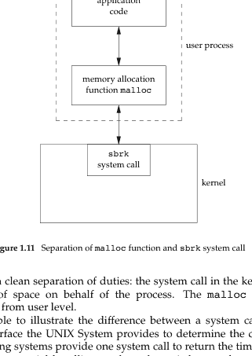

# 图 1.11 malloc 函数与 sbrk 系统调用的分离

这里职责分离得很清晰：内核中的系统调用代表进程分配额外的空间块。malloc 库函数从用户级管理此空间。

另一个说明系统调用和库函数之间差异的例子是 UNIX 系统提供用于确定当前时间和日期的接口。某些操作系统提供一个系统调用返回时间，另一个系统调用返回日期。诸如夏令时切换等特殊处理由内核处理或需要人工干预。相比之下，UNIX 系统提供一个系统调用，返回自 Epoch 以来的秒数：1970 年 1 月 1 日午夜，协调世界时。任何对该值的解释，例如使用本地时区将其转换为人类可读的时间和日期，都留给用户进程。标准 C 库提供了处理大多数情况的例程。这些库例程处理诸如夏令时的各种算法等细节。

应用程序可以进行系统调用或调用库例程。还要意识到，许多库例程会调用系统调用。这在图 1.12 中显示。

系统调用和库函数之间的另一个区别是，系统调用通常提供最小的接口，而库函数通常提供更复杂的功能。我们已经在 sbrk 系统调用和 malloc 库函数之间的差异中看到了这一点。我们稍后在比较无缓冲 I/O 函数（第 3 章）和标准 I/O 函数（第 5 章）时还会再次看到这种差异。

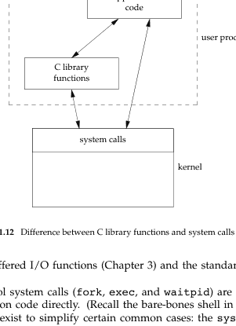

# 图 1.12 C 库函数与系统调用之间的差异

进程控制系统调用（fork、exec 和 waitpid）通常由用户的应用程序代码直接调用。（回顾图 1.7 中的精简版 shell。）但存在一些库例程来简化某些常见情况：例如 system 和 popen 库例程。在第 8.13 节中，我们将展示 system 函数的实现，该实现调用基本的进程控制系统调用。我们将在第 10.18 节中增强此示例以正确处理信号。

为了定义大多数程序员使用的 UNIX 系统接口，我们必须描述系统调用和一些库函数。如果我们只描述 sbrk 系统调用，例如，我们将跳过许多应用程序使用的更友好的 malloc 库函数。在本文中，我们将使用术语函数来指代系统调用和库函数，除非区分是必要的。

## 1.12 总结

本章提供了 UNIX 系统的简要介绍。我们描述了一些我们会反复遇到的基本术语。我们看到了许多小的 UNIX 程序示例，让我们对文本的其余部分所讨论的内容有一个概念。


下一章将介绍 UNIX 系统的标准化，以及这方面的工作对当前系统的影响。标准，尤其是 ISO C 标准和 POSIX.1 标准，将影响本书余下的内容。

## 练习

- 1.1 在你的系统上验证：除根目录外，目录点（dot）和点点（dot-dot）并不相同。
- 1.2 在图 1.6 的程序输出中，进程 ID 为 852 和 853 的进程发生了什么？
- 1.3 在第 1.7 节中，`error` 的参数定义时带有 ISO C 属性 `const`，而 `strerror` 的整型参数定义时却没有该属性。为什么？
- 1.4 如果日历时间存储为有符号 32 位整数，它会在哪一年溢出？如何延后溢出时间？这些策略与现有应用程序兼容吗？
- 1.5 如果进程时间存储为有符号 32 位整数，且系统每秒计数 100 个时钟滴答，那么经过多少天该值会溢出？

## UNIX 标准化与实现

### 2.1 引言

人们为 UNIX 编程环境和 C 编程语言的标准化做了大量工作。尽管应用程序一直能够在不同版本的 UNIX 操作系统之间实现相当好的可移植性，但 20 世纪 80 年代各种版本和差异大量涌现，促使许多大型用户（例如美国政府）呼吁制定标准。

本章首先回顾过去二十五年间开展的各种标准化工作，然后讨论这些 UNIX 编程标准对本书所述操作系统实现的影响。各项标准化工作中一个重要部分，是规定每种实现必须定义的各种限制，因此我们将介绍这些限制，以及确定其数值的各种方法。

### 2.2 UNIX 标准化

#### 2.2.1 ISO C

1989 年末，C 编程语言的 ANSI 标准 X3.159-1989 获得批准。该标准后来也被采纳为国际标准 ISO/IEC 9899:1990。ANSI 是美国国家标准学会，也是美国在国际标准化组织（ISO）中的成员机构。IEC 是国际电工委员会的缩写。

如今，C 标准由 ISO/IEC 负责 C 编程语言国际标准化工作的组别维护和制定，该组别称为 ISO/IEC JTC1/SC22/WG14，简称 WG14。ISO C 标准旨在让符合标准的 C 程序能够移植到各种操作系统，而不仅限于 UNIX 系统。该标准不仅定义了编程语言的语法和语义，还定义了一个标准库［ISO 1999 第 7 章；Plauger 1992；Kernighan 和 Ritchie 1988 附录 B］。这个标准库很重要，因为所有现代 UNIX 系统（包括本书所述的系统）都提供了 C 标准中规定的库例程。

1999 年，ISO C 标准经过修订并获批，成为 ISO/IEC 9899:1999，此次修订主要是为了改进对数值处理应用程序的支持。这些改动不会影响本书介绍的 POSIX 接口，唯一的例外是在某些函数原型中增加了 `restrict` 关键字。该关键字用于告知编译器哪些指针引用可以进行优化，方法是指出函数中对指针所指对象的访问仅通过该指针进行。

自 1999 年以来，ISO C 标准发布了三份技术勘误，以纠正其中的错误，分别于 2001 年、2004 年和 2007 年发布。与大多数标准一样，标准获批与软件修改以符合标准之间存在时间差。随着各厂商的编译系统不断演进，它们会逐步增加对最新版 ISO C 标准的支持。

有关 gcc 对 1999 版 ISO C 标准的当前符合情况的摘要，可参见 .../.../.../gcc.gnu.org/c99status.html。尽管 ISO C 标准于 2011 年进行了更新，但本书只讨论 1999 版，因为其他标准尚未跟进相关变更。

ISO C 库可依据标准定义的头文件划分为 24 个领域（见图 2.1）。POSIX.1 标准包含这些头文件以及其他一些头文件。如图 2.1 所示，本章后文将介绍的四种实现（FreeBSD 8.0、Linux 3.2.0、Mac OS X 10.6.8 和 Solaris 10）均支持所有这些头文件。

ISO C 头文件取决于操作系统所使用的 C 编译器版本。FreeBSD 8.0 随附 gcc 4.2.1 版；Solaris 10 随附 gcc 3.4.3 版（此外还提供其自带的 Sun Studio C 编译器）；Ubuntu 12.04（Linux 3.2.0）随附 gcc 4.6.3 版；Mac OS X 10.6.8 则同时随附 gcc 4.0.1 版和 4.2.1 版。

#### 2.2.2 IEEE POSIX

POSIX 是一系列最初由 IEEE（电气与电子工程师协会）制定的标准。POSIX 是“可移植操作系统接口”（Portable Operating System Interface）的缩写。最初，该名称仅指 IEEE 标准 1003.1-1988（即操作系统接口），后来则扩展为涵盖许多编号为 1003 的标准和标准草案，包括 shell 和实用程序标准（1003.2）。

本书特别关注 1003.1 操作系统接口标准，其目标是促进应用程序在各种 UNIX 系统环境之间的可移植性。该标准规定了操作系统必须提供的服务

该标准还以国际标准 ISO/IEC 9945-1:1996 的形式发布。1999 年发布的 IEEE 标准 1003.1d-1999 增加了更多实时接口。一年后，IEEE 标准 1003.1j-2000 发布，加入了更多实时接口；IEEE 标准 1003.1q-2000 也随之发布，为该标准增加了事件跟踪扩展。

2001 版 1003.1 与此前版本不同，它合并了多个 1003.1 修订案、1003.2 标准以及《单一 UNIX 规范》（SUS）第 2 版的部分内容（稍后将进一步介绍）。由此形成的 IEEE 标准 1003.1-2001 包含以下其他标准：

- ISO/IEC 9945-1（IEEE 标准 1003.1-1996），其中包括
  - IEEE 标准 1003.1-1990
  - IEEE 标准 1003.1b-1993（实时扩展）
  - IEEE 标准 1003.1c-1995（pthreads）
  - IEEE 标准 1003.1i-1995（实时技术勘误）
- IEEE P1003.1da 标准草案（系统接口修订案）
- IEEE 标准 1003.1d-1999（高级实时扩展）
- IEEE 标准 1003.1j-2000（更多高级实时扩展）
- IEEE 标准 1003.1q-2000（跟踪）
- IEEE 标准 1003.1g-2000 的部分内容（与协议无关的接口）
- ISO/IEC 9945-2（IEEE 标准 1003.2-1993）
  - IEEE P1003.2b 标准草案（shell 和实用程序修订案）
  - IEEE 标准 1003.2d-1994（批处理扩展）
- 《单一 UNIX 规范》第 2 版的基本规范，其中包括
  - 系统接口定义，第 5 版
  - 命令和实用程序，第 5 版
  - 系统接口和头文件，第 5 版
- The Open Group 技术标准《网络服务》，第 5.2 版
- ISO/IEC 9899:1999，C 编程语言

2004 年，POSIX.1 规范经过修订，加入了技术勘误；2008 年又进行了更全面的修订，并以《基本规范》第 7 版的形式发布。ISO 于 2008 年底批准了这一版本，并于 2009 年将其发布为国际标准 ISO/IEC 9945:2009。该版本基于以下若干标准：

- IEEE 标准 1003.1（2004 年版）
- The Open Group 技术标准（2006 年），扩展 API 集，第 1 至第 4 部分
- ISO/IEC 9899:1999，包括勘误

图 2.2、图 2.3 和图 2.4 汇总了 POSIX.1 规定的必需头文件和可选头文件。由于 POSIX.1 包含 ISO C 标准库函数，因此也要求提供图 2.1 所列的头文件。这四张图汇总了本书讨论的各实现所包含的头文件。

本书介绍 POSIX.1 的 2008 年版。其接口分为必需接口和可选接口。可选接口又根据功能划分为 40 个部分。图 2.5 汇总了包含非废弃编程接口的各部分及其对应的选项代码。选项代码是由两到三个字符组成的缩写，用于标识所属的接口


| 头文件 | FreeBSD 8.0 | Linux 3.2.0 | Mac OS X 10.6.8 | Solaris 10 | 描述 |
|---|---|---|---|---|---|
| \<aio.h\> | • | • | • | • | 异步 I/O |
| \<cpio.h\> | • | • | • | • | cpio 归档值 |
| \<dirent.h\> | • | • | • | • | 目录条目（第 4.22 节） |
| \<dlfcn.h\> | • | • | • | • | 动态链接 |
| \<fcntl.h\> | • | • | • | • | 文件控制（第 3.14 节） |
| \<fnmatch.h\> | • | • | • | • | 文件名匹配类型 |
| \<glob.h\> | • | • | • | • | 路径名模式匹配和生成 |
| \<grp.h\> | • | • | • | • | 组文件（第 6.4 节） |
| \<iconv.h\> | • | • | • | • | 编码转换实用程序 |
| \<langinfo.h\> | • | • | • | • | 语言信息常量 |
| \<monetary.h\> | • | • | • | • | 货币类型和函数 |
| \<netdb.h\> | • | • | • | • | 网络数据库操作 |
| \<nl_types.h\> | • | • | • | • | 消息目录 |
| \<poll.h\> | • | • | • | • | poll 函数（第 14.4.2 节） |
| \<pthread.h\> | • | • | • | • | 线程（第 11 章和第 12 章） |
| \<pwd.h\> | • | • | • | • | 密码文件（第 6.2 节） |
| \<regex.h\> | • | • | • | • | 正则表达式 |
| \<sched.h\> | • | • | • | • | 执行调度 |
| \<semaphore.h\> | • | • | • | • | 信号量 |
| \<strings.h\> | • | • | • | • | 字符串操作 |
| \<tar.h\> | • | • | • | • | tar 归档值 |
| \<termios.h\> | • | • | • | • | 终端 I/O（第 18 章） |
| \<unistd.h\> | • | • | • | • | 符号常量 |
| \<wordexp.h\> | • | • | • | • | 单词扩展定义 |
| \<arpa/inet.h\> | • | • | • | • | Internet 定义（第 16 章） |
| \<net/if.h\> | • | • | • | • | 套接字本地接口（第 16 章） |
| \<netinet/in.h\> | • | • | • | • | Internet 地址族（第 16.3 节） |
| \<netinet/tcp.h\> | • | • | • | • | 传输控制协议定义 |
| \<sys/mman.h\> | • | • | • | • | 内存管理声明 |
| \<sys/select.h\> | • | • | • | • | select 函数（第 14.4.1 节） |
| \<sys/socket.h\> | • | • | • | • | 套接字接口（第 16 章） |
| \<sys/stat.h\> | • | • | • | • | 文件状态（第 4 章） |
| \<sys/statvfs.h\> | • | • | • | • | 文件系统信息 |
| \<sys/times.h\> | • | • | • | • | 进程时间（第 8.17 节） |
| \<sys/types.h\> | • | • | • | • | 原始系统数据类型（第 2.8 节） |
| \<sys/un.h\> | • | • | • | • | UNIX 域套接字定义（第 17.2 节） |
| \<sys/utsname.h\> | • | • | • | • | 系统名称（第 6.9 节） |
| \<sys/wait.h\> | • | • | • | • | 进程控制（第 8.6 节） |

图 2.2 POSIX 标准定义所需的头文件

每个功能区域并突出显示描述标准各方面的文本，这些方面取决于特定选项的支持。许多选项涉及实时扩展。

POSIX.1 不包括超级用户的概念。相反，某些操作需要“适当的权限”，尽管 POSIX.1 将此术语的定义留给实现。符合美国国防部安全指南的 UNIX 系统具有多个安全级别。在本文中，我们使用传统的术语，并将需要超级用户权限的操作称为需要超级用户权限。

| 头文件 | FreeBSD 8.0 | Linux 3.2.0 | Mac OS X 10.6.8 | Solaris 10 | 描述 |
|---|---|---|---|---|---|
| \<fmtmsg.h\> | • | • | • | • | 消息显示结构 |
| \<ftw.h\> | • | • | • | • | 文件树遍历（第 4.22 节） |
| \<libgen.h\> | • | • | • | • | 路径名管理函数 |
| \<ndbm.h\> | • | • | • | • | 数据库操作 |
| \<search.h\> | • | • | • | • | 搜索表 |
| \<syslog.h\> | • | • | • | • | 系统错误日志（第 13.4 节） |
| \<utmpx.h\> | • | • | • | • | 用户记账数据库 |
| \<sys/ipc.h\> | • | • | • | • | IPC（第 15.6 节） |
| \<sys/msg.h\> | • | • | • | • | XSI 消息队列（第 15.7 节） |
| \<sys/resource.h\> | • | • | • | • | 资源操作（第 7.11 节） |
| \<sys/sem.h\> | • | • | • | • | XSI 信号量（第 15.8 节） |
| \<sys/shm.h\> | • | • | • | • | XSI 共享内存（第 15.9 节） |
| \<sys/time.h\> | • | • | • | • | 时间类型 |
| \<sys/uio.h\> | • | • | • | • | 向量 I/O 操作（第 14.6 节） |

图 2.3 POSIX 标准定义 XSI 选项头文件

经过二十多年的工作，标准已经成熟稳定。POSIX.1 标准由一个名为 Austin Group 的开放工作组维护（http://www.opengroup.org/austin）。为了确保它们仍然相关，标准需要不时更新或重新确认。

## 2.2.3 单一 UNIX 规范

单一 UNIX 规范是 POSIX.1 标准的超集，指定了扩展 POSIX.1 规范提供的功能的额外接口。POSIX.1 等同于单一 UNIX 规范的 Base Specifications 部分。

POSIX.1 中的 X/Open System Interfaces（XSI）选项描述了可选接口，并定义了实现要被视为 XSI 兼容必须支持的 POSIX.1 的可选部分。这些包括文件同步、线程栈地址和大小属性、线程进程共享同步以及 \_XOPEN_UNIX\_ 符号常量（在图 2.5 中标记为“SUS 强制”）。只有 XSI 兼容的实现才能称为 UNIX 系统。

> Open Group 拥有 UNIX 商标，并使用单一 UNIX 规范来定义实现必须支持的接口才能自称为 UNIX 系统。供应商必须提交符合性声明，通过测试套件验证符合性，并获得使用 UNIX 商标的许可。

| 头文件 | FreeBSD 8.0 | Linux 3.2.0 | Mac OS X 10.6.8 | Solaris 10 | 描述 |
|---|---|---|---|---|---|
| \<mqueue.h\> | • | • |  | • | 消息队列 |
| \<spawn.h\> | • | • | • | • | 实时 spawn 接口 |

图 2.4 POSIX 标准定义的可选头文件

单一 UNIX 规范的第一个版本由 X/Open 于 1994 年发布。它也被称为“Spec 1170”，因为它包含大约 1,170 个接口。它源于 Common Open Software Environment（COSE）倡议，其目标是提高 UNIX 操作系统所有实现之间的应用程序可移植性。COSE 组织——Sun、IBM、HP、Novell/USL 和 OSF——通过包含通用商业应用程序使用的接口，超越了认可标准。由此产生的 1,170 个接口选自这些应用程序，并还包括 X/Open Common Application Environment（CAE），Issue 4（历史上称为“XPG4”，是对其前身 X/Open Portability Guide 的历史参考）、System V Interface Definition（SVID），第 3 版，第 1 级接口，以及 OSF Application Environment Specification（AES）完整使用接口。

单一 UNIX 规范的第二个版本由 The Open Group 于 1997 年发布。新版本增加了对线程、实时接口、64 位处理、大文件和增强的多字节字符处理的支持。

单一 UNIX 规范的第三个版本（SUSv3）由 The Open Group 于 2001 年发布。SUSv3 的 Base Specifications 与 IEEE 标准 1003.1-2001 相同，并分为四个部分：Base Definitions、System Interfaces、Shell and Utilities 和 Rationale。SUSv3 还包括 X/Open Curses Issue 4，Version 2，但该规范不是 POSIX.1 的一部分。

2002 年，ISO 将 IEEE 标准 1003.1-2001 批准为国际标准 ISO/IEC 9945:2002。The Open Group 于 2003 年再次更新了 1003.1 标准以包含技术更正，ISO 将其批准为国际标准 ISO/IEC 9945:2003。2004 年 4 月，The Open Group 发布了单一 UNIX 规范，版本 3，2004 版。它将更多技术更正合并到标准正文中。

2008 年，单一 UNIX 规范进行了更新，包括更正和新接口，删除了过时接口，并将其他接口标记为过时以备将来删除。此外，一些以前可选的接口被提升为非可选状态，包括异步 I/O、屏障、时钟选择、内存映射文件、内存保护、读写锁、实时信号、POSIX 信号量、自旋锁、线程安全函数、线程、超时和计时器。由此产生的标准被称为 Base Specifications 的第 7 版，与 POSIX.1-2008 相同。The Open Group 将此版本与更新的 X/Open Curses 规范捆绑在一起，并于 2010 年作为单一 UNIX 规范的第 4 版发布。我们将其称为 SUSv4。

## 2.2.4 FIPS

FIPS 代表 Federal Information Processing Standard。它由美国政府发布，用于计算机系统的采购。FIPS 151-1（1989 年 4 月）基于 IEEE 标准 1003.1-1988 和 ANSI C 标准的草案。随后是 FIPS 151-2（1993 年 5 月），基于 IEEE 标准 1003.1-1990。FIPS 151-2 要求 POSIX.1 列为可选的一些功能。所有这些选项在 POSIX.1-2001 中都被列为强制。


## 走进森林

森林是地球上最重要的生态系统之一。它们不仅为无数动植物提供栖息地，还在调节气候、保持水土和净化空气方面发挥着关键作用。

> 林之美，不仅在其形，更在其生生不息的灵魂。

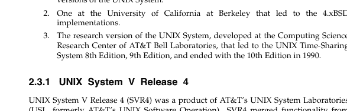

## 森林的主要功能

- 维持生物多样性
- 调节水循环
- 吸收二氧化碳并释放氧气
- 提供木材与其他林产品

### 2.3.2 4.4BSD

Berkeley 软件发行版（BSD）由加州大学伯克利分校计算机系统研究组（CSRG）制作并分发；4.2BSD 于 1983 年发布，4.3BSD 于 1986 年发布。这两个发行版均运行在 VAX 小型计算机上。下一个发行版 4.3BSD Tahoe 于 1988 年发布，也运行在名为 Tahoe 的特定小型计算机上。（Leffler 等人 [1989] 的书籍描述了 4.3BSD Tahoe 发行版。）随后在 1990 年发布了 4.3BSD Reno 发行版；4.3BSD Reno 支持许多 POSIX.1 功能。

原始的 BSD 系统包含专有的 AT&T 源代码，并受 AT&T 许可证约束。要获得 BSD 系统的源代码，你必须拥有来自 AT&T 的 UNIX 源代码许可证。随着时间的推移，越来越多的 AT&T 源代码被非 AT&T 源代码取代，并且伯克利系统添加的许多新功能源自非 AT&T 来源，这一情况发生了变化。

1989 年，伯克利确定了 4.3BSD Tahoe 发行版中大部分非 AT&T 源代码，并将其作为 BSD 网络软件 1.0 版公开发布。BSD 网络软件 2.0 版于 1991 年发布，源自 4.3BSD Reno 发行版。其意图是使 4.3BSD 系统的大部分，如果不是全部，都摆脱 AT&T 许可证限制，从而使源代码对所有人可用。

4.4BSD-Lite 旨在成为 CSRG 的最终发行版。然而，由于与 USL 的法律纠纷，其发布被推迟。一旦法律分歧得到解决，4.4BSD-Lite 于 1994 年发布，完全不受限制，因此无需 UNIX 源代码许可证即可接收。CSRG 在此之后于 1995 年发布了一个错误修复版本。此版本 4.4BSD-Lite 发布版 2 是 CSRG 的 BSD 最终版本。（该版本的 BSD 在 McKusick 等人 [1996] 的书籍中有所描述。）

伯克利进行的 UNIX 系统开发始于 PDP-11，然后转移到 VAX 小型计算机，然后转移到所谓的 workstation。在 1990 年代初期，为流行的基于 80386 的个人电脑提供了对伯克利的支持，导致了所谓的 386BSD。这种支持由 Bill Jolitz 提供，并在 1991 年全年在 Dr. Dobb's Journal 的一系列月度文章中进行了记录。其中大部分代码出现在 BSD 网络软件 2.0 版中。

### 2.3.3 FreeBSD

FreeBSD 基于 4.4BSD-Lite 操作系统。FreeBSD 项目成立是为了在加州大学伯克利分校计算科学研究组决定停止对 BSD 版本的 UNIX 操作系统的开发，并且 386BSD 项目似乎被忽视太久之后，继续 BSD 系列。

FreeBSD 项目生产的所有软件均以二进制和源代码形式自由提供。FreeBSD 8.0 操作系统是用于测试本书示例的四个操作系统之一。

### 2.3.4 Linux

Linux 是一种提供与 UNIX 系统类似的丰富编程环境的操作系统；它根据 GNU 公共许可证自由提供。Linux 在计算机行业中的流行程度在某种程度上是一种现象。Linux 的特点是通常是第一个支持新硬件的操作系统。

Linux 由 Linus Torvalds 于 1991 年创建，作为 MINIX 的替代品。随后出现了一场草根运动，世界各地的许多开发人员自愿花时间使用和增强它。

Linux 的 Ubuntu 12.04 发行版是用于测试本书示例的操作系统之一。该发行版使用 3.2.0 版本的 Linux 操作系统内核。

### 2.3.5 Mac OS X

Mac OS X 基于与以前版本完全不同的技术。核心操作系统称为“Darwin”，基于 Mach 内核（Accetta 等人 [1986]）、FreeBSD 操作系统以及用于驱动程序和其他内核扩展的面向对象框架的组合。自 10.5 版本起，Mac OS X 的 Intel 端口已通过认证为 UNIX 系统。（有关 UNIX 认证的更多信息，请参阅 .../.../.../.../www.opengroup.org/certification/idx/unix.html。）

Mac OS X 版本 10.6.8（Darwin 10.8.0）是用于测试本书示例的操作系统之一。

### 2.3.6 Solaris

Solaris 是 Sun Microsystems（现为 Oracle）开发的 UNIX 系统版本。Solaris 基于 System V Release 4，但包含了 Sun Microsystems 工程师超过十五年的增强。它可以说是唯一商业上成功的 SVR4 后裔，并且正式通过认证为 UNIX 系统。

2005 年，Sun Microsystems 将大部分 Solaris 操作系统源代码作为 OpenSolaris 开源操作系统的一部分公开发布，以期在 Solaris 周围建立外部开发社区。

Solaris 10 UNIX 系统是用于测试本书示例的操作系统之一。

### 2.3.7 Other UNIX Systems

过去获得认证的其他 UNIX 系统版本包括

- AIX，IBM 的 UNIX 系统版本
- HP-UX，Hewlett-Packard 的 UNIX 系统版本
- IRIX，Silicon Graphics 提供的 UNIX 系统版本
- UnixWare，由 SCO 出售的源自 SVR4 的 UNIX 系统

### 2.4 Relationship of Standards and Implementations

我们提到的标准定义了任何实际系统的子集。本书的重点是四个真实系统：FreeBSD 8.0、Linux 3.2.0、Mac OS X 10.6.8 和 Solaris 10。虽然只有 Mac OS X 和 Solaris 可以自称为 UNIX 系统，但这四者都提供类似的编程环境。由于这四者在不同程度上都符合 POSIX，因此我们还将集中于 POSIX.1 标准所需的功能，并指出 POSIX 与这四个系统的实际实现之间的任何差异。仅特定于特定实现的特性和例程已明确标记。我们还将指出在 UNIX 系统上必需但在其他 POSIX 兼容系统上可选的任何功能。

请注意，实现为早期版本中的功能提供向后兼容性，例如 SVR3.2 和 4.3BSD。例如，Solaris 同时支持非阻塞 I/O 的 POSIX.1 规范（O_NONBLOCK）和传统的 System V 方法（O_NDELAY）。在此文本中，我们仅使用 POSIX.1 功能，尽管我们会提及它所取代的非标准功能。同样，SVR3.2 和 4.3BSD 都以与 POSIX.1 标准不同方式提供了可靠信号。在第 10 章中，我们仅描述 POSIX.1 信号机制。

### 2.5 Limits

实现定义了许多魔数和常量。其中许多已被硬编码到程序中或使用临时技术确定。随着我们所描述的各种标准化工作，现在提供了更可移植的方法来确定这些魔数和实现定义的限制，大大提高了为 UNIX 环境编写的软件的可移植性。

需要两种类型的限制：

- 1. 编译时限制（例如，short 整数的最大值是多少？）
- 2. 运行时限制（例如，文件名中有多少字节？）

编译时限制可以在任何程序在编译时包含的头文件中定义。但运行时限制需要进程调用函数来获取限制值。

此外，一些限制在给定实现上可以是固定的——因此可以在头文件中静态定义——但在另一个实现上会变化并需要运行时函数调用。这种类型的限制的一个例子是文件名的最大字节数。在 SVR4 之前，System V 历史上只允许文件名 14 字节，而基于 BSD 的系统将该数字增加到 255。如今大多数 UNIX 系统实现都支持多种文件系统类型，每种类型都有自己的限制。这就是运行时限制取决于文件所在文件系统位置的情况。例如，根文件系统中的文件名可能有 14 字节的限制，而另一个文件系统中的文件名可能有 255 字节的限制。

为了解决这些问题，提供了三种类型的限制：

- 1. 编译时限制（头文件）


-   2. 与文件或目录无关的运行时限制（sysconf 函数）
-   3. 与文件或目录相关的运行时限制（pathconf 和 fpathconf 函数）

更令人困惑的是，如果某个运行时限制在给定系统上保持不变，它可以静态定义在头文件中。然而，如果没有在头文件中定义，应用程序就必须调用三个 conf 函数之一（我们很快就会介绍）来确定其在运行时的值。

| 名称 | 描述 | 最小可接受值 | 典型值 |
|---|---|---|---|
| CHAR_BIT | char 中的位数 | 8 | 8 |
| CHAR_MAX | char 的最大值 | （见后文） | 127 |
| CHAR_MIN | char 的最小值 | （见后文） | -128 |
| SCHAR_MAX | signed char 的最大值 | 127 | 127 |
| SCHAR_MIN | signed char 的最小值 | -127 | -128 |
| UCHAR_MAX | unsigned char 的最大值 | 255 | 255 |
| INT_MAX | int 的最大值 | 32,767 | 2,147,483,647 |
| INT_MIN | int 的最小值 | -32,767 | -2,147,483,648 |
| UINT_MAX | unsigned int 的最大值 | 65,535 | 4,294,967,295 |
| SHRT_MAX | short 的最大值 | 32,767 | 32,767 |
| SHRT_MIN | short 的最小值 | -32,767 | -32,768 |
| USHRT_MAX | unsigned short 的最大值 | 65,535 | 65,535 |
| LONG_MAX | long 的最大值 | 2,147,483,647 | 2,147,483,647 |
| LONG_MIN | long 的最小值 | -2,147,483,647 | -2,147,483,648 |
| ULONG_MAX | unsigned long 的最大值 | 4,294,967,295 | 4,294,967,295 |
| LLONG_MAX | long long 的最大值 | 9,223,372,036,854,775,807 | 9,223,372,036,854,775,807 |
| LLONG_MIN | long long 的最小值 | -9,223,372,036,854,775,807 | -9,223,372,036,854,775,808 |
| ULLONG_MAX | unsigned long long 的最大值 | 18,446,744,073,709,551,615 | 18,446,744,073,709,551,615 |
| MB_LEN_MAX | 多字节字符常量中的最大字节数 | 1 | 6 |

图 2.6 <limits.h> 中的整型值大小

## 2.5.1 ISO C 限制

ISO C 定义的所有编译时限制都定义在文件 <limits.h> 中（见图 2.6）。这些常量在给定系统中不会改变。图 2.6 中的第三列显示了 ISO C 标准的最小可接受值。这考虑到了使用反码运算的 16 位整数系统。第四列显示了使用补码运算的 32 位整数 Linux 系统的值。请注意，无符号数据类型都没有最小值，因为该值对于无符号数据类型必须为 0。在 64 位系统上，long 整数的最大值与 long long 整数的最大值一致。

我们会遇到的一个差异是系统提供的是有符号还是无符号字符值。从图 2.6 的第四列可以看出，这个特定系统使用有符号字符。我们看到 CHAR_MIN 等于 SCHAR_MIN，CHAR_MAX 等于 SCHAR_MAX。如果系统使用无符号字符，那么 CHAR_MIN 将等于 0，CHAR_MAX 将等于 UCHAR_MAX。

头文件 <float.h> 中的浮点数据类型有类似的一组定义。任何做严肃浮点工作的人都应该检查这个文件。

尽管 ISO C 标准规定了整型数据类型的最小可接受值，但 POSIX.1 对 C 标准进行了扩展。为了符合 POSIX.1，实现必须支持 INT_MAX 的最小值 2,147,483,647，INT_MIN 的最小值 -2,147,483,647，以及 UINT_MAX 的最小值 4,294,967,295。由于 POSIX.1 要求实现支持 8 位 char，因此 CHAR_BIT 必须为 8，SCHAR_MIN 必须为 -128，SCHAR_MAX 必须为 127，UCHAR_MAX 必须为 255。

我们将遇到的另一个 ISO C 常量是 FOPEN_MAX，它是实现保证可以同时打开的标准 I/O 流的最小数量。这个常量位于 <stdio.h> 头文件中，其最小值为 8。POSIX.1 中的 STREAM_MAX（如果定义）必须与 FOPEN_MAX 具有相同的值。

ISO C 还在 <stdio.h> 中定义了常量 TMP_MAX。它是 tmpnam 函数生成的唯一文件名的最大数量。我们将在第 5.13 节中进一步讨论这个常量。

虽然 ISO C 定义了常量 FILENAME_MAX，但我们避免使用它，因为 POSIX.1 提供了更好的替代方案（NAME_MAX 和 PATH_MAX）。我们很快就会看到这些常量。

图 2.7 显示了本书讨论的四个平台上 FILENAME_MAX、FOPEN_MAX 和 TMP_MAX 的值。

| 限制 | FreeBSD 8.0 | Linux 3.2.0 | Mac OS X 10.6.8 | Solaris 10 |
|---|---|---|---|---|
| FOPEN_MAX | 20 | 16 | 20 | 20 |
| TMP_MAX | 308,915,776 | 238,328 | 308,915,776 | 17,576 |
| FILENAME_MAX | 1024 | 4096 | 1024 | 1024 |

图 2.7 各种平台上的 ISO 限制

## 2.5.2 POSIX 限制

POSIX.1 定义了许多涉及操作系统实现限制的常量。遗憾的是，这是 POSIX.1 中较为令人困惑的方面之一。尽管 POSIX.1 定义了大量的限制和常量，但我们只关注那些影响基本 POSIX.1 接口的限制和常量。这些限制和常量分为以下七类：

-   1. 数值限制：LONG_BIT、SSIZE_MAX 和 WORD_BIT
-   2. 最小值：图 2.8 中的 25 个常量
-   3. 最大值：_POSIX_CLOCKRES_MIN
-   4. 运行时可增加值：CHARCLASS_NAME_MAX、COLL_WEIGHTS_MAX、LINE_MAX、NGROUPS_MAX 和 RE_DUP_MAX
-   5. 运行时不变值（可能不确定）：图 2.9 中的 17 个常量（外加在 12.2 节中引入的四个常量和在 14.5 节中引入的三个常量）
-   6. 其他不变值：NL_ARGMAX、NL_MSGMAX、NL_SETMAX 和 NL_TEXTMAX
-   7. 路径名变量值：FILESIZBITS、LINK_MAX、MAX_CANON、MAX_INPUT、NAME_MAX、PATH_MAX、PIPE_BUF 和 SYMLINK_MAX

在这些限制和常量中，有些可能定义在 <limits.h> 中，而其他一些则可能根据特定条件定义，也可能不定义。我们将在第 2.5.4 节中描述 sysconf、pathconf 和 fpathconf 函数时，说明这些可能定义也可能不定义的限制和常量。图 2.8 中显示了这 25 个最小值。

| 名称 | 描述：最大值的最小可接受值 ... | 值 |
|---|---|---|
| _POSIX_ARG_MAX | exec 函数的参数长度 | 4,096 |
| _POSIX_CHILD_MAX | 每个真实用户 ID 一次可以拥有的子进程数 | 25 |
| _POSIX_DELAYTIMER_MAX | 定时器到期溢出的次数 | 32 |
| _POSIX_HOST_NAME_MAX | gethostname 返回的主机名长度 | 255 |
| _POSIX_LINK_MAX | 指向一个文件的链接数 | 8 |
| _POSIX_LOGIN_NAME_MAX | 登录名的长度 | 9 |
| _POSIX_MAX_CANON | 终端规范输入队列中的字节数 | 255 |
| _POSIX_MAX_INPUT | 终端输入队列的可用空间 | 255 |
| _POSIX_NAME_MAX | 文件名中的字节数（不包括结尾的空字符） | 14 |
| _POSIX_NGROUPS_MAX | 每个进程同时拥有的补充组 ID 数量 | 8 |
| _POSIX_OPEN_MAX | 每个进程最多打开的文件数 | 20 |
| _POSIX_PATH_MAX | 路径名中的字节数（包括结尾的空字符） | 256 |
| _POSIX_PIPE_BUF | 可以原子写入管道的字节数 | 512 |
| _POSIX_RE_DUP_MAX | 使用区间表示法 \{m,n\} 时，regexec 和 regcomp 函数允许的基本正则表达式重复次数 | 255 |
| _POSIX_RTSIG_MAX | 为应用程序保留的实时信号数量 | 8 |
| _POSIX_SEM_NSEMS_MAX | 一个进程一次可以使用的信号量个数 | 256 |
| _POSIX_SEM_VALUE_MAX | 信号量可以保存的值 | 32,767 |
| _POSIX_SIGQUEUE_MAX | 一个进程可以发送并保持未决的排队信号数 | 32 |
| _POSIX_SSIZE_MAX | 可存储在 ssize_t 对象中的值 | 32,767 |
| _POSIX_STREAM_MAX | 一个进程一次可以打开的标准 I/O 流数 | 8 |
| _POSIX_SYMLINK_MAX | 符号链接中的字节数 | 255 |
| _POSIX_SYMLOOP_MAX | 路径名解析过程中可以遍历的符号链接数 | 8 |
| _POSIX_TIMER_MAX | 每个进程的定时器数 | 32 |
| _POSIX_TTY_NAME_MAX | 终端设备名称的长度（包括结尾的空字符） | 9 |
| _POSIX_TZNAME_MAX | 时区名称的字节数 | 6 |

图 2.8 <limits.h> 中的 POSIX.1 最小值


这些最小值不会因系统而异。它们指定了这些特性的最严格值。符合 POSIX.1 的实现必须提供至少这么大的值。这就是为什么它们被称为最小值，尽管它们的名称都包含 MAX。此外，为了确保可移植性，严格符合规范的应用程序不得要求更大的值。我们在文中逐步介绍时会说明这些常量各自的含义。

> 严格符合 POSIX 的应用程序与仅仅符合 POSIX 的应用程序不同。符合 POSIX 的应用程序仅使用 IEEE 标准 1003.1-2008 中定义的接口。严格符合 POSIX 的应用程序必须满足进一步的限制，例如不依赖任何未定义行为、不使用任何已废弃的接口，并且不得要求常量的值大于图 2.8 中所示的最小值。

| Name | Description | Minimum acceptable value |
|---|---|---|
| `ARG_MAX` | maximum length of arguments to exec functions | `POSIX_ARG_MAX` |
| `ATEXIT_MAX` | maximum number of functions that can be registered with the atexit function | 32 |
| `CHILD_MAX` | maximum number of child processes per real user ID | `_POSIX_CHILD_MAX` |
| `DELAYTIMER_MAX` | maximum number of timer expiration overruns | `_POSIX_DELAYTIMER_MAX` |
| `HOST_NAME_MAX` | maximum length of a host name as returned by gethostname | `_POSIX_HOST_NAME_MAX` |
| `LOGIN_NAME_MAX` | maximum length of a login name | `_POSIX_LOGIN_NAME_MAX` |
| `OPEN_MAX` | one more than the maximum value assigned to a newly created file descriptor | `_POSIX_OPEN_MAX` |
| `PAGESIZE` | system memory page size, in bytes | 1 |
| `RTSIG_MAX` | maximum number of real-time signal queues reserved for application use | `_POSIX_RTSIG_MAX` |
| `SEM_NSEMS_MAX` | maximum number of semaphores a process can use | `_POSIX_SEM_NSEMS_MAX` |
| `SEM_VALUE_MAX` | maximum value of a semaphore | `_POSIX_SEM_VALUE_MAX` |
| `SIGQUEUE_MAX` | maximum number of signals that can be queued for a process | `_POSIX_SIGQUEUE_MAX` |
| `STREAM_MAX` | maximum number of standard I/O streams a process can have open at once | `_POSIX_STREAM_MAX` |
| `SYMLOOP_MAX` | number of symbolic links that can be traversed during pathname resolution | `_POSIX_SYMLOOP_MAX` |
| `TIMER_MAX` | maximum number of timers per process | `_POSIX_TIMER_MAX` |
| `TTY_NAME_MAX` | length of a terminal device name, including the terminating null | `_POSIX_TTY_NAME_MAX` |
| `TZNAME_MAX` | number of bytes for the name of a time zone | `_POSIX_TZNAME_MAX` |

*Figure 2.9* POSIX.1 runtime invariant values from `<limits.h>`

不幸的是，其中一些不变的最小值太小而无法实际使用。例如，今天大多数 UNIX 系统为每个进程提供的打开文件数远不止 20 个。此外，`_POSIX_PATH_MAX` 的最小限制 256 也太小。路径名可能超过此限制。这意味着我们不能在编译时将两个常量 `_POSIX_OPEN_MAX` 和 `_POSIX_PATH_MAX` 用作数组大小。

图 2.8 中的每个 25 个不变最小值都有一个关联的实现值，其名称是通过从图 2.8 中的名称中去掉 _POSIX_ 前缀形成的。去掉前导 _POSIX_ 的名称本意是给定实现所支持的实际值。 （这 25 个实现值来自我们本节前面列出的项目 1、4、5 和 7 中的：2 个运行时可增加值、15 个运行时不变值和 7 个路径名可变值，以及来自数值值的 SSIZE_MAX。）问题是，并非所有 25 个实现值都保证在 `<limits.h>` 头文件中定义。

例如，如果给定进程的实际值取决于系统上的内存量，则该特定值可能不会包含在头文件中。如果值未在头文件中定义，我们就不能在编译时将它们用作数组边界。为了在运行时确定实际的实现值，POSIX.1 决定为我们提供三个可调用的函数——sysconf、pathconf 和 fpathconf。然而仍然存在一个问题，因为 POSIX.1 将其中的一些值定义为可能“不确定” （逻辑上无限）。这意味着该值没有实际的上限。例如，在 Solaris 上，您可以用 atexit 注册以便在进程结束时运行的函数数量仅受系统内存量的限制。因此在 Solaris 上 ATEXIT_MAX 被认为是未确定的。我们将在第 2.5.5 节中回到这个不确定运行时限制的问题。

## 2.5.3 XSI Limits

XSI 选项还定义了表示实现限制的常量。它们包括：

- 1. 最小值：图 2.10 中的五个常量
- 2. 运行时不变值，可能不确定：IOV_MAX 和 PAGE_SIZE

最小值列在图 2.10 中。后两个说明了 POSIX.1 最小值太小的情况—— presumably 为了允许嵌入式 POSIX.1 实现，因此为 XSI 符合系统添加了具有更大最小值的符号。

| Name | Description | Minimum acceptable value | Typical value |
|---|---|---|---|
| NL_LANGMAX | maximum number of bytes in LANG environment variable | 14 | 14 |
| NZERO | default process priority | 20 | 20 |
| _XOPEN_IOV_MAX | maximum number of iovec structures that can be used with readv or writev | 16 | 16 |
| _XOPEN_NAME_MAX | number of bytes in a filename | 255 | 255 |
| _XOPEN_PATH_MAX | number of bytes in a pathname | 1,024 | 1,024 |

Figure 2.10 XSI minimum values from <limits.h>

```
printf("\n")
printf("\tif (argc != 2)\n")
printf("\t\t_err_quit(\"usage: a.out <dirname>\");\n\n")
FS="+t"
while (getline <"sysconf.sym" > 0) {
    printf("#ifdef %s\n", $1)
    printf("\tprintf(\"%s defined to be %%ld\\n\", (long)%s+0);\n",
           $1, $1)
    printf("#else\n")
    printf("\tprintf(\"no symbol for %s\\n\");\n", $1)
    printf("#endif\n")
    printf("#ifdef %s\n", $2)
    printf("\tpr_sysconf(\"%s =\", %s);\n", $1, $2)
    printf("#else\n")
    printf("\tprintf(\"no symbol for %s\\n\");\n", $2)
    printf("#endif\n")
}
close("sysconf.sym")
while (getline <"pathconf.sym" > 0) {
    printf("#ifdef %s\n", $1)
    printf("\tprintf(\"%s defined to be %%ld\\n\", (long)%s+0);\n",
           $1, $1)
    printf("#else\n")
    printf("\tprintf(\"no symbol for %s\\n\");\n", $1)
    printf("#endif\n")
    printf("#ifdef %s\n", $2)
    printf("\tpr_pathconf(\"%s =\", argv[1], %s);\n", $1, $2)
    printf("#else\n")
    printf("\tprintf(\"no symbol for %s\\n\");\n", $2)
    printf("#endif\n")
}
close("pathconf.sym")
exit
}
END {
printf("\texit(0);\n")
printf("\n\n")
printf("static void\n")
printf("pr_sysconf(char *mesg, int name)\n")
printf("{\n")
printf("\tlong val;\n\n")
printf("\tfputs(mesg, stdout);\n")
printf("\terrno = 0;\n")
printf("\tif (val = sysconf(name)) < 0) {\n")
printf("\t\tif (errno != 0) {\n")
printf("\t\t\tif (errno == EINVAL)\n")
printf("\t\t\t\tfputs(\" (not supported)\\n\", stdout);\n")
printf("\t\t\telse\n")
printf("\t\t\t\t_err_sys(\"sysconf error\");\n")
printf("\t\t} else {\n")
printf("\t\t\tfputs(\" (no limit)\\n\", stdout);\n")
```

```
printf("\t\t}\\n")
printf("\t) else {\\n")
printf("\t\tprintf(\" %%ld\\n\\", val);\\n")
printf("\t}\\n")
printf("}\\n")
printf("static void\\n")
printf("pr_pathconf(char *mesg, char *path, int name)\\n")
printf("{\\n")
printf("\tlong val;\\n")
printf("\\n")
printf("\ttfputs(mesg, stdout);\\n")
printf("\terrno = 0;\\n")
printf("\tif (val = pathconf(path, name)) < 0) {\\n")
printf("\t\tif (errno != 0) {\\n")
printf("\t\t\tif (errno == EINVAL)\\n")
printf("\t\t\t\ttfputs(\" (not supported)\\n\\", stdout);\\n")
printf("\t\t} else\\n")
printf("\t\t\tterr_sys(\"pathconf error, path = %%s\\", path);\\n")
printf("\t} else\\n")
printf("\t\ttfputs(\" (no limit)\\n\\", stdout);\\n")
printf("\t} else {\\n")
printf("\t\tprintf(\" %%ld\\n\\", val);\\n")
printf("\t}\\n")
printf("}\\n")
```

# Figure 2.13 Build C program to print all supported configuration limits

awk 程序读取两个输入文件——pathconf.sym 和 sysconf.sym——其中包含由制表符分隔的限制名称和符号。并非所有符号都在每个平台上定义，因此 awk 程序用必要的 #ifdef 语句将每次对 pathconf 和 sysconf 的调用包围起来。

例如，awk 程序将输入文件中的一行

```
NAME_MAX          _PC_NAME_MAX
```

转换为以下 C 代码：

```
#ifdef NAME_MAX
printf("NAME_MAX is defined to be %d\n", NAME_MAX+0);
#else
printf("no symbol for NAME_MAX\n");
#endif
#ifdef _PC_NAME_MAX
pr_pathconf("NAME_MAX =", argv[1], _PC_NAME_MAX);
#else
printf("no symbol for _PC_NAME_MAX\n");
#endif
```

图 2.14 中由 awk 程序生成的程序打印所有这些限制，并处理限制未定义的情况。


#include "apue.h"
#include <errno.h>
#include <limits.h>

static void pr_sysconf(char *, int);
static void pr_pathconf(char *, char *, int);

int
main(int argc, char *argv[])
{
    if (argc != 2)
        err_quit("usage: a.out <dirname>");

#ifdef ARG_MAX
    printf("ARG_MAX defined to be %ld\n", (long)ARG_MAX+0);
#else
    printf("no symbol for ARG_MAX\n");
#endif
#ifdef _SC_ARG_MAX
    pr_sysconf("ARG_MAX =", _SC_ARG_MAX);
#else
    printf("no symbol for _SC_ARG_MAX\n");
#endif
    /* similar processing for all the rest of the sysconf symbols... */

#ifdef MAX_CANON
    printf("MAX_CANON defined to be %ld\n", (long)MAX_CANON+0);
#else
    printf("no symbol for MAX_CANON\n");
#endif
#ifdef _PC_MAX_CANON
    pr_pathconf("MAX_CANON =", argv[1], _PC_MAX_CANON);
#else
    printf("no symbol for _PC_MAX_CANON\n");
#endif
    /* similar processing for all the rest of the pathconf symbols... */
    exit(0);
}
static void
pr_sysconf(char *mesg, int name)
{
    long val;
    fputs(mesg, stdout);
    errno = 0;
    if ((val = sysconf(name)) < 0) {
        if (errno != 0) {
            if (errno == EINVAL)
                fputs(" (not supported)\n", stdout);
            else
                err_sys("sysconf error");
        } else {
            fputs(" (no limit)\n", stdout);
        }
    } else {
        printf(" %ld\n", val);
    }
}

static void
pr_pathconf(char *mesg, char *path, int name)
{
    long val;

    fputs(mesg, stdout);
    errno = 0;
    if ((val = pathconf(path, name)) < 0) {
        if (errno != 0) {
            if (errno == EINVAL)
                fputs(" (not supported)\n", stdout);
            else
                err_sys("pathconf error, path = %s", path);
        } else {
            fputs(" (no limit)\n", stdout);
        }
    } else {
        printf(" %ld\n", val);
    }
}

### Figure 2.14 Print all possible sysconf and pathconf values

Figure 2.15 summarizes the results from Figure 2.14 for the four systems we discuss in this book. The entry "no symbol" means that the system doesn't provide a corresponding _SC or _PC symbol to query the value of the constant. Thus the limit is undefined in this case. In contrast, the entry "unsupported" means that the symbol is defined by the system but unrecognized by the sysconf or pathconf functions. The entry "no limit" means that the system defines the limit for the constant, but this doesn't mean that the limit is infinite; it just means that the limit is indeterminate.

Beware that some limits are reported incorrectly. For example, on Linux, SYMLOOP_MAX is reportedly unlimited, but an examination of the source code reveals that there is actually a hard-coded limit of 40 for the number of consecutive symbolic links traversed in the absence of a loop (see the follow_link function in fs/namei.c).

Another potential source of inaccuracy in Linux is that the pathconf and fpathconf functions are implemented in the C library. The configuration limits returned by these functions depend on the underlying file system type, so if your file system is unknown to the C library, the functions return an educated guess.

We'll see in Section 4.14 that UFS is the SVR4 implementation of the Berkeley fast file system. PCFS is the MS-DOS FAT file system implementation for Solaris.

| Limit | FreeBSD 8.0 | Linux 3.2.0 | Mac OS X 10.6.8 | Solaris 10 |  |
|---|---|---|---|---|---|
|  |  |  |  | UFS file system | PCFS file system |
| ARG_MAX | 262,144 | 2,097,152 | 262,144 | 2,096,640 | 2,096,640 |
| ATEXIT_MAX | 32 | 2,147,483,647 | 2,147,483,647 | no limit | no limit |
| CHARCLASS_NAME_MAX | no symbol | 2,048 | 14 | 14 | 14 |
| CHILD_MAX | 1,760 | 47,211 | 266 | 8,021 | 8,021 |
| clock ticks/second | 128 | 100 | 100 | 100 | 100 |
| COLL_WEIGHTS_MAX | 0 | 255 | 2 | 10 | 10 |
| FILESIZEBITS | 64 | 64 | 64 | 41 | unsupported |
| HOST_NAME_MAX | 255 | 64 | 255 | 255 | 255 |
| IOV_MAX | 1,024 | 1,024 | 1024 | 16 | 16 |
| LINE_MAX | 2,048 | 2,048 | 2,048 | 2,048 | 2,048 |
| LINK_MAX | 32,767 | 65,000 | 32,767 | 32,767 | 1 |
| LOGIN_NAME_MAX | 17 | 256 | 255 | 9 | 9 |
| MAX_CANON | 255 | 255 | 1,024 | 256 | 256 |
| MAX_INPUT | 255 | 255 | 1,024 | 512 | 512 |
| NAME_MAX | 255 | 255 | 255 | 255 | 8 |
| NGROUPS_MAX | 1,023 | 65,536 | 16 | 16 | 16 |
| OPEN_MAX | 3,520 | 1,024 | 256 | 256 | 256 |
| PAGESIZE | 4,096 | 4,096 | 4,096 | 8,192 | 8,192 |
| PAGE_SIZE | 4,096 | 4,096 | 4,096 | 8,192 | 8,192 |
| PATH_MAX | 1,024 | 4,096 | 1,024 | 1,024 | 1,024 |
| PIPE_BUF | 512 | 4,096 | 512 | 5,120 | 5,120 |
| RE_DUP_MAX | 255 | 32,767 | 255 | 255 | 255 |
| STREAM_MAX | 3,520 | 16 | 20 | 256 | 256 |
| SYMLINK_MAX | 1,024 | no limit | 255 | 1,024 | 1,024 |
| SYMLOOP_MAX | 32 | no limit | 32 | 20 | 20 |
| TTY_NAME_MAX | 255 | 32 | 255 | 128 | 128 |
| TZNAME_MAX | 255 | 6 | 255 | no limit | no limit |

Figure 2.15 Examples of configuration limits

## 2.5.5 Indeterminate Runtime Limits

We mentioned that some of the limits can be indeterminate. The problem we encounter is that if these limits aren’t defined in the <limits.h> header, we can’t use them at compile time. But they might not be defined at runtime if their value is indeterminate! Let’s look at two specific cases: allocating storage for a pathname and determining the number of file descriptors.

### Pathnames

Many programs need to allocate storage for a pathname. Typically, the storage has been allocated at compile time, and various magic numbers—few of which are the correct value—have been used by different programs as the array size: 256, 512, 1024, or the standard I/O constant BUFSIZ. The 4.3BSD constant MAXPATHLEN in the header <sys/param.h> is the correct value, but many 4.3BSD applications didn’t use it.

POSIX.1 tries to help with the PATH_MAX value, but if this value is indeterminate, we’re still out of luck. Figure 2.16 shows a function that we’ll use throughout this text to allocate storage dynamically for a pathname.

If the constant PATH_MAX is defined in <limits.h>, then we’re all set. If it’s not, then we need to call pathconf. The value returned by pathconf is the maximum size of a relative pathname when the first argument is the working directory, so we specify the root as the first argument and add 1 to the result. If pathconf indicates that PATH_MAX is indeterminate, we have to punt and just guess a value.

Versions of POSIX.1 prior to 2001 were unclear as to whether PATH_MAX included a null byte at the end of the pathname. If the operating system implementation conforms to one of these prior versions and doesn’t conform to any version of the Single UNIX Specification (which does require the terminating null byte to be included), we need to add 1 to the amount of memory we allocate for a pathname, just to be on the safe side.

The correct way to handle the case of an indeterminate result depends on how the allocated space is being used. If we are allocating space for a call to getcwd, for example—to return the absolute pathname of the current working directory; see Section 4.23—and if the allocated space is too small, an error is returned and errno is set to ERANGE. We could then increase the allocated space by calling realloc (see Section 7.8 and Exercise 4.16) and try again. We could keep doing this until the call to getcwd succeeded.

```
#include "apue.h"
#include <errno.h>
#include <limits.h>

#ifdef PATH_MAX
static long pathmax = PATH_MAX;
#else
static long pathmax = 0;
#endif

static long posix_version = 0;
static long xsi_version = 0;

/* If PATH_MAX is indeterminate, no guarantee this is adequate */
#define PATH_MAX_GUESS 1024

char *
path_alloc(size_t *sizep) /* also return allocated size, if nonnull */
{
    char *ptr;
    size_t size;

    if (posix_version == 0)
        posix_version = sysconf(_SC_VERSION);

    if (xsi_version == 0)
        xsi_version = sysconf(_SC_XOPEN_VERSION);

    if (pathmax == 0) {    /* first time through */
```

For example, we can use the `ulimit` command built into the Bourne-again shell to change the maximum number of files our processes can have open at one time. This generally requires special (superuser) privileges if the limit is to be effectively unlimited. But once set to infinite, sysconf will report `LONG_MAX` as the limit for `OPEN_MAX`. A program that relies on this value as the upper bound of file descriptors to close, as shown in Figure 2.17, will waste a lot of time trying to close 2,147,483,647 file descriptors, most of which aren't even in use.

Systems that support the XSI option in the Single UNIX Specification will provide the `getrlimit(2)` function (Section 7.11). It can be used to return the maximum number of descriptors that a process can have open. With it, we can detect that there is no configured upper bound to the number of open files our processes can open, so we can avoid this problem.

> The `OPEN_MAX` value is called runtime invariant by POSIX, meaning that its value should not change during the lifetime of a process. But on systems that support the XSI option, we can call the `getrlimit(2)` function (Section 7.11) to change this value for a running process. (This value can also be changed from the C shell with the `limit` command, and from the Bourne-again, Debian Almquist, and Korn shells with the `ulimit` command.) If our system supports this functionality, we could change the function in Figure 2.17 to call `sysconf` every time it is called, not just the first time.

## 2.6 Options

We saw the list of POSIX.1 options in Figure 2.5 and discussed XSI option groups in Section 2.2.3. If we are to write portable applications that depend on any of these optionally supported features, we need a portable way to determine whether an implementation supports a given option.

Just as with limits (Section 2.5), POSIX.1 defines three ways to do this.

- 1. Compile-time options are defined in `<unistd.h>`.
- 2. Runtime options that are not associated with a file or a directory are identified with the `sysconf` function.
- 3. Runtime options that are associated with a file or a directory are discovered by calling either the `pathconf` or the `fpathconf` function.

The options include the symbols listed in the third column of Figure 2.5, as well as the symbols listed in Figures 2.19 and 2.18. If the symbolic constant is not defined, we must use `sysconf`, `pathconf`, or `fpathconf` to determine whether the option is supported. In this case, the *name* argument to the function is formed by replacing the `_POSIX` at the beginning of the symbol with `_SC` or `_PC`. For constants that begin with `_OPEN`, the *name* argument is formed by prepending the string with `_SC` or `_PC`. For example, if the constant `_POSIX_RAW_SOCKETS` is undefined, we can call `sysconf` with the *name* argument set to `_SC_RAW_SOCKETS` to determine whether the platform supports the raw sockets option. If the constant `_XOPEN_UNIX` is undefined, we can call `sysconf` with the *name* argument set to `_SC_XOPEN_UNIX` to determine whether the platform supports the XSI option interfaces.


对于每个选项，平台的支持状态有三种可能性。

+   1. 如果符号常量未定义或定义为值 -1，则对应的选项在编译时不被平台支持。可以在选项得到支持的新系统上运行旧应用程序，因此运行时检查可能会表明选项得到支持，即使在应用程序编译时该选项并未得到支持。
+   2. 如果符号常量定义为大于零，则对应的选项得到支持。
+   3. 如果符号常量定义为等于零，则我们必须调用 sysconf、pathconf 或 fpathconf 来确定选项是否得到支持。

使用 pathconf 和 fpathconf 的符号常量总结在图 2.18 中。图 2.19 总结了除图 2.5 中列出者之外可与 sysconf 一起使用的非过时选项及其符号常量。请注意，我们省略了与实用程序命令相关的选项。

与系统限制一样，关于 sysconf、pathconf 和 fpathconf 如何处理选项，有几点需要注意。

+   1. _SC_VERSION 返回的值表示标准的四位年份和两位月份。此值可以是 198808L、199009L、199506L，或标准后续版本的某个其他值。Single UNIX Specification 版本 3 的关联值为 200112L（POSIX.1 的 2001 版）。Single UNIX Specification 版本 4 的关联值（POSIX.1 的 2008 版）为 200809L。
+   2. _SC_XOPEN_VERSION 返回的值表示系统支持的 XSI 版本。Single UNIX Specification 版本 3 的关联值为 600。Single UNIX Specification 版本 4 的关联值（POSIX.1 的 2008 版）为 700。
+   3. 值 _SC_JOB_CONTROL、_SC_SAVED_IDS 和 _PC_VDISABLE 不再代表可选功能。尽管 XPG4 及之前版本的 Single UNIX Specification 要求支持这些功能，但 Single UNIX Specification 版本 3 是这些功能在 POSIX.1 中不再可选的最早版本。这些符号为向后兼容而保留。
+   4. 符合 POSIX.1-2008 的平台还必须支持以下选项：

+   - _POSIX_ASYNCHRONOUS_IO
+   - _POSIX_BARRIERS
+   - _POSIX_CLOCK_SELECTION
+   - _POSIX_MAPPED_FILES
+   - _POSIX_MEMORY_PROTECTION
+   - `_POSIX_READER_WRITER_LOCKS`
+   - `_POSIX_REALTIME_SIGNALS`
+   - `_POSIX_SEMAPHORES`
+   - `_POSIX_SPIN_LOCKS`
+   - `_POSIX_THREAD_SAFE_FUNCTIONS`
+   - `_POSIX_THREADS`
+   - `_POSIX_TIMEOUTS`
+   - `_POSIX_TIMERS`

这些常量定义为值 200809L。对应的 _SC 符号也为向后兼容而保留。

+   5. `_PC_CHOWN_RESTRICTED` 和 `_PC_NO_TRUNC` 如果在指定的 *pathname* 或 *fd* 上不支持该功能，则在不改变 `errno` 的情况下返回 -1。在所有符合 POSIX 的系统上，返回值将大于零（表示该功能得到支持）。
+   6. `_PC_CHOWN_RESTRICTED` 引用的文件必须是文件或目录。如果是目录，则返回值表示该选项是否适用于该目录内的文件。
+   7. `_PC_NO_TRUNC` 和 `_PC_2_SYMLINKS` 引用的文件必须是目录。
+   8. 对于 `_PC_NO_TRUNC`，返回值适用于目录内的文件名。
+   9. `_PC_VDISABLE` 引用的文件必须是终端文件。
+   10. 对于 `_PC_ASYNC_IO`、`_PC_PRIO_IO` 和 `_PC_SYNC_IO`，引用的文件不得是目录。

| 选项名称 | 表示 ... | name 参数 |
|---|---|---|
| `_POSIX_CHOWN_RESTRICTED` | chown 的使用是否受限 | `_PC_CHOWN_RESTRICTED` |
| `_POSIX_NO_TRUNC` | 文件名长于 NAME_MAX 是否生成错误 | `_PC_NO_TRUNC` |
| `_POSIX_VDISABLE` | 如果已定义，则可使用此值禁用终端特殊字符 | `_PC_VDISABLE` |
| `_POSIX_ASYNC_IO` | 是否可对关联文件使用异步 I/O | `_PC_ASYNC_IO` |
| `_POSIX_PRIO_IO` | 是否可对关联文件使用优先级 I/O | `_PC_PRIO_IO` |
| `_POSIX_SYNC_IO` | 是否可对关联文件使用同步 I/O | `_PC_SYNC_IO` |
| `_POSIX2_SYMLINKS` | 目录是否支持符号链接 | `_PC_2_SYMLINKS` |

图 2.18 pathconf 和 fpathconf 的选项及名称参数

| 选项名称 | 表示 | name 参数 |
|---|---|---|
| `_POSIX_ASYNCHRONOUS_IO` | 实现是否支持 POSIX 异步 I/O | `_SC_ASYNCHRONOUS_IO` |
| `_POSIX_BARRIERS` | 实现是否支持屏障 | `_SC_BARRIERS` |
| `_POSIX_CLOCK_SELECTION` | 实现是否支持时钟选择 | `_SC_CLOCK_SELECTION` |
| `_POSIX_JOB_CONTROL` | 实现是否支持作业控制 | `_SC_JOB_CONTROL` |
| `_POSIX_MAPPED_FILES` | 实现是否支持内存映射文件 | `_SC_MAPPED_FILES` |
| `_POSIX_MEMORY_PROTECTION` | 实现是否支持内存保护 | `_SC_MEMORY_PROTECTION` |
| `_POSIX_READER_WRITER_LOCKS` | 实现是否支持读写锁 | `_SC_READER_WRITER_LOCKS` |
| `_POSIX_REALTIME_SIGNALS` | 实现是否支持实时信号 | `_SC_REALTIME_SIGNALS` |
| `_POSIX_SAVED_IDS` | 实现是否支持保存的 set-user-ID 和保存的 set-group-ID | `_SC_SAVED_IDS` |
| `_POSIX_SEMAPHORES` | 实现是否支持 POSIX 信号量 | `_SC_SEMAPHORES` |
| `_POSIX_SHELL` | 实现是否支持 POSIX shell | `_SC_SHELL` |
| `_POSIX_SPIN_LOCKS` | 实现是否支持自旋锁 | `_SC_SPIN_LOCKS` |
| `_POSIX_THREAD_SAFE_FUNCTIONS` | 实现是否支持线程安全函数 | `_SC_THREAD_SAFE_FUNCTIONS` |
| `_POSIX_THREADS` | 实现是否支持线程 | `_SC_THREADS` |
| `_POSIX_TIMEOUTS` | 实现是否支持所选函数的基于超时的变体 | `_SC_TIMEOUTS` |
| `_POSIX_TIMERS` | 实现是否支持定时器 | `_SC_TIMERS` |
| `_POSIX_VERSION` | POSIX.1 版本 | `_SC_VERSION` |
| `_XOPEN_CRYPT` | 实现是否支持 XSI 加密选项组 | `_SC_XOPEN_CRYPT` |
| `_XOPEN_REALTIME` | 实现是否支持 XSI 实时选项组 | `_SC_XOPEN_REALTIME` |
| `_XOPEN_REALTIME_THREADS` | 实现是否支持 XSI 实时线程选项组 | `_SC_XOPEN_REALTIME_THREADS` |
| `_XOPEN_SHM` | 实现是否支持 XSI 共享内存选项组 | `_SC_XOPEN_SHM` |
| `_XOPEN_VERSION` | XSI 版本 | `_SC_XOPEN_VERSION` |

图 2.19 sysconf 的选项及名称参数

图 2.20 显示了我们在本教材中讨论的四个示例系统上的几个配置选项及其对应值。条目为“unsupported”，如果系统定义了符号常量但其值为 −1，或者其值为 0 但对应的 sysconf 或 pathconf 调用返回了 −1。有趣的是，一些系统实现尚未跟上 Single UNIX Specification 的最新版本。

| 限制 | FreeBSD 8.0 | Linux 3.2.0 | Mac OS X 10.6.8 | Solaris 10 — UFS 文件系统 | Solaris 10 — PCFS 文件系统 |
|---|---:|---:|---:|---:|---:|
| `_POSIX_CHOWN_RESTRICTED` | 1 | 1 | 200112 | 1 | 1 |
| `_POSIX_JOB_CONTROL` | 1 | 1 | 200112 | 1 | 1 |
| `_POSIX_NO_TRUNC` | 1 | 1 | 200112 | 1 | unsupported |
| `_POSIX_SAVED_IDS` | unsupported | 1 | 200112 | 1 | 1 |
| `_POSIX_THREADS` | 200112 | 200809 | 200112 | 200112 | 200112 |
| `_POSIX_VDISABLE` | 255 | 0 | 255 | 0 | 0 |
| `_POSIX_VERSION` | 200112 | 200809 | 200112 | 200112 | 200112 |
| `_XOPEN_UNIX` | unsupported | 1 | 1 | 1 | 1 |
| `_XOPEN_VERSION` | unsupported | 700 | 600 | 600 | 600 |

**图 2.20** 配置选项示例

请注意，当 pathconf 与 Solaris 上的 PCFS 文件系统中的文件一起使用时，_PC_NO_TRUNC 返回值为 −1。PCFS 文件系统支持 DOS 格式（用于软盘），并且 DOS 文件名会被静默截断为 DOS 文件系统要求的 8.3 格式限制。

## 2.7 功能测试宏

头文件定义了众多 POSIX.1 和 XSI 符号，如我们所述。即使如此，大多数实现仍可向这些头文件添加自己的定义，除 POSIX.1 和 XSI 定义之外。如果我们想编译一个程序，使其仅依赖于 POSIX 定义并且不与任何实现定义的常量冲突，我们需要定义常量 _POSIX_C_SOURCE。所有 POSIX.1 头文件都使用此常量，在定义 _POSIX_C_SOURCE 时排除任何实现定义的定义。

> POSIX.1 标准的旧版本定义了 _POSIX_SOURCE 常量。这在 POSIX.1 的 2001 版本中被 _POSIX_C_SOURCE 常量取代。

常量 _POSIX_C_SOURCE 和 _XOPEN_SOURCE 被称为 *功能测试宏*。所有功能测试宏都以下划线开头。使用时，它们通常在 cc 命令中定义，如

```
cc -D_POSIX_C_SOURCE=200809L file.c
```


这会使得特性测试宏在C程序包含任何头文件之前被定义。如果只想使用POSIX.1定义，我们也可以将源文件的第一行设置为

```
#define _POSIX_C_SOURCE  200809L
```

为了启用单UNIX规范第4版的XSI选项，我们需要将常量_XOPEN_SOURCE定义为700。除了启用XSI选项之外，就POSIX.1功能而言，这与将_POSIX_C_SOURCE定义为200809L具有相同的效果。

单UNIX规范将c99实用程序定义为C编译环境的接口。使用它我们可以如下编译文件：

```
c99 -D_XOPEN_SOURCE=700 file.c -o file
```

要在gcc C编译器中启用1999 ISO C扩展，我们使用-std=c99选项，如下所示：

```
gcc -D_XOPEN_SOURCE=700 -std=c99 file.c -o file
```

## 2.8 原始系统数据类型

历史上，某些C数据类型一直与某些UNIX系统变量相关联。例如，主设备号和次设备号历来存储在一个16位短整数中，其中8位用于主设备号，8位用于次设备号。但许多更大的系统需要超过256个设备号值，因此需要一种不同的技术。（实际上，Solaris的32位版本使用32位表示设备号：主设备号14位，次设备号18位。）

头文件<sys/types.h>定义了一些依赖于实现的数据类型，称为*原始系统数据类型*。其他头文件也定义了更多这样的数据类型。这些数据类型在头文件中使用C的typedef机制定义。大多数以_t结尾。图2.21列出了我们在本文中会遇到的一些原始系统数据类型。

通过这种方式定义这些数据类型，我们不会在程序中嵌入可能因系统而异的实现细节。我们将在后文中遇到这些数据类型时描述它们的用途。

## 2.9 标准之间的差异

总而言之，这些不同的标准很好地协调在一起。我们主要关心ISO C标准与POSIX.1之间的差异，因为单UNIX规范的基础规范与POSIX.1是同一回事。冲突并非有意为之，但一旦出现，POSIX.1应服从ISO C标准。然而，两者之间仍存在一些差异。

ISO C定义clock函数返回进程使用的CPU时间量。返回的值是clock_t类型，但ISO C没有指定其单位。要将其转换为秒，需要除以<time.h>头文件中定义的CLOCKS_PER_SEC。POSIX.1定义了times函数，它同时返回CPU时间（包括调用者及其所有已终止子进程）和时钟时间。所有这些时间值都是clock_t类型。sysconf函数用于获取每秒的时钟滴答数，以便与times函数的返回值配合使用。这里我们看到，同样的数据类型（clock_t）被用于保存ISO C和POSIX.1以不同单位定义的时间度量。这种差异可以在Solaris中看到：clock返回微秒（因此CLOCKS_PER_SEC为100万），而sysconf返回每秒时钟滴答数为100。因此，在使用clock_t类型的变量时必须小心，不要混淆不同单位的变量。

| 类型 | 描述 |
|---|---|
| clock_t | 时钟滴答计数器（进程时间）（第1.10节） |
| comp_t | 压缩时钟滴答（POSIX.1未定义；见第8.14节） |
| dev_t | 设备号（主和次）（第4.24节） |
| fd_set | 文件描述符集（第4.4.1节） |
| fpos_t | 文件位置（第5.10节） |
| gid_t | 数值组ID |
| ino_t | i节点编号（第4.14节） |
| mode_t | 文件类型、文件创建模式（第4.5节） |
| nlink_t | 目录项的链接计数（第4.14节） |
| off_t | 文件大小和偏移量（有符号）（lseek，第3.6节） |
| pid_t | 进程ID和进程组ID（有符号）（第8.2节和第9.4节） |
| pthread_t | 线程ID（第11.3节） |
| ptrdiff_t | 两个指针相减的结果（有符号） |
| rlim_t | 资源限制（第7.11节） |
| sig_atomic_t | 可原子访问的数据类型（第10.15节） |
| sigset_t | 信号集（第10.11节） |
| size_t | 对象（如字符串）的大小（无符号）（第3.7节） |
| ssize_t | 返回字节计数的函数（有符号）（read、write，第3.7节） |
| time_t | 日历时间的秒数计数器（第1.10节） |
| uid_t | 数值用户ID |
| wchar_t | 可以表示所有不同的字符代码 |

# 图2.21 一些常见的原始系统数据类型

另一个潜在冲突的领域是，当ISO C标准指定了一个函数，但对其要求不如POSIX.1严格时。有些函数在POSIX环境（多进程）中的实现与在ISO C环境（对宿主操作系统几乎无法作任何假设）中不同，这种情况就是如此。然而，POSIX兼容系统仍然实现了ISO C函数以保证兼容性。signal函数就是一个例子。如果我们无意中使用Solaris提供的signal函数（希望编写可移植的代码，能够在ISO C环境和较老的UNIX系统上运行），它将提供与POSIX.1 sigaction函数不同的语义。在第10章中我们还会进一步讨论signal函数。

## 2.10 小结

在过去的二十五年中，UNIX编程环境的标准化经历了很多变化。我们描述了主要的标准——ISO C、POSIX和单UNIX规范——以及它们对我们将要在本书中考察的四个平台（FreeBSD、Linux、Mac OS X和Solaris）的影响。这些标准试图定义某些可能随每个实现而变化的参数，但我们看到这些限制并不完善。在后续的内容中，我们还会遇到许多这样的限制和魔数。

参考文献列出了如何获取本章讨论的标准的副本。

## 习题

- 2.1 我们在2.8节中提到，一些原始系统数据类型在多个头文件中定义。例如，在FreeBSD 8.0中，size_t在29个不同的头文件中定义。由于程序中可能包含全部29个头文件，而ISO C不允许对同一个名称进行多次typedef，那么这些头文件应该怎样编写？
- 2.2 检查你系统的头文件，列出用于实现原始系统数据类型的实际数据类型。
- 2.3 更新图2.17中的程序，避免当sysconf返回LONG_MAX作为OPEN_MAX限制时发生的不必要处理。

## 文件I/O

## 3.1 引言

我们开始讨论UNIX系统时，先描述可用于文件I/O的函数——打开文件、读文件、写文件等等。在UNIX系统上，大多数文件I/O只需使用五个函数即可完成：open、read、write、lseek和close。然后我们研究不同缓冲区大小对read和write函数的影响。

本章描述的函数通常被称为不带缓冲的I/O，与我们将在第5章描述的标准I/O例程相对。术语“不带缓冲”意味着每次read或write都会在内核中引发一次系统调用。这些不带缓冲的I/O函数不属于ISO C，而是POSIX.1和单UNIX规范的一部分。

无论何时我们描述多个进程之间的资源共享，原子操作的概念都变得很重要。我们结合文件I/O以及open函数的参数来研究这个概念。这将引出对多个进程之间如何共享文件以及涉及哪些内核数据结构的讨论。在描述这些特性之后，我们描述dup、fcntl、sync、fsync和ioctl函数。

## 3.2 文件描述符

对于内核而言，所有打开的文件都通过文件描述符引用。文件描述符是一个非负整数。当我们打开一个现有文件或创建一个新文件时，内核向进程返回一个文件描述符。当我们想要读或写一个文件时，我们使用open或creat返回的文件描述符来标识该文件，并将其作为read或write的参数。


按照惯例，UNIX 系统 shell 将文件描述符 0 与进程的标准输入关联，文件描述符 1 与标准输出关联，文件描述符 2 与标准错误关联。这一惯例被 shell 和许多应用程序使用；它并非 UNIX 内核的特性。尽管如此，如果不遵循这些关联，许多应用程序将无法正常工作。

虽然这些数值已由 POSIX.1 标准化，但在符合 POSIX 的应用程序中，幻数 0、1 和 2 应替换为符号常量 `STDIN_FILENO`、`STDOUT_FILENO` 和 `STDERR_FILENO`，以提高可读性。这些常量定义在 `<unistd.h>` 头文件中。

文件描述符的范围从 0 到 `OPEN_MAX-1`。（回顾图 2.11。）早期历史 UNIX 系统实现的上限为 19，允许每个进程最多打开 20 个文件，但许多系统后来将此上限增加到 63。

在 FreeBSD 8.0、Linux 3.2.0、Mac OS X 10.6.8 和 Solaris 10 中，该限制基本上是无限的，仅受系统内存量、整数大小以及系统管理员配置的任何硬限制和软限制的约束。

### 3.3 open 和 openat 函数

通过调用 `open` 函数或 `openat` 函数来打开或创建文件。

```c
#include <fcntl.h>
int open(const char *path, int oflag, ... /* mode_t mode */ );
int openat(int fd, const char *path, int oflag, ... /* mode_t mode */ );
Both return: file descriptor if OK, -1 on error
```

我们将最后一个参数显示为 `...`，这是 ISO C 表示剩余参数数量和类型可以变化的方式。对于这些函数，最后一个参数仅在创建新文件时使用，我们将在后面描述。我们在原型中将此参数显示为注释。

`path` 参数是要打开或创建的文件的名称。此函数具有众多选项，由 `oflag` 参数指定。该参数由 `<fcntl.h>` 头文件中的以下一个或多个常量按位或（OR）组合而成：

- `O_RDONLY` — 只读打开。
- `O_WRONLY` — 只写打开。
- `O_RDWR` — 读写打开。

大多数实现将 `O_RDONLY` 定义为 0，`O_WRONLY` 定义为 1，`O_RDWR` 定义为 2，以兼容较旧的程序。

- `O_EXEC` — 仅执行打开。
- `O_SEARCH` — 仅搜索打开（适用于目录）。

`O_SEARCH` 常量的目的是在打开目录时评估搜索权限。后续使用该目录的文件描述符进行操作时，不会重新评估搜索该目录的权限。本书涵盖的操作系统版本中，尚无任何版本支持 `O_SEARCH`。

前五个常量中必须且只能指定一个。以下常量是可选的：

- **O_APPEND** — 每次写入时追加到文件末尾。我们将在 3.11 节详细描述此选项。
- **O_CLOEXEC** — 设置 `FD_CLOEXEC` 文件描述符标志。我们将在 3.14 节讨论文件描述符标志。
- **O_CREAT** — 如果文件不存在则创建它。此选项需要 `open` 函数的第三个参数（`openat` 函数的第四个参数）——*mode*，它指定新文件的访问权限位。（当我们在 4.5 节描述文件的访问权限位时，将看到如何指定 *mode*，以及它如何被进程的 `umask` 值修改。）
- **O_DIRECTORY** — 如果 *path* 不是目录，则产生错误。
- **O_EXCL** — 如果同时指定了 `O_CREAT` 且文件已存在，则产生错误。检查文件是否已存在以及如果不存在则创建文件，这是一个原子操作。我们将在 3.11 节更详细地描述原子操作。
- **O_NOCTTY** — 如果 *path* 引用终端设备，则不要将该设备分配为此进程的控制终端。我们将在 9.6 节讨论控制终端。
- **O_NOFOLLOW** — 如果 *path* 引用符号链接，则产生错误。我们将在 4.17 节讨论符号链接。
- **O_NONBLOCK** — 如果 *path* 引用 FIFO、块特殊文件或字符特殊文件，此选项为文件的打开和后续 I/O 设置非阻塞模式。我们将在 14.2 节描述此模式。
- **O_SYNC** — 使每次写入等待物理 I/O 完成，包括更新写入所导致的文件属性修改所需的 I/O。我们将在 3.14 节使用此选项。
- **O_TRUNC** — 如果文件存在，并且以只写或读写方式成功打开，则将其长度截断为 0。

在 System V 的早期版本中，引入了 `O_NDELAY`（无延迟）标志。此选项类似于 `O_NONBLOCK`（非阻塞）选项，但在读操作的返回值中引入了歧义。无延迟选项使读操作在管道、FIFO 或设备中没有可读数据时返回 0，但这与表示文件结束的返回值 0 冲突。基于 SVR4 的系统仍然支持无延迟选项，并保留旧语义，但新应用程序应改用非阻塞选项。

- **O_TTY_INIT** — 当打开尚未打开的终端设备时，将非标准的 `termios` 参数设置为符合单一 UNIX 规范的行为值。我们将在第 18 章讨论终端 I/O 时讨论 `termios` 结构。

以下两个标志也是可选的。它们是单一 UNIX 规范（因此也是 POSIX.1）的同步输入和输出选项的一部分。

- **O_DSYNC** — 使每次写入等待物理 I/O 完成，但如果文件属性不影响读取刚写入数据的能力，则不等待文件属性更新。

  > `O_DSYNC` 和 `O_SYNC` 标志相似，但略有不同。`O_DSYNC` 标志仅在需要更新文件属性以反映文件数据变化时（例如，更新文件大小以反映更多数据）才影响文件属性。使用 `O_SYNC` 标志时，数据和属性始终同步更新。当覆盖以 `O_DSYNC` 标志打开的文件现有部分时，文件时间不会同步更新。相反，如果我们以 `O_SYNC` 标志打开文件，那么每次写入文件时，在写入返回之前都会更新文件时间，无论我们是覆盖现有字节还是追加到文件。

- **O_RSYNC** — 使对文件描述符的每次读操作等待，直到该文件同一部分的任何挂起写入完成。

  > Solaris 10 支持所有三个同步标志。历史上，FreeBSD（以及因此的 Mac OS X）使用了 `O_FSYNC` 标志，其行为与 `O_SYNC` 相同。由于这两个标志是等价的，它们将这两个标志定义为相同的值。FreeBSD 8.0 不支持 `O_DSYNC` 或 `O_RSYNC` 标志。Mac OS X 不支持 `O_RSYNC` 标志，但定义了 `O_DSYNC` 标志，并将其视为与 `O_SYNC` 标志相同。Linux 3.2.0 支持 `O_DSYNC` 标志，但将 `O_RSYNC` 标志视为与 `O_SYNC` 相同。

`open` 和 `openat` 返回的文件描述符保证是编号最小的未使用描述符。某些应用程序利用此事实在标准输入、标准输出或标准错误上打开新文件。例如，应用程序可能关闭标准输出——通常是文件描述符 1——然后打开另一个文件，知道它将在文件描述符 1 上打开。我们将在 3.12 节探讨 `dup2` 函数时，看到一种更好的方法来保证文件在给定描述符上打开。

`fd` 参数区分了 `openat` 函数和 `open` 函数。有三种可能性：

1. `path` 参数指定绝对路径名。在这种情况下，`fd` 参数被忽略，`openat` 函数的行为与 `open` 函数相同。
2. `path` 参数指定相对路径名，而 `fd` 参数是文件描述符，指定相对路径名在文件系统中开始求值的起始位置。`fd` 参数通过打开相对路径名要求值的目录获得。


## 3.4 creat 函数

也可以通过调用 creat 函数来创建新文件。

```c
#include <fcntl.h>
int creat(const char *path, mode_t mode);
```
返回：如果成功则返回已打开用于只写的 文件描述符，错误时返回 -1

请注意此函数等价于

```c
open(path, O_WRONLY | O_CREAT | O_TRUNC, mode);
```

历史上，在 UNIX 系统的早期版本中，open 的第二个参数只能是 0、1 或 2。没有办法打开一个尚不存在的文件。因此，需要一个单独的系统调用 creat 来创建新文件。随着 open 现在提供了 O_CREAT 和 O_TRUNC 选项，单独的 creat 函数已不再需要。

我们将在第 4.5 节中介绍如何指定 mode，当我们详细描述文件访问权限时。

creat 的一个缺陷是文件仅以写方式打开。在 open 的新版本提供之前，如果我们创建临时文件想要写入后又读回，就必须调用 creat、close，然后再 open。更好的方法是使用 open 函数，如

```c
open(path, O_RDWR | O_CREAT | O_TRUNC, mode);
```

## 3.5 close 函数

通过调用 close 函数关闭已打开的文件。

```c
#include <unistd.h>
int close(int fd);
```
返回：如果成功则返回 0，错误时返回 -1

关闭文件也会释放进程可能对该文件拥有的任何记录锁。我们将在第 14.3 节进一步讨论这一点。

当进程终止时，其所有打开的文件都会由内核自动关闭。许多程序利用这一事实并且不显式关闭打开的文件。例如参见图 1.4 中的程序。

## 3.6 lseek 函数

每个打开的文件都有一个关联的“当前文件偏移量”，通常是非负整数，表示从文件开头开始的字节数。（我们将在本节后面描述“非负”限定词的一些例外情况。）读写操作通常从当前文件偏移量开始，并使偏移量按读取或写入的字节数递增。默认情况下，打开文件时此偏移量初始化为 0，除非指定了 O_APPEND 选项。

可以通过调用 `lseek` 显式设置打开文件的偏移量。

```c
#include <unistd.h>

off_t lseek(int fd, off_t offset, int whence);
```
返回：如果成功则返回新的文件偏移量，错误时返回 -1

偏移量的解释取决于 `whence` 参数的值。

- 如果 `whence` 为 `SEEK_SET`，则文件偏移量设置为距文件开头 *offset* 字节处。
- 如果 `whence` 为 `SEEK_CUR`，则文件偏移量设置为其当前值加上 *offset*。*offset* 可以为正也可以为负。
- 如果 `whence` 为 `SEEK_END`，则文件偏移量设置为文件大小加上 *offset*。*offset* 可以为正也可以为负。

由于成功的 `lseek` 调用返回新的文件偏移量，我们可以通过从当前位置寻求零字节来确定当前偏移量：

```c
off_t curpos;

curpos = lseek(fd, 0, SEEK_CUR);
```

此技术也可以用来确定文件是否支持寻求。如果文件描述符引用管道、FIFO 或套接字，`lseek` 将 `errno` 设置为 `ESPIPE` 并返回 -1。

> 三个符号常量——`SEEK_SET`、`SEEK_CUR` 和 `SEEK_END`——是在 System V 中引入的。在此之前，whence 指定为 0（绝对）、1（相对于当前偏移量）或 2（相对于文件末尾）。仍有大量软件将这些数字硬编码。
>
> lseek 名称中的字符 l 表示“长整数”。在引入 `off_t` 数据类型之前，偏移量参数和返回值都是长整数。`lseek` 在 Version 7 中引入，当时长整数被添加到 C 中。（在 Version 6 中，seek 和 tell 函数提供了类似的功能。）

### 示例

图 3.1 中的程序测试其标准输入是否支持寻求。

```c
#include "apue.h"

int
main(void)
{
    if (lseek(STDIN_FILENO, 0, SEEK_CUR) == -1)
        printf("cannot seek\n");
    else
        printf("seek OK\n");
    exit(0);
}
```

**图 3.1** 测试标准输入是否支持寻求

如果我们交互式调用此程序，我们得到

```text
$ ./a.out < /etc/passwd
seek OK
$ cat /etc/passwd | ./a.out
cannot seek
$ ./a.out < /var/spool/cron/FIFO
cannot seek
```

通常，文件的当前偏移量必须是正整数。但是，某些设备可能允许负偏移量。但对于常规文件，偏移量必须为非负。由于负偏移量是可能的，我们应小心将 lseek 的返回值与 -1 相等或不相等进行比较，而不是测试它是否小于 0。

> FreeBSD 的 Intel x86 处理器上的 /dev/kmem 设备支持负偏移量。
> 由于偏移量（off_t）是有符号数据类型（图 2.21），我们损失了最大文件大小的一半。如果 off_t 是 32 位整数，则最大文件大小为 2^31-1 字节。

lseek 仅在内核中记录当前文件偏移量——它不会导致任何 I/O 操作发生。此偏移量随后由下一个读或写操作使用。

文件的偏移量可能大于文件的当前大小，在这种情况下，下一次对文件的写入将扩展文件。这被称为在文件中创建空洞，并且是允许的。文件中未写入的任何字节读回时为 0。

文件中的空洞不需要在磁盘上具有存储支持。根据文件系统实现，当你在文件末尾之后寻求再写入时，可能会分配新的磁盘块来存储数据，但不需要为旧文件末尾和开始写入位置之间的空洞分配磁盘块。

### 示例

图 3.2 所示的程序创建一个带空洞的文件。

```c
#include "apue.h"
#include <fcntl.h>

char buf1[] = "abcdefghi";
char buf2[] = "ABCDEFGH IJ";

int
main(void)
{
    int fd;

    if ((fd = creat("file.hole", FILE_MODE)) < 0)
        err_sys("creat error");

    if (write(fd, buf1, 10) != 10)
        err_sys("buf1 write error");
    /* offset now = 10 */

    if (lseek(fd, 16384, SEEK_SET) == -1)
        err_sys("lseek error");
    /* offset now = 16384 */

    if (write(fd, buf2, 10) != 10)
        err_sys("buf2 write error");
    /* offset now = 16394 */
    exit(0);
}
```

**图 3.2** 创建一个带空洞的文件

运行此程序得到

```text
$ ./a.out
$ ls -l file.hole                check its size
-rw-r--r-- 1 sar      16394 Nov 25 01:01 file.hole
$ od -c file.hole                let's look at the actual contents
0000000   a   b   c   d   e   f   g   h   i   j  \0  \0  \0  \0  \0  \0
0000020  \0  \0  \0  \0  \0  \0  \0  \0  \0  \0  \0  \0  \0  \0  \0  \0
*
0040000   A   B   C   D   E   F   G   H   I   J
0040012
```

我们使用 od(1) 命令查看文件内容。-c 标志告诉它以字符形式打印内容。我们可以看到中间未写入的字节读回时为零。每行开头的七位数是八进制的字节偏移量。

为了证明文件中确实存在空洞，让我们将刚刚创建的文件与相同大小但没有空洞的文件进行比较：

```text
$ ls -ls file.hole file.nohole    compare sizes
8 -rw-r--r-- 1 sar      16394 Nov 25 01:01 file.hole
20 -rw-r--r-- 1 sar      16394 Nov 25 01:03 file.nohole
```

尽管两个文件大小相同，但没有空洞的文件消耗了 20 个磁盘块，而带空洞的文件仅消耗 8 个块。

在此示例中，我们调用了 write 函数（第 3.8 节）。我们将在第 4.12 节对带空洞的文件有更多说明。

由于 lseek 使用的偏移地址由 off_t 表示，实现可以支持在其特定平台上适当的任何大小。如今大多数平台提供两套用于操作文件偏移量的接口：一套使用 32 位文件偏移量，另一套使用 64 位文件偏移量。

Single UNIX Specification 通过 sysconf 函数（第 2.5.4 节）提供了一种方法，让应用程序确定支持哪些环境。图 3.3 总结了 sysconf 定义的常量。


| 选项名称 | 描述 | `name` 参数 |
|---|---|---|
| `_POSIX_V7_ILP32_OFF32` | int、long、指针和 `off_t` 类型均为 32 位。 | `_SC_V7_ILP32_OFF32` |
| `_POSIX_V7_ILP32_OFFBIG` | int、long 和指针类型为 32 位；`off_t` 类型至少为 64 位。 | `_SC_V7_ILP32_OFFBIG` |
| `_POSIX_V7_LP64_OFF64` | int 类型为 32 位；long、指针和 `off_t` 类型为 64 位。 | `_SC_V7_LP64_OFF64` |
| `_POSIX_V7_LP64_OFFBIG` | int 类型至少为 32 位；long、指针和 `off_t` 类型至少为 64 位。 | `_SC_V7_LP64_OFFBIG` |

c99 编译器要求我们使用 getconf(1) 命令将所需的数据大小模型映射到编译和链接程序所需的标志。不同平台支持的环境不同，可能需要不同的标志和库。

不幸的是，这是实现未能跟上标准的一个方面。如果你的系统与标准的最新版本不匹配，系统可能支持来自 Single UNIX Specification 之前版本的选项名称：_POSIX_V6_ILP32_OFF32、_POSIX_V6_ILP32_OFFBIG、_POSIX_V6_LP64_OFF64 和 _POSIX_V6_LP64_OFFBIG。

为了规避这个问题，应用程序可以设置 _FILE_OFFSET_BITS 常量为 64 以启用 64 位偏移。这样做会将 off_t 的定义更改为 64 位有符号整数。将 _FILE_OFFSET_BITS 设置为 32 可启用 32 位文件偏移。请注意，尽管本文讨论的全部四个平台都支持 32 位和 64 位文件偏移，但设置 _FILE_OFFSET_BITS 并不能保证可移植性，可能不会产生预期效果。

图 3.4 总结了当应用程序未定义 _FILE_OFFSET_BITS 时，本书所涵盖平台的 off_t 数据类型的字节大小，以及当应用程序将 _FILE_OFFSET_BITS 定义为 32 或 64 时的大小。

| 操作系统 | CPU 架构 | `_FILE_OFFSET_BITS` 值 |  |
|---|---|---:|---:|---:|
|  |  | 未定义 | 32 | 64 |
| FreeBSD 8.0 | x86 32-bit | 8 | 8 | 8 |
| Linux 32.0 | x86 64-bit | 8 | 8 | 8 |
| Mac OS X 10.6.8 | x86 64-bit | 8 | 8 | 8 |
| Solaris 10 | SPARC 64-bit | 8 | 4 | 8 |

请注意，即使你启用了 64 位文件偏移，你能否创建大于 2 GB（2^31 − 1 字节）的文件取决于底层文件系统类型。

## 3.7 read 函数

数据通过 read 函数从打开的文件中读取。

```
#include <unistd.h>

ssize_t read(int fd, void *buf, size_t nbytes);

Returns: number of bytes read, 0 if end of file, −1 on error
```

如果 read 成功，将返回读取的字节数。如果遇到文件末尾，则返回 0。

实际读取的字节数小于请求量的情况有几种：
- 当从普通文件读取时，如果在读取请求字节数之前到达文件末尾。例如，如果距离文件末尾还剩 30 字节，而我们尝试读取 100 字节，read 返回 30。下一次调用 read 时，它将返回 0（文件末尾）。
- 当从终端设备读取时。通常一次读取最多一行。（我们将在第 18 章看到如何更改此默认值。）
- 当从网络读取时。网络内的缓冲可能会导致返回的字节数少于请求量。
- 当从管道或 FIFO 读取时。如果管道中包含的字节数少于请求量，read 将只返回可用的部分。
- 当从记录式设备读取时。某些记录式设备，例如磁带，可以一次返回最多一条记录。
- 当被信号中断且已读取部分数据时。我们将在第 10.5 节进一步讨论此问题。

read 操作从文件的当前偏移量开始。在成功返回之前，偏移量会按实际读取的字节数递增。

POSIX.1 以多种方式更改了此函数的原型。经典定义是

```
int read(int fd, char *buf, unsigned nbytes);
```

- 首先，第二参数从 char * 改为 void *，以符合 ISO C：类型 void * 用于通用指针。
- 其次，返回值被要求为有符号整数（ssize_t），以返回正的字节计数、0（文件末尾）或 −1（错误）。
- 最后，第三个参数历史上是一个无符号整数，以便 16 位实现一次可读取或写入多达 65,535 字节。随着 1990 年的 POSIX.1 标准，原始系统数据类型 ssize_t 被引入以提供有符号返回值，而无符号 size_t 用于第三个参数。（请回顾第 2.5.2 节中的 SSIZE_MAX 常量。）

## 3.8 write 函数

数据通过 write 函数写入打开的文件。

```
#include <unistd.h>
 ssize_t write(int fd, const void *buf, size_t nbytes);
 Returns: number of bytes written if OK, -1 on error
```

返回值通常等于 nbytes 参数；否则发生错误。写入错误的一个常见原因是磁盘已满或超过了给定进程的文件大小限制（第 7.11 节和练习 10.11）。

对于普通文件，write 操作从文件的当前偏移量开始。如果在打开文件时指定了 O_APPEND 选项，则在每次写入操作之前，文件偏移量都会设置为当前文件末尾。成功写入后，文件偏移量会按实际写入的字节数递增。

## 3.9 I/O 效率

图 3.5 中的程序使用仅 read 和 write 函数复制文件。

```
#include "apue.h"

#define BUFFSIZE 4096
int
main(void)
{
    int n;
    char buf[BUFFSIZE];

    while ((n = read(STDIN_FILENO, buf, BUFFSIZE)) > 0)
        if (write(STDOUT_FILENO, buf, n) != n)
            err_sys("write error");

    if (n < 0)
        err_sys("read error");

    exit(0);
}
```

图 3.5 将标准输入复制到标准输出

此程序适用以下注意事项。
- 它从标准输入读取并写入标准输出，假定这些已由 shell 在程序执行前设置好。事实上，所有正常的 UNIX 系统 shell 都提供了一种方式在标准输入上打开文件以供读取，并在标准输出上创建（或重写）文件。这避免了程序必须打开输入和输出文件，并允许用户利用 shell 的 I/O 重定向功能。
- 程序不关闭输入文件或输出文件。相反，程序使用了 UNIX 内核的特性，即在进程终止时关闭该进程中的所有打开文件描述符。
- 此示例适用于文本文件和二进制文件，因为对 UNIX 内核而言两者没有区别。

我们尚未回答的一个问题是，我们如何选择 BUFFSIZE 值。在回答之前，让我们使用不同的 BUFFSIZE 值运行程序。图 3.6 显示了读取 516,581,760 字节文件、使用 20 种不同缓冲区大小的结果。

| BUFFSIZE | 用户 CPU（秒） | 系统 CPU（秒） | 时钟时间（秒） | 循环次数 |
|---|---|---|---|---|
| 1 | 20.03 | 117.50 | 138.73 | 516,581,760 |
| 2 | 9.69 | 58.76 | 68.60 | 258,290,880 |
| 4 | 4.60 | 36.47 | 41.27 | 129,145,440 |
| 8 | 2.47 | 15.44 | 18.38 | 64,572,720 |
| 16 | 1.07 | 7.93 | 9.38 | 32,286,360 |
| 32 | 0.56 | 4.51 | 8.82 | 16,143,180 |
| 64 | 0.34 | 2.72 | 8.66 | 8,071,590 |
| 128 | 0.34 | 1.84 | 8.69 | 4,035,795 |
| 256 | 0.15 | 1.30 | 8.69 | 2,017,898 |
| 512 | 0.09 | 0.95 | 8.63 | 1,008,949 |
| 1,024 | 0.02 | 0.78 | 8.58 | 504,475 |
| 2,048 | 0.04 | 0.66 | 8.68 | 252,238 |
| 4,096 | 0.03 | 0.58 | 8.62 | 126,119 |
| 8,192 | 0.00 | 0.54 | 8.52 | 63,060 |
| 16,384 | 0.01 | 0.56 | 8.69 | 31,530 |
| 32,768 | 0.00 | 0.56 | 8.51 | 15,765 |
| 65,536 | 0.01 | 0.56 | 9.12 | 7,883 |
| 131,072 | 0.00 | 0.58 | 9.08 | 3,942 |
| 262,144 | 0.00 | 0.60 | 8.70 | 1,971 |
| 524,288 | 0.01 | 0.58 | 8.58 | 986 |

图 3.6 在 Linux 上使用不同缓冲区大小读取的计时结果

文件使用图 3.5 所示的程序读取，标准输出重定向到 /dev/null。此测试使用的文件系统为具有 4,096 字节块的 Linux ext4 文件系统。（st_blksize 值，我们将在第 4.12 节描述，为 4,096。）这解释了系统时间在 BUFFSIZE 接近 4,096 时的几个计时测量值达到最小的原因。超过此限制后，增加缓冲区大小几乎没有积极效果。

大多数文件系统支持某种读 ahead 以提高性能。当检测到顺序读取时，系统会尝试读取比应用程序请求更多的数据，假设应用程序很快就会读取它。读 ahead 的效果可以在图 3.6 中看到，其中缓冲区大小小至 32 字节的经过时间与较大缓冲区大小的经过时间一样好。


我们将在本章后面的文字中再次讨论这个计时示例。在第 3.14 节，我们展示了同步写入的效果；在第 5.8 节，我们将这些未缓冲的 I/O 时间与标准 I/O 库进行比较。

在尝试测量读写文件的程序性能时要小心。操作系统会尝试将文件缓存到内存中，因此如果您反复测量程序的性能，后续的计时很可能比第一次更好。这种改进发生的原因是第一次运行导致文件进入系统缓存，后续运行从系统缓存而不是磁盘访问文件。（术语 incore 指在主内存中。早期的计算机主内存由铁氧体磁芯构建。这就是“core dump”一词的由来：程序在主内存中的映像存储在磁盘上的文件中以供诊断。）

在图 3.6 报告的测试中，使用不同缓冲大小的每次运行都使用文件的不同副本进行，以便当前运行不会从上一次运行中找到数据在缓存中。这些文件足够大，以至于它们都无法保留在缓存中（测试系统配置了 6 GB 的 RAM）。

## 3.10 文件共享

UNIX 系统支持在不同进程之间共享打开的文件。在描述 dup 函数之前，我们需要描述这种共享。为此，我们将检查内核用于所有 I/O 的数据结构。

> 下面的描述是概念性的；它可能与特定实现不匹配。有关 System V 中这些结构的讨论，请参阅 Bach [1986]。McKusick et al. [1996] 描述了 4.4BSD 中的这些结构。McKusick 和 Neville-Neil [2005] 涵盖了 FreeBSD 5.2。有关 Solaris 的类似讨论，请参阅 McDougall 和 Mauro [2007]。Linux 2.6 内核架构在 Bovet 和 Cesati [2006] 中进行了讨论。

内核使用三个数据结构来表示一个打开的文件，它们之间的关系决定了一个进程对另一个进程就文件共享而言产生的影响。

- 1. 每个进程在进程表中都有一个条目。在每个进程表条目中都有一个打开文件描述符表，我们可以将其视为一个向量，每个描述符一个条目。与每个文件描述符相关联的是
  - (a) 文件描述符标志（close-on-exec；请参阅图 3.7 和第 3.14 节）
  - (b) 指向文件表条目的指针

- 2. 内核为所有打开的文件维护一个文件表。每个文件表条目包含
  - (a) 文件的文件状态标志，例如读、写、追加、同步和非阻塞；更多内容见第 3.14 节
  - (b) 当前文件偏移量
  - (c) 指向文件 v-node 表条目的指针

- 3. 每个打开的文件（或设备）都有一个 v-node 结构，其中包含有关文件类型的信息以及用于操作文件的函数指针。对于大多数文件，
v-node 还包含文件的 i-node。此信息在文件打开时从磁盘读取，以便所有与文件相关的信息都可随时使用。例如，i-node 包含文件的拥有者、文件的大小、文件实际数据块在磁盘上的位置指针等。（我们在第 4.14 节描述典型的 UNIX 文件系统时，会更详细地讨论 i-node。）

> Linux 没有 v-node。相反，使用通用的 i-node 结构。虽然实现不同，但 v-node 在概念上与通用 i-node 相同。两者都指向文件系统特定的 i-node 结构。

我们忽略了一些不影响我们讨论的实现细节。例如，打开文件描述符表可以存储在用户区（可分页的单独每进程结构）中，而不是进程表中。此外，这些表可以用多种方式实现——它们不必是数组；一种替代实现是结构体的链表。无论实现细节如何，一般概念保持不变。

图 3.7 显示了这三个表对于单个进程的图形排列，该进程打开了两个不同的文件：一个文件在标准输入上打开（文件描述符 0），另一个在标准输出上打开（文件描述符 1）。

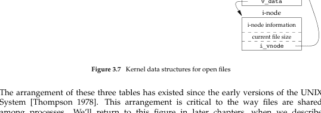

## 图 3.7 打开文件的内核数据结构

这种三个表的排列自 UNIX 系统的早期版本以来就存在 [Thompson 1978]。这种排列对于进程之间文件共享的方式至关重要。我们将在后面的章节中再次引用此图，在那里我们将描述文件共享的额外方式。

v-node 的发明是为了在单个计算机系统上提供对多种文件系统类型的支持。这项工作由 Peter Weinberger（贝尔实验室）和 Bill Joy（Sun Microsystems）独立完成。Sun 将其称为虚拟文件系统，并将文件系统无关的 i-node 部分称为 v-node [Kleiman 1986]。随着对 Sun 的网络文件系统（NFS）支持的增加，v-node 在各种厂商实现中传播。Berkeley 首次提供 v-node 的版本是 4.3BSD Reno 版本，当时添加了 NFS。

在 SVR4 中，v-node 替换了 SVR3 的文件系统无关 i-node。Solaris 源自 SVR4，因此使用 v-node。

Linux 没有将数据结构拆分为 v-node 和 i-node，而是使用文件系统无关的 i-node 和文件系统相关的 i-node。

如果两个独立进程打开了同一个文件，我们可能会得到图 3.8 所示的排列。

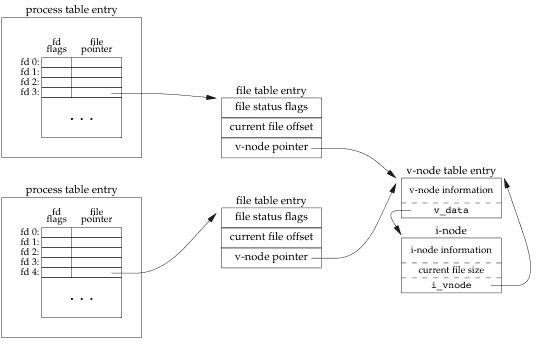

图 3.8 两个独立进程打开同一个文件

我们假设这里第一个进程在描述符 3 上打开了文件，而第二个进程在描述符 4 上打开了同一个文件。每个打开文件的进程都有自己的文件表条目，但对于给定文件只需要一个 v-node 表条目。每个进程都有自己的文件表条目的一个原因是每个进程都有自己的文件当前偏移量。

有了这些数据结构，我们现在需要更具体地说明我们已经描述过的某些操作会发生什么。

- 每次 `write` 完成后，文件表条目中的当前文件偏移量会增加写入的字节数。如果这导致当前文件偏移量超过当前文件大小，则 i-node 表条目中的当前文件大小将被设置为当前文件偏移量（例如，文件被扩展）。
- 如果文件以 O_APPEND 标志打开，则文件表条目的文件状态标志中会设置相应的标志。每次对设置了此追加标志的文件执行 `write` 时，文件表条目中的当前文件偏移量首先设置为来自 i-node 表条目的当前文件大小。这会强制每次 `write` 都追加到当前文件末尾。
- 如果文件使用 lseek 定位到其当前文件末尾，发生的事情只是文件表条目中的当前文件偏移量被设置为来自 i-node 表条目的当前文件大小。（请注意，这与文件以 O_APPEND 标志打开的情况不同，正如我们在第 3.11 节中将看到的那样。）
- lseek 函数仅修改文件表条目中的当前文件偏移量。不进行 I/O。

可能有多个文件描述符条目指向同一个文件表条目，正如我们将在第 3.12 节讨论 dup 函数时看到的那样。在 fork 之后，父进程和子进程对每个打开描述符共享同一个文件表条目时也会发生这种情况（第 8.3 节）。

请注意文件描述符标志和文件状态标志之间的作用域差异。前者仅适用于单个进程中的单个描述符，而后者适用于指向给定文件表条目的任何进程中的所有描述符。当我们在第 3.14 节描述 fcntl 函数时，我们将看到如何获取和修改文件描述符标志和文件状态标志。

到目前为止，本节中描述的一切对于多个进程读取同一个文件来说都很好。每个进程都有自己的文件表条目和自己的当前文件偏移量。然而，当多个进程写入同一个文件时，可能会出现意外的结果。为了了解如何避免一些意外，我们需要理解原子操作的概念。

## 3.11 原子操作

### 向文件追加

考虑一个想要向文件末尾追加的单个进程。UNIX 系统的旧版本不支持 open 的 O_APPEND 选项，因此程序被编写如下：

```
if (lseek(fd, 0L, 2) < 0)
    err_sys("lseek error");
if (write(fd, buf, 100) != 100)    /* and write */
    err_sys("write error");
```


对于单个进程而言，这种方式运行良好；但如果多个进程使用这种技术向同一个文件追加内容，就会出现问题。（例如，多个同一程序的实例可能同时向一个日志文件追加消息，就会出现这种情况。）

假设有两个独立的进程 A 和 B 正在向同一个文件追加内容。两者都已打开该文件，但没有使用 `O_APPEND` 标志。这与图 3.8 所示的情况相同。每个进程都有自己的文件表项，但它们共享一个 v-node 表项。假设进程 A 执行 `lseek`，将进程 A 的文件当前偏移量设置为字节偏移量 1,500（即当前文件末尾）。然后内核切换进程，B 继续运行。进程 B 随后执行 `lseek`，也将进程 B 的文件当前偏移量设置为字节偏移量 1,500（即当前文件末尾）。接着 B 调用 `write`，将 B 的文件当前偏移量增加到 1,600。由于文件大小已经扩展，内核也会将 v-node 中的当前文件大小更新为 1,600。然后内核切换进程，A 恢复运行。当 A 调用 `write` 时，数据会从 A 的文件当前偏移量开始写入，即字节偏移量 1,500。这会覆盖 B 写入文件的数据。

这里的问题在于，我们的逻辑操作“定位到文件末尾并写入”需要两次独立的函数调用（正如我们所展示的那样）。解决方案是让定位到当前文件末尾和写入操作相对于其他进程而言成为一个原子操作。任何需要多次函数调用的操作都不可能是原子的，因为内核始终有可能在两次函数调用之间暂时挂起进程（正如我们之前假设的那样）。

如果在打开文件时设置 `O_APPEND` 标志，UNIX 系统提供了一种以原子方式执行此操作的方法。正如上一节所述，这会使内核在每次写入之前都将文件定位到当前文件末尾。我们不再需要在每次写入之前调用 `lseek`。

## `pread` 和 `pwrite` 函数

Single UNIX Specification 包含两个允许应用程序以原子方式执行定位和 I/O 的函数：`pread` 和 `pwrite`。

```
#include <unistd.h>

ssize_t pread(int fd, void *buf, size_t nbytes, off_t offset);

Returns: number of bytes read, 0 if end of file, -1 on error

ssize_t pwrite(int fd, const void *buf, size_t nbytes, off_t offset);

Returns: number of bytes written if OK, -1 on error
```

调用 `pread` 等价于先调用 `lseek`，再调用 `read`，但有以下例外。

- 调用 `pread` 时，无法中断这两个操作。
- 当前文件偏移量不会更新。

调用 `pwrite` 等价于先调用 `lseek`，再调用 `write`，但有类似的例外。

## 创建文件

在介绍 `open` 函数的 `O_CREAT` 和 `O_EXCL` 选项时，我们看到了原子操作的另一个示例。当同时指定这两个选项时，如果文件已经存在，`open` 将失败。我们还提到，检查文件是否存在以及创建文件是作为一个原子操作执行的。如果没有这个原子操作，我们可能会尝试执行以下代码：

```
if ((fd = open(path, O_WRONLY)) < 0) {
    if (errno == ENOENT) {
        if ((fd = creat(path, mode)) < 0)
            err_sys("creat error");
    } else {
        err_sys("open error");
    }
}
```

如果在 `open` 和 `creat` 之间文件被另一个进程创建，就会出现问题。如果文件在这两次函数调用之间被另一个进程创建，并且该进程向文件写入了内容，那么执行此处的 `creat` 时，这些数据就会被擦除。将检查文件是否存在和创建文件合并为一个原子操作，可以避免此问题。

通常，术语“原子操作”指的是一个可能由多个步骤组成的操作。如果该操作以原子方式执行，那么要么所有步骤都被执行（成功时），要么一个步骤都不执行（失败时）。不允许只执行其中一部分步骤。稍后介绍 `link` 函数（第 4.15 节）和记录锁定（第 14.3 节）时，我们还会回到原子操作这一主题。

### 3.12 `dup` 和 `dup2` 函数

可以通过以下任一函数复制现有的文件描述符：

```
#include <unistd.h>

int dup(int fd);
int dup2(int fd, int fd2);

Both return: new file descriptor if OK, -1 on error
```

`dup` 返回的新文件描述符保证是当前可用的编号最小的文件描述符。使用 `dup2` 时，可以通过 `fd2` 参数指定新描述符的值。如果 `fd2` 已经打开，则首先将其关闭。如果 `fd` 等于 `fd2`，则 `dup2` 会直接返回 `fd2`，而不会关闭它。否则，`fd2` 的 `FD_CLOEXEC` 文件描述符标志会被清除，因此如果进程调用 `exec`，`fd2` 将保持打开状态。

函数返回的新文件描述符与 `fd` 参数共享同一个文件表项。我们在图 3.9 中展示了这一点。

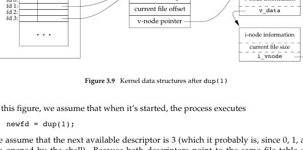

# 图 3.9 `dup(1)` 之后的内核数据结构

在此图中，我们假设进程启动时执行：

```
newfd = dup(1);
```

我们假设下一个可用的描述符是 3（很可能确实如此，因为 0、1 和 2 已由 shell 打开）。由于两个描述符指向同一个文件表项，因此它们共享相同的文件状态标志——读取、写入、追加等——以及相同的当前文件偏移量。

每个描述符都有自己的一组文件描述符标志。正如我们将在第 3.14 节中介绍的那样，`dup` 函数始终会清除新描述符的执行时关闭文件描述符标志。

另一种复制描述符的方法是使用 `fcntl` 函数，我们将在第 3.14 节中介绍该函数。实际上，调用：

```
dup(fd);
```

等价于：

```
fcntl(fd, F_DUPFD, 0);
```

类似地，调用：

```
dup2(fd, fd2);
```

等价于：

```
close(fd2);
fcntl(fd, F_DUPFD, fd2);
```

在后一种情况下，`dup2` 与先调用 `close` 再调用 `fcntl` 并不完全相同。区别如下：

### 3.14 `fcntl` 函数

`fcntl` 函数可以更改已经打开的文件的属性。

```
#include <fcntl.h>
int fcntl(int fd, int cmd, ... /* int arg */ );
Returns: depends on cmd if OK (see following), -1 on error
```

在本节的示例中，第三个参数始终是一个整数，与前面函数原型中的注释相对应。不过，在介绍第 14.3 节的记录锁定时，第三个参数将变为指向结构的指针。

`fcntl` 函数有五种不同用途。

- 1. 复制现有描述符（`cmd = F_DUPFD` 或 `F_DUPFD_CLOEXEC`）
- 2. 获取/设置文件描述符标志（`cmd = F_GETFD` 或 `F_SETFD`）
- 3. 获取/设置文件状态标志（`cmd = F_GETFL` 或 `F_SETFL`）
- 4. 获取/设置异步 I/O 所有权（`cmd = F_GETOWN` 或 `F_SETOWN`）
- 5. 获取/设置记录锁（`cmd = F_GETLK`、`F_SETLK` 或 `F_SETLKW`）

现在我们将介绍这 11 个 `cmd` 值中的前 8 个。（最后 3 个涉及记录锁定，我们将在第 14.3 节介绍。）请参考图 3.7，因为我们将同时讨论进程表项中与每个文件描述符关联的文件描述符标志，以及每个文件表项关联的文件状态标志。

`F_DUPFD` 复制文件描述符 `fd`。新的文件描述符作为函数返回值返回。它是尚未打开、且大于或等于第三个参数（作为整数处理）的编号最小的描述符。新描述符与 `fd` 共享同一个文件表项。（请参考图 3.9。）但新描述符拥有自己的一组文件描述符标志，并且其 `FD_CLOEXEC` 文件描述符标志会被清除。（这意味着在执行 `exec` 时该描述符仍保持打开状态，我们将在第 8 章讨论这一点。）

`F_DUPFD_CLOEXEC` 复制文件描述符，并设置与新描述符关联的 `FD_CLOEXEC` 文件描述符标志。返回新的文件描述符。

`F_GETFD` 将 `fd` 的文件描述符标志作为函数值返回。目前只定义了一个文件描述符标志：`FD_CLOEXEC` 标志。

`F_SETFD` 设置 `fd` 的文件描述符标志。新的标志值取自第三个参数（作为整数处理）。


请注意，有些处理文件描述符标志的现有程序并不使用常量 FD_CLOEXEC。相反，这些程序将标志设置为 0（不关闭-on-exec，默认值）或 1（执行关闭-on-exec）。

## F_GETFL

返回 fd 的文件状态标志作为函数的值。我们在描述 open 函数时描述了文件状态标志。它们列在图 3.10 中。

| 文件状态标志 | 描述 |
|---|---|
| O_RDONLY | 仅用于读取打开 |
| O_WRONLY | 仅用于写入打开 |
| O_RDWR | 用于读写打开 |
| O_EXEC | 仅用于执行打开 |
| O_SEARCH | 仅用于搜索打开目录 |
| O_APPEND | 每次写入时追加 |
| O_NONBLOCK | 非阻塞模式 |
| O_SYNC | 等待写入完成（数据和属性） |
| O_DSYNC | 等待写入完成（仅数据） |
| O_RSYNC | 同步读写 |
| O_FSYNC | 等待写入完成（仅 FreeBSD 和 Mac OS X） |
| O_ASYNC | 异步 I/O（仅 FreeBSD 和 Mac OS X） |

图 3.10 fcntl 的文件状态标志

不幸的是，五个访问模式标志——O_RDONLY、O_WRONLY、O_RDWR、O_EXEC 和 O_SEARCH——并不是可以测试的独立位。（正如我们之前提到的，出于历史原因，前三个通常分别具有值 0、1 和 2。此外，这五个值是互斥的；一个文件只能启用其中一个。）因此，我们必须首先使用 O_ACCMODE 掩码获得访问模式位，然后将结果与五个值中的任何一个进行比较。

## F_SETFL

将文件状态标志设置为第三个参数的值（作为整数）。唯一可以更改的标志是 O_APPEND、O_NONBLOCK、O_SYNC、O_DSYNC、O_RSYNC、O_FSYNC 和 O_ASYNC。

## F_GETOWN

获取当前接收 SIGIO 和 SIGURG 信号的进程 ID 或进程组 ID。我们在第 14.5.2 节中描述了这些异步 I/O 信号。

## F_SETOWN

设置接收 SIGIO 和 SIGURG 信号的进程 ID 或进程组 ID。positive arg 指定进程 ID。negative arg 意味着进程组 ID 等于 arg 的绝对值。

fcntl 的返回值取决于命令。所有命令在出错时返回 –1，或在正常时返回其他值。以下四个命令具有特殊的返回值：F_DUPFD、F_GETFD、F_GETFL 和 F_GETOWN。第一个命令返回新的文件描述符，接下来的两个返回相应的标志，最后一个命令返回正的进程 ID 或负的进程组 ID。

## 示例

图 3.11 中的程序接受一个命令行参数，指定一个文件描述符，并打印该描述符的所选文件标志的描述。

```
#include "apue.h"
#include <fcntl.h>
int
main(int argc, char *argv[])
{
    int     val;
    if (argc != 2)
        err_quit("usage: a.out <descriptor#>");
    if ((val = fcntl(atoi(argv[1]), F_GETFL, 0)) < 0)
        err_sys("fcntl error for fd %d", atoi(argv[1]));
    switch (val & O_ACCMODE) {
    case O_RDONLY:
        printf("read only");
        break;
    case O_WRONLY:
        printf("write only");
        break;
    case O_RDWR:
        printf("read write");
        break;
    default:
        err_dump("unknown access mode");
    }
    if (val & O_APPEND)
        printf(", append");
    if (val & O_NONBLOCK)
        printf(", nonblocking");
    if (val & O_SYNC)
        printf(", synchronous writes");
#if !defined(_POSIX_C_SOURCE) && defined(O_FSYNC) && (O_FSYNC != O_SYNC)
    if (val & O_FSYNC)
        printf(", synchronous writes");
#endif
    putchar('\n');
    exit(0);
}
```

图 3.11 打印指定描述符的文件标志

请注意，我们使用特性测试宏 _POSIX_C_SOURCE 并有条件地编译不是 POSIX.1 部分的文件访问标志。以下脚本显示了从 bash（Bourne-again shell）调用程序时的操作。结果会根据使用的 shell 而有所不同。

```
$ ./a.out 0 < /dev/tty
read only
$ ./a.out 1 > temp.foo
$ cat temp.foo
write only
$ ./a.out 2 2>>temp.foo
write only, append
$ ./a.out 5 5<>temp.foo
read write
```

子句 5<>temp.foo 在文件描述符 5 上以读写方式打开文件 temp.foo。

## 示例

当我们修改文件描述符标志或文件状态标志时，我们必须小心地获取现有标志值，按需修改它，然后设置新的标志值。我们不能简单地发出 F_SETFD 或 F_SETFL 命令，因为这可能会关闭之前设置的标志位。

图 3.12 显示了一个设置描述符的一个或多个文件状态标志的函数。

```
#include "apue.h"
#include <fcntl.h>

void
set_fl(int fd, int flags) /* flags are file status flags to turn on */
{
    int val;

    if ((val = fcntl(fd, F_GETFL, 0)) < 0)
        err_sys("fcntl F_GETFL error");

    val |= flags;        /* turn on flags */
    if (fcntl(fd, F_SETFL, val) < 0)
        err_sys("fcntl F_SETFL error");
}
```

图 3.12 打开描述符的一个或多个文件状态标志

如果我们将中间语句改为

```
val &= ~flags;    /* turn flags off */
```

我们就有一个名为 clr_fl 的函数，我们将在一些后面的示例中使用它。该语句将 flags 的 one's complement 与当前的 val 进行逻辑 AND。

如果我们在图 3.5 所示程序的开头添加行

```
set_fl(STDOUT_FILENO, O_SYNC);
```

我们将打开同步写入标志。这会导致每次写入等待数据写入磁盘后才返回。通常在 UNIX 系统中，写入只是将数据排队以供写入；实际的磁盘写入操作可能在稍后进行。数据库系统是使用 O_SYNC 的可能候选者，以便在写入返回时知道数据是否已实际写入磁盘，以防发生异常系统故障。

我们预计 O_SYNC 标志会增加程序运行时系统的 CPU 时间和时钟时间。为了测试这一点，我们可以运行图 3.5 中的程序，从磁盘上的一个文件复制 492.6 MB 的数据到另一个文件，并将其与使用 O_SYNC 标志设置相同操作的版本进行比较。Linux 系统使用 ext4 文件系统的结果显示在图 3.13 中。

| 操作 | 用户 CPU（秒） | 系统 CPU（秒） | 时钟时间（秒） |
|---|---|---|---|
| 图 3.6 中 BUFFSIZE = 4,096 的读取时间 | 0.03 | 0.58 | 8.62 |
| 正常写入磁盘文件 | 0.00 | 1.05 | 9.70 |
| 设置 O_SYNC 写入磁盘文件 | 0.02 | 1.09 | 10.28 |
| 写入磁盘后跟 fdatasync | 0.02 | 1.14 | 17.93 |
| 写入磁盘后跟 fsync | 0.00 | 1.19 | 18.17 |
| 设置 O_SYNC 写入磁盘后跟 fsync | 0.02 | 1.15 | 17.88 |

图 3.13 使用各种同步机制的 Linux ext4 定时结果

图 3.13 中的六行都是使用 BUFFSIZE 为 4,096 字节测量的。图 3.6 中的结果是在读取磁盘文件并写入 /dev/null 时测量的，因此没有磁盘输出。图 3.13 中的第二行对应于读取磁盘文件并写入另一个磁盘文件。这就是为什么图 3.13 中的第一行和第二行不同。当我们写入磁盘文件时，系统时间会增加，因为内核现在从我们的进程复制数据并将数据排队以供磁盘驱动程序写入。我们预计当我们写入磁盘文件时，时钟时间也会增加。

当我们启用同步写入时，系统和时钟时间应该显著增加。正如第三行所示，同步写入的系统时间并没有比使用延迟写入时更昂贵。这意味着 Linux 操作系统对延迟写入和同步写入所做的工作量相同（这不太可能），或者 O_SYNC 标志没有产生预期的效果。在这种情况下，Linux 操作系统不允许我们使用 fcntl 设置 O_SYNC 标志，而是失败但不返回错误（但如果我们能够在打开文件时指定该标志，它就会遵守该标志）。

最后三行中的时钟时间反映了等待所有写入提交到磁盘所需的额外时间。同步写入文件后，我们预计对 fsync 的调用将没有效果。这种情况应该由最后


图 3.13 中的行，但由于 O_SYNC 标志没有产生预期效果，最后一行的行为与第五行相同。

图 3.14 显示了在 Mac OS X 10.6.8 上运行相同测试的计时结果，该系统使用 HFS 文件系统。请注意，计时结果符合我们的预期：同步写入的开销远远高于延迟写入，而对同步写入使用 fsync 几乎没有什么区别。还要注意，在延迟写入结束时添加一次 fsync 调用，几乎没有可测量的影响。操作系统很可能在我们向文件写入新数据时，将之前写入的数据刷新到了磁盘，因此等到需要调用 fsync 时，剩下的工作已经很少了。

| 操作 | 用户 CPU（秒） | 系统 CPU（秒） | 时钟时间（秒） |
|---|---:|---:|---:|
| 写入 /dev/null | 0.14 | 1.02 | 5.28 |
| 正常写入磁盘文件 | 0.14 | 3.21 | 17.04 |
| 设置 O_SYNC 后写入磁盘文件 | 0.39 | 16.89 | 60.82 |
| 写入磁盘后调用 fsync | 0.13 | 3.07 | 17.10 |
| 设置 O_SYNC 后写入磁盘，再调用 fsync | 0.39 | 18.18 | 62.39 |

**图 3.14** Mac OS X HFS 上使用不同同步机制的计时结果

比较 fsync 和 fdatasync（这两个函数会在我们要求时更新文件内容）与 O_SYNC 标志（它会在每次向文件写入时更新文件内容）。每种方式的性能取决于许多因素，包括底层操作系统的实现、磁盘驱动器的速度以及文件系统的类型。

通过这个例子，我们可以看到 fcntl 的必要性。我们的程序操作的是一个描述符（标准输出），并不知道在该描述符上打开的文件名。我们无法在打开文件时设置 O_SYNC 标志，因为文件是由 shell 打开的。使用 fcntl，我们只需知道已打开文件的描述符，就可以修改该描述符的属性。介绍非阻塞管道时（第 15.2 节），我们还会看到 fcntl 的另一种用途，因为对于管道，我们能使用的也只有描述符。

## 3.15 ioctl 函数

ioctl 函数一直以来都是处理 I/O 操作的“万能工具”。任何无法用本章其他函数表达的操作，通常都会通过 ioctl 来指定。终端 I/O 是该函数最主要的使用场景。（在第 18 章中我们会看到，POSIX.1 已经用独立函数取代了终端 I/O 操作。）

```c
#include <unistd.h>    /* System V */
#include <sys/ioctl.h>  /* BSD 和 Linux */

int ioctl(int fd, int request, ...);

                         /* 返回值：出错时为 −1，成功时为其他值 */
```

ioctl 函数在《Single UNIX Specification》中仅作为处理 STREAMS 设备的扩展功能收录 [Rago 1993]，但在 SUSv4 中已被列为过时功能。UNIX 系统的各种实现都使用 ioctl 来执行许多杂项设备操作。有些实现甚至扩展了 ioctl，使其可以用于普通文件。

这里展示的函数原型符合 POSIX.1。FreeBSD 8.0 和 Mac OS X 10.6.8 将第二个参数声明为 unsigned long。这个细节并不重要，因为第二个参数始终是头文件中以 #defined 形式定义的名称。

ISO C 函数原型使用省略号表示其余参数。不过通常只有一个额外参数，而且它通常是指向变量或结构的指针。

在这个函数原型中，我们只列出了函数本身所需的头文件。通常还需要额外的、特定于设备的头文件。例如，除 POSIX.1 指定的基本操作外，所有终端 I/O 的 ioctl 命令都需要 <termios.h> 头文件。

每个设备驱动程序都可以定义自己的一组 ioctl 命令。不过，系统会为不同类别的设备提供通用 ioctl 命令。图 3.15 汇总了 FreeBSD 支持的部分通用 ioctl 命令类别示例。

| 类别 | 常量名称 | 头文件 | ioctl 数量 |
|---|---|---|---:|
| 磁盘标签 | DIOXXX | <sys/disklabel.h> | 4 |
| 文件 I/O | FIOXXX | <sys/filio.h> | 14 |
| 磁带 I/O | MTIOXXX | <sys/mtio.h> | 11 |
| 套接字 I/O | SIOXXX | <sys/sockio.h> | 73 |
| 终端 I/O | TIOXXX | <sys/ttycom.h> | 43 |

**图 3.15** 常见的 FreeBSD ioctl 操作

磁带操作允许我们在磁带上写入文件结束标记、倒带、向前跳过指定数量的文件或记录等。这些操作都很难用本章介绍的其他函数（read、write、lseek 等）来表达，因此访问这些设备时，使用 ioctl 来执行相应操作一直是最简单的方式。

我们将在第 18.12 节使用 ioctl 函数获取和设置终端窗口的大小，并在第 19.7 节访问伪终端的高级功能。

## 3.16 /dev/fd

较新的系统提供了一个名为 /dev/fd 的目录，其中包含名为 0、1、2 等的文件。打开文件 /dev/fd/n 等价于复制描述符 n，前提是描述符 n 已打开。

/dev/fd 功能由 Tom Duff 开发，最早出现在 Research UNIX System 第 8 版中。本书介绍的所有系统都支持此功能：FreeBSD 8.0、Linux 3.2.0、Mac OS X 10.6.8 和 Solaris 10。它不属于 POSIX.1。

在函数调用

```c
fd = open("/dev/fd/0", mode);
```

中，大多数系统会忽略指定的 mode，而其他系统则要求该模式是引用文件（本例中为标准输入）最初打开时所用模式的子集。由于前面的 open 操作等价于

```c
fd = dup(0);
```

描述符 0 和 fd 共享同一个文件表项（图 3.9）。例如，如果描述符 0 是以只读方式打开的，我们就只能通过 fd 读取。即使系统忽略了打开模式，且调用

```c
fd = open("/dev/fd/0", O_RDWR);
```

成功，我们仍然无法通过 fd 写入。

> Linux 对 /dev/fd 的实现是个例外。它会将文件描述符映射为指向底层物理文件的符号链接。例如，当你打开 /dev/fd/0 时，实际上打开的是与标准输入关联的文件。因此，返回的新文件描述符的模式与 /dev/fd 文件描述符的模式无关。

我们还可以将 /dev/fd 路径名作为参数调用 creat，也可以在调用 open 时指定 O_CREAT。这样一来，即使路径名参数是 /dev/fd/1，调用 creat 的程序也仍然可以正常工作。

> 在 Linux 上这样做要格外小心。由于 Linux 使用指向真实文件的符号链接，若对 /dev/fd 文件使用 creat，会导致底层文件被截断。

有些系统提供路径名 /dev/stdin、/dev/stdout 和 /dev/stderr。这些路径名分别等价于 /dev/fd/0、/dev/fd/1 和 /dev/fd/2。

/dev/fd 文件主要由 shell 使用。它使使用路径名参数的程序能够以与其他路径名相同的方式处理标准输入和标准输出。例如，cat(1) 程序会专门查找值为 - 的输入文件名，并将其解释为标准输入。下面的命令就是一个例子：

```text
filter file2 | cat file1 - file3 | lpr
```

首先，cat 读取 file1，然后读取其标准输入（即 filter 程序对 file2 的输出），最后读取 file3。如果系统支持 /dev/fd，就可以从 cat 中移除对 - 的特殊处理，并改为输入：

```text
filter file2 | cat file1 /dev/fd/0 file3 | lpr
```

将 - 作为命令行参数来表示标准输入或标准输出，是一种逐渐渗入许多程序的权宜做法。如果将 - 指定为第一个文件，还会出现问题，因为它看起来像是另一个命令行选项的开头。使用 /dev/fd 是迈向统一和简洁的一步。

## 3.17 总结

本章介绍了 UNIX 系统提供的基本 I/O 函数。它们通常被称为无缓冲 I/O 函数，因为每次 read 或 write 都会调用系统调用进入内核。我们仅使用 read 和 write，考察了不同 I/O 大小对读取文件所需时间的影响。我们还研究了几种将写入数据刷新到磁盘的方法，以及这些方法对应用程序性能的影响。

我们介绍了原子操作，包括多个进程向同一文件追加内容，以及多个进程创建同一个文件的情况。我们还考察了内核用于共享打开文件信息的数据结构。后文中我们还会再次讨论这些数据结构。

我们还介绍了 ioctl 和 fcntl 函数。本书后文会再次用到这两个函数。第 14 章将使用 fcntl 实现记录锁定。第 18 章和第 19 章将在处理终端设备时使用 ioctl。

## 练习

- 3.1 读取或写入磁盘文件时，本章介绍的函数真的属于无缓冲 I/O 吗？请解释。

- 3.2 编写自己的 dup2 函数，使其行为与第 3.12 节介绍的 dup2 函数相同，且不调用 fcntl 函数。确保正确处理错误。

- 3.3 假设一个进程执行以下三个函数调用：

  ```c
  fd1 = open(path, oflags);
  fd2 = dup(fd1);
  fd3 = open(path, oflags);
  ```

  请画出结果示意图，类似图 3.9。对 fd1 执行命令为 F_SETFD 的 fcntl 操作，会影响哪些描述符？对 fd1 执行命令为 F_SETFL 的 fcntl 操作，又会影响哪些描述符？

- 3.4 在各种程序中都能看到下面这段代码：

  ```c
  dup2(fd, 0);
  dup2(fd, 1);
  dup2(fd, 2);
  if (fd > 2)
      close(fd);
  ```

  为了理解为何需要 if 判断，假设 fd 为 1，并画出每次调用 dup2 后三个描述符项及其对应文件表项的变化。然后再假设 fd 为 3，并画出相同的示意图。

- 3.5 Bourne shell、Bourne-again shell 和 Korn shell 中的记法 `digit1>&digit2` 表示将描述符 digit1 重定向到与描述符 digit2 相同的文件。下面两个命令有什么区别？（提示：shell 从左向右处理命令行。）

  ```text
  ./a.out > outfile 2>&1
  ./a.out 2>&1 > outfile
  ```


3.6 如果使用追加标志以读写方式打开一个文件，是否仍能使用 lseek 从文件的任意位置读取？能否使用 lseek 替换文件中的现有数据？编写一个程序来验证这一点。

## 4 文件和目录

### 4.1 引言

在上一章中我们介绍了执行 I/O 的基本函数。讨论集中于对普通文件的 I/O——打开文件，以及读写文件。现在我们将研究文件系统的附加特性以及文件的属性。我们将从 stat 函数开始，并遍历 stat 结构体的每个成员，查看文件的全部属性。在此过程中，我们还将描述修改这些属性的每个函数：更改所有者、更改权限等等。我们还将更详细地研究 UNIX 文件系统的结构和符号链接。本章最后介绍操作目录的函数，并开发一个遍历目录层次结构的函数。

### 4.2 stat、fstat、fstatat 和 lstat 函数

本章的讨论集中于四个 stat 函数及其返回的信息。

```
#include <sys/stat.h>

int stat(const char *restrict pathname, struct stat *restrict buf);
int fstat(int fd, struct stat *buf);
int lstat(const char *restrict pathname, struct stat *restrict buf);
int fstatat(int fd, const char *restrict pathname,
    struct stat *restrict buf, int flag);

All four return: 0 if OK, -1 on error
```

给定一个路径名，stat 函数返回有关命名文件的信息结构。fstat 函数获取已在描述符 fd 上打开的文件的信息。lstat 函数与 stat 类似，但当命名文件是符号链接时，lstat 返回有关符号链接本身的信息，而不是符号链接引用的文件的信息。（我们在第 4.22 节遍历目录层次结构时需要 lstat。我们将在第 4.17 节更详细地描述符号链接。）

fstatat 函数提供了一种根据 fd 参数表示的打开目录返回相对于该目录的路径名的文件统计信息的方法。flag 控制是否跟随符号链接；当设置 AT_SYMLINK_NOFOLLOW 标志时，fstatat 不会跟随符号链接，而是返回链接本身的信息。否则，默认行为是跟随符号链接，返回符号链接指向的文件的信息。如果 fd 参数的值为 AT_FDCWD 且路径名参数是相对路径名，则 fstatat 将相对于当前目录计算路径名参数。如果路径名参数是绝对路径名，则 fd 参数将被忽略。在这两种情况下，fstatat 的行为类似于 stat 或 lstat，具体取决于 flag 的值。

buf 参数是指向我们必须提供的结构体的指针。函数会填充该结构体。结构体的定义在不同实现中可能有所不同，但它可能如下所示

```
struct stat {
    mode_t      st_mode;     /* file type & mode (permissions) */
    ino_t       st_ino;      /* i-node number (serial number) */
    dev_t       st_dev;      /* device number (file system) */
    dev_t       st_rdev;     /* device number for special files */
    nlink_t     st_nlink;    /* number of links */
    uid_t       st_uid;      /* user ID of owner */
    gid_t       st_gid;      /* group ID of owner */
    off_t       st_size;     /* size in bytes, for regular files */
    struct timespec st_atim; /* time of last access */
    struct timespec st_mtim; /* time of last modification */
    struct timespec st_ctim; /* time of last file status change */
    blksize_t   st_blksize;  /* best I/O block size */
    blkcnt_t    st_blocks;   /* number of disk blocks allocated */
};
```

st_rdev、st_blksize 和 st_blocks 字段不是 POSIX.1 所要求的。它们作为 Single UNIX Specification 中的 XSI 选项的一部分定义。

timespec 结构类型以秒和纳秒为单位定义时间。它至少包含以下字段：

```
time_t tv_sec;
long  tv_nsec;
```

在 2008 年版标准之前，时间字段命名为 st_atime、st_mtime 和 st_ctime，且类型为 time_t（以秒表示）。timespec 结构使时间戳具有更高分辨率。为了兼容，旧名称可以用 tv_sec 成员定义。例如，st_atime 可以定义为 st_atim.tv_sec。

请注意，stat 结构的大多数成员由原始系统数据类型指定（参见第 2.8 节）。我们将遍历该结构体的每个成员以检查文件的属性。

stat 函数的最大使用者可能是 ls -l 命令，用于了解有关文件的所有信息。

### 4.3 文件类型

到目前为止，我们谈到了两种不同的文件类型：普通文件和目录。大多数 UNIX 系统上的文件都是普通文件或目录，但还有其他类型的文件。类型如下

- 1. 普通文件。最常见的文件类型，包含某种形式的数据。UNIX 内核不会区分此数据是文本还是二进制。对普通文件内容的任何解释都留给处理该文件的应用程序。

  > 一个值得注意的例外是二进制可执行文件。要执行程序，内核必须理解其格式。所有二进制可执行文件都符合一种格式，允许内核识别程序的文本和数据应加载的位置。

- 2. 目录文件。包含其他文件名称以及这些文件信息的指针的文件。任何对目录文件具有读权限的进程都可以读取目录的内容，但只有内核可以直接写入目录文件。进程必须使用本章描述的函数来更改目录。

- 3. 块特殊文件。一种提供对磁盘驱动器等设备进行缓冲的固定大小单元 I/O 访问的文件类型。

  > 请注意，FreeBSD 不再支持块特殊文件。所有对设备的访问都通过字符特殊接口进行。

- 4. 字符特殊文件。一种提供对设备进行无缓冲的变长单元 I/O 访问的文件类型。系统上的所有设备都是块特殊文件或字符特殊文件。

- 5. FIFO。用于进程间通信的文件类型。有时称为命名管道。我们在第 15.5 节描述 FIFO。

- 6. 套接字。用于进程间网络通信的文件类型。套接字也可以用于单台主机上进程之间的非网络通信。我们在第 16 章使用套接字进行进程间通信。

- 7. 符号链接。指向另一个文件的文件类型。我们在第 4.17 节更详细地讨论符号链接。

文件的类型编码在 stat 结构体的 st_mode 成员中。我们可以使用图 4.1 所示的宏确定文件类型。这些宏的参数是来自 stat 结构体的 st_mode 成员。

| Macro | Type of file |
|---|---|
| S_ISREG() | regular file |
| S_ISDIR() | directory file |
| S_ISCHR() | character special file |
| S_ISBLK() | block special file |
| S_ISFIFO() | pipe or FIFO |
| S_ISLNK() | symbolic link |
| S_ISSOCK() | socket |

Figure 4.1 File type macros in <sys/stat.h>

POSIX.1 允许实现将进程间通信（IPC）对象，如消息队列和信号量，表示为文件。图 4.2 所示的宏允许我们从 stat 结构确定 IPC 对象的类型。与图 4.1 中的宏不同，这些宏的参数不是 st_mode 成员，而是指向 stat 结构的指针。

| Macro | Type of object |
|---|---|
| S_TYPEISMQ() | message queue |
| S_TYPEISSEM() | semaphore |
| S_TYPEISSHM() | shared memory object |

Figure 4.2 IPC type macros in <sys/stat.h>

消息队列、信号量和共享内存对象在第 15 章中讨论。然而，本书中讨论的各种 UNIX 系统实现都不将这些对象表示为文件。

Example

图 4.3 中的程序打印每个命令行参数的文件类型。

```
#include "apue.h"
int
main(int argc, char *argv[])
{
    int i;
    struct stat buf;
    char *ptr;
    for (i = 1; i < argc; i++) {
        printf("%s: ", argv[i]);
        if (lstat(argv[i], &buf) < 0) {
            err_ret("lstat error");
            continue;
        }
        if (S_ISREG(buf.st_mode))
            ptr = "regular";
        else if (S_ISDIR(buf.st_mode))
```


## 图 4.3 输出每个命令行参数对应文件的类型

```c
ptr = "directory";
else if (S_ISCHR(buf.st_mode))
    ptr = "character special";
else if (S_ISBLK(buf.st_mode))
    ptr = "block special";
else if (S_ISFIFO(buf.st_mode))
    ptr = "fifo";
else if (S_ISLNK(buf.st_mode))
    ptr = "symbolic link";
else if (S_ISSOCK(buf.st_mode))
    ptr = "socket";
else
    ptr = "** unknown mode **";
    printf("%s\n", ptr);
}
exit(0);
}
```

图 4.3 的示例输出如下：

```
$ ./a.out /etc/passwd /etc /dev/log /dev/tty \
> /var/lib/opprofile/opd_pipe /dev/sr0 /dev/cdrom
/etc/passwd: regular
/etc: directory
/dev/log: socket
/dev/tty: character special
/var/lib/opprofile/opd_pipe: fifo
/dev/sr0: block special
/dev/cdrom: symbolic link
```

（这里，我们在第一条命令行的末尾显式输入了反斜杠，告诉 shell 我们希望在另一行继续输入命令。于是，shell 在下一行显示了它的次提示符 `>`。）我们特意使用 `lstat` 函数，而不是 `stat` 函数，来检测符号链接。如果使用 `stat` 函数，我们将永远看不到符号链接。

从历史上看，早期版本的 UNIX 系统并没有提供 `S_ISxxx` 宏。相反，我们必须将 `st_mode` 值与掩码 `S_IFMT` 进行逻辑 AND 运算，然后将结果与名称为 `S_IFxxx` 的常量进行比较。大多数系统都在 `<sys/stat.h>` 文件中定义了这个掩码及相关常量。如果检查这个文件，就会发现 `S_ISDIR` 宏的定义大致如下：

```c
#define S_ISDIR(mode) (((mode) & S_IFMT) == S_IFDIR)
```

我们已经说过，普通文件占绝大多数，但了解某个系统中的文件分别有多大比例属于各种文件类型，仍然很有意思。图 4.4 展示了一个作为单用户工作站使用的 Linux 系统中各种文件的数量和百分比。这些数据来自第 4.22 节所示的程序。

| 文件类型 | 数量 | 百分比 |
|---|---|---|
| 普通文件 | 415,803 | 79.77% |
| 目录 | 62,197 | 11.93% |
| 符号链接 | 40,018 | 8.25% |
| 字符特殊文件 | 155 | 0.03% |
| 块特殊文件 | 47 | 0.01% |
| 套接字 | 45 | 0.01% |
| FIFO | 0 | 0.00% |

**图 4.4** 不同文件类型的数量和百分比

## 4.4 设置用户 ID 和设置组 ID

每个进程都关联着六个或更多 ID，如图 4.5 所示。

| ID | 用途 |
|---|---|
| 实际用户 ID | 表示我们真正的身份 |
| 实际组 ID | |
| 有效用户 ID | 用于文件访问权限检查 |
| 有效组 ID | |
| 补充组 ID | |
| 保存的设置用户 ID | 由 exec 函数保存 |
| 保存的设置组 ID | |

**图 4.5** 与每个进程关联的用户 ID 和组 ID

- 实际用户 ID 和实际组 ID 用于标识我们真正的身份。登录时，这两个字段取自密码文件中的用户条目。通常，这些值在一次登录会话期间不会改变，不过超级用户进程可以通过某些方式修改它们，我们将在第 8.11 节介绍这些方式。
- 有效用户 ID、有效组 ID 和补充组 ID 决定了我们的文件访问权限，下一节将对此进行介绍。（我们在第 1.8 节定义了补充组 ID。）
- 当程序被执行时，保存的设置用户 ID 和保存的设置组 ID 分别保存有效用户 ID 和有效组 ID 的副本。我们在介绍第 8.11 节的 `setuid` 函数时，会说明这两个保存值的作用。

截至 2001 年版本的 POSIX.1，保存的 ID 已成为必需项。在较早版本的 POSIX 中，它们是可选的。应用程序可以在编译时测试常量 `_POSIX_SAVED_IDS`，也可以在运行时使用参数 `_SC_SAVED_IDS` 调用 `sysconf`，以确认实现是否支持此功能。

通常，有效用户 ID 等于实际用户 ID，有效组 ID 等于实际组 ID。

每个文件都有一个所有者和一个组所有者。所有者由 `stat` 结构中的 `st_uid` 成员指定；组所有者由 `st_gid` 成员指定。

当我们执行一个程序文件时，进程的有效用户 ID 通常是实际用户 ID，有效组 ID 通常是实际组 ID。不过，我们也可以在文件的模式字（`st_mode`）中设置一个特殊标志，表示：“执行该文件时，将进程的有效用户 ID 设置为该文件的所有者（`st_uid`）。”类似地，我们还可以在文件的模式字中设置另一个位，使有效组 ID 变为该文件的组所有者（`st_gid`）。文件模式字中的这两个位分别称为设置用户 ID 位和设置组 ID 位。

例如，如果文件的所有者是超级用户，并且该文件的设置用户 ID 位已设置，那么当该程序文件作为进程运行时，它就拥有超级用户权限。无论执行该文件的进程实际用户 ID 是什么，情况都是如此。再比如，UNIX 系统中允许任何人修改自己密码的程序 `passwd(1)`，就是一个设置用户 ID 程序。之所以必须这样，是因为该程序需要将新密码写入密码文件，通常是 `/etc/passwd` 或 `/etc/shadow`，而这些文件应该只能由超级用户写入。由于以其他用户身份运行的设置用户 ID 进程通常会获得额外权限，因此必须谨慎编写此类程序。我们将在第 8 章更详细地讨论这类程序。

回到 `stat` 函数，设置用户 ID 位和设置组 ID 位包含在文件的 `st_mode` 值中。这两个位分别可以与常量 `S_ISUID` 和 `S_ISGID` 进行测试。

## 4.5 文件访问权限

`st_mode` 值还对文件的访问权限位进行了编码。这里所说的文件，是指前面介绍过的任何一种文件类型。所有文件类型——目录、字符特殊文件等——都有权限。许多人只认为普通文件具有访问权限。

每个文件有九个权限位，分为三类，如图 4.6 所示。

| `st_mode` 掩码 | 含义 |
|---|---|
| `S_IRUSR` | 用户读取 |
| `S_IWUSR` | 用户写入 |
| `S_IXUSR` | 用户执行 |
| `S_IRGRP` | 组读取 |
| `S_IWGRP` | 组写入 |
| `S_IXGRP` | 组执行 |
| `S_IROTH` | 其他用户读取 |
| `S_IWOTH` | 其他用户写入 |
| `S_IXOTH` | 其他用户执行 |

**图 4.6** 来自 `<sys/stat.h>` 的九个文件访问权限位

图 4.6 的前三行中，“用户”一词指文件的所有者。通常用于修改这九个权限位的 `chmod(1)` 命令允许我们使用 `u` 表示用户（所有者）、`g` 表示组、`o` 表示其他用户。有些书将这三类称为所有者、组和全体用户；这种说法容易造成混淆，因为 `chmod` 命令使用 `o` 表示其他用户，而不是所有者。为与 `chmod` 命令保持一致，我们将使用*用户*、*组*和*其他用户*这几个术语。

图 4.6 中的三类权限——读取、写入和执行——会被不同函数以不同方式使用。下面对它们进行总结，在介绍具体函数时还会再次说明。

- 第一条规则是，*每当*我们希望按名称打开任何类型的文件时，都必须对该名称中提到的每个目录拥有执行权限；如果当前目录是隐含的，也包括当前目录。这就是为什么目录的执行权限位通常被称为搜索位。

  例如，要打开文件 `/usr/include/stdio.h`，我们需要对目录 `/` 拥有执行权限，对目录 `/usr` 拥有执行权限，并对目录 `/usr/include` 拥有执行权限。之后，我们还需要根据打开文件的方式，为文件本身拥有适当的权限，例如只读、读写等。

  如果当前目录是 `/usr/include`，那么要打开文件 `stdio.h`，我们需要对当前目录拥有执行权限。这就是当前目录被隐含而未被明确提及的例子。其效果等同于打开文件 `./stdio.h`。

  请注意，目录的读取权限和目录的执行权限含义不同。读取权限允许我们读取目录，从而获得目录中所有文件名的列表。执行权限允许我们在目录作为路径名组成部分时穿过该目录，以访问目标对象。（我们需要搜索目录，以查找特定的文件名。）

  另一个隐式目录引用的例子是：第 8.10 节介绍的 `PATH` 环境变量指定了一个未启用执行权限的目录。在这种情况下，shell 永远不会在该目录中找到可执行文件。

- 文件的读取权限决定我们能否打开一个已存在的文件进行读取：也就是 `open` 函数的 `O_RDONLY` 和 `O_RDWR` 标志。

- 文件的写入权限决定我们能否打开一个已存在的文件进行写入：也就是 `open` 函数的 `O_WRONLY` 和 `O_RDWR` 标志。

- 在 `open` 函数中指定 `O_TRUNC` 标志时，我们必须拥有该文件的写入权限。

- 除非对目录拥有写入权限和执行权限，否则无法在该目录中创建新文件。

- 要删除一个已存在的文件，我们需要对包含该文件的目录拥有写入权限和执行权限。不需要对文件本身拥有读取权限或写入权限。

- 如果希望使用七个 `exec` 函数中的任意一个执行文件（第 8.10 节），就必须启用该文件的执行权限。此外，该文件还必须是普通文件。


内核在每次进程打开、创建或删除文件时执行的访问测试，取决于文件的所有者（st_uid 和 st_gid）、进程的有效 ID（有效用户 ID 和有效组 ID），以及进程的补充组 ID（如果支持）。这两个所有者 ID 是文件属性，而两个有效 ID 和补充组 ID 是进程属性。内核执行的测试如下：

- 1. 如果进程的有效用户 ID 为 0（超级用户），则允许访问。这使超级用户在整个文件系统中拥有完全自由。
- 2. 如果进程的有效用户 ID 等于文件的所有者 ID（即进程拥有该文件），则如果设置了适当的用户访问权限位，则允许访问。否则，拒绝权限。所谓适当的访问权限位是指，如果进程以读取方式打开文件，则必须打开用户读位。如果进程以写入方式打开文件，则必须打开用户写位。如果进程执行文件，则必须打开用户执行位。
- 3. 如果进程的有效组 ID 或进程的补充组 ID 之一等于文件的组 ID，则如果设置了适当的组访问权限位，则允许访问。否则，拒绝权限。
- 4. 如果设置了适当的其它访问权限位，则允许访问。否则，拒绝权限。

这四个步骤按顺序尝试。注意，如果进程拥有文件（步骤 2），则访问仅基于用户访问权限授予或拒绝；组权限永远不会被查看。同样，如果进程不拥有文件但属于适当的组，则访问仅基于组访问权限授予或拒绝；其它权限不会被查看。

## 4.6 新文件和目录的所有权

我们在第 3 章中使用 open 或 creat 描述了创建新文件时，从未说明新文件的用户 ID 和组 ID 被赋予了哪些值。我们将在第 4.21 节描述 mkdir 函数时看到如何创建新目录。创建新目录的所有权规则与本节中关于创建新文件的所有权规则相同。

新文件的用户 ID 设置为进程的有效用户 ID。POSIX.1 允许实现选择以下任一选项来确定新文件的组 ID：

- 1. 新文件的组 ID 可以是进程的有效组 ID。
- 2. 新文件的组 ID 可以是文件被创建所在的目录的组 ID。

FreeBSD 8.0 和 Mac OS X 10.6.8 总是复制新文件的组 ID 自目录。多个 Linux 文件系统允许使用 mount(1) 命令选项在两个选项之间进行选择。Linux 3.2.0 和 Solaris 10 的默认行为是根据文件被创建的目录是否设置了 set-group-ID 位来确定新文件的组 ID。如果设置了此位，则新文件的组 ID 复制自目录；否则，新文件的组 ID 设置为进程的有效组 ID。

使用第二个选项——继承目录的组 ID——确保在该目录中创建的所有文件和目录都将具有与目录相同的组 ID。这种文件和目录的组所有权将从该点向下沿层次结构传播。例如，Linux 目录 /var/mail 中就使用了此方法。

> 正如我们之前提到的，此组所有权选项是 FreeBSD 8.0 和 Mac OS X 10.6.8 的默认值，但在 Linux 和 Solaris 上是一个选项。在 Solaris 10 下，以及在 Linux 3.2.0 下默认情况下，我们必须启用 set-group-ID 位，并且 mkdir 函数必须自动传播目录的 set-group-ID 位才能使其工作。 （这在第 4.21 节中描述。）

## 4.7 access 和 faccessat 函数

正如我们之前描述的，当我们打开文件时，内核根据有效用户和组 ID 执行其访问测试。有时，进程希望基于真实用户和组 ID 测试可访问性。这在使用 set-user-ID 或 set-group-ID 功能以其他用户身份运行时很有用。即使进程被设置为 set-user-ID 为 root，它仍可能希望验证真实用户是否可以访问给定文件。access 和 faccessat 函数基于真实用户和组 ID 进行测试。 （将第 4.5 节末尾的四个步骤中的 effective 替换为 real。）

```
#include <unistd.h>
int access(const char *pathname, int mode);
int faccessat(int fd, const char *pathname, int mode, int flag);
Both return: 0 if OK, -1 on error
```

mode 要么是值 F_OK 用于测试文件是否存在，要么是图 4.7 中所示标志的按位或。

| mode | Description |
|------|-------------|
| R_OK | test for read permission |
| W_OK | test for write permission |
| X_OK | test for execute permission |

Figure 4.7 The mode flags for access function, from <unistd.h>

当 pathname 参数为绝对路径或 fd 参数的值为 AT_FDCWD 且 pathname 参数为相对路径时，faccessat 函数的行为类似于 access。否则，faccessat 将相对于 fd 参数引用的打开目录评估 pathname。

flag 参数可用于更改 faccessat 的行为。如果设置了 AT_EACCESS 标志，则访问检查将使用调用进程的有效用户和组 ID 而不是真实用户和组 ID 进行。

### Example

图 4.8 显示了 access 函数的使用。

```
#include "apue.h"
#include <fcntl.h>
int
main(int argc, char *argv[])
{
    if (argc != 2)
        err_quit("usage: a.out <pathname>");
    if (access(argv[1], R_OK) < 0)
        err_ret("access error for %s", argv[1]);
    else
        printf("read access OK\n");
    if (open(argv[1], O_RDONLY) < 0)
        err_ret("open error for %s", argv[1]);
    else
        printf("open for reading OK\n");
    exit(0);
}
```

Figure 4.8 Example of access function

以下是使用此程序的示例会话：

```
$ ls -l a.out
-rwxrwxr-x 1 sar 15945 Nov 30 12:10 a.out
$ ./a.out a.out
read access OK
open for reading OK
$ ls -l /etc/shadow
-r-------- 1 root 1315 Jul 17 2002 /etc/shadow
$ ./a.out /etc/shadow
access error for /etc/shadow: Permission denied
open error for /etc/shadow: Permission denied
$ su become superuser
Password: enter superuser password
# chown root a.out change file's user ID to root
# chmod u+s a.out and turn on set-user-ID bit
# ls -l a.out check owner and SUID bit
-rwsrwxr-x 1 root 15945 Nov 30 12:10 a.out
# exit go back to normal user
$ ./a.out /etc/shadow
access error for /etc/shadow: Permission denied
open for reading OK
```

在此示例中，set-user-ID 程序可以确定真实用户通常无法读取该文件，即使 open 函数会成功。

> 在前面的示例中以及第 8 章中，我们有时会切换到成为超级用户以演示某些功能的工作方式。如果您在多用户系统上并且没有超级用户权限，您将无法完全重复这些示例。

## 4.8 umask 函数

现在我们已经描述了与每个文件关联的九个权限位，我们可以描述与每个进程关联的文件模式创建掩码。

umask 函数设置进程的文件模式创建掩码并返回先前的值。 （这是少数几个没有错误返回的函数之一。）

```
#include <sys/stat.h>
mode_t umask(mode_t cmask);

Returns: previous file mode creation mask
```

cmask 参数形成为图 4.6 中任何九个常量的按位或：S_IRUSR、S_IWUSR 等。

文件模式创建掩码在进程创建新文件或新目录时使用。 （请回顾第 3.3 节和第 3.4 节中我们对 open 和 creat 函数的描述。两者都接受一个 mode 参数，指定新文件的访问权限位。）我们将在第 4.21 节描述如何创建新目录。文件模式创建掩码中打开的任何位都会在文件的模式中关闭。

### Example

图 4.9 中的程序创建两个文件：一个 umask 为 0，另一个 umask 禁用所有组和其它权限位。

```
#include "apue.h"
#include <fcntl.h>

#define RWRWRW (S_IRUSR|S_IWUSR|S_IRGRP|S_IWGRP|S_IROTH|S_IWOTH)
int
main(void)
{
    umask(0);
    if (creat("foo", RWRWRW) < 0)
        err_sys("creat error for foo");
    umask(S_IRGRP | S_IWGRP | S_IROTH | S_IWOTH);
    if (creat("bar", RWRWRW) < 0)
        err_sys("creat error for bar");
    exit(0);
}
```

Figure 4.9 Example of umask function


如果我们运行这个程序，可以看到权限位是如何设置的。

```
$ umask
002
$ ./a.out
$ ls -l foo bar
-rw------ 1 sar 0 Dec 7 21:20 bar
-rw-rw-rw- 1 sar 0 Dec 7 21:20 foo
$ umask
002
```

首先打印当前的文件模式创建掩码

查看文件模式创建掩码是否发生了变化

大多数 UNIX 系统的用户从不处理他们的 umask 值。它通常在登录时由 shell 的启动文件设置一次，并且从不更改。尽管如此，当编写创建新文件的程序时，如果我们想确保启用特定的访问权限位，我们必须在进程运行时修改 umask 值。例如，如果我们想确保任何人都可以读取一个文件，我们应该将 umask 设置为 0。否则，在我们的进程运行时生效的 umask 值可能会导致权限位被关闭。

在前面的示例中，我们使用 shell 的 umask 命令在运行程序之前和完成后打印文件模式创建掩码。这向我们展示了更改进程的文件模式创建掩码不会影响其父进程（通常是 shell）的掩码。所有 shell 都有一个内置的 umask 命令，我们可以用它来设置或打印当前的文件模式创建掩码。

用户可以设置 umask 值来控制他们创建的文件的默认权限。该值以八进制表示，一个位代表一个要屏蔽的权限，如图 4.10 所示。可以通过设置相应的位来拒绝权限。一些常见的 umask 值是 002 以防止其他人写入你的文件，022 以防止组成员和其他人写入你的文件，以及 027 以防止组成员写入你的文件并防止其他人读取、写入或执行你的文件。

| Mask bit | Meaning |
|---|---|
| 0400 | user-read |
| 0200 | user-write |
| 0100 | user-execute |
| 0040 | group-read |
| 0020 | group-write |
| 0010 | group-execute |
| 0004 | other-read |
| 0002 | other-write |
| 0001 | other-execute |

图 4.10 umask 文件访问权限位

Single UNIX Specification 要求 umask 命令支持符号模式操作。与八进制格式不同，符号格式指定要允许的权限（即在文件创建掩码中清除），而不是要拒绝的权限（即在文件创建掩码中设置）。比较下面命令的两种形式。

请注意，图 4.11 中的九个条目是图 4.6 中的九个文件访问权限位。我们添加了两个 set-ID 常量（S_ISUID 和 S_ISGID）、保存文本常量（S_ISTVTX）以及三个组合常量（S_IRWXU、S_IRWXG 和 S_IRWXO）。

保存文本位（S_ISTVTX）不是 POSIX.1 的一部分。它在 Single UNIX Specification 中 XSI 选项中定义。我们将在下一节描述其用途。

### Example

回顾我们在图 4.9 中运行程序以演示 umask 函数时文件 foo 和 bar 的最终状态：

```
$ ls -l foo bar
-rw------- 1 sar       0 Dec  7 21:20 bar
-rw-rw-rw- 1 sar       0 Dec  7 21:20 foo
```

图 4.12 所示的程序修改了这两个文件的模式。

```
#include "apue.h"
int
main(void)
{
    struct stat     statbuf;
    /* turn on set-group-ID and turn off group-execute */
    if (stat("foo", &statbuf) < 0)
        err_sys("stat error for foo");
    if (chmod("foo", (statbuf.st_mode & ~S_IXGRP) | S_ISGID) < 0)
        err_sys("chmod error for foo");
    /* set absolute mode to "rw-r--r--" */
    if (chmod("bar", S_IRUSR | S_IWUSR | S_IRGRP | S_IROTH) < 0)
        err_sys("chmod error for bar");
    exit(0);
}
```

图 4.12 chmod 函数示例

运行图 4.12 中的程序后，我们看到两个文件的最终状态为

```
$ ls -l foo bar
-rw-r--r-- 1 sar       0 Dec  7 21:20 bar
-rw-rwSrwx 1 sar       0 Dec  7 21:20 foo
```

在这个示例中，我们将文件 bar 的权限设置为绝对值，而不管当前的权限位。对于文件 foo，我们将其权限相对于当前状态进行设置。为此，我们首先调用 stat 获取当前权限，然后对其进行修改。我们已明确打开 set-group-ID 位并关闭 group-execute 位。请注意，ls 命令将 group-execute 权限列为 S，以表示 set-group-ID 位已设置而 group-execute 位未设置。

在 Solaris 上，ls 命令显示 l 而不是 S 来指示该文件的强制文件和记录锁定已启用。此行为仅适用于常规文件，但我们将在第 14.3 节中更详细地讨论这一点。

最后，请注意，ls 命令列出的时间和日期在我们运行图 4.12 中的程序后没有改变。我们将在第 4.19 节看到 chmod 函数仅更新 i-node 最后更改的时间。默认情况下，ls -l 列出的是文件内容最后修改的时间。

chmod 函数在以下条件下会自动清除两个权限位：

- 在 Solaris 等将粘滞位用于常规文件时赋予其特殊含义的系统上，如果我们尝试在没有超级用户权限的情况下在常规文件上设置粘滞位（S_ISVTX），则模式中的粘滞位会自动关闭。（我们将在下一节描述粘滞位。）为了防止恶意用户设置粘滞位并对系统性能产生不利影响，只有超级用户才能在常规文件上设置粘滞位。

在 FreeBSD 8.0 和 Solaris 10 中，只有超级用户才能在常规文件上设置粘滞位。Linux 3.2.0 和 Mac OS X 10.6.8 对粘滞位的设置没有此类限制，因为在这些系统上应用于常规文件时该位没有意义。虽然该位在应用于 FreeBSD 上的常规文件时也没有意义，但除超级用户外的所有人都被禁止在常规文件上设置它。

- 新创建的文件的组 ID 可能是调用进程不属于的组。回顾第 4.6 节，新文件的组 ID 可能是父目录的组 ID。具体来说，如果新文件的组 ID 不等于进程的有效组 ID 或进程的任何补充组 ID，并且进程没有超级用户权限，则 set-group-ID 位会自动关闭。这可以防止用户创建由用户不属于的组拥有的 set-group-ID 文件。

FreeBSD 8.0 在这种情况下会失败设置 set-group-ID 的尝试。其他系统会静默关闭该位，但不会失败更改文件访问权限的尝试。

FreeBSD 8.0、Linux 3.2.0、Mac OS X 10.6.8 和 Solaris 10 添加了另一项安全功能，以防止滥用某些保护位。如果没有超级用户权限的进程写入文件，则 set-user-ID 和 set-group-ID 位会自动关闭。如果恶意用户找到他们可以写入的 set-group-ID 或 set-user-ID 文件，即使他们可以修改文件，他们也会失去文件的特殊权限。

## 4.10 Sticky Bit

S_ISVTX 位有一个有趣的历史。在早于按需分页的 UNIX 系统版本中，该位被称为粘滞位。如果为可执行程序文件设置，则程序第一次执行时，程序文本的副本会在进程终止时保存在交换区中。（程序的文本部分是机器指令。）程序下次执行时加载到内存的速度会更快，因为交换区被处理为连续的文件，而与正常 UNIX 文件系统中数据块的可能随机位置相比。粘滞位通常为常见的应用程序程序设置，例如文本编辑器和 C 编译器的各个阶段。自然地，在用完交换空间之前，交换区中可以容纳的粘滞文件数量是有限的，但这是一种有用的技术。名称 sticky 的由来是因为文件文本部分在系统重新启动之前一直保留在交换区中。后来版本的 UNIX 系统将其称为保存文本位；因此常量为 S_ISVTX。随着当今大多数具有虚拟内存系统和更快文件系统的较新 UNIX 系统的出现，这种技术的需求已经消失。

在当代系统上，粘滞位的使用已得到扩展。Single UNIX Specification 允许为目录设置粘滞位。如果为目录设置了该位，则目录中的文件只能在用户对目录具有写权限并且满足以下条件之一时被删除或重命名：

- 拥有该文件
- 拥有该目录
- 是超级用户

目录 /tmp 和 /var/tmp 通常是粘滞位的候选目录——它们是任何用户通常可以创建文件的目录。这两个目录的权限通常对每个人（用户、组和其他）都是读、写和执行。但用户不应能够删除或重命名他人拥有的文件。

> 保存文本位不是 POSIX.1 的一部分。它是 Single UNIX Specification 中定义 XSI 选项的一部分，并由 FreeBSD 8.0、Linux 3.2.0、Mac OS X 10.6.8 和 Solaris 10 支持。
> 
> Solaris 10 如果在常规文件上设置了粘滞位，则会赋予其特殊含义。在这种情况下，如果未设置任何执行位，操作系统将不会缓存文件的内容。

## 4.11 chown, fchown, fchownat, and lchown Functions

chown 函数允许我们更改文件的用户 ID 和组 ID，但如果 owner 或 group 两个参数中的任一个为 -1，则对应的 ID 保持不变。

```
#include <unistd.h>

int chown(const char *pathname, uid_t owner, gid_t group);
int fchown(int fd, uid_t owner, gid_t group);
int fchownat(int fd, const char *pathname, uid_t owner, gid_t group, int flag);
int lchown(const char *pathname, uid_t owner, gid_t group);

All four return: 0 if OK, -1 on error
```


除非所引用的文件是符号链接，否则这四个函数的行为相似。在这种情况下，`lchown` 和 `fchownat`（设置了 `AT_SYMLINK_NOFOLLOW` 标志时）会更改符号链接本身的所有者，而不是符号链接所指向文件的所有者。

`fchown` 函数会更改 `fd` 参数所引用的已打开文件的所有权。由于它作用于已经打开的文件，因此不能用来更改符号链接的所有权。

当 `pathname` 参数是绝对路径，或者 `fd` 参数的值为 `AT_FDCWD` 且 `pathname` 参数是相对路径时，`fchownat` 函数的行为与 `chown` 或 `lchown` 相同。在这些情况下，如果 `flag` 参数中设置了 `AT_SYMLINK_NOFOLLOW` 标志，`fchownat` 的行为就与 `lchown` 相同；如果未设置该标志，则其行为与 `chown` 相同。当 `fd` 参数设为某个已打开目录的文件描述符，且 `pathname` 参数是相对路径时，`fchownat` 会相对于该已打开目录解析路径名。

历史上，基于 BSD 的系统一直施加这样的限制：只有超级用户才能更改文件的所有权。这样做是为了防止用户将自己的文件转让给他人，从而规避磁盘空间配额限制。然而，System V 允许所有用户更改其拥有的任意文件的所有权。

POSIX.1 根据 `_POSIX_CHOWN_RESTRICTED` 的值，允许采用上述任一种行为。

在 Solaris 10 中，此功能是一个配置选项，默认值为启用该限制。FreeBSD 8.0、Linux 3.2.0 和 Mac OS X 10.6.8 始终启用 `chown` 限制。

请回忆第 2.6 节，`_POSIX_CHOWN_RESTRICTED` 常量可以选择性地在头文件 `<unistd.h>` 中定义，也可以始终通过 `pathconf` 函数或 `fpathconf` 函数查询。还要记住，此选项可能因所引用的文件而异；它可以按文件系统单独启用或禁用。下文使用“`_POSIX_CHOWN_RESTRICTED` 生效”这一表述时，指的是“该限制适用于所讨论的特定文件”，无论该常量是否确实在头文件中定义。

如果对指定文件而言 `_POSIX_CHOWN_RESTRICTED` 生效，那么：

- 1. 只有超级用户进程才能更改文件的用户 ID。
- 2. 非超级用户进程只有在满足以下条件时，才能更改文件的组 ID：该进程拥有此文件（其有效用户 ID 等于文件的用户 ID）；`owner` 指定为 `-1` 或等于文件的用户 ID；并且 `group` 等于该进程的有效组 ID 或其某个附属组 ID。

这意味着，当 `_POSIX_CHOWN_RESTRICTED` 生效时，你无法更改自己文件的用户 ID。你可以更改自己所拥有文件的组 ID，但只能改为你所属的组。

如果这些函数由非超级用户进程调用，并且调用成功返回，则设置用户 ID 位和设置组 ID 位都会被清除。

## 4.12 文件大小

`stat` 结构中的 `st_size` 成员包含文件的字节大小。此字段仅对普通文件、目录和符号链接有意义。

FreeBSD 8.0、Mac OS X 10.6.8 和 Solaris 10 还定义了管道的文件大小，其值为管道中可供读取的字节数。我们将在第 15.2 节讨论管道。

普通文件的大小允许为 0。第一次读取该文件时，我们会得到文件结束指示。目录的文件大小通常是某个数值的倍数，例如 16 或 512。我们将在第 4.22 节讨论读取目录。

对于符号链接，文件大小是文件名所占的字节数。例如，在以下情况中，文件大小为 7，即路径名 `usr/lib` 的长度：

```
lrwxrwxrwx  1 root  root  7 Sep 25 07:14 lib -> usr/lib
```

（请注意，符号链接的名称末尾不包含通常的 C 空字符，因为其长度始终由 `st_size` 指定。）

大多数现代 UNIX 系统都提供 `st_blksize` 和 `st_blocks` 字段。前者是该文件进行 I/O 时首选的块大小，后者是实际分配的 512 字节块数量。请回忆第 3.9 节：在使用 `st_blksize` 执行读取操作时，我们遇到了读取文件所需的最短时间。我们将在第 5 章介绍的标准 I/O 库，也会尝试每次读取或写入 `st_blksize` 个字节，以提高效率。

> 请注意，不同版本的 UNIX 系统对 `st_blocks` 使用的单位可能不是 512 字节块。使用此值不具备可移植性。

### 文件中的空洞

在第 3.6 节中，我们提到普通文件可以包含“空洞”，并在图 3.2 中展示了一个示例。将文件偏移量移到当前文件末尾之后再写入一些数据，就会产生空洞。例如，请看下面的内容：

```
$ ls -l core
-rw-r--r--  1 sar  8483248 Nov 18 12:18 core
$ du -s core
272      core
```

文件 `core` 的大小略大于 8 MB，但 `du` 命令报告该文件占用的磁盘空间为 272 个 512 字节块（139,264 字节）。显然，此文件中有许多空洞。

> 在许多基于 BSD 的系统上，`du` 命令报告的单位是 1,024 字节块。Solaris 报告的单位是 512 字节块。在 Linux 上，报告的单位取决于是否设置了 `POSIXLY_CORRECT` 环境变量。设置该变量时，`du` 命令报告的单位为 1,024 字节块；未设置时，则报告 512 字节块。

正如第 3.6 节所述，对于所有未写入的字节位置，`read` 函数都会返回值为 0 的数据字节。执行以下命令，可以看到常规 I/O 操作仍会遍历整个文件：

```
$ wc -c core
8483248 core
```

带有 `-c` 选项的 `wc(1)` 命令会统计文件中的字符数（字节数）。

如果使用 `cat(1)` 之类的工具复制此文件，所有空洞都会被写成实际值为 0 的数据字节：

```
$ cat core > core.copy
$ ls -l core*
-rw-r--r-- 1 sar 8483248 Nov 18 12:18 core
-rw-r--r-- 1 sar 8483248 Nov 18 12:27 core.copy
$ du -s core*
272 core
16592 core.copy
```

这里，新文件实际占用的字节数为 8,495,104（512 × 16,592）。这个数值与 `ls` 报告的大小之间的差异，是文件系统为保存指向实际数据块的指针而使用的块数所致。

如需了解文件物理布局的更多细节，读者可参阅 Bach [1986] 第 4.2 节、McKusick 等人 [1996] 第 7.2 和 7.3 节（或 McKusick 和 Neville-Neil [2005] 第 8.2 和 8.3 节）、McDougall 和 Mauro [2007] 第 15.2 节，以及 Singh [2006] 第 12 章。

## 4.13 文件截断

有时我们希望通过删除文件末尾的数据来截断文件。清空文件是截断的一种特殊情况，可以通过在 `open` 中使用 `O_TRUNC` 标志来实现。

```
#include <unistd.h>

int truncate(const char *pathname, off_t length);
int ftruncate(int fd, off_t length);

两者均返回：成功时为 0，出错时为 -1
```

这两个函数会将现有文件截断为 `length` 个字节。如果文件原来的大小大于 `length`，则超出 `length` 的数据将无法再访问。反之，如果文件原来的大小小于 `length`，文件大小就会增加，而从原文件末尾到新文件末尾之间的数据读出来将是 0（也就是说，文件中可能会产生一个空洞）。

> 在 4.4BSD 之前的 BSD 版本中，`truncate` 只能缩小文件。

> Solaris 还对 `fcntl(F_FREESP)` 做了扩展，允许释放文件中的任意部分，而不仅仅是文件末尾的一段。

在图 13.6 所示的程序中，我们会在获得文件锁后使用 `ftruncate` 清空文件。

## 4.14 文件系统

要理解文件链接的概念，我们需要从概念上了解 UNIX 文件系统的结构。理解 i 节点与指向 i 节点的目录项之间的区别也很有帮助。

目前有多种 UNIX 文件系统实现正在使用。例如，Solaris 支持多种磁盘文件系统：传统的、源自 BSD 的 UNIX 文件系统（称为 UFS），用于读取和写入 DOS 格式软盘的文件系统（称为 PCFS），以及用于读取 CD 文件系统的文件系统（称为 HFS）。我们在图 2.20 中看到过文件系统类型之间的一个区别。UFS 基于 Berkeley 快速文件系统，本节将对此进行介绍。

每种文件系统类型都有各自的特点，其中一些特点可能会令人困惑。例如，大多数 UNIX 文件系统都支持区分大小写的文件名。因此，如果创建一个名为 `file.txt` 的文件，再创建一个名为 `FILE.TXT` 的文件，就会得到两个不同的文件。然而，在 Mac OS X 上，HFS 文件系统会保留文件名大小写，但比较时不区分大小写。因此，如果创建了 `file.txt`，再尝试创建 `FILE.TXT`，就会覆盖 `file.txt`。不过，文件系统中只会存储创建文件时使用的名称（即保留大小写的特性）。实际上，查找文件时，字母序列 f、i、l、e、.、t、x、t 的任何大小写组合都能匹配该文件（即比较时不区分大小写的特性）。因此，除了 `file.txt` 和 `FILE.TXT`，我们还可以使用 `File.txt`、`FILE.txt` 和 `FiLe.TxT` 这些名称访问该文件。

我们可以把磁盘驱动器看作被划分为一个或多个分区。每个分区都可以包含一个文件系统，如图 4.13 所示。i 节点是定长条目，包含有关文件的大部分信息。

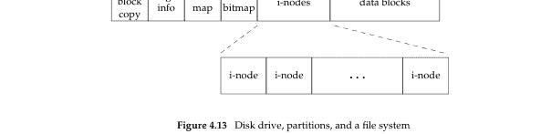

图 4.13 磁盘驱动器、分区和文件系统


如果我们更详细地考察柱面组中的 i-node 和数据块部分，就可以得到图 4.14 所示的布局。

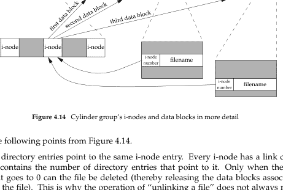

## 图 4.14 更详细的柱面组 i-node 和数据块

请注意图 4.14 中的以下几点。

- 两个目录项指向同一个 i-node 项。每个 i-node 都有一个链接计数，其中包含指向该 i-node 的目录项数量。只有当链接计数变为 0 时，文件才能被删除（从而释放与该文件关联的数据块）。这就是“解除文件链接”操作并不总是意味着“删除与文件关联的数据块”的原因。这也是用于移除目录项的函数被称为 unlink，而不是 delete 的原因。在 stat 结构中，链接计数保存在 st_nlink 成员中。它的基本系统数据类型是 nlink_t。这类链接称为硬链接。回顾第 2.5.2 节，POSIX.1 常量 LINK_MAX 指定了文件链接计数的最大值。

- 另一种链接称为符号链接。对于符号链接，文件的实际内容——数据块——存储的是符号链接所指向文件的名称。在下面的示例中，目录项中的文件名是由 3 个字符组成的字符串 lib，而文件中的 7 个字节数据是 usr/lib：

  ```
  lrwxrwxrwx 1 root 7 Sep 25 07:14 lib -> usr/lib
  ```

  i-node 中的文件类型应为 S_IFLNK，这样系统就知道这是一个符号链接。

- i-node 包含文件的所有信息：文件类型、文件的访问权限位、文件大小、指向文件数据块的指针等。stat 结构中的大部分信息都来自 i-node。目录项中只有两项信息值得关注：文件名和 i-node 编号。其他项——文件名长度和目录记录长度——与本讨论无关。i-node 编号的数据类型是 ino_t。

- 由于目录项中的 i-node 编号指向同一文件系统中的 i-node，因此目录项不能引用其他文件系统中的 i-node。这就是 ln(1) 命令（创建指向现有文件的新目录项）不能跨文件系统工作的原因。我们将在下一节介绍 link 函数。

- 在不改变文件系统的情况下重命名文件时，无需移动文件的实际内容——只需添加一个指向现有 i-node 的新目录项，然后解除旧目录项的链接即可。链接计数将保持不变。例如，要将文件 /usr/lib/foo 重命名为 /usr/foo，如果目录 /usr/lib 和 /usr 位于同一个文件系统中，则无需移动文件 foo 的内容。这就是 mv(1) 命令通常的工作方式。

我们已经讨论了普通文件的链接计数概念，那么目录的链接计数字段又是怎样的呢？假设我们在工作目录中创建一个新目录，如下所示：

```
$ mkdir testdir
```

图 4.15 显示了结果。请注意，在该图中，我们明确展示了点和点点目录项。

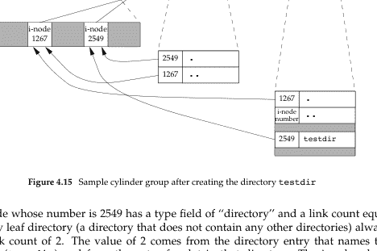

## 图 4.15 创建目录 testdir 后的示例柱面组

编号为 2549 的 i-node 的类型字段为“目录”，链接计数为 2。任何叶目录（不包含其他目录的目录）的链接计数始终为 2。这个 2 来自命名该目录的目录项（testdir）以及该目录中表示点的目录项。编号为 1267 的 i-node 的类型字段为“目录”，链接计数大于或等于 3。我们知道该链接计数大于或等于 3，因为至少有以下目录项指向该 i-node：命名该目录的目录项（图 4.15 中未显示）、testdir 目录中的点目录项，以及点点目录项。请注意，父目录中的每个子目录都会使父目录的链接计数增加 1。

这种格式类似于经典 UNIX 文件系统的格式，Bach [1986] 在第 4 章中对此进行了详细描述。有关 Berkeley 快速文件系统所做更改的其他信息，请参阅 McKusick 等人 [1996] 的第 7 章，或 McKusick 和 Neville-Neil [2005] 的第 8 章。有关 UFS（Berkeley 快速文件系统的 Solaris 版本）的详细信息，请参阅 McDougall 和 Mauro [2007] 的第 15 章。有关 Mac OS X 使用的 HFS 文件系统格式，请参阅 Singh [2006] 的第 12 章。

## 4.15 link、linkat、unlink、unlinkat 和 remove 函数

正如上一节所述，一个文件可以有多个目录项指向其 i-node。我们可以使用 link 函数或 linkat 函数来创建指向现有文件的链接。

```
#include <unistd.h>

int link(const char *existingpath, const char *newpath);
int linkat(int olddirfd, const char *existingpath, int newdirfd, const char *newpath, int flag);

Both return: 0 if OK, -1 on error
```

这些函数创建一个新的目录项 newpath，该目录项引用现有文件 existingpath。如果 newpath 已经存在，则返回错误。只有 newpath 的最后一个组成部分会被创建，路径的其余部分必须已经存在。

对于 linkat 函数，现有文件由 olddirfd 和 existingpath 参数共同指定，新路径名由 newdirfd 和 newpath 参数共同指定。默认情况下，如果任一路径名是相对路径，则会相对于对应的文件描述符进行解析。如果任一文件描述符被设置为 AT_FDCWD，那么对应的路径名（如果是相对路径名）将相对于当前目录进行解析。如果任一路径名是绝对路径，则会忽略相应的文件描述符参数。

当现有文件是符号链接时，flag 参数控制 linkat 函数是创建指向该符号链接的链接，还是创建指向符号链接所指向文件的链接。如果 flag 参数中设置了 AT_SYMLINK_FOLLOW 标志，则会创建指向符号链接目标的链接。如果未设置该标志，则会创建指向符号链接本身的链接。

## 示例

图 4.16 所示的程序打开一个文件，然后解除其链接。接着，程序休眠 15 秒后终止。

```
#include "apue.h"
#include <fcntl.h>
int
main(void)
{
    if (open("tempfile", O_RDWR) < 0)
        err_sys("open error");
    if (unlink("tempfile") < 0)
        err_sys("unlink error");
    printf("file unlinked\n");
    sleep(15);
    printf("done\n");
    exit(0);
}
```

图 4.16 打开文件，然后解除其链接

运行该程序会得到以下结果：

```
$ ls -l tempfile                查看文件有多大
-rw-r--r-- 1 sar 413265408 Jan 21 07:14 tempfile
$ df /home                       检查可用空间大小
Filesystem     1K-blocks    Used Available Use% Mounted on
/dev/hda4      11021440 1956332  9065108 18% /home
$ ./a.out &                      在后台运行图 4.16 中的程序
1364                           shell 输出其进程 ID
$ file unlinked                  文件已解除链接
$ ls -l tempfile                 查看文件名是否仍然存在
ls: tempfile: No such file or directory  目录项已消失
$ df /home                       查看空间是否已经可用
Filesystem     1K-blocks    Used Available Use% Mounted on
/dev/hda4      11021440 1956332  9065108 18% /home
$ done                           程序结束，所有打开的文件均已关闭
df /home                         现在磁盘空间应该已经可用
Filesystem     1K-blocks    Used Available Use% Mounted on
/dev/hda4      11021440 1552352  9469088 15% /home
                               现在有 394.1 MB 磁盘空间可用
```

程序通常利用 unlink 的这一特性来确保它创建的临时文件不会因程序崩溃而遗留在系统中。进程使用 open 或 creat 创建文件，然后立即调用 unlink。不过，文件并不会被删除，因为它仍处于打开状态。只有当进程关闭文件或终止时——进程终止会使内核关闭其所有打开的文件——文件才会被删除。

如果 pathname 是符号链接，unlink 移除的是符号链接，而不是该链接所引用的文件。不存在这样一个函数：给定符号链接的名称，删除该符号链接所引用的文件。


超级用户可以在文件系统支持的情况下使用 *pathname* 指定一个目录来调用 `unlink`，但应使用 `rmdir` 函数来解除链接目录。我们在第 4.21 节中描述了 `rmdir` 函数。

我们也可以使用 `remove` 函数来解除链接文件或目录。对于文件，`remove` 与 `unlink` 相同。对于目录，`remove` 与 `rmdir` 相同。

```c
#include <stdio.h>

int remove(const char *pathname);
                             Returns: 0 if OK, −1 on error
```

ISO C 指定 `remove` 函数来删除文件。名称从历史上的 UNIX 名称 `unlink` 更改，因为在当时，大多数实现 C 标准的非 UNIX 系统并不支持向文件创建链接的概念。

## 4.16 rename 和 renameat 函数

文件或目录的改名可通过 `rename` 或 `renameat` 函数完成。

```c
#include <stdio.h>

int rename(const char *oldname, const char *newname);

int renameat(int oldfd, const char *oldname, int newfd,
             const char *newname);

                                  Both return: 0 if OK, −1 on error
```

`rename` 函数由 ISO C 为文件定义。 （C 标准不处理目录。）POSIX.1 将定义扩展到包括目录和符号链接。

这些函数的条件有多种，取决于 *oldname* 是否引用文件、目录或符号链接。我们还必须描述如果 *newname* 已存在会发生什么。

- 1. 如果 *oldname* 指定一个不是目录的文件，则我们是在重命名文件或符号链接。在这种情况下，如果 *newname* 存在，它不能引用目录。如果 *newname* 存在且不是目录，则将其删除，并将 *oldname* 重命名为 *newname*。我们必须对包含 *oldname* 的目录和包含 *newname* 的目录具有写权限，因为我们正在更改这两个目录。
- 2. 如果 *oldname* 指定一个目录，则我们是在重命名目录。如果 *newname* 存在，它必须引用一个目录，并且该目录必须为空。 （当我们说一个目录为空时，我们的意思是目录中唯一的条目是点和点点。）如果 *newname* 存在且是一个空目录，则将其删除，并将 *oldname* 重命名为 *newname*。此外，在重命名目录时，*newname* 不能包含命名 *oldname* 的路径前缀。例如，我们不能将 `/usr/foo` 重命名为 `/usr/foo/testdir`，因为旧名称（`/usr/foo`）是新名称的前缀路径，不能被删除。
- 3. 如果 oldname 或 newname 引用符号链接，则处理链接本身，而不是它解析到的文件。
- 4. 我们不能重命名点或点点。更准确地说，点或点点不能作为 oldname 或 newname 的最后一个组件出现。
- 5. 作为特例，如果 oldname 和 newname 引用同一个文件，函数将成功返回而不做任何更改。

如果 newname 已存在，我们需要如同删除它一样的权限。此外，因为我们正在删除 oldname 的目录条目并可能创建 newname 的目录条目，所以我们需要在包含 oldname 的目录和包含 newname 的目录中具有写权限和执行权限。

`renameat` 函数提供的功能与 `rename` 函数相同，只是当 oldname 或 newname 引用相对路径名时除外。如果 oldname 指定相对路径名，则它相对于 oldfd 引用的目录进行求值。类似地，如果 newname 指定相对路径名，则 newname 相对于 newfd 引用的目录进行求值。oldfd 或 newfd 参数（或两者）都可以设置为 AT_FDCWD，以使相应的路径名相对于当前目录进行求值。

## 4.17 符号链接

符号链接是对文件的间接指针，与上一节中描述的硬链接不同，后者直接指向文件的 i-节点。符号链接被引入是为了克服硬链接的限制。

- 硬链接通常要求链接和文件位于同一文件系统。
- 只有超级用户才能创建指向目录的硬链接（当底层文件系统支持时）。

符号链接对其指向的内容没有文件系统限制，任何人都可以创建指向目录的符号链接。符号链接通常用于将文件或整个目录层次结构“移动”到系统上的另一个位置。

在使用按名称引用文件的函数时，我们始终需要知道函数是否会跟随符号链接。如果函数跟随符号链接，则函数中的路径名参数引用符号链接指向的文件。否则，路径名参数引用链接本身，而不是链接指向的文件。图 4.17 总结了本章中描述的函数是否跟随符号链接。函数 mkdir、mkfifo、mknod 和 rmdir 未出现在该图中，因为当路径名为符号链接时它们会返回错误。此外，接受文件描述符参数的函数，如 fstat 和 fchmod，未列出，因为返回文件描述符的函数（通常是 open）处理符号链接。历史上，实现在 chown 是否跟随符号链接方面存在差异。然而，在所有现代系统中，chown 都跟随符号链接。

符号链接随 4.2BSD 引入。最初，chown 不会跟随符号链接，但该行为在 4.4BSD 中发生了变化。System V 在 SVR4 中包含了对符号链接的支持，但偏离了原始的 BSD 行为，通过实现 chown 来跟随符号链接。在旧版本的 Linux（2.1.81 之前的版本）中，chown 不会跟随符号链接。从版本 2.1.81 开始，chown 跟随符号链接。在 FreeBSD 8.0、Mac OS X 10.6.8 和 Solaris 10 中，chown 跟随符号链接。所有这些平台都提供了 lchown 的实现来更改符号链接本身的所有权。

| 函数 | 不跟随符号链接 | 跟随符号链接 |
|---|---|---|
| access |  | • |
| chdir |  | • |
| chmod |  | • |
| chown |  | • |
| creat |  | • |
| exec |  | • |
| lchown | • |  |
| link |  | • |
| lstat | • |  |
| open |  | • |
| opendir |  | • |
| pathconf |  | • |
| readlink | • |  |
| remove | • |  |
| rename | • |  |
| stat |  | • |
| truncate |  | • |
| unlink | • |  |

图 4.17 各函数对符号链接的处理

图 4.17 总结的行为有一个例外，当 open 函数同时设置了 O_CREAT 和 O_EXCL 时。在这种情况下，如果路径名引用符号链接，open 将失败并将 errno 设置为 EEXIST。这种行为旨在关闭一个安全漏洞，以防止特权进程被欺骗写入错误的文件。

### 示例

使用符号链接，可以在文件系统中引入循环。大多数查找路径名的函数在发生这种情况时会返回 ELOOP 的 errno。考虑以下命令：

```
$ mkdir foo                  make a new directory
$ touch foo/a                create a 0-length file
$ ln -s ../foo foo/testdir   create a symbolic link
$ ls -l foo
total 0
-rw-r--r-- 1 sar 0 Jan 22 00:16 a
lrwxrwxrwx 1 sar 6 Jan 22 00:16 testdir -> ../foo
```

这创建了一个目录 foo，其中包含文件 a 和一个指向 foo 的符号链接。我们在图 4.18 中展示了这种安排，将目录画成圆圈，文件画成正方形。

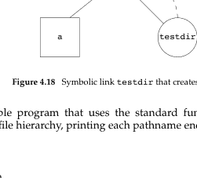

图 4.18 创建循环的符号链接 testdir

如果我们编写一个简单的程序，使用 Solaris 上的标准函数 ftw(3) 遍历文件层次结构并打印遇到的每个路径名，输出为

```
foo
foo/a
foo/testdir
foo/testdir/a
foo/testdir/testdir
foo/testdir/testdir/a
foo/testdir/testdir/testdir
foo/testdir/testdir/testdir/a
(many more lines until we encounter an ELOOP error)
```

在第 4.22 节中，我们提供了自己的 ftw 函数版本，该版本使用 lstat 而不是 stat，以防止它跟随符号链接。

> 请注意，在 Linux 上，ftw 和 nftw 函数会记录所有看到的目录并避免多次处理同一个目录，因此它们不会显示这种行为。

这种形式的循环很容易删除。我们可以解除链接文件 foo/testdir，因为 unlink 不会跟随符号链接。但如果我们创建形成这种类型循环的硬链接，其删除会困难得多。这就是为什么 link 函数只有在进程具有超级用户权限时才会形成指向目录的硬链接。

> 确实，Rich Stevens 在撰写本节的原始版本时，在自己的系统上进行了这样的实验。文件系统损坏了，正常的 fsck(1) 实用程序无法修复。已弃用的工具 clri(8) 和 decheck(8) 才得以修复文件系统。

对目录的硬链接的需求早已过去。有了符号链接和 mkdir 函数，用户不再需要创建指向目录的硬链接。

当我们打开一个文件时，如果传递给 open 的路径名指定了符号链接，open 会跟随链接到指定的文件。如果符号链接指向的文件不存在，open 会返回错误，说明它无法打开文件。这种响应会让不熟悉符号链接的用户感到困惑。例如，


```
$ ln -s /no/such/file myfile          创建一个符号链接
$ ls myfile                            ls 显示它存在
myfile
$ cat myfile                           因此我们尝试查看它
cat: myfile: No such file or directory
$ ls -l myfile                          尝试使用 -l 选项
lrwxrwxrwx 1 sar 13 Jan 22 00:26 myfile -> /no/such/file
```

文件 `myfile` 确实存在，但 `cat` 却说没有这样的文件，这是因为 `myfile` 是一个符号链接，而该符号链接指向的文件不存在。`ls` 的 `-l` 选项给出了两个提示：第一个字符是 `l`，表示这是一个符号链接；`->` 也表明这是一个符号链接。`ls` 还有另一个选项（`-F`），它会在符号链接文件名后附加一个 @ 符号，这样即使不使用 `-l` 选项，也能帮助我们在目录列表中识别符号链接。

## 4.18 创建和读取符号链接

可以使用 `symlink` 或 `symlinkat` 函数创建符号链接。

```
#include <unistd.h>
int symlink(const char *actualpath, const char *sympath);
int symlinkat(const char *actualpath, int fd, const char *sympath);
两者均返回：成功时返回 0，出错时返回 -1
```

系统会创建一个新的目录项 `sympath`，使其指向 `actualpath`。创建符号链接时，`actualpath` 不必存在。（我们在上一节末尾的示例中见过这种情况。）此外，`actualpath` 和 `sympath` 不必位于同一个文件系统中。

`symlinkat` 函数与 `symlink` 类似，但 `sympath` 参数的求值路径是相对于该目录的打开文件描述符所引用的目录（由 `fd` 参数指定）。如果 `sympath` 参数指定的是绝对路径名，或者 `fd` 参数具有特殊值 `AT_FDCWD`，那么 `symlinkat` 的行为与 `symlink` 相同。

由于 `open` 函数会跟随符号链接，因此我们需要一种方法来打开链接本身并读取链接中存储的名称。`readlink` 和 `readlinkat` 函数正是用于此目的。

```
#include <unistd.h>
 ssize_t readlink(const char* restrict pathname, char *restrict buf, size_t bufsize);
 ssize_t readlinkat(int fd, const char* restrict pathname, char *restrict buf, size_t bufsize);
 两者均返回：成功时返回读取的字节数，出错时返回 -1
```

这些函数将 `open`、`read` 和 `close` 的操作合并在一起。成功时，它们返回写入 `buf` 的字节数。返回到 `buf` 中的符号链接内容不会以空字符结尾。

当 `pathname` 参数指定绝对路径名，或者 `fd` 参数具有特殊值 `AT_FDCWD` 时，`readlinkat` 函数的行为与 `readlink` 函数相同。不过，当 `fd` 参数是一个有效的、指向已打开目录的文件描述符，且 `pathname` 参数是相对路径名时，`readlinkat` 会以 `fd` 所表示的打开目录为基准来解析该路径名。

## 4.19 文件时间

在第 4.2 节中，我们讨论过，2008 版《单一 UNIX 规范》将 `stat` 结构中的时间字段精度从秒提高到了秒加纳秒。每个文件属性中实际存储的精度取决于文件系统的实现。对于以秒为粒度存储时间戳的文件系统，纳秒字段将填充为零。对于以高于秒的精度存储时间戳的文件系统，秒以下的部分会转换为纳秒，并返回到纳秒字段中。

每个文件都会维护三个时间字段，其用途总结见图 4.19。

| 字段 | 描述 | 示例 | `ls(1)` 选项 |
|---|---|---|---|
| `st_atim` | 文件数据的最近访问时间 | 读取 | -u |
| `st_mtim` | 文件数据的最近修改时间 | 写入 | 默认 |
| `st_ctim` | i-node 状态的最近更改时间 | chmod、chown | -c |

**图 4.19** 与每个文件相关联的三个时间值

请注意修改时间（`st_mtim`）与状态更改时间（`st_ctim`）之间的区别。修改时间表示文件内容最近一次被修改的时间。状态更改时间表示文件的 i-node 最近一次被修改的时间。在本章中，我们介绍了许多不会改变文件实际内容、却会影响 i-node 的操作：更改文件访问权限、更改用户 ID、更改链接数等。由于 i-node 中的所有信息都与文件的实际内容分开存储，因此除了修改时间之外，我们还需要状态更改时间。

请注意，系统不会维护 i-node 的最近访问时间。因此，`access` 和 `stat` 等函数不会更改这三个时间中的任何一个。

系统管理员常用访问时间来删除在一段时间内未被访问过的文件。一个典型例子是删除过去一周未被访问过的名为 `a.out` 或 `core` 的文件。`find(1)` 命令常用于执行此类操作。

修改时间和状态更改时间可用于归档内容或 i-node 曾被修改过的文件。

`ls` 命令只能显示或按三个时间值中的一个排序。默认情况下，使用 `-l` 或 `-t` 选项调用时，它使用文件的修改时间。`-u` 选项使 `ls` 命令使用访问时间，`-c` 选项则使其使用状态更改时间。

图 4.20 总结了我们介绍过的各种函数对这三个时间值的影响。回顾第 4.14 节，目录本质上是一个包含目录项的文件：文件名及其关联的 i-node 编号。添加、删除或修改这些目录项会影响与该目录相关联的三个时间值。因此，图 4.20 中一列列出与文件或目录相关联的三个时间值，另一列则列出与被引用文件或目录的父目录相关联的三个时间值。例如，创建新文件会影响包含该文件的目录，也会影响新文件的 i-node。而读取或写入文件只会影响该文件的 i-node，不会影响目录。

| 函数 | 被引用的文件或目录<br>a&nbsp;&nbsp;&nbsp;m&nbsp;&nbsp;&nbsp;c | 被引用文件或目录的父目录<br>a&nbsp;&nbsp;&nbsp;m&nbsp;&nbsp;&nbsp;c | 章节 | 注释 |
|---|---|---|---|---|
| chmod, fchmod<br>chown, fchown | &nbsp;&nbsp;&nbsp;&nbsp;&nbsp;&nbsp;&nbsp;&nbsp;• | &nbsp;&nbsp;&nbsp;&nbsp;&nbsp;&nbsp;&nbsp;&nbsp;&nbsp;&nbsp;&nbsp;&nbsp;&nbsp;&nbsp;&nbsp;&nbsp;&nbsp;&nbsp;&nbsp;&nbsp;&nbsp;&nbsp; | 4.9<br>4.11 | |
| creat<br>creat | •&nbsp;&nbsp;&nbsp;•&nbsp;&nbsp;&nbsp;• | &nbsp;&nbsp;&nbsp;&nbsp;&nbsp;&nbsp;•&nbsp;&nbsp;&nbsp;• | 3.4<br>3.4 | O_CREAT 新建文件<br>O_TRUNC 已有文件 |
| exec | • | | 8.10 | |
| lchown | &nbsp;&nbsp;&nbsp;&nbsp;&nbsp;&nbsp;&nbsp;&nbsp;• | | 4.11 | |
| link | &nbsp;&nbsp;&nbsp;&nbsp;&nbsp;&nbsp;&nbsp;&nbsp;• | &nbsp;&nbsp;&nbsp;&nbsp;&nbsp;&nbsp;•&nbsp;&nbsp;&nbsp;• | 4.15 | 第二个参数的父目录 |
| mkdir | •&nbsp;&nbsp;&nbsp;•&nbsp;&nbsp;&nbsp;• | &nbsp;&nbsp;&nbsp;&nbsp;&nbsp;&nbsp;•&nbsp;&nbsp;&nbsp;• | 4.21 | |
| mkfifo | •&nbsp;&nbsp;&nbsp;•&nbsp;&nbsp;&nbsp;• | &nbsp;&nbsp;&nbsp;&nbsp;&nbsp;&nbsp;•&nbsp;&nbsp;&nbsp;• | 15.5 | |
| open<br>open | •&nbsp;&nbsp;&nbsp;&nbsp;&nbsp;&nbsp;&nbsp;&nbsp;• | &nbsp;&nbsp;&nbsp;&nbsp;&nbsp;&nbsp;•&nbsp;&nbsp;&nbsp;&nbsp;&nbsp;&nbsp;&nbsp;&nbsp;• | 3.3<br>3.3 | O_CREAT 新建文件<br>O_TRUNC 已有文件 |
| pipe | •&nbsp;&nbsp;&nbsp;•&nbsp;&nbsp;&nbsp;• | | 15.2 | |
| read | • | | 3.7 | |
| remove<br>remove | &nbsp;&nbsp;&nbsp;&nbsp;&nbsp;&nbsp;&nbsp;&nbsp;• | &nbsp;&nbsp;&nbsp;&nbsp;&nbsp;&nbsp;•&nbsp;&nbsp;&nbsp;• | 4.15<br>4.15 | 删除文件 = unlink<br>删除目录 = rmdir |
| rename | &nbsp;&nbsp;&nbsp;&nbsp;&nbsp;&nbsp;&nbsp;&nbsp;• | &nbsp;&nbsp;&nbsp;&nbsp;&nbsp;&nbsp;•&nbsp;&nbsp;&nbsp;• | 4.16 | 两个参数均适用 |
| rmdir | | &nbsp;&nbsp;&nbsp;&nbsp;&nbsp;&nbsp;•&nbsp;&nbsp;&nbsp;• | 4.21 | |
| truncate, ftruncate | &nbsp;&nbsp;&nbsp;&nbsp;&nbsp;&nbsp;•&nbsp;&nbsp;&nbsp;• | | 4.13 | |
| unlink | &nbsp;&nbsp;&nbsp;&nbsp;&nbsp;&nbsp;&nbsp;&nbsp;• | &nbsp;&nbsp;&nbsp;&nbsp;&nbsp;&nbsp;•&nbsp;&nbsp;&nbsp;• | 4.15 | |
| utimes, utimensat, futimens | •&nbsp;&nbsp;&nbsp;•&nbsp;&nbsp;&nbsp;• | | 4.20 | |
| write | •&nbsp;&nbsp;&nbsp;&nbsp;&nbsp;&nbsp;&nbsp;&nbsp;• | | 3.8 | |

**图 4.20** 各种函数对访问时间、修改时间和状态更改时间的影响

（`mkdir` 和 `rmdir` 函数见第 4.21 节。`utimes`、`utimensat` 和 `futimens` 函数将在下一节介绍。七个 `exec` 函数见第 8.10 节。`mkfifo` 和 `pipe` 函数将在第 15 章介绍。）


## 4.20 futimens、utimensat 和 utimes 函数

有几个函数可用于更改文件的访问时间和修改时间。`futimens` 和 `utimensat` 函数使用 `timespec` 结构（与 `stat` 函数族使用的结构相同；参见第 4.2 节）来提供纳秒级的时间戳精度。

```c
#include <sys/stat.h>

int futimens(int fd, const struct timespec times[2]);
int utimensat(int fd, const char *path, const struct timespec times[2],
    int flag);
```

两个函数的返回值：若成功则返回 0，若出错则返回 -1

在这两个函数中，`times` 数组参数的第一个元素包含访问时间，第二个元素包含修改时间。这两个时间值是日历时间，它们自纪元（Epoch）以来以秒计数，如第 1.10 节所述。秒的小数部分以纳秒表示。

时间戳可通过以下四种方式之一指定：

- 1. `times` 参数是空指针。在这种情况下，两个时间戳都被设置为当前时间。
- 2. `times` 参数指向一个包含两个 `timespec` 结构的数组。如果任一 `tv_nsec` 字段具有特殊值 `UTIME_NOW`，则相应的时间戳被设置为当前时间。相应的 `tv_sec` 字段被忽略。
- 3. `times` 参数指向一个包含两个 `timespec` 结构的数组。如果任一 `tv_nsec` 字段具有特殊值 `UTIME_OMIT`，则相应的时间戳保持不变。相应的 `tv_sec` 字段被忽略。
- 4. `times` 参数指向一个包含两个 `timespec` 结构的数组，且 `tv_nsec` 字段包含除 `UTIME_NOW` 或 `UTIME_OMIT` 之外的值。在这种情况下，相应的时间戳被设置为对应的 `tv_sec` 和 `tv_nsec` 字段所指定的值。

执行这些函数所需的权限取决于 `times` 参数的值。

- 如果 `times` 是空指针，或者任一 `tv_nsec` 字段被设置为 `UTIME_NOW`，则进程的有效用户 ID 必须等于文件的所有者 ID，或者进程必须对该文件具有写权限，或者进程必须是超级用户进程。
- 如果 `times` 是非空指针，且任一 `tv_nsec` 字段具有除 `UTIME_NOW` 或 `UTIME_OMIT` 之外的值，则进程的有效用户 ID 必须等于文件的所有者 ID，或者进程必须是超级用户进程。仅具有对该文件的写权限是不够的。
- 如果 `times` 是非空指针，且两个 `tv_nsec` 字段都设置为 `UTIME_OMIT`，则不会执行任何权限检查。

使用 `futimens` 时，你需要打开文件才能更改其时间。`utimensat` 函数提供了一种使用文件名更改文件时间的方法。`pathname` 参数相对于 `fd` 参数进行求值，`fd` 要么是一个打开的目录的文件描述符，要么是特殊值 `AT_FDCWD`，用于强制相对于调用进程的当前目录进行求值。如果 `pathname` 指定的是绝对路径名，则忽略 `fd` 参数。

`utimensat` 的 `flag` 参数可用于进一步修改默认行为。如果设置了 `AT_SYMLINK_NOFOLLOW` 标志，则更改符号链接本身的时间（如果 `pathname` 引用的是符号链接）。默认行为是跟随符号链接，并修改链接所指向的文件的时间。

`futimens` 和 `utimensat` 都包含在 POSIX.1 中。第三个函数 `utimes` 包含在单一 UNIX 规范中，作为 XSI 选项的一部分。

```c
#include <sys/time.h>
int utimes(const char *pathname, const struct timeval times[2]);
```

返回值：若成功则返回 0，若出错则返回 -1

`utimes` 函数对路径名进行操作。`times` 参数是指向两个时间戳（访问时间和修改时间）数组的指针，但它们以秒和微秒表示：

```c
struct timeval {
    time_t tv_sec;    /* 秒 */
    long   tv_usec;   /* 微秒 */
};
```

注意，我们无法指定更改状态时间 `st_ctim`（即 i-node 最后被更改的时间）的值，因为该字段在调用 `utime` 函数时会自动更新。

在某些 UNIX 系统版本中，`touch(1)` 命令会使用这些函数之一。此外，标准归档程序 `tar(1)` 和 `cpio(1)` 也可以调用这些函数，将文件的时间设置为归档时保存的时间值。

### 示例

图 4.21 中的程序使用 `open` 函数的 `O_TRUNC` 选项将文件截断为零长度，但不更改其访问时间或修改时间。为此，该程序首先使用 `stat` 函数获取时间，截断文件，然后使用 `futimens` 函数重置时间。

```c
#include "apue.h"
#include <fcntl.h>

int
main(int argc, char *argv[])
{
    int i, fd;
    struct stat statbuf;
    struct timespec times[2];
    for (i = 1; i < argc; i++) {
        if (stat(argv[i], &statbuf) < 0) { /* 获取当前时间 */
            err_ret("%s: stat error", argv[i]);
            continue;
        }
        if ((fd = open(argv[i], O_RDWR | O_TRUNC)) < 0) { /* 截断 */
            err_ret("%s: open error", argv[i]);
            continue;
        }
        times[0] = statbuf.st_atim;
        times[1] = statbuf.st_mtim;
        if (futimens(fd, times) < 0)      /* 重置时间 */
            err_ret("%s: futimens error", argv[i]);
        close(fd);
    }
    exit(0);
}
```

**图 4.21 futimens 函数示例**

我们可以使用以下命令在 Linux 上演示图 4.21 中的程序：

```
$ ls -l changemod times          查看大小和最后修改时间
-rwxr-xr-x 1 sar 13792 Jan 22 01:26 changemod
-rwxr-xr-x 1 sar 13824 Jan 22 01:26 times
$ ls -lu changemod times          查看最后访问时间
-rwxr-xr-x 1 sar 13792 Jan 22 22:22 changemod
-rwxr-xr-x 1 sar 13824 Jan 22 22:22 times
$ date                           打印今天的日期
Fri Jan 27 20:53:46 EST 2012
$ ./a.out changemod times        运行图 4.21 中的程序
$ ls -l changemod times          检查结果
-rwxr-xr-x 1 sar 0 Jan 22 01:26 changemod
-rwxr-xr-x 1 sar 0 Jan 22 01:26 times
$ ls -lu changemod times         同时检查最后访问时间
-rwxr-xr-x 1 sar 0 Jan 22 22:22 changemod
-rwxr-xr-x 1 sar 0 Jan 22 22:22 times
$ ls -lc changemod times         以及更改状态的时间
-rwxr-xr-x 1 sar 0 Jan 27 20:53 changemod
-rwxr-xr-x 1 sar 0 Jan 27 20:53 times
```

正如我们所预期的那样，最后修改时间和最后访问时间没有改变。然而，更改状态的时间改变为程序运行的时间。

## 4.21 `mkdir`、`mkdirat` 和 `rmdir` 函数

目录分别使用 `mkdir` 和 `mkdirat` 函数创建，使用 `rmdir` 函数删除。

```c
#include <sys/stat.h>

int mkdir(const char *pathname, mode_t mode);

int mkdirat(int fd, const char *pathname, mode_t mode);
```

两个函数的返回值：若成功则返回 0，若出错则返回 -1

这些函数创建一个新的空目录。点（dot）和点点（dot-dot）条目会自动创建。指定的文件访问权限 `mode` 会被进程的文件模式创建掩码修改。

一个常见的错误是指定与文件相同的模式：仅包含读写权限。但对于目录，我们通常希望至少启用一个执行位，以允许访问目录中的文件名。（参见练习 4.16。）

新目录的用户 ID 和组 ID 根据我们在第 4.6 节中描述的规则建立。

Solaris 10 和 Linux 3.2.0 还让新目录从父目录继承 set-group-ID 位。然后，在新目录中创建的文件将继承该目录的组 ID。在 Linux 中，文件系统实现决定是否支持此行为。例如，ext2、ext3 和 ext4 文件系统允许通过 `mount(1)` 命令的一个选项来控制此行为。然而，在 Linux 的 UFS 文件系统实现中，该行为不可选择；它继承 set-group-ID 位以模拟历史 BSD 实现，其中目录的组 ID 从父目录继承。

基于 BSD 的实现不会传播 set-group-ID 位；它们只是作为策略继承组 ID。由于 FreeBSD 8.0 和 Mac OS X 10.6.8 基于 4.4BSD，它们不需要继承 set-group-ID 位。在这些平台上，新创建的文件和目录总是继承父目录的组 ID，无论是否设置了 set-group-ID 位。

早期版本的 UNIX 系统没有 `mkdir` 函数；它是在 4.2BSD 和 SVR3 中引入的。在更早的版本中，进程必须调用 `mknod` 函数来创建新目录——但 `mknod` 函数的使用仅限于超级用户进程。为了规避此限制，创建目录的正常命令 `mkdir(1)` 必须由 root 拥有并设置 set-user-ID 位。要从进程创建目录，必须使用 `system(3)` 函数调用 `mkdir(1)` 命令。

`mkdirat` 函数与 `mkdir` 函数类似。当 `fd` 参数具有特殊值 `AT_FDCWD`，或 `pathname` 参数指定绝对路径名时，`mkdirat` 的行为与 `mkdir` 完全相同。否则，`fd` 参数是一个打开的目录，相对路径名将相对于该目录进行求值。

空目录使用 `rmdir` 函数删除。回想一下，空目录是只包含点和点点条目的目录。


```
#include <unistd.h>
int rmdir(const char *pathname);

Returns: 0 if OK, -1 on error
```

如果通过此调用目录的链接计数变为 0，并且如果没有其他进程打开该目录，则目录占用的空间将被释放。如果在链接计数达到 0 时有一个或多个进程打开该目录，则在该函数返回之前会删除最后一个链接并删除点和点点条目。此外，不能在该目录中创建新文件。目录不会被释放，直到最后一个进程关闭它为止。（即使有其他进程打开了该目录，它也无法在目录中做太多事情，因为 rmdir 函数成功的前提是目录必须为空。）

## 4.22 读取目录

任何具有读取目录访问权限的人都可以读取目录。但只有内核可以写入目录，以保持文件系统的一致性。回顾第 4.5 节，目录的写权限位和执行权限位决定了我们是否可以在目录中创建新文件以及从目录中删除文件——它们并不指定我们是否可以写入目录本身。

目录的实际格式取决于 UNIX 系统的实现和文件系统的设计。早期系统，如 Version 7，具有简单的结构：每个目录条目为 16 字节，其中 14 字节用于文件名，2 字节用于 i-node 编号。当在 4.2BSD 中添加更长的文件名时，每个条目变为变长，这意味着读取目录的任何程序现在都依赖于系统。为了简化读取目录的过程，开发了一组目录例程，并且是 POSIX.1 的一部分。许多实现阻止应用程序使用 read 函数访问目录的内容，从而进一步将应用程序与目录格式的实现特定细节隔离开来。

```
#include <dirent.h>

DIR *opendir(const char *pathname);
DIR *fdopendir(int fd);

Both return: pointer if OK, NULL on error

struct dirent *readdir(DIR *dp);
Returns: pointer if OK, NULL at end of directory or error

void rewinddir(DIR *dp);
int closedir(DIR *dp);

Returns: 0 if OK, -1 on error

long telldir(DIR *dp);
Returns: current location in directory associated with dp

void seekdir(DIR *dp, long loc);
```

fdopendir 函数首次出现在 Single UNIX Specification 的第 4 版中。它提供了一种将打开的文件描述符转换为用于目录处理函数的 DIR 结构的方法。

telldir 和 seekdir 函数不是 POSIX.1 基础标准的一部分。它们包含在 Single UNIX Specification 的 XSI 选项中，因此所有符合的 UNIX 系统实现都预计提供它们。

回顾我们在图 1.3 中所示的程序中使用了其中几个函数，我们的 ls 命令的简易实现。

在 <dirent.h> 中定义的 dirent 结构依赖于实现。实现定义该结构至少包含以下两个成员：

```
ino_t d_ino;        /* i-node number */
char * d_name[];    /* null-terminated filename */
```

d_ino 条目未由 POSIX.1 定义，因为它是实现特性，但它作为 POSIX.1 中的 XSI 选项的一部分而定义。POSIX.1 仅在此结构中定义 d_name 条目。

请注意，d_name 条目的大小未指定，但保证至少容纳 NAME_MAX 个字符，不包括终止空字节（回顾图 2.15。）由于文件名以 null 结尾，因此 d_name 在头文件中如何定义并不重要，因为数组大小并不表示文件名的长度。

DIR 结构是这些七个函数使用的内部结构，用于维护有关正在读取的目录的信息。DIR 结构的目的类似于标准 I/O 库维护的 FILE 结构，我们将在第 5 章中描述它。

opendir 和 fdopendir 返回的指向 DIR 结构的指针随后与另外五个函数一起使用。opendir 函数初始化事物，以便第一次 readdir 返回目录中的第一个条目。当 DIR 结构由 fdopendir 创建时，readdir 返回的第一个条目取决于传递给 fdopendir 的文件描述符关联的文件偏移量。请注意，目录内条目的顺序依赖于实现，通常不是按字母顺序排列的。

### 示例

我们将使用这些目录例程编写一个遍历文件层次结构的程序。目标是生成图 4.4 中所示的各种文件类型的计数。图 4.22 中所示的程序接受单个参数——起始路径名——并从该点递归下降层次结构。Solaris 提供了一个函数 ftw(3)，它执行层次结构的实际遍历，为每个文件调用用户定义的函数。该函数的问题在于它为每个文件调用 stat 函数，这会导致程序跟随符号链接。例如，如果我们从根目录开始并且有一个名为 /lib 的符号链接指向 /usr/lib，则 /usr/lib 目录中的所有文件将被计算两次。为了解决这个问题，Solaris 提供了一个额外的函数 nftw(3)，它有一个选项可以阻止它跟随符号链接。虽然我们可以使用 nftw，但我们将编写自己的简单文件遍历器以展示目录例程的使用。

在 SUSv4 中，nftw 作为 XSI 选项的一部分包含在内。实现包含在 FreeBSD 8.0、Linux 3.2.0、Mac OS X 10.6.8 和 Solaris 10 中。（在 SUSv4 中，ftw 函数已被标记为过时。）基于 BSD 的系统有一个不同的函数 fts(3)，它提供类似的功能。它在 FreeBSD 8.0、Linux 3.2.0 和 Mac OS X 10.6.8 中可用。

```
#include "apue.h"
#include <dirent.h>
#include <limits.h>

/* function type that is called for each filename */
typedef int Myfunc(const char *, const struct stat *, int);

static Myfunc myfunc;
static int myftw(char *, Myfunc *);
static int dopath(Myfunc *);

static long nreg, ndir, nblk, nchr, nfifo, nslink, nsock, ntot;

int
main(int argc, char *argv[])
{
    int ret;

    if (argc != 2)
        err_quit("usage: ftw <starting-pathname>");

    ret = myftw(argv[1], myfunc);      /* does it all */
    ntot = nreg + ndir + nblk + nchr + nfifo + nslink + nsock;
    if (ntot == 0)
        ntot = 1;      /* avoid divide by 0; print 0 for all counts */
    printf("regular files  = %7ld, %5.2f %%\n", nreg,
        nreg*100/ntot);
    printf("directories    = %7ld, %5.2f %%\n", ndir,
        ndir*100/ntot);
    printf("block special  = %7ld, %5.2f %%\n", nblk,
        nblk*100/ntot);
    printf("char special   = %7ld, %5.2f %%\n", nchr,
        nchr*100/ntot);
    printf("FIFOs          = %7ld, %5.2f %%\n", nfifo,
        nfifo*100/ntot);
    printf("symbolic links = %7ld, %5.2f %%\n", nslink,
        nslink*100/ntot);
    printf("sockets        = %7ld, %5.2f %%\n", nsock,
        nsock*100/ntot);
    exit(ret);
}

/*
 * Descend through the hierarchy, starting at "pathname".
 * The caller's func() is called for every file.
 */
#define FTW_F 1      /* file other than directory */
#define FTW_D 2      /* directory */
```

```
#define FTW_DNR 3      /* directory that can't be read */
#define FTW_NS  4      /* file that we can't stat */

static char *fullpath;      /* contains full pathname for every file */
static size_t pathlen;

static int                 /* we return whatever func() returns */
myftw(char *pathname, Myfunc *func)
{
    fullpath = path_alloc(&pathlen);      /* malloc PATH_MAX+1 bytes */
                                     /* (Figure 2.16) */
    if (pathlen <= strlen(pathname)) {
        pathlen = strlen(pathname) * 2;
        if ((fullpath = realloc(fullpath, pathlen)) == NULL)
            err_sys("realloc failed");
    }
    strcpy(fullpath, pathname);
    return(dopath(func));
}
/*
 * Descend through the hierarchy, starting at "fullpath".
 * If "fullpath" is anything other than a directory, we lstat() it,
 * call func(), and return.  For a directory, we call ourselves
 * recursively for each name in the directory.
 */
static int                 /* we return whatever func() returns */
dopath(Myfunc* func)
{
    struct stat     statbuf;
    struct dirent   *dirp;
    DIR             *dp;
    int             ret, n;
    if (lstat(fullpath, &statbuf) < 0)  /* stat error */
        return(func(fullpath, &statbuf, FTW_NS));
    if (S_ISDIR(statbuf.st_mode) == 0)  /* not a directory */
        return(func(fullpath, &statbuf, FTW_F));

    /*
     * It's a directory. First call func() for the directory,
     * then process each filename in the directory.
     */
    if ((ret = func(fullpath, &statbuf, FTW_D)) != 0)
        return(ret);
    n = strlen(fullpath);
    if (n + NAME_MAX + 2 > pathlen) {   /* expand path buffer */
        pathlen *= 2;
        if ((fullpath = realloc(fullpath, pathlen)) == NULL)
            err_sys("realloc failed");
    }
    fullpath[n++] = '/';
```


fullpath[n] = 0;

if ((dp = opendir(fullpath)) == NULL)  /* 无法读取目录 */
    return(func(fullpath, &statbuf, FTW_DNR));

while (((dirp = readdir(dp)) != NULL)) {
    if (strcmp(dirp->d_name, ".") == 0 ||
        strcmp(dirp->d_name, "..") == 0)
        continue;        /* 忽略点和点点 */
    strcpy(&fullpath[n], dirp->d_name); /* 在“/”后追加名称 */
    if ((ret = dopath(func)) != 0)      /* 递归 */
        break;   /* 退出时机 */
    }
    fullpath[n-1] = 0;  /* 擦除从斜杠开始的所有内容 */
    if (closeddir(dp) < 0)
        err_ret("无法关闭目录 %s", fullpath);
    return(ret);
}

static int
myfunc(const char *pathname, const struct stat *statptr, int type)
{
    switch (type) {
    case FTW_F:
        switch (statptr->st_mode & S_IFMT) {
        case S_IFREG:  nreg++;  break;
        case S_IFBLK:  nblk++;  break;
        case S_IFCHR:  nchr++;  break;
        case S_IFIFO:  nifo++;  break;
        case S_IFLNK:  nslink++; break;
        case S_IFSOCK: nsock++; break;
        case S_IFDIR:  /* 目录的类型应为 FTW_D */
            err_dump("对于 %s，类型为 S_IFDIR", pathname);
        }
        break;
    case FTW_D:
        ndir++;
        break;
    case FTW_DNR:
        err_ret("无法读取目录 %s", pathname);
        break;
    case FTW_NS:
        err_ret("%s 的 stat 错误", pathname);
        break;
    default:
        err_dump("路径名 %s 的未知类型 %d", pathname, type);
    }
    return(0);
}

为了说明 ftw 和 nftw 函数，本程序提供了比实际需要更多的通用性。例如，函数 myfunc 始终返回 0，尽管调用它的函数已经准备好处理非零返回值。

有关遍历文件系统，以及在许多标准 UNIX 系统命令（如 find、ls、tar 等）中使用这种技术的更多信息，请参阅 Fowler、Korn 和 Vo [1989]。

## 4.23 chdir、fchdir 和 getcwd 函数

每个进程都有一个当前工作目录。所有相对路径名的搜索都从该目录开始（即所有不以斜杠开头的路径名）。当用户登录 UNIX 系统时，当前工作目录通常从 `/etc/passwd` 文件的第六个字段所指定的目录开始，即用户的主目录。当前工作目录是进程的属性；主目录是登录名的属性。

我们可以通过调用 chdir 或 fchdir 函数来更改调用进程的当前工作目录。

```
#include <unistd.h>
int chdir(const char *pathname);
int fchdir(int fd);

两者均返回：成功返回 0，出错返回 -1
```

我们既可以将路径名指定为新的当前工作目录，也可以通过打开的文件描述符指定。

### 示例

由于当前工作目录是进程的属性，因此执行 chdir 的进程所调用的进程不会受到当前工作目录变化的影响。（我们将在第 8 章中更详细地介绍进程之间的关系。）因此，图 4.23 中的程序并不会执行我们所预期的操作。

```
#include "apue.h"
int
main(void)
{
    if (chdir("/tmp") < 0)
        err_sys("chdir failed");
    printf("chdir to /tmp succeeded\n");
    exit(0);
}
```

图 4.23 chdir 函数示例

如果我们编译此程序，将可执行文件命名为 mycd，然后运行它，会得到以下结果：

```
$ pwd
/usr/lib
$ mycd
chdir to /tmp succeeded
$ pwd
/usr/lib
```

执行 mycd 程序的 shell 的当前工作目录并没有改变。这是 shell 执行程序方式所产生的副作用。每个程序都在独立的进程中运行，因此 shell 的当前工作目录不会受到程序中 chdir 调用的影响。正因为如此，chdir 函数必须直接由 shell 调用，所以 cd 命令被内置在 shell 中。

由于内核必须维护当前工作目录的信息，因此我们应该能够获取它的当前值。遗憾的是，内核并不维护目录的完整路径名。相反，内核保存有关该目录的信息，例如指向目录 v-node 的指针。

> Linux 内核能够确定完整路径名。路径名的各个组成部分分散在挂载表和 dcache 表中；例如，当读取 `/proc/self/cwd` 符号链接时，内核会重新组装这些组成部分。

我们需要一个从当前工作目录（点）开始，沿目录层次结构向上移动的函数，并使用点点来向上移动一级。在每一级中，该函数读取目录项，直到找到与刚刚离开的目录的 i-node 对应的名称。重复此过程，直到遇到根目录，就能得到当前工作目录的完整绝对路径名。幸运的是，已经存在一个函数可以替我们完成这项工作。

```
#include <unistd.h>

char *getcwd(char *buf, size_t size);

返回：成功返回 buf，出错返回 NULL
```

我们必须将缓冲区 buf 的地址及其大小（以字节为单位）传递给该函数。缓冲区必须足够容纳绝对路径名以及结尾的空字节，否则将返回错误。（回顾第 2.5.5 节关于为最大长度路径名分配空间的讨论。）

> 某些较旧的 getcwd 实现允许第一个参数 buf 为 NULL。在这种情况下，函数会调用 malloc 动态分配 size 个字节。这并不是 POSIX.1 或 Single UNIX Specification 的一部分，因此应避免使用这种方式。

### 示例

图 4.24 中的程序切换到一个特定目录，然后调用 getcwd 打印工作目录。如果运行该程序，会得到：

```
$ ./a.out
cwd = /var/spool/uucppublic
$ ls -l /usr/spool
lrwxrwxrwx 1 root 12 Jan 31 07:57 /usr/spool -> ../var/spool
```

```
#include "apue.h"
int
main(void)
{
    char    *ptr;
    size_t   size;
    if (chdir("/usr/spool/uucppublic") < 0)
        err_sys("chdir failed");
    ptr = path_alloc(&size);    /* 我们自己的函数 */
    if (getcwd(ptr, size) == NULL)
        err_sys("getcwd failed");
    printf("cwd = %s\n", ptr);
    exit(0);
}
```

# 图 4.24 getcwd 函数示例

请注意，chdir 会跟随符号链接——正如我们从图 4.17 中所预期的那样；但是，当沿目录树向上移动时，getcwd 并不知道到达 `/var/spool` 目录时，该目录是由符号链接 `/usr/spool` 指向的。这是符号链接的一个特性。

当应用程序需要返回文件系统中最初启动的位置时，getcwd 函数非常有用。我们可以在更改工作目录之前调用 getcwd，保存起始位置。处理完成后，可以将 getcwd 获得的路径名传递给 chdir，从而返回文件系统中的起始位置。

fchdir 函数为完成此任务提供了一种简便方法。我们不必调用 getcwd，而是可以在切换到文件系统中的其他位置之前打开当前目录，并保存文件描述符。当希望返回起始位置时，只需将该文件描述符传递给 fchdir 即可。

## 4.24 设备特殊文件

st_dev 和 st_rdev 这两个字段经常被混淆。在第 18.9 节编写 ttyname 函数时，我们需要使用这些字段。它们的使用规则很简单。

- 每个文件系统都由其主设备号和次设备号标识，这两个号码编码在基本系统数据类型 dev_t 中。主设备号用于标识设备驱动程序，有时还编码需要通信的外设板；次设备号用于标识具体的子设备。回顾图 4.13，磁盘驱动器通常包含多个文件系统。同一磁盘驱动器上的每个文件系统通常具有相同的主设备号，但具有不同的次设备号。

- 我们通常可以通过大多数实现定义的两个宏 major 和 minor 来访问主设备号和次设备号。因此，我们不必关心这两个号码在 dev_t 对象中的存储方式。

早期系统将设备号存储在 16 位整数中，其中主设备号占 8 位，次设备号占 8 位。FreeBSD 8.0 和 Mac OS X 10.6.8 使用 32 位整数，其中主设备号占 8 位，次设备号占 24 位。在 32 位系统中，Solaris 10 使用 32 位整数表示 dev_t，其中主设备号占 14 位，次设备号占 18 位。在 64 位系统中，Solaris 10 将 dev_t 表示为 64 位整数，两个号码各占 32 位。在 Linux 3.2.0 中，虽然 dev_t 是 64 位整数，但主设备号仅使用 12 位，次设备号使用 20 位。

POSIX.1 规定存在 dev_t 类型，但没有定义它包含什么内容，也没有定义如何访问其内容。大多数实现都定义了 major 和 minor 宏。它们定义所在的头文件取决于系统。在基于 BSD 的系统中，它们位于 `<sys/types.h>` 中。Solaris 在 `<sys/mkdev.h>` 中定义了这两个宏的函数原型，因为 Solaris 中 `<sys/sysmacros.h>` 内的宏定义已被视为过时。Linux 在 `<sys/sysmacros.h>` 中定义这些宏，而 `<sys/types.h>` 会包含该文件。

- 系统中每个文件名的 st_dev 值，都是包含该文件名及其对应 i-node 的文件系统的设备号。

- 只有字符特殊文件和块特殊文件具有 st_rdev 值。该值包含实际设备的设备号。

### 示例

图 4.25 中的程序打印每个命令行参数的设备号。此外，如果参数指向字符特殊文件或块特殊文件，还会打印该特殊文件的 st_rdev 值。

```
#include "apue.h"
#ifdef SOLARIS
#include <sys/mkdev.h>
#endif

int
main(int argc, char *argv[])
{
    int         i;
    struct stat buf;

    for (i = 1; i < argc; i++) {
        printf("%s: ", argv[i]);
        if (stat(argv[i], &buf) < 0) {
            err_ret("stat error");
            continue;
        }

        printf("dev = %d/%d", major(buf.st_dev),  minor(buf.st_dev));
```


```
if (S_ISCHR(buf.st_mode) || S_ISBLK(buf.st_mode)) {
    printf(" (%s) rdev = %d/%d", (S_ISCHR(buf.st_mode)) ? "character" : "block", major(buf.st_rdev), minor(buf.st_rdev));
}
printf("\n");
}
exit(0);
}
```

## Figure 4.25 Print st_dev and st_rdev values

在 Linux 上运行此程序会得到以下输出：

```
$ ./a.out / /home/sar /dev/tty[01]
/: dev = 8/3
/home/sar: dev = 8/4
/dev/tty0: dev = 0/5 (character) rdev = 4/0
/dev/tty1: dev = 0/5 (character) rdev = 4/1
$ mount                    which directories are mounted on which devices?
/dev/sda1 on / type ext3 (rw,errors=remount-ro,commit=0)
/dev/sda4 on /home type ext3 (rw,commit=0)
$ ls -l /dev/tty[01] /dev/sda[34]
brw-rw---- 1 root root 8, 3 2011-07-01 11:08 /dev/sda3
brw-rw---- 1 root root 8, 4 2011-07-01 11:08 /dev/sda4
crw------- 1 root root 4, 0 2011-07-01 11:08 /dev/tty0
crw------- 1 root root 4, 1 2011-07-01 11:08 /dev/tty1
```

程序的前两个参数是目录（/ 和 /home/sar），接下来的两个是设备名 /dev/tty[01]。 （我们使用 shell 的正则表达式语言来减少需要输入的字符数。shell 会将字符串 /dev/tty[01] 展开为 /dev/tty0 /dev/tty1。）

我们期望这些设备是字符特殊文件。程序的输出显示根目录的设备号与 /home/sar 目录不同，这表明它们位于不同的文件系统上。运行 mount(1) 命令验证了这一点。

我们随后使用 ls 查看 mount 报告的两个磁盘设备和两个终端设备。两个磁盘设备是块特殊文件，两个终端设备是字符特殊文件。 （通常，只有可以包含随机访问文件系统的设备才是块特殊文件，例如磁盘驱动器、软盘驱动器和 CD-ROM。一些较旧的 UNIX 系统支持用于文件系统的磁带，但从未被广泛使用。）

请注意，两个终端设备的<|message|> 和 i-node（st_dev）位于设备 0/5 上——devtmpfs 伪文件系统，它实现了 /dev——但它们的实际设备号为 4/0 和 4/1。

## 4.15
检查 `cpio(1)` 和 `tar(1)` 命令使用的归档格式。 （这些描述通常可在 *UNIX Programmer’s Manual* 的第 5 节中找到。）为每个文件保存了三种可能的时间值中的多少个？当文件被恢复时，你认为访问时间被设置为什么值，为什么？

## 4.16
UNIX 系统对目录树的深度是否有根本限制？为了查明这一点，编写一个程序，在循环中创建目录然后切换到该目录。确保该目录叶子的绝对路径名的长度大于你系统的 `PATH_MAX` 限制。你能调用 `getcwd` 来获取目录的路径名吗？标准 UNIX 系统工具如何处理这个长路径名？你能使用 `tar` 或 `cpio` 对该目录进行归档吗？

## 4.17
在第 3.16 节中，我们描述了 `/dev/fd` 功能。为了让任何用户都能访问这些文件，它们的权限必须是 `rw-rw-rw-`。某些创建输出文件的程序会先删除文件，以防它已存在，同时忽略返回码：

```
unlink(path);
if ((fd = creat(path, FILE_MODE)) < 0)
    err_sys(...);
```

如果 path 是 `/dev/fd/1` 会发生什么？

# Standard I/O Library

## 5.1 Introduction

本章中，我们描述标准 I/O 库。该库由 ISO C 标准指定，因为它已在除 UNIX 系统之外的许多操作系统上实现。Single UNIX Specification 将额外的接口定义为对 ISO C 标准的扩展。

标准 I/O 库处理诸如缓冲区分配和以最佳大小块执行 I/O 等细节，使我们无需担心使用正确的块大小（见第 3.9 节）。这使得库易于使用，但同时如果我们不了解其工作原理，也会引入另一组问题。

> 标准 I/O 库由 Dennis Ritchie 于 1975 年左右编写。它是对 Mike Lesk 编写的 Portable I/O 库的重大修订。令人惊讶的是，在 35 多年后，标准 I/O 库几乎没有变化。

## 5.2 Streams and FILE Objects

在第 3 章中，所有 I/O 例程都围绕文件描述符展开。当文件打开时，会返回一个文件描述符，随后所有 I/O 操作都使用该描述符。使用标准 I/O 库时，讨论的中心是流。 （不要将标准 I/O 术语 stream 与 System V 的 STREAMS I/O 系统混淆，该系统在 Single UNIX Specification 的 XSI STREAMS 选项中标准化，但在 SUSv4 中现已标记为过时。）当我们使用标准 I/O 库打开或创建文件时，我们说我们已将流与文件关联。

在 ASCII 字符集中，一个字符由一个字节表示。在国际字符集中，一个字符可能由一个以上的字节表示。

标准 I/O 文件流可用于单字节和多字节（“宽”）字符集。流的定向决定了读写字符是单字节还是多字节。最初，流创建时没有定向。如果在没有定向的流上使用多字节 I/O 函数（见 `<wchar.h>`），则流的定向设置为宽定向。如果在没有定向的流上使用字节 I/O 函数，则流的定向设置为字节定向。只有两个函数可以在设置后更改定向。`freopen` 函数（稍后讨论）会清除流的定向；`fwide` 函数可用于设置流的定向。

```
#include <stdio.h>
#include <wchar.h>

int fwide(FILE *fp, int mode);

                         Returns: positive if stream is wide oriented,
                                  negative if stream is byte oriented,
                                  or 0 if stream has no orientation
```

wide 函数根据 *mode* 参数的值执行不同的任务。

- 如果 *mode* 参数为负，`fwide` 将尝试使指定流为字节定向。
- 如果 *mode* 参数为正，`fwide` 将尝试使指定流为宽定向。
- 如果 *mode* 参数为零，`fwide` 不会尝试设置定向，但仍会返回一个标识流定向的值。

请注意，`fwide` 不会更改已定向的流的定向。另请注意，没有错误返回。考虑如果流无效会发生什么。我们唯一的办法是在调用 `fwide` 之前清除 `errno`，并在返回时检查 `errno` 的值。在本书的其余部分，我们将只处理字节定向的流。

当我们打开一个流时，标准 I/O 函数 `fopen`（第 5.5 节）会返回一个指向 FILE 对象的指针。该对象通常是一个结构，包含标准 I/O 库管理流所需的所有信息：用于实际 I/O 的文件描述符、流缓冲区的指针、缓冲区的大小、当前缓冲区中字符的计数、错误标志等。

应用程序软件永远不需要检查 FILE 对象。要引用流，我们将它的 FILE 指针作为参数传递给每个标准 I/O 函数。在整本书中，我们将指向 FILE 对象的指针，类型 FILE *，称为 *file pointer*。

在本章中，我们在 UNIX 系统的上下文中描述标准 I/O 库。正如我们提到的，该库已被移植到各种其他操作系统。为了提供有关该库如何实现的见解，我们将讨论其在 UNIX 系统上的典型实现。


## 5.3 标准输入、标准输出和标准错误

有三个流是预定义的，并且自动对进程可用：标准输入、标准输出和标准错误。这些流分别与我们在3.2节提到的文件描述符 STDIN_FILENO、STDOUT_FILENO 和 STDERR_FILENO 所引用的文件相同。

这三个标准I/O流通过预定义的文件指针 stdin、stdout 和 stderr 来引用。这些文件指针在 <stdio.h> 头文件中定义。

## 5.4 缓冲

标准I/O库提供缓冲的目标是使用最少的读写调用次数。（回想图3.6，它展示了使用不同缓冲区大小执行I/O所需的CPU时间量。）此外，该库尝试对每个I/O流自动进行缓冲，从而无需应用程序为此操心。不幸的是，标准I/O库中最令人困惑的一个方面就是它的缓冲。

提供了三种类型的缓冲：

- 1. 全缓冲。在这种情况下，当标准I/O缓冲区被填满时才进行实际的I/O操作。驻留在磁盘上的文件通常由标准I/O库进行全缓冲。所使用的缓冲区通常是在第一次对流执行I/O时，由某个标准I/O函数调用 malloc（7.8节）获得的。

术语“刷新”（flush）描述的是写出标准I/O缓冲区的内容。缓冲区可以由标准I/O例程自动刷新，例如当缓冲区填满时，或者我们可以调用 fflush 函数来刷新一个流。不幸的是，在UNIX环境中，flush 有两种不同的含义。就标准I/O库而言，它指的是写出缓冲区的内容，其中可能包括部分填充的内容。就终端驱动程序而言，例如第18章中的 tcflush 函数，它指的是丢弃已存储在缓冲区中的数据。

- 2. 行缓冲。在这种情况下，当在输入或输出中遇到换行符时，标准I/O库才执行I/O操作。这允许我们一次输出一个字符（使用标准I/O的 fputc 函数），同时知道只有在写完每一行时才会进行实际的I/O操作。当流引用终端时，通常使用行缓冲——例如标准输入和标准输出。

行缓冲有两个注意事项。首先，标准I/O库用于收集每一行的缓冲区大小是固定的，因此如果我们在写入换行符之前填满了这个缓冲区，就可能会发生I/O操作。其次，每当通过标准I/O库从（a）无缓冲流或（b）行缓冲流（需要从内核请求数据）请求输入时，所有行缓冲输出流都会被刷新。（b）中限定词的原因是，请求的数据可能已经在缓冲区中，不需要从内核读取数据。显然，来自无缓冲流（即（a）项）的任何输入都需要从内核获取数据。

- 3. 无缓冲。

标准I/O库不缓冲字符。例如，如果我们使用标准I/O的 fprintf 函数写入15个字符，我们希望这15个字符尽快输出，很可能使用3.8节中的 write 函数。

例如，标准错误流通常是无缓冲的，以便任何错误消息尽可能快地显示，无论它们是否包含换行符。

ISO C 要求以下缓冲特性：

- 当且仅当标准输入和标准输出不引用交互式设备时，它们才是全缓冲的。
- 标准错误永远不会是全缓冲的。

然而，这并没有告诉我们，如果标准输入和标准输出引用交互式设备，它们是无缓冲还是行缓冲；也没有说明标准错误应该是无缓冲还是行缓冲。大多数实现默认采用以下缓冲类型：

- 标准错误总是无缓冲的。
- 所有其他流，如果它们引用终端设备，则是行缓冲的；否则，它们是全缓冲的。

本书讨论的四个平台遵循这些标准I/O缓冲约定：标准错误是无缓冲的，打开到终端设备的流是行缓冲的，所有其他流是全缓冲的。

我们将在5.12节和图5.11中更详细地探讨标准I/O缓冲。

如果我们不喜欢任何给定流的这些默认设置，可以通过调用 setbuf 或 setvbuf 函数来更改缓冲。

```
#include <stdio.h>

void setbuf(FILE *restrict fp, char *restrict buf);
int setvbuf(FILE *restrict fp, char *restrict buf, int mode,
    size_t size);

Returns: 0 if OK, nonzero on error
```

这些函数必须在流被打开之后（显然，因为每个函数都需要一个有效的文件指针作为第一个参数）、但在对流执行任何其他操作之前调用。

使用 setbuf，我们可以打开或关闭缓冲。要启用缓冲，buf 必须指向一个长度为 BUFSIZ 的缓冲区，BUFSIZ 是在 <stdio.h> 中定义的常量。通常，该流随后是全缓冲的，但某些系统可能会在流与终端设备关联时设置行缓冲。要禁用缓冲，我们将 buf 设置为 NULL。

使用 setvbuf，我们可以精确指定所需的缓冲类型。这是通过 mode 参数完成的：

- _IOFBF  全缓冲
- _IOLBF  行缓冲
- _IONBF  无缓冲

如果我们指定无缓冲流，则忽略 buf 和 size 参数。如果我们指定全缓冲或行缓冲，buf 和 size 可以可选地指定一个缓冲区及其大小。如果流是缓冲的且 buf 为 NULL，则标准I/O库将自动为流分配适当大小的缓冲区。所谓适当大小，指的是常量 BUFSIZ 指定的值。

一些C库实现使用 stat 结构（见4.2节）中的 st_blksize 成员的值来确定最佳的标准I/O缓冲区大小。正如我们将在本章后面看到的，GNU C库使用这种方法。

图5.1总结了这两个函数的操作及其各种选项。

| 函数 | mode | buf | 缓冲区和长度 | 缓冲类型 |
|---|---|---|---|---|
| setbuf |  | 非空 | 长度为 BUFSIZ 的用户缓冲区 | 全缓冲或行缓冲 |
|  |  | NULL | （无缓冲区） | 无缓冲 |
| setvbuf | _IOFBF | 非空 | 长度为 size 的用户缓冲区 | 全缓冲 |
|  |  | NULL | 适当长度的系统缓冲区 |  |
|  | _IOLBF | 非空 | 长度为 size 的用户缓冲区 | 行缓冲 |
|  |  | NULL | 适当长度的系统缓冲区 |  |
|  | _IONBF | （忽略） | （无缓冲区） | 无缓冲 |

图5.1 setbuf 和 setvbuf 函数总结

请注意，如果我们将标准I/O缓冲区分配为函数内的自动变量，则必须在从函数返回之前关闭流。（我们将在7.8节进一步讨论这一点。）此外，某些实现会使用部分缓冲区进行内部簿记，因此缓冲区中实际可以存储的字节数可能小于 size。通常，我们应该让系统选择缓冲区大小并自动分配缓冲区。当我们这样做时，标准I/O库会在我们关闭流时自动释放缓冲区。

在任何时候，我们都可以强制刷新一个流。

```
#include <stdio.h>

int fflush(FILE *fp);
```

返回：如果成功返回0，出错返回 EOF

fflush 函数导致该流的任何未写数据被传递给内核。作为一种特殊情况，如果 fp 为 NULL，fflush 将导致所有输出流被刷新。

## 5.5 打开流

fopen、freopen 和 fdopen 函数打开一个标准I/O流。

```
#include <stdio.h>

FILE *fopen(const char *restrict pathname, const char *restrict type);
FILE *freopen(const char *restrict pathname, const char *restrict type, FILE *restrict fp);
FILE *fdopen(int fd, const char *type);

All three return: file pointer if OK, NULL on error
```

这三个函数的区别如下：

- 1. fopen 函数打开一个指定的文件。
- 2. freopen 函数在指定的流上打开一个指定的文件，如果该流已经打开，则先关闭它。如果流先前有一个方向（orientation），freopen 会清除它。此函数通常用于将指定文件打开为预定义流之一：标准输入、标准输出或标准错误。
- 3. fdopen 函数接受一个现有的文件描述符（我们可以从 open、dup、dup2、fcntl、pipe、socket、socketpair 或 accept 函数获得），并将一个标准I/O流与该描述符关联。此函数通常用于创建管道和网络通信通道的函数返回的描述符。由于这些特殊类型的文件不能使用标准I/O的 fopen 函数打开，我们必须调用设备特定函数来获取文件描述符，然后使用 fdopen 将该描述符与标准I/O流关联。

fopen 和 freopen 都是ISO C的一部分；fdopen 是POSIX.1的一部分，因为ISO C不处理文件描述符。

| type | 描述 | open(2) 标志 |
|---|---|---|
| r 或 rb | 打开用于读 | O_RDONLY |
| w 或 wb | 截断为0长度或创建用于写 | O_WRONLY \| O_CREAT \| O_TRUNC |
| a 或 ab | 追加；在文件末尾打开用于写，或创建用于写 | O_WRONLY \| O_CREAT \| O_APPEND |
| r+ 或 r+b 或 rb+ | 打开用于读和写 | O_RDWR |
| w+ 或 w+b 或 wb+ | 截断为0长度或创建用于读和写 | O_RDWR \| O_CREAT \| O_TRUNC |
| a+ 或 a+b 或 ab+ | 打开或创建用于在文件末尾读和写 | O_RDWR \| O_CREAT \| O_APPEND |

图5.2 打开标准I/O流的 type 参数

ISO C 为 type 参数指定了15个值，如图5.3所示。使用字符 b 作为 type 的一部分允许标准I/O系统区分


文本文件和二进制文件。 由于 UNIX 内核并不区分这些类型的文件，指定类型中的字符 b 没有任何效果。

使用 fdopen 时，type 参数的含义略有不同。 描述符已经打开，因此写入时不会截断文件。 （例如，如果描述符是由 open 函数创建的，并且文件已存在，则 O_TRUNC 标志将控制文件是否被截断。 fdopen 函数不能简单地截断它打开以进行写入的任何文件。）此外，标准 I/O 追加模式不能创建文件（因为如果描述符引用它，则文件必须存在）。

当文件以追加类型打开时，每次写入都将在当时的文件末尾进行。 如果多个进程以标准 I/O 追加模式打开同一文件，每个进程的数据都将正确写入文件。

Berkeley 在 4.4BSD 之前版本的 fopen 以及 Kernighan 和 Ritchie [1988] 第 177 页所示的简单版本无法正确处理追加模式。 这些版本在打开流时会执行 lseek 到文件末尾。 为了在涉及多个进程时正确支持追加模式，必须使用 O_APPEND 标志打开文件，我们在第 3.3 节中讨论过它。 在每次写入之前执行 lseek 也行不通，正如我们在第 3.11 节中所讨论的那样。

当文件以读写方式打开（类型中的加号）时，适用两个限制。

+   - 输出不能在没有 intervening fflush、fseek、fsetpos 或 rewind 的情况下直接跟随输入。
+   - 输入不能在没有 intervening fseek、fsetpos 或 rewind 的情况下直接跟随输出，或在遇到文件末尾的输入操作。

我们可以将图 5.2 中的打开流的六种方式总结在图 5.3 中。

| Restriction | r | w | a | r+ | w+ | a+ |
|---|---|---|---|---|---|---|
| file must already exist | • |  |  | • |  |  |
| previous contents of file discarded |  | • |  |  | • |  |
| stream can be read | • |  |  | • | • | • |
| stream can be written |  | • | • | • | • | • |
| stream can be written only at end |  |  | • |  |  | • |

Figure 5.3 Six ways to open a standard I/O stream

请注意，如果通过指定类型为 w 或 a 来创建新文件，我们无法指定文件的访问权限位，就像我们在第 3 章中使用 open 函数和 creat 函数时所能做的那样。 POSIX.1 要求实现以以下权限位集创建文件：

S_IRUSR | S_IWUSR | S_IRGRP | S_IWGRP | S_IROTH | S_IWOTH

然而，正如我们在第 4.8 节中所回忆的那样，我们可以通过调整 umask 值来限制这些权限。

默认情况下，打开的流是完全缓冲的，除非它引用终端设备，在这种情况下它是行缓冲的。 在打开流后，但在对流执行任何其他操作之前，我们可以使用上一节中的 setbuf 或 setvbuf 函数根据需要更改缓冲。

通过调用 fclose 关闭打开的流。

```
#include <stdio.h>
int fclose(FILE *fp);

Returns: 0 if OK, EOF on error
```

在文件关闭之前，先刷新任何缓冲的输出数据。 任何可能缓冲的输入数据将被丢弃。 如果标准 I/O 库曾为流自动分配缓冲区，则该缓冲区将被释放。

当进程正常终止时，无论是通过直接调用 exit 函数还是从 main 函数返回，所有具有未写入缓冲数据的标准 I/O 流都会被刷新，并且所有打开的标准 I/O 流都会被关闭。

## 5.6 Reading and Writing a Stream

打开流后，我们可以选择三种非格式化 I/O：

+   1. 逐字符 I/O。 我们可以一次读写一个字符，标准 I/O 函数会处理所有缓冲，如果流是缓冲的。
+   2. 逐行 I/O。 如果我们想一次读写一行，我们使用 fgets 和 fputs。 每行以换行符终止，并且在调用 fgets 时我们必须指定可以处理的最高行长度。 我们在第 5.7 节中描述这两个函数。
+   3. 直接 I/O。 这种类型的 I/O 由 fread 和 fwrite 函数支持。 对于每次 I/O 操作，我们读取或写入一些对象，其中每个对象的大小是指定的。 这两个函数通常用于二进制文件，其中每次操作读取或写入一个结构。 我们在第 5.9 节中描述这两个函数。

> ISO C 标准中的直接 I/O 术语有许多名称：二进制 I/O、一次一个对象 I/O、记录导向 I/O 或结构导向 I/O。 不要将此功能与 FreeBSD 和 Linux 支持的 O_DIRECT 打开标志混淆——它们无关。

（我们将在第 5.11 节中描述格式化的 I/O 函数，例如 printf 和 scanf。）

### Input Functions

三个函数允许我们一次读取一个字符。

```
#include <stdio.h>
int getc(FILE *fp);
int fgetc(FILE *fp);
int getchar(void);

All three return: next character if OK, EOF on end of file or error
```

函数 getchar 定义为等价于 getc(stdin)。 getc 和 fgetc 之间的区别在于 getc 可以实现为宏，而 fgetc 不能实现为宏。 这意味着三件事。

+   1. getc 的参数不应是具有副作用的表达式，因为它可能被评估多次。
+   2. 由于 fgetc 保证是一个函数，我们可以获取其地址。 这使我们能够将 fgetc 的地址作为参数传递给另一个函数。
+   3. 调用 fgetc 可能比调用 getc 慢，因为通常调用函数需要更多时间。

这三个函数返回下一个字符作为 unsigned char 转换为 int。 指定 unsigned 的原因是如果设置了最高位，返回值就不会为负。 要求整数返回值的原因是所有可能的字符值都可以返回，以及指示发生错误或遇到文件末尾的指示。 <stdio.h> 中的常量 EOF 要求为负值。 其值通常为 −1。 这种表示还意味着我们不能将这三个函数的返回值存储在字符变量中，然后将该值与常量 EOF 进行比较。

请注意，这些函数在发生错误或到达文件末尾时返回相同的值。 为了区分两者，我们必须调用 ferror 或 feof。

```
#include <stdio.h>
int ferror(FILE *fp);
int feof(FILE *fp);

Both return: nonzero (true) if condition is true, 0 (false) otherwise

void clearerr(FILE *fp);
```

在大多数实现中，FILE 对象为每个流维护两个标志：

+   - 一个错误标志
+   - 一个文件结束标志

两个标志都可以通过调用 clearerr 来清除。
读取流后，我们可以通过调用 ungetc 来推回字符。

```
#include <stdio.h>
int ungetc(int c, FILE *fp);

Returns: c if OK, EOF on error
```

被推回的字符将以其被推回的相反顺序由流上的后续读取返回。 但是请注意，虽然 ISO C 允许实现支持任意数量的推回，但实现只需要提供一个字符的推回。 我们不应指望超过一个字符。

我们推回的字符不必与读取的字符相同。 我们无法推回 EOF。 然而，当我们到达文件末尾时，我们可以推回一个字符。 下一次读取将返回该字符，其后的读取将返回 EOF。 这是有效的，因为对 ungetc 的成功调用会清除流的文件结束指示。

推回通常用于我们读取输入流并将其分解为某种形式的单词或标记时。 有时我们需要查看下一个字符以确定如何处理当前字符。 然后很容易将我们查看的字符推回，以便下一次调用 getc 返回它。 如果标准 I/O 库不提供此推回功能，我们就必须将字符存储在自己的变量中，并附带一个标志，告诉我们在下一次需要字符时使用此字符而不是调用 getc。

> 当我们使用 ungetc 推回字符时，它们不会写回底层文件或设备。 相反，它们保存在标准 I/O 库为流的缓冲区核心中。

### Output Functions

有可用的输出函数对应于我们已经描述的每个输入函数。

```
#include <stdio.h>

int putc(int c, FILE *fp);
int fputc(int c, FILE *fp);
int putchar(int c);

All three return: c if OK, EOF on error
```

与输入函数一样，putchar(c) 等价于 putc(c, stdout)，并且 putc 可以实现为宏，而 fputc 不能实现为宏。

## 5.7 Line-at-a-Time I/O

逐行输入由两个函数提供，fgets 和 gets。

```
#include <stdio.h>

char *fgets(char *restrict buf, int n, FILE *restrict fp);
char *gets(char *buf);

Both return: buf if OK, NULL on end of file or error
```


buffer. 缓冲区以空字节结束。如果该行（包括终止换行符）的长度超过 n − 1，则只返回部分行，但缓冲区始终以 null 终止。

对 fgets 的另一次调用将读取该行的后续内容。

gets 函数绝不应该使用。问题在于它不允许调用者指定缓冲区大小。如果该行长于缓冲区，这会使缓冲区溢出，覆盖内存中紧随缓冲区之后的内容。对于该缺陷如何成为 1988 年互联网蠕虫的一部分的描述，请参阅《Communications of the ACM》1989 年 6 月刊（第 32 卷第 6 期）。与 gets 的另一个不同之处在于它不会像 fgets 那样将换行符存储在缓冲区中。

> 这两种函数之间换行符处理的差异可以追溯到 UNIX 系统演化的早期。即使是第 7 版手册（1979 年）也指出“gets 删除换行符，fgets 保留它，一切都是为了向后兼容。”

即使 ISO C 要求实现提供 gets，你也应该使用 fgets。事实上，gets 在 SUSv4 中被标记为过时接口，并且已被 ISO C 标准（ISO/IEC 9899:2011）的最新版本所省略。

逐行输出由 fputs 和 puts 提供。

```
#include <stdio.h>

int fputs(const char *restrict str, FILE *restrict fp);
int puts(const char *str);

Both return: non-negative value if OK, EOF on error
```

函数 fputs 将以 null 结尾的字符串写入指定的流。末尾的空字节不会被写入。请注意，这不一定是逐行输出，因为字符串不必以换行符作为最后一个非 null 字符。通常情况是这样——最后一个非 null 字符是换行符——但并非必需。

puts 函数将以 null 结尾的字符串写入标准输出，而不写入空字节。但 puts 然后会向标准输出写入一个换行符。

puts 函数不像其对应函数 gets 那样不安全。尽管如此，我们仍会避免使用它，以防止需要记住它是否附加换行符。如果我们始终使用 fgets 和 fputs，我们就知道每次都必须处理每行末尾的换行符。

## 5.8 标准 I/O 效率

使用上一节中的函数，我们可以了解标准 I/O 系统的效率。图 5.4 中的程序与图 3.5 中的程序类似：它只是使用 getc 和 putc 将标准输入复制到标准输出。这两个例程可以实现为宏。

```
#include "apue.h"
int
main(void)
{
    int     c;

    while ((c = getc(stdin)) != EOF)
        if (putc(c, stdout) == EOF)
            err_sys("output error");

    if (ferror(stdin))
        err_sys("input error");

    exit(0);
}
```

图 5.4 使用 getc 和 putc 将标准输入复制到标准输出

我们可以再制作一个使用 fgetc 和 fputc 的程序版本，它们应该是函数，而不是宏。（我们不展示对源代码的这种微不足道的更改。）最后，我们有一个逐行读写版本的程序，显示在图 5.5 中。

```
#include "apue.h"
int
main(void)
{
    char    buf[MAXLINE];

    while (fgets(buf, MAXLINE, stdin) != NULL)
        if (fputs(buf, stdout) == EOF)
            err_sys("output error");

    if (ferror(stdin))
        err_sys("input error");

    exit(0);
}
```

图 5.5 使用 fgets 和 fputs 将标准输入复制到标准输出

请注意，我们在图 5.4 或图 5.5 中都没有显式关闭标准 I/O 流。相反，我们知道 exit 函数将刷新任何未写入的数据，然后关闭所有打开的流。（我们将在第 8.5 节讨论这一点。）将这三个程序的计时与图 3.6 的计时数据进行比较很有趣。我们在对同一文件（98.5 MB，300 万行）操作时显示此数据，见图 5.6。

对于三种标准 I/O 版本，用户 CPU 时间都大于图 3.6 中的最佳 read 版本，因为逐字符的标准 I/O 版本的循环执行了 1 亿次，而逐行版本的循环执行了 3,144,984 次。在 read 版本中，其循环仅执行了 25,224 次（缓冲区大小为 4,096）。这种时钟时间的差异源于用户时间的差异以及等待 I/O 完成所花费的时间差异，因为系统时间相当。

系统 CPU 时间与之前大致相同，因为执行的内核请求数量大致相同。使用标准 I/O 例程的一个优点是我们不必担心缓冲或选择最佳 I/O 大小。我们确实需要为使用 fgets 的版本确定最大行大小，但这比尝试选择最佳 I/O 大小更容易。

图 5.6 中的最后一列是每个主函数的文本空间字节数——C 编译器生成的机器指令。我们可以看到，使用 getc 和 putc 的版本所占用的空间与使用 fgetc 和 fputc 函数的版本相同。通常，getc 和 putc 实现为宏，但在 GNU C 库实现中，宏只是展开为函数调用。

使用逐行 I/O 的版本几乎比使用逐字符 I/O 的版本快两倍。如果 fgets 和 fputs 函数使用 getc 和 putc 实现（例如，参见 Kernighan 和 Ritchie [1988] 的第 7.7 节），那么我们期望计时与 getc 版本相似。实际上，我们可能会期望逐行版本花费更长时间，因为我们将为现有的 600 万次调用额外增加 2 亿次函数调用的开销。在此示例中发生的情况是，逐行函数使用 memcpy(3) 实现。通常，memcpy 函数是用汇编语言而不是 C 实现的，以提高效率。

这些计时数字中最后一个有趣的点是 fgetc 版本比图 3.6 中的 BUFSIZE=1 版本快得多。两者涉及相同数量的函数调用——约 2 亿次——但 fgetc 版本在用户 CPU 时间方面快 16 倍以上，在时钟时间方面快近 39 倍。区别在于，使用 read 的版本执行 2 亿次函数调用，进而执行 2 亿次系统调用。使用 fgetc 版本，我们仍然执行 2 亿次函数调用，但这仅转化为 25,224 次系统调用。系统调用通常比普通函数调用昂贵得多。

作为免责声明，你应该意识到这些计时结果仅在它们运行的单个系统上有效。结果取决于许多实现特性，这些特性在每个 UNIX 系统上并不相同。尽管如此，拥有这样一组数字并解释为什么各种版本不同，有助于我们更好地理解系统。从本节和第 3.9 节，我们了解到标准 I/O 库调用 read 和 write 函数直接调用并没有慢多少。对于大多数非平凡的应用，用户 CPU 时间的大部分由应用程序消耗，而不是标准 I/O 例程。

| Function | User CPU (seconds) | System CPU (seconds) | Clock time (seconds) | Bytes of program text |
|---|---|---|---|---|
| best time from Figure 3.6 | 0.05 | 0.29 | 3.18 | |
| fgets, fputs | 2.27 | 0.30 | 3.49 | 143 |
| getc, putc | 8.45 | 0.29 | 10.33 | 114 |
| fgetc, fputc | 8.16 | 0.40 | 10.18 | 114 |
| single byte time from Figure 3.6 | 134.61 | 249.94 | 394.95 | |

# 图 5.6 使用标准 I/O 例程的计时结果

## 5.9 二进制 I/O

第 5.6 节中的函数一次操作一个字符，第 5.7 节中的函数一次操作一行。如果我们执行二进制 I/O，我们通常希望一次读取或写入整个结构。为此使用 getc 或 putc，我们必须遍历整个结构，一次一个字节，读取或写入每个字节。我们不能使用逐行函数，因为 fputs 在遇到空字节时停止写入，而结构中可能包含空字节。同样，如果数据字节中包含 null 或换行符，fgets 在输入时也不会正确工作。因此，为二进制 I/O 提供了以下两个函数。

```
#include <stdio.h>

size_t fread(void *restrict ptr, size_t size, size_t nobj,
    FILE *restrict fp);

size_t fwrite(const void *restrict ptr, size_t size, size_t nobj,
    FILE *restrict fp);

Both return: number of objects read or written
```

这些函数有两个常见用途：

- 1. 读取或写入二进制数组。例如，要写入浮点数组的第 2 到第 5 个元素，我们可以写入

```
float data[10];

if (fwrite(&data[2], sizeof(float), 4, fp) != 4)
    err_sys("fwrite error");
```

这里，我们指定 size 为数组每个元素的大小，nobj 为元素的数量。

- 2. 读取或写入结构。例如，我们可以写入

```
struct {
    short count;
    long total;
    char name[NAMESIZE];
} item;

if (fwrite(&item, sizeof(item), 1, fp) != 1)
    err_sys("fwrite error");
```


这些两种情况的明显推广是读写结构体数组。要做到这一点，size 为结构体的 sizeof，而 nobjs 为数组中的元素个数。

fread 和 fwrite 都返回读取或写入的对象数。对于读操作，如果发生错误或遇到文件末尾，该数字可能小于 nobjs。在这种情况下，必须调用 ferrror 或 feof。对于写操作，如果返回值小于请求的 nobjs，则发生了错误。

二进制 I/O 的一个根本问题是，它只能用于读取在同一系统上写入的数据。许多年前，当所有 UNIX 系统都是 PDP-11 时，这还可以接受，但今天的规范是异构系统通过网络连接在一起。常见需求是在一个系统上写入数据并在另一个系统上处理。 这两个函数不起作用，有两个原因。

- 1. 结构体内成员的偏移量可能因编译器和系统而异，因为对齐要求不同。事实上，一些编译器提供一个选项，允许结构体紧密打包以节省空间而可能带来运行时性能损失，或精确对齐以优化每个成员的运行时访问。这意味着即使在同一系统上，结构体的二进制布局也可能因编译器选项而异。
- 2. 用于存储多字节整数和浮点值的二进制格式在机器架构之间有所不同。

当我们在第 16 章讨论套接字时，我们会涉及这些问题中的一些。 在不同系统之间交换二进制数据的真正解决方案是使用商定的规范格式。 请参阅 Rago [1993] 第 8.2 节或 Stevens、Fenner 和 Rudoff [2004] 第 5.18 节，了解各种网络协议交换二进制数据所使用的一些技术描述。

我们将在第 8.14 节再次讨论 fread 函数，当我们用它来读取二进制结构体、UNIX 进程记账记录时。

## 5.10 定位流

有三种方法可以定位标准 I/O 流：

- 1. 两个函数 ftell 和 fseek。它们自 Version 7 以来就存在，但它们假设文件的位置可以存储在 long 整数中。
- 2. 两个函数 ftello 和 fseeko。它们是在 Single UNIX Specification 中引入的，以允许文件偏移可能不适合 long 整数。它们用 off_t 数据类型替换了 long 整数。
- 3. 两个函数 fgetpos 和 fsetpos。它们由 ISO C 引入。它们使用抽象数据类型 fpos_t 来记录文件的位置。该数据类型可以做得足够大以记录文件的位置。

在将应用程序移植到非 UNIX 系统时，使用 fgetpos 和 fsetpos。

```
#include <stdio.h>
long ftell(FILE *fp);
							Returns: current file position indicator if OK, -1L on error
int fseek(FILE *fp, long offset, int whence);
											Returns: 0 if OK, -1 on error
void rewind(FILE *fp);
```

对于二进制文件，文件的位置指示器以字节为单位从文件开头开始测量。 ftell 对二进制文件返回的值就是这个字节位置。要使用 fseek 定位二进制文件，我们必须指定字节偏移量并指示该偏移量的解释方式。 whence 的值与第 3.6 节中的 lseek 函数相同：SEEK_SET 表示从文件开头开始，SEEK_CUR 表示从当前文件位置开始，SEEK_END 表示从文件末尾开始。 ISO C 不要求实现支持二进制文件的 SEEK_END 规范，因为某些系统要求二进制文件在末尾用零填充以使文件大小成为某个魔术数字的倍数。 然而，在 UNIX 系统下，SEEK_END 对二进制文件是受支持的。

对于文本文件，文件的当前位置可能无法作为简单的字节偏移量来衡量。 再次，这主要是在非 UNIX 系统下，文本文件可能以不同格式存储。 要定位文本文件，whence 必须是 SEEK_SET，并且 offset 只有两个允许的值：0——表示将文件倒回到开头——或由 ftell 为该文件返回的值。 流也可以通过 rewind 函数设置到文件开头。

ftello 函数与 ftell 相同，fseeko 函数与 fseek 相同，只是偏移量的类型是 off_t 而不是 long。

```
#include <stdio.h>
off_t ftello(FILE *fp);
						Returns: current file position indicator if OK, (off_t)-1 on error
int fseeko(FILE *fp, off_t offset, int whence);
										Returns: 0 if OK, -1 on error
```

请回顾第 3.6 节中关于 off_t 数据类型的讨论。 实现可以定义 off_t 类型大于 32 位。

正如我们前面提到的，fgetpos 和 fsetpos 函数是由 ISO C 标准引入的。

```
#include <stdio.h>
int fgetpos(FILE *restrict fp, fpos_t *restrict pos);
int fsetpos(FILE *fp, const fpos_t *pos);
										Both return: 0 if OK, nonzero on error
```

fgetpos 函数将文件位置指示器的当前值存储在 pos 指向的对象中。 该值可以在后面的 fsetpos 调用中用来将流重新定位到该位置。

## 5.11 格式化 I/O

### 格式化输出

格式化输出由五个 printf 函数处理。

```
#include <stdio.h>

int printf(const char *restrict format, ...);
int fprintf(FILE *restrict fp, const char *restrict format, ...);
int dprintf(int fd, const char *restrict format, ...);
    All three return: number of characters output if OK, negative value if output error
int sprintf(char *restrict buf, const char *restrict format, ...);
    Returns: number of characters stored in array if OK, negative value if encoding error
int snprintf(char *restrict buf, size_t n,
    const char *restrict format, ...);
    Returns: number of characters that would have been stored in array
        if buffer was large enough, negative value if encoding error
```

printf 函数写入标准输出，fprintf 写入指定的流，dprintf 写入指定的文件描述符，sprintf 将格式化的字符放在数组 buf 中。 sprintf 函数在数组末尾自动附加一个空字节，但此空字节不包含在返回值中。

请注意，sprintf 可能溢出 buf 指向的缓冲区。 调用者有责任确保缓冲区足够大。 由于缓冲区溢出可能导致程序不稳定甚至安全违规，因此引入了 snprintf。 使用它时，缓冲区的大小是显式参数；任何本应写入缓冲区末尾之后的字符都会被丢弃。 snprintf 函数返回如果缓冲区足够大本应写入缓冲区的字符数。 与 sprintf 一样，返回值不包括终止空字节。 如果 snprintf 返回的正值小于缓冲区大小 n，则输出未被截断。 如果发生编码错误，snprintf 返回负值。

虽然 dprintf 不处理文件指针，但我们将其与处理格式化输出的其他相关函数一起列出。 请注意，使用 dprintf 消除了调用 fdopen 将文件描述符转换为用于 fprintf 的文件指针的需求。

格式规范控制其余参数如何编码并最终显示。 每个参数根据以百分号（%）开头的转换规范进行编码。 除转换规范外，格式中的其他字符均原样复制。 转换规范有四个可选组件，如下所示用方括号表示：

```
%[flags][fldwidth][precision][lenmodifier]convtype
```

标志总结在图 5.7 中。

| Flag | Description |
|------|-------------|
| ' | (apostrophe) format integer with thousands grouping characters |
| - | left-justify the output in the field |
| + | always display sign of a signed conversion |
| (space) | prefix by a space if no sign is generated |
| # | convert using alternative form (include 0x prefix for hexadecimal format, for example) |
| 0 | prefix with leading zeros instead of padding with spaces |

Figure 5.7 The flags component of a conversion specification

fldwidth 组件指定转换的最小字段宽度。 如果转换结果字符数较少，则用空格填充。 字段宽度为非负十进制整数或星号。

precision 组件指定整数转换出现的最小位数、浮点转换小数点右侧出现的最小位数，或字符串转换的最大字节数。 精度为一个句点（.）后跟可选的非负十进制整数或星号。

字段宽度或精度（或两者）可以是星号。 在这种情况下，一个整数参数指定要使用的值。 该参数出现在要转换的参数之前。

lenmodifier 组件指定参数的大小。 可能的值总结在图 5.8 中。

| Length modifier | Description |
|------------------|-------------|
| hh | signed or unsigned char |
| h | signed or unsigned short |
| l | signed or unsigned long or wide character |
| ll | signed or unsigned long long |
| j | intmax_t or uintmax_t |
| z | size_t |
| t | ptrdiff_t |
| L | long double |

Figure 5.8 The length modifier component of a conversion specification

convtype 组件不是可选的。 它控制参数如何被解释。 各种转换类型总结在图 5.9 中。

使用正常的转换规范，转换按它们在格式参数后出现的顺序应用于参数。 一种替代的转换规范语法允许参数通过序列 %n$ 显式命名


| Conversion type | Description |
|---|---|
| d, i | 有符号十进制 |
| o | 无符号八进制 |
| u | 无符号十进制 |
| x, X | 无符号十六进制 |
| f, F | 双精度浮点数 |
| e, E | 指数格式的双精度浮点数 |
| g, G | 根据转换后的值解释为 f、F、e 或 E |
| a, A | 十六进制指数格式的双精度浮点数 |
| c | 字符（带 l 长度修饰符时为宽字符） |
| s | 字符串（带 l 长度修饰符时为宽字符串） |
| p | 指向 void 的指针 |
| n | 指向有符号整数的指针，该整数写入迄今为止已写入的字符数 |
| % | 一个 % 字符 |
| C | 宽字符（XSI 选项，等价于 lc） |
| S | 宽字符串（XSI 选项，等价于 ls） |

图5.9 转换规格中的转换类型组件

表示第 n 个参数。但要注意，这两种语法不能在同一格式规格中混用。使用替代语法时，参数从 1 开始编号。如果字段宽度或精度要由参数提供，星号语法修改为 *m$，其中 m 指定提供值的参数位置。

printf 家族的以下五个变体与前五个类似，但可变参数列表 (...) 被替换为 arg。

```
#include <stdarg.h>
#include <stdio.h>

int vprintf(const char *restrict format, va_list arg);

int vfprintf(FILE *restrict fp, const char *restrict format,
    va_list arg);

int vdprintf(int fd, const char *restrict format, va_list arg);

All three return: number of characters output if OK, negative value if output error

int vsprintf(char *restrict buf, const char *restrict format,
    va_list arg);

Returns: number of characters stored in array if OK, negative value if encoding error

int vsnprintf(char *restrict buf, size_t n,
    const char *restrict format, va_list arg);

Returns: number of characters that would have been stored in array if buffer was large enough, negative value if encoding error
```

我们在附录 B 的错误例程中使用了 vsnprintf 函数。

关于使用 ISO 标准 C 处理可变长度参数列表的更多细节，请参阅 Kernighan 和 Ritchie [1988] 的 7.3 节。请注意，ISO C 提供的可变长度参数列表例程——<stdarg.h> 头文件及其相关例程——与旧 UNIX 系统提供的 <varargs.h> 例程不同。

## 格式化输入

格式化输入由三个 scanf 函数处理。

```
#include <stdio.h>

int scanf(const char *restrict format, ...);

int fscanf(FILE *restrict fp, const char *restrict format, ...);

int sscanf(const char *restrict s, const char *restrict format, ...);

All three return: number of input items assigned,
EOF if input error or end of file before any conversion
```

scanf 家族用于解析输入字符串并将字符序列转换为指定类型的变量。格式参数之后的参数包含变量的地址，用于存储转换结果。

格式规格控制参数如何转换为赋值。百分号 (%) 表示转换规格的开始。除转换规格和空白字符外，格式中的其他字符必须与输入匹配。如果某个字符不匹配，处理将停止，输入剩余部分保持未读。

转换规格有三个可选组件，如下方括号所示：

```
%[*][fldwidth][m][lenmodifier]convtype
```

可选的起始星号用于抑制转换。输入按照转换规格的其余部分进行转换，但结果不会存储在参数中。

fldwidth 组件指定最大字段宽度（以字符为单位）。lenmodifier 组件指定要用转换结果初始化的参数大小。printf 家族支持的相同长度修饰符也得到 scanf 家族的支持（参见图5.8 中的长度修饰符列表）。

convtype 字段与 printf 家族使用的转换类型字段类似，但有一些区别。一个区别是，存储在无符号类型中的结果在输入时可选地带符号。例如，−1 将被扫描为 4294967295 存入无符号整数。图5.10 总结了 scanf 家族支持的转换类型。

字段宽度和长度修饰符之间的可选 m 字符称为赋值分配字符。它可以与 %c、%s 和 %[ 转换说明符一起使用，以强制分配内存缓冲区来保存转换后的字符串。在这种情况下，相应的参数应该是指针的地址，分配的缓冲区地址将复制到该指针。如果调用成功，调用者负责在缓冲区不再需要时调用 free 函数释放缓冲区。

scanf 家族还支持替代转换规格语法，允许显式命名参数：序列 %n$ 表示第 n 个参数。对于 printf 家族，同一个编号的参数可以在格式字符串中被多次引用。然而，在这种情况下，Single UNIX Specification 规定 scanf 家族的行为是未定义的。

与 printf 家族一样，scanf 家族支持使用 <stdarg.h> 中指定的可变参数列表的函数。

```
#include <stdarg.h>
#include <stdio.h>

int vscanf(const char *restrict format, va_list arg);

int vfscanf(FILE *restrict fp, const char *restrict format,
va_list arg);

int vsscanf(const char *restrict buf, const char *restrict format,
va_list arg);

All three return: number of input items assigned,
EOF if input error or end of file before any conversion
```

有关 scanf 家族的更多细节，请参阅 UNIX 系统手册。

| Conversion type | Description |
|---|---|
| d | 有符号十进制，基数为10 |
| i | 有符号十进制，基数由输入格式决定 |
| o | 无符号八进制（输入可选有符号） |
| u | 无符号十进制，基数为10（输入可选有符号） |
| x, X | 无符号十六进制（输入可选有符号） |
| a, A, e, E, f, F, g, G | 浮点数 |
| c | 字符（带 l 长度修饰符时为宽字符） |
| s | 字符串（带 l 长度修饰符时为宽字符串） |
| [ | 匹配列出的字符序列，以 ] 结尾 |
| ^ | 匹配除列出的字符以外的所有字符，以 ] 结尾 |
| p | 指向 void 的指针 |
| n | 指向有符号整数的指针，该整数写入迄今为止已读取的字符数 |
| % | 一个 % 字符 |
| C | 宽字符（XSI 选项，等价于 lc） |
| S | 宽字符串（XSI 选项，等价于 ls） |

图5.10 转换规格中的转换类型组件

## 5.12 实现细节

如前所述，在 UNIX 系统下，标准 I/O 库最终会调用我们在第 3 章中描述的 I/O 例程。每个标准 I/O 流都有一个关联的文件描述符，我们可以通过调用 fileno 获取流的描述符。

> 请注意，fileno 不是 ISO C 标准的一部分，而是 POSIX.1 支持的扩展。

```
#include <stdio.h>

int fileno(FILE *fp);

Returns: the file descriptor associated with the stream
```

例如，如果我们要调用 dup 或 fcntl 函数，就需要这个函数。

要查看系统中的标准 I/O 库实现，可以从 <stdio.h> 头文件开始。它会显示 FILE 对象的定义、每个流标志的定义，以及定义为宏的任何标准 I/O 例程（例如 getc）。Kernighan 和 Ritchie [1988] 的 8.5 节提供了一个示例实现，展示了 UNIX 系统上许多实现的风格。Plauger [1992] 的第 12 章提供了标准 I/O 库实现的完整源代码。GNU 标准 I/O 库的实现也是公开可用的。

## 示例

图5.11 中的程序打印三个标准流以及与普通文件关联的流的缓冲情况。

```
#include "apue.h"

void    pr_stdio(const char *, FILE *);
int     is_unbuffered(FILE *);
int     is_linebuffered(FILE *);
int     buffer_size(FILE *);

int
main(void)
{
    FILE    *fp;

    fputs("enter any character\n", stdout);
    if (getchar() == EOF)
        err_sys("getchar error");
    fputs("one line to standard error\n", stderr);
    pr_stdio("stdin",  stdin);
    pr_stdio("stdout", stdout);
    pr_stdio("stderr", stderr);
```


```c
if ((fp = fopen("/etc/passwd", "r")) == NULL)
    err_sys("fopen error");
if (getc(fp) == EOF)
    err_sys("getc error");
pr_stdio("/etc/passwd", fp);
exit(0);
}

void
pr_stdio(const char *name, FILE *fp)
{
    printf("stream = %s, ", name);
    if (is_unbuffered(fp))
        printf("unbuffered");
    else if (is_linebuffered(fp))
        printf("line buffered");
    else /* if neither of above */
        printf("fully buffered");
    printf(", buffer size = %d\n", buffer_size(fp));
}

/*
 * The following is nonportable.
 */

#if defined(_IO_UNBUFFERED)

int
is_unbuffered(FILE *fp)
{
    return(fp->_flags & _IO_UNBUFFERED);
}

int
is_linebuffered(FILE *fp)
{
    return(fp->_flags & _IO_LINE_BUF);
}

int
buffer_size(FILE *fp)
{
    return(fp->_IO_buf_end - fp->_IO_buf_base);
}

#elif defined(__SNBF)

int
is_unbuffered(FILE *fp)
{
    return(fp->_flags & __SNBF);
}

int
is_linebuffered(FILE *fp)
{
    return(fp->_flags & __SLBF);
}
int
buffer_size(FILE *fp)
{
    return(fp->_bf._size);
}

#elif defined(_IONBF)

#ifdef _LP64
#define _flag __pad[4]
#define _ptr __pad[1]
#define _base __pad[2]
#endif

int
is_unbuffered(FILE *fp)
{
    return(fp->_flag & _IONBF);
}
int
is_linebuffered(FILE *fp)
{
    return(fp->_flag & _IOLBF);
}
int
buffer_size(FILE *fp)
{
#ifdef _LP64
    return(fp->_base - fp->_ptr);
#else
    return(BUFSIZ); /* just a guess */
#endif
}
#else
#error unknown stdio implementation!
#endif
```

图 5.11 各种标准 I/O 流的打印缓冲

请注意，我们在打印其缓冲状态之前对每个流执行 I/O，因为第一次 I/O 操作通常会导致为流分配缓冲区。此示例中使用的结构体成员和常量由本书中描述的四个平台上使用的标准 I/O 库的实现定义。请注意，标准 I/O 库的实现各不相同，像此示例这样的程序是非可移植的，因为它们嵌入了特定于特定实现的知识。

如果我们运行图 5.11 中的程序两次，一次将三个标准流连接到终端，另一次将三个标准流重定向到文件，我们得到以下结果：

```
$ ./a.out
stdin, stdout, and stderr connected to terminal
enter any character
we type a newline
one line to standard error
stream = stdin, line buffered, buffer size = 1024
stream = stdout, line buffered, buffer size = 1024
stream = stderr, unbuffered, buffer size = 1
stream = /etc/passwd, fully buffered, buffer size = 4096
$ ./a.out < /etc/group > std.out 2> std.err
run it again with all three streams redirected
$ cat std.err
one line to standard error
$ cat std.out
enter any character
stream = stdin, fully buffered, buffer size = 4096
stream = stdout, fully buffered, buffer size = 4096
stream = stderr, unbuffered, buffer size = 1
stream = /etc/passwd, fully buffered, buffer size = 4096
```

我们可以看到，此系统的默认设置是当标准输入和标准输出连接到终端时，它们是行缓冲的。行缓冲大小为 1,024 字节。请注意，这并不限制我们输入和输出行只能为 1,024 字节；那只是缓冲区的大小。向标准输出写入 2,048 字节的行将需要两次写系统调用。当我们将这两个流重定向到常规文件时，它们变为完全缓冲，缓冲区大小等于文件系统的首选 I/O 大小——即来自 stat 结构体的 st_blksize 值。我们还看到标准错误始终是无缓冲的，正如它应有的那样，并且常规文件默认为完全缓冲。

## 5.13 临时文件

ISO C 标准定义了两个由标准 I/O 库提供的函数，用于协助创建临时文件。

```
#include <stdio.h>
char *tmpnam(char *ptr);
Returns: pointer to unique pathname
FILE *tmpfile(void);
Returns: file pointer if OK, NULL on error
```

tmpnam 函数生成一个有效路径名且与任何现有文件名称都不匹配的字符串。此函数每次调用时都会生成不同的路径名，最多可调用 TMP_MAX 次。TMP_MAX 在 <stdio.h> 中定义。

尽管 ISO C 定义了 TMP_MAX，但 C 标准仅要求其值至少为 25。Single UNIX Specification 然而要求 XSI 兼容系统支持至少 10,000 的值。此最小值允许实现使用四位数字（0000–9999，尽管大多数 UNIX 系统上的实现使用字母数字字符。

tmpnam 函数在 SUSv4 中被标记为过时，但 ISO C 标准继续支持它。

如果 ptr 为 NULL，生成的路径名存储在静态区域，并返回指向该区域的指针作为函数值。对 tmpnam 的后续调用可能会覆盖此静态区域。 （因此，如果我们多次调用此函数并且想要保存路径名，我们必须保存路径名的副本，而不是指针的副本。）如果 ptr 不为 NULL，则假定它指向至少包含 L_tmpnam 个字符的数组。 （常量 L_tmpnam 在 <stdio.h> 中定义。）生成的路径名存储在此区域中，并将 ptr 作为函数值返回。

tmpfile 函数创建一个临时二进制文件（类型 wb+），在关闭时或程序终止时自动删除。在 UNIX 系统下，此文件是二进制文件没有任何区别。

### 示例

图 5.12 中的程序演示了这两个函数。

```
#include "apue.h"
int
main(void)
{
    char    name[L_tmpnam], line[MAXLINE];
    FILE    *fp;

    printf("%s\n", tmpnam(NULL));        /* first temp name */
    tmpnam(name);                         /* second temp name */
    printf("%s\n", name);
    if ((fp = tmpfile()) == NULL)         /* create temp file */
        err_sys("tmpfile error");
    fputs("one line of output\n", fp);   /* write to temp file */
    rewind(fp);                           /* then read it back */
    if (fgets(line, sizeof(line), fp) == NULL)
        err_sys("fgets error");
    fputs(line, stdout);                  /* print the line we wrote */
    exit(0);
}
```

图 5.12 演示 tmpnam 和 tmpfile 函数

如果我们执行图 5.12 中的程序，我们得到

```
$text
$ ./a.out
/tmp/fileT0Hsu6
/tmp/filekmAsYQ
one line of output
```

`tmpfile` 函数经常使用的标准技术是调用 `tmpnam` 创建一个唯一路径名，然后创建文件并立即将其取消链接。回顾第 4.15 节，取消链接文件不会在文件关闭之前删除其内容。这样，当文件关闭时，无论是显式关闭还是程序终止时，文件的内容都会被删除。

Single UNIX Specification 将 `mkdtemp` 和 `mkstemp` 定义为 XSI 选项的一部分，用于处理临时文件的两个额外函数：

旧版本的 Single UNIX Specification 将 `tempnam` 函数定义为在调用者指定的位置创建临时文件的方式。它在 SUSv4 中被标记为过时。

```
#include <stdlib.h>

char *mkdtemp(char *template);

                            Returns: pointer to directory name if OK, NULL on error

int mkstemp(char *template);

                            Returns: file descriptor if OK, −1 on error
```

`mkdtemp` 函数创建一个具有唯一名称的目录，而 `mkstemp` 函数创建一个具有唯一名称的常规文件。名称是使用 *template* 字符串选择的。此字符串是一个路径名，其最后六个字符设置为 `XXXXXX`。函数用不同的字符替换这些占位符以创建唯一的路径名。如果成功，这些函数会修改 *template* 字符串以反映临时文件的名称。

`mkdtemp` 创建的目录会设置以下访问权限位：`S_IRUSR | S_IWUSR | S_IXUSR`。请注意，调用进程的文件模式创建掩码可能会进一步重置这些权限位。如果目录创建成功，`mkdtemp` 返回新目录的名称。

`mkstemp` 函数创建一个具有唯一名称的常规文件并打开它。`mkstemp` 返回的文件描述符可用于读写。`mkstemp` 创建的文件的访问权限为 `S_IRUSR | S_IWUSR`。

与 `tmpfile` 不同，`mkstemp` 创建的临时文件不会自动为我们删除。如果我们想将其从文件系统命名空间中删除，我们需要自己取消链接它。

使用 `tmpnam` 和 `tempnam` 至少有一个缺点：在返回唯一路径名和应用程序使用该名称创建文件的时间之间存在一个窗口。在此时间窗口期间，另一个进程可以创建同名文件。应改用 `tmpfile` 和 `mkstemp` 函数，因为它们不会出现此问题。


### 示例

图5.13中的程序展示了如何使用（以及如何不使用）mkstemp函数。

```c
#include "apue.h"
#include <errno.h>

void make_temp(char *template);

int
main()
{
        char    good_template[] = "/tmp/dirXXXXXX";  /* right way */
        char    *bad_template = "/tmp/dirXXXXXX";    /* wrong way */

        printf("trying to create first temp file...\n");
        make_temp(good_template);
        printf("trying to create second temp file...\n");
        make_temp(bad_template);
        exit(0);
}

void
make_temp(char *template)
{
        int             fd;
        struct stat     sbuf;

        if ((fd = mkstemp(template)) < 0)
                err_sys("can't create temp file");
        printf("temp name = %s\n", template);
        close(fd);
        if (stat(template, &sbuf) < 0) {
                if (errno == ENOENT)
                        printf("file doesn't exist\n");
                else
                        err_sys("stat failed");
        } else {
                printf("file exists\n");
                unlink(template);
        }
}
```

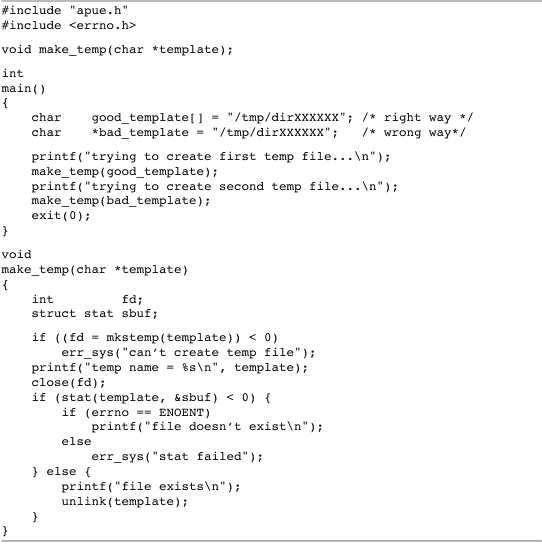

如果我们执行图5.13中的程序，会得到：

```
$ ./a.out
trying to create first temp file...
temp name = /tmp/dirUMB7h
file exists
trying to create second temp file...
Segmentation fault
```

行为上的差异源于两个模板字符串声明方式的不同。对于第一个模板，名称分配在栈上，因为我们使用的是数组变量。但对于第二个名称，我们使用的是指针。在这种情况下，只有指针本身的内存位于栈上；编译器安排字符串存储在可执行文件的只读段中。当mkstemp函数试图修改字符串时，就会发生分段错误。

## 5.14 内存流

正如我们所看到的，标准I/O库在内存中缓冲数据，因此诸如字符级I/O和行级I/O之类的操作更加高效。我们还看到，我们可以通过调用setbuf或setvbuf为库提供自己的缓冲区。在版本4中，单一UNIX规范增加了对内存流的支持。这些是没有底层文件的标准I/O流，尽管它们仍然用FILE指针访问。所有I/O都是通过与主内存中的缓冲区之间传输字节来完成的。正如我们将看到的，即使这些流看起来像文件流，但有几个特性使它们更适合操作字符串。

有三个函数可用于创建内存流。第一个是fmemopen。

```c
#include <stdio.h>

FILE *fmemopen(void *restrict buf, size_t size,
    const char *restrict type);

Returns: stream pointer if OK, NULL on error
```

fmemopen函数允许调用者提供一个用于内存流的缓冲区：buf参数指向缓冲区的起始位置，size参数指定缓冲区的大小（以字节为单位）。如果buf参数为null，则fmemopen函数分配一个大小为size字节的缓冲区。在这种情况下，当流关闭时，缓冲区将被释放。

type参数控制流的用法。type的可能值总结在图5.14中。

| type | 描述 |
|------|------|
| r或rb | 为读而打开 |
| w或wb | 为写而打开 |
| a或ab | 追加；在第一个null字节处为写而打开 |
| r+或r+b | 为读和写而打开 |
| w+或w+b或wb+ | 截断为0长度并为读和写而打开 |
| a+或a+b或ab+ | 追加；在第一个null字节处为读和写而打开 |

**图5.14 打开内存流用的type参数**

注意，这些值与基于文件的标准I/O流的对应值相同，但有一些细微差别。第一，每当内存流以追加模式打开时，当前文件位置被设置为缓冲区中的第一个null字节处。如果缓冲区中没有null字节，则当前位置被设置为缓冲区末尾之后的一个字节处。当流不是以追加模式打开时，当前位置被设置为缓冲区的起始处。由于追加模式通过第一个null字节来确定数据结束位置，所以内存流不太适合存储二进制数据（因为二进制数据可能在数据结束前包含null字节）。

第二，如果buf参数是null指针，则为了仅读或仅写而打开流是没有意义的。因为在这种情况下缓冲区由fmemopen分配，我们无法找到缓冲区的地址，所以仅以写的方式打开流意味着我们永远无法读取我们写入的内容。类似地，仅以读的方式打开流意味着我们只能读取一个我们永远无法向其写入的缓冲区的内容。

第三，只要我们增加了流缓冲区中的数据量，并调用fclose、fflush、fseek、fseeko或fsetpos，就会在流的当前位置写入一个null字节。

### 示例

查看写入内存流如何对我们提供的缓冲区进行操作是很有启发性的。图5.15显示了一个示例程序，它用已知模式初始化缓冲区，以查看写入流的行为。

```c
#include "apue.h"

#define BSZ 48

int
main()
{
    FILE *fp;
    char buf[BSZ];

    memset(buf, 'a', BSZ-2);
    buf[BSZ-2] = '\0';
    buf[BSZ-1] = 'X';
    if ((fp = fmemopen(buf, BSZ, "w+")) == NULL)
        err_sys("fmemopen failed");
    printf("initial buffer contents: %s\n", buf);
    fprintf(fp, "hello, world");
    printf("before flush: %s\n", buf);
    fflush(fp);
    printf("after fflush: %s\n", buf);
    printf("len of string in buf = %ld\n", (long)strlen(buf));

    memset(buf, 'b', BSZ-2);
    buf[BSZ-2] = '\0';
    buf[BSZ-1] = 'X';
    fprintf(fp, "hello, world");
    fseek(fp, 0, SEEK_SET);
    printf("after fseek: %s\n", buf);
    printf("len of string in buf = %ld\n", (long)strlen(buf));

    memset(buf, 'c', BSZ-2);
    buf[BSZ-2] = '\0';
    buf[BSZ-1] = 'X';
    fprintf(fp, "hello, world");
    fclose(fp);
    printf("after fclose: %s\n", buf);
    printf("len of string in buf = %ld\n", (long)strlen(buf));
    return(0);
}
```

**图5.15 调查内存流写入行为**

当我们在Linux上运行该程序时，会得到以下结果：

```
$ ./a.out
initial buffer contents: overwrite the buffer with a's
before flush: fmemopen places a null byte at beginning of buffer
after fflush: hello, world buffer is unchanged until stream is flushed
len of string in buf = 12 null byte added to end of string

after fseek: bbbbbbbbbbbhello, world now overwrite the buffer with b's fseek causes flush
len of string in buf = 24 null byte appended again

after fclose: hello, worldcccccccccccccccccccccccccccc now overwrite the buffer with c's
len of string in buf = 46 no null byte appended
```

这个例子说明了内存流的刷新策略以及追加null字节的策略。每当我们向内存流写入数据并推进流的“内容大小”（与缓冲区的大小不同，后者是固定的）的概念时，一个null字节会被自动追加。流内容的大小由我们向它写入的数据量决定。

在本书涵盖的四个平台中，只有Linux 3.2.0提供对内存流的支持。这是实现尚未跟上最新标准的一个例子，并且会随着时间而改变。

另外两个可用于创建内存流的函数是open_memstream和open_wmemstream。

```c
#include <stdio.h>
FILE *open_memstream(char **bufp, size_t *sizep);

#include <wchar.h>
FILE *open_wmemstream(wchar_t **bufp, size_t *sizep);

Both return: stream pointer if OK, NULL on error
```

open_memstream函数创建字节定向的流，而open_wmemstream函数创建宽定向的流（回想5.2节关于多字节字符的讨论）。这两个函数在几个方面不同于fmemopen：

- 创建的流只能用于写。
- 我们不能指定自己的缓冲区，但可以分别通过bufp和sizep参数访问缓冲区的地址和大小。
- 我们需要在关闭流后自己释放缓冲区。
- 当我们向流中添加字节时，缓冲区会增长。

然而，我们必须遵循一些关于缓冲区地址及其长度使用的规则。第一，缓冲区地址和长度只在调用fclose或fflush之后有效。第二，这些值只在下次向流写入或调用fclose之前有效。因为缓冲区可以增长，它可能需要被重新分配。如果发生这种情况，我们会发现在下次调用fclose或fflush时缓冲区内存地址的值会改变。

内存流非常适合创建字符串，因为它们防止缓冲区溢出。它们还可以为那些接受标准I/O流参数用于临时文件的函数带来性能提升，因为内存流只访问主内存而不是磁盘上的文件。

## 5.15 标准I/O的替代品

标准I/O库并不完美。Korn和Vo[1991]列出了许多缺陷——有些是在基本设计中，但大多数是在各种实现中。

标准I/O库固有的一种低效是发生的数据复制量。当我们使用行级函数fgets和fputs时，数据通常被复制两次：一次在内核和标准I/O缓冲区之间（当发出相应的read或write时），另一次在标准I/O缓冲区和我们的行缓冲区之间。Fast I/O库[AT&T 1990a中的fio(3)]通过让读取一行的函数返回一个指向该行的指针，而不是将行复制到另一个缓冲区，从而绕过了这个问题。Hume [1991]报告说，仅通过这一改变，grep(1)实用程序的某个版本的速度提高了三倍。

Korn和Vo[1991]描述了标准I/O库的另一个替代品：sfio。这个包在速度上与fio库相似，并且通常比标准I/O库更快。sfio包还提供了一些其他大多数包中没有的新功能：I/O流被推广为既表示文件又表示内存区域，处理模块可以被编写并堆叠在I/O流上以改变流的操作，以及更好的异常处理。

Krieger、Stumm和Unrau[1992]描述了另一种使用映射文件的替代方法——我们在14.8节中描述的mmap函数。这个新包被称为ASI，即Alloc Stream Interface。其编程接口类似于UNIX系统内存分配函数（malloc、realloc和free，其描述见

第 7.8 节)。与 sfio 包一样，ASI 试图通过使用指针来最大限度地减少数据复制量。

在为内存占用小的系统设计的 C 库中，有几种标准 I/O 库的实现，例如嵌入式系统。这些实现强调适中的内存需求，而非可移植性、速度或功能。其中两个实现是 uClibc C 库（参见 ../.../../.../www.uclibc.org/...）和 Newlib C 库（../.../../.../sources.redhat.com/newlib）。

## 5.16 总结

标准 I/O 库被大多数 UNIX 应用程序使用。在本章中，我们查看了该库提供的许多函数，以及一些实现细节和效率考虑。要意识到该库中发生的缓冲，因为这是产生最多问题和困惑的区域。

## 练习

- 5.1 使用 setvbuf 实现 setbuf。
- 5.2 输入使用逐行 I/O（fgets 和 fputs）复制文件的程序，如图 5.5 所示，但使用 4 的 MAXLINE。复制超过此长度的行时会发生什么？解释发生了什么。
- 5.3 printf 返回值为 0 表示什么？
- 5.4 以下代码在某些机器上工作正常，但在其他机器上不工作。可能是什么问题？

```
#include <stdio.h>
int
main(void)
{
    char c;
    while ((c = getchar()) != EOF)
        putchar(c);
}
```

- 5.5 你将如何使用 fsync 函数（第 3.13 节）与标准 I/O 流一起使用？
- 5.6 在图 1.7 和 1.10 中的程序中，打印的提示符不包含换行符，我们也没有调用 fflush。是什么导致提示符被输出？
- 5.7 基于 BSD 的系统提供了一个名为 funopen 的函数，允许我们在流上拦截 read、write、seek 和 close 调用。使用此函数为 FreeBSD 和 Mac OS X 实现 fmemopen。

本页特意留空

## 系统数据文件和信息

### 6.1 引言

UNIX 系统需要大量数据文件来正常运行：密码文件 /etc/passwd 和组文件 /etc/group 就是各种程序经常使用的两个文件。例如，每当用户登录到 UNIX 系统以及每当有人执行 ls -l 命令时，都会使用密码文件。

历史上，这些数据文件一直是 ASCII 文本文件，并使用标准 I/O 库读取。但对于较大的系统，顺序扫描密码文件会变得耗时。我们希望能够以 ASCII 文本以外的格式存储这些数据文件，但仍然为应用程序提供一个与任何文件格式都兼容的接口。这些数据文件的可移植接口是本章的主题。我们还涵盖系统识别函数以及时间和日期函数。

### 6.2 密码文件

UNIX 系统的密码文件，由 POSIX.1 称为用户数据库，包含图 6.1 所示的字段。这些字段包含在 <pwd.h> 中定义的 passwd 结构中。

请注意，POSIX.1 仅指定了 passwd 结构中 10 个字段中的 5 个。大多数平台至少支持 7 个字段。派生自 BSD 的平台支持全部 10 个。

| 描述 | struct passwd 成员 | POSIX.1 | FreeBSD 8.0 | Linux 3.2.0 | Mac OS X 10.6.8 | Solaris 10 |
|---|---|---|---|---|---|---|
| 用户名 | char *pw_name | • | • | • | • | • |
| 加密密码 | char *pw_passwd |  | • | • | • | • |
| 数值用户 ID | uid_t pw_uid | • | • | • | • | • |
| 数值组 ID | gid_t pw_gid | • | • | • | • | • |
| 注释字段 | char *pw_gecos |  | • | • | • | • |
| 初始工作目录 | char *pw_dir | • | • | • | • | • |
| 初始 shell（用户程序） | char *pw_shell | • | • | • | • | • |
| 用户访问类 | char *pw_class |  | • |  | • |  |
| 下次更改密码时间 | time_t pw_change |  | • |  | • |  |
| 账户过期时间 | time_t pw_expire |  | • |  | • |  |

# 图 6.1 /etc/passwd 文件中的字段

历史上，密码文件存储在 /etc/passwd 中，并且是一个 ASCII 文件。每行包含图 6.1 中描述的字段，以冒号分隔。例如，Linux 上 /etc/passwd 文件中的四行可能是

```
root:x:0:0:root:/root:/bin/bash
squid:x:23:23::/var/spool/squid:/dev/null
nobody:x:65534:65534:Nobody:/home:/bin/sh
sar:x:205:105:Stephen Rago:/home/sar:/bin/bash
```

注意这些条目的以下几点。

- 通常有一个用户名为 root 的条目。该条目的用户 ID 为 0（超级用户）。
- 加密密码字段包含一个字符作为占位符，旧版本的 UNIX 系统曾在此存储加密密码。由于将加密密码存储在人人可读的文件中是一个安全漏洞，因此加密密码现在保存在其他地方。我们将在下一节讨论密码时更详细地介绍这个问题。
- 密码文件条目中的某些字段可以为空。如果加密密码字段为空，通常意味着用户没有密码。（不推荐这样做。）squid 条目有一个空白字段：注释字段。空注释字段没有影响。
- shell 字段包含用作用户登录 shell 的可执行程序的名称。空 shell 字段的默认值通常为 /bin/sh。注意，squid 条目的登录 shell 为 /dev/null。显然，这是一个设备，不能执行，因此在此处使用是为了防止任何人以用户 squid 登录到我们的系统。

许多服务为帮助实现该服务的守护进程（第 13 章）提供了单独的用户 ID。squid 条目用于实现 squid 代理缓存服务的进程。

- 有几种替代使用 /dev/null 来防止特定用户登录到系统的方法。例如，/bin/false 通常用作登录 shell。它仅以不成功（非零）状态退出；shell 将退出状态评估为 false。/bin/true 用于禁用账户也很常见；它仅以成功（零）状态退出。一些系统提供 nologin 命令，它打印可定制的错误消息并以非零退出状态退出。
- nobody 用户名可用于允许人们登录到系统，但使用用户 ID（65534）和组 ID（65534）提供无特权。唯一可以访问的文件是那些可被世界读取或写入的文件。（这种方法假设没有文件专门属于用户 ID 65534 或组 ID 65534，这应该是正确的。）
- 一些提供 finger(1) 命令的系统在注释字段中支持额外信息。这些字段中的每一个都以逗号分隔：用户的姓名、办公室位置、办公室电话号码和家庭电话号码。此外，一些实用程序会将注释字段中的与号替换为登录名（大写）。例如，我们可以有 sar:xi205:105:Steve Rago, SF 5-121, 555-1111, 555-2222:/home/sar:/bin/sh 然后我们可以使用 finger 打印有关 Steve Rago 的信息。$ finger -p sar Login: sar Name: Steve Rago Directory: /home/sar Shell: /bin/sh Office: SF 5-121, 555-1111 Home Phone: 555-2222 On since Mon Jan 19 03:57 (EST) on ttyv0 (messages off) No Mail. 即使你的系统不支持 finger 命令，这些字段仍可放入注释字段中，因为该字段只是一个注释，不会被系统实用程序解释。

一些系统提供 vipw 命令以允许管理员编辑密码文件。vipw 命令序列化对密码文件的更改，并确保任何附加文件与所做的更改一致。系统通常还通过图形用户界面提供类似的功能。

POSIX.1 定义了两个用于从密码文件获取条目的函数。这些函数允许我们根据用户的登录名或数值用户 ID 查找条目。

```
#include <pwd.h>

struct passwd *getpwuid(uid_t uid);
struct passwd *getpwnam(const char *name);

Both return: pointer if OK, NULL on error
```

getpwuid 函数由 ls(1) 程序使用，将 i-node 中包含的数值用户 ID 映射为用户的登录名。getpwnam 函数由 login(1) 程序在我们输入登录名时使用。


这两个函数都返回一个指向passwd结构的指针，该结构由函数填充。这个结构通常是函数内的一个静态变量，因此每次调用这两个函数中的任何一个时，其内容都会被覆盖。

如果我们只想查找登录名或用户ID，这两个POSIX.1函数就足够了，但有些程序需要遍历整个口令文件。为此可以使用三个函数：getpwent、setpwent和endpwent。

```
#include <pwd.h>

struct passwd *getpwent(void);

Returns: pointer if OK, NULL on error or end of file

void setpwent(void);
void endpwent(void);
```

这三个函数不属于基础POSIX.1标准的一部分。它们在Single UNIX Specification中被定义为XSI选项的一部分。因此，所有UNIX系统都应提供它们。

我们调用getpwent返回口令文件中的下一个条目。与那两个POSIX.1函数一样，getpwent返回一个指向它已填充的结构的指针。每次调用此函数时，该结构通常都会被覆盖。如果这是对该函数的第一次调用，它会打开其使用的任何文件。使用此函数时不保证任何顺序；条目可以按任意顺序排列，因为某些系统使用文件/etc/passwd的散列版本。

函数setpwent会回绕它使用的任何文件，而endpwent则关闭这些文件。使用getpwent时，我们必须始终确保在结束后调用endpwent来关闭这些文件。尽管getpwent足够聪明，知道何时需要打开其文件（即我们第一次调用它时），但它永远不知道我们何时结束。

### 示例

图6.2展示了函数getpwnam的一个实现。

```
#include <pwd.h>
#include <stddef.h>
#include <string.h>

struct passwd *
getpwnam(const char *name)
{
    struct passwd *ptr;
    setpwent();
    while (((ptr = getpwent()) != NULL))
        if (strcmp(name, ptr->pw_name) == 0)
            break;      /* found a match */
    endpwent();
    return(ptr);    /* ptr is NULL if no match found */
}
```

图6.2 getpwnam函数

此函数开头调用setpwent是一种自我保护：我们确保文件被回绕，以防调用者已经通过调用getpwent打开了它们。我们在完成后调用endpwent，因为getpwnam和getpwuid都不应让任何文件保持打开状态。

## 6.3 阴影口令

加密口令是用户口令经过单向加密算法处理后的副本。由于该算法是单向的，我们无法从加密版本中猜出原始口令。

历史上，所使用的算法总是从64个字符的字符集[a-zA-Z0-9./]生成13个可打印字符（参见Morris和Thompson [1979]）。一些较新的系统使用其他算法，如MD5或SHA-1，来生成更长的加密口令字符串。（用于存储加密口令的字符越多，组合就越多，通过尝试所有可能的变体来猜测口令就越困难。）当我们在加密口令字段中放置单个字符时，我们确保加密口令永远不会匹配此值。

给定一个加密口令，我们无法应用一种算法将其反转并返回明文口令。（明文口令就是我们在Password:提示符下输入的内容。）但是我们可以猜测一个口令，通过单向算法运行它，并将结果与加密口令进行比较。如果用户口令是随机选择的，这种暴力破解方法就不会太成功。然而，用户倾向于选择非随机口令，例如配偶的名字、街道名或宠物名。常见的实验是有人获取口令文件的副本并尝试猜测口令。（Garfinkel等人[2003]的第4章包含有关口令以及UNIX系统上使用的口令加密方案的更多细节和历史。）

为了增加获取原始材料（加密口令）的难度，系统现在将加密口令存储在另一个文件中，通常称为阴影口令文件。该文件至少必须包含用户名和加密口令。与口令相关的其他信息也存储在此处（图6.3）。

| 描述 | struct spwd成员 |
|---|---|
| 用户登录名 | char *sp_namp |
| 加密口令 | char *sp_pwdp |
| 自上次修改口令以来经过的Epoch天数 | int sp_lstchg |
| 允许更改前的天数 | int sp_min |
| 必须更改前的天数 | int sp_max |
| 到期前警告的天数 | int sp_warn |
| 账户不活跃前的天数 | int sp_inact |
| 账户到期时自Epoch以来的天数 | int sp_expire |
| 保留 | unsigned int sp_flag |

图6.3 /etc/shadow文件中的字段

仅有的两个必填字段是用户登录名和加密口令。其他字段控制口令更改的频率（称为“口令老化”）以及账户允许保持活跃的时间。

阴影口令文件不应让所有用户可读。只有少数程序需要访问加密口令——例如login(1)和passwd(1)——这些程序通常设置为set-user-ID root。使用阴影口令后，普通口令文件/etc/passwd可以保持对所有用户可读。

在Linux 3.2.0和Solaris 10上，有一套单独的函数可用于访问阴影口令文件，类似于用于访问口令文件的函数集。

```
#include <shadow.h>
struct spwd *getspnam(const char *name);
struct spwd *getspent(void);

Both return: pointer if OK, NULL on error

void setspent(void);
void endspent(void);
```

在FreeBSD 8.0和Mac OS X 10.6.8上，没有阴影口令结构。额外的账户信息存储在口令文件中（参见图6.1）。

## 6.4 组文件

UNIX系统的组文件（POSIX.1称之为组数据库）包含图6.4所示的字段。这些字段包含在定义于<grp.h>中的group结构中。

| 描述 | struct group成员 | POSIX.1 | FreeBSD 8.0 | Linux 3.2.0 | Mac OS X 10.6.8 | Solaris 10 |
|---|---|---|---|---|---|---|
| 组名 | char *gr_name | • | • | • | • | • |
| 加密口令 | char *gr_passwd |  | • | • | • | • |
| 数字组ID | int gr_gid | • | • | • | • | • |
| 指向各个用户名的指针数组 | char **gr_mem | • | • | • | • | • |

图6.4 /etc/group文件中的字段

字段gr_mem是指向属于此组的用户名的指针数组。该数组以空指针结尾。

我们可以使用以下两个函数来查找组名或数字组ID，这两个函数由POSIX.1定义。

```
#include <grp.h>
struct group *getgrgid(gid_t gid);
struct group *getgrnam(const char *name);

Both return: pointer if OK, NULL on error
```

与口令文件函数一样，这两个函数通常返回指向静态变量的指针，该变量在每次调用时被覆盖。

如果要搜索整个组文件，我们需要一些额外的函数。以下三个函数类似于口令文件对应的函数。

```
#include <grp.h>

struct group *getgrent(void);

Returns: pointer if OK, NULL on error or end of file

void setgrent(void);

void endgrent(void);
```

这三个函数不属于基础POSIX.1标准的一部分。它们在单一UNIX规范中被定义为XSI选项的一部分。所有UNIX系统都提供它们。

setgrent函数打开组文件（如果它尚未打开）并回绕它。getgrent函数从组文件读取下一个条目，如果文件尚未打开，则先打开它。endgrent函数关闭组文件。

## 6.5 辅助组ID

UNIX系统中组的使用随着时间的推移发生了变化。在Version 7中，每个用户在任一时刻只属于一个组。当我们登录时，会被分配一个真实组ID，该ID对应于口令文件条目中的数字组ID。我们可以随时通过执行newgrp(1)来更改这一点。如果newgrp命令成功（有关权限规则请参考手册页），我们的真实组ID将更改为新组的ID，并且此值将用于所有后续的文件访问权限检查。我们可以随时通过不带任何参数执行newgrp来回到原来的组。

这种组成员身份形式一直持续到4.2BSD（约1983年）才发生变化。4.2BSD引入了辅助组ID的概念。我们不仅属于口令文件条目中组ID对应的组，还可以属于多达16个附加组。文件访问权限检查被修改，除了将文件的组ID与进程的有效组ID进行比较外，还要与所有辅助组ID进行比较。

> 辅助组ID是POSIX.1的必需特性。（在较早版本的POSIX.1中，它们是可选的。）常量NGROUPS_MAX（图2.11）指定辅助组ID的数量。常见的值是16（图2.15）。

使用辅助组ID的好处是我们不再需要显式地更改组。同时属于多个组（即参与多个项目）并不罕见。

提供了三个函数来获取和设置辅助组ID中的数字组ID。


```c
#include <unistd.h>
int getgroups(int gidsetsize, gid_t grouplist[]);
Returns: number of supplementary group IDs if OK, -1 on error

#include <grp.h>    /* on Linux */
#include <unistd.h> /* on FreeBSD, Mac OS X, and Solaris */
int setgroups(int ngroups, const gid_t grouplist[]);
#include <grp.h>    /* on Linux and Solaris */
#include <unistd.h> /* on FreeBSD and Mac OS X */
int initgroups(const char *username, gid_t basegid);
Both return: 0 if OK, -1 on error
```

在这三个函数中，只有 getgroups 由 POSIX.1 规定。因为 setgroups 和 initgroups 是特权操作，所以它们不是 POSIX.1 的一部分。本书涵盖的全部四个平台都支持这三个函数，但在 Mac OS X 10.6.8 上，basegid 被声明为 int 类型。

getgroups 函数用补充组 ID 填充数组 grouplist。最多存储 gidsetsize 个元素到数组中。存储在数组中的补充组 ID 的数量由函数返回。

作为一种特殊情况，如果 gidsetsize 为 0，函数仅返回补充组 ID 的数量。数组 grouplist 不会被修改。 （这允许调用者确定要分配的 grouplist 数组的大小。）

setgroups 函数可以由超级用户调用，以设置调用进程的补充组 ID 列表：grouplist 包含组 ID 的数组，ngroups 指定数组中的元素数量。ngroups 的值不能大于 NGROUPS_MAX。

setgroups 函数通常由 initgroups 函数调用，后者读取整个组文件——使用我们之前描述过的 getgrent、setgrent 和 endgrent 函数——并确定 username 的组成员身份。然后它调用 setgroups 来初始化用户的补充组 ID 列表。必须以超级用户身份调用 initgroups，因为它会调用 setgroups。除了在组文件中查找 username 是其成员的所有组之外，initgroups 还将 basegid 包含在补充组 ID 列表中；basegid 是密码文件中 username 的组 ID。

initgroups 函数仅由少数程序调用。例如，login(1) 程序在我们登录时会调用它。

## 6.6 实现差异

我们已经讨论了 Linux 和 Solaris 支持的 shadow 密码文件。FreeBSD 和 Mac OS X 以不同的方式存储加密密码。图 6.5 总结了本书涵盖的四个平台如何存储用户和组信息。

| Information | FreeBSD 8.0 | Linux 3.2.0 | Mac OS X 10.6.8 | Solaris 10 |
|---|---|---|---|---|
| account information | /etc/passwd | /etc/passwd | Directory Services | /etc/passwd |
| encrypted passwords | /etc/master.passwd | /etc/shadow | Directory Services | /etc/shadow |
| hashed password files? | yes | no | no | no |
| group information | /etc/group | /etc/group | Directory Services | /etc/group |

### Figure 6.5 Account implementation differences

在 FreeBSD 上，shadow 密码文件是 /etc/master.passwd。用于编辑它的特殊命令会生成 /etc/passwd 的副本，该副本由 shadow 密码文件生成。此外，还会生成文件的哈希版本：/etc/pwd.db 是 /etc/passwd 的哈希版本，而 /etc/spwd.db 是 /etc/master.passwd 的哈希版本。这些为大型安装提供了更好的性能。

在 Mac OS X 上，/etc/passwd 和 /etc/master.passwd 仅在单用户模式下使用（当系统进行维护时；单用户模式通常意味着没有系统服务被启用）。在多用户模式下——在正常操作期间——Directory Services 守护进程为用户和组提供账户信息访问。

尽管 Linux 和 Solaris 支持类似的 shadow 密码接口，但存在一些细微差异。例如，图 6.3 中显示的整数字段在 Solaris 上定义为 int 类型，但在 Linux 上定义为 long int。另一个区别是账户非活动字段：Solaris 将其定义为用户最后一次登录系统后经过的天数，之后账户将被自动禁用，而 Linux 将其定义为在达到最大密码年龄后密码仍会被接受的天数。

在许多系统上，用户和组数据库使用网络信息服务（NIS）实现。这允许管理员编辑数据库的主副本并自动将其分发到组织中的所有服务器。客户端系统联系服务器查找有关用户和组的信息。NIS+ 和轻量级目录访问协议（LDAP）提供类似的功能。许多系统通过 /etc/nsswitch.conf 配置文件控制用于管理每种类型信息的方法。

## 6.7 其他数据文件

到目前为止，我们只讨论了系统的两个数据文件：密码文件和组文件。UNIX 系统在日常操作中使用的其他文件众多。例如，BSD 网络软件有一个用于各种网络服务器提供的服务的数据文件（/etc/services），一个用于协议的文件（/etc/protocols），一个用于网络的文件（/etc/networks）。幸运的是，这些各种文件的接口与我们之前为密码文件和组文件描述的接口类似。

一般原则是每个数据文件至少有三个函数：

- 1. 一个 get 函数，用于读取下一条记录，如果必要则打开文件。这些函数通常返回指向结构的指针。到达文件末尾时返回空指针。大多数 get 函数返回指向静态结构的指针，因此如果我们想保存它，我们总是必须复制该结构。
- 2. 一个 set 函数，用于打开文件（如果尚未打开）并将文件倒回。我们在知道想要从文件开头重新开始时使用此函数。
- 3. 一个 end 条目，用于关闭数据文件。如前所述，我们完成时必须始终调用此函数，以关闭所有文件。

此外，如果数据文件支持某种形式的键控查找，则提供例程来搜索具有特定键的记录。例如，为密码文件提供了两个键控查找例程：getpwnam 查找具有特定用户名的记录，而 getpwuid 查找具有特定用户 ID 的记录。

图 6.6 显示了一些常见于 UNIX 系统的这些例程。在此图中，我们显示了本章前面讨论过的密码文件和组文件的函数，以及一些网络函数。图中的所有数据文件都有 get、set 和 end 函数。

| Description | Data file | Header | Structure | Additional keyed lookup functions |
|---|---|---|---|---|
| passwords | /etc/passwd | <pwd.h> | passwd | getpwnam, getpwuid |
| groups | /etc/group | <grp.h> | group | getgrnam, getgrgid |
| shadow | /etc/shadow | <shadow.h> | spwd | getspnam |
| hosts | /etc/hosts | <netdb.h> | hostent | getnameinfo, getaddrinfo |
| networks | /etc/networks | <netdb.h> | netent | getnetbyname, getnetbyaddr |
| protocols | /etc/protocols | <netdb.h> | protoent | getprotobyname, getprotobynumber |
| services | /etc/services | <netdb.h> | servent | getservbyname, getservbyport |

### Figure 6.6 Similar routines for accessing system data files

在 Solaris 下，图 6.6 中最后四个数据文件是到目录 /etc/inet 中同名文件的符号链接。大多数 UNIX 系统实现都有类似的额外函数，但这些额外函数往往处理系统管理文件，并且特定于每个实现。

## 6.8 登录记账

大多数 UNIX 系统提供的两个数据文件是 utmp 文件，它跟踪当前所有已登录的用户，以及 wtmp 文件，它跟踪所有登录和注销记录。在 Version 7 中，一种类型的记录被写入这两个文件，二进制记录由以下结构组成：


```
struct utmp {
    char ut_line[8]; /* 终端线路："ttyh0"、"ttyd0"、"ttyp0"…… */
    char ut_name[8]; /* 登录名 */
    long ut_time;    /* 自 Epoch 以来的秒数 */
};
```

登录时，登录程序会填充其中一个结构，并将其写入 utmp 文件，同时将同一个结构追加到 wtmp 文件中。注销时，init 进程会擦除 utmp 文件中的相应条目——用空字节填充——并向 wtmp 文件追加一个新条目。wtmp 文件中的这个注销条目会将 ut_name 字段清零。系统重启，以及系统时间和日期更改之前和之后，都会向 wtmp 文件追加特殊条目以表示这些事件。who(1) 程序读取 utmp 文件，并以易读的形式打印其内容。后来的 UNIX System 版本提供了 last(1) 命令，该命令读取 wtmp 文件并打印选定的条目。

大多数 UNIX System 版本仍然提供 utmp 和 wtmp 文件，但正如预期的那样，这些文件中的信息量已经增加。Version 7 写入的 20 字节结构，在 SVR2 中增长到了 36 字节，而 SVR4 中扩展后的 utmp 结构则超过了 350 字节！

> Solaris 中这些记录的详细格式见 utmpx(4) 手册页。在 Solaris 10 中，这两个文件都位于 /var/adm 目录下。Solaris 提供了 getutxent(3) 中描述的许多函数，用于读写这两个文件。

> 在 FreeBSD 8.0 和 Linux 3.2.0 中，utmp(5) 手册页给出了各自版本登录记录的格式。这两个文件的路径名分别为 /var/run/utmp 和 /var/log/wtmp。在 Mac OS X 10.6.8 中，utmp 和 wtmp 文件不存在。从 Mac OS X 10.5 开始，wtmp 文件中的信息可以通过系统日志功能获取，而 utmpx 文件包含有关活动登录会话的信息。

## 6.9 系统标识

POSIX.1 定义了 uname 函数，用于返回当前主机和操作系统的信息。

```
#include <sys/utsname.h>

int uname(struct utsname *name);

Returns: non-negative value if OK, -1 on error
```

我们将 utsname 结构的地址传递给该函数，然后由函数填充该结构。POSIX.1 只定义了该结构中的最少字段，这些字段全部为字符数组；每个数组的大小由具体实现决定。有些实现会在该结构中提供额外字段。

```
struct utsname {
    char sysname[];    /* 操作系统名称 */
    char nodename[];   /* 此节点的名称 */
    char release[];    /* 操作系统的当前发行版 */
    char version[];    /* 此发行版的当前版本 */
    char machine[];    /* 硬件类型名称 */
};
```

每个字符串都以 null 结尾。本书讨论的四个平台所支持的最大名称长度（包括结尾的 null 字节）列于图 6.7 中。通常可以使用 uname(1) 命令打印 utsname 结构中的信息。

> POSIX.1 警告说，nodename 元素可能不足以在通信网络中引用主机。该函数源自 System V；在早期，nodename 元素足以用于在 UUCP 网络中引用主机。
>
> 还要注意，该结构中的信息不包含任何有关 POSIX.1 级别的信息。正如第 2.6 节所述，这些信息应使用 _POSIX_VERSION 获取。
>
> 最后，该函数只能让我们获取结构中的信息；POSIX.1 没有规定如何初始化这些信息。

从历史上看，BSD 派生系统提供了 gethostname 函数，该函数只返回主机名称。该名称通常是主机在 TCP/IP 网络中的名称。

```
#include <unistd.h>

int gethostname(char *name, int namelen);

Returns: 0 if OK, -1 on error
```

namelen 参数指定名称缓冲区的大小。如果提供了足够的空间，通过 name 返回的字符串将以 null 结尾。然而，如果空间不足，则不确定该字符串是否以 null 结尾。

现在，gethostname 函数已被定义为 POSIX.1 的一部分，它规定主机名的最大长度为 HOST_NAME_MAX。图 6.7 汇总了本书所涉及的四种实现支持的最大名称长度。

| 接口 | 最大名称长度 |  |  |  |
|---|---|---|---|---|
|  | FreeBSD 8.0 | Linux 3.2.0 | Mac OS X 10.6.8 | Solaris 10 |
| uname | 256 | 65 | 256 | 257 |
| gethostname | 256 | 64 | 256 | 256 |

图 6.7 系统标识名称限制

如果主机连接到 TCP/IP 网络，主机名通常是该主机的完全限定域名。

此外，还有一个 hostname(1) 命令，可以获取或设置主机名。（超级用户使用类似的函数 sethostname 设置主机名。）主机名通常在引导时由 /etc/rc 或 init 调用的某个启动文件设置。

## 6.10 时间和日期例程

UNIX 内核提供的基本时间服务，会统计自 Epoch 起经过的秒数：协调世界时（UTC）1970 年 1 月 1 日 00:00:00。在第 1.10 节中，我们提到这些秒数以 time_t 数据类型表示，并将其称为日历时间。这些日历时间同时表示时间和日期。UNIX System 始终区别于其他操作系统的地方在于：(a) 使用 UTC 而不是本地时间记录时间；(b) 自动处理夏令时等转换；(c) 将时间和日期作为一个单一的量保存。

time 函数返回当前时间和日期。

```
#include <time.h>

time_t time(time_t *calptr);

Returns: value of time if OK, -1 on error
```

time 值始终作为函数的返回值返回。如果参数非空，该时间值还会存储在 calptr 所指向的位置。

POSIX.1 的实时扩展增加了对多个系统时钟的支持。在 Single UNIX Specification 第 4 版中，用于控制这些时钟的接口从一个可选功能组移到了基础规范中。时钟由 clockid_t 类型标识。标准值汇总于图 6.8。

| 标识符 | 选项 | 描述 |
|---|---|---|
| CLOCK_REALTIME |  | 实际系统时间 |
| CLOCK_MONOTONIC | _POSIX_MONOTONIC_CLOCK | 不会发生负向跳变的实际系统时间 |
| CLOCK_PROCESS_CPUTIME_ID | _POSIX_CPUTIME | 调用进程的 CPU 时间 |
| CLOCK_THREAD_CPUTIME_ID | _POSIX_THREAD_CPUTIME | 调用线程的 CPU 时间 |

图 6.8 时钟类型标识符

可以使用 clock_gettime 函数获取指定时钟的时间。时间以 timespec 结构返回，该结构在第 4.2 节中介绍，用秒和纳秒表示时间值。

```
#include <sys/time.h>

int clock_gettime(clockid_t clock_id, struct timespec *tsp);

Returns: 0 if OK, -1 on error
```

当时钟 ID 设置为 CLOCK_REALTIME 时，clock_gettime 函数提供与 time 函数类似的功能；不同之处在于，如果系统支持，使用 clock_gettime 可能会获得更高分辨率的时间值。

我们可以使用 clock_getres 函数确定给定系统时钟的分辨率。

```
#include <sys/time.h>
int clock_getres(clockid_t clock_id, struct timespec *tsp);
Returns: 0 if OK, -1 on error
```

clock_getres 函数会将 tsp 参数所指向的 timespec 结构初始化为与 clock_id 参数对应的时钟分辨率。例如，如果分辨率为 1 毫秒，则 tv_sec 字段将包含 0，而 tv_nsec 字段将包含值 1000000。

若要设置特定时钟的时间，可以调用 clock_settime 函数。

```
#include <sys/time.h>
int clock_settime(clockid_t clock_id, const struct timespec *tsp);
Returns: 0 if OK, -1 on error
```

我们需要具有适当的权限才能更改时钟的时间。不过，某些时钟无法修改。

从历史上看，在 System V 派生的实现中，使用 stime(2) 函数设置系统时间，而 BSD 派生的系统则使用 settimeofday(2)。

Single UNIX Specification 第 4 版规定，gettimeofday 函数现在已经过时。不过，许多程序仍然使用它，因为与 time 函数相比，它提供了更高的分辨率（最高可达微秒级）。

```
#include <sys/time.h>
int gettimeofday(struct timeval *restrict tp, void *restrict tzp);
Returns: 0 always
```

tzp 唯一合法的值是 NULL；其他值会导致未指定的行为。一些平台支持通过使用 tzp 指定时区，但这是实现相关的，Single UNIX Specification 并未对此作出定义。

gettimeofday 函数将从 Epoch 起测量的当前时间存储到 tp 所指向的内存中。该时间以 timeval 结构表示，其中存储秒数和微秒数。

获得表示自 Epoch 起经过秒数的整数值后，我们通常会调用一个函数，将其转换为分解时间结构；然后再调用另一个函数，生成人类可读的时间和日期。图 6.9 展示了各种时间函数之间的关系。（图中以虚线表示的三个函数——localtime、mktime 和 strftime——都会受到 TZ 环境变量的影响，我们将在本节稍后介绍该变量。点线表示如何从与时间相关的结构中获取日历时间。）


```c
#include <time.h>
struct tm *gmtime(const time_t *calptr);
struct tm *localtime(const time_t *calptr);
两者均返回：分解后的时间指针；出错时返回 NULL
```

`localtime` 和 `gmtime` 的区别在于：前者将日历时间转换为本地时间，同时考虑本地时区和夏令时标志；后者则将日历时间转换为以 UTC 表示的分解时间。

`mktime` 函数接收一个以本地时间表示的分解时间，并将其转换为 `time_t` 值。

```c
#include <time.h>
time_t mktime(struct tm *tmptr);
返回：成功时返回日历时间，出错时返回 -1
```

`strftime` 函数是一个类似 `printf` 的时间值处理函数。由于它提供了大量可用于自定义输出字符串的参数，因此实现较为复杂。

```c
#include <time.h>
size_t strftime(char *restrict buf, size_t maxsize,
    const char *restrict format,
    const struct tm *restrict tmptr);
size_t strftime_l(char *restrict buf, size_t maxsize,
    const char *restrict format,
    const struct tm *restrict tmptr, locale_t locale);
两者均返回：有足够空间时存储在数组中的字符数，否则返回 0
```

另外两个较早的函数 `asctime` 和 `ctime` 可用于生成一个 26 字节的可打印字符串，其格式类似于 `date(1)` 命令的默认输出。不过，这些函数如今已被标记为过时函数，因为它们容易出现缓冲区溢出问题。

`strftime` 和 `strftime_l` 函数相同，区别在于 `strftime_l` 函数允许调用者将区域设置作为参数指定。`strftime` 函数使用由 `TZ` 环境变量指定的区域设置。

对于这些函数，每个指定的转换都会生成不同的固定大小输出字符串——格式字符串中不存在字段宽度。图 6.10 描述了 ISO C 中的 37 个转换说明符。

| 格式 | 描述 | 示例 |
|---|---|---|
| %a | 星期名称缩写 | Thu |
| %A | 完整的星期名称 | Thursday |
| %b | 月份名称缩写 | Jan |
| %B | 完整的月份名称 | January |
| %c | 日期和时间 | Thu Jan 19 21:24:52 2012 |
| %C | 年份除以 100：[00–99] | 20 |
| %d | 月中的第几天：[01–31] | 19 |
| %D | 日期 [MM/DD/YY] | 01/19/12 |
| %e | 月中的第几天（单数字前补空格）[1–31] | 19 |
| %F | ISO 8601 日期格式 [YYYY-MM-DD] | 2012-01-19 |
| %g | ISO 8601 基于周的年份的后两位数字 [00–99] | 12 |
| %G | ISO 8601 基于周的年份 | 2012 |
| %h | 与 %b 相同 | Jan |
| %H | 小时（24 小时制）：[00–23] | 21 |
| %I | 小时（12 小时制）：[01–12] | 09 |
| %j | 一年中的第几天：[001–366] | 019 |
| %m | 月份：[01–12] | 01 |
| %M | 分钟：[00–59] | 24 |
| %n | 换行字符 |  |
| %p | AM/PM | PM |
| %r | 区域设置的时间（12 小时制） | 09:24:52 PM |
| %R | 与 %H:%M 相同 | 21:24 |
| %S | 秒：[00–60] | 52 |
| %T | 水平制表符 |  |
| %s | 与 %H:%M:%S 相同 | 21:24:52 |
| %u | ISO 8601 星期几 [星期一 = 1，1–7] | 4 |
| %U | 以星期日为起始的周数：[00–53] | 03 |
| %V | ISO 8601 周数：[01–53] | 03 |
| %w | 星期几：[0 = 星期日，0–6] | 4 |
| %W | 以星期一为起始的周数：[00–53] | 03 |
| %x | 区域设置的日期 | 01/19/12 |
| %X | 区域设置的时间 | 21:24:52 |
| %y | 年份的后两位数字：[00–99] | 12 |
| %Y | 年份 | 2012 |
| %z | ISO 8601 格式的 UTC 偏移量 | -0500 |
| %Z | 时区名称 | EST |
| %% | 转换为百分号 | % |

图 6.10 `strftime` 的转换说明符

图中的第三列来自 Mac OS X 上 `strftime` 的输出，对应于 2012 年 1 月 19 日星期四 21:24:52 EST。

唯一不言自明的说明符是 `%U`、`%V` 和 `%W`。`%U` 说明符表示一年中的周数，其中包含第一个星期日的那一周为第 1 周。`%W` 说明符表示一年中的周数，其中包含第一个星期一的那一周为第 1 周。`%V` 说明符有所不同。如果包含一月份第一天的那一周在新年中有四天或更多天，则将其视为第 1 周；否则，将其视为上一年的最后一周。在这两种情况下，星期一都被视为一周的第一天。

与 `printf` 一样，`strftime` 支持对某些转换说明符使用修饰符。如果区域设置支持，`E` 和 `O` 修饰符可用于生成替代格式。

某些系统还支持 `strftime` 格式字符串的其他非标准扩展。

## 示例

图 6.11 展示了如何使用本章讨论的多个时间函数。特别是，它展示了如何使用 `strftime` 打印包含当前日期和时间的字符串。

```c
#include <stdio.h>
#include <stdlib.h>
#include <time.h>

int
main(void)
{
    time_t t;
    struct tm *tmp;
    char buf1[16];
    char buf2[64];

    time(&t);
    tmp = localtime(&t);
    if (strftime(buf1, 16, "time and date: %r, %a %b %d, %Y", tmp) == 0)
        printf("buffer length 16 is too small\n");
    else
        printf("%s\n", buf1);
    if (strftime(buf2, 64, "time and date: %r, %a %b %d, %Y", tmp) == 0)
        printf("buffer length 64 is too small\n");
    else
        printf("%s\n", buf2);
    exit(0);
}
```

图 6.11 使用 `strftime` 函数

回顾图 6.9 所示各种时间函数之间的关系。在以人类可读的格式打印时间之前，我们需要先获取时间，并将其转换为分解时间结构。图 6.11 的示例输出如下：

```
$ ./a.out
buffer length 16 is too small
time and date: 11:12:35 PM, Thu Jan 19, 2012
```

`strptime` 函数是 `strftime` 的逆操作。它接收一个字符串，并将其转换为分解时间。

```c
#include <time.h>
char *strptime(const char *restrict buf, const char *restrict format,
    struct tm *restrict tmptr);
返回：指向已解析的最后一个字符之后一个字符的指针，否则返回 NULL
```

`format` 参数描述 `buf` 参数所指向缓冲区中字符串的格式。该格式说明与 `strftime` 函数的格式说明类似，但略有不同。图 6.12 总结了 `strptime` 函数的转换说明符。

| 格式 | 描述 |
|---|---|
| %a | 星期名称的缩写或完整形式 |
| %A | 与 %a 相同 |
| %b | 月份名称的缩写或完整形式 |
| %B | 与 %b 相同 |
| %c | 日期和时间 |
| %C | 年份中除最后两位之外的所有数字 |
| %d | 月中的第几天：[01–31] |
| %D | 日期 [MM/DD/YY] |
| %e | 与 %d 相同 |
| %f | 与 %b 相同 |
| %H | 小时（24 小时制）：[00–23] |
| %I | 小时（12 小时制）：[01–12] |
| %j | 一年中的第几天：[001–366] |
| %m | 月份：[01–12] |
| %M | 分钟：[00–59] |
| %n | 任意空白字符 |
| %p | AM/PM |
| %r | 区域设置的时间（12 小时制，AM/PM 表示法） |
| %R | 与 %H:%M 相同的时间 |
| %S | 秒：[00–60] |
| %t | 任意空白字符 |
| %T | 与 %H:%M:%S 相同的时间 |
| %U | 以星期日为起始的周数：[00–53] |
| %w | 星期几：[0 = 星期日，0–6] |
| %W | 以星期一为起始的周数：[00–53] |
| %x | 区域设置的日期 |
| %X | 区域设置的时间 |
| %y | 年份的后两位数字：[00–99] |
| %Y | 年份 |
| %% | 转换为百分号 |

图 6.12 `strptime` 的转换说明符

我们曾提到，图 6.9 中以虚线连接的三个函数会受到 `TZ` 环境变量的影响：`localtime`、`mktime` 和 `strftime`。如果定义了该环境变量，这些函数将使用它的值，而不是默认时区。如果将该变量定义为空字符串，例如 `TZ=`，通常会使用 UTC。该环境变量的值通常类似于 `TZ=EST5EDT`，但 POSIX.1 允许使用详细得多的规范。有关 `TZ` 变量的全部细节，请参阅 Single UNIX Specification 的“环境变量”章节 [Open Group 2010]。

有关 `TZ` 环境变量的更多信息，请参阅 `tzset(3)` 手册页。

## 6.11 总结

密码文件和组文件用于所有 UNIX 系统。我们介绍了读取这些文件的各种函数。我们还讨论了影子密码，它可以增强系统安全性。补充组 ID 提供了一种同时参与多个组的方式。我们还介绍了大多数系统提供的、用于访问其他系统相关数据文件的类似函数。我们讨论了 POSIX.1 函数，程序可以使用这些函数识别自身运行所在的系统。最后，我们介绍了 ISO C 和 Single UNIX Specification 提供的时间与日期函数。

## 练习

- 6.1 如果系统使用影子文件，而我们需要获取加密后的密码，应如何实现？
- 
- 6.2 如果你拥有超级用户权限，并且系统使用影子密码，请实现上一道练习。
- 
- 6.3 编写一个调用 `uname` 并打印 `utsname` 结构中所有字段的程序。将输出与 `uname(1)` 命令的输出进行比较。
- 
- 6.4 计算 `time_t` 数据类型能够表示的最晚时间。发生回绕后会怎样？
- 
- 6.5 编写一个程序获取当前时间，并使用 `strftime` 打印时间，使其格式类似于 `date(1)` 的默认输出。将 `TZ` 环境变量设置为不同的值，并观察会发生什么。


## 进程环境

### 7.1 引言

在下一章查看进程控制原语之前，我们需要检查单个进程的环境。在本章中，我们将看到程序执行时 main 函数是如何被调用的，命令行参数是如何传递给新程序的，典型的内存布局是什么样的，如何分配额外的内存，进程如何使用环境变量，以及进程终止的各种方式。此外，我们还将查看 longjmp 和 setjmp 函数及其与栈的交互。我们通过检查进程的资源限制来结束本章。

### 7.2 main 函数

C 程序的执行从一个名为 main 的函数开始。main 函数的原型为

```c
int main(int argc, char *argv[]);
```

其中 argc 是命令行参数的个数，argv 是指向这些参数的指针数组。我们在第 7.4 节描述这些参数。

当内核执行 C 程序时——通过我们将在第 8.10 节描述的 exec 函数之一——在调用 main 函数之前会调用一个特殊的启动例程。可执行程序文件指定此例程作为程序的起始地址；这是由链接编辑器在被 C 编译器调用时设置的。此启动例程从内核获取值——命令行参数和环境——并设置好条件以便按前面所示调用 main 函数。

### 7.3 进程终止

进程有八种终止方式。正常终止有五种方式：

- 1. 从 main 返回
- 2. 调用 exit
- 3. 调用 _exit 或 _Exit
- 4. 最后一个线程从其启动例程返回（第 11.5 节）
- 5. 从最后一个线程调用 pthread_exit（第 11.5 节）

异常终止有三种方式：

- 6. 调用 abort（第 10.17 节）
- 7. 收到信号（第 10.2 节）
- 8. 最后一个线程响应取消请求（第 11.5 节和第 12.7 节）

> 目前，我们将忽略特定于线程的三种终止方法，直到我们在第 11 章和第 12 章讨论线程。

我们在上一节提到的启动例程也编写为：如果 main 函数返回，则调用 exit 函数。如果启动例程是用 C 编写的（它通常是用汇编语言编写的），对 main 的调用看起来像

```c
exit(main(argc, argv));
```

#### 退出函数

有三个函数可使程序正常终止：_exit 和 _Exit，它们会立即返回内核；exit，它会执行某些清理处理然后返回内核。

```c
#include <stdlib.h>

void exit(int status);

void _Exit(int status);

#include <unistd.h>

void _exit(int status);
```

我们将在第 8.5 节讨论这三个函数对其他进程的影响，例如终止进程的子进程和父进程。

> 不同的头文件原因在于 exit 和 _Exit 由 ISO C 指定，而 _exit 由 POSIX.1 指定。

历史上，exit 函数一直执行标准 I/O 库的干净关闭：对所有打开的流调用 fclose 函数。回顾第 5.5 节，这会导致所有缓冲的输出数据被刷新（写入文件）。

所有三个退出函数都期望一个整数参数，我们称之为 *退出状态*。大多数 UNIX 系统 shell 提供了检查进程退出状态的方法。如果 (a) 在未提供退出状态的情况下调用这些函数之一，(b) main 执行 return 而没有返回值，或 (c) main 函数未声明为返回整数，则进程的退出状态未定义。然而，如果 main 的返回类型是整数并且 main “掉到末尾”（隐式返回），则进程的退出状态为 0。

> 这种行为是 1999 年版 ISO C 标准的新特性。历史上，如果 main 函数末尾没有显式的 return 语句或对 exit 函数的调用，则退出状态未定义。

从 main 函数返回整数值等同于调用 exit 并使用相同的值。因此

```c
exit(0);
```

与

```c
return(0);
```

从 main 函数中调用是相同的。

#### 示例

图 7.1 中的程序是经典的“hello, world”示例。

```c
#include <stdio.h>

main()
{
    printf("hello, world\n");
}
```

*图 7.1*  经典 C 程序

当我们编译并运行图 7.1 中的程序时，我们会看到退出代码是随机的。如果我们在不同的系统上编译相同的程序，我们很可能会得到不同的退出代码，这取决于 main 函数返回时栈和寄存器内容：

```text
$ gcc hello.c
$ ./a.out
hello, world
$ echo $?        print the exit status
13
```

现在如果我们启用 1999 ISO C 编译器扩展，我们会看到退出代码发生了变化：

```text
$ gcc -std=c99 hello.c        enable gcc’s 1999 ISO C extensions
hello.c:4: warning: return type defaults to ‘int’
$ ./a.out
hello, world
$ echo $?        print the exit status
0
```

注意当我们启用 1999 ISO C 扩展时编译器的警告。此警告是打印出来的，因为 main 函数的类型未明确声明为整数。如果我们添加此声明，消息就会消失。然而，如果我们启用编译器的所有推荐警告（使用 -Wall 标志），那么我们会看到类似“control reaches end of non-void function”的警告消息。

将 main 声明为返回整数并使用 exit 而不是 return 会导致某些编译器和 lint(1) 程序产生不必要的警告。问题在于这些编译器不知道从 main 退出与返回是相同的。一种避免这些警告的方法是使用 return 而不是从 main 中使用 exit。但这样做会阻止我们使用 UNIX 系统的 grep 实用程序来定位程序中所有对 exit 的调用。另一种解决方案是声明 main 返回 void，而不是 int，并继续调用 exit。这可以消除编译器警告，但看起来不对（尤其是在编程文本中），并且可能产生其他编译器警告，因为 main 的返回类型应该是带符号整数。在本文中，我们将 main 显示为返回整数，因为这是 ISO C 和 POSIX.1 指定的定义。

不同编译器在警告的详细程度上有差异。请注意，GNU C 编译器通常不会发出这些多余的编译器警告，除非使用额外的警告选项。

在下一章中，我们将看到任何进程如何导致程序执行，等待进程完成，然后获取其退出状态。

#### atexit 函数

使用 ISO C，进程可以注册至少 32 个函数，这些函数会在 exit 时自动调用。这些称为 *退出处理程序*，通过调用 atexit 函数进行注册。

```c
#include <stdlib.h>

int atexit(void (*func)(void));
```

返回：如果成功则为 0，错误时为非零

此声明表示我们将函数的地址作为参数传递给 atexit。当此函数被调用时，它不会传递任何参数，也不期望返回值。exit 函数按注册的相反顺序调用这些函数。每个函数被调用的次数与它被注册的次数一样多。

这些退出处理程序首次出现在 1989 年的 ANSI C 标准中。在 ANSI C 之前出现的系统，如 SVR3 和 4.3BSD，未提供这些退出处理程序。

ISO C 要求系统支持至少 32 个退出处理程序，但实现通常支持更多（参见图 2.15）。`sysconf` 函数可用于确定给定平台支持的最大退出处理程序数，如图 2.14 所示。

使用 ISO C 和 POSIX.1，`exit` 首先调用退出处理程序，然后关闭（通过 `fclose`）所有打开的流。POSIX.1 通过规定如果程序调用 `exec` 系列函数中的任何一个，则将清除已安装的任何退出处理程序来扩展 ISO C 标准。图 7.2 总结了 C 程序如何启动以及它可以终止的各种方式。

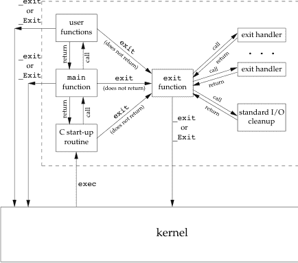

程序只能通过调用 `exec` 函数之一由内核执行。进程自愿终止的唯一方式是调用 `_exit` 或 `_Exit`，无论是显式调用还是隐式调用（通过调用 `exit`）。进程也可以被信号非自愿终止（图 7.2 中未显示）。


### 示例

图7.3中的程序演示了`atexit`函数的使用。

```
#include "apue.h"

static void my_exit1(void);
static void my_exit2(void);

int
main(void)
{
    if (atexit(my_exit2) != 0)
        err_sys("can't register my_exit2");

    if (atexit(my_exit1) != 0)
        err_sys("can't register my_exit1");
    if (atexit(my_exit1) != 0)
        err_sys("can't register my_exit1");

    printf("main is done\n");
    return(0);
}

static void
my_exit1(void)
{
    printf("first exit handler\n");
}
static void
my_exit2(void)
{
    printf("second exit handler\n");
}
```

图7.3 退出处理程序示例

执行图7.3中的程序，输出为

```
$ ./a.out
main is done
first exit handler
first exit handler
second exit handler
```

每个退出处理程序每次注册时都会被调用一次。在图7.3中，第一个退出处理程序注册了两次，因此它被调用了两次。注意我们没有调用`exit`，而是从`main`返回。

## 7.4 命令行参数

当程序被执行时，执行exec的进程可以向新程序传递命令行参数。这是UNIX系统shell正常操作的一部分。我们在前面章节的许多示例中已经看到了这一点。

### 示例

图7.4中的程序将其所有命令行参数回显到标准输出。注意，普通的echo(1)程序不会回显第零个参数。

```
#include "apue.h"
int
main(int argc, char *argv[])
{
    int     i;
    for (i = 0; i < argc; i++)        /* echo all command-line args */
        printf("argv[%d]: %s\n", i, argv[i]);
    exit(0);
}
```

图7.4 将所有命令行参数回显到标准输出

如果我们编译这个程序并将可执行文件命名为echoarg，我们得到

```
$ ./echoarg arg1 TEST foo
argv[0]: ./echoarg
argv[1]: arg1
argv[2]: TEST
argv[3]: foo
```

ISO C和POSIX.1都保证`argv[argc]`是一个空指针。这让我们可以另一种方式编写参数处理循环：

```
for (i = 0; argv[i] != NULL; i++)
```

## 7.5 环境表

每个程序还会接收到一个环境表。与参数列表一样，环境表是一个字符指针数组，每个指针包含一个以空字符结尾的C字符串的地址。指针数组的地址存储在全局变量`environ`中：

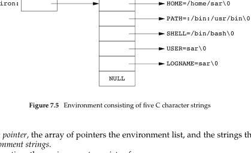

图7.5 由五个C字符串构成的环境

`environ`指针是环境指针，指针数组是环境列表，它们指向的字符串是环境字符串。

按照惯例，环境由`name=value`形式的字符串组成，如图7.5所示。大多数预定义名称完全使用大写字母，但这只是一个惯例。

历史上，大多数UNIX系统为`main`函数提供了第三个参数，即环境列表的地址：

```
int main(int argc, char *argv[], char *envp[]);
```

由于ISO C规定`main`函数应写成两个参数，并且由于第三个参数相对于全局变量`environ`并没有提供额外的好处，POSIX.1规定应使用`environ`而不是（可能的）第三个参数。对特定环境变量的访问通常通过`getenv`和`putenv`函数进行，这些函数将在7.9节中描述，而不是通过`environ`变量。但要遍历整个环境，必须使用`environ`指针。

## 7.6 C程序的内存布局

历史上，一个C程序由以下几个部分组成：

- 文本段，包含CPU执行的机器指令。通常，文本段是可共享的，因此对于频繁执行的程序（如文本编辑器、C编译器、shell等），内存中只需保存一个副本。此外，文本段通常是只读的，以防止程序意外修改其指令。

- 初始化数据段，通常简称为数据段，包含程序中显式初始化的变量。例如，在任何函数外部出现的C声明`int maxcount = 99;`会将该变量及其初始值存储在初始化数据段中。

- 未初始化数据段，通常称为“bss”段，其名称源于一个古老的汇编器操作符，意为“由符号开始的块”（block started by symbol）。该段中的数据在程序开始执行前由内核初始化为算术0或空指针。在任何函数外部出现的C声明`long sum[1000];`会将该变量存储在未初始化数据段中。

- 栈，自动变量以及每次调用函数时保存的信息存储在这里。每次调用函数时，返回地址和调用者环境的某些信息（如一些机器寄存器）被保存在栈上。新调用的函数然后在栈上为其自动变量和临时变量分配空间。这就是C语言中递归函数能够工作的方式。每次递归函数调用自身时，都会使用一个新的栈帧，因此一组变量不会干扰函数另一个实例的变量。

- 堆，动态内存分配通常在这里进行。历史上，堆位于未初始化数据和栈之间。

图7.6显示了这些段的典型布局。这是一个程序外观的逻辑图；并不要求特定的实现以这种方式安排其内存。尽管如此，这给我们提供了一个典型的布局来描述。在32位Intel x86处理器上的Linux中，文本段从地址0x08048000开始，栈底从略低于0xC0000000处开始。（在这种特定架构上，栈从高地址向低地址增长。）堆顶和栈顶之间未使用的虚拟地址空间很大。

> 在a.out中还存在几种其他段类型，包含符号表、调试信息、动态共享库的链接表等。这些附加部分不会作为进程执行的程序映像的一部分被加载。

注意，从图7.6中可以看出，未初始化数据段的内容不会存储在磁盘上的程序文件中，因为内核会在程序开始运行前将其内容设置为0。程序中需要保存在程序文件中的部分只有文本段和初始化数据。

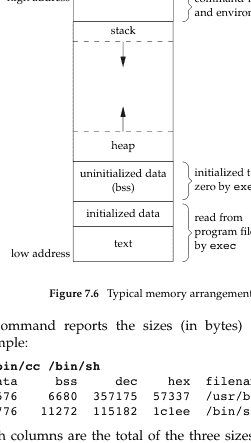

图7.6 典型的内存布局

size(1)命令报告文本段、数据段和bss段的大小（以字节为单位）。例如：

```
$ size /usr/bin/cc /bin/sh
     text    data     bss     dec     hex filename
   346919   3576   6680  357175   57337 /usr/bin/cc
   102134   1776  11272  115182   1c1ee /bin/sh
```

第四列和第五列是三个大小的总和，分别以十进制和十六进制显示。

## 7.7 共享库

如今大多数UNIX系统支持共享库。Arnold [1986]描述了System V下的一种早期实现，Gingell等[1987]描述了SunOS下的另一种不同实现。共享库从可执行文件中移除公共库例程，而是在内存中保持库例程的单个副本，供所有进程引用。这减小了每个可执行文件的大小，但可能会增加一些运行时开销，无论是在程序首次执行时，还是在第一次调用每个共享库函数时。共享库的另一个优点是，可以用新版本的库函数替换旧版本，而无需重新链接编辑使用该库的每个程序（假设参数的数量和类型没有改变）。

不同的系统提供了不同的方式让程序声明是否使用共享库。cc(1)和ld(1)命令的选项是典型的例子。如


作为大小差异的一个例子，下面的可执行文件——经典的 hello.c 程序——最初是在不使用共享库的情况下创建的：

```
$ gcc -static hello.c        prevent gcc from using shared libraries
$ ls -l a.out
-rwxr-xr-x 1 sar  879443 Sep 2 10:39 a.out
$ size a.out
text    data    bss     dec     hex     filename
787775  6128    11272   805175  c4937   a.out
```

如果我们编译这个程序以使用共享库，可执行文件的文本和数据大小将大幅减少：

```
$ gcc hello.c                gcc defaults to use shared libraries
$ ls -l a.out
-rwxr-xr-x 1 sar  8378 Sep 2 10:39 a.out
$ size a.out
text    data    bss     dec     hex     filename
1176    504     16      1696    6a0     a.out
```

## 7.8 内存分配

ISO C 指定了三个用于内存分配的函数：

- **malloc**，它分配指定字节数的内存。内存的初始值是不确定的。
- **calloc**，它为指定数量的指定大小的对象分配空间。该空间被初始化为全 0 位。
- **realloc**，它增加或减少先前分配区域的大小。当大小增加时，可能涉及将先前分配的区域移动到其他位置，以便在末尾提供额外的空间。此外，当大小增加时，旧内容与新区域末尾之间的空间的初始值是不确定的。

```
#include <stdlib.h>

void *malloc(size_t size);
void *calloc(size_t nobj, size_t size);
void *realloc(void *ptr, size_t newsize);

All three return: non-null pointer if OK, NULL on error

void free(void *ptr);
```

这三个分配函数返回的指针保证有合适的对齐方式，因此可以用于任何数据对象。例如，如果某个特定系统上最严格的对齐要求要求 double 必须从 8 的倍数的内存位置开始，那么这三个函数返回的所有指针都将如此对齐。

由于这三个分配函数返回通用的 void * 指针，如果我们 #include <stdlib.h>（以获得函数原型），当我们将这些函数返回的指针赋给不同类型指针时，不必显式地进行强制转换。未声明函数的默认返回值是 int，因此在没有正确函数声明的情况下使用强制转换，在 int 类型大小与函数返回值（此处为指针）大小不同的系统上可能会隐藏错误。

函数 free 会使 ptr 指向的空间被释放。这个被释放的空间通常放入可用内存池中，并可在后续对三个分配函数之一的调用中被分配。

realloc 函数让我们更改先前分配区域的大小。（最常见的用法是增加区域的大小。）例如，如果我们在一个数组中分配了 512 个元素的空间，而在运行时填充该数组，但后来发现需要更多空间，我们可以调用 realloc。如果在现有区域末尾之外有足够的空间来满足请求，那么 realloc 只需在末尾分配这个额外区域，并返回我们传入的同一指针。但如果没有空间，realloc 会分配另一个足够大的区域，将现有的 512 元素数组复制到新区域，释放旧区域，并返回指向新区域的指针。由于区域可能会移动，我们不应该有任何指向该区域的指针。练习 4.16 和图 C.3 展示了将 realloc 与 getcwd 一起使用以处理任意长度路径名的示例。图 17.27 展示了一个使用 realloc 来避免具有固定编译时大小的数组的示例。

请注意，realloc 的最后一个参数是区域的新大小，而不是旧大小与新大小之间的差值。作为一种特殊情况，如果 ptr 是空指针，realloc 的行为类似于 malloc，分配指定 newsize 的区域。

这些例程的旧版本允许我们重新分配自上次调用 malloc、realloc 或 calloc 以来已释放的块。这个技巧可以追溯到 Version 7，并利用了 malloc 的搜索策略来执行存储压缩。Solaris 仍然支持此功能，但许多其他平台不支持。此功能已被弃用，不应再使用。

分配例程通常通过 sbrk(2) 系统调用实现。该系统调用扩展（或收缩）进程的堆。（参见图 7.6。）Kernighan 和 Ritchie [1988] 的 8.7 节给出了 malloc 和 free 的示例实现。

尽管 sbrk 可以扩展或收缩进程的内存，但大多数版本的 malloc 和 free 从不减小其内存大小。我们释放的空间可供后续分配使用，但释放的空间通常不会返回给内核；相反，该空间保留在 malloc 池中。

大多数实现分配的空间比请求的多，并使用额外的空间进行记录——块的大小、指向下一个已分配块的指针等。因此，在已分配区域的末尾之后或起始之前进行写入，可能会覆盖另一个块中的这些记录信息。这类错误通常是灾难性的，但难以发现，因为错误可能要到很晚才会显现。这些对象可能与破坏它们的代码无关，这使得查找破坏源头更加困难。

其他可能致命的错误包括释放一个已经被释放的块，以及使用并非从三个分配函数之一获得的指针调用 free。如果进程调用 malloc 但忘记调用 free，其内存使用量将不断增加；这称为泄漏。如果我们不调用 free 释放未使用的空间，进程地址空间的大小将慢慢增加，直到没有剩余空间。在此期间，性能可能因过多的分页开销而下降。

由于内存分配错误难以追踪，一些系统提供了这些函数的版本，每次调用三个分配函数之一或 free 时都会进行额外的错误检查。这些函数版本通常通过为链接编辑器包含一个特殊库来指定。还有一些公开可用的源代码，你可以使用特殊标志编译以启用额外的运行时检查。

> FreeBSD、Mac OS X 和 Linux 支持通过设置环境变量进行额外的调试。此外，可以通过符号链接 /etc/malloc.conf 向 FreeBSD 库传递选项。

### 备用内存分配器

有许多 malloc 和 free 的替代实现可用。一些系统已经包含了提供备用内存分配器实现的库。其他系统仅提供标准分配器，由软件开发人员根据需要自行下载替代实现。我们在这里讨论其中一些替代方案。

- **libmalloc**：基于 SVR4 的系统（如 Solaris）包含 libmalloc 库，它提供了一组与 ISO C 内存分配函数匹配的接口。libmalloc 库包含 mallopt，该函数允许进程设置某些控制存储分配器操作的变量。还提供了一个名为 mallinfo 的函数，用于提供有关内存分配器的统计信息。
- **vmalloc**：Vo [1996] 描述了一种内存分配器，它允许进程针对不同的内存区域使用不同的技术来分配内存。除了 vmalloc 特有的函数外，该库还提供了 ISO C 内存分配函数的模拟。
- **quick-fit**：历史上，标准 malloc 算法使用最佳适配或首次适配的内存分配策略。quick-fit 比这两种都快，但往往使用更多内存。Weinstock 和 Wulf [1988] 描述了该算法，它基于将内存分割成各种大小的缓冲区，并根据缓冲区大小在不同空闲列表上维护未使用的缓冲区。大多数现代分配器都基于 quick-fit。


## jemalloc

jemalloc 实现的 malloc 系列库函数是 FreeBSD 8.0 中的默认内存分配器。它被设计为在使用多线程应用程序运行在多处理器系统上时能够很好地扩展。Evans [2006] 描述了该实现并评估了其性能。

## TCMalloc

TCMalloc 被设计为 malloc 系列函数的替代品，以提供高性能、可扩展性和内存效率。它使用线程本地缓存来避免在从缓存分配缓冲区和向缓存释放缓冲区时产生的锁定开销。它还内置了堆检查器和堆分析器，以帮助调试和分析动态内存使用情况。TCMalloc 库可作为开源软件从 Google 获得。Ghemawat 和 Menage [2005] 简要描述了它。

## alloca 函数

还有一个值得提及的附加函数。函数 alloca 的调用序列与 malloc 相同；然而，与从堆分配内存不同，内存是从当前函数的栈帧中分配的。优点是我们不必释放空间；当函数返回时它会自动消失。alloca 函数会增加栈帧的大小。缺点是某些系统无法支持 alloca，如果在函数被调用后无法增加栈帧的大小。尽管如此，许多软件包都使用它，并且存在适用于各种系统的实现。

本文讨论的全部四个平台都提供 alloca 函数。

## 7.9 环境变量

如我们之前提到的，环境字符串通常的形式为

*name=value*

UNIX 内核从不查看这些字符串；它们的解释由各个应用程序决定。例如，shell 使用了大量环境变量。其中一些，如 HOME 和 USER，在登录时自动设置；另一些则留给我们设置。我们通常在 shell 启动文件中设置环境变量以控制 shell 的行为。例如，如果我们设置环境变量 MAILPATH，它会告诉 Bourne shell、GNU Bourne-again shell 和 Korn shell 在哪里查找邮件。

ISO C 定义了一个函数，我们可以用它从环境中获取值，但该标准说明环境的内容是实现定义的。

```
#include <stdlib.h>

char *getenv(const char *name);
```

返回：与 *name* 关联的值的指针，如果未找到则为 NULL

请注意，此函数返回一个指向 name=value 字符串的值的指针。我们应该始终使用 getenv 从环境中获取特定值，而不是直接访问 environ。

一些环境变量由 POSIX.1 在 Single UNIX Specification 中定义，而另一些仅在支持 XSI 选项时才定义。图 7.7 列出了 Single UNIX Specification 中定义的环境变量，并注明了哪些实现支持这些变量。任何由 POSIX.1 定义的环境变量都标记为 •；否则，它是 XSI 选项的一部分。本书中描述的四个实现中使用了许多额外的实现相关环境变量。请注意，ISO C 并未定义任何环境变量。

| Variable | POSIX.1 | FreeBSD 8.0 | Linux 3.2.0 | Mac OS X 10.6.8 | Solaris 10 | Description |
|---|---|---|---|---|---|---|
| COLUMNS | • | • | • | • | • | terminal width |
| DATEMSK | XSI | • | • | • | • | getdate(3) template file pathname |
| HOME | • | • | • | • | • | home directory |
| LANG | • | • | • | • | • | name of locale |
| LC_ALL | • | • | • | • | • | name of locale |
| LC_COLLATE | • | • | • | • | • | name of locale for collation |
| LC_CTYPE | • | • | • | • | • | name of locale for character classification |
| LC_MESSAGES | • | • | • | • | • | name of locale for messages |
| LC_MONETARY | • | • | • | • | • | name of locale for monetary editing |
| LC_NUMERIC | • | • | • | • | • | name of locale for numeric editing |
| LC_TIME | • | • | • | • | • | name of locale for date/time formatting |
| LINES | • | • | • | • | • | terminal height |
| LOGNAME | • | • | • | • | • | login name |
| MSGVERB | XSI | • | • | • | • | fmtmsg(3) message components to process |
| NLSPATH | • | • | • | • | • | sequence of templates for message catalogs |
| PATH | • | • | • | • | • | list of path prefixes to search for executable file |
| PWD | • | • | • | • | • | absolute pathname of current working directory |
| SHELL | • | • | • | • | • | name of user’s preferred shell |
| TERM | • | • | • | • | • | terminal type |
| TMPDIR | • | • | • | • | • | pathname of directory for creating temporary files |
| TZ | • | • | • | • | • | time zone information |

Figure 7.7 Environment variables defined in the Single UNIX Specification

除了获取环境变量的值，有时我们可能还想设置环境变量。我们可能想更改现有变量的值或向环境中添加新变量。 （在下一章中，我们将看到我们只能影响当前进程及其所调用的任何子进程的环境。我们无法影响父进程的环境，该进程通常是一个 shell。尽管如此，能够修改环境列表仍然很有用。）不幸的是，并非所有系统都支持此功能。图 7.8 显示了各种标准和实现所支持的函数。

| Function | ISO C | POSIX.1 | FreeBSD 8.0 | Linux 3.2.0 | Mac OS X 10.6.8 | Solaris 10 |
|---|---|---|---|---|---|---|
| getenv | • | • | • | • | • |  |
| putenv |  | XSI | • | • | • | • |
| setenv |  | • | • | • | • |  |
| unsetenv |  | • | • | • | • |  |
| clearenv |  |  |  | • |  |  |

Figure 7.8 Support for various environment list functions

clearenv 函数不是 Single UNIX Specification 的一部分。它用于从环境列表中删除所有条目。

图 7.8 中列出的中间三个函数的原型为

```
#include <stdlib.h>
int putenv(char *str);

Returns: 0 if OK, nonzero on error

int setenv(const char *name, const char *value, int rewrite);
int unsetenv(const char *name);

Both return: 0 if OK, -1 on error
```

这三个函数的运行方式如下：

- putenv 函数接受一个形如 name=value 的字符串并将其放入环境列表中。如果 name 已存在，则先删除其旧定义。
- setenv 函数将 name 设置为 value。如果 name 已存在于环境中，则 (a) 如果 rewrite 为非零，则先删除 name 的现有定义；或 (b) 如果 rewrite 为 0，则不删除 name 的现有定义，不将 name 设置为新值，且不发生错误。
- unsetenv 函数删除 name 的任何定义。如果不存在此类定义，则不会出错。

> 请注意 putenv 和 setenv 之间的区别。虽然 setenv 必须分配内存以从其参数创建 name=value 字符串，但 putenv 可以直接将传递给它的字符串放入环境中。事实上，许多实现正是这样做的，因此将 putenv 传递一个在栈上分配的字符串会出错，因为在我们从当前函数返回后内存将被重用。

很有趣的是检查这些函数在修改环境列表时必须如何操作。回顾图 7.6：环境列表——指向实际 name=value 字符串的指针数组——以及环境字符串通常存储在进程内存空间的顶部，位于栈之上。删除一个字符串很简单；我们只需在环境列表中找到该指针并将所有后续指针向下移动一个位置。但添加一个字符串或修改现有字符串则更困难。栈顶的空间无法扩展，因为它通常位于进程地址空间的顶部，因此无法向上扩展；它也不能向下扩展，因为它下面的所有栈帧都无法移动。

- 1. 如果我们正在修改现有的 *name*：
  a. 如果新 *value* 的大小小于或等于现有 *value* 的大小，我们只需将新字符串复制到旧字符串上。
  b. 如果新 *value* 的大小大于旧值，则必须使用 *malloc* 获取新字符串的空间，将新字符串复制到该区域，然后用指向该分配区域的指针替换环境列表中 *name* 的旧指针。
- 2. 如果我们正在添加新的 *name*，则更复杂。首先，我们必须调用 *malloc* 为 *name=value* 字符串分配空间并将字符串复制到该区域。
  a. 然后，如果这是我们第一次添加新的 *name*，我们必须调用 *malloc* 为新的指针列表获取空间。我们将旧环境列表复制到此新区域，并在该指针列表末尾存储指向 *name=value* 字符串的指针。当然，我们还在该列表末尾存储一个空指针。最后，我们将 *environ* 设置为指向此新的指针列表。请注意图 7.6，如果原始环境列表包含在栈顶之上，如常见情况，则我们已将此指针列表移至堆上。但该列表中的大多数指针仍指向栈顶之上的 *name=value* 字符串。
  b. 如果这不是我们第一次向环境列表添加新字符串，则我们知道我们已经在堆上为列表分配了空间，因此我们只需调用 *realloc* 为一个额外指针分配空间。指向新 *name=value* 字符串的指针存储在列表末尾（覆盖之前的空指针），后跟一个空指针。

## 7.10 setjmp 和 longjmp 函数

在 C 语言中，我们不能 goto 另一个函数中的标签。相反，我们必须使用 setjmp 和 longjmp 函数来执行这种类型的分支。如我们将看到的，这两个函数对于处理深层嵌套函数调用中发生的错误条件非常有用。

考虑图 7.9 中的骨架。它由一个主循环组成，该循环从标准输入读取行并调用函数 do_line 来处理每一行。此函数随后调用 get_token 从输入行获取下一个标记。行的第一个标记被假定为某种形式的命令，switch 语句选择每个命令。对于所示的单个命令，将调用函数 cmd_add。

图 7.9 中的骨架对于读取命令、确定命令类型然后调用函数处理每个命令的程序来说是典型的。图 7.10 显示了在调用 cmd_add 之后栈可能的样子。


#include "apue.h"

#define TOK_ADD  5

void    do_line(char *);
void    cmd_add(void);
int     get_token(void);

int
main(void)
{
    char line[MAXLINE];

    while (fgets(line, MAXLINE, stdin) != NULL)
        do_line(line);
    exit(0);
}

char    *tok_ptr;       /* global pointer for get_token() */
void
do_line(char *ptr)     /* process one line of input */
{
    int     cmd;

    tok_ptr = ptr;
    while (((cmd = get_token()) > 0) {
        switch (cmd) {  /* one case for each command */
        case TOK_ADD:
            cmd_add();
            break;
        }
    }
}

void
cmd_add(void)
{
    int     token;

    token = get_token();
    /* rest of processing for this command */
}

int
get_token(void)
{
    /* fetch next token from line pointed to by tok_ptr */
}

Figure 7.9 Typical program skeleton for command processing

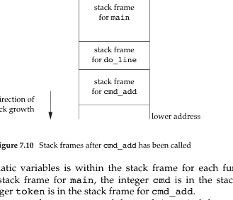

## Figure 7.10 Stack frames after cmd_add has been called

Storage for the automatic variables is within the stack frame for each function. The array line is in the stack frame for main, the integer cmd is in the stack frame for do_line, and the integer token is in the stack frame for cmd_add.

As we’ve said, this type of arrangement of the stack is typical, but not required. Stacks do not have to grow toward lower memory addresses. On systems that don’t have built-in hardware support for stacks, a C implementation might use a linked list for its stack frames.

The coding problem that’s often encountered with programs like the one shown in Figure 7.9 is how to handle nonfatal errors. For example, if the cmd_add function encounters an error—say, an invalid number—it might want to print an error message, ignore the rest of the input line, and return to the main function to read the next input line. But when we’re deeply nested numerous levels down from the main function, this is difficult to do in C. (In this example, the cmd_add function is only two levels down from main, but it’s not uncommon to be five or more levels down from the point to which we want to return.) It becomes messy if we have to code each function with a special return value that tells it to return one level.

The solution to this problem is to use a nonlocal goto: the setjmp and longjmp functions. The adjective “nonlocal” indicates that we’re not doing a normal C goto statement within a function; instead, we’re branching back through the call frames to a function that is in the call path of the current function.

```
#include <setjmp.h>

int setjmp(jmp_buf env);

Returns: 0 if called directly, nonzero if returning from a call to longjmp

void longjmp(jmp_buf env, int val);
```

We call setjmp from the location that we want to return to, which in this example is in the main function. In this case, setjmp returns 0 because we called it directly. In the call to setjmp, the argument env is of the special type jmp_buf. This data type is some form of array that is capable of holding all the information required to restore the status of the stack to the state when we call longjmp. Normally, the env variable is a global variable, since we’ll need to reference it from another function.

When we encounter an error—say, in the cmd_add function—we call longjmp with two arguments. The first is the same env that we used in a call to setjmp, and the second, val, is a nonzero value that becomes the return value from setjmp. The second argument allows us to use more than one longjmp for each setjmp. For example, we could longjmp from cmd_add with a val of 1 and also call longjmp from get_token with a val of 2. In the main function, the return value from setjmp is either 1 or 2, and we can test this value, if we want, and determine whether the longjmp was from cmd_add or get_token.

Let’s return to the example. Figure 7.11 shows both the main and cmd_add functions. (The other two functions, do_line and get_token, haven’t changed.)

```
#include "apue.h"
#include <setjmp.h>

#define TOK_ADD  5

jmp_buf jmpbuffer;

int
main(void)
{
    char    line[MAXLINE];

    if (setjmp(jmpbuffer) != 0)
        printf("error");
    while (fgets(line, MAXLINE, stdin) != NULL)
        do_line(line);
    exit(0);
}

...

void
cmd_add(void)
{
    int     token;

    token = get_token();
    if (token < 0)  /* an error has occurred */
        longjmp(jmpbuffer, 1);
    /* rest of processing for this command */
}
```

Figure 7.11 Example of setjmp and longjmp

When main is executed, we call setjmp, which records whatever information it needs to in the variable jmpbuffer and returns 0. We then call do_line, which calls cmd_add, and assume that an error of some form is detected. Before the call to longjmp in cmd_add, the stack looks like that in Figure 7.10. But longjmp causes the stack to be “unwound” back to the main function, throwing away the stack frames for cmd_add and do_line (Figure 7.12). Calling longjmp causes the setjmp in main to return, but this time it returns with a value of 1 (the second argument for longjmp).

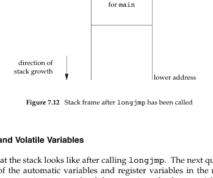

## Automatic, Register, and Volatile Variables

We’ve seen what the stack looks like after calling longjmp. The next question is, “What are the states of the automatic variables and register variables in the main function?” When we return to main as a result of the longjmp, do these variables have values corresponding to those when the setjmp was previously called (i.e., are their values rolled back), or are their values left alone so that their values are whatever they were when do_line was called (which caused cmd_add to be called, which caused longjmp to be called)? Unfortunately, the answer is “It depends.” Most implementations do not try to roll back these automatic variables and register variables, but the standards say only that their values are indeterminate. If you have an automatic variable that you don’t want rolled back, define it with the volatile attribute. Variables that are declared as global or static are left alone when longjmp is executed.

## Example

The program in Figure 7.13 demonstrates the different behavior that can be seen with automatic, global, register, static, and volatile variables after calling longjmp.

```
#include "apue.h"
#include <setjmp.h>

static void f1(int, int, int, int);
static void f2(void);

static jmp_buf jmpbuffer;
static int globval;

int
main(void)
{
    int autoval;
    register int regival;
    volatile int volaval;
    static int statval;

    globval = 1; autoval = 2; regival = 3; volaval = 4; statval = 5;

    if (setjmp(jmpbuffer) != 0) {
        printf("after longjmp:\n");
        printf("globval = %d, autoval = %d, regival = %d,"
               " volaval = %d, statval = %d\n",
               globval, autoval, regival, volaval, statval);
        exit(0);
    }

    /*
     * Change variables after setjmp, but before longjmp.
     */
    globval = 95; autoval = 96; regival = 97; volaval = 98;
    statval = 99;

    f1(autoval, regival, volaval, statval); /* never returns */
    exit(0);
}

static void
f1(int i, int j, int k, int l)
{
    printf("\n in f1():\n");
    printf("globval = %d, autoval = %d, regival = %d,"
           " volaval = %d, statval = %d\n", globval, i, j, k, l);
    f2();
}

static void
f2(void)
{
    longjmp(jmpbuffer, 1);
}
```

If we compile and test the program in Figure 7.13, with and without compiler optimizations, the results are different:

```
```text
$ gcc testjmp.c                    compile without any optimization
$ ./a.out
in fl():
global = 95, autoval = 96, regival = 97, volaval = 98, statval = 99
after longjmp:
global = 95, autoval = 96, regival = 97, volaval = 98, statval = 99
$ gcc -O testjmp.c                 compile with full optimization
$ ./a.out
in fl():
global = 95, autoval = 96, regival = 97, volaval = 98, statval = 99
after longjmp:
global = 95, autoval = 2, regival = 3, volaval = 98, statval = 99
```
```

Note that the optimizations don’t affect the global, static, and volatile variables; their values after the longjmp are the last values that they assumed. The setjmp(3) manual page on one system states that variables stored in memory will have values as of the time of the longjmp, whereas variables in the CPU and floating-point registers are restored to their values when setjmp was called. This is indeed what we see when we run the program in Figure 7.13. Without optimization, all five variables are stored in memory (the register hint is ignored for regival). When we enable optimization, both autoval and regival go into registers, even though the former wasn’t declared register, and the volatile variable stays in memory. The important thing to realize with this example is that you must use the volatile attribute if you’re writing portable code that uses nonlocal jumps. Anything else can change from one system to the next.

Some printf format strings in Figure 7.13 are longer than will fit comfortably for display in a programming text. Instead of making multiple calls to printf, we rely on ISO C’s string concatenation feature, where the sequence

```
```c
"string1" "string2"
```
```

is equivalent to

```
```c
"string1string2"
```
```

We’ll return to these two functions, setjmp and longjmp, in Chapter 10 when we discuss signal handlers and their signal versions: sigsetjmp and siglongjmp.

## Potential Problem with Automatic Variables

Having looked at the way stack frames are usually handled, it is worth looking at a potential error in dealing with automatic variables. The basic rule is that an automatic variable can never be referenced after the function that declared it returns. Numerous warnings about this can be found throughout the UNIX System manuals.

Figure 7.14 shows a function called open_data that opens a standard I/O stream and sets the buffering for the stream.


```c
#include <stdio.h>
FILE *
open_data(void)
{
    FILE *fp;
    char databuf[BUFSIZ]; /* setvbuf makes this the stdio buffer */
    if ((fp = fopen("datafile", "r")) == NULL)
        return(NULL);
    if (setvbuf(fp, databuf, _IOLBF, BUFSIZ) != 0)
        return(NULL);
    return(fp);    /* error */
}
```

## 图 7.14 自动变量的不正确使用

问题是当 open_data 返回时，它在栈上使用的空间将被下一个被调用函数的栈帧所使用。但标准 I/O 库仍将使用该部分内存作为其流缓冲区。这必然导致混乱。要修正这个问题，数组 databuf 需要从全局内存中分配，要么静态分配（static 或 extern），要么动态分配（某个 alloc 函数）。

## 7.11 getrlimit 和 setrlimit 函数

每个进程都有一组资源限制，其中一些可以通过 getrlimit 和 setrlimit 函数进行查询和更改。

```c
#include <sys/resource.h>

int getrlimit(int resource, struct rlimit *rlptr);

int setrlimit(int resource, const struct rlimit *rlptr);

Both return: 0 if OK, -1 on error
```

这两个函数在单一 UNIX 规范中被定义在 XSI 选项中。进程的资源限制通常由进程 0 在系统初始化时建立，然后由每个后续进程继承。每种实现都有自己的方式来调整各种限制。

每次调用这两个函数时，需要指定一个资源以及指向以下结构的指针：

```c
struct rlimit {
    rlim_t rlim_cur;  /* soft limit: current limit */
    rlim_t rlim_max;  /* hard limit: maximum value for rlim_cur */
};
```

有三条规则支配资源限制的更改。

- 1. 进程可以将其软限制更改为小于或等于硬限制的值。
- 2. 进程可以将其硬限制降低为大于或等于软限制的值。对于普通用户而言，降低硬限制是不可逆的。
- 3. 只有超级用户进程才能提高硬限制。

无限限制由常量 RLIM_INFINITY 指定。

resource 参数取以下值之一。图 7.15 显示了单一 UNIX 规范定义了哪些限制，以及每种实现支持哪些限制。

RLIMIT_AS    进程总可用内存的最大字节数。这会影响 sbrk 函数（第 1.11 节）和 mmap 函数（第 14.8 节）。

RLIMIT_CORE   核心文件的最大字节数。限制为 0 会阻止创建核心文件。

RLIMIT_CPU    CPU 时间的最大秒数。当超过软限制时，会向进程发送 SIGXCPU 信号。

RLIMIT_DATA    数据段的最大字节数：即图 7.6 中初始化数据、未初始化数据和堆的总和。

RLIMIT_FSIZE    可创建文件的最大字节数。当超过软限制时，会向进程发送 SIGXFSZ 信号。

RLIMIT_MEMLOCK    进程可以使用 mlock(2) 锁定到内存中的最大内存字节数。

RLIMIT_RSS  最大驻留集大小（RSS），以字节为单位。如果可用物理内存不足，内核会从超过其 RSS 的进程中回收内存。

RLIMIT_SBSIZE  用户在任意给定时间可以消耗的套接字缓冲区最大字节数。

RLIMIT_SIGPENDING  可以为进程排队的最大信号数。此限制由 sigqueue 函数（第 10.20 节）强制执行。

RLIMIT_STACK  栈的最大字节数。参见图 7.6。

RLIMIT_SWAP  用户可以消耗的最大交换空间字节数。

RLIMIT_VMEM  这是 RLIMIT_AS 的同义词。

| 限制 | XSI | FreeBSD 8.0 | Linux 3.2.0 | Mac OS X 10.6.8 | Solaris 10 |
|---|---|---|---|---|---|
| RLIMIT_AS | • | • |  |  | • |
| RLIMIT_CORE | • | • | • | • | • |
| RLIMIT_CPU | • | • | • | • | • |
| RLIMIT_DATA | • | • | • | • | • |
| RLIMIT_FSIZE | • | • | • | • | • |
| RLIMIT_MEMLOCK |  | • | • | • |  |
| RLIMIT_MSGQUEUE |  |  | • |  |  |
| RLIMIT_NICE |  |  | • |  |  |
| RLIMIT_NOFILE | • | • | • | • | • |
| RLIMIT_NPROC |  | • | • | • |  |
| RLIMIT_NPTS |  | • |  |  |  |
| RLIMIT_RSS |  | • | • | • |  |
| RLIMIT_SBSIZE |  | • |  |  |  |
| RLIMIT_SIGPENDING |  |  | • |  |  |
| RLIMIT_STACK | • | • | • | • | • |
| RLIMIT_SWAP |  | • |  |  |  |
| RLIMIT_VMEM |  |  |  |  | • |

图 7.15 资源限制的支持

资源限制影响调用进程，并被其所有子进程继承。这意味着资源限制的设置需要内建到 shell 中，才能影响我们未来的所有进程。确实，Bourne shell、GNU Bourne-again shell 和 Korn shell 都有内建的 ulimit 命令，而 C shell 有内建的 limit 命令。（umask 和 chdir 函数也必须作为 shell 内建命令来处理。）

## 示例

图 7.16 中的程序会打印系统支持的所有资源限制的当前软限制和硬限制。为了在各种实现上编译此程序，我们有条件地包含了那些不同的资源名称。请注意，某些系统将 rlim_t 定义为 unsigned long long 而不是 unsigned long。这个定义甚至可能在同一个系统上发生变化，具体取决于我们是否编译程序以支持 64 位文件。某些限制适用于文件大小，因此 rlim_t 类型必须足够大，以表示文件大小限制。为了避免使用错误格式说明符导致编译器警告，我们先将限制复制到一个 64 位整数中，这样只需处理一种格式。

```c
#include "apue.h"
#include <sys/resource.h>

#define doit(name) pr_limits(#name, name)

static void pr_limits(char *, int);

int
main(void)
{
#ifdef RLIMIT_AS
    doit(RLIMIT_AS);
#endif

    doit(RLIMIT_CORE);
    doit(RLIMIT_CPU);
    doit(RLIMIT_DATA);
    doit(RLIMIT_FSIZE);

#ifdef RLIMIT_MEMLOCK
    doit(RLIMIT_MEMLOCK);
#endif

#ifdef RLIMIT_MSGQUEUE
    doit(RLIMIT_MSGQUEUE);
#endif

#ifdef RLIMIT_NICE
    doit(RLIMIT_NICE);
#endif

    doit(RLIMIT_NOFILE);

#ifdef RLIMIT_NPROC
    doit(RLIMIT_NPROC);
#endif

#ifdef RLIMIT_NPTS
    doit(RLIMIT_NPTS);
#endif

#ifdef RLIMIT_RSS
    doit(RLIMIT_RSS);
#endif

#ifdef RLIMIT_SBSIZE
    doit(RLIMIT_SBSIZE);
#endif

#ifdef RLIMIT_SIGPENDING
    doit(RLIMIT_SIGPENDING);
#endif

    doit(RLIMIT_STACK);

#ifdef RLIMIT_SWAP
    doit(RLIMIT_SWAP);
#endif

#ifdef RLIMIT_VMEM
    doit(RLIMIT_VMEM);
#endif
}
    exit(0);
}
static void
pr_limits(char *name, int resource)
{
    struct rlimit  limit;
    unsigned long  long lim;
    if (getrlimit(resource, &limit) < 0)
        err_sys("getrlimit error for %s", name);
    printf("%-14s", name);
    if (limit.rlim_cur == RLIM_INFINITY) {
        printf("(infinite) ");
    } else {
        lim = limit.rlim_cur;
        printf("%10lld ", lim);
    }
    if (limit.rlim_max == RLIM_INFINITY) {
        printf("(infinite)");
    } else {
        lim = limit.rlim_max;
        printf("%10lld", lim);
    }
    putchar((int)'\n');
}
```

## 图 7.16 打印当前资源限制

注意，我们在 doit 宏中使用了 ISO C 的字符串创建运算符（#），为每个资源名生成字符串值。当我们写

```
doit(RLIMIT_CORE);
```

C 预处理器会将其扩展为

```
pr_limits("RLIMIT_CORE", RLIMIT_CORE);
```

在 FreeBSD 下运行此程序，我们得到以下输出：

```
$ ./a.out
RLIMIT_AS      (infinite)    (infinite)
RLIMIT_CORE    (infinite)    (infinite)
RLIMIT_CPU     (infinite)    (infinite)
RLIMIT_DATA    536870912     536870912
RLIMIT_FSIZE   (infinite)    (infinite)
RLIMIT_MEMLOCK (infinite)    (infinite)
RLIMIT_NOFILE  3520          3520
RLIMIT_NPROC   1760          1760
RLIMIT_NPTS    (infinite)    (infinite)
RLIMIT_RSS     (infinite)    (infinite)
RLIMIT_SBSIZE  (infinite)    (infinite)
RLIMIT_STACK   67108864      67108864
RLIMIT_SWAP    (infinite)    (infinite)
RLIMIT_VMEM    (infinite)    (infinite)
```

Solaris 给出以下结果：

```
$ ./a.out
RLIMIT_AS      (infinite)    (infinite)
RLIMIT_CORE    (infinite)    (infinite)
RLIMIT_CPU     (infinite)    (infinite)
RLIMIT_DATA    (infinite)    (infinite)
RLIMIT_FSIZE   (infinite)    (infinite)
RLIMIT_NOFILE  256           65536
RLIMIT_STACK   8388608       (infinite)
RLIMIT_VMEM    (infinite)    (infinite)
```

习题 10.11 将在我们介绍完信号后继续讨论资源限制。

## 7.12 小结

理解 UNIX 系统环境中 C 程序的环境，是理解 UNIX 系统进程控制特性的先决条件。在本章中，我们了解了进程如何启动、如何终止，以及如何向进程传递参数列表和环境。虽然参数列表和环境都不由内核解释，但正是内核将这两者从 exec 的调用者传递给新进程。

我们还检查了 C 程序的典型内存布局，并了解了进程如何动态分配和释放内存。详细研究可用于操作环境的函数是值得的，因为它们涉及内存分配。我们还介绍了 setjmp 和 longjmp 函数，它们提供了一种在进程内执行非局部跳转的方法。本章最后描述了各种实现提供的资源限制。


## 习题

- 7.1 在 Linux 下的 Intel x86 系统中，如果我们执行打印“hello, world”的程序并且不调用 exit 或 return，程序的终止状态——我们可以用 shell 检查——是 13。为什么？

- 7.2 图 7.3 中 printf 的输出实际上是在什么时候输出的？

- 7.3 有没有办法让被 main 调用的函数检查命令行参数，而无需 (a) 从 main 向该函数传递 argc 和 argv 作为参数，或 (b) 让 main 将 argc 和 argv 复制到全局变量中？

- 7.4 某些 UNIX 系统实现特意安排，在程序执行时，数据段中的位置 0 不可访问。为什么？

- 7.5 使用 C 的 typedef 机制为退出处理程序定义一个新数据类型 Exitfunc。使用此数据类型重做 atexit 的原型。

- 7.6 如果我们使用 calloc 分配一个 long 数组，该数组是否被初始化为 0？如果我们使用 calloc 分配一个指针数组，该数组是否被初始化为空指针？

- 7.7 在 7.6 节末尾 size 命令的输出中，为什么没有给出堆和栈的大小？

- 7.8 在 7.7 节中，两个文件大小（879443 和 8378）不等于它们各自的文本和数据大小之和。为什么？

- 7.9 在 7.7 节中，对于这样一个简单的程序，当我们使用共享库时，为什么可执行文件的大小差异如此之大？

- 7.10 在 7.10 节末尾，我们展示了函数如何不能返回指向自动变量的指针。以下代码正确吗？

```
int
fl(int val)
{
    int num = 0;
    int *ptr = &num;

    if (val == 0) {
        int val;

        val = 5;
        ptr = &val;
    }
    return(*ptr + 1);
}
```

## 进程控制

### 8.1 引言

现在我们来讨论 UNIX 系统提供的进程控制。这包括新进程的创建、程序执行和进程终止。我们还将了解属于进程的各种 ID——真实、有效和保存的用户 ID 和组 ID——以及它们如何受到进程控制原语的影响。还将介绍解释器文件和 system 函数。在本章末尾，我们将通过查看大多数 UNIX 系统提供的进程会计来结束本章。这让我们可以从不同的角度来审视进程控制函数。

### 8.2 进程标识符

每个进程都有唯一的进程 ID，一个非负整数。因为进程 ID 是进程中唯一众所周知的始终唯一的标识符，所以它经常被用作其他标识符的一部分，以保证唯一性。例如，应用程序有时将进程 ID 作为文件名的一部分，以尝试生成唯一的文件名。

虽然进程 ID 是唯一的，但会被重用。随着进程终止，它们的 ID 将成为重用的候选。然而，大多数 UNIX 系统实现了延迟重用的算法，以便新创建的进程被分配与最近终止的进程所使用的 ID 不同的 ID。这可以防止新进程被误认为是之前使用相同 ID 的进程。

有一些特殊进程，但细节因实现而异。进程 ID 0 通常是调度进程，通常称为交换进程（swapper）。磁盘上没有程序对应于这个进程，它是内核的一部分，被称为系统进程。进程 ID 1 通常是 init 进程，由内核在引导过程结束时调用。该进程的程序文件在 UNIX 系统的旧版本中是 `/etc/init`，在较新版本中是 `/sbin/init`。该进程负责在内核引导后启动 UNIX 系统。init 通常读取依赖于系统的初始化文件——`/etc/rc*` 文件或 `/etc/inittab` 以及 `/etc/init.d` 中的文件——并将系统带入特定状态，例如多用户状态。init 进程永远不会终止。它是一个普通的用户进程，而不是像交换进程那样内核中的系统进程，尽管它确实以超级用户特权运行。在本章后面，我们将看到 init 如何成为任何孤儿进程的父进程。

> 在 Mac OS X 10.4 中，init 进程被 launchd 进程取代，后者执行与 init 相同的任务，但功能更丰富。关于 launchd 如何运作的讨论，请参见 Singh [2006] 的第 5.10 节。

每个 UNIX 系统实现都有自己的一组提供操作系统服务的内核进程。例如，在 UNIX 系统的某些虚拟内存实现中，进程 ID 2 是 `page daemon`。该进程负责支持虚拟内存系统的分页。

除了进程 ID 之外，每个进程还有其他标识符。以下函数返回这些标识符。

```
#include <unistd.h>

pid_t getpid(void);
                         Returns: process ID of calling process

pid_t getppid(void);
                         Returns: parent process ID of calling process

uid_t getuid(void);
                         Returns: real user ID of calling process

uid_t geteuid(void);
                         Returns: effective user ID of calling process

gid_t getgid(void);
                         Returns: real group ID of calling process

gid_t getegid(void);
                         Returns: effective group ID of calling process
```

注意，这些函数都没有错误返回。在下一节讨论 fork 函数时，我们将回到父进程 ID。真实和有效的用户 ID 和组 ID 已在 4.4 节讨论过。

### 8.3 fork 函数

现有进程可以通过调用 fork 函数来创建一个新进程。

```
#include <unistd.h>
pid_t fork(void);
```

返回值：在子进程中返回 0，在父进程中返回子进程的进程 ID，出错时返回 -1。

由 fork 创建的新进程称为子进程。这个函数被调用一次，但返回两次。返回的唯一区别是：在子进程中返回值为 0，而在父进程中返回值是新子进程的进程 ID。将子进程的进程 ID 返回给父进程的原因是，一个进程可以有多个子进程，并且没有函数允许进程获取其子进程的进程 ID。fork 向子进程返回 0 的原因是，一个进程只能有一个父进程，子进程总是可以调用 getppid 来获取其父进程的进程 ID。（进程 ID 0 保留给内核使用，因此 0 不可能是子进程的进程 ID。）

子进程和父进程都继续执行 fork 调用之后的指令。子进程是父进程的副本。例如，子进程获得父进程数据空间、堆和栈的副本。请注意，这是子进程的副本；父进程和子进程不共享这些内存部分。然而，父进程和子进程确实共享文本段（7.6 节）。

现代实现不会完全复制父进程的数据、栈和堆，因为 fork 之后通常紧跟 exec。相反，使用了一种称为写时复制（COW）的技术。这些区域由父进程和子进程共享，并且内核将其保护更改为只读。如果任一进程试图修改这些区域，内核只复制该部分内存，通常是虚拟内存系统中的一“页”。Bach [1986] 的 9.2 节以及 McKusick 等人 [1996] 的 5.6 和 5.7 节提供了有关此功能的更多细节。

某些平台提供了 fork 函数的变体。本书讨论的所有四个平台都支持下一节讨论的 vfork(2) 变体。

### 示例

图 8.1 中的程序演示了 fork 函数，展示了子进程中变量的更改不会影响父进程中变量的值。

```c
#include "apue.h"

int     globvar = 6;        /* external variable in initialized data */
char    buf[] = "a write to stdout\n";

int
main(void)
{
        int     var;        /* automatic variable on the stack */
        pid_t   pid;

        var = 88;
        if (write(STDOUT_FILENO, buf, sizeof(buf)-1) != sizeof(buf)-1)
                err_sys("write error");
        printf("before fork\n");  /* we don't flush stdout */

        if ((pid = fork()) < 0) {
                err_sys("fork error");
        } else if (pid == 0) {          /* child */
                globvar++;
                var++;
        } else {                        /* parent */
                sleep(2);
        }

        printf("pid = %ld, glob = %d, var = %d\n", (long)getpid(), globvar,
               var);
        exit(0);
}
```

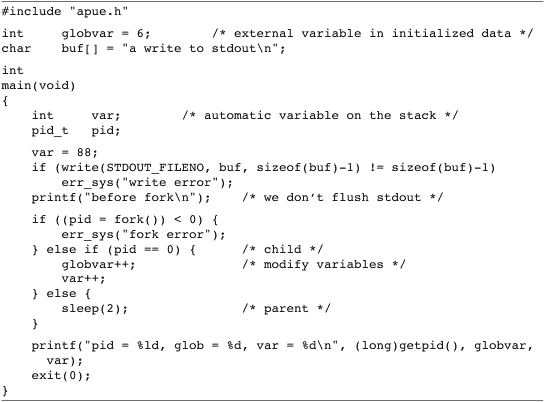

如果我们执行这个程序，我们会得到

```text
$ ./a.out
a write to stdout
before fork
pid = 430, glob = 7, var = 89    child's variables were changed
pid = 429, glob = 6, var = 88    parent's copy was not changed
$ ./a.out > temp.out
$ cat temp.out
a write to stdout
before fork
pid = 432, glob = 7, var = 89
before fork
pid = 431, glob = 6, var = 88
```

一般来说，我们永远不知道子进程是否先于父进程执行，反之亦然。顺序取决于内核使用的调度算法。如果要求子进程和父进程同步它们的动作，则需要某种形式的进程间


需要进行通信。在图 8.1 所示的程序中，我们只是让父进程休眠 2 秒，以便子进程执行。我们无法保证这段延迟足够长。第 8.9 节讨论竞态条件时，会介绍这一点以及其他类型的同步。在第 10.16 节中，我们将介绍如何使用信号在 `fork` 之后同步父进程和子进程。

向标准输出写入内容时，我们从 `buf` 的大小中减去 1，以避免写入末尾的空字节。虽然 `strlen` 计算字符串长度时不包含末尾的空字节，但 `sizeof` 计算的是缓冲区的大小，其中包含末尾的空字节。另一个区别是，使用 `strlen` 需要调用函数，而 `sizeof` 会在编译时计算缓冲区长度，因为缓冲区用已知字符串初始化，且其大小固定。

注意图 8.1 中程序里 `fork` 与 I/O 函数之间的交互。回忆一下第 3 章的内容，`write` 函数不会进行缓冲。由于 `fork` 之前调用了 `write`，其数据只会向标准输出写入一次。不过，标准 I/O 库会进行缓冲。回忆一下第 5.12 节的内容：如果标准输出连接到终端设备，它就是行缓冲的；否则就是全缓冲的。交互式运行程序时，我们只会看到第一条 `printf` 输出一次，因为换行符会刷新标准输出缓冲区。但将标准输出重定向到文件时，我们会看到两条相同的 `printf` 输出。这种情况下，`fork` 之前调用了一次 `printf`，但调用 `fork` 时，这一行仍留在缓冲区中。父进程的数据空间复制到子进程时，该缓冲区也会复制到子进程。此时，父进程和子进程的标准 I/O 缓冲区中都有这一行。紧接着 `exit` 之前的第二次 `printf` 只会将数据追加到已有缓冲区中。每个进程终止时，都会刷新各自的缓冲区副本。

## 文件共享

当我们将图 8.1 中程序的父进程的标准输出重定向时，子进程的标准输出也会被重定向。事实上，`fork` 的一个特点是：父进程中所有打开的文件描述符都会在子进程中复制一份。我们称之为“复制”，因为这就好像对每个描述符都调用了 `dup` 函数。父进程和子进程会为每个打开的描述符共享一个文件表项（回忆图 3.9）。

假设某进程分别为标准输入、标准输出和标准错误打开了三个不同的文件。从 `fork` 返回后，我们得到图 8.2 所示的结构。

父进程和子进程共享同一个文件偏移量，这一点非常重要。假设某进程创建了一个子进程，然后等待子进程完成。假设两个进程在正常处理过程中都会向标准输出写入内容。如果父进程的标准输出被重定向（例如由 shell 重定向），那么子进程向标准输出写入时，必须更新父进程的文件偏移量。在这种情况下，父进程等待子进程期间，子进程可以向标准输出写入内容；子进程完成后，父进程可以继续向标准输出写入，并且可以确定自己的输出会追加到子进程所写内容之后。如果父进程和子进程不共享同一个文件偏移量，这种交互就更难实现，并且需要父进程显式执行操作。

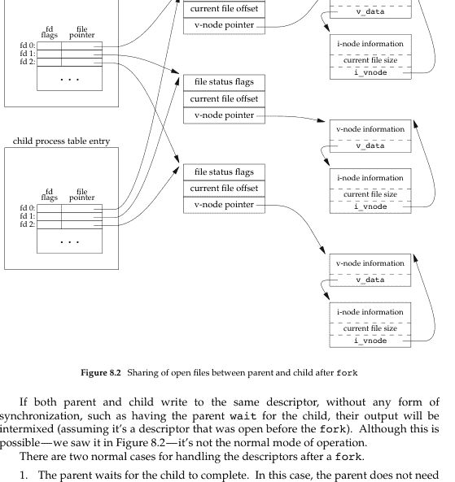

## 图 8.2 `fork` 之后父进程与子进程共享打开的文件

如果父进程和子进程都向同一个描述符写入内容，却没有任何同步机制（例如让父进程等待子进程），那么它们的输出就会交错（前提是该描述符在 `fork` 之前已经打开）。虽然这种情况可能发生——我们在图 8.2 中见过——但它并不是通常的操作方式。`fork` 之后处理描述符通常有以下两种情况：

- 1. 父进程等待子进程完成。这种情况下，父进程无需对自己的描述符做任何处理。子进程终止时，它读取或写入过的任何共享描述符，其文件偏移量都会相应更新。

- 2. 父进程和子进程各自独立运行。这种情况下，`fork` 之后，父进程关闭自己不需要的描述符，子进程也做同样的处理。这样，双方就不会相互干扰对方打开的描述符。网络服务器中经常会采用这种方式。

一些操作系统将第 2 步中的操作——先执行 `fork`，再执行 `exec`——合并成一个名为 `spawn` 的操作。UNIX 系统将这两个操作分开，因为在许多情况下，只执行 `fork` 而不执行 `exec` 很有用。此外，将这两个操作分开，也使子进程可以在 `fork` 和 `exec` 之间更改进程属性，例如 I/O 重定向、用户 ID、信号处置方式等。第 15 章中会介绍许多相关示例。

> 《单一 UNIX 规范》在高级实时选项组中确实包含 `spawn` 接口。不过，这些接口并非用于替代 `fork` 和 `exec`，而是用于支持那些难以高效实现 `fork` 的系统，尤其是缺少内存管理硬件支持的系统。

## 8.4 `vfork` 函数

`vfork` 函数的调用序列和返回值与 `fork` 相同，但二者的语义有所不同。

> `vfork` 函数最初出现在 2.9BSD 中。有人认为这个函数有瑕疵，但本书涵盖的所有平台都支持它。事实上，BSD 开发者在 4.4BSD 发行版中移除了它，但所有源自 4.4BSD 的开源 BSD 发行版后来又都将其加入各自的版本中。`vfork` 函数在《单一 UNIX 规范》第 3 版中被标记为过时接口，并在第 4 版中被完全移除。我们在此介绍它，仅出于历史原因。可移植应用程序不应使用它。

`vfork` 函数原本用于创建一个新进程来执行新程序（上一节末尾的第 2 步），与图 1.7 中简易 shell 使用的方法类似。与 `fork` 一样，`vfork` 会创建一个新进程，但不会将父进程的地址空间复制到子进程，因为子进程不会访问该地址空间；子进程在 `vfork` 之后会立即调用 `exec`（或 `exit`）。实际上，在子进程调用 `exec` 或 `exit` 之前，它会一直运行在父进程的地址空间中。这种优化在某些 UNIX 系统实现中效率更高，但如果子进程修改任何数据（用于保存 `vfork` 返回值的变量除外）、调用函数，或未调用 `exec` 或 `exit` 就直接返回，则会导致未定义的结果。（正如上一节所述，实现会使用写时复制来提高先执行 `fork` 再执行 `exec` 的效率，但与部分复制相比，完全不复制仍然更快。）

这两个函数的另一个区别是，`vfork` 保证子进程先运行，直到子进程调用 `exec` 或 `exit`。子进程调用其中任一函数后，父进程才会恢复运行。（如果子进程在调用这两个函数之前还依赖父进程执行其他操作，就可能导致死锁。）

## 示例

图 8.3 中的程序是对图 8.1 中程序的修改版本。我们将 `fork` 调用替换为 `vfork`，并删除了向标准输出写入内容的操作。此外，父进程不需要调用 `sleep`，因为内核会保证让父进程休眠，直到子进程调用 `exec` 或 `exit`。

```
#include "apue.h"
int     globvar = 6;          /* external variable in initialized data */
int
main(void)
{
    int     var;            /* automatic variable on the stack */
    pid_t   pid;

    var = 88;
    printf("before vfork\n");   /* we don't flush stdio */
    if ((pid = vfork()) < 0) {
        err_sys("vfork error");
    } else if (pid == 0) {      /* child */
        globvar++;              /* modify parent's variables */
        var++;
        _exit(0);               /* child terminates */
    }
    /* parent continues here */
    printf("pid = %ld, glob = %d, var = %d\n", (long)getpid(), globvar,
           var);
    exit(0);
}
```

## 图 8.3 `vfork` 函数示例

运行该程序会得到：

```
$ ./a.out
before vfork
pid = 29039, glob = 7, var = 89
```

这里，子进程递增变量的操作改变了父进程中变量的值。由于子进程运行在父进程的地址空间中，这并不令人意外。不过，这种行为与 `fork` 的行为不同。

注意，图 8.3 中我们调用的是 `_exit`，而不是 `exit`。正如第 7.3 节所述，`_exit` 不会刷新标准 I/O 缓冲区。如果调用 `exit`，结果将无法确定。根据标准 I/O 库的实现方式，输出可能没有区别，也可能会发现父进程第一次 `printf` 的输出消失了。

如果子进程调用 `exit`，实现会刷新标准 I/O 流。如果这是库执行的唯一操作，那么与子进程调用 `_exit` 时生成的输出相比，结果不会有任何区别。但如果实现还关闭了标准 I/O 流，那么表示标准输出 `FILE` 对象的内存就会被清除。由于子进程借用了父进程的地址空间，父进程恢复运行并调用 `printf` 时，将不会有任何输出，并且 `printf` 会返回 -1。请注意，父进程的 `STDOUT_FILENO` 仍然有效，因为子进程获得了父进程文件描述符数组的一份副本（参见图 8.2）。


大多数现代的 `exit` 实现并不费心关闭流。因为进程即将退出，内核会关闭进程中打开的所有文件描述符。在库中关闭它们只会增加开销而没有任何好处。

McKusick 等人 [1996] 第 5.6 节包含了关于 `fork` 和 `vfork` 实现问题的额外信息。练习 8.1 和 8.2 继续讨论 `vfork`。

## 8.5 exit 函数

正如我们在第 7.3 节中描述的那样，一个进程可以通过五种方式正常终止：

- 1. 从 `main` 函数执行返回。正如我们在第 7.3 节中所见，这等同于调用 `exit`。
- 2. 调用 `exit` 函数。该函数由 ISO C 定义，包括调用通过调用 `atexit` 注册的所有退出处理程序并关闭所有标准 I/O 流。因为 ISO C 不处理文件描述符、多个进程（父进程和子进程）以及作业控制，所以该函数的定义对于 UNIX 系统是不完整的。
- 3. 调用 `_exit` 或 `_Exit` 函数。ISO C 定义 `_Exit` 以提供一种使进程终止而不运行退出处理程序或信号处理程序的方式。标准 I/O 流是否刷新取决于实现。在 UNIX 系统上，`_Exit` 和 `_exit` 是同义词且不刷新标准 I/O 流。`_exit` 函数由 `exit` 调用并处理 UNIX 系统特定的细节；`_exit` 由 POSIX.1 指定。

在大多数 UNIX 系统实现中，`exit(3)` 是标准 C 库中的一个函数，而 `_exit(2)` 是一个系统调用。

- 4. 从进程中最后一个线程的启动例程执行返回。线程的返回值不会用作进程的返回值。然而，当最后一个线程从其启动例程返回时，进程以终止状态 0 退出。
- 5. 从进程中最后一个线程调用 `pthread_exit` 函数。与前一种情况一样，在这种情况下进程的退出状态始终为 0，而与传递给 `pthread_exit` 的参数无关。我们将在第 11.5 节中更详细地讨论 `pthread_exit`。

三种异常终止形式如下：

- 1. 调用 `abort`。这是下一项的特例，因为它会生成 `SIGABRT` 信号。
- 2. 当进程接收到某些信号时。（我们在第 10 章中更详细地描述信号。）信号可以由进程本身生成（例如，通过调用 `abort` 函数），也可以由其他进程或内核生成。由内核生成的信号示例包括进程引用不在其地址空间内的内存位置或尝试除以 0。
- 3. 最后一个线程响应取消请求。默认情况下，取消以延迟方式发生：一个线程请求取消另一个线程，而目标线程在稍后某个时间终止。我们将在第 11.5 节和第 12.7 节中详细讨论取消请求。

无论进程如何终止，最终都会在内核中执行相同的代码。此内核代码关闭进程的所有打开描述符，释放其使用的内存，等等。

对于上述任何一种情况，我们希望终止的进程能够通知其父进程它是如何终止的。对于三种退出函数（`exit`、`_exit` 和 `_Exit`），这是通过将退出状态作为参数传递给函数来完成的。然而，在异常终止的情况下，是内核——而不是进程——生成终止状态以指示异常终止的原因。在任何情况下，进程的父进程都可以通过 `wait` 或 `waitpid` 函数（在下一节中描述）获取终止状态。

请注意，我们区分了退出状态，即传递给三种退出函数之一的参数或 `main` 的返回值，以及终止状态。退出状态在最终调用 `_exit` 时由内核转换为终止状态（回顾图 7.2）。图 8.4 描述了父进程可以检查子进程终止状态的各种方式。如果子进程正常终止，父进程可以获取子进程的退出状态。

当我们描述 `fork` 函数时，很明显子进程在调用 `fork` 后有一个父进程。现在我们谈论的是将终止状态返回给父进程。但如果父进程在子进程之前终止会怎样？答案是 `init` 进程成为任何其父进程终止的进程的父进程。在这种情况下，我们说该进程已被 `init` 继承。通常发生的情况是，每当一个进程终止时，内核都会遍历所有活动进程，查看终止的进程是否是仍存在的任何进程的父进程。如果是，则幸存进程的父进程 ID 会被更改为 1（`init` 的进程 ID）。这样，我们就能保证每个进程都有一个父进程。

我们必须担心另一个条件：当子进程在其父进程之前终止时会怎样。如果子进程完全消失，父进程就无法在准备好检查子进程是否已终止时获取其终止状态。内核为每个终止的进程保留少量信息，以便在终止进程的父进程调用 `wait` 或 `waitpid` 时信息可用。最少，此信息包括进程 ID、进程的终止状态以及进程所占用的 CPU 时间。内核可以丢弃进程使用的所有内存并关闭其打开的文件。在 UNIX 系统术语中，已终止但其父进程尚未等待的进程称为僵尸。`ps(1)` 命令将僵尸进程的状态打印为 Z。如果我们编写一个长时间运行的程序并 fork 许多子进程，除非我们等待它们并获取其终止状态，否则它们会变成僵尸。

一些系统提供了防止创建僵尸的方法，如我们在第 10.7 节中所述。

最后要考虑的条件是：当一个已被 `init` 继承的进程终止时会发生什么？它会变成僵尸吗？答案是否定的，因为 `init` 是这样编写的：每当其子进程之一终止时，`init` 都会调用其中一个 `wait` 函数来获取终止状态。通过这样做，`init` 防止系统被僵尸堵塞。当我们说“`init` 的一个子进程”时，我们指的是 `init` 直接生成的进程（例如我们在第 9.2 节中描述的 `getty`）或其父进程已终止并随后被 `init` 继承的进程。

## 8.6 wait 和 waitpid 函数

当进程正常或异常终止时，内核通过向父进程发送 `SIGCHLD` 信号来通知父进程。因为子进程的终止是一个异步事件——它可以在父进程运行的任何时间发生——该信号是内核向父进程发出的异步通知。父进程可以选择忽略此信号，也可以提供在信号发生时调用的函数：信号处理程序。此信号的默认操作是被忽略。我们将在第 10 章中描述这些选项。现在，我们需要知道调用 `wait` 或 `waitpid` 的进程可以

- 如果所有子进程仍在运行，则阻塞
- 如果子进程已终止并等待其终止状态被获取，则立即返回子进程的终止状态
- 如果它没有任何子进程，则立即返回错误

如果进程因收到 `SIGCHLD` 信号而调用 `wait`，我们期望 `wait` 立即返回。但如果我们在任意时间点调用它，它可能会阻塞。

```
#include <sys/wait.h>

pid_t wait(int *statloc);

pid_t waitpid(pid_t pid, int *statloc, int options);

Both return: process ID if OK, 0 (see later), or -1 on error
```

这两个函数之间的区别如下：

- `wait` 函数可以阻塞调用者直到子进程终止，而 `waitpid` 有一个选项可以防止其阻塞。
- `waitpid` 函数并不等待最先终止的子进程；它有许多选项可以控制它等待哪个进程。

如果子进程已经终止并且是僵尸，`wait` 会立即返回该子进程的状态。否则，它会阻塞调用者直到子进程终止。如果调用者阻塞并且有多个子进程，`wait` 会在其中一个终止时返回。我们始终可以知道哪个子进程终止了，因为进程 ID 由函数返回。


对于这两个函数，参数 statloc 都是指向一个整数的指针。如果该参数不是空指针，则终止进程的终止状态将被存储在该参数所指向的位置。如果我们不关心终止状态，则只需将空指针作为该参数传递。

传统上，这两个函数返回的整数 status 是由实现定义的，其中某些位表示退出状态（对于正常返回），其他位表示信号编号（对于异常返回），一位表示是否生成了核心文件，等等。POSIX.1 规定终止状态应使用在 <sys/wait.h> 中定义的各种宏来查看。四个互斥的宏告诉我们进程是如何终止的，它们都以 WIF 开头。根据这四个宏中的哪一个为真，其他宏用于获取退出状态、信号编号等。这四个互斥的宏如 Figure 8.4 所示。

| Macro | Description |
|---|---|
| WIFEXITED(status) | True if status was returned for a child that terminated normally. In this case, we can execute WEXITSTATUS(status) to fetch the low-order 8 bits of the argument that the child passed to exit, _exit, or _Exit. |
| WIFSIGNALED(status) | True if status was returned for a child that terminated abnormally, by receipt of a signal that it didn’t catch. In this case, we can execute WTERMSIG(status) to fetch the signal number that caused the termination. Additionally, some implementations (but not the Single UNIX Specification) define the macro WCOREDUMP(status) that returns true if a core file of the terminated process was generated. |
| WIFSTOPPED(status) | True if status was returned for a child that is currently stopped. In this case, we can execute WSTOPSIG(status) to fetch the signal number that caused the child to stop. |
| WIFCONTINUED(status) | True if status was returned for a child that has been continued after a job control stop (XSI option; waitpid only). |

Figure 8.4 Macros to examine the termination status returned by wait and waitpid

我们将在第 9.8 节讨论进程如何被停止时讨论作业控制。

## Example

Figure 8.5 中的函数 pr_exit 使用 Figure 8.4 中的宏来打印终止状态的描述。我们将在文本中的许多程序中调用此函数。请注意，此函数会处理 WCOREDUMP 宏（如果已定义）。

```
#include "apue.h"
#include <sys/wait.h>

void
pr_exit(int status)
{
    if (WIFEXITED(status))
        printf("normal termination, exit status = %d\n",
               WEXITSTATUS(status));
    else if (WIFSIGNALED(status))
        printf("abnormal termination, signal number = %d%s\n",
               WTERMSIG(status),
#ifdef WCOREDUMP
               WCOREDUMP(status) ? " (core file generated)" : "");
#else
               "");
#endif
    else if (WIFSTOPPED(status))
        printf("child stopped, signal number = %d\n",
               WSTOPSIG(status));
}
```

*Figure 8.5* Print a description of the exit status

FreeBSD 8.0、Linux 3.2.0、Mac OS X 10.6.8 和 Solaris 10 都支持 WCOREDUMP 宏。然而，一些平台在定义了 _POSIX_C_SOURCE 常量时隐藏了其定义（请回顾第 2.7 节）。

Figure 8.6 所示的程序调用 `pr_exit` 函数，演示了终止状态的各种值。如果我们运行 Figure 8.6 中的程序，我们会得到

```
$ ./a.out
normal termination, exit status = 7
abnormal termination, signal number = 6 (core file generated)
abnormal termination, signal number = 8 (core file generated)
```

目前，我们打印来自 WTERMSIG 的信号编号。我们可以查看 <signal.h> 头文件以验证 SIGABRT 的值为 6，SIGFPE 的值为 8。我们将在第 10.22 节看到将信号编号映射到描述性名称的可移植方法。

正如我们提到的，如果我们有多个子进程，wait 会在任意一个子进程终止时返回。但如果我们想等待特定进程终止（假设我们知道要等待的进程 ID）会怎样？在旧版本的 UNIX 系统中，我们必须调用 wait 并将返回的进程 ID 与我们感兴趣的进程 ID 进行比较。如果终止的进程不是我们想要的进程，我们就需要保存进程 ID 和终止状态，然后再次调用 wait。我们需要继续这样做，直到期望的进程终止。下一次我们想等待特定进程时，我们会遍历已终止进程的列表，看看是否已经为其等待过，如果没有，则再次调用 wait。

```
#include "apue.h"
#include <sys/wait.h>

int
main(void)
{
    pid_t   pid;
    int     status;

    if ((pid = fork()) < 0)
        err_sys("fork error");
    else if (pid == 0)              /* child */
        exit(7);

    if (wait(&status) != pid)       /* wait for child */
        err_sys("wait error");
    pr_exit(status);                /* and print its status */

    if ((pid = fork()) < 0)
        err_sys("fork error");
    else if (pid == 0)              /* child */
        abort();                    /* generates SIGABRT */

    if (wait(&status) != pid)       /* wait for child */
        err_sys("wait error");
    pr_exit(status);                /* and print its status */

    if ((pid = fork()) < 0)
        err_sys("fork error");
    else if (pid == 0)              /* child */
        status /= 0;                /* divide by 0 generates SIGFPE */

    if (wait(&status) != pid)       /* wait for child */
        err_sys("wait error");
    pr_exit(status);                /* and print its status */

    exit(0);
}
```

Figure 8.6 Demonstrate various exit statuses

我们需要的是一个等待特定进程的函数。POSIX.1 waitpid 函数提供了此功能（以及更多功能）。

waitpid 对 pid 参数的解释取决于其值：

- **pid == -1** 等待任何子进程。在这方面，waitpid 等同于 wait。
- **pid > 0** 等待其进程 ID 等于 pid 的子进程。
- **pid == 0** 等待其进程组 ID 等于调用进程的任何子进程。（我们在第 9.4 节讨论进程组。）
- **pid < -1** 等待其进程组 ID 等于 pid 绝对值的任何子进程。

waitpid 函数返回终止的子进程的进程 ID，并将子进程的终止状态存储在 statloc 指向的内存位置。对于 wait，唯一的真正错误是调用进程没有子进程。（另一种错误返回是可能的，如果函数调用被信号中断。我们将在第 10 章讨论此问题。）对于 waitpid，如果指定的进程或进程组不存在或不是调用进程的子进程，也可能出现错误。

options 参数让我们进一步控制 waitpid 的操作。此参数要么为 0，要么由 Figure 8.7 中的常量的按位或构造而成。

FreeBSD 8.0 和 Solaris 10 支持一个额外的、但非标准的选项常量。WNOHANG 使系统保持 waitpid 返回终止状态的进程处于等待状态，以便可以再次等待它。

| Constant | Description |
|---|---|
| WCONTINUED | If the implementation supports job control, the status of any child specified by pid that has been continued after being stopped, but whose status has not yet been reported, is returned (XSI option). |
| WNO HANG | The waitpid function will not block if a child specified by pid is not immediately available. In this case, the return value is 0. |
| WUNTRACED | If the implementation supports job control, the status of any child specified by pid that has stopped, and whose status has not been reported since it has stopped, is returned. The WIFSTOPPED macro determines whether the return value corresponds to a stopped child process. |

Figure 8.7 The options constants for waitpid

waitpid 函数提供了 wait 函数未提供的三个功能。

- 1. waitpid 函数让我们等待某个特定进程，而 wait 函数返回任意已终止子进程的状态。我们将在讨论 popen 函数时回到此功能。
- 2. waitpid 函数提供了 wait 的非阻塞版本。有时我们想要获取子进程的状态，但又不想阻塞。
- 3. waitpid 函数通过 WUNTRACED 和 WCONTINUED 选项提供了作业控制支持。

## Example

回顾我们在第 8.5 节关于僵尸进程的讨论。如果我们想编写一个进程使其 fork 一个子进程，但我们不想等待子进程完成，并且我们也不希望子进程在我们终止之前成为僵尸，诀窍是调用两次 fork。Figure 8.8 中的程序就是这样做的。


## 8.7 `waitid` 函数

Single UNIX Specification 包含一个额外的函数来检索进程的退出状态。`waitid` 函数与 `waitpid` 类似，但提供了额外的灵活性。

```c
#include <sys/wait.h>

int waitid(idtype_t idtype, id_t id, siginfo_t *infop, int options);
```

返回：成功时返回 0，错误时返回 −1

与 `waitpid` 一样，`waitid` 允许进程指定要等待的子进程。不是将此信息编码到与进程 ID 或进程组 ID 结合的单个参数中，而是使用两个独立的参数。`id` 参数的解释基于 `idtype` 的值。支持的类型总结在图 8.9 中。

| 常量 | 描述 |
|---|---|
| `P_PID` | 等待特定进程：`id` 包含要等待的子进程的进程 ID。 |
| `P_PGID` | 等待特定进程组中的任何子进程：`id` 包含要等待的子进程的进程组 ID。 |
| `P_ALL` | 等待任何子进程：`id` 被忽略。 |

**图 8.9** `waitid` 的 `idtype` 常量

`options` 参数是图 8.10 中所示标志的按位或。这些标志指示调用方感兴趣的状态更改。

| 常量 | 描述 |
|---|---|
| `WCONTINUED` | 等待之前停止且已被继续，并且其状态尚未报告的进程。 |
| `WEXITED` | 等待已退出的进程。 |
| `WNOHANG` | 如果没有可用的子进程退出状态，则立即返回而不是阻塞。 |
| `WNOWAIT` | 不要销毁子进程退出状态。子进程的退出状态可以通过后续调用 `wait`、`waitid` 或 `waitpid` 检索。 |
| `WSTOPPED` | 等待已停止且其状态尚未报告的进程。 |

**图 8.10** `waitid` 的 `options` 常量

`options` 参数中必须至少指定 `WCONTINUED`、`WEXITED` 或 `WSTOPPED` 中的一个。

`infop` 参数是指向 `siginfo` 结构的指针。此结构包含有关导致子进程状态更改而生成的信号的详细信息。`siginfo` 结构在第 10.14 节中进一步讨论。

> 在本书涵盖的四个平台中，只有 Linux 3.2.0、Mac OS X 10.6.8 和 Solaris 10 提供了对 `waitid` 的支持。需要注意的是，Mac OS X 10.6.8 并不会在 `siginfo` 结构中设置我们期望的所有信息。

## 8.8 `wait3` 和 `wait4` 函数

大多数 UNIX 系统实现提供了两个额外的函数：`wait3` 和 `wait4`。历史上，这两个变体源自 UNIX 系统的 BSD 分支。这两个函数提供的唯一特性是 `wait`、`waituid` 和 `waitpid` 函数未提供的额外参数，该参数允许内核返回已终止进程及其所有子进程使用的资源摘要。

```c
#include <sys/types.h>
#include <sys/wait.h>
#include <sys/time.h>
#include <sys/resource.h>

pid_t wait3(int *statloc, int options, struct rusage *rusage);

pid_t wait4(pid_t pid, int *statloc, int options, struct rusage *rusage);
```

两者返回：成功时返回进程 ID，0，或错误时返回 −1

资源信息包括用户 CPU 时间量、系统 CPU 时间量、页面错误数、接收到的信号数等统计信息。有关更多详细信息，请参阅 `getrusage(2)` 手册页。 （此资源信息与我们在第 7.11 节中描述的资源限制不同。）图 8.11 详细说明了 `wait` 函数支持的各种参数。

| 函数 | pid | options | rusage | POSIX.1 | FreeBSD 8.0 | Linux 3.2.0 | Mac OS X 10.6.8 | Solaris 10 |
|---|---|---|---|---|---|---|---|---|
| wait |  |  |  | • | • | • | • | • |
| waitid | • | • |  |  |  |  |  |  |
| waitpid | • | • |  | • | • | • | • | • |
| wait3 |  | • | • |  | • | • | • | • |
| wait4 | • | • | • |  | • | • | • | • |

**图 8.11** 各系统上 wait 函数支持的参数

`wait3` 函数包含在 Single UNIX Specification 的早期版本中。在第 2 版中，`wait3` 被移至遗留类别；在第 3 版中，`wait3` 从规范中删除。

## 8.9 竞态条件

就我们的目的而言，竞态条件发生在多个进程尝试对共享数据执行某些操作时，最终结果取决于进程运行的顺序。`fork` 函数是竞态条件的活跃温床，如果 `fork` 之后执行的任何逻辑在显式或隐式上依赖于 `fork` 后父进程或子进程先运行，则会发生这种情况。一般来说，我们无法预测哪个进程先运行。即使我们知道哪个进程会先运行，在该进程开始运行后发生的事情也取决于系统负载和内核的调度算法。

我们在图 8.8 中的程序中看到了一个潜在的竞态条件，当第二个子进程打印其父进程 ID 时。如果第二个子进程在第一个子进程之前运行，则其父进程将是第一个子进程。但如果第一个子进程先运行并且有足够的时间退出，则第二个子进程的父进程是 `init`。即使调用 `sleep`，如我们所做的那样，也不能保证任何事情。如果系统负载很重，第二个子进程可能在 `sleep` 返回后恢复，而第一个子进程还没有机会运行。此类问题很难调试，因为它们“大多数时候”都能正常工作。

想要等待子进程终止的进程必须调用其中一个 wait 函数。如果进程想要等待其父进程终止，如图 8.8 中的程序所示，可以使用以下形式的循环：

```c
while (getppid() != 1)
    sleep(1);
```

这种类型的循环称为 *轮询*，其问题在于浪费 CPU 时间，因为调用方每秒被唤醒一次以测试条件。

为了避免竞态条件并避免轮询，需要在多个进程之间进行某种形式的信号传递。信号可用于此目的，我们在第 10.16 节中描述了一种方法。各种形式的进程间通信 IPC 也可以使用。我们将在第 15 章和第 17 章中讨论这些选项中的一些。

对于父子关系，我们经常有以下场景。`fork` 之后，父进程和子进程都有事情要做。例如，父进程可以更新日志文件中的记录以包含子进程的进程 ID，而子进程可能必须为父进程创建一个文件。在此示例中，我们要求每个进程在完成初始操作集后通知另一个进程，并且每个进程等待另一个进程完成，然后再继续自己的工作。以下代码说明了此场景：

```c
#include "apue.h"

TELL_WAIT();    /* set things up for TELL_xxx & WAIT_xxx */

if ((pid = fork()) < 0) {
    err_sys("fork error");
} else if (pid == 0) {                 /* child */

    /* child does whatever is necessary ... */

    TELL_PARENT(getppid());      /* tell parent we're done */
    WAIT_PARENT();               /* and wait for parent */

    /* and the child continues on its way ... */

    exit(0);
}

/* parent does whatever is necessary ... */

TELL_CHILD(pid);                 /* tell child we're done */
WAIT_CHILD();                    /* and wait for child */

/* and the parent continues on its way ... */

exit(0);
```

我们假设头文件 `apue.h` 定义了所需的所有变量。五个例程 `TELL_WAIT`、`TELL_PARENT`、`TELL_CHILD`、`WAIT_PARENT` 和 `WAIT_CHILD` 可以是宏或函数。

我们将在后面的章节中展示实现这些 TELL 和 WAIT 例程的各种方法：第 10.16 节展示了使用信号的实现；图 15.7 展示了使用管道的实现。让我们看一个使用这五个例程的示例。

## 示例

图 8.12 中的程序输出两个字符串：一个来自子进程，一个来自父进程。该程序包含竞态条件，因为输出取决于内核运行进程的顺序以及每个进程运行的时间长度。

```c
#include "apue.h"

static void charatatime(char *);

int
main(void)
{
    pid_t   pid;

    if ((pid = fork()) < 0) {
        err_sys("fork error");
    } else if (pid == 0) {
        charatatime("output from child\n");
    } else {
        charatatime("output from parent\n");
    }
    exit(0);
}

static void
charatatime(char *str)
{
    char    *ptr;
    int     c;

    setbuf(stdout, NULL);          /* set unbuffered */
    for (ptr = str; (c = *ptr++) != 0; )
        putc(c, stdout);
}
```

**图 8.12** 具有竞态条件的程序

我们将标准输出设置为无缓冲，因此每次输出字符都会生成一次写入。此示例的目标是尽可能频繁地让内核在两个进程之间切换以演示竞态条件。 （如果我们不这样做，我们可能永远看不到以下类型的输出。看不到错误输出并不意味着


意味着竞争条件不存在；它只是意味着我们在这个特定系统上看不到它。）以下实际输出显示了结果如何变化：

```
$ ./a.out
ooutput from child
utput from parent
$ ./a.out
ooutput from child
utput from parent
$ ./a.out
output from child
output from parent
```

我们需要修改图8.12中的程序，以使用TELL和WAIT函数。图8.13中的程序完成了这一点。前面带有加号的行是新行。

```
#include "apue.h"
static void charatatime(char *);

int
main(void)
{
    pid_t  pid;

+   TELL_WAIT();
+
    if ((pid = fork()) < 0) {
        err_sys("fork error");
    } else if (pid == 0) {  /* parent goes first */
+       WAIT_PARENT();
        charatatime("output from child\n");
    } else {
        charatatime("output from parent\n");
+       TELL_CHILD(pid);
    }
    exit(0);
}

static void
charatatime(char *str)
{
    char  *ptr;
    int   c;
    setbuf(stdout, NULL);      /* set unbuffered */
    for (ptr = str; (c = *ptr++) != 0; )
        putc(c, stdout);
}
```

## 图8.13 修改图8.12以避免竞争条件

当我们运行这个程序时，输出正如我们所预期；两个进程的输出没有交错。

在图8.13所示的程序中，父进程先执行。如果我们将fork之后的代码行改为以下形式，则子进程先执行：

```
} else if (pid == 0) {
    charatatime("output from child\n");
    TELL_PARENT(getppid());
} else {
    WAIT_CHILD();        /* child goes first */
    charatatime("output from parent\n");
}
```

练习8.4继续这个例子。

## 8.10 exec 函数

我们在8.3节中提到，fork函数的一个用途是创建一个新进程（子进程），然后该进程通过调用某个exec函数来执行另一个程序。当进程调用某个exec函数时，该进程会被新程序完全替换，新程序从其main函数开始执行。进程ID在exec过程中不会改变，因为并没有创建新进程；exec只是用磁盘上一个全新的程序替换当前进程的文本、数据、堆和栈段。

有七个不同的exec函数，但我们通常只说“exec函数”，意思是我们可以使用这七个函数中的任意一个。这七个函数完善了UNIX系统的进程控制原语。通过fork，我们可以创建新进程；通过exec函数，我们可以启动新程序。exit函数和wait函数处理终止和等待终止。这些就是我们需要的全部进程控制原语。在后面的章节中，我们将使用这些原语来构建其他函数，如popen和system。

```
#include <unistd.h>

int execl(const char *pathname, const char *arg0, ... /* (char *)0 */ );
int execv(const char *pathname, char *const argv[]);
int execle(const char *pathname, const char *arg0, ...
    /* (char *)0, char *const envp[] */ );
int execve(const char *pathname, char *const argv[], char *const envp[]);
int execlp(const char *filename, const char *arg0, ... /* (char *)0 */ );
int execvp(const char *filename, char *const argv[]);
int fexecve(int fd, char *const argv[], char *const envp[]);

All seven return: -1 on error, no return on success
```

这些函数的第一个区别是，前四个以路径名（pathname）作为参数，接下来两个以文件名（filename）作为参数，最后一个以文件描述符作为参数。当指定文件名参数时：
- 如果*filename*包含斜杠，则将其视为路径名。
- 否则，在`PATH`环境变量指定的目录中搜索可执行文件。

`PATH`变量包含一个目录列表，这些目录称为路径前缀（path prefixes），以冒号分隔。例如，*name=value*环境字符串

```
PATH=/bin:/usr/bin:/usr/local/bin/:
```

指定了四个要搜索的目录。最后一个路径前缀指定当前目录。（零长度的前缀也表示当前目录。它可以指定为值的开头的冒号、连续两个冒号，或值的末尾的冒号。）

> 出于安全原因，*永远不要*将当前目录包含在搜索路径中。参见Garfinkel等人[2003]。

如果`execl`或`execvp`使用某个路径前缀找到了可执行文件，但该文件不是由链接编辑器生成的机器可执行文件，则函数会假定该文件是一个shell脚本，并尝试将*filename*作为shell的输入来调用`/bin/sh`。

使用`execve`，我们完全避免了查找正确可执行文件的问题，而依靠调用者来完成。通过使用文件描述符，调用者可以验证文件确实是有意为之的文件，并在无竞争的情况下执行它。否则，拥有适当权限的恶意用户可以在可执行文件（或指向可执行文件的路径的一部分）被定位和验证之后、但在调用者执行它之前替换它（回想3.3节中关于TOCTTOU错误的讨论）。

下一个区别涉及参数列表的传递（l代表列表list，v代表向量vector）。函数`execl`、`execlp`和`execle`要求将新程序的每个命令行参数指定为单独的参数。我们用空指针标记参数的结束。对于其他四个函数（`execv`、`execvp`、`execve`和`fexecve`），我们必须构建一个指向参数的指针数组，这个数组的地址就是这三个函数的参数。

在使用ISO C原型之前，显示`execl`、`execle`和`execlp`这三个函数命令行参数的通常方式是

```
char *arg0, char *arg1, ..., char *argn, (char *)0
```

这种语法明确显示最后一个命令行参数后面跟着一个空指针。如果这个空指针用常量0指定，我们必须将其强制转换为指针；如果不这样做，它会被解释为一个整数参数。如果整数的大小与char *的大小不同，exec函数的实际参数将是错误的。

最后一个区别是将环境列表传递给新程序。三个名字以e结尾的函数（`execle`、`execve`和`fexecve`）允许我们传递一个指向环境字符串指针数组的指针。然而，其他四个函数使用调用进程中的environ变量来为新程序复制现有环境。（回想我们在7.9节和图7.8中关于环境字符串的讨论。我们提到，如果系统支持setenv和putenv这样的函数，我们可以更改当前环境以及任何后续子进程的环境，但我们无法影响父进程的环境。）通常，进程允许其环境传播给子进程，但在某些情况下，进程希望为子进程指定特定的环境。后者的一个例子是当启动新的登录shell时的login程序。通常，login会创建一个只定义了少量变量的特定环境，并让我们在登录时通过shell启动文件向环境中添加变量。

在使用ISO C原型之前，execle的参数显示为

```
char *pathname, char *arg0, ..., char *argv, (char *)0, char *envp[]
```

这种语法特别显示了最后一个参数是指向环境字符串的字符指针数组的地址。ISO C原型没有显示这一点，因为所有命令行参数、空指针和envp指针都用省略号（...）表示。

这七个exec函数的参数很难记住。函数名中的字母有所帮助。字母p表示该函数接受文件名参数，并使用PATH环境变量来查找可执行文件。字母l表示该函数接受一个参数列表，并且与字母v互斥，v表示它接受argv[]向量。最后，字母e表示该函数接受envp[]数组而不是使用当前环境。图8.14显示了这七个函数之间的区别。

| 函数 | 路径名 | 文件名 | fd | 参数列表 | argv[] | environ | envp[] |
|---|---|---|---|---|---|---|---|
| execl | • |  |  | • |  | • |  |
| execlp |  | • |  | • |  | • |  |
| execle | • |  |  | • |  |  | • |
| execv | • |  |  |  | • | • |  |
| execvp |  | • |  |  | • | • |  |
| execve | • |  |  |  | • |  | • |
| fexecve |  |  | • |  | • |  | • |
| （名称中的字母） |  | p | f | l | v |  | e |

## 图8.14 七个exec函数之间的区别

每个系统对参数列表和环境列表的总大小都有限制。根据2.5.2节和图2.8，这个限制由ARG_MAX给出。在POSIX.1系统上，该值必须至少为4,096字节。当使用shell的文件名展开功能生成文件名列表时，我们有时会遇到这个限制。例如，在某些系统上，命令

```
grep getrlimit /usr/share/man/*/*
```

会生成如下形式的shell错误：

```
Argument list too long
```


历史上，在旧的 System V 实现中，限制为 5,120 字节。旧的 BSD 系统的限制为 20,480 字节。当前系统的限制要高得多。（参见图 2.14 中的程序输出，其总结在图 2.15 中。）

为了绕过参数列表大小的限制，我们可以使用 `xargs(1)` 命令来拆分长的参数列表。要查找系统中手册页中 `getrlimit` 的所有出现，我们可以使用

```
find /usr/share/man -type f -print | xargs grep getrlimit
```

如果我们系统中的手册页被压缩，则可以尝试

```
find /usr/share/man -type f -print | xargs bzgrep getrlimit
```

我们使用 find 命令的 `-f` 选项来限制列表，使其仅包含常规文件，因为 grep 命令无法在目录中搜索模式，并且我们希望避免不必要的错误消息。

我们提到过进程 ID 在 exec 之后不会改变，但新程序从调用进程继承了额外的属性：

- 进程 ID 和父进程 ID
- 真实用户 ID 和真实组 ID
- 补充组 ID
- 进程组 ID
- 会话 ID
- 控制终端
- 到闹钟剩余的时间
- 当前工作目录
- 根目录
- 文件模式创建掩码
- 文件锁
- 进程信号掩码
- 待处理信号
- 资源限制
-  nice 值（在 XSI 兼容系统上；参见第 8.16 节）
- `tms_utime`、`tms_stime`、`tms_cutime` 和 `tms_cstime` 的值

打开文件的处理取决于每个描述符的 close-on-exec 标志。回顾图 3.7 以及我们在第 3.14 节中提到的 `FD_CLOEXEC` 标志，每个进程中的每个打开描述符都有一个 close-on-exec 标志。如果设置了此标志，则描述符将在 exec 时关闭。否则，描述符将在 exec 时保持打开。默认情况下，除非我们使用 `fcntl` 明确设置 close-on-exec 标志，否则描述符将在 exec 时保持打开。

POSIX.1 明确要求打开的目录流（回顾第 4.22 节中的 `opendir` 函数）在 exec 时关闭。这通常由操作数函数调用 fcntl 来为打开的目录流对应的描述符设置 close-on-exec 标志来完成。

请注意，真实用户 ID 和真实组 ID 在 exec 之后保持不变，但有效 ID 可能会发生变化，这取决于要执行的程序文件的 set-user-ID 和 set-group-ID 位的状态。如果为新程序设置了 set-user-ID 位，则有效用户 ID 变成程序文件的拥有者 ID。否则，有效用户 ID 不会改变（它不会被设置为真实用户 ID）。组 ID 的处理方式相同。

在许多 UNIX 系统实现中，这七个函数中只有 execve 是一个内核中的系统调用。其余六个只是库函数，最终会调用此系统调用。我们可以如图所示在图 8.15 中说明这七个函数之间的关系。

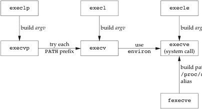

**图 8.15** 七个 exec 函数的关系

在此安排中，库函数 execlp 和 execvp 处理 PATH 环境变量，查找包含名为 *filename* 的可执行文件的第一个路径前缀。fexecve 库函数使用 /proc 将文件描述符参数转换为 execve 可用于执行程序的路径名。

> 这描述了 FreeBSD 8.0 和 Linux 3.2.0 中 fexecve 的实现方式。其他系统可能采用不同的方法。例如，没有 /proc 或 /dev/fd 的系统可以将 fexecve 实现为将文件描述符参数转换为 i-node 指针的系统调用封装，将 execve 实现为将路径名参数转换为 i-node 指针的系统调用封装，并将 execve 和 fexecve 共有的其余 exec 代码放在一个单独的函数中，该函数使用要执行的文件的 i-node 指针调用。

## 示例

图 8.16 中的程序演示了 exec 函数。

```
#include "apue.h"
#include <sys/wait.h>

char *env_init[] = { "USER=unknown", "PATH=/tmp", NULL };
int
main(void)
{
    pid_t pid;
    if ((pid = fork()) < 0) {
        err_sys("fork error");
    } else if (pid == 0) { /* specify pathname, specify environment */
        if (execle("/home/sar/bin/echoall", "echoall", "myarg1",
            "MY ARG2", (char *)0, env_init) < 0)
            err_sys("execle error");
    }
    if (waitpid(pid, NULL, 0) < 0)
        err_sys("wait error");
    if ((pid = fork()) < 0) {
        err_sys("fork error");
    } else if (pid == 0) { /* specify filename, inherit environment */
        if (execlp("echoall", "echoall", "only 1 arg", (char *)0) < 0)
            err_sys("execlp error");
    }
    exit(0);
}
```

图 8.16 exec 函数的示例

我们首先调用 execle，它需要一个路径名和一个特定的环境。接下来调用的是 execlp，它使用文件名并将调用者的环境传递给新程序。execlp 调用之所以能工作，唯一的原因是目录 /home/sar/bin 是当前路径前缀之一。请注意，我们还将第一个参数，即新程序中的 argv[0]，设置为路径名的文件名组件。某些 shell 会将此参数设置为完整的路径名。这只是一个约定；我们可以将 argv[0] 设置为任何字符串。login 命令在执行 shell 时就是这样做的。在执行 shell 之前，login 会在 argv[0] 前添加一个破折号，以指示 shell 它被作为登录 shell 调用。登录 shell 将执行启动配置文件命令，而非登录 shell 则不会。

在图 8.16 程序中两次执行的程序 echoall 如图 8.17 所示。它是一个简单的程序，会回显其所有命令行参数和整个环境列表。

## 诊断

精神分裂症缺乏独立的诊断性生物学标志，其诊断是典型的临床诊断，主要依据详细的病史、精神状况检查、病程和治疗反应等临床资料综合分析。临床医师应遵循诊断标准，在全面评估临床症状的基础上，结合起病形式、病程特点、社会功能损害程度及既往史、家族史等，综合做出诊断。注重精神病性症状的评估，同时应该评估抑郁、焦虑等情绪症状及认知功能损害、自杀风险及药物不良反应等。

## 临床诊断标准

根据ICD-10，精神分裂症诊断要点包括：

- 1. 思维鸣响、思维插入或思维被夺或思维被播散。
- 2. 明确属于躯体或运动幻觉的评论性幻听，或来源于身体某一部位的幻觉，或典型的持续性听到其他人在评论患者正在进行的活动或互相议论的其他类型的听幻觉。
- 3. 思维不连贯或无关紧要的联想，或言语不贴切，或言语新造词，或言语重复，或言语中断。
- 4. 紧张性行为，如兴奋、摆姿势，或蜡样屈曲、违拗、缄默及木僵。
- 5. 阴性症状，如显著的情感淡漠、言语贫乏、情感反应迟钝或不协调，常导致社会退缩或社会功能下降，但需排除由抑郁症或抗精神病药物治疗所致。

诊断精神分裂症通常要求在上述5条中至少具备2条，且其中至少1条明确属于第1~4条中的表现。同时，上述症状需至少持续1个月。且患者的社会功能明显受损。

ICD-11对精神分裂症诊断标准做了进一步修订，要求至少具备以下2条症状：包括持续存在的阳性症状（如妄想、幻觉）及阴性症状（如情感表达减少、社交退缩）等，至少持续1个月，且需排除其他可能的疾病或药物物质使用所致的精神病性障碍。

图 8.18 总结了这三种用户 ID 可以被改变的各种方式。

| ID | `exec`<br>set-user-ID 位关闭 | `exec`<br>set-user-ID 位开启 | `setuid(uid)`<br>超级用户 | `setuid(uid)`<br>无特权用户 |
|---|---|---|---|---|
| 真实用户 ID | 不变 | 不变 | 设置为 `uid` | 不变 |
| 有效用户 ID | 不变 | 从程序文件的用户 ID 设置<br>从有效用户 ID 复制 | 设置为 `uid` | 设置为 `uid` |
| 保存的 set-user-ID | 从有效用户 ID 复制 | 从有效用户 ID 复制 | 设置为 `uid` | 不变 |

**图 8.18** 改变三种用户 ID 的方式

请注意，我们只能使用第 8.2 节中的函数 `getuid` 和 `geteuid` 获得真实用户 ID 和有效用户 ID 的当前值。我们没有可移植的方法来获得保存的 set-user-ID 的当前值。

> FreeBSD 8.0 和 LINUX 3.2.0 提供了 `getresuid` 和 `getresgid` 函数，可分别用于获取保存的 set-user-ID 和保存的 set-group-ID。

## setreuid 和 setregid 函数

历史上，BSD 使用 `setreuid` 函数交换真实用户 ID 和有效用户 ID。

```c
#include <unistd.h>

int setreuid(uid_t ruid, uid_t euid);

int setregid(gid_t rgid, gid_t egid);
```

两者返回：如果成功则为 0，错误时为 −1

我们可以为任一参数提供 −1 的值，以表示对应的 ID 应保持不变。

规则很简单：无特权用户始终可以在真实用户 ID 和有效用户 ID 之间交换。这允许 set-user-ID 程序交换到用户的正常权限，并在稍后再次交换回来以进行 set-user-ID 操作。当使用 POSIX.1 引入保存的 set-user-ID 功能时，规则被增强，还允许无特权用户将其有效用户 ID 设置为其保存的 set-user-ID。

> `setreuid` 和 `setregid` 都包含在 POSIX.1 的 XSI 选项中。因此，所有 UNIX 系统实现都预计支持它们。

> 4.3BSD 没有前面描述的保存的 set-user-ID 功能；它改用 `setreuid` 和 `setregid`。这允许无特权用户在两个值之间来回交换。但是，请注意，当使用此功能的程序生成 shell 时，它们必须在 `exec` 之前将真实用户 ID 设置为正常用户 ID。如果他们没有这样做，真实用户 ID 可能是特权的（由 `setreuid` 的交换导致），并且 shell 进程可以调用 `setreuid` 来交换两者并假设更特权用户的权限。作为解决此问题的防御性编程措施，程序在子进程中调用 `exec` 之前将真实用户 ID 和有效用户 ID 都设置为正常用户 ID。


## Example

要了解保存的 set-user-ID 功能的用途，让我们检查使用它的程序的运行情况。我们来看 at(1) 程序，我们可以用它来安排在未来某个时间运行的命令。

在 Linux 3.2.0 上，at 程序被安装为 set-user-ID 到用户 daemon。在 FreeBSD 8.0、Mac OS X 10.6.8 和 Solaris 10 上，at 程序被安装为 set-user-ID 到用户 root。这允许 at 命令写入由 daemon 拥有的特权文件，该 daemon 将代表运行 at 命令的用户运行命令。在 Linux 3.2.0 上，程序由 atd(8) daemon 运行。在 FreeBSD 8.0 和 Solaris 10 上，程序由 cron(1M) daemon 运行。在 Mac OS X 10.6.8 上，程序由 launchd(8) daemon 运行。

为了防止被 trick 去运行我们无权运行的命令，或读取/写入我们无权访问的文件，at 命令和最终代表我们运行命令的 daemon 必须在权限集之间切换：我们的权限和 daemon 的权限。以下步骤会发生。

- 1. 假设 at 程序文件由 root 拥有并且设置了 set-user-ID 位，当我们运行它时，我们有
  real user ID = 我们的用户 ID（未改变）
  effective user ID = root
  saved set-user-ID = root

- 2. at 命令做的第一件事是降低其权限，使其以我们的权限运行。它调用 seteuid 函数将 effective user ID 设置为我们的 real user ID。之后，我们有
  real user ID = 我们的用户 ID（未改变）
  effective user ID = 我们的用户 ID
  saved set-user-ID = root（未改变）

- 3. at 程序以我们的权限运行，直到它需要访问控制要运行哪些命令以及何时运行的配置文件。这些文件由将为我们运行命令的 daemon 拥有。at 命令调用 seteuid 将 effective user ID 设置为 root。此调用是允许的，因为 seteuid 的参数等于 saved set-user-ID。（这就是我们需要 saved set-user-ID 的原因。）之后，我们有
  real user ID = 我们的用户 ID（未改变）
  effective user ID = root
  saved set-user-ID = root（未改变）
  
  因为 effective user ID 是 root，文件访问是允许的。

- 4. 在修改文件以记录要运行的命令和运行时间后，at 命令通过调用

## Example

让我们看一个例子，看看内核如何处理 exec 函数的参数，当被执行的文件是解释器文件并且解释器文件的第一行上有可选参数时。图 8.20 中的程序 exec 一个解释器文件。

```
#include "apue.h"
#include <sys/wait.h>

int
main(void)
{
    pid_t pid;

    if ((pid = fork()) < 0) {
        err_sys("fork error");
    } else if (pid == 0) {       /* child */
        if (execl("/home/sar/bin/testinterp",
                  "testinterp", "myarg1", "MY ARG2", (char *)0) < 0)
            err_sys("execl error");
    }
    if (waitpid(pid, NULL, 0) < 0)   /* parent */
        err_sys("waitpid error");
    exit(0);
}
```

图 8.20  一个 exec 解释器文件的程序

下面显示了被执行的一行解释器文件的内容以及运行图 8.20 中程序的结果：

```
$ cat /home/sar/bin/testinterp
#!/home/sar/bin/echoarg foo
$ ./a.out
argv[0]: /home/sar/bin/echoarg
argv[1]: foo
argv[2]: /home/sar/bin/testinterp
argv[3]: myarg1
argv[4]: MY ARG2
```

程序 echoarg（解释器）只是回显其命令行参数。（这是图 7.4 中的程序。）注意，当内核 exec 解释器（/home/sar/bin/echoarg）时，argv[0] 是解释器的路径名，argv[1] 是来自解释器文件的可选参数，其余参数是路径名（/home/sar/bin/testinterp）和来自图 8.20 中程序对 execl 的调用的第二个和第三个参数（myarg1 和 MY ARG2）。来自 execl 调用的 argv[1] 和 argv[2] 都向右移动了两个位置。注意内核采用来自 execl 调用的路径名而不是第一个参数（testinterp），假设路径名可能包含比第一个参数更多的信息。

## Example

在解释器路径名之后使用可选参数的一个常见用途是为支持此选项的程序指定 -f 选项。例如，awk(1) 程序可以作为

```
awk -f myfile
```

执行，这告诉 awk 从文件 myfile 读取 awk 程序。

源自 UNIX System V 的系统通常包含两种版本的 awk 语言。在这些系统上，awk 通常被称为“旧 awk”，对应于随 V7 分发的原始版本。相比之下，nawk（新 awk）包含许多增强功能，对应于 Aho、Kernighan 和 Weinberger [1988] 中描述的语言。此更新版本提供了访问命令行参数的功能，我们在下面的示例中需要它。Solaris 10 提供了两个版本。

awk 程序是 POSIX 在其 1003.2 标准中包含的实用程序之一，该标准现在是 Single UNIX Specification 中基础 POSIX.1 规范的一部分。此实用程序还基于 Aho、Kernighan 和 Weinberger [1988] 中描述的语言。

Mac OS X 10.6.8 中的 awk 版本基于 Bell Laboratories 版本，该版本已置于公共领域。FreeBSD 8.0 和一些 Linux 发行版随附 GNU awk，称为 gawk，链接到名称 awk。gawk 符合 POSIX 标准，但还包括其他扩展。由于 gawk 和来自 Bell Laboratories 的 awk 版本更 up-to-date，它们优于 nawk 或旧 awk。（Bell Labs 版本的 awk 可在 ../../../../cm.bell-labs.com/cm/cs/awkbook/index.html 获得。）

使用解释器文件中的 -f 选项让我们可以编写

```
#!/bin/awk -f
(awk 程序随后在解释器文件中)
```

例如，图 8.21 显示了 /usr/local/bin/awkexample（一个解释器文件）。

```
#!/usr/bin/awk -f
# Note: on Solaris, use nawk instead
BEGIN {
    for (i = 0; i < ARGC; i++)
        printf "ARGV[%d] = %s\n", i, ARGV[i]
    exit
}
```

# 图 8.21 一个作为解释器文件的 awk 程序

如果其中一个路径前缀是 /usr/local/bin，我们可以执行图 8.21 中的程序（假设我们已为文件打开了执行位）作为

```
$ awkexample file1 FILENAME2 f3
ARGV[0] = awk
ARGV[1] = file1
ARGV[2] = FILENAME2
ARGV[3] = f3
```

而不是需要知道该程序实际上是一个 awk 脚本，我们否则必须作为

```
awk -f awkexample optional-arguments
```

执行。

- 2. 解释器脚本提供了效率提升。再次考虑之前的示例。我们仍然可以通过将其包装在 shell 脚本中来隐藏该程序是 awk 脚本：

```
awk 'BEGIN {
    for (i = 0; i < ARGC; i++)
        printf "ARGV[$i] = %s\n", i, ARGV[i]
    exit
}' $*
```

这个解决方案的问题是需要更多的工作。首先，shell 读取命令并尝试 execvp 文件名。因为 shell 脚本是可执行文件但不是机器可执行文件，返回错误并且 execvp 假设文件是 shell 脚本（确实是）。然后使用 shell 脚本的路径名作为其参数执行 /bin/sh。shell 正确运行我们的脚本，但要运行 awk 程序，shell 会进行 fork、exec 和 wait。因此，用 shell 脚本替换解释器脚本涉及更多开销。

- 3. 解释器脚本让我们可以使用 /bin/sh 以外的 shell 编写 shell 脚本。当它找到一个不是机器可执行的可执行文件时，execvp 必须选择要调用的 shell，并且它总是使用 /bin/sh。然而，使用解释器脚本，我们可以简单地编写

```
#!/bin/csh
(C shell 脚本随后在解释器文件中)
```

同样，我们可以将其包装在调用 C shell 的 /bin/sh 脚本中，如我们之前所述，但需要更多开销。

如果这三个 shell 和 awk 不使用井号作为注释字符，以上所有内容都不会按我们所示的方式工作。

## 8.13 system Function

从程序内部执行命令字符串很方便。例如，假设我们想把时间-日期戳放入某个文件中。我们可以使用第 6.10 节中描述的函数来做到这一点：调用 time 获取当前日历时间，然后调用 localtime 将其转换为分解时间，然后调用 strftime 格式化结果，最后将结果写入文件。然而，更容易说

```
system("date > file");
```

ISO C 定义了 system 函数，但其操作强烈依赖于系统。POSIX.1 包含 system 接口，在 ISO C 定义的基础上扩展了其在 POSIX 环境中的行为描述。


#include <stdlib.h>

int system(const char *cmdstring);

返回：(见下文)

如果 cmdstring 为空指针，system 仅在存在命令处理器时返回非零值。此特性用于确定在给定操作系统上是否支持 system 函数。在 UNIX 系统中，system 始终可用。

由于 system 是通过调用 fork、exec 和 waitpid 实现的，因此有三种类型的返回值。

+   1. 如果 fork 失败或 waitpid 返回除 EINTR 之外的错误，system 返回 -1 并将 errno 设置为指示错误。
+   2. 如果 exec 失败，意味着 shell 无法执行，则返回值就好像 shell 执行了 exit(127)。
+   3. 否则，fork、exec 和 waitpid 三个函数都成功，system 的返回值是 shell 的终止状态，其格式如 waitpid 所述。

> 一些较旧的 system 实现如果 waitpid 被捕获的信号中断就会返回错误（EINTR）。由于应用程序无法从此类错误中恢复（子进程的进程 ID 对调用者隐藏），因此 POSIX 后来增加了要求 system 在这种情况下不返回错误的规范。（我们在第 10.5 节讨论被中断的系统调用。）

图 8.22 显示了 system 函数的一种实现。它未处理的唯一特性是信号。我们将在第 10.18 节中用信号处理更新此函数。

shell 的 -c 选项告诉它将下一个命令行参数——本例中的 cmdstring——作为其命令输入，而不是从标准输入或给定文件读取。shell 解析此以空字符结尾的 C 字符串并将其拆分为命令的单独命令行参数。传递给 shell 的实际命令字符串可以包含任何有效的 shell 命令。例如，使用 < 和 > 进行输入和输出重定向可以使用。

```
#include "apue.h"
#include <sys/wait.h>

int
main(void)
{
    int     status;

    if ((status = system("date")) < 0)
        err_sys("system() error");

    pr_exit(status);

    if ((status = system("nosuchcommand")) < 0)
        err_sys("system() error");

    pr_exit(status);

    if ((status = system("who; exit 44")) < 0)
        err_sys("system() error");

    pr_exit(status);

    exit(0);
}
```

图 8.23 调用 system 函数

早期的系统，包括 SVR3.2 和 4.3BSD，并没有可用的 waitpid 函数。相反，父进程使用如下语句等待子进程

```
while ((lastpid = wait(&status)) != pid && lastpid != -1)
    ;
```

如果调用 system 的进程在调用 system 之前已生成自己的子进程，则会出现问题。由于上面的 while 语句会一直循环直到由 system 生成的子进程终止，如果进程的任何子进程在由 pid 标识的进程之前终止，则这些其他子进程的进程 ID 和终止状态将被 while 语句丢弃。事实上，无法等待特定子进程正是 POSIX.1 原理中包含 waitpid 函数的理由之一。我们将在第 15.3 节看到，如果系统不提供 waitpid 函数，popen 和 pclose 函数也会出现同样的问题。

## Set-User-ID 程序

如果我们从 set-user-ID 程序调用 system 会怎样？这样做会产生安全漏洞，绝不应该尝试。图 8.24 显示了一个简单的程序，它只是为其命令行参数调用 system。

```
#include "apue.h"

int
main(int argc, char *argv[])
{
        int             status;

        if (argc < 2)
                err_quit("command-line argument required");

        if ((status = system(argv[1])) < 0)
                err_sys("system error");

        pr_exit(status);

        exit(0);
}
```

**图 8.24**  使用 `system` 执行命令行参数

我们将此程序编译为可执行文件 `tsys`。
图 8.25 显示了另一个简单的程序，用于打印其真实和有效用户 ID。

```
#include "apue.h"

int
main(void)
{
        printf("real uid = %d, effective uid = %d\n", geteuid(), geteuid());
        exit(0);
}
```

**图 8.25**  打印真实和有效用户 ID

我们将此程序编译为可执行文件 `printuids`。运行这两个程序得到以下结果：

```
$ tsys printuids                         正常执行，无特殊权限
real uid = 205, effective uid = 205
normal termination, exit status = 0
$ su                                     成为超级用户
Password:                                输入超级用户密码
# chown root tsys                         更改所有者
# chmod u+s tsys                          设置为 set-user-ID
# ls -l tsys                              验证文件权限和所有者
-rwsrwxr-x  1 root     7888 Feb 25 22:13 tsys
# exit                                    离开超级用户 shell
$ tsys printuids                          哦，这是一个安全漏洞
real uid = 205, effective uid = 0
normal termination, exit status = 0
```

我们赋予 `tsys` 程序的超级用户权限在 `system` 所做的 `fork` 和 `exec` 中得以保留。

一些实现通过更改 `/bin/sh` 在有效用户 ID 与真实用户 ID 不匹配时将其重置为真实用户 ID 来关闭此安全漏洞。在这些系统上，前面的示例不会按所示工作。相反，无论调用 system 的程序的 set-user-ID 位状态如何，都将打印相同的有效用户 ID。

如果进程以特殊权限运行——set-user-ID 或 set-group-ID——并且想要生成另一个进程，则应直接使用 `fork` 和 `exec`，并确保在调用 `exec` 之前在 `fork` 之后改回正常权限。`system` 函数绝不应从 set-user-ID 或 set-group-ID 程序中使用。

此警告的一个原因是 `system` 调用 shell 解析命令字符串，而 shell 使用其 `IFS` 变量作为输入字段分隔符。shell 的旧版本在被调用时不会将此变量重置为正常字符集。因此，恶意用户可以在调用 system 之前设置 `IFS`，导致 system 执行不同的程序。

## 8.14  进程记账

大多数 UNIX 系统提供进程记账选项。启用后，内核在每次进程终止时写入一个记账记录。这些记账记录通常包含少量二进制数据，其中包含命令名称、使用的 CPU 时间、用户 ID 和组 ID、开始时间等。我们将在本节更详细地查看这些记账记录，这给了我们再次查看进程的机会，并使用第 5.9 节中的 `fread` 函数。

进程记账未被任何标准指定。因此所有实现都有令人讨厌的差异。例如，Solaris 10 维护的 I/O 计数单位为字节，而 FreeBSD 8.0 和 Mac OS X 10.6.8 维护的单位为块，尽管没有区分不同的块大小，使得计数器实际上无用。另一方面，Linux 3.2.0 根本不尝试维护 I/O 统计信息。

每个实现还都有自己的用于处理原始记账数据的管理命令。例如，Solaris 提供 `runacct(1m)` 和 `acctcom(1)`，而 FreeBSD 提供 `sa(8)` 命令来处理和汇总原始记账数据。

我们尚未描述的一个函数（`acct`）启用和禁用进程记账。此函数的唯一用途是来自 `accton(8)` 命令（这恰好是平台之间为数不多的相似之处之一）。超级用户使用 pathname 参数执行 `accton` 以启用记账。记账记录写入指定的文件，该文件通常在 FreeBSD 和 Mac OS X 上为 `/var/account/acct`，在 Linux 上为 `/var/log/account/pacct`，在 Solaris 上为 `/var/adm/pacct`。通过不带任何参数执行 accton 来关闭记账。

记账记录的结构在头文件 `<sys/acct.h>` 中定义。尽管每个系统的实现不同，但记账记录看起来像


```c
typedef u_short comp_t; /* 3-bit base 8 exponent; 13-bit fraction */
struct acct
{
    char ac_flag;      /* flag (see Figure 8.26) */
    char ac_stat;      /* termination status (signal & core flag only) */
                     /* (Solaris only) */
    uid_t ac_uid;      /* real user ID */
    gid_t ac_gid;      /* real group ID */
    dev_t ac_tty;      /* controlling terminal */
    time_t ac_btime;   /* starting calendar time */
    comp_t ac_utime;   /* user CPU time */
    comp_t ac_stime;   /* system CPU time */
    comp_t ac_etime;   /* elapsed time */
    comp_t ac_mem;     /* average memory usage */
    comp_t ac_io;      /* bytes transferred (by read and write) */
                     /* "blocks" on BSD systems */
    comp_t ac_rw;      /* blocks read or written */
                     /* (not present on BSD systems) */
    char ac_comm[8];   /* command name: [8] for Solaris, */
                     /* [10] for Mac OS X, [16] for FreeBSD, and */
                     /* [17] for Linux */
};
```

在大多数平台上，时间以时钟滴答为单位记录，但 FreeBSD 存储的是微秒。`ac_flag` 成员记录了进程执行期间发生的某些事件。这些事件在图 8.26 中描述。

内核在进程表中保存用于记账记录的数据，例如 CPU 时间和传输的字符数，并在创建新进程时进行初始化，如 `fork` 后的子进程中那样。每个记账记录在进程终止时写入。这有两个后果。

首先，我们得不到从未终止的进程的记账记录。像 `init` 这样运行于系统生命周期内的进程不会生成记账记录。这也适用于内核守护进程，它们通常不会退出。

其次，记账文件中记录的顺序对应于进程的终止顺序，而不是它们被启动的顺序。要了解启动顺序，我们需要遍历记账文件并按开始日历时间排序。但这并不完美，因为日历时间以秒为单位，见第 1.10 节，在任何给定的秒内可能有许多进程被启动。或者，流逝时间以时钟滴答给出，通常每秒 60 到 128 个滴答。但我们不知道进程的结束时间；我们只知道其开始时间和结束顺序。因此，即使流逝时间比开始时间更精确，我们仍然无法根据记账文件中的数据重建各种进程的确切启动顺序。

记账记录对应于进程，而不是程序。内核在 `fork` 后的子进程中为其初始化新的记录，而不是在执行新程序时。虽然 `exec` 不会创建新的记账记录，但命令名会改变，并且 `AFORK` 标志会被清除。这意味着如果我们有一个由三个程序组成的链——A exec B，然后 B exec C，且 C 退出——只会写入单个记账记录。记录中的命令名对应于程序 C，但 CPU 时间等则是程序 A、B 和 C 的总和。

## 图 8.26 来自记账记录的 ac_flag 值

| ac_flag | Description | FreeBSD 8.0 | Linux 3.2.0 | Mac OS X 10.6.8 | Solaris 10 |
|---|---|---|---|---|---|
| AFORK | process is the result of fork, but never called exec | • | • | • |  |
| ASU | process used superuser privileges | • | • | • | • |
| ACORE | process dumped core | • | • | • |  |
| AXSIG | process was killed by a signal | • | • | • |  |
| AEXPND | expanded accounting entry |  |  |  | • |
| ANVER | new record format | • |  |  |  |

## Example

为了有可供检查的记账数据，我们将创建一个测试程序来实现图 8.27 所示的图表。

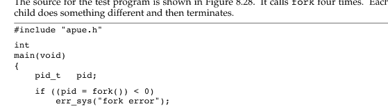

## 图 8.27 记账示例的进程结构

测试程序的源代码如图所示 8.28。它调用 `fork` 四次。每个子进程做不同的事情然后终止。

```c
#include "apue.h"
int
main(void)
{
    pid_t  pid;
    if ((pid = fork()) < 0)
        err_sys("fork error");
    else if (pid != 0) {      /* parent */
        sleep(2);
        exit(2);               /* terminate with exit status 2 */
    }
    if ((pid = fork()) < 0)
        err_sys("fork error");
    else if (pid != 0) {      /* first child */
        sleep(4);
        abort();               /* terminate with core dump */
    }
    if ((pid = fork()) < 0)
        err_sys("fork error");
    else if (pid != 0) {      /* second child */
        exec1("/bin/dd", "dd", "if=/etc/passwd", "of=/dev/null", NULL);
        exit(7);               /* shouldn't get here */
    }
    if ((pid = fork()) < 0)
        err_sys("fork error");
    else if (pid != 0) {      /* third child */
        sleep(8);
        exit(0);               /* normal exit */
    }
    sleep(6);                  /* fourth child */
    kill(getpid(), SIGKILL);   /* terminate w/signal, no core dump */
    exit(6);                   /* shouldn't get here */
}
```

## 图 8.28 用于生成记账数据的程序

我们将在 Solaris 上运行测试程序，然后使用图 8.29 中的程序打印出记账记录中的选定字段。

```c
#include "apue.h"
#include <sys/acct.h>

#if defined(BSD)  /* different structure in FreeBSD */
#define acct acctv2
#define ac_flag ac_trailer.ac_flag
#define FMT "%8s e = %6.0f, chars = %6.0f, %c %c %c %c\n"
#elif defined(HAS_AC_STAT)
#define FMT "%8s e = %6ld, chars = %7ld, stat = %3u: %c %c %c %c\n"
#else
#define FMT "%8s e = %6ld, chars = %7ld, %c %c %c %c\n"
#endif
#if defined(LINUX)
#define acct acct_v3  /* different structure in Linux */
#endif

#if !defined(HAS_ACORE)
#define ACORE 0
#endif
#if !defined(HAS_AXSIG)
#define AXSIG 0
#endif

#if !defined(BSD)
static unsigned long
compt2ulong(comp_t comptime)    /* convert comp_t to unsigned long */
{
        unsigned long   val;
        int             exp;

        val = comptime & 0x1fff;    /* 13-bit fraction */
        exp = (comptime >> 13) & 7; /* 3-bit exponent (0-7) */
        while (exp-- > 0)
                val <<= 3;
        return(val);
}
#endif

int
main(int argc, char *argv[])
{
        struct acct   acdata;
        FILE           *fp;

        if (argc != 2)
                err_quit("usage: pract filename");
        if ((fp = fopen(argv[1], "r")) == NULL)
                err_sys("can't open %s", argv[1]);
        while (fread(&acdata, sizeof(acdata), 1, fp) == 1) {
                printf("%*.s,", sizeof(acdata.ac_comm),
#if defined(BSD)
                        sizeof(acdata.ac_comm), acdata.ac_comm,
#else
                        acdata.ac_etime, acdata.ac_io,
#endif
                        compt2ulong(acdata.ac_etime), compt2ulong(acdata.ac_io),
#if defined(HAS_AC_STAT)
                        (unsigned char) acdata.ac_stat,
#endif
                        acdata.ac_flag & ACORE ? 'D' : ' ',
                        acdata.ac_flag & AXSIG ? 'K' : ' ',
                        acdata.ac_flag & AFORK ? 'F' : ' ',
                        acdata.ac_flag & ASU ? 'S' : ' ');
        }
        if (ferror(fp))
                err_sys("read error");
        exit(0);
}
```

## 图 8.29 打印系统记账文件中的选定字段

BSD 派生的平台不支持 `ac_stat` 成员，因此我们在支持该成员的平台上定义 `HAS_AC_STAT` 常量。基于特性而非平台来定义符号使代码更易读，并且允许我们仅通过在编译命令中添加新的定义来简单地修改程序。替代方案是使用

```c
#if !defined(BSD) && !defined(MACOS)
```

随着将应用程序移植到更多平台，这会变得难以处理。

我们定义了类似的常量来确定平台是否支持 `ACORE` 和 `AXSIG` 记账标志。我们不能使用标志符号本身，因为在 Linux 上，它们被定义为枚举值，我们不能在 `#ifdef` 表达式中使用它们。

为了进行测试，我们执行以下操作：

- 1. 成为超级用户并启用记账，使用 `acct on` 命令。注意，当此命令终止时，记账应已开启；因此，记账文件中的第一条记录应来自此命令。
- 2. 退出超级用户 shell 并运行图 8.28 中的程序。这应在记账文件中追加六条记录：一条用于超级用户 shell，一条用于测试父进程，以及每条用于四个测试子进程。
- `exec` 在第二个子进程中并未创建新进程。第二个子进程只有一个记账记录。
- 3. 成为超级用户并关闭记账。由于在此 `acct on` 命令终止时记账已关闭，它不应出现在记账文件中。
- 4. 运行图 8.29 中的程序以打印记账文件中的选定字段。

步骤 4 的输出如下。我们已用斜体为所选行附加了进程的描述，以便稍后讨论。

```text
acct on    e = 1, chars = 336, stat = 0:      S
sh         e = 1550, chars = 20168, stat = 0:   S
dd         e = 2, chars = 1585, stat = 0:      second child
a.out      e = 202, chars = 0, stat = 0:      parent
a.out      e = 420, chars = 0, stat = 134:  F   first child
a.out      e = 600, chars = 0, stat = 9:   F   fourth child
a.out      e = 801, chars = 0, stat = 0:  F   third child
```

对于此系统，流逝时间值以时钟滴答为单位测量。图 2.15 显示此系统每秒产生 100 个时钟滴答。例如，父进程中的 `sleep(2)` 对应于 202 个时钟滴答的流逝时间。对于第一个子进程，`sleep(4)` 变成 420 个时钟滴答。注意，进程睡眠的时间并不精确。 （我们将在第 10 章中回到 `sleep` 函数。）`fork` 和 `exit` 的调用也需要一些时间。

注意，`ac_stat` 成员不是进程的真实终止状态，而是对应于我们在


## 8.6 节

该字节中唯一的信息是核心转储标志位（通常是最高位）和信号编号（通常是最低的 7 位），前提是进程异常终止。如果进程正常终止，我们将无法从记账文件中获得退出状态。对第一个子进程而言，该值为 128 + 6。128 是核心转储标志位，而 6 恰巧是系统中通过调用 abort 生成的 SIGABRT 信号的值。第四个子进程的值为 9，对应于 SIGKILL 的值。我们无法从记账数据中得知父进程调用 exit 时的参数是 2，以及第三个子进程调用 exit 时的参数是 0。

dd 进程在第二个子进程中复制的 /etc/passwd 文件大小为 777 字节。I/O 的字符数略大于该值的两倍。它正好是两倍，因为先读入 777 字节，再写出 777 字节。即使输出发送到空设备，这些字节仍然会被记账。额外的 31 个字节来自 dd 命令向 stdout 打印的读写字节数摘要。

ac_flag 值与我们预期的一致。除执行 execl 的第二个子进程外，所有子进程都设置了 F 标志。父进程没有设置 F 标志，因为执行父进程的交互式 shell 先 fork，然后 exec 了 a.out 文件。第一个子进程调用 abort，该调用产生 SIGABRT 信号以生成核心转储。注意，X 标志和 D 标志都没有被设置，因为 Solaris 不支持这些标志；它们所代表的信息可以从 ac_stat 字段推导出来。第四个子进程也因信号而终止，但 SIGKILL 信号不会生成核心转储，它只是终止该进程。

作为最后一点说明，第一个子进程的 I/O 字符数为 0，但这个进程生成了核心文件。看起来，写出核心文件所需的 I/O 并未计入该进程。

## 8.15 用户标识

任何进程都可以找出其真实和有效用户 ID 及组 ID。然而，有时我们想找出运行程序的用户的登录名。我们可以调用 getpwuid(getuid())，但如果一个用户有多个登录名，且每个登录名具有相同的用户 ID，那该怎么办？（一个人可能在密码文件中有多个条目具有相同的用户 ID，以便每个条目有不同的登录 shell。）系统通常跟踪我们登录时使用的名字（第 6.8 节），而 getlogin 函数提供了一种获取该登录名的方法。

```
#include <unistd.h>

char *getlogin(void);
```

返回值：如果成功，返回指向登录名字符串的指针；如果出错，返回 NULL

如果进程没有连接到用户登录的终端，此函数可能失败。我们通常称这些进程为守护进程。我们将在第 13 章中讨论它们。

给定登录名后，我们可以使用它在密码文件中查找该用户——例如，以确定登录 shell——使用 getpwnam。

为了查找登录名，UNIX 系统历来调用 ttyname 函数（第 18.9 节），然后尝试在 utmp 文件（第 6.8 节）中查找匹配的条目。FreeBSD 和 Mac OS X 将登录名存储在与进程表条目关联的会话结构中，并提供系统调用来获取和存储该名称。

System V 提供了 cuserid 函数来返回登录名。此函数调用 getlogin，如果失败，则执行 getpwuid(getuid())。IEEE 标准 1003.1-1988 规定了 cuserid，但它要求使用有效用户 ID，而不是真实用户 ID。1990 版本的 POSIX.1 删除了 cuserid 函数。

环境变量 LOGNAME 通常由 login(1) 使用用户的登录名进行初始化，并由登录 shell 继承。但请注意，用户可以修改环境变量，因此我们不应以任何方式使用 LOGNAME 来验证用户。相反，我们应该使用 getlogin。

## 8.16 进程调度

历史上，UNIX 系统只向进程提供了对其调度优先级的粗略控制。调度策略和优先级由内核决定。进程可以通过调整其 nice 值来选择以较低的优先级运行（因此进程可以“友好”，通过调整其 nice 值减少其 CPU 份额）。只有特权进程才被允许提高其调度优先级。

POSIX 的实时扩展添加了在多个调度类之间进行选择并微调其行为的接口。我们这里只讨论用于调整 nice 值的接口；它们是 POSIX.1 中 XSI 选项的一部分。有关实时调度扩展的更多信息，请参阅 Gallmeister [1995]。

在单一 UNIX 规范中，nice 值的范围从 0 到 (2*NZERO)−1，尽管一些实现支持从 0 到 2*NZERO 的范围。较低的 nice 值具有较高的调度优先级。虽然这似乎反了，但实际上是有道理的：你越“友好”（nice），你的调度优先级就越低。NZERO 是系统的默认 nice 值。

> 请注意，定义 NZERO 的头文件因系统而异。除了头文件之外，Linux 3.2.0 还通过非标准的 sysconf 参数（_SC_NZERO）使 NZERO 的值可访问。

进程可以使用 nice 函数检索和更改其 nice 值。使用此函数，进程只能影响其自身的 nice 值；它不能影响任何其他进程的 nice 值。

```
#include <unistd.h>
int nice(int incr);
```

返回值：如果成功，返回新的 nice 值 − NZERO；如果出错，返回 −1

incr 参数将添加到调用进程的 nice 值中。如果 incr 太大，系统会静默地将其减小到最大合法值。类似地，如果 incr 太小，系统会静默地将其增大到最小合法值。由于 -1 是合法的成功返回值，我们需要在调用 nice 之前将 errno 清零，并在 nice 返回 -1 时检查它的值。如果对 nice 的调用成功且返回值为 -1，则 errno 仍为零。如果 errno 非零，则表示对 nice 的调用失败。

getpriority 函数可用于获取进程的 nice 值，就像 nice 函数一样。但是，getpriority 还可以获取一组相关进程的 nice 值。

```
#include <sys/resource.h>
int getpriority(int which, id_t who);
```

返回值：如果成功，返回介于 -NZERO 和 NZERO -1 之间的 nice 值；如果出错，返回 -1

which 参数可以取三个值之一：PRIO_PROCESS 表示进程，PRIO_PGRP 表示进程组，PRIO_USER 表示用户 ID。which 参数控制 who 参数的解释方式，而 who 参数选择感兴趣的进程或进程组。如果 who 参数为 0，则表示调用进程、进程组或用户（取决于 which 参数的值）。当 which 设置为 PRIO_USER 且 who 为 0 时，使用调用进程的真实用户 ID。当 which 参数应用于多个进程时，将返回所有适用进程中优先级最高（值最低）的进程。

setpriority 函数可用于设置进程、进程组或属于特定用户 ID 的所有进程的优先级。

```
#include <sys/resource.h>
int setpriority(int which, id_t who, int value);
```

返回值：如果成功，返回 0；如果出错，返回 -1

which 和 who 参数与 getpriority 函数中的相同。将 value 加到 NZERO 上，所得结果就是新的 nice 值。

> nice 系统调用起源于 Research UNIX 系统的早期 PDP-11 版本。getpriority 和 setpriority 函数起源于 4.2BSD。

单一 UNIX 规范将 fork 之后子进程是否继承 nice 值留给实现来决定。然而，XSI 兼容系统要求在执行 exec 调用时保留 nice 值。

> 在 FreeBSD 8.0、Linux 3.2.0、Mac OS X 10.6.8 和 Solaris 10 中，子进程从其父进程继承 nice 值。

### 示例

图 8.30 中的程序测量了调整进程 nice 值的效果。两个进程并行运行，各自递增自己的计数器。父进程以默认的 nice 值运行，而子进程以按照指定的调整后的 nice 值运行。


可选命令参数。运行 10 秒后，两个进程打印其计数器的值并退出。通过比较不同 nice 值下的计数器值，我们可以了解 nice 值如何影响进程调度。

```
#include "apue.h"
#include <errno.h>
#include <sys/time.h>

#if defined(MACOS)
#include <sys/syslimits.h>
#elif defined(SOLARIS)
#include <limits.h>
#elif defined(BSD)
#include <sys/param.h>
#endif

unsigned long long count;
struct timeval end;

void
checktime(char *str)
{
        struct timeval tv;

        gettimeofday(&tv, NULL);
        if (tv.tv_sec >= end.tv_sec && tv.tv_usec >= end.tv_usec) {
                printf("%s count = %lld\n", str, count);
                exit(0);
        }
}

int
main(int argc, char *argv[])
{
        pid_t   pid;
        char    *s;
        int     nzero, ret;
        int     adj = 0;

        setbuf(stdout, NULL);
#if defined(NZERO)
        nzero = NZERO;
#elif defined(_SC_NZERO)
        nzero = sysconf(_SC_NZERO);
#else
#error NZERO undefined
#endif

        printf("NZERO = %d\n", nzero);
        if (argc == 2)
                adj = strtol(argv[1], NULL, 10);
        gettimeofday(&end, NULL);
        end.tv_sec += 10;   /* run for 10 seconds */
        if ((pid = fork()) < 0) {
err_sys("fork failed");
} else if (pid == 0) {  /* child */
    s = "child";
    printf("current nice value in child is %d, adjusting by %d\n", nice(0)+nzero, adj);
    errno = 0;
    if ((ret = nice(adj)) == -1 && errno != 0)
        err_sys("child set scheduling priority");
    printf("now child nice value is %d\n", ret+nzero);
} else {  /* parent */
    s = "parent";
    printf("current nice value in parent is %d\n", nice(0)+nzero);
}
for(;;) {
    if (++count == 0)
        err_quit("%s counter wrap", s);
    checktime(s);
}
```

## 图 8.30 评估更改 nice 值的影响

我们运行该程序两次：一次使用默认的 nice 值，一次使用最高的合法 nice 值（最低调度优先级）。我们在单处理器 Linux 系统上运行此程序，以展示调度程序如何在具有不同 nice 值的进程之间共享 CPU。在系统基本空闲的情况下，多处理器系统（或多核 CPU）将允许两个进程同时运行，而无需共享 CPU，我们就不会在具有不同 nice 值的两个进程之间看到太多差异。

```
$ ./a.out
NZERO = 20
current nice value in parent is 20
current nice value in child is 20, adjusting by 0
now child nice value is 20
child count = 1859362
parent count = 1845338
$ ./a.out 20
NZERO = 20
current nice value in parent is 20
current nice value in child is 20, adjusting by 20
now child nice value is 39
parent count = 3595709
child count = 52111
```

当两个进程具有相同的 nice 值时，父进程获得 50.2% 的 CPU，子进程获得 49.8% 的 CPU。注意，两个进程在效果上被平等对待。百分比并不完全相等，因为进程调度并不精确，而且由于在计算结束时间和处理循环开始时间之间，子进程和父进程执行的处理量不同。

相比之下，当子进程具有最高可能的 nice 值（最低优先级）时，我们看到父进程获得 98.5% 的 CPU，而子进程仅获得 1.5% 的 CPU。这些值会根据进程调度程序如何使用 nice 值而变化，因此不同的 UNIX 系统会产生不同的比例。

## 8.17 进程时间

在第 1.10 节中，我们描述了可以测量的三种时间：挂钟时间、用户 CPU 时间和系统 CPU 时间。任何进程都可以调用 times 函数来获取其自身以及任何已终止子进程的这些值。

```
#include <sys/times.h>

clock_t times(struct tms *buf);

Returns: elapsed wall clock time in clock ticks if OK, -1 on error
```

此函数填充 buf 指向的 tms 结构：

```
struct tms {
    clock_t tms_utime;  /* user CPU time */
    clock_t tms_stime;  /* system CPU time */
    clock_t tms_cutime; /* user CPU time, terminated children */
    clock_t tms_cstime; /* system CPU time, terminated children */
};
```

请注意，该结构不包含挂钟时间的任何测量。相反，函数返回挂钟时间作为函数的值，每次调用时都如此。该值是从过去某个任意点开始测量的，因此我们不能使用其绝对值；相反，我们使用其相对值。例如，我们调用 times 并保存返回值。在稍后的某个时间，我们再次调用 times 并从新的返回值中减去较早的返回值。差值就是挂钟时间。 （对于长时间运行的进程来说，挂钟时间溢出的可能性很小，但并非不可能；请参阅练习 1.5。）

此函数返回的子进程的两个结构字段仅包含我们已使用本章前面讨论的 wait 函数之一等待的子进程的值。

此函数返回的所有 clock_t 值都使用每秒时钟滴答数——sysconf 返回的 _SC_CLK_TCK 值（第 2.5.4 节）转换为秒。

大多数实现都提供 getrusage(2) 函数。此函数返回 CPU 时间和 14 个其他指示资源使用情况的值。历史上，该函数起源于 BSD 操作系统，因此基于 BSD 的实现通常支持的字段比其他实现更多。

### 示例

图 8.31 中的程序将每个命令行参数作为 shell 命令字符串执行，计时命令并打印 tms 结构中的值。

```
#include "apue.h"
#include <sys/times.h>

static void pr_times(clock_t, struct tms *, struct tms *);
static void do_cmd(char *);

int
main(int argc, char *argv[])
{
    int     i;

    setbuf(stdout, NULL);
    for (i = 1; i < argc; i++)
        do_cmd(argv[i]);    /* once for each command-line arg */
    exit(0);
}
static void
do_cmd(char *cmd)      /* execute and time the "cmd" */
{
    struct tms tmsstart, tmsend;
    clock_t start, end;
    int     status;

    printf("\ncommand: %s\n", cmd);

    if ((start = times(&tmsstart)) == -1)    /* starting values */
        err_sys("times error");
    if ((status = system(cmd)) < 0)          /* execute command */
        err_sys("system() error");
    if ((end = times(&tmsend)) == -1)        /* ending values */
        err_sys("times error");

    pr_times(end-start, &tmsstart, &tmsend);
    pr_exit(status);
}

static void
pr_times(clock_t real, struct tms *tmsstart, struct tms *tmsend)
{
    static long clktck = 0;

    if (clktck == 0)    /* fetch clock ticks per second first time */
        if ((clktck = sysconf(_SC_CLK_TCK)) < 0)
            err_sys("sysconf error");

    printf(" real: %7.2f\n", real / (double) clktck);
    printf(" user: %7.2f\n", (tmsend->tms_utime - tmsstart->tms_utime) / (double) clktck);
    printf(" sys: %7.2f\n", (tmsend->tms_stime - tmsstart->tms_stime) / (double) clktck);
    printf(" child user: %7.2f\n",
(tmsend->tms_cutime - tmsstart->tms_cutime) / (double) clktck);
printf(" child sys: %7.2f\n",
    (tmsend->tms_cstime - tmsstart->tms_cstime) / (double) clktck);
}
```

图 8.31 计时并执行所有命令行参数

如果我们运行此程序，我们得到

```
$ ./a.out "sleep 5" "date" "man bash >/dev/null"

command: sleep 5
real:    5.01
user:    0.00
sys:     0.00
child user:  0.00
child sys:   0.00
normal termination, exit status = 0

command: date
Sun Feb 26 18:39:23 EST 2012
real:    0.00
user:    0.00
sys:     0.00
child user:  0.00
child sys:   0.00
normal termination, exit status = 0

command: man bash >/dev/null
real:    1.46
user:    0.00
sys:     0.00
child user:  1.32
child sys:   0.07
normal termination, exit status = 0
```

在前两个命令中，执行速度足够快，以至于在报告的分辨率下无法记录任何 CPU 时间。但是，在第三个命令中，我们运行一个需要足够处理时间的命令，可以注意到所有的 CPU 时间都出现在子进程中，即 shell 和命令执行的位置。

## 8.18 摘要

对 UNIX 系统进程控制的透彻理解对于高级编程至关重要。只有少数几个函数需要掌握：fork、exec 系列、_exit、wait 和 waitpid。这些原语在许多应用程序中使用。fork 函数还给了我们一个机会来查看竞争条件。

我们对 system 函数和进程记账的检查让我们再次了解了所有这些进程控制函数。我们还查看了另一种变体


`exec` 函数：解释器文件及其运行方式。理解所提供的各种用户 ID 和组 ID——真实 ID、有效 ID 和保存的 ID——对于编写安全的设置用户 ID 程序至关重要。

在理解了单个进程及其子进程之后，下一章我们将考察一个进程与其他进程之间的关系——会话和作业控制。随后，我们将在第 10 章介绍信号，从而完成对进程的讨论。

## 练习

- 8.1 在图 8.3 中，我们曾说过，将对 `_exit` 的调用替换为对 `exit` 的调用，可能会导致标准输出被关闭，并使 `printf` 返回 `-1`。修改该程序，检查你的实现是否表现出这种行为。如果没有，如何模拟这种行为？
- 8.2 回顾图 7.6 中内存的典型布局。由于与每次函数调用对应的栈帧通常存储在栈中，并且 `vfork` 之后子进程运行在父进程的地址空间中，那么如果对 `vfork` 的调用来自 `main` 以外的函数，并且子进程在 `vfork` 之后从该函数返回，会发生什么？编写一个测试程序验证这一点，并画出相关过程的示意图。
- 8.3 重写图 8.6 中的程序，使用 `waitid` 替代 `wait`。不要调用 `pr_exit`，而是从 `siginfo` 结构中确定等价的信息。
- 8.4 当我们像下面这样执行一次图 8.13 中的程序时：

```
```text
$ ./a.out
```
```

输出是正确的。但是，如果我们像下面这样连续多次执行该程序：

```
```text
$ ./a.out ; ./a.out ; ./a.out
output from parent
output from parent
output from child
put from parent
output from child
output from child
```
```

输出就不正确了。发生了什么？如何修正？如果让子进程先写入输出，这个问题还会发生吗？
- 8.5 在图 8.20 所示的程序中，我们调用 `execl`，并指定解释器文件的路径名。如果改为调用 `execlp`，指定文件名为 `testinter`，并且目录 `/home/sar/bin` 是路径前缀，那么运行该程序时，`argv[2]` 会打印什么？
- 8.6 编写一个创建僵尸进程的程序，然后调用 `system` 执行 `ps(1)` 命令，以验证该进程确实是僵尸进程。
- 8.7 我们在第 8.10 节提到，POSIX.1 要求在执行 `exec` 时关闭已打开的目录流。请对所有这些目录流进行验证：对根目录调用 `open`，查看系统对 `DIR` 结构的实现，并打印执行时关闭标志。然后再次打开同一目录进行读取，并打印执行时关闭标志。

## 进程关系

### 9.1 引言

在上一章中，我们了解到进程之间存在着各种关系。首先，每个进程都有一个父进程（最初的内核级进程通常以自身作为父进程）。子进程终止时，父进程会收到通知，并且父进程可以获取子进程的退出状态。我们在介绍 `waitpid` 函数时（第 8.6 节）也提到了进程组，并解释了如何等待进程组中的任意进程终止。

本章将更详细地讨论进程组，以及 POSIX.1 引入的会话概念。我们还将考察登录 shell 与从登录 shell 启动的所有进程之间的关系。

如果不讨论信号，就不可能描述这些关系；而要讨论信号，又需要用到本章中的许多概念。如果你不熟悉 UNIX System 的信号机制，现在可以先快速浏览第 10 章。

### 9.2 终端登录

先来看看我们登录 UNIX 系统时所执行的程序。在早期的 UNIX 系统（例如 Version 7）中，用户通过哑终端登录，这些终端使用专用线路连接到主机。终端可以是本地的（直接连接），也可以是远程的（通过调制解调器连接）。无论哪种情况，这些登录都要经过内核中的终端设备驱动程序。例如，PDP-11 上的常见设备是 DH-11 和 DZ-11。一台主机拥有固定数量的这些终端设备，因此同时登录的用户数量存在一个已知的上限。

随着位图图形终端的出现，窗口系统得到了发展，为用户提供了与主机计算机交互的新方式。人们开发了应用程序来创建“终端窗口”，模拟基于字符的终端，使用户能够以熟悉的方式与主机交互（即通过 shell 命令行）。

如今，一些平台允许你在登录后启动窗口系统，而另一些平台则会自动为你启动窗口系统。在后一种情况下，你可能仍然需要登录，具体取决于窗口系统的配置方式（某些窗口系统可以配置为自动登录）。

下面介绍的是使用终端登录 UNIX 系统的过程。无论使用哪种类型的终端，过程都大致相同——终端可以是基于字符的终端、模拟简单字符终端的图形终端，也可以是运行窗口系统的图形终端。

### BSD 终端登录

过去 35 年来，BSD 的终端登录过程没有太大变化。系统管理员会创建一个文件，通常是 `/etc/ttys`，其中每个终端设备占一行。每一行指定设备名称以及传递给 `getty` 程序的其他参数。例如，其中一个参数就是终端的波特率。系统启动时，内核会创建进程 ID 为 1 的 `init` 进程，而正是 `init` 将系统带入多用户模式。`init` 进程读取文件 `/etc/ttys`，对于每个允许登录的终端设备，执行一次 `fork`，随后执行 `exec`，启动 `getty` 程序。这就产生了图 9.1 所示的进程。

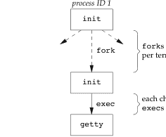

图 9.1 `init` 为允许终端登录而调用的进程

图 9.1 中所示的所有进程，其真实用户 ID 都是 0，有效用户 ID 也都是 0（即它们都拥有超级用户权限）。`init` 进程还会以空环境执行 `getty` 程序。

`getty` 负责对终端设备调用 `open`。终端以读写方式打开。如果设备是调制解调器，`open` 可能会在设备驱动程序内部延迟，直到调制解调器拨号并接通。设备打开后，文件描述符 0、1 和 2 会被设置为指向该设备。随后，`getty` 输出类似 `login:` 的提示，并等待我们输入用户名。如果终端支持多种速率，`getty` 可以检测特殊字符，并据此改变终端的速率（波特率）。关于 `getty` 程序以及驱动其行为的数据文件（`gettytab`）的更多细节，请查阅 UNIX 系统手册。

当我们输入用户名后，`getty` 的任务就完成了，随后它会调用 `login` 程序，类似于：

```
execle("/bin/login", "login", "-p", username, (char *)0, envp);
```

（`gettytab` 文件中可以设置选项，使其调用其他程序，但默认调用的是 `login` 程序。）`init` 以空环境调用 `getty`；`getty` 为 `login` 创建环境（即 `envp` 参数），其中包含终端名称（类似 `TERM=foo`，终端类型 `foo` 取自 `gettytab` 文件），以及 `gettytab` 中指定的任何环境字符串。传递给 `login` 的 `-p` 标志告诉它保留传入的环境，并在该环境中添加内容，而不是替换环境。图 9.2 展示了调用 `login` 后这些进程的状态。

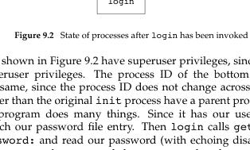

图 9.2 调用 `login` 后的进程状态

图 9.2 中所示的所有进程都拥有超级用户权限，因为最初的 `init` 进程拥有超级用户权限。图 9.2 中底部三个进程的进程 ID 相同，因为进程 ID 在 `exec` 过程中不会改变。此外，除最初的 `init` 进程外，其他所有进程的父进程 ID 都是 1。

`login` 程序会执行许多操作。由于它已经获得了我们的用户名，因此可以调用 `getpwnam` 获取我们的密码文件条目。随后，`login` 调用 `getpass(3)` 显示提示符 `Password:`，并读取我们的密码（当然会禁用回显）。它调用 `crypt(3)` 对我们输入的密码进行加密，并将加密后的结果与


result to the pw_passwd field from our shadow password file entry. If the login attempt fails because of an invalid password (after a few tries), login calls exit with an argument of 1. This termination will be noticed by the parent (init), and it will do another fork followed by an exec of getty, starting the procedure over again for this terminal.

This is the traditional authentication procedure used on UNIX systems. Modern UNIX systems, however, have evolved to support multiple authentication procedures. For example, FreeBSD, Linux, Mac OS X, and Solaris all support a more flexible scheme known as PAM (Pluggable Authentication Modules). PAM allows an administrator to configure the authentication methods to be used to access services that are written to use the PAM library.

If our application needs to verify that a user has the appropriate permission to perform a task, we can either hard code the authentication mechanism in the application or use the PAM library to give us the equivalent functionality. The advantage to using PAM is that administrators can configure different ways to authenticate users for different tasks, based on the local site policies.

If we log in correctly, login will

- Change to our home directory (chdir)
- Change the ownership of our terminal device (chown) so we own it
- Change the access permissions for our terminal device so we have permission to read from and write to it
- Set our group IDs by calling setgid and initgroups
- Initialize the environment with all the information that login has: our home directory (HOME), shell (SHELL), user name (USER and LOGNAME), and a default path (PATH)
- Change to our user ID (setuid) and invoke our login shell, as in

```
exec l("/bin/sh", "-sh", (char *)0);
```

The minus sign as the first character of argv[0] is a flag to all the shells that indicates they are being invoked as a login shell. The shells can look at this character and modify their start-up accordingly.

The login program really does more than we’ve described here. It optionally prints the message-of-the-day file, checks for new mail, and performs other tasks. In this chapter, we’re interested only in the features that we’ve described.

Recall from our discussion of the setuid function in Section 8.11 that since it is called by a superuser process, setuid changes all three user IDs: the real user ID, effective user ID, and saved set-user-ID. The call to setgid that was done earlier by login has the same effect on all three group IDs.

At this point, our login shell is running. Its parent process ID is the original init process (process ID 1), so when our login shell terminates, init is notified (it is sent a SIGCHLD signal) and it starts the whole procedure over again for this terminal. File descriptors 0, 1, and 2 for our login shell are set to the terminal device. Figure 9.3 shows this arrangement.

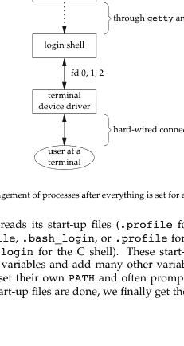

## Figure 9.3 Arrangement of processes after everything is set for a terminal login

Our login shell now reads its start-up files (.profile for the Bourne shell and Korn shell; .bash_profile, .bash_login, or .profile for the GNU Bourne-again shell; and .cshrc and .login for the C shell). These start-up files usually change some of the environment variables and add many other variables to the environment. For example, most users set their own PATH and often prompt for the actual terminal type (TERM). When the start-up files are done, we finally get the shell’s prompt and can enter commands.

## Mac OS X Terminal Logins

On Mac OS X, the terminal login process follows essentially the same steps as in the BSD login process, since Mac OS X is based in part on FreeBSD. With Mac OS X, however, there are some differences:

- The work of init is performed by launchd.
- We are presented with a graphical-based login screen from the start.

## Linux Terminal Logins

The Linux login procedure is very similar to the BSD procedure. Indeed, the Linux login command is derived from the 4.3BSD login command. The main difference between the BSD login procedure and the Linux login procedure is in the way the terminal configuration is specified.

Some Linux distributions ship with a version of the init program that uses administrative files patterned after System V’s init file formats. On these systems,

/etc/inittab contains the configuration information specifying the terminal devices for which init should start a getty process.

Other Linux distributions, such as recent Ubuntu distributions, ship with a version of init that is known as "Upstart." It uses configuration files named *.conf that are stored in the /etc/init directory. For example, the specifications for running getty on /dev/tty1 might be found in the file /etc/init/tty1.conf.

Depending on the version of getty in use, the terminal characteristics are specified either on the command line (as with agetty) or in the file /etc/gettydefs (as with mgetty).

## Solaris Terminal Logins

Solaris supports two forms of terminal logins: (a) getty style, as described previously for BSD, and (b) ttymon logins, a feature introduced with SVR4. Normally, getty is used for the console, and ttymon is used for other terminal logins.

The ttymon command is part of a larger facility termed SAF, the Service Access Facility. The goal of the SAF was to provide a consistent way to administer services that provide access to a system. (See Chapter 6 of Rago [1993] for more details.) For our purposes, we end up with the same picture as in Figure 9.3, with a different set of steps between init and the login shell. init is the parent of sac (the service access controller), which does a fork and exec of the ttymon program when the system enters multisuer state. The ttymon program monitors all the terminal ports listed in its configuration file and does a fork when we enter our login name. This child of ttymon does an exec of login, and login prompts us for our password. Once this is done, login execs our login shell, and we're at the position shown in Figure 9.3. One difference is that the parent of our login shell is now ttymon, whereas the parent of the login shell from a getty login is init.

## 9.3 Network Logins

The main (physical) difference between logging in to a system through a serial terminal and logging in to a system through a network is that the connection between the terminal and the computer isn't point-to-point. In this case, login is simply a service available, just like any other network service, such as FTP or SMTP.

With the terminal logins that we described in the previous section, init knows which terminal devices are enabled for logins and spawns a getty process for each device. In the case of network logins, however, all the logins come through the kernel's network interface drivers (e.g., the Ethernet driver), and we don't know ahead of time how many of these will occur. Instead of having a process waiting for each possible login, we now have to wait for a network connection request to arrive.

To allow the same software to process logins over both terminal logins and network logins, a software driver called a pseudo terminal is used to emulate the behavior of a serial terminal and map terminal operations to network operations, and vice versa. (In Chapter 19, we'll talk about pseudo terminals in detail.)

## BSD Network Logins

In BSD, a single process waits for most network connections: the inetd process, sometimes called the Internet superserver. In this section, we'll look at the sequence of processes involved in network logins for a BSD system. We are not interested in the detailed network programming aspects of these processes; refer to Stevens, Fenner, and Rudoff [2004] for all the details.

As part of the system start-up, init invokes a shell that executes the shell script /etc/rc. One of the daemons that is started by this shell script is inetd. Once the shell script terminates, the parent process of inetd becomes init; inetd waits for TCP/IP connection requests to arrive at the host. When a connection request arrives for it to handle, inetd does a fork and exec of the appropriate program.

Let's assume that a TCP connection request arrives for the TELNET server. TELNET is a remote login application that uses the TCP protocol. A user on another host (that is connected to the server's host through a network of some form) or on the same host initiates the login by starting the TELNET client:

```
telnet hostname
```

The client opens a TCP connection to hostname, and the program that's started on hostname is called the TELNET server. The client and the server then exchange data across the TCP connection using the TELNET application protocol. What has happened is that the user who started the client program is now logged in to the server's host. (This assumes, of course, that the user has a valid account on the server's host.) Figure 9.4 shows the sequence of processes involved in executing the TELNET server, called telnetd.

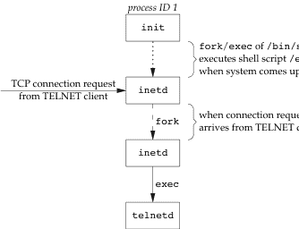


The telnetd process then opens a pseudo terminal device and splits into two processes using fork. The parent handles the communication across the network connection, and the child does an exec of the login program. The parent and the child are connected through the pseudo terminal. Before doing the exec, the child sets up file descriptors 0, 1, and 2 to the pseudo terminal. If we log in correctly, login performs the same steps we described in Section 9.2: it changes to our home directory and sets our group IDs, user ID, and our initial environment. Then login replaces itself with our login shell by calling exec. Figure 9.5 shows the arrangement of the processes at this point.

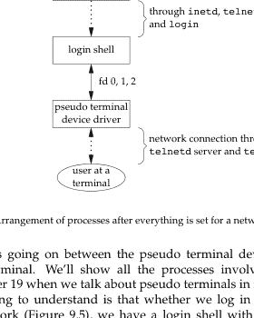

Figure 9.5 Arrangement of processes after everything is set for a network login

Obviously, a lot is going on between the pseudo terminal device driver and the actual user at the terminal. We’ll show all the processes involved in this type of arrangement in Chapter 19 when we talk about pseudo terminals in more detail.

The important thing to understand is that whether we log in through a terminal (Figure 9.3) or a network (Figure 9.5), we have a login shell with its standard input, standard output, and standard error connected to either a terminal device or a pseudo terminal device. We’ll see in the coming sections that this login shell is the start of a POSIX.1 session, and that the terminal or pseudo terminal is the controlling terminal for the session.

## Mac OS X Network Logins

Logging in to a Mac OS X system over a network is identical to logging in to a BSD system, because Mac OS X is based partially on FreeBSD. However, on Mac OS X, the telnet daemon is run from launchd.

By default, the telnet daemon is disabled on Mac OS X (although it can be enabled with the `launchctl(1)` command). The preferred way to perform a network login on Mac OS X is with ssh, the secure shell command.

## Linux Network Logins

Network logins under Linux are the same as under BSD, except that some distributions use an alternative inetd process called the extended Internet services daemon, `xinetd`. The xinetd process provides a finer level of control over services it starts compared to inetd.

## Solaris Network Logins

The scenario for network logins under Solaris is almost identical to the steps under BSD and Linux. An inetd server is used that is similar in concept to the BSD version, except that the Solaris version runs as a *restarter* in the Service Management Facility (SMF). A restarter is a daemon that has the responsibility to start and monitor other daemon processes, and restart them if they fail. Although the inetd server is started by the master restarter in the SMF, the master restarter is started by init and we end up with the same overall picture as in Figure 9.5.

The Solaris Service Management Facility is a framework that manages and monitors system services and provides a way to recover from failures affecting system services. For more details on the Service Management Facility, see Adams [2005] and the Solaris manual pages smf(5) and inetd(1M).

## 9.4 Process Groups

In addition to having a process ID, each process belongs to a process group. We’ll encounter process groups again when we discuss signals in Chapter 10.

A process group is a collection of one or more processes, usually associated with the same job (job control is discussed in Section 9.8), that can receive signals from the same terminal. Each process group has a unique process group ID. Process group IDs are similar to process IDs: they are positive integers and can be stored in a `pid_t` data type. The function getpgrp returns the process group ID of the calling process.

```
#include <unistd.h>

pid_t getpgrp(void);
```

Returns: process group ID of calling process

In older BSD-derived systems, the getpgrp function took a *pid* argument and returned the process group for that process. The Single UNIX Specification defines the getpgid function that mimics this behavior.

```
#include <unistd.h>
pid_t getpgid(pid_t pid);

Returns: process group ID if OK, -1 on error
```

If pid is 0, the process group ID of the calling process is returned. Thus

```
getpgid(0);
```

is equivalent to

```
getpgrp();
```

Each process group can have a process group leader. The leader is identified by its process group ID being equal to its process ID.

It is possible for a process group leader to create a process group, create processes in the group, and then terminate. The process group still exists, as long as at least one process is in the group, regardless of whether the group leader terminates. This is called the process group lifetime—the period of time that begins when the group is created and ends when the last remaining process leaves the group. The last remaining process in the process group can either terminate or enter some other process group.

A process joins an existing process group or creates a new process group by calling setpgid. (In the next section, we’ll see that setsid also creates a new process group.)

```
#include <unistd.h>
int setpgid(pid_t pid, pid_t pgid);

Returns: 0 if OK, -1 on error
```

This function sets the process group ID to pgid in the process whose process ID equals pid. If the two arguments are equal, the process specified by pid becomes a process group leader. If pid is 0, the process ID of the caller is used. Also, if pgid is 0, the process ID specified by pid is used as the process group ID.

A process can set the process group ID of only itself or any of its children. Furthermore, it can’t change the process group ID of one of its children after that child has called one of the exec functions.

In most job-control shells, this function is called after a fork to have the parent set the process group ID of the child, and to have the child set its own process group ID. One of these calls is redundant, but by doing both, we are guaranteed that the child is placed into its own process group before either process assumes that this has happened. If we didn’t do this, we would have a race condition, since the child’s process group membership would depend on which process executes first.

When we discuss signals, we’ll see how we can send a signal to either a single process (identified by its process ID) or a process group (identified by its process group ID). Similarly, the waitpid function from Section 8.6 lets us wait for either a single process or one process from a specified process group.

## 9.5 Sessions

A session is a collection of one or more process groups. For example, we could have the arrangement shown in Figure 9.6. Here we have three process groups in a single session.

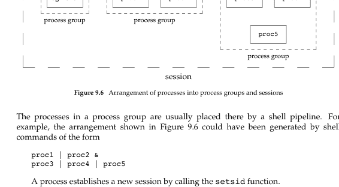

The processes in a process group are usually placed there by a shell pipeline. For example, the arrangement shown in Figure 9.6 could have been generated by shell commands of the form

```
proc1 | proc2 &
proc3 | proc4 | proc5
```

A process establishes a new session by calling the setsid function.

```
#include <unistd.h>

pid_t setsid(void);

Returns: process group ID if OK, -1 on error
```

If the calling process is not a process group leader, this function creates a new session. Three things happen.

- 1. The process becomes the session leader of this new session. (A session leader is the process that creates a session.) The process is the only process in this new session.
- 2. The process becomes the process group leader of a new process group. The new process group ID is the process ID of the calling process.
- 3. The process has no controlling terminal. (We’ll discuss controlling terminals in the next section.) If the process had a controlling terminal before calling setsid, that association is broken.

This function returns an error if the caller is already a process group leader. To ensure this is not the case, the usual practice is to call fork and have the parent terminate and the child continue. We are guaranteed that the child is not a process group leader, because the process group ID of the parent is inherited by the child, but the child gets a new process ID. Hence, it is impossible for the child’s process ID to equal its inherited process group ID.

The Single UNIX Specification talks only about a “session leader”; there is no “session ID” similar to a process ID or a process group ID. Obviously, a session leader is a single process that has a unique process ID, so we could talk about a session ID that is the process ID of the session leader. This concept of a session ID was introduced in SVR4. Historically, BSD-based systems didn’t support this notion, but have since been updated to include it. The getsid function returns the process group ID of a process’s session leader.

> Some implementations, such as Solaris, join with the Single UNIX Specification in the practice of avoiding the use of the phrase “session ID,” opting instead to refer to this as the “process group ID of the session leader.” The two are equivalent, since the session leader is always the leader of a process group.

```
#include <unistd.h>

pid_t getsid(pid_t pid);

Returns: session leader’s process group ID if OK, -1 on error
```

If pid is 0, getsid returns the process group ID of the calling process’s session leader. For security reasons, some implementations may restrict the calling process from obtaining the process group ID of the session leader if pid doesn’t belong to the same session as the caller.

## 9.6 Controlling Terminal

Sessions and process groups have a few other characteristics.

- A session can have a single controlling terminal. This is usually the terminal device (in the case of a terminal login) or pseudo terminal device (in the case of a network login) on which we log in.
- The session leader that establishes the connection to the controlling terminal is called the controlling process.
- The process groups within a session can be divided into a single foreground process group and one or more background process groups.
- If a session has a controlling terminal, it has a single foreground process group and all other process groups in the session are background process groups.
- Whenever we press the terminal’s interrupt key (often DELETE or Control-C), the interrupt signal is sent to all processes in the foreground process group.


- 每当我们按下终端的退出键（通常是 Control-反斜杠）时，退出信号就会被发送到前台进程组中的所有进程。
- 如果终端接口检测到调制解调器（或网络）断开，挂断信号就会被发送到控制进程（会话首进程）。

这些特征如图 9.7 所示。

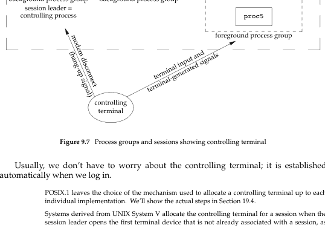

图 9.7 显示控制终端的进程组和会话

通常，我们不必担心控制终端；它会在我们登录时自动建立。

POSIX.1 将分配控制终端的机制选择留给各个实现自行决定。我们将在 19.4 节中展示实际步骤。

源自 UNIX System V 的系统，当会话首进程打开第一个尚未与会话关联的终端设备时，会为会话分配控制终端，只要对 `open` 的调用没有指定 `O_NOCTTY` 标志（3.3 节）。

基于 BSD 的系统，当会话首进程以请求参数 `TIOCSCTTY` 调用 `ioctl` 时（第三个参数是空指针），会为会话分配控制终端。此调用要成功，会话不能已经拥有控制终端。（通常，这个对 `ioctl` 的调用跟在 `setsid` 调用之后，后者保证进程是没有控制终端的会话首进程。）基于 BSD 的系统不使用 `open` 的 POSIX.1 `O_NOCTTY` 标志，除了在兼容模式下支持其他系统时。

图 9.8 总结了本书讨论的每个平台分配控制终端的方式。注意，尽管 Mac OS X 10.6.8 源自 BSD，但在分配控制终端时，它的行为类似于 System V。

| 方法 | FreeBSD 8.0 | Linux 3.2.0 | Mac OS X 10.6.8 | Solaris 10 |
|---|---|---|---|---|
| 不指定 `O_NOCTTY` 的 `open` |  | • |  | • |
| `TIOCSCTTY` `ioctl` 命令¹ | • | • | • | • |

图 9.8 各种实现如何分配控制终端

有时程序想要与控制终端通信，无论标准输入或标准输出是否被重定向。程序确保它与控制终端通信的方式是打开文件 `/dev/tty`。这个特殊文件在内核中是控制终端的同义词。当然，如果程序没有控制终端，打开这个设备将会失败。

经典的例子是 `getpass(3)` 函数，它读取一个密码（当然，终端回显已关闭）。该函数由 `crypt(1)` 程序调用，并且可以在管道中使用。例如，

```sh
crypt < salaries | lpr
```

解密文件 `salaries`，并将输出通过管道发送到打印假脱机程序。由于 `crypt` 从标准输入读取其输入文件，因此标准输入不能用于输入密码。另外，`crypt` 的设计使得我们每次运行该程序时都必须输入加密密码，以防止我们将密码保存在文件中（这可能是一个安全漏洞）。

有一些已知的方法可以破解 `crypt` 程序使用的编码。有关加密文件的更多细节，请参阅 Garfinkel 等人 [2003] 的著作。

## 9.7 `tcgetpgrp`、`tcsetpgrp` 和 `tcgetsid` 函数

我们需要一种方法告诉内核哪个进程组是前台进程组，以便终端设备驱动程序知道将终端输入和终端产生的信号发送到哪里（图 9.7）。

```c
#include <unistd.h>

pid_t tcgetpgrp(int fd);

    Returns: process group ID of foreground process group if OK, -1 on error

int tcsetpgrp(int fd, pid_t pgrpid);

    Returns: 0 if OK, -1 on error
```

大多数应用程序不会直接调用这两个函数。相反，这些函数通常由作业控制 shell 调用。

`tcgetsid` 函数允许应用程序在获得控制 TTY 的文件描述符时，获取会话首进程的进程组 ID。

```c
#include <termios.h>

pid_t tcgetsid(int fd);

Returns: session leader’s process group ID if OK, -1 on error
```

需要管理控制终端的应用程序可以使用 `tcgetsid` 来识别控制终端的会话首进程的会话 ID（这等同于会话首进程的进程组 ID）。

## 9.8 作业控制

作业控制是大约 1980 年添加到 BSD 的一个特性。该特性允许我们从单个终端启动多个作业（进程组），并控制哪些作业可以访问终端，哪些作业在后台运行。作业控制需要三种形式的支持：

- 支持作业控制的 shell
- 内核中的终端驱动程序必须支持作业控制
- 内核必须支持某些作业控制信号

> SVR3 提供了一种不同形式的作业控制，称为 shell 层。然而，POSIX.1 选择了 BSD 形式的作业控制，这也是我们在这里描述的。在标准的早期版本中，作业控制支持是可选的，但现在 POSIX.1 要求平台支持它。

从我们的角度来看，当从 shell 使用作业控制时，我们可以在前台或后台启动作业。作业只是进程的集合，通常是进程管道。例如，

```sh
vi main.c
```

在前台启动一个由一个进程组成的作业。命令

```sh
pr *.c | lpr &
make all &
```

在后台启动两个作业。这些后台作业调用的所有进程都在后台。

正如我们所说，要使用作业控制提供的功能，我们需要使用支持作业控制的 shell。在较旧的系统上，很容易说明哪些 shell 支持作业控制，哪些不支持。C shell 支持作业控制，Bourne shell 不支持，而 Korn shell 是否支持是一个选项，取决于主机是否支持作业控制。但是，C shell 已被移植到不支持作业控制的系统（例如，早期版本的 System V），而 SVR4 Bourne shell 在以名称 `jsh` 而不是 `sh` 调用时支持作业控制。如果主机支持，Korn shell 会继续支持作业控制。Bourne-again shell 也支持作业控制。当各种 shell 之间的差异无关紧要时，我们将泛泛地讨论支持作业控制的 shell 和不支持的 shell。

当我们启动后台作业时，shell 会为其分配一个作业标识符，并打印一个或多个进程 ID。以下脚本展示了 Korn shell 如何处理：

```sh
$ make all > Make.out &
[1] 1475
$ pr *.c | lpr &
[2] 1490
$                just press RETURN
[2] + Done        pr *.c | lpr &
[1] + Done        make all > Make.out &
```

`make` 是作业号 1，起始进程 ID 为 1475。下一个管道是作业号 2，第一个进程的进程 ID 为 1490。当作业完成并且我们按下回车键时，shell 会告诉我们作业已完成。我们必须按下回车键的原因是为了让 shell 打印其提示符。shell 不会在任何随机时间打印后台作业的状态变化——它只在打印提示符之前打印，以便我们输入新的命令行。如果 shell 不这样做，它可能会在我们输入一行时产生输出。

与终端驱动程序的交互之所以产生，是因为一个特殊的终端字符会影响前台作业：挂起键（通常是 Control-Z）。输入该字符会使终端驱动程序向前台进程组中的所有进程发送 `SIGTSTP` 信号。任何后台进程组中的作业都不受影响。终端驱动程序会查找三个特殊字符，它们向前台进程组产生信号。

- 中断字符（通常是 DELETE 或 Control-C）产生 `SIGINT`。
- 退出字符（通常是 Control-反斜杠）产生 `SIGQUIT`。
- 挂起字符（通常是 Control-Z）产生 `SIGTSTP`。

在第 18 章中，我们将看到如何将这三个字符更改为我们选择的任意字符，以及如何禁用终端驱动程序对这些特殊字符的处理。

还可能出现必须由终端驱动程序处理的另一种作业控制情况。既然我们可以有一个前台作业和一个或多个后台作业，那么哪一个会接收我们在终端输入的字符呢？只有前台作业接收终端输入。后台作业尝试从终端读取并不是错误，但终端驱动程序会检测到这种情况，并向后台作业发送一个特殊信号：`SIGTTIN`。这个信号通常会停止后台作业；通过使用 shell，我们会收到此事件的通知，并可以将作业带到前台，以便它可以读取终端。以下示例演示了这一点：

```sh
$ cat > temp.foo &
[1] 1681
$                start in background, but it’ll read from standard input
[1] + Stopped (SIGTTIN)    we press RETURN
                         cat > temp.foo &
```


```
$ fg %1
cat > temp.foo
hello, world
^D
$ cat temp.foo
hello, world
```
将作业号 1 带入前台  
shell 告诉我们哪个作业现在在前台  
输入一行  
输入文件结束字符  
检查该行是否已写入文件

请注意，此示例在 Mac OS X 10.6.8 上不起作用。当我们尝试将 cat 命令带入前台时，read 失败并将 errno 设置为 EINTR。由于 Mac OS X 基于 FreeBSD，而 FreeBSD 按预期工作，因此这一定是 Mac OS X 中的一个错误。

shell 在后台启动 cat 进程，但当 cat 尝试读取其标准输入（控制终端）时，终端驱动程序知道它是一个后台作业，便向该后台作业发送 SIGTTIN 信号。shell 检测到其子进程状态的这种变化（请回顾我们在第 8.6 节中讨论的 wait 和 waitpid 函数），并告诉我们该作业已被停止。然后我们使用 shell 的 fg 命令将停止的作业移至前台。 （请参阅您所使用的 shell 的手册页，了解其作业控制命令（如 fg 和 bg）以及识别不同作业的各种方式的全部细节。）这样做会导致 shell 将作业置于前台进程组（tcsetpgrp）中，并向进程组发送继续信号（SIGCONT）。由于它现在位于前台进程组中，因此作业可以从控制终端读取。

如果后台作业向控制终端发送输出会怎样？这是我们可以允许或禁止的一个选项。通常，我们使用 stty(1) 命令来更改此选项。 （我们将在第 18 章中看到如何从程序中更改此选项。）以下示例展示了其工作原理：

```
$ cat temp.foo &        execute in background
[1]     1719
$ hello, world           the output from the background job appears after the prompt
                        we press RETURN

[1] + Done              cat temp.foo &
$ stty tostop            disable ability of background jobs to output to controlling terminal
$ cat temp.foo &        try it again in the background
[1]     1721
$
                        we press RETURN and find the job is stopped
[1] + Stopped(SIGTTOU)  cat temp.foo &
$ fg %1                 resume stopped job in the foreground
cat temp.foo            the shell tells us which job is now in the foreground
hello, world            and here is its output
```

当我们禁止后台作业写入控制终端时，cat 在尝试写入其标准输出时会阻塞，因为终端驱动程序将该写入识别为来自后台进程的写入，并向该作业发送 SIGTTOU 信号。与前一个示例一样，当我们使用 shell 的 fg 命令将作业带入前台时，作业会完成。

图 9.9 总结了我们一直在描述的作业控制的一些特性。终端驱动程序框中的实线表示终端 I/O 和终端生成的信号是从前台进程组连接到实际终端的。对应于 SIGTTOU 信号的虚线表示后台进程组的进程的输出是否出现在终端上是一个选项。

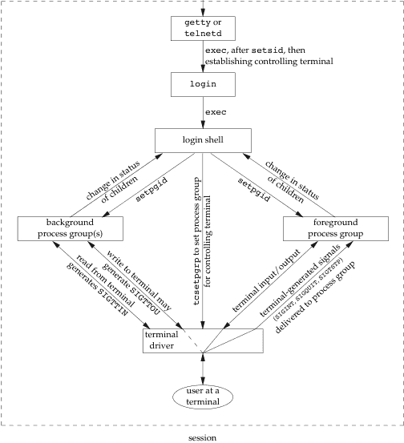

作业控制是必要的还是可取的？作业控制最初是在窗口终端尚未普及之前设计和实现的。有些人声称，设计良好的窗口系统消除了对作业控制的任何需求。有些人抱怨作业控制的实现——需要内核、终端驱动程序、shell 和一些应用程序的支持——是一种权宜之计。有些人使用窗口系统使用作业控制，声称两者都需要。无论你的观点如何，作业控制是 POSIX.1 的必需特性。

**图 9.9** 具有前台和后台作业以及终端驱动程序的作业控制功能摘要

## 9.9 Shell 执行程序

让我们研究一下 shell 如何执行程序，以及这与进程组、控制终端和会话的概念有何关系。为此，我们再次使用 ps 命令。

首先，我们将使用一个不支持作业控制的 shell——在 Solaris 上运行的经典 Bourne shell。如果我们执行

```
ps -o pid,ppid,pgid,sid,comm
```

输出为

| PID | PPID | PGID | SID | COMMAND |
|---|---|---|---|---|
| 949 | 947 | 949 | 949 | sh |
| 1774 | 949 | 949 | 949 | ps |

ps 命令的父进程是 shell，这符合我们的预期。shell 和 ps 命令都在同一个会话和前台进程组（949）中。我们说 949 是前台进程组，因为当你使用不支持作业控制的 shell 执行命令时，你会得到这个结果。

一些平台支持一个选项，即让 ps(1) 命令打印与会话控制终端关联的进程组 ID。此值将在 TPGID 列下显示。不幸的是，ps 命令的输出通常因 UNIX 系统的版本而异。例如，Solaris 10 不支持此选项。在 FreeBSD 8.0、Linux 3.2.0 和 Mac OS X 10.6.8 下，命令

```
ps -o pid,ppid,pgid,sid,tpgid,comm
```

此 shell 不了解作业控制，因此后台作业不会被放入其自己的进程组，控制终端也不会从后台作业中移除。

现在让我们看看 Bourne shell 如何处理管道。当我们执行

```
ps -o pid,ppid,pgid,sid,comm | cat1
```

输出为

| PID | PPID | PGID | SID | COMMAND |
|---|---|---|---|---|
| 949 | 947 | 949 | 949 | sh |
| 1823 | 949 | 949 | 949 | cat1 |
| 1824 | 1823 | 949 | 949 | ps |

（程序 cat1 只是标准 cat 程序的副本，名称不同。我们还有另一个名为 cat2 的 cat 副本，我们将在本节后面使用它。当管道中有两个 cat 副本时，不同的名称让我们可以区分这两个程序。）请注意，管道中的最后一个进程是 shell 的子进程，而管道中的第一个进程是最后一个进程的子进程。看起来 shell fork 了一个自身的副本，然后该副本 fork 以创建管道中每个先前的进程。

如果我们在后台执行管道，

```
ps -o pid,ppid,pgid,sid,comm | cat1 &
```

只有进程 ID 会发生变化。由于 shell 不处理作业控制，后台进程的进程组 ID 仍为 949，会话的进程组 ID 也是如此。

如果后台进程尝试从其控制终端读取会怎样？例如，假设我们执行

```
cat > temp.foo &
```

使用作业控制，这通过将后台作业放入后台进程组来处理，如果后台作业尝试从控制终端读取，则会生成 SIGTTIN 信号。在没有作业控制的情况下处理方式是 shell 自动将后台进程的标准输入重定向到 /dev/null，如果进程本身未重定向标准输入。从 /dev/null 读取会生成文件结束。这意味着我们的后台 cat 进程立即读取文件结束并正常终止。

该名称。下一行我们输入到 shell 被视为密码，并且文件未正确加密，向打印机发送垃圾数据。在这里，我们有两个进程同时尝试从同一设备读取，结果取决于系统。作业控制，如我们前面所述，以更好的方式处理了单个终端在多个进程之间的这种多路复用。

回到我们的 Bourne shell 示例，如果我们执行三个进程的管道，我们可以检查此 shell 使用的进程控制：

```
ps -o pid,ppid,pgid,sid,comm | cat1 | cat2
```

此管道生成以下输出：

| PID | PPID | PGID | SID COMMAND |
| 949 | 947 | 949 | 949 sh |
| 1988 | 949 | 949 | 949 cat2 |
| 1989 | 1988 | 949 | 949 ps |
| 1990 | 1988 | 949 | 949 cat1 |

不要惊讶，如果你在系统上的输出没有显示正确的命令名称。有时你可能会得到如下结果

| PID | PPID | PGID | SID COMMAND |
| 949 | 947 | 949 | 949 sh |
| 1831 | 949 | 949 | 949 sh |
| 1832 | 1831 | 949 | 949 ps |
| 1833 | 1831 | 949 | 949 sh |

这里发生的是 ps 进程与 shell 竞争，后者正在 fork 并执行 cat 命令。在这种情况下，shell 在 ps 获取要打印的进程列表时尚未完成 exec 调用。

同样，管道中的最后一个进程是 shell 的子进程，管道中的所有先前进程都是最后一个进程的子进程。图 9.10 显示了正在发生的事情。

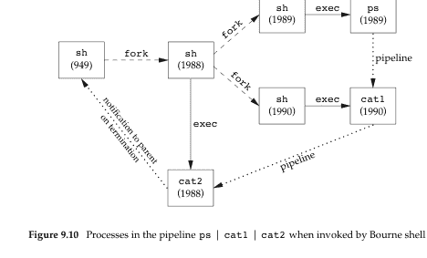

图 9.10 由 Bourne shell 调用时管道 ps | cat1 | cat2 中的进程


由于管道中的最后一个进程是登录 shell 的子进程，当该进程（cat2）终止时，shell 会收到通知。

现在让我们使用在 Linux 上运行的作业控制 shell 来检查相同的示例。这展示了这些 shell 如何处理后台作业。我们将在此示例中使用 Bourne-again shell；使用其他作业控制 shell 的结果几乎相同。

```
ps -o pid,ppid,pgid,sid,tpgid,comm
```

给我们

| PID | PPID | PGID | SID | TPGID | COMMAND |
|---|---|---|---|---|---|
| 2837 | 2818 | 2837 | 2837 | 5796 | bash |
| 5796 | 2837 | 5796 | 2837 | 5796 | ps |

（从本示例开始，我们以更粗的字体显示前台进程组。）我们立即看到了与 Bourne shell 示例的不同之处。Bourne-again shell 将前台作业（ps）放入其自己的进程组（5796）中。ps 命令是进程组领导者，也是该进程组中唯一的进程。此外，该进程组是前台进程组，因为它拥有控制终端。我们的登录 shell 在 ps 命令执行时是一个后台进程组。注意，尽管如此，2837 和 5796 这两个进程组都是同一会话的成员。事实上，我们将在本节的示例中看到，会话从未发生变化。

在后台执行此进程，

```
ps -o pid,ppid,pgid,sid,tpgid,comm &
```

给我们

| PID | PPID | PGID | SID | TPGID | COMMAND |
|---|---|---|---|---|---|
| 2837 | 2818 | 2837 | 2837 | 2837 | bash |
| 5797 | 2837 | 5797 | 2837 | 2837 | ps |

同样，ps 命令被放入其自己的进程组，但这次进程组（5797）不再是前台进程组——它是一个后台进程组。2837 的 TPGID 表明前台进程组是我们的登录 shell。

按如下方式在管道中执行两个进程，

```
ps -o pid,ppid,pgid,sid,tpgid,comm | cat1
```

```
ps -o pid,ppid,pgid,sid,tpgid,comm | cat1 &
```

结果类似，但现在 ps 和 cat1 被放在同一个后台进程组中：

| PID | PPID | PGID | SID | TPGID | COMMAND |
|---|---|---|---|---|---|
| 2837 | 2818 | 2837 | 2837 | 2837 | bash |
| 5801 | 2837 | 5801 | 2837 | 2837 | ps |
| 5802 | 2837 | 5801 | 2837 | 2837 | cat1 |

请注意，shell 创建进程的顺序可能因所使用的特定 shell 而异。

## 9.10 孤儿进程组

我们提到过，父进程终止的进程称为孤儿，并由 init 进程继承。现在我们来看可以被孤弃的整个进程组，并看看 POSIX.1 如何处理这种情况。

### 示例

考虑一个进程 fork 一个子进程然后终止的情况。虽然这没有什么异常（经常发生），但如果子进程在父进程终止时被停止（使用作业控制）会怎样？子进程将如何被继续，以及子进程是否知道自己已被孤弃？图 9.11 显示了这种情况：父进程已 fork 出一个停止的子进程，父进程即将退出。

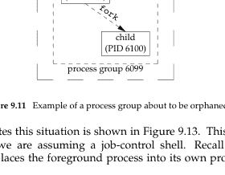

图 9.11 即将成为孤儿的进程组示例

创建此情况的程序如图所示。图 9.13。该程序有一些新特性。这里，我们假设使用的是作业控制 shell。回顾上一节，shell 将前台进程放入其自己的进程组（本例中为 6099），并且 shell 保持在其自己的进程组（2837）中。子进程继承其父进程的进程组（6099）。fork 之后，

- 父进程休眠 5 秒。这是我们（不完美的）让子进程在父进程终止前执行的方法。
- 子进程为挂断信号（SIGHUP）建立信号处理程序，以便我们可以查看是否向子进程发送了该信号。（我们在第 10 章讨论信号处理程序。）
- 子进程使用 kill 函数向自己发送停止信号（SIGTSTP）。这会停止子进程，类似于我们使用终端的挂起字符（Control-Z）停止前台作业。

```
```c
#include "apue.h"
#include <errno.h>

static void
sig_hup(int signo)
{
    printf("SIGHUP received, pid = %ld\n", (long)getpid());
}

static void
pr_ids(char *name)
{
    printf("%s: pid = %ld, ppid = %ld, pgrp = %ld, tpgid = %ld\n",
           name, (long)getpid(), (long)getppid(), (long)getpgrp(),
           (long)tcgetpgrp(STDIN_FILENO));
    fflush(stdout);
}

int
main(void)
{
    char    c;
    pid_t   pid;

    pr_ids("parent");
    if ((pid = fork()) < 0) {
        err_sys("fork error");
    } else if (pid > 0) {      /* parent */
        sleep(5);              /* sleep to let child stop itself */
    } else {                   /* child */
        pr_ids("child");
        signal(SIGHUP, sig_hup);    /* establish signal handler */
        kill(getpid(), SIGTSTP);    /* stop ourself */
        pr_ids("child");           /* prints only if we're continued */
        if (read(STDIN_FILENO, &c, 1) == 1)
            printf("read OK\n");
        else
            printf("read error %d on controlling TTY\n", errno);
    }
    exit(0);
}
```
```

### 图 9.12 创建孤儿进程组

在本例中）并且 shell 保持在其自己的进程组（2837）。子进程继承其父进程的进程组（6099）。fork 后，

## 9.11 FreeBSD 实现

在谈论了进程、进程组、会话和控制终端的各种属性之后，值得看看所有这些是如何实现的。我们将简要查看 FreeBSD 使用的实现。有关 SVR4 实现这些功能的某些细节，可参见 Williams [1989]。图 9.13 显示了 FreeBSD 使用的各种数据结构。

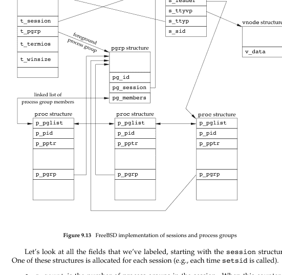

图 9.13 FreeBSD 对会话和进程组的实现

让我们查看我们标记的所有字段，从会话结构开始。为每个会话分配其中一个结构（例如，每次调用 setsid 时）。

- s_count 是会话中的进程组数。当计数器递减到 0 时，结构可以被释放。

- `s_leader` 是指向会话领导者的 proc 结构的指针。
- `s_ttyvp` 是指向控制终端的 vnode 结构的指针。
- `s_tty` 是指向控制终端的 tty 结构的指针。
- `s_sid` 是会话 ID。请记住，会话 ID 的概念不是 Single UNIX Specification 的一部分。

当调用 `setsid` 时，内核中会分配一个新的会话结构。现在 `s_cont` 设置为 1，`s_leader` 设置为指向调用进程的 proc 结构，`s_sid` 设置为进程 ID，并且 `s_ttyvp` 和 `s_t_tty` 设置为空指针，因为新会话没有控制终端。

让我们转向 tty 结构。内核为每个终端设备和每个伪终端设备包含其中一个结构。（我们在第 19 章中更详细地讨论伪终端。）

- `t_session` 指向将此终端作为其控制终端的会话结构。（请注意，tty 结构指向会话结构，反之亦然。）此指针用于终端在终端失去载波时向会话领导者发送挂断信号（图 9.7）。
- `t_pgrp` 指向前台进程组的 pgrp 结构。此字段由终端驱动程序用于向前台进程组发送信号。输入特殊字符生成的三个信号（中断、退出和挂起）发送到前台进程组。
- `t_termios` 是一个包含此终端的所有特殊字符和相关信息的结构，例如波特率、是否启用回显等。我们将在第 18 章返回此结构。
- `t_winsize` 是一个 winsize 结构，包含终端窗口的当前大小。当终端窗口大小发生变化时，会向前台进程组发送 `SIGWINCH` 信号。我们在第 18.12 节中展示如何设置和获取终端的当前窗口大小。

要找到特定会话的前台进程组，内核必须从会话结构开始，沿着 `s_tty` 前进以到达控制终端的 tty 结构，然后沿着 `t_pgrp` 前进以到达前台进程组的 pgrp 结构。pgrp 结构包含特定进程组的信息。

- `pg_id` 是进程组 ID。
- `pg_session` 指向此进程组所属的会话的会话结构。
- `pg_members` 是指向属于此进程组的 proc 结构的列表的指针。该 proc 结构中的 `p_pglst` 是一个双向链表条目，指向该组中的下一个进程和上一个进程，依此类推，直到在该组最后一个进程的 proc 结构中遇到空指针。


proc 结构包含单个进程的所有信息。

- p_pid 包含进程 ID。
- p_pptr 是一个指向父进程 proc 结构的指针。
- p_pgrp 指向进程所属进程组的 pgrp 结构。
- 如前所述，p_qplist 是一个包含指向进程组中前一个进程和后一个进程的指针的结构。

最后，我们介绍 vnode 结构。打开控制终端设备时会分配该结构。进程中对 `/dev/tty` 的所有引用都要通过这个 vnode 结构。

## 9.12 总结

本章介绍了进程组之间的关系——会话由进程组组成。作业控制是当前大多数 UNIX 系统支持的一项功能，我们介绍了支持作业控制的 shell 如何实现这一功能。进程的控制终端 `/dev/tty` 也参与了这些进程关系。

我们多次提到了在所有这些进程关系中使用的信号。下一章将继续讨论信号，详细介绍 UNIX System 中的所有信号。

## 习题

9.1 回顾第 6.8 节中关于 utmp 和 wtmp 文件的讨论。为什么注销记录由 init 进程写入？网络登录时是否也采用同样的处理方式？

9.2 编写一个调用 fork 的小程序，并让子进程创建一个新会话。验证子进程是否成为进程组组长，以及子进程是否不再拥有控制终端。

## 信号

### 10.1 引言

信号是一种软件中断。大多数复杂的应用程序都需要处理信号。信号提供了一种处理异步事件的方式——例如，终端用户键入中断键来停止程序，或者管道中的下一个程序提前终止。

从 UNIX System 的早期版本开始，系统就提供了信号，但 Version 7 等系统提供的信号模型并不可靠。信号可能会丢失，而且进程很难在执行代码的关键区域时关闭选定的信号。4.3BSD 和 SVR3 都对信号模型进行了修改，加入了所谓的可靠信号。不过，Berkeley 和 AT&T 所做的修改彼此不兼容。幸运的是，POSIX.1 对可靠信号例程进行了标准化，这正是我们在此介绍的内容。

本章首先概述信号，并说明每个信号通常用于什么目的。然后，我们将讨论早期实现存在的问题。在了解如何正确处理之前，理解某个实现存在的问题通常十分重要。本章包含许多并不完全正确的示例，以及对其中缺陷的讨论。

### 10.2 信号概念

首先，每个信号都有一个名称。所有这些名称都以三个字符 SIG 开头。例如，SIGABRT 是进程调用 abort 函数时生成的中止信号。SIGALRM 是 alarm 函数设置的定时器到期时生成的闹钟信号。Version 7 有 15 种不同的信号；SVR4 和 4.4BSD 都有 31 种不同的信号。FreeBSD 8.0 支持 32 种不同的信号。Mac OS X 10.6.8 和

Linux 3.2.0 各支持 31 种不同的信号，而 Solaris 10 支持 40 种不同的信号。不过，FreeBSD、Linux 和 Solaris 还支持为支持实时应用程序而引入的其他应用程序定义信号。虽然本书不涵盖 POSIX 实时扩展（更多信息请参阅 Gallmeister [1995]），但截至 SUSv4，实时信号接口已经移入基本规范。

信号名称都在头文件 `<signal.h>` 中定义为正整数常量（即信号编号）。

> 实际上，各个信号是在另一个头文件中定义的，但该头文件会被 `<signal.h>` 包含。让内核包含面向用户级应用程序的头文件被认为是不恰当的，因此，如果应用程序和内核都需要相同的定义，就会将相关信息放在内核头文件中，然后由用户级头文件包含该内核头文件。因此，FreeBSD 8.0 和 Mac OS X 10.6.8 都在 `<sys/signal.h>` 中定义信号。Linux 3.2.0 在 `<bits/signum.h>` 中定义信号，而 Solaris 10 在 `<sys/iso/signal_iso.h>` 中定义信号。

没有任何信号的信号编号为 0。我们将在第 10.9 节看到，kill 函数在一种特殊情况下使用信号编号 0。POSIX.1 将该值称为 null 信号。

许多条件都可以生成信号：

- 终端生成的信号会在用户按下某些终端按键时出现。在终端上按 DELETE 键（在许多系统上也可以按 Control-C）通常会导致生成中断信号（`SIGINT`）。这就是停止失控程序的方法。（我们将在第 18 章看到，可以将该信号映射到终端上的任意字符。）
- 硬件异常会生成信号：除以 0、无效的内存引用等。这些条件通常由硬件检测，然后通知内核。内核随后会为发生该条件时正在运行的进程生成适当的信号。例如，对于执行无效内存引用的进程，会生成 `SIGSEGV`。
- `kill(2)` 函数允许一个进程向另一个进程或进程组发送任意信号。当然，这存在一些限制：我们必须是所发送信号的目标进程的所有者，或者必须是超级用户。
- `kill(1)` 命令允许我们向其他进程发送信号。该程序只是 `kill` 函数的一个接口。此命令通常用于终止失控的后台进程。
- 当进程需要获知各种事件时，软件条件可以生成信号。这些不是硬件生成的条件（例如除以 0），而是软件条件。例如，`SIGURG`（网络连接上有带外数据到达时生成）、`SIGPIPE`（进程向没有读取端的管道写入时生成）以及 `SIGALRM`（进程设置的闹钟到期时生成）。

信号是异步事件的典型示例。对于进程来说，它们似乎会在随机时间发生。进程不能简单地测试某个变量（例如 errno）来判断信号是否已经发生；相反，进程必须告诉内核：“如果这个信号发生了，就执行以下操作。”

我们可以告诉内核，在信号发生时执行以下三种操作之一。我们将其称为信号的*处置方式*，或者与信号关联的*动作*。

1. 忽略信号。大多数信号都可以这样处理，但有两个信号永远不能被忽略：SIGKILL 和 SIGSTOP。之所以不能忽略这两个信号，是为了给内核和超级用户提供一种可靠的方法，用于终止或停止任何进程。此外，如果我们忽略某些由硬件异常生成的信号（例如非法内存引用或除以 0），进程的行为将是未定义的。
2. 捕获信号。为此，我们要告诉内核，每当信号发生时就调用我们的某个函数。在该函数中，我们可以按照自己的需要处理这个条件。例如，如果我们正在编写命令解释器，当用户在键盘上生成中断信号时，我们可能希望返回程序的主循环，并终止当前为用户执行的命令。如果捕获了 SIGCHLD 信号，则表示子进程已经终止，因此信号捕获函数可以调用 waitpid 来获取子进程的进程 ID 和终止状态。再比如，如果进程创建了临时文件，它可能希望为 SIGTERM 信号编写一个信号捕获函数，以清理这些临时文件；SIGTERM 是终止信号，也是 kill 命令默认发送的信号。请注意，SIGKILL 和 SIGSTOP 这两个信号不能被捕获。
3. 采用默认动作。每个信号都有一个默认动作，如图 10.1 所示。请注意，大多数信号的默认动作都是终止进程。

图 10.1 列出了所有信号的名称、哪些系统支持这些信号，以及每个信号的默认动作。SUS 列中，如果某个信号属于 POSIX.1 基本规范，则包含 •；如果它属于 XSI 选项，则包含 XSI。

当默认动作标记为“terminate+core”时，表示进程的内存映像会以 core 为文件名保存在进程的当前工作目录中。（由于文件名为 core，这说明该功能成为 UNIX System 一部分的历史已经相当久远。）大多数 UNIX System 调试器都可以使用该文件检查进程终止时的状态。

> core 文件的生成是大多数 UNIX System 版本中的一种实现特性。虽然该功能不属于 POSIX.1，但 Single UNIX Specification 的 XSI 选项将其列为一种潜在的实现特定动作。

core 文件的名称因实现而异。例如，在 FreeBSD 8.0 上，core 文件名为 cmdname.core，其中 cmdname 是接收到信号的进程所对应命令的名称。在 Mac OS X 10.6.8 上，core 文件名为 core.pid，其中 pid 是接收到信号的进程 ID。（这些系统允许通过 sysctl 参数配置 core 文件名。在 Linux 3.2.0 上，则通过 `/proc/sys/kernel/core_pattern` 配置文件名。）

大多数实现会将 core 文件留在相应进程的当前工作目录中；而 Mac OS X 会将所有 core 文件放在 `/cores` 中。


| 名称 | 描述 | ISO C SUS | FreeBSD 8.0 | Linux 3.2.0 | Mac OS X 10.6.8 | Solaris 10 | 默认动作 |
|---|---|---|---|---|---|---|---|
| SIGABRT | 异常终止 (abort) | • | • |  |  |  | 终止+核心转储 |
| SIGALRM | 计时器到期 (alarm) |  | • | • |  | • | 终止 |
| SIGBUS | 硬件故障 |  | • | • |  | • | 终止+核心转储 |
| SIGCANCEL | 线程库内部使用 |  |  |  |  |  | 忽略 |
| SIGCHLD | 子进程状态改变 |  | • | • | • | • | 忽略 |
| SIGCONT | 继续停止的进程 |  | • | • | • | • | 继续/忽略 |
| SIGEMT | 硬件故障 |  | • | • |  | • | 终止+核心转储 |
| SIGFPE | 算术异常 | • | • | • | • | • | 终止+核心转储 |
| SIGFREEZE | 检查点冻结 |  |  |  |  |  | 忽略 |
| SIGHUP | 挂断 |  | • | • | • | • | 终止 |
| SIGILL | 非法指令 | • | • | • | • | • | 终止+核心转储 |
| SIGINFO | 来自键盘的状态请求 |  |  |  |  |  | 忽略 |
| SIGINT | 终端中断字符 |  | • | • | • | • | 终止 |
| SIGIO | 异步 I/O |  | • | • | • | • | 终止/忽略 |
| SIGIOT | 硬件故障 |  | • | • | • | • | 终止+核心转储 |
| SIGJVM1 | Java 虚拟机内部使用 |  |  |  |  |  | 忽略 |
| SIGJVM2 | Java 虚拟机内部使用 |  |  |  |  |  | 忽略 |
| SIGKILL | 终止 |  | • | • | • | • | 终止 |
| SIGLOST | 资源丢失 |  |  |  |  |  | 终止 |
| SIGLWP | 线程库内部使用 |  | • | • |  | • | 终止/忽略 |
| SIGPIPE | 向无读者的管道写入 |  | • | • | • | • | 终止 |
| SIGPOLL | 可轮询事件 (poll) |  |  | • |  | • | 终止 |
| SIGPROF | 配置文件时间报警 (setitimer) |  | • | • | • | • | 终止 |
| SIGPWR | 断电/重启 |  |  |  |  | • | 终止/忽略 |
| SIGQUIT | 终端退出字符 |  | • | • | • | • | 终止+核心转储 |
| SIGSEGV | 无效内存引用 | • | • | • | • | • | 终止+核心转储 |
| SIGSTKFLT | 协处理器栈故障 |  |  |  |  | • | 终止 |
| SIGSTOP | 停止 |  | • | • | • | • | 停止进程 |
| SIGSYS | 无效系统调用 | XSI | • | • | • | • | 终止+核心转储 |
| SIGTERM | 终止 | • | • | • | • | • | 终止 |
| SIGTHAW | 检查点解冻 |  |  |  |  |  | 忽略 |
| SIGTHR | 线程库内部使用 |  | • | • |  | • | 终止 |
| SIGTRAP | 硬件故障 | XSI | • | • | • | • | 终止+核心转储 |
| SIGTSTP | 终端停止字符 |  | • | • | • | • | 停止进程 |
| SIGTTIN | 后台从控制 tty 读取 |  | • | • | • | • | 停止进程 |
| SIGTTOU | 后台向控制 tty 写入 |  | • | • | • | • | 停止进程 |
| SIGURG | 紧急情况 (sockets) |  | • | • | • | • | 忽略 |
| SIGUSR1 | 用户定义信号 |  | • | • | • | • | 终止 |
| SIGUSR2 | 用户定义信号 |  | • | • | • | • | 终止 |
| SIGVTALRM | 虚拟时间报警 (setitimer) | XSI | • | • | • | • | 终止 |
| SIGWAITING | 线程库内部使用 |  |  |  |  |  | 忽略 |
| SIGWINCH | 终端窗口大小改变 |  | • | • | • | • | 忽略 |
| SIGXCPU | CPU 限制超出 (setrlimit) | XSI | • | • | • | • | 终止或终止+核心转储 |
| SIGXFSZ | 文件大小限制超出 (setrlimit) | XSI | • | • | • | • | 终止或终止+核心转储 |
| SIGXRES | 资源控制超出 |  |  |  |  | • | 忽略 |

核心文件将不会生成，如果 (a) 进程为 set-user-ID 且当前用户不是程序文件的拥有者，(b) 进程为 set-group-ID 且当前用户不是文件的组拥有者，(c) 用户没有权限在当前工作目录中写入，(d) 文件已存在且用户没有权限写入它，或 (e) 文件太大 (请回顾第 7.11 节中的 RLIMIT_CORE 限制)。核心文件的权限 (假设文件尚不存在) 通常为用户可读和用户可写，尽管 Mac OS X 设置为用户可读。

在图 10.1 中，描述为“硬件故障”的信号对应于实现定义的硬件故障。这些名称中的许多取自原始 PDP-11 实现的 UNIX 系统。请查阅您系统的手册以确定这些信号对应于哪种类型的错误。

我们现在更详细地描述每个信号。

SIGABRT    该信号由调用 abort 函数 (第 10.17 节) 生成。进程异常终止。

SIGALRM    当使用 alarm 函数设置的计时器到期时生成该信号 (有关更多详细信息，请参阅第 10.10 节)。当由 setitimer(2) 函数设置的间隔计时器到期时也会生成该信号。

SIGBUS    该信号表示实现定义的硬件故障。实现通常在某些类型的内存故障上生成该信号，我们在第 14.8 节中描述。

SIGCANCEL    该信号由 Solaris 线程库内部使用。它不用于一般用途。

SIGCHLD    每当进程终止或停止时，SIGCHLD 信号会发送给父进程。默认情况下，该信号被忽略，因此父进程必须捕获该信号，如果它希望在子进程状态改变时收到通知。信号捕获函数中的正常操作是调用其中一个 wait 函数以获取子进程的进程 ID 和终止状态。

System V 的早期版本有一个类似的信号名为 SIGCLD (没有 H)。该信号的语义与其他信号不同，并且早在 SVR2 时，手动页就强烈不建议在新程序中使用它。 (奇怪的是，该警告在 SVR3 和 SVR4 版本的手动页中消失了。) 应用程序应使用标准的 SIGCHLD 信号，但要注意许多系统将 SIGCLD 定义为与 SIGCHLD 相同以保持向后兼容。如果您维护使用 SIGCLD 的软件，您需要检查您系统的手动页以查看它遵循哪种语义。我们在第 10.7 节中讨论这两个信号。

SIGCONT    该作业控制信号发送给停止的进程以继续执行。默认操作是继续停止的进程，但如果进程未停止则忽略信号。例如，全屏编辑器可能会捕获该信号并使用信号处理程序记下重新绘制终端屏幕的事项。有关更多详细信息，请参阅第 10.21 节。

## SIGEMT

这表示实现定义的硬件故障。

名称 EMT 来自 PDP-11 "emulator trap" 指令。并非所有平台都支持该信号。例如，在 Linux 上，SIGEMT 仅对选定的架构支持，例如 SPARC、MIPS 和 PA-RISC。

## SIGFPE

这表示算术异常，例如除以 0、浮点溢出等。

## SIGFREEZE

该信号仅由 Solaris 定义。它用于通知在冻结系统状态之前需要采取特殊操作的进程，例如系统进入休眠或暂停模式时可能发生的情况。

## SIGHUP

如果终端接口检测到断开，则该信号发送给与控制终端关联的控制进程 (会话领导者)。参考图 9.13，我们看到信号发送给会话结构中 s_leader 字段指向的进程。只有在终端的 CLOCAL 标志未设置时，才会为此条件生成该信号。 (终端的 CLOCAL 标志在连接的终端为本地时设置。该标志告诉终端驱动程序忽略所有调制解调器状态行。我们在第 18 章中描述如何设置此标志。)

请注意，接收该信号的会话领导者可能在后台；图 9.7 给出了一个示例。这与正常的终端生成信号 (中断、退出和挂起) 不同，后者始终传递给前台进程组。

如果会话领导者终止，也会生成该信号。在这种情况下，信号发送给前台进程组中的每个进程。

该信号通常用于通知守护进程 (第 13 章) 重新读取其配置文件。选择 SIGHUP 执行此任务的原因是守护进程不应具有控制终端并且通常永远不会收到此信号。

## SIGILL

该信号表示进程已执行非法硬件指令。

4.3BSD 从 abort 函数生成该信号。SIGABRT 现在用于此目的。

## SIGINFO

该 BSD 信号由终端驱动程序在我们输入状态键 (通常为 Control-T) 时生成。该信号发送给前台进程组中的所有进程 (参考图 9.9)。该信号通常导致前台进程组中进程的状态信息显示在终端上。

Linux 不提供对 SIGINFO 的支持，尽管该符号在 Alpha 平台上被定义为与 SIGPWR 相同的值。这很可能是为了提供与为 OSF/1 开发的软件的某种程度的兼容性。


## SIGINT

该信号由终端驱动程序在我们按下中断键（通常是 DELETE 或 Control-C）时生成。该信号发送给前台进程组中的所有进程（参见图 9.9）。该信号通常用于终止失控的程序，尤其是在它在屏幕上产生大量不需要的输出时。

## SIGIO

该信号表示异步 I/O 事件。我们在第 14.5.2 节中讨论它。

在图 10.1 中，我们将 SIGIO 的默认动作标记为“terminate”或“ignore”。不幸的是，默认值取决于系统。在 System V 下，SIGIO 与 SIGPOLL 相同，因此其默认动作是终止进程。在 BSD 下，默认是忽略该信号。

Linux 3.2.0 和 Solaris 10 将 SIGIO 定义为与 SIGPOLL 相同的值，因此默认行为是终止进程。在 FreeBSD 8.0 和 Mac OS X 10.6.8 上，默认是忽略该信号。

## SIGIOT

这表示实现定义的硬件故障。

名称 IOT 来自 PDP-11 中“input/output TRAP”指令的助记符。System V 的早期版本从 abort 函数生成此信号。SIGABRT 现在用于此目的。

在 FreeBSD 8.0、Linux 3.2.0、Mac OS X 10.6.8 和 Solaris 10 上，SIGIOT 被定义为与 SIGABRT 相同的值。

## SIGJVM1

一个为 Solaris 上的 Java 虚拟机保留的信号。

## SIGJVM2

另一个为 Solaris 上的 Java 虚拟机保留的信号。

## SIGKILL

该信号是两个不能被捕获或忽略的信号之一。它为系统管理员提供了一种确保杀死任何进程的方法。

## SIGLOST

该信号用于通知在 Solaris NFSv4 客户端系统上运行的进程，在恢复期间无法重新获取锁。

## SIGLWP

该信号由 Solaris 线程库内部使用；它不可供一般使用。在 FreeBSD 上，SIGLWP 被定义为 SIGTHR 的别名。

## SIGPIPE

如果我们向管道写入但读取者已终止，则会生成 SIGPIPE。我们在第 15.2 节中描述管道。当进程向不再连接的 SOCK_STREAM 类型套接字写入时也会生成此信号。我们在第 16 章中描述套接字。

## SIGPOLL

该信号在 SUSv4 中被标记为过时，因此可能在标准未来的版本中被移除。它可以在可轮询设备上发生特定事件时生成。我们在第 14.4.2 节中用 poll 函数描述此信号。SIGPOLL 源自 SVR3，并且大致对应于 BSD 的 SIGIO 和 SIGURG 信号。

## SIGPROF

该信号在 SUSv4 中被标记为过时，因此可能在标准未来的版本中被移除。该信号在由 setitimer(2) 函数设置的分析间隔计时器到期时生成。

## SIGPWR

该信号取决于系统。其主要用途是在具有不间断电源供应（UPS）的系统上。如果电源故障，UPS 接管，软件通常会被通知。此时无需采取任何行动，因为系统继续在电池供电下运行。但如果电池电量低（例如，电源关闭时间过长），软件通常会被再次通知；此时，系统最好关闭一切。这时应发送 SIGPWR。在大多数系统上，被通知低电量条件的进程会向 init 进程发送 SIGPWR 信号，而 init 处理系统关闭。

Solaris 10 和一些 Linux 发行版在 inittab 文件中为此目的有条目：powerfail 和 powerwait（或 powerokwait）。在图 10.1 中，我们将 SIGPWR 的默认动作标记为“terminate”或“ignore”。不幸的是，默认值取决于系统。Linux 上的默认是终止进程。在 Solaris 上，该信号默认被忽略。

## SIGQUIT

该信号由终端驱动程序在我们按下终端退出键（通常是 Control-backslash）时生成。该信号发送给前台进程组中的所有进程（参见图 9.9）。该信号不仅终止前台进程组（如 SIGINT 所做），而且还会生成核心文件。

## SIGSEGV

该信号表示进程进行了无效的内存引用（这通常表明程序存在错误，例如取消引用未初始化的指针）。

名称 SEGV 代表“segmentation violation”。

## SIGSTKFLT

该信号仅由 Linux 定义。它出现在 Linux 最早的版本中，当时它 intended 用于由数学协处理器引起的栈故障。该信号不由内核生成，但为了向后兼容而保留。

## SIGSTOP

该作业控制信号停止一个进程。它类似于交互式停止信号（SIGTSTP），但 SIGSTOP 不能被捕获或忽略。

## SIGSYS

这表示无效的系统调用。某种程度上，进程执行了内核认为是一个系统调用的机器指令，但指示系统调用类型的参数无效。如果您构建了一个使用新系统调用的程序，然后尝试在系统调用不存在的操作系统的旧版本上运行相同的二进制文件，可能会发生这种情况。

## SIGTERM

这是 kill(1) 命令默认发送的终止信号。因为它可以被应用程序捕获，使用 SIGTERM 给程序一个优雅终止的机会，在退出前进行清理（与不能被捕获或忽略的 SIGKILL 相反）。

## SIGTHAW

该信号仅由 Solaris 定义，用于通知在系统从暂停状态恢复操作后需要采取特殊操作的进程。

## SIGTHR

这是一个为 FreeBSD 上的线程库保留的信号。它被定义为与 SIGLWP 具有相同的值。

## SIGTRAP

该信号表示实现定义的硬件故障。

信号名称来自 PDP-11 的 TRAP 指令。实现通常使用此信号在执行断点指令时将控制转移到调试器。

## SIGTSTP

该交互式停止信号由终端驱动程序在我们按下终端挂起键（通常是 Control-Z）时生成。该信号发送给前台进程组中的所有进程（参见图 9.9）。

不幸的是，术语 stop 有不同的含义。在讨论作业控制和信号时，我们谈论停止和继续作业。然而，终端驱动程序在历史上使用术语 stop 来指使用 Control-S 和 Control-Q 字符停止和启动终端输出。因此，终端驱动程序将生成交互式停止信号的字符称为挂起字符，而不是停止字符。

## SIGTTIN

该信号由终端驱动程序在后台进程组中的进程尝试从其控制终端读取时生成。（参见第 9.8 节对此主题的讨论。）作为特殊情况，如果（a）读取进程正在忽略或阻塞此信号或（b）读取进程的进程组是孤立的，则不会生成信号；相反，读操作失败并将 errno 设置为 EIO。

## SIGTTOU

该信号由终端驱动程序在后台进程组中的进程尝试向其控制终端写入时生成。（这在第 9.8 节中讨论。）与后台读取不同，进程可以选择允许向控制终端进行后台写入。我们在第 18 章中描述如何修改此选项。

如果不允许后台写入，则与 SIGTTIN 信号类似，有两种特殊情况：如果（a）写入进程正在忽略或阻塞此信号或（b）写入进程的进程组是孤立的，则不会生成信号；相反，写操作返回错误并将 errno 设置为 EIO。

无论是否允许后台写入，某些终端操作（除写入外）也可能生成 SIGTTOU 信号。


其中包括 `tcsetattr`、`tcsendbreak`、`tcdrain`、`tcflush`、`tcflow` 和 `tcsetpgrp` 等函数。我们将在第 18 章中描述这些终端操作。

### SIGURG

该信号通知进程发生了紧急情况。当网络连接上接收到带外数据时，可能会产生该信号。

### SIGUSR1

这是一个用户自定义信号，供应用程序使用。

### SIGUSR2

这是另一个用户自定义信号，与 SIGUSR1 类似，供应用程序使用。

### SIGVTALRM

当由 `setitimer(2)` 函数设置的虚拟间隔定时器超时时，会产生该信号。

### SIGWAITING

该信号由 Solaris 线程库内部使用，不能用于一般用途。

### SIGWINCH

内核维护与每个终端和伪终端相关联的窗口大小。进程可以使用 `ioctl` 函数获取和设置窗口大小，我们将在第 18.12 节中描述该函数。如果进程使用 `ioctl` 的 set-window-size 命令改变了窗口大小（与之前的值不同），内核会向前台进程组产生 SIGWINCH 信号。

### SIGXCPU

单一 UNIX 规范支持将资源限制作为 XSI 选项的一部分；请参阅第 7.11 节。如果进程超过其软 CPU 时间限制，则会产生 SIGXCPU 信号。

在图 10.1 中，我们将 SIGXCPU 的默认动作标记为“终止”或“带核心文件终止”。默认动作取决于操作系统。Linux 3.2.0 和 Solaris 10 支持默认动作为带核心文件终止，而 FreeBSD 8.0 和 Mac OS X 10.6.8 支持的默认动作为终止但不产生核心文件。单一 UNIX 规范要求默认动作是异常终止进程。是否生成核心文件由实现决定。

### SIGXFSZ

如果进程超过其软文件大小限制，则会产生该信号；请参阅第 7.11 节。

与 SIGXCPU 一样，SIGXFSZ 的默认动作取决于操作系统。在 Linux 3.2.0 和 Solaris 10 上，默认动作是终止进程并创建核心文件。在 FreeBSD 8.0 和 Mac OS X 10.6.8 上，默认动作是终止进程但不生成核心文件。单一 UNIX 规范要求默认动作是异常终止进程。是否生成核心文件由实现决定。

### SIGXRES

该信号仅由 Solaris 定义。它可选地用于通知超过预配置资源值的进程。Solaris 资源控制机制是一个通用设施，用于控制独立应用程序集之间对共享资源的使用。

## 10.3 signal 函数

UNIX 系统信号特性最简单的接口是 `signal` 函数。

```
#include <signal.h>
void (*signal(int signo, void (*func)(int)))(int);
返回值：若成功则为之前的信号处理方式（见下文），出错则为 SIG_ERR
```

`signal` 函数由 ISO C 定义，ISO C 不涉及多进程、进程组、终端 I/O 等内容。因此，它对信号的定义非常模糊，几乎无法用于 UNIX 系统。

源自 UNIX System V 的实现支持 `signal` 函数，但它提供的是旧的不可靠信号语义。（我们将在第 10.4 节中描述这些较旧的语义。）`signal` 函数为需要旧语义的应用程序提供向后兼容性。新应用程序不应使用这些不可靠信号。

4.4BSD 也提供了 `signal` 函数，但它是根据 `sigaction` 函数（我们将在第 10.14 节中描述）来定义的，因此在 4.4BSD 下使用它提供的是较新的可靠信号语义。当前大多数系统都遵循这一策略，但 Solaris 10 对 `signal` 函数遵循 System V 语义。

由于 `signal` 的语义在不同实现之间存在差异，我们必须改用 `sigaction` 函数。我们在第 10.14 节中提供了一个使用 `sigaction` 的 `signal` 实现。本书中的所有示例都使用图 10.18 中的 `signal` 函数，以便无论在哪个特定平台上都能获得一致的语义。

`signo` 参数只是图 10.1 中某个信号的名称。`func` 的值是 (a) 常量 `SIG_IGN`，(b) 常量 `SIG_DFL`，或者 (c) 当信号发生时要调用的函数的地址。如果我们指定 `SIG_IGN`，就是告诉系统忽略该信号。（请记住，我们不能忽略 `SIGKILL` 和 `SIGSTOP` 这两个信号。）当我们指定 `SIG_DFL` 时，就是将与该信号关联的动作设置为其默认值（参见图 10.1 中的最后一列）。当我们指定一个在信号发生时要调用的函数的地址时，就是在安排“捕获”该信号。我们将该函数称为信号处理程序或信号捕获函数。

`signal` 函数的原型说明该函数需要两个参数，并返回一个指向返回空值（void）的函数的指针。`signal` 函数的第一个参数 `signo` 是一个整数。第二个参数是一个指向函数的指针，该函数接受一个整数参数并返回空值。作为 `signal` 返回值返回的函数的地址所指向的函数接受一个整数参数（最后的 `(int)`）。用通俗的话说，这个声明表示信号处理程序被传入一个整数参数（信号编号）并且不返回任何值。当我们调用 `signal` 来建立信号处理程序时，第二个参数就是指向该函数的指针。`signal` 的返回值是指向前一个信号处理程序的指针。

许多系统会以额外的、依赖于实现的参数来调用信号处理程序。我们将在第 10.14 节进一步讨论这一点。

本节开头所示的那令人困惑的 `signal` 函数原型可以通过使用下面的 `typedef` 变得更简单 [Plauger 1992]：

```
typedef void Sigfunc(int);
```

于是原型变为：

```
Sigfunc *signal(int, Sigfunc *);
```

我们已将此 `typedef` 包含在 `apue.h`（附录 B）中，并在本章的函数中使用了它。

如果我们查看系统的 `<signal.h>` 头文件，很可能会发现如下形式的声明：

```
#define SIG_ERR    (void (*)())-1
#define SIG_DFL    (void (*)())0
#define SIG_IGN    (void (*)())1
```

这些常量可以代替“指向接受整数参数并返回空值的函数的指针”（即 `signal` 的第二个参数以及 `signal` 的返回值）。这些常量所用的三个值不一定是 −1、0 和 1。它们必须是三个永远不可能是任何可声明函数地址的值。大多数 UNIX 系统使用所示的值。

### 示例

图 10.2 显示了一个简单的信号处理程序，它捕获两个用户自定义信号之一并打印信号编号。在第 10.10 节中，我们将描述 `pause` 函数，它只是挂起调用进程直到收到信号。

```
#include "apue.h"

static void sig_usr(int);    /* 两个信号共用一个处理程序 */

int
main(void)
{
    if (signal(SIGUSR1, sig_usr) == SIG_ERR)
        err_sys("can't catch SIGUSR1");
    if (signal(SIGUSR2, sig_usr) == SIG_ERR)
        err_sys("can't catch SIGUSR2");
    for ( ; ; )
        pause();
}

static void
sig_usr(int signo)        /* 参数是信号编号 */
{
    if (signo == SIGUSR1)
        printf("received SIGUSR1\n");
    else if (signo == SIGUSR2)
        printf("received SIGUSR2\n");
    else
        err_dump("received signal %d\n", signo);
}
```

图 10.2 捕获 SIGUSR1 和 SIGUSR2 的简单程序

我们在后台调用该程序，并使用 `kill(1)` 命令向它发送信号。请注意，UNIX 系统中的术语 `kill` 实际上是一个误称。`kill(1)` 命令和 `kill(2)` 函数只是向进程或进程组发送一个信号。该信号是否终止进程取决于发送的是哪个信号，以及进程是否已安排捕获该信号。

```
$ ./a.out &
[1] 7216
$ kill -USR1 7216
received SIGUSR1
$ kill -USR2 7216
received SIGUSR2
$ kill 7216
[1]+ Terminated      ./a.out
```

在后台启动进程
作业控制 shell 打印作业编号和进程 ID
向它发送 SIGUSR1
向它发送 SIGUSR2
现在向它发送 SIGTERM

当我们发送 SIGTERM 信号时，进程被终止，因为它没有捕获该信号，而该信号的默认动作就是终止。

## 程序启动

当一个程序被执行时，所有信号的状态要么是默认，要么是忽略。通常，除非调用 `exec` 的进程正在忽略某个信号，否则所有信号都被设置为默认动作。具体来说，`exec` 函数会将任何正在被捕获的信号的处理方式更改为默认动作，并保持所有其他信号的状态不变。（当然，一个调用 `exec` 的进程正在捕获的信号，在新程序中不可能被同一个函数捕获，因为调用者中信号捕获函数的地址在被执行的新程序文件中很可能没有意义。）

这种信号状态行为的一个具体例子是交互式 shell 如何处理后台进程的中断和退出信号。对于不支持作业控制的 shell，当我们在后台执行一个进程时，例如：

```
cc main.c &
```

shell 会自动将后台进程中中断和退出信号的处理方式设置为忽略。这样做是为了如果我们键入中断字符，它不会影响后台进程。如果不这样做，而我们键入了中断字符，那么它不仅会终止前台进程，还会终止所有后台进程。

许多捕获这两个信号的交互式程序都有如下代码：

```
void sig_int(int), sig_quit(int);
if (signal(SIGINT, SIG_IGN) != SIG_IGN)
    signal(SIGINT, sig_int);
if (signal(SIGQUIT, SIG_IGN) != SIG_IGN)
    signal(SIGQUIT, sig_quit);
```

按照这种方法，进程仅在该信号当前未被忽略时才捕获它。


这两次对 signal 的调用也展示了 signal 函数的一个限制：我们无法在不改变信号处理方式的情况下确定其当前处理方式。我们将在本章后面看到 sigaction 函数如何允许我们在不改变信号处理方式的情况下确定信号的处理方式。

## 进程创建

当进程调用 fork 时，子进程继承父进程的信号处理方式。这里，由于子进程开始时拥有父进程内存映像的副本，信号捕获函数的地址在子进程中是有意义的。

## 10.4 不可靠的信号

在早期的 UNIX 系统版本（如 Version 7）中，信号是不可靠的。我们这样说的意思是信号可能会丢失：一个信号可能发生，而进程永远不知道。此外，进程对信号几乎没有控制能力：进程可以捕获信号或忽略它。有时，我们希望告诉内核阻塞一个信号：不要忽略它，只要记住它是否发生，等我们准备好时再告诉我们。

4.2BSD 进行了修改，提供了所谓的可靠信号。随后，SVR3 做了一系列不同的修改，以在 System V 下提供可靠信号。POSIX.1 选择了 BSD 模型作为标准。

这些早期版本的一个问题是，每次信号发生时，信号的动作都会被重置为默认动作。（在前面的示例中，当我们运行图 10.2 中的程序时，我们通过只捕获每个信号一次来避开这个细节。）描述这些早期系统的编程书籍中的经典示例是如何处理中断信号。通常描述的代码如下所示：

```
int sig_int(); /* my signal handling function */
:
signal(SIGINT, sig_int); /* establish handler */
:
sig_int()
{
    signal(SIGINT, sig_int); /* reestablish handler for next time */
    /* process the signal ... */
}
```

（信号处理程序被声明为返回整数，原因是这些早期系统不支持 ISO C 的 void 数据类型。）

这段代码的问题在于存在一个时间窗口——在信号发生之后、但在信号处理程序中调用 signal 之前——中断信号可能再次发生。这第二个信号将导致默认动作发生，对于该信号而言，这个动作会终止进程。这是那种大多数时候都能正确工作的状况之一，使我们误以为它是正确的，而实际上并非如此。

这些早期系统的另一个问题是，当进程不希望信号发生时，它无法关闭信号。进程所能做的只是忽略该信号。有时，我们希望告诉系统：“阻止以下信号打断我，但记住它们是否发生。”展示这个缺陷的经典示例是一段捕获信号并为进程设置一个标志以表示信号发生的代码：

```c
int    sig_int();              /* my signal handling function */
int    sig_int_flag;            /* set nonzero when signal occurs */

main()
{
    signal(SIGINT, sig_int);    /* establish handler */

    :

    while (sig_int_flag == 0)
        pause();                /* go to sleep, waiting for signal */
    :
}

sig_int()
{
    signal(SIGINT, sig_int);    /* reestablish handler for next time */
    sig_int_flag = 1;           /* set flag main loop to examine */
}
```

这里，进程调用 pause 函数使其休眠，直到捕获到一个信号。当信号被捕获时，信号处理程序只是将标志 sig_int_flag 设置为非零值。信号处理程序返回后，进程会被内核自动唤醒，注意到标志非零，然后执行它需要做的任何事。但是存在一个可能出错的时间窗口。如果在测试 sig_int_flag 之后、调用 pause 之前信号发生，进程可能会永远休眠（假设信号不再产生）。这次信号的发生就丢失了。这是另一种不正确代码的示例，但它大多数时候都能工作。调试这类问题可能很困难。

## 10.5 被中断的系统调用

早期 UNIX 系统的一个特点是，如果进程在“慢速”系统调用中被阻塞时捕获到一个信号，该系统调用会被中断。系统调用返回一个错误，并将 errno 设置为 EINTR。这样做是基于这样的假设：既然信号发生了且进程捕获了它，那么很有可能发生了某件应该唤醒被阻塞系统调用的事情。

> > 这里，我们必须区分系统调用和函数。信号被捕获时，被中断的是内核中的系统调用。

为了避免应用程序必须处理被中断的系统调用，4.2BSD 引入了自动重启某些被中断系统调用的机制。自动重启的系统调用包括 ioctl、read、readv、write、writev、wait 和 waitpid。正如我们已经提到的，前五个函数只有在操作慢速设备时才会被信号中断；wait 和 waitpid 则总是在捕获到信号时被中断。由于这对一些不希望操作在被中断后重启的应用程序造成了问题，4.3BSD 允许进程在逐个信号的基础上禁用该特性。

POSIX.1 要求实现仅当 SA_RESTART 标志对中断信号生效时才重启系统调用。我们将在 10.14 节看到，这个标志与 sigaction 函数一起使用，允许应用程序请求重启被中断的系统调用。

历史上，当使用 signal 函数建立信号处理程序时，各种实现对被中断系统调用的处理方式有所不同。System V 默认从不重启系统调用。相比之下，如果调用被信号中断，BSD 会重启它们。在 FreeBSD 8.0、Linux 3.2.0 和 Mac OS X 10.6.8 上，使用 signal 函数安装信号处理程序时，被中断的系统调用将被重启。然而，Solaris 10 的默认行为是，当系统调用被通过 signal 函数安装的信号处理程序中断时，返回一个错误（EINTR）。通过使用我们自己的 signal 函数实现（如图 10.18 所示），我们避免了处理这些差异。

4.2BSD 引入自动重启特性的原因之一是，有时我们不知道输入或输出设备是慢速设备。如果我们编写的程序可以交互使用，那么它可能正在读取或写入慢速设备，因为终端就属于这一类。如果我们在此程序中捕获信号，并且系统不提供重启能力，那么我们必须检查每次 read 或 write 是否返回被中断错误，并重新发起 read 或 write。

图 10.3 概括了各种实现提供的信号函数及其语义。

| 函数 | 系统 | 信号处理程序保持安装 | 阻塞信号的能力 | 自动重启被中断的系统调用？ |
|---|---|---|---|---|
| signal | ISO C, POSIX.1 | 未指定 | 未指定 | 未指定 |
|  | V7, SVR2, SVR3 |  |  | 从不 |
|  | SVR4, Solaris |  |  | 从不 |
|  | 4.2BSD | • | • | 总是 |
|  | 4.3BSD, 4.4BSD, FreeBSD, Linux, Mac OS X | • | • | 默认 |
| sigaction | POSIX.1, 4.4BSD, SVR4, FreeBSD, Linux, Mac OS X, Solaris | • | • | 可选 |

图 10.3 各种信号实现提供的特性

请注意，来自其他供应商的 UNIX 系统的值可能与图中所示不同。例如，SunOS 4.1.2 下的 sigaction 默认会重启被中断的系统调用，这与图 10.3 中列出的平台不同。

在图 10.18 中，我们提供了自己的 signal 函数版本，它会自动尝试重启被中断的系统调用（SIGALRM 信号除外）。在图 10.19 中，我们提供了另一个函数 signal_intr，它尽量不进行重启。

我们将在 14.4 节中结合 select 和 poll 函数进一步讨论被中断的系统调用。

## 10.6 可重入函数

当进程处理一个正在被捕获的信号时，进程正在执行的正常指令序列会被信号处理程序临时中断。进程随后继续执行，但现在执行的是信号处理程序中的指令。如果信号处理程序返回（而不是，例如，调用 exit 或 longjmp），那么进程在信号被捕获时正在执行的正常指令序列将接着继续执行。（这与硬件中断发生时的情况类似。）但在信号处理程序中，我们无法判断进程在信号被捕获时执行到了哪里。如果进程正在使用 malloc 在堆上分配额外内存，而我们从信号处理程序中调用了 malloc，会怎样？或者，如果进程正在调用一个函数（如 getpwnam，见 6.2 节），该函数将其结果存储在静态位置，而我们又从信号处理程序调用了同一个函数，会怎样？在 malloc 的示例中，可能给进程带来灾难性后果，因为 malloc 通常维护一个包含其所有已分配区域的链表，并且它可能正在修改这个链表。对于 getpwnam，返回给正常调用者的信息可能会被返回给信号处理程序的信息覆盖。

单一 UNIX 规范指定了保证可以在信号处理程序内安全调用的函数。这些函数是可重入的，并且被单一 UNIX 规范称为异步信号安全（async-signal safe）。除了可重入之外，如果在操作期间信号的传递可能导致不一致，它们还会阻塞任何信号。图 10.4 列出了这些异步信号安全函数。图 10.4 中未包含的大多数函数之所以缺失，是因为 (a) 已知它们使用静态数据结构，(b) 它们调用 malloc 或 free，或 (c) 它们是标准 I/O 库的一部分。大多数标准 I/O 库的实现以不可重入的方式使用全局数据结构。请注意，即使我们在某些示例中从信号处理程序调用 printf，也不能保证产生预期结果，因为信号处理程序可能会中断主程序中的 printf 调用。

请注意，即使我们从信号处理程序调用图 10.4 中列出的函数，每个线程只有一个 errno 变量（回顾 1.7 节关于 errno 和线程的讨论），而我们可能会修改它的值。考虑一个在 main 设置 errno 之后立即被调用的信号处理程序。例如，如果信号处理程序调用 read，该调用可能会改变 errno 的值，从而抹掉刚刚设置的值。


| abort | faccessat | linkat | select | socketpair |
| accept | fchmod | listen | sem_post | stat |
| access | fchmodat | lseek | send | symlink |
| aio_error | fchown | lstat | sendmsg | symlinkat |
| aio_return | fchownat | mkdir | sendto | tcdrain |
| aio_suspend | fcntl | mkdirat | setgid | tcflow |
| alarm | fdatasync | mkfifo | setpgid | tcflush |
| bind | fexecve | mkfifoat | setsid | tcgetattr |
| cfgetispeed | fork | mknod | setsopt | tcsetbreak |
| cfgetospeed | fstat | mknodat | setuid | tcsetattr |
| cfsetispeed | fstatat | open | shutdown | tcsetpgrp |
| cfsetospeed | fsync | openat | sigaction | tcgetpgrp |
| chdir | ftruncate | pause | sigaddset | time |
| chmod | futimens | pipe | sigdelset | timer_getoverrun |
| chown | getegid | poll | sigemptyset | timer_gettime |
| clock_gettime | geteuid | pselect | sigfillset | timer_settime |
| close | getgid | raise | sigismember | times |
| connect | getgroups | read | signal | umask |
| creat | getpeername | readlink | sigpause | uname |
| dup | getpgid | readlinkat | sigpending | unlink |
| dup2 | getpid | recv | sigprocmask | unlinkat |
| execl | getppid | recvfrom | sigqueue | utime |
| execle | getsockname | recvmsg | sigset | utimensat |
| execv | getsockopt | rename | sigsuspend | utimes |
| execve | getuid | renameat | sleep | wait |
| _Exit | kill | rmdir | socketmark | waitpid |
| _exit | link | rmdir | socket | write |

Figure 10.4 Reentrant functions that may be called from a signal handler

stored in main. Therefore, as a general rule, when calling the functions listed in Figure 10.4 from a signal handler, we should save and restore errno. (Be aware that a commonly caught signal is SIGCHLD, and its signal handler usually calls one of the wait functions. All the wait functions can change errno.)

Note that longjmp (Section 7.10) and siglongjmp (Section 10.15) are missing from Figure 10.4, because the signal may have occurred while the main routine was updating a data structure in a nonreentrant way. This data structure could be left half updated if we call siglongjmp instead of returning from the signal handler. If it is going to do such things as update global data structures, as we describe here, while catching signals that cause sigsetjmp to be executed, an application needs to block the signals while updating the data structures.

## Example

Figure 10.5 shows a program that calls the nonreentrant function getpwname from a signal handler that is called every second. We describe the alarm function in Section 10.10. We use it here to generate a SIGALRM signal every second.

```
#include "apue.h"
#include <pwd.h>

static void
my_alarm(int signo)
{
    struct passwd  *rootptr;
    printf("in signal handler\n");
    if ((rootptr = getpwnam("root")) == NULL)
        err_sys("getpwnam(root) error");
    alarm(1);
}
int
main(void)
{
    struct passwd  *ptr;
    signal(SIGALRM, my_alarm);
    alarm(1);
    for ( ; ; ) {
        if ((ptr = getpwnam("sar")) == NULL)
            err_sys("getpwnam error");
        if (strcmp(ptr->pw_name, "sar") != 0)
            printf("return value corrupted!, pw_name = %s\n", ptr->pw_name);
    }
}
```

Figure 10.5 Call a nonreentrant function from a signal handler

When this program was run, the results were random. Usually, the program would be terminated by a SIGSEGV signal when the signal handler returned after several iterations. An examination of the core file showed that the main function had called getpwnam, but that when getpwnam called free, the signal handler interrupted it and called getpwnam, which in turn called free. The data structures maintained by malloc and free had been corrupted when the signal handler (indirectly) called free while the main function was also calling free. Occasionally, the program would run for several seconds before crashing with a SIGSEGV error. When the main function did run correctly after the signal had been caught, the return value was sometimes corrupted and sometimes fine.

As shown by this example, if we call a nonreentrant function from a signal handler, the results are unpredictable.

## 10.7 SIGCLD Semantics

Two signals that continually generate confusion are SIGCLD and SIGCHLD. The name SIGCLD (without the H) is from System V, and this signal has different semantics from the BSD signal, named SIGCHLD. The POSIX.1 signal is also named SIGCHLD.

The semantics of the BSD SIGCHLD signal are normal, in the sense that its semantics are similar to those of all other signals. When the signal occurs, the status of a child has changed, and we need to call one of the wait functions to determine what has happened.

System V, however, has traditionally handled the SIGCLD signal differently from other signals. SVR4-based systems continue this questionable tradition (i.e., compatibility constraint) if we set its disposition using either signal or sigset (the older, SVR3-compatible functions to set the disposition of a signal). This older handling of SIGCLD consists of the following behavior:

- 1. If the process specifically sets its disposition to SIG_IGN, children of the calling process will not generate zombie processes. Note that this is different from its default action (SIG_DFL), which from Figure 10.1 is to be ignored. Instead, on termination, the status of these child processes is discarded. If it subsequently calls one of the wait functions, the calling process will block until all its children have terminated, and then wait returns -1 with errno set to ECHILD. (The default disposition of this signal is to be ignored, but this default will not cause the preceding semantics to occur. Instead, we specifically have to set its disposition to SIG_IGN.)

POSIX.1 does not specify what happens when SIGCHLD is ignored, so this behavior is allowed. The XSI option requires this behavior to be supported for SIGCHLD.

4.4BSD always generates zombies if SIGCHLD is ignored. If we want to avoid zombies, we have to wait for our children. With SVR4, if either signal or sigset is called to set the disposition of SIGCHLD to be ignored, zombies are never generated. All four platforms described in this book follow SVR4 in this behavior.

With sigaction, we can set the SA_NOCLDWAIT flag (Figure 10.16) to avoid zombies. This action is also supported on all four platforms.

- 2. If we set the disposition of SIGCLD to be caught, the kernel immediately checks whether any child processes are ready to be waited for and, if so, calls the SIGCLD handler.

Item 2 changes the way we have to write a signal handler for this signal, as illustrated in the following example.

## Example

Recall from Section 10.4 that the first thing to do on entry to a signal handler is to call signal again, to reestablish the handler. (This action is intended to minimize the window of time when the signal is reset back to its default and could get lost.) We show this in Figure 10.6. This program doesn't work on traditional System V platforms. The output is a continual string of SIGCLD received lines. Eventually, the process runs out of stack space and terminates abnormally.

```
#include "apue.h"
#include <sys/wait.h>

static void sig_cld(int);

int
main()
{
    pid_t pid;

    if (signal(SIGCLD, sig_cld) == SIG_ERR)
        perror("signal error");
    if ((pid = fork()) < 0) {
        perror("fork error");
    } else if (pid == 0) {      /* child */
        sleep(2);
        _exit(0);
    }

    pause();    /* parent */
    exit(0);
}

static void
sig_cld(int signo)  /* interrupts pause() */
{
    pid_t pid;
    int   status;

    printf("SIGCLD received\n");
    if (signal(SIGCLD, sig_cld) == SIG_ERR)  /* reestablish handler */
        perror("signal error");
    if ((pid = wait(&status)) < 0)      /* fetch child status */
        perror("wait error");
    printf("pid = %d\n", pid);
}
```

# Figure 10.6 System V SIGCLD handler that doesn't work

FreeBSD 8.0 and Mac OS X 10.6.8 don't exhibit this problem, because BSD-based systems generally don't support historical System V semantics for SIGCLD. Linux 3.2.0 also doesn't exhibit this problem, because it doesn't call the SIGCLD signal handler when a process arranges to catch SIGCHLD and child processes are ready to be waited for, even though SIGCLD and SIGCHLD are defined to be the same value. Solaris 10, on the other hand, does call the signal handler in this situation, but includes extra code in the kernel to avoid this problem.

Although the four platforms described in this book solve this problem, realize that platforms (such as AIX) still exist that haven't addressed it.


这个程序的问题在于信号处理程序开始时对 signal 的调用会引发前面讨论中的第 2 条——内核会检查是否需要等待子进程（确实需要，因为我们正在处理 SIGCLD 信号），因此它会再次调用信号处理程序。信号处理程序调用 signal，整个过程又重新开始。

要修复这个程序，我们必须将对 signal 的调用移到对 wait 的调用之后。这样做，我们在获取子进程终止状态之后才调用 signal；只有在随后又有其他子进程终止时，内核才会再次生成该信号。

POSIX.1 规定，当我们为 SIGCLD 建立信号处理程序并且存在尚未等待的已终止子进程时，是否生成信号是不确定的。这就允许了前面描述的行为。但由于 POSIX.1 在信号发生时不会将信号的处置重置为默认值（假设我们使用 POSIX.1 的 sigaction 函数来设置其处置），因此我们无需在该处理程序内部再次为 SIGCHLD 建立信号处理程序。

请注意您实现中的 SIGCHLD 语义。特别要注意某些系统会将 SIGCHLD 定义为 SIGCLD，反之亦然。更改名称可能使您能够编译为另一系统编写的程序，但如果该程序依赖于另一种语义，则可能无法正常工作。

在本文本中描述的四个平台中，只有 Linux 3.2.0 和 Solaris 10 定义了 SIGCLD。在这些平台上，SIGCLD 等同于 SIGCHLD。

## 10.8 可靠信号术语和语义

我们需要定义在信号讨论中使用的一些术语。首先，当导致信号的事件发生时，就为进程生成信号（或发送给进程）。该事件可能是硬件异常（例如除以 0）、软件条件（例如闹钟计时器到期）、终端生成的信号或对 kill 函数的调用。当信号生成时，内核通常会在进程表中设置某种形式的标志。

我们说信号被传递给进程，是指对信号采取了动作。在信号生成与其传递之间的时间内，信号被称为挂起。

如果在进程解除阻塞信号之前，阻塞的信号被生成多次会怎样？POSIX.1 允许系统将信号传递一次或多次。如果系统将信号传递多次，我们称信号被排队。然而，大多数 UNIX 系统除非支持 POSIX.1 的实时扩展，否则不会排队信号。相反，UNIX 内核只是将信号传递一次。

随着 SUSv4，实时信号功能从实时扩展移到了基本规范。随着时间的推移，更多系统将支持排队信号，即使它们不支持实时扩展。我们在第 10.20 节进一步讨论排队信号。

SVR2 的手册页声称 SIGCLD 信号在进程执行其 SIGCLD 信号处理程序时会被排队。虽然这在概念上可能是正确的，但实际实现不同。相反，内核会按我们在第 10.7 节中描述的方式重新生成信号。在 SVR3 中，手册被更改为指出 SIGCLD 信号在进程执行其 SIGCLD 信号处理程序时会被忽略。SVR4 手册删除了关于在进程执行其 SIGCLD 信号处理程序时生成 SIGCLD 信号时会发生什么的任何提及。

AT&T [1990e] 中的 SVR4 sigaction(2) 手册页声称 SA_SIGINFO 标志（图 10.16）会导致信号可靠地排队。这是错误的。显然，该功能已在内核中部分实现，但在 SVR4 中并未启用。有趣的是，SVID 并未做出可靠排队的相同声明。

如果有多个信号准备传递给进程会怎样？POSIX.1 未指定信号传递给进程的顺序。POSIX.1 的 Rationale 却建议，与进程当前状态相关的信号应先于其他信号传递。（SIGSEGV 就是此类信号之一。）

每个进程都有一个信号掩码，定义了当前阻止传递给该进程的信号集。我们可以认为该掩码为每个可能的信号都有一个位。如果给定信号的位打开，则该信号当前被阻塞。进程可以通过调用 sigprocmask 来检查和更改其当前信号掩码，我们将在第 10.12 节中描述该函数。

由于信号的数量可能超过整数中的位数，POSIX.1 定义了一种数据类型，称为 sigset_t，用于保存信号集。例如，信号掩码就存储在其中一个信号集中。我们在第 10.11 节中描述了操作信号集的五个函数。

## 10.9 kill 和 raise 函数

kill 函数向进程或一组进程发送信号。raise 函数允许进程向自身发送信号。

raise 函数最初由 ISO C 定义。POSIX.1 将其包含在内以与 ISO C 标准保持一致，但 POSIX.1 扩展了 raise 的规范以处理线程（我们将在第 12.8 节讨论线程如何与信号交互）。由于 ISO C 不处理多个进程，因此它无法定义需要进程 ID 参数的函数，例如 kill。

```
#include <signal.h>
int kill(pid_t pid, int signo);
int raise(int signo);
Both return: 0 if OK, -1 on error
```

调用

```
raise(signo);
```

等同于调用

```
kill(getpid(), signo);
```

kill 的 pid 参数有四种不同的情况。

- pid > 0    信号发送给进程 ID 为 pid 的进程。
- pid == 0   信号发送给所有进程组 ID 等于发送者的进程组 ID 并且发送者有权发送信号的进程。请注意，术语所有进程排除了一个实现定义的系统进程集。对于大多数 UNIX 系统，此系统进程集包括内核进程和 init（pid 1）。
- pid < 0    信号发送给所有进程组 ID 等于 pid 绝对值并且发送者有权发送信号的进程。同样，所有进程的集合排除了某些系统进程，如前所述。
- pid == -1  信号发送给系统上发送者有权发送信号的所有进程。如前所述，进程集合排除了某些系统进程。

正如我们提到的，进程需要有权限向另一个进程发送信号。超级用户可以向任何进程发送信号。对于其他用户，基本规则是发送者的真实或有效用户 ID 必须等于接收者的真实或有效用户 ID。如果实现支持 _POSIX_SAVED_IDS（POSIX.1 现在要求），则会检查接收者的已保存 set-user-ID 而不是其有效用户 ID。权限测试还存在一个特殊情况：如果发送的信号是 SIGCONT，则进程可以向同一会话中的任何其他进程发送它。

POSIX.1 将信号号 0 定义为空信号。如果 signo 参数为 0，则 kill 会执行正常的错误检查，但不会发送信号。这种技术通常用于确定特定进程是否仍然存在。如果我们向进程发送空信号且它不存在，kill 会返回 -1 并且 errno 被设置为 ESRCH。请注意，UNIX 系统会在一段时间后回收进程 ID，因此具有给定进程 ID 的进程存在并不一定意味着它是您认为的那个进程。

还要理解，进程存在性测试不是原子的。在 kill 返回答案给调用者之前，被查询的进程可能已经退出，因此答案的价值有限。

如果对 kill 的调用导致为调用进程生成信号并且该信号未被阻塞，则在 kill 返回之前，signo 或其他某个挂起的未阻塞信号会被传递给进程。（线程存在其他条件；有关更多信息，请参阅第 12.8 节。）

## 10.10 alarm 和 pause 函数

alarm 函数允许我们设置一个将在未来指定时间到期的计时器。当计时器到期时，会生成 SIGALRM 信号。如果我们忽略或不捕获此信号，其默认动作是终止进程。

```
#include <unistd.h>
unsigned int alarm(unsigned int seconds);
Returns: 0 or number of seconds until previously set alarm
```

seconds 值是在未来信号应生成的时钟秒数。当该时间到来时，信号由内核生成，尽管由于处理器调度延迟，进程获得控制权以处理信号之前可能会额外经过一些时间。

早期的 UNIX System 实现警告说信号也可能提前最多 1 秒发送。POSIX.1 不允许这种行为。

每个进程只有一个这样的闹钟。如果我们在调用 alarm 时，进程的先前注册的闹钟尚未到期，则该闹钟剩余的秒数将作为此函数的值返回。先前注册的闹钟将被新值替换。

如果进程的先前注册的闹钟尚未到期并且 seconds 值为 0，则先前的闹钟将被取消。先前闹钟剩余的秒数仍作为函数的值返回。

尽管 SIGALRM 的默认动作是终止进程，但使用闹钟的大多数进程都会捕获此信号。如果进程随后想要终止，它可以在终止前执行所需的清理工作。如果我们打算捕获 SIGALRM，我们需要小心在调用 alarm 之前安装其信号处理程序。如果我们先调用 alarm，并且在我们能够安装信号处理程序之前就收到了 SIGALRM，我们的进程将会终止。

pause 函数挂起调用进程，直到捕获到信号。

```
#include <unistd.h>
int pause(void);
Returns: -1 with errno set to EINTR
```


The only time pause returns is if a signal handler is executed and that handler returns. In that case, pause returns -1 with errno set to EINTR.

## Example

Using alarm and pause, we can put a process to sleep for a specified amount of time. The sleep1 function in Figure 10.7 appears to do this (but it has problems, as we shall see shortly).

```
#include <signal.h>
#include <unistd.h>

static void
sig_alrm(int signo)
{
    /* nothing to do, just return to wake up the pause */
}

unsigned int
sleep1(unsigned int seconds)
{
    if (signal(SIGALRM, sig_alrm) == SIG_ERR)
        return(seconds);
    alarm(seconds);    /* start the timer */
    pause();           /* next caught signal wakes us up */
    return(alarm(0));  /* turn off timer, return unslept time */
}
```

Figure 10.7 Simple, incomplete implementation of sleep

This function looks like the sleep function, which we describe in Section 10.19, but this simple implementation has three problems.

- 1. If the caller already has an alarm set, that alarm is erased by the first call to alarm. We can correct this by looking at alarm's return value. If the number of seconds until some previously set alarm is less than the argument, then we should wait only until the existing alarm expires. If the previously set alarm will go off after ours, then before returning we should reset this alarm to occur at its designated time in the future.
- 2. We have modified the disposition for SIGALRM. If we're writing a function for others to call, we should save the disposition when our function is called and restore it when we're done. We can correct this by saving the return value from signal and resetting the disposition before our function returns.
- 3. There is a race condition between the first call to alarm and the call to pause. On a busy system, it's possible for the alarm to go off and the signal handler to be called before we call pause. If that happens, the caller is suspended forever in the call to pause (assuming that some other signal isn't caught).

Earlier implementations of sleep looked like our program, with problems 1 and 2 corrected as described. There are two ways to correct problem 3. The first uses setjmp, which we show in the next example. The other uses sigprocmask and sigsuspend, and we describe it in Section 10.19.

## Example

The SVR2 implementation of sleep used setjmp and longjmp (Section 7.10) to avoid the race condition described in problem 3 of the previous example. A simple version of this function, called sleep2, is shown in Figure 10.8. (To reduce the size of this example, we don’t handle problems 1 and 2 described earlier.)

```
#include <setjmp.h>
#include <signal.h>
#include <unistd.h>

static jmp_buf env_alrm;

static void
sig_alrm(int signo)
{
    longjmp(env_alrm, 1);
}

unsigned int
sleep2(unsigned int seconds)
{
    if (signal(SIGALRM, sig_alrm) == SIG_ERR)
        return(seconds);
    if (setjmp(env_alrm) == 0) {
        alarm(seconds);    /* start the timer */
        pause();           /* next caught signal wakes us up */
    }
    return(alarm(0));      /* turn off timer, return unslept time */
}
```

Figure 10.8 Another (imperfect) implementation of sleep

The sleep2 function avoids the race condition from Figure 10.7. Even if the pause is never executed, the sleep2 function returns when the SIGALRM occurs.

There is, however, another subtle problem with the sleep2 function that involves its interaction with other signals. If the SIGALRM interrupts some other signal handler, then when we call longjmp, we abort the other signal handler. Figure 10.9 shows this scenario. The loop in the SIGINT handler was written so that it executes for longer than 5 seconds on one of the systems used by the author. We simply want it to execute longer than the argument to sleep2. The integer k is declared as volatile to prevent an optimizing compiler from discarding the loop.

```
#include "apue.h"
unsigned int  sleep2(unsigned int);
static void   sig_int(int);

int
main(void)
{
    unsigned int  unslept;

    if (signal(SIGINT, sig_int) == SIG_ERR)
        err_sys("signal(SIGINT) error");
    unslept = sleep2(5);
    printf("sleep2 returned: %u\n", unslept);
    exit(0);
}

static void
sig_int(int signo)
{
    int             i, j;
    volatile int    k;

    /*
     * Tune these loops to run for more than 5 seconds
     * on whatever system this test program is run.
     */
    printf("\nsig_int starting\n");
    for (i = 0; i < 300000; i++)
        for (j = 0; j < 4000; j++)
            k += i * j;
    printf("sig_int finished\n");
}
```

Figure 10.9 Calling sleep2 from a program that catches other signals

When we execute the program shown in Figure 10.9 and interrupt the sleep by typing the interrupt character, we get the following output:

```
$ ./a.out
^C                    we type the interrupt character
sig_int starting
sleep2 returned: 0
```

We can see that the longjmp from the sleep2 function aborted the other signal handler, sig_int, even though it wasn’t finished. This is what you’ll encounter if you mix the SVR2 sleep function with other signal handling. See Exercise 10.3.

The purpose of the sleep1 and sleep2 examples is to show the pitfalls in dealing naively with signals. The following sections will show ways around all these problems, so we can handle signals reliably, without interfering with other pieces of code.

## Example

A common use for alarm, in addition to implementing the sleep function, is to put an upper time limit on operations that can block. For example, if we have a read operation on a device that can block (a "slow" device, as described in Section 10.5), we might want the read to time out after some amount of time. The program in Figure 10.10 does this, reading one line from standard input and writing it to standard output.

```
#include "apue.h"

static void sig_alrm(int);

int
main(void)
{
    int     n;
    char    line[MAXLINE];

    if (signal(SIGALRM, sig_alrm) == SIG_ERR)
        err_sys("signal(SIGALRM) error");

    alarm(10);
    if ((n = read(STDIN_FILENO, line, MAXLINE)) < 0)
        err_sys("read error");
    alarm(0);

    write(STDOUT_FILENO, line, n);
    exit(0);
}

static void
sig_alrm(int signo)
{
    /* nothing to do, just return to interrupt the read */
}
```

Figure 10.10 Calling read with a timeout

This sequence of code is common in UNIX applications, but this program has two problems.

- 1. The program in Figure 10.10 has one of the same flaws that we described in Figure 10.7: a race condition between the first call to alarm and the call to read. If the kernel blocks the process between these two function calls for longer than the alarm period, the read could block forever. Most operations of this type use a long alarm period, such as a minute or more, making this unlikely; nevertheless, it is a race condition.
- 2. If system calls are automatically restarted, the read is not interrupted when the SIGALRM signal handler returns. In this case, the timeout does nothing.

## 10.11 Signal Sets

We need a data type to represent multiple signals—a signal set. We'll use this data type with such functions as sigprocmask (in the next section) to tell the kernel not to allow any of the signals in the set to occur. As we mentioned earlier, the number of different signals can exceed the number of bits in an integer, so in general we can't use an integer to represent the set with one bit per signal. POSIX.1 defines the data type sigset_t to contain a signal set and the following five functions to manipulate signal sets.

```
#include <signal.h>

int sigemptyset(sigset_t *set);

int sigfillset(sigset_t *set);

int sigaddset(sigset_t *set, int signo);

int sigdelset(sigset_t *set, int signo);

All four return: 0 if OK, -1 on error

int sigismember(const sigset_t *set, int signo);

Returns: 1 if true, 0 if false, -1 on error
```

The function sigemptyset initializes the signal set pointed to by set so that all signals are excluded. The function sigfillset initializes the signal set so that all signals are included. All applications have to call either sigemptyset or sigfillset once for each signal set, before using the signal set, because we cannot assume that the C initialization for external and static variables (0) corresponds to the implementation of signal sets on a given system.

Once we have initialized a signal set, we can add and delete specific signals in the set. The function sigaddset adds a single signal to an existing set, and sigdelset removes a single signal from a set. In all the functions that take a signal set as an argument, we always pass the address of the signal set as the argument.

### Implementation

If the implementation has fewer signals than bits in an integer, a signal set can be implemented using one bit per signal. For the remainder of this section, assume that an implementation has 31 signals and 32-bit integers. The sigemptyset function zeros the integer, and the sigfillset function turns on all the bits in the integer. These two functions can be implemented as macros in the <signal.h> header:

```
#define sigemptyset(ptr)  (*(ptr) = 0)
#define sigfillset(ptr)  (*(ptr) = ~(sigset_t)0, 0)
```

Note that sigfillset must return 0, in addition to setting all the bits on in the signal set, so we use C's comma operator, which returns the value after the comma as the value of the expression.


使用此实现，sigaddset 打开单个位，sigdelset 关闭单个位；sigismember 测试某个位。由于信号永远不会编号为 0，我们从信号编号中减去 1 以获得要操作的位。图 10.12 显示了这些函数的实现。

```
#include    <signal.h>
#include    <errno.h>

/*
 * <signal.h> usually defines NSIG to include signal number 0.
 */
#define SIGBAD(signo)   ((signo) <= 0 || (signo) >= NSIG)

int
sigaddset(sigset_t *set, int signo)
{
    if (SIGBAD(signo)) {
        errno = EINVAL;
        return(-1);
    }
    *set |= 1 << (signo - 1);       /* turn bit on */
    return(0);
}

int
sigdelset(sigset_t *set, int signo)
{
    if (SIGBAD(signo)) {
        errno = EINVAL;
        return(-1);
    }
    *set &= ~(1 << (signo - 1));    /* turn bit off */
    return(0);
}

int
sigismember(const sigset_t *set, int signo)
{
    if (SIGBAD(signo)) {
        errno = EINVAL;
        return(-1);
    }
    return((*set & (1 << (signo - 1))) != 0);
}
```

我们可能想将这三个函数实现为 <signal.h> 头文件中的一行宏，但 POSIX.1 要求我们检查信号号参数的有效性，并在无效时设置 errno。这在宏中比在函数中更难实现。

## 10.12 sigprocmask 函数

回顾第 10.8 节，进程的信号掩码是当前阻止传递给该进程的信号集合。进程可以检查其信号掩码、更改其信号掩码，或通过调用以下函数一步完成这两个操作。

```
#include <signal.h>

int sigprocmask(int how, const sigset_t *restrict set,
                sigset_t *restrict oset);

Returns: 0 if OK, -1 on error
```

首先，如果 oset 是一个非空指针，则进程的当前信号掩码将通过 oset 返回。

其次，如果 set 是一个非空指针，则 how 参数指示当前信号掩码如何被修改。图 10.13 描述了 how 的可能值。SIG_BLOCK 是一个包含性或操作，而 SIG_SETMASK 是赋值。请注意，SIGKILL 和 SIGSTOP 不能被阻塞。

| how | Description |
|---|---|
| SIG_BLOCK | 进程的新信号掩码是其当前信号掩码与 set 指向的信号集的并集。即，set 包含我们想要阻塞的额外信号。 |
| SIG_UNBLOCK | 进程的新信号掩码是其当前信号掩码与 set 指向的信号集补集的交集。即，set 包含我们想要解除阻塞的信号。 |
| SIG_SETMASK | 进程的新信号掩码被 set 指向的信号集的值替换。 |

图 10.13 使用 sigprocmask 更改当前信号掩码的方式

如果 set 是空指针，则进程的信号掩码不会被更改，且 how 被忽略。

调用 sigprocmask 之后，如果有任何未被阻塞的信号处于挂起状态，则在 sigprocmask 返回之前，至少会向进程传递其中一个信号。

> sigprocmask 函数仅为单线程进程定义。提供了单独的函数来在多线程进程中操作线程的信号掩码。我们将在第 12.8 节讨论此问题。

### 示例

图 10.14 显示了一个打印调用进程信号掩码中信号名称的函数。我们从图 10.20 和图 10.22 所示的程序中调用此函数。

```
#include "apue.h"
#include <errno.h>

void
pr_mask(const char *str)
{
    sigset_t  sigset;
    int       errno_save;

    errno_save = errno;    /* we can be called by signal handlers */
    if (sigprocmask(0, NULL, &sigset) < 0) {
        err_ret("sigprocmask error");
    } else {
        printf("%s", str);
        if (sigismember(&sigset, SIGINT))
            printf(" SIGINT");
        if (sigismember(&sigset, SIGQUIT))
            printf(" SIGQUIT");
        if (sigismember(&sigset, SIGUSR1))
            printf(" SIGUSR1");
        if (sigismember(&sigset, SIGALRM))
            printf(" SIGALRM");

        /* remaining signals can go here */
        printf("\n");
    }

    errno = errno_save;    /* restore errno */
}
```

### 图 10.14 打印进程的信号掩码

为了节省空间，我们不对图 10.1 中列出的每个信号都测试信号掩码。（参见练习 10.9。）

## 10.13 sigpending 函数

sigpending 函数返回当前被阻止传递且对调用进程而言处于挂起状态的信号集合。信号集合通过 set 参数返回。

```
#include <signal.h>

int sigpending(sigset_t *set);

Returns: 0 if OK, -1 on error
```

### 示例

图 10.15 显示了我们一直在描述的许多信号特性。

```
#include "apue.h"
static void sig_quit(int);
int
main(void)
{
    sigset_t    newmask, oldmask, pendmask;
    if (signal(SIGQUIT, sig_quit) == SIG_ERR)
        err_sys("can’t catch SIGQUIT");
    /*
     * Block SIGQUIT and save current signal mask.
     */
    sigemptyset(&newmask);
    sigaddset(&newmask, SIGQUIT);
    if (sigprocmask(SIG_BLOCK, &newmask, &oldmask) < 0)
        err_sys("SIG_BLOCK error");
    sleep(5);  /* SIGQUIT here will remain pending */
    if (sigpending(&pendmask) < 0)
        err_sys("sigpending error");
    if (sigismember(&pendmask, SIGQUIT))
        printf("\nSIGQUIT pending\n");
    /*
     * Restore signal mask which unblocks SIGQUIT.
     */
    if (sigprocmask(SIG_SETMASK, &oldmask, NULL) < 0)
        err_sys("SIG_SETMASK error");
    printf("SIGQUIT unblocked\n");
    sleep(5);  /* SIGQUIT here will terminate with core file */
    exit(0);
}
static void
sig_quit(int signo)
{
    printf("caught SIGQUIT\n");
    if (signal(SIGQUIT, SIG_DFL) == SIG_ERR)
        err_sys("can’t reset SIGQUIT");
}
```

进程阻塞 SIGQUIT，保存其当前信号掩码（以便稍后恢复），然后休眠 5 秒。在此期间发生的任何退出信号都会被阻塞，直到信号被解除阻塞为止。在 5 秒休眠结束时，我们检查信号是否处于挂起状态并解除信号的阻塞。

请注意，我们在阻塞信号时保存了旧掩码。要解除信号的阻塞，我们对旧掩码执行了 SIG_SETMASK。或者，我们也可以仅对我们已阻塞的信号执行 SIG_UNBLOCK。然而，需要注意的是，如果我们编写一个可被他人调用的函数，并且在我们的函数中需要阻塞一个信号，我们不能使用 SIG_UNBLOCK 来解除阻塞信号。在这种情况下，我们必须使用 SIG_SETMASK 并将信号掩码恢复到其先前的值，因为调用者可能在调用我们的函数之前已专门阻塞了该信号。我们将在第 10.18 节的 system 函数中看到一个例子。

如果我们在此休眠期间生成退出信号，则信号现在处于挂起状态并被解除阻塞，因此在 sigprocmask 返回之前会被传递。我们会看到这种情况发生，因为信号处理程序中的 printf 在调用 sigprocmask 之后的 printf 之前输出。

然后进程再休眠 5 秒。如果我们在此休眠期间生成退出信号，信号应终止进程，因为我们在捕获它时将其处理重置为默认值。在以下输出中，终端在我们输入 Control-backslash 时打印 ^\，这是终端的退出字符：

```
$ ./a.out
^\
SIGQUIT pending          generate signal once (before 5 seconds are up)
caught SIGQUIT           after return from sleep
SIGQUIT unblocked        after return from sigprocmask
^\Quit(coredump)        generate signal again
$ ./a.out
^\^\^\^\^\^\^\^\^\
SIGQUIT pending          generate signal 10 times (before 5 seconds are up)
caught SIGQUIT           signal is generated only once
SIGQUIT unblocked
^\Quit(coredump)        generate signal again
```

消息 Quit(coredump) 是 shell 在看到其子进程异常终止时打印的。请注意，当我们第二次运行程序时，我们在进程休眠期间生成了十次退出信号，但当信号被解除阻塞时，只向进程传递了一次信号。这证明了信号在此系统上未被排队。

## 10.14 sigaction 函数

sigaction 函数允许我们检查或修改（或同时进行）与特定信号关联的操作。此函数取代了早期 UNIX 系统版本中的 signal 函数。事实上，在本节末尾，我们展示了使用 sigaction 实现 signal 的方法。


```c
#include <signal.h>
int sigaction(int signo, const struct sigaction *restrict act,
            struct sigaction *restrict oact);
Returns: 0 if OK, -1 on error
```

参数 signo 是我们正在检查或修改的信号编号。如果 act 指针非空，则我们正在修改该动作。如果 oact 指针非空，系统会通过 oact 指针返回该信号之前的动作。此函数使用以下结构：

```c
struct sigaction {
    void (*sa_handler)(int);      /* addr of signal handler, */
                              /* or SIG_IGN, or SIG_DFL */
    sigset_t sa_mask;             /* additional signals to block */
    int      sa_flags;            /* signal options, Figure 10.16 */
    /* alternate handler */
    void (*sa_sigaction)(int, siginfo_t *, void *);
};
```

更改信号的动作时，如果 sa_handler 字段包含信号捕获函数的地址（而不是 SIG_IGN 或 SIG_DFL 常量之一），则 sa_mask 字段指定在调用信号捕获函数之前添加到进程信号掩码的一组信号。如果信号捕获函数返回，则进程的信号掩码会重置为先前的值。这样，我们就能在信号处理程序被调用时阻止某些信号。操作系统在处理程序被调用时会在信号掩码中包含正在传递的信号。因此，我们可以保证在处理给定信号时，同一信号的另一次出现将被阻塞，直到我们完成第一次出现为止。回顾第 10.8 节，同一信号的额外出现通常不会排队。如果信号在被阻塞时出现五次，当我们解除阻塞时，该信号的信号处理函数通常只会被调用一次。（该特性在前面的示例中已说明。）

一旦我们为给定信号安装了动作，该动作将保持安装状态，直到我们通过调用 sigaction 明确更改它。与早期不可靠的信号不同，POSIX.1 要求信号处理程序保持安装状态，直到明确更改为止。

act 结构的 sa_flags 字段指定了处理该信号的各种选项。图 10.16 详细说明了设置这些选项的含义。SUS 列中包含 • 表示该标志是 POSIX.1 基础规范的一部分，XSI 表示它是 XSI 选项的一部分。

sa_sigaction 字段是在使用 sigaction 时使用 SA_SIGINFO 标志时的替代信号处理程序。实现可能对 sa_sigaction 字段和 sa_handler 字段使用相同的存储，因此应用程序一次只能使用这两个字段之一。

| Option | SUS | FreeBSD 8.0 | Linux 3.2.0 | Mac OS X 10.6.8 | Solaris 10 | Description |
|---|---|---|---|---|---|---|
| SA_INTERRUPT |  |  | • |  |  | 被此信号中断的系统调用不会自动重启（sigaction 的 XSI 默认值）。有关更多信息，请参阅第 10.5 节。 |
| SA_NOCLDSTOP | • | • | • | • |  | 如果 signo 为 SIGCHLD，则在子进程停止（作业控制）时不会生成此信号。当然，当子进程终止时仍会生成此信号（但请参见下面的 SA_NOCLDWAIT 选项）。当支持 XSI 选项时，如果设置了此标志，则在停止的子进程继续时不会发送 SIGCHLD。 |
| SA_NOCLDWAIT | • | • | • | • |  | 如果 signo 为 SIGCHLD，此选项可防止系统在调用进程的子进程终止时创建僵尸进程。如果随后调用 wait()，调用进程将阻塞，直到其所有子进程终止，然后返回 -1 并将 errno 设置为 ECHILD。（回顾第 10.7 节。） |
| SA_NODEFER | • | • |  | • |  | 当此信号被捕获时，系统不会在信号捕获函数执行期间自动阻止该信号（除非该信号也包含在 sa_mask 中）。请注意，这种操作对应于早期的不可靠信号。 |
| SA_ONSTACK | XSI | • | • | • |  | 如果已使用 sigaltstack(2) 声明了替代栈，则此信号会传递到进程的替代栈上。 |
| SA_RESETHAND | • | • | • | • |  | 此信号的处置在进入信号捕获函数时重置为 SIG_DFL，并且会清除 SA_SIGINFO 标志。请注意，这种操作对应于早期的不可靠信号。SIGILL 和 SIGTRAP 这两个信号的处置不能自动重置。设置此标志可选择性地使 sigaction 表现得好像 SA_NODEFER 也已设置一样。 |
| SA_RESTART | • | • | • | • |  | 被此信号中断的系统调用会自动重启。（请参阅第 10.5 节。） |
| SA_SIGINFO | • | • | • | • |  | 此选项向信号处理程序提供额外信息：指向 siginfo_t 结构的指针和指向进程上下文标识符的指针。 |

图 10.16 每个信号处理的选项标志（sa_flags）

通常，信号处理程序被调用为

```c
void handler(int signo);
```

但如果设置了 SA_SIGINFO 标志，则信号处理程序被调用为

```c
void handler(int signo, siginfo_t *info, void *context);
```

siginfo 结构包含有关信号为何被生成的的信息。下面显示了它的一个示例。所有符合 POSIX.1 的实现必须至少包含 si_signo 和 si_code 成员。此外，符合 XSI 的实现至少包含以下字段：

```c
struct siginfo {
    int      si_signo;   /* signal number */
    int      si_errno;   /* if nonzero, errno value from errno.h */
    int      si_code;    /* additional info (depends on signal) */
    pid_t    si_pid;     /* sending process ID */
    uid_t    si_uid;     /* sending process real user ID */
    void     *si_addr;   /* address that caused the fault */
    int      si_status;  /* exit value or signal number */
    union sigval si_value; /* application-specific value */
    /* possibly other fields also */
};
```

sigval 联合包含以下字段：

```c
int    sival_int;
void *sival_ptr;
```

应用程序在传递信号时在 si_value.sival_int 中传递整数值，或在 si_value.sival_ptr 中传递指针值。

图 10.17 显示了 Single UNIX Specification 中为各种信号定义的 si_code 值。请注意，实现可能会定义额外的代码值。

如果信号是 SIGCHLD，则 si_pid、si_status 和 si_uid 字段将被设置。如果信号是 SIGBUS、SIGILL、SIGFPE 或 SIGSEGV，则 si_addr 包含导致故障的地址，尽管地址可能不准确。si_errno 字段包含导致信号生成的条件对应的错误号，尽管其使用是实现定义的。

信号处理程序的 context 参数是一个无类型指针，可以强制转换为 ucontext_t 结构，以标识信号传递时的进程上下文。该结构至少包含以下字段：

```c
ucontext_t *uc_link;    /* pointer to context resumed when */
                        /* this context returns */
sigset_t    uc_sigmask; /* signals blocked when this context */
                        /* is active */
stack_t     uc_stack;   /* stack used by this context */
mcontext_t  uc_mcontext; /* machine-specific representation of */
                        /* saved context */
```

uc_stack 字段描述当前上下文使用的栈。它至少包含以下成员：

```c
void **ss_sp;    /* stack base or pointer */
size_t ss_size;  /* stack size */
int ss_flags;    /* flags */
```

当实现支持实时信号扩展时，使用 SA_SIGINFO 标志建立的信号处理程序将导致信号可靠地排队。可用于实时应用程序使用的保留信号号范围是单独的。应用程序可以通过使用 sigqueue 函数（第 10.20 节）传递信息 along with the signal。

| Signal | Code | Reason |
|---|---|---|
| SIGILL | ILL_ILLOPC | 非法操作码 |
|  | ILL_ILLOPN | 非法操作数 |
|  | ILL_ILLADR | 非法寻址模式 |
|  | ILL_ILLTRP | 非法陷阱 |
|  | ILL_PRVOPC | 特权操作码 |
|  | ILL_PRVREG | 特权寄存器 |
|  | ILL_COPROC | 协处理器错误 |
|  | ILL_BADSTK | 内部栈错误 |
| SIGFPE | FPE_INTDIV | 整数除以零 |
|  | FPE_INTOVF | 整数溢出 |
|  | FPE_FLTDIV | 浮点除以零 |
|  | FPE_FLTOVF | 浮点溢出 |
|  | FPE_FLTUND | 浮点下溢 |
|  | FPE_FLTRES | 浮点不精确结果 |
|  | FPE_FLTINV | 无效浮点运算 |
|  | FPE_FLTSUB | 下标超出范围 |
| SIGSEGV | SEGV_MAPERR | 地址未映射到对象 |
|  | SEGV_ACCERR | 映射对象的权限无效 |
| SIGBUS | BUS_ADRALN | 地址对齐无效 |
|  | BUS_ADRERR | 不存在的物理地址 |
|  | BUS_OBJERR | 对象特定硬件错误 |
| SIGTRAP | TRAP_BRKPT | 进程断点陷阱 |
|  | TRAP_TRACE | 进程跟踪陷阱 |
| SIGCHLD | CLD_EXITED | 子进程已退出 |
|  | CLD_KILLED | 子进程异常终止（无核心） |
|  | CLD_DUMPED | 子进程异常终止并生成核心 |
|  | CLD_TRAPPED | 被跟踪的子进程已陷阱 |
|  | CLD_STOPPED | 子进程已停止 |
|  | CLD_CONTINUED | 已停止的子进程已继续 |
| Any | SI_USER | 由 kill 发送的信号 |
|  | SI_QUEUE | 由 sigqueue 发送的信号 |
|  | SI_TIMER | 由 timer_settime 设置的计时器到期 |
|  | SI_ASYNCIO | 异步 I/O 请求完成 |
|  | SI_MESGQ | 消息队列上到达消息（实时扩展） |

图 10.17 siginfo_t 代码值


## 示例 — signal 函数

让我们现在使用 sigaction 实现 signal 函数。这就是许多平台所做的（并且 POSIX.1 Rationale 中的注释指出这是 POSIX 的意图）。另一方面，具有二进制兼容性约束的系统可能会提供一个支持旧的、不可靠信号语义的 signal 函数。除非你特别需要这些旧的、不可靠的语义（为了向后兼容），否则你应该使用以下 signal 的实现或直接调用 sigaction。（正如你可能猜到的那样，具有旧语义的 signal 的实现可能会调用 sigaction 指定 SA_RESETHAND 和 SA_NODEFER。）本文中调用 signal 的所有示例都调用了图 10.18 所示的函数。

```c
#include "apue.h"

/* Reliable version of signal(), using POSIX sigaction(). */
Sigfunc *
signal(int signo, Sigfunc *func)
{
    struct sigaction  act, oact;

    act.sa_handler = func;
    sigemptyset(&act.sa_mask);
    act.sa_flags = 0;
    if (signo == SIGALRM) {
#ifdef SA_INTERRUPT
        act.sa_flags |= SA_INTERRUPT;
#endif
    } else {
        act.sa_flags |= SA_RESTART;
    }
    if (sigaction(signo, &act, &oact) < 0)
        return(SIG_ERR);
    return(oact.sa_handler);
}
```

图 10.18 使用 sigaction 实现的 signal

请注意，我们必须使用 sigemptyset 来初始化结构体的 sa_mask 成员。我们不能保证 act.sa_mask = 0 能做到同样的事情。

我们有意对除 SIGALRM 之外的所有信号设置 SA_RESTART 标志，以便被这些其他信号中断的任何系统调用都会自动重启。我们不希望 SIGALRM 被重启的原因是为了允许我们为 I/O 操作设置超时。（请回顾图 10.10 的讨论。）

一些较旧的系统，例如 SunOS，定义了 SA_INTERRUPT 标志。这些系统默认重启被中断的系统调用，因此指定此标志会导致系统调用被中断。Linux 为了与使用它的应用程序兼容而定义了 SA_INTERRUPT 标志，但默认情况下在信号处理程序使用 sigaction 安装时不会重启系统调用。单一 UNIX 规范规定 sigaction 函数不会重启被中断的系统调用，除非指定了 SA_RESTART 标志。

## 示例 — signal_intr 函数

图 10.19 显示了 signal 函数的一个版本，该版本试图防止任何被中断的系统调用被重启。

```c
#include "apue.h"

Sigfunc *
signal_intr(int signo, Sigfunc *func)
{
    struct sigaction act, oact;
    act.sa_handler = func;
    sigemptyset(&act.sa_mask);
    act.sa_flags = 0;
#ifdef SA_INTERRUPT
    act.sa_flags |= SA_INTERRUPT;
#endif
    if (sigaction(signo, &act, &oact) < 0)
        return(SIG_ERR);
    return(oact.sa_handler);
}
```

图 10.19 signal_intr 函数

为了提高可移植性，我们指定 SA_INTERRUPT 标志，如果系统已定义，则防止被中断的系统调用被重启。

## 10.15 sigsetjmp 和 siglongjmp 函数

在第 7.10 节中，我们描述了 setjmp 和 longjmp 函数，它们可用于非局部分支。longjmp 函数通常从信号处理程序中调用，以返回到程序的主循环，而不是从处理程序返回。我们在图 10.8 和 10.11 中看到了这种方法。

然而，调用 longjmp 存在一个问题。当捕获到信号时，信号捕获函数会被进入，并且当前信号会自动添加到进程的信号掩码中。这可以防止该信号的后续出现中断信号处理程序。如果我们从信号处理程序中 longjmp 出来，会发生什么情况？进程的信号掩码会怎样？

> 在 FreeBSD 8.0 和 Mac OS X 10.6.8 下，setjmp 和 longjmp 会保存和恢复信号掩码。Linux 3.2.0 和 Solaris 10 则不会这样做，尽管 Linux 支持提供 BSD 行为的选项。FreeBSD 和 Mac OS X 提供了 _setjmp 和 __longjmp 函数，它们不会保存和恢复信号掩码。

为了允许这两种行为，POSIX.1 未指定 setjmp 和 longjmp 对信号掩码的影响。相反，POSIX.1 定义了两个新函数，sigsetjmp 和 siglongjmp。这些两个函数在从信号处理程序分支时应始终使用。

```c
#include <setjmp.h>
int sigsetjmp(sigjmp_buf env, int savemask);
void siglongjmp(sigjmp_buf env, int val);
```

返回：如果直接调用则返回 0，如果从 siglongjmp 调用返回则返回非零

这些函数与 setjmp 和 longjmp 函数的唯一区别是 sigsetjmp 有一个额外的参数。如果 savemask 为非零，则 sigsetjmp 还会在 env 中保存进程的当前信号掩码。当 siglongjmp 被调用时，如果 env 参数是由 savemask 为非零的 sigsetjmp 调用保存的，则 siglongjmp 会恢复保存的信号掩码。

### 示例

图 10.20 中的程序演示了系统在调用信号处理程序时安装的信号掩码如何自动包含正在捕获的信号。该程序还说明了 sigsetjmp 和 siglongjmp 函数的使用。

```c
#include "apue.h"
#include <setjmp.h>
#include <time.h>

static void            sig_usr1(int);
static void            sig_alrm(int);
static sigjmp_buf      jmpbuf;
static volatile sig_atomic_t canjump;

int
main(void)
{
    if (signal(SIGUSR1, sig_usr1) == SIG_ERR)
        err_sys("signal(SIGUSR1) error");
    if (signal(SIGALRM, sig_alrm) == SIG_ERR)
        err_sys("signal(SIGALRM) error");

    pr_mask("starting main: ");   /* Figure 10.14 */
    if (sigsetjmp(jmpbuf, 1)) {
        pr_mask("ending main: ");
        exit(0);
    }
    canjump = 1;    /* now sigsetjmp() is OK */
    for ( ; ; )
        pause();
}

static void
sig_usr1(int signo)
{
    time_t starttime;
    if (canjump == 0)
        return; /* unexpected signal, ignore */
    pr_mask("starting sig_usr1: ");
    alarm(3); /* SIGALRM in 3 seconds */
    starttime = time(NULL);
    for ( ; ; )
        if (time(NULL) > starttime + 5)
            break;
    pr_mask("finishing sig_usr1: ");
    canjump = 0;
    siglongjmp(jmpbuf, 1); /* jump back to main, don’t return */
}

static void
sig_alrm(int signo)
{
    pr_mask("in sig_alrm: ");
}
```

图 10.20 信号掩码、sigsetjmp 和 siglongjmp 的示例

该程序演示了在从信号处理程序调用 siglongjmp 时应使用的另一种技术。我们仅在调用 sigsetjmp 之后才将变量 canjump 设置为非零值。此变量在信号处理程序中被检查，并且只有在 canjump 标志为非零时才调用 siglongjmp。这种技术可防止信号处理程序在 sigsetjmp 未初始化跳转缓冲区时的某个更早或更晚的时间被调用。（在此简单程序中，我们在 siglongjmp 之后很快终止，但在较大程序中，信号处理程序可能在 siglongjmp 之后很长时间仍保持安装。）在正常的 C 代码中（与信号处理程序相反）使用 longjmp 时，通常不需要这种类型的保护。然而，由于信号可能在任何时间发生，我们需要在信号处理程序中提供额外的保护。

在这里，我们使用数据类型 sig_atomic_t，该类型由 ISO C 标准定义为可以不被中断地写入的变量类型。我们指的是此类型的变量不应跨越具有虚拟内存的系统上的页面边界，并且可以例如使用单个机器指令访问。我们也始终为这些数据类型包含 ISO 类型限定符 volatile，因为该变量正被两个不同的控制线程访问：主函数和异步执行的信号处理程序。图 10.21 显示了该程序的时间线。我们可以将图 10.21 分为三部分：左侧部分（对应于 main），中间部分（sig_usr1），右侧部分（sig_alrm）。当进程在左侧部分执行时，其信号掩码为 0（没有信号被阻塞）。当在中间部分执行时，其信号掩码为 SIGUSR1。当在右侧部分执行时，其信号掩码为 SIGUSR1|SIGALRM。


### Figure 10.21 Timeline for example program handling two signals

让我们检查 Figure 10.20 中程序执行时的输出：

```
$ ./a.out &
starting main:
[1] 531
$ kill -USR1 531
starting sig_usr: SIGUSR1
$ in sig_alrm: SIGUSR1 SIGALRM
finishing sig_usr: SIGUSR1
ending main:

[1] + Done               ./a.out &
```

- 在后台启动进程
- 作业控制 shell 打印其进程 ID
- 向进程发送 SIGUSR1
- 只需按 RETURN

输出是我们期望的：当信号处理程序被调用时，被捕获的信号会被添加到进程的当前信号掩码中。信号处理程序返回时，原来的掩码会被恢复。此外，siglongjmp 会恢复由 sigsetjmp 保存的信号掩码。

如果我们将 Figure 10.20 中的程序更改为在 Linux 上使用 setjmp 和 longjmp 调用替换 sigsetjmp 和 siglongjmp 的调用（或在 FreeBSD 上使用 _setjmp 和 _longjmp），输出的最后一行将变为

```
ending main: SIGUSR1
```

这意味着在调用 setjmp 之后，主函数是以 SIGUSR1 信号被阻塞的状态执行的。这可能不是我们想要的。

## 10.16 sigsuspend Function

我们已经看到如何更改进程的信号掩码以阻塞和取消阻塞选定的信号。我们可以使用这种技术来保护我们不希望被信号中断的代码关键区域。但如果我们想取消阻塞一个信号然后暂停，等待之前被阻塞的信号发生呢？假设该信号是 SIGINT，错误的做法是

```
sigset_t newmask, oldmask;

sigemptyset(&newmask);
sigaddset(&newmask, SIGINT);

/* block SIGINT and save current signal mask */
if (sigprocmask(SIG_BLOCK, &newmask, &oldmask) < 0)
    err_sys("SIG_BLOCK error");

/* critical region of code */

/* restore signal mask, which unblocks SIGINT */
if (sigprocmask(SIG_SETMASK, &oldmask, NULL) < 0)
    err_sys("SIG_SETMASK error");

/* window is open */
pause(); /* wait for signal to occur */
/* continue processing */
```

如果在信号被阻塞时向进程发送信号，信号的传递将被推迟，直到信号被取消阻塞。对应用程序来说，这看起来像是信号发生在取消阻塞和 pause 之间（取决于内核如何实现信号）。如果这种情况发生，或者如果信号确实在取消阻塞和 pause 之间发生，我们就有一个问题。在这段时间窗口中发生的任何信号都会丢失，意思是说我们可能再也看不到该信号，在这种情况下 pause 将无限期地阻塞。这也是早期不可靠信号的另一个问题。

为了解决这个问题，我们需要一种方法以单一的原子操作同时恢复信号掩码并使进程进入睡眠状态。此功能由 sigsuspend 函数提供。

```
#include <signal.h>

int sigsuspend(const sigset_t *sigmask);

Returns: -1 with errno set to EINTR
```

进程的信号掩码被设置为 sigmask 所指向的值。然后进程被挂起，直到捕获到信号或发生终止进程的信号。如果捕获到信号并且信号处理程序返回，则 sigsuspend 返回，并且进程的信号掩码被设置为调用 sigsuspend 之前的值。

请注意，此函数没有成功的返回。如果它返回给调用者，它总是返回 -1 且 errno 被设置为 EINTR（表示被中断的系统调用）。

### Example

Figure 10.22 显示了如何正确地从特定信号保护代码的关键区域。

```c
#include "apue.h"

static void sig_int(int);

int
main(void)
{
    sigset_t    newmask, oldmask, waitmask;
    pr_mask("program start: ");
    if (signal(SIGINT, sig_int) == SIG_ERR)
        err_sys("signal(SIGINT) error");
    sigemptyset(&waitmask);
    sigaddset(&waitmask, SIGUSR1);
    sigemptyset(&newmask);
    sigaddset(&newmask, SIGINT);
    /*
     * Block SIGINT and save current signal mask.
     */
    if (sigprocmask(SIG_BLOCK, &newmask, &oldmask) < 0)
        err_sys("SIG_BLOCK error");
    /*
     * Critical region of code.
     */
    pr_mask("in critical region: ");
    /*
     * Pause, allowing all signals except SIGUSR1.
     */
    if (sigsuspend(&waitmask) != -1)
        err_sys("sigsuspend error");
    pr_mask("after return from sigsuspend: ");
    /*
     * Reset signal mask which unblocks SIGINT.
     */
    if (sigprocmask(SIG_SETMASK, &oldmask, NULL) < 0)
        err_sys("SIG_SETMASK error");
    /*
     * And continue processing ...
     */
    pr_mask("program exit: ");
    exit(0);
}

static void
sig_int(int signo)
{
    pr_mask("\n\n sig_int: ");
}
```

### Figure 10.22 Protecting a critical region from a signal

当 sigsuspend 返回时，它会将信号掩码设置为调用之前的值。在此示例中，SIGINT 信号将被阻塞，因此我们将信号掩码恢复为之前保存的值（oldmask）。

运行 Figure 10.22 中的程序会产生以下输出：

```
$ ./a.out
program start:
in critical region: SIGINT
^C                    type the interrupt character
in sig_int: SIGINT SIGUSR1
after return from sigsuspend: SIGINT
program exit:
```

我们在调用 sigsuspend 时安装的掩码中添加了 SIGUSR1，以便当信号处理程序运行时，我们可以确定掩码确实已更改。我们可以看到，当 sigsuspend 返回时，它会将信号掩码恢复为调用之前的值。

### Example

sigsuspend 的另一个用途是等待信号处理程序设置全局变量。Figure 10.23 所示的程序中，我们捕获中断信号和退出信号，但只希望在捕获到退出信号时唤醒主例程。

```c
#include "apue.h"

volatile sig_atomic_t quitflag;  /* set nonzero by signal handler */
static void
sig_int(int signo) /* one signal handler for SIGINT and SIGQUIT */
{
    if (signo == SIGINT)
        printf("\ninterrupt\n");
    else if (signo == SIGQUIT)
        quitflag = 1;  /* set flag for main loop */
}
int
main(void)
{
    sigset_t newmask, oldmask, zeromask;
    if (signal(SIGINT, sig_int) == SIG_ERR)
        err_sys("signal(SIGINT) error");
    if (signal(SIGQUIT, sig_int) == SIG_ERR)
        err_sys("signal(SIGQUIT) error");
    sigemptyset(&zeromask);
    sigemptyset(&newmask);
    sigaddset(&newmask, SIGQUIT);

    /*
     * Block SIGQUIT and save current signal mask.
     */
    if (sigprocmask(SIG_BLOCK, &newmask, &oldmask) < 0)
        err_sys("SIG_BLOCK error");

    while (quitflag == 0)
        sigsuspend(&zeromask);

    /*
     * SIGQUIT has been caught and is now blocked; do whatever.
     */
    quitflag = 0;

    /*
     * Reset signal mask which unblocks SIGQUIT.
     */
    if (sigprocmask(SIG_SETMASK, &oldmask, NULL) < 0)
        err_sys("SIG_SETMASK error");

    exit(0);
}
```


此程序的示例输出为

```
$ ./a.out
^C                type the interrupt character
interrupt
^C                type the interrupt character again
interrupt
^C                and again
interrupt
^\$              now terminate with the quit character
```

为了在支持 ISO C 的非 POSIX 系统和 POSIX.1 系统之间实现可移植性，我们在信号处理程序中唯一应该做的事情就是为 sig_atomic_t 类型的变量赋值——别无其他。POSIX.1 更进一步并指定了可以在信号处理程序中安全调用的函数列表（Figure 10.4），但如果我们这样做，我们的代码可能无法在非 POSIX 系统上正确运行。

### Example

作为信号的另一个示例，我们展示了如何使用信号同步父进程和子进程。Figure 10.24 显示了第 8.9 节中五个例程 TELL_WAIT、TELL_PARENT、TELL_CHILD、WAIT_PARENT 和 WAIT_CHILD 的实现。

```c
#include "apue.h"
static volatile sig_atomic_t sigflag; /* set nonzero by signal handler */
static sigset_t newmask, oldmask, zeromask;

static void
sig_usr(int signo)  /* one signal handler for SIGUSR1 and SIGUSR2 */
{
    sigflag = 1;
}
void
TELL_WAIT(void)
{
    if (signal(SIGUSR1, sig_usr) == SIG_ERR)
        err_sys("signal(SIGUSR1) error");
    if (signal(SIGUSR2, sig_usr) == SIG_ERR)
        err_sys("signal(SIGUSR2) error");
    sigemptyset(&zeromask);
    sigemptyset(&newmask);
    sigaddset(&newmask, SIGUSR1);
    sigaddset(&newmask, SIGUSR2);
    /* Block SIGUSR1 and SIGUSR2, and save current signal mask */
    if (sigprocmask(SIG_BLOCK, &newmask, &oldmask) < 0)
        err_sys("SIG_BLOCK error");
}
void
TELL_PARENT(pid_t pid)
{
    kill(pid, SIGUSR2);      /* tell parent we're done */
}
void
WAIT_PARENT(void)
{
    while (sigflag == 0)
        sigsuspend(&zeromask);  /* and wait for parent */
    sigflag = 0;
    /* Reset signal mask to original value */
    if (sigprocmask(SIG_SETMASK, &oldmask, NULL) < 0)
        err_sys("SIG_SETMASK error");
}
void
TELL_CHILD(pid_t pid)
{
    kill(pid, SIGUSR1);      /* tell child we're done */
}
void
WAIT_CHILD(void)
```


```
{
    while (sigflag == 0)
        sigsuspend(&zeromask);  /* 并等待子进程 */
    sigflag = 0;
    /* 将信号掩码重置为原始值 */
    if (sigprocmask(SIG_SETMASK, &oldmask, NULL) < 0)
        err_sys("SIG_SETMASK error");
}
```

## 图 10.24 用于使父进程和子进程同步的例程

我们使用两个用户定义的信号：SIGUSR1 由父进程发送给子进程，SIGUSR2 由子进程发送给父进程。在图 15.7 中，我们展示了使用管道实现这五个函数的另一种方法。

如果我们想在等待信号发生时进入休眠状态（如前面的两个示例所示），sigsuspend 函数很适用；但如果我们在等待期间还想调用其他系统函数呢？遗憾的是，除非使用多线程并专门分配一个线程来处理信号（我们将在第 12.8 节中讨论这一点），否则这个问题没有万无一失的解决方案。

如果不使用线程，我们能做的最好的办法是在信号发生时，在信号处理程序中设置一个全局变量。例如，如果我们捕获 SIGINT 和 SIGALRM，并使用 signal_intr 函数安装信号处理程序，那么信号会中断任何被阻塞的耗时系统调用。信号最有可能在我们调用 read 函数等待慢速设备输入时发生。（SIGALRM 尤其如此，因为我们设置了闹钟，以免无限期地等待输入。）处理这类情况的代码类似于以下内容：

```
if (intr_flag)  /* 由我们的 SIGINT 处理程序设置的标志 */
    handle_intr();
if (alarm_flag)  /* 由我们的 SIGALRM 处理程序设置的标志 */
    handle_alarm();

/* 在这里发生的信号会丢失 */
while (read(...) < 0) {
    if (errno == EINTR) {
        if (alarm_flag)
            handle_alarm();
        else if (intr_flag)
            handle_intr();
    } else {
        /* 其他错误 */
    }
} else if (n == 0) {
    /* 文件结束 */
} else {
    /* 处理输入 */
}
```

我们在调用 read 之前检查每个全局标志；如果 read 返回系统调用被中断错误，则再次检查。问题在于，如果任一信号在前两个 if 语句与随后的 read 调用之间被捕获，就会发生竞态。在这段时间内发生的信号会丢失，正如代码注释所示。信号处理程序会被调用并设置相应的全局变量，但 read 不会返回（除非有数据可读）。

我们希望能够按顺序执行以下步骤：

- 1. 阻塞 SIGINT 和 SIGALRM。
- 2. 检查两个全局变量，查看是否发生了任一信号；如果发生，则处理相应情况。
- 3. 调用 read（或任何其他系统函数），并以原子操作的方式解除对这两个信号的阻塞。

只有当第 3 步是暂停操作时，sigsuspend 函数才有帮助。

## 10.17 abort 函数

前面提到过，abort 函数会导致程序异常终止。

```
#include <stdlib.h>
void abort(void);
```

此函数永不返回

此函数向调用者发送 SIGABRT 信号。（进程不应忽略此信号。）ISO C 规定，调用 abort 会通过调用 raise(SIGABRT)，向宿主环境传递程序未成功终止的通知。

ISO C 要求，如果该信号被捕获且信号处理程序返回，abort 仍然不会返回到其调用者。如果捕获了此信号，那么信号处理程序要想不返回，只能调用 exit、_exit、_Exit、longjmp 或 siglongjmp。（第 10.15 节讨论了 longjmp 和 siglongjmp 之间的区别。）POSIX.1 还规定，abort 会覆盖进程对该信号的阻塞或忽略设置。

允许进程捕获 SIGABRT 的目的是让它在终止前执行所需的清理操作。POSIX.1 规定，如果进程没有在此信号处理程序中自行终止，那么当信号处理程序返回时，abort 会终止该进程。

ISO C 对此函数的规范将是否刷新输出流以及是否删除临时文件（第 5.13 节）留给具体实现决定。POSIX.1 进一步规定，如果调用 abort 导致进程终止，实现可以在终止前对打开的标准 I/O 流调用 fclose。

早期版本的 System V 会让 abort 函数生成 SIGIOT 信号。此外，进程可以忽略此信号，或捕获该信号并从信号处理程序返回；在这种情况下，abort 会返回其调用者。

4.3BSD 会生成 SIGILL 信号。在此之前，4.3BSD 函数会解除对该信号的阻塞，并将其处置方式重置为 SIG_DFL（生成核心转储文件并终止）。这样可以防止进程忽略或捕获该信号。

从历史上看，abort 的实现处理标准 I/O 流的方式各不相同。为了编写防御性代码并提高可移植性，如果我们希望刷新标准 I/O 流，就会在调用 abort 之前明确执行此操作。我们在 err_dump 函数（附录 B）中就是这样做的。

由于大多数 UNIX 系统实现的 tmpfile 会在创建文件后立即调用 unlink，因此 ISO C 关于临时文件的警告通常与我们无关。

## 示例

图 10.25 展示了一个符合 POSIX.1 规范的 abort 函数实现。

```
#include <signal.h>
#include <stdio.h>
#include <stdlib.h>
#include <unistd.h>

void
abort(void)                /* POSIX 风格的 abort() 函数 */
{
    sigset_t            mask;
    struct sigaction    action;

    /* 调用者不能忽略 SIGABRT；若忽略，则重置为默认处置 */
    sigaction(SIGABRT, NULL, &action);
    if (action.sa_handler == SIG_IGN) {
        action.sa_handler = SIG_DFL;
        sigaction(SIGABRT, &action, NULL);
    }
    if (action.sa_handler == SIG_DFL)
        fflush(NULL);           /* 刷新所有打开的标准 I/O 流 */

    /* 调用者不能阻塞 SIGABRT；确保该信号未被阻塞 */
    sigfillset(&mask);
    sigdelset(&mask, SIGABRT);  /* mask 中只有 SIGABRT 未被屏蔽 */
    sigprocmask(SIG_SETMASK, &mask, NULL);
    kill(getpid(), SIGABRT);    /* 发送信号 */

    /* 如果执行到这里，说明进程捕获了 SIGABRT 并从处理程序返回 */
    fflush(NULL);               /* 刷新所有打开的标准 I/O 流 */
    action.sa_handler = SIG_DFL;
    sigaction(SIGABRT, &action, NULL);  /* 重置为默认处置 */
    sigprocmask(SIG_SETMASK, &mask, NULL);  /* 以防万一…… */
    kill(getpid(), SIGABRT);    /* 再发送一次 */
    exit(1);    /* 这行代码不应该执行…… */
}
```

图 10.25 POSIX.1 abort 函数的实现

我们首先检查是否会执行默认操作；如果会，就刷新所有标准 I/O 流。这并不等同于对所有打开的流调用 fclose（因为这里只会刷新它们，而不会关闭它们），但进程终止时，系统会关闭所有打开的文件。如果进程捕获该信号并返回，我们会再次刷新所有流，因为进程可能生成了更多输出。我们唯一没有处理的情况是：进程捕获该信号后调用 _exit 或 _Exit。在这种情况下，内存中尚未刷新的标准 I/O 缓冲区会被丢弃。我们假定这样做的调用者不希望刷新这些缓冲区。

回想第 10.9 节，如果调用 kill 导致为调用者生成信号，并且该信号没有被阻塞（图 10.25 中我们确保了这一点），那么在 kill 返回之前，该信号（或其他某个处于未阻塞状态的待处理信号）就会被传递给进程。我们阻塞除 SIGABRT 以外的所有信号，因此可以确定，如果 kill 调用返回，进程就捕获了该信号，并且信号处理程序已经返回。

## 10.18 system 函数

在第 8.13 节中，我们展示了 system 函数的一种实现。但那个版本没有处理任何信号。POSIX.1 要求 system 忽略 SIGINT 和 SIGQUIT，并阻塞 SIGCHLD。在展示正确处理这些信号的版本之前，我们先来看看为什么需要关注信号处理。

## 示例

图 10.26 所示的程序使用第 8.13 节中的 system 版本调用 ed(1) 编辑器。（这款编辑器长期以来一直是 UNIX 系统的一部分。我们在这里使用它，是因为它是一个会捕获中断和退出信号的交互式程序。如果我们从 shell 中调用 ed 并键入中断字符，它会捕获中断信号并打印一个问号。ed 程序还会将退出信号的处置方式设置为忽略。）图 10.26 中的程序会捕获 SIGINT 和 SIGCHLD。如果我们调用该程序，会得到以下结果：

```
$ ./a.out
a
Here is one line of text
.
1,$p
Here is one line of text
w temp.foo
25
q
caught SIGCHLD
```

向编辑器缓冲区追加文本  
单独一行上的句点用于结束追加模式  
打印缓冲区中的第一行到最后一行，以查看其中的内容  
将缓冲区写入文件  
编辑器提示它写入了 25 个字节  
并退出编辑器

编辑器终止时，系统会向父进程（a.out 进程）发送 SIGCHLD 信号。我们捕获该信号，并从信号处理程序返回。但是，如果父进程捕获 SIGCHLD 信号，那么它应该是因为创建了自己的子进程，以便知道子进程何时终止。此信号的传递在


#include "apue.h"

static void
sig_int(int signo)
{
    printf("caught SIGINT\n");
}

static void
sig_child(int signo)
{
    printf("caught SIGCHLD\n");
}

int
main(void)
{
    if (signal(SIGINT, sig_int) == SIG_ERR)
        err_sys("signal(SIGINT) error");
    if (signal(SIGCHLD, sig_child) == SIG_ERR)
        err_sys("signal(SIGCHLD) error");
    if (system("/bin/ed") < 0)
        err_sys("system() error");
    exit(0);
}

## Figure 10.26 Using system to invoke the ed editor

parent should be blocked while the system function is executing. Indeed, this is what POSIX.1 specifies. Otherwise, when the child created by system terminates, it would fool the caller of system into thinking that one of its own children terminated. The caller would then use one of the wait functions to get the termination status of the child, thereby preventing the system function from being able to obtain the child's termination status for its return value.

If we run the program again, this time sending the editor an interrupt signal, we get

```
$ ./a.out
a
hello, world        append text to the editor's buffer
.                   period on a line by itself stops append mode
1,$p                print first through last lines to see what's there
hello, world
w temp.foo          write the buffer to a file
13                  editor says it wrote 13 bytes
^C                  type the interrupt character
?                   editor catches signal, prints question mark
caught SIGINT       and so does the parent process
q                   leave editor
caught SIGCHLD
```

Recall from Section 9.6 that typing the interrupt character causes the interrupt signal to be sent to all the processes in the foreground process group. Figure 10.27 shows the arrangement of the processes when the editor is running.

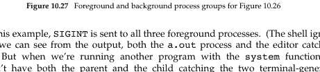

## Figure 10.27 Foreground and background process groups for Figure 10.26

In this example, SIGINT is sent to all three foreground processes. (The shell ignores it.) As we can see from the output, both the a.out process and the editor catch the signal. But when we’re running another program with the system function, we shouldn’t have both the parent and the child catching the two terminal-generated signals: interrupt and quit. Instead, these two signals should be sent to the program that is running; the child. Since the command that is executed by system can be an interactive command (as is the ed program in this example) and since the caller of system gives up control while the program executes, waiting for it to finish, the caller of system should not be receiving these two terminal-generated signals. For this reason, POSIX.1 specifies that the system function should ignore these two signals while waiting for the command to complete.

### Example

Figure 10.28 shows an implementation of the system function with the required signal handling.

```
#include <sys/wait.h>
#include <errno.h>
#include <signal.h>
#include <unistd.h>

int
system(const char *cmdstring)  /* with appropriate signal handling */
{
    pid_t       pid;
    int         status;
    struct sigaction ignore, saveintr, savequit;
    sigset_t    childmask, savemask;

    if (cmdstring == NULL)
        return(1);      /* always a command processor with UNIX */

    ignore.sa_handler = SIG_IGN;    /* ignore SIGINT and SIGQUIT */
    sigemptyset(&ignore.sa_mask);
    ignore.sa_flags = 0;

if (sigaction(SIGINT, &ignore, &saveintr) < 0)
    return(-1);
if (sigaction(SIGQUIT, &ignore, &savequit) < 0)
    return(-1);
sigemptyset(&childmask);
/* now block SIGCHLD */
sigaddset(&childmask, SIGCHLD);
if (sigprocmask(SIG_BLOCK, &childmask, &savemask) < 0)
    return(-1);

if ((pid = fork()) < 0) {
    status = -1;    /* probably out of processes */
} else if (pid == 0) {    /* child */
    /* restore previous signal actions & reset signal mask */
    sigaction(SIGINT, &saveintr, NULL);
    sigaction(SIGQUIT, &savequit, NULL);
    sigprocmask(SIG_SETMASK, &savemask, NULL);

    exec1("/bin/sh", "sh", "-c", cmdstring, (char *)0);
    _exit(127);    /* exec error */
} else {    /* parent */
    while (waitpid(pid, &status, 0) < 0)
        if (errno != EINTR) {
            status = -1; /* error other than EINTR from waitpid() */
            break;
        }
}

/* restore previous signal actions & reset signal mask */
if (sigaction(SIGINT, &saveintr, NULL) < 0)
    return(-1);
if (sigaction(SIGQUIT, &savequit, NULL) < 0)
    return(-1);
if (sigprocmask(SIG_SETMASK, &savemask, NULL) < 0)
    return(-1);

return(status);
}
```

## Figure 10.28 Correct POSIX.1 implementation of system function

If we link the program in Figure 10.26 with this implementation of the system function, the resulting binary differs from the last (flawed) one in the following ways.

- 1. No signal is sent to the calling process when we type the interrupt or quit character.
- 2. When the ed command exits, SIGCHLD is not sent to the calling process. Instead, it is blocked until we unblock it in the last call to sigprocmask, after the system function retrieves the child's termination status by calling waitpid.

POSIX.1 states that if wait or waitpid returns the status of a child process while SIGCHLD is pending, then SIGCHLD should not be delivered to the process unless the status of another child process is also available. FreeBSD 8.0, Mac OS X 10.6.8, and Solaris 10 all implement this semantic. Linux 3.2.0, however, doesn’t—SIGCHLD remains pending after the system function calls waitpid; when the signal is unblocked, it is delivered to the caller. If we called wait in the sig_child function in Figure 10.26, a Linux system would return −1 with errno set to ECHILD, since the system function already retrieved the termination status of the child.

Many older texts show the ignoring of the interrupt and quit signals as follows:

```
if ((pid = fork()) < 0) {
    err_sys("fork error");
} else if (pid == 0) {
    /* child */
    exec(...);
    _exit(127);
}

/* parent */
old_intr = signal(SIGINT, SIG_IGN);
old_quit = signal(SIGQUIT, SIG_IGN);
waitpid(pid, &status, 0);
signal(SIGINT, old_intr);
signal(SIGQUIT, old_quit);
```

The problem with this sequence of code is that we have no guarantee after the fork regarding whether the parent or child runs first. If the child runs first and the parent doesn’t run for some time after, an interrupt signal might be generated before the parent is able to change its disposition to be ignored. For this reason, in Figure 10.28, we change the disposition of the signals before the fork.

Note that we have to reset the dispositions of these two signals in the child before the call to exec1. This allows exec1 to change their dispositions to the default, based on the caller’s dispositions, as we described in Section 8.10.

## Return Value from system

The return value from system is the termination status of the shell, which isn’t always the termination status of the command string. We saw some examples in Figure 8.23, and the results were as we expected: if we execute a simple command, such as date, the termination status is 0. Executing the shell command exit 44 gave us a termination status of 44. What happens with signals?

Let’s run the program in Figure 8.24 and send some signals to the command that’s executing:

```
$ tysz "sleep 30"
^Cnormal termination, exit status = 130    we press the interrupt key
$ tysz "sleep 30"
^\sh: 946 Quit                         we press the quit key
normal termination, exit status = 131
```

When we terminate the sleep call with the interrupt signal, the pr_exit function (Figure 8.5) thinks that it terminated normally. The same thing happens when we kill the sleep call with the quit key. As this example demonstrates, the Bourne shell has a poorly documented feature in which its termination status is 128 plus the signal number, when the command it was executing is terminated by a signal. We can see this with the shell interactively.

```
$ sh
$ sh -c "sleep 30"
^C
$ echo $?
130
$ sh -c "sleep 30"
^\sh: 962 Quit - core dumped
$ echo $?
131
$ exit
```

make sure we're running the Bourne shell

press the interrupt key

print termination status of last command

press the quit key

print termination status of last command

leave Bourne shell

On the system being used, SIGINT has a value of 2 and SIGQUIT has a value of 3, giving us the shell's termination statuses of 130 and 131.

Let's try a similar example, but this time we'll send a signal directly to the shell and see what is returned by system:

```
$ tsys "sleep 30" &
9257
$ ps -f
UID PID PPID TTY TIME CMD
sar 9260 949 pts/5 0:00 ps -f
sar 9258 9257 pts/5 0:00 sh -c sleep 30
sar 949 947 pts/5 0:01 /bin/sh
sar 9257 949 pts/5 0:00 tsys sleep 30
sar 9259 9258 pts/5 0:00 sleep 30
$ kill -KILL 9258
abnormal termination, signal number = 9
```

start it in background this time

look at the process IDs

kill the shell itself

Here, we can see that the return value from system reports an abnormal termination only when the shell itself terminates abnormally.

Other shells behave differently when handling terminal-generated signals, such as SIGINT and SIGQUIT. With bash and dash, for example, pressing the interrupt or quit key will result in an exit status indicating abnormal termination with the corresponding signal number. However, if we find our process executing sleep and send it a signal directly, so that the signal goes only to the individual process instead of the entire foreground process group, we will find that these shells behave like the Bourne shell and exit with a normal termination status of 128 plus the signal number.

When writing programs that use the system function, be sure to interpret the return value correctly. If you call fork, exec, and wait yourself, the termination status is not the same as if you call system.


## 10.19 sleep、nanosleep 和 clock_nanosleep 函数

我们在正文中多个示例中使用了 sleep 函数，并且在图 10.7 和图 10.8 中展示了它的两种有缺陷的实现。

```
#include <unistd.h>
unsigned int sleep(unsigned int seconds);
Returns: 0 or number of unslept seconds
```

此函数会使调用进程挂起，直到以下情况之一发生：

- 1. 由 seconds 指定的 wall clock 时间量已过去。
- 2. 进程捕获到一个信号且信号处理程序返回。

与 alarm 信号一样，实际返回时间可能晚于请求时间，这是由于其他系统活动所致。

在情况 1 中，返回值是 0。当 sleep 因捕获到某个信号而提前返回时（情况 2），返回值是未睡眠的秒数（请求时间减去实际睡眠时间）。

尽管 sleep 可以用 alarm 函数实现（第 10.10 节），但这并非必需。如果使用了 alarm，则两者之间可能存在交互。POSIX.1 标准将所有这些交互都未作规定。例如，如果我们执行 alarm(10)，3 秒 wall clock 时间后执行 sleep(5)，会发生什么？sleep 将在 5 秒后返回（假设在此期间没有捕获到其他信号），但 2 秒后是否会再生成一个 SIGALRM？这些细节取决于实现。

> FreeBSD 8.0、Linux 3.2.0、Mac OS X 10.6.8 和 Solaris 10 使用 nanosleep 函数实现 sleep，这使得实现可以独立于信号和 alarm 定时器。为了可移植性，你不应对 sleep 的实现做任何假设，但如果你打算将 sleep 调用与其他任何定时函数混合使用，则需要意识到可能的交互。

### 示例

图 10.29 显示了 POSIX.1 sleep 函数的一种实现。该函数是对图 10.7 的修改，可可靠地处理信号，避免了早期实现中的竞态条件。我们仍然未处理之前设置的 alarm 的任何交互。（正如我们提到的，POSIX.1 明确将这些交互定义为未定义。）

```
#include "apue.h"

static void
sig_alarm(int signo)
{
    /* nothing to do, just returning wakes up sigsuspend() */
}
unsigned int
sleep(unsigned int seconds)
{
    struct sigaction  newact, oldact;
    sigset_t          newmask, oldmask, suspmask;
    unsigned int      unslept;
    /* set our handler, save previous information */
    newact.sa_handler = sig_alrm;
    sigemptyset(&newact.sa_mask);
    newact.sa_flags = 0;
    sigaction(SIGALRM, &newact, &oldact);
    /* block SIGALRM and save current signal mask */
    sigemptyset(&newmask);
    sigaddset(&newmask, SIGALRM);
    sigprocmask(SIG_BLOCK, &newmask, &oldmask);
    alarm(seconds);
    suspmask = oldmask;
    /* make sure SIGALRM isn't blocked */
    sigdelset(&suspmask, SIGALRM);
    /* wait for any signal to be caught */
    sigsuspend(&suspmask);
    /* some signal has been caught, SIGALRM is now blocked */
    unslept = alarm(0);
    /* reset previous action */
    sigaction(SIGALRM, &oldact, NULL);
    /* reset signal mask, which unblocks SIGALRM */
    sigprocmask(SIG_SETMASK, &oldmask, NULL);
    return(unslept);
}
```

### 图 10.29 sleep 的可靠实现

编写这种可靠的实现所需的代码比图 10.7 所示的要多。我们不使用任何形式的非局部分支（我们在图 10.8 中使用它来避免 alarm 与 pause 之间的竞态条件），因此对在处理 SIGALRM 时可能正在执行的其他信号处理程序没有影响。

nanosleep 函数与 sleep 函数类似，但提供纳秒级粒度。

```
#include <time.h>
int nanosleep(const struct timespec *reqtp, struct timespec *remtp);
Returns: 0 if slept for requested time or -1 on error
```

此函数会挂起调用进程，直到请求的时间过去或函数被信号中断。reqtp 参数指定以秒和纳秒为单位的睡眠时间。如果睡眠间隔被信号中断且进程未终止，则 remtp 参数指向的 timespec 结构将被设置为睡眠间隔中剩余的时间。我们可以将此参数设为 NULL，如果我们不关心未睡眠的时间。

如果系统不支持纳秒级粒度，则请求的时间会被向上舍入。由于 nanosleep 函数不涉及生成任何信号，因此我们可以使用它而无需担心与其他函数的交互。

> nanosleep 函数过去属于 Single UNIX Specification 中的 Timers 选项，但在 SUSv4 中被移至基础部分。

随着多系统时钟的引入（回顾第 6.10 节），我们需要一种方法，使用相对于特定时钟的延迟时间来挂起调用线程。clock_nanosleep 函数为我们提供了这种能力。

```
#include <time.h>
int clock_nanosleep(const clockid_t clock_id, int flags,
    const struct timespec *reqtp, struct timespec *remtp);
Returns: 0 if slept for requested time or error number on failure
```

clock_id 参数指定用于评估时间延迟的时钟。时钟的标识符列在图 6.8 中。flags 参数用于控制延迟是绝对的还是相对的。当 flags 设为 0 时，睡眠时间是相对的（即我们想要睡眠多长时间）。当它设为 TIMER_ABSTIME 时，睡眠时间是绝对的（即我们想要睡眠直到时钟达到指定时间）。

其他参数 reqtp 和 remtp 与 nanosleep 函数中的相同。然而，当我们使用绝对时间时，remtp 参数未被使用，因为它不是必需的；我们可以在 clock_nanosleep 再次达到指定的绝对时间值之前，对后续调用 clock_nanosleep 重用 reqtp 参数的相同值。

请注意，除了错误返回外，调用
clock_nanosleep(CLOCK_REALTIME, 0, reqtp, remtp);
的效果与调用
nanosleep(reqtp, remtp);
相同。

使用相对睡眠的问题在于某些应用程序要求睡眠时间具有精确性，而相对睡眠时间可能导致睡眠时间超过预期。例如，如果一个应用程序希望以固定间隔执行任务，它必须获取当前时间，计算下一次执行任务所需的时间，然后调用 nanosleep。在获取当前时间和调用 nanosleep 之间，处理器调度和抢占可能导致相对睡眠时间超过期望的间隔。使用绝对时间可以提高精度，即使时间共享进程调度程序也不保证我们的任务在睡眠时间结束立即执行。

> 在 Single UNIX Specification 的旧版本中，clock_nanosleep 函数属于 Clock Selection 选项。在 SUSv4 中，它被移至基础部分。

## 10.20 sigqueue 函数

在第 10.8 节中我们说大多数 UNIX 系统不排队信号。随着 POSIX.1 的实时扩展，一些系统开始添加对排队信号的支持。随着 SUSv4，排队信号功能已从实时扩展移至基础规范。

通常信号只携带一个比特的信息：信号本身。除了排队信号外，这些扩展还允许应用程序在传递时传递更多信息（回顾第 10.14 节）。此信息嵌入在 siginfo 结构中。除了系统提供的信息外，应用程序还可以传递一个整数或指向包含更多信息的缓冲区的指针给信号处理程序。

要使用排队信号，我们必须执行以下操作：

- 1. 使用 sigaction 函数安装信号处理程序时指定 SA_SIGINFO 标志。如果我们不指定此标志，信号将被发布，但是否排队信号则由实现决定。
- 2. 提供信号处理程序在 sigaction 结构的 sa_sigaction 成员中，而不是使用通常的 sa_handler 字段。实现可能允许我们使用 sa_handler 字段，但我们将无法获得随 sigqueue 函数发送的额外信息。
- 3. 使用 sigqueue 函数发送信号。

```
#include <signal.h>
int sigqueue(pid_t pid, int signo, const union sigval value)
Returns: 0 if OK, -1 on error
```

sigqueue 函数与 kill 函数类似，只是我们只能用 sigqueue 将信号定向到单个进程，并且我们可以使用 value 参数向信号处理程序传输整数或指针值。

信号不能无限排队。回顾图 2.9 和图 2.11 中的 SIGQUEUE_MAX 限制。当达到此限制时，sigqueue 可能以 errno 设为 EAGAIN 失败。

随着实时信号增强，引入了一组用于应用程序使用的单独信号。这些是介于 SIGRTMIN 和 SIGRTMAX 之间的信号编号。请注意，这些信号的默认操作是终止进程。

图 10.30 总结了本教材所涵盖的实现中排队信号的行为差异。

| 行为 | SUS | FreeBSD 8.0 | Linux 3.2.0 | Mac OS X 10.6.8 | Solaris 10 |
|---|---|---|---|---|---|
| 支持 sigqueue | • | • | • |  | • |
| 除了 SIGRTMIN 到 SIGRTMAX 的信号外还排队其他信号 | 可选 | • |  |  | • |
| 即使调用者未使用 SA_SIGINFO 标志也排队信号 | 可选 | • | • |  |  |

图 10.30 各平台上排队信号的行为


## 10.21 作业控制信号

图 10.1 所示的信号中，POSIX.1 将其中六个视为作业控制信号：

- `SIGCHLD`  子进程已停止或终止。
- `SIGCONT`  继续进程，如果已停止。
- `SIGSTOP`  停止信号（不能被捕获或忽略）。
- `SIGTSTP`  交互式停止信号。
- `SIGTTIN`  后台进程组成员从控制终端读取。
- `SIGTTOU`  后台进程组成员向控制终端写入。

除 `SIGCHLD` 外，大多数应用程序都不处理这些信号：交互式 shell 通常会执行处理它们所需的所有工作。当我们键入挂起字符（通常是 Control-Z）时，`SIGTSTP` 会发送给前台进程组中的所有进程。当我们告诉 shell 在前台或后台恢复作业时，shell 会向作业中的所有进程发送 `SIGCONT` 信号。同样，如果 `SIGTTIN` 或 `SIGTTOU` 被传递给进程，进程默认会被停止，而作业控制 shell 会识别到这一点并通知我们。

一个例外是管理终端的进程，例如 vi(1) 编辑器。它需要知道用户何时想挂起它，以便它可以将终端状态恢复到 vi 启动时的状态。此外，当它在前台恢复时，vi 编辑器需要将终端状态设置回它想要的状态，并且需要重绘终端屏幕。我们将在下面的示例中看到像 vi 这样的程序如何处理这个问题。

作业控制信号之间存在一些交互。当为进程生成四个停止信号之一（`SIGTSTP`、`SIGSTOP`、`SIGTTIN` 或 `SIGTTOU`）时，该进程的任何待处理的 `SIGCONT` 信号都会被丢弃。同样，当为进程生成 `SIGCONT` 信号时，该进程的任何待处理的停止信号都会被丢弃。

请注意，`SIGCONT` 的默认操作是如果进程已停止则继续进程；否则，信号将被忽略。通常，我们不必对该信号做任何事情。当 `SIGCONT` 为已停止的进程生成时，进程将被继续，即使信号被阻塞或忽略。

### 示例

图 10.31 中的程序演示了程序处理作业控制时使用的正常代码序列。该程序只是简单地将标准输入复制到标准输出，但信号处理程序中的注释给出了由管理屏幕的程序执行的典型操作。

```
#include "apue.h"
#define BUFFSIZE    1024
static void
sig_tstp(int signo) /* signal handler for SIGTSTP */
{
    sigset_t    mask;
    /* ... move cursor to lower left corner, reset tty mode ... */
    /*
     * Unblock SIGTSTP, since it’s blocked while we’re handling it.
     */
    sigemptyset(&mask);
    sigaddset(&mask, SIGTSTP);
    sigprocmask(SIG_UNBLOCK, &mask, NULL);
    signal(SIGTSTP, SIG_DFL);   /* reset disposition to default */
    kill(getpid(), SIGTSTP);    /* and send the signal to ourself */
    /* we won’t return from the kill until we’re continued */
    signal(SIGTSTP, sig_tstp);  /* reestablish signal handler */
    /* ... reset tty mode, redraw screen ... */
}
int
main(void)
{
    int     n;
    char    buf[BUFFSIZE];
    /*
     * Only catch SIGTSTP if we’re running with a job-control shell.
     */
    if ((signal(SIGTSTP, SIG_IGN) == SIG_DFL)
        signal(SIGTSTP, sig_tstp);
    while ((n = read(STDIN_FILENO, buf, BUFFSIZE)) > 0)
        if (write(STDOUT_FILENO, buf, n) != n)
            err_sys("write error");
    if (n < 0)
        err_sys("read error");
    exit(0);
}
```

### 图 10.31 如何处理 SIGTSTP

当图 10.31 中的程序启动时，它仅在信号的处置为 `SIG_DFL` 时才安排捕获 `SIGTSTP` 信号。原因在于当程序由不支持作业控制的 shell 启动时（例如 /bin/sh），信号的处置

应设置为 `SIG_IGN`。事实上，shell 并没有显式忽略该信号；init 将三个作业控制信号（`SIGTSTP`、`SIGTTIN` 和 `SIGTTOU`）的处置设置为 `SIG_IGN`。该处置随后被所有登录 shell 继承。只有作业控制 shell 才会将这三个信号的处置重置为 `SIG_DFL`。

当我们键入挂起字符时，进程会收到 `SIGTSTP` 信号并调用信号处理程序。此时，我们会执行任何与终端相关的处理：移动光标到左下角、恢复终端模式等。然后我们在将它的处置重置为默认值（停止进程）并解除信号阻塞后，向自己发送相同的信号 `SIGTSTP`。我们必须解除其阻塞，因为我们当前正在处理该信号，系统在捕获期间会自动阻塞它。此时，系统会停止进程。只有当它收到（通常来自作业控制 shell，对应于交互式 fg 命令）`SIGCONT` 信号时，才会被继续。我们不捕获 `SIGCONT`。它的默认处置是继续已停止的进程；当这种情况发生时，程序会继续执行，就好像它从 kill 函数返回一样。当程序被继续时，我们会重置 `SIGTSTP` 信号的处置并执行我们想要的任何终端处理（例如，我们可以重绘屏幕）。

## 10.22 信号名称和编号

在本节中，我们描述如何映射信号编号和名称。某些系统提供数组

```
extern char *sys_siglist[];
```

数组索引是信号编号，提供指向信号名称字符字符串的指针。

> FreeBSD 8.0、Linux 3.2.0 和 Mac OS X 10.6.8 都提供此信号名称数组。Solaris 10 也提供，但它使用名称 _sys_siglist。

为了以可移植的方式打印对应于信号编号的字符字符串，我们可以使用 psignal 函数。

```
#include <signal.h>
void psignal(int signo, const char *msg);
```

字符串 msg（通常包括程序名称）输出到标准错误，后跟冒号和空格，然后是信号的描述，然后是换行符。如果 msg 为 NULL，则仅将描述写入标准错误。此函数类似于 perror（第 1.7 节）。

如果您从替代 sigaction 信号处理程序获得 siginfo 结构，您可以使用 psiginfo 函数打印信号信息。

```
#include <signal.h>
void psiginfo(const siginfo_t *info, const char *msg);
```

它以与 psignal 函数类似的方式操作。尽管该函数可以访问的信息比仅信号编号更多，但平台在打印的额外信息方面各不相同。

如果您只需要信号的字符串描述，而不一定想将其写入标准错误（例如，您可能想将其写入日志文件），则可以使用 strsignal 函数。此函数类似于 strerror（也在第 1.7 节中描述）。

```
#include <string.h>
char *strsignal(int signo);

Returns: a pointer to a string describing the signal
```

给定信号编号，strsignal 将返回描述该信号的字符串。此字符串可由应用程序用于打印有关接收到的信号的错误消息。

本书讨论的所有平台都提供 psignal 和 strsignal 函数，但差异确实存在。在 Solaris 10 上，如果信号编号无效，strsignal 将返回空指针，而 FreeBSD 8.0、Linux 3.2.0 和 Mac OS X 10.6.8 则返回一个字符串，表明信号编号无法识别。

只有 Linux 3.2.0 和 Solaris 10 支持 psiginfo 函数。

Solaris 提供几个函数来将信号编号映射到信号名称，反之亦然。

```
#include <signal.h>

int sig2str(int signo, char *str);
int str2sig(const char *str, int *signop);

Both return: 0 if OK, -1 on error
```

当编写需要接受和打印信号名称和编号的交互式程序时，这些函数很有用。

## 10.23 摘要

信号在大多数非平凡的应用程序中使用。对信号处理的如何和为何的理解是高级 UNIX 系统编程必不可少的。本章对 UNIX 系统信号进行了长而彻底的探讨。我们首先研究了先前信号实现中的缺陷以及它们的表现方式。然后我们继续介绍 POSIX.1 可靠信号概念以及所有相关函数。一旦我们涵盖了所有这些细节，我们就能够提供 POSIX.1 abort、system 和 sleep 函数的实现。我们以对作业控制信号的介绍以及我们如何能在信号名称和编号之间转换作为结束。

## 练习

- 10.1 在图 10.2 中，删除 for (;;) 语句。会发生什么以及为什么？
- 10.2 实现第 10.22 节中描述的 sig2str 函数。
- 10.3 绘制运行图 10.9 程序时堆栈帧的图片。
- 10.4 在图 10.11 中，我们展示了一种经常使用的方法，使用 setjmp 和 longjmp 在 I/O 操作上设置超时。以下代码也曾出现过：

```
signal(SIGALRM, sig_alrm);
alarm(60);
if (setjmp(env_alrm) != 0) {
    /* handle timeout */
    ...
}
...
```

这个代码序列还有什么其他问题？
- 10.5 使用仅一个计时器（alarm 或更高精度的 setitimer），提供一组函数，允许进程设置任意数量的计时器。
- 10.6 编写以下程序以测试图 10.24 中的父子同步函数。进程创建一个文件并向文件中写入整数 0。进程然后调用 fork，父进程和子进程交替递增文件中的计数器。每次递增计数器时，打印哪个进程（父进程或子进程）正在执行递增。


**10.10** 编写一个程序，在无限循环中调用 `sleep(60)`。每循环五次（每 5 分钟）时，获取当前时间并打印 `tm_sec` 字段。将程序通宵运行并解释结果。像 cron 守护进程这样每分钟整点运行的程序会如何处理这种情况？

**10.11** 按如下方式修改图 3.5：(a) 将 `BUFFSIZE` 改为 100；(b) 使用 `signal_intr` 函数捕获 `SIGXFSZ` 信号，在捕获时打印一条消息并从信号处理程序返回；以及 (c) 如果请求的字节数未写入，则打印 `write` 的返回值。将软 `RLIMIT_FSIZE` 资源限制（第 7.11 节）修改为 1,024 字节并运行你的新程序，复制一个大于 1,024 字节的文件。（尝试从你的 shell 设置软资源限制。如果无法从 shell 设置，请直接从程序中调用 `setrlimit`。）在你能访问的不同系统上运行此程序。发生了什么以及为什么？

**10.12** 编写一个程序，使用一个大缓冲区（约一千兆字节）调用 `fwrite`。在调用 `fwrite` 之前，调用 `alarm` 在 1 秒后安排一个信号。在你的信号处理程序中，打印已捕获信号并返回。对 `fwrite` 的调用是否完成？发生了什么？

## 线程

## 11.1 引言

我们在前几章讨论了进程。我们了解了 UNIX 进程的环境、进程之间的关系以及控制进程的方式。我们看到相关进程之间可以进行有限的共享。

在本章中，我们将进一步深入进程内部，看看如何使用多个控制线程（或简称为线程）在单个进程的环境中执行多个任务。单个进程中的所有线程都可以访问相同的进程组件，例如文件描述符和内存。

每当你尝试在多个用户之间共享单个资源时，就必须处理一致性问题。我们将在本章结尾介绍可用于防止多个线程在其共享资源中看到不一致的同步机制。

## 11.2 线程概念

典型的 UNIX 进程可以被认为只有一个控制线程：每个进程一次只做一件事。借助多个控制线程，我们可以设计程序在单个进程内同时做不止一件事，每个线程处理一个单独的任务。这种方法有几个好处。

- 我们可以通过为每种事件类型分配一个单独的线程来简化处理异步事件的代码。然后每个线程都可以使用同步编程模型来处理其事件。同步编程模型比异步模型简单得多。
- 多个进程必须使用操作系统提供的复杂机制来共享内存和文件描述符，正如我们在第 15 章和第 17 章中将看到的那样。相比之下，线程自动可以访问相同的内存地址空间和文件描述符。
- 一些问题可以被划分以提高整体程序吞吐量。具有多个任务要执行的单线程进程会隐式地串行化这些任务，因为只有一个控制线程。有了多个控制线程，独立任务的处理可以通过为每个任务分配一个单独的线程来进行交错。只有当它们不依赖于彼此的处理时，两个任务才可以被交错。
- 同样，交互式程序可以通过使用多个线程将处理用户输入和输出的部分与程序的其他部分分离来实现更快的响应时间。

有些人将多线程编程与多处理器或多核系统联系起来。即使你的程序在单处理器上运行，多线程编程模型的好处也可以实现。无论处理器数量如何，都可以使用线程简化程序，因为处理器数量不影响程序结构。此外，只要你的程序在串行化任务时必须阻塞，即使在单处理器上运行，你仍然可以看到响应时间和吞吐量的改进，因为当其他线程被阻塞时，一些线程可能能够运行。

一个线程由在进程内表示执行上下文所需的信息组成。这包括标识进程内线程的线程 ID、一组寄存器值、一个栈、调度优先级和策略、信号掩码、一个 errno 变量（回顾第 1.7 节）以及线程特定数据（第 12.6 节）。进程内的所有内容都可以被进程中的线程共享，包括可执行程序的文本、程序的全局和堆内存、栈以及文件描述符。

我们即将看到的线程接口来自 POSIX.1-2001。线程接口，也称为“pthreads”，即“POSIX 线程”，最初在 POSIX.1-2001 中是可选的，但 SUSv4 将其移至基础。POSIX 线程的特性测试宏是 _POSIX_THREADS。应用程序可以将其用于 #ifdef 测试以在编译时确定是否支持线程，或调用 sysconf 并使用 _SC_THREADS 常量在运行时确定这一点。符合 SUSv4 的系统将符号 _POSIX_THREADS 定义为值 200809L。

## 11.3 线程标识

正如每个进程都有一个进程 ID，每个线程都有一个线程 ID。与在系统中唯一的进程 ID 不同，线程 ID 仅在其所属进程的上下文中才有意义。

回想一下，进程 ID 由 pid_t 数据类型表示，是一个非负整数。线程 ID 由 pthread_t 数据类型表示。实现允许使用结构来表示 pthread_t 数据类型，因此可移植的实现不能将其视为整数。因此，必须使用函数来比较两个线程 ID。

```
#include <pthread.h>
int pthread_equal(pthread_t tid1, pthread_t tid2);
Returns: nonzero if equal, 0 otherwise
```

Linux 3.2.0 对 pthread_t 数据类型使用无符号长整数。Solaris 10 将 pthread_t 数据类型表示为无符号整数。FreeBSD 8.0 和 Mac OS X 10.6.8 使用指向 pthread 结构的指针作为 pthread_t 数据类型。

允许 pthread_t 数据类型为结构的一个后果是，没有可移植的方法来打印其值。有时在程序调试期间打印线程 ID 是有用的，但通常不需要这样做。最坏的情况是导致不可移植的调试代码，因此这并不是很大的限制。

一个线程可以通过调用 pthread_self 函数获得自己的线程 ID。

```
#include <pthread.h>
pthread_t pthread_self(void);
Returns: the thread ID of the calling thread
```

此函数可与 pthread_equal 一起使用，当线程需要标识用其线程 ID 标记的数据结构时。例如，主线程可能会将工作分配放在队列上并使用线程 ID 来控制哪些作业分配给每个工作线程。这种情况在图 11.1 中有所说明。单个主线程将新作业放在工作队列上。三个工作线程的池从队列中移除作业。主线程不是允许每个线程处理队列头的任意作业，而是通过在每个作业结构中放置应处理该作业的线程的 ID 来控制作业分配。每个工作线程然后只移除用其自己的线程 ID 标记的作业。

## 11.4 线程创建

传统的 UNIX 进程模型仅支持每个进程一个控制线程。从概念上讲，这与基于线程的模型相同，即每个进程仅由一个线程组成。使用 pthreads 时，程序运行时也从一个具有单个控制线程的单个进程开始。随着程序的运行，其行为应与传统进程无法区分，直到它创建更多控制线程。可以通过调用 pthread_create 函数创建额外的线程。

```
#include <pthread.h>
int pthread_create(pthread_t *restrict tidp,
const pthread_attr_t *restrict attr,
void *(*start_rtn)(void *), void *restrict arg);
Returns: 0 if OK, error number on failure
```


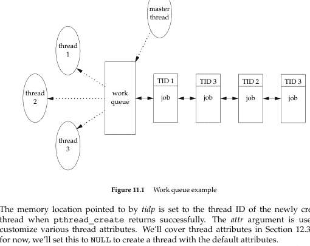

## 图11.1 工作队列示例

当`pthread_create`成功返回时，`tidp`指向的内存位置被设置为新创建线程的线程ID。`attr`参数用于定制各种线程属性。我们将在第12.3节讨论线程属性，但现在我们将其设置为`NULL`，以默认属性创建线程。

新创建的线程从`start_rtn`函数的地址开始运行。该函数接受一个参数`arg`，这是一个无类型指针。如果需要向`start_rtn`函数传递多个参数，则需要将它们存储在一个结构中，并在`arg`中传递该结构的地址。

创建线程时，无法保证哪个线程先运行：是新创建的线程还是调用线程。新创建的线程可以访问进程地址空间，并继承调用线程的浮点环境和信号掩码；但是，线程的挂起信号集会被清除。

请注意，`pthread`函数失败时通常返回错误码。它们不像其他POSIX函数那样设置`errno`。提供`errno`的每线程副本只是为了与使用它的现有函数兼容。对于线程，更清晰的做法是从函数返回错误码，从而将错误的范围限制在导致错误的函数内，而不是依赖于作为函数副作用而改变的某些全局状态。

### 示例

虽然没有可移植的方法来打印线程ID，但我们可以编写一个小测试程序来做到这一点，以深入了解线程的工作方式。图11.2中的程序创建了一个线程，并打印新线程和初始线程的进程ID和线程ID。

```
```c
#include "apue.h"
#include <pthread.h>

pthread_t ntid;

void
printids(const char *s)
{
    pid_t       pid;
    pthread_t   tid;

    pid = getpid();
    tid = pthread_self();
    printf("%s pid %lu tid %lu (0x%lx)\n", s, (unsigned long)pid,
           (unsigned long)tid, (unsigned long)tid);
}

void *
thr_fn(void *arg)
{
    printids("new thread: ");
    return((void *)0);
}

int
main(void)
{
    int     err;

    err = pthread_create(&ntid, NULL, thr_fn, NULL);
    if (err != 0)
        err_exit(err, "can’t create thread");
    printids("main thread: ");
    sleep(1);
    exit(0);
}
```
```

这个示例有两个奇怪之处，这是处理主线程和新线程之间竞争所必需的。（我们将在本章后面学习更好的处理这些情况的方法。）第一个是主线程需要睡眠。如果它不睡眠，主线程可能会退出，从而在新线程有机会运行之前终止整个进程。这种行为取决于操作系统的线程实现和调度算法。

第二个奇怪之处是，新线程通过调用`pthread_self`获取其线程ID，而不是从共享内存中读取或作为其线程启动例程的参数接收。回想一下，`pthread_create`会通过第一个参数（`tidp`）返回新创建线程的线程ID。在我们的示例中，主线程将此ID存储在`nt_id`中，但新线程不能安全地使用它。如果新线程在主线程从调用`pthread_create`返回之前运行，那么新线程将看到`nt_id`的未初始化内容，而不是线程ID。

图11.2 打印线程ID

在Solaris上运行图11.2中的程序，我们得到：

```
$ ./a.out
main thread: pid 20075 tid 1 (0x1)
new thread:  pid 20075 tid 2 (0x2)
```

正如我们所料，两个线程具有相同的进程ID，但线程ID不同。在FreeBSD上运行图11.2中的程序，我们得到：

```
$ ./a.out
main thread: pid 37396 tid 673190208 (0x28201140)
new thread:  pid 37396 tid 673280320 (0x28217140)
```

正如我们所料，两个线程具有相同的进程ID。如果我们将线程ID视为十进制整数，这些值看起来很奇怪，但如果我们以十六进制格式查看它们，它们就更有意义了。正如我们之前指出的，FreeBSD使用指向线程数据结构的指针作为其线程ID。

我们预计Mac OS X与FreeBSD类似；然而，主线程的线程ID与通过`pthread_create`创建的线程的线程ID来自不同的地址范围：

```
$ ./a.out
main thread: pid 31807 tid 140735073889440 (0x7feff70162ca0)
new thread:  pid 31807 tid 4295716864 (0x100b7000)
```

在Linux上运行相同的程序，我们得到：

```
$ ./a.out
main thread: pid 17874 tid 140693894424320 (0x7fe5fd9996700)
new thread:  pid 17874 tid 140693886129920 (0x7fe5fd91ad700)
```

Linux的线程ID看起来像指针，尽管它们被表示为无符号长整数。

> Linux 2.4和Linux 2.6之间的线程实现发生了变化。在Linux 2.4中，LinuxThreads使用单独的进程来实现每个线程。这使得匹配POSIX线程的行为变得困难。在Linux 2.6中，Linux内核和线程库被彻底修改，使用了一种称为原生POSIX线程库（NPTL）的新线程实现。这支持了在单个进程内多线程的模型，并使支持POSIX线程语义变得更加容易。

## 11.5 线程终止

如果进程中的任何线程调用`exit`、`_Exit`或`_exit`，则整个进程终止。类似地，当默认操作是终止进程时，发送给线程的信号将终止整个进程（我们将在第12.8节中更多地讨论信号和线程之间的交互）。

单个线程可以通过三种方式退出，从而停止其控制流，而不会终止整个进程。

- 1. 线程可以直接从启动例程返回。返回值是线程的退出码。
- 2. 线程可以被同一进程中的另一个线程取消。
- 3. 线程可以调用`pthread_exit`。

```
#include <pthread.h>
void pthread_exit(void *retval_ptr);
```

`retval_ptr`参数是一个无类型指针，类似于传递给启动例程的单个参数。该指针可通过调用`pthread_join`函数供进程中的其他线程使用。

```
#include <pthread.h>
int pthread_join(pthread_t thread, void **retval_ptr);
返回值：若成功返回0，否则返回错误编号
```

调用线程将阻塞，直到指定的线程调用`pthread_exit`、从其启动例程返回或被取消。如果线程只是从其启动例程返回，`retval_ptr`将包含返回码。如果线程被取消，`retval_ptr`指定的内存位置被设置为`PTHREAD_CANCELED`。

通过调用`pthread_join`，我们自动将正在连接的线程置于分离状态（稍后讨论），以便回收其资源。如果线程已经处于分离状态，`pthread_join`可能会失败，返回`EINVAL`，尽管此行为是实现特定的。

如果我们对线程的返回值不感兴趣，可以将`retval_ptr`设置为`NULL`。在这种情况下，调用`pthread_join`允许我们等待指定的线程，但不会检索线程的终止状态。

### 示例

图11.3展示了如何从已终止的线程获取退出码。

```
#include "apue.h"
#include <pthread.h>

void *
thr_fn1(void *arg)
{
    printf("thread 1 returning\n");
    return((void *)1);
}

void *
thr_fn2(void *arg)
{
printf("thread 2 exiting\n");
 pthread_exit((void *)2);
}
int
main(void)
{
    int         err;
    pthread_t   tid1, tid2;
    void        *tret;

    err = pthread_create(&tid1, NULL, thr_fn1, NULL);
    if (err != 0)
        err_exit(err, "can't create thread 1");
    err = pthread_create(&tid2, NULL, thr_fn2, NULL);
    if (err != 0)
        err_exit(err, "can't create thread 2");
    err = pthread_join(tid1, &tret);
    if (err != 0)
        err_exit(err, "can't join with thread 1");
    printf("thread 1 exit code %ld\n", (long)tret);
    err = pthread_join(tid2, &tret);
    if (err != 0)
        err_exit(err, "can't join with thread 2");
    printf("thread 2 exit code %ld\n", (long)tret);
    exit(0);
}
```

# 图11.3 获取线程退出状态

运行图11.3中的程序，我们得到：

```
$ ./a.out
    thread 1 returning
    thread 2 exiting
    thread 1 exit code 1
    thread 2 exit code 2
```

正如我们所见，当线程通过调用`pthread_exit`或直接从启动例程返回而退出时，另一个线程可以通过调用`pthread_join`获取退出状态。

传递给`pthread_create`和`pthread_exit`的无类型指针可用于传递多个值。该指针可用于传递包含更复杂信息的结构的地址。请注意，当调用者完成时，用于该结构的内存必须仍然有效。例如，如果结构是在调用者的栈上分配的，那么当结构被使用时，内存内容可能已经改变。如果线程在其栈上分配了一个结构，并将指向该结构的指针传递给`pthread_exit`，那么当`pthread_join`的调用者尝试使用它时，该栈可能已被销毁，其内存可能已被重新用于其他用途。


## Example

图 11.4 中的程序展示了使用自动变量（分配在栈上）作为 pthread_exit 参数时出现的问题。

```
#include <apue.h>
#include <pthread.h>

struct foo {
    int a, b, c, d;
};

void
printfoo(const char *s, const struct foo *fp)
{
    printf("%s", s);
    printf("    structure at 0x%lx\n", (unsigned long)fp);
    printf("    foo.a = %d\n", fp->a);
    printf("    foo.b = %d\n", fp->b);
    printf("    foo.c = %d\n", fp->c);
    printf("    foo.d = %d\n", fp->d);
}

void *
thr_fn1(void *arg)
{
    struct foo foo = {1, 2, 3, 4};
    printfoo("thread 1:\n", &foo);
    pthread_exit((void *)&foo);
}

void *
thr_fn2(void *arg)
{
    printf("thread 2: ID is %lu\n", (unsigned long)pthread_self());
    pthread_exit((void *)0);
}

int
main(void)
{
    int err;
    pthread_t tid1, tid2;
    struct foo *fp;
    err = pthread_create(&tid1, NULL, thr_fn1, NULL);
    if (err != 0)
        err_exit(err, "can't create thread 1");
    err = pthread_join(tid1, (void *)&fp);
    if (err != 0)
        err_exit(err, "can't join with thread 1");
    sleep(1);
    printf("parent starting second thread\n");
```

```
err = pthread_create(&tid2, NULL, thr_fn2, NULL);
if (err != 0)
    err_exit(err, "can't create thread 2");
sleep(1);
printfoo("parent:\n", fp);
exit(0);
}
```

## Figure 11.4 Incorrect use of pthread_exit argument

当我们在 Linux 上运行此程序时，我们得到

```
$ ./a.out
thread 1:
structure at 0x7f2c83682ed0
foo.a = 1
foo.b = 2
foo.c = 3
foo.d = 4
parent starting second thread
thread 2: ID is 139829159933696
parent:
structure at 0x7f2c83682ed0
foo.a = -2090321472
foo.b = 32556
foo.c = 1
foo.d = 0
```

当然，结果会有所不同，这取决于内存架构、编译器以及线程库的实现。Solaris 上的结果类似：

```
$ ./a.out
thread 1:
structure at 0xffffffff7f0bfb30
foo.a = 1
foo.b = 2
foo.c = 3
foo.d = 4
parent starting second thread
thread 2: ID is 3
parent:
structure at 0xffffffff7f0bfb30
foo.a = -1
foo.b = 2136969048
foo.c = -1
foo.d = 2138049024
```

正如我们所见，结构的内容（分配在线程 tid1 的栈上）在主线程能够访问该结构时已经发生了变化。请注意，第二个线程（tid2）的栈已经覆盖了第一个线程的栈。要解决此问题，我们可以使用全局结构或使用 malloc 分配结构。

在 Mac OS X 上，我们得到不同的结果：

```
$ ./a.out
thread 1:
  structure at 0x1000b6f00
  foo.a = 1
  foo.b = 2
  foo.c = 3
  foo.d = 4
parent starting second thread
thread 2: ID is 4295716864
parent:
  structure at 0x1000b6f00
Segmentation fault (core dumped)
```

在这种情况下，当父进程尝试访问由第一个退出的线程传递给它的结构时，内存已不再有效，并且父进程收到 SIGSEGV 信号。

在 FreeBSD 上，父进程访问它时内存尚未被覆盖，我们得到

```
thread 1:
  structure at 0xbf9fef88
  foo.a = 1
  foo.b = 2
  foo.c = 3
  foo.d = 4
parent starting second thread
thread 2: ID is 673279680
parent:
  structure at 0xbf9fef88
  foo.a = 1
  foo.b = 2
  foo.c = 3
  foo.d = 4
```

即使线程退出后内存仍然完好无损，我们也不能依赖这种情况总是如此。在其他平台上我们观察到的情况肯定不是这样。

一个线程可以通过调用 pthread_cancel 函数请求在同一进程中终止另一个线程。

```
#include <pthread.h>

int pthread_cancel(pthread_t tid);

Returns: 0 if OK, error number on failure
```

在默认情况下，pthread_cancel 将导致 tid 指定的线程表现得好像它调用了 pthread_exit 且参数为 PTHREAD_CANCELED。我们将在第 12.7 节详细讨论这一点。请注意，pthread_cancel 不会等待线程终止；它只是发出请求。

线程可以安排在退出时调用函数，类似于 atexit 函数（第 7.3 节）可用于安排在进程退出时调用函数的方式。这些函数称为线程清理处理程序。一个线程可以建立多个清理处理程序。处理程序记录在栈中，这意味着它们以与注册顺序相反的顺序执行。

```
#include <pthread.h>

void pthread_cleanup_push(void (*rtn)(void *), void *arg);
void pthread_cleanup_pop(int execute);
```

pthread_cleanup_push 函数安排清理函数 rtn 在线程执行以下任一操作时调用，并带有一个参数 arg：

- 调用 pthread_exit
- 响应取消请求
- 调用 execute 参数非零的 pthread_cleanup_pop

如果 execute 参数设置为零，则不会调用清理函数。在任何情况下，pthread_cleanup_pop 都会删除由最近一次调用 pthread_cleanup_push 建立的清理处理程序。

这些函数的一个限制是，由于它们可以实现为宏，因此它们必须在同一作用域内成对使用，并且在线程中匹配。pthread_cleanup_push 的宏定义可能包含一个 { 字符，在这种情况下，匹配的 } 字符在 pthread_cleanup_pop 定义中。

## Example

图 11.5 显示了如何使用线程清理处理程序。虽然示例有些牵强，但它说明了所涉及的机制。请注意，尽管我们从未打算将零作为参数传递给线程启动例程，但我们仍然需要将对 pthread_cleanup_pop 的调用与对 pthread_cleanup_push 的调用相匹配；否则，程序可能无法编译。

```
#include "apue.h"
#include <pthread.h>

void
cleanup(void *arg)
{
    printf("cleanup: %s\n", (char *)arg);
}

void *
thr_fn1(void *arg)
```

```
{
    printf("thread 1 start\n");
    pthread_cleanup_push(cleanup, "thread 1 first handler");
    pthread_cleanup_push(cleanup, "thread 1 second handler");
    printf("thread 1 push complete\n");
    if (arg)
        return((void *)1);
    pthread_cleanup_pop(0);
    pthread_cleanup_pop(0);
    return((void *)1);
}

void *
thr_fn2(void *arg)
{
    printf("thread 2 start\n");
    pthread_cleanup_push(cleanup, "thread 2 first handler");
    pthread_cleanup_push(cleanup, "thread 2 second handler");
    printf("thread 2 push complete\n");
    if (arg)
        pthread_exit((void *)2);
    pthread_cleanup_pop(0);
    pthread_cleanup_pop(0);
    pthread_exit((void *)2);
}

int
main(void)
{
    int err;
    pthread_t tid1, tid2;
    void *tret;

    err = pthread_create(&tid1, NULL, thr_fn1, (void *)1);
    if (err != 0)
        err_exit(err, "can't create thread 1");
    err = pthread_create(&tid2, NULL, thr_fn2, (void *)1);
    if (err != 0)
        err_exit(err, "can't create thread 2");
    err = pthread_join(tid1, &tret);
    if (err != 0)
        err_exit(err, "can't join with thread 1");
    printf("thread 1 exit code %ld\n", (long)tret);
    err = pthread_join(tid2, &tret);
    if (err != 0)
        err_exit(err, "can't join with thread 2");
    printf("thread 2 exit code %ld\n", (long)tret);
    exit(0);
}
```

在 Linux 或 Solaris 上运行图 11.5 中的程序，我们得到

```
$ ./a.out
thread 1 start
thread 1 push complete
thread 2 start
thread 2 push complete
cleanup: thread 2 second handler
cleanup: thread 2 first handler
thread 1 exit code 1
thread 2 exit code 2
```

从输出中，我们可以看到两个线程都正确启动并退出，但只有第二个线程的清理处理程序被调用。因此，如果线程通过从其启动例程返回而终止，则其清理处理程序不会被调用，尽管这种行为在不同实现之间有所不同。还请注意，清理处理程序的调用顺序与它们安装的顺序相反。

如果我们在 FreeBSD 或 Mac OS X 上运行相同的程序，我们会看到程序出现段错误并转储核心。这是因为在这些系统上，pthread_cleanup_push 实现为宏，将一些上下文存储在栈上。当线程 1 在调用 pthread_cleanup_push 和调用 pthread_cleanup_pop 之间返回时，栈被覆盖，并且这些平台在调用清理处理程序时尝试使用此（现在已损坏）上下文。在 Single UNIX Specification 中，在 pthread_cleanup_push 和 pthread_cleanup_pop 的匹配调用对之间返回会导致未定义行为。唯一可移植的在两个函数之间返回的方法是调用 pthread_exit。

到目前为止，你应该开始看到线程函数和进程函数之间的相似之处。图 11.6 总结了相似的函数。

| Process primitive | Thread primitive | Description |
|---|---|---|
| fork | pthread_create | create a new flow of control |
| exit | pthread_exit | exit from an existing flow of control |
| waitpid | pthread_join | get exit status from flow of control |
| atexit | pthread_cleanup_push | register function to be called at exit from flow of control |
| getpid | pthread_self | get ID for flow of control |
| abort | pthread_cancel | request abnormal termination of flow of control |

Figure 11.6 Comparison of process and thread primitives

默认情况下，线程的终止状态会保留，直到我们为该线程调用 pthread_join。如果线程已分离，则线程的底层存储可以在终止时立即回收。线程分离后，我们不能使用 pthread_join 函数等待其终止状态，因为为分离的线程调用 pthread_join 会导致未定义行为。我们可以通过调用 pthread_detach 来分离线程。


```
#include <pthread.h>
int pthread_detach(pthread_t tid);
Returns: 0 if OK, error number on failure
```

正如我们将在下一章中所见，可以通过修改传给 `pthread_create` 的线程属性来创建一个已经处于分离状态的线程。

## 11.6 线程同步

当多个控制线程共享同一内存时，我们需要确保每个线程看到的数据是一致的。如果每个线程都使用其他线程不会读写或修改的变量，就不存在一致性问题。类似地，如果一个变量是只读的，那么多个线程同时读取它的值也不存在一致性问题。但是，当一个线程可能会修改另一个线程可读或可修改的变量时，我们就需要同步这些线程，以确保它们在访问该变量的内存内容时不会使用无效的值。

当一个线程修改一个变量时，其他线程在读取该变量的值时可能会看到不一致的情况。在修改操作需要多个内存周期的处理器架构上，如果内存读取发生在内存写入周期之间，就可能出现这种情况。当然，这种行为依赖于具体的架构，但可移植的程序不能对所使用的处理器架构类型做任何假设。

图 11.7 展示了一个两个线程读写同一个变量的假设示例。在这个示例中，线程 A 读取该变量，然后向它写入一个新值，但写操作需要两个内存周期。如果线程 B 在这两个写周期之间读取同一个变量，它就会看到一个不一致的值。

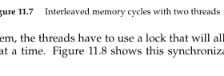

为了解决这个问题，线程必须使用一把锁，使得每次只允许一个线程访问该变量。图 11.8 展示了这种同步。如果线程 B 想要读取该变量，它需要先获取锁。类似地，当线程 A 更新该变量时，它也需要获取同一把锁。因此，在线程 A 释放锁之前，线程 B 将无法读取该变量。

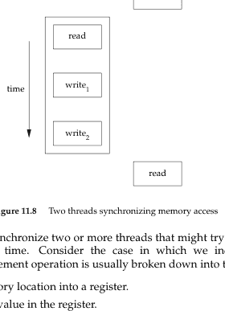

图 11.8 两个线程同步内存访问

我们还需要同步两个或多个可能试图同时修改同一个变量的线程。考虑我们对一个变量进行递增操作的情况（图 11.9）。递增操作通常分为以下三个步骤。

- 1. 将内存位置中的值读取到寄存器中。
- 2. 递增寄存器中的值。
- 3. 将新值写回内存位置。

如果两个线程在几乎相同的时间试图递增同一个变量，而又没有相互同步，那么结果可能是不一致的。最终得到的值可能比之前大 1 或大 2，具体取决于第二个线程开始操作时观察到的值。如果第二个线程在第一个线程执行步骤 3 之前执行了步骤 1，第二个线程将读取到与第一个线程相同的初始值，递增它，然后写回，最终没有任何净效果。

如果修改是原子的，那么就不存在竞争。在前面的例子中，如果递增只需要一个内存周期，就不会有竞争。如果我们的数据总是表现为顺序一致的，那么我们就不需要额外的同步。当多个线程无法观察到我们数据中的不一致时，我们的操作就是顺序一致的。在现代计算机系统中，内存访问需要多个总线周期，而且多处理器通常会在多个处理器之间交错安排总线周期，因此我们无法保证数据是顺序一致的。

# 线程 A

# 线程 B

# i 的内容

将 i 取入寄存器（寄存器 = 5）

5

递增寄存器中的值（寄存器 = 6）

将 i 取入寄存器（寄存器 = 5）

5

将寄存器中的值存入 i（寄存器 = 6）

递增寄存器中的值（寄存器 = 6）

6

将寄存器中的值存入 i（寄存器 = 6）

6

时间

# 图 11.9 两个未同步的线程递增同一个变量

在顺序一致的环境中，我们可以将数据的修改解释为运行线程所执行操作的连续步骤。我们可以说“线程 A 先递增了变量，然后线程 B 递增了变量，因此它的值比之前大 2”，或者说“线程 B 先递增了变量，然后线程 A 递增了变量，因此它的值比之前大 2”。两个线程的任何可能排序都不会导致该变量产生其他值。

除了计算机架构之外，竞争还可能源于我们程序使用变量的方式，从而产生可能看到不一致的地方。例如，我们可能先递增一个变量，然后根据它的值做出决策。递增步骤和决策步骤的组合并不是原子的，这为不一致性的出现打开了一个窗口。

### 11.6.1 互斥锁

我们可以使用 pthreads 的互斥接口来保护数据，并确保每次只有一个线程能访问。互斥锁（mutex）本质上是一把锁，我们在访问共享资源之前设置它（加锁），在完成之后释放它（解锁）。当它被设置时，任何其他试图设置它的线程都将阻塞，直到我们释放它。如果我们解锁互斥锁时有多个线程被阻塞，那么所有阻塞在该锁上的线程都将变为可运行状态，最先运行的线程将能够设置该锁。其他线程会发现互斥锁仍处于锁定状态，于是回去继续等待它再次可用。这样，每次只有一个线程能够继续执行。

这种互斥机制只有在我们设计线程遵循相同的数据访问规则时才有效。操作系统不会为我们串行化对数据的访问。如果我们允许一个线程在未先获取锁的情况下访问共享资源，那么即使其余线程在尝试访问共享资源之前确实获取了锁，仍然可能发生不一致。

互斥锁变量由 `pthread_mutex_t` 数据类型表示。在使用互斥锁变量之前，我们必须先对其进行初始化：要么将它设置为常量 `PTHREAD_MUTEX_INITIALIZER`（仅用于静态分配的互斥锁），要么调用 `pthread_mutex_init`。如果我们动态分配互斥锁（例如通过调用 `malloc`），那么需要在释放内存之前调用 `pthread_mutex_destroy`。

```
#include <pthread.h>

int pthread_mutex_init(pthread_mutex_t *restrict mutex,
    const pthread_mutexattr_t *restrict attr);

int pthread_mutex_destroy(pthread_mutex_t *mutex);

Both return: 0 if OK, error number on failure
```

要用默认属性初始化互斥锁，我们将 `attr` 设置为 `NULL`。我们将在 12.4 节中讨论互斥锁属性。

要对互斥锁加锁，我们调用 `pthread_mutex_lock`。如果互斥锁已经被锁定，调用线程将阻塞，直到该互斥锁被解锁。要解锁互斥锁，我们调用 `pthread_mutex_unlock`。

```
#include <pthread.h>

int pthread_mutex_lock(pthread_mutex_t *mutex);
int pthread_mutex_trylock(pthread_mutex_t *mutex);
int pthread_mutex_unlock(pthread_mutex_t *mutex);

All return: 0 if OK, error number on failure
```

如果线程无法承担阻塞的成本，可以使用 `pthread_mutex_trylock` 来有条件地对互斥锁加锁。如果在调用 `pthread_mutex_trylock` 时互斥锁处于未锁定状态，那么 `pthread_mutex_trylock` 将不阻塞地锁定该互斥锁并返回 0。否则，`pthread_mutex_trylock` 将失败，返回 `EBUSY` 且不锁定互斥锁。

# 示例

图 11.10 展示了使用互斥锁保护一个数据结构的例子。当多个线程需要访问一个动态分配的对象时，我们可以在对象中嵌入一个引用计数，以确保在所有线程使用完该对象之前不会释放其内存。

```
#include <stdlib.h>
#include <pthread.h>

struct foo {
    int f_count;
    pthread_mutex_t f_lock;
    int f_id;
    /* ... more stuff here ... */
};

struct foo *
foo_alloc(int id) /* allocate the object */
{
    struct foo *fp;
    if ((fp = malloc(sizeof(struct foo))) != NULL) {
        fp->f_count = 1;
        fp->f_id = id;
        if (pthread_mutex_init(&fp->f_lock, NULL) != 0) {
            free(fp);
            return(NULL);
        }
        /* ... continue initialization ... */
    }
    return(fp);
}

void
foo_hold(struct foo *fp) /* add a reference to the object */
{
    pthread_mutex_lock(&fp->f_lock);
    fp->f_count++;
    pthread_mutex_unlock(&fp->f_lock);
}

void
foo_rele(struct foo *fp) /* release a reference to the object */
{
    pthread_mutex_lock(&fp->f_lock);
    if (--fp->f_count == 0) { /* last reference */
        pthread_mutex_unlock(&fp->f_lock);
        pthread_mutex_destroy(&fp->f_lock);
        free(fp);
    } else {
        pthread_mutex_unlock(&fp->f_lock);
    }
}
```

# 图 11.10 使用互斥锁保护数据结构

在递增引用计数、递减引用计数和检查引用计数是否变为 0 之前，我们会锁定互斥锁。无需锁定


在 `foo_alloc` 函数中将引用计数初始化为 1 时是必要的，因为此时分配线程是唯一对它的引用。如果我们在此阶段将结构放在列表上，它可能会被其他线程找到，因此我们需要先锁定它。

在使用对象之前，线程应通过调用 `foo_hold` 为其添加一个引用。完成后，它们必须调用 `foo_rele` 释放引用。当最后一个引用被释放时，对象的内存将被释放。

在此示例中，我们忽略了线程在调用 `foo_hold` 之前如何找到对象的问题。即使引用计数为零，如果另一个线程在调用 `foo_hold` 时被阻塞在互斥锁上，`foo_rele` 释放对象的内存也是错误的。我们可以通过确保在释放内存之前对象无法被找到来避免此问题。我们将在后面的示例中看到如何做到这一点。

## 11.6.2 死锁避免

如果线程尝试两次锁定同一个互斥锁，它会使自己死锁，但使用互斥锁创建死锁还有更不明显的方法。例如，当我们在程序中使用多个互斥锁时，如果允许一个线程持有互斥锁并在尝试锁定第二个互斥锁时被阻塞，同时另一个持有第二个互斥锁的线程尝试锁定第一个互斥锁，就会发生死锁。两个线程都无法继续，因为每个线程都需要另一个线程持有的资源，因此我们发生了死锁。

可以通过仔细控制互斥锁的锁定顺序来避免死锁。例如，假设你有两个互斥锁 A 和 B，需要同时锁定。如果所有线程始终先锁定互斥锁 A 再锁定互斥锁 B，就不会因使用这两个互斥锁而发生死锁（但仍可能在其他资源上死锁）。同样，如果所有线程始终先锁定互斥锁 B 再锁定互斥锁 A，也不会发生死锁。只有当一个线程尝试以与另一个线程相反的顺序锁定互斥锁时，才会出现死锁的可能性。

有时，应用程序的架构使得应用锁定顺序变得困难。如果涉及的锁和数据结构足够多，以至于你可用的函数无法塑造成简单的层次结构，那么你就必须尝试其他方法。在这种情况下，你可能能够释放你的锁并在稍后重试。你可以使用 `pthread_mutex_trylock` 接口来避免在此情况下发生死锁。如果你已经持有锁并且 `pthread_mutex_trylock` 成功，那么你可以继续。如果它无法获取锁，则可以释放你已持有的锁，清理并稍后再试。

### 示例

在此示例中，我们更新图 11.10 以显示使用两个互斥锁。我们通过确保当我们需要同时获取两个互斥锁时，始终以相同的顺序锁定它们来避免死锁。第二个互斥锁保护我们用于跟踪 foo 数据结构的哈希列表。因此 `hashlock` 互斥锁同时保护 `fh` 哈希表和 `foo` 结构中的 `f_next` 哈希链接字段。`foo` 结构中的 `f_lock` 互斥锁保护对 `foo` 结构其余字段的访问。

```
#include <stdlib.h>
#include <pthread.h>

#define NHASH 29
#define HASH(id) (((unsigned long)id)%NHASH)

struct foo *fh[NHASH];

pthread_mutex_t hashlock = PTHREAD_MUTEX_INITIALIZER;

struct foo {
    int f_count;
    pthread_mutex_t f_lock;
    int f_id;
    struct foo *f_next; /* protected by hashlock */
    /* ... more stuff here ... */
};

struct foo *
foo_alloc(int id) /* allocate the object */
{
    struct foo *fp;
    int idx;
    if ((fp = malloc(sizeof(struct foo))) != NULL) {
        fp->f_count = 1;
        fp->f_id = id;
        if (pthread_mutex_init(&fp->f_lock, NULL) != 0) {
            free(fp);
            return(NULL);
        }
        idx = HASH(id);
        pthread_mutex_lock(&hashlock);
        fp->f_next = fh[idx];
        fh[idx] = fp;
        pthread_mutex_lock(&fp->f_lock);
        pthread_mutex_unlock(&hashlock);
        /* ... continue initialization ... */
        pthread_mutex_unlock(&fp->f_lock);
    }
    return(fp);
}

void
foo_hold(struct foo *fp) /* add a reference to the object */
{
    pthread_mutex_lock(&fp->f_lock);
    fp->f_count++;
    pthread_mutex_unlock(&fp->f_lock);
}

struct foo *
foo_find(int id) /* find an existing object */
{
```

```
struct foo *fp;
pthread_mutex_lock(&hashlock);
for (fp = fh[HASH(id)]; fp != NULL; fp = fp->f_next) {
    if (fp->f_id == id) {
        foo_hold(fp);
        break;
    }
}
pthread_mutex_unlock(&hashlock);
return(fp);
}

void
foo_rele(struct foo *fp) /* release a reference to the object */
{
    struct foo *tfp;
    int idx;
    pthread_mutex_lock(&fp->f_lock);
    if (fp->f_count == 1) { /* last reference */
        pthread_mutex_unlock(&fp->f_lock);
        pthread_mutex_lock(&hashlock);
        pthread_mutex_lock(&fp->f_lock);
        /* need to recheck the condition */
        if (fp->f_count != 1) {
            fp->f_count--;
            pthread_mutex_unlock(&fp->f_lock);
            pthread_mutex_unlock(&hashlock);
            return;
        }
        /* remove from list */
        idx = HASH(fp->f_id);
        tfp = fh[idx];
        if (tfp == fp) {
            fh[idx] = fp->f_next;
        } else {
            while (tfp->f_next != fp)
                tfp = tfp->f_next;
            tfp->f_next = fp->f_next;
        }
        pthread_mutex_unlock(&hashlock);
        pthread_mutex_unlock(&fp->f_lock);
        pthread_mutex_destroy(&fp->f_lock);
        free(fp);
    } else {
        fp->f_count--;
        pthread_mutex_unlock(&fp->f_lock);
    }
}
```

将图 11.11 与图 11.10 进行比较，我们看到我们的分配函数现在锁定哈希列表锁，将新结构添加到哈希桶中，并在解锁哈希列表锁之前锁定新结构中的互斥锁。由于新结构被放置在全局列表上，其他线程可以找到它，因此如果它们尝试访问新结构，我们需要阻止它们，直到我们完成对其的初始化。

`foo_find` 函数锁定哈希列表锁并搜索请求的<|message|> 结构。如果找到，我们增加引用计数并返回指向该结构的指针。请注意，我们通过在 `foo_find` 中先锁定哈希列表锁，然后在 `foo_hold` 中锁定 `foo` 结构的 `f_lock` 互斥锁来遵守锁定顺序。

现在有了两个锁，`foo_rele` 函数变得更复杂。如果这是最后一个引用，我们需要解锁结构互斥锁，以便我们能够获取哈希列表锁，因为我们需要从哈希列表中删除该结构。然后我们重新获取结构互斥锁。由于我们自上次持有结构互斥锁以来可能已被阻塞，因此我们需要重新检查条件以查看是否仍需要释放该结构。如果另一个线程在我们为了遵守锁定顺序而阻塞时找到了该结构并为其添加了引用，我们只需递减引用计数，解锁所有内容并返回即可。

这种锁定方法很复杂，因此我们需要重新审视我们的设计。我们可以通过使用哈希列表锁来保护结构引用计数，从而大大简化事情。结构互斥锁可用于保护 `foo` 结构中的其他所有内容。图 11.12 反映了这一更改。

```
#include <stdlib.h>
#include <pthread.h>

#define NHASH 29
#define HASH(id) (((unsigned long)id)%NHASH)

struct foo *f[NHASH];
pthread_mutex_t hashlock = PTHREAD_MUTEX_INITIALIZER;

struct foo {
    int          f_count;  /* protected by hashlock */
    pthread_mutex_t f_lock;
    int          f_id;
    struct foo   *f_next;  /* protected by hashlock */
    /* ... more stuff here ... */
};

struct foo *
foo_alloc(int id) /* allocate the object */
{
    struct foo *fp;
    int idx;

    if ((fp = malloc(sizeof(struct foo))) != NULL) {
        fp->f_count = 1;
        fp->f_id = id;
        if (pthread_mutex_init(&fp->f_lock, NULL) != 0) {
            free(fp);
```


```
return(NULL);
}
idx = HASH(id);
 pthread_mutex_lock(&hashlock);
 fp->f_next = fh[idx];
 fh[idx] = fp;
 pthread_mutex_lock(&fp->F_lock);
 pthread_mutex_unlock(&hashlock);
 /* ... continue initialization ... */
 pthread_mutex_unlock(&fp->F_lock);
}
return(fp);
}

void
foo_hold(struct foo *fp) /* add a reference to the object */
{
    pthread_mutex_lock(&hashlock);
    fp->f_count++;
    pthread_mutex_unlock(&hashlock);
}

struct foo *
foo_find(int id) /* find an existing object */
{
    struct foo *fp;

    pthread_mutex_lock(&hashlock);
    for (fp = fh[HASH(id)]; fp != NULL; fp = fp->f_next) {
        if (fp->f_id == id) {
            fp->f_count++;
            break;
        }
    }
    pthread_mutex_unlock(&hashlock);
    return(fp);
}

void
foo_rele(struct foo *fp) /* release a reference to the object */
{
    struct foo *tfp;
    int idx;

    pthread_mutex_lock(&hashlock);
    if (--fp->f_count == 0) { /* last reference, remove from list */
        idx = HASH(fp->f_id);
        tfp = fh[idx];
        if (tfp == fp) {
            fh[idx] = fp->f_next;
        } else {
            while (tfp->f_next != fp)
```

## Figure 11.12 Simplified locking

注意图 11.12 中的程序与图 11.11 中的程序相比简单了多少。当我们对两者使用相同的锁时，围绕哈希列表和引用计数的锁顺序问题就消失了。多线程软件设计涉及此类权衡。如果你的锁粒度太粗，最终会有太多线程阻塞在同一个锁后面，并发带来的改进很小。如果你的锁粒度太细，则会因过多的锁开销而导致性能变差，并且代码变得复杂。作为程序员，你需要在代码复杂性和性能之间找到正确的平衡，同时仍满足你的锁定要求。

## 11.6.3 pthread_mutex_timedlock Function

一个额外的互斥原语允许我们限制线程在尝试获取已被锁定的互斥锁时阻塞的时间。pthread_mutex_timedlock 函数等同于 pthread_mutex_lock，但如果超时值到达，pthread_mutex_timedlock 将返回错误代码 ETIMEDOUT 而不锁定互斥锁。

```
#include <pthread.h>
#include <time.h>

int pthread_mutex_timedlock(pthread_mutex_t *restrict mutex,
                            const struct timespec *restrict tsptr);

Returns: 0 if OK, error number on failure
```

超时指定了我们愿意等待的时间，以绝对时间表示，而不是相对时间；我们指定愿意阻塞到时间 X，而不是说愿意阻塞 Y 秒。超时由 timespec 结构表示，该结构以秒和纳秒为单位描述时间。

### Example

在图 11.13 中，我们看到如何使用 pthread_mutex_timedlock 来避免无限期阻塞。

```
#include "apue.h"
#include <pthread.h>

int
main(void)
{
    int err;
    struct timespec tout;
    struct tm *tmp;
    char buf[64];
    pthread_mutex_t lock = PTHREAD_MUTEX_INITIALIZER;

    pthread_mutex_lock(&lock);
    printf("mutex is locked\n");
    clock_gettime(CLOCK_REALTIME, &tout);
    tmp = localtime(&tout.tv_sec);
    strftime(buf, sizeof(buf), "%r", tmp);
    printf("current time is %s\n", buf);
    tout.tv_sec += 10; /* 10 seconds from now */
    /* caution: this could lead to deadlock */
    err = pthread_mutex_timedlock(&lock, &tout);
    clock_gettime(CLOCK_REALTIME, &tout);
    tmp = localtime(&tout.tv_sec);
    strftime(buf, sizeof(buf), "%r", tmp);
    printf("the time is now %s\n", buf);
    if (err == 0)
        printf("mutex locked again!\n");
    else
        printf("can't lock mutex again: %s\n", strerror(err));
    exit(0);
}
```

## Figure 11.13 Using pthread_mutex_timedlock

这是图 11.13 中程序的输出。

```
$ ./a.out
mutex is locked
current time is 11:41:58 AM
the time is now 11:42:09 AM
can't lock mutex again: Connection timed out
```

该程序故意锁定它已拥有的互斥锁，以演示 pthread_mutex_timedlock 的工作原理。这种策略在实践中并不推荐，因为它可能导致死锁。

请注意，阻塞的时间可能因多种原因而有所不同：开始时间可能在秒的中间，系统时钟的分辨率可能不足以支持我们超时的分辨率，或者调度延迟可能会延长程序继续执行所需的时间。

Mac OS X 10.6.8 尚不支持 pthread_mutex_timedlock，但 FreeBSD 8.0、Linux 3.2.0 和 Solaris 10 都支持它，尽管 Solaris 仍将其捆绑在实时库 librt 中。Solaris 10 还提供了一个使用相对超时的替代函数。

## 11.6.4 Reader–Writer Locks

读写锁与互斥锁类似，但允许更高的并行度。对于互斥锁，状态要么是锁定，要么是未锁定，一次只有一个线程可以锁定它。读写锁有三种可能的状态：以读模式锁定、以写模式锁定和未锁定。一次只有一个线程可以以写模式持有读写锁，但多个线程可以同时以读模式持有读写锁。

当读写锁被写锁定 时，尝试锁定它的所有线程都会阻塞，直到它被解锁。当读写锁被读锁定 时，所有尝试以读模式锁定它的线程都会获得访问权限，但任何尝试以写模式锁定它的线程都会阻塞，直到所有线程释放其读锁。虽然实现各不相同，但读写锁通常会在锁已以读模式持有并且线程被阻塞尝试以写模式获取锁时阻塞额外的读者。这可以防止不断的读者流饿死等待的写者。

读写锁非常适合数据结构读多于修改的情况。当读写锁以写模式持有时，它保护的数据结构可以安全地修改，因为一次只有一个线程可以以写模式持有锁。当读写锁以读模式持有时，它保护的数据结构可以被多个线程读取，只要线程首先以读模式获取锁即可。

读写锁也称为共享-独占锁。当读写锁被读锁定 时，称其以共享模式锁定。当它被写锁定 时，称其以独占模式锁定。

与互斥锁一样，读写锁在使用前必须初始化，在释放其底层内存前必须销毁。

```
#include <pthread.h>
int pthread_rwlock_init(pthread_rwlock_t *restrict rwlock,
    const pthread_rwlockattr_t *restrict attr);
int pthread_rwlock_destroy(pthread_rwlock_t *rwlock);
Both return: 0 if OK, error number on failure
```

读写锁通过调用 pthread_rwlock_init 进行初始化。如果我们希望读写锁具有默认属性，可以为 attr 传递空指针。我们在第 12.4.2 节讨论读写锁属性。

Single UNIX Specification 在 XSI 选项中定义了 PTHREAD_RWLOCK_INITIALIZER 常量。它可用于在默认属性足够时初始化静态分配的读写锁。

在释放读写锁的底层内存之前，我们需要调用 pthread_rwlock_destroy 来清理它。如果 pthread_rwlock_init 为读写锁分配了任何资源，pthread_rwlock_destroy 会释放这些资源。如果我们在未先调用 pthread_rwlock_destroy 的情况下释放读写锁的底层内存，分配给锁的任何资源都将丢失。

要以读模式锁定读写锁，我们调用 pthread_rwlock_rdlock。要写锁定读写锁，我们调用 pthread_rwlock_wrlock。无论我们如何锁定读写锁，都可以通过调用 pthread_rwlock_unlock 来解锁它。

```
#include <pthread.h>
int pthread_rwlock_rdlock(pthread_rwlock_t *rwlock);
int pthread_rwlock_wrlock(pthread_rwlock_t *rwlock);
int pthread_rwlock_unlock(pthread_rwlock_t *rwlock);
All return: 0 if OK, error number on failure
```

实现可能会对读写锁可以以共享模式锁定的次数设置限制，因此我们需要检查 pthread_rwlock_rdlock 的返回值。即使 pthread_rwlock_wrlock 和 pthread_rwlock_unlock 具有错误返回，并且从技术上讲，我们在调用可能失败的函数时始终应检查错误，我们也不需要在正确设计锁定后检查它们。唯一定义的错误返回是在我们不当使用它们时，例如使用未初始化的锁，或者当我们可能通过尝试获取我们已拥有的锁而导致死锁时。但是，请注意特定实现可能会定义额外的错误返回。

Single UNIX Specification 还定义了读写锁定原语的条件版本。

```
#include <pthread.h>
int pthread_rwlock_tryrdlock(pthread_rwlock_t *rwlock);
int pthread_rwlock_trywrlock(pthread_rwlock_t *rwlock);
Both return: 0 if OK, error number on failure
```

当锁可以获取时，这些函数返回 0。否则，它们返回错误 EBUSY。这些函数可用于避免在遵守锁层次结构困难的情况下的死锁，正如我们之前讨论的那样。

### Example

图 11.14 中的程序说明了读写锁的使用。作业请求队列由单个读写锁保护。此示例显示了图 11.1 的可能实现，其中多个工作线程由单个主线程分配作业。

```
#include <stdlib.h>
#include <pthread.h>

struct job {
    struct job *j_next;
    struct job *j_prev;
```


```
pthread_t j_id; /* tells which thread handles this job */
/* ... more stuff here ... */
};

struct queue {
    struct job *q_head;
    struct job *q_tail;
    pthread_rwlock_t q_lock;
};

/*
 * Initialize a queue.
 */
int
queue_init(struct queue *qp)
{
    int err;

    qp->q_head = NULL;
    qp->q_tail = NULL;
    err = pthread_rwlock_init(&qp->q_lock, NULL);
    if (err != 0)
        return(err);
    /* ... continue initialization ... */
    return(0);
}

/*
 * Insert a job at the head of the queue.
 */
void
job_insert(struct queue *qp, struct job *jp)
{
    pthread_rwlock_wrlock(&qp->q_lock);
    jp->j_next = qp->q_head;
    jp->j_prev = NULL;
    if (qp->q_head != NULL)
        qp->q_head->j_prev = jp;
    else
        qp->q_tail = jp;  /* list was empty */
    qp->q_head = jp;
    pthread_rwlock_unlock(&qp->q_lock);
}

/*
 * Append a job on the tail of the queue.
 */
void
job_append(struct queue *qp, struct job *jp)
{
    pthread_rwlock_wrlock(&qp->q_lock);
    jp->j_next = NULL;
```

在此示例中，每当我们需要向队列中添加作业或从队列中移除作业时，我们都会以写模式锁定队列的读写锁。每当我们搜索队列时，我们都以读模式获取锁，允许所有工作线程并发搜索队列。只有在线程搜索队列的频率远高于添加或移除作业的频率时，使用读写锁才会提高性能。

工作线程只取出与线程 ID 匹配的作业。由于作业结构一次只被一个线程使用，因此它们不需要额外的锁定。

## 11.6.5 带超时的读写锁

与互斥锁一样，Single UNIX Specification 提供了带超时的锁定读写锁的函数，以使应用程序在尝试获取读写锁时避免无限期阻塞。这些函数是 pthread_rwlock_timedrdlock 和 pthread_rwlock_timedwrlock。

```
#include <pthread.h>
#include <time.h>

int pthread_rwlock_timedrdlock(pthread_rwlock_t *restrict rwlock,
    const struct timespec *restrict tsptr);

int pthread_rwlock_timedwrlock(pthread_rwlock_t *restrict rwlock,
    const struct timespec *restrict tsptr);

Both return: 0 if OK, error number on failure
```

这些函数的行为类似于它们的“无超时”对应函数。tsptr 参数指向一个 timespec 结构，指定线程应停止阻塞的时间。如果无法获取锁，这些函数将在超时到期时返回 ETIMEDOUT 错误。与 pthread_mutex_timedlock 函数一样，超时指定的是绝对时间，而不是相对时间。

## 11.6.6 条件变量

条件变量是线程可用的另一种同步机制。这些同步对象为线程提供了一个会合点。与互斥锁一起使用时，条件变量允许线程以无竞争的方式等待任意条件发生。

条件本身由互斥锁保护。线程必须首先锁定互斥锁才能更改条件状态。其他线程在获取互斥锁之前不会注意到更改，因为必须锁定互斥锁才能评估条件。

在使用条件变量之前，必须先对其进行初始化。条件变量由 pthread_cond_t 数据类型表示，可以通过两种方式进行初始化。我们可以将常量 PTHREAD_COND_INITIALIZER 分配给静态分配的条件变量，但如果条件变量是动态分配的，我们可以使用 pthread_cond_init 函数对其进行初始化。

我们可以在释放其底层内存之前使用 pthread_cond_destroy 函数对条件变量进行去初始化。

```
#include <pthread.h>

int pthread_cond_init(pthread_cond_t *restrict cond,
    const pthread_condattr_t *restrict attr);

int pthread_cond_destroy(pthread_cond_t *cond);

Both return: 0 if OK, error number on failure
```

除非需要创建具有非默认属性的条件变量，否则 pthread_cond_init 的 attr 参数可以设置为 NULL。我们将在第 12.4.3 节讨论条件变量属性。

我们使用 pthread_cond_wait 等待条件为真。提供了一个变体，如果在指定时间内条件未得到满足，则返回错误代码。

```
#include <pthread.h>

int pthread_cond_wait(pthread_cond_t *restrict cond,
    pthread_mutex_t *restrict mutex);

int pthread_cond_timedwait(pthread_cond_t *restrict cond,
    pthread_mutex_t *restrict mutex,
    const struct timespec *restrict tsptr);

Both return: 0 if OK, error number on failure
```

传递给 pthread_cond_wait 的互斥锁保护条件。调用者在传递给函数时将其锁定，函数然后将调用线程原子地放置在等待条件的线程列表上并解锁互斥锁。这关闭了在检查条件和线程进入睡眠等待条件更改之间的窗口，以防止线程错过条件的变化。当 pthread_cond_wait 返回时，互斥锁再次被锁定。

pthread_cond_timedwait 函数提供了与 pthread_cond_wait 函数相同的功能，并增加了超时 tsptr。超时值指定我们愿意等待的时间，以 timespec 结构表示。

正如我们在图 11.13 中看到的那样，我们需要指定我们愿意等待的时间作为绝对时间而不是相对时间。例如，假设我们愿意等待 3 分钟。我们不需要将 3 分钟转换为 timespec 结构，而是需要将 now + 3 分钟转换为 timespec 结构。

为了获得超时的绝对时间，我们可以使用以下函数（假设最大阻塞时间以分钟为单位表示）：

```
#include <sys/time.h>
#include <stdlib.h>

void
maketimeout(struct timespec *tsp, long minutes)
{
    struct timeval now;
    /* get the current time */
    gettimeofday(&now, NULL);
    tsp->tv_sec = now.tv_sec;
    tsp->tv_nsec = now.tv_usec * 1000; /* usec to nsec */
    /* add the offset to get value */
    tsp->tv_sec += minutes * 60;
}
```

如果在条件发生之前超时到期，pthread_cond_timedwait 将重新获取互斥锁并返回错误 ETIMEDOUT。当它从对 pthread_cond_wait 或 pthread_cond_timedwait 的成功调用返回时，线程需要重新评估条件，因为另一个线程可能已经运行并更改了条件。

有两个函数可以通知线程条件已得到满足。pthread_cond_signal 函数将唤醒至少一个等待条件的线程，而 pthread_cond_broadcast 函数将唤醒所有等待条件的线程。

> POSIX 规范允许 pthread_cond_signal 的实现唤醒多个线程，以使实现更简单。

```
#include <pthread.h>

int pthread_cond_signal(pthread_cond_t *cond);
int pthread_cond_broadcast(pthread_cond_t *cond);

Both return: 0 if OK, error number on failure
```

当我们调用 pthread_cond_signal 或 pthread_cond_broadcast 时，我们被称为向线程或条件发出信号。我们必须小心，仅在更改条件状态后才发出信号。

## 示例

图 11.15 显示了如何使用条件变量和互斥锁一起同步线程的示例。

```
#include <pthread.h>

struct msg {
    struct msg *m_next;
    /* ... more stuff here ... */
};

struct msg *workq;

pthread_cond_t qready = PTHREAD_COND_INITIALIZER;

pthread_mutex_t qlock = PTHREAD_MUTEX_INITIALIZER;

void
process_msg(void)
{
    struct msg *mp;

    for (;;) {
        pthread_mutex_lock(&qlock);
        while (workq == NULL)
            pthread_cond_wait(&qready, &qlock);
        mp = workq;
        workq = mp->m_next;
        pthread_mutex_unlock(&qlock);
        /* now process the message mp */
    }
}

void
enqueue_msg(struct msg *mp)
{
    pthread_mutex_lock(&qlock);
    mp->m_next = workq;
    workq = mp;
    pthread_mutex_unlock(&qlock);
    pthread_cond_signal(&qready);
}
```

## 图 11.15 使用条件变量

条件是工作队列的状态。我们用互斥锁保护条件，并在 while 循环中评估条件。当我们将消息放入工作队列时，我们需要持有互斥锁，但我们在发出信号唤醒等待线程时不需要持有互斥锁。只要线程在我们调用 cond_signal 之前取出消息是可以的，我们就可以在释放互斥锁后执行此操作。由于我们在 while 循环中检查条件，因此这不会构成问题；线程将被唤醒，发现队列仍然为空，然后再次等待。如果代码无法容忍这种竞争，我们就需要持有互斥锁时发出信号给线程。


## 11.6.7 自旋锁

自旋锁与互斥锁类似，不同之处在于进程被阻塞的方式：而不是通过睡眠，进程会通过忙等待（自旋）阻塞，直到能够获取锁。自旋锁可用于锁持有时间较短且线程不希望承担被调度出去成本的情况。

自旋锁通常用作低级原语来实现其他类型的锁。根据系统架构，它们可以使用测试并设置指令高效地实现。尽管高效，但它们可能导致浪费 CPU 资源：在线程自旋等待锁可用时，CPU 不能做其他事情。这就是为什么自旋锁只能持有很短时间的原因。

自旋锁在非抢占式内核中使用时很有用：除了提供互斥机制外，它们还会阻塞中断，从而防止中断处理程序通过尝试获取已被锁定的自旋锁而导致系统死锁（将中断视为另一种类型的抢占）。在这种类型的内核中，中断处理程序不能睡眠，因此它们唯一能使用的同步原语就是自旋锁。

然而，在用户级，除非你在不允许抢占的实时调度类别中运行，否则自旋锁并不那么有用。运行在分时调度类别中的用户级线程在时间片到期时或具有更高调度优先级的线程变为可运行时会被调度出去。在这些情况下，如果一个线程持有自旋锁，它将被置于睡眠状态，而被阻塞在锁上的其他线程将比预期自旋更长时间。

许多互斥锁实现已经非常高效，以至于使用互斥锁的应用程序的性能等同于它们使用自旋锁时的性能。事实上，一些互斥锁实现会在尝试获取互斥锁时自旋一段时间，只有在自旋计数阈值达到时才睡眠。这些因素，加上现代处理器允许它们以越来越快的速度进行上下文切换，使得自旋锁仅在有限的情况下才有用。

自旋锁的接口与互斥锁相似，使得相对容易用一个替换另一个。我们可以使用 pthread_spin_init 函数初始化自旋锁。要反初始化自旋锁，我们可以调用 pthread_spin_destroy 函数。

```
#include <pthread.h>

int pthread_spin_init(pthread_spinlock_t *lock, int pshared);
int pthread_spin_destroy(pthread_spinlock_t *lock);

Both return: 0 if OK, error number on failure
```

对于自旋锁，只指定了一个属性，该属性仅在平台支持线程进程共享同步选项时才重要（现在在单一 UNIX 规范中是强制性的；回顾图 2.5）。pshared 参数表示进程共享属性，它指示自旋锁将如何被获取。如果将其设置为 PTHREAD_PROCESS_SHARED，则自旋锁可以被具有访问锁底层内存的线程获取，即使这些线程来自不同的进程。否则，pshared 参数设置为 PTHREAD_PROCESS_PRIVATE，自旋锁只能由初始化它的进程内的线程访问。

要锁定自旋锁，我们可以调用 pthread_spin_lock，它会自旋直到获取锁，或调用 pthread_spin_trylock，如果锁不能立即获取则返回 EBUSY 错误。请注意 pthread_spin_trylock 不会自旋。无论如何锁定，自旋锁都可以通过调用 pthread_spin_unlock 来解锁。

```
#include <pthread.h>
int pthread_spin_lock(pthread_spinlock_t *lock);
int pthread_spin_trylock(pthread_spinlock_t *lock);
int pthread_spin_unlock(pthread_spinlock_t *lock);
All return: 0 if OK, error number on failure
```

请注意，如果自旋锁当前未锁定，则 pthread_spin_lock 函数可以不自旋地锁定它。如果线程已经锁定了它，结果是未定义的。对 pthread_spin_lock 的调用可能会以 EDEADLK 错误（或其他错误）失败，或者调用可能会无限自旋。行为取决于实现。如果我们尝试解锁未锁定的自旋锁，结果也是未定义的。

如果 pthread_spin_lock 或 pthread_spin_trylock 返回 0，则自旋锁已锁定。我们需要小心不要在持有自旋锁时调用可能导致睡眠的函数。如果我们这样做，那么当其他线程尝试获取它时，我们会通过延长它们自旋的时间来浪费 CPU 资源。

## 11.6.8 屏障

屏障是一种同步机制，可用于协调并行工作的多个线程。屏障允许每个线程等待直到所有协作线程都到达同一点，然后从那里继续执行。我们已经见过一种形式的屏障——pthread_join 函数充当屏障，允许一个线程等待另一个线程退出。

然而，屏障对象比这更通用。它们允许任意数量的线程等待直到所有线程完成处理，但线程不必退出。它们可以在所有线程到达屏障后继续工作。

我们可以使用 pthread_barrier_init 函数初始化屏障，并使用 pthread_barrier_destroy 函数反初始化屏障。

```
#include <pthread.h>
int pthread_barrier_init(pthread_barrier_t *restrict barrier,
    const pthread_barrierattr_t *restrict attr,
    unsigned int count);
int pthread_barrier_destroy(pthread_barrier_t *barrier);
Both return: 0 if OK, error number on failure
```

当我们初始化屏障时，我们使用 count 参数指定必须到达屏障的线程数，然后所有线程将被允许继续。我们使用 attr 参数指定屏障对象的属性，我们将在下一章更详细地讨论。现在，我们可以将 attr 设置为 NULL 以使用默认属性初始化屏障。如果 pthread_barrier_init 函数为屏障分配了任何资源，则在我们通过调用 pthread_barrier_destroy 函数反初始化屏障时，这些资源将被释放。

我们使用 pthread_barrier_wait 函数来指示线程已完成其工作并准备等待所有其他线程赶上。

```
#include <pthread.h>
int pthread_barrier_wait(pthread_barrier_t *barrier);
Returns: 0 or PTHREAD_BARRIER_SERIAL_THREAD if OK, error number on failure
```

如果屏障计数（在调用 pthread_barrier_init 时设置）尚未满足，则调用 pthread_barrier_wait 的线程将被置于睡眠状态。如果线程是最后一个调用 pthread_barrier_wait 的线程，从而满足屏障计数，则所有线程将被唤醒。

对于一个任意线程，它看起来像是 pthread_barrier_wait 函数返回了 PTHREAD_BARRIER_SERIAL_THREAD 的值。剩余的线程看到返回值为 0。这允许一个线程继续作为主线程，对所有其他线程完成的工作结果进行操作。

一旦屏障计数达到且线程被解除阻塞，屏障可以再次使用。然而，除非我们调用 pthread_barrier_destroy 函数然后使用不同的计数调用 pthread_barrier_init 函数，否则屏障计数不能被更改。

### 示例

图 11.16 显示了如何使用屏障来同步在单个任务上协作的线程。

```
#include "apue.h"
#include <pthread.h>
#include <limits.h>
#include <sys/time.h>

#define NTHR 8                 /* number of threads */
#define NUMNUM 8000000L        /* number of numbers to sort */
#define TNUM  (NUMNUM/NTHR)    /* number to sort per thread */

long nums[NUMNUM];
long snums[NUMNUM];

pthread_barrier_t b;

#ifdef SOLARIS
#define heapsort qsort
#else
extern int heapsort(void *, size_t, size_t,
```

```
int (*)(const void *, const void *);

#endif

/*
 * Compare two long integers (helper function for heapsort)
 */
int
complong(const void *arg1, const void *arg2)
{
    long l1 = *(long *)arg1;
    long l2 = *(long *)arg2;

    if (l1 == l2)
        return 0;
    else if (l1 < l2)
        return -1;
    else
        return 1;
}

/*
 * Worker thread to sort a portion of the set of numbers.
 */
void *
thr_fn(void *arg)
{
    long idx = (long)arg;

    heapsort(&nums[idx], TNUM, sizeof(long), complong);
    pthread_barrier_wait(&b);

    /*
     * Go off and perform more work ...
     */
    return((void *)0);
}

/*
 * Merge the results of the individual sorted ranges.
 */
void
merge()
{
    long idx[NTHR];
    long i, minidx, sidx, num;

    for (i = 0; i < NTHR; i++)
        idx[i] = i * TNUM;
    for (sidx = 0; sidx < NUMNUM; sidx++) {
        num = LONG_MAX;
        for (i = 0; i < NTHR; i++) {
            if ((idx[i] < (i+1)*TNUM) && (nums[idx[i]] < num)) {
                num = nums[idx[i]];
```


```
minidx = i;
}
    snums[sidx] = nums[idx[minidx]];
    idx[minidx]++;
}
}
int
main()
{
    unsigned long    i;
    struct timeval   start, end;
    long long        startusec, endusec;
    double           elapsed;
    int              err;
    pthread_t        tid;

    /*
     * Create the initial set of numbers to sort.
     */
    srandom(1);
    for (i = 0; i < NUMNUM; i++)
        nums[i] = random();

    /*
     * Create 8 threads to sort the numbers.
     */
    gettimeofday(&start, NULL);
    pthread_barrier_init(&b, NULL, NTHR+1);
    for (i = 0; i < NTHR; i++) {
        err = pthread_create(&tid, NULL, thr_fn, (void *)(i * TNUM));
        if (err != 0)
            err_exit(err, "can't create thread");
    }
    pthread_barrier_wait(&b);
    merge();
    gettimeofday(&end, NULL);

    /*
     * Print the sorted list.
     */
    startusec = start.tv_sec * 1000000 + start.tv_usec;
    endusec = end.tv_sec * 1000000 + end.tv_usec;
    elapsed = (double)(endusec - startusec) / 1000000.0;
    printf("sort took %4f seconds\n", elapsed);
    for (i = 0; i < NUMNUM; i++)
        printf("%ld\n", snums[i]);
    exit(0);
}
```

本示例展示了在一种简化情况下屏障的使用，此时线程仅执行一项任务。在更现实的情况下，工作线程在 `pthread_barrier_wait` 调用返回后会继续执行其他活动。

在本示例中，我们使用八个线程来分担对 800 万个数字进行排序的任务。每个线程使用堆排序算法对 100 万个数字进行排序（详见 Knuth [1998]）。然后主线程调用一个函数来合并结果。

我们不需要使用 `pthread_barrier_wait` 返回的 `PTHREAD_BARRIER_SERIAL_THREAD` 返回值来决定哪个线程执行合并，因为我们使用主线程来执行此任务。这就是为什么我们将屏障计数指定为工作线程数加一的原因；主线程算作一个等待者。

如果我们编写一个程序，使用 1 个线程用堆排序对 800 万个数字进行排序，我们将看到与图 11.16 中的程序相比性能有所提升。在一个具有 8 个核心的系统上，单线程程序对 800 万个数字的排序耗时 12.14 秒。在同一系统上，使用 8 个线程并行处理并使用 1 个线程合并结果，相同的 800 万个数字的排序耗时 1.91 秒，快了 6 倍。

## 11.7 总结

在本章中，我们介绍了线程的概念并讨论了创建和销毁线程可用的 POSIX.1 原语。我们还介绍了线程同步问题。我们讨论了五种基本的同步机制——互斥锁、读写锁、条件变量、自旋锁和屏障——并了解了如何使用它们来保护共享资源。

## 练习

- 11.1 修改图 11.4 中所示的示例代码，以便在线程之间正确传递结构。
- 11.2 在图 11.14 中所示的示例代码中，需要进行哪些额外的同步（如果有的话）才能允许主线程更改与待处理作业关联的线程 ID？这将如何影响 `job_remove` 函数？
- 11.3 将图 11.15 中所示的技术应用于工作线程示例（图 11.1 和 11.14）以实现工作线程函数。不要忘记更新 `queue_init` 函数以初始化条件变量并更改 `job_insert` 和 `job_append` 函数以向工作线程发出信号。会出现什么困难？
- 11.4 哪种步骤序列是正确的？
  1. 锁定互斥锁（`pthread_mutex_lock`）。
  2. 更改互斥锁保护的条件。
  3. 向等待该条件的线程发出信号（`pthread_cond_broadcast`）。
  4. 解锁互斥锁（`pthread_mutex_unlock`）。

或

  1. 锁定互斥锁（`pthread_mutex_lock`）。
  2. 更改互斥锁保护的条件。
  3. 解锁互斥锁（`pthread_mutex_unlock`）。
  4. 向等待该条件的线程发出信号（`pthread_cond_broadcast`）。

11.5 你需要哪些同步原语来实现屏障？提供 `pthread_barrier_wait` 函数的实现。

本页特意留空

## 线程控制

## 12.1 引言

在第 11 章中，我们学习了线程和线程同步的基础知识。在本章中，我们将学习控制线程行为的细节。我们将查看线程属性和同步原语属性，而在上一章中我们为了默认行为而忽略了它们。

我们将随后查看线程如何在同一进程中将数据对其他线程保持私有。然后我们将以一些基于进程的系统调用如何与线程交互作为本章的结尾。

## 12.2 线程限制

我们在第 2.5.4 节讨论了 `sysconf` 函数。单一 UNIX 规范定义了与线程操作相关的若干限制，我们在图 2.11 中未展示。与其他系统限制一样，线程限制可以使用 `sysconf` 进行查询。图 12.1 总结了这些限制。

与 `sysconf` 报告的其他限制一样，使用这些限制旨在促进应用程序在不同操作系统实现之间的可移植性。例如，如果你的应用程序要求为你管理的每个文件创建四个线程，如果系统不允许你创建足够多的线程，你可能需要限制可以并发管理的文件数量。

| 限制名称 | 描述 | name 参数 |
|---|---|---|
| PTHREAD_DESTRUCTOR_ITERATIONS | 实现在线程退出时尝试销毁线程特定数据的最大次数（第 12.6 节） | _SC_THREAD_DESTRUCTOR_ITERATIONS |
| PTHREAD_KEYS_MAX | 进程可以创建的最大键数（第 12.6 节） | _SC_THREAD_KEYS_MAX |
| PTHREAD_STACK_MIN | 可用于线程栈的最小字节数（第 12.3 节） | _SC_THREAD_STACK_MIN |
| PTHREAD_THREADS_MAX | 进程中可以创建的最大线程数（第 12.3 节） | _SC_THREAD_THREADS_MAX |

图 12.1 线程限制和传递给 `sysconf` 的名称参数

图 12.2 显示了本书中描述的四个实现中线程限制的值。如果实现的限制不确定，则列出“无限制”。这并不意味着该值是无限的。

> 请注意，尽管实现可能不提供对这些限制的访问，但这并不意味着限制不存在。它只是意味着实现没有提供使用 `sysconf` 获取它们的方法。

| 限制 | FreeBSD 8.0 | Linux 3.2.0 | Mac OS X 10.6.8 | Solaris 10 |
|---|---|---|---|---|
| PTHREAD_DESTRUCTOR_ITERATIONS | 4 | 4 | 4 | 无限制 |
| PTHREAD_KEYS_MAX | 256 | 1,024 | 512 | 无限制 |
| PTHREAD_STACK_MIN | 2,048 | 16,384 | 8,192 | 8,192 |
| PTHREAD_THREADS_MAX | 无限制 | 无限制 | 无限制 | 无限制 |

图 12.2 线程配置限制示例

## 12.3 线程属性

pthread 接口允许我们通过设置与每个对象关联的各种属性来微调线程和同步对象的行为。一般来说，管理这些属性的函数遵循相同的模式：

- 1. 每个对象都与其自己的属性对象类型相关联（线程与线程属性，互斥锁与互斥锁属性，等等）。属性对象可以表示多个属性。属性对象对应用程序是不透明的。这意味着应用程序不应该知道其内部结构，这促进了应用程序的可移植性。相反，提供函数来管理属性对象。
- 2. 存在一个初始化函数来将属性设置为其默认值。
- 3. 另一个函数存在于销毁属性对象。如果初始化函数为属性对象分配了任何资源，销毁函数将释放这些资源。
- 4. 每个属性都有一个函数来从属性对象获取属性值。因为函数在成功时返回 0，在失败时返回错误号，所以值通过存储在由参数之一指定的内存位置返回给调用者。
- 5. 每个属性都有一个函数来设置属性值。在这种情况下，值作为参数按值传递。

我们在第 11 章中调用 `pthread_create` 的所有示例中，我们传递了空指针而不是传递指向 `pthread_attr_t` 结构的指针。我们可以使用 `pthread_attr_t` 结构来修改默认属性并将这些属性与我们创建的线程关联。我们使用 `pthread_attr_init` 函数初始化 `pthread_attr_t` 结构。调用 `pthread_attr_init` 后，`pthread_attr_t` 结构包含实现支持的所有线程属性的默认值。

```
#include <pthread.h>
int pthread_attr_init(pthread_attr_t *attr);
int pthread_attr_destroy(pthread_attr_t *attr);
两者返回：如果成功则为 0，失败时为错误号
```

要取消初始化 `pthread_attr_t` 结构，我们调用 `pthread_attr_destroy`。如果 `pthread_attr_init` 的实现为属性对象分配了任何动态内存，`pthread_attr_destroy` 将释放该内存。此外，`pthread_attr_destroy` 将用无效值初始化属性对象，因此如果错误使用，`pthread_create` 将返回错误代码。

POSIX.1 定义的线程属性总结在图 12.3 中。POSIX.1 在线程执行调度选项中定义了额外的属性，旨在支持实时应用程序，但我们这里不讨论它们。在图 12.3 中，我们还显示了哪些平台支持每个线程属性。

| 名称 | 描述 | FreeBSD 8.0 | Linux 3.2.0 | Mac OS X 10.6.8 | Solaris 10 |
|---|---|---|---|---|---|
| detachstate | 分离线程属性 | • | • | • | • |
| guardsize | 线程栈末尾的保护缓冲区大小（字节） | • | • | • | • |
| stackaddr | 线程栈的最低地址 | • | • | • | • |
| stacksize | 线程栈的最小大小（字节） | • | • | • | • |

图 12.3 POSIX.1 线程属性

在第 11.5 节中，我们介绍了分离线程的概念。如果我们不再关心现有线程的终止状态，我们可以使用 `pthread_detach` 允许操作系统在线程退出时回收线程的资源。


如果我们知道在创建线程时不需要线程的终止状态，我们可以通过修改 `pthread_attr_t` 结构中的 `detachstate` 线程属性，使线程从一开始就处于分离状态。我们可以使用 `pthread_attr_setdetachstate` 函数将 `detachstate` 线程属性设置为两个合法值之一：`PTHREAD_CREATE_DETACHED` 以使线程以分离状态启动，或 `PTHREAD_CREATE_JOINABLE` 以使线程正常启动，以便应用程序可以检索其终止状态。

```
#include <pthread.h>
int pthread_attr_getdetachstate(const pthread_attr_t *restrict attr,
                                int *detachstate);
int pthread_attr_setdetachstate(pthread_attr_t *attr, int detachstate);
Both return: 0 if OK, error number on failure
```

我们可以调用 `pthread_attr_getdetachstate` 来获取当前的 `detachstate` 属性。第二个参数指向的整数将被设置为 `PTHREAD_CREATE_DETACHED` 或 `PTHREAD_CREATE_JOINABLE`，取决于给定 `pthread_attr_t` 结构中属性的值。

## 示例

图 12.4 显示了一个可用于以分离状态创建线程的函数。

```
#include "apue.h"
#include <pthread.h>
int
makethread(void *(*fn)(void *), void *arg)
{
    int         err;
    pthread_t   tid;
    pthread_attr_t  attr;
    err = pthread_attr_init(&attr);
    if (err != 0)
        return(err);
    err = pthread_attr_setdetachstate(&attr, PTHREAD_CREATE_DETACHED);
    if (err == 0)
        err = pthread_create(&tid, &attr, fn, arg);
    pthread_attr_destroy(&attr);
    return(err);
}
```

图 12.4  以分离状态创建线程

请注意，我们忽略了对 `pthread_attr_destroy` 调用的返回值。在这种情况下，我们已正确初始化线程属性，因此 `pthread_attr_destroy` 不应失败。尽管如此，如果它确实失败，清理工作将变得困难：我们将不得不销毁刚刚创建的线程，而该线程可能已经在运行，与此函数的执行异步。当我们选择忽略 `pthread_attr_destroy` 的错误返回时，最坏的情况是我们会泄漏少量内存，如果 `pthread_attr_init` 分配了任何内存的话。但如果 `pthread_attr_init` 成功初始化了线程属性，而随后 `pthread_attr_destroy` 失败以清理，则我们无论如何都没有恢复策略，因为属性结构对应用程序是不透明的。用于清理结构的唯一接口是 `pthread_attr_destroy`，而它刚刚失败了。

线程栈属性的支持对于符合 POSIX 的操作系统是可选的，但如果系统支持单一 UNIX 规范中的 XSI 选项，则是必需的。在编译时，您可以使用 `_POSIX_THREAD_ATTR_STACKADDR` 和 `_POSIX_THREAD_ATTR_STACKSIZE` 符号来检查您的系统是否支持每个线程栈属性。如果定义了其中一个符号，则系统支持相应的线程栈属性。或者，您也可以通过使用 `sysconf` 函数的 `_SC_THREAD_ATTR_STACKADDR` 和 `_SC_THREAD_ATTR_STACKSIZE` 参数在运行时检查支持。我们可以使用 `pthread_attr_getstack` 和 `pthread_attr_setstack` 函数管理栈属性。

```
#include <pthread.h>

int pthread_attr_getstack(const pthread_attr_t *restrict attr,
    void **restrict stackaddr,
    size_t *restrict stacksize);

int pthread_attr_setstack(pthread_attr_t *attr,
    void *stackaddr, size_t stacksize);

Both return: 0 if OK, error number on failure
```

对于进程，虚拟地址空间的大小是固定的。由于只有一个栈，其大小通常不是问题。对于线程来说，相同数量的虚拟地址空间必须由所有线程栈共享。如果您的应用程序使用如此多的线程，以至于它们栈的总大小超过了可用的虚拟地址空间，您可能需要减小默认线程栈大小。另一方面，如果您的线程调用分配了大型自动变量的函数或调用了许多栈帧深的函数，您可能需要比默认栈大小更多的空间。

如果您用完了线程栈的虚拟地址空间，您可以使用 `malloc` 或 `mmap`（参见第 14.8 节）为替代栈分配空间，并使用 `pthread_attr_setstack` 更改您创建的线程的栈位置。`stackaddr` 参数指定的地址是用于作为线程栈的内存范围中可寻址的最低地址，已按处理器架构的适当边界对齐。当然，这假设 `malloc` 或 `mmap` 使用的虚拟地址范围与当前用于线程栈的范围不同。

`stackaddr` 线程属性定义为栈的最低内存地址。然而，这不一定是栈的开始。如果对于给定的处理器架构，栈从较高地址向较低地址增长，则 `stackaddr` 线程属性将是栈的末尾而不是开头。

应用程序还可以使用 `pthread_attr_getstacksize` 和 `pthread_attr_setstacksize` 函数获取和设置 `stacksize` 线程属性。

```
#include <pthread.h>
int pthread_attr_getstacksize(const pthread_attr_t *restrict attr, size_t *restrict stacksize);
int pthread_attr_setstacksize(pthread_attr_t *attr, size_t stacksize);
Both return: 0 if OK, error number on failure
```

`pthread_attr_setstacksize` 函数在您想要更改默认栈大小但不想自行分配线程栈时很有用。设置 `stacksize` 属性时，我们选择的大小不能小于 `PTHREAD_STACK_MIN`。

`guardsize` 线程属性控制线程栈末尾之后内存范围的大小，以防止栈溢出。其默认值是实现定义的，但常用的值是系统页大小。我们可以将 `guardsize` 线程属性设置为 0 以禁用此功能：在这种情况下，不会提供保护缓冲区。此外，如果我们更改 `stackaddr` 线程属性，系统会假设我们将自行管理栈，并禁用栈保护缓冲区，就像我们将 `guardsize` 线程属性设置为 0 一样。

```
#include <pthread.h>
int pthread_attr_getguardsize(const pthread_attr_t *restrict attr, size_t *restrict guardsize);
int pthread_attr_setguardsize(pthread_attr_t *attr, size_t guardsize);
Both return: 0 if OK, error number on failure
```

如果修改了 `guardsize` 线程属性，操作系统可能会将其向上舍入为页大小的整数倍。如果线程的栈指针溢出到保护区域，应用程序将收到错误，可能伴随信号。

单一 UNIX 规范定义了若干其他可选的线程属性， intended for use by real-time applications。我们在此不讨论它们。

线程还有其他未由 `pthread_attr_t` 结构表示的属性：取消状态和取消类型。我们在第 12.7 节中讨论它们。

## 12.4 同步属性

正如线程具有属性一样，它们的同步对象也有属性。在第 11.6.7 节中，我们看到自旋锁有一个称为进程共享属性的属性。在本节中，我们讨论互斥锁、读写锁、条件变量和屏障的属性。

### 12.4.1 互斥锁属性

互斥锁属性由 `pthread_mutexattr_t` 结构表示。每当我们在第 11 章中初始化互斥锁时，我们都通过使用 `PTHREAD_MUTEX_INITIALIZER` 常量或通过调用 `pthread_mutex_init` 函数并将指向互斥锁属性结构的指针参数设为 null 来接受默认属性。

在处理非默认属性时，我们使用 `pthread_mutexattr_init` 初始化 `pthread_mutexattr_t` 结构，并使用 `pthread_mutexattr_destroy` 对其进行去初始化。

```
#include <pthread.h>

int pthread_mutexattr_init(pthread_mutexattr_t *attr);
int pthread_mutexattr_destroy(pthread_mutexattr_t *attr);

Both return: 0 if OK, error number on failure
```

`pthread_mutexattr_init` 函数将使用默认互斥锁属性初始化 `pthread_mutexattr_t` 结构。有三个感兴趣的属性：进程共享属性、健壮属性和类型属性。在 POSIX.1 中，进程共享属性是可选的；您可以通过检查是否定义了 `_POSIX_THREAD_PROCESS_SHARED` 符号来测试平台是否支持它。您也可以通过将 `_SC_THREAD_PROCESS_SHARED` 参数传递给 `sysconf` 函数在运行时进行检查。虽然此选项不是 POSIX 符合操作系统必须提供的，但单一 UNIX 规范要求 XSI 符合的操作系统确实支持它。

在进程内部，多个线程可以访问同一个同步对象。这是我们在第 11 章中看到的默认行为。在这种情况下，进程共享互斥锁属性设置为 `PTHREAD_PROCESS_PRIVATE`。

正如我们在第 14 章和第 15 章中将看到的那样，存在允许独立进程将同一内存范围映射到其独立地址空间的机制。由多个进程访问共享数据通常需要同步，就像由多个线程访问共享数据一样。如果进程共享互斥锁属性设置为 `PTHREAD_PROCESS_SHARED`，则从多个进程之间共享的内存范围分配的互斥锁可用于这些进程之间的同步。

我们可以使用 `pthread_mutexattr_getpshared` 函数查询 `pthread_mutexattr_t` 结构的进程共享属性。我们可以使用 `pthread_mutexattr_setpshared` 函数更改进程共享属性。

```
#include <pthread.h>

int pthread_mutexattr_getpshared(const pthread_mutexattr_t * restrict attr,
    int *restrict pshared);

int pthread_mutexattr_setpshared(pthread_mutexattr_t *attr,
    int pshared);

Both return: 0 if OK, error number on failure
```

进程共享互斥锁属性允许 pthread 库在属性设置为 `PTHREAD_PROCESS_PRIVATE` 时提供更高效的互斥锁实现，这是在多线程应用程序中的默认情况。pthread 库可以然后


将更昂贵的实现限制在互斥锁在进程之间共享的情况下。

robust 属性与在多个进程之间共享的互斥锁相关。其目的是解决进程在持有互斥锁时终止时互斥锁状态恢复的问题。当这种情况发生时，互斥锁会被留在锁定状态，恢复变得困难。其他进程中阻塞在该锁上的线程将无限期阻塞。

我们可以使用 pthread_mutexattr_getrobust 函数来获取 robust 互斥锁属性的值。要设置 robust 互斥锁属性的值，我们可以调用 pthread_mutexattr_setrobust 函数。

```
#include <pthread.h>

int pthread_mutexattr_getrobust(const pthread_mutexattr_t * restrict attr,
    int *restrict robust);

int pthread_mutexattr_setrobust(pthread_mutexattr_t *attr,
    int robust);

Both return: 0 if OK, error number on failure
```

robust 属性有两个可能的值。默认值为 PTHREAD_MUTEX_STALLED，这意味着当进程在持有互斥锁时终止时，不会采取任何特殊操作。在这种情况下，使用互斥锁可能会导致未定义行为，并且等待其解锁的应用程序会有效地“停滞”。另一个值是 PTHREAD_MUTEX_ROBUST。此值将导致在调用 pthread_mutex_lock 时被阻塞的线程在持有锁的另一个进程在未先解锁的情况下终止时获取锁，但 pthread_mutex_lock 的返回值是 EOWNERDEAD 而不是 0。应用程序可以使用此特殊返回值作为需要恢复互斥锁所保护的状态的指示，如果可能的话（所保护的状态的细节以及如何恢复它会因应用程序而异）。请注意，在这种情况下，EOWNERDEAD 错误返回实际上并不是真正的错误，因为调用者将拥有该锁。

使用 robust 互斥锁改变了我们使用 pthread_mutex_lock 的方式，因为我们现在必须检查三个返回值而不是两个：成功且无需恢复、成功但需要恢复，以及失败。然而，如果我们不使用 robust 互斥锁，那么我们可以继续仅检查成功和失败。

> 在本文涵盖的四个平台中，只有 Linux 3.2.0 目前支持 robust pthread 互斥锁。Solaris 10 仅在其 Solaris 线程库中支持 robust 互斥锁（有关更多信息，请参阅 mutex_init(3C) Solaris 手册页）。然而，在 Solaris 11 中，robust pthread 互斥锁是受支持的。

如果无法恢复应用程序状态，则在线程解锁互斥锁后，互斥锁将处于永久不可用的状态。为防止此问题，线程可以在解锁互斥锁之前调用 pthread_mutex_consistent 函数来指示与互斥锁关联的状态是一致的。

我们可以使用 pthread_mutexattr_gettype 函数来获取互斥锁类型属性。要更改属性，我们可以使用 pthread_mutexattr_settype 函数。

```
#include <pthread.h>

int pthread_mutexattr_gettype(const pthread_mutexattr_t *
    restrict attr, int *restrict type);

int pthread_mutexattr_settype(pthread_mutexattr_t *attr, int type);

Both return: 0 if OK, error number on failure
```

请回顾第 11.6.6 节，互斥锁用于保护与条件变量关联的条件。在阻塞线程之前，pthread_cond_wait 和 pthread_cond_timedwait 函数会释放与条件关联的互斥锁。这允许其他线程获取互斥锁、更改条件、释放互斥锁并发出条件变量的信号。由于必须持有互斥锁才能更改条件，因此使用递归互斥锁不是一个好主意。如果递归互斥锁被锁定多次并在 pthread_cond_wait 调用中使用，条件永远无法满足，因为 pthread_cond_wait 执行的解锁不会释放互斥锁。

递归互斥锁在你需要将现有的单线程接口适配到多线程环境中，但由于兼容性限制而无法更改函数接口时很有用。然而，使用递归锁可能很棘手，只有在没有其他解决方案时才应使用。

## 示例

图 12.6 说明了递归互斥锁似乎可以解决并发问题的情况。假设 func1 和 func2 是库中现有的函数，其接口不能更改，因为存在调用它们的应用程序，而这些应用程序不能更改。

为了保持接口不变，我们将互斥锁嵌入到作为参数传递的结构体中（其地址为 x）。这只有在我们为该结构体提供了分配器函数时才有可能，因此应用程序不知道其大小（假设我们在向其中添加互斥锁时必须增加其大小）。

> 如果我们最初定义结构体时预留了足够的填充以允许我们现在用互斥锁替换一些填充字段，这也是可能的。不幸的是，大多数程序员不擅长预测未来，所以这不是一种常见做法。

如果 func1 和 func2 都必须操作该结构体，并且有可能从多个线程同时访问它，那么 func1 和 func2 必须在操作结构体之前锁定互斥锁。如果 func1 必须调用 func2，我们将在互斥锁类型不是递归时发生死锁。我们可以避免使用递归互斥锁如果我们可以释放

```
```c
void             *to_arg;        /* argument */
struct timespec to_wait;         /* time to wait */
};
#define SECTIONSEC  1000000000    /* seconds to nanoseconds */
#if !defined(CLOCK_REALTIME) || defined(BSD)
#define clock_nanosleep(ID, FL, REQ, REM)  nanosleep((REQ), (REM))
#endif

#ifdef CLOCK_REALTIME
#define CLOCK_REALTIME 0
#define USECTONSEC 1000      /* microseconds to nanoseconds */

void
clock_gettime(int id, struct timespec *tsp)
{
    struct timeval tv;

    gettimeofday(&tv, NULL);
    tsp->tv_sec = tv.tv_sec;
    tsp->tv_nsec = tv.tv_usec * USECTONSEC;
}
#endif

void *
timeout_helper(void *arg)
{
    struct to_info *tip;

    tip = (struct to_info *)arg;
    clock_nanosleep(CLOCK_REALTIME, 0, &tip->to_wait, NULL);
    (*tip->to_fn)(tip->to_arg);
    free(arg);
    return(0);
}

void
timeout(const struct timespec *when, void (*func)(void *), void *arg)
{
    struct timespec now;
    struct to_info *tip;
    int              err;

    clock_gettime(CLOCK_REALTIME, &now);
    if ((when->tv_sec > now.tv_sec) ||
        (when->tv_sec == now.tv_sec && when->tv_nsec > now.tv_nsec)) {
        tip = malloc(sizeof(struct to_info));
        if (tip != NULL) {
            tip->to_fn = func;
            tip->to_arg = arg;
            tip->to_wait.tv_sec = when->tv_sec - now.tv_sec;
            if (when->tv_nsec >= now.tv_nsec) {
                tip->to_wait.tv_nsec = when->tv_nsec - now.tv_nsec;
            } else
```

```
tip->to_wait.tv_sec--;
    tip->to_wait.tv_nsec = SECTIONSEC - now.tv_nsec +
        when->tv_nsec;
    }
    err = make thread(timeout_helper, (void *)tip);
    if (err == 0)
        return;
    else
        free(tip);
    }
    /*
     * We get here if (a) when <= now, or (b) malloc fails, or
     * (c) we can't make a thread, so we just call the function now.
     */
    (*func)(arg);
}

pthread_mutexattr_t attr;
pthread_mutex_t mutex;

void
retry(void *arg)
{
    pthread_mutex_lock(&mutex);
    /* perform retry steps ... */
    pthread_mutex_unlock(&mutex);
}

int
main(void)
{
    int                 err, condition, arg;
    struct timespec when;
    if ((err = pthread_mutexattr_init(&attr)) != 0)
        err_exit(err, "pthread_mutexattr_init failed");
    if ((err = pthread_mutexattr_settype(&attr,
            PTHREAD_MUTEX_RECURSIVE)) != 0)
        err_exit(err, "can't set recursive type");
    if ((err = pthread_mutex_init(&mutex, &attr)) != 0)
        err_exit(err, "can't create recursive mutex");

    /* continue processing ... */
    pthread_mutex_lock(&mutex);

    /*
     * Check the condition under the protection of a lock to
     * make the check and the call to timeout atomic.
     */
    if (condition) {
        /*
```


```
/*
 * Calculate the absolute time when we want to retry.
 */
clock_gettime(CLOCK_REALTIME, &when);
when.tv_sec += 10; /* 10 seconds from now */
timeout(&when, retry, (void *)((unsigned long)arg));
}
pthread_mutex_unlock(&mutex);
/* continue processing ... */
exit(0);
}
```

**图 12.8** 使用递归互斥锁

我们使用图 12.4 中的 `makethread` 函数在分离状态下创建一个线程。因为传递给 `timeout` 函数的 `func` 函数参数将在将来运行，所以我们不想等待线程完成。

我们本可以调用 `sleep` 来等待超时到期，但那样只能提供秒级粒度。如果我们想等待非整数秒的时间，就需要使用 `nanosleep` 或 `clock_nanosleep`，两者都允许我们以更高分辨率休眠。

在未定义 `CLOCK_REALTIME` 的系统上，我们将 `clock_nanosleep` 定义为基于 `nanosleep`。然而，FreeBSD 8.0 定义了此符号以支持 `clock_gettime` 和 `clock_settime`，但不支持 `clock_nanosleep`（只有 Linux 3.2.0 和 Solaris 10 目前支持 `clock_nanosleep`）。

此外，在未定义 `CLOCK_REALTIME` 的系统上，我们提供了自己的 `clock_gettime` 实现，该实现调用 `gettimeofday` 并将微秒转换为纳秒。

`timeout` 的调用者需要持有互斥锁以检查条件并将重试函数作为原子操作调度。重试函数将尝试锁定同一互斥锁。除非互斥锁是递归的，否则如果超时函数直接调用 `retry`，将发生死锁。

## 12.4.2 读写锁属性

读写锁也有属性，与互斥锁类似。我们使用 `pthread_rwlockattr_init` 初始化 `pthread_rwlockattr_t` 结构，使用 `pthread_rwlockattr_destroy` 反初始化该结构。

```c
#include <pthread.h>

int pthread_rwlockattr_init(pthread_rwlockattr_t *attr);
int pthread_rwlockattr_destroy(pthread_rwlockattr_t *attr);

Both return: 0 if OK, error number on failure
```

为读写锁支持的唯一属性是进程共享属性。它与互斥锁的进程共享属性相同。就像互斥锁的进程共享属性一样，提供了一对函数来获取和设置读写锁的进程共享属性。

```c
#include <pthread.h>

int pthread_rwlockattr_getshared(const pthread_rwlockattr_t * restrict attr,
    int *restrict pshared);

int pthread_rwlockattr_setshared(pthread_rwlockattr_t *attr,
    int pshared);

Both return: 0 if OK, error number on failure
```

尽管 POSIX 只定义了一个读写锁属性，但实现可以自由定义额外的非标准属性。

## 12.4.3 条件变量属性

Single UNIX Specification 目前为条件变量定义了两个属性：进程共享属性和时钟属性。与其他属性对象一样，一对函数初始化和反初始化条件变量属性对象。

```c
#include <pthread.h>

int pthread_condattr_init(pthread_condattr_t *attr);

int pthread_condattr_destroy(pthread_condattr_t *attr);

Both return: 0 if OK, error number on failure
```

进程共享属性与其它同步属性相同。它控制条件变量是否只能由单个进程内的线程使用，或可由多个进程内的线程使用。要查找进程共享属性的当前值，我们使用 `pthread_condattr_getshared` 函数。要设置其值，我们使用 `pthread_condattr_setpshared` 函数。

```c
#include <pthread.h>

int pthread_condattr_getshared(const pthread_condattr_t * restrict attr,
    int *restrict pshared);

int pthread_condattr_setpshared(pthread_condattr_t *attr,
    int pshared);

Both return: 0 if OK, error number on failure
```

时钟属性控制在评估 `pthread_cond_timedwait` 函数的超时参数 `tsptr` 时使用哪个时钟。合法值是图 6.8 中列出的时钟 ID。我们可以使用 `pthread_condattr_getclock` 函数检索将由使用 `pthread_condattr_t` 对象初始化的条件变量的 `pthread_cond_timedwait` 函数使用的时钟 ID。我们可以使用 `pthread_condattr_setclock` 函数更改时钟 ID。

```c
#include <pthread.h>

int pthread_condattr_getclock(const pthread_condattr_t * restrict attr,
    clockid_t *restrict clock_id);

int pthread_condattr_setclock(pthread_condattr_t *attr,
    clockid_t clock_id);

Both return: 0 if OK, error number on failure
```

有趣的是，Single UNIX Specification 并未为任何其他具有带超时等待函数的属性对象定义时钟属性。

## 12.4.4 屏障属性

屏障也有属性。我们可以使用 `pthread_barrierattr_init` 函数初始化屏障属性对象，使用 `pthread_barrierattr_destroy` 函数反初始化屏障属性对象。

```c
#include <pthread.h>

int pthread_barrierattr_init(pthread_barrierattr_t *attr);
int pthread_barrierattr_destroy(pthread_barrierattr_t *attr);

Both return: 0 if OK, error number on failure
```

目前定义的唯一屏障属性是进程共享属性，它控制屏障是否可被多个进程的线程使用，或仅可被初始化屏障的进程内的线程使用。与其他属性对象一样，我们有一个函数来获取属性值 `pthread_barrierattr_getpshared`，一个函数来设置值 `pthread_barrierattr_setpshared`。

```c
#include <pthread.h>

int pthread_barrierattr_getpshared(const pthread_barrierattr_t * restrict attr,
    int *restrict pshared);

int pthread_barrierattr_setpshared(pthread_barrierattr_t *attr,
    int pshared);

Both return: 0 if OK, error number on failure
```

*process-shared* 属性的值可以是 `PTHREAD_PROCESS_SHARED`（可被多个进程的线程访问）或 `PTHREAD_PROCESS_PRIVATE`（仅可被初始化屏障的进程中的线程访问）。

## 12.5 可重入性

我们在第 10.6 节讨论了可重入函数和信号处理程序。就可重入性而言，线程与信号处理程序类似。在这两种情况下，多个控制线程都可能同时调用同一个函数。

|  |  |  |  |
|---|---|---|---|
| basename<br>catgets<br>crypt<br>dbm_clearerr<br>dbm_close<br>dbm_delete<br>dbm_error<br>dbm_fetch<br>dbm_firstkey<br>dbm_nextkey<br>dbm_open<br>dbm_store<br>dirname<br>dlerror<br>drand48<br>encrypt<br>endgrent<br>endpwent<br>endutent<br>getc_unlocked | getchar_unlocked<br>getdate<br>getenv<br>getgrent<br>getgrgid<br>getgrnam<br>gethostent<br>getlogin<br>getnetbyaddr<br>getnetbyname<br>getnetent<br>getopt<br>getprotobyname<br>getprotobynumber<br>getprotoent<br>getpwent<br>getpwnam<br>getpwuid<br>getservbyname<br>getservbyport | getservent<br>gettext<br>getutid<br>getutline<br>gmtime<br>hcreate<br>hdestroy<br>hsearch<br>inet_ntoa<br>l64a<br>lgamma<br>lgammaf<br>lgammal<br>localconv<br>localtime<br>lrand48<br>mrand48<br>nrand48<br>nl_langinfo<br>ptsname | putc_unlocked<br>putchar_unlocked<br>putenv<br>pututxline<br>rand<br>readdir<br>setenv<br>setgrent<br>setkey<br>setpwent<br>setutxent<br>strerror<br>strsignal<br>strtok<br>system<br>ttyname<br>unsetenv<br>wcstombs<br>wcstombl |

**图 12.9** POSIX.1 保证 *不是* 线程安全的函数

如果函数可以安全地被多个线程同时调用，我们就说该函数是 *线程安全* 的。Single UNIX Specification 中定义的所有函数都保证是线程安全的，除了图 12.9 中列出的那些。此外，`ctermid` 和 `tmpnam` 函数如果传入空指针，则不保证是线程安全的。同样，`wctomb` 和 `wcstombs` 在传入 `mbstate_t` 参数的空指针时，也没有保证是线程安全的。

支持线程安全函数的实现将在 `<unistd.h>` 中定义 `_POSIX_THREAD_SAFE_FUNCTIONS` 符号。应用程序也可以使用 `_SC_THREAD_SAFE_FUNCTIONS` 参数与 `sysconf` 一起在运行时检查对线程安全函数的支持。在 Single UNIX Specification 第 4 版之前，所有 XSI 兼容的实现都必须支持线程安全函数。然而在 SUSv4 中，线程安全函数支持现在是实现被视为 POSIX 兼容所必需的。

对于线程安全函数，实现提供了一些 POSIX.1 函数的替代线程安全版本，这些函数不是线程安全的。图 12.10 列出了


这些函数的线程安全版本。这些函数与非线程安全版本同名，但在名称末尾加上了 _r，表示这些版本是可重入的。许多函数不是线程安全的，因为它们返回存储在静态内存缓冲区中的数据。它们通过更改接口来使其线程安全，要求调用者提供自己的缓冲区。

|  |  |
|---|---|
| getgrgid_r<br>getgrnam_r<br>getlogin_r<br>getpwnam_r<br>getpwuid_r<br>gmtime_r | localtime_r<br>readdir_r<br>strerror_r<br>strtok_r<br>ttyname_r |

**图 12.10** 替代的线程安全函数

如果一个函数相对于多个线程是可重入的，我们就说它是线程安全的。这并不能告诉我们，该函数是否相对于信号处理程序是可重入的。我们说一个函数如果可以安全地从异步信号处理程序中重新进入，则它是异步信号安全的。我们在讨论第 10.6 节中可重入函数时，在图 10.4 中看到了异步信号安全函数。

除了图 12.10 中列出的函数之外，POSIX.1 还提供了一种以线程安全的方式管理 FILE 对象的方法。你可以使用 flockfile 和 ftrylockfile 来获取与给定 FILE 对象关联的锁。此锁是递归的：你可以在已经持有它的情况下再次获取它，而不会导致死锁。虽然锁的确切实现未指定，但所有操作 FILE 对象的标准 I/O 例程都必须表现得好像它们在内部调用 flockfile 和 funlockfile。

```
#include <stdio.h>

int ftrylockfile(FILE *fp);
                         Returns: 0 if OK, nonzero if lock can’t be acquired
void flockfile(FILE *fp);
void funlockfile(FILE *fp);
```

尽管标准 I/O 例程可能被实现为从其自身内部数据结构的角度来看是线程安全的，但将锁定暴露给应用程序仍然是有用的。这允许应用程序将对标准 I/O 函数的多次调用组合成原子序列。当然，在处理多个 FILE 对象时，你需要注意潜在的死锁并仔细排序你的锁。

如果标准 I/O 例程获取自己的锁，那么在进行逐字符 I/O 时，我们可能会遇到严重的性能下降。在这种情况下，我们最终会为每个读取或写入的字符获取和释放锁。为了避免这种开销，提供了字符型标准 I/O 例程的未锁定版本。

```
#include <stdio.h>
int getchar_unlocked(void);
int getc_unlocked(FILE *fp);

Both return: the next character if OK, EOF on end of file or error

int putchar_unlocked(int c);
int putc_unlocked(int c, FILE *fp);

Both return: c if OK, EOF on error
```

这四个函数不应在未被 flockfile（或 ftrylockfile）和 funlockfile 调用包围的情况下调用。否则，可能会出现不可预测的结果（即由多个控制线程对数据进行未同步访问所导致的问题类型）。

一旦你锁定了 FILE 对象，你就可以在释放锁之前多次调用这些函数。这将锁定开销分摊到读取或写入的数据量上。

## 示例

图 12.11 显示了 getenv（第 7.9 节）的一种可能实现。此版本不可重入。如果两个线程同时调用它，它们会看到不一致的结果，因为返回的字符串存储在所有调用 getenv 的线程共享的单个静态缓冲区中。

```
#include <limits.h>
#include <string.h>

#define MAXSTRINGSZ 4096

static char envbuf[MAXSTRINGSZ];
extern char **environ;

char *
getenv(const char *name)
{
    int i, len;
    len = strlen(name);
    for (i = 0; environ[i] != NULL; i++) {
        if ((strncmp(name, environ[i], len) == 0) &&
            (environ[i][len] == '=')) {
            strcpy(envbuf, &environ[i][len+1], MAXSTRINGSZ-1);
            return(envbuf);
        }
    }
    return(NULL);
}
```

我们在图 12.12 中展示了 getenv 的可重入版本。此版本称为 getenv_r。它使用 pthread_once 函数确保 thread_init 函数在每个进程中只被调用一次，无论有多少线程竞争调用 getenv_r。我们将在第 12.6 节中更详细地讨论 pthread_once 函数。

```
#include <string.h>
#include <errno.h>
#include <pthread.h>
#include <stdlib.h>

extern char **environ;

pthread_mutex_t env_mutex;

static pthread_once_t init_done = PTHREAD_ONCE_INIT;
static void
thread_init(void)
{
    pthread_mutexattr_t attr;
    pthread_mutexattr_init(&attr);
    pthread_mutexattr_settype(&attr, PTHREAD_MUTEX_RECURSIVE);
    pthread_mutex_init(&env_mutex, &attr);
    pthread_mutexattr_destroy(&attr);
}

int
getenv_r(const char *name, char *buf, int buflen)
{
    int i, len, olen;
    pthread_once(&init_done, thread_init);
    len = strlen(name);
    pthread_mutex_lock(&env_mutex);
    for (i = 0; environ[i] != NULL; i++) {
        if ((strncmp(name, environ[i], len) == 0) &&
            (environ[i][len] == '=')) {
            olen = strlen(&environ[i][len+1]);
            if (olen >= buflen) {
                pthread_mutex_unlock(&env_mutex);
                return(ENOSPC);
            }
            strcpy(buf, &environ[i][len+1]);
            pthread_mutex_unlock(&env_mutex);
            return(0);
        }
    }
    pthread_mutex_unlock(&env_mutex);
    return(ENOENT);
}
```

为了使 getenv_r 可重入，我们更改了接口，以便调用者必须提供自己的缓冲区。因此每个线程可以使用不同的缓冲区来避免相互干扰。但是，请注意，这不足以使 getenv_r 线程安全。为了使 getenv_r 线程安全，我们需要防止在搜索请求字符串时环境发生变化。我们可以使用互斥锁来序列化 getenv_r 和 putenv 对环境列表的访问。

我们本可以使用读写锁来允许 getenv_r 的多个并发调用，但增加的并发性可能不会显著提高程序的性能，原因有两个。首先，环境列表通常不是很长，因此我们在扫描列表时不会持有互斥锁太久。其次，对 getenv 和 putenv 的调用并不频繁，因此如果我们改进它们的性能，也不会显著影响程序的整体性能。

即使我们可以使 getenv_r 线程安全，这也不意味着它相对于信号处理程序是可重入的。如果我们使用非递归互斥锁，我们就冒着线程在信号处理程序中调用 getenv_r 时导致自身死锁的风险。如果信号处理程序在线程执行 getenv_r 时中断了线程，我们已经持有 env_mutex 锁，因此再次尝试锁定它将会阻塞，导致线程死锁。因此我们必须使用递归互斥锁来防止其他线程在我们查看它们时更改数据结构，并防止信号处理程序导致的死锁。问题在于 pthread 函数不能保证是异步信号安全的，因此我们不能使用它们使另一个函数异步信号安全。

## 12.6 线程特定数据

线程特定数据，也称为线程私有数据，是一种用于存储和查找与特定线程关联的数据的机制。我们称数据为线程特定或线程私有，是因为我们希望每个线程访问其自己的数据副本，而不必担心与其他线程同步访问。

许多人费了很大劲设计了一个促进共享进程数据和属性的线程模型。那么为什么有人会想要推广防止在该模型中共享的接口呢？有两个原因。

首先，有时我们需要在每个线程的基础上维护数据。由于不能保证线程 ID 是小的、顺序的整数，我们不能简单地分配一个按线程数据的数组并使用线程 ID 作为索引。即使我们可以依赖小的、顺序的线程 ID，我们也希望有一点额外的保护，以便一个线程不能篡改另一个线程的数据。

线程私有数据的第二个原因是提供一种将基于进程的接口适配到多线程环境中的机制。这方面的一个明显例子是 errno。回顾第 1.7 节中对 errno 的讨论。较旧的接口（在线程出现之前）将 errno 定义为在进程上下文中全局可访问的整数。系统调用和库例程在失败时将 errno 作为副作用设置。为了使线程能够使用这些相同的系统调用和库例程


routines，errno 被重新定义为线程私有数据。因此，一个线程进行设置 errno 的调用不会影响进程中其他线程的 errno 值。

请记住，进程中的所有线程都可以访问进程的整个地址空间。除了使用寄存器外，一个线程无法阻止另一个线程访问其数据。即使对于线程特定数据也是如此。尽管底层实现并不阻止访问，但提供用于管理线程特定数据的函数通过使线程更难访问其他线程的线程特定数据，从而促进线程之间的数据分离。

在分配线程特定数据之前，我们需要创建一个与数据关联的键。该键将用于访问线程特定数据。我们使用 pthread_key_create 来创建这样的键。

```
#include <pthread.h>

int pthread_key_create(pthread_key_t *keyp, void (*destructor)(void *));
Returns: 0 if OK, error number on failure
```

创建的键存储在 keyp 指向的内存位置。同一键可以被进程中的所有线程使用，但每个线程会将不同的线程特定数据地址与该键关联。当键被创建时，每个线程的数据地址都被设置为 null 值。

除了创建键之外，pthread_key_create 还会将一个可选的析构函数与键关联。当线程退出时，如果数据地址已被设置为非 null 值，则会调用析构函数，并将数据地址作为唯一参数传递。如果 destructor 为 null，则不会将析构函数与键关联。当线程正常退出时，无论是通过调用 pthread_exit 还是通过返回，析构函数都会被调用。此外，如果线程被取消，析构函数也会被调用，但仅在最后一个清理处理程序返回之后。但是如果线程调用 exit、_exit、_Exit 或 abort，或以其他方式异常退出，则不会调用析构函数。

线程通常使用 malloc 为其线程特定数据分配内存。析构函数通常会释放已分配的内存。如果线程在未释放内存的情况下退出，则内存会丢失——被进程泄漏。

一个线程可以为线程特定数据分配多个键。每个键都可以关联一个析构函数。可以为每个键使用不同的析构函数，也可以让所有键使用相同的函数。每个操作系统实现都可以对进程可以分配的键的数量设置限制（请回顾图 12.1 中的 PTHREAD_KEYS_MAX）。

当线程退出时，其线程特定数据的析构函数会以实现定义顺序被调用。析构函数有可能调用另一个函数，该函数创建新的线程特定数据并将其与键关联。在所有析构函数被调用后，系统会检查是否与键关联了任何非 null 的线程特定值，如果有，则会再次调用析构函数。此过程会重复，直到线程的所有键的线程特定数据值都为 null，或者已尝试 PTHREAD_DESTRUCTOR_ITERATIONS 次（图 12.1）。

我们可以通过调用 pthread_key_delete 来解除键与所有线程的线程特定数据值的关联。

```
#include <pthread.h>
int pthread_key_delete(pthread_key_t key);
Returns: 0 if OK, error number on failure
```

请注意，调用 pthread_key_delete 不会调用与键关联的析构函数。要释放与键的线程特定数据值关联的任何内存，我们需要在应用程序中采取额外的步骤。

我们需要确保分配的键不会因为初始化期间的竞争而改变。如下所示的代码可能会导致两个线程都调用 pthread_key_create：

```
void destructor(void *);

pthread_key_t key;
int init_done = 0;

int
threadfunc(void *arg)
{
    if (!init_done) {
        init_done = 1;
        err = pthread_key_create(&key, destructor);
    }
    :
}
```

根据系统调度线程的方式，一些线程可能会看到一个键值，而其他线程可能会看到不同的值。解决此竞争的方法是使用 pthread_once。

```
#include <pthread.h>

pthread_once_t initflag = PTHREAD_ONCE_INIT;
int pthread_once(pthread_once_t *initflag, void (*initfn)(void));
Returns: 0 if OK, error number on failure
```

initflag 必须是 nonlocal 变量（即全局或静态）并且初始化为 PTHREAD_ONCE_INIT。

如果每个线程都调用 pthread_once，系统保证初始化例程 initfn 只会被调用一次，即在第一次调用 pthread_once 时。创建键而不会出现竞争的正确方法如下：

```
void destructor(void *);

pthread_key_t key;
pthread_once_t init_done = PTHREAD_ONCE_INIT;
```

```
void
thread_init(void)
{
    err = pthread_key_create(&key, destructor);
}
int
threadfunc(void *arg)
{
    pthread_once(&init_done, thread_init);
    :
}
```

一旦键被创建，我们就可以通过调用 pthread_setspecific 将线程特定数据与键关联。我们可以通过 pthread_getspecific 获取线程特定数据的地址。

```
#include <pthread.h>
void *pthread_getspecific(pthread_key_t key);
    Returns: thread-specific data value or NULL if no value
            has been associated with the key
int pthread_setspecific(pthread_key_t key, const void *value);
    Returns: 0 if OK, error number on failure
```

如果没有线程特定数据与键关联，pthread_getspecific 将返回空指针。我们可以使用此返回值来确定是否需要调用 pthread_setspecific。

## Example

在图 12.11 中，我们展示了 getenv 的一个假设实现。我们提出了一个新的接口来提供相同的功能，但以线程安全的方式（图 12.12）。但如果我们无法修改应用程序程序以使用新接口会怎样？在这种情况下，我们可以使用线程特定数据来维护用于保存返回字符串的数据缓冲区的每个线程副本。这在图 12.13 中显示。

```
#include <limits.h>
#include <string.h>
#include <pthread.h>
#include <stdlib.h>

#define MAXSTRINGSZ 4096

static pthread_key_t key;
static pthread_once_t init_done = PTHREAD_ONCE_INIT;
pthread_mutex_t env_mutex = PTHREAD_MUTEX_INITIALIZER;
```

```
extern char **environ;

static void
thread_init(void)
{
    pthread_key_create(&key, free);
}

char *
getenv(const char *name)
{
    int i, len;
    char *envbuf;

    pthread_once(&init_done, thread_init);
    pthread_mutex_lock(&env_mutex);
    envbuf = (char *)pthread_getspecific(key);
    if (envbuf == NULL) {
        envbuf = malloc(MAXSTRINGSZ);
        if (envbuf == NULL) {
            pthread_mutex_unlock(&env_mutex);
            return(NULL);
        }
        pthread_setspecific(key, envbuf);
    }
    len = strlen(name);
    for (i = 0; environ[i] != NULL; i++) {
        if ((strncmp(name, environ[i], len) == 0) &&
            (environ[i][len] == '=')) {
            strncpy(envbuf, &environ[i][len+1], MAXSTRINGSZ-1);
            pthread_mutex_unlock(&env_mutex);
            return(envbuf);
        }
    }
    pthread_mutex_unlock(&env_mutex);
    return(NULL);
}
```

### Figure 12.13 A thread-safe, compatible version of getenv

我们使用 pthread_once 来确保仅为我们将使用的线程特定数据创建一个键。如果 pthread_getspecific 返回空指针，我们需要分配内存缓冲区并将其与键关联。否则，我们使用 pthread_getspecific 返回的内存缓冲区。对于析构函数，我们使用 free 来释放 malloc 之前分配的内存。仅当线程特定数据的值为非 null 时，析构函数才会被调用并传入线程特定数据的值。

请注意，尽管此版本的 getenv 是线程安全的，但它不是异步信号安全的。即使我们使互斥锁可重入，我们也无法使其相对于信号处理程序可重入，因为它调用了 malloc，而 malloc 本身不是异步信号安全的。


## 12.7 取消选项

`pthread_attr_t` 结构中未包含的两个线程属性是可取消状态和可取消类型。这些属性会影响线程对 `pthread_cancel` 调用的响应行为（第 11.5 节）。

可取消状态属性可以是 `PTHREAD_CANCEL_ENABLE` 或 `PTHREAD_CANCEL_DISABLE`。线程可以通过调用 `pthread_setcancelstate` 来更改其可取消状态。

```c
#include <pthread.h>

int pthread_setcancelstate(int state, int *oldstate);

Returns: 0 if OK, error number on failure
```

在一次原子操作中，`pthread_setcancelstate` 将当前可取消状态设置为 `state`，并将先前的可取消状态存储在 `oldstate` 指向的内存位置中。

回顾第 11.5 节，调用 `pthread_cancel` 不会等待线程终止。在默认情况下，在发出取消请求后，线程会继续执行，直到线程到达取消点。取消点是线程检查是否已被取消的地方，如果是，则对请求采取行动。POSIX.1 保证当线程调用图 12.14 中列出的任何函数时都会发生取消点。

| Function | Function | Function | Function |
|---|---|---|---|
| `accept` | `mq_timedsend` | `pthread_join` | `sendto` |
| `aio_suspend` | `msgcvr` | `pthread_testcancel` | `sigsuspend` |
| `clock_nanosleep` | `msgsnd` | `pwrite` | `sigtimedwait` |
| `close` | `msync` | `read` | `sigwait` |
| `connect` | `nanosleep` | `readv` | `sigwaitinfo` |
| `creat` | `open` | `recv` | `sleep` |
| `fcntl` | `openat` | `recvfrom` | `system` |
| `fdatasync` | `pause` | `recvmsg` | `tcdrain` |
| `fsync` | `poll` | `select` | `wait` |
| `lockf` | `pread` | `sem_timedwait` | `waitid` |
| `mq_receive` | `pselect` | `sem_wait` | `waitpid` |
| `mq_send` | `pthread_cond_timedwait` | `send` | `write` |
| `mq_timedreceive` | `pthread_cond_wait` | `sendmsg` | `writev` |

图 12.14 POSIX.1 定义的取消点

线程默认的可取消状态为 `PTHREAD_CANCEL_ENABLE`。当状态设置为 `PTHREAD_CANCEL_DISABLE` 时，调用 `pthread_cancel` 不会杀死线程。相反，取消请求会一直挂起，等待线程。当状态再次启用时，线程将在下一个取消点处理任何挂起的取消请求。

除了图 12.14 中列出的函数外，POSIX.1 还将图 12.15 中列出的函数指定为可选取消点。

图 12.15 中列出的几个函数，例如处理消息目录和宽字符集的函数，在本教材中不再进一步讨论。

如果你的应用程序在很长一段时间内都不调用图 12.14 或图 12.15 中的任何一个函数（例如它是计算密集型的），那么你可以调用 `pthread_testcancel` 为程序添加自己的取消点。

```c
#include <pthread.h>

void pthread_testcancel(void);
```

当你调用 `pthread_testcancel` 时，如果存在挂起的取消请求并且未禁用取消，则线程将被取消。但是，当取消被禁用时，调用 `pthread_testcancel` 没有任何效果。

我们一直描述的默认取消类型称为延迟取消。在调用 `pthread_cancel` 之后，实际取消不会发生，直到线程遇到取消点。我们可以通过调用 `pthread_setcanceltype` 来更改取消类型。

```c
#include <pthread.h>

int pthread_setcanceltype(int type, int *oldtype);

Returns: 0 if OK, error number on failure
```

`pthread_setcanceltype` 函数将取消类型设置为 `type`（`PTHREAD_CANCEL_DEFERRED` 或 `PTHREAD_CANCEL_ASYNCHRONOUS`），并将先前的类型返回到 `oldtype` 指向的整数中。

异步取消与延迟取消不同之处在于线程可以在任何时候被取消。线程不必命中取消点即可被取消。

## 12.8 线程与信号

即使在基于进程的范式中，处理信号也可能很复杂。引入线程会使事情变得更加复杂。

每个线程都有自己的信号掩码，但信号处置由进程中的所有线程共享。因此，各个线程可以阻塞信号，但当一个线程修改与给定信号关联的操作时，所有线程都会共享该操作。因此，如果一个线程选择忽略某个信号，另一个线程可以通过恢复默认处置或为该信号安装信号处理程序来撤销该选择。

信号被发送到进程中的单个线程。如果信号与硬件故障有关，则信号通常会发送给导致该事件的线程。另一方面，其他信号会被发送给任意线程。

在第 10.12 节中，我们讨论了进程如何使用 `sigprocmask` 函数来阻止信号传递。然而，在多线程进程中，`sigprocmask` 的行为是未定义的。线程必须改用 `pthread_sigmask` 函数。

```c
#include <signal.h>

int pthread_sigmask(int how, const sigset_t *restrict set,
    sigset_t *restrict oset);

Returns: 0 if OK, error number on failure
```

`pthread_sigmask` 函数与 `sigprocmask` 相同，只是 `pthread_sigmask` 适用于线程并且在失败时返回错误代码而不是设置 `errno` 并返回 `-1`。请记住，`set` 参数包含线程将用于修改其信号掩码的信号集合。`how` 参数可以取三个值之一：`SIG_BLOCK` 将信号集合添加到线程的信号掩码中，`SIG_SETMASK` 用信号集合替换线程的信号掩码，或 `SIG_UNBLOCK` 从线程的信号掩码中删除信号集合。如果 `oset` 参数不为 null，则线程先前的信号掩码将存储在它指向的 `sigset_t` 结构中。线程可以通过将 `set` 参数设置为 `NULL` 并将 `oset` 参数设置为 `sigset_t` 结构的地址来获取其当前信号掩码。在这种情况下，`how` 参数将被忽略。

线程可以通过调用 `sigwait` 等待一个或多个信号发生。

```c
#include <signal.h>

int sigwait(const sigset_t *restrict set, int *restrict signo);

Returns: 0 if OK, error number on failure
```

`set` 参数指定线程正在等待的信号集合。返回时，`signo` 指向的整数将包含已传递信号的编号。

如果在调用 `sigwait` 时 `set` 中指定的其中一个信号处于挂起状态，则 `sigwait` 将在不阻塞的情况下返回。在返回之前，`sigwait` 会将该信号从进程的挂起信号集合中移除。如果实现支持排队信号，并且有多个信号实例处于挂起状态，`sigwait` 只会移除一个信号实例；其他实例将保持排队。

为了避免错误行为，线程必须在调用 `sigwait` 之前阻塞它正在等待的信号。`sigwait` 函数将原子地取消阻塞信号并等待其中一个信号被传递。在返回之前，`sigwait` 将恢复线程的信号掩码。如果在调用 `sigwait` 时信号未被阻塞，则会打开一个时间窗口，在此期间其中一个信号可能在线程完成对 `sigwait` 的调用之前被传递给线程。

使用 `sigwait` 的优点是它可以通过允许我们以同步方式处理异步生成的信号来简化信号处理。我们可以通过将它们添加到每个线程的信号掩码中来防止信号中断线程。然后我们可以将特定线程专门用于处理信号。这些专用线程可以进行函数调用，而不必担心哪些函数可以从信号处理程序中安全调用，因为它们是从正常的线程上下文中调用的，而不是从传统信号处理程序中断正常线程执行时调用的。

如果多个线程在对同一信号的 `sigwait` 调用中被阻塞，则只有其中一个线程在信号被传递时从 `sigwait` 返回。如果信号正在被


如果信号已被捕获（例如，进程通过 `sigaction` 建立了信号处理程序），并且有一个线程在调用 `sigwait` 等待同一个信号，那么如何递送该信号将由实现决定。实现要么让 `sigwait` 返回，要么调用信号处理程序，但不能同时进行。

要向进程发送信号，我们调用 `kill`（第 10.9 节）。要向线程发送信号，我们调用 `pthread_kill`。

```
#include <signal.h>

int pthread_kill(pthread_t thread, int signo);

Returns: 0 if OK, error number on failure
```

我们可以传递 `signo` 值为 0 来检查线程是否存在。如果某个信号的默认动作是终止进程，那么向线程发送该信号仍然会杀死整个进程。

注意，闹钟定时器是进程资源，所有线程共享同一组闹钟。因此，进程中的多个线程不可能在不相互干扰（或协作）的情况下使用闹钟定时器（这是习题 12.6 的主题）。

## 示例

回想图 10.23，我们等待信号处理程序设置一个标志，以指示主程序应退出。那时唯一能运行的控制线程是主线程和信号处理程序，所以阻塞信号足以避免错过标志的变化。而在线程环境下，我们需要使用互斥量来保护标志，如图 12.16 所示。

```
#include "apue.h"
#include <pthread.h>

int quitflag;    /* set nonzero by thread */
sigset_t mask;

pthread_mutex_t lock = PTHREAD_MUTEX_INITIALIZER;
pthread_cond_t waitloc = PTHREAD_COND_INITIALIZER;

void *
thr_fn(void *arg)
{
    int err, signo;

    for (;;) {
        err = sigwait(&mask, &signo);
        if (err != 0)
            err_exit(err, "sigwait failed");
        switch (signo) {
        case SIGINT:
            printf("\ninterrupt\n");
            break;
case SIGQUIT:
    pthread_mutex_lock(&lock);
    quitflag = 1;
    pthread_mutex_unlock(&lock);
    pthread_cond_signal(&waitloc);
    return(0);

default:
    printf("unexpected signal %d\n", signo);
    exit(1);
}
}

int
main(void)
{
    int        err;
    sigset_t   oldmask;
    pthread_t  tid;

    sigemptyset(&mask);
    sigaddset(&mask, SIGINT);
    sigaddset(&mask, SIGQUIT);
    if ((err = pthread_sigmask(SIG_BLOCK, &mask, &oldmask)) != 0)
        err_exit(err, "SIG_BLOCK error");

    err = pthread_create(&tid, NULL, thr_fn, 0);
    if (err != 0)
        err_exit(err, "can't create thread");

    pthread_mutex_lock(&lock);
    while (quitflag == 0)
        pthread_cond_wait(&waitloc, &lock);
    pthread_mutex_unlock(&lock);

    /* SIGQUIT has been caught and is now blocked; do whatever */
    quitflag = 0;

    /* reset signal mask which unblocks SIGQUIT */
    if (sigprocmask(SIG_SETMASK, &oldmask, NULL) < 0)
        err_sys("SIG_SETMASK error");
    exit(0);
}
```

## 图 12.16 同步信号处理

我们没有依赖中断主控制线程的信号处理程序，而是专门用一个独立的控制线程来处理信号。我们在互斥量的保护下修改 `quitflag` 的值，这样主控制线程就不会错过我们调用 `pthread_cond_signal` 时发出的唤醒通知。在主控制线程中，我们使用同一个互斥量来检查标志的值，并在等待条件时自动释放互斥量。

注意，我们在主线程的开始处阻塞了 `SIGINT` 和 `SIGQUIT`。当我们创建处理信号的线程时，该线程会继承当前的信号掩码。由于 `sigwait` 会解除对这些信号的阻塞，因此只有一个线程可用于接收信号。这样我们就能编写主线程，而不必担心这些信号的中断。

如果运行这个程序，我们会得到与图 10.23 类似的输出：

```
$ ./a.out
^?          type the interrupt character
interrupt
^?          type the interrupt character again
interrupt
^?          and again
interrupt
^\ $        now terminate with quit character
```

## 12.9 线程与 fork

当一个线程调用 `fork` 时，会为子进程创建整个进程地址空间的副本。回想第 8.3 节中关于写时复制的讨论。子进程是与父进程完全不同的进程，只要两者都不修改其内存内容，内存页的副本就可以在父进程和子进程之间共享。

通过继承地址空间的副本，子进程还继承了父进程中每个互斥量、读写锁和条件变量的状态。如果父进程包含多个线程，而子进程在 `fork` 返回后不打算立即调用 `exec`，那么子进程就需要清理锁的状态。

在子进程中，只存在一个线程。它是由父进程中调用 `fork` 的线程的副本构成的。如果父进程中的线程持有任何锁，那么子进程中也会持有相同的锁。问题在于，子进程不包含持有锁的线程的副本，因此子进程无法知道哪些锁被持有并需要解锁。

```
#include <pthread.h>
int pthread_atfork(void (*prepare)(void), void (*parent)(void), void (*child)(void));
Returns: 0 if OK, error number on failure
```

借助 `pthread_atfork`，我们可以安装最多三个函数来帮助清理锁。`prepare` fork 处理程序在 `fork` 创建子进程之前于父进程中被调用。该 fork 处理程序的工作是获取父进程定义的所有锁。`parent` fork 处理程序在 `fork` 创建子进程之后、`fork` 返回之前于父进程上下文中被调用。该 fork 处理程序的工作是释放 `prepare` fork 处理程序获取的所有锁。`child` fork 处理程序在子进程上下文中于 `fork` 返回之前被调用。与 `parent` fork 处理程序一样，`child` fork 处理程序必须释放 `prepare` fork 处理程序获取的所有锁。

注意，锁并不是像看起来那样被锁定一次、解锁两次。当子进程的地址空间被创建时，它会获得父进程定义的所有锁的副本。因为 `prepare` fork 处理程序获取了所有锁，所以父进程和子进程中的内存初始内容相同。当父进程和子进程解锁各自的锁“副本”时，会为子进程分配新的内存，并将父进程的内存内容复制到子进程的内存中（写时复制），因此我们看到的情况就像是父进程锁定了其所有锁的副本，而子进程也锁定了其所有锁的副本。父进程和子进程最终会解锁存储在不同内存位置的重复锁，就好像发生了以下事件序列：

- 1. 父进程获取了它的所有锁。
- 2. 子进程获取了它的所有锁。
- 3. 父进程释放了它的锁。
- 4. 子进程释放了它的锁。

我们可以多次调用 `pthread_atfork` 来安装多组 fork 处理程序。如果不需要使用某个处理程序，我们可以为相应的处理程序参数传递空指针，这样不会有任何效果。当使用多个 fork 处理程序时，处理程序的调用顺序会有所不同。`parent` 和 `child` fork 处理程序按照它们注册的顺序被调用，而 `prepare` fork 处理程序则按照与注册顺序相反的顺序被调用。这种顺序允许多个模块注册各自的 fork 处理程序，同时仍然遵循锁的层级关系。

- 3. 创建子进程。
- 4. 调用模块 B 的 `child` fork 处理程序，以释放子进程中模块 B 的所有锁。
- 5. 调用模块 A 的 `child` fork 处理程序，以释放子进程中模块 A 的所有锁。
- 6. `fork` 函数返回到子进程。
- 7. 调用模块 B 的 `parent` fork 处理程序，以释放父进程中模块 B 的所有锁。
- 8. 调用模块 A 的 `parent` fork 处理程序，以释放父进程中模块 A 的所有锁。
- 9. `fork` 函数返回到父进程。

如果 fork 处理程序用于清理锁状态，那么条件变量的状态由谁来清理呢？在某些实现中，条件变量可能不需要任何清理。但是，如果实现使用锁作为条件变量实现的一部分，则需要清理。问题在于，没有现成的接口允许我们这样做。如果锁嵌在条件变量的数据结构中，那么 `fork` 之后我们就无法使用条件变量，因为没有可移植的方法来清理其状态。另一方面，如果实现使用全局锁来保护进程中的所有条件变量数据结构，那么实现本身可以在 fork 库例程中清理该锁。然而，应用程序不应依赖这样的实现细节。

## 示例

图 12.17 中的程序说明了 `pthread_atfork` 和 fork 处理程序的用法。

```
#include "apue.h"
#include <pthread.h>

pthread_mutex_t lock1 = PTHREAD_MUTEX_INITIALIZER;
pthread_mutex_t lock2 = PTHREAD_MUTEX_INITIALIZER;

void
prepare(void)
{
    int err;

    printf("preparing locks...\n");
    if ((err = pthread_mutex_lock(&lock1)) != 0)
        err_cont(err, "can't lock lock1 in prepare handler");
    if ((err = pthread_mutex_lock(&lock2)) != 0)
        err_cont(err, "can't lock lock2 in prepare handler");
}

void
parent(void)
{
```


```
int err;
printf("parent unlocking locks...\n");
if ((err = pthread_mutex_unlock(&lock1)) != 0)
    err_cont(err, "can't unlock lock1 in parent handler");
if ((err = pthread_mutex_unlock(&lock2)) != 0)
    err_cont(err, "can't unlock lock2 in parent handler");
}
void
child(void)
{
    int err;
    printf("child unlocking locks...\n");
    if ((err = pthread_mutex_unlock(&lock1)) != 0)
        err_cont(err, "can't unlock lock1 in child handler");
    if ((err = pthread_mutex_unlock(&lock2)) != 0)
        err_cont(err, "can't unlock lock2 in child handler");
}
void *
thr_fn(void *arg)
{
    printf("thread started...\n");
    pause();
    return(0);
}
int
main(void)
{
    int        err;
    pid_t      pid;
    pthread_t  tid;
    if ((err = pthread_atfork(prepare, parent, child)) != 0)
        err_exit(err, "can't install fork handlers");
    if ((err = pthread_create(&tid, NULL, thr_fn, 0)) != 0)
        err_exit(err, "can't create thread");
    sleep(2);
    printf("parent about to fork...\n");
    if ((pid = fork()) < 0)
        err_quit("fork failed");
    else if (pid == 0)  /* child */
        printf("child returned from fork\n");
    else                /* parent */
        printf("parent returned from fork\n");
    exit(0);
}
```

在图12-17中，我们定义了两个互斥量lock1和lock2。prepare fork处理函数同时获取它们，child fork处理函数在子进程上下文中释放它们，而parent fork处理函数在父进程上下文中释放它们。

运行此程序时，我们得到以下输出：

```
$ ./a.out
thread started...
parent about to fork...
preparing locks...
child unlocking locks...
child returned from fork
parent unlocking locks...
parent returned from fork
```

正如我们所见，prepare fork处理函数在调用fork之后运行，child fork处理函数在fork在子进程中返回之前运行，而parent fork处理函数在fork在父进程中返回之前运行。

尽管pthread_atfork机制旨在使fork之后的锁状态保持一致，但它有几个缺点，使其只能在有限的情况下使用：

- 对于更复杂的同步对象（如条件变量和屏障），没有好的方法来重新初始化其状态。
- 某些错误检查互斥量的实现，当child fork处理函数试图解锁由父进程锁定的互斥量时，会产生错误。
- 递归互斥量无法在child fork处理函数中清理，因为无法确定其被锁定的次数。
- 如果允许子进程只调用异步信号安全函数，那么child fork处理函数甚至不应该能够清理同步对象，因为用于操作这些对象的函数没有一个是异步信号安全的。实际问题是，当一个线程调用fork时，同步对象可能处于中间状态，但除非同步对象处于一致状态，否则无法清理它。
- 如果应用程序在信号处理函数中调用fork（这是合法的，因为fork是异步信号安全的），那么由pthread_atfork注册的fork处理函数只能调用异步信号安全函数，否则结果是未定义的。

## 12.10 线程与I/O

我们在3.11节介绍了pread和pwrite函数。这些函数在多线程环境中很有用，因为一个进程中的所有线程共享相同的文件描述符。

考虑两个线程同时读取或写入同一个文件描述符的情形。

```
Thread A                         Thread B
lseek(fd, 300, SEEK_SET);        lseek(fd, 700, SEEK_SET);
read(fd, buf1, 100);             read(fd, buf2, 100);
```

如果线程A执行lseek调用，然后线程B在线程A调用read之前调用lseek，那么两个线程最终将读取同一条记录。这显然不是预期的结果。

为了解决这个问题，我们可以使用pread将偏移量的设置和数据的读取作为一个原子操作。

```
Thread A                         Thread B
pread(fd, buf1, 100, 300);       pread(fd, buf2, 100, 700);
```

使用pread，我们可以确保线程A读取偏移量300处的记录，而线程B读取偏移量700处的记录。我们可以使用pwrite来解决并发线程写入同一文件的问题。

## 12.11 小结

线程为在UNIX系统中划分并发任务提供了一种替代模型。它们促进了不同控制线程之间的共享，但也带来了独特的同步问题。在本章中，我们研究了如何微调线程及其同步原语。我们讨论了线程的可重入性。我们还考察了线程如何与一些面向进程的系统调用交互。

## 习题

- 1. **12.1** 在一个Linux系统上运行图12-17中的程序，但将输出重定向到一个文件中。解释结果。
- 2. **12.2** 实现`putenv_r`，这是`putenv`的可重入版本。确保你的实现既是异步信号安全的，也是线程安全的。
- 3. **12.3** 你能通过在函数开头阻塞信号并在返回前恢复先前的信号掩码，使图12-13所示的`getenv`函数成为异步信号安全的吗？解释。
- 4. **12.4** 编写一个程序来测试图12-13中的`getenv`版本。在FreeBSD上编译并运行该程序。会发生什么？解释。
- 5. **12.5** 鉴于你可以在一个程序内创建多个线程来执行不同的任务，解释为什么你可能仍然需要使用`fork`。
- 6. **12.6** 重新实现图10-29中的程序，使其线程安全，而不使用`nanosleep`或`clock_nanosleep`。
- 7. **12.7** 在调用`fork`之后，我们能否通过先用`pthread_cond_destroy`销毁条件变量，然后用`pthread_cond_init`初始化它，从而在子进程中安全地重新初始化条件变量？
- 8. **12.8** 图12-8中的超时函数可以大幅简化。解释如何简化。

在基于System V的系统中，类似的命令是ps -efj。（为了提高安全性，一些UNIX系统不允许我们使用ps查看除自己之外的任何进程。）ps的输出如下所示：

```
UID PID PPID PGID SID TTY CMD
root 1 0 0 1 1 ? /sbin/init
root 2 0 0 0 ? [kthreadd]
root 3 2 0 0 ? [ksoftirqd/0]
root 6 2 0 0 ? [migration/0]
root 7 2 0 0 ? [watchdog/0]
root 21 2 0 0 ? [cpuset]
root 22 2 0 0 ? [khelper]
root 26 2 0 0 ? [sync_supers]
root 27 2 0 0 ? [bdi_default]
root 29 2 0 0 ? [kblockd]
root 35 2 0 0 ? [kswapd0]
root 49 2 0 0 ? [scsi_eh_0]
root 256 2 0 0 ? [jbd2/sda5-8]
root 257 2 0 0 ? [ext4-dio-unwrit]
 syslog 847 1 843 843 ? rsyslogd -c5
root 906 1 906 906 ? /usr/sbin/cupsd -F
root 1037 1 1037 1037 ? /usr/sbin/inetd
root 1067 1 1067 1067 ? cron
daemon 1068 1 1068 1068 ? atd
root 8196 1 8196 8196 ? /usr/sbin/sshd -D
root 13047 2 0 0 ? [kworker/1:0]
root 14596 2 0 0 ? [flush-8:0]
root 26464 1 26464 26464 ? rpcbind -w
statd 28490 1 28490 28490 ? rpc.statd -L
root 28553 2 0 0 ? [rpciod]
root 28554 2 0 0 ? [nfsiod]
root 28561 1 28561 28561 ? rpc.idmapd
root 28761 2 0 0 ? [lockd]
root 28764 2 0 0 ? [nfsd]
root 28775 1 28775 28775 ? /usr/sbin/rpc.mountd --manage-gids
```

我们删除了一些我们不关心的列，例如累计CPU时间。列标题依次是用户ID、进程ID、父进程ID、进程组ID、会话ID、终端名称和命令字符串。

> 运行这条ps命令的系统（Linux 3.2.0）支持会话ID的概念，我们在9.5节讨论setsid函数时提到过。会话ID就是会话首进程的进程ID。一些基于BSD的系统，如Mac OS X 10.6.8，将打印进程所属进程组对应的会话结构地址（见9.11节），而不是会话ID。

你看到的系统进程取决于操作系统实现。任何父进程ID为0的进程通常是作为系统引导过程的一部分启动的内核进程。（一个例外是init，它是内核在引导时启动的用户级命令。）内核进程很特殊，通常在整个系统生命周期内存在。它们以超级用户权限运行，没有控制终端，也没有命令行。


在示例 `ps` 输出中，内核守护进程以方括号中的名称出现。这个 Linux 版本使用一个特殊的内核进程 `kthreadd` 来创建其他内核进程，因此 `kthreadd` 作为其他内核守护进程的父进程出现。每个需要在进程上下文中执行工作、但并非从用户级进程的上下文调用的内核组件，通常都有自己的内核守护进程。例如，在 Linux 上

-   `kswapd` 守护进程也称为换页守护进程。它通过随时间将脏页缓慢写入磁盘来支持虚拟内存子系统，以便这些页面可以被回收。
-   当可用内存达到配置的最低阈值时，`flush` 守护进程会将脏页刷写到磁盘。它还会定期将脏页刷回磁盘，以减少系统故障时的数据丢失。可能存在多个 `flush` 守护进程——每个后备存储设备对应一个。示例输出显示了一个名为 `flush-8:0` 的刷写守护进程。在名称中，后备设备由其主设备号 (8) 和次设备号 (0) 标识。
-   `sync_supers` 守护进程定期将文件系统元数据刷写到磁盘。
-   `jbd` 守护进程帮助实现 ext4 文件系统中的日志。

进程 1 通常是 `init`（在 Mac OS X 上是 `launchd`），正如我们在 8.2 节中描述的那样。它是一个系统守护进程，除其他职责外，还负责启动特定于各种运行级别的系统服务。这些服务通常借助它们自己的守护进程来实现。

`rpcbind` 守护进程提供将 RPC（远程过程调用）程序号映射到网络端口号的服务。`syslogd` 守护进程可供任何程序使用，以便向管理员记录系统消息。这些消息可以打印在控制台设备上，也可以写入文件。（我们将在 13.4 节中描述 syslog 工具。）

我们在 9.3 节中讨论了 `inetd` 守护进程。它监听系统的网络接口，以接收对各种网络服务的传入请求。`nfsd`、`nfsiod`、`lockd`、`rpciod`、`rpc.idmapd`、`rpc.statd` 和 `rpc.mountd` 守护进程为网络文件系统（NFS）提供支持。请注意，前四个是内核守护进程，而后三个是用户级守护进程。

`cron` 守护进程按定期安排的日期和时间执行命令。许多系统管理任务由 `cron` 定期运行程序来处理。`atd` 守护进程与 `cron` 类似；它允许用户在指定时间执行作业，但每个作业只执行一次，而不是按定期安排的时间重复执行。`cups` 守护进程是一个打印假脱机程序；它处理系统上的打印请求。`sshd` 守护进程提供安全的远程登录和执行功能。

请注意，大多数守护进程以超级用户（root）权限运行。所有守护进程都没有控制终端：终端名称设置为问号。内核守护进程在启动时没有控制终端。用户级守护进程缺少控制终端可能是守护进程调用 `setsid` 的结果。大多数用户级守护进程是进程组组长和会话组长，并且是它们所在进程组和会话中的唯一进程。（唯一的例外是 `rsyslogd`。）最后，请注意用户级守护进程的父进程是 `init` 进程。

## 13.3 编码规则

守护进程编码的一些基本规则可防止发生不希望出现的交互。我们在此说明这些规则，然后展示一个实现这些规则的函数 `daemonize`。

-   1. 调用 `umask` 将文件模式创建屏蔽字设置为已知值，通常为 0。继承的文件模式创建屏蔽字可能被设置为拒绝某些权限。如果守护进程创建文件，它可能希望设置特定权限。例如，如果它以组读和组写权限创建文件，那么关闭其中任一权限的文件模式创建屏蔽字都会使其努力付诸东流。另一方面，如果守护进程调用的库函数会导致文件被创建，那么将文件模式创建屏蔽字设置为更严格的值（例如 007）可能是有意义的，因为库函数可能不允许调用者通过显式参数指定权限。

-   2. 调用 `fork` 并让父进程退出。这有几方面的作用。首先，如果守护进程是作为简单的 shell 命令启动的，那么父进程终止会让 shell 认为该命令已完成。其次，子进程继承父进程的进程组 ID，但获得新的进程 ID，因此我们可以保证子进程不是进程组组长。这是接下来调用 `setsid` 的先决条件。

-   3. 调用 `setsid` 创建一个新会话。9.5 节中列出的三个步骤会发生。该进程 (a) 成为新会话的组长，(b) 成为新进程组的组长，(c) 与控制终端脱离关联。

> 在基于 System V 的系统中，有些人建议此时再次调用 `fork`，终止父进程，并让子进程继续作为守护进程运行。这保证了守护进程不是会话组长，从而防止它根据 System V 规则（9.6 节）获得控制终端。或者，为了避免获得控制终端，请确保在打开终端设备时指定 `O_NOCTTY`。

-   4. 将当前工作目录更改为根目录。从父进程继承的当前工作目录可能位于已挂载的文件系统上。由于守护进程通常会一直存在到系统重新启动，如果守护进程停留在已挂载的文件系统上，则该文件系统无法被卸载。或者，某些守护进程可能会将当前工作目录更改为它们将执行所有工作的特定位置。例如，行式打印机假脱机守护进程可能会将其工作目录更改为其假脱机目录。

-   5. 应关闭不需要的文件描述符。这可以防止守护进程保持打开它可能从父进程（可能是 shell 或其他进程）继承的任何描述符。我们可以使用 `open_max` 函数（图 2.17）或 `getrlimit` 函数（7.11 节）来确定最高描述符，并关闭直到该值的所有描述符。

-   6. 某些守护进程将文件描述符 0、1 和 2 打开到 `/dev/null`，这样任何尝试从标准输入读取或写入标准输出或标准错误的库例程都不会产生效果。由于守护进程与终端设备没有关联，因此没有地方可以显示输出，也没有地方可以从交互式用户接收输入。即使守护进程是从交互式会话启动的，守护进程也在后台运行，登录会话可以终止而不影响守护进程。如果其他用户在同一终端设备上登录，我们不希望守护进程的输出显示在终端上，而且这些用户也不会期望他们的输入被守护进程读取。

## 示例

图 13.1 显示了一个函数，可以从想要将自己初始化为守护进程的程序中调用。

```
#include "apue.h"
#include <syslog.h>
#include <fcntl.h>
#include <sys/resource.h>

void
daemonize(const char *cmd)
{
    int             i, fd0, fd1, fd2;
    pid_t           pid;
    struct rlimit   rl;
    struct sigaction sa;

    /*
     * Clear file creation mask.
     */
    umask(0);

    /*
     * Get maximum number of file descriptors.
     */
    if (getrlimit(RLIMIT_NOFILE, &rl) < 0)
        err_quit("%s: can't get file limit", cmd);

    /*
     * Become a session leader to lose controlling TTY.
     */
    if ((pid = fork()) < 0)
        err_quit("%s: can't fork", cmd);
    else if (pid != 0) /* parent */
        exit(0);
    setsid();

    /*
     * Ensure future opens won't allocate controlling TTYs.
     */
    sa.sa_handler = SIG_IGN;
    sigemptyset(&sa.sa_mask);
```

```
sa.sa_flags = 0;
if (sigaction(SIGHUP, &sa, NULL) < 0)
    err_quit("%s: can't ignore SIGHUP", cmd);
if ((pid = fork()) < 0)
    err_quit("%s: can't fork", cmd);
else if (pid != 0) /* parent */
    exit(0);

/*
 * Change the current working directory to the root so
 * we won't prevent file systems from being unmounted.
 */
if (chdir("/") < 0)
    err_quit("%s: can't change directory to '/'", cmd);

/*
 * Close all open file descriptors.
 */
if (rl.rlim_max == RLIM_INFINITY)
    rl.rlim_max = 1024;
for (i = 0; i < rl.rlim_max; i++)
    close(i);

/*
 * Attach file descriptors 0, 1, and 2 to /dev/null.
 */
fd0 = open("/dev/null", O_RDWR);
fd1 = dup(0);
fd2 = dup(0);

/*
 * Initialize the log file.
 */
openlog(cmd, LOG_CONS, LOG_DAEMON);
if (fd0 != 0 || fd1 != 1 || fd2 != 2) {
    syslog(LOG_ERR, "unexpected file descriptors %d %d %d",
        fd0, fd1, fd2);
    exit(1);
}
```

# 图 13.1 初始化守护进程

如果从随后进入休眠的 `main` 程序中调用 `daemonize` 函数，我们可以使用 `ps` 命令检查守护进程的状态：

```
$ ./a.out
$ ps -efj
UID    PID  PPID  PGID  SID  TTY CMD
sar   13800     1 13799 13799  ?  ./a.out
$ ps -efj | grep 13799
sar   13800     1 13799 13799  ?  ./a.out
```


我们还可以使用 ps 来验证 ID 为 13799 的活动进程不存在。这意味着我们的守护进程处于孤立的进程组（第 9.10 节）中，并且不是会话领导者，因此没有分配控制终端的机会。这是由于在 daemonize 函数中执行了第二次 fork 造成的。我们可以看到我们的守护进程已正确初始化。

## 13.4 错误日志

守护进程面临的一个问题是如何处理错误消息。它不能简单地写入标准错误，因为它不应该有控制终端。我们不希望所有守护进程都写入控制台设备，因为在许多工作站上，控制台设备运行着窗口系统。我们也不希望每个守护进程将其自己的错误消息写入单独的文件。对于系统管理员来说，跟踪哪个守护进程写入哪个日志文件并定期检查这些文件会是一件头疼的事。需要一个集中的守护进程错误日志设施。

BSD syslog 设施是在伯克利开发的，并在 4.2BSD 中被广泛使用。大多数源自 BSD 的系统都支持 syslog。直到 SVR4，System V 从未有过集中的守护进程日志设施。syslog 函数包含在单一 UNIX 规范的 XSI 选项中。

BSD syslog 设施自 4.2BSD 以来已被广泛使用。大多数守护进程都使用此设施。图 13.2 说明了其结构。

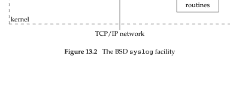

图 13.2 BSD syslog 设施

有三种生成日志消息的方式：

- 1. 内核例程可以调用 log 函数。任何打开并读取 /dev/klog 设备的用户进程都可以读取这些消息。我们不会进一步描述此函数，因为我们不感兴趣编写内核例程。
- 2. 大多数用户进程（守护进程）调用 syslog(3) 函数来生成日志消息。我们稍后会描述其调用序列。这会导致消息被发送到 UNIX 域数据报套接字 /dev/log。
- 3. 此主机上的用户进程，或通过 TCP/IP 网络连接到此主机的其他主机上的用户进程，可以向 UDP 端口 514 发送日志消息。请注意，syslog 函数永远不会生成这些 UDP 数据报：它们需要生成日志消息的进程进行显式的网络编程。

有关 UNIX 域套接字和 UDP 套接字的详细信息，请参阅 Stevens、Fenner 和 Rudoff [2004]。

通常，syslog 守护进程读取所有三种形式的日志消息。在启动时，此守护进程读取一个配置文件，通常是 /etc/syslog.conf，它决定不同类别的消息应发送到何处。例如，紧急消息可以发送给系统管理员（如果已登录）并打印在控制台上，而警告可能记录到文件中。

我们通过 syslog 函数与此设施进行交互。

```
#include <syslog.h>

void openlog(const char *ident, int option, int facility);
void syslog(int priority, const char *format, ...);
void closelog(void);
int setlogmask(int maskpri);

Returns: previous log priority mask value
```

调用 openlog 是可选的。如果未调用它，则第一次调用 syslog 时会自动调用 openlog。调用 closelog 也是可选的——它只是关闭用于与 syslog 守护进程通信的描述符。

调用 openlog 允许我们指定一个 ident，它会添加到每条日志消息中。这通常是程序的名称（例如 cron、inetd）。option 参数是一个位掩码，指定各种选项。图 13.3 描述了可用的选项，如果该选项包含在单一 UNIX 规范中 openlog 定义中，则 XSI 列中会有一个项目符号。

| option | XSI | Description |
|---|---|---|
| LOG_CONS | • | 如果日志消息无法通过 UNIX 域数据报发送给 syslogd，则消息会改写到控制台。 |
| LOG_NDELAY | • | 立即打开到 syslogd 守护进程的 UNIX 域数据报套接字；不要等到第一次记录消息。正常情况下，套接字要到第一次记录消息时才打开。 |
| LOG_NOWAIT | • | 不要等待在记录消息过程中可能已创建的子进程。这可以防止与捕获 SIGCHLD 的应用程序发生冲突，因为应用程序可能在 syslog 调用 wait 时已检索到子进程的状态。 |
| LOG_ODELAY | • | 将到 syslogd 守护进程的连接的打开延迟到第一次记录消息时。 |
| LOG_PERROR |  | 除了发送到 syslogd 外，还将日志消息写入标准错误。（在 Solaris 上不可用。） |
| LOG_PID | • | 随每条消息记录进程 ID。这适用于分叉子进程来处理不同请求的守护进程（与从不调用 fork 的守护进程（如 syslogd）相比）。 |

图 13.3 openlog 的 option 参数

format 参数和任何剩余参数都传递给 vsprintf 函数进行格式化。format 中出现的字符 %m 首先会被替换为对应于 errno 值的错误消息字符串（strerror）。

setlogmask 函数可用于设置进程的日志优先级掩码。此函数返回之前的掩码。当设置了日志优先级掩码时，除非其优先级设置在日志优先级掩码中，否则消息不会被记录。请注意，尝试将日志优先级掩码设置为 0 将不会产生任何效果。

logger(1) 程序也由许多系统提供，作为向 syslog 设施发送日志消息的一种方式。某些实现允许此程序的可选参数，指定设施、级别和 ident，尽管单一 UNIX 规范未定义任何选项。logger 命令适用于需要生成日志消息的非交互式运行的 shell 脚本。

### 示例

在一个（假设的）行式打印机 spooler 守护进程中，你可能会遇到以下序列

```
openlog("lpd", LOG_PID, LOG_LPR);
```

```
syslog(LOG_ERR, "open error for %s: %m", filename);
```

第一次调用将 ident 字符串设置为程序名，指定应始终打印进程 ID，并将默认设施设置为行式打印机系统。syslog 的调用指定了一个错误条件和一个消息字符串。如果我们没有调用 openlog，第二次调用可以是

```
syslog(LOG_ERR | LOG_LPR, "open error for %s: %m", filename);
```

在这里，我们将 priority 参数指定为级别和设施的组合。

| facility | XSI | Description |
|---|---|---|
| LOG_AUDIT |  | the audit facility |
| LOG_AUTH |  | authorization programs: login, su, getty, ... |
| LOG_AUTHPRIV |  | same as LOG_AUTH, but logged to file with restricted permissions |
| LOG_CONSOLE |  | messages written to /dev/console |
| LOG_CRON |  | cron and at |
| LOG_DAEMON |  | system daemons: inetd, routed, ... |
| LOG_FTP |  | the FTP daemon (ftpd) |
| LOG_KERN |  | messages generated by the kernel |
| LOG_LOCAL0 | • | reserved for local use |
| LOG_LOCAL1 | • | reserved for local use |
| LOG_LOCAL2 | • | reserved for local use |
| LOG_LOCAL3 | • | reserved for local use |
| LOG_LOCAL4 | • | reserved for local use |
| LOG_LOCAL5 | • | reserved for local use |
| LOG_LOCAL6 | • | reserved for local use |
| LOG_LOCAL7 | • | reserved for local use |
| LOG_LPR |  | line printer system: lpd, lpc, ... |
| LOG_MAIL |  | the mail system |
| LOG_NEWS |  | the Usenet network news system |
| LOG_NTP |  | the network time protocol system |
| LOG_SECURITY |  | the security subsystem |
| LOG_SYSLOG |  | the syslogd daemon itself |
| LOG_USER | • | messages from other user processes (default) |
| LOG_UUCP |  | the UUCP system |

图 13.4 openlog 的 facility 参数

| level | Description |
|---|---|
| LOG_EMERG | emergency (system is unusable) (highest priority) |
| LOG_ALERT | condition that must be fixed immediately |
| LOG_CRIT | critical condition (e.g., hard device error) |
| LOG_ERR | error condition |
| LOG_WARNING | warning condition |
| LOG_NOTICE | normal, but significant condition |
| LOG_INFO | informational message |
| LOG_DEBUG | debug message (lowest priority) |

图 13.5 syslog 级别（有序）

除了 syslog 外，许多平台还提供处理可变参数列表的变体。

```
#include <syslog.h>
#include <stdarg.h>

void vsyslog(int priority, const char *format, va_list arg);
```

本书中描述的全部四个平台都提供 vsyslog，但此函数未包含在单一 UNIX 规范中。请注意，为了使它的声明对你的应用程序可见，


你可能需要定义一个额外的符号，例如在 FreeBSD 上使用 __BSD_VISIBLE 或在 Linux 上使用 __USE_BSD。

大多数 syslog 实现会将消息排队一段时间。如果在此期间到达重复消息，syslog 守护进程不会将其写入日志。相反，守护进程会打印类似“last message repeated N times.”的消息。

## 13.5 单实例守护进程

某些守护进程的实现方式是同一时间只能运行一个副本才能正常运行。例如，这样的守护进程可能需要独占访问某个设备。在 cron 守护进程的情况下，如果运行多个实例，每个副本都可能尝试启动同一个计划操作，导致重复操作并可能出现错误。

如果守护进程需要访问设备，设备驱动程序有时会阻止多次尝试打开 /dev 中的对应设备节点。这限制了同一时间只能运行一个守护进程副本。如果没有此类设备可用，则我们需要自己完成这项工作。

文件和记录锁定机制提供了确保只有一个守护进程副本运行的一种方式的基础。（我们在第 14.3 节讨论文件和记录锁定。）如果每个守护进程都创建一个具有固定名称的文件并对整个文件放置写锁，则只允许创建一个这样的写锁。后续创建写锁的尝试将失败，作为后续守护进程副本的指示，表明另一个实例已在运行。

文件和记录锁定提供了一个方便的互斥机制。如果守护进程对整个文件获得写锁，当守护进程退出时锁将自动移除。这简化了恢复，消除了我们需要从守护进程的先前实例清理的需要。

### Example

图 13.6 所示的函数说明了如何使用文件和记录锁定来确保只有一个守护进程副本在运行。

```
#include <unistd.h>
#include <stdlib.h>
#include <fcntl.h>
#include <syslog.h>
#include <string.h>
#include <errno.h>
#include <stdio.h>
#include <sys/stat.h>

#define LOCKFILE "/var/run/daemon.pid"
#define LOCKMODE (S_IRUSR|S_IWUSR|S_IRGRP|S_IROTH)

extern int lockfile(int);
```

```
int
already_running(void)
{
    int     fd;
    char    buf[16];
    fd = open(LOCKFILE, O_RDWR|O_CREAT, LOCKMODE);
    if (fd < 0) {
        syslog(LOG_ERR, "can't open %s: %s", LOCKFILE, strerror(errno));
        exit(1);
    }
    if (lockfile(fd) < 0) {
        if (errno == EACCES || errno == EAGAIN) {
            close(fd);
            return(1);
        }
        syslog(LOG_ERR, "can't lock %s: %s", LOCKFILE, strerror(errno));
        exit(1);
    }
    ftruncate(fd, 0);
    sprintf(buf, "%ld", (long)getpid());
    write(fd, buf, strlen(buf)+1);
    return(0);
}
```

### Figure 13.6 Ensure that only one copy of a daemon is running

每个守护进程副本都会尝试创建一个文件并在其中写入其进程 ID。这将允许管理员轻松识别该进程。如果文件已被锁定，lockfile 函数将失败并将 errno 设置为 EACCES 或 EAGAIN，因此我们返回 1，表示守护进程已在运行。否则，我们截断文件，将我们的进程 ID 写入其中，并返回 0。

我们需要截断文件，因为守护进程的先前实例可能具有比我们更大的进程 ID，且字符串长度更大。例如，如果守护进程的先前实例是进程 ID 12345，而新实例是进程 ID 9999，当我们将进程 ID 写入文件时，文件中会留下 99995。截断文件可防止来自先前守护进程的数据似乎适用于当前守护进程。

## 13.6 守护进程约定

UNIX 系统中的守护进程遵循几种常见约定。

- 如果守护进程使用锁文件，该文件通常存储在 /var/run 中。注意，然而，守护进程可能需要超级用户权限在此处创建文件。文件的名称通常为 name.pid，其中 name 是守护进程或服务的名称。例如，在 Linux 上，cron 守护进程的锁文件名为 /var/run/crond.pid。

```
}

switch (signo) {
case SIGHUP:
    syslog(LOG_INFO, "Re-reading configuration file");
    reread();
    break;

case SIGTERM:
    syslog(LOG_INFO, "got SIGTERM; exiting");
    exit(0);

default:
    syslog(LOG_INFO, "unexpected signal %d\n", signo);
}
    return(0);
}

int
main(int argc, char *argv[])
{
    int             err;
    pthread_t       tid;
    char            *cmd;
    struct sigaction sa;

    if ((cmd = strchr(argv[0], '/')) == NULL)
        cmd = argv[0];
    else
        cmd++;

    /*
     * Become a daemon.
     */
    daemonize(cmd);

    /*
     * Make sure only one copy of the daemon is running.
     */
    if (already_running()) {
        syslog(LOG_ERR, "daemon already running");
        exit(1);
    }

    /*
     * Restore SIGHUP default and block all signals.
     */
    sa.sa_handler = SIG_DFL;
    sigemptyset(&sa.sa_mask);
    sa.sa_flags = 0;
    if (sigaction(SIGHUP, &sa, NULL) < 0)
        err_quit("%s: can't restore SIGHUP default");
```

```
sigfillset(&mask);
if ((err = pthread_sigmask(SIG_BLOCK, &mask, NULL)) != 0)
    err_exit(err, "SIG_BLOCK error");

/*
 * Create a thread to handle SIGHUP and SIGTERM.
 */
err = pthread_create(&tid, NULL, thr_fn, 0);
if (err != 0)
    err_exit(err, "can't create thread");

/*
 * Proceed with the rest of the daemon.
 */
/* ... */
exit(0);
}
```

### Figure 13.7 Daemon rereading configuration files

我们调用图 13.1 中的 daemonize 来初始化守护进程。当它返回时，我们调用图 13.6 中的 already_running 来确保只有一个守护进程副本在运行。此时，SIGHUP 仍被忽略，因此我们需要将处置重置为默认行为；否则，调用 sigwait 的线程可能永远看不到该信号。

我们阻塞所有信号，这是多线程程序推荐的做法，并创建一个线程来处理信号。该线程的唯一工作是等待 SIGHUP 和 SIGTERM。当它收到 SIGHUP 时，线程调用 reread 重新读取其配置文件。当它收到 SIGTERM 时，线程记录一条消息并退出。

回想图 10.1，SIGHUP 和 SIGTERM 的默认操作是终止进程。由于我们阻塞了这些信号，当其中一个信号发送到进程时，守护进程不会死亡。相反，调用 sigwait 的线程将返回并指示已收到信号。

### Example

并非所有守护进程都是多线程的。图 13.8 中的程序展示了单线程守护进程如何捕获 SIGHUP 并重新读取其配置文件。

```
#include "apue.h"
#include <syslog.h>
#include <errno.h>

extern int lockfile(int);
extern int already_running(void);

void
reread(void)
{
    /* ... */
```

```
sigaddset(&sa.sa_mask, SIGTERM);
 sa.sa_flags = 0;
 if (sigaction(SIGHUP, &sa, NULL) < 0) {
  syslog(LOG_ERR, "can't catch SIGHUP: %s", strerror(errno));
  exit(1);
 }

 /*
  * Proceed with the rest of the daemon.
  */
 /* ... */
 exit(0);
}
```

### Figure 13.8 Alternative implementation of daemon rereading configuration files

在初始化守护进程后，我们为 SIGHUP 和 SIGTERM 安装信号处理程序。我们可以将 reread 逻辑放在信号处理程序中，也只在处理程序中设置一个标志，让守护进程的主线程来完成所有工作。

## 13.7 客户端-服务器模型

守护进程的常见用途之一是作为服务器进程。事实上，在图 13.2 中，我们可以将 syslogd 进程称为服务器，它通过 UNIX 域数据报套接字接收来自用户进程（客户端）的消息。

一般来说，服务器是一个等待客户端联系它以请求某种服务的进程。在图 13.2 中，syslogd 服务器提供的服务是记录错误消息。

在图 13.2 中，客户端和服务器之间的通信是单向的。客户端向服务器发送服务请求；服务器不会向客户端发送任何回复。在接下来的章节中，我们将看到客户端和服务器之间双向通信的众多示例——客户端向服务器发送请求，服务器向客户端发送回复。


#include "apue.h"
#include <fcntl.h>

int
set_cloexec(int fd)
{
    int     val;

    if ((val = fcntl(fd, F_GETFD, 0)) < 0)
        return(-1);
    val |= FD_CLOEXEC;      /* enable close-on-exec */
    return(fcntl(fd, F_SETFD, val));
}

Figure 13.9 Set close-on-exec flag

## 13.8 Summary

Daemon processes are running all the time on most UNIX systems. Initializing our own process to run as a daemon takes some care and an understanding of the process relationships described in Chapter 9. In this chapter, we developed a function that can be called by a daemon process to initialize itself correctly.

We also discussed the ways a daemon can log error messages, since a daemon normally doesn't have a controlling terminal. We discussed several conventions that daemons follow on most UNIX systems and showed examples of how to implement some of these conventions.

## Exercises

- 13.1 As we might guess from Figure 13.2, when the syslog facility is initialized, either by calling openlog directly or on the first call to syslog, the special device file for the UNIX domain datagram socket, /dev/log, has to be opened. What happens if the user process (the daemon) calls chroot before calling openlog?
- 13.2 Recall the sample ps output from Section 13.2. The only user-level daemon that isn't a session leader is the syslogd process. Explain why the syslogd daemon isn't a session leader.
- 13.3 List all the daemons active on your system, and identify the function of each one.
- 13.4 Write a program that calls the daemonize function in Figure 13.1. After calling this function, call getlogin (Section 8.15) to see whether the process has a login name now that it has become a daemon. Print the results to a file.

## Advanced I/O

### 14.1 Introduction

This chapter covers numerous topics and functions that we lump under the term advanced I/O: nonblocking I/O, record locking, I/O multiplexing (the select and poll functions), asynchronous I/O, the readv and writev functions, and memory-mapped I/O (mmap). We need to cover these topics before describing interprocess communication in Chapter 15, Chapter 17, and many of the examples in later chapters.

### 14.2 Nonblocking I/O

In Section 10.5, we said that system calls are divided into two categories: the “slow” ones and all the others. The slow system calls are those that can block forever. They include

- Reads that can block the caller forever if data isn’t present with certain file types (pipes, terminal devices, and network devices)
- Writes that can block the caller forever if the data can’t be accepted immediately by these same file types (e.g., no room in the pipe, network flow control)
- Opens that block until some condition occurs on certain file types (such as an open of a terminal device that waits until an attached modem answers the phone, or an open of a FIFO for writing only, when no other process has the FIFO open for reading)
- Reads and writes of files that have mandatory record locking enabled
- Certain ioctl operations
- Some of the interprocess communication functions (Chapter 15)

We also said that system calls related to disk I/O are not considered slow, even though the read or write of a disk file can block the caller temporarily.

Nonblocking I/O lets us issue an I/O operation, such as an open, read, or write, and not have it block forever. If the operation cannot be completed, the call returns immediately with an error noting that the operation would have blocked.

There are two ways to specify nonblocking I/O for a given descriptor.

- 1. If we call open to get the descriptor, we can specify the O_NONBLOCK flag (Section 3.3).
- 2. For a descriptor that is already open, we call fcntl to turn on the O_NONBLOCK file status flag (Section 3.14). Figure 3.12 shows a function that we can call to turn on any of the file status flags for a descriptor.

Earlier versions of System V used the flag O_NDELAY to specify nonblocking mode. These versions of System V returned a value of 0 from the read function if there wasn't any data to be read. Since this use of a return value of 0 overlapped with the normal UNIX System convention of 0 meaning the end of file, POSIX.1 chose to provide a nonblocking flag with a different name and different semantics. Indeed, with these older versions of System V, when we get a return of 0 from read, we don't know whether the call would have blocked or whether the end of file was encountered. We'll see that POSIX.1 requires that read return -1 with errno set to EAGAIN if there is no data to read from a nonblocking descriptor. Some platforms derived from System V support both the older O_NDELAY and the POSIX.1 O_NONBLOCK, but in this text we'll use only the POSIX.1 feature. The older O_NDELAY is intended for backward compatibility and should not be used in new applications.

4.3BSD provided the F_NDELAY flag for fcntl, and its semantics were slightly different. Instead of affecting only the file status flags for the descriptor, the flags for either the terminal device or the socket were also changed to be nonblocking, thereby affecting all users of the terminal or socket, not just the users sharing the same file table entry. (4.3BSD nonblocking I/O worked only on terminals and sockets). Also, 4.3BSD returned EWOULDBLOCK if an operation on a nonblocking descriptor could not complete without blocking. Today, BSD-based systems provide the POSIX.1 O_NONBLOCK flag and define EWOULDBLOCK to be the same as EAGAIN. These systems provide nonblocking semantics consistent with other POSIX-compatible systems: changes in file status flags affect all users of the same file table entry, but are independent of accesses to the same device through other file table entries. (Refer to Figures 3.7 and 3.9.)

Example

Let's look at an example of nonblocking I/O. The program in Figure 14.1 reads up to 500,000 bytes from the standard input and attempts to write it to the standard output. The standard output is first set to be nonblocking. The output is in a loop, with the results of each write being printed on the standard error. The function clr_fl is similar to the function set_fl that we showed in Figure 3.12. This new function simply clears one or more of the flag bits.

```
#include "apue.h"
#include <errno.h>
#include <fcntl.h>

char buf[500000];

int
main(void)
{
    int ntowrite, nwrite;
    char *ptr;

    ntowrite = read(STDIN_FILENO, buf, sizeof(buf));
    fprintf(stderr, "read %d bytes\n", ntowrite);

    set_fl(STDOUT_FILENO, O_NONBLOCK);  /* set nonblocking */

    ptr = buf;
    while (ntowrite > 0) {
        errno = 0;
        nwrite = write(STDOUT_FILENO, ptr, ntowrite);
        fprintf(stderr, "nwrite = %d, errno = %d\n", nwrite, errno);

        if (nwrite > 0) {
            ptr += nwrite;
            ntowrite -= nwrite;
        }
    }

    clr_fl(STDOUT_FILENO, O_NONBLOCK);  /* clear nonblocking */
    exit(0);
}
```

Figure 14.1 Large nonblocking write

If the standard output is a regular file, we expect the write to be executed once:

```
$ ls -l /etc/services                print file size
-rw-r--r-- 1 root 677959 Jun 23 2009 /etc/services
$ ./a.out < /etc/services > temp.file     try a regular file first
read 500000 bytes
nwrite = 500000, errno = 0                a single write
$ ls -l temp.file                        verify size of output file
-rw-r--r-- 1 sar 500000 Apr 1 13:03 temp.file
```

But if the standard output is a terminal, we expect the write to return a partial count sometimes and an error at other times. This is what we see:

```
```text
$ ./a.out < /etc/services 2>stderr.out

$ cat stderr.out
read 500000 bytes
nwrite = 999, errno = 0
nwrite = -1, errno = 35
nwrite = -1, errno = 35
nwrite = -1, errno = 35
nwrite = -1, errno = 35
nwrite = 1001, errno = 0
nwrite = -1, errno = 35
nwrite = 1002, errno = 0
nwrite = 1004, errno = 0
nwrite = 1003, errno = 0
nwrite = 1003, errno = 0
nwrite = 1005, errno = 0
nwrite = -1, errno = 35
    :
nwrite = 1006, errno = 0
nwrite = 1004, errno = 0
nwrite = 1005, errno = 0
nwrite = 1006, errno = 0
nwrite = -1, errno = 35
    :
nwrite = 1006, errno = 0
nwrite = 1005, errno = 0
nwrite = 1005, errno = 0
nwrite = -1, errno = 35
    :
nwrite = 347, errno = 0
```
```

On this system, the errno of 35 is EAGAIN. The amount of data accepted by the terminal driver varies from system to system. The results will also vary depending on how you are logged in to the system: on the system console, on a hard-wired terminal, on a network connection using a pseudo terminal. If you are running a windowing system on your terminal, you are also going through a pseudo terminal device.

In this example, the program issues more than 9,000 write calls, even though only 500 are needed to output the data. The rest just return an error. This type of loop, called polling, is a waste of CPU time on a mult iuser system. In Section 14.4, we’ll see that I/O multiplexing with a nonblocking descriptor is a more efficient way to do this.

Sometimes, we can avoid using nonblocking I/O by designing our applications to use multiple threads (see Chapter 11). We can allow individual threads to block in I/O calls if we can continue to make progress in other threads. This can sometimes simplify the design, as we shall see in Chapter 21; at other times, however, the overhead of synchronization can add more complexity than is saved from using threads.


## fcntl 记录锁

让我们重复一下第 3.14 节中 fcntl 函数的原型。

```
#include <fcntl.h>
int fcntl(int fd, int cmd, ... /* struct flock *flockptr * */ );
Returns: depends on cmd if OK (see following), -1 on error
```

对于记录锁，cmd 为 F_GETLK、F_SETLK 或 F_SETLKW。第三个参数（我们称之为 flockptr）是指向 flock 结构的指针。

```
struct flock {
    short l_type;    /* F_RDLCK, F_WRLCK, or F_UNLCK */
    short l_whence;  /* SEEK_SET, SEEK_CUR, or SEEK_END */
    off_t l_start;   /* offset in bytes, relative to l_whence */
    off_t l_len;     /* length, in bytes; 0 means lock to EOF */
    pid_t l_pid;     /* returned with F_GETLK */
};
```

该结构描述了

- 所需锁的类型：F_RDLCK（共享读锁）、F_WRLCK（独占写锁）或 F_UNLCK（解锁区域）
- 被锁定或解锁的区域的起始字节偏移量（l_start 和 l_whence）
- 区域的字节大小（l_len）
- 持有可能阻塞当前进程的锁的进程的 ID（l_pid）（仅由 F_GETLK 返回）

对要锁定或解锁的区域的指定有许多规则适用。

- 指定区域起始偏移量的两个元素与 lseek 函数（第 3.6 节）的最后两个参数类似。事实上，l_whence 成员指定为 SEEK_SET、SEEK_CUR 或 SEEK_END。
- 锁可以从当前文件末尾开始并延伸超出当前文件末尾，但不能从文件开头之前开始或延伸到文件开头之前。
- 如果 l_len 为 0，则表示锁延伸到文件的最大可能偏移量。这使我们能够锁定从文件中的任意位置开始的区域，直到并包括追加到文件中的任何数据。（我们不必猜测可能会追加多少字节到文件中。）
- 要锁定整个文件，我们将 l_start 和 l_whence 设置为指向文件开头，并指定长度（l_len）为 0。（有几种方法可以指定文件开头，但大多数应用程序将 l_start 指定为 0 且 l_whence 指定为 SEEK_SET。）

我们之前提到过两种类型的锁：共享读锁（l_type 为 F_RDLCK）和独占写锁（F_WRLCK）。基本规则是，任意数量的进程可以在给定的字节上拥有共享读锁，但只有一个进程可以在给定的字节上拥有独占写锁。此外，如果字节上存在一个或多个读锁，则该字节上不能有任何写锁；如果字节上存在独占写锁，则该字节上不能有任何读锁。我们在图 14.3 中展示了此兼容性规则。

| Request for | read lock | write lock |
|---|---|---|
| no locks | OK | OK |
| one or more read locks | OK | denied |
| one write lock | denied | denied |
Region currently has

图 14.3 不同锁类型之间的兼容性

兼容性规则适用于不同进程发出的锁请求，而不是单个进程发出的多个锁请求。如果进程已在文件的某个范围内存在锁，则同一进程随后尝试在同一范围内放置锁将用新锁替换现有锁。因此，如果进程在文件的字节 16–32 上有写锁，然后尝试在字节 16–32 上放置读锁，则请求将成功，并且写锁将被读锁替换。

要获得读锁，描述符必须可读；要获得写锁，描述符必须可写。

我们现在可以描述 fcntl 函数的三个命令。

F_GETLK 确定 flockptr 描述的锁是否被其他锁阻塞。如果存在会阻止我们创建的锁，则该现有锁的信息会覆盖 flockptr 指向的信息。如果不存在会阻止我们创建的锁，则 flockptr 指向的结构保持不变，只是 l_type 成员被设置为 F_UNLCK。

F_SETLK 设置 flockptr 描述的锁。如果我们尝试获得读锁（l_type 为 F_RDLCK）或写锁（l_type 为 F_WRLCK），并且兼容性规则阻止系统授予我们锁（图 14.3），则 fcntl 立即返回并将 errno 设置为 EACCES 或 EAGAIN。

尽管 POSIX 允许实现返回任一错误代码，但本教材中描述的全部四个实现在锁定请求无法满足时均返回 EAGAIN。

此命令也用于清除 flockptr 描述的锁（l_type 为 F_UNLCK）。

F_SETLKW 此命令是 F_SETLK 的阻塞版本。（命令名中的 W 表示等待。）如果由于另一个进程当前锁定了请求区域的一部分而无法授予请求的读锁或写锁，则调用进程会被置于睡眠状态。进程在锁变得可用时或被信号中断时唤醒。

请注意，使用 F_GETLK 测试锁然后使用 F_SETLK 或 F_SETLKW 尝试获取该锁并不是原子操作。我们无法保证在两次 fcntl 调用之间不会有其他进程进来并获取相同的锁。如果我们不想在等待锁可用时阻塞，则必须处理 F_SETLK 的可能错误返回。

请注意，POSIX.1 并未规定当一个进程对文件的一个范围进行读锁，第二个进程在尝试对同一范围获取写锁时阻塞，而第三个进程随后尝试对该范围获取另一个读锁时会发生什么。如果允许第三个进程仅因该范围已处于读锁状态就放置读锁，则实现可能会导致具有挂起写锁请求的进程饥饿。因此，随着对同一范围的读锁请求的增加，具有挂起写锁请求的进程需要等待的时间会延长。如果读锁请求到达的速度足够快且到达率没有间歇，则写入者可能需要等待很长时间。

在设置或释放文件上的锁时，系统会按需合并或拆分相邻区域。例如，如果我们锁定字节 100 到 199，然后解锁字节 150，则内核仍会维护字节 100 到 149 以及字节 151 到 199 上的锁。图 14.4 说明了此情况下的字节范围锁。

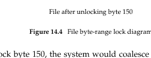

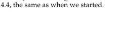

图 14.4 文件字节范围锁图

如果我们锁定字节 150，系统会将相邻的锁定区域合并为从字节 100 到 199 的单个区域。 resulting picture would be the first diagram in Figure 14.4, the same as when we started.

## 示例 — 请求和释放锁

为了避免每次都必须分配一个 flock 结构并填充所有元素，图 14.5 中的函数 lock_reg 处理了所有这些细节。

```
#include "apue.h"
#include <fcntl.h>

int
lock_reg(int fd, int cmd, int type, off_t offset, int whence, off_t len)
{
    struct flock    lock;
    lock.l_type = type;        /* F_RDLCK, F_WRLCK, F_UNLCK */
    lock.l_start = offset;     /* byte offset, relative to l_whence */
    lock.l_whence = whence;    /* SEEK_SET, SEEK_CUR, SEEK_END */
    lock.l_len = len;          /* #bytes (0 means to EOF) */
    return(fcntl(fd, cmd, &lock));
}
```

图 14.5 用于锁定或解锁文件区域的函数

由于大多数锁定调用都是锁定或解锁一个区域（命令 F_GETLK 很少使用），我们通常使用以下五个宏，它们在 apue.h（附录 B）中定义。

```
#define read_lock(fd, offset, whence, len) \
    lock_reg((fd), F_SETLK, F_RDLCK, (offset), (whence), (len))
#define readw_lock(fd, offset, whence, len) \
    lock_reg((fd), F_SETLK, F_RDLCK, (offset), (whence), (len))
#define write_lock(fd, offset, whence, len) \
    lock_reg((fd), F_SETLK, F_WRLCK, (offset), (whence), (len))
#define writew_lock(fd, offset, whence, len) \
    lock_reg((fd), F_SETLKW, F_WRLCK, (offset), (whence), (len))
#define un_lock(fd, offset, whence, len) \
    lock_reg((fd), F_SETLK, F_UNLCK, (offset), (whence), (len))
```

我们特意将这些宏的前三个参数定义为与 lseek 函数相同的顺序。

## 示例 — 测试锁

图 14.6 定义了我们将用于测试锁的函数 lock_test。

```
#include "apue.h"
#include <fcntl.h>

pid_t
lock_test(int fd, int type, off_t offset, int whence, off_t len)
{
```


struct flock    lock;

lock.l_type = type;       /* F_RDLCK or F_WRLCK */
lock.l_start = offset;    /* byte offset, relative to l_whence */
lock.l_whence = whence;   /* SEEK_SET, SEEK_CUR, SEEK_END */
lock.l_len = len;         /* #bytes (0 means to EOF) */

if (fcntl(fd, F_GETLK, &lock) < 0)
    err_sys("fcntl error");

if (lock.l_type == F_UNLCK)
    return(0);             /* false, region isn't locked by another proc */
return(lock.l_pid);        /* true, return pid of lock owner */
}

图 14.6 测试锁定条件的函数

如果存在会阻止所请求参数的锁，此函数返回持有该锁的进程 ID。否则，函数返回 0（假）。我们通常从以下两个宏（在 apue.h 中定义）调用此函数：

```
#define is_read_lockable(fd, offset, whence, len) \
        (lock_test((fd), F_RDLCK, (offset), (whence), (len)) == 0)
#define is_write_lockable(fd, offset, whence, len) \
        (lock_test((fd), F_WRLCK, (offset), (whence), (len)) == 0)
```

请注意，lock_test 函数不能由进程用来查看它当前是否持有文件的一部分的锁。F_GETLK 命令的定义指出，返回的信息适用于会阻止我们创建自己的锁的现有锁。由于 F_SETLK 和 F_SETLKW 命令总是在存在时替换进程的现有锁，我们永远不会因自己的锁而被阻塞；因此，F_GETLK 命令永远不会报告我们自己的锁。

## 示例—死锁

当两个进程各自等待对方锁定的资源时，就会发生死锁。如果控制了锁定区域的进程在尝试锁定由另一个进程控制的另一个区域时被挂起，则存在死锁的可能性。

图 14.7 显示了死锁的示例。子进程锁定字节 0，父进程锁定字节 1。随后各自尝试锁定对方已锁定的字节。我们使用第 8.9 节中的父子同步例程（TELL_xxx 和 WAIT_xxx），以便每个进程都能等待另一个进程获得其锁。

```
#include "apue.h"
#include <fcntl.h>

static void
lockabyte(const char *name, int fd, off_t offset)
{
    if (writew_lock(fd, offset, SEEK_SET, 1) < 0)
        err_sys("%s: writew_lock error", name);
    printf("%s: got the lock, byte %lld\n", name, (long long)offset);
}
int
main(void)
{
    int     fd;
    pid_t   pid;

    /*
     * Create a file and write two bytes to it.
     */
    if ((fd = creat("templock", FILE_MODE)) < 0)
        err_sys("create error");
    if (write(fd, "ab", 2) != 2)
        err_sys("write error");

    TELL_WAIT();
    if ((pid = fork()) < 0) {
        err_sys("fork error");
    } else if (pid == 0) {    /* child */
        lockabyte("child", fd, 0);
        TELL_PARENT(getppid());
        WAIT_PARENT();
        lockabyte("child", fd, 1);
    } else {                /* parent */
        lockabyte("parent", fd, 1);
        TELL_CHILD(pid);
        WAIT_CHILD();
        lockabyte("parent", fd, 0);
    }
    exit(0);
}
```

# 图 14.7 死锁检测示例

运行图 14.7 中的程序，我们得到

```
$ ./a.out
parent: got the lock, byte 1
child: got the lock, byte 0
parent: writew_lock error: Resource deadlock avoided
child: got the lock, byte 1
```

当检测到死锁时，内核必须选择一个进程返回错误。在此示例中，父进程被选中，但这是实现细节。在某些系统上，子进程总是收到错误。在其他系统上，父进程总是收到错误。在某些系统上，随着多次锁定尝试，你甚至可能会看到错误在子进程和父进程之间分配。

## 锁的隐式继承与释放

自动继承和释放记录锁遵循三条规则。

- 1. 锁与进程和文件相关联。这有两个含义。第一个很明显：当进程终止时，其所有锁都会被释放。第二个则不那么明显：每当关闭一个描述符时，该进程对该描述符引用的文件的所有锁都会被释放。这意味着如果我们进行如下调用

```
fd1 = open(pathname, ...);
read_lock(fd1, ...);
fd2 = dup(fd1);
close(fd2);
```

在 close(fd2) 之后，在 fd1 上获得的锁将被释放。如果我们用 open 替换 dup，如下所示

```
fd1 = open(pathname, ...);
read_lock(fd1, ...);
fd2 = open(pathname, ...);
close(fd2);
```

以在另一个描述符上打开同一文件，也会发生同样的情况。

- 2. 锁永远不会通过 fork 继承给子进程。这意味着如果进程获得锁然后调用 fork，子进程在锁方面被视为与父进程获得的锁不同的另一个进程。子进程必须调用 fcntl 在 fork 跨越继承的任何描述符上获得自己的锁。此限制是有意义的，因为锁的目的是防止多个进程同时写入同一文件。如果子进程在 fork 后继承锁，父进程和子进程都可能同时写入同一文件。

- 3. 锁会被新程序在 exec 时继承。需要注意的是，如果为文件描述符设置了 close-on-exec 标志，则在 exec 期间关闭描述符时，所有底层文件的锁都会被释放。

## FreeBSD 实现

让我们简要查看 FreeBSD 实现中使用的数据结构。这有助于阐明规则 1，即锁与进程和文件相关联。

考虑一个执行以下语句的进程（忽略错误返回）：

```
fd1 = open(pathname, ...);
write_lock(fd1, 0, SEEK_SET, 1);    /* parent write locks byte 0 */
if (pid = fork()) {                   /* parent */
    fd2 = dup(fd1);
    fd3 = open(pathname, ...);
} else if (pid == 0) {                 /* child */
    read_lock(fd1, 1, SEEK_SET, 1);   /* child read locks byte 1 */
}
pause();
```

图 14.8 显示了父进程和子进程都暂停后得到的结果数据结构。

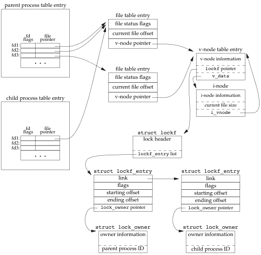

**图 14.8** FreeBSD 记录锁的数据结构

我们展示了 open、fork 和 dup 调用产生的数据结构（图 3.9 和 8.2）。这里新的是从 i-node 结构链接起来的锁结构。每个锁结构描述给定进程的一个锁定区域（由偏移量和长度定义）。我们展示了两个这样的结构：一个用于父进程对 write_lock 的调用，一个用于子进程对 read_lock 的调用。每个结构都包含相应的进程 ID。

在父进程中，关闭 fd1、fd2 或 fd3 中的任何一个都会导致父进程的锁被释放。当关闭这三个文件描述符中的任何一个时，内核会遍历对应 i-node 的锁链表并释放调用进程持有的锁。内核无法分辨（也不关心）父进程使用这三个描述符中的哪一个获得了锁。

## 示例

在图 13.6 的程序中，我们看到守护进程如何使用文件上的锁来确保只有一个副本在运行。图 14.9 显示了守护进程用于在文件上放置写锁的 lockfile 函数的实现。

```
#include <unistd.h>
#include <fcntl.h>
int
lockfile(int fd)
{
    struct flock fl;
    fl.l_type = F_WRLCK;
    fl.l_start = 0;
    fl.l_whence = SEEK_SET;
    fl.l_len = 0;
    return(fcntl(fd, F_SETLK, &fl));
}
```

图 14.9 在整个文件上放置写锁

或者，我们也可以用 write_lock 函数来定义 lockfile 函数：

```
#define lockfile(fd) write_lock((fd), 0, SEEK_SET, 0)
```

## 文件末尾的锁

在相对于文件末尾锁定或解锁字节范围时，我们需要谨慎。大多数实现会将 l_whence 值 SEEK_CUR 或 SEEK_END 转换为绝对文件偏移量，使用 l_start 和文件的当前位置或当前长度。然而，通常我们需要相对于文件当前长度指定锁，但我们不能调用 fstat 来获取当前文件大小，因为我们没有对文件的锁。（在调用 fstat 和锁调用之间，另一个进程可能会更改文件的长度。）


假设我们在执行第一次写操作时位于文件末尾，此操作会将文件扩展一个字节，并且该字节会被锁定。随后的解锁操作的效果是移除了对未来追加数据到文件的写操作的锁，但它在文件中的最后一个字节上保留了锁。当第二次写操作发生时，文件末尾会扩展一个字节，但该字节不会被锁定。此序列步骤的文件锁状态如图 14.10 所示。

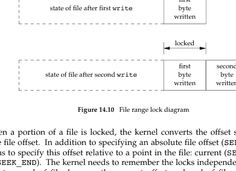

图 14.10 文件范围锁示意图

当文件的某一部分被锁定时，内核会将指定的偏移量转换为绝对文件偏移量。除了指定绝对文件偏移量（SEEK_SET）外，fcntl 还允许我们指定相对于文件中的某一点的偏移量：当前位置（SEEK_CUR）或文件末尾（SEEK_END）。内核需要独立于当前文件偏移量或文件末尾来记住锁，因为当前偏移量和文件末尾可能会发生变化，而这些属性的变化不应影响现有锁的状态。

如果我们打算移除第一次写操作中写入的字节所覆盖的锁，我们本可以指定长度为 -1。负长度值表示指定偏移量之前的字节。

## 建议性锁定与强制性锁定

考虑一个数据库访问例程库。如果库中的所有函数都以一致的方式处理记录锁定，那么我们就说使用这些函数访问数据库的任何一组进程都是协作进程。如果这些数据库访问函数是访问数据库的唯一方式，那么使用建议性锁定是可行的。但建议性锁定并不能阻止某个对数据库文件具有写权限的其他进程随意向数据库文件写入内容。此类恶意进程是非协作进程，因为它没有使用公认的方法（数据库函数库）来访问数据库。

强制性锁定会使内核检查每次 open、read 和 write，以验证调用进程是否违反了正在访问的文件上的锁。强制性锁定有时被称为强制模式锁定。

我们在图 14.2 中看到，Linux 3.2.0 和 Solaris 10 提供了强制性记录锁定，但 FreeBSD 8.0 和 Mac OS X 10.6.8 不提供。强制性记录锁定不是单一 UNIX 规范的一部分。在 Linux 上，如果你想要强制性锁定，你需要通过使用 mount 命令的 -o mand 选项按文件系统启用它。

通过打开 set-group-ID 位并关闭 group-execute 位，可以为特定文件启用强制性锁定。（回顾图 4.12。）由于在关闭 group-execute 位时 set-group-ID 位毫无意义，SVR3 的设计者选择了这种方式来指定文件的锁定为强制性锁定而不是建议性锁定。

如果一个进程尝试读取或写入已启用强制性锁定的文件，并且文件的某一部分当前已被另一个进程锁定，会发生什么？答案取决于操作类型（读或写）、另一个进程持有的锁类型（读锁或写锁），以及读取或写入的描述符是否为非阻塞。图 14.11 显示了八种可能性。

| 其他进程持有的区域上的现有锁类型 | 阻塞描述符，尝试 |  | 非阻塞描述符，尝试 |  |
|---|---|---|---|---|
|  | 读 | 写 | 读 | 写 |
| 读锁 | OK | 阻塞 | OK | EAGAIN |
| 写锁 | 阻塞 | 阻塞 | EAGAIN | EAGAIN |

图 14.11 强制性锁定对其他进程的读和写的影响

除了图 14.11 中的读和写函数外，open 函数也可能受到另一个进程持有的强制性记录锁的影响。通常，即使打开的文件存在未决的强制性记录锁，open 也会成功。下一个读或写操作遵循图 14.11 中列出的规则。但如果打开的文件存在未决的强制性记录锁（读锁或写锁），并且 open 调用的标志指定了 O_TRUNC 或 O_CREAT，则 open 会立即返回 EAGAIN 错误，而不管是否指定了 O_NONBLOCK。

只有 Solaris 将 O_CREAT 标志视为错误情况。Linux 允许在打开存在未决强制性锁的文件时指定 O_CREAT 标志。对 O_TRUNC 生成 open 错误是有意义的，因为如果文件被另一个进程读锁定或写锁定，则文件无法被截断。然而，对 O_CREAT 生成错误却意义不大；该标志表示仅在文件不存在时创建文件，但文件必须存在才能被另一个进程记录锁定。

这种对 open 的锁定冲突处理可能导致令人惊讶的结果。在开发本节练习时，运行了一个测试程序，该程序打开了一个文件（其模式指定了强制性锁定），在整个文件上建立了读锁，然后休眠一段时间。（回顾图 14.11，读锁应阻止其他进程写入文件。）在此休眠期间，在其他典型的 UNIX 系统程序中观察到以下行为。

- 相同的文件可以用 ed 编辑器编辑，并将结果写回磁盘！强制性记录锁定完全没有效果。使用某些版本的 UNIX 系统提供的系统调用跟踪功能，可以看到 ed

将新内容写入临时文件，删除原始文件，然后将临时文件重命名为原始文件。强制性记录锁定对 unlink 函数没有效果，这使得这种情况成为可能。

在 FreeBSD 8.0 和 Solaris 10 下，我们可以使用 truss(1) 命令获取进程的系统调用跟踪。Linux 3.2.0 为此提供了 strace(1) 命令。Mac OS X 10.6.8 提供了 dtruss(1m) 命令来跟踪系统调用，但其使用需要超级用户权限。

- vi 编辑器永远无法编辑该文件。它可以读取文件的内容，但每当我们尝试将新数据写入文件时，就会返回 EAGAIN。如果我们尝试向文件追加新数据，写入操作会阻塞。vi 的这种行为是我们所期望的。
- 使用 Korn shell 的 > 和 >> 操作符覆盖或追加到文件会导致错误“无法创建”。
- 使用 Bourne shell 的这两个操作符，> 会导致错误，但 >> 操作符会阻塞直到强制性锁被移除，然后继续。（追加操作符处理上的差异发生是因为 Korn shell 使用 O_CREAT 和 O_APPEND 打开文件，而我们之前提到指定 O_CREAT 会导致错误。Bourne shell 然而，如果文件已存在，则不会指定 O_CREAT，因此 open 成功但下一个写操作会阻塞。）

结果会因所使用的操作系统版本而异。底线，正如本次练习所证明的那样，要谨慎对待强制性记录锁定。正如 ed 示例所示，它可以被绕过。

强制性记录锁定也可以被恶意用户用来在可公开读取的文件上持有读锁。这可以阻止任何人写入该文件。（当然，要发生这种情况，文件必须已启用强制性记录锁定，这可能需要用户能够更改文件的权限位。）考虑一个世界可读且已启用强制性记录锁定的数据库文件。如果恶意用户在整个文件上持有读锁，则其他进程将无法写入该文件。

## 示例

我们可以通过运行图 14.12 中的程序来确定我们的系统是否支持强制性锁定。

```
```c
#include "apue.h"
#include <errno.h>
#include <fcntl.h>
#include <sys/wait.h>

int
main(int argc, char *argv[])
{
    int              fd;
```


```c
pid_t          pid;
char           buf[5];
struct stat    statbuf;

if (argc != 2) {
    fprintf(stderr, "usage: %s filename\n", argv[0]);
    exit(1);
}
if ((fd = open(argv[1], O_RDWR | O_CREAT | O_TRUNC, FILE_MODE)) < 0)
    err_sys("open error");
if (write(fd, "abcdef", 6) != 6)
    err_sys("write error");

/* turn on set-group-ID and turn off group-execute */
if (fstat(fd, &statbuf) < 0)
    err_sys("fstat error");
if (fchmod(fd, (statbuf.st_mode & ~S_IXGRP) | S_ISGID) < 0)
    err_sys("fchmod error");

TELL_WAIT();
if ((pid = fork()) < 0) {
    err_sys("fork error");
} else if (pid > 0) {   /* parent */
    /* write lock entire file */
    if (write_lock(fd, 0, SEEK_SET, 0) < 0)
        err_sys("write_lock error");

    TELL_CHILD(pid);
    if (waitpid(pid, NULL, 0) < 0)
        err_sys("waitpid error");
} else {               /* child */
    WAIT_PARENT();     /* wait for parent to set lock */
    set_fl(fd, O_NONBLOCK);

    /* first let's see what error we get if region is locked */
    if (read_lock(fd, 0, SEEK_SET, 0) != -1)  /* no wait */
        err_sys("child: read_lock succeeded");
    printf("read_lock of already-locked region returns %d\n",
           errno);

    /* now try to read the mandatory locked file */
    if (lseek(fd, 0, SEEK_SET) == -1)
        err_sys("lseek error");
    if (read(fd, buf, 2) < 0)
        err_ret("read failed (mandatory locking works)");
    else
        printf("read OK (no mandatory locking), buf = %2.2s\n",
               buf);
}
exit(0);
}
```

此程序创建一个文件，并为该文件启用强制性锁定。随后，程序分裂为父进程和子进程，父进程获取整个文件的写锁。子进程首先将其文件描述符设置为非阻塞模式，然后尝试获取该文件的读锁，并预期会得到一个错误。这样，我们就能看到系统返回的是 EACCES 还是 EAGAIN。接下来，子进程将文件位置重新定位到开头，并尝试读取文件。如果系统提供强制性锁定，由于文件描述符处于非阻塞模式，读取应返回 EACCES 或 EAGAIN。否则，读取操作将返回所读取的数据。在支持强制性锁定的 Solaris 10 上运行此程序，结果如下：

```
$ ./a.out temp.lock
read_lock of already-locked region returns 11
read failed (mandatory locking works): Resource temporarily unavailable
```

如果查看系统的头文件或 intro(2) 手册页，就会发现 errno 值 11 对应于 EAGAIN。在 FreeBSD 8.0 上，结果如下：

```
$ ./a.out temp.lock
read_lock of already-locked region returns 35
read OK (no mandatory locking), buf = ab
```

这里，errno 值 35 对应于 EAGAIN。FreeBSD 不支持强制性锁定。

### 示例

让我们回到本节开头提出的第一个问题：当两个人同时编辑同一个文件时会发生什么？标准 UNIX 系统文本编辑器不使用记录锁定，因此答案仍然是：文件的最终内容取决于最后写入该文件的进程。

某些版本的 vi 编辑器使用建议性记录锁定。即使我们使用的是这些版本中的某一个，它也无法阻止用户运行另一个不使用建议性记录锁定的编辑器。

如果系统提供强制性记录锁定，那么我们可以修改自己喜欢的编辑器，使其使用这种锁定（前提是我们拥有该编辑器的源代码）。如果没有编辑器的源代码，我们可以尝试以下方法：编写自己的程序，作为 vi 的前端。该程序立即调用 fork，父进程只等待子进程完成。子进程打开命令行中指定的文件，启用强制性锁定，获取整个文件的写锁，然后执行 vi。vi 运行期间，文件处于写锁定状态，因此其他用户无法修改它。当 vi 终止时，父进程的 wait 返回，我们的前端程序也随之终止。

这种类型的前端程序并不难编写，但它无法正常工作。问题在于，编辑器通常会读取输入文件，然后将其关闭。当引用该文件的文件描述符被关闭时，文件上的锁就会被释放。因此，编辑器读取完文件内容并将其关闭后，锁也就消失了。在前端程序中无法阻止这种情况发生。

我们将在第 20 章的数据库库中使用记录锁定，为多个进程提供并发访问。届时我们还会提供一些计时数据，以观察记录锁定对进程的影响。

## 14.4 I/O 多路复用

当我们从一个文件描述符读取数据并写入另一个文件描述符时，可以在循环中使用阻塞式 I/O，例如：

```
while ((n = read(STDIN_FILENO, buf, BUFSIZ)) > 0)
    if (write(STDOUT_FILENO, buf, n) != n)
        err_sys("write error");
```

我们一再看到这种阻塞式 I/O 的形式。如果必须从两个文件描述符读取数据，该怎么办？在这种情况下，我们不能对任一文件描述符执行阻塞式读取，因为当我们阻塞在其中一个文件描述符的读取操作上时，数据可能会出现在另一个文件描述符中。处理这种情况需要采用不同的技术。

让我们看看 telnet(1) 命令的结构。在该程序中，我们从终端（标准输入）读取数据，并将其写入网络连接；同时从网络连接读取数据，并将其写入终端（标准输出）。在网络连接的另一端，telnetd 守护进程读取我们输入的内容，并将其交给 shell，就好像我们已经登录到远程计算机一样。telnetd 守护进程会通过 telnet 命令将我们输入的命令所产生的任何输出发送回来，以便显示在我们的终端上。图 14.13 展示了这种安排。

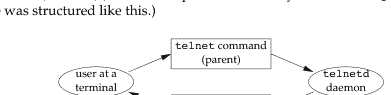

图 14.13 telnet 程序概览

telnet 进程有两个输入和两个输出。我们无法对任一输入执行阻塞式读取，因为永远无法预先知道哪一个输入会有数据可供读取。

处理这一特定问题的一种方法是将进程分成两部分（使用 fork），让每一部分负责一个方向的数据传输。图 14.14 展示了这种结构。（System V 的 uucp 通信软件包提供的 cu(1) 命令就是采用这种结构。）

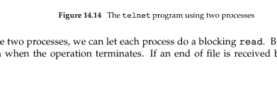

图 14.14 使用两个进程的 telnet 程序

如果使用两个进程，就可以让每个进程执行阻塞式读取。但操作终止时会出现一个问题。如果子进程收到文件结束标志（网络连接被 telnetd 守护进程断开），子进程就会终止，而父进程会收到 SIGCHLD 信号的通知。但是，如果父进程终止（用户在终端输入文件结束字符），父进程就必须通知子进程停止。我们可以使用信号来完成此操作（例如 SIGUSR1），但这会使程序变得更加复杂。

除了使用两个进程，我们还可以在单个进程中使用两个线程。这样可以避免处理终止问题，但需要处理线程之间的同步，这可能会增加比它所解决的问题更多的复杂性。

我们可以在单个进程中使用非阻塞式 I/O：将两个文件描述符都设置为非阻塞模式，然后对第一个文件描述符执行读取操作。如果有数据，就读取并处理它。如果没有数据可读，调用会立即返回。然后对第二个文件描述符执行相同的操作。完成这些操作后，等待一段时间（可能是几秒钟），然后再次尝试从第一个文件描述符读取数据。这种循环称为轮询。问题在于，它会浪费 CPU 时间。大多数时候并没有数据可读，因此我们会浪费时间执行读取系统调用。此外，每次循环时，我们还必须猜测应该等待多长时间。虽然轮询可以在任何支持非阻塞式 I/O 的系统上工作，但在多任务系统中应当避免使用轮询。

另一种技术称为异步 I/O。使用这种技术时，我们告诉内核：当文件描述符准备好进行 I/O 时，通过信号通知我们。这种方法有两个问题。首先，尽管系统提供了各自有限形式的异步 I/O，但 POSIX 选择将另一组接口标准化，因此可移植性可能会成为问题。（过去，POSIX 异步 I/O 是 Single UNIX Specification 中的可选功能，但从 SUSv4 起，这些接口已成为必需接口。）System V 提供 SIGPOLL 信号来支持一种有限形式的异步 I/O，但只有当文件描述符指向 STREAMS 设备时，该信号才有效。BSD 提供了一个类似的信号 SIGIO，但它也有类似的限制：只有当文件描述符指向终端设备或网络时，该信号才有效。

这种技术的第二个问题是，这些有限形式的异步 I/O 每个进程只使用一个信号（SIGPOLL 或 SIGIO）。如果我们为两个文件描述符启用该信号（在我们一直讨论的例子中，即从两个文件描述符读取数据），那么信号的发生并不能告诉我们究竟是哪个文件描述符已经准备就绪。虽然 POSIX.1 异步 I/O 接口允许我们选择用于通知的信号，但可用信号的数量仍然远少于可能打开的文件描述符数量。为了确定哪个文件描述符已经准备就绪，我们需要将每个文件描述符设置为非阻塞模式，然后依次尝试这些文件描述符。我们将在第 14.5 节讨论异步 I/O。

更好的技术是使用 I/O 多路复用。为此，我们建立一个感兴趣的文件描述符列表（通常包含多个文件描述符），然后调用一个函数。该函数会一直等待，直到其中一个文件描述符准备好进行 I/O。poll、pselect 和 select 这三个函数允许我们执行 I/O 多路复用。这些函数返回时，会告诉我们哪些文件描述符已经准备好进行 I/O。

POSIX 规定应包含 `<sys/select.h>`，以便将 select 所需的信息引入程序。较早的系统则要求包含 `<sys/types.h>`、`<sys/time.h>` 和 `<unistd.h>`。请查看 select 手册页，了解系统支持哪些方式。


I/O 多路复用在 4.2BSD 中通过 select 函数提供。该函数一直以来都能与任何描述符一起工作，尽管其主要用途是终端 I/O 和网络 I/O。SVR3 在添加 STREAMS 机制时加入了 poll 函数。最初，poll 仅适用于 STREAMS 设备。在 SVR4 中，增加了支持以允许 poll 在任何描述符上工作。

## 14.4.1 select 和 pselect 函数

select 函数让我们在所有 POSIX 兼容平台下进行 I/O 多路复用。我们传递给 select 的参数告诉内核

- 我们感兴趣的描述符。
- 我们对每个描述符感兴趣的条件。 （我们想从给定描述符读取吗？我们想向给定描述符写入吗？我们对给定描述符的异常条件感兴趣吗？）
- 我们想等待多长时间。 （我们可以无限等待，等待固定时间，或根本不等待。）

select 返回时，内核告诉我们

- 就绪描述符的总数
- 哪些描述符对每种三种条件就绪（读、写或异常条件）

有了这些返回信息，我们可以调用适当的 I/O 函数（通常是 read 或 write），并且知道该函数不会阻塞。

```
#include <sys/select.h>

int select(int maxfdp1, fd_set *restrict readfds,
    fd_set *restrict writefds, fd_set *restrict exceptfds,
    struct timeval *restrict tvptr);

Returns: count of ready descriptors, 0 on timeout, -1 on error
```

让我们先看最后一个参数。它指定我们想以秒和微秒为单位等待多长时间（回顾第 4.20 节）。有三种情况。

tvptr == NULL

无限等待。此无限等待如果我们捕获到信号则会被中断。返回是在其中一个指定的描述符就绪时或捕获到信号时进行。如果捕获到信号，select 返回 -1 且 errno 设置为 EINTR。

tvptr->tv_sec == 0 && tvptr->tv_usec == 0

根本不等待。所有指定的描述符都会被测试，并立即返回。这是一种轮询系统以了解多个描述符状态而不阻塞在 select 函数中的方法。

tvptr->tv_sec != 0 || tvptr->tv_usec != 0

等待指定的秒数和微秒数。返回是在其中一个指定的描述符就绪时或超时值到期时进行。如果在任何描述符就绪之前超时到期，返回值是 0。 （如果系统不提供微秒分辨率，tvptr->tv_usec 值会向上舍入到最近支持的值。）与第一种情况一样，此等待也可以被捕获的信号中断。

> POSIX.1 允许实现修改 timeval 结构，因此 select 返回后，您不能依赖该结构包含调用 select 前的相同值。FreeBSD 8.0、Mac OS X 10.6.8 和 Solaris 10 都保持结构不变，但 Linux 3.2.0 如果 select 在超时值到期前返回，将用剩余时间更新它。

中间三个参数——readfds、writefds 和 exceptfds——是指向描述符集合的指针。这三个集合指定我们感兴趣的描述符以及针对哪些条件（可读、可写或异常条件）。描述符集合存储在 fd_set 数据类型中。此数据类型由实现选择，以便它可以为每个可能的描述符保存一个位。我们可以将其视为只是位的大数组，如图 14.15 所示。

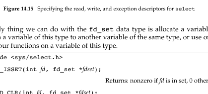

### Figure 14.15 Specifying the read, write, and exception descriptors for select

我们能对 fd_set 数据类型做的唯一事情是分配此类型变量，将此类型变量赋给同一类型的另一个变量，或对此类型变量使用以下四个函数之一。

```
#include <sys/select.h>

int FD_ISSET(int fd, fd_set *fdset);

Returns: nonzero if fd is in set, 0 otherwise

void FD_CLR(int fd, fd_set *fdset);
void FD_SET(int fd, fd_set *fdset);
void FD_ZERO(fd_set *fdset);
```

这些接口可以实现为宏或函数。通过调用 FD_ZERO 将 fd_set 设置为全零位。要打开集合中的单个位，我们使用 FD_SET。我们可以通过调用 FD_CLR 清除单个位。最后，我们可以用 FD_ISSET 测试集合中给定位是否打开。

声明描述符集合后，我们必须使用 FD_ZERO 清零集合。然后我们为我们感兴趣的每个描述符设置集合中的位，如下所示

```
fd_set rset;
int fd;

FD_ZERO(&rset);
FD_SET(fd, &rset);
FD_SET(STDIN_FILENO, &rset);
```

select 返回后，我们可以使用 FD_ISSET 测试集合中给定位是否仍打开：

```
if (FD_ISSET(fd, &rset)) {
    :
}
```

select 的中间三个参数（指向描述符集合的指针）中的任何一个（或全部）如果我们对该条件不感兴趣，可以为空指针。如果三个指针都为 NULL，那么我们就拥有比 sleep 提供的更高精度的计时器。 （回顾第 10.19 节，sleep 等待整数秒数。通过 select，我们可以等待小于一秒的时间间隔；实际分辨率取决于系统的时钟。）练习 14.5 显示了这样的函数。

select 的第一个参数 maxfdp1 代表“最大文件描述符加 1”。我们计算我们感兴趣的最高描述符，考虑全部三个描述符集合，加 1，那就是第一个参数。我们可以简单地将第一个参数设置为 FD_SETSIZE，<sys/select.h> 中的一个常量，指定最大描述符数（通常为 1,024），但该值对大多数应用程序来说太大。事实上，大多数应用程序可能使用 3 到 10 个描述符。 （一些应用程序需要更多描述符，但这些 UNIX 程序是不典型的。）通过指定我们感兴趣的最高描述符，我们可以防止内核遍历三个描述符集合中的数百个未使用位，寻找打开的位。

作为示例，图 14.16 显示了如果我们写下以下内容时两个描述符集合的样子

```
fd_set readset, writeset;

FD_ZERO(&readset);
FD_ZERO(&writeset);
FD_SET(0, &readset);
FD_SET(3, &readset);
FD_SET(1, &writeset);
FD_SET(2, &writeset);
select(4, &readset, &writeset, NULL, NULL);
```

重要的是要认识到描述符是阻塞还是非阻塞并不影响 select 是否阻塞。也就是说，如果我们有一个非阻塞描述符想从中读取，并且我们调用 select 超时值为 5 秒，select 将阻塞最多 5 秒。同样，如果我们指定无限超时，select 将阻塞直到描述符有数据准备好或直到捕获到信号。

如果我们在描述符上遇到文件结束，该描述符将被 select 视为可读。当调用 read 并返回 0 时——在 UNIX 系统上表示文件结束的方式。 （许多人错误地认为当文件结束时 select 会指示描述符的异常条件。）

POSIX.1 还定义了 select 的一个变体，称为 pselect。

```
#include <sys/select.h>

int pselect(int maxfd1, fd_set *restrict readfds,
            fd_set *restrict writefds, fd_set *restrict exceptfds,
            const struct timespec *restrict ts,
            const sigset_t *restrict sigmask);
```

Returns: count of ready descriptors, 0 on timeout, -1 on error

pselect 函数与 select 相同，但有以下例外。

- select 的超时值由 timeval 结构指定，但对于 pselect，使用 timespec 结构。 （回顾第 4.2 节中 timespec 结构的定义。）timespec 结构不是以秒和微秒表示超时值，而是以秒和纳秒表示。这提供了更高的分辨率超时，如果平台支持该精细的粒度。
- pselect 的超时值声明为 const，并且我们保证其值不会因调用 pselect 而改变。
- pselect 可选提供信号掩码参数。如果 sigmask 为 NULL，pselect 在信号方面表现得像 select。否则，sigmask 指向一个信号掩码，该掩码在调用 pselect 时原子地安装。返回时，之前的信号掩码将被恢复。

## 14.4.2 poll 函数

poll 函数与 select 类似，但程序员接口不同。该函数最初是在 System V 中引入以支持 STREAMS 子系统，但我们能够将其与任何类型的文件描述符一起使用。

```
#include <poll.h>

int poll(struct pollfd farray[], nfds_t nfds, int timeout);
```

Returns: count of ready descriptors, 0 on timeout, -1 on error


## 14.5 异步 I/O

本书中描述的没有任何实现会在接收到信号时重启 `poll` 或 `select`，即使使用了 `SA_RESTART` 标志。

如上一节所述，使用 `select` 和 `poll` 是一种同步形式的通知。系统在我们询问之前不会告诉我们任何事情（通过调用 `select` 或 `poll`）。正如我们在第 10 章中所看到的，信号提供了一种异步形式的通知，表明发生了某些事情。所有源自 BSD 和 System V 的系统都提供某种形式的异步 I/O，使用信号（System V 中的 `SIGPOLL`；BSD 中的 `SIGIO`）通知进程描述符上发生了感兴趣的事情。如上一节所述，这些形式的异步 I/O 存在局限性：它们不适用于所有文件类型，并且只允许使用一个信号。如果我们为多个描述符启用异步 I/O，当信号被传递时，我们无法判断该信号对应于哪个描述符。

Single UNIX Specification 的第 4 版将通用异步 I/O 机制从实时扩展移到了基本规范中。该机制解决了这些旧异步 I/O 设施存在的局限性。

在我们查看使用异步 I/O 的不同方法之前，我们需要讨论成本。当我们决定使用异步 I/O 时，我们通过选择同时处理多个并发操作来使应用程序的设计变得复杂。更简单的方法可能是使用多个线程，这将使我们能够使用同步模型编写程序，并让线程彼此异步运行。

当我们使用 POSIX 异步 I/O 接口时，我们会产生额外的复杂性：

- 我们必须担心每个异步操作的三个错误来源：一个与操作提交相关，一个与操作本身的结果相关，一个与用于确定异步操作状态的函数相关。
- 与其常规对应物相比，这些接口本身涉及大量额外的设置和处理规则，正如我们将看到的那样。

> 我们不能真正称非异步 I/O 函数调用为“同步”，因为虽然它们相对于程序流程是同步的，但它们相对于 I/O 并不是同步的。回想一下第 3 章中关于同步写入的讨论。我们称写入为“同步”，如果我们在从 write 函数调用返回时写入的数据是持久的。我们也不能通过将常规 I/O 函数调用称为“标准”I/O 调用而将常规 I/O 函数调用与异步 I/O 调用区分开来，因为这会使它们与标准 I/O 库中的函数调用混淆。为了避免混淆，我们将在本节中将 read 和 write 函数称为“常规”I/O 函数调用。

- 从错误中恢复可能很困难。例如，如果我们提交多个异步写入，其中一个失败，我们应该如何继续？如果写入相关，我们可能不得不撤销成功写入的那些。

### 14.5.1 System V 异步 I/O

System V 提供了一种有限的异步 I/O 形式，仅适用于 STREAMS 设备和 STREAMS 管道。System V 异步 I/O 信号是 `SIGPOLL`。

要为 STREAMS 设备启用异步 I/O，我们必须调用 `ioctl`，其第二个参数（request）为 `I_SETSIG`。第三个参数是由图 14.18 中的一个或多个常量构成的整数值。这些常量在 `<stropts.h>` 中定义。

> 与 STREAMS 机制相关的接口在 SUSv4 中被标记为过时，因此我们不会详细介绍它们。有关 STREAMS 的更多信息，请参阅 Rago [1993]。

| 常量 | 描述 |
|---|---|
| `S_INPUT` | 我们可以在不阻塞的情况下读取数据（除高优先级数据外）。 |
| `S_RDNORM` | 我们可以在不阻塞的情况下读取普通数据。 |
| `S_RDBAND` | 我们可以在不阻塞的情况下读取优先级数据。 |
| `S_BANDURG` | 如果此常量与 `S_RDBAND` 一起指定，当我们可以在不阻塞的情况下读取优先级数据时，会生成 `SIGURG` 信号而不是 `SIGPOLL`。 |
| `S_HIPRI` | 我们可以在不阻塞的情况下读取高优先级数据。 |
| `S_OUTPUT` | 我们可以在不阻塞的情况下写入普通数据。 |
| `S_WRNORM` | 与 `S_OUTPUT` 相同。 |
| `S_WRBAND` | 我们可以在不阻塞的情况下写入优先级数据。 |
| `S_MSG` | `SIGPOLL` 信号消息已到达流头。 |
| `S_ERROR` | 流发生错误。 |
| `S_HANGUP` | 流已挂断。 |

图 14.18 生成 `SIGPOLL` 信号的条件

除了调用 `ioctl` 指定应生成 `SIGPOLL` 信号的条件外，我们还必须为该信号建立信号处理程序。回想一下图 10.1，`SIGPOLL` 的默认操作是终止进程，因此我们应该在调用 `ioctl` 之前建立信号处理程序。

### 14.5.2 BSD 异步 I/O

BSD 派生系统的异步 I/O 是两种信号的组合：`SIGIO` 和 `SIGURG`。前者是通用异步 I/O 信号，后者仅用于通知进程网络连接上已到达带外数据。

要接收 `SIGIO` 信号，我们需要执行三个步骤：

1. 通过调用 `signal` 或 `sigaction` 为 `SIGIO` 建立信号处理程序。
2. 通过调用 `fcntl` 并使用 `F_SETOWN` 命令为描述符设置接收信号的进程 ID 或进程组 ID（第 3.14 节）。
3. 通过调用 `fcntl` 并使用 `F_SETFL` 命令设置 `O_ASYNC` 文件状态标志（图 3.10）来在描述符上启用异步 I/O。

步骤 3 只能对引用终端或网络的描述符执行，这是 BSD 异步 I/O 设施的一个根本限制。对于 `SIGURG` 信号，我们只需要执行步骤 1 和 2。`SIGURG` 仅为引用支持带外数据的网络连接的描述符生成，例如 TCP 连接。

### 14.5.3 POSIX 异步 I/O

POSIX 异步 I/O 接口为我们提供了一种一致的方式来执行异步 I/O，无论文件类型如何。这些接口采用自实时草案标准而来，而实时草案标准本身是 Single UNIX Specification 中的一个选项。在第 4 版中，Single UNIX Specification 将这些接口移至基础，因此它们现在要求所有平台都支持。

异步 I/O 接口使用 AIO 控制块来描述 I/O 操作。`aiocb` 结构定义了一个 AIO 控制块。它至少包含以下结构中显示的字段（实现可能包含额外的字段）：

```c
struct aiocb {
    int             aio_fildes;      /* file descriptor */
    off_t           aio_offset;      /* file offset for I/O */
    volatile void   *aio_buf;        /* buffer for I/O */
    size_t          aio_nbytes;      /* number of bytes to transfer */
    int             aio_reqprio;     /* priority */
    struct sigevent aio_sigevent;    /* signal information */
    int             aio_lio_opcode;  /* operation for list I/O */
};
```

`aio_fildes` 字段是要读取或写入的文件打开的文件描述符。读取或写入从 `aio_offset` 指定的偏移量开始。对于读取，数据被复制到从 `aio_buf` 指定的地址开始的缓冲区。对于写入，数据从该缓冲区复制。`aio_nbytes` 字段包含要读取或写入的字节数。

请注意，我们在执行异步 I/O 时必须提供显式偏移量。异步 I/O 接口不影响操作系统维护的文件偏移量。只要我们从不在同一进程的同一文件上混合使用异步 I/O 函数和常规 I/O 函数，这就不会成为问题。另请注意，如果我们使用异步接口向以追加模式（使用 `O_APPEND`）打开的文件写入，系统会忽略 AIO 控制块中的 `aio_offset` 字段。

其他字段不对应于常规 I/O 函数。`aio_reqprio` 字段是一个提示，应用程序可以通过它建议异步 I/O 请求的排序顺序。然而，系统对确切排序的控制有限，因此无法保证会遵守该提示。`aio_lio_opcode` 字段仅与基于列表的异步 I/O 一起使用，我们将


简要讨论。`aio_sigevent` 字段控制应用程序如何被通知 I/O 事件完成的情况。它由一个 `sigevent` 结构描述。

```
struct sigevent {
    int sigev_notify;          /* notify type */
    int sigev_signo;           /* signal number */
    union sigval sigev_value;  /* notify argument */
    void (*sigev_notify_function)(union sigval); /* notify function */
    pthread_attr_t *sigev_notify_attributes; /* notify attrs */
};
```

`sigev_notify` 字段控制通知的类型。它可以取以下三种值之一。

- SIGEV_NONE    当异步 I/O 请求完成时，进程不会被通知。
- SIGEV_SIGNAL  当异步 I/O 请求完成时，由 `sigev_signo` 字段指定的信号会被生成。如果应用程序选择捕获该信号并且在建立信号处理程序时指定了 `SA_SIGINFO` 标志，则信号会被排队（如果实现支持排队信号）。信号处理程序会收到一个 `siginfo` 结构，其 `si_value` 字段被设置为 `sigev_value`（同样，如果使用了 `SA_SIGINFO`）。
- SIGEV_THREAD  当异步 I/O 请求完成时，由 `sigev_notify_function` 字段指定的函数会被调用。它会将 `sigev_value` 字段作为唯一参数传入。该函数在单独的线程中以分离状态执行，除非 `sigev_notify_attributes` 字段被设置为指向指定线程替代属性的 `pthread` 属性结构的地址。

要执行异步 I/O，我们需要初始化一个 AIO 控制块并调用 `aio_read` 函数进行异步读，或调用 `aio_write` 函数进行异步写。

```
#include <aio.h>

int aio_read(struct aiocb *aiocb);
int aio_write(struct aiocb *aiocb);

Both return: 0 if OK, -1 on error
```

当这些函数返回成功时，异步 I/O 请求已被排队等待操作系统处理。返回值与实际 I/O 操作的结果无关。在 I/O 操作挂起期间，我们必须小心确保 AIO 控制块和数据缓冲区保持稳定；其底层内存必须保持有效，我们不能在 I/O 操作完成前重用它们。

为了在不等待的情况下强制所有挂起的异步写操作持久化到存储中，我们可以设置一个 AIO 控制块并调用 `aio_fsync` 函数。

```
#include <aio.h>
int aio_fsync(int op, struct aiocb *aiocb);
Returns: 0 if OK, -1 on error
```

AIO 控制块中的 `aio_fildes` 字段指示要同步其异步写操作的文件。如果 `op` 参数被设置为 `O_DSYNC`，则操作的行为类似于对 `fdatasync` 的调用。否则，如果 `op` 被设置为 `O_SYNC`，操作的行为类似于对 `fsync` 的调用。

与 `aio_read` 和 `aio_write` 函数一样，`aio_fsync` 操作在同步被调度时返回。数据要到异步同步完成时才会被持久化。AIO 控制块控制我们如何被通知，就像 `aio_read` 和 `aio_write` 函数一样。

要确定异步读、写或同步操作的完成状态，我们需要调用 `aio_error` 函数。

```
#include <aio.h>
int aio_error(const struct aiocb *aiocb);
Returns: (see following)
```

返回值告诉我们以下四种情况之一。

- 0 异步操作成功完成。我们需要调用 `aio_return` 函数来获取操作返回值。
- -1 对 `aio_error` 的调用失败。在这种情况下，`errno` 告诉我们原因。
- EINPROGRESS 异步读、写或同步仍在挂起。
- 其他任何值 任何其他返回值都给出了失败的异步操作对应的错误代码。

如果异步操作成功，我们可以调用 `aio_return` 函数来获取异步操作的返回值。

```
#include <aio.h>
ssize_t aio_return(const struct aiocb *aiocb);
Returns: (see following)
```

在异步操作完成之前，我们需要小心避免调用 `aio_return` 函数。结果在操作完成前是未定义的。我们还需要小心对每个异步 I/O 操作只调用一次 `aio_return`。一旦我们调用此函数，操作系统就可以自由地释放包含 I/O 操作返回值的记录。

`aio_return` 函数如果自身失败会返回 -1 并设置 `errno`。否则，它会返回异步操作的结果。在这种情况下，它会返回 `read`、`write` 或 `fsync` 在成功时本应返回的值，如果调用了其中一个函数。

我们使用异步 I/O 是因为我们有其他处理要做，并且不希望在执行 I/O 操作时阻塞。然而，当我们完成处理并发现仍有异步操作未完成时，我们可以调用 `aio_suspend` 函数阻塞直到某个操作完成。

```
#include <aio.h>

int aio_suspend(const struct aiocb *const list[], int nent,
                const struct timespec *timeout);

Returns: 0 if OK, -1 on error
```

有三种情况可能导致 `aio_suspend` 返回。如果我们被信号中断，它会返回 -1 并将 `errno` 设置为 `EINTR`。如果可选的 `timeout` 参数指定的时限在任何 I/O 操作完成前到期，则 `aio_suspend` 返回 -1 并将 `errno` 设置为 `EAGAIN`（如果我们想无限期阻塞，可以将 `timeout` 参数传递为 null 指针）。如果任何 I/O 操作完成，`aio_suspend` 返回 0。如果我们在调用 `aio_suspend` 时所有异步 I/O 操作都已完成，则 `aio_suspend` 会立即返回而不阻塞。

`list` 参数是指向 AIO 控制块数组的指针，`nent` 参数指示数组中的条目数。数组中的空指针会被跳过；其他条目必须指向已用于发起异步 I/O 操作的 AIO 控制块。

当我们有不再希望完成的挂起异步 I/O 操作时，我们可以用 `aio_cancel` 函数尝试取消它们。

```
#include <aio.h>

int aio_cancel(int fd, struct aiocb *aiocb);

Returns: (see following)
```

`fd` 参数指定具有未决异步 I/O 操作的文件描述符。如果 `aiocb` 参数为 NULL，则系统尝试取消该文件上所有未决的异步 I/O 操作。否则，系统尝试取消由 AIO 控制块描述的单个异步 I/O 操作。我们说系统“尝试”取消操作，因为系统无法保证能够取消正在进行的任何操作。

`aio_cancel` 函数可以返回以下四种值之一：

- AIO_ALLDONE    所有操作在尝试取消它们之前已完成。
- AIO_CANCELED   所有请求的操作已被取消。
- AIO_NOTCANCELED 至少有一个请求的操作无法被取消。
- -1             对 `aio_cancel` 的调用失败。错误代码将存储在 `errno` 中。

如果异步 I/O 操作被成功取消，对相应 AIO 控制块调用 `aio_error` 函数将返回错误 `ECANCELED`。如果操作无法被取消，则对 `aio_cancel` 的调用不会改变相应的 AIO 控制块。

异步 I/O 接口中包含一个额外的函数，尽管它可以在同步或异步方式下使用。`lio_listio` 函数提交由 AIO 控制块列表描述的一组 I/O 请求。

```
#include <aio.h>

int lio_listio(int mode, struct aiocb *restrict const list[restrict],
    int nent, struct sigevent *restrict sigev);

Returns: 0 if OK, -1 on error
```

`mode` 参数决定 I/O 是否真正异步。当它被设置为 `LIO_WAIT` 时，`lio_listio` 函数不会在由 `list` 指定的所有 I/O 操作完成之前返回。在这种情况下，`sigev` 参数会被忽略。当 `mode` 参数被设置为 `LIO_NOWAIT` 时，`lio_listio` 函数在 I/O 请求被排队后立即返回。进程在所有 I/O 操作完成后会异步收到通知，如 `sigev` 参数所指定。如果我们不想收到通知，可以将 `sigev` 设置为 NULL。请注意，各个 AIO 控制块本身也可能在单个操作完成时启用异步通知。`sigev` 参数指定的异步通知是额外的，仅在所有 I/O 操作完成后发送。

`list` 参数指向指定要执行 I/O 操作的 AIO 控制块列表。`nent` 参数指定数组中的元素数。AIO 控制块列表可以包含 NULL 指针；这些条目会被忽略。

在每个 AIO 控制块中，`aio_lio_opcode` 字段指定操作是读 `LIO_READ`、写 `LIO_WRITE`，还是无操作 `LIO_NOP`，后者会被忽略。读操作被视为如果相应的 AIO 控制块已传递给 `aio_read` 函数。类似地，写操作被视为如果 AIO 控制块已传递给 `aio_write`。

实现可以限制我们允许有未决的异步 I/O 操作的数量。限制是运行时不变量，并总结在图 14.19 中。

| 名称 | 描述 | 最小可接受值 |
|---|---|---|
| AIO_LISTIO_MAX | 单次列表 I/O 调用中 I/O 操作的最大数量 | _POSIX_AIO_LISTIO_MAX (2) |
| AIO_MAX | 未决异步 I/O 操作的最大数量 | _POSIX_AIO_MAX (1) |
| AIO_PRIO_DELTA_MAX | 进程可以降低其异步 I/O 优先级级别的最大量 | 0 |

图 14.19 异步 I/O 的 POSIX.1 运行时不变量值


我们可以通过调用 `sysconf` 函数并将 `name` 参数设置为 `_SC_IO_LISTIO_MAX` 来确定 `AIO_LISTIO_MAX` 的值。同样，我们可以通过调用 `sysconf` 并将 `name` 参数设置为 `_SC_AIO_MAX` 来确定 `AIO_MAX` 的值，并且我们可以通过调用 `sysconf` 并将其参数设置为 `_SC_AIO_PRIO_DELTA_MAX` 来获取 `AIO_PRIO_DELTA_MAX` 的值。

POSIX 异步 I/O 接口最初引入是为了为实时应用程序提供一种在执行 I/O 操作时避免被阻塞的方式。现在我们将看一个如何使用这些接口的示例。

## Example

我们在此文本中不讨论实时编程，但由于 POSIX 异步 I/O 接口现在已成为 Single UNIX Specification 基础规范的一部分，我们将看看如何使用它们。为了将异步 I/O 接口与其常规对应物进行比较，我们将研究将文件从一种格式翻译成另一种格式的任务。

图 14.20 所示的程序使用 ROT-13 算法翻译文件，该算法在 1980 年代流行的 USENET 新闻系统中用于模糊可能冒犯、包含剧透或笑话 punchlines 的文本。该算法将字符 ‘a’ 到 ‘z’ 和 ‘A’ 到 ‘Z’ 旋转 13 个位置，但所有其他字符保持不变。

```
```c
#include "apue.h"
#include <ctype.h>
#include <fcntl.h>

#define BSZ 4096

unsigned char buf[BSZ];

unsigned char
translate(unsigned char c)
{
    if (isalpha(c)) {
        if (c >= 'n')
            c -= 13;
        else if (c >= 'a')
            c += 13;
        else if (c >= 'N')
            c -= 13;
        else
            c += 13;
    }
    return(c);
}

main(int argc, char* argv[])
{
    int ifd, ofd, i, n, nw;
```
```

```
if (argc != 3)
    err_quit("usage: rot13 infile outfile");
if ((ifd = open(argv[1], O_RDONLY)) < 0)
    err_sys("can't open %s", argv[1]);
if ((ofd = open(argv[2], O_RDWR|O_CREAT|O_TRUNC, FILE_MODE)) < 0)
    err_sys("can't create %s", argv[2]);

while ((n = read(ifd, buf, BSZ)) > 0) {
    for (i = 0; i < n; i++)
        buf[i] = translate(buf[i]);
    if ((nw = write(ofd, buf, n)) != n) {
        if (nw < 0)
            err_sys("write failed");
        else
            err_quit("short write (%d/%d)", nw, n);
    }
}

fsync(ofd);
exit(0);
}
```

## Figure 14.20 Translate a file using ROT-13

程序的 I/O 部分很简单：我们从输入文件读取一个块，对其进行翻译，然后将该块写入输出文件。我们重复此操作，直到遇到文件末尾且 read 返回零。图 14.21 中的程序展示了如何使用等效的异步 I/O 函数执行相同的任务。

```
#include "apue.h"
#include <ctype.h>
#include <fcntl.h>
#include <aio.h>
#include <errno.h>

#define BSZ 4096
#define NBUF 8

enum rwop {
    UNUSED = 0,
    READ_PENDING = 1,
    WRITE_PENDING = 2
};

struct buf {
    enum rwop   op;
    int         last;
    struct aiocb aiocb;
    unsigned char data[BSZ];
};

struct buf bufs[NBUF];
```

```
```c
unsigned char
translate(unsigned char c)
{
    /* same as before */
}

int
main(int argc, char* argv[])
{
    int             ifd, ofd, i, j, n, err, numop;
    struct stat     sbuf;
    const struct aiocb *aiolist[NBUF];
    off_t           off = 0;

    if (argc != 3)
        err_quit("usage: rot13 infile outfile");
    if ((ifd = open(argv[1], O_RDONLY)) < 0)
        err_sys("can't open %s", argv[1]);
    if ((ofd = open(argv[2], O_RDWR|O_CREAT|O_TRUNC, FILE_MODE)) < 0)
        err_sys("can't create %s", argv[2]);
    if (fstat(ifd, &sbuf) < 0)
        err_sys("fstat failed");

    /* initialize the buffers */
    for (i = 0; i < NBUF; i++) {
        bufs[i].op = UNUSED;
        bufs[i].aiocb.aio_buf = bufs[i].data;
        bufs[i].aiocb.aio_sigevent.sigev_notify = SIGEV_NONE;
        aiolist[i] = NULL;
    }

    numop = 0;
    for (;;) {
        for (i = 0; i < NBUF; i++) {
            switch (bufs[i].op) {
            case UNUSED:
                /*
                 * Read from the input file if more data
                 * remains unread.
                 */
                if (off < sbuf.st_size) {
                    bufs[i].op = READ_PENDING;
                    bufs[i].aiocb.aio_fildes = ifd;
                    bufs[i].aiocb.aio_offset = off;
                    off += BSZ;
                    if (off >= sbuf.st_size)
                        bufs[i].last = 1;
                    bufs[i].aiocb.aio_nbytes = BSZ;
                    if (aio_read(&bufs[i].aiocb) < 0)
                        err_sys("aio_read failed");
                    aiolist[i] = &bufs[i].aiocb;
```
```

```
numop++;
}
break;

case READ_PENDING:
    if ((err = aio_error(&bufs[i].aiocb)) == EINPROGRESS)
        continue;
    if (err != 0) {
        if (err == -1)
            err_sys("aio_error failed");
        else
            err_exit(err, "read failed");
    }

    /*
     * A read is complete; translate the buffer
     * and write it.
     */
    if ((n = aio_return(&bufs[i].aiocb)) < 0)
        err_sys("aio_return failed");
    if (n != BSZ && !bufs[i].last)
        err_quit("short read %d/%d", n, BSZ);
    for (j = 0; j < n; j++)
        bufs[i].data[j] = translate(bufs[i].data[j]);
    bufs[i].op = WRITE_PENDING;
    bufs[i].aiocb.aio_fildes = ofd;
    bufs[i].aiocb.aio_nbytes = n;
    if (aio_write(&bufs[i].aiocb) < 0)
        err_sys("aio_write failed");
    /* retain our spot in our list */
    break;

case WRITE_PENDING:
    if ((err = aio_error(&bufs[i].aiocb)) == EINPROGRESS)
        continue;
    if (err != 0) {
        if (err == -1)
            err_sys("aio_error failed");
        else
            err_exit(err, "write failed");
    }

    /*
     * A write is complete; mark the buffer as unused.
     */
    if ((n = aio_return(&bufs[i].aiocb)) < 0)
        err_sys("aio_return failed");
    if (n != bufs[i].aio_nbytes)
        err_quit("short write %d/%d", n, BSZ);
    aiolist[i] = NULL;
    bufs[i].op = UNUSED;
```
```

```
numop--;
break;
}
}
if (numop == 0) {
if (off >= sbuf.st_size)
break;
} else {
if (aio_suspend(aiolist, NBUF, NULL) < 0)
err_sys("aio_suspend failed");
}
}
bufs[0].aiocb.aio_fildes = ofd;
if (aio_fsync(O_SYNC, &bufs[0].aiocb) < 0)
err_sys("aio_fsync failed");
exit(0);
}
```

## Figure 14.21 Translate a file using ROT-13 and asynchronous I/O

请注意，我们使用了八个缓冲区，因此我们可以有最多八个异步 I/O 请求处于挂起状态。令人惊讶的是，这实际上可能会降低性能——如果读取以乱序方式呈现给文件系统，它可能会破坏操作系统的预读算法。

在我们检查操作的返回值之前，我们需要确保操作已完成。当 aio_error 返回的值不是 EINPROGRESS 或 -1 时，我们知道操作已完成。排除这些值，如果返回值不是 0，则我们知道操作失败。检查这些条件后，调用 aio_return 来获取 I/O 操作的返回值是安全的。

只要我们还有工作要做，我们就可以提交异步 I/O 操作。当我们有一个未使用的 AIO 控制块时，我们可以提交一个异步读取请求。当读取完成后，我们翻译缓冲区内容然后提交一个异步写入请求。当所有 AIO 控制块都在使用中时，我们通过调用 aio_suspend 等待操作完成。

当我们将块写入输出文件时，我们保留从输入文件读取数据的相同偏移量。因此，写入的顺序并不重要。这种策略之所以有效，是因为输入文件中的每个字符在输出文件中都有一个位于相同偏移量的对应字符；我们在输出文件中既不添加也不删除字符。（这一见解可能有助于解决练习 14.8。）

我们在此示例中不使用异步通知，因为使用同步编程模型更容易。如果我们在 I/O 操作进行时还有其他工作要做，那么额外的任务可以合并到 for 循环中。如果我们需要防止这项额外工作延迟翻译文件的任务，那么我们可能需要构建代码以使用某种形式的异步通知。对于多个任务，我们需要在决定程序结构之前对任务进行优先级排序。


## 14.6 `readv` 和 `writev` 函数

`readv` 和 `writev` 函数让我们能够在一次函数调用中读取到或写入多个不连续的缓冲区。这些操作被称为 *分散读* 和 *聚集写*。

```
#include <sys/uio.h>

ssize_t readv(int fd, const struct iovec *iov, int iovcnt);

ssize_t writev(int fd, const struct iovec *iov, int iovcnt);
```

两者返回：读取或写入的字节数，错误时返回 −1

两个函数的第二个参数都是指向 iovec 结构数组的指针：

```
struct iovec {
    void   *iov_base;   /* buffer 的起始地址 */
    size_t  iov_len;    /* buffer 的大小 */
};
```

*iov* 数组中的元素个数由 *iovcnt* 指定。其限制为 IOV_MAX（参见图 2.11）。图 14.22 显示了这两个函数的参数与 iovec 结构之间的关系图。

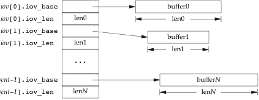

`writev` 函数按顺序从缓冲区中聚集输出数据：iov[0]、iov[1]，直到 iov[iovcnt−1]；`writev` 返回输出的总字节数，通常应等于所有缓冲区长度之和。`readv` 函数按顺序将数据分散到缓冲区中，总是先填满一个缓冲区再继续下一个。`readv` 返回读取的总字节数。如果没有更多数据且遇到文件末尾，则返回计数 0。

> 这两个函数起源于 4.2BSD，后来被添加到 SVR4。这两个函数包含在单一 UNIX 规范的 XSI 选项中。

## 示例

在第 20.8 节中，在函数 `_db_writeidx` 中，我们需要连续向文件写入两个缓冲区。第二个要输出的缓冲区是由调用者传入的参数，而第一个缓冲区是我们创建的，包含第二个缓冲区的长度和文件中其他信息的偏移量。我们有三种方法可以做到这一点。

- 1. 对每个缓冲区分别调用 `write` 两次。
- 2. 分配一个足够容纳两个缓冲区的自己的缓冲区，并将两者复制到新缓冲区中。然后对这个新缓冲区调用 `write` 一次。
- 3. 调用 `writev` 输出两个缓冲区。

我们在第 20.8 节中使用的解决方案是使用 `writev`，但将它与其他两种解决方案进行比较是很有启发性的。

图 14.23 显示了刚才描述的三种方法的结果。

| 操作 | Linux (Intel x86) |  |  | Mac OS X (Intel x86) |  |  |
|---|---:|---:|---:|---:|---:|---:|
|  | 用户 | 系统 | 时钟 | 用户 | 系统 | 时钟 |
| 两次写入 | 0.06 | 2.04 | 2.13 | 0.85 | 8.33 | 13.83 |
| 缓冲区复制，然后一次写入 | 0.03 | 1.13 | 1.16 | 0.70 | 4.87 | 9.25 |
| 一次 writev | 0.04 | 1.21 | 1.26 | 0.43 | 5.34 | 9.24 |

**图 14.23** 比较 `writev` 与其他技术的时序结果

我们测量的测试程序输出一个 100 字节的头部，随后是 200 字节的数据。这重复进行 1,048,576 次，生成一个 300 兆字节的文件。测试程序有三个独立的用例——对应图 14.23 中测量的每种技术。我们使用 times（第 8.17 节）来获取写入前后用户 CPU 时间、系统 CPU 时间和墙钟时间。全部三个时间均以秒为单位显示。

正如我们所预期的那样，与只调用一次 `write` 或 `writev` 相比，调用 `write` 两次时系统时间会增加。这与图 3.6 中的结果一致。

接下来，注意，当我们进行缓冲区复制然后单次写入时，CPU 时间之和（用户加系统）略小于单次调用 `writev`。在单次写入时，我们在用户级将缓冲区复制到暂存缓冲区，然后内核在我们调用 `write` 时会将数据复制到其内部缓冲区。使用 `writev` 时，我们应该减少复制，因为内核只需直接将数据复制到其暂存缓冲区。然而，对于如此少量的数据，使用 `writev` 的固定开销大于收益。随着我们需要复制的数据量增加，在程序中复制缓冲区的开销会越大，`writev` 替代方案会更有吸引力。

> 不要根据图 14.23 中显示的数字推断 Linux 和 Mac OS X 的相对性能太多。这两台计算机非常不同：它们具有不同的处理器世代、不同的 RAM 数量，以及速度不同的磁盘。要对一个操作系统与另一个操作系统进行苹果对苹果的比较，我们需要为每个操作系统使用相同的硬件。

在读取时遇到文件末尾时，如果我们已经成功读取了一些数据并且尚未满足请求的数量，我们将返回复制到调用者缓冲区的字节数。

```
#include "apue.h"

ssize_t                 /* Read "n" bytes from a descriptor */
readn(int fd, void *ptr, size_t n)
{
    size_t      nleft;
    ssize_t     nread;

    nleft = n;
    while (nleft > 0) {
        if ((nread = read(fd, ptr, nleft)) < 0) {
            if (nleft == n)
                return(-1);      /* error, return -1 */
            else
                break;           /* error, return amount read so far */
        } else if (nread == 0) {
            break;               /* EOF */
        }
        nleft -= nread;
        ptr   += nread;
    }
    return(n - nleft);          /* return >= 0 */
}

ssize_t                 /* Write "n" bytes to a descriptor */
writen(int fd, const void *ptr, size_t n)
{
    size_t      nleft;
    ssize_t     nwritten;

    nleft = n;
    while (nleft > 0) {
        if ((nwritten = write(fd, ptr, nleft)) < 0) {
            if (nleft == n)
                return(-1);      /* error, return -1 */
            else
                break;           /* error, return amount written so far */
        } else if (nwritten == 0) {
            break;
        }
        nleft -= nwritten;
        ptr   += nwritten;
    }
    return(n - nleft);          /* return >= 0 */
}
```

图 14.24 `readn` 和 `writen` 函数

## 14.8 内存映射 I/O

内存映射 I/O 让我们可以将磁盘上的文件映射到内存中的缓冲区，这样，当我们从缓冲区获取字节时，对应的文件字节会被读取。同样，当我们在缓冲区中存储数据时，对应的字节会自动写入文件。这让我们能够在不使用 read 或 write 的情况下执行 I/O。

内存映射 I/O 多年来一直与虚拟内存系统一起使用。1981 年，4.1BSD 提供了其 vread 和 vwrite 函数的另一种形式的内存映射 I/O。这两个函数随后在 4.2BSD 中被移除，并 intended 用 mmap 函数取代。然而，mmap 函数并未随 4.2BSD 一起发布（原因见 McKusick et al. [1996] 第 2.5 节所述）。Gingell, Moran, and Shannon [1987] 描述了一种 mmap 的实现。单一 UNIX 规范第 4 版将 mmap 函数从选项移至基本规范。所有符合 POSIX 的系统都必须支持它。

要使用此功能，我们必须告诉内核将给定文件映射到内存中的一个区域。此任务由 mmap 函数处理。

```
#include <sys/mman.h>
void *mmap(void *addr, size_t len, int prot, int flag, int fd, off_t off);
Returns: starting address of mapped region if OK, MAP_FAILED on error
```

addr 参数让我们指定映射区域开始的地址。我们通常将此值设为 0 以允许系统选择起始地址。此函数的返回值是映射区域的起始地址。
fd 参数是指定要映射的文件的文件描述符。我们必须在将文件映射到地址空间之前打开此文件。len 参数是要映射的字节数，off 是文件中要映射字节的起始偏移量。（off 值的一些限制将在后面描述。）
prot 参数指定映射区域的保护。

| prot | 描述 |
|---|---|
| PROT_READ | 区域可读。 |
| PROT_WRITE | 区域可写。 |
| PROT_EXEC | 区域可执行。 |
| PROT_NONE | 区域不可访问。 |

图 14.25 内存映射区域的保护

我们可以将保护指定为 PROT_NONE 或 PROT_READ、PROT_WRITE 和 PROT_EXEC 的按位或的任意组合。对于区域指定的保护不能允许比文件打开模式更多的访问。例如，如果文件以只读方式打开，我们就不能指定 PROT_WRITE。

在查看 flag 参数之前，让我们看看这里发生了什么。图 14.26 显示了一个内存映射文件。（参见图 7.6 所示的典型进程的内存布局。）在此图中，“start addr”是 mmap 的返回值。我们已显示


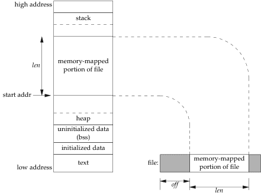

映射的内存位于堆和栈之间：这是一个实现细节，可能因实现而异。

flag 参数会影响映射区域的各种属性。

- **MAP_FIXED**  返回值必须等于 `addr`。不建议使用此标志，因为它会妨碍可移植性。如果未指定此标志且 `addr` 不为零，则内核会将 `addr` 用作放置映射区域的提示，但不能保证会使用请求的地址。最大可移植性可通过将 `addr` 指定为 0 获得。

> POSIX 兼容系统上对 `MAP_FIXED` 标志的支持是可选的，但在 XSI 兼容系统上是必需的。

- **MAP_SHARED**  此标志描述了本进程对映射区域的存储操作的处置方式。此标志指定存储操作会修改映射文件——也就是说，存储操作等同于对文件的写入。必须指定此标志或下一个标志 `MAP_PRIVATE`，但不能同时指定两者。

- **MAP_PRIVATE**  此标志表示对映射区域的存储操作会导致映射文件的私有副本被创建。随后对映射区域的所有引用都引用该副本。 （此标志的一种用途是调试器映射程序文件的文本部分但允许用户修改指令。任何修改都影响副本，而非原始程序文件。）

每个实现都有额外的 MAP_xxx 标志值，这些值特定于该实现。请查阅系统上的 mmap(2) 手册页以了解详细信息。

off 的值以及 addr 的值（如果指定了 MAP_FIXED）通常需要是系统虚拟内存页大小的倍数。此值可通过 sysconf 函数（第 2.5.4 节）使用参数 _SC_PAGESIZE 或 _SC_PAGE_SIZE 获得。由于 off 和 addr 通常指定为 0，因此此要求并不是什么大问题。

此要求通常由系统实现强制执行。虽然 Single UNIX Specification 不再要求满足此条件，但本书涵盖的所有平台中，除 FreeBSD 8.0 外，均有此要求。FreeBSD 8.0 允许我们使用任意地址对齐和偏移对齐，只要对齐方式匹配即可。

由于映射文件的起始偏移与系统的虚拟内存页大小相关联，如果映射区域的长度不是页大小的倍数会怎样？假设文件大小为 12 字节，系统页大小为 512 字节。在这种情况下，系统通常提供 512 字节的映射区域，并且该区域的最后 500 字节被设置为 0。我们可以修改最后的 500 字节，但对它们的任何更改都不会反映在文件中。因此我们不能使用 mmap 追加文件。我们必须先扩展文件，如图 14.27 所示。

通常有两种信号与映射区域一起使用。SIGSEGV 通常用于指示我们尝试访问对我们不可用的内存。此信号也可能在我们尝试向指定为只读的映射区域存储时生成。SIGBUS 信号可能在我们访问映射区域中在访问时没有意义的部分时生成。例如，假设我们使用文件大小映射文件，但在我们引用映射区域之前，文件大小已被其他进程截断。如果我们随后尝试访问对应于被截断文件末尾部分的内存映射区域，我们将收到 SIGBUS。

内存映射区域会在 fork 时被子进程继承（因为它是父进程地址空间的一部分），但出于同样的原因，在 exec 时不会被新程序继承。

我们可以通过调用 mprotect 来更改现有映射的权限。

```
#include <sys/mman.h>

int mprotect(void *addr, size_t len, int prot);
Returns: 0 if OK, -1 on error
```

prot 的合法值与 mmap 相同（图 14.25）。请注意，实现可能要求地址参数是系统页大小的整数倍。

当我们使用 MAP_SHARED 标志将页面映射到我们的地址空间并修改它们时，更改不会立即写回文件。相反，内核守护进程根据 (a) 系统负载和 (b) 用于限制系统故障时数据丢失的配置参数来决定何时将脏页写回。当更改被写回时，它们以页为单位写入。因此，如果我们只修改页面中的一个字节，当更改写回文件时，整个页面将被写入。

如果共享映射中的页面已被修改，我们可以调用 msync 将更改刷新到支持映射的文件。msync 函数类似于 fsync（第 3.13 节），但作用于内存映射区域。

```
#include <sys/mman.h>
int msync(void *addr, size_t len, int flags);

Returns: 0 if OK, -1 on error
```

如果映射是私有的，则映射的文件不会被修改。与其他内存映射函数一样，地址必须在页边界上对齐。

flags 参数允许我们对内存如何刷新进行一些控制。我们可以指定 MS_ASYNC 标志以简单地安排页面写入。如果我们希望在返回前等待写入完成，可以使用 MS_SYNC 标志。必须指定 MS_ASYNC 或 MS_SYNC 其中之一。

可选标志 MS_INVALIDATE 允许我们告诉操作系统丢弃与底层存储不同步的任何页面。某些实现在使用此标志时会丢弃指定范围内的所有页面，但此行为不是必需的。

> msync 函数包含在 Single UNIX Specification 的 XSI 选项中。因此，所有 UNIX 系统都必须支持它。

内存映射区域会在进程终止时自动取消映射，或者我们可以通过调用 munmap 函数直接取消映射一个区域。关闭映射区域时使用的文件描述符不会取消映射该区域。

```
#include <sys/mman.h>
int munmap(void *addr, size_t len);

Returns: 0 if OK, -1 on error
```

munmap 函数不影响被映射的对象——也就是说，调用 munmap 不会导致映射区域的内容被写入磁盘文件。对 MAP_SHARED 区域的磁盘文件更新会由内核的虚拟内存算法在我们向内存映射区域存储之后自动完成。对 MAP_PRIVATE 区域的内存修改会在区域被取消映射时丢弃。

# Example

图 14.27 中的程序使用内存映射 I/O 复制文件（类似于 cp(1) 命令）。

```
#include "apue.h"
#include <fcntl.h>
#include <sys/mman.h>

#define COPYINCR (1024*1024*1024)    /* 1 GB */
int
main(int argc, char *argv[])
{
    int         fdin, fdout;
    void        *src, *dst;
    size_t      copysz;
    struct stat sbuf;
    off_t       fsz = 0;
    if (argc != 3)
        err_quit("usage: %s <fromfile> <tofile>", argv[0]);
    if ((fdin = open(argv[1], O_RDONLY)) < 0)
        err_sys("can't open %s for reading", argv[1]);
    if ((fdout = open(argv[2], O_RDWR | O_CREAT | O_TRUNC,
        FILE_MODE)) < 0)
        err_sys("can't creat %s for writing", argv[2]);
    if (fstat(fdin, &sbuf) < 0)            /* need size of input file */
        err_sys("fstat error");
    if (ftruncate(fdout, sbuf.st_size) < 0) /* set output file size */
        err_sys("ftruncate error");
    while (fsz < sbuf.st_size) {
        if ((sbuf.st_size - fsz) > COPYINCR)
            copysz = COPYINCR;
        else
            copysz = sbuf.st_size - fsz;
        if ((src = mmap(0, copysz, PROT_READ, MAP_SHARED,
            fdin, fsz)) == MAP_FAILED)
            err_sys("mmap error for input");
        if ((dst = mmap(0, copysz, PROT_READ | PROT_WRITE,
            MAP_SHARED, fdout, fsz)) == MAP_FAILED)
            err_sys("mmap error for output");
        memcpy(dst, src, copysz);    /* does the file copy */
        munmap(src, copysz);
        munmap(dst, copysz);
        fsz += copysz;
    }
    exit(0);
}
```


我们首先打开两个文件，然后调用 `fstat` 来获取输入文件的大小。我们需要这个大小来调用输入文件的 `mmap`，并且我们还需要设置输出文件的大小。我们调用 `ftruncate` 来设置输出文件的大小。如果我们不设置输出文件的大小，则对输出文件的 `mmap` 调用会不成功，但对相关内存区域的第一次引用会产生 SIGBUS 信号。

然后我们为每个文件调用 `mmap`，将文件映射到内存中，最后调用 `memcpy` 将数据从输入缓冲区复制到输出缓冲区。我们一次最多复制 1 GB 的数据，以限制我们使用的内存量（如果系统内存不足，可能无法映射非常大文件的全部内容）。在映射文件的下一部分之前，我们取消映射之前的部分。

随着从输入缓冲区（src）获取数据字节，内核会自动读取输入文件；当数据存储在输出缓冲区（dst）中时，数据会自动写入输出文件。

数据何时写入文件取决于系统的页面管理算法。某些系统有守护进程会随着时间的推移缓慢地将脏页写入磁盘。如果我们想确保数据安全地写入文件，我们需要在退出前使用 `MS_SYNC` 标志调用 `msync`。

让我们将这种内存映射文件复制与通过调用 `read` 和 `write`（缓冲区大小为 8,192）进行的复制进行比较。图 14.28 显示了结果。时间以秒为单位，给出的文件大小为 300 MB。请注意，我们在退出前并未同步数据到磁盘。

| Operation | Linux 3.2.0 (Intel x86) |  |  | Solaris 10 (SPARC) |  |  |
|---|---|---|---|---|---|---|
|  | User | System | Clock | User | System | Clock |
| `read/write` | 0.01 | 0.54 | 5.67 | 0.29 | 10.60 | 43.67 |
| `mmap/memcpy` | 0.08 | 0.65 | 22.54 | 1.89 | 8.56 | 38.42 |

**Figure 14.28** Timing results comparing `read/write` versus `mmap/memcpy`

对于 Linux 3.2.0 和 Solaris 10 来说，两种方法的总 CPU 时间（用户 + 系统）几乎相同。在 Solaris 上，使用 `mmap` 和 `memcpy` 进行复制的用户时间更多，但系统时间少于使用 `read` 和 `write` 进行复制。在 Linux 上，用户时间的结果相似，但使用 `read` 和 `write` 的系统时间略优于使用 `mmap` 和 `memcpy`。这两个版本做了相同的工作，但实现方式不同。

主要区别在于，使用 `read` 和 `write` 时，我们执行了更多的系统调用并进行了更多的复制。使用 `read` 和 `write` 时，我们将数据从内核的缓冲区复制到应用程序的缓冲区（read），然后将数据从应用程序的缓冲区复制到内核的缓冲区（write）。使用 `mmap` 和 `memcpy` 时，我们直接将数据从映射到我们地址空间的一个内核缓冲区复制到映射到我们地址空间的另一个内核缓冲区。这种复制发生在引用尚未存在的内存页时发生的页面错误处理期间（读取每个页一个错误，写入每个页一个错误）。如果系统调用和额外复制的开销与页面错误开销不同，则一种方法会比另一种方法性能更好。

在 Linux 3.2.0 上，就经过时间而言，程序的两个版本在时钟时间上显示出很大差异：使用 read 和 write 的版本比使用 mmap 和 memcpy 的版本快四倍。然而，在 Solaris 10 上，使用 mmap 和 memcpy 的版本比使用 read 和 write 的版本更快。如果 CPU 时间几乎相同，为什么时钟时间会不同？一种可能是我们可能需要在一个版本中等待更长时间才能完成 I/O。这种等待时间不计入 CPU 处理时间。另一种可能是某些系统处理可能不计入我们的程序——例如，系统守护进程将页面写入磁盘的处理。正如我们需要为读写分配页面一样，这些系统守护进程将有助于使页面可用。如果页面写入是随机的而不是顺序的，那么将它们写入磁盘所需的时间会更长，因此我们在重用页面之前需要等待更长时间。

根据系统不同，内存映射 I/O 在将一个普通文件复制到另一个文件时可能更有效。存在局限性。我们不能使用这种技术在某些设备之间复制（例如网络设备或终端设备），并且如果映射后底层文件的大小可能发生变化，我们必须小心。尽管如此，一些应用程序可以从内存映射 I/O 中受益，因为它通常可以简化算法，因为我们操作的是内存而不是读写文件。一个例子是对引用位图显示的帧缓冲设备的操作。

Krieger, Stumm, and Unrau [1992] 描述了标准 I/O 库（第 5 章）的替代方案，该方案使用内存映射 I/O。

我们在第 15.9 节中再次讨论内存映射 I/O，展示了它如何用于在相关进程之间提供共享内存。

## 14.9 Summary

在本章中，我们描述了许多高级 I/O 函数，其中许多在后面的章节的示例中使用：

- 非阻塞 I/O——发出 I/O 操作而不让其阻塞
- 记录锁定（我们将在第 20 章的数据库库示例中更详细地研究它）
- I/O 多路复用——select 和 poll 函数（我们将在许多后面的示例中使用这些）
- 异步 I/O
- `readv` 和 `writev` 函数（也在许多后面的示例中使用）
- 内存映射 I/O（mmap）

## Exercises

- 14.1 编写一个测试程序，说明当进程在尝试写入或锁定大文件时被阻塞并且发出额外的读锁请求时，你的系统的行为。请求写锁的进程是否会被请求读锁文件的进程饿死？
- 14.2 查看你系统的头文件并检查 `select` 和四个 `FD_MACROS` 的实现。
- 14.3 系统头文件通常对 `fd_set` 数据类型可以处理的描述符最大数量有内置限制。假设我们需要将此限制增加到处理多达 2,048 个描述符。如何做到这一点？
- 14.4 比较信号集（第 10.11 节）提供的函数和 `fd_set` 描述符集。还比较你在系统上的两种实现的实现。
- 14.5 实现函数 `sleep_us`，它类似于 `sleep`，但等待指定的微秒数。使用 `select` 或 `poll`。将此函数与 BSD `usleep` 函数进行比较。
- 14.6 你能否使用建议性记录锁定而不是信号来实现图 10.24 中的函数 `TELL_WAIT`、`TELL_PARENT`、`TELL_CHILD`、`WAIT_PARENT` 和 `WAIT_CHILD`？如果可以，请编写并测试你的实现。
- 14.7 使用非阻塞写入确定管道的容量。将此值与第 2 章中的 `PIPE_BUF` 值进行比较。
- 14.8 重写图 14.21 中的程序，使其成为过滤器：从标准输入读取并写入标准输出，但使用异步 I/O 接口。你必须做出哪些更改才能使其正常工作？请记住，无论标准输出连接到终端、管道还是普通文件，你都应获得相同的结果。
- 14.9 回顾图 14.23。确定在你的系统上使用 `writev` 比自己复制数据并使用单个 write 更快时的平衡点。
- 14.10 运行图 14.27 中的程序来复制文件并确定输入文件的最后访问时间是否已更新。
- 14.11 在图 14.27 的程序中，在调用 `mmap` 后关闭输入文件，以验证关闭描述符不会使内存映射 I/O 无效。


## 进程间通信

### 15.1 引言

在第8章中，我们描述了进程控制原语，并了解了如何使用多个进程。但这些进程交换信息的唯一方式是跨`fork`或`exec`传递打开的文件，或通过文件系统传递。我们现在将介绍进程之间相互通信的其他技术：进程间通信（IPC）。

过去，UNIX系统IPC是各种方法的大杂烩，其中很少有能在所有UNIX系统实现之间移植的。通过POSIX和Open Group（原X/Open）的标准化工作，情况已有所改善，但仍然存在差异。图15-1总结了本书讨论的四种实现所支持的各种IPC形式。

注意，单一UNIX规范（“SUS”列）允许实现支持全双工管道，但仅要求半双工管道。支持全双工管道的实现仍然可以运行假设底层操作系统仅支持半双工管道的正确编写的应用程序。我们用“（full）”而不是项目符号来表示通过使用全双工管道来支持半双工管道的实现。

在图15-1中，我们用项目符号表示支持基本功能。对于全双工管道，如果该功能可以通过UNIX域套接字（第17.2节）提供，我们在列中显示“UDS”。一些实现同时支持管道和UNIX域套接字，因此这些条目同时具有“UDS”和项目符号。

作为POSIX.1实时扩展的一部分引入的IPC接口被作为选项包含在单一UNIX规范中。在SUSv4中，信号量接口从选项移至基础规范。

| IPC类型 | SUS | FreeBSD 8.0 | Linux 3.2.0 | Mac OS X 10.6.8 | Solaris 10 |
|---|---|---|---|---|---|
| 半双工管道 | • | (full) | • | • | (full) |
| FIFO | • | • | • | • | • |
| 全双工管道 | 允许 | • | • | • | • |
| 命名全双工管道 | 已过时 | • UDS | • UDS | • UDS | • UDS |
| XSI消息队列 | XSI | • | • | • | • |
| XSI信号量 | XSI | • | • | • | • |
| XSI共享内存 | XSI | • | • | • | • |
| 消息队列（实时） | MSG选项 | • | • | • | • |
| 信号量 | • | • | • | • | • |
| 共享内存（实时） | SHM选项 | • | • | • | • |
| 套接字 | • | • | • | • | • |
| STREAMS | 已过时 | • | • | • | • |

图15-1 UNIX系统IPC总结

命名全双工管道作为基于STREAMS的挂载管道提供，但在单一UNIX规范中被标记为已过时。

> 虽然Linux对STREAMS的支持可在OpenSS7项目的“Linux Fast-STREAMS”包中获得，但该包最近没有更新。该包2008年的最新版本声称支持最高到Linux 2.6.26的内核。

图15-1中前十种IPC形式通常仅限于同一主机上的进程之间的IPC。最后两行——套接字和STREAMS——是通常支持不同主机上进程之间IPC的仅有的两种形式。

我们将IPC的讨论分为三章。在本章中，我们研究经典的IPC：管道、FIFO、消息队列、信号量和共享内存。在下一章中，我们将使用套接字机制研究网络IPC。在第17章中，我们将研究IPC的一些高级特性。

### 15.2 管道

管道是UNIX系统IPC最古老的形式，所有UNIX系统都提供管道。管道有两个限制。

- 1. 历史上，它们是半双工的（即数据只能沿一个方向流动）。现在一些系统提供全双工管道，但为了最大的可移植性，我们绝不应假定情况如此。
- 2. 管道只能用于具有共同祖先的进程之间。通常，管道由一个进程创建，该进程调用`fork`，然后在父进程和子进程之间使用管道。

我们将看到FIFO（第15.5节）绕过了第二个限制，而UNIX域套接字（第17.2节）绕过了这两个限制。

尽管有这些限制，半双工管道仍然是最常用的IPC形式。每次你在管道中键入一系列命令供shell执行时，shell都会为每个命令创建一个单独的进程，并使用管道将一个进程的标准输出连接到下一个进程的标准输入。

通过调用pipe函数创建管道。

```
#include <unistd.h>
int pipe(int fd[2]);
Returns: 0 if OK, -1 on error
```

两个文件描述符通过fd参数返回：fd[0]为读而打开，fd[1]为写而打开。fd[1]的输出是fd[0]的输入。

最初在4.3BSD和4.4BSD中，管道使用UNIX域套接字实现。尽管UNIX域套接字默认是全双工的，但这些操作系统限制了与管道一起使用的套接字，使它们仅以半双工模式运行。

POSIX.1允许实现支持全双工管道。对于这些实现，fd[0]和fd[1]同时为读和写而打开。

图15-2显示了描绘半双工管道的两种方式。图的左半部分显示了在单个进程中连接的两端管道。图的右半部分强调了管道中的数据流经内核。

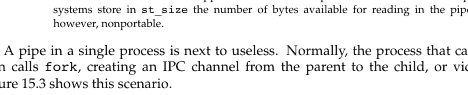

fstat函数（第4.2节）对管道任一端文件描述符返回FIFO文件类型。我们可以用S_ISFIFO宏来测试管道。

POSIX.1规定，对于管道，stat结构体的st_size成员是未定义的。但是当fstat函数应用于管道读端的文件描述符时，许多系统在st_size中存储管道中可供读取的字节数。然而，这是不可移植的。

单个进程中的管道几乎无用。通常，调用pipe的进程随后调用`fork`，创建从父进程到子进程或反向的IPC通道。图15-3显示了这一场景。

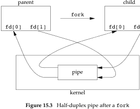

fork之后发生什么取决于我们想要的数据流方向。对于从父进程到子进程的管道，父进程关闭管道的读端（fd[0]），子进程关闭写端（fd[1]）。图15-4显示了描述符的最终排列。

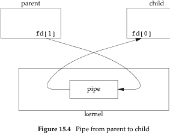

对于从子进程到父进程的管道，父进程关闭fd[1]，子进程关闭fd[0]。

当管道的一端关闭时，适用两条规则。

- 1. 如果我们从写端已关闭的管道读取，read在读取完所有数据后返回0，表示文件结束。（严格来说，我们应该说直到管道不再有写者时才生成这种文件结束状态。管道描述符可以被复制，因此多个进程可能打开管道进行写入。但通常，一个管道有一个读者和一个写者。当我们到达下一节的FIFO时，我们将看到单个FIFO通常有多个写者。）
- 2. 如果我们向读端已关闭的管道写入，则产生SIGPIPE信号。如果我们忽略该信号或捕获它并从信号处理程序返回，write返回-1并将errno设置为EPIPE。

当我们写入管道（或FIFO）时，常量PIPE_BUF指定内核的管道缓冲区大小。写入PIPE_BUF字节或更少的数据不会与同一管道（或FIFO）的其他进程的写入交错。但如果多个进程正在写入管道（或FIFO），并且我们写入超过PIPE_BUF字节，数据可能会与其他写者的数据交错。我们可以通过pathconf或fpathconf确定PIPE_BUF的值（回顾图2-12）。

# 示例

图15-5显示了在父进程和其子进程之间创建管道并通过管道发送数据的代码。

```
#include "apue.h"
int
main(void)
{
    int     n;
    int     fd[2];
    pid_t   pid;
    char    line[MAXLINE];
    if (pipe(fd) < 0)
        err_sys("pipe error");
    if ((pid = fork()) < 0) {
        err_sys("fork error");
    } else if (pid > 0) {    /* parent */
        close(fd[0]);
        write(fd[1], "hello world\n", 12);
    } else {                /* child */
        close(fd[1]);
        n = read(fd[0], line, MAXLINE);
        write(STDOUT_FILENO, line, n);
    }
    exit(0);
}
```

图15-5 通过管道将数据从父进程发送到子进程

注意，这里的管道方向与图15-4中显示的方向一致。

在前面的示例中，我们直接对管道描述符调用了read和write。更有趣的是将管道描述符复制到标准输入或标准输出。通常，子进程随后运行其他程序，该程序可以从其标准输入（我们创建的管道）读取，或向其标准输出（管道）写入。


# 示例

考虑一个程序，它显示自己创建的一些输出，一次一页。与其重新实现若干UNIX系统工具已经实现的分页功能，不如调用用户喜欢的分页程序。为了避免将所有数据写入临时文件并调用 system 来显示该文件，我们想把输出直接通过管道送给分页程序。为此，我们创建一个管道，fork 一个子进程，将子进程的标准输入设置为管道的读端，然后 exec 用户的分页程序。图15.6展示了如何做到这一点。（此示例使用命令行参数指定要显示的文件的名称。通常，这类程序已经将要显示到终端的数据存储在内存中。）

```
#include "apue.h"
#include <sys/wait.h>

#define DEF_PAGER   "/bin/more"    /* default pager program */

int
main(int argc, char *argv[])
{
    int        n;
    int        fd[2];
    pid_t      pid;
    char       *pager, *argv0;
    char       line[MAXLINE];
    FILE       *fp;

    if (argc != 2)
        err_quit("usage: a.out <pathname>");

    if ((fp = fopen(argv[1], "r")) == NULL)
        err_sys("can't open %s", argv[1]);
    if (pipe(fd) < 0)
        err_sys("pipe error");

    if ((pid = fork()) < 0) {
        err_sys("fork error");
    } else if (pid > 0) {                         /* parent */
        close(fd[0]);                              /* close read end */

        /* parent copies argv[1] to pipe */
        while (fgets(line, MAXLINE, fp) != NULL) {
            n = strlen(line);
            if (write(fd[1], line, n) != n)
                err_sys("write error to pipe");
        }
        if (ferror(fp))
            err_sys("fgets error");

        close(fd[1]);      /* close write end of pipe for reader */

        if (waitpid(pid, NULL, 0) < 0)
            err_sys("waitpid error");
```

```
exit(0);
} else {                         /* child */
    close(fd[1]);   /* close write end */
    if (fd[0] != STDIN_FILENO) {
        if (dup2(fd[0], STDIN_FILENO) != STDIN_FILENO)
            err_sys("dup2 error to stdin");
        close(fd[0]);   /* don't need this after dup2 */
    }

    /* get arguments for execl() */
    if ((pager = getenv("PAGER")) == NULL)
        pager = DEF_PAGER;
    if ((argv0 = strrchr(pager, '/')) != NULL)
        argv0++;    /* step past rightmost slash */
    else
        argv0 = pager;  /* no slash in pager */
    if (execl(pager, argv0, (char *)0) < 0)
        err_sys("execl error for %s", pager);
    }
    exit(0);
```

# 图15.6 将文件复制到分页程序

在调用 fork 之前，我们创建一个管道。fork 之后，父进程关闭其读端，子进程关闭其写端。然后子进程调用 dup2，将其标准输入设置为管道的读端。当分页程序被执行时，它的标准输入将是管道的读端。

当我们把一个描述符复制到另一个描述符上时（子进程中的 fd[0] 到标准输入），我们必须小心确保描述符没有已经是目标值。如果描述符已经具有目标值，而我们又调用 dup2 和 close，那么描述符的唯一副本就会被关闭。回忆一下 dup2 的两个参数相等时的操作（如3.12节讨论的）。在这个程序中，如果标准输入没有被 shell 打开，程序开头的 fopen 应该使用描述符0（最低的未使用描述符），所以 fd[0] 不应该等于标准输入。然而，每当我们调用 dup2 和 close 来将一个描述符复制到另一个时，我们总会先比较这两个描述符，这是一种防御性编程措施。

注意我们尝试使用环境变量 PAGER 来获取用户的分页程序名称。如果这不起作用，我们就使用默认值。这是环境变量的一种常见用法。

# 示例

回忆一下8.9节中的五个函数 TELL_WAIT、TELL_PARENT、TELL_CHILD、WAIT_PARENT 和 WAIT_CHILD。在图10.24中，我们展示了一个使用信号实现的版本。图15.7展示了一个使用管道实现的版本。

我们在 fork 之前创建两个管道，如图15.8所示。当调用 TELL_CHILD 时，父进程通过上面的管道写入字符 "p"；当调用 TELL_PARENT 时，子进程通过下面的管道写入字符 "c"。相应的 WAIT_xxx 函数则阻塞读取单个字符。


图15.8 使用两个管道进行父子同步

注意每个管道都有一个额外的读取者，但这无关紧要。也就是说，除了子进程从 pfd1[0] 读取外，父进程还打开了顶部管道的这一端用于读取。这不会影响我们，因为父进程不会尝试从该管道读取。

## 15.3 popen 和 pclose 函数

由于一个常见操作是创建到另一个进程的管道，以读取其输出或向其发送输入，标准I/O库历来提供了 popen 和 pclose 函数。这两个函数处理了我们一直在做的所有繁琐工作：创建管道、fork 子进程、关闭管道未使用的端、执行 shell 来运行命令，以及等待命令终止。

```
#include <stdio.h>

FILE *popen(const char *cmdstring, const char *type);
								Returns: file pointer if OK, NULL on error

int pclose(FILE *fp);
								Returns: termination status of cmdstring, or -1 on error
```

函数 popen 执行 fork 和 exec 来运行 cmdstring，并返回一个标准I/O文件指针。如果 type 是 "r"，则文件指针连接到 cmdstring 的标准输出（图15.9）。


图15.9 fp = popen(cmdstring, "r") 的结果

如果 type 是 "w"，则文件指针连接到 cmdstring 的标准输入，如图15.10所示。


# 图15.10 fp = popen(cmdstring, "w") 的结果

记住 popen 最后一个参数的一种方法是：和 fopen 类似，如果 type 是 "r"，返回的文件指针可读；如果 type 是 "w"，则返回的文件指针可写。

pclose 函数关闭标准I/O流，等待命令终止，并返回 shell 的终止状态。（我们在8.6节描述了终止状态。8.13节描述的 system 函数也会返回终止状态。）如果 shell 无法执行，pclose 返回的终止状态就如同 shell 执行了 exit(127)。

cmdstring 由 Bourne shell 执行，如下所示：
sh -c cmdstring

这意味着 shell 会展开 cmdstring 中的任何特殊字符。这使我们能够说，例如：

```
fp = popen("ls *.c", "r");
```

或

```
fp = popen("cmd 2>&1", "r");
```

# 示例

让我们使用 popen 重做图15.6中的程序，如图15.11所示。

```
#include "apue.h"
#include <sys/wait.h>

#define PAGER  "${PAGER:-more}" /* environment variable, or default */
int
main(int argc, char *argv[])
{
    char    line[MAXLINE];
    FILE    *fpin, *fpout;

    if (argc != 2)
        err_quit("usage: a.out <pathname>");
    if ((fpin = fopen(argv[1], "r")) == NULL)
        err_sys("can't open %s", argv[1]);

    if ((fpout = popen(PAGER, "w")) == NULL)
        err_sys("popen error");

    /* copy argv[1] to pager */
```

```
while (fgets(line, MAXLINE, fpin) != NULL) {
    if (fputs(line, fpout) == EOF)
        err_sys("fputs error to pipe");
    }
    if (ferror(fpin))
        err_sys("fgets error");
    if (pclose(fpout) == -1)
        err_sys("pclose error");
    exit(0);
}
```

# 图15.11 使用 popen 将文件复制到分页程序

使用 popen 减少了我们必须编写的代码量。

shell 命令 ${PAGER:-more} 表示：如果 shell 变量 PAGER 已定义且非空，则使用其值；否则，使用字符串 more。

# 示例——popen 和 pclose 函数

图15.12展示了我们实现的 popen 和 pclose。

```
#include "apue.h"
#include <errno.h>
#include <fcntl.h>
#include <sys/wait.h>

/*
 * Pointer to array allocated at run-time.
 */
static pid_t  *childpid = NULL;

/*
 * From our open_max(), Figure 2.17.
 */
static int     maxfd;

FILE *
popen(const char *cmdstring, const char *type)
{
    int     i;
    int     pfd[2];
    pid_t   pid;
    FILE    *fp;

    /* only allow "r" or "w" */
    if ((type[0] != 'r' && type[0] != 'w') || type[1] != '\0') {
        errno = EINVAL;
        return(NULL);
    }
```


if (childpid == NULL) {    /* first time through */
    /* allocate zeroed out array for child pids */
    maxfd = open_max();
    if ((childpid = calloc(maxfd, sizeof(pid_t))) == NULL)
        return(NULL);
}

if (pipe(pfd) < 0)
    return(NULL);  /* errno set by pipe() */
if (pfd[0] >= maxfd || pfd[1] >= maxfd) {
    close(pfd[0]);
    close(pfd[1]);
    errno = EMFILE;
    return(NULL);
}

if ((pid = fork()) < 0) {
    return(NULL);  /* errno set by fork() */
} else if (pid == 0) {                /* child */
    if (*type == 'r') {
        close(pfd[0]);
        if (pfd[1] != STDOUT_FILENO) {
            dup2(pfd[1], STDOUT_FILENO);
            close(pfd[1]);
        }
    } else {
        close(pfd[1]);
        if (pfd[0] != STDIN_FILENO) {
            dup2(pfd[0], STDIN_FILENO);
            close(pfd[0]);
        }
    }

    /* close all descriptors in childpid[] */
    for (i = 0; i < maxfd; i++)
        if (childpid[i] > 0)
            close(i);

    execl("/bin/sh", "sh", "-c", cmdstring, (char *)0);
    _exit(127);
}

/* parent continues... */
if (*type == 'r') {
    close(pfd[1]);
    if ((fp = fdopen(pfd[0], type)) == NULL)
        return(NULL);
} else {
    close(pfd[0]);
    if ((fp = fdopen(pfd[1], type)) == NULL)
        return(NULL);
}
}
childpid[fileno(fp)] = pid; /* remember child pid for this fd */
return(fp);
}
int
pclose(FILE *fp)
{
    int     fd, stat;
    pid_t   pid;

    if (childpid == NULL) {
        errno = EINVAL;
        return(-1);      /* popen() has never been called */
    }

    fd = fileno(fp);
    if (fd >= maxfd) {
        errno = EINVAL;
        return(-1);    /* invalid file descriptor */
    }
    if ((pid = childpid[fd]) == 0) {
        errno = EINVAL;
        return(-1);    /* fp wasn't opened by popen() */
    }

    childpid[fd] = 0;
    if (fclose(fp) == EOF)
        return(-1);

    while (waitpid(pid, &stat, 0) < 0)
        if (errno != EINTR)
            return(-1); /* error other than EINTR from waitpid() */

    return(stat);   /* return child's termination status */
}

## 图 15.12 popen 和 pclose 函数

尽管 popen 的核心与本章前面使用的代码相似，但仍有许多细节需要我们处理。首先，每次调用 popen 时，我们必须记住所创建的子进程的进程 ID 以及其文件描述符或 FILE 指针。我们选择将子进程的进程 ID 保存在数组 childpid 中，并以文件描述符为索引。这样，当 pclose 用 FILE 指针作为参数被调用时，我们调用标准 I/O 函数 fileno 获取文件描述符，然后就可以为 waitpid 的调用获取子进程 ID。由于一个进程可能多次调用 popen，我们动态分配 childpid 数组（在 popen 第一次被调用时），为尽可能多的子进程提供空间，其数量与文件描述符的数量相同。

请注意，我们在图 2.17 中使用的 open_max 函数如果系统中的该值不确定，可以返回最大打开文件数的估计值。我们必须小心不要使用其值大于或等于 open_max 函数返回值的管道文件描述符。在 popen 中，如果 open_max 返回的值过小，我们会关闭管道文件描述符，将 errno 设置为 EMFILE 以表示打开的文件描述符太多，并返回 -1。在 pclose 中，如果与文件指针参数对应的文件描述符大于预期，我们将 errno 设置为 EINVAL 并返回 -1。

在 popen 函数中调用 pipe 和 fork 然后为每个进程复制适当的描述符，与本章前面所做的类似。

POSIX.1 要求 popen 关闭子进程中从之前的 popen 调用仍保持打开的流。为此，我们在子进程中遍历 childpid 数组，关闭仍处于打开状态的描述符。

如果 pclose 的调用者为 SIGCHLD 建立了信号处理程序呢？来自 pclose 的 waitpid 调用将返回 EINTR 错误。由于调用者允许捕获此信号（或可能中断 waitpid 调用的任何其他信号），我们如果 waitpid 因被捕获的信号而中断，则再次调用 waitpid。

请注意，如果应用程序调用 waitpid 并获取由 popen 创建的子进程的退出状态，我们在应用程序调用 pclose 时调用 waitpid，会发现子进程已不存在，并返回 -1 且 errno 设置为 ECHILD。这是 POSIX.1 在此情况下要求的行为。

一些早期版本的 pclose 如果信号中断了等待会返回 EINTR 错误。此外，一些早期版本的 pclose 在等待期间会阻塞或忽略信号 SIGINT、SIGQUIT 和 SIGHUP。这不允许 POSIX.1。

请注意，popen 绝不应该由 set-user-ID 或 set-group-ID 程序调用。当它执行命令时，popen 等价于执行

```
execl("/bin/sh", "sh", "-c", command, NULL);
```

这将使用调用者继承的环境执行 shell 和命令。恶意用户可以操纵环境，使 shell 以 set-ID 文件模式授予的提升权限执行除预期命令之外的其他命令。

popen 特别适合用于执行简单的过滤器，以转换正在运行的命令的输入或输出。当命令想要构建自己的管道时就是这种情况。

### 示例

考虑一个向标准输出写入提示符并从标准输入读取一行的应用程序。使用 popen 函数，我们可以在应用程序与其输入之间插入一个程序来转换输入。图 15.13 显示了这种情况下的进程排列。


转换可以是路径名扩展，例如，或提供历史机制（记住之前输入的命令）。

图 15.14 显示了一个简单的过滤器来演示此操作。该过滤器将标准输入复制到标准输出，将任何大写字符转换为小写。我们在写入换行符后仔细刷新标准输出的原因将在下一节讨论协进程时进行说明。

```
#include "apue.h"
#include <ctype.h>

int
main(void)
{
    int        c;

    while ((c = getchar()) != EOF) {
        if (isupper(c))
            c = tolower(c);
        if (putchar(c) == EOF)
            err_sys("output error");
        if (c == '\n')
            fflush(stdout);
    }
    exit(0);
}
```

图 15.14  将大写字符转换为小写的过滤器

我们将此过滤器编译为可执行文件 myuclc，然后使用图 15.15 中的程序通过 popen 调用它。

```
#include "apue.h"
#include <sys/wait.h>

int
main(void)
{
    char    line[MAXLINE];
    FILE    *fpin;
```

```
if ((fpin = popen("myuclc", "r")) == NULL)
    err_sys("popen error");
for ( ; ; ) {
    fputs("prompt> ", stdout);
    fflush(stdout);
    if (fgets(line, MAXLINE, fpin) == NULL) /* read from pipe */
        break;
    if (fputs(line, stdout) == EOF)
        err_sys("fputs error to pipe");
}
if (pclose(fpin) == -1)
    err_sys("pclose error");
putchar('\n');
exit(0);
}
```

图 15.15  使用 popen 调用大写/小写过滤器读取命令

我们需要在写入提示符后调用 fflush，因为标准输出通常是行缓冲的，而提示符不包含换行符。

## 15.4 协进程

UNIX 系统过滤器是一个从标准输入读取并写入标准输出的程序。过滤器通常在 shell 管道中线性连接。当同一个程序生成过滤器的输入并读取过滤器的输出时，过滤器就成为协进程。

Korn shell 提供了协进程 [Bolsky and Korn 1995]。Bourne shell、Bourne-again shell 和 C shell 没有提供将进程连接为协进程的方法。协进程通常从 shell 在后台运行，其标准输入和标准输出使用管道连接到另一个程序。虽然启动协进程并将其输入输出连接到其他进程所需的 shell 语法相当复杂（请参阅 Bolsky and Korn [1995] 第 62-63 页的全部细节），但协进程对 C 程序也很有用。

而 popen 为我们提供了到另一个进程的标准输入或从标准输出的一条单向管道，使用协进程时我们有两条到另一个进程的单向管道：一条到其标准输入，一条从其标准输出。我们希望向其标准输入写入，让它对数据进行操作，然后从其标准输出读取。

### 示例

让我们用一个例子来看协进程。该进程创建两个管道：一个是协进程的标准输入，另一个是协进程的标准输出。图 15.16 显示了这种排列。


图15.16 通过写入协程的标准输入并读取其标准输出来驱动协程

图15.17中的程序是一个简单的协程，它从标准输入读取两个数字，计算它们的和，并将和写入其标准输出。（协程通常执行比我们这里展示的更有趣的工作。这个例子显然是人为设计的，以便我们可以研究连接这些进程所需的管道机制。）

```
#include "apue.h"

int
main(void)
{
    int     n, int1, int2;
    char    line[MAXLINE];

    while ((n = read(STDIN_FILENO, line, MAXLINE)) > 0) {
        line[n] = 0;    /* null terminate */
        if (sscanf(line, "%d%d", &int1, &int2) == 2) {
            sprintf(line, "%d\n", int1 + int2);
            n = strlen(line);
            if (write(STDOUT_FILENO, line, n) != n)
                err_sys("write error");
        } else {
            if (write(STDOUT_FILENO, "invalid args\n", 13) != 13)
                err_sys("write error");
        }
    }
    exit(0);
}
```

图15.17 两个数相加的简单过滤器

我们编译这个程序并将可执行文件保存在add2中。图15.18中的程序从其标准输入读取两个数字后调用add2协程。来自协程的值被写入其标准输出。

```
#include "apue.h"

static void sig_pipe(int);    /* our signal handler */
int
main(void)
{
    int     n, fd1[2], fd2[2];
    pid_t   pid;
    char    line[MAXLINE];

    if (signal(SIGPIPE, sig_pipe) == SIG_ERR)
        err_sys("signal error");

    if (pipe(fd1) < 0 || pipe(fd2) < 0)
        err_sys("pipe error");

    if ((pid = fork()) < 0) {
        err_sys("fork error");
    } else if (pid > 0) {                         /* parent */
        close(fd1[0]);
        close(fd2[1]);

        while (fgets(line, MAXLINE, stdin) != NULL) {
            n = strlen(line);
            if (write(fd1[1], line, n) != n)
                err_sys("write error to pipe");
            if ((n = read(fd2[0], line, MAXLINE)) < 0)
                err_sys("read error from pipe");
            if (n == 0) {
                err_msg("child closed pipe");
                break;
            }
            line[n] = 0;    /* null terminate */
            if (fputs(line, stdout) == EOF)
                err_sys("fputs error");
        }

        if (ferror(stdin))
            err_sys("fgets error on stdin");
        exit(0);
    } else {                                      /* child */
        close(fd1[1]);
        close(fd2[0]);
        if (fd1[0] != STDIN_FILENO) {
            if (dup2(fd1[0], STDIN_FILENO) != STDIN_FILENO)
                err_sys("dup2 error to stdin");
            close(fd1[0]);
        }

        if (fd2[1] != STDOUT_FILENO) {
            if (dup2(fd2[1], STDOUT_FILENO) != STDOUT_FILENO)
                err_sys("dup2 error to stdout");
            close(fd2[1]);
        }
        if (execl("./add2", "add2", (char *)0) < 0)
            err_sys("execl error");
```
```
}
    exit(0);
}

static void
sig_pipe(int signo)
{
    printf("SIGPIPE caught\n");
    exit(1);
}
```

## 图15.18 驱动add2过滤器的程序

这里，我们创建两个管道，父进程和子进程各自关闭它们不需要的端。我们必须使用两个管道：一个用于协程的标准输入，另一个用于其标准输出。然后子进程调用dup2将管道描述符移到其标准输入和标准输出上，再调用exec1。

如果我们编译并运行图15.18中的程序，它会按预期工作。此外，如果我们在图15.18中的程序等待我们输入时杀死add2协程，然后输入两个数字，当程序写入没有读者的管道时，信号处理程序被调用。（见练习15.4。）

## 示例

在add2协程（图15.17）中，我们特意使用了低级I/O（UNIX系统调用）：read和write。如果我们重写这个协程以使用标准I/O，会发生什么？图15.19显示了新版本。

```
#include "apue.h"

int
main(void)
{
    int     int1, int2;
    char    line[MAXLINE];

    while (fgets(line, MAXLINE, stdin) != NULL) {
        if (sscanf(line, "%d%d", &int1, &int2) == 2) {
            if (printf("%d\n", int1 + int2) == EOF)
                err_sys("printf error");
        } else {
            if (printf("invalid args\n") == EOF)
                err_sys("printf error");
        }
    }
    exit(0);
}
```

## 图15.19 使用标准I/O的两个数相加过滤器

如果我们从图15.18中的程序调用这个新协程，它不再工作了。问题在于默认的标准I/O缓冲。当图15.19中的程序被调用时，标准输入上的第一个fgets导致标准I/O库分配缓冲区并选择缓冲类型。由于标准输入是管道，标准I/O库默认为全缓冲。标准输出也是如此。当add2阻塞读取其标准输入时，图15.18中的程序阻塞读取管道。我们遇到了死锁。

这里，我们可以控制正在运行的协程。我们可以在while循环之前添加以下四行来更改图15.19中的程序：

```
if (setvbuf(stdin, NULL, _IOLBF, 0) != 0)
    err_sys("setvbuf error");
if (setvbuf(stdout, NULL, _IOLBF, 0) != 0)
    err_sys("setvbuf error");
```

这些行使得fgets在有一行可用时返回，并使得printf在输出换行符时执行fflush（关于标准I/O缓冲的详细信息，请参阅5.4节）。对这些setvbuf的显式调用修复了图15.19中的程序。

如果我们无法修改我们将其输出通过管道输入的程序，则需要其他技术。例如，如果我们在程序中使用awk(1)作为协程（而不是add2程序），以下代码将无法工作：

```
#!/bin/awk -f
{ print $1 + $2 }
```

这无法工作的原因同样是标准I/O缓冲。但在这种情况下，我们无法改变awk的工作方式（除非我们拥有其源代码）。我们无法以任何方式修改awk的可执行文件来改变标准I/O缓冲的处理方式。

这个普遍问题的解决方案是让被调用的协程（本例中是awk）认为它的标准输入和标准输出连接到一个终端。这会导致协程中的标准I/O例程对这两个I/O流进行行缓冲，类似于我们之前显式调用setvbuf所做的。我们在第19章使用伪终端来实现这一点。

## 15.5 FIFO

FIFO有时被称为命名管道。无名管道只能用于相关进程之间，且必须由共同的祖先创建管道。然而，使用FIFO，不相关的进程可以交换数据。

我们在第4章中看到FIFO是一种文件类型。stat结构（4.2节）的st_mode成员的一种编码表示文件是FIFO。我们可以使用S_ISFIFO宏来测试。

创建FIFO类似于创建文件。实际上，FIFO的路径名存在于文件系统中。

```
#include <sys/stat.h>
int mkfifo(const char *path, mode_t mode);
int mkfifoat(int fd, const char *path, mode_t mode);
Both return: 0 if OK, -1 on error
```

mode参数的规格与open函数（3.3节）相同。新FIFO的用户和组所有权的规则与4.6节中描述的相同。

mkfifoat函数与mkfifo函数类似，但它可以用于在由fd文件描述符参数所代表的目录相对位置创建FIFO。与其他*at函数一样，有三种情况：

- 1. 如果path参数指定绝对路径名，则忽略fd参数，mkfifoat函数的行为与mkfifo函数相同。
- 2. 如果path参数指定相对路径名，且fd参数是打开目录的有效文件描述符，则相对于该目录计算路径名。
- 3. 如果path参数指定相对路径名，且fd参数具有特殊值AT_FDCWD，则从当前工作目录开始计算路径名，mkfifoat的行为与mkfifo相同。

一旦我们使用mkfifo或mkfifoat创建了FIFO，就可以使用open打开它。实际上，普通的文件I/O函数（例如close、read、write、unlink）都可以用于FIFO。

应用程序可以使用mknod和mknodat函数创建FIFO。由于POSIX.1最初不包含mknod，因此专门为POSIX.1发明了mkfifo函数。mknod和mknodat函数包含在POSIX.1的XSI选项中。

POSIX.1还包括对mkfifo(1)命令的支持。本文讨论的所有四个平台都提供此命令。因此，我们可以使用shell命令创建FIFO，然后通过普通的shell I/O重定向访问它。

当我们打开FIFO时，非阻塞标志（O_NONBLOCK）会影响发生的事情。

- 在正常情况下（没有O_NONBLOCK），只读打开会阻塞，直到其他进程以写方式打开FIFO。类似地，只写打开会阻塞，直到其他进程以读方式打开FIFO。
- 如果指定了O_NONBLOCK，只读打开会立即返回。但是，如果没有进程以读方式打开FIFO，则只写打开返回-1，并将errno设置为ENXIO。

与管道一样，如果我们写入一个没有进程以读方式打开的FIFO，则会产生信号SIGPIPE。当FIFO的最后一个写入者关闭FIFO时，将为FIFO的读取者生成文件结束符。

对于给定的FIFO，有多个写入者是很常见的。这意味着如果我们不希望来自多个进程的写入被

交错。与管道一样，常量 `PIPE_BUF` 指定了可以原子地写入 FIFO 的最大数据量。

FIFO 有两种用途。

- 1. shell 命令使用 FIFO 将数据从一个 shell 管道传递到另一个 shell 管道，而无需创建中间临时文件。
- 2. 在客户端-服务器应用程序中，FIFO 用作汇集点，以在客户端和服务器之间传递数据。

我们通过示例讨论每种用途。

## 示例——使用 FIFO 复制输出流

FIFO 可用于在系列 shell 命令中复制输出流。这避免了将数据写入中间磁盘文件（类似于使用管道来避免中间磁盘文件）。但是，管道只能用于进程之间的线性连接，而 FIFO 有名称，因此可用于非线性连接。

考虑一个需要两次处理过滤输入流的过程。图 15-20 显示了这种安排。


图 15-20 两次处理过滤输入流的过程

使用 FIFO 和 UNIX 程序 `tee(1)`，我们可以不用临时文件就完成这个过程。（`tee` 程序将其标准输入复制到标准输出和命令行中指定的文件。）

```
mkfifo fifo1
prog3 < fifo1 &
prog1 < infile | tee fifo1 | prog2
```

我们创建 FIFO，然后在后台启动 `prog3`，从 FIFO 读取。然后启动 `prog1`，并使用 `tee` 将其输入发送到 FIFO 和 `prog2`。图 15-21 显示了进程安排。

## 示例——使用 FIFO 进行客户端-服务器通信

FIFO 的另一个用途是在客户端和服务器之间发送数据。如果有一个服务器被许多客户端访问，每个客户端都可以将其请求写入一个众所周知的 FIFO（由服务器创建）。（“众所周知”是指所有需要联系服务器的客户端都知道该 FIFO 的路径名。）图 15-22 显示了这种安排。

## 图 15-21 使用 FIFO 和 tee 将流发送给两个不同的进程

## 图 15-22 客户端使用 FIFO 向服务器发送请求

由于 FIFO 有多个写入者，客户端发送给服务器的请求大小必须小于 `PIPE_BUF` 字节。这可以防止客户端写入交错。

使用 FIFO 进行此类客户端-服务器通信的问题是如何将回复从服务器发送回每个客户端。不能使用单个 FIFO，因为客户端永远不会知道何时读取自己的响应与针对其他客户端的响应。一种解决方案是每个客户端在请求中发送其进程 ID。然后，服务器根据客户端的进程 ID 使用路径名为每个客户端创建一个唯一的 FIFO。例如，服务器可以创建名为 `/tmp/serv1.XXXXX` 的 FIFO，其中 `XXXXX` 被替换为客户端的进程 ID。图 15-23 显示了这种安排。

这种安排可行，尽管服务器无法判断客户端是否崩溃。客户端崩溃会在文件系统中留下特定于客户端的 FIFO。该

给定的 IPC 结构被创建后又被移除，与该结构关联的标识符会不断增加，直到达到整数的最大正值，然后回绕到 0。

标识符是 IPC 对象的内部名称。协作进程需要外部命名方案才能使用同一个 IPC 对象会合。为此，IPC 对象与一个充当外部名称的键相关联。

每当创建 IPC 结构时（通过调用 `msgget`、`semget` 或 `shmget`），必须指定一个键。该键的数据类型是原始系统数据类型 `key_t`，在头文件 `<sys/types.h>` 中通常定义为长整数。内核将该键转换为标识符。

客户端和服务器可以通过多种方式在同一个 IPC 结构上会合。

- 1. 服务器可以通过指定 `IPC_PRIVATE` 键来创建新的 IPC 结构，并将返回的标识符存储在某处（如文件）供客户端获取。`IPC_PRIVATE` 键保证服务器创建新的 IPC 结构。这种技术的缺点是，服务器需要执行文件系统操作将整数标识符写入文件，然后客户端稍后需要检索该标识符。

`IPC_PRIVATE` 键也用于父子关系中。父进程指定 `IPC_PRIVATE` 创建新的 IPC 结构，`fork` 之后子进程可以获取所得到的标识符。子进程可以将该标识符作为 `exec` 函数的参数传递给新程序。

- 2. 客户端和服务器可以约定一个键，例如在公共头文件中定义该键。然后服务器使用该键创建新的 IPC 结构。这种方法的问题在于，该键可能已经与某个 IPC 结构关联，此时 `get` 函数（`msgget`、`semget` 或 `shmget`）会返回错误。服务器必须处理此错误，删除现有的 IPC 结构，然后尝试再次创建。

- 3. 客户端和服务器可以约定路径名和项目 ID（项目 ID 是 0 到 255 之间的字符值），并调用函数 `ftok` 将这两个值转换为键。然后该键用于步骤 2。`ftok` 提供的唯一服务是一种从路径名和项目 ID 生成键的方法。

```
#include <sys/ipc.h>

key_t ftok(const char *path, int id);

Returns: key if OK, (key_t)-1 on error
```

`path` 参数必须指向一个现有文件。生成键时仅使用 `id` 的低 8 位。

`ftok` 创建的键通常由给定路径名对应的 `stat` 结构（第 4.2 节）中的 `st_dev` 和 `st_ino` 字段的部分内容与项目 ID 组合而成。如果两个路径名引用两个不同的文件，

那么 `ftok` 通常为这两个路径名返回两个不同的键。但是，由于 i 节点号和键通常都存储为长整数，因此在创建键时可能会发生信息丢失。这意味着，如果使用相同的项目 ID，指向不同文件的两个不同路径名也可能生成相同的键。

三个 `get` 函数（`msgget`、`semget` 和 `shmget`）都有两个相似的参数：一个键和一个整数标志。如果键是 `IPC_PRIVATE`，或者键当前未与特定类型的 IPC 结构关联且指定了标志中的 `IPC_CREAT` 位，则创建新的 IPC 结构（通常由服务器）。要引用现有队列（通常由客户端），键必须等于创建队列时指定的键，并且不能指定 `IPC_CREAT`。

注意，永远不可能指定 `IPC_PRIVATE` 来引用现有队列，因为这个特殊键值总是创建新队列。要引用使用 `IPC_PRIVATE` 键创建的现有队列，我们必须知道关联的标识符，然后在其他 IPC 调用（如 `msgsnd` 和 `msgrcv`）中使用该标识符，绕过 `get` 函数。

如果我们想创建新的 IPC 结构，确保不引用具有相同标识符的现有结构，则必须指定同时设置 `IPC_CREAT` 和 `IPC_EXCL` 位的标志。如果 IPC 结构已存在，这将导致返回 `EEXIST` 错误。（这类似于指定 `O_CREAT` 和 `O_EXCL` 标志的 `open`。）

## 15.6.2 权限结构

XSI IPC 将 `ipc_perm` 结构与每个 IPC 结构关联。该结构定义了权限和所有者，并至少包含以下成员：

```
struct ipc_perm {
    uid_t  uid;   /* owner's effective user ID */
    gid_t  gid;   /* owner's effective group ID */
    uid_t  cuid;  /* creator's effective user ID */
    gid_t  cgid;  /* creator's effective group ID */
    mode_t mode;  /* access modes */
    ...
};
```

每个实现都包含其他成员。有关完整定义，请参阅系统上的 `<sys/ipc.h>`。

创建 IPC 结构时，所有字段都会被初始化。稍后，我们可以通过调用 `msgctl`、`semctl` 或 `shmctl` 修改 `uid`、`gid` 和 `mode` 字段。要更改这些值，调用进程必须是 IPC 结构的创建者或超级用户。更改这些字段类似于对文件调用 `chown` 或 `chmod`。

`mode` 字段中的值类似于我们在图 4-6 中看到的值，但对任何 IPC 结构都没有与执行权限相对应的内容。此外，消息队列和共享内存使用术语“读”和“写”，而信号量使用术语“读”和“更改”。图 15-24 显示了每种 IPC 形式的六种权限。


| 权限 | 位 |
|---|---|
| 用户读 | 0400 |
| 用户写（修改） | 0200 |
| 组读 | 0040 |
| 组写（修改） | 0020 |
| 其他读 | 0004 |
| 其他写（修改） | 0002 |

图15.24 XSI IPC权限

一些实现定义了符号常量来表示每种权限，但这些常量并未被Single UNIX Specification标准化。

## 15.6.3 配置限制

所有三种形式的XSI IPC都有我们可能会遇到的内置限制。这些限制中的大多数可以通过重新配置内核来更改。在描述这三种IPC形式时，我们将逐一说明这些限制。

每个平台都有自己的方法来报告和修改特定限制。FreeBSD 8.0、Linux 3.2.0和Mac OS X 10.6.8提供`sysctl`命令来查看和修改内核配置参数。在Solaris 10上，对内核IPC限制的更改通过`prctl`命令完成。

在Linux上，可以通过运行`ipcs -l`来显示与IPC相关的限制。在FreeBSD和Mac OS X上，等效命令是`ipcs -T`。在Solaris上，可以通过运行`sysdef -i`来发现可调参数。

## 15.6.4 优点与缺点

XSI IPC的一个基本问题是IPC结构是全系统范围的，没有引用计数。例如，如果我们创建一个消息队列，将一些消息放入队列，然后终止，消息队列及其内容不会被删除。它们会一直留在系统中，直到被某个调用`msgrcv`或`msgrcv`的进程专门读取或删除，或有人执行`ipcrm(1)`命令，或系统被重启。与管道相比，管道在引用它的最后一个进程终止时会被完全移除。对于FIFO，虽然名称在显式删除前一直保留在文件系统中，但FIFO中留下的任何数据都会在引用该FIFO的最后一个进程终止时被移除。

XSI IPC的另一个问题是这些IPC结构在文件系统中没有名称。我们无法使用第3章和第4章描述的函数来访问它们并修改其属性。内核中添加了近十几个新的系统调用（`msgget`、`semop`、`shmat`等）来支持这些IPC对象。我们无法用`ls`命令查看IPC对象，无法用`rm`命令删除它们，也无法用`chmod`命令更改它们的权限。相反，新增了两个命令——`ipcs(1)`和`ipcrm(1)`。

由于这些IPC形式不使用文件描述符，我们无法对它们使用多路复用I/O函数（`select`和`poll`）。这使得同时使用多个这些IPC结构，或将任何这些IPC结构与文件或设备I/O一起使用变得更加困难。例如，如果没有某种形式的忙等待循环，我们就无法让服务器等待两个消息队列之一上有消息。

Andrade、Carges和Kovach [1989]给出了使用System V IPC构建的事务处理系统的概述。他们声称System V IPC使用的命名空间（标识符）是一个优点，而不是我们之前所说的一个问题，因为使用标识符允许进程通过一次函数调用（`msgsnd`）向消息队列发送消息，而其他形式的IPC通常需要打开、写入和关闭。这个论点是不正确的。客户端仍然必须以某种方式获取服务器队列的标识符，以避免使用键并调用`msgget`。特定队列的标识符取决于创建队列时存在多少个其他消息队列，以及内核引导以来分配给新队列的内核表已被使用了多少次。这是一个动态值，无法猜测或存储在头文件中。正如我们在15.6.1节中所提到的，服务器至少必须将分配的队列标识符写入文件供客户端读取。

这些作者列出的消息队列的其他优点是它们可靠、有流量控制、面向记录，并且可以按非先进先出的顺序处理。图15.25比较了这些不同IPC形式的一些特性。

| IPC类型 | 无连接？ | 可靠？ | 流量控制？ | 记录？ | 消息类型或优先级？ |
|---|---|---|---|---|---|
| 消息队列 | 否 | 是 | 是 | 是 | 是 |
| STREAMS | 否 | 是 | 是 | 是 | 是 |
| UNIX域流套接字 | 否 | 是 | 是 | 否 | 否 |
| UNIX域数据报套接字 | 是 | 是 | 否 | 是 | 否 |
| FIFO（非STREAMS） | 否 | 是 | 是 | 否 | 否 |

图15.25 各种IPC形式的功能比较

（我们将在第16章描述流和数据报套接字。我们将在17.2节描述UNIX域套接字。）所谓“无连接”，我们指的是无需先调用某种打开函数即可发送消息的能力。如前所述，我们不认为消息队列是无连接的，因为需要某种技术来获取队列的标识符。由于所有这些IPC形式都限于单个主机，因此它们都是可靠的。当消息通过网络发送时，消息丢失的可能性成为问题。“流量控制”意味着如果系统资源（缓冲区）短缺或接收方无法接受更多消息，发送方将进入睡眠状态。当流量控制条件缓解（即队列中有空间）时，发送方应自动被唤醒。

图15.25中没有显示的一个特性是IPC设施能否为每个客户端自动创建到服务器的唯一连接。我们将在第17章看到UNIX流套接字提供了这种能力。接下来的三节将详细描述三种XSI IPC形式。

## 15.7 消息队列

消息队列是存储在内核中的消息链表，由消息队列标识符标识。我们将消息队列简称为队列，其标识符称为队列ID。

> Single UNIX Specification消息传递选项包含一个源自POSIX实时扩展的替代IPC消息队列接口。本书不讨论这一接口。

新队列由`msgget`创建，现有队列由`msgget`打开。新消息通过`msgsnd`添加到队列末尾。每条消息都有一个正的长整数类型字段、一个非负长度和实际数据字节（与长度对应），所有这些都在消息添加到队列时指定给`msgsnd`。消息通过`msgrcv`从队列中取出。我们不必按先进先出的顺序获取消息。相反，我们可以根据类型字段获取消息。每个队列都有以下与其关联的`msgid_ds`结构：

```
struct msgid_ds {
    struct ipc_perm msg_perm;        /* see Section 15.6.2 */
    msgqnum_t       msg_qnum;        /* # of messages on queue */
    msglen_t        msg_qbytes;      /* max # of bytes on queue */
    pid_t           msg_lspid;       /* pid of last msgsnd() */
    pid_t           msg_lrpid;       /* pid of last msgrcv() */
    time_t          msg_stime;       /* last-msgsnd() time */
    time_t          msg_rtime;       /* last-msgrcv() time */
    time_t          msg_ctime;       /* last-change time */
    :
};
```

该结构定义了队列的当前状态。显示的成员是Single UNIX Specification定义的成员。实现中还包含标准未涵盖的其他字段。

| 描述 | 典型值 |  |  |  |
|---|---|---|---|---|
|  | FreeBSD 8.0 | Linux 3.2.0 | Mac OS X 10.6.8 | Solaris 10 |
| 我们可发送的最大消息的字节数 | 16,384 | 8,192 | 16,384 | 派生值 |
| 特定队列的最大字节数（即队列上所有消息大小的总和） | 2,048 | 16,384 | 2,048 | 65,536 |
| 系统范围的最大消息队列数 | 40 | 派生值 | 40 | 128 |
| 系统范围的最大消息数 | 40 | 派生值 | 40 | 8,192 |

图15.26 影响消息队列的系统限制

图15.26列出了影响消息队列的系统限制。我们用“派生值”表示一个限制是从其他限制推导而来的。例如，在Linux上，最大消息数基于最大队列数和队列上允许的最大数据量。而最大队列数又基于系统中安装的RAM数量。请注意，队列的最大字节大小限制进一步限制了可放入队列的消息的最大大小。


通常首先调用的函数是 msgget，用来打开一个已有的队列或创建一个新的队列。

```
#include <sys/msg.h>
int msgget(key_t key, int flag);

Returns: message queue ID if OK, -1 on error
```

在第 15.6.1 节中，我们描述了将 key 转换为标识符的规则，并讨论了是创建新队列还是引用现有队列。当创建新队列时，msqid_ds 结构体的以下成员会被初始化。

- ipc_perm 结构按第 15.6.2 节所述进行初始化。该结构体的 mode 成员被设置为 flag 的相应权限位。这些权限由图 15.24 中的值指定。
- msg_qnum、msg_lspid、msg_lrpid、msg_stime 和 msg_rtime 全部被设置为 0。
- msg_ctime 被设置为当前时间。
- msg_qbytes 被设置为系统限制。

成功时，msgget 返回非负的队列 ID。此值随后会与另外三个消息队列函数一起使用。

msgctl 函数对队列执行各种操作。该函数以及用于信号量和共享内存的相关函数（semctl 和 shmctl）是 XSI IPC 的 ioctl 类似函数（即垃圾桶函数）。

```
#include <sys/msg.h>
int msgctl(int msqid, int cmd, struct msqid_ds *buf);

Returns: 0 if OK, -1 on error
```

cmd 参数指定要在 msqid 指定的队列上执行的操作。

- IPC_STAT 获取该队列的 msqid_ds 结构，并将其存储在 buf 指向的结构中。
- IPC_SET 将 buf 指向的结构中的以下字段复制到与该队列关联的 msqid_ds 结构中：msg_perm.uid、msg_perm.gid、msg_perm.mode 和 msg_qbytes。此命令只能由有效用户 ID 等于 msg_perm.cuid 或 msg_perm.uid 的进程，或具有超级用户权限的进程执行。只有超级用户才能增加 msg_qbytes 的值。
- IPC_RMID 从系统中删除消息队列以及队列上剩余的任何数据。此删除是立即的。任何仍在使用该消息队列的其他进程在其下一次尝试对队列进行操作时都会收到 EIDRM 错误。此命令只能由有效用户 ID 等于 msg_perm.cuid 或 msg_perm.uid 的进程，或具有超级用户权限的进程执行。

我们将看到，这三个命令（IPC_STAT、IPC_SET 和 IPC_RMID）也为信号量和共享内存提供。

数据通过调用 msgsnd 放置到消息队列上。

```
#include <sys/msg.h>
int msgsnd(int msqid, const void *ptr, size_t nbytes, int flag);
Returns: 0 if OK, -1 on error
```

如前所述，每个消息由一个正的 long 整数类型字段、一个非负长度（nbytes）以及实际的数据字节（对应于该长度）组成。消息始终放置在队列的末尾。

ptr 参数指向一个包含正整数消息类型的 long 整数，其后立即跟随消息数据。（如果 nbytes 为 0，则没有消息数据。）如果我们发送的最大消息为 512 字节，我们可以定义以下结构：

```
struct mymsg {
    long  mtype;     /* positive message type */
    char  mtext[512]; /* message data, of length nbytes */
};
```

ptr 参数随后是指向 mymsg 结构的指针。消息类型可由接收方用来以非先进先出顺序获取消息。

某些平台同时支持 32 位和 64 位环境。这会影响 long 整数和指针的大小。例如，在 64 位 SPARC 系统上，Solaris 允许 32 位和 64 位应用程序共存。如果 32 位应用程序要通过管道或套接字与 64 位应用程序交换此结构，则会出现问题，因为在 32 位应用程序中 long 整数的大小为 4 字节，而在 64 位应用程序中为 8 字节。这意味着 32 位应用程序期望 mtext 字段从结构开始后的 4 字节处开始，而 64 位应用程序期望 mtext 字段从结构开始后的 8 字节处开始。在这种情况下，64 位应用程序的 mtype 字段的一部分将作为 mtext 字段的一部分出现在 32 位应用程序中，而 32 位应用程序的 mtext 字段中的前 4 字节将被 64 位应用程序解释为 mtype 字段的一部分。

然而，这种问题不会发生在 XSI 消息队列中。Solaris 使用与 64 位版本的 IPC 系统调用不同的入口点来实现 32 位版本的 IPC 系统调用。系统调用知道如何处理 32 位应用程序与 64 位应用程序之间的通信，并特别处理类型字段以避免其干扰消息的数据部分。唯一潜在的问题是信息丢失，当 64 位应用程序发送的消息在 8 字节类型字段中的值大于可放入 32 位应用程序的 4 字节类型字段时。在这种情况下，32 位应用程序将看到被截断的类型值。

可以指定 flag 值 IPC_NOWAIT。这类似于文件 I/O 的非阻塞 I/O（第 14.2 节）。如果消息队列已满（队列上的消息总数等于系统限制，或队列上的总字节数等于系统限制），指定 IPC_NOWAIT 会使 msgsnd 立即返回 EAGAIN 错误。如果未指定 IPC_NOWAIT，我们将被阻塞，直到有空间容纳该消息、队列从系统中删除，或捕获到信号且信号处理程序返回。在第二种情况下，返回 EIDRM 错误（“标识符已删除”）；在最后一种情况下，返回的错误是 EINTR。

当进程完成对由信号量控制的共享资源的使用时，信号量的值会增加 1。如果有其他进程正在等待信号量，它们将被唤醒。

为了正确实现信号量，对信号量值的测试和对该值的递减必须是原子操作。因此，信号量通常在内核内部实现。

一种常见的信号量形式称为二进制信号量。它控制单个资源，其值初始化为 1。一般来说，信号量可以初始化为任何正值，该值表示可供共享的共享资源单元数。

不幸的是，XSI 信号量比这复杂得多。三个特性导致了这种不必要的复杂性。

- 1. 信号量不仅仅是一个单一的非负值。相反，我们必须将信号量定义为一个或多个信号量值的集合。当我们创建信号量时，我们指定集合中的值数。
- 2. 信号量的创建（semget）与其初始化（semctl）是独立的。这是致命的缺陷，因为我们无法原子地创建新的信号量集并初始化集合中的所有值。
- 3. 由于所有形式的 XSI IPC 在没有进程使用它们时仍然存在，我们必须担心一个程序在未释放已分配的信号量的情况下终止。我们稍后描述的撤销功能本应处理这个问题。

内核为每个信号量集维护一个 semid_ds 结构：

```
struct semid_ds {
    struct ipc_perm sem_perm;  /* see Section 15.6.2 */
    unsigned short  sem_nsems; /* # of semaphores in set */
    time_t          sem_otime; /* last-semop() time */
    time_t          sem_ctime; /* last-change time */
    :
};
```

Single UNIX Specification 定义了所示的字段，但实现可以在 semid_ds 结构中定义额外的成员。

每个信号量由一个匿名结构表示，至少包含以下成员：

```
struct {
    unsigned short semval;  /* semaphore value, always >= 0 */
    pid_t          sempid;  /* pid for last operation */
    unsigned short semncnt; /* # processes awaiting semval>curval */
    unsigned short semzcnt; /* # processes awaiting semval=0 */
    :
};
```

图 15.28 列出了影响信号量集的系统限制。


| 描述 | FreeBSD 8.0 | Linux 3.2.0 | Mac OS X 10.6.8 | Solaris 10 |
|---|---|---:|---:|---:|---:|
| 任意信号量的最大值 | 32,767 | 32,767 | 32,767 | 65,535 |
| 任意信号量的退出时调整值的最大值 | 16,384 | 32,767 | 16,384 | 32,767 |
| 系统范围内信号量集的最大数量 | 10 | 128 | 87,381 | 128 |
| 系统范围内信号量的最大数量 | 60 | 32,000 | 87,381 | 派生值 |
| 每个信号量集中的信号量最大数量 | 60 | 250 | 87,381 | 512 |
| 系统范围内撤销结构的最大数量 | 30 | 32,000 | 87,381 | 派生值 |
| 每个撤销结构中的撤销条目最大数量 | 10 | 无限制 | 10 | 派生值 |
| 每次 semop 调用的最大操作数 | 100 | 32 | 5 | 512 |

## 图 15.28 影响信号量的系统限制

要使用 XSI 信号量，我们首先需要调用 semget 函数获取一个信号量 ID。

```
#include <sys/sem.h>

int semget(key_t key, int nsems, int flag);
```
返回：成功时返回信号量 ID，出错时返回 −1

在第 15.6.1 节中，我们介绍了将 key 转换为标识符的规则，并讨论了是创建新集合还是引用现有集合。创建新集合时，semid_ds 结构的以下成员会被初始化。

- 按照第 15.6.2 节所述初始化 ipc_perm 结构。该结构的 mode 成员被设置为 flag 中对应的权限位。这些权限使用图 15.24 中的值指定。
- sem_otime 被设置为 0。
- sem_ctime 被设置为当前时间。
- sem_nsems 被设置为 nsems。

集合中的信号量数量为 nsems。如果要创建新集合（通常由服务器执行），必须指定 nsems。如果要引用现有集合（客户端），则可以将 nsems 指定为 0。

semctl 函数用于执行各种信号量操作。

```
#include <sys/sem.h>

int semctl(int semid, int semnum, int cmd, ... /* union semun arg */);
```
返回值：（见下文）

根据请求的命令，第四个参数可以省略；如果提供，则类型为 semun，它是一个联合体，包含各种特定于命令的参数：

```
union semun {
    int              val;    /* for SETVAL */
    struct semid_ds  *buf;   /* for IPC_STAT and IPC_SET */
    unsigned short   *array; /* for GETALL and SETALL */
};
```

请注意，可选参数是联合体本身，而不是指向该联合体的指针。

> 通常，应用程序必须定义 semun 联合体。不过，在 FreeBSD 8.0 中，该联合体已在 <sys/sem.h> 中为我们定义。

cmd 参数指定要对 semid 指定的集合执行以下十种命令之一。引用某个特定信号量值的五种命令使用 semnum 指定集合中的一个成员。semnum 的取值范围为 0 到 nsems – 1（含边界值）。

- IPC_STAT 获取该集合的 semid_ds 结构，并将其存入 arg.buf 指向的结构中。
- IPC_SET 根据 arg.buf 指向的结构，设置与该集合关联的 semid_ds 结构中的 sem_perm.uid、sem_perm.gid 和 sem_perm.mode 字段。只有有效用户 ID 等于 sem_perm.cuid 或 sem_perm.uid 的进程，或具有超级用户权限的进程，才能执行此命令。
- IPC_RMID 从系统中移除该信号量集。此操作会立即生效。仍在使用该信号量的其他进程，下次尝试对其执行操作时会收到 EIDRM 错误。只有有效用户 ID 等于 sem_perm.cuid 或 sem_perm.uid 的进程，或具有超级用户权限的进程，才能执行此命令。
- GETVAL 返回成员 semnum 的 semval 值。
- SETVAL 将成员 semnum 的 semval 值设置为 arg.val 指定的值。
- GETPID 返回成员 semnum 的 sempid 值。
- GETNCNT 返回成员 semnum 的 semncnt 值。
- GETZCNT 返回成员 semnum 的 semzcnt 值。
- GETALL 获取集合中的所有信号量值，并将其存入 arg.array 指向的数组中。
- SETALL 将集合中所有信号量的值设置为 arg.array 指向的数组中的值。

除 GETALL 以外的所有 GET 命令都会返回相应的值。对于其余命令，调用成功时返回值为 0。出错时，semctl 函数会设置 errno 并返回 –1。

semop 函数以原子方式对一个信号量集执行一组操作。

```
#include <sys/sem.h>

int semop(int semid, struct sembuf semoparray[], size_t nops);
Returns: 0 if OK, -1 on error
```

semoparray 参数是指向信号量操作数组的指针，数组中的操作由 sembuf 结构表示：

```
struct sembuf {
    unsigned short  sem_num;  /* 集合中的成员编号 (0, 1, ..., nsems-1) */
    short           sem_op;   /* 操作（负数、0 或正数） */
    short           sem_flg;  /* IPC_NOWAIT, SEM_UNDO */
};
```

nops 参数指定数组中的操作（元素）数量。

集合中每个成员的操作由对应的 sem_op 值指定。该值可以为负数、0 或正数。（在下面的说明中，我们会提到信号量的“撤销”标志。该标志对应于相应 sem_flg 成员中的 SEM_UNDO 位。）

- 1. sem_op 为正数时，情况最简单。这表示进程归还资源。sem_op 的值会加到信号量的值上。如果指定了撤销标志，sem_op 还会从该进程的调整值中减去。
- 2. sem_op 为负数时，表示我们希望获取由信号量控制的资源。
  - 如果信号量的值大于或等于 sem_op 的绝对值（即资源可用），则从信号量的值中减去 sem_op 的绝对值。这样可以确保结果信号量值大于或等于 0。如果指定了撤销标志，sem_op 的绝对值也会加到该进程的调整值中。
  - 如果信号量的值小于 sem_op 的绝对值（即资源不可用），则适用以下条件。
    - a. 如果指定了 IPC_NOWAIT，semop 将返回错误 EAGAIN。
    - b. 如果未指定 IPC_NOWAIT，则该信号量的 semcnt 值会递增（因为调用者即将休眠），并且调用进程会被挂起，直到发生以下情况之一：
      - i. 信号量的值变得大于或等于 sem_op 的绝对值（即其他进程释放了一些资源）。该信号量的 semcnt 值会递减（因为调用进程已结束等待），并从信号量的值中减去 sem_op 的绝对值。如果指定了撤销标志，sem_op 的绝对值也会加到该进程的调整值中。
      - ii. 信号量从系统中移除。在这种情况下，函数返回 EIDRM 错误。
      - iii. 进程捕获到一个信号，且信号处理程序返回。在这种情况下，该信号量的 semcnt 值会递减（因为调用进程不再等待），函数返回 EINTR 错误。
- 3. sem_op 为 0 时，表示调用进程希望等待信号量的值变为 0。

如果信号量当前值为 0，函数会立即返回。

如果信号量的值不为 0，则适用以下条件。

- a. 如果指定了 `IPC_NOWAIT`，则返回错误 `EAGAIN`。
- b. 如果未指定 `IPC_NOWAIT`，则该信号量的 semcnt 值会递增（因为调用者即将休眠），并且调用进程会被挂起，直到发生以下情况之一。
  - i. 信号量的值变为 0。该信号量的 `semncnt` 值会递减（因为调用进程已结束等待）。
  - ii. 信号量从系统中移除。在这种情况下，函数返回错误 `EIDRM`。
  - iii. 进程捕获到一个信号，且信号处理程序返回。在这种情况下，该信号量的 `semzcnt` 值会递减（因为调用进程不再等待），函数返回错误 `EINTR`。

semop 函数以原子方式运行：要么执行数组中的所有操作，要么一个也不执行。

## 退出时的信号量调整

如前所述，如果进程在通过信号量分配资源后终止，就会产生问题。每当我们为信号量操作指定 `SEM_UNDO` 标志并分配资源（sem_op 值小于 0）时，内核就会记录该进程从相应信号量分配的资源数量（即 sem_op 的绝对值）。进程无论主动还是非主动终止时，内核都会检查该进程是否存在尚未处理的信号量调整；如果存在，就会将调整应用于相应的信号量。

如果我们使用 `semctl` 函数通过 `SETVAL` 或 `SETALL` 命令设置信号量的值，那么所有进程中该信号量对应的调整值都会被设为 0。

## 示例——信号量、记录锁和互斥锁的计时比较

如果多个进程共享单个资源，我们可以使用三种技术之一来协调访问：信号量、记录锁，或者映射到两个进程地址空间中的互斥锁。比较这三种技术的耗时差异很有意思。

使用信号量时，我们创建一个只包含一个成员的信号量集，并将该信号量的值初始化为 1。要分配资源，我们调用 semop 并将 sem_op 设为 −1；要释放资源，则执行 sem_op 为 +1 的操作。我们还会为每个操作指定 `SEM_UNDO`，以处理进程终止时未释放资源的情况。

使用记录锁时，我们创建一个空文件，并使用文件的第一个字节（该字节可以不存在）作为锁字节。要分配资源，我们对该字节获取一个写锁


byte；要释放它，我们解锁该字节。记录锁定的属性保证如果一个进程在持有锁的情况下终止，内核会自动释放该锁。

要使用互斥锁，我们需要两个进程都将同一个文件映射到它们的地址空间中，并在文件中相同偏移处使用 PTHREAD_PROCESS_SHARED 互斥锁属性初始化一个互斥锁。要分配资源，我们锁定互斥锁；要释放资源，我们解锁互斥锁。如果一个进程在未释放互斥锁的情况下终止，除非我们使用健壮的互斥锁，否则恢复是困难的（回顾第 12.4.1 节中讨论的 pthread_mutex_consistent 函数）。

图 15.29 显示了在 Linux 上执行这三种锁定技术所需的时间。在每种情况下，资源被分配然后释放 1,000,000 次。这是同时由三个不同进程完成的。图 15.29 中的时间是所有三个进程的总秒数。

| 操作 | 用户 | 系统 | 时钟 |
|---|---|---|---|
| 带撤销的信号量 | 0.50 | 6.08 | 7.55 |
| 建议性记录锁定 | 0.51 | 9.06 | 4.38 |
| 共享内存中的互斥锁 | 0.21 | 0.40 | 0.25 |

图 15.29 Linux 上锁定替代方案的时序比较

在 Linux 上，记录锁定比信号量更快，但共享内存中的互斥锁优于信号量和记录锁定。如果我们只锁定单个资源并且不需要 XSI 信号量的所有花哨功能，记录锁定优于信号量。原因在于它使用起来要简单得多，它更快（在此平台上），并且系统会在进程终止时处理任何残留的锁。尽管在此平台上使用共享内存中的互斥锁是最快的选项，但我们仍然更倾向于使用记录锁定，除非性能是主要关注点。这有两个原因。首先，使用在多个进程间共享的内存中的互斥锁，进程终止后的恢复更困难。其次，进程共享互斥锁属性尚未得到普遍支持。在旧版本的单一 UNIX 规范中，它是可选的。虽然在 SUSv4 中仍然是可选的，但它现在是所有 XSI 兼容实现所必需的。

在这本教材涵盖的四个平台中，只有 Linux 3.2.0 和 Solaris 10 目前支持进程共享互斥锁属性。

## 15.9 共享内存

共享内存允许两个或多个进程共享给定的内存区域。这是 IPC 的最快形式，因为数据不需要在客户端和服务器之间复制。使用共享内存的唯一技巧是在多个进程之间同步对给定区域的访问。如果服务器正在向共享内存区域放置数据，客户端不应在服务器完成之前尝试访问数据。通常，信号量用于同步共享内存访问。（但正如我们在上一节末尾看到的，记录锁定或互斥锁也可以使用。）

单一 UNIX 规范共享内存对象选项包括用于访问共享内存的替代接口，最初是实时扩展。我们在本教材中不讨论它们。

我们已经在多个进程将同一个文件映射到它们的地址空间时见过一种形式的共享内存。XSI 共享内存与内存映射文件不同之处在于没有关联的文件。XSI 共享内存段是匿名的内存段。

内核为每个共享内存段维护一个结构，至少包含以下成员：

```
struct shmid_ds {
    struct ipc_perm shm_perm;    /* see Section 15.6.2 */
    size_t         shm_segsz;    /* size of segment in bytes */
    pid_t          shm_lpid;    /* pid of last shmop() */
    pid_t          shm_cpid;    /* pid of creator */
    shmatt_t       shm_nattch;  /* number of current attaches */
    time_t         shm_atime;   /* last-attach time */
    time_t         shm_dtime;   /* last-detach time */
    time_t         shm_ctime;   /* last-change time */
    :
};
```

（实现会添加其他结构成员以支持共享内存段。）

类型 shmatt_t 定义为无符号整数，至少与无符号 short 一样大。图 15.30 列出了影响共享内存的系统限制。

| 描述 | 典型值 | | | | |
| | FreeBSD 8.0 | Linux 3.2.0 | Mac OS X 10.6.8 | Solaris 10 |
| 共享内存段的最大大小（字节） | 33,554,432 | 32,768 | 4,194,304 | derived |
| 共享内存段的最小大小（字节） | 1 | 1 | 1 | 1 |
| 系统范围内的共享内存段最大数量 | 192 | 4,096 | 32 | 128 |
| 每个进程的共享内存段最大数量 | 128 | 4,096 | 8 | 128 |

图 15.30 影响共享内存的系统限制

通常首先调用的函数是 shmget，以获取共享内存标识符。

```
#include <sys/shm.h>

int shmget(key_t key, size_t size, int flag);

Returns: shared memory ID if OK, -1 on error
```

在第 15.6.1 节中，我们描述了将键转换为标识符的规则以及是否创建新段或引用现有段。当创建新段时，shmid_ds 结构中的以下成员将被初始化。

- ipc_perm 结构按第 15.6.2 节所述进行初始化。此结构中的 mode 成员设置为 flag 的相应权限位。这些权限使用图 15.24 中的值指定。

一旦共享内存段被创建，进程通过调用 shmat 将其附加到其地址空间。

```
#include <sys/shm.h>

void *shmat(int shmid, const void *addr, int flag);

Returns: pointer to shared memory segment if OK, -1 on error
```

在调用进程中段被附加的地址取决于 addr 参数以及 flag 中是否指定了 SHM_RND 位。

- 如果 addr 为 0，段将被附加到内核选择的第一个可用地址。这是推荐的技术。
- 如果 addr 非零且未指定 SHM_RND，段将被附加到 addr 给出的地址。
- 如果 addr 非零且指定了 SHM_RND，段将被附加到地址 (addr − (addr 模 SHMLBA))。SHM_RND 命令代表“round”。SHMLBA 代表“low boundary address multiple”，始终是 2 的幂。算术运算所做的是将地址向下舍入到 SHMLBA 的下一个倍数。

除非我们计划仅在单一类型的硬件上运行应用程序（今天这种情况极不可能），否则我们不应指定段要附加的地址。相反，我们应指定 addr 为 0，让系统选择地址。

如果在 flag 中指定了 SHM_RDONLY 位，段将作为只读附加。否则，段将作为读写附加。

shmat 返回的值是段被附加的地址，如果发生错误则为 -1。如果 shmat 成功，内核将递增与共享内存段关联的 shmid_ds 结构中的 shm_nattch 计数器。

当我们完成共享内存段时，我们调用 shmdt 来分离它。请注意，这不会从系统中删除标识符及其关联的数据结构。标识符将一直存在，直到某个进程（通常是服务器）通过调用 shmctl 并使用 IPC_RMID 命令明确将其删除。

```
#include <sys/shm.h>

int shmdt(const void *addr);

Returns: 0 if OK, -1 on error
```

addr 参数是先前调用 shmat 返回的值。如果成功，shmdt 将递减关联的 shmid_ds 结构中的 shm_nattch 计数器。

## 示例

内核放置使用地址 0 附加的共享内存段的位置高度系统相关。图 15.31 显示了一个程序，打印出某一特定系统放置各种类型数据的位置。

```
#include "apue.h"
#include <sys/shm.h>

#define ARRAY_SIZE 40000
#define MALLOC_SIZE 100000
#define SHM_SIZE 100000
#define SHM_MODE 0600  /* user read/write */

char array[ARRAY_SIZE]; /* uninitialized data = bss */
int
main(void)
{
    int shmid;
    char *ptr, *shmptr;

    printf("array[] from %p to %p\n", (void *)&array[0],
           (void *)&array[ARRAY_SIZE]);
    printf("stack around %p\n", (void *)&shmid);

    if ((ptr = malloc(MALLOC_SIZE)) == NULL)
        err_sys("malloc error");
    printf("malloced from %p to %p\n", (void *)ptr,
           (void *)ptr+MALLOC_SIZE);

    if ((shmid = shmget(IPC_PRIVATE, SHM_SIZE, SHM_MODE)) < 0)
        err_sys("shmget error");
    if ((shmptr = shmat(shmid, 0, 0)) == (void *)-1)
        err_sys("shmat error");
    printf("shared memory attached from %p to %p\n", (void *)shmptr,
           (void *)shmptr+SHM_SIZE);

    if (shmctl(shmid, IPC_RMID, 0) < 0)
        err_sys("shmctl error");

    exit(0);
}
```

# 图 15.31 打印各种类型数据存储位置

在 64 位 Intel 架构的 Linux 系统上运行此程序会得到以下输出：

```
$ ./a.out
array[] from 0x6020c0 to 0x60bd00
stack around 0x7fff957b146c
malloced from 0x9e3010 to 0x9fb6b0
shared memory attached from 0x7fba578ab000 to 0x7fba578c36a0
```

图 15.32 显示了此情况的图片，类似于我们在图 7.6 中所说的典型内存布局。注意共享内存段被放置在栈下方


## 图15.32 基于Intel的Linux系统上的内存布局

回想一下，`mmap`函数（第14.8节）可以用来将文件的部分内容映射到进程的地址空间。这在概念上类似于使用XSI IPC函数`shmat`来附加共享内存段。主要区别在于，用`mmap`映射的内存段由文件支持，而XSI共享内存段则不关联任何文件。

## 示例 — `/dev/zero` 的内存映射

> 以下技术适用于FreeBSD 8.0、Linux 3.2.0和Solaris 10。Mac OS X 10.6.8目前不支持将字符设备映射到进程的地址空间。

设备`/dev/zero`在读取时是一个无限的0字节源。该设备也接受写入它的任何数据，并忽略这些数据。我们之所以对这个设备在IPC中感兴趣，是因为它在被内存映射时具有特殊的属性。

- 创建一个未命名的内存区域，其大小是`mmap`的第二个参数，向上取整到系统上最接近的页大小。
- 该内存区域被初始化为0。
- 如果共同的祖先进程向`mmap`指定了`MAP_SHARED`标志，则多个进程可以共享此区域。

图15.33中的程序是使用这种特殊设备的示例。

程序打开`/dev/zero`设备并调用`mmap`，指定一个长整数的大小。注意，一旦区域被映射，我们就可以关闭设备。然后进程创建一个子进程。由于在调用`mmap`时指定了`MAP_SHARED`，一个进程对内存映射区域的写入会被另一个进程看到。（如果我们指定的是`MAP_PRIVATE`，那么本示例将无法工作。）

然后，父进程和子进程交替运行，使用第8.9节中的同步函数，递增共享内存映射区域中的一个长整数。内存映射区域被`mmap`初始化为0。父进程将其递增到1，然后子进程将其递增到2，再然后父进程将其递增到3，以此类推。注意，当我们在更新函数中递增长整数的值时，我们必须使用括号，因为我们递增的是值而不是指针。

以我们展示的方式使用`/dev/zero`的优点是，在我们调用`mmap`创建映射区域之前，不需要存在实际的磁盘文件。映射`/dev/zero`会自动创建一个指定大小的映射区域。这种技术的缺点是它仅在相关进程之间有效。然而，对于相关进程，使用线程（第11章和第12章）可能更简单、更高效。请注意，无论使用哪种技术，我们仍然需要同步对共享数据的访问。

## 示例 — 匿名内存映射

许多实现提供了匿名内存映射，这是一种类似于`/dev/zero`特性的功能。要使用此功能，我们向`mmap`指定`MAP_ANON`标志，并将文件描述符指定为`-1`。得到的区域是匿名的（因为它不通过文件描述符与路径名关联），并创建一个可以与后代进程共享的内存区域。

> 本文讨论的所有四个平台都支持匿名内存映射功能。但请注意，Linux为此功能定义了`MAP_ANONYMOUS`标志，但将`MAP_ANON`定义为相同的值，以提高应用程序的可移植性。

为了修改图15.33中的程序以使用此功能，我们进行三项更改：（a）移除对`/dev/zero`的打开操作，（b）移除对`fd`的关闭操作，（c）将对`mmap`的调用改为以下形式：

```c
if ((area = mmap(0, SIZE, PROT_READ | PROT_WRITE,
    MAP_ANON | MAP_SHARED, -1, 0)) == MAP_FAILED)
```

在这个调用中，我们指定了`MAP_ANON`标志并将文件描述符设置为`-1`。图15.33中程序的其余部分保持不变。

最后两个示例说明了多个相关进程之间共享内存的方法。如果无亲缘关系的进程之间需要共享内存，有两种选择。应用程序可以使用XSI共享内存函数，或者可以使用`mmap`并指定`MAP_SHARED`标志将同一个文件映射到它们的地址空间中。

## 15.10 POSIX 信号量

POSIX信号量机制是起源于POSIX.1实时扩展的三种IPC机制之一。单一UNIX规范将这三种机制（消息队列、信号量和共享内存）置于选项类中。在SUSv4之前，POSIX信号量接口被包含在信号量选项中。在SUSv4中，这些接口被移入基本规范，但消息队列和共享内存接口仍然是可选的。

POSIX信号量接口旨在解决XSI信号量接口的几个缺陷：

- 与XSI信号量相比，POSIX信号量接口可以实现更高的性能。
- POSIX信号量接口使用更简单：没有信号量集，许多接口模仿了熟悉的文件系统操作。虽然不要求它们在文件系统中实现，但一些系统确实采用这种方法。
- POSIX信号量在移除时表现得更优雅。回想一下，当一个XSI信号量被移除时，使用相同信号量标识符的操作会失败，`errno`被设置为`EIDRM`。而对于POSIX信号量，操作会继续正常工作，直到对信号量的最后一个引用被释放。

POSIX信号量有两种形式：命名信号量和未命名信号量。它们的创建和销毁方式不同，但其他方面工作方式相同。未命名信号量只存在于内存中，要求进程能够访问该内存才能使用信号量。这意味着它们只能被同一进程中的线程，或者将同一内存区域映射到各自地址空间的不同进程中的线程使用。相比之下，命名信号量通过名称访问，任何知道其名称的进程中的线程都可以使用它。

要创建新的命名信号量或使用现有的信号量，我们调用`sem_open`函数。

```c
#include <semaphore.h>

sem_t *sem_open(const char *name, int oflag, ... /* mode_t mode,
    unsigned int value */ );

Returns: Pointer to semaphore if OK, SEM_FAILED on error
```

当使用现有的命名信号量时，我们只指定两个参数：信号量的名称以及`oflag`参数为零值。当`oflag`参数设置了`O_CREAT`标志时，如果信号量尚不存在，我们会创建一个新的命名信号量。如果它已经存在，则将其打开以供使用，但不会进行额外的初始化。

我们指定`O_CREAT`标志时，需要提供两个额外的参数。`mode`参数指定谁可以访问该信号量。它可以采用与打开文件时的权限位相同的值：用户读、用户写、用户执行、组读、组写、组执行、其他读、其他写、其他执行。分配给信号量的最终权限由调用者的文件创建掩码修改。

`sem_unlink`函数移除信号量的名称。如果信号量没有打开的引用，那么它将被销毁。否则，销毁将延迟到最后一个打开的引用被关闭时。

与XSI信号量不同，对于POSIX信号量，我们一次函数调用只能将信号量的值调整1。递减计数类似于锁定二进制信号量或获取与计数信号量相关联的资源。

> 请注意，POSIX信号量没有信号量类型的区分。我们使用二进制信号量还是计数信号量取决于我们如何初始化和使用信号量。如果信号量的值只能是0或1，那么它就是二进制信号量。当二进制信号量的值为1时，我们说它是“未锁定”的；当值为0时，我们说它是“已锁定”的。

要递减信号量的值，我们可以使用`sem_wait`或`sem_trywait`函数。

```c
#include <semaphore.h>

int sem_trywait(sem_t *sem);
int sem_wait(sem_t *sem);

Both return: 0 if OK, -1 on error
```

使用`sem_wait`函数时，如果信号量计数为0，我们将阻塞。直到成功递减信号量计数或被信号中断后才会返回。我们可以使用`sem_trywait`函数来避免阻塞。如果在调用`sem_trywait`时信号量计数为零，它将返回`-1`并将`errno`设置为`EAGAIN`，而不是阻塞。

第三种选择是阻塞一段有限的时间。我们可以使用`sem_timedwait`函数来实现这一点。

```c
#include <semaphore.h>
#include <time.h>

int sem_timedwait(sem_t *restrict sem,
                  const struct timespec *restrict tsptr);

Returns: 0 if OK, -1 on error
```

`tsptr`参数指定我们希望放弃等待信号量的绝对时间。超时基于`CLOCK_REALTIME`时钟（回顾图6.8）。如果信号量可以立即递减，那么超时值并不重要——即使它可能指定的是过去的某个时间，递减信号量的尝试仍然会成功。如果在超时到期时仍无法递减信号量计数，`sem_timedwait`将返回`-1`并将`errno`设置为`ETIMEDOUT`。

要递增信号量的值，我们调用`sem_post`函数。这类似于解锁二进制信号量或释放与计数信号量相关联的资源。


#include <semaphore.h>
int sem_post(sem_t *sem);
返回：如果成功则为 0，错误时为 -1

如果在我们调用 sem_post 时有一个进程阻塞在 sem_wait（或 sem_timedwait）调用中，该进程将被唤醒，并且由 sem_post 刚刚递增的信号量计数会被 sem_wait（或 sem_timedwait）递减。

当我们想在单个进程内使用 POSIX 信号量时，使用无名信号量更容易。这只改变了我们创建和销毁信号量的方式。要创建无名信号量，我们调用 sem_init 函数。

```
#include <semaphore.h>
int sem_init(sem_t *sem, int pshared, unsigned int value);
Returns: 0 if OK, -1 on error
```

pshared 参数指示我们是否计划在多个进程中使用信号量。如果是，我们将其设为非零值。value 参数指定信号量的初始值。

与 sem_open 返回信号量的指针不同，我们需要声明一个类型为 sem_t 的变量并将其地址传递给 sem_init 以进行初始化。如果我们计划在两个进程之间使用信号量，我们需要确保 sem 参数指向进程之间共享的内存范围。

当我们完成对无名信号量的使用后，可以通过调用 sem_destroy 函数将其丢弃。

```
#include <semaphore.h>
int sem_destroy(sem_t *sem);
Returns: 0 if OK, -1 on error
```

调用 sem_destroy 后，除非我们再次调用 sem_init 重新初始化它，否则不能使用任何信号量函数与该 sem。

还有一个函数可用于检索信号量的值。我们为此目的调用 sem_getvalue 函数。

```
#include <semaphore.h>
int sem_getvalue(sem_t *restrict sem, int *restrict valp);
Returns: 0 if OK, -1 on error
```

成功时，valp 参数指向的整数将包含信号量的值。但请注意，信号量的值可能在我们尝试使用刚读取的值时发生变化。除非我们使用额外的同步机制来避免这种竞争，否则 sem_getvalue 函数仅用于调试。

## 示例

引入 POSIX 信号量接口的一个动机是它们可以比现有的 XSI 信号量接口性能显著更好。了解这一目标是否在现有系统中实现是有启发性的，即使这些系统并非设计用于支持实时应用程序。

在图 15.34 中，我们比较了使用 XSI 信号量（不带 SEM_UNDO）和 POSIX 信号量在两个平台（Linux 3.2.0 和 Solaris 10）上，3 个进程竞争分配和释放信号量 1,000,000 次时的性能。

| 操作 | Solaris 10 |  |  | Linux 3.2.0 |  |  |
|---|---|---|---|---|---|---|
|  | 用户 | 系统 | 时钟 | 用户 | 系统 | 时钟 |
| XSI 信号量 | 11.85 | 15.85 | 27.91 | 0.33 | 5.93 | 7.33 |
| POSIX 信号量 | 13.72 | 10.52 | 24.44 | 0.26 | 0.75 | 0.41 |

图 15.34 信号量实现的时间比较

在图 15.34 中，我们可以看到在 Solaris 上，POSIX 信号量仅比 XSI 信号量提高了 12%，但在 Linux 上，改进为 94%（快了近 18 倍）！如果我们跟踪程序，会发现 Linux 的 POSIX 信号量实现将文件映射到进程地址空间并在不使用系统调用的情况下执行单个信号量操作。

## 示例

回顾图 12.5，Single UNIX Specification 并未定义当一个线程锁定普通互斥锁而另一个线程尝试解锁它时会发生什么，但错误检查互斥锁和递归互斥锁会在这种情况下生成错误。由于二进制信号量可以像互斥锁一样使用，我们可以使用信号量来创建自己的锁定原语以提供互斥。

假设我们要创建一个可由一个线程锁定并由另一个线程解锁的锁，我们的锁结构可能如下所示

```
struct slock {
    sem_t *semp;
    char  name[_POSIX_NAME_MAX];
};
```

图 15.35 中的程序展示了基于信号量的互斥原语的实现。

```
#include "slock.h"
#include <stdlib.h>
#include <stdio.h>
#include <unistd.h>
#include <errno.h>
struct slock *
s_alloc()
{
    struct slock *sp;
    static int cnt;
    if ((sp = malloc(sizeof(struct slock))) == NULL)
        return(NULL);
    do {
        sprintf(sp->name, sizeof(sp->name), "%ld.%d", (long)getpid(),
            cnt++);
        sp->semp = sem_open(sp->name, O_CREAT|O_EXCL, S_IRWXU, 1);
    } while ((sp->semp == SEM_FAILED) && (errno == EEXIST));
    if (sp->semp == SEM_FAILED) {
        free(sp);
        return(NULL);
    }
    sem_unlink(sp->name);
    return(sp);
}
void
s_free(struct slock *sp)
{
    sem_close(sp->semp);
    free(sp);
}
int
s_lock(struct slock *sp)
{
    return(sem_wait(sp->semp));
}
int
s_trylock(struct slock *sp)
{
    return(sem_trywait(sp->semp));
}
int
s_unlock(struct slock *sp)
{
    return(sem_post(sp->semp));
}
```

# 图 15.35 使用 POSIX 信号量的互斥

我们基于进程 ID 和计数器创建一个名称。我们不费心用互斥锁保护计数器，因为如果两个竞争的线程同时调用 s_alloc 并最终得到相同的名称，使用 sem_open 调用中的 O_EXCL 标志会使一个成功而另一个以 errno 设为 EEXIST 失败，因此如果发生这种情况我们只需重试。请注意，我们在打开后取消链接信号量。这会销毁名称以便没有其他进程可以访问它，并在进程结束时简化清理。

## 15.11 客户端-服务器属性

让我们详细说明客户端和服务器的一些属性，这些属性受它们之间使用的各种 IPC 类型影响。最简单的关系是让客户端 fork 并 exec 所需的服务器。在 fork 之前可以创建两个半双工管道以允许在两个方向上传输数据。图 15.16 是这种安排的示例。被执行的服务器可以是 set-user-ID 程序，使其具有特殊权限。此外，服务器可以通过查看其真实用户 ID 来确定客户端的真实身份。（回顾第 8.10 节，真实用户 ID 和真实组 ID 在 exec 跨越时不会改变。）

通过这种安排，我们可以构建一个开放服务器。（我们在第 17.5 节展示了这种客户端-服务器机制的实现。）它为客户端打开文件，而不是客户端调用 open 函数。这样，可以在正常的 UNIX 系统用户/组/其他权限之上添加额外的权限检查。我们假设服务器是 set-user-ID 程序，使其具有额外的权限（可能是 root 权限）。服务器使用客户端的真实用户 ID 来确定是否允许其访问请求的文件。这样，我们可以构建一个服务器，允许某些用户拥有他们通常没有的权限。

在此示例中，由于服务器是父进程的子进程，服务器能做的全部就是将文件内容传回父进程。虽然这对于普通文件来说效果很好，但不能用于特殊设备文件等。我们希望服务器能够打开请求的文件并传回文件描述符。虽然父进程可以向子进程传递打开的描述符，但子进程不能将描述符传回父进程（除非使用我们在第 17 章中介绍的特殊编程技术）。

我们在图 15.23 中展示了下一类服务器。服务器是一个守护进程，所有客户端都通过某种形式的 IPC 与其联系。对于这种类型的客户端-服务器安排，不能使用管道。需要一种命名 IPC 形式，例如 FIFO 或消息队列。对于 FIFO，我们看到如果服务器要向客户端发送数据，则还需要每个客户端的单独 FIFO。如果客户端-服务器应用程序仅从客户端向服务器发送数据，则单个众所周知的 FIFO 就足够了。（System V 行式打印机 spooler 使用了这种形式的客户端-服务器安排。客户端是 lpr(1) 命令，服务器是 lpsched 守护进程。使用了单个 FIFO，因为数据流仅从客户端到服务器。没有向客户端发送任何内容。）

消息队列存在多种可能性。

- 1. 服务器和所有客户端之间可以使用单个队列，使用每条消息的类型字段来指示消息接收者。例如，客户端可以使用类型字段为 1 发送其请求。请求中必须包含客户端的进程 ID。然后服务器使用类型字段设置为客户端进程 ID 发送响应。服务器仅接收类型字段为 1 的消息（msgrcv 的第四个参数），客户端仅接收类型字段等于其进程 ID 的消息。
- 2. 或者，每个客户端可以使用单独的消息队列。在向服务器发送第一个请求之前，每个客户端创建自己的消息队列


使用 IPC_PRIVATE 作为键。服务器也有自己的队列，其键或标识符为所有客户端所知。客户端将其第一个请求发送到服务器的众所周知队列中，该请求必须包含客户端队列的消息队列 ID。服务器将其第一个响应发送到客户端的队列中，以后所有的请求和响应都在该队列上交换。

这种技术的一个问题是，每个客户端特定的队列通常上只有一个消息：对服务器的请求或对客户端的响应。这似乎浪费了有限的系统范围资源（消息队列），而 FIFO 可以代替使用。另一个问题是服务器必须从多个队列中读取消息。select 也不适用于消息队列，poll 也不适用于消息队列。

这两种使用消息队列的技术都可以使用共享内存段和同步方法（信号量或记录锁定）来实现。

这种类型的客户端-服务器关系（客户端和服务器是无关的进程）的问题在于服务器准确识别客户端。对于服务器来说，知道客户端是谁是至关重要的，除非服务器执行的是非特权操作。例如，如果服务器是一个 set-user-ID 程序，就需要这样做。虽然所有这些形式的 IPC 都通过内核进行，但它们并没有提供让内核识别发送者的机制。

对于消息队列，如果客户端和服务器之间使用单个队列（例如，队列上一次只有一个消息），则队列的 msg_lspid 包含另一个进程的进程 ID。但在写入服务器时，我们希望得到客户端的有效用户 ID，而不是其进程 ID。给定进程 ID，没有可移植的方法来获取有效用户 ID。（自然地，内核在进程表项中维护这两个值，但除非翻阅内核的内存，否则我们无法根据其中一个获得另一个。）

我们将在第 17.2 节中使用以下技术来允许服务器识别客户端。相同的技术也可以与 FIFO、消息队列、信号量和共享内存一起使用。对于以下描述，假设使用的是 FIFO，如图 15.23 所示。客户端必须创建自己的 FIFO 并设置 FIFO 的文件访问权限，使其仅具有用户读和用户写权限。我们假设服务器具有超级用户权限（否则它可能不会关心客户端的真实身份），因此服务器仍然可以读取和写入此 FIFO。当服务器在服务器的众所周知 FIFO 上收到客户端的第一个请求时（该请求必须包含客户端特定 FIFO 的标识），服务器会对客户端特定的 FIFO 调用 stat 或 fstat。服务器假定客户端的有效用户 ID 是 FIFO 的所有者（stat 结构中的 st_uid 字段）。服务器验证仅启用了用户读和用户写权限。作为另一项检查，服务器应查看与 FIFO 相关的三个时间（stat 结构中的 st_atime、st_mtime 和 st_ctime 字段），以验证它们是最近的（例如，不早于 15 或 30 秒）。如果恶意客户端能够创建以其他人为所有者并将文件权限位设置为仅用户读和用户写的 FIFO，那么系统就有其他根本性的安全问题。

要将此技术与 XSI IPC 一起使用，请记住与每个消息队列、信号量和共享内存段关联的 ipc_perm 结构标识了 IPC 结构的创建者（cuid 和 cgid 字段）。与使用 FIFO 的示例一样，服务器应要求客户端创建 IPC 结构并让客户端将访问权限设置为仅用户读和用户写。与 FIFO 一样，服务器还应验证与 IPC 结构关联的时间是否最近（因为这些 IPC 结构会一直保留到显式删除为止）。

我们将在第 17.3 节中看到，内核提供客户端的有效用户 ID 和有效组 ID 是进行此身份验证的更好方法。这是通过套接字子系统在进程之间传递文件描述符时完成的。

## 15.12 总结

我们详细介绍了众多进程间通信形式：管道、命名管道（FIFO）、通常称为 XSI IPC 的三种形式（消息队列、信号量和共享内存），以及 POSIX 提供的另一种信号量机制。信号量实际上是一种同步原语，而不是真正的 IPC，通常用于同步对共享资源的访问，例如共享内存段。对于管道，我们研究了 popen 函数的实现、协同进程，以及使用标准 I/O 库的缓冲时可能遇到的陷阱。

在比较了消息队列与全双工管道的时序，以及信号量与记录锁定的时序之后，我们可以提出以下建议：学习管道和 FIFO，因为这两种基本技术仍可在众多应用中有效使用。避免在任何新应用中使用消息队列和信号量。应考虑使用全双工管道和记录锁定，因为它们要简单得多。共享内存仍然有其用途，尽管相同的功能也可以通过使用 mmap 函数（第 14.8 节）来实现。

在下一章中，我们将研究网络 IPC，它可以让进程跨机器边界进行通信。

## 练习

- 15.1 在图 15.6 所示的程序中，删除父代码末尾的 close 之前的 close。解释会发生什么。
- 15.2 在图 15.6 的程序中，删除父代码末尾的 waitpid。解释会发生什么。
- 15.3 如果 popen 的参数是一个不存在的命令会怎样？编写一个小程序来测试这一点。
- 15.4 在图 15.18 所示的程序中，删除信号处理程序，执行程序，然后终止子进程。输入一行输入后，如何判断父进程是由 SIGPIPE 终止的？
- 15.5 在图 15.18 的程序中，使用标准 I/O 库读取和写入管道，而不是 read 和 write。

## 15.6

POSIX.1 的 Rationale 将 waitpid 函数添加到标准中的原因之一是大多数 pre-POSIX.1 系统无法处理以下情况：

```
if ((fp = popen("/bin/true", "r")) == NULL)
    ...
if ((rc = system("sleep 100")) == -1)
    ...
if (pclose(fp) == -1)
    ...
```

如果没有 waitpid 而使用 wait 会怎样？

## 15.7

解释 select 和 poll 如何处理输入描述符为管道且管道被写入方关闭的情况。为确定答案，编写两个小程序：一个使用 select，一个使用 poll。

重做此练习，查看输出描述符为管道且读端关闭的情况。

## 15.8

如果使用类型为 "r" 的 popen 执行的 cmdstring 向其标准错误写入会怎样？

## 15.9

由于 popen 调用 shell 来执行其 cmdstring 参数，cmdstring 终止时会发生什么？（提示：绘制所有涉及的进程。）

## 15.10

POSIX.1 明确指出以读写方式打开 FIFO 是未定义的。虽然大多数 UNIX 系统允许这样做，但请展示另一种在不阻塞的情况下同时打开 FIFO 进行读写的方法。

## 15.11

除非文件包含敏感或机密数据，否则允许其他用户读取该文件不会造成危害。（不过，通常认为在其他人的文件中乱翻是反社会的。）但是，如果恶意进程从服务器和多个客户端使用的消息队列中读取消息会怎样？恶意进程需要知道哪些信息才能读取消息队列？

## 15.12

编写一个程序执行以下操作。执行五次循环：创建一个消息队列，打印队列标识符，删除消息队列。然后执行下一次五次循环：创建一个键为 IPC_PRIVATE 的消息队列，并在队列上放置一条消息。程序终止后，使用 ipcs(1) 查看消息队列。解释队列标识符发生了什么。

## 15.13

描述如何在共享内存段中构建数据对象的链表。你会将什么存储为列表指针？

## 15.14

绘制图 15.33 程序的时间线，显示父进程和子进程中变量 i 的值、共享内存区域中长整数的值，以及 update 函数返回的值。假设子进程在 fork 之后先运行。


## 雪儿

雪儿是我们家的一只小狗。它长着一身雪白雪白的毛，摸上去软软的，像一团棉花。它的眼睛圆溜溜的，像两颗黑葡萄，总是好奇地打量着周围的世界。

雪儿特别活泼。每天我一放学回家，它就会摇着尾巴跑过来，围着我转来转去，还不停地汪汪叫，好像在说：“小主人，你终于回来啦！”

它最喜欢的游戏是接飞盘。每当我把飞盘扔出去，雪儿就像一支离弦的箭一样冲出去，高高跳起，稳稳地把飞盘叼住，然后得意地跑回来，把飞盘放在我的脚边，等着我再扔一次。

雪儿给我带来了很多快乐，我真喜欢它！

## 16.2 套接字描述符

套接字是通信端点的一种抽象。正如应用程序使用文件描述符来访问文件一样，它们也使用套接字描述符来访问套接字。在 UNIX 系统中，套接字描述符被实现为文件描述符。实际上，许多处理文件描述符的函数（如 read 和 write）也适用于套接字描述符。

要创建套接字，我们调用 socket 函数。

```
#include <sys/socket.h>
int socket(int domain, int type, int protocol);
Returns: file (socket) descriptor if OK, -1 on error
```

domain 参数决定了通信的性质，包括地址格式（下一节将更详细地描述）。图 16.1 总结了 POSIX.1 指定的域。这些常量以 AF_（表示地址族）开头，因为每个域都有自己表示地址的格式。

| 域 | 描述 |
|---|---|
| AF_INET | IPv4 互联网域 |
| AF_INET6 | IPv6 互联网域（POSIX.1 中为可选） |
| AF_UNIX | UNIX 域 |
| AF_UNSPEC | 未指定 |

图 16.1 套接字通信域

我们将在 17.2 节讨论 UNIX 域。大多数系统还定义了 AF_LOCAL 域，它是 AF_UNIX 的别名。AF_UNSPEC 域是一个通配符，表示“任意”域。历史上，一些平台提供对其他网络协议的支持，例如用于 NetWare 协议族的 AF_IPX，但 POSIX.1 标准并未定义这些协议的域常量。

type 参数决定套接字的类型，进而决定通信特性。图 16.2 总结了 POSIX.1 定义的套接字类型，但实现可以自由添加对其他类型的支持。

| 类型 | 描述 |
|---|---|
| SOCK_DGRAM | 固定长度、无连接、不可靠的消息 |
| SOCK_RAW | 面向 IP 的数据报接口（POSIX.1 中为可选） |
| SOCK_SEQPACKET | 固定长度、有序、可靠、面向连接的消息 |
| SOCK_STREAM | 有序、可靠、双向、面向连接的字节流 |

图 16.2 套接字类型

protocol 参数通常为零，以便为给定的域和套接字类型选择默认协议。当同一域和套接字类型支持多种协议时，我们可以使用 protocol 参数来选择特定协议。AF_INET 通信域中 SOCK_STREAM 套接字的默认协议是

TCP（传输控制协议）。AF_INET 通信域中 SOCK_DGRAM 套接字的默认协议是 UDP（用户数据报协议）。图 16.3 列出了为互联网域套接字定义的协议。

| 协议 | 描述 |
|---|---|
| IPPROTO_IP | IPv4 互联网协议 |
| IPPROTO_IPV6 | IPv6 互联网协议（POSIX.1 中为可选） |
| IPPROTO_ICMP | 互联网控制报文协议 |
| IPPROTO_RAW | 原始 IP 数据包协议（POSIX.1 中为可选） |
| IPPROTO_TCP | 传输控制协议 |
| IPPROTO_UDP | 用户数据报协议 |

图 16.3 为互联网域套接字定义的协议

对于数据报（SOCK_DGRAM）接口，对等方之间无需存在逻辑连接即可通信。您只需向对等进程正在使用的套接字发送一条消息即可。

因此，数据报提供的是无连接服务。相比之下，字节流（SOCK_STREAM）要求您在交换数据之前，在您的套接字与希望通信的对等方所拥有的套接字之间建立逻辑连接。

数据报是一条自包含的消息。发送数据报类似于给某人寄信。您可以寄出许多封信，但无法保证投递顺序，有些信件甚至可能在途中丢失。每封信都包含收件人的地址，因此每封信都独立于其他信件。每封信甚至可以寄给不同的收件人。

相比之下，使用面向连接的协议与对等方通信就像打电话。首先，您需要拨打电话来建立连接，但连接建立后，你们就可以双向通信了。连接是一个点对点的通信信道，你们通过它进行交谈。您的话语不包含任何寻址信息，因为通话两端之间存在一条点对点的虚拟连接，连接本身便隐含了特定的源和目的地。

SOCK_STREAM 套接字提供字节流服务；应用程序无法感知消息边界。这意味着当我们从 SOCK_STREAM 套接字读取数据时，返回的字节数可能与发送方写入的字节数不同。我们最终会收到发送给我们的所有内容，但这可能需要多次函数调用。

SOCK_SEQPACKET 套接字与 SOCK_STREAM 套接字非常相似，只不过它提供的是基于消息的服务，而非字节流服务。这意味着从 SOCK_SEQPACKET 套接字接收的数据量与写入的数据量相同。流控制传输协议（SCTP）在互联网域中提供顺序分组服务。

SOCK_RAW 套接字直接向底层网络层（在互联网域中即 IP）提供数据报接口。使用此接口时，应用程序需要自行构建协议头部，因为传输协议（例如 TCP 和 UDP）被绕过了。需要超级用户权限

既然我们可以关闭套接字，为什么还需要 shutdown 呢？原因有几个。首先，close 只有在最后一个活动引用被关闭时才会释放网络端点。如果我们复制了套接字（例如使用 dup），那么直到我们关闭了引用它的最后一个文件描述符，套接字才会被释放。shutdown 函数允许我们独立于引用它的活动文件描述符数量来停用套接字。其次，有时仅在一个方向上关闭套接字会很方便。例如，如果我们希望与我们对等通信的进程能够判断我们何时完成数据传输，同时仍然允许我们使用套接字接收该进程发送给我们的数据，那么我们可以关闭套接字的写入方向。

## 16.3 寻址

在上一节中，我们学习了如何创建和销毁套接字。在学会用套接字做有用的事情之前，我们需要学习如何识别我们希望通信的进程。识别进程包含两个组成部分。机器的网络地址帮助我们识别网络上要联系的那台计算机，而以端口号表示的服务则帮助我们识别计算机上的特定进程。

### 16.3.1 字节序

与运行在同一台计算机上的进程通信时，我们通常不必担心字节序。字节序是处理器架构的一种特性，决定了在较大的数据类型（如整数）中字节的排列方式。图 16.5 展示了 32 位整数中字节的编号方式。


图 16.5 32 位整数中的字节序

如果处理器架构支持大端字节序，那么最高的字节地址出现在最低有效字节（LSB）中。小端字节序则相反：最低有效字节包含最低的字节地址。请注意，无论字节序如何，最高有效字节（MSB）始终在左侧，最低有效字节始终在右侧。因此，如果我们将 32 位整数的值设为 0x04030201，最高有效字节将包含 4，而最低有效字节


byte would contain 1, regardless of the byte ordering. If we were then to cast a character pointer (cp) to the address of the integer, we would see a difference from the byte ordering. On a little-endian processor, cp[0] would refer to the least significant byte and contain 1; cp[3] would refer to the most significant byte and contain 4. Compare that to a big-endian processor, where cp[0] would contain 4, referring to the most significant byte, and cp[3] would contain 1, referring to the least significant byte. Figure 16.6 summarizes the byte ordering for the four platforms discussed in this text.

| Operating system | Processor architecture | Byte order |
|---|---|---|
| FreeBSD 8.0 | Intel Pentium | little-endian |
| Linux 3.2.0 | Intel Core i5 | little-endian |
| Mac OS X 10.6.8 | Intel Core 2 Duo | little-endian |
| Solaris 10 | Sun SPARC | big-endian |


To confuse matters further, some processors can be configured for either little-endian or big-endian operation.

Network protocols specify a byte ordering so that heterogeneous computer systems can exchange protocol information without confusing the byte ordering. The TCP/IP protocol suite uses big-endian byte order. The byte ordering becomes visible to applications when they exchange formatted data. With TCP/IP, addresses are presented in network byte order, so applications sometimes need to translate them between the processor’s byte order and the network byte order. This is common when printing an address in a human-readable form, for example.

Four functions are provided to convert between the processor byte order and the network byte order for TCP/IP applications.

```
#include <arpa/inet.h>

uint32_t htonl(uint32_t hostint32);
                      Returns: 32-bit integer in network byte order

uint16_t htons(uint16_t hostint16);
                      Returns: 16-bit integer in network byte order

uint32_t ntohl(uint32_t netint32);
                      Returns: 32-bit integer in host byte order

uint16_t ntohs(uint16_t netint16);
                      Returns: 16-bit integer in host byte order
```

The h is for “host” byte order, and the n is for “network” byte order. The l is for “long” i.e., 4-byte integer, and the s is for “short” i.e., 2-byte integer. Although we include <arpa/inet.h> to use these functions, system implementations often declare these functions in other headers that are included by <arpa/inet.h>. It is also common for systems to implement these functions as macros.

## 16.3.2 Address Formats

An address identifies a socket endpoint in a particular communication domain. The address format is specific to the particular domain. So that addresses with different formats can be passed to the socket functions, the addresses are cast to a generic sockaddr address structure:

```
struct sockaddr {
    sa_family_t sa_family;  /* address family */
    char        sa_data[];  /* variable-length address */
    :
};
```

Implementations are free to add more members and define a size for the sa_data member. For example, on Linux, the structure is defined as

```
struct sockaddr {
    sa_family_t sa_family;  /* address family */
    char        sa_data[14];  /* variable-length address */
};
```

But on FreeBSD, the structure is defined as

```
struct sockaddr {
    unsigned char sa_len;    /* total length */
    sa_family_t   sa_family;  /* address family */
    char          sa_data[14];  /* variable-length address */
};
```

Internet addresses are defined in <netinet/in.h>. In the IPv4 Internet domain (AF_INET), a socket address is represented by a sockaddr_in structure:

```
struct in_addr {
    in_addr_t s_addr;        /* IPv4 address */
};
```

```
struct sockaddr_in {
    sa_family_t sin_family;  /* address family */
    in_port_t   sin_port;    /* port number */
    struct in_addr sin_addr; /* IPv4 address */
};
```

```
struct sockaddr_in6 {
    sa_family_t    sin6_family;    /* address family */
    in_port_t      sin6_port;      /* port number */
    uint32_t       sin6_flowinfo;  /* traffic class and flow info */
    struct in6_addr sin6_addr;     /* IPv6 address */
    uint32_t       sin6_scope_id;  /* set of interfaces for scope */
};
```

These are the definitions required by the Single UNIX Specification. Individual implementations are free to add more fields. For example, on Linux, the sockaddr_in structure is defined as

```
struct sockaddr_in {
    sa_family_t    sin_family;  /* address family */
    in_port_t      sin_port;    /* port number */
    struct in_addr sin_addr;    /* IPv4 address */
    unsigned char  sin_zero[8]; /* filler */
};
```

where the sin_zero member is a filler field that should be set to all-zero values.

Note that although the sockaddr_in and sockaddr_in6 structures are quite different, they are both passed to the socket routines cast to a sockaddr structure. In Section 17.2, we will see that the structure of a UNIX domain socket address is different from both of the Internet domain socket address formats.

It is sometimes necessary to print an address in a format that is understandable by a person instead of a computer. The BSD networking software included the inet_addr and inet_ntoa functions to convert between the binary address format and a string in dotted-decimal notation (a.b.c.d). These functions, however, work only with IPv4 addresses. Two new functions—inet_ntop and inet_pton—support similar functionality and work with both IPv4 and IPv6 addresses.

```
#include <arpa/inet.h>

const char *inet_ntop(int domain, const void *restrict addr,
                      char *restrict str, socklen_t size);
    Returns: pointer to address string on success, NULL on error

int inet_pton(int domain, const char *restrict str,
              void *restrict addr);
    Returns: 1 on success, 0 if the format is invalid, or -1 on error
```

The inet_ntop function converts a binary address in network byte order into a text string; inet_pton converts a text string into a binary address in network byte order. Only two domain values are supported: AF_INET and AF_INET6.

For inet_ntop, the size parameter specifies the size of the buffer (str) to hold the text string. Two constants are defined to make our job easier: INET_ADDRSTRLEN is large enough to hold a text string representing an IPv4 address, and INET6_ADDRSTRLEN is large enough to hold a text string representing an IPv6 address. For inet_pton, the addr buffer needs to be large enough to hold a 32-bit address if domain is AF_INET or large enough to hold a 128-bit address if domain is AF_INET6.

## 16.3.3 Address Lookup

Ideally, an application won’t have to be aware of the internal structure of a socket address. If an application simply passes socket addresses around as sockaddr structures and doesn’t rely on any protocol-specific features, then the application will work with many different protocols that provide the same type of service.

Historically, the BSD networking software has provided interfaces to access the various network configuration information. In Section 6.7, we briefly discussed the networking data files and the functions used to access them. In this section, we discuss them in a little more detail and introduce the newer functions used to look up addressing information.

The network configuration information returned by these functions can be kept in a number of places. This information can be kept in static files (e.g., /etc/hosts, /etc/services), or it can be managed by a name service, such as DNS (Domain Name System) or NIS (Network Information Service). Regardless of where the information is kept, the same functions can be used to access it.

The hosts known by a given computer system are found by calling gethostent.

```
#include <netdb.h>

struct hostent *gethostent(void);

Returns: pointer if OK, NULL on error

void sethostent(int stayopen);
void endhostent(void);
```

If the host database file isn’t already open, gethostent will open it. The gethostent function returns the next entry in the file. The sethostent function will open the file or rewind it if it is already open. When the stayopen argument is set to a nonzero value, the file remains open after calling gethostent. The endhostent function can be used to close the file.

When gethostent returns, we get a pointer to a hostent structure, which might point to a static data buffer that is overwritten each time we call gethostent. The hostent structure is defined to have at least the following members:

```
struct hostent {
    char *h_name;          /* name of host */
    char **h_aliases;      /* pointer to alternate host name array */
    int   h_addrtype;      /* address type */
    int   h_length;        /* length in bytes of address */
    char **h_addr_list;    /* pointer to array of network addresses */
    :
};
```

The addresses returned are in network byte order.

Two additional functions—gethostname and gethostbyaddr—originally were included with the hostent functions, but are now considered to be obsolete. They were removed from Version 4 of the Single UNIX Specification. We’ll see replacements for them shortly.


我们可以用一组类似的接口获取网络名称和网络编号。

```
#include <netdb.h>

struct netent *getnetbyaddr(uint32_t net, int type);
struct netent *getnetbyname(const char *name);
struct netent *getnetent(void);

All return: pointer if OK, NULL on error

void setnetent(int stayopen);
void endnetent(void);
```

netent 结构至少包含以下字段：

```
struct netent {
    char      *n_name;      /* network name */
    char      **n_aliases;  /* alternate network name array pointer */
    int        n_addrtype;  /* address type */
    uint32_t   n_net;       /* network number */
    :
};
```

网络编号以网络字节序返回。地址类型是某个地址族常量（例如 AF_INET）。

我们可以通过以下函数在协议名称和协议编号之间进行映射。

```
#include <netdb.h>

struct protoent *getprotobyname(const char *name);
struct protoent *getprotobynumber(int proto);
struct protoent *getprotoent(void);

All return: pointer if OK, NULL on error

void setprotoent(int stayopen);
void endprotoent(void);
```

POSIX.1 定义的 protoent 结构至少包含以下成员：

```
struct protoent {
    char    *p_name;    /* protocol name */
    char    **p_aliases; /* pointer to alternate protocol name array */
    int      p_proto;   /* protocol number */
    :
};
```

服务由地址中的端口号部分表示。每个服务通过唯一的知名端口号提供。我们可以用 getservbyname 将服务名称映射到端口号，用 getservbyport 将端口号映射到服务名称，或者用 getservent 顺序扫描服务数据库。

```
#include <netdb.h>

struct servent *getservbyname(const char *name, const char *proto);

struct servent *getservbyport(int port, const char *proto);

struct servent *getservent(void);

All return: pointer if OK, NULL on error

void setservent(int stayopen);

void endservent(void);
```

servent 结构至少包含以下成员：

```
struct servent {
    char *s_name;      /* service name */
    char **s_aliases;  /* pointer to alternate service name array */
    int s_port;        /* port number */
    char *s_proto;     /* name of protocol */
    ;
};
```

POSIX.1 定义了几个新函数，允许应用程序从主机名和服务名称映射到地址，反之亦然。这些函数取代了较旧的 gethostbyname 和 gethostbyaddr 函数。

getaddrinfo 函数允许我们将主机名和服务名称映射到地址。

```
#include <sys/socket.h>
#include <netdb.h>

int getaddrinfo(const char *restrict host,
                const char *restrict service,
                const struct addrinfo *restrict hint,
                struct addrinfo **restrict res);

Returns: 0 if OK, nonzero error code on error

void freeaddrinfo(struct addrinfo *ai);
```

我们需要提供主机名和服务名称，或者两者都提供。如果只提供一个名称，另一个应为空指针。主机名可以是节点名，也可以是点分十进制表示的主机地址。

getaddrinfo 函数返回 addrinfo 结构的链表。我们可以使用 freeaddrinfo 释放其中一个或多个结构，具体取决于结构中通过 ai_next 字段链接在一起的结构数量。

addrinfo 结构至少包含以下成员：

```
struct addrinfo {
    int             ai_flags;        /* customize behavior */
    int             ai_family;       /* address family */
    int             ai_socktype;     /* socket type */
    int             ai_protocol;     /* protocol */
    socklen_t       ai_addrlen;      /* length in bytes of address */
    struct sockaddr *ai_addr;        /* address */
    char            *ai_canonname;   /* canonical name of host */
    struct addrinfo *ai_next;        /* next in list */
    :
};
```

我们可以提供一个可选提示来选择满足特定条件的地址。该提示是用于过滤地址的模板，仅使用 ai_family、ai_flags、ai_protocol 和 ai_socktype 字段。其余整数字段必须设置为 0，指针字段必须为空。图 16.7 总结了可用于 ai_flags 字段的标志，以自定义地址和名称的处理方式。

| 标志 | 描述 |
|---|---|
| AI_ADDRCONFIG | 查询已配置的任一地址类型（IPv4 或 IPv6）。 |
| AI_ALL | 同时查找 IPv4 和 IPv6 地址（仅与 AI_V4MAPPED 一起使用）。 |
| AI_CANONNAME | 请求规范名称（而不是别名）。 |
| AI_NUMERICHOST | 主机地址以数字格式指定；不要尝试转换它。 |
| AI_NUMERICSERV | 服务以数字端口号指定；不要尝试转换它。 |
| AI_PASSIVE | 套接字地址用于绑定监听。 |
| AI_V4MAPPED | 如果找不到 IPv6 地址，则返回以 IPv6 格式映射的 IPv4 地址。 |

图 16.7 addrinfo 结构的标志

如果 getaddrinfo 失败，我们不能使用 perror 或 strerror 来生成错误消息。相反，我们需要调用 gai_strerror 将返回的错误码转换为错误消息。

```
#include <netdb.h>
const char *gai_strerror(int error);
Returns: a pointer to a string describing the error
```

getnameinfo 函数将地址转换为主机名和服务名称。

```
#include <sys/socket.h>
#include <netdb.h>

int getnameinfo(const struct sockaddr *restrict addr, socklen_t alen,
    char *restrict host, socklen_t hostlen,
    char *restrict service, socklen_t servlen, int flags);
Returns: 0 if OK, nonzero on error
```

套接字地址（addr）被转换为主机名和服务名称。如果 host 非空，则它指向一个长度为 hostlen 字节的缓冲区，该缓冲区将用于返回主机名。类似地，如果 service 非空，则它指向一个长度为 servlen 字节的缓冲区，该缓冲区将用于返回服务名称。

flags 参数让我们对转换方式有一定的控制。图 16.8 总结了支持的标志。

| 标志 | 描述 |
|---|---|
| NI_DGRAM | 服务基于数据报而非流。 |
| NI_NAMEREQD | 如果找不到主机名，则将此视为错误。 |
| NI_NOFQDN | 对于本地主机，仅返回完全限定域名的节点名部分。 |
| NI_NUMERICHOST | 返回主机地址的数字形式而不是名称。 |
| NI_NUMERICSCOPE | 对于 IPv6，返回作用域 ID 的数字形式而不是名称。 |
| NI_NUMERICSERV | 返回服务地址（即端口号）的数字形式而不是名称。 |

图 16.8 getnameinfo 函数的标志

## 示例

图 16.9 说明了 getaddrinfo 函数的用法。

```
#include "apue.h"
#if defined(SOLARIS)
#include <netinet/in.h>
#endif
#include <netdb.h>
#include <arpa/inet.h>
#if defined(BSD)
#include <sys/socket.h>
#include <netinet/in.h>
#endif

void
print_family(struct addrinfo *aip)
{
    printf(" family ");
    switch (aip->ai_family) {
    case AF_INET:
        printf("inet");
        break;
    case AF_INET6:
        printf("inet6");
        break;
    case AF_UNIX:
        printf("unix");
        break;
    case AF_UNSPEC:
    printf("unspecified");
    break;
    default:
        printf("unknown");
    }
}

void
print_type(struct addrinfo *aip)
{
    printf(" type ");
    switch (aip->ai_socktype) {
    case SOCK_STREAM:
        printf("stream");
        break;
    case SOCK_DGRAM:
        printf("datagram");
        break;
    case SOCK_SEQPACKET:
        printf("seqpacket");
        break;
    case SOCK_RAW:
        printf("raw");
        break;
    default:
        printf("unknown (%d)", aip->ai_socktype);
    }
}

void
print_protocol(struct addrinfo *aip)
{
    printf(" protocol ");
    switch (aip->ai_protocol) {
    case 0:
        printf("default");
        break;
    case IPPROTO_TCP:
        printf("TCP");
        break;
    case IPPROTO_UDP:
        printf("UDP");
        break;
    case IPPROTO_RAW:
        printf("raw");
        break;
    default:
        printf("unknown (%d)", aip->ai_protocol);
    }
}
```


```c
void
print_flags(struct addrinfo *aip)
{
    printf("flags");
    if (aip->ai_flags == 0) {
        printf(" 0");
    } else {
        if (aip->ai_flags & AI_PASSIVE)
            printf(" passive");
        if (aip->ai_flags & AI_CANONNAME)
            printf(" canon");
        if (aip->ai_flags & AI_NUMERICHOST)
            printf(" numhost");
        if (aip->ai_flags & AI_NUMERICSERV)
            printf(" numserv");
        if (aip->ai_flags & AI_V4MAPPED)
            printf(" v4mapped");
        if (aip->ai_flags & AI_ALL)
            printf(" all");
    }
}

int
main(int argc, char *argv[])
{
    struct addrinfo  *ailist, *aip;
    struct addrinfo  hint;
    struct sockaddr_in *sinp;
    const char       *addr;
    int              err;
    char             abuf[INET_ADDRSTRLEN];

    if (argc != 3)
        err_quit("usage: %s nodename service", argv[0]);
    hint.ai_flags = AI_CANONNAME;
    hint.ai_family = 0;
    hint.ai_socktype = 0;
    hint.ai_protocol = 0;
    hint.ai_addrlen = 0;
    hint.ai_canonname = NULL;
    hint.ai_addr = NULL;
    hint.ai_next = NULL;
    if ((err = getaddrinfo(argv[1], argv[2], &hint, &ailist)) != 0)
        err_quit("getaddrinfo error: %s", gai_strerror(err));
    for (aip = ailist; aip != NULL; aip = aip->ai_next) {
        print_flags(aip);
        print_family(aip);
        print_type(aip);
        print_protocol(aip);
        printf("\n\thost %s", aip->ai_canonname?aip->ai_canonname:"-");
        if (aip->ai_family == AF_INET) {
sinp = (struct sockaddr_in *)aip->ai_addr;
addr = inet_ntop(AF_INET, &sinp->sin_addr, abuf,
INET_ADDRSTRLEN);
printf("  address %s", addr?addr:"unknown");
printf(" port %d", ntohs(sinp->sin_port));
}
printf("\n");
}
exit(0);
}
```

## 图 16.9 打印主机和服务信息

此程序演示了`getaddrinfo`函数的用法。如果多个协议都能为给定主机提供指定的服务，程序将打印多条记录。在此示例中，我们只打印适用于 IPv4 的协议的地址信息（`ai_family`等于`AF_INET`）。如果要将输出限制为`AF_INET`协议族，可以设置`hint`中的`ai_family`字段。

在其中一台测试系统上运行该程序，得到如下结果：

```
$ ./a.out harry nfs
flags canon family inet type stream protocol TCP
host harry address 192.168.1.99 port 2049
flags canon family inet type datagram protocol UDP
host harry address 192.168.1.99 port 2049
```

## 16.3.4 将地址与套接字关联

与客户端套接字关联的地址并不重要，我们可以让系统为我们选择一个默认地址。然而，对于服务器，我们需要将一个众所周知的地址与服务器套接字关联，客户端请求将通过该套接字到达。客户端需要一种方式来发现用于联系服务器的地址，最简单的方案是服务器预留一个地址，并将其注册在`/etc/services`中或注册到名称服务中。

我们使用`bind`函数将地址与套接字关联。

```
#include <sys/socket.h>
int bind(int sockfd, const struct sockaddr *addr, socklen_t len);
返回值：成功返回 0，出错返回 -1
```

可使用的地址有以下几项限制：

- 指定的地址必须对进程运行所在的机器有效；不能指定属于其他机器的地址。
- 地址必须符合创建套接字时所用地址族支持的格式。
- 除非进程拥有相应权限（即超级用户权限），否则地址中的端口号不得小于 1,024。
- 通常，一个给定地址只能绑定一个套接字端点，不过某些协议允许重复绑定。

对于 Internet 域，如果指定特殊 IP 地址`INADDR_ANY`（定义在`<netinet/in.h>`中），套接字端点将绑定到系统的所有网络接口。这意味着我们可以接收来自系统中安装的任意网络接口卡的数据包。下一节将会看到，如果在调用`connect`或`listen`之前没有先将地址绑定到套接字，系统会为我们选择一个地址并将其绑定到套接字。

我们可以使用`getsockname`函数获取绑定到套接字的地址。

```
#include <sys/socket.h>

int getsockname(int sockfd, struct sockaddr *restrict addr,
    socklen_t *restrict alenp);

返回值：成功返回 0，出错返回 -1
```

调用`getsockname`之前，我们将`alenp`设置为指向一个整数，该整数包含`sockaddr`缓冲区的大小。函数返回时，该整数会被设置为返回地址的大小。如果地址无法容纳在所提供的缓冲区中，则会被静默截断。如果套接字当前没有绑定地址，则结果未定义。

如果套接字已连接到对端，我们可以调用`getpeername`函数获取对端的地址。

```
#include <sys/socket.h>

int getpeername(int sockfd, struct sockaddr *restrict addr,
    socklen_t *restrict alenp);

返回值：成功返回 0，出错返回 -1
```

除了返回对端地址之外，`getpeername`函数与`getsockname`函数完全相同。

## 16.4 建立连接

如果我们使用的是面向连接的网络服务（`SOCK_STREAM`或`SOCK_SEQPACKET`），那么在交换数据之前，需要在请求服务的进程（客户端）与提供服务的进程（服务器）的套接字之间建立连接。我们使用`connect`函数创建连接。

```
#include <sys/socket.h>

int connect(int sockfd, const struct sockaddr *addr, socklen_t len);

返回值：成功返回 0，出错返回 -1
```

通过`connect`指定的地址是我们希望与之通信的服务器地址。如果`sockfd`尚未绑定地址，`connect`将为调用者绑定一个默认地址。

尝试连接服务器时，连接请求可能会因多种原因而失败。要使连接请求成功，我们尝试连接的机器必须已启动并运行，服务器必须已绑定到我们尝试联系的地址，而且服务器的待处理连接队列中必须有空位（稍后会对此进行详细介绍）。因此，应用程序必须能够处理可能由暂时性状况导致的`connect`错误返回。

## 示例

图 16.10 展示了一种处理暂时性连接错误的方法。在负载很重的系统上运行的服务器更容易出现此类错误。

```c
#include "apue.h"
#include <sys/socket.h>

#define MAXSLEEP 128

int
connect_retry(int sockfd, const struct sockaddr *addr, socklen_t alen)
{
    int numsec;

    /*
     * 使用指数退避算法尝试连接。
     */
    for (numsec = 1; numsec <= MAXSLEEP; numsec <<= 1) {
        if (connect(sockfd, addr, alen) == 0) {
            /*
             * 连接已接受。
             */
            return(0);
        }

        /*
         * 再次尝试前等待一段时间。
         */
        if (numsec <= MAXSLEEP/2)
            sleep(numsec);
    }
    return(-1);
}
```

图 16.10 使用重试机制连接

此函数展示了所谓的指数退避算法。如果`connect`调用失败，进程会休眠一小段时间，然后再次尝试；每次循环都会增加等待时间，直到达到约 2 分钟的最大等待时间。

图 16.10 中的代码存在一个问题：它不具备可移植性。这种方法在 Linux 和 Solaris 上有效，但在 FreeBSD 和 Mac OS X 上无法按预期工作。如果首次连接尝试失败，基于 BSD 的套接字实现会在使用 TCP 时，导致同一套接字描述符上的后续连接尝试继续失败。这是协议特定行为透过（与协议无关的）套接字接口泄漏出来，进而被应用程序观察到的一个例子。其原因是历史遗留问题，因此《单一 UNIX 规范》警告说，如果`connect`失败，套接字的状态是未定义的。

因此，为了保证可移植性，应用程序需要在`connect`失败时关闭套接字。如果要重试，就必须打开一个新套接字。图 16.11 展示了这种可移植性更强的做法。

```c
#include "apue.h"
#include <sys/socket.h>

#define MAXSLEEP 128

int
connect_retry(int domain, int type, int protocol,
    const struct sockaddr *addr, socklen_t alen)
{
    int numsec, fd;

    /*
     * 使用指数退避算法尝试连接。
     */
    for (numsec = 1; numsec <= MAXSLEEP; numsec <<= 1) {
        if ((fd = socket(domain, type, protocol)) < 0)
            return(-1);
        if (connect(fd, addr, alen) == 0) {
            /*
             * 连接已接受。
             */
            return(fd);
        }
        close(fd);

        /*
         * 再次尝试前等待一段时间。
         */
        if (numsec <= MAXSLEEP/2)
            sleep(numsec);
    }
    return(-1);
}
```

图 16.11 使用重试机制进行可移植连接

请注意，由于我们可能需要建立一个新的套接字，将套接字描述符传递给`connect_retry`函数就没有意义。因此，我们现在返回一个已连接的套接字描述符给调用者，而不是返回表示成功的指示值。


如果套接字描述符处于非阻塞模式，我们将在第 16.8 节进一步讨论，connect 将返回 -1 并将 errno 设置为特殊错误代码 EINPROGRESS，如果连接不能立即建立。应用程序可以使用 poll 或 select 来确定何时文件描述符可写。此时，连接已完成。

connect 函数也可以与无连接网络服务（SOCK_DGRAM）一起使用。这看起来像是矛盾，但实际上是一种优化。如果我们使用 SOCK_DGRAM 套接字调用 connect，我们发送的所有消息的目的地址都将设置为我们在 connect 调用中指定的地址，从而免除我们每次传输消息时都提供地址的负担。此外，我们只会从我们指定的地址接收数据报。

服务器通过调用 listen 函数来宣布它愿意接受 connect 请求。

```
#include <sys/socket.h>
int listen(int sockfd, int backlog);

Returns: 0 if OK, -1 on error
```

backlog 参数向系统提供有关进程代表应将多少个未决 connect 请求排队的提示。实际值由系统确定，但上限指定为 <sys/socket.h> 中的 SOMAXCONN。

> 在 Solaris 上，<sys/socket.h> 中的 SOMAXCONN 值将被忽略。特定最大值取决于每个协议的实现。对于 TCP，默认值为 128。

一旦队列已满，系统将拒绝额外的 connect 请求，因此 backlog 值必须根据服务器的预期负载以及它接受 connect 请求并开始服务所需处理的量来选择。

一旦服务器调用了 listen，用于的套接字可以接收 connect 请求。我们使用 accept 函数来检索 connect 请求并将其转换为连接。

```
#include <sys/socket.h>
int accept(int sockfd, struct sockaddr *restrict addr,
    socklen_t *restrict len);

Returns: file (socket) descriptor if OK, -1 on error
```

accept 返回的文件描述符是一个套接字描述符，它连接到调用了 connect 的客户端。此新的套接字描述符具有与原始套接字（sockfd）相同的套接字类型和地址族。传递给 accept 的原始套接字与连接无关，但仍可用于接收额外的 connect 请求。

如果我们不关心客户端的身份，我们可以将 addr 和 len 参数设置为 NULL。否则，在调用 accept 之前，我们需要将 addr 参数设置为足够大的缓冲区以容纳地址，并将 len 指向的整数设置为缓冲区大小（以字节为单位）。返回时，accept 将在缓冲区中填入客户端的地址，并更新 len 指向的整数以反映地址的大小。

如果没有未决的 connect 请求，accept 将阻塞直到请求到达。如果 sockfd 处于非阻塞模式，accept 将返回 -1 并将 errno 设置为 EAGAIN 或 EWOULDBLOCK。

本文讨论的全部四个平台都将 EAGAIN 定义为与 EWOULDBLOCK 相同。

如果服务器调用 accept 而没有 connect 请求存在，服务器将阻塞直到请求到达。或者，服务器可以使用 poll 或 select 等待 connect 请求到达。在这种情况下，具有未决 connect 请求的套接字将表现为可读。

## 示例

图 16.12 显示了我们可以用来为服务器进程分配和初始化套接字的函数。

```
#include "apue.h"
#include <errno.h>
#include <sys/socket.h>
int
initserver(int type, const struct sockaddr *addr, socklen_t alen,
int qlen)
{
    int fd;
    int err = 0;

    if ((fd = socket(addr->sa_family, type, 0)) < 0)
        return(-1);
    if (bind(fd, addr, alen) < 0)
        goto errout;
    if (type == SOCK_STREAM || type == SOCK_SEQPACKET) {
        if (listen(fd, qlen) < 0)
            goto errout;
    }
    return(fd);
errout:
    err = errno;
    close(fd);
    errno = err;
    return(-1);
}
```

图 16.12 为服务器初始化套接字端点

我们将看到 TCP 有一些关于地址重用的奇怪规则，使得此示例不够充分。图 16.22 显示了此函数的版本，它绕过了这些规则，解决了此版本的主要缺陷。

## 16.5 数据传输

由于套接字端点表示为文件描述符，只要它已连接，我们就可以使用 read 和 write 与套接字通信。请记住，如果我们使用 connect 函数设置默认对等地址，数据报套接字可以“连接”。使用 read 和 write 与套接字描述符进行通信很重要，因为这意味着我们可以将套接字描述符传递给最初设计用于处理本地文件的函数。我们也可以安排将套接字描述符传递给执行不知道套接字的程序的子进程。

尽管我们可以使用 read 和 write 交换数据，但这基本上是我们能用这两个函数做的全部事情。如果我们想指定选项、从多个客户端接收数据包或发送带外数据，我们需要使用其中六个为数据传输设计的套接字函数。

有三个函数可用于发送数据，有三个函数可用于接收数据。首先，我们来看用于发送数据的函数。

最简单的是 send。它类似于 write，但允许我们指定标志来改变我们想要传输的数据的处理方式。

```
#include <sys/socket.h>

ssize_t send(int sockfd, const void *buf, size_t nbytes, int flags);
```

Returns: number of bytes sent if OK, -1 on error

与 write 一样，使用 send 套接字必须已连接。buf 和 nbytes 参数的含义与 write 相同。

然而，与 write 不同，send 支持第四个 flags 参数。Single UNIX Specification 定义了三个标志，但实现通常支持额外的标志。它们在图 16.13 中进行了总结。

如果 send 返回成功，这并不一定意味着另一端进程接收到数据。我们唯一能保证的是，当 send 成功时，数据已无错误地交付给网络驱动程序。

对于支持消息边界的协议，如果我们尝试发送单个消息大于协议支持的最大值，send 将失败并将 errno 设置为 EMSGSIZE。对于字节流协议，send 将阻塞直到整个数据量已传输。

第二个函数类似于 send。区别在于 sendto 允许我们为无连接套接字指定要使用的目标地址。

```
#include <sys/socket.h>

ssize_t sendto(int sockfd, const void *buf, size_t nbytes, int flags,
               const struct sockaddr *destaddr, socklen_t destlen);
```

Returns: number of bytes sent if OK, -1 on error

对于面向连接的套接字，目标地址将被忽略，因为目标由连接暗示。对于无连接套接字，除非先通过调用 connect 设置目标地址，否则我们不能使用 send，因此 sendto 为我们提供了一种发送消息的替代方法。

| Flag | Description | POSIX.1 | FreeBSD 8.0 | Linux 3.2.0 | Mac OS X 10.6.8 | Solaris 10 |
|---|---|---|---|---|---|---|
| MSG_CONFIRM | 向链路层提供反馈以保持地址映射有效。 |  |  | • |  |  |
| MSG_DONTROUTE | 不要在本地网络外路由数据包。 |  | • | • | • | • |
| MSG_DONTWAIT | 启用非阻塞操作（相当于使用 O_NONBLOCK）。 |  | • | • | • | • |
| MSG_EOF | 发送数据后关闭套接字的发送方。 |  | • |  | • |  |
| MSG_EOR | 如果协议支持则标记记录的结束。 | • | • | • | • | • |
| MSG_MORE | 延迟发送数据包以允许写入更多数据。 |  |  | • |  |  |
| MSG_NOSIGNAL | 写入未连接套接字时不生成 SIGPIPE。 | • | • | • |  |  |
| MSG_OOB | 如果协议支持则发送带外数据（参见第 16.7 节）。 | • | • | • | • | • |

图 16.13 send 套接字调用中使用的标志

在套接字上传输数据时，我们还有一个选择。我们可以调用 sendmsg 并使用 msghdr 结构指定多个要传输数据的缓冲区，类似于 writev 函数（第 14.6 节）。

```
#include <sys/socket.h>

ssize_t sendmsg(int sockfd, const struct msghdr *msg, int flags);
Returns: number of bytes sent if OK, -1 on error
```

POSIX.1 将 msghdr 结构定义为至少具有以下成员：

```
struct msghdr {
    void            *msg_name;        /* optional address */
    socklen_t        msg_namelen;     /* address size in bytes */
    struct iovec    *msg_iov;         /* array of I/O buffers */
    int              msg_iovlen;     /* number of elements in array */
    void            *msg_control;    /* ancillary data */
    socklen_t        msg_controllen; /* number of ancillary bytes */
    int              msg_flags;      /* flags for received message */
    :
};
```

我们在第 14.6 节中看到了 iovec 结构。我们将在第 17.4 节中看到辅助数据的用法。


`recv` 函数类似于 `read`，但允许我们指定一些选项，以控制接收数据的方式。

```
#include <sys/socket.h>
 ssize_t recv(int sockfd, void *buf, size_t nbytes, int flags);
 Returns: length of message in bytes,
 0 if no messages are available and peer has done an orderly shutdown,
 or -1 on error
```

可传递给 `recv` 的标志汇总于图 16.14 中。只有其中三个由 Single UNIX Specification 定义。

| 标志 | 描述 | POSIX.1 | FreeBSD 8.0 | Linux 3.2.0 | Mac OS X 10.6.8 | Solaris 10 |
|---|---|---|---|---|---|---|
| MSG_CMSG_CLOEXEC | 为通过 UNIX 域套接字接收的文件描述符设置执行时关闭标志（参见第 17.4 节）。 |  |  | • |  |  |
| MSG_DONTWAIT | 启用非阻塞操作（等同于使用 O_NONBLOCK）。 |  | • | • |  | • |
| MSG_ERRQUEUE | 将错误信息作为辅助数据接收。 |  |  | • |  |  |
| MSG_OOB | 如果协议支持，则获取带外数据（参见第 16.7 节）。 | • | • | • | • | • |
| MSG_PEEK | 返回数据包内容，但不消耗该数据包。 | • | • | • | • | • |
| MSG_TRUNC | 请求返回数据包的实际长度，即使数据包已被截断。 |  |  | • |  |  |
| MSG_WAITALL | 等待所有数据就绪（仅适用于 SOCK_STREAM）。 | • | • | • | • | • |

图 16.14 `recv` 套接字调用使用的标志

指定 `MSG_PEEK` 标志后，我们可以查看下一段待读取的数据，而不会实际消耗它。下一次调用 `read` 或某个 `recv` 函数时，会返回我们查看过的同一段数据。

对于 `SOCK_STREAM` 套接字，实际接收的数据可能少于请求的数据量。`MSG_WAITALL` 标志会抑制这种行为，使 `recv` 一直等待，直到收到请求的全部数据。对于 `SOCK_DGRAM` 和 `SOCK_SEQPACKET` 套接字，`MSG_WAITALL` 标志不会改变行为，因为这些基于消息的套接字类型本来就会在一次读取中返回完整消息。

如果发送方调用了 `shutdown`（第 16.2 节）结束传输，或者网络协议默认支持有序关闭且发送方已关闭套接字，那么在收到全部数据后，`recv` 会返回 0。

如果我们需要知道发送方的身份，可以使用 `recvfrom` 获取发送数据的源地址。

```
#include <sys/socket.h>

ssize_t recvfrom(int sockfd, void *restrict buf, size_t len, int flags,
    struct sockaddr *restrict addr,
    socklen_t *restrict addrlen);

Returns: length of message in bytes,
0 if no messages are available and peer has done an orderly shutdown,
or -1 on error
```

如果 `addr` 非空，它将包含发送数据的套接字端点地址。调用 `recvfrom` 时，需要将 `addrlen` 参数设为指向一个整数，该整数包含 `addr` 所指向的套接字缓冲区的字节大小。函数返回时，该整数会被设置为地址的实际字节大小。

由于 `recvfrom` 允许我们获取发送方的地址，因此通常与无连接套接字搭配使用。除此之外，`recvfrom` 的行为与 `recv` 完全相同。

如果要将数据接收到多个缓冲区中（类似于 `readv`，参见第 14.6 节），或者要接收辅助数据（参见第 17.4 节），可以使用 `recvmsg`。

```
#include <sys/socket.h>

ssize_t recvmsg(int sockfd, struct msghdr *msg, int flags);

Returns: length of message in bytes,
0 if no messages are available and peer has done an orderly shutdown,
or -1 on error
```

`recvmsg` 使用 `msghdr` 结构（我们之前在 `sendmsg` 中见过）来指定用于接收数据的输入缓冲区。我们可以设置 `flags` 参数以改变 `recvmsg` 的默认行为。函数返回时，`msghdr` 结构的 `msg_flags` 字段会被设置，用于指示接收数据的各种属性。（调用 `recvmsg` 时会忽略 `msg_flags` 字段。）`recvmsg` 返回时可能出现的值汇总于图 16.15 中。我们将在第 17 章看到一个使用 `recvmsg` 的示例。

| 标志 | 描述 | POSIX.1 | FreeBSD 8.0 | Linux 3.2.0 | Mac OS X 10.6.8 | Solaris 10 |
|---|---|---|---|---|---|---|
| MSG_CTRUNC | 控制数据已被截断。 | • |  | • | • | • |
| MSG_EOR | 已接收到记录结束标记。 | • | • | • | • | • |
| MSG_ERRQUEUE | 已将错误信息作为辅助数据接收。 |  |  | • |  |  |
| MSG_OOB | 已接收到带外数据。 | • | • | • | • | • |
| MSG_TRUNC | 普通数据已被截断。 | • | • | • | • | • |

图 16.15 `recvmsg` 在 `msg_flags` 中返回的标志

## 示例——面向连接的客户端

图 16.16 展示了一个客户端命令，它与服务器通信以获取系统 `uptime` 命令的输出。我们将这项服务称为“远程运行时间”（简称“ruptime”）。

```
#include "apue.h"
#include "netdb.h"
#include "errno.h"
#include "sys/socket.h"

#define BUFLEN 128

extern int connect_retry(int, int, int, const struct sockaddr *, socklen_t);

void
print_uptime(int sockfd)
{
    int n;
    char buf[BUFLEN];

    while ((n = recv(sockfd, buf, BUFLEN, 0)) > 0)
        write(STDOUT_FILENO, buf, n);
    if (n < 0)
        err_sys("recv error");
}

int
main(int argc, char *argv[])
{
    struct addrinfo *ailist, *aip;
    struct addrinfo hint;
    int sockfd, err;

    if (argc != 2) {
        err_quit("usage: ruptime hostname");
    }
    memset(&hint, 0, sizeof(hint));
    hint.ai_socktype = SOCK_STREAM;
    hint.ai_canonname = NULL;
    hint.ai_addr = NULL;
    hint.ai_next = NULL;
    if ((err = getaddrinfo(argv[1], "ruptime", &hint, &ailist)) != 0)
        err_quit("getaddrinfo error: %s", gai_strerror(err));
    for (aip = ailist; aip != NULL; aip = aip->ai_next) {
        if ((sockfd = connect_retry(aip->ai_family, SOCK_STREAM, 0,
            aip->ai_addr, aip->ai_addrlen)) < 0) {
            err = errno;
        } else {
            print_uptime(sockfd);
            exit(0);
        }
    }
    err_quit("can't connect to %s", argv[1]);
}
```

图 16.16 从服务器获取运行时间的客户端命令

该程序连接到服务器，读取服务器发送的字符串，并将其打印到标准输出。由于我们使用的是 `SOCK_STREAM` 套接字，因此无法保证一次 `recv` 调用就能读取整个字符串，所以需要重复调用，直到它返回 0。

如果服务器支持多个网络接口或多种网络协议，`getaddrinfo` 函数可能会返回多个候选地址供我们使用。我们依次尝试每个地址，直到找到一个可以连接到该服务的地址。我们使用图 16.11 中的 `connect_retry` 函数与服务器建立连接。

## 示例——面向连接的服务器

图 16.17 展示了一个服务器，它向图 16.16 中的客户端程序提供 `uptime` 命令的输出。

```
#include "apue.h"
#include <netdb.h>
#include <errno.h>
#include <syslog.h>
#include <sys/socket.h>

#define BUFLEN 128
#define QLEN 10

#ifndef HOST_NAME_MAX
#define HOST_NAME_MAX 256
#endif

extern int initserver(int, const struct sockaddr *, socklen_t, int);
void
serve(int sockfd)
{
    int     clfd;
    FILE    *fp;
    char    buf[BUFLEN];

    set_cloexec(sockfd);
    for (;;) {
        if ((clfd = accept(sockfd, NULL, NULL)) < 0) {
            syslog(LOG_ERR, "ruptime: accept error: %s",
                   strerror(errno));
            exit(1);
        }
        set_cloexec(clfd);
        if ((fp = popen("/usr/bin/uptime", "r")) == NULL) {
            sprintf(buf, "error: %s\n", strerror(errno));
            send(clfd, buf, strlen(buf), 0);
        } else {
            while (fgets(buf, BUFLEN, fp) != NULL)
                send(clfd, buf, strlen(buf), 0);
            pclose(fp);
        }
        close(clfd);
    }
}

int
main(int argc, char *argv[])
{
    struct addrinfo *ailist, *aip;
    struct addrinfo hint;
    int sockfd, err, n;
    char *host;

    if (argc != 1)
        err_quit("usage: ruptimed");
    if ((n = sysconf(_SC_HOST_NAME_MAX)) < 0)
        n = HOST_NAME_MAX; /* best guess */
    if ((host = malloc(n)) == NULL)
        err_sys("malloc error");
    if (gethostname(host, n) < 0)
        err_sys("gethostname error");
    daemonize("ruptimed");
    memset(&hint, 0, sizeof(hint));
    hint.ai_flags = AI_CANONNAME;
    hint.ai_socktype = SOCK_STREAM;
    hint.ai_canonname = NULL;
    hint.ai_addr = NULL;
    hint.ai_next = NULL;
    if ((err = getaddrinfo(host, "ruptimed", &hint, &ailist)) != 0) {
        syslog(LOG_ERR, "ruptimed: getaddrinfo error: %s",
            gai_strerror(err));
        exit(1);
    }
    for (aip = ailist; aip != NULL; aip = aip->ai_next) {
        if ((sockfd = initserver(SOCK_STREAM, aip->ai_addr,
            aip->ai_addrlen, QLEN)) >= 0) {
            serve(sockfd);
            exit(0);
        }
    }
    exit(1);
}
```


要获取自身地址，服务器需要获取其运行所在主机的名称。如果主机名的最大长度不确定，则使用`HOST_NAME_MAX`代替。如果系统未定义`HOST_NAME_MAX`，则由我们自行定义。POSIX.1 要求主机名的最大长度至少为 255 字节，不包括结尾的空字符，因此我们将`HOST_NAME_MAX`定义为 256，以包含结尾的空字符。

服务器通过调用`gethostname`获取主机名，并查找远程运行时间服务的地址。可能会返回多个地址，但我们只选择第一个能够建立被动套接字端点的地址（即仅用于监听连接请求的端点）。如何处理多个地址留作练习。

我们使用图 16.12 中的`initserver`函数初始化套接字端点，并在该端点上等待连接请求到达。（实际上，我们使用的是图 16.22 中的版本；在第 16.6 节讨论套接字选项时会说明原因。）

## 示例——另一种面向连接的服务器

前面我们提到，使用文件描述符访问套接字非常重要，因为这样可以将在不了解网络的程序用于网络环境。图 16.18 所示的服务器版本说明了这一点。服务器不再读取`uptime`命令的输出并将其发送给客户端，而是安排让`uptime`命令的标准输出和标准错误连接到与客户端相连的套接字端点。

```
#include "apue.h"
#include <netdb.h>
#include <errno.h>
#include <syslog.h>
#include <fcntl.h>
#include <sys/socket.h>
#include <sys/wait.h>

#define QLEN 10

#ifndef HOST_NAME_MAX
#define HOST_NAME_MAX 256
#endif

extern int initserver(int, const struct sockaddr *, socklen_t, int);

void
serve(int sockfd)
{
    int     clfd, status;
    pid_t   pid;

    set_cloexec(sockfd);
    for (;;) {
        if ((clfd = accept(sockfd, NULL, NULL)) < 0) {
            syslog(LOG_ERR, "ruptimed: accept error: %s",
                strerror(errno));
            exit(1);
        }
        if ((pid = fork()) < 0) {
            syslog(LOG_ERR, "ruptimed: fork error: %s",
                strerror(errno));
            exit(1);
        } else if (pid == 0) { /* child */
            /*
             * The parent called daemonize (Figure 13.1), so
             * STDIN_FILENO, STDOUT_FILENO, and STDERR_FILENO
             * are already open to /dev/null. Thus, the call to
             * close doesn't need to be protected by checks that
             * clfd isn't already equal to one of these values.
             */
            if (dup2(clfd, STDOUT_FILENO) != STDOUT_FILENO ||
                dup2(clfd, STDERR_FILENO) != STDERR_FILENO) {
                syslog(LOG_ERR, "ruptimed: unexpected error");
                exit(1);
            }
            close(clfd);
            exec("/usr/bin/uptime", "uptime", (char *)0);
            syslog(LOG_ERR, "ruptimed: unexpected return from exec: %s",
                strerror(errno));
        } else { /* parent */
            close(clfd);
            waitpid(pid, &status, 0);
        }
    }
}

int
main(int argc, char *argv[])
{
    struct addrinfo *ailist, *aip;
    struct addrinfo hint;
    int sockfd, err, n;
    char *host;

    if (argc != 1)
        err_quit("usage: ruptimed");
    if ((n = sysconf(_SC_HOST_NAME_MAX)) < 0)
        n = HOST_NAME_MAX; /* best guess */
    if ((host = malloc(n)) == NULL)
        err_sys("malloc error");
    if (gethostname(host, n) < 0)
        err_sys("gethostname error");
    daemonize("ruptimed");
    memset(&hint, 0, sizeof(hint));
    hint.ai_flags = AI_CANONNAME;
    hint.ai_socktype = SOCK_STREAM;
    hint.ai_canonname = NULL;
```

```
hint.ai_addr = NULL;
hint.ai_next = NULL;
if ((err = getaddrinfo(host, "ruptme", &hint, &ailist)) != 0) {
    syslog(LOG_ERR, "ruptimed: getaddrinfo error: %s", gai_strerror(err));
    exit(1);
}
for (aip = ailist; aip != NULL; aip = aip->ai_next) {
    if ((sockfd = initserver(SOCK_STREAM, aip->ai_addr, aip->ai_addrlen, QLEN)) >= 0) {
        serve(sockfd);
        exit(0);
    }
}
exit(1);
}
```

## 图 16.18 说明命令直接写入套接字的服务器程序

我们不使用`popen`运行`uptime`命令并从连接到该命令标准输出的管道中读取输出，而是使用`fork`创建子进程，然后使用`dup2`安排子进程的`STDIN_FILENO`副本连接到`/dev/null`，并将`STDOUT_FILENO`和`STDERR_FILENO`都连接到套接字端点。执行`uptime`时，该命令会将结果写入标准输出，而标准输出已连接到套接字，因此数据会被发送回`rupture`客户端命令。

父进程可以安全地关闭连接到客户端的文件描述符，因为子进程仍然打开着该描述符。父进程会等待子进程执行完毕后再继续，从而避免子进程成为僵尸进程。由于运行`uptime`命令通常不需要太长时间，父进程可以在接受下一个连接请求之前等待子进程退出。不过，如果子进程需要较长时间才能完成，这种策略可能就不合适了。

前面的示例使用的都是面向连接的套接字。但我们应该如何选择合适的类型呢？什么时候使用面向连接的套接字，什么时候使用无连接套接字？答案取决于我们希望执行多少工作，以及我们对错误的容忍程度。

使用无连接套接字时，数据包可能会乱序到达。因此，如果无法将所有数据放入一个数据包中，就必须在应用程序中处理排序问题。最大数据包大小是通信协议的一个特性。此外，使用无连接套接字时，数据包也可能丢失。如果应用程序无法容忍数据丢失，就应该使用面向连接的套接字。

要容忍数据包丢失，我们有两种选择。如果希望与对等方进行可靠通信，就必须为数据包编号，并在检测到数据包缺失时请求对等应用程序重新传输。还必须识别并丢弃重复数据包，因为数据包可能只是延迟了，看起来像是丢失，但在我们请求重传后又到达。

另一种选择是让用户重试命令，以处理该错误。对于简单应用程序来说，这可能足够了，但对于复杂应用程序来说，通常不是可行的替代方案。因此，在这种情况下，通常最好使用面向连接的套接字。

面向连接套接字的缺点是，建立连接需要更多的工作和时间，并且每个连接都会消耗操作系统更多的资源。

## 示例——无连接客户端

图 16.19 中的程序是`uptime`客户端命令的一个版本，它使用数据报套接字接口。

```
#include "apue.h"
#include <netdb.h>
#include <errno.h>
#include <sys/socket.h>

#define BUFLEN  128
#define TIMEOUT 20

void
sigalarm(int signo)
{
}

void
print_uptime(int sockfd, struct addrinfo *aip)
{
    int     n;
    char    buf[BUFLEN];

    buf[0] = 0;
    if (sendto(sockfd, buf, 1, 0, aip->ai_addr, aip->ai_addrlen) < 0)
        err_sys("sendto error");
    alarm(TIMEOUT);
    if ((n = recvfrom(sockfd, buf, BUFLEN, 0, NULL, NULL)) < 0) {
        if (errno != EINTR)
            alarm(0);
        err_sys("recv error");
    }
    alarm(0);
    write(STDOUT_FILENO, buf, n);
}

int
main(int argc, char *argv[])
{
    struct addrinfo    *ailist, *aip;
    struct addrinfo    hint;
```

```
int sockfd, err;
struct sigaction sa;

if (argc != 2)
    err_quit("usage: rptime hostname");
sa.sa_handler = SIGALRM;
sa.sa_flags = 0;
sigemptyset(&sa.sa_mask);
if (sigaction(SIGALRM, &sa, NULL) < 0)
    err_sys("sigaction error");
memset(&hint, 0, sizeof(hint));
hint.ai_socktype = SOCK_DGRAM;
hint.ai_canonname = NULL;
hint.ai_addr = NULL;
hint.ai_next = NULL;
if ((err = getaddrinfo(argv[1], "rptime", &hint, &ailist)) != 0)
    err_quit("getaddrinfo error: %s", gai_strerror(err));

for (aip = ailist; aip != NULL; aip = aip->ai_next) {
    if ((sockfd = socket(aip->ai_family, SOCK_DGRAM, 0)) < 0) {
        err = errno;
    } else {
        print_uptime(sockfd, aip);
        exit(0);
    }
}

fprintf(stderr, "can't contact %s: %s\n", argv[1], strerror(err));
exit(1);
}
```

## 图 16.19 使用数据报服务的客户端命令

基于数据报的客户端的`main`函数与面向连接的客户端类似，只是增加了为`SIGALRM`安装信号处理程序的步骤。我们使用`alarm`函数，以避免在调用`recvfrom`时无限期阻塞。

使用面向连接的协议时，需要先连接到服务器，然后才能交换数据。连接请求的到达足以让服务器确定需要为某个客户端提供服务。但对于基于数据报的协议，我们需要一种方式通知服务器，希望它代表我们执行服务。在本例中，我们只向服务器发送一条 1 字节的消息。服务器接收到该消息后，会从数据包中获取我们的地址，并使用该地址发送响应。如果服务器提供多种服务，我们可以使用这条请求消息来指明所需的服务；但由于服务器只执行一种操作，因此 1 字节消息的内容并不重要。

如果服务器未运行，客户端将在调用`recvfrom`时无限期阻塞。在面向连接的示例中，如果服务器未运行，`connect`调用会失败。为了避免无限期阻塞，我们在调用`recvfrom`之前设置一个闹钟。


## 示例 — 无连接服务器

图 16.20 中的程序是 uptime 服务器的数据报版本。

```
#include "apue.h"
#include <netdb.h>
#include <errno.h>
#include <syslog.h>
#include <sys/socket.h>

#define BUFLEN 128
#define MAXADDRLEN 256

#ifndef HOST_NAME_MAX
#define HOST_NAME_MAX 256
#endif

extern int initserver(int, const struct sockaddr *, socklen_t, int);
void
serve(int sockfd)
{
    int n;
    socklen_t alen;
    FILE *fp;
    char buf[BUFLEN];
    char abuf[MAXADDRLEN];
    struct sockaddr *addr = (struct sockaddr *)abuf;

    set_cloexec(sockfd);
    for (;;) {
        alen = MAXADDRLEN;
        if ((n = recvfrom(sockfd, buf, BUFLEN, 0, addr, &alen)) < 0) {
            syslog(LOG_ERR, "ruptimed: recvfrom error: %s", strerror(errno));
            exit(1);
        }
        if ((fp = popen("/usr/bin/uptime", "r")) == NULL) {
            sprintf(buf, "error: %s\n", strerror(errno));
            sendto(sockfd, buf, strlen(buf), 0, addr, alen);
        } else {
            if (fgets(buf, BUFLEN, fp) != NULL)
                sendto(sockfd, buf, strlen(buf), 0, addr, alen);
            pclose(fp);
        }
    }
}
int
main(int argc, char *argv[])
{
    struct addrinfo *ailist, *aip;
    struct addrinfo hint;
    int sockfd, err, n;
    char *host;
```
```
if (argc != 1)
    err_quit("usage: ruptime");
if ((n = sysconf(_SC_HOST_NAME_MAX)) < 0)
    n = HOST_NAME_MAX; /* best guess */
if ((host = malloc(n)) == NULL)
    err_sys("malloc error");
if (gethostname(host, n) < 0)
    err_sys("gethostname error");
daemonize("ruptimed");
memset(&hint, 0, sizeof(hint));
hint.ai_flags = AI_CANONNAME;
hint.ai_socktype = SOCK_DGRAM;
hint.ai_canonname = NULL;
hint.ai_addr = NULL;
hint.ai_next = NULL;
if ((err = getaddrinfo(host, "ruptime", &hint, &ailist)) != 0) {
    syslog(LOG_ERR, "ruptime: getaddrinfo error: %s",
        gai_strerror(err));
    exit(1);
}
for (aip = ailist; aip != NULL; aip = aip->ai_next) {
    if ((sockfd = initserver(SOCK_DGRAM, aip->ai_addr,
        aip->ai_addrlen, 0)) >= 0) {
        serve(sockfd);
        exit(0);
    }
}
exit(1);
}
```

# 图 16.20 通过数据报提供系统运行时间的服务器

服务器在 recvfrom 中阻塞以等待服务请求。当请求到达时，我们保存请求者的地址并使用 popen 运行 uptime 命令。我们使用 sendto 函数将输出发送回客户端，目标地址设置为请求者的地址。

## 16.6 套接字选项

套接字机制为我们提供了两个套接字选项接口来控制套接字的行为。一个接口用于设置选项，另一个接口允许我们查询选项的状态。我们可以获取和设置三种选项：

- 1. 适用于所有套接字类型的通用选项
- 2. 在套接字级别管理的选项，但依赖于底层协议的支持
- 3. 每个单独协议特有的协议特定选项

单一 UNIX 规范仅定义了套接字层选项（前述列表中的前两种选项类型）。

我们可以使用 setsockopt 函数设置套接字选项。

```
#include <sys/socket.h>
int setsockopt(int sockfd, int level, int option, const void *val,
    socklen_t len);
Returns: 0 if OK, -1 on error
```

level 参数标识选项适用的协议。如果选项是通用套接字级选项，则 level 设置为 SOL_SOCKET。否则，level 设置为控制该选项的协议的编号。示例为 TCP 选项的 IPPROTO_TCP 和 IP 选项的 IPPROTO_IP。图 16.21 总结了单一 UNIX 规范定义的通用套接字级选项。

| 选项 | val 参数的类型 | 描述 |
|---|---|---|
| SO_ACCEPTCONN | int | 返回套接字是否已启用监听（仅 getsockopt）。 |
| SO_BROADCAST | int | 如果 *val 非零则广播数据报。 |
| SO_DEBUG | int | 如果 *val 非零则在网络驱动中启用调试。 |
| SO_DONTROUTE | int | 如果 *val 非零则绕过正常路由。 |
| SO_ERROR | int | 返回并清除挂起的套接字错误（仅 getsockopt）。 |
| SO_KEEPALIVE | int | 如果 *val 非零则启用周期性保活消息。 |
| SO_LINGER | struct linger | 关闭套接字时存在未发送消息时的延迟时间。 |
| SO_OOBINLINE | int | 如果 *val 非零则带外数据与正常数据内联放置。 |
| SO_RCVBUF | int | 接收缓冲区的大小（字节）。 |
| SO_RCVLOWAT | int | 接收调用返回的最小数据量（字节）。 |
| SO_RCVTIMEO | struct timeval | 套接字接收调用的超时值。 |
| SO_REUSEADDR | int | 如果 *val 非零则在 bind 时重用地址。 |
| SO_SNDBUF | int | 发送缓冲区的大小（字节）。 |
| SO_SNDLOWAT | int | 发送调用中传输的最小数据量（字节）。 |
| SO_SNDTIMEO | struct timeval | 套接字发送调用的超时值。 |
| SO_TYPE | int | 标识套接字类型（仅 getsockopt）。 |

图 16.21 套接字选项

val 参数指向数据结构或整数，具体取决于选项。某些选项是开/关开关。如果整数非零，则启用该选项。如果整数为零，则禁用该选项。len 参数指定 val 指向的对象的大小。
我们可以使用 getsockopt 函数查找选项的当前值。

```
#include <sys/socket.h>
int getsockopt(int sockfd, int level, int option, void *restrict val,
    socklen_t *restrict lenp);
Returns: 0 if OK, -1 on error
```

lenp 参数是指向整数的指针。在调用 getsockopt 之前，我们将整数设置为选项将被复制到的缓冲区的大小。如果选项的实际大小大于此大小，则选项会被静默截断。如果选项的实际大小小于此大小，则在返回时整数将被更新为实际大小。

## 示例

图 16.12 中的函数在服务器终止后立即尝试重新启动时无法正常运行。通常，TCP 的实现会阻止我们在超时到期之前绑定相同的地址，该超时通常在数分钟量级。幸运的是，SO_REUSEADDR 套接字选项允许我们绕过此限制，如图 16.22 所示。

```
#include "apue.h"
#include <errno.h>
#include <sys/socket.h>

int
initserver(int type, const struct sockaddr *addr, socklen_t alen,
    int qlen)
{
    int fd, err;
    int reuse = 1;

    if ((fd = socket(addr->sa_family, type, 0)) < 0)
        return(-1);
    if (setsockopt(fd, SOL_SOCKET, SO_REUSEADDR, &reuse,
        sizeof(int)) < 0)
        goto err_out;
    if (bind(fd, addr, alen) < 0)
        goto err_out;
    if (type == SOCK_STREAM || type == SOCK_SEQPACKET)
        if (listen(fd, qlen) < 0)
            goto err_out;
    return(fd);

err_out:
    err = errno;
    close(fd);
    errno = err;
    return(-1);
}
```

图 16.22 使用地址重用初始化服务器的套接字端点

要启用 SO_REUSEADDR 选项，我们将一个整数设置为非零值并将整数的地址作为 val 参数传递给 setsockopt。我们将 len 参数设置为整数的大小以指示 val 指向的对象的大小。

## 16.7 带外数据

带外数据是某些通信协议支持的可选功能，允许比正常数据更高优先级的交付。带外数据会在任何已排队待传输的数据之前发送。TCP 支持带外数据，但 UDP 不支持。带外数据的套接字接口受 TCP 对带外数据的实现影响很大。

TCP 将带外数据称为“紧急”数据。TCP 仅支持一个字节的紧急数据，但允许紧急数据与正常数据交付机制分开交付。要生成紧急数据，我们为三个发送函数中的任何一个指定 MSG_OOB 标志。如果我们使用 MSG_OOB 标志发送超过一个字节，最后一个字节将被视为紧急数据字节。

当收到紧急数据时，如果我们已通过套接字安排信号生成，我们会收到 SIGURG 信号。在第 3.14 节和 14.5.2 节中，我们看到可以使用 F_SETOWN 命令对 fcntl 设置套接字的所有权。如果 fcntl 的第三个参数为正，则它指定进程 ID。如果它为负值且不为 -1，则表示进程组 ID。因此，我们可以通过调用来安排我们的进程从套接字接收信号

```
fcntl(sockfd, F_SETOWN, pid);
```

F_GETOWN 命令可用于检索当前套接字所有权。与 F_SETOWN 命令一样，负值表示进程组 ID，正值表示进程 ID。因此，调用

```
owner = fcntl(sockfd, F_GETOWN, 0);
```

将返回 owner 等于配置为从套接字接收信号的进程的 ID，如果 owner 为正；如果 owner 为负，则 owner 的绝对值等于配置为从套接字接收信号的进程组的 ID。

TCP 支持紧急标记的概念：正常数据流中紧急数据将要去的位置。我们可以选择使用 SO_OOBINLINE 套接字选项将紧急数据与正常数据内联接收。为了帮助我们识别何时到达紧急标记，我们可以使用 socketmark 函数。

```
#include <sys/socket.h>
int socketmark(int sockfd);
Returns: 1 if at mark, 0 if not at mark, -1 on error
```

当下一个要读取的字节位于紧急标记处时，socketmark 将返回 1。

当套接字的读取队列中存在带外数据时，select 函数（第 14.4.1 节）将返回文件描述符具有挂起的异常条件。我们可以选择将紧急数据与正常数据内联接收，或使用 MSG_OOB 标志与 recv 函数之一接收紧急数据，以优先于任何其他队列数据。TCP 仅排队一个字节的紧急数据。如果在我们接收当前字节之前到达另一个紧急字节，则现有字节将被丢弃。


## 16.8 非阻塞和异步 I/O

通常，当没有数据可立即使用时，recv 函数会阻塞。同样，当套接字的输出队列中没有足够的空间发送消息时，send 函数也会阻塞。当套接字处于非阻塞模式时，这种行为会发生变化。在这种情况下，这些函数不会阻塞而是失败，将 errno 设置为 EWOULDBLOCK 或 EAGAIN。当这种情况发生时，我们可以使用 poll 或 select 来确定何时可以接收或传输数据。

Single UNIX Specification 包含对通用异步 I/O 机制的支持（回顾第 14.5 节）。套接字机制有自己的异步 I/O 处理方式，但这在 Single UNIX Specification 中并未标准化。一些文本将经典的基于套接字的异步 I/O 机制称为“基于信号的 I/O”，以将其与 Single UNIX Specification 中找到的通用异步 I/O 机制区分开来。

使用基于套接字的异步 I/O，我们可以安排在可以从套接字读取数据或套接字的写队列中腾出空间时发送 SIGIO 信号。启用异步 I/O 是一个两步过程。

- 1. 建立套接字所有权，以便信号可以传递给正确的进程。
- 2. 通知套接字我们希望它在 I/O 操作不会阻塞时向我们发出信号。

我们可以以三种方式完成第一步。

- 1. 使用 fcntl 的 F_SETOWN 命令。
- 2. 使用 ioctl 的 FIOSETOWN 命令。
- 3. 使用 ioctl 的 SIOCSPGRP 命令。

要完成第二步，我们有两个选择。

- 1. 使用 fcntl 的 F_SETFL 命令并启用 O_ASYNC 文件标志。
- 2. 使用 ioctl 的 FIOASYNC 命令。

我们有几个选项，但它们并非得到普遍支持。图 16.23 总结了本教材中讨论的平台对这些选项的支持情况。

| 机制 | POSIX.1 | FreeBSD 8.0 | Linux 3.2.0 | Mac OS X 10.6.8 | Solaris 10 |
|---|---|---|---|---|---|
| fcntl(fd, F_SETOWN, pid) | • | • | • | • | • |
| ioctl(fd, FIOSETOWN, pid) |  | • | • | • | • |
| ioctl(fd, SIOCSPGRP, pid) |  | • | • | • | • |
| fcntl(fd, F_SETFL, flags|O_ASYNC) |  | • | • | • |  |
| ioctl(fd, FIOASYNC, &n); |  | • | • | • | • |

图 16.23 套接字异步 I/O 管理命令

## 16.9 摘要

在本章中，我们研究了允许进程与同一台机器上以及不同机器上的其他进程通信的 IPC 机制。我们讨论了如何为套接字端点命名以及如何在联系服务器时使用哪些地址进行发现。

我们展示了使用无连接（即数据报）套接字和面向连接套接字的客户端和服务器示例。我们简要讨论了异步和非阻塞套接字 I/O 以及用于管理套接字选项的接口。

在下一章中，我们将研究一些高级 IPC 主题，包括如何使用套接字在同一台机器上运行的进程之间传递文件描述符。

## 练习

- 16.1 编写一个程序来确定系统的字节序。
- 16.2 编写一个程序打印出在至少两个不同平台上为套接字支持的 stat 结构成员，并描述结果如何不同。
- 16.3 图 16.17 中的程序仅在一个端点上提供服务。修改该程序以同时在多个端点（每个端点具有不同的地址）上提供服务。
- 16.4 编写一个客户端程序和一个服务器程序，以返回指定主机计算机上当前正在运行的进程数。
- 16.5 在图 16.18 中的程序中，服务器等待子进程执行 uptime 命令并退出，然后才接受下一个连接请求。重新设计服务器，使服务一个请求所需的时间不会延迟对传入连接请求的[content]

## 16.8 非阻塞和异步 I/O

通常，当没有数据可立即使用时，recv 函数会阻塞。同样，当套接字的输出队列中没有足够的空间发送消息时，send 函数也会阻塞。当套接字处于非阻塞模式时，这种行为会发生变化。在这种情况下，这些函数不会阻塞而是失败，将 errno 设置为 EWOULDBLOCK 或 EAGAIN。当这种情况发生时，我们可以使用 poll 或 select 来确定何时可以接收或传输数据。

Single UNIX Specification 包含对通用异步 I/O 机制的支持（回顾第 14.5 节）。套接字机制有自己的异步 I/O 处理方式，但这在 Single UNIX Specification 中并未标准化。一些文本将经典的基于套接字的异步 I/O 机制称为“信号驱动 I/O”，以将其与 Single UNIX Specification 中找到的通用异步 I/O 机制区分开来。

使用基于套接字的异步 I/O，我们可以安排在可以从套接字读取数据或套接字的写队列中腾出空间时发送 SIGIO 信号。启用异步 I/O 是一个两步过程。

- 1. 建立套接字所有权，以便信号可以传递给正确的进程。
- 2. 通知套接字我们希望它在 I/O 操作不会阻塞时向我们发出信号。

我们可以以三种方式完成第一步。

- 1. 使用 fcntl 的 F_SETOWN 命令。
- 2. 使用 ioctl 的 FIOSETOWN 命令。
- 3. 使用 ioctl 的 SIOCSPGRP 命令。

要完成第二步，我们有两个选择。

- 1. 使用 fcntl 的 F_SETFL 命令并启用 O_ASYNC 文件标志。
- 2. 使用 ioctl 的 FIOASYNC 命令。

我们有几个选项，但它们并非得到普遍支持。图 16.23 总结了本教材中讨论的平台对这些选项的支持情况。

| 机制 | POSIX.1 | FreeBSD 8.0 | Linux 3.2.0 | Mac OS X 10.6.8 | Solaris 10 |
|---|---|---|---|---|---|
| fcntl(fd, F_SETOWN, pid) | • | • | • | • | • |
| ioctl(fd, FIOSETOWN, pid) |  | • | • | • | • |
| ioctl(fd, SIOCSPGRP, pid) |  | • | • | • | • |
| fcntl(fd, F_SETFL, flags|O_ASYNC) |  | • | • | • |  |
| ioctl(fd, FIOASYNC, &n); |  | • | • | • | • |

图 16.23 套接字异步 I/O 管理命令

## 16.9 摘要

在本章中，我们研究了允许进程与同一台机器上以及不同机器上的其他进程通信的 IPC 机制。我们讨论了如何为套接字端点命名以及如何在联系服务器时使用哪些地址进行发现。

我们展示了使用无连接（即数据报）套接字和面向连接套接字的客户端和服务器示例。我们简要讨论了异步和非阻塞套接字 I/O 以及用于管理套接字选项的接口。

在下一章中，我们将研究一些高级 IPC 主题，包括如何使用套接字在同一台机器上运行的进程之间传递文件描述符。

## 练习

- 16.1 编写一个程序来确定你的系统的字节序。
- 16.2 编写一个程序打印出在至少两个不同平台上为套接字支持的 stat 结构成员，并描述结果如何不同。
- 16.3 图 16.17 中的程序仅在一个端点上提供服务。修改该程序以同时在多个端点（每个端点具有不同的地址）上提供服务。
- 16.4 编写一个客户端程序和一个服务器程序以返回指定主机计算机上当前正在运行的进程数。
- 16.5 在图 16.18 中的程序中，服务器等待子进程执行 uptime 命令并退出，然后才接受下一个连接请求。重新设计服务器，以便服务一个请求所需的时间不会延迟对传入连接请求的处理。
- 16.6 编写两个库例程：一个用于在套接字上启用异步（信号驱动）I/O，一个用于在套接字上禁用异步 I/O。使用图 16.23 确保函数在所有平台上都能工作，并且尽可能适用于所有套接字类型。

## 高级 IPC

### 17.1 引言

在前两章中，我们讨论了各种形式的 IPC，包括管道和套接字。在本章中，我们研究一种高级的 IPC 形式——UNIX 域套接字机制——并了解我们可以用它做什么。通过这种形式的 IPC，我们可以在同一台计算机系统上运行的进程之间传递打开的文件描述符，服务器进程可以将其文件描述符与名称关联起来，并且同一系统上运行的客户端进程可以使用这些名称与服务器会合。我们还将看到操作系统如何为每个客户端提供唯一的 IPC 通道。

### 17.2 UNIX 域套接字

UNIX 域套接字用于与同一台机器上运行的进程通信。虽然 Internet 域套接字也可以用于此目的，但 UNIX 域套接字更高效。UNIX 域套接字仅复制数据；它们没有协议处理要执行，没有网络头要添加或删除，没有校验和要计算，没有序列号要生成，也没有确认要发送。

UNIX 域套接字提供流和数据报接口。UNIX 域数据报服务是可靠的；消息既不会丢失也不会乱序传递。UNIX 域套接字就像套接字和管道的混合体。你可以用网络导向的套接字接口使用它们，或者你可以使用 socketpair 函数创建一个未命名、已连接的 UNIX 域套接字对。

```
#include <sys/socket.h>
int socketpair(int domain, int type, int protocol, int sockfd[2]);
Returns: 0 if OK, -1 on error
```

虽然接口足够通用，可以允许 socketpair 与其他域一起使用，但操作系统通常仅为 UNIX 域提供支持。


一对已连接的 UNIX 域套接字就像一个全双工管道：两端都可用于读写（见图 17.1）。我们将它们称为“fd-pipes”以区别于普通的半双工管道。

## 示例 — fd_pipe 函数

图 17.2 显示了 fd_pipe 函数，该函数使用 socketpair 函数创建一个已连接的 UNIX 域流套接字对。

```
#include "apue.h"
#include <sys/socket.h>

/*
 * Returns a full-duplex pipe (a UNIX domain socket) with
 * the two file descriptors returned in fd[0] and fd[1].
 */
int
fd_pipe(int fd[2])
{
    return(socketpair(AF_UNIX, SOCK_STREAM, 0, fd));
}
```

图 17.2 创建一个全双工管道

一些基于 BSD 的系统使用 UNIX 域套接字来实现管道。但当调用 pipe 时，第一个描述符的写端和第二个描述符的读端都会被关闭。要获得全双工管道，我们必须直接调用 socketpair。

```
{ int i, n, err; int fd[2]; int qid[NQ]; struct pollfd pfd[NQ]; struct threadinfo ti[NQ]; pthread_t tid[NQ]; char buf[MAXMSZ]; for (i = 0; i < NQ; i++) { if ((qid[i] = msgget((KEY)+1, IPC_CREAT|0666)) < 0) err_sys("msgget error"); printf("queue ID %d is %d\n", i, qid[i]); if (socketpair(AF_UNIX, SOCK_DGRAM, 0, fd) < 0) err_sys("socketpair error"); pfd[i].fd = fd[0]; pfd[i].events = POLLIN; ti[i].qid = qid[i]; ti[i].fd = fd[1]; if ((err = pthread_create(&tid[i], NULL, helper, &ti[i])) != 0) err_exit(err, "pthread_create error"); } for (;;) { if (poll(pfd, NQ, -1) < 0) err_sys("poll error"); for (i = 0; i < NQ; i++) { if (pfd[i].revents & POLLIN) { if ((n = read(pfd[i].fd, buf, sizeof(buf))) < 0) err_sys("read error"); buf[n] = 0; printf("queue id %d, message %s\n", qid[i], buf); } } exit(0); }
```

# 图 17.3 使用 UNIX 域套接字轮询 XSI 消息

请注意，我们使用数据报（SOCK_DGRAM）套接字而不是流套接字。这使我们能够保留消息边界，因此当我们从套接字读取时，我们一次只读取一条消息。

这种技术使我们能够使用 poll 或 select（间接）与消息队列一起使用。只要每个队列一个线程的成本和每次复制消息两次的成本（一次写入套接字，一次从套接字读取）是可以接受的，这种技术就会使使用 XSI 消息队列变得更容易。

我们将使用图 17.4 中所示的程序向图 17.3 中的测试程序发送消息。


## 17.2.1 命名UNIX域套接字

尽管`socketpair`函数创建的套接字彼此连接，但各个套接字并没有名字。这意味着它们无法被无关进程寻址。

在16.3.4节中，我们学习了如何将地址绑定到Internet域套接字。与Internet域套接字一样，UNIX域套接字也可以被命名并用于通告服务。然而，UNIX域套接字使用的地址格式与Internet域套接字使用的地址格式不同。

回忆一下16.3节，套接字地址格式因实现而异。UNIX域套接字的地址由`sockaddr_un`结构表示。在Linux 3.2.0和Solaris 10上，`sockaddr_un`结构在头文件`<sys/un.h>`中定义如下：

```
struct sockaddr_un {
    sa_family_t sun_family;    /* AF_UNIX */
    char        sun_path[108]; /* pathname */
};
```

然而，在FreeBSD 8.0和Mac OS X 10.6.8上，`sockaddr_un`结构定义为：

```
struct sockaddr_un {
    unsigned char sun_len;     /* sockaddr length */
    sa_family_t   sun_family;  /* AF_UNIX */
    char          sun_path[104]; /* pathname */
};
```

`sockaddr_un`结构的`sun_path`成员包含一个路径名。当我们将地址绑定到UNIX域套接字时，系统会创建一个同名的`S_IFSOCK`类型文件。

该文件仅用作向客户端通告套接字名称的手段。应用程序不能打开该文件，也不能用它进行通信。

如果我们尝试绑定同一地址时，该文件已经存在，则绑定请求将失败。当我们关闭套接字时，该文件不会自动删除，因此我们需要确保在应用程序退出前将其unlink。

### 示例

图17.5中的程序展示了将地址绑定到UNIX域套接字的示例。

```
#include "apue.h"
#include <sys/socket.h>
#include <sys/un.h>

int
main(void)
{
    int fd, size;
    struct sockaddr_un un;
    un.sun_family = AF_UNIX;
    strncpy(un.sun_path, "foo.socket");
    if ((fd = socket(AF_UNIX, SOCK_STREAM, 0)) < 0)
      err_sys("socket failed");
    size = offsetof(struct sockaddr_un, sun_path) + strlen(un.sun_path);
    if (bind(fd, (struct sockaddr *)&un, size) < 0)
      err_sys("bind failed");
    printf("UNIX domain socket bound\n");
    exit(0);
}
```

### 图17.5 将地址绑定到UNIX域套接字

当我们运行这个程序时，绑定请求成功。然而，如果我们第二次运行程序，会得到一个错误，因为该文件已存在。只有删除该文件后，程序才能再次成功运行。

```
$ ./a.out                          run the program
UNIX domain socket bound
$ ls -l foo.socket                  look at the socket file
srwxr-xr-x 1 sar        0 May 18 00:44 foo.socket
$ ./a.out                           try to run the program again
bind failed: Address already in use
$ rm foo.socket                     remove the socket file
$ ./a.out                           run the program a third time
UNIX domain socket bound            now it succeeds
```

我们确定要绑定的地址大小的方法是：计算`sockaddr_un`结构中`sun_path`成员的偏移量，再加上路径名的长度（不包括结尾的空字节）。由于不同实现中，`sockaddr_un`结构中位于`sun_path`之前的成员各不相同，我们使用`<stddef.h>`（由`apue.h`包含）中的`offsetof`宏来计算`sun_path`成员相对于结构体起始位置的偏移量。如果你查看`<stddef.h>`，会看到类似下面的定义：

```
#define offsetof(TYPE, MEMBER)  ((int)&((TYPE *)0)->MEMBER)
```

该表达式计算得到一个整数，即该成员的起始地址，其中假设结构体从地址0开始。

## 17.3 唯一连接

服务器可以使用标准的`bind`、`listen`和`accept`函数为客户端安排唯一的UNIX域连接。客户端使用`connect`联系服务器；在服务器接受连接请求后，客户端与服务器之间就存在一条唯一连接。这种操作方式与我们在图16.16和图16.17中展示的Internet域套接字的方式相同。


### 图17.6 连接前的客户端和服务器套接字

图17.6展示了在两者之间存在连接之前的客户端进程和服务器进程。服务器已将其套接字绑定到一个`sockaddr_un`地址，并且正在监听连接请求。图17.7展示了在服务器接受客户端的连接请求后，客户端与服务器之间的唯一连接。


### 图17.7 连接后的客户端和服务器套接字

现在我们将开发三个函数，用于在同一台机器上运行的无关进程之间创建唯一连接。这些函数模仿了16.4节中讨论的面向连接的套接字函数。这里我们使用UNIX域套接字作为底层通信机制。

```
#include "apue.h"

int serv_listen(const char *name);

Returns: file descriptor to listen on if OK, negative value on error

int serv_accept(int listenfd, uid_t *uidptr);

Returns: new file descriptor if OK, negative value on error

int cli_conn(const char *name);

Returns: file descriptor if OK, negative value on error
```

`serv_listen`函数（图17.8）可供服务器使用，以通告其愿意在一个众所周知的名字（文件系统中的某个路径名）上监听客户端的连接请求。当客户端想要连接到服务器时，将使用这个名字。返回值是服务器用于接收客户端连接请求的UNIX域套接字。

`serv_accept`函数（图17.9）供服务器使用，用于等待客户端的连接请求到达。当请求到达时，系统会自动创建一个新的UNIX域套接字，将其连接到客户端的套接字，并将新套接字返回给服务器。此外，客户端的有效用户ID会存储到`uidptr`指向的内存中。

客户端调用`cli_conn`（图17.10）来连接到服务器。客户端指定的`name`参数必须与服务器调用`serv_listen`通告的名字相同。返回时，客户端获得一个连接到服务器的文件描述符。

### 图17.8 serv_listen函数

```
#include "apue.h"
#include <sys/socket.h>
#include <sys/un.h>
#include <errno.h>

#define QLEN 10

/*
 * Create a server endpoint of a connection.
 * Returns fd if all OK, <0 on error.
 */
int
serv_listen(const char *name)
{
    int                 fd, len, err, rval;
    struct sockaddr_un  un;

    if (strlen(name) >= sizeof(un.sun_path)) {
        errno = ENAMETOOLONG;
        return(-1);
    }

    /* create a UNIX domain stream socket */
    if ((fd = socket(AF_UNIX, SOCK_STREAM, 0)) < 0)
        return(-2);

    unlink(name);  /* in case it already exists */

    /* fill in socket address structure */
    memset(&un, 0, sizeof(un));
    un.sun_family = AF_UNIX;
    strcpy(un.sun_path, name);
    len = offsetof(struct sockaddr_un, sun_path) + strlen(name);

    /* bind the name to the descriptor */
    if (bind(fd, (struct sockaddr *)&un, len) < 0) {
        rval = -3;
        goto err out;
    }
    if (listen(fd, QLEN) < 0) { /* tell kernel we're a server */
        rval = -4;
        goto err out;
    }
    return(fd);
err out:
    err = errno;
    close(fd);
    errno = err;
    return(rval);
}
```

首先，我们通过调用`socket`创建一个UNIX域套接字。然后，我们用要赋给该套接字的众所周知路径名填充`sockaddr_un`结构。该结构是`bind`的参数。注意，我们不需要设置某些平台上存在的`sun_len`字段，因为操作系统会根据我们传递给`bind`函数的地址长度为我们设置该字段。

最后，我们调用`listen`（16.4节）告诉内核，该进程将充当服务器，等待来自客户端的连接。当客户端的连接请求到达时，服务器会调用`serv_accept`函数（图17.9）。

```
#include "apue.h"
#include <sys/socket.h>
#include <sys/un.h>
#include <time.h>
#include <errno.h>

#define STALE 30 /* client's name can't be older than this (sec) */
/*
 * Wait for a client connection to arrive, and accept it.
 * We also obtain the client's user ID from the pathname
 * that it must bind before calling us.
 * Returns new fd if all OK, <0 on error
 */
int
serv_accept(int listenfd, uid_t *uidptr)
{
    int clifd, err, rval;
    socklen_t len;
    time_t statetime;
    struct sockaddr_un un;
    struct stat statbuf;
    char *name;

    /* allocate enough space for longest name plus terminating null */
```


if ((name = malloc(sizeof(un.sun_path + 1))) == NULL)
    return(-1);
len = sizeof(un);
if ((clifd = accept(listenfd, (struct sockaddr *)&un, &len)) < 0) {
    free(name);
    return(-2);      /* often errno=EINTR, if signal caught */
}
/* obtain the client's uid from its calling address */
len -= offsetof(struct sockaddr_un, sun_path); /* len of pathname */
memcpy(name, un.sun_path, len);
name[len] = 0;      /* null terminate */
if (stat(name, &statbuf) < 0) {
    rval = -3;
    goto errout;
}
#ifdef S_ISSOCK  /* not defined for SVR4 */
if (S_ISSOCK(statbuf.st_mode) == 0) {
    rval = -4;      /* not a socket */
    goto errout;
}
#endif
if (((statbuf.st_mode & (S_IRWXG | S_IRWXO)) ||
    (statbuf.st_mode & S_IRWXU) != S_IRWXU) {
    rval = -5;      /* is not rwx------ */
    goto errout;
}

stale_time = time(NULL) - STALE;
if (statbuf.st_atime < stale_time ||
    statbuf.st_ctime < stale_time ||
    statbuf.st_mtime < stale_time) {
    rval = -6;      /* i-node is too old */
    goto errout;
}

if (uidptr != NULL)
    *uidptr = statbuf.st_uid;  /* return uid of caller */
unlink(name);      /* we're done with pathname now */
free(name);
return(clifd);

errout:
err = errno;
close(clifd);
free(name);
errno = err;
return(rval);
}

服务器在调用 `accept` 时阻塞，等待客户端调用 `cli_conn`。当 `accept` 返回时，其返回值是一个全新的描述符，已连接到客户端。此外，客户端为其套接字分配的路径名（包含客户端进程 ID 的名称）由 `accept` 通过第二个参数返回（指向 `sockaddr_un` 结构的指针）。我们复制此路径名并确保其以空字符结尾（如果路径名占用了 `sockaddr_un` 结构中 `sun_path` 成员的所有可用空间，则没有空间容纳终止的空字节）。然后我们调用 `stat` 来验证路径名确实是一个套接字，并且权限仅允许用户读、用户写和用户执行。我们还验证与套接字关联的三个时间是否不早于 30 秒。 （请回顾第 6.10 节，`time` 函数返回自纪元以来的当前时间和日期，以秒为单位。）

如果所有这些检查都通过，我们就假定客户端的身份（其有效用户 ID）是套接字的拥有者。虽然这种检查并不完美，但这是我们能用当前系统做到的最好方法。 （如果内核能通过 `accept` 的参数将有效用户 ID 返回给我们，那就更好了。）

客户端通过调用 `cli_conn` 函数（图 17.10）来发起与服务器的连接。

```
#include "apue.h"
#include <sys/socket.h>
#include <sys/un.h>
#include <errno.h>

#define CLI_PATH    "/var/tmp/"
#define CLI_PERM    S_IRWXU        /* rwx for user only */

/*
 * Create a client endpoint and connect to a server.
 * Returns fd if all OK, <0 on error.
 */
int
cli_conn(const char *name)
{
    int             fd, len, err, rval;
    struct sockaddr_un un, sun;
    int             do_unlink = 0;

    if (strlen(name) >= sizeof(un.sun_path)) {
        errno = ENAMETOOLONG;
        return(-1);
    }

    /* create a UNIX domain stream socket */
    if ((fd = socket(AF_UNIX, SOCK_STREAM, 0)) < 0)
        return(-1);

    /* fill socket address structure with our address */
    memset(&un, 0, sizeof(un));
    un.sun_family = AF_UNIX;
    sprintf(un.sun_path, "%s%05ld", CLI_PATH, (long)getpid());
```

```
len = offsetof(struct sockaddr_un, sun_path) + strlen(un.sun_path);
 unlink(un.sun_path);          /* in case it already exists */
 if (bind(fd, (struct sockaddr *)&un, len) < 0) {
    rval = -2;
    goto error;
 }
 if (chmod(un.sun_path, CLI_PERM) < 0) {
    rval = -3;
    do_unlink = 1;
    goto error;
 }

 /* fill socket address structure with server's address */
 memset(&sun, 0, sizeof(sun));
 sun.sun_family = AF_UNIX;
 strncpy(sun.sun_path, name);
 len = offsetof(struct sockaddr_un, sun_path) + strlen(name);
 if (connect(fd, (struct sockaddr *)&sun, len) < 0) {
    rval = -4;
    do_unlink = 1;
    goto error;
 }
 return(fd);

 error:
 err = errno;
 close(fd);
 if (do_unlink)
    unlink(un.sun_path);
 errno = err;
 return(rval);
 }
```

## 图 17.10 `cli_conn` 函数

我们调用 `socket` 来创建客户端的 UNIX 域套接字的一端。然后我们用一个客户端特定的名称填充 `sockaddr_un` 结构。

我们不让系统为我们选择默认地址，因为服务器将无法区分一个客户端和另一个客户端（如果我们不显式地将名称绑定到 UNIX 域套接字，内核会代表我们隐式地将其绑定到一个地址，并且不会在文件系统中创建表示该套接字的<|message|>）。相反，我们绑定自己的地址——这是在开发使用套接字的客户端程序时我们通常不会采取的步骤。

我们绑定的路径名的最后五个字符由客户端的进程 ID 组成。我们调用 `unlink`，以防路径名已存在。然后我们调用 `bind` 为客户端的套接字分配一个名称。这会在文件系统中创建一个套接字文件，其名称与绑定的路径名相同。我们调用 `chmod` 关闭除用户读、用户写和用户执行之外的所有权限。在 `serv_accept` 中，服务器检查这些权限和套接字的用户 ID 以验证客户端的身份。

然后我们必须填充另一个 `sockaddr_un` 结构，这次使用服务器的众所周知的路径名。最后，我们调用 `connect` 函数来启动与服务器的连接。

## 17.4 传递文件描述符

在进程之间传递打开的文件描述符是一种强大的技术。它可以带来设计客户端-服务器应用程序的不同方式。它允许一个进程（通常是服务器）完成打开文件所需的一切（涉及将网络名称翻译为网络地址、拨号调制解调器以及为文件协商锁等细节），然后简单地将可用于所有 I/O 函数的描述符返回给调用进程。打开文件或设备所涉及的所有细节都对客户端隐藏。

我们必须更具体地说明我们所说的“从一个进程向另一个进程传递打开的文件描述符”的含义。请回顾图 3.8，其中显示了打开了同一文件的两个进程。虽然它们共享同一个 v-node，但每个进程都有自己的文件表项。

当我们从一个进程向另一个进程传递打开的文件描述符时，我们希望传递进程和接收进程共享同一个文件表项。图 17.11 显示了期望的安排。

从技术上讲，我们是将指向打开文件表项的指针从一个进程传递到另一个进程。此指针被分配给接收进程中的第一个可用描述符。 （说我们传递的是打开的描述符会让人误以为接收进程中的描述符号与发送进程中的相同，而这通常不是真的。）两个进程共享一个打开的文件表，这正是 `fork` 之后发生的情况（请回顾图 8.2）。

通常，当描述符从一个进程传递到另一个进程时，发送进程在传递描述符后会关闭该描述符。发送方关闭描述符实际上并不会关闭文件或设备，因为接收方仍认为该描述符是打开的（即使接收方尚未具体接收该描述符）。

我们定义了本章中使用的以下三个函数来发送和接收文件描述符。稍后在本节中，我们将展示这三个函数的代码。

```
#include "apue.h"

int send_fd(int fd, int fd_to_send);

int send_err(int fd, int status, const char *errmsg);

    Both return: 0 if OK, -1 on error

int recv_fd(int fd, ssize_t (*userfunc)(int, const void *, size_t));

    Returns: file descriptor if OK, negative value on error
```

## 图 17.11 将打开的文件从上层进程传递到底层进程

一个想要向另一个进程传递描述符的进程（通常是服务器）调用 `send_fd` 或 `send_err`。等待接收描述符的进程（客户端）调用 `recv_fd`。

`send_fd` 函数通过 `fd` 表示的 UNIX 域套接字发送描述符 `fd_to_send`。`send_err` 函数通过 `fd` 发送 `errmsg`，随后发送状态字节。`status` 的值必须在 -1 到 -255 范围内。

客户端调用 `recv_fd` 来接收描述符。如果一切正常（发送方调用了 `send_fd`），则非负描述符作为函数的值返回。否则，返回的值是 `send_err` 发送的状态（-1 到 -255 范围内的负值）。此外，如果服务器发送了错误消息，则客户端的 `userfunc` 会被调用来处理该消息。`userfunc` 的第一个参数是常量 `STDFR_FILENO`，随后是指向错误消息的指针及其长度。`userfunc` 的返回值是写入的字节数或出错时的负数。通常，客户端指定普通的 `write` 函数作为 `userfunc`。

我们实现了这些三个函数使用的自己的协议。要发送描述符，`send_fd` 发送两个 0 字节，然后是实际的描述符。要发送错误，`send_err` 发送 `errmsg`，然后是一个 0 字节，然后是状态字节的绝对值（1 到 255）。`recv_fd` 函数读取套接字上的所有内容


两个元素处理控制信息的传递或接收。`msg_control` 字段指向一个 `cmsghdr`（控制消息头）结构，而 `msg_controllen` 字段包含控制信息的字节数。

```
struct cmsghdr {
    socklen_t cmsg_len;    /* data byte count, including header */
    int      cmsg_level;  /* originating protocol */
    int      cmsg_type;   /* protocol-specific type */
    /* followed by the actual control message data */
};
```

要发送文件描述符，我们将 `cmsg_len` 设置为 `cmsghdr` 结构的大小加上一个整数（描述符）的大小。`cmsg_level` 字段设置为 `SOL_SOCKET`，而 `cmsg_type` 设置为 `SCM_RIGHTS`，以指示我们正在传递访问权限。`SCM` 代表 socket-level control message。访问权限只能通过 UNIX 域套接字传递。描述符存储在 `cmsg_type` 字段之后，使用宏 `CMSG_DATA` 来获取指向该整数的指针。

使用三个宏来访问控制数据，并使用一个宏来帮助计算 `cmsg_len` 的值。

```
#include <sys/socket.h>

unsigned char *CMSG_DATA(struct cmsghdr *cp);
Returns: pointer to data associated with cmsghdr structure

struct cmsghdr *CMSG_FIRSTHDR(struct msghdr *mp);
Returns: pointer to first cmsghdr structure associated with the msghdr structure, or NULL if none exists

struct cmsghdr *CMSG_NXTHDR(struct msghdr *mp,
    struct cmsghdr *cp);
Returns: pointer to next cmsghdr structure associated with the msghdr structure given the current cmsghdr structure, or NULL if we're at the last one

unsigned int CMSG_LEN(unsigned int nbytes);
Returns: size to allocate for data object nbytes large
```

Single UNIX Specification 定义了前三个宏，但省略了 `CMSG_LEN`。

`CMSG_LEN` 宏返回存储大小为 `nbytes` 的数据对象所需的字节数，在加上 `cmsghdr` 结构的大小、根据处理器架构调整任何对齐约束并向上舍入之后。

图 17.13 中的程序是 `send_fd` 函数，它通过 UNIX 域套接字传递文件描述符。在 `sendmsg` 调用中，我们同时发送协议数据（空字节和状态字节）以及描述符。

```
```c
#include "apue.h"
#include <sys/socket.h>

/* size of control buffer to send/recv one file descriptor */
#define CONTROLLEN CMSG_LEN(sizeof(int))

static struct cmsghdr *cmptr = NULL;  /* malloc’ed first time */

/*
 * Pass a file descriptor to another process.
 * If fd<0, then -fd is sent back instead as the error status.
 */
int
send_fd(int fd, int fd_to_send)
{
    struct iovec iov[1];
    struct msghdr msg;
    char buf[2]; /* send_fd()/recv_fd() 2-byte protocol */

    iov[0].iov_base = buf;
    iov[0].iov_len  = 2;
    msg.msg_iov     = iov;
    msg.msg_iovlen  = 1;
    msg.msg_name    = NULL;
    msg.msg_namelen = 0;

    if (fd_to_send < 0) {
        msg.msg_control    = NULL;
        msg.msg_controllen = 0;
        buf[1] = -fd_to_send;  /* nonzero status means error */
        if (buf[1] == 0)
            buf[1] = 1;  /* -256, etc. would screw up protocol */
    } else {
        if (cmptr == NULL && (cmptr = malloc(CONTROLLEN)) == NULL)
            return(-1);
        cmptr->cmsg_level  = SOL_SOCKET;
        cmptr->cmsg_type   = SCM_RIGHTS;
        cmptr->cmsg_len    = CONTROLLEN;
        msg.msg_control    = cmptr;
        msg.msg_controllen = CONTROLLEN;
        *(int *)CMSG_DATA(cmptr) = fd_to_send;  /* the fd to pass */
        buf[1] = 0;  /* zero status means OK */
    }

    buf[0] = 0;  /* null byte flag to recv_fd() */
    if (sendmsg(fd, &msg, 0) != 2)
        return(-1);
    return(0);
}
```
```

## 图 17.13 通过 UNIX 域套接字发送文件描述符

要接收描述符（图 17.14），我们为 `cmsghdr` 结构和一个描述符分配足够的空间，将 `msg_control` 设置为指向分配区域，并调用 `recvmsg`。我们使用 `CMSG_LEN` 宏来计算所需的空间。我们从套接字读取，直到读取到位于最终状态字节之前的空字节为止。此空字节之前的所有内容都是发送方的错误消息。

```
#include "apue.h"
#include <sys/socket.h>      /* struct msghdr */

/* size of control buffer to send/recv one file descriptor */
#define CONTROLLEN CMSG_LEN(sizeof(int))

static struct cmsghdr *cmptr = NULL;    /* malloc'ed first time */
/*
 * Receive a file descriptor from a server process.  Also, any data
 * received is passed to (*userfunc)(STDERR_FILENO, buf, nbytes).
 * We have a 2-byte protocol for receiving the fd from send_fd().
 */
int
recv_fd(int fd, ssize_t (*userfunc)(int, const void *, size_t))
{
    int     newfd, nr, status;
    char    *ptr;
    char    buf[MAXLINE];
    struct iovec iov[1];
    struct msghdr msg;

    status = -1;
    for ( ; ; ) {
        iov[0].iov_base = buf;
        iov[0].iov_len  = sizeof(buf);
        msg.msg_iov = iov;
        msg.msg_iovlen = 1;
        msg.msg_name = NULL;
        msg.msg_namelen = 0;
        if (cmptr == NULL && (cmptr = malloc(CONTROLLEN)) == NULL)
            return(-1);
        msg.msg_control = cmptr;
        msg.msg_controllen = CONTROLLEN;
        if ((nr = recvmsg(fd, &msg, 0)) < 0) {
            err_ret("recvmsg error");
            return(-1);
        } else if (nr == 0) {
            err_ret("connection closed by server");
            return(-1);
        }

        /*
         * See if this is the final data with null & status. Null
         * is next to last byte of buffer; status byte is last byte.
         * Zero status means there is a file descriptor to receive.
         */
```

```
for (ptr = buf; ptr < &buf[nr]; ) {
    if (*ptr++ == 0) {
        if (ptr != &buf[nr-1])
            err_dump("message format error");
        status = *ptr & 0xFF;  /* prevent sign extension */
        if (status == 0) {
            if (msg_controllen != CONTROLLEN)
                err_dump("status = 0 but no fd");
            newfd = *((int *)CMSG_DATA(cmptr));
        } else {
            newfd = -status;
        }
        nr -= 2;
    }
}
if (nr > 0 && (*userfunc)(STDERR_FILENO, buf, nr) != nr)
    return(-1);
if (status >= 0)  /* final data has arrived */
    return(newfd);  /* descriptor, or -status */
}
```

## 图 17.14 通过 UNIX 域套接字接收文件描述符

请注意，我们始终准备好接收描述符（我们在每次调用 `recvmsg` 之前设置 `msg_control` 和 `msg_controllen`），但只有当返回时 `msg_controllen` 不为零时，我们才实际接收到描述符。

回想一下我们在 `serv_accept` 函数（图 17.9）中确定调用者身份时需要经历的步骤。内核在 `accept` 调用返回时最好将调用者的凭据传递给我们。一些 UNIX 域套接字实现在交换消息时提供类似的功能，但它们的接口各不相同。

FreeBSD 8.0 和 Linux 3.2.0 提供通过 UNIX 域套接字发送凭据的支持，但它们的做法不同。Mac OS X 10.6.8 部分源自 FreeBSD，但已禁用凭据传递。Solaris 10 不支持通过 UNIX 域套接字发送凭据。然而，它支持通过 STREAMS 管道传递文件描述符时获取进程的凭据的能力，尽管我们这里不讨论细节。

在 FreeBSD 中，凭据作为 `cmsgcred` 结构传输：

```
#define CMGROUP_MAX 16

struct cmsgcred {
    pid_t   cmcred_pid;          /* sender's process ID */
    uid_t   cmcred_uid;          /* sender's real UID */
    uid_t   cmcred_euid;         /* sender's effective UID */
    gid_t   cmcred_gid;          /* sender's real GID */
    short   cmcred_ngroups;      /* number of groups */
    gid_t   cmcred_groups[CMGROUP_MAX];  /* groups */
};
```

当我们传输凭据时，我们只需要为 `cmsgcred` 结构预留空间。内核将为我们填充此结构，以防止应用程序假装具有不同的身份。

在 Linux 中，凭据作为 `ucred` 结构传输：

```
struct ucred {
    pid_t pid;   /* sender’s process ID */
    uid_t uid;   /* sender’s user ID */
    gid_t gid;   /* sender’s group ID */
};
```

与 FreeBSD 不同，Linux 要求我们在传输前初始化此结构。内核将确保应用程序要么使用与调用者相对应的值，要么具有使用其他值的适当权限。

图 17.15 显示了更新为包含发送进程凭据的 `send_fd` 函数。

```
#include "apue.h"
#include <sys/socket.h>

#if defined(SCM_CREDS)             /* BSD interface */
#define CREDSTRUCT    cmsgcred
#define SCM_CREDTYPE  SCM_CREDS
#elif defined(SCM_CREDENTIALS)     /* Linux interface */
#define CREDSTRUCT    ucred
#define SCM_CREDTYPE  SCM_CREDENTIALS
#else
#error passing credentials is unsupported!
#endif

/* size of control buffer to send/recv one file descriptor */
#define RIGHTSLEN     CMSG_LEN(sizeof(int))
#define CREDLEN       CMSG_LEN(sizeof(struct CREDSTRUCT))
#define CONTROLLEN    (RIGHTSLEN + CREDLEN)

static struct cmsghdr *cmptr = NULL;  /* malloc’ed first time */

/*
 * Pass a file descriptor to another process.
 * If fd<0, then -fd is sent back instead as the error status.
 */
int
send_fd(int fd, int fd_to_send)
{
    struct CREDSTRUCT  *credp;
    struct cmsghdr     *cmp;
    struct iovec        iov[1];
    struct msghdr       msg;
    char                buf[2]; /* send_fd/recv_fd 2-byte protocol */

    iov[0].iov_base = buf;
    iov[0].iov_len  = 2;
    msg.msg_iov     = iov;
    msg.msg_iovlen  = 1;
```


```
msg.msg_name = NULL;
msg.msg_namelen = 0;
msg.msg_flags = 0;
if (fd_to_send < 0) {
    msg.msg_control = NULL;
    msg.msg_controllen = 0;
    buf[1] = -fd_to_send;  /* nonzero status means error */
    if (buf[1] == 0)
        buf[1] = 1; /* -256, etc. would screw up protocol */
} else {
    if (cmptr == NULL && (cmptr = malloc(CONTROLLEN)) == NULL)
        return(-1);
    msg.msg_control = cmptr;
    msg.msg_controllen = CONTROLLEN;
    cmp = cmptr;
    cmp->cmsg_level = SOL_SOCKET;
    cmp->cmsg_type = SCM_RIGHTS;
    cmp->cmsg_len = RIGHTSLEN;
    *(int *)CMSG_DATA(cmp) = fd_to_send;    /* the fd to pass */
    cmp = CMSG_NXTHDR(&msg, cmp);
    cmp->cmsg_level = SOL_SOCKET;
    cmp->cmsg_type = SCM_CREDTYPE;
    cmp->cmsg_len = CREDSLEN;
    credp = (struct CREDSTRUCT *)CMSG_DATA(cmp);
#if defined(SCM_CREDENTIALS)
    credp->uid = geteuid();
    credp->gid = getegid();
    credp->pid = getpid();
#endif
    buf[1] = 0;      /* zero status means OK */
}
buf[0] = 0;      /* null byte flag to recv_ufd() */
if (sendmsg(fd, &msg, 0) != 2)
    return(-1);
return(0);
```

## Figure 17.15 Sending credentials over UNIX domain sockets

请注意，我们仅在 Linux 上初始化凭据结构。

Figure 17.16 中的函数是 recv_fd 的修改版本，名为 recv_ufd，它通过引用参数返回发送者的用户 ID。

```
#include "apue.h"
#include <sys/socket.h>      /* struct msghdr */
#include <sys/un.h>
#if defined(SCM_CREDS)          /* BSD interface */
#define CREDSTRUCT cmsgrcred
#define CR_UID cmcred_uid
#define SCM_CREDTYPE SCM_CREDS
#elif defined(SCM_CREDENTIALS)  /* Linux interface */
```

```
#define CREDSTRUCT ucred
#define CR_UID uid
#define CREDOPT SO_PASSCRED
#define SCM_CREDTYPE SCM_CREDENTIALS
#else
#error passing credentials is unsupported!
#endif
/* size of control buffer to send/recv one file descriptor */
#define RIGHTSLEN CMSG_LEN(sizeof(int))
#define CREDSLEN CMSG_LEN(sizeof(struct CREDSTRUCT))
#define CONTROLLEN (RIGHTSLEN + CREDSLEN)

static struct cmsghdr *cmptr = NULL;    /* malloc'ed first time */
/*
 * Receive a file descriptor from a server process. Also, any data
 * received is passed to (*userfunc)(STDERR_FILENO, buf, nbytes).
 * We have a 2-byte protocol for receiving the fd from send_fd().
 */
int
recv_ufd(int fd, uid_t *uidptr,
    ssize_t (*userfunc)(int, const void *, size_t))
{
    struct cmsghdr *cmp;
    struct CREDSTRUCT *credp;
    char *ptr;
    char buf[MAXLINE];
    struct iovec iov[1];
    struct msghdr msg;
    int nr;
    int newfd = -1;
    int status = -1;
#ifdef defined(CREDOPT)
    const int on = 1;
    if (setsockopt(fd, SOL_SOCKET, CREDOPT, &on, sizeof(int)) < 0) {
        err_ret("setsockopt error");
        return(-1);
    }
#endif
    for ( ; ; ) {
        iov[0].iov_base = buf;
        iov[0].iov_len  = sizeof(buf);
        msg.msg_iov     = iov;
        msg.msg_iovlen  = 1;
        msg.msg_name    = NULL;
        msg.msg_namelen = 0;
        if (cmptr == NULL && (cmptr = malloc(CONTROLLEN)) == NULL)
            return(-1);
        msg.msg_control     = cmptr;
        msg.msg_controllen  = CONTROLLEN;
        if ((nr = recvmsg(fd, &msg, 0)) < 0) {
```

```
err_ret("recvmsg error");
return(-1);
} else if (nr == 0) {
    err_ret("connection closed by server");
    return(-1);
}
/*
 * See if this is the final data with null & status. Null
 * is next to last byte of buffer; status byte is last byte.
 * Zero status means there is a file descriptor to receive.
 */
for (ptr = buf; ptr < &buf[nr]; ) {
    if (*ptr++ == 0) {
        if (ptr != &buf[nr-1])
            err_dump("message format error");
        status = *ptr & 0xFF;  /* prevent sign extension */
        if (status == 0) {
            if (msg.msg_controllen != CONTROLLEN)
                err_dump("status = 0 but no fd");
            /* process the control data */
            for (cmp = CMSG_FIRSTHDR(&msg);
                 cmp != NULL; cmp = CMSG_NXTHDR(&msg, cmp)) {
                if (cmp->cmsg_level != SOL_SOCKET)
                    continue;
                switch (cmp->cmsg_type) {
                case SCM_RIGHTS:
                    newfd = *((int *)CMSG_DATA(cmp));
                    break;
                case SCM_CREDTYPE:
                    credp = (struct CREDSTRUCT *)CMSG_DATA(cmp);
                    *uidptr = credp->CR_UID;
                }
            }
        } else {
            newfd = -status;
        }
        nr -= 2;
    }
}
if (nr > 0 && (*userfunc)(STDERR_FILENO, buf, nr) != nr)
    return(-1);
if (status >= 0)  /* final data has arrived */
    return(newfd);  /* descriptor, or -status */
}
```

## Figure 17.16 Receiving credentials over UNIX domain sockets

在 FreeBSD 上，我们指定 SCM_CREDS 来传输凭据；在 Linux 上，我们使用 SCM_CREDENTIALS。

主函数（Figure 17.18）是一个循环，从标准输入读取路径名并将文件复制到标准输出。该函数调用 `csopen` 来联系 open 服务器并返回一个打开的描述符。

```
```c
#include    "open.h"
#include    <fcntl.h>

#define BUFFSIZE    8192

int
main(int argc, char *argv[])
{
    int     n, fd;
    char    buf[BUFFSIZE];
    char    line[MAXLINE];

    /* read filename to cat from stdin */
    while (fgets(line, MAXLINE, stdin) != NULL) {
        if (line[strlen(line) - 1] == '\n')
            line[strlen(line) - 1] = 0; /* replace newline with null */

        /* open the file */
        if ((fd = csopen(line, O_RDONLY)) < 0)
            continue;    /* csopen() prints error from server */

        /* and cat to stdout */
        while ((n = read(fd, buf, BUFFSIZE)) > 0)
            if (write(STDOUT_FILENO, buf, n) != n)
                err_sys("write error");
        if (n < 0)
            err_sys("read error");
        close(fd);
    }
    exit(0);
}
```
```

Figure 17.18  The client main function, version 1

函数 `csopen`（Figure 17.19）在创建 fd-pipe 后执行服务器的 fork 和 exec。

```
```c
#include    "open.h"
#include    <sys/uio.h>    /* struct iovec */

/*
 * Open the file by sending the "name" and "oflag" to the
 * connection server and reading a file descriptor back.
 */
int
csopen(char *name, int oflag)
{
    pid_t       pid;
    int         len;
```

```
```c
char        buf[10];
struct iovec iov[3];
static int   fd[2] = {-1, -1};

if (fd[0] < 0)        /* fork/exec our open server first time */
    if (fd_pipe(fd) < 0) {
        err_ret("fd_pipe error");
        return(-1);
    }
    if ((pid = fork()) < 0) {
        err_ret("fork error");
        return(-1);
    } else if (pid == 0) {        /* child */
        close(fd[0]);
        if (fd[1] != STDIN_FILENO &&
            dup2(fd[1], STDIN_FILENO) != STDIN_FILENO)
            err_sys("dup2 error to stdin");
        if (fd[1] != STDOUT_FILENO &&
            dup2(fd[1], STDOUT_FILENO) != STDOUT_FILENO)
            err_sys("dup2 error to stdout");
        if (execl("./open", "open", (char *)0) < 0)
            err_sys("execl error");
    }
    close(fd[1]);             /* parent */
}
sprintf(buf, "%d", oflag);       /* oflag to ascii */
iov[0].iov_base = CL_OPEN " ";    /* string concatenation */
iov[0].iov_len  = strlen(CL_OPEN) + 1;
iov[1].iov_base = name;
iov[1].iov_len  = strlen(name);
iov[2].iov_base = buf;
iov[2].iov_len  = strlen(buf) + 1; /* +1 for null at end of buf */
len = iov[0].iov_len + iov[1].iov_len + iov[2].iov_len;
if (writerv(fd[0], iov[0], 3) != len) {
    err_ret("writev error");
    return(-1);
}

/* read descriptor, returned errors handled by write() */
return(recv_fd(fd[0], write));
```
```

子进程关闭 fd-pipe 的一端，父进程关闭另一端。对于它执行的服务器，子进程还将其 fd-pipe 的一端复制到其标准输入和标准输出上。 （另一种选择是将描述符 fd[1] 的 ASCII 表示作为参数传递给服务器。）

父进程向服务器发送包含路径名和打开模式的请求。最后，父进程调用 recv_fd 以返回描述符或错误。如果服务器返回错误，则调用 write 将消息输出到标准错误。


现在让我们来看一下开放服务器。它是客户端在图 17.19 中执行的程序 opend。首先，我们有 opend.h 头文件（图 17.20），它包含了标准头文件并声明了全局变量和函数原型。

```
#include "apue.h"
#include <errno.h>

#define CL_OPEN "open"        /* client's request for server */

extern char errmsg[];  /* error message string to return to client */
extern int oflag;      /* open() flag: O_xxx ... */
extern char *pathname; /* of file to open() for client */

int     cli_args(int, char **);
void    handle_request(char *, int, int);
```

## 图 17.20 opend.h 头文件，版本 1

主函数（图 17.21）从客户端在 fd-pipe 上读取请求（其标准输入）并调用函数 handle_request。

```
#include "opend.h"

char    errmsg[MAXLINE];
int     oflag;
char    *pathname;

int
main(void)
{
    int     nread;
    char    buf[MAXLINE];

    for ( ; ; ) {    /* read arg buffer from client, process request */
        if ((nread = read(STDIN_FILENO, buf, MAXLINE)) < 0)
            err_sys("read error on stream pipe");
        else if (nread == 0)
            break;      /* client has closed the stream pipe */
        handle_request(buf, nread, STDOUT_FILENO);
    }
    exit(0);
}
```

## 图 17.21 服务器主函数，版本 1

图 17.22 中的函数 handle_request 执行所有工作。它调用函数 buf_args 将客户端的请求分解为标准 argv 风格的参数列表，并调用函数 cli_args 处理客户端的参数。如果一切正常，则调用 open 打开文件，然后 send_fd 将描述符通过 fd-pipe（其标准输出）发回给客户端。如果遇到错误，则调用 send_err 发送错误消息，使用我们之前描述的客户端-服务器协议。

```
#include "opend.h"
#include <fcntl.h>

void
handle_request(char *buf, int nread, int fd)
{
    int newfd;
    if (buf[nread-1] != 0) {
        snprintf(errmsg, MAXLINE-1,
            "request not null terminated: %s.%s\n", nread, nread, buf);
        send_err(fd, -1, errmsg);
        return;
    }
    if (buf_args(buf, cli_args) < 0) {  /* parse args & set options */
        send_err(fd, -1, errmsg);
        return;
    }
    if ((newfd = open(pathname, oflag)) < 0) {
        snprintf(errmsg, MAXLINE-1, "can't open %s: %s\n", pathname,
            strerror(errno));
        send_err(fd, -1, errmsg);
        return;
    }
    if (send_fd(fd, newfd) < 0)    /* send the descriptor */
        err_sys("send_fd error");
    close(newfd);           /* we're done with descriptor */
}
```

## 图 17.22 handle_request 函数，版本 1

客户端的请求是一个以空字符结尾的由空白字符分隔的参数字符串。图 17.23 中的函数 buf_args 将此字符串分解为标准 argv 风格的参数指针列表并调用用户函数处理参数。我们使用 ISO C 函数 strtok 将字符串标记化为单独的参数。

```
#include "apue.h"

#define MAXARGc 50  /* max number of arguments in buf */
#define WHITE " \t\n" /* white space for tokenizing arguments */
/*
 * buf[] contains white-space-separated arguments.  We convert it to an
 * argv-style array of pointers, and call the user's function (optfunc)
 * to process the array.  We return -1 if there's a problem parsing buf,
 * else we return whatever optfunc() returns.  Note that user's buf[]
 * array is modified (nulls placed after each token).
 */
int
buf_args(char *buf, int (*optfunc)(int, char **))
{
```

```
char *ptr, *argv[MAXARG];
int argc;
if ((strtok(buf, WHITE)) == NULL)    /* an argv[0] is required */
    return(-1);
argv[argc = 0] = buf;
while ((ptr = strtok(NULL, WHITE)) != NULL) {
    if (++argc >= MAXARG-1)  /* -1 for room for NULL at end */
        return(-1);
    argv[argc] = ptr;
}
argv[++argc] = NULL;
/*
 * Since argv[] pointers point into the user's buf[],
 * user's function can just copy the pointers, even
 * though argv[] array will disappear on return.
 */
return((*optfunc)(argc, argv));
}
```

## 图 17.23 buf_args 函数

由 buf_args 调用的服务器函数是 cli_args（图 17.24）。它验证客户端发送的参数数量是否正确并将路径名和打开模式存储在全局变量中。

```
#include "opend.h"
/*
 * This function is called by buf_args(), which is called by
 * handle_request(). buf_args() has broken up the client's
 * buffer into an argv[]-style array, which we now process.
 */
int
cli_args(int argc, char **argv)
{
    if (argc != 3 || strcmp(argv[0], CL_OPEN) != 0) {
        strcpy(errmsg, "usage: <pathname> <oflag>\n");
        return(-1);
    }
    pathname = argv[1];    /* save ptr to pathname to open */
    oflag = atoi(argv[2]);
    return(0);
}
```

## 图 17.24 cli_args 函数

这就完成了由客户端 fork 和 exec 调用的打开服务器。在 fork 之前创建一个 fd-pipe，并在客户端和服务器之间使用它进行通信。采用这种安排，每个客户端对应一个服务器。

## 17.6 打开服务器，版本 2

在上一节中，我们开发了一个由客户端通过 fork 和 exec 调用的打开服务器，演示了如何将文件描述符从子进程传递给父进程。在本节中，我们将打开服务器作为守护进程开发。一个服务器处理所有客户端。我们期望这种设计更高效，因为避免了 fork 和 exec。我们在客户端和服务器之间使用 UNIX 域套接字连接，并演示在不相关进程之间传递文件描述符。我们将使用第 17.3 节中介绍的三个函数 serv_listen、serv_accept 和 cli_conn。此服务器还演示了单个服务器如何使用第 14.4 节中的 select 和 poll 函数处理多个客户端。

这个版本的客户端与第 17.5 节的客户端相似。事实上，文件 main.c 是相同的（图 17.18）。我们在 open.h 头文件（图 17.17）中添加了以下行：

```
#define CS_OPEN "/tmp/opend.socket" /* server's well-known name */
```

文件 open.c 从图 17.19 发生了变化，因为我们现在调用 cli_conn 而不是执行 fork 和 exec。这在图 17.25 中显示。

```
#include "open.h"
#include <sys/uio.h>    /* struct iovec */
/*
 * Open the file by sending the "name" and "oflag" to the
 * connection server and reading a file descriptor back.
 */
int
csopen(char *name, int oflag)
{
    int            len;
    char           buf[12];
    struct iovec   iov[3];
    static int     csfd = -1;

    if (csfd < 0) {  /* open connection to conn server */
        if ((csfd = cli_conn(CS_OPEN)) < 0) {
            err_ret("cli_conn error");
            return(-1);
        }
    }

    sprintf(buf, "%d", oflag);     /* oflag to ascii */
    iov[0].iov_base = CL_OPEN " ";  /* string concatenation */
    iov[0].iov_len = strlen(CL_OPEN) + 1;
    iov[1].iov_base = name;
    iov[1].iov_len = strlen(name);
    iov[2].iov_base = buf;
    iov[2].iov_len = strlen(buf) + 1;  /* null always sent */
    len = iov[0].iov_len + iov[1].iov_len + iov[2].iov_len;

```
```
if (writev(csfd, iov, 3) != len) {
    err_ret("writev error");
    return(-1);
}
/* read back descriptor; returned errors handled by write() */
return(recv_fd(csfd, write));
}
```

## 图 17.25 csopen 函数，版本 2

从客户端到服务器的协议保持不变。

接下来，我们来看服务器。头文件 open d.h（图 17.26）包含了标准头文件并声明了全局变量和函数原型。

```
#include "apue.h"
#include <errno.h>

#define CS_OPEN "/tmp/opend.socket"  /* well-known name */
#define CL_OPEN "open"               /* client's request for server */

extern int debug;          /* nonzero if interactive (not daemon) */
extern char errmsg[];      /* error message string to return to client */
extern int oflag;          /* open flag: O_xxx ... */
extern char *pathname;     /* of file to open for client */

typedef struct {           /* one Client struct per connected client */
    int fd;                /* fd, or -1 if available */
    uid_t uid;
} Client;

extern Client *client;     /* ptr to malloc'ed array */
extern int     client_size;/* # entries in client[] array */

int cli_args(int, char **);
int client_add(int, uid_t);
void client_del(int);
void loop(void);
void handle_request(char *, int, int, uid_t);
```

## 图 17.26 open d.h 头文件，版本 2

由于此服务器处理所有客户端，它必须维护每个客户端连接的状态。这是通过 open d.h 头文件中声明的 client 数组完成的。图 17.27 定义了三个操作此数组的函数。

```
#include "opend.h"

#define NALLOC 10      /* # client structs to alloc/realloc for */

static void
client_alloc(void)        /* alloc more entries in the client[] array */
```


```
{ int i; if (client == NULL) client = malloc(NALLOC * sizeof(Client)); else client = realloc(client, (client_size+NALLOC)*sizeof(Client)); if (client == NULL) err_sys("can't alloc for client array"); /* initialize the new entries */ for (i = client_size; i < client_size + NALLOC; i++) client[i].fd = -1; /* fd of -1 means entry available */ client_size += NALLOC; } /* * Called by loop() when connection request from a new client arrives. */ int client_add(int fd, uid_t uid) { int i; if (client == NULL) /* first time we're called */ client_alloc(); again: for (i = 0; i < client_size; i++) { if (client[i].fd == -1) { /* find an available entry */ client[i].fd = fd; client[i].uid = uid; return(i); /* return index in client[] array */ } } /* client array full, time to realloc for more */ client_alloc(); goto again; /* and search again (will work this time) */ } /* * Called by loop() when we're done with a client. */ void client_del(int fd) { int i; for (i = 0; i < client_size; i++) { if (client[i].fd == fd) { client[i].fd = -1;
return;
}
log_quit("can't find client entry for fd %d", fd);
}
```

## Figure 17.27 Functions to manipulate client array

第一次调用 client_add 时，它会调用 client_alloc，后者又调用 malloc 为数组分配十个条目的空间。在这十个条目全部使用后，后续对 client_add 的调用会使 realloc 分配额外的空间。通过这种动态分配空间的方式，我们没有在编译时将客户端数组的大小限制为猜测并写入头文件中的某个值。这些函数在发生错误时会调用 log_ 函数（附录 B），因为我们假设服务器是一个守护进程。

通常服务器将作为守护进程运行，但我们希望提供一个选项，允许它在前台运行，并将诊断信息发送到标准错误。这应该使服务器更容易进行测试和调试，特别是如果我们没有权限读取诊断信息通常写入的日志文件。我们将使用命令行选项来控制服务器是在前台运行还是作为后台守护进程运行。

所有系统上的命令都应遵循相同的约定，因为这使它们更易于使用。如果有人熟悉一个命令的命令行选项形成方式，另一个命令遵循不同约定就会增加出错的机会。

这个问题有时在处理命令行上的空白字符时可见。有些命令要求选项与其参数之间用空白字符分隔，但其他命令要求参数紧跟在选项之后，中间没有任何空格。在没有一致的规则可遵循的情况下，用户要么必须记住所有命令的语法，要么在调用它们时采用试错过程。

单一 UNIX 规范包含一套促进一致命令行语法的约定和指南。它们包括诸如“将每个命令行选项限制为单个字母数字字符”和“所有选项都应以 – 字符开头”之类的建议。

幸运的是，getopt 函数存在，可以帮助命令开发者以一致的方式处理命令行选项。

```
#include <unistd.h>

int getopt(int argc, char * const argv[], const char *options);

extern int optind, opterr, optopt;
extern char *optarg;

Returns: the next option character, or
-1 when all options have been processed
```

argc 和 argv 参数与传递给程序 main 函数的相同。options 参数是一个包含命令支持的选项字符的字符串。如果选项字符后面跟有冒号，则该选项接受参数。否则，选项单独存在。例如，如果命令的用法说明为

```
command [-i] [-u username] [-z] filename
```

我们将把 "iuz:" 作为 options 字符串传递给 getopt。

getopt 函数通常在循环中使用，该循环在 getopt 返回 -1 时终止。在循环的每次迭代中，getopt 会返回处理的下一个选项。应用程序需要自行解决选项冲突；getopt 只是解析选项并强制执行标准格式。

当遇到无效选项时，getopt 会返回问号而不是字符。如果缺少选项的参数，getopt 也会返回问号，但如果 options 字符串的第一个字符是冒号，getopt 会返回冒号而不是。特殊模式 -- 会导致 getopt 停止处理选项并返回 -1。这允许用户提供以减号开头但不是选项的命令参数。例如，如果你有一个名为 -bar 的文件，你不能通过输入

```
rm -bar
```

来删除它，因为 rm 会尝试将 -bar 解释为选项。删除文件的方法是输入

```
rm -- -bar
```

getopt 函数支持四个外部变量。

+   optarg 如果选项接受参数，getopt 在处理选项时会将 optarg 设置为指向选项参数字符串。
+   opterr 如果遇到选项错误，getopt 默认会打印错误消息。要禁用此行为，应用程序可以将 opterr 设置为 0。
+   optind 下一个要处理的字符串在 argv 数组中的索引。它从 1 开始，并在 getopt 处理每个参数时递增。
+   optopt 如果在选项处理期间遇到错误，getopt 会将 optopt 设置为指向导致错误的选项字符串。

open 服务器的 main 函数（图 17.28）定义了全局变量，处理命令行选项，并调用函数 loop。如果我们使用 -d 选项调用服务器，服务器将以交互方式运行而不是作为守护进程。此选项在测试服务器时使用。

```
#include "opend.h"
#include <syslog.h>

int debug, oflag, client_size, log_to_stderr;
char errmsg[MAXLINE];
char *pathname;

Client *client = NULL;
int
main(int argc, char *argv[])
{
    int c;

    log_open("open.serv", LOG_PID, LOG_USER);
   opterr = 0;  /* don't want getopt() writing to stderr */
    while ((c = getopt(argc, argv, "d")) != EOF) {
        switch (c) {
        case 'd':   /* debug */
            debug = log_to_stderr = 1;
            break;

        case '?':
            err_quit("unrecognized option: -%c", optopt);
        }
    }

    if (debug == 0)
        daemonize("opend");
    loop();      /* never returns */
}
```

## Figure 17.28 The server main function, version 2

函数 loop 是服务器的无限循环。我们将展示该函数的两个版本。图 17.29 显示了一个使用 select 的版本；图 17.30 显示了另一个使用 poll 的版本。

```
#include "opend.h"
#include <sys/select.h>

void
loop(void)
{
    int i, n, maxfd, maxi, listenfd, clifd, nread;
    char buf[MAXLINE];
    uid_t uid;
    fd_set rset, allset;

    FD_ZERO(&allset);

    /* obtain fd to listen for client requests on */
    if ((listenfd = serv_listen(CS_OPEN)) < 0)
        log_sys("serv_listen error");
    FD_SET(listenfd, &allset);
    maxfd = listenfd;
    maxi = -1;

for ( ; ; ) {
    rset = allset; /* rset gets modified each time around */
    if ((n = select(maxfd + 1, &rset, NULL, NULL, NULL)) < 0)
        log_sys("select error");

    if (FD_ISSET(listenfd, &rset)) {
        /* accept new client request */
        if ((clifd = serv_accept(listenfd, &uid)) < 0)
            log_sys("serv_accept error: %d", clifd);
        i = client_add(clifd, uid);
        FD_SET(clifd, &allset);
        if (clifd > maxfd)
            maxfd = clifd;  /* max fd for select() */
        if (i > maxi)
            maxi = i;   /* max index in client[] array */
        log_msg("new connection: uid %d, fd %d", uid, clifd);
        continue;
    }

    for (i = 0; i <= maxi; i++) {  /* go through client[] array */
        if ((clifd = client[i].fd) < 0)
            continue;
        if (FD_ISSET(clifd, &rset)) {
            /* read argument buffer from client */
            if ((nread = read(clifd, buf, MAXLINE)) < 0) {
                log_sys("read error on fd %d", clifd);
            } else if (nread == 0) {
                log_msg("closed: uid %d, fd %d",
                    client[i].uid, clifd);
                client_del(clifd);  /* client has closed cxn */
                FD_CLR(clifd, &allset);
                close(clifd);
            } else {
                /* process client's request */
                handle_request(buf, nread, clifd, client[i].uid);
            }
        }
    }
}
```

## Figure 17.29 The loop function using select

此函数调用 serv_listen（图 17.8）为客户端连接创建服务器的端点。函数的其余部分是一个循环，以调用 select 开始。select 返回后可能存在两种情况。

+   1. 描述符 listenfd 可以准备好读取，这意味着新客户端已调用 cli_conn。为处理此情况，我们调用 serv_accept（图 17.9），然后更新客户端数组和新客户端的相关记账信息。（我们跟踪最高描述符号以用于第一个


argument to select. We also keep track of the highest index in use in the client array.)

+   2. An existing client’s connection can be ready for reading. This means that the client has either terminated or sent a new request. We find out about a client termination by read returning 0 (end of file). If read returns a value greater than 0, there is a new request to process, which we handle by calling handle_request.

We keep track of which descriptors are currently in use in the allset descriptor set. As new clients connect to the server, the appropriate bit is turned on in this descriptor set. The appropriate bit is turned off when the client terminates.

We always know when a client terminates, whether the termination is voluntary or not, since all the client’s descriptors (including the connection to the server) are automatically closed by the kernel. This differs from the XSI IPC mechanisms.

The loop function that uses poll is shown in Figure 17.30.

```
#include "opend.h"
#include <poll.h>

#define NALLOC 10 /* # pollfd structs to alloc/realloc */

static struct pollfd *
grow_pollfd(struct pollfd *pfd, int *maxfd)
{
    int i;
    int oldmax = *maxfd;
    int newmax = oldmax + NALLOC;

    if ((pfd = realloc(pfd, newmax * sizeof(struct pollfd))) == NULL)
        err_sys("realloc error");
    for (i = oldmax; i < newmax; i++) {
        pfd[i].fd = -1;
        pfd[i].events = POLLIN;
        pfd[i].revents = 0;
    }
    *maxfd = newmax;
    return(pfd);
}
void
loop(void)
{
    int i, listenfd, clifd, nread;
    char buf[MAXLINE];
    uid_t uid;
    struct pollfd *pollfd;
    int numfd = 1;
    int maxfd = NALLOC;

    if ((pollfd = malloc(NALLOC * sizeof(struct pollfd))) == NULL)
        err_sys("malloc error");
```

```
for (i = 0; i < NALLOC; i++) {
    pollfd[i].fd = -1;
    pollfd[i].events = POLLIN;
    pollfd[i].revents = 0;
}

/* obtain fd to listen for client requests on */
if ((listenfd = serv_listen(CS_OPEN)) < 0)
    log_sys("serv listen error");
client_add(listenfd, 0);    /* we use [0] for listenfd */
pollfd[0].fd = listenfd;

for ( ; ; ) {
    if (poll(pollfd, numfd, -1) < 0)
        log_sys("poll error");

    if (pollfd[0].revents & POLLIN) {
        /* accept new client request */
        if ((clifd = serv_accept(listenfd, &uid)) < 0)
            log_sys("serv_accept error: %d", clifd);
        client_add(clifd, uid);

        /* possibly increase the size of the pollfd array */
        if (numfd == maxfd)
            pollfd = grow_pollfd(pollfd, &maxfd);
        pollfd[numfd].fd = clifd;
        pollfd[numfd].events = POLLIN;
        pollfd[numfd].revents = 0;
        numfd++;
        log_msg("new connection: uid %d, fd %d", uid, clifd);
    }

    for (i = 1; i < numfd; i++) {
        if (pollfd[i].revents & POLLHUP) {
            goto hungup;
        } else if (pollfd[i].revents & POLLIN) {
            /* read argument buffer from client */
            if ((nread = read(pollfd[i].fd, buf, MAXLINE)) < 0) {
                log_sys("read error on fd %d", pollfd[i].fd);
            } else if (nread == 0) {

hungup:
                /* the client closed the connection */
                log_msg("closed: uid %d, fd %d",
                client[i].uid, pollfd[i].fd);
                client_del(pollfd[i].fd);
                close(pollfd[i].fd);
                if (i < (numfd-1)) {
                    /* pack the array */
                    pollfd[i].fd = pollfd[numfd-1].fd;
                    pollfd[i].events = pollfd[numfd-1].events;
                    pollfd[i].revents = pollfd[numfd-1].revents;
                    i--;        /* recheck this entry */
```

```
}
numfd--;
} else {    /* process client's request */
handle_request(buf, nread, pollfd[i].fd,
client[i].uid);
}
}
}
}
```

## Figure 17.30 The loop function using poll

To allow for as many clients as there are possible open descriptors, we dynamically allocate space for the array of pollfd structures using the same strategy as used in the client_alloc function for the client array (see Figure 17.27).

We use the first entry (index 0) of the pollfd array for the listenfd descriptor. The arrival of a new client connection is indicated by a POLLIN on the listenfd descriptor. As before, we call serv_accept to accept the connection.

For an existing client, we have to handle two different events from poll: a client termination is indicated by POLLHUP, and a new request from an existing client is indicated by POLLIN. The client can close its end of the connection while there is still data to be read from the server's end of the connection. Even though the endpoint is marked as hung up, the server can read all the data queued on its end. But with this server, when we receive the hangup from the client, we can close the connection to the client, effectively throwing away any queued data. There is no reason to process any requests still remaining, since we can't send any responses back.

As with the select version of this function, new requests from a client are handled by calling the handle_request function (Figure 17.31). This function is similar to the earlier version (Figure 17.22). It calls the same function, buf_args (Figure 17.23), that calls cli_args (Figure 17.24), but since it runs from a daemon process, it logs error messages instead of printing them on the standard error.

```
#include "opend.h"
#include <fcntl.h>

void
handle_request(char *buf, int nread, int clifd, uid_t uid)
{
    int     newfd;

    if (buf[nread-1] != 0) {
        snprintf(errmsg, MAXLINE-1,
            "request from uid %d not null terminated: %.*s\n",
            uid, nread, nread, buf);
        send_err(clifd, -1, errmsg);
        return;
    }
    log_msg("request: %s, from uid %d", buf, uid);
```

```
/* parse the arguments, set options */
if (buf_args(buf, cli_args) < 0) {
    send_err(clifd, -1, errmsg);
    log_msg(errmsg);
    return;
}

if ((newfd = open(pathname, oflag)) < 0) {
    snprintf(errmsg, MAXLINE-1, "can't open %s: %s\n", pathname, strerror(errno));
    send_err(clifd, -1, errmsg);
    log_msg(errmsg);
    return;
}

/* send the descriptor */
if (send_fd(clifd, newfd) < 0)
    log_sys("send_fd error");
log_msg("sent fd %d over fd %d for %s", newfd, clifd, pathname);
close(newfd);        /* we're done with descriptor */
}
```

## Figure 17.31 The request function, version 2

This completes the second version of the open server, which uses a single daemon to handle all the client requests.

## 17.7 Summary

The key points in this chapter are the ability to pass file descriptors between processes and the ability of a server to accept unique connections from clients. Although all platforms provide support for UNIX domain sockets (refer back to Figure 15.1), we've seen that there are differences in each implementation, which makes it more difficult for us to develop portable applications.

We used UNIX domain sockets throughout this chapter. We saw how to use them to implement a full-duplex pipe and how they can be used to adapt the I/O multiplexing functions from Section 14.4 to work indirectly with XSI message queues.

We presented two versions of an open server. One version was invoked directly by the client, using fork and exec. The second was a daemon server that handled all client requests. Both versions used the file descriptor passing and receiving functions.

We also saw how to use the getopt function to enforce consistent command-line processing for our programs. The final version of the open server used the getopt function, the client-server connection functions introduced in Section 17.3, and the I/O multiplexing functions from Section 14.4.

## Exercises

17.1 We chose to use UNIX domain datagram sockets in Figure 17.3, because they retain message boundaries. Describe the changes that would be necessary to use regular pipes instead. How can we avoid copying the messages two extra times?

17.2 Write the following program using the file descriptor passing functions from this chapter and the parent–child synchronization routines from Section 8.9. The program calls fork, and the child opens an existing file and passes the open descriptor to the parent. The child then positions the file using lseek and notifies the parent. The parent reads the file’s current offset and prints it for verification. If the file was passed from the child to the parent as we described, they should be sharing the same file table entry, so each time the child changes the file’s current offset, that change should also affect the parent’s descriptor. Have the child position the file to a different offset and notify the parent again.

17.3 In Figures 17.20 and 17.21, we differentiated between declaring and defining the global variables. What is the difference?

17.4 Recode the buf_args function (Figure 17.23), removing the compile-time limit on the size of the argv array. Use dynamic memory allocation.

17.5 Describe ways to optimize the function loop in Figure 17.29 and Figure 17.30. Implement your optimizations.

17.6 In the serv_listen function (Figure 17.8), we unlink the name of the file representing the UNIX domain socket if the file already exists. To avoid unintentionally removing a file that isn’t a socket, we could call stat first to verify the file type. Explain the two problems with this approach.

17.7 Describe two possible ways to pass more than one file descriptor with a single call to sendmsg. Try them out to see if they are supported by your operating system.


## 终端 I/O

## 18.1 引言

无论使用哪种操作系统，终端 I/O 的处理都是一个棘手的问题。UNIX 系统也不例外。终端 I/O 的手册页通常是程序员手册大多数版本中最长的部分之一。

在 UNIX 系统中，20 世纪 70 年代末出现了一次分裂：System III 开发了一套与 Version 7 不同的终端例程。System III 风格的终端 I/O 延续到了 System V，而 Version 7 风格则成为 BSD 衍生系统的标准。与信号一样，这两个阵营之间的差异已被 POSIX.1 所统一。在本章中，我们将介绍所有 POSIX.1 终端函数以及一些特定平台的扩展。

终端 I/O 系统之所以复杂，部分原因在于人们将终端 I/O 用于多种不同的用途：终端、计算机之间的硬连线、调制解调器、打印机等。

## 18.2 概述

终端 I/O 有两种模式：

- 1. 规范模式输入处理。在该模式下，终端输入按行处理。终端驱动程序每次读请求最多返回一行。
- 2. 非规范模式输入处理。输入字符不会组合成行。

- 还有一个输入限制 `MAX_CANON`，此处未列出。该限制是规范输入行的最大字节数。
- 虽然输出队列的大小是有限的，但程序无法访问定义该大小的常量，因为当输出队列开始填满时，内核只是让写进程休眠，直到有空间可用。
- 我们将看到 `tcflush` 刷新函数如何允许我们刷新输入队列或输出队列。同样，在描述 `tcsetattr` 函数时，我们将看到如何告诉系统仅在输出队列为空后才更改终端设备的属性。（例如，如果我们要更改输出属性，就需要这样做。）我们还可以告诉系统在更改终端属性时丢弃输入队列中的所有内容。（如果我们要更改输入属性或在规范模式与非规范模式之间切换，就需要这样做，以免先前输入的字符以错误的模式被解释。）

大多数 UNIX 系统在一个称为 *终端线路规程* 的模块中实现所有规范处理。我们可以将此模块视为位于内核通用读写函数和实际设备驱动程序之间的一个盒子（见图 18.2）。


图 18.2 终端线路规程

通过在独立模块中隔离规范处理，所有终端驱动程序都可以一致地支持规范处理。在讨论第 19 章中的伪终端时，我们将回到这个图示。

我们可以检查和更改的所有终端设备特性都包含在一个 termios 结构中。该结构定义在头文件 `<termios.h>` 中，我们将在本章中全程使用它：

```
struct termios {
    tcflag_t c_iflag;    /* 输入标志 */
    tcflag_t c_oflag;    /* 输出标志 */
    tcflag_t c_cflag;    /* 控制标志 */
    tcflag_t c_lflag;    /* 本地标志 */
    cc_t     c_cc[NCCS]; /* 控制字符 */
};
```

粗略地说，输入标志控制终端设备驱动程序的字符输入（例如，输入时去除第 8 位，启用输入奇偶校验），输出标志控制驱动程序的输出（例如，执行输出处理，将换行符映射为 CR/LF），控制标志影响 RS-232 串行线路（例如，忽略调制解调器状态线，每个字符使用一个或两个停止位），本地标志影响驱动程序与用户之间的接口（例如，回显开启或关闭，可视擦除字符，启用终端产生的信号，后台输出的作业控制停止信号）。

类型 tcflag_t 的大小足以容纳每个标志值，通常定义为 unsigned int 或 unsigned long。c_cc 数组包含所有我们可更改的特殊字符。NCCS 是该数组的元素个数，通常介于 15 到 20 之间（因为大多数 UNIX 系统的实现支持超过 11 个 POSIX 定义的特殊字符）。cc_t 类型的大小足以容纳每个特殊字符，通常是 unsigned char。

> 早于 POSIX 标准的 System V 版本有一个名为 `<termio.h>` 的头文件和一个名为 termio 的结构。POSIX.1 在这些名称后加了一个 s，以区别于它们的前身。

图 18.3 至图 18.6 列出了我们可以更改以影响终端设备特性的所有终端标志。请注意，即使单一 UNIX 规范定义了一个所有平台都基于的公共子集，所有实现也都有自己的补充。这些补充大多来自系统之间的历史差异。我们将在 18.5 节详细讨论每个标志值。

考虑到所有可用的选项，我们如何检查和更改终端设备的这些特性呢？图 18.7 总结了单一 UNIX 规范定义的各种操作终端设备的函数。（列出的所有函数都是基础 POSIX 规范的一部分。我们在 9.7 节描述了 tcgetpgrp、tcsetsid 和 tcsetpgrp。）

图 18.3 至 18.6）。终端设备的处理因可用选项众多以及难以确定特定设备（无论是终端、调制解调器、打印机还是其他设备）需要哪些选项而变得复杂。

| 标志 | 描述 | POSIX.1 | FreeBSD 8.0 | Linux 3.2.0 | Mac OS X 10.6.8 | Solaris 10 |
|---|---|---|---|---|---|---|
| CBAUDEXT | 扩展波特率 |  | • |  |  | • |
| CCAR_OFLOW | DCD 输出流控 |  | • |  | • |  |
| CCTS_OFLOW | CTS 输出流控 |  | • |  | • | • |
| CDSR_OFLOW | DSR 输出流控 |  | • |  | • |  |
| CDTR_IFLOW | DTR 输入流控 |  | • |  | • |  |
| CIBAUDEXT | 扩展输入波特率 |  | • |  |  | • |
| CIGNORE | 忽略控制标志 |  | • |  | • |  |
| CLOCAL | 忽略调制解调器状态线 | • | • | • | • | • |
| CMSPAR | 标记或空格奇偶校验 |  | • | • | • | • |
| CREAD | 启用接收器 | • | • | • | • | • |
| CRTSCTS | 启用硬件流控 |  | • | • | • | • |
| CRTS_IFLOW | RTS 输入流控 |  | • |  | • |  |
| CRTSXOFF | 启用输入硬件流控 |  | • | • | • | • |
| CSIZE | 字符大小掩码 | • | • | • | • | • |
| CSTOPB | 发送两个停止位，否则一个 | • | • | • | • | • |
| HUPCL | 最后一次关闭时挂断 | • | • | • | • | • |
| MDMBUF | 与 CCAR_OFLOW 相同 |  | • |  | • |  |
| PARENB | 启用奇偶校验 | • | • | • | • | • |
| PAREXT | 标记或空格奇偶校验 |  | • |  |  | • |
| PARODD | 奇校验，否则偶校验 | • | • | • | • | • |

图 18.3 c_cflag 终端标志

| 标志 | 描述 | POSIX.1 | FreeBSD 8.0 | Linux 3.2.0 | Mac OS X 10.6.8 | Solaris 10 |
|---|---|---|---|---|---|---|
| BRKINT | 在 BREAK 时产生 SIGINT | • | • | • | • | • |
| ICRNL | 输入时将 CR 映射为 NL | • | • | • | • | • |
| IGNBRK | 忽略 BREAK 条件 | • | • | • | • | • |
| IGNCR | 忽略 CR | • | • | • | • | • |
| IGNPAR | 忽略带有奇偶校验错误的字符 | • | • | • | • | • |
| IMAXBEL | 输入队列满时响铃 |  | • | • | • | • |
| INLCR | 输入时将 NL 映射为 CR | • | • | • | • | • |
| INPCK | 启用输入奇偶校验 | • | • | • | • | • |
| ISTRIP | 去除输入字符的第 8 位 | • | • | • | • | • |
| IUCLC | 输入时将大写映射为小写 |  | • | • | • | • |
| IUTF8 | 输入为 UTF-8 |  | • | • | • | • |
| IXANY | 启用任意字符重新启动输出 | • | • | • | • | • |
| IXOFF | 启用启动/停止输入流控 | • | • | • | • | • |
| IXON | 启用启动/停止输出流控 | • | • | • | • | • |
| PARMRK | 标记奇偶校验错误 | • | • | • | • | • |

图 18.4 c_iflag 终端标志


| 标志 | 描述 | POSIX.1 | FreeBSD 8.0 | Linux 3.2.0 | Mac OS X 10.6.8 | Solaris 10 |
|---|---|---|---|---|---|---|
| ALTWERASE | 使用备用 WERASE 算法 |  | • | • | • | • |
| ECHO | 启用回显 | • | • | • | • | • |
| ECHOCTL | 将控制字符回显为 ^(字符) | • | • | • | • | • |
| ECHOE | 视觉擦除字符 | • | • | • | • | • |
| ECHOK | 回显 KILL 字符 | • | • | • | • | • |
| ECHOKE | 对 KILL 进行视觉擦除 |  | • | • | • | • |
| ECHONL | 回显换行符 | • | • | • | • | • |
| ECHOPRT | 硬拷贝的视觉擦除模式 |  | • | • | • | • |
| EXTPROC | 外部字符处理 |  | • | • | • | • |
| FLUSHO | 输出被刷新 |  | • | • | • | • |
| ICANON | 规范输入 | • | • | • | • | • |
| IEXTEN | 启用扩展输入字符处理 |  | • | • | • | • |
| ISIG | 启用终端产生的信号 | • | • | • | • | • |
| NOFLSH | 中断或退出后禁止刷新 | • | • | • | • | • |
| NOKERNINFO | 不因 STATUS 产生内核输出 |  | • |  | • |  |
| PENDIN | 重新输入待处理输入 |  | • | • | • | • |
| TOSTOP | 对后台输出发送 SIGTTOU |  | • | • | • | • |
| XCASE | 规范的大小写显示 |  |  | • |  | • |

图18.5 c_iflag 终端标志

| 标志 | 描述 | POSIX.1 | FreeBSD 8.0 | Linux 3.2.0 | Mac OS X 10.6.8 | Solaris 10 |
|---|---|---|---|---|---|---|
| BSDLY | 退格延迟掩码 | XSI |  | • |  | • |
| CRDLY | 回车延迟掩码 | XSI |  | • |  | • |
| FFDLY | 换页延迟掩码 | XSI |  | • |  | • |
| NLDLY | 换行延迟掩码 | XSI |  | • |  | • |
| OCRNL | 输出时将 CR 映射为 NL | XSI | • | • |  | • |
| OFDEL | 填充字符为 DEL，否则为 NUL | XSI |  | • |  | • |
| OFILL | 使用填充字符进行延迟 | XSI |  | • |  | • |
| OLCUC | 输出时将小写映射为大写 |  |  | • |  | • |
| ONLCR | 将 NL 映射为 CR-NL | XSI | • | • | • | • |
| ONLRET | NL 执行 CR 功能 | XSI |  | • |  | • |
| ONOCR | 在第 0 列不输出 CR | XSI |  | • |  | • |
| ONOEROT | 输出时丢弃 EOT（'D'） |  |  |  | • |  |
| OPOST | 执行输出处理 | • | • | • | • | • |
| XTABS | 将制表符扩展为空格 |  | • | • | • | • |
| TABDLY | 水平制表延迟掩码 | XSI | • | • | • | • |
| VTDLY | 垂直制表延迟掩码 | XSI |  | • |  | • |

图18.6 c_oflag 终端标志

| 函数 | 描述 |
|---|---|
| tcgetattr | 获取属性（termios 结构） |
| tcsetattr | 设置属性（termios 结构） |
| cfgetispeed | 获取输入速度 |
| cfgetospeed | 获取输出速度 |
| cfsetispeed | 设置输入速度 |
| cfsetospeed | 设置输出速度 |
| tcdrain | 等待所有输出传输完成 |
| tcflow | 暂停传输或接收 |
| tcflush | 刷新待处理的输入和/或输出 |
| tcsendbreak | 发送 BREAK 字符 |
| tcgetpgrp | 获取前台进程组 ID |
| tcsetpgrp | 设置前台进程组 ID |
| tcgetsid | 获取控制 TTY 的会话首进程的进程组 ID |

图18.7 终端 I/O 函数总结

图18.7中所示的13个函数之间的关系如图18.8所示。


图18.8 终端相关函数之间的关系

POSIX.1 没有规定 termios 结构中波特率信息的存储位置；这是一个实现细节。某些系统（如 Solaris）将此信息存储在 c_cflag 字段中。Linux 和源于 BSD 的系统（如 FreeBSD 和 Mac OS X）在该结构中有两个独立的字段：一个用于输入速度，一个用于输出速度。

## 18.3 特殊输入字符

POSIX.1 定义了 11 个在输入时特殊处理的字符。具体实现还定义了额外的特殊字符。图18.9总结了这些特殊字符。

| 字符 | 描述 | c_cc 下标 | c_iflag | 由字段标志启用 | 典型值 | POSIX.1 | FreeBSD 8.0 | Linux 3.2.0 | Mac OS X 10.6.8 | Solaris 10 |
|---|---|---|---|---|---|---|---|---|---|---|
| CR | 回车 | VCR | c_iflag | ICANON | \r | • |  |  |  |  |
| DISCARD | 丢弃输出 | VDISCARD | c_iflag | IXON | \O |  | • | • | • | • |
| DSUSP | 延迟挂起（SIGTSTP） | VDSUSP | c_iflag | ISIG | \Y |  | • | • | • | • |
| EOF | 文件结束 | VEOF | c_iflag | ICANON | ^D | • | • | • | • | • |
| EOL | 行结束 | VEOL | c_iflag | ICANON |  | • | • | • | • | • |
| EOL2 | 备选行结束 | VEOL2 | c_iflag | ICANON |  |  | • | • | • | • |
| ERASE | 退格一个字符 | VERASE | c_iflag | ICANON | ^H, ? | • | • | • | • | • |
| ERASE2 | 备选退格字符 | VERASE2 | c_iflag | ICANON | ^H, ? |  | • |  |  |  |
| INTR | 中断信号（SIGINT） | VINTR | c_iflag | ISIG | ^?, ^C | • | • | • | • | • |
| KILL | 擦除行 | VKILL | c_iflag | ICANON | ^U | • | • | • | • | • |
| LNEXT | 字面下一个 | VLNEXT | c_iflag | IEXTEN | ^V |  | • | • | • | • |
| NL | 换行（不能更改） |  | c_iflag | ICANON | \n | • | • | • | • | • |
| QUIT | 退出信号（SIGQUIT） | VQUIT | c_iflag | ISIG | ^\ | • | • | • | • | • |
| REPRINT | 重新打印所有输入 | VREPRINT | c_iflag | ICANON | ^R |  | • | • | • | • |
| START | 恢复输出 | VSTART | c_iflag | IXON/IXOFF | ^Q | • | • | • | • | • |
| STATUS | 状态请求 | VSTATUS | c_iflag | ICANON | ^T |  |  |  | • |  |
| STOP | 停止输出 | VSTOP | c_iflag | IXON/IXOFF | ^S | • | • | • | • | • |
| SUSP | 挂起信号（SIGTSTP） | VSUSP | c_iflag | ISIG | ^Z | • | • | • | • | • |
| WERASE | 退格一个单词 | VWERASE | c_iflag | ICANON | ^W |  | • | • | • | • |

图18.9 特殊终端输入字符总结

在 11 个 POSIX.1 特殊字符中，我们可以将其中 9 个改为我们喜欢的几乎任何值。例外是换行符和回车符（分别为 \n 和 \r），可能还有 STOP 和 START 字符（取决于实现）。为此，我们修改 termios 结构的 c_cc 数组中相应的条目。该数组中的元素通过名称引用，每个名称以 V 开头（图18.9中的第三列）。

POSIX.1 允许我们禁用这些字符。如果将 c_cc 数组中某个条目的值设置为 _POSIX_VDISABLE 的值，则禁用相应的特殊字符。

在早期的单一 UNIX 规范版本中，对 _POSIX_VDISABLE 的支持是可选的。现在它是必需的。

本文讨论的所有四个平台都支持此功能。Linux 3.2.0 和 Solaris 10 将 _POSIX_VDISABLE 定义为 0；FreeBSD 8.0 和 Mac OS X 10.6.8 将其定义为 0xff。

某些早期的 UNIX 系统会在相应的特殊输入字符为 0 时禁用某项功能。

ERASE2 备选擦除字符（退格）。该字符与擦除字符（ERASE）的处理方式完全相同。

INTR 中断字符。如果在输入时设置了 ISIG 标志，则该字符被识别，并产生发送到前台进程组中所有进程的 SIGINT 信号（参见图9.7）。该字符在处理时被丢弃（即不会传递给进程）。

KILL 擦除字符。（“kill”这个名称被过度使用；回想一下 kill 函数用于向进程发送信号。这个字符应该称为行擦除字符；它与信号无关。）它是在规范模式（ICANON）下输入时被识别的。它擦除整行，并在处理时被丢弃（即不会传递给进程）。

LNEXT 字面下一个字符。该字符在扩展模式（IEXTEN）下输入时被识别，并使下一个字符的任何特殊含义被忽略。这对本节列出的所有特殊字符都有效。我们可以使用此字符向程序输入任何字符。LNEXT 字符在处理时被丢弃，但输入的下一个字符会传递给进程。

NL 换行字符，也称为行分隔符。我们不能更改此字符。它是在规范模式（ICANON）下输入时被识别的。此字符返回给读取进程。

QUIT 退出字符。如果在输入时设置了 ISIG 标志，则该字符被识别。退出字符产生 SIGQUIT 信号，该信号发送到前台进程组中的所有进程（参见图9.7）。该字符在处理时被丢弃（即不会传递给进程）。

回想图10.1，INTR 和 QUIT 之间的区别是，QUIT 字符不仅默认终止进程，还会生成核心转储文件。

REPRINT 重新打印字符。该字符在扩展规范模式（同时设置了 IEXTEN 和 ICANON 标志）下输入时被识别，并导致所有未读输入被输出（重新回显）。该字符在处理时被丢弃（即不会传递给进程）。

START 开始字符。如果在输入时设置了 IXON 标志，则识别该字符；如果设置了 IXOFF 标志，则自动生成该字符作为输出。当设置了 IXON 时，接收到的 START 字符会使（先前由 STOP 字符引起的）停止输出重新启动。在这种情况下，START 字符在处理时被丢弃（即不会传递给进程）。当设置了 IXOFF 时，如果新输入不会使输入缓冲区溢出，终端驱动程序会自动生成 START 字符以恢复先前已停止的输入。


STATUS 即 BSD 状态请求字符。在扩展规范模式（同时设置 IEXTEN 和 ICANON 标志）下，该字符在输入时被识别，并产生 SIGINFO 信号，该信号被发送到前台进程组中的所有进程（参见图 9.7）。此外，如果 NOKERNINFO 标志未设置，则前台进程组的状态信息会显示在终端上。该字符在处理时被丢弃（即不会传递给进程）。

STOP 即停止字符。如果设置了 IXON 标志，该字符在输入时被识别；如果设置了 IXOFF 标志，该字符会自动作为输出生成。当 IXON 置位时，接收到 STOP 字符会停止输出。在这种情况下，STOP 字符在处理时被丢弃（即不会传递给进程）。当输入 START 字符时，停止的输出会重新启动。

当 IXOFF 置位时，终端驱动程序会自动生成 STOP 字符，以防止输入缓冲区溢出。

SUSP 即挂起作业控制字符。如果支持作业控制且设置了 ISIG 标志，该字符在输入时被识别。挂起字符产生 SIGTSTP 信号，该信号被发送到前台进程组中的所有进程（参见图 9.7）。该字符在处理时被丢弃（即不会传递给进程）。

WERASE 即删除单词字符。在扩展规范模式（同时设置 IEXTEN 和 ICANON 标志）下，该字符在输入时被识别，并导致前一个单词被删除。首先，它向后跳过任何空白字符（空格或制表符），然后向后跳过前一个标记，使光标停留在前一个标记第一个字符所在的位置。通常，前一个标记在遇到空白字符时结束。但是，我们可以通过设置 ALTWERASE 标志来改变这种行为。该标志使得前一个标记在遇到第一个非字母数字字符时结束。单词删除字符在处理时被丢弃（即不会传递给进程）。

我们需要为终端设备定义的另一个“字符”是 BREAK 字符。BREAK 实际上不是一个字符，而是异步串行数据传输期间发生的一种条件。BREAK 条件以多种方式通知设备驱动程序，具体取决于串行接口。

> 大多数老式串行终端上都有一个标有 BREAK 的键，用于产生 BREAK 条件，这就是为什么大多数人将 BREAK 视为一个字符的原因。一些较新的终端键盘没有 BREAK 键。在 PC 上，break 键可能被映射用于其他目的。例如，按下 Control-BREAK 可以中断 Windows 命令解释程序。

对于异步串行数据传输，BREAK 是一个持续时长超过发送一个字节所需时间的零值位序列。整个零值位序列被视为一个单独的 BREAK。在第 18.8 节中，我们将看到如何使用 tcsendbreak 函数发送 BREAK。

所有列出的标志都指定了一个或多个我们要开启或清除的位，除非我们将该标志称为掩码。掩码定义了多个组合在一起的位，从中定义一组值。我们为掩码定义一个名称，并为每个值定义一个名称。例如，要设置字符大小，我们首先使用字符大小掩码 CSIZE 将位清零，然后设置 CS5、CS6、CS7 或 CS8 中的一个值。

Linux 和 Solaris 支持的六种延迟值也是掩码：BSDLY、CRDLY、FFDLY、NLDLY、TABDLY 和 VTDLY。有关每个延迟值的长度，请参阅 Solaris 上的 termio(7) 手册页。在所有情况下，延迟掩码为 0 表示没有延迟。如果指定了延迟，OFILL 和 OFDEL 标志决定驱动程序是执行实际延迟，还是发送填充字符。

## 示例

图 18.11 演示了如何使用这些掩码来提取值和设置值。

```
#include "apue.h"
#include <termios.h>
int
main(void)
{
    struct termios term;

    if (tcgetattr(STDIN_FILENO, &term) < 0)
        err_sys("tcgetattr error");

    switch (term.c_cflag & CSIZE) {
    case CS5:
        printf("5 bits/byte\n");
        break;
    case CS6:
        printf("6 bits/byte\n");
        break;
    case CS7:
        printf("7 bits/byte\n");
        break;
    case CS8:
        printf("8 bits/byte\n");
        break;
    default:
        printf("unknown bits/byte\n");
    }
    term.c_cflag &= ~CSIZE;    /* zero out the bits */
    term.c_cflag |= CS8;       /* set 8 bits/byte */
    if (tcsetattr(STDIN_FILENO, TCSANOW, &term) < 0)
        err_sys("tcsetattr error");
    exit(0);
}
```

## CREAD

(c_cflag, POSIX.1, FreeBSD, Linux, Mac OS X, Solaris) 如果设置，则接收器被启用，字符可以被接收。

## CRTSCTS

(c_cflag, FreeBSD, Linux, Mac OS X, Solaris) 行为取决于平台。对于 Solaris，如果设置，则启用出站硬件流控制。在其他三个平台上，启用入站和出站硬件流控制（相当于 CCTS_OFLOW | CRTS_IFLOW）。

## CRTS_IFLOW

(c_cflag, FreeBSD, Mac OS X, Solaris) 输入请求发送（RTS）流控制。

## CRTSXOFF

(c_cflag, Solaris) 如果设置，则启用入站硬件流控制。Request-To-Send RS-232 信号的状态控制流控制。

## CSIZE

(c_cflag, POSIX.1, FreeBSD, Linux, Mac OS X, Solaris) 该字段是一个掩码，指定发送和接收时每字节的位数。该大小不包括奇偶校验位（如果有）。该掩码定义的字段值分别为 CS5、CS6、CS7 和 CS8，对应每字节 5、6、7 和 8 位。

## CSTOPB

(c_cflag, POSIX.1, FreeBSD, Linux, Mac OS X, Solaris) 如果设置，则使用两个停止位；否则，使用一个停止位。

## ECHO

(c_lflag, POSIX.1, FreeBSD, Linux, Mac OS X, Solaris) 如果设置，输入字符会被回显到终端设备。输入字符可以在规范模式或非规范模式下回显。

## ECHOCTL

(c_lflag, FreeBSD, Linux, Mac OS X, Solaris) 如果设置且 ECHO 也已设置，则除了 ASCII TAB、ASCII NL 以及 START 和 STOP 字符之外，ASCII 控制字符（范围从 0 到八进制 37（含）的字符）会以 ^X 形式回显，其中 X 是由控制字符加上八进制 100 形成的字符。例如，ASCII Control-A 字符（八进制 1）回显为 ^A，ASCII DELETE 字符（八进制 177）回显为 ^?。如果此标志未设置，则 ASCII 控制字符以其本身形式回显。与 ECHO 标志一样，此标志影响规范模式和非规范模式下控制字符的回显。

请注意，某些系统对 EOF 字符的回显方式不同，因为其典型值是 Control-D。（Control-D 是 ASCII EOT 字符，可能导致某些终端挂断。）请查阅你的手册。

## ECHOE

(c_lflag, POSIX.1, FreeBSD, Linux, Mac OS X, Solaris) 如果设置且 ICANON 也已设置，则 ERASE 字符会从显示器上擦除当前行中的最后一个字符。这通常由终端驱动程序写入三字符序列“退格、空格、退格”来完成。

如果支持 WERASE 字符，ECHOE 会使用一个或多个相同的三字符序列来擦除前一个单词。

如果支持 ECHOPRT 标志，则此处描述的 ECHOE 操作假定 ECHOPRT 标志未设置。

## ECHOK

(c_lflag, POSIX.1, FreeBSD, Linux, Mac OS X, Solaris) 如果设置且 ICANON 也已设置，则 KILL 字符会从显示器上擦除当前行，或者输出 NL 字符（以强调整行已被擦除）。

如果支持 ECHOKE 标志，此对 ECHOK 的描述假定 ECHOKE 未设置。

## ECHOKE

(c_lflag, FreeBSD, Linux, Mac OS X, Solaris) 如果设置且 ICANON 也已设置，则 KILL 字符会通过擦除行上的每个字符来回显。每个字符的擦除方式由 ECHOE 和 ECHOPRT 标志选择。

## ECHONL

(c_lflag, POSIX.1, FreeBSD, Linux, Mac OS X, Solaris) 如果设置且 ICANON 也已设置，则即使 ECHO 未设置，NL 字符也会被回显。

## ECHOPRT

(c_lflag, FreeBSD, Linux, Mac OS X, Solaris) 如果设置且 ICANON 和 ECHO 均已设置，则 ERASE 字符（以及 WERASE 字符，如果支持）会导致所有正在擦除的字符在擦除时被打印出来。这在硬拷贝终端上通常很有用，可以确切地看到正在删除哪些字符。

## EXTPROC

(c_lflag, FreeBSD, Linux, Mac OS X) 如果设置，规范字符处理将在操作系统外部执行。如果串行通信外设卡可以通过执行部分线路规程处理来减轻主机处理器的负担，则可能出现这种情况。使用伪终端时（第 19 章）也可能出现这种情况。

## FFDLY

(c_oflag, XSI, Linux, Solaris) 换页延迟掩码。该掩码的值为 FF0 或 FF1。

## FLUSHO

(c_lflag, FreeBSD, Linux, Mac OS X, Solaris) 如果设置，输出正在被刷新。当我们输入 DISCARD 字符时设置此标志；当我们再次输入 DISCARD 字符时清除此标志。我们也可以通过设置或清除此终端标志来设置或清除此条件。

## HUPCL

(c_cflag, POSIX.1, FreeBSD, Linux, Mac OS X, Solaris) 如果设置，当最后一个进程关闭设备时，调制解调器控制线被拉低（即调制解调器连接被断开）。

## ICANON

(c_lflag, POSIX.1, FreeBSD, Linux, Mac OS X, Solaris) 如果设置，则规范模式生效（第 18.10 节）。这会启用以下字符：EOF、EOL、EOL2、ERASE、KILL、REPRINT、STATUS 和 WERASE。输入字符被组装成行。

如果未启用规范模式，则读取请求直接从输入队列满足。在收到至少 MIN 个字节或字节间超时值 TIME 到期之前，读取不会返回。更多详细信息请参阅第 18.11 节。


ICRNL	(c_iflag, POSIX.1, FreeBSD, Linux, Mac OS X, Solaris) 若设置且 IGNCR 未设置，则接收到的 CR 字符会被翻译成 NL 字符。

IEXTEN	(c_iflag, POSIX.1, FreeBSD, Linux, Mac OS X, Solaris) 若设置，则会识别并处理扩展的实现定义特殊字符。

IGNBRK	(c_iflag, POSIX.1, FreeBSD, Linux, Mac OS X, Solaris) 设置时，输入上的 BREAK 条件会被忽略。参见 BRKINT，了解如何使 BREAK 条件生成 SIGINT 信号或作为数据读取。

IGNCR	(c_iflag, POSIX.1, FreeBSD, Linux, Mac OS X, Solaris) 若设置，则接收到的 CR 字符会被忽略。若未设置此标志，则在 ICRNL 标志设置时，可以将接收到的 CR 翻译成 NL 字符。

IGNPAR	(c_iflag, POSIX.1, FreeBSD, Linux, Mac OS X, Solaris) 设置时，具有帧错误（除 BREAK 外）的输入字节或具有奇偶校验错误的输入字节会被忽略。

IMAXBEL	(c_iflag, FreeBSD, Linux, Mac OS X, Solaris) 输入队列满时响铃。

INLCR	(c_iflag, POSIX.1, FreeBSD, Linux, Mac OS X, Solaris) 若设置，则接收到的 NL 字符会被翻译成 CR 字符。

INPCK	(c_iflag, POSIX.1, FreeBSD, Linux, Mac OS X, Solaris) 设置时，启用输入奇偶校验检查。若 INPCK 未设置，则禁用输入奇偶校验检查。

奇偶校验“生成和检测”与“输入奇偶校验检查”是两回事。奇偶校验位的生成和检测由 PARENB 标志控制。设置此标志通常会导致串行接口的设备驱动程序为传出字符生成奇偶校验并验证传入字符的奇偶校验。PARODD 标志决定奇偶校验应为奇数还是偶数。如果输入字符到达时奇偶校验错误，则会检查 INPCK 标志的状态。如果此标志已设置，则会检查 IGNPAR 标志（以查看是否应忽略具有奇偶校验错误的输入字节）；如果不应忽略该字节，则会检查 PARMRK 标志以查看应将哪些字符传递给读取进程。

ISIG	(c_iflag, POSIX.1, FreeBSD, Linux, Mac OS X, Solaris) 若设置，则输入字符会与导致生成终端生成信号的特殊字符（INTR、QUIT、SUSP 和 DSUSP）进行比较；若相等，则生成相应的信号。

ISTRIP	(c_iflag, POSIX.1, FreeBSD, Linux, Mac OS X, Solaris) 设置时，有效输入字节会被剥离为 7 位。当此标志未设置时，会处理全部 8 位。

IUCLC	(c_iflag, Linux, Solaris) 输入时将大写映射为小写。

IUTF8 (c_iflag, Linux, Mac OS X) 允许字符擦除处理适用于 UTF-8 多字节字符。

IXANY (c_iflag, POSIX.1, FreeBSD, Linux, Mac OS X, Solaris) 启用任何字符重新启动输出。

IXOFF (c_iflag, POSIX.1, FreeBSD, Linux, Mac OS X, Solaris) 若设置，则启用 start-stop 输入控制。当它注意到输入队列快满时，终端驱动程序会输出 STOP 字符。该字符应被发送数据的设备识别并导致设备停止。稍后，当输入队列中的字符已被处理后，终端驱动程序会输出 START 字符。这应导致设备恢复发送数据。

IXON (c_iflag, POSIX.1, FreeBSD, Linux, Mac OS X, Solaris) 若设置，则启用 start-stop 输出控制。当终端驱动程序接收到 STOP 字符时，输出停止。在输出停止期间，下一个 START 字符会恢复输出。若此标志未设置，START 和 STOP 字符会作为普通字符被进程读取。

MDMBUF (c_cflag, FreeBSD, Mac OS X) 根据调制解调器载波标志进行输出流控制。这是 CCAR_OFLOW 标志的旧名称。

NLDLY (c_oflag, XSI, Linux, Solaris) 换行延迟掩码。掩码的值为 NL0 或 NL1。

NOFLSH (c_iflag, POSIX.1, FreeBSD, Linux, Mac OS X, Solaris) 默认情况下，当终端驱动程序生成 SIGINT 和 SIGQUIT 信号时，输入和输出队列都会被刷新。此外，当它生成 SIGSUSP 信号时，输入队列会被刷新。若设置 NOFLSH 标志，则在生成这些信号时不会发生这种队列的正常刷新。

NOKERNINFO (c_iflag, FreeBSD, Mac OS X) 设置时，此标志会阻止 STATUS 字符打印前台进程组的信息。然而，无论此标志是否设置，STATUS 字符仍会向前台进程组发送 SIGINFO 信号。

OCRNL (c_oflag, XSI, FreeBSD, Linux, Solaris) 若设置，则在输出时将 CR 映射为 NL。

OFDEL (c_oflag, XSI, Linux, Solaris) 若设置，则输出填充字符为 ASCII DEL；否则为 ASCII NUL。参见 OFILL 标志。

OFILL (c_oflag, XSI, Linux, Solaris) 若设置，则为延迟传输填充字符（ASCII DEL 或 ASCII NUL；参见 OFDEL 标志），而不是使用定时延迟。参见六个延迟掩码：BSDLY、CRDLY、FFDLY、NLDLY、TABDLY 和 VTDLY。

OLCUC (c_oflag, Linux, Solaris) 若设置，则在输出时将小写字符映射为大写字符。

## ONLCR

(c_oflag, XSI, FreeBSD, Linux, Mac OS X, Solaris) 若设置，则在输出时将 NL 映射为 CR-NL。

## ONLRET

(c_oflag, XSI, FreeBSD, Linux, Solaris) 若设置，则在输出时假定 NL 字符执行回车功能。

## ONOCR

(c_oflag, XSI, FreeBSD, Linux, Solaris) 若设置，则在第 0 列不输出 CR。

## ONOEOT

(c_oflag, FreeBSD, Mac OS X) 若设置，则在输出时丢弃 EOT（'D'）字符。这在某些将 Control-D 解释为挂断的终端上可能是必要的。

## OPOST

(c_oflag, POSIX.1, FreeBSD, Linux, Mac OS X, Solaris) 若设置，则进行实现定义的输出处理。参见图 18.6，了解 c_oflag 字段的各种实现定义标志。

## OXTABS

(c_oflag, FreeBSD, Mac OS X) 若设置，则在输出时将制表符扩展为空格。这与将水平制表符延迟（TABDLY）设置为 XTABS 或 TAB3 的效果相同。

## PARENB

(c_cflag, POSIX.1, FreeBSD, Linux, Mac OS X, Solaris) 若设置，则为传出字符启用奇偶校验生成，并在传入字符上执行奇偶校验检查。奇偶校验为奇数如果 PARODD 已设置；否则为偶数奇偶校验。另请参阅 INPCK、IGNPAR 和 PARMRK 标志的讨论。

## PAREXT

(c_cflag, Solaris) 选择标记或空格奇偶校验。若 PARODD 已设置，则奇偶校验位始终为 1（标记奇偶校验）。否则，奇偶校验位始终为 0（空格奇偶校验）。

## PARMRK

(c_iflag, POSIX.1, FreeBSD, Linux, Mac OS X, Solaris) 设置且 IGNPAR 未设置时，具有帧错误（除 BREAK 外）的字节或具有奇偶校验错误的字节会被进程读取为三个字符序列 \377、\0、X，其中 X 为接收到的错误字节。如果 ISTRIP 未设置，则有效的 \377 会作为 \377、\377 传递给进程。如果 IGNPAR 和 PARMRK 都未设置，则具有帧错误（除 BREAK 外）或具有奇偶校验错误的字节会被读取为单个字符 \0。

## TABDLY

(c_oflag, XSI, Linux, Mac OS X, Solaris) 水平制表符延迟掩码。掩码的值为 TAB0、TAB1、TAB2 或 TAB3。

值 XTABS 等于 TAB3。此值会导致系统将制表符扩展为空格。系统假定每八个空格一个制表符停止位，我们无法更改此假设。

## TOSTOP

(c_lflag, POSIX.1, FreeBSD, Linux, Mac OS X, Solaris) 若设置且实现支持作业控制，则当后台进程尝试向其控制终端写入时，会向该进程组发送 SIGTTOU 信号。默认情况下，此信号会停止进程组中的所有进程。如果后台进程正在向控制终端写入并且忽略或阻塞该信号，则终端驱动程序不会生成此信号。

## VTDLY

(c_oflag, XSI, Linux, Solaris) 垂直制表符延迟掩码。掩码的值为 VT0 和 VT1。

## XCASE

(c_lflag, Linux, Solaris) 若设置且 ICANON 也已设置，则终端被假定为仅大写，所有输入都会转换为小写。要输入大写字符，需在其前加上反斜杠。同样，系统通过在其前加上反斜杠来输出大写字符。（此选项标志今天已过时，因为大多数如果不是全部仅大写终端都已消失。）

## 18.6 stty 命令

上一节描述的所有选项都可以通过程序中的 tcgetattr 和 tcsetattr 函数（第 18.4 节）或从命令行（或 shell 脚本）通过 stty() 命令进行检查和更改。此命令只是我们列在图 18.7 中的前六个函数的接口。如果我们使用其 -a 选项执行此命令，它会显示所有终端选项：

```
$ stty -a
speed 9600 baud; 25 rows; 80 columns;
lflags: icanon isig iexten echo echoe -echok echoke -echonl echoctl
        -echoprt -altwerase -noflsh -tostop -flusho pendin -nokerninfo
        -extproc
iflags: -istrip icrnl -inlcr -igncr ixon -ixoff ixany imaxbel -ignbrk
        brkint -inpck -ignpar -parmrk
oflags: opost onlcr -ocrnl -oxtabs -onocr -onlret
cflags: cread cs8 -parenb -parodd hupcl -clocal -cstopb -crtscts
        -dsrflow -dtrflow -mdmbuf
cchars: discard = 'O'; dsusp = 'Y'; eof = 'D'; eol = <undef>;
eol2 = <undef>; erase = 'H'; erase2 = '?'; intr = 'C'; kill = '^U';
line = 'V'; min = 1; quit = ';'; reprint = 'R'; start = '^Q';
status = '^T'; stop = '^S'; susp = '^Z'; time = 0; werase = 'W';
```


以连字符开头的选项名称表示该选项被禁用。最后四行显示每个终端特殊字符的当前设置（第 18.3 节）。第一行显示当前终端窗口的行数和列数；我们在第 18.12 节讨论终端窗口大小。

stty 命令使用其标准输入来获取和设置终端选项标志。尽管一些较旧的实现使用了标准输出，但 POSIX.1 要求使用标准输入。本文讨论的全部四个实现都提供了在标准输入上操作的 stty 版本。这意味着我们可以输入

```
stty -a < /dev/tty1a
```

如果我们有兴趣发现名为 tty1a 的终端上的设置。

## 18.7 波特率函数

术语 *baud rate* 是历史术语，今天应称为“每秒位数”。尽管大多数终端设备对输入和输出使用相同的波特率，但如果硬件允许，仍可将两个速率设置为不同的值。

```
#include <termios.h>

speed_t cfgetispeed(const struct termios *termptr);

speed_t cfgetospeed(const struct termios *termptr);

                                      Both return: baud rate value

int cfsetispeed(struct termios *term_ptr, speed_t speed);

int cfsetospeed(struct termios *term_ptr, speed_t speed);

                                      Both return: 0 if OK, −1 on error
```

来自两个 cfget 函数的返回值以及传递给两个 cfset 函数的 *speed* 参数是以下常量之一：B50、B75、B110、B134、B150、B200、B300、B600、B1200、B1800、B2400、B4800、B9600、B19200 或 B38400。常量 B0 表示“挂断”。如果在调用 tcsetattr 时指定 B0 作为输出波特率，则调制解调器控制线不再被断言。

大多数系统定义了额外的波特率值，例如 B57600 和 B115200。

要使用这些函数，我们必须认识到输入和输出波特率存储在设备的 termios 结构中，如图 18.8 所示。在调用任一 cfget 函数之前，我们首先必须使用 tcgetattr 获取设备的 termios 结构。同样，在调用两个 cfset 函数中的任一个之后，我们所做的只是设置 termios 结构中的波特率。为了使此更改影响设备，我们必须调用 tcsetattr。如果我们设置的任一波特率有错误，我们可能要等到调用 tcsetattr 时才会发现错误。

这四个波特率函数存在的目的是使应用程序免受实现在 termios 结构中表示波特率方式差异的影响。Linux 和 BSD 派生平台倾向于将波特率存储为等于速率的数值值（即，9,600 波特存储为值 9,600），而 System V 派生平台（例如 Solaris）倾向于以位掩码编码波特率。我们从 cfget 函数获取并传递给 cfset 函数的速度值未从其在 termios 结构中存储的表示形式中转换。

## 18.8 行控制函数

以下四个函数为终端设备提供行控制功能。全部四个都要求 fd 引用终端设备；否则，返回 -1 并将 errno 设置为 ENOTTY。

```
#include <termios.h>

int tcdrain(int fd);
int tcflow(int fd, int action);
int tcflush(int fd, int queue);
int tcsendbreak(int fd, int duration);

All four return: 0 if OK, -1 on error
```

tcdrain 函数等待所有输出被传输。tcflow 函数使我们能够控制输入和输出流控制。action 参数必须是以下四个值之一：

- TCOOFF 输出被挂起。
- TCOON 之前被挂起的输出被重新启动。
- TCIOFF 系统传输一个 STOP 字符，这应导致终端设备停止发送数据。
- TCION 系统传输一个 START 字符，这应导致终端设备恢复发送数据。

tcflush 函数使我们能够刷新（丢弃）输入缓冲区（终端驱动程序已接收但我们尚未读取的数据）或输出缓冲区（我们已写入但尚未传输的数据）。queue 参数必须是以下三个常量之一：

- TCIFLUSH 输入队列被刷新。
- TCOFLUSH 输出队列被刷新。
- TCIOFLUSH 输入和输出队列都被刷新。

tcsendbreak 函数在指定持续时间内传输连续的零位流。如果 duration 参数为 0，则传输持续时间在 0.25 秒到 0.5 秒之间。POSIX.1 规定如果 duration 不为零，则传输时间取决于实现。

## 18.9 终端识别

历史上，大多数版本的 UNIX 系统中控制终端的名称为 /dev/tty。POSIX.1 提供了可在运行时调用的函数来确定控制终端的名称。

```
#include <stdio.h>

char *ctermid(char *ptr);

Returns: pointer to name of controlling terminal on success, pointer to empty string on error
```

如果 ptr 为非空，则假定它指向至少有 L_ctermid 字节的数组，并将进程的控制终端名称存储在该数组中。常量 L_ctermid 在 <stdio.h> 中定义。如果 ptr 为空指针，则函数分配数组空间（通常作为静态变量）。同样，进程的控制终端名称存储在该数组中。

在两种情况下，数组的起始地址都作为函数的值返回。由于大多数 UNIX 系统使用 /dev/tty 作为控制终端的名称，因此该函数旨在帮助移植到其他操作系统。

本文描述的全部四个平台在我们调用 ctermid 时都返回字符串 /dev/tty。

### 示例 — ctermid 函数

图 18.12 显示了 POSIX.1 ctermid 函数的实现。

```
#include <stdio.h>
#include <string.h>

static char ctermid_name[L_ctermid];

char *
ctermid(char *str)
{
    if (str == NULL)
        str = ctermid_name;
    return(strcpy(str, "/dev/tty"));    /* strcpy() returns str */
}
```

图 18.12 POSIX.1 ctermid 函数的实现

请注意，我们无法防止溢出调用者的缓冲区，因为我们无法确定其大小。

对于 UNIX 系统更有趣的两个函数是 isatty，它在文件描述符引用终端设备时返回 true，以及 ttyname，它返回在文件描述符上打开的终端设备的路径名。

```
#include <unistd.h>

int isatty(int fd);

Returns: 1 (true) if terminal device, 0 (false) otherwise

char *ttyname(int fd);

Returns: pointer to pathname of terminal, NULL on error
```

### 示例 — isatty 函数

isatty 函数的实现非常简单，如图 18.13 所示。我们只需尝试其中一个终端特定函数（如果成功则不改变任何内容）并查看返回值。

```
#include <termios.h>

int
isatty(int fd)
{
    struct termios ts;

    return(tcgetattr(fd, &ts) != -1); /* true if no error (is a tty) */
}
```

图 18.13 POSIX.1 isatty 函数的实现

我们用图 18.14 中的程序测试我们的 isatty 函数。

```
#include "apue.h"

int
main(void)
{
    printf("fd 0: %s\n", isatty(0) ? "tty" : "not a tty");
    printf("fd 1: %s\n", isatty(1) ? "tty" : "not a tty");
    printf("fd 2: %s\n", isatty(2) ? "tty" : "not a tty");
    exit(0);
}
```

图 18.14 测试 isatty 函数

当我们运行图 18.14 中的程序时，我们得到以下输出：

```
$ ./a.out
fd 0: tty
fd 1: tty
fd 2: tty
$ ./a.out </etc/passwd 2>/dev/null
fd 0: not a tty
fd 1: tty
fd 2: not a tty
```

### 示例—ttyname 函数

ttyname 函数（图 18.15）更长，因为我们必须搜索所有设备条目，寻找匹配项。

```
#include <sys/stat.h>
#include <dirent.h>
#include <limits.h>
#include <string.h>
#include <termios.h>
#include <unistd.h>
#include <stdlib.h>

struct devdir {
    struct devdir *d_next;
    char          *d_name;
};

static struct devdir *head;
static struct devdir *tail;
static char          pathname[_POSIX_PATH_MAX + 1];

static void
add(char *dirname)
{
    struct devdir *ddp;
    int            len;

    len = strlen(dirname);

    /*
     * Skip ., .., and /dev/fd.
     */
    if ((dirname[len-1] == '.') && (dirname[len-2] == '/') ||
        (dirname[len-2] == '.' && dirname[len-3] == '/'))
        return;
    if (strcmp(dirname, "/dev/fd") == 0)
        return;
    if ((ddp = malloc(sizeof(struct devdir))) == NULL)
        return;
```


if ((ddp->d_name = strdup(dirname)) == NULL) {
    free(ddp);
    return;
}

ddp->d_next = NULL;
if (tail == NULL) {
    head = ddp;
    tail = ddp;
} else {
    tail->d_next = ddp;
    tail = ddp;
}

static void
cleanup(void)
{
    struct devdir  *ddp, *nddp;

    ddp = head;
    while (ddp != NULL) {
        nddp = ddp->d_next;
        free(ddp->d_name);
        free(ddp);
        ddp = nddp;
    }
    head = NULL;
    tail = NULL;
}

static char *
searchdir(char *dirname, struct stat *fdstatp)
{
    struct stat    devstat;
    DIR            *dp;
    int            devlen;
    struct dirent  *dirp;

    strcpy(pathname, dirname);
    if ((dp = opendir(dirname)) == NULL)
        return(NULL);
    strcat(pathname, "/");
    devlen = strlen(pathname);
    while (((dirp = readdir(dp)) != NULL) {
        strncpy(pathname + devlen, dirp->d_name,
            _POSIX_PATH_MAX - devlen);

        /*
         * Skip aliases.
         */
        if (strcmp(pathname, "/dev/stdin") == 0 ||
strcmp(pathname, "/dev/stdout") == 0 ||
strcmp(pathname, "/dev/stderr") == 0)
continue;
if (stat(pathname, &devstat) < 0)
continue;
if (S_ISDIR(devstat.st_mode)) {
add(pathname);
continue;
}
if (devstat.st_ino == fdstatp->st_ino &&
devstat.st_dev == fdstatp->st_dev) { /* found a match */
closeddir(dp);
return(pathname);
}
}
closeddir(dp);
return(NULL);
}
char *
ttyname(int fd)
{
struct stat fdstat;
struct devdir *ddp;
char *rval;
if (isatty(fd) == 0)
return(NULL);
if (fstat(fd, &fdstat) < 0)
return(NULL);
if (S_ISCHR(fdstat.st_mode) == 0)
return(NULL);
rval = searchdir("/dev", &fdstat);
if (rval == NULL) {
for (ddp = head; ddp != NULL; ddp = ddp->d_next)
if ((rval = searchdir(ddp->d_name, &fdstat)) != NULL)
break;
}
cleanup();
return(rval);
}

## 图 18.15 POSIX.1 ttyname 函数的实现

该技术是读取 /dev 目录，查找具有相同设备号和 i-node 号的条目。回顾第 4.24 节，每个文件系统都有一个唯一的设备号（stat 结构中的 st_dev 字段，见第 4.2 节），并且该文件系统中的每个目录条目都有一个唯一的 i-node 号（stat 结构中的 st_ino 字段）。我们假设在此函数中，当我们遇到匹配的设备

运行图 18.16 中的程序得到

```
$ ./a.out < /dev/console 2> /dev/null
fd 0: /dev/console
fd 1: /dev/ttys001
fd 2: not a tty
```

## 18.10 正规模式

正规模式很简单：我们发出一次 read，终端驱动程序在输入一行后返回。有几种情况会导致 read 返回。

- read 在读取到请求字节数后返回。我们不必读取完整的一行。如果我们读取了一部分行，不会丢失信息；下一次读取从上一次读取停止的地方开始。

- read 在遇到行分隔符时返回。回顾第 18.3 节，在正规模式下，以下字符被解释为行结束：NL、EOL、EOL2 和 EOF。此外，回顾第 18.5 节，如果设置了 ICRNL 且未设置 IGNC R，则 CR 字符也会终止一行，因为它就像 NL 字符一样起作用。

在这五个行分隔符中，有一个（EOF）在处理时会被终端驱动程序丢弃。其余四个作为行的最后一个字符返回给调用者。

- 如果捕获到信号并且函数未自动重启（第 10.5 节），read 也会返回。

## 示例—getpass 函数

我们现在检查函数 getpass，该函数从用户终端读取某种类型的密码。此函数被 login(1) 和 crypt(1) 程序调用。为了读取密码，函数必须关闭回显，但可以让终端保持在正规模式，因为我们输入的密码构成完整的一行。图 18.17 显示了 UNIX 系统上典型的实现。此示例中有几个要点需要考虑。

- 我们不将 /dev/tty 硬编码到程序中，而是调用 ctermid 函数来打开控制终端。

- 我们只对控制终端进行读写操作，如果无法以读写方式打开该设备则返回错误。还有其他约定可使用。GNU C 库中的 getpass 版本如果无法以读写方式打开控制终端，则从标准输入读取并写入标准错误。Solaris 版本如果无法打开控制终端则失败。

处理这些信号。某些版本在 getpass 期间只是忽略 SIGINT（保存其先前的动作），在返回前将该信号的动作重置为其先前的值。这意味着在此期间被忽略的信号会被丢失。其他版本捕获 SIGINT（保存其先前的动作），如果捕获到信号，则在重置终端状态和信号动作后，使用 kill 函数向自身发送信号。getpass 的所有版本都不捕获、忽略或阻塞 SIGQUIT，因此输入 QUIT 字符会中止程序并可能使终端回显被禁用。

- 请注意，某些 shell，尤其是 Korn shell，在每次读取交互式输入时都会重新打开回显。这些 shell 提供了命令行编辑功能，因此每次我们输入交互式命令时都会操作终端的状态。因此，如果我们在其中一个 shell 下调用此程序并使用 QUIT 字符中止它，它可能会为我们重新启用回显。其他不提供这种形式的命令行编辑的 shell，例如 Bourne shell，会中止程序并使终端处于无回显模式。如果我们这样做，stty 命令可以重新启用回显。

- 我们使用标准 I/O 来读写控制终端。我们特别将流设置为无缓冲；否则，流的读写之间可能会出现一些交互（我们需要一些 fflush 调用）。我们也可以使用无缓冲 I/O（第 3 章），但我们必须使用 read 来模拟 getc 函数。

- 我们最多只存储八个字符作为密码。输入的任何额外字符都会被忽略。

图 18.18 中的程序调用 getpass 并打印我们输入的内容以让我们验证 ERASE 和 KILL 字符是否有效（在正规模式下应如此）。

```
#include "apue.h"

char *getpass(const char *);

int
main(void)
{
    char *ptr;

    if ((ptr = getpass("Enter password:")) == NULL)
        err_sys("getpass error");
    printf("password: %s\n", ptr);

    /* now use password (probably encrypt it) ... */

    while (*ptr != 0)
        *ptr++ = 0;      /* zero it out when we’re done with it */
    exit(0);
}
```

每当调用 getpass 的程序使用完明文密码后，程序都应将其在内存中清零，以确保安全。如果程序生成了其他人可能能够读取的核心文件，或者如果其他进程以某种方式能够读取我们的内存，他们可能能够读取明文密码。（“明文”是指我们输入到 getpass 打印的提示中的密码。大多数 UNIX 系统程序随后会修改此明文密码，将其转换为“加密”密码。例如，密码文件中的 pw_passwd 字段（第 6.2 节）包含加密密码，而不是明文密码。）

## 18.11 非正规模式

非正规模式是通过在 termios 结构的 c_lflag 字段中关闭 ICANON 标志来指定的。在非正规模式下，输入数据不会被组装成行。以下特殊字符（第 18.3 节）不会被处理：ERASE、KILL、EOF、NL、EOL、EOL2、CR、REPRINT、STATUS 和 WERASE。

正如我们所说，理解正规模式很容易：系统一次返回一行数据。但对于非正规模式，系统如何知道何时向我们返回数据？如果它一次返回一个字节，开销会过大。（回顾图 3.6，它显示了每次读取一个字节的开销。每当返回的数据量加倍时，系统调用开销就会减半。）系统不能总是每次返回多个字节，因为有时我们不知道要读取多少数据，直到开始读取。

解决方案是告诉系统在读取到指定数量的数据后或经过一定时间后返回。此技术使用 termios 结构中 c_cc 数组中的两个变量：MIN 和 TIME。这两个数组元素由名称 VMIN 和 VTIME 索引。

MIN 指定 read 返回前的最小字节数。TIME 指定等待数据到达的十分之一秒数。有四种情况。

情况 A：MIN > 0，TIME > 0

TIME 指定一个字节间计时器，该计时器仅在接收到第一个字节时启动。如果在计时器过期前接收到 MIN 个字节，read 返回 MIN 个字节。如果在接收到 MIN 个字节前计时器过期，read 返回已接收的字节。（如果计时器过期，至少会返回一个字节，因为计时器要到接收到第一个字节后才启动。）在这种情况下，调用方会阻塞直到接收到第一个字节。如果在调用 read 时数据已可用，则就像数据在 read 之后立即接收一样。

情况 B：MIN > 0，TIME == 0

read 不会在接收到 MIN 个字节前返回。这可能导致 read 无限期阻塞。


## Case C: MIN == 0, TIME > 0

TIME 指定了一个在 read 被调用时启动的读取计时器。 （与 case A 相比，其中非零的 TIME 表示在接收到第一个字节之前不会启动的字节间计时器。）read 在接收到单个字节时返回，或在计时器到期时返回。如果计时器到期，read 返回 0。

## Case D: MIN == 0, TIME == 0

如果有数据可用，read 返回最多请求字节数。如果没有数据可用，read 立即返回 0。

请注意在所有这些情况下，MIN 只是最小值。如果程序请求超过 MIN 字节的数据，则可能接收到多达请求量的数据。这也适用于 MIN 为 0 的 case C 和 D。

Figure 18.19 总结了非规范输入的四种情况。在此图中，nbytes 是 read 的第三个参数（要返回的最大字节数）。

|  | MIN > 0 | MIN == 0 |
|---|---|---|
| TIME > 0 | A: read 在计时器到期前返回 [MIN, nbytes]；如果计时器到期，则返回 [1, MIN)。（TIME = 字节间计时器。调用者可能无限期阻塞。） | C: read 在计时器到期前返回 [1, nbytes]；如果计时器到期，则返回 0。（TIME = 读取计时器。） |
| TIME == 0 | B: read 在数据可用时返回 [MIN, nbytes]。（调用者可能无限期阻塞。） | D: read 立即返回 [0, nbytes]。 |

Figure 18.19 Four cases for noncanonical input

请注意 POSIX.1 允许子脚本 VMIN 和 VTIME 分别具有与 VEOF 和 VEOL 相同的值。事实上，Solaris 为与旧版 System V 保持向后兼容而这样做。这会产生可移植性问题。然而。在从非规范模式切换到规范模式时，我们现在必须恢复 VEOF 和 VEOL 也是。如果 VMIN 等于 VEOF 并且我们不恢复它们的值，当我们将 VMIN 设置为其典型值 1 时，文件结束字符将变为 Control-A。解决此问题的最简单方法是进入非规范模式时保存整个 termios 结构，并在返回规范模式时恢复它。

## Example

Figure 18.20 中的程序定义了 tty_cbreak 和 tty_raw 函数，它们将终端设置为 cbreak 模式和 raw 模式。 （术语 cbreak 和 raw 来自 Version 7 终端驱动程序。）我们可以通过调用 tty_reset 函数将终端重置为其原始状态（这两个函数被调用之前的状态）。

如果我们调用了 tty_cbreak，则在调用 tty_raw 之前需要调用 tty_reset。调用 tty_raw 之后调用 tty_cbreak 也是如此。这提高了在遇到任何错误时终端仍会被留在可用状态的机会。

提供了另外两个函数：tty_atexit 可以被建立为退出处理程序，以确保通过 exit 重置终端模式，并且 tty_termios 返回指向原始规范模式 termios 结构的指针。

```
#include "apue.h"
#include <termios.h>
#include <errno.h>

static struct termios save_termios;
static int          ttysavefd = -1;
static enum { RESET, RAW, CBREAK } ttystate = RESET;

int
tty_cbreak(int fd) /* put terminal into a cbreak mode */
{
    int err;
    struct termios buf;

    if (ttystate != RESET) {
        errno = EINVAL;
        return(-1);
    }
    if (tcgetattr(fd, &buf) < 0)
        return(-1);
    save_termios = buf; /* structure copy */

    /*
     * Echo off, canonical mode off.
     */
    buf.c_lflag &= ~(ECHO | ICANON);

    /*
     * Case B: 1 byte at a time, no timer.
     */
    buf.c_cc[VMIN] = 1;
    buf.c_cc[VTIME] = 0;
    if (tcsetattr(fd, TCSAF LUSH, &buf) < 0)
        return(-1);

    /*
     * Verify that the changes stuck. tcsetattr can return 0 on
     * partial success.
     */
    if (tcgetattr(fd, &buf) < 0) {
        err = errno;
        tcsetattr(fd, TCSAF LUSH, &save_termios);
        errno = err;
        return(-1);
    }
    if ((buf.c_lflag & (ECHO | ICANON)) || buf.c_cc[VMIN] != 1 || buf.c_cc[VTIME] != 0) {

/*
 * Only some of the changes were made. Restore the
 * original settings.
 */
 tcsetattr(fd, TCSAF LUSH, &save_termios);
 errno = EINVAL;
 return(-1);
 }

 ttystate = CBREAK;
 ttysavefd = fd;
 return(0);
 }

 int
 tty_raw(int fd)    /* put terminal into a raw mode */
 {
   int          err;
   struct termios  buf;

   if (ttystate != RESET) {
     errno = EINVAL;
     return(-1);
   }
   if (tcgetattr(fd, &buf) < 0)
     return(-1);
   save_termios = buf; /* structure copy */

   /*
    * Echo off, canonical mode off, extended input
    * processing off, signal chars off.
    */
   buf.c_iflag &= ~(ECHO | ICANON | IEXTEN | ISIG);

   /*
    * No SIGINT on BREAK, CR-to-NL off, input parity
    * check off, don't strip 8th bit on input, output
    * flow control off.
    */
   buf.c_iflag &= ~(BRKINT | ICRNL | INPCK | ISTRIP | IXON);

   /*
    * Clear size bits, parity checking off.
    */
   buf.c_cflag &= ~(CSIZE | PARENB);

   /*
    * Set 8 bits/char.
    */
   buf.c_cflag |= CS8;
   /*
```

```
void
tty_atexit(void)      /* can be set up by atexit(tty_atexit) */
{
    if (ttysavefd >= 0)
        tty_reset(ttysavefd);
}

struct termios *
tty_termios(void)      /* let caller see original tty state */
{
    return(&save_termios);
}
```

Figure 18.20 Set terminal mode to cbreak or raw

我们对 cbreak 模式的定义如下：

- 非规范模式。正如我们在本节开头提到的，该模式关闭了一些输入字符处理。它不会关闭信号处理，因此用户始终可以输入触发终端生成信号的字符之一。请注意，调用者应捕获这些信号；否则，有可能信号会终止程序，并且终端会被留在 cbreak 模式。
- 作为一般规则，每当我们编写更改终端模式的程序时，我们都应捕获大多数信号。这使我们能够在终止之前重置终端模式。

- 回显关闭。

- 一次一个字节的输入。为此，我们将 MIN 设置为 1，TIME 设置为 0。这是 Figure 18.19 中的 case B。read 不会在至少有一个字节可用之前返回。

我们将 raw 模式定义如下：

- 非规范模式。我们还关闭了信号生成字符的处理（ISIG）和扩展输入字符处理（IEXTEN）。此外，我们通过关闭 BRKINT 来禁用 BREAK 字符生成信号。

- 回显关闭。

- 我们在输入上禁用 CR 到 NL 的映射（ICRNL）、输入奇偶校验检测（INPCK）、输入时剥离第八位（ISTRIP）以及输出流控制（IXON）。

- 8 位字符（CS8），并且奇偶校验检查被禁用（PARENB）。

- 所有输出处理都被禁用（OPOST）。

- 一次一个字节的输入（MIN = 1，TIME = 0）。

Figure 18.21 中的程序测试 raw 和 cbreak 模式。

```
#include "apue.h"
static void
sig_catch(int signo)
{
    printf("signal caught\n");
    tty_reset(STDIN_FILENO);
    exit(0);
}
int
main(void)
{
    int     i;
    char    c;
    if (signal(SIGINT, sig_catch) == SIG_ERR)
        err_sys("signal(SIGINT) error");
    if (signal(SIGQUIT, sig_catch) == SIG_ERR)
        err_sys("signal(SIGQUIT) error");
    if (signal(SIGTERM, sig_catch) == SIG_ERR)
        err_sys("signal(SIGTERM) error");
    if (tty_raw(STDIN_FILENO) < 0)
        err_sys("tty_raw error");
    printf("Enter raw mode characters, terminate with DELETE\n");
    while ((i = read(STDIN_FILENO, &c, 1)) == 1) {
        if ((c & 255) == 0177)      /* 0177 = ASCII DELETE */
            break;
        printf("\$0\n", c);
    }
    if (tty_reset(STDIN_FILENO) < 0)
        err_sys("tty_reset error");
    if (i <= 0)
        err_sys("read error");
    if (tty_cbreak(STDIN_FILENO) < 0)
        err_sys("tty_cbreak error");
    printf("\nEnter cbreak mode characters, terminate with SIGINT\n");
    while ((i = read(STDIN_FILENO, &c, 1)) == 1) {
        c &= 255;
        printf("\$0\n", c);
    }
    if (tty_reset(STDIN_FILENO) < 0)
        err_sys("tty_reset error");
    if (i <= 0)
        err_sys("read error");
    exit(0);
}
```


运行图18.21中的程序，我们可以看到这两种终端模式下的情况：

```
$ ./a.out
Enter raw mode characters, terminate with DELETE
4
33
133
61
70
176
type DELETE
Enter cbreak mode characters, terminate with SIGINT
1
type Control-A
10
type backspace
signal caught
type interrupt key
```

在原始模式下，输入的字符是Control-D（04）和特殊功能键F7。在所使用的终端上，这个功能键产生了五个字符：ESC（033）、[（0133）、I（061）、8（070）和^（0176）。注意，在原始模式下关闭了输出处理（^OPOST），因此每个字符后不会输出回车符。还要注意，在cbreak模式下禁用了特殊字符处理（例如，Control-D（文件结束符）和退格键不会被特殊处理），而终端产生的信号仍然会被处理。

## 18.12 终端窗口大小

大多数UNIX系统提供了一种方法来跟踪当前终端窗口的大小，并在大小改变时让内核通知前台进程组。内核为每个终端和伪终端维护一个`winsize`结构：

```
struct winsize {
    unsigned short ws_row;    /* rows, in characters */
    unsigned short ws_col;    /* columns, in characters */
    unsigned short ws_xpixel; /* horizontal size, pixels (unused) */
    unsigned short ws_ypixel; /* vertical size, pixels (unused) */
};
```

关于这个结构的规则如下：

- 我们可以使用`ioctl`（3.15节）的`TIOCGWINSZ`命令获取该结构的当前值。
- 我们可以使用`ioctl`的`TIOCSWINSZ`命令在内核中存储该结构的新值。如果这个新值与内核中存储的当前值不同，则会向前台进程组发送一个`SIGWINCH`信号。（从图10.1中可以看出，该信号的默认动作是忽略。）
- 除了存储该结构的当前值并在值改变时产生信号外，内核不对该结构做任何其他处理。结构的解释完全由应用程序负责。

这个特性用于在窗口大小改变时通知应用程序（如vi编辑器）。当应用程序收到信号时，它可以获取新的大小并重绘屏幕。

### 示例

图18.22显示了一个打印当前窗口大小然后进入睡眠的程序。每次窗口大小改变时，`SIGWINCH`被捕获并打印新的大小。我们必须用一个信号来终止这个程序。

```
#include "apue.h"
#include <termios.h>
#ifndef TIOCGWINSZ
#include <sys/ioctl.h>
#endif

static void
pr_winsize(int fd)
{
    struct winsize size;

    if (ioctl(fd, TIOCGWINSZ, (char *) &size) < 0)
        err_sys("TIOCGWINSZ error");
    printf("%d rows, %d columns\n", size.ws_row, size.ws_col);
}

static void
sig_winch(int signo)
{
    printf("SIGWINCH received\n");
    pr_winsize(STDIN_FILENO);
}

int
main(void)
{
    if (isatty(STDIN_FILENO) == 0)
        exit(1);
    if (signal(SIGWINCH, sig_winch) == SIG_ERR)
        err_sys("signal error");
    pr_winsize(STDIN_FILENO);  /* print initial size */
    for ( ; ; )                 /* and sleep forever */
        pause();
}
```

图18.22 打印窗口大小

在窗口终端上运行图18.22中的程序，我们得到：

```
$ ./a.out
35 rows, 80 columns          initial size
SIGWINCH received           change window size: signal is caught
40 rows, 123 columns
SIGWINCH received           and again
42 rows, 33 columns
^C $                        type the interrupt key to terminate
```

## 18.13 termcap、terminfo和curses

termcap代表“terminal capability”（终端能力），它指的是文本文件`/etc/termcap`和一组读取该文件的过程。termcap方案是在Berkeley开发的，用于支持vi编辑器。termcap文件包含对各种终端的描述：终端支持哪些特性（例如，有多少行和列，终端是否支持退格键），以及如何让终端执行某些操作（例如，清除屏幕，将光标移动到指定位置）。将这些信息从编译后的程序中取出，放入一个易于编辑的文本文件中，使得vi编辑器能够在许多不同的终端上运行。

支持termcap文件的过程最终从vi编辑器中提取出来，并放入一个独立的curses库中。为了使其适用于任何想要操作屏幕的程序，还添加了许多特性。

termcap方案并不完美。随着数据文件中添加的终端越来越多，扫描文件以查找特定终端所需的时间也越来越长。该数据文件还使用两个字符的名称来标识各种终端属性。这些缺陷促成了terminfo方案及其相关curses库的开发。terminfo中的终端描述基本上是文本描述的编译版本，在运行时可以更快地定位。terminfo随SVR2出现，并已包含在之后的所有System V版本中。

> 历史上，基于System V的系统使用terminfo，而基于BSD的系统使用termcap，但现在系统通常同时提供两者。然而，Mac OS X只支持terminfo。

Goodheart [1991] 描述了terminfo和curses库，但这本书目前已经绝版。Strang [1986] 描述了Berkeley版本的curses库。Strang、Mui和O'Reilly [1988] 提供了termcap和terminfo的描述。

> ncurses库是一个与SVR4 curses接口兼容的免费版本，可以在 ../../../../invisible-island.net/ncurses/ncurses.html 找到，也可以在 ../../../../www.gnu.org/software/ncurses 找到。

termcap或terminfo本身都没有解决我们在本章中一直关注的问题：改变终端模式、改变终端特殊字符之一、处理窗口大小等等。它们提供的是在多种终端上执行典型操作（清除屏幕、移动光标）的方法。另一方面，curses确实帮助我们处理了本章中涉及的一些细节。curses提供了设置原始模式、设置cbreak模式、打开和关闭回显等函数。请注意，curses库是为基于字符的哑终端设计的，而如今这些终端大多已被基于像素的图形终端所取代。

## 18.14 小结

终端具有许多特性和选项，其中大多数我们可以根据自己的需求进行更改。在本章中，我们描述了许多改变终端操作的函数——即特殊输入字符和选项标志。我们还研究了所有终端特殊字符以及可以针对终端设备设置或重置的许多选项。

终端输入有两种模式——规范（逐行）和非规范。我们展示了这两种模式的示例，并提供了在POSIX.1终端选项和旧的BSD cbreak及原始模式之间进行映射的函数。我们还描述了如何获取和更改终端的窗口大小。

## 习题

- 18.1 编写一个程序，调用`tty_raw`然后终止（不重置终端模式）。如果你的系统提供了`reset(1)`命令（本文描述的所有四个系统都提供），请使用它来恢复终端模式。
- 18.2 `c_cflag`字段中的`PARODD`标志允许我们指定偶校验或奇校验。然而，BSD的`tip`程序还允许奇偶校验位为0或1。它是如何做到这一点的？
- 18.3 如果你的系统的`stty(1)`命令输出MIN和TIME值，请做以下练习。登录系统两次，并从其中一个登录启动vi编辑器。使用另一个登录中的`stty`命令来确定vi将MIN和TIME设置为哪些值（因为vi将终端设置为非规范模式）。（如果你在终端上运行窗口系统，你可以通过登录一次并使用两个单独的窗口来进行同样的测试。）


## 伪终端

### 19.1 引言

在第 9 章中，我们看到终端登录是通过终端设备进入的，自动提供了终端语义。终端线路规程（图 18.2）存在于终端和我们运行的程序之间，因此我们可以设置终端的特殊字符（例如，退格、行删除、中断）等。当登录通过网络连接到达时， however，终端线路规程并不会在传入的网络连接和登录 shell 之间自动提供。图 9.5 显示了伪终端设备驱动程序被用来提供终端语义。

除了网络登录之外，伪终端还有其他用途，我们将在本章中探讨。我们首先概述如何使用伪终端，然后讨论具体的用例。接下来我们提供在各种平台上创建伪终端的函数，然后使用这些函数编写一个名为 pty 的程序。我们将展示该程序的各种用途：制作终端上所有字符输入和输出的记录（script(1) 程序）以及运行协进程以避免我们在图 15.19 程序中遇到的缓冲问题。

### 19.2 概述

术语伪终端意味着它对应用程序看起来像终端，但它不是真正的终端。图 19.1 显示了使用伪终端时所涉及的进程的典型排列。该图的关键点如下。


图 19.1 使用伪终端的进程典型排列

- 通常，一个进程打开伪终端主设备然后调用 fork。子进程建立一个新会话，打开对应的伪终端从设备，将文件描述符复制到标准输入、标准输出和标准错误，然后调用 exec。伪终端从设备成为子进程的控制终端。
- 对从设备之上的用户进程而言，其标准输入、标准输出和标准错误看起来是一个终端设备。进程可以在这些描述符上使用第 18 章中的所有终端 I/O 函数。但由于从设备不是真正的终端设备，因此不合理的函数（例如，更改波特率、发送中断字符、设置奇校验）将被忽略。
- 写入主设备的内容会作为从设备的输入出现，反之亦然。事实上，从设备的所有输入都来自伪终端主设备之上的用户进程。这表现得像一个双向管道，但由于从设备之上存在终端线路规程模块，我们比普通管道具有额外的能力。

图 19.1 显示了伪终端在 FreeBSD、Mac OS X 或 Linux 系统上的外观。在第 19.3 节中，我们将展示如何打开这些设备。

在 Solaris 下，伪终端是使用 STREAMS 子系统构建的。图 19.2 详细说明了 Solaris 下伪终端 STREAMS 模块的排列。图中以虚线框显示的两个 STREAMS 模块是可选的。pckt 和 ptm 模块有助于提供伪终端特有的语义。其他两个模块（ldterm 和 ttcompat）提供线路规程处理。在第 19.3 节中，我们将展示如何构建这种 STREAMS 模块排列。


图 19.2 Solaris 下伪终端的排列

从此以后，我们将简化图示，不再显示图 19.1 中的“读写函数”或图 19.2 中的“流头”。我们还将使用缩写 PTY 表示伪终端，并将图 19.2 中从设备 PTY 之上的所有 STREAMS 模块合并为一个名为“终端线路规程”的框，如图 19.1 所示。

我们现在将研究伪终端的典型用途。

### 网络登录服务器

伪终端内置于提供网络登录的服务器中。典型例子是 telnetd 和 rlogind 服务器。Stevens [1990] 第 15 章详细说明了 rlogin 服务所涉及的步骤。一旦登录 shell 在远程主机上运行，我们就有了图 19.3 所示的排列。telnetd 服务器使用类似的排列。

我们在 rlogind 服务器和登录 shell 之间显示了两次 exec 调用，因为登录程序通常位于两者之间以验证用户。

图 19.3 rlogind 服务器的进程排列

图 19.3 中的一个关键点是，驱动 PTY 主设备的进程通常同时读写另一个 I/O 流。在此示例中，另一个 I/O 流是 TCP/IP 框。这意味着该进程必须使用某种形式的 I/O 多路复用（第 14.4 节），例如 select 或 poll，或者必须分为两个进程或线程。

### 窗口系统终端仿真

窗口系统通常提供终端仿真器，以便我们能够从熟悉的命令行环境中使用 shell 运行程序。终端仿真器充当 shell 和窗口管理器之间的中介。每个 shell 在其自己的窗口中执行。此排列（在不同窗口中运行两个 shell）如图 19.4 所示。

shell 的标准输入、标准输出和标准错误连接到 PTY 从设备侧。终端仿真程序打开 PTY 主设备侧。除了作为窗口子系统的接口之外，终端仿真器还负责仿真特定类型的终端，这意味着它需要响应所仿真设备类型的转义码。这些代码列在 termcap 和 terminfo 数据库中。

当用户调整终端仿真窗口大小时，窗口管理器会通知终端仿真器。终端仿真器在 PTY 主设备侧发出 TIOCSWINSZ ioctl 命令以设置从设备侧的窗口大小。如果新大小与当前大小不同，内核会向 PTY 从设备的前台进程组发送 SIGWINCH 信号。如果应用程序需要在窗口调整大小时重绘屏幕，它可以捕获 SIGWINCH 信号，发出 TIOCGWINSZ ioctl 命令获取新的屏幕尺寸，并重绘屏幕。


图 19.4 窗口系统的进程排列

### script 程序

随大多数 UNIX 系统提供的 script(1) 程序会在文件中复制终端会话期间的所有输入和输出。该程序通过将自身置于终端和新的登录 shell 调用之间来实现这一点。图 19.5 详细说明了 script 程序所涉及的交互。在这里，我们特别显示 script 程序通常由登录 shell 运行，然后等待 script 终止。

在 script 运行期间，PTY 从设备之上的终端线路规程输出的所有内容都会被复制到 script 文件（通常称为 typescript）。由于我们的击键通常由该线路规程模块回显，因此 script 文件也包含我们的输入。然而，script 文件不会包含我们输入的任何密码，因为密码不会被回显。

> 在撰写本书第一版时，Rich Stevens 使用 script 程序来捕获示例程序的输出。这避免了如果他手工复制程序输出可能发生的打字错误。然而，使用 script 的缺点是需要处理 script 文件中存在的控制字符。


图 19.5 script 程序

在第 19.5 节开发通用 pty 程序之后，我们将看到一个简单的 shell 脚本如何将其变成 script 程序的版本。

### expect 程序

伪终端可用于以非交互模式驱动交互式程序。许多程序被硬编码为需要终端才能运行。一个例子是 passwd(1) 命令，它要求用户响应提示输入密码。

与其修改所有交互式程序以支持批处理模式运行，更好的解决方案是提供一种从脚本驱动任何交互式程序的方法。expect 程序 [Libes 1990, 1991, 1994] 提供了这样一种方法。它使用伪终端来运行其他程序，类似于第 19.5 节中的 pty 程序。但 expect 还提供了一种编程语言来检查正在运行的程序的输出，以便决定向程序发送什么输入。当交互式程序由脚本运行时，我们不能简单地将脚本中的所有内容复制到程序，反之亦然。相反，我们必须向程序发送一些输入，查看其输出，并决定下一步发送什么。


oflag参数是一个位掩码，指定主设备的打开方式，类似于`open(2)`中使用的同名参数。然而，并非所有打开标志都受支持。通过`posix_openpt`，我们可以指定`O_RDWR`以读写方式打开主设备，也可以指定`O_NOCTTY`以防止主设备成为调用者的控制终端。所有其他打开标志将导致未定义行为。

在使用从伪终端设备之前，需要设置其权限，使其可被应用程序访问。`grantpt`函数正是完成此事。它将从设备节点的用户ID设置为调用者的真实用户ID，并将节点的组ID设置为未指定的值，通常是对终端设备有访问权限的某个组。权限被设置为允许属主读写，并允许属组写（0620）。

实现通常将从PTY设备的属组设置为`tty`组。需要向系统上所有活动终端写入权限的程序会将组ID（set-group-ID）设置为`tty`组。这类程序的例子有`wall(1)`和`write(1)`。由于从PTY设备启用了组写权限，这些程序可以向其写入。

```
#include <stdlib.h>
int grantpt(int fd);
int unlockpt(int fd);

Both return: 0 on success, -1 on error
```

为了修改从设备节点的权限，`grantpt`可能需要`fork`并`exec`一个set-user-ID程序（例如Solaris上的`/usr/lib/pt_chmod`）。因此，如果调用者正在捕获`SIGCHLD`，其行为是未指定的。

`unlockpt`函数用于授予对从伪终端设备的访问权限，从而允许应用程序打开该设备。通过阻止其他程序打开从设备，设置设备的应用程序有机会在设备可供使用之前正确初始化从设备和主设备。

请注意，在`grantpt`和`unlockpt`中，文件描述符参数都是与主伪终端设备关联的文件描述符。

`ptsname`函数用于在给定主设备文件描述符的情况下，查找从伪终端设备的路径名。这使应用程序能够标识从设备，而不依赖特定平台可能遵循的任何约定。注意，返回的名称可能存储在静态内存中，因此在连续调用时可能会被覆盖。

```
#include <stdlib.h>
char *ptsname(int fd);

Returns: pointer to name of PTY slave if OK, NULL on error
```

图19.8总结了单一UNIX规范中的伪终端函数，并指出本文讨论的平台支持哪些函数。

```
int
pty m_open(char *pts_name, int pts_namesz)
{
    char    *ptr;
    int     fdm, err;

    if ((fdm = posix_openpt(O_RDWR)) < 0)
        return(-1);
    if (grantpt(fdm) < 0)          /* grant access to slave */
        goto errout;
    if (unlockpt(fdm) < 0)         /* clear slave's lock flag */
        goto errout;
    if ((ptr = ptsname(fdm)) == NULL)  /* get slave's name */
        goto errout;

    /*
     * Return name of slave. Null terminate to handle
     * case where strlen(ptr) > pts_namesz.
     */
    strncpy(pts_name, ptr, pts_namesz);
    pts_name[pts_namesz - 1] = '\0';
    return(fdm);                   /* return fd of master */
errout:
    err = errno;
    close(fdm);
    errno = err;
    return(-1);
}

int
ptys_open(char *pts_name)
{
    int fds;
#ifdef SOLARIS
    int err, setup;
#endif

    if ((fds = open(pts_name, O_RDWR)) < 0)
        return(-1);

#ifdef SOLARIS
    /*
     * Check if stream is already set up by autopush facility.
     */
    if ((setup = ioctl(fds, I_FIND, "ldterm")) < 0)
        goto errout;

    if (setup == 0) {
        if (ioctl(fds, I_PUSH, "ptem") < 0)
            goto errout;
        if (ioctl(fds, I_PUSH, "ldterm") < 0)
            goto errout;

```

```
if (ioctl(fds, I_PUSH, "ttcompat") < 0) {
    errout:
        err = errno;
        close(fds);
        errno = err;
        return(-1);
    }
#endif
    return(fds);
}
```

图19.9 伪终端打开函数

`ptym_open`函数使用XSI PTY函数来查找并打开一个未使用的PTY主设备，并初始化相应的PTY从设备。`ptys_open`函数打开从PTY设备。然而，在Solaris系统上，我们可能需要在从PTY设备表现得像终端之前采取额外的步骤。

在Solaris上，打开从设备之后，我们可能需要将从设备的流上推入三个STREAMS模块。伪终端仿真模块（`ptem`）和终端行规程模块（`ldterm`）合在一起表现得像一个真正的终端。`ttcompat`模块为较旧的V7、4BSD和Xenix的`ioctl`调用提供兼容性。它是一个可选模块，但由于网络登录时会自动推入，我们也将其推入从设备的流。

我们可能不需要推入这三个模块的原因在于它们可能已经存在。STREAMS系统支持一种称为autopush的机制，它允许管理员配置一个模块列表，每当打开特定设备时就将这些模块推入流中（更多细节参见Rago [1993]）。我们使用`I_FIND`的`ioctl`命令来查看流上是否已经存在`ldterm`。如果已经存在，我们就假定该流已经由autopush机制配置好，从而避免再次推入这些模块。

Linux、Mac OS X和Solaris遵循历史上的System V行为：如果调用者是一个尚未拥有控制终端的会话首进程，那么`open`调用会把PTY从设备分配为控制终端。如果我们不希望发生这种情况，可以为`open`指定`O_NOCTTY`标志。然而，在FreeBSD上，打开从PTY设备并没有分配设备作为控制终端的副作用。在下一节中，我们将看到在FreeBSD上运行时如何分配控制终端。

## 19.4 pty_fork 函数

现在，我们使用上一节中的两个函数`ptym_open`和`ptys_open`来编写一个新函数，称为`pty_fork`。这个新函数将打开主设备和从设备与`fork`调用结合起来，使子进程成为一个拥有控制终端的会话首进程。

```
#include "apue.h"
#include <termios.h>

pid_t pty_fork(int *ptrfdm, char *slave_name, int slave_namesz,
               const struct termios *slave_termios,
               const struct winsize *slave_winsize);
    Returns: 0 in child, process ID of child in parent, -1 on error
```

PTY主设备的文件描述符通过*ptrfdm*指针返回。

如果*slave_name*非空，从设备的名称将存储在该位置。调用者负责分配该参数所指向的存储空间。

如果指针*slave_termios*非空，系统将使用所引用的结构来初始化从设备的终端行规程。如果该指针为空，系统将从设备的*termios*结构设置为实现定义的初始状态。类似地，如果*slave_winsize*指针非空，所引用的结构将初始化从设备的窗口大小。如果该指针为空，*winsize*结构通常初始化为0。

图19.10显示了该函数的代码。它调用*pty_open*和*ptys_open*函数，能在本文描述的所有四个平台上工作。

打开PTY主设备后，调用*fork*。如前所述，我们希望等到进入子进程并调用*setsid*建立新会话之后再调用*ptys_open*。当子进程调用*setsid*时，它不是进程组组长，因此会发生第9.5节列出的三个步骤：(a) 创建一个新会话，子进程作为会话首进程；(b) 为子进程创建一个新进程组；(c) 子进程失去它可能与先前控制终端存在的任何关联。在Linux、Mac OS X和Solaris下，当调用*ptys_open*时，从设备会成为这个新会话的控制终端。在FreeBSD下，我们必须使用*TIOCSCTTY*的*ioctl*命令来分配控制终端。（回顾图9.8——其他三个平台也支持*TIOCSCTTY*，但我们只在FreeBSD上才需要调用它。）

然后在子进程中初始化*termios*和*winsize*两个结构。最后，从设备文件描述符在子进程中被复制到标准输入、标准输出和标准错误。这意味着调用者从子进程*exec*出的任何进程，其这三个描述符都将连接到从PTY（即其控制终端）。

调用*fork*之后，父进程仅返回PTY主设备描述符和子进程的进程ID。在下一节中，我们将在*pty*程序中使用*pty_fork*函数。

```
#include "apue.h"
#include <termios.h>

pid_t
pty_fork(int *ptrfdm, char *slave_name, int slave_namesz,
         const struct termios *slave_termios,
         const struct winsize *slave_winsize)
{
    int     fdm, fds;
```


pid_t  pid;
char   pts_name[20];

if ((fdm = ptym_open(pts_name, sizeof(pts_name))) < 0)
    err_sys("can't open master pty: %s, error %d", pts_name, fdm);

if (slave_name != NULL) {
    /*
     * Return name of slave.  Null terminate to handle case
     * where strlen(pts_name) > slave_namesz.
     */
    strncpy(slave_name, pts_name, slave_namesz);
    slave_name[slave_namesz - 1] = '\0';
}

if ((pid = fork()) < 0) {
    return(-1);
} else if (pid == 0) {      /* child */
    if (setsid() < 0)
        err_sys("setsid error");

    /*
     * System V acquires controlling terminal on open().
     */
    if ((fds = ptys_open(pts_name)) < 0)
        err_sys("can't open slave pty");
    close(fdm);             /* all done with master in child */

#if defined(BSD)
    /*
     * TIOCSTTY is the BSD way to acquire a controlling terminal.
     */
    if (ioctl(fds, TIOCSTTY, (char *)0) < 0)
        err_sys("TIOCSTTY error");
#endif

    /*
     * Set slave's termios and window size.
     */
    if (slave_termios != NULL) {
        if (tcsetattr(fds, TCSANOW, slave_termios) < 0)
            err_sys("tcsetattr error on slave pty");
    }
    if (slave_winsize != NULL) {
        if (ioctl(fds, TIOCSWINSZ, slave_winsize) < 0)
            err_sys("TIOCSWINSZ error on slave pty");
    }

    /*
     * Slave becomes stdin/stdout/stderr of child.
     */
    if (dup2(fds, STDIN_FILENO) != STDIN_FILENO)
        err_sys("dup2 error to stdin");
    if (dup2(fds, STDOUT_FILENO) != STDOUT_FILENO)
        err_sys("dup2 error to stdout");
    if (dup2(fds, STDERR_FILENO) != STDERR_FILENO)
        err_sys("dup2 error to stderr");
    if (fds != STDIN_FILENO && fds != STDOUT_FILENO &&
        fds != STDERR_FILENO)
        close(fds);
    return(0);       /* child returns 0 just like fork() */
} else {                 /* parent */
    *ptrfdm = fdm;       /* return fd of master */
    return(pid);         /* parent returns pid of child */
}
}

## 图 19.10 pty_fork 函数

## 19.5  pty 程序

编写 pty 程序的目标是能够输入

```
pty prog arg1 arg2
```

而不是

```
prog arg1 arg2
```

当我们使用 pty 执行另一个程序时，该程序将在其自己的会话中执行，并连接到一个伪终端。

让我们看看 pty 程序的源代码。第一个文件（图 19.11）包含 main 函数。它调用了上一节中的 pty_fork 函数。

```
#include "apue.h"
#include <termios.h>

#ifdef LINUX
#define OPTSTR "+de:inv"
#else
#define OPTSTR "d:e:inv"
#endif

static void set_noecho(int);   /* at the end of this file */
void        do_driver(char *); /* in the file driver.c */
void        loop(int, int);    /* in the file loop.c */

int
main(int argc, char *argv[])
{
    int             fdm, c, ignoreeof, interactive, noecho, verbose;
    pid_t           pid;
    char            *driver;
    char            slave_name[20];

struct termios orig_termios;
struct winsize size;

interactive = isatty(STDIN_FILENO);
ignoreeof = 0;
noecho = 0;
verbose = 0;
driver = NULL;

optind = 0;  /* don't want getopt() writing to stderr */
while ((c = getopt(argc, argv, OPTSTR)) != EOF) {
    switch (c) {
    case 'd':  /* driver for stdin/stdout */
        driver = optarg;
        break;
    case 'e':  /* noecho for slave pty's line discipline */
        noecho = 1;
        break;
    case 'i':  /* ignore EOF on standard input */
        ignoreeof = 1;
        break;
    case 'h':  /* not interactive */
        interactive = 0;
        break;
    case 'v':  /* verbose */
        verbose = 1;
        break;
    case '?':
        err_quit("unrecognized option: -%c", optopt);
    }
}
if (optind >= argc)
    err_quit("usage: pty [ -d driver -einv ] program [ arg ... ]");
if (interactive) {  /* fetch current termios and window size */
    if (tcgetattr(STDIN_FILENO, &orig_termios) < 0)
        err_sys("tcgetattr error on stdin");
    if (ioctl(STDIN_FILENO, TIOCGWINSZ, (char *) &size) < 0)
        err_sys("TIOCGWINSZ error");
    pid = pty_fork(&fdm, slave_name, sizeof(slave_name),
        &orig_termios, &size);
} else {
    pid = pty_fork(&fdm, slave_name, sizeof(slave_name),
        NULL, NULL);
}

if (pid < 0) {
    err_sys("fork error");
} else if (pid == 0) {      /* child */
    if (noecho)
        set_noecho(STDIN_FILENO);  /* stdin is slave pty */
    if (execvp(argv[optind], &argv[optind]) < 0)
        err_sys("can't execute: %s", argv[optind]);
}

if (verbose) {
    fprintf(stderr, "slave name = %s\n", slave_name);
    if (driver != NULL)
        fprintf(stderr, "driver = %s\n", driver);
}

if (interactive && driver == NULL) {
    if (tty_raw(STDIN_FILENO) < 0)  /* user's tty to raw mode */
        err_sys("tty_raw error");
    if (atexit(tty_atexit) < 0)     /* reset user's tty on exit */
        err_sys("atexit error");
}

if (driver)
    do_driver(driver);  /* changes our stdin/stdout */
loop(fdm, ignoreeof);   /* copies stdin -> ptym, ptym -> stdout */
exit(0);
}

static void
set_noecho(int fd)      /* turn off echo (for slave pty) */
{
    struct termios stermios;
    if (tcgetattr(fd, &stermios) < 0)
        err_sys("tcgetattr error");
    stermios.c_lflag &= ~(ECHO | ECHOE | ECHOK | ECHONL);
    /*
     * Also turn off NL to CR/NL mapping on output.
     */
    stermios.c_oflag &= ~(ONLCR);
    if (tcsetattr(fd, TCSANOW, &stermios) < 0)
        err_sys("tcsetattr error");
}
```

## 图 19.11 pty 程序的 main 函数

在下一节中，我们将通过考察 pty 程序的不同用法来了解各种命令行选项。getopt 函数帮助我们以一致的方式解析命令行参数。为了在 Linux 系统上强制 POSIX 行为，我们将选项字符串的第一个字符设置为加号。

在调用 pty_fork 之前，我们获取 termios 和 winsize 结构的当前值，并将它们作为参数传递给 pty_fork。这样，PTY 从设备就具有与当前终端相同的初始状态。

从 pty_fork 返回后，子进程可以选择关闭从设备 PTY 的回显，然后调用 execvp 执行命令行中指定的程序。所有剩余的命令行参数都作为该程序的参数传递。

父进程可以选择将用户终端设置为原始模式。在这种情况下，父进程还会设置一个退出处理程序，以便在调用 exit 时重置终端状态。我们将在下一节描述 do_driver 函数。

然后父进程调用 loop 函数（图 19.12），该函数将从标准输入接收到的所有内容复制到 PTY 主设备，并将 PTY 主设备的所有内容复制到标准输出。为了多样化，这次我们使用两个进程来实现，尽管使用 select、poll 或多个线程的单个进程也可以实现。

```
#include "apue.h"

#define BUFFSIZE 512

static void sig_term(int);
static volatile sig_atomic_t sigcaught; /* set by signal handler */
void
loop(int ptym, int ignoreeof)
{
    pid_t child;
    int nread;
    char buf[BUFFSIZE];

    if ((child = fork()) < 0) {
        err_sys("fork error");
    } else if (child == 0) {    /* child copies stdin to ptym */
        for ( ; ; ) {
            if ((nread = read(STDIN_FILENO, buf, BUFFSIZE)) < 0)
                err_sys("read error from stdin");
            else if (nread == 0)
                break;          /* EOF on stdin means we’re done */
            if (write(ptym, buf, nread) != nread)
                err_sys("writen error to master pty");
        }

        /*
         * We always terminate when we encounter an EOF on stdin,
         * but we notify the parent only if ignoreeof is 0.
         */
        if (ignoreeof == 0) {
            kill(getppid(), SIGTERM);   /* notify parent */
            exit(0);    /* and terminate; child can’t return */
        }
    }

    /*
     * Parent copies ptym to stdout.
     */
    if (signal_intr(SIGTERM, sig_term) == SIG_ERR)
        err_sys("signal_intr error for SIGTERM");

    for ( ; ; ) {
        if ((nread = read(ptym, buf, BUFFSIZE)) <= 0)
            break;    /* signal caught, error, or EOF */
        if (write(STDOUT_FILENO, buf, nread) != nread)
            err_sys("write error to stdout");
    }
    /*
     * There are three ways to get here: sigterm() below caught the
     * SIGTERM from the child, we read an EOF on the pty master (which
     * means we have to signal the child to stop), or an error.
     */
    if (sigcaught == 0) /* tell child if it didn't send us the signal */
        kill(child, SIGTERM);
    /*
     * Parent returns to caller.
     */
}
/*
 * The child sends us SIGTERM when it gets EOF on the pty slave or
 * when read() fails.  We probably interrupted the read() of ptym.
 */
static void
sig_term(int signo)
{
    sigcaught = 1;      /* just set flag and return */
}
```

## 图 19.12 loop 函数

请注意，因为我们使用两个进程，所以当一个进程终止时，必须通知另一个进程。我们使用 SIGTERM 信号进行此通知。

## 19.6 使用 pty 程序

我们现在来看使用 pty 程序的各种示例，从中了解命令行选项的必要性。

如果我们的 shell 是 Korn shell，我们可以执行命令

```
pty ksh
```

从而获得一个在伪终端下运行的全新的 shell 调用。

如果 ttyname 文件是我们在图 18.16 中显示的程序，我们可以按如下方式运行 pty 程序：


```
$ who
sar  console  May 19 16:47
sar  ttys000  May 19 16:47
sar  ttys001  May 19 16:48
sar  ttys002  May 19 16:48
sar  ttys003  May 19 16:49
sar  ttys004  May 19 16:49
$ pty ttyname
fd 0: /dev/ttys005
fd 1: /dev/ttys005
fd 2: /dev/ttys005
```

ttys004 是当前使用中的最高编号的 PTY
在图 18.16 中从 PTY 运行程序
ttys005 是下一个可用的 PTY

## utmp 文件

在 6.8 节中，我们描述了记录当前登录到 UNIX 系统所有用户的 utmp 文件。问题是，在伪终端上运行程序的用户是否被视为已登录。对于远程登录，如 telnetd 和 rlogind，显然应该在 utmp 文件中为在伪终端上登录的用户创建一个条目。然而，对于从窗口系统或从诸如 script 之类的程序在伪终端上运行 shell 的用户，是否应该在 utmp 文件中创建条目，则几乎没有一致意见。有些系统会记录这些信息，有些则不会。如果系统不在 utmp 文件中记录这些条目，who(1) 程序通常不会显示相应的伪终端正在使用。

除非 utmp 文件启用了其他写权限（这被认为是一个安全漏洞），否则使用伪终端的随机程序将无法写入该文件。

## 作业控制交互

如果在 pty 下运行一个作业控制 shell，它会正常工作。例如，

```
pty ksh
```

在 pty 下运行 Korn shell。我们可以在这个新 shell 下运行程序，并像使用登录 shell 一样使用作业控制。但如果在 pty 下运行一个作业控制 shell 以外的交互式程序，如下所示

```
pty cat
```

一切都正常，直到我们输入作业控制挂起字符。此时，作业控制字符会回显为 ^Z 并被忽略。在早期基于 BSD 的系统中，cat 进程会终止，pty 进程会终止，然后我们回到原始的 shell。要理解这里发生了什么，我们需要检查所有涉及的进程、它们的进程组和会话。图 19.13 显示了 pty cat 运行时的进程安排。

当我们键入挂起字符（Control-Z）时，它会被 cat 进程下方的行规程模块识别，因为 pty 将（pty 父进程下方的）终端置于原始模式。但内核不会停止 cat 进程，因为它


图 19.13 pty cat 的进程组和会话

属于一个孤儿进程组（9.10 节）。cat 的父进程是 pty 父进程，而它属于另一个会话。

历史上，各种实现对这种情况的处理方式有所不同。POSIX.1 仅规定 SIGTSTP 信号不能被传递给进程。源自 4.3BSD 的系统改为传递 SIGKILL，该信号进程甚至无法捕获。在 4.4BSD 中，这种行为被更改为符合 POSIX.1。4.4BSD 内核不再发送 SIGKILL，而是如果 SIGTSTP 信号具有默认处置并且要传递给孤儿进程组中的进程，则静默丢弃该信号。目前大多数实现都遵循这种行为。

当我们使用 pty 运行作业控制 shell 时，这个新 shell 调用的作业永远不会是孤儿进程组的成员，因为作业控制 shell 始终属于同一个会话。在这种情况下，我们键入的 Control-Z 会被发送到由 shell 调用的进程，而不是 shell 本身。

要避免 pty 调用的进程无法处理作业控制信号的唯一方法，是向 pty 再添加一个命令行标志，告诉它（在 pty 子进程中）自行识别作业控制挂起字符，而不是让该字符一路传递到另一端的行规程。

## 监视长时间运行程序的输出

在如图 19.7 所示的配置中，可以找到与 pty 程序进行作业控制交互的另一个示例。如果我们运行一个缓慢生成输出的程序，例如

在此示例中，我们假设 SHELL 变量是 Korn shell（可能是 /bin/ksh）。正如我们之前提到的，script 仅复制新 shell（及其调用的任何进程）输出的内容，但由于 PTY 从设备上方的行规程模块通常启用了回显，我们键入的大部分内容也会被写入 typescript 文件。

## 运行协同进程

在图 15.18 中，协同进程无法使用标准 I/O 函数，因为标准输入和标准输出不指向终端，因此标准 I/O 函数将它们视为全缓冲。如果我们通过将以下行替换为：

```
if (exec1("./add2", "add2", (char *)0) < 0)
```

替换为

```
if (exec1("./pty", "pty", "-e", "add2", (char *)0) < 0)
```

那么该程序现在可以正常工作，即使协同进程使用标准 I/O。

图 19.15 显示了当我们使用伪终端作为协同进程的输入和输出时进程的安排。它是图 19.6 的扩展，展示了所有进程连接和数据流。标记为“驱动程序”的框是图 15.18 中的程序，其 exec1 已按照前面的描述进行了修改。


这个示例说明了 pty 程序需要 -e（无回显）选项。pty 程序不是以交互方式运行的，因为它的标准输入未连接到终端。在图 19.11 中，interactive 标志默认为 false，因为对 isatty 的调用返回 false。这意味着实际终端上方的行规程保持规范模式并启用回显。通过指定 -e 选项，我们关闭了 PTY 从设备上方的行规程模块中的回显。如果不这样做，我们键入的所有内容都会回显两次——由两个行规程模块各回显一次。我们还让 -e 选项关闭 termios 结构中的 ONLCR 标志，以防止协同进程的所有输出以回车和换行结尾。

在不同系统上测试这个示例揭示了另一个问题，我们在 14.7 节描述 readn 和 writen 函数时曾提到过这个问题。当描述符指向普通磁盘文件以外的对象时，read 返回的数据量在不同实现之间可能不同。这个使用 pty 的协同进程示例给出了意外结果，经追查，问题出在图 15.18 程序中对管道调用 read 函数返回的数据不足一行。解决方案是不使用图 15.18 中所示的程序，而是使用练习 15.5 中该程序的版本，该版本被修改为使用标准 I/O 库，并将两个管道的标准 I/O 流设置为行缓冲。通过这种方法，fgets 函数会根据需要执行多次读取以获得完整的一行。图 15.18 中的 while 循环假设发送给协同进程的每一行都会导致返回一行。

## 以非交互方式驱动交互式程序

尽管人们可能倾向于认为 pty 可以运行任何协同进程，即使是交互式协同进程，但事实并非如此。问题在于 pty 只是将标准输入上的所有内容复制到 PTY，并将 PTY 的所有内容复制到标准输出，从不检查它发送了什么或接收到什么。

例如，我们可以在 pty 下运行 telnet 命令，直接与远程主机通信：

```
pty telnet 192.168.1.3
```

这样做相对于直接键入 telnet 192.168.1.3 没有任何好处，但我们希望从脚本中运行 telnet 程序，也许是为了检查远程主机上的某种状态。如果文件 telnet.cmd 包含以下四行

```
sar
passwd
uptime
exit
```

第一行是我们用来登录远程主机的用户名，第二行是密码，第三行是我们想要运行的命令，第四行终止会话。但如果我们将此脚本运行为

```
pty -i < telnet.cmd telnet 192.168.1.3
```

它不会执行我们想要的操作。相反，文件 telnet.cmd 的内容会在远程主机有机会提示我们输入账户名和密码之前就被发送到远程主机。当它关闭回显以读取密码时，login 使用 tcsattr 选项，该选项会丢弃任何已排队的数据。因此，我们发送的数据会被丢弃。


当我们交互式地运行 telnet 程序时，我们会等待远程主机提示输入密码后才输入，但 pty 程序并不知道要这样做。这就是为什么需要比 pty 更复杂的程序，例如 expect，才能从脚本文件驱动交互式程序。

即使如我们前面所示那样从图 15.18 的程序中运行 pty 也无济于事，因为图 15.18 中的程序假定它写入管道的每一行在另一管道上产生恰好一行输出。对于交互式程序，一行输入可能会产生多行输出。此外，图 15.18 中的程序总是先向协进程发送一行再从中读取。这种策略在我们想要在向其发送任何内容之前先从协进程读取时就无法工作。

从这里开始，有几种方法可以使我们能够从脚本驱动交互式程序。我们可以在 pty 中添加命令语言和解释器，但一个合理的命令语言可能比 pty 程序大十倍。另一个选择是采用命令语言并使用 pty_fork 函数来调用交互式程序。这就是 expect 程序所做的。

我们在这里采取不同的路径，只是提供一个选项 (-d) 来允许 pty 将其输入和输出连接到驱动进程。驱动程序的标准输出是 pty 的标准输入，反之亦然。这与协进程类似，但位于 pty 的“另一侧”。由此产生的进程排列几乎与图 19.15 相同，但在当前场景中，pty 执行驱动进程的 fork 和 exec。此外，我们将使用 pty 和驱动进程之间的一条单向双向管道，而不是两条半双工管道。

图 19.16 显示了 do_driver 函数的源代码，该函数由 pty 的 main 函数（图 19.11）在指定 -d 选项时调用。

```
#include "apue.h"

void
do_driver(char *driver)
{
    pid_t   child;
    int     pipe[2];

    /*
     * Create a full-duplex pipe to communicate with the driver.
     */
    if (fd_pipe(pipe) < 0)
        err_sys("can't create stream pipe");

    if ((child = fork()) < 0) {
        err_sys("fork error");
    } else if (child == 0) {          /* child */
        close(pipe[1]);

        /* stdin for driver */
        if (dup2(pipe[0], STDIN_FILENO) != STDIN_FILENO)
            err_sys("dup2 error to stdin");

        /* stdout for driver */
        if (dup2(pipe[0], STDOUT_FILENO) != STDOUT_FILENO)
            err_sys("dup2 error to stdout");
```
```
err_sys("dup2 error to stdout");
if (pipe[0] != STDIN_FILENO && pipe[0] != STDOUT_FILENO)
    close(pipe[0]);

/* leave stderr for driver alone */
execlp(driver, driver, (char *)0);
err_sys("execlp error for: %s", driver);
}

close(pipe[0]);    /* parent */
if (dup2(pipe[1], STDIN_FILENO) != STDIN_FILENO)
    err_sys("dup2 error to stdin");
if (dup2(pipe[1], STDOUT_FILENO) != STDOUT_FILENO)
    err_sys("dup2 error to stdout");
if (pipe[1] != STDIN_FILENO && pipe[1] != STDOUT_FILENO)
    close(pipe[1]);

/*
 * Parent returns, but with stdin and stdout connected
 * to the driver.
 */
}
```

## 图 19.16 pty 程序的 do_driver 函数

通过编写由 pty 调用的自己的驱动程序，我们可以按所需的方式驱动交互式程序。即使它的标准输入和标准输出已连接到 pty，驱动进程仍可以通过读取和写入 /dev/tty 与用户交互。此解决方案仍然不如 expect 程序通用，但它为 pty 提供了少于 50 行代码的有用选项。

## 19.7 高级特性

伪终端有一些我们在此简要提及的额外功能。这些功能在 Sun Microsystems [2005] 中进一步记录，并在 BSD pts(4) 手册页中有说明。

### 分包模式

分包模式允许 PTY 主设备获知 PTY 从设备中的状态变化。在 Solaris 上，此模式通过将 STREAMS 模块 pkt 推送到 PTY 主设备侧来启用。我们在图 19.2 中展示了此可选模块。在 FreeBSD、Linux 和 Mac OS X 上，此模式使用 TIOCPKT ioctl 命令启用。

分包模式的细节在 Solaris 和其他平台之间有所不同。在 Solaris 下，读取 PTY 主设备的进程必须调用 getmsg 来从流头获取消息，因为 pkt 模块会将某些事件转换为非数据 STREAMS 消息。在其他平台上，每次从 PTY 主设备读取都会返回一个状态字节，后跟可选数据。

无论实现细节如何，分包模式的目的是在 PTY 从设备上方的行规程模块中发生以下事件时通知读取 PTY 主设备的进程：当读取队列被刷新时，当写入队列被刷新时，当输出被停止时（例如 Control-S），当输出被重启时，当 XON/XOFF 流量控制在被禁用后启用时，以及当 XON/XOFF 流量控制在被启用后禁用时。这些事件例如由 rlogin 客户端和 rlogind 服务器使用。

### 远程模式

PTY 主设备可以通过发出 TIOCREMOTE ioctl 命令将 PTY 从设备设置为远程模式。尽管 Mac OS X 10.6.8 和 Solaris 10 使用相同的命令来启用和禁用此功能，但在 Solaris 下 ioctl 的第三个参数是一个整数，而在 Mac OS X 下，它是指向整数的指针。 （FreeBSD 8.0 和 Linux 3.2.0 不支持此命令。）

当它设置此模式时，PTY 主设备是在告诉 PTY 从设备的行规程不要对从 PTY 主设备接收到的数据进行任何处理，而不管从设备的 termios 结构中的规范/非规范标志如何。远程模式 intended 用于诸如窗口管理器之类的应用程序，该应用程序自行进行行编辑。

### 窗口大小更改

PTY 主设备上方的进程可以发出 TIOCSWINSZ ioctl 命令来设置从设备的窗口大小。如果新大小与当前大小不同，则会向 PTY 从设备的前台进程组发送 SIGWINCH 信号。

### 信号生成

读取和写入 PTY 主设备的进程可以向 PTY 从设备的进程组发送信号。在 Solaris 10 下，这是使用 TIOCSIGNAL ioctl 命令完成的。对于 FreeBSD 8.0、Linux 3.2.0 和 Mac OS X 10.6.8，ioctl 命令是 TIOCSIG。在这两种情况下，第三个参数都设置为信号号。

## 19.8 总结

我们从伪终端的使用概述和一些用例的介绍开始本章。随后我们研究了在本文讨论的四个平台下设置伪终端所需的代码。然后我们使用此代码提供了通用的 pty_fork 函数，可供许多不同的应用程序使用。我们将此函数作为小型程序（pty）的基础，然后使用它来探索伪终端的许多属性。

伪终端每天在大多数 UNIX 系统上用于提供网络登录。我们还研究了伪终端的其他用途，从 script 程序到从批处理脚本驱动交互式程序。

## 练习

19.1 当我们使用 telnet 或 rlogin 远程登录到 BSD 系统时，PTY 从设备的拥有权和权限会按我们在第 19.3 节中描述的那样设置。这是如何发生的？

19.2 使用 pty 程序确定你的系统用于初始化从属 PTY 的 termios 结构和 winsize 结构的值。

19.3 将循环函数（图 19.12）重写为使用 select 或 poll 的单个进程。

19.4 在 pty_fork 返回后的子进程中，标准输入、标准输出和标准错误都是可读写的。你能将标准输入改为只读，而另外两个改为只写吗？

19.5 在图 19.13 中，识别哪些进程组在前台，哪些在后台，并识别会话领导者。

19.6 在图 19.13 中，当我们输入文件结束字符时，进程终止的顺序是什么？如果可能，使用进程记账验证这一点。

19.7 script(1) 程序通常在输出文件的开头添加一行起始时间，并在输出文件的末尾添加另一行结束时间。将这些功能添加到我们展示的简单 shell 脚本中。

19.8 解释为什么在以下示例中，文件 data 的内容输出到终端，即使程序 ttyname（图 18.16）只生成输出，从不读取其输入。

$ cat data               a file with two lines
hello,
world
$ pty -i < data ttyname  -i says ignore eof on stdin
hello,
world                   where did these two lines come from?
fd 0: /dev/ttys005
fd 1: /dev/ttys005
fd 2: /dev/ttys005       we expect these three lines from ttyname

19.9 编写一个调用 pty_fork 的程序，并让子进程 exec 另一个你将编写的程序。子进程 exec 的新程序必须捕获 SIGTERM 和 SIGWINCH。当它捕获到信号时，程序应打印它已捕获到；对于后者信号，它还应打印终端的窗口大小。然后让父进程使用我们在第 19.7 节中描述的 ioctl 命令向 PTY 从设备的进程组发送 SIGTERM 信号。读取从设备以验证信号是否被捕获。随后让父进程设置 PTY 从设备的窗口大小，然后再次读取从设备的输出。让父进程退出并确定从属进程是否也终止；如果是，它是如何终止的？


# 数据库函数库

## 20.1 引言

20世纪80年代早期，UNIX系统被认为是运行多用户数据库系统的恶劣环境。（参见 Stonebraker [1981] 和 Weinberger [1982]。）早期的系统，如Version 7，确实存在巨大的障碍，因为它们不提供任何形式的IPC（半双工管道除外），也不提供任何形式的字节范围锁。不过，这些缺陷中有许多已经得到了弥补。到20世纪80年代末期，UNIX系统已经发展得能够为运行可靠的多用户数据库系统提供合适的环境。此后，许多商业公司提供了这些类型的数据库系统。

在本章中，我们将开发一个简单的多用户数据库函数库，它由C函数组成，任何程序都可以调用它来在数据库中获取和存储记录。（这种数据库通常称为键值存储。）这个C函数库通常只是一个完整数据库系统的一部分。我们不会开发其他部分，比如查询语言，而是把这些内容留给众多数据库系统教科书。我们关心的是数据库函数库所需的UNIX系统接口部分，以及它们与我们已覆盖主题（如第14.3节中的记录—字节范围—锁）的关系。

## 20.2 历史

UNIX系统中一个流行的数据库函数库是 dbm(3) 库。这个库由 Ken Thompson 开发，使用动态哈希方案。它最初随Version 7提供，出现在所有BSD版本中，并且也在SVR4的BSD兼容库中提供 [AT&T 1990c]。BSD开发者扩展了dbm库，并称之为ndbm。ndbm库包含在BSD和SVR4中。ndbm函数在单一UNIX规范的XSI选项中被标准化。

Seltzer 和 Yigit [1991] 详细介绍了dbm库所使用的动态哈希算法以及该库的其他实现（包括gdbm，即dbm库的GNU版本）的历史。不幸的是，所有这些实现的一个基本限制是，没有一个允许多个进程并发更新数据库。这些实现不提供任何类型的并发控制（如记录锁）。

4.4BSD提供了一个新的 db(3) 库，支持三种访问形式：(a) 面向记录，(b) 哈希，(c) B树。同样，也没有提供任何形式的并发（正如db(3)手册页的BUGS部分明确说明的那样）。

Oracle（...）www.oracle.com/.../ 对支持并发访问、锁定和事务的db库的定义。

大多数商业数据库函数库确实提供了多进程同时更新数据库所需的并发控制。这些系统通常使用咨询锁，正如我们在第14.3节中所述，但它们通常实现自己的锁原语，以避免为获取无竞争锁而进行系统调用的开销。这些商业系统通常使用B+树 [Comer 1979] 或某种动态哈希技术（如线性哈希 [Litwin 1980] 或可扩展哈希 [Fagin 等 1979]）来实现其数据库。

图20.1总结了本书所述四种操作系统中常见的数据库函数库。注意在Linux上，gdbm库为dbm和ndbm函数都提供了支持。

| 库 | POSIX.1 | FreeBSD 8.0 | Linux 3.2.0 | Mac OS X 10.6.8 | Solaris 10 |
|---|---|---|---|---|---|
| dbm |  |  | gdbm |  | • |
| ndbm | XSI | • | gdbm | • | • |
| db |  | • | • | • |  |

图20.1 各种平台上数据库函数库的支持情况

## 20.3 库

我们在本章开发的库类似于ndbm库，但我们将添加并发控制机制，以允许多个进程同时更新同一个数据库。我们首先描述数据库库的C接口，然后在下一节描述实际实现。

当我们打开一个数据库时，我们会得到一个表示该数据库的句柄（一个不透明指针）。我们将把这个句柄传递给其余的数据库函数。

```
#include "apue_db.h"

DBHANDLE db_open(const char *pathname, int oflag, ... /* int mode */);
Returns: database handle if OK, NULL on error

void db_close(DBHANDLE db);
```

如果db_open成功，会创建两个文件：pathname.idx是索引文件，pathname.dat是数据文件。oflag参数用作open的第二个参数（第3.3节），用于指定文件的打开方式（例如，只读、读写、如果文件不存在则创建）。如果创建了数据文件，mode参数用作open的第三个参数（文件访问权限）。

当我们不再使用数据库时，调用db_close。它关闭索引文件和数据文件，并释放它为内部缓冲区分配的所有内存。

当我们在数据库中存储新记录时，必须指定记录的键以及与该键关联的数据。如果数据库包含人事记录，键可以是员工ID，数据可以是员工的姓名、地址、电话号码、雇佣日期等。我们的实现要求每条记录的键是唯一的。（例如，不能有两条员工ID相同的员工记录。）

```
#include "apue_db.h"

int db_store(DBHANDLE db, const char *key, const char *data,
    int flag);
Returns: 0 if OK, nonzero on error (see following)
```

key和data参数是以null结尾的字符串。这两个字符串的唯一限制是它们都不能包含null字节。例如，它们可以包含换行符。

flag参数可以是DB_INSERT（插入新记录）、DB_REPLACE（替换现有记录）或DB_STORE（插入或替换记录，视情况而定）。这三个常量在apue_db.h头文件中定义。如果我们指定DB_INSERT或DB_STORE，且记录不存在，则插入一条新记录。如果我们指定DB_REPLACE或DB_STORE，且记录已存在，则用新记录替换现有记录。如果我们指定DB_REPLACE但记录不存在，我们会将errno设置为ENOENT并返回-1，而不添加新记录。如果我们指定DB_INSERT但记录已存在，则不插入任何记录。在这种情况下，返回值为1，以区别于正常的错误返回（-1）。

我们可以通过指定键从数据库中获取任何记录。

```
#include "apue_db.h"

char *db_fetch(DBHANDLE db, const char *key);
Returns: pointer to data if OK, NULL if record not found
```

如果找到记录，返回值是指向与键一起存储的数据的指针。我们还可以通过指定键从数据库中删除记录。

```
#include "apue_db.h"

int db_delete(DBHANDLE db, const char *key);
```

返回：成功返回0，记录不存在返回-1

除了通过指定键获取记录外，我们还可以遍历整个数据库，依次读取每条记录。为此，我们首先调用db_rewind将数据库倒回到第一条记录，然后循环调用db_nextrec来读取每条顺序记录。

```
#include "apue_db.h"

void db_rewind(DBHANDLE db);

char *db_nextrec(DBHANDLE db, char *key);
```

返回：成功返回指向数据的指针，到达文件结尾返回NULL

如果key是非空指针，db_nextrec会通过将键复制到该位置开始的内存中，将键返回。

db_nextrec返回的记录没有顺序。我们所能保证的是，我们将读取数据库中的每条记录一次。如果我们按顺序存储三条键为A、B、C的记录，我们不知道db_nextrec会以什么顺序返回这三条记录。它可能返回B，然后是A，然后是C，或者其他（看似随机的）顺序。实际顺序取决于数据库的实现。

这七个函数提供了数据库库的接口。我们现在描述我们选择的实际实现。

## 20.4 实现概述

数据库访问库通常使用两个文件来存储信息：一个索引文件和一个数据文件。索引文件包含实际的索引值（键）以及指向数据文件中相应数据记录的指针。可以使用多种技术来组织索引文件，以便能够快速高效地搜索任何键：哈希和B+树是常用的。我们选择使用固定大小的带链哈希表作为索引文件。我们在db_open的描述中提到，我们创建两个文件：一个后缀为.idx，一个后缀为.dat。

我们将键和索引存储为以null结尾的字符串；它们不能包含任意的二进制数据。一些数据库系统以二进制格式存储数值数据（例如，整数用1、2或4字节）以节省存储空间。这会使用户函数复杂化，并且需要更多工作才能使数据库文件在不同计算机系统之间可移植。例如，如果一个网络上两个系统使用不同的二进制整数存储格式，如果我们希望两个系统都能访问数据库，就需要考虑这种差异。（如今，拥有不同架构的系统在网络中共享文件并不罕见。）将所有记录（包括键和数据）存储为字符串可以简化一切。这确实需要额外的磁盘空间，但为了可移植性，这是很小的代价。


使用 db_store 时，每个键只允许一个记录。某些数据库系统允许一个键具有多条记录，然后提供一种访问与给定键关联的所有记录的方式。此外，我们只有一个索引文件，这意味着每个数据记录只能有一个键（我们不支持二级键）。某些数据库系统允许每个记录具有多个键，并且通常每个键使用一个索引文件。每次插入或删除新记录时，所有索引文件都必须相应地更新。（一个具有多个索引的文件的例子是员工文件。我们可以有一个键为员工 ID 的索引，另一个键为员工社会安全号码。具有员工姓名作为键的索引可能有问题，因为姓名并不总是唯一的。）

图 20.2 显示了数据库实现的总体情况。


## Figure 20.2 Arrangement of index file and data file

索引文件由三部分组成：空闲列表指针、哈希表和索引记录。在图 20.2 中，所有称为 ptr 的字段都只是作为 ASCII 数字存储的文件偏移量。

要根据其键在数据库中找到一条记录，`db_fetch` 计算该键的哈希值，这会导致哈希表中的一个哈希链。（`chain ptr` 字段可以为 0，表示空链。）我们然后跟随此哈希链，它是具有此哈希值的所有索引记录的链表。当我们遇到 `chain ptr` 值为 0 时，我们就到达了哈希链的末尾。

让我们看一个实际的数据库文件。图 20.3 中的程序创建一个新的数据库并向其中写入三条记录。由于我们将数据库中的所有字段都存储为 ASCII 字符，我们可以使用任何标准的 UNIX 系统工具查看实际的索引文件和数据文件：

```
$ ls -l db4.*
-rw-r--r--  1 sar       28 Oct 19 21:33 db4.dat
-rw-r--r--  1 sar       72 Oct 19 21:33 db4.idx
$ cat db4.idx
     0  53  35  0
     0  10Alpha:0:6
     0  10beta:6:14
    17  11gamma:20:8
$ cat db4.dat
data1
Data for beta
record3
```

为了使此示例保持简小，我们将每个 `ptr` 字段的大小设置为四个 ASCII 字符；哈希链的数量设置为 3。由于每个 ptr 都是文件偏移量，四字符字段将索引文件和数据文件的总大小限制为 10,000 字节。当我们在第 20.9 节对数据库系统进行一些性能测量时，我们将每个 `ptr` 字段的大小设置为六个字符（允许文件大小高达 100 万字节），并且哈希链的数量设置为超过 100。

索引文件中的第一行

```
     0  53  35  0
```

由空闲列表指针（0，空闲列表为空）和三个哈希链指针（53、35 和 0）组成。下一行

```
     0  10Alpha:0:6
```

显示了每个索引记录的格式。第一个字段（0）是四字符的链指针。此记录是其哈希链的末尾。下一个字段（10）是四字符的 `idx len`，即此索引记录其余部分的<|message|>。我们使用两次读取来读取每个索引记录：一次读取两个固定大小的字段（`chain ptr` 和 `idx len`），另一次读取剩余的（可变长度）部分。剩余的三个字段——`key`、`dat off` 和 `dat len`——由分隔符字符（本例中为冒号）分隔。我们需要分隔符字符，因为这三个字段中的每一个都是可变长度的。分隔符字符不能出现在键中。最后，一个换行符终止索引记录。换行符不是必需的，因为 `idx len` 包含记录的长度。我们在每个索引记录中存储换行符分隔符，以便我们可以使用正常的 UNIX 系统工具，如 `cat` 和 more，与索引文件一起使用。键是我们

在将记录写入数据库时指定的值。数据偏移量（0）和数据长度（6）指的是数据文件。我们可以看到数据记录确实从数据文件中的偏移量 0 开始，并且长度为 6 字节。

```
#include "apue.h"
#include "apue_db.h"
#include <fcntl.h>

int
main(void)
{
    DBHANDLE  db;

    if ((db = db_open("db4", O_RDWR | O_CREAT | O_TRUNC,
        FILE_MODE)) == NULL)
        err_sys("db open error");

    if (db_store(db, "Alpha", "data1", DB_INSERT) != 0)
        err_quit("db_store error for alpha");
    if (db_store(db, "beta", "Data for beta", DB_INSERT) != 0)
        err_quit("db_store error for beta");
    if (db_store(db, "gamma", "record3", DB_INSERT) != 0)
        err_quit("db_store error for gamma");

    db_close(db);
    exit(0);
}
```

### Figure 20.3 Create a database and write three records to it

（与索引文件一样，我们会自动在每个数据记录后附加一个换行符，以便我们可以使用正常的 UNIX 系统工具使用该文件。db_fetch 不会将此末尾的换行符返回给调用者。）

如果我们跟随此示例中的三个哈希链，我们会看到第一个哈希链上的第一条记录位于偏移量 53（gamma）。该链上的下一条记录位于偏移量 17（alpha），并且这是该链上的最后一条记录。第二个哈希链上的第一条记录位于偏移量 35（beta），并且是该链上的最后一条记录。第三个哈希链为空。

请注意，索引文件中的键的顺序及其在数据文件中的对应记录的顺序与图 20.3 中对 db_store 的调用顺序相同。由于为 db_open 指定了 O_TRUNC 标志，索引文件和数据文件都被截断，并且数据库从头开始初始化。在这种情况下，db_store 只是将新的索引记录和数据记录追加到相应文件的末尾。我们稍后会看到 db_store 还可以重用与已删除记录相对应的这两个文件的部分。

为索引选择固定大小的哈希表是一种折中。它允许快速访问，只要每个哈希链不太长。我们希望能够快速搜索任何键，但我们不想通过使用 B 树或动态哈希来使数据结构复杂化。动态哈希的优点是任何数据记录都可以用只有两次磁盘访问来定位（有关详细信息，请参阅 Litwin [1980] 或 Fagin 等人 [1979]）。B 树具有按（排序）键顺序遍历数据库的优点（使用哈希表时我们无法使用 db_nextrec 函数做到这一点。）

## 20.5 Centralized or Decentralized?

给定多个进程访问同一数据库，我们可以用两种方式实现这些函数：

- 1. **Centralized.** 有一个单一进程作为数据库管理器，并且它是唯一访问数据库的进程。函数使用某种形式的 IPC 与此中央进程联系。
- 2. **Decentralized.** 让每个函数应用所需的并发控制（锁定），然后发出自己的 I/O 函数调用。

数据库系统已使用这两种技术构建。给定足够的锁定例程，去中心化实现通常更快，因为避免了 IPC。图 20.4 描述了集中式方法的操作。


**Figure 20.4** Centralized approach for database access

我们特意显示 IPC 通过内核进行，因为在 UNIX 系统下，大多数形式的报文传递都是这样操作的。（如第 15.9 节所述，共享内存避免了数据的这种复制。）使用集中式方法，记录由中央进程读取，然后使用 IPC 传递给请求进程。这是这种设计的缺点。请注意，集中式数据库管理器是唯一与数据库文件进行 I/O 的进程。

集中式方法的一个优点是其操作可能允许客户机调整。例如，我们可能能够通过集中式进程为不同进程分配不同的优先级。这可能会影响集中式进程的 I/O 操作调度。使用去中心化方法，这就更难做了。我们通常受制于内核的磁盘 I/O 调度策略和锁定策略；也就是说，如果三个进程正在等待锁可用，我们无法判断哪个进程接下来获得锁。

集中式方法的另一个优点是，与去中心化方法相比，恢复更容易。在集中式方法中，所有状态信息都在一个地方，因此如果数据库进程被杀死，我们只需在一个地方查找以识别我们需要解决的未决事务，以将数据库恢复到一致状态。

去中心化方法如图所示 20.5。这是我们将在本章中实现的设计。


Figure 20.5 Decentralized approach for database access


调用数据库库中执行 I/O 的函数<|message|>的用户进程被视为协作进程，因为它们使用字节范围锁定来提供并发访问。

## 20.6 并发

我们特意选择了两文件实现（一个索引文件和一个数据文件），因为这是一种常见的实现技术（它简化了文件中的空间管理）。它要求我们处理两个文件的锁定交互。但有多种方法可以处理这两个文件的锁定。

### 粗粒度锁定

最简单的锁定形式是使用两个文件之一作为整个数据库的锁，并要求调用者在操作数据库之前获得此锁。我们称之为粗粒度锁定。例如，我们可以说在索引文件的字节 0 上持有读锁的进程对整个数据库具有读访问权限。持有索引文件字节 0 上的写锁的进程对整个数据库具有写访问权限。我们可以使用正常的 UNIX 系统字节范围锁定语义来允许同时有任意数量的读者，但同时只能有一个写者。（参见图 14.3。）函数 db_fetch 和 db_nextrec 需要读锁，而 db_delete、db_store 和 db_open 都需要写锁。（db_open 需要写锁的原因是，如果文件正在创建，它必须在索引文件的前面写入空闲列表和哈希链。）

粗粒度锁定的问题在于它限制了并发。如果一个进程正在向一个哈希链添加记录，另一个进程应该能够读取不同哈希链上的记录。

### 细粒度锁定

我们增强粗粒度锁定以允许更多并发，并称之为细粒度锁定。我们首先要求读者或写者获得对给定记录的哈希链的读锁或写锁。我们允许在任何哈希链上同时有任意数量的读者，但在一个哈希链上只有一个写者。接下来，需要访问空闲列表（db_delete 或 db_store）的写者必须获得空闲列表上的写锁。最后，每当 db_store 将新记录追加到索引文件或数据文件的末尾时，它必须获得该文件部分上的写锁。

我们期望细粒度锁定比粗粒度锁定提供更多并发。在第 20.9 节中，我们展示了一些实际测量结果。在第 20.8 节中，我们展示了细粒度锁定的实现源代码，并讨论了实现锁定的细节。（粗粒度锁定只是我们所展示的锁定的简化。）

在源代码中，我们直接调用 read、readv、write 和 writev。我们不使用标准 I/O 库。虽然可以使用标准 I/O 库进行字节范围锁定，但需要仔细处理缓冲。我们不希望

fgets，例如，在 10 分钟前读入标准 I/O 缓冲区的数据返回，如果该数据在 5 分钟前已被另一个进程修改。

我们对并发的讨论基于数据库库的简单需求。商业系统通常有额外的要求。有关并发的更多详细信息，请参阅 Date [2004] 的第 16 章。

## 20.7 构建库

数据库库由两个文件组成：一个公共 C 头文件和一个 C 源文件。我们可以使用以下命令构建静态库

```
gcc -I../include -Wall -c db.c
ar rsv libapue_db.a db.o
```

想要链接 libapue_db.a 的应用程序也需要链接 libapue.a，因为我们在数据库库中使用了一些通用函数。

如果我们想构建数据库库的动态共享库版本，我们可以使用以下命令：

```
gcc -I../include -Wall -fPIC -c db.c
gcc -shared -Wl,-soname,libapue_db.so.1 -o libapue_db.so.1 \
-I../ -L../lib -lapue -lc db.o
```

生成的共享库 libapue_db.so.1 需要放置在动态链接器/加载器可以找到的公共目录中。或者，我们可以将其放置在私有目录中，并修改我们的 LD_LIBRARY_PATH 环境变量以将私有目录包含在动态链接器/加载器的搜索路径中。

> 用于构建共享库的步骤因平台而异。在这里，我们展示了如何在 Linux 系统上使用 GNU C 编译器执行此操作。

## 20.8 源代码

我们首先展示 apue_db.h 头文件。此头文件由库源代码和所有调用库的应用程序包含。

对于本文的其余部分，我们在几个方面偏离了之前示例的风格。首先，由于源代码示例通常较长，我们对行进行编号。这使得将讨论与相应的源代码联系起来变得更容易。其次，我们将源代码的描述立即放在源代码下方，放在同一页上。

> 这种风格受到了 John Lions 在其记录 UNIX 第 6 版操作系统源代码的书籍中的启发 [Lions 1977, 1996]。它简化了研究大量源代码的任务。

请注意，我们不费心对空白行进行编号。虽然这偏离了诸如 pr(1) 之类的工具的正常行为，但我们对空白行没有什么有趣的话要说。

```
```c
#ifndef _APUE_DB_H
#define _APUE_DB_H

typedef    void *  DBHANDLE;

DBHANDLE   db_open(const char *, int, ...);
void       db_close(DBHANDLE);
char      *db_fetch(DBHANDLE, const char *);
int        db_store(DBHANDLE, const char *, const char *, int);
int        db_delete(DBHANDLE, const char *);
void       db_rewind(DBHANDLE);
char      *db_nextrec(DBHANDLE, char *);

/*
 * Flags for db_store().
 */
#define DB_INSERT     1    /* insert new record only */
#define DB_REPLACE    2    /* replace existing record */
#define DB_STORE      3    /* replace or insert */

/*
 * Implementation limits.
 */
#define IDXLEN_MIN    6    /* key, sep, start, sep, length, \n */
#define IDXLEN_MAX 1024    /* arbitrary */
#define DATLEN_MIN    2    /* data byte, newline */
#define DATLEN_MAX 1024    /* arbitrary */

#endif /* _APUE_DB_H */
```
```

[1–3] 我们使用 _APUE_DB_H 符号来确保头文件的内容只包含一次。DBHANDLE 类型表示对数据库的活动引用，并用于将应用程序与数据库的实现细节隔离开来。将此技术与标准 I/O 库向应用程序公开 FILE 结构的方式进行比较。

[4–10] 接下来，我们声明数据库库公共函数的原型。由于此头文件包含在想要使用库的应用程序中，因此我们在此处不声明库的私有函数的原型。

[11–24] 接下来定义可以传递给 db_store 函数的合法标志，然后是实现的根本限制。如果需要，可以更改这些限制以支持更大的数据库。

索引记录的最小长度由 IDXLEN_MIN 指定。这代表一个 1 字节的键、一个 1 字节的分隔符、一个 1 字节的起始偏移量、另一个 1 字节的分隔符、一个 1 字节的长度和一个终止换行符。（请回忆图 20.2 中的索引记录格式。）索引记录通常会大于 IDXLEN_MIN 字节，但这是最小的裸尺寸。

下一个文件是 `db.c`，即库的 C 源文件。为了简单起见，我们将所有函数包含在一个文件中。这样做的好处是我们可以通过将它们声明为 `static` 来隐藏私有函数。

```
```c
#include "apue.h"
#include "apue_db.h"
#include <fcntl.h>      /* open & db_open flags */
#include <stdarg.h>
#include <errno.h>
#include <sys/uio.h>     /* struct iovec */

/*
 * Internal index file constants.
 * These are used to construct records in the
 * index file and data file.
 */
#define IDX_LEN_SZ    4    /* index record length (ASCII chars) */
#define SEP           ':'  /* separator char in index record */
#define SPACE         ' '  /* space character */
#define NEWLINE       '\n' /* newline character */

/*
 * The following definitions are for hash chains and free
 * list chain in the index file.
 */
#define PTR_SZ        7    /* size of ptr field in hash chain */
#define PTR_MAX  9999999  /* max file offset = 10**PTR_SZ - 1 */
#define NHASH_DEF    137   /* default hash table size */
#define FREE_OFF       0   /* free list offset in index file */
#define HASH_OFF PTR_SZ_SZ /* hash table offset in index file */

typedef unsigned long DBHASH; /* hash values */
typedef unsigned long COUNT;  /* unsigned counter */
```
```

我们包含 `apue.h`，因为我们使用了我们私有库中的一些函数。反过来，`apue.h` 包含了一些标准头文件，包括 `<stdio.h>` 和 `<unistd.h>`。我们包含 `<stdarg.h>`，因为 `db_open` 函数使用了 `<stdarg.h>` 声明的可变参数函数。

索引记录的大小由 `IDX_LEN_SZ` 指定。我们使用一些字符，例如冒号和换行符，作为数据库中的分隔符。我们使用空格字符作为删除记录时的“涂白”。

我们定义为常量的一些值也可以作为变量实现，只是实现会增加一些复杂性。例如，我们将哈希表的大小设置为 137 个条目。更好的技术是让调用者根据数据库的预期大小将此作为 `db_open` 的参数指定。然后我们必须将此大小存储在索引文件的开头。


```
27   /*
28   * 库内部对数据库的表示。
29   */
30 typedef struct {
31     int     idxfd;  /* 索引文件的文件描述符 */
32     int     datfd;  /* 数据文件的文件描述符 */
33     char    *idxbuf; /* 为索引记录分配的缓冲区 */
34     char    *datbuf; /* 为数据记录分配的缓冲区 */
35     char    *name;   /* 打开数据库时使用的名称 */
36     off_t   idxoff;  /* 索引文件中索引记录的偏移量 */
                 /* 键位于 (idxoff + PTR_SZ + IDXLEN_SZ) 处 */
37     size_t  idxlen;  /* 索引记录的长度 */
                 /* 不包括记录开头的 IDXLEN_SZ 个字节 */
                 /* 包括索引记录末尾的换行符 */
38     off_t   datoff;  /* 数据文件中数据记录的偏移量 */
39     size_t  datlen;  /* 数据记录的长度 */
                 /* 包括末尾的换行符 */
40     off_t   ptrval;  /* 索引记录中链指针的内容 */
41     off_t   ptroff;  /* 指向此索引记录的链指针偏移量 */
42     off_t   chainoff; /* 此索引记录对应的哈希链偏移量 */
43     off_t   hashoff;  /* 哈希表在索引文件中的偏移量 */
44     DBHASH  nhash;    /* 当前哈希表的大小 */
45     COUNT   cnt_delok;   /* 删除成功 */
46     COUNT   cnt_delerr;  /* 删除失败 */
47     COUNT   cnt_fetchok; /* 获取成功 */
48     COUNT   cnt_fetcher; /* 获取失败 */
49     COUNT   cnt_nextrec; /* nextrec */
50     COUNT   cnt_stor1;   /* 存储：DB_INSERT，无空闲空间，追加 */
51     COUNT   cnt_stor2;   /* 存储：DB_INSERT，找到空闲空间，重用 */
52     COUNT   cnt_stor3;   /* 存储：DB_REPLACE，长度不同，追加 */
53     COUNT   cnt_stor4;   /* 存储：DB_REPLACE，长度相同，覆盖 */
54     COUNT   cnt_storerr; /* 存储失败 */
55 } DB;
```

[27–48] DB 结构用于保存每个已打开数据库的全部信息。`db_open` 返回的 `DBHANDLE` 值，以及其他所有函数使用的 `DBHANDLE` 值，实际上只是指向这些结构之一的指针；不过，我们会对调用者隐藏这一点。

由于我们在数据库中以 ASCII 形式存储指针和长度，因此需要将它们转换为数值，并保存在 DB 结构中。尽管哈希表大小是固定的，我们仍然会保存该值，以防将来决定增强这个库，允许调用者在创建数据库时指定哈希表大小（参见练习 20.7）。

[49–59] DB 结构中最后十个字段用于统计操作成功和失败的次数。如果我们想分析数据库的性能，可以编写一个函数来返回这些统计信息；不过目前我们只维护这些计数器。

```
60  /*
61   * 内部函数。
62   */
63 static DB     *_db_alloc(int);
64 static void   _db_dodelete(DB *);
65 static int    _db_find_and_lock(DB *, const char *, int);
66 static int    _db_findfree(DB *, int, int);
67 static void   _db_free(DB *);
68 static DBHASH _db_hash(DB *, const char *);
69 static char   *_db_readat(DB *);
70 static off_t  _db_readdx(DB *, off_t);
71 static off_t  _db_readptr(DB *, off_t);
72 static void   _db_writedat(DB *, const char *, off_t, int);
73 static void   _db_writeidx(DB *, const char *, off_t, int, off_t);
74 static void   _db_writeptr(DB *, off_t, off_t);

/*
 * 打开或创建数据库。参数与 open(2) 相同。
 */
DBHANDLE
db_open(const char *pathname, int oflag, ...)
{
    DB        *db;
    int       len, mode;
    size_t    i;
    char      asciiptr[PTR_SZ + 1],
              hash[(NHASH_DEF + 1) * PTR_SZ + 2];
              /* +2 表示换行符和空字符 */
    struct stat statbuff;

/*
 * 分配 DB 结构及其所需的缓冲区。
 */
    len = strlen(pathname);
    if ((db = _db_alloc(len)) == NULL)
        err_dump("db_open: _db_alloc error for DB");
```

[60–74] 我们将所有可由用户调用的（公开）函数命名为以 `db_` 开头，将所有内部（私有）函数命名为以 `_db_` 开头。公开函数已在库的头文件 `apue_db.h` 中声明。我们将内部函数声明为 `static`，这样它们就只能被同一文件（即包含库实现的文件）中的函数访问。

[75–93] `db_open` 函数的参数与 `open(2)` 相同。如果调用者要创建数据库文件，可选的第三个参数用于指定文件权限。`db_open` 函数会打开索引文件和数据文件，并在必要时初始化索引文件。该函数首先调用 `_db_alloc` 来分配并初始化 DB 结构。

```
94  db->nhash   = NHASH_DEF; /* 哈希表大小 */
95  db->hashoff = HASH_OFF; /* 哈希表在文件中的偏移量 */
96  strcpy(db->name, pathname);
97  strcat(db->name, ".idx");
98
98  if (oflag & O_CREAT) {
99      va_list ap;
100
101      va_start(ap, oflag);
102      mode = va_arg(ap, int);
103      va_end(ap);
104
105      /*
106       * 打开索引文件和数据文件。
107       */
108      db->idxfd = open(db->name, oflag, mode);
109      strcpy(db->name + len, ".dat");
110      db->datfd = open(db->name, oflag, mode);
111  } else {
112      /*
113       * 打开索引文件和数据文件。
114       */
115      db->idxfd = open(db->name, oflag);
116      strcpy(db->name + len, ".dat");
117      db->datfd = open(db->name, oflag);
118  }
119
120  if (db->idxfd < 0 || db->datfd < 0) {
121      _db_free(db);
122      return(NULL);
123  }
```

[94–97] 我们继续初始化 DB 结构。调用者传入的路径名指定了数据库文件名的前缀。我们在其后附加后缀 `.idx`，以生成数据库索引文件的名称。

[98–108] 如果调用者要创建数据库文件，我们会使用 `<stdarg.h>` 中的可变参数函数来获取可选的第三个参数。随后使用 `open` 创建并打开索引文件和数据文件。请注意，数据文件名与索引文件名具有相同的前缀，但后缀为 `.dat`。

[109–116] 如果调用者没有指定 `O_CREAT` 标志，则表示要打开现有的数据库文件。在这种情况下，我们只需调用带两个参数的 `open`。

[117–120] 如果打开或创建任一数据库文件时发生错误，我们就调用 `_db_free` 清理 DB 结构，然后向调用者返回 `NULL`。如果一个文件成功打开而另一个失败，`_db_free` 会负责关闭已打开文件的文件描述符，稍后就会看到这一点。

```
121 if ((oflag & (O_CREAT | O_TRUNC)) == (O_CREAT | O_TRUNC)) {
122 /*
123  * 如果创建了数据库，就必须对其进行初始化。
124  * 对整个文件加写锁，以便我们能够原子地执行
125  * stat、检查文件大小和初始化操作。
126 */
127 if (writew_lock(db->idxfd, 0, SEEK_SET, 0) < 0)
128     err_dump("db_open: writew_lock error");
129
130 if (fstat(db->idxfd, &statbuff) < 0)
131     err_sys("db_open: fstat error");
132
133 if (statbuff.st_size == 0) {
134 /*
135  * 我们必须创建一个包含 (NHASH_DEF + 1) 个链
136  * 指针的列表，并将它们的值设为 0。多出的 1 个
137  * 指针是位于哈希表之前的空闲链表指针。
138 */
139 sprintf(asciiptr, "%*d", PTR_SZ, 0);
```

[121–130] 如果正在创建数据库，我们就会遇到加锁操作。设想两个进程几乎同时尝试创建同一个数据库。假设第一个进程调用 `fstat` 后被内核阻塞，而此时 `fstat` 已经返回。第二个进程调用 `db_open`，发现索引文件的长度为 0，于是初始化空闲链表和哈希链。随后，第二个进程向数据库写入一条记录。此时第二个进程被阻塞，而第一个进程从 `fstat` 调用之后继续执行。第一个进程发现索引文件大小为 0（因为 `fstat` 是在第二个进程初始化索引文件之前调用的），于是初始化空闲链表和哈希链，从而抹掉第二个进程存入数据库的记录。要避免这种情况，必须使用锁。我们使用第 14.3 节中的宏 `readw_lock`、`writew_lock` 和 `un_lock`。

[131–137] 如果索引文件的大小为 0，说明我们刚刚创建了它，因此需要初始化其中的空闲链表指针和哈希链指针。请注意，我们使用格式字符串 `%*d` 将数据库指针从整数转换为 ASCII 字符串。（稍后在 `_db_writeidx` 和 `_db_writeptr` 中也会使用这种格式。）该格式会让 `sprintf` 使用参数 `PTR_SZ` 作为下一个参数的最小字段宽度；在此处，下一个参数是 0（由于正在创建新数据库，我们将指针初始化为 0）。这样生成的字符串至少有 `PTR_SZ` 个字符（左侧以空格填充）。在 `_db_writeidx` 和 `_db_writeptr` 中，我们会传入指针值而不是 0，但会先验证指针值不大于 `PTR_MAX`，以确保写入数据库的每个指针字符串恰好占用 `PTR_SZ`（7）个字符。


```c
138     hash[0] = 0;
139     for (i = 0; i < NHASH_DEF + 1; i++)
140         strcat(hash, ascii_ptr);
141     strcat(hash, "\n");
142     i = strlen(hash);
143     if (write(db->idxfd, hash, i) != i)
144         err_dump("db_open: index file init write error");
145 }
146 if (un_lock(db->idxfd, 0, SEEK_SET, 0) < 0)
147     err_dump("db_open: un_lock error");
148 }
149 db_rewind(db);
150 return(db);
151 }

152 /*
153  * Allocate & initialize a DB structure and its buffers.
154  */
155 static DB *
156 _db_alloc(int namelen)
157 {
158     DB      *db;

159     /*
160      * Use calloc, to initialize the structure to zero.
161      */
162     if ((db = calloc(1, sizeof(DB))) == NULL)
163         err_dump("_db_alloc: calloc error for DB");
164     db->idxfd = db->datfd = -1;             /* descriptors */

165     /*
166      * Allocate room for the name.
167      * +5 for ".idx" or ".dat" plus null at end.
168      */
169     if ((db->name = malloc(namelen + 5)) == NULL)
170         err_dump("_db_alloc: malloc error for name");
```

**[138–151]** 我们继续初始化新创建的数据库。我们构建哈希表并将其写入索引文件。然后我们解锁索引文件，重置数据库文件指针，并返回指向 DB 结构的指针，作为调用方与其他数据库函数一起使用的不透明句柄。

**[152–164]** db_open 调用 _db_alloc 函数来为 DB 结构、索引缓冲区和数据缓冲区分配存储空间。我们使用 calloc 分配内存，以确保 DB 结构被初始化为全零。由于这会将数据库文件描述符设置为零，我们需要将它们重置为 −1，以表示它们尚无效。

**[165–170]** 我们分配空间来保存数据库文件的名称。我们使用此缓冲区通过更改后缀来创建两个文件名，分别指向索引文件或数据文件，正如我们在 db_open 中所见。

```
171  /*
172   * Allocate an index buffer and a data buffer.
173   * +2 for newline and null at end.
174  */
175  if ((db->idxbuf = malloc(IDXLEN_MAX + 2)) == NULL)
176      err_dump("_db_alloc: malloc error for index buffer");
177  if ((db->datbuf = malloc(DATLEN_MAX + 2)) == NULL)
178      err_dump("_db_alloc: malloc error for data buffer");
179  return(db);
180  }
181  /*
182   * Relinquish access to the database.
183   */
184  void
185  db_close(DBHANDLE h)
186  {
187      _db_free((DB *)h);  /* closes fds, free buffers & struct */
188  }
189  /*
190   * Free up a DB structure, and all the malloc'ed buffers it
191   * may point to. Also close the file descriptors if still open.
192   */
193  static void
194  _db_free(DB *db)
195  {
196      if (db->idxfd >= 0)
197          close(db->idxfd);
198      if (db->datfd >= 0)
199          close(db->datfd);
```

[171–180] 我们为索引和数据文件分配缓冲区空间。缓冲区大小在 apue_db.h 中定义。数据库库的一个增强功能是允许这些缓冲区根据需要扩展。我们可以跟踪这两个缓冲区的大小，并在需要更大缓冲区时调用 realloc。最后，我们返回指向所分配的 DB 结构的指针。

[181–188] db_close 函数是一个包装器，它将数据库句柄转换为 DB 结构指针，并将其传递给 _db_free 以释放任何资源并释放 DB 结构。

[189–199] 如果在打开索引文件或数据文件时发生错误，db_open 会调用 _db_free 函数；当应用程序完成数据库使用后，db_close 也会调用它。如果数据库索引文件的文件描述符有效，我们将其关闭。数据文件的文件描述符也执行相同操作。（回想一下，当我们在 _db_alloc 中分配新的 DB 结构时，我们将每个文件描述符初始化为 -1。如果我们无法打开其中一个数据库文件，相应的文件描述符仍将设置为 -1，我们将避免尝试关闭它。）

```
200     if (db->idxbuf != NULL)
201         free(db->idxbuf);
202     if (db->datbuf != NULL)
203         free(db->datbuf);
204     if (db->name != NULL)
205         free(db->name);
206     free(db);
207 }

208 /*
209  * Fetch a record.  Return a pointer to the null-terminated data.
210  */
211 char *
212 db_fetch(DBHANDLE h, const char *key)
213 {
214     DB      *db = h;
215     char    *ptr;
216 
217     if (_db_find_and_lock(db, key, 0) < 0) {
218         ptr = NULL;                 /* error, record not found */
219         db->cnt_fetcherr++;
220     } else {
221         ptr = _db_readdat(db);      /* return pointer to data */
222         db->cnt_fetchok++;
223     }
224 
225 /*
226  * Unlock the hash chain that _db_find_and_lock locked.
227 */
228     if (un_lock(db->idxfd, db->chainoff, SEEK_SET, 1) < 0)
229         err_dump("db_fetch: un_lock error");
    return(ptr);
}
```

[200–207] 接下来，我们释放任何动态分配的缓冲区。我们可以安全地将空指针传递给 free，因此我们不需要事先检查每个缓冲区指针的值，但我们仍然这样做，因为我们认为只释放我们分配的对象是更好的风格。（并非所有释放函数都像 free 一样宽容。）最后，我们释放支持 DB 结构的内存。

[208–218] db_fetch 函数用于根据键读取记录。我们首先尝试通过调用 _db_find_and_lock 来查找记录。如果找不到记录，我们将返回值（ptr）设置为 NULL，并递增不成功记录搜索的计数。由于 _db_find_and_lock 返回时索引文件被锁定，我们必须先解锁才能返回。

[219–229] 如果找到记录，我们调用 _db_readdat 读取相应的数据记录，并递增成功记录搜索的计数。在返回之前，我们通过调用 un_lock 解锁索引文件。然后我们返回指向找到的记录的指针（如果未找到记录，则返回 NULL）。

```
230 /*
231  * Find the specified record. Called by db_delete, db_fetch,
232  * and db_store. Returns with the hash chain locked.
233  */
234 static int
235 _db_find_and_lock(DB *db, const char *key, int writelock)
236 {
237     off_t offset, nextoffset;
238     /*
239      * Calculate the hash value for this key, then calculate the
240      * byte offset of corresponding chain ptr in hash table.
241      * This is where our search starts. First we calculate the
242      * offset in the hash table for this key.
243      */
244     db->chainoff = (_db_hash(db, key) * PTR_SZ) + db->hashoff;
245     db->ptroff = db->chainoff;
246     /*
247      * We lock the hash chain here. The caller must unlock it
248      * when done. Note we lock and unlock only the first byte.
249      */
250     if (writelock) {
251         if (writelock(db->idxfd, db->chainoff, SEEK_SET, 1) < 0)
252             err_dump("_db_find_and_lock: writelock error");
253     } else {
254         if (readw_lock(db->idxfd, db->chainoff, SEEK_SET, 1) < 0)
255             err_dump("_db_find_and_lock: readw_lock error");
256     }
257     /*
258      * Get the offset in the index file of first record
259      * on the hash chain (can be 0).
260      */
261     offset = _db_readptr(db, db->ptroff);
```

[230–237] _db_find_and_lock 函数由库内部使用，用于根据键查找记录。如果希望在搜索记录时获取索引文件的写锁，我们将 writelock 参数设置为非零值。如果将 writelock 设置为零，则在搜索时对索引文件进行读锁定。

[238–256] 我们准备在 _db_find_and_lock 中遍历哈希链。我们将键转换为哈希值，并使用该值计算文件中哈希链的起始地址（chainoff）。在遍历哈希链之前，我们等待锁被授予。请注意，我们只锁定哈希链起始处的第一个字节。这通过允许多个进程同时搜索不同的哈希链来提高并发性。

[257–261] 我们调用 _db_readptr 读取哈希链中的第一个指针。如果返回零，则哈希链为空。


```c
262    while (offset != 0) {
263        nextoffset = _db_readidx(db, offset);
264        if (strcmp(db->idxbuf, key) == 0)
265            break;        /* found a match */
266        db->ptroff = offset; /* offset of this (unequal) record */
267        offset = nextoffset; /* next one to compare */
268    }
269    /*
270     * offset == 0 on error (record not found).
271     */
272    return(offset == 0 ? -1 : 0);
273  }

274  /*
275   * Calculate the hash value for a key.
276   */
277  static DBHASH
278  _db_hash(DB *db, const char *key)
279  {
280      DBHASH      hval = 0;
281      char        c;
282      int         i;

283      for (i = 1; (c = *key++) != 0; i++)
284          hval += c * i;    /* ascii char times its 1-based index */
285      return(hval % db->nhash);
286  }
```

**[262–268]** 在 while 循环中，我们遍历哈希链上的每个索引记录，并比较键。我们调用 `_db_readidx` 来读取每个索引记录。它会用当前记录的键填充 `idxbuf` 字段。如果 `_db_readidx` 返回零，说明我们已到达链中的最后一个条目。

**[269–273]** 如果循环结束后 offset 为零，说明我们在哈希链末尾仍未找到匹配的键，因此返回 −1。否则，我们找到了匹配项（并通过 break 语句退出循环），因此返回成功（0）。在这种情况下，`ptroff` 字段包含前一个索引记录的地址，`datoff` 包含数据记录的地址，而 `datlen` 包含数据记录的大小。在遍历哈希链时，我们保存指向当前索引记录的前一个索引记录。我们在删除记录时会用到它，因为我们需要修改前一个记录的链指针来删除当前记录。

**[274–286]** `_db_hash` 计算给定键的哈希值。它将每个 ASCII 字符乘以其基于 1 的索引，然后将结果除以哈希表条目数。相除的余数就是该键的哈希值。回想一下，哈希表条目数为 137，这是一个质数。根据 Knuth [1998] 的说法，质数哈希通常能提供良好的分布特性。

```c
317     /*
318      * Position index file and record the offset.  db_nextrec
319      * calls us with offset==0, meaning read from current offset.
320      * We still need to call lseek to record the current offset.
321      */
322     if ((db->idxoff = lseek(db->idxfd, offset,
323             offset == 0 ? SEEK_CUR : SEEK_SET)) == -1)
324         err_dump("_db_readidx: lseek error");
325
326     /*
327      * Read the ascii chain ptr and the ascii length at
328      * the front of the index record.  This tells us the
329      * remaining size of the index record.
330      */
331     iov[0].iov_base = asciiptr;
332     iov[0].iov_len  = PTR_SZ;
333     iov[1].iov_base = asciilen;
334     iov[1].iov_len  = IDXLEN_SZ;
335     if ((i = readv(db->idxfd, &iov[0], 2)) != PTR_SZ + IDXLEN_SZ) {
336         if (i == 0 && offset == 0)
337             return(-1);       /* EOF for db_nextrec */
338         err_dump("_db_readidx: readv error of index record");
339     }
340
341     /*
342      * This is our return value; always >= 0.
343      */
344     asciiptr[PTR_SZ] = 0;       /* null terminate */
345     db->ptrval = atol(asciiptr); /* offset of next key in chain */
346     asciilen[IDXLEN_SZ] = 0;     /* null terminate */
347     if ((db->idxlen = atoi(asciilen)) < IDXLEN_MIN ||
348         db->idxlen > IDXLEN_MAX)
349         err_dump("_db_readidx: invalid length");
```

**[317–324]** 我们首先定位到调用者提供的索引文件偏移量。我们将偏移量记录在 DB 结构中，这样即使调用者希望从当前文件偏移量读取记录（通过将 offset 设为 0），我们仍需要调用 lseek 来确定当前偏移量。由于索引记录永远不会存储在索引文件的偏移量 0 处，因此我们可以安全地将值 0 重载为表示“从当前偏移量读取”。

**[325–338]** 我们调用 readv 来读取索引记录开头的两个定长字段：指向下一个索引记录的链指针，以及随后变长索引记录的大小。

**[339–347]** 我们将下一条记录的偏移量转换为整数并存储在 ptrval 字段中（这将用作此函数的返回值）。然后我们将索引记录的长度转换为整数并保存在 idxlen 字段中。

```c
348  /*
349   * Now read the actual index record. We read it into the key
350   * buffer that we malloced when we opened the database.
351  */
352  if ((i = read(db->idxfd, db->idxbuf, db->idxlen)) != db->idxlen)
353      err_dump("_db_readidx: read error of index record");
354  if (db->idxbuf[db->idxlen-1] != NEWLINE)  /* sanity check */
355      err_dump("_db_readidx: missing newline");
356  db->idxbuf[db->idxlen-1] = 0;    /* replace newline with null */
357  /*
358   * Find the separators in the index record.
359   */
360  if ((ptr1 = strchr(db->idxbuf, SEP)) == NULL)
361      err_dump("_db_readidx: missing first separator");
362  *ptr1++ = 0;                 /* replace SEP with null */
363  if ((ptr2 = strchr(ptr1, SEP)) == NULL)
364      err_dump("_db_readidx: missing second separator");
365  *ptr2++ = 0;                 /* replace SEP with null */
366  if (strchr(ptr2, SEP) != NULL)
367      err_dump("_db_readidx: too many separators");
368  /*
369   * Get the starting offset and length of the data record.
370   */
371  if ((db->datoff = atol(ptr1)) < 0)
372      err_dump("_db_readidx: starting offset < 0");
373  if ((db->datlen = atol(ptr2)) <= 0 || db->datlen > DATLEN_MAX)
374      err_dump("_db_readidx: invalid length");
375  return(db->prival);     /* return offset of next key in chain */
376 }
```

[348–356] 我们将变长索引记录读入 DB 结构中的 idxbuf 字段。记录应以换行符终止，我们将其替换为 null 字节。如果索引文件已损坏，我们通过调用 err_dump 终止并转储核心。

[357–367] 我们将索引记录分隔为三个字段：键、相应数据记录的偏移量以及数据记录的长度。strchr 函数在给定字符串中查找指定字符的第一次出现。这里我们查找记录中分隔字段的字符（SEP，我们将其定义为冒号）。

[368–376] 我们将数据记录偏移量和长度转换为整数并存储在 DB 结构中。然后返回哈希链中下一条记录的偏移量。请注意，我们并未读取数据记录；该任务留给调用者。例如，在 db_fetch 函数中，我们只有在 _db_find_and_lock 读取到与我们要查找的键匹配的索引记录后，才会读取数据记录。

```c
377
/*
378     * Read the current data record into the data buffer.
379     * Return a pointer to the null-terminated data buffer.
380     */
381 static char *
382 _db_readdat(DB *db)
383 {
384     if (lseek(db->datfd, db->datoff, SEEK_SET) == -1)
385         err_dump("_db_readdat: lseek error");
386     if (read(db->datfd, db->datbuf, db->datlen) != db->datlen)
387         err_dump("_db_readdat: read error");
388     if (db->datbuf[db->datlen-1] != NEWLINE)   /* sanity check */
389         err_dump("_db_readdat: missing newline");
390     db->datbuf[db->datlen-1] = 0; /* replace newline with null */
391     return(db->datbuf);     /* return pointer to data record */
392 }

/*
394     * Delete the specified record.
395     */
396 int
397 db_delete(DBHANDLE h, const char *key)
398 {
399     DB      *db = h;
400     int     rc = 0;         /* assume record will be found */
401     if (_db_find_and_lock(db, key, 1) == 0) {
402         _db_dodelete(db);
403         db->cnt_delok++;
404     } else {
405         rc = -1;            /* not found */
406         db->cnt_delerr++;
407     }
408     if (un_lock(db->ixfd, db->chainoff, SEEK_SET, 1) < 0)
409         err_dump("db_delete: un_lock error");
410     return(rc);
411 }
```

[377–392] `_db_readdat` 函数用数据记录的内容填充 DB 结构中的 datbuf 字段，并期望 datoff 和 datlen 字段已正确初始化。

[393–411] `db_delete` 函数用于根据其键删除记录。我们使用 `_db_find_and_lock` 确定记录是否存在于数据库中。如果存在，我们调用 `_db_dodelete` 来执行删除记录所需的工作。传递给 `_db_find_and_lock` 的第三个参数控制链是读锁定还是写锁定。这里我们请求写锁定，因为我们可能会更改列表。由于 `_db_find_and_lock` 返回时锁仍被持有，因此我们需要解锁，无论记录是否找到。


```c
412  /*
413   * Delete the current record specified by the DB structure.
414   * This function is called by db_store, after
415   * the record has been located by _db_find_and_lock.
416   */
417  static void
418  _db_delete(DB *db)
419  {
420      int     i;
421      char    *ptr;
422      off_t   freeptr, saveptr;
423
424      /*
425       * Set data buffer and key to all blanks.
426       */
427      for (ptr = db->datbuf, i = 0; i < db->datlen - 1; i++)
428          *ptr++ = SPACE;
429      *ptr = 0;   /* null terminate for _db_writedat */
430      ptr = db->idxbuf;
431      while (*ptr)
432          *ptr++ = SPACE;
433
434      /*
435       * We have to lock the free list.
436       */
437      if (writelock(db->idxfd, FREE_OFF, SEEK_SET, 1) < 0)
438          err_dump("_db_delete: write lock error");
439
440      /*
441       * Write the data record with all blanks.
442       */
443      _db_writedat(db, db->datbuf, db->datoff, SEEK_SET);
```

**[412–431]** 函数 _db_delete 完成了从数据库中删除一条记录所需的所有工作。 （该函数也由 db_store 调用。）函数的大部分工作只是更新两个链表：空闲链表和该键的哈希链。 删除记录时，我们将其键和数据记录设为空格。 db_nextrec 使用了这一事实，我们将在本节后面检查它。

**[432–440]** 我们调用 writelock 对空闲链表进行写锁定。 这一步防止两个同时删除记录的进程，在两个不同的哈希链上相互干扰。 由于我们将删除的记录添加到空闲链表中，这会更改空闲链表指针，因此一次只能有一个进程执行此操作。

我们通过调用 _db_writedat 来写入全为空格的数据记录。 请注意，在这种情况下 _db_writedat 无需锁定数据文件。 由于 db_delete 已对该记录的哈希链进行写锁定，我们知道没有其他进程正在读取或写入此特定数据记录。

```
441  /*
442   * Read the free list pointer. Its value becomes the
443   * chain ptr field of the deleted index record. This means
444   * the deleted record becomes the head of the free list.
445   */
446  freeptr = _db_readptr(db, FREE_OFF);
447  /*
448   * Save the contents of index record chain ptr,
449   * before it's rewritten by _db_writeidx.
450   */
451  saveptr = db->ptrval;
452  /*
453   * Rewrite the index record. This also rewrites the length
454   * of the index record, the data offset, and the data length,
455   * none of which has changed, but that's OK.
456   */
457  _db_writeidx(db, db->idxbuf, db->idxoff, SEEK_SET, freeptr);
458  /*
459   * Write the new free list pointer.
460   */
461  _db_writeptr(db, FREE_OFF, db->idxoff);
462  /*
463   * Rewrite the chain ptr that pointed to this record being
464   * deleted. Recall that _db_find_and_lock sets db->ptroff to
465   * point to this chain ptr. We set this chain ptr to the
466   * contents of the deleted record's chain ptr, saveptr.
467   */
468  _db_writeptr(db, db->ptroff, saveptr);
469  if (un_lock(db->ixdfd, FREE_OFF, SEEK_SET, 1) < 0)
470      err_dump("_dbdodelete: un_lock error");
471  }
```

[441–461] 我们读取空闲链表指针，然后更新索引记录，使其下一个记录指针设置为空闲链表上的第一个记录。 （如果空闲链表为空，则此新的链指针为 0。）我们已经清除了键。 然后我们使用正在删除的索引记录的偏移量更新空闲链表指针。 这意味着空闲链表按后进先出方式处理；也就是说，删除的记录被添加到空闲链表的前面（尽管我们按先进先出方式从空闲链表中删除条目）。

我们没有为每个文件设置单独的空闲链表。 当我们将删除的索引记录添加到空闲链表时，索引记录仍然指向已删除的数据记录。 以增加复杂性为代价，有更好的方法来做到这一点。

[462–471] 我们更新哈希链中前一条记录，使其指向被删除记录之后的记录，从而将删除的记录从哈希链中移除。 最后，我们解锁空闲链表。

```
472 /*
473  * Write a data record. Called by _db_delete (to write
474  * the record with blanks) and db_store.
475  */
476 static void
477 _db_writedat(DB *db, const char *data, off_t offset, int whence)
478 {
479     struct iovec iov[2];
480     static char newline = NEWLINE;
481
482     /*
483      * If we're appending, we have to lock before doing the lseek
484      * and write to make the two an atomic operation. If we're
485      * overwriting an existing record, we don't have to lock.
486      */
487     if (whence == SEEK_END) /* we're appending, lock entire file */
488         if (writew_lock(db->datfd, 0, SEEK_SET, 0) < 0)
489             err_dump("_db_writedat: writew_lock error");
490
491     if ((db->datoff = lseek(db->datfd, offset, whence)) == -1)
492         err_dump("_db_writedat: lseek error");
493     db->datlen = strlen(data) + 1;  /* datlen includes newline */
494
495     iov[0].iov_base = (char *) data;
496     iov[0].iov_len = db->datlen - 1;
497     iov[1].iov_base = &newline;
498     iov[1].iov_len = 1;
499     if (writev(db->datfd, &iov[0], 2) != db->datlen)
500         err_dump("_db_writedat: writev error of data record");
501
502     if (whence == SEEK_END)
503         if ((un_lock(db->datfd, 0, SEEK_SET, 0) < 0)
504             err_dump("_db_writedat: un_lock error");
505 }
```

[472–491] 我们调用 _db_writedat 来写入数据记录。 删除记录时，我们使用 _db_writedat 用空格覆盖记录； _db_writedat 不需要锁定数据文件，因为 db_delete 已对该记录的哈希链进行写锁定。 因此，没有其他进程可以读取或写入此特定数据记录。 当我们稍后在本节中介绍 db_store 时，我们会遇到 _db_writedat 追加到数据文件并必须锁定它的情况。

我们定位到要写入数据记录的位置。 要写入的量为记录大小加上我们添加的终止换行符的 1 字节。

[492–501] 我们设置 iovec 数组并调用 writev 来写入数据记录和换行符。 我们不能假设调用者的缓冲区末尾有空间供我们追加换行符，因此我们从单独的缓冲区写入换行符。 如果我们将记录追加到文件，则释放我们之前获取的锁。

```
532  /*
533   * Position the index file and record the offset.
534   */
535  if ((db->idxoff = lseek(db->idxfd, offset, whence)) == -1)
536      err_dump("_db_writeidx: lseek error");
537
538  iov[0].iov_base = asciiptrlen;
539  iov[0].iov_len = PTR_SZ + IDXLEN_SZ;
540  iov[1].iov_base = db->idxbuf;
541  iov[1].iov_len = len;
542  if (writev(db->idxfd, &iov[0], 2) != PTR_SZ + IDXLEN_SZ + len)
543      err_dump("_db_writeidx: writev error of index record");
544
545  if (whence == SEEK_END)
546      if ((un_lock(db->idxfd, ((db->nhash+1)*PTR_SZ)+1,
547          SEEK_SET, 0) < 0)
548          err_dump("_db_writeidx: un_lock error");
549  }
550
551  /*
552   * Write a chain ptr field somewhere in the index file:
553   * the free list, the hash table, or in an index record.
554   */
555  static void
556  _db_writeptr(DB *db, off_t offset, off_t ptrval)
557  {
558      char  asciiptr[PTR_SZ + 1];
559
560      if (ptrval < 0 || ptrval > PTR_MAX)
561          err_quit("_db_writeptr: invalid ptr: %d", ptrval);
562      sprintf(asciiptr, "%*lld", PTR_SZ, (long long)ptrval);
563
564      if (lseek(db->idxfd, offset, SEEK_SET) == -1)
565          err_dump("_db_writeptr: lseek error to ptr field");
566      if (write(db->idxfd, asciiptr, PTR_SZ) != PTR_SZ)
567          err_dump("_db_writeptr: write error of ptr field");
568  }
```

[532–547] 我们定位到要写入索引记录的位置，并在 DB 结构体的 idxoff 字段中保存此偏移量。 由于我们将索引记录构建在两个单独的缓冲区中，因此我们使用 writev 将其存储到索引文件中。 如果我们正在向文件追加，则释放我们在定位前获取的锁。 这使得定位和写入对于并发运行的进程而言是原子操作，这些进程向同一数据库追加新记录。

[548–563] _db_writeptr 用于向索引文件写入链指针。 我们验证链指针是否在范围内，然后将其转换为 ASCII 字符串。 我们定位到索引文件中的指定偏移量并写入指针。


```
564 /*
565  * Store a record in the database. Return 0 if OK, 1 if record
566  * exists and DB_INSERT specified, -1 on error.
567 */
568 int
569 db_store(DBHANDLE h, const char *key, const char *data, int flag)
570 {
571   DB      *db = h;
572   int     rc, keylen, datlen;
573   off_t   ptrval;
574
575   if (flag != DB_INSERT && flag != DB_REPLACE &&
576       flag != DB_STORE) {
577     errno = EINVAL;
578     return(-1);
579   }
580   keylen = strlen(key);
581   datlen = strlen(data) + 1;      /* +1 for newline at end */
582   if (datlen < DATLEN_MIN || datlen > DATLEN_MAX)
583     err_dump("db_store: invalid data length");
584
585   /*
586    * db_find_and_lock calculates which hash table this new record
587    * goes into (db->chainoff), regardless of whether it already
588    * exists or not. The following calls to _db_writeptr change the
589    * hash table entry for this chain to point to the new record.
590    * The new record is added to the front of the hash chain.
591    */
592   if (_db_find_and_lock(db, key, 1) < 0) { /* record not found */
593     if (flag == DB_REPLACE) {
594       rc = -1;
595       db->cnt_storerr++;
596       errno = ENOENT;     /* error, record does not exist */
597       goto doreturn;
598     }
599   }
```

[564–582] 我们使用 db_store 向数据库添加一条记录。我们首先验证传入的 flag 值是否有效。然后我们确保数据记录的长度有效。如果无效，我们会产生核心转储并退出。这对于示例来说是可以的，但如果我们要构建一个生产质量的库，我们应该返回一个错误状态，这样应用程序就有机会恢复。

[583–596] 我们调用 _db_find_and_lock 来查看记录是否已存在。如果记录不存在且指定了 DB_INSERT 或 DB_STORE，则是可以的；如果记录已存在且指定了 DB_REPLACE 或 DB_STORE，也是可以的。替换现有记录意味着键是相同的，但数据记录可能不同。注意，_db_find_and_lock 的最后一个参数指定哈希链必须被写锁定，因为我们可能会修改该哈希链。

```
597
598 /*
599  * _db_find_and_lock locked the hash chain for us; read
600  * the chain ptr to the first index record on hash chain.
601 */
602 ptrval = _db_readptr(db, db->chainoff);
603
604 if (_db_findfree(db, keylen, datlen) < 0) {
605     /*
606      * Can't find an empty record big enough. Append the
607      * new record to the ends of the index and data files.
608      */
609     _db_writedat(db, data, 0, SEEK_END);
610     _db_writeidx(db, key, 0, SEEK_END, ptrval);
611
612     /*
613      * db->idxoff was set by _db_writeidx. The new
614      * record goes to the front of the hash chain.
615      */
616     _db_writeptr(db, db->chainoff, db->idxoff);
617     db->cnt_stor1++;
618 } else {
619     /*
620      * Reuse an empty record. _db_findfree removed it from
621      * the free list and set both db->datoff and db->idxoff.
622      * Reused record goes to the front of the hash chain.
623      */
624     _db_writedat(db, data, db->datoff, SEEK_SET);
625     _db_writeidx(db, key, db->idxoff, SEEK_SET, ptrval);
626     _db_writeptr(db, db->chainoff, db->idxoff);
627     db->cnt_stor2++;
628 }
```

[597–601] 在我们调用 _db_find_and_lock 之后，代码分为四种情况。前两种情况下未找到记录，因此我们正在添加新记录。我们读取哈希列表上第一个条目的偏移量。

[602–614] 情况 1：我们调用 _db_findfree 在空闲列表中搜索一个已删除的记录，其键大小和数据大小与之相同。如果找不到这样的记录，我们必须将新记录追加到索引文件和数据文件的末尾。我们调用 _db_writedat 写入数据部分，_db_writeidx 写入索引部分，并调用 _db_writeptr 将新记录放在哈希链的前面。我们递增一个计数器 cnt_stor1，用以记录执行此情况的次数，以便我们能够描述数据库的行为。

[615–625] 情况 2：_db_findfree 找到了一个空闲记录，其大小正确并将其从空闲列表中移除（我们稍后会看到 _db_findfree 的实现）。我们写入新记录的数据和索引部分，并像情况 1 中一样将记录添加到哈希链的前面。cnt_stor2 字段计数我们执行此情况的次数。

```
```c
626     } else {                         /* record found */
627         if (flag == DB_INSERT) {
628             rc = 1;        /* error, record already in db */
629             db->cnt_storerr++;
630             goto doturn;
631         }
632
633         /*
634          * We are replacing an existing record.  We know the new
635          * key equals the existing key, but we need to check if
636          * the data records are the same size.
637          */
638         if (datlen != db->datlen) {
639             _db_dodelete(db);       /* delete the existing record */
640
641             /*
642              * Reread the chain ptr in the hash table
643              * (it may change with the deletion).
644              */
645             ptrval = _db_readptr(db, db->chainoff);
646
647             /*
648              * Append new index and data records to end of files.
649              */
650             _db_writedat(db, data, 0, SEEK_END);
651             _db_writeidx(db, key, 0, SEEK_END, ptrval);
652
653             /*
654              * New record goes to the front of the hash chain.
655              */
656             _db_writeptr(db, db->chainoff, db->idxoff);
657             db->cnt_stor++;
658         } else {
```

[626–631] 现在我们进入数据库中已存在相同键的记录的两种情况。如果调用者没有替换记录，我们将返回码设置为指示记录存在，递增存储错误的数量，并跳转到函数的末尾，在那里处理公共返回逻辑。

[632–654] 情况 3：现有记录正在被替换，且新数据记录的长度与现有记录的长度不同。我们调用 _db_dodelete 删除现有记录。请记住，这会将已删除的记录放在空闲列表的头部。然后我们通过调用 _db_writedat 和 _db_writeidx 将新记录追加到数据文件和索引文件的末尾。（处理此情况还有其他方法。我们可以尝试找到一个已删除的记录，其数据大小正确。）通过调用 _db_writeptr 将新记录添加到哈希链的前面。DB 结构中的 cnt_stor3 计数器记录我们执行此情况的次数。

```
655
656     /*
657      * Same size data, just replace data record.
658      */
659     _db_writedat(db, data, db->datoff, SEEK_SET);
660     db->cnt_stor4++;
661     }
662     rc = 0;   /* OK */
663
doreturn: /* unlock hash chain locked by _db_find_and_lock */
664     if (un_lock(db->idxfd, db->chainoff, SEEK_SET, 1) < 0)
665         err_dump("_db_store: un_lock error");
666     return(rc);
667 }
668
669 /*
670  * Try to find a free index record and accompanying data record
671  * of the correct sizes. We're only called by db_store.
672  */
673 static int
674 _db_findfree(DB *db, int keylen, int datlen)
675 {
676     int rc;
677     off_t offset, nextoffset, saveoffset;
678
679     /*
680      * Lock the free list.
681      */
682     if (writew_lock(db->idxfd, FREE_OFF, SEEK_SET, 1) < 0)
683         err_dump("_db_findfree: writew_lock error");
684
685     /*
686      * Read the free list pointer.
687      */
688     saveoffset = FREE_OFF;
689     offset = _db_readptr(db, saveoffset);
```

[655–661] 情况 4：现有记录正在被替换，且新数据记录的长度等于现有数据记录的长度。这是情况最简单；我们只需重写数据记录并递增此情况的计数器 cnt_stor4。

[662–667] 在正常情况下，我们将返回码设置为指示成功，然后落到公共返回逻辑。我们解锁由调用 _db_find_and_lock 锁定的哈希链并返回给调用者。

[668–686] _db_findfree 函数尝试找到一个空闲的索引记录和相应数据记录，其大小符合指定。我们需要写锁定空闲列表，以避免与其他使用空闲列表的进程发生冲突。锁定空闲列表后，我们获取列表头部的指针地址。


687     while (offset != 0) {
688         nextoffset = _db_readidx(db, offset);
689         if (strlen(db->idxbuf) == keylen && db->datlen == datlen)
690             break;      /* 找到匹配项 */
691         saveoffset = offset;
692         offset = nextoffset;
693     }
694     if (offset == 0) {
695         rc = -1;    /* 未找到匹配项 */
696     } else {
697         /*
698          * 找到了大小匹配的空闲记录。
699          * 上面的 _db_readidx 已经读入了索引记录，
700          * 并设置了 db->ptrval。此外，saveoffset 指向
701          * 空闲链表中指向此空记录的链指针。
702          * 我们将此链指针设置为 db->ptrval，
703          * 从而将空记录从空闲链表中移除。
704          */
705         _db_writeptr(db, saveoffset, db->ptrval);
706         rc = 0;
707         /*
708          * 还要注意，_db_readidx 设置了 db->idxoff
709          * 和 db->datoff。这些值将由调用者 db_store 使用，
710          * 以写入新的索引记录和数据记录。
711          */
712     }
713     /*
714      * 解锁空闲链表。
715      */
716     if (un_lock(db->idxfd, FREE_OFF, SEEK_SET, 1) < 0)
717         err_dump("_db_findfree: un_lock error");
718     return(rc);
719 }

[687–693] `_db_findfree` 中的 while 循环遍历空闲链表，查找键和数据大小都匹配的记录。在这个简单的实现中，只有当已删除记录的键长度和数据长度分别等于要插入的新记录的长度时，我们才会重用该记录。还有各种更好的方法可以重用这些已删除的空间，但这会增加复杂性。

[694–712] 如果找不到具有所需键大小和数据大小的可用记录，我们会设置返回码以表示失败。否则，我们将前一条记录的链指针写入已找到记录的下一个链指针值，从而将该记录从空闲链表中移除。

[713–719] 完成对空闲链表的操作后，我们释放写锁，然后将状态返回给调用者。

```
720  /*
721   * 为 db_nextrec 回退索引文件。
722   * 由 db_open 自动调用。
723   * 必须在第一次调用 db_nextrec 之前调用。
724   */
725  void
726  db_rewind(DBHANDLE h)
727  {
728      DB        *db = h;
729      off_t      offset;
730      offset = (db->nhash + 1) * PTR_SZ;  /* 空闲链表指针额外占 1 个位置 */

731      /*
732       * 我们只是将此进程的文件偏移量设置为
733       * 索引记录的起始位置，因此无需加锁。
734       * 下面的 +1 表示哈希表末尾的换行符。
735       */
736      if ((db->idxoff = lseek(db->idxfd, offset, SEEK_SET)) == -1)
737          err_dump("db_rewind: lseek error");
738  }

739  /*
740   * 返回下一条顺序记录。
741   * 我们只是在索引文件中逐步读取，忽略已删除的记录。
742   * 第一次调用此函数之前必须调用 db_rewind。
743   */
744  char *
745  db_nextrec(DBHANDLE h, char *key)
746  {
747      DB        *db = h;
748      char       c;
749      char       *ptr;
750      ```

[720–738] `db_rewind` 函数用于将数据库重置到“开头”；我们将索引文件的文件偏移量设置为指向索引文件中的第一条记录，即紧接在哈希表之后的位置。（回顾图 20.2 中索引文件的结构。）

[739–750] `db_nextrec` 函数返回数据库中的下一条记录。返回值是指向数据缓冲区的指针。如果调用者为 `key` 参数提供了非空值，则对应的键会被复制到该地址。调用者负责分配足够大的缓冲区来存储键。大小为 `IDXLEN_MAX` 字节的缓冲区足以容纳任何键。

记录会按照它们实际存储在数据库文件中的顺序依次返回。因此，记录不会按键值排序。此外，由于我们不会沿着哈希链进行遍历，所以可能会遇到已删除的记录，但不会将这些记录返回给调用者。

```
/*
 * 我们对空闲链表加读锁，这样就不会读取
 * 正在被删除过程中的记录。
 */
if (readw_lock(db->idxfd, FREE_OFF, SEEK_SET, 1) < 0)
        err_dump("db_nextrec: readw_lock error");

do {
        /*
         * 读取下一条顺序索引记录。
         */
        if (_db_readidx(db, 0) < 0) {
                ptr = NULL;        /* 索引文件末尾，EOF */
                goto doreturn;
        }

        /*
         * 检查键是否全部为空格（空记录）。
         */
        ptr = db->idxbuf;
        while ((c = *ptr++) != 0 && c == SPACE)
                ;                 /* 跳过空格，直到遇到非空字符 */
} while (c == 0);                  /* 循环直到找到非空键 */

if (key != NULL)
        strcpy(key, db->idxbuf);   /* 返回键 */
ptr = db->db_read(db);             /* 返回指向数据缓冲区的指针 */
db->cnt_nextrec++;

doreturn:
        if (un_lock(db->idxfd, FREE_OFF, SEEK_SET, 1) < 0)
                err_dump("db_nextrec: un_lock error");
        return(ptr);
}
```

**[751–756]** 首先，我们需要对空闲链表加读锁，以确保在读取记录时没有其他进程可以删除记录。

**[757–771]** 我们调用 `_db_readidx` 读取下一条记录，并传入偏移量 0，告知 `_db_readidx` 从当前偏移量继续读取。由于我们是按顺序读取索引文件，因此可能会遇到已删除的记录。我们只想返回有效记录，所以会跳过键全部为空格的记录（回顾一下，`_db_dodelete` 通过将键设置为空格来清除键）。

**[772–780]** 找到有效键后，如果调用者提供了缓冲区，我们就将键复制到调用者的缓冲区中。然后读取数据记录，并将返回值设置为指向包含数据记录的内部缓冲区。接着递增统计计数器，解锁空闲链表，并返回指向数据记录的指针。

`db_rewind` 和 `db_nextrec` 的通常用法是采用如下形式的循环：

```
db_rewind(db);
while ((ptr = db_nextrec(db, key)) != NULL) {
    /* 处理记录 */
}
```

正如我们之前所警告的，返回的记录没有固定顺序；它们不是按照键的顺序排列的。

如果在循环调用 `db_nextrec` 的同时数据库正在被修改，那么 `db_nextrec` 返回的记录只是某个时刻变化中的数据库快照。`db_nextrec` 每次调用都会返回一条“正确”的记录；也就是说，它不会返回已经删除的记录。但 `db_nextrec` 返回某条记录后，该记录可能会立即被删除。同样，如果某条已删除记录刚被 `db_nextrec` 跳过就被重新使用，那么除非我们重绕数据库并再次遍历，否则将看不到这条新记录。如果必须使用 `db_nextrec` 获取数据库准确的“冻结”快照，那么同时不能进行任何插入或删除操作。

请注意 `db_nextrec` 使用的锁。我们不会遍历任何哈希链，也无法确定某条记录属于哪条哈希链。因此，当 `db_nextrec` 读取索引记录时，该记录可能正处于被删除的过程中。为了防止这种竞态，`db_nextrec` 对空闲链表加读锁，从而避免与 `_db_dodelete` 和 `_db_findfree` 发生交互。

在结束对 `db.c` 源文件的研究之前，我们还需要说明将新的索引记录或数据记录追加到文件末尾时所使用的锁。在情况 1 和情况 3 中，`db_store` 调用 `_db_writeidx` 和 `_db_writedat` 时，第三个参数均为 0，第四个参数均为 `SEEK_END`。这个第四个参数是传递给这两个函数的标志，表示新记录将追加到文件中。`_db_writeidx` 采用的技术是：从哈希链末尾到文件末尾，对索引文件加写锁。这不会干扰数据库的其他读者或写者（因为它们会锁定某条哈希链），但会阻止其他 `db_store` 调用者同时尝试追加。`_db_writedat` 采用的技术是：对整个数据文件加写锁。同样，这不会干扰数据库的其他读者或写者（因为它们甚至不会尝试锁定数据文件），但会阻止其他 `db_store` 调用者同时尝试向数据文件追加内容。（参见练习 20.3。）

## 20.9 性能

我们编写了一个测试程序，用于测试数据库库，并获取典型应用程序数据库访问模式的一些计时测量结果。该程序接受两个命令行参数：要创建的子进程数量，以及每个子进程要写入数据库的数据库记录数（`nrec`）。然后，程序通过调用 `db_open` 创建一个空数据库，派生出指定数量的子进程，并等待所有子进程终止。每个子进程执行以下步骤。


1. 向数据库写入 *nrec* 条记录。
2. 按键值读回 *nrec* 条记录。
3. 执行以下循环 *nrec × 5* 次。
   a. 读取一条随机记录。
   b. 循环的每 37 次，删除一条随机记录。
   c. 循环的每 11 次，插入一条新记录并读回该记录。
   d. 循环的每 17 次，用一条新记录替换一条随机记录。其中每隔一次的替换使用相同大小数据的记录；另一次则使用数据部分更长的记录。
4. 删除该子进程写入的所有记录。每次删除记录时，会查找十条随机记录。

数据库上执行的运算次数由 DB 结构中的 cnt_xxx 变量计数，该变量在函数中递增。由于用于选择记录的随机数生成器在每个子进程中都初始化为该子进程的进程 ID，因此不同子进程的运算次数会有所不同。每个子进程中执行的运算次数的典型计数如 Figure 20.6 所示。

| Operation | Calls to fcnt1 (per operation) — Coarse-grained locking | Calls to fcnt1 (per operation) — Fine-grained locking | Operation count (*nrec* = 2,000) |
|---|---:|---:|---:|
| db_store, DB_INSERT, no empty record, appended | 2 | 8 | 2,920 |
| db_store, DB_INSERT, empty record reused | 2 | 4 | 468 |
| db_store, DB_REPLACE, different data length, appended | 2 | 8 | 405 |
| db_store, DB_REPLACE, equal data length | 2 | 2 | 416 |
| db_store, record not found | 2 | 2 | 71 |
| db_fetch, record found | 2 | 2 | 32,873 |
| db_fetch, record not found | 2 | 2 | 2,966 |
| db_delete, record found | 2 | 4 | 3,388 |
| db_delete, record not found | 2 | 2 | 422 |

我们执行的 fetch 次数大约是 store 或 delete 次数的十倍，这可能是许多数据库应用的典型情况。

每个子进程仅对其写入的记录执行这些操作（fetch、store 和 delete）。并发控制得以发挥作用，因为所有子进程都在同一个数据库上操作（尽管是同一数据库中的不同记录）。数据库中的总记录数与子进程数量成比例增加。（使用一个子进程时，最初向数据库写入 *nrec* 条记录。使用两个子进程时，最初写入 *nrec × 2* 条记录，以此类推。）

为测试粗粒度锁定与细粒度锁定提供的并发性，并比较三种锁定类型（无锁定、建议性锁定和强制性锁定），我们运行了测试程序的三个版本。第一个版本使用了第 20.8 节所示的源代码，我们称之为细粒度锁定。第二个版本将锁定调用改为实现粗粒度锁定，如第 20.6 节所述。第三个版本移除了所有锁定调用，以便我们衡量锁定的开销。我们可以通过更改数据库文件的权限位，使用建议性锁定或强制性锁定运行第一个和第二个版本（细粒度锁定和粗粒度锁定）。（在本节报告的所有测试中，我们仅使用细粒度锁定的实现测量了强制性锁定的时间。）

本节中的所有计时测试均在运行 Linux 3.2.0 的 Intel Core-i5 系统上完成。该系统具有四个核心，允许最多四个进程并发运行。

## Single-Process Results

Figure 20.7 显示了仅运行单个子进程时的结果，*nrec* 分别为 2,000、6,000 和 12,000。

| nrec | No locking: User | No locking: Sys | No locking: Clock | Advisory locking: Coarse-grained locking: User | Advisory locking: Coarse-grained locking: Sys | Advisory locking: Coarse-grained locking: Clock | Advisory locking: Fine-grained locking: User | Advisory locking: Fine-grained locking: Sys | Advisory locking: Fine-grained locking: Clock | Mandatory locking: Fine-grained locking: User | Mandatory locking: Fine-grained locking: Sys | Mandatory locking: Fine-grained locking: Clock |
|---:|---:|---:|---:|---:|---:|---:|---:|---:|---:|---:|---:|---:|
| 2,000 | 0.10 | 0.22 | 0.33 | 0.17 | 0.33 | 0.51 | 0.13 | 0.38 | 0.51 | 0.14 | 0.43 | 0.58 |
| 6,000 | 0.59 | 1.32 | 1.91 | 0.88 | 2.13 | 3.03 | 0.90 | 2.14 | 3.05 | 0.99 | 2.52 | 3.53 |
| 12,000 | 4.37 | 9.58 | 13.97 | 5.38 | 12.60 | 18.01 | 5.34 | 12.63 | 18.01 | 5.53 | 15.03 | 20.60 |

**Figure 20.7**  Single child, varying *nrec*, different locking techniques

最后 12 列给出了以秒为单位的相应时间。在所有情况下，用户 CPU 时间加上系统 CPU 时间大致等于时钟时间。这组测试受 CPU 限制，而非磁盘限制。

“Advisory locking”下的六列对每一行几乎相等。这是有意义的，因为对于单个进程而言；粗粒度锁定与细粒度锁定之间没有区别，除了对 `fcntl` 的额外调用。

比较无锁定与建议性锁定，我们看到添加锁定调用使系统 CPU 时间增加了 32% 到 73%。即使锁从未被使用（因为只有一个进程在运行），对 `fcntl` 的系统调用开销也会增加时间。还请注意，所有四种锁定版本的 user CPU 时间大致相同。由于用户代码几乎等效（除了对 `fcntl` 的调用次数不同），这是有意义的。

从 Figure 20.7 中需要注意的最后一点是，与建议性锁定相比，强制性锁定使系统 CPU 时间增加了 13% 到 19%。由于建议性细粒度锁定和强制性细粒度锁定的锁定调用次数相同，因此额外的系统调用开销必须来自读和写。

grained locking to fine-grained locking. On the system used for these tests, coarse-grained locking is the same as fine-grained locking for one process, but becomes more expensive (by about 30%) with multiple processes.

我们希望时钟时间从粗粒度锁定减少到细粒度锁定，随着使用多个进程，它确实减少了。然而，我们期望系统时间对细粒度锁定而言在任何进程数下都更高，因为与粗粒度锁定相比，细粒度锁定会发出更多 fcntl 调用。如果我们汇总 Figure 20.6 中的 fcntl 调用次数，我们得到粗粒度锁定的平均值为 87,858，细粒度锁定为 115,520。我们期望 fcntl 调用增加 31% 会导致细粒度锁定的系统时间增加。因此，细粒度锁定在两个进程时的系统时间减少，以及超过两个进程时的相对较小增加，是令人困惑的。

这种行为有两个原因。首先，回顾 Figure 20.7，当锁不存在竞争时，粗粒度锁定时间与细粒度锁定时间没有显著差异。这表明额外 fcntl 调用的 CPU 开销不会影响测试程序的性能。第二个原因是使用粗粒度锁定，我们会更长时间地持有锁，从而增加其他进程在锁上阻塞的可能性。使用细粒度锁定，锁定在更短的时间间隔内进行，因此进程阻塞的可能性更小。如果我们统计 fcntl 阻塞的次数，我们会看到使用粗粒度锁定进程阻塞得更频繁。例如，使用四个进程时，粗粒度锁定阻塞的频率几乎是细粒度锁定的五倍。使用粗粒度锁定，进程需要做更多的工作来更频繁地使自己进入睡眠和唤醒，这增加了系统时间，减少了两种锁定方法之间系统时间的差异。

Figure 20.8 中最后一列标记为“Δ Sys”，是从建议性细粒度锁定到强制性细粒度锁定的系统 CPU 时间百分比增加。这些百分比显示，随着并发性的增加，强制性锁定对系统时间的增加显著（在 20% 到 76% 之间）。

由于所有这些测试的用户代码几乎相同（建议性细粒度锁定和强制性细粒度锁定都有一些额外的 fcntl 调用），我们期望用户 CPU 时间在任何一行中都相同。

我们第一次运行这些测试时，测量到在多个进程竞争锁时，粗粒度锁定的用户时间几乎是细粒度锁定的两倍长。由于两个版本的数据库除了对 fcntl 的调用次数外都相同，这没有意义。经过调查后，我们发现由于粗粒度锁定存在更多竞争，进程等待时间更长，操作系统决定降低 CPU 时钟频率以节省电量。使用细粒度锁定，活动更多，因此系统提高了 CPU 时钟频率。这（人为地）使粗粒度锁定测试运行比细粒度测试更慢。在禁用频率缩放功能后，我们在没有这种偏差的情况下测量了测试的性能，用户时间之间的差异变得更小。

Figure 20.8 第一行的值与 Figure 20.7 中 *nrec* 为 2,000 的值相似。这符合我们的预期。


Figure 20.9 is a graph of the data from Figure 20.8 for advisory fine-grained locking. We plot the clock time as the number of processes goes from 1 to 16. We also plot the user CPU time divided by the number of processes and the system CPU time divided by the number of processes.


Figure 20.9 Values from Figure 20.8 for advisory fine-grained locking

Note that both CPU times, divided by the number of processes, are linear but that the plot of the clock time is nonlinear. The probable reason is the added amount of CPU time used by the operating system to switch between processes as the number of processes increases. This operating system overhead would show up as an increased clock time, but shouldn't affect the CPU times of the individual processes.

The reason the user CPU time increases with the number of processes is that there are more records in the database. Each hash chain is getting longer, so it takes the _db_find_and_lock function longer, on average, to find a record.

## 20.10 Summary

This chapter has taken a long look at the design and implementation of a database library. Although we’ve kept the library small and simple for presentation purposes, it contains the record locking required to allow concurrent access by multiple processes.

We’ve also looked at the performance of this library with various numbers of processes using no locking, advisory locking (fine-grained and coarse-grained), and mandatory locking. With a single process, we saw that advisory locking adds between

29% and 59% to the clock time over no locking and that mandatory locking adds about another 15% over advisory locking.

## Exercises

20.1 The locking in _db_dodelete is somewhat conservative. For example, we could allow more concurrency by not write locking the free list until we really need to; that is, the call to writew_lock could be moved between the calls to _db_writedat and _db_readptr. What happens if we do this?

20.2 If _db_nextrec did not read lock the free list and a record that it was reading was also in the process of being deleted, describe how _db_nextrec could return the correct key but an all-blank (hence incorrect) data record. (Hint: Look at _db_dodelete.)

20.3 At the end of Section 20.8, we described the locking performed by _db_writeidx and _db_writedat. We said that this locking didn’t interfere with other readers and writers except those making calls to db_store. Is this true if mandatory locking is being used?

20.4 How would you integrate the fsync function into this database library?

20.5 In db_store, we write the data record before the index record. What happens if you do it in the opposite order?

20.6 Create a new database and write some number of records to the database. Write a program that calls db_nextrec to read each record in the database, and call _db_hash to calculate the hash value for each record. Print a histogram of the number of records on each hash chain. Is the hashing function in _db_hash adequate?

20.7 Modify the database functions so that the number of hash chains in the index file can be specified when the database is created.

20.8 Compare the performance of the database functions when the database is (a) on the same host as the test program and (b) on a different host accessed via NFS. Does the record locking provided by the database library still work?

20.9 The database reuses free list records only if the sizes of the key buffer and data buffer match the needed sizes exactly. Modify the database to allow larger buffer sizes on the free list to satisfy the request. How do you have to change the persistent format of the database to support this feature?

20.10 After implementing a solution to Exercise 20.9, write a tool to convert one database format to the other.

This page intentionally left blank

## Communicating with a Network Printer

### 21.1 Introduction

We now develop a program that can communicate with a network printer. These printers are connected to multiple computers via Ethernet and often support PostScript files as well as plain text files. Applications generally use the Internet Printing Protocol (IPP) to communicate with these printers, although some support alternative communication protocols.

We are about to describe two programs: a print spooler daemon that sends jobs to a printer and a command to submit print jobs to the spooler daemon. Since the print spooler has to do multiple things (e.g., communicate with clients submitting jobs, communicate with the printer, read files, scan directories), this gives us a chance to use many of the functions from earlier chapters. For example, we use threads (Chapters 11 and 12) to simplify the design of the print spooler and sockets (Chapter 16) to communicate between the program used to schedule a file to be printed and the print spooler, and also between the print spooler and the network printer.

### 21.2 The Internet Printing Protocol

IPP specifies the communication rules for building network-based printing systems. By embedding an IPP server inside a printer with an Ethernet card, the printer can service requests from many computer systems. These computer systems need not be located on the same physical network, however. IPP is built on top of standard Internet protocols, so any computer that can create a TCP/IP connection to the printer can submit a print job.

IPP is specified in a series of documents (Requests For Comments, or RFCs) available at .../.../.../.../www.ietf.org/rfc.html. Draft standards are developed by the Printer Working Group, which is associated with the IEEE. These drafts are available at .../.../.../.../www.pwg.org/ipp. Documents are listed in Figure 21.1, although many other documents are available to further specify administrative procedures, job attributes, and the like.

| Document | Title |
|---|---|
| RFC 2567 | Design Goals for an Internet Printing Protocol |
| RFC 2568 | Rationale for the Structure of the Model and Protocol for the Internet Printing Protocol |
| RFC 2911 | Internet Printing Protocol 1/1: Model and Semantics |
| RFC 2910 | Internet Printing Protocol 1/1: Encoding and Transport |
| RFC 3196 | Internet Printing Protocol 1/1: Implementor's Guide |
| Candidate Standard 5100.12-2011 | Internet Printing Protocol Version 2.0, Second Edition |

Figure 21.1 Primary IPP documents

Candidate Standard 5100.12-2011 specifies all features that implementations must support to conform to different versions of the IPP standard. There are many proposed extensions to the IPP protocol (specific features are defined in other IPP-related documents). These features are divided into groups to create different conformance levels; each level is a different protocol version. For compatibility, each higher level of conformance requires that implementations meet most of the requirements defined by lower versions of the standard. In this chapter, we will use IPP version 1.1 in our simple example.

IPP is built on top of HTTP, the Hypertext Transfer Protocol (Section 21.3). HTTP, in turn, is built on top of TCP/IP. Figure 21.2 shows the structure of an IPP message.

| Ethernet header | IP header | TCP header | HTTP header | IPP header | data to be printed |

Figure 21.2 Structure of an IPP message

IPP is a request-response protocol. A client sends a request message to a server, and the server answers with a response message. The IPP header contains a field that indicates the requested operation. Operations are defined to submit print jobs, cancel print jobs, get job attributes, get printer attributes, pause and restart the printer, place a job on hold, and release a held job.


# Figure 21.3 Structure of an IPP header

The next 4 bytes contain an integer identifying the request, which allows requests to be matched up with responses. Optional attributes follow this, terminated by an end-of-attributes tag. Any data that might be associated with the request follows immediately after the end-of-attributes tag.

In the header, integers are stored as signed, two’s-complement, binary values in big-endian byte order (i.e., network byte order). Attributes are stored in groups. Each group starts with a single byte identifying the group. Within each group, an attribute is generally represented as a 1-byte tag, followed by a 2-byte name length, followed by the name of the attribute, followed by a 2-byte value length, and finally by the value itself. The value can be encoded as a string, a binary integer, or a more complex structure, such as a date/timestamp.

Figure 21.4 shows how the attributes-charset attribute would be encoded with a value of utf-8.


# Figure 21.4 Sample IPP attribute encoding

Depending on the operation requested, some attributes are required to be provided in the request message, whereas others are optional. For example, Figure 21.5 shows the attributes defined for a print-job request.


| 属性 | 状态 | 描述 |
|---|---|---|
| attributes-charset | required | 属性类型为 text 或 name 的字符集 |
| attributes-natural-language | required | 属性类型为 text 或 name 所使用的自然语言 |
| printer-uri | required | 打印机的通用资源标识符 |
| requesting-user-name | optional | 提交作业的用户名（如果启用则用于身份验证） |
| job-name | optional | 用于区分多个作业的作业名称 |
| ipp-attribute-fidelity | optional | 如果为 true，则告知打印机如果无法满足所有属性则拒绝作业；否则，打印机尽力打印作业 |
| document-name | optional | 文档的名称（例如适合打印在横幅上） |
| document-format | optional | 文档的格式（例如，纯文本、PostScript） |
| document-natural-language | optional | 文档的自然语言 |
| compression | optional | 用于压缩文档数据的算法 |
| job-k-octets | optional | 文档大小，以 1,024 字节为单位 |
| job-impressions | optional | 本作业提交的印数（印在页面上的图像） |
| job-media-sheets | optional | 本作业打印的纸张张数 |

图 21.5 打印作业请求的属性

IPP 头部包含文本和二进制数据的混合。属性名称以文本形式存储，但大小以二进制整数存储。这使得构建和解析头部变得复杂，因为我们需要考虑诸如网络字节顺序以及主机处理器在任意字节边界上寻址整数的能力等问题。更好的替代方案是设计头部仅包含文本。这简化了处理，但以略大的协议消息为代价。

## 21.3 超文本传输协议

HTTP 1.1 版本在 RFC 2616 中有说明。HTTP 也是一个请求-响应协议。请求消息包含一个起始行，后跟头部行、一个空行和可选的实体主体。在本例中，实体主体包含 IPP 头部和数据。

HTTP 头部为 ASCII，每行以回车符（\r）和换行符（\n）结尾。起始行由一个指示客户端请求的操作的方法、描述服务器和协议的统一资源定位符（URL）以及指示 HTTP 版本的字符串组成。IPP 使用的唯一方法是 POST，用于向服务器发送数据。

头部行指定属性，例如实体主体的格式和长度。头部行由属性名称、冒号、可选空白和属性值组成，以回车符和换行符结尾。例如，要指定实体主体包含 IPP 消息，我们包含头部行

```
Content-Type: application/ipp
```

以下是提交给作者 Xerox Phaser 8560 打印机的打印请求的示例 HTTP 头部：

```
POST /ipp HTTP/1.1^M
Content-Length: 21931^M
Content-Type: application/ipp^M
Host: phaser8560:631^M
^M
```

Content-Length 行指定 HTTP 消息中数据的大小（以字节为单位）。这不包括 HTTP 头部的大小，但包括 IPP 头部的大小。Host 行指定发送消息的服务器的主机名和端口号。

每行末尾的 ^M 是换行符之前的回车符。换行符不会显示为可打印字符。请注意，头部的最后一行为空，除了回车符和换行符。

HTTP 响应消息中的起始行包含版本字符串，后跟数字状态码和状态消息，以回车符和换行符结尾。HTTP 响应消息的其余部分格式与请求消息相同：头部后跟一个空行和可选的实体主体。

作为对打印请求的响应，打印机可能会向我们发送以下消息：

```
HTTP/1.1 200 OK^M
Content-Type: application/ipp^M
Cache-Control: no-cache, no-store, must-revalidate^M
Expires: THU, 26 OCT 1995 00:00:00 GMT^M
Content-Length: 215^M
Server: Allegro-Software-RomPager/4.34^M
^M
```

就我们的打印排队程序而言，我们只关心此消息中的第一行：它使用数字错误代码和简短字符串告诉我们请求是否成功或失败。消息的其余部分包含用于控制可能位于客户端和服务器之间的节点缓存的附加信息，以及指示服务器上运行的软件版本的信息。

## 21.4 打印机排队

本章中开发的程序构成了简单打印机排队程序的基础。简单的用户命令将文件发送到打印机排队程序；排队程序将其保存到磁盘、排队请求，并最终将文件发送到打印机。

所有 UNIX 系统都至少提供一种打印排队系统。FreeBSD 随附 LPD，即 BSD 打印排队系统（参见 lpd(8) 和 Stevens [1990] 第 13 章）。Linux 和 Mac OS X 包含 CUPS，即通用 UNIX 打印系统（参见 cups(8)）。Solaris 随附标准的 System V 打印机排队程序（参见 lp(1) 和 lpsched(1M)）。在本章中，我们的兴趣不在于这些排队系统本身，而在于与网络打印机通信。我们需要开发一个排队系统来解决对单一资源（打印机）的多重访问问题。

我们使用一个简单的命令读取文件并将其发送到打印机排队程序守护进程。该命令有一个选项可强制将文件视为纯文本（默认假设文件为 PostScript）。我们将此命令称为 `print`。

在我们的打印机排队程序守护进程 `printd` 中，我们使用多个线程来划分守护进程需要完成的工作。

- 一个线程侦听套接字，等待来自运行 `print` 命令的客户端的新打印请求。
- 为每个客户端生成一个单独的线程，将要打印的文件复制到排队区域。
- 一个线程与打印机通信，一次发送一个排队的作业。
- 一个线程处理信号。

图 21.6 显示了这些组件如何协同工作。


**图 21.6** 打印机排队组件

打印配置文件为 `/etc/printer.conf`。它标识运行打印机排队程序守护进程的服务器的主机名以及网络打印机的主机名。排队程序守护进程由以 `printserver` 关键字开头的行标识，后跟空白和服务器的主机名。打印机由以 `printer` 关键字开头的行标识，后跟空白和打印机的主机名。

示例打印机配置文件可能包含以下行：

```
printserver    fujin
printer        phaser8560
```

其中 `fujin` 是运行打印机排队程序守护进程的计算机系统的主机名，而 `phaser8560` 是网络打印机的主机名。我们假设这些名称列在 /etc/hosts 中或注册在我们使用的任何名称服务中，以便我们可以将名称转换为网络地址。

我们可以在打印机排队程序守护进程运行的同一台机器上运行 print 命令，也可以在同一网络上的任何机器上运行它。我们仅在后一种情况下需要配置 /etc/printer.conf 中的 printserver 字段，因为只有守护进程需要知道打印机的名称。

## 安全

以超级用户权限运行的程序有可能使计算机系统暴露于攻击之下。此类程序通常并不比其他程序更脆弱，但一旦被攻破，可能导致攻击者获得对系统的完全访问权限。

本章中的打印机排队程序守护进程在此示例中最初以超级用户权限启动，以便能够将套接字绑定到特权 TCP 端口号。为了使守护进程不易受到攻击，我们可以

- 设计守护进程以符合最小权限原则（第 8.11 节）。在我们获得绑定到特权端口地址的套接字后，我们可以将守护进程的用户和组 ID 更改为 root 以外的其他 ID（例如 1p）。用于存储排队打印作业的所有文件和目录应由此非特权用户拥有。这样，如果守护进程被攻破，它只会为攻击者提供对打印子系统的访问权限。这仍然是一个问题，但远不如攻击者获得对系统的完全访问权限那么严重。
- 对守护进程的源代码进行审计，以查找所有已知潜在漏洞，例如缓冲区溢出。
- 记录意外或可疑行为，以便管理员可以注意并进一步调查。

## 21.5 源代码

本章的源代码包括五个文件，不包括我们在前几章中使用的一些通用库例程：

| ipp.h | 包含 IPP 定义的头文件 |
| print.h | 包含通用常量、数据结构定义和实用程序例程声明的头文件 |
| util.c | 两个程序使用的实用程序例程 |
| print.c | 用于打印文件的命令的 C 源文件 |
| printd.c | 打印机排队程序守护进程的 C 源文件 |

我们将按列出的顺序研究每个文件。


We start with the ipp.h header file.

```
1 #ifndef _IPP_H
2 #define _IPP_H
3
4 /*
5  * Defines parts of the IPP protocol between the scheduler
6  * and the printer.  Based on RFC2911 and RFC2910.
7  */
8
9 /*
10  * Status code classes.
11  */
12 #define STATCLASS_OK(x)    ((x) >= 0x0000 && (x) <= 0x00ff)
13 #define STATCLASS_INFO(x)  ((x) >= 0x0100 && (x) <= 0x01ff)
14 #define STATCLASS_REDIR(x) ((x) >= 0x0300 && (x) <= 0x03ff)
15 #define STATCLASS_CLERR(x) ((x) >= 0x0400 && (x) <= 0x04ff)
16 #define STATCLASS_SRVERR(x) ((x) >= 0x0500 && (x) <= 0x05ff)
17
18 /*
19  * Status codes.
20  */
21 #define STAT_OK            0x0000  /* success */
22 #define STAT_OK_ATTRIGN    0x0001  /* OK; some attrs ignored */
23 #define STAT_OK_ATTRCON    0x0002  /* OK; some attrs conflicted */
24 #define STAT_CLI_BADREQ    0x0400  /* invalid client request */
25 #define STAT_CLI_FORBID    0x0401  /* request is forbidden */
26 #define STAT_CLI_NOAUTH    0x0402  /* authentication required */
27 #define STAT_CLI_NOPERM    0x0403  /* client not authorized */
28 #define STAT_CLI_NOTPOS   0x0404  /* request not possible */
29 #define STAT_CLI_TIMOUT    0x0405  /* client too slow */
30 #define STAT_CLI_NOTFND    0x0406  /* no object found for URI */
31 #define STAT_CLI_OBJGONE   0x0407  /* object no longer available */
32 #define STAT_CLI_TOOBIG    0x0408  /* requested entity too big */
33 #define STAT_CLI_TOOLNG    0x0409  /* attribute value too large */
34 #define STAT_CLI_BADFMT    0x040a  /* unsupported doc format */
35 #define STAT_CLI_NOTSUP    0x040b  /* attributes not supported */
36 #define STAT_CLI_NOSCHM    0x040c  /* URI scheme not supported */
37 #define STAT_CLI_NOCHAR    0x040d  /* charset not supported */
38 #define STAT_CLI_ATTRCON   0x040e  /* attributes conflicted */
39 #define STAT_CLI_NOCOMP    0x040f  /* compression not supported */
40 #define STAT_CLI_COMPERR   0x0410  /* data can't be decompressed */
41 #define STAT_CLI_FMTERR    0x0411  /* document format error */
42 #define STAT_CLI_ACCERR    0x0412  /* error accessing data */
```

[1–14] 我们以标准的 #ifndef 开始 ipp.h 头文件，以防止它在同一文件中被包含两次时出现错误。然后我们定义 IPP 状态码的类别（参见 RFC 2911 第 13 节）。

[15–39] 我们根据 RFC 2911 定义了特定的状态码。在此展示的程序中我们不会使用这些代码，其使用留作练习（参见练习 21.1）。

```
40  #define STAT_SRV_INTERN  0x0500 /* unexpected internal error */
41  #define STAT_SRV_NOTSUP  0x0501 /* operation not supported */
42  #define STAT_SRV_UNAVAIL 0x0502 /* service unavailable */
43  #define STAT_SRV_BADVER  0x0503 /* version not supported */
44  #define STAT_SRV_DEVERR  0x0504 /* device error */
45  #define STAT_SRV_TMPERR  0x0505 /* temporary error */
46  #define STAT_SRV_REJECT  0x0506 /* server not accepting jobs */
47  #define STAT_SRV_TOOBUSY 0x0507 /* server too busy */
48  #define STAT_SRV_CANCEL  0x0508 /* job has been canceled */
49  #define STAT_SRV_NOMULTI 0x0509 /* multi-doc jobs unsupported */

50  /*
51   * Operation IDs
52   */
53  #define OP_PRINT_JOB     0x02
54  #define OP_PRINT_URI     0x03
55  #define OP_VALIDATE_JOB  0x04
56  #define OP_CREATE_JOB    0x05
57  #define OP_SEND_DOC      0x06
58  #define OP_SEND_URI      0x07
59  #define OP_CANCEL_JOB    0x08
60  #define OP_GET_JOB_ATTR  0x09
61  #define OP_GET_JOBS      0x0a
62  #define OP_GET_PRINTER_ATTR 0x0b
63  #define OP_HOLD_JOB      0x0c
64  #define OP_RELEASE_JOB   0x0d
65  #define OP_RESTART_JOB   0x0e
66  #define OP_PAUSE_PRINTER 0x10
67  #define OP_RESUME_PRINTER 0x11
68  #define OP_PURGE_JOBS    0x12

69  /*
70   * Attribute Tags.
71   */
72  #define TAG_OPERATION_ATTR 0x01 /* operation attributes tag */
73  #define TAG_JOB_ATTR       0x02 /* job attributes tag */
74  #define TAG_END_OF_ATTR    0x03 /* end of attributes tag */
75  #define TAG_PRINTER_ATTR   0x04 /* printer attributes tag */
76  #define TAG_UNSUP_ATTR     0x05 /* unsupported attributes tag */
```

[40–49] 我们继续定义状态码。范围为 0x500 到 0x5ff 的代码是服务器错误码。所有代码均在 RFC 2911 第 13.1.1 至 13.1.5 节中描述。

[50–68] 接下来我们定义各种操作 ID。每个 ID 对应 IPP 定义的一项任务（参见 RFC 2911 第 4.4.15 节）。在我们的示例中，我们将只使用打印作业操作。

[69–76] 属性标签用于分隔 IPP 请求和响应消息中的属性组。标签值在 RFC 2910 第 3.5.1 节中定义。

```
77 /*
78  * Value Tags.
79  */
80 #define TAG_UNSUPPORTED 0x10 /* unsupported value */
81 #define TAG_UNKNOWN     0x12 /* unknown value */
82 #define TAG_NONE        0x13 /* no value */
83 #define TAG_INTEGER     0x21 /* integer */
84 #define TAG_BOOLEAN     0x22 /* boolean */
85 #define TAG_ENUM        0x23 /* enumeration */
86 #define TAG_OCTSTR      0x30 /* octetString */
87 #define TAG_DATETIME    0x31 /* dateTime */
88 #define TAG_RESOLUTION  0x32 /* resolution */
89 #define TAG_INTRANGE    0x33 /* rangeOfInteger */
90 #define TAG_TEXTWLANG   0x35 /* textWithLanguage */
91 #define TAG_NAMEWLANG   0x36 /* nameWithLanguage */
92 #define TAG_TEXTWOLANG  0x41 /* textWithoutLanguage */
93 #define TAG_NAMEWOLANG  0x42 /* nameWithoutLanguage */
94 #define TAG_KEYWORD     0x44 /* keyword */
95 #define TAG_URI         0x45 /* URI */
96 #define TAG_URISCHEME   0x46 /* uriScheme */
97 #define TAG_CHARSET     0x47 /* charset */
98 #define TAG_NATULANG    0x48 /* naturalLanguage */
99 #define TAG_MIMETYPE    0x49 /* mimeMediaType */

100 struct ipp_hdr {
101   int8_t major_version; /* always 1 */
102   int8_t minor_version; /* always 1 */
103   union {
104     int16_t op; /* operation ID */
105     int16_t st; /* status */
106   } u;
107   int32_t request_id;  /* request ID */
108   char _attr_group[1]; /* start of optional attributes group */
109   /* optional data follows */
110 };

111 #define operation u.op
112 #define status u.st

113 #endif /* _IPP_H */
```

[77–99] 值标签指示各个属性和参数的格式。它们在 RFC 2910 第 3.5.2 节中定义。

[100–113] 我们定义了 IPP 头部的结构。请求消息和响应消息以相同的头部开始，只是请求中的操作 ID 在响应中被状态码取代。

我们以 #endif 结束头文件，以匹配文件开头处的 #ifdef。

下一个文件是 print.h 头文件。

```
1 #ifndef _PRINT_H
2 #define _PRINT_H
3
4 /*
5  * Print server header file.
6  */
7 #include <sys/socket.h>
8 #include <arpa/inet.h>
9 #include <netdb.h>
10 #include <errno.h>
11
12 #define CONFIG_FILE "/etc/printer.conf"
13 #define SPOOLDIR "/var/spool/printer"
14 #define JOBFILE "jobno"
15 #define DATADIR "data"
16 #define REQDIR "reqs"
17
18 #if defined(BSD)
19 #define LPName "daemon"
20 #elif defined(MACOS)
21 #define LPName "_lp"
22 #else
23 #define LPName "lp"
24 #endif
```

[1–9] 我们包含了应用程序在包含此头文件时可能需要的所有头文件。这使得应用程序可以包含 print.h 而无需追踪所有头文件依赖。

[10–14] 我们定义了实现所需的文件和目录。包含打印机排队守护进程主机名和网络连接打印机的配置文件的路径是 /etc/printer.conf。要打印的文件的副本将存储在 /var/spool/printer/data 目录中，每个请求的控制信息将存储在 /var/spool/printer/reqs 目录中。包含下一个作业编号的文件是 /var/spool/printer/jobno。

这些目录必须由管理员创建并归打印机排队守护进程运行的同一用户账户所有。守护进程不会尝试创建这些目录，因为守护进程需要 root 权限才能在 /var/spool 中创建目录。我们设计守护进程在以 root 身份运行时尽可能少做，以最大限度地减少创建安全漏洞的机会。

[15–21] 接下来，我们定义打印机排队守护进程将运行的账户名。在 Linux 和 Solaris 上，该名称为 lp。在 Mac OS X 上，名称为 _lp。FreeBSD 则没有为打印机排队守护进程定义单独的账户，因此我们使用为系统守护进程保留的账户。


```
22  #define FILENMSZ        64
23  #define FILEPERM        (S_IRUSR|S_IWUSR)
24  #define USERNM_MAX      64
25  #define JOBNM_MAX       256
26  #define MSGLEN_MAX      512
27  #ifndef HOST_NAME_MAX
28  #define HOST_NAME_MAX   256
29  #endif
30  #define IPP_PORT        631
31  #define QLEN            10
32  #define IBUFSZ          512      /* IPP header buffer size */
33  #define HBUFSZ          512      /* HTTP header buffer size */
34  #define IOBUFSZ         8192     /* data buffer size */
35  #ifndef ETIME
36  #define ETIME ETIMEDOUT
37  #endif
38  extern int getaddrlist(const char *, const char *,
39          struct addrinfo **);
40  extern char *get_printserver(void);
41  extern struct addrinfo *get_printaddr(void);
42  extern ssize_t tread(int, void *, size_t, unsigned int);
43  extern ssize_t treadn(int, void *, size_t, unsigned int);
44  extern int connect_retry(int, int, int, const struct sockaddr *,
45  socklen_t);
46  extern int initserver(int, const struct sockaddr *, socklen_t,
47  int);
```

[22–34] 接下来，我们定义一些限制和常量。创建待打印文件的副本时会使用 `FILEPERM` 中指定的权限。权限设置较为严格，因为我们不希望普通用户在文件等待打印期间读取其他用户的文件。如果无法通过 `sysconf` 确定系统限制，我们就将 `HOST_NAME_MAX` 定义为支持的最大主机名长度。

IPP 使用的端口定义为 631。`QLEN` 是传递给 `listen` 的 backlog 参数（详情参见第 16.4 节）。

[35–37] 有些平台没有定义错误码 `ETIME`，因此我们将它定义为适用于这些系统的另一个错误码。当读取操作超时时，我们会返回此错误码（我们不希望服务器在从套接字读取数据时无限期阻塞）。

[38–47] 接下来，我们声明 `util.c` 中包含的所有公共例程（稍后会介绍这些例程）。注意，第 16.11 图中的 `connect_retry` 函数和第 16.22 图中的 `initserver` 函数并不包含在 `util.c` 中。

```
48  /*
49   * Structure describing a print request.
50   */
51  struct printreq {
52      uint32_t size;              /* size in bytes */
53      uint32_t flags;             /* see below */
54      char usernm[USERNM_MAX];    /* user's name */
55      char jobnm[JOBNM_MAX];      /* job's name */
56  };
57  /*
58   * Request flags.
59   */
60  #define PR_TEXT    0x01    /* treat file as plain text */
61  /*
62   * The response from the spooling daemon to the print command.
63   */
64  struct printresp {
65      uint32_t retcode;           /* 0=success, 10=error code */
66      uint32_t jobid;             /* job ID */
67      char msg[MSGLEN_MAX];       /* error message */
68  };
69  #endif /* _PRINT_H */
```

[48–69] `printreq` 和 `printresp` 结构定义了打印命令与打印机假脱机守护进程之间的协议。打印命令向打印机假脱机守护进程发送一个 `printreq` 结构，其中包含作业的字节大小、作业特征、用户名和作业名。守护进程则通过 `printresp` 结构进行响应，其中包含返回码、作业 ID，以及请求失败时的错误消息。

`PR_TEXT` 作业特征表示应将待打印文件视为纯文本（而不是 PostScript）。我们定义的是标志位掩码，而不是为每个标志单独定义一个字段。虽然目前只定义了一个标志值，但将来可以扩展协议以添加更多特征。例如，可以添加一个标志来请求双面打印。无需更改结构大小，我们还可以增加 31 个标志。更改结构大小可能会导致客户端与服务器之间出现兼容性问题，除非同时升级两者。另一种方案是在消息中添加版本号，以便结构随版本变化。

注意，我们在协议结构中为所有整数显式指定了大小。这有助于避免客户端和服务器的长整型大小不同时出现结构元素错位。

接下来我们要查看的文件是 `util.c`，其中包含各种实用例程。

```
#include "apue.h"
#include "print.h"
#include <ctype.h>
#include <sys/select.h>

#define MAXCFGLine 512
#define MAXKWLEN   16
#define MAXFMTLEN  16

/*
 * Get the address list for the given host and service and
 * return through ailistpp.  Returns 0 on success or an error
 * code on failure.  Note that we do not set errno if we
 * encounter an error.
 *
 * LOCKING: none.
 */
int
getaddrlist(const char *host, const char *service,
        struct addrinfo **ailistpp)
{
    int         err;
    struct addrinfo hint;

    hint.ai_flags = AI_CANONNAME;
    hint.ai_family = AF_INET;
    hint.ai_socktype = SOCK_STREAM;
    hint.ai_protocol = 0;
    hint.ai_addrlen = 0;
    hint.ai_canonname = NULL;
    hint.ai_addr = NULL;
    hint.ai_next = NULL;
    err = getaddrinfo(host, service, &hint, ailistpp);
    return(err);
}
```

**[1–7]** 首先，我们定义此文件中各函数所需的限制。`MAXCFGLine` 是打印机配置文件中一行的最大长度，`MAXKWLEN` 是配置文件中关键字的最大长度，`MAXFMTLEN` 是传递给 `sscanf` 的格式字符串的最大长度。

**[8–32]** 第一个函数是 `getaddrlist`。它是 `getaddrinfo`（第 16.3.3 节）的包装函数，因为我们总是使用相同的提示结构调用 `getaddrinfo`。注意，此函数不需要互斥锁。每个函数开头的 LOCKING 注释仅用于记录多线程锁定信息。该注释会列出有关锁定的假设（如有），说明函数可能获取或释放哪些锁，以及调用该函数时必须持有哪些锁。

```
64  /*
65   * Return the host name running the print server or NULL on error.
66   *
67   * LOCKING: none.
68   */
69  char *
70  get_printserver(void)
71  {
72      return(scan_configfile("printserver"));
73  }
  
75  /*
76   * Return the address of the network printer or NULL on error.
77   *
78   * LOCKING: none.
79   */
80  struct addrinfo *
81  get_printaddr(void)
82  {
83      int             err;
84      char            *p;
85      struct addrinfo *ailist;
  
87      if ((p = scan_configfile("printer")) != NULL) {
88          if ((err = getaddrlist(p, "ipp", &ailist)) != 0) {
89              log_msg("no address information for %s", p);
90              return(NULL);
91          }
92          return(ailist);
93      }
94      log_msg("no printer address specified");
95      return(NULL);
96  }
```

[64–73] `get_printserver` 函数只是一个包装函数，它调用 `scan_configfile` 来查找运行打印机假脱机守护进程的计算机名称。

[74–94] 我们使用 `get_printaddr` 函数获取网络打印机的地址。它与前一个函数类似，不过在配置文件中找到打印机名称后，会使用该名称查找对应的网络地址。

`get_printserver` 和 `get_printaddr` 都会调用 `scan_configfile`。如果无法打开打印机配置文件，`scan_configfile` 会调用 `log_sys` 打印错误消息并退出。虽然 `get_printserver` 是供客户端命令调用的，而 `get_printaddr` 是供守护进程调用的，但两者都调用 `log_sys` 并无问题，因为我们可以通过设置一个全局变量，让日志函数将消息输出到标准错误，而不是日志文件。

```
95 /*
96  * "Timed" read - timout specifies the # of seconds to wait before
97  * giving up (5th argument to select controls how long to wait for
98  * data to be readable). Returns # of bytes read or -1 on error.
99  *
100 * LOCKING: none.
101 */
102 ssize_t
103 tread(int fd, void *buf, size_t nbytes, unsigned int timout)
104 {
105     int             nfds;
106     fd_set          readfds;
107     struct timeval  tv;
108
109     tv.tv_sec = timout;
110     tv.tv_usec = 0;
111     FD_ZERO(&readfds);
112     FD_SET(fd, &readfds);
113     nfds = select(fd+1, &readfds, NULL, NULL, &tv);
114     if (nfds <= 0) {
115         if (nfds == 0)
116             errno = ETIME;
117         return(-1);
118     }
119     return(read(fd, buf, nbytes));
}
```

[95–107] 我们提供了一个名为 `tread` 的函数，用于读取指定数量的字节，但最多等待 `timout` 秒，超时后便放弃。此函数适用于从套接字或管道读取数据。如果在指定时限内没有收到数据，我们就返回 -1，并将 `errno` 设为 `ETIME`。如果在时限内有数据可读，我们最多返回 `nbytes` 字节；但如果数据未能全部及时到达，返回的数据可能少于请求的数量。

我们使用 `tread` 来防止针对打印机假脱机守护进程的拒绝服务攻击。恶意用户可能会反复尝试连接守护进程，却不发送任何数据，以阻止其他用户提交打印作业。通过在合理的时间后放弃等待，我们可以防止这种情况发生。棘手之处在于如何选择合适的超时时间：时间要足够长，以避免系统负载较高、任务耗时较长时过早失败；但如果设置得过长，又可能让守护进程耗费过多资源处理等待中的请求，从而使拒绝服务攻击成为可能。

[108–119] 我们使用 `select` 等待指定文件描述符变为可读。如果在有数据可读之前超时，`select` 会返回 0，此时我们将 `errno` 设为 `ETIME`。如果 `select` 失败或超时，我们就返回 -1。否则，我们返回当前可读取的数据。


```
/*
 * "Timed" read - timout specifies the number of seconds to wait
 * per read call before giving up, but read exactly nbytes bytes.
 * Returns number of bytes read or -1 on error.
 *
 * LOCKING: none.
 */
ssize_t
treadn(int fd, void *buf, size_t nbytes, unsigned int timeout)
{
    size_t nleft;
    ssize_t nread;

    nleft = nbytes;
    while (nleft > 0) {
        if ((nread = tread(fd, buf, nleft, timeout)) < 0) {
            if (nleft == nbytes)
                return(-1); /* error, return -1 */
            else
                break; /* error, return amount read so far */
        } else if (nread == 0) {
            break; /* EOF */
        }
        nleft -= nread;
        buf += nread;
    }
    return(nbytes - nleft);    /* return >= 0 */
}

[120–146] 我们还提供了一个名为 treadn 的 tread 变体，它读取请求的确切字节数。这与第 14.7 节中描述的 readn 函数类似，但增加了 timeout 参数。

要读取恰好 nbytes 个字节，我们必须准备好多次调用 read。困难的部分是尝试将单个超时值应用于多次 read 调用。我们不想使用 alarm，因为信号在多线程应用程序中处理起来很麻烦。我们不能依赖系统在 select 返回时更新 timeval 结构以指示剩余时间，因为许多平台不支持这种行为（第 14.4.1 节）。因此，我们做出妥协，在这种情况下将超时值定义为应用于单个 tread 调用。不是限制我们等待的总时间，它限制了我们在循环的每次迭代中等待的时间。我们最多可以等待的时间上限为 (nbytes × timeout) 秒（最坏情况，我们每次只接收 1 个字节）。

我们使用 nleft 记录剩余待读取的字节数。如果 tread 失败并且我们在之前的迭代中已接收到数据，我们将跳出 while 循环并返回已读取的字节数；否则，我们返回 −1。

用于提交打印作业的命令如下所示。C 源文件为 print.c。

```
/*
 * The client command for printing documents. Opens the file
 * and sends it to the printer spooling daemon. Usage:
 * print [-t] filename
 */
#include "apue.h"
#include "print.h"
#include <fcntl.h>
#include <pwd.h>
/*
 * Needed for logging funtions.
 */
int log_to_stderr = 1;

void submit_file(int, int, const char *, size_t, int);

int
main(int argc, char *argv[])
{
    int             fd, sfd, err, text, c;
    struct stat     sbuf;
    char            *host;
    struct addrinfo *ailist, *aip;

    err = 0;
    text = 0;
    while ((c = getopt(argc, argv, "t")) != -1) {
        switch (c) {
        case 't':
            text = 1;
            break;

        case '?':
            err = 1;
            break;
        }
    }
```

[1–14] 我们需要定义一个名为 log_to_stderr 的整数，以便能够使用我们库中的日志函数。如果将此整数设置为非零值，错误消息将发送到标准错误流而不是日志文件。虽然我们在 print.c 中没有使用任何日志函数，但我们确实将 util.o 与 print.o 链接以构建可执行文件 print 命令，而 util.c 包含用于用户命令和守护进程的函数。

[15–33] 我们支持一个选项 -t，用于强制文件作为文本打印（而不是作为 PostScript 程序等）。我们使用 getopt 函数（在第 17.6 节中介绍）来处理命令选项。

```
if (err || (optind != argc - 1))
    err_quit("usage: print [-t] filename");
if ((fd = open(argv[optind], O_RDONLY)) < 0)
    err_sys("print: can't open %s", argv[optind]);
if (fstat(fd, &sbuf) < 0)
    err_sys("print: can't stat %s", argv[optind]);
if (!S_ISREG(sbuf.st_mode))
    err_quit("print: %s must be a regular file", argv[optind]);
/*
 * Get the hostname of the host acting as the print server.
 */
if ((host = get_printserver()) == NULL)
    err_quit("print: no print server defined");
if ((err = getaddrlist(host, "print", &ailist)) != 0)
    err_quit("print: getaddrinfo error: %s", gai_strerror(err));
for (aip = ailist; aip != NULL; aip = aip->ai_next) {
    if ((sfd = connect_retry(AF_INET, SOCK_STREAM, 0,
        aip->ai_addr, aip->ai_addrlen)) < 0) {
        err = errno;
```

[34–41] 当 getopt 完成处理命令选项时，它会将变量 optind 设置为第一个非可选参数的索引。如果该值不是最后一个参数的索引，则指定的参数数量错误（我们仅支持一个非可选参数）。我们的错误处理包括检查以确保我们可以打开要打印的文件，并且它是一个常规文件（而不是目录或其他类型的文件）。

[42–48] 我们通过调用 util.c 中的 get_printserver 函数来获取打印机 spooling 守护进程运行的主机名。然后我们通过调用 getaddrlist（同样来自 util.c）将主机名转换为网络地址。

请注意，我们将服务指定为 "print"。作为在系统上安装打印机 spooling 守护进程的一部分，我们需要确保 /etc/services（或等效数据库）中存在打印机服务的条目。当我们为守护进程选择端口号时，最好选择特权端口，以防止恶意用户编写假装为打印机 spooling 守护进程但实际上窃取我们尝试打印的文件副本的应用程序。这意味着端口号应小于 1,024（回顾第 16.3.4 节），并且我们的守护进程必须以超级用户权限运行，以便允许它绑定到保留端口。

[49–52] 我们尝试使用 getaddrinfo 返回的列表中的一个地址一次连接到守护进程。我们将尝试使用我们能够连接到的第一个地址将文件发送给守护进程。

```
```c
} else {
        submit_file(fd, sfd, argv[optind], sbuf.st_size, text);
        exit(0);
}
}
       err_exit(err, "print: can't contact %s", host);
}

 /*
  * Send a file to the printer daemon.
  */
void
submit_file(int fd, int sockfd, const char *fname, size_t nbytes,
            int text)
{
       int             nr, nw, len;
       struct passwd   *pwd;
       struct printreq  req;
       struct printresp res;
       char             buf[IOBUFSZ];

       /*
        * First build the header.
        */
       if ((pwd = getpwuid(geteuid())) == NULL) {
               strcpy(req.usernm, "unknown");
       } else {
               strncpy(req.usernm, pwd->pw_name, USERNM_MAX-1);
               req.usernm[USERNM_MAX-1] = '\0';
       }
```

**[53–59]** 如果我们能够连接到打印机 spooling 守护进程，我们将调用 `submit_file` 将我们想要打印的文件传输给守护进程。然后我们以 0 的值退出以指示成功。如果我们无法连接到任何地址，我们将调用 `err_exit` 打印错误消息并以 1 的值退出以指示失败。 （附录 B 包含 `err_exit` 和其他错误例程的源代码。）

**[60–80]** `submit_file` 函数向守护进程发送打印请求并读取响应。首先，我们构建 `printreq` 请求头。我们使用 `geteuid` 获取调用者的有效用户 ID 并将其传递给 `getpwuid` 以在系统的密码文件中查找用户。我们将用户名复制到请求头中，如果无法识别用户则使用字符串 unknown。我们在从密码文件复制名称时使用 `strncpy` 以避免写入请求头中用户名缓冲区的末尾。如果名称长于缓冲区的大小，`strncpy` 不会在缓冲区中存储终止空字节，因此我们需要自己完成。


```
81  req.size = htonl(nbytes);
82  if (text)
83      req.flags = htonl(PR_TEXT);
84  else
85      req.flags = 0;
86  if ((len = strlen(fname)) >= JOBNM_MAX) {
87      /*
88       * Truncate the filename (+5 accounts for the leading
89       * four characters and the terminating null).
90       */
91      strcpy(req.jobnm, "... ");
92      strncat(req.jobnm, &fname[len-JOBNM_MAX+5], JOBNM_MAX-5);
93  } else {
94      strcpy(req.jobnm, fname);
95  }
96  /*
97   * Send the header to the server.
98   */
99  nw = writen(sockfd, &req, sizeof(struct printreq));
100 if (nw != sizeof(struct printreq)) {
101     if (nw < 0)
102         err_sys("can't write to print server");
103     else
104         err_quit("short write (%d/%d) to print server",
105                 nw, sizeof(struct printreq));
106 }
```

[81–95] 我们将要打印的文件大小转换为网络字节序后存入头部。如果文件以纯文本形式打印，我们对 `PR_TEXT` 标志做同样的处理。通过将这些整数转换为网络字节序，我们可以在客户端系统上运行打印命令，而打印假脱机守护进程运行在另一台计算机系统上。如果这些系统使用的处理器字节序不同，这些命令仍然可以工作。（我们在 16.3.1 节讨论了字节序。）

我们将作业名称设置为正在打印的文件名。如果名称的长度超过消息中作业名字段所能容纳的长度，我们只复制名称中能容纳的最后部分。这实际上截断了名称的开头部分。在这种情况下，我们会在前面加上省略号，以指示字段中原本有比可容纳的更多的字符。

[96–106] 我们使用 `writen` 向守护进程发送请求头部。（回想一下，我们在图 14.24 中介绍了 `writen` 函数。）`writen` 函数在必要时会多次调用 `write` 来传输指定数量的数据。如果 `writen` 函数返回错误或传输的数据少于我们请求的数量，我们打印错误消息并退出。

```
107  /*
108   * Now send the file.
109   */
110  while ((nr = read(fd, buf, IOBUFSZ)) != 0) {
111      nw = write(sockfd, buf, nr);
112      if (nw != nr) {
113          if (nw < 0)
114              err_sys("can't write to print server");
115          else
116              err_quit("short write (%d/%d) to print server",
117                     nw, nr);
118      }
119  }
120  /*
121   * Read the response.
122   */
123  if ((nr = readn(sockfd, &res, sizeof(struct printresp)) !=
124      sizeof(struct printresp))
125      err_sys("can't read response from server");
126  if (res.retcode != 0) {
127      printf("rejected: %s\n", res.msg);
128      exit(1);
129  } else {
130      printf("job ID %ld\n", (long)ntohl(res.jobid));
131  }
132  }
```

[107–119] 在向守护进程发送头部之后，我们发送要打印的文件。我们每次读取 `IOBUFSZ` 字节的文件数据，并使用 `write` 将这些数据发送给守护进程。与头部一样，如果 `write` 失败或写入的数据少于预期，我们打印错误消息并退出。

[120–132] 一旦我们将要打印的文件发送给打印假脱机守护进程，我们读取守护进程的响应。如果打印请求失败，返回码（`retcode`）将是非零值，因此我们打印响应中包含的文本错误消息。如果请求成功，我们打印作业 ID，以便用户知道将来如何引用该请求。（编写一个取消挂起打印请求的命令留作练习；取消请求中可以使用作业 ID 来标识要从打印队列中移除的作业。参见习题 21.5。）当 `submit_file` 返回到主函数时，我们退出，表示成功。

请注意，守护进程的成功响应并不意味着打印机能够打印该文件；它仅仅意味着守护进程已将打印作业成功添加到队列中。

至此，我们完成了对打印命令的查看。我们要看的最后一个文件是打印假脱机守护进程的 C 源代码文件。

```
1  /*
2   * Print server daemon.
3   */
4  #include "apue.h"
5  #include <fcntl.h>
6  #include <dirent.h>
7  #include <ctype.h>
8  #include <pwd.h>
9  #include <pthread.h>
10 #include <strings.h>
11 #include <sys/select.h>
12 #include <sys/uio.h>
13 
14 #include "print.h"
15 #include "ipp.h"
16 
17 /*
18  * These are for the HTTP response from the printer.
19  */
20 #define HTTP_INFO(x)  ((x) >= 100 && (x) <= 199)
21 #define HTTP_SUCCESS(x) (((x) >= 200 && (x) <= 299))
22 
23 /*
24  * Describes a print job.
25  */
26 struct job {
27  struct job      *next;      /* next in list */
28  struct job      *prev;      /* previous in list */
29  int32_t         jobid;      /* job ID */
30  struct printreq req;        /* copy of print request */
31 };
32 
33 /*
34  * Describes a thread processing a client request.
35  */
36 struct worker_thread {
37  struct worker_thread *next; /* next in list */
38  struct worker_thread *prev; /* previous in list */
39  pthread_t           tid;    /* thread ID */
40  int                 sockfd; /* socket */
41 };
```

[1–19] 打印假脱机守护进程包含了我们之前看到的 IPP 头文件，因为守护进程需要使用该协议与打印机通信。`HTTP_INFO` 和 `HTTP_SUCCESS` 宏定义了 HTTP 请求的状态（回想一下，IPP 构建在 HTTP 之上）。RFC 2616 的第 10 节定义了 HTTP 状态码。

[20–37] `job` 和 `worker_thread` 结构分别用于假脱机守护进程跟踪打印作业和接受打印请求的线程。

```
38  /*
39   * Needed for logging.
40   */
41  int                     log_to_stderr = 0;
42  /*
43   * Printer-related stuff.
44   */
45  struct addrinfo         *printer;
46  char                    *printer_name;
47  pthread_mutex_t         configlock = PTHREAD_MUTEX_INITIALIZER;
48  int                     reread;
49  /*
50   * Thread-related stuff.
51   */
52  struct worker_thread    *workers;
53  pthread_mutex_t         workerlock = PTHREAD_MUTEX_INITIALIZER;
54  sigset_t                mask;
55  /*
56   * Job-related stuff.
57   */
58  struct job              *jobhead, *jobtail;
59  int                     jobfd;
```

[38–41] 我们的日志函数要求我们定义 `log_to_stderr` 变量并将其设置为 0，以强制将日志消息发送到系统日志而不是标准错误。在 `print.c` 中，我们定义了 `log_to_stderr` 并将其设置为 1，尽管我们在用户命令中不使用日志函数。我们可以通过将工具函数拆分为两个独立的文件来避免这种情况：一个用于服务器，一个用于客户端命令。

[42–48] 我们使用全局变量 `printer` 来保存打印机的网络地址。我们将打印机的主机名存储在 `printer_name` 中。`configlock` 互斥锁保护对 `reread` 变量的访问，该变量用于指示守护进程需要重新读取配置文件，这大概是因为管理员更改了打印机或其网络地址。

[49–54] 接下来，我们定义与线程相关的变量。我们使用 `workers` 作为接收客户端文件的线程双向链表的头。该链表由互斥锁 `workerlock` 保护。线程使用的信号掩码保存在变量 `mask` 中。

[55–59] 对于挂起作业的列表，我们定义 `jobhead` 为列表的起始位置，`jobtail` 为列表的尾部。这个列表也是双向链接的，但我们需要将作业添加到列表的末尾，所以我们必须记住一个指向列表尾部的指针。对于工作线程列表，顺序并不重要，所以我们可以将它们添加到列表的头部，不需要记住尾部指针。`jobfd` 是作业文件的文件描述符。

```
60  int32_t                 nextjob;
61  pthread_mutex_t          joblock = PTHREAD_MUTEX_INITIALIZER;
62  pthread_cond_t           jobwait = PTHREAD_COND_INITIALIZER;
63  /*
64   * Function prototypes.
65   */
66  void                     init_request(void);
67  void                     init_printer(void);
68  void                     update_jobno(void);
69  int32_t                  get_newjobno(void);
70  void                     add_job(struct printreq *, int32_t);
71  void                     replace_job(struct job *);
72  void                     remove_job(struct job *);
73  void                     build_gonstart(void);
74  void                     *client_thread(void *);
75  void                     *printer_thread(void *);
76  void                     *signal_thread(void *);
77  ssize_t                  readmore(int, char **, int, int *);
78  int                      printer_status(int, struct job *);
79  void                     add_worker(pthread_t, int);
80  void                     kill_workers(void);
81  void                     client_cleanup(void *);
82  /*
83   * Main print server thread. Accepts connect requests from
84   * clients and spawns additional threads to service requests.
85   *
86   * LOCKING: none.
87   */
88  int
89  main(int argc, char *argv[])
90  {
91      pthread_t               tid;
92      struct addrinfo         *ailist, *aip;
93      int                     sockfd, err, i, n, maxfd;
94      char                    *host;
95      fd_set                  rendezvous, rset;
96      struct sigaction        sa;
97      struct passwd           *pwdp;
```

[60–62] `nextjob` 是下一个要接收的打印作业的 ID。`joblock` 互斥锁保护作业链表以及由 `jobwait` 条件变量表示的条件。

[63–81] 我们声明此文件中其余函数的函数原型。提前这样做使我们可以将这些函数放置在文件中，而不必担心每个函数被调用的顺序。

[82–97] 打印假脱机守护进程的 `main` 函数需要执行两项任务：初始化守护进程，然后处理来自客户端的连接请求。


```
98  if (argc != 1)
99      err_quit("usage: printd");
100 daemonize("printd");

101 sigemptyset(&sa.sa_mask);
102 sa.sa_flags = 0;
103 sa.sa_handler = SIG_IGN;
104 if (sigaction(SIGPIPE, &sa, NULL) < 0)
105     log_sys("sigaction failed");
106 sigemptyset(&mask);
107 sigaddset(&mask, SIGHUP);
108 sigaddset(&mask, SIGTERM);
109 if ((err = pthread_sigmask(SIG_BLOCK, &mask, NULL)) != 0)
110     log_sys("pthread_sigmask failed");

111 n = sysconf(_SC_HOST_NAME_MAX);
112 if (n < 0) /* best guess */
113     n = HOST_NAME_MAX;
114 if ((host = malloc(n)) == NULL)
115     log_sys("malloc error");
116 if (gethostname(host, n) < 0)
117     log_sys("gethostname error");

118 if ((err = getaddrlist(host, "print", &ailist)) != 0) {
119     log_err("%s", gai_strerror(err));
120     exit(1);
121 }
```

[98–100] 该守护进程没有选项（唯一的参数是命令名本身），因此如果 argc 不为 1，我们调用 err_quit 打印错误信息并退出。我们调用图 13.1 中的 daemonize 函数成为守护进程。此后，我们无法再向标准错误打印错误信息；我们需要改用日志记录。

[101–110] 我们安排忽略 SIGPIPE。我们将写入套接字文件描述符，不希望写错误触发 SIGPIPE，因为默认动作是终止进程。接下来，我们将线程的信号掩码设置为包含 SIGHUP 和 SIGTERM。所有创建的线程都会继承此信号掩码。我们将向守护进程发送 SIGHUP 信号以通知其重新读取配置文件。我们将向守护进程发送 SIGTERM 信号以通知其清理并优雅退出。

[111–117] 我们调用 sysconf 获取主机名的最大大小。如果 sysconf 失败或限制未定义，我们使用 HOST_NAME_MAX 作为最佳猜测。有时该常量由平台为我们定义，但如果没有，我们在 print.h 中选择了自己的值。我们分配内存来保存主机名并调用 gethostname 以检索它。

[118–121] 接下来，我们尝试找到守护进程用于提供打印机排队服务的网络地址。

```
122    FD_ZERO(&rendezvous);
123    maxfd = -1;
124    for (aip = ailist; aip != NULL; aip = aip->ai_next) {
125        if ((sockfd = initserver(SOCK_STREAM, aip->ai_addr,
126            aip->ai_addrlen, QLEN)) >= 0) {
127            FD_SET(sockfd, &rendezvous);
128            if (sockfd > maxfd)
129                maxfd = sockfd;
130        }
131    }
132    if (maxfd == -1)
133        log_quit("service not enabled");
134    pwdp = getpwnam(LPNAME);
135    if (pwdp == NULL)
136        log_sys("can't find user %s", LPNAME);
137    if (pwdp->pw_uid == 0)
138        log_quit("user %s is privileged", LPNAME);
139    if ((setgid(pwdp->pw_gid) < 0 || setuid(pwdp->pw_uid) < 0)
140        log_sys("can't change IDs to user %s", LPNAME);
141    init_request();
142    init_printer();
```

[122–131] 我们清除 rendezvous fd_set 变量，该变量将与 select 一起使用以等待客户端连接请求。我们将最大文件描述符初始化为 -1，以确保我们分配的第一个文件描述符一定大于 maxfd。对于每个需要提供服务的网络地址，我们调用 initserver（来自图 16.22）以分配并初始化一个套接字。如果 initserver 成功，我们将文件描述符添加到 fd_set；如果它大于最大值，我们将 maxfd 设置为等于套接字文件描述符。

[132–133] 如果在遍历 addrinfo 结构列表后 maxfd 仍为 -1，我们无法启用打印机排队服务，因此我们记录一条消息并退出。

[134–140] 我们的守护进程需要超级用户权限才能将套接字绑定到保留的端口号。现在这已完成，我们可以通过将用户和组 ID 更改为与 LPNAME 账户关联的 ID 来降低其权限。我们遵循最小权限原则，以避免将系统暴露给守护进程中潜在的漏洞。我们调用 getpwnam 查找守护进程的密码条目。如果不存在此类用户账户，或如果它存在且用户 ID 与超级用户相同，我们记录错误信息并退出。否则，我们通过调用 setgid 和 setuid 更改实际和有效 ID。为了避免暴露系统，如果我们无法降低权限，我们选择不提供任何服务。

[141–142] 我们调用 init_request 以初始化作业请求并确保只有一个守护进程副本正在运行，并调用 init_printer 以初始化打印机信息（我们稍后会看到这两个函数）。

```
/*
 * Initialize the job ID file.  Use a record lock to prevent
 * more than one printer daemon from running at a time.
 *
 * LOCKING: none, except for record-lock on job ID file.
 */
void
init_request(void)
{
    int     n;
    char    name[FILENMSZ];

    snprintf(name, "%s/%s", SPOOLDIR, JOBFILE);
    jobfd = open(name, O_CREAT|O_RDWR, S_IRUSR|S_IWUSR);
    if (write_lock(jobfd, 0, SEEK_SET, 0) < 0)
        log_quit("daemon already running");

    /*
     * Reuse the name buffer for the job counter.
     */
    if ((n = read(jobfd, name, FILENMSZ)) < 0)
        log_sys("can't read job file");
    if (n == 0)
        nextjob = 1;
    else
        nextjob = atol(name);
}
```

[168–182] init_request 函数执行两项操作：它对作业文件 /var/spool/printer/jobno 进行记录锁定，并读取文件以确定要分配的下一个作业号。我们对整个文件放置写锁以表示守护进程正在运行。如果有人尝试在已有打印机排队守护进程运行时启动额外的副本，这些额外的守护进程将无法获得写锁并退出。因此，同时只能运行一个守护进程副本。（请回忆我们在图 13.6 中使用过这种技术；我们在第 14.3 节讨论了 write_lock 宏。）

[183–192] 作业文件包含表示下一个作业号的 ASCII 整数字符串。如果文件刚创建因此为空，我们将 nextjob 设置为 1。否则，我们使用 atol 将字符串转换为整数并使用该值作为下一个作业号。我们保持 jobfd 打开作业文件，以便在创建作业时更新作业号。我们不能关闭文件，因为这会释放我们在其上放置的写锁。

在长整数为 64 位宽的系统上，我们需要至少 21 字节大小的缓冲区来容纳表示最大可能长整数的字符串。我们可以安全地重用文件名缓冲区，因为 FILENMSZ 在 print.h 中定义为 64。

```
193 /*
194  * Initialize printer information from configuration file.
195  * LOCKING: none.
196  */
197 void
198 init_printer(void)
199 {
200     printer = get_printaddr();
201     if (printer == NULL)
202         exit(1);    /* message already logged */
203     printer_name = printer->ai_canonname;
204     if (printer_name == NULL)
205         printer_name = "printer";
206     log_msg("printer is %s", printer_name);
207 }
209 /*
210  * Update the job ID file with the next job number.
211  * Doesn't handle wrap-around of job number.
212  *
213  * LOCKING: none.
214  */
215 void
216 update_jobno(void)
217 {
218     char buf[32];
219     if (lseek(jobfd, 0, SEEK_SET) == -1)
220         log_sys("can't seek in job file");
221     sprintf(buf, "%d", nextjob);
222     if (write(jobfd, buf, strlen(buf)) < 0)
223         log_sys("can't update job file");
224 }
```

[193–208] init_printer 函数用于设置打印机名称和地址。我们通过调用 get_printaddr（来自 util.c）获取打印机地址。如果失败，我们退出。get_printaddr 函数在无法找到打印机地址时会自行记录消息。如果找到了打印机地址，我们将打印机名称设置为 addrinfo 结构中的 ai_canonname 字段。如果该字段为空，我们将打印机名称设置为默认值为 printer。请注意，我们记录正在使用的打印机名称以帮助管理员诊断排队系统的问题。

[209–224] update_jobno 函数用于将下一个作业号写入作业文件 /var/spool/printer/jobno。我们定位到文件开头，将整数作业号转换为字符串并写入文件。出错时，我们记录消息并退出。作业号单调递增；处理回绕留作练习（参见练习 21.9）。


```
```c
225  /*
226   * Get the next job number.
227   *
228   * LOCKING: acquires and releases joblock.
229   */
230  int32_t
231  get_newjobno(void)
232  {
233      int32_t jobid;
234
235      pthread_mutex_lock(&joblock);
236      jobid = nextjob++;
237      if (nextjob <= 0)
238          nextjob = 1;
239      pthread_mutex_unlock(&joblock);
240      return(jobid);
241  }
242
243  /*
244   * Add a new job to the list of pending jobs.  Then signal
245   * the printer thread that a job is pending.
246   *
247   * LOCKING: acquires and releases joblock.
248   */
249  void
250  add_job(struct printreq *reqp, int32_t jobid)
251  {
252      struct job  *jp;
253
254      if ((jp = malloc(sizeof(struct job))) == NULL)
255          log_sys("malloc failed");
256      memcpy(&jp->req, reqp, sizeof(struct printreq));
257  }
```

[225–240] `get_newjobno` 函数用于获取下一个作业编号。我们首先锁定 joblock 互斥锁。我们递增下一个作业变量并处理其回绕的情况。然后我们解锁互斥锁并返回递增前 next job 的值。多个线程可以同时调用 `get_newjobno`；我们需要序列化对下一个作业编号的访问，以便每个线程都能获得唯一的作业编号。 （请参阅图 11.9，了解如果我们不序列化此情况下的线程会发生什么。）

[241–253] `add_job` 函数用于将新的打印请求添加到待打印作业列表的末尾。我们首先为作业结构分配空间。如果分配失败，我们记录一条错误消息并退出。此时，打印请求已安全存储在磁盘上；当打印机排队守护进程重新启动时，它会拾取该请求。在为新作业分配内存后，我们将请求结构从客户端复制到作业结构中。回想一下 `print.h` 中的内容，作业结构由一对列表指针、一个作业 ID 以及客户端打印命令发送给我们的打印请求的副本组成。

```
254    jp->jobid = jobid;
255    jp->next = NULL;
256    pthread_mutex_lock(&joblock);
257    jp->prev = jobtail;
258    if (jobtail == NULL)
259        jobhead = jp;
260    else
261        jobtail->next = jp;
262    jobtail = jp;
263    pthread_mutex_unlock(&joblock);
264    pthread_cond_signal(&jobwait);
265 }
```

```
266 /*
267  * Replace a job back on the head of the list.
268  *
269  * LOCKING: acquires and releases joblock.
270  */
271 void
272 replace_job(struct job *jp)
273 {
274     pthread_mutex_lock(&joblock);
275     jp->prev = NULL;
276     jp->next = jobhead;
277     if (jobhead == NULL)
278         jobtail = jp;
279     else
280         jobhead->prev = jp;
281     jobhead = jp;
282     pthread_mutex_unlock(&joblock);
283 }
```

[254–265] 我们保存作业 ID 并锁定 joblock 互斥锁以获得对打印作业链表的独占访问。我们即将把新的作业结构添加到列表末尾。我们将新结构的 previous 指针设置为列表中最后一个作业。如果列表为空，我们将 jobhead 指向新结构。否则，我们将列表中最后一项的 next 指针设置为指向新结构。然后我们将 jobtail 指向新结构。我们解锁互斥锁并向打印机线程发出信号，表明有另一个作业可用。

[266–283] `replace_job` 函数用于将作业插入到待处理作业列表的头部。我们获取 joblock 互斥锁，将作业结构中的 previous 指针设为 NULL，并将作业结构中的 next 指针设为指向列表头部。如果列表为空，我们将 jobtail 指向我们正在替换的作业结构。否则，我们将列表中第一个作业结构的 previous 指针指向我们正在替换的作业结构。然后我们将 jobhead 指针设为我们正在替换的作业结构。最后，我们释放 joblock 互斥锁。

```
284 /*
285  * Remove a job from the list of pending jobs.
286  *
287  * LOCKING: caller must hold joblock.
288  */
289 void
290 remove_job(struct job *target)
291 {
292     if (target->next != NULL)
293         target->next->prev = target->prev;
294     else
295         jobtail = target->prev;
296     if (target->prev != NULL)
297         target->prev->next = target->next;
298     else
299         jobhead = target->next;
300 }
301 /*
302  * Check the spool directory for pending jobs on start-up.
303  *
304  * LOCKING: none.
305  */
306 void
307 build_gonstart(void)
308 {
309     int fd, err, nr;
310     int32_t jobid;
311     DIR *dirp;
312     struct dirent *entp;
313     struct printreq req;
314     char dname[FILENMSZ], fname[FILENMSZ];
315 
316     sprintf(dname, "%s/%s", SPOOLDIR, REQDIR);
317     if ((dirp = opendir(dname)) == NULL)
        return;
```

[284–300] `remove_job` 根据指向要移除作业的指针从待处理作业列表中移除作业。调用者必须已持有 joblock 互斥锁。如果 next 指针非空，我们将下一项的 previous 指针设为目标的 previous 指针。否则，该项是列表中的最后一项，因此我们将 jobtail 设为目标的 previous 指针。如果目标的 previous 指针非空，我们将前一项的 next 指针设为等于目标的 next 指针。否则，这是列表中的第一项，因此我们将 jobhead 指向目标之后列表中的下一项。

[301–317] 当守护进程启动时，它调用 `build_gonstart` 从磁盘上存储在 /var/spool/printer/reqs 中的文件构建内存中的打印作业列表。如果我们无法打开目录，则没有待处理的打印作业，因此我们返回。

```
318     while ((entp = readdir(dirp)) != NULL) {
319         /*
320          * Skip "." and ".."
321          */
322         if (strcmp(entp->d_name, ".") == 0 ||
323             strcmp(entp->d_name, "..") == 0)
324             continue;
325
326         /*
327          * Read the request structure.
328          */
329         sprintf(fname, "%s/%s/%s", SPOOLDIR, REQDIR, entp->d_name);
330         if ((fd = open(fname, O_RDONLY)) < 0)
331             continue;
332         nr = read(fd, &req, sizeof(struct printreq));
333         if (nr != sizeof(struct printreq)) {
334             if (nr < 0)
335                 err = errno;
336             else
337                 err = EIO;
338             close(fd);
339             log_msg("build_gonstart: can't read %s: %s",
340                     fname, strerror(err));
341             unlink(fname);
342             sprintf(fname, "%s/%s/%s", SPOOLDIR, DATADIR,
343                     entp->d_name);
344             unlink(fname);
345             continue;
346         }
347         jobid = atol(entp->d_name);
348         log_msg("adding job %d to queue", jobid);
349         add_job(&req, jobid);
350     }
351     closedir(dirp);
```

[318–324] 我们一次读取目录中的每个条目。我们跳过点和点点条目。

[325–345] 对于每个条目，我们创建文件的完整路径名并以只读方式打开它。如果 open 调用失败，我们就跳过该文件。否则，我们读取其中存储的 printreq 结构。如果我们没有读取整个结构，我们关闭文件，记录错误消息，并取消链接该文件。然后我们创建相应的数据文件的完整路径名并将其取消链接。

[346–351] 如果我们成功读取了完整的 printreq 结构，我们将文件名转换为作业 ID（文件的名称就是其作业 ID），记录一条消息，然后将请求添加到待处理打印作业列表中。当我们完成读取目录时，readdir 将返回 NULL，我们关闭目录并返回。

```
352 /*
353  * Accept a print job from a client.
354  * LOCKING: none.
355  */
357 void *
358 client_thread(void *arg)
359 {
360     int             n, fd, sockfd, nr, nw, first;
361     int32_t         jobid;
362     pthread_t       tid;
363     struct printreq req;
364     struct printr esp res;
365     char            name[FILENMSZ];
366     char            buf[IOBUFSZ];
367     tid = pthread_self();
368     pthread_cleanup_push(client_cleanup, (void *)((long)tid));
369     sockfd = (long)arg;
370     add_worker(tid, sockfd);
371     /*
372      * Read the request header.
373      */
374     if ((n = readn(sockfd, &req, sizeof(struct printreq), 10)) !=
375         sizeof(struct printreq)) {
376         res.jobid = 0;
377         if (n < 0)
378             res.retcode = htonl(errno);
379         else
380             res.retcode = htonl(EIO);
381         strncpy(res.msg, strerror(res.retcode), MSGLEN_MAX);
382         writen(sockfd, &res, sizeof(struct printr esp));
383         pthread_exit((void *)1);
384     }
```

[352–370] `client_thread` 是在主线程接受到连接请求时创建的。它的任务是从客户端打印命令接收要打印的文件。我们为每个客户端打印请求创建一个单独的线程。我们做的第一件事是安装一个线程清理处理程序（请参阅第 11.5 节，了解线程清理处理程序的讨论）。清理处理程序是 `client_cleanup`，我们稍后会看到它。它接受一个参数：我们的线程 ID。然后我们调用 `add_worker` 创建一个 worker_thread 结构并将其添加到活动客户端线程列表中。

[371–384] 此时，我们已完成线程的初始化任务，因此我们从客户端读取请求头。如果客户端发送的数据少于我们期望的数据或我们遇到错误，我们会以指示错误原因的消息进行响应并调用 `pthread_exit` 终止线程。


```
385  req.size = ntohl(req.size);
386  req.flags = ntohl(req.flags);
387  /*
388   * Create the data file.
389   */
390  jobid = get_newjobno();
391  sprintf(name, "%s/%s/%d", SPOOLDIR, DATADIR, jobid);
392  fd = creat(name, FILEPERM);
393  if (fd < 0) {
394      res.jobid = 0;
395      res.retcode = htonl(errno);
396      log_msg("client_thread: can't create %s: %s", name,
397              strerror(res.retcode));
398      strncpy(res.msg, strerror(res.retcode), MSGLEN_MAX);
399      writen(sockfd, &res, sizeof(struct printresp));
400      pthread_exit((void *)1);
401  }
402  /*
403   * Read the file and store it in the spool directory.
404   * Try to figure out if the file is a PostScript file
405   * or a plain text file.
406   */
407  first = 1;
408  while ((nr = tread(sockfd, buf, IOBUFSZ, 20)) > 0) {
409      if (first) {
410          first = 0;
411          if (strncmp(buf, "%!PS", 4) != 0)
412              req.flags |= PR_TEXT;
413      }
```

[385–401] 我们将请求头中的整数字段转换为主机字节序，并调用 `get_newjobno` 为本次打印请求预留下一个作业 ID。我们创建作业数据文件，命名为 `/var/spool/printer/data/jobid`，其中 `jobid` 是该请求的作业 ID。我们使用的权限设置可防止其他用户读取这些文件（`FILEPERM` 在 `print.h` 中定义为 `S_IRUSR|S_IWUSR`）。如果无法创建文件，我们记录一条错误消息，向客户端发送失败响应，并通过调用 `pthread_exit` 终止线程。

[402–413] 我们从客户端读取文件内容，目的是将内容写入我们私有的数据文件副本。但在写入任何内容之前，我们需要在循环的第一次迭代中检查这是否是一个 PostScript 文件。如果文件不是以模式 `%!PS` 开头，我们可以假定该文件是纯文本，因此在这种情况下我们在请求头中设置 `PR_TEXT` 标志。（回想一下，如果在执行打印命令时包含了 `-t` 标志，客户端也可以设置此标志。）虽然 PostScript 程序并不要求以模式 `%!PS` 开头，但文档格式指南（Adobe Systems [1999]）强烈建议这样做。

```
414     nw = write(fd, buf, nr);
415         if (nw != nr) {
416             res.jobid = 0;
417             if (nw < 0) {
418                 res.retcode = htonl(errno);
419             else
420                 res.retcode = htonl(EIO);
421             log_msg("client_thread: can't write %s: %s", name,
422                     strerror(res.retcode));
423             close(fd);
424             strncpy(res.msg, strerror(res.retcode), MSGLEN_MAX);
425             writen(sockfd, &res, sizeof(struct printresp));
426             unlink(name);
427             pthread_exit((void *)1);
428         }
429     }
430     close(fd);
431     /*
432      * Create the control file. Then write the
433      * print request information to the control
434      * file.
435      */
436     sprintf(name, "%s/%s/%d", SPOOLDIR, REQDIR, jobid);
437     fd = creat(name, FILEPERM);
438     if (fd < 0) {
439         res.jobid = 0;
440         res.retcode = htonl(errno);
441         log_msg("client_thread: can't create %s: %s", name,
442                 strerror(res.retcode));
443         strncpy(res.msg, strerror(res.retcode), MSGLEN_MAX);
444         writen(sockfd, &res, sizeof(struct printresp));
445         sprintf(name, "%s/%s/%d", SPOOLDIR, DATADIR, jobid);
446         unlink(name);
447         pthread_exit((void *)1);
448     }
```

[414–430] 我们将从客户端读取的数据写入数据文件。如果写入失败，我们记录一条错误消息，关闭数据文件的文件描述符，向客户端发送错误消息，删除数据文件，并通过调用 `pthread_exit` 终止线程。请注意，我们没有显式关闭套接字文件描述符。这是由我们的线程清理处理程序在我们调用 `pthread_exit` 时作为处理过程的一部分自动完成的。当我们收到所有要打印的数据后，我们关闭数据文件的文件描述符。

[431–448] 接下来，我们创建一个文件 `/var/spool/printer/reqs/jobid` 来记录打印请求。如果创建失败，我们记录一条错误消息，向客户端发送错误响应，删除数据文件，并终止线程。

```
```c
449    nw = write(fd, &req, sizeof(struct printreq));
450    if (nw != sizeof(struct printreq)) {
451        res.jobid = 0;
452        if (nw < 0)
453            res.retcode = htonl(errno);
454        else
455            res.retcode = htonl(EIO);
456        log_msg("client_thread: can't write %s: %s", name,
457                strerror(res.retcode));
458        close(fd);
459        strncpy(res.msg, strerror(res.retcode), MSGLEN_MAX);
460        writen(sockfd, &res, sizeof(struct printresp));
461        unlink(name);
462        snprintf(name, "%s/%s/%d", SPOOLDIR, DATADIR, jobid);
463        unlink(name);
464        pthread_exit((void *)1);
465    }
466    close(fd);

468    /*
469     * Send response to client.
470     */
471    res.retcode = 0;
472    res.jobid = htonl(jobid);
473    snprintf(res.msg, "request ID %d", jobid);
474    writen(sockfd, &res, sizeof(struct printresp));

476    /*
477     * Notify the printer thread, clean up, and exit.
478     */
479    log_msg("adding job %d to queue", jobid);
480    add_job(&job);
481    pthread_cleanup_pop(1);
482    return((void *)0);
483 }
```
```

**[449–465]** 我们将 `printreq` 结构写入控制文件。出错时，我们记录一条消息，关闭控制文件的描述符，向客户端发送失败响应，删除数据文件和控制文件，并终止线程。

**[466–473]** 我们关闭控制文件的文件描述符，并向客户端发送一条包含作业 ID 和成功状态（记录设置为 0）的消息。

**[474–481]** 我们调用 `add_job` 将接收到的作业添加到待处理打印作业列表中，并调用 `pthread_cleanup_pop` 完成清理处理。当我们返回时，线程终止。

请注意，在线程退出之前，我们必须关闭不再需要的任何文件描述符。与进程终止不同，如果进程中存在其他线程，线程结束时文件描述符不会自动关闭。如果我们不关闭不需要的文件描述符，最终会耗尽资源。

```
```c
520  /*
521   * Cancellation routine for the worker thread.
522   *
523   * LOCKING: acquires and releases workerlock.
524   */
525  void
526  client_cleanup(void *arg)
527  {
528      struct worker_thread     *wtp;
529      pthread_t                tid;

531      tid = (pthread_t)((long)arg);
532      pthread_mutex_lock(&workerlock);
533      for (wtp = workers; wtp != NULL; wtp = wtp->next) {
534          if (wtp->tid == tid) {
535              if (wtp->next != NULL)
536                  wtp->next->prev = wtp->prev;
537              if (wtp->prev != NULL)
538                  wtp->prev->next = wtp->next;
539              else
540                  workers = wtp->next;
541              break;
542          }
543      }
544      pthread_mutex_unlock(&workerlock);
545      if (wtp != NULL) {
546          close(wtp->sockfd);
547          free(wtp);
548      }
549  }
```
```

[520–542] `client_cleanup` 函数是用于与客户端命令通信的工作线程的线程清理处理程序。当线程调用 `pthread_exit`、以非零参数调用 `pthread_cleanup_pop` 或响应取消请求时，会调用此函数。参数是正在终止的线程的线程 ID。

我们锁定 `workerlock` 互斥锁，并搜索工作线程列表，直到找到匹配的线程 ID。找到匹配项后，我们从列表中移除工作线程结构并停止搜索。

[543–548] 我们解锁 `workerlock` 互斥锁，关闭线程用于与客户端通信的套接字文件描述符，并释放支持 `worker_thread` 结构的内存。

由于我们尝试获取 `workerlock` 互斥锁，如果线程在 `kill_workers` 函数仍在遍历列表时到达取消点，我们将不得不等待 `kill_workers` 释放互斥锁后才能继续。


```
549 /*
550  * Deal with signals.
551  * LOCKING: acquires and releases configlock.
552  */
553 void *
554 signal_thread(void *arg)
557 {
558     int     err, signo;
559
560     for (;;) {
561         err = sigwait(&mask, &signo);
562         if (err != 0)
563             log_quit("sigwait failed: %s", strerror(err));
564         switch (signo) {
565         case SIGHUP:
566             /*
567              * Schedule to re-read the configuration file.
568              */
569             pthread_mutex_lock(&configlock);
570             reread = 1;
571             pthread_mutex_unlock(&configlock);
572             break;
573
574         case SIGTERM:
575             kill_workers();
576             log_msg("terminate with signal %s", strsignal(signo));
577             exit(0);
578
579         default:
580             kill_workers();
581             log_quit("unexpected signal %d", signo);
582         }
583     }
584 }
```

[549–562] `signal_thread` 函数由负责处理信号的线程运行。在 main 函数中，我们将信号掩码初始化为包含 SIGHUP 和 SIGTERM。在这里，我们调用 sigwait 等待其中一个信号发生。如果 sigwait 失败，我们记录错误消息并退出。

[563–570] 如果收到 SIGHUP，我们获取 configlock 互斥锁，将 reread 变量设为 1，然后释放互斥锁。这告诉打印机守护进程在处理循环的下一次迭代中重新读取配置文件。

[571–574] 如果收到 SIGTERM，我们调用 kill_workers 杀死所有工作线程，记录一条消息，并调用 exit 终止进程。

[575–580] 如果收到我们未预期的信号，我们杀死工作线程并调用 log_quit 记录错误消息并退出。

```
```c
581  /*
582   * Add an option to the IPP header.
583   *
584   * LOCKING: none.
585   */
586  char *
587  add_option(char *cp, int tag, char *optname, char *optval)
588  {
589      int        n;
590      union {
591          int16_t s;
592          char c[2];
593      }        u;
594
595      *cp++ = tag;
596      n = strlen(optname);
597      u.s = htons(n);
598      *cp++ = u.c[0];
599      *cp++ = u.c[1];
600      strcpy(cp, optname);
601      cp += n;
602      n = strlen(optval);
603      u.s = htons(n);
604      *cp++ = u.c[0];
605      *cp++ = u.c[1];
606      strcpy(cp, optval);
607      return(cp + n);
608  }
```
```

[581–593] `add_option` 函数用于向我们构建以发送给打印机的 IPP 头部添加一个选项。回顾图 21.4，属性的格式为描述属性类型的 1 字节标签，后跟以二进制形式存储为 2 字节整数的属性名称长度，然后是名称、属性值的大小，最后是值本身。

IPP 并不尝试控制头部中嵌入的二进制整数的对齐方式。某些处理器架构，例如 SPARC，不能从任意地址加载整数。这意味着我们不能通过将指针强制转换为 `int16_t` 并指向头部中整数应存储的地址来在头部中存储整数。相反，我们需要一次复制一个字节的整数。这就是我们定义包含 16 位整数和 2 个字节的联合的原因。

[594–607] 我们将标签存储在头部中，并将属性名称的长度转换为网络字节序。我们一次复制一个字节的长度到头部。然后我们复制属性名称。我们对属性值重复此过程，并返回头部中下一个部分应开始的地址。

```
```c
/*
 * Single thread to communicate with the printer.
 *
 * LOCKING: acquires and releases joblock and configlock.
 */
void *
printer_thread(void *arg)
{
    struct job       *jp;
    int               hlen, ilen, sockfd, fd, nr, nw, extra;
    char             *icp, *hcp, *p;
    struct ipp_hdr   *hp;
    struct stat       sbuf;
    struct iovec      iov[2];
    char              name[FILENAME_MAX];
    char              hbuf[HBUFSZ];
    char              ibuf[IBUFSZ];
    char              buf[IOBUFSZ];
    char              str[64];
    struct timespec   ts = { 60, 0 };    /* 1 minute */

    for (;;) {
        /*
         * Get a job to print.
         */
        pthread_mutex_lock(&joblock);
        while (jobhead == NULL) {
            log_msg("printer_thread: waiting...");
            pthread_cond_wait(&jobwait, &joblock);
        }
        remove_job(jp = jobhead);
        log_msg("printer_thread: picked up job %d", jp->jobid);
        pthread_mutex_unlock(&joblock);
        update_jobno();
```

[608–627] `printer_thread` 函数由与网络打印机通信的线程运行。我们将使用 `icp` 和 `ibuf` 构建 IPP 头部。我们将使用 `hcp` 和 `hbuf` 构建 HTTP 头部。我们需要在单独的缓冲区中构建头部。HTTP 头部包含 ASCII 格式的长度字段，我们在组装 IPP 头部之前不会知道为其保留多少空间。我们将使用 `writev` 在一次调用中写入这两个头部。

[628–640] 打印机线程在无限循环中运行，等待要传输给打印机的作业。我们使用 joblock 互斥锁保护作业列表。如果没有待处理的作业，我们使用 `pthread_cond_wait` 等待作业到来。当作业就绪时，我们通过调用 `remove_job` 将其从列表中移除。此时我们仍持有互斥锁，因此我们释放它并调用 `update_jobno` 将下一个作业号写入 `/var/spool/printer/jobno`。

```
641    /*
642     * Check for a change in the config file.
643     */
644    pthread_mutex_lock(&configlock);
645    if (reread) {
646        freeaddrinfo(printer);
647        printer = NULL;
648        printer_name = NULL;
649        reread = 0;
650        pthread_mutex_unlock(&configlock);
651        init_printer();
652    } else {
653        pthread_mutex_unlock(&configlock);
654    }
655
656    /*
657     * Send job to printer.
658     */
659    sprintf(name, "%s/%s/%d", SPOOLDIR, DATADIR, jp->jobid);
660    if ((fd = open(name, O_RDONLY)) < 0) {
661        log_msg("job %d canceled - can't open %s: %s",
662                jp->jobid, name, strerror(errno));
663        free(jp);
664        continue;
665    }
666    if (fstat(fd, &sbuf) < 0) {
667        log_msg("job %d canceled - can't fstat %s: %s",
668                jp->jobid, name, strerror(errno));
669        free(jp);
670        close(fd);
671        continue;
672    }
```

[641–654] 现在我们有了一个要打印的作业，我们检查配置文件是否发生变化。我们锁定 configlock 互斥锁并检查 reread 变量。如果它不为零，则我们释放旧的打印机 addrinfo 列表，清除指针，解锁互斥锁，并调用 init_printer 重新初始化打印机信息。由于只有此上下文会在主线程初始化后查看并可能更改打印机信息，因此我们不需要除使用 configlock 互斥锁保护 reread 标志的状态之外的其他同步。

请注意，尽管我们在本函数中获取并释放了两个不同的互斥锁，但我们从未同时持有两者，因此我们不需要建立锁层次结构（第 11.6.2 节）。

[655–671] 如果无法打开数据文件，我们记录错误消息，释放作业结构并继续。打开文件后，我们调用 fstat 查找文件的大小。如果失败，我们记录错误消息，清理并继续。

```
```c
if ((sockfd = connect_retry(AF_INET, SOCK_STREAM, 0,
        printer->ai_addr, printer->ai_addrlen)) < 0) {
    log_msg("job %d reorder=> can't contact printer: %s",
        jp->jobid, strerror(errno));
    goto defer;
}

/*
 * Set up the IPP header.
 */
icp = ibuf;
hp = (struct ipp_hdr *)icp;
hp->major_version = 1;
hp->minor_version = 1;
hp->operation = htons(OP_PRINT_JOB);
hp->request_id = htonl(jp->jobid);
icp += offsetof(struct ipp_hdr, attr_group);
*icp++ = TAG_OPERATION_ATTR;
icp = add_option(icp, TAG_CHARSET, "attributes-charset",
    "utf-8");
icp = add_option(icp, TAG_NATURAL_LANGUAGE,
    "attributes-natural-language", "en-us");
sprintf(str, "http://%s/ipp", printer_name);
icp = add_option(icp, TAG_URI, "printer-uri", str);
icp = add_option(icp, TAG_ZERO_LENGTH,
    "requesting-user-name", jp->req->usernm);
icp = add_option(icp, TAG_NAMEWOLANG, "job-name",
    jp->req->jobnm);
```
```

[672–677] 我们打开一个连接到打印机的流套接字。如果 connect_retry 调用失败，我们跳转到 defer，在那里我们将清理、延迟并稍后重试。

[678–698] 接下来，我们设置 IPP 头部。操作是一个打印作业请求。我们使用 htons 将 2 字节操作 ID 从主机字节序转换为网络字节序，并使用 htonl 将 4 字节作业 ID 从主机字节序转换为网络字节序。头部初始部分之后，我们设置标签值以指示其后跟操作属性。我们调用 add_option 向消息添加属性。图 21.5 列出了打印作业请求的必需和可选属性；前三个是必需的。我们指定字符集为 UTF-8，打印机必须支持。我们指定语言为 en-us，表示美国英语。另一个必需属性是打印机通用资源标识符 URI；我们将其设置为 `../../../default.htm`。

requesting-user-name 属性是推荐的，但不是必需的。job-name 属性是可选的。回想一下，print 命令将正在打印的文件名作为作业名发送，这可以帮助用户区分多个待处理作业。


```c
699     if (ip->req.flags & PR_TEXT) {
700         p = "text/plain";
701         extra = 1;
702     } else {
703         p = "application/postscript";
704         extra = 0;
705     }
706     icp = add_option(icp, TAG_MIMETYPE, "document-format", p);
707     *icp++ = TAG_END_OF_ATTR;
708     ilen = icp - ibuf;

710     /*
711      * Set up the HTTP header.
712      */
713     hcp = hbuf;
714     sprintf(hcp, "POST /ipp HTTP/1.1\\r\\n");
715     hcp += strlen(hcp);
716     sprintf(hcp, "Content-Length: %ld\\r\\n",
717         (long)sbuf.st_size + ilen + extra);
718     hcp += strlen(hcp);
719     strcpy(hcp, "Content-Type: application/ipp\\r\\n");
720     hcp += strlen(hcp);
721     sprintf(hcp, "Host: %s:%d\\r\\n", printer_name, IPP_PORT);
722     hcp += strlen(hcp);
723     *hcp++ = '\\r';
724     *hcp++ = '\\n';
725     hlen = hcp - hbuf;
```

[699–708] 我们提供的最后一个属性是 document-format。如果省略它，打印机将使用某种默认格式来解释文件。对于 PostScript 打印机，这种格式很可能是 PostScript；但有些打印机可以自动检测格式，并在 PostScript、纯文本或 PCL（惠普打印机命令语言）之间进行选择。如果设置了 PR_TEXT 标志，我们就将格式设为 text/plain；否则，就设为 application/postscript。然后，我们用属性结束标记界定标头中属性部分的结束位置，并计算 IPP 标头的大小。

额外的整数用于统计我们可能需要发送给打印机的额外字符数。稍后我们会看到，为了可靠地打印纯文本，需要额外发送一个字符。计算内容长度时必须将这个额外字符计算在内。

[709–724] 知道了 IPP 标头的大小后，我们就可以设置 HTTP 标头了。我们将 Content-Length 设为 IPP 标头的字节数、要打印的文件大小以及可能需要发送的额外字符数之和。Content-Type 为 application/ipp。我们用回车符和换行符标记 HTTP 标头的结束位置。最后，计算 HTTP 标头的大小。

```c
725
/*
726     * Write the headers first. Then send the file.
727 */
728 iov[0].iov_base = hbuf;
729 iov[0].iov_len = hlen;
730 iov[1].iov_base = ibuf;
731 iov[1].iov_len = ilen;
732 if (writev(sockfd, iov, 2) != hlen + ilen) {
733     log_ret("can't write to printer");
734     goto defer;
735 }

737 if (jp->req.flags & PR_TEXT) {
738     /*
739     * Hack: allow PostScript to be printed as plain text.
740     */
741     if (write(sockfd, "\b", 1) != 1) {
742         log_ret("can't write to printer");
743         goto defer;
744     }
745 }

747 while ((nr = read(fd, buf, IOBUFSZ)) > 0) {
748     if ((nw = writev(sockfd, buf, nr)) != nr) {
749         if (nw < 0)
750             log_ret("can't write to printer");
751         else
752             log_msg("short write (%d/%d) to printer", nw, nr);
753         goto defer;
754     }
755 }
```

[725–735] 我们将 iovec 数组的第一个元素设为指向 HTTP 标头，第二个元素设为指向 IPP 标头。然后使用 writev 将两个标头发送给打印机。如果写入失败，或实际写入的数据少于请求写入的数据，我们就记录一条消息并跳转到 defer，在那里进行清理并延迟一段时间后再重试。

[736–744] 即使指定了纯文本，Phaser 8560 仍会尝试自动检测文档格式。为了防止它将待打印文件的开头识别为纯文本，我们发送的第一个字符是退格符。这个字符不会出现在打印结果中，并能阻止打印机自动检测文件格式。这样，我们就可以打印 PostScript 文件的源代码，而不是打印该文件生成的图像。

[745–753] 我们将数据文件分成大小为 IOBUFSZ 的数据块发送给打印机。当套接字缓冲区已满时，write 可能无法一次写入请求的全部数据，因此我们使用 writev 来处理这种情况。写入标头时不必担心这个问题，因为标头很小；但待打印的文件可能很大。

```c
if (nr < 0) {
    log_ret("can't read %s", name);
    goto defer;
}

/*
 * Read the response from the printer.
 */
if (printer_status(sockfd, jp)) {
    unlink(name);
    sprintf(name, "%s/%s/%d", SPOOLDIR, REQDIR, jp->jobid);
    unlink(name);
    free(jp);
    jp = NULL;
}
defer:
    close(fd);
    if (sockfd >= 0)
        close(sockfd);
    if (jp != NULL) {
        replace_job(jp);
        nanosleep(&ts, NULL);
    }
}

/*
 * Read data from the printer, possibly increasing the buffer.
 * Returns offset of end of data in buffer or -1 on failure.
 *
 * LOCKING: none.
 */
ssize_t
readmore(int sockfd, char **bpp, int off, int *bszp)
```

**[754–757]** 到达文件末尾时，read 会返回 0。不过，如果 read 失败，我们就记录错误消息并跳转到 defer。

**[758–767]** 将文件发送给打印机后，我们调用 `printer_status` 来读取打印机对请求的响应。成功时，`printer_status` 会返回非零值，我们便删除数据文件和控制文件。然后释放作业结构，将其指针设为 `NULL`，并继续执行 defer 标签处的代码。

**[768–777]** 执行到 defer 标签时，我们关闭已打开数据文件的文件描述符。如果套接字描述符有效，也将其关闭。发生错误时，`jp` 会指向当前尝试打印的作业结构，因此我们将该作业放回待处理作业列表的队首，并延迟 1 分钟。成功时，`jp` 为 `NULL`，于是我们直接回到循环顶部，获取下一个待打印作业。

**[778–785]** `readmore` 函数用于读取打印机响应消息的一部分。

```c
821  success = 0;
822  bufsz = IOBUFSZ;
823  if ((bp = malloc(IOBUFSZ)) == NULL)
824      log_sys("printer_status: can't allocate read buffer");

826  while ((nr = tread(sfd, bp, bufsz, 5)) > 0) {
827      /*
828       * Find the status. Response starts with "HTTP/x.y"
829       * so we can skip the first 8 characters.
830      */
831      cp = bp + 8;
832      datsz = nr;
833      while (isspace((int)*cp))
834          cp++;
835      statcode = cp;
836      while (isdigit((int)*cp))
837          cp++;
838      if (cp == statcode) { /* Bad format; log it and move on */
839          log_msg(bp);
840      } else {
841          *cp++ = '\0';
842          reason = cp;
843          while (*cp != '\r' && *cp != '\n')
844              cp++;
845          *cp = '\0';
846          code = atoi(statcode);
847          if (HTTP_INFO(code))
848              continue;
849          if (!HTTP_SUCCESS(code)) { /* probable error: log it */
850              bp[datsz] = '\0';
851              log_msg("error: %s", reason);
852              break;
      }
```

[821–838] 我们分配一个缓冲区并从打印机读取数据，预计约 5 秒内会收到响应。我们跳过 HTTP/1.1 字符串以及消息开头的空白字符。后面应当是数字状态码；如果没有，我们就记录消息内容。

[839–844] 如果响应中找到了数字状态码，我们就把状态码后面的第一个非数字字符转换为空字符（该字符应当是某种空白字符）。其后应当是原因短语（文本消息）。我们查找作为文本结尾的回车符或换行符，并将其替换为空字符。

[845–852] 我们调用 atoi 函数将状态码字符串转换为整数。如果这只是一条信息性消息，就忽略它并继续循环读取后续内容。我们预期收到成功或错误消息。如果收到错误消息，就记录错误并跳出循环。

```c
853    /*
854     * HTTP request was okay, but still need to check
855     * IPP status. Search for the Content-Length.
856     */
857    i = cp - bp;
858    for (;;) {
859        while (*cp != 'C' && *cp != 'c' && i < datsz) {
860            cp++;
861            i++;
862        }
863        if (i >= datsz) {  /* get more header */
864            if ((nr = readmore(sfd, &bp, i, &bufsz)) < 0) {
865                goto out;
866            } else {
867                cp = &bp[i];
868                datsz += nr;
869            }
870        }
871        if (strncasecmp(cp, "Content-Length:", 15) == 0) {
872            cp += 15;
873            while (isspace((int)*cp))
874                cp++;
875            contentlen = cp;
876            while (isdigit((int)*cp))
877                cp++;
878            *cp++ = '\0';
879            i = cp - bp;
880            len = atoi(contentlen);
881            break;
882        } else {
883            cp++;
884            i++;
885        }
886    }
```

[853–870] 如果 HTTP 请求成功，我们仍需检查 IPP 状态。我们在消息中搜索 Content-Length 属性。HTTP 标头关键字不区分大小写，因此小写和大写字符都需要检查。如果缓冲区空间不足，我们就调用 readmore，它会使用 realloc 扩大缓冲区。由于缓冲区地址可能改变，我们需要调整 cp，使其指向缓冲区中的正确位置。

[871–886] 我们使用 strncasecmp 函数进行不区分大小写的比较。如果找到 Content-Length 属性字符串，就搜索它的值。我们将这个数字字符串转换为整数，然后跳出 for 循环。如果比较失败，就逐字节继续搜索缓冲区。如果到达缓冲区末尾仍未找到 Content-Length 属性，就从打印机读取更多数据并继续搜索。


```c
887        if (i >= datsz) {  /* get more header */
888            if ((nr = readmore(sfd, &bp, i, &bufsz)) < 0) {
889                goto out;
890            } else {
891                cp = &bp[i];
892                datsz += nr;
893            }
894        }
895        found = 0;
896        while (!found) {  /* look for end of HTTP header */
897            while (i < datsz - 2) {
898                if (*cp == '\n' && *(cp + 1) == '\r' &&
899                    *(cp + 2) == '\n') {
900                    found = 1;
901                    cp += 3;
902                    i += 3;
903                    break;
904                }
905                cp++;
906                i++;
907            }
908            if (i >= datsz) {  /* get more header */
909                if ((nr = readmore(sfd, &bp, i, &bufsz)) < 0) {
910                    goto out;
911                } else {
912                    cp = &bp[i];
913                    datsz += nr;
914                }
915            }
916        }
917        if (datsz - i < len) {  /* get more header */
918            if ((nr = readmore(sfd, &bp, i, &bufsz)) < 0) {
919                goto out;
920            } else {
921                cp = &bp[i];
922                datsz += nr;
923            }
924        }
```

**[887–916]** 我们现在知道了消息的长度（由 Content-Length 属性指定）。如果缓冲区内容已耗尽，我们就从打印机读取更多数据。接下来我们搜索 HTTP 头部的结束位置（一个空行）。如果找到它，我们设置 found 标志并跳过该空行。每当我们调用 readmore 时，我们将 cp 设置为指向缓冲区中与之前相同的偏移量，以防缓冲区地址在重新分配时发生变化。

**[917–922]** 当我们找到 HTTP 头部的结束位置时，我们计算 HTTP 头部所消耗的字节数。如果已读取的数据量减去 HTTP 头部的大小不等于 IPP 消息中的数据量（我们根据内容长度计算的值），则我们读取更多数据。

```
923
    }
925
    hp = (struct ipp_hdr *)cp;
    i = ntohs(hp->status);
    jobid = ntohl(hp->request_id);
928
    if (jobid != jp->jobid) {
929        /*
930         * Different jobs. Ignore it.
931         */
932        log_msg("jobid %d status code %d", jobid, i);
933        break;
934    }
935
    if (STATCLASS_OK(i))
936        success = 1;
937        break;
938    }
939    }
940
out:
941    free(bp);
942    if (nr < 0) {
943        log_msg("jobid %d: error reading printer response: %s",
944            jobid, strerror(errno));
945    }
946    return(success);
947    }
```

[923–927] 我们从消息中的 IPP 头部获取状态和作业 ID。两者都以网络字节序存储为整数，因此我们需要通过分别调用 ntohs 和 ntohl 将它们转换为主机字节序。

[928–939] 如果作业 ID 不匹配，则这不是我们的响应，因此我们记录一条消息并跳出外层 while 循环。如果 IPP 状态表示成功，则我们保存返回值并跳出循环。

[940–947] 在返回之前，我们释放用于保存响应消息的缓冲区。我们在打印请求成功时返回 1，失败时返回 0。

本章对扩展示例的介绍到此结束。本章中的程序使用 Xerox Phaser 8560 网络连接的 PostScript 打印机进行了测试。不幸的是，当我们将文档格式设置为 text/plain 时，该打印机不会禁用其自动检测功能。这导致我们使用了一个技巧来欺骗打印机，使其在我们希望将文档视为纯文本时不会自动检测文档格式。另一种替代方案是使用 a2ps(1) 等实用程序将源打印为 PostScript 程序，该程序在打印前封装 PostScript 程序。

## 21.6 总结

本章详细检查了两个完整的程序：一个将打印作业发送到网络打印机的打印排队守护进程，以及一个可用于向排队守护进程提交打印作业的命令。这给了我们一个机会，看到我们在前几章中描述的许多特性在实际程序中的使用：线程、I/O 多路复用、文件 I/O、读取目录、套接字 I/O 和信号。

## 练习

- 21.1 将 ipp.h 中列出的 IPP 错误代码值翻译成错误消息。然后修改打印排队守护进程，以便在 IPP 头部指示打印机错误时在 printer_status 函数末尾记录一条消息。
- 21.2 在 print 命令和 printed 守护进程中添加对双面打印的支持。对横向和纵向页面方向做同样的处理。
- 21.3 修改打印排队守护进程，使其在启动时联系打印机以了解打印机支持哪些功能，以便守护进程不会请求打印机不支持的选项。
- 21.4 编写一个命令来报告待处理打印作业的状态。
- 21.5 编写一个命令来取消待处理的打印作业。使用作业 ID 作为命令的参数来指定要取消的作业。如何防止一个用户取消另一个用户的打印作业？
- 21.6 为打印机排队程序添加对多台打印机的支持。包括一种将打印作业从一台打印机移动到另一台打印机的方法。
- 21.7 在打印机守护进程中，解释为什么当信号处理线程捕获 SIGHUP 并将 reread 设置为 1 时，我们不需要唤醒打印机线程。
- 21.8 在 printer_status 函数中，我们通过查找 Content-Length HTTP 属性来搜索 IPP 消息的长度。这种技术对于使用分块传输编码响应的打印机不起作用。查阅 RFC 2616 以了解分块消息的格式，然后修改 printer_status 以支持这种形式的响应。
- 21.9 在 update_jobno 函数中，当下一个作业号从最大正值回绕到 1 时（请参阅 get_newjobno 以了解这种情况如何发生），我们可能会用较小的数字覆盖较大的数字。这可能导致守护进程在重新启动时读取不正确的数字。解决此问题的简单方法是什么？

本页 intentionally left blank

# Appendix A

# Function Prototypes

本附录包含文本中描述的标准 ISO C、POSIX 和 UNIX 系统函数的函数原型。通常，我们只想查看函数的参数（“fgets 的文件指针参数是哪个？”）或仅返回值的（“sprintf 返回指针还是计数？”）。这些原型还显示需要包含哪些头文件以获得任何特殊常量的定义，并获得 ISO C 函数原型以帮助检测任何编译时错误。

每个函数原型的页码引用出现在该函数列出的第一个头文件右侧。页码引用给出包含该函数原型的页码。应查阅该页以获取有关该函数的更多信息。

一些函数仅由本文所述的少数平台支持。此外，一些平台支持其他平台不支持的函数标志。在这些情况下，我们通常列出提供支持的平台。在少数情况下，我们列出了缺乏支持的平台。

```
void abort(void);
<stdlib.h>
This function never returns
p. 365
```

```
int accept(int sockfd, struct sockaddr *restrict addr, socklen_t *restrict len);
<sys/socket.h>
Returns: file (socket) descriptor if OK, -1 on error
p. 608
```

```
int access(const char *path, int mode);
<unistd.h>
mode: R_OK, W_OK, X_OK, F_OK
Returns: 0 if OK, -1 on error
p. 102
```

```
int aio_cancel(int fd, struct aiocb *aiocb);
<aio.h>
Returns: AIO_ALLDONE, AIO_CANCELED, AIO_NOTCANCELED, or -1 on error
p. 514
```

```
int aio_error(const struct aiocb *aiocb);
<aio.h>
Returns: 0 if operation succeeded, EINPROGRESS if operation is still in progress, error code if operation failed, or -1 on error
p. 513
```

```
int aio_fsync(int op, struct aiocb *aiocb);
<aio.h>
Returns: 0 if OK, -1 on error
p. 513
```

```
int aio_read(struct aiocb *aiocb);
<aio.h>
Returns: 0 if OK, -1 on error
p. 512
```

```
ssize_t aio_return(const struct aiocb *aiocb);
<aio.h>
Returns: result of asynchronous operation, -1 on error
p. 513
```

```
int aio_suspend(const struct aiocb *const list[], int nent, const struct timespec *timeout);
<aio.h>
Returns: 0 if OK, -1 on error
p. 514
```

```
int aio_write(struct aiocb *aiocb);
<aio.h>
Returns: 0 if OK, -1 on error
p. 512
```

```
unsigned int alarm(unsigned int seconds);
<unistd.h>
Returns: 0 or number of seconds until previously set alarm
p. 338
```

```
int atexit(void (*func)(void));
<stdlib.h>
Returns: 0 if OK, nonzero on error
p. 200
```


int bind(int sockfd, const struct sockaddr *addr, socklen_t len);
<sys/socket.h>
返回值：若成功则返回0，若出错则返回-1
p. 604

void *calloc(size_t nobj, size_t size);
<stdlib.h>
返回值：若成功则返回非空指针，若出错则返回NULL
p. 207

speed_t cfgetispeed(const struct termios *termptr);
<termios.h>
返回值：波特率值
p. 692

speed_t cfgetospeed(const struct termios *termptr);
<termios.h>
返回值：波特率值
p. 692

int cfsetispeed(struct termios *termptr, speed_t speed);
<termios.h>
返回值：若成功则返回0，若出错则返回-1
p. 692

int cfsetospeed(struct termios *termptr, speed_t speed);
<termios.h>
返回值：若成功则返回0，若出错则返回-1
p. 692

int chdir(const char *path);
<unistd.h>
返回值：若成功则返回0，若出错则返回-1
p. 135

int chmod(const char *path, mode_t mode);
<sys/stat.h>
mode: S_IS[UG]ID, S_ISVTX, S_I[RWX][USR|GRP|OTH]
返回值：若成功则返回0，若出错则返回-1
p. 106

int chown(const char *path, uid_t owner, gid_t group);
<unistd.h>
返回值：若成功则返回0，若出错则返回-1
p. 109

void clearerr(FILE *fp);
<stdio.h>
p. 151

int clock_getres(clockid_t clock_id, struct timespec *tsp);
<sys/time.h>
clock_id: CLOCK_REALTIME, CLOCK_MONOTONIC, CLOCK_PROCESS_CPUTIME_ID, CLOCK_THREAD_CPUTIME_ID
返回值：若成功则返回0，若出错则返回-1

int clock_gettime(clockid_t clock_id, struct timespec *tsp);
<sys/time.h> p. 189
clock_id: CLOCK_REALTIME, CLOCK_MONOTONIC, CLOCK_PROCESS_CPUTIME_ID, CLOCK_THREAD_CPUTIME_ID
返回值：若成功则返回0，若出错则返回-1

int clock_nanosleep(clockid_t clock_id, int flags, const struct timespec *reqtp, struct timespec *remtp);
<time.h> p. 375
clock_id: CLOCK_REALTIME, CLOCK_MONOTONIC, CLOCK_PROCESS_CPUTIME_ID, CLOCK_THREAD_CPUTIME_ID
flags: TIMER_ABSTIME
返回值：若按请求时间睡眠则返回0，若失败则返回错误编号

int clock_settime(clockid_t clock_id, const struct timespec *tsp);
<sys/time.h> p. 190
clock_id: CLOCK_REALTIME, CLOCK_MONOTONIC, CLOCK_PROCESS_CPUTIME_ID, CLOCK_THREAD_CPUTIME_ID
返回值：若成功则返回0，若出错则返回-1

int close(int fd);
<unistd.h> p. 66
返回值：若成功则返回0，若出错则返回-1

int closedir(DIR *dp);
<dirent.h> p. 130
返回值：若成功则返回0，若出错则返回-1

void closelog(void);
<syslog.h> p. 470

unsigned char *CMSG_DATA(struct cmsghdr *cmsg);
<sys/socket.h> p. 645
返回值：指向与cmsghdr结构相关联的数据的指针

struct cmsghdr *CMSG_FIRSTHDR(struct msghdr *msp);
<sys/socket.h> p. 645
返回值：若存在，返回指向与msghdr结构关联的第一个cmsghdr结构的指针；否则返回NULL

unsigned int CMSG_LEN(unsigned int nbytes);
<sys/socket.h>
返回值：为nbytes大小的数据对象分配的大小

struct cmsghdr *CMSG_NXTHDR(struct msghdr *mp, struct cmsghdr *cp);
<sys/socket.h>
返回值：给定当前cmsghdr结构，返回指向与msghdr结构关联的下一个cmsghdr结构的指针；若当前已是最后一个，则返回NULL

int connect(int sockfd, const struct sockaddr *addr, socklen_t len);
<sys/socket.h>
返回值：若成功则返回0，若出错则返回-1

int creat(const char *path, mode_t mode);
<fcntl.h>
mode: S_ISUG|ID, S_ISVTX, S_I RWX |USR|GRP|OTH
返回值：若成功则返回为只写打开的文件描述符，若出错则返回-1

char *ctermid(char *ptr);
<stdio.h>
返回值：若成功则返回指向控制终端名称的指针，若出错则返回指向空字符串的指针

int dprintf(int fd, const char *restrict format, ...);
<stdio.h>
返回值：若成功则返回输出的字符数，若输出错误则返回负值

int dup(int fd);
<unistd.h>
返回值：若成功则返回新的文件描述符，若出错则返回-1

int dup2(int fd, int fd2);
<unistd.h>
返回值：若成功则返回新的文件描述符，若出错则返回-1

void endgrent(void);
<grp.h>

void endhostent(void);
<netdb.h>

void endnetent(void);
<netdb.h>
p. 598

void endprotoent(void);
<netdb.h>
p. 598

void endpwent(void);
<pwd.h>
p. 180

void endservent(void);
<netdb.h>
p. 599

void endspent(void);
<shadow.h>
平台：Linux 3.2.0, Solaris 10
p. 182

int execl(const char *path, const char *arg0, ... /* (char *) 0 */);
<unistd.h>
返回值：若出错则返回-1，若成功则不返回
p. 249

int execle(const char *path, const char *arg0, ... /* (char *) 0, char *const envp[] */);
<unistd.h>
返回值：若出错则返回-1，若成功则不返回
p. 249

int execlp(const char *filename, const char *arg0, ... /* (char *) 0 */);
<unistd.h>
返回值：若出错则返回-1，若成功则不返回
p. 249

int execv(const char *path, char *const argv[]);
<unistd.h>
返回值：若出错则返回-1，若成功则不返回
p. 249

int execve(const char *path, char *const argv[], char *const envp[]);
<unistd.h>
返回值：若出错则返回-1，若成功则不返回
p. 249

int execvp(const char *filename, char *const argv[]);
<unistd.h>
返回值：若出错则返回-1，若成功则不返回
p. 249

void _Exit(int status);
<stdlib.h>
此函数从不返回
p. 198

void **_exit**(int status);
<unistd.h>
此函数从不返回

void **exit**(int status);
<stdlib.h>
此函数从不返回

int **faccessat**(int *fd*, const char **path*, int *mode*, int *flag*);
<unistd.h>
*mode*: R_OK, W_OK, X_OK, F_OK
*flag*: AT_EACCESS
返回值：若成功则返回0，若出错则返回-1

int **fchdir**(int *fd*);
<unistd.h>
返回值：若成功则返回0，若出错则返回-1

int **fchmod**(int *fd*, mode_t *mode*);
<sys/stat.h>
*mode*: S_IS[UG]ID, S_ISVTX, S_IR[WX] | S_I[USR|GRP|OTH]
返回值：若成功则返回0，若出错则返回-1

int **fchmodat**(int *fd*, const char **path*, mode_t *mode*, int *flag*);
<sys/stat.h>
*mode*: S_IS[UG]ID, S_ISVTX, S_IR[WX] | S_I[USR|GRP|OTH]
*flag*: AT_SYMLINK_NOFOLLOW
返回值：若成功则返回0，若出错则返回-1

int **fchown**(int *fd*, uid_t *owner*, gid_t *group*);
<unistd.h>
返回值：若成功则返回0，若出错则返回-1

int **fchownat**(int *fd*, const char **path*, uid_t *owner*, gid_t *group*, int *flag*);
<unistd.h>
*flag*: AT_SYMLINK_NOFOLLOW
返回值：若成功则返回0，若出错则返回-1

int **fclose**(FILE **fp*);
<stdio.h>
返回值：若成功则返回0，若出错则返回EOF

# 函数原型

int fcntl(int fd, int cmd, ... /* int arg */ );
<fcntl.h>
cmd: F_DUPFD, F_DUPFD_CLOEXEC, F_GETFD, F_SETFD, F_GETFL, F_SETFL, F_GETOWN, F_SETOWN, F_GETLK, F_SETLK, F_SETLKW
返回值：若成功则取决于cmd，若出错则返回-1

int fdatasync(int fd);
<unistd.h>
返回值：若成功则返回0，若出错则返回-1
平台：Linux 3.2.0, Solaris 10

void FD_CLR(int fd, fd_set *fdset);
<sys/select.h>

int FD_ISSET(int fd, fd_set *fdset);
<sys/select.h>
返回值：若fd在集合中则返回非0，否则返回0

FILE *fdopen(int fd, const char *type);
<stdio.h>
type: "r", "w", "a", "r+", "w+", "a+"
返回值：若成功则返回文件指针，若出错则返回NULL

DIR *fdopendir(int fd);
<dirent.h>
返回值：若成功则返回指针，若出错则返回NULL

void FD_SET(int fd, fd_set *fdset);
<sys/select.h>

void FD_ZERO(fd_set *fdset);
<sys/select.h>

int feof(FILE *fp);
<stdio.h>
返回值：若流上到达文件末尾则返回非0（真），否则返回0（假）

int ferror(FILE *fp);
<stdio.h>
返回值：若流上发生错误则返回非0（真），否则返回0（假）

int fexecve(int fd, char *const argv[], char *const envp[]);
<unistd.h>
返回值：若出错则返回-1，若成功则不返回


int fflush(FILE *fp);
<stdio.h>
返回值：成功时为 0，出错时为 EOF
第 147 页

int fgetc(FILE *fp);
<stdio.h>
返回值：成功时为下一个字符，到达文件尾或出错时为 EOF
第 150 页

int fgetpos(FILE *restrict fp, fpos_t *restrict pos);
<stdio.h>
返回值：成功时为 0，出错时为非零值
第 158 页

char *fgets(char *restrict buf, int n, FILE *restrict fp);
<stdio.h>
返回值：成功时为 buf，到达文件尾或出错时为 NULL
第 152 页

int fileno(FILE *fp);
<stdio.h>
返回值：与该流关联的文件描述符，出错时为 -1
第 164 页

void flockfile(FILE *fp);
<stdio.h>
第 443 页

FILE *fmemopen(void *restrict buf, size_t size, const char *restrict type);
<stdio.h>
type："r"、"w"、"a"、"r+"、"w+"、"a+"
返回值：成功时为流指针，出错时为 NULL
第 171 页

FILE *fopen(const char *restrict path, const char *restrict type);
<stdio.h>
type："r"、"w"、"a"、"r+"、"w+"、"a+"
返回值：成功时为文件指针，出错时为 NULL
第 148 页

pid_t fork(void);
<unistd.h>
返回值：子进程中为 0，父进程中为子进程的进程 ID，出错时为 -1
第 229 页

long fpathconf(int fd, int name);
<unistd.h>
name：_PC_ASYNC_IO、_PC_CHOWN_RESTRICTED、_PC_FILESIZEBITS、_PC_LINK_MAX、_PC_MAX_CANON、_PC_MAX_INPUT、_PC_NAME_MAX、_PC_NO_TRUNC、_PC_PATH_MAX、_PC_PIPE_BUF、_PC_PRIO_IO、_PC_SYMLINK_MAX、_PC_SYNC_IO、_PC_TIMESTAMP_RESOLUTION、_PC_2_SYMLINKS、_PC_VDISABLE
返回值：成功时为对应的值，出错时为 -1

int fprintf(FILE *restrict fp, const char *restrict format, ...);
<stdio.h>
返回值：成功时为输出的字符数，输出出错时为负值
第 159 页

int fputc(int c, FILE *fp);
<stdio.h>
返回值：成功时为 c，出错时为 EOF
第 152 页

int fputs(const char *restrict str, FILE *restrict fp);
<stdio.h>
返回值：成功时为非负值，出错时为 EOF
第 153 页

size_t fread(void *restrict ptr, size_t size, size_t nobj, FILE *restrict fp);
<stdio.h>
返回值：读取的对象数
第 156 页

void free(void *ptr);
<stdlib.h>
第 207 页

void freeaddrinfo(struct addrinfo *ai);
<sys/socket.h>
<netdb.h>
第 599 页

FILE *freopen(const char *restrict path, const char *restrict type, FILE *restrict fp);
<stdio.h>
type："r"、"w"、"a"、"r+"、"w+"、"a+"
返回值：成功时为文件指针，出错时为 NULL
第 148 页

int fscanf(FILE *restrict fp, const char *restrict format, ...);
<stdio.h>
返回值：成功时为已赋值的输入项数；在进行任何转换之前遇到输入错误或文件尾时为 EOF
第 162 页

int fsetpos(FILE *fp, const fpos_t *pos);
<stdio.h>
返回值：成功时为 0，出错时为非零值
第 158 页

int fstat(int fd, struct stat *buf);
<sys/stat.h>
返回值：成功时为 0，出错时为 -1
第 93 页

int fstatat(int fd, const char *restrict path, struct stat *restrict buf, int flag);
<sys/stat.h>
flag：AT_SYMLINK_NOFOLLOW
返回值：成功时为 0，出错时为 -1
第 93 页

int fsync(int fd);
<unistd.h>
返回值：成功时为 0，出错时为 -1
第 81 页

long ftell(FILE *fp);
<stdio.h>
返回值：成功时为当前文件位置指示器，出错时为 -1L
第 158 页

off_t ftello(FILE *fp);
<stdio.h>
返回值：成功时为当前文件位置指示器，出错时为 (off_t)-1
第 158 页

key_t ftok(const char *path, int id);
<sys/ipc.h>
返回值：成功时为键值，出错时为 (key_t)-1
第 557 页

int ftruncate(int fd, off_t length);
<unistd.h>
返回值：成功时为 0，出错时为 -1
第 112 页

int ftrylockfile(FILE *fp);
<stdio.h>
返回值：成功时为 0，无法获取锁时为非零值
第 443 页

void funlockfile(FILE *fp);
<stdio.h>
第 443 页

int futimens(int fd, const struct timespec time[2]);
<sys/stat.h>
返回值：成功时为 0，出错时为 -1
第 126 页

int fwide(FILE *fp, int mode);
<stdio.h>
<wchar.h>
返回值：流为宽字符定向时为正值，流为字节定向时为负值，流未定向时为 0
第 144 页

size_t fwrite(const void *restrict ptr, size_t size, size_t nobj, FILE *restrict fp);
<stdio.h>
返回值：写入的对象数
第 156 页

const char *gai_strerror(int error);
<netdb.h>
返回值：指向描述该错误的字符串的指针
第 600 页

int getaddrinfo(const char *restrict host, const char *restrict service, const struct addrinfo *restrict hint, struct addrinfo **restrict res);
<sys/socket.h>
<netdb.h>
返回值：成功时为 0，出错时为非零错误码
第 599 页

int getc(FILE *fp);
<stdio.h>
返回值：成功时为下一个字符，到达文件尾或出错时为 EOF
第 150 页

char *getenv(const char *name);
<stdlib.h>
返回值：指向与 name 关联的值的指针，未找到时为 NULL
第 210 页

uid_t geteuid(void);
<unistd.h>
返回值：调用进程的有效用户 ID
第 228 页

gid_t getgid(void);
<unistd.h>
返回值：调用进程的实际组 ID
第 228 页

struct group *getgrent(void);
<grp.h>
返回值：成功时为指针，出错或到达文件尾时为 NULL
第 183 页

struct group *getgrgid(gid_t gid);
<grp.h>
返回值：成功时为指针，出错时为 NULL
第 162 页

struct group *getgrnam(const char *name);
<grp.h>
返回值：成功时为指针，出错时为 NULL
第 182 页

int getgroups(int gidsetsize, gid_t grouplist[]);
<unistd.h>
返回值：成功时为附加组 ID 的数量，出错时为 -1
第 184 页

struct hostent *gethostent(void);
<netdb.h>
返回值：成功时为指针，出错时为 NULL
第 597 页

int gethostname(char *name, int namelen);
<unistd.h>
返回值：成功时为 0，出错时为 -1
第 188 页

char *getlogin(void);
<unistd.h>
返回值：成功时为指向登录名字符串的指针，出错时为 NULL
第 275 页

int getnameinfo(const struct sockaddr *restrict addr, socklen_t alen, char *restrict host, socklen_t hostlen, char *restrict service, socklen_t servlen, unsigned int flags);
<sys/socket.h>
<netdb.h>
flags：NI_DGRAM、NI_NAMEREQD、NI_NOFQDN、NI_NUMERICHOST、NI_NUMERICSCOPE、NI_NUMERICSERV
返回值：成功时为 0，出错时为非零值

struct netent *getnetbyaddr(uint32_t net, int type);
<netdb.h>
返回值：成功时为指针，出错时为 NULL

struct netent *getnetbyname(const char *name);
<netdb.h>
返回值：成功时为指针，出错时为 NULL

struct netent *getnetent(void);
<netdb.h>
返回值：成功时为指针，出错时为 NULL

int getopt(int argc, char * const argv[], const char *options);
<unistd.h>
extern int opterr, optind, optopt;
extern char *optarg;
返回值：下一个选项字符；所有选项处理完毕时为 -1

int getpeername(int sockfd, struct sockaddr *restrict addr, socklen_t *restrict alenp);
<sys/socket.h>
返回值：成功时为 0，出错时为 -1

pid_t getpgid(pid_t pid);
<unistd.h>
返回值：成功时为进程组 ID，出错时为 -1

pid_t getpgrp(void);
<unistd.h>
返回值：调用进程的进程组 ID

pid_t getpid(void);
<unistd.h>
返回值：调用进程的进程 ID
第 228 页

pid_t getppid(void);
<unistd.h>
返回值：调用进程的父进程 ID
第 228 页

int getpriority(int which, id_t who);
<sys/resource.h>
which：PRIO_PROCESS、PRIO_PGRP、PRIO_USER
返回值：成功时为 -NZERO 到 NZERO-1 之间的 nice 值，出错时为 -1
第 277 页

struct protoent *getprotobyname(const char *name);
<netdb.h>
返回值：成功时为指针，出错时为 NULL
第 598 页

struct protoent *getprotobynumber(int proto);
<netdb.h>
返回值：成功时为指针，出错时为 NULL
第 598 页

struct protoent *getprotoent(void);
<netdb.h>
返回值：成功时为指针，出错时为 NULL
第 598 页

struct passwd *getpwent(void);
<pwd.h>
返回值：成功时为指针，出错或到达文件尾时为 NULL
第 180 页

struct passwd *getpwnam(const char *name);
<pwd.h>
返回值：成功时为指针，出错时为 NULL
第 179 页

struct passwd *getpwuid(uid_t uid);
<pwd.h>
返回值：成功时为指针，出错时为 NULL
第 179 页


int getrlimit(int resource, struct rlimit *rlptr);
<sys/resource.h>
resource: RLIMIT_CORE, RLIMIT_CPU, RLIMIT_DATA, RLIMIT_FSIZE, RLIMIT_NOFILE, RLIMIT_STACK, RLIMIT_AS (FreeBSD 8.0, Linux 3.2.0, Solaris 10), RLIMIT_MEMLOCK (FreeBSD 8.0, Linux 3.2.0, Mac OS X 10.6.8), RLIMIT_MSGQUEUE (Linux 3.2.0), RLIMIT_NICE (Linux 3.2.0), RLIMIT_NPROC (FreeBSD 8.0, Linux 3.2.0, Mac OS X 10.6.8), RLIMIT_NPTS (FreeBSD 8.0), RLIMIT_RSS (FreeBSD 8.0, Linux 3.2.0, Mac OS X 10.6.8), RLIMIT_SBSIZE (FreeBSD 8.0), RLIMIT_SIGPENDING (Linux 3.2.0), RLIMIT_SWAP (FreeBSD 8.0), RLIMIT_VMEM (Solaris 10)
返回：成功时返回 0，错误时返回 -1
p. 220

char *gets(char *buf);
<stdio.h>
返回：成功时返回 buf，文件结束或错误时返回 NULL
p. 152

struct servent *getservbyname(const char *name, const char *proto);
<netdb.h>
返回：成功时返回指针，错误时返回 NULL
p. 599

struct servent *getservbyport(int port, const char *proto);
<netdb.h>
返回：成功时返回指针，错误时返回 NULL
p. 599

struct servent *getservent(void);
<netdb.h>
返回：成功时返回指针，错误时返回 NULL
p. 599

pid_t getsid(pid_t pid);
<unistd.h>
返回：成功时返回会话领导进程组 ID，错误时返回 -1
p. 296

int getsockname(int sockfd, struct sockaddr *restrict addr, socklen_t *restrict alenp);
<sys/socket.h>
返回：成功时返回 0，错误时返回 -1
p. 605

int getsockopt(int sockfd, int level, int option, void *restrict val, socklen_t *restrict len);
<sys/socket.h>
返回：成功时返回 0，错误时返回 -1
p. 624

struct spwd getspent(void);
<shadow.h>
返回：成功时返回指针，错误时返回 NULL
平台：Linux 3.2.0, Solaris 10
p. 182

struct spwd getspnam(const char *name);
<shadow.h>
返回：成功时返回指针，错误时返回 NULL
平台：Linux 3.2.0, Solaris 10
p. 182

int gettimeofday(struct timeval *restrict tp, void *restrict tzp);
<sys/time.h>
返回：始终返回 0
p. 190

uid_t getuid(void);
<unistd.h>
返回：调用进程的真实用户 ID
p. 228

struct tm gmtime(const time_t *calptr);
<time.h>
返回：指向分解后时间的指针，错误时返回 NULL
p. 192

int grantpt(int fd);
<stdlib.h>
返回：成功时返回 0，错误时返回 -1
p. 723

uint32_t htonl(uint32_t hostint32);
<arpa/inet.h>
返回：网络字节序的 32 位整数
p. 594

uint16_t htons(uint16_t hostint16);
<arpa/inet.h>
返回：网络字节序的 16 位整数
p. 594

const char *inet_ntop(int domain, const void *restrict addr, char *restrict str, socklen_t size);
<arpa/inet.h>
返回：成功时返回指向地址字符串的指针，错误时返回 NULL

int inet_pton(int domain, const char *restrict str, void *restrict addr);
<arpa/inet.h>
返回：成功时返回 1，格式无效时返回 0，错误时返回 -1

int initgroups(const char *username, gid_t basegid);
<grp.h>    /* Linux & Solaris */
<unistd.h> /* FreeBSD & Mac OS X */
返回：成功时返回 0，错误时返回 -1

int ioctl(int fd, int request, ...);
<unistd.h>    /* System V */
<sys/ioctl.h> /* BSD and Linux */
返回：错误时返回 -1，成功时返回其他值

int isatty(int fd);
<unistd.h>
返回：若为终端设备则返回 1（真），否则返回 0（假）

int kill(pid_t pid, int signo);
<signal.h>
返回：成功时返回 0，错误时返回 -1

int lchown(const char *path, uid_t owner, gid_t group);
<unistd.h>
返回：成功时返回 0，错误时返回 -1

int lio_listio(int mode, struct aioocb *restrict const list[restrict], int nent, struct sigevent *restrict sigev);
<aio.h>
mode: LIO_NOWAIT, LIO_WAIT
返回：成功时返回 0，错误时返回 -1

int listen(int sockfd, int backlog);
<sys/socket.h>
返回：成功时返回 0，错误时返回 -1

struct tm *localtime(const time_t *calptr);
<time.h>
返回：指向分解后时间的指针，错误时返回 NULL

void longjmp(jmp_buf env, int val);
<setjmp.h>
此函数永不返回

off_t lseek(int fd, off_t offset, int whence);
<unistd.h>
whence: SEEK_SET, SEEK_CUR, SEEK_END
返回：成功时返回新的文件偏移量，错误时返回 -1

int lstat(const char *restrict path, struct stat *restrict buf);
<sys/stat.h>
返回：成功时返回 0，错误时返回 -1

void *malloc(size_t size);
<stdlib.h>
返回：成功时返回非空指针，错误时返回 NULL

int mkdir(const char *path, mode_t mode);
<sys/stat.h>
mode: S_IS[UG]ID, S_ISVTX, S_I[RWX][USR|GRP|OTH]
返回：成功时返回 0，错误时返回 -1

int mkdirat(int fd, const char *path, mode_t mode);
<sys/stat.h>
mode: S_IS[UG]ID, S_ISVTX, S_I[RWX][USR|GRP|OTH]
返回：成功时返回 0，错误时返回 -1

char *mkdtemp(char *template);
<stdlib.h>
返回：成功时返回指向目录名的指针，错误时返回 NULL
p. 169

int mkfifo(const char *path, mode_t mode);
<sys/stat.h>
mode: S_ISUG|ID, S_ISVTX, S_I[RWX](USR|GRP|OTH)
返回：成功时返回 0，错误时返回 -1
p. 553

int mkfifoat(int fd, const char *path, mode_t mode);
<sys/stat.h>
mode: S_ISUG|ID, S_ISVTX, S_I[RWX](USR|GRP|OTH)
返回：成功时返回 0，错误时返回 -1
p. 553

int mkstemp(char *template);
<stdlib.h>
返回：成功时返回文件描述符，错误时返回 -1
p. 169

time_t mktime(struct tm *tmptr);
<time.h>
返回：成功时返回日历时间，错误时返回 -1
p. 192

void *mmap(void *addr, size_t len, int prot, int flag, int fd, off_t off);
<sys/mman.h>
prot: PROT_READ, PROT_WRITE, PROT_EXEC, PROT_NONE
flag: MAP_FIXED, MAP_SHARED, MAP_PRIVATE
返回：成功时返回映射区域的起始地址，错误时返回 MAP_FAILED
p. 525

int mprotect(void *addr, size_t len, int prot);
<sys/mman.h>
返回：成功时返回 0，错误时返回 -1
p. 527

int msgctl(int msqid, int cmd, struct msqid_ds *buf);
<sys/msg.h>
cmd: IPC_STAT, IPC_SET, IPC_RMID
返回：成功时返回 0，错误时返回 -1
p. 562

int msgget(key_t key, int flag);
<sys/msg.h>
flag: IPC_CREAT, IPC_EXCL
返回：成功时返回消息队列 ID，错误时返回 -1
p. 562

ssize_t msgrcv(int msqid, void *ptr, size_t nbytes, long type, int flag);
<sys/msg.h>
flag: IPC_NOWAIT, MSG_NOERROR
返回：成功时返回消息数据部分的大小，错误时返回 -1
p. 564

int msgsnd(int msqid, const void *ptr, size_t nbytes, int flag);
<sys/msg.h>
flag: IPC_NOWAIT
返回：成功时返回 0，错误时返回 -1
p. 563

int msync(void *addr, size_t len, int flags);
<sys/mman.h>
flag: MS_ASYNC, MS_INVALIDATE, MS_SYNC
返回：成功时返回 0，错误时返回 -1
p. 528

int munmap(void *addr, size_t len);
<sys/mman.h>
返回：成功时返回 0，错误时返回 -1
p. 528

int nanosleep(const struct timespec *reqtp, struct timespec *remtp);
<time.h>
返回：按请求时间休眠时返回 0，错误时返回 -1
p. 374

int nice(int incr);
<unistd.h>
返回：成功时返回新的 nice 值 - NZERO，错误时返回 -1
p. 276

uint32_t ntohl(uint32_t netint32);
<arpa/inet.h>
返回：主机字节序的 32 位整数
p. 594

uint16_t ntohs(uint16_t netint16);
<arpa/inet.h>
返回：主机字节序的 16 位整数
p. 594

int open(const char *path, int oflag, ... /* mode_t mode */);
<fcntl.h>
oflag: O_RDONLY, O_WRONLY, O_RDWR, O_EXEC, O_SEARCH, O_CLOEXEC, O_CREAT, O_APPEND, O_DIRECTORY, O_DSYNC, O_EXCL, O_NOCTTY, O_NOFOLLOW, O_NONBLOCK, O_RSYNC, O_SYNC, O_TRUNC, O_TTY_INIT
mode: S_ISUG[ID], S_ISVTX, S_I[RWX](USR|GRP|OTH)
返回：成功时返回文件描述符，错误时返回 -1
平台：FreeBSD 8.0 和 Mac OS X 10.6.8 上有 O_FSYNC 标志
p. 62

## int openat(int fd, const char *path, int oflag, ... /* mode_t mode */);
<fcntl.h>
oflag: O_RDONLY, O_WRONLY, O_RDWR, O_EXEC, O_SEARCH; O_APPEND, O_CLOEXEC, O_CREAT, O_DIRECTORY, O_DSYNC, O_EXCL, O_NOCTTY, O_NOFOLLOW, O_NONBLOCK, O_RSYNC, O_SYNC, O_TRUNC, O_TTY_INIT
mode: S_ISUGID, S_ISVTX, S_IRWXU, S_IRUSR, S_IWUSR, S_IXUSR, S_IRWXG, S_IRGRP, S_IWGRP, S_IXGRP, S_IRWXO, S_IROTH, S_IWOTH, S_IXOTH
返回：成功时返回文件描述符，错误时返回 -1
平台：FreeBSD 8.0 和 Mac OS X 10.6.8 上有 O_FSYNC 标志

## DIR *opendir(const char *path);
<dirent.h>
返回：成功时返回指针，错误时返回 NULL

## void openlog(const char *ident, int option, int facility);
<syslog.h>
option: LOG_CONS, LOG_NDELAY, LOG_NOWAIT, LOG_ODELAY, LOG_PERROR, LOG_PID
facility: LOG_AUTH, LOG_AUTHPRIV, LOG_CRON, LOG_DAEMON, LOG_FTP, LOG_KERN, LOG_LOCAL(0-7), LOG_LPR, LOG_MAIL, LOG_NEWS, LOG_SYSLOG, LOG_USER, LOG_UUCP

## FILE *open_memstream(char **bufp, size_t *sizep);
<stdio.h>
返回：成功时返回流指针，错误时返回 NULL

## FILE *open_wmemstream(wchar_t **bufp, size_t *sizep);
<wchar.h>
返回：成功时返回流指针，错误时返回 NULL

## long pathconf(const char *path, int name);
<unistd.h>
name: _PC_ASYNC_IO, _PC_CHOWN_RESTRICTED, _PC_FILESIZEBITS, _PC_LINK_MAX, _PC_MAX_CANON, _PC_MAX_INPUT, _PC_NAME_MAX, _PC_NO_TRUNC, _PC_PATH_MAX, _PC_PIPE_BUF, _PC_PRIO_IO, _PC_SYMLINK_MAX, _PC_SYNC_IO, _PC_TIMESTAMP_RESOLUTION, _PC_2_SYMLINKS, _PC_VDISABLE
返回：成功时返回对应值，错误时返回 -1

## int pause(void);
<unistd.h>
返回：errno 设置为 EINTR 时返回 -1


int pclose(FILE *fp);
<stdlib.h>
返回值：popen 所执行 cmdstring 命令的终止状态，出错返回 -1

void perror(const char *msg);
<stdlib.h>

int pipe(int fd[2]);
<unistd.h>
返回值：成功返回 0，出错返回 -1

int poll(struct pollfd farray[], nfds_t nfds, int timeout);
<poll.h>
返回值：就绪描述符的数量，超时返回 0，出错返回 -1

FILE *popen(const char *cmdstring, const char *type);
<stdlib.h>
type: "r", "w"
返回值：成功返回文件指针，出错返回 NULL

int posix_openpt(int oflag);
<stdlib.h>
<fcntl.h>
oflag: O_RDWR, O_NOCTTY
返回值：成功返回下一个可用 PTY 主设备的文件描述符，出错返回 -1

ssize_t pread(int fd, void *buf, size_t nbytes, off_t offset);
<unistd.h>
返回值：读到的字节数，若已到文件末尾返回 0，出错返回 -1

void psignal(int signo, const char *msg);
<signal.h>
<siginfo.h>    /* 在 Solaris 上 */
第 379 页

int pthread_atfork(void (*prepare)(void), void (*parent)(void), void (*child)(void));
<pthread.h>
返回值：成功返回 0，失败返回错误编号
第 458 页

int pthread_attr_destroy(pthread_attr_t *attr);
<pthread.h>
返回值：成功返回 0，失败返回错误编号
第 427 页

int pthread_attr_getdetachstate(const pthread_attr_t *attr, int *detachstate);
<pthread.h>
返回值：成功返回 0，失败返回错误编号
第 428 页

int pthread_attr_getguardsize(const pthread_attr_t *restrict attr, size_t *restrict guardsize);
<pthread.h>
返回值：成功返回 0，失败返回错误编号
第 430 页

int pthread_attr_getstack(const pthread_attr_t *restrict attr, void **restrict stackaddr, size_t *restrict stacksize);
<pthread.h>
返回值：成功返回 0，失败返回错误编号
第 429 页

int pthread_attr_getstacksize(const pthread_attr_t *restrict attr, size_t *restrict stacksize);
<pthread.h>
返回值：成功返回 0，失败返回错误编号
第 430 页

int pthread_attr_init(pthread_attr_t *attr);
<pthread.h>
返回值：成功返回 0，失败返回错误编号
第 427 页

int pthread_attr_setdetachstate(pthread_attr_t *attr, int detachstate);
<pthread.h>
detachstate: PTHREAD_CREATE_DETACHED, PTHREAD_CREATE_JOINABLE
返回值：成功返回 0，失败返回错误编号
第 428 页

int pthread_attr_setguardsize(pthread_attr_t *attr, size_t guardsize);
<pthread.h>
返回值：成功返回 0，失败返回错误编号
第 430 页

int pthread_attr_setstack(const pthread_attr_t *attr, void *stackaddr, size_t *stacksize);
<pthread.h>
返回值：成功返回 0，失败返回错误编号
第 429 页

int pthread_attr_setstacksize(pthread_attr_t *attr, size_t stacksize);
<pthread.h>
返回值：成功返回 0，失败返回错误编号
第 430 页

int pthread_barrierattr_destroy(pthread_barrierattr_t *attr);
<pthread.h>
返回值：成功返回 0，失败返回错误编号
第 441 页

int pthread_barrierattr_getshared(const pthread_barrierattr_t *restrict attr, int *restrict pshared);
<pthread.h>
返回值：成功返回 0，失败返回错误编号
第 441 页

int pthread_barrierattr_init(pthread_barrierattr_t *attr);
<pthread.h>
返回值：成功返回 0，失败返回错误编号
第 441 页

int pthread_barrierattr_setshared(pthread_barrierattr_t *attr, int pshared);
<pthread.h>
pshared: PTHREAD_PROCESS_PRIVATE, PTHREAD_PROCESS_SHARED
返回值：成功返回 0，失败返回错误编号
第 441 页

int pthread_barrier_destroy(pthread_barrier_t *barrier);
<pthread.h>
返回值：成功返回 0，失败返回错误编号
第 418 页

int pthread_barrier_init(pthread_barrier_t *restrict barrier, const pthread_barrierattr_t * restrict attr, unsigned int count);
<pthread.h>
返回值：成功返回 0，失败返回错误编号
第 418 页

int pthread_barrier_wait(pthread_barrier_t *barrier);
<pthread.h>
返回值：成功返回 0 或 PTHREAD_BARRIER_SERIAL_THREAD，失败返回错误编号

int pthread_cancel(pthread_t tid);
<pthread.h>
返回值：成功返回 0，失败返回错误编号

void pthread_cleanup_pop(int execute);
<pthread.h>

void pthread_cleanup_push(void (*rtn)(void *), void *arg);
<pthread.h>

int pthread_condattr_destroy(pthread_condattr_t *attr);
<pthread.h>
返回值：成功返回 0，失败返回错误编号

int pthread_condattr_getclock(const pthread_condattr_t *restrict attr, clockid_t *restrict clock_id);
<pthread.h>
返回值：成功返回 0，失败返回错误编号

int pthread_condattr_getpshared(const pthread_condattr_t *restrict attr, int *restrict pshared);
<pthread.h>
返回值：成功返回 0，失败返回错误编号

int pthread_condattr_init(pthread_condattr_t *attr);
<pthread.h>
返回值：成功返回 0，失败返回错误编号

int pthread_cond_broadcast(pthread_cond_t *cond);
<pthread.h>
返回值：成功返回 0，失败返回错误编号
第 415 页

int pthread_cond_destroy(pthread_cond_t *cond);
<pthread.h>
返回值：成功返回 0，失败返回错误编号
第 414 页

int pthread_cond_init(pthread_cond_t *restrict cond,
    const pthread_condattr_t *restrict attr);
<pthread.h>
返回值：成功返回 0，失败返回错误编号
第 414 页

int pthread_cond_signal(pthread_cond_t *cond);
<pthread.h>
返回值：成功返回 0，失败返回错误编号
第 415 页

int pthread_cond_timedwait(pthread_cond_t *restrict cond,
    pthread_mutex_t *restrict mutex,
    const struct timespec *restrict timeout);
<pthread.h>
返回值：成功返回 0，失败返回错误编号
第 414 页

int pthread_cond_wait(pthread_cond_t *restrict cond,
    pthread_mutex_t *restrict mutex);
<pthread.h>
返回值：成功返回 0，失败返回错误编号
第 414 页

int pthread_create(pthread_t *restrict tidp,
    const pthread_attr_t *restrict attr,
    void *(*start_routine)(void *),
    void *restrict arg);
<pthread.h>
返回值：成功返回 0，失败返回错误编号
第 385 页

int pthread_detach(pthread_t tid);
<pthread.h>
返回值：成功返回 0，失败返回错误编号
第 397 页

int pthread_equal(pthread_t tid1, pthread_t tid2);
<pthread.h>
返回值：相等返回非零值，不相等返回 0
第 385 页

void pthread_exit(void *real_ptr);
<pthread.h>
第 389 页

## 个人简历


姓名：张三

出生年月：1998年6月

联系电话：138-0000-0000

电子邮箱：zhangsan@email.com

现居地：上海市浦东新区

求职意向：软件工程师

## 教育背景

2016.09 - 2020.06  上海大学  计算机科学与技术专业  本科

主修课程：数据结构、操作系统、计算机网络、数据库原理、软件工程等。成绩排名前15%，获得校二等奖学金两次。

## 工作经历

2020.07 - 至今  ABC科技有限公司  后端开发工程师

- 参与公司核心电商平台的后端开发和维护，负责订单、支付等关键模块。
- 使用 Java 和 Spring Boot 框架进行服务端开发，优化接口性能，将平均响应时间从 300ms 降低至 80ms。
- 参与数据库设计和优化，编写复杂 SQL 查询，并通过索引优化和分库分表策略支撑高并发场景。
- 协助团队完成 CI/CD 流程的搭建和 Docker 容器化部署，提升交付效率约 40%。

## 专业技能

- 熟练掌握 Java、Python 编程语言。
- 熟悉 Spring Boot、MyBatis、Spring Cloud 等主流开发框架。
- 熟悉 MySQL、Redis、Kafka 等常用中间件和数据库。
- 了解前端技术栈 HTML/CSS/JavaScript，能进行简单的前端开发。

int pthread_mutexattr_setpshared(pthread_mutexattr_t *attr, int pshared);

<pthread.h>
pshared: PTHREAD_PROCESS_PRIVATE, PTHREAD_PROCESS_SHARED
返回值：成功返回 0，失败返回错误编号

第 431 页

int pthread_mutexattr_setrobust(pthread_mutexattr_t *attr, int robust);

<pthread.h>
robust: PTHREAD_MUTEX_ROBUST, PTHREAD_MUTEX_STALLED
返回值：成功返回 0，失败返回错误编号

第 432 页

int pthread_mutexattr_settype(pthread_mutexattr_t *attr, int type);

<pthread.h>
type: PTHREAD_MUTEX_NORMAL, PTHREAD_MUTEX_ERRORCHECK, PTHREAD_MUTEX_RECURSIVE, PTHREAD_MUTEX_DEFAULT
返回值：成功返回 0，失败返回错误编号

第 434 页

int pthread_mutex_consistent(pthread_mutex_t *mutex);

<pthread.h>
返回值：成功返回 0，失败返回错误编号

第 433 页

int pthread_mutex_destroy(pthread_mutex_t *mutex);

<pthread.h>
返回值：成功返回 0，失败返回错误编号

第 400 页

int pthread_mutex_unlock(pthread_mutex_t *mutex);
<pthread.h>
返回值：成功返回 0，失败返回错误编号
第 400 页

int pthread_once(pthread_once_t *initflag, void (*initfn)(void));
<pthread.h>
pthread_once_t initflag = PTHREAD_ONCE_INIT;
返回值：成功返回 0，失败返回错误编号
第 448 页

int pthread_rwlockattr_destroy(pthread_rwlockattr_t *attr);
<pthread.h>
返回值：成功返回 0，失败返回错误编号
第 439 页

int pthread_rwlockattr_getpshared(const pthread_rwlockattr_t *restrict attr,
    int *restrict pshared);
<pthread.h>
返回值：成功返回 0，失败返回错误编号
第 440 页

int pthread_rwlockattr_init(pthread_rwlockattr_t *attr);
<pthread.h>
返回值：成功返回 0，失败返回错误编号
第 439 页

int pthread_rwlockattr_setpshared(pthread_rwlockattr_t *attr,
    int pshared);
<pthread.h>
pshared: PTHREAD_PROCESS_PRIVATE,
         PTHREAD_PROCESS_SHARED
返回值：成功返回 0，失败返回错误编号
第 440 页

int pthread_rwlock_destroy(pthread_rwlock_t *rwlock);
<pthread.h>
返回值：成功返回 0，失败返回错误编号
第 409 页

int pthread_rwlock_init(pthread_rwlock_t *restrict rwlock,
    const pthread_rwlockattr_t *restrict attr);
<pthread.h>
返回值：成功返回 0，失败返回错误编号
第 409 页

int pthread_rwlock_rdlock(pthread_rwlock_t *rwlock);
<pthread.h>
返回值：成功返回 0，失败返回错误编号
第 410 页


int pthread_rwlock_timedrdlock(pthread_rwlock_t *restrict rwlock, const struct timespec *restrict tsptr);
<pthread.h>
<time.h>
返回：成功时为 0，失败时为错误号

int pthread_rwlock_timedwrlock(pthread_rwlock_t *restrict rwlock, const struct timespec *restrict tsptr);
<pthread.h>
<time.h>
返回：成功时为 0，失败时为错误号

int pthread_rwlock_tryrdlock(pthread_rwlock_t *rwlock);
<pthread.h>
返回：成功时为 0，失败时为错误号

int pthread_rwlock_trywrlock(pthread_rwlock_t *rwlock);
<pthread.h>
返回：成功时为 0，失败时为错误号

int pthread_rwlock_unlock(pthread_rwlock_t *rwlock);
<pthread.h>
返回：成功时为 0，失败时为错误号

int pthread_rwlock_wrlock(pthread_rwlock_t *rwlock);
<pthread.h>
返回：成功时为 0，失败时为错误号

pthread_t pthread_self(void);
<pthread.h>
返回：调用线程的线程 ID

int pthread_setcancelstate(int state, int *oldstate);
<pthread.h>
state: PTHREAD_CANCEL_ENABLE, PTHREAD_CANCEL_DISABLE
返回：成功时为 0，失败时为错误号

int pthread_setcanceltype(int type, int *oldtype);
<pthread.h>
type: PTHREAD_CANCEL_DEFERRED, PTHREAD_CANCEL_ASYNCHRONOUS
返回：成功时为 0，失败时为错误号

int pthread_setspecific(pthread_key_t key, const void *value);
<pthread.h>
返回：成功时为 0，失败时为错误号
p. 449

int pthread_sigmask(int how, const sigset_t *restrict set, sigset_t *restrict oset);
<signal.h>
how: SIG_BLOCK, SIG_UNBLOCK, SIG_SETMASK
返回：成功时为 0，失败时为错误号
p. 454

int pthread_spin_destroy(pthread_spinlock_t *lock);
<pthread.h>
返回：成功时为 0，失败时为错误号
p. 417

int pthread_spin_init(pthread_spinlock_t *lock, int pshared);
<pthread.h>
pshared: PTHREAD_PROCESS_PRIVATE, PTHREAD_PROCESS_SHARED
返回：成功时为 0，失败时为错误号
p. 417

int pthread_spin_lock(pthread_spinlock_t *lock);
<pthread.h>
返回：成功时为 0，失败时为错误号
p. 418

int pthread_spin_trylock(pthread_spinlock_t *lock);
<pthread.h>
返回：成功时为 0，失败时为错误号
p. 418

int pthread_spin_unlock(pthread_spinlock_t *lock);
<pthread.h>
返回：成功时为 0，失败时为错误号
p. 418

void pthread_testcancel(void);
<pthread.h>
p. 453

char ptsname(int fd);
<stdlib.h>
返回：成功时为 PTY 从设备的名称指针，错误时为 NULL
p. 723

int putc(int c, FILE *fp);
<stdio.h>
返回：成功时为 c，错误时为 EOF
p. 152

int putchar(int c);
<stdio.h>
返回：成功时为 c，错误时为 EOF
p. 152

int putchar_unlocked(int c);
<stdio.h>
返回：成功时为 c，错误时为 EOF
p. 444

int putc_unlocked(int c, FILE *fp);
<stdio.h>
返回：成功时为 c，错误时为 EOF
p. 444

int putenv(char *s);
<stdlib.h>
返回：成功时为 0，错误时为非零
p. 212

int puts(const char *s);
<stdio.h>
返回：成功时为非负值，错误时为 EOF
p. 153

ssize_t pwrite(int fd, const void *buf, size_t nbytes, off_t offset);
<unistd.h>
返回：成功时为写入的字节数，错误时为 -1
p. 78

int raise(int signo);
<signal.h>
返回：成功时为 0，错误时为非零
p. 337

ssize_t read(int fd, void *buf, size_t nbytes);
<unistd.h>
返回：成功时为读取的字节数，文件结束时为 0，错误时为 -1
p. 71

struct dirent *readdir(DIR *dp);
<dirent.h>
返回：成功时为指针，目录结束或错误时为 NULL
p. 130

ssize_t readlink(const char *restrict path, char *restrict buf, size_t bufsize);
<unistd.h>
返回：成功时为读取的字节数，错误时为 -1
p. 123

ssize_t readlinkat(int fd, const char *restrict path, char *restrict buf, size_t bufsize);
<unistd.h>
返回：成功时为读取的字节数，错误时为 -1
p. 123

ssize_t readv(int fd, const struct iovec *iov, int iovcnt);
<sys/uio.h>
返回：成功时为读取的字节数，文件结束时为 0，错误时为 -1
p. 521

void *realloc(void *ptr, size_t newsize);
<stdlib.h>
返回：成功时为非空指针，错误时为 NULL

ssize_t recv(int sockfd, void *buf, size_t nbytes, int flags);
<sys/socket.h>
flags: MSG_PEEK, MSG_OOB, MSG_WAITALL
MSG_CMSG_CLOEXEC (Linux 3.2.0),
MSG_DONTWAIT (FreeBSD 8.0, Linux 3.2.0, Solaris 10),
MSG_ERRQUEUE (Linux 3.2.0),
MSG_TRUNC (Linux 3.2.0)
返回：以字节为单位的消息长度，如果没有可用消息且对端已有序关闭则为 0，或错误时为 -1

ssize_t recvfrom(int sockfd, void *restrict buf, size_t len, int flags, struct sockaddr *restrict addr, socklen_t *restrict addrlen);
<sys/socket.h>
flags: MSG_PEEK, MSG_OOB, MSG_WAITALL
MSG_CMSG_CLOEXEC (Linux 3.2.0),
MSG_DONTWAIT (FreeBSD 8.0, Linux 3.2.0, Solaris 10),
MSG_ERRQUEUE (Linux 3.2.0),
MSG_TRUNC (Linux 3.2.0)
返回：以字节为单位的消息长度，如果没有可用消息且对端已有序关闭则为 0，或错误时为 -1

ssize_t recvmsg(int sockfd, struct msghdr *msg, int flags);
<sys/socket.h>
flags: MSG_PEEK, MSG_OOB, MSG_WAITALL
MSG_CMSG_CLOEXEC (Linux 3.2.0),
MSG_DONTWAIT (FreeBSD 8.0, Linux 3.2.0, Solaris 10),
MSG_ERRQUEUE (Linux 3.2.0),
MSG_TRUNC (Linux 3.2.0)
返回：以字节为单位的消息长度，如果没有可用消息且对端已有序关闭则为 0，或错误时为 -1

int remove(const char *path);
<stdio.h>
返回：成功时为 0，错误时为 -1

int rename(const char *oldname, const char *newname);
<stdio.h>
返回：成功时为 0，错误时为 -1

## Appendix A
## 函数原型

int renameat(int oldfd, const char *oldname, int newfd, const char *newname);
<stdio.h>
返回：成功时为 0，错误时为 -1

void rewind(FILE *fp);
<stdio.h>

void rewinddir(DIR *dp);
<dirent.h>

int rmdir(const char *path);
<unistd.h>
返回：成功时为 0，错误时为 -1

int scanf(const char *restrict format, ...);
<stdio.h>
返回：分配的输入项数，输入错误或在任何转换前到达文件结束时为 EOF

void seekdir(DIR *dp, long loc);
<dirent.h>

int select(int maxfdp1, fd_set *restrict readfds, fd_set *restrict writefds, fd_set *restrict exceptfds, struct timeval *restrict tvptr);
<sys/select.h>
返回：就绪描述符计数，超时时为 0，错误时为 -1

int sem_close(sem_t *sem);
<semaphore.h>
返回：成功时为 0，错误时为 -1

int semctl(int semid, int semnum, int cmd, ... /* union semun arg */ );
<sys/sem.h>
cmd: IPC_STAT, IPC_SET, IPC_RMID, GETPID, GETNCNT, GETZCNT, GETVAL, SETVAL, GETALL, SETALL
返回：(取决于命令)，错误时为 -1

int sem_destroy(sem_t *sem);
<semaphore.h>
返回：成功时为 0，错误时为 -1

int semget(key_t key, int nsems, int flag);
<sys/sem.h>
flag: IPC_CREAT, IPC_EXCL
返回：成功时为信号量 ID，错误时为 -1

int sem_getvalue(sem_t *restrict sem, int *restrict valp);
<semaphore.h>
返回：成功时为 0，错误时为 -1

int sem_init(sem_t *sem, int pshared, unsigned int value);
<semaphore.h>
返回：成功时为 0，错误时为 -1

int semop(int semid, struct sembuf semarray[], size_t nops);
<sys/sem.h>
返回：成功时为 0，错误时为 -1

sem_t *sem_open(const char *name, int oflag, ... /* mode_t mode, unsigned int value */);
<semaphore.h>
flag: IPC_CREAT, IPC_EXCL
返回：成功时为信号量指针，错误时为 SEM_FAILED

int sem_post(sem_t *sem);
<semaphore.h>
返回：成功时为 0，错误时为 -1

int sem_timedwait(sem_t *restrict sem, const struct timespec *restrict tsptr);
<semaphore.h>
<time.h>
返回：成功时为 0，错误时为 -1

int sem_trywait(sem_t *sem);
<semaphore.h>
返回：成功时为 0，错误时为 -1

int sem_unlink(const char *name);
<semaphore.h>
返回：成功时为 0，错误时为 -1

int sem_wait(sem_t *sem);
<semaphore.h>
返回：成功时为 0，错误时为 -1


# ssize_t **send**(int *sockfd*, const void **buf*, size_t *nbytes*, int *flags*);

<sys/socket.h>

*flags*: MSG_EOR, MSG_OOB, MSG_NOSIGNAL  
　　　 MSG_CONFIRM (Linux 2.3.0),  
　　　 MSG_DONTROUTE (FreeBSD 8.0, Linux 3.2.0,  
　　　　　　　　　　 Mac OS X 10.6.8, Solaris 10),  
　　　 MSG_DONTWAIT (FreeBSD 8.0, Linux 3.2.0,  
　　　　　　　　　　 Mac OS X 10.6.8, Solaris 10),  
　　　 MSG_EOF (FreeBSD 8.0, Mac OS X 10.6.8),  
　　　 MSG_MORE (Linux 3.2.0)

返回：成功时发送的字节数，错误时为 −1

p. 610

# ssize_t **sendmsg**(int *sockfd*, const struct msghdr **msg*, int *flags*);

<sys/socket.h>

*flags*: MSG_EOR, MSG_OOB, MSG_NOSIGNAL  
　　　 MSG_CONFIRM (Linux 2.3.0),  
　　　 MSG_DONTROUTE (FreeBSD 8.0, Linux 3.2.0,  
　　　　　　　　　　 Mac OS X 10.6.8, Solaris 10),  
　　　 MSG_DONTWAIT (FreeBSD 8.0, Linux 3.2.0,  
　　　　　　　　　　 Mac OS X 10.6.8, Solaris 10),  
　　　 MSG_EOF (FreeBSD 8.0, Mac OS X 10.6.8),  
　　　 MSG_MORE (Linux 3.2.0)

返回：成功时发送的字节数，错误时为 −1

p. 611

# ssize_t **sendto**(int *sockfd*, const void **buf*, size_t *nbytes*, int *flags*,
　　　　 const struct sockaddr **destaddr*, socklen_t *destlen*);

<sys/socket.h>

*flags*: MSG_EOR, MSG_OOB, MSG_NOSIGNAL  
　　　 MSG_CONFIRM (Linux 2.3.0),  
　　　 MSG_DONTROUTE (FreeBSD 8.0, Linux 3.2.0,  
　　　　　　　　　　 Mac OS X 10.6.8, Solaris 10),  
　　　 MSG_DONTWAIT (FreeBSD 8.0, Linux 3.2.0,  
　　　　　　　　　　 Mac OS X 10.6.8, Solaris 10),  
　　　 MSG_EOF (FreeBSD 8.0, Mac OS X 10.6.8),  
　　　 MSG_MORE (Linux 3.2.0)

返回：成功时发送的字节数，错误时为 −1

p. 610

# void　　 **setbuf**(FILE *restrict *fp*, char *restrict *buf*);

<stdio.h>

p. 146

# int　　 **setegid**(gid_t *gid*);

<unistd.h>

返回：成功时为 0，错误时为 −1

p. 258

# int　　 **setenv**(const char **name*, const char **value*, int *rewrite*);

<stdlib.h>

返回：成功时为 0，错误时为 −1

p. 212

int        seteuid(uid_t uid);
             <unistd.h>
             返回：成功时为 0，错误时为 −1                                      p. 258

int        setgid(gid_t gid);
             <unistd.h>
             返回：成功时为 0，错误时为 −1                                      p. 256

void       setgrent(void);
             <grp.h>                                                            p. 183

int        setgroups(int ngroups, const gid_t grouplist[]);
             <grp.h>    /* Linux */
             <unistd.h> /* FreeBSD, Mac OS X, and Solaris */
             返回：成功时为 0，错误时为 −1                                      p. 184

void       sethostent(int stayopen);
             <netdb.h>                                                          p. 597

int        setjmp(jmp_buf env);
             <setjmp.h>
             返回：直接调用时为 0，从 longjmp 调用返回时为非零                          p. 215

int        setlogmask(int maskpri);
             <syslog.h>
             返回：之前的日志优先级掩码值                                          p. 470

void       setnetent(int stayopen);
             <netdb.h>                                                          p. 598

int        setpgid(pid_t pid, pid_t pgid);
             <unistd.h>
             返回：成功时为 0，错误时为 −1                                      p. 294

int        setpriority(int which, id_t who, int value);
             <sys/resource.h>                                                   p. 277
             which: PRIO_PROCESS, PRIO_PGRP, PRIO_USER
             返回：成功时为 0，错误时为 −1

void       setprotoent(int stayopen);
             <netdb.h>                                                          p. 598

void       setpwent(void);
             <pwd.h>                                                            p. 180

int setregid(gid_t rgid, gid_t egid);
<unistd.h>
返回：成功时为 0，错误时为 -1
p. 257

int setreuid(uid_t ruid, uid_t euid);
<unistd.h>
返回：成功时为 0，错误时为 -1
p. 257

int setrlimit(int resource, const struct rlimit *rlptr);
<sys/resource.h>
resource: RLIMIT_CORE, RLIMIT_CPU, RLIMIT_DATA, RLIMIT_FSIZE, RLIMIT_NOFILE, RLIMIT_STACK, RLIMIT_AS (FreeBSD 8.0, Linux 3.2.0, Solaris 10), RLIMIT_MEMLOCK (FreeBSD 8.0, Linux 3.2.0, Mac OS X 10.6.8), RLIMIT_MSGQUEUE (Linux 3.2.0), RLIMIT_NICE (Linux 3.2.0), RLIMIT_NPROC (FreeBSD 8.0, Linux 3.2.0, Mac OS X 10.6.8), RLIMIT_NPTS (FreeBSD 8.0), RLIMIT_RSS (FreeBSD 8.0, Linux 3.2.0, Mac OS X 10.6.8), RLIMIT_SBSIZE (FreeBSD 8.0), RLIMIT_SIGPENDING (Linux 3.2.0), RLIMIT_SWAP (FreeBSD 8.0), RLIMIT_VMEM (Solaris 10)
返回：成功时为 0，错误时为 -1
p. 220

void setserver(int stayopen);
<netdb.h>
p. 599

pid_t setsid(void);
<unistd.h>
返回：成功时为进程组 ID，错误时为 -1
p. 295

int setsockopt(int sockfd, int level, int option, const void *val, socklen_t len);
<sys/socket.h>
返回：成功时为 0，错误时为 -1
p. 624

void setspent(void);
<shadow.h>
平台：Linux 3.2.0, Solaris 10
p. 182

int setuid(uid_t uid);
<unistd.h>
返回：成功时为 0，错误时为 -1
p. 256

int setvbuf(FILE *restrict fp, char *restrict buf, int mode, size_t size);
<stdio.h>
mode: _IOFBF, _IOLBF, _IONBF
返回：成功时为 0，错误时为非零
p. 146

void *shmat(int shmid, const void *addr, int flag);
<sys/shm.h>
flag: SHM_RND, SHM_RDONLY
返回：成功时为指向共享内存段的指针，错误时为 -1
p. 574

int shmctl(int shmid, int cmd, struct shmid_ds *buf);
<sys/shm.h>
cmd: IPC_STAT, IPC_SET, IPC_RMID, SHM_LOCK (Linux 3.2.0, Solaris 10), SHM_UNLOCK (Linux 3.2.0, Solaris 10)
返回：成功时为 0，错误时为 -1
p. 573

int shmdt(const void *addr);
<sys/shm.h>
返回：成功时为 0，错误时为 -1
p. 574

int shmget(key_t key, size_t size, int flag);
<sys/shm.h>
flag: IPC_CREAT, IPC_EXCL
返回：成功时为非负共享内存 ID，错误时为 -1
p. 572

int shutdown(int sockfd, int how);
<sys/socket.h>
how: SHUT_RD, SHUT_WR, SHUT_RDWR
返回：成功时为 0，错误时为 -1
p. 592

int sig2str(int signo, char *str);
<signal.h>
返回：成功时为 0，错误时为 -1
平台：Solaris 10
p. 380

int sigaction(int signo, const struct sigaction *restrict act, struct sigaction *restrict oact);
<signal.h>
返回：成功时为 0，错误时为 -1
p. 350

int sigaddset(sigset_t *set, int signo);
<signal.h>
返回：成功时为 0，错误时为 -1
p. 344

int sigdelset(sigset_t *set, int signo);
<signal.h>
返回：成功时为 0，错误时为 -1
p. 344

int sigemptyset(sigset_t *set);
<signal.h>
返回：成功时为 0，错误时为 -1
p. 344

int sigfillset(sigset_t *set);
<signal.h>
返回：成功时为 0，错误时为 -1
p. 344

int sigismember(const sigset_t *set, int signo);
<signal.h>
返回：为真时为 1，为假时为 0，错误时为 -1
p. 344

void siglongjmp(sigjmp_buf env, int val);
<setjmp.h>
此函数永不返回
p. 356

void (*signal(int signo, void (*func)(int)))(int);
<signal.h>
返回：成功时为信号的先前处置，错误时为 SIG_ERR
p. 323

int sigpending(sigset_t *set);
<signal.h>
返回：成功时为 0，错误时为 -1
p. 347

int sigprocmask(int how, const sigset_t *restrict set, sigset_t *restrict oset);
<signal.h>
how: SIG_BLOCK, SIG_UNBLOCK, SIG_SETMASK
返回：成功时为 0，错误时为 -1
p. 346

int sigqueue(pid_t pid, int signo, const union sigval value)
<signal.h>
返回：成功时为 0，错误时为 -1
p. 376

int sigsetjmp(sigjmp_buf env, int savemask);
<setjmp.h>
返回：直接调用时为 0，从 siglongjmp 调用返回时为非零
p. 356

int stat(const char *restrict path, struct stat *restrict buf);
<sys/stat.h>
返回：成功时为 0，错误时为 -1
p. 93

int str2sig(const char *str, int *signo);
<signal.h>
返回：成功时为 0，错误时为 -1
平台：Solaris 10
p. 380

char *strerror(int errnum);
<string.h>
返回：指向消息字符串的指针
p. 15

size_t strftime(char *restrict buf, size_t maxsize, const char *restrict format, const struct tm *restrict tmptr);
<time.h>
返回：若有空间则存储在数组中的字符数，否则为 0
p. 192

size_t strftime_l(char *restrict buf, size_t maxsize, const char *restrict format, const struct tm *restrict tmptr, locale_t locale);
<time.h>
返回：若有空间则存储在数组中的字符数，否则为 0
p. 192

char *strptime(const char *restrict buf, const char *restrict format, struct tm *restrict tmptr);
<time.h>
返回：指向解析的最后一个字符之后的一个字符的指针，否则为 NULL
p. 195

char *strsignal(int signo);
<string.h>
返回：指向描述信号的字符串的指针
p. 380

int symlink(const char *actualpath, const char *sympath);
<unistd.h>
返回：成功时为 0，错误时为 -1
p. 123

int symlinkat(const char *actualpath, int fd, const char *sympath);
<unistd.h>
返回：成功时为 0，错误时为 -1
p. 123

void sync(void);
<unistd.h>
p. 81


```
long    sysconf(int name);
```

<unistd.h>
name: _SC_ARG_MAX, _SC_ASYNCHRONOUS_IO,
      _SC_ATEXIT_MAX, _SC_BARRIERS,
      _SC_CHILD_MAX, _SC_CLK_TCK,
      _SC_CLOCK_SELECTION, _SC_COLL_WEIGHTS_MAX,
      _SC_DELAYTIMER_MAX, _SC_HOST_NAME_MAX,
      _SC_IOV_MAX, _SC_JOB_CONTROL,
      _SC_LINE_MAX, _SC_LOGIN_NAME_MAX,
      _SC_MAPPED_FILES, _SC_MEMORY_PROTECTION,
      _SC_NGROUPS_MAX, _SC_OPEN_MAX,
      _SC_PAGESIZE, _SC_PAGE_SIZE,
      _SC_READER_WRITER_LOCKS,
      _SC_REALTIME_SIGNALS, _SC_RE_DUP_MAX,
      _SC_RTSIG_MAX, _SC_SAVED_IDS,
      _SC_SEMAPHORES, _SC_SEM_NSEMS_MAX,
      _SC_SEM_VALUE_MAX, _SC_SHELL,
      _SC_SIGQUEUE_MAX, _SC_SPIN_LOCKS,
      _SC_STREAM_MAX, _SC_SYMLOOP_MAX,
      _SC_THREAD_SAFE_FUNCTIONS,
      _SC_THREADS, _SC_TIMER_MAX,
      _SC_TIMERS, _SC_TTY_NAME_MAX,
      _SC_TZNAME_MAX, _SC_VERSION,
      _SC_XOPEN_CRYPT, _SC_XOPEN_REALTIME,
      _SC_XOPEN_REALTIME_THREADS, _SC_XOPEN_SHM,
      _SC_XOPEN_VERSION
返回：成功时返回对应值，错误时返回−1

```
void    syslog(int priority, char *format, ...);
```

<syslog.h>

```
int     system(const char *cmdstring);
```

<stdlib.h>
返回：shell 的终止状态

```
int     tcdrain(int fd);
```

<termios.h>
返回：成功时返回 0，错误时返回−1

```
int     tcflow(int fd, int action);
```

<termios.h>
action: TCOOFF, TCOON, TCOOFF, TCION
返回：成功时返回 0，错误时返回−1

```
int     tcflush(int fd, int queue);
```

<termios.h>
queue: TCIFLUSH, TCOFLUSH, TCIOFLUSH
返回：成功时返回 0，错误时返回−1

int truncate(const char *path, off_t length);
<unistd.h>
返回：成功时返回 0，错误时返回 -1
p. 112

char *ttyname(int fd);
<unistd.h>
返回：终端的路径名指针，错误时返回 NULL
p. 695

mode_t umask(mode_t cmask);
<sys/stat.h>
返回：先前的<|message|> 文件模式创建掩码
p. 104

int uname(struct utsname *name);
<sys/utsname.h>
返回：成功时返回非负值，错误时返回 -1
p. 187

int ungetc(int c, FILE *fp);
<stdio.h>
返回：成功时返回 c，错误时返回 EOF
p. 151

int unlink(const char *path);
<unistd.h>
返回：成功时返回 0，错误时返回 -1
p. 117

int unlinkat(int fd, const char *path, int flag);
<unistd.h>
flag: AT_REMOVEDIR
返回：成功时返回 0，错误时返回 -1
p. 117

int unlockpt(int fd);
<stdlib.h>
返回：成功时返回 0，错误时返回 -1
p. 723

int unsetenv(const char *name);
<stdlib.h>
返回：成功时返回 0，错误时返回 -1
p. 212

int utimensat(int fd, const char *path, const struct timespec times[2], int flag);
<sys/stat.h>
flag: AT_SYMLINK_NOFOLLOW
返回：成功时返回 0，错误时返回 -1
p. 126

int utimes(const char *path, const struct timeval times[2]);
<sys/time.h>
返回：成功时返回 0，错误时返回 -1
p. 127

```
int vsscanf(const char *restrict buf, const char *restrict format, va_list arg);
```

<stdarg.h>
<stdio.h>
返回：分配的输入项数，输入错误或在任何转换之前到达文件末尾时返回 EOF

p. 163

```
void vsyslog(int priority, const char *format, va_list arg);
```

<syslog.h>
<stdarg.h>
平台：FreeBSD 8.0, Linux 3.2.0, Mac OS X 10.6.8, Solaris 10

p. 472

```
pid_t wait(int *statloc);
```

<sys/wait.h>
返回：成功时返回进程 ID，0，或错误时返回 -1

p. 238

```
int waitid(idtype_t idtype, id_t id, siginfo_t *infp, int options);
```

<sys/wait.h>
idtype: P_PID, P_PGID, P_ALL
options: WCONTINUED, WEXITED, WNOhang, WNOWAIT, WSTOPPED
返回：成功时返回 0，错误时返回 -1
平台：Linux 3.2.0, Solaris 10

p. 244

```
pid_t waitpid(pid_t pid, int *statloc, int options);
```

<sys/wait.h>
options: WCONTINUED, WNOhang, WUNTRACED
返回：成功时返回进程 ID，0，或错误时返回 -1

p. 238

```
pid_t wait3(int *statloc, int options, struct rusage *rusage);
```

```
ssize_t write(int fd, const void *buf, size_t nbytes);
<unistd.h>
返回：成功时返回写入的字节数，错误时返回 -1
p. 72
```

```
ssize_t writev(int fd, const struct iovec *iov, int iovcnt);
<sys/uio.h>
返回：成功时返回写入的字节数，错误时返回 -1
p. 521
```

## Appendix B

## 杂项源代码

### B.1 我们的头文件

文本中的大多数程序都包含头文件 apue.h，如图 B.1 所示。它定义了常量（如 MAXLINE）和我们自己的函数的原型。

大多数程序需要包含以下头文件：<stdio.h>、<stdlib.h>（用于 exit 函数原型）和 <unistd.h>（用于所有标准 UNIX 函数原型）。因此我们的头文件自动包含这些系统头文件，以及 <string.h>。这也减少了文本中所有程序列表的大小。

```
/*
 * Our own header, to be included before all standard system headers.
 */
#ifndef _APUE_H
#define _APUE_H

#define _POSIX_C_SOURCE 200809L

#if defined(_SOLARIS)    /* Solaris 10 */
#define _XOPEN_SOURCE 600
#else
#define _XOPEN_SOURCE 700
#endif

#include <sys/types.h>      /* some systems still require this */
#include <sys/stat.h>
#include <sys/termios.h>    /* for winsize */
```

```
#if defined(MACOS) || !defined(TIOCGWINSZ)
#include <sys/ioctl.h>
#endif

#include <stdio.h>      /* for convenience */
#include <stdlib.h>     /* for convenience */
#include <stddef.h>     /* for offsetof */
#include <string.h>     /* for convenience */
#include <unistd.h>     /* for convenience */
#include <signal.h>     /* for SIG_ERR */

#define MAXLINE 4096    /* max line length */
/*
 * Default file access permissions for new files.
 */
#define FILE_MODE   (S_IRUSR | S_IWUSR | S_IRGRP | S_IROTH)
/*
 * Default permissions for new directories.
 */
#define DIR_MODE    (FILE_MODE | S_IXUSR | S_IXGRP | S_IXOTH)

typedef void    Sigfunc(int);   /* for signal handlers */

#define min(a,b)    ((a) < (b) ? (a) : (b))
#define max(a,b)    ((a) > (b) ? (a) : (b))

/*
 * Prototypes for our own functions.
 */
char    *path_alloc(size_t *);
long    open_max(void);                 /* Figure 2.16 */
                                        /* Figure 2.17 */
int     set_cloexec(int);               /* Figure 13.9 */
void    clr_fl(int, int);
void    set_fl(int, int);               /* Figure 3.12 */

void    pr_exit(int);                   /* Figure 8.5 */

void    pr_mask(const char *);          /* Figure 10.14 */
Sigfunc *signal_intr(int, Sigfunc *);   /* Figure 10.19 */

void    daemonize(const char *);        /* Figure 13.1 */

void    sleep_us(unsigned int);         /* Exercise 14.5 */
ssize_t readn(int, void *, size_t);     /* Figure 14.24 */
ssize_t writen(int, const void *, size_t); /* Figure 14.24 */

int     fd_pipe(int *);                 /* Figure 17.2 */
int     recv_fd(int, ssize_t (*func)(int, const void *, size_t)); /* Figure 17.14 */
```

```
int send_fd(int, int); /* Figure 17.13 */
int send_err(int, int, const char *); /* Figure 17.12 */
int serv_listen(const char *); /* Figure 17.8 */
int serv_accept(int, uid_t *); /* Figure 17.9 */
int cli_conn(const char *); /* Figure 17.10 */
int buf_args(char *, int (*func)(int, char **)); /* Figure 17.23 */

int tty_cbreak(int); /* Figure 18.20 */
int tty_raw(int); /* Figure 18.20 */
int tty_reset(int); /* Figure 18.20 */
void tty_atexit(void); /* Figure 18.20 */
struct termios *tty_termios(void); /* Figure 18.20 */

int ptym_open(char *, int); /* Figure 19.9 */
int ptys_open(char *); /* Figure 19.9 */
#ifdef TIOCGWINSZ
pid_t pty_fork(int *, char *, int, const struct termios *, const struct winsize *); /* Figure 19.10 */
#endif

int lock_reg(int, int, int, off_t, int, off_t); /* Figure 14.5 */

#define read_lock(fd, offset, whence, len) \
    lock_reg((fd), F_SETLK, F_RDLCK, (offset), (whence), (len))
#define readw_lock(fd, offset, whence, len) \
    lock_reg((fd), F_SETLKW, F_RDLCK, (offset), (whence), (len))
#define write_lock(fd, offset, whence, len) \
    lock_reg((fd), F_SETLK, F_WRLCK, (offset), (whence), (len))
#define writew_lock(fd, offset, whence, len) \
    lock_reg((fd), F_SETLKW, F_WRLCK, (offset), (whence), (len))
#define un_lock(fd, offset, whence, len) \
    lock_reg((fd), F_SETLK, F_UNLCK, (offset), (whence), (len))

pid_t lock_test(int, int, off_t, int, off_t); /* Figure 14.6 */

#define is_read_lockable(fd, offset, whence, len) \
    (lock_test((fd), F_RDLCK, (offset), (whence), (len)) == 0)
#define is_write_lockable(fd, offset, whence, len) \
    (lock_test((fd), F_WRLCK, (offset), (whence), (len)) == 0)

void err_msg(const char *, ...); /* Appendix B */
void err_dump(const char *, ...) __attribute__((noreturn));
void err_quit(const char *, ...) __attribute__((noreturn));
void err_cont(int, const char *, ...);
void err_exit(int, const char *, ...) __attribute__((noreturn));
void err_ret(const char *, ...);
void err_sys(const char *, ...) __attribute__((noreturn));

void log_msg(const char *, ...); /* Appendix B */
```


```c
void    log_open(const char *, int, int);
void    log_quit(const char *, ...) __attribute__((noreturn));
void    log_ret(const char *, ...);
void    log_sys(const char *, ...) __attribute__((noreturn));
void    log_exit(int, const char *, ...) __attribute__((noreturn));
void    TELL_WAIT(void);        /* 第 8.9 节中的父进程/子进程 */
void    TELL_PARENT(pid_t);
void    TELL_CHILD(pid_t);
void    WAIT_PARENT(void);
void    WAIT_CHILD(void);

#endif  /* _APUE_H */
```

## 图 B.1 我们的头文件：apue.h

我们在所有常规系统头文件之前包含自己的头文件，原因在于：这样可以在其他头文件被包含之前，定义那些可能被其要求的内容；可以控制头文件的包含顺序；还可以重新定义需要修正的内容，以隐藏不同系统之间的差异。

## B.2 标准错误处理例程

在全文的大多数示例中，我们使用两组错误处理函数来处理错误条件。其中一组以 `err_` 开头，并将错误消息输出到标准错误；另一组以 `log_` 开头，供守护进程（第 13 章）使用，因为守护进程通常没有控制终端。

定义我们自己的错误处理函数，是为了让我们能够用一行 C 代码编写错误处理代码，例如：

```c
if (error condition)
    err_dump(printf format with any number of arguments);
```

而不是：

```c
if (error condition) {
    char buf[200];

    sprintf(buf, printf format with any number of arguments);
    perror(buf);
    abort();
}
```

我们的错误处理函数使用 ISO C 提供的可变长度参数列表功能。有关更多细节，请参见 Kernighan 和 Ritchie [1988] 的第 7.3 节。请注意，这种 ISO C 功能不同于早期系统（如 SVR3 和 4.3BSD）提供的 varargs 功能。宏的名称相同，但某些宏的参数发生了变化。

图 B.2 总结了各种错误处理函数之间的差异。

| 函数 | 添加 `strerror` 返回的字符串？ | 传递给 `strerror` 的参数 | 是否终止？ |
|---|---|---|---|
| `err_dump` | 是 | errno | abort(); |
| `err_exit` | 是 | 显式参数 | exit(1); |
| `err_msg` | 否 |  | return; |
| `err_quit` | 否 |  | exit(1); |
| `err_ret` | 是 | errno | return; |
| `err_sys` | 是 | errno | exit(1); |
| `err_cont` | 是 | 显式参数 | return; |
| `log_msg` | 否 |  | return; |
| `log_quit` | 否 |  | exit(2); |
| `log_ret` | 是 | errno | return; |
| `log_sys` | 是 | errno | exit(2); |
| `log_exit` | 是 | 显式参数 | exit(2); |

图 B.2 我们的标准错误处理函数

图 B.3 展示了将输出发送到标准错误的错误处理函数。

```c
#include "apue.h"
#include <errno.h>       /* 用于定义 errno */
#include <stdarg.h>      /* ISO C 可变参数 */

static void err_doit(int, int, const char *, va_list);

/*
 * 与系统调用相关的非致命错误。
 * 打印消息并返回。
 */
void
err_ret(const char *fmt, ...)
{
        va_list         ap;

        va_start(ap, fmt);
        err_doit(1, errno, fmt, ap);
        va_end(ap);
}

/*
 * 与系统调用相关的致命错误。
 * 打印消息并终止。
 */
void
err_sys(const char *fmt, ...)
{
        va_list         ap;

        va_start(ap, fmt);
        err_doit(1, errno, fmt, ap);
        va_end(ap);
}
```

```c
va_end(ap);
    exit(1);
}

/*
 * 与系统调用无关的非致命错误。
 * 错误代码作为显式参数传入。
 * 打印消息并返回。
 */
void
err_cont(int error, const char *fmt, ...)
{
    va_list  ap;
    va_start(ap, fmt);
    err_doit(1, error, fmt, ap);
    va_end(ap);
}

/*
 * 与系统调用无关的致命错误。
 * 错误代码作为显式参数传入。
 * 打印消息并终止。
 */
void
err_exit(int error, const char *fmt, ...)
{
    va_list  ap;
    va_start(ap, fmt);
    err_doit(1, error, fmt, ap);
    va_end(ap);
    exit(1);
}

/*
 * 与系统调用相关的致命错误。
 * 打印消息、转储核心并终止。
 */
void
err_dump(const char *fmt, ...)
{
    va_list  ap;
    va_start(ap, fmt);
    err_doit(1, errno, fmt, ap);
    va_end(ap);
    abort();      /* 转储核心并终止 */
    exit(1);      /* 不应执行到这里 */
}

/*
 * 与系统调用无关的非致命错误。
```

```c
/*
 * 打印消息并返回。
 */
void
err_msg(const char *fmt, ...)
{
    va_list ap;

    va_start(ap, fmt);
    err_doit(0, 0, fmt, ap);
    va_end(ap);
}

/*
 * 与系统调用无关的致命错误。
 * 打印消息并终止。
 */
void
err_quit(const char *fmt, ...)
{
    va_list ap;

    va_start(ap, fmt);
    err_doit(0, 0, fmt, ap);
    va_end(ap);
    exit(1);
}

/*
 * 打印消息并返回调用者。
 * 调用者指定“errnoflag”。
 */
static void
err_doit(int errnoflag, int error, const char *fmt, va_list ap)
{
    char buf[MAXLINE];

    vsnprintf(buf, MAXLINE-1, fmt, ap);
    if (errnoflag)
        snprintf(buf+strlen(buf), MAXLINE-strlen(buf)-1, ": %s", strerror(error));
    strcat(buf, "\n");
    fflush(stdout);  /* stdout 和 stderr 相同的情况下 */
    fputs(buf, stderr);
    fflush(NULL);    /* 刷新所有标准 I/O 输出流 */
}
```

## 图 B.3 将输出发送到标准错误的错误处理函数

图 B.4 展示了 `log_XXX` 错误处理函数。这些函数要求调用者定义变量 `log_to_stderr`，并在进程不是作为守护进程运行时将其设置为非零值。在这种情况下，错误消息会发送到标准错误。如果 `log_to_stderr` 标志为 0，则使用 syslog 功能（第 13.4 节）。

```c
va_end(ap);
    exit(2);
}

/*
 * 与系统调用无关的非致命错误。
 * 打印消息并返回。
 */
void
log_msg(const char *fmt, ...)
{
    va_list     ap;
    va_start(ap, fmt);
    log_doit(0, 0, LOG_ERR, fmt, ap);
    va_end(ap);
}

/*
 * 与系统调用无关的致命错误。
 * 打印消息并终止。
 */
void
log_quit(const char *fmt, ...)
{
    va_list     ap;
    va_start(ap, fmt);
    log_doit(0, 0, LOG_ERR, fmt, ap);
    va_end(ap);
    exit(2);
}

/*
 * 与系统调用相关的致命错误。
 * 错误号作为显式参数传入。
 * 打印消息并终止。
 */
void
log_exit(int error, const char *fmt, ...)
{
    va_list     ap;
    va_start(ap, fmt);
    log_doit(1, error, LOG_ERR, fmt, ap);
    va_end(ap);
    exit(2);
}

/*
 * 打印消息并返回调用者。
 * 调用者指定“errnoflag”和“priority”。
 */
```

## 我的项目提案

这是一份简单的项目提案文档，用于演示文档布局分析。

- 包含文本、列表和表格等多个部分
- 采用简洁、极简的设计

### 预算概览

| 项目 | 金额 |
| --- | --- |
| 设备 | 1000 USD |
| 软件 | 500 USD |
| 总计 | 1500 USD |

稍后将添加更多详细信息。

## 附录 C

## 部分习题解答

### 第 1 章

1.1 对于本题，我们对 `ls(1)` 命令使用以下两个参数：`-i` 打印文件或目录的 i-node 编号（我们将在第 4.14 节进一步介绍 i-node），`-d` 打印目录本身的信息，而不是该目录中所有文件的信息。

执行以下命令：

```text
$ ls -ldi /etc/. ./etc/..
      -i 表示打印 i-node 编号
162561 drwxr-xr-x 66 root 4096 Feb 5 03:59 /etc/./
2 drwxr-xr-x 19 root 4096 Jan 15 07:25 /etc/../
$ ls -ldi / ./..
      . 和 .. 的 i-node 编号都是 2
2 drwxr-xr-x 19 root 4096 Jan 15 07:25 ./
2 drwxr-xr-x 19 root 4096 Jan 15 07:25 ../
```

1.2 UNIX 系统是一个多道程序，或称多任务系统。运行该程序时，还有其他进程正在运行。

1.3 由于 `perror` 的 `msg` 参数是一个指针，`perror` 可能会修改 `msg` 所指向的字符串。不过，限定符 `const` 表明 `perror` 不会修改该指针所指向的内容。另一方面，`strerror` 的错误号参数是一个整数，而由于 C 语言按值传递所有参数，即使 `strerror` 想要修改这个值，也无法做到。（如果不清楚 C 语言函数参数的处理方式，应复习 Kernighan 和 Ritchie [1988] 的第 5.2 节。）

### 1.4

在 2038 年。我们可以将 `time_t` 数据类型改为 64 位整数来解决这个问题。如果它目前是 32 位整数，应用程序必须重新编译才能正常工作。但问题更加复杂。一些文件系统和备份介质会以 32 位整数存储时间。这些系统同样需要更新，但我们仍然需要能够读取旧格式。

### 1.5

大约 248 天。

### 第 2 章

### 2.1

FreeBSD 使用了以下技术。可能出现在多个头文件中的基本数据类型，都定义在头文件 `<machine/_types.h>` 中。例如：

```c
#ifndef _MACHINE_TYPES_H_
#define _MACHINE_TYPES_H_

typedef int          __int32_t;
typedef unsigned int __uint32_t;
:

typedef __uint32_t   __size_t;
:

#endif /* _MACHINE_TYPES_H_ */
```

在每个可能定义 `size_t` 基本系统数据类型的头文件中，都包含以下代码序列：

```c
#ifndef __SIZE_T_DECLARED
typedef __size_t size_t
#define __SIZE_T_DECLARED
#endif
```

这样，针对 `size_t` 的 typedef 只会执行一次。

### 2.3

如果 `OPEN_MAX` 未确定，或者数值大得不合理（即等于 `LONG_MAX`），我们可以使用 `getrlimit` 获取每个进程打开文件描述符的最大数量。由于每个进程的限制可以被修改，因此不能缓存上一次调用获得的值（该值可能已经发生变化）。参见图 C.1。


#include "apue.h"
#include <limits.h>
#include <sys/resource.h>

#define OPEN_MAX_GUESS 256

long
open_max(void)
{
    long openmax;
    struct rlimit rl;

    if ((openmax = sysconf(_SC_OPEN_MAX)) < 0 ||
        openmax == LONG_MAX) {
        if (getrlimit(RLIMIT_NOFILE, &rl) < 0)
            err_sys("can't get file limit");
        if (rl.rlim_max == RLIM_INFINITY)
            openmax = OPEN_MAX_GUESS;
        else
            openmax = rl.rlim_max;
    }
    return(openmax);
}

Figure C.1 Alternative method for identifying the largest possible file descriptor

## Chapter 3

### 3.1
所有磁盘 I/O 都通过内核的块缓冲区进行，也称为内核的缓冲区缓存。例外情况是对原始磁盘设备的 I/O，我们不考虑这种情况。某些系统还提供直接 I/O 选项，允许应用程序绕过内核缓冲区，但我们也不考虑此选项。Bach [1986] 的第 3 章描述了该缓冲区缓存的操作。由于我们读取或写入的数据由内核缓冲，因此术语无缓冲 I/O 指的是在用户进程中，这两个函数没有自动缓冲。每次 read 或 write 都调用一次系统调用。

### 3.3
每次调用 open 都会为我们提供一个新的文件表项。然而，由于两个 open 引用的是同一个文件，因此两个文件表项都指向同一个 v-node 表项。dup 调用引用现有的文件表项。我们在图 C.2 中展示了这一点。对 fd1 的 F_SETFD 操作仅影响 fd1 的文件描述符标志，但对 fd1 的 F_SETFL 操作会影响 fd1 和 fd2 都指向的文件表项。

### 3.4
如果 fd 为 1，则 dup2(fd, 1) 在不关闭文件描述符 1 的情况下返回 1。记住我们在第 3.12 节中讨论过这一点。经过三次 dup2 调用后，三个描述符都指向同一个文件表项。无需关闭任何内容。


## Figure C.2 Result of dup and open

如果 fd 为 3，则经过三次 dup2 调用后，有四个描述符指向同一个文件表项。在这种情况下，我们需要关闭描述符 3。

### 3.5

由于 shell 按从左到右的顺序处理其命令行，因此命令 ./a.out > outfile 2>&1 首先将标准输出设置为 outfile，然后将标准输出复制到描述符 2（标准错误）。结果是标准输出和标准错误被设置为同一个文件。描述符 1 和 2 都指向同一个文件表项。而对于 ./a.out 2>&1 > outfile，dup 先执行，导致描述符 2 为终端，假设命令是交互式运行的。然后标准输出被重定向到文件 outfile。结果是描述符 1 指向 outfile 的文件表项，而描述符 2 指向终端的文件表项。

### 3.6

你仍然可以 lseek 并在文件中任意位置读取，但写入会自动将文件偏移量重置为文件末尾，然后再写入数据。这使得无法在文件末尾之外的位置写入。

## Chapter 4

### 4.1

如果调用 stat，它总是尝试跟随符号链接，见图 4.17，因此程序永远不会打印出“符号链接”的文件类型。对于正文中所示的示例，其中 /dev/cdrom 是指向 /dev/sr0 的符号链接，stat 报告 /dev/cdrom 是一个块特殊文件，而不是符号链接。如果符号链接指向不存在的文件，stat 会返回错误。

### 4.2

所有权限都被关闭：

```
$ umask 777
$ date > temp.foo
$ ls -l temp.foo
------ --- 1 sar 29 Feb 5 14:06 temp.foo
```

### 4.3

下面显示了关闭用户读权限时会发生什么情况：

```
$ date > foo
$ chmod u-r foo
$ ls -l foo
--w-r--r-- 1 sar 29 Feb 5 14:21 foo
$ cat foo
cat: foo: Permission denied
```

关闭用户读权限
验证文件的权限
并尝试读取它

### 4.4

如果我们使用 open 或 creat 创建一个已存在的文件，文件的访问权限位不会被更改。我们可以通过运行图 4.9 中的程序来验证这一点：

```
$ rm foo bar
$ date > foo
$ date > bar
$ chmod a-r foo bar
$ ls -l foo bar
--w------- 1 sar 29 Feb 5 14:25 bar
--w------- 1 sar 29 Feb 5 14:25 foo
$ ./a.out
$ ls -l foo bar
--w------- 1 sar 0 Feb 5 14:26 bar
--w------- 1 sar 0 Feb 5 14:26 foo
```

删除文件，以防它们已存在
创建它们并写入一些数据
关闭所有读权限
验证其权限
运行图 4.9 中的程序
检查权限和大小

请注意，权限没有改变，但文件被截断了。

### 4.5

目录的大小永远不应该是 0，因为应该始终有 dot 和 dot-dot 的条目。符号链接的大小是符号链接中包含的路径名的字符数，而该路径名必须始终至少包含一个字符。

### 4.7

内核在创建新的核心文件时对文件访问权限位有一个默认设置。在此示例中，它为 rw-r--r--。此默认值可能受 umask 值的影响，也可能不受影响。shell 在为重定向创建新文件时也有一个默认的文件访问权限位设置。在此示例中，它为 rw-rw-rw-，并且此值始终受我们当前的 umask 修改。在此示例中，我们的 umask 为 02。

### 4.8

我们不能使用 du，因为它需要文件名称，如 du tempfile，或目录名称，如 du .。但当 unlink 函数返回时，tempfile 的目录项已经消失。上面所示的 du . 命令不会考虑到 tempfile 仍占用的空间。在此示例中，我们必须使用 df 命令来查看文件系统上实际的可用空间。

### 4.9

如果被移除的链接不是文件最后一个链接，则文件不会被移除。在这种情况下，文件的更改状态时间会被更新。但如果被移除的链接是文件最后一个链接，则没有意义去更新此时间，因为有关文件的所有信息，i-node，会随文件一起被移除。

### 4.10

我们在使用 opendir 打开目录后递归调用我们的函数 dopath。假设 opendir 使用一个文件描述符，这意味着每次我们下降一级，就使用另一个描述符。我们假设描述符在我们完成目录并调用 closedir 之前不会被关闭。这将限制我们能够遍历的文件系统树的深度，限制为进程的最大打开描述符数。请注意，Single UNIX Specification 的 XSI 选项中指定的 nftw 函数允许调用者指定要使用的描述符数量，这意味着它可以关闭并重用描述符。

### 4.12

chroot 函数被 Internet 文件传输协议 FTP 程序用于辅助安全。没有系统账户的用户，称为匿名 FTP，被放置在单独的目录中，并对该目录执行 chroot。这可以防止用户访问此新根目录之外的任何文件。

此外，chroot 可用于在新位置构建文件系统层次结构的副本，然后修改此新副本而不更改原始文件系统。例如，这可用于测试新软件包的安装。

只有超级用户可以执行 chroot，并且一旦更改了进程的根目录，它及其所有后代都无法返回到原始根目录。

### 4.13

首先，调用 stat 获取文件的三个时间；然后调用 utime 设置所需的值。我们在调用 utime 时不想更改的值应为来自 stat 的对应值。

### 4.14

finger(1) 命令在邮箱上调用 stat。最后修改时间是邮件最后接收的时间，最后访问时间是邮件最后被读取的时间。

### 4.15

cpio 和 tar 仅在归档中存储修改时间 st_mtime。访问时间未被存储，因为其值对应于归档创建的时间，因为文件必须被读取才能归档。cpio 的 -a 选项使其在读取每个输入文件后重置该文件的访问时间。这样，归档的创建不会改变访问时间。然而，重置访问时间会修改更改状态时间。更改状态时间未存储在归档中，因为即使它被归档，我们在提取时也无法设置此值。utimes 函数及其相关函数 futimens 和 utimensat 只能更改访问时间和修改时间。

当归档被读取，提取时，tar 默认会将修改时间恢复为归档中的值。tar 的 m 选项告诉它不要


5.3 函数调用
printf("");
返回 0，因为没有字符输出。

5.4 这是一个常见错误。getchar 和 getchar 的返回值是 int，而不是 char。EOF 通常被定义为 -1，因此如果系统使用有符号字符，代码通常可以正常工作。但如果系统使用无符号字符，getchar 返回的 EOF 存储为无符号字符后，该字符的值不再等于 -1，因此循环永远不会终止。本书中描述的四个平台都使用有符号字符，因此示例代码在这些平台上有效。

5.5 在每次调用 fflush 之后调用 fsync。fsync 的参数通过 fileno 函数获得。如果在调用 fflush 之前调用 fsync，可能会什么都不做，因为所有数据仍在内存缓冲区中。

5.6 当程序交互运行时，标准输入和标准输出都为行缓冲。当调用 fgets 时，标准输出会自动刷新。

5.7 BSD 基于系统的 fmemopen 实现在图 C.4 中显示。

```
#include <stdio.h>
#include <stdlib.h>
#include <string.h>
#include <errno.h>

/*
 * Our internal structure tracking a memory stream
 */
struct memstream
{
    char    *buf;   /* in-memory buffer */
    size_t  rsize;  /* real size of buffer */
    size_t  vsize;  /* virtual size of buffer */
    size_t  curpos; /* current position in buffer */
    int     flags;  /* see below */
};

/* flags */
#define MS_READ     0x01    /* open for reading */
#define MS_WRITE    0x02    /* open for writing */
#define MS_APPEND   0x04    /* append to stream */
#define MS_TRUNCATE 0x08    /* truncate the stream on open */
#define MS_MYBUF    0x10    /* free buffer on close */

#ifndef MIN
#define MIN(a, b) ((a < b) ? (a) : (b))
#endif

static int mstream_read(void *, char *, int);
static int mstream_write(void *, const char *, int);
static fpos_t mstream_seek(void *, fpos_t, int);
static int mstream_close(void *);
```

```
static int type_to_flags(const char * __restrict type);
static off_t find_end(char *buf, size_t len);
FILE *
fmopen(void * __restrict buf, size_t size,
       const char * __restrict type)
{
    struct memstream *ms;
    FILE *fp;
    if (size == 0) {
        errno = EINVAL;
        return(NULL);
    }
    if ((ms = malloc(sizeof(struct memstream))) == NULL) {
        errno = ENOMEM;
        return(NULL);
    }
    if ((ms->flags = type_to_flags(type)) == 0) {
        errno = EINVAL;
        free(ms);
        return(NULL);
    }
    if (buf == NULL) {
        if ((ms->flags & (MS_READ|MS_WRITE)) !=
            (MS_READ|MS_WRITE)) {
            errno = EINVAL;
            free(ms);
            return(NULL);
        }
        if ((ms->buf = malloc(size)) == NULL) {
            errno = ENOMEM;
            free(ms);
            return(NULL);
        }
        ms->rsize = size;
        ms->flags |= MS_MYBUF;
        ms->curpos = 0;
    } else {
        ms->buf = buf;
        ms->rsize = size;
        if (ms->flags & MS_APPEND)
            ms->curpos = find_end(ms->buf, ms->rsize);
        else
            ms->curpos = 0;
    }
    if (ms->flags & MS_APPEND) {          /* "a" mode */
        ms->wsize = ms->curpos;
    } else if (ms->flags & MS_TRUNCATE) { /* "w" mode */
        ms->wsize = 0;
    } else {                              /* "z" mode */
```

```
ms->vsize = size;
}
fp = funopen(ms, mstream_read, mstream_write,
    mstream_seek, mstream_close);
if (fp == NULL) {
    if (ms->flags & MS_MYBUF)
        free(ms->buf);
    free(ms);
}
return(fp);
}
static int
type_to_flags(const char *__restrict type)
{
    const char *cp;
    int flags = 0;

    for (cp = type; *cp != 0; cp++) {
        switch (*cp) {
        case 'r':
            if (flags != 0)
                return(0);  /* error */
            flags |= MS_READ;
            break;

        case 'w':
            if (flags != 0)
                return(0);  /* error */
            flags |= MS_WRITE|MS_TRUNCATE;
            break;

        case 'a':
            if (flags != 0)
                return(0);  /* error */
            flags |= MS_APPEND;
            break;

        case '+':
            if (flags == 0)
                return(0);  /* error */
            flags |= MS_READ|MS_WRITE;
            break;

        case 'b':
            if (flags == 0)
                return(0);  /* error */
            break;

        default:
            return(0);      /* error */
        }
    }
}
```

```
return(flags);
}
static off_t
find_end(char *buf, size_t len)
{
    off_t off = 0;
    while (off < len) {
        if (buf[off] == 0)
            break;
        off++;
    }
    return(off);
}
static int
mstream_read(void *cookie, char *buf, int len)
{
    int nr;
    struct memstream *ms = cookie;
    if (!(ms->flags & MS_READ)) {
        errno = EBADF;
        return(-1);
    }
    if (ms->curpos >= ms->vsize)
        return(0);
    /* can only read from curpos to vsize */
    nr = MIN(len, ms->vsize - ms->curpos);
    memcpy(buf, ms->buf + ms->curpos, nr);
    ms->curpos += nr;
    return(nr);
}
static int
mstream_write(void *cookie, const char *buf, int len)
{
    int nw, off;
    struct memstream *ms = cookie;
    if (!(ms->flags & (MS_APPEND|MS_WRITE))) {
        errno = EBADF;
        return(-1);
    }
    if (ms->flags & MS_APPEND)
        off = ms->vsize;
    else
        off = ms->curpos;
    nw = MIN(len, ms->rsize - off);
    memcpy(ms->buf + off, buf, nw);
    ms->curpos = off + nw;
```

```
if (ms->curpos > ms->vsize) {
    ms->vsize = ms->curpos;
    if (((ms->flags & (MS_READ|MS_WRITE)) == (MS_READ|MS_WRITE)) && (ms->vsize < ms->rsize))
        *(ms->buf + ms->vsize) = 0;
}
if ((ms->flags & (MS_WRITE|MS_APPEND)) && !(ms->flags & MS_READ)) {
    if (ms->curpos < ms->rsize)
        *(ms->buf + ms->curpos) = 0;
    else
        *(ms->buf + ms->rsize - 1) = 0;
}
return(nw);

static fpos_t
mstream_seek(void *cookie, fpos_t pos, int whence)
{
    int off;
    struct memstream *ms = cookie;
    switch (whence) {
    case SEEK_SET:
        off = pos;
        break;
    case SEEK_END:
        off = ms->vsize + pos;
        break;
    case SEEK_CUR:
        off = ms->curpos + pos;
        break;
    }
    if (off < 0 || off > ms->vsize) {
        errno = EINVAL;
        return -1;
    }
    ms->curpos = off;
    return(off);
}

static int
mstream_close(void *cookie)
{
    struct memstream *ms = cookie;
    if (ms->flags & MS_MYBUF)
        free(ms->buf);
    free(ms);
    return(0);
}
```

## Chapter 6

### 6.1

在 Linux 和 Solaris 上访问 shadow 密码文件 的函数在第 6.3 节中讨论。我们不能使用第 6.2 节中描述的函数返回的 pw_passwd 字段中的值来比较加密密码，因为该字段不是加密密码。相反，我们需要找到用户在 shadow 文件中的条目并使用其加密密码字段。

在 FreeBSD 和 Mac OS X 上，密码文件会自动进行 shadow 处理。在 FreeBSD 8.0 上由 getpwnam 和 getpwuid 返回的 passwd 结构中，pw_passwd 字段包含加密密码，但仅当调用者的有效用户 ID 为 0 时。在 Mac OS X 10.6.8 上，使用这些接口无法访问加密密码。

### 6.2

图 C.5 中的程序在 Linux 3.2.0 和 Solaris 10 上打印加密密码。除非此程序以超级用户权限运行，否则对 getspnam 的调用将因 EACCES 错误而失败。

```
#include "apue.h"
#include <shadow.h>

int
main(void)      /* Linux/Solaris version */
{
    struct spwd *ptr;

    if ((ptr = getspnam("sar")) == NULL)
        err_sys("getspnam error");
    printf("sp_pwdp = %s\n", ptr->sp_pwdp == NULL || ptr->sp_pwdp[0] == 0 ? "(null)" : ptr->sp_pwdp);
    exit(0);
}
```

图 C.5 在 Linux 和 Solaris 下打印加密密码

在 FreeBSD 8.0 下，如果程序以超级用户权限运行，图 C.6 中的程序将打印加密密码。否则，pw_passwd 中返回的值为星号。在 Mac OS X 10.6.8 上，无论以何种权限运行，都将打印星号。

```
#include "apue.h"
#include <pwd.h>

int
main(void)      /* FreeBSD/Mac OS X version */
{
    struct passwd *ptr;

    if ((ptr = getpwnam("sar")) == NULL)
        err_sys("getpwnam error");
```


```c
printf("pw_passwd = %s\n", ptr->pw_passwd == NULL || ptr->pw_passwd[0] == 0 ? "(null)" : ptr->pw_passwd);
exit(0);
}
```

## 图 C.6 在 FreeBSD 和 Mac OS X 下打印加密密码

## 6.5

图 C.7 所示的程序以类似于 `date` 命令的格式打印日期。

```c
#include "apue.h"
#include <time.h>

int
main(void)
{
    time_t      caltime;
    struct tm   *tm;
    char        line[MAXLINE];

    if ((caltime = time(NULL)) == -1)
        err_sys("time error");
    if ((tm = localtime(&caltime)) == NULL)
        err_sys("localtime error");
    if (strftime(line, MAXLINE, "%a %b %d %X %Z %Y\n", tm) == 0)
        err_sys("strftime error");
    fputs(line, stdout);
    exit(0);
}
```

## 图 C.7 以类似于 date(1) 的格式打印时间和日期

运行此程序得到：

```text
$ ./a.out
Wed Jul 25 22:58:32 EDT 2012
$ TZ=US/Mountain ./a.out
Wed Jul 25 20:58:32 MDT 2012
$ TZ=Japan ./a.out
Thu Jul 26 11:58:32 JST 2012
```

作者的默认时区是美国东部时区。

美国山区时区。

日本。

## 第 7 章

## 7.1

`printf` 的返回值（输出的字符数）似乎成为了 `main` 的返回值。为了验证这一理论，可以更改所打印字符串的长度，看看新的长度是否与返回值匹配。请注意，并非所有系统都表现出这一特性。此外还要注意，如果在 gcc 中启用 ISO C 扩展，那么按照标准要求，返回值始终为 0。

## 7.2

以交互方式运行程序时，标准输出通常是行缓冲的，因此实际输出会在每个换行符输出时发生。但是，如果将标准输出重定向到文件，它可能会采用全缓冲方式，实际输出要等到标准 I/O 清理完成后才会发生。

## 7.3

在大多数 UNIX 系统中，无法做到这一点。`argc` 和 `argv` 的副本不会像 `environ` 那样保存在全局变量中。

## 7.4

当进程尝试解引用空指针这一常见的 C 编程错误时，这提供了一种终止进程的方法。

## 7.5

定义如下：

```c
typedef void Exitfunc(void);
int atexit(Exitfunc *func);
```

## 7.6

`calloc` 会将其分配的内存初始化为全 0 位。ISO C 并不保证这与浮点数 0 或空指针相同。

## 7.7

堆和栈直到程序被 `exec` 函数之一执行时才会分配（参见第 8.10 节）。

## 7.8

可执行文件（`a.out`）包含符号表信息，这些信息有助于调试 core 文件。要移除这些信息，请使用 `strip(1)` 命令。剥离两个 `a.out` 文件后，其大小分别减少为 798,760 字节和 6,200 字节。

## 7.9

不使用共享库时，可执行文件中很大一部分空间由标准 I/O 库占用。

## 7.10

该代码是错误的，因为它在自动变量已经不存在之后，仍通过指针引用自动整型变量 `val`。在复合语句起始左花括号之后声明的自动变量，会在匹配的右花括号之后消失。

## 第 8 章

## 8.1

为了模拟子进程退出时关闭标准输出的行为，可以在子进程调用 `exit` 之前添加以下代码行：

```c
fclose(stdout);
```

要查看这样做的影响，请将对 `printf` 的调用替换为以下代码行：

```c
i = printf("pid = %ld, glob = %d, var = %d\n", (long)getpid(), glob, var);
sprintf(buf, "%d\n", i);
write(STDOUT_FILENO, buf, strlen(buf));
```

还需要定义变量 `i` 和 `buf`。

这里假设子进程调用 `exit` 时关闭的是标准 I/O 流 `stdout`，而不是文件描述符 `STDOUT_FILENO`。某些版本的标准 I/O 库会关闭与标准输出关联的文件描述符，这会导致向标准输出的 `write` 操作也失败。在这种情况下，应将标准输出 `dup` 到另一个描述符，并使用这个新描述符进行写操作。

## 8.2

请考虑图 C.8。

```c
#include "apue.h"

static void f1(void), f2(void);

int
main(void)
{
    f1();
    f2();
    _exit(0);
}

static void
f1(void)
{
    pid_t pid;

    if ((pid = vfork()) < 0)
        err_sys("vfork error");
    /* child and parent both return */
}

static void
f2(void)
{
    char buf[1000];      /* automatic variables */
    int i;
    for (i = 0; i < sizeof(buf); i++)
        buf[i] = 0;
}
```

**图 C.8 `vfork` 的错误用法**

调用 `vfork` 时，父进程的栈指针指向调用 `vfork` 的 `f1` 函数的栈帧。图 C.9 展示了这一点。`vfork` 会使子进程先执行，子进程从 `f1` 返回。随后，子进程调用 `f2`，其栈帧会覆盖之前 `f1` 的栈帧。接着，子进程将自动变量 `buf` 清零，把栈帧中的 1,000 个字节设置为 0。子进程从 `f2` 返回，然后调用 `_exit`，但 `main` 的栈帧下方的栈内容已经发生改变。之后父进程在 `vfork` 调用之后恢复执行，并从 `f1` 返回。返回信息通常存储在栈帧中，而这些信息很可能已被子进程修改。父进程恢复执行后，此示例会发生什么取决于 UNIX 系统的许多实现细节（返回信息存储在栈帧中的位置、修改自动变量时栈帧中的哪些信息被覆盖，等等）。通常的结果是生成一个 core 文件，但你的结果可能不同。


## 8.4

在图 8.13 中，我们让父进程先写出其输出。父进程完成后，子进程写出自己的输出，但我们让父进程终止。父进程终止还是子进程先完成输出，取决于内核如何调度这两个进程（这是另一个竞态条件）。当父进程终止时，shell 会启动下一个程序，而这个程序可能会干扰前一个子进程的输出。

我们可以让父进程等到子进程也完成输出后再终止，从而防止这种情况发生。将 `fork` 后面的代码替换为以下内容：

```c
else if (pid == 0) {
    WAIT_PARENT();          /* parent goes first */
    charatime("output from child\n");
    TELL_PARENT(getppid()); /* tell parent we're done */
} else {
    charatime("output from parent\n");
    TELL_CHILD(pid);        /* tell child we're done */
    WAIT_CHILD();           /* wait for child to finish */
}
```

如果让子进程先执行，就不会看到这种情况，因为 shell 要等到父进程终止后才会启动下一个程序。

## 8.5

对于 `argv[2]`，打印出的值相同（`/home/sar/bin/testinterp`）。原因是，`execvp` 最终会使用与直接调用 `exec1` 时相同的路径名调用 `execve`。回顾图 8.15。

## 8.6

图 C.10 中的程序会创建一个僵尸进程。

```c
#include "apue.h"

#ifdef SOLARIS
#define PSCMD "ps -a -o pid,ppid,s,tty,comm"
#else
#define PSCMD "ps -o pid,ppid,state,tty,command"
#endif

int
main(void)
{
    pid_t pid;

    if ((pid = fork()) < 0)
        err_sys("fork error");
    else if (pid == 0)    /* child */
        exit(0);

    /* parent */
    sleep(4);
    system(PSCMD);

    exit(0);
}
```

**图 C.10 创建僵尸进程并使用 `ps` 查看其状态**

通常，`ps(1)` 会将僵尸进程的状态标记为 Z：

```text
$ ./a.out
PID PPID S TT     COMMAND
2369 2208 S pts/2  -bash
7230 2369 S pts/2  ./a.out
7231 7230 Z pts/2  [a.out] <defunct>
7232 7230 S pts/2  sh -c ps -o pid,ppid,state,tty,command
7233 7232 R pts/2  ps -o pid,ppid,state,tty,command
```

## 第 9 章

## 9.1

`init` 进程能够得知终端用户何时注销，因为 `init` 是登录 shell 的父进程，并且会在登录 shell 终止时接收到 `SIGCHLD` 信号。

然而，对于网络登录，`init` 并不参与其中。相反，`utmp` 和 `wtmp` 文件中的登录条目及其对应的注销条目，通常由处理登录并检测注销的进程写入（在我们的示例中是 `telnetd`）。


# 第10章

**10.1**  程序在我们第一次向它发送信号时就会终止。原因是 `pause` 函数在捕获到信号时就会返回。

**10.3**  图 C.11 显示了栈帧。


从 `sig_alrm` 到 `sleep2` 的 `longjmp` 有效地中止了对 `sig_int` 的调用。从这一点开始，`sleep2` 返回到 main（参见图 10.8）。

**10.4**  我们再次遇到竞态条件，这次是在第一次调用 `alarm` 与调用 `setjmp` 之间。如果进程在这两个函数调用之间被内核阻塞，闹钟就会响起，信号处理程序被调用，并调用 `longjmp`。但由于 `setjmp` 从未被调用，缓冲区 `env_alrm` 未被设置。如果 `longjmp` 的跳转缓冲区未由 `setjmp` 初始化，其操作是未定义的。

**10.5**  请参阅 Don Libes 的 “Implementing Software Timers” (*C Users Journal*，第 8 卷，第 11 期，1990 年 11 月）以获取示例。该论文的副本可在 `../../../../www.kohala.com/start/libes.timers.txt` 在线获得。

**10.7**  如果我们简单地调用 `exit`，进程的终止状态将不会显示它是由 `SIGABRT` 信号终止的。

**10.8**  如果信号是由其他用户拥有的进程发送的，则该进程必须设置为用户 ID 为 root 或接收进程的所有者，否则 `kill` 尝试将无法工作。因此，真实用户 ID 为信号接收者提供了更多信息。

## 10.10

作者使用的一台系统上，秒数的数值大约每 60–90 分钟增加 1。这种偏差发生的原因是每次调用 sleep 都会为未来的某个时间安排一个事件，但并不会在该事件发生时立即被唤醒（由于 CPU 调度）。此外，我们的进程开始运行并再次调用 sleep 也需要有限的时间。

cron 守护进程之类的程序必须每分钟获取一次当前时间，并且要设置其第一次睡眠周期，以便在下一分钟开始时唤醒。（将当前时间转换为本地时间并查看 tm_sec 值。）每分钟，它都会设置下一个睡眠周期，以便在下一分钟唤醒。大多数调用很可能是 sleep(60)，偶尔会有 sleep(59) 来重新同步到下一分钟。但如果在某一点进程执行命令花费了很长时间，或者系统负载很重且调度延迟导致进程被耽搁，sleep 值可能远小于 60。

## 10.11

在 Linux 3.2.0、Mac OS X 10.6.8 和 Solaris 10 下，SIGXFSZ 的信号处理程序从未被调用。但 write 在文件大小达到 1,024 字节时立即返回计数 24。

当文件大小在 FreeBSD 8.0 下达到 1,000 字节时，在下一次尝试写入 100 字节时信号处理程序被调用，并且 write 调用返回 -1 且 errno 被设置为 EFBIG（“文件太大”）。

在所有四个平台上，如果我们在当前文件偏移量（文件末尾）尝试额外写入，我们将收到 SIGXFSZ 并且 write 将失败，返回 -1 且 errno 被设置为 EFBIG。

## 10.12

结果取决于标准 I/O 库的实现：fwrite 函数如何处理被中断的写入。

例如，在 Linux 3.2.0 上，当我们使用 fwrite 函数写入一个大缓冲区时，fwrite 函数会直接调用 write 写入相同数量的字节。在 write 系统调用进行到一半时，闹钟响起，但我们要等到 write 完成才看到信号。看起来内核在我们处于 write 系统调用中间时阻塞了信号。

相比之下，在 Solaris 10 上，fwrite 函数以 8 KB 为增量调用 write，直到全部写入完成。当闹钟响起时，它会被捕获，中断对 fwrite 的调用。在我们从信号处理程序返回后，我们返回到 fwrite 函数内部的循环并继续以 8 KB 为增量写入。

## 11.1

一个使用动态分配内存而不是自动变量的程序版本如图所示 C.12。

```
#include "apue.h"
#include <pthread.h>

struct foo {
    int a, b, c, d;
};

void
printfoo(const char *s, const struct foo *fp)
{
    fputs(s, stdout);
    printf("  structure at 0x%lx\n", (unsigned long)fp);
    printf("    foo.a = %d\n", fp->a);
    printf("    foo.b = %d\n", fp->b);
    printf("    foo.c = %d\n", fp->c);
    printf("    foo.d = %d\n", fp->d);
}

void *
thr_fn1(void *arg)
{
    struct foo *fp;

    if ((fp = malloc(sizeof(struct foo))) == NULL)
        err_sys("can't allocate memory");
    fp->a = 1;
    fp->b = 2;
    fp->c = 3;
    fp->d = 4;
    printfoo("thread:\n", fp);
    return((void *)fp);
}

int
main(void)
{
    int err;
    pthread_t tid1;
    struct foo *fp;

    err = pthread_create(&tid1, NULL, thr_fn1, NULL);
    if (err != 0)
        err_exit(err, "can't create thread 1");
    err = pthread_join(tid1, (void *)&fp);
    if (err != 0)
        err_exit(err, "can't join with thread 1");
    printfoo("parent:\n", fp);
    exit(0);
}
```

## 11.2
要更改挂起作业的线程 ID，读写锁必须以写模式持有，以防止任何人在 ID 被更改时搜索列表。当前接口定义方式的问题在于，在使用 job_find 找到作业和通过调用 job_remove 将作业从列表中移除之间，作业的 ID 可能会发生变化。可以通过在作业结构内部嵌入引用计数和互斥锁，并让 job_find 增加引用计数来解决此问题。然后更改 ID 的代码可以避免列表中引用计数非零的任何作业。

## 11.3
首先，列表受读写锁保护，但条件变量需要互斥锁来保护条件。其次，每个线程应等待满足的条件是它有作业可处理，因此我们需要创建一个每个线程的数据结构来表示此条件。或者，我们可以将互斥锁和条件变量嵌入队列结构中，但这意味着所有工作线程将等待同一个条件。如果有许多工作线程，我们可能会遇到惊群问题，即许多线程被唤醒但没有工作可做，导致 CPU 资源浪费和锁竞争增加。

## 11.4
这取决于具体情况。一般来说，两者都可能是正确的，但每种方案都有缺点。在第一个序列中，等待的线程将在我们调用 pthread_cond_broadcast 之后被调度运行。如果程序在多处理器上运行，一些线程将运行并立即阻塞，因为我们仍然持有互斥锁（请记住 pthread_cond_wait 返回时互斥锁被持有）。在第二个序列中，一个正在运行的线程可以在步骤 3 和 4 之间获取互斥锁，使条件失效并释放互斥锁。然后，当我们调用 pthread_cond_broadcast 时，条件将不再为真，线程将无谓地运行。这就是为什么被唤醒的线程必须重新检查条件，而不能仅仅因为 pthread_cond_wait 返回就假设条件为真的原因。

# 第12章

## 12.1
这并不是一个多线程问题，正如人们最初可能猜测的那样。标准 I/O 例程确实是线程安全的。当我们调用 fork 时，每个进程都会获得标准 I/O 数据结构的副本。当我们使用标准输出连接到终端运行程序时，输出是行缓冲的，因此每次打印一行时，标准 I/O 库就会将其写入我们的终端。然而，如果我们将标准输出重定向到文件，则标准输出是完全缓冲的。输出在缓冲区填满或进程关闭流时才写入。当我们在本例中 fork 时，缓冲区包含尚未写入的数行打印内容，因此当父进程和子进程最终刷新它们各自的缓冲区副本时，初始的重复内容将被写入文件。

## 12.3
理论上，如果我们安排在信号处理程序运行时阻塞所有信号，我们应该能够使一个函数变为异步信号安全。问题是


我们不知道我们调用的任何函数是否会解除我们已屏蔽的信号的屏蔽，从而使该函数能够通过另一个信号处理程序被重新进入。

## 12.4

在 FreeBSD 8.0 上，程序会产生核心转储。使用 gdb，我们能够看到程序初始化调用了 pthread 函数，这些函数调用 getenv 来查找 LIBPTHREAD_SPINLOOPS 和 LIBPTHREAD_YIELDLOOPS 环境变量的值。然而，我们的线程安全版 getenv 在处于中间、不一致的状态时回调到 pthread 库。此外，线程初始化函数调用 malloc，而 malloc 又调用 getenv 来查找 MALLOC_OPTIONS 环境变量的值。

为了解决这个问题，我们可以做出一个合理的假设，即程序启动是单线程的，并使用一个标志来指示我们的 getenv 版本是否已完成线程初始化。当该标志为 false 时，我们的 getenv 版本可以像非可重入版本那样运行（并且避免所有对 pthread 函数和 malloc 的调用）。然后我们可以提供一个单独的初始化函数来调用 pthread_once，而不是从 getenv 内部调用它。这要求程序在调用 getenv 之前调用我们的初始化函数。这解决了我们的问题，因为在程序启动初始化完成之前无法做到这一点。在程序调用我们的初始化函数之后，我们的 getenv 版本以线程安全的方式运行。

## 12.5

如果我们想从另一个程序中运行一个程序（即在调用 exec 之前），我们仍然需要 fork。

## 12.6

图 C.13 显示了一个使用 select 来延迟指定时间的线程安全 sleep 实现。它是线程安全的，因为它不使用任何未受保护的全局或静态数据，并且只调用其他线程安全函数。

## 12.7

条件变量的实现很可能使用互斥锁来保护其内部结构。因为这是实现细节因此被隐藏，所以我们无法以可移植的方式在 fork 处理程序中获取和释放锁。由于我们在调用 fork 之后无法确定条件变量内部锁的状态，因此我们不能在子进程中使用条件变量。

## Chapter 13

## 13.1

如果它调用 chroot，进程将无法打开 /dev/log。解决方案是守护进程在调用 chroot 之前使用 LOG_NDELAY 选项调用 openlog。这会打开特殊设备文件（UNIX 域数据报套接字），产生一个即使在调用 chroot 之后仍然有效的描述符。这种情况出现在诸如 ftpd（文件传输协议守护进程）等守护进程中，这些守护进程出于安全原因专门调用 chroot，但仍需要调用 syslog 来记录错误情况。

```
#include <unistd.h>
#include <time.h>
#include <sys/select.h>

unsigned
sleep(unsigned seconds)
{
    int n;
    unsigned slept;
    time_t start, end;
    struct timeval tv;

    tv.tv_sec = seconds;
    tv.tv_usec = 0;
    time(&start);
    n = select(0, NULL, NULL, NULL, &tv);
    if (n == 0)
        return(0);
    time(&end);
    slept = end - start;
    if (slept >= seconds)
        return(0);
    return(seconds - slept);
}
```

图 C.13 一个线程安全的 sleep 实现

### 13.3
图 C.14 显示了一个解决方案。

```
#include "apue.h"
int
main(void)
{
    FILE *fp;
    char *p;
    daemonize("getlog");
    p = getlogin();
    fp = fopen("/tmp/getlog.out", "w");
    if (fp != NULL) {
        if (p == NULL)
            fprintf(fp, "no login name\n");
        else
            fprintf(fp, "login name: %s\n", p);
    }
    exit(0);
}
```

图 C.14 调用 daemonize 然后获取登录名

结果取决于平台。回想一下，daemonize 关闭所有打开的文件描述符然后重新打开前三个到 /dev/null。这意味着进程将没有控制终端，因此 getlogin 将无法在 utmp 文件中查找进程的登录条目。因此，在 Linux 3.2.0 和 Solaris 10 上，我们发现守护进程没有登录名。

然而，在 FreeBSD 8.0 和 Mac OS X 10.6.8 上，登录名保存在进程表中并在 fork 时复制。这意味着进程总能获取登录名，除非父进程最初就没有（例如系统引导时 init）。

## Chapter 14

## 14.1 测试程序显示在图 C.15 中。

```
#include "apue.h"
#include <fcntl.h>
#include <errno.h>

void
sigint(int signo)
{
}

int
main(void)
{
    pid_t pid1, pid2, pid3;
    int fd;

    setbuf(stdout, NULL);
    signal_intr(SIGINT, sigint);

    /*
     * Create a file.
     */
    if ((fd = open("lockfile", O_RDWR|O_CREAT, 0666)) < 0)
        err_sys("can’t open/create lockfile");

    /*
     * Read-lock the file.
     */
    if ((pid1 = fork()) < 0) {
        err_sys("fork failed");
    } else if (pid1 == 0) {  /* child */
        if (lock_reg(fd, F_SETLK, F_RDLCK, 0, SEEK_SET, 0) < 0)
            err_sys("child 1: can’t read-lock file");
        printf("child 1: obtained read lock on file\n");
        pause();
        printf("child 1: exit after pause\n");
        exit(0);
    } else {      /* parent */
        sleep(2);
    }

    /*
     * Parent continues ... read-lock the file again.
     */
    if ((pid2 = fork()) < 0) {
        err_sys("fork failed");
    } else if (pid2 == 0) { /* child */
        if (lock_reg(fd, F_SETLK, F_RDLCK, 0, SEEK_SET, 0) < 0)
            err_sys("child 2: can't read-lock file");
        printf("child 2: obtained read lock on file\n");
        pause();
        printf("child 2: exit after pause\n");
        exit(0);
    } else {      /* parent */
        sleep(2);
    }

    /*
     * Parent continues ... block while trying to write-lock
     * the file.
     */
    if ((pid3 = fork()) < 0) {
        err_sys("fork failed");
    } else if (pid3 == 0) { /* child */
        if (lock_reg(fd, F_SETLK, F_WRLCK, 0, SEEK_SET, 0) < 0)
            printf("child 3: can't set write lock: %s\n", strerror(errno));
        printf("child 3 about to block in write-lock...\n");
        if (lock_reg(fd, F_SETLKW, F_WRLCK, 0, SEEK_SET, 0) < 0)
            err_sys("child 3: can't write-lock file");
        printf("child 3 returned and got write lock????\n");
        pause();
        printf("child 3: exit after pause\n");
        exit(0);
    } else {      /* parent */
        sleep(2);
    }

    /*
     * See if a pending write lock will block the next
     * read-lock attempt.
     */
    if (lock_reg(fd, F_SETLK, F_RDLCK, 0, SEEK_SET, 0) < 0)
        printf("parent: can't set read lock: %s\n", strerror(errno));
    else
        printf("parent: obtained additional read lock while write lock is pending\n");
    printf("killing child 1...\n");
    kill(pid1, SIGINT);
    printf("killing child 2...\n");
    kill(pid2, SIGINT);
    printf("killing child 3...\n");
    kill(pid3, SIGINT);
    exit(0);
}
```

# 图 C.15 确定记录锁定行为

在 FreeBSD 8.0、Linux 3.2.0 和 Mac OS X 10.6.8 上，行为相同：额外的读者会饿死等待的写者。运行程序会得到

```
child 1: obtained read lock on file
child 2: obtained read lock on file
child 3: can't set write lock: Resource temporarily unavailable
child 3 about to block in write-lock...
parent: obtained additional read lock while write lock is pending
killing child 1...
child 1: exit after pause
killing child 2...
child 2: exit after pause
killing child 3...
child 3: can't write-lock file: Interrupted system call
```

在 Solaris 10 上，读者不会饿死等待的写者。在这种情况下，父进程无法获得读锁，因为有进程正在等待写锁。

## 14.2

大多数系统将 fd_set 数据类型定义为包含单个成员的结构：一个长整型数组。数组中的一个位对应于每个描述符。四个 FD_ 宏然后操作这个长整型数组，打开和关闭特定位并测试特定位。

数据类型被定义为包含数组的结构而不是简单地是一个数组的一个原因是允许使用 C 赋值语句将一个 fd_set 类型的变量赋给另一个。

## 14.3

在好久以前，大多数系统允许我们在包含头文件 <sys/select.h> 之前定义常量 FD_SETSIZE。例如，我们可以写

```
#define FD_SETSIZE 2048
#include <sys/select.h>
```

来定义 fd_set 数据类型以容纳 2,048 个描述符。不幸的是，现在事情没那么简单了。要使用这种技术与当代系统，我们需要做几件事：

- 1. 在我们包含任何头文件之前，我们需要定义防止我们包含 <sys/select.h> 的符号。一些系统可能会保护


fd_set 类型的定义带有独立的符号。我们也需要定义这个符号。

例如，在 FreeBSD 8.0 上，我们需要定义 `_SYS_SELECT_H_` 来阻止包含 `<sys/select.h>`，并且需要定义 `_FD_SET` 来阻止包含 fd_set 数据类型的定义。

- 2. 有时，为了与旧应用程序兼容，`<sys/types.h>` 会定义 fd_set 的大小，因此我们需要先包含它，然后取消定义 `FD_SETSIZE`。请注意，某些系统使用 `__FD_SETSIZE` 代替。

- 3. 我们需要将 `FD_SETSIZE`（或 `__FD_SETSIZE`）重新定义为我们希望与 select 一起使用的最大文件描述符编号。

- 4. 我们需要取消定义在第 1 步中定义的符号。

- 5. 最后，我们可以包含 `<sys/select.h>`。

在运行程序之前，我们需要配置系统，允许我们打开尽可能多的文件描述符，以便我们能够实际使用 `FD_SETSIZE` 个文件描述符。

## 14.4

下表列出了执行类似操作的函数。

| FD_ZERO | sigemptyset |
|---------|-------------|
| FD_SET  | sigaddset   |
| FD_CLR  | sigdelset   |
| FD_ISSET| sigismember |

没有与 sigfillset 对应的 FD_xxx 函数。对于信号集，指向集合的指针始终是第一个参数，信号编号是第二个参数。对于描述符集，描述符编号是第一个参数，指向集合的指针是下一个参数。

## 14.5

图 C.16 展示了使用 select 的实现。

```
#include "apue.h"
#include <sys/select.h>

void
sleep_us(unsigned int nusecs)
{
    struct timeval tval;
    tval.tv_sec = nusecs / 1000000;
    tval.tv_usec = nusecs % 1000000;
    select(0, NULL, NULL, NULL, &tval);
}
```

图 C.16 使用 select 实现 sleep_us

图 C.17 展示了使用 poll 的实现。

```
#include <poll.h>

void
sleep_us(unsigned int nusecs)
{
        struct pollfd   dummy;
        int             timeout;

        if ((timeout = nusecs / 1000) <= 0)
                timeout = 1;
        poll(&dummy, 0, timeout);
}
```

图 C.17 使用 `poll` 实现 `sleep_us`

正如 BSD usleep(3) 手册页所述，usleep 使用 nanosleep 函数，该函数不会干扰调用进程设置的定时器。

**14.6** 不行。我们想做的是让 `TELL_WAIT` 创建一个临时文件，并使用 1 个字节用于父进程的锁，1 个字节用于子进程的锁。`WAIT_CHILD` 会让父进程等待获取子进程字节上的锁，而 `TELL_PARENT` 会让子进程释放子进程字节上的锁。然而，问题是调用 `fork` 会释放子进程中的所有锁，因此子进程无法一开始就拥有自己的任何锁。

**14.7** 解决方案如图 C.18 所示。

```
#include "apue.h"
#include <fcntl.h>

int
main(void)
{
        int i, n;
        int fd[2];

        if (pipe(fd) < 0)
                err_sys("pipe error");
        set_fl(fd[1], O_NONBLOCK);

        /* 一次写入 1 个字节，直到管道满 */
        for (n = 0; ; n++) {
                if ((i = write(fd[1], "a", 1)) != 1) {
                        printf("write ret %d, ", i);
                        break;
                }
        }
        printf("pipe capacity = %d\n", n);
        exit(0);
}
```

图 C.18 使用非阻塞写入计算管道容量

下表显示了我们在四个平台上计算出的值。

| 平台 | 管道容量（字节） |
|---|---|
| FreeBSD 8.0 | 65,536 |
| Linux 3.2.0 | 65,536 |
| Mac OS X 10.6.8 | 16,384 |
| Solaris 10 | 16,384 |

这些值可能与相应的 PIPE_BUF 值不同，因为 PIPE_BUF 被定义为可以原子写入管道的数据的最大量。在这里，我们计算的是管道可以容纳的数据量，而不考虑任何原子性约束。

## 14.10

图 14.27 中的程序是否会更新输入文件的最后访问时间，取决于操作系统以及文件所在的文件系统类型。在所有四个平台上，当文件位于给定操作系统的默认文件系统类型中时，最后访问时间都会被更新。

## 第 15 章

## 15.1

如果管道的写端从未关闭，读取端永远不会看到文件结束符。分页程序将永远阻塞在读取其标准输入上。

## 15.2

父进程在向管道写入最后一行后立即终止。当父进程终止时，管道的读端会自动关闭。但是父进程可能比子进程领先一个管道缓冲区，因为子进程（分页程序）正在等待我们查看一页输出。如果我们运行的是一个启用了交互式命令行编辑的 shell（例如 Korn shell），当我们的父进程终止并且 shell 打印提示符时，shell 可能会更改终端模式。这无疑会干扰分页程序，因为分页程序也修改了终端模式。（大多数分页程序在等待输入以继续到下一页时，会将终端设置为非规范模式。）

## 15.3

popen 函数返回一个文件指针，因为 shell 被执行了。但是 shell 无法执行不存在的命令，因此它会在标准错误上打印

```
sh: line 1: ./a.out: No such file or directory
```

并以退出状态 127 终止（尽管该值取决于 shell 的类型）。pclose 返回命令的终止状态，就像 waitpid 返回的那样。

## 15.4

当父进程终止时，使用 shell 查看其终止状态。对于 Bourne shell、Bourne-again shell 和 Korn shell，命令是 `echo $?`。打印的数字是 128 加上信号编号。

## 15.5

首先添加声明

```
FILE   *fpin, *fpout;
```

然后使用 fdopen 将管道描述符与标准 I/O 流关联起来，并将流设置为行缓冲。在从标准输入读取的 while 循环之前执行此操作：

```
if ((fpin = fdopen(fd[0], "r")) == NULL)
    err_sys("fdopen error");
if ((fpout = fdopen(fd[1], "w")) == NULL)
    err_sys("fdopen error");
if (setvbuf(fpin, NULL, _IOLBF, 0) < 0)
    err_sys("setvbuf error");
if (setvbuf(fpout, NULL, _IOLBF, 0) < 0)
    err_sys("setvbuf error");
```

while 循环中的 write 和 read 被替换为

```
if (fputs(line, fpout) == EOF)
    err_sys("fputs error to pipe");
if (fgets(line, MAXLINE, fpin) == NULL) {
    err_msg("child closed pipe");
    break;
}
```

## 15.6

system 函数调用 wait，第一个终止的子进程是 popen 生成的子进程。由于那不是 system 创建的子进程，它会再次调用 wait 并阻塞，直到 sleep 完成。然后 system 返回。当 pclose 调用 wait 时，会返回错误，因为没有更多的子进程可以等待。然后 pclose 返回错误。

## 15.7

尽管细节因平台而异（参见图 C.19），select 指示描述符可读。在读取完所有数据后，read 返回 0 以指示文件结束。但是对于 poll，会返回 POLLHUP 事件，并且这可能发生在仍有数据要读取时。然而，一旦我们读取完所有数据，read 返回 0 以指示文件结束。在读取完所有数据后，不会返回 POLLIN 事件，即使我们需要发出 read 来接收文件结束通知（返回值为 0）。

| 操作 | FreeBSD 8.0 | Linux 3.2.0 | Mac OS X 10.6.8 | Solaris 10 |
|---|---|---|---|---|
| 在写端关闭的管道读端上 select | R/W/E | R | R/W | R/W/E |
| 在写端关闭的管道读端上 poll | R/HUP | HUP | INV | HUP |
| 在读端关闭的管道写端上 select | R/W | R/W | R/W | R/W |
| 在读端关闭的管道写端上 poll | R/HUP | W/ERR | INV | HUP |

图 C.19 使用 select 和 poll 时的管道行为

图 C.19 中显示的条件包括 R（可读）、W（可写）、E（异常）、HUP（挂断）、ERR（错误）和 INV（无效文件描述符）。对于引用已被读取端关闭的管道的输出描述符，select 指示该描述符可写。但是当我们调用 write 时，会产生 SIGPIPE 信号。如果我们忽略此信号或从其


signal handler, write fails with errno set to EPIPE. With poll, however, the behavior varies by platform.

## 15.8

子进程写入标准错误的内容会出现在父进程的标准错误出现的地方。要将标准错误发送回父进程，请在 cmdstring 中包含 shell 重定向 2>&1。

## 15.9

popen 函数会 fork 一个子进程，子进程执行 shell。shell 又调用 fork，shell 的子进程执行命令字符串。当 cmdstring 终止时，shell 正在等待这种情况的发生。随后 shell 退出，这正是 pclose 中的 waitpid 正在等待的。

## 15.10

诀窍在于打开 FIFO 两次：一次用于读取，一次用于写入。我们从未使用打开用于写入的描述符，但保留该描述符打开可以防止客户端数量从 1 变为 0 时产生文件结束。打开 FIFO 两次需要谨慎，因为需要非阻塞打开。我们必须先进行非阻塞的只读打开，然后再进行阻塞的只写打开。 （如果我们先尝试非阻塞的只写打开，它会返回错误。）然后我们为读描述符关闭非阻塞。图 C.20 显示了此代码。

```
#include "apue.h"
#include <fcntl.h>
#define FIFO  "temp.fifo"
int
main(void)
{
    int fdread, fdwrite;
    unlink(FIFO);
    if (mkfifo(FIFO, FILE_MODE) < 0)
        err_sys("mkfifo error");
    if ((fdread = open(FIFO, O_RDONLY | O_NONBLOCK)) < 0)
        err_sys("open error for reading");
    if ((fdwrite = open(FIFO, O_WRONLY)) < 0)
        err_sys("open error for writing");
    clr_fl(fdread, O_NONBLOCK);
    exit(0);
}
```

图 C.20 以非阻塞方式打开 FIFO 用于读写

## 15.11

从活动队列中随机读取一条消息会干扰客户端-服务器协议，因为客户端请求或服务器的响应会被丢失。要读取队列，只需进程知道队列的标识符，并且队列允许世界可读访问即可。

## 15.13

我们从不在共享内存段中存储实际地址，因为服务器和所有客户端可能在不同地址附加该段。

相反，当在共享内存段中构建链表时，链表指针应存储为共享内存段中其他对象的偏移量。这些偏移量是通过从共享内存段的起始位置减去对象的实际地址形成的。

## 15.14

图 C.21 显示了相关事件。

| Parent i set to | Child i set to | Shared value set to | update returns | Comment |
|---|---|---|---|---|
| 0 | 1 | 0 |  | initialized by mmap
child runs first, then is blocked
parent runs |
|  |  | 1 |  |  |
|  |  | 2 | 0 | then parent is blocked
child resumes |
| 2 | 3 |  | 1 | then child is blocked
parent resumes |
|  |  | 3 |  |  |
|  |  | 4 | 2 | then parent is blocked |
| 4 | 5 |  | 3 | then child is blocked
parent resumes |

图 C.21 图 15.33 中父进程和子进程之间的交替

## Chapter 16

## 16.1

图 C.22 显示了一个打印系统字节顺序的程序。

```
#include <stdio.h>
#include <stdlib.h>
#include <inttypes.h>
int
main(void)
{
    uint32_t    i = 0x04030201;
    unsigned char    *cp = (unsigned char *) &i;
    if (*cp == 1)
        printf("little-endian\n");
    else if (*cp == 4)
        printf("big-endian\n");
    else
        printf("who knows?\n");
    exit(0);
}
```

图 C.22 确定系统上的字节顺序

## 16.3

对于我们将要监听的每个端点，我们需要绑定适当的地址并在 fd_set 结构中记录对应每个文件描述符的条目。我们将使用 select 等待多个端点上的连接请求到达。请回顾第 16.4 节，被动端点在连接请求到达时会表现为可读。当连接请求确实到达时，我们将接受请求并像以前一样处理它。

## 16.5

在主过程中，我们需要通过调用我们的信号函数（图 10.18）来安排捕获 SIGCHLD，该函数将使用 sigaction 安装处理程序并指定可重启系统调用选项。接下来，我们需要从 serve 函数中删除对 waitpid 的调用。fork 子进程为请求提供服务后，父进程关闭新的文件描述符并继续监听额外的连接请求。最后，我们需要一个 SIGCHLD 信号处理程序，如下所示：

```
void
sighchild(int signo)
{
    while (waitpid((pid_t)-1, NULL, WNOHANG) > 0)
        ;
}
```

## 16.6

要启用异步套接字 I/O，我们需要使用 F_SETOWN fcntl 命令建立套接字所有权，然后使用 FIOASYNC ioctl 命令启用异步信号。要禁用异步套接字 I/O，我们只需禁用异步信号即可。我们混合使用 fcntl 和 ioctl 命令的原因是为了找到最可移植的方法。代码显示在图 C.23 中。

```
#include "apue.h"
#include <errno.h>
#include <fcntl.h>
#include <sys/socket.h>
#include <sys/ioctl.h>
#if defined(BSD) || defined(MACOS) || defined(SOLARIS)
#include <sys/filio.h>
#endif

int
setasync(int sockfd)
{
    int n;

    if (fcntl(sockfd, F_SETOWN, getpid()) < 0)
        return(-1);
    n = 1;
    if (ioctl(sockfd, FIOASYNC, &n) < 0)
        return(-1);
    return(0);
}
```

```
int
clrasync(int sockfd)
{
    int n;
    n = 0;
    if (ioctl(sockfd, FIOASYNC, &n) < 0)
        return(-1);
    return(0);
}
```

图 C.23 启用和禁用异步套接字 I/O

## Chapter 17

## 17.1

常规管道提供字节流接口。要检测消息边界，我们必须为每条消息添加一个头来指示长度。但这仍然涉及两次额外的复制操作：一次写入管道，一次从管道读取。更有效的方法是仅使用管道来向主线程发出新消息可用信号。我们可以用一个字节来实现此目的。通过这种方法，我们需要将 mymesg 结构移动到 threadinfo 结构，并使用互斥锁和条件变量防止辅助线程在主线程完成处理之前重用 mymesg 结构。解决方案显示在图 C.24 中。

```
#include "apue.h"
#include <poll.h>
#include <pthread.h>
#include <sys/msg.h>
#include <sys/socket.h>

#define NQ      3      /* number of queues */
#define MAXMSZ  512    /* maximum message size */
#define KEY     0x123  /* key for first message queue */

struct mymesg {
    long    mtype;
    char    mtext[MAXMSZ+1];
};

struct threadinfo {
    int     qid;
    int     fd;
    int     len;
    pthread_mutex_t mutex;
    pthread_cond_t  ready;
    struct mymesg    m;
};
```

```
void *
helper(void *arg)
{
    int                 n;
    struct threadinfo   *tip = arg;

    for(;;) {
        memset(&tip->m, 0, sizeof(struct mymsg));
        if ((n = msgrcv(tip->qid, &tip->m, MAXMSZ, 0,
            MSG_NOERROR)) < 0)
            err_sys("msgrcv error");
        tip->len = n;
        pthread_mutex_lock(&tip->mutex);
        if (write(tip->fd, "a", sizeof(char)) < 0)
            err_sys("write error");
        pthread_cond_wait(&tip->ready, &tip->mutex);
        pthread_mutex_unlock(&tip->mutex);
    }

    int
main()
{
    char                c;
    int                 i, n, err;
    int                 fd[2];
    int                 qid[NQ];
    struct pollfd       pfd[NQ];
    struct threadinfo   ti[NQ];
    pthread_t           tid[NQ];

    for (i = 0; i < NQ; i++) {
        if ((qid[i] = msgget((KEY+1), IPC_CREAT|0666)) < 0)
            err_sys("msgget error");

        printf("queue ID %d is %d\n", i, qid[i]);

        if (socketpair(AF_UNIX, SOCK_DGRAM, 0, fd) < 0)
            err_sys("socketpair error");
        pfd[i].fd = fd[0];
        pfd[i].events = POLLIN;
        ti[i].qid = qid[i];
        ti[i].fd = fd[1];
        if (pthread_cond_init(&ti[i].ready, NULL) != 0)
            err_sys("pthread_cond_init error");
        if (pthread_mutex_init(&ti[i].mutex, NULL) != 0)
            err_sys("pthread_mutex_init error");
        if ((err = pthread_create(&tid[i], NULL, helper,
            &ti[i])) != 0)
            err_exit(err, "pthread_create error");
    }
}
```


```
for (;;) {
    if (poll(pfd, NQ, -1) < 0)
        err_sys("poll error");
    for (i = 0; i < NQ; i++) {
        if (pfd[i].revents & POLLIN) {
            if ((n = read(pfd[i].fd, &c, sizeof(char))) < 0)
                err_sys("read error");
            ti[i].mtext[ti[i].len] = 0;
            printf("queue id %d, message %s\n", qid[i],
                   ti[i].mtext);
            pthread_mutex_lock(&ti[i].mutex);
            pthread_cond_signal(&ti[i].ready);
            pthread_mutex_unlock(&ti[i].mutex);
        }
    }
    exit(0);
}
```

## 图 C.24 使用管道轮询 XSI 消息

## 17.3

声明指定一组标识符的属性（如数据类型）。如果声明还导致存储空间的分配，则称为定义。

在 opend.h 头文件中，我们使用 extern 存储类声明了三个全局变量。这些声明不会为变量分配存储空间。在 main.c 文件中，我们定义了这三个全局变量。有时，我们也会在定义时初始化一个全局变量，但通常我们采用 C 语言的默认行为。

## 17.5

select 和 poll 都返回就绪描述符的数量作为函数值。遍历客户数组的循环在处理完这么多就绪描述符后即可终止。

## 17.6

提出的解决方案的第一个问题是，在调用 stat 和调用 unlink 之间存在竞争条件，文件可能会在这期间发生变化。第二个问题是，如果该名称是指向 UNIX 域套接字文件的符号链接，那么 stat 会报告该名称是一个套接字（回想一下，stat 函数会跟踪符号链接），但当我们调用 unlink 时，实际上删除的是符号链接而不是套接字文件。要解决这个问题，我们应该使用 lstat 而不是 stat，但这并不能解决第一个问题。

## 17.7

第一种选择是在一个控制消息中发送两个文件描述符。每个文件描述符存储在相邻的内存位置。下面的代码演示了这一点：

```
struct msghdr msg;
struct cmsghdr *cmptr;
int *ip;
```
```
if ((cmptr = calloc(1, CMSG_LEN(2*sizeof(int)))) == NULL)
    err_sys("calloc error");
msg.msg_control = cmptr;
msg.msg_controllen = CMSG_LEN(2*sizeof(int));
/* continue initializing msghdr... */
cmptr->cmsg_len = CMSG_LEN(2*sizeof(int));
cmptr->cmsg_level = SOL_SOCKET;
cmptr->cmsg_type = SCM_RIGHTS;
ip = (int *)CMSG_DATA(cmptr);
*ip++ = fd1;
*ip = fd2;
```

这种方法在本书涵盖的所有四个平台上都适用。第二种选择是将两个独立的 cmsghdr 结构打包到一条消息中：

```
struct msghdr msg;
struct cmsghdr *cmptr;
if ((cmptr = calloc(1, 2*CMSG_LEN(sizeof(int)))) == NULL)
    err_sys("calloc error");
msg.msg_control = cmptr;
msg.msg_controllen = 2*CMSG_LEN(sizeof(int));
/* continue initializing msghdr... */
cmptr->cmsg_len = CMSG_LEN(sizeof(int));
cmptr->cmsg_level = SOL_SOCKET;
cmptr->cmsg_type = SCM_RIGHTS;
*(int *)CMSG_DATA(cmptr) = fd1;
cmptr = CMSG_NXTHDR(&msg, cmptr);
cmptr->cmsg_len = CMSG_LEN(sizeof(int));
cmptr->cmsg_level = SOL_SOCKET;
cmptr->cmsg_type = SCM_RIGHTS;
*(int *)CMSG_DATA(cmptr) = fd2;
```

与第一种方法不同，这种方法仅在 FreeBSD 8.0 上有效。

## 第 18 章

- 18.1 请注意，必须用换行符（line feed）而不是回车符（return）来结束 reset 命令，因为终端处于非规范模式。

- 18.2 它为 128 个字符中的每一个建立一张表，并根据用户的规范设置最高位（奇偶校验位）。然后它使用 8 位 I/O，自行处理奇偶校验位的生成。

- 18.3 如果你恰好使用窗口终端，则无需登录两次。你可以在两个独立窗口之间进行这个实验。在 Solaris 下，将标准输入重定向到运行 vi 的终端窗口，然后执行 stty -a。这会显示 vi 将 MIN 设置为 1，将 TIME 设置为 1。调用 read 时会等待至少输入一个字符，但在输入该字符后，read 只会再等待十分之一秒以接收更多字符，然后返回。

## 第 19 章

### 19.1

telnetd 和 rlogind 这两个服务器都以超级用户权限运行，因此它们对 chown 和 chmod 的调用能够成功。

### 19.2

执行 pty -n stty -a 可以防止从设备的 termios 结构和 winsize 结构被初始化。

### 19.4

遗憾的是，fcntl 的 F_SETFL 命令不允许更改读-写状态。

### 19.5

有三个进程组：（1）登录 shell，（2）pty 父进程和子进程，（3）cat 进程。前两个进程组构成一个会话，其中登录 shell 是会话首进程。第二个会话仅包含 cat 进程。第一个进程组（登录 shell）是后台进程组，另外两个是前台进程组。

### 19.6

首先，cat 在从它的线路规程收到文件结束符时终止。这导致 PTY 从设备终止，进而导致 PTY 主设备终止。这反过来为正在从 PTY 主设备读取数据的 pty 父进程生成一个文件结束符。父进程向子进程发送 SIGTERM，因此子进程接下来终止。（子进程不捕获此信号。）最后，父进程在 main 函数末尾调用 exit(0)。

图 8.29 所示程序的相关输出是

```
cat      e =   270, chars =   274, stat =   0:
pty      e =   262, chars =    40, stat =  15; F      X
pty      e =   288, chars =   188, stat =   0:
```

### 19.7

这可以通过 shell 的 echo 命令和 date(1) 命令在子 shell 中完成：

```
#!/bin/sh
( echo "Script started on " `date`;
  pty "${SHELL:-/bin/sh}";
  echo "Script done on " `date` ) | tee typescript
```

### 19.8

PTY 从设备之上的线路规程启用了回显，因此 pty 从标准输入读取并写入 PTY 主设备的任何内容默认都会被回显。这种回显由从设备之上的线路规程模块完成，即使程序（ttyname）从未读取这些数据也是如此。

## 第 20 章

### 20.1

我们在 _db_dodelete 中采用保守的锁机制是为了避免与 db_nextrec 产生竞争条件。如果对 _db_writedat 的调用没有用写锁保护，那么就有可能在 db_nextrec 读取数据记录时删除该数据记录：db_nextrec 会读取一条索引记录，确定它不是空白的，然后读取数据记录，而该数据记录可能会在 db_nextrec 中对 _db_readidx 和 _db_readdat 的调用之间被 _db_dodelete 删除。

### 20.2

假设 db_nextrec 调用 _db_readidx，该函数将键读入该进程的索引缓冲区。随后该进程被内核停止，另一个进程运行。这另一个进程调用 db_delete，正在被前一个进程读取的记录被删除。它的键和数据在两个文件中都被重写为全空白。第一个进程恢复运行并调用 _db_readdat（来自 db_nextrec），读取到全空白的数据记录。db_nextrec 持有的读锁使其能够将对索引记录的读取和对数据记录的读取作为一个原子操作完成（相对于使用同一数据库的其他协作进程而言）。

### 20.3

使用强制锁定时，其他读写者会受到影响。内核会阻塞其他读写操作，直到 _db_writeidx 和 _db_writedat 放置的锁被移除。

### 20.5

通过先写数据记录再写索引记录，即使进程在两次写入之间被杀死，我们也能避免生成损坏的记录。如果进程先写索引记录，但在写数据记录之前被杀死，那么我们就会得到一条指向无效数据的有效索引记录。

## 第 21 章

### 21.5

这里有一些提示。有两处地方可以检查排队的作业：打印机假脱机守护进程的队列和网络打印机的内部队列。注意防止某个用户能够取消其他人的打印作业。当然，超级用户应该能够取消任何作业。

### 21.7

我们不需要催促守护进程，因为我们直到需要打印文件时才需要重新读取配置文件。printer_thread 函数在每次尝试向打印机发送作业之前都会检查是否需要重新读取配置文件。

### 21.9

我们需要在写入作业文件的字符串末尾添加 null 终止符（回想一下，strlen 在计算字符串长度时并不包括结尾的 null 字节）。有两种简单的方法：要么在写入的字节数上加 1，要么使用 dprintf 函数而不是调用 sprintf 和 write。


## 参考书目

Accetta, M., Baron, R., Bolosky, W., Golub, D., Rashid, R., Tevanian, A., and Young, M. 1986. “Mach: A New Kernel Foundation for UNIX Development,” Proceedings of the 1986 Summer USENIX Conference, pp. 93–113, Atlanta, GA.

介绍 Mach 操作系统的论文。

Adams, J., Bustos, D., Hahn, S., Powell, D., and Praza, L. 2005. “Solaris Service Management Facility: Modern System Startup and Administration,” Proceedings of the 19th Large Installation System Administration Conference (LISA’05), pp. 225–236, San Diego, CA.

一篇描述 Solaris 中服务管理设施（SMF）的论文，该设施为启动和监控管理进程以及从影响其提供服务的故障中恢复提供了一个框架。

Adobe Systems Inc. 1999. PostScript Language Reference Manual, Third Edition. Addison-Wesley, Reading, MA.

PostScript 的语言参考手册。

Aho, A. V., Kernighan, B. W., and Weinberger, P. J. 1988. The AWK Programming Language. Addison-Wesley, Reading, MA.

关于 awk 编程语言的完整书籍。本书中描述的 awk 版本有时被称为“nawk”（new awk 的缩写）。

Andrade, J. M., Carges, M. T., and Kovach, K. R. 1989. “Building a Transaction Processing System on UNIX Systems,” Proceedings of the 1989 USENIX Transaction Processing Workshop, pp. 13–22, Pittsburgh, PA.

对 AT&T Tuxedo 事务处理系统的描述。

Arnold, J. Q. 1986. “Shared Libraries on UNIX System V,” Proceedings of the 1986 Summer USENIX Conference, pp. 395–404, Atlanta, GA.

描述了 SVR3 中共享库的实现。

AT&T. 1989. System V Interface Definition, Third Edition. Addison-Wesley, Reading, MA.

这套四卷本指定了 System V 的源代码接口和运行时行为。第三版对应 SVR4。1991 年出版了第五卷，其中包含来自第 1–4 卷的命令和函数的更新版本。目前已绝版。

AT&T. 1990a. UNIX Research System Programmer’s Manual, Tenth Edition, Volume I. Saunders College Publishing, Fort Worth, TX.

这是研究 UNIX 系统第 10 版（V10）的 UNIX 程序员手册版本。该卷包含传统的 UNIX 系统手册页（第 1–9 节）。

AT&T. 1990b. UNIX Research System Papers, Tenth Edition, Volume II. Saunders College Publishing, Fort Worth, TX.

研究 UNIX 系统第 10 版（V10）的第二卷包含 40 篇论文，描述了系统的各个方面。

AT&T. 1990c. UNIX System V Release 4 BSD/XENIX Compatibility Guide. Prentice Hall, Englewood Cliffs, NJ.

包含描述兼容性库的手册页。

AT&T. 1990d. UNIX System V Release 4 Programmer’s Guide: STREAMS. Prentice Hall, Englewood Cliffs, NJ.

描述了 SVR4 中的 STREAMS 系统。

AT&T. 1990e. UNIX System V Release 4 Programmer’s Reference Manual. Prentice Hall, Englewood Cliffs, NJ.

这是针对 Intel 80386 处理器的 SVR4 实现的程序员参考手册。它包含第 1 节（命令）、第 2 节（系统调用）、第 3 节（子程序）、第 4 节（文件格式）和第 5 节（杂项设施）。

AT&T. 1991. UNIX System V Release 4 System Administrator’s Reference Manual. Prentice Hall, Englewood Cliffs, NJ.

这是针对 Intel 80386 处理器的 SVR4 实现的系统管理员参考手册。它包含第 1 节（命令）、第 4 节（文件格式）、第 5 节（杂项设施）和第 7 节（特殊文件）。

Bach, M. J. 1986. The Design of the UNIX Operating System. Prentice Hall, Englewood Cliffs, NJ.

一本关于 UNIX 操作系统设计和实现细节的书籍。虽然由于当时 AT&T 对 UNIX 系统源代码的专有性，本书中未提供实际的 UNIX 系统源代码，但 UNIX 内核使用的许多算法和数据结构在此呈现并讨论。本书描述的是 SVR2。

Bolsky, M. I., and Korn, D. G. 1995. The New KornShell Command and Programming Language, Second Edition. Prentice Hall, Englewood Cliffs, NJ.

一本描述如何使用 Korn shell 的书籍，既作为命令解释器，也作为编程语言。

Chen, D., Barkley, R. E., and Lee, T. P. 1990. “Insuring Improved VM Performance: Some No-Fault Policies,” Proceedings of the 1990 Winter USENIX Conference, pp. 11–22, Washington, DC.

描述了对 SVR4 虚拟内存实现所做的更改，以提高其性能，尤其是在 fork 和 exec 方面。

Comer, D. E. 1979. “The Ubiquitous B-Tree,” ACM Computing Surveys, vol. 11, no. 2, pp. 121–137 (June).

一篇关于 B 树的良好、综合性论文。

Date, C. J. 2004. An Introduction to Database Systems, Eighth Edition. Addison-Wesley, Boston, MA.

数据库系统的综合概述。

Evans, J. 2006. “A Scalable Concurrent malloc Implementation for FreeBSD,” Proceedings of BSDCan.

一篇描述 FreeBSD 中使用的动态内存分配库的 jemalloc 实现的论文。

Fagin, R., Nievergelt, J., Pippenger, N., and Strong, H. R. 1979. “Extendible Hashing—A Fast Access Method for Dynamic Files,” ACM Transactions on Databases, vol. 4, no. 3, pp. 315–344 (September).

一篇描述可扩展哈希技术的论文。

Fowler, G. S., Korn, D. G., and Vo, K. P. 1989. “An Efficient File Hierarchy Walker,” Proceeding of the 1989 Summer USENIX Conference, pp. 173–188, Baltimore, MD.

描述了一种遍历文件系统层次结构的替代库函数。

Gallmeister, B. O. 1995. POSIX.4: Programming for the Real World. O’Reilly & Associates, Sebastopol, CA.

描述了 POSIX 标准中的实时接口。

Garfinkel, S., Spafford, G., and Schwartz, A. 2003. Practical UNIX & Internet Security, Third Edition. O’Reilly & Associates, Sebastopol, CA.

一本关于 UNIX 系统安全的详细书籍。

Ghemawat, S., and Menage, P. 2005. “TCMalloc: Thread-Caching Malloc.”

对 Google TCMalloc 内存分配器的简要描述。描述可在 .../.../.../.../goog-perftools.sourceforge.net/doc/tcmalloc.html 获取。

Gingell, R. A., Lee, M., Dang, X. T., and Weeks, M. S. 1987. “Shared Libraries in SunOS,” Proceedings of the 1987 Summer USENIX Conference, pp. 131–145, Phoenix, AZ.

描述了 SunOS 中共享库的实现。

Gingell, R. A., Moran, J. P., and Shannon, W. A. 1987. “Virtual Memory Architecture in SunOS,” Proceedings of the 1987 Summer USENIX Conference, pp. 81–94, Phoenix, AZ.

描述了 mmap 函数的初始实现以及虚拟内存设计中的相关问题。

Goodheart, B. 1991. UNIX Curses Explained. Prentice Hall, Englewood Cliffs, NJ.

关于 terminfo 和 curses 库的完整参考。目前已绝版。

Hume, A. G. 1988. “A Tale of Two Greps,” Software Practice and Experience, vol. 18, no. 11, pp. 1063–1072.

一篇有趣的论文，讨论了 grep 的性能改进。

IEEE. 1990. Information Technology—Portable Operating System Interface (POSIX) Part 1: System Application Program Interface (API) [C Language]. IEEE (Dec.).
这是 POSIX 标准的第一部分，它定义了基于 UNIX 操作系统的 C 语言系统接口标准。它通常被称为 POSIX.1。它现在是开放集团发布的单一 UNIX 规范 [2008] 的一部分。

ISO. 1999. International Standard ISO/IEC 9899—Programming Language C. ISO/IEC.
C 语言及其标准库的官方标准。虽然该标准在 2011 年被新版本取代，但本书中描述的系统仍符合 1999 年版本的标准。
该标准的 PDF 版本可在以下任一网站在线购买 .../.../.../.../www.amsi.org/d .../.../.../.../www.iso.org/default.htm

ISO. 2011. International Standard ISO/IEC 9899, Information Technology—Programming Languages—C. ISO/IEC.
C 语言及其标准库的官方标准的最新版本，它取代了 1999 年版本。
该标准的 PDF 版本可在以下任一网站在线购买 .../.../.../.../www.amsi.org/d .../.../.../.../www.iso.org/default.htm

Kernighan, B. W., and Pike, R. 1984. The UNIX Programming Environment. Prentice Hall, Englewood Cliffs, NJ.
关于 UNIX 编程的额外细节的通用参考。本书涵盖了众多 UNIX 命令和实用程序，如 grep、sed、awk 和 Bourne shell。

Kernighan, B. W., and Ritchie, D. M. 1988. The C Programming Language, Second Edition. Prentice Hall, Englewood Cliffs, NJ.
关于 ANSI 标准版 C 编程语言的书籍。附录 B 包含 ANSI 标准定义的库的描述。

Kerrisk, M. 2010. The Linux Programming Interface. No Starch Press, San Francisco, CA.
如果你认为这本书很长，这里有一本大半倍的书，但只关注 Linux 编程接口。

Kleiman, S. R. 1986. “Vnodes: An Architecture for Multiple File System Types in Sun Unix,” Proceedings of the 1986 Summer USENIX Conference, pp. 238–247, Atlanta, GA.
对原始 v-node 实现的描述。


Leffler, S. J.、McKusick, M. K.、Karels, M. J. 和 Quarterman, J. S. 1989 年。《4.3BSD UNIX 操作系统的设计与实现》。Addison-Wesley，马萨诸塞州雷丁。

一本全面介绍 4.3BSD 操作系统的书籍。本书描述了 4.3BSD 的 Tahoe 发行版。目前已绝版。

Lennert, D. 1987 年。“如何编写 UNIX 守护进程”，*login:*，第 12 卷，第 4 期，第 17–23 页（7/8 月）。

介绍如何在 UNIX 系统中编写守护进程。

Libes, D. 1990 年。“expect：解决那些无法控制的交互问题”，*1990 年夏季 USENIX 会议论文集*，第 183–192 页，加利福尼亚州阿纳海姆。

介绍 expect 程序及其实现。

Libes, D. 1991 年。“expect：用于控制交互式进程的脚本”，*Computing Systems*，第 4 卷，第 2 期，第 99–125 页（春季）。

本文介绍了许多 expect 脚本。

Libes, D. 1994 年。《探索 Expect》。O’Reilly & Associates，加利福尼亚州塞巴斯托波尔。

一本完整介绍如何使用 expect 程序的书籍。

Lions, J. 1977 年。《UNIX 操作系统评注》。AT&T 贝尔实验室，新泽西州默里山。

介绍第 6 版 UNIX 系统的源代码。仅向 AT&T 员工、承包商和实习生提供，但有一些副本流传到了 AT&T 之外。

Lions, J. 1996 年。《Lions 对 UNIX 第 6 版的评注》。Peer-to-Peer Communications，加利福尼亚州圣何塞。

以 1977 年经典著作为基础，介绍第 6 版 UNIX 系统的公开版本。

Litwin, W. 1980 年。“线性哈希：文件和表寻址的新工具”，*第 6 届国际超大规模数据库会议论文集*，第 212–223 页，加拿大蒙特利尔。

介绍线性哈希技术的论文。

McKusick, M. K.、Bostic, K.、Karels, M. J. 和 Quarterman, J. S. 1996 年。《4.4BSD 操作系统的设计与实现》。Addison-Wesley，马萨诸塞州雷丁。

一本全面介绍 4.4BSD 操作系统的书籍。

The Open Group. 2008 年。《单一 UNIX 规范》，第 4 版。The Open Group，英国伯克郡。  
将 POSIX 和 X/Open 标准合并为一个参考。  
HTML 版本可在网上免费查看，网址为 .../.../.../www.opengroup.org/default。

Pike, R.、Presotto, D.、Dorward, S.、Flandrena, B.、Thompson, K.、Trickey, H. 和 Winterbottom, P. 1995 年。“贝尔实验室的 Plan 9”，《Plan 9 程序员手册》第 2 卷。AT&T，马萨诸塞州雷丁。  
介绍 Plan 9 操作系统。该系统由 UNIX 系统发明所在的同一部门开发。

Plauger, P. J. 1992 年。《标准 C 库》。Prentice Hall，新泽西州恩格尔伍德克利夫斯。  
一本全面介绍 ANSI C 库的书籍，其中包含该库的完整 C 实现。

Presotto, D. L. 和 Ritchie, D. M. 1990 年。“第九版 UNIX 系统中的进程间通信”，*Software Practice and Experience*，第 20 卷，增刊 1，第 S1/3–S1/17 页（6 月）。  
介绍由 AT&T 贝尔实验室开发的第九版 Research UNIX 系统所提供的 IPC 功能。这些功能建立在流式输入输出系统之上，包括全双工管道、在进程之间传递文件描述符的能力，以及与服务器建立唯一客户端连接的功能。该论文的副本也收录于 AT&T [1990b]。

Rago, S. A. 1993 年。《UNIX System V 网络编程》。Addison-Wesley，马萨诸塞州雷丁。  
介绍基于 STREAMS 的 UNIX System V Release 4 网络编程环境。

Raymond, E. S.，编。1996 年。《新黑客词典》第三版。MIT Press，马萨诸塞州剑桥。  
定义了大量计算机黑客术语。

Salus, P. H. 1994 年。《UNIX 的四分之一个世纪》。Addison-Wesley，马萨诸塞州雷丁。  
介绍 1969 年至 1994 年间 UNIX 系统的历史。

Seltzer, M. 和 Olson, M. 1992 年。“LIBTP：适用于 UNIX 的可移植模块化事务”，*1992 年冬季 USENIX 会议论文集*，第 9–25 页，加利福尼亚州旧金山。  
对 4.4BSD 中的 db(3) 库进行修改，以实现事务。

Seltzer, M. 和 Yigit, O. 1991 年。“用于 UNIX 的新型哈希软件包”，*1991 年冬季 USENIX 会议论文集*，第 173–184 页，得克萨斯州达拉斯。  
介绍 dbm(3) 库及其实现，以及一种较新的哈希软件包。

Stonebraker, M. R. 1981 年。“数据库管理的操作系统支持”，*Communications of the ACM*，第 24 卷，第 7 期，第 412–418 页（7 月）。  
介绍操作系统服务以及这些服务对数据库运行的影响。

Strang, J. 1986 年。《使用 curses 编程》。O’Reilly & Associates，加利福尼亚州塞巴斯托波尔。  
一本介绍 Berkeley 版本 curses 的书籍。

Strang, J.、Mui, L. 和 O’Reilly, T. 1988 年。《termcap 与 terminfo》第三版。O’Reilly & Associates，加利福尼亚州塞巴斯托波尔。  
一本介绍 termcap 和 terminfo 的书籍。

Sun Microsystems. 2005 年。《STREAMS 编程指南》。Sun Microsystems，加利福尼亚州圣克拉拉。  
介绍 Solaris 平台上的 STREAMS 编程。

Thompson, K. 1978 年。“UNIX 的实现”，*贝尔系统技术期刊*，第 57 卷，第 6 期，第 1931–1946 页（7/8 月）。  
介绍第 7 版的一些实现细节。

Vo, Kiem-Phong. 1996 年。“Vmalloc：一种通用且高效的内存分配器”，*Software Practice and Experience*，第 26 卷，第 3 期，第 357–374 页。  
介绍一种灵活的内存分配器。

Wei, J. 和 Pu, C. 2005 年。“UNIX 风格文件系统中的 TOCTTOU 漏洞：解剖学研究”，*第 4 届 USENIX 文件与存储技术会议（FAST’05）论文集*，第 155–167 页，加利福尼亚州旧金山。  
介绍 UNIX 文件系统接口中的 TOCTTOU 弱点。

Weinberger, P. J. 1982 年。“使 UNIX 操作系统对数据库安全”，*贝尔系统技术期刊*，第 61 卷，第 9 期，第 2407–2422 页（11 月）。  
介绍在早期 UNIX 系统中实现数据库时遇到的一些问题。

Weinstock, C. B. 和 Wulf, W. A. 1988 年。“Quick Fit：一种高效的堆存储分配算法”，*SIGPLAN Notices*，第 23 卷，第 10 期，第 141–148 页。  
介绍一种适用于各种应用的内存分配算法。

Williams, T. 1989 年。“System V Release 4 中的会话管理”，*1989 年冬季 USENIX 会议论文集*，第 365–375 页，加利福尼亚州圣迭戈。  
介绍 SVR4 中的会话架构，POSIX.1 接口正是以此为基础。这包括进程组、作业控制和控制终端。还介绍了现有方法所涉及的安全问题。

X/Open. 1989 年。《X/Open 可移植性指南》。Prentice Hall，新泽西州恩格尔伍德克利夫斯。  
共七卷，涵盖命令和实用程序（第 1 卷）、系统接口和头文件（第 2 卷）、补充定义（第 3 卷）、编程语言（第 4 卷）、数据管理（第 5 卷）、窗口管理（第 6 卷）以及网络服务（第 7 卷）。虽然已经绝版，但已由《单一 UNIX 规范》[Open Group 2008] 取代。

此页特意留白

## 索引

标记为“定义于”的函数子条目指向函数原型出现的位置；在适用情况下，也指向该函数的源代码。正文中定义、并在后续示例中使用的函数（例如图 3.12 中的 set_f1 函数）也收录在本索引中。作为较大示例一部分的函数定义（第 17、19、20 和 21 章）也收录其中，以帮助读者理解这些示例。正文示例中出现的、具有重要意义的函数和常量（例如 select 和 poll）也收录在本索引中。经常出现的简单函数（例如 printf）在示例中出现时，有时不会单独列出。

#1，参见解释器文件  
.，参见当前目录  
..，参见父目录  
2.9BSD，234  
386BSD，xxxi，34  
4.1BSD，525  
4.2BSD，18，34，81，121，129–130，183，277，326，329，469，502，508，521，525，589  
4.3BSD，xxxi，33–34，36，49，201，257，267，289，313，318，329，366，482，535，735，898，951  
Reno，xxxi，34，76  
Tahoe，xxxi，34，951  
4.4BSD，xxvi，xxxi，21，34，74，112，121，129，149，234，329，535，589，735，744，951  
a2ps 程序，842  
abort 函数，198，236，241，272，275，313，317–319，331，365–367，381，447，900  
定义于，365–366  
绝对路径名，5，8，43，50，64，136，141–142，260，553，911  
accept 函数，148，331，451，608–609，615，617，635，639–640，648，817  
定义于，608  
access 函数，102–104，121，124，331，452  
定义于，102  
Accetta, M.，35  
记账  
登录，186–187  
进程，269–275  
acct 函数，269  
acct 结构，270，273  
acctcom 程序，269  
accton 程序，269，274  
ACORE 常量，271，273–274  
Adams, J.，293  
add_job 函数，814，820，823，827  
定义于，820  
add_option 函数，831，834  
定义于，831  
寻址，套接字，593–605  
addrinfo 结构，599–603，614，616，618，620，622，800，802，804，807，813–814，816，819，833


add_worker 函数，814、824、828 定义，828 退出时的调整，信号量，570–571 Adobe Systems，825、947 建议性记录锁，495 AES（应用环境规范），32 AEXPND 常量，271 AF_INET 常量，590–591、595–596、598、601、603–604、802、808 AF_INET6 常量，590、595–596、601 AF_IPX 常量，590 AF_LOCAL 常量，590 AFORK 常量，270–271、273 AF_UNIX 常量，590、601、630、632、635、637、640–641、941 AF_UNSPEC 常量，590、601 agetty 程序，290 Aho，A. V.，262、947 AI_ALL 常量，603 AI_CANONNAME 常量，603、616、618、623、802 AI_NUMERICHOST 常量，603 AI_NUMERICSERV 常量，603 aio_cancel 函数，514–515 定义，514 aiocb 结构，511、517–518 aio_error 函数，331、513、515、519–520 定义，513 aio_fsync 函数，512–513、520 定义，513 <aio.h> 头文件，29 AIO_LISTIO_MAX 常量，515–516 AIO_MAX 常量，515–516 AIO_PRIO_DELTA_MAX 常量，515–516 aio_read 函数，512–513、515、518 定义，512 aio_return 函数，331、513、519–520 定义，513 aio_suspend 函数，331、451、514、520 定义，514 aio_write 函数，512–513、515、519 定义，512 AI_PASSIVE 常量，603 AI_V4MAPPED 常量，600、603 AIX，35、334 alarm 函数，313、317、331–332、335、338–343、357、373–374、381–382、620–621、924 定义，338 alloca 函数，210 Almquist，K.，4 already_running 函数，475–478 定义，474 ALTWERASE 常量，676、682、685 美国国家标准学会，参见 ANSI Andrade，J. M.，560、947 ANSI（美国国家标准学会），25 ANSI C，xxx–xxxi Apple Computer，xxi、xxvi 应用环境规范，参见 AES apue_db.h 头文件，745、753、757、761 apue.h 头文件，7、9–10、247、324、489–490、635、755、895–898 UNIX 体系结构，1–2 arge 变量，815 ARG_MAX 常量，40、43、47、49、251 命令行参数，203 argv 变量，663 Arnold，J. Q.，206、947 <arpa/inet.h> 头文件，29、594 asctime 函数，192 <assert.h> 头文件，27 赋值分配字符，162 ASU 常量，271、273 异步 I/O，501、509–520 异步套接字 I/O，627 异步信号安全，330、446、450、457、461–462、927 at 程序，259、472 atd 程序，259、465 AT_EACCESS 常量，103 atexit 函数，40–41、43、200、202、226、236、394、731、920 定义，200 ATEXIT_MAX 常量，40–41、43、49、52 AT_FDCWD 常量，65、94、102、106、110、116–117、120、123–124、127、129、553 atoi 函数，766、839–840 atol 函数，765–767、818、823 原子操作，39、44、59、63、77–79、81、116、149、359、365、488、553、566、568、570、945 AT_REMOVEDIR 常量，117 AT_SYMLINK_FOLLOW 常量，116 AT_SYMLINK_NOFOLLOW 常量，94、106、110、127 AT&T，xix、6、33、174、336、507、948 自动变量，205、217、219、226 死锁避免，402–407 awk 程序，44、46、262–264、552、950 AXSIG 常量，271、275–274 B0 常量，692 B110 常量，692 B115200 常量，692 B1200 常量，692 B134 常量，692 B150 常量，692

B1800 常量，692
B19200 常量，692
B200 常量，692
B2400 常量，692
B300 常量，692
B38400 常量，692
B4800 常量，692
B50 常量，692
B57600 常量，692
B600 常量，692
B75 常量，692
B9600 常量，692
Bach，M. J.，xix、xxxiii、74、81、112、116、229、907、948
后台进程组，296、300、302、304、306–307、309、321、369、377、944
指数退避，606
Barkley，R. E.，948
屏障属性，441–442
屏障，418–422
basename 函数，442
bash 程序，85、372
.bash_login 文件，289
.bash_profile 文件，289
Bass，J.，485
终端 I/O 波特率，692–693
Berkeley Software Distribution，参见 BSD
按字母顺序排列的参考书目，947–953
大端字节序，593、791
bind 函数，331、604、609、624–625、634–635、637–638、641
定义，604
/bin/false 程序，179
/bin/true 程序，179
<bits/siginfo.h> 头文件，314
块特殊文件，95、138–139
Bolsky，M. I.，548、948
Bostic，K.，xxxiii、33、74、112、116、525、951
Keith，229、236
Bourne，S. R.，5、53
Bourne shell，3、53、90、210、222、289、299、303、372、497、542、548、702、935、950
Bourne-again shell，3–4、53、85、90、210、222、289、300、548
Bovet，D. P.，74
BREAK 字符，677、682、685、688、690、694、708
BRKINT 常量，676、685、688、706–708
BS0 常量，685
BS1 常量，685
BSD（Berkeley Software Distribution），34、65、111、175、286、289、291、293、296–297、299、482、501、509–511、532、596–597、630、726–727、734、742
BSD Networking Release 1.0，xxxi、34
BSD Networking Release 2.0，xxxi、34
BSD/386，xxxi
BSDLY 常量，676、684–685、689
_BSD_VISIBLE 常量，473
bss 段，205
buf_args 函数，656–658、668–670、897
定义，657
缓冲区高速缓存，81
标准 I/O 缓冲，145–147、231、235、265、367、552、721、752
BUFSIZ 常量，49、147、166、220
build gonstant 函数，814、817、822
定义，822
BUS_ADRALN 常量，353
BUS_ADRERR 常量，353
BUS_OBJECTERR 常量，353
字节序，xxiii、593–594、792、810、825、831、834、842、861、865
大端序，593、791
小端序，593
C，ANSI，xxx–xxxi
ISO，25–26、153、950
C shell，3、53、222、289、299、548
c99 程序，58、70
缓存
缓冲区，81
页，81
CAE（通用应用环境），32
日历时间，20、24、59、126、189、191–192、264、270
calloc 函数，207–208、226、544、760、920
定义，207
取消点，451
终端 I/O 规范模式，700–703
Carges，M. T.，560、947
cat 常量，301
cat 程序，89、112、123、301、304、734–735、748、944
catclose 函数，452
catgets 函数，442、452
catopen 函数，452
CBAUDXT 常量，675、685
cbreak 终端模式，672、704、708、713
cc 程序，6、57、206
CCAR_OFLOW 常量，675、685、689
cc_t 数据类型，674
CCTS_OFLOW 常量，675、685
cd 程序，136
CDSR_OFLOW 常量，675、685
CDTR_IFLOW 常量，675、685
Cesati，M.，74

## 索引

cfgetspeed 函数，331、677、692
    定义，692
cfgetospeed 函数，331、677、692
    定义，692
cfgetospeed 函数，331、677、692
    定义，692
cfgetospeed 函数，331、677、692
    定义，692
字符特殊文件，95、138–139、699
CHAR_BIT 常量，37–38
CHARCLASS_NAME_MAX 常量，39、49
CHAR_MAX 常量，37–38
CHAR_MIN 常量，37–38
chdir 函数，8、121、135–137、141、222、288、331、468、912
    定义，135
Chen，D.，948
CHILD_MAX 常量，40、43、49、233
chmod 函数，106–108、121、125、331、452、558、641、944
    定义，106
chmod 程序，99–100、559
chown 函数，55、109–110、120–121、125、288、331、452、558、944
    定义，109
chroot 函数，141、480、910、928
CIBAUXEXT 常量，675、685
CIGNORE 常量，675、685
Clark，J. J.，xxxii
CLD_CONTINUED 常量，353
CLD_DUMPED 常量，353
CLD_EXITED 常量，353
CLD_KILLED 常量，353
CLD_STOPPED 常量，353
CLD_TRAPPED 常量，353
clearenv 函数，212
clearerr 函数，151
    定义，151
cli_args 函数，658–668
    定义，658
cli_conn 函数，636–637、640、659、665、897
    定义，636、640
client_add 函数，662、665、667
    定义，661
client_alloc 函数，661–662、668
    定义，660
client_cleanup 函数，814、824、829
    定义，829
client_del 函数，665、667
    定义，661
客户端-服务器模型，479–480、585–587
client_thread 函数，814、817、824
    定义，824

CLOCAL 常量，318、675、685
clock 函数，58–59
时钟滴答，20、42–43、49、59、270、280
clock_getres 函数，190
    定义，190
clock_gettime 函数，189–190、331、408、414、437、439
    定义，189
clockid_t 数据类型，189
CLOCK_MONOTONIC 常量，189
CLOCK_NANOSLEEP 函数，373–375、437、439、451、462
    定义，375
CLOCK_PROCESS_CPUTIME_ID 常量，189
CLOCK_REALTIME 常量，189–190、408、437、439、581
clock_settime 函数，190、439
    定义，190
CLOCKS_PER_SEC 常量，59
clock_t 数据类型，20、58–59、280
CLOCK_THREAD_CPUTIME_ID 常量，189
clone 函数，229
close 函数，8、52、61、66、80–81、124、128、331、451、468、474、492、532、537–539、544、550、553、560、577–578、587、592–593、609、616、618、625、638–639、641、654–655、657、665、668–669、674–726、729、765、823、826–827、829、833、837
    定义，66
closedir 函数，5、7、130–135、452、698、823、910
    定义，130
closeslog 函数，452、470
    定义，470
执行时关闭标志，80、83、252–253、479–480、492
clrsync 函数，定义，940
clr_f1 函数，85、482–483、896、937
clri 程序，122
cmsscred 结构，648–651
CMSG_DATA 函数，645–646、648、650、652
    定义，645
CMSG_FIRSTHDR 函数，645、652
    定义，645
cmsg_hdr 结构，645–647、649、651
CMSG_LEN 函数，645–647、649、651
    定义，645
CMSG_NXTHDR 函数，645、650、652
    定义，645
CMSPAR 常量，675、685、690
选项代码，31
COLL_WEIGHTS_MAX 常量，39、43、49
COLUMNS 环境变量，211
Comer，D. E.，744、949


# 索引

命令行参数，203
通用应用环境，参见 CAE
通用开放软件环境，参见 COSE
网络打印机通信，789–843
<complex.h> 头文件，27
comp_t 数据类型，59
计算机科学研究组，参见 CSRG
条件变量属性，440–441
条件变量，413–416
cond_signal 函数，416
connect 函数，331, 405–608, 610–611, 621, 635, 641–642
  定义，605
连接建立，605–609
connect_retry 函数，607, 614, 800, 808, 834
  定义，606–607
控制
  进程，296–297, 318
  终端，63, 233, 252, 270, 292, 295–298, 301, 303–304, 306, 309, 311–312, 318, 321, 377, 463, 465–466, 469, 480, 680, 685, 691, 694, 700, 702, 716, 724, 726–727, 898, 953
规范终端模式，672
协作进程，495, 752, 945
协调世界时，参见 UTC
协进程，548–552, 721, 737
写时复制，229, 458
核心转储，74, 928
核心文件，111, 124, 275, 315, 317, 320, 332, 366, 681, 703, 909, 920, 922
COSE（通用开放软件环境），32
链接计数，44, 59, 114–117, 130
cp 程序，141, 528
cpio 程序，127, 142, 910–911
<cpio.h> 头文件，29
CR 终端字符，678, 680, 703
CR0 常量，685
CR1 常量，685
CR2 常量，685
CR3 常量，685
CRDLY 常量，676, 684–685, 689
CREAD 常量，675, 686
creat 函数，61, 66, 68, 79, 89, 101, 104, 118, 121, 125, 149, 331, 451, 491, 825–826, 909, 912
  定义，66
文件模式创建掩码，104–105, 129, 141, 169, 233, 252, 466
cron 程序，259, 382, 465, 470, 472–474, 925
CRTSCTS 常量，675, 686
CRTS_IFLOW 常量，675, 686
CRTSXOFF 常量，675, 686
crypt 函数，287, 298, 304, 442
crypt 程序，298, 700

CS5 常量，684, 686
CS6 常量，684, 686
CS7 常量，684, 686
CS8 常量，684, 686, 706–708
.cshrc 文件，289
CSIZE 常量，675, 684, 686, 706–707
csopen 函数，653–654
  定义，654, 659
CSRG（计算机科学研究组），xx, xxvi, 34
CSTOPB 常量，675, 686
ctermid 函数，442, 452, 694, 700–701
  定义，694
time 函数，192
<ctype.h> 头文件，27
cu 程序，500
cupsd 程序，465, 793
当前目录，4–5, 8, 13, 43, 50, 65, 94, 100, 115–117, 120, 127, 130, 135–137, 178, 211, 233, 252, 315, 317, 466
Curses，32
curses 库，712–713, 949, 953
cuserid 函数，276

守护进程，463–480
  编码，466–469
  约定，474–479
  错误日志记录，469–473
daemonize 函数，466, 468, 480, 616, 618, 623, 664, 815, 896, 929–930
  定义，467
Dang, X. T., 206, 949
Darwin，xxii, xxvii, 35
dash 程序，372
带外数据，626
数据段
  已初始化，205
  未初始化，205
数据传输，610–623
基本系统数据类型，58
数据库库，743–787
  粗粒度锁定，752
  并发性，752–753
  细粒度锁定，752
  实现，746–750
  性能，781–786
  源代码，753–781
数据库事务，952
Date, C. J., 753, 949
日期与时间函数，189–196
date 程序，192, 196, 371, 919, 944

DATEMSK 环境变量，211
db 库，744, 952
db 结构，756–758, 760–762, 765–768, 773, 776
_db_alloc 函数，757, 760–761
    定义，760
_db_close 函数，745, 749, 754, 761
    定义，745, 761
_db_delete 函数，746, 752, 754, 768–769, 771, 945
    定义，746, 768
_db_dodelete 函数，757, 768–769, 772, 776, 780–781, 787, 944–945
    定义，769
_db_fetch 函数，745, 748–749, 752, 754, 762, 767
    定义，745, 762
_db_find_and_lock 函数，757, 762–763, 767–768, 774–775, 777, 786
    定义，763
_db_findfree 函数，757, 775, 777–778, 781
    定义，777
_db_free 函数，757–758, 761
    定义，761
DBHANDLE 数据类型，749, 754, 757, 761–762, 768, 774, 777
_db_hash 函数，757, 764, 787
    定义，764
DB_INSERT 常量，745, 749, 754, 774, 776
dbm 库，743–744, 952
dbm_clearerr 函数，442
dbm_close 函数，442, 452
dbm_delete 函数，442, 452
dbm_error 函数，442
dbm_fetch 函数，442, 452
dbm_firstkey 函数，442
dbm_nextkey 函数，442, 452
dbm_open 函数，442, 452
dbm_store 函数，442, 452
db_nextrec 函数，746, 750, 752, 754, 769, 779, 781, 787, 944–945
    定义，746, 779
db_open 函数，745–746, 749, 752, 754–757, 759–761, 781
    定义，745, 757
_db_readadt 函数，757, 762, 768, 780, 945
    定义，768
_db_readidx 函数，757, 764–765, 778, 780, 945
    定义，765
_db_readptr 函数，757, 763, 765, 770, 775–777, 787
    定义，765
DB_REPLACE 常量，745, 754, 774
db_rewind 函数，746, 754, 760, 779, 781
    定义，746, 779
DB_STORE 常量，745, 754, 774
db_store 函数，745, 747, 749, 752, 754, 769, 771, 774, 781, 787
    定义，745, 774
_db_writedat 函数，757, 769, 771–772, 775–777, 781, 787, 944–945
    定义，771
_db_writeidx 函数，522, 757, 759, 770, 772, 775–776, 781, 787, 945
    定义，772
_db_writeptr 函数，757, 759, 770, 773, 775–776, 778
    定义，773
cdecheck 程序，122
dd 程序，275
死锁，234, 402, 490, 552, 721
    避免，402–407
记录锁定，490
Debian Almquist shell，4, 53
Debian Linux 发行版，4
延迟写入，81
DELAYTIMER_MAX 常量，40, 43
描述符集，503, 505, 532, 933
detachstate 属性，427–428
/dev/fd/device，88–89, 142, 696
/dev/fd/0 设备，89
/dev/fd/1 设备，89, 142
/dev/fd/2 设备，89
设备编号
    主设备号，58–59, 127, 139, 465, 699
    次设备号，58–59, 127, 139, 465, 699
设备特殊文件，137–139
/dev/klog 设备，470
/dev/kmem 设备，68
/dev/log 设备，470, 480, 928
/dev/null 设备，73, 86, 304
/dev/stderr 设备，89, 697
/dev/stdin 设备，89, 697
/dev/stdout 设备，89, 697
dev_t 数据类型，39, 137–138
devtmpfs 文件系统，139
/dev/tty 设备，298, 304, 312, 694, 700, 740
/dev/tty1 文件，290
/dev/zero 设备，576–578
df 程序，141, 910
DIR 结构，7, 131, 283, 697, 822
目录
    文件与目录，4–8
硬链接与目录，117, 120
读取目录，130–135

目录，4
当前目录，4–5,8,13,43,50,65,94,100,115–117,120,127,130,135–137,178,211,233,252,315,317,466
文件目录，95
主目录，2,8,135,211,288,292
所有权，101–102
父目录，4,108,125,129
根目录，4–8,24,129,141,233,252,283,910
目录服务守护进程，185
dirent 结构，5,7,131,133,697,822
<dirent.h> 头文件，7,29,131
dirname 函数，442
DISCARD 终端字符，678,680,687
dlclose 函数，452
dlerror 函数，442
<dlfcn.h> 头文件，29
dlopen 函数，452
do_driver 函数，732,739
定义，739
Dorward, S., 229,952
DOS，57,65
点号，参见当前目录
点点号，参见父目录
dprintf 函数，159,452,945
定义，159
drand48 函数，442
DSUSP 终端字符，678,680,688
dtrus 程序，497
dup 程序，111,141,909
Duff, T., 88
dup 函数，52,61,74,77,79–81,148,164,231,331,468,492–493,592–593,907–908,921
定义，79
dup2 函数，64,79–81,90,148,331,539,544,550–551,592,618–619,655,728–729,739–740,907–908
定义，79

EZBIG 错误，564
EACCES 错误，14–15,474,487,499,918
EAGAIN 错误，16,376,474,482,484,487,496–497,499,514,563,569–570,581,609,627
EBADF 错误，52,916
EBUSY 错误，16,400,410,418
ECANCELED 错误，515
ECHILD 错误，333,351,371,546
ECHO 常量，676,686–687,701,705–707,731
echo 程序，203
ECHOCTL 常量，676,686
echoe 常量，676,686–687,701,731

ECHOK 常量，676,687,701,731
echoe 常量，676,687
echonl 常量，676,687,701,731
echopt 常量，676,686–687
ed 程序，367,369–370,496–497
EDEADLK 错误，418
EEXIST 错误，121,558,584
EFBIG 错误，925
有效
组 ID，98–99,101–102,108,110,140,183,228,233,256,258,538,587
用户 ID，98–99,101–102,106,110,126,140,228,233,253–256,276,286,288,337,381,558,562,568,573,586–587,637,640,809,918
效率
I/O，72–74
标准 I/O，153–156
EIDRM 错误，562–564,568–570,579
EINPROGRESS 错误，519–520,608
EINTR 错误，16,265–266,301,327–329,339,359,370,502,508,514,545–546,563–564,569–570,620
EINVAL 错误，42,47–48,345,389,543,545–546,705–707,774,914
EIO 错误，309,321,823–824,826,827
Ellis, M., xxii
ELOOP 错误，121–122
EMFILE 错误，544,546
EMSGSIZE 错误，610
ENAMETOOLONG 错误，65,637,640
encrypt 函数，442
endgrent 函数，183–184,442,452
定义，183
endhostent 函数，452,597
定义，597
endnetent 函数，452,598
定义，598
endprotoent 函数，452,598
定义，598
endpwent 函数，180–181,442,452
定义，180
endservent 函数，452,599
定义，599
endspent 函数，182
定义，182
endutxent 函数，442,452
ENFILE 错误，16
ENOBUFS 错误，16
ENOENT 错误，15,170,445,745,774
ENOLCK 错误，16
ENOMEM 错误，16,914
ENOMSG 错误，564
ENOSPC 错误，16,445


ENOTDIR 错误, 592
ENOTRECOVERABLE 错误, 433
ENOTTY 错误, 683, 693
environ 变量, 203–204, 211, 213, 251, 255, 444–445, 450, 920
environment list, 203–204, 233, 251, 286–288
environment variable, 210–213
COLUMNS, 211
DATEMSK, 211
HOME, 210–211, 288
IFS, 269
LANG, 41, 211
LC_ALL, 211
LC_COLLATE, 43, 211
LC_CTYPE, 211
LC_MESSAGES, 211
LC_MONETARY, 211
LC_NUMERIC, 211
LC_TIME, 211
LD_LIBRARY_PATH, 753
LINES, 211
LOGNAME, 211, 276, 288
MAILPATH, 210
MALLOC_OPTIONS, 928
MSGVERB, 211
NLSPATH, 211
PAGER, 39, 542–543
PATH 变量, 10, 211, 250–251, 253, 260, 263, 265, 288–289
POSIXLY_CORRECT, 111
PWD, 211
SHELL, 211, 288, 737
TERM, 211, 287, 289
TMPDIR, 217
TZ, 190, 192, 288, 195–196, 211, 919
USER, 210, 288
ENXIO 错误, 553
EOF 常量, 10, 151–152, 154, 164, 175, 545, 547–548, 550–551, 664, 720, 913
EOF 终端字符, 678, 680, 686–687, 700, 703
EOL 终端字符, 678, 680, 687, 700, 703
EOL2 终端字符, 678, 680, 687, 700, 703
EOWNERDEAD 错误, 432
EPERM 错误, 256
EPIPE 错误, 537, 937
Epoch, 20, 22, 126, 187, 189–190, 640
ERANGE 错误, 50
ERASE 终端字符, 678, 680, 686–687, 702–703
ERASE2 终端字符, 678, 681
err_cont 函数, 897, 899
定义, 900
err_dump 函数, 366, 767, 897, 899
定义, 900
err_exit 函数, 809, 897, 899
定义, 900
err_msg 函数, 897, 899
定义, 901
errno 变量, 14–15, 42, 50, 55, 65, 67, 81, 121, 144, 256, 265, 277, 301, 309, 314, 321, 327–328, 330–331, 333, 337, 339, 345, 351, 359, 371, 376, 380, 384, 386, 446–447, 454, 471, 474, 482, 484, 487, 499, 502, 508, 513–514, 537, 546, 553, 564, 568, 579, 581, 584, 592, 608–610, 627, 637–638, 640, 683, 693, 745, 805, 899, 925, 937
<errno.h> 头文件, 14–16, 27
error
处理, 14–16
记录, 守护进程, 469–473
恢复, 16
例程, 标准, 898–904
TOCTTOU, 65, 250, 953
err_quit 函数, 7, 815, 897, 899, 912
定义, 901
err_ret 函数, 897, 899, 912
定义, 899
err_sys 函数, 7, 897, 899
定义, 899
ESPIPE 错误, 67, 592
ESRCH 错误, 337
/etc/gettydefs 文件, 290
/etc/group 文件, 17–18, 177, 185–186
/etc/hosts 文件, 186, 795
/etc/init 目录, 290
/etc/inittab 文件, 290
/etc/master.passwd 文件, 185
/etc/networks 文件, 185–186
/etc/passwd 文件, 2, 99, 135, 177–178, 180, 182, 185, 186
/etc/printcap.conf 文件, 794–795, 799
/etc/protocols 文件, 185–186
/etc/rc 文件, 185
/etc/rc.d 文件, 189, 291
/etc/services 文件, 185–186
/etc/shadow 文件, 99, 185–186
/etc/spwd.db 文件, 185
/etc/syslog.conf 文件, 470
/etc/termcap 文件, 712
/etc/ttys 文件, 286
ETIME 错误, 800, 805
ETIMEDOUT 错误, 407, 413, 415, 581, 800
Evans, J., 494
EWOULDBLOCK 错误, 16, 482, 609, 627
exec 函数, 10–11, 13, 23, 39–40, 43, 79, 82, 100, 121, 125, 197, 201, 203, 225, 229, 233–234, 249–257, 260–261, 264–266, 269–271, 275, 277–282, 283, 286–288, 290–292, 294, 305
325, 372, 457, 479, 492, 527, 533, 538, 541, 557, 585, 653–654, 658–659, 669, 716–717, 721, 723, 727, 739, 742, 920, 928, 948

exec1 函数, 249–251, 261, 265–266, 272, 274–275, 283, 288, 331, 370–371, 539, 544, 550–551, 618, 655, 737, 922
定义, 249
execle 函数, 249–251, 254, 287, 331
定义, 249
execlp 函数, 12–13, 19, 249–251, 253–254, 264–265, 283, 740, 922
定义, 249
execv 函数, 249–251, 331
定义, 249
execve 函数, 249–251, 253, 331, 922
定义, 249
execvp 函数, 249–251, 253, 731–732
定义, 249
exercises, solutions to, 905–945
_Exit 函数, 198, 201, 236–237, 239, 331, 365, 367, 388, 447
定义, 198
_exit 函数, 198, 201, 235–239, 265–266, 282–283, 331, 365, 367, 370, 381, 388, 447, 921, 924
定义, 198
exit 函数, 7, 150, 154, 198–202, 226, 231, 234–239, 246, 249, 265, 271–272, 274–275, 283, 288, 330, 365–366, 388, 447, 466, 542, 705, 732, 742, 817, 830, 895, 920–921, 944
定义, 198
exit handler, 200
expect 程序, 720, 739–740, 951
exponential backoff, 606
ext2 文件系统, 129
ext3 文件系统, 129
ext4 文件系统, 73, 86, 129, 465
EXTPROC 常量, 676, 687

fchown 函数, 109–110, 125, 331, 452, 592
定义, 109
fchownat 函数, 109–110, 331, 452
定义, 109
fclose 函数, 148–150, 172–174, 199, 201, 365, 367, 452, 545, 701, 803
定义, 150
fcntl 函数, 61, 77–80, 87, 90, 112, 148, 164, 252–253, 331, 451–452, 480, 482, 485–490, 492, 494–495, 510–511, 592, 626–627, 783, 785, 939, 944
定义, 82
<fcntl.h> 头文件, 29, 62
fdatasync 函数, 81, 86–87, 331, 451, 513, 592
定义, 81
FD_CLOEXEC 常量, 63, 79, 82–83, 252, 480
FD_CLR 函数, 503–504, 665, 933
定义, 503
FD_ISSET 函数, 503–504, 665, 817, 933
定义, 503
fdopen 函数, 148–150, 159, 544, 936
定义, 148
fdopendir 函数, 130–135
定义, 130
fd_pipe, 653–654, 656, 658
fd_pipe 函数, 630, 655, 739, 896
定义, 630
fd_set 数据类型, 59, 503–504, 532, 664, 805, 814, 816–817, 932–933, 939
FD_SET 函数, 503–504, 664–665, 805, 816, 933
定义, 503
FD_SETSIZE 常量, 933
F_DUPFD 常量, 81–83, 592
F_DUPFD_CLOEXEC 常量, 82, 592
FD_ZERO 函数, 503–504, 664, 805, 933
定义, 503
feature test macro, 57–58, 84
Fenner, B., 157, 291, 470, 589, 952
<fenv.h> 头文件, 27
feof 函数, 151, 157
定义, 151
ferror 函数, 10, 151, 154, 157, 273, 538, 543, 550
定义, 151
fexecve 函数, 249–250, 253, 331
定义, 249
FF0 常量, 687
FF1 常量, 687
FFDL Y 常量, 676, 684, 687, 689
fflush 函数, 145, 147, 149, 172, 174–175, 366, 452, 547–548, 552, 702, 721, 901, 904, 913
定义, 147

facessat 函数, 102–104, 331, 452
定义, 102
Fagin, R., 744, 750, 949
Fast-STREAMS, Linux, 534
fatal error, 16
fchmod 函数, 135–137, 592
定义, 135
fchmodat 函数, 106–108, 120, 125, 331, 452, 498, 592
定义, 106

F_FREESP 常量, 112
fgetc 函数, 150–151, 154–155, 452
definition of, 150
F_GETFD 常量, 82–83, 480, 592
F_GETFL 常量, 82–85, 592
F_GETLK 常量, 82, 486–490
F_GETOWN 常量, 82–83, 592, 626
fgetpos 函数, 157–159, 452
definition of, 158
fgets 函数, 10, 12, 19, 150, 152–156, 168, 174–175, 214, 216, 452, 538, 543, 548, 550–552, 616, 622, 654, 738, 753, 803, 845, 911, 913, 936
definition of, 152
fgetw 函数, 452
fgets 函数, 452
FIFOs, 95, 534, 552–556
file
访问权限, 99–101, 140
块特殊, 95, 138–139
字符特殊, 95, 138–139, 699
描述符传递, 587, 642–652
描述符, 8–10, 61–62
设备特殊, 137–139
目录, 95
组, 182–183
空洞, 68–69, 111–112
模式创建掩码, 104–105, 129, 141, 169, 233, 252, 466
偏移, 66–68, 74, 77–78, 80, 231–232, 494, 522, 747–748, 908
所有权, 101–102
指针, 144
常规, 95
共享, 74–77, 231
大小, 111–112
时间, 124–125, 532
截断, 112
类型, 95–96
FILE 结构, 131, 143–144, 151, 164, 168, 171–172, 220, 235, 273, 443–444, 538, 542–543, 545, 547, 622, 701, 754, 803, 914, 929
file system, 4, 113–116
devtmpfs, 139
ext2, 129
ext3, 129
ext4, 73, 86, 129, 465
HFS, 87, 113, 116
HFS+, 113
PCFS, 49, 57, 113
S5, 65
UFS, 49, 57, 65, 113, 116, 129
filename, 4
截断, 65–66
FILENAME_MAX 常量, 38
fileno 函数, 164, 545, 701, 913
definition of, 164
FILE_OFFSET_BITS 常量, 70
FILEPERM 常量, 800, 825
files and directories, 4–8
FILESIZEBITS 常量, 39, 44, 49
find 程序, 124, 135, 252
finger 程序, 141, 179, 910
FIOASYNC 常量, 627, 939–940
FIOGETOWN 常量, 627
FIPS, 32–33
Flandreva, B, 229, 952
<float.h> 头文件, 27, 38
flock 函数, 485
flock 结构, 486, 489–490, 494
flockfile 函数, 443–444
definition of, 443
FLUSHO 常量, 676, 680, 687
fmmapen 函数, 171–175, 913
definition of, 171
fmtmsg 函数, 211, 452
<fmtmsg.h> 头文件, 30
FNDELAY 常量, 482
<fnmatch.h> 头文件, 29
F_OK 常量, 102
follow_link 函数, 48
fopen 函数, 6, 144, 148–150, 165, 220, 273, 452, 538–539, 542, 701, 803, 929
definition of, 148
FOPEN_MAX 常量, 38, 43
foreground process group, 296, 298, 300–303, 306, 311, 318–322, 369, 377, 680–682, 685, 689, 710, 719, 741, 944
foreground process group ID, 298, 303, 677
fork 函数, 11–13, 19, 23, 77, 228–237, 241–243, 245–249, 254, 260–261, 264–266, 269–272, 274–277, 277, 282, 286, 288, 290–292, 294, 296, 304, 307–308, 312, 326, 331, 334, 370–372, 381, 457–462, 466–469, 471, 479, 491–498, 500–500, 527, 533–539, 541, 544, 546, 550, 557, 565, 577, 585, 588, 618–619, 642, 653–655, 658–659, 669–670, 716, 721, 723–724, 726–728, 732, 739, 781, 922, 925, 927–928, 930–931, 934, 937, 939, 948
definition of, 222
fork1 函数, 229
forkall 函数, 229
Fowler, G. S., 135, 949, 953
fpathconf 函数, 37, 39, 41–48, 53–55, 65, 110, 452, 537, 679
definition of, 42


# 索引

FPE_FLTDIV 常数, 353
FPE_FLTINV 常数, 353
FPE_FLTOVF 常数, 353
FPE_FLTRES 常数, 353
FPE_FLTSUB 常数, 353
FPE_FLTUND 常数, 353
FPE_INTDIV 常数, 353
FPE_INTOVF 常数, 353
fpos_t 数据类型, 157
fprintf 函数, 159, 452
  定义, 159
fputc 函数, 145, 152, 154–155, 164, 452
  定义, 152
fputs 函数, 146, 150, 152–156, 164, 168,
  174–175, 452, 543, 548, 550, 701, 901, 904, 911,
  919, 926, 936
  定义, 153
fputwc 函数, 452
fputws 函数, 452
F_RDLCK 常数, 486–487, 489–490, 897,
  930–931
fread 函数, 150, 156–157, 269, 273, 452
  定义, 156
free 函数, 163, 174, 207–209, 330, 332, 401,
  403–405, 407, 437–438, 450, 697, 762, 829,
  833, 837, 842, 917
  定义, 207
freedrinfo 函数, 599, 833
freeBSD, xxi–xxii, xxvi–xxviii, 3–4, 21, 26–27,
  29–30, 34–36, 38, 49, 57, 60, 62, 64, 68, 70, 81,
  83, 88, 95, 102, 108–111, 121, 129, 132, 138,
  175, 178, 182, 184–185, 187–188, 209–212,
  222, 225, 229, 240, 245, 253, 257, 260, 262, 269,
  271, 276–277, 288–289, 292, 298, 303, 310,
  314–316, 319, 322, 329, 334, 351, 355, 358, 371,
  373, 377, 379–380, 385, 388, 393, 396, 409,
  426–427, 433, 439, 473, 485, 492–493, 497,
  499, 503, 527, 534, 559, 561, 567, 572, 576,
  594–595, 607, 611–613, 627, 634, 648–649,
  652, 675–678, 685–691, 716, 724, 726–727,
  740–741, 744, 799, 911, 918, 930, 932–933,
  935–936, 949, 951
freeopen 函数, 144, 148–150, 452
  定义, 148
frequency scaling, 785
fscanf 函数, 162, 452
  定义, 162
fsck 程序, 122
fseek 函数, 149, 157–159, 172, 452
  定义, 158
fseeko 函数, 157–159, 172, 452
  定义, 158

F_SETFD 常数, 82, 85, 90, 480, 592, 907
F_SETFL 常数, 82–83, 85, 90, 511, 592, 627,
  907, 944
F_SETLK 常数, 82, 486–488, 490, 494, 897,
  930–931
F_SETLKW 常数, 82, 486, 488, 490, 897, 931
F_SETOWN 常数, 82–83, 510, 592, 626–627, 939
fsetpos 函数, 149, 157–159, 172, 452
  定义, 158
fstat 函数, 4, 93–95, 120, 331, 452, 494, 498,
  518, 529–530, 535, 592, 698, 759, 808, 833
  定义, 93
fstatat 函数, 93–95, 331, 452
  定义, 93
fsync 函数, 61, 81, 86–87, 175, 331, 451, 513,
  517, 538, 592, 787, 913
  定义, 81
ftell 函数, 157–159, 452
  定义, 158
ftello 函数, 157–159, 452
  定义, 158
ftok 函数, 557–558
  定义, 557
ftpd 程序, 472, 928
ftruncate 函数, 112, 125, 331, 529–530, 592
  定义, 112
ftrylockfile 函数, 443–444
  定义, 443
fts 函数, 132
ftw 函数, 122–130, 135–141
<ftw.h> 头文件, 30
full-duplex pipes, 534
  named, 534
  timing, 565
function prototypes, 845–893
functions, system calls versus, 21–23
F_UNLCK 常数, 486–487, 489–490, 897
fcntl/lockfile 函数, 443–444
  定义, 443
funopen 函数, 175, 915
futimens 函数, 125–128, 331, 452, 910
  定义, 126
fwprintf 函数, 144
  定义, 144
fwrite 函数, 150, 156–157, 382, 452, 925
  定义, 156
F_WRLCK 常数, 486–487, 489–490, 494, 897,
  931
fwscanf 函数, 452

gai_strerror 函数, 600, 616, 619, 621, 623
definition of, 600
gallmeister, B. O., 949
Garfinkel, S., 181, 250, 298, 949
gather write, 521, 644
gawk 程序, 262
gcc 程序, 6, 26, 58, 919
gdb 程序, 928
gdbm 库, 744
generic pointer, 71, 208
getaddrinfo 函数, 452, 599–601, 603–604, 614–616, 619, 621, 623, 802, 808
definition of, 599
getaddrlist 函数, 800, 802, 804, 808, 815
definition of, 802
GETALL 常数, 568
getc 函数, 10, 150–156, 164–165, 452, 701–702, 913
definition of, 150
getchar 函数, 150–151, 164, 175, 452, 547, 913
definition of, 150
getchar_unlocked 函数, 442, 444, 452
definition of, 444
getconf 程序, 70
getc_unlocked 函数, 442, 444, 452
definition of, 444
getd 函数, 50, 135–137, 142, 208, 452, 911–912
definition of, 136
getdate 函数, 211, 442, 452
getdelim 函数, 452
getegid 函数, 228, 331
definition of, 228
getenv 函数, 204, 210–212, 442, 444–446, 449–450, 462, 539, 928
definition of, 210
geteuid 函数, 445–446
getenv_r 函数, 228, 257, 268, 331, 650, 809
definition of, 228
getgid 函数, 17, 228, 331
definition of, 228
getgrent 函数, 183–184, 442, 452
definition of, 183
getgrgid 函数, 182, 442, 452
definition of, 182
getgrgid_r 函数, 443, 452
getgrnam 函数, 182, 442, 452
definition of, 182
getgrnam_r 函数, 443, 452
getgroups 函数, 184, 331
definition of, 184
gethostbyaddr 函数, 597, 599
gethostname 函数, 597, 599
gethostent 函数, 442, 452, 597
definition of, 597
gethostid 函数, 452
gethostname 函数, 39–40, 43, 188, 452, 616–618, 623, 815
definition of, 188
getline 函数, 452
getlogin 函数, 275–276, 442, 452, 480, 929–930
definition of, 275
getlogin_r 函数, 443, 452
getmsg 函数, 740
getnameinfo 函数, 452, 600
definition of, 600
GETNCTNT 常数, 568
getnetbyaddr 函数, 442, 452, 598
definition of, 598
getnetbyname 函数, 442, 452, 598
definition of, 598
getnetent 函数, 442, 452, 598
definition of, 598
get_newjobno 函数, 814, 820, 825, 843
definition of, 820
getopt 函数, 442, 452, 662–664, 669, 730–731, 807–808
definition of, 662
getpass 函数, 287, 298, 700, 702–703
definition of, 704
getpassphrase 函数, 331, 605
definition of, 605
getpgid 函数, 293–294
definition of, 294
getpgrp 函数, 293, 331
definition of, 293
GETPID 常数, 568
getpid 函数, 11, 228, 230, 235, 272, 308, 331, 386, 378, 387, 474, 650, 939
definition of, 228
getppid 函数, 228–229, 331, 491, 732
definition of, 228
get_printaddr 函数, 800, 804, 819
definition of, 804
get_printserver 函数, 800, 804, 808
definition of, 804
getpriority 函数, 277
definition of, 277
getprotobyname 函数, 442, 452, 598
definition of, 598
getprotobynumber 函数, 442, 452, 598
definition of, 598
getprotent 函数, 442, 452, 598
definition of, 598
getpwent 函数, 180–181, 442, 452
definition of, 180
getpwnam 函数, 177–181, 186, 276, 287, 330–332, 442, 452, 816, 918
definition of, 179–180
getpwnam_r 函数, 443, 452
getpwuid 函数, 177–181, 186, 275–276, 442, 452, 809, 918
definition of, 179
getpwuid_r 函数, 443, 452
getresgid 函数, 257
getresuid 函数, 257
getrlimit 函数, 53, 220, 224, 466–467, 906–907
definition of, 220
getrusage 函数, 245, 280
gets 函数, 152–153, 911
definition of, 152
getservbyname 函数, 442, 452, 599
definition of, 599
getservbyport 函数, 442, 452, 599
definition of, 599
getservent 函数, 442, 452, 599
definition of, 599
getsid 函数, 296
definition of, 296
getsockname 函数, 331, 605
definition of, 605
getsockopt 函数, 331, 624–625
definition of, 624
getspent 函数, 182
getspnam 函数, 182, 918
definition of, 182
gettimeofday 函数, 190, 414, 421, 437, 439
definition of, 190
getty 程序, 238, 286–288, 290, 472
gettytab 文件, 287
getuid 函数, 17, 228, 257, 268, 275–276, 331
definition of, 228
getutxent 函数, 442, 452
getutxline 函数, 442, 452
getutxline 函数, 442, 452
GETVAL 常数, 568
getwc 函数, 452
getwchar 函数, 452
GETZCNT 常数, 568
Ghemawat, S., 949
GID, see group ID
gid_t 数据类型, 59
Gingell, R. A., 206, 525, 949
Gitlin, J. E., xxxii
glob 函数, 452
global variables, 219
<glob.h> 头文件, 29
gmtime 函数, 191–192, 442
definition of, 192
gmtime_r 函数, 443
GNU, 2, 289, 753
GNU Public License, 35
Godsil, J. M., xxxii
Goodheart, B., 712, 949
Google, 210
goto, nonlocal, 213–220, 355–358
Grandi, S., xxxii
grantpt 函数, 723–725
definition of, 723
grep 程序, 20, 174, 200, 252, 949–950
group file, 182–183
group ID, 17, 255–260
group effective, 98–99, 101–102, 108, 110, 140, 183, 228, 233, 256, 258, 558, 587
real, 98, 102, 183, 228, 233, 252–253, 256, 270, 585
supplementary, 18, 39, 98, 101, 108, 110, 183–184, 253, 252, 258
group structure, 182
<grp.h> 头文件, 29, 182, 186
guardsize attribute, 427, 430
hack, 303, 842
half-duplex pipes, 534
handle_request 函数, 656, 665–666, 668
definition of, 657, 668
hard link, 4, 114, 117, 120, 122
hard links and directories, 117, 120
hcreate 函数, 442
hdestroy 函数, 442
headers
optional, 30
POSIX required, 29
standard, 27
XSI option, 30
heap, 205
Hein, T. R., xxxii, 951
Hewlett-Packard, 35, 835
HFS file system, 87, 113, 116
Hogue, J. E., xxxii
holes, file, 68–69, 111–112
home directory, 2, 8, 135, 211, 288, 292
HOME environment variable, 210–211, 288
Honeyman, P., xxxii
hostent structure, 597
hostname 程序, 189
HOST_NAME_MAX 常数, 40, 43, 49, 188, 615–618, 622–623, 800, 815


## 索引

HP-UX，35
hsearch 函数，442
HSFS 文件系统，113
htonl 函数，594，810，824–827，834
  定义，594
htons 函数，594，831，834
  定义，594
HTTP（超文本传输协议），792–793
Hume，A. G.，174，949
HUPCL 常量，675，687
超文本传输协议，参见 HTTP

IBM（国际商业机器），35
ICANON 常量，676，678，680–682，686–687，691，703，705–707
  iconv_close 函数，452
  <iconv.h> 头文件，29
  iconv_open 函数，452
ICRNL 常量，676，680，688，700，706–708
标识符
  IPC，556–558
    进程，227–228
IDXLEN_MAX 常量，779
IEC（国际电工委员会），25
IEEE（电气电子工程师学会）
  工程师，xx，26–27，950
IEXTEN 常量，676，678，680–682，688，706–708
I_FIND 常量，725–726
IFS 环境变量，269
IGNBRK 常量，676，685，688
IGNCR 常量，676，680，688，700
IGNPAR 常量，676，688，690
ILL_BADSTRK 常量，353
ILL_CORDP 常量，353
ILL_ILLADR 常量，353
ILL_ILLCP 常量，353
ILL_ILLOPN 常量，353
ILL_ILLPRC 常量，353
ILL_PRVOPC 常量，353
ILL_PRVREG 常量，353
Illumos，xxi
IMAXBEL 常量，676，688
实现差异，密码，184–185
UNIX 系统实现，33
INADDR_ANY 常量，605
in_addr_t 数据类型，595
收入，74，152
INET6_ADDRSTRLEN 常量，596
inet_add 函数，596
INET_ADDRSTRLEN 常量，596，603–604

inetd 程序，291，293，465，470，472
inet_ntoa 函数，442，596
inet_ntop 函数，596，604
  定义，596
inet_pton 函数，596
  定义，596
INFTIM 常量，508
init 程序，187，189，228，237–238，246，270，282–291，293，307，309，312，320，337，379，464–465，475，923，930
initgroups 函数，184，288
  定义，184
已初始化数据段，205
init_printer 函数，814，816，819，833
定义，819
inet_request 函数，814，816，818
  定义，818
intersur 函数，615–617，619，622–623，800，816
定义，609，625
inittab 文件，320
INLCR 常量，676，688
ino_t，59，75–77，94，108，113–116，120，124，127，130–131，138–139，179，253，493，698，905，910
  ino_t 数据类型，59，114
INPCK 常量，676，688，690，706–708
in_port_t 数据类型，595
电气电子工程师学会，参见 IEEE
int16_t 数据类型，831
Intel，xxi
国际商业机器，参见 IBM
国际电工委员会，参见 IEC
国际标准化组织，参见 ISO
Internet Printing Protocol，参见 IPP
Internet 蠕虫，153
解释器文件，260–264，283
进程间通信，参见 IPC
中断的系统调用，327–330，343，351，354–355，365，508
INT_MAX 常量，37–38
INT_MIN 常量，37–38
INTR 终端字符，678，681，688，701
<inttypes.h> 头文件，27
I/O
  异步，501，509–520
  异步套接字，627
  效率，72–74
  标准库，10，143–175
  内存映射，525–531
  多路复用，500–509
  非阻塞，481–484
  非阻塞套接字，608–609，627

终端，671–713
无缓冲，8，61–91
IOBUF8 常量，836
ioctl 函数，61，87–89，90，297–298，322，328–329，452，482，510，562，592，627，674，710–711，718–719，725–728，730，740–742，939–940
定义，87
_IOFBF 常量，147
_IOLBF 常量，147，166，220
_IO_LINE_BUF 常量，165
_IOMBF 常量，147，166
_IO_UNBUFFERED 常量，165
iovec 结构，41，43，521，611，646–647，649，651，655，659，765，771–772，832，836
IOV_MAX 常量，41，43，49，521
IPC（进程间通信），533–588，629–670
标识符，556–558
键，556–558，562，567，572
XSI，556–560
IPC_CREAT 常量，558，632，941
IPC_EXCL 常量，558
IPC_NOWAIT 常量，563–564，569–570
ipc_perm 结构，558，562，567，572，587
IPC_PRIVATE 常量，557–558，575，586，588
ipcrm 程序，559
IPC_RMID 常量，562–563，568，573–575
ipcs 程序，558
IPC_SET 常量，562–563，568，573
IPC_STAT 常量，562–563，568，573
IPP（Internet Printing Protocol），789–792
ipp.h 头文件，843
ipp.hdr 结构，798，832，834，838，842
IPPROTO_ICMP 常量，591
IPPROTO_IP 常量，591，624
IPPROTO_IPV6 常量，591
IPPROTO_RAW 常量，591，602
IPPROTO_TCP 常量，591，602，624
IPPROTO_UDP 常量，591，602
_i_PUSH 常量，725–726
IRIX，35
isalpha 函数，516
isatty 函数，679，695，698–699，711，730，738
定义，695
isdigit 函数，839–840
_i_SETSIG 常量，510
ISIG 常量，676，678，680–682，688，706–708
ISO（国际标准化组织），xx，xxx，25–27，950
ISO C，25–26，153，950
<iso646.h> 头文件，27
is_read_lockable 函数，490，897
isspace 函数，839–840
ISTRIP 常量，676，688，690，706–708
is_write_lockable 函数，490，897
IUCL 常量，676，688
IUT8 常量，676，689
IXANY 常量，676，689
IXOFF 常量，676，681–682，689
IXON 常量，676，681–682，689，706–708
jemalloc，210
jmp_buf 数据类型，216，218，340，343
作业控制，299–303
shell，294，299，306–307，325，358，377，379，734–735
信号，377–379
job 结构，812–813，820–821，832
job_append 函数，定义，411
job_find 函数，927
定义，412
job_insert 函数，定义，411
job_remove 函数，927
定义，412
Jolitz，W. F.，34
Joy，W. N.，3，76
bash 程序，299
Karels，M. J.，33–34，74，112，116，229，236，525，951
内核，1
Kernighan，B. W.，xx，xxxii，26，149，155，162，164，208，262，898，906，947，950
Kerrisk，M.，950
键，IPC，556–558，562，567，572
key_t 数据类型，557，633
kill 函数，18，272，308，314，325，331，335–338，353，363，366–367，376，378–379，381，455，679，681，702，732–733，924，932
定义，337
kill 程序，314–315，321，325，551
KILL 终端字符，678，681，687，702–703
kill_workers 函数，814，828–830
定义，828
Kleiman，S. R.，76，950
Knuth，D. E.，422，764，950
Korn，D. G.，3，135，174，548，948–950，953
Korn shell，3，53，90，210，222，289，299，497，548，702，733–734，735，935，948
Kovach，K. R.，560，947
Krieger，O.，174，531，950

l64a 函数，442
LANG 环境变量，41，211
<langinfo.h> 头文件，29
last 程序，187
launchctl 程序，293
launchd 程序，228，259，289，292，465
shell 层，299
LC_ALL 环境变量，211
LC_COLLATE 环境变量，43，211
LC_CTYPE 环境变量，211
lchown 函数，109–110，121，125
  定义，109
LC_MESSAGES 环境变量，211
LC_MONETARY 环境变量，211
LC_NUMERIC 环境变量，211
LC_SEMAPHORE 常量，694
LC_TIME 环境变量，211
ld 程序，206
LDAP（轻量级目录访问协议），185
LD_LIBRARY_PATH 环境变量，753
ldterm STREAMS 模块，716，726
内存泄漏，209
最小权限，256，795，816
Lee，M.，206，949
Lee，T. P.，948
Leffler，S. J.，34，951
Lennert，D.，951
Lesk，M. E.，143
lgamma 函数，442
lgammaf 函数，442
lgammal 函数，442
Libes，D.，720，924，951
<libgen.h> 头文件，30
共享库，206–207，226，753，920，947
轻量级目录访问协议，参见 LDAP
limit 程序，53，222
限制，36–53
  C，37–38
  POSIX，38–41
  资源，220–225，232，252，322，382
  运行时不确定，49–53
  XSI，41
<limits.h> 头文件，27，37，39，41，49–50
Linderman，J. P.，xxxii
终端 I/O 行控制，693–694
LINE_MAX 常量，39，43，491
LINES 环境变量，211
链接
  计数，44，59，114–117，130
  硬链接，4，114，117，120，122
  符号链接，55，94–95，110–111，114，118，120–123，131，137，141，186，908–909

link 函数，79，115–119，121–122，125，331，452
  定义，116
linkat 函数，116–119，331，452
  定义，116
LINK_MAX 常量，39，44，49，114
lint 程序，200
Linux，xxi–xxii，xxv，xxvii，2–4，7，14，21，26–27，29–30，35–38，49，52，57，60，62，64–65，70，73，75–76，86–89，102，108–111，121–122，129，132，138，173，178，182，184–185，187–188，205，209，211–212，222，226，229，240–245，253，257，259–260，262，269，271，274，276–277，288–290，293，298，303，306，314–316，318–320，322，329–335，351，354–355，358，371，373，377，379–380，385，388，392，396，409，426–432，433–434，439，462，464–465，473–474，485，496–497，503，522，530–531，534，559，561，567，571–573，575–576，578，583，594–596，607，611–613，627，634，648–650，652，675–678，684–691，693，716，724，726–727，740–741，744，753，783，793，799，911，918，925，930，932，935–936
Linux Fast-STREAMS，534
LinuxThreads，388
lio_listio 函数，452，515
  定义，515
LIO_NOWAIT 常量，515
Lions，J.，951
LIO_WAIT 常量，515
listen 函数，331，605–609，625，635，638，800
  定义，608
小端字节序，593
Litwin，W.，744，750，951
LLONG_MAX 常量，37
LLONG_MIN 常量，37
ln 程序，115
LNEXT 终端字符，678，681
locale，43
localeconv 函数，442
<locale.h> 头文件，27
localtime 函数，190–192，194–195，264，408，442，452，519
  定义，192
localtime_r 函数，443，452
lockf 函数，451–452，485
lockf 结构，493
lockfile 函数，473–474
  定义，494
锁定
  数据库库，粗粒度，752
  数据库库，细粒度，752
锁定函数，485


lock_reg 函数，489，897，930–931
定义，489
locks
reader-writer，409–413
spin，417–418
lock_test 函数，489–490，897
定义，489
log 函数，470
LOG_ALERT 常量，472
LOG_AUTH 常量，472
LOG_AUTHPRIV 常量，472
LOG_CONS 常量，468，471
LOG_CRIT 常量，472
LOG_CRON 常量，472
LOG_DAEMON 常量，468，472
LOG_DEBUG 常量，472
LOG_EMERG 常量，472
LOG_ERR 常量，472，474，476，478–479，615–619，622–623，902–903
log_exit 函数，817，898–899
定义，903
LOG_FTP 常量，472
logger 程序，471
login accounting，186–187
.login 文件，289
login name，2，17，135，179，187，211，275–276，290，480，930
role，1
login 程序，179，182，184，187，251，254，256，276，287–290，292，472，700，717，738
LOG_INFO 常量，472，476，478
LOGIN_NAME_MAX 常量，40，43，49
logins
network，290–293
terminal，285–290
LOG_KERN 常量，472
LOG_LOCAL0 常量，472
LOG_LOCAL1 常量，472
LOG_LOCAL2 常量，472
LOG_LOCAL3 常量，472
LOG_LOCAL4 常量，472
LOG_LOCAL5 常量，472
LOG_LOCAL6 常量，472
LOG_LOCAL7 常量，472
LOG_LPR 常量，472
LOG_MAIL 常量，472
log_msg 函数，897，899
定义，903
LOGNAME 环境变量，211，276，288
LOG_NDELAY 常量，471，928
LOG_NEWS 常量，472
LOG_NOTICE 常量，472
log_open 函数，664，898
定义，902
LOG_PERROR 常量，471
LOG_PID 常量，471，664
log_quit 函数，830，898–899
定义，903
log_ret 函数，898–899
定义，902
log_sys 函数，804，898–899
定义，902
LOG_SYSLOG 常量，472
log_to_stderr 变量，664，807，813，902，904
LOG_USER 常量，472，664
LOG_WARNING 常量，472
LONG_BIT 常量，38
_longjmp 函数，355，358
longjmp 函数，197，213，215–219，225，330–331，340–341，343，355–358，365，381，924
定义，215
LONG_MAX 常量，37，52–53，60，420，906–907
LONG_MIN 常量，37
loop 函数，663–664，666，670，732，742
定义，666，732
lp 程序，585，793
lpc 程序，472
lpd 程序，472，793
lpsched 程序，585，793
lrands48 函数，142
ls 程序，5–8，43，107–108，112，123，125，131，135，145，141，177，179，559，905
lseek 函数，8，59，61，66–70，77–79，88，91，149，158，331，452，486，489，592，670，765–766，768，771，773，779，819，908
定义，67
lstat 函数，93–97，121–122，133，141，331，452，942
定义，93
L_tmpnam 常量，168
Lucchina, P., xxxii
Mac OS X, xxxi–xxxii，xxxiv–xxxvi，3–4，17，26–27，29–30，35–36，38，49，57，60，62，64，70，83，87–88，102，108–111，113，121，129，132，138，175，178，182，184–185，187–188，193，209，211–212，222，228，240，244–245，260，262，269，271，276–277，288–289，292–293，298，303，314–317，319，322，329，334，351，355，371，373，377–379，380，385，393，396，409
426–427，464–465，485，497，503，522，534，559，561，567，572，576，594，607，611–613，627，634，648，675–678，685–691，716，724，726–727，740–741，744，793，799，911，918，925，930，932，935–936

Mach, xxii，xxvi–xxvii，35，947
<machine/_types.h> 头文件，906
macro, feature test，57–58，84
MAILPATH 环境变量，210
main 函数，7，150，155，197–200，202，204，215–217，226，236–237，249，283，330–332，357–358，468，654，656，663，729，739，811，814，817，824，830，833，919，921，939，944
major device number，主要设备号，58–59，137，139，465，699
major 函数，138–139
make 程序，300
makethread 函数，436，438–439
mallinfo 函数，209
malloc 函数，21–23，51，136，145，174，207–210，213，330，332，392，400–401，403，405，429，437–447，450，575，616，618，623，646–647，650–651，661，662，666，696，760–761，815，820，828，839，926，928
定义，207
MALLOC_OPTIONS 环境变量，928
mallocpt 函数，209
mandatory record locking，强制记录锁定，495
Mandrake, xxvii
MAP_ANON 常量，578
MAP_ANONYMOUS 常量，578
MAP_FAILED 常量，529，577
MAP_FIXED 常量，526–527
MAP_PRIVATE 常量，526，528，578
MAP_SHARED 常量，526–529，576–578
<math.h> 头文件，27
Mauro, J., 74，112，116，951
MAX_CANON 常量，39，44，47，49，673
MAX_INPUT 常量，39，44，49，672
MAXPATHLEN 常量，49
MB_LEN_MAX 常量，37
mbstate_t 结构，442
McDougall, R., 74，112，116，951
McIlroy, M. D., xxxii
McKusick, M. K., xxxii，33–34，74，112，116，229，236，523，951
MDS, 181
MDMBUF 常量，675，685，689
memcpy 函数，155
memcpy 函数，530–531，916
memory
allocation，分配，207–210
layout，布局，204–206
leakage，泄漏，209
shared，共享，534，571–578
memory-mapped I/O，内存映射 I/O，325–331
memset 函数，172–173，614，616，618，621，623
Menage, F., 949
message queues，消息队列，534，561–565
timing，时序，565
mgetty 程序，290
MIN 终端值，687，703–704，708，713，943
minor device number，次要设备号，58–59，137，139，465，699
minor 函数，138–139
mkdir 函数，101–102，120–122，125，129–130，331，452，912
定义，129
mkdirat 程序，129
mkdirat 函数，129–130，331，452
定义，129
mkdtemp 函数，167–171，452
定义，169
mkfifo 函数，120–121，125，331，452，553，937
定义，553
mkfifo 程序，553
mkfifoat 函数，331，452，553
定义，553
mknod 函数，120–121，129，331，452，553
mkodat 函数，331，452，553
mktime 函数，167–171，452
定义，169
mktime 函数，190，192，195，452
定义，192
mlock 函数，221
mmap 函数，174，221，429，481，525，527，529–532，576–578，587，592，949
定义，525
mode_t 类型，285，287，318，328，481，508，671，674–675，685，687，689，692
mode_t 数据类型
<monetary.h> 头文件，29
Moran, J. F., 525，949
more 程序，543，748
Morris, R., 181，951
mount 程序，102，129，139，496
mounted STREAMS-based pipes，基于 STREAMS 的挂载管道，534
mprotect 函数，527
定义，527
mq_receive 函数，451
mq_send 函数，451
mq_timedreceive 函数，451
mq_timed send 函数，451
<mqeue.h> 头文件，30
mrand48 函数，442
MS_ASYNC 常量，528
MSG_CONFIRM 常量，611
msgctl 函数，558–559，562
定义，562
MSG_CTRUNC 常量，613
MSG_DONTROUTE 常量，611
MSG_DONTWAIT 常量，611
MSG_EOF 常量，611

Partridge, C., xxxi
passing, file descriptor，传递，文件描述符，587，642–652
passwd 程序，99，182，720
passwd 结构，177，180，332，809，814，918
password file，密码文件，177–181
implementation differences，实现差异，184–185
shadow，影子，181–182，196，918
PATH 环境变量，100，211，250–251，253，260，263，265，288–289
path_alloc 函数，133，137，896，912
定义，50
pathconf 函数，37，39，41–48，50–51，53–55，57，65，110，121，452，537
定义，42
PATH_MAX 常量，38–39，44，49–50，142，911
pathname，路径名，5
absolute，绝对，5，8，43，50，64，136，141–142，260，553，911
relative，相对，5，8，43–44，50，64–65，135，553
truncation，截断，65–66
pause 函数，324，327–328，331，334，338–343，356，359，365，374，451，460，711，924，930–931
定义，338
PC_2_SYMLINKS 常量，55
PC_ASYNC_IO 常量，55
PC_CROWN_RESTRICTED 常量，55
PC_FILESIZESBITS 常量，42，44
PCFS 文件系统，49，57，111
pckt_STREAMS 模块，716，740
PC_LINK_MAX 常量，42，44
pclose 函数，267，452，541–548，616，622，935–937
定义，541，545
PC_MAX_CANON 常量，42，44，47
PC_MAX_INPUT 常量，42，44
PC_NAME_MAX 常量，42，44
PC_NO_TRUNC 常量，55，57
PC_PATH_MAX 常量，43–44，51
PC_PIPE_BUF 常量，44
PC_PRIO_IO 常量，55
PC_SYMLINK_MAX 常量，44
PC_SYNC_IO 常量，55
PC_TIMESTAMP_RESOLUTION 常量，42，44
PC_VDISABLE 常量，54–55，679
PENDIN 常量，676，690
Pentium, xxii，xxvii
permissions, file access，权限，文件访问，99–101，140
perror 函数，15–16，24，334，379，452，600，905
定义，15
pgrp 结构，311–312
PID，参见 process ID 进程 ID
pid_t 数据类型，11，59，293，384
Pike, R., 229，950，952
pipe 函数，125，148，331，535，537–538，540，544，546，550，565，630，934
定义，535
PIPE_BUF 常量，39，44，49，532，537，554–555，935
pipes，管道，534–541
full-duplex，全双工，534
half-duplex，半双工，534
mounted STREAMS-based，基于 STREAMS 的挂载，534
named full-duplex，命名全双工，534
timing full-duplex，时序全双工，565
Pippenger, N., 744，750，949
Plan 9 operating system，Plan 9 操作系统，229，952
Plauger, P. J., 26，164，323，952
pointer, generic，指针，通用，71，208
poll 函数，319，330–331，343，451，481，501–502，506–509，531–532，560，586，588，592–608，609，627，631–632，659，664，666–668，718，732，742，933–934，936–937，942
定义，506
POLERR 常量，508
pollfd 结构，507，632，666，668，934，941
<poll.h> 头文件，29，507
POLLHUP 常量，508，667–668，936
POLLIN 常量，508，632，666–668，936，941–942
polling，轮询，246，484，501
POLLNVAL 常量，508
POLLOUT 常量，508
POLLRDBAND 常量，508
POLLRDNORM 常量，508
POLLWRBAND 常量，508
POLLWRNORM 常量，508
popen 函数，23，242，267，452，541–548，587–588，615，619，622–623，935–937
定义，541，543
port number，端口号，593，595–596，598–601，605
Portable Operating System Environment for Computer Environments, IEEE，参见 POSIX
POSIX Portable Operating System Environment for Computer Environments, IEEE，可移植操作系统接口，可移植操作系统接口，xix，xxxi，26–30，33，263，674
POSIX semaphores，POSIX 信号量，579–584
POSIX.1, xxvi，xxxi，4，9，27，38，41，50，53，57–58，88，257，262，329，367–368，384，533，546，553，559，593，617，744，950
POSIX.2, 262
_POSIX2_SYMLINKS 常量，55
_POSIX_ADVISORY_INFO 常量，31
_POSIX_AIO_LISTIO_MAX 常量，515
_POSIX_AIO_MAX 常量，515
_POSIX_ARG_MAX 常量，39–40


`_POSIX_ASYNCHRONOUS_IO` 常量，54、57  
`_POSIX_ASYNC_IO` 常量，55  
`_POSIX_BARRIERS` 常量，54、57  
`_POSIX_CHILD_MAX` 常量，39–40  
`_POSIX_CLOWN_RESTRICTED` 常量，55、57、110  
`_POSIX_CLOCKRES_MIN` 常量，38  
`_POSIX_CLOCK_SELECTION` 常量，54、57  
`_POSIX_CPUTIME` 常量，31、189  
`_POSIX_C_SOURCE` 常量，57–58、84、240  
`_POSIX_DELAYTIMER_MAX` 常量，39–40  
`posix_fadvise` 函数，452  
`posix_fallocate` 函数，452  
`_POSIX_FSYNC` 常量，31  
`_POSIX_HOST_NAME_MAX` 常量，39–40  
`_POSIX_IPv6` 常量，31  
`_POSIX_JOB_CONTROL` 常量，57  
`_POSIX_LINK_MAX` 常量，39  
`_POSIX_LOGIN_NAME_MAX` 常量，39–40  
`_POSIXLY_CORRECT` 环境变量，111  
`_POSIX_MAPPED_FILES` 常量，54、57  
`_POSIX_MAX_CANON` 常量，39  
`_POSIX_MAX_INPUT` 常量，39  
`_POSIX_MEMLOCK` 常量，31  
`_POSIX_MEMLOCK_RANGE` 常量，31  
`_POSIX_MEMORY_PROTECTION` 常量，54、57  
`_POSIX_MESSAGE_PASSING` 常量，31  
`_POSIX_MONOTONIC_CLOCK` 常量，31、189  
`_POSIX_NAME_MAX` 常量，39、580  
`_POSIX_NGROUPS_MAX` 常量，39  
`_POSIX_NO_TRUNC` 常量，55、57、65  
`_POSIX_OPEN_MAX` 常量，39–40  
`posix_openpt` 函数，452、722–725；定义于 722  
`_POSIX_PATH_MAX` 常量，39–40、696–697  
`_POSIX_PIPE_BUF` 常量，39  
`_POSIX_PRIO_IO` 常量，55  
`_POSIX_PRIORITIZED_IO` 常量，31  
`_POSIX_PRIORITY_SCHEDULING` 常量，31  
`_POSIX_RAW_SOCKETS` 常量，31  
`_POSIX_READER_WRITER_LOCKS` 常量，55、57  
`_POSIX_REALTIME_SIGNALS` 常量，55、57  
`_POSIX_RE_DUP_MAX` 常量，39  
`_POSIX_RTSIG_MAX` 常量，39–40  
`_POSIX_SAVED_IDS` 常量，57、98、256、337  
`_POSIX_SEMAPHORES` 常量，55、57  
`_POSIX_SEM_NSEMS_MAX` 常量，39–40  
`_POSIX_SEM_VALUE_MAX` 常量，39–40  
`_POSIX_SHARED_MEMORY_OBJECTS` 常量，31  
`_POSIX_SHELL` 常量，57  
`_POSIX_SIGQUEUE_MAX` 常量，39–40  
`_POSIX_SOURCE` 常量，57  
`_POSIX_SPAWN` 常量，31  
`posix_spawn` 函数，452  
`posix_spawnp` 函数，452  
`_POSIX_SPIN_LOCKS` 常量，55、57  
`_POSIX_SPORADIC_SERVER` 常量，31  
`_POSIX_SSIZE_MAX` 常量，39  
`_POSIX_STREAM_MAX` 常量，39–40  
`_POSIX_SYMLINK_MAX` 常量，39  
`_POSIX_SYNC_IO_MAX` 常量，39–40  
`_POSIX_SYNCHRONIZED_IO` 常量，31  
`_POSIX_SYNC_IO` 常量，55  
`_POSIX_THREAD_ATTR_STACKADDR` 常量，31、429  
`_POSIX_THREAD_ATTR_STACKSIZE` 常量，31、429  
`_POSIX_THREAD_CPUTIME` 常量，31、189  
`_POSIX_THREAD_PRIO_INHERIT` 常量，31  
`_POSIX_THREAD_PRIO_PROTECT` 常量，31  
`_POSIX_THREAD_PRIORITY_SCHEDULING` 常量，31  
`_POSIX_THREAD_PROCESS_SHARED` 常量，31、431  
`_POSIX_THREAD_ROBUST_PRIO_INHERIT` 常量，31  
`_POSIX_THREAD_ROBUST_PRIO_PROTECT` 常量，31  
`_POSIX_THREADS` 常量，55、57、384  
`_POSIX_THREADS_SAFE_FUNCTIONS` 常量，55、57、442  
`_POSIX_THREAD_SPORADIC_SERVER` 常量，31  
`_POSIX_TIMEOUTS` 常量，55  
`_POSIX_TIMER_MAX` 常量，39–40  
`_POSIX_TIMERS` 常量，55、57  
`_POSIX_TIMESTAMP_RESOLUTION` 常量，44  
`posix_trace_event` 函数，331  
`_POSIX_TTY_NAME_MAX` 常量，39–40  
`posix_typed_mem_open` 函数，452  
`_POSIX_TYPED_MEMORY_OBJECTS` 常量，31  
`_POSIX_TZNAME_MAX` 常量，39–40  
`_POSIX_V6_ILP32_OFF32` 常量，70  
`_POSIX_V6_ILP32_OFFBIG` 常量，70  
`_POSIX_V6_LP64_OFF64` 常量，70  
`_POSIX_V6_LP64_OFFBIG` 常量，70  
`_POSIX_V7_ILP32_OFF32` 常量，70  
`_POSIX_V7_ILP32_OFFBIG` 常量，70  
`_POSIX_V7_LP64_OFF64` 常量，70  
`_POSIX_V7_LP64_OFFBIG` 常量，70  
`_POSIX_V7_LPBIG_OFF64` 常量，70  
`_POSIX_DISABLE` 常量，55、57、678–679  
`_POSIX_VERSION` 常量，57、188  
PowerPC，xxi–xxii、xxvii  
`_P_PGID` 常量，244  

`pthread_attr_setstacksize` 函数，429–430  
  定义于 430  
`pthread_attr_t` 数据类型，427–428、430、451  
`pthread_barrierattr_destroy` 函数，441  
  定义于 441  
`pthread_barrierattr_getpshared` 函数，441  
  定义于 441  
`pthread_barrierattr_init` 函数，441  
  定义于 441  
`pthread_barrierattr_setpshared` 函数，441  
  定义于 441  
`pthread_barrier_destroy` 函数，418–419  
  定义于 418  
`pthread_barrier_init` 函数，418–419、421  
  定义于 418  
`PTHREAD_BARRIER_SERIAL_THREAD` 常量，419、422  
`pthread_barrier_t` 数据类型，419  
`pthread_barrier_wait` 函数，419–423  
  定义于 419  
`pthread_cancel` 函数，393、451、453、828  
  定义于 393  
`PTHREAD_CANCEL_ASYNCHRONOUS` 常量，453  
`PTHREAD_CANCEL_DEFERRED` 常量，453  
`PTHREAD_CANCEL_DISABLE` 常量，451  
`PTHREAD_CANCEL_ENABLE` 常量，451  
`pthread_cleanup_pop` 函数，394–396、827、829  
  定义于 394  
`pthread_cleanup_push` 函数，394–396、824  
  定义于 394  
`pthread_condattr_destroy` 函数，440  
  定义于 440  
`pthread_condattr_getclock` 函数，441  
  定义于 441  
`pthread_condattr_getpshared` 函数，440  
  定义于 440  
`pthread_condattr_init` 函数，440  
  定义于 440  
`pthread_condattr_setclock` 函数，441  
  定义于 441  
`pthread_condattr_setpshared` 函数，440  
  定义于 440  
`pthread_condattr_t` 数据类型，441  
`pthread_cond_broadcast` 函数，415、422–423、927  
  定义于 415  
`pthread_cond_destroy` 函数，414、462  
  定义于 414  

`pthread_cond_init` 函数，414、462、941  
  定义于 414  
`PTHREAD_COND_INITIALIZER` 常量，413、416、455、814  
`pthread_cond_signal` 函数，415–416、456、821、942  
  定义于 415  
`pthread_cond_t` 数据类型，413、416、455、814、940  
`pthread_cond_timedwait` 函数，414–415、434、440–441、451  
  定义于 414  
`pthread_cond_wait` 函数，414–416、434、451、456、832、927、941  
  定义于 414  
`pthread_create` 函数，385–388、390–392、395、397、421、427–428、456、460、477、632、817、926、941  
  定义于 385  
`PTHREAD_CREATE_DETACHED` 常量，428  
`PTHREAD_CREATE_JOINABLE` 常量，428  
`PTHREAD_DESTRUCTOR_ITERATIONS` 常量，426、447  
`pthread_detach` 函数，396–397、427  
  定义于 397  
`pthread_equal` 函数，385、412  
`pthread_exit` 函数，198、236、389–391、393–396、447、824–829  
  定义于 389  
`pthread_getspecific` 函数，449–450  
  定义于 449  
`<pthread.h>` 头文件，29  
`pthread_join` 函数，389–391、395–396、418、451、926  
  定义于 389  
`pthread_key_create` 函数，447–448、450  
  定义于 447  
`pthread_key_delete` 函数，447–448  
  定义于 448  
`PTHREAD_KEYS_MAX` 常量，426、447  
`pthread_key_t` 数据类型，449  
`pthread_kill` 函数，455  
  定义于 455  
`pthread_mutexattr_destroy` 函数，431、445  
  定义于 431  
`pthread_mutexattr_getpshared` 函数，431  
  定义于 431  
`pthread_mutexattr_getrobust` 函数，432  
  定义于 432  
`pthread_mutexattr_gettype` 函数，434  

定义于 434  
`pthread_mutexattr_init` 函数，431、438、442  
定义于 431  
`pthread_mutexattr_setpshared` 函数，431  
定义于 431  
`pthread_mutexattr_setrobust` 函数，432  
定义于 432  
`pthread_mutexattr_settype` 函数，434、438、445  
定义于 434  
`pthread_mutexattr_t` 数据类型，430–431、438、445  
`pthread_mutex_consistent` 函数，432–433、571  
定义于 433  
`PTHREAD_MUTEX_DEFAULT` 常量，433–434  
`pthread_mutex_destroy` 函数，400–401、404、407  
定义于 400  
`PTHREAD_MUTEX_ERRORCHECK` 常量，433–434  
`pthread_mutex_init` 函数，400–401、403、405、431、428、445、941  
定义于 400  
`PTHREAD_MUTEX_INITIALIZER` 常量，400、402、407、416、431、449、459、813–814  
`pthread_mutex_lock` 函数，400–401、403–404、406–408、416、422–423、432、438、445、450、456、459–460、820–821、828–830、832–833、941–942  
定义于 400  
`PTHREAD_MUTEX_NORMAL` 常量，433–434  
`PTHREAD_MUTEX_RECURSIVE` 常量，433–434、438、441  
`PTHREAD_MUTEX_ROBUST` 常量，432  
`PTHREAD_MUTEX_STALLED` 常量，432  
`pthread_mutex_t` 数据类型，400–401、403、405、408、416、438、445、449、455、459、813–814、940  
`pthread_mutex_timedlock` 函数，407–409、413  
定义于 407  
`pthread_mutex_trylock` 函数，400、402  
定义于 400  
`pthread_mutex_unlock` 函数，400–401、403–404、406–407、416、422–423、438–439、445、450、456、460、820–821、828–830、832–833、941–942  
定义于 400  
`pthread_once` 函数，445、448、450、928  
定义于 448  
`PTHREAD_ONCE_INIT` 常量，445、448–449  
`pthread_once_t` 数据类型，445、449  
`PTHREAD_PROCESS_PRIVATE` 常量，417、431、442  
`PTHREAD_PROCESS_SHARED` 常量，417、431、442、571  
`pthread_rwlockattr_destroy` 函数，439  
定义于 439  
`pthread_rwlockattr_getpshared` 函数，440  
定义于 440  
`pthread_rwlockattr_init` 函数，439  
定义于 439  
`pthread_rwlockattr_setpshared` 函数，440  
定义于 440  
`pthread_rwlockattr_t` 数据类型，439  
`pthread_rwlock_destroy` 函数，409–410  
定义于 409  
`pthread_rwlock_init` 函数，409、411  
定义于 409  
`PTHREAD_RWLOCK_INITIALIZER` 常量，409  
`pthread_rwlock_rdlock` 函数，410、412、452  
定义于 410  
`pthread_rwlock_t` 数据类型，411  
`pthread_rwlock_timedrdlock` 函数，413、452  
定义于 413  
`pthread_rwlock_timedwrlock` 函数，413、452  
定义于 413  
`pthread_rwlock_tryrdlock` 函数，410  
定义于 410  
`pthread_rwlock_trywrlock` 函数，410  
定义于 410  
`pthread_rwlock_unlock` 函数，410–412  
定义于 410  
`pthread_rwlock_wrlock` 函数，410–412、452  
定义于 410  
pthread，27、229、384、426  
`pthread_self` 函数，385、387、391、824  
定义于 385  
`pthread_setcancelstate` 函数，451  
定义于 451  
`pthread_setcanceltype` 函数，453  
定义于 453  
`pthread_setspecific` 函数，449–450  
定义于 449  
`pthread_sigmask` 函数，453–454、477、815  
定义于 454  
`pthread_spin_destroy` 函数，417  
定义于 417  


pthread_spin_init 函数, 417
定义，417
pthread_spin_lock 函数, 418
定义，418
pthread_spin_trylock 函数, 418
定义，418
pthread_spin_unlock 函数, 418
定义，418
PTHREAD_STACK_MIN 常量, 426, 430
pthread_t 数据类型, 59, 384–385, 387, 390–391, 395, 411, 421, 428, 456, 460, 476, 632, 812, 814, 824, 829, 926, 941
pthread_testcancel 函数, 451, 453
定义，453
PTHREAD_THREADS_MAX 常量, 426
ptrdiff_t 数据类型, 59
ptsname 函数, 442, 723–725
定义，723
pty 程序, 309, 715, 720–721, 727, 729–742, 944
pty_fork 函数, 721, 724, 726–730, 732, 739, 741–742
定义，727
pty_open 函数, 724, 726–728, 897
定义，724–725
ptys_fork 函数, 897
ptys_open 函数, 724, 726–728, 897
定义，724–725
Pu, C., 65, 953
putenv 函数, 10, 152–156, 247–248, 452, 701
定义，152
putchar 函数, 152, 175, 452, 547–548
定义，152
putchar_unlocked 函数, 442, 444, 452
定义，444
putc_unlocked 函数, 442, 444, 452
定义，444
putenv 函数, 204, 212, 251, 442, 446, 462
定义，212
putenv_r 函数, 462
puts 函数, 152–153, 452, 911
定义，153
pututxline 函数, 442, 452
putwc 函数, 452
putwchar 函数, 452
PWD 环境变量, 211
<pwd.h> 头文件, 29, 177, 186
pwrite 函数, 78–79, 451, 461–462, 592
定义，78

Quarterman, J. S., 33–34, 74, 112, 116, 229, 236, 525, 951
QUIT 终端字符, 678, 681, 688, 702

race conditions, 245–249, 339, 784, 922, 924
Rago, J. E., xxvii
Rago, S. A., xxxi, 88, 157, 290, 952
raise 函数, 331, 336–338, 365
定义，337
rand 函数, 442
raw terminal mode, 672, 704, 708, 713, 732, 734
Raymond, E. S., 952
read 函数, 8–10, 20, 59, 64, 71–72, 78, 88, 90–91, 111, 124–125, 130, 145, 154–156, 174, 301, 308–309, 328–331, 342–343, 364–365, 378, 451, 462, 470, 482–483, 495–496, 498–502, 505–506, 508–509, 513, 517, 523–525, 530–531, 536–537, 540–541, 549–551, 553, 556, 587, 590, 592, 610, 612, 654, 656, 665–667, 672, 702–704, 708–709, 732–733, 738, 740, 748, 752, 765, 767–768, 805–806, 811, 818, 823, 836–838, 907–908, 936, 942
定义，71
read, scatter, 521, 644
readir 函数, 5, 7, 130–135, 442, 452, 697, 823
定义，130
readdir_r 函数, 443, 452
reader-writer lock attributes, 439–440
reader-writer locks, 409–413
reading directories, 130–135
readlink 函数, 121, 123–124, 331, 452
定义，123
readlinkat 函数, 123–124, 331, 452
定义，123
read_lock 函数, 489, 493, 498, 897
readmore 函数, 814, 837, 840–841
定义，837
readn 函数, 523–524, 738, 806, 811, 896
定义，523–524
readv 函数, 41, 43, 329, 451, 481, 521–523, 531, 592, 615, 644, 752, 766
定义，521
readw_lock 函数, 489, 759, 763, 780, 897
real
group ID, 98, 102, 183, 228, 233, 252–253, 256, 270, 585
user ID, 30–40, 43, 98–99, 102, 221, 228, 233, 252–253, 256–260, 270, 276, 286, 288, 337, 381, 585, 924
realloc 函数, 50, 174, 207–208, 213, 661–662, 666, 761, 838, 840, 911–912
定义，207
record locking, 485–499
advisory, 495
deadlock, 490
mandatory, 497

timing comparison, 571
recv 函数, 331, 451, 592, 612–615, 626–627
定义，612
recv_fd 函数, 642–644, 650, 655, 660, 896
定义，642, 647
recvfrom 函数, 331, 451, 613, 620–623
定义，613
recvmsg 函数, 331, 451, 613, 644, 647–648, 651
定义，613
recv_ufd 函数, 650
定义，651
RE_DUP_MAX 常量, 39, 43, 49
reentrant functions, 330–332
regcomp 函数, 39, 43
regexec 函数, 39, 43
<regex.h> 头文件, 29
register variables, 217
regular file, 95
relative pathname, 5, 8, 43–44, 50, 64–65, 135, 553
reliable signals, 335–336
remote mode, pseudo terminal, 741
remove 函数, 116–119, 121, 125, 452
定义，119
remove_job 函数, 814, 822, 832
定义，822
rename 函数, 119–121, 125, 331, 452
定义，119
renameat 函数, 119–120, 331, 452
定义，119
replace_job 函数, 814, 821, 837
定义，821
REPRINT 终端字符, 678, 681, 687, 690, 703
reset 程序, 713, 943
resource limits, 220–225, 233, 252, 322, 382
restarted system calls, 329–330, 342–343, 351, 354, 508, 700
restrict 关键字, 26, 93, 123, 146, 148,
152–153, 156, 158–159, 161–163, 190, 192,
195, 346, 350, 385, 400, 409, 414, 428–432, 434,
440–441, 454, 502, 506, 596, 599–600, 605,
608, 613, 624
rewind 函数, 149, 158, 168, 452
定义，158
rewinddir 函数, 130–135, 452
定义，130
rfork 函数, 229
Ritchie, D. M., xx, 26, 143, 149, 155, 162, 164, 208,
898, 906, 950, 952
RLIM_INFINITY 常量, 221, 468
rlimit 结构, 220, 224, 467, 907
RLIMIT_AS 常量, 221–223
RLIMIT_CORE 常量, 221–223, 317
RLIMIT_CPU 常量, 221–223
RLIMIT_DATA 常量, 221–223
RLIMIT_FSIZE 常量, 221–223, 382
RLIMIT_INFINITY 常量, 224, 907
RLIMIT_MEMLOCK 常量, 221–223
RLIMIT_MSGQUEUE 常量, 221, 223
RLIMIT_NICE 常量, 221, 223
RLIMIT_NOFILE 常量, 221–223, 467, 907
RLIMIT_NPROC 常量, 221–223
RLIMIT_NPTS 常量, 221, 223
RLIMIT_RSS 常量, 222–223
RLIMIT_SBSIZE 常量, 222–223
RLIMIT_SIGPENDING 常量, 222, 224
RLIMIT_STACK 常量, 222, 224
RLIMIT_SWAP 常量, 222, 224
RLIMIT_VMEM 常量, 222, 224
rlim_t 数据类型, 59, 223
rlongin 程序, 717, 741–742
rlogind 程序, 717, 734, 741, 944
rm 程序, 559, 663
rmdir 函数, 117, 119–120, 125, 129–130, 331
定义，130
robust attribute, 431, 571
R_OK 常量, 102–103
root
directory, 4, 8, 24, 139, 141, 233, 252, 283, 910
login name, 16
routed 程序, 472
rpcbind 程序, 465
RS-232, 674, 685–686
rsyslogd 程序, 465, 480
RTSIG_MAX 常量, 40, 43
Rudolf, A. M., 157, 291, 470, 589, 952
runacct 程序, 269

S5 file system, 65
sa 程序, 269
sac 程序, 290
Sacks, J., xxxii
SAF (Service Access Facility), 290
safe, async-signal, 330, 446, 450, 457, 461–462, 927
sa_handler 结构, 376
SA_INTERRUPT 常量, 351, 354–355
s_a alloc 函数, 584
Salus, P. H., xxxii, 952
SA_NOCLOEXEC 常量, 351
SA_NODEFER 常量, 333, 351
SA_NOCLDWAIT 常量, 351, 354
Santa Cruz Operation, see SCO
SA_ONSTACK 常量, 351

SA_RESETHAND 常量, 351, 354
SA_RESTART 常量, 329, 351, 354, 508–509
SA_SIGINFO 常量, 336, 350–353, 376, 512
saved
set-group-ID, 56, 98, 257
set-user-ID, 56, 98, 256–260, 288, 337
S_BANDURG 常量, 510
sbrk 函数, 21–23, 208, 221
_SC_AIO_MAX 常量, 516
_SC_AIO_PRIO_DELTA_MAX 常量, 516
scaling, frequency, 785
scan_configfile 函数, 803–804
定义，803
scandir 函数, 452
scanf 函数, 150, 162–163, 452
定义，162
_SC_ARG_MAX 常量, 43, 47
_SC_ASYNCHRONOUS_IO 常量, 57
_SC_ATEXIT_MAX 常量, 43
scatter read, 521, 644
_SC_BARRIERS 常量, 57
_SC_CHILD_MAX 常量, 43, 221
_SC_CLK_TCK 常量, 42–43, 280–281
_SC_CLOCK_SELECTION 常量, 57
_SC_COLL_WEIGHTS_MAX 常量, 43
_SC_DELAYTIMER_MAX 常量, 43
SCHAR_MAX 常量, 37–38
SCHAR_MIN 常量, 37–38
<sched.h> 头文件, 39
scheduling, process, 276–280
_SC_SEMAPHORES_MAX 常量, 43, 616, 618, 623, 815
Schwartz, A., 181, 250, 298, 949
_SC_IO_LISTIO_MAX 常量, 516
_SC_IOV_MAX 常量, 43
_SC_JOB_CONTROL 常量, 54, 57
_SC_LINE_MAX 常量, 43
_SC_LOGIN_NAME_MAX 常量, 43
_SC_MAPPED_FILES 常量, 57
SCM_CREDENTIALS 常量, 649–652
SCM_CREDS 常量, 649–650, 652
SCM_CREDTYPE 常量, 650, 652
SCM_MEMORY_PROTECTION 常量, 57
SCM_RIGHTS 常量, 645–646, 650, 652
_SC_NGROUPS_MAX 常量, 43
_SC_NZERO 函数, 276
SCO (Santa Cruz Operation), 35
_SC_OPEN_MAX 常量, 43, 52, 221, 907
_SC_PAGESIZE 常量, 43, 527
_SC_PAGE_SIZE 常量, 43, 527
_SC_READER_WRITER_LOCKS 常量, 57
_SC_REALTIME_SIGNALS 常量, 57
_SC_RE_DUP_MAX 常量, 43
script 程序, 715, 719–720, 734, 736–737, 741–742
_SC_RTSIG_MAX 常量, 43
_SC_SAVED_IDS 常量, 54, 57, 98, 256
_SC_SEMAPHORES 常量, 57
_SC_SEM_NSEMS_MAX 常量, 43
_SC_SEM_VALUE_MAX 常量, 43
_SC_SHELL 常量, 57
_SC_SIGQUEUE_MAX 常量, 43
_SC_SPIN_LOCKS 常量, 57
_SC_STREAM_MAX 常量, 43
_SC_SYMLOOP_MAX 常量, 43
_SC_THREAD_ATTR_STACKADDR 常量, 429
_SC_THREAD_ATTR_STACKSIZE 常量, 429
_SC_THREAD_DESTRUCTOR_ITERATIONS 常量, 426
_SC_THREAD_KEYS_MAX 常量, 426
_SC_THREAD_PROCESS_SHARED 常量, 431
_SC_THREADS 常量, 57, 384
_SC_THREAD_SAFE_FUNCTIONS 常量, 57, 442
_SC_THREAD_STACK_MIN 常量, 426
_SC_THREAD_THREADS_MAX 常量, 426
_SC_TIMER_MAX 常量, 43
_SC_TIMERS 常量, 57
_SC_TTY_NAME_MAX 常量, 43
_SC_TZNAME_MAX 常量, 43
_SC_V7_LP64_OFF32 常量, 70
_SC_V7_LP64_OFFBIG 常量, 70
_SC_V7_LP64_OFF64 常量, 70
_SC_V7_LP64_OFFBIG 常量, 70
_SC_VERSION 常量, 50, 54, 57
_SC_XOPEN_CRYPT 常量, 57
_SC_XOPEN_REALTIME 常量, 57
_SC_XOPEN_REALTIME_THREADS 常量, 57
_SC_XOPEN_SHM 常量, 57
_SC_XOPEN_VERSION 常量, 50, 54, 57
<search.h> 头文件, 30
sed 程序, 950
Seebass, S., 951
seek 函数, 67
SEEK_CUR 常量, 67, 158, 486, 494–495, 766
seekdir 函数, 130–135, 452
定义，130
SEEK_END 常量, 67, 158, 486, 494–495, 771–773, 781
SEEK_SET 常量, 67, 158, 172, 486, 494–495, 498, 759, 762–763, 765–766, 768–773, 775–780, 818–819, 930–931
SEGV_ACCERR 常量, 353
SEGV_MAPERR 常量, 353
select 函数, 330–331, 343, 451, 481, 501–509, 531–532, 560, 586, 588, 592, 608–609, 626–627, 631–632, 659, 664–666, 668, 718


索引 983

732, 742, 805–806, 816–817, 928–929, 933, 936, 939, 942
 定义为, 502
 Seltzer, M., 744, 952
 信号量, 57, 534, 565–571
   退出时调整, 570–571
   锁定时序比较, 571, 583
 <semaphore.h> 头文件, 29
 sembuf 结构, 568–569
 sem_close 函数, 580, 584
   定义为, 580
 semctl 函数, 558, 562, 566–568, 570
   定义为, 567
 sem_destroy 函数, 582
   定义为, 582
 SEM_FAILED 常量, 584
 semget 函数, 557–558, 566–567
   定义为, 567
 sem_getvalue 函数, 582
   定义为, 582
 semid_ds 结构, 566–568
 sem_init 函数, 582
   定义为, 582
 SEM_NSEM_MAX 常量, 40, 43
 semop 函数, 452, 559, 567–570
   定义为, 568
 sem_open 函数, 579–580, 582, 584
   定义为, 579
 sem_post 函数, 331, 581–582, 584
   定义为, 582
 sem_t 结构, 582
 sem_timedwait 函数, 451, 581–582
   定义为, 581
 sem_trywait 函数, 581, 584
 semun 联合体, 567–568
 SEM_UNDO 常量, 569–570, 580, 583
 sem_unlink 函数, 580–581, 584
   定义为, 580
 SEM_VALUE_MAX 常量, 40, 43, 580
 sem_wait 函数, 451, 581–582, 584
   定义为, 581
 send 函数, 331, 451, 592, 610, 616, 626–627
   定义为, 610
 send_err 函数, 642–644, 653, 656–657, 668–669, 897
   定义为, 642, 644
 send_fd 函数, 642–645, 649, 653, 656–657, 669, 897
   定义为, 642, 646, 649
 sendmsg 函数, 331, 451, 611, 613, 644–646, 650, 670
   定义为, 611
 sendto 函数, 331, 451, 610–611, 620, 622–623

定义为, 610
 S_ERROR 常量, 510
 serv_accept 函数, 636–638, 641, 648, 659, 665, 666–669, 897
   定义为, 636, 638
 servent 结构, 599
 Service Access Facility, 参见 SAF
 Service Management Facility, 设施, 参见 SMF
 serv_listen 函数, 636–637, 659, 664–665, 667, 670, 897
   定义为, 636–637
 会话, 295–296
   ID, 233, 252, 296, 311, 463–464
   领导者, 295–297, 311, 318, 464–466, 469, 726–727, 742, 944
     进程组 ID, 304
   会话结构, 310–311, 318, 464
 set
   描述符, 503, 505, 532, 933
   信号, 336, 344–345, 532, 933
 SETALL 常量, 568, 570
 setasyncc 函数, 定义为, 939
 setbuf 函数, 146–147, 150, 171, 175, 247–248, 701, 930
   定义为, 146
 set_closexec 函数, 615, 617, 622, 896
   定义为, 480
 setegid 函数, 258
   定义为, 258
 seteenv 函数, 212, 251, 442
   定义为, 212
 seteuid 函数, 258–260
   定义为, 258
 set_f1 函数, 86, 482–483, 498, 896, 934
   定义为, 85
 setgid 函数, 256, 258, 288, 331, 816
   定义为, 256
 setgrent 函数, 183–184, 442, 452
   定义为, 183
 set-group-ID, 98–99, 102, 107–108, 110, 129, 140, 233, 253, 317, 496, 546, 723
   已保存, 56, 98, 257
 setgroups 函数, 184
   定义为, 184
 sethostent 函数, 452, 597
   定义为, 597
 sethostname 函数, 189
 setitimer 函数, 317, 320, 322, 381
 _setjmp 函数, 355, 358
 setjmp 函数, 197, 213, 215–219, 225, 340, 343, 355–356, 358, 381, 924
   定义为, 215
 <setjmp.h> 头文件, 27

setkey 函数, 442
setlogmask 函数, 470–471
定义为, 470
setnetent 函数, 452, 598
定义为, 598
setpgid 函数, 294, 331
定义为, 294
setpriority 函数, 277
定义为, 277
setprotoent 函数, 452, 598
定义为, 598
setpwent 函数, 180–181, 442, 452
定义为, 180
setregid 函数, 257–258
定义为, 257
setreuid 函数, 257
定义为, 257
setrlimit 函数, 53, 220, 382
定义为, 220
setservant 函数, 452, 599
定义为, 599
setsid 函数, 294–295, 297, 310–311, 331, 464–467, 724, 727–728
定义为, 295
setsockopt 函数, 331, 624–625, 651
定义为, 624
setspent 函数, 182
定义为, 182
settimeofday 函数, 190
setuid 函数, 98, 256, 258, 260, 288, 331, 816
定义为, 256
set-user-ID, 98–99, 102, 104, 107–108, 110, 129, 140, 182, 223, 253–256, 257, 259, 267, 317, 546, 585–586, 653, 924
已保存, 56, 98, 256–260, 288, 337
setxent 函数, 442, 452
SETVAL 常量, 568, 570
setvbuf 函数, 146–147, 150, 171, 175, 220, 522, 721, 936
定义为, 146
SGI (Silicon Graphics, Inc.), 35
SGID, 参见 set-group-ID
SHA-1, 181
shadow passwords, 181–182, 196, 918
<shadow.h> 头文件, 186
S_HANGUP 常量, 510
Shannon, W. A., 525, 949
共享
库, 206–207, 226, 753, 920, 947
内存, 534, 571–578
共享, 文件, 74–77, 231
shell, 参见 Bourne shell, Bourne-again shell, C shell, Debian Almquist shell, Korn shell, TENEX C shell
SHELL 环境变量, 211, 288, 737
shell, job-control, 294, 299, 306–307, 325, 338, 377, 379, 734–735
shell 层, 299
shells, 3
S_HIPRI 常量, 510
shmat 函数, 559, 573–576
定义为, 574
shmatt_t 数据类型, 572
shmctl 函数, 558, 562, 573–575
定义为, 573
shmdt 函数, 574
定义为, 574
shmget 函数, 557–558, 572, 575
定义为, 572
shmid_ds 结构, 572–574
SHMLBA 常量, 574
SHM_LOCK 常量, 573
SHM_RNDONLY 常量, 574
SHM_RND 常量, 574
SHM_MAX 常量, 37
SHRT_MIN 常量, 37
shutdown 函数, 331, 592–593, 612
定义为, 592
SHUT_RD 常量, 592
SHUT_RDWR 常量, 592
SHUT_WR 常量, 592
SI_ASYNCIO 常量, 353
S_IFCHR 常量, 134
S_IFCHR 常量, 134
S_IFDIR 常量, 134
S_IFIFO 常量, 134
S_IFLNK 常量, 114, 134
S_IFMT 常量, 97
S_IFREG 常量, 134
S_IFSOCK 常量, 134, 634
sig2str 函数, 380–381
定义为, 380
SIG2STR_MAX 常量, 380
SIGABRT 信号, 236, 240–241, 275, 313, 317–319, 365, 367, 381, 924
sigaction 函数, 59, 323, 326, 329–331, 333, 335, 336, 349–355, 366, 370, 374, 376, 455, 468, 476, 478, 510, 621, 815, 939
定义为, 350
sigaction 结构, 350, 354–355, 366, 369, 374, 376, 379, 467, 476, 478, 621, 814
sigaddset 函数, 331, 344–345, 348, 360, 362–363, 370, 374, 378, 456, 478–479, 701, 815, 933
定义为, 344–345
SIGALRM 信号, 313–314, 317, 330–332, 338–340, 342–343, 347, 354, 356–357, 364–365, 373, 374, 621

sigaltstack 函数, 351
sig_atomic_t 数据类型, 59, 356–357, 361–363, 732
SIG_BLOCK 常量, 346, 348, 360, 362–363, 370, 374, 454, 456, 477, 701, 815
SIGBUS 信号, 317, 352–353, 527, 530
SIGCANCEL 信号, 317
SIGCHLD 信号, 238, 288, 315, 317, 331–335, 351–353, 367–368, 370–371, 377, 471, 501, 546, 723, 923, 939
语义, 332–335
SIGCLD 信号, 317, 332–336
SIGCONT 信号, 301, 309, 317, 337, 377, 379
sigdelset 函数, 331, 344–345, 366, 374, 933
定义为, 344–345
SIG_DFL 常量, 223, 333, 350–351, 366, 378–379, 476
sigemptyset 函数, 331, 344, 348, 354–355, 360, 362–363, 369–370, 374, 378, 456, 467, 476, 478, 621, 701, 815, 933
定义为, 344
SIGEMT 信号, 317–318
SIG_ERR 常量, 19, 324, 334, 340–343, 348, 354–356, 360–361, 363, 368, 550, 709, 711, 733
sigevent 结构, 512
SIGEV_NONE 常量, 518
sigfillset 函数, 331, 344, 366, 477, 933
定义为, 344
SIGFPE 信号, 18, 240–241, 317–318, 352–353
SIGFREEZE 信号, 354–355, 896
sigfunc 数据类型, 354–355, 896
SIGNUP 信号, 308–309, 317–318, 468, 475–479, 546, 815, 830, 843
SIG_IGN 常量, 323, 333, 350, 366, 369, 379, 467, 815
SIGILL 信号, 317–318, 351–353, 366
siginfo 结构, 244, 283, 351–352, 376, 379, 381, 512
SIGINT 信号, 18–19, 300, 314, 317, 319–320, 340–341, 347–361, 364–365, 367–370, 372, 455–457, 546, 679, 681, 685, 688–689, 701–702, 709, 930, 932
SIGIO 信号, 83, 317, 319, 501, 509–510, 627
SIGIOT 信号, 317, 319, 365
sigismember 函数, 331, 344–345, 347–348, 933
定义为, 344–345
sigjmp_buf 数据类型, 356
SIGJVM1 信号, 317
SIGJVM2 信号, 317
SIGKILL 信号, 272, 275, 315, 317, 319, 321, 323, 346, 380, 735
siglongjmp 函数, 219, 331, 355–358, 365
定义为, 356
SIGLOST 信号, 317
SIGLWP 信号, 317, 319, 321
signal 函数, 18–19, 59, 308, 323–326, 329–335, 339–343, 348–349, 354–356, 360–361, 363, 368, 378, 510, 550, 709, 711, 939
定义为, 323, 354
信号掩码, 336
信号集, 336, 344–345, 532, 933
<signal.h> 头文件, 27, 240, 314, 324, 344–345, 380
signal_int 函数, 330, 355, 364, 382, 508, 733, 896, 930
定义为, 355
信号, 18–19, 313–382
阻塞, 335
传递, 335
生成, 335
伪终端, 741
作业控制, 377–379
空, 314, 337
挂起, 335
排队, 336, 349, 376
可靠, 325–326
不可靠, 326–327
signal_thread 函数, 814, 830
定义为, 830
sigpause 函数, 331
sigpending 函数, 331, 335, 347–349
定义为, 347
SIGPIPE 信号, 314, 317, 319, 537, 550–551, 553, 556, 587, 611, 815, 936
SIGPOLL 信号, 317, 319, 501, 509–510
sigprocmask 函数, 331, 336, 340, 344, 346–349, 360, 362–364, 366, 370, 374, 378, 452–454, 456, 701
定义为, 346
SIGPROF 信号, 317, 320
SIGPWR 信号, 317–318, 320
sigqueue 函数, 222, 331, 353, 376–377
定义为, 376
SIGQUEUE_MAX 常量, 40, 43, 376
SIGQUIT 信号, 300, 317, 320, 347–349, 361–362, 567, 670, 472, 456–457, 546, 681, 689, 702, 709
SIGRTMAX 常量, 376
SIGRTMIN 常量, 376
SIGSEGV 信号, 314, 317, 320, 322, 336, 352–353, 393, 527
sigset 函数, 331, 333
sigsetjmp 函数, 219, 331, 355–358
定义为, 356
SIG_SETMASK 常量, 346, 348–349, 360, 362–364, 366, 370, 374, 454, 456, 701


# 索引

sigset_t 数据类型，59, 336, 344, 347–348, 360–361, 363, 366, 370, 378, 454–456, 701, 813
SIGSTKFLT 信号，317, 320
SIGSTOP 信号，315, 317, 320, 323, 346, 377
SIGSUSP 信号，689
sigsuspend 函数，331, 340, 359–365, 374, 451
  定义，359
SIGSYS 信号，317, 320
SIGTERM 信号，315, 317, 321, 325, 476–479, 709, 732–733, 742, 815, 830, 944
SIGTWAH 信号，317, 321
SIGTHR 信号，319
sigtimedwait 函数，451
SIGTRAP 信号，317, 321, 351, 353
SIGTSTP 信号，300–308, 317, 320–321, 377–379, 680, 682, 701, 735
SIGTTIN 信号，300–301, 304, 309, 317, 321, 377, 379
SIGTTOU 信号，301–302, 317, 321, 377, 379, 691
SIG_UNBLOCK 常量，346, 349, 378, 454
SIGURG 信号，83, 314, 317, 319, 322, 510–511, 626
  特殊信号，317, 322, 324, 347, 356–358, 360–361, 363–364, 501
SIGUSR2 信号，317, 322, 324, 363–364
sigval 结构，352
SIGVTALRM 信号，317, 322
sigwait 函数，451, 454–455, 457, 475, 477, 830
  定义，454
sigwaitinfo 函数，451
SIGWAITING 信号，317, 322
SIGWINCH 信号，311, 317, 322, 710–712, 718–719, 741–742
SIGXCPU 信号，221, 317, 322
SIGXFSZ 信号，221, 317, 322, 382, 925
SIGXRES 信号，317, 322
硅谷图形公司，参见 SGI
SI_MESGQ 常量，353
单一UNIX，112, 116, 952
单一UNIX规范，参见 SUS
  第3版，参见 SUSv3
  第4版，参见 SUSv4
单实例守护进程，473–474
S_INPUT 常量，510
S_IOCSIGP 常量，627
S_QUEUE 常量，353
S_SIGRP 常量，99, 104, 107, 140, 149, 473, 896
S_IROTH 常量，99, 104, 107, 140, 149, 473, 896
S_IRUSR 常量，99, 104, 107, 140, 149, 169, 473, 818, 896
S_IRWXG 常量，107, 639
S_IRWXO 常量，107, 639
S_IRWXU 常量，107, 584, 639

S_ISBLK 函数，96–97, 139
S_ISCHR 函数，96–97, 139, 698
S_ISDIR 函数，96–97, 133, 698
S_ISFIFO 函数，96–97, 535, 552
S_ISGID 常量，99, 107, 140, 498
S_ISLNK 函数，96–97
S_ISREG 函数，96, 808
S_ISSOCK 函数，96–97, 639
S_ISUID 常量，99, 107, 140
S_ISVTX 常量，107–109, 140
S_ITIMER 常量，353
S_IUSER 常量，353
S_IWGRP 常量，99, 104, 107, 140, 149
S_IWOTH 常量，99, 104, 107, 140, 149
S_IWUSR 常量，99, 104, 107, 140, 149, 169, 473, 818, 896
S_IXGRP 常量，99, 107, 140, 498, 896
S_IXOTH 常量，99, 107, 140, 896
S_IXUSR 常量，99, 107, 140, 169, 896
文件大小，111–112
size 程序，206–207, 226
sizeof 运算符，231
size_t 数据类型，59–60, 71, 507, 772, 906
__SLBF 常量，166
sleep 函数，230, 234, 243, 246, 272, 274, 308, 331, 334, 339–342, 348, 372–375, 381–382, 387, 391–392, 439, 451, 460, 504, 532, 606–607, 923, 925, 928, 931, 936
  定义，373–374, 929
sleep 程序，372
sleep5 函数，924
sleep_us 函数，532, 896
  定义，933–934
SMF（服务管理设施），293
S_MSG 常量，510
__SNBF 常量，165
雪豹，xxi
sprintf 函数，159, 901, 904
定义，159
Snyder, G.，951
sockaddr 结构，595–597, 605–607, 609, 622, 625, 635, 637, 639, 641, 800
sockaddr_in 结构，595–596, 603
sockaddr_in6 结构，595–596
sockaddr_un 结构，634–638, 640–642
socketmark 函数，331, 626
定义，626
SOCK_DGRAM 常量，590–591, 602, 608, 612, 621, 623, 632, 941
socket
  寻址，593–605
  描述符，590–593
  I/O，异步，627

I/O，非阻塞，608–609, 627
机制，95, 534, 587, 589–628
选项，623–625
socket 函数，148, 331, 590, 592, 607, 609, 621, 625, 637–638, 640–641, 808
定义，590
socketpair 函数，148, 331, 629–630, 632, 634, 941
定义，630
UNIX域套接字，629–642
时序，565
socklen_t 数据类型，606–607, 609, 622, 625, 800
SOCK_RAW 常量，590–591, 602
SOCK_SEQPACKET 常量，590–591, 602, 605, 609, 612, 625
SOCK_STREAM 常量，319, 590–591, 602, 605, 609, 612, 614–616, 618–619, 625, 630, 635, 637, 640, 802, 808, 816
Solaris, xxi–xxii, xxiv, xxxviii, 3–4, 26–27, 29–30, 35–36, 38, 41, 48–49, 57–60, 62, 64–65, 70, 76, 88, 102, 108–113, 121–122, 129, 131–132, 138, 178, 182, 184–188, 208–209, 211–212, 222, 225, 229, 240, 242, 244–245, 260, 277, 288, 293, 296, 298, 303, 314, 316–323, 329, 334–335, 351, 355, 371, 373, 377, 379–380, 385, 388, 392, 396, 409, 426–427, 432, 439, 471, 485, 496–497, 499, 503, 530–531, 534, 559, 565, 567, 569, 570, 572, 573–576, 592, 594, 607–608, 611–613, 627, 634, 648, 675–678, 684–691, 693, 700, 704, 716–717, 723–724, 726–727, 740–741, 744, 799, 911, 918, 925, 930, 932, 935–936, 951
SOL_SOCKET 常量，624–625, 645–646, 650–652
练习答案，905–945
SOMAXCONN 常量，608
SO_GOBLINLINE 常量，626
SO_PASSCRED 常量，651
SO_REUSEADDR 常量，625
源代码，可用性，xxx
S_OUTPUT 常量，510
Spafford, G.，181, 250, 298, 949
spawn 函数，234
`<spawn.h>` 头文件，30
自旋锁，417–418
打印假脱机，793–795
sprintf 函数，159, 549, 616, 622, 640, 655, 657, 639, 668–669, 759, 772–773, 803, 818–819, 822–823, 825–827, 833–835, 837, 845, 945
定义，159
spwd 结构，918
squid 登录名，178
S_RDBAND 常量，510
S_RDNORM 常量，510
scanf 函数，162, 549, 551, 802–803
定义，162
ssh 程序，293
sshd 程序，465
SSIZE_MAX 常量，38, 41, 71
ssize_t 数据类型，39, 59, 71
栈，205, 215
stackaddr 属性，427
stacksize 属性，427
标准错误，8, 145, 617
标准错误例程，898–904
标准输入，8, 145
标准I/O
  替代方案，174–175
  缓冲，145–147, 231, 235, 265, 367, 552, 721, 752
  效率，153–156
  实现，164–167
  库，10, 143–175
  流，143–144
  与无缓冲I/O，时序，155
标准输出，8, 145, 617
标准，25–33
  差异，58–59
START 终端字符，678, 680–682, 686, 689
stat 函数，4, 7, 65, 93–95, 97, 99, 107, 121–122, 124, 126–128, 131, 138, 140–141, 170, 331, 452, 586, 592, 628, 639–640, 670, 698, 908, 910, 942
定义，93
stat 结构，93–96, 98, 111, 114, 124, 140, 147, 167, 170, 498, 518, 529, 535, 552, 557, 586, 638, 697–698, 737, 807, 832
静态变量，215
STATUS 终端字符，678, 682, 687, 689, 703
`<stdarg.h>` 头文件，27, 162–163, 755, 758
`<stdbool.h>` 头文件，27
__STDC__ 宏，31
__stdef.h> 头文件，27, 635
stderr 变量，145, 483, 731, 901
STDERR_FILENO 常量，62, 145, 618–619, 643, 648, 652, 729
stdin 变量，10, 145, 154, 214, 216, 550–551, 653
STDIN_FILENO 常量，9, 62, 67, 72, 145, 308, 378, 483, 539, 544, 549–550, 619, 655–656, 679, 684, 709, 711, 728, 730–732, 739–740
`<stdint.h>` 头文件，27, 995
`<stdio.h>` 头文件，10, 27, 38, 51, 145, 147, 151, 164, 168, 694, 755, 895

`<stdlib.h>` 头文件，27, 208, 895

stdlib 变量，10, 145, 154, 247-248, 275, 901, 921, 930

STDOUT_FILENO 常量，9, 62, 72, 145, 230, 235, 378, 483, 537, 544, 549-550, 614, 618-620, 654-656, 729, 733, 739-740, 921

Stevens, D. A.，xxxii

Stevens, E. M.，xxxii

Stevens, S. H.，xxxii

Stevens, W. R.，xx, xxx-xxvi, xxxii, 157, 291, 470, 505, 589, 717, 793, 952

粘滞位，107-109, 117, 140

stime 函数，190

Stonebraker, M. R.，743, 953

STOP 终端字符，678, 680-682, 686, 689, 693

str2sig 函数，380
定义，380

strace 程序，497

Strang, J.，712, 953

strehr 函数，767

流定向，144

STREAM_MAX 常量，38, 40, 43, 49

STREAMS，xxii, 88, 143, 501-502, 506, 508, 510, 524, 560, 565, 648, 716-717, 722, 726, 740
内存流，171-174

STREAMS 模块
  ldterm，716, 726
  pckt，716, 740
  ptem，716, 726
  ttcompat，716, 726

标准I/O流，143-144

基于STREAMS的管道，挂载，534
时序，565

strerror 函数，15-16, 24, 380, 442, 452, 471, 474, 478-479, 600, 615-618, 621-622, 657, 669, 823-827, 830, 833-834, 842, 899, 901, 904, 906, 931
定义，15

strerror_r 函数，443, 452

strftime 函数，190, 192-196, 264, 408, 452, 919
定义，192

strftime_i 函数，192
定义，192

`<string.h>` 头文件，27, 895

`<string.h>` 头文件，29

strip 程序，920

strlen 函数，12, 231, 945

strncasecmp 函数，840

strncpy 函数，809

Strong, H. R.，744, 750, 949

`<stropts.h>` 头文件，508, 510

strptime 函数，195
定义，195

strsignal 函数，380, 830
定义，380

strtok 函数，442, 657-658

strtok_r 函数，443

strtol 函数，633

atty 程序，301, 691-692, 702, 713, 943

Stumm, M.，174, 531, 950

S_TYPEISMQ 函数，96

S_TYPEISEM 函数，96

S_TYPEISSHM 函数，96

su 程序，472

submit_file 函数，807, 809, 811
定义，809

SUID，参见 set-user-ID

Sun Microsystems，xxi-xxii, xxvii, 33, 35, 76, 740, 953

SunOS，xxxi, 33, 206, 330, 354

超级用户，16

附加组ID，18, 39, 98, 101, 108, 110, 183-184, 253, 252, 258

SUS（单一UNIX规范），xxi, xxvii, 28, 30-33, 36, 50, 53-54, 57-58, 60-61, 64, 69, 78, 88, 94, 105, 107, 109, 131, 136, 143, 157, 163, 168, 169, 180, 183, 190-191, 196, 211-212, 220-221, 224, 239, 244-245, 262, 295, 311, 315, 322, 333, 357, 375, 384, 396, 410, 429-431, 442, 469, 472, 496, 496, 501, 507, 509, 521, 527-528, 533-534, 559, 561, 565-566, 572-573, 583, 596, 607, 610, 612, 623, 627, 645, 662, 674, 678, 683, 722-724, 744, 910, 950, 953

SUSv3（单一UNIX规范，第3版），32

SUSv4（单一UNIX规范，第4版），32, 88, 132, 143, 153, 168-169, 189, 314, 319-320, 336, 375-376, 384, 442, 501, 509-510, 525, 533, 571, 579

SVID（System V 接口定义），six, 32-33, 94, 9

SVR2，45, 187, 317, 329, 336, 340-341, 712, 948

SVR3，76, 129, 201, 299, 313, 317, 319, 326, 329, 333, 336, 496, 502, 507, 998, 948

SVR3.0，xxxi

SVR3.1，xxxi

SVR3.2，xxxi, 36, 81, 267

SVR4，xxii, xxx-xxiii, 3, 21, 33, 35-36, 48, 63, 65, 76, 121, 187, 209, 290, 296, 299, 310, 313, 317, 329, 333, 346, 369, 502, 507-508, 521, 712, 722, 744, 948, 953

swapper 进程，227

S_WRAND 常量，510

S_WRNORM 常量，510


符号链接，55, 94–95, 110–111, 114, 118, 120–123, 131, 137, 141, 186, 908–909
symlink 函数，123–124, 331, 452
定义，123
symlinkat 函数，123–124, 331, 452
定义，123
SYMLINK_MAX 常量，39, 44, 49
SYMLOOP_MAX 常量，40, 43, 48–49
sync 函数，61, 81, 452
定义，81
sync 程序，81
同步机制，86–87
同步写入，63, 86–87
<sys/acct.h> 头文件，269
syaconf 函数，20, 37, 39, 41–48, 50–54, 57, 59–60, 69, 98, 201, 221, 256, 276, 280–281, 384, 425–426, 429, 431, 442, 516, 527, 616, 618, 623, 800, 815, 907
定义，42
sysctl 程序，315, 559
sysdef 程序，559
<sys/disklabel.h> 头文件，88
<sys/filio.h> 头文件，88
<sys/ipc.h> 头文件，30, 558
<sys/signal_iso.h> 头文件，314
syslog 函数，452, 465, 468–476, 478–480, 615–619, 622–923, 901, 904, 928
定义，42
syslog 程序，470, 471, 473, 475, 479–480
<syslog.h> 头文件，30
<sys/mkdev.h> 头文件，138
<sys/mman.h> 头文件，29
<sys/mag.h> 头文件，30
<sys/mtio.h> 头文件，88
<sys/param.h> 头文件，49, 51
<sys/resource.h> 头文件，30
<sys/select.h> 头文件，29, 501, 504, 932–933
<sys/sem.h> 头文件，30, 568
<sys/shm.h> 头文件，30
sys_siglist 变量，379
<sys/signal.h> 头文件，314
<sys/socket.h> 头文件，29, 608
<sys/sockio.h> 头文件，88
<sys/stat.h> 头文件，29, 97
<sys/statvfs.h> 头文件，29
<sys/sysmacros.h> 头文件，138
系统调用，1, 21
中断的，327–330, 343, 351, 354–355, 365, 508
重启的，329–330, 342–343, 351, 354, 508, 700
跟踪，497
与函数对比，21–23
system 函数，23, 129, 227, 249, 264–269, 281–283, 349, 367–372, 381, 451, 538, 542, 923, 936
定义，265–266, 369
返回值，371
系统标识，187–189
系统进程，228, 337
System V，xxxv, 87, 464, 466, 469, 475, 482, 485, 500–501, 506, 509–510, 722, 726
System V 接口定义，参见 SVID
<sys/time.h> 头文件，30, 501
<sys/times.h> 头文件，29
<sys/types.h> 头文件，88
<sys/types.h> 头文件，29, 58, 138, 501, 557, 933
<sys/uio.h> 头文件，30
<sys/un.h> 头文件，29, 634
<sys/utsname.h> 头文件，29
<sys/wait.h> 头文件，29, 239
TAB0 常量，691
TAB1 常量，691
TAB2 常量，691
TAB3 常量，690–691
TABBLY 常量，676, 684, 689–691
Tankus, E., xxxii
tar 程序，127, 135, 142, 910–911
<tar.h> 头文件，29
tc drain 函数，322, 331, 451, 677, 693
定义，693
tcflag t 数据类型，674
tcflow 函数，322, 331, 677, 693
定义，693
tcflush 函数，145, 322, 331, 673, 677, 693
定义，693
tcgetattr 函数，331, 674, 677, 679, 683–684, 691–692, 695, 701, 705–707, 722, 730–731
定义，683
tcgetpgrp 函数，298–299, 331, 674, 677
定义，298
tcgets id 函数，298–299, 674, 677
定义，299
TCIFLUSH 常量，693
TCIOFF 常量，693
TCIOFLUSH 常量，693
TCION 常量，693
TCMalloc，210, 949
TCPUSH 常量，693
TCOOFF 常量，693
TCOON 常量，693
TCSADRAIN 常量，683
TCSAFLUSH 常量，679, 683, 701, 705–707
TCSANOW 常量，683–684, 728, 731

tcsendbreak 函数，322, 331, 677, 682, 693–694
定义，693
tcsetattr 函数，322, 331, 673–674, 677, 679, 683–684, 691, 701, 705–707, 722, 728, 731, 738
定义，683
tcsetpgrp 函数，298–299, 301, 303, 322, 331, 674, 677
定义，298
tee 程序，554–555
tell 函数，67
TELL_CHILD 函数，247–248, 362, 491, 498, 532, 539, 541, 577, 898
定义，363, 540
telidir 函数，130–135
定义，130
TELL_PARENT 函数，247, 362, 491, 532, 539, 541, 577, 898, 934
定义，363, 540
TELL_WAIT 函数，247–248, 362, 491, 498, 532, 539, 577, 898, 934
定义，363, 540
telnet 程序，292–293, 500, 738–739, 742
telnetd 程序，291–292, 500–501, 717, 734, 923, 934
tempnam 函数，169
TENEX C shell，3
TERM 环境变量，211, 287, 289
termcap，712–713, 953
终端
波特率，692–693
规范模式，700–703
控制终端，63, 233, 252, 270, 292, 295–298, 301, 303–304, 306, 309, 311–312, 318, 321, 377, 463, 465–466, 469, 480, 680, 685, 691, 694, 700, 702, 716, 724, 726–727, 898, 953
标识，694–700
I/O，671–712
线路控制，693–694
登录，285–290
模式，cbreak，672, 704, 708, 713
模式，cooked，672
模式，raw，672, 704, 708, 713, 732, 734
非规范模式，703–710
选项，683–691
奇偶校验，688
进程组 ID，303, 463
特殊输入字符，678–682
窗口大小，311, 322, 710–712, 718, 727, 741–742
终止，进程，198–202
terminfo，712–713, 949, 953
termio 结构，674
<termio.h> 头文件，674
termios 结构，64, 311, 674, 677–679, 683–684, 692–693, 695, 701, 703–706, 708, 722, 727, 730–732, 738, 741–742, 897, 944
<termios.h> 头文件，29, 88, 674
文本段，204
<tgmath.h> 头文件，27
Thompson, K., 75, 181, 229, 743, 951–953
线程与 fork 的交互，457–461
thread_init 函数，445
线程，14, 27, 229, 383–423, 578
取消选项，451–453
概念，383–385
控制，425–462
创建，385–388
I/O，461–462
可重入性，442–446
同步，397–422
终止，388–397
线程与信号的交互，453–457
线程特定数据，446–451
惊群效应，927
时钟滴答，20, 42–43, 49, 59, 270, 280
时间
和日期函数，189–196
日历，20, 24, 59, 126, 189, 191–192, 264, 270
进程，20, 24, 59, 280–282
值，20
time 程序，20
TIME 终端值，687, 703–704, 708, 713, 943
time 函数，189–190, 194, 264, 331, 357, 639–640, 919, 929
定义，189
<time.h> 头文件，27, 59
timeout 函数，439, 462
TIMER_ABSTIME 常量，375
timer_getoverrun 函数，331
timer_gettime 函数，331
TIMER_MAX 常量，40, 43
timer_settime 函数，331, 353
时间，文件，124–125, 552
times 函数，42, 59, 280–281, 331, 522
定义，280
timespec 结构，94, 126, 128, 189–190, 375, 407–408, 413–414, 437–438, 506, 632
time_t 数据类型，20, 59, 94, 189, 192, 196, 906
timeval 结构，190, 414, 421, 437, 503, 506, 805–806, 929, 933
计时
全双工管道，565
消息队列，565
读缓冲区大小，73
读/写与 mmap 对比，530
标准 I/O 与无缓冲 I/O 对比，155
基于 STREAMS 的管道，565
同步机制，86–87
UNIX 域套接字，565
写与其他技术对比，522
计时比较，互斥锁，571
记录锁，571
信号量锁，571, 583
TIOCGWINSZ 常量，710–711, 719, 730, 897
TIOCPKT 常量，740
TIOCREMOTE 常量，741
TIOCSTTY 常量，297–298, 727–728
TIOCSIG 常量，741
TIOCSIGNAL 常量，741
TIOCSWINSZ 常量，710, 718, 728, 741
tip 程序，713
tm 结构，191, 194, 408, 919
TMPDIR 环境变量，211
tmpfile 函数，167–171, 366, 452
定义，167
TMP_MAX 常量，38, 168
tmpnam 函数，38, 167–171, 442
定义，167
tms 结构，280–281
TOCTTOU 错误，65, 250, 953
Torvalds, L., 35
TOSTOP 常量，676, 691
touch 程序，127
跟踪系统调用，497
事务，数据库，952
TRAP_BRKPT 常量，353
TRAP_TRACE 常量，353
thread 函数，800–805, 825, 838–839
定义，805
threadn 函数，800, 806, 824
定义，806
Trickey, H., 229, 952
truncate 函数，112, 121, 125, 474
定义，112
截断
文件，112
文件名，65–66
路径名，65–66
truss 程序，497
teccompat STREAMS 模块，716, 726
tty 结构，311
tty_at_exit 函数，705, 731, 897
定义，708
tty_cbreak 函数，704, 709, 897
定义，705
ttymon 程序，290
ttyname 函数，137, 276, 442, 452, 695–696, 699
定义，695, 698
TTY_NAME_MAX 常量，40, 43, 49
ttyname_r 函数，443, 452
tty_raw 函数，704, 709, 713, 731, 897
定义，706
tty_reset 函数，704, 709, 897
定义，707
tty_termios 函数，705, 897
定义，708
类型属性，431
typescript 文件，719, 737
TZ 环境变量，190, 192, 195–196, 211, 919
TZNAME_MAX 常量，40, 43, 49
tzset 函数，452

Ubuntu，xxii, 7, 26, 35, 290
UCHAR_MAX 常量，37–38
ucontext_t 结构，352
ucred 结构，649, 651
UFS 文件系统，49, 57, 65, 113, 116, 129
UID，参见用户 ID
uid_t 数据类型，59
uint16_t 数据类型，595
uint32_t 数据类型，595
UINT_MAX 常量，37–38
ulimit 程序，53, 222
ULLONG_MAX 常量，37
ULONG_MAX 常量，37
UltraSPARC，xxii, xxvii
umask 函数，104–107, 222, 331, 466–467
定义，104
umask 程序，105, 141
uname 函数，187, 196, 331
定义，187
uname 程序，188, 196
无缓冲 I/O，8, 61–91
无缓冲 I/O 计时，标准 I/O 对比，155
ungetc 函数，151–152, 452
定义，151
ungetwc 函数，452
未初始化数据段，205
<unistd.h> 头文件，9, 29, 53, 62, 110, 442, 501, 755, 895
UNIX 体系结构，1–2
UNIX 域套接字，629–642
计时，565
UNIX 系统实现，33
Unix 到 Unix 拷贝，参见 UUCP
UnixWare，35


unlink 函数，114，116–119，121–122，125，141，169–170，331，366，452，497，553，637，639，641，823，826–827，837，909，911，937，942
定义，117
unlinkat 函数，116–119，331，452
定义，117
un_lock 函数，489，759–760，762，768，770–771，773，777–778，780，897
unlockpt 函数，723–725
定义，723
Unrau R.，174，531，950
不可靠信号，326–327
unsetenv 函数，212，442
定义，212
update 程序，81
update_jobno 函数，814，819，832，843
定义，819
Uptime，290
uptime 程序，614–615，617，619–620，622–623，628
__USE_BSD 常量，473
USER 环境变量，210，288
用户 ID，16，255–260
有效，98–99，101–102，106，110，126，140，238，253，253，256–260，276，286，288，337，381，558，562，568，573，586–587，637，640，809，918
真实，98–99，101–102，106，110，126，140，238，253，253，256–260，276，286，288，337，381，585，924
US HRT MAX 常量，37
usleep 函数，532，934
UTC（协调世界时），20，189，192，196
utime 函数，127，331，910
UTIME_NOW 常量，126
utimensat 函数，125–128，331，452，910
定义，126
UTIME_OMIT 常量，126–127
utimes 函数，125–128，141，331，452，910
定义，127
utmp 文件，186–187，276，312，734，923，930
utmp 结构，187
utmp 文件，187
<utmpX.h> 头文件，30
utname 结构，187–188，196
UUCP（Unix 到 Unix 复制），188
uucp 程序，500
V7，329，726
va_arg 函数，758
va_end 函数，758，899–903
va_list 数据类型，758，899–903
/var/account/acct 文件，269
/var/adm/pacct 文件，269
<varargs.h> 头文件，162
变量
自动，205，215，217，219，226
全局，219
寄存器，217
静态，219
易失，217，219，340，357
/var/log/account/pacct 文件，269
/var/log/wtmp 文件，187
/var/run/utmp 文件，187
va_start 函数，758，899–903
VDISCARD 常量，678
vdprintf 函数，161，452
定义，161
VDSUSP 常量，678
VEOF 常量，678–679，704
VEOL 常量，678，704
VEOL2 常量，678
VERASE 常量，678
VERASE2 常量，678
vfork 函数，229，234–236，283，921–922
vfprintf 函数，161，452
定义，161
vfscaf 函数，163
定义，163
vfprintf 函数，452
vi 程序，377，497，499，672，711–713，943
VINT R 常量，678–679
viw 程序，179
VKILL 常量，678
VLNEXT 常量，678
VMIN 常量，703–705，707
v-node，74–76，78，136，312，642，907，950
vnode 结构，311–312
Vo，K. P.，135，174，949–950，953
易失变量，217，219，340，357
vprintf 函数，161，452
定义，161
VQUIT 常量，678
vread 函数，525
VREPRINT 常量，678
vscanf 函数，163
定义，163
vsnprintf 函数，161，901
定义，161
vsprintf 函数，161，471
定义，161
vsscanf 函数，163
定义，163
VSTART 常量，678
VSTATUS 常量，678
VSTOP 常量，678
VSUSP 常量，678
vsyslog 函数，472
定义，472
VT0 常量，691
VT1 常量，691
VT DLY 常量，676，684，689，691
VTIME 常量，703–705，707
VW ERASE 常量，678
vwprintf 函数，452
wvrp 函数，525
wait 函数，231–232，237–246，249，255，264，267，280，282–283，301，317，328–329，331，333–335，351，368，371–372，451，471，499，546，588，936
定义，238
Wait，J. W.，xxxii
wait3 函数，245
定义，245
wait4 函数，245
定义，245
WAIT_CHILD 函数，247，362，491，532，539，577，898，934
定义，363，540
waitid 函数，244–245，283，451
定义，244
WAIT_PARENT 函数，247–248，362，491，498，532，539，577，898
定义，363，540
waitpid 函数，11–13，19，23，237–245，254，261，265–267，282，285，294，301，315，329，331，370–371，451，498，538，545–546，587–588，618，935，937，939
定义，238
wall 程序，723
wc 程序，112
<wchar.h> 头文件，27，144
wchar_t 数据类型，59
WCONTINUED 常量，242，244
WCOREDUMP 函数，239–240
wctomb 函数，442
wcstime 函数，452
wcstombs 函数，442
wcstombs 函数，442
wctomb 函数，442
<wctype.h> 头文件，27
Weeks，M. S.，206，949
Wei，J.，65，953
Weinberger，P. J.，76，262，743，947，953
Weinstock，C. B.，953
WERASE 终端字符，678，682，685–687，703
WEXITED 常量，244
WEXITSTATUS 函数，239–240
who 程序，187，734
WIFCONTINUED 函数，239
WIFEXITED 函数，239–240
WIFSIGNALED 函数，239–240
WIFSTOPPED 函数，239–240，242
Williams，T.，310，953
Wilson，G. A，xxxii
窗口大小
伪终端，741
终端，311，322，710–712，718，727，741–742
winsize 结构，311，710–711，727，730，732，742，897，944
Winterbottom，P.，229，952
WNOHANG 常量，242，244
WNOWAIT 常量，242，244
W OK 常量，102
Wolff，R.，xxxii
Wolff，S.，xxxii
WORD_BIT 常量，38
wordexp 函数，452
<word_exp.h> 头文件，29
worker_thread 结构，812–813，828–829
工作目录，参见当前目录
蠕虫，互联网，153
wprintf 函数，452
Wright，G. R.，xxxii
write
延迟，81
收集，521，644
同步，63，86–87
write 程序，723
write 函数，8–10，20–21，59，61，63–64，68–69，72，77–79，86–88，90，125，145–146，156，167，174，230–231，234，247，328–329，331，342–343，378，382，451，474，482–484，491，495–498，502，505，509，513，517，522–526，530–532，537–538，540，549–551，553，555，560，565，587，590，592，610，614，620，643，654–655，672，752，760，773，810，819，826，836，907–908，921，925，934，936–937，945
定义，72
write_lock 函数，489，493，498，818，897
written 函数，523–524，644，732–733，738，810–811，824–827，836，896
定义，523–524
writev 函数，41，43，329，451，481，521–523，531–532，592，611，644，655，660，752，771，773，832，836
定义，521
writew_lock 函数，489，491，759，763，769，771–772，777，787，897
wscanf 函数，452
WSTOPPED 常量，244
WSTOPSIG 函数，239–240
WTERMSIG 函数，239–240
wtmp 文件，186–187，312，923
Wulf，W. A.，953
WUNTRACED 常量，242
x86，xxi
xargs 程序，252
XCASE 常量，691
Xenix，33，485，726
xinetd 程序，293
X_OK 常量，102
X/Open，xxvi，31，953
X/Open Curses，32
X/Open 可移植性指南，31–32
Issue 3，参见 XPG3
Issue 4，参见 XPG4
_XOPEN_CRYPT 常量，31，57
_XOPEN_IOV_MAX 常量，41
_XOPEN_NAME_MAX 常量，41
_XOPEN_PATH_MAX 常量，41
_XOPEN_REALTIME 常量，31，57
_XOPEN_REALTIME_THREADS 常量，31，57
_XOPEN_SHM 常量，57
_XOPEN_SOURCE 常量，57–58
_XOPEN_UNIX 常量，30–31，57
_XOPEN_VERSION 常量，57
XPG3（X/Open 可移植性指南，第 3 版），xxxi，33，953
XPG4（X/Open 可移植性指南，第 4 版），32，54
XSI，30–31，53–54，57，94，107，109，131–132，143，161，163，168–169，180，183，211–212，220，222，239，242，244–245，252，257，276，293，315，317，322，329，333，350–352，327，429，431，442，469–472，485，521，526，528，534，553，562–563，566，571，576，578，587–588，666，676，685，687，689–691，722，724，744，910
XSI IPC，556–560
XTABS 常量，690–691
Yigit，O.，744，952
僵尸，237–238，242，283，333，351，923

本页 intentionally left blank

## REGISTER

## THIS PRODUCT

informit.com/register

注册 Addison-Wesley、Exam Cram、Prentice Hall、Que 和 Sams 您拥有的产品以解锁优质福利。

要开始注册流程，只需前往 informit.com/register 登录或创建账户。随后会提示您输入产品背面出现的 10 位或 13 位 ISBN。

注册您的产品可以解锁以下福利：

- 访问补充内容，包括奖励章节、源代码或项目文件。
- 用于下次购买的优惠券。

注册福利因产品而异。福利将在您的账户页面“已注册产品”下列出。

## About InformIT — THE TRUSTED TECHNOLOGY LEARNING SOURCE

INFORMIT 是领先的技术出版品牌 Addison-Wesley Professional、Cisco Press、Exam Cram、IBM Press、Prentice Hall Professional、Que 和 Sams 的家。在这里，您可以获得来自技术作者、创作者、创新者和领导者的优质和值得信赖的内容和资源。无论您是在寻找有关新技术书籍、有用的文章、及时的新闻通讯，还是 Safari Books Online 数字图书馆的访问权限，InformIT 都有解决方案为您提供。


## 自校准神经场恢复大规模驾驶场景中的地标姿态

南京认知计算研究院， 中国

中文：让实车环境下实时推断地标姿态成为可能。

肯尼思·布拉纳、罗博特·威廉姆斯，来源：牛津大学

| 摘要 | 效果 |
| --- | --- |
| 本研究探索了神经网络在自动驾驶领域的实时地面标志识别任务 | 中心准确率提升 72.4% |
| 引入自校准机制，解决动态遮挡和光照变化问题 | 中心准确率提升 72.4% |

## 摘要

这项工作报告了一种自校准神经场方法，用于在大型驾驶场景中恢复地标姿态。我们的框架利用多帧图像和车辆运动模型，将地面标志嵌入基于鸟瞰图的神经辐射场中。通过可微渲染与自动姿态修正，系统在自车定位、连续建图和标线质量评估方面表现出较强的鲁棒性。同时，我们的方法针对移动车辆和运动模糊等挑战进行了优化，实现了基于视觉的实时闭环高精定位。

## 视觉推理

我们提出了三个创新关键点：地标姿态预测网络、鸟瞰渲染网络、以及基于动态场景的在线自校准机制。鸟瞰渲染过程能够有效结合激光雷达先验信息，使模型在雨天、夜间和强光照条件下依然保持高精度。整体系统在 nuScenes 数据集上进行了验证，得到的平均平移误差为5.1 cm，航向误差为0.21°，显著优于现有方法。

## 实验结果

基准对比：
- 中心点精度：Ours (72.4%) > NeRF-Localizer (61.8%) > BeVMapNet (54.2%)
- 标注锚点精度：Ours (88.3%) > NeRF-Localizer (79.6%) > BeVMapNet (70.4%)


上图展示了在不同天气条件下的地标检测召回率曲线。其中，所提出的自校准神经场在大雨场景下依然保持超过90%的召回率，验证了其在实际高速公路环境中的鲁棒性和通用性。


## 免费在线版


您购买的 *Advanced Programming in the UNIX® Environment, Third Edition* 可通过 Safari Books Online 订阅服务免费获得 45 天的在线版访问权限。几乎所有 Addison-Wesley Professional 出版的图书都可通过 Safari Books Online 在线获取，同时还有来自 Cisco Press、Exam Cram、IBM Press、O’Reilly Media、Prentice Hall、Que、Sams 和 VMware Press 等出版商的数千本图书和视频。

*Safari Books Online* 是一个数字图书馆，提供可搜索的按需访问数千本技术、数字媒体和专业发展书籍及视频，来自领先出版商。只需一个月的或一年的订阅价格，您即可无限访问学习工具和信息，涵盖移动应用和软件开发、您喜爱的设备使用技巧、网络、项目管理、平面设计等诸多主题。

## 在 informit.com/safarifree 激活您的免费在线版

- STEP 1: 输入优惠券代码：LDMRWBI。
- STEP 2: 新 Safari 用户，请完成简短的注册表格。Safari 订阅用户，只需登录即可。

如果您在 Safari 注册或访问在线版时遇到困难，请发送电子邮件至 customer-service@safaribooksonline.com

