# Visual Basic 2008 高级编程使用指南

## 前言

Visual Basic（VB）之所以成为最流行的编程语言，原因有很多。VB 易于学习，是理解编程概念的优秀工具。此外，它已经发展成为功能强大且广受欢迎的产品，因此熟练的 Visual Basic 程序员在就业市场上需求旺盛。

Visual Basic 2008 是 VB 的最新版本，包含许多新功能，尤其是在查询和 Web 应用程序开发方面。Visual Basic 的设计目标是让程序员能够开发在 Windows 和/或 Web 浏览器下运行的应用程序，同时避免通常与编程相关的复杂性。

本版教材已更新至 Visual Studio 2008、.NET 3.5 和 ASP.NET 3.5。屏幕截图基于 Windows Vista，但所有程序都可以在 Windows XP 中运行，不过在 XP 中无法看到 WPF 的特殊效果。

### 关于本书

本教材旨在用于高级编程课程，学习者应已完成入门课程。本书涵盖编程、问题求解和编程逻辑的基本概念，以及面向对象语言的设计技术。

附录 B 总结了入门教材中通常涵盖的主题，可用于复习。

### 编排方法

各章主题按照一定顺序展开，使程序员在掌握重要编程技能的同时，学习如何处理可视化界面。这些技能包括访问和更新关系数据库中的数据、开发 Web 和移动设备应用程序，以及向应用程序添加基于浏览器的帮助文件。

各章可以按照不同顺序使用，以适应课程需求，也适用于较短的季度制课程或完整学期课程。

### 本版变更

本版按照适合教学的顺序编排内容，并未试图涵盖认证考试的全部主题。

### 本书特色

#### 动手编程示例

这些完整的编程练习将指导学生完成 Visual Basic 程序的规划、编写和执行过程。

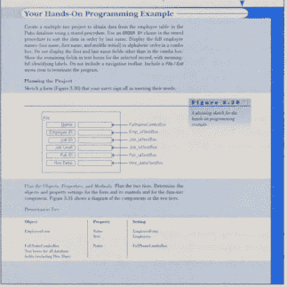

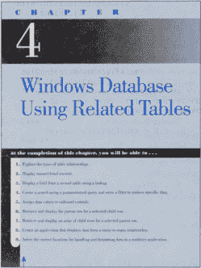

#### 学习目标

具体目标会告诉学生本章将涉及哪些内容，以及完成本章后能够做什么。

> **反馈 4.2**
>
> 1. 如果 Customers 和 Orders 之间存在关系，应如何创建 If 语句？假设项目包含两个名为 CustomersTableAdapter 和 OrdersTableAdapter 的 TableAdapter，以及一个名为 NorthwindDataSet 的 DataSet。
> 2. 如何查看两个表之间的关系？
> 3. 描述显示员工表时，从 jobs 表中显示职位描述而不是职位 ID 所需的步骤。

#### 反馈问题

反馈问题鼓励学生思考所学主题，并评估自己对相关细节的理解程度。

> **提示**
>
> 如果 Data Sources 窗口中没有出现下拉箭头，请确保设计器中显示着一个窗体。

#### 提示

全书各处页边空白处的提示可以帮助学生避免程序中潜在的问题，并鼓励他们养成良好的编程习惯。

### 案例研究

案例研究提供了贯穿全书主题的练习，可在整个课程中使用。

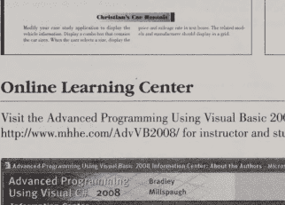

### 安全问题

凡涉及安全问题的内容，都会通过“安全问题”图标特别标出。

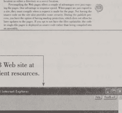

### 在线学习中心

请访问《使用 Visual Basic 2008 进行高级编程》的网站 http://www.mhhe.com/AdvVB2008/，获取教师和学生资源。

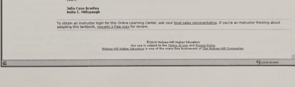

入门课程中的许多主题将在本书中进行更详细的讲解，并对学生提出更高要求。本书还介绍了许多其他高级主题，包括关系数据库的显示和更新、WCF 服务、数据结构、用户控件、帮助文件，以及 Windows 设备的移动应用程序开发；同时还扩展介绍了 Web 开发中的层叠样式表和 AJAX。

本版新增了 Visual Studio 中许多新功能的介绍，包括 LINQ、WPF 和 WCF。LINQ 和 WPF 都放在第 13 章“其他主题”中，因此可以在课程的任意阶段讲授。

Web 页面的布局采用首选方法：使用 `<div>` 表示各个区段，并使用样式完成所有格式设置。表格仅在 `<div>` 内部使用。

### 本版的主要修订和新增主题

除少量用于演示概念的程序外，所有程序都编写为多线程应用程序。WCF 服务安排在 Web 应用程序之前介绍，中间层组件则编写为服务。

本书介绍了 Visual Studio 2008 的新功能以及许多实用的现有功能，包括：

- Windows Presentation Foundation（WPF）。
- Windows Communication Foundation（WCF）。
- Language-Integrated Queries（LINQ）。
- 从数据库表创建 DataContext 对象，以便与 LINQ 配合使用。
- AJAX。
- 层叠样式表。
- 向 DataSet 对象添加验证代码。
- 使用本地数据库为 Windows 和 Web 应用程序创建 Crystal Reports。
- 部分类。
- 用于只应实例化一次的类的单例设计模式。
- 使用 TryParse 验证用户输入。
- ClickOnce 部署。
- 泛型和泛型集合。
- 母版页。
- SQL Server Express，它为开发和测试提供了本地数据库文件的优势。
- TableAdapter、BindingSource、TableAdapterManager（新增）和 BindingNavigator 对象。
- 表查找，用于从相关表填充组合框。
- 使用 BindingSource 的属性和方法筛选、导航和更新数据库表。
- 使用命名表关系。
- 在 Web 服务中使用相关表。
- 用于 Web 应用程序的 Login 控件。
- 使用 Web DataSource 对象和数据组件显示和更新数据：GridView、DetailsView 和 FormView。
- 内置 Web 服务器，使开发 Web 应用程序时无需运行 IIS。该功能还支持在 Windows XP 和 Vista 家庭版中进行开发，并且所有 Web 开发都无需管理员权限。
- 智能设备应用程序，包括新的设备模拟器。
- 使用 My.Application 更改区域性设置。
- 使用 BackgroundWorker 组件执行多个线程。

本书介绍的 Visual Studio IDE 新功能包括：

- 对象关系 O/R 设计器。
- XAML 分割窗口。
- TableAdapterManager。
- CSS Properties 窗口、Manage Styles 窗口和 Apply Styles 窗口。

### 章节组织

每章都以清晰明确的目标和简要概述开始。全书穿插大量代码示例以及带有指导的动手项目。发人深省的反馈问题为学生提供时间思考当前主题，并评估自己对细节的理解程度。每章末尾包括关键术语、章节复习、问题、编程练习和两个案例研究。案例研究提供了贯穿全书主题的练习，可在整个课程中使用。本章中的程序包含在学生网站上，学生可以测试和修改现有代码。当然，从头开始开发一个完整的应用程序，对于真正掌握编程技术同样十分重要。

第 1 章“Visual Studio 和 .NET Framework”讨论 Visual Studio IDE 和 .NET Framework 的功能。示例应用程序演示如何使用 My 对象显示 AssemblyInfo.vb 文件中的数据。本章还复习 MDI 项目、工具栏和状态栏。

第 2 章“使用类构建多层程序”复习面向对象术语、创建类以及实例化对象。本章介绍如何从业务服务层创建和引发异常，并演示 ErrorProvider 和 TryParse，以提高表示层验证的效率。

第 3 章“Windows 数据库应用程序”解释数据集、表、行和约束之间的关系。数据库应用程序使用 SQL Server 数据库，通过网格、组合框、标签和数据库显示控件显示信息。


### 教师资源

在线学习中心（OLC）可在 www.mhhe.com/AdvVB2008 获取，包含以下补充材料：

### 教师手册

- 每个章节都附带内置摘要的目标。
- 教学建议。
- 章末材料中复习问题的答案。
- 编程练习中涵盖的章节主题。

题库提供超过 500 道涵盖各章节关键术语和概念的问题。测试题以判断题和多选题形式出现。所有问题均提供了文本页码参考，包括难度等级评定。题库的计算机化版本 EZTest 也可使用。

PowerPoint 演示文稿由 Mesa Community College-Red Mountain 的 Brenda Nielsen 编写，遵循教师手册的大纲，为教师提供向课堂展示教材内容的资源。

文本插图可电子获取，用于演示、透明胶片或讲义。这些包括书中各处出现的全部插图、屏幕截图和表格。

学生和教师还可使用在线学习中心（OLC）。OLC 可在 www.mhhe.com/AdvVB2008 找到，为学生提供多种学习机会，包括额外的案例研究、自我测验和可下载的数据文件。教师也会发现 OLC 是一个有用的资源。

### 致谢

我们谨向为本书成功完成做出贡献的许多人表示感谢。最特别的是，我们感谢 Mt. San Antonio College 的学生，他们帮助测试了材料并极大地影响了手稿。

许多人付出了艰苦努力来设计和制作本书。我们要感谢我们的编辑 Liz Haefele、Scott Davidson 和 Alaina Grayson。我们还要感谢制作本书的许多人，包括 Marlena Pechan 和 Betsy Blumenthal。

我们非常感谢 John Blyzka、Peter van der Goes 和 Robert Price 进行了彻底的技术审阅、建设性批评和许多宝贵建议。最重要的是，我们感谢 Dennis 和 Richard 在漫长的工作日和繁忙的电话线路中给予的支持和理解。

### 给学生

欢迎使用 Visual Basic 2008 的令人兴奋的新功能。你可能已经了解到，学习编程的最佳方式是实际坐在电脑前编写代码、更改内容并再次测试。逐步浏览现有代码也是学习新技术的绝佳工具。基于此，我们已将各章节示例中的全部代码放在你的学生文本网站上。请随意加载程序、更改内容并再次测试。

但是……如果你真的想了解其工作原理，至关重要的是你要创建一个空白项目并自行尝试这些技术。如果遇到问题，请查看示例并比较属性和代码。本书中有多种工具可以帮助你入门。

- 每一章都以主题列表开始，以摘要结束。将两者结合起来即可对章节进行缩略回顾。理解术语是学习任何新语言的重要部分，编程语言也不例外。
- 每一章末尾都有关键术语列表。这些术语在章节中均以**粗体**显示。文本末尾还提供了一份词汇表，可供查阅术语定义。
- 在学习每一章的每个部分时，可通过反馈问题自我测试。章末的复习问题可检验你对主题的理解。
- 提示包含建议，用于在因已安装/未安装软件版本或设置而可能遇到问题的情况。
- 请务必查看附录，其中包含大量支持材料。

J.C.B.
A.C.M.

### 作者

我们很高兴教授和撰写关于 Visual Basic 的内容。我们希望这种感受在你阅读本书时显而易见，并且你会喜欢学习或教授这种出色的编程语言。

我们两人在 Mt. San Antonio College 教授初级和高级 Visual Basic 课程已有数年。我们还在中央俄克拉荷马大学的国家计算机教育者学院教授 Visual Basic。

Julia Bradley 在 Mt. San Antonio College 建立了教师计算中心，并在运营的第一年担任主任。Anita Millspaugh 多年来担任计算机信息系统系主任。

Julia Case Bradley
Anita C. Millspaugh

## 章节

## 1

## Visual Studio 与 .NET Framework

完成本章后，你将能够……

- 1. 区分 Visual Studio IDE 与 .NET Framework 的功能。
- 2. 识别并理解解决方案资源管理器中列出的每个文件的用途。
- 3. 理解编译时发生的情况。
- 4. 设置并显示应用程序的程序集属性中的数据。
- 5. 创建一个 MDI 项目，包含父窗体、子窗体、工具栏、状态栏、上下文菜单和工具提示。
- 6. 使用单例设计模式创建一个只能实例化一次的类。

微软通过引入 .NET Framework 和 Visual Studio（VS），彻底改变了 Windows 应用程序的编程方式，并在 Web 应用程序的开发中成为更重要的参与者。这些产品为 Visual Basic（VB）的程序开发带来了重大变革。.NET 不仅为语言带来了真正的面向对象特性，还在跨平台兼容性项目开发方面取得了巨大进步。

.NET 的两大主要部分是 Microsoft .NET Framework 和 Visual Studio 集成开发环境（IDE）。IDE 用于开发程序，而 Framework 用于运行程序。

## .NET Framework

.NET Framework 提供了一个平台，用于开发和运行用多种语言编写的应用程序以及 Windows Communication Foundation（WCF）服务。该框架由公共语言运行时、类库和 ASP.NET（活动服务器页面（ASP）的基于组件的版本）组成。

## 公共语言运行时

公共语言运行时（CLR）是一种管理代码执行的环境。它为以下任务提供服务：集成用不同语言开发的组件、跨语言处理错误、提供安全性，以及管理对象的存储和销毁。

任何编译后在 CLR 中运行的代码都称为托管代码。托管代码自动包含元数据，即描述数据的数据。公共语言运行时可移植可执行文件（PE）包含元数据和代码。元数据包括数据类型、成员、引用以及加载类和从类调用方法所需的信息。

CLR 还管理 .NET 应用程序使用的内存。不再使用的对象会由 CLR 的垃圾回收器组件自动从内存中移除。当你允许运行时处理对象的垃圾回收时，这些数据被称为托管数据。虽然你可以自己管理应用程序内存，但通常让运行时来处理更好、更安全。


你的代码可以与用其他编程语言编写的托管代码的类和方法集成。CLR 具有数据类型标准，允许你将类的一个实例传递给用不同语言创建的方法。虽然我们不会在本书中进行跨语言编程，但你应该了解这一强大功能。请注意，也可以集成非托管代码中创建的方法和组件，但要小心调用非托管代码（如 C++ 函数或 COM 组件），因为它们可能会给程序带来安全风险。

## 类库

所有 .NET 类和接口都存储在一个称为 .NET Framework 类库的库中。该库按部分或组组织，称为命名空间。你应该熟悉一些常见的命名空间。

有时也简称为 **IL**。MSIL 是一组与平台无关的指令，它与元数据组合形成一个称为*可移植可执行文件*（PE）的文件，扩展名为 .exe 或 .dll。当你的程序运行时，MSIL 仅在需要时由即时（JIT）编译器转换为特定机器的本机代码，JIT 编译器是 CLR 的一部分（图 1.1）。

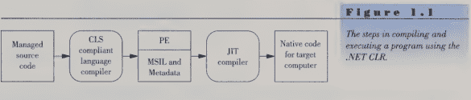

## 程序集

程序集是代码的基本单元，可以是单个 PE 文件或多个文件。你的每个应用程序都将包含在单个程序集中，这是最小的可部署代码单元。程序集具有**程序集清单**，其中包含有关版本的元数据、描述程序集所需的所有文件的表，以及指定所有所需外部文件（如其他人创建的 DLL）的“程序集引用列表”。程序集类似于用早期版本的 Visual Basic 编写的 .exe 或 .dll 文件——它包含运行应用程序或组件所需的所有必要信息。

回想一下，.NET Framework 类库不是一个大文件，而是文件的集合。类存储在扩展名为 .dll 的许多文件中，称为 DLL（动态链接库）。类库中的每个 DLL 都是一个程序集。当你的程序开始执行时，只有需要的程序集才会加载到内存中。当你想使用尚未引用的类型时，必须添加对 DLL（程序集）的引用。

## 特性

**特性**是包含程序部分（如类型或方法）信息的标记。系统定义了许多程序集特性，如名称、版本、区域性和安全性。特性是 .NET 程序集中元数据的一部分。检查程序集特性中元数据的过程称为*反射*。

在本章后面，你将学习检索和使用项目程序集信息中的自定义特性，这些信息存储在 AssemblyInfo.vb 文件中。

## 引用集合

**引用对象**用于将 Visual Basic 项目连接到外部组件。两种类型的引用对象是程序集和 COM 对象。对另一个项目的引用是程序集引用，称为*项目到项目引用*。COM 对象是用 .NET 之前的 VB 版本或其他不符合 CLS 的语言编写的组件。


# 设置 Option Explicit 和 Option Strict 默认值

最好为所有项目设置 Option Strict 默认值，而不是在每个项目中设置。选择选项对话框中的项目和解决方案 / VB 默认值，并打开 Option Explicit 和 Option Strict。

# 在 Windows 窗体上显示网格

Windows 窗体设计器包含吸附线，这是一个非常有用的功能，可以帮助您对齐控件。当控件边缘对齐时会出现蓝色吸附线；当控件文本基线对齐时会出现红色吸附线；当两个控件之间的距离为推荐距离时会出现虚线。Windows 窗体默认情况下不会显示可见网格，但您可以使网格点出现以匹配早期版本的 VB。在选项对话框的 Windows 窗体设计器部分，选择布局模式下的 SnapToGrid，并将 ShowGrid 设置为 True。但是在设置此选项之前，请务必尝试使用吸附线，它使窗体设计比旧的吸附到网格方法容易得多。

> TIP
> 现在将 Option Strict 的默认值设置为 On，这样以后就不必担心它了。

# 解决方案资源管理器

查看新 Windows 应用程序的解决方案资源管理器中的文件（图 1.4）。当您单击显示所有文件按钮时，您可以看到

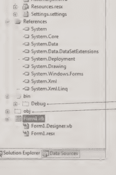

# 图 1.4

单击显示所有文件按钮以查看解决方案资源管理器中的所有文件和文件夹。

隐藏的文件和文件夹。My Project 文件夹保存了多个用于项目配置的文件，包括 AssemblyInfo.vb。您将学习如何在项目设计器中查看和设置配置选项，项目设计器将在本章后面的“项目设计器”部分讨论。

在图 1.4 中，您可以看到已展开的引用集合、bin 和 obj 文件夹，以及 Form1.vb 的窗体文件。您可以展开每个节点以查看更多详细信息。请注意，解决方案名称默认不显示。要显示解决方案名称，如图 1.4 所示，请选择工具 / 选项 / 项目和解决方案并选中始终显示解决方案。您希望始终显示解决方案，以便可以编辑解决方案名称。

# 引用

在引用文件夹中，您可以看到 System 库（DLL）的列表，例如 System、System.Deployment、System.Drawing 和 System.Windows.Forms。这些是为新的 Windows 应用程序默认包含的引用。您可以通过右键单击引用文件夹并从上下文菜单中选择添加引用来添加引用。您也可以在项目设计器中添加引用，稍后会讨论。您可能需要添加引用，如果您想引用另一个程序集中的对象或用不同语言编写的组件。

# Bin 和 Obj 文件夹

注意 bin 和 obj 文件夹的组织结构：

+   bin
+     Debug
+     Release
+   obj
+     Debug
+     Release

当您使用调试器编译并运行项目时，您正在运行存储在 bin/Debug 文件夹中的程序。调试版本的编译项目未针对发布进行优化。如果您为发布编译程序，编译版本将放在 Release 文件夹中。请注意图 1.5 中 bin/Debug 文件夹中的文件，该图显示了编译项目后解决方案资源管理器。

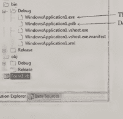

# 图 1.5

编译项目并单击刷新按钮后，bin/Debug 文件夹保存了在调试器中运行程序所需的文件。

项目的 .exe 文件是可执行文件，用于运行程序；.pdb 文件保存调试信息。如果您要分发应用程序，您只需分发 .exe 文件，而不需要 .pdb 文件。ProjectName.vshost.exe 文件是一个小型应用程序，用于在环境中运行项目。

# 项目资源

资源文件夹保存您添加到项目中的资源。图 1.6 显示了存储在资源文件夹中的图形文件；您还可以将声音文件和文本字符串添加到资源中。

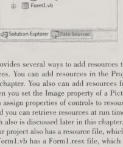

> 图 1.6
> 资源文件夹保存项目资源，例如图形和声音文件，以及文本字符串。

Visual Studio 提供了多种向文件夹添加资源以及访问这些资源的方法。您可以在本章后面讨论的项目设计器中添加资源。您也可以从属性窗口添加资源，例如当您设置 PictureBox 控件的 Image 属性时。在设计时，您可以将控件的属性分配给资源文件夹中的资源，并且您可以在运行时使用 My.Resources 对象检索资源，该对象也将在本章后面讨论。

项目中的每个窗体也有一个资源文件，其扩展名为 .resx。例如，Form1.vb 有一个 Form1.resx 文件，当您单击显示所有文件按钮并展开窗体的节点时，可以在解决方案资源管理器中看到它。

.resx 文件主要是 XML 格式的文本，您可以在 IDE 中打开并查看。 .resx 文件保存指向资源文件夹中文件的指针，并在编译时向窗体提供资源。您添加到窗体的任何图形元素，例如 PictureBox 的 Image 属性或窗体的 Icon 属性，也以表示二进制图形文件的文本形式存储在 .resx 文件中。

如果您在解决方案资源管理器中重命名窗体文件，.resx 文件将自动重命名以匹配。有时您可能会在项目文件夹中找到额外的 .resx 文件；如果其名称与项目中的任何窗体不匹配，您可以安全地删除任何额外的 .resx 文件。

# Visual Studio 2008 中的图像文件

Microsoft 随 Visual Studio 2008 提供了许多图形文件。这些图形是 Windows 中使用的图形，以便您可以使应用程序使用标准图像。默认位置为

# 项目设计器

项目设计器有时称为项目属性对话框。您可以通过在解决方案资源管理器中双击 My Project 文件夹或选择项目 / ProjectName 属性来打开项目设计器。项目设计器包含应用程序、编译、调试、引用、资源、服务、设置、签名、My 扩展、安全性和发布（图 1.8）选项卡。

通过在解决方案资源管理器中双击 My Project 文件夹显示项目设计器。

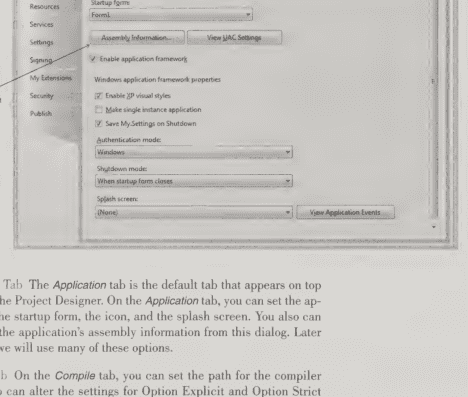

应用程序选项卡 应用程序选项卡是打开项目设计器时默认显示在顶部的选项卡。在应用程序选项卡上，您可以设置应用程序类型、启动窗体、图标和启动画面。您还可以从此对话框显示和设置应用程序的程序集信息。本章后面我们将使用其中许多选项。

编译选项卡 在编译选项卡上，您可以设置编译器输出的路径。您还可以更改 Option Explicit 和 Option Strict 的设置，并指定应由编译器标记哪些错误以及应忽略哪些错误。

引用选项卡 引用选项卡显示项目引用的名称和路径。您可以在此对话框中添加和删除对 Windows 或 Web 库组件以及外部组件的引用。

资源选项卡 资源选项卡允许您轻松添加和删除用于图片框和工具栏的图形文件、任何声音文件以及用于本地化的各种语言的文本字符串。

签名、安全性和发布选项卡 签名、安全性和发布选项卡上的设置用于 ClickOnce 部署。使用 ClickOnce 部署，您可以设置应用程序通过 Web 在多个站点上部署和更新。此技术主要由大型组织用于促进向许多用户部署应用程序。

# 部署 Windows 应用程序

本文的大部分内容都致力于使用 Visual Studio IDE 编写和测试应用程序。但是，一旦您测试应用程序并准备好使用，您将希望部署它并在另一台计算机上运行它。要运行 .NET Windows 应用程序，目标计算机必须安装 .NET Framework 或 .NET Framework 可再发行组件。可再发行文件可在 Microsoft 网站上免费下载，可用于 Windows XP 和 Vista。

您可以从以下几种方法中选择来部署 Windows 应用程序：（1）XCopy 部署，（2）Windows Installer 技术，（3）ClickOnce 部署，或（4）第三方安装程序产品。

XCopy 部署的名称源自旧的 DOS XCOPY 命令，该命令复制当前文件夹和所有子文件夹中的所有文件。虽然您可以使用 XCOPY 命令复制文件，但 XCopy 部署仅意味着您将必要的文件从开发机器复制到目标机器。

部署编译的 Windows 应用程序可能就像将 .exe 文件从 bin 文件夹复制到另一台计算机一样简单。这种技术并不十分稳健，但对于简单的安装可能是可行的。但是，部署 Web 应用程序稍微复杂一些，因为运行应用程序需要不止一个文件。

Microsoft Windows Installer 是随 Windows 一起提供的独立应用程序。安装程序创建包含应用程序和部署所需任何支持文件的 .msi 文件。部署在附录 C 中介绍。

# VB My 对象

Visual Basic My 对象提供了多个对象和属性。My 使您能够轻松访问有关应用程序及其资源的信息、应用程序正在执行的计算机以及当前用户。

使用 IntelliSense（图 1.9）很容易发现可用的对象：Application、Computer、Forms、Resources、Settings、User 和 Web Services。

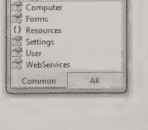

# 图 1.9

键入“My.”以在 IntelliSense 中查看可用的 My 对象。


你可以使用 My.Computer.Info 来检索有关用户计算机、操作系统和内存量的信息（图 1.10）。

如果你想知道用户名称，可以使用

```
UserNameString = My.User.Name
```

在下面的章节中，你将使用 My.Application 来检索应用程序的程序集信息。

## 图 1.10

使用 My.Computer.Info 来检索有关用户计算机的信息。

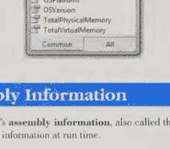

## 使用程序集信息

你可以设置应用程序的程序集信息，也称为程序集属性，并在运行时检索这些信息。

## 设置程序集信息

你可以在程序集信息对话框中查看和设置应用程序的程序集信息。在解决方案资源管理器中双击 My Project 以显示项目设计器的 Application 选项卡（参见图 1.8）；然后单击 Assembly Information 按钮，该按钮会显示对话框。图 1.11 显示了名为 WindowsApplication1 的应用程序的默认信息。

> TIP
> 创建新项目时，始终为其命名，这将设置根命名空间、程序集名称和项目名称。

## 图 1.11

程序集信息对话框，显示默认提供的值。你可以编辑条目以使用你选择的值。

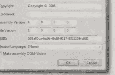

编写代码以在 Form_Load 事件过程中为标签分配值。代码使用 My.Application.Info 对象来检索属性。

```
Private Sub MainForm_Load(ByVal sender As System.Object, _
    ByVal e As System.EventArgs) Handles MyBase.Load
    ' Retrieve the assembly information.

    With My.Application.Info
        NameLabel.Text = .AssemblyName
        TitleLabel.Text = .Title
        DescriptionLabel.Text = .Description
        CompanyLabel.Text = .CompanyName
        ProductLabel.Text = .ProductName
        VersionLabel.Text = .Version.ToString
        CopyrightLabel.Text = .Copyright
    End With
End Sub
```

## 运行测试程序

运行程序。输出应类似于图 1.15。

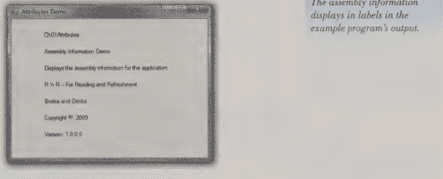

## 查看程序的属性

在你输入程序集信息并编译项目后，可以在 Windows 资源管理器中查看属性。将指针指向项目 bin\Debug 文件夹中的文件名，即 .exe 或 .dll 文件，然后暂停；属性会自动弹出（图 1.16）。

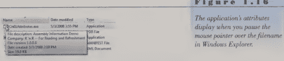

## 反馈 1.2

编写必要的语句以检索并在 CopyrightLabel 中显示版权属性。

## 菜单、工具栏和状态栏

要创建菜单、上下文菜单、工具栏和状态栏，请使用工具箱中 Menus & Toolbars 部分的组件（图 1.17）。组件为 MenuStrip、ContextMenuStrip、ToolStrip 和 StatusStrip。Visual Studio 还包括简化创建菜单、工具栏和状态栏的设计器。设计器很智能；它们为每个元素提供有意义的名称，这样你就不必重命名菜单项。你也可以使用控件的智能标记，这简化了属性设置。

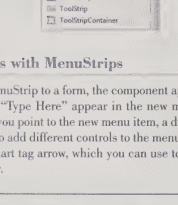

## 使用 MenuStrips 创建菜单

当你向窗体添加 MenuStrip 时，组件会出现在组件托盘中，并在新的菜单栏中出现“Type Here”字样。注意图 1.18 中，当你指向新的菜单项时，会出现一个下拉箭头，你可以使用它向菜单栏添加不同的控件。所选菜单栏还显示智能标记箭头，你可以使用它设置菜单栏的一些属性。


MenuStrip 和 ContextMenuStrip 组件允许你为每个菜单项选择控件或分隔条。展开菜单项的列表以查看选项（图 1.19）。你可以在菜单中轻松添加新项或分隔条。

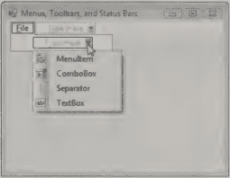

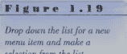

你可以使用 MenuStrip 的智能标记（图 1.20）设置菜单栏的一些属性。选择 Edit Items 以打开 Items Collection Editor（图 1.21），在其中可以设置菜单项的属性，并添加、删除和重新排列项。

当你使用可视菜单设计器创建菜单和菜单项时，每个项会自动获得有意义的名称。但如果你在 Items Collection Editor 中添加菜单项，则必须自己命名该项。

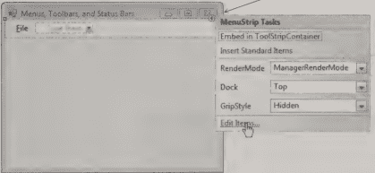

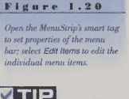

> TIP
> 打开智能标记箭头出现时的键盘快捷键是 Alt + Shift + F10。

## 菜单和菜单项

每个 MenuStrip 和 ContextMenuStrip 组件都是一个容器，包含一组菜单项。顶级菜单和菜单名称下方的项均被视为菜单项。菜单项还可以包含一组项。例如，File 菜单是一个菜单项，默认称为 FileToolStripMenuItem；FileToolStripMenuItem 包含出现在 File 菜单中的菜单项的集合，例如 ExitToolStripMenuItem。

参考图 1.21，注意在右上角，集合是 MenuStrip1，即 MenuStrip 本身。Members 列表中列出的项是顶级菜单。

## 在 Items Collection Editor 中，你可以添加和删除菜单项、重新排序项并设置项的属性。

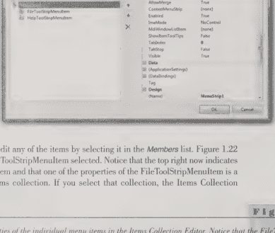

你可以通过在 Members 列表中选择它来编辑任何项。图 1.22 显示了 FileToolStripMenuItem 被选中。注意现在右上角指示所选项，并且 FileToolStripMenuItem 的属性之一是 DropDownItems 集合。如果你选择该集合，Items Collection Editor 就会出现。

## 在 Items Collection Editor 中编辑各个菜单项的属性。注意 FileToolStripMenuItem 有一个 DropDownItems 属性，它是出现在 File 菜单下方的菜单项的集合。


编辑器显示 File 菜单下方的项。另请注意图 1.22 中，Items Collection Editor 的右侧类似于 IDE 中的属性窗口。你可以单击按钮以按字母顺序或分类视图显示属性。

## 使用 ContextMenuStrips 创建上下文菜单

上下文菜单是你通过指向某项并右键单击来显示的快捷菜单。你应计划应用程序为用户可能想要执行的所有操作都包含上下文菜单。

你几乎以创建菜单相同的方式创建上下文菜单。向窗体添加 ContextMenuStrip 并使用可视菜单设计器添加菜单项（图 1.23）。


ContextMenuStrip 组件出现在组件托盘中。选中时，可视菜单设计器会出现以允许你输入菜单项。

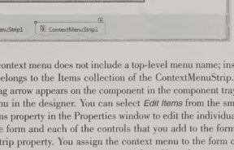

上下文菜单不包含顶级菜单名称；相反，每个项都属于 ContextMenuStrip 的 Items 集合。注意智能标记箭头出现在组件托盘中的组件上，而不是出现在设计器中的菜单上。你可以从智能标记中选择 Edit Items 或在属性窗口中选择 Items 属性来编辑各个菜单项。

窗体和你添加到窗体的每个控件都有一个 ContextMenuStrip 属性。你通过在属性窗口中选择其名称来将上下文菜单分配给窗体或控件。注意你可以向组件托盘添加多个上下文菜单并将每个菜单分配给不同的控件。

为每个 ToolStripButton 设置 Name、Image 和 ToolTipText 属性。

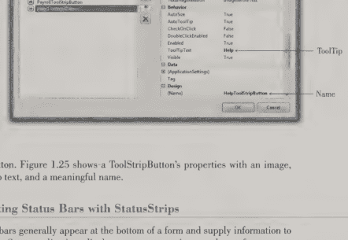

按钮。图 1.25 显示了 ToolStripButton 的属性，其中包含图像、ToolTip 文本和有意义的名称。

## 使用 StatusStrips 创建状态栏

状态栏通常出现在窗体的底部并向用户提供信息。一些应用程序在状态栏中显示错误消息；通常状态栏保存系统日期和时间。

VB 使用 StatusStrip 组件创建状态栏。StatusStrip 组件与 MenuStrips 和 ContextMenuStrips 一样，继承自 ToolStrips 并共享许多相同的特性。图 1.26 显示了可以添加到 StatusStrip 的控件。

要在状态栏上显示文本，请向 StatusStrip 添加 StatusLabel。你希望为 StatusLabel 对象提供有意义的名称，因为你将在代码中引用这些标签。你可以通过将 StatusStrip 的 RightToLeft 属性设置为 Yes 或 No 来控制标签出现在状态栏的右侧还是左侧。默认情况下，该属性设置为 No，标签出现在状态栏的左侧。你还可以将 StatusLabel 设置为出现在状态栏的左侧并填充状态栏，即使 RightToLeft 设置为 Yes 且某些标签出现在右侧：设置 StatusLabel 的 Spring 属性为 true。

你可以在 Form_Load 事件处理程序中在状态标签中显示日期和时间。

```
Private Sub MenuForm_Load(ByVal sender As System.Object, _
ByVal e As System.EventArgs) Handles MyBase.Load
' Set the date and time in the status bar.

DateToolStripStatusLabel.Text = Today.ToShortDateString
TimeToolStripStatusLabel.Text = Now.ToLongTimeString
End Sub
```


# 图 1.26

从列表中下拉以向 StatusStrip 添加控件。

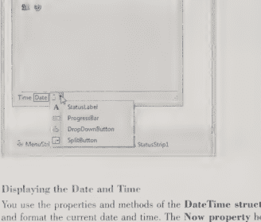

## 显示日期和时间

你使用 DateTime 结构的属性和方法来检索和格式化当前日期和时间。Now 属性以可用于计算的数字格式保存系统日期和时间。你可以使用以下方法之一来格式化日期和/或时间以供显示：ToShortDateString、ToLongDateString、ToShortTimeString 或 ToLongTimeString。每个方法的实际显示格式取决于本地系统设置。

你可以在任何过程中设置 StatusStripLabels 的显示值；但是，显示不会自动更新。通常，你将在 Form_Load 事件过程中设置初始值，并使用 Timer 组件来更新时间。

## 使用 Timer 组件

要使用 Timer 组件，你将组件添加到窗体，设置一些属性，并在 Timer 的 Tick 事件处理程序中编写代码。从工具箱的 Components 部分添加 Timer 组件。然后在 Properties 窗口中，将 Enabled 属性设置为 true 并设置 Interval 属性。Interval 以毫秒为单位测量；将 Interval 设置为 1000 可使 Timer 的 Tick 事件每秒触发一次。

```
Private Sub Timer1_Tick(ByVal sender As System.Object, _
    ByVal e As System.EventArgs) Handles Timer1.Tick
    ' Update the time in the status bar.

    DateToolStripStatusLabel.Text = Today.ToShortDateString
    TimeToolStripStatusLabel.Text = Now.ToLongTimeString
End Sub
```

## 创建 MDI 项目

你可以使任何窗体成为父窗体。事实上，一个窗体可以同时是父窗体和子窗体（正如一个人可以同时是父母和子女一样）。要将窗体设为父窗体，只需在设计器的 Properties 窗口中将其 `IsMdiContainer` 属性更改为 `true`。在一个项目中，你可以有多个子窗体和多个父窗体。

创建子窗体几乎一样简单。当然，你的项目必须包含不止一个窗体。你在运行时通过代码将窗体设为子窗口。在向父窗体显示子窗体之前，将子窗体的 `MdiParent` 属性设置为当前（父）窗体。

```
Private Sub DisplayChildTwoMenuItem_Click(ByVal sender As System.Object, _
    ByVal e As System.EventArgs) Handles DisplayChildTwoMenuItem.Click
    Display Child Two form.

    Dim AChildTwoForm As New ChildTwoForm
    AChildTwoForm.MdiParent = Me
    AChildTwoForm.Show()
End Sub
```

我们的示例应用程序允许用户显示多个子窗口。因此，每个子窗口的标题栏应该是唯一的。我们可以通过在显示窗体之前在标题栏附加一个数字来实现。这很像 Microsoft Word，其文档为 Document 1、Document 2 等等。

```
' Module-level declarations
Private ChildTwoCounter As Integer

Private Sub DisplayChildTwoMenuItem_Click(ByVal sender As System.Object, _
    ByVal e As System.EventArgs) Handles DisplayChildTwoMenuItem.Click
    ' Display Child Two form.

    Dim AChildTwoForm As New ChildTwoForm
    ChildTwoCounter += 1
    With AChildTwoForm
        .MdiParent = Me
        .Text = "Child Two Document " & ChildTwoCounter.ToString()
        .Show()
    End With
End Sub
```

## 添加 Window 菜单

父窗体应具有 *Window* 菜单（图 1.28）。*Window* 菜单列出打开的子窗口并允许用户在窗口之间切换。

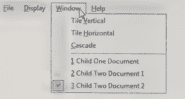

> **图 1.28**
> 
> *MDI 应用程序中的 Window 菜单列出打开的子窗口并允许用户选择窗口的排列方式。*

并排列多个子窗口。看看 Word 或 Excel 等应用程序中的 *Window* 菜单。你会看到打开文档的列表以及排列窗口的选项。通常，两个组之间会用分隔条分隔。

要将菜单项指定为 Window 菜单，选择 MenuStrip 组件。在 Properties 窗口中，将 MDIWindowListItem 属性设置为所需的菜单项；通常是 WindowToolStripMenuItem（图 1.29）。

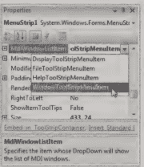

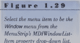

从 MenuStrip 的 MDIWindowListItem 属性下拉列表中选择要作为 Window 菜单的菜单项。

## 布局选项

当打开多个子窗口时，窗口可以按几种不同的布局排列：垂直平铺、水平平铺或层叠。你通过使用 *LayoutMdi* 方法的参数以代码设置布局类型。

```
Me.LayoutMdi(MdiLayout.TileHorizontal)
```

你可以使用三个常量之一：TileHorizontal、TileVertical 和 Cascade。

```
Private Sub TileVerticalToolStripMenuItem_Click(ByVal sender _
    As System.Object, ByVal e As System.EventArgs) _
    Handles TileVerticalToolStripMenuItem.Click
        ' Display open windows tiled vertically.

        Me.LayoutMdi(MdiLayout.TileVertical)
End Sub

Private Sub TileHorizontalToolStripMenuItem_Click(ByVal sender As Object, _
    ByVal e As System.EventArgs) Handles TileHorizontalToolStripMenuItem.Click
        ' Display open windows tiled horizontally.

        Me.LayoutMdi(MdiLayout.TileHorizontal)
End Sub

Private Sub CascadeToolStripMenuItem_Click(ByVal sender As Object, _
    ByVal e As System.EventArgs) Handles CascadeToolStripMenuItem.Click
        ' Cascade open windows.

        Me.LayoutMdi(MdiLayout.Cascade)
End Sub
```

## 单例设计模式

在某些应用程序中，例如文字处理器，你可能允许用户打开同一类型的多个子窗口。在其他应用程序中，你只想允许特定类型的一个子窗口。例如，如果你的应用程序有一个 Summary 窗口，用户可以通过选择菜单项来显示它，他或她可能会多次选择该选项。如果你只想允许一个窗体的单个实例，你需要编写代码来实现这一点。

尽管有几种技术可以防止类的多个实例，OOP 推荐的技术是称为单例模式的设计模式。

你可能在想，“什么是设计模式？”基本上，它是解决特定问题的设计逻辑。我们不必每次需要解决一个问题时都重新发明轮子。经验丰富的程序员已经开发并发布了其他程序员可以使用的设计模式和实践。有时我们称之为增加你的程序员“技巧包”。

你可以在 www.codeguru.com/columns/VB/article.php/c6563/ 上找到一篇关于设计模式和单例设计模式的好文章。

要创建单例模式，你在子窗体中定义一个属性，该属性返回类的实例。声明一个共享私有变量来保存类的实例。第一次实例化对象时，实例被分配给变量；在那之前，变量为“Is Nothing”。

*注意：* 如果你不熟悉创建新属性，请参阅第 2 章中的“Creating Properties in a Class”。

```
‘Project:        Ch01MDIApplication
‘Programmer:     EmilyMillsapaugh
‘Date:           June 2009
‘Form:           ChildOneForm
‘Description:    Demonstrates the singleton design pattern to allow only one
                instance of the form.

Public Class ChildOneForm

    Private Shared AnInstance As ChildOneForm

    Public Shared ReadOnly Property Instance() As ChildOneForm
        Get
            If AnInstance Is Nothing Then
                AnInstance = New ChildOneForm
            End If
            Return AnInstance
        End Get
    End Property
End Class
```

单例类还必须在窗体的 Form-Closing 事件处理程序中释放实例。

```
Private Sub ChildOneForm_FormClosing(ByVal sender as Object, ByVal e As System.Windows.Forms.FormClosingEventArgs) Handles Me.FormClosing
' Delete the object when the form is closed.

AnInstance = Nothing
End Sub
```

当你想显示作为单例创建的窗体时，你引用窗体的 Instance 属性而不是使用 New 关键字。

```
Dim AChildOneForm As ChildOneForm = ChildOneForm.Instance()
```

要显示窗体，请在 Focus 方法之前使用 Show 方法。

```
Private Sub ChildOneToolStripMenuItem_Click(ByVal sender As System.Object, ByVal e As System.EventArgs) Handles ChildOneToolStripMenuItem.Click, ChildOneToolStripButton.Click, ChildOneToolStripMenuItem1.Click
' Create an instance of Child One.

Dim AChildOneForm As ChildOneForm = ChildOneForm.Instance()
With AChildOneForm
.MdiParent = Me
.Show()
.Focus()
End With
End Sub
```

在学生光盘上的 Ch01MDIApplication 项目中，ChildOneForm 遵循单例模式，但 ChildTwoForm 不遵循。注意你可以创建 ChildTwoForm 的多个副本，但只能有一个 ChildOneForm。

## 反馈 1.4

编写语句以将 AboutForm 显示为子窗体。

## 闪屏窗体

程序加载时通常会显示一个初始屏幕。此初始窗体称为闪屏。专业应用程序使用闪屏告诉用户程序正在加载和启动。它可以使大型应用程序看起来加载和运行更快，因为在应用程序其余部分加载时屏幕上会出现一些内容。即使我们的程序相对较小且加载速度很快，闪屏也会增添专业感。你可以设置窗体属性并向标准 Windows 窗体添加图像和标签，或使用 Splash Screen 模板。

## 创建你自己的闪屏


| 属性 | 设置 | 说明 |
|---|---|---|
| 名称 | SplashForm | 将文件命名为 SplashForm.vb，并将类命名为 SplashForm。 |
| ControlBox | False | 隐藏关闭按钮和 Control 菜单图标；隐藏标题栏时需要此设置。 |
| FormBorderStyle | FixedDialog | 选择不可调整大小的样式；也可以选择 FixedSingle 或 Fixed3D。 |
| StartPosition | CenterScreen | 将启动画面窗体置于屏幕中央。 |
| Text | （空白） | 隐藏标题栏时需要此设置。 |
| TopMost | True | 在启动画面窗体关闭前，使其始终显示在主窗体上方。 |

## 设置启动画面

创建启动画面窗体后，在解决方案资源管理器中双击 My Project，打开项目设计器。将启动画面设置为你创建的启动画面窗体（图 1.30）。

图 1.30

在项目设计器中选择启动画面窗体。

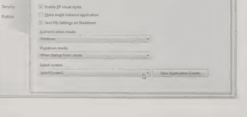

## 延长启动画面的显示时间

启动画面应显示足够长的时间，以便应用程序的其余部分完成加载。但我们的应用程序都很小，启动画面往往在用户还没来得及读完时就消失了。你可以使用线程编写代码，让启动画面显示更长时间。线程允许多个进程同时执行。在窗体的 FormClosing 事件处理程序中使用 Thread.Sleep 方法。FormClosing 事件会在窗体实际关闭前触发。

```
Private Sub SplashScreen1_FormClosing(ByVal sender As Object, _
    ByVal As System.Windows.Forms.FormClosingEventArgs) _
    Handles Me.FormClosing
        'Hold the form on the screen approximately 5 seconds before closing.

        System.Threading.Thread.Sleep(5000) 'Sleep 5000 milliseconds.
End Sub
```

*注意：*第 13 章将进一步介绍线程。

## 使用启动画面模板

你可以使用启动画面模板来创建启动画面。选择向项目添加新的 Windows 窗体时，可以在“添加新项”对话框中看到该模板。你需要清除窗体上的默认图片，或者添加自己的图片。图片通过 MainLayoutPanel 的 BackgroundImage 属性设置。要清除图片，请选择该属性并单击属性的“生成器”按钮（带省略号的按钮）。在“选择资源”对话框中，你可以选择“清除”，也可以从项目资源中选择图片，或者将新图片导入资源中以供使用。

模板中的标签已设置为显示程序集信息中的属性。你可以保留或删除这些标签、修改其属性，也可以添加自己的标签。

请务必查看代码以获取编程建议。此外，还要在 FormClosing 事件处理程序中添加代码，使窗体在屏幕上停留一段时间。

## 关于框窗体

你可以添加一个标准 Windows 窗体并创建自己的关于框，也可以使用“关于框”模板。模板窗体包含标签和代码，可在窗体上显示项目程序集信息的属性。当然，你可以根据需要随意修改标签和代码。

“关于框”窗体上的图片显示在 PictureBox 的 Image 属性中。你可以清除图片，也可以添加自己的图片。

## 类图

Visual Studio 提供了一种创建类图的工具，可帮助你直观地查看项目中的类。请注意，Visual Basic Express Edition 不提供类图设计器。

### 创建类图

要为整个项目创建类图，请在解决方案资源管理器中选择项目名称，然后单击窗口顶部的“查看类图”按钮。类图将生成并显示在主文档窗口中（图 1.31）。如果在解决方案资源管理器中选中了某个类，类图中就只会显示该类。你也可以在“添加新项”对话框中添加类图，该对话框可从“项目”/“添加新项”菜单项打开。

在解决方案资源管理器中选择项目名称，然后单击“查看类图”按钮，即可创建或查看类图。Express Edition 中不提供此功能。

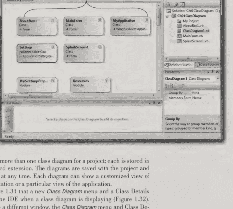

一个项目可以创建多个类图；每个类图都存储在自己的 .cd 文件中。类图会与项目一同保存，可随时重新显示。每个类图都可以展示整个应用程序的自定义视图，也可以展示应用程序的特定视图。

请注意图 1.31：当类图显示时，IDE 中会出现新的“类图”菜单和“类详细信息”工具栏（图 1.32）。切换到其他窗口时，“类图”菜单和“类详细信息”窗口会消失。类图显示时，工具栏也会提供用于处理类图的工具。

### 自定义类图

默认类图会显示你创建的类的许多类型形状，以及许多自动生成的类型。去掉这些额外的类型形状，可能更有助于你直观地了解应用程序的组织结构。你可以单击任意形状并按 Delete 键，这会从图中移除该形状，但不会从项目中删除类。你也可以移动和调整形状的大小。

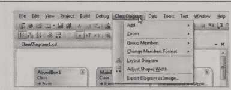

> **图 1.32**
>
> 在主文档窗口中显示类图时，会出现“类图”菜单。注意，其中有许多用于编辑和显示类图的选项。这些选项大多也可通过快捷菜单和工具栏使用。

查看图 1.31 时，请注意每个形状右上角朝下的 V 形箭头。这个箭头称为展开按钮（朝上时称为折叠按钮）。单击展开按钮可展开形状中的各个分区；也可以选择一个形状，然后从“类图”菜单中选择“展开”。

类型形状中的每个条目都称为一个分区。显示哪些分区，取决于所选的类型和分组方式。你可以通过菜单、快捷菜单，或分区名称旁边的加号或减号，分别展开或折叠各个分区。

隐藏部分成员可以让类图更清晰。在类图显示时会自动出现的“类详细信息”窗口中，勾选不想显示的成员对应的“隐藏”框（图 1.33）。你也可以在类型形状中单击成员，右键单击，然后从快捷菜单中选择“隐藏”。使用 Shift + 单击或

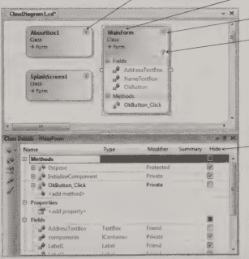

> **图 1.33**
>
> 在“类详细信息”窗口中隐藏部分成员，只查看你想要查看的内容。勾选“隐藏”框，或右键单击成员名称并从快捷菜单中选择“隐藏”。将鼠标悬停在筛选器图标上，可弹出隐藏对象列表。

Ctrl + 单击可以选择多个成员。请注意图 1.33 中 MainForm 顶部的小筛选器图标；该图标表示有些成员已被隐藏。

“类详细信息”窗口也便于导航。你可以指向任意成员，右键单击并从快捷菜单中选择“查看代码”，即可在代码中显示该成员的定义。

## 动手编程示例

为 R 'n R（阅读与休闲）编写一个 MDI 项目。该项目应包含五个窗体：主窗体、“关于”窗体、工资单窗体、汇总窗体和启动画面窗体。工资单窗体和汇总窗体应只允许创建一个实例，并且只显示“关闭”按钮。你将在第 2 章为工资单窗体和汇总窗体编写代码。

“关于”窗体应显示程序集属性中的公司名称和版权信息。

你可以使用“启动画面”和“关于框”模板，也可以自行创建启动画面窗体和“关于”窗体。

### 主窗体菜单

- 文件
- 退出
- 查看
- 工资单
- 汇总
- 窗口
- 垂直平铺
- 水平平铺
- 层叠
- 帮助
- 关于

添加一个工具栏，并在其中放置用于显示各窗体的按钮：工资单、汇总和关于。每个按钮都应显示相应的工具提示。此外，还应允许用户通过快捷菜单显示任意窗体。

在状态栏中显示当前日期和时间。

## 规划项目

绘制该应用程序的五个窗体草图（图 1.34）。开始编程前，必须先让用户签字确认这些草图符合他们的需求。

# 图 1.34

绘制 R 'n R 工资单项目的窗体草图；a. 主窗体（父窗体）；b. 工资单窗体；c. 汇总窗体；d. 关于窗体；e. 启动画面窗体。


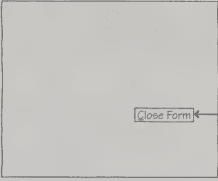

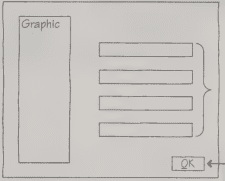

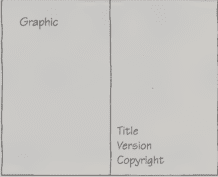

放置对象、属性和方法。确定表单和控件的对象及其属性设置。图 1.35 显示了程序类的图表。

## MainForm

| Object | Property | Setting |
|---|---|---|
| MainForm | Text | R ’n R for Reading and Refreshment |
| MainForm | IsMdiContainer | True |
| MainForm | ContextMenuStrip | ContextMenuStrip |
| MenuStrip | MdiWindowListItem | WindowToolStripMenuItem |
| FileToolStripMenuItem | Text | &File |
| ExitToolStripMenuItem | Text | E&xit |
| ViewToolStripMenuItem | Text | &View |
| PayrollToolStripMenuItem | Text | &Payroll Form |
| SummaryToolStripMenuItem | Text | &Summary |
| WindowToolStripMenuItem | Text | &Window |

动手编程示例的类图。

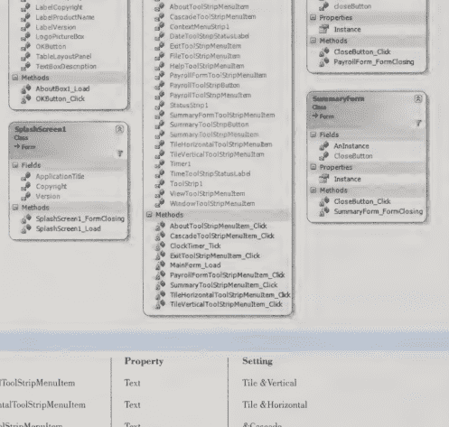

| Object | Property | Setting |
|---|---|---|
| TileVerticalToolStripMenuItem | Text | Tile & Vertical |
| TileHorizontalToolStripMenuItem | Text | Tile & Horizontal |
| CascadeToolStripMenuItem | Text | &Cascade |
| HelpToolStripMenuItem | Text | &Help |
| AboutToolStripMenuItem | Text | &About |
| ToolStrip1 | Items collection | Payroll
Summary
Help |
| StatusStrip1 | Items collection | Add 2 labels for the date and time |
| ContextMenu | Items collection | Payroll
Summary
Help |

| Procedure | Actions—Pseudocode |
|---|---|
| MainForm_Load | Retrieve the date and time for the StatusStrip. |
| ExitToolStripMenuItem_Click | Close the form. |
| AboutToolStripMenuItem_Click | Show the AboutBox form. |
| PayrollFormToolStripMenuItem_Click | Create an instance of the Payroll form.
Set the MdiParent property.
Show the form. |
| SummaryToolStripMenuItem_Click | Create an instance of the Summary form.
Set the MdiParent property.
Show the form. |

## PayrollForm

| Object | Property | Setting |
|---|---|---|
| PayrollForm | Text | Payroll |
| CloseButton | Text | &Close Form |

| Procedure | Actions—Pseudocode |
|---|---|
| CloseButton_Click | Close the form. |

| Property |  |
|---|---|
| Instance | Read Only
If an instance does not exist
Create a new instance. |

## Summary Form

| Object | Property | Setting |
|---|---|---|
| SummaryForm | Text | Payroll Summary |
| CloseButton | Text | &Close Form |

| Procedure | Actions—Pseudocode |
|---|---|
| CloseButton_Click | Close the form. |

| Property |  |
|---|---|
| Instance | Read Only
If an instance does not exist
Create a new instance. |

## AboutBox

| Object | Property | Setting |
|---|---|---|
| AboutBox1 | FormBorderStyle | FixedDialog |
| Labels to display information about the company and application. |  |  |
| OKButton | Text | &OK |

| Procedure | Actions—Pseudocode |
|---|---|
| AboutBox_Load | Retrieve the attributes and set up the labels. (Code already in template file.) |
| OKButton_Click | Close the form. |

**Splash Screen** Include a graphic and labels identifying the company and application. You can use the Splash Screen template and replace the graphic. Add code to hold the form on the screen for a few seconds.

**Assembly Information** Modify the assembly information:

| Property | Setting |
|---|---|
| Title | Payroll Application |
| Company | R 'n R for Reading and Refreshment |
| Product | Books and Drinks |
| Copyright | Copyright © 2009 |

**Write the Project** Following the sketches in Figure 1.34, create the forms. Figure 1.36 shows the completed forms.

- Set the properties of each of the objects, as you have planned. Don’t forget to set the tab order on all forms.
- Write the code for the forms. Working from the pseudocode, write each procedure.
- Modify the assembly information in the Project Designer to hold the company attributes.
- When you complete the code, test each of the options. Make sure that all menu items work, the context menus work, and ToolTips appear for each button.

## Figure 1.36

R 'n R Payroll 项目的表单；a. 主表单（父表单）；b. 薪资表单；c. 汇总表单；d. 关于对话框；e. 启动画面。


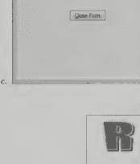

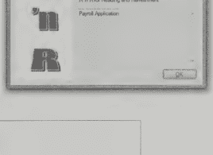

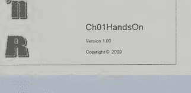

## The Project Coding Solution

## Main Form

'Program:      Ch01HandsOn
'Programmer:   Bradley/Millspaugh
'Form:         MainForm
'Date:         June 2009
'Description:  MDI parent form; contains the menu and displays
'              the various forms.

```
Public Class MainForm

Private Sub MainForm_Load(ByVal sender As System.Object, _
ByVal e As System.EventArgs) Handles MyBase.Load
' Display the date in the status bar.

DateToolStripStatusLabel.Text = Now.ToShortDateString
TimeToolStripStatusLabel.Text = Now.ToLongTimeString
End Sub
```

```
Private Sub TileVerticalToolStripMenuItem_Click(
ByVal sender As System.Object, ByVal e As System.EventArgs) _
Handles TileVerticalToolStripMenuItem.Click
' Display the open windows tiled vertically.

Me.LayoutMdi(MdiLayout.TileVertical)
End Sub
```

```
Private Sub TileHorizontalToolStripMenuItem_Click(
ByVal sender As Object, ByVal e As System.EventArgs) _
Handles TileHorizontalToolStripMenuItem.Click
' Display the open windows tiled horizontally.

Me.LayoutMdi(MdiLayout.TileHorizontal)
End Sub
```

```
Private Sub CascadeToolStripMenuItem_Click(ByVal sender As Object, _
ByVal e As System.EventArgs) Handles CascadeToolStripMenuItem.Click
' Cascade the open windows

Me.LayoutMdi(MdiLayout.Cascade)
End Sub
```

```
Private Sub PayrollFormToolStripMenuItem_Click(
ByVal sender As System.Object, ByVal e As System.EventArgs) _
Handles PayrollFormToolStripMenuItem.Click, PayrollToolStripButton.Click
' Create an instance of the payroll form.
Dim APayrollForm As PayrollForm = PayrollForm.Instance

With APayrollForm
.MdiParent = Me
.Show()
.Focus()
End With
End Sub
```

```
Private Sub SummaryToolStripMenuItem_Click(ByVal sender As System.Object, _
ByVal e As System.EventArgs)
Handles SummaryToolStripMenuItem.Click, SummaryToolStripButton.Click, _
SummaryFormToolStripMenuItem.Click
' Create an instance of the summary form.
Dim ASummaryForm As SummaryForm = SummaryForm.Instance

With ASummaryForm
    .MdiParent = Me
    .Show()
    .Focus()
End With
End Sub

Private Sub ExitToolStripMenuItem_Click(ByVal sender As System.Object, _
ByVal e As System.EventArgs) Handles ExitToolStripMenuItem.Click
' Terminate the program.
' Closing the startup form ends the program.
Me.Close()
End Sub

Private Sub AboutToolStripMenuItem_Click(ByVal sender As System.Object, _
ByVal e As System.EventArgs) _
Handles AboutToolStripMenuItem.Click, AboutToolStripButton.Click
' Display the About Box form with attribute information.

Dim AnAboutBox As New AboutBox1
AnAboutBox.ShowDialog()
End Sub

Private Sub ClockTimer_Tick(ByVal sender As System.Object, _
ByVal e As System.EventArgs) Handles Timer1.Tick
' Update the date and time on the status bar.
' Interval = 1000 milliseconds (one second).

DateToolStripStatusLabel.Text = Now.ToShortDateString()
TimeToolStripStatusLabel.Text = Now.ToLongTimeString()
End Sub
End Class
```

## Payroll Form

'Program: Ch01HandsOn
'Programmer: Bradley/Millspaugh
'Form: PayrollForm
'Date: June 2009
'Description: The Payroll form for the MDI application.
' Uses the singleton design pattern to ensure that only one
' instance of the form can be created.
' Note: This form will be used for calculations in
' Chapter 2.

```
Public Class PayrollForm
Private Shared AnInstance As PayrollForm
```

```
```vb
Public Shared ReadOnly Property Instance() As PayrollForm
    Get
        If AnInstance Is Nothing Then
            AnInstance = New PayrollForm
        End If
        Return AnInstance
    End Get
End Property

Private Sub CloseButton_Click(ByVal sender As System.Object, _
    ByVal e As System.EventArgs) Handles closeButton.Click
    ' Close the form.

    Me.Close()
End Sub

Private Sub PayrollForm_FormClosing(ByVal sender As Object, _
    ByVal e As System.Windows.Forms.FormClosingEventArgs) _
    Handles Me.FormClosing
    ' Release the instance of this form.

    AnInstance = Nothing
End Sub
End Class
```
```

## Summary Form

```
```vb
'Program:       Ch01HandsOn
'Programmer:    Bradley/Millspaugh
'Form:          SummaryForm
'Date:          June 2009
'Description:   Summary form for an MDI application.
'               Uses the singleton design pattern to ensure that only one
'               instance of the form can be created.
'               Note: This form will be used to display the result of
'               calculations in Chapter 2.

Public Class SummaryForm
    Private Shared AnInstance As SummaryForm

    Public Shared ReadOnly Property Instance() As SummaryForm
        Get
            If AnInstance Is Nothing Then
                AnInstance = New SummaryForm
            End If
            Return AnInstance
        End Get
    End Property

    Private Sub CloseButton_Click(ByVal sender As System.Object, _
        ByVal e As System.EventArgs) Handles CloseButton.Click
        ' Close the form.

        Me.Close()
    End Sub
```


## AboutBox

如果使用 AboutBox 模板，则完全不需要编写任何代码。

## SplashScreen

如果使用 Splash Screen 模板，请添加一个事件处理程序，使窗体在屏幕上停留几秒钟。

```vb
Private Sub SplashScreen1_FormClosing(ByVal sender As Object, _
    ByVal e As System.Windows.Forms.FormClosingEventArgs) _
    Handles Me.FormClosing
        ' Hold the form on the screen for about 5 seconds before closing.

        System.Threading.Thread.Sleep(5000)
End Sub
```

## Summary

- 1. .NET Framework 包含类库、公共语言运行时和 ASP.NET。
- 2. 受管代码编译后在公共语言运行时（CLR）中运行。
- 3. 可移植可执行文件（PE）包含中间语言（受管代码）和元数据。
- 4. 元数据存储有关运行时的方法、类和类型的信息。
- 5. .NET Framework 由存储在类库中的一组类组成。类被组织成命名空间的层次结构。
- 6. CLR 对值类型和引用类型进行不同处理。每个值类型变量的值存储在变量的内存位置中，并且始终会被初始化。引用类型变量保存对实际对象的指针，如果未分配则可能等于 Nothing。
- 7. 编译器生成 MSIL（Microsoft 中间语言），这是一组平台无关的指令。
- 8. 程序集是代码最小的可部署单元，包含一个或多个 .exe 或 .dll 文件以及描述程序集的清单。
- 9. AssemblyInfo.vb 文件保存属性，这些属性是包含有关程序集信息的标记。
- 10. Reference 对象将 Visual Basic 连接到外部组件，即程序集或 COM 对象。
- 11. Web 开发使用 ASP.NET 进行。
- 12. Visual Studio（VS）集成开发环境（IDE）用于开发和调试项目。IDE 的两个有用的功能是临时项目，无需保存，以及配置文件，可根据特定类型的开发人员自定义 IDE。本书使用 VB 开发配置文件。
- 13. 选项对话框可用于为所有项目设置 Option Explicit 和 Option Strict 的默认值、默认项目文件位置以及窗体设计器中的网格。
- 14. My Project 文件夹在解决方案资源管理器中显示，保存配置文件，包括 AssemblyInfo.vb。您可以双击 My Project 以显示新的项目设计器。
- 15. 编译后的程序成为项目 bin\Debug 文件夹中的 .exe 或 .dll 文件。.resx 文件保存窗体的资源的 XML 表示，包括任何图形。
- 16. VS IDE 使用 partial classes 功能将窗体类存储在两个单独的文件中。程序员编写的代码与设计器编写的代码位于不同的文件中。
- 17. 项目设计器可用于为项目设置许多选项，包括 AssemblyInfo.vb 中的程序集信息和项目资源。
- 18. 您可以通过将 .exe 文件复制到另一个位置来部署 Windows 应用程序。
- 19. My 功能包括多个对象，提供对应用程序、资源、用户和用户计算机的访问。
- 20. 您可以在程序集信息对话框中修改应用程序的程序集信息属性，或直接编辑 AssemblyInfo.vb 文件。要在运行时检索属性，请使用 My.Application.Info 对象。
- 21. 工具栏和状态栏提高了用户操作的便捷性。菜单使用 MenuStrip 和 ContextMenuStrip 组件创建，工具栏使用 ToolStrip 创建，状态栏使用 StatusStrip 创建。
- 22. 窗体和每个控件都有 ContextMenuStrip 属性，您可以将其设置为创建的上下文菜单。文本控件具有用于文本编辑的自动上下文菜单。
- 23. 事件处理程序可以通过将事件添加到 Handles 子句来响应多个控件的事件。使用此技术可对菜单项、上下文菜单项和工具栏按钮使用相同的事件处理程序。
- 24. 要在状态栏中显示日期和/或时间，请使用 DateTime 结构的 Now 属性。通常，日期和时间在 Form_Load 事件处理程序中以及 Timer 组件的 Tick 事件处理程序中设置，以便时间保持最新。
- 25. 使用多个窗体时，窗体可以是单文档界面（SDI）或多文档界面（MDI）。MDI 应用程序具有父窗体和子窗体。要创建父窗体，请将窗体的 IsMdiContainer 属性设置为 true。子窗体必须在代码中设置，将窗体的 MdiParent 属性设置为父窗体。
- 26. MDI 应用程序通常具有 Window 菜单，显示打开的子窗口以及排列子窗口的选项。通过在父窗体上的 MenuStrip 设置 MDIWindowListItem 属性来指定 Window 菜单。
- 27. 单例设计模式用于确保只能创建类的一个实例。
- 28. 启动画面在应用程序加载时显示。您可以通过设置标准 Windows 窗体的属性或使用 Splash Screen 模板创建启动画面。在项目设计器中设置启动画面。
- 29. 在启动画面的 FormClosing 事件处理程序中使用 Thread 对象的 Sleep 方法，使窗体在屏幕上停留足够长的时间以供用户阅读。
- 30. VS IDE 可以自动生成类图，显示应用程序中类的视觉表示。您有许多选项可以在类图中展开、折叠、重新排列、显示和隐藏元素。

## Key Terms

- Active Server Pages（ASP） 6
- assembly 5
- assembly information 14
- assembly manifest 5
- attributes 5
- child form 25
- class diagram 31
- common language runtime（CLR） 2
- Common Language Specification（CLS） 3
- ContextMenuStrip component 18
- DateTime structure 24
- design pattern 28
- IsMdiContainer property 26
- LayoutMdi method 27
- managed code 2
- managed data 2
- MdiParent property 26
- MenuStrip component 18
- metadata 2
- Microsoft intermediate language（MSIL） 4
- multiple document interface（MDI） 25
- My 13
- .NET Framework 2
- .NET Framework class library 2
- Now property 24
- parent form 25
- partial class 11
- partial type 11
- Project Designer 12
- reference object 5
- reference type 3
- single document interface（SDI） 25
- singleton pattern 28
- splash screen 29
- StatusStrip component 18
- thread 31
- Timer component 24
- ToolStrip component 18
- value type 3

## Review Questions

- 1. 区分 .NET Framework 和 Visual Studio。
- 2. 解释以下内容
  - a. CLR
  - b. CLS
  - c. PE
  - d. MSIL
  - e. ASP.NET
- 3. 解释公共语言运行时与受管代码之间的关系。
- 4. 编译为中间语言的目的是什么？
- 5. 值类型和引用类型有什么区别？
- 6. 什么是程序集？程序集包含什么？
- 7. 什么是属性？举三个例子。
- 8. 什么是 ASP.NET 及其用途？
- 9. 您可以在哪里找到项目的编译版本？在同一位置可能还会找到什么？
- 10. 什么是项目设计器？如何显示它？如何使用它？
- 11. 如何部署 Windows 应用程序？
- 12. 什么是 VB My 功能？请至少列出 My 的一个用途。
- 13. 解释如何在运行时将 AssemblyInfo.vb 中的属性显示在窗体上。
- 14. VS 为创建菜单、上下文菜单、工具栏和状态栏提供了哪些组件？
- 15. 描述使当前时间出现在状态栏所需的步骤。
- 16. 什么是 MDI 应用程序？单个 MDI 应用程序中可以有多少个父窗体？
- 17. 什么是设计模式？
- 18. 单例模式是如何实现的？
- 19. 解释如何创建启动画面，如何在应用程序加载时显示它，以及如何使其在屏幕上停留几秒钟。
- 20. 什么是类图？如何使用 VS IDE 创建和自定义类图？

## Programming Exercises

> 注意：如果您更喜欢编写 Windows Presentation Foundation（WPF）应用程序而不是 Windows 应用程序，请参阅第 13 章中的“Windows Presentation Foundation（WPF）”。

- 1.1 创建一个 Windows 应用程序，显示来自程序集信息属性的公司、标题和版权信息。确保修改程序集信息。


## 案例研究

## Claytor's Cottages

1.2 为 Tricia's Travels 创建一个多窗体项目，包含启动画面、主窗体、特价窗体、摘要窗体和关于窗体。在特价窗体上，显示梦幻度假的特价；为周末、一次邮轮和一周的行程包含你选择的目的地。主窗体将有一个菜单，包含以下内容：

File Exit
Travels Specials Summary
Help About

为 Claytor's Cottages 创建一个项目，这是一个小型床位和早餐店。使用带菜单、上下文菜单、工具栏和状态栏的 MDI 窗体。

关于窗体不应是子窗体。使用 My 对象显示描述、标题、版本号和版权属性。

包含有关你的程序信息的启动画面。

为每个选项创建子窗体（Guests、Rooms 和 Reservations），这些子窗体仅具有指示窗体用途的标题栏文本以及返回主窗体的关闭按钮。

注意：这些窗体将在后续章节中修改。

Menus
File Exit
Edit Guests Rooms Reservations
Window Tile Horizontal Tile Vertical Cascade
Help About

设置菜单，使打开的子窗体显示在 Window 菜单上。

Toolbar
包含三个按钮以打开每个子窗体。在每个按钮上放置 ToolTips。

- Guests
- Rooms
- Reservations

Status Bar
在状态栏右侧包含日期和一天中的时间。在左侧留一个面板用于文本消息。

提示：添加三个标签并将第一个标签的 Spring 属性设置为 true。

Context Menu
在父窗体上创建一个上下文菜单，其中包含显示 Guests、Rooms 和 Reservations 窗体的选项。

Standards

- 遵循所有变量、对象和过程的命名标准。
- 菜单项和控件必须具有键盘访问权限。适当时使用标准选择。
- 将父窗体的 Icon 属性设置为合适的图标。

注意：当应用程序最小化时，父窗体图标会显示在任务栏中。

## Christian's Car Rentals

为 Christian's Car Rentals 创建一个项目。该项目应包含带菜单、上下文菜单、工具栏和状态栏的 MDI 主窗体。关于窗体应为子窗体并至少包含你的姓名和日期。使用 My 对象显示描述、标题、版本号和版权属性。

包含有关你的程序信息的启动画面。为每个选项创建子窗体（Customers、Vehicles 和 Rentals），这些子窗体仅具有指示窗体用途的标题栏文本以及返回主窗体的关闭按钮。注意：这些窗体将在后续章节中修改。

### Menu

File
Edit
Window
Help
Exit
Customers
Vehicles
Rentals
Tile Horizontal
Tile Vertical
Cascade
About

为所有菜单选项包含键盘快捷键，适当时遵循标准。设置菜单，使打开的子窗体显示在 Window 菜单上。

### Context Menu

在父窗体上创建一个上下文菜单，其中包含显示 Customers、Vehicles 和 Rentals 窗体的选项。

### Toolbar

在工具栏上放置三个按钮，一个用于显示每个子窗体。为每个按钮使用你想要的任何图标并包含 ToolTips。

Customers
Vehicles
Rentals

### Standards

- 遵循所有变量、对象和过程的命名标准。
- 菜单项和控件必须具有键盘访问权限。适当时使用标准选择。
- 将父窗体的 Icon 属性设置为合适的图标。

注意：当应用程序最小化时，父窗体图标会显示在任务栏中。

### Status Bar

在状态栏右端包含日期和一天中的时间。在左端留一个标签用于文本消息。

提示：添加三个标签并将第一个标签的 Spring 属性设置为 true。

## CHAPTER
2

## Building Multitier
Programs with
Classes

完成本章后，你将能够 ...

- 1. 讨论面向对象术语。
- 2. 创建自己的类并基于该类实例化对象。
- 3. 基于现有类创建新类。
- 4. 将应用程序划分为多个层。
- 5. 抛出和捕获异常。
- 6. 为变量选择适当的范围。
- 7. 使用 TryParse 验证用户输入并使用 ErrorProvider 组件显示消息。

在你的编程生涯的这个阶段，你应该对使用对象、方法和属性感到自如。你已经学习了编程的大部分基础知识，包括决策、循环和数组。你现在必须开始以适合较大生产项目的风格编写程序。

大多数编程任务都是团队完成的。许多开发人员可能在代码的不同部分工作，并且所有代码必须协同工作。面向对象编程（OOP）的一个关键概念是使用构建块。你现在将把程序分解为块或，使用正确的术语，类。

本章回顾面向对象编程的概念和技术，用于将程序分解为多个层和多个类。根据你在第一门课程中花费在 OOP 上的时间，你可能会发现本章的大部分内容是复习。

## Object Oriented Programming

Visual Basic 是一种面向对象的语言，所有编程都使用 OOP 方法。你使用过对象，但可能被屏蔽了创建对象的繁琐细节。在 VB 中，你会发现你所做的一切都基于类。每个窗体都是一个类，在使用之前必须实例化。甚至基本数据类型变量也是对象，具有属性和方法。

### OOP Terminology

面向对象编程的关键特性是抽象、封装、继承和多态。

#### Abstraction

抽象意味着为对象创建一个模型，以便确定对象的特征（属性）和行为（方法）。例如，Customer 类是对真实客户的抽象表示，而 Product 类是对真实产品的抽象版本。你在规划面向对象程序时需要使用抽象，以确定你需要的类以及必要的属性和方法。考虑对象通用性是有帮助的；也就是说，典型产品的特征是什么，而不是特定产品。

#### Encapsulation

**封装**指的是对象的特征与其行为的组合。你有一个“包”，其中包含所有属性、方法和事件的定义。

封装使得数据隐藏成为可能。每个对象都将其数据（属性）和过程（方法）隐藏起来。通过使用 Public 和 Private 关键字，对象可以“公开”它希望外部世界看到的数据元素和过程。

你可以通过查看任何 Windows 程序来见证封装。窗体实际上是一个类。你编写的所有方法和事件都包含在 Class 和 End Class 语句内。你在代码中放置的变量实际上是该特定窗体类的属性。

### Inheritance

**继承**是从现有类创建新类的能力。你可以在不修改原始版本的情况下对现有类进行增强。通过创建继承自现有类的新类，你可以添加或更改类变量和方法。例如，你创建的每个窗体都继承自或派生自现有的 Form 类。原始类被称为**基类**、**超类**或**父类**。继承的类称为**子类**、**派生类**或**子代类**。当然，一个新类可以继承自子类——该子类也成为超类和子类。

你可以在窗体的 designer.vb 文件中看到窗体的继承关系。在解决方案资源管理器中显示所有文件，展开窗体的文件并打开窗体的 designer.vb 文件。仔细查看第一行代码：

```
Partial Public Class MainForm
Inherits System.Windows.Forms.Form
```

继承类应始终与其基类具有“is a”关系。在窗体示例中，新的 MainForm “is a” Form（图 2.1）。你可以创建一个继承自 Person 类的新 Customer 类；客户“is a”人。但你不应创建一个继承自 Person 的 SalesOrder 类；销售订单*不是*一个人。

继承的真正目的是**可重用性**。当你有另一个类似的情况时，你可能需要重用或获得一个类的功能。你创建的新 MainForm 类具有基类 System.Windows.Forms.Form 的所有特征和动作。从那里你可以添加你自己的新窗体的功能。

你可以创建自己的类层次结构。你将希望通用的代码放在基类中。然后你创建其他类，即派生类或子类，它们可以调用共享函数。如果你在两个类中有相似的功能，这个概念非常有帮助。不要编写两个几乎相同的类，你可以创建一个包含相似过程的基类。

有时你专门创建一个类以用作派生类的基类。你可以专门用于继承创建一个类；此类称为**抽象类**，并在类头中使用 MustInherit 声明。

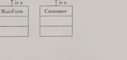

**Figure 2.1**
派生或继承类与其基类具有“is a”关系。


不能从抽象类实例化对象，只能从中继承新类。基类中的某些方法甚至不包含任何代码，而是作为占位符存在，强制任何派生类都要具有指定名称的方法。派生类中与基类方法同名的方法被称为重写基类中的方法。重写允许继承类执行与基类中同名方法不同的操作。

重用类的一个例子可以是Person类，其中你可能具有姓名、地址和电话号码等属性。Person类可以作为基类，从中派生Employee类、Customer类或Student类（图2.2）。派生类可以调用基类中的过程，并包含任何派生类特有的额外过程。在继承中，类通常从一般到具体。你可以向继承的类添加功能。你也可以通过重写基类的方法来更改功能。

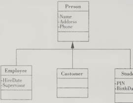

## 多态

术语*多态*实际上是指采取多种形态或形式的能力。应用于OOP时，多态指同名方法根据情况具有不同实现。例如，单选按钮、复选框和列表框各有一个Select方法。在每种情况下，Select方法都针对其类适当地操作。

当派生类重写其基类的方法时，两个方法具有相同的签名（名称加参数列表）。但在每种情况下，执行的操作都适合该类。例如，Person类可能有一个Print方法，打印带有姓名和地址信息的地址标签。但Employee类的Print方法重写了Person类的Print方法，可能在屏幕上显示员工信息，包括雇佣日期和主管姓名。

多态还允许一个类拥有多个同名但参数列表不同的方法。这种方法被称为*重载*。当调用重载方法时，参数类型决定使用哪个版本的方法。每个同名方法执行任务的方式与其他方法略有不同。

## 可重用对象

面向对象编程相对于传统编程的一大优势是重用对象的能力。当你通过编写类模块创建新类时，你可以将该类用于多个项目。你从类创建的每个对象都有自己的一组属性。此过程就像你一直使用的内置VB控件一样工作。例如，你可以创建两个PictureBox对象：imageOnePictureBox和imageTwoPictureBox。每个对象都有自己的Visible属性和Image属性，并且对于每个对象可能设置不同。

构建块概念可以简化编程。考虑像Microsoft这样的大型公司，有许多不同的编程团队。可能一个团队开发Word产品，另一个团队负责Excel。当Word团队决定在表格中加入公式时发生了什么？你认为他们编写了所有新代码来处理公式吗？同样，Excel团队曾为工作表添加拼写检查。你认为他们必须重写拼写检查代码吗？显然，拥有一个可供任何应用程序使用的拼写检查对象和一个在需要的任何应用程序中处理公式的计算对象更有意义。

开发应用程序应该像用乐高积木构建物体。积木都能组合在一起，可以用来构建许多不同的东西。

## 多层应用程序

类的常见用途是创建多层（"tiers"）应用程序。多层应用程序的每个功能都可以编码在单独的组件中，这些组件可以存储在不同的机器上并运行。

最流行的方式之一是三层应用程序。该模型中的层是表示层（或用户界面层）、业务服务层和数据层（图2.3）。你可能还听说过“n层”应用程序，它是三层模型的扩展。中间层包含所有业务逻辑或业务规则，可以用多个类编写，这些类可以存储并从多个位置运行。

在多层应用程序中，目标是创建可以组合和替换的组件。如果应用程序的某一部分需要更改，例如用户界面的重新设计或新的数据库格式，则其他组件不需要替换。开发人员只需“插入”新的用户界面，然后继续使用应用程序的其余组件。

表示层指用户界面，在Windows应用程序中就是窗体。考虑一下，将来用户界面可能会完全重新设计，甚至转换为Web页面。

| 表示层 | 业务服务层 | 数据层 |
|---|---|---|
| 用户界面<br>窗体、控件、菜单 | 业务对象<br>验证<br>计算<br>业务逻辑<br>业务规则 | 数据检索<br>数据存储 |


**业务服务层**是操作数据的一个或多个类。该层可以包括用于执行业务规则的验证以及计算。如果验证和计算内置在窗体中，那么修改用户界面可能需要完全重写一个工作正常的应用程序。

**数据层**包括在数据库或其他数据存储中检索和存储数据。偶尔组织会决定更改数据库供应商，或者需要从多个不同来源检索数据。数据层检索数据并将结果传递给业务服务层，或者从业务服务层获取数据并将其写入适当的位置。

在当今环境中，程序员必须提前为可重用性做规划。你可能为Windows应用程序开发业务服务层。稍后公司可能决定通过Web或移动设备（如手机或掌上设备）交付应用程序。用户界面必须更改，但处理过程不应该更改。如果你使用执行业务逻辑的类来开发应用程序，你可以为一个界面开发应用程序，并轻松地将其移动到另一个平台。

## 反馈 2.1

- 1. 说出至少三种属于业务服务层的操作类型。
- 2. 尽可能列出你认为属于表示层的操作。

## 创建类

你可能在入门课程中学过创建类。现在是时候复习这些技术并更深入地探讨这些概念了。如果你已经熟悉创建新类、编写属性过程（包括只读属性）以及使用参数化构造函数，你可能想跳过接下来的几个部分，从“基础业务类”开始。

## 设计你自己的类

要设计自己的类，你需要分析对象所需的特征和行为。特征或属性定义为变量，行为（方法）是子过程或函数过程。

## 在类中创建属性

在类内部，你定义私有变量，这些变量包含类属性的值。理论上，你可以将所有变量声明为Public，以便所有其他类都可以设置和检索它们的值。然而，这种方法违反了封装规则，封装要求每个对象负责自己的数据。请记住，你使用封装来实现数据隐藏。为了实现封装，你将类中的所有变量声明为Private。作为私有变量，其值仅对类内的过程可用，就像窗体中的私有模块级变量仅对窗体类内的过程可用一样。

当你的程序从你的类创建对象时，你需要为属性赋值。因为属性是私有变量，你将


使用特殊的属性过程将值传递给类模块并从类模块返回值。

## 属性过程

类允许其属性被访问的方式是通过属性过程。属性过程可能包含一个 Get 用于检索属性值和/或一个 Set 用于为属性赋值。你为属性过程使用的名称将成为属性在外部世界中的名称。创建“友好”的属性名称，用来描述属性而不使用数据类型，例如 LastName 或 EmployeeNumber。

## 属性过程—通用形式

```
Private ClassVariable As DataType  ' Declared at the module level.

[Public] Property PropertyName() As DataType
    Get
        PropertyName = ClassVariable
        or
        Return ClassVariable
    End Get

    Set(ByVal Value As DataType)
        [Statements, such as validation]
        ClassVariable = Value
    End Set
End Property
```

Set 语句使用 Value 关键字来引用属性的传入值。属性过程默认为 public，因此你可以省略可选的 Public 关键字。Get 块在至少一点上与函数过程相似：在过程结束前，在 End Get 之前，你必须将返回值赋给过程名称或使用 Return 语句。Set 的传入值的的数据类型必须与对应 Get 的返回值的类型匹配。

## 属性过程—示例

```
Private LastNameString As String  ' Declared at the module level.

Public Property LastName() As String
    Get
        Return LastNameString
        ' Alternate version:
        ' LastName = LastNameString
    End Get

    Set(ByVal Value As String)
        LastNameString = Value
    End Set
End Property
```

记住，私有模块级变量保存属性的值。Property Get 和 Set 检索当前值并为属性赋新值。

## 只读和只写属性

在某些情况下，你可能希望设置一个只能由对象检索但不能更改的属性值。要创建只读属性，使用 **ReadOnly** 修饰符并仅编写属性过程的 Get 部分。安全建议是除非你的应用程序或类继承需要，否则不要包含 Set 过程。

```
Private PayDecimal As Decimal    ' Declared at the module level.

Public ReadOnly Property Pay() As Decimal    ' Make the property read-only.
    Get
        Return PayDecimal
    End Get
End Property
```

只写属性是可以设置但不能返回的属性。使用 **WriteOnly** 修饰符并仅编写属性过程的 Set 部分：

```
Private PasswordString As String    ' Declared at the module level.

Public WriteOnly Property Password() As String    ' Make it write-only.
    Set(ByVal Value As String)
        PasswordString = Value
    End Set
End Property
```

## 构造函数和析构函数

构造函数是在类被实例化时自动执行的方法。析构函数是在对象被销毁时自动执行的方法。在 VB 中，构造函数必须是名为 **New** 的过程。析构函数必须命名为 **Dispose** 并且必须重写基类的 Dispose 方法。你通常会为你的类编写构造函数，但通常不会编写析构函数。大多数情况下，基类的 Dispose 方法能很好地处理类的销毁。

你通过编写 Sub New 过程为类创建构造函数。构造函数在你实例化类的对象时自动执行。因为构造函数方法在类中任何其他代码之前执行，所以构造函数是进行任何初始化任务的理想位置，例如打开数据库连接。

Sub New 过程必须是 Public 或 Protected，因为你创建的对象必须执行此方法。记住默认是 Public。

```
Sub New()
    ' Constructor for class.

    ' Initialization statements.
End Sub
```

## 重载构造函数

回想一下，重载意味着两个方法具有相同的名称但参数列表不同（签名）。你可以通过为多个过程赋予相同的名称，每个过程具有不同的参数列表，在你的类中创建重载方法。以下示例显示了一个空构造函数（无参数）和一个将参数传递给类的构造函数。

```
' Constructors in the Payroll class.
Sub New()
    ' Constructor with empty argument list.
End Sub

Sub New(ByVal HoursInDecimal As Decimal, ByVal RateInDecimal As Decimal)
    ' Constructor that passes arguments.
    ' Assign incoming values to private variables.
    HoursDecimal = HoursInDecimal
    RateDecimal = RateInDecimal
End Sub
```

注意：不需要为参数包含 ByVal 修饰符，因为 ByVal 是默认值。如果省略它，编辑器会为参数添加 ByVal。

## 参数化构造函数

参数化构造函数是指需要参数的构造函数。这种流行技术允许你在创建新对象时传递参数/属性。在前面的示例中，Payroll 类需要两个十进制参数：小时数和费率。通过在 Try / Catch 块中实例化 Payroll 对象，你可以捕获任何缺失的输入值以及任何非数字输入。

```
' Code in the Form class to instantiate an object of the Payroll class.
Try
    Dim APayroll As New Payroll(
        Decimal.Parse(HoursTextBox.Text), Decimal.Parse(RateTextBox.Text))
Catch Err As Exception
    MessageBox.Show("Enter the hours and rate.", "Payroll")
End Try
```

## 为属性分配参数

作为 Payroll 参数化构造函数的进一步改进，我们将使用属性过程来分配初始属性值。在类模块内，使用 Me 关键字引用当前类。因此 Me.Hours 引用当前类的 Hours 属性。HoursInDecimal 引用类级变量。将传入参数分配给属性名称优于仅将传入参数分配给模块级属性变量，因为在 Property Set 过程中会执行验证。

```
' Improved constructor for the Payroll class.
Sub New(ByVal HoursInDecimal As Decimal, ByVal RateInDecimal As Decimal)
    ' Assign arguments to properties.
```

```
With Me
    .Hours = HoursInDecimal
    .Rate = RateInDecimal
End With
End Sub
```

当你的类同时具有空构造函数和参数化构造函数时，创建对象的程序可以选择使用哪种方法。

## 一个基本的业务类

以下示例在两个层中创建了一个非常简化的工资应用程序（图 2.4）。该应用程序没有数据层，因为它没有任何数据库元素。

| 表示层 | 业务服务层 |
|---|---|
| 用户界面 | 业务对象 |
| PayrollForm | Validation |
| Controls | Calculations |
| Menus | Business logic |
| | Business rules |


此工资应用程序的第一版本从用户输入小时数和费率，验证数字数据和一些业务规则，计算工资，并在表单上显示工资。我们必须分析哪些任务属于表示层，哪些任务属于业务服务层（图 2.5）。

## 表示层

表示层，也称为用户界面，必须处理与用户的所有通信。用户输入输入数据并单击计算按钮。计算结果和任何用户错误消息必须来自表示层。通常，数字输入的验证在表单中处理，但业务规则的验证在业务服务层中处理。

## 业务服务层

查看图 2.5，你可以看到应该放在业务服务层类的内容。类需要 Hours、Rate 和 的私有属性变量


```vb
' Property procedures.
Public Property Hours() As Decimal
    Get
        Return HoursDecimal
    End Get
    Set(ByVal Value As Decimal)
        If Value >= MINIMUM_HOURS_Decimal And _
           Value <= MAXIMUM_HOURS_Decimal Then
            HoursDecimal = Value
        Else
            Dim Ex As New ApplicationException(
                "Hours is outside of the acceptable range.")
            Ex.Source = "Hours"
            Throw Ex
        End If
    End Set
End Property

Public Property Rate() As Decimal
    Get
        Return RateDecimal
    End Get
    Set(ByVal Value As Decimal)
        If Value >= MINIMUM_WAGE_Decimal And _
           Value <= MAXIMUM_WAGE_Decimal Then
            RateDecimal = Value
        Else
            Throw New ApplicationException(
                "Pay rate is outside of the acceptable range.")
        End If
    End Set
End Property

Public ReadOnly Property Pay() As Decimal
    Get
        Return PayDecimal
    End Get
End Property
End Class
```

## 抛出和捕获异常

系统在发生错误时会抛出异常。你的程序可以捕获异常并采取某些操作，甚至忽略异常。你的类也可以抛出异常以指示发生了错误，这通常是将错误消息传回用户界面的最佳方式。你可以将可能导致异常的任何代码放在 Try / Catch 块中。

```vb
' Code in the form's class.
Try
    Dim APayroll As New Payroll(
        Decimal.Parse(HoursTextBox.Text), Decimal.Parse(RateTextBox.Text))
Catch Err As ApplicationException
    ' Display a message to the user.
    MessageBox.Show(Err.Message)
End Try
```

> 注：如果你不熟悉使用 Try / Catch 块的结构化异常处理，请参阅附录 B。

## 抛出什么异常？

.NET Framework 有多个可供使用的异常类，或者你可以创建自己的新异常类并继承自现有类之一。然而，系统定义的异常类可以处理几乎每一种类型的异常。

Microsoft 建议你在从应用程序代码抛出自己的异常时使用 System.ApplicationException 类。System.ApplicationException 具有与 System.Exception 类相同的属性和方法，后者是通用系统异常。CLR 生成的所有特定异常都继承自 System.Exception。

当你想抛出通用应用程序异常时，使用以下格式的 Throw 语句：

```
Throw New ApplicationException("Error message to display.")
```

你包含的消息将成为异常的 Message 属性，在捕获异常时可以显示该属性。

## 在异常中传递附加信息

ApplicationException 类的构造函数仅将错误消息作为参数。但该类还有可设置和检查的附加属性。例如，你可以设置 Source 属性和 Data 属性，后者可以保存键/值对集合。

在我们的 Payroll 类中，我们希望能够指出哪个字段出错，以便窗体中的代码可以设置焦点并选择出错字段中的文本。为此，我们将使用异常的 Source 属性。我们必须实例化一个新的异常对象，设置 Source 属性，然后抛出异常：

```
Public Property Hours() As Decimal
Get
    Return HoursDecimal
End Get
Set(ByVal Value As Decimal)
    If Value >= MINIMUM_HOURS_Decimal And _
       Value <= MAXIMUM_HOURS_Decimal Then
        HoursDecimal = Value
    Else
        Dim Ex As New ApplicationException(
            "Hours are outside of the acceptable range.")
        Ex.Source = "Hours"
        Throw Ex
    End If
End Set
End Property

Public Property Rate() As Decimal
Get
    Return RateDecimal
End Get
```

TryParse 方法将 ValueToParse 转换为指定数据类型表达式，返回 true，并将结果放入应在此语句之前声明的数值变量中。如果转换失败，数值变量将被设置为零并且方法返回布尔值 false。

## TryParse 方法——示例

```
Dim HoursDecimal As Decimal

Decimal.TryParse(HoursTextBox.Text, HoursDecimal)
If HoursDecimal > 0 Then
    ' Passed the conversion; perform calculations.
Else
    MessageBox.Show("Invalid data entered.")
End If

If Decimal.TryParse(HoursTextBox.Text, HoursDecimal Then
    ' HoursDecimal contains the converted value.
Else
    MessageBox.Show("Invalid data entered.")
End If
```

正如你所见，对于用户输入的数值验证，这种技术是优选的，因为它不会对非数值数据抛出异常。相反，错误输入数据由 Else 子句处理。

## 修改用户界面以进行字段级验证

你可以通过执行字段级验证来进一步改进工资应用程序的用户界面。此技术在用户移动到下一个控件之前，直接在窗体上、出错字段旁边显示消息。你可以使用 ErrorProvider 组件显示消息，而不是消息框，这是一种更现代的方法。你在每个文本框的 Validating 事件中对数值数据执行字段级验证。

## Validating 事件

当用户在文本框中输入数据并移动到另一个控件时，文本框的事件按以下顺序发生：

+   Enter
+   GotFocus
+   Leave
+   Validating
+   Validated
+   LostFocus

窗体上的每个控件都有一个默认设置为 true 的 CausesValidation 属性。当用户完成输入并按 Tab 或单击另一个控件时，刚刚离开的控件会发生 Validating 事件。也就是说，如果新控件的 CausesValidation 属性为 true，则事件会发生。你可以将大多数控件的 CausesValidation 属性保持为 true 以便进行验证。将 Cancel 或 Exit 等控件的 CausesValidation 设置为 false，以便用户在取消事务时绕过验证。**注意：** Validating 事件仅对接收焦点的控件发生；你可能还需要执行窗体级验证以确定用户完全跳过了某个字段。

Validating 事件处理程序是字段级验证的首选位置。以下是 Validating 事件处理程序的过程头：

```
Private Sub RateTextBox_Validating(ByVal sender As Object, _
    ByVal e As System.ComponentModel.CancelEventArgs) _
    Handles RateTextBox.Validating
```

**取消 Validating 事件** 你可以使用 Validating 事件处理程序的 CancelEventArgs 参数来取消 Validating 事件并将焦点返回到正在验证的控件。

```
e.Cancel = True
```

取消事件会将焦点返回到文本框，使文本框“粘住”。用户在输入通过验证之前不允许离开该控件。

请注意一点：如果你在窗体显示时接收焦点的字段上使用验证事件，并且验证需要输入，则用户在文本框中输入有效条目之前将无法关闭窗体。为了解决此问题，为窗体的 FormClosing 事件编写事件处理程序并设置 e.Cancel = False。

```
Private Sub PayrollForm_FormClosing(ByVal sender As Object, _
    ByVal e As System.Windows.Forms.FormClosingEventArgs) _
    Handles Me.FormClosing
    ' Do not allow validation to cancel the form’s closing.

    e.Cancel = False
End Sub
```

**控制 Validating 事件** 如果在不希望时生成 Validating 事件，你可能会遇到麻烦。例如，在输入值通过数值检查后，它可能违反业务规则，例如不在可接受的值范围内。为了向用户显示消息，你可能会执行出错文本框的 focus 方法。但 Focus 方法会触发最近离开的控件的 Validating 事件，这可能不是你想要的结果。你可以通过暂时关闭 CausesValidation 来抑制额外的 Validating 事件。你将在“修改后窗体的代码”部分在窗体的代码中看到此技术的使用。

```
With .RateTextBox
    .SelectAll()
    .CausesValidation = False
    .Focus()
    .CausesValidation = True
End With
```


## ErrorProvider 组件

使用 **ErrorProvider** 组件，您可以使错误指示器出现在出错字段旁边，而不是弹出消息框。通常您为窗体上的所有控件使用一个 ErrorProvider。您在设计时将 ErrorProvider 添加到窗体的组件托盘中，并在代码中设置其属性。如果输入数据值无效，ErrorProvider 组件可以在出错字段旁边显示一个闪烁的图标，并在弹出窗口中显示消息，类似于 ToolTip（图 2.6）。

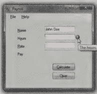

图 2.6

> ErrorProvider 在出错字段旁边显示闪烁的错误。当用户指向该图标时，其错误消息会出现在弹出窗口中。

### ErrorProvider SetError 方法—通用形式

您可以使用 ErrorProvider 的 SetError 方法打开闪烁的错误指示器和错误消息。

```
ErrorProviderObject.SetError(ControlName, MessageString)
```

### ErrorProvider SetError 方法—示例

```
ErrorProvider1.SetError(QuantityTextBox, "Quantity must be numeric.")
ErrorProvider1.SetError(CreditCardTextBox, "Required field.")
```

您可以在大多数程序中用 ErrorProvider 替换消息框，而无需更改程序的逻辑。

### 关闭错误指示器

错误被纠正后，您必须清除 ErrorProvider。使用 ErrorProvider 的 Clear 方法关闭错误指示器。

```
ErrorProvider1.Clear()
```

在按钮的 Click 事件处理程序中，最佳做法是在过程顶部清除 ErrorProvider，并在任何值验证失败的地方打开它。

```
Private Sub CalculateButton_Click(ByVal sender As System.Object, _
ByVal e As System.EventArgs) Handles CalculateButton.Click
    'Validate and perform calculations.
    Dim HoursDecimal As Decimal

    ' Check for valid input data.
    ErrorProvider1.Clear()
    If Decimal.TryParse(HoursTextBox.Text, HoursDecimal) Then
        ' Perform any calculations with good data.
    Else
        ' Hours did not pass validation.
        ErrorProvider1.SetError(HoursTextBox, _
            "The hours must be numeric.")
    End If
End Sub
```

在 Validating 事件处理程序中，最常见的技术是使用 If 语句打开或关闭 ErrorProvider。

```
Private Sub HoursTextBox_Validating(ByVal sender As Object, _
ByVal e As System.ComponentModel.CancelEventArgs) _
Handles HoursTextBox.Validating
    ' Test hours for numeric
    Dim HoursDecimal As Decimal

    If Decimal.TryParse(HoursTextBox.Text, HoursDecimal) Then
        ErrorProvider1.Clear()
    Else
        ErrorProvider1.SetError(HoursTextBox, _
            "The hours must be numeric.")
        HoursTextBox.SelectAll()
        e.Cancel = True
    End If
End Sub
```

### 修改后窗体的代码

以下是修改后窗体的代码，使用 TryParse 和在文本框的 Validating 事件处理程序中的字段级验证。

```
'Project:      Ch02PayrollApplication
'Module:        Payroll Form
'Programmer:    Bradley/Millspaugh
'Date:          June 2009
'Description:   User interface for payroll application.
'               Provides data entry and validates for nonnumeric data.

Public Class PayrollForm
    Private Sub CalculateButton_Click(ByVal sender As System.Object, _
    ByVal e As System.EventArgs) Handles CalculateButton.Click
        ' Create a Payroll object to connect to the business services tier.
        Dim HoursDecimal As Decimal
        Dim RateDecimal As Decimal

        ' Check for valid input data.
        ErrorProvider1.Clear()

If Decimal.TryParse(HoursTextBox.Text, HoursDecimal) Then
    If Decimal.TryParse(RateTextBox.Text, RateDecimal) Then
        ' Both values converted successfully.
        Try
            Dim APayroll As New Payroll(HoursDecimal, RateDecimal)
            PayTextBox.Text = APayroll.Pay.ToString('C')
        Catch Err As ApplicationException
            ' Catch exceptions from the Payroll class.
            Select Case Err.Source
                Case "Hours"
                    ErrorProvider1.SetError(HoursTextBox, _
                        Err.Message)
                    With HoursTextBox
                        .SelectAll()
                        .Focus()
                    End With
                Case "Rate"
                    ErrorProvider1.SetError(RateTextBox, _
                        Err.Message)
                    With RateTextBox
                        .SelectAll()
                        .Focus()
                    End With
            End Select
        End Try
    Else
        ' Rate did not pass validation.
        ErrorProvider1.SetError(RateTextBox, _
            "The rate must be numeric.")
    End If
Else
    ' Hours did not pass validation.
    ErrorProvider1.SetError(HoursTextBox, _
        "The hours must be numeric.")
End If
End Sub

Private Sub ClearButton_Click(ByVal sender As System.Object, _
ByVal e As System.EventArgs) Handles ClearButton.Click
    ' Clear the screen fields.
    ErrorProvider1.Clear()
    With NameTextBox
        .Clear()
        .Focus()
    End With
    HoursTextBox.Clear()
    RateTextBox.Clear()
    PayTextBox.Clear()
End Sub

Private Sub HoursTextBox_Validating(ByVal sender As Object, _
ByVal e As System.ComponentModel.CancelEventArgs) _
Handles HoursTextBox.Validating
    ' Test hours for numeric.
    Dim HoursDecimal As Decimal

If Decimal.TryParse(HoursTextBox.Text, HoursDecimal) Then
    ErrorProvider1.Clear()
Else
    ErrorProvider1.SetError(HoursTextBox, _
        "The hours must be numeric.")
    HoursTextBox.SelectAll()
    e.Cancel = True
End If
End Sub

Private Sub RateTextBox_Validating(ByVal sender As Object, _
ByVal e As System.ComponentModel.CancelEventArgs) _
Handles RateTextBox.Validating
    ' Test pay rate for numeric.
Dim RateDecimal As Decimal

If Decimal.TryParse(RateTextBox.Text, RateDecimal) Then
    ErrorProvider1.Clear()
Else
    ErrorProvider1.SetError(RateTextBox, _
        "The hours must be numeric.")
    RateTextBox.SelectAll()
    e.Cancel = True
End If
End Sub

Private Sub ExitToolStripMenuItem_Click(ByVal sender As System.Object, _
ByVal e As System.EventArgs) Handles ExitToolStripMenuItem.Click
' Close the program.

Me.Close()
End Sub

Private Sub AboutToolStripMenuItem_Click(ByVal sender As System.Object, _
ByVal e As System.EventArgs) Handles AboutToolStripMenuItem.Click
' Show the About box.

Dim AnAboutBox As New AboutBox1
AnAboutBox.ShowDialog()
End Sub

Private Sub PayrollForm_FormClosing(ByVal sender As Object, _
ByVal e As System.Windows.Forms.FormClosingEventArgs) _
Handles Me.FormClosing
' Do not allow validation to prevent the form closing.

e.Cancel = False
End Sub
End Class
```

### 修改业务类

随着业务规则的变化，您可以修改业务类或创建继承自原始类的新类。您通常可以在不损害使用该类的任何应用程序的情况下向现有类添加属性和方法，但如果有任何应用程序使用该类，则不应更改现有属性和方法的行为。

在我们的 Payroll 示例中，我们将扩展用户界面以显示摘要窗体。摘要窗体显示处理的员工数量、支付总额和加班小时数。我们必须修改 Payroll 类以计算这些值并在只读属性中返回这些值（图 2.7）。

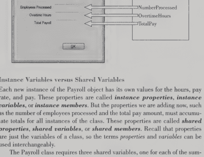

> 图 2.7 新的摘要窗体显示摘要信息。Payroll 类必须在共享属性中累积摘要数据。

### 实例变量与共享变量

Payroll 对象的每个新实例都有其自己的小时数、工资率和工资值。这些属性称为实例属性、实例变量或实例成员。但我们现在添加的属性，例如处理的员工数量和总支付金额，必须为类的所有实例累积总数。这些属性称为共享属性、共享变量或共享成员。请记住，属性只是类的变量，因此属性和变量这两个术语可以互换使用。

Payroll 类需要三个共享变量，每个摘要字段一个。随着 Payroll 类的每个实例的创建，值会在共享变量中累积。这样，第二个员工的值就会加到第一个员工的值上，依此类推。

```
' Payroll Class.
' Shared properties declared at the module level.

' Hold the NumberProcessed shared property.
Private Shared NumberEmployeesInteger As Integer
' Hold the TotalPay shared property.
Private Shared TotalPayDecimal As Decimal
' Hold the OvertimeHours shared property.
Private Shared TotalOvertimeHoursDecimal As Decimal
```

由于这些变量对类是 Private，因此需要公共 Get 方法使属性可访问。您可以通过使用类名（如 Payroll.NumberProcessed 或 Payroll.OvertimeHours）检索共享属性。这与您转换输入值时使用的概念相同：Decimal.Parse() 调用 Decimal 类的 Parse 方法。


# 使用 Visual Basic 2008 进行高级编程

```
Public Shared ReadOnly Property NumberProcessed() As Integer
    Get
        Return NumberEmployeesInteger
    End Get
End Property

Public Shared ReadOnly Property TotalPay() As Decimal
    Get
        Return TotalPayDecimal
    End Get
End Property

Public Shared ReadOnly Property OvertimeHours() As Decimal
    Get
        Return TotalOvertimeHoursDecimal
    End Get
End Property
```

FindPay 方法必须被修改以累加到汇总字段中：

```
' Payroll class.
' Additional module-level named constants.
Private Const REGULAR_HOURS_Decimal As Decimal = 40D
Private Const OVERTIME_RATE_Decimal As Decimal = 1.5D

Private Sub FindPay()
    ' Calculate the Pay.
    Dim OvertimeHoursDecimal As Decimal

    If HoursDecimal <= REGULAR_HOURS_Decimal Then      ' No overtime.
        PayDecimal = HoursDecimal * RateDecimal
        OvertimeHoursDecimal = 0D
    Else
        ' Overtime.
        OvertimeHoursDecimal = HoursDecimal - REGULAR_HOURS_Decimal
        PayDecimal = (REGULAR_HOURS_Decimal * RateDecimal) + _
            (OvertimeHoursDecimal * OVERTIME_RATE_Decimal * RateDecimal)
    End If
    TotalOvertimeHoursDecimal += OvertimeHoursDecimal
    TotalPayDecimal += PayDecimal
    NumberEmployeesInteger += 1
End Sub
```

以下是计算并返回共享属性的完整 Payroll 类：

```
'Project:       Ch02PayrollWithSummary
'Module:        Payroll Class
'Programmer:    Bradley/Millspaugh
'Date:          June 2009
'Description:   Business services tier for payroll calculation; validates input
               data and calculates the pay, with overtime, regular, and
               summary data.

Public Class Payroll

    ' Instance variables.
    Private HoursDecimal As Decimal      ' Hold the Hours property.
    Private RateDecimal As Decimal       ' Hold the Rate property.
    Private PayDecimal As Decimal        ' Hold the Pay property.
```

```
' Shared variables.
' Hold the NumberProcessed shared property.
Private Shared NumberEmployeesInteger As Integer
' Hold the TotalPay shared property.
Private Shared TotalPayDecimal As Decimal
' Hold the OvertimeHours shared property.
Private Shared TotalOvertimeHoursDecimal As Decimal

' Constants.
Private Const MINIMUM_WAGE_Decimal As Decimal = 6.25D
Private Const MAXIMUM_WAGE_Decimal As Decimal = 50D
Private Const MINIMUM_HOURS_Decimal As Decimal = 0D
Private Const MAXIMUM_HOURS_Decimal As Decimal = 60D
Private Const REGULAR_HOURS_Decimal As Decimal = 40D
Private Const OVERTIME_RATE_Decimal As Decimal = 1.5D

' Constructor.
Sub New(ByVal HoursInDecimal As Decimal, ByVal RateInDecimal As Decimal)
' Assign properties and calculate the pay.

Me.Hours = HoursInDecimal
Me.Rate = RateInDecimal
FindPay()
End Sub

Private Sub FindPay()
' Calculate the pay.
Dim OvertimeHoursDecimal As Decimal

If HoursDecimal <= REGULAR_HOURS_Decimal Then ' No overtime.
PayDecimal = HoursDecimal * RateDecimal
OvertimeHoursDecimal = 0D
Else ' Overtime.
OvertimeHoursDecimal = HoursDecimal - REGULAR_HOURS_Decimal
PayDecimal = (REGULAR_HOURS_Decimal * RateDecimal) + (OvertimeHoursDecimal * OVERTIME_RATE_Decimal * RateDecimal)
End If
TotalOvertimeHoursDecimal += OvertimeHoursDecimal
TotalPayDecimal += PayDecimal
NumberEmployeesInteger += 1
End Sub

' Property procedures.
Public Property Hours() As Decimal
Get
Return HoursDecimal
End Get
Set(ByVal Value As Decimal)
If Value >= MINIMUM_HOURS_Decimal And Value <= MAXIMUM_HOURS_Decimal Then HoursDecimal = Value
Else
Dim Ex As New ApplicationException(
"Hours are outside of the acceptable range.")
Ex.Source = "Hours"
Throw Ex
End If
End Set
End Property
```

```
```vb
Public Property Rate() As Decimal
    Get
        Return RateDecimal
    End Get
    Set(ByVal Value As Decimal)
        If Value >= MINIMUM_WAGE_Decimal And _
           Value <= MAXIMUM_WAGE_Decimal Then
            RateDecimal = Value
        Else
            Dim Ex As New ApplicationException(
                "Pay rate is outside of the acceptable range.")
            Ex.Source = "Rate"
            Throw Ex
        End If
    End Set
End Property

Public ReadOnly Property Pay() As Decimal
    Get
        Return PayDecimal
    End Get
End Property

Public Shared ReadOnly Property NumberProcessed() As Decimal
    Get
        Return NumberEmployeesInteger
    End Get
End Property

Public Shared ReadOnly Property TotalPay() As Decimal
    Get
        Return TotalPayDecimal
    End Get
End Property

Public Shared ReadOnly Property OvertimeHours() As Decimal
    Get
        Return TotalOvertimeHoursDecimal
    End Get
End Property
End Class
```
```

## 显示汇总数据

要从主窗体显示第二个窗体，可以声明窗体类的实例并显示该窗体。

```
```vb
Dim ASummaryForm As New SummaryForm()
ASummaryForm.ShowDialog()
```
```

你也可以利用窗体的默认实例，只显示默认实例。

```
```vb
SummaryForm.ShowDialog()
```
```

## 第 2 章

你可以从两种技术中选择来用汇总数据填充屏幕字段：

- 1. 在显示 Summary 窗体之前，使用 Payroll 类的 Shared 方法从 Payroll 窗体设置汇总输出：

```
' In PayrollForm:
Private Sub SummaryButton_Click(ByVal sender As System.Object, _
ByVal e As System.EventArgs) Handles SummaryButton.Click
    ' Show the summary form.

    Dim A SummaryForm As New SummaryForm()

    With A SummaryForm
        .CountLabel.Text = Payroll.NumberProcessed.ToString()
        .OvertimeLabel.Text = Payroll.OvertimeHours.ToString("N1")
        .TotalPayLabel.Text = Payroll.TotalPay.ToString("C")
        .ShowDialog()
    End With
End Sub
```

- 2. 在 Summary 窗体的 Form_Load 过程中使用 Payroll 类的共享属性，并在那里填充标签。

```
' In SummaryForm.
Private Sub SummaryForm_Load(ByVal sender As Object, _
ByVal e As System.EventArgs) Handles MyBase.Load
    ' Retrieve the summary values.

    CountLabel.Text = Payroll.NumberProcessed.ToString()
    OvertimeLabel.Text = Payroll.OvertimeHours.ToString("N1")
    TotalPayLabel.Text = Payroll.TotalPay.ToString("C")
End Sub
```

尽管这两种技术都能完美运行，第二种方法更适合封装窗体的数据。项目中的每个窗体都可以访问共享属性，这比让 PayrollForm 访问 SummaryForm 的控件更可取。

## 反馈 2.2

- 1. 属性过程的用途是什么？
- 2. 为什么类的属性变量应声明为 Private？
- 3. 你想创建一个名为 Student 的新类，它继承自 Person。创建该类的实例所需的属性是 LastName、FirstName 和 BirthDate。编写该类的参数化构造函数。
- 4. 编写创建上一题中定义的 Student 类的实例的语句。为参数化构造函数提供参数。
- 5. 在为业务服务层编写的类中发生错误。解释如何处理错误情况以及用户应如何被通知。

## 命名空间、作用域和可访问性

本节旨在回顾作用域和变量、常量、类的可见性等主题。如果你对声明和使用命名空间、作用域、生命周期以及 Public、Private、Protected 和 Friend 等可访问性域感到熟悉，可以跳过本节。

### 命名空间

命名空间用于对类和结构进行分组和引用。类或结构名称在任何一个命名空间中必须是唯一的。你可以将命名空间想象成电话区号；在单个区域中，一个电话号码只能存在一次，但该号码可能出现在许多不同的区号中。命名空间中的类不一定在单个文件中。事实上，.NET Framework 中的大多数类都在 System 命名空间中，该命名空间存储在许多文件中。

你可以在 VB 项目中声明命名空间。事实上，默认情况下每个项目都有一个与项目名称匹配的命名空间。如果你显示任何项目的 Project Designer，你会看到一个名为 Root Namespace 的条目。然而，如果你在 Solution Explorer 中更改项目名称，根命名空间不会自动更改。使用 Namespace / End Namespace 构造在项目中声明命名空间：

```
Namespace RnRApplications
' Classes and structures in the namespace can appear here.
End Namespace
```

你可以在多个项目中放置相同的 Namespace 语句。对于大多数项目，声明命名空间没有优势。公司可能会选择使用命名空间对应用程序进行分组。

### 作用域

变量或常量的作用域是指程序中可以“看到”并引用它的区域。为了简单和清晰，我们使用术语变量，但以下每个示例同样适用于命名常量和变量。你通过声明的位置和可访问性修饰符（Public 或 Private）来确定变量的作用域。作用域的选择从最宽到最窄依次为命名空间、模块级、过程级和块级。

### 命名空间


每个类应当负责自己的数据，并且只能通过 Property、Set 和 Get 过程来共享变量。

*注意：* 早期版本的 VB 以及许多其他编程语言，将可在项目中任何位置引用的变量称为*全局变量*。VB 已弃用这一术语。

## 模块级

**模块级作用域**有时也称为*类级作用域*。模块级变量是在任何类、结构或模块内部但在任何子过程或函数外部声明的 Private 变量。按照约定，应在类的顶部声明模块级变量，但实际上可以在类内部、过程或函数之外的任何位置声明这些变量。

```
Private TotalDecimal As Decimal
```

*注意：* 如果省略可访问性修饰符（*Public* 或 *Private*），则变量默认为 Private。

在 Visual Basic 的某些早期版本中，每个文件都称为一个模块，因此在文件顶部（而不是在子过程或函数内部）声明的任何变量都是模块级变量。这一术语沿用到当前版本的 VB，尽管该语言现在具有 Module / End Module 构造，可以包含不属于类的各种过程和函数。

## 过程级

在过程或函数内部但不在块内声明的任何变量都具有过程级作用域，也称为局部作用域。可以在过程内部的任何位置引用该变量，但不能在其他过程中引用。请注意，Public 关键字在过程内部是非法的；所有过程级变量都是私有的，并使用 Dim 关键字声明。

## 块级

如果在代码块内声明变量，则该变量具有块级作用域。也就是说，只能在该块内引用该变量。代码块包括

```
If / End If
Do / Loop
For / Next
Select Case / End Select
Try / Catch / Finally / End Try
```

可能引起混淆的块是 Try / Catch / Finally / End Try。Try 是一个块；每个 Catch 是独立的块；Finally 也是独立的块。这意味着不能在 Try 中声明变量然后在 Catch 或 Finally 块中引用它。这也意味着可以为每个 Catch 声明相同的变量名，因为每个变量的作用域仅限于该 Catch 块。

```
Try
    ' Declare a block-level variable.
    ' Bad idea, since it cannot be referenced outside of this Try block.
    Dim AmountDecimal As Decimal = Decimal.Parse(AmountTextBox.Text)
Catch Err As InvalidCastException
    ' Err is a block-level variable valid only inside this Catch block.
    MessageBox.Show(Err.Message, "Invalid Input Data.")
Catch Err As Exception
    ' Err is a block-level variable valid only inside this Catch block.
    MessageBox.Show(Err.Message, "Unknown Error.")
Finally
    ' Any variable declared here is valid only inside this Finally block.
End Try
```

在实例化对象时，如果创建有可能失败，就应该在 Try/Catch 块内创建新对象。但是，如果在 Try 块内声明变量，当 Try 块完成时该变量将超出作用域。因此，大多数情况下，应在模块级或过程级声明对象变量，并在 Try 块内实例化该对象。

```
' Declare the object variable at the module level.
Private APayroll As Payroll

Private Sub CalculateButton_Click(ByVal sender As System.Object, _
    ByVal e As System.EventArgs) Handles CalculateButton.Click
    ' Create a Payroll object to connect to the business services tier.

    Try
        ' Instantiate the object in the Try block.
        APayroll = New Payroll(Decimal.Parse(Me.HoursTextBox.Text), _
            Decimal.Parse(Me.RateTextBox.Text))
    Catch ...
```

## 生存期

变量的生存期（包括对象变量）与变量保持在作用域内的时间一样长。命名空间级变量的生存期与程序运行时间相同。模块级变量的生存期与对该类的任何引用存在的时间相同，通常与程序运行时间相同。

过程级变量的生存期是过程的一次执行。每次执行过程时，都会建立并初始化一个新变量。因此，不能使用过程级变量来维护累计总数或计数，除非使用 Static 关键字声明它们，这将把过程级变量的生存期更改为类或模块的生存期。

## 可访问性域

你已经使用 Public 和 Private 关键字声明了变量和类。还可以使用 Protected、Friend 和 Protected Friend（表 2.1）。这些关键字中的每一个都定义了变量或类的可访问性。

## 声明可访问性域的关键字

### 表 2.1

| 关键字 | 描述 |
|---|---|
| Public | 可从项目中的任何位置或引用此项目的任何其他项目访问。 |
| Private | 可从此类中的任何位置访问。 |
| Protected | 可从此类内部或继承此类的任何类中的任何位置访问。 |
| Friend | 可从该项目/程序集中的任何位置访问。 |
| Protected Friend | Protected 和 Friend 的组合。可从该项目/程序集中的任何位置以及继承此类的任何类中访问，即使派生类位于不同的项目/程序集中。 |

## 创建继承类

要创建继承类，首先应向项目添加一个新类。尽管单个文件可以包含多个类定义，但推荐的方法是为每个 Public 类创建一个新文件，并使文件名与类名匹配。唯一的例外是永远不会被其他应用程序使用的小型“辅助类”。这些辅助类应使用 Friend 关键字声明，因为它们仅用于当前项目。

## 添加新类文件

通过选择“项目 / 添加类”为类添加新文件，这将创建一个扩展名为 .vb 的新文件。确保为类指定你想要使用的名称；文件将被正确命名，解决方案和项目也将使用正确的名称进行设置。

新添加的类将具有以下第一行和最后一行代码：

```
Public Class ClassName
End Class
```

在 Class 声明之后的第一行上添加 Inherits 子句，并在 Class 语句上方添加注释。

```
'Project: Ch02PayrollInheritance
'Module: PayrollSalaried Class
'Programmer: Bradley/Millspaugh
'Date: June 2009
'Description: A class in the business services tier for payroll calculation:
' validates input data and calculates the pay for
' salaried employees.

Public Class PayrollSalaried
    Inherits Payroll
End Class
```

## 创建构造函数

子类必须有自己的构造函数，因为构造函数不会被继承。但是，如果不创建构造函数（Sub New），VS 会创建一个隐式的空构造函数。

继承类的构造函数中的第一条语句应使用 MyBase 关键字调用基类的构造函数：

```
MyBase.New()
```

如果基类只有参数化构造函数，则必须向构造函数传递参数。

```
MyBase.New(HoursDecimal, RateDecimal)
```

与基类一样，你可以拥有多个重载的 New 构造函数，每个构造函数对应基类的一个签名。

## 继承变量和方法

如你所知，当从现有类派生新类时，所有 Public 和 Protected 变量和方法都会被继承，但基类的构造函数除外。

## 隐藏和重写方法

继承类可以具有与其基类中方法同名的方法。根据声明方式的不同，新方法可能会隐藏（shadow）或重写（override）基类方法。

### 重写

要重写基类中的方法，必须将该方法声明为可重写（overridable）：

```
' Base Class.
Public|Protected Overridable Sub DoSomething()
```

在派生类中，必须使用 Overrides 关键字，并具有与基类相同的可访问性（Public|Private）：

```
' Derived Class.
Public|Protected Overrides Sub DoSomething()
```

如果基类方法有多个签名（重载方法），则重写仅适用于具有相同签名的基类方法。必须编写单独的方法来重写基类方法的每个版本（签名）。

### 隐藏

派生类中的方法可以隐藏基类中的方法。新的（隐藏）方法将替换派生类中的基类方法，但不会替换从该类派生的任何新类中的方法。隐藏方法会“隐藏”基类中所有同名的签名（重载方法）。


' Base Class.
Public|Protected [Overridable] Sub DoSomething()
```

在派生类中，你可以使用 Shadows 关键字：

```vb
' Derived Class.
Public|Protected Shadows Sub DoSomething()
```

如果你不使用 Overrides 或 Shadows 关键字，则假定为 Shadows。并且，如果你对一组方法中的一个方法使用了 Overrides 或 Shadows 关键字，则必须为所有被重写或被隐藏的方法包含该关键字。

## 使用基类的属性和方法

你可以从子类引用基类的任何 Public 属性或方法。如果基类方法未在子类中被重写或隐藏，你可以直接调用该方法：

```vb
' Base class.
Public Function FindPay()
    ' Code to calculate the pay.
End Function
```

```vb
' Sub class.
' Call the FindPay function from the base class.
FindPay()
```

如果子类也有一个 FindPay 函数，你可以通过包含 MyBase 关键字来调用基类中的函数：

```vb
MyBase.FindPay()
```

即使在不需要时也可以合法地使用 MyBase 关键字，这可以使你的程序更易于理解。例如，假设子类没有 FindPay 函数，你仍然可以用以下方式调用基类函数：

```vb
MyBase.FindPay()
```

你可以使用相同的规则来访问基类的 Public 属性。你可以直接引用该属性或添加 MyBase 关键字，这有助于可读性。

```vb
' Assign a value to a read/write Public property of the base class.
Hours = HoursDecimal
```

或

```vb
MyBase.Hours = HoursDecimal
```

你可以使用 Me 关键字来引用当前类的属性或方法以澄清代码。

```vb
Sub Class

    Sub New(ByVal LevelInteger As Integer)
        ' Constructor of the sub class.

        MyBase.New()
        Me.SalaryLevel = LevelInteger
        Me.FindPay()
        MyBase.AddEmployee()
    End Sub
```

> Note: You can find the complete inheritance example on the text Web site (www.mnhhe.com/AdvVB2008/) as Ch02PayrollWithInheritance.

## 将控制属性传递给组件

到目前为止，本章中的所有示例都将文本框的 Text 属性传递给业务服务层组件。但通常你需要从复选框、单选按钮或列表框传递数据。你传递数据的方式取决于业务类中属性的声明方式。

本节中的示例基于一个用于计算剧院票价的双层应用程序（图 2.8）。座位价格因区域而异：General、Balcony 或 Box Seats。老年人和学生可从票价中获得 $5.00 的折扣。

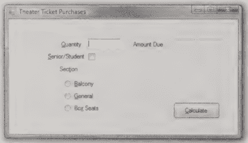

> Figure 2.8  
> In the user interface, the user makes selections in radio buttons and a check box, which must be used to set properties in the business-services-tier component.

业务服务层需要知道区域、票数以及是否给予折扣。因此，构造函数将接收三个值：

```vb
Sub New(ByVal QuantityInteger As Integer, ByVal SectionInteger As Integer, _
        ByVal DiscountBoolean As Boolean)
```

请注意有三个值：数量、区域以及折扣的布尔值。传递数量很简单；你可以将文本框值转换为整数：`Integer.Parse(QuantityTextBox.Text)`。并且你可以轻松地将复选框的 Checked 属性传递给布尔属性：

```vb
Dim ATicketPrice As New TicketPrice(Integer.Parse(Me.QuantityTextBox.Text), SectionInteger, DiscountCheckBox.Checked)
```

根据单选按钮或列表框中的选择设置属性会带来额外的挑战，既要确定在业务服务层组件中设置属性的最佳方式，也要在用户界面中设置正确的值。请注意 Section 属性声明为整数。虽然你可以将属性设置为字符串，但使用整数有一个真正的优势——你可以为可用选项创建一个枚举。

## 创建枚举

每当你为属性提供一组选项时，这都是因为有人设置了一个列出这些选项的枚举。例如，选择 `Color.Red`、`Color.Blue` 或 `Color.Yellow` 就是从 Color 枚举中选择其中一个元素。当你选择 Color 枚举的元素之一时，VB 编译器实际上会替换该元素的数值。这让你，开发者，无需记住颜色名称或颜色数字。你只需输入枚举的名称和一个句点，IntelliSense 中就会弹出可能的选项。

你可以创建自己的枚举，称为 enum（“E-noom”）。enum 是命名常量的列表。常量的数据类型必须是整数类型之一（integer、short、long 或 byte）。每当你创建一个具有属性可能选项列表的可重用组件类时，请考虑设置一个 enum。

## Enum 语句—一般形式

```vb
Enum EnumName
    ConstantName1 [ConstantValue]
    ConstantName2 [ConstantValue]
End Enum
```

Enum 语句属于命名空间级别或类级别，这意味着它不能出现在过程内部。默认情况下，Enum 是 public，但如果你愿意，也可以将其声明为 private、friend 或 protected。

## Enum 语句—示例

```vb
Public Enum SectionType
    General
    Balcony
    Box
End Enum

Enum ReportType
    BooksBySubject    10
    BooksByAuthor
End Enum

Enum EvenNumbers
    Two      2
    Four     4
    Six      6
    Eight    8
End Enum
```

当你不为元素分配常量值时，VB 会自动将第一个元素分配为零值，后续每个元素比上一个大一。因此，在上面的第一个示例中，General 的常量值为 0，Balcony 的值为 1，Box 的值为 2。如果你为一个元素赋值，如上面 ReportType 的第二个示例中那样，后续每个元素将比上一个大一。因此，在 ReportType 示例中，BooksBySubject 的常量值为 10，这是你分配的，而 BooksByAuthor 的值为 11。

在程序示例的业务服务层组件中，你可以在 Ch02EnumRadioButtons 中看到，Section 属性是使用 Enum 设置为整数的。在 CalculatePrice 过程中，使用 enum 值在 Select Case 中确定要用于价格的正确常量。

```vb
' Enum declared at the namespace level, above the class declaration.
Public Enum SectionType
    General
    Balcony
    Box
End Enum

Public Class TicketPrice

    ' Private variable for Section property.
    Private SectionInteger As Integer
    ' Alternate declaration:
    ' Private SectionInteger As SectionType

    ' ... Omitted code for class.

    Private Sub CalculatePrice()
        ' Determine the amount due.
        Dim PriceDecimal As Decimal
        Select Case SectionInteger
            Case SectionType.General
                PriceDecimal = GENERAL_Decimal
```

```vb
Case SectionType.Balcony
    PriceDecimal = BALCONY_Decimal
Case SectionType.Box
    PriceDecimal = BOX_Decimal
End Select
If DiscountBoolean Then
    PriceDecimal -= DISCOUNT_Decimal
End If
AmountDueDecimal = PriceDecimal * QuantityInteger
End Sub
End Class
```

使用以下代码在窗体的 CalculateButton_Click 事件处理程序中使用 enum。请注意，如果你在业务服务层组件中在类内部声明 enum，使用 enum 时也必须指定类名（`TicketPrice.SectionType.General`）。

```vb
Private Sub CalculateButton_Click(ByVal sender As System.Object, _
    ByVal e As System.EventArgs) Handles CalculateButton.Click
    ' Find price by passing data input in the presentation tier
    ' to the business services tier using a TicketPrice object.
    Dim SectionInteger As Integer

    ' Determine the section from radio buttons.
    If BalconyRadioButton.Checked Then
        SectionInteger = SectionType.Balcony
    ElseIf BoxRadioButton.Checked Then
        SectionInteger = SectionType.Box
    Else
        SectionInteger = SectionType.General   ' Default to General.
    End If

    Try
        Dim AtTicketPrice As New TicketPrice(
            Integer.Parse(QuantityTextBox.Text), SectionInteger, _
            DiscountCheckBox.Checked)
        AmountTextBox.Text = AtTicketPrice.AmountDue.ToString("C")
        ErrorProvider1.Clear()
    Catch
        ErrorProvider1.SetError(QuantityTextBox, _
            "Quantity must be numeric.")
    End Try
End Sub
```

此示例来自 Ch02EnumRadioButtons。要查看从组合框而不是单选按钮中选择的示例，请参阅 Ch02EnumComboBox。

## 垃圾回收

.NET Framework 在称为 *garbage collection* 的过程中销毁未使用的对象并回收内存。垃圾收集器会定期运行并销毁任何不再具有活动引用的对象和变量。你无法知道垃圾收集器何时会发生。在早期版本的 VB 中，建议你将对象变量设置为 Nothing 并写入


为你的类确定最终的处理流程。对于 VB 的当前版本，Microsoft 建议你在完成对象变量的使用后，允许其超出作用域。

## 反馈 2.3

使用此声明来回答问题 1–4。

```
Private VariableInteger As Integer
```

+   1. 如果 VariableInteger 在类中声明但不在过程中声明，其作用域是什么？
+   2. 其生命周期是什么？
+   3. 其可访问性是什么？
+   4. 如果声明 VariableInteger 的类被用作继承的基类，派生类是否可以访问该变量？

## 你的动手编程示例

R 'n' R—For Reading and Refreshment 需要一个应用程序来计算工资。创建一个多窗体项目，其中包括一个 MDI 父窗体、一个 Payroll 窗体、一个 Summary 窗体、一个 About 窗体和一个 Splash 窗体。Payroll 窗体、Summary 窗体和 About 窗体应为父窗体的子窗体。如果你完成了第 1 章的动手项目，现在将完成 Payroll 和 Summary 窗体。

父窗体应具有以下菜单：

File    View    Window    Help
Exit    Payroll    Tile Vertical    About
        Summary    Tile Horizontal
                Cascade

这应是一个多层项目，业务规则和计算应放在与用户界面分离的类中。

## 图 2.9

为 R 'n R Payroll 项目绘制窗体草图；a. 主窗体（父窗体），b. Payroll 窗体；c. Summary 窗体；d. About 窗体；和 e. Splash 窗体。

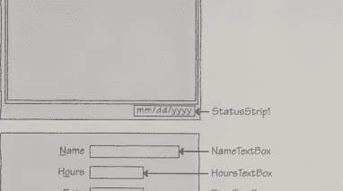

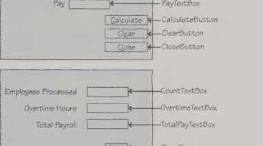

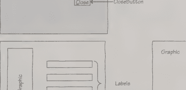

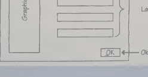

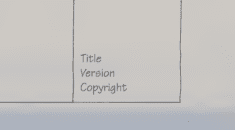

动手编程示例的类图。

## 表示层

### MainForm

| Object | Property | Setting |
|---|---|---|
| MainForm | Text | R 'n R For Reading and Refreshment |
|  | IsMdiContainer | True |
| MenuStrip1 | Items Collection (drop-down items) | ExitToolStripMenuItem
PayrollFormToolStripMenuItem
SummaryToolStripMenuItem
TileHorizontalToolStripMenuItem
TileVerticalToolStripMenuItem
Cascade ToolStripMenuItem
AboutToolStripMenuItem
FileToolStripMenuItem
ViewToolStripMenuItem
WindowToolStripMenuItem
HelpToolStripMenuItem |

| Object | Property | Setting |
|---|---|---|
| ContextMenuStrip1 | ItemsCollection | PayrollToolStripMenuItem<br>SummaryToolStripMenuItem1 |
| ToolStrip | Items collection | PayrollToolStripButton<br>SummaryToolStripButton<br>AboutToolStripButton |
| StatusStrip | Items collection | Add labels for the date and time. |

| Procedure | Actions—Pseudocode |
|---|---|
| MainForm_Load | Retrieve the date and time for the status bar. |
| ExitToolStripMenuItem_Click | Close the form. |
| AboutToolStripMenuItem_Click<br>AboutToolStripButton_Click | Create an instance of the About form.<br>Set the MdiParent property.<br>Show the form. |
| PayrollFormToolStripMenuItem_Click<br>PayrollToolStripButton_Click<br>PayrollToolStripMenuItem_Click | Create an instance of the Payroll form.<br>Set the MdiParent property.<br>Show the form.<br>Set the focus on the form. |
| SummaryToolStripMenuItem_Click<br>SummaryToolStripButton_Click<br>SummaryToolStripMenuItem_Click | Create an instance of the Summary form.<br>Set the MdiParent property.<br>Show the form.<br>Set the focus on the form. |
| CascadeToolStripMenuItem_Click | Set MDI layout to Cascade. |
| TileHorizontalToolStripMenuItem_Click | Set MDI layout to Tile Horizontal. |
| TileVerticalToolStripMenuItem_Click | Set MDI layout to Tile Vertical. |
| ClockTimer_Tick | Update the date and time. |

### PayrollForm

| Object | Property | Setting |
|---|---|---|
| PayrollForm | AcceptButton<br>CancelButton<br>Text<br>WindowState | CalculateButton<br>ClearButton<br>Payroll<br>Maximized |
| Label1 | Text | &Name |
| NameTextBox | Text | (blank) |
| Label2 | Text | H&ours |
| HoursTextBox | Text | (blank) |
| Label3 | Text | &Rate |
| RateTextBox | Text | (blank) |

| Object | Property | Setting |
|---|---|---|
| Label4 | Text | Pay |
| PayTextBox | Text | (blank) |
|  | ReadOnly | True |
| CalculateButton | Text | &Calculate |
| ClearButton | Text | Cl&ear |
| CloseButton | Text | C&lose |

| Procedure | Actions—Pseudocode |
|---|---|
| Instance property Get | If an instance doesn't exist
Declare a new instance. |
| CalculateButton_Click | Clear the error provider.
Convert the hours to decimal.
If hours convert successfully
Convert the rate to decimal.
If rate converts successfully
Try
Instantiate a Payroll object, passing the input values.
Display the pay formatted in a label.
Catch
Display the error message.
Select the control in error.
Else
Display error for rate.
Select the control in error.
Else
Display error for hours.
Select the control in error. |
| ClearButton_Click | Clear all input fields on the screen.
Set the focus in NameTextBox. |
| CloseButton_Click | Close the form. |
| HoursTextBox_Validating | If not valid
Display the error message.
Cancel the Validating event handler.
Select the control in error.
Else
Clear the error message. |
| RateTextBox_Validating | If not valid
Display the error message.
Cancel the Validating event handler.
Select the control in error.
Else
Clear the error message. |
| PayrollForm_FormClosing | Set e.Cancel = False.
Set AnInstance = Nothing. |
| SelectControlInError(ControlName) | Select text.
Set the focus. |

### SummaryForm

| Object | Property | Setting |
|---|---|---|
| SummaryForm | AcceptButton<br>WindowState<br>Text | CloseButton<br>Maximized<br>Payroll Summary |
| Label1 | Text | Employees Processed |
| EmployeeCountTextBox | Text<br>ReadOnly | (blank)<br>True |
| Label2 | Text | Overtime Hours |
| OvertimeHoursTextBox | Text<br>ReadOnly | (blank)<br>True |
| Label3 | Text | Total Payroll |
| TotalPayrollTextBox | Text<br>ReadOnly | (blank)<br>True |
| CloseButton | Text | &Close |

| Procedure | Actions—Pseudocode |
|---|---|
| Instance property Get | If an instance doesn't exist,
Declare a new instance. |
| SummaryForm_Activated | Format and display the 3 summary properties in labels. |
| CloseButton_Click | Close the form. |
| SummaryForm_FormClosing | Set AnInstance = Nothing. |

### AboutBox

| Object | Property | Setting |
|---|---|---|
| AboutBox1 | FormBorderStyle<br>StartPosition<br>Text<br>AcceptButton | FixedDialog<br>CenterParent<br>About This Application (Changes at run time.)<br>OkButton |
| OkButton | Text | &OK |

| Procedure | Actions—Pseudocode |
|---|---|
| AboutBox1_Load | Retrieve the attributes and set up the labels.<br>(Code already in template file.) |

SplashScreen 包含一个图形和标识公司和应用程序的标签。你可以使用 Splash Screen 模板并替换图形。添加代码以使窗体在屏幕上保持几秒钟。

## 业务服务层

### Payroll Class

| Properties | Data Type | Property Type | Accessibility |
|---|---|---|
| Hours | Decimal | Instance | Read / Write |
| Rate | Decimal | Instance | Read / Write |
| Pay | Decimal | Instance | Read Only |
| NumberProcessed | Decimal | Shared | Read Only |
| TotalPay | Decimal | Shared | Read Only |
| OvertimeHours | Decimal | Shared | Read Only |

| Constants | Data Type | Initial Value |
|---|---|---|
| MINIMUM_WAGE_Decimal | Decimal | 6.25D |
| MAXIMUM_WAGE_Decimal | Decimal | 50D |
| MINIMUM_HOURS_Decimal | Decimal | 0D |
| MAXIMUM_HOURS_Decimal | Decimal | 60D |
| REGULAR_HOURS_Decimal | Decimal | 40D |
| OVERTIME_RATE_Decimal | Decimal | 1.5D |

### Methods

```
New(ByVal HoursInDecimal As Decimal, ByVal RateInDecimal As Decimal) ' (Parameterized constructor)
    Assign parameters to properties.
    Call FindPay.

FindPay
    If hours <= regular hours
        pay = hours * rate
        overtime hours = 0
    Else
        overtime hours = hours - regular hours
        pay = (hours * rate) + (overtime hours * overtime rate)
        Add overtime hours to total.
    Add pay to total.
    Add 1 to number processed.
```

按照图 2.9 中的草图创建窗体。图 2.11 显示了完成的窗体。

- 设置每个对象的属性，如你所计划的。
- 编写业务服务层类的代码，参考你的规划文档。


- 编写表单的代码。根据伪代码编写每个过程。
- 完成代码后，使用多种测试数据彻底测试项目。

## 图 2.11

R 'n R Payroll 项目的表单；a. 主表单（父表单）；b. 薪资表单；c. 汇总表单；d. 关于表单；和 e. 启动画面表单。

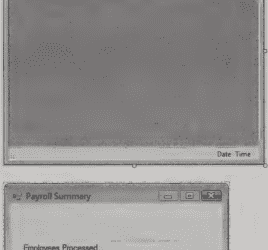

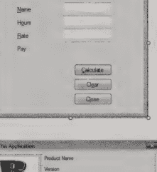


## 项目编码解决方案

### MainForm

```vb
'Program:      Ch02HandsOn
'Programmer:   Bradley/Millspaugh
'Form:         MainForm
'Date:         June 2009
'Description:  MDI parent form; contains the menu and displays
               the various forms for the R 'n R Payroll application.

Public Class MainForm

    Private Sub MainForm_Load(ByVal sender As System.Object, _
        ByVal e As System.EventArgs) Handles MyBase.Load
        ' Display the date and time in the status bar.
        DateToolStripStatusLabel.Text = Now.ToShortDateString()
        TimeToolStripStatusLabel.Text = Now.ToLongTimeString()
    End Sub

    Private Sub TileVerticalToolStripMenuItem_Click( _
        ByVal sender As System.Object, ByVal e As System.EventArgs) _
        Handles TileVerticalToolStripMenuItem.Click
        ' Display the open windows tiled vertically.
        Me.LayoutMdi(MdiLayout.TileVertical)
    End Sub

    Private Sub TileHorizontalToolStripMenuItem_Click( _
        ByVal sender As Object, ByVal e As System.EventArgs) _
        Handles TileHorizontalToolStripMenuItem.Click
        ' Display the open windows tiled horizontally.
        Me.LayoutMdi(MdiLayout.TileHorizontal)
    End Sub

    Private Sub CascadeToolStripMenuItem_Click(ByVal sender As Object, _
        ByVal e As System.EventArgs) Handles CascadeToolStripMenuItem.Click
        ' Cascade the open windows.
        Me.LayoutMdi(MdiLayout.Cascade)
    End Sub

    Private Sub PayrollFormToolStripMenuItem_Click( _
        ByVal sender As System.Object, ByVal e As System.EventArgs) _
        Handles PayrollFormToolStripMenuItem.Click, PayrollToolStripButton.Click
        ' Create an instance of the payroll form.
        Dim APayrollForm As PayrollForm = PayrollForm.Instance

        With APayrollForm
            .MdiParent = Me
            .Show()
            .Focus()
        End With
    End Sub

    Private Sub SummaryToolStripMenuItem_Click(ByVal sender As System.Object, _
        ByVal e As System.EventArgs) _
        Handles SummaryToolStripMenuItem.Click, SummaryToolStripButton.Click, _
        SummaryFormToolStripMenuItem.Click
        ' Create an instance of the summary form.
        Dim ASummaryForm As SummaryForm = SummaryForm.Instance

        With ASummaryForm
            .MdiParent = Me
            .Show()
            .Focus()
        End With
    End Sub

    Private Sub ExitToolStripMenuItem_Click(ByVal sender As System.Object, _
        ByVal e As System.EventArgs) Handles ExitToolStripMenuItem.Click
        ' Terminate the program.
        ' Closing the startup form ends the program.
        Me.Close()
    End Sub

    Private Sub AboutToolStripMenuItem_Click(ByVal sender As System.Object, _
        ByVal e As System.EventArgs) _
        Handles AboutToolStripMenuItem.Click, AboutToolStripButton.Click
        ' Display the About Box form with attribute information.

        Dim AnAboutBox As New AboutBox1
        AnAboutBox.ShowDialog()
    End Sub

    Private Sub ClockTimer_Tick(ByVal sender As System.Object, _
        ByVal e As System.EventArgs) Handles Timer1.Tick
        ' Update the date and time in the status bar.
        ' Interval = 1000 milliseconds (one second).

        DateToolStripStatusLabel.Text = Now.ToShortDateString
        TimeToolStripStatusLabel.Text = Now.ToLongTimeString()
    End Sub
End Class
```

### PayrollForm

```vb
'Project:      Ch02HandsOn
'Module:       PayrollForm
'Programmer:   Bradley/Millspaugh
'Date:         June 2009
'Description:  User interface for payroll application.
'              Provides data entry and validates for nonnumeric data.
'              Uses the singleton design pattern to ensure that only one
'              instance of the form can be created.

Public Class PayrollForm
    Private Shared AnInstance As PayrollForm

    Public Shared ReadOnly Property Instance() As PayrollForm
        Get
            If AnInstance Is Nothing Then
                AnInstance = New PayrollForm
            End If
            Return AnInstance
        End Get
    End Property

    Private Sub CalculateButton_Click(ByVal sender As System.Object, _
        ByVal e As System.EventArgs) Handles CalculateButton.Click
        ' Create a Payroll object to connect to the business services tier.
        Dim HoursDecimal As Decimal
        Dim RateDecimal As Decimal

        ' Check for valid input data.
        ErrorProvider1.Clear()
        If Decimal.TryParse(HoursTextBox.Text, HoursDecimal) Then
            If Decimal.TryParse(RateTextBox.Text, RateDecimal) Then
                ' Both values parsed successfully.
                Try
                    Dim APayroll As New Payroll(HoursDecimal, RateDecimal)
                    PayTextBox.Text = APayroll.Pay.ToString("C")

                Catch Err As ApplicationException
                    ' Catch exceptions from the Payroll class.
                    Select Case Err.Source
                        Case "Hours"
                            ErrorProvider1.SetError(HoursTextBox, _
                                Err.Message)
                            SelectControlInError(HoursTextBox)
                        Case "Rate"
                            ErrorProvider1.SetError(RateTextBox, _
                                Err.Message)
                            SelectControlInError(RateTextBox)
                    End Select
                End Try
            Else
                ' Rate did not pass validation.
                ErrorProvider1.SetError(RateTextBox, _
                    "The rate must be numeric.")
                SelectControlInError(RateTextBox)
            End If
        Else
            ' Hours did not pass validation.
            ErrorProvider1.SetError(HoursTextBox, _
                "The hours must be numeric.")
            SelectControlInError(HoursTextBox)
        End If
    End Sub

    Private Sub ClearButton_Click(ByVal sender As System.Object, _
        ByVal e As System.EventArgs) Handles ClearButton.Click
        ' Clear the screen fields.

        ErrorProvider1.Clear()
        With NameTextBox
            .Clear()
            .Focus()
        End With
        HoursTextBox.Clear()
        RateTextBox.Clear()
        PayTextBox.Clear()
    End Sub

    Private Sub CloseButton_Click(ByVal sender As System.Object, _
        ByVal e As System.EventArgs) Handles CloseButton.Click
        ' Close this form.

        Me.Close()
    End Sub

    Private Sub HoursTextBox_Validating(ByVal sender As System.Object, _
        ByVal e As System.ComponentModel.CancelEventArgs) _
        Handles HoursTextBox.Validating
        ' Test the hours for numeric.
        Dim HoursDecimal As Decimal

        If Decimal.TryParse(HoursTextBox.Text, HoursDecimal) Then
            ErrorProvider1.Clear()
        Else
            ErrorProvider1.SetError(HoursTextBox, _
                "The hours must be numeric.")
            HoursTextBox.SelectAll()
            e.Cancel = True
        End If
    End Sub

    Private Sub RateTextBox_Validating(ByVal sender As Object, _
        ByVal e As System.ComponentModel.CancelEventArgs) _
        Handles RateTextBox.Validating
        ' Test pay rate for numeric.
        Dim RateDecimal As Decimal

        If Decimal.TryParse(RateTextBox.Text, RateDecimal) Then
            ErrorProvider1.Clear()
        Else
            ErrorProvider1.SetError(RateTextBox, _
                "The rate must be numeric.")
            RateTextBox.SelectAll()
            e.Cancel = True
        End If
    End Sub

    Private Sub PayrollForm_FormClosing(ByVal sender As Object, _
        ByVal e As System.Windows.Forms.FormClosingEventArgs) _
        Handles Me.FormClosing
        ' Do not allow validation to cancel the form's closing.

        e.Cancel = False
        ' Release the instance of this form.
        AnInstance = Nothing
    End Sub

    Private Sub SelectControlInError(ByVal ErrorTextBox As TextBox)
        ' Select the control in error.

        With ErrorTextBox
            .SelectAll()
            .Focus()
        End With
    End Sub
End Class
```


## SummaryForm

'程序：      Ch02HandsOn  
'程序员：   Bradley/Millsbaugh  
'窗体：         SummaryForm  
'日期：         2009 年 6 月  
'说明：  用于章节动手 MDI 应用程序的摘要窗体。  
               显示多个交易的摘要信息。  
               使用单例设计模式确保只能创建窗体的一个实例。

```vb
Public Class SummaryForm
    Private Shared AnInstance As SummaryForm

    Public Shared ReadOnly Property Instance() As SummaryForm
        Get
            If AnInstance Is Nothing Then
                AnInstance = New SummaryForm
            End If
            Return AnInstance
        End Get
    End Property

    Private Sub SummaryForm_Activated(ByVal sender As Object, _
        ByVal e As System.EventArgs) Handles Me.Activated
        ' Retrieve and display the summary values.

        EmployeeCountTextBox.Text = Payroll.NumberProcessed.ToString()
        OvertimeHoursTextBox.Text = Payroll.OvertimeHours.ToString("N1")
        TotalPayrollTextBox.Text = Payroll.TotalPay.ToString("C")
    End Sub

    Private Sub CloseButton_Click(ByVal sender As System.Object, _
        ByVal e As System.EventArgs) Handles CloseButton.Click
        ' Close this form.

        Me.Close()
    End Sub

    Private Sub SummaryForm_FormClosing(ByVal sender As Object, _
        ByVal e As System.Windows.Forms.FormClosingEventArgs) _
        Handles Me.FormClosing
        ' Release the form's instance.

        AnInstance = Nothing
    End Sub
End Class
```

## Payroll 类

'项目：      Ch02HandsOn  
'模块：       Payroll 类  
'程序员：   Bradley/Millsbaugh  
'日期：         2009 年 6 月  
'说明：  用于工资计算的业务服务层：验证输入  
               数据并计算工资，包括加班、常规和  
               汇总数据。

```vb
Public Class Payroll

' Instance variables.
Private HoursDecimal As Decimal      ' Hold the Hours property.
Private RateDecimal As Decimal       ' Hold the Rate property.
Private PayDecimal As Decimal        ' Hold the Pay property.

' Shared variables.
' Hold the NumberProcessed shared property.
Private Shared NumberEmployeesInteger As Integer
' Hold the TotalPay shared property.
Private Shared TotalPayDecimal As Decimal
' Hold the OvertimeHours shared property.
Private Shared TotalOvertimeHoursDecimal As Decimal

' Constants.
Private Const MINIMUM_WAGE_Decimal As Decimal = 6.25D
Private Const MAXIMUM_WAGE_Decimal As Decimal = 50D
Private Const MINIMUM_HOURS_Decimal As Decimal = 0D
Private Const MAXIMUM_HOURS_Decimal As Decimal = 60D
Private Const REGULAR_HOURS_Decimal As Decimal = 40D
Private Const OVERTIME_RATE_Decimal As Decimal = 1.5D

' Constructor.
Sub New(ByVal HoursDecimal As Decimal, ByVal RateDecimal As Decimal)
    ' Assign properties and calculate the pay.
    Me.Hours = HoursDecimal
    Me.Rate = RateDecimal
    FindPay()
End Sub

Private Sub FindPay()
    ' Calculate the pay.
    Dim OvertimeHoursDecimal As Decimal

    If HoursDecimal <= REGULAR_HOURS_Decimal Then   ' No overtime.
        PayDecimal = HoursDecimal * RateDecimal
        OvertimeHoursDecimal = 0D
    Else                                            ' Overtime.
        OvertimeHoursDecimal = HoursDecimal - REGULAR_HOURS_Decimal
        PayDecimal = (REGULAR_HOURS_Decimal * RateDecimal) +
                     (OvertimeHoursDecimal * OVERTIME_RATE_Decimal * RateDecimal)
    End If
    TotalOvertimeHoursDecimal += OvertimeHoursDecimal
    TotalPayDecimal += PayDecimal
    NumberEmployeesInteger += 1
End Sub

' Property procedures.
Public Property Hours() As Decimal
    Get
        Return HoursDecimal
    End Get
    Set(ByVal Value As Decimal)
        If Value >= MINIMUM_HOURS_Decimal And _
           Value <= MAXIMUM_HOURS_Decimal Then
            HoursDecimal = Value
        Else
            Dim Ex As New ApplicationException(
                "Hours are outside of the acceptable range.")
            Ex.Source = "Hours"
            Throw Ex
        End If
    End Set
End Property

Public Property Rate() As Decimal
    Get
        Return RateDecimal
    End Get
    Set(ByVal Value As Decimal)
        If Value >= MINIMUM_WAGE_Decimal And Value <= MAXIMUM_WAGE_Decimal Then
            RateDecimal = Value
        Else
            Dim Ex As New ApplicationException(
                "Pay rate is outside of the acceptable range.")
            Ex.Source = "Rate"
            Throw Ex
        End If
    End Set
End Property

Public ReadOnly Property Pay() As Decimal
    Get
        Return PayDecimal
    End Get
End Property

Public Shared ReadOnly Property NumberProcessed() As Decimal
    Get
        Return NumberEmployeesInteger
    End Get
End Property

Public Shared ReadOnly Property TotalPay() As Decimal
    Get
        Return TotalPayDecimal
    End Get
End Property

Public Shared ReadOnly Property OvertimeHours() As Decimal
    Get
        Return TotalOvertimeHoursDecimal
    End Get
End Property
End Class
```

## 摘要

- 1. 在 VB 中，所有编程都基于类，类由属性、方法和事件组成。
- 2. 你可以创建一个新类并使用该类创建新对象。
- 3. 创建新对象称为实例化类；对象称为类的实例。
- 25. 共享成员（属性和方法）有一个副本可供类的所有对象使用，通常用于总数和计数。实例成员每个对象实例各有一个副本。用 Shared 关键字声明共享成员。你可以在不创建类实例的情况下引用类的公共共享成员。
- 26. 命名空间是用于分组和引用类和结构的一个区域。
- 27. 变量、常量和对象的范围，从大到小：命名空间、模块级、过程级和块级。
- 28. 变量、常量或对象的生命周期与其范围相对应。
- 29. 你可以使用 Public、Private、Protected、Friend 和 Protected Friend 关键字声明实体的可访问性。
- 30. 子类继承其基类的所有公共和受保护的属性和方法，除了构造函数。子类中同名的方法将覆盖或隐藏基类方法。隐藏是默认值。
- 31. 要覆盖基类的方法，原方法必须声明为可覆盖，并且新方法必须使用 Overrides 关键字。
- 32. 具有预定义属性值集的类应在枚举中定义这些值。枚举结构可以出现在命名空间或类级别，并且必须定义整数值。
- 33. 垃圾回收功能会定期检查未引用的对象，销毁对象引用并释放资源。

#### 1.2.1 认识无理数

在七年级上册，我们学习了有理数，知道整数和分数统称为有理数。本章我们将学习一种新的数——无理数。

**做一做**

1. 如图1-3，剪两个同样大小的正方形纸片，将其中的一张沿对角线剪成两个等腰直角三角形，把这两个等腰直角三角形与另一张正方形纸片拼在一起，得到一个大的正方形。设小正方形的边长为1，你能算出大正方形的面积吗？大正方形的边长是多少？


2. 如图1-4，以直角三角形的斜边为边的正方形的面积是多少？设该正方形的边长为b，b满足什么条件？b是有理数吗？


在上面的问题中，我们得到了面积为2的正方形，它的边长a满足a²=2，b满足b²=5。a，b既不是整数，也不是分数，它们不是有理数。

## 关键术语

- abstract class — 51
- abstraction — 50
- accessibility — 76
- base class — 51
- block-level scope — 75
- business rules — 53
- business services tier — 54
- child class — 54
- constructor — 56
- data tier — 54
- derived class — 51
- destructor — 56
- encapsulation — 50
- enum — 81
- enumeration — 81
- ErrorProvider component — 64
- garbage collection — 83
- inheritance — 51
- instance member — 69
- instance property — 69
- instance variable — 69
- lifetime — 76
- module-level scope — 75
- multitier application — 53
- namespace — 74
- namespace scope — 74
- overloading — 57
- overridable — 78
- override — 52
- parameterized constructor — 57
- parent class — 51
- polymorphism — 52
- presentation tier — 53
- procedure-level scope — 75
- property procedure — 55
- ReadOnly — 56
- reusability — 51
- scope — 74
- shadow — 78
- shared member — 69
- shared property — 69
- shared variable — 69
- subclass — 51
- superclass — 51
- throw an exception — 60
- Throw statement — 61
- TryParse method — 62
- Validating event — 63
- Value keyword — 55
- WriteOnly — 56


## 复习题

1. 定义抽象、封装、继承和多态。
2. 什么是抽象类以及如何使用它？
3. 为什么类中的属性变量应声明为私有？
4. 什么是属性过程以及其用途是什么？
5. 解释如何创建一个新类并从该类实例化一个对象。
6. 什么是构造函数，如何创建，以及何时触发？
7. 什么是参数化构造函数？
8. 如何为新类编写方法？
9. 什么是共享成员？其用途是什么？如何创建？
10. 解释从另一个类继承一个类所需的步骤。
11. 区分重写和重载。
12. 使用多层开发应用程序的优点是什么？
13. 描述在业务服务层执行验证但在表示层向用户显示消息所需的步骤。
14. 解释命名空间级变量和模块级变量之间的区别。如何创建每个变量以及如何使用？
15. 解释过程级变量和块级变量之间的区别。如何创建每个变量以及如何使用？
16. 过程级变量的生命周期是什么？块级变量？模块级变量？
17. 解释重写和隐藏方法之间的区别。
18. 使用 Protected 访问修饰符的效果是什么？Friend 修饰符？
19. 相对于 Parse，使用 TryParse 方法的优点是什么？
20. 相对于消息框，使用 ErrorProvider 组件的优点是什么？
21. 枚举的用途是什么？如何创建？
22. 什么是垃圾回收？它做什么以及何时运行？

## 编程练习

### 2.1 Tricia's Travels

你可以添加到你的练习 1.2 或只是创建主窗体。

### 表示层

### 主窗体

包含客户姓名、电话号码、出行人数、出发日期和信用卡号码的文本框。包含目的地列表框：加勒比海、地中海和阿拉斯加。包含 7 天或 14 天套餐的单选按钮和头等舱的复选框。验证用户已为所有字段做出输入。

### 摘要窗体

显示总账单金额、总出行人数、每个目的地的数量以及头等舱票数。

### 业务服务层

根据以下时间表计算应付金额：

| Days | Destination | Standard price | First-class price |
| ---: | --- | ---: | ---: |
| 7 | Caribbean | 3250 | 5000 |
| 14 | Caribbean | 6000 | 9000 |
| 7 | Mediterranean | 4250 | 7999 |
| 14 | Mediterranean | 7999 | 11999 |
| 7 | Alaska | 3300 | 5250 |
| 14 | Alaska | 7200 | 10500 |

### 2.2 Kenna’s Kandles

Kenna’s Kandles 提供各种形状、香味和颜色的蜡烛。编写一个包含主窗体、关于窗体和摘要窗体的 MDI 项目，使用单独的层用于业务规则。

### 表示层

### 主窗体

- 客户信息文本框（姓名和信用卡号码）。
- 数量文本框。
- 蜡烛款式的单选按钮或列表框（茶蜡、 votive 或柱形）。
- 颜色的单选按钮或列表框（联邦蓝、向日葵黄、圣诞红和百合白）。
- 香味的复选框。
- 项目价格的标签。

### 摘要窗体

显示所有蜡烛的小计、8% 的税、3% 的运费以及应付总额。

### 业务服务层

根据所选选项计算每支蜡烛的价格。业务服务层还应累积用于总计的信息。

| Style | Base price | Scented price (additional) |
| --- | ---: | ---: |
| Tea lights | 5.75 | 0.75 |
| Votives | 7.50 | 1.25 |
| Pillar | 12.25 | 1.75 |

### 2.3 创建一个使用多层维护支票簿的项目

### 表示层

### 主窗体

使用单选按钮或下拉列表指示交易类型：支票、存款、利息或服务费。允许用户在金额文本框中输入金额，并在标签或只读文本框中显示账户余额。根据业务服务层生成的适当异常显示余额不足的消息框。

### 摘要窗体

显示存款、支票、利息和服务费的总笔数和总金额。

### 业务服务层

验证余额能否覆盖支票。如果不能，抛出异常并扣除 $10 服务费；不处理支票。通过将余额增加来处理利息和存款，通过减少余额来处理支票和服务费。

### 可选额外

创建一个包含关于窗体、工具栏和状态栏的 MDI 应用程序。

### 2.4

计件工按件计酬。产量更大的工人通常按更高费率支付。

### 表示层

程序应输入姓名和件数并计算工资。包含 *计算* 按钮和 *清除* 按钮。你可以包含 *摘要* 窗体或菜单项。*摘要* 选项在摘要窗体上显示总件数、总工资和人均平均工资。

姓名和件数是必填字段。

### 业务服务层

件数必须为正数；对负数抛出异常。使用以下时间表计算工资：

| Pieces completed | Price paid per piece for all pieces |
| --- | ---: |
| 1–199 | .50 |
| 200–399 | .55 |
| 400–599 | .60 |
| 600 or more | .65 |

累积并返回件数、工资和人均平均工资的汇总总数。注意你还必须累积人数以计算平均值。

### 2.5

向练习 2.4 添加一个继承类。该类为资深工人计算工资，资深工人按不同比例支付。你必须在窗体上添加一个资深工人的复选框并为这些工人使用继承类。

资深工人获得 $300 的基本工资，外加按以下时间表计算的每件工资：

| Pieces completed | Price paid per piece for all pieces |
| --- | ---: |
| 1–199 | .20 |
| 200–399 | .25 |
| 400–599 | .30 |
| 600–799 | .35 |
| 800 or more | .40 |

## 案例研究

### Claytor's Cottages

修改你第 1 章的 Claytor's Cottages 案例研究项目。使用表示层和业务服务层完成预订选项。

### 表示层

窗体应具有 King、Queen 或 Double 的单选按钮。包含输入客户姓名、地址和电话号码的文本框；入住晚数；信用卡类型（使用 Visa、Mastercard 和 American Express 的列表框或组合框）；以及信用卡号码。姓名、入住晚数和信用卡号码是必填字段。使用周末或工作日费率的复选框以及 AARP 或 AAA 会员的复选框。在标签或只读文本框中显示价格。

### 业务服务层

如果天数不大于 0 则抛出异常。使用以下表格计算价格。添加 7% 的房间税。AAA 和 AARP 客户享受 10% 的折扣费率，该折扣在税前计算。

| Beds | Sunday through Thursday rate | Weekend rate (Friday and Saturday) |
| --- | --- | --- |
| King | 95.00 | 165.00 |
| Queen | 85.00 | 95.00 |
| Double | 69.95 | 79.95 |

可选额外：输入到达日期和离开日期而不是复选框。你可以使用日历对象或文本框获取日期。使用 DateTime 结构的方法确定入住日期是工作日还是周末。5 月至 9 月的费率提高 25%。

提示：通过使用 DateTime 结构的 Subtract 方法确定天数：

```
NumberDaysInteger = EndDate.Subtract(StartDate).Days
```

### Christian's Car Rentals

修改你第 1 章的 Christian's Car Rentals 项目。使用表示层和业务服务层编码租赁窗体。

### 表示层

表示层应包含汽车尺寸的数据输入：Compact、Mid size 或 Luxury。包含输入租客姓名、地址、电话号码、驾照、信用卡类型和信用卡号码的文本框。分组框应包含租用天数、开始里程表读数和结束里程表读数。

在允许数据发送到业务服务层之前验证结束里程表读数大于开始里程表读数。确保已为驾照和租用天数做出输入。

### 业务服务层

验证租用天数大于 0。如果里程数不超过平均每天租用 100 英里，则不收取里程费。使用以下费率：

| Car size | Daily rate | Mileage rate |
| --- | ---: | ---: |
| Compact | 26.95 | .12 |
| Mid size | 32.95 | .15 |
| Luxury | 50.95 | .20 |

### 企业和保险账户（继承）

企业账户免除里程费并享受 5% 折扣；保险账户的每日费率享受 10% 折扣。


## CHAPTER 3
## Windows 数据库应用程序

完成本章后，你将能够 ...

+   1. 从 Windows 窗体检索并显示 SQL Server 数据库中的数据。
+   2. 使用 ADO.NET 数据组件：TableAdapters、DataSets 和 DataConnectors。
+   3. 在网格和详细信息视图中显示数据库字段。
+   4. 使用方法和 SQL 查询对数据库数据进行排序。
+   5. 使用 SQL 或 DataSet 设计器连接数据字段。
+   6. 使用存储过程访问数据。
+   7. 编写多层应用程序，将数据层与表示层分离。
+   8. 在代码中声明并实例化 DataSet 和 TableAdapter 对象，并编写将数据绑定到窗体控件的代码。

在本章中，你将学习如何在 Windows 窗体上访问和显示数据库数据。你将遵循良好的 OOP 原则，并在数据层组件中执行数据库访问。你将学习使用表适配器和 DataSets 从数据库文件显示数据。本章将介绍检索数据的底层 SQL 语句，并介绍存储过程。在第 4 章中，你将处理多个相关表，在第 5 章中你将学习更新数据库。

### Visual Studio 和数据库应用程序

专业的 VB 程序员将大部分时间花在涉及数据库的应用程序上。要成为一名优秀的程序员，你需要专注于显示和更新数据库信息的各种方法。

使用 VB，你可以创建几乎不需要编码的非常简单的数据库应用程序，一直到可以访问和修改多个大型服务器上的数据的非常强大的分布式应用程序。你可以创建在单台独立计算机上显示和/或更新数据的程序，以及多用户网络数据库。尽管本文主要集中在 SQL Server Express 数据库上，但你所学习的技术也扩展到更大规模的数据库，如 SQL Server、Oracle、Sybase 和 DB2。你也可以将本章中的大多数技术应用于 Access 数据库。

随 .NET Framework 一起提供的托管提供程序是

+   - Microsoft Access 数据库文件。
+   - Microsoft ODBC 数据源。
+   - Microsoft SQL Server Compact 3.5。
+   - Microsoft SQL Server 数据库文件。
+   - Oracle 数据库（其他数据库格式）。

### ADO.NET

ActiveX Data Objects (ADO) .NET 3.5 是微软最新的数据库对象模型。ADO.NET 的目标是允许程序员使用一组标准对象来引用来自任何来源的数据。

访问来自 Web 和多个平台的数据的趋势改变了我们用于数据处理的技术。过去，通常以客户端/服务器格式连接到数据库。连接在用户浏览和/或更新数据时保持打开状态，数据类型并不是太大的问题。但现在，使用 .NET 方法，我们使用断开连接的 DataSets，具有来自多个来源的通用数据表示（数据类型）。.NET Framework 也与可扩展标记语言（XML）紧密集成，XML 是在多个平台上存储和传输数据的行业标准格式。

### 在 .NET Framework 中访问数据

你会发现用于处理数据的全新术语：数据源、数据设计器、数据集、绑定源、表适配器等。此外，你还将使用数据元素的许多标准术语。

### 数据库术语

数据表可以像电子表格一样查看——具有行和列。表中的每一行代表一个项目、人员或交易的数据，称为记录。表中的每一列用于存储不同的数据元素，例如账号、姓名、地址或数字金额。列中表示的元素称为字段。你可以将图 3.1 中的表视为由行和列或记录和字段组成。

一个表由行（记录）和列（字段）组成。


大多数表使用主键字段（或字段组合）唯一标识每条记录。主键字段通常是一个数字，例如员工编号、账号、识别号或社会安全号码；也可能是文本字段，例如姓氏，或组合，例如姓氏和名字。

### 数据源

你的应用程序从数据源获取数据。你可以从大型数据库、本地数据库文件、Web 服务或其他类型的对象创建数据源。对于驻留在开发人员计算机上的本地数据库文件，.NET 目前支持 Access .mdb 和 .accdb 文件以及 SQL Server Express .mdf 文件。SQL Server Express .mdf 文件是 Visual Basic 的推荐选择。Visual Studio 环境允许你创建和编辑 SQL Server Express 数据源。

当你从数据库创建数据源时，会向你的项目添加一个强类型 DataSet。每个强类型 DataSet 都有一个模式，描述字段及其数据类型。虽然 .NET 提供了几种类型的数据源，但我们将集中于强类型 DataSets，这是在大多数情况下处理数据的推荐方法。

### DataSet 对象

DataSet 对象在内存中保存数据的副本，与数据源断开连接。你可以将 DataSet 视为临时缓存，而不是实际的数据库数据。

DataSet 对象可以保存一个或多个表。关系数据库通常包含多个表以及表之间的关系。例如，Employee 表可能有 Employee ID 字段，Payroll 表也将有 Employee ID 字段。两个表通过 Employee ID 相关联。你可以通过检索对应 Employee ID 的记录来找到一条工资记录的员工信息。在图 3.2 的示例中，Employee ID 是 Employee 表的主键。Payroll 表中的 Employee ID 字段被视为外键——将 Payroll 记录链接到其对应 Employee 记录的字段。因此，例如，要检索给定 Payroll 记录的员工姓名，外键用于查找 Employee 表中对应的记录。


图 3.2
Employee 表和 Payroll 表通过 Employee ID 相关联，Employee ID 是 Employee 表的主键，也是 Payroll 表的外键。

### DataSet 对象模型

每个 DataSet 对象包含一个 DataTable 集合，由单独的 DataTable 对象组成。DataTable 对象同时具有 DataRow 和 DataColumn 集合。单个 DataRow 保存一条记录的实际数据。DataRow 对象维护原始值和任何更改的值。此信息用于确定程序执行期间哪些行已更改。

DataRelation 对象存储有关相关表的信息，包括哪些列包含链接表的键和外键。Constraints 集合属于 DataTable 对象，包含两种类型的 Constraint 对象：Unique 约束和 ForeignKey 约束。Unique 约束强制指定字段中的值唯一，这通常是主键字段的要求。ForeignKey 约束要求出现在二级表中的任何外键值都必须与主表中的主键值匹配。

图 3.3 显示了 DataSet 对象的对象模型。
注意：请参阅 Visual Studio 帮助中的“Visual Studio 中的数据集概述”。

### TableAdapters

TableAdapter 对象提供程序与数据库之间的通信，有时称为“数据访问层”。TableAdapter 连接到数据库并处理 SQL 查询和存储过程，填充 DataSets，并处理将任何更改写回数据源。

TableAdapter 的一个特性是它可以保存多个查询。你可以通过调用特定查询或获取表的全部数据来检索数据。这些 TableAdapter 对象比本教材早期版本中使用的 DataAdapters 功能更强大。（DataAdapters 在 VB 2008 中仍然可用。）Visual Studio IDE 中的可视化设计器在你添加强类型 DataSet 时会自动为你生成 TableAdapters。


## BindingSource 对象

BindingSource 对象便于将 Windows 窗体上的控件绑定到数据源。BindingSource 会保持窗体的所有控件显示来自同一记录的数据（称为货币），并处理数据的导航、排序、筛选和更新。在第 5 章中，你将使用 BindingSource 对象的操作方法来更新你的数据。

## XML 数据

XML 是存储和传输数据的行业标准格式。你可以在 www.w3.org/XML 找到 XML 的规范，该站点是万维网联盟（W3C）的站点。虽然你不需要了解任何 XML 即可用 VB 编写数据库应用程序，但了解一些关于 XML 的事实可以帮助你理解程序中发生的情况。

大多数专有数据库格式以二进制存储数据，其他系统无法访问，也无法通过 Internet 防火墙。存储在 XML 中的数据全部是文本，以标签标识，类似于 HTML 标签。XML 文件可以用任何文本编辑器程序（如记事本）编辑。

如果你看过或编写过 HTML，你就知道开始标签和结束标签定义元素和属性。例如，<b> 和 </b> 之间的任何文本都会被浏览器以粗体渲染。

```
<b>This text is bold.</b> <i>This is italic.</i>
```

XML 中的标签不是像 HTML 那样预定义的。标签可以通过名称标识字段。例如，以下是名为 AuthorsDataSet 的 DataSet 的前两条记录（参见图 3.1），基于 Pubs SQL Server 数据库中的 Authors 表，以 XML 表示。（本章后面，你将使用 Pubs 数据库进行 VB 项目。）

```
<?xml version="1.0" standalone="yes"?>
<AuthorsDataSet xmlns="AuthorsDataSet.xsd">
  <authors>
    <au_id>172-32-1176</au_id>
    <au_lname>White</au_lname>
    <au_fname>Johnson</au_fname>
    <phone>408 496-7223</phone>
    <address>10932 Bigge Rd.</address>
    <city>Menlo Park</city>
    <state>CA</state>
    <zip>94025</zip>
    <contract>true</contract>
  </authors>
  <authors>
    <au_id>213-46-8915</au_id>
    <au_lname>Green</au_lname>
    <au_fname>Marjorie</au_fname>
    <phone>415 986-7020</phone>
    <address>309 63rd St. #411</address>
    <city>Oakland</city>
    <state>CA</state>
    <zip>94618</zip>
    <contract>true</contract>
  </authors>
</AuthorsDataSet>
```

每个强类型 DataSet 都有一个架构，定义了字段、数据类型以及任何约束，例如必填字段。ADO.NET 会根据架构验证数据并检查约束违规。

XML 数据的格式为编程提供了几个优势。由于架构提供了强类型数据，各种数据类型可以得到正确处理。ADO.NET 可以将 XML 数据视为对象，使 Visual Studio 环境的 IntelliSense 功能能够为程序员提供信息。此外，XML 和 ADO.NET 中的数据处理比早期形式的 ADO 执行得更快。

## Visual Studio IDE

VS IDE 提供了帮助你开发数据库应用程序的工具。你将使用数据源窗口来设置应用程序的数据源，以及使用服务器资源管理器（在 Express 版中称为数据库资源管理器），它取代了早期版本服务器资源管理器的部分功能。

## 数据源窗口

数据源窗口提供了一种简便的方式来设置应用程序的数据源。使用数据源窗口，你可以轻松地在窗体上创建数据绑定控件。设置数据源后，你可以通过从数据源窗口拖动表或字段到窗体上来添加网格或单个字段。或者，你可以通过从数据源窗口拖动字段并将其放到控件上来使现有控件显示数据库数据，这会自动设置数据绑定。

当你将数据库表或字段拖到窗体上时，会发生几件事：新的数据控件被添加到窗体；带有架构的 .xsd 文件被添加到解决方案资源管理器窗口；并且 DataSet、BindingSource、TableAdapter 和 BindingNavigator 对象被添加到窗体的组件托盘。

数据源窗口（图 3.4）允许你添加和查看项目中使用的 DataSet。它还提供了对 DataSet 设计器的访问，DataSet 设计器可以直观地显示 DataSet 以及数据表之间的关系。

## 图 3.4

在数据源窗口中设置数据源和绑定。


## 反馈 3.1

- 1. 假设你有一个数据表，其中包含你朋友的名字和电话号码。描述行、列、记录、字段和主键字段这些术语如何适用于你的表。
- 2. 与专有格式（如 Access 或 SQL Server）相比，将数据作为 XML 传输有什么优势？

## 创建数据库应用程序

在本节中，你将创建一个简单的数据库应用程序来在网格中显示一个表。

Microsoft 支持多种用于设计和维护数据库文件的产品：

- SQL Server。专为大规模数据库设计，可满足大型企业的需求。可支持大量用户并提供强大的安全性和可靠性。
- Access。专为单用户数据库或最多五名用户的少量网络数据库设计。使用 Microsoft Jet 引擎。直到几年前，Access 曾是单用户数据库的首选格式。
- SQL Server 2008 Express Edition。SQL Server 的精简桌面或个人版本，专为单用户数据库以及更大规模应用程序的开发和测试而设计。使用与完整 SQL Server 产品相同的 SQL 语句和相同的 .mdf 文件格式。

本书中的练习基于 SQL Server Express Edition。即使你有完整的 SQL Server 产品可用，你也可以使用随 Visual Studio 提供的 SQL Server Express，通常作为安装选项安装。

## 本地数据库文件

当你基于数据库创建项目时，Visual Studio 提供了一个将数据库文件复制到项目中的选项。此选项会将原始文件的副本放入你的项目中，这有一些优点和缺点。

虽然你永远不会在生产环境中将数据库的副本放入项目中，但对于开发和测试来说，这可能是一个明显的优势。你可以将项目从一个文件夹移动到另一个文件夹，或从一台计算机移动到另一台计算机，数据库文件仍在项目中并且可用。你不必担心公司数据库的安全性，并且可以在不更改原始文件的情况下测试更新数据。因此，对于学习环境，最好始终选择将文件包含在项目中的选项。但要认识到这种方案对于公司的整个数据库来说是不合理的。

## 创建 Windows 数据库应用程序——逐步操作

本逐步练习创建一个 Windows 应用程序，在网格中显示数据表。

## 开始新项目

- STEP 1: 开始一个新的 Windows 应用程序，命名为 Ch03SBS（逐步操作）。确保未选择创建目录用于解决方案的选项，否则你将创建两个文件夹，一个嵌套在另一个内部。单击保存全部按钮保存项目。
- STEP 2: 在解决方案资源管理器中，将窗体的文件名更改为 EmployeeForm.vb 并回答对话框中的“是”。此步骤也会重命名窗体的类。
- STEP 3: 将窗体的 Text 属性更改为 Employees。

## 添加数据源

- STEP 1: 如果数据源窗口不可见，请检查其是否与工具箱一起停靠。如果在那里，单击它；如果不在，选择数据菜单中的显示数据源。
- STEP 2: 在数据源窗口中单击添加新数据源，数据源配置向导会出现。选择数据库作为数据源类型并单击下一步。
- STEP 3: 单击新建连接按钮，选择 Microsoft SQL Server 数据库文件（SqlClient）作为数据源，并浏览找到 Pubs.mdf 数据库文件。（你可以在文本网站的 StudentData 文件夹中找到此文件（www.mhhe.com/AdvVB2008/）。）在对话框中单击确定，在向导中单击下一步。
- 注：如果使用从 Microsoft 下载的文件，文件名是小写的。保持名称小写即可，你的名称将与图中的名称不完全匹配。或者，你


可以在项目中选择数据库之前，使用 Windows 资源管理器重命名文件（如果存在，其配套的 pubs_log.ldf）。添加数据库到项目后，请勿尝试重命名数据库。

- STEP 4: 出现一条消息，提示您选择的连接使用的是不在当前项目中的本地数据文件，并询问是否要将其复制。选择 Yes。
- STEP 5: 接下来您可以选择保存连接字符串。保持选择 Yes（默认值）并单击 Next。
- STEP 6: 从数据库对象列表中展开 Tables 节点。然后展开 employee 表的节点。请注意，您可以展开该表并使用复选框选择想要的字段。选择 emp_id、fname、lname 和 hire_date。
- STEP 7: 默认名称为 PubsDataSet，已经很合适了。单击 Finish。请注意表格前面的图标（图 3.5）。该图标表示表格设置为 DataGridView。名称末尾的下拉箭头允许您选择不同的视图。稍后您将使用详细信息视图。


## Display Data in a Grid

在网格中显示数据

- STEP 1: 从 Data Sources 窗口中选择 employee 表并将其拖到窗体上。
- STEP 2: 查看组件托盘。它应包含 PubsDataSet、EmployeeBindingSource、EmployeeTableAdapter、TableAdapterManager 和 EmployeeBindingNavigator。
- STEP 3: 您需要按所需的外观调整窗体的大小并重新定位和调整网格的大小（图 3.6）。
- STEP 4: 启动程序；数据会自动显示（图 3.7）。显示数据时您编写了多少代码？
- STEP 5: 单击窗体的关闭按钮停止程序。如有必要，调整网格大小。

请注意窗体顶部的栏；这是从组件托盘中的 BindingNavigator 组件创建的 BindingNavigator 栏。该栏允许您定位到表中的任意记录，并使用按钮添加记录、删除记录或保存数据。请记住，更改会写入与原始数据文件断开连接的内存中 DataSet。

### Figure 3.6

窗体上的 DataGridView 控件，以及窗体组件托盘中的数据库组件。


### Figure 3.7

在 DataGridView 中显示 DataSet。


## Examine the Code

检查代码

停止执行后，查看自动生成的代码。EmployeeForm_Load 事件处理程序包含从表适配器填充 DataSet 的代码：

```
Me.EmployeeTableAdapter.Fill(Me.PubsDataSet.employee)
```

您还可以看到 BindingNavigator 的 SaveItem 事件处理程序。您将在第 5 章学习有关保存更改的内容，在那里您将学习如何处理更新数据库。

## Change the Column Headings

更改列标题

您可以通过更改列标题来提高网格的可读性。按照以下步骤将每列的 HeaderText 属性设置为所需的值。

- STEP 1: 单击网格的智能标记箭头并选择 Edit Columns。
- STEP 2: 在 Edit Columns 对话框中（图 3.8），请注意字段（列）出现在左侧窗格中，而所选列的属性显示在右侧的 Bound Column Properties 窗格中。HeaderText 属性决定网格上显示的标题。

**TIP**

在运行时单击网格中的列标题可按所选列对数据进行排序。

### Figure 3.8

更改所选列的 HeaderText 属性。


- STEP 3: 将 emp_id 的 HeaderText 改为 Employee ID，fname 改为 First Name，lname 改为 Last Name，hire_date 改为 Hire Date。请确保您更改的是 HeaderText 而不是 Name 属性。
- STEP 4: 单击 OK 并再次运行程序以查看更改。

## Grid Properties

网格属性

DataGridView 控件有许多属性，允许您指定用户如何与网格交互。以下是一些有用的属性：

| Property | Default setting |
|---|---|
| AllowUserToAddRows | True |
| AllowUserToDeleteRows | True |
| AllowUserToOrderColumns | False |
| AllowUserToResizeColumns | True |
| AllowUserToResizeRows | True |
| MultiSelect | True |
| RowHeadersVisible | True |

## The DataSet Designer

DataSet 设计器

在向项目添加新的数据源后，Solution Explorer 中的文件会添加一个扩展名为 .xsd 的文件。.xsd 文件包含模式定义。双击 .xsd 文件时，您会看到 DataSet Designer（图 3.9）。

DataSet Designer 是一个可视化工具，可用于查看和修改 DataSet 的定义。在 DataSet Designer 中，您可以添加字段、表和关系。您还可以使用设计器查看数据库中的数据。可视化显示在每个表的每个主键前面显示一个键图标。

### Figure 3.9

您可以使用 DataSet Designer 修改 DataSet 的属性。


请注意每个表的 TableAdapter，它处理该表的 Fill 和 GetData 方法。右键单击 TableAdapter 下的 Fill、GetData() 行并选择 Configure，以查看用于从 DataSet 选择数据的 SQL 语句。查看完毕后单击 Cancel 关闭对话框。

> Note: 有几种其他技术可用于在 Query Builder 中显示和编辑 TableAdapter 的 SQL 语句。您将在本章后面的“SQL”部分看到这些技术。

## Preview the DataSet Data

预览 DataSet 数据

- STEP 1: 在 Solution Explorer 中，双击 PubsDataSet.xsd 文件以查看 DataSet Designer。
- STEP 2: 右键单击表名并选择 Preview Data。
- STEP 3: 单击 Preview 按钮（图 3.10）。

### Figure 3.10

在 DataSet Designer 中右键单击表名并选择 Preview Data 以预览 DataSet 的数据。


## View the Designer's Code

查看设计器的代码

您可以通过几种方式查看设计器生成的代码。您可以在 Solution Explorer 中选择 Show All Files 后出现的 DataSetName.Designer.vb 文件中显示代码。要查看代码的执行情况，请在程序中 Form_Load 事件处理程序中包含 Fill 方法的代码行上设置断点。运行程序并使用 Step Into 命令（F8 或 F11，具体取决于键盘设置）逐步进入代码。

## Displaying Data in Individual Fields—Step-by-Step

在单个字段中显示数据—逐步操作

您可以在文本框、标签或其他类型的控件中轻松显示单个字段。接下来您将修改逐步程序以在文本框中显示数据。当您从 Data Sources 窗口选择一个表时，右侧会出现一个下拉箭头。从下拉菜单中，您可以选择 DataGridView，即默认值，或 Details。显示详细信息的默认控件是文本框。

> Note: 必须在设计器中打开一个窗体，Data Sources 窗口中的下拉箭头才会出现。

## Convert from a Grid to Details View

从网格转换为详细信息视图

- STEP 1: 从窗体中删除数据网格。
- STEP 2: 单击 Data Sources 窗口中 employee 表旁的向下箭头；选择 Details（图 3.11）。请注意，表的图标已更改以匹配视图。


> Note: 如果向下箭头未出现，请单击 Document 窗口中的窗体，然后再次单击 Data Sources 窗口中的表名。

- STEP 3: 将表拖到窗体左上角附近的位置。
- STEP 4: 按需更改标签上的文本。
- STEP 5: 运行项目。

每个字段都显示在文本框中（图 3.12），日期除外，日期默认使用 DateTimePicker 控件。在下一节中，您将学习如何为每个字段选择控件类型。

## Selecting the Control Type for Details View

选择详细信息视图的控件类型


您可以在详细信息视图中为每个数据库字段选择使用的控件类型。您还可以更改默认值；例如，您可以设置文本字段的默认值为始终使用标签而不是文本框。请注意，您必须在将表拖到窗体之前进行选择；放置到窗体上后，如果不删除控件并重新开始，就无法更改控件类型。

要在当前项目中更改字段的控件类型，请在 Data Sources 窗口中选择数据库字段。然后展开单个字段的列表（图 3.13）并进行选择。您可以更改一个或多个字段的控件类型。然后确保表的选择为 Details View 并将表拖到窗体上。


要选择列表中没有的控件类型，请选择 Customize 并在所需控件的框中放置一个复选标记。例如，您可能希望将掩码文本框、复选框或图片框添加到控件类型列表中。如果您的应用程序显示特殊格式的字段，例如社会安全号码、电话号码或日期，您可以使用掩码文本框，然后设置 Mask 属性来处理显示的格式。


你可以在“选项”对话框中更改默认的控件类型。选择“工具 / 选项”，展开“Windows 窗体设计器”节点，然后选择“数据 UI 自定义”。图 3.14 显示了字符串数据类型的选择。请注意，你可以从控件列表中进行选择并设置默认控件。你也可以为其他数据类型（如 DateTime、Decimal 和 Integer）进行选择。


> 警告：控件类型列表中包含 TextBox 和 Textbox（“b”小写）。请务必选择 TextBox，因为 Textbox 是旧版本，不具备当前版本的所有功能。

## 设置数据库字段的标题

就设置各个字段的标题而言，VS 数据库设计工具非常智能。标题在详细信息视图中显示为标识标签。如果数据库字段使用驼峰命名法（camelCasing）或帕斯卡命名法（PascalCasing）命名，设计器会将单词分隔开以生成有意义的标题。例如，名为 EmployeeNumber 的字段标题为“Employee Number”。

不幸的是，我们在章节示例中使用的 Pubs 数据库中的字段是使用缩写和下划线命名的，设计器无法解析。当然，你可以在控件放置到窗体上后更改列标题或标识标签，但有更好的方法。你可以在 DataSet 中更改分配给每个字段的标题，这与更改窗体上的控件相比具有明显的优势。通常一个 DataSet 在一个应用程序中会被多次使用，或者用户界面必须被修改，而标题始终与字段一起存在。

## 格式化绑定数据

你可以在详细信息视图和数据网格视图中轻松控制数据项的格式。最有可能的是你会想要格式化日期和货币，但还有许多其他选项可用。

### 格式化 DateTimePicker 控件

默认情况下，DateTimePicker 控件中的日期以长日期格式显示（参见图 3.12）。你可以通过设置控件的 Format 属性来选择不同的日期格式。你可以选择 Long、Short、Time 或 Custom。尽管实际格式由系统设置决定，但默认的美国简短格式显示为 mm/dd/yyyy。

对于允许用户进行更新的 DateTimePicker，MinDate 和 MaxDate 属性非常有用，这些属性可使选择器仅显示指定的年份。

### 在 TextBox 中格式化数据

你可以控制文本框中绑定数据的格式，文本框是显示大多数数据类型的默认控件。要选择绑定文本框的显示格式，请选择控件并滚动到“属性”窗口顶部以选择 (DataBindings) 和 (Advanced)。单击构建（省略号）按钮以显示“格式和高级绑定”对话框（图 3.15）并进行

### 图 3.15

在“格式和高级绑定”对话框中查看或设置绑定文本框的格式。选择“货币”并设置小数位数。


a selection for *Format type*. 对于“货币”，你可以选择小数位数，对于“日期时间”你可以从各种日期和时间格式中进行选择（图 3.16）。


*为绑定控件选择任意一种“日期时间”格式。*

### 格式化 DataGridView

对于 DataGridView，你可以在“编辑列”对话框中为单个单元格选择单元格类型和格式。显示对话框最简单的方法是从网格的智能标记或“属性”窗口底部选择“编辑列”。使用“设计”类别下的 *ColumnType* 属性更改“控件”类型（图 3.17）。要更改显示格式，请滚动到“外观”类别并单击 *DefaultCellStyle* 的构建按钮；“单元格样式生成器”对话框出现（图 3.18），你可以在其中设置单元格样式的许多属性。单击“格式”的构建按钮以显示“格式字符串”对话框并选择所需的格式（图 3.19）。

## 反馈 3.2

- 1. 描述以下各项的函数：TableAdapter、DataSet、BindingSource 和 BindingNavigator。
- 2. 需要哪些步骤才能从“数据源”窗口将文本框或网格放置到窗体上？

### 图 3.17

在“编辑列”对话框中选择 DataGridView 列的单元格类型。


### 图 3.18

在“单元格样式生成器”对话框中设置 DataGridView 列的显示属性。单击“格式”的构建按钮以更改列的格式。


### 图 3.19

在“格式字符串”对话框中选择列的格式。


## 从列表中选择记录

从任何数据源显示数据的最常见方法之一是允许用户从列表中选择所需记录。列表可能保存记录的键字段或某些其他值，例如人名。一旦用户做出选择，你就可以检索相应的记录并在窗体上显示详细信息。

### 使用数据填充组合框

你可以用数据库中的值填充列表框或组合框。列表控件具有绑定到数据源所需的属性。要用 DataSet 对象（图 3.20）中的数据填充列表框或组合框，你必须设置两个属性：DataSource 和 DisplayMember 属性。DataSource 连接到 DataSet。DisplayMember 指定要在列表中显示的数据的字段名。

在将表名或字段名拖到窗体之前，你可以为每个字段选择控件类型。对于要在组合框中显示的字段，在“数据源”窗口中为该字段下拉列表并选择 ComboBox。拖动字段到窗体后，你可以使用控件的智能标记或“属性”窗口设置组合框的 DataSource 和 DisplayMember 属性。


### 图 3.20

> 允许用户从列表中选择值。你可以通过将其绑定到 DataSet 中的字段来自动填充列表。

## 添加组合框进行选择——逐步操作

在本章逐步练习的延续中，你将把员工 ID 的文本框更改为组合框，以便用户可以选择要显示的记录。

### 准备窗体

- STEP 1: 如有必要，打开你的 Ch03SBS 项目。它仍应包含数据的标签、文本框和日期时间选择器。
- STEP 2: 删除窗体顶部的导航栏；或者你可以从组件托盘中删除 BindingNavigator 组件。两种操作效果相同。

### 将文本框转换为组合框

- STEP 1: 删除员工 ID 的文本框。（如果之前没有更改，标签可能显示为“emp_id”。）
- STEP 2: 在“数据源”窗口中，单击 emp_id 字段以显示向下箭头。
- STEP 3: 下拉列表并选择 ComboBox。请注意，字段旁边的图标会更改以指示组合框。
- STEP 4: 将 emp_id 字段拖到窗体上。删除多余的标识标签并根据需要移动和调整组合框大小，使其与其它控件对齐。

### 设置组合框属性

- STEP 1: 此时，你可以选择使用控件的智能标记或“属性”窗口来设置属性。要使用智能标记，你必须显示它并选择“使用数据绑定项”。
- STEP 2: 当 ComboBox Tasks 智能标记中出现“数据绑定模式”时，将 DataSource 设置为 EmployeeBindingsSource。
- STEP 3: 将 DisplayMember 设置为 emp_id。


> *图 3.21*  
> 将组合框数据绑定设置为在组合框选择更改时不更新 DataSet。

**STEP 4:** 在组合框的“属性”窗口中，展开列表顶部的 DataBindings。选择“高级”选项，单击构建（省略号）按钮，并将 *Data Source Update Mode* 设置为 Never（图 3.21）。此选项是必需的，以便组合框的新选择不会保存到 DataSet。你将在第 5 章学习更新数据库时更改此设置。

**STEP 5:** 设置窗体的选项卡顺序，使组合框位于选项卡序列中的正确位置。

### 试一试

**STEP 1:** 运行程序。组合框应填充员工 ID 字段的所有值。

**STEP 2:** 从组合框中选择新的员工。窗体上的其他控件会更改为显示所选记录的字段。

## 添加表达式以连接字段

有时你需要以与存储方式不同的格式使用数据库中的信息。你可能需要一个计算表达式，例如单位成本乘以数量。或者你可能希望连接字段，例如名字和姓氏。事实上，有时你需要先名字后姓氏，而其他应用程序需要姓氏后跟逗号然后是名字。如果你基于表中的字段创建新表达式，你可以将表达式绑定到窗体的一个控件。

你在 DataSet 设计器中创建新表达式。双击“解决方案资源管理器”中的 DataSet 的文件名（.xsd 文件），或使用“数据源”窗口并选择“使用设计器编辑 DataSet”。任一技术都会显示 DataSet 设计器。

你想要向表中添加一个新列，然后设置 Expression 属性以指定新列的内容。右键单击表的标题栏并选择 *添加 / 列*，或右键单击现有列并选择 *插入列*。字段列表中会添加一行。你可以选择


名称，并在表中更改名称，或在“属性”窗口中更改 Name 属性。

设置 Expression 属性以指定新字段包含的内容。若要将姓氏和名字用逗号和空格连接，可使用表达式 `lname + ', ' + fname`。（这些是 employee 表中的字段名。如果使用不同的数据库，请替换为正确的字段名。）

请注意，SQL Server 使用加号进行连接，而不是 VB 中使用的与号；字符串字面量用单引号而不是双引号括起来。

在 DataSet 中创建新列后，可以在组合框中显示新列的数据。数据源仍然是同一个 DataSet，但 DisplayMember 应设置为新列。

## 添加拼接字段——分步操作

在本章分步练习的续篇中，将修改组合框以显示完整姓名。

## 打开项目

- **步骤 1：** 如有必要，打开 Ch03SBS 项目。

## 添加新表达式

- **步骤 1：** 在解决方案资源管理器中双击 `.xsd` 文件，或在“数据源”窗口中选择“使用设计器编辑数据集”，以打开 DataSet 设计器。

- **步骤 2：** 右键单击 employee 表的标题栏，然后选择“添加 / 列”。

  *遇到问题？* 如果收到错误消息，请关闭并重新打开 DataSet 设计器。

- **步骤 3：** 在列名位置输入“FullName”以替换“DataColumn1”。

- **步骤 4：** 在“属性”窗口中将 Expression 属性设置为 `lname + ', ' + fname`。不要包含外层双引号，并确保在逗号后面的单引号内包含空格。

## 设置组合框属性

- **步骤 1：** 返回窗体设计器并选择组合框。

- **步骤 2：** 将 DisplayMember 更改为 FullName。

> *注意：* 在第 4 章使用多个表时，您需要处理 SelectedValue 和 ValueMember 属性。

## 运行程序

- **步骤 1：** 运行程序。完整姓名应显示在组合框中。进行其他选择以查看记录变化。

  *遇到问题？* 如果此时收到错误，请返回窗体设计器并重置组合框的每个属性。将它们设置回与之前相同的值；重置过程会重新生成必要的代码。

由于组合框不再显示 ID，您可能希望将 Employee ID 字段以文本框或标签的形式添加到窗体中。

## 为 ListBox 对数据排序

可以通过多种方式对 ComboBox 中的项进行排序。您的第一反应可能是：“为什么不直接设置 ComboBox 的 Sorted 属性呢？”虽然这看起来是个简单的解决方案，但当项来自数据源时，这种方式并不奏效。必须对数据进行排序，您可以通过使用绑定源或使用 SQL 对数据排序来实现。接下来的部分将介绍这两种备选方案。

## 使用 BindingSource 排序

BindingSource 类自动包含一个 Sort 方法。只需为排序过程提供字段名，即可对任何 BindingSource 对象的数据进行排序。该字段甚至可以是计算字段。

```
JobBindingSource.Sort = "job_desc"
EmployeeBindingSource.Sort = "FullName"
```

## 修改 SQL Select 语句

当您从数据库创建 DataSet 时，生成的表数据由使用结构化查询语言 (SQL) 编写的查询产生。DataSet 中的每个表都有一个关联的 TableAdapter 组件，该组件具有 Fill 方法。正是 Fill 方法从数据源检索数据。回想一下，窗体的代码默认包含对 Fill 方法的调用。请注意语句的格式：

```
Me.EmployeeTableAdapter.Fill(Me.PubsDataSet.employee)
```

上述代码告诉表适配器调用其 Fill 方法，并将数据放入 PubsDataSet 的 employee 表中。实际执行的 Fill 方法是对数据库的 SQL 查询。

## 显示查询生成器

您可以直接查看和修改 SQL 语句，也可以使用查询生成器（推荐做法）进行操作。使用以下任一方法显示查询生成器：

- 在解决方案资源管理器中双击 `.xsd` 文件以打开 DataSet 设计器（图 3.22）。单击 TableAdapter 的“Fill, GetData()”行；单击“属性”窗口中的 CommandText 属性以显示生成（省略号）按钮；单击以显示查询生成器。在图 3.22 中，您可以看到 SQL SELECT 命令；如果需要，可以在此处输入新命令。

- 在“数据源”窗口中，单击窗口顶部的“使用设计器编辑数据源”按钮，或右键单击并从上下文菜单中选择“使用设计器编辑数据源”。然后按照前面说明中的其余步骤，单击 Fill 命令的 CommandText 属性对应的生成按钮。

- 在 TableAdapter 配置向导中单击“查询生成器”按钮。

## 图 3.22

从 DataSet 设计器显示查询生成器。单击 TableAdapter 的“Fill, GetData()”命令，选择 CommandText 属性，并单击生成（省略号）按钮。


选择“Fill, GetData()”行

单击以打开查询生成器

## 使用查询生成器

如果您曾使用 Access 进行开发，那么 Visual Studio 查询生成器（图 3.23）会似曾相识。您可以添加和删除表、选择要包含的字段，并指定排序和选择条件。查询生成器会创建与您输入的选择条件相匹配的 SQL 语句。您也可以自己输入 SQL 语句，并使用“执行查询”按钮测试该语句。

查询生成器和 DataSet 设计器是所谓 Microsoft Visual Database Tools 的一部分。

## 图 3.23

在查询生成器中选择字段并输入排序和筛选条件，查询生成器将构建与您输入的条件相匹配的 SQL 语句。


## 为 ComboBox 对数据排序

若要按姓氏排序，请将列表中 `lname` 行的“排序类型”设置为“升序”。按 Enter 键后，查询将更新为包含您选择的一个或多个字段的 ORDER BY 子句。

```
SELECT emp_id, fname, lname, hire_date
FROM employee
ORDER BY lname
```

> 注意：当询问是否要更新查询时，请选择“是”。

## 添加表达式字段

在本章前面，您在 DataSet 设计器中添加了一个新表达式以创建拼接字段。您向表定义添加了一行并设置了 Expression 属性。您也可以使用查询生成器在 SQL 语句中创建表达式。

显示查询生成器，然后移到最后一个现有字段下方的新行。在标记为“列”的列中，键入表达式 `"lname + ', ' + fname"`（不包含外层双引号）。名称 Expr1 将自动出现在“别名”列中。将别名更改为有意义的名称，例如 FullName。图 3.24 显示了单击“执行查询”按钮后生成的完成查询及示例数据。

您还可以使用别名从数值数据创建计算字段。您可以在窗体的设计时通过“属性”窗口或在代码中使用在 SQL 语句中创建的新字段：

```
NameLabel.DataBindings.Add("text", PubsDataSet.employee, "FullName")
```

或

```
NameComboBox.DisplayMember = "FullName"
```

## 提示

在运行程序之前，先在查询设计器中测试修改后的查询。

## 图 3.24

带有排序和添加表达式的查询生成器。单击“执行查询”按钮时，示例数据会显示出来。


## 消除不必要的 SQL 查询

生成 TableAdapter 时，Visual Studio 设计器会自动生成用于检索数据的 SQL SELECT 语句。设计器还会生成 SQL INSERT、DELETE 和 UPDATE 语句，这些语句将在第 5 章编写更新数据库的应用程序时使用。对于仅显示数据的程序（如本章中的程序），额外的语句没有用处，应予以消除。

若要消除用于更新的额外代码，请在设计器中显示 DataSet 并单击 TableAdapter 名称。然后，您可以从“数据”菜单中选择“配置”，或右键单击 TableAdapter 名称并从上下文菜单中选择“配置”。此时会打开 TableAdapter 配置向导，您可以在其中看到 SQL SELECT 语句（图 3.25）。单击“高级选项”按钮以显示对话框（图 3.26）。默认情况下，所有选项最初均处于选中状态。取消选中“生成 Insert、Update 和 Delete 语句”选项，其他两个选项会自动变为取消选中并禁用。您将在第 5 章中学习使用这些选项。


## 图 3.25

从 DataSet 设计器显示 TableAdapter 配置向导。单击“高级选项”按钮以显示其他 SQL 语句的选项。


## 图 3.26

当“高级选项”对话框首次出现时，所有三个复选框均处于选中状态。取消选中“生成 Insert、Update 和 Delete 语句”选项，其他两个选项将自动取消选中。


## 使用存储过程

在本节中，你将使用存储过程创建一个数据集。SQL Server 存储过程（SPROC）是一段 SQL 代码块，它与查询数据库一起存储，以便在需要时使用。存储过程比 TableAdapter 默认生成的查询代码更安全，而且通常运行得更快。黑客有时会通过在运行中的应用程序输入字段中输入 SQL 代码来渗透包含 SQL 查询的应用程序。这种称为 SQL 注入的技术可能使某人获得对数据库的非预期访问权限。使用存储过程则不可能发生 SQL 注入，因为代码包含在 SQL Server 环境内部，而不是应用程序代码中。

存储过程通常比程序中的查询运行得更快，因为存储过程以编译形式存储。作为源代码发送到数据库的查询每次发送时都必须编译。

## 在 VS IDE 中创建存储过程

你可以使用服务器资源管理器在 Visual Studio IDE 中直接创建 SQL Server 存储过程。服务器资源管理器通常与工具箱停靠在一起；你可以通过选择“视图 / 服务器资源管理器”来显示它。

在“数据源”窗口之外，你还可以在服务器资源管理器中查看和添加连接。服务器资源管理器显示你定义的所有连接，以及每个数据库中所有可用的对象。你不能像在“数据源”窗口中那样将表和字段从服务器资源管理器拖到窗体上。但要创建新的存储过程，你必须使用服务器资源管理器。

你可以展开服务器资源管理器中的每个连接以显示表、视图和存储过程。如果你安装了 Microsoft 的任何示例数据库，它们都有存储过程，如果你愿意，可以查看它们。Pubs 数据库已经有一些存储过程（图 3.27）；在下一节中，你将添加一个新的存储过程。

要创建新的存储过程，请右键单击数据库的“存储过程”文件夹，然后选择“添加新存储过程”。将创建一个默认名为 StoredProcedure1 的新过程，其中包含帮助你创建该过程的注释。在下一节中新过程的列表中，

### 图 3.27

服务器资源管理器显示数据库连接。你可以展开每个节点以查看数据库中已存储的表、视图和存储过程。


注释遵循 C# 格式：/* 开始注释块，*/ 结束注释块。因此，在空过程中，唯一不是注释的行是

```
CREATE PROCEDURE
AS
RETURN
```

## 空存储过程

以下是一个新的空存储过程，你将根据自己的目的对其进行修改。

```
CREATE PROCEDURE dbo.StoredProcedure1
/*
{
@parameter1 int = 5,
@parameter2 datatype OUTPUT
}
*/
AS
/* SET NOCOUNT ON */
RETURN
```

将你的 SQL 语句放在 AS 和 RETURN 之间，并按你的意愿命名过程：

```
CREATE PROCEDURE GetEmployees
AS
SELECT emp_id, fname, lname, hire_date
FROM employee
ORDER BY lname
RETURN
```

## 使用存储过程检索数据

从存储过程向窗体添加网格或详细信息视图与使用表几乎相同。在“数据源”窗口中，选择“添加新数据源”以显示“数据源配置向导”。按照与任何连接相同的步骤操作，但展开“数据库对象”下的“存储过程”项，并勾选你创建的过程。`CREATE PROCEDURE` 子句后面的名称会出现在列表中。

假设你使用名为 GetEmployees 的存储过程创建数据源，则 TableAdapter 变为 GetEmployeesTableAdapter，数据集为 PubsDataSet。在 Form_Load 事件处理程序中自动生成的 Fill 方法将是

```
Me.GetEmployeesTableAdapter.Fill(Me.PubsDataSet.GetEmployees)
```

## 反馈 3.3

- 1. 按 ZIP 码对数据库数据进行排序的两种技术是什么？
- 2. 列出创建一个组合了 City、State 和 ZIP 字段的表达式字段的步骤。

## 多层架构

既然你已经使用过 DataSet 对象、TableAdapter 和 SQL，现在是时候将项目分离为多个层了。在可能的情况下，你应该将数据库访问与用户界面分开。对于多层应用程序，我们将创建一个数据组件作为单独的层。数据组件将包含 DataSet 及其 TableAdapter，以及将数据返回给表示层的方法（图 3.28）。当你构建了良好的数据层时，你可以在具有各种用户界面的多个项目中使用该组件。

到目前为止，你一直使用 VS 可视化设计器来创建数据库访问对象。当你将对象拖到窗体上时，可视化设计器会自动创建所有必要的代码。在本节中，你将学习声明和实例化 DataSet 和 TableAdapter 对象，以及在代码中将数据库对象绑定到窗体控件。

你会发现，大多数专业应用程序在代码中执行数据库访问，而不是使用可视化设计器。当你为数据库访问创建单独的类时，你必须编写绑定控件的代码。

## 创建数据层组件

要创建数据层组件，你需要在项目中添加一个新类，并编写代码来创建和填充 DataSet。你还需要至少一个方法让窗体检索 DataSet。在后面的章节中，你将添加用于更新 DataSet 的方法。

对于 Windows 应用程序，你将启动一个新应用程序，并使用“数据源”窗口添加新的数据源。此步骤为 DataSet 和 TableAdapter 创建架构类，但不会创建实际的 DataSet 或 TableAdapter 对象。（在之前的项目中，DataSet 和 TableAdapter 对象是在你将数据拖到窗体时创建的。）

在将 DataSet 声明为数据源后，你可以在新类中编写代码来声明、实例化、填充和返回 DataSet。在查看下一节中的解释之前，先看一下代码。


### 图 3.28

> 好的应用程序通常将用户界面与数据访问分开。

## 代码

```
Public Class PubsEmployeeData
' Declare class-level variables.
Private AnEmployeeTableAdapter As PubsDataSetTableAdapters.employeeTableAdapter
```

```
Private APubsDataSet As PubsDataSet

Public Function GetEmployeeDataset() As PubsDataSet
' Fill and return the DataSet.

Try
' Instantiate the TableAdapter and DataSet.
AnEmployeeTableAdapter = _
New PubsDataSetTableAdapters.employeeTableAdapter
APubsDataSet = New PubsDataSet

' Fill the DataSet.
AnEmployeeTableAdapter.Fill(APubsDataSet.employee)
' Return the DataSet.
Return APubsDataSet
Catch ex As Exception
Throw ex
End Try
End Function
End Class
```

## 关于代码的说明

我们选择在类级别声明 TableAdapter 和 DataSet，即使它们仅在一个过程中使用，也可以声明为局部变量。在后面的章节中，你将向数据层类添加更多过程，并且需要在类级别拥有 TableAdapter 和 DataSet 对象。

如果 DataSet 和 TableAdapter 的声明令你困惑，你可能会想查看 DataSet 设计器自动生成的代码。如果你在解决方案资源管理器中选择“显示所有文件”，你可以看到并打开 PubsDataSet.xsd 文件的 PubsDataSet.Designer.vb 文件。设计器生成的文件包含多个用于处理 DataSet 的类，还有一个名为 PubsDataSetTableAdapters 的新命名空间和一个名为 employeeTableAdapter 的类。你使用以下语句实例化的正是这个类：

```
Private AnEmployeeTableAdapter _
As PubsDataSetTableAdapters.employeeTableAdapter

AnEmployeeTableAdapter = New PubsDataSetTableAdapters.employeeTableAdapter
```

`Throw ex` 语句会将任何异常传回给调用过程，以便可以在窗体中处理该异常。

## 编写窗体的数据库对象代码

在数据库应用程序的窗体中，你必须编写代码来实例化数据层组件、检索 DataSet 并绑定窗体的控件。实例化数据层组件的代码与你用来实例化第 2 章中业务类的代码类似。

```
' Create an instance of the data-tier component.
Dim APubsEmployeeData As New PubsEmployeeData
' Retrieve the dataset from the data tier.
Dim APubsDataSet As PubsDataSet
APubsDataSet = APubsEmployeeData.GetEmployeeDataset()
```


当然，你将在 Try / Catch 块中包含上述代码。你将在后面的完整代码示例中看到异常处理。

## 将数据字段绑定到窗体控件

由于 DataSet 是在运行时创建的，因此你不能在设计时绑定窗体的控件。但在检索到 DataSet 后，你可以将 DataSet 中的字段绑定到窗体控件。

绑定窗体控件的最佳方式是使用 BindingSource 对象。你在代码中声明并实例化一个新的 BindingSource 对象，并设置其 DataSource 和 DataMember 属性。然后你可以将窗体控件绑定到 BindingSource 对象。

```
' Set up the binding source.
Dim ABindingSource As New BindingSource
With ABindingSource
    .DataSource = APubsDataSet
    .DataMember = "employee"
    .Sort = "emp_id"  ' Optionally sort the data.
End With
```

> 注意：如果你的 SELECT 语句包含 ORDER BY 子句，则无需使用 BindingSource 对数据进行排序。

## 绑定到 DataGridView

要将 DataGridView 绑定到你在代码中实例化的 DataSet，可以将网格的 DataSource 设置为 BindingSource。在设置好绑定源，如前例所示后，将网格的 DataSource 属性设置为新的 BindingSource 对象。

```
' Bind the grid.
EmployeeDataGridView.DataSource = ABindingSource
```

你可以使用一种方便的技术来设置网格的属性，例如选择和排序列以及修改列标题。在窗体设计器中，从数据源窗口拖动网格，这将设置所有数据绑定组件。使用智能标记和属性窗口按你想要的方式设置网格列。然后你可以从组件托盘中删除可视组件并编写代码来填充网格（或者你可以保留它们但不使用它们，而是在代码中绑定到数据层 DataSet）。

> 一点警告：如果删除 DataSet 和 BindingSource 组件，你将无法在设计器中修改 DataGridView 列。

## 将表数据绑定到列表框或组合框

对于列表框或组合框，你可以将控件的 DataSource 设置为 BindingSource 对象，并将 DisplayMember 设置为表字段之一。请注意，在以下代码中，你必须用引号指定现有字段的字段名。

```
' Bind a combo box.
With Emp_idComboBox
    .DataSource = ABindingSource
    .DisplayMember = "emp_id"
    .DataBindings.Add("text", ABindingSource, "emp_id", _
        False, DataSourceUpdateMode.Never)
End With
```

要绑定标签、文本框、组合框的 Text 属性以及日期时间选择器，你必须在代码中使用 DataBindings.Add 方法将字段从 DataSet 绑定。

## DataBindings.Add 方法—通用形式

```
Object.DataBindings.Add("property", DataSource, "FieldName")
```

重载格式：格式化数据字段：

```
Object.DataBindings.Add("property", DataSource, "FieldName", True,
    DataSourceUpdateMode.Never, Nothing, "FormatString")
```

请注意，属性和字段名必须用引号括起来，而数据源则不需要。此外，请注意属性名必须为小写；字段名不区分大小写。

如果需要格式化数据，请使用重载格式。你可以使用在 ToString 方法中使用的相同代码进行格式化，例如 "C" 表示货币，"d" 表示短日期。True 参数指定已启用格式化；DataSourceUpdateMode 参数指定每次分配新值时，无论来自数据库字段还是用户输入，都会进行格式化。Nothing 参数指定如果字段为空，则应允许其具有 Nothing 值。而 FormatString 是格式化代码。有关完整代码列表，请参阅帮助。

## DataBindings.Add 方法—示例

```
LastNameTextBox.DataBindings.Add("text", ABindingSource, "lname")
HireDateTextBox.DataBindings.Add("text", EmployeeBindingSource, "hire_date",
    True, DataSourceUpdateMode.Never, Nothing, "d")
```

以下是完整的 Form_Load 事件处理程序，它实例化数据层、检索 DataSet、设置 BindingSource 并绑定到窗体字段。

```
Private Sub EmployeeForm_Load(ByVal sender As Object, _
    ByVal e As System.EventArgs) Handles Me.Load
    ' Retrieve the data and bind the form's controls.
    Try
        ' Create an instance of the data-tier component.
        Dim EmployeeData As New PubsEmployeeData
```

```
' Retrieve the dataset from the data tier.
Dim ApuDataSet As PubsDataSet
ApuDataSet = EmployeeData.GetEmployeeDataset()

' Set up the binding source.
Dim ABindingSource As New BindingSource
With ABindingSource
    .DataSource = ApuDataSet
    .DataMember = "employee"
    .Sort = "emp_id"
End With

' Fill the combo box.
With Emp_idComboBox
    .DataSource = ABindingSource
    .DisplayMember = "emp_id"
    .DataBindings.Add("text", ABindingSource, "emp_id", _
        False, DataSourceUpdateMode.Never)
End With

' Bind the other controls.
FullNameTextBox.DataBindings.Add("text", _
    ABindingSource, "FullName")
Hire_dateDateTimePicker.DataBindings.Add("text", _
    ABindingSource, "hire_date")
Catch ex As Exception
    MessageBox.Show(ex.Message)
End Try
End Sub
```

## 从存储过程绑定数据

前面数据绑定的示例说明了使用表字段。如果使用存储过程，则必须用存储过程的名称代替表名。以下是前一个代码示例的绑定，但使用 GetEmployeeData 存储过程而不是 employee 表。

```
' Set up the binding source.
Dim ABindingSource As New BindingSource
With ABindingSource
    .DataSource = ApuDataSet
    .DataMember = "GetEmployeeData" ' Stored procedure name.
End With
```

请注意，在此示例中未设置 BindingSource 的 Sort 属性，因为 GetEmployeeData 存储过程包含一个 ORDER BY 子句来对数据进行排序。

## 创建数据层—逐步操作

以下逐步教程使用表示层和数据层重新创建 Employee 项目。

## 创建新项目

- STEP 1: 开始一个新的 Windows 应用程序项目。将项目命名为 `Ch03EmployeeTiers`。
- STEP 2: 将窗体命名为 `EmployeesForm` 并将 Text 属性更改为 `Employees`。

## 添加数据源

- STEP 1: 从数据源窗口添加 Pubs 数据库数据源。包含 employee 表中的 `emp_id`、`fname`、`lname` 和 `hire_date` 字段。
- STEP 2: 在 DataSet 设计器中，使用表达式 `fname + ' ' + lname`（不带外层双引号）向 employee 表添加一个名为 `FullName` 的新列。请注意，顺序与之前的示例相反。
- *Trouble?* 如果收到无法添加列的消息，请关闭并重新打开 DataSet 设计器并重复该步骤，这时应该可以正常工作。
- STEP 3: 在 DataSet 设计器中，右键单击 `employeeTableAdapter` 并选择 **Configure**。在 TableAdapter 配置向导中，选择 **Advanced Options**。
- STEP 4: 在高级选项对话框中，取消选中生成额外语句的复选框。三个复选框都应取消选中。单击 OK。在 TableAdapter 配置向导中单击 Finish。
- STEP 5: 在 DataSet 设计器中，修改每个字段的 Caption 属性，使其成为“用户友好”的字符串。
- STEP 6: 保存所有内容。

## 添加数据层类

你需要为数据层添加一个新类。虽然可以使用具有可视设计器的 Component 类，但在此示例中我们不需要可视设计器。

- STEP 1: 从 *Project* 菜单中选择 *Add Class*。 （替代方法：在解决方案资源管理器中右键单击项目名称并选择 *Add / Class*。）
- STEP 2: 将新类命名为 `PubsEmployeeData.vb`。

## 编写组件

STEP 1: 显示新类的代码。请注意，设计模板生成的行是

```
Public Class PubsEmployeeData

End Class
```

STEP 2: 编写类级变量。虽然这些变量在此程序中可以作为局部变量编写，但在未来的程序中你将需要类级变量来保存 DataSet 和 TableAdapter。

```
' Declare class-level variables.
Private AnEmployeeTableAdapter _
    As PubsDataSetTableAdapters.employeeTableAdapter
Private APubsDataSet As PubsDataSet
```


- STEP 3: 在数据层类中编写 GetEmployeeDataset 方法。注意此方法返回一个 DataSet 对象。

```vb
Public Function GetEmployeeDataset() As PubsDataSet
    ' Fill and return the DataSet.

    Try
        ' Instantiate the TableAdapter and DataSet.
        AnEmployeeTableAdapter = New PubsDataSetTableAdapters.employeeTableAdapter
        APubsDataSet = New PubsDataSet
        ' Fill the DataSet.
        AnEmployeeTableAdapter.Fill(APubsDataSet.employee)
        ' Return the DataSet.
        Return APubsDataSet
    Catch ex As Exception
        Throw ex
    End Try
End Function
```

- STEP 4: 在类的顶部编写注释。
- STEP 5: 保存所有内容。

## Add Controls to the Form

虽然你可以通过从工具箱添加单个控件来创建用户界面，但我们将采用捷径。我们将使用数据源窗口的拖放功能，然后删除多余的组件。

- STEP 1: 在设计器中显示窗体。
- STEP 2: 在数据源窗口中，将 employee 表设置为 Details。
- STEP 3: 将 emp_id 字段更改为 ComboBox。
- STEP 4: 将表拖到窗体上。
- STEP 5: 删除组件托盘中的所有对象。我们不能使用这些组件，因为我们将从数据层获取数据。
- STEP 6: 显示窗体的代码并删除自动生成的代码。所有错误消息都应消失。
- STEP 7: 删除名字和姓氏字段的文本框和标识标签。保留员工 ID、全名和雇佣日期的控件。
- STEP 8: 重新排列控件并根据需要更改标签为员工 ID、姓名和雇佣日期。图 3.29 显示了此时的窗体。

**Figure 3.29.** Rearrange the controls for the step-by-step exercise.


## Feedback 3.4

- 1. 在多层项目中，你将绑定源和 TableAdapter 放置在哪里？
- 2. 用于从 TableAdapter 填充 DataSet 的类中的函数需要什么返回类型？
- 3. 编写代码将一个名为 CustomersDataSet 的 DataSet 的名字标签绑定。窗体使用 CustomersBindingSource。显示来自 Customer 表的 First-Name 字段。

## Your Hands-On Programming Example

创建一个多层项目，使用存储过程从 Pubs 数据库的 employee 表中获取数据。在存储过程中使用 ORDER BY 子句按姓氏顺序对数据进行排序。以字母顺序在组合框中显示完整的员工姓名（姓氏、名字和中间名首字母）。除组合框外，不显示名字和姓氏字段。在文本框中显示所选记录的其余字段，并附带有意义的标识标签。不要包含导航工具栏。包含一个 File / Exit 菜单项以终止程序。

## Planning the Project

草拟一个窗体草图（图 3.30），让用户签字确认其满足需求。

**Figure 3.30.** A planning sketch for the hands-on programming example.


### Plan the Objects, Properties, and Methods

规划两个层。确定窗体及其控件以及数据层组件的对象和属性设置。图 3.31 显示了两个层中的组件图。

### Presentation Tier

| Object | Property | Setting |
| --- | --- | --- |
| EmployeeForm | Name | EmployeeForm |
|  | Text | Employees |
| FullNameComboBox | Name | FullNameComboBox |
| Text boxes for all database fields (including Hire Date) |  |  |

| Event Handlers/Methods | Actions—Pseudocode |
| --- | --- |
| ExitToolStripMenuItem_Click | Exit the project. |
| Form_Load | Instantiate the data tier.<br>Retrieve the DataSet.<br>Bind the controls.<br>Format the date in its binding. |


### Data Tier

| Methods | Actions—Pseudocode |
| --- | --- |
| GetEmployeeData | Instantiate the DataSet and TableAdapter.<br>Fill the DataSet.<br>Return the DataSet. |

### Write the Project

按照图 3.30 中的草图创建窗体。图 3.32 显示了完成的窗体。

- 将 Pubs.mdf 的副本添加到项目中，并在 Server Explorer 中使用该文件设置连接。然后创建存储过程以检索和排序数据并创建新的连接的 FullName 字段。
- 使用数据源窗口设置数据源和 DataSet。
- 创建数据层组件，根据伪代码编写方法。
- 根据计划设置用户界面。
- 编写窗体的代码。按照伪代码编写每个事件处理程序。
- 完成代码后，多次测试操作。将屏幕输出与数据表进行比较，以确保你正在显示正确的信息。

**Figure 3.32.** The completed form for the hands-on programming example.


## The Project Coding Solution

### The Form

```vb
'Project:      Ch03HandsOn
'Programmer:   Bradley/Millspaugh
'Date:         June 2009
'Class:        EmployeeForm
'Description:  Presentation tier to display the employee information.

Public Class EmployeeForm
    Private Sub EmployeeForm_Load(ByVal sender As System.Object, _
        ByVal e As System.EventArgs) Handles MyBase.Load
        ' Retrieve data from data tier and bind controls.
        Try
            Dim EmployeeData As New EmployeeDataTier
            Dim EmployeeDataSet As PubsDataSet

            EmployeeDataSet = EmployeeData.GetEmployeeData()

            ' Set up the BindingSource.
            Dim ABindingSource As New BindingSource
            With ABindingSource
                .DataSource = EmployeeDataSet
                .DataMember = "getEmployees"
            End With

            ' Bind the controls.
            With FullNameComboBox
                .DataSource = ABindingSource
                .DisplayMember = "fullName"
                .DataBindings.Add("text", ABindingSource, "FullName", _
                    False, DataSourceUpdateMode.Never)
            End With
            Emp_idTextBox.DataBindings.Add("text", _
                ABindingSource, "emp_id")
            Job_idTextBox.DataBindings.Add("text", _
                ABindingSource, "job_id")
            Job_lvlTextBox.DataBindings.Add("text", _
                ABindingSource, "job_lvl")
            Pub_idTextBox.DataBindings.Add("text", _
                ABindingSource, "pub_id")
            Hire_dateTextBox.DataBindings.Add("text", _
                ABindingSource, "hire_date", True, DataSourceUpdateMode.OnValidation, Nothing, "d")
        Catch ex As Exception
            MessageBox.Show(ex.Message)
        End Try
    End Sub

    Private Sub ExitToolStripMenuItem_Click(ByVal sender As System.Object, _
        ByVal e As System.EventArgs) Handles ExitToolStripMenuItem.Click
        ' End the program.
        Me.Close()
    End Sub
End Class
```

### The Data-Tier Component

```vb
'Project:      Ch03HandsOn
'Programmer:   Bradley/Millspaugh
'Date:         June 2009
'Class:        EmployeeDataTier
'Description:  The data-tier component for the Ch03HandsOn program.
'              Includes the code for the database access.

Public Class EmployeeDataTier
    ' Class-level declarations.
    Private EmployeeDataSet As PubsDataSet
    Private EmployeeTableAdapter As PubsDataSetTableAdapters.getEmployeesTableAdapter

    Public Function GetEmployeeData() As PubsDataSet
        ' Fill and return the DataSet.

        EmployeeDataSet = New PubsDataSet
        EmployeeTableAdapter = New PubsDataSetTableAdapters.getEmployeesTableAdapter

        EmployeeTableAdapter.Fill(EmployeeDataSet.getEmployees)
        Return EmployeeDataSet
    End Function
End Class
```

### The Stored Procedure

```sql
CREATE PROCEDURE getEmployees
/*
Procedure to retrieve and sort the Employee table.
*/
AS
Select *, lname+',' +fname+ ' '+mInit as FullName
from Employee
order by lname
RETURN
```

## Summary

- 1. 数据可从多种来源获取，包括数据库、文件、电子邮件和电子表格。
- 2. ADO.NET 是在 VB 应用程序程序中引用数据的对象模型。
- 3. 数据库表包含行（记录）和列（字段）。
- 4. 主键唯一标识一条记录。当主键包含在第二个表中用于链接目的时，它在第二个表中称为外键。
- 5. 键入的 DataSet 可以包含多个表，以及关系和约束。DataSet 中的数据是从其来源文件断开连接的内存中的临时副本。
- 6. DataSet 对象具有 DataTable 集合，可容纳多个 DataTable 对象。每个 DataTable 具有 DataRow 集合、DataColumn 集合和 Constraints 集合。DataSet 还可以包含 DataRelation 对象。
- 7. TableAdapter 对象连接到数据库并处理 SQL 查询。
- 8. 用于数据库处理的组件包括 BindingSource、TableAdapter 和 DataSet 组件。
- 9. XML 是用于以文本格式存储和传输数据的行业标准，使用标识数据字段的标签。XML 文件还可能具有定义字段名称、数据类型和约束的架构文件。
- 10. 数据源窗口提供将数据源添加到项目并将表拖到窗体以创建数据绑定控件的能力。
- 11. SQL Server 2008 Express Edition，随 Visual Studio 一起提供，可用于对 SQL Server 数据库进行编程，并被视为 VB 中单用户数据库的“原生”数据库格式。
- 12. 通过将表名从数据源窗口拖到窗体，可以自动在 DataGridView 控件中显示数据。设置每个列的 HeaderText 属性以修改列标题。
- 13. DataSet 设计器是用于处理 DataSet 的可视工具。你可以在 DataSet 设计器中添加字段、表和关系，以及预览数据。
- 14. 在数据源窗口中，你可以选择每个数据库字段要使用的控件以及是否以网格或详细信息视图显示表。
- 15. 在 DataSet 设计器中，你可以为 DataSet 中的每个字段设置标题，该标题用于详细信息控件的标识标签。你还可以添加具有表达式的字段，该表达式可以是连接的字符串或计算值。
- 16. 允许用户访问数据的一种常见方法是显示一个列表框供用户选择字段。你必须设置列表的 DataSource 和 DisplayMember 属性以自动填充列表。


- 17. 你可以使用 TableAdapter 的 Sort 方法对数据库数据进行排序。
- 18. 你也可以通过修改 TableAdapter 生成的 SQL SELECT 语句来对数据进行排序，以包含 ORDER BY 子句。Query Builder 可以帮助你创建和修改 SQL 查询。
- 19. 可以通过在 TableAdapter 的 SQL SELECT 语句中使用 Alias 字段将字段组合或计算为表达式。
- 20. TableAdapter 会自动为更新数据创建 SQL 语句；你可以在 TableAdapter Configuration Wizard 中选择不创建这些额外的语句。
- 21. 与应用程序中的 SQL 查询相比，存储过程提供了更安全的数据访问方法。你可以在 VS IDE 中创建存储过程。
- 22. OOP 原则建议将数据访问与用户界面分离是首选解决方案。你可以通过向项目添加一个新类来创建单独的数据层。在新类中，编写代码以声明并实例化 DataSet 和 TableAdapter 并填充 DataSet。DataSet 可以根据需要传递给用户界面（表示层）。表示层必须显式绑定来自数据层组件的字段。
- 23. 你必须显式将窗体控件绑定到来自数据层的数据字段。对于 ComboBox，设置 DataSource 和 DisplayMember 属性；对于 TextBoxes 和 DateTimePickers，使用每个控件的 DataBindings.Add 方法。

## 关键术语

- ActiveX Data Objects (ADO).NET 106
- BindingSource object 109
- column 107
- data source 107
- Data Sources window 110
- data table 107
- DataBindings.Add method 136
- DataSet Designer 115
- DataSet object 107
- DataSource property 123
- DisplayMember property 123
- field 107
- flexibility 106
- foreign key 108
- primary key field 107
- Query Builder 127
- record 107
- row 107
- scalability 106
- SQL Server 2008 Express Edition 111
- stored procedure 131
- Structured Query Language (SQL) 127
- table 107
- TableAdapter 108
- XML 109

## 复习问题

- 1. 以下缩写指的是什么？
    - a. ADO.NET
    - b. XML
    - c. SQL
- 2. 定义以下术语：table、row、record、column 和 field。
- 3. 什么是主键字段？为什么它必须是唯一的？什么是外键？
- 4. 什么是 SQL Server Express Edition？它是如何使用的？
- 5. 列出并描述设置应用程序以访问数据并在网格中显示数据的步骤。
- 6. 如何对列表框的数据库数据进行排序？
- 7. 描述如何将 city、state 和 ZIP code 字段合并为单个字段。此步骤会出现在哪里？
- 8. 解释如何向项目添加数据层。
- 9. 应向数据层添加哪些类型的项目？

## 编程练习

对于这些练习，如果你的讲师指定，请创建一个多层应用程序。

- 3.1 使用网格控件从 Northwind 数据库的 Customers 表中显示客户信息。包括 CustomerID、CompanyName、ContactName、Region、Phone 和 Fax 字段。
- 3.2 显示 Northwind 数据库中 Employees 表的信息。用按姓氏字母顺序排序的连接的 first 和 last 名称填充下拉列表。当从列表中选择一个名称时，在窗体上显示 title、region 和 extension。
- 3.3 创建一个项目，显示 Northwind 数据库中 Products 表的信息。填充一个包含产品名称的下拉列表。当用户选择一个产品时，显示以下字段：ProductID、UnitPrice 和 UnitsInStock。
- 3.4 显示 Pubs 数据库中 Publishers 表的所有字段。你可以在网格中显示所有字段，也可以使用列表框按字母顺序显示 pub_name，并在文本框或标签中显示其余字段。
- 3.5 创建一个存储过程，从 Northwind 数据库的 Customers 表中返回 CompanyName、Address、City 和 PostalCode。使用存储过程在窗体上显示信息。

## 案例研究

### Claytor's Cottages

修改你的 Clayton's Cottages 案例研究项目，以在 Guest 表单上添加客人信息。使用数据层将数据集传回表示层上的 BindingSource 对象。按字母顺序在组合框中显示客人姓名。

当用户选择一个客人姓名时，在文本框中显示来自 Guest 表的字段，并将 ReadOnly 属性设置为 true。如果你愿意，可以为日期字段使用 DateTimePicker。

### Christian's Car Rentals

修改你的 Christian's Car Rentals 项目以实现 Edit / Customers 菜单项。使用数据层将数据集传回表示层上的 BindingSource 对象。按字母顺序在组合框中在 Customer 表单上显示客户姓名。当用户选择一个名称时，在文本框中显示来自 Customer 表的字段，并将 ReadOnly 属性设置为 true。如果你愿意，可以为日期字段使用 DateTimePicker。

现在你已经了解了一些关于数据访问的基础知识，是时候考虑 DataSet 中的多个表和/或多个查询了。本章探讨了在表之间建立关系以及从表中提取数据的技术。

## 数据关系

在关系数据库中，数据项通常存储在多个相关的表中。主表称为父表或主表，第二个表是子表或明细表。两个表之间的关系可能是 一对一（1:1）、一对多（1:M）或多对多（M:N）。每个表通常有一个或多个字段，称为主键，用于唯一标识每条记录。当一个表的主键作为字段包含在相关表中以链接两个表时，该字段称为外键。外键在两个表中是通用的。

### 一对多关系

最常见的关系类型是一对多：父表中的一条记录与子表中的一条或多条记录相关。示例包括具有多个订单的客户、具有多个员工的部门或具有多门课程的学生。在一对多关系中，父表中的一行可以有子表中许多匹配的行，但子表中的一行在父表中只有一个匹配记录。

图 4.1 显示了 Pubs 数据库的 stores 和 sales 表的 1:M 关系的数据库图。图 4.2 显示了两个表中的一些示例数据。你可以看到一个商店可以有许多销售，但每次销售只有一个商店。


图 4.1 一个 1:M 关系的数据库图。


图 4.2 stores 和 sales 表之间存在 1:M 关系。一个商店可能有许多销售。

### 多对多关系

另一种可能的关系是多对多。Pubs 数据库中的一个示例是 titles 和 authors。一个作者可以写许多书籍，一本书可以有许多作者。大多数数据库管理系统，包括 SQL Server 和 Access，不能直接处理多对多关系。相反，需要第三个表来连接两个表。在第三个表，即连接表中，主键由两个表的外键组成。在 Pubs 中，连接表称为 titleauthor，包含 title_id 和 au_id 列。

图 4.3 显示了多对多关系的数据库图，图 4.4 显示了三个相关表的一些示例数据。从图中可以验证一个作者可以有多于一本书，一本书可以有多于一个作者。请注意，书籍 BU1111 有两位作者，而 Stearns MacFeather 写了两本书。

### 一对一关系

一对一关系是最不常见的。这种关系类型在父表中有一条记录与子表中的一条记录匹配。通常两个表可以合并，但可能出于安全原因而保持分离，或者子表包含短期信息，或者子表中的数据更易变且分离时更新更有效。在 publishers 和 pub_info 表的情况下，pub_info 表保存的图形可能会使 publishers 表的访问复杂化并减慢速度。图 4.5 显示了 1:1 关系的数据库图。


# 图 4.4

一个 M:N 关系。titleauthor 表连接 titles 表和 authors 表。

| titles |  |  |
| title_id | title | type |
| BU1111 | Cooking with Computers: Surreptitious Balance Sheets | business |
| PS1372 | Computer Phobic AND Non-Phobic Individuals: Behavior Variations | psychology |
| TC7777 | Sushi, Anyone? | trad_cook |

| titleauthor |  |  |
| au_id | title_id | au_ord |
| 267-41-2394 | BU1111 | 2 |
| 267-41-2394 | TC7777 | 2 |
| 472-27-2349 | TC7777 | 3 |
| 672-71-3249 | TC7777 | 1 |
| 724-80-9391 | BU1111 | 1 |
| 724-80-9391 | PS1372 | 2 |
| 756-30-7391 | PS1372 | 1 |

| authors |  |  |  |
| au_id | au_iname | au_fname | phone |
| 267-41-2394 | O'Leary | Michael | 408-286-2428 |
| 472-27-2349 | Ginglesby | Burt | 707-938-6445 |
| 672-71-3249 | Yokomoto | Akiko | 415-935-4228 |
| 724-80-3391 | MacFeather | Stearns | 415-354-7128 |
| 756-30-7391 | Karsen | Livia | 415-534-9219 |

# 图 4.5

一个 1:1 关系的数据库关系图。


# 约束

关系可能还需要使用约束。唯一约束指定列中不允许有重复条目。外键约束确保当记录被删除或更改时，父表和子表保持同步。例如，在 Pubs 数据库中，如果作者的 ID 被更改，则必须更改该作者所著所有图书的 ID。这一概念称为引用完整性，可以通过设置外键约束由数据库管理系统强制实现。

# 反馈 4.1

- 1. 请各举一个适合使用 1:1、1:M 和 M:N 关系的场景示例。不要使用文中已经给出的示例。

使用 Northwind 数据库中的这个关系图来回答以下问题：


2. 在这个 1:M 关系中，哪个表是“一”方，哪个表是“多”方？在该关系中，哪个字段用作主键，哪个字段用作外键？

3. 哪个表是父表，哪个表是子表？

# 相关表

如你所知，DataSet 可以容纳多个表及其关系。下一节将介绍如何设置主/详细信息（master/details）显示，以展示来自两个表的信息。主表将在各个控件中显示信息，而从表详细信息将显示在网格中。

# 创建包含多个表的 DataSet

ADO.NET 中 DataSet 对象的一大优势是它可以容纳多个表以及表之间的关系。在 ADO.NET 和 DataSet 出现之前，你不得不使用 SQL JOIN 语句来连接多个表，这会在结果集中为每条匹配记录生成一行；父表中的列会针对子表中的每条匹配记录重复出现。使用 DataSet 时，每条记录只出现一次，并且数据可以按层次结构显示。要生成包含多个表的 DataSet，请在“数据源配置向导”（图 4.6）中同时勾选两个表。

# 显示主/详细信息——分步操作

下面的分步练习将创建一个包含 stores（商店）和 sales（销售）表的 DataSet。来自主记录或父记录的信息显示在各个控件中。来自 sales 表的子记录或详细信息显示在网格中。图 4.7 显示了完成后的窗体。

# 开始一个新项目

- 步骤 1：新建一个名为 Ch04DataGridView 的 Windows 应用程序项目。
- 步骤 2：将窗体重命名为 StoreSaleForm，并将其 Text 属性设置为 Store Sales。

# 创建数据源并查看关系

- 步骤 1：添加一个连接到 Pubs 数据库的新数据源；同时选择 stores 和 sales 表。（参见图 4.6。）完成向导。

# 图 4.8

两个表之间的连线表示表之间的关系。


# 图 4.9

在“关系”对话框中查看两个表之间的关系。


步骤 5：在 DataSet 设计器中，右键单击 storesTableAdapter，然后选择“配置”。单击“高级选项”按钮，然后取消选中“生成 Insert、Update 和 Delete 语句”复选框。此应用程序只显示数据，不需要更新命令。单击“确定”和“完成”。

步骤 6：对 salesTableAdapter 重复步骤 5，然后关闭 DataSet 设计器。

# 设置窗体

步骤 1：在“数据源”窗口中，将 stores 表设置为以“详细信息”显示，并将 store name（商店名称）字段设置为组合框。

步骤 2：将 stores 表拖到窗体上，重新排列控件，编辑标识标签，并重置 Tab 键顺序。（参见图 4.7。）

提示
如果“数据源”窗口中没有显示下拉箭头，请确保在设计器中有一个正在显示的窗体。

步骤 3：使用组合框上的智能标记，选择“Use Databound Items”，将 DataSource 属性设置为 StoresBindingSource，并将 DisplayMember 设置为 stor_name。

> 注意：如果你更愿意使用“属性”窗口而不是智能标记，请滚动到属性顶部并展开 DataBindings 属性以找到这些属性。

步骤 4：在组合框的“属性”窗口中，展开 DataBindings 属性并选择（高级）。将 Data Source Update Mode（数据源更新模式）更改为 Never。

步骤 5：同样在组合框的“属性”窗口中，将 CausesValidation 属性设置为 False。如果 CausesValidation 设置为 True（默认设置），验证将阻止窗体关闭。

步骤 6：删除导航栏；我们将使用组合框来选择记录。

步骤 7：在“数据源”窗口中展开 stores 表，然后选择最后一项，即一个可展开的 sales 表（相关表）。将 DataGridView 拖到窗体上以显示 sales 表。注意，为 sales 表向组件托盘中添加了额外的 BindingSource 和 TableAdapter 对象。

# 检查代码

步骤 1：显示窗体的代码。如果出现 BindingNavigator 的过程，请删除它。

步骤 2：唯一需要的代码是填充 DataSet。每个 TableAdapter 都有一个 Fill 方法，该方法命名相同的 DataSet。这些 Fill 方法将两个表的数据检索到同一个 DataSet 中。你可以删除 TODO 注释以清理代码。

```
Private Sub StoreSaleForm_Load(ByVal sender As System.Object, _
ByVal e As System.EventArgs) Handles MyBase.Load
    ' Fill the DataSet.
    Me.SalesTableAdapter.Fill(Me.PubsDataSet.sales)
    Me.StoresTableAdapter.Fill(Me.PubsDataSet.stores)
End Sub
```

# 运行程序

步骤 1：运行程序。商店信息（父行）应显示在各个控件中，该商店的销售记录（子行）应显示在网格中。

步骤 2：从下拉列表中选择另一家商店，该商店的销售记录将出现在网格中。

步骤 3：停止程序执行

# 清理网格

在这些可选步骤中，你将让网格看起来更专业。

步骤 1：选择网格，然后在“属性”窗口中单击“Columns Collection”（列集合）。单击“生成”按钮以显示“编辑列”对话框。

> 替代方法：显示网格的智能标记，然后选择“编辑列”。

步骤 2：在对话框左侧选择 title_id 列，然后单击“移除”按钮。

- 步骤 3：将每列的 HeaderText 属性更改为有意义的名称。完成后单击“确定”。
- 步骤 4：在窗体上调整网格大小以适应新布局。
- 步骤 5：再次运行程序。查看布局，并进行你认为可以改善外观的任何更多更改。

# 查看或设置关系

DataRelation 对象描述表之间的关系。你可以使用 DataSet 设计器查看或创建关系。打开 DataSet 的设计器文件（.xsd）。右键单击连接两个表的连线，然后选择“编辑关系”，这会显示链接两个表的关系的默认名称。请记住，父方始终是一对多关系中的“一”方。

如果你打开 DataSet 设计器后发现关系不存在，可以添加一个。你可以右键单击设计器并选择“添加/关系”，或者从工具箱中拖动一个“关系”对象。这两种操作都会打开“关系”对话框，你可以在其中设置要关联的字段并命名关系。

# 指定父表、子表和外键

当你向 DataSet 的架构中添加关系时，正确设置父/子关系非常重要。无论你如何理解正在处理的数据的父/子或主/详细关系，都必须确定在一对多关系中哪个表是“一”方，哪个表是“多”方。“一”方应始终是父表，“多”方应始终是子表。

# 创建表查找——分步操作

有时，表中的某个字段保存的是一个 ID 号或指向另一个表的外键代码。你可能更希望显示第二个表中的值，而不是代码。例如，如果表中有一个 publisher ID（出版商 ID）字段，你可能更希望显示出版商名称；或者在包含 store ID（商店 ID）字段的 sales 表中，你可能希望显示商店名称。使用可视化数据库工具和 ADO.NET，你可以非常轻松地完成此查找操作。

# 开始一个新项目

- 步骤 1：新建一个名为 Ch04TableLookup 的 Windows 应用程序项目。
- 步骤 2：将窗体重命名为 SalesForm，并将其 Text 属性设置为 Sales。

# 创建数据源

- 步骤 1：添加一个连接到 Pubs 数据库的新数据源。同时选择 stores 和 sales 表。
- 步骤 2：打开 DataSet 设计器，并将两个 TableAdapter 配置为不生成 Insert、Update 和 Delete 语句。
- 步骤 3：在 DataSet 设计器中，将 sales 表中每个字段的 Caption 属性设置为一个可以在窗体上作为良好标识标签的值。完成此步骤后，你可以关闭 DataSet 设计器。


# 设置窗体控件

+   步骤1：在“数据源”窗口中，将sales表更改为“详细信息”，并将stor_id字段设置为组合框。
+   
+   步骤2：将sales表拖到窗体上。注意，组件托盘现在包含DataSet、SalesTableAdapter、SalesBindingSource、SalesBindingNavigator和TableAdapterManager。
+   
+   步骤3：从“数据源”窗口拖动stores节点，并将其放到stor_id组合框上。这将设置组合框绑定，以便显示stores表中的商店名称，而不是stor_id。组件托盘中添加了两个新组件：StoresTableAdapter和StoresBindingSource。
+   
+   步骤4：将组合框的DropDownStyle属性更改为Simple，并在必要时调整框的大小，使其与文本框匹配。此步骤将移除组合框中的下拉箭头，以消除用户从商店名称导航的可能性。
+   
+   步骤5：运行程序。使用导航栏逐步浏览销售记录。每次销售都应显示商店名称。停止程序执行。

## 发生了什么？

是时候检查一下幕后发生了什么。当您将stores表拖放到组合框上时，组合框属性会被自动修改。DataSource属性设置为包含要显示值的表的BindingSource（StoreBindingSource，用于显示商店名称）。DisplayMember设置为列名stor_name，而ValueMember属性是原始表的主键。

尽管组合框的绑定发生了变化，但窗体其余控件的绑定未变。您可以通过展开另一个控件的DataBindings属性进行验证；绑定仍然设置为SalesBindingSource。

组合框的属性根据下表进行设置：

| 属性 | 设置 | 用途 | 示例 |
|---|---|---|---|
| DataSource | 相关表的BindingSource | 确定从中选择数据的表 | StoresBindingSource |
| DisplayMember | 相关表中值的字段名 | 您想要显示的字段值 | stor_name |
| ValueMember | 原始表的主键 | 用于连接主表中的代码与辅助表中的键的链接 | stor_id |

## 查找第二个字段

请注意，销售数据仍然包含标题的代码。sales表包含title_id字段，数据库有一个titles表，其中包含title_id主键和title字段。您可以使用上面使用的大部分步骤来显示每次销售的完整标题。图4.10显示了完成的练习；完成此任务的步骤见下面的分步练习。

## 图4.10

完成的查找分步练习。对于每笔销售，显示完整的商店名称和标题，而不是stor_id和title_id字段。


+   步骤1：在“数据源”窗口中，单击“使用向导配置数据集”按钮。
+   步骤2：展开Tables节点和titles表。选择title_id和title字段，单击“完成”。
+   步骤3：在窗体设计器中，删除title_id的文本框和标签。在“数据源”窗口中，对于sales表，将title_id的控件类型更改为组合框，并仅将该字段拖到窗体上。调整控件的间距，并将标识标签改为“标题”。
+   步骤4：从“数据源”窗口拖动titles表，并将其放到title_id组合框上。这将为组合框设置绑定。
+   步骤5：将组合框的DropDownStyle属性更改为Simple，并调整框的大小以匹配文本框。此步骤将移除组合框中的下拉箭头，以消除用户从标题导航的可能性。
+   步骤6：进行测试。它能正常工作吗？

## 反馈4.2

+   1. 对于Customers和Orders之间的关系，会创建哪些Fill方法语句？假设项目中包含两个TableAdapter，分别名为CustomersTableAdapter和OrdersTableAdapter，以及一个名为NorthwindDataSet的DataSet。
+   2. 如何查看两个表之间的关系？
+   3. 描述在显示employee表时，显示jobs表中的职位描述而不是job id所需的步骤。

## 查询和筛选

如果要检索与特定值匹配的记录，可以使用参数化查询或筛选。参数化查询会创建新的DataSet；筛选会从现有DataSet中选择记录。当您已经拥有完整的DataSet时，最佳选择是使用筛选，而不是返回原始数据源并创建新的DataSet。

您将根据具体应用程序的需求来选择使用筛选还是参数化查询。要使用筛选，您需要从现有DataSet中选择记录。对于参数化查询，您需要向数据库发送新的请求（查询）。您可能拥有一个庞大的数据库，并且不希望将整个数据库加载到内存中。另一方面，您的需求可能要求您限制对数据库的请求次数，从而限制查询次数。您需要能够根据情况以任何一种方式编写应用程序。

## 使用参数化查询

参数化查询是一种SQL语句，它根据用户在运行时输入的值从数据库中检索选定的记录。用户提供的值称为参数，这正是“参数化查询”这一术语的基础。

您已经看到，TableAdapter属性保存着用于选择DataSet数据的查询。实际上，TableAdapter可以保存多个查询，因此我们可以添加各种用途的查询。在本节的分步练习中，您将创建一个允许用户输入job_id的应用程序。然后，您将执行一个参数化查询，该查询从数据库中选择与job_id匹配的记录，并根据结果创建新的DataSet。

## 选择特定记录

当您希望DataSet只包含选定的记录时，可以修改TableAdapter使用的SQL SELECT语句。在SQL查询中使用WHERE子句来指定要选择的记录，这些记录称为条件。

```
SELECT Title, Author, ISBN FROM Books
WHERE Title = 'Romeo and Juliette'
```

```
SELECT Name, AmountDue FROM OverdueAccounts
WHERE AmountDue > 100
```

```
SELECT emp_id, Iname, fname FROM employee
WHERE Iname = 'Jones'
```

但是，通常直到运行时您才会知道要包含在WHERE子句中的值。在这种情况下，您可以使用占位符代替实际值，并在代码中将该值作为参数提供：

```
SELECT emp_id, Iname, fname FROM employee
WHERE Iname = @Iname
```

您可以自己输入SQL SELECT语句，也可以使用查询生成器，当您在“筛选”列中输入值时，它会生成正确的SQL。下面的练习将使用查询生成器。

> 提示
> 在Access使用的SQL版本中，WHERE子句应为：WHERE Iname = ?

## 创建参数化查询——分步操作

在此程序中，用户输入job id。程序显示匹配员工的网格。

步骤5：一个FillByJobID工具条被添加到窗体中。如有必要，移动网格，以便同时看到两个工具栏。

## 运行程序

+   步骤1：运行程序。
+   
+   步骤2：在搜索工具栏的文本框中输入“5”。
+   
+   步骤3：单击工具栏上的FillByJobID按钮。网格应填充所有Job ID为5的员工（图4.12）。尝试其他一些值；Job ID的范围为2到14。


## 图4.12

> 为job_id输入“5”并单击FillByJobID按钮；网格将填充匹配的员工记录。

## 进行修改

步骤1：您可以使窗体看起来更专业。您可以更改工具栏按钮上的文本、设置网格列宽、将网格停靠到窗体、从导航工具栏中删除编辑按钮，甚至完全删除导航工具栏。

> **提示**
> 
> 您可以将两个工具栏都取消停靠，并将它们并排放置。

## 检查代码

显示窗体的代码：FillByJobIDToolStripButton有一个单击事件处理程序。EmployeeTableAdapter的FillByJobID方法包含在Try/Catch块中。还有另一个程序及其所有代码都已自动生成！

每次用户单击FillByJobID按钮，都会创建一个新的DataSet，其中只包含符合选择条件的记录。

## 筛选DataSet

您可以使用筛选从现有DataSet中选择行。在第3章中，您使用了BindingSource的Sort方法；在这里，您将学习使用BindingSource的Filter方法。

```
’ Filter an existing DataSet based on a combo box selection.
SelectionString = JobComboBox.SelectedValue.ToString
With BindingSource1
    .DataMember = "employee"
    .Filter = "job_id = " & SelectionString
    .Sort = "Name"
End With
```


# 编写筛选器

创建筛选器的规则与 SQL 语句中 WHERE 子句的规则相同。指定字段、比较运算符（通常是等号）以及要匹配的值。

```
"LastName = Jones"
"SalesAmount = 1000"
"Quantity > 0"
```

当你要筛选可能包含空格的字符串时，情况会稍微复杂一些。要匹配的值必须用单引号括起来。

```
"Title = 'A Great Book'"
```

如果要匹配存储在变量中的值，则必须连接各个元素，以创建格式正确的筛选字符串。对于字符串数据，必须在数据值两侧连接单引号：

```
"Title = '" & TitleString & "'"
"Title = '" & TitleComboBox.SelectedValue.ToString & "'"
```

在第二条语句中，假设 TitleComboBox.SelectedValue = "Great Expectations"。连接后，完整字符串将变为 "Title = 'Great Expectations'"，这正是筛选器所需的格式。

对于数值，可以创建不带引号的筛选字符串：

```
"SalesAmount = " & AmountDecimal.ToString
"Quantity > " & QuantityTextBox.Text
```

下面列出了最常用的运算符。有关运算符的完整列表，请参阅 MSDN 中的“比较运算符”页面。

| 运算符 | 含义 | 示例 |
|---|---|---|
| = | 等于 | "Subject = 'Business'"<br>"Subject = '" & SubjectTextBox.Text & "'" |
| > | 大于 | "Sales > 1000"<br>"Sales > " & SalesTextBox.Text |
| < | 小于 | "Sales < 1000"<br>"Sales < " & SalesTextBox.Text |
| Like | 模式匹配 | "Subject Like ('B%')"（适用于 SQL Server 数据库）<br>"Subject Like 'B*'（适用于 Access 数据库）" |

## 在运行时绑定列表

在列表中显示筛选后的数据时，通常希望列表在用户进行选择之前保持为空。在这种情况下，必须在代码中绑定控件，而不是在设计时绑定。

```
' Bind the list box with the filtered data.
With EmployeeListBox
    .DataSource = BindingSource1
    .DisplayMember = "Name"
End With
```

设置 DataSource 后，列表会填充 BindingSource 中的数据。

## 筛选 DataSet——分步操作

在本分步练习中，你将再次允许用户选择职位，并显示与之匹配的员工。不过这一次，职位描述将显示在组合框中供用户选择，并且你将在列表框中按全名显示员工。图 4.13 显示了完成后的应用程序。

本练习使用另一种创建数据绑定控件的技术：首先从工具箱中将控件添加到窗体，然后设置数据绑定。


### 图 4.13

完成后的筛选器练习。用户从组合框中选择职位描述。对应的 job_id 用于筛选数据，筛选结果显示在列表框中。

## 开始新项目

- 步骤 1：开始一个名为 Ch04RowFilter 的新 Windows Application 项目。
- 步骤 2：将窗体重命名为 EmployeesForm，并将其 Text 属性设置为 Employees By Job。

## 创建数据源

- 步骤 1：添加一个连接到 Pubs 数据库的新数据源。选择 employee 表和 jobs 表。
- 步骤 2：从工具箱的 Data 部分将 BindingSource 对象拖到窗体上。
- 步骤 3：在“属性”窗口中，将 BindingSource1 的 DataSource 设置为 PubsDataSet，并将 DataMember 设置为 employee。请注意，PubsDataSet 组件和 EmployeeTableAdapter 组件已添加到组件托盘中。
- 步骤 4：在 DataSet Designer 中向 employee 表添加一列。将该列命名为 Name，并将 Expression 属性设置为连接名字和姓氏字段。你可以预览数据，以测试新列。

步骤 5：配置两个 TableAdapter，使其不生成 Insert、Update 和 Delete 语句。

## 设置窗体

步骤 1：从工具箱向窗体添加一个组合框和一个列表框。（请参阅图 4.13。）将列表框命名为 EmployeeListBox，将组合框命名为 JobComboBox。

步骤 2：从“数据源”窗口将 jobs 表拖放到组合框上。使用智能标记确认该控件现在已绑定到 JobsBindingSource，并且显示成员已设置为职位描述。同时请注意，ValueMember 已设置为 jobs 表的主键 job_id。

## 查看组合框属性

组合框和列表框具有多个你应该了解的属性。正如你所知，DisplayMember 决定向用户显示的项目。ValueMember 可以保存用于标识所显示项目的键。对于 JobComboBox，DisplayMember 保存职位描述，ValueMember 保存 job_id（图 4.14）。当用户从组合框中进行选择时，控件的 SelectedIndexChanged 和 SelectionChangeCommitted 事件会触发，同时 SelectedValue 属性会被设置为所选项目的 ValueMember。你将使用 SelectedValue 属性创建筛选器，以查找匹配的员工。

## 编写代码

步骤 1：选择组合框，然后在“属性”窗口中单击“事件”按钮。找到 SelectionChangeCommitted，并双击以在“代码编辑器”窗口中打开该事件处理程序。相比之下，SelectedIndexChanged 事件在窗体加载和控件绑定期间会发生多次，因此 SelectionChangedCommitted 事件更为合适。

**步骤 2：** 编写代码：

```
Private Sub JobComboBox_SelectionChangedCommitted(ByVal sender As Object, _
    ByVal e As System.EventArgs) Handles JobComboBox.SelectionChangedCommitted
    ' Filter the matching employees in the DataSet.
    Dim SelectionString As String

    SelectionString = JobComboBox.SelectedValue.ToString
    With BindingSource1
        .DataMember = "employee"
        .Filter = "job_id = " & SelectionString & ""
        .Sort = "Name"
    End With
    With EmployeeListBox
        .DataSource = BindingSource1
        .DisplayMember = "Name"
    End With
    End Sub
```

**运行程序**

**步骤 1：** 运行程序。从组合框中选择一个职位名称，与之匹配的员工将显示在列表中。

## 未绑定的数据字段

虽然将数据字段绑定到控件既简单又方便，但许多应用程序要求你处理未绑定到控件的数据字段。你需要能够检索数据行，并引用单个记录和字段。在本节中，你将使用 DataRelation 对象关联父记录和子记录，检索选定的父行，检索匹配的子行数组，并引用所选行中的单个字段。你还将把数据值赋给未绑定控件的 Text 属性或 List.Items 属性，也就是说，这些控件没有建立任何数据绑定。

下面的示例使用 Pubs 数据库中的 employee 表和 jobs 表，这两个表通过 job_id 字段相关联。jobs 表被视为父表，employee 表被视为子表。虽然这可能不太符合直觉，但请记住以下规则：在一对多关系中，一的一方是父表，多的一方是子表。在 jobs 和 employee 的示例中，每个职位名称在 jobs 表中只出现一次，而许多员工可能拥有相同的职位。图 4.15 显示了 Visual Studio Data-Set Designer 中的 jobs 表和 employee 表。请注意，关系线在“一”端显示一个键，在“多”端显示无穷大符号（∞）。关系线连接两个表，但不会直接指向相关字段。

在本节的程序中，你需要按名称引用表之间的关系。最好为关系指定一个有意义的名称；指向


**图 4.15**

DataSet 设计器中的 jobs 和 employee 表。jobs 表是一对多关系中的“一”方。


右键单击关系连线，然后选择“编辑关系”。在“关系”对话框（图 4.16）中，可以查看和修改该关系。关系的默认名称相当晦涩：在此示例中为“FK__employee__job_id__1BFD2C07”。在编写任何引用该关系的代码之前，请将其更改为更有意义的名称，例如“EmployeeToJobsRelation”。

**图 4.16**

将关系的名称更改为比默认名称更有意义的名称，例如 EmployeeToJobsRelation。


## 引用记录和字段

当使用 DataSet 中的数据时，通常需要引用选定记录中的单个字段。实际数据值保存在 DataRow 对象中。DataSet 中的每个 Table 对象都有一个由 DataRow 对象组成的 DataRows 集合（图 4.17）。

**图 4.17**


Table 对象具有一个 DataRows 集合，该集合由表中每条记录对应的一个 DataRow 对象组成。

数据值保存在 DataRow.Item 属性中。可以通过索引位置（第一个字段的索引为 0）、用引号括起的字段名或使用感叹号（称为“bang”）来引用单个字段。例如，可以使用以下三条语句中的任意一条来检索这个 employee DataRow 对象的 fname 字段：

```
FirstNameString = EmployeeDataRow.Item(1).ToString
FirstNameString = EmployeeDataRow.Item("fname").ToString
FirstNameString = EmployeeDataRow!fname.ToString
```

除非你想查找记录中每个字段的索引位置，否则你会发现使用字段名更方便。你可以在 DataSet 设计器和“数据源”窗口中查看字段名。

## 检索相关的父行

以下示例允许用户从绑定的组合框中选择一个员工姓名，然后显示 employee 表中的雇用日期和 jobs 表中的职位描述（图 4.18）。数据字段显示在未绑定的文本框中；也就是说，文本框没有数据绑定。每个字段都被赋值给文本框的 Text 属性。

> 注意：这个应用程序使用绑定控件也可以轻松编写。本练习的重点是学习使用未绑定控件并引用单个数据库字段，因为许多专业应用程序都采用这种方法。

**图 4.18**


程序根据选定的员工姓名检索正确的 employee DataRow 和匹配的 jobs 父 DataRow，以显示职位描述。

当您允许用户从绑定的组合框中选择值时，可以在 SelectionChangeCommitted 事件处理程序中编写代码来检索数据。该过程基本上有三个步骤：

1. 在 employee 表中查找与组合框选择匹配的行。
2. 使用 GetParentRow 方法从 jobs 表中检索匹配的行。
3. 检索特定的数据项并将其赋值给文本框的 Text 属性。

> **提示**
> 在 Class 语句之前添加 Imports System.Data；然后就可以在代码中省略所有数据对象声明上的“Data.”命名空间。

### 查找 Employee（子）行

为 employee 表声明一个 DataRow 对象，并为 jobs 表声明另一个 DataRow 对象。

```
Dim EmployeeDataRow As DataRow
Dim JobDataRow As DataRow
```

使用 employee 组合框中的 SelectedValue 查找完整的员工记录。DataSet 中的每个表都包含一个按键字段查找记录的方法。由于 employee 表中的主键是 emp_id，因此会自动为表对象生成 FindByemp_id 方法。
查找的格式为

```
DataRow = DataSetName.TableName.FindByMethod(PrimaryKeyValue)
```

如果将组合框的 ValueMember 属性设置为 emp_id，则可以使用以下代码通过其键字段检索正确的员工记录。

```
' Save the Employee ID for the selected employee.
EmployeeIDString = EmployeeComboBox.SelectedValue.ToString
' Find the data row for this employee.
EmployeeDataRow = PubsDataSet.employee.FindByemp_id(EmployeeIDString)
```

### 获取父行

既然您已经知道 employee（子）表中与组合框条目匹配的行，则必须从 jobs 表中获取父行。

```
' Find the matching row from the parent (jobs) table.
JobDataRow = EmployeeDataRow.GetParentRow("EmployeeToJobsRelation")
```

请注意，GetParentRow 方法参数中的“EmployeeToJobsRelation”是我们在图 4.16 中讨论设置的关系名称。

### 检索特定字段

最后一步是从数据行中获取字段。

```
' Display a field from the matching row.
JobTitleTextBox.Text = JobDataRow!job_desc.ToString
```

### 完整的查找父行程序

```
'Program: Ch04FindParentUnbound
'Programmer: Bradley/Millspaugh
'Date: June 2009
'Description: Allow the user to select the employee name from a combo box
' and display the corresponding hire date from the same table
' and the job description from the jobs table.
' Demonstrates finding a parent row for a selected child row,
' referring to individual fields in a DataRow object, and
' assigning database fields to unbound controls.

Imports System.Data

Public Class EmployeeForm

Private Sub EmployeeForm_Load(ByVal sender As System.Object, _
ByVal e As System.EventArgs) Handles MyBase.Load
' Fill the DataSet.
JobsTableAdapter.Fill(PubsDataSet.jobs)
EmployeeTableAdapter.Fill(PubsDataSet.employee)
End Sub

Private Sub EmployeeComboBox_SelectionChangeCommitted(ByVal sender As Object, _
ByVal e As System.EventArgs) _
Handles EmployeeComboBox.SelectionChangeCommitted
' Find and display the selected record.
Dim EmployeeIDString As String
Dim EmployeeDataRow As DataRow
Dim JobDataRow As DataRow

' Find the data row for the selected name.
EmployeeIDString = EmployeeComboBox.SelectedValue.ToString
EmployeeDataRow = PubsDataSet.employee.FindByemp_id( _
EmployeeIDString)

' Display a field from the selected row.
HireDateTextBox.Text = EmployeeDataRow.hire_date.ToString
' Use this alternate statement to format the date.
HireDateTextBox.Text = Convert.ToDateTime( _
EmployeeDataRow.hire_date).ToString("d")

' Find the matching row from the parent (jobs) table.
JobDataRow = EmployeeDataRow.GetParentRow( _
"EmployeeToJobsRelation")

' Display a field from the matching row.
JobTitleTextBox.Text = JobDataRow.job_desc.ToString
End Sub
End Class
```

## 检索相关的子行

检索相关子行与检索相关父行类似。主要区别在于 GetChildRows 方法返回一个行数组，而不是单一行。在此前一个程序的变体中，用户从组合框中选择一个职位。程序检索该职位对应的正确数据行，并在列表框中显示匹配的员工数组（图 4.19）。请注意，此程序中的 DataSet 和关系与前面示例完全相同。


**图 4.19**

当用户选择职位（父行）时，程序检索并显示匹配的员工（子行）记录数组。

### 完整的查找子行程序

```
'Program: Ch04FindChildrenUnbound
'Programmer: Bradley/Millspaugh
'Date: June 2009
'Description: Allow the user to select the job description from a
'combo box and display the corresponding employees
'(child rows) from the employee table.
'Demonstrates finding child rows for a selected parent row,
'referring to individual fields in a DataRow object, and
'assigning database fields to unbound controls.
'
Imports System.Data

Public Class EmployeeForm

Private Sub EmployeeForm_Load(ByVal sender As System.Object, _
ByVal e As System.EventArgs) Handles MyBase.Load
'This line of code loads data into the 'PubsDataSet.jobs' table.
Me.JobsTableAdapter.Fill(Me.PubsDataSet.jobs)
'This line of code loads data into the 'PubsDataSet.employee' table.
Me.EmployeeTableAdapter.Fill(Me.PubsDataSet.employee)
End Sub

Private Sub JobComboBox_SelectionChangeCommitted(ByVal sender As Object, _
ByVal e As System.EventArgs) Handles JobComboBox.SelectionChangeCommitted
'Find and display employees for the selected job.

Dim JobIDShort As Short
Dim JobDataRow As DataRow
Dim EmployeeDataRow As DataRow
Dim EmployeeDataRows As DataRow()

Try
'Get the job_id of the selected job.
JobIDShort = Convert.ToInt16(JobComboBox.SelectedValue)
'Find the row from the job table for the selected job_id.
JobDataRow = PubsDataSet.jobs.FindByjob_id(JobIDShort)
```


```
' Retrieve an array of employee rows.
EmployeeDataRows = JobDataRow.GetChildRows(
    "EmployeeToJobsRelation")

' Fill the list with the array of employee rows.
EmployeeListBox.Items.Clear()
For Each EmployeeDataRow In EmployeeDataRows
    EmployeeListBox.Items.Add(
        EmployeeDataRow[FullName].ToString)
Next
Catch ex As Exception
    MessageBox.Show(ex.Message)
End Try
End Sub
End Class
```

## Feedback 4.3

+   1. 假设组合框显示商店名称并使用 stor_id 属性作为 ValueMember。编写语句以使用 StoresBindingSource 过滤 stores 表，选择与从列表中选择的商店匹配的记录。

使用以下图表回答问题 2 和 3。假设已在 categories 和 products 表之间设置了名为 ProductsToCategoriesRelation 的适当的 1:M 关系。DataSet 称为 ProductsDataSet，CategoryID 和 ProductID 的数据类型为 Integer（Int32）。


+   2. 用户从列表框中选择一个产品名称，你想检索类别名称。编写语句以检索类别名称并将其显示在标签中。

+   3. 假设相同的适当关系，编写语句以检索所选类别中的所有产品的数组。用产品数组填充列表框。

## 多对多关系

请记住，多对多关系需要第三个表，称为连接表。图 4.20 显示了 titles 表和 authors 表的关系，它们由 titleauthor 表连接。请注意，au_id 是 authors 表中的主键；给定的 au_id 只能出现一次。同样，title_id 是 titles 表的主键，任何一个 title_id 只能出现一次。但在连接表 titleauthor 中，任何一个 au_id 和任何一个 title_id 都可以出现任意多次。au_id 和 title_id 的组合构成主键，因此任何一个组合必须是唯一的。在设置关系时，连接表是与每个父表的关系中的子表。


## 检索匹配的行

以下示例查找所选作者的所有标题。请记住，titles 和 authors 是 M:N 表；单个标题可能有多个作者，而作者可能有多个标题。要从 titles 和 authors 表中连接记录需要两个步骤：

-   对于所选作者，找到连接表中的子记录。
-   然后，对于连接表中的每个子记录，你必须在 titles 表中找到其父级。

例如，如果你有所选作者的 au_id 并想找到该作者撰写的标题，你必须首先从连接表中获取子行，这会产生一个行数组。然后遍历行数组并从 titles 表中获取每行的父行。你可能会将这些父行存储在数组中或显示在列表框或组合框中。以下示例程序允许用户从绑定组合框中选择作者并在非绑定列表框中显示标题（图 4.21）。


图 4.20 在 M:N 关系中，必须设置两个 1:M 关系。连接表是两个 1:M 关系中的子表。

图 4.21 当用户从列表中选择作者时，程序从 titles 表中找到匹配的标题。

当允许用户从绑定组合框中选择值时，你编写代码以在 SelectionChangeCommitted 事件处理程序中检索数据。你遵循以下三个步骤：

-   找到与组合框匹配的 authors 表中的行。
-   使用 GetChildRows 方法从 titleauthor（连接）表中检索匹配的行。
-   使用 GetParentRow 方法检索与上一步中检索到的每一行匹配的父行（标题），即来自 titleauthor 表的行。

## 查找子行

使用组合框的 SelectedValue 找到作者子记录。使用 authors 表的 FindByau_id 方法。如果将组合框 ValueMember 属性设置为 au_id，则可以使用此代码通过其键字段检索正确的记录。

```
' Find the row to match the selection.
Dim AuthorDataRow As DataRow = PubsDataSet.authors.FindByau_id(Au_idComboBox.SelectedValue.ToString)
```

请注意，GetChildRows 方法使用 authors 和 titleauthor 表之间的关系名称。你应该在 DataSet Designer 中为关系赋予有意义的名称，如前所述。请注意图 4.20 中两个关系的名称。

```
' Get an array of matching child rows from the junction table.
Dim TitleAuthorDataRows As DataRow()
TitleAuthorDataRows = AuthorDataRow.GetChildRows("TitleAuthorToAuthorsRelation")
```

## 查找父行

一旦从连接表中获取子行，你就可以遍历子行以执行所需的任何处理。此示例从父行获取 title 列并将其添加到列表框。

```
' Get each title and add to the array of titles.
For Each TitleAuthorDataRow As DataRow In TitleAuthorDataRows
    ' Retrieve the parent row and title field from the title table.
    TitleString = TitleAuthorDataRow.GetParentRow("TitleAuthorToTitlesRelation").Title.ToString
    ' Add the title to the array of titles.
    TitleStrings(IndexInteger) = TitleString
    ' Increment the index for the next title.
    IndexInteger += 1
Next
```

## Titles Authors M:N 程序

此 M:N 程序编写为多层应用程序。图 4.20 显示了数据关系，图 4.21 显示了用户界面。数据层填充 DataSet，返回用于填充组合框的作者，并查找并返回作为参数传递的作者的标题。请注意，两个类都在 Class 声明上方都有 Imports System.Data 语句。

> TIP
> 如果在访问数据时收到 Null Exception 错误，请确保已填充 DataSet 中的所有表。

## 表示层

```
'Program:    Ch04ManyToManyMultitier
'Date:       June 2009
'Programmer: Bradley/Mills paugh
'Class:      TitlesByAuthorForm
'Description: A multitier application to display data from related
tables. The user selects an author name from the
authors table and the program displays the books
for that author from the titles table.
'
Imports System.Data

Public Class TitlesByAuthorForm

    Private APubsDataTier As PubsDataTier

    Private Sub TitlesByAuthorForm_Load(ByVal sender As Object, _
ByVal e As System.EventArgs) Handles Me.Load
        ' Load the combo box.

        Try
            ' Get data from the data tier.
            APubsDataTier = New PubsDataTier
            Dim AuthorsDataTable As New DataTable
            AuthorsDataTable = APubsDataTier.GetAuthorNames

            ' Bind the table to the combo box.
            With AuthorComboBox
                .DataSource = AuthorsDataTable
                .DisplayMember = "FullName"
                .ValueMember = "au_id"
                .SelectedIndex = -1
            End With
        Catch ex As Exception
            MessageBox.Show(ex.Message)
        End Try

    End Sub

    Private Sub AuthorComboBox_SelectionChangeCommitted(_
ByVal sender As Object, ByVal e As System.EventArgs) _
Handles AuthorComboBox.SelectionChangeCommitted
        ' Find the titles for the selected author.
        Dim AuthorIDString As String
        Dim TitlesStrings(10) As String

        Try
            ' Save the ID of the selected author.
            AuthorIDString = AuthorComboBox.SelectedValue.ToString
```

```
' Retrieves the array of matching titles.
TitlesStrings = APubsDataTier.GetTitlesByAuthor(AuthorIDString)

' Fill the list with the titles.
TitleListBox.Items.Clear()
' Iterate through the array.
For Each TitleString As String In TitlesStrings
    If TitleString <> Nothing Then
        ' Add the title to the list.
        TitleListBox.Items.Add(TitleString)
    End If
Next
Catch ex As Exception
    MessageBox.Show(ex.Message)
End Try
End Sub
End Class
```

## 数据层类

```
'Program:    Ch04ManyToManyMultitier
'Date:       June 2009
'Programmer: Bradley/Mills paugh
'Class:      PubsDataTier
'Description: Provides the data for a many-to-many application
'            for authors and titles in the Pubs database.

Imports System.Data

Public Class PubsDataTier

    Private ADataSet As PubsDataSet
    Private AnAuthorsTableAdapter _
        As PubsDataSetTableAdapters.authorsTableAdapter
    Private ATitlesTableAdapter _
        As PubsDataSetTableAdapters.titlesTableAdapter
    Private ATitleAuthorTableAdapter _
        As PubsDataSetTableAdapters.titleauthorTableAdapter

    Public Sub New()
        ' Fill the dataset.

        Try
            ADataSet = New PubsDataSet
            AnAuthorsTableAdapter = _
                New PubsDataSetTableAdapters.authorsTableAdapter
            ATitlesTableAdapter = _
                New PubsDataSetTableAdapters.titlesTableAdapter
            ATitleAuthorTableAdapter = _
                New PubsDataSetTableAdapters.titleauthorTableAdapter

            AnAuthorsTableAdapter.Fill(ADataSet.authors)
            ATitlesTableAdapter.Fill(ADataSet.titles)
            ATitleAuthorTableAdapter.Fill(ADataSet.titleauthor)
        Catch ex As Exception
            Throw ex
        End Try
    End Sub
```


```vb
Public Function GetTitlesByAuthor(ByVal AuthorIDString As String) As String()
    ' Find and return the titles for the selected author.
    Dim AuthorDataRow As DataRow
    Dim TitleAuthorDataRows As DataRow()
    Dim TitleString As String
    Dim TitleStrings(10) As String
    Dim IndexInteger As Integer

    ' Find the row for the selected author (the passed parameter).
    AuthorDataRow = ADataSet.authors.FindBy_id(AuthorIDString)

    ' Retrieve the array of matching rows from the junction table.
    TitleAuthorDataRows = AuthorDataRow.GetChildRows("TitleAuthorToAuthorsRelation")

    ' Get each title and add to the array of titles.
    For Each TitleAuthorDataRow As DataRow In TitleAuthorDataRows
        ' Retrieve the parent row and title field from the titles table.
        TitleString = TitleAuthorDataRow.GetParentRow( _
            "TitleAuthorToTitlesRelation").Item("TitleString")

        ' Add the title to the array of titles.
        TitleStrings(IndexInteger) = TitleString

        ' Increment the index for the next title.
        IndexInteger += 1
    Next
    Return TitleStrings   ' Return the array of titles.
End Function

Public Function GetAuthorNames() As DataTable
    ' Return the author names from the dataset.

    Return ADataSet.authors
End Function
End Class
```

## Feedback 4.4

使用 Northwind 数据库中的此数据图回答以下问题：


1. 命名父表和子表，并使用 1:1、1:M 或 M:N 的术语描述每个关系。
2. 假设你有所选订单的 OrderID。描述用文字说明如何检索该订单的产品名称列表。

## 你的动手编程示例

创建一个程序，使用多层应用程序显示所选商店的销售情况。允许用户从组合框中选择商店名称。显示所选商店的销售情况在网格中。

## 规划项目

绘制一个表单草图（图 4.22），让用户签字确认其满足需求。


## 图 4.22

动手编程示例的规划草图。

### 规划对象、属性和方法

规划两个层。确定表单及其控件的数据层类的对象和属性设置。图 4.23 显示了程序组件的图表。


## 图 4.23

动手编程示例的组件。

## 表示层

| Object | Property | Setting |
|---|---|---|
| StoreSalesForm | Name | StoreSalesForm |
|  | Text | Store Sales |
| StoreNameComboBox | Name | StoreNameComboBox |
| StoreIDTextBox | Name | StoreIDTextBox |
| CityTextBox | Name | CityTextBox |
| SalesDataGridView | Name | SalesDataGridView |
| ExitToolStripMenuItem | Text | E&xit |

### 事件处理程序/方法

| Event handlers/methods | Actions—Pseudocode |
|---|---|
| ExitToolStripMenuItem | Exit the project. |
| Form_Load | Instantiate the data tier.<br>Retrieve the DataSet table to fill the combo box.<br>Set up the binding source.<br>Set the combo box properties.<br>Bind the other controls.<br>Clear the initial values in the controls.<br>Set `listLoadedBoolean = True`. |
| StoreComboBox_SelectionChangeCommitted | If `listLoadedBoolean = True`<br>Retrieve the data for the selected list item.<br>Set up the binding source for the data grid.<br>Bind the data grid.<br>SetUpGridColumns. |
| SetUpGridColumns | Hide the first column (the store ID).<br>Set the column headings for the remaining columns. |

## 数据层

| Object | Property | Setting |
|---|---|---|
| Class | Name | PubsDataTier |

### 方法

| Methods | Actions—Pseudocode |
|---|---|
| New (constructor) | Instantiate the two TableAdapters and the DataSet.<br>Fill the DataSet. |
| GetDataSet | Return the DataSet. |

### 私有模块级变量

- ASalesTableAdapter
- AStoresTableAdapter
- APubsDataSet

编写项目

按照图 4.22 中的草图创建表单。图 4.24 显示了完成的表单。

- 根据你的计划设置每个表单对象的属性。
- 创建数据层组件并编写方法，遵循伪代码。
- 编写表单的代码。按照伪代码编写每个过程。
- 完成代码后，多次测试操作。将屏幕输出与数据表进行比较，确保你显示的是正确的信息。


## 项目编码解决方案

### 表单

```
'Program: Ch04HandsOn
'Programmer: Bradley/Millspaugh
'Date: June 2009
'Class: StoreSalesForm
'Description: Display store information and sales for a selected store. This is the presentation tier, which uses the services of the data tier.
```

```vb
Imports System.Data

Public Class StoreSalesForm
    ' Module-level variables.
    Private APubsDataTier As PubsDataTier
    Private APubsDataSet As PubsDataSet
    Private StoresBindingSource As BindingSource
    Private SalesBindingSource As BindingSource
```

## 18 WINDOWS PROGRAMMING USING VISUAL BASIC 2008

## 使用相关表的 Windows 数据库

```vb
Private Sub StoreForm_Load(ByVal sender As System.Object, _
    ByVal e As System.EventArgs) Handles MyBase.Load
    ' Set up the data for the combo box and text boxes.

    Try
        APubsDataTier = New PubsDataTier
        APubsDataSet = APubsDataTier.GetDataSet

        ' Set up stores binding source.
        StoresBindingSource = New BindingSource
        With StoresBindingSource
            .DataSource = APubsDataSet
            .DataMember = "stores"
            .Sort = "stor_name"
        End With

        ' Bind the form controls.
        With StoreNameComboBox
            .DataSource = StoresBindingSource
            .DisplayMember = "stor_name"
            .ValueMember = "stor_id"
            .DataBindings.Add("text", StoresBindingSource, _
                "stor_name", False, DataSourceUpdateMode.Never)
            .SelectedIndex = -1
        End With
        StoreIDTextBox.DataBindings.Add("text", _
            StoresBindingSource, "stor_id", False, _
            DataSourceUpdateMode.Never)
        CityTextBox.DataBindings.Add("text", _
            StoresBindingSource, "city", False, _
            DataSourceUpdateMode.Never)
        ' Clear initial contents.
        StoreIDTextBox.Clear()
        CityTextBox.Clear()

        ' Set up the sales binding source.
        SalesBindingSource = New BindingSource
        With SalesBindingSource
            .DataSource = APubsDataSet
            .DataMember = "sales"
        End With
    Catch ex As Exception
        MessageBox.Show("Error: " & ex.Message)
    End Try
End Sub

Private Sub ExitToolStripMenuItem_Click(ByVal sender As System.Object, _
    ByVal e As System.EventArgs) Handles ExitToolStripMenuItem.Click
    ' End the program.

    Me.Close()
End Sub

Private Sub StoreNameComboBox_SelectionChangeCommitted( _
    ByVal sender As Object, ByVal e As System.EventArgs) _
    Handles StoreNameComboBox.SelectionChangeCommitted
    ' Retrieve the sales information for the grid.
    Dim StoreIDString As String
    Static GridInitializedBoolean As Boolean = False
```

```vb
' Retrieve the ID of the selected store.
StoreIDString = StoreNameComboBox.SelectedValue.ToString

' Initialize the grid's binding.
If Not GridInitializedBoolean Then
    ' Bind and format the grid.
    SalesDataGridView.DataSource = SalesBindingSource
    SetupGridColumns()
    GridInitializedBoolean = True
End If

' Filter the grid's data.
SalesBindingSource.Filter = "stor_id = '" & StoreIDString & "'"
End Sub

Private Sub SetupGridColumns()
    ' Set up the columns for the grid.
    Try
        With SalesDataGridView
            .Columns("stor_id").Visible = False
            .Columns("ord_num").HeaderText = "Order Number"
            .Columns("date").HeaderText = "Date"
            .Columns("qty").HeaderText = "Quantity"
            .Columns("payterms").HeaderText = "Terms"
            .Columns("title_id").HeaderText = "Title ID"
        End With
    Catch ex As Exception
        MessageBox.Show("Error setting up the grid. " & ex.Message)
    End Try
End Sub
End Class
```

## 数据层类

```vb
'Program:      Ch04HandsOn
'Programmer:   Bradley/Millspaugh
'Date:         June 2009
'Class:        PubsDataTier
'Description:  Data tier for the store sales application.
              Fills and returns the DataSet with stores and sales.

Imports System.Data

Public Class PubsDataTier

    ' Module-level variables.
    Private ASalesTableAdapter As PubsDataSetTableAdapters.salesTableAdapter
    Private AStoresTableAdapter As PubsDataSetTableAdapters.storesTableAdapter
    Private APubsDataSet As PubsDataSet

    Public Sub New()
        Try
            ' Instantiate the TableAdapters and DataSet.
            AStoresTableAdapter = New PubsDataSetTableAdapters.storesTableAdapter()
```


```vb
Try
    ASalesTableAdapter = New _
        PubsDataSetTableAdapters.SalesTableAdapter()
    APubsDataSet = New PubsDataSet
    ' Fill the DataSet.
    AStoresTableAdapter.Fill(APubsDataSet.Stores)
    ASalesTableAdapter.Fill(APubsDataSet.Sales)
Catch ex As Exception
    Throw ex
End Try
End Sub

Public Function GetDataSet() As PubsDataSet
    ' Return the DataSet.
    Return APubsDataSet
End Function
End Class
```

## Summary

- 1. 关系数据库中的数据存储在多个相关表中。主表是父表或主表，第二个表称为子表或明细表。
- 2. 表的主键唯一标识每条记录。当一个表的主键包含在第二个表中以将表链接在一起时，包含在第二个表中的键称为外键。
- 3. 关系可以是一对多 (1:M)、多对多 (M:N) 或一对一 (1:1)。M:N 关系需要一个第三个表，称为连接表，来连接表。
- 4. 约束可以是唯一约束或外键约束。强制执行约束由数据库管理系统处理以维护引用完整性。
- 5. 包含相关表的 DataSet 需要每个表一个表适配器。每个适配器都需要一个 Fill。
- 6. 在 1:M 关系中，一方是父表，多方是子表。
- 7. 要设置主/明细记录，请使用数据源窗口中显示子表在父表下方的节点。
- 8. 关系可以在 DataSet 设计器中查看或编辑。
- 9. 你可以通过将表和/或字段拖到窗体上，或拖到现有控件上来创建窗体上的绑定控件，后者为该控件设置绑定。
- 10. 参数化查询根据你提供的参数创建一个新的 DataSet。筛选器根据你指定的条件从现有 DataSet 中选择记录。
- 11. DataSet 中的实际数据保存在表的 DataRows 集合中的 DataRow 对象中。你可以将记录分配给 DataRow 对象并从每个字段检索数据项。
- 12. 你可以将字段的值分配给控件，这称为非绑定控件。
- 13. 你可以通过使用 GetParentRow 方法检索给定子行的父行，该方法返回一个 DataRow 对象。你可以通过使用 GetChildRows 方法检索给定父行的子行，该方法返回一个 DataRow 对象数组。
- 14. 在处理 M:N 关系时，每个表都与连接表具有 1:M 关系，连接表被视为两个其他表的子表。要从两个主表检索相关记录，请获取一个主表中行的子记录，然后从第二个主表中获取父行。
- 15. 在多层数据库应用程序中，所有数据访问都应在数据层执行，所有输出格式化应在窗体中进行。

## Key Terms

- child table 150
- criteria 160
- DataRelation object 157
- DataRow object 167
- detail table 150
- filter 162
- foreign key 150
- foreign-key constraint 152
- GetChildRows method 170
- GetParentRow method 169
- junction table 150
- lookup 157
- many-to-many relationship (M:N) 150
- master table 150
- one-to-many relationship (1:M) 150
- one-to-one relationship (1:1) 151
- parameterized query 160
- parent table 150
- referential integrity 152
- unbound controls 166
- unique constraint 152

## Review Questions

- 1. 命名三种表关系类型并给出每种的示例。
- 2. 什么是约束？给出一些示例。
- 3. 解释如何创建包含多个表的 DataSet。
- 4. 描述在 IDE 中建立关系的必要步骤。
- 5. 关系可以编辑或删除吗？如何操作？
- 6. 解释参数化查询和筛选器之间的区别。如何创建每种以及结果是什么？
- 7. 术语非绑定控件是什么意思？如何在一个非绑定控件中显示数据库数据？
- 8. 解释如何检索并显示给定父行的所有匹配子行。
- 9. 解释检索由多对多关系关联的表记录所需的步骤。

## Programming Exercises

对于这些练习中的每一个，使用单独的组件创建多层应用程序进行数据库访问。

- 1.1 (Master/Detail) 使用 Northwind 数据库显示客户和订单信息。用按字母顺序排序的 CompanyName 填充组合框。在绑定标签中显示客户信息，在网格中显示订单信息。对于客户，显示 CustomerID、ContactName、ContactTitle 和 Phone。对于订单，显示 OrderID、OrderDate、RequiredDate 和 ShippedDate。
- 1.2 (Two grids) 使用 Northwind 数据库显示客户和订单信息。用按字母顺序排序的 CompanyName 填充列表框。在顶部网格中显示客户信息，在第二个网格中显示订单信息。对于客户，显示 CustomerID、Address、City、Region、PostalCode 和 Country。对于订单，显示 OrderID、OrderDate、RequiredDate 和 ShippedDate。
- 1.3 (M:N) 使用 Northwind 数据库中的 Employees、Territories 和 EmployeeTerritories 表显示相关信息。用按姓氏字母顺序排列的员工姓名（连接）填充组合框。以 EmployeeID 作为 ValueMember。显示该员工的地区列表，使用 Territories 表中的 TerritoryDescription 字段。

注意：EmployeeID 字段为 Integer，TerritoryID 字段为 String。你可以在数据源窗口中看到数据类型。

## Case Studies

### Claytor's Cottages

修改你的 Clayton's Cottages 案例研究项目以显示房间信息。Room 表单应为编辑 / 房间菜单项显示。在 Room 表单上，包含一个保存房间名称的组合框。使用复选框指示房间是否具有按摩浴缸、私人通道和/或壁炉。显示来自 Beds 表的床类型和房间费率。

提示：你可以将复选框的 checked 属性绑定到布尔数据字段。

### Christian's Car Rentals

修改你的案例研究应用程序以显示车辆信息。显示一个包含汽车尺寸的组合框。当用户选择一个尺寸时，在文本框中显示价格和里程费率。相关型号和制造商应在网格中显示。

## Windows Database Updates

### 在本章结束时，你将能够 . . .

- 1. 在网格和单个控件中更新数据库表。
- 2. 使用 BindingSource 属性进行导航并确定当前记录号。
- 3. 通过保存数据集中的值来更新原始数据源。
- 4. 在更新程序中验证用户输入。
- 5. 更新相关表。

在前面的章节中，你显示了来自数据集和相关表的数据。在本章中，你将更新数据。

当你将数据绑定到 Visual Basic 中的控件时，更新数据集在某种程度上是自动的。当用户在数据绑定控件中进行任何更改并移动到另一个控件时，更改会保存在内存中的数据集中。在网格中，用户可以在末尾添加新行、删除行或更改现有数据。在详细信息视图中，如果 BindingNavigator 的导航栏正在显示，用户可以单击添加按钮添加新记录，单击删除按钮删除记录，或在任何文本框中进行更改，更改会在用户移动到另一条记录时保存到数据集中。

在一个显示数据并允许更新数据的应用程序中，你真的希望允许用户在查看文件时更改任何数据吗？仅仅因为更新数据集可以是自动的并不意味着这是构建更新应用程序的最佳方式。大多数结构良好的应用程序允许用户查看或编辑，但不能同时进行两者。而且通常你必须对添加和编辑执行验证。在本章中，你将学习控制导航、验证数据并允许更新，其中包括添加记录、删除记录和更改现有记录。

本章的前三分之二展示了更新单个表的各种技术。在最后三分之一和本章动手项目中，你将学习更新多个相关表。

### A Simple Update in a Grid

对于更新的首次了解，我们将使用单个表中的 DataGridView（图 5.1）。导航栏自动包含用于添加记录、删除记录和保存更改的按钮。

### Figure 5.1

BindingNavigator 类创建的导航栏具有用于更新数据的按钮。


### Updating a DataSet

DataGridView 对象包含允许用户更新数据集的功能。要添加新记录，用户可以单击添加按钮（黄色加号），这会将选择移动到网格末尾的新行。要删除记录，用户可以选择一行并按 Delete 键或单击


导航栏。用户还可以修改网格中任何行的数据。所有更改都在数据集（数据的内存副本）中完成。当用户单击“保存”按钮时，将触发BindingNavigator的SaveItem事件，并尝试将数据保存回原始数据源。以下是将BindingNavigator添加到窗体时由设计器自动生成的代码：

```
Private Sub PublishersBindingNavigatorSaveItem_Click(_
    ByVal sender As System.Object, ByVal e As System.EventArgs) Handles PublishersBindingNavigatorSaveItem.Click
    ' Save any changes in response to the Save toolbar button.
    ' Code generated by the designer.
    Me.Validate()
    Me.PublishersBindingSource.EndEdit()
    Me.PublishersTableAdapterManager.UpdateAll(Me.ContactsDataSet)
End Sub
```

请注意，代码包含来自BindingSource对象的方法调用和来自TableAdapterManager对象的方法调用。EndEdit保存当前行上的任何更改，UpdateAll方法将数据发送回原始数据源。在本章后面，你将看到数据对象的其他几种方法。

请记住，数据集是内存中的临时数据集合，与原始数据源断开连接：用户可以更改数据集中的数据行，但这些更改不会自动发送回原始数据源。TableAdapter是数据源和数据集之间的中介（图5.2）。你执行TableAdapter的Update方法或TableAdapterManager的UpdateAll方法，将任何更改发送回原始数据源。

**图5.2** — TableAdapter从数据源检索数据以创建数据集，并将更改从数据集发送回数据源。


## Visual Studio IDE中的数据库处理

在Visual Studio IDE中编写和调试数据库更新程序时，你应该了解数据库文件的处理方式。假设在设置数据源时选择了将数据库文件包含在项目中的选项，那么你会在解决方案资源管理器的项目文件夹中看到该文件。但该文件并不是程序运行时使用的文件。第一次在调试器中运行程序时，数据库文件会被复制到bin\Debug文件夹中。bin\Debug文件夹中的副本才是程序使用的文件。

应用程序运行时是否将数据库文件从项目文件夹复制到bin\Debug文件夹，取决于数据库文件的设置。默认情况下，文件的“复制到输出目录”属性设置为“始终复制”（图5.3）。对于允许更新数据库的程序，“始终复制”不是正确的设置。如果你希望数据库更新在每次运行之间得以保留，则必须在解决方案资源管理器中选择该文件名，并将“复制到输出目录”的设置更改为“如果较新则复制”。

**图5.3** — 要设置数据库文件的复制行为，请在解决方案资源管理器中选择文件名，并将“复制到输出目录”设置为“如果较新则复制”。


将文件设置为“如果较新则复制”后，每次程序运行时，调试器都会检查文件版本：如果bin\Debug文件夹中的文件日期晚于项目文件夹中的文件日期，则不执行复制。但如果项目文件夹中的文件较新，或者bin\Debug文件夹中不存在该文件，则会复制该文件。

在测试更新程序时，你可以利用文件复制行为，以便在测试后将文件恢复为原始状态。在解决方案资源管理器中显示所有文件，并展开bin\Debug节点。如果看不到数据库文件，请单击“刷新”按钮。然后删除bin\Debug文件夹中的文件，方法可以是右键单击并选择“删除”，或按Delete键。下次运行程序时，原始文件的新副本将出现在该文件夹中。图5.4显示了解决方案资源管理器中的文件。请注意，当你删除.mdf文件时，.ldf文件也会自动删除。如果使用“我的电脑”或Windows资源管理器删除文件，请确保两个文件都删除。

**图5.4** — 数据库文件出现在项目文件夹和bin\Debug文件夹中。当文件设置为“如果较新则复制”时，删除bin\Debug中的副本即可使用原始文件的新副本。


bin\Debug文件夹中更新后的数据库文件  
项目文件夹中的原始数据库文件

## 数据对象、方法和属性

要编写更复杂的更新程序，你需要了解数据对象的各种方法和属性。表5.1概述了数据组件的许多常用方法和属性。

**表5.1：常用数据方法和属性概览**

| 数据类 | 属性/方法 | 用途 |
|---|---|---|
| DataSet | RowState 属性 | 枚举，指示每一行的状态。 |
|  | HasChanges 方法 | 查询是否有更改；可以检查特定类型的更改。 |
| DataSet、DataTable | GetChanges 方法 | 返回对数据集所做的更改；可以返回特定类型的更改。 |
| DataSet、DataTable、DataRow | AcceptChanges 方法 | 将行状态重置为Unchanged。 |
|  | RejectChanges 方法 | 回滚自创建对象或上次调用AcceptChanges以来所做的所有更改。 |
|  | HasErrors 属性 | 返回一个值，指示对象的行中是否存在错误。 |
| TableAdapter | Fill 方法 | 从数据源检索值。 |
|  | Update 方法 | 将更改提交到原始数据源。 |
| TableAdapterManager | UpdateAll 方法 | 对相关表执行分层更新。 |
| BindingSource | CancelEdit 方法 | 结束编辑，丢弃任何更改，并将行状态保持为Unchanged。 |
|  | EndEdit 方法 | 更改值并更改行状态。 |
|  | AddNew 方法 | 在数据集末尾添加一条新记录。 |
|  | Insert 方法 | 在指定索引处添加一条新记录。 |
|  | CancelNew 方法 | 丢弃挂起的已添加对象。 |
|  | Current 属性 | 检索当前记录。 |
|  | RemoveCurrent 方法 | 删除当前记录。 |
|  | MoveFirst 方法 | 移动到第一行。 |
|  | MoveNext 方法 | 移动到下一行。 |
|  | MoveLast 方法 | 移动到最后一行。 |
|  | MovePrevious 方法 | 移动到前一行。 |
|  | Position 属性 | 当前记录的索引。 |
|  | Count 属性 | 表中的行数。 |
|  | IndexOf 方法 | 返回行的索引。 |

### GetChanges 方法

你可以使用数据集或数据表的GetChanges方法检索有更改的行。使用空参数检索所有已更改的行，或使用DataRowState枚举值指定所需的更改类型。

创建包含所有已更改行的新数据集：

```
Dim EmployeeChangesDataSet As DataSet
EmployeeChangesDataSet = PubsDataSet.GetChanges()
```

创建包含所有标记为删除的行的数据集：

```
Dim EmployeeDeletesDataSet As DataSet
EmployeeDeletesDataSet = PubsDataSet.GetChanges(DataRowState.Deleted)
```

### 编辑方法

当用户修改一行数据时，该行必须处于编辑模式。如果数据显示在绑定控件中，编辑方法会自动调用。编辑开始时，执行BeginEdit方法；编辑结束时，执行EndEdit方法。在EndEdit方法执行之前的任何时候，你都可以调用CancelEdit方法将字段值恢复为其原始值。

### DataRow 版本

DataRow对象维护其数据的多个版本：Current、Original和Default版本。如果未进行任何更改，Current和Original版本相同。当编辑正在进行时（在BeginEdit和EndEdit之间），还会存在一个版本：Proposed版本。当EndEdit执行时，Current版本将被Proposed版本替换。

EndEdit方法确认更改，但在AcceptChanges方法执行之前，更改实际上并未在数据集中生效。

### AcceptChanges 方法

AcceptChanges方法：

- 删除所有标记为删除的行。
- 进行表中指示的添加和编辑。
- 将每个已更改行的Original版本设置为Current版本。
- 将每一行的RowState设置为Unchanged。
- 清除所有RowError信息，并将HasErrors属性设置为false。

AcceptChanges方法将所有更改提交到数据集。RejectChanges方法通过用Original版本替换Current版本来回滚所有已做的更改。在AcceptChanges或RejectChanges方法执行之后，所有RowState属性都将重置为Unchanged。

请记住，数据集是断开连接的，因此更改是在数据集上进行的，而不是在原始数据源上进行的。要将更改发送回数据源，你必须在调用AcceptChanges方法之前执行TableAdapter的Update方法或TableAdapterManager的UpdateAll方法。


## TableAdapter 和 TableAdapterManager

尽管用户可以在内存中对数据集进行更改，但在执行 TableAdapter 的 Update 方法或 TableAdapterManager 的 UpdateAll 方法之前，原始数据源不会发生任何更改。您可以选择在每次更改后执行更新，也可以在程序终止时一次性执行。

TableAdapterManager 是 Visual Studio 2008 的新功能，用于管理多个相关表的更新。对于单个表，例如我们首先要更新的表，只需要 TableAdapter 即可。如果您使用 Update Wizard 更新在早期版本的 Visual Basic 中创建的数据库应用程序，则不会生成 TableAdapterManager，并且更新会通过 TableAdapter.Update 方法执行。默认情况下，在使用 Visual Studio 2008 创建的新数据库应用程序中，创建 TableAdapter 时也会创建 TableAdapterManager。

本章后面在“Updating Related Tables”部分，您将学习到使用 TableAdapterManager 执行的层级更新。您可以通过在将任何表或字段拖到窗体之前将数据集的 HierarchicalUpdate 属性设置为 false，来防止在单表应用程序中自动添加 TableAdapterManager。

TableAdapter.Update 和 TableAdapter.UpdateAll 方法都会将数据集中的更改保存到原始数据源。

## The Update and UpdateAll Methods—General Form

```
TableAdapter.Update(DataSet.table)
TableAdapterManager.UpdateAll(DataSet)
```

请注意，TableAdapterManager.UpdateAll 方法仅指定数据集名称；如果 TableAdapter 只有一个表，TableAdapter.Update 方法也可以仅指定数据集名称；否则您必须提供 DataSetName.TableName。

## The Update and UpdateAll Methods—Examples

```
PublishersTableAdapter.Update(ContactsDataSet.Publishers)
PublishersTableAdapter.Update(ContactsDataSet)
TableAdapterManager.UpdateAll(ContactsDataSet)
```

您可以决定何时执行更新方法。您可以在每次添加、编辑或删除发生时保存更改，也可以在程序终止时等待。或者结合这两种技术，通过在菜单或按钮上提供 Save 选项，然后在程序终止时提示未保存的更改。这种技术与 Office 应用程序相匹配：您可以随时保存文档，但如果尝试在未保存更改的情况下关闭，会显示对话框。

substantial network traffic. 您必须考虑应用程序和数据的位置、可以进行更改的用户数量，以及数据源是否需要始终保持最新非常重要。

最好等待程序终止时保存所有更改。（但是，断电可能会导致所有更改丢失。）要提示未保存的更改，请将更新方法放在窗体的 FormClosing 事件处理程序中。FormClosing 事件在 Me.Close 执行时发生，这应该发生在用户从菜单或按钮中选择 Exit 时，或用户单击窗体的 Close 按钮甚至退出 Windows 时。

要询问用户在已进行更改时是否保存数据集，请检查 HasChanges 方法的返回值。如果已进行更改，请显示消息“Do you want to save the changes?”。以下代码属于窗体的 FormClosing 事件处理程序：

```
Private Sub ContactForm_FormClosing(ByVal sender As Object, _
ByVal e As System.Windows.Forms.FormClosingEventArgs) _
Handles Me.FormClosing
    ' Check for unsaved changes.
    Dim AnswerDialogResult As DialogResult

    If ContactsDataSet.HasChanges() Then
        ' Query the user to save the changes.
        AnswerDialogResult = MessageBox.Show(
            "Do you want to save the changes?", "Unsaved Changes", _
            MessageBoxButtons.YesNoCancel, MessageBoxIcon.Question, _
            MessageBoxDefaultButton.Button2)
        Select Case AnswerDialogResult
            Case Windows.Forms.DialogResult.Yes
                ' Save the DataSet.
                PublishersBindingSource.EndEdit()
                PublishersTableAdapter.Update(ContactsDataSet)
            Case Windows.Forms.DialogResult.Cancel
                ' Cancel the closing.
                e.Cancel = True
        End Select
    End If
End Sub
```

### Feedback 3.1

编写语句以使用 NorthwindTableAdapter 保存 CustomerDataSet 的所有更改。

## The BindingSource Object

当您使用绑定控件时，例如网格、列表、文本框或标签，绑定的表数据由 BindingSource 对象管理。绑定源控制表中记录的位置，并负责确保窗体上的所有绑定控件显示来自同一记录的数据。您可以使用绑定源的属性来确定当前记录并从一条记录导航到下一条记录。

## Binding Source Properties and Methods

您可以使用 BindingSource 对象的属性和方法来显示记录号并进行导航。

## Displaying the Record Number

BindingSource 的 Position 属性保存当前行号（从零开始），而 Count 属性表示表中的记录数。

```
PublishersBindingSource.Position
PublishersBindingSource.Count
```

使用这些属性，您可以在窗体的标签或状态栏中显示记录号：“Record 5 of 200”。

请注意，您必须将 1 加到 Position 属性上，因为它是从零开始的。

```
With PublishersBindingSource
    RecordPositionLabel.Text = "Record " & _
        (.Position + 1).ToString() & " of " & .Count.ToString()
End With
```

表 5.3 显示了 BindingSource 类的一些有用属性和方法。

## Useful Properties and Methods of the BindingSource Class

| Property/method | Purpose |
|---|---|
| Current property | Retrieves the current row. |
| Position property | Index of the current row. |
| Count property | Number of rows in the table. |

## Navigating Using BindingSource Methods

您可以使用绑定源进行记录导航。例如，您可能有 Next Record、Previous Record、First Record 和 Last Record 按钮。修改 Position 属性会更改记录位置；如果您有绑定字段或网格，则新的当前记录会显示。表 5.4 显示了导航方法。

## Navigation Methods of the BindingSource Class

| Method | Purpose |
|---|---|
| MoveFirst | Moves to the first row. |
| MoveNext | Moves to the next row. |
| MoveLast | Moves to the last row. |
| MovePrevious | Moves to the previous row. |

您应该检查以确保不会尝试移动到超出最后一条记录或在第一条记录之前的记录。请记住，记录位置或索引从 0 开始，使最后一条记录的位置为 Count 减一。

```
' Move to the next record.
With PublishersBindingSource
    If .Position = .Count - 1 Then
        .MoveFirst()
    Else
        .MoveNext()
    End If
End With

' Move to the previous record.
With PublishersBindingSource
    If .Position = 0 Then
        .MoveLast()
    Else
        .MovePrevious()
    End If
End With

' Move to the first record.
PublishersBindingSource.MoveFirst()

' Move to the last record.
PublishersBindingSource.MoveLast()
```

## Binding Source Update Methods

您可以使用绑定源的方法来维护表数据（表 5.5）。使用 AddNew 方法开始向数据集中添加新记录的操作。当您为网格中显示的数据执行 AddNew 方法时，网格中的最后一行（带星号的那一行）会被激活，以便用户可以输入新行。如果您为单独绑定的字段执行 AddNew，字段内容将被清除，以便用户可以输入新记录。当用户离开新记录时，EndEdit 方法会自动执行；或者您也可以显式执行该方法，也许响应按钮单击。如果用户希望取消添加或编辑，您可以调用 CancelEdit 方法。您也可以对正在进行的添加使用 CancelNew，其效果与 CancelEdit 相同。但请始终记住数据集是断开连接的，因此任何新记录都添加到内存中的数据集，而不是在执行 Update 或 UpdateAll 方法之前保存到原始数据源。

## Editing Methods of the BindingSource Object

### Table 5.5

| Method | Purpose |
|---|---|
| AddNew | Clears bound fields to allow new data to be entered. Adds a new row to the table. |
| Insert | Adds a record at the specified index. |
| CancelNew | Cancels the record being added. |
| CancelEdit | Cancels the edit currently being processed. |
| EndEdit | Completes the current edit and saves the changes in the dataset. |
| RemoveAt | Deletes the row at the specified index from the table. |
| RemoveCurrent | Deletes the current record. |


使用 RemoveCurrent 方法删除当前记录：

```
PublishersBindingSource.RemoveCurrent()
```

## BindingSource 事件

对于 BindingSource 类，两个有用的事件是 CurrentChanged 事件和 PositionChanged 事件。CurrentChanged 事件在绑定值发生更改时触发。当用户导航到另一条记录时，会触发 PositionChanged 事件。PositionChanged 事件处理程序是在标签或状态栏中显示当前记录编号的好位置。

## 显示记录编号和记录数

每次记录编号发生变化时，此过程都会自动执行。

```
Private Sub PublishersBindingSource_PositionChanged(_
    ByVal sender As Object, ByVal e As System.EventArgs) _
    Handles PublishersBindingSource.PositionChanged
    ' Display the position and record number.
    
    With PublishersBindingSource
        ToolStripStatusLabel1.Text = "Record " & _
            (.Position + 1).ToString() & " of " & .Count.ToString()
    End With
End Sub
```

## 反馈 5.2

对于以下每个问题，假设该表的绑定源是 CustomersBindingSource。

1. 编写代码以导航到 customers 表中的上一条记录。

2. 编写在状态栏中显示当前记录编号的语句。

## 更新 DataSet

ADO.NET 负责处理基于对断开连接的 DataSet 所做的更改来更新原始数据源的复杂过程。回想一下，表中的每一行都有一个 RowState 属性，该属性可设置为 Unchanged、Modified、Added 或 Deleted。执行 Update 方法时，对于所有 RowState 不是 Unchanged 的行，DataSet 中标明的更改都会在原始数据源中执行。

## 用于更新的 SQL 语句

TableAdapter。在 DataSet 设计器中，单击 TableAdapter 的标题并检查 Properties 窗口。这些语句的语法受并发设置影响（将在下一节中介绍）。

当执行 Update 或 UpdateAll 方法时，ADO.NET 将为每条 RowState 为 Deleted 的记录发送 DELETE SQL 命令，为每条 RowState 为 Added 的记录发送 INSERT SQL 命令，并为所有 RowState 为 Modified 的行发送 UPDATE SQL 命令。

## 并发

如果多个用户可同时更新文件，就可能出现并发问题。并发控制是处理多个用户更新冲突的过程。ADO.NET 中有三种并发控制类型：

1. 保守式并发控制：从检索记录到更新完成期间，其他用户无法使用该行。

2. 开放式并发控制：仅当更新正在进行时，行才不可用。如果在检索记录后、尝试保存更改前，其他用户已进行了更新，则会发生并发冲突。

3. “后写入者胜”：仅当正在执行更新时，行才不可用。不会检查同一记录是否被多次更改。

对于断开连接的 DataSet，不能使用保守式并发控制。使用 DataReader（将在第 8 章中学习），可以检索和更新单个记录；然后可以指定保守式并发。

默认是开放式并发。如果想将设置改为“后写入者胜”，请在 DataSet 设计器中的上下文菜单中选择“配置”，运行 TableAdapter 配置向导。单击“高级选项”，可以选择移除并发检查的选项。如果在测试期间对同一记录进行多次更改，可能需要这样做。

## 测试更新程序

如果不熟悉数据库，在测试更新程序中的 Add 或 Update 操作时，可能会遇到多种类型的错误。首先，你必须对数据库具有适当的权限，才能允许写入数据源。其次，注意约束——哪些字段可以包含 Null、哪些是必填字段、哪些必须包含特定值。应该为所有访问数据库的语句包含异常处理。显示异常消息，这将帮助你确定问题的原因。

## 在绑定控件中更新 DataSet

可以让用户使用绑定的单个控件更新记录，这比使用网格更常见。你需要将 DataSet 字段显示在绑定的文本框中，以便用户输入更改。但是，除非正在进行 Add 或 Edit 操作，否则应将文本框设置为只读。

以下各节演示了在单个绑定控件中更新数据的逻辑和代码。可从教材网站下载的示例程序包括使用按钮进行导航的更新程序和使用组合框进行导航的更新程序。有些应用程序每次发生更改时都会保存，还有一个应用程序在用户选择菜单选项以及程序终止时保存更新。表 5.6 显示了示例更新程序及其功能的摘要。图 5.6 显示了带有导航按钮的更新程序的窗体，图 5.7 显示了使用组合框选择记录的窗体。

用于更新 DataSet 的所有技术同样适用于 Access 数据库和 SQL Server 数据库。

### 表 5.6：教材网站（www.mhhe.com/AdvVB2008/）中包含的详细信息视图数据库更新程序

| 程序 | 更新时机 | 导航 |
|---|---|---|
| Ch05DetailsViewUpdate | 每次更改时 | 组合框 |
| Ch05DetailsViewUpdateNavigation | 每次更改时 | 按钮 |
| Ch05DetailsViewUpdateValidate（包含验证） | 每次更改时 | 组合框 |
| Ch05HierarchicalUpdate | 用户选项及窗体关闭时 | 组合框 |

### 图 5.6


使用按钮导航的详细信息视图更新程序的窗体。

## 更新程序的逻辑

更新程序需要用于修改现有记录（称为编辑记录）、删除记录和添加新记录的过程。在此示例中，我们将在每次更改后调用 Update 方法，以便数据源随每次更改保持最新。

确保将所有访问 DataSet 的语句包含在 Try/Catch 块中。你不希望程序因异常而退出。

## 更新期间的用户选项

在更新期间，必须仔细控制用户可用的选项。在 Add 或 Edit 操作进行期间，唯一可用的选项应该是 Save 或 Cancel。而且，当用户在记录间导航时，不允许对数据进行任何更改。如果允许用户更改数据并导航到另一条记录，这些更改会自动保存到 DataSet 中。

下一节中的示例数据库更新程序为更新选择提供了按钮。所采用的是一种广泛使用的技术：按钮会根据当前操作而变化。在导航期间，窗体显示 Add、Delete 和 Edit 按钮。当用户单击 Add 或 Edit 时，Add 按钮的 Text 属性变为“Save”，Delete 按钮的 Text 变为“Cancel”，并且 Edit 按钮被禁用，这样只提供 Save 和 Cancel 选项。用户选择 Save 或 Cancel 后，Add 和 Delete 按钮的 Text 属性将恢复为原始状态，Edit 按钮将重新启用。请参阅图 5.7 查看导航期间的按钮。图 5.8 显示 Add 或 Edit 操作期间的按钮。

### 图 5.7


允许用户使用组合框选择记录的详细信息视图更新程序的窗体。

### 图 5.8


在 Add 或 Edit 操作期间，Add 按钮会变成 Save 按钮，Delete 按钮会变成 Cancel 按钮。在 Add 或 Edit 操作期间，必须禁用 Edit 按钮。

## Add 和 Save 逻辑

在 Add 或 Edit 操作期间，Add 按钮会变成 Save 按钮。

## 添加记录

Add 操作的逻辑比其他操作稍微复杂一些。用户必须单击 Add 按钮以开始 Add 操作。程序必须清除文本框、解除锁定，并允许用户输入新记录的数据。在 Add 操作期间，用户只能选择 Save 和 Cancel，并且必须禁用记录导航。

请注意，所有记录都会添加到表的末尾。关闭并重新打开应用程序后，记录将根据其键或请求的排序顺序排列。

## Add 操作的伪代码

- 调用 BindingSource 的 AddNew 方法，该方法开始 Add 操作并清除文本框。
- 将 AddingBoolean 设置为 True
- 将焦点设置到第一个文本框。
- 禁用导航。
- 将文本框的 ReadOnly 属性设置为 False。
- 为 Add 操作设置按钮：
  - 设置 Save 和 Cancel 按钮。
  - 禁用 Edit 按钮。
- 在状态栏中显示“Adding”。

## 保存已添加或已编辑的记录

用户完成新记录的数据输入并单击 Save 按钮后，必须保存新数据。

Save 按钮既可用于 Add 操作，也可用于 Edit 操作。

## Save 操作的伪代码

- '保存 Add 和 Edit 操作。
- 结束当前编辑。
- 更新数据源。
- 在状态栏中显示“Record Saved”。
- 启用导航。
- 将文本框的 ReadOnly 属性设置为 True。
- 将按钮重置为正常操作。

## Add 和 Save 按钮的代码

```
Private Sub AddSaveButton_Click(ByVal sender As System.Object, _
ByVal e As System.EventArgs) Handles AddSaveButton.Click
    ' Begin an Add operation or cancel the current operation.
    If AddSaveButton.Text = "&Add" Then
        With PublishersBindingSource
            .EndEdit()
            .AddNew()
        End With

```


```
AddingBoolean = True
SetComboBoxBinding()
NameComboBox.Focus()
SetControlsReadOnly(False)
SetButtonsForEdit()
If NameComboBox.SelectedIndex <> -1 Then
    ' Save the index of the new record for later navigation.
    PreviousSelectedIndex = NameComboBox.Items.Count - 1
Else
    PreviousSelectedIndex = 0
End If
Else
    ' Save button clicked.
    Try
        APublishersBindingSource.EndEdit()
        APublishersTableAdapter.Update(ACContactsDataSet.Publishers)
        ToolStripStatusLabel2.Text = "Record Saved"
        AddingBoolean = False
        EditingBoolean = False
        SetControlsReadOnly(True)
        ResetButtonsForEdit()
        SetComboBoxBinding()
        NameComboBox.SelectedIndex = PreviousSelectedIndex
    Catch ex As Exception
        ' Catch duplicate records and constraint violations.
        MessageBox.Show(ex.Message)
    End Try
End If
End Sub
```

## 设置导航和只读

你需要能够在多个位置禁用和启用导航，因此应将代码放在单独的 Sub 过程中。你可以传递一个布尔值，指定是否开启导航。

```
Private Sub SetNavigation(ByVal ValueBoolean As Boolean)
    ' Set the Enabled property of the navigation buttons.

    FirstRecordButton.Enabled = ValueBoolean
    LastRecordButton.Enabled = ValueBoolean
    NextRecordButton.Enabled = ValueBoolean
    PreviousRecordButton.Enabled = ValueBoolean
End Sub
```

调用该过程时，传递一个布尔值，指定你是要启用还是禁用导航：

```
' Disable navigation.
SetNavigation(False)

or

' Enable navigation.
SetNavigation(True)
```

你可以使用相同的技术来设置文本框的 ReadOnly 属性：

```
Private Sub SetControlsReadOnly(ByVal ValueBoolean As Boolean)
    ' Lock or unlock the controls.

    NameTextBox.ReadOnly = ValueBoolean
    CompanyNameTextBox.ReadOnly = ValueBoolean
    AddressTextBox.ReadOnly = ValueBoolean
    CityTextBox.ReadOnly = ValueBoolean
    StateTextBox.ReadOnly = ValueBoolean
    ZipTextBox.ReadOnly = ValueBoolean
    TelephoneTextBox.ReadOnly = ValueBoolean
    FaxTextBox.ReadOnly = ValueBoolean
End Sub
```

## 删除和取消逻辑

当添加或编辑正在进行时，删除按钮会变成取消按钮。

### 删除记录

删除操作的伪代码
确认是否删除该记录。
如果是，
    在状态栏中显示“记录已删除”。
    执行绑定源的 RemoveCurrent 方法，从数据集中删除一条记录。

### 取消操作

取消操作的伪代码
取消编辑（将文本框恢复为之前的内容）。
将 AddingBoolean 和 EditingBoolean 设置为 False。
启用导航。
将文本框的 ReadOnly 属性设置为 True。
重置按钮以进行正常操作：
    重置“添加”和“删除”按钮的 Text 属性。
    将“添加”按钮的 Text 重新设置为“Add”。
    启用“编辑”按钮。
清除状态栏中的消息。

## 删除和取消按钮的代码

```
Private Sub DeleteCancelButton_Click(ByVal sender As System.Object, _
    ByVal e As System.EventArgs) Handles DeleteCancelButton.Click
    ' Delete the current record after confirming or cancel an Add or Edit.
    Dim DeleteDialogResult As DialogResult

    Try
        If DeleteCancelButton.Text = "&Delete" Then
            DeleteDialogResult = MessageBox.Show("Delete this record?", _
                "Confirm Delete", MessageBoxButtons.YesNo, _
                MessageBoxIcon.Question)
```

```
If DeleteDialogResult = Windows.Forms.DialogResult.Yes Then
    APublishersBindingSource.RemoveCurrent()
    APublishersTableAdapter.Update(APublishersDataSet.Publishers)
    ToolStripStatusLabel2.Text = "Record deleted"
End If
Else
' Cancel button clicked.
APublishersBindingSource.CancelEdit()
AddingBoolean = False
EditingBoolean = False
SetNavigation(True)
SetControlsReadOnly(True)
ResetButtonsAfterEdit()
End If
Catch ex As Exception
Dim MessageString As String
MessageString =
'Unable to complete the delete/cancel operation: " -
& ex.Message
MessageBox.Show(MessageString, "Delete/Cancel", MessageBoxButtons.OK, MessageBoxIcon.Exclamation)
End Try
End Sub
```

## 编辑逻辑

你在绑定的文本框中显示数据字段。允许更改数据的一个简单方法是让用户直接在文本框中输入更改。对绑定字段所做的任何更改都会自动保存到数据集中。然而，这种做法被认为是危险的。因此，应将每个文本框的 ReadOnly 属性设置为 true，从而锁定文本框。对于绑定的复选框、列表和网格，你可以将 Enabled 属性设置为 false；这些控件没有 ReadOnly 属性。

当用户单击“编辑”按钮时，将每个文本框的 ReadOnly 属性设置为 false。你还应禁用导航，以便用户不能移开当前记录并自动保存任何更改。在编辑过程中，用户唯一的选择应是“保存”或“取消”。

如果用户单击“保存”，你将执行前面看到过的用于保存“添加”操作的同一过程。

- 开始编辑的伪代码
- 将 EditingBoolean 设置为 True。
- 禁用导航。
- 将文本框的 ReadOnly 属性设置为 False。
- 为编辑设置按钮：
- 设置“保存”和“取消”按钮。
- 禁用“编辑”按钮。
- 在状态栏中显示“Editing”。

## 编辑按钮的代码

```
Private Sub EditButton_Click(ByVal sender As Object, _
ByVal e As System.EventArgs) Handles EditButton.Click
    ' Allow editing to the current record.
    EditingBoolean = True
    SetNavigation(False)
    SetControlsReadOnly(False)
    SetButtonsForEdit()
End Sub
```

## 完整的更新程序

以下是一个完整更新程序的代码，该程序使用导航按钮并在每次更改后更新数据源（Ch05DetailsViewUpdateNavigation）。窗体如图 5.6 所示。

```
'Program: Ch05DetailsViewUpdateNavigation
'Date: June 2009
'Programmer: Bradley Millsbaugh
'Class: ContactForm
'Description: Update a single table in a details view in a single-tier application. Uses buttons for navigation.
' Saves each change back to the original data source as
' it occurs.

Imports System.Data

Public Class ContactForm
    ' Module-level variables.
    Private AContactsDataSet As ContactsDataSet
    Private APublishersTableAdapter _
    As ContactsDataSetTableAdapters.PublishersTableAdapter
    Private WithEvents APublishersBindingSource As BindingSource

    Private AddingBoolean As Boolean = False
    Private EditingBoolean As Boolean = False

    Private Sub ContactForm_Load(ByVal sender As System.Object, _
    ByVal e As System.EventArgs) Handles MyBase.Load
        ' Load the DataSet.
        Try
            ' Set up and fill the DataSet.
            AContactsDataSet = New ContactsDataSet
            APublishersTableAdapter = New ContactsDataSetTableAdapters.PublishersTableAdapter
            APublishersTableAdapter.Fill(AContactsDataSet.Publishers)
            ' Set up the binding source.
            APublishersBindingSource = New BindingSource
            With APublishersBindingSource
                .DataSource = Me.AContactsDataSet
                .DataMember = "Publishers"

' Get the correct count of the rows in the DataSet.
.MoveLast()
.MoveFirst()
End With

' Bind the controls.
NameTextBox.DataBindings.Add("text", _
APublishersBindingSource, "Name")
PubIDTextBox.DataBindings.Add("text", _
APublishersBindingSource, "PubID")
CompanyNameTextBox.DataBindings.Add("text", _
APublishersBindingSource, "CompanyName")
AddressTextBox.DataBindings.Add("text", _
APublishersBindingSource, "Address")
CityTextBox.DataBindings.Add("text", _
APublishersBindingSource, "City")
StateTextBox.DataBindings.Add("text", _
APublishersBindingSource, "State")
ZipTextBox.DataBindings.Add("text", _
APublishersBindingSource, "Zip")
TelephoneTextBox.DataBindings.Add("text", _
APublishersBindingSource, "Telephone")
FaxTextBox.DataBindings.Add("text", _
APublishersBindingSource, "Fax")
SetControlsReadOnly(True)

Catch ex As Exception
MessageBox.Show("Data Error: " & ex.Message)
End Try
End Sub

Private Sub APublishersBindingSource_PositionChanged(_
ByVal sender As Object, ByVal e As System.EventArgs) _
Handles APublishersBindingSource.PositionChanged
' Display the position and record number.

With APublishersBindingSource
ToolStripStatusLabel1.Text = "Record " & _
(.Position + 1).ToString() & " of " & .Count.ToString()
End With
End Sub

Private Sub AddSaveButton_Click(ByVal sender As System.Object, _
ByVal e As System.EventArgs) Handles AddSaveButton.Click
' Begin an Add operation or cancel the current operation.

If AddSaveButton.Text = "&Add" Then
With APublishersBindingSource
.EndEdit()
.AddNew()
End With
AddingBoolean = True
NameTextBox.Focus()
SetNavigation(False)
SetControlsReadOnly(False)
SetButtonsForEdit()
Else
' Save button clicked.
Try
APublishersBindingSource.EndEdit()
APublishersTableAdapter.Update(AContactsDataSet.Publishers)
```


ToolStripStatusLabel2.Text = "Record Saved"
AddingBoolean = False
EditingBoolean = False
SetNavigation(True)
SetControlsReadOnly(True)
ResetButtonsAfterEdit()
Catch ex As Exception
    ' Catch duplicate records and constraint violations.
    MessageBox.Show(ex.Message)
End Try
End If
End Sub

Private Sub DeleteCancelButton_Click(ByVal sender As System.Object, _
ByVal e As System.EventArgs) Handles DeleteCancelButton.Click
' Delete the current record after confirming or cancel an Add or Edit.
Dim DeleteDialogResult As DialogResult

Try
    If DeleteCancelButton.Text = "&Delete" Then
        DeleteDialogResult = MessageBox.Show("Delete this record?", _
            "Confirm Delete", MessageBoxButtons.YesNo, _
            MessageBoxIcon.Question)
        If DeleteDialogResult = Windows.Forms.DialogResult.Yes Then
            APublishersBindingSource.RemoveCurrent()
            APublishersTableAdapter.Update(_
                AContactsDataSet.Publishers)
            ToolStripStatusLabel2.Text = "Record deleted"
        End If
    Else
        ' Cancel button clicked.
        APublishersBindingSource.CancelEdit()
        AddingBoolean = False
        EditingBoolean = False
        SetNavigation(True)
        SetControlsReadOnly(True)
        ResetButtonsAfterEdit()
    End If
Catch ex As Exception
    Dim MessageString As String
    MessageString = "Unable to complete the delete/cancel operation: " _
        & ex.Message
    MessageBox.Show(MessageString, "Delete/Cancel", _
        MessageBoxButtons.OK, MessageBoxIcon.Exclamation)
End Try
End Sub

Private Sub EditButton_Click(ByVal sender As Object, _
ByVal e As System.EventArgs) Handles EditButton.Click
' Allow editing to the current record.

EditingBoolean = True
SetNavigation(False)
SetControlsReadOnly(False)
SetButtonsForEdit()
End Sub

Private Sub SetControlsReadOnly(ByVal ValueBoolean As Boolean)
' Lock or unlock the controls.
NameTextBox.ReadOnly = ValueBoolean
CompanyNameTextBox.ReadOnly = ValueBoolean
AddressTextBox.ReadOnly = ValueBoolean
CityTextBox.ReadOnly = ValueBoolean
StateTextBox.ReadOnly = ValueBoolean
ZipTextBox.ReadOnly = ValueBoolean
TelephoneTextBox.ReadOnly = ValueBoolean
FaxTextBox.ReadOnly = ValueBoolean
End Sub

Private Sub SetButtonsForEdit()
' Set up the buttons for an Add or Edit operation.

AddSaveButton.Text = "&Save"
DeleteCancelButton.Text = "&Cancel"
EditButton.Enabled = False
If AddingBoolean Then
    ToolStripStatusLabel2.Text = "Adding"
Else
    ToolStripStatusLabel2.Text = "Editing"
End If
End Sub

Private Sub ResetButtonsAfterEdit()
' Reset the buttons after an Add or Edit operation.

AddSaveButton.Text = "&Add"
DeleteCancelButton.Text = "&Delete"
EditButton.Enabled = True
ToolStripStatusLabel2.Text = String.Empty
End Sub

Private Sub SetNavigation(ByVal ValueBoolean As Boolean)
' Set the Enabled property of the navigation buttons.

FirstRecordButton.Enabled = ValueBoolean
LastRecordButton.Enabled = ValueBoolean
NextRecordButton.Enabled = ValueBoolean
PreviousRecordButton.Enabled = ValueBoolean
End Sub

Private Sub FirstRecordButton_Click(ByVal sender As System.Object, _
ByVal e As System.EventArgs) Handles FirstRecordButton.Click
' Move to the first record.

APublishersBindingSource.MoveFirst()
End Sub

Private Sub PreviousRecordButton_Click(ByVal sender As System.Object, _
ByVal e As System.EventArgs) Handles PreviousRecordButton.Click
' Move to the previous record.

With APublishersBindingSource
    If .Position = 0 Then
        .MoveLast()
    Else
        .MovePrevious()
    End If
End With
End Sub

Private Sub NextRecordButton_Click(ByVal sender As System.Object, _
ByVal e As System.EventArgs) Handles NextRecordButton.Click
' Move to the next record.

With APublishersBindingSource
    If .Position = .Count - 1 Then
        .MoveFirst()
    Else
        .MoveNext()
    End If
End With
End Sub

Private Sub LastRecordButton_Click(ByVal sender As System.Object, _
ByVal e As System.EventArgs) Handles LastRecordButton.Click
' Move to the last record.

APublishersBindingSource.MoveLast()
End Sub
End Class

## 从组合框选择进行导航

更新程序必须对允许用户从组合框中选择记录而不是使用按钮进行导航的程序进行一些更改。添加、删除或更新的逻辑本质上是相同的，但组合框引入了额外的复杂性。请参考图 5.7 和 5.8 中的窗体。您可以在 Ch05DetailsViewUpdate 中看到完整的程序。

### 在导航期间

当用户使用组合框进行导航时，组合框的文本部分必须不允许用户输入任何会改变显示值的击键。此外，组合框的文本绑定应设置为 DataSourceUpdateMode.Never。

您可以使用 DataBindings 集合更改组合框的 DataSourceUpdateMode。回想一下，您在 DataBindings.Add 方法中设置了初始模式：

```
NameComboBox.DataBindings.Add("text", ABindingSource, "Name", _
False, DataSourceUpdateMode.Never)
```

DataBindings.Add 语句将文本绑定添加到 DataBindings 集合。您可以使用感叹号 (!) 记法在运行时引用 DataBindings 集合中的 text 元素来更改绑定：

```
NameComboBox.DataBindings!text.DataSourceUpdateMode = _
DataSourceUpdateMode.OnValidation
```

### 在添加或编辑期间

在添加或编辑期间，组合框的状态必须在导航方面发生变化。用户不得允许从组合框中进行新的选择，而应能够在框的文本部分输入文本。您可以通过在添加或编辑期间将 DropDownStyle 设置为 Simple 来防止用户下拉组合框。在用户通过选择保存或取消完成添加或编辑后，您必须将组合框的 DropDownStyle 改回 DropDownList。

```
NameComboBox.DropDownStyle = ComboBoxStyle.Simple
```

或

```
NameComboBox.DropDownStyle = ComboBoxStyle.DropDownList
```

### 组合框代码

编写代码以处理组合框绑定和下拉行为的通用过程，并从添加、编辑、保存和取消例程中调用它。

```
Private Sub SetComboBoxBinding()
    ' Set the combo box to save changes.
    ' Saves for Add or Edit; does not save during navigation.
    ' Sets the combo box to not allow drop-down during an Add or an Edit.
    With NameComboBox
        If (AddingBoolean Or EditingBoolean) Then
            .DataBindings!Text.DataSourceUpdateMode = _
            DataSourceUpdateMode.OnValidation
            .DropDownStyle = ComboBoxStyle.Simple
        Else
            .DataBindings!Text.DataSourceUpdateMode = _
            DataSourceUpdateMode.Never
            .DropDownStyle = ComboBoxStyle.DropDownList
        End If
    End With
End Sub
```

### 组合框导航的附加要求

您必须防范另一个潜在问题。在添加或编辑期间，如果焦点位于组合框上并且用户按下 Esc 键，则该击键会丢失。因此，您必须自行处理 Esc 键。

```
Private Sub NameComboBox_KeyDown(ByVal sender As Object, _
ByVal e As System.Windows.Forms.KeyEventArgs) _
Handles NameComboBox.KeyDown
    ' Cancel the Add or Edit if the Escape key is pressed.
    If (AddingBoolean Or EditingBoolean) And _
    e.KeyData = Keys.Escape Then
        DeleteCancelButton_Click(sender, e)
    End If
End Sub
```

## 反馈 5.3

- 1. 您想从数据集和原始数据源中删除一条记录。这些语句的顺序正确吗？
  - AuthorsBindingSource.RemoveCurrent()
  - AuthorsTableAdapter.Update(NorthwindDataSet)
- 2. 设置窗体以允许添加记录需要哪些步骤？

## 验证用户输入数据

随着用户输入数据，一些字段需要进行验证。您可能需要检查约束，例如必填字段或数据类型。您的应用程序还可能包含用于验证数据的业务规则。在将数据发送回数据库之前验证数据可以减少应用程序与数据库之间的往返次数。您可以在窗体代码或数据集代码中执行字段级或记录级验证。推荐的做法是将验证代码放在数据集中。

### 检查空值

编程数据库更新时常见的一个问题与空字段有关。如果用户未在必填字段中输入数据会发生什么？验证何时以及如何发生？如果用户未在不允许空值的字段中输入数据并且您将记录发送到数据库，则会发生异常，这可能不是期望的行为。

您可以在 VS IDE 中以两种方式检查哪些字段允许空值。如果显示 DataSet Designer，您可以单击每个单独的字段并查看其 AllowDBNull 属性，该属性是一个布尔值。或者，您可以使用 Server Explorer（或 VB Express 版中的 Database Explorer）查看整个表的设置。选择 View / Server Explorer（或 Database Explorer）以查看窗口，该窗口通常与 Toolbox 窗口一起停靠。展开连接节点及其 Tables 集合以找到表的名称。右键单击表名并选择 Open Table Definition，这将显示列名、数据类型以及每个字段是否允许空值。在图 5.9 中，您可以看到对于 Publishers 表，空值是


### 图 5.9

通过在 Server Explorer 或 Database Explorer 中从表的上下文菜单中选择 Open Table Definition 来查看和修改表定义。


允许在除 PubID 字段之外的所有字段中使用，PubID 字段是主键。请注意，您可以在窗口的下半部分看到每个列的更多属性。您也可以在此窗口中修改表定义。

现在查看 DataSet Designer 中相同的表定义（图 5.10），并注意 PubID 字段的属性。DefaultValue 属性设置为 <DBNull>，这意味着如果用户未输入内容，该字段将被设置为 DBNull；NullValue 属性设置为 (Throw exception)。您可以看到，此表设置为在用户未输入数据时抛出异常。


您可以通过将字段的 DefaultValue 属性更改为空字符串（只需删除现有值）来简化编程并捕获错误。然后，您可以在用户离开已更改的行时执行验证，以检查是否为空字符串。

请注意，空字符串与 DBNull 不是相同的值。

## 向 Details View 程序添加验证

您可以使用绑定控件的 Validating 事件来验证用户输入的数据。Validating 事件在用户尝试离开控件时触发，具体取决于用户移动到的控件的 CausesValidation 属性的设置。您希望将大多数控件的 CausesValidation 属性保持在其默认值 true，但将 Cancel 按钮的设置更改为 false，以便用户可以选择取消编辑。

在控件的 Validating 事件处理程序中，对错误数据设置 e.Cancel = True。此操作会将输入焦点保留在出错的控件上，有效地使控件“粘住”。您还将为 ErrorProvider 控件设置错误消息以向用户显示消息（图 5.11）。不要忘记在控件通过验证时清除消息。

> 注意：您可以在 Ch05DetailsView-UpdateValidate 中看到整个验证程序。

## 图 5.11

ErrorProvider 控件为无效数据显示图标和消息。


```
Private Sub NameComboBox_Validating(ByVal sender As Object, _
ByVal e As System.ComponentModel.CancelEventArgs) _
Handles NameComboBox.Validating
    ' Check for a required entry.
    ' Note: The CausesValidation property of the Delete/Cancel button must be
    ' set to False to allow the user to cancel the operation. Also, the
    ' user must be allowed to exit the program when an error occurs.

    If Not ClosingBoolean Then ' Allow the user to exit the program.
        If NameComboBox.Text = String.Empty Then
            ErrorProvider1.SetError(NameComboBox, _
                "Name is a required entry.")
            e.Cancel = True
        Else
            ErrorProvider1.Clear()
        End If
    End If
End Sub
```

考虑用户在添加或编辑数据时应能够采取哪些操作。如果没有正确的数据，用户必须能够通过单击 Cancel 按钮、按 Escape 键或退出程序来退出操作。您可以通过将按钮的 CausesValidation 属性设置为 false 来处理 Cancel 按钮。对于 Escape 键，我们之前在组合框 KeyDown 事件处理程序中编写了代码。

您必须允许用户在验证错误使焦点停留在控件中时关闭应用程序。一个可能性是在 FormClosing 事件处理程序中根据错误是否生效来编码 e.Cancel。更好的方法是设置 FormClosing 事件处理程序中的模块级 Boolean 变量，并在 Validating 事件处理程序中检查它。

```
Private Sub ContactForm_FormClosing(ByVal sender As Object, _
ByVal e As System.Windows.Forms.FormClosingEventArgs) _
Handles Me.FormClosing
    ' Set switch to indicate that the user is attempting to close the form.
    ClosingBoolean = True
End Sub
```

## 第 5 章

对 ClosingBoolean 变量的测试出现在组合框的 Validating 事件处理程序中，该处理程序前面已显示。

```
If Not ClosingBoolean Then ' Allow the user to exit the program.
```

之前，我们在 Cancel 按钮中编写了代码以取消当前操作。由于 Escape 键也需要相同的步骤，最好的方法是编写一个单独的流程并从两个位置调用它。

```
Private Sub CancelOperation()
    ' Cancel the current Add or Edit operation.
    ' Called from the Cancel button and the Escape key.

    APublishersBindingSource.CancelEdit()
    ErrorProvider1.Clear()
    AddingBoolean = False
    EditingBoolean = False
    SetControlsReadOnly(True)
    ResetButtonsAfterEdit()
    SetComboBoxBinding()
    ToolStripStatusLabel2.Text = String.Empty
    If AddingBoolean Then
        PreviousSelectedIndex -= 1
    End If
End Sub
```

## 向 DataGridView 程序的 DataSet 添加验证

您可以在数据集类内部编写验证代码，这是首选方法。与其他多层编程一样，表示层的目的是显示数据，而不是处理数据。将验证写入数据集可使验证逻辑与窗体的逻辑分离。

要查看和修改数据集类代码，请打开 DataSet Designer，右键单击表名，然后选择 View Code。您可以为数据表的许多事件编写事件处理程序，包括 ColumnChanged 和 TableNewRow 事件。ColumnChanged 事件在用户输入或更改单个字段的值时发生；TableNewRow 事件在用户开始添加新记录时发生。

如前所述，必填字段可能不包含空字符串或空值。以下代码检查 Contacts 数据集中 publishers 表的 CompanyName 字段。

```
' Check for a null or empty string.
If PublisherRow.IsCompanyNameNull OrElse _
   PublisherRow.CompanyName = "" Then
    ' Bad data, set the error.
    PublisherRow.SetColumnError("CompanyName", _
        "CompanyName is a required field.")
Else
    ' Entry OK, remove any previous error.
    PublisherRow.SetColumnError("CompanyName", "")
End If
```

IsCompanyNull 属性在行的 IntelliSense 中出现。您也可以将表达式写为 PublisherRow.IsNull("CompanyName")。

您希望在两个不同的位置检查 CompanyName 字段——来自 ColumnChanged 事件处理程序和 TableNewRow 事件处理程序——因此最好的方法是创建一个通用子过程，并在行更改或行添加时调用它。

```
Private Sub PublishersDataTable_TableNewRow(ByVal sender As Object, _
ByVal e As System.Data.DataTableNewRowEventArgs) Handles Me.TableNewRow
' Check for errors when a new row is added.
Dim TheRow As PublishersRow = CType(e.Row, PublishersRow)

CheckCompanyName(TheRow)
' Code here to check other fields.
End Sub
```

在 ColumnChanged 事件处理程序中，检查正在更改的是哪个列：

```
Private Sub PublishersDataTable_ColumnChanged(ByVal sender As Object, _
ByVal e As System.Data.DataColumnChangeEventArgs) Handles Me.ColumnChanged
' Check for errors when an existing row is edited.
Dim TheRow As PublishersRow = CType(e.Row, PublishersRow)

' CompanyName.
If (e.Column.ColumnName = Me.CompanyNameColumn.ColumnName) Then
CheckCompanyName(TheRow)
End If
' Code here to check for each of the fields.
End Sub
```

CheckCompanyName 通用过程：

```
Private Sub CheckCompanyName(ByVal PublisherRow As ContactsDataSet.PublishersRow)
' Check for a null or empty string.
If PublisherRow.IsCompanyNameNull OrElse _
PublisherRow.CompanyName = "" Then
' Bad data, set the error.
PublisherRow.SetColumnError("CompanyName", _
"CompanyName is a required field.")
Else
' Entry OK, remove any previous error.
PublisherRow.SetColumnError("CompanyName", "")
End If
End Sub
```

数据集中的列错误与 DataGridView 配合良好。当为字段打开列错误时，网格单元中会出现错误图标（图 5.12）。并且当用户输入正确数据时，任何错误图标都会关闭。


## 图 5.12

错误图标会显示在出错的单元格中。当鼠标指向该图标时，会弹出与之关联的错误消息。


你可以在 Ch05GridViewUpdateValidate 中查看完整的代码清单。你还可以按照“更新相关表”一节中的分步练习操作，该练习将引导你创建这些事件，并将代码添加到数据集的 VB 代码文件中。

当应用程序中包含验证功能时，还必须处理 Escape 键。对于网格，应在其 KeyUp 事件处理程序中取消当前编辑。

```vb
Private Sub PublishersDataGridView_KeyUp(ByVal sender As Object, _
ByVal e As System.Windows.Forms.KeyEventArgs) _
Handles PublishersDataGridView.KeyUp
    ' Check for ESC key pressed in grid.
    ' Required to quit an Add operation when validation is in effect.

    If e.KeyData = Keys.Escape Then
        PublishersBindingSource.CancelEdit()
    End If
End Sub
```

## 处理数据异常

绝不应允许程序因数据异常而取消操作。你可以通过验证来阻止某些数据输入错误；对于其他错误，则必须使用异常处理来捕获。每个表的 BindingSource 都有一个 DataError 事件，当尝试保存错误数据时会触发该事件；DataGridView 也有一个 DataError 事件，可帮助你识别网格中的数据错误。

## DataGridView 的 DataError 事件

你可以捕获 DataGridView 中的数据错误，并在当前行中显示消息和图标。DataError 事件处理程序的 EventArgs 包含一个 RowIndex 属性，用于标识出错的行。设置 `e.Cancel = True`，可使用户停留在当前行。

```vb
Private Sub PublishersDataGridView_DataError(ByVal sender As Object, _
    ByVal e As System.Windows.Forms.DataGridViewDataErrorEventArgs) _
    Handles PublishersDataGridView.DataError
    ' Handle data entry error.

    Dim CurrentRow As DataGridViewRow = PublishersDataGridView.Rows(e.RowIndex)
    CurrentRow.ErrorText = "Error in the data. Unable to save."
    e.Cancel = True
End Sub
```

## BindingSource 的 DataError 事件

要捕获详细信息视图中显示的数据错误，请为 BindingSource 的 DataError 事件编写代码。此事件不会提供错误位置的具体信息，因此你必须编写一条通用消息，可以在消息框中显示，也可以使用错误提供程序显示。

```vb
Private Sub PublishersBindingSource_DataError(ByVal sender As Object, _
    ByVal e As System.Windows.Forms.BindingManagerDataErrorEventArgs) _
    Handles PublishersBindingSource.DataError
    ' Handle a data entry error.

    MessageBox.Show("Error in the data. " & e.Exception.Message.ToString)
End Sub
```

## 更新相关表

当你对单个表执行 TableAdapter.Update 方法时，不必担心记录如何更新。TableAdapter.Update 方法会发出适当的 INSERT、DELETE 和 UPDATE SQL 命令。但是，如果要更新具有父子关系的多个表，就必须确保这些命令按正确的顺序执行。

新的 TableAdapterManager 组件大大简化了相关表的更新。默认情况下，当你将表或字段拖到窗体上以创建新的 BindingSource 时，系统会自动生成 TableAdapterManager。将数据集的 HierarchicalUpdate 属性设置为 false，可以更改默认行为。

要查看或更改数据集的 HierarchicalUpdate 属性，请在解决方案资源管理器中双击 .xsd 文件名，以打开数据集设计器。然后单击设计器中的空白区域，属性窗口就会显示数据集的属性（图 5.13）。默认情况下，在 VB 2008 中创建的新项目中，HierarchicalUpdate 属性设置为 true；而在任何早期版本中创建的项目中，该属性设置为 false。对于单表应用程序，可以考虑将该属性更改为 false；应在将任何数据元素拖到窗体之前更改此属性。

## 图 5.13

在数据集设计器的空白区域中单击，可在属性窗口中显示数据集的属性。当 HierarchicalUpdate 属性设置为 true（默认值）时，向窗体添加任何新的 BindingSource 都会创建一个 TableAdapterManager。


## 父子关系

如果同时添加新的子记录和新的父记录，则必须先添加父记录，否则子记录将没有对应的关系。但是，如果要删除父记录，则必须先删除所有子记录。

如果仍存在关联的子记录，则无法删除父记录或主记录。例如，如果某位客户仍有订单，就不能删除该客户。必须先删除该客户的所有订单，然后才能删除客户记录。同样，不能为尚未创建的父记录添加子记录。你怎么能为一个尚未建档的客户添加订单呢？

## 级联删除和级联更新

编辑相关表之间的关系时，可以指定级联删除和级联更新（图 5.14）。级联删除和级联更新有助于维护引用完整性。当删除父记录时，该父记录的所有子记录都会自动删除；如果更改父记录的主键字段，与该父记录相关的所有子记录也会更改为新值。（不过，对于大多数数据库应用程序而言，允许更改键字段并不是一个好主意。）

更新规则和删除规则决定的是断开连接的数据集中记录的删除和更新方式，而不是原始数据源中的记录。UpdateAll 方法会将这些更改应用到原始数据源中。

## 图 5.14

在“关系”对话框中设置级联更新和级联删除。右键单击数据集设计器中的关系即可显示该对话框。


设置级联更新和级联删除。

## 分层更新

TableAdapterManager.UpdateAll 方法会按照正确的顺序，将正确的更新发送到原始数据源。它首先发送所有插入操作（先父记录，后子记录），然后发送所有更新操作（先父记录，后子记录），最后发送所有删除操作（先子记录，后父记录）。

## 相关表更新程序——分步操作

此示例程序使用 Pubs 数据库中的 stores 表和 sales 表。用户可以添加、删除和编辑 stores 记录（父记录），也可以添加、删除和编辑 sales 记录（子记录）。数据源不会在每次更改后立即更新；相反，用户可以随时单击“保存”工具栏按钮；此外，在窗体的 FormClosing 事件处理程序中，如果存在未保存的更改，消息框会询问用户是否保存这些更改。

为了说明分层更新的概念，用户可以使用默认导航栏浏览、添加、删除和保存父记录，并使用网格浏览、添加和删除子记录。完成后的窗体如图 5.15 所示。

## 开始新项目

- 步骤 1：创建一个新的 Windows Forms 项目；将项目命名为 Ch05HierarchicalUpdate。
- 步骤 2：添加连接到 Pubs.mdf 的新数据源。在向导中，选择将文件添加到项目中的选项。

## 图 5.15

完成后的分步分层更新程序。stores 表是父表，sales 表是子表。在相关表更新程序中，用户可以更改两个表中的记录。


- 步骤 3：选择 stores 表和 sales 表，然后完成向导。
- 步骤 4：在解决方案资源管理器中单击 Pubs.mdf 文件。将该文件的 CopyToOutputDirectory 属性更改为 Copy if newer，这样对数据库所做的任何更改都会在下一次运行程序时显示出来。
- 步骤 5：将窗体名称更改为 StoreSalesForm，并将窗体的 Text 属性设置为 `"Store Sales"`。扩大窗体，为控件留出空间。

## 修改表之间的关系

- 步骤 1：在解决方案资源管理器中双击 PubsDataSet.xsd，打开数据集设计器。
- 步骤 2：在数据集设计器中，右键单击两张表之间的连线，然后从快捷菜单中选择“编辑关系”。
- 步骤 3：参考图 5.14，选择“关系和外键约束”单选按钮，这将确保任何 sales 记录都有匹配的 store 记录。然后将更新规则和删除规则都设置为 Cascade。
- 步骤 4：单击数据集设计器中的空白位置，并在属性窗口中检查数据集的属性。EnforceConstraints 和 HierarchicalUpdate 都应设置为 true。

## 创建数据绑定控件

- 步骤 1：显示窗体设计器和“数据源”窗口。
- 步骤 2：在“数据源”窗口中展开 stores 节点（父表）。展开 stores 表的列表，并将其显示模式设置为“详细信息”。
- 步骤 3：将 stores 表拖到窗体上，位置大约在窗体顶部下方 ½ 英寸处。在控件仍处于选中状态时，将其加宽。


查看已添加到组件托盘中的组件：PubsDataSet、StoresBindingSource、StoresTableAdapter、StoresBindingNavigator 和 TableAdapterManager

STEP 4：注意在 Data Sources 窗口中，sales 表出现了两次——一次与 stores 表处于同一级别，另一次在 stores 表下方（stores 表的子表）。参见图 5.16。


## Figure 5.16

sales 表与 stores 表处于同一级别出现，并且作为 stores 表的子表再次出现。确保选择 stores 表下方、父表下方的子表，这样网格中只会显示所选商店的销售记录。

STEP 5：指向 stores 表下方的子 sales 表，并将该表拖到 details 控件下方的窗体上。在网格仍被选中的同时，拓宽它。

注意，又有两个新组件被添加到组件托盘中：SalesBindingSource 和 SalesTableAdapter。

STEP 6：在网格仍被选中的情况下，将其 Anchor 属性设置为锚定四个方向：Top、Bottom、Left 和 Right。此属性设置使网格在窗体大小调整时随之调整大小。

STEP 7：保存全部

## Modify the Generated Code

设计器已自动向 Form_Load 事件和 Save 按钮的 Click 事件添加了代码，但你必须修改这两个位置的代码。

STEP 1：在 StoreSalesForm_Load 事件处理程序中，检查两个 Fill 方法的顺序。你必须先填充父表再填充子表，否则当 Fill 时子记录没有匹配的父级时，将会产生约束冲突。

STEP 2：如有必要，将 StoresTableAdapter 的 Fill 移到 SalesTableAdapter 的 Fill 之前。

STEP 3：检查 StoresBindingNavigatorSaveItem_Click 事件处理程序中的代码。StoresBindingSource.EndEdit 完成 stores 表中的任何挂起编辑并将其提交到数据集。

STEP 4：添加另一条语句以提交 sales 表的任何未完成编辑。将新语句放在 UpdateAll 之前。

```
Me.Validate() ' Causes validation of the control losing focus.
Me.StoresBindingSource.EndEdit()
Me.SalesBindingSource.EndEdit()
Me.TableAdapterManager.UpdateAll(Me.PubsDataSet)
```

STEP 5：仅运行项目以确保窗体的控件都能正确填充。你可以逐步浏览商店记录，但暂时不要做任何更改。你还需要先做一些工作。

## Commit Added Parent Records before Adding Child Records

如果用户添加了新的父记录（新的商店），然后想要为新商店添加销售记录，可能会发生约束冲突，因为数据集尚未保存商店记录。你可以在用户切换到 sales 网格时提交商店记录。

STEP 1：在代码编辑器中，展开 Class Name 列表并选择 SalesDataGridView。展开 Method Name 列表并选择 GotFocus。

STEP 2：在 SalesDataGridView_GotFocus 事件过程中，添加以下代码，该代码将提交商店记录中的任何未完成编辑并将 Stor_id 文本框重置为 ReadOnly：

```
Private Sub SalesDataGridView_GotFocus(ByVal sender As Object, _
ByVal e As System.EventArgs) Handles SalesDataGridView.GotFocus
' Make sure that a new store is committed to the dataset before
' allowing a new sale to be added.

Try
    StoresBindingSource.EndEdit()
    Stor_idTextBox.ReadOnly = True
Catch Ex As Exception
    MessageBox.Show("Unable to save the changes. " & _
    & Ex.Message, "Data Error")
End Try
End Sub
```

## Add the Save Query for Exit

用户可以单击 Save 按钮将数据集的内存副本保存到原始数据源。我们还希望在用户关闭应用程序时检查未保存的更改。

STEP 1：为窗体的 FormClosing 事件创建一个新的事件处理程序并添加以下代码。如果用户选择保存更改，我们将调用 Save 按钮的事件处理程序。

```
' Check for unsaved changes.
If PubsDataSet.HasChanges Then
    Dim ResponseDialogResult As DialogResult
    ResponseDialogResult = MessageBox.Show("Save the database changes?", _
    "Unsaved Changes", MessageBoxButtons.YesNoCancel, _
    MessageBoxIcon.Question)
    Select Case ResponseDialogResult
    Case Windows.Forms.DialogResult.Yes
        StoresBindingNavigatorSaveItem_Click(sender, e)
```

```
Case Windows.Forms.DialogResult.Cancel
    e.Cancel = True
End Select
End If
```

## Run the Application

STEP 1：非常谨慎地运行应用程序。我们希望尝试编辑现有记录并添加新的销售和商店，但 Pubs 数据库有许多约束，我们尚未添加验证和异常处理。

STEP 2：更改现有商店的信息并移动到另一条记录。当你返回到已更改的记录时，更改仍应显示。

STEP 3：为现有商店添加新的销售。请注意，销售记录的所有字段都是必需的，因此你必须在每个单元格中输入内容。你必须为 titles 表中存在的标题输入 title_id，因此现在请使用 "BU1032" 进行测试。我们很快会解决这个问题。除非你非常小心，否则你很可能会产生约束冲突。我们很快会添加验证和异常处理。

STEP 4：单击导航栏上的 Save 按钮。如果没有违反任何数据库约束，数据库应该能够保存。

STEP 5：假设你已成功保存数据库，关闭应用程序并再次运行。检查你的更改。如果无法保存，请尝试做较小的更改并再次保存。如果你在数据库中做了不想要的更改，可以删除 bin\Debug 文件夹中的文件。下次程序运行时，将会将数据库的新副本复制到该文件夹。

## Help the User Enter Valid Data

你可以采取一些简单的步骤来帮助用户输入有效数据。

STEP 1：在 Form Designer 中，将 Stor_idTextBox 设置为 ReadOnly。这将防止用户更改商店的主键字段。稍后我们会将其改回以便添加新商店。

STEP 2：打开 DataSet Designer 并检查两个表中每个文本字段的 MaxLength 属性。请注意，sales 表中的日期和数量字段没有 MaxLength。记下每个字段的说明，以便你可以设置所有控件的 MaxLength 属性。

STEP 3：切回 Form Designer 并设置商店表中每个文本框的 MaxLength 属性。你也希望设置 Stor_idTextBox，因为用户在添加新商店时需要输入 stor_id。对文本框进行以下设置：

| stor_id | 4 |
| stor_name | 40 |
| stor_address | 40 |
| city | 20 |
| state | 2 |
| zip | 5 |

STEP 4：选择网格并从 smart tag、属性窗口底部或 Columns 属性中选择 Edit Columns。

STEP 5：选择每个网格列，除日期和数量外，并设置每个列的 MaximumInputLength 属性：

stor_id    4
ord_num    20
payterms   12
title_id   6

STEP 6：将 stor_id 列设置为 ReadOnly。

STEP 7：在窗体的代码中，将 Stor_idTextBox 设置为允许在用户单击导航栏上的 Add 按钮时进行更改。

```
Private Sub BindingNavigatorAddNewItem_Click(ByVal sender As System.Object, _
ByVal e As System.EventArgs) Handles BindingNavigatorAddNewItem.Click
' Begin a store add; allow entry of Store ID.

Stor_idTextBox.ReadOnly = False
End Sub
```

## Add Exception Handling

STEP 1：在窗体的代码中，在 Save 按钮的事件处理程序中添加 Try/Catch。只有在存在未保存更改时才保存数据库。

```
Private Sub StoresBindingNavigatorSaveItem_Click(ByVal sender As System.Object, ByVal e As System.EventArgs) Handles StoresBindingNavigatorSaveItem.Click
' Save the dataset to the original data source.

Try
Me.Validate() ' Causes validation of the control losing focus.
Me.StoresBindingSource.EndEdit()
Me.SalesBindingSource.EndEdit()
If PubsDataSet.HasChanges Then
Me.TableAdapterManager.UpdateAll(Me.PubsDataSet)
End If
Catch Ex As Exception
MessageBox.Show("Unable to save the changes. " &
& Ex.Message, "Data Error")
End Try
End Sub
```

STEP 2：处理网格的 DataError 事件，以便错误数据会显示错误消息而不是取消程序。


Private Sub SalesDataGridView_DataError(ByVal sender As Object, _
ByVal e As System.Windows.Forms.DataGridViewDataErrorEventArgs) _
Handles SalesDataGridView.DataError
' Handle an error in the grid.

Dim CurrentRow As DataGridViewRow = SalesDataGridView.Rows(e.RowIndex)
' Display an error icon and message.
CurrentRow.ErrorText = "Error in the data. Unable to save."
' Keep the data in the row.
e.Cancel = True
End Sub

STEP 3: Handle the DataError event for the StoresBindingSource, to take care of any error in the stores data.

```
Private Sub StoresBindingSource_DataError(ByVal sender As Object, _
ByVal e As System.Windows.Forms.BindingManagerDataErrorEventArgs) _
Handles StoresBindingSource.DataError
' Handle error in Stores data entry.
MessageBox.Show("Error in Sales data. " & e.Exception.ToString())
End Sub
```

STEP 4: Turn off any leftover error messages in the grid. If an error is corrected and the user moves to a new row, we must turn off the error indicator.

```
Private Sub SalesDataGridView_RowLeave(ByVal sender As Object, _
ByVal e As System.Windows.Forms.DataGridViewCellEventArgs) _
Handles SalesDataGridView.RowLeave
' Reset any error messages for an accepted row.

Dim CurrentRow As DataGridViewRow = SalesDataGridView.Rows(e.RowIndex)
CurrentRow.ErrorText = ""
End Sub
```

## Add a Table Lookup Column for the Titles

When the user enters a title in the sales grid, the title must already be in the titles table. You can add a drop-down list of the titles to aid the user and allow only selections from the list (Figure 5.17)

- STEP 1: In the Data Sources window, select the button at the top to Configure DataSet with Wizard.
- STEP 2: Expand the Tables node, then expand the node for the titles table and select only the title_id and title fields. Click Finish and view the third table in the DataSet Designer.
- STEP 3: In the Form Designer, select Edit Columns for the grid.
- STEP 4: Click Add to add a new column, select Unbound column, enter a name and header text for the new column, select DataGridViewComboBox for Type (Figure 5.18), and click the Add button and then the Close button to close the Add Column dialog box. Use the down arrow to move the column to the bottom of the list.

## Figure 5.17

Allow the user to select a title from a drop-down list.


## Figure 5.18

Add a new column to hold a combo box with a list of choices for the title.


STEP 5: Next you will set some properties of the new column, still using the Edit Columns dialog box. Set the DataSource property to the titles table (Figure 5.19). Note: To find the titles table, you must expand the nodes for Other Data Sources, Project Data Sources, and PubsDataSet.

## Figure 5.19

Set the new column's DataSource property to the titles table. You will have to expand the nodes for Other Data Sources, Project Data Sources, and PubsDataSet to find the titles table.


STEP 6: Set the DisplayMember to title, the field that you want to display in the list.

STEP 7: Set the DataPropertyName to the title_id field from the sales table, which is the field on which to perform the lookup.

STEP 8: Set the ValueMember to the title_id from the titles table, which is the field from the lookup table to return when a selection is made.

STEP 9: Set the DisplayStyle to Nothing. The result of this setting is that the cell looks like a text box unless an edit is in progress; then it looks like a combo box.

STEP 10: Set the MinimumWidth to 100 and the Width to 300.

STEP 11: Set the Visible property of the title_id column to false and close the Edit Columns dialog box.

STEP 12: Test the application again. Test the titles lookup table, but remember that we still haven't added validation for empty cells in the grid.

## Add Validation to the Dataset

For multtier programming, you should plan to add validation rules to the dataset (the data tier) rather than in the form (the presentation tier). Then you can change the user interface and the validation goes with the dataset.

Each of the fields in the sales table requires an entry. You can determine this fact by displaying the DataSet Designer and clicking on each field name. In the Properties window, you can view the AllowDBNull property; an entry of false means that the field must have a value.

We will write code in the PubsDataSet.vb file for two events of the SalesDataTable: the ColumnChanged (for changes to existing rows) and the TableNewRow (for the addition of a new row). In each event, we must check the name of the column being changed and test that column for an empty value, which is DBNull in a database field. For any error that we find, we call the SetColumnError method, which causes the error message to display in the presentation tier.

STEP 1: In the DataSet Designer, double-click on the ord_num field in the sales table. This will open the PubsDataSet.vb file in the salesDataTable_ColumnChanging event handler. We prefer to validate in the ColumnChanged event, rather than the ColumnChanging event, so the field value that is available in the EventArgs is the new value, rather than the previous value.

STEP 2: Drop down the Class Name list and select salesDataTable Events. Then drop down the Methods list and select ColumnChanged to open an event handler for the table's ColumnChanged event.

We plan to write code to check each field for DBNull, and we need to be able to call that code from the ColumnChanged event handler and the TableNewRow event handler.

STEP 3: In the ColumnChanged event handler, write this code to see if the current column is the ord_num column:

```
' Cast the current row to a salesRow type.
Dim TheRow As salesRow = CType(e.Row, salesRow)

' Ord_num column.
' If the name of the current column matches the name of the ord_num column:
If (e.Column.ColumnName = Me.ord_numColumn.ColumnName) Then
    ' Call the CheckOrder_Num sub, passing it the current row.
    CheckOrder_Num(TheRow)
End If
```

STEP 4: Write the CheckOrder_Num sub procedure. Notice the use of OrElse, which short circuits the compound expression. If the field is null and the first condition is true, you don't want to allow it to test for an empty string, which would cause an exception. Place the new sub below the last sub but before the two End Class statements.

```
Private Sub CheckOrder_Num(ByVal ASalesRow As PubsDataSet.salesRow)
    ' Validate the ord_num field.
    If ASalesRow.IsNull("ord_num") OrElse ASalesRow.ord_num = "" Then
        ASalesRow.SetColumnError("ord_num", "Order number is a required entry.")
```

## Run the Application

STEP 1: Run the application. Test adding new stores, adding new sales, modifying store data, and modifying sales data.

STEP 2: Consider improving the application by fixing the identifying labels for the text boxes and the header text for the grid columns.

STEP 3: Consider removing the navigation bar and navigating the stores table with a combo box. Add buttons or menu items for adding a new store, editing an existing store, deleting a store, and saving the file.

## Security Considerations

You should take care to not provide a user with information that could be used to violate database security. For example, you should not use actual field names in your error messages, but instead use descriptive, friendly names for the data items. The practice of displaying ex.Message in a Catch clause is useful for testing and debugging a program but should not appear in a production program because often the actual field names are included in the message.

## Your Hands-On Programming Example

Create an application to update the stores and sales tables in the Pubs database. Display the store names in a combo box for user selection and navigation and display the related sales for the selected store in a grid. The grid should display the full title, rather than the title_id, and allow the user to select a new title from a combo box while adding or editing a sale record.

Allow the user to add, edit, and delete store records. During an Add or Edit, the only choices should be Cancel or Commit; do not allow the user to click a menu choice or select from the combo box until the Add or Edit is complete. Keep the text boxes locked (ReadOnly) unless an Add or Edit is in progress. Display a message box to confirm a Delete.

Display the record number and record count in a status bar. Also, display the current status information, such as "Adding", "Editing", and "Record deleted".

The Pubs database is a sample database from Microsoft. It contains many constraints of which you must be aware. Set the MaxLength properties of text boxes to prevent a too-long entry and perform validation so that the user will not cancel the program with an exception.

Note that this program performs the same functions as the related-table update in this chapter. The major differences are that this program does not use a navigation bar but has menu choices for editing, adding, and deleting store records. When an Edit or Add is in progress, the only choices to the user are Commit and Cancel.

## Planning the Project

Sketch a form (Figure 5.20) that your users sign off as meeting their needs.


## 图 5.20

动手编程示例的规划草图。


规划对象、属性和方法。确定窗体和其控件以及数据层组件的对象和属性设置。图 5.21 显示了程序组件的示意图。

表示层

| 对象 | 属性 | 设置 |
|---|---|---|
| StoreSalesForm | Text | 商店销售 |
| Stor_nameComboBox | Text | (空白) |
|  | MaxLength | 40 |
| Stor_idTextBox | Text | (空白) |
|  | MaxLength | 4 |
| Stor_addressTextBox | Text | (空白) |
|  | MaxLength | 40 |
| CityTextBox | Text | (空白) |
|  | MaxLength | 40 |
| DeleteSelectedStoreToolStripMenuItem | Text | &删除选定的商店 |
| EditSelectedStoreToolStripMenuItem | Text | &编辑选定的商店 |
| CommitEditButton | Text | 提&交 |
|  | Enabled | False |
| CancelEditButton | Text | &取消 |
|  | Enabled | False |
| ToolStripStatusLabel1 | Text | (空白) |
| ToolStripStatusLabel2 | Text | (空白) |

## 事件处理程序/方法

## 操作——伪代码

| 事件处理程序/方法 | 操作——伪代码 |
|---|---|
| 窗体加载事件 | 填充所有三个表。设置组合框绑定。将文本框设置为只读。将 SetupCompleteBoolean 设置为 True。 |
| 窗体关闭事件 | 如果数据集有更改，则询问用户是否保存。对结果执行 Select Case。Case Yes 则调用 SaveDataSet。Case Cancel 则设置 e.Cancel = True。End Select |
| AddNewStoreToolStripMenuItem 的 Click 事件 | 结束任何正在进行的编辑。执行 AddNew 方法以清除字段。设置 AddingBoolean = True。设置组合框允许键盘输入。将焦点设置到组合框。解锁文本框（ReadOnly = False）。设置用于添加或编辑的按钮。保存组合框的当前索引。禁用销售网格。 |
| DeleteSelectedStoreToolStripMenuItem 的 Click 事件 | 在消息框中确认删除。如果为 Yes，则从数据集中删除该记录。将状态标签设置为“已删除”。否则，清除状态标签。 |
| EditSelectedStoreToolStripMenuItem 的 Click 事件 | 将 EditingBoolean 设置为 True。将文本框的 ReadOnly 设置为 False。设置用于编辑的按钮。保存组合框的当前索引。设置组合框允许键盘输入。 |
| SaveDatabaseToolStripMenuItem 的 Click 事件 | 调用 SaveDataSet。 |
| ExitToolStripMenuItem 的 Click 事件 | 关闭窗体。 |

## 216. 使用 Visual Basic 2008 的高级编程

事件处理程序/方法

操作——伪代码

| 事件处理程序/方法 | 操作——伪代码 |
|---|---|
| CommitEditButton 的 Click 事件 | 结束当前编辑。将状态标签设置为“记录已保存”。将 AddingBoolean 和 EditingBoolean 设置为 False。将文本框设置为只读。重置按钮为正常操作状态。将组合框设置为不保存更改。将组合框的索引重置为其先前值。 |
| CancelEditButton 的 Click 事件 | 如果正在添加或编辑，则调用 CancelAddOrEdit。 |
| SalesDataGridView 的 RowLeave 事件 | 重置所有网格错误信息。 |
| StoresBindingSource 的 PositionChanged 事件 | 在状态栏标签中显示记录号。 |
| Stor_nameComboBox 的 KeyDown | 如果正在添加或编辑且按下 Escape 键，则调用 CancelAddOrEdit。 |
| CancelAddOrEdit | 如果正在添加，则从先前选定的索引中减去 1。取消编辑。将 AddingBoolean 和 EditingBoolean 设置为 False。将文本框设置为只读。重置按钮为正常操作状态。将组合框设置为不保存更改。将组合框的选定索引重置为其先前值。清除状态标签。 |
| ResetButtonsAfterEdit | 禁用 Commit 和 Cancel 按钮。启用 Add、Edit 和 Delete 菜单项。启用销售网格。 |
| SaveDataSet | 如果数据集有更改，则结束两个表中的所有编辑。执行 TableAdapterManager 的 UpdateAll 方法。 |
| SetButtonsForEdit | 启用 Commit 和 Cancel 按钮。禁用 Add、Edit 和 Delete 菜单项。如果正在添加，则将状态标签设置为“正在添加”。否则，将状态标签设置为“正在编辑”。 |
| SetComboBoxBinding | 如果正在添加或编辑，则将数据绑定设置为保存更改。将 DropDownStyle 设置为 Simple。否则，将数据绑定设置为不保存更改。将 DropDownStyle 设置为 DropDownList。 |
| SetControlsReadOnly(Boolean) | 将文本框的 ReadOnly 属性设置为 Boolean 值。 |
| SalesDataGridView 的 DataError 事件 | 将 ErrorText 设置为错误信息。设置 e.Cancel = True。 |
| StoresBindingSource 的 DataError 事件 | 如果设置已完成，则显示一条错误信息。 |

## 数据层——PubDataSet

| 事件处理程序/方法 | 操作——伪代码 |
|---|---|
| salesDataTable 的 ColumnChanged 事件 | 检查每一列是否有 null 或空白项。为任何缺失的数据设置 ColumnError 信息。 |
| salesDataTable 的 TableNewRow 事件 | 检查每一列是否有 null 或空白项。为任何缺失的数据设置 ColumnError 信息。 |

按照图 5.20 中的草图编写项目，创建窗体。图 5.22 显示了完成的窗体。

- 向项目添加数据源，包括 stores 和 sales 表，以及 titles 表中的 title_id 和 title 字段。
- 根据你的计划设置每个窗体对象的属性。
- 在 DataSet 组件中编写验证方法。
- 编写窗体的代码。根据伪代码编写每个事件处理程序和通用过程。
- 完成代码后，多次测试操作。将屏幕输出与数据表进行比较，以确保显示的信息正确。确保测试每个选项，包括验证例程。

> 注意：确保将数据库文件的“Copy to Output Directory”属性设置为“Copy if newer”，以便测试更新。

## 图 5.22

动手编程示例的窗体。


## 项目编码解决方案

## 窗体

'Program: Ch05HandsOn
'Date: June 2008
'Programmer: Bradley/Mills paugh
'Class: StoreSalesForm
'Description: Allow the user to display and update data for stores and their related sales. Uses a combo box for navigation.

```
Public Class StoreSalesForm

' Module-level declarations.
Private AddingBoolean As Boolean = False
Private EditingBoolean As Boolean = False
Private PreviousSelectedIndex As Integer
Private SetupCompleteBoolean As Boolean = False

Private Sub StoreSalesForm_Load(ByVal sender As System.Object, _
ByVal e As System.EventArgs) Handles MyBase.Load
' Fill the parent and child tables, in that order.

Try
StoresTableAdapter.Fill(PubsDataSet.stores)
SalesTableAdapter.Fill(PubsDataSet.sales)
TitlesTableAdapter.Fill(PubsDataSet.titles)
SetComboBoxBinding()
SetControlsReadOnly(True)
SetupCompleteBoolean = True
Catch ex As Exception
MessageBox.Show("Unable to retrieve the data." & ex.Message, _
"Data Error", MessageBoxButtons.OK, MessageBoxIcon.Exclamation)
Me.Close()
End Try
End Sub
```

```
Private Sub StoreSalesForm_FormClosing(ByVal sender As Object, _
ByVal e As System.Windows.Forms.FormClosingEventArgs) _
Handles Me.FormClosing
' Check for unsaved changes.

If PubsDataSet.HasChanges Then
Dim ResponseDialogResult As DialogResult
ResponseDialogResult = MessageBox.Show("Save the database changes?", _
"Unsaved Changes", MessageBoxButtons.YesNoCancel, _
MessageBoxIcon.Question)
Select Case ResponseDialogResult
Case Windows.Forms.DialogResult.Yes
SaveDataSet()
Case Windows.Forms.DialogResult.Cancel
e.Cancel = True
End Select
End If
End Sub
```

```
' MenuItem event handlers.
Private Sub AddNewStoreToolStripMenuItem_Click(ByVal sender _
As System.Object, ByVal e As System.EventArgs) _
Handles AddNewStoreToolStripMenuItem.Click
' Begin an Add operation.
```

```
SetButtonsForEdit()
PreviousSelectedIndex = Stor_nameComboBox.SelectedIndex
SetComboBoxBinding()
End Sub

Private Sub SaveDatabaseToolStripMenuItem_Click(ByVal sender As System.Object, ByVal e As System.EventArgs) Handles SaveDatabaseToolStripMenuItem.Click
' Save the DataSet.

SaveDataSet()
End Sub

Private Sub ExitToolStripMenuItem_Click(ByVal sender As System.Object, ByVal e As System.EventArgs) Handles ExitToolStripMenuItem.Click
' Close the application.

Me.Close()
End Sub

' Button event handlers.
Private Sub CommitEditButton_Click(ByVal sender As System.Object, ByVal e As System.EventArgs) Handles CommitEditButton.Click
' Save Updates and Adds to the DataSet.

Try
    StoresBindingSource.EndEdit()
    ToolStripStatusLabel2.Text = "Record Saved"
    AddingBoolean = False
    EditingBoolean = False
    SetControlsReadOnly(True)
    ResetButtonsAfterEdit()
    SetComboBoxBinding()
    Stor_nameComboBox.SelectedIndex = PreviousSelectedIndex
Catch ex As Exception
    ' Catch duplicate records and constraint violations.
    MessageBox.Show("Database error. Duplicate or missing Store ID: " & ex.Message, "Data Error", MessageBoxButtons.OK, MessageBoxIcon.Exclamation)
End Try
End Sub

Private Sub CancelEditButton_Click(ByVal sender As System.Object, ByVal e As System.EventArgs) Handles CancelEditButton.Click
' Cancel an Add or Edit operation.
' Note that this button is the form's Cancel button, so could
' possibly come here when there isn't an Add or Edit in
' progress.

If AddingBoolean Or EditingBoolean Then
    CancelAddOrEdit()
End If
End Sub

' Control event handlers.
Private Sub SalesDataGridView_RowLeave(ByVal sender As Object, ByVal e As System.Windows.Forms.DataGridViewCellEventArgs) Handles SalesDataGridView.RowLeave
' Reset any error messages for an accepted row.
```


Dim CurrentRow As DataGridViewRow = SalesDataGridView.Rows(e.RowIndex)
CurrentRow.ErrorText = "数据错误。无法保存。"
e.Cancel = True
End Sub

Private Sub StoresBindingSource_DataError(ByVal sender As Object, _
ByVal e As System.Windows.Forms.BindingManagerDataErrorEventArgs) _
Handles StoresBindingSource.DataError
' 处理 Stores 数据输入中的错误。

If SetupCompleteBoolean Then
MessageBox.Show("Error in sales data. " & e.Exception.ToString, _
"Data Error", MessageBoxButtons.OK, MessageBoxIcon.Warning)
End If
End Sub

End Class

## 数据层—PubsDataSet

'Program: Ch05HierarchicalUpdate
'Date: June 2009
'Programmer: Bradley/Mills paugh
'Class: PubsDataSet
'Description: Perform validation in the Dataset class.

```
Partial Public Class PubsDataSet

Partial Class salesDataTable

Private Sub salesDataTable_ColumnChanged(ByVal sender As Object, _
ByVal e As System.Data.DataColumnChangeEventArgs) _
Handles Me.ColumnChanged
Check for errors when an existing row is edited.
Dim TheRow As salesRow = CType(e.Row, salesRow)

Select Case e.Column.ColumnName
Case ord_numColumn.ColumnName
CheckOrder_Num(TheRow)
Case ord_dateColumn.ColumnName
CheckOrderDate(TheRow)
Case qtyColumn.ColumnName
CheckQuantity(TheRow)
Case paytermsColumn.ColumnName
CheckPayTerms(TheRow)
End Select
End Sub
```

```
Private Sub salesDataTable_TableNewRow(ByVal sender As Object, _
ByVal e As System.Data.DataTableNewRowEventArgs) _
Handles Me.TableNewRow
' Check for errors when a new row is added.
Dim TheRow As salesRow = CType(e.Row, salesRow)

CheckOrder_Num(TheRow)
CheckOrderDate(TheRow)
CheckQuantity(TheRow)
CheckPayTerms(TheRow)
End Sub

Private Sub CheckOrder_Num(ByVal ASalesRow As PubsDataSet.salesRow)
' Validate the ord_num field.
If ASalesRow.IsNull("ord_num") OrElse ASalesRow.ord_num = "" Then
ASalesRow.SetColumnError("ord_num", _
"Order number is a required entry.")
Else
ASalesRow.SetColumnError("ord_num", "")
End If
End Sub

Private Sub CheckOrderDate(ByVal ASalesRow As salesRow)
If ASalesRow.IsNull("ord_date") OrElse _
ASalesRow.ord_date.ToString = "" Then
ASalesRow.SetColumnError("ord_date", _
"Order date is a required entry.")
Else
ASalesRow.SetColumnError("ord_date", "")
End If
End Sub

Private Sub CheckQuantity(ByVal ASalesRow As salesRow)
If ASalesRow.IsNull("qty") OrElse ASalesRow.qty.ToString = "" Then
ASalesRow.SetColumnError("qty", _
"Quantity is a required entry.")
Else
ASalesRow.SetColumnError("qty", "")
End If
End Sub

Private Sub CheckPayTerms(ByVal ASalesRow As salesRow)
If ASalesRow.IsNull("payterms") OrElse _
ASalesRow.payterms = "" Then
ASalesRow.SetColumnError("payterms", _
"Pay Terms is a required entry.")
Else
ASalesRow.SetColumnError("payterms", "")
End If
End Sub
End Class
End Class
```

## Summary

- 1. 数据集与数据源保持断开连接。数据集的任何更改都必须发送回数据源。TableAdapter 处理保存更改以及创建数据集。
- 2. 如果选择将数据库存储在项目文件夹中，请在运行项目时选择将文件复制到 `bin\Debug` 文件夹。您可以删除 `bin\Debug` 文件夹中的副本以获取文件的未更改版本。
- 3. 数据集或表中每个行的 RowState 属性反映任何更改。值可以是 Added、Deleted、Modified 或 Unchanged。
- 4. 使用 DataSet 的 HasChanges 方法确定自创建数据集或上次执行 AcceptChanges 方法以来是否存在任何更改。您还可以使用 RowState 作为参数来指定要查找的更改类型。
- 5. DataSet 或 DataTable 的 GetChanges 方法只能返回 RowState 的特定值的更改。
- 6. BeginEdit 方法开始编辑操作，可以通过 EndEdit 或 CancelEdit 终止。
- 7. 维护 DataRow 的多个版本：Current、Original、Default，以及在编辑期间的 Proposed。
- 8. AcceptChanges 方法提交表中的更改。Original 版本设置为 Current 版本，所有 RowState 属性都设置为 Unchanged。RejectChanges 会回滚所有更改。
- 9. TableAdapter 的 Update 方法调用 SQL 语句将数据集中的更改应用到原始数据源。您可以为每次更改执行 Update 方法，也可以保留更改，仅在用户选择保存选项或程序结束时更新。
- 10. TableAdapterManager 组件协调具有多个表的项目的多个 TableAdapters。TableAdapterManager.UpdateAll 方法将更新后的数据集发送到原始数据源。
- 11. BindingSource 对象跟踪数据集内表中行的位置和计数。将表单上的所有控件设置为相同的绑定源可确保所有绑定控件显示来自同一记录的字段。使用绑定源的 Position 属性查看或更改当前记录号；Count 属性返回表中的记录数。
- 12. BindingSource 对象的 AddNew、Insert、RemoveCurrent、RemoveAt、CancelEdit 和 EndEdit 方法用于更新表中的行。
- 13. BindingSource 的 PositionChanged 事件在记录号每次更改时发生。您可以编写事件处理程序来显示记录号。如果您正在编写多层应用程序，请使用 Events 声明 BindingSource 对象以响应其事件。
- 14. 要开始添加，请使用 BindingSource 的 AddNew 方法，它会清除新记录的绑定字段。
- 15. 使用 BindingSource 的 RemoveCurrent 方法删除记录。
- 16. 当多个用户可以同时更新数据库时，并发控制设置决定如何保存更改。
- 17. 当用户正在添加或编辑时，唯一的选择应该是保存或取消。导航不应是选项。
- 18. 当用户正在导航时，控件应设置为 ReadOnly。除非选择了添加或编辑，否则不允许更改。
- 19. 使用组合框进行导航时，数据绑定的 DataSourceUpdateMode 必须根据操作而变化。如果正在导航，则不应保存更改；如果正在进行添加或编辑，则应允许用户进行更改并保存更改。
- 20. 您应始终检查数据库表的约束并确保对这些约束进行验证，而不是允许用户看到异常。
- 21. 您可以使用控件的 Validating 事件处理程序执行验证并将 e.Cancel 参数设置为 true 以取消操作并使用户停留在出错的控件中。使用 ErrorProvider 组件显示错误消息。
- 22. DataGridView 既有 CellValidating 事件也有 RowValidating 事件。CellValidating 事件发生在用户离开单元格并在行内移动到新单元格时；RowValidating 事件发生在用户离开当前行时。您可以将单元格或行 ErrorText 属性设置为错误消息，并将 ShowCellErrors 和 ShowRowErrors 设置为 true 或 false。
- 23. 更新相关表时，更新顺序很重要。TableAdapterManager 首先保存所有插入（父表先于子表），然后保存所有更新（父表先于子表），然后保存所有删除（子表先于父表）。
- 24. 在表之间的关系中，您可以指定级联删除和级联更新，这有助于维护表中的引用完整性。
- 25. 您可以允许用户从 DataGridView 的表查找单元格中的组合框中选择值。
- 26. 最好将验证代码写入数据集的代码中，而不是表单本身。

## Index

- AcceptChanges 方法 193
- AddNew 方法 197
- BeginEdit 方法 193
- BindingSource 对象 195
- CancelEdit 方法 193
- 级联删除 219
- 级联更新 219
- 并发 199
- 并发控制 199
- Count 属性 196
- CurrentChanged 事件
- EndEdit 方法 193
- GetChanges 方法 193
- HasChanges 方法 192
- Position 属性 196
- PositionChanged 事件 198
- RejectChanges 方法 193
- RemoveCurrent 方法 198
- RowState 属性 192
- Update 方法 194
- UpdateAll 方法 194


## 复习问题

- 1. RowState 属性的用途是什么，它可以保存哪些值？
- 2. 区分 GetChanges 方法和 HasChanges 方法。说明何时使用每个方法。
- 3. 列出并解释 BindingSource 类的每个属性、方法和事件。
- 4. 如何使用 Binding Source 从一条记录导航到下一条记录？
- 5. 说明如何执行以下每种更新：
  a. 添加一条记录。
  b. 删除一条记录。
  c. 修改一条记录。
  d. 保存更改。
- 6. 说明如何在应用程序关闭时提示用户保存更改。
- 7. 说明使用组合框在更新程序中进行导航所需的步骤。
- 8. 讨论相关表更新的顺序，以确保引用完整性。

## 编程练习

注意：对于这些练习中的每一个，允许用户添加、编辑或删除一条记录。除非正在进行添加或编辑，否则不允许用户更改屏幕上的字段。确保在程序关闭时查询任何未保存的更改。

- 5.1 编写一个应用程序以在详细视图中更新来自 RnRBooks.mdf 的 subjects 表。在标签或状态栏中显示当前记录和记录数。使用组合框进行导航。
- 5.2 编写一个应用程序，使用 DataGridView 更新来自 Pubs.mdf 数据库的 publishers 表。测试你的应用程序以确保可能引发异常的所有字段都经过验证。
- 5.3 编写一个应用程序以更新 Pubs.mdf 数据库中的 authors 表。使用单独的文本框进行显示和数据输入，但确保用户只能在编辑或添加模式下输入数据。该项目应包含导航按钮或用于导航的组合框。
- 5.4 编写一个应用程序以更新 Pubs.mdf 数据库中的 stores 表。使用单独的文本框进行显示和数据输入，但确保用户只能在编辑或添加模式下输入数据。该项目应包含导航按钮或用于导航的组合框。

## 案例研究

### Claytor's Cottages

修改 Guest 选项以允许更新（添加、删除和编辑）客人信息。在状态栏中显示当前记录号和记录数。

### Christian's Car Rentals

修改 Customer 菜单选项以显示并允许编辑客户信息。字段为

First Name
Last Name
Street
City
State
Zip
Vehicle ID
Drivers License Number
Rental Date

使用详细字段并确保在 Customer 表单关闭之前已完成所有更改。在状态栏中包含当前记录号和记录数。

## CHAPTER

## 6

## Services

完成本章后，你将能够...

- 1. 讨论 Windows Communication Foundation (WCF) 服务的概念并理解术语。
- 2. 创建一个 WCF 服务。
- 3. 向 Windows 项目添加服务引用。
- 4. 从 Windows 项目使用 WCF 服务。
- 5. 在 WCF 服务中执行计算。
- 6. 通过 WCF 服务访问数据。
- 7. 使用第三方 WCF 服务。

编程的一个重要特性是能够在层之间或在客户端和服务之间发送消息。Visual Studio 的早期版本使用 XML Web Services 来创建服务。虽然 XML Web Services 仍然受支持，但在 ASP.NET 3.5 中引入了一种更新、更广泛、更强大的技术。这种新技术 Windows Communication Foundation (WCF) 是 Microsoft 用于在同一计算机系统、网络或 Internet 上不同应用程序之间通信的技术。本书作者的上一版涵盖了 XML Web Services；本版重点介绍 WCF。

## Concepts and Terminology

通信始于客户端应用程序。服务应用程序等待客户端发送消息然后响应通信。一个应用程序可以同时是客户端和服务。

WCF 使用 Web 服务规范（WS-*），例如 WS-Security 和 WS-ReliableMessaging，这些规范由许多供应商共同开发。Web 服务规范由万维网联盟（W3C）或结构化信息标准组织（OASIS）处理。你可以在 www.oasis-open.org/committees/tc_cat.php?cat=ws 上了解更多关于 OASIS 的信息。

WCF 可以与支持 SOAP 协议的其他平台通信，例如基于 J2EE（Java 2）的应用程序服务器。此外，它也可以与基于 SOAP 的简单 XML 格式（如 RSS）一起工作。

在开始之前，你应该了解几个术语：endpoint 和 contracts。endpoint 指示消息可以发送的位置（address）、发送方式（binding）以及定义所提供服务的 contract。这些被称为服务的“abc”——address、binding 和 contract。当我们在客户端应用程序中通过添加服务引用使用服务时，endpoint 由 VB 处理。

以下代码添加到 Web.config 文件中。

```
<system.serviceModel>
  <services>
    <service name="Service" behaviorConfiguration="ServiceBehavior">
      <!-- Service Endpoints -->
      <endpoint address="" binding="wsHttpBinding" contract="IService">
```

项目部署时，Web.config 文件的下一部分指示适当的 address 和 binding。现在，我们的 address 将是 localhost，因为我们使用的是 Visual Studio web 服务器。

WCF 服务有两个文件；默认情况下它们是 IService.vb 和 Service.vb（图 6.1）。IService 中的“I”告诉我们它是一个接口。接口类似于类，但它包含 contracts，指定 Service.vb 类中必须定义的内容。ServiceContract 和 OperationContract 属性将 WCF 接口与标准接口区分开来。请注意，属性名称用括号 <> 括起来。

```
<ServiceContract()>
Public Interface IService

<OperationContract()>
Function HelloWorld() As String

End Interface
```

保存项目和解决方案，将解决方案文件保存在单独的目录中。


> 注意：过去我们取消选中 Create directory for solution 框，但在创建包含多个项目的解决方案时，该选项可能非常有帮助。在解决方案文件夹中，你将只有 .sln 和 .suo 文件以及每个项目的 一个文件夹。

## Add a WCF Service

- STEP 1: 在 Solution Explorer 中选择解决方案名称（Ch06WcfHelloWorld）并从 File 菜单选择 Add / New Web Site 或右键单击 Solution Explorer 中的解决方案名称。
- STEP 2: 选择 WCF Service 模板。
- STEP 3: 单击 OK，保持默认名称 "WCFService1"。

## Rename the WCF Service

- STEP 1: 在 Solution Explorer 中将 Service.vb 文件重命名为 "HelloWorldService.vb"。
- 要完成重命名服务，你必须在以下步骤中描述的多个位置更改名称。
- STEP 2: 打开 HelloWorldService.vb 文件并将服务的类名更改为 HelloWorldService。

```
Public Class HelloWorldService
```

- STEP 3: 打开 Service.svc 文件并将 service 属性更改为：

```
service="HelloWorldService"
```

- STEP 4: 打开 Web.config 文件并滚动到接近底部找到 <system.serviceModel> 标签。在 <services> 下更改为：

```
<service name="HelloWorldService" behaviorConfiguration="ServiceBehavior">
```

- STEP 5: 在 Solution Explorer 中将 IService.vb 文件重命名为 IHelloWorldService.vb
- STEP 6: 打开 IHelloWorldService.vb 文件并将名称更改为 IHelloWorldService：

```
Public Interface IHelloWorldService
```

## Testing a Service—Step-by-Step

是时候测试这个 WCF 服务了。

## Test the Service

- 1. **STEP 1:** 通过右键单击 Solution Explorer 中的 WcfService1 并选择 *Set as StartUp Project* 将服务设置为启动项目。
- 2. **STEP 2:** 运行程序而不调试（Ctrl + F5）。
- 3. **STEP 3:** 选择 Service.svc 的链接（图 6.3）。

*选择 Service.svc 以测试服务。*


- 4. **STEP 4:** 服务现已创建。如执行消息所示，你现在需要“创建一个客户端并使用它调用服务”（图 6.4）。
- 5. **STEP 5:** 注意为 svcutil.exe 生成的地址。你可以点击此链接，如果愿意，可以打开 wsdl 并查看 WCF 服务定义。
- 6. **STEP 6:** 关闭浏览器窗口。

## Feedback 6.2

- 1. 给出一个属性标签的示例。
- 2. 区分 IService.vb 文件和 Service.vb 文件的目的。


The service is created.


## Consuming a WCF Service

Next we will create a Windows application to consume (use) the HelloWorld method from the WCF Service. We are going to continue the Ch06WcfHelloWorld and implement the ConsumeServiceApplication.

## Create a Project to Consume the Service—Step-by-Step

Although you can place the project to consume the service anywhere, it's best to keep the projects together in the same solution during testing.

## Create a Project with a Service Reference

- STEP 1: Set the ConsumeServiceApplication project in Ch06WcfHelloWorld as the startup project. Notice that the startup project appears in bold text.
- STEP 2: Rename the form to HelloForm.

> TIP
> When you add a new project to a WCF Service solution, the projects are saved independently. Make sure you know where your project is being saved.

## Figure 6.6

The HelloService reference appears in the Solution Explorer beneath the ConsumeServiceApplication project.


IntelliSense will help you select the method name when you write the code (Figure 6.7). Remember that the method returns a string, which you can assign to a label.

## Figure 6.7

IntelliSense displays the methods in your service.

```
Private Sub DisplayButton_Click(ByVal sender As System.Object, _
ByVal e As System.EventArgs) Handles DisplayButton.Click
Dim HelloService As New HelloService.HelloWorldServiceClient

WelcomeLabel.Text = HelloService.
```


STEP 1: In the DisplayButton_Click event handler, write the code to access the service and assign the string to the label.

```
```vb
Private Sub DisplayButton_Click(ByVal sender As System.Object, _
    ByVal e As System.EventArgs) Handles DisplayButton.Click
    ' Display the Hello World message from the service.

    Dim HelloService As New HelloService.HelloWorldServiceClient

    WelcomeLabel.Text = HelloService.HelloWorld
End Sub
```
```

**STEP 2:** Add comments to the form class.

## Run the Completed Application

**STEP 1:** Run the program without debugging (Ctrl + F5). Unless you allow the WCF Service project to add debugging support, you will receive an error message there if you run with debugging (F5). The completed form is shown in Figure 6.8.

*Note:* Have patience. You may think that nothing is happening; it takes a while for this to run. If you are running additional firewall software, you may need to reply to a message to allow Visual Studio access to the local network.


> The completed form that consumes the HelloWorld service.

## Feedback 6.3

Write the code to instantiate a service object from InventoryService.

## Performing Calculations in a WCF Service

This next example service performs a calculation. We will pass the ExtendedPrice method two arguments (price and quantity) and the method will calculate and return the extended price.

The first step is to add the ExtendedPrice contract to IHelloWorldService, then add the following ExtendedPrice method to the HelloWorldService class.

```
Public Function ExtendedPrice(ByVal Price As Decimal, _
ByVal Quantity As Integer) As Decimal
Implements ICalculationService.ExtendedPrice
' Multiply the price by the quantity.

Return Price * Quantity
End Function
```

The next step is to create a client or consumer application. Add a service reference to the project and add controls to the form. You will want text boxes to enter the price and quantity and to display the result and a button to calculate the result. Figure 6.9 shows the completed form.


## Figure 6.9

The completed form that uses the WCF Service.

```
Private Sub CalculateButton_Click(ByVal sender As System.Object, _
    ByVal e As System.EventArgs) _
Handles CalculateButton.Click
' Call the Service to calculate the result.

Dim PriceDecimal As Decimal
Dim QuantityInteger As Integer
Dim CalculationService As New _
CalculationServiceReference.CalculationServiceClient()

Try
    PriceDecimal = Decimal.Parse(PriceTextBox.Text)
    QuantityInteger = Integer.Parse(QuantityTextBox.Text)
    ExtendedPriceTextBox.Text = CalculationService.ExtendedPrice(PriceDecimal, _
QuantityInteger).ToString('C')
Catch ex As Exception
    MessageBox.Show(ex.Message)
End Try
End Sub
```

## Accessing Data through a WCF Service

You can easily create a service that returns a dataset. The technique that you use is similar to the data tier in a multitier data project. The component fills a DataSet and returns it to the calling program from a WCF Service function.

New for Visual Studio 2008, you can separate the TableAdapter from the DataSet using the Data Designer. This feature assists for true multitier development and also as an extra security measure since the SQL statements for the TableAdapter are not available to the client application.

## Creating a Data WCF Service—Step-by-Step

In the following step-by-step exercise, you will create a WCF Service Library project to access data. The data are in a data tier, as you have done in previous chapters. However, this chapter also will demonstrate how to divide the data tier into two separate projects: one will hold the definitions for the data access (data access tier) and the second one will hold the actual data entity layer. Figure 6.10 shows a diagram of the various components of the project and Figure 6.11 shows the Solution Explorer for the completed application.


*The components for data access in a service application.*

## Create the Solution

- 1. **STEP 1:** Create a new Windows Forms application project called DataClient.
- 2. **STEP 2:** Save the project and solution, setting the solution name to Ch06-WcfData and keeping the project name as DataClient. Make sure to keep *Create directory for solution* checked.

## Figure 6.11

The Solution Explorer for the completed step-by-step exercise.


## Create the WCF Service

STEP 1: Add a new project to the solution. Under Visual Basic, select WCF and use the WCF Service Library template (Figure 6.12). Set the name to WcfPubsDataService.

## Add the Data-Tier Components

STEP 1: Add two new projects to the Solution using the Windows Class Library template. Call the two projects DataAccessTier and DataEntity. You can refer to Figure 6.10 to see where these two projects fit into the application.

STEP 2: Delete Class1.vb from both projects.

## Add the Data Source

STEP 1: Click on the DataAccessTier in the Solution Explorer to select it.

STEP 2: Go to the Data Sources window and add a new data source.

Add a WCF Service Library project to the solution.


Step 5 puts the structure of the dataset in the DataEntity project but leaves the TableAdapter in the DataAccessTier. Validation code is placed in the DataEntity project. This new feature for VB 2008 separating the data access layer and the dataset adds greater security and scalability to a project by allowing the data to be separated into multiple tiers. The client will have access to the data but not to the structure of the data.

## Configure the DataSource

- STEP 1: Open the DataSet Designer for PubsDataSet.xsd.
- STEP 2: Right-click on the authorsTableAdapter row and select Add / Query.
- STEP 3: Click Next, leaving the query type as Use SQL statements.
- STEP 4: Click Next for a SELECT statement which returns rows of data.
- STEP 5: Click Next, keeping the default query.
- STEP 6: Deselect the check box for Fill a DataTable and select Return a DataTable. Name your method "GetAuthorData".
- STEP 7: Click Finish.

## Code the WCF Service

- STEP 1: Rename the Service and IService to PubsDataService and IPubsDataService respectively. Also be sure to change the names in the App.config file.


```
<service name="WcfPubsDataService.PubsDataService"...>
<endpoint address="" binding="wsHttpBinding" contract="WcfPubsDataService.IPubsDataService">
```

STEP 2: Add a reference to connect the service to the data tiers. Right-click on the data service project (WcfPubsDataService) and select Add Reference. From the Projects tab, select DataAccessTier and DataEntity.

STEP 3: Write the operation contract in the IPubsDataService.vb file as

```
<OperationContract()>
Function GetAuthors() As DataEntity.PubsDataSet.authorsDataTable
```

STEP 4: Delete the unused OperationContracts in the file and delete or comment out the entire DataContract class.

STEP 5: Write the function in the PubsDataService class as

```
Public Function GetAuthors() As DataEntity.PubsDataSet.authorsDataTable _
    Implements IPubsDataService.GetAuthors
    ' Declare an object for the pubs data manager in the DataAccessTier and return the authors table.

    Dim AuthorsTableAdapter As New DataAccessTier.PubsDataSetTableAdapters.authorsTableAdapter

    Return AuthorsTableAdapter.GetAuthorData()
    End Function
```

STEP 6: Build the solution.

Everything is now in place for us to access the data from a client. We have already created the Windows client project. We can now add the controls to view the data and the connection to the service.

## Set Up the Client User Interface

STEP 1: In the DataClient project, rename Form1.vb to AuthorDataForm.vb and set the Text property as Display Author Data.

STEP 2: Add a service reference to PubsDataService in the DataClient project. In the Namespace text box, type in PubsDataServiceReference (Figure 6.13).

STEP 3: Open the Data Sources window and expand the PubsDataSet to view the authors table.

STEP 4: Drag the authors table to the form.

STEP 5: Using the AuthorsDataGridView smart tag, dock the grid in the parent container.

STEP 6: Adjust the size of the form to display the data columns.

## Write the Client Code

STEP 1: In the Form_Load event handler, instantiate the data service:

```
Dim ADataService As New PubsDataServiceReference.PubsDataServiceClient
```

> TIP
> If the service does not appear in the service reference list, make sure you have a successful build of the solution.

> TIP
> Rather than selecting Add a Service, you may add a new data source and select Service. You will get the same Discover dialog for a reference.

## Figure 6.13

Add a service reference to the PubsDataService in the DataClient project.


STEP 2: Merge the data from the WCF Service into the PubsDataSet.

```
PubsDataSet.Merge(ADataService.GetAuthors)
```

STEP 3: Run the application. Figure 6.14 shows the completed application.

## Figure 6.14

The completed data service application.


## The DataSet Merge Method

The DataSet class contains a Merge method that may be used to merge rows, tables, or datasets that have a similar schema. A client or consumer application is one situation that calls for a Merge method.

When we create a service that defines a dataset, there must be a point where the Fill or Get method from the table adapter gets called. In the previous example, the code

```
PubsDataSet.Merge(ADataService.GetAuthors)
```

calls the GetAuthors method from the TableAdapter and merges the resulting data set into the PubsDataSet defined by the service.

## Placing Validation and Access Code in the Data-Tier Projects

Before we move on to related tables, let's take another look at the multiple data tiers in Ch06WcfData. You probably have already noticed that the DataSet.xsd file is in the DataAccessTier project, but the Dataset.Designer.vb code file lives in the DataEntity project. This is a result of the setting we made for the DataSet Project property in the PubsDataSet properties. To review the property settings, open the DataSet Designer and select the dataset in the Properties window (Figure 6.15).


*Click on any empty spot of the DataSet Designer to view the dataset's properties. The DataSet Project property determines where the DataSet.Designer.vb code file resides.*

## Figure 6.16

The planning sketch of the hands-on programming example.


## Figure 6.17

The components for the hands-on programming example.


## Figure 6.18

The form for the hands-on programming example.


| Functions | Actions—Pseudocode |
| --- | --- |
| StoreData | Return the stores table. |
| SalesData | Return the sales table. |

## Presentation Tier

| Object | Property | Setting |
| --- | --- | --- |
| StoreSalesForm | Name | StoreSalesForm |
|  | Text | Display Sales by Store |
| Store_idTextBox | Text | (blank) |
|  | ReadOnly | True |
| Store_nameTextBox | Name | StoreNameComboBox |
|  | ReadOnly | True |
| Store_addressTextBox | Text | (blank) |
|  | ReadOnly | True |
| CityTextBox | Text | (blank) |
|  | ReadOnly | True |
| StateTextBox | Text | (blank) |
|  | ReadOnly | True |
| ZipTextBox | Text | (blank) |
|  | ReadOnly | True |
| SalesDataGridView | Name | SalesDataGridView |
|  | ReadOnly | True |

| Event handlers/methods | Actions—Pseudocode |
|---|---|
| Form_Load | Instantiate the WCF Service. Merge the tables from the service. |

## The Project Coding Solution

## The WCF Service

```
' Program:      Ch06HandsOn
' Programmer:   Bradley/Millspaugh
' Date:         June 2009
' Class:        IPubsDataService
' Description:  Identifies the contracts.

<ServiceContract()>
Public Interface IPubsDataService

    <OperationContract()>
    Function GetStores() As DataEntities.PubsDataSet.storesDataTable

    <OperationContract()>
    Function GetSales() As DataEntities.PubsDataSet.salesDataTable

End Interface
```

```
' Program:      Ch06HandsOn
' Programmer:   Bradley/Millspaugh
' Date:         June 2009
' Class:        PubsDataService
' Description:  Retrieves the store and sale data.

Public Class PubsDataService
    Implements IPubsDataService

    Public Function GetStores() As DataEntities.PubsDataSet.storesDataTable _
        Implements IPubsDataService.GetStores
        ' Retrieve the stores table.
        Dim StoresTableAdapter As New _
            DataAccessTier.PubsDataSetTableAdapters.storesTableAdapter()

        Return StoresTableAdapter.GetStores
    End Function

    Public Function GetSales() As DataEntities.PubsDataSet.salesDataTable _
        Implements IPubsDataService.GetSales
        ' Retrieve the sales table.
        Dim SalesTableAdapter As New _
            DataAccessTier.PubsDataSetTableAdapters.salesTableAdapter()

        Return SalesTableAdapter.GetSales
    End Function
End Class
```

## Review Questions

- 1. Describe the purpose of each of the following:
- a. XML
- b. WSDL
- c. SOAP
- 2. Explain the steps required to create a WCF Service.
- 3. What tag is required to allow exposure of the WCF Service and its functions?
- 4. What types of applications have access to the services provided by a WCF Service?
- 5. What code is needed in a consumer application to access a Web method?
- 6. What steps are necessary to add a data source to a WCF Service project?

## Programming Exercises

- 6.1 Modify any multirier project to use a WCF Service instead of a component.
- 6.2 Use a WCF Service to access the data in the titles table in the Pubs database. Write a Windows application that consumes the service and displays the data in a grid.
- 6.3 Create a WCF Service to return a dataset that contains the employee table from the Pubs database. In a Windows application, use the service to display the full name in the combo box, concatenated as "LastName, FirstName MiddleInitial". When the user selects a name from the list, display the Employee ID, Hire Date, First Name, Middle Initial, and Last Name in labels or text boxes for the selected record.
- 6.4 A local recording studio rents its facilities for $200 per hour. Management charges only for the number of minutes used. Create a Windows project in which the input is the name of the group and the number of minutes it used the studio. Use a WCF Service to calculate the appropriate charges. Make sure to validate input data.
- 6.5 Create a Windows project that determines the future value of an investment at a given interest rate for a given number of years. Use a WCF Service for the calculations. The formula for the calculation is
Future value = Investment amount * (1 + Interest rate) ^ Years
Make sure to validate input data.


## 案例研究

## Claytor's Cottages

修改第 2 章 Claytor's Cottages 案例研究项目中的 Reservations 选项，使用 WCF 服务进行计算。

> 注：如果你愿意，也可以使用日历控件，在这种情况下你不需要用于入住天数的文本框或用于周末/工作日的复选框。

### 表示层

表单应包含用于 King、Queen 或 Double 的下拉列表或单选按钮。包含用于输入客户姓名、电话号码、入住天数、信用卡类型（使用组合框选择 Visa、Mastercard 和 American Express）以及信用卡号码的文本框。姓名、入住天数和信用卡号码为必填字段。使用复选框选择周末或工作日费率，并使用复选框选择 AARP 或 AAA 会员。在表单上显示价格。

### WCF 服务层

使用以下表格计算价格，该表格也出现在第 2 章案例研究中。添加 7% 的房间税。AAA 和 AARP 客户可享受 10% 的折扣费率。

| Beds | Sunday through Thursday rate | Weekend rate (Friday and Saturday) |
| King | 95.00 | 105.00 |
| Queen | 85.00 | 95.00 |
| Double | 69.95 | 79.95 |

## Christian's Car Rentals

修改第 2 章的 Christian's Car Rentals 项目。使用 WCF 服务对 Rentals 表单进行计算编码。

确保已输入驾驶执照，并且租用天数大于 0。

### 表示层

表示层应包括汽车尺寸的数据输入：Economy、Mid size 或 Luxury。包含用于输入租车人姓名、电话号码、驾驶执照、信用卡类型和信用卡号码的文本框。使用组合框选择信用卡类型。分组框应包含租用天数、起始里程表读数和结束里程表读数。

在允许数据发送到服务组件之前，验证结束里程表读数是否大于起始里程表读数。

### WCF 服务

如果行驶里程未超过平均每天租用 100 英里，则不收取里程费。使用以下费率表，该表也出现在第 2 章案例研究中。

| Car size | Daily rate | Mileage rate |
| Compact | 26.95 | .12 |
| Mid size | 32.95 | .15 |
| Luxury | 50.95 | .20 |

## 第 7 章

## Web 应用程序

- 在本章结束时，你将能够 ...
- 
- 1. 讨论基于 Web 的应用程序的概念。
- 2. 了解构成 Web 项目的文件类型。
- 3. 区分各种类型的按钮控件。
- 4. 了解 Web 应用程序使用的事件结构。
- 5. 在页面上包含超链接和链接按钮。
- 6. 从一个 Web 页面导航到另一个 Web 页面。
- 7. 使用 ASP.NET 主页设计一致的布局。
- 8. 创建并应用级联样式表。
- 9. 使用 Validation 控件验证 Web 输入。
- 10. 在页面之间维护状态（数据值）。
- 11. 针对新用户和现有用户集成 Login 控件。
- 12. 使用 AJAX 控件并执行部分页面更新。

在前几章中，你使用 Windows Forms 工作并创建了在 Windows 环境中运行的应用程序。.NET 开发最强大的功能之一是能够创建可在各种平台上运行的应用程序。本章向你介绍 Web 服务器控件和创建 Web 项目。

> 重要软件说明：Microsoft 有一个用于开发 Web 应用程序的产品：Visual Web Developer 2008 Express Edition，它是 Visual Studio 的精简子集。本章使用 Visual Studio Professional Edition 创建，但项目也可以使用 Visual Web Developer（VWD）完成。如果使用 VWD，步骤和屏幕截图可能会略有不同。如果你使用的是 Windows 应用程序的 Visual Basic Express Edition，你需要下载并安装 Visual Web Developer 来进行 Web 应用程序开发。

## Web 应用程序

为 Internet 开发应用程序与创建 Windows 程序有很大不同。Visual Studio 尽可能让你轻松地从一个开发环境过渡到另一个开发环境。但要成为一名有效的 Web 开发人员，你必须了解这些差异。

Windows Forms 允许你开发可在任何安装 Windows 操作系统的系统上运行的应用程序；Web Forms 是你跨平台开发的入口。你会注意到的第一个主要区别是 Web Form 在 Internet Explorer 或 Mozilla Firefox 等浏览器应用程序中显示，而不是在桌面上。最常见的访问方式是通过 Web。

什么是 Internet？许多人定期使用 Internet，但并不真正了解其基础。Internet 实际上只是一个极大的计算机网络，而万维网（WWW）是驻留在 Internet 上的超链接文档系统。没有人拥有或控制该网络。要使用该网络，计算机必须具有某种类型的连接。通常，个人从 AOL、Earthlink 或 MSN 等 Internet 服务提供商（ISP）获取连接。大多数电话公司和有线电视公司也提供服务。

## 客户端/服务器 Web 应用程序

大多数 Windows 应用程序是独立应用程序；Web 应用程序需要服务器和客户端。Web 服务器将 Web 页面发送到客户端，页面在浏览器应用程序中显示（图 7.1）。


### 图 7.1

服务器将 Web 页面交付给客户端，页面在浏览器窗口中显示。服务器可以位于远程机器上，也可以与客户端位于同一台机器上。

## Web 服务器

要发布 Web 应用程序，你必须使用远程 Web 服务器或将本地机器设为 Web 服务器。你可以在本地机器上开发应用程序，然后稍后将其发布到 Web 服务器。使开发机器成为服务器的常见方法是通过安装 Internet Information Services（IIS）。IIS 处理 Web 服务器功能，浏览器充当客户端。但是，你不需要 IIS 来创建 Web 项目；Visual Studio IDE 包含一个开发 Web 服务器，你也可以使用任何支持 ASP.NET v3.5 的可用 Web 服务器，例如 Apache。

## Web 客户端

浏览器显示用超文本标记语言（HTML）编写的页面。页面还可能包含以脚本形式存在的编程逻辑，例如 JavaScript、VBScript 或 JScript，或作为 Java 小程序。浏览器呈现页面并在本地系统上显示它。

你可能见过在不同浏览器或同一浏览器的不同版本中显示不同的 Web 页面。尽管有许多浏览器应用程序可用，但最常见的是 Internet Explorer、Mozilla Firefox、Opera、Safari 和 Netscape Navigator。

你可能知道你的用户使用的是哪个浏览器，例如当你为公司内部网络，即内联网编程时。或者你可能开发在 Internet 上运行的应用程序，可能在任何浏览器中显示。如果你的项目将在不同浏览器上运行，你应该在多个浏览器上测试并检查输出。

## 浏览器支持

众所周知，ASP.NET 应用程序在 Internet Explorer 中运行最佳。但是，你可以在任何浏览器中运行应用程序。ASP.NET 应用程序知道它正在运行的浏览器。它发送给客户端的 HTML 会根据浏览器的功能进行定制。例如，如果浏览器能够处理级联样式表，则字体样式信息将使用样式格式化；否则字体格式将以其他方式发送，例如 Font 标签。

## Web 页面

HTML Web 页面的一个特征是它们是无状态的。也就是说，页面不会从一次调用到下一次调用存储其内容的任何信息。已经开发出几种技术来解决这一限制，包括在本地机器上存储“cookie”以及将状态信息作为页面地址的一部分发送，称为统一资源定位符（URL）。服务器然后可以根据需要将状态信息随下一版本的页面一起发送回来。有关管理状态的更多信息，请参阅本章后面的“状态管理”。

当用户请求 Web 页面时，浏览器（客户端）向服务器发送请求。服务器可能会发送预格式化的 HTML 文件，或者服务器上的程序可能会动态生成渲染页面的必要 HTML。Microsoft 用于动态生成 HTML 页面的技术之一是活动服务器页面（ASP）。


## ASP.NET

微软最新的 Web 编程技术是 ASP.NET 3.5，它相比早期的 ASP.NET 和 ASP 有了重大改进。ASP.NET 提供了库、控件和编程支持，使你能够编写与用户交互、维护状态、渲染控件、显示数据并生成适当 HTML 的程序。当你使用 Visual Basic 或 Visual Web Developer 中的 Web Forms 时，你就是在使用 ASP.NET 3.5。

使用 VB 和 ASP.NET，你可以创建面向对象的事件驱动 Web 应用程序。这些程序可以包含多个类并使用继承。

## Visual Basic 和 ASP.NET

你设计的每个 Web Form 都可以包含两个不同的部分：(1) 渲染页面所需的 HTML 和指令，以及 (2) Visual Basic 代码。这种分离是相对于旧方法的重大改进，旧方法会混合 HTML 和编程逻辑（脚本或小程序）。Web Form 设计器会生成一个扩展名为 .aspx 的文件用于 HTML，以及另一个扩展名为 .aspx.vb 的文件用于 Visual Basic 代码。

HTML 由 Visual Studio IDE 自动生成。这与 Windows Forms 中自动生成的代码类似。你可以使用 IDE 的设计器可视化创建文档；然后可以在 Visual Studio 编辑器中查看和修改 HTML 标签。

VB 代码包含响应事件的程序逻辑。此代码文件称为“代码隐藏”文件。代码看起来与你为 Windows 应用程序编写的代码一样，但 Web Forms 上控件的许多事件与 Windows Forms 不同。另一个区别是，VB 代码不会像 Windows 应用程序那样编译成可执行（.exe）文件。

## 网站类型

在 Visual Studio 中，Web 应用程序被称为网站。VS 提供了四种类型的网站，你可以在“打开网站”对话框中看到（图 7.2）。注意对话框左侧的选项：文件系统、本地 IIS、FTP 站点和远程站点。

## 文件系统网站

文件系统网站将网页和相关文件存储在本地计算机或网络上其他计算机的任意文件夹中。然后使用 Visual Studio Web 服务器测试网页。本章中的示例都使用文件系统站点。

使用文件系统站点和 Visual Studio Web 服务器为 Web 开发人员提供了比使用 IIS 更大的优势。VS Web 服务器不会使计算机暴露于安全漏洞，也不需要管理员权限即可创建和调试 Web 项目。此外，VS Web 服务器可以在 Windows Vista 或 Windows XP 的家庭版上运行，而一些家庭用户正在使用这些版本。

> TIP
> 用于开发的文件系统网站。你可以使用“复制网站”功能在调试应用程序后将其转换为 IIS 或远程服务器。

## 图 7.2

Visual Studio 和 Visual Web Developer 支持的四种网站类型出现在“打开网站”对话框的左侧边缘。


## IIS 网站

Internet Information Services（IIS）是微软的生产 Web 服务器，是 Windows 2000、XP Professional、Windows Vista 和 Windows Server 操作系统的一部分，但在 Windows XP 家庭版中没有。IIS 包括 Web 服务器、FTP 服务器、电子邮件服务器和其他服务。当你在本地计算机上运行 IIS 时，你托管了一个 Web 服务器，必须采取额外步骤来确保其安全。

你必须在计算机上拥有管理员权限才能创建 IIS Web 项目。如果校园或企业网络的安全设置不允许适当的权限，你就无法创建 IIS Web 应用程序。

## 远程站点和 FTP 站点

有可能你的校园网络会设置让你在远程 Web 服务器上进行开发。但是，你必须获得主机计算机的管理员权限。你不能使用 FTP 站点创建新的网站；你只能在 Visual Studio 中打开之前创建的 FTP 网站。请按照讲师的指示选择要使用的站点类型。

## 创建网站

你可以以两种方式之一创建新的 Web 应用程序，具体取决于你使用的 VB 软件版本。对于 Visual Web Developer 2008 Express Edition，选择 File / New Web Site。如果你使用的是 Visual Studio 2008 Professional Edition，你可以同样开始，也可以选择 File / New Project，然后选择 Web 作为项目类型，ASP.NET Web Application 作为模板。以下讨论侧重于“新建网站”技术，因为它可用于 VWD 或 Professional Edition。

在 *New Web Site* 对话框中（图 7.3），你选择 ASP.NET Web Site 作为模板，File System 作为位置，Visual Basic 作为语言。位置字段设置为名为 Visual Studio 2008\WebSites 的文件夹，这是文件系统站点的建议位置。


在 Windows Vista 中，文件系统网站项目位置和名称的默认值为 C:\Users\UserName\Documents\Visual Studio 2008\WebSites\WebSite1；在 Windows XP 中为 C:\Documents and Settings\<username>\Visual Studio 2008\WebSites\WebSite1。如果你愿意，可以浏览选择不同的文件夹。通过更改位置框中的名称（WebSite1）为项目命名。

注意：与 Visual Studio 2005 相比，2008 版本对 Web 应用程序类型进行了两项修改。上面描述的 File / New Web Site 版本会为网站文件创建文件夹，但不创建项目文件。如果你使用新的 File / New Project / Web / ASP.NET Web Application 技术，你将创建类似于 Windows 应用程序的项目结构，其中包含 .sln、.suo 和 .vbproj 文件。此外，新项目的默认名称为 WebApplication1，而不是 WebSite1。本章中的所有示例都使用网站模型，而不是 Web 应用程序项目模型。Web 应用程序项目模型类似于 Visual Studio 2003 中使用的技术，但在 2005 版本中被放弃。

IIS 注：本地 IIS 项目位置和名称的默认值为 http://localhost/ProjectName（localhost 由 IIS 翻译为你的本地虚拟目录，通常为 C:\Inetpub\wwwroot）。

## 网页文件

新的网站自动包含一个网页，称为 Default.aspx，其中包含页面的视觉表示。第二个文件 Default.aspx.vb，即代码隐藏文件，保存项目的 VB 代码。此模型与 Windows 项目非常相似，后者也将视觉元素与代码分开。但在网页的情况下，视觉元素使用 HTML 标签分离，而不是 VB 代码。

ASP.NET 提供了两种管理控件和代码的模型。除了前一段描述的代码分离模型外，你还可以使用单文件模型，将可见元素和代码组合在单个文件中。在 ASP 的早期版本（.NET 之前），单文件模型是唯一可用的格式，因此你可能会看到以这种样式创建的旧应用程序。我们将在本书中的所有程序中使用代码分离模型。

## Visual Studio IDE 中的 Web Forms

一旦你开始 Visual Basic Web 应用程序，你会注意到与 Windows 应用程序工作有许多不同。取而代之的是 Windows 窗体，你会看到 Web 窗体，也称为网页或 Web 文档。

IDE 允许你查看 Design、Source（HTML 和 ASP.NET）或 Split 窗口。根据默认设置，Web Form 可能打开时显示页面的 HTML 源代码（图 7.4）。单击窗口底部的 Design 选项卡以显示页面的设计表面（图 7.5）。要更改默认行为以始终首先显示 Design 选项卡，请选择 Tools / Options / Show all settings / HTML Designer / Start Pages in Design View。

## 图 7.4

Visual Studio IDE 显示新建 Web Form 的 HTML 源代码。如果页面的 Source 选项卡被选中，请单击 Design 选项卡。


如果你仔细查看图 7.5，你会注意到与 Windows Forms 的其他不同之处。工具箱不同，解决方案资源管理器中的文件列表也不同。工具箱具有不同的控件，即使看起来相同的控件，如 TextBoxes、Buttons 和 Labels，实际上也与 Windows 中的控件不同，并且具有一些不同的属性和事件。例如，Web 控件具有 ID 属性而不是 Name 属性。

当你查看 Web Form 的代码（.aspx.vb 文件）时，你会看到表单继承自 System.Web.UI.Page。而且在表单设计器中，你可以看到 Button 控件继承自 System.Web.UI.WebControls.Button。


## 图 7.5

Visual Studio IDE 显示新建 Web 表单的页面可视化设计器。


## 为 Web 表单命名

在新的 Web 站点中，第一个页面称为 Default.aspx。对于大多数 Web 站点，显示的第一个页面称为 default 或 index。因此，Microsoft 将第一个页面的名称设为 Default。随着我们添加更多页面和站点链接，我们将为每个页面赋予有意义的名称。

## 打开现有 Web 项目

要打开现有 Web 站点，首先打开 IDE 并选择 File / Open Web Site。浏览到存放 Web 页面文件的文件夹并单击 Open。

## 控件类型

Web 表单可用的控件有多种类型。你可以在单个表单上混合使用控件类型。图 7.6 显示了工具箱中 Web 的部分选项卡

## 图 7.6

Web 开发的工具箱将控件排列成多个组。


作为静态文本传递到服务器并返回。你可能希望使用 HTML 控件，如果你已有正在工作的现有 HTML 页面并希望将其转换为 ASP.NET 以获得额外功能。你还将使用 HTML 选项卡在 Web 页面中添加 <DIV> 标签，以将页面划分为分区或部分。

- Reporting。此部分在 Professional Edition 及以上版本中可用，但在 Visual Web Developer 中不可用，其中包含 Microsoft ReportViewer 和 Crystal Reports 控件。

当 Web 表单处于 Design 视图时，你可以在工具箱中看到可用的控件。通常显示的是 Standard 部分（参见图 7.7）。尝试滚动到工具箱底部并单击 Data、Validation、Navigation、Login、WebParts、AJAX Extensions 和 HTML。

在 Design 视图中，你可以区分客户端 HTML 控件和服务器端控件。单击控件，弹出 DataTip 会告诉你控件的类型及其 ID（Name）。图 7.8 显示了两个按钮控件，一个是 ASP.NET 服务器控件，另一个是 HTML 控件。


## 事件处理

你为 Web 控件的事件编写 VB 代码的方式与为 Windows 控件编写的方式相同。事件可能实际发生在客户端或服务器上，但代码始终在服务器上执行。捕获事件、将其发送到服务器并执行所需方法的过程都是自动完成的。

Web 表单和控件的事件与 Windows 表单的事件有所不同。例如，Web 表单具有 Page_Load 事件而不是 Form_Load 事件。你可以通过在控件的 Properties 窗口中单击 Events 按钮来查看控件的事件列表。你会看到按钮仍然具有 Click 事件，但事件列表比 Windows Forms 按钮的事件列表短得多。

## 按钮控件

Standard 工具箱包含三种类型的按钮控件：Button、LinkButton 和 ImageButton（图 7.9）。这三种控件的工作方式相同，但在外观上有所不同。如名称所示，LinkButton 看起来像超链接，但功能像按钮并触发 Click 事件。ImageButton 可以显示图形图像。在将其添加到 Web 页面之前，先将图形的副本存储在 Web 站点文件夹中。

在 Professional 及更高版本中，Microsoft 图像库位于默认安装文件夹中：Program Files\Microsoft Visual Studio 9.0\Common7\VS2008ImageLibrary\1033\VS2008ImageLibrary.zip。在使用它们之前，你需要从压缩文件中提取图像文件。


## 图 7.9

Web 服务器控件。

按钮的代码与 Windows Forms 中的代码非常相似。请注意每种类型按钮控件的事件处理程序。

```
'Project: Ch07WebControls
'Programmer: Bradley/Millspaugh
'Date: June 2009
'Description: Use different types of Web controls.

Partial Class _Default
    Inherits System.Web.UI.Page

    Protected Sub DisplayButton_Click(ByVal sender As Object, _
        ByVal e As System.EventArgs) Handles DisplayButton.Click
        ' Display a message using a button.

        MessageLabel.Text = "Welcome to Web Development"
    End Sub

    Protected Sub ClearLinkButton_Click(ByVal sender As Object, _
        ByVal e As System.EventArgs) Handles ClearLinkButton.Click
        ' Clear the message using a link button.

        MessageLabel.Text = ""
    End Sub
```

```
Protected Sub ActionImageButton_Click(ByVal sender As Object, _
ByVal e As System.Web.UI.ImageClickEventArgs) _
Handles ActionImageButton.Click
' Change the color of the label text.

MessageLabel.ForeColor = Drawing.Color.Blue
End Sub
End Class
```

## 调试

在 Visual Studio IDE 中运行 Web 应用程序与运行 Windows 应用程序不同。IDE 不会自动生成调试 Web 应用程序所需的代码。如果你想使用调试工具，例如断点和单步执行，你必须采取措施为项目添加调试支持。

## 不带调试运行

如果你选择不带调试运行，可以选择 Debug / Start Without Debugging 或按 Ctrl + F5。生产站点不应使用调试功能；它专为开发和测试阶段设计。

> TIP
> 部署应用程序前务必移除调试支持。调试代码会显著减慢应用程序速度。

## 带调试运行

要添加调试所需的支持，你的项目的 Web.config 文件必须包含以下行：

```
<compilation debug="true" />
```

如果你尝试带调试运行（F5），会收到错误提示，无法以调试模式启动，因为 Web.config 文件中未启用调试（图 7.10）。它提供两个选项：修改 Web.config 文件以启用调试或不带调试运行（相当于 Ctrl + F5）。


## 图 7.10

如果你尝试带调试运行，会出现此对话框。如果想使用调试工具，请选择 Modify the Web.config file；否则选择 Run without debugging。

在允许修改 Web.config 文件后，你可以设置断点、单步执行并显示变量和属性的内容。尝试在 SubmitButton 事件过程中设置断点并重新运行程序。项目编译并在浏览器中显示。单击按钮后，断点会暂停执行，你可以查看代码和属性的值，就像在 Windows 应用程序中一样。使用 Debug / Step Into 进行单步执行，并在 Locals 窗口（在 Visual Web Developer 和 Visual Studio 中）或 Autos 窗口（仅在 Visual Studio 中）中查看对象和属性。

> Note: Script debugging must be enabled in your browser to use the debugging tools.

## HyperLink 控件

HyperLink 控件看起来就像 LinkButton，但用于导航到另一个 Web 页面。超链接没有 Click 事件；它严格用于导航。当用户单击超链接时，浏览器会导航到 NavigateUrl 属性指定的页面。该页面可以是任何有效的 HTML 页面或另一个 Web 表单。

你可以在设计时或代码中设置导航路径（URL）值。要在设计时设置 NavigateUrl 属性，请选择该属性并单击 Build 按钮（省略号）。在 Select URL 对话框（图 7.11）中，你可以选择要前往的页面。


## 图 7.11

在 Select URL 对话框中设置要导航到的页面的 URL。

超链接可以显示为文本或图像，具体取决于 Text 属性和 ImageUrl 属性的设置。如果同时设置两个属性，则图像优先，文本仅在图像不可用时出现。

很容易在前面显示的 Ch07WebControls 项目中添加第二个 Web 表单。你不需要任何代码即可导航到第二个表单，但最好在第二个表单上包含一个返回第一个表单的链接。当然，用户可以使用浏览器的 Back 按钮返回到第一个页面。图 7.12 显示了页面上的超链接。

## 选择合适的导航控件

超链接按钮和链接按钮在页面上看起来相同。你可以使用任一按钮导航到另一个页面。超链接按钮具有 NavigateUrl 属性，其中保存要传输到的页面的 URL。当用户单击按钮时，会向浏览器发送请求以检索指定的页面。

如果需要在导航到另一个页面之前执行任何操作，请使用链接按钮。当用户单击链接按钮时，会触发事件并将页面提交到服务器。在 Click 事件处理程序中，你可以执行任何必要的操作，例如保存变量或控件的状态，然后传输到另一个页面。保存状态将在本章后面的“State Management”部分中介绍。


## 链接到另一个页面

要在代码中导航到另一个网页，可以使用 **Response.Redirect** 或 **Server.Transfer**。如果要转移到同一服务器上的另一个页面（通常在同一应用程序中），请使用 Server.Transfer。此方法比 Response.Redirect 少一次往返服务器。

在这两种方法中，您可以指定 URL 为绝对路径，包含完整路径，或相对路径，先在当前文件夹中查找。

```
Tells the browser (client) to request a new page.
Response.Redirect("http://www.microsoft.com/")

The server loads the new page and begins processing without a request from the browser.
Server.Transfer("LoginPage.aspx")
```

## 在网页上包含图像

您可以使用 Image 控件向网页添加图形。概念类似于 Windows Forms 上的 PictureBox 控件，但由于 Web 应用程序的特性，图形文件连接方式不同。每个 Image 控件都有一个 ImageUrl 属性，用于指定图形文件的位置。

要在网页上放置图像，您应首先将图形复制到网站文件夹中。虽然您可以使用存储在其他位置的图形，但如果将图形包含在项目文件夹中，您的项目将更具自包含性和可移植性。最佳方案是在项目文件夹中创建一个新的 Images 文件夹并将图像存储在其中。如果在添加图形文件时项目在 IDE 中打开，请单击“解决方案资源管理器”顶部的“刷新”按钮以使文件显示出来。

您可以直接在网页上添加 Image 控件，或放在 DIV 元素内，或放在表格单元格中。在 ImageUrl 属性中，单击属性按钮 (...) 以打开“选择图像”对话框（图 7.13）。如果您已将图形添加到项目文件夹中，它将出现在“文件夹内容”窗格中。


> **提示**
> 要在具有多个页面的网站中测试单个页面，请在“解决方案资源管理器”中右键单击该页面并选择 **在浏览器中查看**。所选页面将在浏览器中显示。

> 使用超链接导航到另一个页面。


### 图 7.13

在“选择图像”对话框中为 Image 控件的 ImageUrl 属性选择图形。

您可以使用 DOCUMENT 的属性设置设置网页的许多属性。如果页面上已有元素，单击页面通常会选择 <DIV> 条目，而不是页面本身。设置页面属性最简单的方法是在“属性”窗口顶部展开“对象”列表并选择 DOCUMENT。您可以设置诸如背景图像和背景颜色（BgColor）之类的属性。

> 提示
> 设置网页的 Title 属性；该属性决定浏览器标题栏的内容。如果您未设置 Title，标题栏将显示“Untitled Page”。

## 日历控件

一个方便的 Web 控件是日历控件（图 7.14），它显示月历并允许用户滚动到未来日期和过去日期并选择日期。您可能希望在网页上使用此控件来


### 图 7.14

使用日历控件显示日历并允许用户选择日期。

选择发货日期、活动日期或您希望出现日期的任何其他时间。在将控件添加到网页后，您可以从智能标记中选择 AutoFormat 来更改设计。

SelectedDate 属性保存日历上选择的日期。您可以设置初始值和/或检索当前设置。控件的 SelectionChanged 事件在用户选择新日期时触发。

```
'Program: Ch07Calendar
'Programmer: Bradley/Millspaugh
'Date: June 2009
'Description: Display and retrieve dates.

Partial Class _Default
    Inherits System.Web.UI.Page

    Private Sub Page_Load(ByVal sender As Object, _
        ByVal e As System.EventArgs) Handles Me.Load
        Set Calendar to today's date.

        Calendar1.SelectedDate = Now()
    End Sub

    Private Sub Calendar1_SelectionChanged(ByVal sender As System.Object, _
        ByVal e As System.EventArgs) Handles Calendar1.SelectionChanged
        ' Display selected date in the label.

        MessageLabel.Text = Calendar1.SelectedDate.ToShortDateString
    End Sub
End Class
```

## 反馈 7.1

- 1. 命名 Windows Button 控件和 Web Button 控件之间的一些差异。
- 2. 比较 HyperLink 控件和 LinkButton 控件：它们的外观如何比较？它们的行为如何比较？
- 3. 编写语句以从 AboutLinkButton 的 Click 事件导航到 About.aspx。
- 4. 编写语句将文本框中的日期值分配给日历，假设您知道文本框中的值是有效的日期格式。

## Web 表单的布局和设计

您必须始终意识到用户可能使用不同的浏览器、不同的屏幕尺寸和不同的屏幕分辨率。ASP.NET 生成适当的 HTML 以在各种浏览器中呈现页面，但无法知道目标机器上的屏幕尺寸、分辨率、窗口大小或用户选择的字体大小。

您可以通过使用以下各节中描述的一些功能来改进网页的基本布局。虽然 ASP.NET 允许您使用表格来控制页面上元素的布局，但推荐的做法是使用样式来控制布局。使用母版页，您可以定义菜单、公司徽标和其他应在多个页面上出现的静态信息的布局。使用母版页和样式可以更轻松地更新网站，因为您可以在单个位置进行修改，并且更改会自动传递到所有受影响的页面。随着页面数量的增加，您可能还想考虑创建站点地图。

## 页面布局的当前标准

过去，大多数程序员使用表格来控制网页上元素的位置，并在页面上直接分配样式属性，例如大小、颜色和字体。然而，这种做法现在不被鼓励，而建议使用 DIV 元素和样式。

推荐做法发生变化有几个原因。一个重要原因是残疾人士的可访问性。特殊的可访问性软件，可以放大页面部分或将文本转换为语音，在处理表格时存在困难。其他原因基于性能和结构与设计的分离。

使用 DIV 元素而不是使用表格的优点包括

- 更少的 HTML
- 性能。内容发送更快，页面定位更快。此外，替代设备，例如移动设备，可以更快地检索内容。
- 结构与设计的分离。DIV 元素仅定义页面的结构；设计元素全部包含在 CSS 样式中。

尽管许多 Web 程序员仍使用表格进行布局，但当前建议仅对表格数据使用表格。

## 级联样式表

Visual Studio 2008 的一个巨大改进是用于在 Web 应用程序中使用样式的新工具。这些新工具称为 *Expression Web*，扩展、增强并简化了使用级联样式表（CSS）。您可以使用级联样式表为页面上的单个元素、整个页面、应用程序的所有页面或组织的全部应用程序创建、修改和应用样式。

## 使用样式

样式是规则，可以指定页面布局、位置、字体、颜色、对齐、边距、边框、背景以及项目符号和编号格式。您可以在页面内创建和应用新样式，为单个元素，称为 *内联样式*；在网页的样式部分，称为 *页面样式*；或在链接或导入到网页的外部样式表（.css 文件）中。一般来说，程序员对仅在页面上出现一次的元素使用内联样式，对可能在页面多个位置使用的元素使用页面样式，对可能出现在网站多个页面或多个网站上的元素使用外部样式表。


级联样式表中的“级联”一词指的是样式规则的优先级顺序。更本地创建的样式会覆盖更全局创建的样式的规则。例如，你可以从样式表（全局）应用一个 h1 样式，设置字体、颜色、大小和对齐方式。如果你在页面中也为颜色和大小定义并应用了一个样式，则本地（页面定义）的颜色和大小将优先，但样式表样式的字体和对齐方式仍然有效。如果你还为大小应用内联样式，则内联（更本地）样式将覆盖大小，但保留页面定义样式的颜色以及样式表样式的字体和对齐方式。

## 样式类型

在 Visual Studio 中，你将使用多个新工具来定义、应用、修改和更改样式的位置。应用样式窗口和管理样式窗口，这两个你将在下一节中了解的窗口，使用表 7.1 中的以下图标来标识各种样式类型。

## 级联样式表 (CSS) 样式类型

| Icon | Style type | How referenced |
|---|---|---|
| • (Red dot) | ID-based style; defined in a .css file. Applies to a specific element by ID. | Style name preceded by a pound sign. Example: #footer |
| • (Green dot) | Class-based style; defined in a .css file or the current page. Defines style properties that you want to apply to some, but not all, elements of a particular type, such as some (paragraph) elements. | Style name preceded by a period. Example: .intro |
| • (Blue dot) | Element-based style; defined in the style block of a page. Applies to all elements that use a particular tag, such as <p> (for paragraph) or <td> (for table cell). | Style name only. Example: p {margin-left: 25px; margin-right: 25px} |
| • (Yellow dot) | Inline style. Applies only to the specified item; will not be reused by another element. | In Design view, apply formatting such as font, size, and bold, from the Format menu or the formatting toolbar. In Source view, formatting appears using the style element of the opening tag. Example: <p style="font-weight: bold; font-style: italic"> |
| * (Circled dot) | Indicates that the style is used on the current page. | A dot without a circle indicates that the style is defined but not used. |
| @ (At sign) | Indicates an imported external cascading style sheet. |  |

## 新样式工具

Visual Studio 2008 IDE 和 Visual Web Developer 具有新的窗口，可轻松定义、应用和管理样式。新的窗口——CSS 属性、管理样式和应用样式——默认出现在与工具箱相同区域，并可从视图菜单获得。此外，新的样式应用工具栏出现在 IDE 的默认布局中。图 7.15 显示了新工具。

## 样式应用工具栏

你可以使用样式应用工具栏上的第一个下拉列表选择手动或自动样式应用。自动选择会禁用工具栏中的其余项目，并允许软件确定放置 CSS 代码的位置。选择 *Manual* 以使用 *Target Rule* 下拉列表选择样式的位置。

作为示例，将样式应用模式设置为 *Manual* 并展开 *Target Rule* 列表。一个选项是 *New Inline Style*，它将样式代码直接放置到 HTML 源代码中。你也可以选择创建一个可在多个页面或项目中重用的外部 .css 文件。在此示例中，我们将选择应用新样式选项，这将允许我们在新的或现有的 .css 文件中创建新样式。

## 图 7.15

新的样式窗口和样式应用工具栏。


项目在工具栏中被禁用，并允许软件确定放置 CSS 代码的位置。选择 *Manual* 以使用 *Target Rule* 下拉列表选择样式的位置。

作为示例，将样式应用模式设置为 *Manual* 并展开 *Target Rule* 列表。一个选项是 *New Inline Style*，它将样式代码直接放置到 HTML 源代码中。你也可以选择创建一个可在多个页面或项目中重用的外部 .css 文件。在此示例中，我们将选择应用新样式选项，这将允许我们在新的或现有的 .css 文件中创建新样式。

## 定义样式

你可以在 *New Style* 对话框（图 7.16）中定义新样式，该对话框可从多个位置显示。从 *Format* 菜单中选择 *New Style*，或在管理样式窗口或应用样式窗口中选择 *New Style*。你也可以在 CSS 属性窗口中右键单击并从上下文菜单中选择 *New Style*。

在 *New Style* 对话框中，选择类别然后进行设置。例如，单击类别列表中的 *Font* 并设置字体属性；单击 *Block* 并设置诸如 text-align、text-indent 和 vertical-align 等属性；单击 *List* 设置项目符号和编号属性；*Table* 具有边框和间距等属性的设置。

上下文菜单。你也可以在 CSS 属性窗口（图 7.17）中修改样式属性。


## 使用 DIV 元素布局网页

DIV 元素是页面上的一个分区或部分。你可以向页面添加多个 DIV 元素，为每个元素命名并为元素创建和应用样式。DIV 元素被视为页面的结构；样式是设计，应与结构分离。

在接下来的逐步练习中，你将向页面添加四个 DIV 元素，为每个元素命名，并基于名称创建样式。在样式中，你将定义所有位置、大小和字体信息。

## 设计视图、源视图和拆分视图

如果我们能在设计视图中完成所有网页布局就好了，但在实践中，这非常困难。许多事情在源视图中通过直接在 HTML 中输入更容易完成。使用拆分视图可以更轻松地在设计视图中添加元素，在 HTML 中查看结果，并在源视图中编辑和移动元素。

## 创建页面布局——逐步操作

在此逐步练习中，你将创建设计视图中图 7.18 所示的网页。该页面有四个 DIV 部分：Header、LeftColumn、MainContent 和 Footer。大小和定位包含在四个样式中：#Header、#LeftColumn、#MainContent 和 #Footer。请注意，应用于命名组件的样式以井号开头，可以存储在页面或外部样式表文件中。我们将创建一个新的样式表文件并将样式存储在其中。

在开始之前，请确保你已从文本网站获取了图形文件。

## 图 7.18

完成的逐步练习。页面布局由四个 DIV 元素和四个样式创建。


## 创建新网站

- STEP 1: 基于 ASP.NET Web Site 模板创建一个新的 Web 项目。将站点命名为 "Ch07DivLayout"。
- STEP 2: 单击拆分选项卡以同时查看源和设计窗格。注意页面顶部的 <asp: Page 指令（图 7.19）。
- STEP 3: 滚动顶部（源）窗格以查看 HTML 标签。请注意 <div> 和 </div>（开始和结束标签）在 <form id="form1" runat="server">（打开表单标签）和 </form>（关闭表单标签）内部。参见图 7.20。
- STEP 4: 在属性窗口中，选择 DOCUMENT 对象并将 Title 属性更改为 "R 'n R Home Page"。按 Enter 并注意源窗格中 <title> 和 </title> 标签之间的文本已更改。如果你愿意，也可以直接在 HTML 中输入来更改标题。

请注意，有时你在属性窗口中进行更改时，HTML 中不会进行更改，标题仍为 "Untitled Page"。实际上，更确定的是在 HTML 中进行更改。

## 添加三个更多 DIV

这是最好在源窗格中执行的操作之一，因为你对元素放置有更好的控制。

- STEP 1: 滚动工具箱到 HTML 选项卡，单击 Div，拖到源窗格，并在 </form> 标签前放置。你也可以将 Div 控件从工具箱拖到设计窗格，但很难将其精确放置在正确的位置，即 </form> 标签之前。

## 图 7.19

网页布局在拆分选项卡的源视图和设计视图中同时出现。


Design tab

Split tab

Source tab

div added by default

Document Title property

%@ Page directive

## 图 7.20

检查构成页面的标签。


Document title

body opening

form opening

div opening

div closing

form closing

body closing


在“新建样式”对话框中，将 text-align 设置为 Center。


步骤 10：按 Enter 键，这会将 height 条目添加到对话框底部的“描述”窗格中（图 7.24）。在确认消息“是否要附加新样式的样式表？”中单击“是”。

步骤 11：返回 IDE 后，注意到“解决方案资源管理器”中出现了一个新的 StyleSheet.css 文件，并且 HTML 的 head 部分出现了一个新的 link 标记；要使用外部样式表文件中的样式，必须使用该 link 标记。

也可以在“管理样式”窗口中附加样式表文件，或者从“解决方案资源管理器”中拖动样式表名称并将其放到页面上；这两种方法都会创建新的 link 标记。

> 注意：如果意外关闭了“新建样式”对话框，可以右键单击样式名称，然后选择“修改样式”。

## 设置 LeftColumn 样式

步骤 1：选择用于“LeftColumn”的第二个 DIV，然后在“管理样式”窗口中选择“新建样式”。将新样式命名为“#LeftColumn”，并选择在现有样式表中定义该样式。样式表文件的名称应显示在 Url 中。

## 第 7 章


### 图 7.24

完成后的 #Header 样式。已修改的类别以粗体显示。

注意，在打开“新建样式”对话框之前先选择元素时，输入井号后，样式名称会自动显示。

- 步骤 2：对于 Font 类别，将 font-family 设置为 Verdana，将 font-size 设置为 small。
- 步骤 3：在 Block 类别中，选择 text-align: left。
- 步骤 4：在 Box 类别中，首先取消选中 padding 的“所有值相同”复选框。然后将顶部内边距设置为 20px，这会使添加到 DIV 部分中的任何文本从顶部向下移动 20 个像素。将左侧内边距设置为 2%，这样可以根据页面大小压缩内边距。
- 步骤 5：对于 Position 类别，将 width 设置为 18%，将 height 设置为 250px。
- 步骤 6：对于 Layout，设置 float: left。单击“确定”。

描述为：font-family: verdana; font-size: small; text-align: left; padding-top: 20px; padding-left: 2%; width: 18%; height: 250px; float: left

## 设置 MainContent 样式

- 步骤 1：在“源”窗格或“设计”窗格中，选择 MainContent DIV，然后选择“新建样式”。
- 步骤 2：将样式命名为“#MainContent”，并在现有样式表中定义该样式。
- 步骤 3：将 font-family 设置为 Verdana，将 font-size 设置为 medium。
- 步骤 4：在 Box 下，取消选中“所有值相同”，并将顶部内边距设置为 20px。

**步骤 5：** 对于 *Position*，将 width 设置为 79%，将 height 设置为 250px。

**步骤 6：** 对于 *Layout*，选择 float: right。此 DIV 将浮动到页面的右边缘。

注意，宽度百分比的总和并不等于 100%。

LeftColumn 内边距：2%

LeftColumn 宽度：18%

MainContent 宽度：79%

如果将百分比总和设置为 100%，MainContent DIV 将被强制移动到左列下方，而不是显示在左列旁边。

描述为：font-family: verdana; font-size: medium; padding: 20px; width: 79%; height: 250px; float: right。

## 设置 Footer 样式

**步骤 1：** 选择 Footer DIV，并在现有样式表中创建名为 `#Footer` 的新样式。

**步骤 2：** 将 *font-family* 设置为 Verdana，将 *font-size* 设置为 x-small，并将颜色设置为白色，这会在颜色文本框中填入 `#FFFFFF`。

**步骤 3：** 在 *Background* 下，为 *background-color* 选择 *Navy*，这会在框中填入 `#000080`。

**步骤 4：** 对于 *Box*，取消选中 *Same for all*，并将左侧内边距设置为 20%。

**步骤 5：** 在 *Position* 下，将 width 设置为 79%，将 height 设置为 15px。

**步骤 6：** 对于 *Layout*，设置 *float: left*。单击“确定”。

描述为：font-family: verdana; font-size: x-small; color: #FFFFFF; background-color: #000080; padding-left: 20%; width: 79%; height: 15px; float: left。

## 编辑 StyleSheet 文件

**步骤 1：** 在“解决方案资源管理器”中双击 *StyleSheet.css*，这会在编辑器中打开样式表文件。

**步骤 2：** 选择顶部的 body 样式，该样式是默认添加的。确保同时选中开头和结尾的大括号，然后将其删除。

**步骤 3：** 查看新建的四个样式。可以使用编辑器编辑这些样式，编辑器会以完整的 IntelliSense 形式弹出样式属性。如果在输入字母或新行时 IntelliSense 没有自动弹出，请按 Ctrl + 空格键。

**步骤 4：** 关闭 *StyleSheet.css* 选项卡，然后单击 *Yes* 保存更改。

也可以在“CSS 属性”窗口和 *Modify Style* 对话框中编辑样式。在“管理样式”或“应用样式”窗口中右键单击样式名称，然后从上下文菜单中选择 *Modify Style*。

## 检查页面

**步骤 1：** 检查设计。此时的“设计”视图应类似于图 7.25。

如果不相似，请检查样式并进行必要的修改。

## 添加页眉图形

**步骤 1：** 在“解决方案资源管理器”中右键单击项目名称，然后选择 *Add / New Folder*。将文件夹命名为“Images”。

**步骤 2：** 右键单击新文件夹，然后选择 *Add / Existing Item*。

**步骤 3：** 浏览并找到随文本网站提供的图形文件。选择 `RnRHReading.gif`。或者，也可以将文件复制并粘贴到该文件夹中，或将其拖入该文件夹。使用这两种方法中的任意一种后，单击“解决方案资源管理器”的“刷新”按钮，使文件显示出来。

### 图 7.25

创建并应用样式后的页面布局。


步骤 4：在“源”窗格或“设计”窗格中单击 Header DIV。接下来要向 Header DIV 添加 Image 控件，可以在“源”窗格或“设计”窗格中完成。

步骤 5：从工具箱的 Standard 选项卡中选择 Image 控件，并将其添加到 Header DIV。

步骤 6：选择新的 Image 控件，并将其 ImageUrl 属性设置为项目 Images 文件夹中的 RnrHeading.gif。#Header 样式会使图像在 DIV 中居中显示。注意：若要添加其他图像，可能需要设置图像的宽度和高度属性，使其适合特定的 DIV 或位置。

## 向左列添加链接

步骤 1：在“设计”窗格中选择 LeftColumn DIV，然后从工具箱的 Standard 选项卡中添加 HyperLink 控件。#LeftColumn 样式定义 HyperLink 的字体和位置。

步骤 2：将 HyperLink 的 Text 设置为“MSDN”，将 NavigateUrl 设置为“http://msdn.microsoft.com/”。

步骤 3：单击 HyperLink 后方，按 Enter 键，然后添加第二个 HyperLink 控件。

步骤 4：将 Text 设置为“文本网站”，将 NavigateUrl 设置为“http://imhbe.com/AdvBasic2008/”。

## 设置主要内容区和页脚区

步骤 1：在“设计”窗格中单击 MainContent，输入“联系我们：”，然后按两次 Enter 键。

步骤 2：按四次空格键，输入电话号码，然后按两次 Enter 键。

步骤 3：按四次空格键，然后输入电子邮件地址。

步骤 4：单击 Footer DIV，输入“版权所有 2009。保留所有权利。”

步骤 5：检查“源”窗格和“设计”窗格。添加和输入的每个项目都可以在任一窗格中完成。

## 运行应用程序

步骤 1：按 F5 运行，并选择修改 Web.config 文件以允许调试的选项。页面应显示在浏览器窗口中。

步骤 2：调整浏览器窗口的宽度（图 7.26）。由于使用了百分比设置每个 DIV 的宽度，文本会重新排列以适应当前宽度。如果愿意，可以尝试更改浏览器使用的字体大小，查看这会如何影响页面。

浏览器窗口中的完成页面。

### 图 7.26


## 母版页和内容页

设计良好的网站应在不同页面之间保持一致的外观。母版页提供了定义标准布局和行为的功能，可以将其应用于应用程序中的所有页面。在运行时，单个内容页会与母版页合并，从而生成每个页面的最终布局。使用母版页的一个重要优点是，可以在单个位置进行更新。

母版页是放置公司徽标和网站导航控件的理想位置。母版页上的 ContentPlaceHolder 为页面之间不断变化的内容预留空间。单个网站可以拥有多个母版页，一个给定的母版页也可以拥有多个内容占位符。

当网站使用母版页时，显示内容页需要额外的步骤。当浏览器请求内容页时，会先检索内容页。随后，ASP.NET 会检查该页面是否具有关联的母版页。如果有，母版页会先与内容页合并，然后再呈现最终的网页。页面的 URL 是内容页的地址。

若要使用母版页，需要向项目添加一个新的 Master Page 项。该页面的扩展名为 .master。

母版页可以嵌套。使用嵌套母版页，可以定义整个网站的外观，同时各个部门或组可以为其内容设置自己的外观。

## 提示

为了帮助直观显示 DIV 元素的大小和位置，可以暂时在元素的样式中启用每个元素周围的边框，完成后再将其关闭。


# 创建母版页

要向项目添加母版页，请在解决方案资源管理器中选择该项目。然后可以使用网站菜单，或右键单击项目名称并从上下文菜单中选择，选择添加新项。默认名称为 Master-Page.master，无需更改。务必确保已选中“将代码放在单独文件”复选框。

当您查看母版页的 HTML 代码时，您会看到

```
<%@ Master Language="VB" CodeFile="MasterPage.master.vb" Inherits="MasterPage" %>
```

## 创建母版页—逐步操作

本逐步练习创建一个带有母版页和两个内容页的网站。图 7.27 显示了完成的页面。请注意，母版页的设计与您在上一个逐步练习中创建的单页相似。


### 图 7.27

基于母版页的两个内容页，完成的逐步练习。

exercise, with a header area, left margin, main content, and footer. We will copy the StyleSheet.css from the previous project and use it to format the master page.

## 创建网站和母版页

- **步骤 1：** 创建一个名为 Ch07MasterPage 的新网站项目。关闭 Default.aspx 的窗口并在解决方案资源管理器中删除该文件。
- **步骤 2：** 在解决方案资源管理器中，选择项目名称，右键单击并选择 **添加新项**。选择母版页模板。保留默认名称，但确保已选中 **将代码放在单独文件** 复选框。单击 **添加**。
- **步骤 3：** 在拆分选项卡中显示母版页，以便您可以同时看到源代码和设计窗格。
- **步骤 4：** 将文档的 Title 属性更改为“ABC Inc.”

## 设置母版页 DIV 元素

- **步骤 1：** 请注意，母版页的 HTML 代码包含一个 ContentPlaceHolder 的标签对，位于 DIV 的标签内。

```html
<form id="form1" runat="server">
    <div>
        <asp:ContentPlaceHolder id="ContentPlaceHolder1" runat="server">
        </asp:ContentPlaceHolder>
    </div>
</form>
```

- **步骤 2：** 我们需要在现有 DIV 上方放置两个 DIV，并在下方放置一个 DIV。最简单的方法是在打开的 `<div>` 标签前放置插入点，然后按 Enter 创建一个空白行。然后从工具箱的 HTML 选项卡中将 Div 元素拖到空白行。打开另一个空白行并将第二个 Div 元素从工具箱拖到原始 DIV 上方的该位置。
- **步骤 3：** 创建一个空白行并在原始 DIV 正下方添加另一个来自工具箱的 Div。您的代码应如下所示：

```html
<body>
    <form id="form1" runat="server">
        <div>
        </div>
        <div>
        </div>
        <div>
            <asp:ContentPlaceHolder id="ContentPlaceHolder1" runat="server">
            </asp:ContentPlaceHolder>
        </div>
        <div>
        </div>
    </form>
</body>
```

- **步骤 4：** 更改每个 DIV 的 Id 属性，就像您在上一个练习中所做的那样。将第一个 DIV 命名为“Header”，第二个命名为“Left-Column”，第三个（包含 ContentPlaceHolder 的那个）命名为“MainContent”，第四个命名为“Footer”。通过使用相同的名称，我们将能够使用相同的样式表。

## 导入和修改样式表

- 步骤 1：右键单击项目名称并选择添加现有项。浏览以在 Ch07DivLayout 文件夹中找到 StyleSheet.css，我们在上一个练习中创建了该文件夹。单击添加。

- 步骤 2：在管理样式窗口中，单击附加样式表，选择 StyleSheet.css，然后单击确定。
注意：要显示管理样式窗口，请选择视图 / 管理样式。

管理样式窗口现在应显示四个样式，每个样式的点都被圈出，表示文档中使用的样式。如果任何样式未被圈出，请检查相应 DIV 的 Id 属性。名称必须完全匹配，样式才能自动应用。

- 步骤 3：显示 CSS 属性窗口并单击 Footer DIV。#Footer 样式元素在窗口中显示，您可以在其中查看和修改它们（图 7.28）。单击摘要按钮以仅查看您修改过的元素。

### 图 7.28

显示 #Footer 样式属性的 CSS 属性窗口。 a. 完整列表和 b. 摘要。


- **步骤 4：** 将 #Footer 样式的高度更改为 **30px**。

- **步骤 5：** 显示管理样式窗口并指向 #Header 样式。样式属性会弹出供您查看（图 7.29）。


- **步骤 6：** 右键单击 #Header 样式并选择 **修改样式**。**修改样式** 对话框出现，您可以在其中进行与新建样式时相同的选择。选择 **Verdana** 作为 *font-family*，**xx-large** 作为 *font-size*，并选择 **bold** 作为 *font-weight*（图 7.30）。


- **步骤 7：** 单击 *Position* 并将 *height* 设置为 **50px**。

- **步骤 8：** 单击 *Background*，展开 *background-color* 列表，然后单击 *更多颜色*。单击 *吸管* 按钮，然后将吸管光标移动到屏幕上任何浅色位置。随着指针的移动，您可以在 *新* 框中看到所选颜色。喜欢颜色时单击该位置。单击 **确定**。

## 1. 引言

本文档旨在介绍一种新型的文档解析方法，该方法能够高效地从复杂版面中提取结构化信息。

## 2. 方法概述

- 步骤一：图像预处理
- 步骤二：版面分析
- 步骤三：内容提取
- 步骤四：结构化输出

在预处理阶段，我们采用自适应阈值分割和形态学操作来增强图像质量。

### 2.1 版面分析

版面分析模块利用深度学习模型识别文本块、表格、图片等区域，并生成对应的边界框。

| 区域类型 | 识别精度 | 平均耗时 |
|----------|----------|----------|
| 文本     | 98.5%    | 12ms     |
| 表格     | 95.2%    | 25ms     |
| 图片     | 97.8%    | 18ms     |

> 注意：上述精度基于公开数据集测试结果，实际应用中可能因场景差异而有所不同。

Check the option to Select master page when you create a new content page.


STEP 3: In the Select a Master Page dialog, select MasterPage.master from the Contents of folder list (Figure 7.33). Click OK.


Select the master page for the new content page.

STEP 4: Use the Design tab to view the new content page. Notice that the background from the master page is dimmed and you can modify only the Content area (Figure 7.34).

STEP 5: Change the Title property of the DOCUMENT from "Untitled Page" to "ABC Inc."

STEP 6: Click in the Content control, press Enter three times, type some text about the company, and press Enter. The Content control does not display unless it has some content.

## CHAPTER 7

### Figure 7.34

The content page shows the master page elements dimmed. You can modify only the Content area.


## 添加第二个内容页

- **步骤 1：** 从 *添加新项* 对话框中，选择 Web 表单模板。将页面命名为 ContactInfo.aspx 并确保选中 *选择母版页* 的复选框。单击 **添加**。

- **步骤 2：** 在 *选择母版页* 对话框中，选择 MasterPage.master。单击 **确定**。

- **步骤 3：** 在内容区域中，输入公司的电话号码和网站管理员的电子邮件地址。

- **步骤 4：** 将页面的 Title 属性设置为“ABC Inc. Contact Information”。

## 运行项目

- **步骤 1：** 在解决方案资源管理器中，右键单击 Default.aspx 并选择 **设为起始页**。

- **步骤 2：** 按 **Ctrl + F5** 运行项目。测试菜单项并验证母版页元素是否出现在两个内容页上。

## 设置选项卡顺序

为 Web 窗体设置控件的选项卡顺序与为 Windows 窗体不同。视图 / 选项卡顺序 菜单项不可用，您必须手动更改每个控件的 TabIndex 属性。默认情况下，每个能够接收焦点的控件的 TabIndex 属性都设置为零。当用户按下 Tab 键时，焦点会从一个控件移动到下一个控件中


按控件添加到页面的顺序。设置每个控件的 TabIndex 属性，从第一个开始为 1；零表示 TabIndex 未设置。如果多个控件具有相同的 TabIndex，则选项卡会按控件添加到页面的顺序移动。

## 将焦点设置到控件

你可以使用控件的 Focus 方法或页面的 SetFocus 方法将焦点设置到 ASP Web 控件。例如，要将初始焦点设置到 QuantityTextBox，请在 Page_Load 事件处理程序中使用以下两个语句之一：

```
QuantityTextBox.Focus()
```

或

```
SetFocus(QuantityTextBox)
```

## 反馈 7.2

+   1. 主页是如何创建的？如何将 Web 页面分配给主页？
+   2. 如果你未设置任何控件的 TabIndex 属性，按 Tab 键时焦点按什么顺序移动？
+   3. 创建级联样式表并将其应用于 Web 页面的一部分需要哪些步骤？

## 使用验证控件

ASP.NET 提供了几个控件，可自动验证输入数据。你添加一个验证控件，将其附加到文本框等输入控件，并设置错误消息。运行时，如果用户输入了错误数据，则会显示错误消息。表 7.2 显示了 ASP.NET 验证控件。

## 显示星号

你可以将验证控件的行为设置为许多网站上使用的常见技术。如果用户输入了无效数据或遗漏了必填项，你可以在错误字段旁边显示一个星号，并使实际消息出现在其他位置，例如页面底部。

按上述描述精确设置验证控件的 ErrorMessage 属性，但将其 Text 属性设置为星号（或你想要显示的任何其他字符）。运行时，除非关联控件验证失败，否则控件不会显示任何内容；但当验证失败时，星号会显示在错误字段旁边。ValidationSummary 控件将显示在验证控件的 ErrorMessage 属性中定义的整个消息。

如果使用此技术，请确保你的错误消息具有描述性并标识错误字段。图 7.36 显示了先前的验证示例，已修改为仅在 ValidationSummary 控件中显示错误消息。


## 测试有效性

使用验证控件检查有效性不需要任何代码。但有时你可能需要检查单个控件或页面上的所有控件是否已通过验证。每个验证控件都有一个 IsValid 属性，如果分配给验证器的控件通过，则返回 true。此外，Page 对象也有一个 IsValid 属性，当页面上的所有控件都通过验证时，该属性设置为 true。

```
If RequiredFieldValidator1.IsValid Then
    Perform some action.
End If

If Page.IsValid Then
    NavigateHyperlink.Enabled = True
End If
```

## 反馈 7.3

描述如何使用验证控件验证名为 QuantityTextBox 的文本框。需要输入数字，范围为 1 到 100。该字段不能为空。

## Web 应用程序对象

你的 Web 应用程序可以访问服务器对象：Request、Response、Session、Application 和 Server。这些是内在对象，你可以在不创建实例的情况下使用它们。Request 从客户端传递到服务器；Response 从服务器到客户端。

Request 对象保存有关当前用户、用户输入的数据以及 HTTP 请求的参数的信息。你使用 Response 对象创建 cookie 并使用 Request 对象检索它们。你将在本章后面的“Cookies”部分学习如何处理 cookie。

Response 对象将用于呈现页面的 HTML 发送到浏览器。此示例直接将文本插入 HTML 流中：

```
Private Sub Page_Load(ByVal sender As System.Object, _
ByVal e As System.EventArgs Handles MyBase.Load
    Print Hello World on the page.

    Response.Write("Hello World")
End Sub
```

Session 和 Application 对象用于在 ASP.NET 应用程序中存储状态信息。这些对象在后面的“状态管理”部分中介绍。你可以使用 Server 对象的 Transfer 方法导航到另一个 Web 页面。

> TIP
> 链接到目录时包含尾部斜杠 ["http://www.mysite.com/mydirectory/"]；它可节省一次额外的服务器往返。

## 状态管理

正如你所知，传统的 HTML 页面是无状态的，这意味着它们不会保留值。每次在浏览器中呈现 Web 页面时，所有控件都会重新创建。用户输入的任何值，即页面的状态，除非采取措施保留值，否则会丢失。你可能希望在单个页面内保留状态或将信息从一个页面传递到另一个页面。

ASP.NET 通过在往返服务器或导航到另一个页面并返回时维护控件中的值，解决了状态管理的一个问题。所有 EnableViewState 属性设置为 true 的控件中的值都会被加密并存储在隐藏控件的属性中。当页面重新显示时，ViewState 数据会被解密并用于填充控件。如果你查看浏览器中页面的源代码，可以看到隐藏控件的标签，该控件称为 __VIEWSTATE。以下是表单提交到服务器并重新显示的 ViewState 示例。控件名称及其值被压缩并加密为单个字符串，并分配给 Value 属性。

```
<input type="hidden" name="__VIEWSTATE" value="dW5MTQ4nEwM7E7Oz4tUQ/8e/xC31fa3oWMe7CXP+ EAq==" />
```

如果你想维护其他数据，例如保留用户 ID、数据集、对象或属性的值，或在多个表单之间共享的变量，

你将需要实现状态管理。以下各节讨论了一些维护状态的技术，包括在服务器上存储值和在客户端保留值。

## 状态管理技术概述

ASP.NET 有多种用于存储状态信息的工具。维护 .NET Web 应用程序状态的选择包括：

**服务器端**

- *Session 和 Application 对象。* 你可以为这些对象分配值，这些对象在服务器上维护，并在整个应用程序中使用。要使用 Session 对象，用户必须接受 cookie 或你必须修改 Web.config 文件以指定无 cookie 操作。
- *数据库字段。* 你可以将数据写入数据库字段，并在适当时读回。

**客户端**

- *Cookies。* 你可以在内存中创建 cookie 以进行临时存储，或在用户硬盘上创建 cookie 以进行更永久的存储。此技术仅在用户的浏览器设置为接受 cookie 时才有效。
  *注意：* 恶意用户可以查看 cookie。存储可用于查找用户的信息；不要存储敏感用户信息。
- *隐藏字段。* 你可以创建一个隐藏字段并为其分配值；该值在页面提交时传递到服务器，并在页面重新创建时替换到该字段中。
  *注意：* 恶意用户可以查看和修改隐藏字段。不要使用它们来存储敏感信息。
- *附加到 URL 的字符串。* 状态信息可以附加到要导航到的页面的 URL，并由新页面检索。示例：`http://localhost/Ch07Controls/Form1.aspx?user=Robert`。
  *注意：* 恶意用户可以访问查询字符串。不要使用它们来存储敏感信息。
  要在代码中使用查询字符串，请将查询附加到 URL。

```
Server.Transfer("Page2.aspx?answer=" & AnswerTextBox.Text)
```

在第二个页面上，使用 Request 对象的 QueryString 方法和查询字符串的名称。

```
ATextBox.Text = Request.QueryString("answer")
```

- *Web 表单的 ViewState 属性。* 你可以声明键/值对并将其分配给表单的 ViewState；该值可用于后续的页面发布，但不可用于其他页面。
- *控件状态。* 允许你保留控件的属性信息，例如 Tab 控件的当前选项卡。

有关每种方法的优点和缺点的更多详细信息，请参阅 MSDN 中的“ASP.NET State Management Recommendations”。


# Application 和 Session 对象

Application 和 Session 对象在服务器上维护。你可以使用两者来保存状态信息，但对于拥有许多用户的应用程序来说，这可能是一种低效的技术。

Application 对象在应用程序运行期间存储信息。所有用户只有一个副本，因此它不是存储用户信息的合适位置。该对象有时用于存储有关程序的信息，例如页面被访问的次数或需要在多个页面上使用的全局值。

每个用户都存在一个 Session 对象的实例，因此你可以使用该对象来存储有关用户的信息。记住，信息是存储在服务器上的。

每次用户访问站点时，都会创建 Session 对象并分配一个唯一的 SessionID。该值通过动态 cookie 发送给用户，并在用户导航到另一页面时通过 HTTP 标头发送回服务器。

只要会话存在，Session 值就会被维护。Session 对象通常在会话超时时停止存在，默认超时时间为 20 分钟（但可以修改）。一些站点在注销选项中，代码可以调用 Session.Abandon 方法。此外，如果 Internet 服务终止，Session 对象就会丢失。

Session 对象易于使用，但你必须意识到一些缺点。因为信息存储在服务器上，为多个用户存储大量数据可能会拖慢服务器。此外，许多网站将服务器负载分配到多个系统，称为 Web 场。用户在每次回发时被路由到 Web 场中的不同服务器的情况并不少见。在这种情况下，状态信息可能不在正确的服务器上。在 .NET 中，通过在 Web.config 文件中指定存储会话值的机器名称来处理此问题。

你使用 Session 对象的 Contents 集合在代码中存储值。集合中的每个项都有一个名称和一个值；你自己制定名称并为其分配值。例如，以下代码将 NameTextBox 中的值分配给名为 "UserName" 的会话变量。

```
Session("UserName") = NameTextBox.Text
```

会话变量在应用程序的所有窗体中都可用。你可以使用相同的会话变量名或集合中变量位置的索引号来检索数据。

如果会话变量尚未创建，则会抛出异常。你可以将会话变量放在 Try / Catch 语句中，或者测试该值是否为 Nothing。

```
Private Sub DisplayButton_Click(ByVal sender As System.Object, ByVal e As System.EventArgs) Handles DisplayButton.Click
' Display a message.

Try
    MessageLabel.Text = "Hello " & Session("UserName").ToString()
Catch
    MessageLabel.Text = "Welcome to Web Development."
End Try
End Sub
```

> TIP
> 如果你知道自己不会使用 Session 对象，请将文档的 EnableSessionState 属性设置为 false 以提高效率。

如果你希望名称在页面显示（或重新显示）时自动出现，请将代码放在 Page_Load 事件处理程序中。
你可以使用 Session.Clear() 方法清除所有会话变量。

## 无 Cookie 会话

在正常操作中，如果用户拒绝接受 cookie 或浏览器无法处理 cookie，则无法使用 Session 对象。但 ASP.NET 包含一项功能来解决此限制。你可以在 Web.config 文件中声明会话为无 Cookie。
在 Web.config 文件的 system.web 部分中，添加 sessionState 标签并将 cookieless = "true" 设置为。IntelliSense 将协助完成该标签。

```
<sessionState cookieless = "true"></sessionState>
or
<sessionState cookieless = "AutoDetect"></sessionState>
```

在不使用 cookie 运行的情况下，每次页面发布到服务器或用户导航到另一页面时，都会将加密的会话 ID 附加到页面的 URL。

## Cookies

你可以将状态信息作为 cookie 存储在用户系统上。你可以选择临时存储该值，仅用于本次会话，或将其存储在用户的硬盘上以供将来访问网站。你使用 Response 对象的 Cookies 属性存储 cookie，并使用 Request 对象检索它。Expires 属性用于使值更永久并设置过期日期。如果未设置 Expires 属性，则 cookie 在当前会话结束时过期。如果用户拒绝接受 cookie，则无法设置任何类型的 cookie。
cookie 是文本字符串。与会话变量一样，你必须分配名称和值。此示例将 NameTextBox 中的值存储到名为 UserName 的 cookie 中。

临时 Cookie 存储在 RAM 中

```
' Save the cookie in memory for this session.
Response.Cookies("UserName").Value = NameTextBox.Text
or
Response.Cookies.Add(New System.Web.HttpCookie("UserName", NameTextBox.Text))
```

永久 Cookie 存储在硬盘上

```
' Store the cookie for 3 years.
With Response.Cookies("UserName")
    .Value = NameTextBox.Text
    .Expires = Today.AddYears(3)
End With

' Retrieve the cookie.
MessageLabel.Text = "Hello " & Request.Cookies("UserName").Value
```

## ViewState

你可以使用 ViewState 保存和恢复 ASP.NET 控件和其他值的状态，针对单个页面。ViewState 值在用户导航到另一页面时不会保留。

### 控件的 ViewState

每个 ASP.NET 控件都有一个 EnableViewState 属性，默认设置为 true。对于页面的每次回发，任何 EnableViewState 设置为 true 的控件都会自动保存和恢复。

### Web 窗体的 ViewState

你可以在窗体的 ViewState 中存储文本值。你可能希望这样做以维护设置、用户输入的值、变量的值，甚至数据集。ViewState 信息在每次回发时传递到服务器并随窗体返回，但数据值不会保存在服务器上。值仅对当前窗体可用，而不像会话和 cookie 值那样对整个应用程序可用。

ViewState 属性使用 System.Web.UI.StateBag，它是一个字典集合，保存名称和值。与会话和 cookie 技术类似，你自己制定名称并为其分配值。

```
// Store a value in ViewState.
ViewState["UserName"] = NameTextBox.Text;

// Retrieve a value from ViewState.
MessageLabel.Text = "Hello, " + ViewState["UserName"].ToString();
```

虽然你无法在不同页面上访问 ViewState 信息，但可以在后续访问服务器时重新加载同一页面时检索它。ViewState 的数据实际上存储在 Web 窗体上的隐藏控件中。使用 ViewState 的一个缺点是它增加了与页面一起存储的信息量，这可能会使页面加载时间变长。

*Note:* 如果你的应用程序在 Web 场中运行，你可以指定一台机器来处理所有状态管理。为向应用程序指示这一点，必须在 Web.config 文件中的 <sessionState> 元素中进行更改，将 mode 从 InProc 更改为 StateServer。

## 保留变量的值

Web 应用程序中的局部变量的工作方式与 Windows 应用程序中的局部变量一样：每次过程开始时变量都会重新创建。但 Web 应用程序中的模块级变量的工作方式与你在 Windows 中习惯的不同。因为程序在每次回发时都会重新加载，除非你采取措施保存它们，否则模块级变量的值会丢失。你可以将模块级变量的值存储在会话变量、ViewState 变量或 Web 页面上的隐藏控件中；控件的 EnableViewState 属性负责在回发期间保存值。

### 在会话变量中保存模块级变量

要将模块级变量保存到会话变量中，请声明会话变量并在代码中分配其值。所有会话变量都是字符串，因此你必须


将任何数值变量在赋值其值之前转换为字符串。在下面的示例中，Session("DiscountTotal") 是一个会话变量，而 DiscountTotalDecimal 是一个模块级变量。

```
' Declare a module-level variable
Private DiscountTotalDecimal As Decimal

Private Sub SubmitButton_Click(ByVal sender As System.Object, _
ByVal e As System.EventArgs) Handles SubmitButton.Click
    ' Perform calculations.
    Dim DiscountDecimal As Decimal
    ' Omitted code to convert input to numeric and calculate a discount.
    ' Add to the discount total.
    DiscountTotalDecimal += DiscountDecimal
    ' Save the discount total in a session variable.
    Session("DiscountTotal") = DiscountTotalDecimal.ToString()
End Sub
```

## 检查回发

当 ASP.NET Web 应用程序加载时，会发生 Page_Load 事件。但与 Windows 应用程序不同，每次向服务器进行“往返”时页面都会重新加载，即每次回发。因此，Page_Load 事件会在 Web 应用程序中发生多次。页面的 IsPostBack 属性在初始页面加载时设置为 false，在第一次加载之后的所有页面加载时设置为 true。如果你想只执行一次初始化任务，可以在 Page_Load 事件处理程序中测试 IsPostBack = False（或 Not IsPostBack）。如果你想确保仅在回发时执行操作（而不是初始页面加载），可以检查 IsPostBack = True。

```
Private Sub Page_Load(ByVal sender As System.Object, _
ByVal e As System.EventArgs) Handles MyBase.Load
    ' If a value exists for the discount total, ...
    If IsPostBack And (Session("DiscountTotal") IsNot Nothing) Then
        DiscountTotalDecimal = Decimal.Parse(Session("DiscountTotal").ToString)
    End If
```

请注意，模块级变量 DiscountTotalDecimal 仅在回发时并且会话变量已分配值时才被赋予值。

## 反馈 7.4

1. 编写将 EmailTextBox 中的值存储到 Session 对象中名为 Email 的变量中的语句。
2. 需要什么代码来检索 Session 对象 Email 中存储的值并将其分配给 EmailLabel？
3. 编写将 Email 值发送到客户端机器上的 cookie 的代码。使 cookie 的过期时间为三年。
4. 哪些状态管理技术允许你与同一应用程序或会话中的其他 Web 页面共享值？
5. 哪些状态管理技术允许你仅为当前页面维护值？
6. 编写 Web 应用程序时为什么可能需要检查回发？

## 登录功能

ASP.NET 包含一组用于处理用户登录和密码管理的控件。网站的常见功能是让用户登录。要实现登录，还需要执行许多其他任务，例如设置新的用户 ID 和密码以及更改密码。微软认识到这一需求并创建了一组用于登录过程的控件。数据库维护成员和登录信息。

### 登录控件

使用登录控件，你可以让用户登录或注销，以及恢复他们的密码，而无需编写任何代码。所有验证都自动包含在内。登录控件出现在工具箱的登录部分（图 7.37）。

登录控件（图 7.38）允许用户输入用户名和密码。它还包括一个“下次记住我”的复选框，以便用户可以在自己的计算机上存储登录信息。登录控件具有许多有用的属性。DestinationPageUrl 属性允许你设置登录成功完成后要链接到的页面。如果你想为新用户创建一个链接，可以将 CreateUserUrl 设置为新用户的页面，并使用 CreateUserText 属性指定要在链接上显示的文字。你还可以设置当用户输入无效的用户名或密码时将显示的错误消息。


CreateUserWizard（图 7.39）控件提供输入新成员信息并将其添加到数据库的能力。向导要求使用强密码，该密码必须包含至少七个字符并且至少包含一个非字母字符。控件允许用户输入姓名、密码、密码确认、电子邮件地址以及安全问题和答案。ContinueDestinationPageUrl 属性指定在新用户创建后要显示的页面。

**图 7.39**

CreateUserWizard 为创建新用户帐户提供了许多功能。该控件非常可定制并且包含验证。


另外两个有用的控件是 ChangePassword 控件和 PasswordRecovery 控件，供希望更改密码或忘记密码的现有用户使用。图 7.40 显示了这两个密码控件。

**图 7.40**

ChangePassword 和 PasswordRecovery 控件可以自动化管理密码的任务。


你可以在 Web 页面上放置一个 LoginStatus 控件，它指示用户当前是否已登录并提供登录或注销的链接。控件根据 LoginImageUrl 属性显示文本或图像。默认文本为“Login”和“Logout”，但你可以通过更改 LoginText 和 LogoutText 属性来设置自己的文本。当用户点击登录时，默认情况下 ASP.NET 预计会转移到名为 Login.aspx 的页面。你可以通过在 Web.config 文件中设置 forms 元素的 loginUrl 属性来更改登录页面的名称：

```
<authentication mode="Forms">
<forms loginUrl="SignIn.aspx"
defaultUrl="Index.aspx" />
</authentication>
```

LoginStatus 控件的 LogoutAction 属性指定用户注销时要采取的操作。选项包括刷新当前页面、转移到登录页面或转移到你选择的另一个页面。如果你想转移到特定页面，请将 LogoutAction 属性设置为 Redirect 并设置 LogoutPageUrl 属性。在任何情况下，注销都会重置 Page 对象的 Request 属性的 IsAuthenticated 属性并清除任何 cookie 和会话变量。

你可以使用 LoginName 控件显示用户名。图 7.41 显示了两个 LoginStatus 控件，一个显示 LoginText，另一个显示 LogoutText，以及一个 LoginName 控件。表 7.3 显示了可用登录控件的摘要。

**图 7.41**

Login Logout [UserName]

两个 LoginStatus 控件和一个 LoginName 控件。你通常只包含一个 LoginStatus 控件，其文本会根据用户是否登录或注销而变化。

**ASP.NET 登录控件**

**表 7.3**

| Control | Function |
|---|---|
| CreateUserWizard | Collects information from a new user. |
| Login | A composite control with text boxes for the user name and password. Validates the user input. |
| LoginStatus | Toggles between a login and logout state depending on whether or not the user is logged in. Displays on the page and provides a link for logging in or out. |
| LoginName | Displays the user's login name when the user is logged in. With Windows Authentication, the control can display the user domain and account name. |
| LoginView | Templates that vary content depending on the user status. |
| PasswordRecovery | Allows users to obtain their password through an e-mail address using a security question. |
| ChangePassword | A composite control that contains text boxes for the original password, new password, and confirmation for the new password. |

## 向应用程序添加登录控件

你可以通过简单地将它们拖放到表单上来添加登录控件。你可能希望登录表单位于主页上，也可能希望将其放在单独的页面上。通常密码恢复和更改密码是通过链接提供的。如果你将登录表单和公共页面放在网站的根目录中，并将仅限成员的页面维护在单独的文件夹中，你将能够最好地控制对页面的访问。

## 使用网站管理工具

要设置用户登录，必须使用 ASP.NET 网站管理工具（图 7.42）。管理工具可通过 Website / ASP.NET Configuration 菜单项、Solution Explorer 窗口顶部的图标或任何登录控件的智能标记访问。


使用网站管理工具设置用户登录。点击右上角的 How do I use this tool? 链接以获取使用该工具的详细说明。

你将使用管理工具的安全性选项卡（图 7.43），它允许你创建和管理用户、管理角色并建立访问规则。角色功能使你能够添加组（角色），以便为用户组分配访问权限。访问规则确定哪些用户或角色可以访问各个文件夹。

如果你愿意，可以从安全性选项卡创建第一个用户，也可以从添加到 Web 页面的 CreateUserWizard 控件添加用户。请注意，用户的信息默认存储在 Microsoft SQL Server Express 数据库中。你可以使用管理工具的提供程序选项卡设置不同的数据库提供程序。


## Required Entries

在 Web 站点管理工具的 Security 选项卡中，你可以设置用户、角色和访问规则。


管理工具提供了许多可以设置的选项。为了使登录控件正常工作，你必须进行两个设置：

1. **Authentication type:** 在 Security 选项卡上，单击 Select authentication type。选择 From the Internet（图 7.44），允许用户使用表单登录。
2. **Add an access rule:** 在 Security 选项卡上，单击 Create access rules。选择你的 Members 文件夹（你必须先创建它），选择 Anonymous users（应用于尚未登录的用户），然后选择 Deny（图 7.45）。单击 OK。

## Setting Up a Login Application

要创建一个允许用户登录并显示存在于 Members 文件夹中的页面的 Web 站点，请遵循以下一般步骤：

- 创建 Web 站点并添加 Login.aspx 页面和 NewUser.aspx 页面。添加一个 Members 文件夹并在文件夹内创建一个页面。在仅限会员的页面上包含一些问候会员的文本。
- 在 Default.aspx 页面上，添加两个用于 Sign In 和 New User 的链接。将 Sign In 链接到 Login.aspx，将 New User 链接到 NewUser.aspx。

**Figure 7.44**

选择允许用户从 Internet 登录的选项。


**Figure 7.45**

为你的 Members 文件夹设置访问规则。


> 工具箱中的 AJAX 控件。每个 AJAX 应用程序都必须有一个 ScriptManager 控件。

演示控件和交互式演练的 Web 站点，涉及“使用动画”等主题。在某个时候，你可能想要打开示例 Web 站点并调查可用的许多项目。许多控件被称为扩展器；它们为现有控件（如按钮和文本框）添加功能。

在下一节中，你将下载并使用一些可用的 AJAX 控件。你可以在 www.codeplex.com/AtlasControlToolkit 上找到额外的控件。

## AJAX Control Toolkit

在你开始使用 AJAX 控件之前，必须下载 AJAX 工具包并将控件添加到工具箱。你将在逐步示例中将项目添加到工具箱，该示例演示了扩展器应用于按钮控件以及幻灯片扩展器添加到图像控件。

> **TIP**  
> 请始终记住，使用 AJAX 的页面必须包含一个且只有一个 ScriptManager 控件。

## Download and Use AJAX Controls—Step-by-Step

首先你必须下载 AJAX 工具包 zip 文件。请注意，截至本文撰写时，所有 URL 都是正确的，但将来可能会更改。

### Download the AJAX Control Toolkit

1. **STEP 1:** 转到 www.asp.net/ajax/ 并单击 *Downloads* 链接。随意调查该站点并查看你想看的任何文件。
2. **STEP 2:** 单击 *Download the Control Toolkit* 按钮。你可能需要向下滚动页面才能看到 AjaxControlToolkit-Framework3.5SP1.zip 的实际链接。
3. **STEP 3:** 单击 AJAX 控件工具包 zip 文件的链接，你将被提供一份许可协议，如果你想继续，必须同意。
4. **STEP 4:** 将文件保存在方便的位置，以便你可以在下一步中找到它。
5. **STEP 5:** 解压 zip 文件中的所有文件，再次选择一个易于找到的位置。

### Create a New Web Site

1. **STEP 1:** 创建一个名为 Ch07AjaxControlToolkit 的新 Web 站点。

### Add the AJAX Controls to the Toolbox

1. **STEP 1:** 右键单击 IDE 中的工具箱并选择 *Add Tab*，将选项卡重命名为 AJAX Controls。
2. **STEP 2:** 选择新选项卡，右键单击并选择 *Choose Items* 选项。
3. **STEP 3:** 从 *Choose Toolbox items* 对话框中，浏览以找到 AJAX 工具包的未压缩文件。打开 SampleWebSite 文件夹然后打开 Bin 文件夹。滚动到列表底部并选择 AjaxControlToolkit.dll 文件然后单击 *Open*。 .NET Framework Components 选项卡现在包含来自 AjaxControlToolkit 命名空间的多个突出显示并已检查的项目。单击 OK。新的 AJAX Controls 工具箱选项卡现在应包含许多控件（图 7.48）。

**Figure 7.48**

新的 AJAX 控件已添加到工具箱的 AJAX Controls 选项卡中。


### Add Controls to the Web Form

1. **STEP 1:** 从工具箱的 AJAX Extensions 选项卡添加一个 ScriptManager 控件到表单。如果你双击工具箱中的控件，默认情况下它会添加到表单上的 DIV 元素下方。
2. **STEP 2:** 单击 DIV 元素内部并添加一个包含三行三列的表格。提示：选择 *Table / Insert Table*。
3. **STEP 3:** 在第一行的第一个单元格中添加单词“Name”。
4. **STEP 4:** 在第二个单元格中添加 NameTextBox，在第三个单元格中添加 RequiredFieldValidator。
5. **STEP 5:** 注意验证器控件有一个看起来像智能标记的箭头。选择箭头和 Add Extender 选项（图 7.49）以显示与验证器控件关联的扩展器。选择 ValidatorCalloutExtender。你始终可以通过选择 Remove Extender 选项来查看列表或删除任何已应用的扩展器。

    **Figure 7.49**

    从验证器控件的智能标记中选择 Add Extender。

    

6. **STEP 6:** 将 RequiredFieldValidator1 的 ControlToValidate 属性设置为 NameTextBox。
7. **STEP 7:** 将 ErrorMessage 属性设置为 "Name is required."

### Add and Extend a Button Control

1. **STEP 1:** 接下来，添加一个 Submit 按钮以便页面可以发布。务必命名按钮并设置 Text 属性。
2. **STEP 2:** 添加一个 ConfirmButton 扩展器并从属性窗口中的属性列表下拉对象中选择 SubmitButton_ConfirmButtonExtender。
3. **STEP 3:** 将 SubmitButton_ConfirmButtonExtender 的 ConfirmText 属性设置为 "Confirm Extender causes this popup."
4. **STEP 4:** 运行应用程序并单击 Submit 按钮，留下名称空白。当你单击按钮时会出现一个烦人的弹出窗口（图 7.50）；当你单击 OK 或 Cancel 按钮时验证器调用会显示。

**Figure 7.50**

由 ConfirmButtonExtender 控件创建的弹出窗口：a 消息在另一个窗口中弹出，b 消息以表单上的图标形式出现。


a.


b.

此弹出窗口示例毫无用处，但它让你了解 AJAX 控件工具包可以添加的一些功能。你可能还注意到了许多用于圆角和下拉阴影的扩展器。你可能想在你的系统上测试这些；有些在 Vista 上的 IE8 上运行不正常。

## Use a SlideShow Extender Control—Step-by-Step

SlideShow Extender 允许图像控件循环显示一系列图片。它还提供添加按钮来播放、循环或停止幻灯片放映的能力。为了设置多个图像，我们将使用 Web 服务。

### Add and Set Up an Image Control

1. **STEP 1:** 向你的 Ch07AjaxControlToolkit 默认 Web 页面添加一个图像控件。
2. **STEP 2:** 向你的项目添加一个名为 *Images* 的文件夹并填充一些图片。文本 Web 站点上的示例程序使用的是随 Windows Vista 默认安装的图像。文件夹为 *Vista Public Pictures / Sample Pictures*。
3. **STEP 3:** 将图像控件的 ImageUrl 属性设置为其中一张图片。
4. **STEP 4:** 将 Width 属性设置为 500。
5. **STEP 5:** 向你的图像添加 SlideShowExtender。将 AutoPlay 和 Loop 属性设置为 *true*。

### Set up the Images

1. **STEP 1:** 右键单击项目名称；选择 Add New Item 和 Web Service 模板，将其命名为 SlideService.asmx
2. **STEP 2:** 在 App_Code 文件夹下，打开 SlideService.vb 文件，如果它没有自动打开。
3. **STEP 3:** 通过取消注释以下行来添加对脚本服务的访问：

    ```
    <System.Web.Script.Services.ScriptService()> _
    ```

4. **STEP 4:** 编写 Web 方法。幻灯片的构造函数需要三个字符串：图像路径、图像名称和描述。我们将为最后两个参数使用空字符串。用你添加到 Images 文件夹的文件替换文件名。

    ```
    <WebMethod()>
    Public Function GetSlides() As AjaxControlToolkit.Slide()
        ' Create an array of slides.
        Dim Slides(3) As AjaxControlToolkit.Slide
        Slides(0) = New AjaxControlToolkit.Slide("images/Autumn Leaves.jpg", "", "")
        Slides(1) = New AjaxControlToolkit.Slide("images/Toco Toucan.jpg", "", "")
        Slides(2) = New AjaxControlToolkit.Slide("images/Waterfall.jpg", "", "")
        Return Slides
    End Function
    ```

### Connect the GetSlides Function to the Extender

1. **STEP 1:** 在 Image1_SlideShowExtender 属性中，将 SlideShowServiceMethod 设置为 GetSlides。
2. **STEP 2:** 将 SlideShowServicePath 属性设置为 SlideService.asmx。
3. **STEP 3:** 运行应用程序。图像应一个接一个地出现（图 7.51）

**Figure 7.51**

图像出现在图像控件中。SlideShow Extender 和 Web 服务导致控件循环显示图像。


你可以通过设置 PlayInterval 属性来控制图片的速度，该属性默认设置为三秒（3000 毫秒）。你可能还想设置图片的 Description 属性；它们可以通过为扩展器指定 ImageDescriptionLabelID 在标签中显示。

## 部分页面更新

AJAX 允许你在每次回发时仅重新加载 Web 页面的某一部分，而不是整个页面。通常 Web 页面的很大一部分在回发时保持不变。使用标准协议，每次都会重绘整个页面。使用 AJAX，通过仅下载和渲染发生变化的部分，加载速度可以大幅提升。

AJAX 是一种开放的跨平台技术，可在许多操作系统上运行。由于 AJAX 已包含在 Visual Studio 2008 中，你可以在 Web 页面上使用它。放置 ScriptManager 组件到页面后，你可以添加其他控件，例如 UpdatePanel，它是其他控件的容器。

将控件放置在 UpdatePanel 内部决定了回发时页面哪一部分会更新。测试此功能的一个有趣方法是，在更新面板内放置一个包含时间的标签，并在面板外再放置一个。当 Submit 按钮向服务器回发时，只有更新面板内的时间会发生变化。提示：请参阅附录 B 中的“检索系统日期和时间”，了解显示时间的方法。

在下面的小型程序（图 7.52）中，用户在文本框中输入姓名并单击 Submit 按钮。页面随后会以姓名欢迎用户。大型图片位于 UpdatePanel 外部，因此在页面回发响应时不会重绘。


> 使用 AJAX 的 Web 页面必须具有 ScriptManager 组件。UpdatePanel 包含应回发到服务器的控件。UpdatePanel 外部的区域保持不变。

```
```vb
Protected Sub SubmitButton_Click(ByVal sender As Object,
    ByVal e As System.EventArgs) Handles SubmitButton.Click
    ' Concatenate Welcome to the name.
    WelcomeLabel.Text = "Welcome " & NameTextBox.Text
End Sub
```
```

## 其他 AJAX 注意事项

当你向 Web 站点添加新项目时，你会看到两个 AJAX 模板：AJAX 主页和 AJAX Web 表单。这些项目只是已包含脚本管理器的主页面和 Web 表单模板。

文本框有一些有趣的扩展器。CalendarExtender 会将文本框更改为下拉日历，当用户单击该框时显示。你可以通过附加级联样式表来控制日历的格式。当用户选择日期时，日期会输入到文本框中。CalendarExtender 允许你控制日期格式。另一个经常使用的功能是触发日历显示的按钮。在 Ch07-AjaxControlToolkit 中，TextBox1 具有 CalendarExtender，其 PopupButtonID 属性设置为 image2，其中包含日历。如果删除 PopupButtonID 属性，日历会在用户单击文本框时出现。

FilteredTextBoxExtender 让你可以设置文本框中允许或不允许的字符类型。

如果你想了解更多关于 AJAX 开发的信息，请查看 Joe Stagner 在 www.asp.net/learn/ajax-videos/ 的 ASP.NET AJAX 视频系列。

## ASP.NET 页面生命周期

要理解 Web 页面上的逻辑，了解页面幕后工作原理非常重要。你知道页面在每次回发时都会呈现。除了维护状态外，还会发生多个步骤。你还应该了解控件何时初始化和加载。

| 生命周期阶段 | 目的 |
|---|---|
| 页面请求 | 当用户请求页面时，ASP.NET 确定是否存在缓存页面；如果不存在，则开始页面周期。 |
| 开始 | 确定请求是否为回发。Request 和 Response 的核心属性初始化。 |
| 页面初始化 | 控件已初始化但数据尚未加载。主题已应用。 |
| 加载 | 如果是回发：控件用视图状态数据填充。否则：执行初始数据绑定。加载数据值。 |
| 验证 | 验证控件调用其 Validate 方法并设置 IsValid 属性。 |
| 事件处理 | 事件处理和页面逻辑发生。 |
| 卸载 | Response 和 Request 属性被卸载并执行清理。 |

页面在生命周期的每个阶段都会引发事件。你可以在这些事件处理程序中编写代码。

| 事件 | 目的 |
|---|---|
| PreInit | 设置主页面。设置主题。设置页面文化（用于国际化）。 |
| Init 或 PreLoad | 设置或检查控件属性。 |
| Load | 执行初始数据绑定。 |
| PreRender | 对页面内容进行任何最终更改。 |
| Unload | 关闭文件、数据库连接。 |
| 控件事件 | 保存控件或页面变量的状态。按需检查验证控件的 IsValid 属性。 |

## 管理 Web 项目

管理 Web 项目中的文件与处理 Windows 项目有很大不同。

### 文件位置

Visual Studio IDE 将解决方案文件保存在你在 工具 / 选项 / 项目和解决方案 中选择的默认文件夹中。即使你选择将 Web 站点存储在与解决方案文件相同的位置，也会创建两个文件夹。例如，如果你将 Web 站点命名为 Ch07Calendar 并将其放在为解决方案指定的同一文件夹中，你将有一个名为 Ch07Calendar 的文件夹和一个名为 Ch07Calendar(2) 的第二个文件夹。解决方案文件（.sln 和 .suo）存储在 (2) 文件夹中。虽然你可以指定希望将解决方案文件保存在与 Web 站点相同的文件夹中，但它们保存在第二个文件夹中。通过选择解决方案名称并选择 文件 / 将解决方案另存为，你可以浏览并选择实际包含 Web 站点的文件夹，这使得以后更容易打开。

### 打开已保存的 Web 站点

如果你未将 .sln 和 .suo 文件保存在项目文件夹中，则必须从 IDE 内部打开现有 Web 站点。选择 文件 / 打开 Web 站点 并浏览到保存 Web 文件的文件夹（不是解决方案文件）。选择文件夹后，单击 打开。

### 移动和重命名 Web 项目

移动和重命名 IIS Web 站点要复杂得多，因为你必须使用 Internet Information Services 管理器创建虚拟目录。有关 IIS Web 站点的更多信息，请参阅附录 C。

### 复制和发布 Web 站点

你可以使用 Copy Web 工具将当前 Web 文件复制到另一个 Web 站点。你可以在 Visual Studio 中使用的任何类型的 Web 站点之间复制文件，例如文件系统站点、IIS 站点、远程 Web 站点和 FTP 站点。最好将 Web 站点作为文件系统 Web 站点开发；完成后，你可以将其复制到 IIS 站点或其他远程站点。

注意：你必须在目标服务器上拥有足够的权限来创建和修改站点。要创建或修改 IIS 站点，你必须在服务器上拥有管理员权限。

Visual Studio 提供了 Copy Web 工具和 Publish Web 实用程序。Copy Web 工具复制所有文件并可以同步两个位置中的文件。你可以在任一位置继续开发站点。Publish Web 实用程序用于将完成的 Web 发布到生产 Web 站点。发布操作会执行预编译并从 .aspx 文件中剥离标记。已发布的 Web 站点比复制的站点执行速度更快且更安全，但不能用于进一步开发。要修改站点，你必须在原始文件上工作，并在完成后重新发布。

MSDN 包含有关每种部署方法的优缺点的大量信息。

## 你的动手编程示例

为 R’n R——阅读与休憩 编写一个项目。使用顶部带有菜单的主页。菜单将包含主页和联系信息的链接。还在左列中包含登录链接。使用章节中的程序中的样式表；你需要在标题正下方添加一个用于菜单的 DIV。

登录页面应允许现有成员登录并恢复或更改其密码，并允许新用户创建新账户。

成员页面应显示当前特价商品，并允许成员订购多达五种产品。使用范围验证来验证数量字段。

+ 页面：
+ - MasterPage
+ - Default（主页）
+ - Login
+ - Create Account
+ - Contact Information
+ - Member Pages
+   - Welcome
+   - Thank you
+   - Logged Out

Login 和 CreateAccount 页面包含适当的登录控件。Contact Information 页面显示公司电话用于内部和


美国境外。注销页应仅显示用户已注销的消息。

## 项目规划

草拟用户签署以满足其需求的表单（图 7.53a 至 g）。

动手编程示例的手绘规划：a. 默认（主页）表单；b. 登录表单；c. 创建账户表单；d. 联系信息表单；e. 欢迎表单；f. 谢谢表单；以及 g. 注销表单。


R 'n R for Reading and Refreshment  
Home  Contact Information

Welcome

Current Member Specials:

How to...

20% off the regular price of $63.75 (Limit of 5 per member.)

Amount will be billed on your next regular statement.

Quantity Desired

Not this Time

Place my Order

Copyright 2009 R 'n R - For Reading and Refreshment

R 'n R for Reading and Refreshment  
Home  Contact Information

Thanks for visiting.

Copyright 2009 R 'n R - For Reading and Refreshment

## 规划对象、属性和方法

规划主页面、七个表单及其控件的对象和属性设置。

### 主页面

| Object | Property | Setting |
|---|---|---|
| Site1.Master | Title | R 'n R |
|  | style(background-color) | Light cyan (or other light color of your choice) |
| Layout | DIV/StyleSheet |  |
| Menu | Items | Home NavigateUrl: Default.aspx |
|  |  | Contact Us NavigateUrl: ContactInformation.aspx |
|  |  | Underline: |
|  | Font |  |
| LoginStatus | LogoutPageUrl | LoggedOut |
|  | LogoutAction | Redirect |
|  | Font | Underline: |
| Header | Image1 | ImageUrl: BlueHills.jpg |
|  | Image2 | R'nRHeading.gif (Add the files from the StudentData folder to the project's Images folder before setting the property.) |
| ContentPlaceHolder | Name | ContentPlaceHolder1 |
| Footer | Text | Copyright 2009 R 'n R — For Reading and Refreshment |

### 默认页面

| Object | Property | Setting |
|---|---|---|
| Default.aspx | Title | R 'n R Home Page |
|  | MasterPageFile | Site1.Master |

### 登录页面

| Object | Property | Setting |
|---|---|---|
| Login.aspx | Title | Welcome to R 'n R |
|  | MasterPageFile | Site1.Master |
| Login | CreateUserText | Create an Account |
|  | CreateUserUrl | CreateAccount.aspx |
|  | DestinationPageUrl | MemberPages/Welcome.aspx |
| PasswordRecovery1 | Visible | False |
| ChangePassword1 | Visible | False |
| ForgotPasswordLinkButton | Text | Forgot Your Password? |
| ChangeYourPasswordLinkButton | Text | Change Your Password? |

### 方法

| Methods | Actions—Pseudocode |
|---|---|
| ForgotPasswordLinkButton_Click | Make the password recovery control visible. |
| ChangeYourPasswordLinkButton_Click | Make the change password control visible. |
| Login1_LoggedIn | Transfer to MemberPages/Welcome.aspx |

### 创建账户页面

| Object | Property | Setting |
|---|---|---|
| CreateAccount.aspx | Title | R 'n R Create a New Account |
|  | MasterPageFile | Site1.Master |
| CreateUserWizard | CreateUserText | Create an Account |
|  | ContinueDestinationPageUrl | MemberPages/Welcome |

### 联系信息页面

| Object | Property | Setting |
|---|---|---|
| ContactInformation.aspx | Title | R 'n R Contact Information |
|  | MasterPageFile | Site1.Master |
| Comments | Text | Contact Information |
|  | Text | Inside US |
|  | Text | 1-800-555-5555 |
|  | Text | Outside US |
|  | Text | 1-888-555-5111 |

### 7.2 使用 Visual Basic 2008 设计程序

### 成员页面（Member Page）

| Object | Property | Setting |
|---|---|---|
| PageImage.png | Title | Welcome to R 'n R |
|  | MasterPageFile | Site1.Master |
| Table contents (Help & Public) | **Member cells** | Current Member Specials: |
| Image area | Header Column | How to... |
|  | Right Column | 20% off the regular price of $63.75. (Limit of 5 per member.) |
|  | Center | Quantity Desired |
|  | Right | QuantityTextBox |
|  | Footer | NoButton |
|  | Right | YesButton |
| QuantityTextBox | **ControlToValidate** | QuantityTextBox |
|  | MinimumValue | 0 |
|  | MaximumValue | 5 |
|  | Text | * |
|  | Type | Integer |
|  | TextTip | Must be integer 0–5. |

### 方法

| Methods | Actions—Pseudocode |
|---|---|
| YesButton | Calculate amount.<br>Append result to query string.<br>Transfer to Thank You page. |
| NoButton | Transfer to Thank You page. |

### 谢谢页面（Member Page）

| Object | Property | Setting |
|---|---|---|
| ThankYou.aspx | Title | R 'n R Thank You |
|  | MasterPageFile | Site1.Master |
| AmountLabel |  |  |

### 方法

| Methods | Actions—Pseudocode |
|---|---|
| Page_Load | If the query string contains a value<br>　　If amount > 0<br>　　　　Display the amount in AmountLabel. |

### 注销页面（Member Page）

| Object | Property | Setting |
|---|---|---|
| LoggedOut.aspx | Title | R 'n R Logged Out |
|  | MasterPageFile | Site1.Master |

## 编写项目

按照图 7.53 中的草图创建表单。图 7.54 显示了完成的表单。

- 根据计划设置每个表单对象的属性。
- 编写表单的代码。基于伪代码编写每个事件处理程序。
- 完成代码后，多次测试操作。测试验证例程并在表单之间来回导航。注销并确保可以再次登录并正确导航。

**Figure 7.54**

动手编程示例的表单：a. 默认（主页）表单；b. 登录表单；c. 创建账户表单；d. 联系信息表单；e. 欢迎表单；f. 谢谢表单；以及 g. 注销表单。


**Figure 7.54 (Continued)**

R 'n R for Reading and Refreshment

User Name:  
Password:  
Confirm Password:  
E-mail:  
Security Question:  
Security Answer:  
Create User

R 'n R for Reading and Refreshment

Contact Information

Inside US 1-800-555-5555  
Outside US 1-888-555-5111

**Figure 7.54 (Continued)**

R 'n R for Reading and Refreshment

Logout  
Home Contact Information

Welcome Judy

Current Member Specials:

How to...  
20% off the regular price of $63.75  
(Limit of 5 per member.)  
Amount will be billed on your next regular statement.

Quantity Desired  
Not this Time  
Place my Order

R 'n R for Reading and Refreshment

Logout  
Home Contact Information

Thanks for visiting.  
Your order comes to $102.00

**Figure 7.54 (Continued)**


## 项目编码解决方案

默认页面—无代码。

### 登录页面

```
'''Project:        Ch07HandsOn
'Programmer:      Bradley/Millspaugh
'Date:             June 2009
'Description:      Login information for R 'n R.

Partial Class Login
    Inherits System.Web.UI.Page

    Protected Sub ForgotPasswordLinkButton_Click(ByVal sender As Object, _
        ByVal e As System.EventArgs) Handles ForgotPasswordLinkButton.Click
        ' Display the Password Recovery control.

        PasswordRecovery1.Visible = True
    End Sub

    Protected Sub ChangePasswordLinkButton_Click(ByVal sender As Object, _
        ByVal e As System.EventArgs) Handles ChangePasswordLinkButton.Click
        ' Display the ChangePassword control.

        ChangePassword1.Visible = True
    End Sub

    Protected Sub Login1_LoggedIn(ByVal sender As Object, _
        ByVal e As System.EventArgs) Handles Login1.LoggedIn
        ' Successful login. Transfer to Welcome page.

        Response.Redirect("MemberPages/Welcome.aspx")
    End Sub
End Class
```

### 创建账户页面

无代码。

### 联系信息页面

无代码。

### 欢迎页面

```
'Project:      Ch07HandsOn
'Programmer:   Bradley/Millspaugh
'Date:         June 2009
'Description:  Display Welcome page for R 'n R.

Partial Class Welcome
    Inherits System.Web.UI.Page

    Protected Sub YesButton_Click(ByVal sender As Object, _
    ByVal e As System.EventArgs) Handles YesButton.Click
        ' Calculate amount and link to Thank You page.

        Dim AmountDecimal As Decimal = 63.75D *
        Decimal.Parse(QuantityTextBox.Text) * 0.8D
        Server.Transfer("ThankYou.aspx?amount=" & AmountDecimal.ToString("C"))
    End Sub

    Protected Sub NoButton_Click(ByVal sender As Object, _
    ByVal e As System.EventArgs) Handles NoButton.Click
        ' Link to Thank You page.

        Server.Transfer("ThankYou.aspx")
    End Sub
End Class
```

### 谢谢页面

```
'Project:      Ch07HandsOn
'Programmer:   Bradley/Millspaugh
'Date:         June 2009
'Description:  Display Thank you page for R 'n R.

Partial Public Class ThankYou
    Inherits System.Web.UI.Page

    Protected Sub Page_Load(ByVal sender As Object, _
    ByVal e As System.EventArgs) Handles Me.Load
        ' Display the amount if it exists.

        If Request.QueryString("amount") IsNot Nothing Then
            Dim AmountString As String = Request.QueryString("amount")
            AmountLabel.Text = "Your order comes to " & AmountString
        End If
    End Sub
End Class
```

## 总结

- Web 应用程序驻留在服务器上并在客户端浏览器应用程序中显示。
- 公司内部的网络称为内联网。


22. 你可以使用“复制网站”工具将网站复制到另一个位置。复制的网站可供进一步开发使用。你也可以发布网站以部署使用；发布后的站点处于预编译状态，无法被开发工具修改。

## 关键术语

Application 对象 317
异步 JavaScript 和 XML（AJAX）327
Button 285
级联样式表（CSS）291
代码分离模型 281
内容页 304
HyperLink 控件 287
ImageButton 285
内联网 277
LinkButton 285
登录控件 321
母版页 304
NavigateUrl 属性 287
回发 284
Request 对象 315
Response 对象 315
Response.Redirect 288
服务器 276
Server.Transfer 288
Session 对象 317
单文件模型 281
状态 315
无状态 315
验证控件 312
ViewState 319
Web 场 317
Web Form 281
Web 页面 281
Web 服务器 277
Web 站点 278
Web.config 文件 286

## 复习题

- 1. 什么是上层浏览器和下层浏览器？ASP.NET 程序对这两类浏览器有何不同的处理方式？
- 2. 描述这些 Web 项目文件的用途：.aspx、.aspx.vb、.css、Web.config、master。
- 3. Web Form 可用的按钮控件有哪三种类型？
- 4. 解释 LinkButton 和 HyperLink 控件之间的区别。
- 5. 你可以使用哪些方法导航到另一个页面？它们有何不同？
- 6. 母版页的用途是什么？如何创建？如何实现？
- 7. 列出验证控件。并给出每种类型的使用示例。
- 8. 在服务器端有哪些可用的状态管理技术？
- 9. 列出四种状态管理方法，并说明各自的优点和缺点。
- 10. LoginStatus 控件的用途是什么？如何使用？
- 11. 必须在 Web 页面中添加什么控件才能实现 AJAX 功能？

## 编程练习

7.1 为 Tricia’s Travels 创建一个网站。包含合适的徽标。为现有用户和新用户使用登录控件。在成员页面上，包含“陆地”特惠和本周“邮轮”特惠的链接。使用母版页来设计网站布局。在特惠页面上，包含一个“提交”按钮，并允许用户输入旅行人数（必填字段）。用户应能通过菜单或链接导航回主页，而无需按“提交”按钮。

7.2 修改练习 7.1，增加另一个页面，该页面需要计算并使用至少一个验证控件。在另一个页面上显示计算结果。

7.3 创建一个个人网站。第一页应包含你的姓名和一张喜欢的图片。包含描述你的爱好、教育和就业情况的页面链接。如果愿意，也可以包含其他网站的链接。使用级联样式表、母版页或两者兼用。

7.4 为你的公司创建一个网站（你可以虚构任何产品和/或公司名称）。在主页上包含需要验证的字段，并链接到至少三个其他页面。使用母版页和/或级联样式表。

7.5 扩展练习 7.4，加入登录控件，并只允许已登录的用户访问某些页面。

7.6 扩展练习 7.5，增加一个包含计算的页面，以及另一个显示计算结果的页面。至少使用一个验证控件。

## 案例研究

### Claytor's Cottages

为 Claytor’s Cottages 设计并创建一个网站。为布局设置母版页，并使用级联样式表设置字体样式。公司徽标（以及可选的图片）和版权信息应出现在每个页面上。包含一个菜单，其中有主页、联系我们、会员奖励和预订的链接。

“会员奖励”页面需要一个登录页面，允许现有会员登录，并允许新用户创建账户。

为每个菜单项设置页面。预订页面将是“正在建设中”页面。你将在第 8 章的案例研究中修改此页面。

登录后应将会员带到“会员”页面，该页面描述当前促销：“欢迎与我们一起享受这个季节。”宣传你选择的季节，并包含对额外福利“晚间葡萄酒和奶酪活动”的描述。包含一个页面，用于提示用户已注销。

### Christian’s Car Rentals

为 Christian’s Car Rentals 设计并创建一个网站。为布局设置母版页，并使用级联样式表设置字体样式。公司徽标（以及可选的图片）和版权信息应出现在每个页面上。包含一个菜单，其中有主页、联系我们、明星计划和预订的链接。

“明星计划”页面需要一个登录页面，允许现有会员登录，并允许新用户创建账户。

为每个菜单项设置页面。预订页面将是“正在建设中”页面。你将在第 8 章的案例研究中修改此页面。

登录后应将会员带到“当前促销”页面。包含一个使用促销代码 RALC41 的促销活动：每租用四天即可额外获得一天；也可以包含你自己选择的促销活动。包含一个“注销”页面。

“联系信息”页面使用以下内容，或自行编写：

邮寄：Christian’s Car Rentals Customer Support
1000 W. 14th Street
Los Angeles, CA 92333
电子邮件：CustomerSupport@ChristiansCars.com
电话：1-800-555-1234

## 第

## 8

## 章

## Web 数据库应用程序

完成本章后，你将能够……

- 1. 在 Web 应用程序中显示和更新数据库文件。
- 2. 使用数据源控件访问数据。
- 3. 使用网格、详细信息视图和/或表单视图显示数据。
- 4. 使用参数化查询从列表框中选取记录。
- 5. 显示相关表中的数据。
- 6. 确定何时使用数据读取器而不是数据集。
- 7. 设置多层 Web 应用程序。
- 8. 在多页面应用程序中维护数据的状态。

前一章介绍了 Web Form。在本章中，你将通过整合数据库访问来扩展对 Web 应用程序的了解。你还将使用组件来创建多层的 Web 项目。

## ASP.NET 中的数据访问

越来越多的应用程序是为在 Web 上执行而编写的。而且这些应用程序中的大多数都会以某种形式访问数据。许多例子很快浮现在脑海中，例如查找参考数据；在线订购；公司将所有客户、产品和员工信息存储在可通过 Web 访问的数据库中；用户 ID 和密码；甚至账单支付和网上银行。

向 Web 项目添加数据库访问与在 Windows 应用程序中访问数据有很大不同。ASP.NET 数据库控件不同于 Windows 中使用的控件。你必须向 Web Form 添加一个数据源控件并配置它进行数据访问。而且 ASP.NET 不支持将字段拖到窗体上以自动创建数据绑定控件。

在 Web Form 上将字段绑定到数据并不会自动提供双向数据绑定。默认情况下，Web 页面显示绑定字段中的数据，但不会将更改传递回数据源。在本章稍后，你将学习如何指定数据更新。

## 数据源控件

数据源控件处理 Web 页面的所有数据库访问，包括选择要显示的记录，以及插入、删除和编辑记录以更新数据库。数据源控件会自动打开连接、执行命令并关闭连接。在你的 Web 页面上，你可以放置连接到数据源控件的数据绑定控件。

工具箱的“数据”部分包含几种类型的数据源控件（图 8.1）。你可以使用 SqlDataSource 控件来处理所有类型的数据库，也可以为特定数据库选择特定类型。例如，AccessDataSource 继承自 SqlDataSource，但它有一些特殊设置。


# 图 8.1

工具箱的“数据”部分包含用于在 Web 页面上显示数据的数据源控件和控件。


默认使用 Microsoft Access 所需的设置。由于我们使用的是 SQL Server，因此将使用 SqlDataSource。本章后面你将使用 ObjectDataSource 控件来处理多层应用程序。

## 向 Web 项目添加数据

为了便于在课堂和家中工作，我们将数据库包含在项目文件夹中。请注意，对于工业界的生产任务，你的最终应用程序将连接到数据库服务器。在创建新的 Web 站点项目后，右键单击 App_Data 文件夹并从上下文菜单中选择 Add Existing Item。从中浏览找到数据库并将其添加到项目中。你应该在配置数据源之前执行此步骤。

### 添加 SqlDataSource 控件

当你将 SqlDataSource 控件拖到 Web 页面时，你会在页面上看到该控件。它在设计时出现，但在运行时不出现。打开智能标记并选择 Configure Data Source（图 8.2）。


**Figure 8.2** A SqlDataSource control on a Web Form; select Configure Data Source to set up the database access.

配置数据源向导会让你感到熟悉（图 8.3）。选择 New Connection 并浏览到项目 App_Data 文件夹中的数据库文件。选择将连接保存到应用程序配置文件选项。


**Figure 8.3** In the familiar Configure Data Source wizard, you can set up a new connection for the data source.

向导的下一页要求你配置 Select 语句。你可以选择指定自定义 SQL 语句或存储过程，也可以选择从表或视图中选择列（图 8.4）。同时请注意指定仅返回唯一行的复选框，以及用于自定义 SQL 语句的 WHERE 和 ORDER BY 按钮。你可以展开 Name 列表以选择数据库中的任何单个表。请注意，选择指定自定义 SQL 语句或存储过程选项会给你机会打开过去使用过的标准查询设计器。


**Figure 8.4** The Configure Data Source wizard can help you set up the SQL SELECT statement.

### 使连接字符串动态化

连接字符串会自动创建并放置在 Web.config 文件中，其中包含指向目录的硬编码路径：

```
connectionString="Data Source=.\\SQLEXPRESS;AttachDbFilename=&quot;C:\\Documents and Settings\\UserName\\Desktop\\Northwind.MDF&quot;;Integrated Security=True;User Instance=True" providerName="System.Data.SqlClient"
```

为了使项目具有可移植性，删除绝对路径名并替换为 "|DataDirectory|"（输入竖线但不带引号）。此约定表示数据库位于项目的 App_Data 文件夹中。

```
<connectionStrings>
    <add name="pubsConnectionString"
         connectionString="Data Source=.\\SQLEXPRESS;AttachDbFilename=&quot;|DataDirectory|pubs.MDF&quot;;Integrated Security=True;User Instance=True"
         providerName="System.Data.SqlClient" />
</connectionStrings>
```

## 在 DetailsView 控件中显示数据

另一种显示数据的方法是一次显示一条记录，使用 DetailsView 控件。同样，无需编写代码；你只需添加数据源和详细信息控件。配置数据源并为详细信息数据控件分配数据源。

与网格一样，列名默认用作 DetailsView 控件上的字段标签（图 8.6）。在智能标记上选择 Enable Paging 可提供其他记录的链接，这仅适用于非常小的表。


**Figure 8.6** A DetailsView control displays individual records without writing any code. The links for other records are provided by the Enable Paging option on the smart tag.

你可以通过从 DetailsView 的智能标记中选择 Edit Fields 来自定义数据的显示。要手动设置标题，请从 BoundField 列表中选择一个字段；该字段的属性会出现，你可以在其中设置 HeaderText 属性（图 8.7）。你还可以重新排序字段并添加和删除显示中的字段。从 Selected Fields 列表中选择一个字段并单击 Delete 按钮即可将其从显示中删除。


**Figure 8.7** Set properties of the bound fields, including the HeaderText, in the Fields dialog box. You also can reorder the fields and add and remove fields.

Fields 对话框和控件的智能标记都有添加新字段的选项。与 GridView 类似，你可以将 DetailsView 控件的 Width 属性设置为百分比，例如 80%。

## 在 FormView 控件上显示数据

另一种在单独字段中显示数据的选项是 **FormView** 控件。与 DetailsView 类似，FormView 一次显示一条记录，但你对字段布局的控制更多。

要使用 FormView 控件，首先添加并配置你的数据源，然后添加 FormView 控件。当你将 FormView 对象设置为数据源时，包含绑定字段的模板会自动生成。要修改布局，必须编辑模板。请注意图 8.8 中的其他记录链接；该选项是通过在控件的智能标记上选择 *Enable Paging* 创建的。


**Figure 8.8** Bound data are displayed in a FormView control. The links are provided by the Enable Paging option.

要修改 FormView 的布局，请从智能标记中选择 *Edit Templates*。选择 *ItemTemplate* 时（图 8.9），你可以直接在表单上的模板中输入文本。通过选择和编辑显示的模板来修改标题。你可以更改字段的顺序、删除字段、更改标签中的文本或更改控件的类型。完成更改后，返回智能标记并选择 *End Template Editing*。


**Figure 8.9** You can select the option to edit the item template or several other templates when you select *Edit Templates* from the FormView's smart tag.

要查看 FormView 中改进格式的示例，请查看 Ch08Bindings 的设计视图（图 8.10）。添加了标题“Publishing Contact Details”并使用 H1 HTML 块格式进行了格式化。为了使标签和数据字段对齐，在项目模板中添加了一个表，将控件移入表格单元格，并编辑了字段的标识标签。请注意，City、State 和 Zip 字段出现在同一行，城市后面带有一个逗号。输出看起来很棒，而且仍然没有代码。

要格式化 FormView 的模板，你可以添加表、添加文本并应用格式。


### 检查数据绑定

Web 应用程序的实际数据绑定与 Windows 版本非常不同。要查看绑定，请打开 Ch08Bindings，选择 FormView 控件上的智能标记，然后选择 Edit Templates。接下来，单击 PublIDLabel 控件并从其智能标记中选择 Edit DataBindings。请注意，PublIDLabel 使用 Text 作为可绑定属性（图 8.11）。Text 的绑定指定该字段绑定到数据源中的 PublID。

PublIDLabel 的 Text 属性的数据绑定是通过为 Text 选择绑定完成的。


你可能想选中 Show all properties 复选框以查看可用于绑定的不同属性数量。你通常使用 Text 属性，因为你希望数据显示。

## 在下拉列表中显示数据

你可以使用工具箱标准部分中的多个控件来显示绑定数据。任何具有 DataSource 属性的控件都可以绑定到数据。DropDownList 控件可以绑定到数据并用于选择记录，其方式类似于 Windows 应用程序中的组合框选择。但是，你必须使用参数化查询来显示选择的結果。

以下逐步练习使用数据绑定下拉列表来选择记录。DropDownList 控件的 ViewState 属性在一次调用到下一次调用之间维护列表的内容。但是，如果应用程序具有多个页面并且用户可以在页面之间导航，则必须采取措施维护列表内容。参见本章后面的“Maintaining the State of List Boxes”。

### 创建参数化查询—逐步操作

在 Web 应用程序中从下拉列表中显示选择的步骤与 Windows 版本不同。以下逐步练习将带你完成设置控件和编写参数化查询以检索所选记录的匹配记录的过程。

**设置数据库访问**

- STEP 1: 创建一个名为 Ch08DropDownList 的新 Web 站点项目。选择解决方案名称并将解决方案文件保存在项目文件夹中。
- STEP 2: 将 DOCUMENT Title 属性设置为“Ch08DropDownList”。
- STEP 3: 选择 App_Data 文件夹，右键单击并选择 Add Existing Item。添加 Pubs.mdf 文件。
- STEP 4: 从工具箱的数据选项卡添加 SqlDataSource 控件。将控件命名为 StoresSqlDataSource。配置它以连接到项目 App_Data 文件夹中 Pubs 数据库中的 stores 表。仅选择 stor_id 和 stor_name 字段。
- STEP 5: 编辑 Web.config 文件以使项目具有可移植性：从连接字符串中删除整个硬编码路径并替换为“|DataDirectory|\Pubs.mdf”。AttachDbFilename 属性应如下所示：

```
AttachDbFilename=|DataDirectory|\Pubs.mdf;
```

**添加并配置下拉列表**

- STEP 1: 在表单上放置一个 DropDownList 控件并将其命名为 StoreNameDropDownList。
- STEP 2: 在控件的智能标记中，选择 Choose Data Source。在 Data Source Configuration Wizard 中（图 8.12），将数据源设置为 StoresSqlDataSource，显示 stor_name，stor_id 作为值的字段。值用于参数化查询，以检索所选商店的匹配数据。单击 OK。注意：如果显示和值列表未填充，请在 Choose Data Source 对话框上单击 Refresh Schema 链接。


**图 8.12。** 为下拉列表设置数据源。设置要显示的字段和作为值的字段，该值将用于查找正确的详细记录。


- **步骤 3：** 在 DropDownList 控件的智能标记中，选中 **启用自动回发** 复选框，以便用户进行新选择时触发向服务器的回发。
- **步骤 4：** 将控件的 **Width** 属性设置为“50%”。

## 添加第二个数据源控件

- **步骤 1：** 添加第二个 SqlDataSource 控件，并将其命名为 `SingleStoreSqlDataSource`。
- **步骤 2：** 配置数据源时，对于连接请选择 `PubsConnectionString`，而不要创建新连接。
- **步骤 3：** 选择 `sales` 表中的所有字段，然后单击 **WHERE** 按钮。对于 **Column**，选择 `stor_id`。将 **Source** 设置为 `Control`。然后将 **ControlID** 设置为 `StoreNameDropDownList`（图 8.13）。单击 **Add** 生成 WHERE 子句。单击 **OK**。
- **步骤 4：** 在“配置数据源向导”中，注意 SELECT 语句现在包含 WHERE 子句。单击 **Next**，然后单击 **Finish**。

## 为商店数据添加 FormView 控件

- **步骤 1：** 在第二个数据源控件之后单击 Web 窗体，然后按两三次 Enter 键以留出间距。
- **步骤 2：** 从工具箱的“数据”部分添加 FormView 控件。将控件的 **Width** 属性设置为“80%”。

> **提示**
>
> 从同一个数据库添加第二个数据源时，请选择现有的连接字符串，而不要创建新连接。


> **图 8.13**
>
> 在 **Add WHERE Clause** 对话框中，选择新数据源中的列，以及要使用其值作为选择条件的控件。单击 **Add** 后，WHERE 子句会自动生成。

- **步骤 3：** 在控件的智能标记中，将数据源设置为 `SingleStoreSqlDataSource`。
- **步骤 4：** 运行程序。尝试从下拉列表中选择其他商店。商店的数据应显示在 FormView 中。但显示效果很难看。停止执行。

## 在表格中设置 FormView 数据的格式

- **步骤 1：** 在 FormView 智能标记中选择 *Edit Templates*。
- **步骤 2：** 在模板中最后一行数据之后单击，然后选择 *Table / Insert Table*。添加一个六行两列的表格。单击 **OK**。
- **步骤 3：** 加宽 FormView 控件，然后按 Tab 键。接着将每个数据字段拖到表格第二列的单元格中。在第一列中输入新的、有意义的标识性标签。虽然可以将字段名称剪切并粘贴到单元格中，但字段名称过于晦涩，不适合向用户显示。删除字段名称（图 8.14）。

> **提示**
>
> 如果重新配置数据源时遇到错误，有时删除控件并添加新控件会比尝试调试旧控件更快。


> **图 8.14**
>
> 在表格中排列数据绑定控件和标识性标签。

- **步骤 4：** 在智能标记中选择 *End Template Editing*。
- **步骤 5：** 选择 *Auto Format*，然后从列表中选择一种格式。
- **步骤 6：** 再次运行。你喜欢现在的显示效果吗？如果不喜欢，请继续调整格式。每次完成编辑后、再次运行程序之前，不要忘记选择 *End Template Editing*。图 8.15 展示了完成应用程序的一种版本。


## 显示相关表中的数据

在刚完成的下拉列表程序上增加一点复杂性，下一步是添加一个包含相关记录的网格。下面的分步练习以 Ch08DropDownList 程序为基础，创建 Ch08RelatedTables。图 8.16 展示了完成后的窗体，其中显示了所选商店的销售记录。


## 添加相关表——分步操作

本练习是上一个分步练习的延续。不过，我们希望将两个项目分开保存。

### 复制项目文件夹

- **步骤 1：** 确保上一个分步练习中的项目已经关闭，然后使用 Windows 资源管理器复制整个文件夹。
- **步骤 2：** 将项目文件夹重命名为 `Ch08RelatedTables`。
- **步骤 3：** 打开 `Ch08RelatedTables` 项目。
- **步骤 4：** 将解决方案名称和文档的 **Title** 属性更改为 `Ch08RelatedTables`。

### 添加第三个数据源

- **步骤 1：** 向窗体添加另一个 SqlDataSource，并将其命名为 `SalesSqlDataSource`。请注意，数据源可以出现在窗体中的任意位置。你可能希望将三个数据源控件全部拖到页面顶部。
- **步骤 2：** 配置 `SalesSqlDataSource`，使其选择 `sales` 表中的所有字段。按照前一个练习“添加第二个数据源控件”中步骤 3 的方法设置 WHERE 子句（参见图 8.13）。这将添加一个 WHERE 子句，使其与从下拉列表中选择的商店 ID 匹配。

### 添加用于显示销售数据的 GridView 控件

- **步骤 1：** 在 FormView 后添加一个空行以留出间距。
- **步骤 2：** 从工具箱的“数据”部分添加 GridView 控件。
- **步骤 3：** 将 GridView 的数据源设置为 `SalesSqlDataSource`。
- **步骤 4：** 现在可以运行程序（如果愿意）。不过，我们更希望先进行一些格式设置。

### 设置网格格式

- **步骤 1：** 在网格的智能标记中选择 *Edit Columns*。
- **步骤 2：** 在 **Selected fields** 框中单击 `stor_id` 字段，然后单击 **Delete** 按钮。没有必要为每笔销售显示商店 ID。
- **步骤 3：** 选择 **Selected fields** 框中的每个字段，并将 **HeaderText** 属性更改为更合适的标题。（可以参考图 8.16，了解我们认为更好的标题。）
- **步骤 4：** 选择 **Order Date** 字段，然后滚动属性列表找到 **DataFormatString**。单击设置框，注意下方显示的建议格式（图 8.17）。输入 `"{0:d}"`（不含引号），将日期格式设置为短日期。单击 **OK**。
- **步骤 5：** 从智能标记中选择一种自动格式。
- **步骤 6：** 将网格的 **Width** 属性设置为“80%”。
- **步骤 7：** 现在运行项目。测试下拉列表，确保网格中填充了所选商店的销售记录。

这一次仍然不需要编写代码。是不是很简单？

将 `DataFormatString` 设置为以短日期显示订单日期。


## 在多个页面上显示相关数据

在下一个示例中，我们将使用多个页面显示 stores 表和 sales 表中的相关信息。这种方法使用第一个表中的超链接字段导航到第二个页面（图 8.18）。

编辑数据控件的列时，其中一个选项是 HyperLinkField。需要为超链接设置三个属性：**Text**、**DataNavigateUrlFields** 和 **DataNavigateUrlFormatString**。所选商店的键通过 **DataNavigateUrlFormatString** 在两个页面之间传递。**Text** 属性是链接显示的值，**DataNavigateUrlFields** 指示表中用于查找值的字段。

| 属性 | 用途 | 示例 |
|---|---|---|
| DataNavigateUrlFields | 用于查找值的表列。 | `stor_id` |
| DataNavigateUrlFormatString | 将查询字符串传递到第二个页面的导航链接。 | `Sales.aspx?stor_id={0}` |
| Text | 要为链接显示的文本。 | 销售 |

**图 8.18。** 用户可以单击超链接字段查看相关表中的数据。a. Default.aspx 页面；b. 包含所选商店销售记录的 Sales.aspx 页面。


## 创建多个页面——分步操作

本练习创建图 8.18 所示的两个窗体。

### 创建项目

- **步骤 1：** 创建一个名为 `Ch08DataMultiPage` 的网站，并将解决方案文件保存在项目文件夹中。
- **步骤 2：** 将 Pubs 数据库复制到 `App_Data` 文件夹中。
- **步骤 3：** 将 **Title** 属性设置为 `Ch08DataMultiPage`。

### 设置数据源

- **步骤 1：** 向 Default.aspx 页面添加 SqlDataSource；选择 Pubs 数据库 stores 表中的所有字段。
- **步骤 2：** 为了便于移植，将 Web.config 连接字符串中的硬编码路径编辑为 `"|DataDirectory|\Pubs.mdf"`。


## 设计第一页

- STEP 1: 在页面上添加一个 GridView 并将数据源设置为你创建的那个。
- STEP 2: 从 GridView 的智能标记中选择 Edit Columns。
- STEP 3: 向下滚动 Available fields 列表，单击 HyperLinkField，然后单击 Add 按钮。
- STEP 4: 在 Selected fields 列表中，将你的超链接字段移动到列表顶部。
- STEP 5: 为超链接设置以下属性：
  - Text: Sales
  - DataNavigateUrlFields: stor_id
  - DataNavigateUrlFormatString: Sales.aspx?stor_id={0}
- STEP 6: 将每个字段的 HeaderText 属性设置为有意义的内容。
- STEP 7: 单击 OK 关闭对话框。

## 设置第二页

- STEP 1: 向网站添加另一个 Web Form；将表单命名为 Sales.aspx 并将 Title 设置为 "Store Sales"。
- STEP 2: 在表单上放置一个 GridView。
- STEP 3: 从 Choose Data Source 中选择 <New data source>。
- STEP 4: 单击数据库图标并单击 OK。
- STEP 5: 展开连接列表并选择 PubsConnectionString。单击 Next。
- STEP 6: 选择 sales 表中的所有字段。
- STEP 7: 单击 WHERE 按钮并使用以下值：
  - Column: stor_id
  - Source: QueryString
  - QueryString field: stor_id
- STEP 8: 单击 OK。然后在向导中单击 Next 和 Finish。
- STEP 9: 从工具箱的 Standard 选项卡添加一个 HyperLink 控件。设置 Text 和 NavigateUrl 属性以提供返回 stores 页面的功能。

## 测试项目

- STEP 1: 在 Solution Explorer 中右键单击 Default.aspx 并将其设为启动页。
- STEP 2: 运行程序。单击任意行的 Sales 链接。第二页应出现并显示所选商店的销售情况。

## 格式

- STEP 1: 添加任何你认为会改善显示的格式。图 8.18 中的网格为网格中的每个字段设置了 HeaderText 属性。

## 在 GridView 中选择数据

你可以在 GridView 的行中显示一个 Select 按钮，用户可以使用它来选择一行。你可以选择将 Select 按钮显示为链接、按钮或图像。在图 8.19 中，Select 按钮显示为按钮，但在图 8.20 中，Select 按钮配置为其 ButtonType 设置为 Link，其 SelectText 设置为 "View Info"，并且按钮移动到网格的右端。


要在 GridView 的行中创建 Select 按钮，请在网格的智能标记中选择 Enable Selection。你可以通过选择 Edit Columns 来修改按钮的样式、位置和文本。在 Fields 对话框中（图 8.21），在 Selected fields 列表中选择 Select 条目以设置按钮的属性。


你对 GridView 中 Select 按钮的单击做出响应是在 GridView 的 SelectedIndexChanged 事件处理程序中。你可以引用所选行中的单元格作为 GridView1.SelectedRow.Cells(index)。第一列的索引为零。

```
Protected Sub GridView1_SelectedIndexChanged(ByVal sender As Object, _
    ByVal e As System.EventArgs) Handles GridView1.SelectedIndexChanged
    ' Save the selected items.

    Dim Row As GridViewRow = GridView1.SelectedRow
    Session("Name") = Row.Cells(0).Text
    Session("Phone") = Row.Cells(1).Text
    Server.Transfer("InfoPage.aspx")
End Sub
```

## Data Readers 与 Datasets

到目前为止，你所有的数据库项目都使用了一个 dataset，即 SqlDataSource 的默认返回值。另一个选择是 data reader。DataReader 对象提供来自数据源的前向结果集。前向功能意味着访问速度快——有时称为“消防水带”连接。然而，这也意味着 data reader 不适合进行文件更新。使用 data reader 时，存储功能也被禁用。

对于 Web 应用程序，你希望将数据库的连接时间尽可能缩短。data reader 通常为加载列表框或检索在 Web 页面显示期间不受更改影响的其他少量信息提供最快的方法。如果你显示大量数据或想要处理相关表，dataset 是正确的选择。通常单个应用程序可能同时包含 data reader 和 dataset。

SQLDataSource 控件的 DataSource.Method 属性允许你选择文件访问是否使用 dataset 或 data reader。尝试运行程序并更改数据源方法。对于小文件，差异可能不明显。如果你或你的配偶已从 Microsoft 下载了 AdventureWorks 示例数据库文件，你可以使用它来测试差异。

## 缓存

SqlDataSource 控件具有缓存数据的能力，以提高应用程序的性能。EnableCaching 属性默认未设置，但你可以将其值设置为 true。你还可以设置 CacheDuration 属性。每个连接和参数集都保留不同的缓存。

当你使用缓存功能时，可以设置数据源控件的 FilterExpression 属性。过滤表达式允许你在不向数据库提交新请求的情况下过滤缓存中的数据。

## 反馈 8.1

- 1. DetailsView 和 FormView 控件有什么区别？
- 2. 给出需要多个数据源控件的示例。
- 3. 在什么情况下最好使用 data reader 而不是 dataset？

## 更新数据库

到目前为止的所有 Web 数据库项目都只显示数据，这是 Web 应用程序最常见的操作。然而，有时 Web 应用程序也允许更新数据库。例如，在线购物应用程序允许用户浏览产品，这是显示操作。但当用户将商品添加到购物车时，信息必须保存。

Web 应用程序不会自动为更新配置数据绑定。允许更新需要更改数据源的配置。在 Data Source Configuration Wizard 的 Configure the Select Statement 页面中，你可以单击 Advanced 按钮（图 8.22），这使你能够为数据源生成 INSERT、UPDATE 和 DELETE SQL 语句（图 8.23）。

## 图 8.22

在选择要包含的字段后，单击 Advanced 按钮以指定更新语句。


## 图 8.23

在 Advanced SQL Generation Options 对话框中，你可以选中复选框以生成 INSERT、UPDATE 和 DELETE SQL 语句。你还可以为多用户数据库应用程序指定乐观并发。


Advanced SQL Generation Options 对话框上的另一个选项是乐观并发。如果有任何可能多个用户同时更新数据库，请选择此选项。并发设置在保存修改后的数据时执行检查，以确保自 dataset 被填充以来原始数据源未被更改。

## 使用数据源控件更新

添加基本更新功能不需要编码。一旦数据源设置为适当的 SQL 更新语句，GridView、DetailsView 和 FormView 控件的智能标记就会有额外的复选框，允许你启用编辑和删除。

## 在 GridView 中更新

当你配置 GridView 时，可以在智能标记上选择 Enable Editing 和 Enable Deleting。这两个选择会在网格中添加一列，其中包含 Edit 和 Delete 链接按钮（图 8.24）。稍后你将看到如何自定义更新的链接。

更新的基本操作效果相当好，只要用户小心不要违反任何约束。当你运行应用程序时，网格

> TIP
> 如果你看不到 Enable Editing 和 Enable Deleting，这意味着你尚未配置 UPDATE、INSERT 和 DELETE SQL 语句 [见图 8.23]。


## Figure 8.24

选择 Enable Editing 和 Enable Deleting 以允许对 GridView 中的数据进行更新。选择这两个选项会在网格中创建一个新的列，其中包含 Edit 和 Delete 链接。


会出现带有操作链接按钮的（Figure 8.25）。用户在点击 Edit 链接按钮之前无法对数据进行任何更改，此时该行的两个链接按钮会变为 Update 和 Cancel。如果用户点击 Delete 按钮，当前记录会 without confirmation 从数据库中删除。而且与 Windows 应用程序不同，更改会立即保存回原始数据源（你添加到项目中的副本）。

## Figure 8.25

用户可以点击某一行的 Edit 或 Delete 链接按钮来更新该行的数据。对于 Edit 选项，两个按钮会变为 Update 和 Cancel。对于 Delete，记录会从数据库中删除。


Allow Selection of Grid Rows 你可以通过设置额外的属性来自定义更新应用程序。在网格的 smart tag 上，你可以勾选 Enable Selection（参见 Figure 8.24），这会创建一个标记为

Select 的第三个操作链接按钮。当你选择 **Edit Fields** 选项时，可以更改操作按钮的许多属性。Selected fields 列表中添加了一个新的 CommandField；这是保存链接按钮的字段（Figure 8.26）。你可以设置按钮的文本、列的标题文本，以及 ButtonType 属性为 Button、Link 或 Image。

设置 ButtonType 并在 Fields 对话框中修改要显示的文本。


## Add a Drop-Down List to a Grid Cell

当用户点击网格行的 **Edit** 按钮时，该行的控件会变为文本框以允许编辑。你可以更改每个单元格的控件，例如提供一个下拉列表供选择。你可以用网格所使用的数据源中的字段填充该列表，或声明另一个保存列表项的数据源。

按照以下步骤向网格更新程序添加下拉列表。你可以在 Ch08UpdateGridViewEnhanced 中看到完成的结果（Figure 8.27）。

- Select *Edit Columns* from the GridView’s smart tag.
- In the Fields dialog box, select the field and click on **Convert this field into a TemplateField**. Close the dialog box.
- Use the smart tag of the GridView to select *Edit Templates*. You will see that there are several templates available.
- Choose *EditItem Template* and the cell for the one column appears.
- Delete the text box.
- Drag a DropDownList into the cell.
- From the smart tag of the drop-down list, choose the data source and assign the display and value fields.
- Return to the GridView smart tag and select *End Template Editing*.
- Make sure that Enable Editing is checked.
- Run the program and click on the Edit link. A drop-down list should appear in the cell.

## Figure 8.27

在 Editing 模式下，State 列会出现一个下拉列表，以便用户从列表中进行选择。


## Updating in a DetailsView or a FormView

你可以选择在 GridView、DetailsView 或 FormView 中进行更新。GridView 没有 Insert 选项；但是，DetailsView 和 FormView 可用 New / Insert 选项。这两个控件一次只显示一条记录，因此你必须打开 Enable Paging 以允许导航。Figure 8.28 显示了在 DetailsView 控件中进行更新；Figure 8.29 显示了 DetailsView 的 Edit 选项（用户点击 Edit 按钮后看到的内容）；

## Figure 8.28


当你选择在 DetailsView 控件中进行更新时，在控件的 smart tag 上选择 Enable Editing、Enable Deleting 和 Enable Inserting 时会创建 Edit、Delete 和 New 按钮。

## Figure 8.29

用户在 DetailsView 中选择 Edit 时显示的编辑表单。请注意，两个按钮现在变为 Update 和 Cancel。


and Figure 8.30 显示了 DetailsView 的 Insert 选项，用户在点击 New 按钮后会看到该选项。图中的 DetailsView 控件使用 Auto Format 选项进行了格式化。

## Figure 8.30

用户在 DetailsView 中选择 New 时显示的添加新记录的表单。请注意，两个按钮现在变为 Insert 和 Cancel。


在 FormView 控件中进行更新与在 DetailsView 控件中类似。DetailsView 自动以表格布局格式化，但对于 FormView，如果你想对齐列，则必须编辑模板。对于 FormView 中的更新，你必须编辑 ItemTemplate 以进行导航和显示，修改

EditItemTemplate 以确定编辑操作期间数据的显示方式，并更改 InsertItemTemplate 以进行 Insert 操作。Figure 8.31 显示了在 FormView 控件中进行更新；Figure 8.32 显示了编辑操作期间的 FormView；Figure 8.33 显示了插入操作期间的 FormView。ItemTemplate 已使用表格格式化，但 EditItemTemplate 和 InsertItemTemplate 未被修改，以便可以看到默认布局。请注意，你只能对控件应用一个 Auto Format 选项，该选项在编辑和插入模式下显示略有不同。


## Figure 8.31

在 FormView 控件中进行更新，在控件的 smart tag 上选择 Enable Editing、Enable Deleting 和 Enable Inserting 时会创建 Edit、Delete 和 New 按钮。


## Figure 8.32

用户在 FormView 中选择 Edit 时显示的编辑表单。EditItemTemplate 控制编辑操作期间的格式；此示例未从默认布局更改。FormView 控件应用了 Auto Format 选项，Edit 选项显示了格式的变化。


## Updating Using a Drop-Down List for Navigation

你可以使用下拉列表进行导航来允许对数据库进行更新（Figure 8.34），但你必须编写一些代码来保持列表框内容为最新。每次添加、修改或删除记录时，你都必须重新绑定下拉列表，以便其内容与数据库保持同步。对于可能更改列表内容的每个事件，你都应调用下拉列表的 DataBind 方法。

你可以在 Ch08UpdateDetailsView-ListBox 中找到此示例的代码。


用户在 FormView 中选择 New 时显示的添加新记录的插入表单。InsertItemTemplate 控制插入操作期间的布局；这是应用了 Auto Format 选项的 FormView 控件上显示的未修改的默认布局。


在使用下拉列表进行导航的更新程序中，你必须编写代码来保持列表与数据同步更新。

你可以轻松创建 DetailsView 控件事件的事件处理程序。选择控件并在 Properties 窗口中点击 Events 按钮。双击事件名称以创建事件处理程序。你需要为 ItemInserted、ItemUpdated 和 ItemDeleted 事件提供事件处理程序。

```
Protected Sub DetailsView1_ItemInserted(ByVal sender As Object, _
    ByVal e As System.Web.UI.WebControls.DetailsViewInsertedEventArgs) _
    Handles DetailsView1.ItemInserted
    ' Update the list.

    DropDownList1.DataBind()
End Sub
```

```
Protected Sub DetailsView1_ItemUpdated(ByVal sender As Object, _
    ByVal e As System.Web.UI.WebControls.DetailsViewUpdatedEventArgs) _
    Handles DetailsView1.ItemUpdated
    ' Update the list.

    DropDownList1.DataBind()
End Sub
```

```
Protected Sub DetailsView1_ItemDeleted(ByVal sender As Object, _
    ByVal e As System.Web.UI.WebControls.DetailsViewDeletedEventArgs) _
    Handles DetailsView1.ItemDeleted
    ' Update the list.

    DropDownList1.DataBind()
End Sub
```

当 DetailsView 控件中的数据发生变化时，会触发一个事件。事件处理程序中的代码会导致下拉列表重新绑定到数据库，从而刷新内容。请注意，在示例程序 Ch08UpdateDetailsViewListBox 中，数据源按 Name 字段排序，因此每次重新绑定列表时，列表都会按字母顺序显示。

另一个你可能想尝试的小技巧是仅在选择项目后才显示详细信息。你希望 DetailsView 控件仅在 postback 时出现。将以下代码添加到 Page_Load 事件处理程序中：

```
Protected Sub Page_Load(ByVal sender As Object, _
    ByVal e As System.EventArgs) Handles Me.Load
    ' Display the details only when a title is selected.

    If IsPostBack Then
        DetailsView1.Visible = True
    Else
        DetailsView1.Visible = False
    End If
End Sub
```

你可以向列表框开头添加一行新行以向用户提供说明。但是，你只希望在列表首次绑定时执行一次。为此，你需要使用两种技术：（1）在程序不维护变量值时仅执行一次语句，以及（2）向列表顶部添加说明行。


确保语句只执行一次的最简单方法是向表单添加一个隐藏字段并为其赋予初始值。在代码中检查该值；如果未更改，则执行该语句并更改隐藏字段的值。隐藏字段的 EnableViewState（默认情况下为 true）可使其状态在多次往返服务器期间保持不变。

你可以在列表的 DataBound 事件处理程序中将一行添加到下拉列表的顶部。当控件绑定到其数据源时，此事件会触发。选择 DropDownList 控件，在“属性”窗口中单击“事件”按钮，然后双击 DataBound 事件以创建事件处理程序。

```
Protected Sub DropDownList1_DataBound(ByVal sender As Object,
ByVal e As System.EventArgs) Handles DropDownList1.DataBound
' Add instructions as the first entry in the list.

If RunOnceHiddenField.Value <> "True" Then
DropDownList1.Items.Insert(0, "(Select a Name)")
RunOnceHiddenField.Value = "True"
End If
End Sub
```

在第一次选择后，你可能还想从列表顶部移除“(Select a Name)”项。在 Page_Load 事件处理程序中检查其是否存在。

```
Protected Sub Page_Load(ByVal sender As Object,
ByVal e As System.EventArgs) Handles Me.Load
' Display the details only when a title has been selected.

If IsPostBack Then
DetailsView1.Visible = True
If DropDownList1.Items(0).Text = "(Select a Name)" Then
DropDownList1.Items.RemoveAt(0)
End If
Else
DetailsView1.Visible = False
End If
End Sub
```

注意：这些保持状态的技术适用于单页应用程序，因为控件的 ViewState 属性会在一次调用到下一次调用之间返回值。但对于多页应用程序，必须使用会话或应用程序变量来保持状态。

提示
如果某个数据控件未显示“属性”窗口，请确保你当前不在“编辑模板模式”中。

## 数据源控件的 HTML 代码

查看为你的数据源控件自动生成的 HTML 代码是很有趣的。即使你不会编写 HTML，也可能读懂它并对其内容有很好的了解。检查以下用于更新过程的代码。注意其中的 SQL 语句。

```
<asp:SqlDataSource ID="nameSqlDataSource" runat="server" ConnectionString="<% $ ConnectionStrings:ContactsConnectionString %>"
SelectCommand="SELECT [PubID], [Name] FROM [Publishers] ORDER BY [Name]">
<asp:SqlDataSource ID="infoSqlDataSource" runat="server" ConnectionString="<% $ ConnectionStrings:ContactsConnectionString %>"
DeleteCommand="DELETE FROM [Publishers] WHERE [PubID] = @original_PubID"
InsertCommand="INSERT INTO [Publishers] ([Name], [Company_Name], [Address], [City], [State], [Zip], [Telephone], [Fax]) VALUES (@Name, @Company_Name, @Address, @City, @State, @Zip, @Telephone, @Fax)"
SelectCommand="SELECT [PubID], [Name], [Company Name] AS Company_Name, [Address], [City], [State], [Zip], [Telephone], [Fax] FROM [Publishers] WHERE ([PubID] = @PubID)"
UpdateCommand="UPDATE [Publishers] SET [Name] = @Name, [Company_Name] = @Company_Name, [Address] = @Address, [City] = @City, [State] = @State, [Zip] = @Zip, [Telephone] = @Telephone, [Fax] = @Fax WHERE [PubID] = @original_PubID">
<SelectParameters>
<asp:ControlParameter ControlID="DropDownList1" Name="PubID" PropertyName="SelectedValue" Type="Int32" />
</SelectParameters>
<DeleteParameters>
<asp:Parameter Name="original_PubID" Type="Int32" />
</DeleteParameters>
<UpdateParameters>
<asp:Parameter Name="Name" Type="String" />
<asp:Parameter Name="Company_Name" Type="String" />
<asp:Parameter Name="Address" Type="String" />
<asp:Parameter Name="City" Type="String" />
<asp:Parameter Name="State" Type="String" />
<asp:Parameter Name="Zip" Type="String" />
<asp:Parameter Name="Telephone" Type="String" />
<asp:Parameter Name="Fax" Type="String" />
<asp:Parameter Name="original_PubID" Type="Int32" />
</UpdateParameters>
<InsertParameters>
<asp:Parameter Name="Name" Type="String" />
<asp:Parameter Name="Company_Name" Type="String" />
<asp:Parameter Name="Address" Type="String" />
<asp:Parameter Name="City" Type="String" />
<asp:Parameter Name="State" Type="String" />
<asp:Parameter Name="Zip" Type="String" />
<asp:Parameter Name="Telephone" Type="String" />
<asp:Parameter Name="Fax" Type="String" />
</InsertParameters>
</asp:SqlDataSource>
```

## 异常处理

当你无需编写任何代码即可执行更新时，你将无法处理异常。当用户添加和编辑数据时，许多事情都可能出错。数据库约束（例如重复主键和引用完整性违规）通常会导致异常。错误输入数据和空字段也可能导致异常。

### 捕获约束违规

SqlDataSource 控件和各种数据显示控件都拥有可为其编写代码的事件。要捕获约束违规的异常，应为 SqlDataSource 编写事件处理程序代码。请注意，该控件具有一组“ing”事件和一组“ed”事件。例如，Deleting、Inserting 和 Updating 事件会在执行操作之前触发，而 Deleted、Inserted 和 Updated 事件则在操作之后立即发生。要捕获约束违规，你需要将代码放在“已完成”事件处理程序中。

事件处理程序的 e 参数（SqlDataSourceStatusEventArgs）包含一个 Exception 对象，该对象具有 Message 属性和 ExceptionHandled 属性。你可以检查是否存在异常，显示错误消息，并将 ExceptionHandled 设置为 true，以便程序在处理错误后可以继续。以下代码检查 Updated 事件是否成功；你还需要在 Deleted 和 Inserted 事件处理程序中编写类似的代码：

```
Protected Sub SqlDataSource1_Updated(ByVal sender As Object,
ByVal e As System.Web.UI.WebControls.SqlDataSourceStatusEventArgs) _
Handles SqlDataSource1.Updated
' Check for successful update.

If e.Exception Is Nothing Then
MessageLabel.Visible = False
Else
MessageLabel.Text = "Unable to save the edited data." & _
"<br>" & "<br>" & e.Exception.Message
 e.ExceptionHandled = True
End If
End Sub
```

### 验证输入数据

应执行的输入验证类型取决于数据字段的要求。本章中的大多数更新程序都基于 Contacts 数据库，该数据库没有任何约束。本节程序基于 Pubs 数据库的 sales 表，该表有许多约束。重复键和引用完整性约束会被上一节中的代码捕获，但用户只会看到“无法完成”消息，而没有机会进行更正。对于缺失和无效的数据，更好的做法是捕获错误，显示有用的消息，允许用户进行更正，然后继续。

要在更新操作之前捕获错误输入，应使用数据显示控件的“ing”事件，例如 DetailsView 控件。每个数据显示控件都有 ItemUpdating、ItemInserting 和 ItemDeleting 事件，以及相应的“ed”事件。

在事件处理程序参数中，你可以访问数据值。对于 ItemUpdating，e 参数（DetailsViewUpdateEventArgs）同时具有 NewValues 集合和 OldValues 集合。这些值以键/值对的形式存储，你可以使用字段名称访问它们。例如，e.NewValues.Item("ord_date") 保存用户为 ord_date 字段输入的值。

对于 payterms，它将值设置为空字符串；对于 qty，它将值设置为零；但对于 ord_date（它是主键的一部分），值是必需的，因此系统会提示用户输入该值。当无法在代码中更正该值时，程序会显示一条消息并设置 e.Cancel = True，从而保持屏幕显示以便用户进行更正。

```
Protected Sub DetailsView1_ItemUpdating(ByVal sender As Object, ByVal e As System.Web.UI.WebControls.DetailsViewUpdateEventArgs) Handles DetailsView1.ItemUpdating
    ' Perform validation before the update is saved.
    ' Validate the order date.
    If e.NewValues.Item("ord_date") Is Nothing Then
        ' Empty field. Must be entered.
        MessageLabel.Text = "Date is a required field."
        MessageLabel.Visible = True
        e.Cancel = True
    Else
        Dim TestDate As DateTime
        Dim TestDateString As String = e.NewValues.Item("ord_date").ToString
        If DateTime.TryParse(TestDateString, TestDate) Then
            ' Passed validation.
        Else
            ' Failed validation.
            MessageLabel.Text = "Invalid date format for Order Date"
            MessageLabel.Visible = True
            e.Cancel = True
        End If
    End If

    ' Validate the quantity.
    If e.NewValues.Item("qty") Is Nothing Then
        ' Convert null value to zero.
        e.NewValues.Item("qty") = 0
    Else
        Dim TestInteger As Integer
        Dim TestQtyString As String = e.NewValues.Item("qty").ToString
        If Integer.TryParse(TestQtyString, TestInteger) Then
            ' Passed validation.
        Else
            ' Failed validation.
            MessageLabel.Text = "Quantity must be valid integer."
            MessageLabel.Visible = True
            e.Cancel = True
        End If
    End If

    ' Validate pay terms.
    If e.NewValues.Item("payterms") Is Nothing Then
        ' Convert null value to empty string.
        e.NewValues.Item("payterms") = String.Empty
    End If
End Sub
```

ItemInserting 事件处理程序也需要类似的代码，但其 e 事件参数具有 Values 集合，而不是 ItemUpdating 事件的 NewValues 集合。

你可以在 Ch08CatchExceptions 中查看包含输入验证和异常处理的完整程序。


## 反馈 8.2

- 1. 如何指定数据源包含用于更新的 SQL 语句？
- 2. 要使 GridView 具有包含“编辑”和“删除”按钮的列，必须执行什么操作？
- 3. 如何指定 FormView 控件中插入和更新的布局？
- 4. 使用下拉列表和 DetailsView 进行更新时，需要什么代码来保持列表为最新状态？代码应放在哪里？
- 5. 插入的异常处理在哪里执行？
- 6. 应在哪些事件处理程序中放置输入验证？

## 多层架构

如果将一个 Windows 应用程序划分为多层是有意义的，那么对于一个 Web 应用程序来说，意义就更大了。在 Web 应用程序中，最好将数据访问组件包含在独立的数据访问组件中，最好作为 WCF 服务组件。

## 使用 ObjectDataSource

ObjectDataSource 旨在连接到任何类型的对象；您将使用它来将 WCF 服务中的数据连接到 Web 页面上的数据控件。

## 创建用于数据库更新的服务——逐步说明

以下多层应用程序使用 WCF 服务为 Web 数据库提供数据。该服务的技术与第 6 章类似，只是此服务将提供用于更新数据库的方法。

### 创建空解决方案

- **第 1 步：** 通过选择 *文件 / 新建网站* 来创建新项目。选择 *空网站* 模板并将其命名为 Ch08MultipleTier。
- **第 2 步：** 在解决方案资源管理器中，选择解决方案名称，然后选择 *文件 / 将 Ch08MultipleTiers.sln 另存为*。浏览到要存储多部分解决方案的位置，单击 *新建文件夹* 按钮。创建一个新文件夹并将 .sln 文件保存在那里。

## 添加 WCF 服务

- **第 1 步：** 在解决方案资源管理器中选择解决方案名称，然后从“文件”菜单中选择 *添加 / 新建网站*，或者右键单击解决方案资源管理器中的解决方案名称。
- **第 2 步：** 选择 WCF 服务模板。
- **第 3 步：** 浏览并选择在上一步中创建的文件夹，然后在路径末尾添加默认名称“WCFService”。单击“确定”。
- **第 4 步：** 将 Contacts.mdf 数据库添加到 App_Data 文件夹。
- **第 5 步：** 单击 *高级选项* 按钮，确认复选框已生成 INSERT、UPDATE 和 DELETE 语句。单击 **“确定”**，然后 **“下一步”**。
- **第 6 步：** 您可以取消选中 *返回 DataTable* 复选框，但请确保 *创建直接向数据库发送更新的方法* 复选框已选中（图 8.35）。单击 **“下一步”** 和 **“完成”**。


## 图 8.35

> 如果您希望能够使用 WCF 服务更新数据库，则必须选择“创建直接向数据库发送更新的方法”（GenerateDBDirectMethods）。

- **第 7 步：** 在 DataSet 设计器中，单击 PubID，并在属性窗口中将 ReadOnly 属性更改为 false。

## 在服务中编写协定和方法

您将需要四个 Web 方法：GetContacts、UpdateContacts、DeleteContact 和 InsertContact。Web 方法所需的参数由相应的 DataSet 方法决定，您将在代码中调用这些方法。

- **第 1 步：** 生成解决方案，以便 IntelliSense 可以帮助您编写代码。

GetContacts 方法与您在第 6 章中编写的方法类似。您需要在 IContactsService.vb 中提供协定代码，并在 ContactsService.vb 中提供方法。

- **第 2 步：** 打开 IContactsService.vb 文件，删除现有的两个操作约定，并添加 GetContacts 协定：

```vb
<OperationContract()>
Function GetContacts() As ContactsDataSet
```

- **第 3 步：** 打开 ContactsService.vb 文件，删除现有的两个函数，并编写 GetContacts 函数：

```vb
Public Function GetContacts() As ContactsDataSet _
    Implements IContactsService.GetContacts
    Return the dataset.

    Try
        Dim ContactsTableAdapter As New _
            ContactsDataSetTableAdapters.PublishersTableAdapter
        Dim AContactsDataSet As New ContactsDataSet
        ContactsTableAdapter.Fill(AContactsDataSet.Publishers)
        Return AContactsDataSet
    Catch ex As Exception
        Throw ex
    End Try
End Function
```

- **第 4 步：** 为了传递更新的各个字段，您必须将每个字段声明为参数。您可以查看 TableAdapter 的 Update 方法所需的列表，并确保包含所有这些参数（图 8.36）。

## 图 8.36

输入 TableAdapter 的 Update 方法，IntelliSense 会显示所需参数的顺序和列表。

```vb
Dim ContactsTableAdapter As New _
    ContactsDataSetTableAdapters.PublishersTableAdapter
ContactsTableAdapter.Update
Update(Name As String, CompanyName As String, Address As String, City As String, State As String, Zip As String, Telephone As String, Fax As String, Original_PubID As Integer) As Integer
```

- **第 5 步：** 创建 UpdateContacts 协定和函数。

IContactsService:

```vb
<OperationContract()>
Function UpdateContacts(ByVal Name As String, _
    ByVal CompanyName As String, _
    ByVal Address As String, ByVal City As String, _
    ByVal State As String, ByVal Zip As String, _
    ByVal Telephone As String, ByVal Fax As String, _
    ByVal Original_PubID As Integer) As Integer
```

ContactsService:

```vb
Public Function UpdateContacts(ByVal Name As String, _
    ByVal CompanyName As String, _
    ByVal Address As String, ByVal City As String, _
    ByVal State As String, ByVal Zip As String, _
    ByVal Telephone As String, ByVal Fax As String, _
    ByVal Original_PubID As Integer) As Integer
    Implements IContactsService.UpdateContacts
    ' Update the dataset.

    Try
        Dim ContactsTableAdapter As New _
            ContactsDataSetTableAdapters.PublishersTableAdapter
        ContactsTableAdapter.Update(Name, CompanyName, Address, _
            City, State, Zip, Telephone, _
            Fax, Original_PubID)
    Catch Ex As Exception
        Throw Ex
    End Try
End Function
```

- **第 6 步：** 编写 DeleteContact 协定和函数。TableAdapter 的 Delete 方法只需要要删除的记录的主键。

IContactsService:

```vb
<OperationContract()>
Sub DeleteContact(ByVal PubID As Integer)
```

ContactsService:

```vb
Public Sub DeleteContact(ByVal PubID As Integer) _
    Implements IContactsService.DeleteContact
    ' Delete a row from the Contacts DataSet.

    Try
        Dim ContactsTableAdapter As New _
            ContactsDataSetTableAdapters.PublishersTableAdapter
        ContactsTableAdapter.Delete(PubID)
    Catch Ex As Exception
        Throw Ex
    End Try
End Sub
```

- **第 7 步：** 编写 InsertContact 协定和方法。您可能想知道为什么记录键（PubID）不作为参数包含在内，但您可能还记得此字段是一个标识字段，由数据库自动生成。

IContactsService:

```vb
<OperationContract()>
Sub InsertContact(ByVal Name As String, ByVal CompanyName As String, _
    ByVal Address As String, ByVal City As String, _
    ByVal State As String, ByVal Zip As String, _
    ByVal Telephone As String, ByVal Fax As String)
```

ContactsService:

```vb
Public Sub InsertContact(ByVal Name As String, _
    ByVal CompanyName As String, _
    ByVal Address As String, ByVal City As String, _
    ByVal State As String, ByVal Zip As String, _
    ByVal Telephone As String, ByVal Fax As String) _
    Implements IContactsService.InsertContact
    ' Insert a row into the Contacts DataSet.

    Try
        Dim ContactsTableAdapter As New _
            ContactsDataSetTableAdapters.PublishersTableAdapter
        ContactsTableAdapter.Insert(Name, CompanyName, Address, City, _
            State, Zip, Telephone, Fax)
    Catch Ex As Exception
        Throw Ex
    End Try
End Sub
```

- **第 8 步：** 生成（编译）解决方案。

## 设置项目以使用数据服务

- **第 1 步：** 右键单击解决方案的名称，然后选择 *添加 / 新建网站*。选择 ASP.NET 网站作为模板，确保将其放入 C#WebMultipleTier 文件夹，并将其命名为 DisplayContacts。
- **第 2 步：** 生成解决方案。
  
  *注意：* 如果您收到一条错误消息，指出无法使用注册为 `allowDefinition='MachineToApplication'` 的节，请右键单击 DisplayContacts 项目的 Web.config 文件（而不是 WCF 服务项目中的 Web.config），然后选择 *从项目中排除*。重新生成；错误消息应该会消失。此消息是由于两个 Web.config 文件之间的冲突造成的。
- **第 3 步：** 在解决方案资源管理器中右键单击 DisplayContacts 项目，并将其设置为启动项目。
- **第 4 步：** 再次右键单击 DisplayContacts 项目，然后选择添加服务引用的选项。发现并添加对 ContactsService 的引用，将命名空间设置为 ContactsDataService。
- **第 5 步：** 生成解决方案。

## 向默认 Web 页面添加控件

- **第 1 步：** 向 Default.aspx 页面添加一个 ObjectDataSource 控件。ObjectDataSource 控件可以连接到服务、数据组件或其他类。
- **第 2 步：** 从智能标记中选择“配置数据源”。选择 ContactsDataService.ContactsServiceClient，单击 *下一步*。
- **第 3 步：** 您必须为每个选项卡选择一个方法。对于 *SELECT* 选项卡，下拉方法列表并选择 *GetContacts*，即您编写的返回 DataSet 的方法。
- **第 4 步：** 单击 *UPDATE* 选项卡并选择 *UpdateContacts*，其中包含您在服务中创建的参数列表。然后切换到 *INSERT* 选项卡并选择 *InsertContact*；在 *DELETE* 选项卡上，选择 *DeleteContact*。为所有四个选项卡选择方法后，单击 *完成*。
  
  *注意：* 如果 *完成* 按钮未启用，请确认您选择的是自己创建的方法。
- **第 5 步：** 在页面上放置一个 DetailsView 控件。
- **第 6 步：** 在智能标记上，将数据源设置为 ObjectDataSource1。选中 *启用分页*、*启用插入*、*启用编辑* 和 *启用删除* 四个复选框。从 *自动套用格式* 中选择一种格式，并将 DetailsView 控件的 *宽度* 属性设置为“30%”。


步骤 7：在智能标记上，选择“编辑字段”。在“字段”对话框中，单击“选定字段”列表中的 PubID，并将 ReadOnly 属性设置为 false。

步骤 8：将 Default 页面的 Title 属性设置为 DisplayContacts。全部保存。

## 测试项目

步骤 1：按 Ctrl + F5 运行项目。测试每个选项。

请记住：如果你对 WCF 服务进行了任何修改，则必须重新生成解决方案，然后为使用该 WCF 服务的项目选择“更新 Web 引用”。

步骤 2：你可以在 DataSet 设计器中查看数据库。右键单击表名，然后选择“预览数据”。你应该能够看到对数据库所做的所有更改。

## 练习 8.3

- 1. 列出使用数据服务从 Northwind Employees 数据库中获取数据的步骤。
- 2. 数据服务类中的 Update 方法需要什么代码？

## 维护列表框的状态

如你所知，ViewState 属性可以为单个页面的多次显示维护控件状态。但当用户在不同页面之间导航时，你必须维护状态，通常通过会话变量实现。对于标签和文本框，这个过程很简单，但维护列表框的状态要稍微复杂一些。

## 维护下拉列表的选中项

如果你希望表单“记住”用户从下拉列表中所做的选择，可以将 SelectedIndex 属性保存在会话变量中：

```
' Save the SelectedIndex in a session variable.
Session("CardType") = CreditCardDropDownList.SelectedIndex
```

由于保存的是 SelectedIndex，它是一个整数，请使用以下代码恢复选择：

```
' Restore the SelectedIndex from the session variable.
CreditCardDropDownList.SelectedIndex = CType(Session("CardType"), Integer)
```

## 维护动态列表框中的列表

如果要为在运行时添加了项的列表框维护状态，则必须将 Items 集合保存在会话变量中：

```
' Save the Items collection in a session variable.
Session("Titles") = TitlesListBox.Items
```

保存 Items 集合比恢复它更容易。必须声明一个 ListItemCollection 类型的变量，以及另一个 ListItem 类型的变量来保存单个项。将会话变量赋给集合变量，遍历该集合，并将每个项添加到列表中。

```
' Restore the Items collection from a session variable.
Dim TitleListItemCollection As ListItemCollection
Dim TitleListItem As ListItem

TitleListItemCollection = CType(Session("Titles"), ListItemCollection)
For Each TitleListItem In TitleListItemCollection
    ShoppingCartListBox.Items.Add(TitleListItem.ToString())
Next
```

## 未绑定控件

有时你需要从未绑定到数据库的控件写入数据。以在线预订旅行机票为例。当你登录航空公司的网站时，你不会期望（也不希望）看到整个预订文件。因此，将细节控件绑定到数据库是不正确的。用户输入航班数据并确认预订后，这些信息必须从文本框或其他控件传输到文件中。

## 将未绑定控件与 SqlDataSource 结合使用

在以下示例中（可以在 Ch08UnboundControls 中看到），用户将数据输入未绑定的文本框（图 8.37）。Submit 按钮调用 SqlDataSource 的 Insert 方法，该方法将文本框中的数据插入到数据库中的新记录中。

图 8.37

用户将新记录的数据输入未绑定的文本框。


UPDATE、DELETE 和 SELECT SQL 语句具有类似的对话框，因此你可以为这些语句设置参数。

要创建连接未绑定控件的项目：

- 创建包含输入字段的 Web 页面。
- 将数据库添加到项目的 App_Data 文件夹中。
  - 注意：数据库不必位于项目文件夹中；如果它位于其他位置，则必须在服务器资源管理器窗口中添加数据库连接，并允许稍后在此过程中生成 Insert 查询参数。
- 向页面添加数据源控件。
- 配置数据源时：
  - 如果尚未选择，请选择“指定来自表或视图的列”选项以检索数据。
  - 选择所有字段 (*)。
  - 单击“高级”按钮，并选中“生成 INSERT、UPDATE 和 DELETE 语句”选项。
  - 照常完成配置向导。
- 在 DataSource 控件的“属性”窗口中，选择 InsertQuery 属性的“生成”按钮。
  对于每个控件：
  - 从参数列表中选择参数。
  - 将参数源设置为 Control。
  - 从下拉列表中选择 ControlID。

## 将未绑定控件与 ObjectDataSource 结合使用

你也可以将未绑定控件与 ObjectDataSource 结合使用，ObjectDataSource 用于多层应用程序。将参数附加到窗体控件的概念与 SqlDataSource 相同，但对话框略有不同。对于 ObjectDataSource，必须为要使用的每个 SQL 命令设置 Parameters 集合。例如，可以设置 SelectParameters、InsertParameters、UpdateParameters 和 DeleteParameters（图 8.40）。在“参数集合编辑器”对话框中，从参数列表中选择参数，从“参数源”下拉列表中选择 Control，然后从 ControlID 下拉列表中选择要附加到的控件。图 8.41 演示了为 Insert 命令设置参数。

## 设置 WCF 服务

在本章前面，我们使用 WCF 服务为绑定控件提供数据。你也可以使用 WCF 服务来处理未绑定控件的数据。该服务包含你所需的每个查询的方法。如果要使用服务在数据库中插入记录，则必须有一个 Insert 方法。并且每个数据源都至少需要一个 Select 方法。

## 图 8.40

选择 InsertParameters 属性以输入 Insert 命令的参数。


## 图 8.41

在“参数集合编辑器”对话框中，选择参数和要连接的控件。


## 从 IDE 添加表

如果数据库中需要新表，可以从服务器资源管理器（或 Visual Web Developer Express 中的数据库资源管理器）添加。这类似于添加新存储过程的过程。选择数据库的 Tables 节点，右键单击，然后从上下文菜单中选择“添加新表”（图 8.42）。输入屏幕允许你输入新列名和数据类型；复选框决定该字段是否允许为空。可以在“属性”窗口中设置其他列属性。

## 图 8.42

在服务器资源管理器中向数据库添加新表。


## 查看数据

测试应用程序时，可以从 IDE 中的多个位置查看插入的记录。可以从服务器资源管理器中选择数据库，或双击解决方案资源管理器中的数据库图标。选择表，然后选择“显示表数据”。你也可以像在分步练习中那样，从 DataSet 设计器中显示表数据。新记录应显示在表的末尾。

## 练习 8.4

- 1. 编写代码，将 CompanyName 列表框中的 items 集合保存到会话变量中。
- 2. 假设数据源生成 Insert 查询，如何将查询的参数列表与 Web 页面上的文本框关联？

## 创建自定义错误页面

当你使用数据库时，控制用户可以看到什么尤为重要。如果允许应用程序生成默认错误屏幕，该屏幕可能会向用户显示字段名和堆栈信息，这可能会为不怀好意的用户提供攻击应用程序并破坏数据库的工具。

保护程序的一种方法是使用自定义错误页面，可以显示该页面来代替默认的错误消息。要设置自定义错误页面，首先创建该页面，然后设置 Web.config 文件以指示要使用的页面。实际上，你可以设置多个页面，并为特定错误情况指定要使用的页面。默认的 Web.config 文件包含一个被注释掉的节，该节引用了这些错误页面。


<!--
<customErrors> 部分可用于配置在请求执行期间发生未处理的错误时该怎么做。具体而言，它使开发人员能够配置在错误堆栈跟踪显示之前显示的 html 错误页面。

<customErrors mode="RemoteOnly" defaultRedirect="GenericErrorPage.htm">
  <error statusCode="403" redirect="NoAccess.htm" />
  <error statusCode="404" redirect="FileNotFound.htm" />
</customErrors>
-->

首先，创建某种形式的错误页面。在大多数情况下，通用的页面就足够了。然后修改 Web.config 文件。将注释结束标记 (->) 移到 <customErrors> 标记正上方。更改 mode 为 "On" 并指定用于错误处理的页面。如果您没有针对 403 和 404 状态码的特定页面，可以将其删除。

```
<customErrors mode="On" defaultRedirect="ErrorPage.aspx">
</customErrors>
```

注意：请在项目工作正常后再设置 Web.config 中自定义错误页面的条目。否则，自定义错误页面将显示所有错误，包括编译错误。

## 使用验证控件

虽然您不能对 GridView、DetailsView 和 FormView 控件使用验证控件，但您可以使用它们来验证单个控件。而且您可能需要在程序执行期间打开和关闭验证。例如，在购物车应用程序中，用户可能多次显示包含客户信息的页面，但个人信息仅在结账时才需要。您可以通过将它们的 Enabled 属性设置为 false 来关闭验证控件。将 Enabled 属性设置为 true 以打开验证。设置属性为 true 后，使用 Page.Validate 方法强制进行验证。

```
' Validate the customer information.
CustomerRequiredValidator.Enabled = True
CityRequiredValidator.Enabled = True
AccountNumberRangeValidator.Enabled = True
Page.Validate() ' Force a validation.

If Page.IsValid Then
  Server.Transfer("Confirmation.aspx")
End If
```

注意：完整的购物车程序位于文本网站上。

## 您的动手编程示例

为 Katali Club 即将举行的活动创建预订项目。预订页面应包含一个下拉列表，其中包含活动名称。用户应能够输入会员号码、姓名、电话号码和客人人数。使用验证控件要求每个文本框都必须输入内容。

使用 WCF 服务，包括用于 KataliClub 数据库中 reservations 表的 Insert 方法（可在文本网站的 StudentData 文件夹中找到）。

存储活动价格并在业务层的一个单独类中执行计算。

### 价格

|  |  |
|---|---|
| Wine Tasting | 55.00 |
| Day at the Races | 37.50 |
| Jazz under the Stars | 42.75 |
| President's Ball | 99.00 |

包含自定义错误页面并修改 Web.config 以使用您的页面。

## 规划项目

草拟用户签署以满足其需求的表单（图 8.43）。


计划对象、属性和方法 计划两个层。确定表单及其控件的数据层组件的对象和属性设置。

表示层

### 默认页面

| Object | Property | Setting |
|---|---|---|
| ObjectDataSource1 | Data source | ReservationsService.DataServiceClient (your WCF Service name) |
| MemberNumberTextBox |  |  |
| EventDropDownList | Items (collection) | Wine Tasting<br>Day at the Races<br>Jazz under the Stars<br>President's Ball |
| NameTextBox |  |  |
| PhoneTextBox |  |  |
| NumberAttendingTextBox |  |  |
| ReservationButton | Text | Make a Reservation |
| ClearButton | Text | Clear |
| AmountDueLabel | Text | (blank) |
| MemberNumberRequiredFieldValidator | ErrorMessage<br>ControlToValidate | Required field<br>MemberNumberTextBox |
| NameRequiredFieldValidator | ErrorMessage<br>ControlToValidate | Required field<br>NameTextBox |
| PhoneRequiredFieldValidator | ErrorMessage<br>ControlToValidate | Required field<br>PhoneTextBox |
| NumberRequiredFieldValidator | ErrorMessage<br>ControlToValidate | Required field<br>NumberAttendingTextBox |

### 事件处理程序/方法

| Event handlers/methods | Actions—Pseudocode |
|---|---|
| ReservationButton_Click | Insert a record in the reservations table.<br>Call the business tier to calculate the amount due.<br>Display the amount due. |
| ClearButton_Click | Clear the text boxes and label. |

### 错误页面

| Object | Property | Setting |
|---|---|---|
| Text on the page | Centered<br>16pt<br>Red<br>Black | "Application Error"<br>"Unable to complete the requested operation." |

## 业务层

### EventPricing

| Event handlers/methods | Actions—Pseudocode |
|---|---|
| Constructor | Find price for event.<br>Calculate amount due. |
| Amount property | Return the amount due. |

## 数据层

| ClubDataService Object | Property | Setting |
|---|---|---|
| KaliClubDataSet | Connection | KatalClub.mdf |
|  | Table | Reservations |
|  | Fields | All |
|  | Method to Generate | Fill |

### 方法

|  | Actions—Pseudocode |
|---|---|
| GetReservations | Create a dataset that holds the Reservations table.<br>Return the dataset. |
| InsertReservation | Insert a record, using the Insert method of the table adapter. |

编写项目 按照图 8.43 中的草图创建表单。图 8.44 显示了设计时状态的默认表单，图 8.45 显示了完成的表单。

- 确保创建一个包含两个不同项目的文件夹，WCF 服务和网站。
- 创建 WCF 服务，添加计划中的对象。
- 按照伪代码编写服务的方法。
- 创建每个网页，根据计划设置属性。
- 编写默认表单的代码。按照伪代码编写每个事件处理程序。

## 图 8.44

设计视图中的默认表单。

ObjectDataSource - ObjectDataSource1

# Katali Club Reservations

Member Number
Required field

Event
Wine Tasting
Required field

Name
Required field

Telephone
Required field

Number in Party
Required field

Make Reservation
[AmountDueLabel]
Clear


- 当您完成代码后，多次测试操作。查看插入的记录并确保所有测试数据都已正确写入文件。
- 当程序工作正常时，修改 Web.config 以提供自定义错误。

## 项目编码解决方案

用户界面

```
’Program:       Ch08HandsOn
’Class:         Default
’Programmer:    Bradley/Millspaugh
’Date:          June 2009
’Description:   Save a reservation in the club database.

Partial Class _Default
    Inherits System.Web.UI.Page

    Protected Sub ReservationButton_Click(ByVal sender As Object, _
        ByVal e As System.EventArgs) Handles ReservationButton.Click
        ’ Insert a record in the reservations table.

        Try
            ’ Display amount for billing.
            ObjectDataSource1.Insert()
            Dim AmountDue As New _
                EventPricing(Integer.Parse(NumberAttendingTextBox.Text), _
                EventDropDownList.SelectedIndex)
            AmountDueLabel.Text = "Charged to your account: " _
                & AmountDue.Amount.ToString("C")
        Catch ex As Exception
            Server.Transfer("ErrorPage.aspx")
        End Try
    End Sub
End Class
```

```
Protected Sub ClearButton_Click(ByVal sender As Object, _
    ByVal e As System.EventArgs) Handles ClearButton.Click
    Clear the form controls.

    MemberNumberTextBox.Text = String.Empty
    EventDropDownList.SelectedIndex = -1
    NameTextBox.Text = String.Empty
    PhoneTextBox.Text = String.Empty
    NumberAttendingTextBox.Text = String.Empty
    AmountDueLabel.Text = String.Empty
End Sub
End Class
```

错误页面 无代码。

数据层

EventPricing

- 'Program: Ch08HandsOn
- 'Class: EventPricing
- 'Programmer: Bradley/Millsbaugh
- 'Date: June 2009
- 'Description: The business tier to calculate a reservation price.

```
Public Class EventPricing
    Private WINE_TASTINGDecimal As Decimal = 55D
    Private JAZZ_UNDER_STARSDecimal As Decimal = 37.50D
    Private DAY_RACESDecimal As Decimal = 42.75D
    Private PRESIDENTS_BALLDecimal As Decimal = 99D

    Private TotalAmount As Decimal

    Sub New(ByVal NumberInteger As Integer, ByVal EventInteger As Integer)
        ' Calculate the amount due.
        Dim PriceDecimal As Decimal

        Select Case EventInteger
            Case 0
                PriceDecimal = WINE_TASTINGDecimal
            Case 1
                PriceDecimal = DAY_RACESDecimal
            Case 2
                PriceDecimal = JAZZ_UNDER_STARSDecimal
            Case 3
                PriceDecimal = PRESIDENTS_BALLDecimal
        End Select
        TotalAmount = PriceDecimal * NumberInteger
    End Sub

    Public ReadOnly Property Amount() As Decimal
        Get
            Return TotalAmount
        End Get
    End Property
End Class
```


## 数据层

### KataliClubDataService

'程序：Ch08HandsOn  
'类：DataService  
'程序员：Bradley/Wills paugh  
'日期：2009 年 6 月  
'说明：定义返回数据和插入预订的方法。

```vb
Public Class DataService
    Implements IDataService
    Public Sub New()
    End Sub

    Public Function GetReservations() As System.Data.DataSet _
        Implements IDataService.GetReservations
        ' Retrieve the dataset.
        Try
            Dim ClubDataSet As New KataliClubDataSet
            Dim ReservationsTableAdapter As _
                New KataliClubDataSetTableAdapters.ReservationsTableAdapter
            ReservationsTableAdapter.Fill(ClubDataSet.Reservations)
            Return ClubDataSet
        Catch Ex As Exception
            Throw Ex
        End Try
    End Function

    Public Sub InsertReservation(ByVal EventCode As String, _
        ByVal MemberNumber As String, _
        ByVal Name As String, ByVal Telephone As String, _
        ByVal NumberAttending As Integer)
        Implements IDataService.InsertReservation
        ' Insert a reservation into the reservation table.
        Try
            Dim ReservationsTableAdapter As New _
                KataliClubDataSetTableAdapters.ReservationsTableAdapter
            ReservationsTableAdapter.Insert(EventCode, MemberNumber, Name, _
                Telephone, NumberAttending)
        Catch Ex As Exception
            Throw Ex
        End Try
    End Sub
End Class
```

## 总结

- 1. 默认情况下，Web 窗体上的数据绑定仅用于显示。
- 2. Visual Studio 提供了多种数据源控件，包括 SqlDataSource、AccessDataSource 和 ObjectDataSource。
- 3. 若要向 Web 窗体添加数据访问功能，请添加数据源控件并配置数据源。然后，可以将各个字段绑定到数据源控件。
- 4. 连接的 ConnectionString 可以设置为动态属性，该属性存储在 Web.config 中。修改连接字符串，使用“|DataDirectory|”代替绝对路径，可以使项目具有可移植性。
- 5. GridView 控件以网格形式显示绑定数据；DetailsView 和 FormView 控件一次显示一条记录。DetailsView 以行和列的形式显示字段；FormView 的格式更加自由，可以通过编辑项模板来修改数据的布局。
- 6. 工具箱 Standard 部分中具有 DataSource 属性的任何控件都可以绑定到数据。
- 7. 若要使用 DropDownList 选择记录，必须创建参数化查询，以检索与所选项匹配的记录。
- 8. 可以向 GridView 添加超链接字段列，使用户能够导航到其他页面，并传递一个可用于在第二个页面上执行查询的字符串。
- 9. 数据读取器为数据库提供只进连接，以便快速访问数据。它适用于不需要更新的少量数据，或用于将信息加载到控件中。配置数据源控件时，可以指定使用数据读取器而不是数据集。
- 10. 配置数据源时可以指定缓存，这能够提高基于 Web 的数据应用程序的性能。
- 11. 若要允许更新，必须配置数据源以生成相应的 SQL 语句。正确配置数据源以支持更新后，还必须为数据控件启用编辑、插入和删除功能。
- 12. 并发检查适用于具有多个并发用户的应用程序，用于防止同一条记录被多次保存。
- 13. 在 FormView 控件中进行更新时，必须为每种编辑模式配置模板。
- 14. 使用下拉列表进行导航的更新应用程序必须包含代码，以使列表的 Items 集合与数据库保持同步。
- 15. 可以通过为隐藏字段赋值，并允许 ViewState 设置保留该值，确保给定语句对某个 Web 页面只执行一次。如果用户可以导航到其他页面后再返回，则必须使用其他状态管理技术，例如会话变量或应用程序变量。
- 16. 若要捕获并处理约束冲突异常，请在数据源控件的 Deleted、Inserted 和 Updated 事件处理程序中编写代码。
- 17. 若要验证用户输入，请在用于显示数据的控件的 ItemUpdating、ItemInserting 和 ItemDeleting 事件处理程序中编写代码。可以捕获错误数据、显示消息，并允许用户进行修正。
- 18. 对于 Web 页面，多层设计比 Windows 应用程序中的多层设计更加重要。可以使用与 Windows 应用程序相同的技术创建数据层组件，也可以使用 WCF 服务作为数据层。
- 19. 若要维护列表框的状态，可以将 SelectedIndex 属性存储在会话变量中。
- 20. 维护已添加到列表框中的项目状态时，需要将 Items 集合保存到会话变量中，并通过循环遍历 ListItemCollection，将每个已保存的 ListItem 添加回列表，从而恢复该列表。
- 21. 使用 *Insert* 或 *Update* 对话框，将未绑定控件连接到数据源。数据源对象的 Insert 和 Update 方法会调用要执行的 SQL 语句。
- 22. ObjectDataSource 包含参数集合，允许将未绑定控件连接到 SQL 语句参数。
- 23. 可以使用 Server Explorer 向数据库添加表，并在 IDE 中查看表内容。
- 24. 若要关闭验证控件的作用，请将其 Enabled 属性设置为 *false*。启用控件后，使用 Page.Validate 方法强制执行验证。
- 25. 自定义错误页面通过防止安全信息显示在堆栈跟踪或错误消息中，提供了一定程度的安全性。

## 关键术语

- 数据源控件  *352*
- DataBind 方法  *375*
- DataReader 对象  *368*
- DetailsView 控件  *356*
- FormView 控件  *357*
- GridView 控件  *355*
- ItemTemplate  *357*
- ObjectDataSource 控件  *353*
- Parameters 集合  *390*
- SqlDataSource 控件  *352*

## 复习题

- 1. 什么是数据源控件？如何使用它？
- 2. 解释 GridView、DetailsView 和 FormView 控件之间的相似之处和差异。
- 3. 如何将数据库文件包含在 Web 项目中，并使该项目具有可移植性？
- 4. FormView 的 ItemTemplate 有什么作用？如何修改该模板？
- 5. 工具箱 Standard 部分中的哪些控件可以绑定到数据库表？
- 6. 解释如何使用下拉列表选择记录，并在 DetailsView 或 FormView 控件中显示所选记录。
- 7. 解释数据读取器与数据集之间的差异。什么时候最好使用数据读取器而不是数据集？
- 8. 若要允许从 Web 窗体更新数据库，必须采取哪些操作？若要添加控件，又必须采取哪些操作？
- 9. 解释如何存储和检索动态列表的状态，该列表包含程序运行期间添加的项目。
- 10. 解释如何在多页应用程序中存储和检索下拉列表的状态。
- 11. 讨论使用未绑定控件更新数据库的概念。
- 12. 如何强制验证控件在准备好验证之前忽略验证？
- 13. 如何在 Web 应用程序中实现自定义错误页面？为什么需要自定义页面？

## 编程练习

- 8.1 创建一个显示 Northwind 数据库中 Products 表的 Web 站点。使用带分页功能的 DetailsView。
- 8.2 修改练习 8.1，从 WCF 服务中检索数据。
- 8.3 修改练习 8.1 或 8.2，使用户能够更新 products 表中的数据。提示：products 表具有约束。按照第 379 页所示加入错误处理。
- 8.4 创建一个显示 RnR Books 数据库中图书信息的 Web 站点。使用下拉列表选择书名，并使用 DetailsView 显示所有字段。
- 8.5 修改练习 8.4，使用户能够更新 books 表中的数据。
- 8.6 修改练习 8.4 或 8.5，为数据库使用 WCF 服务。
- 8.7 创建一个 Web 站点，使用户能够显示 Northwind 数据库中的客户和订单信息。当用户从列表中选择客户名称时，应显示该客户的其余信息。添加一个名为 Orders 的链接，指向第二个页面，该页面显示所选客户的订单网格。
- 8.8 在数据网格中显示 Northwind 数据库中的 Suppliers 表。允许按 Supplier ID、Company Name 或 Postal Code 和 Country 对网格进行排序。加入分页功能。为网格选择一种格式样式，并为各列使用适当的标题；也就是说，应使用带空格的 Supplier ID，而不是默认的 SupplierID。
- 8.9 使用文本网站中的 Ch08ShoppingCart 项目，添加将客户信息插入数据库的代码。在 Server Explorer 中，创建一个名为 OnlinePurchase 的表，并包含客户页面上的字段。

## 案例研究

### Claytor 的小屋

完成 Claytor's Cottages 网站的 Reservations 功能。显示房间信息。允许用户输入其姓名、电话号码、信用卡类型、卡号、有效期、房间、到达日期和天数。

可选：使用 Calendar 控件输入到达日期和离开日期。  
挑战：验证这些日期是否可用。

### Christian 的汽车租赁

完成 Christian's Car Rentals 网站的 Reservations 功能。用户必须选择汽车尺寸，并输入天数、姓名、电话号码和信用卡信息（卡类型、卡号和有效期）。

生成一个字符串类型的 Confirmation ID，将其用作预订表中的主键。

可选：使用 MonthCalendar 控件输入取车日期和还车日期。  
挑战：假设公司每种尺寸类别有 20 辆车，验证该尺寸类别中是否还有剩余车辆。  
使用服务访问数据库。


## 第9章 报表

完成本章后，你将能够...

- 1. 创建一个 Crystal Reports 模板并从 Windows 窗体或 Web 窗体显示报表。
- 2. 使用高级报表功能，例如数字函数、分组、排序和特殊字段。
- 3. 基于数据文件或数据集创建报表。
- 4. 根据用户请求在运行时显示报表。

## 编写报表

编写和打印报表对于大多数业务应用程序来说是一个极其重要的主题。Visual Studio 为报表应用程序提供了几个选项，这些选项在 Visual Basic Express 版中不可用。新建项目对话框包含一个报表选项，其中包含 Crystal Reports 应用程序和 Microsoft Reports 应用程序的模板。报表模板也适用于 Web 应用程序。

对于 Visual Studio 应用程序来说，最受欢迎的报表工具当属由 Business Objects 公司拥有的报表设计器 Crystal Reports，该公司是 SAP 公司。Crystal Report Gallery 包含向导，可指导你创建标准报表、窗体甚至邮件标签，或者你可以使用现有报表或生成新报表。你可以从 Windows 窗体或 Web 窗体显示报表。

Visual Studio 2008（专业版及以上）包含 Crystal Reports 2008 Basic。请注意，Business Objects 出售的 Crystal Reports 版本具有比 Visual Studio 中包含的版本更多的功能。截至本文撰写时，最新的版本是 Crystal Reports 2008，与 VS 2008 兼容。

### 创建和显示 Crystal Reports

在本节中，你将学习如何创建 Crystal Reports 报表模板并从 Windows 应用程序显示报表。Crystal Reports 可以连接到多种类型的数据，包括 SQL Server、Access、Excel 以及许多其他类型，包括 ADO.NET DataSet，后者可以基于多种不同类型的对象，包括业务对象和集合。

### 创建分组报表——逐步操作

本练习将引导你完成在 Windows 窗体应用程序中创建 Crystal Report 模板的步骤。图 9.1 显示了完成的报表，其基于 Northwind SQL Server 数据库的 products 和 categories 表。

#### 创建项目

- STEP 1: 创建一个名为 Ch09-DatasetSBS 的新 Windows 窗体应用程序项目。
- STEP 2: 将窗体重命名为 ReportForm。
- STEP 3: 将窗体的 Text 属性更改为 "Northwind Product Report"
- STEP 4: 添加 Northwind 数据库作为新的数据源，选择 products 和 categories 表。保存所有内容。

#### 开始报表

- STEP 1: 在解决方案资源管理器中，右键单击项目名称并从上下文菜单中选择 Add / New Item。选择报表类别中的 Crystal Report 模板。
- STEP 2: 输入名称 "Products.rpt" 并单击 Add 按钮（图 9.2）。
- Note: 第一次创建 Crystal Report 模板时，必须接受其许可协议。

### 图 9.1

逐步练习的完成报表。


### 图 9.2

在添加新项对话框中选择 Crystal Report 模板并为新报表命名。


STEP 3: 在自动打开的 Crystal Reports Gallery 中，确保选择了使用报表向导选项和标准报表类型（图 9.3）。单击 OK。

### 图 9.3

选择报表向导和报表类型。


#### 设置报表

STEP 1: 在 Available Data Sources 窗格中，展开 Project Data 节点，然后展开 ADO.NET DataSets 节点，并选择 NorthwindDataSet。单击双箭头按钮将两个表都添加到 Selected Tables 窗格（图 9.4）。

### 图 9.4

将 NorthwindDataSet 添加到 Selected Tables 窗格。


### 使用 VISUAL BASIC 2008 进行高级编程


### 图 9.6

选择 products 表中要在报表明细行中出现的字段。


### 图 9.7

选择用于分组报表的字段。

选择排序顺序

从 *Summarized Fields* 列表中删除 ProductID 和 UnitPrice 字段。另请展开字段列表框以查看所有选项。你必须选择 Sum of Products.UnitsInStock 才能启用下拉列表。请确保保持 Sum 选中（图 9.8）。单击 *Next*。

- STEP 7: 在 *Group Sorting*、*Chart* 和 *Record Selection* 屏幕上，只需按 *Next*。
- STEP 8: 对于 *Report Style*，单击 *Available Styles* 框中的每个条目以查看可能性。然后单击 *Standard* 并单击 *Finish*。报表设计会显示你选择的实体（图 9.9）。

### 图 9.8

允许向导仅汇总 UnitsInStock 字段。


### 图 9.9

带有所选选项的 Crystal Reports 报表设计器。


此时，报表模板已完成。但是，你将对内容和格式进行大量调整和更改。报表布局屏幕的各个部分将在“修改 Products 报表——逐步操作”部分中介绍。

**STEP 9:** 通过选择文档窗口底部 *Main Report Preview* 选项卡预览报表。预览显示布局；它无法显示实际数据，因为你必须编写代码来填充数据集。

### 从 Windows 窗体显示报表——逐步操作

要查看实际报表，你需要从窗体显示它。

#### 设置窗体

- 1. 返回窗体设计器窗口并加宽窗体。
- 2. 从工具箱的 *Crystal Reports* 部分拖动 CrystalReportViewer 控件到窗体。
  默认情况下，报表查看器控件的 Dock 属性设置为填充窗体。要调整窗体和控件的大小，请单击窗体的标题栏，这将选择窗体而不是控件。选择窗体后，你可以同时调整窗体和控件的大小。你也可以根据需要更改控件的 Dock 属性。
- 3. 从报表查看器的智能标记中，选择 *Choose a Crystal Report*（图 9.10）。展开列表并选择 Products.rpt。单击 OK。


*扩大窗体和 CrystalReportViewer 控件。从控件的智能标记中选择 Choose a Crystal Report。*

#### 编写代码以填充数据集

- 1. 双击窗体的标题栏以打开编辑器窗口并创建 Form_Load 事件过程。

**STEP 2:** 在文件顶部，声明数据集和两个表适配器的模块级变量。虽然你可以在 Form_Load 事件过程中声明它们，但更好的编程做法是在模块级别声明它们，以后你可能决定从用户选项显示报表。

```
Private ADataSet As NorthwindDataSet
Private ACategoriesTableAdapter _
    As NorthwindDataSetTableAdapters.CategoriesTableAdapter
Private AProductsTableAdapter _
    As NorthwindDataSetTableAdapters.ProductsTableAdapter
```

**STEP 3:** 在 Form_Load 事件过程中编写代码以实例化并填充表适配器和数据集，并将数据集分配给报表：

```
' Fill the dataset and set up the report.

Try
    ' Fill the dataset.
    ADataSet = New NorthwindDataSet
    AProductsTableAdapter _
        = New NorthwindDataSetTableAdapters.ProductsTableAdapter
    ACategoriesTableAdapter _
        = New NorthwindDataSetTableAdapters.CategoriesTableAdapter
    AProductsTableAdapter.Fill(ADataSet.Products)
    ACategoriesTableAdapter.Fill(ADataSet.Categories)

    ' Set up the report.
    Dim ProductReport As New Products
    ProductReport.SetDataSource(ADataSet)

    ' Set the report viewer.
    CrystalReportViewer1.ReportSource = ProductReport

Catch Ex As Exception
    MessageBox.Show("Error encountered: " & Ex.Message)
End Try
```

#### 运行项目

**STEP 1:** 运行项目。报表应使用你选择的数据出现。最大化窗体以查看整个报表。

**STEP 2:** 单击报表查看器工具栏中的 **Toggle Group Tree** 按钮。

*Note:* 你可以通过将报表查看器控件的 `DisplayGroupTree` 属性设置为 false 来关闭组树的显示。

请注意，向导自动在明细行中包含了类别名称，这将在稍后删除。请注意间距和格式，看看是否还有其他想要更改的内容（比如日期？）。

**STEP 3:** 关闭窗体以返回设计模式。你将在“修改 Products 报表——逐步操作”部分对报表布局进行一些调整。

你可以通过在解决方案资源管理器中双击 `.rpt` 文件或单击主文档窗口中的 `.rpt` 选项卡随时切换到报表设计器。


## 使用报表设计器

当 Crystal Reports 报表设计器显示时，您有许多选项。您可以看到工具箱中一个单独的部分（图 9.11）和一个字段资源管理器窗口（图 9.12），它作为工具箱窗口中的一个单独选项卡出现。


图 9.11
当 Crystal Reports 设计器显示时，工具箱包含一个新部分。


图 9.12
Crystal Reports 字段资源管理器是一个单独的窗口。

您可以使用字段资源管理器向报表添加新字段。使用工具箱中的项目添加诸如线条、框或未绑定到数据字段的额外文本等元素，例如说明或额外的标题行。

注意：如果字段资源管理器窗口未出现，请选择 查看 / 其他窗口 / 文档大纲。您必须查看报表设计器，而不是预览。

您也可以在设计报表时显示特定于 Crystal Reports 的工具栏。在主 IDE 窗口的菜单/工具栏区域右键单击，然后选择 Crystal Reports - Main 和 Crystal Reports - Insert 以查看额外的工具栏。

报表模板包含用于信息的多个频段。请参阅图 9.9。

- 报表页眉在报表的开头出现一次。您可以将任何项目放在此频段中，以便仅在多页报表的第一页上出现。
- 页眉出现在每页顶部。通常，页眉部分包含报表标题和列标题。
- 组页眉频段在您为报表选择分组时出现。此频段在您为分组选择的字段内容每次更改时在报表中出现。
- 详细信息频段包含报表主体的數據。在这里放置您希望在报表的每一行上出现的字段。通常，这些是每个记录的数据。
- 组页脚频段在您为报表选择分组时出现。此频段在每个组结束时出现，通常显示小计。
- 报表页脚在报表末尾出现一次。如果您的报表有合计，它们会出现在此频段中。
- 页脚出现在每页底部。默认情况下，页码出现在此频段中。

## 修改报表设计

您可以在设计器中移动、调整大小和重新格式化字段。单击任何字段并使用调整大小手柄调整大小，或拖动控件以移动它。要重新格式化字段，请右键单击并从上下文菜单中选择 格式对象。

## 修改产品报表——逐步操作

产品报表的默认设置需要一些修改。

### 设置报表页眉

- STEP 1: 右键单击顶部灰色频段，标签为 "Section1 (Report Header)"，并选择 不要抑制。这会删除报表页眉部分中的斜线，表示该部分被抑制。
- STEP 2: 从工具箱向报表页眉频段添加一个文本对象（灰色报表页眉频段下方的白色条）。
- STEP 3: 双击新对象内部以设置插入点。输入 "Northwind Products" 并单击对象外部。
- STEP 4: 右键单击新对象并选择 格式对象。单击 字体 选项卡并将大小设置为 14。
- STEP 5: 根据需要调整对象的大小。您也可以调整报表页眉频段的大小。您可能需要先单击对象外部，然后重新选择它以调整大小、移动或输入数据。

### 修复日期并消除重复的类别名称

- STEP 1: 在页眉频段中，拓宽打印日期字段以显示整个日期。请记住，您可以随时使用窗口底部的选项卡在报表设计和报表预览之间切换。
- STEP 2: 在详细信息部分中，选择并删除 CategoryName 字段。
- STEP 3: 在组页脚频段中，将组库存单位字段移动以与详细信息频段中的字段对齐。

### 设置页面边距

- STEP 1: 在报表设计器中，右键单击空白区域并从上下文菜单中选择 设计 / 页面设置。
- STEP 2: 将顶部边距增加到 1.0 英寸。您也可以增加左右边距，如果您的打印机是那种无法在距离页面边缘三分之一英寸以内打印的打印机。单击 确定。

### 排序报表

STEP 1: 右键单击报表设计以显示上下文菜单。选择 *报表 / 记录排序专家*。目前报表按 CategoryName 字段排序；我们希望在每个类别组内按产品名称排序。

STEP 2: 将 Product.ProductName 添加到列表中。注意 *排序方向* 默认设置为 *升序*。单击 确定。

STEP 3: 再次运行您的程序。这次报表应按类别内的产品名称排序，并且顶部边距更大。

仔细查看列标题和字段中的数据。许多都被截断，应该修复。停止程序并返回设计视图，以便进一步修改和美化报表。

### 添加计算字段

STEP 1: 显示并检查字段资源管理器（图 9.13）。注意您可以展开数据库字段的节点以查看哪些字段包含在报表中或用于公式中。选定的字段会显示复选标记。


> **图 9.13**
> 
> *字段资源管理器显示包含在报表中的字段，可用于添加新字段。*

STEP 2: 右键单击公式字段并从上下文菜单中选择 新建。

STEP 3: 为公式名称输入 ExtendedPrice 并单击 使用编辑器。公式工作坊 - 公式编辑器打开以帮助您创建新公式（图 9.14）。

使用公式编辑器创建或编辑公式。

# 图 9.14


STEP 4: 在创建新公式之前，检查公式编辑器。展开节点以查看您可以选择的函数和操作。您将使用编辑器创建非常简单的公式。

STEP 5: 确保 ExtendedPrice 仍显示在编辑器顶部标题栏中。然后，在报表字段列表中，选择 Products.UnitPrice。双击字段名称，看看它是否被添加到向导底部的大框中。

STEP 6: 在右侧列表中，展开运算符和算术节点并双击 乘法。一个星号被添加到您正在构建的公式中。请注意，您也可以直接输入星号，如果您愿意。

STEP 7: 在报表字段列表中双击 Products.UnitStock；您的公式应该完成（参见图 9.15）。

注意下拉列表，它有两个选择：Crystal Syntax 和 Basic Syntax。如果您想直接在公式窗格中输入公式，您将希望切换到 Basic Syntax，即 Visual Basic 语法。Crystal Syntax 是 Crystal Reports 使用的专有语法，类似于 C 或 Java 语法。

STEP 8: 单击编辑器的 保存并关闭 按钮。

STEP 9: 在字段资源管理器中，展开公式字段节点以查看您的新 ExtendedPrice 字段。

现在您将把新的 ExtendedPrice 字段添加到报表的详细信息部分。

STEP 10: 您必须能够看到报表设计的右侧；您可以滚动设计器窗口或关闭解决方案资源管理器和属性窗口以查看线的右端。

TIP 单击 X-2 工具栏按钮以在关闭公式工作坊对话框之前检查公式的语法错误。

# 图 9.15

通过在公式编辑器中进行选择来创建 ExtendedPrice 公式字段的新公式。

保存并关闭按钮

检查公式语法错误


公式窗格

STEP 11: 从字段资源管理器拖动 ExtendedPrice 字段并将其放置在报表详细信息部分的右端（图 9.16）。您可能需要调整字段大小和/或间距以腾出新字段的空间。

# 图 9.16

将新字段拖到详细信息行的右端。


当你拖放该字段的大纲时，你会看到新的字段出现在 Details 部分，并且新的列标题出现在报表 Page Header 频带中。

STEP 12: 右键单击 Details 频带中的新 ExtendedPrice 字段并选择 Insert / Summary。在 Insert Summary 对话框（Figure 9.17）中，你可以指定小计应出现的的位置。展开 Summary location 列表并选择 Group #1: Categories.CategoryName - A。单击 OK 以在 Group Footer 频带中看到新的字段。

## Figure 9.17

指定小计应为每个组出现。


STEP 13: 再次右键单击 Details 频带中的 ExtendedPrice 字段并选择 Insert / Summary。这次接受位置 Grand Total (Report Footer) 并单击 OK。你现在应该在 Detail、Group Footer 和 Report Footer 频带中拥有 ExtendedPrice 字段，但间距必须调整（Figure 9.18）。

## Figure 9.18

ExtendedPrice 字段在 Group Footer 部分有小计，在 Report Footer 部分有总计。


## Add a Special Field

STEP 1: 在 Field Explorer 中，展开 Special Fields 节点并注意你可以添加到报表的所有预定义字段。

STEP 2: 将 Page N of M 字段拖到 Page Footer 部分。删除现有的 Page 字段，调整新字段的大小，并将其移动到该部分的右下角。

STEP 3: 将 File Author 字段添加到 Page Header 部分，放在 Print Date 字段的右侧。你可能希望在查看报表后调整 File Author 字段的大小。

### TIP

你可以通过编程报表的几乎每个元素来创建高度智能的报表。请参阅 Crystal Decisions 网站以获取许多示例。

STEP 4: 右键单击报表设计中的任何空白区域并选择 Report/ Summary Info。将你的姓名输入到 Author 文本框中，以便你的姓名会出现在 File Author 特殊字段中。请注意，你可以输入报表的其他属性，也可以使用特殊字段显示它们。在此查看 Statistics 选项卡；然后单击 OK。

## Fix the Field Spacing, Alignment, and Column Headings

在进行以下更改时，你可以随时查看报表设计和/或重新运行项目以查看修改结果并了解还需要做什么。你可能希望运行应用程序并将窗体的 WindowState 属性设置为 Maximized 以更轻松地查看整个报表。在执行以下步骤时请参考 Figure 9.1。

STEP 1: 查看报表。它需要大量的格式更改。请注意，报表日期可能被截断，左侧边距比右侧边距大得多（由于你添加的新字段），标题应重新格式化并对齐，组总计应格式化一致并对齐，并且报表总计应格式化一致并对齐。

STEP 2: 还检查你添加的两个特殊字段 Author 和 Page N of M 的放置。你需要对它们进行任何更改吗？

STEP 3: 选择所有列标题、Details 频带中的字段、小计和总计。你可以使用 Shift-click 或 Ctrl-click 来完成，或使用鼠标指针拖动选择框围绕字段。当所有字段都被选中时，向左拖动约半英寸或四分之三英寸。你的目标是使左右边距大致相等。如果不喜欢结果，可以撤消，或进行单独调整。

STEP 4: 在 Group Footer 频带中，选择两个小计字段（你可能必须先取消选择其余报表字段）。选中这两个字段后，右键单击并选择 Format Multiple Objects。将两个对象的顶部和底部边框样式设置为相同。单击对话框中的 OK 并再次显示上下文菜单。这次选择 Align / Baseline。注意：如果 Align 选项不在上下文菜单上，请确保你仍然同时选中了两个对象。

STEP 9: 如果你仍处于编辑模式，请单击报表设计的空白区域返回设计模式。右键单击 Page Header 中的 Product ID 并选择 Format Object。查看你的许多格式选项。然后在 Font 选项卡上，选择 Bold，并在 Paragraph 选项卡上，选择 Centered 作为 Alignment。你也可以从 Crystal Reports 工具栏中选择对齐方式，如果你之前显示了它。

STEP 10: 修改每个其他列标题，使多个单词显示在两行上。

STEP 11: 选择多个标题，右键单击并选择 Format Multiple Objects。加粗并居中每个标题。

STEP 12: 选择所有标题，右键单击并对齐标题顶部。你也可以将标题作为一组拖动。

STEP 13: 检查预览以检查对齐和间距。记下应移动或重新对齐或数据被截断的任何字段。然后返回设计模式并完成报表布局。报表现在应如下图 Figure 9.1 所示。

## Displaying a Report from a Web Form

你可以从 Web Forms 显示报表，但与 Windows Forms 有一些不同。就像所有控件一样，CrystalReportViewer 控件的 Web 版本与 Windows 版本不同。

你首先从工具箱的 Reporting 部分向 Web 页面添加一个 CrystalReportSource 控件。在控件的智能标记中，选择 Configure Report Source 并选择 .rpt 文件的名称。然后向页面添加一个 CrystalReportViewer 控件并将其 ReportSource 设置为你刚刚添加的 CrystalReportSource。

你可以从 Web Form 显示你在上一步分步练习中设计的报表。开始一个新的 Web 站点项目并将报表所需的两个文件 Products.rpt 和 Products.vb 复制到项目的目录中。使用 WebSite / Add Existing Item 或 Solution Explorer 中的快捷菜单将 .rpt 文件添加到项目中。在将报表文件添加到项目目录后，报表名称会出现在 CrystalReportSource 控件的配置中。

当你的报表基于数据集时，如分步练习中所示，你必须在 Web 页面中编写额外的代码来填充数据集并设置报表的数据源。在文件顶部包含 Imports CrystalDecisions.CrystalReports.Engine。

```
'Project       Ch09DisplayReport
'Programmer    Bradley/Millspaugh
'Date          June 2009
'Description   Display a Crystal Report on a Web page.

Imports CrystalDecisions.CrystalReports.Engine

Partial Class _Default
    Inherits System.Web.UI.Page
    Private ADataSet As NorthwindDataset
    Private ACategoriesTableAdapter
        As NorthwindDatasetTableAdapters.CategoriesTableAdapter
    Private AProductsTableAdapter
        As NorthwindDatasetTableAdapters.ProductsTableAdapter
```

```
```vb
Protected Sub Page_Load(ByVal sender As Object, _
        ByVal e As System.EventArgs) Handles Me.Load

    ' Fill the dataset and set up the report.

    ' Fill the dataset.
    ADataSet = New NorthwindDataset
    AProductsTableAdapter = _
        New NorthwindDataSetTableAdapters.ProductsTableAdapter
    ACategoriesTableAdapter = _
        New NorthwindDataSetTableAdapters.CategoriesTableAdapter
    AProductsTableAdapter.Fill(ADataSet.Products)
    ACategoriesTableAdapter.Fill(ADataSet.Categories)

    ' Set up the report data source.
    Dim Report As New ReportDocument
    Report.Load(Request.PhysicalApplicationPath & "Products.rpt")
    Report.SetDataSource(ADataSet)
    CrystalReportViewer1.ReportSource = Report
End Sub
End Class
```
```

## Selecting from Multiple Reports

在本节中，你将允许用户选择所需的报表并在第二个窗体上显示报表。为了选择第二个窗体，你将设置窗体的属性并设置一个枚举以协助选择。示例有一个 MainForm，其中有菜单选择以打印其中两个报表。当用户选择其中一个菜单项时，事件处理程序必须将选择传递给第二个窗体—ReportsForm。在 ReportsForm 上，单个 CrystalReportViewer 控件可以显示所选报表。

## Creating a Property of the Form

MainForm 菜单命令必须将数据传递给 ReportsForm 以指示要显示的报表。最好的方法是在 ReportsForm 中添加一个属性。

```
```vb
' Module-level property declaration.
' SelectedReport property of the form.

Private SelectedReportType As ReportType
WriteOnly Property SelectedReport() As ReportType
    ' Set SelectedReport property using the ReportType enum.
    Set(ByVal Value As ReportType)
        SelectedReportType = Value
    End Set
End Property
```
```

请注意，SelectedReport 属性被声明为 ReportType。虽然你可以使用整数、字符串或布尔值设置属性，但使用枚举表示可用选择具有真正的优势。在 ReportsForm 中，除了创建 SelectedReport 属性外，我们还将创建一个枚举来指示可能的选项。


' 选择报表类型。
Public Enum ReportType
    SalesByType
    SalesByTitle
End Enum

要引用枚举中的一个元素，请使用 Name.Element：ReportType.SalesByType 或 ReportType.SalesByTitle。如果要引用不同类中的枚举，请包含类名：ReportsForm.ReportType.SalesByTitle。

在 MainForm 中，用户可以从菜单选项中选择特定报表。菜单项的事件处理程序可以使用枚举值设置 ReportsForm 的属性。

```
MainForm
Private Sub SalesByTypeToolStripMenuItem_Click(ByVal sender As System.Object, ByVal e As System.EventArgs) Handles SalesByTypeToolStripMenuItem.Click
' Display the sales by type report.
Dim ReportForm As New ReportsForm

With ReportForm
    .SelectedReport = ReportsForm.ReportType.SalesByTitle
    .Show()
End With
End Sub
```

在 ReportsForm 中，代码可以使用枚举值检查属性的值：

```
If SelectedReportType = ReportType.SalesByTitle Then
    Code to display the SalesByTitle report.
Else
    Code to display the other report.
End If
```

## 你的动手编程示例

编写一个项目来显示两种报表之一。在主窗体上，用户可以从菜单选项中选择报表。做出选择后，在第二个窗体上显示报表。

使用 Pubs 数据库中的 titles 表。创建一个 WCF 服务来填充数据集。报表字段为标题 ID、标题、类型、价格、年初至今销售额和出版日期。显示年初至今销售额的总和和平均值。使用报表页脚显示汇总信息。将出版日期的格式设置为月和年，例如 2009 年 6 月。

主窗体菜单
文件
报表
    按类型销售
    按标题销售
退出

## 报表窗体菜单

+   文件
+   关闭

请注意，您应该在报表窗体的 Form_Activated 方法中显示报表，而不是 Form_Load 方法。Form_Load 事件仅在窗体首次加载时发生；Form_Activated 每次窗体显示时都会发生。

## 规划项目

绘制用户签署以满足其需求的窗体草图（图 9.19）。还绘制两个报表（图 9.20），用户必须签署。

## 计划对象、属性和方法

计划两个窗体及其控件的对象和属性设置。图 9.21 显示了程序组件的图表。

## 图 9.19

动手编程示例的规划草图：a. 主窗体；b. 报表窗体。


## 图 9.20

要显示的两个报表：a. 按类型销售；b. 按标题销售。

# 按类型图书销售

6/1/2009
标题 ID | 标题 | 价格 | YTD 销售额 | 出版日期
Business
BU1111 | Cooking with Computers: Surr... | 11.95 | 3,975 | 1991 年 6 月
BU1032 | The Busy Executive's Database Guide | 13.99 | 4,095 | 1991 年 6 月
BU7632 | Straight Talk About Computers | 19.99 | 4,095 | 1991 年 6 月
BU2075 | You Can Combat Computer Stress! | 2.99 | 18,722 | 1991 年 6 月
Business | 30,788.00
Mod_Cook
MC2222 | Silicon Valley Gastronomic Treats | 19.99 | 2,032 | 1991 年 6 月
MC3021 | The Gourmet Microwave | 2.99 | 22,246 | 1991 年 6 月
Mod_Cook | 24,278.00

a.

# 按标题年初至今销售额

6/1/2009
标题 ID | 标题 | 价格 | YTD 销售额 | 出版日期
PS1926 | Rules & User Friendliness | 22.95 | 6,785 | 1994 年 6 月
PS1372 | Computer Phobic: AND Non-Phob | 21.59 | 3,375 | 1991 年 10 月
BU1111 | Cooking with Computers: Surr... | 11.95 | 3,876 | 1991 年 6 月
PS7777 | Emotional Security: A New Algori | 7.99 | 3,336 | 1991 年 6 月
PS2091 | Fifty Years in Buckingham Palace | 11.95 | 13,098 | 1991 年 6 月
PS2091 | Is Anger the Enemy? | 10.95 | 2,045 | 1991 年 6 月
PS2106 | Life Without Fear | 7.00 | 111 | 1991 年 10 月
TC3218 | Onions, Leeks, and Garlic Cooki | 20.95 | 375 | 1991 年 10 月
PS3333 | Prolonged Data Deprivation: Four | 13.99 | 4,072 | 1991 年 6 月
TC2043 | Secrets of Silicon Valley | 20.00 | 4,069 | 2004 年 5 月
MC2222 | Silicon Valley Gastronomic Treats | 19.99 | 2,032 | 1991 年 6 月

b.

## 图 9.21

动手编程示例的组件。


## 主窗体

| 对象 | 属性 | 设置 |
|---|---|---|
| MainForm | Name | MainForm |
|  | Text | 报表选择 |
| FileToolStripMenuItem | Text | &文件 |
| ReportsToolStripMenuItem | Text | &报表 |
| SalesByTypeToolStripMenuItem | Text | 按 &类型销售 |
| SalesByTitleToolStripMenuItem | Text | 按 &标题销售 |
| ExitToolStripMenuItem | Text | E&xit |

## 事件处理程序/方法

## 操作—伪代码

| 事件处理程序/方法 | 操作—伪代码 |
|---|---|
| SalesByTypeToolStripMenuItem_Click | 将 Reports.Form.SelectedReport 设置为 SalesByType。显示 Reports.Form。 |
| SalesByTitleToolStripMenuItem_Click | 将 Reports.Form.SelectedReport 设置为 SalesByTitle。显示 Reports.Form。 |
| ExitToolStripMenuItem_Click | 关闭窗体。 |

## 报表窗体

| 对象 | 属性 | 设置 |
|---|---|---|
| FileToolStripMenuItem | Text | &文件 |
| CloseToolStripMenuItem | Text | &关闭 |
| TitlesCrystalReportViewer | Name | TitlesCrystalReportViewer |
|  | DisplayGroupTree | False |
| Enum | ReportType | SalesByType SalesByTitle |

## 事件处理程序/方法

## 操作—伪代码

| 事件处理程序/方法 | 操作—伪代码 |
|---|---|
| Activated | 如果 SelectedReport = SalesByTitle 实例化正确的报表对象。将数据集分配给报表源。将报表分配给查看器控件。否则实例化正确的报表对象。将数据集分配给报表源。将报表分配给查看器控件。 |
| CloseToolStripMenuItem_Click | 关闭窗体。 |
| SelectedReport 属性设置 | 设置属性的值。 |

| 事件处理程序/方法 | 操作—伪代码 |
|---|---|
| GetData | 实例化数据集和 TableAdapter。填充数据集。返回数据集。 |

编写项目 按照图 9.19 和 9.20 中的草图创建应用程序。图 9.22 显示了完成的 Windows 窗体。

- 创建包含两个窗体的项目。
- 根据计划设置每个窗体对象的属性。
- 设置数据源。
- 创建返回数据集的 WCF 服务。
- 添加两个 Crystal Reports 组件，基于数据集创建报表。
- 编写窗体的代码。基于伪代码编写每个事件处理程序。
- 完成代码后，多次测试操作。程序应能够按任意顺序多次显示任一报表。

## 图 9.22

动手编程示例的窗体：a. 主窗体；b. 报表窗体。


## 项目编码解决方案

MainForm

```
'Project:       Ch09HandsOn
'Programmer:    Bradley/Mills/paugh
'Date:          June 2009
'Description:   Main form allows user to select report to display.

Public Class MainForm

    Private Sub SalesByTypeToolStripMenuItem_Click(ByVal sender _
        As System.Object, ByVal e As System.EventArgs) _
        Handles SalesByTypeToolStripMenuItem.Click
            ' Display the titles by publication date report.
            Dim ReportForm As New ReportsForm

            With ReportForm
                .SelectedReport = ReportsForm.ReportType.SalesByType
                .Show()
            End With
        End Sub

    Private Sub SalesByTitleToolStripMenuItem_Click(ByVal sender As Object, _
        ByVal e As System.EventArgs) _
        Handles SalesByTitleToolStripMenuItem.Click
            ' Display the titles by name report.
            Dim ReportForm As New ReportsForm

            With ReportForm
                .SelectedReport = ReportsForm.ReportType.SalesByTitle
                .Show()
            End With
        End Sub

End Class
```

```
Private Sub ExitToolStripMenuItem_Click(ByVal sender As Object, ByVal e As System.EventArgs) Handles ExitToolStripMenuItem.Click
    ' Close the program.
    Me.Close()
End Sub
End Class

ReportsForm

'Project:      Ch09HandsOn
'Programmer:   Bradley/Millspaugh
'Date:         June 2009
'Description:  Display the report.

Public Class ReportsForm
    ' SelectedReport property of the form.
    Private SelectedReportType As ReportType

    ' Selection for report type.
    Public Enum ReportType
        SalesByTitle
        SalesByTitle
    End Enum

    WriteOnly Property SelectedReport() As ReportType
        Set(ByVal Value As ReportType)
            ' Set the SelectedReport property by using the ReportType enum.
            SelectedReportType = Value
        End Set
    End Property

    Private Sub CloseToolStripMenuItem_Click(ByVal sender As Object, ByVal e As System.EventArgs) Handles CloseToolStripMenuItem.Click
        ' Close the form.
        Me.Close()
    End Sub

    Private Sub ReportsForm_Activated(ByVal sender As Object, ByVal e As System.EventArgs) Handles Me.Activated
        ' Display the selected report.
        Dim DataService As New WcfDataService.DataServiceClient()

        Try
            If SelectedReportType = ReportType.SalesByTitle Then
                Dim TitlesReport As New TitlesReport
                TitlesReport.SetDataSource(DataService.GetData)
                TitlesCrystalReportViewer.ReportSource = TitlesReport
            Else
                Dim TypeReport As New TypeReport
                TypeReport.SetDataSource(DataService.GetData)
                TitlesCrystalReportViewer.ReportSource = TypeReport
            End If
        Catch Ex As Exception
            Throw Ex
        End Try
    End Sub
End Class
```


## WcfDataService

```
'Project        Ch09HandsOn
'Programmer     Bradley/Mills paugh
'Date           June 2009
'Class          IDataService
'Description    Main form allows user to select report to display.

<ServiceContract()>
Public Interface IDataService

    <OperationContract()>
    Function GetData() As PubsDataSet

End Interface
```

```
'Project        Ch09HandsOn
'Programmer     Bradley/Mills paugh
'Date           June 2009
'Class          DataService
'Description    Retrieves the data.

Public Class DataService
    Implements IDataService

    Public Sub New()
    End Sub

    Public Function GetData() As PubsDataSet _
        Implements IDataService.GetData
        ' Fill the dataset.
        Dim APubsDataSet As New PubsDataSet
        Dim TitlesTableAdapter As New _
        PubsDataSetTableAdapters.titlesTableAdapter
        TitlesTableAdapter.Fill(APubsDataSet.titles)

        Return APubsDataSet
    End Function
End Class
```

## Summary

- 1. Crystal Reports is a tool for producing reports from database files.
- 2. You add a Crystal Reports report designer to a project, use the Report Wizard to design the report, add a CrystalReportViewer control to a form, and assign the viewer's ReportSource property to the report.
- 3. You can select the data for a report from SQL Server or from a dataset defined in the project.
- 4. The Field Explorer holds elements that can be added to a report.
- 5. The report designer is organized into bands, called the Report Header, Page Header, Group Header, Details, Group Footer, Page Footer, and Report Footer.

## Case Studies

### Claytor's Cottages

Modify the Guests page of the Claytor's Cottages case study project. Add a button or a menu item to display a report that shows the guest information.

### Christian's Car Rentals

Modify the Customers page of your Christian's Car Rentals case study project. Add a button or a menu item to display a report that shows the customer information.

## Collections

At the completion of this chapter, you will be able to:

- 1. Declare and reference collections.
- 2. Determine the proper collection type for a specific situation.
- 3. Understand various data structures.
- 4. Create a collection of objects and add and remove items in the collection.
- 5. Add objects to the Items collection of a list box, control the display, and retrieve selected objects.
- 6. Understand generics and be able to create generic procedures.
- 7. Create a generic collection of objects.

Throughout your programming, you have used a series of collections. List boxes have a collection of items. Tables have a collection of rows and of columns and datasets have collections of tables. In this chapter, you will examine various types of collections such as stacks, queues, dictionaries, hash tables, sorted lists, and array lists. A collection may consist of a group of individual data items or a collection of objects (remember that a data item is an object).

You will find that programmers and programming documentation often use the words collection, list, and data structure interchangeably. For most of the references in this chapter, you can substitute one term for another.

With generics, you create a strongly typed object, such as a procedure or a class, but the type is not defined until the object is instantiated or the procedure called. You will code a generic procedure and create a generic collection class.

## Referencing Collection Items

You have referenced some of the built-in collections of VB all along. You can refer to the individual elements of most collections by either a key (a string value) or an index (the numeric position). For example, to reference an individual table in the Tables collection of a DataSet object:

```
' The Stores table.
PubsDataSet.Tables("Stores")
```

or

```
' Also refers to the Stores table, assuming that it is the first table.
PubsDataSet.Tables(0)
```

or

```
' Also refers to the Stores table by using the bang notation.
PubsDataSet.Tables!Stores
```

## System.Collections Namespace

A collection is a group of objects. The System.Collections namespace provides classes for several different types of collections. When you need to create a collection, you should be aware of the different types available and the strengths and weaknesses of each type. You may need to inherit from a list class or simply select the type of collection that is best for a specific situation. An understanding of the types of collections can make the task easier and the program more efficient.

example, when you refer to a stack of dishes at the end of the buffet line, it is a collection of dishes in which the last one in the stack should be the first one removed. And hopefully the first person in the queue (in line) is the first one served.

Several types of collections are of the dictionary type. A dictionary consists of a key and value pair, similar to a word and its corresponding definition in a language dictionary. Two types of dictionary lists are the Hashtable and the SortedList.

| Collection class | Purpose |
|---|---|
| ArrayList | A collection that is similar to an array. The size of the list is dynamically increased to accommodate the elements added. Provides some useful methods, such as Contains, Insert, RemoveAt, and Sort. |
| BitArray | A collection that holds Boolean values. |
| CollectionBase | The parent class for creating strongly typed collections. An abstract class used only for inheritance. |
| DictionaryBase | The parent class for creating dictionary-type collections with pairs of keys and values. An abstract class, used only for inheritance. |
| Hashtable | A dictionary-type collection of keys and values. Sorted by the keys, which are hash codes of the values. |
| Queue | An unsorted collection in which the first element in is the first out (FIFO). |
| SortedList | A dictionary-type collection of keys and values sorted by the keys. Keys may be based on hash codes or other values. |
| Stack | An unsorted collection in which the last element in is the first element out (LIFO). |

Because all of the collection classes inherit from the same base, they share many properties and methods. A good example is the Count property, which contains the number of elements in the list.

The following examples are based on a program in which an array of strings is used to add and remove items from the different types of collections. Figure 10.1


Figure 10.1
The form used for the collection examples, Ch10Lists. The user can choose to create a stack, queue, sorted list, or hash table and add and remove items in the collections.

shows the program with the original list, which is loaded from the LanguageString array with this definition:

```
Private LanguageString As String() = {"English", "Spanish", "Chinese", _
    "Italian", "German", "French", "Tagalog"}
```

Each of the collections is declared at the class level:

```
Private ASortedList As SortedList
Private AHashtable As Hashtable
Private AStack As Stack
Private AQueue As Queue
```

## Using Stacks

The Stack class provides an unsorted list in which the last item added is the first one removed. The terms *push* and *pop* are used to refer to adding and deleting from a stack. Use the **Push method** to add an item to the list and a **Pop method** to remove an item.

```
' Add an item to the stack.
AStack.Push(ItemString)
```

The Pop method removes the last item from the list. If you want to look at the last item without removing it, use the Peek method.

```
' View the last item without removing it.
ItemString = AStack.Peek()

' Remove the last item from the list.
AStack.Pop()
```

Because stacks are unsorted, they are not the best type of list if you must perform searches. Items in a stack appear in the reverse order of entry. Figure 10.2 shows the example program with the elements added to a stack.


> The elements in a stack appear in reverse order from original entry.

## Using Queues

The Queue class provides an unsorted list of items in which the first item added to the list is the first one to be removed. You use the **Enqueue method** to add items to the queue and the **Dequeue method** to remove items.


向队列添加一项。

```vb
AQueue.Enqueue(ItemString)
```

队列与栈类似，提供 Peek 方法用于查看下一个将被移除的项，而不实际将其移除。

```vb
' View the next item to be removed without removing it.
ItemString = AQueue.Peek()

' Remove the first item from the list.
AQueue.Dequeue()
```

队列与栈有几个共同特征：两者都是无序的，搜索速度慢。如果需要在列表上执行大量搜索，则不要使用栈或队列。

队列出现的顺序与原始数据相同。图 10.3 显示了示例程序将元素添加到队列的情况。


## Figure 10.3

> 队列中的元素出现的顺序与原始输入相同。

## Using Hash Tables

Hashtable 类提供基于键/值对的字典类型集合。哈希表是用于搜索的最快的列表类型。哈希表的键是使用算法计算的，该算法必须为每个条目生成唯一的键，并且每次计算时都产生相同的键。您可以编写自己的代码来创建哈希码，或使用 GetHashCode 方法计算键。使用 Add 方法向哈希表添加项，使用 Remove 方法移除项。

```vb
' Calculate the hash code for the key.
KeyString = ItemString.GetHashCode.ToString()
' Add an item to the hash table.
AHashtable.Add(KeyString, ItemString)

' Calculate the hash code of a selected item.
ItemString = LanguagesList.SelectedItem.ToString()
KeyString = ItemString.GetHashCode.ToString()
' Remove the selected item by key.
AHashtable.Remove(KeyString)
```

当您需要数据按特定顺序排列或需要在特定位置添加元素时，哈希表不是一个好的选择。您无法控制哈希表在何处插入新元素。哈希表要求每个键都是唯一的，因此如果可能存在重复键，则不是一个好的选择。

当您引用哈希表中项目的集合时，必须指定 Values 属性：

```vb
' Reload the list from the hash table collection.
LanguagesListBox.Items.Clear()
For Each ItemString In AHashTable.Values
    LanguagesListBox.Items.Add(ItemString)
Next
```

## Sorted Lists

顾名思义，SortedList 是一个按排序顺序排列的集合。该列表由键值对组成，并按键自动排序。新项根据键放置在适当序列中。排序列表使用 Add、Remove 和 RemoveAt 方法。示例程序使用项目的第一个三个字母作为键。

排序列表结合了哈希表和数组列表的许多功能。您可以通过键、值或索引访问排序列表的元素。您分配的键必须是唯一的，可以从哈希码计算中创建。

```vb
' Create the key.
KeyString = ItemString.Substring(0, 3)
' Add the key and item to the sorted list.
ASortedList.Add(KeyString, ItemString)
```

当您需要搜索项目或从列表中的任何位置移除项目时，排序列表效果很好。

```vb
' Retrieve the selected item to be removed.
ItemString = LanguagesListBox.SelectedItem.ToString
' Set the key as the first three characters of the item.
KeyString = ItemString.Substring(0, 3)
' Remove the item by key.
ASortedList.Remove(KeyString)
```

您也可以通过其索引从排序列表中移除项。但必须小心，因为随着元素从列表中添加或移除，项目的索引会发生变化。

```vb
' Remove the item by index.
ASortedList.RemoveAt(IndexInteger)
```

当您引用排序列表中项目的集合时，必须指定 Values 属性。

```vb
' Reload the list from the sorted list collection.
LanguagesListBox.Items.Clear()
For Each ItemString In ASortedList.Values
    LanguagesListBox.Items.Add(ItemString)
Next
```

排序列表的值按排序顺序出现。图 10.4 显示了示例程序将元素添加到排序列表的情况。


## Using the Example Program

示例程序加载一个包含语言的字符串数组，并允许用户选择集合类型。然后用户可以向集合添加元素或移除元素。每次集合发生变化时，列表框的 Items 属性都会被清除并重新加载集合的内容。有关完成的表单，请参阅图 10.2、10.3 和 10.4。

```vb
'Project: Ch10Lists
'Programmer: Bradley/Millspaugh/Price
'Date: June 2009
'Description: Store an array of strings in various collection types.

Public Class ListsForm
    ' Define class-level variables first.
    Private LanguageStrings As String() = {"English", "Spanish", "Chinese", "Italian", "German", "French", "Tagalog"}
    Private ListTypeString As String
    Private IndexInteger As Integer

    Private ASortedList As SortedList
    Private AHashTable As Hashtable
    Private AStack As Stack
    Private AQueue As Queue

    Private Sub StyleComboBox_SelectedIndexChanged(ByVal sender As Object, ByVal e As System.EventArgs) Handles StyleComboBox.SelectedIndexChanged
        ' Create a new collection based on the selected collection type.
        IndexInteger = 0
        LanguagesListBox.Items.Clear()
        ListTypeString = StyleComboBox.SelectedItem.ToString
        Select Case ListTypeString
            Case "Original"
                DisplayOriginal()
            Case "Hashtable"
                AHashTable = New Hashtable()
            Case "Stack"
                AStack = New Stack()
            Case "Queue"
                AQueue = New Queue()
            Case "Sorted List"
                ASortedList = New SortedList()
        End Select
    End Sub

    Private Sub DisplayOriginal()
        Dim ItemString As String

        ' Display the array in its original order.

        LanguagesListBox.Items.Clear()
        For Each ItemString In LanguageStrings
            LanguagesListBox.Items.Add(ItemString)
        Next
    End Sub

    Private Sub AddButton_Click(ByVal sender As System.Object, _
        ByVal e As System.EventArgs) Handles AddButton.Click
        Dim KeyString As String
        Dim ItemString As String

        ' Add the next element to the selected collection.

        If IndexInteger <= LanguageStrings.GetUpperBound(0) Then ' End of array.
            ItemString = LanguageStrings(IndexInteger)
            Select Case ListTypeString
                Case "Original"
                    MessageBox.Show("Cannot add to the original list.")
                Case "Hashtable"
                    KeyString = ItemString.GetHashCode.ToString
                    AHashTable.Add(KeyString, ItemString)
                    ' Reload the list from the hash table collection.
                    LanguagesListBox.Items.Clear()
                    For Each ItemString In AHashTable.Values
                        LanguagesListBox.Items.Add(ItemString)
                    Next
                Case "Stack"
                    AStack.Push(ItemString)
                    ' Reload the list from the stack.
                    LanguagesListBox.Items.Clear()
                    For Each ItemString In AStack
                        LanguagesListBox.Items.Add(ItemString)
                    Next
                Case "Queue"
                    AQueue.Enqueue(ItemString)
                    ' Reload the list from the queue.
                    LanguagesListBox.Items.Clear()
                    For Each ItemString In AQueue
                        LanguagesListBox.Items.Add(ItemString)
                    Next
                Case "Sorted List"
                    KeyString = ItemString.Substring(0, 3)
                    ASortedList.Add(KeyString, ItemString)
                    ' Reload the list from the sorted list collection.
                    LanguagesListBox.Items.Clear()
                    For Each ItemString In ASortedList.Values
                        LanguagesListBox.Items.Add(ItemString)
                    Next
            End Select

            IndexInteger += 1      ' Move to the next array element.
        Else
            MessageBox.Show("No more items for the list.")
        End If
    End Sub

    Private Sub RemoveButton_Click(ByVal sender As System.Object, _
        ByVal e As System.EventArgs) Handles RemoveButton.Click
        Dim KeyString As String
        Dim ItemString As String

        ' Remove an item from the collection.

        Select Case ListTypeString
            Case "Original"
                MessageBox.Show("Cannot remove from the original list.")
            Case "HashTable"
                If LanguagesListBox.SelectedIndex <> -1 Then
                    ItemString = LanguagesListBox.SelectedItem.ToString
                    KeyString = ItemString.GetHashCode.ToString
                    AHashTable.Remove(KeyString)
                    ' Reload the list from the hash table collection.
                    LanguagesListBox.Items.Clear()
                    For Each ItemString In AHashTable.Values
                        LanguagesListBox.Items.Add(ItemString)
                    Next
                Else
                    MessageBox.Show("Select the item to remove.")
                End If
            Case "Stack"
                AStack.Pop()
                ' Reload the list from the stack.
                LanguagesListBox.Items.Clear()
                For Each ItemString In AStack
                    LanguagesListBox.Items.Add(ItemString)
                Next
            Case "Queue"
                AQueue.Dequeue()
                ' Reload the list from the queue.
                LanguagesListBox.Items.Clear()
                For Each ItemString In AQueue
                    LanguagesListBox.Items.Add(ItemString)
                Next
            Case "Sorted List"
                If LanguagesListBox.SelectedIndex <> -1 Then
                    ItemString = LanguagesListBox.SelectedItem.ToString
                    KeyString = ItemString.Substring(0, 3)
                    ASortedList.Remove(KeyString)
                    ' Reload the list from the sorted list collection.
                    LanguagesListBox.Items.Clear()
                    For Each ItemString In ASortedList.Values
                        LanguagesListBox.Items.Add(ItemString)
                    Next
                Else
                    MessageBox.Show("Select the item to remove.")
                End If
        End Select
    End Sub
End Class
```


## 使用数组列表

ArrayList 可以在添加新元素时动态增加大小。您可以使用 Capacity 属性来设置列表的大小。但是，如果添加了额外的元素，则容量将以块为单位自动增加。您可以使用 TrimToSize 方法将集合的容量设置为实际元素数量。

数组列表在许多方面与数组相似，但提供了更多属性和方法，使数组编程变得更加容易。下面是数组列表的一些最有用的属性和方法列表：

| 数组列表属性和方法 | 用途 |
|---|---|
| Capacity | 包含集合可以容纳的元素数量。 |
| Count | 包含集合中实际元素的数量。 |
| IsFixedSize | 确定集合是否为固定大小。 |
| IsReadOnly | 确定集合是否为只读。 |
| Item | 指定索引处存储的值。 |
| Add | 在集合末尾添加一个元素。 |
| AddRange | 将集合的内容添加到集合末尾。 |
| Clear | 从集合中删除所有元素。 |
| Contains | 在集合中搜索特定值。 |
| CopyTo | 将元素复制到现有数组。 |
| RemoveAt | 删除指定位置的元素。 |
| RemoveRange | 删除一系列元素。 |
| ToArray | 将元素复制到新数组。 |
| TrimToSize | 将容量设置为实际元素数量。 |

## 反馈 10.1

编写代码将 ElementString 添加到以下内容：

| 类 | 对象名称 |
|---|---|
| 1. Hashtable | AHashTable |
| 2. SortedList | ASortedList |
| 3. Stack | AStack |
| 4. Queue | AQueue |

## 创建对象集合

当您创建自己的业务类，例如 Product、Book、Person 或 Employee 时，通常需要多个每个对象类型。一个 Product 或 Book 对象并不是很有用——您可能需要定义多个项目。您可以通过创建集合类并将对象添加到集合中来实现这一点。您可以根据对速度、排序、按值、索引或键检索的需求，从各种类型的集合类中进行选择。

您可以根据集合类型以两种不同的方式引用集合的成员。像数组一样，您可以指定索引号，即对象在集合中的位置。只有在成员顺序不变时，此技术才方便。或者，您可以为每个对象提供一个唯一标识该对象的字符串键，并通过其键存储和检索集合中的对象。有时对象已经具有唯一且可用作键的字段，例如个人识别号（PIN）、客户编号或帐号。或者，您可以使用哈希算法根据名称或其他唯一值创建唯一键。当您从集合中删除对象时，剩余对象的索引会更改以反映其新位置，但键字段永远不会更改。

## 学生对象集合

以下示例创建并访问 Student 对象的集合。该项目有一个 Student 类，具有 Name 和 GPA 属性。在表单（图 10.5）中，用户可以输入学生的姓名和 GPA 并添加到集合中，从集合中删除选定的学生，或显示选定学生的 GPA。表单上的列表框在每次添加或删除后显示集合的当前内容，表单上的标签显示集合的 Count 属性。


## 图 10.5

从集合中添加或删除学生，或显示选定学生的 GPA。

## 声明集合

您可以在类级别声明并实例化集合。选择最适合您应用程序的集合类型。此示例使用排序列表并使用名称的哈希码作为键。

```
' Declare class-level variables.
Private StudentsHashtable As Hashtable
```

## 向集合添加对象

用户输入姓名和 GPA 并单击添加按钮后，使用 GetHashCode 方法创建键，该方法对名称执行计算并产生一个整数。由于键必须是字符串，请将哈希键转换为字符串。

```
' Declare and instantiate a new Student.
Dim AStudent As New Student(NameTextBox.Text, _
Decimal.Parse(GpaTextBox.Text))
' Calculate a key.
KeyString = AStudent.Name.GetHashCode.ToString
' Add to the collection.
StudentsHashtable.Add(KeyString, AStudent)
```

## 从集合中删除元素

许多集合类型同时具有 Remove 和 RemoveAt 方法。Remove 方法通常按键删除元素，而 RemoveAt 方法按索引删除。对于无键集合，例如 ArrayList，Remove 方法从集合中删除指定的对象，而 RemoveAt 按索引删除。

示例 Hashtable 程序使用 Remove 方法。它从列表框中检索选定的名称，使用 GetHashCode 计算键，并按键删除元素。

```
' Get the key from the selected student name.
Dim KeyString As String = StudentsListBox.SelectedItem.GetHashCode.ToString
StudentsHashtable.Remove(KeyString)
```

## 从集合中检索元素

您可以使用 Item 属性检索已放入集合的对象。

```
' Get the key for the selected name.
Dim KeyString As String = StudentsListBox.SelectedItem.GetHashCode.ToString
' Get the selected student item from the collection.
Dim AStudent As Student = CType(StudentsHashtable.Item(KeyString), Student)
```

对于大多数集合类型，Item 属性被定义为集合的默认属性。您可以从语句中省略“Item”一词：

```
AStudent = CType(StudentsHashtable(KeyString), Student)
```

## 使用 For Each / Next

当您想要访问集合中的每个对象时，可以使用 For Each / Next 结构。字典类型集合，例如排序列表和哈希表，返回 DictionaryEntry 数据类型的对象。因此，您必须将元素转换为所需的对象类型。

```
Dim AStudent As Student
Dim StudentDictionaryEntry As DictionaryEntry
' Loop through the collection and display the items in a list box.
StudentsListBox.Items.Clear()
For Each StudentDictionaryEntry In StudentHashTable
    AStudent = CType(StudentDictionaryEntry.Value, Student)
    StudentsListBox.Items.Add(AStudent.Name)
Next
```

## 完成的程序

以下是完整的 Student 集合应用程序。它有一个 Student 类和一个表单，如图 10.5 所示。

## Student 类

```
'Project:      Ch10StudentCollection
'Module:       StudentClass.vb
'Programmer:   Bradley/Millspaugh/Price
'Date:         June 2009
'Description:  Create a Student class.

Public Class Student
    ' Private property variables.
    Private NameString As String
    Private GpaDecimal As Decimal

    ' Property procedures.
    Public Property Name() As String
        Get
            Return NameString
        End Get
        Set(ByVal Value As String)
            NameString = Value
        End Set
    End Property

    Public Property GPA() As Decimal
        Get
            Return GpaDecimal
        End Get
        Set(ByVal Value As Decimal)
            GpaDecimal = Value
        End Set
    End Property

    ' Class constructor.
    Public Sub New(ByVal NameString As String, _
                   ByVal GpaDecimal As Decimal)
        ' Create a Student object.

        Name = NameString
        GPA = GpaDecimal
    End Sub
End Class
```

```
'Project:      Ch10StudentCollection
'Module:       StudentCollectionForm
'Programmer:   Bradley/Millspaugh/Price
'Date:         June 2009
'Description:  A form for entering and viewing Student objects
'             in a Students collection. Uses a Hashtable collection.

Public Class CollectionsForm
    ' Declare class-level variables.
    Private StudentsHashtable As Hashtable

    Private Sub AddButton_Click(ByVal sender As System.Object, _
ByVal e As System.EventArgs) Handles AddButton.Click
        Dim KeyString As String

        ' Create a Student object and add it to the collection.
        If NameTextBox.Text <> "" Then
            Try
                ' Declare and instantiate a new Student.
                Dim AStudent As New Student(NameTextBox.Text, _
                Decimal.Parse(GpaTextBox.Text))
                ' Calculate a key.
                KeyString = AStudent.Name.GetHashCode.ToString
                ' Add to the collection.
                StudentsHashtable.Add(KeyString, AStudent)
                DisplayList()
                ' Clear the text boxes.
                With NameTextBox
                    .Clear()
                    .Focus()
                End With
                GpaTextBox.Clear()
            Catch err As FormatException
                With GpaTextBox
                    .SelectAll()
                    .Focus()
                End With
                MessageBox.Show("Numeric GPA required." & _
                ControlChars.NewLine & NameTextBox.Text & _
                " Not Added.", "A Collection of Students")
            Catch err As Exception
                With NameTextBox
                    .SelectAll()
                    .Focus()
                End With
                MessageBox.Show("Duplicate student name." & _
                ControlChars.NewLine & NameTextBox.Text & _
                " Not Added." & err.Message, "A Collection of Students")
            End Try
        Else
            With NameTextBox
                .SelectAll()
                .Focus()
            End With


MessageBox.Show("请输入姓名。", _
    "学生集合")
End If
End Sub

Private Sub RemoveButton_Click(ByVal sender As System.Object, _
    ByVal e As System.EventArgs) Handles RemoveButton.Click
' 从集合中移除选定的项。

With StudentsListBox
    If .SelectedIndex <> -1 Then
        ' 从选定的学生姓名中获取键。
        Dim KeyString As String = .SelectedItem.GetHashCode.ToString
        StudentsHashtable.Remove(KeyString)
        DisplayList()
    Else
        MessageBox.Show("请从列表中选择一名学生。", _
            "学生集合")
    End If
End With
End Sub

Private Sub DisplayButton_Click(ByVal sender As System.Object, _
    ByVal e As System.EventArgs) Handles DisplayButton.Click
' 显示选定学生的 GPA。
Dim AStudent As Student

With StudentsListBox
    If .SelectedIndex <> -1 Then
        ' 获取选定姓名对应的键。
        Dim KeyString As String = .SelectedItem.GetHashCode.ToString
        ' 从集合中获取选定的学生项。
        AStudent = CType(StudentsHashtable.Item(KeyString), Student)
        MessageBox.Show(AStudent.Name & " 的 GPA 是 " & _
            AStudent.GPA.ToString, "学生集合")
    Else
        MessageBox.Show("请从列表中选择一名学生。", _
            "学生集合")
    End If
End With
End Sub

Private Sub DisplayList()
' 在列表框中显示集合项。
Dim AStudent As Student
Dim StudentDictionaryEntry As DictionaryEntry

With StudentsListBox
    .Items.Clear()
    ' 遍历集合，并将每一项添加到列表框中。
    For Each StudentDictionaryEntry In StudentsHashtable
        AStudent = CType(StudentDictionaryEntry.Value, Student)
        .Items.Add(AStudent.Name)
    Next
    ' 显示计数。
    countLabel.Text = StudentsHashtable.Count.ToString
End With
End Sub

Private Sub CollectionsForm_Load(ByVal sender As System.Object, _
    ByVal e As System.EventArgs) Handles MyBase.Load
' 实例化集合。
    StudentsHashtable = New Hashtable
End Sub
End Class

## 反馈 10.2

- 1. 编写代码，以引用 Persons 类集合中的单个项。该集合是一个哈希表，以人员姓名的哈希代码作为键。
- 2. 集合类的哪个属性通常是默认属性？
- 3. 编写代码，从 Persons 集合中移除一个对象。
- 4. 编写代码，从集合中检索一个 Person 对象。

### 使用 Items 集合

列表框或组合框的 Items 集合实际上是一个对象集合，而不仅仅是字符串集合。你可以将对象添加到 Items 集合中，并通过 Item 属性检索完整的对象。

将对象添加到 Items 集合时，列表中会显示什么？答案是对象的 ToString 方法返回的内容。你可以在对象的类中编写自己的 ToString 方法，但必须重写基类的 ToString 方法。将此函数添加到 StudentClass：

```
' Student 类中用于重写 ToString 函数的过程。
Public Overrides Function ToString() As String
' 返回 Name 属性，作为此对象的 ToString 方法结果。
    Return NameString
End Function
```

在窗体中，你可以直接将实例化的 Student 对象添加到列表框的 Items 集合中：

```
' 将 Student 对象添加到集合中。
StudentsListBox.Items.Add(AStudent)
```

由于 Student 类中的 ToString 函数已被重写，姓名会显示在列表框中，就像前面的示例一样，但所需代码大大减少了。

你可以从列表中检索 Item 属性，将其转换为正确的类型，然后引用对象的各个属性。

```
With StudentsListBox
    If .SelectedIndex <> -1 Then
        ' 从集合中获取选定的学生项。
        AStudent = CType(.Items.Item(.SelectedIndex), Student)
        MessageBox.Show(AStudent.Name & " 的 GPA 是 " & AStudent.GPA, "学生集合")
    Else
        MessageBox.Show("请从列表中选择一名学生。", "学生集合")
    End If
End With
```

下面是完整的 Student Collection 应用程序窗体代码，它使用了带有重写 ToString 函数的修改版类。将此版本与第一个版本进行比较，可以看到所有能够删除的代码。

```
'项目        Ch10StudentCollection#2
'模块        StudentCollectionForm
'程序员      Bradley/Millsbaugh/Price
'日期        2009 年 6 月
'说明        用于输入和查看 Student 对象的窗体
'            位于 Students 集合中。使用 ListBox 集合。
```

Public Class CollectionsForm

Private Sub AddButton_Click(ByVal sender As System.Object, _
ByVal e As System.EventArgs) Handles AddButton.Click
    ' 创建 Student 对象并将其添加到集合中。

    If NameTextBox.Text <> "" Then
        Try
            ' 声明并实例化新的 Student。
            Dim AStudent As New Student(NameTextBox.Text, _
                Decimal.Parse(GpaTextBox.Text))
            ' 将 Student 对象添加到集合中。
            StudentsListBox.Items.Add(AStudent)
            ' 显示计数。
            CountLabel.Text = StudentsListBox.Items.Count.ToString
            ' 清空文本框。
            With NameTextBox
                .Clear()
                .Focus()
            End With
            GpaTextBox.Clear()
        Catch err As FormatException
            With GpaTextBox
                .SelectAll()
                .Focus()
            End With
            MessageBox.Show("需要输入数字形式的 GPA。" & _
                ControlChars.NewLine & NameTextBox.Text & _
                " 未添加。", "学生集合")
        Catch err As Exception
            With NameTextBox
                .SelectAll()
                .Focus()
            End With
            MessageBox.Show("学生记录重复。" & _
                ControlChars.NewLine & NameTextBox.Text & _
                " 未添加。" & err.Message, "学生集合")
        End Try
    Else
        NameTextBox.Focus()
        MessageBox.Show("请输入姓名。", _
    "学生集合")
    End If
End Sub

Private Sub RemoveButton_Click(ByVal sender As System.Object, _
    ByVal e As System.EventArgs) Handles RemoveButton.Click
' 从集合中移除选定的项。

With StudentsListBox
    If .SelectedIndex <> -1 Then
        .Items.RemoveAt(.SelectedIndex)
        ' 显示计数。
        CountLabel.Text = .Items.Count.ToString
    Else
        MessageBox.Show("请从列表中选择一名学生。", _
        "学生集合")
    End If
End With
End Sub

Private Sub DisplayButton_Click(ByVal sender As System.Object, _
    ByVal e As System.EventArgs) Handles DisplayButton.Click
' 显示选定学生的 GPA。
Dim AStudent As Student

With StudentsListBox
    If .SelectedIndex <> -1 Then
        ' 从集合中获取选定项。
        AStudent = CType(.Items.Item(.SelectedIndex), Student)
        MessageBox.Show(AStudent.Name & " 的 GPA 是 " & _
        AStudent.GPA.ToString, "学生集合")
    Else
        MessageBox.Show("请从列表中选择一名学生。", _
        "学生集合")
    End If
End With
End Sub
End Class

## 反馈 10.3

- 1. 如果将一个对象添加到列表框或组合框的 Items 集合中，列表中会显示什么？
- 2. 如何指定对象的哪个属性应显示在列表中？

## 泛型

面向对象编程的一大优点是可以重用所创建的对象，但其难点之一是创建足够通用、能够应用于多种编程场景的对象。下面来看一个交换两个变量的过程：

```
Public Sub Swap(ByRef Item1Integer As Integer, ByRef Item2Integer As Integer)
Dim TempInteger As Integer

TempInteger = Item1Integer
Item1Integer = Item2Integer
Item2Integer = TempInteger
End Sub
```

此过程可以交换两个整数。使用 ByRef 会使过程交换原始内存位置中的值，而不是交换传递给过程的副本（ByVal）。

但是，如果你想交换 Long、String 或 Date 类型的值，该怎么办？你可以改用 Object 变量类型，但使用这类变量会带来更多开销并影响性能。你知道，可以创建重载过程，但这样一来，你需要为希望处理的每种变量类型分别编写一个过程。

泛型提供了一种定义强类型过程或类的方法，其中对象类型直到使用过程或实例化类时才声明。使用泛型时，在实际使用变量对象之前，无需指定其类型。下面来看使用泛型实现的同一个 Swap 过程：

```
Public Sub Swap(Of GenericType) (ByRef Item1Type As GenericType, _
ByRef Item2Type As GenericType)
Dim TempType As GenericType

TempType = Item1Type
Item1Type = Item2Type
Item2Type = TempType
End Sub
```

此过程的关键在于对 GenericType 的引用。GenericType 会被你传入的变量类型所替换。定义好新过程后，你可以定义两个相同类型的变量并调用该过程来使用它。以下是调用该过程交换两个整数的示例：

```
Dim Number1Integer As Integer = 111
Dim Number2Integer As Integer = 222

Swap(Number1Integer, Number2Integer)    ' 将 '111' 与 '222' 交换。
```

或者，我们也可以向该过程传入两个字符串：

```
Dim Name1String as String = "John"
Dim Name2String as String = "Mary"
Swap(Name1String, Name2String)    ' 将 'John' 与 'Mary' 交换。
```


调用我们新的 Swap 过程的更多示例将是（假设所有变量都已声明）：

```
Swap(ALong, BLong)      ' Swaps the two longs.
Swap(FirstDate, SecondDate) ' Swaps the two dates.
' The next statement produces a compiler error because both
' parameters must be of the same type.
Swap(ALong, FirstDate)   ' Compiler Error!
```

## Generic Classes

**Generic classes** 允许你在保持高度可重用性的同时实例化强类型类。让我们看看 Swap 过程在类中声明时的情况。你可以用两种不同的方式编写这个类。第一种是在类头中指定 GenericType，这样整个类都将是该类型。第二种是在类中定义方法时使用 GenericType（就像之前的 Swap 过程头中那样）。第一个使用类头的示例是：

```
Class GenericClass(Of GenericType)
Public Sub Swap(ByRef ItemType As GenericType, _
ByRef Item2Type As GenericType)
Dim TempType As GenericType

TempType = ItemType
ItemType = Item2Type
Item2Type = TempType
End Sub
End Class
```

要使用这个新类，你实例化它然后调用类的方法：

```
Dim Number1Integer As Integer = 333
Dim Number2Integer As Integer = 444

' Instantiate the generic class.
Dim SwapIntegersGenericClass As New GenericClass(Of Integer)

' Swaps '333' with '444'.
SwapIntegersGenericClass.Swap(Number1Integer, Number2Integer)
```

你会注意到 IDE 足够智能，能够知道当你用 Integer 类型实例化类时，编码方法调用会提示你输入整数（图 10.6）。

第二个类示例，方法定义为 GenericType，是：

```
Class GenericClass
Public Sub Swap (Of GenericType)(ByRef ItemType As GenericType, _
ByRef Item2Type As GenericType)
Dim TempType As GenericType

TempType = ItemType
ItemType = Item2Type
Item2Type = TempType
End Sub
End Class
```

## Figure 10.6

智能 IDE 会提示在声明中指定的数据类型。

```
Private Sub CalculateButton_Click(ByVal sender As System.Object, _
ByVal e As System.EventArgs) Handles CalculateButton.Click
' Swap integers using the generic class.
Dim Number1Integer As Integer = 333
Dim Number2Integer As Integer = 444
' Instantiate the generic class.
Dim IntegersGenericClass As New GenericClass(Of Integer)
SwapIntegersGenericClass.Swap(
Swap: SwapIntegersGenericClass.Swap
End Sub
End Class
```

## The Entire Program

```
'Project      Ch10Generics
'Programmer    Bradley/Millspaugh/Price
'Date          June 2009
'Description   A form for entering two values to
be swapped using a generic swap routine.
'              Two different generic class types are contained in
this example. One example, including the instantiation
and method calls, is commented out.
```

```
Public Class GenericsForm

Private Sub SwapButton_Click(ByVal sender As System.Object, _
ByVal e As System.EventArgs) Handles SwapButton.Click
' Instantiate the generic class and test using string or numeric types.
' Dim FirstValueDecimal, SecondValueDecimal As Decimal
' Dim SwapClass As New GenericClass

Dim FirstEntryString As String = FirstValueTextBox.Text
Dim SecondEntryString As String = SecondValueTextBox.Text
Try
FirstValueDecimal = Decimal.Parse(FirstEntryString)
SecondValueDecimal = Decimal.Parse(SecondEntryString)
Both fields are numeric
Dim SwapDecimalsClass As New GenericClass(Of Decimal)
SwapDecimalsClass.Swap(FirstValueDecimal, SecondValueDecimal)
SwapClass.Swap(FirstValueDecimal, SecondValueDecimal)
MessageBox.Show('First value is ' & FirstValueDecimal)
Catch ex As Exception
' Swap text values.
Dim SwapStringsClass As New GenericClass(Of String)
SwapStringsClass.Swap(FirstEntryString, SecondEntryString)
' SwapClass.Swap(FirstEntryString, SecondEntryString)
MessageBox.Show('First value is ' & FirstEntryString)
End Try
End Sub
End Class
```

```
' This is a generic class.
Class GenericClass(Of GenericType)
Public Sub Swap(ByRef Item1Type As GenericType, _
ByRef Item2Type As GenericType)
' Swap two values using a temporary location.
Dim TempType As GenericType

TempType = Item1Type
Item1Type = Item2Type
Item2Type = TempType
End Sub
End Class
```

## Generic Collections

集合是将变量存储在一起并保持在一起的好方法。集合的一个缺点是所有项都存储为 object 类型变量，因此集合可以在同一个集合中存储字符串、整数和类对象而没有任何问题。通常这不是你想要的，因为你的集合可能包含相同对象类型的对象。你可以在类周围编写一个“通用”包装器，保证集合中的所有对象都是同一类型。

通用集合提供了一种定义强类型集合的方法，其中集合类型在实例化类之前不会声明。通过使用泛型，你将拥有一个强类型的集合类，可以与你想要的任何对象类型一起使用。只需实例化通用集合类，指定你想要使用的类型。从那时起，该集合就“锁定”到指定的类型。

就像我们之前对通用类所做的那样，我们将使用“Of Type”说明符定义我们的通用集合类。

```
Public Class GenericCollection(Of GenericType)
Inherits CollectionBase
' Code goes here . . .
End Class
```

从 CollectionBase 类继承为我们的新集合类提供了一些继承的属性和方法，例如 Count 和 Clear。

集合类需要 Add、Remove 和 Item 方法，这些方法利用 GenericType。完整的类代码列表如下所示：

```
Public Class GenericCollection(Of GenericType)
Inherits CollectionBase

Public Function Add(ByVal Value As GenericType) As Integer
' Add the passed "Value" to the inherited List.

Return List.Add(Value)
End Function
```

```
Public Sub Remove(ByVal Value As GenericType)
    ' Remove the passed "Value" from the inherited List.
    List.Remove(Value)
End Sub

Public ReadOnly Property Item(ByVal IndexInteger As Integer) As GenericType
    Get
        ' Cast the List object to the correct type and return it.
        Return CType(List.Item(IndexInteger), GenericType)
    End Get
End Property
End Class
```

请记住，像 Count 这样的一些属性是从 CollectionBase 继承的，因此这里无需重复它们。

一旦你实例化 GenericCollection 类并指定一个类型，使用 GenericType，你就对该类施加了限制，即它必须在其方法中使用该类型——无论你在哪里使用 GenericType。以下代码是使用此类的方式示例。

```
' Create the GenericCollection instance, and specify a type
' (in this case, String).
Dim StringCollection As New GenericCollection(Of String)

' Add two strings.
StringCollection.Add("The sky is blue.")
StringCollection.Add("The car is green.")

' The next statement will cause a compiler error (with Option Strict On),
' because it must be a String since that is how StringCollection
' was declared (in the instantiation of the GenericCollection class).
StringCollection.Add(123)
Debug.WriteLine("Our List contains " & StringCollection.Count.ToString & " _
" & items.")
```

虽然我们的通用集合示例很有用，但可能没有必要自己创建它们，因为 Visual Studio 在 Systems.Collections.Generic 命名空间中包含了一些通用集合：

- List—一个基本的通用集合，像 GenericCollection 示例一样，使用一个大小会根据需要动态增加的数组。
- Dictionary—一个名称/值集合，用键索引每个项。
- LinkedList—一个双向链表，其中每个项指向链中的下一个项。
- Queue—一个先进先出（FIFO）对象集合。
- ReadOnlyCollection—一个一旦创建就不能更改的固定项集合。
- Stack—一个后进先出（LIFO）集合。


-   SortedDictionary——一种键/值集合，始终按键保持排序状态。
-   SortedList——一种键/值对集合，根据 IComparer 设置按键排序。

有关集合类、接口和结构的完整列表，请参阅帮助中的 System.Collections.Generic 命名空间。

若要创建类的集合，请在声明中指定要使用的泛型类型：

```
Private StudentsDictionary As Dictionary(Of String, Student)
```

在 Dictionary 集合中，键和值是必需的。在此示例中，键是字符串，而集合包含 Student 对象。请注意，当使用泛型类时，DisplayList 过程有所不同。相同的代码也可用于其他键/值组合，例如 SortedList。

```
'Project:      Ch10GenericStudentCollection
'Module:        StudentCollectionForm
'Programmer:    Bradley/Millspaugh/Price
'Date:          June 2009
'Description:   A form for entering and viewing Student objects
                in a Students collection. Uses a Dictionary collection.

Imports System.Collections.Generic

Public Class CollectionsForm
    ' Declare class-level variables.
    Private StudentsDictionary As Dictionary(Of String, Student)

    Private Sub AddButton_Click(ByVal sender As System.Object, _
                                ByVal e As System.EventArgs) Handles AddButton.Click
        Dim KeyString As String

        ' Create a Student object and add it to the collection.
        If NameTextBox.Text <> "" Then
            Try
                ' Declare and instantiate a new Student.
                Dim AStudent As New Student(NameTextBox.Text, _
                                            Decimal.Parse(GpaTextBox.Text))
                ' Calculate a key.
                KeyString = AStudent.Name.GetHashCode.ToString
                ' Add to the collection.
                StudentsDictionary.Add(KeyString, AStudent)
                DisplayList()
                ' Clear the text boxes.
                With NameTextBox
                    .Clear()
                    .Focus()
                End With
                GpaTextBox.Clear()
            Catch err As FormatException
                With GpaTextBox
                    .SelectAll()
                    .Focus()
                End With
                MessageBox.Show("Numeric GPA required." & _
                                ControlChars.NewLine & NameTextBox.Text & _
                                " Not Added.", "A Collection of Students")
            Catch err As Exception
                With NameTextBox
                    .SelectAll()
                    .Focus()
                End With
                MessageBox.Show("Duplicate student name." & _
                                ControlChars.NewLine & NameTextBox.Text & _
                                " Not Added." & err.Message, "A Collection of Students")
            End Try
        Else
            NameTextBox.Focus()
            MessageBox.Show("Please enter a name.", _
                            "A Collection of Students")
        End If
    End Sub

    Private Sub RemoveButton_Click(ByVal sender As System.Object, _
                                   ByVal e As System.EventArgs) Handles RemoveButton.Click
        ' Remove selected item from the collection.

        With StudentsListBox
            If .SelectedIndex <> -1 Then
                ' Get the key from the selected student name.
                Dim KeyString As String = .SelectedItem.GetHashCode.ToString
                StudentsDictionary.Remove(KeyString)
                DisplayList()
            Else
                MessageBox.Show("Select a student from the list.", _
                                "A Collection of Students")
            End If
        End With
    End Sub

    Private Sub DisplayButton_Click(ByVal sender As System.Object, _
                                    ByVal e As System.EventArgs) Handles DisplayButton.Click
        Dim AStudent As Student

        ' Display the GPA for the selected student.

        With StudentsListBox
            If .SelectedIndex <> -1 Then
                ' Get the key from the selected name.
                Dim KeyString As String = .SelectedItem.GetHashCode.ToString
                ' Get the selected student item from the collection.
                AStudent = CType(StudentsDictionary.Item(KeyString), Student)
                MessageBox.Show("The GPA for " & AStudent.Name & " is " & _
                                AStudent.GPA, "A Collection of Students")
            Else
                MessageBox.Show("Select a student from the list.", _
                                "A Collection of Students")
            End If
        End With
    End Sub

    Private Sub DisplayList()
        ' Loop through the collection and display the items in a list box.
        Dim AStudent As Student
        With StudentsListBox
            .Items.Clear()
            For Each Pair As KeyValuePair(Of String, Student) In StudentsDictionary
                AStudent = CType(Pair.Value, Student)
                .Items.Add(AStudent.Name)
            Next
            ' Display the count.
            CountLabel.Text = StudentsDictionary.Count.ToString
        End With
    End Sub

    Private Sub CollectionsForm_Load(ByVal sender As System.Object, ByVal e As System.EventArgs) Handles MyBase.Load
        ' Instantiate the collection.
        StudentsDictionary = New Dictionary(Of String, Student)
    End Sub
End Class
```

## 反馈 10.4

-   1. 要将普通方法转换为泛型方法，需要做些什么？
-   2. 哪些类型的对象可以与泛型一起使用？
-   3. 列出并描述至少三种泛型集合类型。

## 动手编程示例

创建一个维护泛型 Client 对象集合的程序。Client 类应具有 Name、PhoneNumber 和 AccountNumber 属性。将 Name 和 PhoneNumber 设为字符串，但将 AccountNumber 设为泛型。使用列表框的 Items 集合来存储实例化的 Client 类对象。在代码中演示可以为 AccountNumber 编写 Long 和 String 两种类型（不能同时使用；只需注释掉 Long 或 String 的工作代码，类似于本章前面的 Ch10Generics 示例程序中的处理方式）。

在窗体上，允许用户使用“姓名”、“账号”和“电话号码”文本框添加新客户端。列表框应显示客户端名称。允许用户添加新客户端、移除客户端，以及显示所选客户端的信息（姓名、账号和电话号码）。显示集合中当前客户端的数量。保持列表按排序顺序排列。

程序必须创建 Client 对象并将其添加到列表框集合中，该集合必须显示客户端名称。不允许因缺少数据或未选择项目而导致程序中止。

## 规划项目

绘制用户确认满足其需求的窗体草图（图 10.7）。

### 图 10.7

动手编程示例的规划草图。


### 规划对象、属性和方法

为 Client 类以及窗体和控件规划对象和属性。图 10.8 显示了程序组件的示意图。

### 图 10.8

动手编程示例的组件。


| 对象 | 属性 | 设置 |
|---|---|---|
| ClientsForm | Name | ClientsForm |
|  | AcceptButton | AddButton |
|  | Text | 客户端集合 |
| Label1 | Text | &名称： |
|  | TextAlign | TopRight |
| Label2 | Text | 账号： |
|  | TextAlign | TopRight |
| Label3 | Text | &电话号码： |
|  | TextAlign | TopRight |
| Label4 | Text | &客户端： |
| NameTextBox | Text | （空白） |
| AccountNumberTextBox | Text | （空白） |
| PhoneNumberTextBox | Text | （空白） |
| ClientsListBox | Name | ClientsListBox |
|  | Sorted | True |
| AddButton | Text | &添加客户端 |
| RemoveButton | Text | &移除客户端 |
| DisplayButton | Text | &显示客户端信息 |
| Label5 | Text | 客户端数量： |
|  | TextAlign | MiddleRight |
| CountLabel | Text | （空白） |
|  | BorderStyle | Fixed3D |
|  | TextAlign | MiddleCenter |

| 事件处理程序/方法 | 操作——伪代码 |
|---|---|
| AddButton.Click | 如果姓名已填写<br>&nbsp;&nbsp;如果账号已填写<br>&nbsp;&nbsp;&nbsp;&nbsp;创建一个新的 Client 对象。<br>&nbsp;&nbsp;&nbsp;&nbsp;将 Client 添加到集合。<br>&nbsp;&nbsp;&nbsp;&nbsp;将 Client 对象添加到列表框。<br>&nbsp;&nbsp;&nbsp;&nbsp;显示集合计数。<br>&nbsp;&nbsp;&nbsp;&nbsp;清除文本框并设置焦点。<br>&nbsp;&nbsp;否则<br>&nbsp;&nbsp;&nbsp;&nbsp;显示缺少账号的错误消息。<br>否则<br>&nbsp;&nbsp;显示缺少姓名的错误消息。 |
| RemoveButton.Click | 如果从列表中进行了选择<br>&nbsp;&nbsp;按所选索引从集合中移除所选 Client。<br>&nbsp;&nbsp;显示集合计数。<br>否则<br>&nbsp;&nbsp;显示未选择的错误消息。 |


DisplayButton.Click

如果从列表中进行了选择
    检索选定的 Client 对象。
    设置包含所有客户信息的字符串。
    在消息框中显示信息。
否则
    显示缺少选择的错误消息。

## Client Class

| 公共属性 | 私有属性变量 |
|---|---|
| Name | NameString |
| PhoneNumber | PhoneNumberString |
| AccountNumber | AccountNumberType |

| 过程/方法 | 操作—伪代码 |
|---|---|
| New | 使用三个属性实例化一个 Client 对象。 |
| ToString | 返回 NameString。 |
| Property Get and Set | Name. |
| Property Get and Set | AccountNumber. |
| Property Get and Set | PhoneNumber. |

Write the Project 创建应用程序，遵循图 10.7 中的草图。
图 10.9 显示了完成的 Windows 窗体。

- 创建一个 Windows 窗体项目。
- 根据你的计划设置每个窗体对象的属性。
- 创建并编码 Client 类，遵循你的计划。
- 编写窗体的代码。基于伪代码，编写每个事件过程。
- 完成代码后，多次测试操作。程序应能够按任意顺序添加、删除和显示客户信息，并且始终保持计数为最新。


## Figure 10.9

动手编程示例的窗体。

## The Client Class

```
Else
    ' No selection made from the list.
    MessageBox.Show("Select an item from the list.", "Clients", _
    MessageBoxButtons.OK, MessageBoxIcon.Exclamation)
End If
End With
End Sub

Private Sub DisplayButton_Click(ByVal sender As System.Object, _
ByVal e As System.EventArgs) Handles DisplayButton.Click
    Dim AClient As Client(Of Long)
    Dim AClient As Client(Of String)
    Dim InfoString As String

    ' Display the information for one client.

    With ClientsListBox
        If .SelectedIndex <> -1 Then
            ' Retrieve the selected Client object from the list.
            AClient = CType(.Items(.SelectedIndex), Client(Of Long))
            AClient = CType(.Items(.SelectedIndex), Client(Of String))
            InfoString = "Client: " & AClient.Name & _
            ControlChars.NewLine & _
            "Account Number: " & AClient.AccountNumber & _
            ControlChars.NewLine & _
            "Phone Number: " & AClient.PhoneNumber
            MessageBox.Show(InfoString, "Selected Client Information", _
            MessageBoxButtons.OK, MessageBoxIcon.Information)
        Else
            ' No selection made from the list.
            MessageBox.Show("Select a client name from the list.", _
            "Clients", MessageBoxButtons.OK, MessageBoxIcon.Exclamation)
        End If
    End With
End Sub
End Class

'Project:      Ch10HandsOn
'Class:        Client
'Programmer:   Bradley/Millspaugh/Price
'Date:         June 2009
'Description:  Create a client object using generics.

Public Class Client(Of GenericType)
    ' Private class-level variables.
    Private NameString As String
    Private PhoneNumberString As String
    Private AccountNumberType As GenericType

    Public Property Name() As String
        Get
            Return NameString
        End Get
        Set(ByVal Value As String)
            NameString = Value
        End Set
    End Property
```

```
Public Property PhoneNumber() As String
    Get
        Return PhoneNumberString
    End Get
    Set(ByVal Value As String)
        PhoneNumberString = Value
    End Set
End Property

Public Property AccountNumber() As GenericType
    Get
        Return AccountNumberType
    End Get
    Set(ByVal Value As GenericType)
        AccountNumberType = Value
    End Set
End Property

Public Sub New(ByVal NameString As String, _
    ByVal PhoneNumberString As String, _
    ByVal AccountNumberType As GenericType)
    ' Set the properties of a newly instantiated Client object.
    Name = NameString
    PhoneNumber = PhoneNumberString
    AccountNumber = AccountNumberType
End Sub

Public Overrides Function ToString() As String
    ' Return the Name property for this object's ToString method.
    Return NameString
End Function
End Class
```

## Summary

- 1. 集合中的项可以根据集合的类型通过其键、其值或其索引进行引用。
- 2. .NET System.Collections 命名空间包含几种具有不同特征、优点和缺点的集合类。
- 3. 队列是先进先出 FIFO；栈是后进先出 LIFO。
- 4. 字典样式的列表包含键值对；示例包括哈希表和排序列表。
- 5. 栈使用 Push 和 Pop 添加和从集合中移除；队列使用 Enqueue 和 Dequeue 添加和移除。两者都有 Peek 方法，允许你在不移除的情况下查看下一个元素。
- 6. 哈希表是字典类型的集合，是搜索最快的列表类型。哈希表的键可以基于某个唯一值的哈希码。使用 Add 和 Remove 方法操作哈希表。
- 7. 排序列表是字典类型的集合，可以通过键、值或索引访问。使用 Add、Remove 和 RemoveAt 方法添加和移除项。键必须是唯一的，可以基于哈希码。
- 8. ArrayList 可以在运行时调整大小。此集合类型有许多有用的方法，可以简化数组处理。
- 9. 字典类型集合的 Items 集合中的元素的数据类型为 DictionaryEntry。
- 10. For Each / Next 循环用于遍历集合。
- 11. 你可以将对象添加到列表框或组合框的 Items 集合；列表显示对象 ToString 方法返回的值。你可以从列表中检索选定的对象并通过将 Item 属性从 DictionaryEntry 强制转换为正确类型的对象来访问对象的各个属性。
- 12. 泛型提供了一种定义强类型过程或类的方法，其中对象类型在你使用该过程或实例化该类时才声明。
- 13. VS 包含几种预定义的泛型集合。

## Key Terms

- Capacity property 440
- collection 432
- data structure 432
- Dequeue method 434
- dictionary 433
- DictionaryEntry data type 442
- Enqueue method 434
- FIFO 432
- generic classes 450
- generic collections 452
- generics 449
- hash table 435
- Items collection 446
- LIFO 432
- list 432
- Peek method 434
- Pop method 434
- Push method 434
- queue 432
- stack 432
- System.Collections namespace 432
- TrimToSize method 440

## Review Questions

- 1. 描述以下每种集合样式：
- a. Dictionary
- b. Hash table
- c. Stack
- d. Queue
- e. Sorted list
- 2. 什么是 ArrayList？
- 3. 使用集合而不是数组的优点是什么？
- 4. 使用哈希表相对于排序列表的优点？缺点？
- 5. 字典类型集合的 Items 集合中的一项的数据类型是什么？
- 6. 如果你将对象添加到列表框或组合框，显示什么？
- 7. 什么是泛型？举例说明泛型如何使用。
- 8. 泛型集合比常规集合更有用在哪里？

## Programming Exercises

10.1 创建一个维护供应商集合的项目。每个供应商应具有公司名称、电话、联系人以及电子邮件的属性。允许用户添加供应商、显示供应商列表、显示单个供应商或删除供应商。在列表框中显示供应商名称。随着每个供应商添加到集合中，将其名称添加到列表中。当供应商从集合中删除时，从列表中删除其名称。允许用户从列表中选择一个供应商并在消息框中显示其属性。使用公司名称的哈希码作为键。

10.2 按照练习 10.1 的规范，使用 ListBox 的 Items 集合存储 Vendor 对象。重写 ToString 方法以允许供应商名称在 ListBox 中显示。

10.3 编写一个维护客户集合的应用程序。每个 Customer 对象应具有 Last Name、First Name、PIN（键）、Phone Number、Cell Phone Number 和 FAX Number 的属性。用户可以添加客户、删除客户并显示所选客户的完整信息。将连接的 first 和 last 名称存储在列表框中，以显示集合的当前内容并允许用户选择要删除或显示的客户。

在消息框中显示客户信息，或考虑使用第二个窗体。如果使用第二个窗体，你需要创建窗体的一个属性来保存 Customer 对象，以便将选定的对象传递给窗体。

10.4 按照练习 10.3 的规范，使用 ListBox 的 Items 集合存储 Customer 对象。重写 ToString 方法以使用 Last Name 和 First Name（即 Doe, Jane），它将在 ListBox 中显示。

10.5 扩展练习 10.1 或 10.2 以在 Vendor 类中使用泛型。在你的代码中，演示你可以使用不同数据类型实例化它。

10.6 扩展练习 10.3 或 10.4 以在 Customer 类中使用泛型。在你的代码中，演示你可以使用不同数据类型实例化它。

## Case Studies

## Claytor's Cottages

创建一个维护客户泛型集合的项目。每个 Customer 对象应包含 Customer Name、Customer Number（如果使用集合则为键）和 Phone Number。允许添加和删除对象的选项。使用列表框显示客户名称，给用户显示所选客户的选项。

## Christian's Car Rentals

创建一个维护广告商泛型集合的项目。每个 Advertiser 对象应包含 Company Name、Number（如果使用集合则为键）和 Account Representative's Name。允许添加和删除 Advertiser 对象的选项。

使用列表框显示公司名称，给用户显示所选广告商的选项。


# CHAPTER

# 11

# User Controls

at the completion of this chapter, you will be able to...

+   1. Create a Windows user control using inheritance from an existing control type.
+   2. Add a new user control to a form.
+   3. Add properties to a user control.
+   4. Raise an event in a control class and write code to handle the event in a form.
+   5. Create a new composite control by combining preexisting controls.
+   6. Create a Web user control and add it to a Web page.

You can create your own controls to use on Windows Forms or Web Forms. You may want to modify or combine existing controls, called user controls, or write your own controls from scratch, called custom controls. Because of the object-oriented nature of .NET, you can inherit from existing controls and modify their behavior, such as creating a text box with validation or a self-loading list box.

This chapter shows you how to create user controls for both Windows and the Web. Just as for built-in controls, Windows controls are completely different from Web controls, so they are covered in separate sections of the chapter.

## Windows User Controls

When you want to modify the behavior of an existing control or combine controls to use in multiple situations, you can create your own user control. Sometimes you find yourself using a certain set of controls in many situations, such as text boxes for name and address, or maybe a combination of text and graphics for a company logo. You can create your own user control that is made up of the individual controls. The new user control is called a composite control, and the controls that you combine are called constituent controls. You can add the new user control to the toolbox and use it in other Windows projects.

In VB you can inherit a new control from an existing control. The first example in this chapter uses inheritance to create a new control, and later you will create a composite control.

### The Control Author versus the Developer

The distinction between a control's author and the developer who uses the control is much more important with user controls than any of the other project types. The author creates the control (and tests and compiles it) and the control appears in the toolbox. When you author a control, you must plan for the design-time behavior of your control as well as its run-time behavior.

### Creating a New Control

Generally you create a new control by beginning a new project based on the Windows Forms Control Library template. The controls that you create in this type of project can be used in multiple Windows projects. You also can choose to add a new UserControl to an existing project, which is the technique that you use if you want to use the control in only the current project. In both techniques, the new UserControl object appears as a design surface, similar to a form, in a Designer window (Figure 11.1).

Note: The Windows Forms Control Library template is not available in the Express Edition of Visual Basic.

You design the visual interface for a composite control in the Designer window by dragging the constituent controls to the design surface. For an inherited control, you do not see the visual representation of your control in the designer; instead you use the designer to add nonvisual components.


## Figure 11.1

Use the design surface of a UserControl to create a new user control.

In the Code Editor window, you can view and modify the class that is created for the control. The class automatically inherits from the UserControl class, which you can see in the UserControl.Designer.vb file.

### Inheriting from an Existing Control

The easiest way to create a user control is to inherit from an existing control. You can inherit from most of the Windows Forms controls except the Progress Bar. For example, you can create your own Label control that has the font, size, color, and text alignment set as you want it; or create a new TextBox control that validates in a certain way, that only accepts numeric keystrokes, always selects the entry when it gets the focus, or has a particular font or alignment. Your new control will have all of the properties, methods, and events of the base class, unless you write code to override the behaviors. And you can add new properties, methods, and events for your derived control.

To create your customized control, follow these general steps. The step-by-step exercise that follows gives the detailed instructions.

- Create a project based on the Windows Forms Control Library template.
- Modify the class name and the Inherits clause in the Designer.vb file to inherit from the base class that you want to use, such as TextBox, Label, or Button.
- Add any additional functionality that you want.
- Build the DLL. After you create the DLL, you will need to create a Windows project to test the new control.

### Creating an Inherited User Control—Step-by-Step

In this step-by-step exercise, you will create a new UserControl that inherits from a TextBox control. The new control, called ValidDateTextBox, will look exactly like all other text boxes, but it will validate the entry for a valid date in the control's Validating event handler. If the entry is not a valid date, it will appear highlighted (selected) and the Cancel argument is set to true, so that the focus remains in the control. This essentially forces the user to fix the entry before moving to
the next control. Later you will learn to raise an event for invalid entries, for which you can write code in the form. You should not display a message box to the user from the control; that task should be left to the form’s code.

### Create a New Project

STEP 1: Begin a new Windows project called Ch11ValidDate using the Windows Forms Control Library template (Figure 11.2).

## Figure 11.2

Create a new project using the Windows Forms Control Library template.


STEP 2: Save all and make sure to check the check box for Create directory for solution. This solution will have multiple projects.

STEP 3: Name the file for the new control ValidDateTextBox.vb (Figure 11.3).

## Figure 11.3

Add a new UserControl called ValidDateTextBox.vb.


### TIP

Keep the control’s Designer window closed at all times unless you need to add a component, and then close it again. Having the Designer window open when you compile can cause the control to not compile correctly and may remove it from the toolbox.

STEP 4: Change the Name property in the Properties window to "ValidDateTextBox".

STEP 5: Close the Designer window. Show all files and open the ValidDateTextBox.Designer.vb file in the Editor window. Check the class name and modify the Inherits clause to inherit from TextBox instead of UserControl:

Partial Class ValidDateTextBox
Inherits System.Windows.Forms.TextBox

STEP 6: Delete the Me.AutoScaleMode statement in the InitializeComponent sub procedure. A TextBox control does not have autoscaling.

STEP 7: Close the Editor window for ValidDateTextBox.Designer.vb and save all.

STEP 8: Open the ValidDateTextBox.vb file in the editor and add opening comments.

```
'Project:    Ch11ValidDate
'Programmer: Your Name
'Date:       Today's date
'Description: An inherited user control to extend the functionality of
              a text box. Checks for a valid date format.
```

### Add an Event Handler

STEP 1: Drop down the Class list and select (ValidDateTextBox Events). This step gives you access to all of the events for the TextBox class. Alternatively, you can click the Events button in the Properties window.

STEP 2: From the Events list, select Validating.

STEP 3: Type the code to test for a valid date. The code tests for a valid date; if the date is invalid, it highlights the text and keeps the focus in the field. Notice that you use the Me keyword to refer to the current class, or this control itself.

```
Private Sub ValidDateTextBox_Validating(ByVal sender As Object, _
ByVal e As System.ComponentModel.CancelEventArgs) _
Handles MyBase.Validating
' Test for a valid date.
Dim TestDate As Date

If Not DateTime.TryParse(Me.Text, TestDate) Then
Me.SelectAll()
e.Cancel = True
End If
End Sub
```

### Build the Project

STEP 1: Build the solution. This step should place .dll, .xml, and .pdb files in the project's bin\Debug or bin\Release folder. You can choose Show All Files to see these files. The .dll file holds the new control; the .xml file holds configuration information; and the .pdb file holds debugging information. For production jobs, when debugging is complete, you no longer create or need debugging files.

### Test the User Control in a Form

To test the control, you need a form. Although you can create a new solution, the easiest method is to add another project to this solution.

STEP 1: From the File menu, select Add / New Project and make sure to change the selected template to Windows Forms Application. (Alternative: Right-click the solution in the Solution Explorer and select Add / New Project.)


STEP 2: 将新项目命名为 Ch11TestUserControl 并浏览到在与用户控件相同的解决方案中创建项目。请注意，将两个项目放在同一解决方案中并非必要，但这样做会使项目更具可移植性。

STEP 3: 将窗体文件命名为 TestDateForm.vb。

STEP 4: 在“解决方案资源管理器”中右键单击 Ch11TestUserControl 项目并将其设为启动项目。

STEP 5: 将窗体的 Text 属性设置为 "Test ValidDateTextBox Control"。

> 注意：本章后面我们将讨论从单独的解决方案访问控件。

## Add Controls to the Form

新的用户控件出现在工具箱的 Ch11ValidDate Components 部分（图 11.4）。


STEP 1: 向窗体添加两个标签、一个 ValidDateTextBox 控件和一个文本框，并更改以下属性。图 11.5 显示了完成的窗体。

| Control | Property | Setting |
|---|---|---|
| Label1 | Text | &Date |
| Label2 | Text | &Name |
| ValidDateTextBox1 | Name | HireDateValidDateTextBox |
| TextBox1 | Name | NameTextBox |

> TIP 通过添加 ToolboxBitmapAttribute 为工具箱中显示的位图指定位图。例如，<ToolboxBitmap("C:\" & "Ch11ValidDate" & "\ToolboxImage.bmp")> Public Class ValidDateTextBox


## Run the Project

- STEP 1: 运行项目。你的窗体应该出现。
- STEP 2: 在日期文本框中输入一些错误数据并按 Tab 键。文本应高亮显示并且焦点应保留在控件中。尝试各种正确和错误的数据并切换到下一个控件。
- STEP 3: 关闭窗体。
- 注意：如果控件包含错误数据，你将无法使用关闭按钮关闭窗体。在文本框中输入正确数据或返回到 VS IDE 并单击“停止调试”按钮。

> TIP
> 如果你更改用户控件的名称，必须重建项目、关闭解决方案并重新打开以更新工具箱。

## Adding Properties to a Control

你可以为控件类设置新的属性，就像为其他类一样。声明一个模块级私有变量来保存属性并创建属性过程。你为控件类创建的属性在开发人员将控件的实例添加到窗体时会在“属性”窗口中出现。

## Setting Default Values for Properties

你可以将属性变量设置为初始值，从而为属性提供默认值。当开发人员将控件的实例添加到窗体时，默认值会在“属性”窗口中出现。如果开发人员更改属性的值，则新值会保留在属性中。也就是说，控件仅在添加到窗体时初始化一次。设计时所做的任何更改都会保留。这种行为与你添加到窗体的所有控件的设计时行为相匹配。
如果你创建只读属性，开发人员就不能更改其值。但是，控件的代码可以更改该值。

> TIP
> 你不能使用相同的名称为属性过程和私有变量命名。

## Add Two Properties to the Control

- STEP 1: 在编辑器中打开 ValidDateTextBox.vb 并添加 MinimumDate 和 MaximumDate 属性的代码。通过在属性过程中执行验证，你可以防止开发人员在“属性”窗口中设置无效日期。

```
' Store the property values.
Private MinDate As Date = Now.Date
Private MaxDate As Date = Now.Date.AddYears(1)

Public Property MaximumDate() As Date
    Get
        Return MaxDate
    End Get
    Set(ByVal value As Date)
        ' Make sure that the MaximumDate property is set.
        If value >= MinDate Then
            MaxDate = value
        Else
            Throw New ArgumentOutOfRangeException("MaximumDate", _
                "The maximum date must be greater than the minimum date.")
        End If
    End Set
End Property
```

```
Public ReadOnly Property MinimumDate() As Date
    Get
        Return MinDate
    End Get
End Property
```

重建项目后，新属性会自动向开发人员在“属性”窗口中公开。只读属性显示为灰色且仅在代码中可用（图 11.6）。


## Figure 11.6

新的 MaximumDate 和 MinimumDate 属性出现在“属性”窗口中。只读的 MinimumDate 属性为灰色。

## Adding Events to a Control

大多数对象可以生成事件，也称为引发事件或触发事件。用户界面上的控件会引发事件，例如 Click、DoubleClick、MouseUp 和 Move。窗体（控件的容器）可以用代码响应每个事件，或忽略事件。事件通常由用户操作引起，例如单击或鼠标移动，但某些事件由系统生成，例如计时器触发或 Form_Load 等事件。

你可以从类或用户控件创建的对象可以生成事件；窗体可以响应这些事件（或忽略它们）。例如，如果对象中存在某种条件并且用户应被通知，则你的对象不应向用户显示消息；用户界面必须显示消息。你的对象必须引发事件或抛出异常，以便窗体模块可以响应。

首先，我们需要一些术语：生成或引发事件的对象称为事件源或事件提供者。响应事件的对象称为事件接收器或事件使用者。例如，当用户单击命令按钮并且窗体的 OkButton_Click 事件处理程序执行时，命令按钮是事件源，窗体是事件接收器。

## Raising Events

要使你的控件类生成事件，需要两件事：

- 1. 在类的声明部分声明事件，包括你打算传递的任何参数。

```
Public Event InvalidDate(ByVal Message As String)
```

2. 在代码中引发事件。当应触发事件的条件发生时，使用 RaiseEvent 语句。

```
If Not DateTime.TryParse(Me.Text, TestDate) Then
    ' Invalid date format, raise an event.
    RaiseEvent InvalidDate("Invalid date.")
End If
```

## The Event and RaiseEvent Statements—General Form

```
[Public] Event EventName([Arguments])
RaiseEvent EventName([Arguments])
```

Event 语句必须出现在模块级别，默认情况下为 public。

## The Event and RaiseEvent Statements—Examples

```
' Module-level declarations.
Event QuantityBelowReorderPoint(BelowQuantityInteger As Integer)
' In program logic.
RaiseEvent QuantityBelowReorderPoint(QuantityInteger)

' Module-level declarations.
Event TaskComplete()
' In program logic.
RaiseEvent TaskComplete
```

RaiseEvent 语句必须出现在与 Event 声明相同的类中。

## Responding to Events

任何类都可以作为事件接收器并响应你的事件源引发的事件。你作为应用程序开发人员可以编写代码来响应控件的事件。在你将用户控件添加到窗体后，新事件将可用。在编辑器窗口中展开“方法”列表，你的事件将出现在列表中。你可以选择事件以创建事件处理程序的代码模板（Sub 和 End Sub 语句）并编写在事件触发时要执行的代码。

```
Private Sub HireDateValidDateTextBox_InvalidDate(ByVal Message As String) _
Handles HireDateValidDateTextBox.InvalidDate
    Display the validation error message.
    MessageBox.Show(Message)
End Sub
```

对于此示例，窗体通过向用户显示消息来响应事件。请记住，用户界面应处理与用户的所有交互——控件绝不应显示消息。

## Putting It All Together

现在你已经看到了创建属性和生成事件的各个元素，是时候把它们全部放在一起了。此代码显示了你在逐步练习中开始的已完成控件。ValidDate 控件会测试有效的日期格式以及日期是否在所选范围内：在 MinimumDate 和 MaximumDate 属性之间。如果 Text 属性任一测试失败，则会引发事件，并附带适当的错误消息。

The User Control

```
'Project:      Ch11\ValidDate
'Module:       ValidDateTextBox.vb
'Programmer:   Bradley/Millsbaugh
'Date:         June 2009
'Description:  An inherited user control to extend the functionality of
'              a text box. Validates for a valid date format and
'              validates for a valid date entry within a given range.
'
Public Class ValidDateTextBox
' Module-level declarations.

' Declare the event.
Public Event InvalidDate(ByVal Message As String)

' Store the property values.
' Initial values provide the default values that appear in
' the Properties window for the control.
Private MinDate As Date = Now.Date
Private MaxDate As Date = Now.Date.AddYears(1)

Private Sub ValidDateTextBox_Validating(ByVal sender As Object, _
ByVal e As System.ComponentModel.CancelEventArgs) _
Handles Me.Validating
' Test for a valid date.
Dim TestDate As Date

If Not Date.TryParse(Me.Text, TestDate) Then
' Invalid date format; raise an event.
RaiseEvent InvalidDate("Invalid date.")
Me.SelectAll()
e.Cancel = True
Else
' Check the date range.
If TestDate < MinDate Or TestDate > MaxDate Then
RaiseEvent InvalidDate("Date out of range.")
Me.SelectAll()
e.Cancel = True
End If
End If
End Sub

Public Property MaximumDate() As Date
Get ' Make sure that the MaximumDate property is set.
If value >= MinDate Then
MaxDate = value
```


Else
    Throw New ArgumentOutOfRangeException("MaximumDate", _
        "The maximum date must be greater than the minimum date.")
    End If
End Get
Set(ByVal value As Date)
    MaxDate = value
End Set
End Property

Public ReadOnly Property MinimumDate() As Date
    Get
        Return MinDate
    End Get
End Property
End Class

## 用于测试用户控件的窗体

```
'Project:      Ch11TestUserControl
'Programmer:   Bradley/Millspaugh
'Date:         June 2009
'Description:  Test the ValidDateTextBox user control, which extends
'              the functionality of a text box to validate for a valid
'              date entry within a given range.
'
Public Class TestDateForm

Private Sub HireDateValidDateTextBox_InvalidDate(ByVal Message As String) _
    Handles HireDateValidDateTextBox.InvalidDate
    ' Display the validation error message.

    With HireDateValidDateTextBox
        MessageBox.Show(Message & " & Range: " & _
            .MinimumDate.ToShortDateString() & " to " & _
            .MaximumDate.ToShortDateString(),"Invalid date")
    End With
End Sub

Private Sub TestDateForm_FormClosing(ByVal sender As Object, _
ByVal e As System.Windows.Forms.FormClosingEventArgs) _
    Handles Me.FormClosing
    ' Cancel date validation if the form is closing.

    e.Cancel = False
End Sub
End Class
```

## 创建复合用户控件

创建用户控件的另一个常见原因是将多个控件组合成单个用户控件。你可能希望这样做以避免反复添加相同类型的标签和文本框，或者你可能有多个窗体需要一致的公司标志和登录框组合。

本示例创建一个新的复合控件，将 ValidDateTextBox 控件与标签组合。标签将具有默认的 Text 属性，可由应用程序开发人员修改。

## 图 11.9

自定义工具箱以显示你自己的用户控件。


你可以使用“选择工具箱项”对话框添加许多其他控件。你添加的任何控件都将出现在添加时当前活动的工具箱选项卡上。

## 添加构成控件

你可以从工具箱向复合控件的设计表面添加任何控件或组件。图 11.10 显示了添加标签和 ValidDateTextBox 控件。请注意，标签的 Text 属性已被设置为默认值，并且文本对齐方式已从默认值更改。

通常最好将复合控件调整大小，使其边缘周围没有多余的空间（图 11.11）。此外，如果你将构成控件锚定到用户控件的四个边缘，则内部控件将在开发人员调整用户控件大小时随之调整大小。否则，在最终应用程序中调整复合控件大小时，内部控件的大小将保持固定。

## 图 11.10

向复合用户控件的设计表面添加构成控件。


## 图 11.11

调整复合控件大小以去除边缘周围的多余空间并将构成控件锚定到控件的四个边缘。

## 暴露构成控件的属性

构成控件的属性在复合控件内部可用，但对应用程序开发人员不可用。你作为控件作者，决定向应用程序开发人员公开构成控件的哪些属性。

在图 11.9 和 11.10 所示的示例中，你希望允许开发人员修改标签的 Text 属性和 ValidDateTextBox 控件的 Text 属性。因此，在这种情况下，我们将创建名为 LabelText 和 DateText 的新属性，它们将与构成控件的 Text 属性绑定。对于 LabelText 属性，我们将为其提供默认值 "Date:"。对于 DateText 属性，我们将允许其默认为空字符串。

```
'Project:     Ch11ValidDateLabeled
'Programmer:  Bradley/Millispaugh
'Date:        June 2009
'Description: A composite user control that combines a ValidDate control
              and a label.

Public Class ValidDateLabeled
    ' Composite user control properties.
    Private DateString As String
    Private LabelTextString As String = "Date:"  ' Default value.

    ' Declare the event.
    Public Event InvalidDate(ByVal Message As String)

    Property DateText() As String
        Get
            Return DateString
        End Get
        Set(ByVal Value As String)
            DateString = value
            ValidDateTextBox1.Text = DateString
        End Set
    End Property

    Property LabelText() As String
        Get
            Return LabelTextString
        End Get
        Set(ByVal Value As String)
            LabelTextString = Value
            DateLabel.Text = LabelTextString
            ' Move the text box 4 pixels to the right of the label.
            ValidDateTextBox1.Left = DateLabel.Right + 4
        End Set
    End Property
```

```
Private Sub ValidDateTextBox1_InvalidDate(ByVal Message As String) _
    Handles ValidDateTextBox1.InvalidDate
    ' Pass the event up to the calling class.
    
    Message &= " Date range: " & ValidDateTextBox1.MinimumDate & " to " & _
    ValidDateTextBox1.MaximumDate
    RaiseEvent InvalidDate(Message)
End Sub
End Class
```

请注意前述代码中 LabelText 属性的 Property Set 过程。如果没有以下代码（也在上面的代码中显示），每次标签的 Text 属性更改时都会将文本框向右移动标签右侧 4 个像素，当开发人员更改标签的 Text 属性时，标签可能会与 ValidDateTextBox 重叠：

```
' Move the text box 4 pixels to the right of the label.
ValidDateTextBox1.Left = DateLabel.Right + 4
```

## 暴露构成控件的事件

构成控件的任何事件在复合控件的代码中都可用，但事件对放置控件的窗体不可用。如果希望控件的事件可用，你必须在复合控件中声明事件并传递事件。

```
' Declare the event at the module level.
Public Event InvalidDate(ByVal Message As String)
```

在构成控件的事件处理程序中编写代码。你可以简单地引发事件或编写额外的代码。在以下 ValidDateLabeled 示例中，消息被扩展以显示有效日期范围。

```
Private Sub ValidDateTextBox1_InvalidDate(ByVal Message As String) _
    Handles ValidDateTextBox1.InvalidDate
    ' Pass the event up to the calling class.
    
    Message &= " Date range: " & ValidDateTextBox1.MinimumDate & " to " & _
    ValidDateTextBox1.MaximumDate
    RaiseEvent InvalidDate(Message)
End Sub
```

## 使用复合控件

创建复合控件后，你可以在窗体中以与测试继承控件相同的方式对其进行测试。添加一个用于测试窗体的新项目，将对包含复合控件的项目的引用添加到其中，并将控件添加到窗体。如果新控件未出现在工具箱中，请使用“选择项”命令，如前所述。

在测试新控件时，你可能会决定对用户控件进行修改。确保在重新构建之前关闭用户控件的设计器。重建解决方案并重新将控件添加到窗体以获取更新后的控件。

## 反馈 11.1

- 1. 编写在类模块中引发名为 WillSoundAlarm 的事件所需的语句。这些语句将分别出现在何处？
- 2. 假设关联的控件名为 Alarm，响应窗体中的 WillSoundAlarm 事件需要哪些步骤？

## Web 用户控件

Web 用户控件的工作方式与 Windows 用户控件不同。你可以将 Web 用户控件视为可在许多其他页面上显示的“迷你页面”。你可以创建可重用的界面片段，其中包含 HTML 控件、服务器控件以及代码隐藏模块中的任何所需代码。你创建用户控件并将其拖到一个或多个 Web 页面上。通过使用 ASP.NET Web Site 模板创建项目，然后向项目添加 WebUserControl 来创建 Web 用户控件。

你肯定在带购物车的网站上看到过用于信用卡信息的几个控件。以下示例创建一个 Web 用户控件，其中包含用于卡类型的下拉列表、到期月份和到期年份，以及用于卡号的文本框。

## 创建 Web 用户控件——逐步操作

## 创建项目

- 第 1 步：使用 ASP.NET Web Site 模板打开一个新网站项目，并将其命名为 Ch11\WebUserControls。
- 第 2 步：从“网站”菜单中选择“添加新项”，并选择 Web 用户控件模板。将控件命名为 CreditCardWebUserControl，然后单击“添加”。如果“源”选项卡正在显示，请单击“设计”选项卡。

## 设计用户界面

- 第 1 步：键入“Card Type: ”并按空格键约五次。
- 第 2 步：添加一个下拉列表。单击智能标记中的“编辑项”，并在“ListItem Collection Editor”中添加项（图 11.12）。添加信用卡类型：Mastercard、Visa、American Express 和 Discover。
- 第 3 步：将控件命名为 CardTypeDropDownList。
- 第 4 步：按 Enter 键转到下一行并键入“Expiration Month: ”。
- 第 5 步：添加一个包含 1 到 12 的数字的下拉列表。将列表命名为 ExpirationMonthDropDownList。
- 第 6 步：键入“Year: ”并添加一个名为 YearDropDownList 的下拉列表。
- 第 7 步：在 Page_Load 事件处理程序中，键入填充下拉列表的代码。

```
Dim ThisYear as Integer = Now.Year
For CountInteger As Integer = 0 to 9
    YearDropDownList.Items.Add(ThisYear + CountInteger)
Next
```


```
Else
    Return String.Empty
End If
End Get
End Property

ReadOnly Property CreditCardNumber() As String
    Get
        Return CardNumberTextBox.Text
    End Get
End Property
```

## 编译控件

**步骤 1：** 构建解决方案。

**测试控件**

**步骤 1：** 切换到 Default.aspx。

**步骤 2：** 从解决方案资源管理器将用户控件文件 CreditCardWebUserControl.ascx 拖到窗体的设计表面（图 11.13）。


**步骤 3：** 运行项目。你可以测试用户界面，但要使用属性值，必须编写一些代码。

**步骤 4：** 要检索并显示用户控件的组成控件中输入的值，请向窗体添加一个按钮和一个大标签。当然，在应用程序中，你会检索属性以进行进一步处理。将按钮命名为 SubmitButton，将标签命名为 DisplayLabel。

```
Protected Sub SubmitButton_Click(ByVal sender As Object, _
    ByVal e As System.EventArgs) Handles SubmitButton.Click
    ' Check the values in the control properties.

    DisplayLabel.Text = "Card type: " & _
        CreditCardWebUserControl1.CreditCardType & _
        "<br>Exp. Month: " & _
        CreditCardWebUserControl1.ExpirationMonth & _
        "<br>Exp. Year: " & _
        CreditCardWebUserControl1.ExpirationYear & _
        "<br>Credit Card #: " & _
        CreditCardWebUserControl1.CreditCardNumber.Substring(
        CreditCardWebUserControl1.CreditCardNumber.Length - 4, 4)
End Sub
```

步骤 5：作为进一步的增强，将 DisplayLabel.Text 改为仅显示信用卡号的最后四位数字。
提示：使用 Substring(StartIndex, CharactersToPrint)。

## 反馈 11.2

- 1. 解释如何创建一个新的 Web 用户控件。
- 2. 你如何将 Web 用户控件添加到窗体？

## 你的动手编程示例

创建一个 Windows 用户控件，其中包含用于输入名字、姓氏、街道地址、城市和州的标签和文本框。对邮政编码和电话使用带掩码的文本框。添加一个项目来测试控件。为测试目的，从测试窗体在 MessageBox 中显示控件的值。

该控件必须使窗体能够使用输入的数据，这意味着必须公开属性。控件可以将其每个文本框作为单独的属性公开，也可以创建一个返回保存所有值的结构的数据属性。在本程序中，我们将公开一个基于 Person 结构的 PersonText 属性。

为了在控件和窗体之间共享 Person 结构，确保 Person 结构声明为 Public。你可以通过完整的命名空间引用它，例如 Ch11HandsOn.PersonInfo.Person。

你将在用户控件的模块中声明 Person 结构并基于该结构公开一个属性。窗体可以声明 Person 类型的变量来检索控件的属性。

## 规划项目

勾画控件（图 11.14）和用户签字的窗体（图 11.15），以满足他们的需求。

计划对象、属性和方法 计划用户控件以及窗体及其控件的对象和属性。图 11.16 显示了程序组件的图表。


## 图 11.14

动手编程示例的用户控件的规划草图。

## 图 11.15

动手编程示例的窗体的规划草图。


## 图 11.16

动手编程示例的组件。


## 用户控件项目

| 对象 | 属性 | 设置 |
|---|---|---|
| UserControl | Name | PersonInfo |
| Label1 | Text | &First Name |
|  | TabOrder | 0 |
| Label2 | Text | &Last Name |
|  | TabOrder | 2 |
| Label3 | Text | Street & Address |
|  | TabOrder | 4 |
| Label4 | Text | &City |
|  | TabOrder | 6 |
| Label5 | Text | &State |
|  | TabOrder | 8 |
| Label6 | Text | &Zip Code |
|  | TabOrder | 10 |
| Label7 | Text | &Telephone |
|  | TabOrder | 12 |
| FirstNameTextBox | Text | (blank) |
|  | TabOrder | 1 |

|  |  |  |
|---|---|---|
| LastNameTextBox | Text | (blank) |
|  | TabOrder | 3 |
| AddressTextBox | Text | (blank) |
|  | TabOrder | 5 |
| CityTextBox | Text | (blank) |
|  | TabOrder | 7 |
| StateTextBox | Text | (blank) |
|  | TabOrder | 9 |
| ZipCodeMaskedTextBox | Text | (blank) |
|  | Mask | Zip Code |
|  | TabOrder | 11 |
| TelephoneMaskedTextBox | Text | (blank) |
|  | Mask | Phone number |
|  | TabOrder | 13 |

| 事件处理程序/方法 | 操作—伪代码 |
|---|---|
| ReadOnly Property Get PersonText | 设置 Person 结构。 |
|  | 返回 Person 结构。 |

Person 结构

| 名称 | 元素 |
|---|---|
| Person | FirstName As String |
|  | LastName As String |
|  | Address As String |
|  | City As String |
|  | State As String |
|  | ZIP As String |
|  | Telephone As String |

窗体项目

| 对象 | 属性 | 设置 |
|---|---|---|
| DataEntryForm | Name | DataEntryForm |
|  | Text | Consume the User Control |
|  | AcceptButton | OkButton |
| UserControl | Name | PersonInfo |
| OkButton | Name | OkButton |
|  | Text | &OK |

| 事件处理程序/方法 | 操作—伪代码 |
|---|---|
| OkButton_Click | 从控件检索 PersonText 属性。 |
|  | 在消息框中显示字段。 |

编写项目：按照图 11.14 和图 11.15 中的草图创建应用程序。图 11.17 显示了完成的 Windows 窗体。

- 创建基于 Windows 窗体控件库的项目。将项目命名为 Ch11HandsOn。
- 创建并编码控件，按照你的计划进行。
- 添加一个用于窗体的 Windows 项目，将项目命名为 Ch11HandsOnApp。
- 根据你的计划设置每个窗体对象的属性。
- 编写窗体的代码。基于伪代码编写事件处理程序。
- 完成代码后，测试操作。

## 图 11.17


## 项目编码解决方案

## PersonInfo 用户控件

```
'Project:      Ch11HandsOn
'Programmer:   Bradley/Millspaugh
'Module:       PersonInfo
'Date:         June 2009
'Description:  A user control for entering name and business information

Public Class PersonInfo

Public Structure Person
    Dim FirstName As String
    Dim LastName As String
    Dim Address As String
    Dim City As String
    Dim State As String
    Dim ZIP As String
    Dim Telephone As String
End Structure
```

```
Private APerson As Person

Public ReadOnly Property PersonText() As Person
    Get
        APerson.FirstName = FirstNameTextBox.Text
        APerson.LastName = LastNameTextBox.Text
        APerson.Address = AddressTextBox.Text
        APerson.City = CityTextBox.Text
        APerson.State = StateTextBox.Text
        APerson.ZIP = ZipCodeMaskedTextBox.Text
        APerson.Telephone = TelephoneMaskedTextBox.Text
        Return APerson
    End Get
End Property
End Class
```

## 窗体

```
'Project:      Ch11HandsOn
'Module:       DataEntryForm
'Programmer:   Bradley/Millspaugh
'Date:         June 2009
'Description:  Consume the control for name and address entry.
```

```
Public Class DataEntryForm

Private Sub OkButton_Click(ByVal sender As System.Object, _
ByVal e As System.EventArgs) Handles OkButton.Click
' Retrieve the entered information.

With PersonInfo1.PersonText
    MessageBox.Show(
        .FirstName & " " & _
        .LastName & ControlChars.NewLine & _
        .Address & ControlChars.NewLine & _
        .City & ", " & .State & " " & _
        .ZIP & ControlChars.NewLine & _
        .Telephone & ControlChars.NewLine, _
        "Display Entered Information")
End With

'' Alternate code, using a Person class.
''Dim APerson As PersonInfoControl.PersonInfo.Person
''APerson = PersonInfo1.PersonText
''With APerson
''    MessageBox.Show(
''        .FirstName & " " & _
''        .LastName & ControlChars.NewLine & _
''        .Address & ControlChars.NewLine & _
''        .City & ", " & .State & " " & _
''        .ZIP & ControlChars.NewLine & _
''        .Telephone & ControlChars.NewLine, _
''        "Display Entered Information")
''End With
End Sub
End Class
```


## 摘要

- 1. 用户控件提供了创建由其他组成控件构成的复合控件的能力，或继承并修改现有控件类型的功能。
- 2. 控件的作者和开发者是两个不同的角色。作者必须规划控件的设计时行为以及运行时行为。开发者使用作者创建的控件。
- 3. Windows 用户控件是通过使用 Windows Forms 控件库模板创建的。
- 4. 要创建继承自现有控件的新控件，请修改新控件的 Designer.vb 文件中的 Inherits 子句。
- 5. 属性以与其他类相同的方式添加到用户控件中。公共属性会自动在属性窗口中公开。属性可以设置默认值。
- 6. 从用户控件引发事件需要两个步骤：(1) 在类的声明部分使用 Event 语句声明事件；(2) 在程序逻辑中使用 RaiseEvent 方法触发事件。
- 7. 引发事件的类称为事件源或事件提供者；响应事件的类称为事件接收器或事件使用者。
- 8. 应用程序开发者以与其他控件事件相同的方式为用户控件的事件编写事件处理程序。
- 9. Web 用户控件是通过向 ASP.NET Web 应用程序添加 Web 用户控件对象创建的。使用 Web 用户控件模板创建用户控件。将完成的控件拖到 Web 页面的设计表面。
- 10. 要在多个项目中声明和使用结构或类，请使结构为 public 并在引用时给出完整的命名空间。

## 关键术语

- author 466
- composite control 466
- constituent control 466
- developer 466
- event consumer 472
- event provider 472
- event sink 472
- event source 472
- Event statement 473
- RaiseEvent statement 473
- user control 466

## 复习问题

- 1. 讨论创建复合控件时的继承与扩展现有控件功能时的继承有何不同。
- 2. 在讨论用户控件时，区分开发者和作者这两个术语。各自必须完成的不同任务是什么？
- 3. 创建 Windows 用户控件时使用什么项目类型？
- 4. 解释如何为用户控件公开属性。
- 5. 什么是事件？如何将其添加到用户控件？开发者如何访问和使用该事件？
- 6. 如何将用户控件添加到窗体？
- 7. 如何将 Web 用户控件添加到 Web 窗体？

## 编程练习

- 11.1 创建一个 Web 用户控件，具有以下文本框和标签：
  - First Name
  - Last Name
  - Address
  - City
  - State
  - ZIP Code
  - E-mail

  将字段公开为属性，可以是单个属性，也可以基于结构或类的单个属性。

  创建一个用于订购产品的网站，使用该控件。Web 页面还应包括用于收货地址的文本框。页面上包含一个复选框询问收货地址是否相同。如果答案为是，则将控件中的信息复制到收货文本框中。

- 11.2 创建一个 Windows 用户控件，由一个仅接受给定范围数值值的文本框组成。允许属性设置最小值和最大值。测试控件的范围为 0 到 100 和 1 到 10。创建一个窗体以测试控件的操作。

- 11.3 创建一个提供练习 11.2 中所述功能的 Web 用户控件。在 Web 页面上测试该控件。

- 11.4 创建一个 Windows 用户控件，允许用户从两个 DateTimePicker 控件中选择日期，一个用于到达日期，一个用于出发日期。在两个日期之间显示所选日期。创建一个窗体以测试控件的操作。

- 11.5 创建一个提供练习 11.4 中所述功能的 Web 用户控件，并在 Web 页面上测试该控件。

## 案例研究

### Claytor's Cottages

创建一个控件，用于保存公司标志的图形和文本。将控件放置在“关于”窗体上以及至少一个其他窗体上。

### Christian's Car Rentals

创建一个控件，用于保存公司标志的图形和文本。将控件放置在“关于”窗体上以及至少一个其他窗体上。

Windows 应用程序支持使用 HTML 帮助文件。HTML 帮助文件具有浏览器外观和感觉。使用 HTML 帮助，您可以以多种不同格式向用户显示帮助，包括具有主题、索引和目录的帮助设施。您还可以实现上下文相关帮助（F1）和弹出帮助。

> 注意：已提供 Windows Vista 帮助的新 SDK（软件开发工具包），但 Microsoft 目前建议使用 HTML Help 1.4 SDK。

多家公司销售可用于创建应用程序帮助文件的第三方帮助编写工具。

## HTML Help Workshop

HTML Help Workshop 是 Visual Studio 的一个独立应用程序。您使用该程序来组织和组装页面，然后将各种文件编译成一个扩展名为 .chm 的编译帮助文件。

HTML Help Workshop 还包括 Microsoft HTML Help 图像编辑器，用于创建屏幕截图和处理图像、HTML 编辑器，以及可用于向 HTML 页面添加导航的 HTML Help ActiveX 控件。帮助查看器提供三窗格窗口，用于显示在线帮助主题、许多帮助屏幕，以及对 HTML 标签、属性、字符集和样式表的广泛参考。

HTML Help 的下载地址为 http://msdn.microsoft.com/en-us/library/ms669985(VS.85).aspx。虽然下载页面显示为 HtmlHelp 1.4，但安装对话框显示为 1.3。您可以在同一页面的更下方下载 HelpDocs.zip。

HTML Help 的一个优点是文件大小不受限制。Workshop 在编译时压缩文件，减少存储需求。对帮助文件的<|message|>; 安全性进行了许多增强；为最大限度地减少安全风险，拥有最新版本非常重要。

## 设置帮助

设置帮助系统的第一步是规划其组织。确定主要主题标题以及每个标题下的主题。您显示的每个页面都是单独的 HTML 文件，您使用 HTML Help Workshop 对其进行组织和连接。

## 帮助设施

图 12.1 显示了 HTML Help Workshop 的帮助屏幕，说明了您的帮助页面将如何显示。左侧窗格包含“内容”和“索引”选项卡（还有“搜索”和“收藏夹”选项卡，本章不涉及）。每个书本图标代表一个标题，每个页面图标代表一个 HTML 页面。


## 图 12.1

显示 HTML 帮助的窗口。


## 图 12.2

来自 Visual Studio 帮助的屏幕。

和主题。请注意，如果您选择一个标题并在“内容”窗口中显示它，通常会出现一个屏幕，其中包含一些介绍性信息和指向该标题下主题的链接。

在“内容”窗格中显示的每个屏幕都称为 *帮助主题*，并且是单独的 HTML 文件。因此，您首先要设计标题页面、框架页面以及您希望从链接中显示的任何额外页面。您还可能想到只想从上下文相关帮助中显示的帮助主题，以及您希望在开始创建页面之前包含在每个页面上的链接。

创建页面时。虽然您可以在以后添加链接，但如果在创建页面时输入链接，您将节省大量时间。您必须将所有页面创建为 HTML 文档（文件扩展名 .htm）。您可以使用 Word、Visual Studio 或任何 HTML 编辑器创建页面。

为自己省去麻烦，首先为 .htm 文件创建一个文件夹。将您想要使用的任何图形、声音和多媒体文件放在该文件夹中。当您创建指向任何文件或其他文档的链接时，链接到文件夹中的文件，但不要将路径作为链接的一部分包含在内。例如，如果 PageA.htm 需要链接到 PageB.htm，请不要让编辑器指定“ C:\MyProject-Folder\HTMLHelpFiles\PageB.htm”。而是让链接简单地写成“PageB.htm”（没有反斜杠）。以后您可以移动或重命名文件夹而无需更改链接。如果未提供路径，则首先搜索当前文件夹。

本文无意成为创建 HTML 页面的教程。本章的插图假设您已经创建了 HTML 文件。

## 文件类型

HTML Help 项目由多个文件组成。有些文件您使用文本编辑器自行创建；其他文件在您在 HTML Help Workshop 中工作时创建。

| 文件类型 | 文件扩展名 | 用途 |
|---|---|---|
| 项目头文件 | .hhp | 保存对项目中其他文件的引用。与 VB 项目中的项目文件类似。Workshop 在您开始新项目时创建此文件。 |
| 主题文件 | .htm | 保存要在帮助“内容”窗格中显示的页面，每个屏幕一个文件。这些文件采用 HTML（网页）格式。您使用 HTML 编辑器或文本编辑器创建这些文件。 |
| 图形和多媒体文件 | .jpeg, .gif, .png, .wav, .midi, .avi, 以及其他 | 用于 HTML 页面上提供链接的图像、声音和视频。您提供这些文件。 |
| 目录文件 | .hhc | 存储“内容”选项卡的标题和组织结构。由 Workshop 在您定义目录表时创建。 |
| 索引文件 | .hhk | 保存可搜索索引的条目。由 Workshop 在您定义索引时创建。 |
| 编译帮助文件 | .chm | 保存编译的帮助项目。Workshop 在您编译项目时创建此文件。 |

## 创建文件

在使用 HTML Help Workshop 之前，您应首先规划帮助系统并创建 HTML 文件。以下是创建帮助文件的一般步骤；逐步练习中提供了详细说明。

- 1. 规划要包含的主题。
- 2. 为每个主题创建 HTML 页面。


> **Figure 12.4**
> 
> A topic page that has links to two additional pages. These linked pages are included in the Help project but do not appear in the Contents.

## Begin a Project in the Workshop

- STEP 1: Open an HTML Help Workshop.
- STEP 2: Select **New** from the **File** menu. Notice that several components are listed; choose **Project**. Click **OK**.
- STEP 3: On the first wizard screen, click **Next**.
- STEP 4: On the **New Project Destination** page, use the **Browse** button to locate and open the HTML folder beneath your project folder and name the file *RnRHelp*. (The wizard will add the extension .hhp.) Click **Open**; then click **Next**.
- STEP 5: On the **Existing Files** page, select **HTML files (.htm)**. Click **Next**.
- *Note:* We are going to add the files now, with the wizard. You also can add files later.
- STEP 6: On the **HTML Files** page, click **Add**. You can add all of the .htm files at once: Use your mouse to select all files or click on the first file-name, Shift-click on the last one (to select them all), and click **Open**. Back on the **HTML Files** page, you should see all six files. Click **Next**.
- STEP 7: On the final wizard screen, click **Finish**. You will see a listing of the beginnings of your project file.
- STEP 8: Take a look at the menus and buttons (Figure 12.5). The buttons down the left edge of the window change, depending on which tab is displayed. You will see this later as we create **Contents** and **Index** tabs.

## Change Project Options

- STEP 1: Click on the **Change Project Options** button to display the **Options** dialog box.
- STEP 2: On the **General** tab, drop down the list for **Default File** and select *RnR.htm*.
- STEP 3: On the **Files** tab, change the compiled file to *RnRHelp.chm* (delete the hard-coded path). Click **OK**.

## Create the Table of Contents

**STEP 1:** Switch to the Contents tab. On the next dialog, select the option to create a new contents file and accept the default name: Table of Contents.hhc. Click **Save**.

**STEP 2:** Notice that a different set of buttons displays. Figure 12.6 shows the completed Contents tab, which you will create in the next few steps.

**STEP 3:** Click on the Contents properties button and view the General tab.

**STEP 4:** Deselect the option to Use folders instead of books (if it is selected). Notice also that you can supply your own images—one for the closed state and one for the open state. Click **OK**.


STEP 5: Click on Insert a heading and enter the title that you want to display for the first heading icon: RnR. Click on Add and select the topic “R ’n R—For Reading and Refreshment”, which is the RnR.htm file. Click OK, and OK again to return to the Contents tab.
In the next few steps, if you get the dialog box asking if you want this entry at the beginning, answer No.

STEP 6: Click on Insert a page. Enter Introductory Page and add the RnR.htm topic. Click OK.

STEP 7: Add an entry for Hours of Operation, selecting the Hours of Operation topic.

STEP 8: Add an entry for Special Orders, selecting the Special Orders topic.

STEP 9: Add an entry for Web Site, selecting the Web Site topic.

The Table of Contents should be complete.

## Create the Index

The index takes some planning. You should select words that a person would be apt to search for. Since our minds don’t all work the same way, it sometimes takes a little creativity to think of topics that people might enter. However, you don’t want to clutter the index by including every word in the Help file. Certainly one page may have multiple entries in the index.

STEP 1: Click on the Index tab and select the option to create a new index file. Accept the default name Index.hhk. Notice that the buttons have changed for the Index tab.

STEP 2: Click on Insert a keyword and enter the word hours, which will display in the index. Click on the Add button and select the Hours of Operation topic file. Click OK and OK again to get back to the Index tab.

STEP 3: The Hours topic could use some more keywords in the index: Add holidays referring to Hours of Operation.
Note that the order of entry is not important. The Workshop knows how to sort. You will sort the index when it is complete.

STEP 4: Add the keyword custom orders that refers to the Special Orders topic.

STEP 5: Add the keyword special orders that refers to the Special Orders topic.

STEP 6: Add the keyword special. With the Add button, add three pages: Special Orders, Come Join the Fun Every Thursday Evening, and Early Riser’s Special.

STEP 7: Add the keyword online that refers to the Web Site topic.

STEP 8: Add the keyword home page that refers to the Web Site topic.

STEP 9: Examine the buttons and notice that you can edit or delete an entry, as well as move an entry up, down, left, or right (Figure 12.7), which you can use to create hierarchical relationships.

STEP 10: Click the Sort button to sort in alphabetic order.

The index should be finished now. You can always add more entries later.

## Compile the Help Project

STEP 1: Switch back to the Project tab and click the Save all files and compile button at the bottom left. The Workshop compiles the file and displays statistics in the right pane (Figure 12.8). You may want to widen the pane a little to view the results. If the compiler detects any problems with missing or misspelled files or links, it displays error diagnostics


The index keywords in the Index tab.


The compiler displays any error diagnostic messages and statistics.

in the right pane. No error diagnostics means a clean compile and we are ready to connect this file to the VB project.

If you have any error diagnostic messages, you must locate them, fix them, and recompile. You do, you will be prompted to save the Log file. Accept the defaults.

## View and Test the Help File

- **STEP 1:** Click on the *View compiled file* toolbar button (the glasses) or select *View / Compiled Help File*. You may have to browse for your file, called *RnRHelp.chm*. Click *View* to display your Help file in a new window.
- **STEP 2:** Test the entries in the *Contents* tab and the *Index* tab. Test the two links on the *Hours of Operation* page to make sure that they work.

If a link doesn't work, you may have to return to the HTML editor and correct a page. Any time you change a page or any entry, you must recompile the Help project.
When you are finished, close the Help Viewer window and return to the main window with the Project tab displayed.

## Add Navigation Using the ActiveX Control

The HTML Help Workshop comes with a control, called the HTML Help ActiveX control, that you can add to Web pages.

- - STEP 1: In the [Files] section on the Project tab, double-click on RnR.htm, which opens the page in the HTML editor.
- - STEP 2: Look at the tags and text and scroll down to the bottom of the file.
- - STEP 3: Click just before the closing </body> tag and verify that you have an insertion point rather than selected text.
- - STEP 4: Click on the HTML Help ActiveX Control button on the toolbar (the wizard's cap), which starts a wizard. Drop down the list for commands and notice that there are many choices. Select Close Window and click Next.
- - STEP 5: Select As a button and click Next.
- - STEP 6: On the Button Options page, choose to display text on the button and enter Close Window for the text. Click Next, then Finish.
- - STEP 7: Notice in the HTML editor window that code has been added for an object. Save and compile again. (Any time you change anything, you must recompile.)
- - STEP 8: View your compiled Help file again. After you are sure that everything else works, test the new button on the introductory page.
- - STEP 9: Close the HTML Help Workshop.

## Connecting the HTML Help File to an Application

To add Help to your VB project, all you have to do is drag a HelpProvider component to your form and set the HelpNamespace property to the Help's .chm file. Adding a HelpProvider component has some similarities with adding a ToolTip component—new properties are added to the other controls on the form. For example, if you add a HelpProvider component named HelpProvider1, the form and each button will have new properties for HelpKeyword on HelpProvider1, HelpNavigator on HelpProvider1, and HelpString on HelpProvider1.

| Property | Purpose |
|---|---|
| HelpKeyword | Used to specify the exact topic to display. Use the HTML filename. The HelpNavigator property must be set to Topic for this to work. Example: Hours of Operation.htm |
| HelpNavigator | Determine the page to display, such as Table of Contents, Index, or Topic. |
| HelpString | An actual string of text to display for popup Help. |


## 继续逐步练习

是时候将编译好的帮助文件添加到 VB 项目中了。

## 打开项目

- STEP 1: 在 Ch12BSHelp 文件夹中打开解决方案文件。
- STEP 2: 在设计器中显示窗体。

## 连接帮助文件以实现 F1 帮助

- STEP 1: 从工具箱的 Components 部分向窗体添加一个 HelpProvider 组件。
- STEP 2: 将 HelpProvider 的 HelpNamespace 属性设置为你的帮助文件 (RnAHelp.chm)。你可以浏览选择文件，该文件应位于 HTML 文件夹中。
- STEP 3: 将窗体的 ShowHelp on HelpProvider 属性设置为 true。
- STEP 4: 将窗体的 HelpNavigator on HelpProvider 1 属性设置为 TableOfContents。
- STEP 5: 运行程序并按 F1。你的帮助屏幕应弹出并显示目录。
- STEP 6: 关闭窗体。

## 为菜单添加帮助

你可以使用 Help 对象的两种方法在代码中显示帮助：ShowHelp 方法和 ShowHelpIndex 方法。

## ShowHelp 方法—通用窗体

```
Help.ShowHelp(control, helpfile)
Help.ShowHelp(control, helpfile, HelpNavigatorSetting)
Help.ShowHelp(control, helpfile, string for keyword to display)
Help.ShowHelp(control, helpfile, HelpNavigatorSetting, TopicID)
```

各种选项允许你指定应显示索引、目录还是特定主题。

## ShowHelp 方法—示例

```
Help.ShowHelp(Me, "RnAHelp.chm")
Help.ShowHelp(Me, "C:\My Documents\RnAHelp.chm")
```

请注意，你可以使用帮助文件的完整路径，但对于开发而言，最好将 .chm 文件的副本放在项目的 bin\Debug 文件夹中，并将文件名作为不带路径的字符串指定。

ShowHelpIndex 方法与 ShowHelp 类似，但它始终显示帮助文件的索引选项卡。

## 将上下文相关帮助主题连接到控件

如果你已经进行到应用程序开发的这一步，你可能已经使用过上下文相关帮助。你将光标放在一个元素上，按 F1，就会弹出一个帮助主题（希望是关于你选择的元素的）。

你可以通过为每个元素设置 HelpKeyword 和 HelpNavigator 来在 VB 应用程序中实现上下文相关帮助。控件必须能够接收焦点，因此尽管标签和图片框具有相应的属性，但它们无法响应 F1 帮助。将控件的 HelpNavigator 属性设置为 Topic，并将 HelpKeyword 属性设置为 HTML 文件的名称。

## 继续示例程序？

你可以测试上下文相关帮助：打开 Ch12BSBHelp 项目并添加两个或三个按钮。对于每个控件，将 HelpNavigator 属性设置为 Topic，并将 HelpKeyword 属性设置为以下值之一：RnR.htm、Hours of Operation.htm、Special Orders.htm、Web Site.htm、Early Riser.htm 或 Thursday Evening.htm。

## 为消息框添加帮助按钮

当发生错误时，你可能希望为用户提供帮助按钮（图 12.9）。消息框的 Show 方法的几个签名允许你包含帮助文件的名称。你可以包含帮助文件的名称，就会向消息框添加帮助按钮。有关更多详细信息，请参阅 MSDN 帮助中关于消息框的内容。


## 图 12.9

在消息框上显示帮助按钮。

```
MessageBox.Show("Simulating an error", "Error Condition", _
MessageBoxButtons.OK, MessageBoxIcon.Error, _
MessageBoxDefaultButton.Button1, 0, "RnRHelp.chm")
```

## 帮助按钮

标题栏上带有帮助按钮的 Windows 应用程序可以在用户工作时提供弹出帮助。当用户单击帮助按钮时，指针会变为问号（图 12.10）。然后用户可以单击一个元素，弹出帮助主题（图 12.11）。与 F1 帮助不同，你可以将弹出帮助分配给无法接收焦点的控件，例如标签和图片框。

## 图 12.10

当用户单击标题栏上的帮助按钮时，指针会变为问号图标。单击对象会弹出帮助文本。


## 图 12.11

弹出帮助主题会显示在所选元素的上方。


你可以通过将窗体的 HelpButton 属性设置为 true，并将 MaximizeBox 和 MinimizeBox 属性都设置为 false 来创建弹出帮助。对于应显示弹出帮助的每个控件，你将 HelpString 属性设置为要在类似工具提示的框中显示的文本。

## 其他形式的用户帮助

好的程序为用户提供帮助。在本章中，你学习了如何提供帮助、上下文相关帮助和弹出帮助。你还可以使用工具提示和状态栏提供有用的信息。你可以考虑在工具提示中显示计算公式以及数据输入说明。状态栏中的说明非常有用且不显眼。最好使用控件的 MouseOver 事件来更改状态栏中的消息；然后使用窗体的 MouseOver 事件来重置状态栏文本。

## 反馈 12.1

- 1. 给出以下每个文件扩展名的文件类型和用途。
  - a. .hhk
  - b. .hlp
  - c. .chm
  - d. .jpeg
  - e. .avi
  - f. .htm
- 2. 列出可以添加到应用程序的五种用户帮助类型。

## 总结

- 1. Windows 支持 HTML 帮助文件。
- 2. HTML Help Workshop 是一个单独的应用程序，它将主题文件（HTML 页面）、图形和多媒体文件、内容文件和索引文件组合成一个帮助项目。编译后的文件扩展名为 .chm。
- 3. HelpFile 可以在设计时或运行时分配给 VB 项目。在运行时，使用 ShowHelp 或 ShowHelpIndex 方法。
- 4. 向窗体添加 HelpProvider 组件会在窗体上的其他控件中添加属性。设置 HelpKeyword、HelpNavigator 和 HelpString 属性以确定每个控件如何显示帮助。
- 5. 对于上下文相关帮助，将控件的 HelpNavigator 属性设置为 Topic，并将 HelpKeyword 属性设置为 HTML 文件的名称。
- 6. 你可以使用 MessageBox.Show 方法的几个重载签名在消息框上显示帮助按钮。
- 7. 要在窗体的标题栏上显示帮助按钮，请将窗体的 HelpButton 属性设置为 true，并将 MaximizeBox 和 MinimizeBox 属性设置为 false。对于每个控件，将 HelpString 属性设置为要显示的文本。
- 8. 工具提示和状态栏也可以被视为应用程序提供的帮助的一部分。

## 关键术语

- - context-sensitive Help — 503
- - Help topic — 493
- - Help Viewer — 492
- - HelpKeyword property — 500
- - HelpNamespace property — 500
- - HelpNavigator property — 500
- - HelpProvider component — 500
- - HelpString property — 504
- - HTML Help ActiveX control — 492
- - HTML Help Image Editor — 492
- - HTML Help Workshop — 492
- - ShowHelp method — 501
- - ShowHelpIndex method — 501

## 复习问题

- 1. HTML 帮助中每个帮助主题是如何定义的？
- 2. 如何将帮助文件连接到 VB 项目以实现 F1 帮助？
- 3. 如何将单个窗体和控件连接到特定的帮助主题？
- 4. VB 应用程序必须分发哪些帮助文件？
- 5. 如何从菜单项在代码中显示帮助？
- 6. 如何在消息框上显示帮助按钮？
- 7. 什么是弹出帮助？

## CHAPTER

## 13

## Visual Basic 中的其他主题

完成本章后，你将能够 . . .

- 1. 编写可在移动设备上运行的 Windows 应用程序。
- 2. 在移动设备上显示数据库信息。
- 3. 使用 Windows Presentation Foundation (WPF) 创建界面。
- 4. 使用语言集成查询 (LINQ) 查询各种数据源。
- 5. 理解并应用本地化的概念。
- 6. 使用 BackgroundWorker 组件在应用程序中使用线程。


这最后一章将向你介绍编程的一些附加功能。随着市场上移动设备越来越多，拥有一个可扩展的开发环境变得愈发重要。Visual Studio 正好满足这一需求：你可以使用自己已经熟悉的工具为移动设备编程。

本章的另一个主题——本地化，也涉及通信设备在全球范围内的日益广泛使用。当你在创建可供多个国家用户查看的应用程序时，应考虑每个国家用户的需求。

本章还涉及在后台（异步）运行进程，以提高耗时任务的性能。

WPF 为开发人员提供了创建一流界面的工具。其编程方式与之前的 Visual Basic 应用程序保持一致。本章演示了 WPF 在 Windows 应用程序中的使用。

LINQ 是本章的最后一个主题，它提供了一种用于查询多种类型数据的一致语言。

## 设备应用程序

为 PDA、手机和寻呼机创建输出需要不同的协议，但你可以使用 Visual Basic 来开发针对这些移动设备的应用程序。Visual Studio IDE 具有创建可部署到智能设备的解决方案的功能。智能设备是指那些运行精简版和移动版 Windows 的移动设备。

## 使用模拟器

当你使用 VS 开发智能设备应用程序时，可以在常规窗口中查看输出，也可以在模拟器中查看。模拟器会在计算机屏幕上显示设备的图像，让你更直观地了解最终输出效果。可以想象，手机设备上的屏幕与 Pocket PC 或 SmartPhone 等设备上的屏幕看起来大不相同。Visual Studio Professional Edition 安装时带有针对 Windows Mobile 5.0 Pocket PC SDK、Pocket PC 2003、Windows CE 和 Windows Mobile 5.0 Smartphone SDK 的目标平台。自动安装的模拟器会根据你选择的 Windows 版本而有所不同。你可以为其他 SDK（如 Windows Mobile 6.0）下载额外的模拟器。图 13.1 显示了在设备模拟器中显示的应用程序。

## 智能设备应用程序

当你为智能设备开始一个新项目时，需要在“项目类型”中选择“智能设备”，并选择“智能设备项目”模板（图 13.2），而不是“Windows 应用程序”模板。工具栏和工具箱看起来与 Windows 应用程序的类似，但设备控件与 Windows 控件集不同。你会发现设备控件可用的属性比对应的 Windows 控件少得多。


*在模拟器中显示的智能设备应用程序。*

### 图 13.1


*通过选择“设备应用程序”模板来开始新的智能设备应用程序。*

### 图 13.2

## 第一个智能设备应用程序——分步详解

是时候再来一个 Hello World 应用程序了。

### 创建项目

- 步骤 1：新建一个项目，选择“智能设备”项目类型和“智能设备项目”模板。将项目命名为 `Ch13Hello-WorldSmartDevice`。
- 步骤 2：单击“确定”后，会出现另一个对话框，其中包含“目标平台”的下拉框。选择 Windows Mobile 5.0 Smartphone SDK 和“设备应用程序”模板（图 13.3）。

选择移动设备的类型。


为其他设备获取模拟器

- 步骤 3：请注意，窗体将显示在模拟器中（图 13.4）。你可以通过“工具” / “选项” / “设备工具” / “在 Windows 窗体设计器中显示外观”选择显示或隐藏模拟器图像。
- 步骤 4：将窗体命名为 `HelloWorldForm`，并将 Text 属性设置为 Hello World。


### 编写代码

**步骤 1：** 编写菜单项的代码，以在文本框中显示名称。

```
Private Sub DisplayMenuItem_Click(ByVal sender As System.Object, _
    ByVal e As System.EventArgs) Handles DisplayMenuItem.Click
    ' Display the Hello World message.

    HelloLabel.Text = "Hello " & NameTextBox.Text
End Sub
```

**步骤 2：** 为 *退出* 菜单项编写代码。

```
Private Sub ExitMenuItem_Click(ByVal sender As System.Object, _
    ByVal e As System.EventArgs) Handles ExitMenuItem.Click
    ' Exit the application.

    Me.Close()
End Sub
```

## 运行应用程序

步骤 1：运行程序并选择任意设备模拟器（图 13.6）。单击“部署”。注意，如果你有真机需要连接，可以选择不是模拟器的选项。


### 图 13.6

选择运行程序时要使用的模拟器。

步骤 2：稍等片刻。你的项目需要一些时间加载，但请记住，这是一个完整的设备模拟器。

起初，你会看到模拟器显示的是虚拟数据。当应用程序实际加载后，你将看到 Hello World 界面。闲暇时，你可能会想试用模拟器的许多功能。现在，你需要输入一个名称，然后点击“显示”菜单项（图 13.7）。要显示菜单，请单击模拟器屏幕下方左侧的银色按钮。


### 图 13.7

在设备模拟器中运行的 Hello World 应用程序。

使用 Windows Mobile 5.0 Pocket PC2 模拟器运行 Ch13SmartDeviceDatabase 项目。有关输出，请参阅图 13.1。

## 更改列样式

数据网格列的格式与你熟悉的 Windows DataGridView 不同。数据网格包含一个 TableStyles 属性，它是一个集合。在 DataGridTableStyle 集合编辑器中，选择 GridColumnStyles 集合。在 DataGridColumnStyle 集合编辑器（图 13.9）中，你可以更改各列的宽度或标题文本。


## 创建数据窗体

数据网格的智能标记提供了“生成数据窗体”选项。选择该项后，你将生成一个窗体，同时窗体上会出现一个“新建”菜单项，用于向数据库添加新项。如果你不是在创建数据库更新程序，可以删除“新建”菜单项及其关联代码。

当你向数据网格应用程序添加数据窗体后，可以双击数据网格中的某一行，该条记录就会显示在数据窗体上（图 13.10）。

## 更新数据库

使用模拟器测试数据库更新程序比较困难，因为除非进行一些高级配置，否则模拟器不会在两次运行之间保留数据库。如果你有真实的智能设备连接到计算机，则可以将数据库文件传输到设备上，并实际测试更新过程。

> 提示：选择保存模拟器状态的选项；项目在后续执行时会加载得更快。


## 在详细信息视图中显示记录

与 Windows 项目一样，“数据源”窗口允许你拖拽表以创建数据网格或详细信息视图。你会立即注意到的一个区别是缺少绑定导航器。

Ch13ProductDetails 程序显示 Product ID、Product Name、Unit Price、Units In Stock 和 Discontinued 字段。如图 13.11 所示，Product Name 位于一个组合框中，用于选择要导航到的记录。


图 13.10
在网格中双击一行，即可在窗体中显示单行记录。


图 13.11
使用组合框进行导航，记录以详细信息视图显示。

设置组合框的数据绑定属性与 Windows 控件类似。在智能标记中，设置 DataSource 和 DisplayMember 属性。然后滚动到“属性”窗口顶部，展开 (DataBindings) 项，选择 (Advanced)，并将 Data Source Update Mode 设置为 Never。

## 自测题 13.1

什么是智能设备应用程序？

## Windows Presentation Foundation (WPF)

界面设计正在发生巨大变化，相关工具也在变化。使用 Visual Studio 2008 中包含的全新功能——Windows Presentation Foundation (WPF)，你可以创建在 Windows Vista 应用程序中看到的各种特效。你可以为 Windows XP 和 Windows Vista 编写 WPF 应用程序，但除非在运行 XP SP2 的机器上安装插件，否则这些特效不会在 XP 中显示。

微软已向开发人员宣布，他们将逐步淘汰 Windows Forms，转而采用 WPF。因此，你可以选择使用 WPF 而不是 Windows Forms 来编写所有 Windows 应用程序；编程方式基本相同。目前，Windows XP 和 Windows Forms 比 Vista 和 WPF 应用程序更为普及，但你可以预计在未来几年内这种情况会发生变化。

WPF 包含用于 Windows 和 Web 应用程序的开发平台。你可以编写独立的 WPF Windows 应用程序、在浏览器中运行的应用程序，以及显示 XPS 文档（例如从 Office 2007 生成的文档）的程序。你可以在 http://windowsclient.net/community/showcase.aspx 查看各种 WPF 设计示例。

Silverlight 是一种相关技术，它拥有 WPF 的部分功能，但能够运行在多种浏览器平台上。通过 Visual Studio 创建的浏览器应用程序要求客户端计算机上安装 .NET 组件，并且只能在 Internet Explorer 中运行。在管理员可以控制计算机配置的本地 intranet 之外，这一限制使得 Silverlight 成为一种更通用的开发选择。

## 设计人员与程序员的角色

包含如此多特效的新用户界面通常同时需要设计人员和程序员的参与。新工具使得设计工作与编程工作可以轻松分离。

WPF 开发既可以在 Visual Studio 中进行，也可以在 Expression Interactive Designer 中进行。程序员通常使用 Visual Studio，而设计人员更偏好 Expression Interactive Designer。程序员可以在 Visual Studio 中创建窗口，同一个 window.xaml 文件可以在 Expression 中打开和修改。例如，程序员可以在窗口上放置一个按钮，然后设计人员可以将该按钮变为华丽的设计元素；按钮背后的编程仍由程序员完成，他们使用 VB 或 C# 编写，就像在 Windows Forms 应用程序中一样。


WPF 应用程序包含两个基本文件：`Window.xaml` 文件和 `Application.xaml` 文件。设计代码使用可扩展应用程序标记语言（XAML）编写，发音为 "zammel"。XAML 浏览器应用程序称为 XBAP（XAML 浏览器应用程序）。

## WPF 功能

WPF 应用程序的功能集包括布局和控件。这些控件与 Windows 窗体非常相似，例如按钮、标签、单选按钮、复选框和列表框。布局在面板中设置。最常用的布局是网格（Grid），顾名思义，它允许你按行和列来排列控件。其他布局包括 DockPanel（沿面板边缘放置控件）、Canvas（自由样式布局）和 StackPanel。

XAML 样式元素提供了与 HTML 环境中级联样式表相同的功能。WPF 还使用模板，包括数据模板和控件模板。

WPF 在包含多媒体方面具有相当大的灵活性。你可以包括文本或文档、图像、视频和音频（MediaElement 控件）、2D 图形（如直线或椭圆），以及使用 Direct3D 的 3D 图形。变换和效果包括使用 `RotateTransform` 和 `ScaleTransform` 旋转和调整对象大小。用于动画的 Storyboard 类可以包含一个或多个时间线。WPF 还包括数据绑定和界面自动化。

从安全角度来看，WPF 独立应用程序具有完全信任。因此，它们能够使用 Windows Communication Foundation（WCF）。浏览器和独立应用程序都使用 ClickOnce 进行部署。

目前 WPF 不支持 MDI（例如 Excel 中的那种），但确实使用多实例 SDI，类似 Word 2007。一些程序员使用类在 WPF 中创建了自己的 MDI 应用程序。有关更多信息，请参阅 www.codeproject.com/KB/WPF/mwiwpf.aspx。但是，这些技术是用 XAML 编写的，超出了本书的范围。一些开发人员建议使用 TabControl 或可折叠面板创建多个“屏幕”。

新技术还允许我们创建混合应用程序。你可以将 WPF 功能添加到 Windows 窗体应用程序中，并且你已了解的那些 Windows 控件可以添加到 WPF 页面中。

## 创建 WPF 项目

在开发 WPF 应用程序与 Windows 窗体应用程序时，你会发现若干差异。第一个非常明显：在项目模板（图 13.12）中，选择 WPF 应用程序（或 WPF 浏览器应用程序）。“属性”窗口（图 13.13）略有不同；“Name”属性设置在窗口顶部。此外，“搜索”框允许你快速查找属性。标签具有 Content 属性而不是 Text 属性；Window 具有 Title 属性；文本框具有 Text 属性。

更改窗体的名称可能非常棘手。你必须更改解决方案资源管理器中的文件名，但这不会更改类的名称。使用上下文菜单中的**重构 / 重命名**来更改类的名称，以确保所有引用都已更改。如果更改启动窗体的名称，还必须打开**项目设计器**（双击解决方案资源管理器中的**我的项目**），从下拉框中设置“启动 URI”；它不会自动更改。请记住，这是该产品的首次发布，一些自动更改可能会随未来版本提供。

## 一个 WPF 计算示例

以下示例使用与 Windows 窗体相同的基本控件来创建计算应用程序（图 13.14）。设置按钮的 `IsDefault` 属性使其成为“接受”按钮。


```
'Project        Ch13WpfCalculation
'Programmer     Bradley/Millspaugh
'Date           June 2009
'Description    Uses WPF to perform a calculation.

Class Window1

    Private Sub CalculateButton_Click(ByVal sender As System.Object, _
        ByVal e As System.Windows.RoutedEventArgs) Handles CalculateButton.Click
        ' Calculate the amount due.
        Try
            AmountDueTextBox.Text = (Decimal.Parse(PriceTextBox.Text) * _
                Integer.Parse(QuantityTextBox.Text)).ToString("C")
        Catch
            MessageBox.Show("Price and Decimal must contain numeric values.")
        End Try
    End Sub
End Class
```

## 一个多窗口示例

你可以通过从“项目”菜单中选择“新建窗口”来向 WPF 应用程序添加额外的窗口。显示和隐藏窗口时使用的技术与 Windows 窗体中的相同。

```
'Project      Ch13WpfMultipleWindows
'Programmer   Bradley/Millspaugh
'Date         June 2009
'Description  Main window.

Class MainWindow

Private Sub ChildButton_Click(ByVal sender As System.Object,
    ByVal e As System.Windows.RoutedEventArgs) Handles ChildButton.Click
' Display the child window.

    Dim AChildWindow As New ChildWindow
    AChildWindow.Show()      ' ShowDialog also available.
End Sub

Private Sub ExitButton_Click(ByVal sender As Object,
    ByVal e As System.Windows.RoutedEventArgs) Handles ExitButton.Click
' Close the project.

    Me.Close()
End Sub
End Class
```

```
'Project      WpfMultipleWindows
'Programmer   Bradley/Millspaugh
'Date         June 2009
'Description  Child window.

Partial Public Class ChildWindow

Private Sub CloseButton_Click(ByVal sender As System.Object,
    ByVal e As System.Windows.RoutedEventArgs) Handles CloseButton.Click
' Close this window.

    Me.Close()
    ' Me.Hide() is also available.
End Sub
End Class
```

## 互操作性

Visual Studio 2008 的另一个功能是允许你在 Windows 窗体应用程序项目中实现 WPF 功能。Windows 应用程序的工具箱包含一个名为“WPF 互操作”的类别，其中包含一个 ElementHost 控件，该控件是一个容器，允许你将 WPF 控件添加到 Windows 窗体。你可以将其他 WPF 控件添加到工具箱，或在代码中添加这些控件。你可能需要在 ElementHost 控件内添加一个网格面板，以帮助布置多个控件。

右键单击工具箱，选择“选择项”，并单击“WPF 组件”选项卡以查看选项。为 `System.Windows.Controls` 添加 Imports 允许你在代码中添加控件。WPF 按钮在 Windows 窗体上的外观与在 XAML 窗口上相同，但编码会变得复杂得多。有关“在 Windows 窗体中承载 Windows Presentation Foundation 控件”的演练，请参阅 http://msdn.microsoft.com/en-us/library/ms742215.aspx。

以下应用程序使用两个元素宿主：

```
'Project      Ch13WindowsWpfInteroperability
'Programmer   Bradley/Millspaugh
'Date         June 2009
'Description  Uses an Element Host to access WPF Expander Control.

Imports System.Windows.Controls

Public Class WPFInteropForm

    Private Sub WPFInteropForm_Load(ByVal sender As System.Object, _
    ByVal e As System.EventArgs) Handles MyBase.Load
    Dim MoreExpander As New Expander

        With MoreExpander
            .Header = "More Information"
            .Content = "In this section you can display additional inf"
        End With

        ExpanderElementHost.Child = MoreExpander

        Dim WpfButton As New System.Windows.Controls.Button
        WpfButton.Content = "WPF Button"
        ButtonElementHost.Child = WpfButton
    End Sub
End Class
```

## 反馈 13.2

- 1. 哪个属性用于在 WPF 按钮上显示信息？
- 2. WPF 控件或窗体的对象名称在哪里指定？
- 3. ElementHost 控件的用途是什么？

## LINQ

Visual Studio 的一个重大增强功能是引入了语言集成查询（LINQ）。LINQ 为开发人员提供了一种标准语言，可用于查询定义为对象、数据库或 XML 的任何数据源。这包括数组、集合、数据库、平面文件和 XML。本节介绍几个 LINQ 关键字，并演示查询各种数据源的应用程序。

除了本章讨论的硬编码 LINQ 查询之外，你还可以创建动态 LINQ。请参阅 msdn.microsoft.com/en-us/vbasic/bb964686.aspx。

## LINQ 关键字

LINQ 查询使用与数据源无关的标准运算符来编写。查询中的主要运算符（表 13.1）是 `From`、`In`、`Where` 和 `Select`。


# 主要LINQ操作符

| 操作符 | 用途 | 示例 |
|---|---|---|
| From | 单个元素的名称。 | From AnItem |
| In | 指定数据源（要查询的所有元素）。 | In AmountDecimal |
| Where | 指定查询条件的布尔表达式。 | Where AnItem < 100D |
| Select | 执行查询。该标识符确定查询返回的数据元素类型。 | Select AnItem |

## LINQ查询——一般形式

```
Dim VariableName = From ItemName In Object Where Condition Select ListOfFields/Items
```

该格式中的VariableName不需要指定数据类型。在Visual Studio 2008中，如果未指定数据类型，编译器可以通过一个称为类型推断（type inference）的过程来指定类型。要查看类型推断的示例，请键入Dim Amount = 5，然后将鼠标悬停在该变量上；它会通过类型推断显示Amount被推断为Integer类型。将该值更改为5.5并悬停在Amount上，类型将变为Double。虽然当类型已知时使用类型推断并不明智，但引入此功能是为了允许LINQ中的某些操作符（Order By、Where）用于未指定的数据类型。

查询结果从VariableName表示的对象中检索。

## LINQ查询——示例

```
Dim BelowMinimumQuery =
    From AnItem In AmountDecimal
    Where AnItem < 100D
    Select AnItem
```

在此示例中，AmountDecimal是一个数组，而AnItem是在其他地方未声明的单个元素。该查询类似于For Each——它遍历数组，将每个元素分配给AnItem，并执行比较。使用BelowMinimumQuery检索查询结果。

## 初识LINQ

我们先初步了解一下LINQ，查询一个数组。该数组包含一系列十进制值。

```
Dim AmountDecimal() As Decimal = {100D, 50D, 35.75D, 123.1D, 12.4D}
```

对于该查询，我们的In子句将引用数组名称AmountDecimal。In子句始终指对象的名称，它可以是数组，甚至可以来自列表框中，如SchoolListBox.Items的Items集合。From是集合中的一个元素，不需要声明。可以将From对象视为与For Each循环中的单个元素相同。

该查询名为BelowMinimumQuery。使用类型推断，Dim语句变为

```
Dim BelowMinimumQuery = _
    From AnItem In AmountDecimal _
    Where AnItem < 100D _
    Select AnItem
```

Where子句允许我们提供条件；如果我们想要集合中的所有记录，只需省略Where子句。注意，此Where检查项是否小于一百。然后，Select子句执行查询，在BelowMinimumQuery中给出结果集。然后，您可以将查询结果用作新集合。在此示例中，我们将使用查询对象的ToList方法在列表框中显示各项。

```
'Project       Ch13LinqArray
'Programmer    Bradley/Millspaugh
'Date          June 2009
'Description   Use LINQ to query an array.

Public Class LinqForm

    Private Sub Form1_Load(ByVal sender As System.Object, _
        ByVal e As System.EventArgs) Handles MyBase.Load
        'Display the amounts below the minimum of 100
        Dim AmountDecimal() As Decimal = {100D, 50D, 35.75D, 123.1D, 12.4D}

        Dim BelowMinimumQuery = _
            From AnItem In AmountDecimal _
            Where AnItem < 100D _
            Select AnItem

        BelowMinimumListBox.DataSource = BelowMinimumQuery.ToList()
    End Sub
End Class
```

## 其他LINQ关键字

LINQ查询还可以使用许多其他操作符（参见表13.2），包括排序和分组。聚合操作符包括Average、Count、Max、Min和Sum，使您能够通过查询从表中查找汇总信息。

## LINQ to SQL

可以将LINQ查询应用到关系数据库，即使数据库的语言并非基于对象。要在数据库中使用LINQ，需要向数据库项目添加一个名为“LINQ to SQL Classes”模板的新项。在已经定义了窗体和数据源的项目中，选择“项目 / 添加新项”，然后从模板列表中选择“LINQ to SQL Classes”。

## 其他LINQ操作符

| 操作符 |
|---|
| OrderBy/ThenBy |
| Reverse |
| GroupBy |
| Distinct |
| ToList |
| ToArray |
| ToLookup |
| Any |
| All |
| Contains |
| Count (LongCount) |
| Min |
| Sum |
| Max |
| Aggregate |
| Average |

将LINQ to SQL模板添加到项目后，会创建一个强类型的DataContext类。使用一个具有两个窗格的新设计图面（称为对象关系（O/R）设计器）设置对象数据库模型，该设计器显示在主文档窗口中（图13.15）。使用O/R设计器，只需将数据库表从服务器资源管理器（或Express版中的数据库资源管理器）拖到设计图面上即可。添加到左侧窗格中的表称为实体；右侧窗格包含可选存储过程或方法。图13.16显示带有Employee类的设计图面。您可能会注意到Visual Studio在创建类时将复数表名改为单数；titles表变成了Title类。

编写代码时，您会引用DataContext。titles表是Pubs数据库的一个成员。相应的DataContext自动称为PubsDataContext。创建DataContext类后，可以在代码中创建DataContext对象。然后可以使用上一节中看到的相同LINQ操作符查询数据库。

```
Query the titles table:
Dim PubsData As New PubsDataContext()
Dim SalesQuery = _
    From AtTitle In PubsData.titles _
    Select AtTitle.title_id, AtTitle.ytd_sales
```

## 图13.15

将LINQ to SQL Classes模板添加到数据库项目会创建一个新的设计图面，用于可视化数据。


## 图13.16

基于Pubs数据库titles表的新Title类。


如果将此查询的结果分配给输出，您可能希望格式化数字字段，在本例中为ytd_sales。对于DataGridView，可以格式化每一列：

```
With TitlesDataGridView
    .DataSource = SalesQuery.ToList
    .Columns(0).HeaderText = "Title"
    With Columns(1)
        .HeaderText = "YTD Sales"
        .DefaultCellStyle.Format = "n2"
        .DefaultCellStyle.Alignment = DataGridViewContentAlignment.MiddleRight
    End With
End With
```

当将查询结果分配给文本框时，查询的ToString方法在当前版本中不允许传入格式参数。您可以使用VB格式函数来解决此问题。希望ToString方法在将来的版本中重载，以允许使用我们习惯的格式化类型。

```
TotalSalesTextBox.Text = FormatCurrency(TotalSalesQuery.ToString())
```

从数据库中的字段查找总计非常简单。以下代码从Pubs的titles表中查找年初至今的销售额总和。图13.17显示了此程序的输出。

```
Dim TotalSalesQuery = Aggregate ATitle In PubsData.titles _
Into Sum(ATitle.ytd_sales)
TotalSalesTextBox.Text = FormatCurrency(TotalSalesQuery.ToString())
```

## 图13.17

LINQ to SQL程序输出。


## LINQ to XML

可以使用LINQ to XML从XElement或XDocument对象中检索数据元素。可以在LINQ的In子句以及Select子句中引用XElement对象中的元素。注意：您可以参考作者的开篇文本《Visual Basic 2008 编程》或附录B，以获取有关XElement和XDocument对象的更多信息。

我们的示例将使用books.xml文件。

```
<?xml version="1.0"?>
<!-- This file represents a fragment of a book store inventory database -->
<bookstore>
  <book genre="autobiography" publicationdate="1981" ISBN="1-861003-11-0">
    <title>The Autobiography of Benjamin Franklin</title>
    <author>
      <first-name>Benjamin</first-name>
      <last-name>Franklin</last-name>
    </author>
    <price>8.99</price>
  </book>
  <book genre="novel" publicationdate="1967" ISBN="0-201-63361-2">
    <title>The Confidence Man</title>
    <author>
      <first-name>Herman</first-name>
      <last-name>Melville</last-name>
    </author>
    <price>11.99</price>
  </book>
  <book genre="philosophy" publicationdate="1991" ISBN="1-861001-57-6">
    <title>The Gorgias</title>
    <author>
      <name>Plato</name>
    </author>
    <price>9.99</price>
  </book>
</bookstore>
```

XElement对象加载该文件以供程序使用。

```
Dim BookData = XElement.Load("books.xml")
```

VB包含一个称为XML文本（XML literals）的新功能，它简化了对子元素、属性和后代元素的引用（图13.18）。表13.3展示了使用XML文本的示例。

文件中的子元素book随后被称为ABook.<book>。属性使用@记号，如ABook.@ISBN，而后代字段使用省略号ABook...<price>。


## 图 13.18

VB 三轴模型用于在 XML 文档中引用元素。


### 你可以用来引用 XML 元素的 XML 字面量。

### 表 13.3

| XML 元素 | XML 字面量 | 查询中的示例 |
|---|---|---|
| 子元素 | <元素名称> | ABook.<book> |
| 属性 | @属性名称 | ABook.@ISBN |
| 后代 | ...<后代名称> | ABook...<price> |

填充列表框并按字母顺序排列的代码是

```
Retrieve the book data.
Dim BookQuery =
From ABook In BookData.<book>
Order By ABook...<title>.Value
Select ABook...<title>.Value
TitlesListBox.DataSource = BookQuery.ToList()
```

你可以使用结果，就像使用任何其他数据一样。你也可以对第一次查询的结果进行进一步查询。使用 Where 子句“查询查询”以查找从列表框中选择的书籍的信息。

```
Dim SelectedBookQuery =
From SelectedBook In BookQuery
Where (SelectedBook...<title>.Value.ToString =
TitlesListBox.SelectedItem.ToString)
Select SelectedBook.<author>.Value,
SelectedBook.@ISBN, SelectedBook...<price>.Value
```

## 世界就绪程序

曾经，本地化一词意味着你必须为每种特定语言或国家创建应用程序的单独版本。这是一种事后方法。今天的方法正好相反。将用于不同国家、语言和文化的应用程序的规划应成为设计和原始开发阶段的一部分。

## 全球化、可本地化和本地化

使你的程序“世界就绪”是一个三部分的过程：全球化、可本地化和本地化。**全球化**是为多种文化和地点设计程序的过程。用户界面以及输出应允许多种语言。这是通过为特定语言称为*culture/locale*的一组规则和数据来实现的。culture/locale 包含有关字符集、格式、货币和测量规则以及排序方法的信息。

**可本地化**确定对象是否可以被本地化。必须更改的资源与代码的其余部分分离，从而产生一组可以更改的代码和另一组不更改的代码。

最后一步是**本地化**，即为 culture/locale 翻译界面的实际过程。通过将窗体的 Localizable 属性设置为*true*，你可以为每种语言的每个控件设置不同的 Text 值。窗体具有 Language 属性，其设置为*(Default)*，即操作系统设置的当前语言。你可以通过下拉 Language 属性的列表来选择不同的语言（图 13.19）。当你更改窗体的 Language


### 图 13.19

*下拉窗体的 Language 属性列表以选择开发语言。*

属性到不同的语言时，你可以在当前语言中输入每个控件的 Text 属性。会为你选择的每种语言创建一个单独的资源文件（图 13.20）。


### 图 13.20

> 为每种语言创建一个资源文件。特定文件保存该语言的文本字符串。

CultureInfo 类包含关联的语言、子语言、历法，以及用于数字格式、日期格式和字符串比较的文化约定的访问。表 13.4 显示了选择的 partial 列表；请参阅 CultureInfo 类的帮助文件以获取所有 culture/code 值的完整列表。要在程序中使用 CultureInfo 类，你必须导入 System.Globalization 命名空间。

### CultureInfo 类值的部分列表

| CultureInfo 值 | 语言—国家/地区 |
|---|---|
| af | Afrikaans |
| af-ZA | Afrikaans—South Africa |
| ca | Catalan |
| zh-HK | Chinese—Hong Kong SAR |
| zh-CHS | Chinese (Simplified) |
| en-CA | English—Canada |
| en-GB | English—United Kingdom |
| en-US | English—United States |
| fr-FR | French—France |
| es-ES | Spanish—Spain |
| es-MX | Spanish—Mexico |
| de-DE | German—Germany |

### 表 13.4

通常，操作系统中设置的语言是用户界面上显示的语言。你也可以通过修改使用 My.Application 对象的类构造函数来为测试目的设置语言。

```
Public Sub New()
    ' Set the UI culture to German (Germany)
    My.Application.ChangeUICulture("de-DE")

    ' This call is required by the Windows Form Designer.
    InitializeComponent()
End Sub
```

> 注：此示例适用于标准 Windows 应用程序。运行时设置文化不适用于移动设备。

## 编写本地化 Hello World——逐步进行

- STEP 1: 创建一个名为 *Ch13LocalizedHelloWorld* 的新 Windows 窗体应用程序项目。
- STEP 2: 命名窗体并更改或删除 Text 属性。
- STEP 3: 将窗体的 Localizable 属性设置为 true。
- STEP 4: 添加一个 Label 并将其 Font 属性更改为较大尺寸，例如 14 或 16 磅。
  > 注：如果在更改语言之前更改字体，字体更改将适用于所有语言，除非你专门为特定语言覆盖字体。
- STEP 5: 将标签的 Text 属性设置为 *Hello*。
- STEP 6: 将窗体的 Language 属性更改为 French。
- STEP 7: 将标签的 Text 属性设置为 *Bonjour*。
- STEP 8: 将窗体的 Language 属性更改为 Spanish。
- STEP 9: 将标签的 Text 属性设置为 *Hola*。
- STEP 10: 将窗体的 Language 属性更改为 German。
- STEP 11: 将标签的 Text 属性设置为 *Hallo*。
- STEP 12: 在解决方案资源管理器中显示所有文件并检查窗体的 .resx 文件。
- STEP 13: 切换到窗体的代码，输入 `Sub New`，并在 `InitializeComponent()` 调用之前添加以下行。

```
' Set the UI culture to German (Germany).
My.Application.ChangeUICulture("de-DE")
```

- STEP 14: 测试程序。尝试更改 CultureInfo 参数以查看法语和西班牙语文本。

## 反馈 13.4

- 1. 编写测试 Hello 应用程序的法语句子。
- 2. 该语句应放置在哪里？

## 线程

你可以使用 BackgroundWorker 组件来执行长时间运行的任务。在后台执行工作的概念通常被称为线程。线程是允许程序同时做不止一件事的单独执行路径。为了使你的应用程序在执行其他任务的同时访问数据或处理信息，你可以设置一个 BackgroundWorker 以异步方式、“在后台”执行耗时的操作。

实际发生的情况是，一个线程运行很短时间并暂停操作（进入睡眠状态），以便程序可以切换到另一个线程。每个线程都有自己的代码来执行所需的操作，计算机快速地在它们之间切换，因此看起来所有线程都在同时执行。

你应该意识到多任务处理和多线程之间的区别。多任务处理允许你的计算机看起来同时运行多个程序。实际上，每个程序，即进程，获得处理器时间的份额。每个进程在单独的内存区域中执行并需要大量的计算机资源。进程需要程序代码和数据的完整副本。然而，在单个程序中，你可能有多个任务要执行。单个程序中的每个任务都可以设置为线程。线程使用的资源比进程少，因为线程不需要自己的代码副本和所有数据。然而，程序员必须非常小心每个线程正在做什么以及使用哪些数据项。

你可能想要多个线程有几个原因。如果你希望你的应用程序显示动画，同时让用户输入信息并执行其他处理，你可以将每个任务放在单独的线程中。某些方法，例如连接到网络或数据库，可能必须等待响应。等待响应的方法称为阻塞方法。通常阻塞方法放在单独的线程中，这样如果连接出现问题，你可以中断线程而不是整个应用程序。你可以使用多线程充分利用多核处理器，并同时加载多个数据库表。

## 后台工作程序

要使用后台工作程序，从工具箱的 Components 部分添加一个 BackgroundWorker 组件。在代码中，你指定要在后台执行的程序，然后调用组件的 RunWorkerAsync 方法来运行线程。你的调用线程继续正常运行，而工作程序异步运行。RunWorkerAsync 方法可以处理参数。

BackgroundWorker 的 DoWork 方法对耗时操作进行处理。你可以在执行任何程序时启动后台工作；以下示例使用 Start 按钮和 Cancel 按钮来控制处理。代码需要 System.ComponentModel 的 Imports 语句以在代码中访问 BackgroundWorker 类。


典型的后台处理的[content]

典型的后台处理的对象和方法是

| 对象 | 事件/方法 | 说明 |
|---|---|---|
| StartButton | Click | 调用 RunWorkerAsync 事件处理程序。 |
| CancelButton | Click | 调用 CancelAsync 事件处理程序。 |
|  | 你编写的通用过程 | 处理所有后台处理。可能返回一个值；可以接受参数。 |
| BackgroundWorker | DoWork | 启动后台操作并在适当时获取结果。检查操作是否已取消。 |
| BackgroundWorker | RunWorkerCompleted | 在异步操作完成或取消时执行。 |

BackgroundWorker 类的两个有趣的布尔属性是 WorkerReportsProgress 和 WorkerSupportsCancellation。

## 一个 BackgroundWorker 程序

此 Windows 程序的窗体仅有一个开始和取消按钮。对于实际程序，你的窗体上会有其他处理。

```
'Program: Ch13BackgroundWorker
'Programmer: Bradley/Millspaugh
'Date: June 2009
'Description: Run a time-consuming task in the background.

Imports System.ComponentModel

Public Class BackgroundWorkerForm

Private Sub BackgroundWorker1_DoWork(ByVal sender As System.Object, _
ByVal e As System.ComponentModel.DoWorkEventArgs) _
Handles BackgroundWorker1.DoWork
' Create a reference to the worker.
Dim Worker As BackgroundWorker = CType(sender, BackgroundWorker)

' Get any arguments using e.Argument such as:
' Dim CountInteger As Integer = Fix(e.Argument)

' Start the time-consuming process.
' TaskForBackgroundWork() for a sub procedure.
' e.Result = TaskForBackgroundWork() ' If you have a function.

' Check for cancel.
If Worker.CancellationPending Then
 e.Cancel = True
End If
End Sub
```

```
Private Function TaskForBackgroundWork() As Long
    Private Sub TaskForBackgroundWork()
    ' You can set this as a sub procedure or function procedure depending
    ' on the tasks that need to be accomplished. Of course, you can name
    ' this procedure anything you want.
    Dim TotalLong As Long

    Try
        For CountInteger As Long = 1 To 1000000000
            TotalLong += CountInteger
        Next
        Return TotalLong
    Catch
        ' Can throw an exception during the asynchronous operation.
    End Try
End Function

Private Sub StartButton_Click(ByVal sender As System.Object, _
ByVal e As System.EventArgs) Handles StartButton.Click
    ' Start the background work.

    BackgroundWorker1.RunWorkerAsync()

End Sub

Private Sub CancelBackgroundButton_Click(ByVal sender As Object, _
ByVal e As System.EventArgs) Handles CancelBackgroundButton.Click
    ' Cancel the background work.
    BackgroundWorker1.CancelAsync()
End Sub

Private Sub BackgroundWorker1_RunWorkerCompleted(ByVal sender As Object, _
ByVal e As System.ComponentModel.RunWorkerCompletedEventArgs) _
Handles BackgroundWorker1.RunWorkerCompleted
    ' Executes when the background work is complete or cancelled.

    If e.Cancelled Then
        ' Operation cancelled by user.
        MessageBox.Show("Cancelled", "Background Worker")
    ElseIf Not (e.Error Is Nothing) Then
        ' Error occurred during the operation.
        MessageBox.Show("Error " & e.Error.Message)
    Else
        MessageBox.Show("Background Work complete")
        MessageBox.Show("Total is " & e.Result.ToString())
    End If
End Sub
End Class
```

## 反馈 13.5

- 1. 后台处理的代码应放在哪里？
- 2. 编写启动后台工作执行的代码。
- 3. 取消后台操作需要哪些步骤？

## 你的动手编程示例

创建一个智能设备应用程序来显示客户联系信息。使用 Northwind.dbo.customers 表来测试你的应用程序。

## 规划项目

图 13.21 显示了用户签字的已完成布局，以满足他们的需求。


## CustomerForm

| 对象 | 属性 | 设置 |
|---|---|---|
| CustomerForm | Name | CustomerForm |
|  | Text | Northwind Customers |
| Company_NameLabel | Text | Company: |
| Contact_NameLabel | Text | Contact: |
| Contact_TitleLabel | Text | Title: |
| PhoneLabel | Text | Phone: |
| FaxLabel | Text | Fax: |
| Company_NameComboBox | DataSource | CustomersBindingSource |
|  | DisplayMember | Company Name |
| Contact_NameTextBox | Bound field | Contact Name |
| Contact_TitleTextBox | Bound field | Contact Title |
| PhoneTextBox | Bound field | Phone |
| FaxTextBox | Bound field | Fax |

| 事件处理程序/方法 | 操作—伪代码 |
|---|---|
| Form_Load | 填充数据集。 |

## 编写项目

- - 创建智能设备应用程序。
- - 添加数据源并配置 SELECT 语句按公司名称排序。
- - 根据你的计划设置窗体对象的属性。
- - 根据你的计划编写代码。
- - 多次测试操作。

## 项目编码解决方案

CustomerForm

```
'Project:      Ch13HandsOn
'Programmer:   Bradley/Millspaugh
'Date:         June 2009
'Description:  A Smart Device application to display customer information
               from a database

Public Class CustomerForm

Private Sub CustomerForm_Load(ByVal sender As System.Object, _
ByVal e As System.EventArgs) Handles MyBase.Load
    ' Fill the dataset.
    ' (Automatically generated code )
    If NorthwindDataSetUtil.DesignerUtil.IsRunTime Then
        Me.CustomersTableAdapter.Fill(Me.NorthwindDataSet.Customers)
    End If
End Sub
End Class
```

## 总结

- 1. Visual Studio 包含用于创建智能设备和移动 Web 设备应用程序的工具。
- 2. 模拟器允许为许多特定设备测试输出。
- 3. 移动应用程序的 Visual Basic 代码与 Web Forms 和 Windows Forms 相同。
- 4. 可以使用 SQL Server Compact 3.5 在移动设备上访问数据。
- 5. Windows Presentation Foundation (WPF) 可用于创建丰富的用户界面，例如 Windows Vista 中的界面。
- 6. WPF 用户界面使用 XAML 编码；XAML 浏览器应用程序称为 XBAP。
- 7. WPF 应用程序与 Web 应用程序相似，因为它们创建为两个文件：一个用于用户界面，一个用于编程逻辑。
- 8. LINQ 是一种查询语言，可以查询对象数据类型。
- 9. 你可以使用 LINQ to XML 查询来选择数据元素，使用三轴模型指定单个项目。轴为子元素、属性元素和后代元素。

## 编程练习

13.1 编写一个移动应用程序，显示公司名称、地址和营业时间。使用你自己的信息或使用以下信息：
Tricia's Travels
1101 Main Place
Tustin Hills, AZ
Open M-F 9-5 and Saturdays 10-2

13.2 创建一个用于将英里转换为公里的移动应用程序。使用文本框输入英里并以公里显示结果。包含一个标记为 Calculate 的菜单项。

13.3 编写一个智能设备应用程序来显示 Northwind.sdf 的员工表。以网格显示员工，按员工姓氏排序。允许用户双击网格的一行并在单独的窗体中显示当前记录。不要显示编辑窗体。

13.4 编写一个智能设备应用程序来显示 Northwind.sdf 的员工表。以详细信息视图显示员工，并在组合框中以连接的员工姓名进行导航。

13.5 将你之前的其中一个程序本地化为至少一种其他语言。

13.6 将你之前的其中一个程序转换为 WPF 应用程序。为按钮添加功能。请注意，某些功能在 WPF 中将无法工作，例如键盘访问和打印。

13.7 创建一个应用程序，使用 LINQ 用 Northwind 数据库中的产品填充数据网格视图。显示产品名称、产品 ID 和供应商，针对库存少于 20 个且未订购任何单位的产品。按字母顺序列出产品。

## 案例研究

## Claytor's Cottages

将你之前的其中一个程序本地化为至少一种其他语言。

## Christian's Car Rentals

将你之前的其中一个程序本地化为至少一种其他语言。


# 反馈问题答案

# 反馈 1.1

+   1. 一组用于在多个平台上以多种语言开发和运行 Windows 应用程序、Web 应用程序和 WCF 服务的类。
+   
+   2. 这些术语各自的含义和功能是什么？
      a. CLR：公共语言运行时（Common Language Runtime），一种在运行时管理代码执行的环境，包括安全性和内存管理。
      b. CLS：公共语言规范（Common Language Specification），规定与 CLR 交互的语言应如何表现的标准。
      c. MSIL：Microsoft 中间语言（Microsoft Intermediate Language），由 .NET 源语言编译得到的结果。
      d. PE：可移植可执行文件（Portable Executable file），将 MSIL 与元数据组合在一起。
+   
+   3. 每个值类型变量都有自己的内存位置；引用类型变量引用一个对象。如果将某个引用类型变量赋值给另一个变量，则两个变量都引用内存中的同一个对象。

# 反馈 1.2

```
CopyrightLabel.Text = My.Application.Info.Copyright
```

# 反馈 1.3

使用 Now 对象的某个时间方法。要更新时间，需要使用计时器（Timer）。

```
Private Sub Timer1_Tick(ByVal sender As System.Object, _
    ByVal e As System.EventArgs) Handles Timer1.Tick
    ' Update the time in the status bar.

    CurrentTimeStatusStripLabel.Text = Now.ToShortTimeString
End Sub
```

# 反馈 1.4

```
Dim AnAboutForm As New AboutForm
With AnAboutForm
    .MdiParent = Me
    .Show()          ' Modeless.
    .ShowDialog()    ' Modal.
End With
```

## 1. 引言

本文档旨在介绍一种基于深度学习的图像识别方法，该方法在多个标准数据集上取得了优异的性能。我们详细阐述了模型的架构设计、训练策略以及实验结果，并对其中的关键创新点进行了深入分析。

## 2. 相关工作

近年来，卷积神经网络（CNN）在计算机视觉领域取得了突破性进展。从早期的 AlexNet 到后来的 ResNet、DenseNet 等，网络结构不断加深，性能持续提升。此外，注意力机制的引入进一步增强了模型的特征提取能力。

## 3. 方法

我们提出了一种新颖的网络架构，该架构融合了多尺度特征融合模块和自适应注意力机制。具体而言，我们设计了以下核心组件：

- 多尺度特征提取模块（MSFE）
- 自适应通道注意力模块（ACAM）
- 空间-通道协同注意力模块（SCCAM）

上述模块的详细结构如图 1 所示。


## 4. 实验

我们在 CIFAR-10 和 ImageNet 数据集上进行了大量实验，结果如表 1 所示。

2. XML 数据以文本形式存储，这使它们能够穿过防火墙并在互联网上传输。

# 反馈 3.2

+   1. TableAdapter：与数据源通信；包含 SQL 语句。
+   DataSet：包含数据；不直接连接到数据源。
+   BindingSource：维护表中的记录位置；可用于筛选或排序数据库。
+   BindingNavigator：包含导航和更新按钮的工具栏。
+   2. 首先在“数据源”窗口中选择表名的 DataGrid 或 Details，然后将表拖到窗体上。

# 反馈 3.3

+   1. ZIP 代码字段可以使用绑定源的 Sort 属性进行排序，也可以在查询生成器中使用 ORDER BY SQL 子句进行排序。
+   2. 使用 DataSet 设计器，向表中添加一个新列。
+   在该新列的“属性”窗口中，将 Expression 属性设置为包含以下串联字段：

```
City + ', ' + State + ' ' + ZIP
```

# 反馈 3.4

+   1. 绑定源和 TableAdapter 可以在类级别声明，但应在需要时加载。来自数据层的赋值通常发生在 Form_Load 事件处理程序中。
+   2. 返回类型必须是 DataSet。
+   3. FirstNameLabel.DataBindings.Add("Text", CustomersBindingSource, "FirstName")

# 反馈 4.1

+   1. 1:1：每个用户有一个 ID，且每个 ID 只与一个用户关联。
+   1:M：每个客户可以有许多订单。每个订单只能属于一个客户。
+   M:N：一种成分可能出现在许多食谱中，而一个食谱也可能包含许多成分。

+   2. Categories 表是一方表，Products 表是多方表。
+   主键字段是 Categories 表中的 CategoryID，外键字段是 Products 表中的 CategoryID。
+   3. Categories 表是父表，Products 表是子表。

# 反馈 4.2

+   1. CustomersTableAdapter.Fill(NorthwindDataSet.Customers)
+   OrdersTableAdapter.Fill(NorthwindDataSet.Orders)
+   2. 打开 DataSet 设计器并检查连接各表的连线。
+   可以右键单击并选择“编辑关系”以在对话框中查看设置。
+   3. 将职位描述字段拖为组合框。从“数据源”窗口拖动雇员表并将其放到描述字段上。将 DropDownStyle 更改为 Simple。

# 反馈 4.3

```
1. ' Filter an existing DataSet based on a combo box selection.
SelectionString = StoresComboBox.SelectedValue.ToString
With StoresBindingSource
.DataMember = "stores"
.Filter = "stor_id = '" & SelectionString & "'"
End With
```

```
2. Dim ProductInteger As Integer
Dim ProductDataRow As Data.DataRow
Dim CategoryDataRow As Data.DataRow
' Find the data row for the selected product.
ProductInteger = Convert.ToInt32(ProductListBox.SelectedValue)
ProductDataRow = ProductsDataSet.products.FindByproduct_id( _
ProductInteger)
' Find the matching row from the categories table.
CategoryDataRow = ProductDataRow.GetParentRow( _
"ProductsToCategoriesRelation")
CategoryLabel.Text = CategoryDataRow!CategoryID.ToString
```

```
3. Dim CategoryInteger As Integer
Dim CategoryDataRow As Data.DataRow
Dim ProductDataRow As Data.DataRow
Dim ProductDataRows As Data.DataRow()
' Get the selected category ID.
CategoryInteger = Convert.ToInt32(CategoryComboBox.SelectedValue)
' Find the row from the category table for the selected category.
CategoryDataRow = ProductsDataSet.categories.FindByCategoryID( _
CategoryInteger)
```

# 反馈 4.4

+   1. 这表示 Orders 表和 Products 表之间的 M:N 关系。OrderDetails 表是联结表，它创建两个 1:M 关系，将两张表连接起来。Orders 与 OrderDetails 之间的关系是 1:M，其中 Orders 表为父表，OrderDetails 表为子表。Products 与 OrderDetails 之间的关系是 1:M，其中 Products 表为父表，OrderDetails 表为子表。

+   2. 你会首先根据 OrderID 从 OrderDetails 表中检索所有的 ProductID。然后，从 Products 表中检索这些 ProductID 对应的 ProductName。

```
Fill an array of product rows for the selected category.
ProductDataRows = CategoryDataRow.GetChildRows(
"ProductsToCategoriesRelation")
' Fill a list box with the array of products.
ProductsListBox.Clear()
For Each ProductDataRow In ProductDataRows
    ProductsListBox.Items.Add(
        ProductDataRow.CategoryName.ToString)
Next
```

# 反馈 5.1

```
NorthwindTableAdapter.Update(CustomerDataSet)
```

# 反馈 5.2

+   1. With CustomersBindingSource
+       If .Position = 0 Then
+           .MoveLast()
+       Else
+           .MovePrevious()
+       End If
+   End With

+   2. With CustomersBindingSource
+       ToolStripStatusLabel1.Text = "Record " & (.Position + 1).ToString() & " of " & .Count.ToString()
+   End With

# 反馈 5.3

+   1. 是的。

+   2. 清除文本框。
+   将焦点设置到第一个文本框。

禁用导航。
将文本框的 ReadOnly 属性设置为 False。
为添加操作设置按钮：
将“添加”按钮的 Text 更改为“保存”。
将“删除”按钮的 Text 更改为“取消”。
禁用“编辑”按钮。
在状态栏中显示“正在添加”。

# 反馈 6.1

+   1. XML 和 SOAP。
+   2. Web 服务规范。
+   3. 地址、绑定和协定。

# 反馈 6.2

+   1. <OperationContract()>
+   2. IService 文件指定了协定中使用的过程名称。Service.vb 文件包含实际的过程和实现该协定的代码。

# 反馈 6.3

```
Dim InventoryWebService As New InventoryServiceReference.InventoryServiceClient
```

# 反馈 7.1

+   1. Windows 按钮具有 Name 属性，Web 按钮具有 ID 属性。Windows 按钮具有 BackgroundImage 属性。Web Forms 按钮具有 BorderColor 属性。
+   2. HyperLink 控件和 LinkButton 控件看起来相同。但是，LinkButton 具有单击事件，而 HyperLink 具有 NavigateUrl 属性。
+   3. Server.Transfer("About.aspx")
+   4. Calendar1.SelectedDate = DateTextBox.Text

# 反馈 7.2

+   1. 向项目添加 MasterPage 项。添加新的 Web 页面时，可以通过复选框选择关联的母版页。
+   2. 默认的 Tab 键顺序是控件添加到页面的顺序。


3. 你可以创建一个新的 .css 文件并向其中添加样式，也可以先创建样式然后选择创建新的 .css 文件的选项。可以通过使用应用样式窗口来应用样式。

## Feedback 7.3
- 1. 在你的文档中添加一个 RequiredFieldValidator 和 RangeValidator。
- 2. 将所有三个验证器的 ControlToValidate 属性设置为 QuantityTextBox。
- 3. 将 RequiredFieldValidator 的 Enabled 属性设置为 true。
- 4. 将 RangeValidator 的 MinimumValue 属性设置为 1，其 MaximumValue 设置为 100。
- 5. 最后，将 RangeValidator 的 Type 属性设置为数值类型（Integer 或 Double）。

## Feedback 7.4
```
1. Session("Email") = EmailTextBox.Text
2. EmailLabel.Text = Session("Email").ToString()
3. With Response.Cookies("Email")
   .Value = Session("Email").ToString()
   .Expires = Today.AddYears(3)
End With
```
- 4. 使用 Session 对象或将状态值存储在客户端机器上的 cookie 中。
- 5. 使用 ViewState 属性允许你仅为当前页面维护值。
- 6. Page_Load 事件在每次往返服务器时都会发生。初始化步骤应仅在页面的首次显示时执行（Not IsPostBack），检索会话变量应仅在回发时发生（IsPostBack）。

## Feedback 8.1
- 1. FormView 和 DetailsView 都一次显示一条记录，但通过设计模板，使用 FormView 控件可以更好地控制布局。
- 2. 当需要过滤时需要多个数据源控件。当你有一个列表框时，一个数据源控件用所有记录填充列表，而另一个数据源控件用于过滤数据集。
- 3. 当没有更新时，数据读取器是最好的选择。

## Feedback 10.2
- 1. `PersonsHashTable.Item(KeyString)`
- 2. 集合的 Item 属性通常是默认属性。
- 3. `PersonsHashTable.RemoveAt(KeyString)`
- 4. `APerson = CType(PersonsHashTable.Item(KeyString), Person)`

## Feedback 10.3
- 1. 由该对象 ToString 方法返回的内容。
- 2. 你可以编写自己的 ToString 方法，该方法必须重写基类 ToString 方法。

## Feedback 10.4
- 1. a. 对于数据类型使用 GenericType。
  
  ```vb
  Public Sub Swap(Of GenericType)(ByRef Item1Type As GenericType, _
      ByRef Item2Type As GenericType)
      Dim TempType As GenericType
  ```
  
  b.
  ```vb
  Public Class GenericCollection (Of GenericType)
      Inherits CollectionBase
  ```
- 2. 任何类型的对象都可以用泛型类使用，但单个集合中的所有对象必须是同一类型。
- 3. List, Dictionary, LinkedList, Queue, ReadOnlyCollection, Stack, Sorted-Dictionary, SortedList。

## Feedback 11.1
- 1. `Event WillSoundAlarm()`—必须出现在模块级别（在 Declarations 部分）。
      `RaiseEvent WillSoundAlarm()`—出现在程序逻辑中。
- 2. Alarm 控件的一个实例包含一个 WillSoundAlarm 事件；像为其他任何对象编码事件一样对其进行编码。

## Feedback 11.2
- 1. 使用 ASP.NET Web Site 模板并向项目添加一个 WebUserControl。
- 2. 创建你的控件；然后从 Solution Explorer 将控件文件拖到 Web 表单上。

## Feedback 12.1
- 1. a. .hhx 是一个索引文件，用于保存可搜索索引的条目。
  b. .hhc 是目录文件，用于存储内容选项卡的标题和组织结构。
  c. .chm 是一个编译帮助文件，用于保存编译的帮助项目。
  d. .jpeg 是一个图形文件，用于保存图像。
  e. .avi 是一个多媒体文件，用于存储电影。
  f. .htm 是一个主题文件，用于保存在帮助内容窗格中显示的屏幕。
- 2. 上下文相关帮助
- 弹出帮助
- ToolTips
- 状态栏
- 帮助菜单

## Feedback 13.1
Smart Device 应用程序在运行 Windows 操作系统的设备上运行。

## Feedback 13.2
- 1. Content 属性。
- 2. 属性窗口在标题区域包含一个文本框用于输入对象名称。
- 3. ElementHost 控件提供了将 WPF 控件添加到 Windows Form 应用程序的能力。

## Feedback 13.3
- 1. 语言集成查询（LINQ）是一种用于查询数据的标准语言。
- 2. LINQ 通常用于数据集合，例如数组、XML，以及使用 LINQ to SQL 模板转换为对象的 SQL 数据集。
- 3. 使用类型推断，字段的数据类型由字段的使用方式决定。
- 4. Child <fieldname> Attribute ./fieldname Descendant ...<fieldname>

## Feedback 13.4
- 1. My.Application.ChangeUICulture("fr-FR")
- 2. 该语句应放置在 Sub New() 过程中。

## Feedback 13.5
- 1. 后台处理代码可以放置在任何过程中。
- 2. BackgroundWorker1.RunWorkerAsync()
- 3. 在 DoWork 事件处理程序中使用 BackgroundWorker.CancellationPending 方法。在取消按钮的事件处理程序中调用 CancelAsync 方法以取消操作。在 RunWorkerCompleted 事件处理程序中检查 e.Cancelled。

## APPENDIX

## B

## Review of Introductory
VB Concepts

本附录旨在作为对在入门课程中通常涵盖的 VB 主题的回顾。你应始终将 MSDN 帮助文件作为主要参考，并在需要对这些主题中的任何一个进行更多解释时查阅。

## Microsoft’s Visual Studio

微软的最新 Visual Studio 版本，称为 Visual Studio 2008，包含 Visual Basic、Visual C++、C#（C sharp）和 .NET Framework 版本 3.5。Visual Studio 2008 有时被称为 Visual Studio 版本 9。

## The .NET framework

Visual Studio 中的编程语言在 .NET Framework 中运行。该框架提供了更轻松地开发基于 Web 和基于 Windows 的应用程序的功能，允许不同语言的对象协同工作，并标准化语言引用数据和对象的方式。许多第三方厂商已为在 .NET Framework 中运行而制作了其他语言的版本，包括 FORTRAN、COBOL 和 Java。

.NET 语言都编译为一种通用的机器语言，称为 Microsoft Intermediate Language（MSIL）。MSIL 代码，称为托管代码，在 Common Language Runtime（CLR）中运行，CLR 是 .NET Framework 的一部分。

微软将 .NET Framework 作为 Windows 操作系统的一部分包含在内。当某人安装其操作系统的任何可用更新时，.NET Framework 也包含在内。

## Visual Studio

Visual Studio（VS）是微软的一组产品。该软件包附带 Visual Studio 集成开发环境（IDE）和 Visual Basic、C++ 和 C# 编程语言。所有语言共享相同的 IDE，因此程序员从一种语言切换到另一种语言应该相对容易。Visual Studio 有多个版本，具有不同的功能和价格。在帮助中可以看到显示 Express Edition、Professional Edition 和 Team Developer Edition 功能的矩阵。

Visual Studio 运行在 Windows XP 和 Windows Vista 上。

## Namespaces

命名空间用于在 .NET Framework 中组织和引用类组。在命名空间内，两个类不能具有相同的名称。框架中的类组织在诸如
- System
- System.Data
System.Drawing
System.Windows.Forms

的命名空间中

多个文件可以位于同一命名空间中，一个文件可以包含多个命名空间。一些企业使用命名空间按应用领域组织其类。

默认情况下，新的 VB 项目包含某些命名空间的引用。如果你想使用其他命名空间中的类，可以添加 Imports 语句。例如，要在 StreamWriter 中写入数据（它取代了 VB 的顺序文件），你必须声明 StreamWriter 数据类型的对象，该对象位于 System.IO 命名空间中（未包含在默认引用中）。你可以使用以下两种方法之一：
- 1. 使用 Imports 语句：

```
' 此语句出现在文件的顶部，在 Class 语句之前：
Imports System.IO
```

```
' 此语句出现在类内部，在模块级别或在过程中：
Dim BooksStreamWriter As StreamWriter
```
- 2. 不使用 Imports 语句但通过包含命名空间来限定每个引用：

```
' 此语句出现在类内部，在模块级别或在过程中：
Dim BooksStreamWriter As System.IO.StreamWriter
```

如果你检查设计器自动生成的代码，你会看到每个引用都是完全限定的。

## Visual Basic Solutions and Projects

VB 解决方案由一个或多个项目组成，而项目由多个文件组成。Visual Studio IDE 会自动为新解决方案创建一个文件夹；解决方案中的所有文件都应存储在该文件夹中。

## The Solution File

VB 解决方案文件是一个文本文件，存储项目的名称和解决方案的配置信息。该文件可以用文本编辑器编辑，并具有 .sln 扩展名。伴随的 .suo 文件存储环境屏幕布局的信息，不是文本文件，因此无法编辑。但是，你可以删除 .suo 文件；下次打开解决方案时，.suo 文件将被重建。

默认情况下，VS 2008 不会自动在 Solution Explorer 中显示解决方案文件。选择 Tools / Options / Projects and Solutions / Always show solution 以显示解决方案文件。你需要显示解决方案文件以重命名它或向解决方案添加另一个项目。


## 项目文件

VB 项目文件的扩展名为 `.vproj` 和 `.vproj.user`，它们是用于存储配置设置、项目所需文件名称以及项目所需库例程引用的文本文件。你可以使用文本编辑器查看和修改项目文件（务必谨慎）。

## VB 文件

所有 VB 代码，包括常规类、Windows 窗体类和代码文件，都存储在扩展名为 `.vb` 的文件中。`.vb` 文件有时也称为模块，不过严格来说，VB 中的模块是由 `Module / End Module` 语句定义的。

单个 `.vb` 文件可以包含一个或多个类。文件也可以只包含供其他文件中定义的类调用的子过程和函数。

用于定义 Windows 窗体的 `.vb` 文件通常有一个扩展名为 `.resx` 的配套资源文件，以及一个包含 Windows 设计器生成代码的 `.Designer.vb` 文件。资源文件存储用于在屏幕上呈现窗体所需的文本字符串以及图形或其他资源。

对于 Web 应用程序，窗体文件的扩展名为 `.aspx`。`.aspx` 文件用于创建窗体和控件，这些内容将通过 HTML 呈现。配套的 `.aspx.vb` 文件包含窗体的 VB 代码。此代码文件称为代码隐藏文件。

默认情况下，解决方案中的某些文件不会显示在“解决方案资源管理器”中。你可以通过单击“解决方案资源管理器”窗口顶部的“显示所有文件”按钮来显示所有文件。

## 数据类型、变量和常量

在 VB 项目中使用的数据值可以是变量或常量。它们可以作为内置数据类型、结构，或者基于内置类或你编写的类的对象进行存储和处理。VB 中的内置数据类型基于类，并具有属性和方法。你可以输入变量名和句点，IntelliSense 就会弹出属性和方法列表。

## 数据类型

| 数据类型 | 用途 | 存储大小（字节） |
|---|---|---|
| Boolean | True 或 False 值。 | 2 |
| Byte | 0 到 255，二进制数据 | 1 |
| Char | 单个 Unicode 字符 | 2 |
| Date | 1/1/0001 到 12/31/9999 | 8 |
| Decimal | 小数，例如美元和美分。 | 16 |
| Single | 单精度浮点数，精度为六位数字。 | 4 |
| Double | 双精度浮点数，精度为十四位数字。 | 8 |
| Short | 范围为 -32,768 到 32,767 的小整数 | 2 |
| Integer | 范围为 -2,147,483,648 到 +2,147,483,647 的整数 | 4 |
| Long | 较大的整数。 | 8 |
| String | 字母数字数据：字母、数字和其他字符。 | 可变 |
| Object | 任意类型的数据 | 4 |

## 选择数据类型

文本字符应使用 String 数据类型；对于用作标识的数据，例如零件号、社会保障号和 ID 号，也应使用 String 数据类型。通常，除非你计划对数字进行计算，否则不要对数字使用数值数据类型。在 VB 中，字符串是不可变的，这意味着字符串一旦创建就不能更改。每次代码修改字符串时，系统都会在后台创建一个包含新值的新字符串。对于单字符文本字段，也可以使用 Char。

处理整数时，对于预计不会超过范围限制的值（请参阅上表），应使用 Integer。例如，计数器和年龄应使用 Integer。对于可能大于该限制的整数，应使用 Long。只有在需要与要求使用 Byte 的例程兼容时，例如从文件中读取字节数据，才应使用 Byte。

对于小数值，可以选择 Single、Double 或 Decimal。Single 和 Double 以浮点数形式存储，在处理美元和美分等小数时可能会出现舍入误差。美元金额以及以十分位和百分位存储的其他值（例如利率或温度）应使用 Decimal。

## 变量

可以使用 Dim 语句（dimension 的缩写）声明变量，也可以使用其他用于定义变量可访问性的声明语句，例如 Public、Private、Friend 或 Static。变量名长度可以任意（最多 16,383 个字符）；可以由字母、数字和下划线组成；不能包含空格或句点；不能是 VB 关键字；并且必须以字母开头。

```
Dim[Public|Private|Static] VariableName As DataType
```

可以在声明变量时为其赋初始值，也可以在一条语句中声明多个变量，并为它们指定相同的数据类型。

## 示例

```
Dim NameString As String
Public TotalDecimal As Decimal
Private CountInteger As Integer = 1
Dim MyForm As Form
Static EventCounter As Integer
Dim CountInteger, IndexInteger As Integer    ' Two Integer variables.
Dim CompanyNameString As String = "Amalgamated Programming, Inc."
```

## 命名约定

良好的编程实践要求变量名始终具有明确含义。在名称中包含数据类型或类。使用 Pascal 命名法，以大写字母开头，并将每个单词的首字母大写。

## 示例

- AllDoneBoolean
- SalesAmountDecimal
- FirstNameString
- NameTextBox
- VideosComboBox

## 常量

对于在程序执行期间不会改变的值，应声明为常量。常量的命名规则与变量相同。不过，本文采用了广泛使用的命名约定：名称全部使用大写字母，并用下划线分隔单词。

```
Const COMPANY_NAME_String As String = "R n R - For Reading and Refreshment"
Const TYPE_ONE_Integer As Integer = 1
```

## 声明数值常量

VB 是一种强类型编程语言。虽然你可以选择忽略类型（请参阅本附录后面的“Option Explicit 和 Option Strict”），但应始终了解数据类型。声明数值常量时，例如 100 或 125.59，VB 会为其分配数据类型。默认情况下，所有整数都会创建为 Integer，所有小数值都会创建为 Double。如果希望常量使用其他数据类型，请在数字右端添加类型定义字符。例如：对于 Decimal 数据类型，可以使用 125.55D；或者

125.5F 表示 Single（F 表示浮点数）。类型声明字符如下：

Decimal    D
Double     R
Integer    I
Long       L
Short      S
Single     F

## 内置常量

内置常量是驻留在 .NET 类库中的系统定义常量。使用这些常量时，必须指定类名或组名。一些有用常量的示例包括 Color.Red、Color.Blue、Color.Orange（以及几十个其他常量）；ControlChars.NewLine；ControlChars.LineFeed；MessageBox-Buttons.YesNoCancel；以及 MessageBoxIcons.Question。IntelliSense 非常有用：只需输入组名和句点，所有可用选项就会弹出供你选择。

## 作用域和生命周期

有关作用域和生命周期的回顾，请参阅第 2 章。变量和常量的作用域已与 VB 6 不同。

VB 的作用域可以是块级、局部（过程级）、模块级或命名空间级。

## Public、Private 和 Static 变量

Dim 语句的形式为：

```
{Dim|Public|Private|Friend|Protected|Protected Friend|Static} VariableName As DataType
```

默认值为 Private，因此如果使用 Dim 或 Private 关键字，变量就是 Private。Public 变量可供其他任何对象使用，可能会违反封装规则。Private 变量仅可供声明它们的类使用；Protected 变量可供当前类以及继承当前类的任何类使用。Friend 变量可供当前应用程序中的任何类使用。Protected Friend 变量是 Protected 和 Friend 的组合——它们可供当前应用程序中继承当前类的任何类使用。

Static 变量是生命周期与模块而不是过程相匹配的局部变量。如果将变量声明为 Static，则每次过程退出时它都不会被销毁。相反，该变量会在过程第一次执行时创建一次，并在模块的整个生命周期内保留其值。可以使用静态变量维护持续递增的计数或总数，也可以跟踪某个过程之前是否已经执行过。


```vb
Static DoneOnceBoolean As Boolean ' Boolean variables are initialized as False.
If DoneOnceBoolean Then
    Exit Sub                 ' Already been here before
Else
    Coding that you want to do one time only.
    DoneOnceBoolean = True
End If
```

## Option Explicit and Option Strict

Option Explicit 和 Option Strict 可以显著改变编辑器和编译器的行为。关闭这些选项可以使编码稍微容易一些，但会提供难以找到的错误和非常粗糙的编程的机会。

### Option Explicit

当 Option Explicit 关闭时，你可以在不先声明的情况下使用任何变量名。第一次使用变量名时，VB 会分配一个新的 Object 数据类型变量。这是对非常旧版本的 Basic 的一种回溯，该版本不需要变量声明，并导致无数小时的调试工作，只是因为变量名中有一个小的拼写错误或打字错误。

你应该始终在打开 Option Explicit 的情况下进行编程。在 VB 中，该选项默认对所有新项目都已打开。

### Option Strict

Option Strict 是 VB 中引入的一个较新的选项。此选项使 VB 更像其他强类型语言，例如 C++、Java 和 C#。Option Strict 不允许从较宽的数据类型到较窄的数据类型的任何隐式（自动）转换，或在 String 和数值数据类型之间进行转换。

在打开 Option Strict 时，你必须使用转换方法，例如 Integer.Parse 和 Decimal.Parse，从 String 转换到所需的数据类型，或从较宽的数据类型转换到较窄的类型，例如从 Decimal 到 Integer。

最佳实践是始终打开 Option Strict，这可以让你避免养成不良的编程习惯，并可能节省数小时的调试时间。默认情况下，Option Strict 是关闭的。你可以通过 Tools / Options 打开它。展开 Projects and Solutions 并选择 VB Defaults。

*Note:* Option Strict 包含 Option Explicit 的所有要求。如果未启用 Option Strict，则必须声明变量，而不管 Option Explicit 的设置如何。

## Conversion between Data Types

在打开 Option Strict 时，你必须显式地将数据转换为正确的类型。以下每种方法都将字符串表达式转换为命名的数据类型。要在数值数据类型之间转换，请使用 Convert 类的方法或 CType 函数。Convert 类具有以“To”开头的每个数据类型的 方法：ToDecimal、ToSingle 和 ToDouble。但是，没有 ToInteger；你必须使用它们的 .NET 类名（Int16、Int32 和 Int64）指定整数数据类型，而不是 VB 数据类型。

| Method | Return type | Example |
|---|---|---|
| Boolean.Parse(String) | Boolean | ResultBoolean = Boolean.Parse("False") |
| Date.Parse(String) | Date | ResultDate = Date.Parse(DateTextBox.Text) |
| Double.Parse(String) | Double | AnswerDouble = Double.Parse("1234.5678") |
| Decimal.Parse(String) | Decimal | NumberDecimal = Decimal.Parse(NumberTextBox.Text) |
| Integer.Parse(String) | Integer | NumberInteger = Integer.Parse(QuantityTextBox.Text) |
| Single.Parse(String) | Single | NumberSingle = Single.Parse(QuantityTextBox.Text) |
| Long.Parse(String) | Long | NumberLong = Long.Parse(NumberTextBox.Text) |
| Short.Parse(String) | Short | NumberShort = Short.Parse(NumberTextBox.Text) |
| Convert.ToDecimal(Expression) | Decimal | NumberDecimal = Convert.ToDecimal(NumberSingle) |
| Convert.ToInt32(Expression) | Integer | ValueInteger = Convert.ToInt32(ValueDouble) |
| Convert.ToSingle(Expression) | Single | AmountSingle = Convert.ToSingle(AmountDecimal) |
| (Expression).ToString | String | IdNumberString = IdNumberInteger.ToString() |
| CType(Object, Type) | Specific type | PubsDataSet = CType(DataInput, DataSet)
NumberInteger = CType(NumberTextBox.Text, Integer) |

## Formatting Numeric Values

使用格式说明符代码与 ToString 方法一起格式化数据。

```
BalanceTextBox.Text = BalanceDecimal.ToString("C")
```

| Format specifier code | Name | Description |
|---|---|---|
| C or c | Currency | Formats with a dollar sign, commas, and two decimal places. Negative values are enclosed in parentheses. |
| F or f | Fixed-point | Formats as a string of numeric digits, no commas, two decimal places, and a minus sign at the left for negative values. |
| N or n | Number | Formats with commas, two decimal places, and a minus sign at the left for negative values. |
| D or d | Digits | Use only for integer data types. Formats with a left minus sign for negative values. Usually used to force a specified number of digits to display. |
| P or p | Percent | Multiplies the value by 100, adds a space and a percent sign, rounds to two decimal places; negative values have a minus sign at the left. |

## Calculations

计算是根据运算的优先级执行的：

- 1. 括号内的所有运算。嵌套括号（括号内的括号）先执行。括号内的多个运算根据优先级规则（在以下步骤中描述）执行。
- 2. 所有使用 ^ 运算符的指数运算。多个指数运算从左到右执行。
- 3. 所有乘法和除法（* /）。多个运算从左到右执行。
- 4. 所有加法和减法（+ -）从左到右执行。

VB 中没有隐含运算。例如，代数表达式 2Y 必须在 VB 中写成 2 * Y。

## Arrays

你可以使用任何声明语句建立数组：Dim、Public、Private、Protected、Friend、Protected Friend 或 Static。你声明数组名称和数据类型，并且可以选择指定数组的上限或为数组分配初始值。数组的上限是允许的最高下标，并且比数组中的元素数少 1，因为所有数组都是从零开始的。例如，语句

```
Dim NameString(10) As String
```

声明一个包含 11 个元素的数组，下标从 0 到 10。

或者，你可以为数组分配初始值，在这种情况下，你不指定上限，但使用空括号来表示它是一个数组。使用方括号括住初始值。例如，语句

```
Dim NameString() As String = {"Sue", "Lee", "Tony", "Ann", "Leslie", "Sammy", "Terry", "Laura", "Theresa", "Richard", "Dennis"}
```

也声明了一个包含 11 个元素的数组，下标从 0 到 10。

所有数组元素都是相同的数据类型。如果省略数据类型，就像单个变量一样，类型默认为 Object，除非打开了 Option Strict，在这种情况下会生成错误消息。

## Example Array Declarations

```
Dim BalanceDecimal(10) As Decimal
Dim ProductString(99) As String
Dim ValueInteger() As Integer = {1, 5, 12, 18, 20}
Dim DepartmentsString() As String = {"Accounting", "Marketing", "Human Relations"}
Private CategoryString(10) As String
Public IdNumberString(5) As String
Private QuestionInteger(5, 100) As Integer    ' Two-dimensional array.
Static AnswerString(100, 25, 5) As String    ' Three-dimensional array.
```

## APPENDIX B

要声明多维数组，请指定每个维度的上界，用逗号分隔（如前面的示例中的最后两个声明）。在为多维数组分配初始值时，使用括号括住组：

```
Dim NameString(,) As String = {{"Sue", "Lee", "Juliana", "Tony"},
                          {"Ann", "Leslie", "Michael", "Sammy"},
                          {"Terry", "Laura", "Salvatore", "Theresa"}}
```

## Collections

集合类似于数组但功能更强大。集合具有 Items 属性，其中包含集合中所有元素的引用。你可以使用 Items.Add 方法添加元素，使用 Items.Remove 或 Items.RemoveAt 方法删除元素，并访问 Count 属性。

通过使用 Item 属性检索集合的单个元素。你可以使用索引（如数组）或键（唯一的字符串）指定元素。

VB 有许多内置集合，例如 DataSet 的 DataTable 集合和 DataTable 的 DataRow 集合。遍历集合中所有元素的首选方法是使用 For Each 循环。有关更多信息，请参阅主题“For Each / Next”。

第 10 章涵盖了创建和使用各种类型的集合。

## Structures

你可以使用 Structure 和 End Structure 语句组合多个相关的数据字段。例如，Employee 结构可能包含姓氏、名字、社会安全号码、街道、城市、州、邮政编码、雇佣日期和工资代码。Product 结构可能包含描述、产品编号、数量和价格。

```
[Public | Private] Structure NameOfStructure
    Dim FirstField As Datatype
    Dim SecondField As Datatype
End Structure
```

Structure 声明不能放在过程内部。你通常将 Structure 语句放在模块顶部与模块级声明一起。也可以将 Structure 放在单独的文件中。

```
Structure Employee
    Dim LastNameString As String
    Dim FirstNameString As String
    Dim SSNString As String
    Dim StreetString As String
    Dim CityString As String
    Dim StateString As String
    Dim ZipString As String
    Dim HireDate As Date
    Dim PayCodeInteger As Integer
End Structure
```


```
Public Structure Product
Dim DescriptionString As String
Dim ProductNumberString As String
Dim QuantityInteger As Integer
Dim PriceDecimal As Decimal
End Structure

Structure SalesDetail
Dim SaleDecimal() As Decimal
End Structure
```

默认情况下，结构是 Public 的。如果在结构内部包含数组，则不能指定元素个数。必须在代码中使用 ReDim 语句来声明元素个数。

在很多方面，结构类似于定义一个新的数据类型。

## 基于结构声明变量

创建结构后，就可以像声明其他数据类型一样声明该结构的变量。

```
Dim OfficeEmployee As Employee
Dim WarehouseEmployee As Employee
Dim WidgetProduct As Product
Dim InventoryProduct(100) As Product
Dim HousewaresSalesDetail As SalesDetail
Dim HomeFurnishingsSalesDetail As SalesDetail
```

## 访问结构变量中的元素

在声明为结构的变量中，每个数据字段称为该结构的一个元素。要访问元素，请使用与对象类似的点表示法：指定 变量.元素。

```
OfficeEmployee.LastNameString
OfficeEmployee.HireDate
WarehouseEmployee.LastNameString
WidgetProduct.DescriptionString
WidgetProduct.QuantityInteger
WidgetProduct.PriceDecimal
InventoryProduct(IndexInteger).DescriptionString
InventoryProduct(IndexInteger).QuantityInteger
InventoryProduct(IndexInteger).PriceDecimal
```

注意前面示例中索引的使用。每个示例都取自前面的 Structure 和 Dim 语句。不是数组的变量（如 WidgetProduct）不需要索引。然而，对于声明为包含 101 个元素的数组的 InventoryProduct，您不仅必须指定 InventoryProduct 项，还必须指定结构内的元素。

## 在结构中包含数组

要在结构中声明数组（请参阅前面显示的 SalesDetail 结构），请在过程内部使用 ReDim 语句来指定数组的大小。

```
' Module-level declarations.
Structure SalesDetail
    Dim SaleDecimal() As Decimal
End Structure

Dim HousewaresSalesDetail As SalesDetail
' Inside a procedure (such as the Form_Load):
' Establish the number of elements in the array.
ReDim HousewaresSalesDetail.SaleDecimal(6)

' In processing:
HousewaresSalesDetail.SaleDecimal(DayIndexInteger) = TodaysSalesDecimal
```

## 异常处理

运行时错误称为异常。当您尝试使用转换方法（如 Single.Parse 或 Decimal.Parse）而用户输入了非数字数据或使文本框留空时，可能会发生异常。当操作失败时，CLR 会引发异常，您可以使用 .NET 的结构化异常处理来捕获和处理该异常。

### Try/Catch 块

要捕获异常，请将可能导致错误的任何语句括在 Try/Catch 块中。如果在执行 Try 块中的语句时发生异常，程序控制将转移到 Catch 块；如果包含 Finally 语句，则无论是否发生异常，该部分中的代码都会最后执行。

```
Try    ' Statements that may cause error.
Catch [VariableName As ExceptionType]
    ' Statements for action when exception occurs.
[Finally
    ' Statements that always execute before exit of Try block]
End Try
```

```
Try
    QuantityInteger = Integer.Parse(QuantityTextBox.Text)
    QuantityLabel.Text = QuantityInteger.ToString()
Catch
    MessageLabel.Text = "Error in input data."
End Try
```

前面示例中出现的 Catch 将捕获任何异常。您还可以指定要捕获的异常类型，甚至可以包含多个 Catch 语句，每个语句捕获不同类型的异常。要指定要捕获的特定异常类型，请使用预定义的异常类之一，这些异常类都基于或派生自 System.Exception 类。选择“调试 / 异常”可查看系统异常类的完整列表。

要捕获无法转换为数字的错误输入数据，请编写以下 Catch 语句：

```
Catch Err As InvalidCastException
    MessageLabel.Text = "Error in input data."
```

### Exception 类

每个异常都是 Exception 类的一个实例。该类的属性允许您确定错误的代码源、错误类型和原因。Message 属性包含有关错误的文本消息，Source 属性包含导致错误的对象的名称。

您可以通过指定 Exception 对象的 Message 属性来包含与该异常类型关联的文本消息，该对象由您在 Catch 语句上命名的变量来声明。

```
Catch AnErr As InvalidCastException
    MessageLabel.Text = "Error in input data. " & AnErr.Message
```

### 处理多个异常

包含多个 Catch 块（处理程序）以捕获不同类型的错误。当发生异常时，Catch 语句将按顺序检查。将使用第一个具有匹配异常类型的 Catch。

```
Catch AnErr As InvalidCastException
    ' Statements for nonnumeric data.
Catch AnErr As ArithmeticException
    ' Statements for calculation problem.
Catch AnErr As Exception
    ' Statements for any other exception.
```

最后一个 Catch 将处理与前两个异常类型不匹配的任何异常。请注意，多个 Catch 语句可以使用相同的变量名；您在 Catch 语句上声明的变量具有块级作用域，因此仅在该单个 Catch 内部可见。

### 使用 TryParse 捕获错误

捕获异常是一项非常耗费资源的操作。更高效的方法是使用 TryParse 方法执行转换。TryParse 会尝试转换，如果成功则返回布尔值 true，如果失败则返回 false。转换后的值可在方法的一个参数中获取。与 Parse 方法一样，TryParse 仅处理字符串数据。

```
' Convert input to integer.
Dim ConvertedInteger As Integer
If Integer.TryParse(NumberTextBox.Text, ConvertedInteger) Then
    ' Successful conversion; perform calculation with ConvertedInteger.
Else
    ' Unsuccessful conversion.
    MessageBox.Show("Invalid input data.")
End If
```

Integer.TryParse 方法返回 true，并将转换后的值放入第二个参数（前面示例中的 ConvertedInteger）。如果转换不成功，该方法返回 false，并且 ConvertedInteger 参数中保存的值为零。

| 方法 | 返回类型 | 示例 |
|---|---|---|
| Short.TryParse(String, VariableShort) | Short | If Short.TryParse(NumTextBox.Text, VarShort) Then |
| Integer.TryParse(String, VariableInteger) | Integer | If Integer.TryParse(NumTextBox.Text, VarInteger) Then |
| Long.TryParse(String, VariableLong) | Long | If Long.TryParse(NumTextBox.Text, VarLong) Then |
| Decimal.TryParse(String, VariableDecimal) | Decimal | If Decimal.TryParse(NumTextBox.Text, VarDecimal) Then |
| Single.TryParse(String, VariableSingle) | Single | If Single.TryParse(NumTextBox.Text, VarSingle) Then |
| Double.TryParse(String, VariableDouble) | Double | If Double.TryParse(NumTextBox.Text, VarDouble) Then |
| DateTime.TryParse(String, VariableDateTime) 或 Date.TryParse(String, VariableDate) | Date | If DateTime.TryParse(DateTextBox.Text, VarDate) Then<br>If Date.TryParse(DateTextBox.Text, VarDate) Then |
| Boolean.TryParse(String, VariableBoolean) | Boolean | If Boolean.TryParse(TrueFalseTextBox.Text, VarBoolean) Then |

## 控制结构

使用控制结构可以修改程序中逻辑流的顺序。每个控制结构都会测试表达式以确定要采用的路径。

### 布尔表达式

您可以测试布尔表达式的值为真还是假。表达式可以基于布尔变量的值，也可以基于两个或多个值的关系。您可以使用六个关系运算符和逻辑运算符来构成表达式。

| 关系运算符 | 逻辑运算符 |
|---|---|
| >（大于） | And |
| <（小于） | Or |
| =（等于） | Not |
| >=（大于或等于） | AndAlso |
| <=（小于或等于） | OrElse |
| <>（不等于） |  |


比较必须在相同类型上进行，并且可以比较字符串和/或数值。

## If / Then / Else

虽然你会看到单行 If 语句的示例，但块 If 语句是推荐的形式。

## 单行 If 语句

```
If Expression Then ActionToTakeWhenTrue Else ActionToTakeWhenFalse
```

示例

```
If CountInteger > 0 Then DisplayTheCount
```

## 块 If 语句

```
If Expression Then
Action(s)ToTakeWhenTrue
[ElseIf Expression Then
Action(s)ToTake]
[Else
Action(s)ToTake]
End If
```

示例

```
If FirstTimeBoolean Then
    InitializeVariables()
    FirstTimeBoolean = False
End If

If NameTextBox.Text <> "Smith" Then
    ' Take some action.
Else
    MessageBox.Show("Hello Ms. Smith")
End If
```

## 嵌套 If 语句

你可以将一个或多个块 If 语句完全嵌套在另一个块 If 语句内部。缩进每个 If 的层级有助于可视化逻辑，但不是必需的。默认情况下，IDE 会自动为你缩进代码。你可以通过取消选择 Tools / Options / Text Editor / Basic / VB Specific / Pretty listing (reformatting) of code 并在 Editor 页面将 Indenting 改为 None 来关闭该功能。

```
If Expression Then
    If Expression Then
        Action(s)ToTake
    Else
        Action(s)ToTake
    End If
End If
```

```
Else
    If Expression Then
        Action(s)ToTake
    Else
        Action(s)ToTake
    End If
End If
```

## Select Case

Select Case 结构可以测试多个值，并且比深层嵌套的 If 语句更容易阅读和调试。要测试的表达式的数据类型必须与常量的类型匹配。对于常量，你可以使用关系运算符、常量范围和多个常量的组合。

- 使用关系运算符时（例如 Is >= 100），必须使用 Is 关键字。
- 要表示常量的范围，使用 To 关键字（例如 80 To 99）。
- 多个常量应以逗号分隔。

用于常量列表的元素可以具有以下任何形式：

|  |  |
|---|---|
| Is relational-operator constant | Case Is < 10 |
| constant To constant | Case 25 To 50 |
| constant [, constant...] | Case 2, 5, 9 |

当你想测试字符串值时，必须在字面量周围加上引号。最好将字符串值转换为大写（或小写），以便匹配不依赖于完全的大小写匹配。

```
Select Case Expression
    Case ConstantList
        Statement(s)ToExecute
    [Case ConstantList
        Statement(s)ToExecute]
    ...
    [Case Else]
        [Statement(s)ToExecute]
End Select
```

## 示例

```
Select Case ListIndexInteger
    Case 0
        HandleItemZero()
    Case 1, 2, 3
        HandleItems()
    Case Else
        HandleNoSelection()
End Select
```

## 循环

循环重复程序语句并检查条件以确定何时退出循环。VB 有多种用于形成循环的结构，包括 For / Next、Do / Loop 和 For Each / Next。每次执行通过循环时，称为一次迭代。

## For / Next

当你事先知道需要多少次迭代时，For / Next 是首选的循环结构。你必须声明一个变量用作循环索引，它可以是任何数值数据类型。初始值、测试值和步长可以是常量、变量、数值属性值或表达式。

```
For loopIndex (As NumericDataType) = InitialValue To TestValue [Step Increment]
    ' Statements(s) to execute inside the loop.
Next [loopIndex]
```

当省略 Step 时，增量默认为 1。

```
For IndexInteger = 1 To 10
    Debug.WriteLine(IndexInteger)
Next IndexInteger
```

循环索引与测试值进行比较。如果循环索引大于测试值，控制权将传递给 Next 语句之后的语句。否则，执行循环内部的语句(s)。在 Next 语句处，循环索引递增并再次测试。你也可以使用负增量。在这种情况下，测试是小于测试值。

```
For IndexInteger = 10 To 1 Step -1
    Debug.WriteLine(IndexInteger)
Next IndexInteger
```

你可以在 For / Next 语句中定义循环索引变量，这将其声明为块变量。变量的范围仅在 For 块内（直到 Next），因此在循环完成后它将不再在作用域内。

```
For IndexInteger As Integer = 1 To 10
' IndexInteger can be used here.
Next IndexInteger
' IndexInteger is out of scope here.
```

## Do 循环

Do 循环以 Do 关键字开始，以 Loop 关键字结束。你可以在循环顶部测试条件，这可能会阻止循环内的语句甚至执行一次，也可以在循环底部测试条件。你可以使用 While 或 Until 关键字形成结束循环的条件。While 在表达式求值为 true 时继续执行循环；Until 在表达式求值为 true 时继续执行，直到表达式求值为 true。

```
Do {While | Until} Expression
' Statement(s) to execute inside the loop.
Loop
```

或

```
Do
' Statement(s) to execute inside the loop.
Loop {While | Until} Expression
```

## 示例

```
Do While CountDownInteger > 0
' Statements inside the loop.
CountDownInteger -= 1
Loop
```

```
Do
' Statements to check for a match.
If InputTextBox.Text = SearchValueString Then
FoundBoolean = True
End If
Loop Until FoundBoolean
```

## For Each / Next

For Each / Next 循环是遍历数组或集合中所有元素的首选结构。当 Option Strict 打开时，你必须声明一个与数组元素或集合成员类型相同的单个变量。在循环内部，变量保存当前对象或数组元素，该对象为只读。循环内部无法更改数组或集合元素。

使用 For Each / Next 的一大优势是你不必操作索引或测试元素的数量。

```
For Each VariableName [As DataType] In {ArrayName | CollectionName}
' Statements to execute inside the loop.
Next
```

## 示例

```
Dim ItemString As String
For Each ItemString In ItemStringArray
    Debug.WriteLine(ItemString)
Next
```

```
' Same as above code, but using a block variable.
For Each ItemString As String In ItemStringArray
    Debug.WriteLine(ItemString)
Next
```

```
Dim EmployeeArrayDataRow As DataRow()    ' Array of data rows.
Dim EmployeeDataRow As DataRow             ' A single data row.
' Code here to fill the EmployeeArrayDataRow array which was found in Chapter 4).
For Each EmployeeDataRow In EmployeeArrayDataRow
    Debug.WriteLine("Employee First Name = " & EmployeeDataRow.Item("fname"))
    Debug.WriteLine("Employee Last Name = " & EmployeeDataRow.Item("lname"))
Next
```

请参阅第 10 章，了解使用 For Each 与各种类型集合的许多示例，包括列表框的 Items 集合。

## 提前退出

在每种循环结构中，你可以在测试条件为 true 之前提前退出。虽然许多结构化编程纯粹主义者不建议这种做法，但它在编程中被广泛使用。

使用 Exit For 或 Exit Do，具体取决于你使用的循环类型。

```
Do
    If InputTextBox.Text = 'END' Then
        Exit Do
    End If
    ' Process some more...
Loop Until NumberProcessed = 10
```

```
For IndexInteger = 1 To 10
    Debug.WriteLine(IndexInteger)
    If IndexInteger = MathInteger Then
        Exit For
    End If
Next IndexInteger
```

## Continue

使用 Continue 语句跳过循环内剩余的语句。这会将控制权转移到循环中的最后一条语句并重新测试循环退出条件。使用 Continue For 或 Continue Do，具体取决于循环结构的类型。

```
For LoopInteger As Integer = 0 To NameListBox.Items.Count - 1
    If NameListBox.Items(LoopInteger).ToString() = String.Empty Then
        Continue For
    End If
    ' Code to do something with the name found.
Next
```

```
LoopInteger = -1
Do Until LoopInteger = NameListBox.Items.Count - 1
    LoopInteger += 1
    If NameListBox.Items(LoopInteger).ToString() = String.Empty Then
        Continue Do
    End If
    ' Code to do something with the name found.
Loop
```

## 消息框

你可以在消息框中向用户显示消息，消息框是 MessageBox 类的预定义实例。MessageBox 对象的重载 Show 方法允许你指定消息、可选图标、标题栏文本和按钮。

```
MessageBox.Show(TextMessage)
MessageBox.Show(TextMessage, TitlebarText)
MessageBox.Show(TextMessage, TitlebarText, MessageBoxButtons)
MessageBox.Show(TextMessage, TitlebarText, MessageBoxButtons, MessageBoxIcon)
```

示例

```
MessageBox.Show("Enter numeric data.")
```

```
MessageBox.Show("Try again.", "Data Entry Error")
```

```
MessageBox.Show("This is a message.", "This is a title bar", MessageBoxButtons.OK)
```

```
Try
    QuantityInteger = Integer.Parse(QuantityTextBox.Text)
    QuantityLabel.Text = QuantityInteger
Catch err As InvalidCastException
    MessageBox.Show("Nonnumeric Data.", "Error", MessageBoxButtons.OK, _
    MessageBoxIcon.Exclamation)
End Try
```

你显示的消息字符串可以是引号括起来的字符串字面量，也可以是字符串变量。如果消息对于一行来说太长，Visual Basic 会将其换到下一行。你可以通过将 ControlChars.NewLine 字符连接进字符串来控制换行。


为 `TitlebarText` 指定的字符串将显示在消息框的标题栏中。如果选择不带 `TitlebarText` 的第一种 `Show` 方法形式，标题栏将显示为空。

使用 `MessageBox` 类中的 `MessageBoxButtons` 常量指定要显示的按钮。可选项包括 `OK`、`OKCancel`、`RetryCancel`、`YesNo`、`YesNoCancel` 和 `AbortRetryIgnore`。`Show` 方法的默认值是 `OK`，因此除非另行指定，否则只会显示 `OK` 按钮。`Show` 方法返回一个 `DialogResult` 对象，你可以通过检查该对象来确定用户单击了哪个按钮。

选择要显示的图标最简单的方法是从 IntelliSense 中进行选择，IntelliSense 会弹出完整的列表。图标的实际外观因操作系统而异。你可以在帮助文档的“`MessageBoxIcon Enumeration`”主题下查看图标说明。

## 为方法返回值声明对象变量

要捕获 `Show` 方法执行结果的信息，请声明一个变量，用于保存 `DialogResult` 类型的实例。

```
Dim ResponseDialogResult As DialogResult

ResponseDialogResult = MessageBox.Show("Clear the current order figures?", _
"Clear Order", MessageBoxButtons.YesNo, MessageBoxIcon.Question)
```

下一步是检查返回值，将其与 `DialogResult` 常量进行比较，例如 `Yes`、`No`、`OK`、`Retry`、`Abort` 和 `Cancel`。

```
If ResponseDialogResult = Windows.Forms.DialogResult.Yes Then
    ' Code to clear the order.
End If
```

## 指定默认按钮和选项

`MessageBox.Show` 方法另外有以下两种签名：

```
MessageBox.Show(TextMessage, TitlebarText, MessageBoxButtons, MessageBoxIcons, _
MessageBoxDefaultButton)
MessageBox.Show(TextMessage, TitlebarText, MessageBoxButtons, MessageBoxIcons, _
MessageBoxDefaultButton, MessageBoxOptions)
```

要将第二个按钮（`No` 按钮）设为默认按钮，请使用以下语句：

```
ResponseDialogResult = MessageBox.Show("Clear the current order figures?", _
"Clear Order", MessageBoxButtons.YesNo, MessageBoxIcon.Question, _
MessageBoxDefaultButton.Button2)
```

通过设置 `MessageBoxOptions` 参数，可以使消息在消息框中右对齐：

```
ResponseDialogResult = MessageBox.Show("Clear the current order figures?", _
"Clear Order", MessageBoxButtons.YesNo, MessageBoxIcon.Question, _
MessageBoxDefaultButton.Button2, MessageBoxOptions.RightAlign)
```

```
```vb
Private Sub PrintHeadings()

End Sub
```
```

当然，如果愿意，也可以输入参数列表和括号。

```
```vb
Private Sub PrintHeadings(ByVal EndingDate As Date)
```
```

传递给 `PrintHeadings` 子过程的参数，是该过程内部的局部变量。可以通过以下任一种方式调用 `PrintHeadings` 子过程：

```
```vb
PrintHeadings(Today)          ' 传递今天的日期。
PrintHeadings(MyFavoriteDate)
PrintHeadings(#2/2/2009#)
```
```

`PrintHeadings` 子过程使用过程内部的 `EndingDate` 参数来引用为该参数传递的值。

```
```vb
Private Sub PrintHeadings(ByVal EndingDate As Date)
    ' 打印日期。

    Debug.WriteLine(EndingDate.ToShortDateString())
End Sub
```
```

## 编写函数过程

函数会返回一个值，因此函数过程必须为返回值指定数据类型。函数的过程头如下所示：

```
```vb
{[Public|Private|Protected|Friend|Protected Friend] -
 Function FunctionName(ParameterList) As DataType
```
```

在函数过程内部，必须在退出之前返回一个值。可以使用 `Return` 语句（首选方式），也可以为函数名赋值（VB 6 中使用的方式）。该值会返回给调用语句。

```
```vb
Private Function AverageCost(ByVal FirstCostDecimal As Decimal, _
    ByVal SecondCostDecimal As Decimal, _
    ByVal ThirdCostDecimal As Decimal) As Decimal
    ' 计算三个数字的平均值。

    ' 首选的 Return 语句：
    Return (FirstCostDecimal + SecondCostDecimal + ThirdCostDecimal) / 3D

    ' 另一种 Return 语句：
    ' AverageCost = (FirstCostDecimal + SecondCostDecimal + ThirdCostDecimal) / 3D
End Function
```
```

## ByRef 和 ByVal

默认情况下，参数以 `ByVal`（按值）方式传递，这一点与 VB 6 不同。`ByVal` 会强制 VB 创建数据副本，并传递该副本。如果被调用的

## Public、Private、Protected、Friend 或 Protected Friend

与变量声明一样，可以将子过程和函数声明为 `Public`、`Private`、`Protected`、`Friend` 或 `Protected Friend`。过程的可访问性与以相同方式声明的变量的可访问性一致。如果编写过程时省略可访问性关键字，默认值为 `Public`。

## VB 函数和方法

VB 提供了许多内置函数和方法，用于数学运算、财务计算、字符串操作以及日期/时间处理。

IntelliSense 可以帮助你输入函数和方法的参数。当输入括号时，参数列表会弹出，并显示正确的顺序。需要输入的参数会以粗体显示。参数的顺序非常重要，因为函数会根据参数在参数列表中的位置使用这些值。如果以错误的顺序提供参数，结果就会出错。如果数据类型不正确，则会发生编译错误。

方法可能具有重载的参数列表，这意味着调用方法的方式不止一种。输入参数时，必须与其中一个参数列表完全匹配。请注意，VB 确实允许隐式扩大转换，因此所提供参数的数据类型可以比参数中指定的数据类型更宽。

## 处理日期

可以使用 `DateTime` 结构的方法来检索系统日期、将日期分解为各个组成部分、测试字段内容是否与 `Date` 数据类型兼容，以及将其他数据类型转换为 `Date`。

## DateTime 结构

在 VB 中声明 `Date` 数据类型的变量时，.NET 公共语言运行时会使用 `DateTime` 结构，该结构包含大量属性和方法。无需声明 `Date` 或 `DateTime` 的实例，即可使用 `DateTime` 结构的共享成员（在 MSDN 帮助列表中以黄色的“S”标识）。例如，要使用 `Now` 属性：

```
TodaysDate = Now
```

要使用非共享成员，必须引用 `DateTime` 结构的实例，例如 `Date` 类型的变量：

```
TimeLabel.Text = TodaysDate.ToShortTimeString()
```

下面列出了一些 `DateTime` 结构的常用属性和方法：

| 属性或方法 | 用途 |
|---|---|
| Date | 日期部分。 |
| Day | 月中的第几天；1–31。 |
| DayOfWeek | 星期几；0 = 星期日。 |
| DayOfYear | 一年中的第几天；1–366。 |
| Hour | 小时；0–23。 |
| Minute | 分钟；0–59。 |
| Second | 秒；0–59。 |
| Month | 月份；1 = 一月。 |
| Now（共享） | 获取系统日期和时间。 |
| Today（共享） | 获取系统日期。 |
| Year | 年份部分。 |
| ToLongDateString | 将日期格式化为长日期格式。 |
| ToLongTimeString | 将时间格式化为长时间格式。 |
| ToShortDateString | 将日期格式化为短日期格式。 |
| ToShortTimeString | 将时间格式化为短时间格式。 |

## 获取系统日期和时间

可以使用 `Now` 属性或 `Today` 属性从计算机时钟中获取系统日期和时间。`Now` 会同时获取日期和时间；`Today` 只获取日期。

```
Dim DateAndTimeDate As Date
DateAndTimeDate = Now

Dim TodaysDate As Date
TodaysDate = Today
```

要显示格式化后的值：

```
DateTimeLabel1.Text = DateAndTimeDate.ToLongDateString()
DateLabel1.Text = TodaysDate.ToShortDateString()
```

## Date 变量

`Date` 数据类型可以保存多种表示日期的值。例如，`May 26, 2009`、`5/26/09` 或 `5-26-2009`。为 `Date` 变量赋值字面量时，请将其放在 `#` 符号之间：

```
Dim TheDate as Date = #5/26/2009#
```


## 将值转换为日期格式

如果你想将值存储在 Date 数据类型中，你需要将值转换为 Date 类型。使用 DateTime.Parse 或 Date.Parse 将字符串值转换为 Date 类型；如果无法从参数创建有效日期，则会抛出异常。你也可以使用 DateTime.TryParse 或 Date.TryParse 进行转换，它会在日期无效时返回布尔值 false。转换后的日期放在字符串参数中。

```
' Convert using Parse.
Dim TheDate As Date
Try
    TheDate = DateTime.Parse(DateTextBox.Text)
Catch
    MessageBox.Show("Invalid date.")
End Try
```

```
' Convert using TryParse.
Dim TheDate As Date
If (Date.TryParse(DateTextBox.Text, TheDate)) Then
    ' Good date, use TheDate.
Else
    MessageBox.Show("Invalid date.")
End If
```

## 财务函数

Visual Basic 提供了许多财务和会计计算的函数，例如付款金额、折旧、未来价值和现值。当你使用这些函数时，就无需自己了解和编写实际公式。每个财务函数返回一个值，你可以将该值分配给变量或控件的属性。

| 类别 | 用途 | 函数 |
|---|---|---|
| 折旧 | 双倍余额递减法。<br>直线法。<br>年限总和法。 | DDB<br>SLN<br>SYD |
| 付款 | 付款。<br>利息付款。<br>本金付款。 | Pmt<br>IPmt<br>PPmt |
| 收益率 | 内部收益率。<br>付款和收款利率不同时的收益率。 | IRR<br>MIRR |
| 利率 | 利率。 | Rate |
| 未来价值 | 年金的未来价值。 | FV |
| 现值 | 现值。<br>值不恒定时现值。 | PV<br>NPV |
| 期间数 | 年金的期间数。<br>（付款次数） | NPer |

你必须按正确的顺序和数据类型为每个函数提供必要的参数。例如，以下 Pmt 函数有三个参数：利率、期间数和贷款金额。如果按不同顺序提供值，Pmt 函数将计算错误。

## PMT 函数

你可以使用 Pmt 函数在已知利率、期间数和借款金额的情况下查找贷款的每期付款金额。

```
Pmt(InterestRatePerPeriodDouble, NumberOfPeriodsDouble, AmountOfLoanDouble)
```

利率必须指定为 Double 并调整为每期利率。例如，如果贷款的年利率为 12%，且按月付款，则利率必须转换为 1% 的月利率。将年利率转换为月利率的方法是除以一年中的月数（AnnualPercentageRate / 12）。

贷款的期间数是付款的总次数。如果你想知道五年贷款的月付款额，必须将年数转换为月数。将年数乘以每年 12 个月（NumberOfYears * 12）。

Pmt 函数需要 Double 参数并返回 Double 值。

```
Try
MonthlyRateDouble = Double.Parse(RateTextBox.Text) / 12.0
MonthsDouble = Double.Parse(YearsTextBox.Text) * 12.0
AmountDouble = Double.Parse(AmountTextBox.Text)
MonthlyPaymentDouble = -Pmt(MonthlyRateDouble, MonthsDouble, AmountDouble)
PaymentLabel.Text = MonthlyPaymentDouble.ToString("C")
Catch
MessageBox.Show("Invalid data.")
End Try
```

注意使用 Pmt 函数时的负号。当借款或付款时，这被视为负数。你需要负号来反转符号并得到正答案。

## Rate 函数

你可以使用 Rate 函数在已知期间数、每期付款额和贷款原始金额的情况下确定每期利率。

```
Rate(NumberOfPeriodsDouble, PaymentPerPeriodDouble, LoanAmountDouble)
```

Rate 函数需要 Double 参数并返回 Double 值。

```
Try
MonthDouble = Double.Parse(YearsTextBox.Text) * 12.0
PaymentDouble = Double.Parse(PaymentTextBox.Text)
```

```
AmountDouble = Double.Parse(LoanAmtTextBox.Text)
PeriodicRateDouble = Rate(MonthDouble, -PaymentDouble, AmountDouble)
AnnualRateDouble = PeriodicRateDouble * 12.0
YearlyRateLabel.Text = AnnualRateDouble.ToString("P")
Catch
MessageBox.Show("Invalid data.")
End Try
```

注意 Rate 函数与 Pmt 函数类似，需要在其参数之一上加上负号以产生正结果。

## 计算折旧的函数

如果你需要在业务中计算资产的折旧，Visual Basic 提供了三个函数：双倍余额递减法、直线法和年限总和法。

DDB 函数使用双倍余额递减法公式计算资产生命周期内特定期间的折旧。再一次，你不需要知道公式，只需要知道输入参数的顺序。

```
DDB(OriginalCostDouble, SalvageValueDouble, LifeOfTheAssetDouble, PeriodDouble)
```

DDB 函数返回 Double 值并需要 Double 参数。

```
Try
CostDouble = Double.Parse(CostTextBox.Text)
SalvageDouble = Double.Parse(SalvageTextBox.Text)
YearsDouble = Double.Parse(YearsTextBox.Text)
PeriodDouble = Double.Parse(PeriodTextBox.Text)
DepreciationLabel.Text = DDB(CostDouble, SalvageDouble, YearsDouble, _
PeriodDouble).ToString("C")
Catch
MessageBox.Show("Invalid data.")
End Try
```

其他财务函数的工作方式类似。你可以使用帮助查找参数列表、说明和示例。

## 数学函数

在 Visual Basic 中，数学函数包含在 System.Math 类的方法中。要使用这些方法，你必须导入 System.Math 或使用 Math 命名空间引用每个方法。

例如，要使用 Abs（绝对值）方法，你可以使用以下两种技术之一：

```
AnswerDouble = Math.Abs(ArgumentDouble)
```

或

```
Imports System.Math    ' At the top of the module.
AnswerDouble = Abs(ArgumentDouble)    ' Inside a procedure.
```

少数函数不是 Math 类的方法，而是 Visual Basic 函数。这些函数，如 Fix、Int 和 Rnd，不能指定 Math 命名空间。

查看数学方法列表的一种好方法是，在编辑器中键入“Math。”；IntelliSense 将弹出完整列表。以下是 Math 方法的部分列表：

| 方法 | 返回 | 参数数据类型 | 返回数据类型 |
|---|---|---|---|
| `Abs(x)` | x 的绝对值。 `|x| = x` 如果 `x ≥ 0`；`|x| = −x` 如果 `x < 0`。 | 重载：允许所有类型。 | 返回值与参数类型匹配。 |
| `Atan(x)` | 正切为 x 的角度（弧度）。 | Double | Double |
| `Cos(x)` | x 的余弦，其中 x 以弧度为单位。 | Double | Double |
| `Exp(x)` | e 的 x 次幂的值。 | Double | Double |
| `Log(x)` | x 的自然对数，其中 x ≥ 0。 | Double | Double |
| `Max(x1, x2)` | 两个参数中较大的一个。 | 重载：允许所有类型。两个参数必须为同一类型。 | 返回值与参数类型匹配。 |
| `Min(x1, x2)` | 两个参数中较小的一个。 | 重载：允许所有类型。两个参数必须为同一类型。 | 返回值与参数类型匹配。 |
| `Round(x)`<br>`Round(x, DecimalPlaces)` | x 的四舍五入值，四舍五入到指定的小数位数。 **注意：** .5 四舍五入到最接近的偶数。 | 重载：Double 或 Decimal；Integer DecimalPlaces | 返回值与参数类型匹配。 |
| `Sign(x)` | x 的符号：-1 如果 x < 0；0 如果 x = 0；1 如果 x > 0。 | 重载：允许所有类型。 | 返回值与参数类型匹配。 |
| `Sin(x)` | x 的正弦，其中 x 以弧度为单位。 | Double | Double |
| `Sqrt(x)` | x 的平方根，其中 x 必须 ≥ 0。 | Double | Double |
| `Tan(x)` | x 的正切，其中 x 以弧度为单位。 | Double | Double |

以下是一些有用的 VB 函数：

| 函数 | 返回 | 参数数据类型 | 返回数据类型 |
|---|---|---|---|
| `Fix(x)` | x 的整数部分（截断）。 | 任意数值表达式 | Integer |
| `Int(x)` | ≤ x 的最大整数。 | 任意数值表达式 | Integer |
| `Rnd()` | 0–1 范围内的随机数（不包含）。 | — | Single |


## 使用字符串

Visual Basic 提供了许多用于处理文本字符串的方法。Visual Studio 中的字符串是不可变的，这意味着一旦字符串创建，就无法更改。虽然本书中的许多程序似乎修改了字符串，但实际上是创建了一个新字符串并丢弃了旧字符串。

对于字符串处理，您可以使用 String 类的众多方法中的任何一种。您也可以使用 StringBuilder 类，如果您正在构建或修改字符串，它会更高效，因为字符串可以在内存中更改。换句话说，StringBuilder 是可变的（可更改的），而 String 是不可变的。

以下是 String 类方法的部分列表。对于共享方法，您不需要指定 String 实例；对于非共享方法，您必须将方法附加到 String 实例。例如：

共享方法

```
If Compare(AString, BString) > 0 Then
    ...
```

非共享方法

```
If MyString.EndsWith("ed") Then
    ...
```

| Method | Returns |
|---|---|
| Compare(AString, BString) (Shared) | Integer:
Negative if AString < BString
Zero if AString = BString
Positive if AString > BString |
| Compare(AString, BString, IgnoreCaseBoolean) (Shared) | Case insensitive if IgnoreCaseBoolean is True.
Integer:
Negative if AString < BString
Zero if AString = BString
Positive if AString > BString |
| Compare(AString, AStartInteger, BString, BStartInteger, LengthInteger) (Shared) | Compare substrings; start position indicates beginning character to compare for a length of LengthInteger.
Integer:
Negative if AString < BString
Zero if AString = BString
Positive if AString > BString |
| Compare(AString, AStartInteger, BString, BStartInteger, LengthInteger, IgnoreCaseBoolean) (Shared) | Case insensitive if IgnoreCaseBoolean is True.
Compare substrings; start position indicates beginning character to compare for a length of LengthInteger.
Integer:
Negative if AString < BString
Zero if AString = BString
Positive if AString > BString |
| EndsWith(AString) | Boolean. True if the String instance ends with AString. Case sensitive. |
| Equals(AString) | Boolean. True if the String instance has the same value as AString. Case sensitive. |
| IndexOf(AString) | Integer. Index position in String instance that AString is found. Positive: String found at this position. Negative: String not found. |
| IndexOf(AString, StartPositionInteger) | Integer. Index position in String instance that AString is found, starting at StartPositionInteger. Positive: String found at this position. Negative: String not found. |
| IndexOf(AString, StartPositionInteger, NumberCharactersInteger) | Integer. Index position in String instance that AString is found, starting at StartPositionInteger, for a length of NumberCharactersInteger. Positive: String found at this position. Negative: String not found. |
| Insert(StartIndexInteger, AString) | New string with AString inserted in the String instance, beginning at StartIndexInteger. |
| LastIndexOf(AString) | Integer. Index position of AString within String instance, searching from the right end. |
| LastIndexOf(AString, StartPositionInteger) | Integer. Index position of AString within String instance, searching leftward, beginning at StartPositionInteger. |
| LastIndexOf(AString, StartPositionInteger, NumberCharactersInteger) | Integer. Index position of AString within String instance, searching leftward, beginning at StartPositionInteger, for a length of NumberCharactersInteger. |
| PadLeft(TotalLengthInteger) | New String with String instance right justified; padded on left with spaces for a total length of TotalLengthInteger. |
| PadLeft(TotalLengthInteger, PadChar) | New String with String instance right justified; padded on left with the specified character for a total length of TotalLengthInteger. |
| PadRight(TotalLengthInteger) | New String with String instance left justified; padded on right with spaces for a total length of TotalLengthInteger. |
| PadRight(TotalLengthInteger, PadChar) | New String with String instance left justified; padded on right with the specified character for a total length of TotalLengthInteger. |
| Remove(StartPositionInteger, NumberCharactersInteger) | New String with characters removed from String instance, beginning with StartPositionInteger for a length of NumberCharactersInteger. |
| Replace(OldValueString, NewValueString) | New String with all occurrences of the old value replaced by the new value. |
| StartsWith(AString) | Boolean. True if the String instance starts with AString. Case sensitive. |

## 启动对象

当项目开始执行时，启动窗体被加载到内存中。在 Project/ProjectName Properties 中设置启动窗体。

## 声明和显示窗体

要显示一个窗体，您需要实例化该窗体类的对象并显示它。

```
Dim ProgramSummaryForm As New SummaryForm
ProgramSummaryForm.Show()
```

或

```
ProgramSummaryForm.ShowDialog()
```

Show 方法将窗体显示为常规窗口，称为无模式窗口。ShowDialog 方法将窗体显示为模式窗口（对话框），这意味着用户必须响应对话框后才能切换到应用程序中的另一个窗口。

VB 还为项目中的每个窗体提供默认实例，因此在显示窗体之前无需声明和实例化窗体。

```
SummaryForm.Show()
```

## 关闭窗体

使用 Me.Close() 关闭当前窗体，或使用 NamedForm.Close() 关闭任何其他窗体。关键字 Me 指当前类，如果省略则假定，因此您只需使用 Close() 即可关闭当前窗体。

## 窗体属性

您始终设置的窗体的两个属性是 Name 和 Text。您还可以选择是否显示最小化按钮和最大化按钮、关闭按钮以及控制框（在标题栏左端弹出的系统菜单）。如果您想显示一个没有标题栏的窗体，必须将 ControlBox 设置为 false 并将 Text 设置为空字符串。

## 大小和位置属性

窗体首次显示时，使用多个属性来确定位置和大小。设置 StartPosition 以设置其在屏幕上的位置。WindowState 确定窗体以您创建的大小显示还是最大化或最小化。

Location 属性确定窗体在其容器中的放置位置，Size 属性以像素为单位设置大小。

将 IsMdiContainer 属性设置为 true 以创建将容纳子窗体的父窗体。要创建子窗体，不能在设计时设置属性；而必须在代码中设置父级：

```
Dim FirstChildForm As New FirstChildForm()
FirstChildForm.MdiParent = Me
FirstChildForm.Show()
```

## 确认和取消按钮

窗体上的一个按钮应为确认按钮，一个应为取消按钮。当用户在窗体上输入信息时，通常希望在完成后按 Enter 键，而不是拿起鼠标点击按钮。将窗体的 AcceptButton 设置为用户按 Enter 时应激活的按钮；将 CancelButton 设置为用户按 Escape 键时应激活的按钮。优秀的程序员确保在每个窗体上设置确认按钮，并在适当时设置取消按钮。

## 窗体事件

窗体首次加载到内存时，这些事件按此顺序发生：

| New | The constructor. Occurs once when the form is instantiated. |
| Load | Occurs once before the first time the form is displayed. The controls on a form are not available during the Load event; therefore, you cannot set the focus in this event handler. This procedure is the location most programmers use for initialization tasks. |
| Activate | Occurs when a form becomes the active window. During a project with multiple forms, the Activate event occurs each time the user switches from one form to another. The Deactivate event occurs for the form losing active status. |

窗体生命周期结束时发生这些事件。

| Deactivate | Occurs when the form loses focus to another form in the project. It does not occur if the user switches to another application, the application closes, or the form closes. |
| Closing | Occurs just before the Closed event. This gives the programmer a chance to cancel the close process if necessary. |
| Closed | Occurs after the form is closed. Most programmers place cleanup code in this event handler. |

## 使用多个窗体

项目可以显示和隐藏多个窗体。每个窗体都是一个类，可以有 Public 和 Private 成员。您可以从另一个窗体访问一个窗体的 Public 成员（变量和过程）。然而，这被认为是不良做法，因为它违反了封装规则。请注意，使用 Friend 关键字声明的成员对项目中的任何其他窗体都是公开的。


You can share data between forms by setting properties of the form. If you need to pass data between forms, create a property of the form, write Property Set / Get procedures, and set the properties as needed.

## Controls

The .NET intrinsic (built-in) controls appear in the toolbox, and you can add more controls to the toolbox by right-clicking on the toolbox and selecting Choose Items.

Create an instance of a control class on a form by clicking on the control's icon and drawing the control on the form or by double-clicking the control's icon, which creates a control of default size. You can create multiple controls of one class by Ctrl-clicking on the icon—the pointer remains a crossbar as long as you keep the Ctrl key pressed and you can create as many controls of that type as you wish. Release the Ctrl key when you are finished drawing that control type.

You can select multiple controls using Ctrl-click or Shift-click, or by drawing a selection box around the controls with the mouse pointer. The selected controls are treated as a group and you can move them, delete them, or change their common properties.

## Common .NET Controls

The majority of VB programming is performed using just a few controls: Label, TextBox, CheckBox, RadioButton, ListBox, ComboBox, and Button.

## The Label Control

Use a Label control for the words and instructions on the form as well as program output that you don't want the user to be able to modify. Set the Text property for the words that you want to appear. You also can set the font and size and change its style with the BorderStyle and BackColor properties. A Label cannot receive the focus.

## The TextBox Control

Use a TextBox for user input. The Text property holds the contents of the TextBox. You can enable/disable a TextBox by setting its Enabled property to true or false. You also can use a TextBox for program output. Set its ReadOnly property to true for output that you don't want the user to be able to change. This allows the user to still select the output and copy it to the clipboard for pasting in another location.

## The CheckBox Control

Use a CheckBox for options the user can select or deselect. Each CheckBox operates independently, so any number of check boxes may be selected.

The Checked property of a CheckBox holds its current state and may be true or false. You can test and set the Checked property in code.

```
If TheCheckBox.Checked Then
' Take some action.
TheCheckBox.Checked = False
End If
```

## The Radio Button Control

Radio buttons, formerly called option buttons, appear in groups. Only one radio button in a group can be selected at one time. A group is defined as all of the buttons that belong to one container. A container can be a form or a GroupBox.

The Checked property of a radio button holds its state and can be true or false. The Text property determines the words next to the button. You can test or change the Checked property in code. The best way to reset radio buttons is to set the default button's Checked property to true, which sets the other buttons in the group to false.

```
If ARadioButton.Checked Then
    ' Take action for the selected button.
    DefaultRadioButton.Checked = True
End If
```

## List Boxes and Combo Boxes

ListBoxes and ComboBoxes are very similar. A ListBox appears on the form in the size that you create it; a ComboBox can be made to appear small and drop down when the user clicks on the down arrow. You can set the DropDownStyle property of a ComboBox control to Simple, DropDown, or DropDownList. A Simple and DropDown both have a text box, which allows the user to make an entry as well as select from the list. A DropDownList does not have a text box, so the user can make a selection from the list but cannot add any entries.

List controls have an Items property that holds the elements that appear in the list. You can set the Items property at design time or add elements at run time using the Items.Add method.

```
NamesComboBox.Items.Add("John")
```

You can remove items from the list using the Items.Remove method to remove a particular item and Items.RemoveAt to remove an element by index. Clear the list using the Items.Clear method.

Each item in the list can be referenced by an index (zero-based). The SelectedIndex property holds the index of the currently selected list element and is -1 if nothing is selected. The Items.Count property holds a count of the number of elements in the list. Setting the list's Sorted property to true causes the list to remain sorted in alphabetic order.

The elements in the Items collection are actually objects that can have multiple properties. See "Using the Items Collection" in Chapter 10 to store and use objects.

## The Button Control

Buttons typically carry out the actions of a program. Set the button's Name property before writing any code for its Click event and set its Text property for the words that you want to appear on the button.

Notice the argument: e As System.Drawing.Printing.PrintPageEventArgs. You can use some of the properties and methods of the PrintPageEventArgs argument for such things as determining the page margins and sending a string of text to the page.

## The Graphics Page

You set up a graphics page in memory and then the page is sent to the printer. The graphics page can contain strings of text as well as graphic elements.

You must specify the actual location on the graphics page for each element that you want to print. You can specify the upper-left corner of any element by giving its X and Y coordinates, or by using a Point structure or a Rectangle structure.

## Using the DrawString Method

You use the DrawString method to send a line of text to the graphics page. The DrawString method belongs to the Graphics object of the PrintPageEventArgs argument (refer back to the procedure header for the PrintPage event handler).

The DrawString method is overloaded. The format presented here is the least complicated and requires that page coordinates be given in X and Y format.

```
DrawString(StringToPrint, Font, Brush, XCoordinate, YCoordinate)
```

## Examples

```
e.Graphics.DrawString(PrintLineString, PrintFont, Brushes.Black, XSingle, YSingle)
e.Graphics.DrawString("My text string", MyFont, Brushes.Black, 100F, 100F)
e.Graphics.DrawString(NameTextBox.Text, New Font("Arial", 10), Brushes.Red, _
    LeftMarginString, CurrentLineSingle)
```

Before you execute the DrawString method, you should set up the font that you want to use and the X and Y coordinates.

## Setting the X and Y Coordinates

For each line that you want to print, you must specify the X and Y coordinates. It is helpful to set up some variables for setting these values, which should be declared as Single data type.

```
Dim XSingle As Single
Dim YSingle As Single
```

The PrintPageEventArgs argument has several useful properties, such as MarginBounds, PageBounds, and PageSettings. You can use these properties to determine present settings. For example, you may want to set the X coordinate to the current left margin and the Y coordinate to the top margin.

```
XSingle = e.MarginBounds.Left
YSingle = e.MarginBounds.Top
```

To send multiple lines to the print page, you must increment the Y coordinate. You can add the height of a line to the previous Y coordinate to calculate the next line's Y coordinate.

```
' Declarations at the top of the procedure.
Dim PrintFont As New Font("Arial", 12)
' Make the line 2 pixels higher than the font:
Dim LineHeightSingle As Single = PrintFont.GetHeight + 2
' ... more declarations here.

' Print a line.
e.Graphics.DrawString(PrintLineString, PrintFont, Brushes.Black, XSingle, YSingle)
' Increment the Y position for the next line.
YSingle += LineHeightSingle
```

## Aligning Decimal Columns

Alignment of the decimal points in numeric output can be tricky with proportional fonts, where the width of each character varies. The best approach is to format each number as you want it to print and then measure the length of the formatted string. You need an object declared as a SizeF structure, which has a Width property, and you need to use the MeasureString method of the Graphics class. Both the SizeF structure and MeasureString method work with pixels, which is the same unit of measure used for the X and Y coordinates of the DrawString method.

The following example prints a left-aligned literal at position 200 on the line and right-aligns a formatted number at position 500. (Assume that all variables are properly declared.)

```
Dim StringSize As New SizeF()      ' SizeF structure for font size info.

' Set X for left-aligned column.
XSingle = 200F
' Set ending position for right-aligned column.
ColumnEndSingle = 500F

' Format the number.
FormattedOutputString = AmountDecimal.ToString("C")

' Calculate the X position of the amount.
StringSize = e.Graphics.MeasureString(FormattedOutputString, PrintFont)
' Subtract width of string from the column position.
ColumnXSingle = ColumnEndSingle - StringSize.Width
' Set the line - each element separately.
e.Graphics.DrawString("The Amount = ", PrintFont, Brushes.Black, XSingle, YSingle)
e.Graphics.DrawString(FormattedOutputString, PrintFont, Brushes.Black, ColumnXSingle, YSingle)
' Increment line for next line.
YSingle += LineHeightSingle
```

> Note: To see a program that creates right-aligned output, see ApxBSomePrintingExtras on the text Web site. The sample program also shows how to create multiple-page output.


使用 StreamReader 和 StreamWriter 对象来读写少量数据是一种简单的方法。通常，你先编写 StreamWriter 代码来创建数据文件。然后你可以编写 StreamReader 代码来读取刚刚创建的文件。

## 写入数据

要将数据写入文件，你首先让用户将数据输入到文本框中，然后将数据写入磁盘。写入数据的步骤如下：

- 声明一个新的 StreamWriter 对象，同时声明数据文件的名称。实例化一个新的 StreamWriter 对象会打开文件。文件必须在写入前打开。如果文件尚不存在，则会创建一个新文件。文件的默认位置是 .exe 运行的目录。如果你从 IDE 在 Debug 模式下运行，默认目录是当前项目文件夹下的 bin\Debug 目录。你也可以指定文件的完整路径。将 BooleanAppend 参数设置为 true 以指定你想要将数据追加到现有文件。
- 使用 StreamWriter 的 WriteLine 方法将数据复制到内存中的缓冲区。（缓冲区只是一个临时存储位置。）
- 调用 StreamWriter 的 Close 方法，该方法会将数据从缓冲区传输到文件并释放流使用的系统资源。写入文件后，你可以使用文本编辑器或 VS IDE 查看它。

## 实例化一个 StreamWriter 对象

```
Dim ObjectName As New StreamWriter("FileName")
Dim ObjectName As New StreamWriter("FileName", BooleanAppend)
```

## 示例

```
Dim PhoneStreamWriter As New StreamWriter("Phone.txt")
Dim NamesStreamWriter As New StreamWriter("C:\MyFiles\Names.txt")
Dim LogFileStreamWriter As New StreamWriter("C:\MyFiles\LogFile.txt", True)
```

StreamWriter 对象同时具有 Write 和 WriteLine 方法。两者之间的区别在于，WriteLine 方法会在每次执行方法时在元素的末尾放置一个回车字符。

## WriteLine 方法

```
ObjectName.WriteLine(DataToWrite)
```

DataToWrite 参数可以是字符串或数值。WriteLine 方法会将任何数值数据转换为字符串，并在文件中实际写入字符串数据。

## 示例

```
PhoneStreamWriter.WriteLine(NameTextBox.Text)
PhoneStreamWriter.WriteLine(PhoneTextBox.Text)

NameStreamWriter.WriteLine("Sammy")

BankBalanceStreamWriter.WriteLine(BalanceDecimal.ToString)
```

## 关闭文件

完成写入数据后，使用 StreamWriter 的 Close 方法。

## 读取文件

使用 StreamReader 类从你用 StreamWriter 创建的文件中读取数据。

从文件中读取数据的步骤如下

- 声明 StreamReader 类的对象。构造函数声明文件名和可选路径。实例化对象会打开文件，以便从中读取。但是，如果不存在此类文件，则会发生异常。因此，你应该在过程中声明 StreamReader 对象，以便将其包含在 Try / Catch 块中。
- 使用 ReadLine 方法读取数据。你可能需要使用循环来检索多条记录。
- 完成后，使用 StreamReader 的 Close 方法关闭流。

## 实例化一个 StreamReader 对象

```
Dim ObjectName As New StreamReader("FileName")
```

## 示例

```
Try
    Dim NameStreamReader As New StreamReader("C:\MyFiles\Names.txt")
Catch
    MessageBox.Show("File does not exist")
End Try
```

```
' In declarations section, to create a module-level variable.
Private PhoneStreamReader As StreamReader
' In a procedure, to catch an exception for a missing file.
Try
    PhoneStreamReader = New StreamReader("Phone.txt")
Catch
    MessageBox.Show("File does not exist")
End Try
```

## ReadLine 方法

StreamReader 的 ReadLine 方法没有参数，会读取文件中的下一行。将读取的数据分配到所需的位置，例如标签、文本框或字符串变量。

```
NameLabel.Text = PhoneStreamReader.ReadLine()
```

## 检查文件末尾

StreamReader 的 Peek 方法会查看下一个元素而不真正读取它。当你窥视超出最后一个元素时返回的值为负 1 (-1)。

```
If PhoneStreamReader.Peek <> -1 Then
NameLabel.Text = PhoneStreamReader.ReadLine()
PhoneLabel.Text = PhoneStreamReader.ReadLine()
End If
```

ReadLine 方法在尝试读取文件末尾之后不会抛出异常。

## 项目资源

项目使用的图形和声音文件存储在 Resources 文件夹中。当你设置 PictureBox 控件的 Image 属性或显示 Project Designer 的 Resource 选项卡（Project / ProjectName Properties）时，可以将文件添加到 Resources 文件夹。添加文件到 Resources 文件夹后，你可以使用新的 My 对象轻松引用它。

My.Resources.Ding （引用存储在 Resources 文件夹中的声音文件 Ding.wav）。

My.Resources.Logo （引用存储在 Resources 文件夹中的图形文件 Logo.gif）。

## 播放声音

要播放存储在 Resources 文件夹中的声音文件，请使用

```
My.Computer.Audio.Play(My.Resources.Ding, AudioPlayMode.WaitToComplete)
```

## XML 文件

越来越多的文档以 XML 文件形式存储。在第 13 章中我们讨论了 XML 作为数据库文件的一部分。相同的格式也用于文字处理和其他类型的办公文件。

node（文件只能有一个）并在子节点中分支。子节点也可以包含子节点。处于同一级别的节点被称为兄弟节点。

## XML 文件术语

| Term | Meaning | Example from books.xml |
|---|---|---|
| `<> </>` | Start tag and end tag. | `<price> 5.99 </price>`<br>`<emptyNode></emptyNode>` or `<emptyNode/>` |
| Element | Contents within a set of tags. | `<title>The Goriass</title>`<br>``<author>`<br>`    `<name>Plato</name>`<br>`</author>` |
| Node | A branch on the tree; the root node is the most outside with the child nodes inside. | Root node `<bookstore>`<br>Child nodes `<book>`<br>`<title>` and `<author>` are child nodes of `<book>` |
| Sibling | Nodes at the same level. | `<title>` and `<author>` |
| Attribute | Name values assembled within an element; the name of the attribute is assigned a value enclosed in either single or double quotes. | `<book genre="autobiography" publicationdate="1981" ISBN="1-861003-11-0">` |
| Text | Value placed within tags. | `<first-name>Benjamin</first-name>` |
| Comment | Used for remarks only. | `<!-- This file represents a fragment of a book store inventory database -->` |

一个节点可能具有附加的属性并分配值。值可以放在单引号或双引号中。在以下行中，genre、publicationdate 和 ISBN 是属性。

```
`<book genre="autobiography" publicationdate="1981" ISBN="1-861003-11-0">`
```

VB 包含 XDocument 和 XElement 类用于处理 xml 文件。

## 将 XML 文件加载到 XDocument 对象中

你可以使用 XDocument 的 Load 方法读取 XML 文件。对于 Filename 条目，你可以指定完整路径或 URI；否则 Load 方法会在当前目录中查找，即你的 VB 项目中的 bin\Debug。

```
Dim BookXDocument As XDocument = XDocument.Load("books.xml")
Private CustomerXDocument As XDocument = XDocument.Load("C:\Data\customers.xml")
Dim InventoryDocument = XDocument.Load(CurDir() & "\inventory.xml")
```

## 将 XML 文件加载到 XElement 对象中

除了使用 XDocument，你还可以将 XML 文件加载到 XElement 对象中。两者之间的区别在于 XDocument 包含从文件顶部开始的有关文档的信息，而根节点是 XElement 对象中的第一项。

```
Dim BookData = XElement.Load("books.xml")
```

## 附录

## C

## 部署

## 部署 Windows 应用程序

部署是指将应用程序分发给用户的过程。你可以选择两种较旧的部署方法——XCopy 和 Windows Installer——或 Visual Studio 2005 引入的新 ClickOnce 部署。还有许多第三方工具可用于部署应用程序。

XCopy 部署仅意味着将可执行文件复制到目标计算机，该计算机必须安装 .NET。XCopy 仅适用于最简单的应用程序。不会在注册表或程序菜单中创建条目，并且可能出现组件版本冲突。

使用 Windows Installer，你可以创建 Setup 应用程序并在 CD 上分发程序。用户运行 Setup 向导来安装程序。当你更新程序时，必须创建新的安装 CD，并且用户必须重新安装整个应用程序。

## ClickOnce 部署

ClickOnce 部署是微软当前的部署工具。使用 ClickOnce，你可以通过网页、网络文件共享或 CD 等媒体分发应用程序。你可以设置部署，使应用程序自动检查更新，用户无需重新安装整个应用程序。

ClickOnce 克服了 Windows Installer 部署中发现的基本问题。用户不再需要重新安装整个应用程序；更新可以仅针对发生变化的部分进行。安装应用程序不需要管理员权限；ClickOnce 提供了为应用程序授予代码访问安全权限的能力。另一个优点是，使用 ClickOnce 部署的应用程序不共享组件，这消除了在安装或卸载程序时共享组件的版本冲突。

## 使用 Publish 选项卡

要使用 ClickOnce 部署，首先在 VS IDE 中打开应用程序，打开 Project Designer（Project / Properties），然后单击 Publish 选项卡。


请注意，您可以选择网站、FTP 服务器或文件路径作为发布应用程序的位置。提供选项可离线发布或仅在线发布。当应用程序可离线使用时，开始菜单上会出现快捷方式，用户可以通过控制面板的“添加或删除程序”选项卸载应用程序。

如果您单击“应用程序文件”按钮，您将看到一个包含项目 .exe 文件的列表。您可以单击“显示所有文件”以查看其他选项。

在选择“选项”按钮时显示的“发布选项”对话框中提供了许多设置。您可能会发现有趣的是，CD 安装的复选框包括在插入 CD 时自动启动安装程序的功能。


## 更新策略

开发人员可以决定检查更新的策略和时间。默认情况下，应用程序在运行时会在后台检查更新。下次程序执行时，如果有更新可用，用户会收到


提示。其他选择是在应用程序启动时检查更新，或提供更新的用户界面。

单击“更新”按钮以查看“应用程序更新”对话框。当您选择“应用程序启动后”单选按钮时，将启用指定频率的单选按钮。

## 使用发布向导

要使用向导，您必须先输入发布位置。然后单击“发布向导”按钮，这将显示向导的第一页。


输入位置并单击“下一步”。


如果您有网站或文件共享路径，可以输入该路径。否则，选择 CD-ROM 或 DVD 的选项。请注意，向导完成后您必须使用实用程序实际刻录 CD 或 DVD。单击“下一步”。


如果已安装的应用程序将检查更新，请选择该选项，将出现检查时间的其他选择。单击“下一步”。


单击“完成”，必要的文件将创建在您选择的位置。如果您指定了 CD 或 DVD，您必须自行刻录文件。运行 Setup.exe 文件将安装应用程序并在开始菜单上添加快捷方式。

## 部署 Web 项目

Visual Studio 提供两种将文件传输到 Web 服务器的方法。您可以使用“复制网站”工具或“发布网站”实用程序。请注意，“发布网站”实用程序在 Visual Web Developer Express 版中不可用。

## 使用复制网站工具

使用 Visual Studio 2008，您可以创建本地网站、IIS 网站、FTP 站点或远程站点。“复制网站”工具允许您使用类似 FTP 的实用程序在 Visual Studio 创建的任何网站类型之间复制文件。

要运行“复制网站”工具，请在“解决方案资源管理器”中右键单击项目名称或打开“网站”菜单，然后选择“复制网站”。“复制网站”工具在 VS IDE 主文档窗口中打开，源网站列表已填充来自打开网站的文件。从“连接”列表中选择远程站点或单击“连接”以浏览站点。

源网站是当前在 IDE 中打开的网站；远程网站是您要复制文件的网站。尽管您使用源和远程站点的名称，但可以双向传输文件。换句话说，您可以将文件从远程站点复制到 IDE 站点。


该工具的一个出色功能是能够在站点之间同步文件。同步文件状态可能为未更改、已更改、新建或已删除。该工具通过比较每个站点上文件的时间戳来确定状态。同步功能不允许合并。如果两个文件具有相同的名称，将提示您选择要保留的文件。有一个复选框可让您显示自上次复制操作以来已删除的文件。

请参阅 MSDN 中的“如何使用复制网站工具复制网站文件”，了解一次性复制所有文件、单独复制文件或同步文件的步骤。

## 发布网站

“发布网站”实用程序预编译网页和代码内容。编译过程会从文件中删除源代码，只留下存根文件和页面的编译程序集。您可以将输出位置指定为目录或服务器位置。

预编译网页相对于仅复制页面具有几个优势。一个优势是响应速度。当页面只是复制到站点时，它们必须在请求页面时编译。站点上没有源代码也提供了一些安全性。在发布过程中，您可以选择标记保护，这不允许稍后更新页面。如果您选择不使文件可更新，则单文件页面的代码将作为源代码部署，而不是编译成程序集。

IDE 内的构建过程用于测试目的。当您准备部署时，您的网站项目将被预编译，输出是可以部署到生产服务器的文件。发布会编译 App_Code、App_GlobalResources、App_LocalResources 和 App_Themes 文件夹中的文件。输出仅包括项目中的文件，而不包括 machine.config 文件。因此，目标服务器上的配置可能与开发服务器不同。

从“生成”菜单或项目的上下文菜单访问“发布网站”选项。第一个框允许您指定发布位置，可以是当前计算机上的文件夹、网络共享、ftp 服务器或您使用 URL 指定的 http 服务器。请注意，您必须在目标位置具有创建和写入权限。一个复选框提供预编译站点可更新的选项。


发布网站后，您可以检查文件。您只能用记事本打开 .aspx 文件，却发现它不包含标记语言代码。该文件作为 URL 的一部分使用而作为占位符保留在站点上。bin 文件夹包含页面的编译文件和网站的可执行代码的 .dll 文件。

尽管您可以测试发布网站，但您必须在计算机上运行 IIS 才能使用 http://localhost/foldername/Default.aspx 在浏览器中打开页面。

## D

## 提示和快捷方式
掌握
环境

## 为方便起见设置屏幕

在 Visual Studio 集成开发环境 IDE 中工作时，您会发现许多节省时间的方法。以下是一些提示和快捷方式，可帮助您更熟练地使用 IDE 设计、编码和运行项目。

## 关闭或隐藏额外窗口

为最佳效果安排屏幕。在编辑器窗口中输入和编辑代码时，您不需要工具箱、解决方案资源管理器窗口、属性窗口或任何其他额外窗口。您可以隐藏或关闭额外窗口，并在需要时快速轻松地重新显示每个窗口。

## 隐藏和显示窗口

您可以在 IDE 中的每个窗口上使用自动隐藏。屏幕中央文档窗口以外的每个窗口都有一个图钉图标，您可以使用它将窗口自动隐藏或“固定”到位。


您可以分别自动隐藏每个窗口，或选择“窗口 / 自动隐藏全部”。在此屏幕中，所有额外窗口均已隐藏。


指向某个隐藏窗口的图标以显示它。在下一个示例中，注意鼠标指针位于“解决方案资源管理器”图标上，这会暂时打开“解决方案资源管理器”窗口。当你将鼠标指针移出窗口时，它会再次隐藏。


要取消“自动隐藏”功能，请显示一个窗口并单击其图钉图标。每个具有“自动隐藏”功能的 IDE 窗口也都有一个下拉菜单，你可以从中选择浮动、停靠、自动隐藏、隐藏或制作为选项卡式窗口。选项卡式窗口选项很有趣：它会使窗口在中心的“文档”窗口中以选项卡形式显示。


## 关闭窗口

你可以通过单击其关闭按钮来关闭任何窗口。你也可以关闭“文档”窗口中的额外选项卡；每个文档都有自己的关闭按钮。

## 显示窗口

你可以在需要时快速轻松地打开每个窗口。每个窗口都列在“视图”菜单上，或使用“标准”工具栏上的按钮。


## 使用键盘快捷键显示窗口

| Window | Shortcut |
|---|---|
| Solution Explorer window | Ctrl + Alt + L |
| Properties window | F4 |
| Toolbox | Ctrl + Alt + X |

将键盘快捷键作为弹出式“工具提示”的一部分显示：选择 *Tools / Customize / Show shortcut keys in ScreenTips*。

**Switch between Documents**  当你在“文档”窗口中打开了多个选项卡时，你可以通过单击其选项卡或使用键盘快捷键进行切换。请注意，这些键盘快捷键适用于 VB 键盘设置；其他键盘设置有所不同。

| Window | Shortcut |
|---|---|
| Editor window for form’s code | F7 |
| Form Designer | Shift + F7 |
| Cycle through open document tabs | Ctrl + F6 |
| Cycle through all open windows | Ctrl + Tab |

Visual Studio 仅显示在当前文档窗口大小内可容纳的选项卡数量。如果你打开的文档多于显示的选项卡，可以使用新的打开文档下拉列表。


## 使用全屏

当你设计窗体或编辑代码时，可以在全屏模式下工作。这通过去掉所有额外窗口来为你提供最大屏幕空间。不幸的是，它也隐藏了所有工具栏（文本编辑器工具栏在编辑代码时可以节省大量时间）。选择 *View / Full Screen* 以全屏模式显示。一个小的 *Full Screen* 按钮会出现在菜单上，你可以使用它来

## 垂直分割屏幕

你可以同时查看“编辑器”窗口和窗体设计。打开至少两个选项卡后，选择 *Window / New Vertical Tab Group*。你可能希望关闭额外的窗口以留出更多空间给两个大窗口。


## 重置 IDE 布局

要将 IDE 窗口重置为其默认位置，请选择 *Window / Reset Window Layout*。

## 设置你的工作选项

你可以在 VS IDE 中更改许多选项。选择 *Tools / Options* 以显示“选项”对话框。你可能希望单击每个类别以查看可选择的选项。

*Note:* 如果你在一个共享实验室工作，在更改选项之前请先咨询讲师或实验室技术人员。

*Projects and Solutions:* 设置项目的默认文件夹。最好将 *Build* 和 *Run* 选项保留为自动保存更改，但你可能更喜欢提示或自行保存。

Text Editor: 你可以为所有语言或仅为 Basic，即 Visual Basic 设置选项。以下假设你首先选择了 Basic，并且 Show all settings 已被选中。

General: 确保已选择 Auto list members，并且 Hide advanced members 未被选中。你可能希望打开 Word wrap，这样长行会换到下一行而不是延伸到屏幕右侧边缘之外。

Tabs: 选择 Smart indenting；Tab size 和 Indent size 都应设置为 4。

VB Specific: 应选择所有选项。

## 在窗体设计器中使用快捷方式

你可以通过使用快捷方式在“窗体设计器”中创建用户界面时节省时间。

## 使用“布局”工具栏

“布局”工具栏非常适合处理多个控件。你必须选择一个以上的控件才能启用许多按钮。相同的选项也可以从“格式”菜单获得。


## 将控件微调到位

有时很难将控件放置在你想要的确切位置。当然，你可以使用“格式”菜单或“布局”工具栏的对齐选项。你也可以通过按住 Ctrl 键并按一个箭头键来微调控件的任何方向。微调会将控件在你指定的方向上移动一个像素。例如，Ctrl + 右箭头会将所选控件向右移动一个像素。

## 使用吸附线帮助对齐控件

当你在窗体上创建或移动控件时，会弹出吸附线来帮助你对齐控件，这在创建专业外观的窗体时非常有帮助。蓝色吸附线会显示以对齐控件的顶部、底部、左侧或右侧。


当你在控件的下边缘附近看到一条红色线时，这意味着控件内文本的基线已对齐。


吸附线还可以帮助你标准化控件之间的垂直间距。当你将控件拖动到另一个控件附近时，会出现一条小虚线以指示控件之间的距离为推荐距离。


Dotted line

## 在编辑器中使用快捷方式

编辑器的几个功能可以在编辑代码时为你节省时间。这些内容在以下各节中进行了总结。

## 注释和取消注释所选行


使用“注释所选行”命令可在你想将某些代码转换为注释时使用，尤其是在测试和调试项目时。你可以从执行中移除某些行以测试效果，而无需实际删除它们。选择这些行并单击“注释所选行”按钮；每行将在左侧开头附加一个撇号。

使用“取消注释所选行”命令可撤消“注释所选行”命令。选择一些注释行并单击该按钮；行开头的撇号将被删除。

## 使用文本编辑器工具栏

默认情况下，当“编辑器”窗口打开时，“文本编辑器”工具栏会显示。你也可以从“视图 / 工具栏”菜单项自行打开工具栏。


如果你熟悉并使用这些快捷方式中的一些，可以为自己节省大量时间和麻烦。

- Toggle Bookmark. 此按钮设置和取消设置单个书签。书签在你在“编辑器”窗口中跳转时很有用。通过单击该行并单击“切换书签”按钮，在任何行上设置书签；你将在标记行的左侧灰色边距区域看到一个标记。你可能希望在正在编辑和测试代码的多个过程中设置书签。
- Jump to Next Bookmark and Jump to Previous Bookmark. 使用这些按钮可快速跳转到代码中的下一个或上一个书签。
- Clear All Bookmarks. 你可以使用“切换书签”按钮清除单个书签，或使用此按钮清除所有书签。

## 编辑代码时使用键盘快捷键

在编辑代码时，通过使用键盘快捷键为自己节省时间。请注意，这些快捷键基于默认的 Visual Basic 键盘映射。参见 Tools / Options 并选择 Show all settings。然后选择 Environment / Keyboard / Keyboard mapping scheme。展开列表并选择 Visual Basic 6，如果尚未选择。

| Task | Shortcut |
|---|---|
| Delete from the insertion point left to the beginning of the word. | Ctrl + Backspace |
| Delete from the insertion point right to the end of the word. | Ctrl + Delete |
| Complete the word. | Ctrl + Spacebar or Alt + Right arrow |
| Create an empty line above the current line. Insertion point can be anywhere in the line. | Ctrl + Enter |
| Create an empty line below the current line. Insertion point can be anywhere in the line. | Ctrl + Shift + Enter |
| Swap the two characters on either side of the insertion point (transpose character). Note that this shortcut does not work in VB Express. | Ctrl + T |
| Swap the current word with the word on its right (transpose word). Insertion point can be anywhere in the word. | Ctrl + Shift + T |
| Swap the current line with the next line (transpose line). Insertion point can be anywhere in the line. | Ctrl + Alt + T |
| Cut the current line to the clipboard with the insertion point anywhere in the line. | Ctrl + Y (VS Prof. default keyboard) Ctrl + L (VB Express default keyboard) |
| Jump to a procedure (insertion point on procedure name). Use this shortcut while working on the sub procedures and functions that you write. For example, when writing a call to a function, you might want to check the coding in the function. Point to the procedure name in the Call and press F12. If you want to return to the original position, set a bookmark before the jump. | F12 |
| Jump to the top of the current code file. | Ctrl + Home |
| Jump to the bottom of the current file. | Ctrl + End |
| View the form's Designer window. | Shift + F7 |
| Return to the Editor window. | F7 |


你可以在弹出式 ToolTips 中显示键盘快捷键；选择 *Tools / Customize / Show shortcut keys* in ScreenTips。

Microsoft Word 的大多数编辑和选择键盘快捷键在 VS 编辑器窗口中也适用。

## 分割编辑器窗口

你可以通过分割编辑器窗口来同时查看代码的多个部分。将指针指向垂直滚动条顶部的分割栏，然后将栏拖动到所需位置。要移除分割，可以将分割栏拖回顶部或双击分割栏。


## 使用拖放编辑

你可以使用拖放将文本移动或复制到编辑器窗口中的其他位置或到另一个项目。要移动代码，请选择文本，将指针指向所选内容，然后将其拖到新位置。你可以通过按住 Ctrl 键拖动来复制文本（而不是移动它）。

## 使用任务列表

任务列表在程序编译后显示错误消息。这是有意义的——你的任务是修复每个错误。你也可以将项目添加到任务列表中作为提醒自己，以免忘记做某事。向任务列表添加项目的非常简单的方法是在代码中写一条包含 TODO 关键字的注释。

```text
' TODO Come back here and write this code.
' TODO Check on this ...
```

你也可以通过单击列表顶部的创建用户任务按钮来向任务列表添加任务；这会创建一个新行，你可以在其中输入文本。

## 将常用代码拖到工具箱

当你有一些经常使用的代码行时，可以选择文本并将其拖到工具箱。然后当你需要插入代码时，将其从工具箱拖到编辑器窗口。文本会在编辑器窗口打开时出现在工具箱中，但在窗体处于设计模式时不会出现。

Caution: This shortcut should not be used on shared computers in a classroom or lab, as the text remains in the toolbox. Use it only on your own computer. You can delete previously stored text from the toolbox by right-clicking and selecting Delete from the context menu.

For another, newer, way to handle small pieces of code you reuse often, see “Use Code Snippets and Samples” later in this appendix.

## 重命名变量和对象

使用重命名功能自动重命名变量和对象。在编辑器窗口中，右键单击变量名或对象名并选择重命名。在重命名对话框中，你可以输入新名称，该项将在该窗体中的所有位置重命名。对于多窗体项目，重命名对话框提供仅在当前窗体中重命名或在所有窗体中重命名的选择。此功能称为符号重命名，是重构的一部分，重构在某些 .NET 语言中可用（但不适用于 VB）。重构允许程序员修改变量和对象的名称和类。

## 使用上下文相关帮助

获取帮助最快的方法是使用上下文相关帮助。单击控件或代码行并按 F1；帮助会显示它能找到的最接近匹配项。你也可以获取 IDE 元素的帮助：单击 IDE 的任何区域并按 Shift + F1；帮助说明将关于使用当前窗口或 IDE 元素，而不是关于对象和语言。

## 使用调试工具

VS IDE 提供了许多帮助你调试程序的工具。最有用的技术是检查程序执行期间变量的值以及单步执行程序并观察发生的情况。

## 运维小知识

今天我们来聊聊 Linux 下的 tar 打包命令。tar 是 Linux 中最常用的归档工具之一，它可以将多个文件或目录打包成一个文件。

- `tar -czvf archive.tar.gz /path/to/dir`：打包并压缩为 gzip 格式
- `tar -xzvf archive.tar.gz`：解压 gzip 格式的归档文件
- `tar -tzvf archive.tar.gz`：查看归档文件列表

> 提示：使用 `-C` 选项可以指定解压到特定目录，例如：`tar -xzvf archive.tar.gz -C /target/dir`

```bash
$ tar -czvf backup-$(date +%Y%m%d).tar.gz /var/log
$ ls -lh backup-*.tar.gz
```

## 查看表达式的内容

在中断时，你可以通过几种方式查看表达式的当前值。

三种最有用的技术是

- 1. 在 DataTip 中显示值，DataTip 是编辑器窗口中类似 ToolTip 的弹出窗口。将指针指向要查看的变量或表达式并暂停；当前值会以 DataTip 的形式弹出。

  

- 2. 使用 Locals 窗口，它在中断时显示范围内所有对象和变量。你还可以展开 Me 项以查看窗体控件的状态。

  

```vb
Private Sub CalculateButton_Click(ByVal sender As System.Object, ByVal e As System.EventArgs) Handles CalculateButton.Click
    ' Calculate the summary.
    Dim QuantityDecimal, TotalDecimal As Decimal
    Try
        ' Convert input to numeric.
        QuantityDecimal = Decimal.Parse(QuantityTextBox.Text)
        ' Add to the correct total.
        If BlueRadioButton.Checked Then
            BlueTotalDecimal += QuantityDecimal
        ElseIf RedRadioButton.Checked Then
            RedTotalDecimal += QuantityDecimal
        ElseIf WhiteRadioButton.Checked Then
            WhiteTotalDecimal += 1
        End If
```

- 3. 使用 Autos 窗口，它会“自动”显示当前语句以及其前后三条语句中引用的所有变量和控件内容。请注意，Autos 窗口在 Express 版中不可用。

  

## 单步执行代码

调试项目的最佳方法是彻底了解项目在每一步都在做什么。使用 Visual Studio 单步工具逐行跟踪程序执行，查看程序在执行代码时的进展情况。

你在中断时单步执行代码。在设计时设置断点或选择单步命令之一；程序将开始运行并立即转到中断时间。

三个单步命令是 Step Into、Step Over 和 Step Out。这些命令强制项目一次执行一行代码并显示编辑器窗口，其中当前语句高亮显示。当你执行项目时，例如按下一个按钮，Click 事件就会发生。执行转移到 Click 事件处理程序，该过程的编辑器窗口出现在屏幕上，你可以逐行跟随执行。

Step Over 命令也一次执行一行代码。但当你的代码调用另一个过程时，Step Over 仅显示正在分析的当前过程中的代码行；它不会显示被调用过程中的代码行。

当你正在单步执行被调用过程时使用 Step Out 命令。它会继续快速执行，直到被调用过程完成，然后在 Call 之后的语句处返回到中断模式。

当你看到想要看到的内容时，通过选择继续命令（F5）继续快速执行。如果你想从头开始重新执行，请选择重新启动命令（Ctrl + Shift + F5）。

## 写入输出窗口

你可以在代码中放置 Debug.WriteLine 方法。在参数中，你可以指定要写入的消息或要跟踪的对象。

```vb
Debug.WriteLine(TextString)
Debug.WriteLine(Object)
```

### Examples

```vb
Debug.WriteLine("calculateButton event handler entered.")
Debug.WriteLine(quantityTextBox.Text)
```

当 Debug.WriteLine 方法执行时，其输出会出现在输出窗口中。你可以清除输出窗口：右键单击窗口并选择清除全部。

使用 WriteLine 而不是其他调试技术的优点是你不必中断程序执行。

## 复制和移动项目

在编程课程中，你经常必须将项目从一台计算机移动到另一台计算机，并且必须以另一个项目为基础。要基于之前的项目创建新项目，应复制项目文件夹。然后你可以根据需要移动和重命名它。

### 复制和移动项目

你可以使用我的电脑将整个项目文件夹从一个位置复制到另一个位置。确保项目未在 Visual Studio 中打开并复制整个文件夹。

要以之前的项目为基础，请执行以下步骤：

- 确保项目未打开。注意：这非常重要。
- 使用 Windows 资源管理器将文件夹复制到新位置。
- 仍使用资源管理器为新项目名称重命名新文件夹。
- 在 Visual Studio IDE 中打开新项目（副本）。


- 在 IDE 的解决方案资源管理器中，重命名解决方案和项目。最佳做法是右键单击名称并从快捷菜单中选择 *Rename* 命令。要重命名解决方案，必须显示解决方案名称。选择 *Tools / Options / Projects and Solutions / General / Always show solution*。
- 如需重命名窗体，请重命名窗体。如果重命名启动窗体，则必须打开项目设计器（*Project / ProjectName Properties*）并设置 Startup Object。
- 打开 *Project Properties* 对话框并将程序集名称更改为与新的项目名称相匹配。

*Warning:* 不要尝试使用 *Save As* 命令复制已打开的项目，也不要尝试将其副本放置在新位置。

## Refresh the Database in an Update Program

当你编写数据库更新程序时，必须测试所有选项，包括添加记录、删除记录和修改记录。只要稍加注意，你就可以删除数据库的修改版本并用未更改的版本替换它。

## How Windows Applications Handle the Database File

当你设置新的数据源时，向导会询问你是否要将数据库文件添加到项目文件夹中。为了使项目具有可移植性，你应始终选择 Yes。但在运行应用程序时，会在 bin\Debug（或 bin\Release）文件夹中制作另一个副本。你的程序实际上更新的是 bin\Debug 中的副本。

每次程序运行时检索到的文件版本取决于数据库文件的属性。在解决方案资源管理器中选择文件并将 Copy to Output Directory 属性设置为 Copy if newer。默认情况下，该属性设置为 Copy always，这意味着每次程序运行时，你都会获得一个全新的文件副本，无法看到上次程序运行时所做的更改。使用 Copy if newer 设置时，每次运行应用程序时，VS 都会检查数据库的两个副本上的时间戳：如果时间相同或 bin\Debug 中的文件更新，则不会执行复制。但如果 bin\Debug 中的文件较旧或 bin\Debug 中不存在文件，则应用程序开始运行时会从项目文件夹复制文件。

你可以通过删除 bin\Debug 中的副本轻松返回到数据文件的原始版本。除了 .mdf 文件（主数据库文件）之外，你还必须删除 log.ldf 文件，该文件保存索引和时间戳信息。

最初可能无法在解决方案资源管理器中看到数据库文件。选择 Show All Files 并单击 Refresh 按钮；然后展开 bin\Debug 文件夹节点以查看 .mdf 和 .ldf 文件。你可以直接在解决方案资源管理器中删除文件，方法是右键单击并选择 Delete。

## Use Code Snippets and Samples

## Code Snippets

代码片段是可用于展示如何完成许多编程任务的代码小样。Insert Snippet 菜单选项可在编辑器窗口的上下文菜单（右键单击）中使用。

当你选择一种片段类型时，编辑器会将代码直接放置在你的程序中，你可以在其中研究和/或修改并使用它。通过打开片段，你可以学习许多有用的技术。

## Sample Projects

Visual Studio 包含许多示例项目（除 Express 版外的所有版本），可用于学习新技术。从 Help 菜单中选择 Contents。展开 Development Tools 和 Languages / Visual Studio / Visual Basic 的节点以找到 Samples 节点。

帮助中的演练是学习 VB 的另一途径。这些教程为许多技术和控件提供了逐步介绍。

## Glossary

### A
abstract class 仅用于创建派生类；不能从该类实例化对象。
abstraction 为确定对象的特征（属性）和行为（方法）而对对象建立的模型。
AcceptChanges method 将数据集重置为表示未进行任何更改。通常在 Update 方法之后使用，该方法将更改提交到原始数据源。
accessibility (classes, variables, and procedures) 用于确定哪些类可以使用该元素。示例：Public、Private、Protected、Friend 和 Protected Friend。
accessibility (software) 程序设计，使残障人士能够使用你的应用程序。
Active Server Pages (ASP) 用于开发基于服务器的 Web 应用程序的平台。
ActiveX Data Objects (ADO) .NET Visual Studio 程序员可用于从任何来源检索和修改数据的标准对象集。
AddNew method 用于开始向数据集添加新记录的 Add 操作。
AdRotator control 每次显示页面时随机从广告集合中选择的 Web 控件。
AJAX (Asynchronous JavaScript and XML) 用于创建可快速更新页面部分的交互式 Web 页面的工具。
AllowPaging property 为 DataGrid Web 控件添加分页。
AllowSorting property 允许用户通过单击列标题对数据网格进行排序。
Application object 在应用程序运行时存储状态信息。
assembly 代码的基本单元，可以是单个 PE 文件或多个文件；作为单个实现单元构建和部署。
assembly information 存储在 AssemblyInfo.vb 文件中的有关程序的信息。
assembly manifest 包含有关版本、描述程序集所需所有文件的表以及指定所有外部文件（如他人创建的 DLL）的引用列表的文件。
asynchronous 在后台独立运行的任务或操作。
attributes 用于添加有关元素信息的类似关键字的标记。
author 创建开发者使用的控件的程序员。

### B
BackGroundWorker 用于实例化用于异步处理的线程对象的类。
base class 当前类的父类，当前类从其继承。
BeginEdit method 绑定源方法，开始编辑过程。
BindingNavigator 数据库应用程序中的工具栏，具有用于导航和更新的按钮。
BindingSource object 控制控件与窗体的绑定；处理货币管理、导航、排序、筛选和更新。
block-level scope 仅在声明它的代码块内可见和可访问的变量。
business rules 应用程序执行的逻辑，包括验证、计算和更新规则。
business services tier 多层应用程序的一个段；执行业务规则的类或类。

### Button
用户可以单击以执行操作的控件。Windows Button 控件：触发 Click 事件；Web Button 控件：触发 Click 事件并导致回发发生。

### code separation model
Web 页面代码设计，将 VB 代码与 HTML 分离到单独的文件中。

### CancelEdit method
取消当前编辑或添加并返回数据的原始版本。

### collection
用于保存和管理一组相关对象的引用集合的对象。

### ContextMenuStrip component
用于创建上下文（右键）菜单的菜单组件。

### C

### D
data access tier 多层数据库项目中保存表适配器的组件。

### event handler
事件发生时自动执行的流程。

### event provider
生成或引发事件的对象。也称为事件源。

### event sink
响应已引发事件的对象。也称为事件使用者。

### event source
生成或引发事件的对象。也称为事件提供者。

### Event statement
必须出现在模块级别，以便你的类引发事件。

### Extensible Application Markup Language (XAML)
用于创建 WPF 应用程序的源代码语言。

### F
Field Explorer Crystal Reports 处于活动状态时工具箱中显示的部分；保存可添加到报表中的元素。
fields 表列中表示的元素；也用于指代变量。
FIFO 先进先出。用于在队列中存储项目的组织方式。
filter 用于选择特定记录的标准。
flexibility 应用程序适应数据库或用户界面更改的能力；多层应用程序促进的特性。
foreign key 子表中链接记录到父表中相应记录的字段。
foreign-key constraints 确保如果父表中的主键被修改或删除，则子表中的相应记录将被修改以匹配。
FormView control 用于显示单条记录的 Web 数据库控件；通过使用模板提供灵活的布局。

### G
garbage collection .NET Framework 销毁未使用的对象并回收内存的过程。
generic class 包含可使用不同数据类型实例化的方法的类。
generic collection 在设计时声明的单一类型对象的集合。
generics 能够在不指定数据类型的情况下创建代码、方法或类。
GetChanges method 用于仅检索具有指定行状态的行。
GetChildRows method 检索与父行链接的行数组。
GetParentRow method 检索子行的父行。
globalization 为你的应用程序设计多语言、文化和位置。
GridView control 用于以行和列显示记录的 Web 数据库控件。
Group Footer Crystal Reports 对象的一个部分，出现在每个组的末尾，通常显示小计。
Group Header Crystal Reports 对象的一个部分，出现在报表中新组的顶部，基于你为分组选择的字段。

### H
HasChanges method 用于确定是否对数据集进行了任何更改。
hash table 用于搜索的最快的集合类型。基于使用算法计算的键/值对，其中键是计算得出的。
Help topic HTML 帮助中的单个 HTML 页面；内容窗格中显示的每个屏幕。
Help Viewer HTML Help Workshop 的一部分，提供查看帮助主题、屏幕和 HTML 引用的方式。
HelpKeyword property 当向窗体添加 HelpProvider 时控件的属性；用于指定要显示的确切主题。
HelpNamespace property HelpProvider 控件的属性；指定帮助文件的路径和名称。


## 术语表

### HTML Help 图像编辑器

一个独立的应用程序，用于创建屏幕截图和处理图像。

### HTML Help 工作坊

一个独立的应用程序，用于为应用程序创建帮助文件。

### 超链接控件

一种 Web 控件，用于导航到另一个网页。

### I

**标识符**  变量、字段、对象或过程的名称；由程序员提供。

**ImageButton**  一种可以显示图形的 Web 按钮控件。

**继承**  从现有类派生一个新类。新类拥有现有类的所有公共和受保护的属性及方法。

**实例成员**  不被类的多个实例共享的类变量或属性。包括实例属性和实例变量。

**实例属性**  不被类的多个实例共享的类属性。每个实例都有自己的属性副本。

**实例变量**  不被类的多个实例共享的类变量。每个实例都有自己的变量副本。

**内联网**  公司内部的网络。

**IsMdiContainer 属性**  用于确定窗体是否为 MDI 应用程序的父窗体。

**Items 集合**  单个对象或控件（如 ListBox）中相关对象的集合。

### ItemTemplate

确定 DataList 或 FormView 中每一行数据应如何显示。

### J

**连接表**  在多对多关系中用于链接两个表的第三个表。

### L

**LayoutMdi 方法**  确定 MDI 父窗体中子窗口布局的方法。

**生存期**  变量保持有效作用域的时间段。

**LIFO**  后进先出；用于在堆栈中存储项的技术。

**LinkButton**  一种 Web 控件，外观类似超链接，但功能类似按钮，并触发 Click 事件。

**语言集成查询（LINQ）**  用于查询任何数据源的标准语言。

**列表**  相关对象的集合。

**ListItem 对象**  Web 列表框控件 Items 集合中的单个对象。

**可本地化性**  窗体的一个设置，允许应用程序被本地化；必须本地化的资源与不更改的代码分离。

**本地化**  针对特定区域/区域设置翻译界面的实际过程。

**登录控件**  一组用于自动化 Web 应用程序登录过程的控件。

**查找**  在数组或元素列表中定位项的逻辑。

### M

**托管代码**  编译后可在 CLR 中运行的代码。

**托管数据**  在运行时由 CLR 管理的数据。

**多对多关系**  关系数据库中表之间的关系，其中一个表中的多条记录可以与第二个表中的多条记录相关联。

**母版页**  为任何相关内容页提供布局模板的 Web 页面。一个网站可以有多个母版页。

**主表**  关系数据库中的主表。一对多关系中的“一”方。也称为父表。

**MdiParent 属性**  设置为窗体父级的属性；用于 MDI 应用程序。

**MenuStrip 组件**  用于为 Windows 窗体创建菜单的组件。

**元数据**  描述数据的数据。例如，描述应用程序的属性，如 `<WebService>` 或 `<WebMethod>`。

**Microsoft 中间语言（MSIL）**  一组与平台无关的编译指令，与元数据结合形成称为可移植可执行（PE）文件的文件。

**模块级作用域**  在任何类、结构或模块内部但在任何子过程或函数外部声明的 Private 变量。可以在当前类或模块的任何过程中使用。

**多文档界面（MDI）**  一种应用程序，用户可以在父窗口内打开多个子窗口。

**多层应用程序**  将应用程序的功能分离到多个类中的应用程序；将用户界面与业务逻辑和数据库访问分离。

**My**  Visual Basic 中的一个对象，用于访问有关用户、系统、应用程序和资源的信息；取代 API 调用。

### N

**命名空间**  一种将类、接口和结构组织成组的方式。任何命名空间中的任何 Public 类或标识符必须是唯一的。要限定项的完整名称，请包含完整的命名空间指定，如 System.Web.UI.WebControls。

**命名空间作用域**  使用 Public 修饰符声明的变量、常量、类或结构。该标识符可以在命名空间内的任何过程中使用，通常是整个应用程序。

**NavigateUrl 属性**  Web 控件的属性，确定用户单击控件时要导航到的页面地址。

**.NET Framework**  一组类库文件，用于开发和运行用多种语言在多个平台上编写的 Windows 应用程序、Web 应用程序和 XML Web 服务。

**.NET Framework 类库**  包含构成 .NET Framework 的类和接口的文件。

**New 属性**  返回当前日期和时间。

### O

**ObjectDataSource 控件**  可以连接到多种类型对象（包括 Web 服务）的数据源控件。

**一对多关系**  在关系数据库中，父表中的一条记录可以与子表中的多条记录相关联。

**一对一关系**  在关系数据库中，父表中的一条记录仅与子表中的一条记录相关联。

**操作协定**  在 Interface 中声明的方法，必须在实现该 Interface 的类中编码。

**重载**  两个方法具有相同名称但参数列表不同。

**Overridable**  用于允许派生类中的方法覆盖（替换）超类方法的关键字。

**覆盖**  派生类中用于替代基类中同名方法的方法。覆盖方法必须与基类中的方法具有相同的参数列表。

### P

**页脚**  Crystal Reports 对象的一个部分，将出现在报表每页的底部，通常包含页码。

**页眉**  Crystal Reports 对象的一个部分，将出现在每页顶部，通常包含报表标题和列标题。

**参数化构造函数**  需要参数的构造函数。

**参数化查询**  使用通配符代替硬编码条件的查询，以便在运行时指定值。

**Parameters 集合**  数据库查询的条件集。

**父类**  可以被继承以创建子类的原始类。也称为超类或基类。

**父窗体**  MDI 应用程序中的容器窗体。

**父表**  关系数据库中的主表。一对多关系中的“一”方。也称为主表。

**分部类**  在 Visual Studio 中，一个类可以拆分到多个文件中；每个文件包含一个分部类。

**分部类型**  指分部类。

**Peek 方法**  用于查看堆栈列表中的最后一项而不移除它。

**多态性**  指方法名称相同，但根据当前对象或提供的参数具有不同的实现。

**Pop 方法**  从堆栈列表中移除一项。

**填充**  用数据源中的数据填充 DataSet 对象。

**Position 属性**  窗体绑定源的属性，保存当前行号。

**PositionChanged 事件**  绑定源的事件；当用户导航到另一条记录时触发。

**回发**  Web 表单被发送到服务器并返回到浏览器。也称为到服务器的往返。

**表示层**  多层应用程序中提供用户界面的部分。

**主键字段**  唯一标识每条记录的字段（或字段组合）。

**过程级作用域**  在过程或函数内部（但不在块内）声明的任何变量的作用域。该变量只能在该过程内部使用。

**项目设计器**  出现在 IDE 主文档窗口中的选项卡式对话框；提供查看和设置项目属性和资源的位置。

**属性过程**  公开类私有属性的公共过程；包含 Get 和 Set 过程。

**Push 方法**  用于向堆栈列表中添加一项。

### Q

**查询生成器**  用于设计 SQL 语句的数据库窗口。

**队列**  一种无序集合，其中第一个进入的元素第一个出（FIFO）。

### R

**RaiseEvent 语句**  引发（或触发）事件；必须与 Event 声明出现在同一模块中，以便控件类引发事件。

**ReadOnly**  在属性过程中用于创建只读属性的修饰符。

**记录**  一个项目、人员或事务的数据。也称为行。

**重构**  某些编程语言的一项功能，允许程序员更改对象的名称和类。

**引用对象**  用于将 Visual Basic 项目连接到外部组件的对象。可在解决方案资源管理器的“引用”节点中找到。

**引用类型**  引用对象（如窗体）的标识符。该标识符保存对象的地址；与值类型（保存实际值，如数值变量）相对。

**引用完整性**  在关系数据库中，要求子表中记录的键与父表中的键匹配的约束。如果父表中的记录被修改或删除，更改也必须应用于子表中相应的记录。

**RejectChanges 方法**  回滚自数据集创建或上次执行 AcceptChanges 方法以来对数据集所做的所有更改。

**RemoveAt 方法**  按索引号从集合中删除一项。

**RemoveCurrent 方法**  从数据源中删除当前记录。

**报表页脚**  在 Crystal Reports 中，报表末尾出现一次的部分。

**报表页眉**  在 Crystal Reports 中，报表开头出现一次的部分。

**Request 对象**  浏览器发送到服务器的对象；保存有关当前用户、用户输入的数据以及 HTTP 请求参数的信息。

**Response 对象**  服务器以 HTML 页面形式返回到浏览器的对象。可用于检索 Request 对象中保存的 Cookie。

**Response.Redirect**  在代码中导航到另一个网页的方法。

**可重用性**  在遇到类似情况时，重用或获取一类对象功能的能力；以可在多种情况下使用的组件形式编写应用程序。

**根命名空间**  应用程序使用的主命名空间。默认情况下，与应用程序同名，但可以使用命名空间指令覆盖。

**行**  一个项目、人员或事务的数据。也称为记录。

**RowState 属性**  DataRow 的属性；指示该行是否已发生任何更改。

### S

**可伸缩性**  应用程序处理用户数量和服务器数量增减的能力。

**作用域**  程序中可以“看到”和引用变量、常量或方法的区域。可以是命名空间级、模块级、过程级或块级。

**选择查询**  从数据库中选择数据并将所选数据返回到程序的查询。


# GLOSSARY

**server** Web 应用程序；将 Web 页面格式化并发送到客户端系统。

**Server.Transfer** 用于将请求转移到同一服务器上另一个 Web 页面的方法。

**service** 可在某一系统上提供并可从另一应用程序或远程系统访问的软件例程；参见 *Windows Communication Foundation*。

**service reference** 添加到项目中的引用，指定必须加载的服务组件。

**Session object** 用于在 Web 应用程序中管理状态的对象；保存当前用户的数据。

**shadow** 在派生类中替换基类方法，但不会在从该类派生的新类中替换。隐藏方法不必与基类方法具有相同的参数列表。

**shared member** 类的成员，对该类的所有实例仅存在一次。包括共享属性和共享变量。

**shared property** 类的属性，对该类的所有实例仅存在一次。所有实例访问同一份属性副本。

**shared variable** 类的变量，对该类的所有实例仅存在一次；通常用于累积总量。所有实例访问同一份变量副本。

**ShowHelp method** 从代码中显示帮助主题页面。

**ShowHelpIndex method** 显示带有 *Index* 选项卡选中的帮助文件。

**Simple Object Access Protocol (SOAP)** 建立处理请求和响应的协议，包括类名、方法名和参数。用于跨平台标准化对象创建和调用序列。

**single document interface (SDI)** 包含各自独立的窗体或窗体的 Windows 应用程序；不包含父窗体和子窗体。

**single-file model** Web 页面设计，将 VB 代码嵌入用于页面设计的 HTML 中。

**singleton pattern** 设计模式，确保只能创建类的单个实例。

**Smart Device** 运行 Windows 操作系统的移动设备。

**splash screen** 在应用程序其余部分加载时首先显示的窗体。

**SQL Server Express Edition** 与 Visual Studio 自动安装的 SQL Server 版本。用于在单台计算机上访问数据库。

**SqlDataSource control** 用于将数据库数据连接到应用程序的 ASP.NET 控件。

**stack** 一种无序集合，最后进入的元素最先出来（后进先出）。

**state** Web 页面中所有变量和控件的当前值。

**stateless** 页面状态不被保存。默认情况下 HTML 页面是无状态的，必须使用技术来保存状态。

**StatusStrip component** 用于在窗体上创建状态栏；经常用于显示应用程序状态、错误消息、日期和时间。

**stored procedure** 存储在 SQL Server 数据库中以便稍后执行的 SQL 命令集。

**Structured Query Language (SQL)** 用于创建、查询和维护数据库的标准化语言。

**subclass** 继承的类。也称为 *child class* 或 *derived class*。

**superclass** 可被继承以创建子类。也称为 *base class* 或 *parent class*。

**System.Collections namespace** 提供多种类型集合的类。

**T**

**table** 按行列或记录和字段存储的数据。

**TableAdapter** 与数据源通信的数据库对象；使用 SQL。

**thread** 允许程序同时做不止一件事的单独执行路径。

**throw an exception** 生成异常对象以指示发生错误。

**Throw statement** 发送或“抛出”异常。Catch 块中的 Throw 语句将捕获的异常向上层发送。

**Timer component** 可在指定间隔触发事件的 Windows 组件。

**ToolStrip component** 用于创建可包含组合框、文本框以及按钮的灵活工具栏。

# TrimToSize method

用于将 ArrayList 的大小减少到实际持有数据的元素数量。

# TryParse method

允许在 Try/Catch 过程之外测试值；使用更少的系统资源。

# U

# unbound controls

用于显示未直接绑定到数据源的数据的控件。

# unique constraint

在关系数据库中，指定特定列不能包含重复条目的约束。

# uniform resource identifier (URI)

唯一标识 Web 上的资源。

# Update method

TableAdapter 的方法，将数据集中的所有更改传输到数据源。

# UpdateAll method

TableAdapterManager 的方法，对相关表的更新进行排序。

# user control

通过组合或继承现有控件开发的新控件。

# V

# Validating event

用于测试字段内容的事件。

# validation control

可对 Web 应用程序在客户端验证用户输入的控件。

# Value keyword

在 Property Set 过程中，用于引用属性的传入值。

# value type

保存对象的实际值的标识符；与保存对象地址的引用类型相对。

# ValueMember property

绑定 Windows ListBox 或 ComboBox 控件的属性；保存所选项目要返回的数据字段名。例如，DisplayMember 保存在列表中显示的数据（如文本字符串），而 ValueMember 保存与 DisplayMember 对应的记录键。

# ViewState

ASP.NET 服务器控件用于将状态与 Web 页面一起存储的功能。

# W

# WCF Service

Windows Communication Foundation：作为服务远程访问的软件例程。

# Web document

参见 Web Form。

# Web farm

多个服务器共享负载以托管 Web 站点。

# Web Form

用于创建 Web 应用程序用户界面的工具。也称为 Web 页面。

# Web page

Web 应用程序显示页面的 HTML 表示；用于创建 Web 应用程序的用户界面。

# Web server

格式化并将 HTML 页面发送到浏览器的计算机/软件。

# Web site

一组 Web 表单的集合。

# Web.config file

包含 Web 应用程序配置设置的设置。可用于设置安全性和权限以及连接字符串等动态属性。

# Windows Communication Foundation (WCF)

Microsoft 的分布式计算技术。

# Windows Presentation Foundation (WPF)

用于编写 WPF 应用程序的应用程序模板，或使用 WPF 浏览器模板创建浏览器应用程序。

# WithEvents

在对象声明中使用，表示对象生成程序可以响应的事件的关键字。

# WriteOnly

在属性过程中使用的修饰符，用于创建只能设置而不能返回的属性。

# X

# XAML

参见 Extensible Application Markup Language。

# XAML browser application (XBAP)

在浏览器中运行的 WPF 应用程序。用户界面使用 XAML 创建。

# XML

可扩展标记语言。用于以文本形式存储和传输数据并使用标识标签的行业标准格式。

# XML literals

引用 XML 文件的子元素、属性和后代元素的简写表示法。

# Index

# SYMBOLS

# (pound sign), 295
beginning styles, 295
enclosing literal date values, 578
& (ampersand), before keyboard access key letters, 389
** (asterisks), in validation controls, 314
... (ellipsis), in a descendant, 528, 529
@ (at sign) icon, 292
@ (at sign) notation, in an attribute, 528, 529
<> (brackets)
enclosing attribute names in WCF, 250
in an XML file, 596
^ (exponentiation) operator, 562
+ (addition) operator, 562
< (less than) operator, 163, 567
<= (less than or equal to) operator, 567
<> (not equal to) relational operator, 567
= (equal to) operator, 163, 567
> (greater than) operator, 163, 567
>= (greater than or equal to) operator, 567
* (multiplication) operator, 562
- (minus sign) operator, 562
with Put function, 580
access Rate function, 581
- (subtraction) operator, 562
' (apostrophes), indicating commented lines, 615
1:1 relationship. See one-to-one (1:1) relationship
1:M relationships. See one-to-many (1:M) relationships
A
Abandon method, 317
abc, of a WCF Service, 250
About Box template, 31
Abs (absolute value) method, 381, 582
absolute URL, 289
abstract class, 51–52
abstraction, 50
.acbf files, 107
accept button, on a form, 587
AcceptChanges method, 191, 193
Access (software), 111, 200
access code, in data-tier projects, 266–267
access rules, 324, 325, 326
AccessDataSource control, 352–353
accessibility, of a variable or class, 76–77
accessibility keys, for procedures, 577
accessibility modifiers, 74, 75
accessibility software, 291
action buttons, in GridView, 371
Activate event, 387
active server pages. See ASP
634
ActiveX control, 500
ActiveX Data Objects (ADO). NET, 106, 110
Add button\ allowing changes after clicking, 225
code for, 202–203
in a DataView object, 188
Add Class option, 77
Add Column dialog box, 226, 227
Add Component option, 77
Add method
of an array list, 440
of DataBindings, 136–137, 210
of a generic collection class, 452–453
for a hash table, 435
of Items, 569, 589
of a sorted list, 436
Add New Data Source, 112
Add New Item dialog box, 309–310, 405
Splash Screen template, 31
Add New Smart Device Project dialog, 510
Add New Stored Procedure option, 131
Add New Table option, 391–392
Add operation, 201, 202
Add Service Reference dialog box, 257
Add WHERE Clause dialog box, 361
addition (+) operator, 562
AddNew method, 191, 197, 202
AddRange method, 440
Administrative privileges, ClickOnce installer, 660
ADO.NET, 3, 106, 110
Advanced Options dialog, in TableAdapter Configuration Wizard, 130
Advanced SQL Generation Options dialog box, 369
aggregate operators, in LINQ, 524, 525
AJAX (Asynchronous JavaScript and XML), 427
control toolkit, 328
downloading and using controls, 328–330
templates, 334
AJAX Controls toolbox tab, 329
AJAX Extensions list of controls, for Web Forms, 283
AJAX Master Page, 334
AJAX Web Form, 334
Alias field, 146
alignment
of decimal points in numeric output, 593
fixing in reports, 418–419
All operator, in LINQ, 525
AllowDBNull property, 212, 229
AllowSorting property, 355
AllowUserTo* properties, 115
ampersand (&), before keyboard access key letters, 389
And logical operator, 567
AndAlso logical operator, 567
Any operator, in LINQ, 525
apostrophes ('), indicating commented lines, 615
App_Data folder, 354
application(s)
connecting HTML Help files to, 500–504
deploying, 600–603
hybrid, 518
multi-tier, 53–54
separating into multiple classes, 178
Application Files button, 601
Application object, 315, 316, 317
Application tab, in Project Designer, 12
Application Updates dialog, 602
ApplicationException class, 61
Application.xaml file, 518
Apply New Style option, 295
Apply styles dialog box
check box, 294
Apply Styles window, 292, 293
applying styles from, 294
icons in, 292
modifying styles from, 294–295
arguments
assigning to properties, 57–58
constructor requiring, 57
order of, 57, 577
passing, 575
passing ByRef and ByVal, 576–577
array lists, 440
ArrayList collection class, 433
arrays, 502–503
including in structures, 564–565
querying using LINQ, 523–524
ASP (active server pages), 6, 277
ASP.NET server control, 294
ASP.NET, 6, 278
data access in, 352–368
Internet Explorer and, 277
login controls, 323
models for managing controls and code, 281
page life cycle, 334–335
state management, 315
validation controls, 312, 313
Web Site Administration Tool, 324–325
Web Site template, 280, 480
.aspx extension, 278, 556
.aspx files, 336, 536
.aspxvb extension, 278
.aspx.vb file, 556
assemblies, 5


# 索引

assembly information
retrieving, 16
setting, 14-15
Assembly Information dialog box, 14, 16
assembly manifest, 5
assembly reference list, 5
AssemblyInfo.vb file, 9, 15
asterisks (* *), in validation controls, 314
asynchronous execution of time-consuming operations, 534
Asynchronous JavaScript and XML. See AJAX
At sign (@) icon, for styles, 292
attributes, 362
using XML literals, 528, 529
viewing in Windows Explorer, 17
in XML files, 598
author of a control, 466
AutoComplete
Auto style application, 292-293
AutoHide, using on windows, 608
AutoPostBack property, 284
Autos window, 621
Average operator, in LINQ, 525

## B
background processing, 335
Background workers, 534-535
BackgroundImage property, 31
BackgroundWorker component, 534
BackgroundWorker object, 535
BackgroundWorker program, 535-536
bad input, catching, 579, 566
bang (!) notation
changing binding at run time, 210
referring to individual fields, 168
base
Basic Syntax, in the Formula Editor, 415, 416
BeginEdit method, 193
Bin folder, 9-10
bin\Debug folder
copying the database file to, 189-190
database file copy in, 623
bin\Debug folder
binary, data stored in, 109
Binding for Text, 356
BindingNavigator bar, 113
BindingNavigator class, 189
BindingSource class
in the toolbox, 216
events for, 198
navigation methods of, 196-197
properties and methods of, 191, 196
sorting with, 127
BindingSource objects, 149
binding form controls, 135
editing methods, 197-198
managed by the BindingSource object, 195-196
method calls from, 189
properties and methods of, 196
blank fields, validation of, 312
block if statement, 568
block-level scope, 75-76
blocking methods, 534
blocks. See also classes
breaking programs into, 50
blue dot icon, for styles, 292
blue snap lines, 8
books.xml file, 328
Boolean data type, 556
Boolean expressions, testing, 567-568
BooleanAppend argument, 595
BorderStyle property, 588
bound controls, updating datasets in, 199-211
bound data, formatting, 120-123
bound fields, setting properties of, 356
bound table data, managing, 195-198
bound text box, formatting of, 120
brackets ()
 enclosing attribute names in WPF, 250
in an XML file, 598
break lines, stripping through code at, 621
breakpoints, setting, 298, 619-620
browser window, resizing width of, 304
browsers, 277
Build process, within the IDE, 605
Builder button, of a property, 31
building-block concept, 33
business collections, 563
business class
building a basic, 58-60
modifying, 68-72
business rules, 53
business services tier, 53, 54, 58-59
button controls
adding and extending, 330
for Web Forms, 285-289
buttons
adding to the ToolStrip container, 22
changing for update selections, 201
specifying for message boxes, 374
ByRef modifier, 577
Byte data type, 556, 557
ByVal modifier, 57, 576-577

## C
C (currency) format specifier code, 561
caching, 368
calculated fields, 414-417
calculation application, in WPF, 520
calculations
the hierarchy of operations for, 562
performing in WPF Services, 259-260
Calendar control, 289-290
CalendarExtender, in AJAX, 334
Call optional word, 575
callBack, 591
called procedures, stepping through, 622
calling, procedures, 575
canceled casing, 119
Cancel button
CauseValidation property, 213, 214
code for, 298-305
in a form, 567
CancelButton object, 535
CancelEdit method, 191, 193, 197
CancelEventArgs argument, 64
CancelNew method, 191, 197
Canvas layout, for WPF applications, 518
Capacity property, of an array list, 440
captions, for database fields, 119
Cascade constant, 27
cascading deletes, 219, 220
cascading style sheets (CSS), 291, 292
cascading updating, 219, 220
Case File clause, 570
Catch blocks, 566, 569. See also Try/Catch blocks
catching, exceptions, 60
category names, eliminating repeating, 413
CausesValidation property
of a radio control, 213, 521
of each control on a form, 63
field-level validation of a form, 590
turning on, 64
cd extension, 32
Cell Style Builder dialog box, 121, 122
Change Password controls, 322, 323, 327
Char data type, 556, 557
Check Box control, 388
Checked property
of CheckBox, 588
of a Label control, 588
passing from a check box, 81
child controls, 589
child class, 51
child elements, using XML literals, 528, 529
child forms, 25, 26, 56. See also child windows
child nodes, in XML, 598
child records
deleting after parent, 223
child rows
finding, 169, 174
retrieving related, 170-172
child table, 150
child windows. See also child forms
layout options for, 27
listing open, 26-27
c#m extension, 492, 494
Choose a Crystal Report, 410
Choose Toolbox items dialog box, 329, 476, 477
circularized tool, for styles, 292
class-based style, 292
class code, for a two-tier application, 59-60
Class Details toolbar, 32
Class Details window, 32, 33, 34
class diagrams, 31-32
creating, 31-32
customizing, 32-34
class files, 11, 77
class level, collection at, 441
class-level scope. See module-level scope
class-level variables, 138
class library, 2-4
class, 56
adding for data tiers, 138
allowing properties to be accessed, 55
creating, 54-73
creating a hierarchy of, 51
creating inherited, 77-80
declaring as Public, 74
designing, 54
instantiating strongly typed, 450
reusing, 52

Clear All Breakpoints button, 615
Clear method
of an array list, 440
of ErrorProvider, 65
of a generic collection class, 452-453
of Irons, 589
ClickOnce deployment, 600-603
client
in client/server Web applications, 276
for a WCF service, 260
client application, in WCF, 250
client code, for a WCF service, 264
client/server Web applications, 276-278
client-side HTML controls, 284
client user interface, 264
Close button, for a window, 609
Close method
for a form, 586
of StreamReader, 596
of StreamWriter, 596
Closing events, 587
CLR (Common Language Runtime), 2, 554
CLS (Common Language Specification), 3
COBOL, 554
code
converting to comments, 615
dragging to the toolbox, 618
for forms, 140
modifying in Data Designer, 222-223
navigating through, 621-622
for a Smart Device application, 512
Code Access Security permissions, 600
code-behind file, 278, 280, 556
code blocks, declaring variables inside, 75
Code Editor window, 467
code separation model, 281
code snippets, 624
CodePlex.com, 327-328
Collection class, 433
collections, 563. See also data structures: lists
adding objects to, 442
classes for different types of, 432
creating, 441-446
declaring, 441
defining strongly typed, 452
example program, 437-439
referring to individual elements of, 432
removing elements from, 442
retrieving elements from, 442
types of, 432
Collections namespace, 3
Collections.Generic namespace, 453-454
Color enumeration, 81
columns()
adding new, 226, 227
in a table in a table, 230-231
in a data table, 107
selecting for selection criteria, 361
setting properties of new, 228
sorting by in a grid, 355
column headings
changing, 114-115
fixing in reports, 418-419
column styles, in a Smart Device application, 515
ColumnChanged event, 215, 216, 229
COM objects, 5
combo box selection, navigating from, 210-211
combo boxes
adding for selection, 124-125
binding table data to, 135-137
DropDownStyle property of, 158
populating with data, 123-124
properties of, 158, 165
in a Smart Device application, 516-517
sorting data for, 127-130
state of, 210-211
ComboBox control, 129, 589
Command and Parameter Editor dialog, 399
CommandField properties, 371
Comment Selected Lines command, 615
comments, in XML files, 598
common language runtime (CLR), 2, 554
Common Language Specification (CLS), 3
company logo, placing in a master page, 304
Compare methods, 383
CompareValidator control, 313
components of a class diagram, 33
Compile tab, 12
Compiled Help file, 494
compiling, a Help project, 498-499
components, throwing exceptions from, 62
composite controls, 466
creating, 475-479
declaring events in, 479
designing the visual interface, 466
concatenation, 126
concurrency
problems, 199
setting, 369
Configure Data Source wizard, 353-354
ConfirmButtonExtender control, 330, 331
conflicts, in updates, 199
connection strings, 354
constant values, assigning to, 82
constants, 556, 558-559
scope of, 74-76, 559
in a Select Case structure, 569
constituent controls, 466
adding, 477-478
code in event handlers for, 479
dragging to the design surface, 466
exposing events of, 479
exposing properties of, 478-479
Constructors, 56
creating, 78
overloading, 57
for slides, 343
consumer application, for a WCF service, 260
consumption of services, 251
ContactsService.vb file, 383
container, 389
Contains method, 440
Contains operator, in LINQ, 525
content pages, 304, 311
Content property, for WPF labels, 318
Contents collection, of the Session object, 317
contents file, for Help, 497-498
Contents tab, 492, 494, 497-498
context menus, 21-22
context-sensitive Help, 503, 618
ContextMenuStrip component, 19, 21-22
Continue command, 619, 621, 622
Continue statement, 572-573
ContinueDestinationPageUrl property, 322
controls, in WPF, 250
controls(), 388-590
adding events to, 472-473
adding properties to, 471-472
adding to forms, 139, 470
adding to the toolbox, 476-477
adding to Web Forms, 329-330
aligning using snap lines, 613-614
assigning properties to resources, 10
binding data to, 188
common, NET, 588-589
connecting context-sensitive Help
to, 503
creating, 466-467
inheriting from existing, 467
nudging into place, 613
popup DataTips, 284
selecting for database fields, 118-119
setting tab order for Web Forms, 311-312
types of, 282-284
validation of individual, 303
ViewState property of, 472
for WPF applications, 518
control class
creating an instance of, 588
generating events, 472-473
Control Events event, 335
control structures, 567-573
control types, selecting for Details view, 118-119
Controls collection, 30
conversion, between data types, 560-561
Convert class, To Methods, 560
Convert this field into a TemplateField, 371
cookieless sessions, 318
cookies, 316, 318
Cookies property, 318
&copy; for the copyright symbol, 594
Copy always setting, 623
Copy if newer setting, 623
Copy Output Directory property, 189-190, 623
Copy Web Site tool, 604-605
Copy Web tool, 336
copyright symbol, displaying, 594
CopyTo method, 440
CopyToOutputDirectory property, 221
Cos method, 582
Count (LongCount) operator, in LINQ, 525
Count property
of an array list, 440
of BindingSource, 191, 196
of a collection, 441
of collection classes, 433
of a generic collection class, 452-453
of Items, 589
Create access rules, 325, 326
Create directory for solution check box, 252, 253, 261, 368


Create methods to seed updates directly to the database, 381
Create User Task button, 618
CreateUserTest property, 321
CreateUserUrl property, 321
CreateUserWizard control, 322, 323, 327
credit card information, controls for, 480
criteria, for a SQL query, 160
cross-language programming, 2
Crystal Report template, 405
Crystal Reports, 404
controls, 284
creating a report template, 404-410
toolbars specific to, 412
Crystal Reports Viewer control, 406, 406
Crystal Syntax, in the Formula Editor, 415, 416
CrystalReportViewer control, 410, 419
CSS, See cascading style sheets
.css files, 291
CSS Properties window, 292, 293
editing styles in, 302
modifying attributes in, 295
modifying the Footer DIV, 307
CSS windows, opening, 299
Ctrl-clicking, 588
cultureInfo, 531
CultureInfo class, 532-533
current, in a DataSet, 198
Current property, 191, 196
CurrentChanged event, 198
custom controls, 466
custom error pages, 392-393
customized controls, 467
CrystalReportSource control, 419
D
D (Decimal) type declaration character, 559
D (digits) format specifier code, 561
data
accessing in the .NET Framework, 107-109
adding to Web projects, 353
binding from stored procedures, 137
binding to controls, 188
caching, 368
displaying from related tables, 362
displaying in a DetailsView control, 356-357
displaying in a grid, 113-114
displaying in individual fields, 117-118
displaying on a form with a data source, 355-359
displaying in multiple Web pages, 364-365
formatting in a TextBox, 120-121
handling, 106
helping users to enter valid, 224-225
hiding, 50
populating combo boxes with, 123-124
processing using stored procedures, 132
selecting in a GridView control, 366-367
sorting for ComboBox, 129
viewing in the IDE, 392
writing, 595-596
data access
in ASP.NET, 252-368
splitting from the dataset, 267
data access layer, 102, 263
data access type, 361
data binding properties, of combo boxes, 517
data bindings, for Web applications, 358-359
data-bound controls, 110-111, 164, 221-222
data-bound drop-down list, 359
data component, as a separate tier, 133
data entity tier, 261
data escaping, 217, also exception(s)
handling, 217-218
Crystal Reports, 404
data fields. See also field(s)
binding to form controls, 135-137
unbound, 166-172
data file, 394-397
data format for a Smart Device application, 515, 516
Data list of controls, 283
Data namespace, 3
data objects, 189, 191-195. See also objects
data readers, versus DataSets, 368
data relationships. See also relationships
mapping tables, 262
Data section, of the toolbox, 352-353
data service
instantiating, 264
setting up a project to consume, 386
data source(s), 107
adding, 113, 133, 138, 262-263, 363, 514
configuring, 263
displaying data on a form with, 355-359
setting for drop-down lists, 359, 360
Data Source Configuration Wizard, 12, 153, 154
Advanced button, 369-369
changing the data source for a mobile application, 514
displaying, 132
setting the data source, 359, 360
data source controls, 352-354
data source, 360
HTML code for, 377-378
updating with, 369-378
Data Source Update Mode, 125
Data Sources window, 110-111
creating data-bound controls, 221-222
displaying, 112
selecting a database field in, 118
data storage, 2
data streams, types for reading and writing, 3
data structures, 432. See also collections; lists; structures
data table, 107, 54. See also table(s)
data tier, 53, 54
adding a class for, 138
components, 262
creating, 137-140
dividing into separate projects, 261
processing, 266-267
Data Tier class, 176-177
data-tier component
code to instantiate, 134-135
creating, 133-134
data types, 556-557
for array elements, 562
conversion between, 560-561
functions for determining, 585
Web selecting, 555
Data Web services, 261-265
DataAdapters. See TableAdapter objects
databases(s)
copying for development and testing, 112
larger-scale, 106
security considerations for, 252
terminology, 103
updating, 369-380, 381-387, 515, 623
viewing changes to, 387

database access, setting up, 359
database applications
creating, 106, 111-123
Data Smart Devices, 514-517
Database Explorer, 110, 112
Database fields
setting the captions for, 119
storing state information, 316
database files
copy behavior of, 189-190
designing and maintaining, 111-112
local, 112
database handling, 189-191
database objects, coding a form's, 134-135
database queries, for unbound controls, 389
DataBind method, 375
DataBound event handler, 377
DataColumn collection, 108
DataContext class, 525
DataError events, 103
of BindingSource, 218
in DataView, 217-218
DataGrid
DataColumnStyle Collection Editor, 515
DataGridTableStyle Collection Editor, 515
DataGridView control
binding to a DataSet, 135
DataError event, 217-218
error icons, 216-217
overriding a form's
formatting, 121, 122, 123, 178
properties of, 115
single table in, 188
DataGridView icon, 113
DataGridView program, 215-217
DataManager class, 267
DataNavigateUrlFormatString property, 364
DataReader objects, 368
DataRelation object, 108, 157
DataRow collection, 167-168, 193
DataRow collection, 167-168
DataRowState enumeration, 192
DataSet classes
filtering, 162-166
Merge method, 266
properties and methods inside, 215
DataSet Designer, 115-117
accessing, 111
adding a relationship in, 157
changing field captions in, 119
code automatically generated by, 134
displaying Query Builder from, 127, 128
displaying table data from, 392
DataSet Designer—Cont.
displaying tables in, 167
new expressions in, 125-126
opening, 126, 218, 219, 221
Properties window, 266
viewing a table definition, 213
viewing code generated by, 117
viewing or creating a relationship, 157
DataSet object model, 106, 109
DataSet objects, 107-108
declaring, 134
holding one or more tables, 108
methods returning, 139
DataSet Project property, 202
dataset
adding and viewing, 111
adding validation to, 229-232
assigning to reports, 411
changing captions assigned to fields, 119
creating, 153, 154, 382-383
disconnected, 106
displaying in DataGridView, 114
filtering, 164-166
generating with multiple tables, 153, 154
modifying properties of, 116
previewing data, 116
updating, 188-189, 198-199
updating in bound controls, 199-211
writing code to fill, 410-411
Dataset.xsd file, 268
DataSource property
of a combo box, 123, 158
of a control, 135
setting to BindingSource, 135
of a table, 228
DataSourceMethod property, 368
DataSourceUpdateMode, 210
DataTable collection, 106
DataTable objects, 108
DataTips, 620
dates
displaying in a report, 413
working with, 577-579
Date data type, 556
date formats
converting values to, 579
for the DateTimePicker control, 120
Date property, 578
Date variables, 578
DateTime, 579
DateTime property, 478-479
DateTime structure, 24, 577-578
DateTime.Parse method, 579
DateTimePicker control, 120
DateTime.TryParse method, 579
Date.TryParse method, 579
Day property, 578
DayOfWeek property, 578
Day property, 579
DBNull, 213, 229
DDB (double-declining balance) function, 579
Deactivate event, 587
Debug folders, 9
Debug menu, 619
Debug toolbar, 619
debugging, in Web Forms, 286-287
Debugging Not Enabled dialog, 286
debugging tools, 618-622
decimal columns, aligning, 593
Decimal data type, 556, 577
decimal fractions, working with, 557
decimal positions, setting, 120
default buttons, in messages boxes, 574
default Web page, adding controls to, 386
Default.aspx.vb file, 280
DefaultValue property, 213
Delete button
becoming the Cancel button, 204
code for, 204-205
to a DataGridView object, 188-189
Delete method, of TableAdapter, 385
DELETE statement, 196, 199, 368-369
DeleteContact contract and function, 385
DeleteContact Web method, 386
DeleteParameters, 390, 391
deploying, Windows applications, 13
deployment, 600
depreciation functions, 579, 581
Dispose method, 434-435
derived classes, 51, 52
descendants, 528, 529
design
separating from programming, 517
of a Web page, 295
Design pane, selecting a DIV in, 298
design patterns, 28
design surface
docking constituent controls, 476
of a composite user control, 477
of a UserControl, 466, 467
for a Web page, 281, 282
Design tab, 310
Design view, 295, 296
designer-generated code, 11
Designer window, 466
designers, 18, 317-518
Designer.cs file, 31, 556
DestinationPageId property, 321
destructors, 56
detail table, 150
Details band, in Crystal Reports, 413
Details view
converting to, 117-118
displaying records in, 516-517
selecting the control type for, 118-119
Details view, 213-215
DetailsView control
changing data firing an event, 376
displaying data in, 356-357
updating in, 372-373
developer, of a control, 466
developer-written code, 11
development, selecting a language for, 531
Device Application template, 509, 310
device applications, 506-517
device controls, 506
device emulators, See emulators
DialogResult constants, 574
DialogResult type, 574
dictionary collection, 453, 454-456
dictionary lists, types of, 433
dictionary-type collection, 435
DictionaryBase collection class, 433
DictionaryEntry data type, 442
Dim statement, 553
disabilities, accessibility by persons with, 291
Display menu item, 511
DisplayContacts project, 386
DisplayMember property, 165
of a combo box, 158
setting for a combo box, 123
DisplayStyle, setting to Nothing, 228
Dispose destructor, 56
Dispose method, 56
Distinct operator, in LINQ, 525
DIV elements, 295-296
adding, 296-298
advantages of using, 291
laying out a Web page, 295
naming, 298
setting up for a master page, 306
typing entries into, 309
DIV sections, in a Web page, 295
<DIV> tags, adding to Web pages, 284
division (/) operator, 562
dll extension, 5
dll file, 469, 476
DLLs (dynamic link libraries), 5
Do Loops, 571
Dock property, 410
docking, windows using guide diamonds, 611
DockPanel layout, 518
DOCUMENT object, selecting, 296
document window
in the IDE, 611
switching between open tabs, 610
documents, 610
dot notation, accessing elements in structures, 564
Double data type, 557, 558
double-declining-balance method, 581
downlevel browsers, validation in, 312
DRow method, 534, 535
drag-and-drop, 617
Drawing namespace, 617
DrawString method, 592-593
drop-down lists
adding and configuring, 359-360
adding to grid cells, 371-372
displaying data in, 359
maintaining the selection of, 387
rebinding, 375
updating for navigation, 375-377
DropDown style, 589
DropDownItems collection, 20
DropDownItems property, 20
DropDownList control, 359
DropDownList style, 589
DropDownStyle property, 158, 211, 589
dynamic link libraries (DLLs), 5
E
e argument, of event handlers, 379
e.Cancel, setting, 64
"red" events, of a control, 379
Edit and Delete links, 369-370
Edit button, code for, 206
Edit Columns dialog box, 114-115, 121, 122, 228


编辑列选项，226
使用设计器按钮编辑数据源，127
在 DetailsView 中的编辑表单，373
编辑逻辑，205–206
编辑方法，193
编辑操作
在编辑期间显示的按钮，201
在每个生命周期阶段，374
编辑模板，357
编辑器中的快捷方式，614–618
编辑器窗口，617，618
基于元素的样式，292
ElementHost 控件，521
元素
从集合中移除，442
从集合中检索，442
结构的，564
在 XML 文件中，908
省略号 (...)，在后代中，528，529
Else 子句，63
SMTP 设置的电子邮件帐户，327
空字符串，作为默认值，213
空值，测试，229
空 Web 站点模板，381
模拟器，508，509
自动安装，508
部署到，513
显示模拟器的 Smart Device 项目，510，511
使用，508，509
在 GridView 中启用删除，369–370
在 GridView 中启用编辑，369–370
启用分页选项，357
在 GridView 中启用排序，370–371
EnableCaching 属性，368
Enabled 属性
复选框的，205
TextBox 的，588
计时器组件的，590
EnableViewState 属性
ASP.NET 控件的，319
控件的，315
隐藏字段的，377
封装，50–51，54，73
End Structure 语句，563
结束模板编辑，557
EndEdit 方法，193
BindingSource 的，191，197
TableAdapterManager 的，189
EndingDate 参数，576
WCF 中的端点，250
EndWith 方法，584
Eospace 方法，434
O/R Designer 中的实体，525
ReportsForm 中的 enum，420–421
Enum 语句，81–83
枚举，81–83
等于，一个连接的，163，567
Equals 方法，584
错误诊断消息和统计信息，499
DataGridView 中的错误图标，216–217
错误指示器，64–66
错误消息
编译后显示，617
显示自定义而不是默认，992–993
在弹出窗口中显示，65
字段名在其中，232
抛出异常时包含，62
关闭剩余的，226
错误页面，创建自定义，392–393
ErrorMessage 属性，314
ErrorProvider 组件，64–65，64–65
ErrorProvider 控件，213，214
错误，使用 TryParse 方法捕获，566–567
Escape 键
激活 CancelButton，587
处理，211，217
错误（参见必要时，214，215
事件）
添加到控件，472–473
BindingSource 的，198
窗体的，587
生成，472
生命周期阶段，335
引发，472–473
响应，473
事件使用者，472
事件处理程序，分配，21–22
事件处理
在每个生命周期阶段，334
针对 Web 控件，284
事件提供者，472
事件接收器，472
事件源，472
Event 语句，473
异常，563。另见数据异常
搜索，约束冲突，378–379
抛出指南，62
处理多个，566
在其中传递附加信息，61–62
抛出和捕获，60–62
抛出到上一级，62
Exception 类，61，566
异常类，61
用于数据库更新，378–379
感叹号 (!) 表示 bang，168
exe 扩展名，5
exe 文件，10
执行查询按钮，126，129
现有文件页面，496
退出 DataSet，572
退出 For 语句，572
退出菜单项，511，512
Exp 方法，582
从类图菜单展开选项，33
Cookie 的 Expires 属性，518
Visual Studio 中的表达式添加，554
表达式字段，129
Expression 交互式设计器，517
Expression Web，291
表达式，125–126，620–621
扩展器，326，330
可扩展应用程序标记语言 (XAML)，518
外部样式表 (Less 文件)，291
吸管光标，308
F
F（定点）格式说明符代码，561
F（Single）类型声明字符，559
F1，618
F1 帮助，501
（字段），另见数据字段
添加连接的，126
添加用于连接的表达式，125–126
添加到，412
允许空值，212–213
在数据表中，107
声明为参数，384
在单个字段中显示数据，117–118
拖动到详细信息部分，416–417
隐藏，167–168
引用，169
字段资源管理器，414
字段资源管理器窗口，412
字段级验证
使用代码，66–68
在表单上，590
执行，63–68
字段名，166
报表中的字段间距，418–419
字段对话框，356–357
在 GridView 中，371
选择条目，36
字段
在报表向导中引用，407，408
FIFO（先进先出），432–433
文件。另见数据文件；数据库文件；帮助
文件；XML 文件
为类添加，77
将数据追加到现有文件，595
在 App_Data 文件夹中编译，605
创建，596–597
使用 Copy Web Site 同步，604–605
读写类型，3
File Author 特殊字段，417
文件菜单，19，511
文件系统 Web 站点
作为文件系统开发 Web 站点，336
用于开发，278，279
项目位置和名称，280
FileToStripMenuItem，19–20
Fill 方法
在 Form、Load 事件处理程序中，132
用于表，116
TableAdapter 的，127，191，266
Fill 方法，156，222
筛选列，161
类图中的筛选图标，33，34
筛选方法，162
筛选字符串，163
FilteredTextBoxExtender，334
FilterExpression 属性，508
筛选，DataSets，104–106
创建筛选规则，163
选择 DataSet 行，162
选择记录，159，160
Finally 语句，565
财务函数，579-581
Find Children 程序，171-172
Find Parent 程序，170
FindBy 方法，169，174
fire-lose 连接，368
触发事件，4，82
Fix VB 8，582
多层应用的灵活性，106
Focus 方法，64
更改 Font 属性，533
页脚 DIV，303，309
页脚样式，302
For Each 循环，563
For Each 语句，530
For Each/Next 循环，571-572
For Each/Next 结构，442-443
For/Next 循环结构，570-571
外键，108，150
ForeignKey 约束，108，152
表单(s)
将控件分配给，139，470
将上下文菜单分配给，21
关闭，586
编码，140
声明并显示，586
从主窗体显示，72-73
事件，587
设为父级，26
属性，420-421，586-587
在表单之间共享数据，588
在表单中测试用户控件，469-470
使用多个，587-588
表单控件，将数据字段绑定到，135-137
Form Designer，613-615，618
Form_Load 事件，222
DateTimePicker 的 Format 属性，120
ToString 方法的格式说明符代码，561
格式字符串对话框，121，123
格式化和高级绑定对话框，120-121，125
FormBorderStyle 属性，30
FormClosing 事件，31
FormClosing 事件处理程序，195，214-215
公式工作室—公式编辑器，414-416
报表中的公式，415
FormView 控件
添加用于存储数据的，360-361
应用 Auto Format 选项，375
在上面显示数据，357-358
在表中格式化数据，361-362
在其中的格式化，358
修改布局，357
在其中更新，372-373
FormView 对象，357
FORTRAN，554
只进结果集，368
框架，参见 .NET Framework
Friend 关键字，77，577，587
Friend 变量，599
LINQ 中的 From 对象，524
LINQ 中的 From 运算符，523
FTP Web 站点，279
全设备模拟器。参见模拟器
全屏，使用，610-611
函数过程。参见函数
函数，575，582
调用，79，575
确定数据类型，585
财务，579-581
VB 中的固有，577
数学，581-582
编写，576
FV（年金未来值）函数，579
G
垃圾回收，2，83-84
GD+ 绘图，命名空间为，3
通用过程，575
生成数据表单选项，515
生成插入、更新和删除语句选项，130
修改生成的代码，222-223
泛型类，450-452，454
泛型集合类，452
泛型集合，452-456
Generic 命名空间，泛型集合在其中，453-454
泛型类型，指定，454
GenericType 类，453
泛型，432，449-456
GenericType，449，450
Get 块，55
Get 方法，266
GetChanges 方法，191，193
GetChildRows 方法，170，174
GetContacts 契约，383
GetContacts 函数，363-384
GetContacts 方法，383，386
GetData 方法，116
GetHashCode 方法，435，442
GetParentRow 方法，169，174
GetSlides 函数，332
全局变量，75
全球化，531
Globalization 命名空间，532
GetFocus 事件过程，223
图形，在 Web 页面页脚部分，417
帮助中的图形和多媒体文件，494
存储图形文件，597
图形用户界面，591
图形。参见图像(s)
图形文件，10
图形页面，592
大于 (>) 运算符，163，567
大于或等于 (>=) 运算符，567
绿色点图标，用于样式，292
网格
在网格中显示数据，113-114
在 Windows Forms 上显示，8
格式化，363-364
设置宽度，355
网格布局，用于 WFP 应用，518
网格属性，115
网格行，允许选择，370-371
组
添加，363
在其中显示数据，355
选择数据，366-367
在其中更新，369-372
组页脚频段，413
组页眉频段，413
组树，411
LINQ 中的 GroupBy 运算符，525
分组报表，404-410
报表向导的分组页面，407，408
指南钻石，611
H
FormView 中的 H2 html 块格式，358
硬盘，Cookie 存储在，318
HashChanges 方法
调用，192
DataSet 的，191
返回值，195
HashMap 属性，491
哈希表，435-436
Hashable 类，435
Hashable 集合类，433
页眉 DIV，用于母版页，309
页眉图形，添加到 Web 页面，302-303
#Header 样式，已完成，301
页眉样式，用于 Web 页面，299-300
HeaderText 属性，115，356
Smart Device 的 Hello World 应用，510-514
本地化的 Hello World 程序，533
Hello World 服务
已完成的消费表单，259
创建，252-254
帮助按钮，503-504
帮助 .chm 文件，502
帮助设施，创建，495-500
帮助文件。参见 HTML 帮助文件
创建，494-495
从菜单项显示，502
修改，502
类型，494
查看和测试，499-500
帮助菜单项，502
帮助项目
编译，498-499
重新编译，500
HTML Help Workshop 的帮助屏幕，492，493
帮助系统，规划，492，494
帮助主题，在内容窗格中，493-494
帮助查看器，492
窗体的 HelpButton 属性，504
辅助类，声明，77
HelpKeyword 属性，500，503
HelpNamespace 属性，500
HelpNavigator 属性，500，503
HelpProvider 组件，500
HelpString 属性，500，504
.htm 扩展名，494
.hhk 扩展名，494
.hhp 扩展名，494
隐藏字段，存储状态信息，316
分层更新，220-222
hierarchicalUpdate 属性，220
hierarchicalUpdate 属性，194，218
按钮的 honeys，359
Hour 属性，578
.htm 扩展名，494
.htm 文件的文件夹，494


## INDEX

HTML（超文本标记语言）
  在浏览器中编写的页面，277
  由 Visual Studio IDE 生成，278
  标签，109
HTML 代码
  用于数据源控件，377–378
  用于母版页，305
HTML 文档，帮助页面，494
HTML 文件页，496
HTML Help ActiveX 控件，492，500
  HTML 文件，492，500–506。另见 帮助文件
HTML Help 图像编辑器，492
HTML Help 项目，494
HTML Help Workshop，492–495
  在其中开始项目，496
  内容选项卡，497–498
  索引选项卡，498，499
  窗口，497
HTML 控件列表，用于 Web 窗体，283–284
HTML 页面，作为无状态，315
HTML 源代码，用于 Web 页面，281
HTML 标签，在 Web 页面中，296，297
HTTP，作为传输协议，252
混合应用程序，518
超链接，287，288
HyperLink 控件，287–288，303
超链接字段，364，366，386
超文本标记语言。参见 HTML。

## I

I（Integer）类型声明字符，559
消息框中的图标，574
IContactService.vb 文件，383
基于 ID 的样式，292
IDE（集成开发环境），2
  添加表窗体，391–392
  元素，618
  自动缩进代码，568
  布局，612
If 语句，568–569
IIS（Internet Information Services），277，279
IIS Web 站点，279，336
IL。参见 MSIL
图像
  的描述属性，333
    包含在 Web 页面上，288–289
    放置在按钮上，22
Image 控件，288
  添加和设置，330–331
  添加到 Header DIV，303
图像文件，10–11
图像库，285
Image 属性，597
ImageButton 控件，285
ImageUrl 属性，288，289，303
不可变字符串，557，558
数据类型 的隐式（自动）转换，560
隐式空构造函数，78
隐式操作，562
Imports 语句，534，555
in 子句，在 LINQ 中，524
In 运算符，在 LINQ 中，523
代码由 IDE 索引，568

索引
  为帮助创建，498，499
  文件的，509
  引用集合元素，432
  排序列表的，436
索引文件，在帮助中，494
索引号，441
索引位置，168
Index tab
  用于帮助文件，501
  用于帮助页面，492
IndexOf 方法
  BindingSource 的，191
  String 的，584
无穷大符号，166，167
控件的“in”事件，379
继承，51，80
继承类，77–80
继承的用户控件，461–471
inherits 子句
  在 Designer.vb 文件中，467
    位于 Class 声明之后，77
    修改，468
Init 事件，335
内联样式，291，292
输入数据的验证，379–380
插入标题按钮，498
插入关键字按钮，498，499
插入页面按钮，498
INSERT 命令。另见 INSERT 语句
  对话框，389
  参数，390，391
Insert 方法
  BindingSource 的，191，197
  SqlDataSource 的，388
  String 的，584
FormView 中的插入操作，374，375
DetailsView 中的插入选项，373
Insert Snippet 菜单选项，624
INSERT 语句，199，399–368
  另见 INSERT 命令
InsertSummary 对话框，417
InsertContact 契约和方法，385–386
InsertParameters 属性，390，391
InsertQuery 属性，389，390
实例成员。参见实例变量
实例属性，69
实例变量，69
Int VB 函数，582
整数数据类型，553，558
整数，81
集成开发环境。参见 IDE
IntelliSense
  函数和方法的参数，577
  发现可用对象，13
  在 Web 服务中显示方法，258
  消息框的图标，574
  在 WCF 中，250
Internet，基础，276
Internet Information Services。参见 IIS
Internet 服务提供商（ISPs），276
WPF 与 Windows Forms 的互操作性，521–522
计时器组件的 interval 属性，24，590
缩进，277
固有常量，559

固有函数，577
IO 命名空间，3
IPM（利息支付）函数，579
IRR（内部收益率）函数，579
Is a 关系，51
Is Nothing 函数，585
IsArray 函数，585
IsDate 函数，585
IService.vb，250，251
IsFixedSize 属性，440
IsMdContainer 属性，26，586
IsNotNothing 条件，4
IsNumeric 函数，585
IsObject 函数，585
IsPostBack 属性，320
IS（Internet 服务提供商），276
IsReadOnly 属性，440
IsValid 属性，314
Item 方法，452–453
Item 属性，440，442
ItemDeleted 事件处理程序，376
ItemInserted 事件处理程序，376
ItemInserting 事件处理程序，380
项集合
  ContextMenuStrip 的，21
  列表框或组合框的，446–448
  保存到会话变量中，387–388
Items Collection Editor，19–20
Items 属性
  集合的，563
  ListBox 的，589
ItemTemplate，357
ItemUpdated 事件处理程序，376
ItemUpdating 事件处理程序，379
循环的迭代，570

## J

Java，554
JIT（即时）编译器，5
跳转到下一个书签按钮，615
跳转到上一个书签按钮，615
连接表，150，172–173

## K

键
  哈希表的，435
  引用集合元素，432
按钮的键盘访问键，580
键盘快捷键，610，616–617
键，唯一标识对象，441
KeyUp 事件处理程序，217

## L

L（Long）类型声明字符，559
Label 控件，588
LabelText 属性，478–479
语言集成查询。参见 LINQ
窗体的 Language 属性，531–532
并发控制中的懒惰，199
LastIndexOf 方法，584
应用程序的层，53
子窗口的布局选项，27
Layout 工具栏，用于多个控件，613
LayoutMode 方法，27
WPF 应用程序的布局，518
左文件，删除，191

LeftColumn DIV，303
LeftColumn 样式，300–301
小于（<）运算符，163，567
小于或等于（<=）运算符，567
变量的生命周期，76
LIFO（后进先出），432–433
Like（模式匹配）运算符，163
消息框中的换行，573
行，注释和取消注释，615
Link，配置选择按钮为，367
链接按钮，287
报告向导的 Link 页面，407
LinkButton 控件，285
LinkedList 泛型集合，453
LINQ（语言集成查询），522–530
  示例查询，523–524
  查询形式，523
  关键字，522–523，524，525
Linq 命名空间，3
LINQ 查询，524–527
LINQ to SQL Classes 模板，524–526
LINQ to XML 程序列表，530
列表框
  绑定表数据到，135–137
  在中显示项，524
  按字母顺序填充，529
  用数据填充，123
  维护动态中的列表，387–388
  维护状态，387–388
  属性，165
  对数据排序，127–130
List 泛型集合，453
ListBox 控件，76
ListItem Collection Editor，480，481
列表，432。另见 集合；数据结构
  运行时绑定，163–164
  从中选择记录，123–126
  排序，436–437
Load 事件，335，587
Load 事件处理程序，140
加载生命周期阶段，334
Document 的 Load 事件，598
本地数据库文件，112
本地作用域。参见过程级作用域
局部变量，319
本地化能力，531
Localizable 属性，531，533
本地化，531
本地化 Hello World，533
Locals 窗口，629
窗体的 Location 属性，586
Log 方法，582
更新程序的逻辑，200–201
登录，321–327
登录应用程序，325，327
登录控件，321–323，324
Web 窗体的登录控件列表，283
工具箱中的 Login 控件，321
Login.aspx 页面，325，327
LoginName 控件，323
LoginStatus 控件，322–323
LoginView 控件，323
log.txt 文件，删除，623
logo，放置在母版页中，304
LoginStatus 控件的 Logout 属性，323
Long 数据类型，557
查找操作，157–159
循环索引，570
形成循环，570–573
M
主内容区域，303
Main Report Preview 选项卡，410
MainContent 样式，301–302
MainForm，420，421
Manage Styles 窗口，292，293，294
  从中应用样式，294
Attach Style Sheet，307
单击 New Style，299
其中的图标，292
从中修改样式，294–295
查看样式属性，308
托管代码，2，554
托管提供程序，106
Manual 样式应用，292–293
多对多关系（M:N），150–151，152，172–177
掩码文本框，118
主/明细记录，153–157
Master Page 项，304
Master Page 模板，306
母版页，304
  创建，305–309
嵌套，304
为内容页面选择，310
设置元素，306
用于控件布局，298–291
主表，150
Math 类中的方法，581
数学函数，581–582
Max 方法，582
MaxDate 属性，120
MaximizeBox 属性，504
MaximumDate 属性，471–472
MaximizeMinimizeBox 属性，225
MaxLength 属性，224
.mdb 文件，107
.mdf 文件，107
  删除，191，623
MDI（多文档界面），25，611
WPF 中的 MDI 应用程序，518
MDI 项目，26
MDIParent 属性，26
MDIWindowListItem 属性，27
Me 条目，展开，620
Me 关键字，586
引用属性或方法，80
引用当前类，57，469
MeasureString 方法，593
Me.Close，586
MediaElement 控件，518
Members 文件夹，访问规则，325，326
Items Collection Editor 中的 Members 列表，19–20
菜单栏的属性，19
Menu Item Editor，309
菜单项，19
添加到智能设备应用程序，511–512
指定为窗口菜单，27
编辑单个，21
菜单，590–591
向中添加帮助选项，501–502
创建，18–20，590–591
工具栏的 Menu & Toolbars 部分，18
MenuStrip 控件，590–591
MenuStrips，18–20，22
Merge 方法，266，268
消息框，573–574
向中添加帮助按钮，503
用 ErrorProviders 替换，65
Message 属性，366
MessageBox，573
MessageBox.Buttons 常量，574
MessageBox.Options 参数，574
消息。另见 错误消息
在状态栏中更改，504
消息框中右对齐，574
元数据，2，5
方法
  基类，79
阻塞，334
使用 GenericType 定义，450
继承，78–79
具有重载参数列表，577
重载，52
在 VB 中，577
Microsoft 图像库，285
Microsoft Intermediate Language。参见 MSIL
Microsoft .NET Framework，111
Microsoft .NET Framework 软件开发工具包（SDK），2
Microsoft 报表查看器控件，284
Microsoft Visual Database Tools，128
Microsoft Windows Installer，13
毫秒，590
Min 方法，582
LINQ 中的 Min 运算符，525
MinDate 属性，120
MinimizeBox 属性，504
MinimumDate 属性，471–472
减号（–）
与 Put 函数一起使用，580
与 Rate 函数一起使用，581
Minute 属性，578
MIRR 函数，579
M:N（多对多关系），150–151，152，172–177
移动设备
运行时不支持文化，533
为开发应用程序，508–517
为编程，508
选择类型，510
模态窗口（对话框），586
无模式窗口，586
Modify Style 对话框，302，308
Module / End Module 构造，75
模块级作用域，75
模块级变量作用域，76，319
模块。另见 vb 文件
在以前的 VB 版本中，75
Month 属性，578
月历，289–290
MouseOver 事件，504
MoveFirst 方法，191


## 索引
- MoveLast 方法，191
- MoveNext 方法，191
- MovePrevious 方法，191
- .msi 文件，13
- MSIL（Microsoft 中间语言）
  - 代码，554
  - 编译为，4–5
- 多维数组，563
- 多文档界面。参见 MDI
- 多个窗体，587–588
- 选择多个报表，420–421
- 多层，133–140, 381–387
- 多个变量，558
- 乘法（*）运算符，562
- MultiSelect 属性，115
- 多任务处理，534
- 多线程编程，类，3
- 多线程，534
- 多个应用程序，53–54
  - 注意事项，178
  - 编写的 M:N 程序，175
- MustInherit，在类头中，51
- 可变字符串，在 StringBuilder 中，583
- My 对象，13–14, 597
- My.Application 对象，533
- My.ApplicationInfo 对象，16, 17
- MyBase 关键字，78, 79
- My.Computer.Info 对象，14
- My.Resources 对象，10

## N
- N（数字）格式说明符代码，561
- Name 属性
  - 按钮的，589
  - 窗体的，586
  - 启动窗体的，30
  - 用于 WPF 应用程序，518
- 命名常量，74, 81
- 命名空间级变量，76
- 命名空间作用域，74–75
- Namespaces 语句，74
- 命名空间，2–3, 74, 554–555
- 命名 TextBox，511, 512
  - 变量命名约定，558
  - DIV 元素，298
  - 项目，14
  - 属性，55
  - 常量规则，558
  - 变量，557
  - Web 窗体，282
- NavigateUrl 属性，287
- 导航
  - 从组合框选择，210–211
  - 禁用和启用，203
- 导航栏，188
- 导航控件，在母版页中，304
- Web 窗体的控件导航列表，283
- BindingSource 的导航方法，196–197
- 嵌套的 If 语句，568–569
- 嵌套括号，562
- .NET Framework，554
  - 在其中访问数据，107–109
  - 类库，2–4
  - 组织到命名空间中的类，554–555
  - 组成，2–6
  - 各部分，2
- .NET Framework 可再发行组件包，13
- New 构造函数，重载，78
- New 事件，在窗体中，587
- 换行样式选项，293
- NewLine 字符，573
- New 过程，56
- New Project Destination 页面，496
- New Project 对话框，404, 519
- New Style 对话框，293–294, 299–300, 301
- New Web Site 对话框，280
- NewUser.aspx 页面，325
- New Values 集合，379
- 节点，在 XML 文件中，598
- 非空字段，测试，379–380
- 非共享成员，DateTime 结构的，577
- 非共享方法，String 类的，583
- NorthwindDataSet，406
- Northwind.sdf 文件，514
- 不等于（<>）运算符，567
- Not 逻辑运算符，567
- Nothing，测试值是否为，317
- New 属性，24, 578
- NPer（期数）函数，579
- NPV 函数，579
- n 层应用程序，53
- 微调，控件到位，613
- 空值，检查，212–213
- NullValue 属性，213
- 期数函数，579
- 声明数值常量，558–559
- 数值数据类型。另请参阅值类型
  - 之间的转换，560
  - 使用，557
- 数值，格式化，561

## O
- OASIS，网站，250
- obj 文件夹，9–10
- Object 数据类型，557
- 面向对象编程。参见 OOP
- 对象关系（O/R）设计器，525, 526
- 对象变量。参见引用类型
- ObjectDataSource 控件，353
  - 添加到 Default.aspx，386
  - 与入站控件一起使用，390–391
  - 使用，381
- 对象。另请参阅数据对象
  - 添加到集合，442
  - 创建对象的集合，441–446
  - 实例化，76
  - 重命名，618
  - 可重用，53
  - 三个特定对象，450, 452
- OldValues 集合，379
- 一对多（1:M）关系，150, 151
  - 一的一方“1”，157, 166
- 一对一（1:1）关系，150, 151
- OOP（面向对象编程），50–54
  - 术语，50–52
- 打开表定义，212
- Open Web Site 对话框，278, 279
- 操作协定
  - 创建，254
  - 在 WCF 中，251
  - 编写，264
- OperationContract 特性，250
- 操作，取消，204
- 运算符
  - 可用于 LINQ 查询，524, 525
  - 在 LINQ 中，522–523
  - 列表，163
- 乐观并发控制，199, 369
- 选项按钮，589
- Option Explicit，560
  - 更改设置，12
  - 设置为开，8
- Option Strict，560
  - 更改设置，12
  - 设置为开，8
  - 启用，560
- Options 按钮，在“发布”选项卡上，601
- Options 对话框，6, 7
  - 在其中更改默认控件类型，119
  - 显示，612
- O/R 设计器，525, 526
- Or 逻辑运算符，567
- ORDER BY 子句，529
- OrderBy/ThenBy 运算符，在 LINQ 中，525
- OrElse，229, 567
- 结构化信息标准促进组织。参见 OASIS
- DataRow 对象的原始版本，193
- 打印机的输出，591
- 输出窗口，写入，622
- 重载方法，52
- 重载构造函数，57
- 可重写方法，78
- Overrides 关键字，78
- 重写基类中的方法，52

## P
- P（百分比）格式说明符代码，561
- 内边距，301
- PadLeft 方法，584
- PadRight 方法，584
- 页面页脚带，413
- 页面页眉带，412
- 页面初始化生命周期阶段，334
- Page_Load 事件，标准，291
- Page_Load 事件，320
- 报表中的页边距，413–414
- Page N of M 字段，417
- 页面请求生命周期阶段，334
- 页面样式，291
- 分页，添加到网格，355
- 参数化构造函数，57
- 参数化查询，159, 160
  - 创建，160–162, 359–362
- 参数
  - 在过程内部，575
  - 用于参数化查询，160
- Parameters Collection Editor 对话框，390, 391
- INSERT 的参数列表，389
- MD 中的父子关系，25
- 父类，51
- 父窗体，25, 26
- 父记录，219, 223
- 父行，168–170, 174
- 父表，150
- 括号，其中的计算操作，562
- 分部类，11
- 分部类型。参见分部类
- Pascal 大小写，119, 538
- 传递参数，375
- PasswordRecovery 控件，322, 323, 327
- 密码
  - 自动化管理，322
  - 管理，321
  - 强密码，322
- 模式匹配（Like）运算符，163
- 付款函数，579
- 创建工资单应用程序，58
- Payroll 类
  - 添加共享变量，69
  - 完成，70–72
  - 修改，69
- pdf 文件，10, 469
- Peek 方法
  - 队列的，435
  - 堆栈的，434
  - StreamReader 的，997
- 权限，基类，3
- 悲观并发控制，199
- “将代码放在单独的文件中”复选框，305, 306, 309, 310
- PlayInterval 属性，333
- Pmt（付款）函数，579, 580
- 多态性，52
- Pop 方法，434
- 弹出窗口，在其中显示消息，65
- 弹出帮助，333–504
- 弹出工具提示，617
- 可移植可执行（PE）文件，2, 5
- Position 属性，191, 196
- PositionChanged 事件，198
- 回发
  - 检查，320
  - DetailsView 控件出现在回发时，376
  - 强制，238
  - 触发，284
- 井号（#），应用于命名组件的样式中，295
- Ppt（本金付款）函数，579
- 预编译 Web 页面，605
- PreInit 事件，335
- PreLoad 事件，335
- PreRender 事件，335
- 现值，579
- 表示（或用户界面）层，53
  - 另请参阅用户界面
  - 与数据层分离，133
  - 其中的摘要窗体，69
  - Titles Authors M:N 程序的，173–176
  - 两层工资单应用程序的，58
- Preview 按钮，预览 DataSet 数据，116
- 主键，107
- 主键字段，107
- 主表，150
- Print 方法，591
- 打印页面，593
- 打印预览，594
- PrintDocument 组件，591
- PrintDocument 控件，591–592
- 打印，591–594
- PrintPage 事件处理程序，591
- PrintPageEventArgs 参数，592
- PrintPreviewDialog 类，594
- PrintPreviewDialog 控件，77, 577
- 私有变量，54, 559
- 函数的过程头，576
- 过程级作用域，75
- 过程级变量，生存期，76
- 过程，575
- 多任务处理中的进程，534
- Visual Studio 专业版，554
- 程序员，角色，517–518
- 编程，与设计分离，517
- 编程语言，集成，2
- 面向全球的程序，531–533
- 项目
  - 复制和移动，622–623
  - 创建，6–7, 256–257
  - 声明命名空间，74
  - 包含命名空间的引用，555
  - 命名，14
  - 权限，基类，3
  - 选项，612
  - 保存，6
  - 分隔为多个层，133–140
- Project Designer，12–13
  - 添加引用，9
  - “发布”选项卡，600–601
  - 在其中选择启动屏幕窗体，30
  - 表，12
- 项目文件，7, 556
- 项目文件夹，复制，363, 622–623
- 帮助中的 Project Header 文件，494
- Project Properties 对话框。参见 Project Designer
- 项目资源，10, 597
- 项目作用域，74
- 项目到项目引用，5
- 属性。另请参阅变量
  - 添加到，472
  - 添加到 ReportForm，420–421
  - 将参数赋给，57–58
  - 基类的，79
  - 用于绑定，359
  - 组合框的，158
  - 组成控件的，478–479
  - 在类中创建，54–56
  - 数据集字段的，268
  - DataGridView 控件的，471–472
  - 在 Web 控件中公开，481–482
  - 窗体的，586–587
  - 菜单栏的，19
  - 命名，55
  - Web 页面的，289
- Properties 窗口
  - DataSet 设计器的，219, 221
  - 只读属性在其中灰显，472
  - Web 窗体的，518, 519
- 属性过程，55–56, 575
- Property Set 过程，479
- DataRow 对象的建议版本，193
- Protected Friend 关键字，77, 577
- Protected 关键字，56, 77, 577
- Protected 变量，559
- Web 站点管理工具的 Provider 选项卡，324, 325
- 公共函数，254, 264
- 公共 Get 方法，69–70
- Public 关键字，77
  - 在过程内部不合法，75
  - Sub New 过程作为，56
  - 子过程和函数作为，577
  - 使用，50
- 公共成员，访问窗体的，587
- Public 修饰符，74
- 公共变量，54, 559
- 发布位置，605
- Publish Options 对话框，601
- “发布”选项卡
  - 用于 ClickOnce 部署，600–601
  - 在 Project Designer 中，13
- Publish Web Site 实用工具，605–606
- Publish Web 实用工具，336
- Publish Wizard，602–603
- Pub 数据库，其中的存储过程，131
- Pub.Mid 数据库文件，112
- Push 方法，434
- 图钉图标，在 IDE 窗口上，608
- PV（现值）函数，579
- Q
- Query Builder
  - 显示，127–128
  - 生成 SQL，160–162
  - 带有添加参数的表达式，129
  - 使用，128
- Query Designer，129, 354
- QueryString 方法，316
- 问号指针，503, 504
- Queue 类，434
- Queue 集合类，433
- Queue 泛型集合，453
- 队列，432–435；选择/启动，教程，624
- R
- R（Double）类型声明字符，559
- 单选按钮，589
- RadioButton 控件，589
- RaiseEvent 语句，472–473
- 引发事件，472–473
- RAM，临时 Cookie 存储于其中，318
- RangeValidator 控件，313
- Rate 函数，579, 580–581
- 只读属性，56, 472
- 读取文件，596–597
- ReadLine 方法，596, 597
- ReadOnly 属性
  - 更改其值，471
  - 为文本框设置，294
  - 文本框的，205, 206, 208
- ReadOnlyCollection 集合，453
- 记录计数，显示，196
- 记录编号，显示，196, 198
- 记录
  - 添加，188, 202
  - 在数据表中，107
  - 删除，188–189, 204
  - 在 DetailsView 中显示，356, 516–517
  - 编辑，200
  - 引用，167–168


# 索引

saving added or edited, 202
selecting for a DataSet, 160
selecting from a list, 123-126
red dot icon, for styles, 292
Redistributable, 564-565
Redistributable file, 13
refactoring, 618
reference objects, 5
reference types, 3-4
references, adding, 9
References tab, in Project Designer, 12
Referential integrity, 132, 219
reflection, 5
Refresh button, in Solution Explorer, 288
RegularExpressionValidator control, 313
RejectChanges method, 191, 193
related table update program, 220-252
related tables, 153-159
adding, 363-364
displaying data from, 362
updating, 218-232
Relation dialog box, 155, 157, 167
relational operators, 564
relationships, See data relationships
See data modifying, 167
viewing or setting for tables, 157
relative URL, 288
Release folders, 9
Remember me next time check box, 321
remote sites, 279
Remote Web site, 604
Remove method
for a collection, 442
for a generic collection class, 452-453
for a hash table, 435
of items, 563, 389
of a sorted list, 436
of String, 584
RemoveAt method
of an array list, 440
of BindingSource, 197
for a collection, 442
of items, 563, 389
RemoveCurrent method, 191, 197-198, 204
RemoveRange method, 440
Rename command, 623
Rename dialog box, 618
Replace method, of String, 584
report
adding special fields to, 417-418
assigning datasets to, 411
creating grouped, 404-410
displaying from Web Forms, 419-420
displaying from Windows forms, 410-411
formatting, 418
modifying, 413-419
previewing, 410
selecting multiple, 420-421
setting up, 406-410
sorting, 414
writing, 404, 410
report design, modifying, 413
report designer
in Crystal Reports, 408, 409
switching to, 411
using, 412-413
Report Fields list, 415, 416
Report Footer band, 413
Report Header band, 412, 413
Report list of controls, 284
report template
creating in Crystal Reports, 404-410
information hands, 412-413
report types, selecting, 406
Report Wizard, 466
Resource tab, 12, 597
Required field, 312
Required field Validator control, 312, 313
resource files, creating, 532
resources, adding, 10
Resources folder, 10-11, 597
Resource tab, 12, 597
Response object, 315
Response.Redirect method, 288
Restart command, 622
..rex extension, 10, 556
..resx files, 10, 532
return functions, 579
return statement, in a function, 576
reusability, 51
reusable objects, 53
Reverse operator, in LINQ, 525
right-aligned output, 993
RightToLeft property, 23
Roles feature, 324, 325
Roles feature, 324, 325
rolldown button, 33
rollup button, 33
root namespace, 74
Round method, 582
RowHeadersVisible property, 115
rows
in a data table, 107
retrieving an array of, 170-172
retrieving matching, 173-174
selecting from an existing DataSet, 162
RowState property, 192
of DataRow, 192
of DataSet, 191
of table rows, 198
run time, binding a list at, 163-164
RunWorkerAsync method, 534
RunWorkerCompleted method, 535
S
S (Short) type declaration character, 559
sample projects, in Visual Studio, 624
Save all files and compile button, 498
Save button
for both Adds and Edits, 202
code for, 202-203
modifying the event handler for exit, 223-224
user clicking on, 189
Save new projects when created option, 6
SaveFile event, 189
scalability, of multiter applications, 106
scalable development environment, 508
schema, of a typed DataSet, 107, 110
scope, of variables and constants, 74-76, 559
screen
setting up in the IDE, 608-613
splitting vertically, 612
using the full, 610-611
screening fields, filling with summary data, 73
script, 227
ScriptManager component, 333
ScriptManager control, in AJAX, 327, 328
..dll extension, 514
SDI (single document interface), 25
SDK (.NET Framework Software Development Kit), 2
Second property, 578
security, for databases, 232
Security namespace, 3
Security tab
in Project Designer, 13
in Site Administration Tool, 324-325
Select a Master Page dialog, 310, 311
"Select a Name" item, removing from the top of a list, 377
Select authentication type, 325, 326, 327
Select button, in GridView, 366
Select command, 369-370
Select clause, in a LINQ query, 524
Select Image dialog box, 288-289
Select link button, in GridView, 371
Select master page check box, 309, 310
Select method, 52
Selection operation, in LINQ, 523
Select statement, See SQL SELECT statement
Select URL dialog box, 287
SelectedTables pane, 406
SelectedDate property, 250
SelectedIndex property, 387, 599
SelectedIndexChanged event, 165-166
SelectedIndexChanged event handler, 367
SelectedValue property, 165
SelectionChangeCommitted event, 165-166, 169
SelectionChangeCommitted event handler, 174
SelectionChanged event, 290
SelectItem, in a list, 390, 391
separator bar, in the Web Site Administration Tool, 19
server, See Web servers
Server Explorer
adding a new table to a database, 392
creating stored procedures, 131
viewing in
the IDE, 110
server objects, Web application access to, 315
server-side controls, 284
Server Transfer method, 288
service application, in WCF, 250
service reference, 257, 264, 263, 386
ServiceContract attribute, 250
services, in a WCF Service, 251-252
Service.svc, 255
Service file, 250, 251, 253-254
Session object, 315, 317
drawbacks of, 317
storing state information, 316
session variables
clearing all, 318
enclosing in Try/Catch statements, 317
saving module-level variables in, 319-320

<sessionState> element, in the Web.config file, 319
Set portion, of a property procedure, 56
Set statement, 55
SetColumnError method, 229
SetError method, 65–66
Setup application, for deployment, 600
Setup wizard, 600
shadowing, a base class method, 78–79
Shadows keyword, 79
shared components, version conflicts of, 600
shared members. See also shared variables of the DateTime structure, 577
shared methods
of the Payroll class, 73
of the String class, 583
shared properties. See also shared variables from the Payroll class, 73
Payroll class calculating, 70–72
retrieving, 69–70
shared properties and shared members:
shared properties
versus instance variables, 69
Shift-click, selecting multiple controls, 588
Short data type, 557
shortcut keys, for buttons, 589
shortcuts, in the Editor, 614–618
Show All Files button, 8–9, 11, 536
Show all settings option, 7
Show
for a form, 586
information about the outcome of, 574
Show a message box, 503
of the MessageBox object, 573
using prior to Focus, 29
Show Table Data option, 392
ShowDialog method, 586, 594
ShowHelp method, 501
ShowHelpIndex method, 501–502
siblings, in XML files, 508
Sign method, 582
Signing tab, in Project Designer, 13
Silverlight, 517
Simple style, of a combo box, 589
Sin method, 502
Single data type, 557
single document interface (SDI), 25
single-line comment, 568
single-line If statement, 568
single-step execution, for
Web applications, 286
singleton design pattern, 28–29
singleton form, 29
Size? structure, 503
Sleep method, 45
SlideShow Extender, 330
SLN (solution) function, 579
.sln extension, 555
.sln files, 335
Smart Device applications, 508–514
displaying an emulator, 509
running, 513–514
Smart Device project, 510–511, 512
Smart Device Project template, 508, 509
Smart Devices, 508, 514
Smart indenting, 613

smart tips
of a MenuStrip, 19
opening, 18
snap lines, aligning controls, 8, 613–614
snap-to-grid method. See snap lines
SnapToGrid option, 8
Snippet categories, 624
SOAP (Simple Object Access Protocol), 250, 252
Solution Explorer, 8–11
displaying service references in, 257, 258
View Class Diagram button, 31, 32
solution files, 335, 555
solution name, displaying, 9
solutions, 555
options for, 612
renaming, 623
Sort method, 127
Sort property, 137
sorted lists, 436–437
SortedDictionary generic collection, 454
SortedList collection class, 433
SortedList generic collection, 454
sorting, reports, 414
sound files, storing, 597
sounds, playing, 597
Source pane, 296, 298
Source property
of ApplicationException, 61
of Exception, 506
Source view, Web page layout in, 295
Source Web site, 604
special characters, on Web pages, 594
special effects, in WPF, 517
special fields, adding to reports, 417–418
Splash Screen template, 31
splash screens
creating, 29–30
displaying, 31
setting, 30
Split bar, 617
Split tab, 296, 297, 306
Split view, 295
Split window, for Web Forms, 281
Spring property, 23
SPROC. See stored procedures
SQL (Structured Query Language), 127
SQL injections, 131
SQL JOIN statements, 153
SQL queries, 130
SQL SELECT statement, 127–129, 160, 354
SQL Server, 111, 126
SQL Server 2008 Express Edition, 111–112
SQL Server Compact 3.5, 514
SQL Server database, updating, 200
SQL Server Express, data sources, 200
SQL Server stored procedures. See stored procedures
SQL statements, 128, 196–199
SqlDataSource control, 352, 353
adding, 353–354, 359, 363
caching data, 368
event handlers for, 379
unbound controls with, 388–390
Sql method, 582

Stack class, 434
Stack collection class, 433
Stack generic collection, 453
StackPanel layout, 518
stacks, 432–433
compared to queues, 435
using, 434
Standard (ASP.NET server controls) section, of the toolbox, 283–284, 359
Standard Report Creation Wizard, 406–409
Standard toolbar, window buttons on, 609–610
Start command, 619
start life cycle stage, 334
Start Without Debugging command, 619
StartButton object, 535
StartPosition property
of a form, 586
of a splash form, 30
StartsWith method, 584
startup form, 566
Startup URI, 520
state
information, storing, 316
maintaining for list boxes, 387–388
management of, 315–320
of a page, 315
stateless characteristic
of HTML pages, 315
of HTML Web pages, 277
statements, executing only once, 377
Static keyword, 76
Static variables, 559–560
status bars, 23–24, 504
StatusLabel objects, 23
StatusStrip component, 23–24
Step Into command, 117, 619, 621
Step Out command, 619, 621, 622
Step Over command, 619, 621, 622
stepping tools, 621
sticky control, 213
sticky text box, 64
Stop Debugging command, 619
stored procedures
binding data from, 137
creating in the VS IDE, 131–132
example of, empty, 132
retrieving data using, 132
using, 131–132
Storyboard class, in WPF, 518
straight-line method, 581
StreamReader class, 596
StreamReader object, 596
streams, 594–595
StreamWriter object, 595
String class, 583
string data types, 119, 557
string value, testing for, 569
StringBuilder class, 583
strings
appended to URLs, 316
working with, 583–585
strong password, 322
Structure statement, 563
structure variables, 564
Structured Query Language. See SQL.


INDEX
结构, 563-565, 另见数据结构
作为 Public 声明, 74
在其中包含数组, 564-565
与设计分离, 291
Web 页面的, 295
Student Collection 应用程序
完整版, 443-446
完整表单代码, 447-448
Student 对象的集合创建, 441
styles()
从多个位置应用, 294
应用命名组件, 295
控制布局, 290-291
定义, 293-294
定义位置, 291
管理, 294
修改, 294-295
类型, 290-292
在 Web 应用程序中, 291
Style Application 工具栏, 292-293
样式名称, 294
样式规则, 优先级顺序, 292
Web 页面的样式区段, 291
同步与修改, 307-309
stylesheets 文件编辑, 302
Sub New 过程, 56
sub 过程, 575-576
子类, 51, 52
Substring 方法, 585
子总数, 用于报表, 417
汇总, 562
年数总和法, 579, 581
LINQ 中的 Sum 运算符, 525
报表向导的 Summaries 页面, 407-408, 409
汇总数据显示, 72-73
.suo 文件, 335, 555
超类, 51
svcutil.exe, 255, 256
使用泛型的 swap 过程, 449-452
SYD（年数总和）函数, 579, 581
Symbol Rename, 616
Copy Web Site 的同步功能, 604-605
系统日期和时间, 578
System 命名空间, 3, 74
System.ApplicationException 类, 61
System.Collections 命名空间, 452
System.Exception 类, 61, 505
System.Globalization 命名空间, 532
System.IO 命名空间, 594
System.Math 类, 581
System.Web.UI.StateBag 字典集合, 319
## T
tab-docking, 窗口, 611
tab 顺序设置, 311-312, 590
带标签的窗口, 609
Tables 属性, 311, 312, 590
table(s), 用于 plus 数据表
从 IDE 添加, 391-392
添加相关的, 363-364
显示相关的数据, 362
连接多个, 153
修改关系, 221
相关的, 153-159
关系之间, 150-153
更新相关的, 218-232
查看或设置关系, 157
查看关系之间, 154-153
表数据绑定, 135-137
表定义查看和修改, 212-213
表查找, 157-159
表查找列, 226-228
TableAdapters, 帮助, 497-498
帮助中的目录文件, 494
TableAdapter 类, 191
TableAdapter 配置向导, 130, 199, 383
TableAdapter 对象, 108, 189
在类级别声明, 134
保存多个查询, 160
与 DataSet 分离, 261
用于表, 116
Update 方法, 218
TableAdapterManager 组件, 218
TableAdapterManager 对象, 189, 194
TableRow 事件, 315, 216
TableNewRow 事件处理程序, 230
tabs, 选项, 613
TabStop 属性, 590
XML 中的标签, 109-110, 597-598
Tan 方法, 632
Task, 613-615
Team Explorer, Visual Studio 版本, 554
临时项目, 6-7
测试程序, 16-17
text
在状态栏上显示, 23
键入到表单模板上, 357
在 XML 文件中, 251, 596
combo box 的文本绑定, 210
文本框
AJAX 扩展器, 334
将 LINQ 查询结果分配给, 527
转换为组合框, 124
格式化数据, 120-121
插入数据, 388
使其粘性, 64
未绑定, 168
Validating 事件, 63-64
文本控件分配上下文菜单, 613
Text Editor, 选项, 613
Text Editor 工具栏, 611, 615
文本字段 MaxLength 属性, 224
XML 的文本格式, 251
Text 属性
DataGrid 的, 358
按钮的, 389
表单的, 596
超链接字段的, 364
Label 控件的, 588
单选按钮的, 589
表的, 589
TextBox 的, 588
验证控件的, 314
WPF 文本框的, 518
TextBox 控件, 467, 588
TextBox 控件类型, 119
线程, 534-536
Threading 命名空间, 3
线程, 31, 534
三层应用程序, 27
Throw 关键字, 61-62, 134
抛出异常, 60
Tick 事件处理程序, 590
层
创建应用程序, 53
多层, 133-140, 381-387
Tile 垂直常量, 27
Timer 控件, 24, 590
标题栏隐藏表单的, 29
O/R Designer 中的 title 类, 525, 526
WPF 窗口的 Title 属性, 518
Titles Authors M:N 程序, 175-177
ToArray 方法, 440
LINQ 中的 ToArray 运算符, 525
Today 属性, 578
TODO 关键字, 617
Toggle Bookmark 按钮, 615
ToolStrip Grouping 按钮, 611
ToolTip 方法, 524
LINQ 中的 ToList 运算符, 525
ToLongDateString 方法, 24, 578
ToLongTimeString 方法, 24, 578
LINQ 中的 ToLookup 运算符, 525
ToolBar 方法, 565
IDE 中的 ToolBar 窗口, 611
工具栏
使用 ToolStrips 创建, 22-23
特定于 Crystal Reports, 412
工具栏
向其添加 AJAX 控件, 329
向其添加用户控件, 476-477
Data 区段, 352-353
拖动代码到, 618
Login 区段, 321
Menus & Toolbars 区段, 18
新用户控件出现在, 470
Web Forms 的, 285-293
Toolbox 窗口 Crystal Reports 区段, 412
ToolBoxBitmapAttribute, 470
工具包 AJAX, 328
ToolStrip 组件, 22-23
按钮的 ToolStrip, 22-23
ToolTips, 504, 617
帮助中的主题文件, 494
TopMost 属性 弹出表单的, 30
ToShortDateString 方法, 24, 578
ToShortTimeString 方法, 24, 578
用于格式化的 ToString 方法, 136
格式说明符代码, 501
在 LINQ 查询中, 527
对象的, 446
ToUpper 方法, 585
Transfer 方法, 315
Trim 方法, 585
TrimEnd 方法, 585
TrimStart 方法, 585
TrimSize 方法, 440
648
索引
Try/Catch 块, 565-566
在 Save 按钮的事件处理程序中添加, 225
在其中创建对象, 76
将代码括在其中, 60-61
Try/Catch/Finally/End Try 块, 75-76
TryParse 方法
捕获错误, 566-567
使用代码, 66-68
数值类的, 62-63
教程 QuickStart, 624
两层应用程序计算价格, 80-81
类型定义字符, 558-559
LINQ 中的类型推断, 523
强类型 DataSets, 107, 110
TypeName 函数, 585
TypeOf 函数, 585
类型, 3
## U
未绑定控件, 166
创建连接到它们的项目, 390
使用 ObjectDataSource, 390-391
使用 SqlDataSource, 388-390
未绑定数据字段, 166-172
未绑定文本框, 168
Uncommon Selected Lines 命令, 615
唯一约束。另见 URL
通用资源标识符 URIs, 252
Unload 事件, 335
卸载生命周期阶段, 334
未命名代码, 2
Unit 关键字, 571
Update 方法
调用, 200
所需参数, 384
TableAdapter 的, 189, 191, 193, 194-195, 218
更新方法, 194, 197-198
更新过程测试, 515
更新程序
完整代码, 206-210
逻辑, 200-201
用于相关表, 230-232
示例摘要, 200
测试, 199
UPDATE 语句, 198, 199, 363-369
ClickOnce 部署中的更新策略, 601-602
UpdateAll 方法, 189, 191, 193, 194-195, 219, 220
UpdateContacts 契约和验证, 394-395
Updated 事件检查, 379
UpdatePanel, 333
UpdateParameters, 390, 391
更新
允许数据库更新, 368-380
更新期间的用户选项, 201-204
更新 DataSets, 188-189
uplevel 浏览器中的验证, 312
uplevel 在数组中, 862
常量使用大写名称, 558
URLs 统一资源标识符, 252
URI 统一资源定位符, 252, 277
为 Web 页面选择, 287
指定为绝对或相对, 288
附加到 URL 的字符串, 316
用户控件, 466
代码, 474-475
创建复合, 475-479
创建继承, 467-471
拖动到 Web 页面, 482
测试表单, 475
进行修改, 479
测试于表单, 469-470
Web, 480-483
Windows 中的, 466-479
用户输入数据验证, 212-217
用户界面, 58。另见 presentation（或用户界面）层
控件引发事件, 472
设计, 480-481
显示摘要表单, 69
与数据访问分离, 133
用于剧院票购买, 80
在字段级别验证, 63-68
用户登录处理, 321
更新期间的用户选项, 201-204
用户？
允许选择日期, 289-290
帮助输入有效数据, 224-225
提供帮助, 504
## V
有效数据代码测试, 469
Validate 事件, 590
Validate 方法, 393
Validating 事件
绑定控件的, 213
取消, 64
文本框的, 63-64
Validating 事件处理程序
If 语句打开或关闭 ErrorProvider, 66
过程头, 64
测试 ClosingBoolean 变量, 215
验证
向 Details 视图程序添加, 213-215
向数据集添加, 229-232
删除, 393
输入数据, 379-380
放置在数据层项目中, 266-267
时机, 312
用户输入数据, 212-217
为 WCF 编写代码, 267-268
在数据集中编写, 215
验证控件, 312-314, 393
验证生命周期阶段, 334
Validation 列表, 393
ValidationSummary 控件, 313, 314
ValidDate 控件, 474-475
ValidDateTextBox 控件
添加, 470
添加到工具箱, 476
与标签组合, 475
ValidDateTextBox.vb 文件, 469
有效性测试, 314
Value 关键字, 55
值类型, 3-4。另见数值数据类型
Value-Member 属性, 158, 165
值
分配给数组, 562
分配给属性, 54-55
Values 集合, 380
Values 属性
哈希表的, 436
排序列表的, 436-437
变量, 556, 557-558。另见属性
声明, 74, 564
定义属性, 34
继承, 78-79
生命周期, 76
命名, 557
私有, 559
公共, 559
重命名, 618
保留值, 319-320
作用域, 74-76, 359
静态, 559-560
VB。另见 Visual Basic（VB）
.vb 扩展, 77, 556
.vb 文件, 556
VB 函数。另见函数
VB 项目文件。另见项目文件
VB 项目。另见项目
VB 解决方案。另见解决方案
vbpproj 扩展, 556
水平扩展, 556
控件之间垂直间距, 614
View Class Diagram 按钮, 31, 32
View compiled file 工具栏按钮（眼镜）, 499
ViewState 数据, 315
ViewState 属性
DropDownList 控件的, 359
维护单页状态, 387
保存和恢复 ASP.NET 控件状态, 319
Web Form 的, 316
列的 Visible 属性, 228
Visual Basic（VB）
ASP.NET 和, 278
作为面向对象语言, 50
打印, 591
程序开发, 2
在 XML 文档中存储元素, 285
Web Forms 中的 Visual Basic 代码, 278
Visual Basic Development Settings, 7
Visual Basic Language 选项 Snippet 类别中, 624
控件的可视设计器, 476
Visual Studio 2008, 6, 554-535
Visual Studio 设计器, 136
Visual Studio IDE, 2, 13, 554
更改选项, 7-8, 612-613
在其中创建存储过程, 131-132
数据库处理, 189-191
开发数据库应用程序, 110-111
Development 设置, 7
设置屏幕, 608-613
Web Forms, 281-282
Visual Studio Professional Edition, 279


## 索引

+   Visual Studio 项目位置，7  
+   Visual Studio 查询生成器。参见 Query Builder  
+   Visual Studio 版本 9。参见 Visual Studio 2008  
+   Visual Studio Web 服务器，278  
+   Visual Web Developer 2008 Express Edition，276，279  
+   Web Developer (WVD)，276  
+   VS。参见 Visual Studio  
+   VS (Visual Studio .NET IDE)。参见 Visual Studio IDE  
+   VS 2008。参见 Visual Studio 2008  
+   WVD (Visual Web Developer)，276

## W

+   WCF (Windows Communication Foundation)，250，518  
+   WCF 服务  
     通过其访问数据，261–268  
     添加，253  
     编码，254，263–264  
     消费，256–259  
     创建，252–256，381–387  
     文件，250–251  
     表单问题，260  
     库项目，261  
     库模板，262，263  
     对其进行修改，287  
     在其中执行计算，259–260  
     重命名，253–254，382  
     包含的服务，251–252  
     为绑定控件设置，390  
     测试，255–256  
+   Web 应用程序项目模型，280  
+   Web 应用程序。另见 Web sites  
     访问服务器对象，315  
     添加登录控件，324  
     创建，327–328，594  
     数据绑定，358  
     开发，6，276–278  
     模型，280  
     运行，286，304  
     从下拉列表中选择，359  
     分离为多个层，381–387  
+   Web 客户端，277  
+   Web 控件  
     组合，482–483  
     事件处理，298  
     暴露属性，481–482  
+   Web 文档。参见 Web pages  
+   Web 表单，317  
+   Web Form 模板，309  
+   Web Forms，281。另见 Web pages  
     添加控件，329–330  
     控件类型，282  
     跨平台开发，276  
     从中显示报表，419–420  
     布局和设计，290–312  
     命名，282  
     组成部分，278  
     设置控件的 Tab 顺序，311–312  
     工具箱，282–283  
     用于验证控件，312  
     ViewState 属性，319  
     在 Visual Studio IDE 中，281–282  
+   Web 方法，用于 Web 服务，383

+   Web 页面布局  
     创建，295–304  
     使用创建并应用的样式，303  
+   Web 页面，277，281。另见 Web Forms  
     添加控件，默认，386  
     添加 HTML Help ActiveX 控件，500  
     创建多个，365–366  
     数据库访问，352  
     在其上显示数据，355  
     在多个页面上显示相关数据，364–365  
     图像，288–289  
     改进布局，290  
     使用 DIV 元素布局，295  
     布局标准，291  
     ASP.NET 中的生命周期，334–335  
     LoginStatus 控件，322–323  
     导航到另一个页面，287–288  
     部分更新，333–334  
     预编译，605  
     设置属性，289  
     特殊字符，594  
+   Web 项目  
     添加数据，353  
     添加数据库访问，352  
     部署，601–606  
     使其便携，354  
     管理，335–336  
     移动和重命名，335–336  
     打开现有项目，282  
     运行，286  
+   Web 服务器控件，283  
+   Web 服务器，276–277  
     传输文件到，604  
+   Web 服务规范 (WS-*)，250  
+   Web 服务  
     用于构建和使用的类，3  
     编写契约和方法，383–386  
+   Web Services Description Language (WSDL)，252  
+   Web Site Administration Tool，324–325  
+   Web Site 项目，300  
+   Web Site 类型，604  
+   Web sites。另见 Web applications  
     复制发布，336  
     创建，279–290，296  
     打开已保存的站点，335  
     发布，605–606  
     类型，278–279，304  
     使用母版页，304  
+   Web 用户控件，480–483  
+   WebConfig 文件  
     添加调试支持，286  
     两个文件之间的冲突，386  
     连接字符串，354  
     自定义错误页面，392–393  
     编辑以使项目便携，359  
     添加的 WCF 代码，250  
+   WebParts 控件列表，283  
+   WebServices 命名空间，3  
+   Where 子句，在 LINQ 中，524，529  
+   WHERE 子句  
     重新生成，361  
     在 SELECT 语句中，160  
+   Where 运算符，在 LINQ 中，523  
+   While 关键字，在 Do 循环中，571

+   Width 属性  
     DetailsView 控件的，357  
     网格的，335  
     Size 结构的，593  
     通配符，在 WHERE 子句中，160  
+   Window 菜单  
     添加，26–27  
     在 MDL 中，25  
+   Windows  
     添加到 WPF 应用程序，521  
     关闭，609  
     关闭或隐藏额外的，608–610  
     显示，609–610  
     显示隐藏的，609  
     停靠，611  
     隐藏和显示，608–609  
     用于管理样式，292，293  
     选项卡式，609  
+   Windows  
     用户控件，466–479  
     版本，544  
+   Windows 应用程序  
     部署，13，600–603  
     处理数据库文件，623  
     使用 WCF 服务方法，256–259  
+   Windows Class Library 模板，262  
+   Windows Forms  
     参见 WCF  
+   Windows 数据库应用程序，112–117  
+   Windows Explorer，17  
+   Windows Form 应用程序，Crystal Report  
     模板，404–410  
+   Windows Forms  
     访问和显示数据库数据  
       在其上，106  
     与 Web Forms 相比，281  
     显示可在任何系统上运行的应用程序，276  
     在其上显示报表，410–411  
     在其上显示网格，  
     事件与 Web Forms 相比，284  
     与 WPF 的互操作性，521–522  
     逐步淘汰以支持 WPF，517  
+   Windows Forms Control Library 模板，466，467，468  
+   Windows Forms 控件，467  
+   Windows Installer，13，600  
+   Windows 操作环境，图形组件用于程序，3  
+   Windows Presentation Foundation。参见 WPF  
+   Windows 项目，表单，585–588  
+   Windows Forms 命名空间，3  
+   WindowsToolStripMenuItem，37  
+   Window.xaml 文件，518  
+   换行，打开，613  
+   WorkerReportsProgress 属性，535  
+   WorkerSupportsCancellation 属性，535  
+   世界就绪程序，531–533  
+   World Wide Web Consortium (W3C)，109，250  
+   World Wide Web (WWW)，276  
+   WPF (Windows Presentation Foundation)，517–522  
     开发平台，517  
     设计示例，517  
     包含多媒体，518  
     独立应用程序，518

WPF 应用程序
向其中添加额外窗口，521
功能集，518
文件，518
选择项目模板，518，519
WPF Interoperability 类别，521
WPF 项目，518-520
Write 方法，595
只写属性，56
WriteLine 方法，595-596
调试，622
StreamWriter，505
WriteOnly 修饰符，56
WS-ReliableMessaging，250
WS-Security，250
WSDL (Web Services Description Language)，252
X
X 和 Y 坐标，502-503
XAML (Extensible Application Markup Language)，519
Xaml 样式元素，518
XBAPs (XAML 浏览器应用程序)，518
XCopy 部署，13，600
XDocument 对象，528-530，598
XElement 对象，528-530，598
XML，109
使用优点，597
存储的数据，109-110
文件，597-598
字面量，528
命名空间，3
处理，3
规范，109
Web 服务，250
用于 Web 服务，251
.xml 文件，469
.xsd 文件，115
Y
Year 属性，578
黄色点图标，用于样式，292

## 可供选择的 McGraw-Hill 国际版
可在以下学科获得：

- Accounting
- Agriculture
- Biological Sciences
- Business and Industrial Management
- Chemistry and Chemical Engineering
- Civil Engineering
- Economics
- Education
- Electrical Engineering
- Electronics and Computer Science
- Finance

- Geology and Mineralogy
- Industrial Arts and Vocational Education
- Mathematics
- Mechanical Engineering
- Medicine
- Meteorology
- Physics
- Political Science
- Psychology
- Sociology

一些附属产品，包括电子和印刷组件，可能不提供给美国以外的客户。

