# 计算机进展第 93 卷 ｜ Web 测试最新进展

编辑：

ATIF MEMON

马里兰大学

4115 A.V. Williams 大楼

College Park, MD 20742, USA

邮箱：atif@cs.umd.edu

# 贡献者

Moussa Amrani

卢森堡大学，安全可靠性与信任中心，卢森堡。

蔡海鹏 (Haipeng Cai)

美国圣母之大学，美国。

江思源 (Siyuan Jiang)

美国圣母之大学，美国。

Jacques Klein

卢森堡大学，安全可靠性与信任中心，卢森堡。

Sylwia Kopczyńska

波兹南理工大学，计算学院，计算科学学院，Piastrow 2, Poznań 60-965, 波兰。

Levi Lúcio

麦吉尔大学，建模仿真与设计实验室，蒙特利尔，QC, 加拿大。

Alessandro Marchetto

Bruno Kessler基金会，特伦托，意大利。

Phu H. Nguyen

卢森堡大学，安全可靠性与信任中心，卢森堡。

Filippo Ricca

热那亚大学，意大利。

Raul Santel

圣母之大学，美国。

Paolo Tonella

Bruno Kessler基金会，特伦托，意大利。

Yves Trendowicz

卢森堡大学，安全可靠性与信任中心，卢森堡。

Adam Zhang

圣母之大学，美国。

# 前言

《计算机进展》第九十三卷是该系列自出版以来一直关注的质量问题。尽管软件已经存在了几十年，但其质量问题仍然让工程师和科学家难以攻克。软件保障在整个生命周期中的变化需要新的技术。由于软件互连性已成为一个主要方面，这促使了对更高效解决方案的需求。由于软件性能带来的需求，质量保障需要适应变化。在本卷中，我们涉及了这些问题。

本卷是软件质量、安全和演变的若干章节汇编。这些章节的作者是各自领域的权威。这些章节共同为各自领域提供了现状的观点。

第一章标题为“Web 测试的最新进展”，对过去十年支持自动化测试的工具的研究进行了全面综述。该章节根据其针对的特定测试阶段对工作进行了分类。特别是首先考虑了构建测试 Web 应用的模型。此类模型通常是测试用例生成的起点。然后考虑了输入生成问题，因为遍历选定的路径需要将适当的输入提交给服务器。引入并使用了指标来评估从模型构建的测试用例。章节的最后一部分致力于领域的最新进展，关注需要特定方法的富客户端 Web 应用。

第二章标题为“在软件工程中利用硬件监控”，讨论了程序监控，这是许多软件工程任务的关键组件。传统上使用仪器化来完成此类任务。然而，仪器化会昂贵地增加应用的时间内存开销。作为仪器化的替代，硬件监控已被证明有助于开发更高效的技术。该章节研究了将硬件监控应用于若干软件工程的任务，包括分析、动态优化和软件测试。它介绍了使用仪器化进行监控的情况、硬件机制如何提供替代，以及在软件工程研究中应用硬件监控时取得的成功。

构建安全关键系统的可靠方法对于应对日益变化的威胁至关重要。作为这一需求的响应，支持安全关键系统开发的模型驱动工程方法。第三章标题为“模型驱动安全的进展”，总结了过去十年模型驱动安全领域最重要的发展。该章节首先建立了一个该领域最重要的概念的分类法，并用其描述和评估文献中具有代表性和影响力的模型驱动安全方法。章节关注模型驱动工程与模型驱动安全共享的概念，从而识别将模型驱动工程应用于信息安全领域的优缺点和开放问题。

第四章标题为“适应多准则决策分析以评估软件质量：当前方法与未来展望”。我们对基于系统的服务的极大依赖需要高质量的软件产品。以预测方式开发保证质量软件的一个基本前提是能够在项目生命周期内对其质量进行建模和客观评估。潜在的方法必须处理质量的抽象性和多维特征。本章利用软件质量评估（SQA）与多准则决策分析（MCDA）之间的类比，研究 MCDA 方法如何支持 SQA 方法最相关的需求。章节（1）回顾了关于潜在的现有的 SQA 方法。

利用 MCDA（多准则决策分析）方法的益处，以及 (3) 评估了一些流行的 MCDA 方法在 SQA（软件质量保证）方面的中的适用性。尽管近年来提出的许多 SQA 方法已经采用了 MCDA，但选择特定方法的确切理由通常是不明确或随机的。SQA 的目标和约束均未被显式考虑。现有的 SQA 方法无法满足相关需求，且无论是否采用 MCDA，它们大多数情况下都存在相同的缺点。在许多情况下，流行的 MCDA 技术并不适用于 SQA，因为它们不满足其的基本约束，例如无法处理数据稀缺的情况。

软件在整个生命周期内不断变化。这种现象在现代软件中尤为突出，现代软件的复杂性随着市场压力和用户需求迅速增长和变化。同时，开发者必须及时确保软件的质量。因此，为开发者提供有效的工具和技术，以在软件演进过程中对其进行分析、测试和验证是至关重要的。虽然支持软件演化的技术层出不穷，但为了该领域的持续发展，建立一个用于理解、分析、比较和开发新技术的概念性基础也是必要的。许多此类技术面临的一个关键挑战是准确建模并计算变化对软件系统行为的影响。此类模型有助于理解、比较并进一步推进变更影响分析、回归测试、测试用集增强和程序合并等重要活动。第 5 章题为“演进中软件的变化效应分析”，描述了开发和研究一种名为“变化效应分析”的功能性方法的过程。这种分析计算了代码变化对程序每个元素（例如语句）可能引起的所有差异。这些差异不仅包括哪些程序元素受变化影响，还包括它们的行为（即执行频率和状态）是如何受到影响的的。

我希望你对这些文章感兴趣。如果你对未来章节的主题有任何建议，或者你希望成为某个章节的作者，可以通过 atif@cs.umd.edu 与我联系。

# Atif M Memon 教授，博士，美国，马里兰州，帕德维尔学院

# Web 测试的最新进展

Paolo Tonella\*, Filippo Riccardo†, 和 Alessandro Marchetto\*

*Fondazione Bruno Kessler, 意大利，特伦托

†热那诺亚大学, 意大利

关于作者 50

# 摘要

Web 应用已成为我们社会的关键资产，商业、医疗保健和公共管理等部门都依赖 Web 应用。测试是确保软件（包括 Web 应用）质量和可靠性最广泛、最有效的方法。然而，与传统软件相比，Web 应用更具挑战性，因为它们涉及动态代码的创建和解释，并且它们实现了动态

http://doi.org/10.1016/B978-0-12-800012-4 版权所有 Elsevier。

研究人员调查了支持 Web 应用演化的技术和方法，以其特定的模式。虽然支持软件演化的技术非常丰富，但为了该领域的持续发展，建立一个用于理解、分析、比较和开发新技术的概念性基础也是必要的。许多此类技术面临的一个关键挑战是准确建模并计算变化对软件系统行为的影响。此类模型有助于理解、比较并进一步推进变更影响分析、回归测试、测试用集增强和程序合并等重要活动。第 5 章题为“演进中软件的变化效应分析”，描述了开发和研究一种名为“变化效应分析”的功能性方法的过程。这种分析计算了代码变化对程序每个元素（例如语句）可能引起的所有差异。这些差异不仅包括哪些程序元素受变化影响，还包括它们的行为（即执行频率和状态）是如何受到影响的。

我希望你对这些文章感兴趣。如果你对未来章节的主题有任何建议，或者你希望成为某个章节的作者，可以通过 atif@cs.umd.edu 与我联系。

# 引言

Web 应用已成为我们社会的关键资产，商业、医疗保健和公共管理等部门都依赖 Web 应用。测试是确保软件（包括 Web 应用）质量和可靠性最广泛、最有效的方法。然而，与传统软件相比，Web 应用更具挑战性，因为它们涉及动态代码的创建和解释，并且它们实现了动态

http://doi.org/10.1016/B978-0-12-800012-4 版权所有 Elsevier。

研究人员调查了支持 Web 应用演化的技术和方法，以其特定的模式。虽然支持软件演化的技术非常丰富，但为了该领域的持续发展，建立一个用于理解、分析、比较和开发新技术的概念性基础也是必要的。许多此类技术面临的一个关键挑战是准确建模并计算变化对软件系统行为的影响。此类模型有助于理解、比较并进一步推进变更影响分析、回归测试、测试用集增强和程序合并等重要活动。第 5 章题为“演进中软件的变化效应分析”，描述了开发和研究一种名为“变化效应分析”的功能性方法的过程。这种分析计算了代码变化对程序每个元素（例如语句）可能引起的所有差异。这些差异不仅包括哪些程序元素受变化影响，还包括它们的行为（即执行频率和状态）是如何受到影响的。

我希望你对这些文章感兴趣。如果你对未来章节的主题有任何建议，或者你希望成为某个章节的作者，可以通过 atif@cs.umd.edu 与我联系。

# 引言

Web 应用已成为我们社会的关键资产，商业、医疗保健和公共管理等部门都依赖 Web 应用。测试是确保软件（包括 Web 应用）质量和可靠性最广泛、最有效的方法。然而，与传统软件相比，Web 应用更具挑战性，因为它们涉及动态代码的创建和解释，并且它们实现了动态

http://doi.org/10.1016/B978-0-12-800012-4 版权所有 Elsevier。

研究人员调查了支持 Web 应用演化的技术和方法，以其特定的模式。虽然支持软件演化的技术非常丰富，但为了该领域的持续发展，建立一个用于理解、分析、比较和开发新技术的概念性基础也是必要的。许多此类技术面临的一个关键挑战是准确建模并计算变化对软件系统行为的影响。此类模型有助于理解、比较并进一步推进变更影响分析、回归测试、测试用集增强和程序合并等重要活动。第 5 章题为“演进中软件的变化效应分析”，描述了开发和研究一种名为“变化效应分析”的功能性方法的过程。这种分析计算了代码变化对程序每个元素（例如语句）可能引起的所有差异。这些差异不仅包括哪些程序元素受变化影响，还包括它们的行为（即执行频率和状态）是如何受到影响的。

我希望你对这些文章感兴趣。如果你对未来章节的主题有任何建议，或者你希望成为某个章节的作者，可以通过 atif@cs.umd.edu 与我联系。

# 引言

Web 应用已成为我们社会的关键资产，商业、医疗保健和公共管理等部门都依赖 Web 应用。测试是确保软件（包括 Web 应用）质量和可靠性最广泛、最有效的方法。然而，与传统软件相比，Web 应用更具挑战性，因为它们涉及动态代码的创建和解释，并且它们实现了动态

http://doi.org/10.1016/B978-0-12-800012-4 版权所有 Elsevier。

研究人员调查了支持 Web 应用演化的技术和方法，以其特定的模式。虽然支持软件演化的技术非常丰富，但为了该领域的持续发展，建立一个用于理解、分析、比较和开发新技术的概念性基础也是必要的。许多此类技术面临的一个关键挑战是准确建模并计算变化对软件系统行为的影响。此类模型有助于理解、比较并进一步推进变更影响分析、回归测试、测试用集增强和程序合并等重要活动。第 5 章题为“演进中软件的变化效应分析”，描述了开发和研究一种名为“变化效应分析”的功能性方法的过程。这种分析计算了代码变化对程序每个元素（例如语句）可能引起的所有差异。这些差异不仅包括哪些程序元素受变化影响，还包括它们的行为（即执行频率和状态）是如何受到影响的。

我希望你对这些文章感兴趣。如果你对未来章节的主题有任何建议，或者你希望成为某个章节的作者，可以通过 atif@cs.umd.edu 与我联系。

# 引言

Web 应用已成为我们社会的关键资产，商业、医疗保健和公共管理等部门都依赖 Web 应用。测试是确保软件（包括 Web 应用）质量和可靠性最广泛、最有效的方法。然而，与传统软件相比，Web 应用更具挑战性，因为它们涉及动态代码的创建和解释，并且它们实现了动态

http://doi.org/10.1016/B978-0-12-800012-4 版权所有 Elsevier。

研究人员调查了支持 Web 应用演化的技术和方法，以其特定的模式。虽然支持软件演化的技术非常丰富，但为了该领域的持续发展，建立一个用于理解、分析、比较和开发新技术的概念性基础也是必要的。许多此类技术面临的一个关键挑战是准确建模并计算变化对软件系统行为的影响。此类模型有助于理解、比较并进一步推进变更影响分析、回归测试、测试用集增强和程序合并等重要活动。第 5 章题为“演进中软件的变化效应分析”，描述了开发和研究一种名为“变化效应分析”的功能性方法的过程。这种分析计算了代码变化对程序每个元素（例如语句）可能引起的所有差异。这些差异不仅包括哪些程序元素受变化影响，还包括它们的行为（即执行频率和状态）是如何受到影响的。

利用 MCDA 方法的益处，以及 (3) 评估了一些流行的 MCDA 方法在 SQA（软件质量保证）方面的适用性。尽管近年来提出的许多 SQA 方法已经采用了 MCDA，但选择特定方法的确切理由通常是不明确或随机的。SQA 的目标和约束均未被显式考虑。现有的 SQA 方法无法满足相关需求，且无论是否采用 MCDA，它们大多数情况下都存在相同的缺点。在许多情况下，流行的 MCDA 技术并不适用于 SQA，因为它们不满足其基本约束，例如无法处理数据稀缺的情况。

软件在整个生命周期内不断变化。这种现象在现代软件中尤为突出，现代软件的复杂性随着市场压力和用户需求迅速增长和变化。同时，开发者必须及时确保软件的质量。因此，为开发者提供有效的工具和技术，以在软件演进过程中对其进行分析、测试和验证是至关重要的。虽然支持软件演化的技术层出不穷，但为了该领域的持续发展，建立一个用于理解、分析、比较和开发新技术的概念性基础也是必要的。许多此类技术面临的一个关键挑战是准确建模并计算变化对软件系统行为的影响。此类模型有助于理解、比较并进一步推进变更影响分析、回归测试、测试用集增强和程序合并等重要活动。第 5 章题为“演进中软件的变化效应分析”，描述了开发和研究一种名为“变化效应分析”的功能性方法的过程。这种分析计算了代码变化对程序每个元素（例如语句）可能引起的所有差异。这些差异不仅包括哪些程序元素受变化影响，还包括它们的行为（即执行频率和状态）是如何受到影响的。

我希望你对这些文章感兴趣。如果你对未来章节的主题有任何建议，或者你希望成为某个章节的作者，可以通过 atif@cs.umd.edu 与我联系。

# Atif M Memon 教授，博士，美国，马里兰州，帕德维尔学院

# Web 测试的最新进展

Paolo Tonella\*, Filippo Riccardo†, 和 Alessandro Marchetto\*

*Fondazione Bruno Kessler, 意大利，特伦托

†热那诺大学, 意大利

- 6. 结论 46

参考文献 48

关于作者 50

# 摘要

Web 应用已成为我们社会的关键资产，商业、医疗保健和公共管理等部门都依赖 Web 应用。测试是确保软件（包括 Web 应用）质量和可靠性最广泛、最有效的方法。然而，与传统软件相比，Web 应用更具挑战性，因为它们涉及动态代码的创建和解释，并且它们实现了动态

研究人员调查了支持 Web 应用演化的技术和方法，以其特定的模式。虽然支持软件演化的技术非常丰富，但为了该领域的持续发展，建立一个用于理解、分析、比较和开发新技术的概念性基础也是必要的。许多此类技术面临的一个关键挑战是准确建模并计算变化对软件系统行为的影响。此类模型有助于理解、比较并进一步推进变更影响分析、回归测试、测试用集增强和程序合并等重要活动。第 5 章题为“演进中软件的变化效应分析”，描述了开发和研究一种名为“变化效应分析”的功能性方法的过程。这种分析计算了代码变化对程序每个元素（例如语句）可能引起的所有差异。这些差异不仅包括哪些程序元素受变化影响，还包括它们的行为（即执行频率和状态）是如何受到影响的。

# 引言

Web 应用已成为我们社会的关键资产，商业、医疗保健和公共管理等部门都依赖 Web 应用。测试是确保软件（包括 Web 应用）质量和可靠性最广泛、最有效的方法。然而，与传统软件相比，Web 应用更具挑战性，因为它们涉及动态代码的创建和解释，并且它们实现了动态

对于Web应用程序来说是必要的，以便关注从用户交互的客户端网页开始的可能导航。Web应用程序的导航模型是推导测试用例以及评估Web应用程序是否经过充分的指导原则和关键参考。

## 1.1 运行示例

在本章中，我们使用一个运行示例来说明各种技术和方法。我们考虑了在之前该主题的工作 [13] 中介绍的同一个Web应用程序，一个用于在线购物产品的电子商务应用程序，具体来说，该Web应用程序提供了涉及电子商务的典型功能：

- **[身份验证]** 用户需要拥有账户才能购买书籍。这涉及通过用户名和密码对用户进行身份验证。凭据管理系统必须确保为应用程序用户提供标准的安全性。

- **[产品选择]** 允许用户根据不同的标准（畅销、推荐等）搜索书籍和浏览书籍。高级搜索涉及多个过滤器和搜索限制（例如，价格阈值）。

- **[购物车管理]** 所选书籍被放入虚拟购物车中，为每个用户账户持久化存储，并根据用户的选择进行管理。

- **[支付与发货]** 书籍支付和交付涉及收集执行这些操作所需的信息（信用卡号、家庭地址等）。采用了安全支付方法，以确保交易对终端用户来说是安全的。

让我们假设该Web应用程序的实现包含一个缺陷。特别是，假设高级搜索功能存在缺陷，忽略了价格阈值搜索标准。这意味着所有符合其他搜索标准的书籍都会返回，无论其价格如何。为了暴露这个问题，该Web应用程序的测试阶段应包含以下步骤：(1) 构建导航模型，其中包含与高级搜索功能相关的导航路径；(2) 从模型中推导出测试场景，特别是，如果应用测试充分性标准，即要求导航图中所有可达的功能必须在至少一个测试场景中被执行，则会产生一个测试场景来执行高级搜索功能；(3) 为所选的测试场景提供输入数据，特别是必须填写高级搜索字段，包括价格阈值；(4) 执行测试用例，并当返回的书籍列表时，当返回的书籍列表也包含了超过测试用例所设置的价格阈值的书籍时，即可识别与高级搜索相关的缺陷。

我们运行示例的购物车管理功能可能使用富客户端技术（如 Ajax）实现。从技术上讲，这意味着每当书籍添加到或从购物车中移除时，将执行一个客户端脚本（例如用 Javascript 编写），以修改网页的文档对象模型（DOM）。这导致网页更新为购物车的新状态。然而，这是在不向浏览器请求新网页的情况下实现的。购物车更新通知是通过 Ajax 客户端-服务器异步通信设施异步进行的。由于富客户端修改 DOM 时没有发生从页面到另一个页面的跳转，富客户端Web应用程序的导航模型将不足以对其彻底测试。在我们的运行示例中，购物车状态的变化不对应导航图中的任何路径，因为图中的边专门与向页面请求以及服务器提供浏览器的HTML响应页面相关。因此，为了测试购物车管理功能，必须采取不同的建模方法。在富客户端Web应用程序的情况下，建模重点不应关注导航图，而应关注 DOM 状态。DOM状态在富客户端模型中将发生事件。

Ajax购物车管理的模型可能由一组集合组成，每个集合由购物车中的物品数量表征（例如，0 个物品，1 个物品）。触发 DOM 变化的 GUI 事件（例如 `addToCart` 和 `removeFromCart` 事件）被建模为状态之间的转换。功能的测试可以转变为执行购物车功能富客户端模型中事件序列的问题。通过这种方式，该功能的相关行为（在导航图中可能无法察觉）在测试期间得到了执行。

基于上述示例，我们可以将与Web测试相关的关键问题分类如下：


- **[模型构建]** 必须构建被测试应用程序的导航图，以确保在测试期间执行所有相关的导航路径。

- **[输入生成]** 一旦从Web应用程序的导航模型中推导出测试场景，就必须提供具体的输入值使其成为一个实际可执行的测试用例。

- **[指标]** 计算充分性指标以确定目前为止生产的测试用例集是否为Web应用程序模型提供了足够的覆盖，或者是否必须产生额外的测试。指标也有助于表征Web应用程序中难以被自动化工具探索的部分，因此在测试期间需要人工干预（这些被称为爬取易性指标）。

- **[富客户端]** 当运行在客户端的脚本直接修改 DOM 并与服务器进行异步通信时，导航图不再适合作为推导测试用例的模型，而应该采用代表 DOM 状态和转换的不同模型。

## 1 本章结构

本章完善了之前发表的一篇关于相同主题的章节 [17]。我们与之前的出版物 [17] 共享相同的测试过程高层视图，由：(1) 模型构建；(2) 从模型生成测试用例；(3) 充分性指标和标准，用于决定测试的彻底性。然而，我们深入分析了一组互补的问题；虽然之前的工作 [17] 我们考虑了建模符号的问题（包括统计马尔可夫模型、面向对象模型和正则表达式）和移植性，我们考虑了自动化模型构建、自动化输入生成和指标。此外，我们还包含了关于富客户端建模和测试的最新工作。

本章的其余部分按照上述四个问题组织。具体来说，第2节介绍了模型构建的主要方法；第3节描述了重要的输入生成技术；第4节处理指标；第5节提供了如何建模和测试应用程序的细节。

## 2 模型构建

在Web测试中，通常采用基于模型的方法来推导出转化为可执行的测试用例 [2, 16, 15, 40, 46]。因此，问题在于如何定义应用程序模型以及如何构建它。由于重点是导航序列，Web模型可以抽象地视为导航图，其路径对应于可能的导航序列。虽然这种图是几乎所有提出的Web应用程序测试模型的骨干，但我们可以区分两种主要的模型族：

- **UML模型** 这些模型通过特定的测试信息扩展了 Conallen 的 UML 模型 [11]。

- **FSM模型** 这些模型采用有限状态机方法，结合了状态、转换和守卫。

两种类型的模型都基于相同的底层图，可以在它们之间定义映射，且信息损失有限。用于测试期间的Web应用程序模型构建问题可以通过手动、自动或半自动的方法解决。自动或半自动模型构建被视为逆向工程问题。基于为要建模的应用程序收集的静态和动态信息，合成模型，有时需要测试者的帮助或需要测试者进行某些后期细化。

静态分析对于Web应用程序模型的逆向工程是不足够的。事实上，可用信息非常有限且不完整。动态页面是通过拼接HTML片段以及运行时额外的内容获得的。这意味着在实际导航网页之前，无法完全知网页的实际HTML代码。（例如 Javascript 代码），这些代码在服务器端动态合成，并在运行时影响网页结构。此外，网页可能包含客户端脚本，因为客户端脚本可以以读写模式访问网页的文档对象模型（DOM）。这意味着在运行时网页结构可能会由于客户端脚本的执行而改变。额外的动态性可能来自Web应用程序调用的外部服务的延迟绑定以及服务器端的动态组件加载。服务器端的反射可能会引入进一步的动态性。由于所有原因，所有Web模型逆向工程的方法都利用了静态和动态信息 [3, 40, 41, 46]。

每个静态或动态构建的网页都是应用程序导航图中的节点。在UML模型中，它被表示为类图中的一个类。在FSM模型中，它是一个状态。无论表示如何，一个共同的问题在于在导航期间（即动态分析），具有不同结构和内容的页面确实可能代表模型中相同的逻辑页面。例如，显示特定网络应用程序用户信息的页面与为另一个用户显示的页面会有不同。然而，此类页面不应被视为模型中的不同节点。它们实际上是同一个逻辑页面。从实际导航的页面中识别逻辑网络页面（Logical Web Pages, LWP）是网络应用程序模型构建中的一个关键问题，不同的作者针对该问题提出了不同的解决方案。

在接下来，我们将描述在测试模型构建背景下提出的 UML 模型和 FSM 模型。然后，我们深入分析了 LWP 识别问题。

### 2.1 UML 模型

图 1 显示了 UML 元模型的摘，它定义了 Conallen 用于网络应用程序模型的 UML 标记。静态 HTML 页面是一个类，应用了 UML 元模型的 `<<ClientPage>` 构型（stereotype）。页面之间的超链接被建模为 `<<Link>>` 关联。页面可以包含表单，用于收集提交给服务器的用户输入。`<<Form>>` 构型可以应用于这些类，以表示 HTML 表单。`<<Form>>` 类的属性取决于从用户处收集的输入类型（分别为单文本字段、多个常量值中的选择或多行文本字段），并被标记为 `<<InputElement>>`、`<<SelectElement>>` 和 `<<TextAreaElement>>`。表单提交后执行的服务器脚本被标记为 `<<ServerPage>>`。它动态构建的 HTML 页面通过以下方式获得：

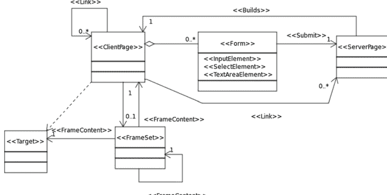

图 1. Conallen UML 元模型的摘。

# Web 测试的最新进展

| <<Link>> | | <<ClientPage>> | <<Form>> | add | <<ServerPage>> |

|---|---|---|---|---|---|

| <<ClientPage>> | Home | ShowProducts | | AddToCart | CartManagement |

| | login | <<Link>> | | <<InputElement>> amount | <<Submit>> | |

| | <<Link>> | | | <<Redirect>> | | | |

| <<ClientPage>> | | <<Form>> | Login | login | <<ServerPage>> |

| | | <<InputElement>> username | <<Submit>> | Authentication | |

| | | <<InputElement>> password | | | |

图 2. Conallen 模型示例。

`<<Builds>>` 关联。页面重定向通过 `<<Redirect>>` 构型建模（由于空间限制，图中未显示）。

页面分为帧，页面加载可以指向特定的目标。这在 Conallen 的标记中使用 `<<FrameSet>>` 和 `<<Target>>` 构型进行建模。

图 2 显示了一个 Conallen UML 模型的示例。建模的网络应用程序是一个典型的电子商务应用程序，使用了用户身份验证、产品浏览和选择、购物车管理、支付和结算。由于空间限制，图 2 仅显示了模型的部分，包括身份验证、产品浏览和购物车管理。

导航从静态客户端页面 Home 开始。从该页面，用户可以决定点击 login 超链接来自己进行身份验证，或者通过移动到客户端页面 ShowProducts 继续浏览产品。Login 页面包含一个具有两个属性（username 和 password）的表单，这两个属性都被标记为 `<<InputElement>>`。此类表单可以提交给服务器。处理身份验证的服务器页面名为 Authentication。

产品浏览在客户端页面 ShowProducts 内部进行。用户可以通过在表单的 amount 文本字段中输入想要添加的产品数量，并将表单提交到服务器页面 CartManagement 来将产品添加到购物车，后者会更新 ShowProducts 页面并将选定的产品存储到持有购物车的数据库中（模型未显示）。

几种 Web 分析和测试方法 [16, 15, 39, 41, 46] 基于 Conallen 的网络建模标记，并使用静态和动态分析来反向工程网络应用程序的 Conallen 模型。实现这些方法的工具基于目标应用程序的导航来提取其页面并构建应用程序的 Conallen 模型。导航可以通过收集导航日志来观察真实用户执行的字段。导航也可以由提取网络应用程序模型的工具刻意执行。这与网络爬虫的活动相似，但有一个显著区别：网络爬虫感兴趣的是提取给定网络应用程序的大部分内容，而反向工程工具相反感兴趣的是导航结构。这意味着如果一个页面根据提交的输入提供不同的内容，爬虫可能会多次访问同一个逻辑页面，而反向工程工具更感兴趣的是探索所有概念上不同的页面，避免在逻辑页面未提供任何额外导航链接时重复访问同一个逻辑页面（此以后逻辑页面是指 Web 页面的模块化设计单元，表示为 Web 模型中的单个元素，例如 Conallen 模型）。工具反向工程页面 Conallen UML 模型的关键问题是识别 LWP。事实上，对 LWP 的不识别会导致模型规模爆炸（当不同页面未映射到公共 LWP 时），或者导致无法表示任何意义的概念抽象（当 LWP 错误地表示不同的逻辑部分时）。这个问题在下面的章节中讨论。

## 算法 1. 从 URL 反向工程 UML 模型

```
**Input:** *u*: URL, starting
**Output:** *m*: UMLModel
function REGEN(u: URL, m: UMLModel)
  p := getPage(u)
  for l: Link in p do
    t := getPage(l)
    if (p, t) not in m
      addLinkToModel(p, t, m)
      REGEN(t, m)
    end
  end
  for f: Form in p do
    a := action(f)
    t := getPage(a)
    if (p, t) not in m
      addFormToModel(p, f, m)
      REGEN(a, m)
    end
  end
end
```

# 表 1 用于建模动态元素的 UML 扩展。

| 类别 | 元素 |

| --- | --- |

| 会话管理 | Session, SessionOp, SessionVar, Cookie |

| 数据库访问 | DBMS, Database, Table, DBOp |

| 文件访问 | File, FileOp |

| Web 服务 | WebService, WSParam |

| 丰富客户端 | ClientScript |

两种两种情况。如果模型中显式可用，则该变量可以用于守卫某些转换（例如，从结账到支付的转换）。这在测试用例生成过程中非常重要，因为有助于减少从模型中获取的不可行测试序列。

数据库和文件访问是显式建模的，因此整个应用程序状态（包括持久化状态）都表示在模型中，并在测试期间可用。事实上，持久化数据值可能会影响从模型中可以生成或无法生成的测试序列。模型包含了关于客户端代码存在的信息，这些代码可能会影响所在页面的结构，包括其链接以及在运行时（可能在动态绑定之后）调用的 Web 服务，这些都在模型中显式表示。

通过应用表 1 所示的扩展，获得的 UML 模型进一步使用了标记值扩展，以表示动态分析期间观察到的频率（例如链接被遵循频率、数据库的访问频率等）以及模型元素之间的数据流（例如数据库记录与页面内容之间的数据流）。该扩展的作者 [3] 认为，此类标记值简化了程序理解，并可以用于检测使用不一致性或安全陷阱。

### 2.2 FSM 模型

Web 应用程序的导航结构也可以建模为有限状态机（FSM）[2]。一个 FSM 由一组状态、一组状态之间的转换以及一组与转换关联的守卫组成。在建模 Web 应用程序时，这些元素可以映射到 Web 实体：

- **状态：** 每个逻辑页面 `lp` 都是 FSM 中的一个状态。抽象函数 `abs` 将每个具体页面 `p` 映射到一个 LWP `lp = abs(p)`。

# Web 测试的最新进展

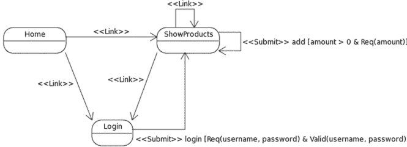

**图 3. FSM 模型示例。**

- **转换：** 如果具体页面 `p'` 可以紧跟在 `p` 之后，因为从 `p` 到 `p'` 存在连接（链接、表单提交等），则在 FSM 中 `lp = abs(p)` 和 `lp' = abs(p')` 之间存在一条转换。

- **守卫：** 对从 `p` 导航到 `p'` 的连接时接受的输入数据 `I` 的约束表示为布尔表达式 `g(I)`，它守卫着 `p` 和 `p'` 对应的两个逻辑页面之间的转换 `lp -> lp'`。

图 3 显示了图 2 中说明 Conallen 表示法的电子商务 Web 应用程序的 FSM。初始状态 Home（首页）对应首页，导航在此开始。可以通过超链接导航到 *Login*（登录）页面和 *ShowProducts*（显示产品）页面。两者都表示为 FSM 中的独立状态。提交登录请求后，用户被重定向到 *ShowProducts* 页面（会话变量或 cookie 可能用于记录导航应用程序的用户的*已验证*状态）。提交 *login*（登录）表单要求用户指定且有效的 *username*（用户名）和 *password*（密码）。该约束表示为从 *Login* 到 *ShowProducts* 转换的守卫。

当从一个产品页面浏览到另一个时，用户可以跟随一个产品的导航链接将产品添加到购物车。当提交 *add*（添加）请求时，必须指定 *amount*（数量）值且大于零。这被表示为 *ShowProducts* 自转换的守卫。

有趣的是，LWP *ShowProducts* 对应于用户导航此应用程序时实际访问的几个不同页面。然而，从建模的角度来看，它被视为单一的逻辑 Web 页面。开发者可以使用多个不同 LWP 的存在，并利用他们的知识构建 UML 或

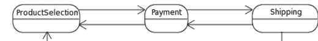

**图 4. 顶层 FSM 模型示例。**

Web 应用程序的 FSM 模型。然而，自动确定此类逻辑 Web 页面非常有用。这是后续小节的主题。

由于相关的尺寸，为大型 Web 应用程序构建单个 FSM 可能是无法负担的。研究人员研究了层次建模复杂应用程序的可能性，利用定义 FSM 层次结构的可能性 [2]，使得中间层表示应用程序的宏状态，而叶节点层表示针对特定宏功能的详细导航结构。通过分解应用程序功能，可以实现页面聚类为互连的、按层次结构组织的宏状态。每个宏功能代表一个宏状态，包含一组本地的页面，这些页面使用类似于图 3 的叶子级 FSM 进行建模。宏功能可以通过专家从 Web 应用程序的顶层菜单中推断得出，这通常使得宏功能区域对用户可见。

图 4 显示了作为运行示例的电子商务应用程序的顶层 FSM。此 FSM 模型中的三个状态 *ProductSelection*（产品选择）、*Payment*（支付）和 *Shipping*（发货）可以展开。*ProductSelection* 状态变为图 3 所示的 FSM。通过组织 Web 应用程序的复杂性，可以有效地支持测试。为叶子级 FSM 生成测试用例，这类似于软件测试中从单元测试到集成测试。

Web 应用程序的 FSM 模型也可以用于形式化验证。一旦感兴趣的时间属性的形式化，模型检查器可以在 FSM 模型上运行以验证它们 [12, 5, 22]。

一个可以使用此方法验证的时间属性示例 [22] 是：一旦你登录，返回登录页面的唯一方法是通过注销页面。这确保了用户不会执行两次验证。

### 2.3 逻辑页面的识别

在动态生成页面的情况下，UML 或 FSM 导航模型可能会爆炸，因此为了构建尺寸合理的模型，导航中的具体页面通过抽象函数 `abs` 映射到 LWP，`lp = abs(p)`，其中 `lp` 是 LWP，`p` 是导航中的具体页面。已有许多方法被自动这种映射 [40, 46, 48]。它们可以分类如下：

- URL 抽象：将每个具体的 URL 映射到抽象 URL，如果两个页面具有相同的抽象 URL，则视为相同的 LWP。

- 文本相似性：通过比较两个具体页面包含的文本信息计算相似性指标，当相似性超过给定的用户阈值时，这两个页面映射到相同的 LWP。

- 结构相似性：使用树匹配算法比较两个具体页面的 HTML 结构，当相似性超过给定的用户阈值时，这两个页面映射到相同的 LWP。

URL 抽象是一种简单的技术，在实践中效果良好 [48]，但应考虑到其局限性。通常，URL 抽象是通过丢弃某些 URL 元素实现的。例如，抽象 URL 可以定义为去除了所有具体参数值的初始 URL（这意味着保留参数名称而丢弃值）。有时丢弃的元素可能有助于区分不同的 LWP。例如，使用分发器来实现 Web 应用程序，所有页面具有相同的 URL 并通过页面标识符区分。如果 URL 抽象丢弃了页面标识符的具体值，所有页面将合并为一个 LWP。通过对此类情况引入特殊修正（例如保留有助于区分 LWP 的具体值），URL 抽象是一种简单且相当准确的技术。

# 16 Paolo Tonella 等人

基于文本或结构相似性的 LWP（逻辑 页面）识别不依赖于请求页面时使用的 URL。当 URL 提供的信息很少，或者无法区分在逻辑上应被视为不同的页面时，这种方法非常有用。页面之间的文本相似性可以通过计算它们的字符串编辑距离 [6]，然后将编辑距离转换为归一化在 0 到 1 之间的相似性值来衡量。给定字符串 `s1` 和 `s2`，它们的编辑距离是使两个字符串相等所需的字符插入/删除操作的最小次数。例如，字符串：

- `s1 = "aabbcc"`

- `s2 = "agbcc"`

我们得到 `dist(s1, s2) = 3`，因为在 `s1` 中，第二个字符 "a" 必须被替换为 "g"（一次删除 + 一次插入），并且必须删除一个字符 "b"，才能使两个字符串相等。编辑距离可以转换为 0 到 1 之间的相似性指标，如下如下：

> `sim(s1, s2) = 1 - dist(s1, s2)/(length(s1) + length(s2)).`

该相似性指标衡量了两个字符串共有的字符的比例。在我们的示例中，`sim(s1, s2) = 1-3/11 = 8/11`（两个字符串 `s1, s2` 中有 8 个共同字符）。


结构相似性也基于编辑距离，在比较的两个页面 HTML 代码的解析树上计算。两棵树之间的距离可以定义为使两棵树相等所需的节点删除和插入的最小次数 [6]。对于以下树 `$t_1`、`t_2`：

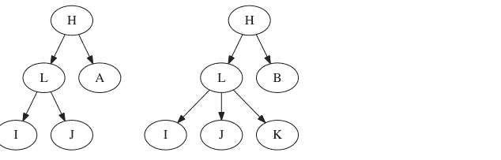

我们得到 `dist(t_1, t_2) = 3`，因为节点 `K` 必须插入 `t_1` 中，且节点 `A` 必须被替换为 `B`。一旦获得编辑距离，我们可以将其转换为相似性指标：

> `sim(t_1, t_2) = 1 - dist(t_1, t_2)/(size(t_1) + size(t_2))`

# Web 测试的最新进展

| 具体的网页页面 P1 | 具体的网页页面 P2 |
|---|---|
| http://www.ecom.com/buy?items=12&cat=3 | http://www.ecom.com/buy?items=13&cat=3 |
| 产品: | 产品: |
| - Cellular HHPP 200 EUR | - Cellular HHPP 200 EUR |
| 添加到购物车 | 添加到购物车 |
| - Cellular CCDD3 250 EUR | - Cellular BBA22 250 EUR |
| 添加到购物车 | 添加到购物车 |

```html
<HTML>
<BODY>Products
<UL>
<LI>Cellular HHMP1... /</LI>
<LI>Cellular CCDD3... /</LI>
<LI>Cellular FFGG4... /</LI>
</HTML>
<HTML>
<BODY>Products
<UL>
<LI>Cellular HHMP1... /</LI>
<LI>Cellular BBA22... /</LI>
</UL>
</BODY>
```

其中树的大小是其包含的节点数。这种相似性衡量了两个树之间共有的节点比例。在我们的示例中，`sim(t1, t2) = 8/11`（两棵树 `t1`、`t2` 中有 8 个共同节点）。表 2 显示了两个网页 P1 和 P2 如何通过 URL 抽象、文本相似性或结构相似性映射到同一个 LWP。基于消除具体参数值的 URL 抽象，将 P1 和 P2 的 URL 映射到同一个抽象 URL：`http://www.ecom.com/buy?items&cat=`。在这里，根据 URL 抽象，这两个页面被识别为同一个 LWP。

P1 文本内容和 P2 文本之间的字符串编辑距离（如表 2 中间所示）为 46。为了使两个页面相等，必须从 P1 中删除一整行（关于 cellular FFGG4 的那行），这相当于删除了 36 个字符（包括空格），并将字符串“CCDD3”替换为“BBA22”，这涉及 5 次删除和 5 次插入。由于两个页面的字符总数为 200，它们的相似性为 164/200 = 0.82。假设这高于选定的阈值，则根据文本相似性，这两个页面被视为一个 LWP。

P1 和 P2 的 HTML 解析树（见表 2 底部 HTML 代码）在一个节点上有所不同。P1 中类型为 `LI` 的第三子节点在 P2 中缺失，P2 包含两个类型为 `LI` 的子节点。在这里，P1 和 P2 之间的编辑距离为 1。树共有 11 个节点，得到的树相似性等于 10/11 = 0.9。假设这高于阈值，根据结构相似性，这两个页面被视为 LWP。

## 3. 输入生成

输入生成（又称测试数据生成）是创建一组输入值（数据）以测试软件应用程序的充分性的过程。它是软件测试的重要部分，特别是在 Web 应用程序背景下。它可能是从用户会话数据中获取的实际数据（存储在日志文件中）[20, 42]，也可以是专门用于测试 Web 应用程序的人数据。输入生成是一个复杂的问题，在过去的几年里提出了许多解决方案，但似乎没有哪一个是决定性的。

Web 应用程序的测试用例是访问的页面序列加上提供给接口页面的输入值 [40]。在本节中，我们使用 Web 表单作为定义 Web 应用程序接口的主要机制。表单用于收集供 Web 应用程序处理的输入数据。使用了超越 Web 表单输入机制的 RIA（富交互应用程序）[21] 将在第 5 节考虑。RIA 的接口识别算法已由 Halfond 等人 [21] 和 Elbaum 等人 [18] 研究。

基于 HTML 表单的 Web 接口可以被识别为：(1）每个表单对应一个接口，(2）表单中的每个输入元素（例如文本框、单选按钮或隐藏字段）对应该接口的一个输入参数（一个三元组：名称、数据类型¹以及一个或多个输入值）。

产生/构建在 Web 测试期间使用的输入值的问题可以通过手动或（半）自动的方法来处理。

- **[手动技术]** 这些技术是最先提出的 [16, 40]；输入值由测试人员手动插入，或通过测试人员之前填充过的文件/数据库恢复。通常，值由测试人员使用传统的测试技术产生，例如等价类划分 [37] 和边界值分析。

- **[(半自动技术]** 这些技术较较新；测试数据生成阶段由工具辅助。在某些情况下，输入¹ 值的类型（例如字符串或整数）可以与相应的表单元素关联。

Web 测试的最新进展 19

在某些情况下，输入值是随机生成的（例如通过模糊测试 [23]），在其他情况下，输入值是通过组合信息创建的：从表单中提取（例如选择一个或多个值），从 HTML 渲染推导出（例如字符串或整数），以及从公共资源中恢复 [25, 38]。最后，还有更先进的技术通过静态、动态或两者地分析服务器端代码（例如 PHP 或 JSP）并应用符号执行和约束求解来自动生成值 [4]。另一类方法是捕捉存储在日志文件中的用户会话数据并利用这些信息引导测试用例生成 [19, 20]。

下文中介绍了介绍了生成背景下提出的手动和半自动技术。

### 3.1 手动技术

如上所述，测试用例是请求页面的 URL 序列，以及需要分配给输入变量的值。相反，准测试用例仅是 URL 序列，没有输入值。例如，应用程序的一个可能的测试用例（见图 2）可以是：

```text
http://www.our-ecommerce.com/Home.html
http://www.our-ecommerce.com/ShowProducts
http://www.our-ecommerce.com/Login.html
http://www.our-ecommerce.com/Authentication?username=X&password=Y
http://www.our-ecommerce.com/CartManagement?productId=Z&amount=w
```

X、Y、Z 和 W 是必须实例化值以获得测试用例的变量。例如，我们可以这样实例化变量并获得以下测试用例：

```text
http://www.our-ecommerce.com/Home.html
http://www.our-ecommerce.com/ShowProducts
http://www.our-ecommerce.com/Login.html
http://www.our-ecommerce.com/Authentication?username=admin&password=admin
http://www.our-ecommerce.com/CartManagement?productId=123&amount=2
```

最早提出的 Web 应用程序的测试技术之一 [40] 产生了两个阶段自动化的准测试用例，且不支持测试数据生成。在第一阶段，增强型 Web 爬虫能够遍历目标 Web 应用程序并构建导航图。在第二阶段，遵循 Beizer [7] 提出的算法生成匹配导航图的路径表达式（即图中所有路径的代数表示）。该路径表达式被用于生成能够满足覆盖准则（例如页面覆盖和超链接覆盖）的准测试用例。

与图 2 中网络模型略微简化版本对应的路径表达式（为了简单起见，我们删除了首页（Home）和登录（Login）之间的链接）：

`e5 (e10e2e3e4+e7e89e11)*`

其中“*”表示紧邻前面的路径表达式出现零次或多次，而“+”表示备选方案。上述测试用例对应于路径 `e510e2e3e4e7e89e11`，满足了简化版网络模型的页面和超链接覆盖准则。

一旦从路径表达式生成测试用例，测试工程师必须为通过表单收集的变量插入输入值，利用传统用于黑盒测试的技巧（例如等价划分或边界值）。

Di Lucca 等人 [16] 提出了一种类似的手动方法。Di Lucca 等人 [26] 开发了一个包含客户端脚本和用于测试应用程序的工具（WAT）的 Web 应用程序。该方法的特点是使用了决策表，这有助于生成有效的测试用例并为测试用例的表示增加正式性。图 5 显示了我们电子商务网站服务器页面“认证”（Authentication）的决策表示例。

| 变体 | 输入变量 | 预期输出操作 | 测试后的会话变量 |
|---|---|---|---|
| | 用户名 | 密码 | |
| 1 | 略 | 不关心 | 重定向到认证页面 | 空 |
| 2 | 不关心 | 略 | 重定向到认证页面 | 空 |
| 3 | 正确 | 正确 | 重定向到显示产品页面 | 用户的电子邮箱地址 |
| 4 | 错误 | 不关心 | 显示错误信息 | 空 |
| 5 | 不关心 | 错误 | 显示错误信息 | 空 |

图 5. 服务器页面“认证”的决策表示例。（如需此图的彩色版本，请参考本章节的在线版本）。

Web 测试的最新进展

测试过程分两个阶段执行：在第一阶段，提取网络模型；第二阶段，在编译决策表期间，由嵌入 WAT 的测试用例管理器协助测试工程师。在实践中，通过分析目标 Web 应用程序的测试模型并寻找与给定页面相关的输入/输出变量和操作，测试用例管理器能够定制相应的决策表。然而，与之前的工作 [40] 一样，实际输入值的选择由测试工程师决定。

### 3.2 （半）自动技术

#### 3.2.1 隐藏网络爬虫

测试数据生成背景下的早期工作涉及开发能够从所谓的“隐藏网络 [25, 38]”中提取内容的爬虫。隐藏网络（或深层网络）是互联网的一部分，搜索引擎无法索引，因为它隐藏在输入表单之后，例如在可搜索数据库中。人们已经，设计隐藏爬虫（即能够自动解析、处理并与基于表的 Web 界面交互的爬虫）面临巨大的技术挑战 [38]。但主要挑战是如何为爬虫配备必要的输入值（即如何“填写表单”）。

隐藏爬虫的原型是 `HIWI` [38]。`HIWI` 由三个部分组成：(1) 表单提取器，用于为表中的每个元素提取某种描述信息或标签；(2) 值数据库，称为标签值集（`LVS`）表，根据有限数量的概念或类别组织，每个概念也与标签相关联；(3) 匹配算法，能够将表单标签与数据库标签匹配以计算候选值集。

`HIWI` 的工作原理简单。像任何传统爬虫一样，`HIWI` 从给定的 URL 开始爬取 Web 应用程序。对于每个覆盖的表单，它收集每个表单。对于具有有限域的元素（即有效值集已嵌入网页的元素——例如选择列表），`HIWI` 使用嵌入的值。相反，对于具有无限域的元素（带有自由格式输入，如文本字段和区域），它在 `LVS` 表中搜索（通过匹配算法）之前已存储过值的相应类别。如果存在该类别，则恢复值并填充表单；否则，向用户请求值。更准确地说，给定一个表单 `F`，匹配函数为每个元素 `E_i` 从 `LVS` 表中提取一组值 `V_i`。然后，通过所有 `V_i` 的乘积获得对表单输入的若干次赋值 `{E_1 ← v_1; …; E_n ← v_n; v_i ∈ V_i, i = 1 … n}²`。

`HIWI` 支持向 `LVS` 表添加条目的多种机制。首先，`HIWI` 可以在设置时手动提供标签和关联值。其次，`HIWI` 在 `LVS` 表中内置了某些常用类别的条目，如日期、时间、月份名称和星期。第三，`HIWI` 可以通过查询 Web 上的各种数据源（例如 Yahoo 目录）来通信并接收条目。最后，对于表单爬取发现的每个有限域元素，`HIWI` 提取该元素的标签和域值并将其添加到 `LVS` 表，从而扩充知识库。

#### 3.2.2 自动化等价划分和边界值分析

最早解决 Web 测试中半自动输入生成问题的工作之一是 Deng 和 Wang [13]。Deng 和 Wang 扩展了 `AGENDA` [10]，这是一个用于测试数据库应用程序的工具，通过静态分析带有 Servlet 和 JDBC 的服务器端代码来 SQL。这些信息用于构建网络模型，其中节点表示 Web 页面，边表示超链接。使用路径技术 [33]，在图中选择一组路径并生成测试用例（类似于其他工作 [40] 中的方法）。从服务器端代码提取的信息用于引导 `AGENDA` 生成 URL 的输入值。最后，URL 及其输入值存储在 XML 文件中，`AGENDA` 自动执行。在实践中，`AGENDA` 将整数、浮点和无类型数据分组。

#### 3.2.3 模糊测试（Fuzz Testing）

模糊测试是一种使用大量随机数据作为输入来发现传统软件、操作系统或网络故障和安全漏洞的软件测试技术。这些被称为模糊或攻击输入 [44]。为了指定如何对 Web 应用进行模糊，可以编写攻击脚本 [23]。

攻击脚本指定目标应用程序的全局变量，如主机名和端口、头部和 Cookie 以及“攻击点”。攻击点主要是 Web 页面输入表单。在每个攻击点，可以指定：(1) 攻击哪个页面路径；(2) 使用的 HTTP 方法（GET 或 POST）以及哪些查询选项。查询选项是表示域类型和值生成（模糊令牌）的一种方式。

例如，我们电子商务应用程序（见图 2）可能的攻击脚本可以是：

```ruby
setup "Webapp" do
  @host => "www.our-ecommerce.com"
  @port => 8080
  @headers => "HTTP_ACCEPT_CHARSET" => "utf-8,*"

  attack "CartManagement" do
    once : get, "/Login.html", :query =>
      {:username => :admin, :password => :admin}

    many : post, "/ShowProducts", :query =>
      {:productID => integer(3), :amount => integer(2)}
  end
end
```

# 24 Paolo Tonella 等人

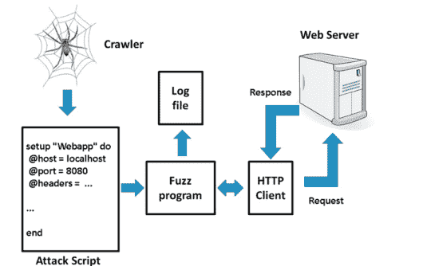

**图 6.** 模糊器（Fuzzer）组件。由爬虫半生成的攻击脚本被输入到模糊器中。模糊器程序产生 HTTP 请求并将其发送到目标 Web 应用程序。请求和响应被记录以供人工检查。（如需查看此图的彩色版本，请参阅本章的在线版本）。

对攻击脚本进行评估后，“调用一次”（`once` 关键字）结果仅产生一个请求（在我们的示例中为 "once": `get ./Login.html`），并在查询关键字后放置指定值（在我们的示例中为 `admin` 和 `admin`）。另一方面，“调用多次”（`many` 关键字）会产生一系列请求，次数是预定义的且可配置的。在我们的示例中，`integer(3)` 和 `integer(2)` 是模糊测试令牌，它们每次将随机生成一个为 3 和 2 的不同整数。由于创建这些攻击脚本会非常耗时，因此提出了一种遍历目标 Web 应用程序的工具（某种爬虫），用于生成攻击脚本骨架 [23]。在爬取过程中，会分析每个页面、识别表单并自动生成攻击脚本骨架。图 6 给出了所提模糊器主要组件的概述 [23]。

#### 3.2.4 基于用户会话的技术

限制手动输入定义的 Web 应用程序测试技术 [40] 的因素是寻找合适输入值的成本。为了缓解这一点，Elbaum 等人 [19, 20] 提出了一系列基于用户会话数据的技术。基于用户会话的技术：

1. 在用户使用 Web 应用程序时收集用户交互信息；
2. 以 URL 和键值对的形式存储客户端请求；以及
3. 应用策略来生成测试用例。

可以使用多种机制来捕获和存储用户会话数据（例如最简单的方法之一是配置 Apache 服务器记录所有收到的请求）[20]。

Elbaum 等人 [19, 20] 提出的技术本质上有四种。简单的技术通过直接重放单个用户会话来重用用户会话数据，类似于捕获-重放工具（例如 Rational Robot’）。第二技术重放来自多个用户会话的混合交互。第三种技术重放经过修改的会话（例如对与键值对相关的字符串值中的字符进行随机/删除/修改）。第四种技术将基于用户会话的方法与来自 Web 模型的准测试用生成相结合 [40]。在实践中，该技术通过尝试匹配用户会话序列和数据与路径表达式生成的准测试用例，减少了测试人员的工作量。

这里是我们的电子商务应用程序的访问日志示例（见图 2），为了演示对其进行了略微简化处理：

```text
h1.d1.com Home
h1.d1.com Login
h2.d2.com Home
h1.d1.com Authentication & username=admin & password=admin
h2.d2.com ShowProducts
h1.d1.com CartManagement & productId=123 & amount=2
h3.d3.com Home
h3.d3.com Login
h2.d2.com ShowProducts
h3.d3.com Authentication & username=phil & password=ric
h1.d2.com CartManagement & productId=211 & amount=6
h2.d2.com Login
```


特别地，假设时间戳与日志中的每个条目相关，尽管未显示。第一列包含请求 Web 页面的主机名称（例如 `h1.d1.com`）。下一列包含请求的页面名称，随后是提供给 Web 服务器的键值对（例如通过 `GET`）。当发现同一主机的请求在适当的时间间隔内出现（这取决于用户会话数据存储机制的特定实现），则假设正在从之前访问的页面跳转到新页面。否则，如果一个页面的直接请求后没有来自同一主机的其他请求，则被解释为导航会话的终止。

> 4 `http://www-01.ibm.com/software/awdtools/tester/robot/`

使用 Elbaum 等人提出的第一种技术生成的测试用例示例，可以是由 Web 应用程序管理员（主机 = `h1.d1.com`）遵循的路径推出的，登录后将 ID 等于 `123` 和 `211` 的产品添加到购物车。使用第二种技术生成的测试用例示例，可以通过如下方式混合主机 `h1.d1.com` 和 `h2.d2.com` 的路径获得：

```text
h1.d1.com Home

h1.d1.com Login

h2.d2.com Showproducts

h1.d1.com CartManagement & productId=123 & amount=2
```

如果我们的电子商务应用程序实现正确，该测试用例应该导致错误页面（用户在订购产品之前必须经过身份验证）。使用第三种技术生成的测试用例可以是测试身份验证的错误凭据的（例如 `username=admin & password=admin`，其中密码值中的最后一个 `"n"` 被拒绝了）。最后，为了实现图 2 中 Web 模型的链接覆盖，只需匹配 `h1.d1.com` 和 `h2.d2.com` 的用户会话即可。

#### 3.2.5 符号执行与约束求解

使用 Elbaum 等人提出的第一种技术生成的测试用例示例，可以是由 Web 应用程序管理员（主机 = `h1.d1.com`）遵循的路径推出的，登录后将 ID 等于 `123` 和 `211` 的产品添加到购物车。使用第二种技术生成的测试用例示例，可以通过如下方式混合主机 `h1.d1.com` 和 `h2.d2.com` 的路径获得：

```text
h1.d1.com Home

h1.d1.com Login

h2.d2.com Showproducts

h1.d1.com CartManagement & productId=123 & amount=2
```


如果我们的电子商务应用程序实现正确，该测试用例应该导致错误页面（用户在订购产品之前必须经过身份验证）。使用第三种技术生成的测试用例可以是测试身份验证的错误凭据的（例如 `username=admin & password=admin`，其中密码值中的最后一个 `"n"` 被拒绝了）。最后，为了实现图 2 中 Web 模型的链接覆盖，只需匹配 `h1.d1.com` 和 `h2.d2.com` 的用户会话即可。

### 符号执行与约束求解

所提出的方法结合了动态分析、符号执行（将输入变量视为符号变量 [24]）和约束求解（找到必须满足约束集合的解 [47]），用于自动生成 Web 应用程序的输入值。符号执行引擎在执行期间记录 Web 应用程序的路径约束。随后，动态符号执行的测试 [43] 被应用于 Web 应用程序。该方法通过否定路径条件中的每个约束并求解修改后的约束，迭代地产生新的输入，以探索控制图中的不同路径。

## 4. 指标

通过第 2 节描述的技术构建的 Web 应用程序模型可以用于导出引导和支持的指标测试活动 [8, 28]。在对被测 Web 应用程序执行测试后，可以根据测试用例执行期间收集的覆盖率信息获取指标。此类覆盖信息可以映射到模型元素（例如遍历的页面和链接），也可以确定覆盖率指标。这些指标可以被充分性标准 [8] 或爬取性指标 [28] 使用。

当用作*充分性标准*时，指标决定了测试的停止条件。如果某些充分性指标高于用户定义的阈值（通常表示为最大可能值的百分比），则认为该 Web 应用程序已通过充分的测试。例如，在测试期间必须访问 100% 的 Web 页面。

指标也可以用作*爬取性指标*，以确定在模型构建期间是否对 Web 应用程序进行了充分的探索。如果一个 Web 应用程序包含某些页面测得的爬取性指标较低的页面，则会警告用户部分 Web 应用程序可能未被探索。通过对那些较难爬取的部分进行强化爬取（可能需要人工干预），可以获得一个更完整的模型，这反过来与一组能够更详尽地执行 Web 应用程序的测试用例相关。

其他工作 [9, 14] 引入了与测试并非直接相关的 Web 指标。这些指标关注 Web 应用程序终端用户的导航关注点，并考虑了由于导航结构复杂性导致的定向迷失、不一致性以及缺乏层次化导航结构等现象。信息检索指标 [14] 被引入用于确定页面与特定信息需求的相关性，以及给定页面提供的信息的质量。

某些为了表征 Web 应用程序终端可用性而定义的概念（如索引节点和中心节点的概念 [9]）已被用于定义 Web 测试期间的指标。

*索引节点*是一个支持大量 Web 页面完全可达的节点，它指向导航图中不同子部分的入口页面。可以通过测量节点的出度来自动识别索引节点。当出度高于用户定义的阈值时（例如 `μ + 3σ`，其中 `μ` 是对所有节点计算的平均出度，`σ` 是出度的标准差），即可识别出一个索引节点。

*中心节点*是一个节点，通过测量每个节点到导航图中所有其他节点的距离之和，来确定其与所有其他节点的距离。当无法从给定节点到达某个节点时，相关的距离被分配一个较大的常数值。到所有其他节点的距离低于用户定义的阈值（例如 `μ - 3σ`，其中 `μ` 是平均累积距离，`σ` 是累积距离的标准差）的节点被视为中心节点。

### 4.1 充分性指标

表 3 显示了文献 [8, 40] 中提出的某些充分性指标，用以支持 Web 测试中测试停止标准的定义。停止标准的形式为一个或多个指标值高于或低于用户定义的目标充分性值。

我们可以根据充分性指标覆盖的特征对表 3 中的充分性指标进行分组。具体而言，前四个指标（`PCOV`、`LCOV`、`IPATH`、`KPATH`）针对结构覆盖；接下来的三个（`INODES`、`IEDGES`、`SCC`）覆盖宏观功能；最后四个指标（`CNODES`、`CEDGES`、`PNODES`、`PEDGES`）根据页面在导航结构中的位置针对页面进行。

结构的覆盖可以作为测试期间的停止标准。例如，标准 [`PCOV = 100%`] 要求生成测试用例，直到 Web 应用程序模型中的页面在至少一次测试用例执行中被遍历。

| 缩写 | 指标 |
| :--- | :--- |
| `PCOV` | 页面覆盖：测试套件覆盖的 Web 页面数量 |
| `LCOV` | 链接覆盖：测试套件覆盖的 Web 页面之间的链接数量 |
| `IPATH` | 独立路径覆盖：测试套件覆盖的线性独立路径数量 |
| `KPATH` | 路径覆盖：测试套件覆盖的路径数量，在这些通过展开循环 1 ... `k` 获得的路径中 |
| `INODES` | 索引节点：测试套件覆盖的索引节点数量 |
| `IEDGES` | 索引边：测试套件覆盖的索引节点发出的边数量 |
| `SCC` | 强连通分量：测试套件覆盖的强连通分量数量 |
| `CNODES` | 中心节点：测试套件覆盖的中心节点数量 |
| `CEDGES` | 中心边：测试套件覆盖的中心节点发出的边数量 |
| `PNODES` | 边缘节点：测试套件覆盖的非中心（边缘）节点数量 |
| `PEDGES` | 边缘边：测试套件覆盖的非中心（边缘）节点发出的边数量 |

一个更严格的标准是 [`LCOV = 100%`]，它不仅要求所有页面都被遍历，还要求页面之间的链接也被遍历。

基于路径的标准更为严格。当标准为 [`PATH = 100%`] 时，需要对线性独立路径进行覆盖。一组独立路径可以通过将每条路径表示为整数向量来获得，该向量表示当路径被遍历时模型中边执行的频率。从这种路径的向量表示中，可以确定一组线性独立向量，其相关的路径即为需要覆盖的路径。

一个较弱但更具实用性的请求可能是 [`PATH ≥ 90%`]，因为覆盖某些独立路径可能困难。当使用 `KPATH` 指标且 `k` 为用户定义的小常数时，所有路径都是在循环展开 0、1、……、`k` 次后生成的。与独立路径类似，对所有路径的覆盖在标准为 [`PATH ≥ 90%`] 时是可行的，因为覆盖某些独立路径可能困难。对于更应用程序的路径。

在测试 2 中，为了满足 [`PCOV = 100%`]，确保所有页面在至少一次测试用例执行中被遍历。对于 Web 应用程序模型中的页面。

然而，为了满足 [`LCOV = 100%`]，必须添加测试套件。例如，对于 Web 应用程序模型 2，充分的测试套件可以是：

- `(Home, Form, Authentication, ShowProducts, AddToCart)`
- `(Home, ShowProducts)`
- `(Home, ShowProducts, Authentication, AddToCart)`
- `(Home, ShowProducts, AddToCart)`

因此，这种分量通常对应于 Web 应用程序的宏观功能。

- `(Home, ShowProducts, Authentication, AddToCart)`
- `(Home, ShowProducts)`
- `(Home, ShowProducts, Authentication, AddToCart)`
- `(Home, ShowProducts, AddToCart)`

### 4.2 可爬取指标

Web 爬虫是试图尽可能探索目标 Web 应用程序的工具。爬虫能够彻底探索 Web 应用程序的可能性取决于它在遇到表单时提供的输入数据。事实上，只有当爬虫具备提供满足某些约束条件的输入数据的能力时（例如，通过客户端/服务端输入验证的值，否则用户导航将受阻在当前页面），其 Web 应用程序的某些部分才能被导航。

如果自动化爬虫无法生成正确的输入值，可能会导致 Web 应用程序的大部分未被探索。因此，从爬取的页面构建的 Web 应用程序模型可能是 Web 应用程序的局部，而不是整个 Web 应用程序。

引入可爬取指标 [28] 用于预测当前可用 Web 模型中是否存在表单，使得爬虫的能力不足以对从这些页面到达的概念页面进行完全探索。因此，我们通过可爬取性来指示表单（扩展到 Web 应用程序）能够被具有给定能力的自动化爬虫完全遍历的属性。可爬取指标试图量化这种属性。

Web 应用程序的可爬取性衡量爬虫探索所有概念页面的难易程度 [28]。我们考虑的是概念页面而非具体页面，因为后者的数量可能是无限的，且仅由于微小的、无关的元素而产生差异。

探索 Web 应用程序的主要困难源于表单及其接受的输入数据。事实上，只有指定约束的输入数据允许爬虫访问某些概念 Web 页面。除非提前完全已知 Web 应用程序的模型，否则无法精确测量可爬取性，这使得测量在实际用途中没有意义。因此，我们求助于可爬取指标，它为 Web 应用程序及其表单的实际可爬取性提供近似估计。出于这一原因，可爬取指标也被称为爬取指示。

如图 7 所示，可爬取指标是通过分析与表单相关的服务端和客户端代码计算的。此类指标可以用于识别在可爬取指标低值相关的表单上进行自动化输入生成的投入（见图 7 中的活动 (5a)）。它们还可以用于为测试人员提供正在被探索的表单排序列表。列表的最顶端是可爬取指标低的表单。然后，测试人员可以提供手动构造的输入数据（活动 (6)），以确保这些表单在爬取过程中也被完全探索。

通过根据图 7 所示的使用模型应用可爬取指标，可以最大化对 Web 应用程序的探索，从而确保从此类探索构建的模型尽可能完整。构建完整模型是基于模型的 Web 测试期间的关键需求。

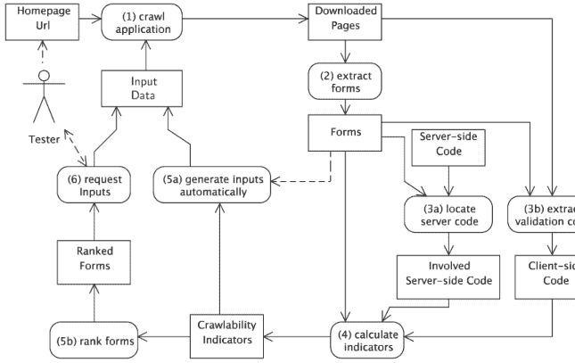

图 7. 爬取指示的计算与使用 [28]。

表单的可爬取性取决于 Web 爬虫中实现的特定能力。实现更高级输入生成策略的爬虫遇到的使其难以爬取的表单会更少。

图 8 显示了可以在 Web 爬虫中实现的能力的分类法。这些能力在之前的工作 [28] 中经过了实证研究。简单的爬虫仅实现：

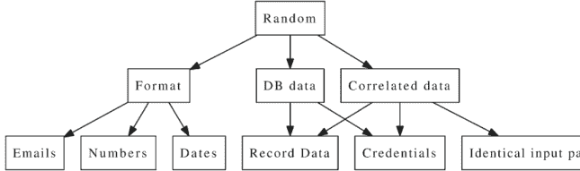

图 8. 爬虫能力的分类法 [28]。

层级结构顶端的能力是随机字符串生成。可以生成特定的字符串，要么是为了满足特定格式（例如电子邮件、数字、日期），要么是从数据库记录中获取值，以确保某些相关性成立（例如用户凭据中用户名和密码之间的相关性）。

在他们之前的工作 [28] 中，作者发现能力增加的爬虫可以探索不断增加的页面，但并非所有能力对额外的探索都有贡献。特别是在所考虑的 Web 应用程序中，四种能力（随机字符串生成、相关数据生成、记录重用和数字生成）占了具备所有能力的爬虫可以探索的页面的 80% 恢复率。

- 基于表单提交时执行的服务端代码以及执行验证的客户端代码，定义了用于（缺乏）的指标（见表 4）：`ICC`、`SL-ICC`、`NOF` 和 `JICC`。服务端指标基于圈复杂度 [32] 的概念，该复杂度衡量了图中独立路径的数量。当应用于程序的控制流图时，它指示了决定不同程序执行的决策点数量。
- 由于生成不同的、备选的概念页面与服务端代码中相关的控制点数量有关，因此处理表单并根据表单提交生成 Web 页面的服务端代码的跨过程圈复杂度是可爬取性指标的一个非常自然的候选。事实上，当处理表单的服务端逻辑复杂时，对于爬虫来探索所有由服务端生成的可能的页面会更困难。
- `ICC` 实际上是可爬取性的反向指标（或缺乏爬取性的指标），因为 `ICC` 高值表示可爬取性低，反之亦然。

### 表 4. 可爬取指标 [28]

| 缩写 | 服务端 |
| --- | --- |
| `ICC` | 跨过程圈复杂度：控制流图中独立路径的数量 |
| `SL-ICC` | 切片 ICC：输入语句切片和输出语句切片交集的圈复杂度 |
| `NOF` | 表单中的字段数量：表单中可枚举字段的数量 |
| `JICC` | Javascript 输入验证例的圈复杂度 |

`ICC` 作为表单“真实”可爬取性代理的主要局限是它也考虑了与页面无关的条件。为了过滤此类条件，可以采用页面切片 [45, 49]。

静态后向/向前页面切片对于特定的程序状态（程序语句处的变量值）相关的子程序。`SL-ICC` 指标通过测量两个切片交集上的 `ICC` 获得：后向切片（来自输出语句）向前切片（来自输入语句）。从这种交集获得的子程序包含了从表单提交（输入语句）提供的值计算动态生成的页面（在输出语句处产生）。此类切片内部的独立路径与处理表单的服务端代码可以获得的不同页面数量特别相关。

通常循环对生成备选页面没有贡献，但每个循环增加一条独立路径，因为每个循环涉及一个额外的决策点（循环条件）。可以定义 `ICC` 和 `SL-ICC` 指标的变体，这些指标被称为 `ICC-L0` 和 `SL-ICC-L0`，忽略循环。这些可以通过减去处理表单的代码中的循环数量获得。

在客户端，表单中许多字段的存在意味着根据这些字段的值及其组合可能有不同的输出页面。因此，表单中的字段数量 `NOF` 是一个可爬取指标。另一个客户端切片指标是 `JICC`，衡量 Javascript 输入验证例程序的圈复杂度。在这种情况下，假设是更复杂的例程与自动化爬虫难以通过的验证检查相关。

表 4 所示的指标在之前的研究 [28] 中经过了实证验证。该研究的作者发现，所有四个提议的指标都与“真实”可爬性测量（在他们的研究中手动确定的）相关，且这种相关性在统计上是显著的。相关性最高的指标是 `SL-ICC-L0`。当用于双曲：

`SL-ICC-L0` 指标作为“真实”可爬性衡量标准的预测器，表现出非常好的性能，预测准确率高且预测误差低。然而，如果目的是生成一个按可爬性从低到高排序的表单列表（见图 7），那么比 `SL-ICC-L0` 计算容易的 `ICC-L0` 可爬性指标就足够了 [28]。

一旦提供了难以自动爬取的表单列表，测试人员就可以手动验证额外的输入值，以确保获得完整的应用模型。反之，这对于 Web 应用的有效模型测试至关重要。

## 5. 富客户端

现代客户端脚本语言（例如 Javascript、Actionscript）允许开发者实现富交互应用程序（简称 RIA）。RIA 是具有先进、复杂且交互式用户界面的 Web 应用程序，这些界面无法通过传统的 Web 范式实现。

图 9 直观地总结了基于 Ajax 技术 [50] 的传统（同步）与现代（异步）Web 之间的主要区别。传统的 Web 范式（图 9 的左侧）实际上基于同步请求/响应协议，该协议会在一个网页与下一个网页之间引入延迟，阻止了需要短响应时间的交互。

在传统的 Web 应用中，例如：

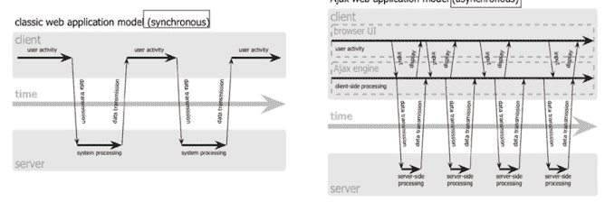

图 9. 同步与异步：Ajax Web 应用程序示例。（如需此图的彩色版本，请参阅本章节的在线版本。）

点击表单提交按钮或链接会从用户的 Web 浏览器向运行中 Web 应用的服务器端组件发出同步 HTTP 请求。此类组件可以通过发送整个网页的完整代码（例如 HTML、嵌入式脚本代码、样式表）到客户端浏览器来处理请求并给出答案，这意味着服务器端的处理阻塞了客户端，即客户端仅在等待从服务器组件获取新页面（图 9 的左下方）。

与传统 Web 应用采用的同步通信协议不同，现代 RIA 采用了一种基于异步请求响应协议的通信范式（图 9 的右侧）。这种通信协议允许开发者实现 RIA，其中用户可以直接与位于客户端的用户界面（Web 页面）元素进行交互；服务器端组件的反馈不需要重新加载整个 Web 页面（图 9 的右下方）。

刷新客户端页面部分所需的数据在客户端和服务器组件之间交换，从而实现了一个动态且响应的界面，其中每个独立元素都积极贡献于丰富用户体验。

具体而言，以下方面刻画了 RIA 与传统 Web 应用的特征：

**富事件-用户界面：** RIA 基于一个丰富且响应迅速的客户端界面，该界面驱动应用行为。为了这一目标，RIA 大量地使用了由客户端脚本代码（例如 JavaScript 代码）管理的用户界面事件。

**基于 DOM 的状态：** 传统的 Web 应用基于多页导航，页面通过超链接（HTML 中的 `<a>` 标签）连接。不同的是，RIA 通常是单页应用，页面之间的导航被页面文档对象模型（DOM）结构的变化所取代，并根据应用程序与用户之间的异步交互而变化。因此，应用维护有关其客户端页面的状态信息，并根据应用行为在运行时对其演进。

**基于 DOM 的导航：** 在 RIA 中，基于超链接连接页面的传统导航系统被基于 DOM 的导航系统取代，其中用户界面的每个元素（图像、按钮、文本区域、输入值）都对导航做出贡献，因为它们可以在运行时由应用设置为可点击状态（例如添加 `onclick` 事件），与此类界面事件相关的请求被发送到服务器并进行异步处理，无需重新加载页面。

**状态的动态更新：** 单页 RIA 根据用户界面交互以及 DOM 对象与服务器组件之间的异步通信在运行时进行更新。

**异步通信：** RIA 用户界面的每个元素都可以向服务器组件异步发送 HTTP 请求（例如通过 JavaScript 使用 AJAX 对象），并利用其响应来演进应用并独立更新页面的某些部分。

**原始数据通信：** RIA 客户端和服务器组件之间的异步通信基于嵌入在 XML 中的原始数据（例如字符串、文本、对象），而不是传统 Web 应用中的 HTML 页面。这意味着客户端和服务器组件能够独立于应用的其他元素发送、接收和分析数据，而这些元素不需要重新加载。

图 10 显示了模拟简单购物车的 Ajax RIA 截图，这是一个允许用户在购物车中添加或删除项目（即产品）的电子商务应用程序。图 11 勾勒了购物车用户界面架构和 DOM 结构的概视图。它展示了：

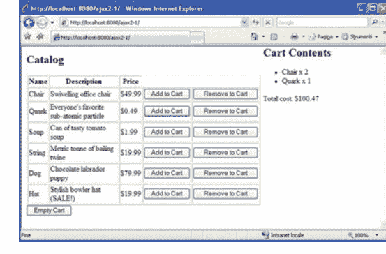

图 10 显示了模拟简单购物车的 Ajax RIA 截图，这是一个允许用户在购物车中添加或删除项目（即产品）的电子商务应用程序。图 11 勾勒了购物车用户界面架构和 DOM 结构的概视图。

### 动态分析方法

Marchetto 等人 [29] 和 Mesbah 等人 [36] 应用了两种不同的动态分析方法。

**用户实际执行：** 前一种方法 [29] 通过观察用户与 RIA 用户界面的实际交互来收集执行轨迹。Marchetto 等人 [31] 提出了 `ReAjax`，这是一种工具，使用一系列技术（例如 JavaScript、Ajax、DOM、浏览器事件模型）来收集 RIA DOM 实例的运行时信息（即 RIA 用户界面的状态），以及由用户界面事件触发的回调，这些回调可能导致 DOM 变化（即从一个 RIA 实例/状态到另一个状态的转换）。

**基于爬取的执行：** 后一种方法 [35] 则通过观察爬虫的行为来收集执行轨迹。Mesbah 等人提出了 `Crawjax` [35]，这是一种爬虫，可以执行客户端脚本代码，旨在识别 RIA 用户界面中可点击的元素，这些元素可以改变 RIA 界面状态（即 DOM 实例）。

`Crawjax` 通过模拟输入事件（例如鼠标点击、文本输入）以及从固定数据库输入数据来驱动 RIA 用户界面。`Crawjax` 检查发现的 DOM 实例，以识别组成它们的可点击元素：所有属于某种事件类型（例如鼠标点击）的元素。`Crawjax` 通过基于字符串和树的比较算法对访问过的 DOM 实例进行检测。

因此，`ReAjax` 和 `Crawjax` 执行动态分析的目的是收集包含以下信息的执行轨迹：

1. 应用 DOM 实例的内容和结构；
2. 在应用用户界面中执行的、对 DOM 产生任何影响的事件和回调。

例如，下面的日志片段显示了 `ReAjax` 为 `Cart` 应用收集的执行轨迹：

```text


`onload : http://localhost/cart/`

```
[/body/div[@id='Content']]
```

`click : AddToCart`

```
[/body/div[@id='1'],/body/div[@id='Total']]=10$
```

`click : RemoveFromCart`

```
[/body/div[@id='Content']]=0
```

`unload http://localhost/cart/`

```
[/body/div[@id='Content']]=0
```

在这样的日志中，我们观察到一个执行会话，其中用户向购物车添加了一个项目并将其移除。详细而言，`ReAjax` 追踪了在应用界面中执行的事件（例如点击“AddToCart”和“RemoveFromCart”按钮）以及一个用逗号分隔的 XPath 字符串列表，这些字符串表征了 `Cart` DOM 实例的元素（即列表名“Content”、字段名“Total”以及它们内容的值）。

`Ajax` 通过采用半自动动态分析来收集这些执行轨迹，在这种分析中，要求用户识别相关的执行场景，而工具对用户透明地追踪 RIA 信息。如果用户对应用分析没有足够的知识，像 `Elbaum` 等人和 `Sampath` 等人 [20, 42] 提出的方法可能对用户有所帮助。

另一方面，`Crawlax` 通过应用基于爬取技术的半自动动态分析，克服了对这类应用知识的需求，该技术通过识别可点击的用户界面元素并通过模拟输入驱动这些元素来探索应用。通过爬取应用，`Crawlax` 限制了用户所需的努力和应用知识。然而，当所需的特定输入无法自动产生时，它可能会卡在应用程序的某个部分。因此，它的有效性取决于爬虫自动发现并到达应用测试每个部分的能力。

## 5.2 模型挖掘

从收集的执行轨迹中，`ReAjax` 和 `Crawlax` 挖掘出用户界面的模型。通过以下方式挖掘出两种类型模型：

### [有限状态机 (FSM)]

`ReAjax` 推断出一个 FSM，其中机的每个状态代表用户界面的一个 DOM 状态（实例），而机的每个转换代表改变 DOM 状态的事件/回调的执行。为了避免状态爆炸问题（即 FSM 规模的不受控增加），`ReAjax` 只考虑实际改变 DOM 的回调，并通过*抽象函数*来抽象具体的 DOM 状态。抽象函数是一种将一组具体的 DOM 状态分组为抽象（高层级）状态的函数。由于可能的 DOM 状态数量通常是巨大且无边界的，在 FSM 模型中表示它们在实践上是不可能的。`ReAjax` 引入了一组高层级的抽象状态，代表在应用给定抽象函数后的此类具体状态，如下所示：

- 默认 (Default):
  - `DIV`, `SPAN` : null OR 空 (empty)
  - `TEXTAREA` : null OR empty OR notEmpty
  - `FORM` : null OR notNull
  - `OL` and `UL` : null OR OR #LI>0
  - `TABLE`: null OR (#TD|#TR)=0 OR (#TD|#TR)>0
  - `INPUT type=type` : null OR empty OR notEmpty
  - `INPUT type=button` : null OR notNull
  - `A` : null OR notNull
  - `IMG` : null OR notNull
  - `LI` : null OR empty OR notEmpty
  - `INPUT type=radio` : null OR notNull
  - `SELECT` : null OR sel=1 . . .

- Cart 示例 (Cart example):
  - `INPUT type=type, name=total` : null OR total=0 OR>0

上述函数（顶部）是 `ReAjax` 使用的默认函数。可以进行自定义以完善并捕捉特定的应用知识。例如，上面的最后一行显示了针对 `Cart` 示例中 DOM 元素“total”的函数自定义示例。已知文本字段 `total` 实际上包含代表购物车物品成本的数字，因此其抽象可以定义在数值域上，即 0 或大于 0。相反，文本字段的默认抽象是 null、empty。在 `Cart` 中，`total` 始终是 nonempty。图 12 显示了通过上述抽象函数为 `Cart` 示例挖掘的 FSM。

一种用于挖掘 FSM 爆炸的类似方法由 `Malafitano` 等人 [1] 提出。他们提出了使用聚类标准来对等效的 FSM 状态进行分组，即对应用界面的实例进行分组。例如，如果两个界面实例对应的 DOM 结构包含相同的 DOM 元素、相同的事件监听器和处理器，则它们是等效的。


图 12 为 `Cart` 示例提取的 FSM 模型。

### [状态流图 (SFG)]

`Crawljax` 推断出一个 SFG，捕捉分析中的用户界面状态以及它们之间基于事件的转换。SFG 是 FSM 的一种“简单”基于图表示，而用户界面状态的变化是由执行 (i) 服务端事件或 (ii) 客户端事件/回调（例如由异步 Ajax 消息触发的）引起的。SFG 模型了不同的用户界面状态及其之间的导航。在爬取应用时，`Crawljax` 增量地构建 SFG。最初，SFG 只包含名为“Index”的根状态节点，由应用界面的初始 DOM 结构表征。随着 `Crawjax` 爬取应用并通过字符串和树树比较检测到状态变化（即 DOM 树变化），会创建并添加新状态。这些状态用有序标签标记，并由导致用户界面的用户界面事件（鼠标移动、按钮点击等）连接到 SFG。图 13（左侧）显示了 `Crawljax` 为 `Cart` 示例挖掘的 SFG 示例。它还详细介绍了（图右侧）`Crawljax` 观察到的两个 DOM 树，代表 `Cart` SFG 的两个状态。该图显示 `Cart` 由三个用户界面状态（加上虚构的初始 Index 状态）组成，这些状态在特定界面事件发生时是可以到达的。


图 13 提取的 SFG 模型（左侧）以及对应 SFG 状态的两个 DOM 结构示例（右侧）。（此图的颜色请参阅本章节的在线版本。）

触发（例如，“加入购物车”按钮和“从购物车移除”按钮）。这些状态是通过观察到的 DOM 变化来定义的。例如，图 13 显示了状态 `$S\_1$` 和 `$S\_2$` 在三个 DOM 元素上存在差异，这些元素是在点击“加入购物车”按钮后动态添加的，即在用户购物车中添加一个项目之后。

## 5.3 RIA 测试

挖掘出的 FSM 和 SFG 模型捕获了应用程序用户界面的状态，被用作所分析 RIA（富交互式应用）测试的知识源。`Marchetto` 等人 [31] 和 `Mesbah` 等人 [36] 提出了两种测试应用程序的方法：

### [测试用例生成]

`Marchetto` 等人 [31] 利用挖掘出的 FSM 派生抽象用例，然后在运行的应用程序中将其具体化并执行。事实上，FSM 的每条路径都是用户界面事件（例如界面按钮的点击）和每次执行后界面状态的序列。传统的 FSM 覆盖标准（例如状态覆盖或转换覆盖）可以用于导出测试用例集。此外，`Marchetto` 等人 [31] 提出了一种基于语义交互事件覆盖 [34, 51] 的特定标准。当与 `$e_1$` 和 `$e_2$` 关联的两个回调 `$e_1$` 和 `$e_2$` 对 DOM 状态的影响不独立时，则 FSM 事件对之间存在语义交互，即交换执行顺序会导致应用程序进入不同的 FSM 状态。这种语义交互事件的概念可以很容易推广到序列。然而，从 FSM 中提取的事件序列仅是测试用例。它们不能直接执行，而必须通过添加输入值以执行事件回调来将其具体化。它们还需要断言（oracles），用于检查测试用例执行的输出。输入值数据库被用于定义输入。此类数据库中的值可以在用户的帮助下随机定义，也可以通过用于模型挖掘的轨迹进行收集。关于断言（即测试用例执行的通过/失败 /结果），可以通过以下方式确定：(1) 检查具体状态序列相对于应用程序 FSM 中相关状态序列的一致性；(2) 与手动提供的断言核对任何输出值（例如 DOM 元素、其属性以及结果页面中的文本内容）；(3) 判断测试用例是否导致应用程序崩溃（这通常被称为烟雾测试）。

### [基于不变性的测试]

`Mesbah` 等人 [36] 主要侧重于检查由 SFG 捕获的 RIA 用户界面是否与表示为 RIA DOM 树上不变性的不同约束相符。具体而言，考虑了三种不变性：(i) DOM 树上的通用不变性；(ii) DOM 树状态之间的不变性；(iii) 应用程序特定的不变性。通用不变性是与 DOM 结构相关的应用程序和领域约束。生成此类不变性是为了检查 DOM 结构中是否存在错误的 HTML 和错误消息（例如 404 Not Found、Timeout）。 DOM 状态不变性与 RIA 用户界面的状态有关。它们表示对状态流图及其转换的要求。状态不变性旨在检查，例如死锁的存在（即 RIA 界面中本应改变 DOM 状态但实际上失效的可点击元素）、与浏览器后退按钮相关的问题等。应用程序特定的不变性是与所测试 RIA 领域相关的约束，例如 DOM 结构的某些和运行时 JavaScript 变量可能依赖于 RIA 的特定属性。为了定义最后一种不变性，需要用户提供领域知识并进行手动操作。不变性可以使用 XPath、正则表达式或 JavaScript 表达式来指定。它们通过遍历算法（类似于 `Marchet` 等人 [3] 的工作）用于增强从 SFG 派出的测试用例。例如，以下 XPath 表达式表示了一种不变性，检查在点击“加入购物车”按钮后，生成的 DOM 界面是否包含一个类型为 Input、id 为“Total”且值为 108 的 DOM 元素。

```
Condition correctTotal = new XPathCondition(
    ('//div[2]/input[type='Text'][@id='Total'][text()='108']');
Condition whenAts_2 = new JavaScriptCondition(
    ('document.getElementById(\'Total')!=""'));
crawler.addInvariant('S_2 check', correctTotal, whenAts_2);
```


## 6. 结论

我们介绍了过去 10 年为 Web 应用程序开发的测试技术。这些应用程序的测试过程通常经过模型构建、测试用例生成和充分性评估。我们介绍了解决这些每个阶段的研究方法：

### 模型构建

描述了两种 Web 应用程序模型：UML 和 FSM 模型。它们都显式地表示了测试 Web 应用程序的导航结构。详细介绍了通过对测试 Web 应用程序进行静态和动态分析来获取这些模型的逆向工程算法。这些逆向工程方法反复出现的问题是识别“逻辑”Web 页面，即代表具体 Web 页面等价类的网页，这些页面虽有微小的无关细节，但关联相同的设计实体。还讨论了在模型构建期间识别逻辑 Web 页面的技术。

### 测试用例生成

测试 Web 应用程序的测试用例生成可以通过手动或半自动的方法进行。在后者，研究了自动生成输入值的问题，这可以扩展对应用程序的探索和密集测试。我们描述了用于解决该问题的 Web 爬虫（crawlers），包括等价划分、模糊测试和符号执行。

### 充分性指标

指标可以定义测试 Web 应用程序的困难程度的充分性。我们展示了基于单页应用（Ajax）的现代特性。本文的最后一部分关注了对 DOM 的操纵，以支持未来的测试。

# Web 测试的最新进展

[16] G.A. Di Lucca, A.R. Fasolino, F. Faralli, U. de Carlini, 应用测试发表于：Proceedings of the 18th International Conference on Software Maintenance, ICSM, 2002, pp. 310–319.

[17] C. Eaton, A.M. Memon, Web 测试的进展，Advances in Computers 75 (2009) 281–306.

[18] S. Baumärk, K–R. Chilamakmarri, M. Fisher II, G. Rothermel, 通过直接技术进行 Web 应用程序表化，于：Proceedings of the 2006 International Workshop on Dynamic Systems Analysis, WODA ’06, ACM, New York, NY, USA, 2006, pp. 49–56.

[19] S. Eriksson, Karre, G. Rothermel, 利用用户数据改进应用测试，于：Proceedings of the 25th International Conference on Software Engineering, ICSE '03, IEEE Computer Society, Washington, DC, USA, 2003, pp. 49–59.

[20] S. Elbaum, G. Rothermel, S. Karre, M. Fisher II, 利用用户数据支持 Web 应用程序测试，IEEE Transactions on Software Engineering 31 (3) (2005) 187–202.

[21] W.J. Halfond, A. Orso, 改进 Web 应用程序自动化接口发现的用例生成，于：Proceedings of the Sixth Meeting of the European Software Engineering Conference and ACM SIGSOFT Symposium on the Foundations of Software Engineering, ESEC-FSE ’07, ACM, New York, NY, USA, 2007, pp. 145–154.

[22] S. Hallé, T. Ettema, C. Bunch, T. Sultan, 通过模型检查和导航状态机的运行时执行消除 Web 应用程序中的错误，于：Proceedings of the 25th IEEE/ACM Conference on Automated Software Engineering, ASE 2010, pp. 235–244.

[23] R. Hammersland, E. Snekkens, Web 应用程序的模糊测试，于：Proceedings of HotWeb ’2008, Workshop.

[24] J.C. King, 符号调试执行与程序测试，Communications of the ACM 19 (7) (1976) 385–394.

[25] S.W. Liddle, D.W. Emery, D.T. Scott, S.H. Yao, 从 Web 表单提取数据，于：Workshop on Conceptual Modeling Approaches for e-Business, 2002 年 10 月, pp. 402–413.

[26] G.AD. Lucca, A.R. Fasolino, F. Pace, P. Tramontana, U. de Carlini, Ware：一种用于 Web 应用程序逆向工程的工具，于：Proceedings of the Sixth European Conference on Software Maintenance and Reengineering, CSMR 2002, 2002 年 3 月 11–13 日, Budapest, Hungary, IEEE Computer Society, 2002, pp. 241–250.

[27] A. Marcheto, F. Ricci, 应用于 Ajax 应用的 Web 测试技术的基于案例比较，International Journal on Software Tools for Technology Learning 10 (6) (2008) 477–492.

[28] A. Marcheto, R. Tiella, P. Tonella, A. Ahsman, M. Harman, 自动化 Web 测试的爬取性指标，International Journal on Software Tools for Technology Transfer (STTT) 13 (2) (2011) 131–149.

[29] A. Marcheto, P. Tonella, 测试期间 Ajax 序列生成的基于搜索的算法，Empirical Software Engineering 16 (1) (2011) 103–140.

[30] A. Marcheto, P. Tonella, F. Ricci, Reajx：一种用于 Ajax Web 应用的逆向工程工具，于：Proceedings of the First International Conference on Software Testing, Verification, and Validation, ICST, 2008, pp. 121–130.

[31] A. Marcheto, P. Tonella, F. Ricci, Reajx：一种用于 Ajax Web 应用的逆向工程工具，ICT Software 6 (1) (2012) 33–49.

[32] T. McCabe, 指标复杂度度量，IEEE Transactions on Software Engineering 2 (4) (1976) 308–320.

[33] T.J. McCabe, C.W. Butler, 设计复杂度测量与测试，Communications of the ACM 32 (12) (1989) 1415–1425.

[34] A.M. Memon, 用于测试的 GUI 应用程序事件流模型，Software Testing, Verification and Reliability 17 (3) (2007) 137–157.

[35] A. Mesbah, A. van Deursen, S. Lenselink, 通过用户界面变化的动态分析爬取基于 Ajax 的 Web 应用程序，ACM Transactions on the Web (TWEB) 6 (1) (2012) 1–3:30.

[36] A. Mesbah, A. van Deursen, D. Rovest, 现代 Web 应用程序基于不变性的自动测试，IEEE Transactions on Software Engineering 38 (1) (2021) 35–53.

[37] T.J. Orlando, J.M. Balcer, 用于指定和生成功能测试的类别划分法，Communications of the ACM 31 (6) (1988) 676–686.

[38] S. Raghav, H. Garcia-Medina, 隐藏 Web 的爬取与重构，于：Proceedings of the 27th International Conference on Data Mining (WDD '01), San Francisco, CA, 2001, pp. 129–138.

[39] F. Ricca, P. Tonella, 网站分析与演化，Software Maintenance, 2000.

[40] S. Elbaum, G. Rothermel, S. Karre, M. Fisher II, 支持 Web 应用程序测试的利用用户数据，Proceedings of the 23rd International Conference on Software Engineering, pp. 25–34.

[41] W.J. Halfond, A. Orso, 改进 Web 应用程序自动化接口发现的用例生成，FSE, 2007.

[42] S. Hallé, T. Ettema, C. Bunch, T. Sultan, 通过模型检查和导航状态机的运行时执行消除 Web 应用程序中的错误，ASE 2010, pp. 235–244.

[43] R. Hammersland, E. Snekkens, Web 应用程序的模糊测试，HotWeb ’2008, Workshop.

[44] J.C. King, 符号调试执行与程序测试，Communications of the ACM 19 (7) (1976) 385–394.

[45] S.W. Liddle, D.W. Emery, D.T. Scott, S.H. Yao, 从 Web 表单提取数据，Workshop on Conceptual Modeling Approaches for e-Business, 2002, pp. 402–413.

[46] G.AD. Lucca, A.R. Fasolino, F. Pace, P. Tramontana, U. de Carlini, Ware：一种用于 Web 应用程序逆向工程的工具，Proceedings of the Sixth European Conference on Software Maintenance and Reengineering, CSMR 2002, pp. 241–250.

[47] A. Marcheto, F. Ricci, 应用于 Ajax 应用的 Web 测试技术的基于案例比较，International Journal on Software Tools for Technology Learning 10 (6) (2008) 477–492.

[48] A. Marcheto, R. Tiella, P. Tonella, A. Ahsman, M. Harman, 自动化 Web 测试的爬取性指标，International Journal on Software Tools for Technology Transfer (STTT) 13 (2) (2011) 131–149.

[49] A. Marcheto, P. Tonella, 测试期间 Ajax 序列生成的基于搜索的算法，Empirical Software Engineering 16 (1) (2011) 103–140.

[50] A. Marcheto, P. Tonella, F. Ricci, Reajx：一种用于 Ajax Web 应用的逆向工程工具，Proceedings of the First International Conference on Software Testing, Verification, and Validation, ICST, 2008, pp. 121–130.

[51] A. Marcheto, P. Tonella, F. Ricci, Reajx：一种用于 Ajax Web 应用的逆向工程工具，ICT Software 6 (1) (2012) 33–49.

[52] T. McCabe, 指标复杂度度量，IEEE Transactions on Software Engineering 2 (4) (1976) 308–320.

[53] T.J. McCabe, C.W. Butler, 设计复杂度测量与测试，Communications of the ACM 32 (12) (1989) 1415–1425.

[54] A.M. Memon, 用于测试的 GUI 应用程序事件流模型，Software Testing, Verification and Reliability 17 (3) (2007) 137–157.

[55] A. Mesbah, A. van Deursen, S. Lenselink, 通过用户界面变化的动态分析爬取基于 Ajax 的 Web 应用程序，ACM Transactions on the Web (TWEB) 6 (1) (2012) 1–3:30.

[56] A. Mesbah, A. van Deursen, D. Rovest, 现代 Web 应用程序基于不变性的自动测试，IEEE Transactions on Software Engineering 38 (1) (2021) 35–53.

[57] T.J. Orlando, J.M. Balcer, 用于指定和生成功能测试的类别划分法，Communications of the ACM 31 (6) (1988) 676–686.

[58] S. Raghav, H. Garcia-Medina, 隐藏 Web 的爬取与重构，Proceedings of the 27th International Conference on Data Mining (WDD '01), San Francisco, CA, 2001, pp. 129–138.

[59] F. Ricca, P. Tonella, 网站分析与演化，Software Maintenance, 2000.

[60] S. Elbaum, G. Rothermel, S. Karre, M. Fisher II, 利用用户数据支持 Web 应用程序测试，IEEE Transactions on Software Engineering 31 (3) (2005) 187–202.

[61] W.J. Halfond, A. Orso, 改进 Web 应用程序自动化接口发现的用例生成，Proceedings of the Sixth Meeting of the European Software Engineering Conference and ACM SIGSOFT Symposium on the Foundations of Software Engineering, ESEC-FSE ’07, ACM, New York, NY, USA, 2007, pp. 145–154.

[62] S. Hallé, T. Ettema, C. Bunch, T. Sultan, 通过模型检查和导航状态机的运行时执行消除 Web 应用程序中的错误，Proceedings of the 25th IEEE/ACM Conference on Automated Software Engineering, ASE 2010, pp. 235–244.

[63] R. Hammersland, E. Snekkens, Web 应用程序的模糊测试，Proceedings of HotWeb ’2008, Workshop.

[64] J.C. King, 符号调试执行与程序测试，Communications of the ACM 19 (7) (1976) 385–394.

[65] S.W. Liddle, D.W. Emery, D.T. Scott, S.H. Yao, 从 Web 表单提取数据，Workshop on Conceptual Modeling Approaches for e-Business, October 2002, pp. 402–413.

[66] G.AD. Lucca, A.R. Fasolino, F. Pace, P. Tramontana, U. de Carlini, Ware：一种用于 Web 应用程序逆向工程的工具，Proceedings of the Sixth European Conference on Software Maintenance and Reengineering, CSMR 2002, 2002 年 3 月 11–13 日, Budapest, Hungary, IEEE Computer Society, 2002, pp. 241–250.

[67] A. Marcheto, F. Ricci, 应用于 Ajax 应用的 Web 测试技术的基于案例比较，International Journal on Software Tools for Technology Learning 10 (6) (2008) 477–492.

[68] A. Marcheto, R. Tiella, P. Tonella, A. Ahsman, M. Harman, 自动化 Web 测试的爬取性指标，International Journal on Software Tools for Technology Transfer (STTT) 13 (2) (2011) 131–149.

[69] A. Marcheto, P. Tonella, 测试期间 Ajax 序列生成的基于搜索的算法，Empirical Software Engineering 16 (1) (2011) 103–140.

[70] A. Marcheto, P. Tonella, F. Ricci, Reajx：一种用于 Ajax Web 应用的逆向工程工具，Proceedings of the First International Conference on Software Testing, Verification, and Validation, ICST, 2008, pp. 121–130.

[71] A. Marcheto, P. Tonella, F. Ricci, Reajx：一种用于 Ajax Web 应用的逆向工程工具，ICT Software 6 (1) (2012) 33–49.

[72] T. McCabe, 指标复杂度度量，IEEE Transactions on Software Engineering 2 (4) (1976) 308–320.

[73] T.J. McCabe, C.W. Butler, 设计复杂度测量与测试，Communications of the ACM 32 (12) (1989) 1415–1425.

[74] A.M. Memon, 用于测试的 GUI 应用程序事件流模型，Software Testing, Verification and Reliability 17 (3) (2007) 137–157.

[75] A. Mesbah, A. van Deursen, S. Lenselink, 通过用户界面变化的动态分析爬取基于 Ajax 的 Web 应用程序，ACM Transactions on the Web (TWEB) 6 (1) (2012) 1–3:30.

[76] A. Mesbah, A. van Deursen, D. Rovest, 现代 Web 应用程序基于不变性的自动测试，IEEE Transactions on Software Engineering 38 (1) (2021) 35–53.

[77] T.J. Orlando, J.M. Balcer, 用于指定和生成功能测试的类别划分法，Communications of the ACM 31 (6) (1988) 676–686.

[78] S. Raghav, H. Garcia-Medina, 隐藏 Web 的爬取与重构，Proceedings of the 27th International Conference on Data Mining (WDD '01), San Francisco, CA, 2001, pp. 129–138.

[79] F. Ricca, P. Tonella, 网站分析与演化，Software Maintenance, 2000.

[80] S. Elbaum, G. Rothermel, S. Karre, M. Fisher II, 利用用户数据支持 Web 应用程序测试，IEEE Transactions on Software Engineering 31 (3) (2005) 187–202.

[81] W.J. Halfond, A. Orso, 改进 Web 应用程序自动化接口发现的用例生成，Proceedings of the Sixth Meeting of the European Software Engineering Conference and ACM SIGSOFT Symposium on the Foundations of Software Engineering, ESEC-FSE ’07, ACM, New York, NY, USA, 2007, pp. 145–154.

[82] S. Hallé, T. Ettema, C. Bunch, T. Sultan, 通过模型检查和导航状态机的运行时执行消除 Web 应用程序中的错误，Proceedings of the 25th IEEE/ACM Conference on Automated Software Engineering, ASE 2010, pp. 235–244.

[83] R. Hammersland, E. Snekkens, Web 应用程序的模糊测试，Proceedings of HotWeb ’2008, Workshop.

[84] J.C. King, 符号调试执行与程序测试，Communications of the ACM 19 (7) (1976) 385–394.

[85] S.W. Liddle, D.W. Emery, D.T. Scott, S.H. Yao, 从 Web 表单提取数据，Workshop on Conceptual Modeling Approaches for e-Business, October 2002, pp. 402–413.

[86] G.AD. Lucca, A.R. Fasolino, F. Pace, P. Tramontana, U. de Carlini, Ware：一种用于 Web 应用程序逆向工程的工具，Proceedings of the Sixth European Conference on Software Maintenance and Reengineering, CSMR 2002, 2002 年 3 月 11–13 日, Budapest, Hungary, IEEE Computer Society, 2002, pp. 241–250.

[87] A. Marcheto, F. Ricci, 应用于 Ajax 应用的 Web 测试技术的基于案例比较，International Journal on Software Tools for Technology Learning 10 (6) (2008) 477–492.

[88] A. Marcheto, R. Tiella, P. Tonella, A. Ahsman, M. Harman, 自动化 Web 测试的爬取性指标，International Journal on Software Tools for Technology Transfer (STTT) 13 (2) (2011) 131–149.

[89] A. Marcheto, P. Tonella, 测试期间 Ajax 序列生成的基于搜索的算法，Empirical Software Engineering 16 (1) (2011) 103–140.

[90] A. Marcheto, P. Tonella, F. Ricci, Reajx：一种用于 Ajax Web 应用的逆向工程工具，Proceedings of the First International Conference on Software Testing, Verification, and Validation, ICST, 2008, pp. 121–130.

[91] A. Marcheto, P. Tonella, F. Ricci, Reajx：一种用于 Ajax Web 应用的逆向工程工具，ICT Software 6 (1) (2012) 33–49.

[92] T. McCabe, 指标复杂度度量，IEEE Transactions on Software Engineering 2 (4) (1976) 308–320.

[93] T.J. McCabe, C.W. Butler, 设计复杂度测量与测试，Communications of the ACM 32 (12) (1989) 1415–1425.

[94] A.M. Memon, 用于测试的 GUI 应用程序事件流模型，Software Testing, Verification and Reliability 17 (3) (2007) 137–157.

[95] A. Mesbah, A. van Deursen, S. Lenselink, 通过用户界面变化的动态分析爬取基于 Ajax 的 Web 应用程序，ACM Transactions on the Web (TWEB) 6 (1) (2012) 1–3:30.

[96] A. Mesbah, A. van Deursen, D. Rovest, 现代 Web 应用程序基于不变性的自动测试，IEEE Transactions on Software Engineering 38 (1) (2021) 35–53.

[97] T.J. Orlando, J.M. Balcer, 用于指定和生成功能测试的类别划分法，Communications of the ACM 31 (6) (1988) 676–686.

[98] S. Raghav, H. Garcia-Medina, 隐藏 Web 的爬取与重构，Proceedings of the 27th International Conference on Data Mining (WDD '01), San Francisco, CA, 2001, pp. 129–138.

[99] F. Ricca, P. Tonella, 网站分析与演化，Software Maintenance, 2000.

# 关于作者

Paolo Tonella 位于意大利特伦托。他于 1999 年在帕多瓦大学获得软件工程博士学位，论文为“支持维护的代码分析”。2011 年，他获得了 ICSE203 最具影响力论文奖，论文为“Web 应用程序的分析与测试”。他是《面向对象代码逆向工程》作者。他参与了多个软件分析和测试的工业项目。

Filippo Ricca 是热那大学的助理教授。他于 2003 年在该大学获得计算机科学博士，论文为“Web 应用程序的分析、测试与重构”。2011 年，他获得了 ICSE203 最具影响力论文奖，论文为“Web 应用程序的分析与测试”。他在国际期刊和会议上发表了 100 多篇论文。他经常审阅 TSE、EST 和 JSME 等期刊的稿件。

# 软件工程中的硬件监控利用

Kristen R. Walcott-Justice  
美国科罗拉多大学科罗拉多斯普林斯分校计算机科学系

# 目录

- 1. 引言 54
- 2. 减少程序监控的开销 57
- 3. 硬件监控基础 58
  - 3.1 通用设备上的硬件监控 59
  - 3.2 调试与高级硬件机制 60
    - 3.2.1 上次分支记录（LBR）61
    - 3.2.2 分支追踪存储（BTS）62
    - 3.2.3 精确事件性采样（PEBS）64
  - 3.3 利用硬件性能计数器（HPMs）的工具 64
    - 3.3.1 用户级 HPM 访问 65
    - 3.3.2 采样挑战 66
- 4. 软件工程中的硬件监控 67
  - 4.1 路径分析与轨迹选择 68
  - 4.2 动态优化 68
  - 4.3 软件测试 69
    - 4.3.1 通过硬件监控实现分支覆盖率 69
    - 4.3.2 通过硬件监控实现语句覆盖率 81
    - 4.3.3 针对手机和平板电脑的 TME 88
- 5. 讨论与未来方向 91
  - 5.1 软件工程应用 91
  - 5.2 软件工程中的未来挑战 93
- 6. 结论 96
- 参考文献 96
- 作者简介 101

# 摘要

程序监控是许多软件工程任务的关键组件。传统上，使用插桩（instrumentation）来完成这些任务。然而，插桩会极大地增加应用程序的时间尤其是内存开销。作为插桩的替代方案，硬件监控已被证明有助于开发出更高效的技术。

在本章中，我们研究了将硬件监控应用于若干软件工程任务的尝试，包括性能分析（profiling）、动态优化和软件测试。我们讨论了使用插桩进行监控的改进方法、硬件-固件机制如何提供替代方案，以及在软件工程研究中应用硬件监控方法时取得的成功。

# 1. 引言

监控通常是使用插桩执行的。对代码进行插桩需要对程序进行静态或动态分析，以确定感兴趣点。每个点都由一个探针（probe）标记，探针通常是到负载（payload）的跳转或调用。当程序执行过程中遇到探针时，就会执行负载，并由负载分析和记录所需的监控信息。

在大多数工具中，插桩是在执行前静态地放置在源码或二进制代码中的，并一直留在代码中直到执行结束，这导致了开销。例如，据报道，监控所有分支执行的时间开销平均为 10% 和 30%，代码增长从 60% 增加到 90% [1–3]。尽管覆盖率可能只需要对代码元素进行一次实例化，但插桩通常会留在代码中，导致不必要的开销。静态插桩还可能被放置在不可行的路径上，导致不准确性以及可以避免的代码增长 [4]。

动态插桩工具（如 Pin [5]）会在每个选定的将执行的程序元素上添加插桩。使用即时编译器（JIT compiler）为从待插桩指令开始的直线代码序列编译新代码。对于每次插入，该工具都会将控制权转移到生成的序列 [5]。虽然动态技术的优势在于它们不需要对代码进行静态修改，但其时间和内存开销通常远高于静态插桩 [6, 7]。

在监控大规模程序或更复杂的结构时，监控的总体成本在时间和空间上可能会变得高得难以接受，特别是在资源受限的环境中，如移动设备和嵌入式系统。尽管此类系统非常流行，但对在设备本身监控执行行为的支持却很小。例如，移动应用程序通常首先在模拟器中进行评估，然后进行实地测试进行额外评估。模拟器为可能无法获得物理设备的开发者提供了一种在手机上评估应用程序的廉价方法。然而，开发者也意识到，在构建应用程序时，在将其发布给用户之前，在真实设备上对应用程序进行充分测试是非常关重要的 [8]。使用静态或动态插桩的传统程序监控方法由于其内存占用的增加，会严重影响监控行为或监控设备本身的能力。

作为基于插桩的软件监控的替代方案，计算机体系结构的最新进展为产生更高效、有效的软件开发工具带来了新机会。通用市场、移动设备和嵌入式系统中的现代处理器包含了一组硬件计数器和监控器，这些计数器用于协助现场跟踪和测量程序执行的各个方面。例如，Intel Nehalem 处理器提供了跟踪超过 175 种不同执行事件的能力 [9]。用于 iPhone 3GS、Samsung Galaxy Nexus、iPad2 和 Amazon Kindle Fire 的 Cortex-A8 和 A9 处理器具有 50 多个硬件计数器，可以使用各种工具进行利用。多核处理器能够实现更高效的程序分析和修改，而硬件性能机制能够以极低的成本实现体系事件监控。

硬件性能机制（HPM）一词涵盖了三个体系概念。第一个是硬件性能计数器，它是用于体系事件的简单计数器。硬件性能计数器存储在寄存器中，可以使用特权指令访问。使用硬件性能计数器，用户可以计算跨所有处理器核心或单个核心上发生的事件数量。第二个概念是可以使用性能监控单元（PMU）或调试单元收集的信息，我们称硬件性能监控器。硬件性能监控器根据硬件性能计数器收集程序执行的硬件快照。当计数器达到指定值时，将获取当前正在执行指令的样本。样本包括当前指令、内存内容、PC 等。最后，第三种机制由处理器上更高级的调试支持组成，可以一次监控一系列指令。

与插桩相比，使用硬件机制是非常吸引力的，因为它们以极小的开销执行监控，并且它们的使用消除了对插桩的需求。在监控硬件机制时，每个核心在执行期间只需要设置一次，且读取便宜。例如，Dey 等人 [10] 报告说，计数器的初始化大约需要 318 µs，而读取计数器值只需要 3.5 µs。对于更复杂的机制，事件的设置和采样开销更高 [11]。使用性能监控器代替插桩不会导致代码增长，也不需要重新编译。

## 软件工程中利用硬件监控

我们讨论了用于改进监控所产生的时间和内存开销的插桩实践。然后，我们提供了硬件机制的概述、它们如何被使用，以及在软件工程任务中使用硬件机制时必须考虑的若干项挑战。最后，我们描述了硬件机制如何用于近期的软件工程研究，并讨论了未来的方向。

## 2. 减少程序监控的开销

目前已开发了许多基于插桩的技术，试图减少程序监控的开销。本节介绍了常用商业工具的概述，以及静态和动态插桩方法领域的最新研究。

最简单的目标仅是测量程序执行的结构覆盖或数据流覆盖。测量标准有许多：数据覆盖和数据流覆盖、语句（行）覆盖、块覆盖、决策（分支）覆盖、路径覆盖、函数/方法覆盖、类覆盖以及执行状态空间覆盖。在这些标准中，语句（基本块）覆盖、决策覆盖、函数/方法覆盖和类覆盖已被某些覆盖率工具实现。其余大部分标准由于其复杂性的增加使用难度的增加，仍然是研究人员关注的重点。例如，从业人员通常不使用数据覆盖等其他标准，因为提高数据覆盖率的更大 [14]。

大多数现有覆盖率工具实现了语句/块覆盖、决策/函数覆盖和类覆盖。其中包括 CoverageMeter [1]、BullseyeCoverage [15]、Clover [16]、gcov [17]、Emma [18]、JCover [19]、IBM 的 Rational Suite [20] 以及 Covertura [21]。Yang 等人 [22] 对这些工具进行了比较。这些工具中的每一个都通过探针对程序进行统计插桩，覆盖了整个测试程序。插桩还被不必要地放置在不可行的路径上 [4]。据报道，使用这些工具通过插桩监控分支的时间开销平均在 10% 到 30% 之间，代码增长范围在 60% 到 90% 之间 [1]。在监控语句覆盖时，执行速度平均会慢七倍 [6]。

覆盖率测试工具也可用于程序剖析（Profiling），以识别程序中执行频繁的部分，这些部分在编译器优化、程序重构、性能相关调试等方面具有潜在用途。许多工具包括 eXVantage [23]、CodeTEST [24]、Dynamic Code Coverage、JCover、PurifyPlus 和 Semantic Designs [25]，都支持这一功能 [22]。

其他工具也用于覆盖评估或剖析的动态插桩。这些包括 Pin [5]、Dynryst [26]、Paradigm [27] 和 Jazz [2, 28]。Dynryst 和 Jazz 在动态插入和移除插桩时产生的时间和内存开销似乎最低。Takir 和 Hollingsworth 使用 Dynryst [6, 26] 动态技术进行节点覆盖。Dynryst 在方法调用时动态插入插桩以进行节点覆盖。一个单独线程定期移除插桩。这些插桩即使在不需要时也会保留。他们报告 C 程序的减速速度为 1.001–2.37（平均 1.36）。Jazz 是由 Misurda 等人 [2, 28] 开发的工具，其插桩同样仅在需要监控时添加。但在他们的工具中，插桩会被尽快移除。Misurda 报告对于他们的工具 JAZZ，在计算分支覆盖时，其动态方法相对于未插桩代码的减速速度从 0.98 到 1.56 不等，平均减速为 1.18。分支执行的内存需求与静态插桩技术持平 [2]。

采样也被用于覆盖和剖析监控，且不使用硬件机制，以提高效率。在 Arnold 和 Ryder [29] 的工作中，使用了插桩采样来减少使用完全采样进行剖析采集的开销。他们的框架通过在所有方法上放置采样条件，在插桩代码和非插桩代码之间切换。这种插桩即使在不需要时也会一直存在。他们报告 C 程序的减速速度为 1.001–2.37（平均 1.36）。

## 3. 硬件监控的基础

在不使用插桩的情况下，软件工程研究开始利用硬件机制来提高效率。在本节中，我们将提供通用机器上硬件机制的背景，描述如何利用多核进行监控，以及相关的可用的工具和技术。

### 3.1 通用设备上的硬件监控

几乎所有用于计算机、平板和移动设备的微处理器都包含硬件计数器。硬件计数器是构建在现代处理器中的一组特殊寄存器，用于存储计数。传统上，这些硬件计数器被依赖来执行低级分析。例如，Intel Nehalem 处理器提供了跟踪 2000 种不同事件的能力。在单核上，可以同时监控多个额外的计数器 [9]。

大多数商业计算机每个芯片配备两个或四个核心，最近的移动设备每个芯片有两个核心。尖端计算机和服务器每个芯片有 12 个更多核心。通常，这些核心处于空闲状态。每个处理器都有自己的硬件机制集，可以在程序执行期间被利用。然而，如图 1 所示，芯片上的核心具有私有缓存并共享缓存（通常是 L2 或 L3），从而以低开销进行通信。

近期研究提出了架构增强方案，通过允许程序和监控器在单独的核心上并行执行来提高监控效率 [31, 32]。一种架构改进是增加了提取逻辑，它可以观察核心上运行的应用程序的状态变化。如果发生了需要监控的状态更改，提取器会将状态更改封装成消息并发送给一个监控器进行验证。在这种架构下，可以使用一个或多个核心进行监控并可能共享工作负载，同时对软件引入极小或没有干扰。核心之间的通信可以通过专用的或现有的片上互连网络实现，这取决于对预测行为的需求 [31]。

### 3.2 调试与高级硬件机制

除了标准的硬件计数器，如今大多数微处理器还支持通过使用调试机制基于硬件计数器的硬件采样。虽然调试机制的名称在不同的 CPU 模型中不同，但大多数可以配置为在硬件计数器溢出时产生中断，这基于某些用户定义的值。当触发中断时，会记录指令指针和其他寄存器内容。

大多数情况下，来自调试机制的采样报告关于一条指令的信息。虽然跟踪特定事件的硬件机制将在程序执行期间观察该类型的所有事件，但记录每一次发生的事件是不可行的。如果设置的计数器重置值太低，系统会被计数器中断过载，看起来就像系统已经死机。如果发生这种情况，可能无法将系统恢复到工作状态。除了确保使用合理的事件计数器重置值，没有其他方法可以提供防止这种情况发生的真实安全性。例如，设置监控 `CPU_CLK_UNHALTED` 事件的重置计数极低（例如 500）可能会导致系统冻结 [33]。

尽管必须通过采样来收集硬件机制的信息，但某些机制能够通过较少的样本收集更多信息，并报告更精确的信息。从 Intel P6 系列处理器开始，例如，可以在跳转的分支、中断和异常上设置断点，并且为了调试和分析目的，可以从一个分支到下一个分支进行单步执行。Intel P6 还具有在内存中记录分支追踪消息的能力。这些增强使得最后一次分支记录（LBR）和分支追踪存储（BTS）机制得以实现。基于 Intel Core 微架构的处理器还支持精确事件的采样（PEBS），其中会存储一组额外的额外的状态信息，以进行精确的事件监控。

#### 3.2.1 最后一次分支记录（LBR）

LBR 作为一种分析工具引入，用于对操作系统中的部分分支路径进行采样。许多处理器都提供了 LBR 分支向量寄存器，且 LBR 能保存的分支数量随着每个新处理族的出现而增加 [34]。当启用 LBR 时，处理器会记录最近跳转的分支、中断和异常的运行轨迹，每个分支边缘被表示为源地址和目的地址，并存储在一对 LBR 寄存器中，如图 2 所示。

LBR 由 $n$ 个 LBR 模型特定寄存器组成环形缓冲区，其中 $n \ge 4$。在当前的 Intel 处理器（如 Nehalem i7）中，$n = 16$。这意味着在任何采样点，都可以从 LBR 中记录最后执行的 16 个分支。这组代表程序执行部分路径的 $n$ 个相关事件定义了分支向量。

| 从 MSR_LASTBRANCH_0_FROM_IP 到 MSR_LASTBRANCH(N-1)-FROM_IP | 0 |
|---|---|
| 63 | 源地址 |
| 从 MSR_LASTBRANCH_0_TO_IP 到 MSR_LASTBRANCH(N-1)-TO_IP | 0 |
| 63 | 目的地址 |

图 2. LBR MSR 的 64 位布局 [34]。

每当产生中断时，就可以对 LBR 进行采样。当性能计数器检测到硬件计数器溢出时，就会发生中断。常见的硬件计数器包括 CPU 周期、已执行分支、已执行指令等。用户必须根据这些简单计数器指定采样。当产生中断时，可以轮询 LBR 分支向量获取分支数据，并对这些信息进行处理。

由于 LBR 填充了处理器上发生的所有分支、中断和异常，某些较新的处理器（如基于 Intel Nehalem 微架构的处理器）提供了额外的 LBR 过滤机制。过滤器根据特权级别或某些分支类型条件，在将分支放入缓冲区之前将其剔除。当启用 LBR 过滤时，LBR 栈只捕获所有分支的子集。遗憾的是，目前用户级不支持 LBR 过滤，尽管已经提出了用户工具的补丁。请注意，其他处理器上也存在类似于 LBR 的硬件机制，但通常使用不同的名称。例如，在 Titanium 处理器上，可以使用分支追踪缓冲区（BTB）来捕长度为 4 的分支向量。

#### 3.2.2 分支追踪存储（BTS）

BTS 作为处理器调试设施的一部分开发，并占据调试存储（DS）机制的一半，如图 3 所示。BTS 与 LBR 协同工作，通过请求 BTS 在记录分支的同时，将每个分支记录发送到系统总线。使用 BTS 很有吸引力，因为它能够按照分支发生的顺序记录并报告所有执行的分支，而不需要频繁采样。然而，BTS 的设计与其他硬件机制大不同。BTS 将每个执行的分支发送到缓冲区，但在每个分支处都会清空指令流水线，以保持正确的分支顺序。

由于这种设计，使用 BTS 记录已执行的分支会大幅降低处理器的性能。例如，在分支测试中使用 BTS 产生的时间开销平均是原生执行的 40 倍。极高的时间开销是因为 BTS 被设计为调试机制而非性能机制，且在《Intel 处理器手册》[34] 中报告，当开启 BTS 时，处理器会进入特殊的调试模式，并且运行速度自动慢 25–30 倍（取决于应用程序）。由于以下原因，这种情况进一步加剧：

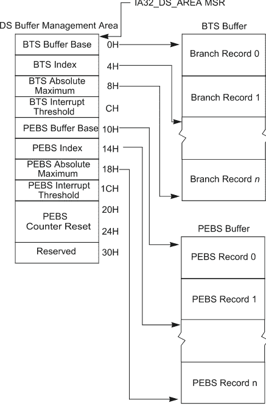

在当前的 Linux 内核中，每次上下文切换时 BTS 都会被禁用并重新启用，并且会保存和恢复配置，以便将属于分支记录的指令指针与相应的进程正确关联。对于许多软件工程任务来说，BTS 的开销天生就高到无法接受。

为了降低这种成本，BTS 拥有一套基于分支特权级的过滤器。可以过滤掉用户级或内核分支，在这种情况下，被过滤的分支记录不会发送到系统总线或被记录。这些过滤机制在用户空间是可见。

BTS 机制还提供了在内存驻 BTS 缓冲区中保存分支源和目的地址的能力，它是调试存储保存区域的一部分。BTS 缓冲区可以配置为环形，以便始终能够获取最新的分支记录；或者可以配置在缓冲区几乎满额时产生中断，以便保存所有的分支记录。

#### 3.2.3 精确事件采样（PEBS）

PEBS 成了 DS 机制的后半部分 [34]。当性能计数器配置为 PEBS 时，在计数器溢出后会将记录存储在 PEBS 缓冲区中。该记录包含了导致计数器溢出的指令状态。当状态信息被记录后，计数器会自动重置为预设值，并重新开始计数。换言之，PEBS 允许精确识别导致采样的指令之后的指令地址。这缓解了无序执行引起的问题，并允许对指令空间中的事件进行精确分析。PEBS 捕获寄存器值以便在处理阶段重建指令。

在具有 Intel Core 微架构的处理器上，PEBS 支持部分体系事件。这些事件包括已执行指令（`INST_RETIRED`）、已执行分支（`BRANCH_INSTRUCTIONS_RETIRED`）和已执行内存指令（`MEM_INST_RETIRED`）。每个事件都可以根据执行特权级别进行过滤。此外，可以在用户级过滤分支，包括所有分支、条件分支或近调用。内存指令的 PEBS 监控可以过滤为仅包含加载、存储或缓存缺失。虽然 PEBS 的支持没有那么广泛，但由于 CPU 使用自己的微代码例程收集事件样本，PEBS 可能会产生开销。

### 3.3 利用 HPM 的工具

许多方法可以访问和读取采样数据以用于软件工程任务。分析、调试和其他软件任务中的大多数技术都使用某些用户级性能监控 API。几种可用的 API 包括 OProfile [33]、Papi [36]、GNU gprof [37] 和 libpfi [9]。

根据软件任务的需求，每个工具都有其优缺点。例如，在 gprof 中，编译阶段会自动向程序代码中插入监测代码（例如通过 gcc 编译器的“pg”选项），以收集调用者函数数据。

监控函数 `mcount` 被插入到程序的每个函数调用之前 [38]。因此，gprof 需要重新编译你的整个应用程序，这会产生足够的开销，以至于应用程序在开启性能分析时的行为与未开启时可能完全不同。gprof 可以提供每个函数消耗的执行时间以及其占总运行时间的百分比，实际的定时值是通过统计采样获得的。采样是通过使用系统中断定期轮探测目标程序的程序计数器（PC）完成的。对共享库的监控可能是有限的，且 gprof 无法测量内核时间。

Papi、Oprofile 和 libpf 利用 Linux 内核提供的机制和功能进行性能分析，这使得每种工具都比 gprof 更高效且功能更强大。然而，Papi 同样需要重新编译代码来实例化和销毁计数器对象 [36]。OProfile 和 libpf 无需对代码进行插桩即可访问与 PAPI 相同的硬件计数器。Oprofile 文档详备，并作为用户级和内核级监控的工具包含在。Libpf 是一个辅助库，帮助通过操作系统的性能监控接口强制执行性能事件（Performance Events）。当前版本支持自 v2.6.3 起上游 Linux 内核中的 perf_events 接口。Libpf 使用户可以访问 CPU/PMU 和性能监控单元提供的硬件特性，以及软件计数器和跟踪点（tracepoints）等特性。虽然 OProfile 和 libpf 之间的相似性和差异已得到良好分析，但 libpf 和相应的内核级 perf 工具通过命令行提供了简单的用户界面，而用户级工具非常灵活，易于引入新支持的硬件机制进行修改。

#### 3.3.1 用户级 HPM 访问

根据所用工具的不同，可以通过不同的方式通过用户级 API 访问硬件机制。Libpf 的性能监控 API 通过 Linux 的 `poll` 事件或使用中断可以使用这些机制。

当使用 `poll` 时，首先使用 `ptrace` 产生并执行测试程序。一旦程序成功启动，将通过对操作系统的系统调用启用 LBR 或 BTS 等高级硬件机制，以及任何用于触发采样的硬件计数器。监控程序随后反复调用 `poll`，等待与性能计数器关联的文件描述符包含可读数据，如下所示。

```c


```
for(;;) {

    ret = poll(pollfds, 1, -1);

    if (ret < 0 && errno == EINTR)

        break;

    process_smpl_buf(file_descriptor);

}
```


作为替代方案，可以将重复调用`poll`替换为与所需的硬件机制相关的 I/O 信号处理器。信号处理器在关联的性能计数器溢出时立即触发。在执行几次检查后，信号处理器读取样本并处理当前状态。然后重置相关的硬件计数器并恢复程序运行。通过处理性能计数器通知并直接从监控工具使用中断刷新计数器，结果通常在数值上不那么精确和具体，但它允许目标程序以接近全速的速度运行 [13]。

## 3.3.2 采样挑战

在使用硬件机制进行监控时面临着许多挑战，这取决于所处理的软件任务。第一个挑战与基础采样信息有关。第二个挑战是使用的采样率。在选择使用的硬件机制时，考虑应该观察什么类型的信息。例如，在分支测试中，`BTS`、`LBR`、已执行分支指令或已执行指令是合适的。此外，还要考虑每个样本可能引入的潜在时间开销。例如，使用`LBR`监控分支执行可能比使用简单的计数器更昂贵。

另一个挑战是收集包含当前软件工程任务所需信息的样本。例如，在监控分支时，`BTS`和`LBR`将自动跟踪系统中执行的所有分支。对于大多数任务来说，这是没有必要的。为了避免不必要的采样，某些处理器（如 Intel Nehalem 中的）允许根据指令类型或特权级对指令进行过滤。大多数工具还允许将监控固定到特定的进程。然而，样本仍将包含来自初始化、销毁、异常/错误处理和库代码的指令。

此外，请记住硬件机制报告的指令是二进制文件中的指令。当用户习惯于在软件级对代码进行插桩时，这是一个挑战。例如，当尝试对分支进行采样时，硬件只识别包含跳转的指令。因此，贯穿分支（fall-through branches）不会在分支定向机制（例如`LBR`和`BTS`）中被自动记录为分支，尽管可以通过指令采样观察到它们。或者，可以对程序进行微调，在所有贯穿边上添加无害的跳转，从而允许分支定向型工具观察到该行为 [13]。

从硬件机制进行采样的另一个挑战是采样偏的威胁。采样偏倚的一个来源是由样本同步引入的 [12, 39]。如果选择了一个与应用程序部分同步的周期，为了减少采样间隔与程序执行同步的风险，可以使用采样周期的随机化。

另一个采样偏的来源源于 PMU 计数器溢出与`BTS`、`LBR`或`PEBS`硬件启动之间的时间延迟 [40]。在此期间，由于定时影子，无法检测到事件。可能需要额外的采样或分析来缓解这些偏倚。

## 4. 软件工程中的硬件监控

在考虑监控任务时，我们必须在设计空间内考虑对灵活性、性能和预测性的特殊需求。例如，在考虑内存访问违规的持续监控时，性能开销至关重要，但监控的灵活性需求也是如此。

微架构事件的硬件分析已被证明是在许多软件工程领域实现低开销的良好工具。已经进行了许多使用硬件机制的性能研究来判断软件质量。还展示了使用有限的监控器同时对事件进行分析的技术。此外，随着硬件机制变得越来越复杂 [44]，硬件机制的设计和支持不断进步。近年来，这种方法在依赖低能力的软件工程研究中得到了利用。这些领域包括路径分析和跟踪选择、动态优化、软件测试和调试。

### 4.1 路径分析和跟踪选择

硬件监控和多核处理器被利用的一个领域是路径分析。该领域的的一些早期研究是由 Conte 等 [45] 完成的。在这项工作中，使用了传统的分支处理来实时生成分析信息，执行减慢为 0.4–4.6%。Ammons 等 [46] 分析了如何提高报告硬件指标的精度（如已执行指令、执行的周期、指令停顿和缓存缺失），以更有效地识别通过程序调用图的路径。其他技术被设计用于确定、分析程序执行时间的时间 [47]。Merten 等 [48] 此外探索了使用分支行为来收集分析数据。其他研究使用性能计数器根据观察到的事件预测阶段和程序路径行为 [49–51]。还使用多核系统对多线程程序进行了性能分析 [52]。

### 4.2 动态优化

硬件机制最常用于反馈引导优化 [12, 32, 39, 54, 56–63]。Cavazos 等 [57] 使用将硬件机制与机器学习相结合，为应用程序寻找更好的编译器优化设置。在 Mars 和 Hundt [32] 的工作中，针对通过监控硬件事件识别的不同动态场景，函数被静态多版本处理（multiversed）。Chen 等人 [53] 也利用硬件性能监控器进行激进调优。

Ramasany [39] 和 Chen 等人 [12] 的最新工作使用已执行指令（retired instruction）来动态计算反馈引导编译的边频率估计。我们还看到 Java 虚拟机和即时编译器（JIT）中使用硬件机制来引导优化 [58, 59, 63]。

在动态优化之外，Yılmaz 和 Porter [64] 最近也应用硬件机制来区分失败执行和成功执行，其运行成本仅为使用软件执行数据的一部分。最后，Sheng 等人 [65] 创建了一种新型竞态检测工具，通过硬件机制对内存轨迹进行采样，而不是使用侵入性插桩。

### 4.3 软件测试

硬件机制的使用适用于动态优化和性能分析（profiling）等任务，因为这些任务都不依赖于完成精确的数据。例如，在动态优化中，决策可以基于有限的系统或程序观测做出。因此，通过硬件监控看到的样本已被证明提供了足够的信息，能够高效生成部分性能分析和优化决策。另一方面，软件测试通常依赖于更精确、更一致的信息。例如，在执行硬件监控以计算分支覆盖率时，测试人员必须监控程序中的每一个分支。在传统的覆盖率方法中，不需要关于其他执行的分支或语句的数据。

为了评估硬件监控是否能成功用于测试覆盖，Walcott-Justice 等人对利用硬件监控进行分支和语句测试的效率和有效性进行了研究 [11, 13, 35]。在这项工作中，分析了使用`LBR`（最后一次分支记录）的分支覆盖率和语句覆盖率循环。

#### 4.3.1 通过硬件监控实现分支覆盖率

在 Walcott-Justice 和 Soffa 等人的工作中，作者开发了一个名为 THeME（通过硬件监控事件进行测试）的系统，以评估使用硬件方法进行结构化测试的潜力

70

Kristen R. Walcott-Justice

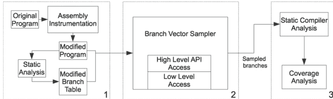

图 4. THeME 系统。

虽然有许多硬件机制可以监控程序行为以获取不同的测试指标，但作者侧重于适用于分支测试的机制。具体而言，他们利用了从`LBR`获取的采样数据。

图 4 显示了 THeME 系统的概述。THeME 有三个主要组件：第一个是静态程序修改和分析工具。该工具用于为基于分支的机制开启直通分支（fall-through branch）边的可见性。然后，一旦程序被修改，就会使用简单的静态分析来识别程序源代码中的分支边，就像传统的测试技术一样。分支边存储在哈希表中，并带有与相关源代码行的信息。该分支表被用作我们关注的分支清单，并用于计算整体分支覆盖率。第二个组件通过采样`LBR`对被测程序进行运行时监控。最后一个组件执行可选的静态分析并计算采样的分支覆盖率。分支覆盖率基于观测到的源代码层级分支数与程序中源代码层级分支总数的比较。我们现在更地讨论每个组件的设计。

##### 4.3.1.1 开启直通可见性

独立于采样技术，仅凭分支的硬件机制无法观测直通分支（fall-through branches）何时发生，这会导致覆盖率监控有效性较低。在分支测试中，测试人员希望确保分支的两个边都被通过。例如，在图 5 中，监控应该能够检测到从 1 到 2 的直通路径执行以及从 1 到 3 的目标路径。虽然在查看流图时这是显而易见的，但在二进制代码中，分支是由某种跳转到目标的操作后随另一条指令组成的。

# 在软件工程中利用硬件监控

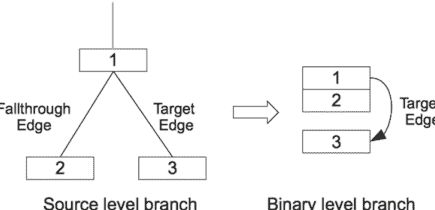

**图 5.** LBR 无法检测从 1 到 2 的直通分支边。

`LBR`会报告从 1 到 3 的跳转，但不会报告从 1 到 2 的直通跳转。因此，`LBR`本身只能监控 50% 的源分支。

直通分支的观测可以通过多种方式实现。一种技术是用其他事件数据补充基于分支的监控信息。例如，除了`LBR`之外还可以轮询`INST_RETIRED`事件以寻找直通指令的执行。另一种检测直通分支的技术包括对程序和观测信息进行静态事后分析。这些技术不需要修改代码、重新编译或增加代码。然而，为了评估使用硬件机制进行监控的能力，我们转而使用基于分支的机制通过在二进制文件的每个直通边上插入无害的无条件分支来观测直通路径，如图 4 Box 1 所示。这与插桩（instrumentation）不同，后者是重量级的且包含了探测代码和负载代码。我们的直通开启技术仅在直通分支边上增加单条指令。使用这种技术产生的代码增长可以忽略不计。

##### 4.3.1.2 用户级分支访问

一旦程序被修改并分析，就会被执行，如图 4 Box 2 所示。当测试进入主方法时开始`LBR`监控，分支记录持续到程序结束。根据观测到的 CPU 周期数进行采样。当达到周期采样率时，会读取`LBR`中的分支并与分支表中的项进行比较，将观测到的分支标记为已通过。轮询（Polling）和中断驱动采样都得到了分析。虽然轮询报告一组`LBR`和性能计数器数据是一种有效技术，但在没有相关分支数据时反复轮询会产生不必要的开销。因此，额外分析了另一种利用中断的替代技术。通过处理性能计数器通知并直接刷新计数器，可以减少与访问相关的开销。

##### 4.3.1.3 提高分支覆盖率

使用了采样。因此，某些执行的分支数据可能不会被记录。为了提高使用纯硬件方法测试时观测到的分支覆盖率，可以通过基于编译的分析扩展监控的覆盖率细节，如图 4 Box 3 所示。这些分析可以在程序执行期间离线或在另一个核心上进行，优先考虑被监控的应用程序。`LBR`观测到的分支首先与程序控制流图中的分支关联。在控制流上执行支配分析和后支配分析以构建支配树。

在支配树中，如果从控制流图入口到基本块 $c$ 的每条路径都包含基本块 $b$，则基本块 $b$ 支配基本块 $c$。如果从 $c$ 到控制流图入口的每条路径都包含基本块 $b$，则基本块 $b$ 后支配基本块 $c$。例如，图 6 显示了一个函数的控制流图，`LBR`观测了分支 5–7。因为块 5 和 7 被执行，因此 1 和 2 在支配分析中也被执行。块 8 和 11 在后支配分析中也必然执行。根据这两项分析，推断出条件分支 1–2 和 2–5 必须执行，以及无条件分支 7–8。注意，我们的分支测试仅监控条件分支。然而，当观测到完整的分支向量时，可能会暗示更多的分支向量。

##### 4.3.1.4 实证评估

实证研究的主要目标是评估使用硬件方法进行分支覆盖率计算的结构化测试。

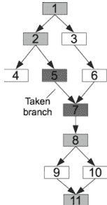

**图 6.** 基于观测分支的支配分析。

该方法的实现如第 4.3.1 节所述，旨在衡量其与使用插桩（instrumentation）相比的效率和有效性。分析目标如下：

- 分析程序修改工具引起的时间开销和代码增长。
- 在效率方面，识别两种硬件采样采样方法之间的差异。
- 分析使用硬件方法计算覆盖率时在效率与有效性之间的权衡。
- 揭示在多核上使用硬件机制进行测试的优势（多核改进）。
- 演示如何结合静态分析与硬件机制监控来提高测试覆盖率。

## 实验设计与指标

THME 运行在配备 Linux 内核 2.6.34、拥有 4 GB 内存的 Intel Core i7 860/2 GHz 四核机器上。选择 Intel Core i7 处理器是因为它拥有`LBR`缓冲区，可以报告大小为 16 的分支向量，这是目前最大的。

使用 SPEC2006 C 整数基准测试作为 THME 系统的测试程序。每个程序在编译时均包含调试信息，且未指定优化选项。包含调试信息是为了将执行的二进制指令与源代码边关联起来。

系统根据其分支覆盖率计算的效率和有效性进行了分析。我们基础设施的效率是根据 SPEC2006 基准测试执行工具`runspec`报告的基准执行基础运行时间计算的。所有计时结果都与执行全软件插桩版本的基准测试时观察到的开销进行了比较。TestCocoon [1] 用于生成插桩后的基准测试。

## 实验与结果

执行了四组实验，以分析：（1) 启用贯通（fall-through）程序修改工具的影响，(2) 在单核上使用硬件机制监控的效率和有效性，(3) 在单核上使用硬件机制监控的效率和有效性，(4) 在有效性方面结合静态分析的收益。

### 启用贯通可见性

第一个实验分析了 THEME 中程序修改工具的影响。首先检查了修改后的程序与全插桩程序相比的时间开销影响。然后分析了代码增长。

表 1 列出了分析的 SPEC2006 基准测试及相关的时间开销。表格左侧显示了通过插桩报告的分支覆盖率、原生程序的执行时间、贯通（即修改后的）程序的执行时间，以及在 SPEC2006 测试输入集上执行时全插桩程序的执行时间。表格右侧显示了在 ref 输入集上执行时的相同信息。

启用贯通的修改工具生成的程序与原生执行相比，平均有 5%的时间开销。另一方面，在`sjeng`的情况下，添加全软件级插桩在执行执行 ref 和 test 输入时，时间开销增加了近 30%，而 THEME 仅增加了 12%。

表 2 显示了修改后和插桩程序与原生大小相比的代码大小增长百分比。THEME 的修改比传统的插桩探针和负载轻量得多，因为它们仅包含无条件跳转而没有负载。在我们的基准测试中，全分支插桩导致代码大小增长从 18% 到 32% 不等。然而，THEME 生成的程序平均只比原生代码大 0.5%。

### 单核测试

对于下一组实验，测试了第 3.3.1 节描述的两种访问技术。访问硬件机制的方法有很多，例如像 OProfile 等用户级 API。

# 表 1 SPEC 2006 基准测试时间开销信息。

| 基准测试 | 分支覆盖率 (%) | 时间 (s) | 修改后时间 (s) | 插桩时间 (s) | 分支覆盖率 (%) | 时间 (s) | 修改后时间 (s) | 插桩时间 (s) |
|---|---|---|---|---|---|---|---|---|
| bzip2 | 63.49 | 16.5 | 16.9 | 18.6 | 64.2 | 1499 | 1514 | 1599 |
| h264ref | 27.53 | 43.8 | 43.8 | 47.7 | 35.72 | 1753 | 1786 | 1890 |
| libquantum | 37.79 | 0.155 | 0.16 | 0.165 | 39.07 | 1056 | 1178 | 1236 |
| mcf | 73.70 | 3.66 | 3.86 | 4.08 | 74.01 | 529 | 539 | 575 |
| sjeng | 46.29 | 6.92 | 7.74 | 8.96 | 48.87 | 1028 | 1162 | 1312 |

# 表 2 SPEC 2006 基准测试代码增长信息。

| 基准测试 | 原生大小 (kB) | 启用贯通增长百分比 | 插桩增长百分比 |
| --- |---|---|---|
| bzip2 | 260 | 1.52 | 32.65 |
| h264ref | 289 | 0.69 | 18.39 |
| libquantum | 208 | 0 | 20.00 |
| mcf | 129 | 0 | 17.95 |
| sjeng | 592 | 0.67 | 30.05 |

启用贯通的修改工具生成的程序与原生执行相比，平均有 5%的时间开销。另一方面，在`sjeng`的情况下，添加全软件级插桩在执行执行 ref 和 test 输入时，时间开销增加了近 30%，而 THEME 仅增加了 12%。

表 2 显示了修改后和插桩程序与原生大小相比的代码大小增长百分比。THEME 的修改比传统的插桩探针和负载轻量得多，因为它们仅包含无条件跳转而没有负载。在我们的基准测试中，全分支插桩导致代码大小增长从 18% 到 32%。然而，THEME 生成的程序平均只比原生代码大 0.5%。

### 通过轮询访问的效率

第一个实验分析了 THEME 中程序修改工具的影响。首先检查了修改程序与全插桩程序相比的时间开销影响。然后分析了代码增长。

表 1 列出了分析的 SPEC2006 基准测试及相关的时间开销。表格左侧显示了通过插桩报告的分支覆盖率、原生程序的执行时间、贯通（即修改后的）程序的执行时间，以及在 SPEC2006 测试输入集上执行时全插桩程序的执行时间。表格右侧显示了在 ref 输入集上执行时的相同信息。

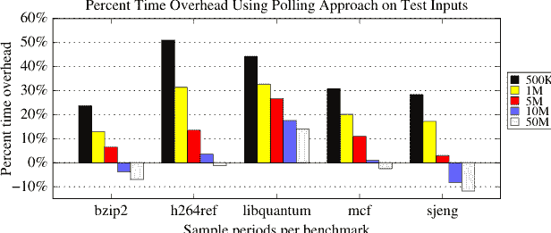

图 7. 在测试输入上使用轮询的 LBR 采样相对于全插桩的时间开销。（需查看彩色版本，请参阅该章节的在线版本。）

图 8. 在测试输入上使用中断驱动方法访问的 LBR 采样相对于全插桩的时间开销。（需查看彩色版本，请参阅该章节的在线版本。）

## 在参考输入上使用中断驱动方法的百分比时间开销

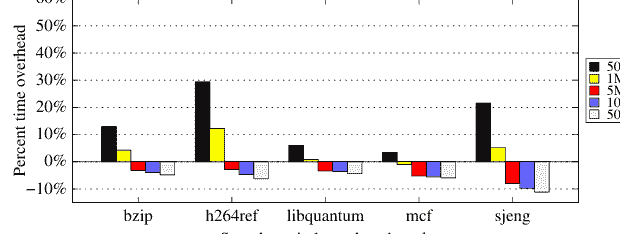

**图 9.** 在参考输入上，LBR 采样通过的中断驱动方法相比于全插桩（full instrumentation）的时间开销。（此图的彩色版本，请参阅本章节的在线版本。）

基准测试。每个基准测试的平均执行时间为 19.55 分，如表 1 所示。当在 50 万等较低速率进行采样时，使用`LBR`采样执行大型程序的时间开销可能很高。这可能是由于操作系统在较低速率下被中断所过载所致。在较高的速率下（例如 500 万、1000 万、5000 万），图 9 所示的产生的时间开销与图 8 所示的在测试输入上执行时的时间开销一致。

有效性。如图 10 所示，当每 50 万个 CPU 周期采样一次`LBR`时，平均观察到插桩报告的覆盖率为 76%。当使用轮询或基于中断的技术时，每个基准测试报告的覆盖百分比几乎相同。Sjeng 在监控插桩时实现了报告的 82.61% 的覆盖率，尽管在该速率下的时间开销比插桩差了 21.57%。然而，在 5000 万的采样率下，sjeng 仍然实现了使用插桩报告的 70.15% 覆盖率。在 5000 万的采样率下，插桩报告的平均覆盖率减少到 54%，但在时间上改进了 6%。当使用更高的采样率时，`LBR`监控的时间开销优于插桩。然而，较高的采样率也对应较低的有效性。

跨核心测试。下一组实验是观察在多个核心上监控测试执行的影响。多核心实验侧重于本研究中测试的五个 SPEC2006 基准测试中的两个，这两个基准测试在参考测试集中包含多个输入。

## 软件工程中硬件监控的应用

在参考输入上使用中断驱动方法的实际覆盖率百分比

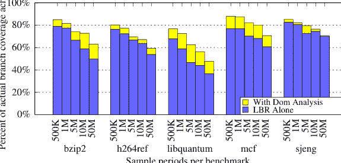

**图 10.** 在参考输入上，通过中断驱动方法使用 LBR 采样观察到的覆盖率与插桩的对比。（此图的彩色版本，请参阅本章节的在线版本。）

每个输入都在单独的核心上执行，并在每个测试执行完成后跨核心聚合了覆盖率结果。每个核心都使用了相同的采样率。请注意，在进行硬件监控和使用插桩监控时遵循了相同的步骤。bzip2 的参考输入集包含六个输入，h264ref 三个。由于我们的实验在四核机器上运行，因此仅执行了 bzip2 的前四个输入。

如图 11 所示，使用`LBR`监控 bzip2 前四个输入执行情况的时间开销比使用插桩少了 4~14%。通过移除插桩，每个核心上测试输入的时间开销得到了改进，从而在单核心上执行时可以节省更多时间。如预期的那样，观察到的实际覆盖率百分比与在单核心上执行时相同，如图 10 所示。

与监控 bzip2 产生的开销不同，h264ref 在 50 万和 100 万采样率下的时间开销大于插桩。h264ref 的计时结果与在单核心上采样和执行相比略低。这是因为 h264ref 的输入之一的执行时间占了三个输入总执行时间的约 82%。因此，在单独的核心上执行另外两个输入所节省的时间不足以大幅减少使用多核心与单核心相比时监控 h264ref 的总时间开销。

## 跨核心拆分任务的百分比时间开销

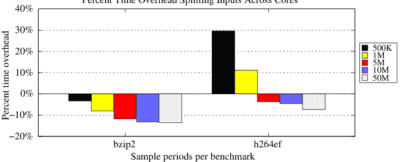

**图 11.** 在多核心上进行 LBR 采样相较于在多核心上插桩的时间开销。（此图的彩色版本，请参阅本章节的在线版本）。

这些实验表明，相对于在多核心上插桩，跨核心监控产生的时间开销低于相对于单核心上插桩在单核心上监控`LBR`产生的开销。因此，在多个核心上执行的多线程程序的分支覆盖分析将获得与在单核心上执行的顺序或多线程程序类似的益处。当负载在多个核心之间均匀分布时，我们预计观察到与[图 11]中 bzip2 类似的时间开销结果。

*在高采样率下提高覆盖率* 在最后一组实验中，揭示了第 4.3.1.3 节描述的静态分析的影响以及如何结合硬件监控使用以提高测试覆盖率。支配者分析使用 LLVM 编译器基础设施执行 [66]。通过结合这两者，在 500 的采样率下，观察到的实际覆盖率百分比从所有基准测试的平均 76–83% 提高，如图 10 所示。在 5000 万 CPU 周期速率下，实际覆盖率百分百分提高到 62%。在 5000 万 CPU 周期速率下，插桩报告的平均覆盖率减少到 54%，但在时间上改进了 6%。当使用更高的采样率时，`LBR`监控的时间开销优于插桩。然而，较高的采样率也对应较低的有效性。

#### 4.3.2 通过硬件监控进行语句覆盖

与分支覆盖类似，语句覆盖率也用于测量已执行语句的百分比。当使用软件级插桩进行语句覆盖测量时，会在每次执行单行时添加探针和载荷进行计数。此外，在程序的每个分支处插入插桩代码，分支插桩记录通过不同路径的频率。使用硬件机制执行指令时，任何执行的语句都可以被观察到，但根据需要可以关联到特定的进程。

## 用于语句测试的硬件监控

为了实现利用硬件机制进行语句覆盖的目标，本文研究了两种常用的用于采样的硬件机制。在选择了一种一种机制后，分析了采样所产生的时间开销和代码增长开销，以及在采样期间可以观察到的语句覆盖水平。最后，展示并讨论了监控测试执行时可以获取的额外信息，及其在后续工作中的潜在用途。

THeME 运行在第 4.3.1.4 节描述的系统上，并使用了第 4.3.1.4 节中相同的测试应用程序。THeME 的基础设施针对覆盖技术进行了简化，如图 12 所示。由于使用了硬件机制来观察语句而非分支，因此不需要修改程序。首先对程序的二进制文件进行分析，以记录所有可能执行的语句。利用调试信息生成一个语句表，并映射回源代码。然后，将该表和程序传递给硬件级监控器进行程序执行。完成后，分析更新后的表以计算我们测试的整体语句覆盖率。移除了第 4.3.1 节中存在的静态编译分析组件。这样做基于两个原因：首先，移除该组件可以更准确地观察仅通过监控就能发现的语句覆盖水平。其次，在大多数资源受限的设备上，系统中没有可用编译器或构建工具。因此，对 THeME 的这一修订精确匹配了此类设备上可以观测到的语句覆盖水平。

基础设施的效率是根据 SPEC 2006 基准测试执行工具 runspec 报告的基准测试基础运行时间计算的。所有计时结果都与执行全插桩版本基准测试所产生的开销进行了比较。使用 Gov [17] 生成了插桩基准测试。根据语句覆盖率分析了基础设施的有效性。

| 原始程序 | 静态分析 | 语句表 | 硬件级指令采样器 | 采样指令 | 覆盖分析 |
| :--- | :--- | :--- | :--- | :--- | :--- |

图 12. 将 CPU_CYCLE 监控适配于语句测试的基础设施。

## 选择机制

采样期间观察到的时间开销和代码覆盖率很大程度上取决于所选的硬件机制。在分支测试中，最初选择`LBR`是因为它能收集并报告执行期间分支的部分路径。对于语句覆盖，指令回退监控器（instructions retired monitor）直观上最具吸引力，因为该机制在指令回退时对单条指令进行采样。然而，CPU 周期是另一个选项，在相同采样率下将产生比指令回退更高的覆盖报告。

为了观察选择对时间和语句覆盖的影响，首先在六种不同的采样率下执行带有测试输入的基准测试，并同时使用指令回退和 CPU 周期进行监控。与原生执行时间相比，执行的时间开销如图 13（指令回退）和图 14（CPU 周期）所示。总的来说，使用指令回退机制的时间开销小于使用 CPU 周期开销。libquantum 基准测试是一个例外，但这是因为 libquantum 的执行时间仅为 0.15 s。因此，报告时间即使增加 0.01 s 似乎也是显著的。

尽管指令产生的平均开销小于 CPU 周期，但这种效果在语句覆盖方面是可见的。图 15 和 16 显示了使用两种机制时所实现的覆盖率。在所有基准测试和采样周期内，使用 CPU 周期得到的语句覆盖水平高于使用指令回退，因为在程序运行生命周期内采集了更多的样本。虽然这导致时间开销略微，但所有基准测试和采样周期的覆盖率都提高了 14%。

注意当使用 CPU 周期或指令回退进行采样时，可以使用比`LBR`小得多的采样率

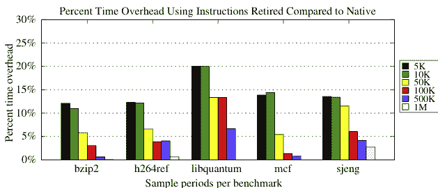

**图 13.** 测试输入上指令回退相对于原生执行的时间开销：（如需此图的彩色版，请参阅本章节的在线版本。）

## 在软件工程中利用硬件监控

与原生相比使用 CPU 周期的时间开销百分比

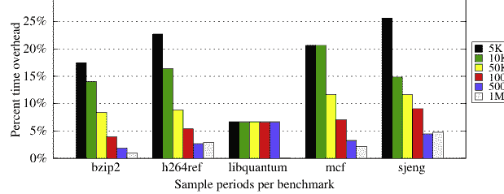

**图 14.** 测试输入上 CPU 周期相对于原生的时间开销。（如需此图的彩色版，请参阅本章节的在线版本。）

## 在测试输入上使用指令回退进行语句覆盖

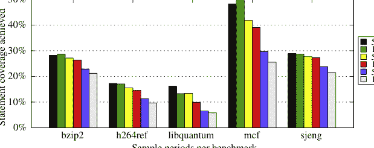

**图 15.** 测试输入上使用指令回退的语句覆盖。（如需此图的彩色版，请参阅本章节的在线版本。）

在不显著增加时间开销的情况下。这是因为 CPU 周期和指令回退是更底层的硬件机制。当使用`LBR`时，会产生填充`LBR`和读取完整分支向量的额外成本。然而，使用 CPU 周期或指令回退时，开销仅由中断和单次读取产生。

## 语句覆盖比较

由于使用 CPU 周期会导致更高的覆盖水平，下一组实验展示了在用 CPU 周期执行 SPEC ref 输入时，与插桩相比的时间开销、覆盖率和代码增长。

图 17 显示了 THeMe 相比于插桩所产生的时间开销。在 10 万的采样率下，时间开销平均改进了 0.6%。在 50 万时，有

## 测试输入上使用 CPU 周期的语句覆盖

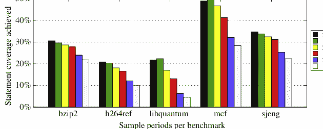

**图 16.** 测试输入上使用 CPU 周期的语句覆盖。（如需此图的彩色版，请参阅本章节的在线版本。）

## 与插桩的时间开销百分比

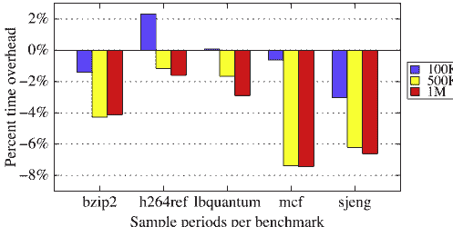

**图 17.** 相对于插桩的时间开销。（如需此图的彩色版，请参阅本章节的在线版本。）

改进了 4.3%，在 100 万时改进了 4.5%。

在图 18 中，展示了 THeme 实现的语句覆盖并与插桩进行了比较。在所有采样周期内，使用 CPU 周期观测到的插桩覆盖率平均为 66%。采样率为 10 万时，观测为 71%。50 万时观测为 64%，100 万时观测为 62%。这是因为在分支测试中，二进制文件中的单跳转跟踪

## 与插桩的语句覆盖

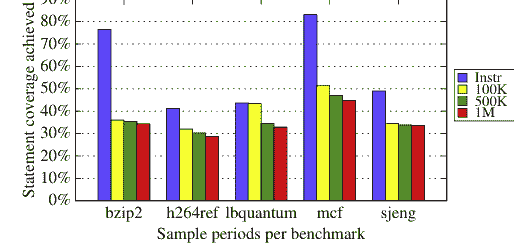

**图 18.** 与插桩相比的 CPU 周期语句覆盖。（如需此图的彩色版，请参阅本章节的在线版本。）

## 表 3 插桩与 CPU 周期的代码增长。

| 基准测试 | 原生大小 (kB) | 插桩 (kB) | CPU 周期 (kB) |
| :--- | :--- | :--- | :--- |
| bzip2 | 260 | 359.30 | 260 |
| h264ref | 2892 | 3549.88 | 2892 |
| libquantum | 208 | 255.59 | 208 |
| mcf | 128 | 138.93 | 128 |
| sjeng | 592 | 825.09 | 592 |

使用简单硬件机制进行语句覆盖的优势在于，启用该技术不需要修改代码。因此，THEM 没有产生代码增长。然而，如表 3 所示，插桩产生的代码增长是显著的。平均而言，使用 gcov 二进制文件比原始程序大 40%。这些尺寸增长小于文献 [1–3] 中代码测试工具报告的增长，这意味着我们的系统平均在内存受限设备上将更具优势。

结果表明，在减少时间开销且无代码增长的情况下，可以观测到插桩报告的高达 79% 的语句覆盖。在 50 万的采样率下执行 libquantum 基准测试时，实现了 79%。这些结果是

88 Kristen R. Walcott-Justice

非常有前景，尽管覆盖率和时间开销还可以进一步改进。
该工具扩展产生的语句覆盖率还可以受益于支配者分析（dominator analysis），正如第 4.3.1.1 节所描述的那样。然而，为了观察纯硬件方法进行语句覆盖测试的能力，而无需需要基于编译器的工具或特殊库，THeME 的这部分被省略了。在那些预计 THeME 特别有用的环境中，此类工具是不可用的。

通过将采样限制在对我们感兴趣的程序执行部分，可以改进时间开销。除了初始化和销毁指令外，THeME 观测到的样本还包括对`libc-2.11.so`等库的调用，以及程序执行期间执行的若干内核函数。例如，当每 10,000 个 CPU 周期监控一次`mcf`的执行时，大约会采集 2,900 万个样本。其中，0.04% 与内核调用有关，0.31% 的样本来自`libc-2.11.so`。通过修改采样技术使其不包含这些额外数据，就可以减少时间开销。

#### 4.3.3 用于手机和平电脑的 THeME

测试用例的执行和评估理想情况下在最终应用程序运行的环境中进行。然而，为内存受限设备（如现代平板电脑和手机）开发应用时，测试通常只使用模拟器执行。模拟器的速度往往比设备本身慢得多，并且无法准确复制应用程序可能运行的所有条件。

在设备本身上执行测试用例的过程是困难的。在过去的一年里，人们尝试自动化测试过程 [72]。然而，关于执行期间测试用例评估的研究仍然没有。静态插桩工具可能被移植到设备上执行，但它们可能带来的内存开销和代码增长会增加系统压力，并减少完全准确地执行测试的能力。例如，像 [73] 中描述的那些测试，如果执行本身增加了内存开销，将受到严重限制。动态插桩工具可能会遇到相同的问题。此外，由于动态插桩技术在执行期间生成插桩代码，因此它们不能简单地移植到新系统。

# 软件工程中的硬件监控利用

然而，THME 系统为测试执行过程提供了一个高效有效的解决方案，并可以轻松移植到其他满足以下条件的设备：(i) 设备具有可用的硬件机制，(ii) 存在访问和读取这些机制的内核支持，(iii) 存在能够与访问工具和硬件正确交互的内核接口。大多数现代手机和平板设备都满足前两个要求。例如，iPhone 3GS、Nokia n900、Samsung Galaxy Nexus、iPad2、Motorola XOOMOM 和 Amazon Kindle Fire 都使用 ARM Cortex-A8 或 A9 处理器。Cortex-A8 和 A9 拥有五个多个可以利用的硬件计数，可以通过`perf`和`Oprofile`工具在内核和用户级进行访问。

用于大多数多核移动设备的 Cortex-A9 处理器上的硬件机制具有独特之处，它们支持对 Java 应用中代码的跟踪。除了跟踪 CPU 周期、已执行分支、读/写等典型机制外，A9 的机制还监控解码后的字节码执行和 Jazelle 分支执行 [9, 33]。Jazelle 直接字节码（Jazelle Direct Bytecode）允许处理器将 Java 字节码作为硬执行状态执行。Jazelle 最显著的用途是手机制造商用它增加 Java 微游戏和应用程序的执行速度。感知 Jazelle 的 Java 虚拟机（JVM）会尝试运行 Java 字节码，返回到软件处理更复杂或较少使用的字节码操作。ARM 声称，在典型的程序使用中，约 95% 的字节码最终在硬件中被直接处理 [74]。因此，这两个额外的机制对于监控 Java 应用的行为可能非常有用。

尽管移动设备处理器上存在硬件机制，并且最近的内核提供了对访问和记录来自这些计数器信息的支持，但两者之间的内核接口仍然是缺的。为了利用硬件机制，访问工具、内核和硬件必须能够正确交互。例如，许多移动设备设计了 TI OMAP4 单芯片系统（SoC），这是一种高性能应用处理器。使用 OMAP4 SoC 的设备包括 Amazon Kindle Fire、Barnes and Noble N Tablet、Blackberry Playbook 和 Motorola Droid RAZR。在 SoC 上，交叉触发接口（CTI）使得能够访问硬件机制，这些机制由性能监控接口（PMU）控制，如下所示：

90
Kristen R. Walcott-Justice

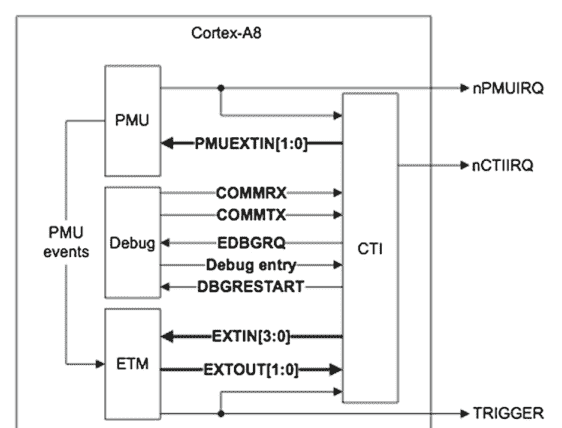

**图 19.** 交叉触发接口 [75]。版权所有 © 2006-2013 ARM Limited (或其关联公司)

如图 19 所示 [75]¹。当硬件机制准备好读取时，CTI 会产生中断。CTI 将中断发送到特定平台的中断控制器，然后将中断路由到通用中断控制器。

许多运行 TI OMAP4 SoC 的设备使用某些版本的 Android 操作系统。然而，在这项研究进行时，所有版本的 Android 操作系统都是构建在 Linux 2.6.35 上，该版本未包含对交叉触发接口或特定平台控制器的支持。虽然 CTI 可以作为组件集成到内核中，但不支持特定平台的中断控制器。

然而，Android 操作系统与 Linux 内核之间的差异不太可能会持续，特别是随着 Android 的日益普及。过去，将 Android 更改合并 Linux 的尝试失败了，或者进入了被遗弃的阶段。然而，去年年底，Linux Foundation、Linaro 等启动了一项将 Android 更改引入内核的新项工作 [76]。这些更改在 Linux 3.4 中变得明显，该版本首次于 2012 年 3 月 31 日发布 [77]。

¹所有涉及 ARM 技术的材料经 ARM Limited 许可复制。

在操作系统的支持下，THeME 可以轻松扩展以支持任何可用硬件机制，并且可以重新编译移植到现代移动设备。因此，THeME 有可能为此类资源限制设备上的测试执行和监控提供高效有效的解决方案。

# 5 讨论与未来方向

尽管在过去的 5 年中利用硬件监控进行软件工程任务取得了很大进展，但仍有许多问题和挑战需要回答。此外，我们从硬件机制应用于软件工程任务的成功中观察到，该方法的优势很大程度上取决于问题的性质。整体适用性还可以提高，但必须进行更多研究。

## 5.1 软件工程应用

某些软件工程任务和挑战非常适合硬件监控的支持。例如，动态优化通常依赖执行样本来进行改进行为的近似。同样，分析信息通常可以从部分执行信息中收集。此外，软件测试和调试中的应用也可以从硬件监控中获益，至少作为补充。

虽然融合插桩和硬件监控的技术尚待探索，但这种组合在测试和调试中可能具有强大的应用前景。例如，软件测试回归测试套集排序的研究依赖于测试覆盖 [78]，可能会使用程序覆盖的估计而非完整的覆盖数据来生成测试套集的优先级和选择。

硬件监控也可以用于故障定位和调试。在 Soffa 等人的工作 [35] 中，我们提出了一种硬件监控

92 Kristen R. Walcott-Justice

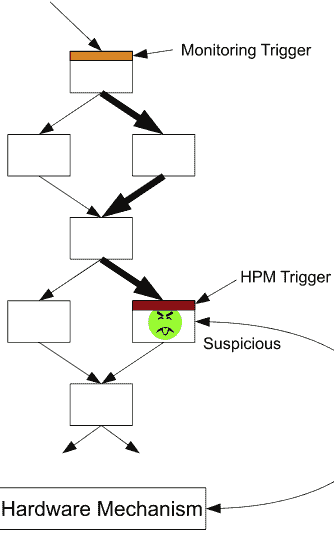

**图 20.** 深度动态检查。（此图的彩色版本，请参阅本章节的在线版本。）

一种用于故障定位的在线分析方法。图20 展示了我们提出的深度动态检查（DDI）技术。该方法的目标是为部分自动化软件故障定位提供一种高效轻量级技术。程序员只需要识别可疑代码区域，一旦发生错误，我们的 DDI 分析将利用硬件性能机制（即 LBR）报告导致错误的路径，且运行时开销几乎可以忽略不计。

DDI 报告了两类信息：具体路径信息和模糊路径信息。导致错误的具体路径呈现出完整路径，但限于错误发生时收集的分支追踪的瞬时大小。模糊路径信息通过反向动态触发注入技术提供更长的可能路径。

如图 20 所示，在可疑的基本块中注入了硬件监控器（HPM）触发器。当可疑块执行时，该触发器会被触发，并立即收集`LBR`的内容。此时`LBR`的内容提供了通向该块执行的具体路径。在触发此触发器后，可以在路径头头的块中再次注入一个新的触发器。这一过程持续，直到发生错误。如果这些路径被执行多次，则可以提供更长的模糊路径。可以修改操作系统内核，允许应用程序在每次`LBR`探针时跳过当前所需的系统调用，以便进行探索性实验（例如，如果程序在无限制的内核模式下运行）。通过这种更改，我们预计 DDI 将非常高效，仅需直接从硬件读取寄存器向量。

## 5.2 软件工程中的未来挑战

在使用硬件性能监控进行软件工程任务时，会产生一些问题。首先是关于结果的一致性。由于使用了采样技术，每次看到的结果都不同，这在软件测试和调试中可能特别难以处理。第二个涉及采样的有效性。最后，需要研究更高效的结果收集方法，特别是针对移动设备。

在使用硬件性能监控器监测程序行为时，第一个主要挑战是结果的一致性。在 Shye 等人 [7] 中观察到，通过运行 20 次程序，代码覆盖率可以提高 10–20%。虽然这很有趣，但在软件测试和其他软件工程任务中，我们希望在程序的单次运行中获得结果。这项工作的结果意味着，结果的可重复性必须在广泛的程序和执行范围内确定。在初步工作中，我们看到结果的可重复性很大程度上取决于程序的结构。频繁执行的程序函数或分支/循环更有可能通过硬件监控技术被观察到。

硬件监控技术的有效性可以通过在程序可能被观测到的分支或语句上插入少量软件级插桩来潜在提高。通过首先对代码复杂度进行静态分析，我们可以识别出可能被观测到的代码部分。如果不必要地添加插桩，利用硬件监控带来的开销改进将会减少。另一方面，保守的方法对提高有效性的影响可能很小。

94 Kristen R. Walcott-Justice

还有许多极具前景的机遇，可以在硬件、内核和软件层面推动硬件性能监控的进展，这可能会在效率方面进一步改进访问方案。一种技术是消除 OS 保护。在当前系统中，内核需要管理所有与配置、访问和读取硬件机制相关的函数。要求操作系统参与所有这些功能，其成本远高于所需的。在最底层，完成这些操作需要对处理器核心进行读取或写入寄存器，这在本质上是非常高效的。然而，当每个操作都由操作系统执行时，会有许多额外的开销源。这些包括进入特权内核的系统调用、通过将用户级状态溢出内存来保存上下文，以及在执行返回用户级应用程序时恢复状态。

对于许多使用硬件监控的传统应用程序，这种内核级的使用是足够的。通常，硬件计数器和机制只在应用程序执行的开始和结束设置。通常，被监控的计数器一直增加到应用程序执行结束，此时对其进行读取。因此，内核只需要参与两次。在其他监控技术中，可以在程序执行期间频繁访问和读取硬件机制 [32, 80]。但由于测试覆盖率分析需要更频繁的监控，每次采样都需要操作参与会影响开销时间。允许从用户模式直接访问计数器将显著降低访问硬件机制的成本 [35]。

实现用户对硬件机制控制有两种方法。一种需要硬件修改，另一种可以是通过添加一个简单的寄存器来指定具有直接访问权限的执行模式，允许操作系统直接控制硬件机制的访问权限。虽然支持这些额外权限的芯片片面积开销可以忽略不计，但将修改硬件。第二种方法是让内核在执行返回感兴趣点时不将处理器模式切回用户模式。这种技术只需要修改操作系统代码，但会导致可能被恶意程序利用的安全漏洞。

提高硬件监控效率的另一个机会是启用我们所谓的卫星监控 [13]。目前，硬件监控信息只能从托管应用程序的核心中收集。这需要中断程序以收集所需信息。然而，允许从任何核心访问硬件监控信息只需要极少的硬件修改。这需要将控制硬件监控能力的每个核心的性能监控单元（PMU）移动到“非核心（uncore）”。

图21 展示了将私有 PMU 移动到全局非核心区域 [13]。使聚合的 PMU 通用可用需要为每个全局 PMU 分配额外的核心 ID，并从每个核心添加总线。这种方法允许从与托管应用程序线程分离的内核对应用程序进行监控和分析，允许应用程序在整个执行过程中不受干扰。某些非核心事件现在可以使用 libpf 和 OProfile 进行监控；然而，这些在软件测试中的用途尚待探索。

| 核心 0 | 核心 1 | 核心 2 | 核心 3 |
| :--- | :--- | :--- | :--- |
| pmu | | pmu | pmu |
| | 非核心（共享缓存、一致性、互连） | | | |


使用这种方法允许我们将多核的优势与性能监控技术的优势相结合。

## 6. 结论

硬件监控方法已成功应用于许多软件工程任务，特别是在程序分析、动态优化和软件测试中。虽然在提高使用插桩（instrumentation）进行程序执行监控的效率方面已取得进展，但研究表明，使用硬件机制可以消除或大幅减少对插桩的需求。在平衡硬件监控和插桩使用时，关键的权衡在于：该方法所需的投入与必须进行的观测数量及类型之间的平衡。本章的研究表明，硬件监控已成功用于在软件工程任务中平衡这些权衡因素。

尽管结果令人鼓舞，但仍需要更多研究来更好地理解利用硬件监控可以获得的信息类型以及结果的可重复性。对于需要更精确信息的软件工程任务，可能需要采用包含插桩的混合方法来提高整体有效性。最后，随着硬件、操作系统工具和用户级工具的不断发展，硬件监控的效率和适用性可能会得到提高。尽管硬件监控研究主要侧重于通用市场上执行的应用，但其使用可能有助于移动设备和嵌入式系统的测试、调试、使用分析和应用分析。

## 参考文献

- [1] TestCocoon, TestCocoon – C/C++ 和 C# 代码覆盖率工具。<http://doc.frog.com/squish-coch/2.0/coverage.html>.
- [2] J. Misura, J.A. Clause, J.L. Reed, B.R. Children, M.L. Soffa, Demand–driven structural testing with dynamic instrumentation, in ICSE '05: Proceedings of the 27th International Conference on Software Engineering, New York, NY, USA, 2005, p. 156–165.
- [3] R. Santelces, M.J. Haroldit, Efficiency monitoring data-flow test coverage, in ASE: '07: Proceedings of the 22nd IEEE/ACM International Conference on Automated Software Engineering, New York, NY, USA, 2007, p. 343–352.
- [4] R. Bodik, R. Gupta, M.L. Soffa, Refining data flow information using infeasible paths, SIGSOFT Software Engineering Notes 22 (6) (1997) 361–377.
- [5] C.-K. Luk, R. Cohn, R. Muth, H. Patil, A. Klauser, G. Lowney, S. Wallace, V.J. Reddi, H. Hazelwood, Pin: building program analysis tools with dynamic instrumentation, in PLDI '05: Proceedings of the 2005 ACM SIGPLAN Conference on Programming Language Design and Implementation, New York, NY, USA, 2005, pp. 190–200.
- [6] M.M. Tikir, J.K. Hollsworth, Efficient instrumentation for code coverage testing, SIGSOFT Software Engineering Notes 27 (4) (2002) 86–96.
- [7] G–R. Uh, R. Kohn, B. Yadavalli, R. Peri, R. Ayagari, Analyzing dynamic binary instrumentation overhead; Workshop in Binary Instrumentation and Application, 2007.
- [8] Android 开发者: 使用硬件设备。<http://developer.android.com/guide/developing/device>.
- [9] S. Eranin, Perlinon2.<http://monitor2.sourceforge.net>
- [10] T. Dey, W. Wang, J. Davidson, M.L. Softa, Creating multi-threaded applications based on shared-resource contention, in: IEEE International Symposium on Performance Analysis of Systems and Software, 2011.
- [11] K.R. Walcott, 受限环境下的测试（博士论文），弗吉尼亚大学，2012.
- [12] D. Chen, N. Vachajani, R. Hundt, S.-w. Liao, V. Ramasamy, P. Yuan, W. Chen, W. Zheng, Hamming hardware event samples for FDO compilation, in: CGO ‘10: Proceedings of the Eighth Annual International Symposium on Code Generation and Optimization, New York, NY, USA, 2010, pp. 42–52.
- [13] K.R. Walcott, J. Mars, M.L. Softa, Theme: a system for hardware monitoring events, in: ISTSA 2012: Proceedings of the International Symposium on Software Testing and Analysis, July 2012.
- [14] E.J. Weyuker, The evaluation of program-based software test adequacy criteria, Communications of the ACM 31 (6) (1988) 668–675.
- [15] S. Cornett, Bullseye Testing Technology: Minimum Code Coverage.<http://www.bullseye.com/minimum.html>
- [16] Atlassian, Clover and Java Code Coverage.<http://www.jenqa.com/coverage/.
- [17] gcov.<http://www.gnu.org/software/manual/gcc-3.0/gcov.html>.
- [18] V. Voutsov, EMMA: A Free Java Coverage Tool, May 2005.<http://emma.sourceforge.net/source_index.html>.
- [19] M.M. Systems, Java Coverage Analyzer – JCover.<http://www.mmsedia.com/JCover>.
- [20] IBM, Pure Coverage.<http://www-01.ibm.com/software/>
- [21] Cobertura.<http://cobertura.sourceforge.net>.
- [22] Q. Yang, J. Li, D. Weiss, Coverage-based tools, in: Proceedings of the 2006 International Workshop on Software Testing, AST ’06, New York, NY, USA, pp. 99–103.
- [23] X. Wu, J. Li, Y. Lee, Coverage-based testing on embedded systems, in: Proceedings of the Second International Workshop on Software Automation (AST ’07).
- [24] Freescale Inc., CodeWarrior Tools.<http://www.freescale.com/webapp/site.php?CW_HOME&codawrior>.
- [25] Semantic Designs, Automated Large-Scale Analysis, Modification, and Generation.<http://www.semidesigns.com/index.html>.
- [26] J.K. Hollsworth, B.P. Miller, Xu Zhichen, Zheng Ling, a language and compiler for dynamic instrumentation, in: Proceedings of the 1997 International Conference on Parallel Architectures and Compilation, 1997, pp. 201–212.
- [27] B.P. Miller, M.D. Callahan, J.K. Hollsworth, R.B. Irvin, K. Kunchatham, The paradigm measurement tool, Computer 28 (11) (1995) 37–46.
- [28] Jonathon Misurda, Bruce R. Childers, Mary Lou Sofa, Jazz2: a flexible and extensible framework for structural testing in the JVM, in: Proceedings of the Ninth International Conference on Principles and Practice of Programming in Java (PPP) '11), ACM, New York, NY, USA, 2011, pp. 81–90.
- [29] Matthew Arnold, Ryder Barber, A framework for reducing instrumented code, in: Proceedings of the ACM SIGPLAN 2001 Conference on Programming Language and Implementation (PLDI '01), ACM, New York, NY, USA, 2001, pp. 168–179.
- [30] ACM Performance Monitor Unit Example for ARM11 and Cortex-A/R,<http://info.cener.com/help/index.php?topic=com.arm.docs/ka237.html>.
- [31] A. Chai, G. He, Meidhmahl, Hardware and compiler support for software monitoring, in: Proceedings of the International Conference on Runtime Verification (RV), 2009.
- [32] Jason Mars, Hunt Robert, Scenario optimization: a framework for statically enabling online optimizations, in: Proceedings of the Seventh Annual IEEE/ACM International Symposium on Code Generation and Optimization, IEEE Computer Society.
- [33] J. Devon, OProfile – A System Profiler for Linux.<http://profile.sourceforge.net>.
- [34] Intel Corporation 64 and IA-32 Architectures Software and Developer’s Manual, vol. 3A and BA, 2016.
- [35] Mary Lou Sofa, R. Walcott, Jason Mars, Exploiting hardware for software testing and debugging (NIER task), in: Proceedings of the 33rd International Conference on Software Engineering, ACM, 2011.
- [36] S. Brown, J. Dongarra, R. Garner, K. London, P. Mucci, A scalable cross-platform infrastructure for application performance tuning using hardware counters, in: Proceedings of the 2000 ACM/IEEE Conference on Supercomputing, Dallas, Texas, USA, 2000, pp. 42–50, November 04–10.
- [37] J. Fenner, R. Stallman, GNU gprof:The GNU Free. http://cs.utah.edu/dev/expo/gprof.
- [38] Justin Thiel, An Overview of Performance Analysis Tools and Techniques: From gprof to Technical Report, Washington University in St. Louis, 2006.
- [39] Vinodh Ramaswamy, Robert Hunt, W. Chen, D. Chen, Feedback-directed optimization with estimated edge frames from hardware event, in: Open64 Conference 2008.
- [40] David Valheld, Performance analysis guide for intel i7 processor and xenon 5500 processors, Intel Performance Analysis Guide, 2009.
- [41] Aishish Shankar, Ajay Joshi, Lily K, Analysis of redundancy and amplification balance in the SPEC CPU220 benchmark, ACM SIGARCH Computer Computer Architecture News 35 (2007) 412–423.
- [42] Swati Tanjwi Guramani, Aleksander Milkovic, Execution characteristics of SPEC CPU2000 benchmarks; Intel C++, in: Proceedings of the 42nd Annual Southern Regional Conference, ACM, 2004, pp. 261–266.
- [43] Reza Azizi, Michael Sturm, Robert W Wiesinski, Online performance analysis by statistical sampling of multiprocessor performance counters, in: Proceedings of the 19th Annual International Conference on Supercomputing, ACM, 2005, pp. 101–110.
- [44] Jeffrey Dean, E. Hicks, Carl A. Waldspurger, William E. Weihl, George Chrys, ProfileMe: hardware support for instruction-level profiling on out-of-order processes, in: Proceedings of the 30th Annual ACM/IEEE International Symposium on Microarchitecture, IEEE Computer Society, 1997, pp. 292–302.
- [45] Thomas Conte, Burzin A. Patel, Kishore N. Menezes, J. Stan Cox, Hardware-based profiling: an effective technique for profile-driven optimization, International Journal of Parallel Programming 24 (2) (April 1996) 187–206.

# 软件工程中的硬件监控利用

- [46] Glenn Ammons, Thomas Ball, James R. Larus, 利用流和上下文敏感剖析分析利用性能计数器, ACM Sigplan Notices 32 (5) (1997) 85–96.
- [47] Jennifer M. Anderson, Lance M. Berc, Jeffrey Dean, Sanjay Ghemawat, Monika R. Henzinger, Shen-Tak A. Leung, Richard L. Sites, Mark T. Vandevoorde, Carl A. Wald-spurger, William E. Weiss, 持续剖析：周期都去哪里了？ACM SIGOPS Systems Reviews 31 (5) (1997) 1–24.
- [48] Matthew C. Melton, Andrew R. Trick, Erik M. Nystrom, Ronald D. Barnes, Wen-mei Hu, 用于程序流动态分析和显示的硬件机制, ACM Computer Architecture 28 (2) (2000) 59–70.
- [49] Evelyn Dwelstainer, Carl Cascoval, Shanka Dwarkadas, 程序行为与变异性的表征与检测, 第12次国际并行架构与编译技术会议论文, 2003, PACT 2003, IEEE, 220–231.
- [50] Andy Gomez, Dries Buytaert, Lien Eckhout, No De Boschsche, Java负载中的方法级阶段行为, ACM SIGPLAN Notices 39 (10) (2004) 270–287.
- [51] Jeremy Lau, Jack Sampson, Eree Perelman, Gray Heavenly, Bradley Calder, 代码签名与性能之间的强相关性, 位于: IEEE性能分析与软件国际对称会议, 2005, ISPASS 2005, IEEE, 2005, 236–247.
- [52] Qin Zhao, Joao Cutucache, Wen-Fai Wang, PiPa: 多核系统上的流水线剖析与分析, ACM Trans. Code. Opt. 7 (3) (2010), 29, Article 13.
- [53] Howard Chen, Wei-Chu Hu, Jiwei Lu, Pen-Cheng Yu, Dong-Yuan Chen, 用于开销性能监控硬件采样的动态轨迹选择, 位于: 代码生成与优化国际会议论文：反馈引导优化, Computer Society, 2003, 79–90.
- [54] Jian Lu, Lu Chen, Pen-Cheng Yu, Wei-Chu Hu, 轻量级动态优化系统的设计与实现, Journal of Instruction-Parallelism 6 (4) (2004) 332–341.
- [55] Jason Mar, Mary Lou Soft, MATS: 多重自适应轨迹选择, 位于: 多核系统会议论文, 2008.
- [56] Nitan Pezel, Bilga Mendel, 用于自适应优化的行为变化检测, 位于: 第16次国际并行架构与编译技术会议,2007, PACT 2007, IEEE, 2007, 150–162.
- [57] John Cavazgos, Giorgio Frisin, Felix Agakov, Edwin Bonilla, Michael F. O’Malley, Olivier Teram, 使用性能计数器选择良好的编译器优化, 位于: 国际代码生成与优化会议, 2007, CGO07, 2007, 185–197.
- [58] Florian T. Schneider, Mathias Pater, Thomas R. Green, 硬件性能监控驱动的在线优化, ACM SIGPLAN Notices 42 (6) (2007) 373–382.
- [59] Ali-Reza Ali-Tabahani, Richard L. Lu, Mauricio J. Serrano, Sreenava Basu, 硬件监控和对象元数据上的优注入, ACM SIGPLAN Notices 39 (6) (2004) 264–276.
- [60] Weifeng Zhang, Brad Calder, Dean M. Tulken, 事件驱动的多线程动态优化框架, 位于: 第14次国际并行架构与编译技术会议, 2005, PACT 2005, IEEE, 2005, 87–98.
- [61] Tipp Moseley, Alex Shye, Vijay Janapa Reddy, Matthew Iyer, Dan Fay, David Hogdson, Joshua L. Kim, Alex Smith, Dirk Grunwald, D Anand, 实现持续优化的动态运行时架构技术, 位于: 第二次计算前沿会议, ACM, 2005, 211–220.
- [62] Roy Levin, Ilan Newman, Gabi Huber, 使用最小代价流算法弥补缺失和不准确的剖析; 位于: 高性能嵌入式架构与编译器, Springer, Berlin, Heidelberg, 2008, pp. 291–304.
- [63] John Culver, Sandhya Viswanathan, Konstantin Bobrovsky, Alexander Astapchuk, Eric Kacmarz, Uma Srinivasan, JVM中硬件性能监控动态优化的实用方法; 位于: IEEE/ACM代码生成与优化年度国际会议论文, IEEE Computer Society, 2009, pp. 190–199.
- [64] Cemal Yılmaz, Adam Porter, 结合硬件和软件插桩分类类异常, 位于: ACM SIGSOFT软件工程基础国际会议论文, ACM, 2010, pp. 66–77.
- [65] Tianwei Sheng, Neil Vachacharjani, Stephanie Erani, Robert Hunt, Wenguang Chen, Rahe: 用于生产应用的轻量级非侵入式检测工具; 位于: 第33次国际软件工程会议, 401–410.
- [66] Arthur Lattner, 多策略优化的基础设施（博士论文）, University of Illinois, 2002.
- [67] Hong Zhu, Patrick A. Hall, John May, 软件测试覆盖与充分性, ACM Computing Surveys (CSUR) 29 (4) (1997) 366–427.
- [68] Ken Foster, David Kao, Structure: 行为检查的测试充分性标准. 第6次ACM SIGSOFT软件工程基础会议, 2007, pp. 541–554.
- [69] Per Ranson, 单元测试综述, IEEE 23 (4) (2006) 22–29.
- [70] Richard Foster, Stefan Stark, 测试与综述; 位于: IEEE软件科学、技术与工程会议, E03, 2003, pp. 164–173.
- [71] Arkady Boon, Eitan Fachi, Yomit Magid, Nasir Nir, Shuel, 同步的应用; 位于: 第10次ACM并行编程原理与实践, ACM, 2005, pp. 206–212.
- [72] iOS和Android设备的自动化测试 http://ansmobile.com/automated-testing-on-mobile-devices-part1/.
- [73] M. Spinelli, Mobile Safari内存使用测试 http://cubiq.org/testing-memory-usage-on-mobile-safari/.
- [74] ARM, Jazelle技术 http://www.arm.com/processors/jazelle/
- [75] 技术手册 – 版本 r1,2006.
- [76] M. Larsson, 内核Go原子 http://github.com/page-items?query=MA2DA.
- [77] L. Torvalds, Linux x http://lkml.org/lkml/2012/3/214.
- [78] R. Walcott, Mary Cout, Mary Lou Souff, Gregory M. Kappheimer, Robert S. Roos, 时间步改进; 位于: 2006软件测试与分析国际会议, ACM, 2006, pp. 1–12.
- [79] Alex Shee, Matthew Iyer, Vijay Janapa Reddy, Daniel A. Connors, 使用性能监控的代码覆盖检测; 位于: 第六次分析驱动调试国际会议, ACM, 2005, pp. 159–163.
- [80] Jason Mars, Neil Vachacharjani, Robert Hunt, Mary Lou Souff, 竞争执行检测与响应; 位于: 第八次IEEE/ACM代码生成与优化会议, ACM, 2010, pp. 257–265.

# 关于作者

Kristen Walcott-Justice是科罗拉斯大学科罗拉斯斯普斯分校计算机系的助理教授。她于2012年获得弗吉尼亚大学计算机科学博士学位。在此之前，她于2007年获得弗吉尼亚大学计算机科学硕士学位以及阿勒盖学院计算机科学与数学学士学位。她的研究方向是软件工程，重点是软件测试与分析。

# 模型驱动安全的进进展

Levi Lúcio†, Qin Zhang†, Phu H. Nguyen†, Moussa Amrani†, Jacques Klein†, Hans Vangheluwe†, and Yves Le Traon†

*建模仿真与设计实验室, 加加尔大学, 蒙特利尔, QC,加拿大
†安全信任中心, 卢森堡大学, 卢森堡
‡安特卫普系统与软件建模, 安特卫普大学, 比时

# 目录

1. 引言 104
2. 模型驱动工程 105
   2.1 模型、元模型与模型转换 106
   2.2 模型驱动工程方法 107
   2.2.1 模型驱动架构 108
   2.2.2 领域特定建模 109
   2.2.3 多范式建模 110
   2.2.4 面向面向建模 111
3. 模型驱动安全 112
   3.1 MDS简介 112
   3.2 评估分类法 114
4. 当前模型驱动安全方法的评估 118
   4.1 UMLSEC 118
   4.2 SECUML 121
   4.3 SCTET 125
   4.4 ModelSEC 129
   4.5 SECMDD 131
5. 讨论 136
   5.1 评估综合 136
   5.2 对MDS有效性的威胁 139
   5.3 相关开放问题 139
   5.3.1 建模范式的选择 139
   5.3.2 安全关注与相应的元模型 140
   5.3.3 建模语言的选择 141

# 摘要

为了应对日益多样的安全威胁，构建安全关键系统的可靠方法论至关重要。为了满足这一需求，模型驱动安全（Model-Driven Security）于 21 世纪初出现，它是一种专门的模型驱动工程方法，用于支持安全关键系统的开发。

在本章中，我们总结了过去十年中模型驱动安全最重要的进展。为此，我们首先对该领域最重要的概念构建了一套分类法。然后，我们利用该分类法来描述和评估文献中一组具有代表性和影响力的模型驱动安全方法。在开发这一内容时，我们专注于由模型驱动工程和模型驱动安全所塑造的概念。这使我们能够识别并讨论将模型驱动工程应用于信息安全领域时的优势、缺点以及待解决的问题。

本章提供了关于模型驱动安全的广义视角，旨在为学生、研究人员和从业人员提供关于模型驱动安全的入门介绍。

# 1. 引言

世界正变得日益数字化。一方面，计算机和信息技术的进步为我们带来了许多益处；另一方面，信息安全变得越来越关重要且具有挑战性。报纸上几乎每天都会出现关于恶意软件、软件漏洞、僵尸网络攻击或其他数字相关问题的新闻。因此，信息安全是计算机科学中的一个重大问题，并持续吸引研究人员和工程师的兴趣 [43]。

为了应对多样化且不断变化的威胁，软件的安全需求变得越来越复杂。鉴于安全需求通常与功能需求交织，在传统的软件开发过程中很难将它们正确整合。此外，安全需求很少在开发过程早期早期处理 [28]。开发安全关键系统的传统方法正变得越来越低效。此外，由于经济压力，开发时间很短，且所需的修改频率很高。这在实践中导致了许多安全缺陷被利用，并登上了报纸头条。所有这些问题表明，该领域需要更及时、更创新且更可靠的工程方法。

模型驱动安全（MDE）于十多年前出现，是一种专门的模型驱动工程（MDE）方法，用于支持安全关键系统的开发。MDE 被一些作者视为处理复杂且不断演进的软件系统的解决方案 [18]。该范式包括选择模型和变换作为每个软件开发阶段的主要产物。通过操纵模型


在本章中，我们首先从 MDE 的角度总结了 MDS（注：可能指 MDE）的背景理论。我们为 MDS 提出了一种分类法，其基于我们对 MDS 研究社区中五种代表性方法的深度评估和讨论。这项工作的主要贡献是：
- (1) 一套全面的 MDS 分类法；以及 (2) 对当今最相关的 MDS 方法进行详尽评估和讨论。本章的目标是帮助读者理解 MDS，并在需要时引导潜在的 MDS 研究人员或工程师在文献中现有方法中选择适当的 MDS 方法。正如前文提到的，我们提供了过去十年 MDS 研究活动的概览。

本章的其余部分结构如下：在第 2 节中，我们介绍了关于 MDE 的一些背景信息。第 3 节回顾了文献中的几个 MDS 定义，这些定义有助于我们在安全相关的研究中识别 MDS 方法。然后，在第 3.2 节识别并描述了 MDS 的系列特征，以便为进一步评估 MDS 方法形成分类法。在第 4 节中，我们根据分类法评估了几种选定的 MDS 方法。第 5 节提供了一个对比所评估方法的表格，并讨论了 MDS 的一些开放问题和有效性威胁。第 6 节探讨了相关工作，最后第 7 节以 MDS 面临的潜在挑战总结。

# 2. 模型驱动工程

模型驱动工程（MDE）既包含了一set工具，也包含一种软件开发的松散方法论。模型驱动工程背后的主张是，通过对软件工程师试图自动化的过程建立抽象，生成的软件质量将比使用通用编程语言（GP）更好。这一主张的依据是，概念的抽象以及操纵这些概念的过程比计算机程序更容易被理解、验证和模拟。这是因为这些抽象接近工程师所处理的领域，而通用编程语言（GPL）本质上是为了操纵计算机架构概念构建的。

### 2.1 模型、元模型和模型变换

MDE 的核心产物是模型。在计算世界，模型是对人们想要捕获或自动化的过程的简化。这种简化没有考虑在工程周期的特定阶段可以忽略的细节。其目的是关注当前相关的概念——例如，用于研究空气动力学的汽车石膏模型不会考虑汽车由什么材料制成。

在计算世界中，模型是使用给定的语言定义的。回到汽车的类比，如果工程师希望有一个用于 3D 可视化的汽车计算模型，那么就需要像计算机辅助设计（CAD）工具定义的语言来表达特定的汽车设计。在计算世界中，此类语言——被称为元模型（metamodels）用于描述共享相同抽象的计算产物模型族。每个元模型都是一种语言（称为形式化语言），具有许多模型实例化，就像 CAD 工具中可以描述许多不同的汽车一样。

这组概念中缺失的环节是模型变换。如图 1 所示，模型变换允许将相关信息从一个建模框架传递到另一个框架，根据 [95] 的说法，它是“模型驱动软件开发的灵魂”。多年来，模型变换已经从理论角度研究了多年（例如 [31] 的工作），但直到最近才成为软件开发领域的一等公民。它们的出现自然源于 MDE 曾被用于移动电话或汽车工业等特定领域。如 ATL [11]、Kermeta [86] 或 QVT [30] 等变换语言的实现已经在过去几年中，为编写和执行模型变换提供了稳定的平台。

# 模型驱动安全的进展

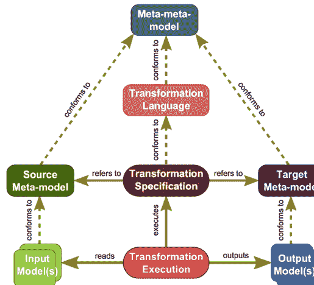

1. 模型变换过程。（图的彩色版本请参阅本章的在线版本。） [改编自 [99]]

模型变换在 MDE 中有多种用途：例如，如果需要将 UML 状态图转换为代码，变换可以被视为编译器；此外，将状态图转换为某些现有工具可验证的形式化语言的变换可以被视为翻译器。这些变换在传统软件开发中显然存在，尽管是以隐式方式。由于在 MDE 环境中模型变换负责将模型从一种形式化语言翻译成另一种，因此变换的正确性对于整个软件开发过程的质量至关重要。模型变换的验证、确认和测试目前是一个活跃的研究课题，该主题近期发表论文的数量证明了 [8, 22, 35, 72, 73, 93, 94, 101]。

### 2.2 模型驱动工程方法

在本节中，我们简要详细介绍了遵循 MDE 范式的主要方法，即：
- 模型驱动架构（MDA），一种早期 OMG 标准生成式方法；
- 领域特定建模（Domain-Specific Modeling），一种旨在为贡献应用程序的不同领域定义语言的方法；
- 多范式建模（Multi-Paradigm Modeling），领域特定建模语言的泛化

不同的计算模型在此进行交互；而*面向面向建模*（Aspect-Oriented Modeling）则更精确地研究不同模型如何进行组合或复合。

#### 2.2.1 模型驱动架构

模型驱动架构（Model-Driven Architecture, MDA）是 OMG 在2001年提出的的一项提案，旨在帮助标准化模型定义，并促进模型交换和兼容性。MDA 包含以下点 [64]：

- 它基于 UML 的，UML 是一种已经标准化并广泛接受的符号法，已用于面向系统中。为了统一符号法并清理 UML 的内部结构，提出了元对象设施（Meta-Object Facility, MoF）来处理海量的模型定义和语言；

- 它提出了模型的金字塔形构建方法，如图 2 所示：填充 M0 级的工制品代表实际系统；M1 级的工制品是元模型；属于 M2 级的工制品是元模型，允许定义 M1 模型；最后，M3 级的唯一工制品是 MoF 本身，它被视为一个元递归定义的模型本身；

- 沿着这个金字塔，MDA 强制了一种特定的软件系统开发愿景，被视为一个包含以下步骤的过程（图 3）：需求在计算无关模型（CIM）中收集，与系统最终如何实现无关；然后，平台无关模型（PIM）描述了所有系统部分的设计和分析，独立于任何关于最终执行平台及其嵌入式技术的考虑考虑；随后，PIM 被细化为平台特定模型（PSM），并与平台描述模型（PDM）结合，最终形成在特定平台上运行的代码。

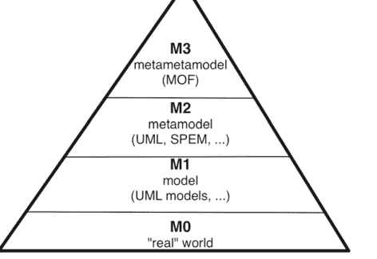

**图 2. MDA 金字塔。**（改编自 [100]）。

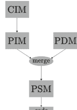

**图 3.** 模型驱动架构概述。

MDA 促进了关注点的垂直分离：系统在高级层进行设计，不考虑任何目标平台的特定特性；这些特性随后由自动化生成器集成，以产生符合每个平台要求的代码。这种方法论直接启发了几个 MDS 提案，用于在软件应用程序中实施安全关注。

#### 2.2.2 领域特定建模

解决当前软件系统日益增加的性的常用方法是应用“分治”法：通过将设计活动委托给几个关注点领域，并关注系统的特定方面，可以降低生成规范的抽象层次，从而直接能够提高对这些规范的置信度。这还允许这些规范更接近领域专家，有助于控制所产生工品的质量，有时甚至将它们的创建委托给这些专家。在 MDE 中，领域特定建模（Domain-Specific Modeling, DSM）是有效且规范此类系统的关键方法。该方法系统地利用领域特定建模语言（DSMLs，或简称 DSLs）将系统的各种工制品表示为模型。其思想简单：将设计者的精力集中在设计的局部（例如，捕捉新保险产品的复杂性），而让底层机制处理重复的、易错且为人知的过程，这些过程确保了整个系统能够正常运行。

来自 [75] 的关于该主题的著名白皮书提供了轶事证据，基于为 Nokia™ 和 Lucent™ 开发手机操作系统的经验，DSLs 能将生产力提高 10 倍。这些结果推动科学界在该领域进一步投资，并构建环境以促进 DSL 的构建、管理和维护。这种努力已通过具体的框架实现：EMF 和 GMF [81]、AtOM³ [67] 或 Microsoft™ DSL Tools [26] 等。

#### 2.2.3 多范式建模

多范式建模（Multi-Paradigm Modeling）由 Mosterman 和 Vanghelwe [85] 引入，是一种软件开发视角，主张模型应该根据其目的在正确的抽象层次上构建。在系统开发过程中，可以使用自动模型转换将信息从一种表示传递到另一种表示。在这种情况下，将建模视为一种跨越不同模型、以不同范式表示的活动是理想的。这种方法的主要优势在于，软件工程师可以从现有的描述和自动化软件开发活动的多种语言和工具中受益——同时将不同形式表示之间转换数据的任务交给专门的方法论。

为了使这个想法更具体，人们可能会想象一个代表软件系统抽象行为的 UML 状态图模型转换为 Java 模型以便在给定平台上执行；或者将状态图转换为适用于验证的形式化表示。这种软件开发视角的另一个优势是，实现特定软件开发方法的工具集变得更加灵活。这是因为在给定的明确表示下，形式化表示和转换可以潜在地插入或拔出。

多范式建模的思想与模型驱动架构（MDA）的思想相似：在 MPM 中，重点主要在于软件开发期间在正确的抽象层次上采用了多种建模范式；而 MDA 更多侧重于提出一种系统的方法论，其中一组模型转换被联起来，以便从在给定平台上运行的系统需求集传递。因此，MDA 可以被视为 MPM 的实例。

## 2.2.4 面向面向建模

在这些中，当安全模型被孤立指定时，可以使用面向建模（Aspect-Oriented Modeling, AoM）技术将其组合进业务模型（或目标模型）中。

在某些情况下，模型元素被包含在组合模型中。识别用于组合的模型元素的过程被称为元素匹配。为了支持自动元素匹配，每种元素类型（即元素的元模型类）都关联一个签名类型（signature type），该类型决定了元素在类型空间中的唯一性：两个具有相同签名的元素代表同一个概念，因此被组合在一起。

类似的贡献遵循相同的思路和特定的织入技术：要么基于行为方面 [102, 27, 61, 62]，要么基于可以应用于任何具有定义模型的建模语言的通用织入器：例如 MATA [103]、SmartAdapter [82] 或 Geko [65, 83]。最后，已经提出了一些先进机制，用于织入之前已织入的切面 [63]、精细调优织入 [84]，或织入不同元模型的切面（或视图）实例 [10]。

# 3. 模型驱动的安全

模型驱动的安全（Model-Driven Security, MDS）可以被看作模型驱动工程（MDE）的一种特化，用于支持安全关键型应用的开发。MDS 利用 MDE 的概念方法及其相关的技术和工具，为安全关键型应用的工程提供了方法。更具体地说，模型是每种 MDE 方法的核心产物。模型不仅用于描述系统的业务逻辑，还被广泛用于捕获安全关注点。模型允许在正在构建的应用中引入并实施安全措施。

在本节中，我们将回溯 MDS 的根源，看看最初引入它的作者是如何看待它的。然后，我们提出了一个 MDS 分类法，并在本文中使用该分类来评估文献中不同的 MDS 方法。

### 3.1 MDS 简史

早期的贡献为 MDS 提供了初步的尝试性定义。我们回顾了这些定义以提取它们的共同特征。

Jürgens [47] 通过其 UMLSEC 方法开启了 MDS 领域的开拓性工作。基于 UML 扩展，UMLSEC 结合了多种图表来对系统进行建模分析：用于静态结构的类图、用于动态行为的状态图、用于分布式系统中对象交互的交互图，以及用于在目标平台上强制执行安全的部署图。尽管该方法没有显式提到 MDE 的概念，但它从一开始就预见到，此类系统在开发过程早期需要某种分析过程：作者提出了一种初步的形式化语义 [48, 49]，足以应对目标安全属性的验证。

2002 年，Bostic 与其他作者 [71] 注意到，MDA 方法已经对业务强制执行问题有了部分答案：模型允许直接操作业务领域的概念（在此例中为业务流程）；而模型转换能够自动生成具有完全配置基础设施的系统。通过 SecureUML [15]，作者们证明了基于 MDA 的方法的可行的效率：在随后的十年中 [13]，这些模型足够强大，能够精确地记录安全和设计需求并允许对其进行分析，而且模型转换可以在不同平台上成功生成安全关键系统。

这些具有里程碑的作品为 MDS 的广泛使用铺辟了道路。MacDonald [74] 促进了每个关注点（业务和安全）使用领域特定语言（DSL），并引入了关注点分离（Separate of Concerns, SoC）的核心思想：在应用设计、开发和组合期间使用视觉模型或领域建模语言，将安全原语（如机密性、完整性、身份验证、授权和审计）表示并分配给应用、过程和信息流，且独立于运行时特定的安全强制执行机制 [74]。

不久后，Lang 和 Schreiner [66] 引入了使用领域特定语言（DSL）在高抽象级别捕获需求并自动生成代码的必要性：他们将 MDS 视为一种工具支持的、在高抽象级别对安全需求进行建模，并使用有关系统的其他可用信息（由其他利益相关者产生）。这些以领域特定语言表示的输入随后将以尽可能少的人为干预转换为可执行的安全规则。MDS 显式地包含了运行时安全管理（例如：权限/授权），即在受保护的 IT 系统上对策略进行运行时强制、动态策略更新以及对违反策略行为的监控 [66]。他们还强调了通过适当的工具支持这些安全工程阶段的必要性。

从 MDS 的早期开始，就有三个挑战在安全系统中仍然至关重要：从实现细节中抽象出来，专注于关注领域和安全属性（通过使用模型）；在可能的情况下，将规格说明（业务和安全）进行分离；使用先进的工程技术来确保此类系统的正确性（通过自动生成最终代码，以及通过对生成的系统应用分析技术）。

### 3.2 评估分类法

我们识别并描述了一组与 MDS 方法相关的概念。这些概念构成了一个分类法，补充并扩展了现有的分类（[58, 57, 88]，在第 6 节进一步讨论）。我们描述了每个分类条目，并在表 1 中汇总以便快速参考。

应用领域（Application Domains）。该条目关注 MDS 方法的适用性：Web 应用、电子商务系统、嵌入式系统、分布式系统等。通常，MDS 方法针对特定领域，利用该领域的知识进一步改进某些方面（例如用于 Web 应用的分布式框架生成的代码），但某些方法更具通用性。该条目有助于根据应用范围比较我们的方法。

安全关注点（Security Concerns）。欧洲网络和信息安全局将安全定义为“网络或信息系统抵抗非法或恶意意外或行为的能力，这些行为会以一定的置信度损害存储或传输的数据的可用性、授权、完整性和机密性，以及这些网络所提供并可访问的服务 [87]。”尽管该机构推广了处理安全的统一方法，但安全关注点的多样性、范围和范围使得处理它们变得困难。该条目有助于比较哪些安全属性可以在系统中执行。

表 1：MDS 分类条目

| 分类条目 | 描述 |
|---|---|
| 应用领域 | MDS 方法是针对特定领域还是通用的？关注哪些关注点？它们可以用元模型表示吗？ |
| 建模方法 | 使用哪些建模范式（MDA, AOM, DSM）？使用哪些建模语言（标准 UML; UML 配置; DSL）？ |
| 关注点分离 | 是否使用了？如何实现？ |
| 模型转换 | 是否使用了 MMT? 使用了哪种模型转换引擎？ |
| 验证 | 使用了哪些验证技术：模型检查；定理证明；测试； |
| 可追溯性 | 是否实现了后向或正向追溯？是自动的还是手动的？ |
| 工具支持 | MDS 方法的自动化程度如何？它提供了哪些功能？ |
| 验证 | 该方法是否在大型案例中经过验证？ |

正如前面所述，MDS 是 MDE 的一种特化：对 MDS 方法进行范式和语言分类是自然的。建模范式解决了表示、管理和组合模型的通用原则。例如在标准 UML 建模中，跨关注点分散在相关的模型中，然后在不同水平上进行组合，如 MDA 中的典型情况。面向切面的建模（AOM）主张关注点的清晰分离，随后使用一组建模规则将其织入主模型，在生成完整代码之前获得完整模型。领域特定建模（DSM）是另一种稍不同的方法，每个模型专门捕获主题领域的知识，这些知识最终可以是跨关注点的。多范式建模（MPM）可以看作是 DSM 的扩展，其中不同的模型以受控的方式共存。这些范式并非完全互斥，而是共享许多特征，有时很难区分它们，我们通常依赖作者的陈述来为方法标记其底层的建模范式。

因为它们通常需要进一步的专业知识。然而，这些语言通常被用作其分析能力的后端（例如 [9, 96]）。

**安全与业务的分离。** 关注点分离（SoC）是计算机科学中一种备受广泛接受的设计原则，它包含将系统划分为不同的特征（方面），这些方面在理想情况下应该是松散耦合的，即它们的功能之间重叠极少 [60]。安全性就是一个很好的例子：理想情况下，安全关注点不应干扰其他功能，而应是完善它们 [97]。大多数 MDS 方法都遵循这一原则 [88]，特别是在使用像 MDS 这样的生成式方法时：分别为业务和安全设计与平台无关的模型，然后将其转换为特定平台的模型，并从中将安全基础设施直接集成到系统应用逻辑中。本条目实际上涵盖了两个点：每个关注点是否与其他相互分离以及分离到何种程度，以及如何进行集成。

**模型转换。** 模型转换是连接模型与最终执行代码的关键要素。其主要优势在于，它能够处理模型或代码上繁琐且易错的操作，并且在需要修改模型时可以轻松重复。当不同的模型需要集成（在 SoC 的背景下）时，以及为了确保模型之间的一致性和代码的正确细化时，这一点尤为重要。

本条目涉及工程过程中使用的转换：模型到模型转换（MMT）通常用于（但不限于）细化抽象层级之间的模型；而模型到文本转换（MTT）传统上用于从模型生成文本产物，特别是代码、测试用例等。

**验证。** 在从安全需求中推导出一许多安全属性后，一个关键问题是如何让这些属性在 MDS 方法生成的产物上成立。

理想情况下，MDS 过程中在给定抽象层上的模型是可执行的。我们所说的可执行，是指该模型具有良好理解的操作语义，并且可以被模型检查器或定理证明器解释，从而形式化证明关于它的属性。在最低的抽象层上，生成的代码和系统基础设施从定义上就是可执行的，因为它们是为了运行在特定平台上而构建的。

在经典的软件工程方法论中，可以将手动/自动测试技术应用于最终产物（源代码或可运行的系统基础设施）以检查其正确性：

# 模型驱动安全的进展

例如黑盒测试、白盒测试或变异测试等 [89]。然而，尽管这些测试技术在开发者社区取得了成功，但它们本身往往容易出错，并且需要投入大量时间。此外，测试技术通常只应用于开发生命周期的最后阶段。

MDS 方法的一个重要优势是可以在抽象的 MDS 模型上执行安全属性检查。在验证方法方面，模型检查验证语义是否符合表示为时间逻辑公式的特定安全需求，而定理证明则验证以理论形式表示的系统规范是否蕴含了以逻辑公式表示的需求。从抽象模型自动生成测试用例也是一种可能的验证方法。

**可追溯性。** 可追溯性允许跟踪模型在整个软件生命周期中的生成历史，以及它们与其他模型的关系。当在验证较低抽象的模型时检测到反例时，或者在对生成的系统基础设施进行测试期间发现错误时，它有助于将设计缺陷追溯到模型。

**工具支持。** 工具支持在 MDS 方法的易用性方面自然扮演着非常重要的角色。通过自动化易错的手动任务，MDS 过程产生的代码整体质量得到了提高。工具支持可以涵盖 MDS 开发过程的许多阶段。这包括建模编辑器、模型转换编辑器和引擎、系统规范的语法和一致性检查、不同抽象层之间的一致性检查、抽象层之间的错误可追溯、自动代码生成、自动测试等。

**有效性。** 特定 MDS 方法的有效性通过分析应用该方法的案例研究的数量和规模来评估。对于每种方法，我们评估了存在多少概念验证/工业案例，以及这些案例的结论。

表 1 总结了本节识别出的分类条目（附带简要描述）。尽管是分开描述的，但这些条目很大程度上是相关的且相互依赖。例如，使用关注点分离来区分业务逻辑和安全关注点的 MDS 方法，需要在开发过程中进一步结合各侧的模型，这与其底层的建模范式有关。另一个例子是，使用的验证方法取决于所采用的建模方法，特别是取决于所使用的建模语言。如果在 MDS 生命周期中使用了具有形式定义操作语义的语言，则可以使用模型检查作为对这些语言模型的*验证*技术。

# 4. 当前模型驱动安全方法的评估

在第 3.1 节中，我们探讨了文献中的 MDS 定义。这些定义帮助我们在文献大量的安全相关工作中识别出 MDS 研究。

在本节中，我们根据第 3.2 节定义的分类，对文献中选出的五种 MDS 方法进行评估。为了选择哪些方法属于我们的集合，我们基于方法的*流行程度*。我们通过引用次数以及该方法在近期综述中的地位来衡量*流行程度* [46, 57, 88]。

本节剩余部分介绍了我们对所选五种方法的评估结果：UMLSEC、SECUREML、TECTET、MODELSEC 和 SECUREMDD。

### 4.1 UMLSEC

**应用领域。** UMLSEC [47, 50, 51, 53, 17, 41] 是一种用于安全关键系统的 UML 配置文件扩展。使用带有注释的 UML 样式（stereotypes）来指定安全需求。UMLSEC 利用了 UML 的广泛传播，可以应用于广泛领域，包括 Web 应用 [42]、嵌入式系统 [55] 和分布式系统。

**安全关注点。** UMLSEC 处理大量的安全需求：*机密性*、*完整性*、*真实性*、*授权*、*新效性*、*安全信息流*、*否认赖*和*公平交换*。

UMLSEC 专注于提供分析系统模型中安全关注点的手段。因此，该方法要求构建攻击者模型（称为攻击者机），在系统分析期间执行攻击者行为。例如，为了分析完整性属性，系统与特定的攻击者机联合执行，该机器试图为系统变量赋值错误值。如果在攻击期间，与变量相关的 UML 模型约束没有被违反，则完整性属性成立。

UMLSEC 与文献中其他 MDS 方法不同之处在于，它专注于为安全模型提供分析能力，而不是强调用于关注点的显式语言。虽然 UMLSEC 配置文件中使用的 UML 片段定义了形式语义 [47]，但尚未提供显式的元模型。

**建模方法与业务分离。** UMLSEC 确实实现了关注点与业务逻辑的分离，但其方式与我们在第 4 节中提供的业务分离定义有所不同。图 4 我们提供了 UMLSEC 方法论的图形描述，其中：

- 使用样式和标签在系统模型中建模并拟定安全需求；
- 潜在攻击通过攻击者机进行建模，独立于系统模型；
- 附加在样式上的约束包含了检查攻击者机是否违反安全需求的标准；
- 安全和恢复机制与系统模型中的业务逻辑一起定义。

由于安全机制与系统模型深度耦合，与我们在本章中调查的其他 MDS 方法相比，UMLSEC 相对较弱。例如，为了防止某种攻击，可能需要在活动图的某个特定转换上添加新条件，而该活动图是一个涵盖非安全相关功能的子系统规范。因此，这种规范不能仅由安全专家负责。

在系统建模方面，采用了 UML 图来建模系统的不同视角，每种图类型都用于定义一个子系统规范（图 4）：

- 用例图用于捕捉用户与系统的交互；
- 活动图指定业务工作流；
- 序图图关注组件之间的交互，例如组件间的数据流和协议。

120

Levi Lúcio et al.

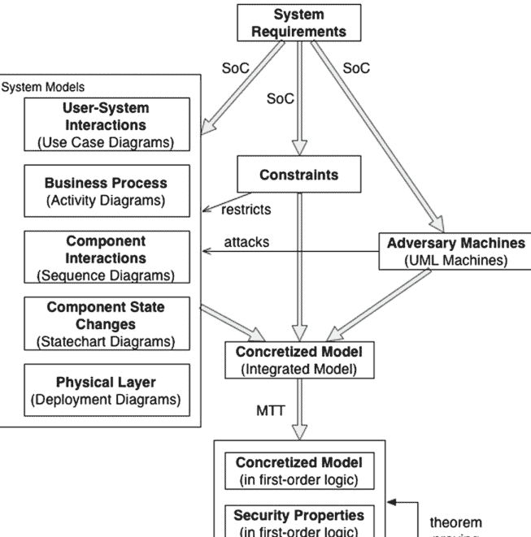

**图 4.**** UMLSEC 方法的概述。

- **状态图（Statechart Diagrams）**对组件的动态行为进行建模；
- **部署图（Deployment Diagrams）**用于建模客户端、服务器、数据库等组件之间的通信链路。

请注意，UMLSEC 使用的 UML 片段以及攻击机通过 UML 状态机 [53] 提供了精确的语义。这些状态机是状态机的一种类型，具有输入/输出接口，其行为可以使用类似于著名的抽象状态机（Abstract State Machines）的符号进行指定。通过将约束和攻击机与系统模型织合，可以创建一个组合模型（在 UMLSEC 中称为具体化模型 concretized model）。该具体化模型是可用于进一步安全分析的系统设计模型。

模型驱动的安全性进展

# 模型转换与工具支持

UMLSEC 在开发过程中没有显式使用模型转换。

重命名（Renaming）用于系统模型、约束和攻击机的模型组合（见图 4）。重命名是 UMLSEC 的一种映射形式，它关联了类型（stereotypes）、标签（tags）和约束，使得三个独立的模型可以组合在一个具体化模型中。从具体化模型可以保证产生一阶逻辑理论，并可以使用名为 AICALL 的基于 PROLOG 的专用工具证明安全属性。

鉴于该方法的目的是提供分析能力，UMLSEC 的工具包并不从模型中生成代码。通过将代码反向工程为 UMLSEC 模型 [17]，可以将该方法应用于现有系统。

**验证（Verification）。** 如前所述，UMLSEC 方法侧重于系统设计的安全分析。为了这一目的，UMLSEC 将系统的行为模型与系统潜在攻击者的模型组合。集成模型被编译为一阶逻辑公理，可以通过 AICALL 进行验证。然后使用基于 PROLOG 的工具验证系统的安全需求。当攻击可行时（即安全关注点可能被违反），工具会自动生成攻击序列，显示攻击可能如何发生。

**追溯性（Traceability）。** 在 UMLSEC 中，系统的安全分析揭示了可能被潜在攻击序列违反的安全关注点。这些信息可用于将安全相关的设计缺陷追溯到模型。然而，该方法未提供工具自动追溯。

**有效性（Validation）。** UMLSEC 已应用于分析多个工业应用的安全性，例如生物识别认证系统 [52, 69]、通用电子脉冲规范（CEPS）项目 [51]、网络银行应用程序 [54, 42]、[55]描述的嵌入式系统以及[56]描述的移动系统。大多数案例研究结果对于 UMLSEC 方法的收益是积极的。

### 4.2 SECUREML

**应用领域。**2002年，Basin 等人提出了 SECUREML [71, 15, 16, 13]，以便将系统模型与安全关注点织合。这是通过用于系统建模的类 UML 语言和基于角色的访问控制（RBAC）语言 [92]描述安全策略来实现的。所有语言都被定义为 UML 配置（profiles）。该框架足够通用，可以应用于其他系统模型或安全语言，但对于

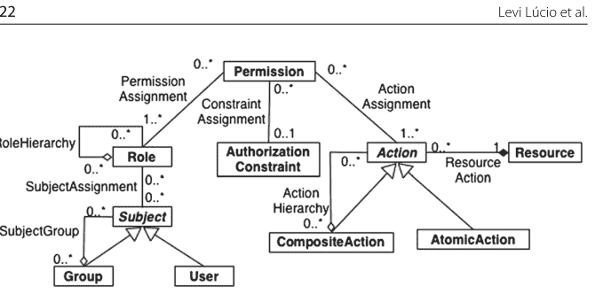

新的建模和安全描述语言需要定义为 UML 配置。由于其通用性，SECUREUML 可应用于许多领域。尽管如此，文献中关于 SECUREUML 的具体示例很少涉及网络应用程序。

**安全关注点（Security Concerns）。** SECUREUML 方法侧重于访问控制，特别是 RBAC。SECUREML 的元模型如图 5 所示，由 RBAC 元模型扩展。虽然 RBAC 的核心概念是**主体（Subject）**、**角色（Role）**和**权限（Permission）**，但在图 5 的元模型中引入了**资源（Resource）**和**操作（Action）**的额外概念。**资源**正如其名所示，是系统中应强制执行安全措施的资源的抽象。**操作**对应于可以在资源上执行的活动。通过将 RBAC **权限** 强制执行到**操作**上，Basin 等人能够将安全策略附加到在独立系统模型中描述的**资源**上。

SECUREUML 文献中的所有示例都使用 RBAC 安全语言。为了指出该方法不仅限于访问控制，[16] 的作者简述了 SECUREUML 在其他访问控制方法（如*中国墙（Chinese Wall）*策略或 Bell-LaPadula 模型）中的适用性。随后在 [13] 中，作者提到了在 SECUREML 中对*使用控制（usage control）*进行潜在建模。

**建模方法与安全与业务的分离。** 我们在图 6 中展示了 SECUREML 方法的图形描述*关注点分离（Separation of Concerns）*自然地嵌入框架中，正如对业务和安全 RBAC 关注点的显式建模所示。Basin 等人在工作中使用两种主要的基于 UML 的建模语言

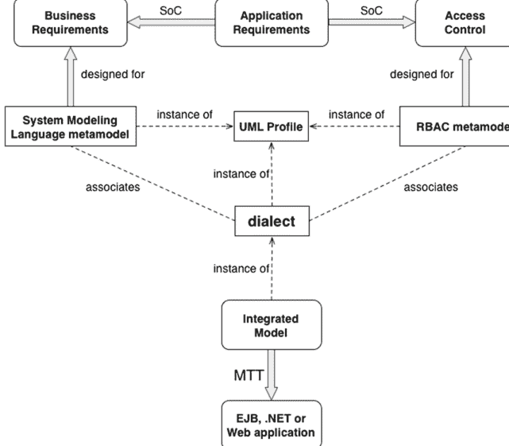

或简化的 UML 类图和简化的 UML 状态图。
业务和安全模型的组合通过方言语言实现，将系统语言与访问控制 RBAC 连接起来。这种方言语言也被定义为 UML 配置，并将 SECUREML 元模型（图 5）中的资源和操作类映射到需要安全的系统语言的几个概念中。例如，Basin 等人在 [15] 中定义了类状态图系统语言。其受保护的资源自然包括状态操作，例如执行（Execution）或激活（Activation）。

图 6. SECUREML 方法的概述。

124

Levi Lúcio et al.

在状态图的资源上创建一个组合的方言语言。自然地，如果系统建模语言或安全语言发生变化，则需要创建新的方言语言。集成模型可以作为方言语言的实例构建。

模型转换与工具支持。从从图 5 的集成模型可以自动生成代码。在 [16] 中，作者描述了从组合的 SecureML 和名为 ComponentUML 的类 UML 语言生成企业 Java Bean (EJB) 和 .NET 系统。代码生成技术的实例将安全语言的概念映射到 EJB 或 .NET 的内置安全机制。此外，使用 Java 断言来强制执行授权约束。

尽管代码被视为模型转换，但 EJB 和 .NET 的生成并不是使用模型转换语言完成的。尽管如此，Basin 等人在 [13] 中提到了使用 QVT 自动组合系统的各个部分与单一安全模型。目标是避免模型之间分散的冗余信息。此类组合的网络应用程序示例可以在 [14] 中找到。

**验证（Verification）。**在 [16] 中给出了从安全的 ComponentUML 模型生成 EJB 代码过程的证明摘要。该证明是针对从模型生成的 EJB 代码正确性的正确构造论证。如果考虑其他系统建模语言，则需要提供类似的证明，考虑新的代码生成目标平台。

SecureMOVA 工具的验证是 [12] 的主题，作者描述了该工具允许验证集成模型（见图 6）的安全属性。安全属性通过 OCL 约束表示用户、角色、权限、操作和状态之间的关系。回到我们的类状态图系统语言，可以通过 SecureMOVA 显示用户将在系统模型中至少激活一次某个状态。

**追溯性（Traceability）。** SECUREML 没有显式的追溯性。

**有效性（Validation）。** 使用 SECUREML 的几个简单示例可以在 [16] 中找到。描述了一个大型的电子商务 J2EE“宠物店”应用程序。

# 模型驱动安全性的进展

Lodderstedt [70] 在其博士论文中提出了这些。最后，Clavel 等人 [25] 报告了 SECUREML 在工业案例研究中的适用性。结论是，SECUREML 方法对于理解受操作的概念、执行早期分析和故障检测很有用，并提高了重用性和演化性。研究还提到，虽然访问控制在案例研究中证明是相关的，但它仅仅是工业伙伴感兴趣的几个关注点之一。

## 4.3 SECTET

应用领域。SECTET [3, 39, 6, 4, 40, 21] 是一个可扩展的模型驱动安全（MDS）框架，用于支持*政府、医疗、*或教育等社会结构安全工作流的设计、实现和管理 [20, 37]。该框架假设了一个基于面向服务架构（SOA）概念的分布式对等技术空间，并将其实现为 Web 服务。

安全关注点。SECTET 处理两类安全策略：

- *基础安全策略*：对于分布式系统组件之间传递的消息的*完整性、机密性*和*不可否认性*。通过不可否认性，我们的正确的消息不被丢弃；
- *高级安全策略*：静态和动态基于角色的访问控制（RBAC）。

关于三个基础安全策略，SECTET 通过使用对等系统中消息传递的已知且经过证明的机制来实现。在 Web 服务层面的现有通信协议用于强制执行*机密性*和*完整性*。加密技术用于实现*不可否认性*。SECTET 的作者将精力集中在访问控制策略的建模、分析和执行上，特别是动态访问控制约束，以及如何将这些策略与用 UML 表示的系统模型集成 [21, 1, 40, 4, 5]。

我们在图 7 中展示了 SECTET 框架中 RBAC 策略的元模型。它包含一个标准的 RBAC 元模型，包括*对象、角色*和*权限*的概念，并由在权限上定义的动态约束进行扩展。*角色*和*对象*（资源）映射到应用领域元模型中的相应实体。除了访问控制，SECTET 还可以扩展到其他高级安全策略，如可用性 [38]、权限委托 [6] 或信任管理 [3, 7]。为了实现这一点，需要扩展图 7 中元模型的下部分，以实现 AdvancedSecurity-Policy 类的其他实例。

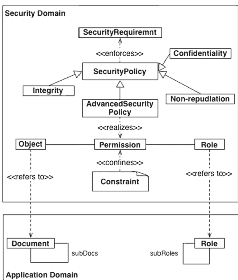

**图 7.**** SCTET 框架中的 RBAC 元模型（改编自 [38]）。

**建模方法与安全与业务的分离。** SECTET 框架利用了一种方法论标准（模型驱动架构）、一种架构范式（面向服务架构）和一种技术标准（Web 服务）。它使用 UML 配置创建了两种语言：1) 系统建模语言 SCTET-UML 和 2)  way约束语言（OCL）风格的预测语言 SECTET-PL。

SECTET-UML 用于建模业务需求和静态安全需求。这些需求在三种工作流视图中表示（如图 8 所示）：

- *全局工作流*：全局工作流代表虚拟且分布式的跨组织工作流，它模拟了伙伴（组织）之间交互的抽象视图；
- *本地工作流*：本地工作流代表组织内工作流，代表特定服务组件对业务过程的执行。本地工作流模型可以作为工作管理系统的输入；
- *接口视图*：接口视图展示了系统中每个服务组件的属性和权限。它包含了三个子模型，即*接口模型*、*文档模型*和*角色模型*，对应于*本地工作流*的公开可见部分，该部分可供跨组织的*全局工作流*访问。

SECTET 使用 UML 2.0 活动图元模型的子集来建模*全局工作流*和*本地工作流*。使用刻型 UML 类图来建模接口视图。

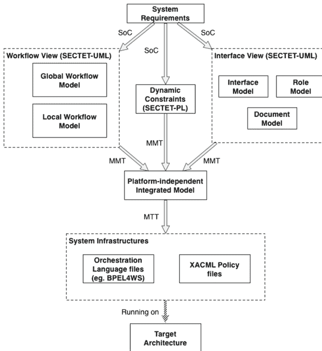

**图 8.** SECTET 方法论概览。

动态安全需求（如访问控制约束）在 SECTET-Pl 语言中表示，如图 8 所示。在 SECTET 中，安全策略在语言层上与业务逻辑分离，这可以从图 7 中 SECTET 元模型的安全域（Security Domain）部分引用应用领域元模型中的元素看出。因此，SECTET 框架实现了安全关注点与业务逻辑分离的原则。

如图 8 所示，通过组合 SECTET-UML 模型与 SECTET-Pl 中的动态安全需求表达式，构建了一个集成的平台无关应用模型（PIM）。可以对此 PIM 进行验证关注。

**模型转换与工具支持。** 如图 8 所示，在 SECTET 方法论中，系统需求被具体化为三个视图：工作流视图、动态约束和接口视图。此层面的模型构建由 MagicDraw 支持，它允许将 UML 模型导出为 XMI 文件。

然后应用模型到模型（M2M）转换来集成这些模型。通过带注释的模型组合将 SECTET-UML 模型与 SECTET-Pl 中的动态安全需求表达式集成，以形成平台无关应用模型（PIM）。关于 XAML 产物的生成，使用了 XPAND 模型语言。生成的架构可以由工作流引擎执行（图 8 中的目标架构）。

**验证。** SECTET 未使用验证方法。

**追溯性。** SECTET 未定义或实现追溯性。

**有效性。** 来自医疗和电子政府领域的各种案例研究可用于在现实场景中验证 SECTET 框架 [21, 1, 40, 2, 20, 37, 4, 5]。SECTET 主要用于 Web 应用中的 RBAC 策略。此外，Alam 等人 [6] 描述如何在 SECTET 中处理权限委托，[3, 7] 中的案例研究显示 SECTET 可以处理信任管理。在 [39, 36] 中，作者还说明了 SECTET 框架的可扩展性。

关于案例研究的复杂度，[40, 19] 进行了一项名为 health@net 的大型研究项目，涉及许多学术和工业伙伴。该项目的目标是处理基于使用控制并涉及多种访问控制策略的复杂医疗场景。

### 4.4 ModelSEC

应用领域。在 [91] 中，作者利用一个用于医疗患者管理的 Web 示例说明了 ModelSEC 方法。该示例的核心是安全数据库的设计，作者展示了 ModelSEC 如何处理访问控制和安全。尽管作者通过安全数据库示例演示了其方法，但据我们所知，ModelSEC 方法并不限于特定的应用领域。

安全关注点。ModelSEC 通过为应用程序构建安全需求来定义和管理安全需求，并生成运行安全模型。安全需求以集成的方式涵盖了多个安全关注点，包括隐私、完整性、访问控制、身份验证、可用性、不可否认性和审计。图 9 展示了用于设计安全需求模型的 ModelSEC DSL。一个完整的安全需求类包含以下组件：

- 资产（Asset）是可能受到威胁的物理或逻辑对象；
- 威胁（Threat）是可以被威胁损坏的资产；

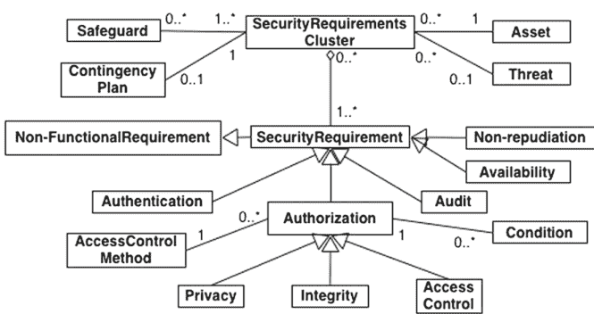

**图 9.** 安全需求元模型，ModelSEC 方法的 SeML DSL 的一部分（改编自 [91]）。

*   防护措施（Safeguard）是一种可衡量的风险阻碍，或针对风险的行动；

*   应急计划（Contingency Plan）由一组建议降低风险的防护措施组成；

*   安全需求（Security Requirement）表达了最终系统应实现或保证的安全关注点。

**建模方法与关注点分离。** MODELSEC 提出了一个需求元模型（此处未介绍，因为它不是专门针对安全需求的，但在 [91] 中可见），并用图 9 中的安全元模型进行了扩展。该方法基于 UML 和 MDA（模型驱动架构）：例如，业务关注点使用用例图和类图来表示，并且模型与平台细节保持分离。

图 10 展示了 MODELSEC 方法。业务模型和安全模型从一开始就清晰分离，并在过程的几个步骤中实现同步。模型转换从顶层需求模型生成两种类型的模型：安全和业务设计模型 [91]，这些模型可以捕捉设计决策。

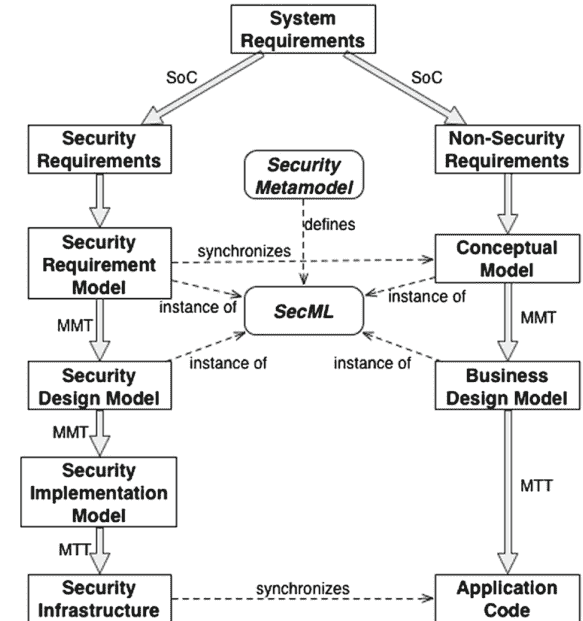

图 10. MODELSEC 方法概述。

因此，需求模型指定了系统必须满足的限制，而设计模型则指定了如何满足这些限制。设计模型在处理之前是平台无关的。应用程序代码直接从业务设计模型生成，包含特定平台的信息，从而产生安全实现模型。

Sánchez 等人 [91] 描述了整个 MODELSEC 方法。然而，作者没有提供关于它们如何集成以及安全策略如何与应用程序代码同步的足够细节。

## 模型转换与工具支持。MODELSEC 利用模型转换从模型生成必要的构件。

正如我们在图 10 的综合中所示，模型到模型转换（MTMT）在 ModelSEC 中起着关键作用。MTTS（模型转换技术）被用于将分析模型（安全需求模型和概念模型）转换为设计模型（安全和业务设计模型），以及将安全设计模型转换为安全实现模型。MODELSEC 中的 MTT 转换用 RubyTL 编写，这是一种嵌入在 Ruby 编程语言中的转换语言。

模型到文本转换（MTT）分别用于将实现和设计模型转换为安全基础设施和应用程序代码。MODELSEC 选择了 Eclipse MOFSCRIPT 模板语言来实现 MTTS。

验证、追溯性与确认。ModelSEC 方法尚未解决验证问题。ModelSEC 方法没有提到任何关于追溯支持，并且仅在学术案例研究 [91] 中进行了说明。

### 4.5 SECUREMD

应用领域。SECUREMD [77–80, 76] 是另一种基于 UML 的方法，旨在促进基于或使用加密协议构建的安全关键嵌入式应用的开发。在这个应用领域中，协议会受到第三方入侵者的攻击。在这种场景下，攻击者可以拦截并读取消息，破坏机密性。然后它会删除这些消息或伪造新的虚假消息，损害用户与第三方服务器之间的真实性、隐私等。

尽管作者声称他们的方法可以很容易推广到其他语境，但 SECUREMDD 针对的是具有以下特征的应用。终端（Terminal）是能够读取和与智能卡通信的设备，智能卡类似于信用卡，但可以存储所有者的私有数据（例如医疗数据或在线交易的支付设施）。在访问智能卡上的数据或联系健康中心等第三方机构以获取患者数据时，终端利用了需要信任的标识协议，以确保整个系统的完整性。

作者研究了不同规模的应用：从小型、简单的应用开始，他们改进了自己的方法，并提出了一种处理工业规模应用的方法论，同时确保了结果代码的形式化验证。

**安全关注点。** SECUREMDD 处理通用安全属性，如机密性、数据完整性、保密性等该领域内所有应用共同的属性。严格来说，SECUREMDD 没有使用专用语言来指定安全属性。相反，属性直接使用逻辑代码指定，称为动态逻辑（Dynamic Logic）。

**建模方法以及安全与业务的分离。** SECUREMDD 结合了用于系统结构的 UML Profile 和捕捉行为的活动图。UML 是作者创建的 DSL（领域特定语言），允许在 UML 图上进行细粒度的行为操作并与加密协议交互。它有文本表示，可能更适用于设计应用时的早期实验；它还有图形化表示，旨在与 UML 图集成。

由于 SECUREMDD 通过定理证明器实现形式化验证，因此用于设计应用的各种 UML 图的所有语义已在 Kiv¹ 中定义，并包含了针对 Java（从 UML 生成代码的目标语言）的语义。这些语义以 ASM 的形式表示，这是作者选择用于进行验证的形式化方法。

图 11 展示了 SECUREMDD 的通用方法。设计过程从为应用程序的功能需求创建 UML 模型开始。类图描述了不同的应用实体（终端和卡，以及用户和攻击者，以及

> ¹ Kiv 定理证明器的网页：http://www.informatik.uni-ausburg.de/lehrstuehle/swt/kiv/

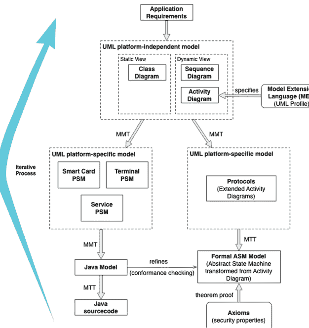

**图 11. SECUREMDD 方法概述。（彩色版本请参阅本章节的在线版本）。**

设计过程从为应用程序的功能需求创建 UML 模型开始。类图描述了不同的应用实体（终端和卡，以及用户和攻击者，以及协议通信），而序列图和活动图模拟了系统的行为。作者提供了此类建模的具体示例：例如对于卡片复制、组件状态如何变化、加密/解密操作如何与预定义的加密操作交互等。

作者从小型、简单的应用开始开发，改进了自己的方法，并提出了一种处理工业规模应用的方法论，同时确保了结果代码的形式化验证。

由于新功能的不断添加，在检查迭代生成的应用程序符合预期后，建模和处理 UML 图以及安全属性规范本身很快就变成了挑战。迭代开发也会对安全属性产生影响，因为新功能可能会破坏之前建立的证明。作者描述了他们如何开发一个重要的案例；德国电子健康系统，经过三次迭代

关注点分离并不严格适用于 SECUREMD，因为安全属性定义在从 UML 图生成的特定模型上。

## 模型转换与工具支持。SECUREMD 大量利用转换从平台无关模型生成可执行代码。MMT 技术用于将平台无关模型转换为两种不同的模型：图 11 中的执行模型是用于执行的 Java 模型，而右侧的抽象机（ASM）模型用于验证。转换整合了特定信息以产生适当的代码，特别是遵循目标语言的范式（Java 的面向对象，ASM 的代数规范）。特别是内置数据类型和值、配置设置、协议交换消息的序列化机制、加密/解密算法等实现细节都考虑在内。

通过这些模型，MMT 技术用于生成执行和验证所需的实际代码。这些转换使用 XPAND 实现，这是一种静态类型模板语言，专注于文本构件的生成。请注意，应用程序的安全关键部分是自动生成的；其他关键性较低且更容易演进和修改的组件需要手动编程并与可信代码集成；例如数据库访问和用户界面的构建 [79, 77]。

SECUREMD 的作者没有专门描述针对其方法的工具支持；然而，有几篇论文对建模构件、转换链和验证过程提供了见解，特别是 [79, 76]。

验证。在 SECUREMD 中，验证针对两个方面进行：验证安全属性在模型中是否有效成立，以及

# 模型驱动安全的进展

验证生成的 Java 模型是否是 ASM 模型的正确细化。细化正确性证明是在 Java 和 ASM 的特定模型层级处理，而不是在原始 UML 图表中。通过这种方式，所有关于安全关注点和应用程序功能的信息都是可用的，并且在各自的工具中完全可执行。SECUREMD 重复了 Stark 等人 [98] 的工作，该工作从 ASM 的角度为 Java 及其虚拟机提供了形式化语义。由于 Kiv 是在 ASM 之上构建并集成了 Java 结构，证明过程变得更加方便，尽管它仍然像定理证明器那样的保持交互性（Moebius 等人 [80] 报告称，为复制卡应用程序构建证明需要几周时间，根据作者观点，这可以认为是一个小型应用程序）。作者目前正致力于扩展这种方法：他们计划为 QVT 定义一种算术（这是他们用于 MMT 的语言），以便在此类转换中形式化地证明 Kiv 的正确性。

安全属性的验证由 Kiv 处理，这是一种基于 ASM 的定理证明器。安全属性使用专门的逻辑——即动态逻辑（Dynamic Logic），该逻辑为构成 ASM 数学背景的代数规范量身定制。他们注意到一个有趣的现象：特定应用程序的安全属性通常比标准属性（如机密性或完整性）具有更好的保障，但这些通用安全属性仍然需要被证明，而且实际上经常被作为特定属性的背景。例如德国健康卡，需要确保只有合格的医生才能向任何入侵者发布机密性证明（当然，除了患者）。Moebius 等人 [76] 还提供了一种促进迭代验证的方法：通过遵循指南（例如，将系统不变性分为若干部分以便能够重新证明大部分部分，或在必要时修改协议行为），他们能够在进一步的增量步骤中运行大部分证明。这种方法是否适用于其应用领域之外仍有待观察。

在后期阶段，SECUREMD 引入了直接在 UML 上定义测试用例的可能性 [76]。通过模型到测试（Model-To-Test）转换，这些测试用例可以在生成的 Java 代码上执行，以验证验证过程未处理的场景，例如与未自动生成代码的用户面的交互。

追溯性。SECUREMD 采用生成式方法：一旦组合模型通过了安全属性验证，就会生成与系统安全相关部分对应的相关代码。因此，所有与安全相关的缺陷都能尽早发现，且该方法不需要后向追溯。

SECEMDD 似乎是一种很有前景的方法：当它在 2009 年首次提出时，仅处理了小规模的概念验证案例研究（例如电子支付的 Monde 协议 [77]）。随后它演变为中等规模案例研究——复制卡应用程序 [80]，其中处理了更复杂的特定应用程序安全属性。最后一步，作者们处理了一个工业级项目，即德国电子健康卡应用程序 [76]。这些结果是在较短的时间内获得的（2009 年到2012 年）。

# 5. 讨论

本节在比较表格中综合了我们的评估，并讨论了 MDS 中待解决的问题和当前的挑战。

### 5.1 评估总结

我们现在重新回顾在第 4 节中评估的 MDS 方法，以提取关于第 3.2 节分类法的综合结论。这些考虑总结在表 2 中，其中列对应分类法条目，每行对应我们所选的一种种 MDS 方法。

**应用领域** 大多数被评估的方法被设计为“通用型”，即其目标是处理广泛的应用领域。一个例外是 SECEMDD，它仅关注支持智能卡业务应用程序的应用。

**安全关注点** 只有 SECUREML 关注一个关注点，即访问控制。SECEMDD 方法主要处理加密协议，但也针对了特定应用程序的安全属性。其他方法（即 UMLSEC、TECT 和 MODELSEC）开放了多种安全关注点。

**建模范式** 所有方法都将模型驱动架构与领域特定建模范式相结合。一个例外是 UMLSEC，它应用了多范式建模（MPM）。之所以这样做是因为 UMLSEC 系统的不同视图由不同的 UML 图进行建模，最终所有视图被组合成系统的完整规格说明。然而，并没有平台特定性或

> ²该项目的网页提供了有关其他项目的详细信息：https://www.informatik.uni-ausburgburg./de/lehrstuehle/swt/se/projects/secEMDD/.

# 表 2 被评估的 MDS 方法比较。

| | 建模方法 | | 模型转换 | | | |
| | 应用领域 | 安全关注点 | 范式 | 建模语言 | (*SoC | MMT | MTT | 验证 | 追溯性 | 工具支持 | 验证 |
| :--- | :--- | :--- | :--- | :--- | :--- | :--- | :--- | :--- | :--- | :--- | :--- |
| UMLSEC | Web 应用、嵌入式系统、分布式 | 机密性、完整性、真实性、授权、新颖性、信息流、不可否认性、公平交换 | MPM | | o | X | 编译器 | AICall prover | 攻击序列 | 高 | |
| SECURE | Web 应用 | 访问控制 | MDA + DSM | UML 配置文件 | ✓ | X | 编译器 | SecureMova 模型检查器 | X | 中 |
| SECTET | 政府、电子健康、电子教育 | 完整性、机密性、不可否认性、访问控制 | MDA + DSM | UML 配置文件 | ✓ | QVT | | | X | 高 |
| MODELSEC | Web 应用、数据库 | 隐私、完整性、真实性、可用性、不可否认性、审计、访问控制 | MDA + DSM | SecML (定制 DSL) | ✓ | Ruby | | X | 低 |
| SECUREMD | 智能卡和业务应用 | 加密（机密性、完整性）、特定应用程序安全属性 | MDA + DSM | UML 配置文件 | ✓ | QVT | XPAND | Kiv prover、测试用例 | 高 |

注：支持 (✓)，部分支持 (o)，不支持 (X)。独立性是显式建模的。MPM 可以被认为涵盖 MDA 或 DSM，但不限于其中任何一种范式。建模语言只有 MODELSEC 使用了基于 UML 的 DSL。其他方法使用 UML 配置文件。关注点分离只有 UMLSEC 没有完全遵循。事实上，UMLSEC 相关信息部分包含业务模型中。我们分析的其他 MDS 方法要么将安全关注点封装在特定模型中（例如 SECEMDD），要么在元模型级别明确分离（例如 SECTET）。模型转换 MODELSEC 定义了自己的 MMT 编程语言并使用 Mo-Script 进行 MTT。SECTET 和 SECEMDD 利用 Eclipse 平台上著名的模型转换工具：用于 MTT 的 QVT 和 XPAND。相比之下，UMLSEC 和 SECUREML 没有使用 MTT。对于 MTT，它们各自使用特定的工具作为编译器：SECUREML 生成源码；UMLSEC 生成一阶逻辑公式。安全验证 SECTET 和 MODELSEC 未提供关于如何在模型或系统基础设施上验证安全属性的显式信息。其他 MDS 方法利用定理证明器或模型检查器在模型上验证安全属性。追溯性 文献中的 MDS 方法似乎缺乏这一重要功能。在我们评估的 MDS 方法中，只有 UMLSEC 实现了一种使用定理证明器生成的攻击序列的不完整跟踪机制。仍然需要人工在抽象模型层面上解释此类攻击。工具支持大多数所选方法直接受益于 MDE 在模型编辑和自动执行转换方面的进展。然而，当前 MDS 的工具支持是部分的，且限于开发过程的某些步骤。验证 UMLSEC、SECTET 和 SECEMDD 的验证水平评为高，因为每种方法都通过一系列案例研究进行了实验，涉及大型工业实验。SECUREML 通过多个案例研究进行了验证，但只有一个中等规模的工业案例。因此我们将其验证水平定为中等。MODELSEC 目前尚不成熟，因为它仅应用于一个学术案例研究。

### 5.2 对 MDS 有效性的威胁

在本节中，我们总结了文献中提到的当前 MDS 方法的一些缺点。

使用 UML 配置文件（profiles）是社区内争论的话题。Sánchez 等人 [91] 提到了 UML 配置文件在建模和分析安全关键系统中的可用性。他们认为，要适配 UML 配置文件来建模原始能力之外的新安全关注点是困难的，甚至是不可能的。其次，Ma 等人 [73] 表明，使用通用建模语言（如 UML 配置文件）会阻碍可重用性，尽管它有利于模型之间的通信。此外，这些作者还提到，当安全尚未集成到建模工作之中时，将 UML 配置文件适配到新系统需要付出巨大的努力。

Breu 等人 [19] 强调了 MDS 方法中可追溯性的性。然而，在我们分析的 MDS 方法论中，很少提到可追溯性。

作为最后的一句一般性说明，Ma 等人 [73] 指出，大多数 MDS 方法（在我们选取的范围内的）仍然处于学术阶段。其中一些 MDS 方法是用于展示某研究项目部分理论概念的原型。它们中的大多数是为特定的业务领域和/或特定的安全关注点设计的实现。此外，Nguyen 等人 [88] 以及 Jensen 和 Jaatu [46] 进行的 MDS 系统性综述结果均显示，MDS 研究缺乏实证研究。

### 5.3 相关的待解决问题

基于评估结果，以下问题似乎还有待讨论。

#### 5.3.1 建模范式的选择

表 2 显示，安全关注点与业务逻辑的分（SoC）存在几乎所有的 MDS 方法中。然而，尽管关注分离（Separation of Concerns）的概念面向面向建模（AoM）的核心，但所有评估的 MDS 方法中没有一个显式使用 AoM 范式。事实上，在我们分析的文献中没有使用“织入”（weaving）这一术语，也没有方法使用模型织入器（model weaver）。这一结果与 [88] 中的调查统计一致，其选定的主要研究中有 87% 不是基于 AoM 范式的。

解释为什么被评估的 MDS 方法没有显式应用 AoM 范式很难，但我们将尝试提出几个可能的原因。

原因可能是当 AOM 工具尚未完全提供 MDS 方法所需的内容时，AOM 方法还不够成熟。另一个原因可能是，显式使用 AOM 范式和针对 MDS 上文的定制工具需要进一步研究。这种调查可以确定 AOM 范式是否实际上能帮助 MDS。

除了 UMLSEC 方法外，在 MDS 中使用 MPM 范式的其他示例已在 [106, 29, 68] 中发表。

#### 5.3.2 安全关注点及相应的元模型

根据第 4 节中被评估的 MDS 方法的安全关注点元模型（图 5、7 和 9），只有访问控制被详细地进行了元编码（meta-coded），而完整性和机密性等安全关注点在这些元模型中建模为简单的实体。

原因是机密性和完整性等安全关注点涉及系统业务部分的状态。例如，元模型中的安全关注点实体可以与系统的动态模型元素（如 UML 序列图或活动图）相关。另一种可能性是在基础设施层面直接实现此类安全关注点，从而旁过额外的建模。例如，在 SECTET 中，机密性是通过 Web 服务层的现有通信协议强制的。由于通过模型或系统基础设施处理动态安全属性很大程度上取决于应用场景，此类需求无法通过元模型轻松抽象。

这一观察与系统性综述 [88] 的结果一致，该综述指出，在选定的 MDS 研究中，大部分（约 42%）涉及访问控制。

#### 5.3.3 建模语言的选择

在本章评估的五个 MDS 方法中，有四个采用 UML 配置文件作为建模语言。只有 ModelSEC 方法建议使用 SECML（一种定制 DSL）。UML 配置文件在 MDS 中被广泛应用，这可以理解，因为 UML 广受欢迎。系统性综述 [88] 显示的结果还揭示，在其综述涉及的研究中，79% 使用了 UML 标准模型和 UML 配置文件。相比之下，只有 21% 的受评研究使用定制 DSL。然而，尽管 MDS 方法使用 UML 配置文件作为建模语言，但  也可以被视为 DSL。换句话说，DSL 似乎是 MDS 的一个核心概念。

## 6 相关工作

尽管已经存在多年，关于 MDS 主题只有一篇综述 [57] 和两篇系统性综述 [46, 88]。

Kasal 等人 [57] 与我们的工作共享了一个评估基于模型的安全工程的分类法，这直接启发了我们的工作。几个分类条目是共同的，例如，他们的范式、验证和安全机制分别对应我们的建模方法、验证和安全关注点。从 MDE 角度来看，我们考虑可能使用 DSL 的建模方法已经涵盖了他们的某些条目（即细粒度和可执行性）。他们的工作仅回顾了四种方法：UMLSEC [51]、安全软件架构 [104]、一种基于模型的面向切框架 [105] 和 AVISA [9]——一种用于验证互联网安全协议的按键式工具。作者在同一水平上还包含了针对通用分析的工具：SMV（系统模型验证器）、一种 LTL/CTL 通用模型检查器，以及 Alloy——一种基于 SAT 的关系规范求解器 [44]。根据定义，这两者均不能被视为 MDS 方法。

Jensen 和 Jaatu [46] 进行的系统性综述显然面向代码生成。他们涵盖了五种方法中的三种。然而，作者没有提供 MDS 选择标准。此外，作为系统性综述的固有局限性，他们的工作没有我们详细。

Nguyen 等人 [88] 专门针对 MDS 方法提出了一项系统性文献综述。他们的筛选保留了数千篇论文。这篇综述还简要描述了本章评估的所有方法。

> ^3SMV 模型检查器可以免费访问 http://www.cmu.edu/~modelcheck/smv.html，尽管 [57] 未提供引用。

Basin 等人 [13] 通过 SECUREML 工作回顾了十年的 MDS。作者关注以下主题：业务和安全关注点的建模问题；用于生成执行代码和导出测试用例的转换；他们方法的能力；最后是 SECUREML 的工具支持。这篇综述虽然非常特定于作者的工具，但为 MDS 提供了一个可行的愿景。

结论

在本章中，我们介绍了过去十年模型驱动安全的主要进展。为了对 MDS 提供一个清晰的愿景，我们首先介绍了其基础的主要概念。特别是，我们关注了 MDE 的概念，如元模型、模型转换等，但也关注了关注分离的概念。然后我们提出了一个由 MDS 主要概念和元素组成的详细分类法。基于该分类法，我们描述、总结、评估并讨论了著名的 MDS 方法：UMLSEC、SECUREML、TECT、ModelSEC 和 SECMD。我们指出了当前 MDS 方法的一些局限性，并勾勒了一些相关的待解决问题。总的来说，本章提供了该领域的广泛视角，旨在为学生、研究人员或从业者提供 MDS 介绍。

这项工作使我们对未来的 MDS 研究和工业实践提供见解。首要挑战是达到更好的成熟度：这当然需要构建工具，还需要进行系统性的工业实验。后者在这样一个关键的软件应用领域显然是困难的。然而，近期 MDE 在理论和工具方面的进展，以及工业界对建模的持续关注，可能直接造于 MDS 的发展。

我们注意到，大多数现有 MDS 方法都实现了安全关注点与业务逻辑的分（SOC），即使对于我们调查的方法来说，这一原则不能被视为 AoM 范式。

# 模型驱动安全的进展

因此，AoM 范式可以增强安全关键系统的模块化以及安全模型的可用性。

DSL（领域特定语言）不仅要处理业务复杂性，还要处理安全关注带来的额外复杂性，而这些关注本质上是多种。针对这种多样性的一种直观解决方案是让软件开发方法论反映此类系统的异构性，目标是简化设计。从我们在第 4 节的评估中可以推断，开发一个旨在同时对所有安全关注点的通用 DSL 是困难的。这是因为不同的安全属性与业务模型有不同的交互，这些交互复杂到人类无法使用单一 DSL 进行建模。为了减轻建模任务并提供更好的验证可能性，一种有趣的可能性是：使用专门定制的 DSL 对每个安全关注点进行建模。

然而，我们认为，将安全关注点分散到多个模型中引发了几个关键挑战：首先，它阻碍了专家对系统整体安全的理解，因为他们需要同时处理多个模型。但这一缺点可以通过这些模型的关注点缩小来平衡。其次，它需要适当的组合操作符来创建合并所有安全方面的模型。这对于后期阶段至关重要：虽然独立的安全模型使得独立分析安全属性成为可能，但在系统的业务部分执行这些策略以及生成代码，需要在到达平台代码之前合并所有安全方面。第三，它增加了保持所有模型在公共信息上同步的难度，并在将集成验证结果回溯到分布在多个模型中的安全信息时，提出了额外的挑战。

# 缩写词列表

- AoM 面向面向建模 (Aspect-Oriented Modeling)
- AOSD 面向面向软件开发 (Aspect-Oriented Software Development)
- ASM 抽象状态机 (Abstract State Machine)
- ATL ATLAS 转换语言 (ATLAS Transformation Language)
- CIM 计算无关模型 (Computation Independent Model)
- CTL 计算树逻辑 (Computation Tree Logic)
- DSM 领域特定建模 (Domain-Specific Modeling)
- DSML/DSL 领域特定（建模）语言 (Domain-Specific (Modeling) Language)
- EJB 企业级 JavaBeans (Enterprise JavaBeans)
- EMF Eclipse 建模框架 (Eclipse Modeling Framework)
- GMF 图形建模框架 (Graphical Modeling Framework)
- GPL 通用编程语言 (General-purpose Programming Language)
- J2EE Java 2 企业版 (Java 2 Enterprise Edition)
- LTL 线性时间逻辑 (Linear Temporal Logic)
- MDA 模型驱动架构 (Model-Driven Architecture)
- MDE 模型驱动工程 (Model-Driven Engineering)
- MDS 模型到模型转换 (Model-To-Model Transformation)
- MOF 元对象设施 (Meta-Object Facility)
- MPM 多范式建模 (Multi-Paradigm Modeling)
- MTT 模型到文本转换 (Model-To-Text Transformation)
- OCL 对象约束语言 (Object Constraint Language)
- OMG 对象管理组 (Object Management Group)
- PDM 平台描述模型 (Platform Description Model)
- PIM 平台无关模型 (Platform Independent Model)
- PSM 平台特定模型 (Platform Specific Model)
- QVT 查询/视图/转换 (Query/View/Transformation)，对象管理组定义的模型转换集
- RBAC 基于角色的访问控制 (Role-Based Access Control)
- SOA 服务面向架构 (Service-Oriented Architecture)
- SOC 关注点分离 (Separation of Concerns)
- UML 统一建模语言 (Unified Modeling Language)
- XAML 可扩展访问控制标记语言 (Extensible Access Control Markup Language)
- XMI 元数据交换 (Metadata Interchange)
- XML 可扩展标记语言 (Extensible Markup Language)
- XPAND Eclipse 下的一种静态类型模板语言 (A statically typed template language under Eclipse)

# 致谢

此工作得到了加拿大汽车伙伴关系（Automotive Partnership Canada）资助的 NECSIS 项目的部分支持；并得到了卢森堡国家研究基金（FNR）的部分支持（部分来自 Miter C10/IS/738352）。

# 参考文献

- [1] B. Agreter, R. Bleu, Model-driven configuration of SELinux policies, in On the Move to Meaningful Internet Systems: OTM 2009, Lecture Notes in Computer Science, vol. 5871, Springer-Verlag, 2009, pp. 887–994.
- [2] M. Alam, R. Bleu, M. Bleu, Model driven security for web services (MDS4WS), in Proceedings of the 82nd International Multic Conference, INMIC 2004, IEEE Computer Society, Lahore, Pakistan, 2004, pp. 498–505.
- [3] M. Alam, R. Bleu, M. Hafner, Model-driven security engineering for trust management in SECTET, Journal of Software, vol. 2, Academy Publisher, 2007, pp. 47–59.
- [4] M. Alam, M. Hafner, R. Bleu, A constrained rule based access control in the SECTET a model-driven approach, in: Proceedings of the International Conference on Privacy, Security and Trust: The Bridge between PST Technologies and Services, PST 2006, ACM, Markham, Ontario, Canada, 2006, pp. 13:1–13:13.
- [5] M. Alam, M. Hafner, R. Breu, Constraint based role based access control (CRBAC) for restricted administrative delegation contracts in the SOCIET, in Proceedings of the International Conference on Privacy, Security and Trust: Bridge the Gap Between PST Technologies and Business Services, ACM, Markham, Ontario, Canada, 2006, pp. 44:1–44:5.
- [6] M. Alam, M. Hafner, R. Breu, S. Unterlicher, A framework for modeling restricted delegation in service oriented architecture, in Proceedings of the Third International Conference on Trust, Privacy, and Security in Digital Business, TrustBus2006, Springer-Verlag Krakow, Poland, 2006, pp. 142–151.
- [7] M. Alam, J. Seifert, X. Zhang, A model-driven framework for trusted computing systems, in Proceedings of the 11th IEEE International Enterprise Distributed Object Computing Conference, EDOC 2007, IEEE Computer Science, Annapolis, Maryland, USA, 2007, pp. 75–86.
- [8] M. Amrani, L. Guio, G.M. Siem, B. Bencomale, J. Dingel, G. Hangevelche, Y. Le Traon, J.R. Cordy, A dimensional approach for studying the formal verification of model transformations, in Proceedings of the IEEE International Conference on Software Testing, Validation and ICST, 2012, Montreal, Canada, 2012, pp. 921–928.
- [9] A. Armando, D. Basin, B. Boicht, Y. Chevalier, J. Cuellar, P.H. Drielsma, M. Pech, H. Ouchouk, J. Mantovani, D. Oeheim, J. Santiago, L. Vigano, Automated for the 17th International Conference on Computer Aided Verification, CAV 2005, The University of Edinburgh, UK.
- [10] C. Atkinson, D. Stock, Orthographic service, in: Workshops of the 15th IEEE Distributed Object Conference, EDOC2011, Helsinki, Finland, pp. 67–70.
- [11] ATLAS, Clavel Transformation Language. http://www.occi.org/m/atl/, 2008.
- [12] D. Basin, M. Clavel, J. Doser, Automated allocation of security-design models, Information and Software Technology, vol. 51, Elsevier, 2009, pp. 815–831.
- [13] D. Basin, M. Clavel, M. Eega, A decade of model-driven security, in: Proceedings of the 16th ACM Symposium on Access Models and Technologies, SACMAT 2011, ACM, Austria, pp. 1–10.
- [14] D. Basin, M. Clavel, M. Eega, M. Schälfer, Automatic generation of smart, security-aware models, in: Proceedings of the International Symposium on Engineering and Systems, ESS00, Springer-Verlag, Italy, 2010, pp. 219–217.
- [15] D. Basin, J. Doser, T. Todstedt, Model driven security for process-oriented systems, in: Proceedings of the 8th ACM Symposium on Access Models and Technologies, SACMAT 2003, ACM, Italy, pp. 100–109.
- [16] D. Basin, J. Doser, T. Todstedt, Model driven security: using UML models to access control, Transactions on Software Engineering and Methodology, vol. 15, ACM, 2006.
- [17] B. Best, J. Jürgens, B. Nusebeh, Model-based security engineering of distributed information using UMLsec, in: Proceedings of the 29th International Conference on Software Engineering, ICSE 2007, IEEE Computer Society, Minneapolis, MN, USA, 2007, pp. 581–590.
- [18] J. Bezivin, Model driven engineering: an emerging technical field, in: Generative and Transformational Techniques in Software Engineering, Lecture Notes in Science, vol. 4143, Springer-Verlag, 2006, pp. 36–64.
- [19] R. Breu, M. Hafner, I. Inhofer-Oberperfler, F. Wozak, Model-driven security engineering of oriented systems, in: Information and e-Business Technology, Lecture Notes in Business Processing, vol. 5, Springer-Verlag, 2008, pp. 59–71.
- [20] R. Breu, M. Hafner, B. Weber, A. Novak, Model driven security for organizational workflows in e-Government, in E-Government: Towards Electronic Democracy, Lecture Notes in Science, vol. 3416, Springer-Verlag, 2005, pp. 122–133.
- [21] R. Breu, G. Papp, M. Alam, Model development of access policies, International Journal on Software Tools for Technology, vol. 9, Springer-Verlag, 2007, pp. 457–470.
- [22] F. Büttner, M. Egea, J. Cabot, M. Gogella, Verification of ATL using transformation models and model finders; in Proceedings of the 14th International Conference on Formal Engineering Methods, ICFEM 2012, Springer-Verlag, Kyoto, Japan, 2012, pp. 198–213.
- [23] S. Clarke, Composition of object-oriented design models (Ph.D. thesis), Dublin University, Ireland, 2001.
- [24] S. Clarke, E. Baniassad, Aspect-Oriented Analysis and Design: The Theme Approach, Addison-Wesley, 2005.
- [25] M. Clavel, V. Torres da Silva, C. Braga, M. Egea, Model-driven security in practice: at an industrial experience, in: Proceedings of the 4th European Conference on Model Driven Architecture - Foundations and Applications, ECMDA-FA 2008, Springer-Verlag, Berlin, 2008, pp. 326–357.
- [26] S. Cook, J. Sent, K. Lee, Model-Specific Development with Visual Tools, ICSE 2002, IEEE Computer Society, Orlando, Florida, USA, 2002, pp. 699.
- [27] C. Cotten, A. Van Berg, T. E, The model WEAVER: model weaving in a language context, in: Proceedings of the 6th International Conference on Aspect-Oriented Software Development (Industry Track), ASD 2007, Vancouver, Canada, (2007), http://axsd.net/product/13-ModelWEAVER.pdf.
- [28] L. Cynes, J. Sampaio do Porto Leite, Non-functional requirements: from elicitation to modelling, in: Proceedings of the 24th International Conference on Software Engineering, ICSE 2002, IEEE Computer Society, Orlando, Florida, USA, 2002, pp. 699.
- [29] B.D. Decker, M. Layouni, H. Vanghelue, K. Kersly, A privacy-preserving enhancing protocol compliant with the healthcare system, in: Proceedings of the 5th European Public Key Infrastructure Workshop: Theory and Practice, EuroPKI 2008, Lecture Notes in Science, vol. 5057, Springer-Verlag, 2008, pp. 118–133.
- [30] G. Dupe, M. Belaud, R. Perrouchun, H. Bernard, F. Gilliard, V. Olives, SmartQVT. http://smartxml.com/fr/.

[35] E. Guerra, J. de Lara, M. Wimmer, G. Kappel, A. Kusel, W. Retschitzeger, J. Schönböck, W. Schwinger, 视觉接触中模型变换的自动验证，$Automated Software Engineering$，第 20卷, Springer-Verlag, 2013, pp. 5–46.

[36] M. Hafnier, M. Alam, R. Breu, 面向基于 MOF/QVT 模型驱动安全架构，in:Model Driven Engineering Languages and Systems, ARES Notes in Computer Science, 第 4199卷, Springer-Verlag, 2006, pp. 275–290.

[37] M. Hafnier, B. Breu, R. Nowak, 对等网络环境下的组织工作流安全建模，in:Proceedings of the IEEE International Conference on Web Services, ICWS 2005, IEEE Computer Society, 美国佛罗里达奥兰多, 2005, pp. 533–548.

[38] M. Hafnier, R. Breu, 面向服务架构的安全工程，Springer-Verlag, 2009.

[39] M. Hafnier, R. Breu, B. Agreiter, A. Nowak, SEKET: 用于实现安全组织间工作流的可扩展框架，$Internet Research$，第 16卷, Emerald Group Publishing 2006, pp. 491–506.

[40] H. Lafier, M. Mem, A. Alam, 以及使用 SECT 增强医疗保健系统的访问控制，in:Software Engineering, Lecture Notes in Computer Science, 第 5002卷, Springer-Verlag, 2008, pp. 132–144.

[41] D. Hateb, M. Helsäl, J. Jürgens, 基于安全需求的 UMLsec 设计模型的系统化开发，in:Fundamental Approaches to Software Engineering, Lecture Notes in Computer Science, 第 6603卷, Springer-Verlag, 2011, pp. 232–246.

[42] S. Younb, J. Jürgens, 使用模型风险评估和 UMLsec 开发安全的网络化系统，in:Proceedings of the 10th Asian-Pacific Software Conference, ASection 2003, IEEE Computer Society, 泰国清迈, 2003, pp. 488–497.

[43] M. Howard, S. Lipner, 软件开发生命周期，Microsoft Press, 2006.

[44] D. Jackson, 软件抽象：逻辑、语言与分析，MIT Press, 2012.

[45] I. Jascob, P.W. Ng. 基于用例的面向切面的软件开发，Addison-Wesley, 2004.

[46] J. Jürgens, M.G. Jaatuun, 模型驱动开发中的安全：综述，in:Proceedings of the 68th International Conference on Availability, Reliability, and ARES 2011, IEEE Computer Society/澳大利亚维也纳, 2011, pp. 704–709.

[47] J. Jürgens, 使用使用 UMLsec 开发安全系统，in:Fundamental Approaches to Software Engineering, Lecture Notes in Computer Science, 第 2029卷, Springer-Verlag, 2001, pp. 187–200.

[48] J. Jürgens, 交互 UML 系统的形式语义，in:Proceedings of the IF TC6/WG.6 First International Conference on Formal Methods for Object-Based Distributed Systems, FMOODS 2002, Wolters Kluwer, 荷兰特文特大学, 2002, pp. 29–43.

[49] J. Jürgens, 安全系统设计原理（博士论文），英国牛津大学, 2002.

[50] J. Jürgens, UMLsec: 为安全系统开发扩展 UML，in: <UML 2002–The Unified Modeling Language>, Lecture Notes in Computer Science, 第 2460卷, Springer-Verlag, 2002, pp. 412–425.

[51] J. Jürgens, 基于 UML 的模型安全工程，in:Proceedings of the 4th International Conference on Foundations of Security Analysis and Design, FOSAD 2004, Springer-Verlag, 意大利贝蒂诺大学住宅中心, 2004, pp. 42–77.

[52] J. Jürgens, 使用自动定理对生物识别认证系统的代码分析，in: Proceedings of the 21st Annual Computer Security Applications Conference, ACSAC, IEEE Computer Society, 美国亚利桑那图斯逊, 2005, pp. 138–149.

[53] J. Jürgens, 基于 UML 的安全开发系统，Springer-Verlag, 2005.

[54] J. Jürgens, 基于 UML 的模型安全工程的完备方法与有效工具，in: Proceedings of the 27th International Conference on Software Engineering, ICSE 2005, IEEE Computer Society, 美国密苏里州密斯矶, 2005, pp. 322–331.

[55] J. Jürgens, 推断嵌入式系统的陷阱以及如何避免它们，in: Proceedings of the 29th International Conference on Software Engineering, ICSE 2007, IEEE Computer Society, 美国明尼苏州明尼阿利斯, 2007, pp. 182–183.

[56] J. Jürgens, J. Schreck, P. Bartmann, 移动通信的模型安全分析，in: Proceedings of the 30th International Conference on Software Engineering, ICSE 2008, IEEE Computer Society, 德国莱比锡, 2008, pp. 683–692.

[57] K. Kasal, J. Heurix, T. Neubauer, 模型驱动开发遇到安全：当前方法的评估，in: Proceedings of the 44th Hawaii International Conference on Foundation Systems, HICSS-44 2011, IEEE Computer Society, 美国夏威夷考夷, 2011, pp. 1–9.

[58] A. Khwaja, J. Urban, 软件与规范技术评估标准的分析，$International Journal of Software Engineering and Knowledge Engineering$，第 12卷, World Scientific, 2002, pp. 581–599.

[59] G. Gichales, J. Lampaugh, A. Mehdkar, C. Lopes, J. Irwin, 面向切面的编程，$Proceedings of the European Conference on Object-Oriented Programming$，第 241卷, 1997, pp. 220–242.

[60] K. Kiele, W. Abed, F. Freysel, J., 可重用切面模块面向切面设计，in: Transactions on Aspect-Oriented Development, Lecture Notes in Computer Science, 第 6210卷, Springer-Verlag, 2006, pp. 270–332.

[61] F. Freysel, J. Hélou, J., 序列设计中的多个切面测量，in: Proceedings of 5th International Conference on Aspect-Oriented Development, AOSD 2006, ACM, 波恩, 2006, pp. 167–199.

[62] J. Kiele, B. Morin, J. Morin, 面向切面的模型织入，in: Proceedings of 22th International Conference on Model Engineering Languages and Systems, MDE 2009, Springer-Verlag, 美国科罗拉州Denver, 2009, pp. 514–530.

[64] A.G. Kleppe, W. Wagner, MDA 解释：模型驱动架构：实用与保证，Wiley, 2003.

[65] M.E. Kramer, R. Kiele, R. Steel, J., 通过扩展性实现模型驱动的通用性，in: Proceedings of 6th International Conference on the Theory and Model Transformations, ICMT 2013, Springer-Verlag, 匈牙利布达佩, 2013, pp. 108–124.

[66] U. Lang, R. Schneider, 复杂系统中模型驱动的安全管理，in: Proceedings of 1st Workshop on Modeling Security, MODSEC 2008, CEUR (WS), http://www.ceur.org/paper/4131.pdf.

[67] J. de Lara, V. Vangue, AtoM: 多形式和元建模工具，in: Proceedings of 5th International Conference on Software Engineering, FASE 2002, Springer-Verlag, 法国格勒诺, 2002, pp. 174–188.

[68] M. Layouni, K. Verslype, T. Sandikkaya, 电子健康隐私保护遥测，in: Proceedings of 23rd IFIP Working Group on Data and Applications, Lecture Notes in Computer Science, 第 5645卷, Springer, 2009, pp. 95–110.

## 模型驱动安全

[69] J. Lloyd, J. Jürkens, 使用 UML 和 JML 的生物识别系统安全分析，in: Model Engineering and Systems, Lecture Notes in Computer Science, 第 5795卷, Springer-Verlag, 2009, pp. 77–91.

[70] T. Lodderstedt, 使用 UML 模型进行访问控制驱动的安全（博士论文），德国弗赖堡, 2003.

[71] T. Lodderstedt, D. Basin, J. Doser, SecureUML: 基于 UML 的模型驱动安全语言，in: <UML> The Unified Modeling Language, Lecture Notes in Computer Science, 第 2460卷, Springer-Verlag, 2002, pp. 426–441.

[72] L. Lúcio, B. Barco, V. Amaral, 模型变换自动验证技术，in: Proceedings of the 13th International Conference on Model Driven Engineering and Systems, MoELS 2010, Springer-Verlag, 挪威奥陆, 2010, pp. 136–150.

[73] Z. Ma, C. Wagner, R. Woitisch, F. Skopchik, T. Beier, 应用的模型驱动的安全，$International Journal of Computer Systems and Information Applications$，第 5, MIR Labs, 2013, pp. 151–158.

[74] N. MacDonald, 模型驱动的安全：实时自适应基础设施报告，Gartner, Inc., (2007). http://www.gartner.com/id=525109.

[75] Metacase, 使用 MetaEdit+ 进行领域特定建模，白皮书，2009.

[76] N. Moebel, K. Stenzel, M. Bork, R. Weil, 安全智能应用的逻辑增量式开发，in: Proceedings of the 1st International Workshop on Model-Driven Security, ACM, 澳大利亚因斯布鲁, 2012, pp. 1–6.

[77] N. Moebel, K. Stenzel, H. Handy, R. Weil, 安全智能应用的模型驱动代码生成，in: Proceedings of the 20th Australian Software Engineering Conference, ASW, IEEE Computer Society, 澳大利亚黄金海岸, 2009, pp. 44–53.

[78] N. Moebel, K. Stenzel, H. Handy, R. Weil, SecureMDD: 用于安全智能应用的模型驱动开发方法，in: Proceedings of the International Conference on Availability, Reliability and Security, ARES 2009, IEEE Computer Society, 日本福, 2009, pp. 841–846.

[79] N. Moebel, K. Stenzel, R. Weil, 为安全关键应用生成形式规范——模型驱动方法，in: Proceedings of the 2009 ICSE Workshop on Software Engineering, 美国华盛顿特区, 2009, pp. 68–74.

[80] N. Moebel, K. Stenzel, R. Weil, 模型驱动方法中应用特定安全属性的形式化验证，in: Engineering Software and Systems, Lecture Notes in Computer Science, 第 5965卷, Springer-Verlag, 2010, pp. 166–181.

[81] W. Moore, D. Dean, A. Gerber, G. Wachmacher, P. Vanderheyden, 使用图形框架和 eclipse 框架进行 Eclipse 开发，IBM Books, 2004.

[82] B. Morin, O. Basis, G. Nain, J. Jéléquel, 使用模型和切面驯服自适应系统，in: Proceedings of the 31st International Conference on Software Engineering, ICSE 2009, IEEE Computer Society, 加拿大温哥华, 2009, pp. 122–132.

[83] B. Morin, J. Klein, O. Basis, J. Jéléquel, 支持产品线的通用织入器，in: Proceedings of the Early Aspects Workshop at ICSE 2008, ACM, 德国莱比锡, 2008, pp. 11–18.

[84] B. Morin, J. Klein, J. Kienzle, J. Jézéquel, 面向切面建模的灵活模型元素引入策略，in:Proceedings of 13th International Conference on Model Driven Engineering Languages and Systems, MDE 2010, Springer-Verlag, 挪威奥陆, 2010, pp. 63–77.

- [85] PJ. Mosterman, H. Vanghelue, Automated multi-paradigm modeling: an introduction, Simulation, vol. 80, SAGE Publications, 2004, pp. 433–450.

- [86] P. Muller, F. Fleury, J. Jézéquel, Weaving executability into object-oriented meta-languages, in: Proceedings of the 8th International Conference on Model Driven Engineering Languages and Systems, MoDEL 2005, Springer-Verlag, Halt Moon Resort, Monte Bay, Jamaica, 2005, pp. 264–278.

- [87] J. Muthof, Information industry security: state of the art, in: Proceedings of the Security Electronic Business Processes, Highlights of the Information Security Europe IEEE 2008 Conference, Madrid, Spain, 2009, pp. 84–89.

- [88] P.H. Nguyen, J. Kim, M. Lee, A systematic review of model driven security in: Proceedings of the 20th Asia-Pacific Software Engineering Conference, AISPEC 2013, IEEE Computer Society, Bangkok, Thailand, 2013, (p. to appear).

- [89] M. Papadakis, N. Leclerc, Mutation-based test case generation via a path strategy, Information and Software Technology, vol. 54, Elsevier, 2012, pp. 915–932.

- [90] R. Reddy, S. Ghosh, R. B. France, G. Straw, J.M. Beman, E. Song, G. George, Directives for composing aspect-oriented design classes, in: Transactions on Aspect-Oriented Software, Lecture Notes in Computer Science, vol. 3880, Springer-Verlag, 2006, pp. 75–105.

- [91] O. Sánchez, F. Molina, J. Garcia-Molina, A. Toval, ModelSec: a generative architecture for model-driven science, Journal of Universal Computer Science, vol. 15, Verlag der Technischen Universität 2009, pp. 2957–2980.

- [92] R. Sandhu, E. Coyne, H. Fein, C. Young, Role-based access control models, IEEE Computer, IEEE Computer Society, 1996, pp. 38–47.

- [93] G.M. Selim, J.R. Cardy, J. Dingel, Analysis of Model Transformations Technical Report 2012–592, Queen's University, 2012.

- [94] G.M. Selim, J.R. Cardy, J. Dingel, Model transformation: the state of the art, in: Proceedings of the 1st International Workshop on the Analysis of Model Transformation AMT 2012, Springer-Verlag, Innsbruck, Austria, 2012, pp. 21–26.

- [95] S. Sendall, W. Kołacazynski, Model transformation: the heart and soul of model-driven software development, IEEE Software, vol. 20, IEEE Computer Society, 2003, pp. 42–45.

- [96] B. Shafiq, A. Masood, J. Joshi, A. Ghafoor, Role-based access control verification framework for real-time systems, in: Proceedings of the IEEE International Workshop on Object-Oriented Real-Time Dependable Systems, IEEE Computer Society, Los Alamos, CA, 2005, pp. 13–20.

- [97] M. Shin, H. Gooma, Semantic separation and security concerns in modeling software product lines, in: Applied Software Line Engineering, et al., Auerbach Publications Boston, MA, USA, 2009, pp. 337–366.

- [98] R.F. Stark, E. Börger, J. Schmid, Java and the virtual machine: verification-validation, Springer-Verlag, 2001.

- [99] E. Syriani, A multi-paradigm framework for model language engineering (Ph.D. thesis), McGill University, Canada, 2011.

- [100] T. Thourious, B. Comerford, X. Regget, P. Lagrange, A framework to formalise the MDE transformations, in: Proceedings of the 1st International Workshop on Towers of Models, TOWERS 2007, Springer-Verlag, Zürich, Switzerland, 2007, pp. 14–30.

- [101] A. Vallecillo, M. Gogolla, Typing model transformations using tracts, in: Proceedings of the 5th International Conference on the Theory and Practice of Model Transformations, ICTM 2012, Springer-Verlag, Prague, Czech Republic, 2012, pp. 56–71.

- [102] J. Whittle, J. Araujo, Scenario modelling with aspects, IEE Proceedings - Software, vol. 151, IEEE Computer Society, 2004, pp. 157–172.

## 模型驱动安全性的进展

- [103] J. Whittle, P.K. Jayaraman, A.M. Elkhodary, A. Moreira, J. Araújo, A unified approach for composing UML aspect models based on graph transformation, in: Transactions on Aspect-Oriented Software Development VI, Notes in Computer Science, vol. 5560, Springer-Verlag, 2009.
- [104] P.H. Nguyen, J. Kim, M. Lee, A systematic review of model driven security in: Proceedings of the 20th Asia-Pacific Software Engineering Conference, AISPEC 2013, IEEE Computer Society, Bangkok, Thailand, 2013, (待出版).
- [105] J. M. Papadakis, N. Leclerc, Mutation-based test case generation via a path strategy, Information and Software Technology, vol. 54, Elsevier, 2012, pp. 915–932.
- [106] R. Reddy, S. Ghosh, R. B. France, G. Straw, J.M. Beman, E. Song, G. George, Directives for composing aspect-oriented design classes, in: Transactions on Aspect-Oriented Software, Lecture Notes in Computer Science, vol. 3880, Springer-Verlag, 2006, pp. 75–105.
- B. Shafiq, A. Masood, J. Joshi, A. Ghafoor, Role-based access control verification framework for real-time systems, in: Proceedings of the IEEE International Workshop on Object-Oriented Real-Time Dependable Systems, IEEE Computer Society, Los Alamos, CA, 2005, pp. 13–20.
- [97] M. Shin, H. Gooma, Semantic separation and security concerns in modeling software product lines, in: Applied Software Line Engineering, et al., Auerbach Publications Boston, MA, USA, 2009, pp. 337–366.
- [98] R.F. Stark, E. Börger, J. Schmid, Java and the virtual machine: verification-validation, Springer-Verlag, 2001.
- [99] E. Syriani, A multi-paradigm framework for model language engineering (Ph.D. thesis), McGill University, Canada, 2011.
- [100] T. Thourious, B. Comerford, X. Regget, P. Lagrange, A framework to formalise the MDE transformations, in: Proceedings of the 1st International Workshop on Towers of Models, TOWERS 2007, Springer-Verlag, Zürich, Switzerland, 2007, pp. 14–30.
- [101] A. Vallecillo, M. Gogolla, Typing model transformations using tracts, in: Proceedings of the 5th International Conference on the Theory and Practice of Model Transformations, ICTM 2012, Springer-Verlag, Prague, Czech Republic, 2012, pp. 56–71.
- [102] J. Whittle, J. Araujo, Scenario modelling with aspects, IEE Proceedings - Software, vol. 151, IEEE Computer Society, 2004, pp. 157–172.

## 作者简介

[103] J. Whittle, P.K. Jayaraman, A.M. Elkhodary, A. Moreira, J. Araújo, “A unified approach for composing UML aspect models based on graph transformation”（一种基于图转换的 UML 切面模型组合的统一方法），于：《面向切面的软件开发汇编卷6》(Transactions on Aspect-Oriented Software Development VI)，计算机科学讲义，第 5560 卷，Springer-Verlag，2009 年。
[104] P.H. Nguyen, J. Kim, M. Lee, “A systematic review of model driven security”（模型驱动安全的系统性审查），发表于：第 20 届亚太地区软件工程会议论文集 (AISPEC 2013)，IEEE 计算机学会，泰国曼谷，2013 年（待出版）。
[105] M. Papadakis, N. Leclerc, “Mutation-based test case generation via a path strategy”（通过路径策略基于变异的测试用例生成），《信息与软件技术》(Information and Software Technology)，第 54 卷，Elsevier，2012 年，第 915–932 页。
[106] R. Reddy, S. Ghosh, R. B. France, G. Straw, J.M. Beman, E. Song, G. George, “Directives for composing aspect-oriented design classes”（组合面向切面设计类的指令），发表于：《面向切面的软件交易》(Transactions on Aspect-Oriented Software)，计算机科学讲义，第 3880 卷，Springer-Verlag，2006 年，第 75–105 页。
B. Shafiq, A. Masood, J. Joshi, A. Ghafoor, “Role-based access control verification framework for real-time systems”（用于实时系统的基于角色的访问控制验证框架），发表于：IEEE 面向对象的实时可靠系统国际研讨会论文集，IEEE 计算机学会，加州州洛斯阿拉莫斯，2005 年，第 13–20 页。
[97] M. Shin, H. Gooma, “Semantic separation and security concerns in modeling software product lines”（软件产品线建模中的语义分离与安全关注点），发表于：《应用软件线工程》(Applied Software Line Engineering)，Auerbach Publications，美国马萨诸塞州波士顿，2009 年，第 337–366 页。
[98] R.F. Stark, E. Börger, J. Schmid, 《Java and the virtual machine: verification-validation》（Java 与虚拟机：验证与校验），Springer-Verlag，2001 年。
[99] E. Syriani, “A multi-paradigm framework for model language engineering”（一种多范式模型语言工程框架，博士论文），加拿大麦吉尔大学，2011 年。
[100] T. Thourious, B. Comerford, X. Regget, P. Lagrange, “A framework to formalise the MDE transformations”（一种用于形式化 MDE 转换的框架），发表于：第一届模型模型之塔国际研讨会论文集 (TOWERS 2007)，Springer-Verlag，瑞士苏黎世，2007 年，第 14–30 页。
[101] A. Vallecillo, M. Gogolla, “Typing model transformations using tracts”（使用 tracts 对模型转换进行建模），发表于：第 5 届模型转换理论与实践国际会议论文集 (ICTM 2012)，Springer-Verlag，捷克共和国布拉格，2012 年，第 56–71 页。
[102] J. Whittle, J. Araujo, “Scenario modelling with aspects”（基于切面的场景建模），《IEE 会刊-软件》(IEE Proceedings - Software)，第 151 卷，IEEE 计算机学会，2004 年，第 157–172 页。

## 关于作者

Hans Vanhaghele 是比利时安特卫普大学数学与计算机科学系的教授，加拿大麦吉尔大学计算机科学兼任教授，以及中国国立国防大学兼任教授。在多个与工业伙伴合作的项目中，他在汽车软件等领域开发并应用了基于模型的多范式理论和技术。他是 Springer 出《软件与系统建模》期刊、《International Journal of Critical Computer-Based Systems》、《Society for Computer Simulation 交易期刊》以及《International Journal of Adaptive, Resilient and Autonomic Systems》的副编辑。

Yves Traon 是卢森堡大学基尔希堡校区科学、技术与通信学院的教授，负责软件工程、可靠性、验证与安全领域。他目前 CSC 研究小组的负责人。他也是跨学科安全、可靠性与信任中心 (SnT) 的成员，在该中心领导 SERVAL（服务与网络安全验证）研究小组。

Moussa Amrani 最近完成了他的博士学位论文，题目为“Formalizing Model Transformation – Application to Kermeta”（模型转换的形式化——在 Kermeta 中的应用）。他的工作有两个目标：为模型设计者提供一种方法论框架；对 Kermeta 进行形式化。在获得博士学位之前，Moussa Amrani 在法国福尔大学获得了计算机科学学士、硕士和高级工程师学位，其研究专注于面向对象的语言形式化。

Jacques Klein 是卢森堡大学的研究员。他于 2006 年在法国雷恩大学获得计算机科学博士学位，研究方向为模型驱动工程与产品线中的行为模型建模。2007 年至 2008 年，他在卢森堡大学担任合作者。2009 年，他进入卢森堡的 CPR-Gabbriel 担任项目经理。2010 年 3 月，他回到卢森堡大学加入 Yves Traon 团队。他的专业领域包括模型驱动工程（特别是组合）、安全（特别是 Android）、软件测试以及软件产品线。

Hans Vanhaghele 是比利时安特卫普大学数学与计算机科学系的教授，加拿大麦吉尔大学计算机科学学院兼任教授，以及中国国立国防大学兼任教授。在多个与工业伙伴合作的项目中，他在汽车软件等领域开发并应用了基于模型的多范式理论和技术。他是 Springer 出版《软件与系统建模》期刊、《International Journal of Critical Computer-Based Systems》、《Society for Computer Simulation 交易期刊》以及《International Journal of Adaptive, Resilient and Autonomic Systems》的副编辑。

Yves Traon 是卢森堡大学科学、技术与通信学院的教授，负责软件工程、可靠性、验证与安全领域。他目前 CSC 研究小组的负责人。他也是跨学科安全、可靠性与信任中心 (SnT) 的成员，在该中心领导 SERVAL（服务与网络安全验证）研究小组。他的研究兴趣包括软件测试、测试设计、模型驱动验证、模型驱动测试、演化算法、软件安全、云优化与测试以及 Android 安全。

## 用于评估软件产品质量的多准则决策分析的适配：当前方法与未来展望

Adam Trendowicz* 和 Sylwia Kopczyńska†

*Fraunhofer 实验软件工程研究所 IESE, Fraunhofer-Platz 1, Kaislautern 67663, Germany
†波兹南理工大学计算科学与计算学院, Piotrowa 2, Poznan 60-965, Poland

# 目录

- 1. 引言 155
  - 1.1 动机 155
  - 1.2 研究目标与范围 157
  - 1.3 章节结构 157
- 2. 背景 158
  - 2.1 软件质量建模与评估 158
  - 2.2 决策制定与多准则决策分析 160
    - 2.2.1 多准则决策问题 160
    - 2.2.2 多准则决策模型 161
    - 2.2.3 偏好关系 164
  - 2.3 现有 MCDA 方法 165
  - 2.4 SQA 与 MCDA 之间的类比 169
- 3. 研究设计与执行 169
  - 3.1 研究问题与策略 169
    - 3.1.1 评审流程 169
    - 3.1.2 检索策略 174
    - 3.1.3 数据提取 182
  - 3.2 工业调查 183
  - 3.3 MCDA 方法的评估程序 183
    - 3.3.1 评估标准 183
    - 3.3.2 评估程序 185
- 4. 有效性威胁 186
- 5. SQA 方法的分析 187

- 4.1 关于 SQA 的用户需求 187
- 4.2 SQA 方法的评估 190
- 4.3 MCDA 在现有 SQA 方法中的应用 195
- 5. 流行 MCDA 方法的分析 196
  - 5.1 MCDA 方法的流行 16
  - 5.2 MCDA 在软件工程中的应用 196
  - 5.3 评估用于 SQA 的 MCDA 标准 198
    - 5.3.1 MCDA 的内在约束 198
    - 5.3.2 在软件工程背景下应用 MCDA 的约束 202
    - 5.3.3 评估 MCDA 方法的最终标准 202
  - 5.4 MCDA 方法的评估 206
    - 5.4.1 用于 SQA 目的的最佳 MCDA 方法 206
    - 5.4.2 流行 MCDA 方法的优缺点 207
- 6. 讨论 210
  - 6.1 从 SQA 视角看 MCDA 的缺陷 211
  - 6.2 为 SQA 目的适配 MCDA 的益处 211
  - 6.3 未来展望 216
- 7. 总结与结论 218
致谢 219
附录 220
参考文献 221
作者简介 225

# 摘要

如今我们对基于软件的系统和服务的高度依赖，要求软件产品具有最高质量。以可预测的方式开发具有保证质量软件的一个关键前提是，能够在整个项目生命周期内管理并客观评估其质量的能力。一种潜在的方法必须处理质量的抽象性和多维特性。

软件质量评估（SQA）与多准则决策分析（MCDA）之间的类比促使我们研究 MCDA 方法如何支持 SQA。我们：(1) 识别了 SQA 方法最相关的需求，(2) 回顾了现有 SQA 方法在利用 MCDA 方面的潜在益处，并 (3) 评估了一些流行的 MCDA 方法其对于 SQA 的适用性。

我们发现，近年来提出的许多 SQA 方法已经符合 MCDA 技术，但选择特定方法的确切准则通常是不明确或随意的。通常，SQA 的目标和约束都没有得到显式的考量。现有的 SQA 方法无法满足相关需求，且无论是否采用 MCDA，都存在相同的缺点。在许多情况下，流行的 MCDA 技术不适用于 SQA，因为它们不满足其基本约束，例如处理数据稀缺的情况。我们讨论了在 MCDA 中识别出的差距。

结果使我们结论：未来的研究应该侧重于解决现有 SQA 方法或最有前景的 MCDA 技术的缺陷，而不是从头发明新方法。

# 1. 引言

### 1.1 动机

依赖软件的系统的快速扩展增加了对旨在确保和检查软件产品质量的方法的需求。无论我们是否注意到，基于软件的系统和服务现在已成为成为我们生活中不可或缺的一部分。软件支撑着我们的日常活动，从交通和通信系统等让我们的生活更舒适的系统，到我们赖以生存的医疗和生命辅助系统。我们对软件的高度依赖要求软件产品和服务展现出最高质量。

软件质量的抽象性和多维特性使其建模和评估类似于在追逐一个移动的目标。任何与软件质量相关的活动都始于对质量真实含义的定义。阐述并回答这个问题是成功软件开发的关键。遗憾的是，质量的抽象性导致了不存在单一的通用答案。在具体情况下，质量的准确定义取决于多个方面，这些方面包括：(1) 质量所指的软件制品，(2) 质量的目的，(3) 质量涵盖的方面，(4) 用于量化质量的指标，(5) 不同群体的观点以及 (6) 考虑质量的背景。

现有质量建模和评估没有解决多维性问题。尽管最近提出了许多指定质量的方法，但它们大多在两个极端之间移动：要么关注非常特定的方面，要么尝试把握整体。只有极少数质量方法在不引入任何感知的情况下提供系统的方法。质量评估策略在工业实践中占据主导地位。一种方法是决策者对质量做出主观判断。在此，他们可能会考虑可用的数据。此类评估需要大量精力，并受到个人能力和偏好的影响。在另一种方法中，决策者首先为大量的软件指标定义阈值。这些阈值随后被用于自动化程序，将实际测量值与阈值进行比较，并跨所有指标汇总为整体质量评估。这些方法相当简单，但定制化的质量评估方法仍然缺失。所需的方法应该解决 SQA 的需求和约束，例如处理不完整和不确定的信息或整合多个视角。

软件质量评估可以被视为多准则决策问题的特定用例。软件质量社区已经注意到，SQA 与可以使用 MCDA 支持解决的问题之间存在许多相似之处。在两种情况下，都需要根据一组多个且通常相互冲突的标准来做出决策。在两种情况下，都必须考虑多个利益相关者的偏好和利益。适配现有 MCDA 方法的主要优势在于它们通常已经在正确性方面通过了验证，并成功应用于多个领域 [93, 94, 38]。为 SQA 目的适配的 MCDA 方法的用处尚不明确。因此，MCDA 方法主要用于软件工程领域之外，其对于 SQA 目的的适用实用性相当不明。尽管一些研究人员为 SQA 目的适配了 MCDA 方法，但他们没有显式考虑 SQA 的目标和约束；因此，选择特定 MCDA 方法的确切理由仍然不明确。必须对 MCDA 方法对于 SQA 目的理论和实际用处进行系统研究。我们认同为 SQA 目的适配 MCDA 方法的潜在益处，我们也意识到任意选择特定 MCDA 方法存在潜在威胁。为了识别和

# 调整多准则决策分析以评估软件产品质量

为了系统化这些威胁，从而避免它们或减轻其危害，我们进行了本研究。

### 1.2 研究目标与范围

我们研究的目标是评估现有的多准则决策分析（MCDA）方法，重点关注它们在软件质量保证（SQA）方面的适用性。我们决定从软件开发组织中质量保证工程师的角度评估 MCDA 方法，该工程师的任务是为组织开发一种方法，并且能够获取相关的文献（例如期刊和会议论文、书籍）。为了实现这一目标：

- * 我们首先回顾了关于 SQA 的研究，并定义了评估标准以回答以下问题：
- RQ1：对软件质量评估方法有哪些要求？随后，我们分析了 MCDA 文献，并根据在选择支持决策的 MCDA 时考虑的因素扩展了我们的标准：
- RQ3：选择 MCDA 方法时，对于哪些情况标准最相关：(A) 任何目的？(B) 软件工程（SE）目的？(C) SQA 目的？
- 随后，我们检查了已经将 MCDA 方法应用于 SQA 的研究，以找出：
- RQ4：SQA 方法从 MCDA 方法中获了哪些收益？
- 我们通过确定最流行的 MCDA 方法确定了评估对象：
- RQ2：哪些是最流行的 MCDA 方法？
- 最后，我们进行了评估并回答了最后一个问题：
- RQ5：MCDA 方法在多大程度上适用于 SQA？

### 1.3 本章结构

本章结构如下：在第 2 节中，我们介绍了软件质量评估和多准则决策支持的基本概念，并介绍了它们之间的模拟。第 3 节介绍了我们研究的设计。第 4 节通过回顾现有的 SQA 方法总结了研究的第一部分结果。然后，在第 5 节中，我们根据 SQA 的适用性评估了最流行的 MCDA 方法。第 6 节总结了研究结果并得出了相关的结论，包括改进 SQA 的未来方向。

# 2. 背景

### 2.1 软件质量建模与评估

在本章中，我们将软件视为一组计算机程序、过程、数据和文档，如标准 ISO25000 [40] 所定义。我们希望确定软件质量；我们考虑了所有或部分这些构品的特征。虽然一些人认为软件质量只要满足定义的要求就是高质量 [25]，但另一些人认为该定义还必须满足需求和期望（通常称为隐性需求），这些需求通常不被明确指出 [40]。为了系统化软件质量管理，创建了质量模型。它们由所识别的、对于确定质量至关重要的软件特征（因此称为质量特性或属性）以及它们之间的关系组成 [40]。确定软件质量的过程称为质量评估（SQA）或评价，它识别了软件质量特征的价值在多大程度上满足了评估人员和/或对评估感兴趣的人员（质量利益相关者）所陈述的显性和隐性需求。

有许多质量利益相关者，每一个人对软件质量可能会有不同的期望。Word 和 Venkatesan [89] 总结了关于软件质量的不同观点，并将质量划分为以下几个方面：(a) **基于用户的**：由最终用户根据其使用经验决定；可以称为*在使用质量* [40]；(b) **基于产品交付的**：完全取决于设计人员评估的产品本身，意味着系统有效性和程序可维护性的程度；(c) **基于制造的**：基于软件开发过程性能定义，强调质量控制和管理；以及 (d) **基于组织控制的**：项目成本、生产时间、资源控制和风险管理。正如实践现状所示，最常用的质量定义是指特定软件向其用户提供的特征 [47]。

为了系统化和描述软件质量评估过程的目标，使用了 Basili 等人 [6] 在其“目标-问题-指标”（GQM）范式中定义的目标测量模板。

- * **对象（Object）**：我们所说的对象是指需求所需的软件部分，例如源代码、用户文档、架构设计、原型解决方案。一个对象可以由其他对象组成，例如，源代码包含模块，模块包含类，类包含方法等。此外，软件可能由多个对象组成。其中一些可能是相同类型，例如，可能有很多方法和测试用例。
- * **目的（Purpose）**：我们定义目的是为了指定评估的主要意图，例如定性地描述质量、定量地衡量质量、就质量进行软件基准测试、理解开发过程性能与交付的产品质量之间的依赖关系、随时间控制质量、提高质量等。Kläs 等人 [47] 确定了为了将模型用于特定目的而所需的质量模型的基本元素（即质量定义的元素）。
- * **焦点（Focus）**：这指定了质量利益相关者期望对象达到某些值/水平的质量特性集，例如ISO25010 标准 [40] 关注软件特性及其子特性的层级结构。
- * **视角（Viewpoint）**：这定义了质量利益相关者。ISO25010 标准 [40] 建议从以下类型的利益相关者处收集质量需求：(1) 主要用户，或所谓的最终用户——与软件交互的人；(2) 次级用户，提供支持的人员，例如经理、管理员、维护人员；(3) 间接用户，使用输出但不与软件交互。焦点也受到视角的影响。
- * **上下文（Context）**：分析质量时考虑的特征。它们的期望值很大程度上取决于实施上下文。例如，对于实时系统，将。

## 2.2 决策与多准则决策分析

决策是根据方案在多大程度上满足负责任务的人（称为决策者）的需求、要求、目标、期望等。在现实生活中，任务往往并不容易，因此引入了多准则决策分析（MCDA）支持决策。MCDA [45, 72] 涉及将决策者的偏好建模到多个（通常是冲突的）决策标准上。

### 2.2.1 多准则决策问题

我们将多准则决策问题 MDP（称为决策目标）形式化为元组 MDP=(A*, V, Π)，其中 A* 指决策考虑的方案，V 指决策问题中的一组视角，Π 指决策目的。

# 方案（Alternative A*）

方案（或更泛地说，潜在行动）是决策的对象或决策支持针对的对象。方案的概念对应于特殊情况，即潜在行动无法共同进行。换句话说，方案的概念意味着决策过程中考虑的方案是互斥的。

# 视角（Viewpoint V）

视角指的是对决策问题的感知，并取决于决策过程中的参与者，即决策者。

# 将多准则决策分析引入软件产品质量评估

## 目的 II

决策（称为 *problématique*，即问题范向）的目的与决策过程中解决的问题类型有关。MCDA 问题范向是指决策支持的设想 [30]。三种主要的 MCDA 问题范向 [10, 27, 30]：

- 选择 ($\alpha$)：旨在设定一组在最佳水平上满足标准的最小数量的备选方案集合（最优集）。该集合可能是一个单元素集合，并可能包含不可比较的“最佳”方案。

- 排序 ($\beta$)：对于一组预定义的类别，排序方法将每个考虑的备选方案分配给其中一类。这些类别不一定是有序的，但领域知识（domain）应确保对每个预定义类别执行不同的处理。示例类别可能包括“完全接受”、“可能接受但需要更多信息”和“完全不可接受”。

- 排名 ($\gamma$)：作为结果，期望对备选方案形成完全或部分偏序。这种顺序可以进一步用作比较不同方案的工具。

- 描述 ($\delta$)：旨在识别方案的主要区分特征，并基于这些特征对方案进行分类。

- 概念化：旨在识别当前存在的理想或准理想方案，并可能感知到新的方案。

在软件质量保证（SQA）背景下，*problématique* 指质量评估的目的。它与排序问题范向最相似，软件产品（备选方案）根据预定义的量表（通常是序尺度）进行评估，这导致了评估结果（类别）的分配。因此，执行不同操作基于某些额外的质量改进技术，例如代码审查，如果要把产品分配到中等质量类别，则必须引入这些技术。

## 2.2.2 多准则决策模型

多准则决策模型（MDM）是多准则决策问题的派生，定义为 MDM $\langle A, G, D, M, W, F\rangle$，其中 $A$ 指一组备选方案，$D$ 指方案的属性，$M$ 指与属性相关的 $m$ 个衡量标准，$G$ 指基于 $D$ 定义的一族决策准则，$W$ 指准则间的参数，$F$ 指准则聚合算子。

## 备选方案 A

$A$ 指决策模型中考虑的 $m$ 个备选方案集合，例如 $A = \{a_1, a_2, \dots, a_m\}$ 且 $A \in A^*$。在软件质量评估背景下，备选方案对应于受评估的软件产品。示例备选方案包括需求规范、软件设计、软件代码和软件应用。

## 属性 D

属性代表备选方案的一个可测量特性。在软件质量评估背景下，属性对应于被评估软件构件的可测量属性（例如，复杂度是软件源代码的一个属性）。关联有衡量标准的属性称为*可测量属性*。

## 衡量标准 M

衡量标准通过为属性分配数字或符号来量化备选方案的某一属性 [2]。从形式上说，衡量标准是关于方案属性的一个一元函数。在软件质量评估背景下，衡量标准的解释方式与 MCDA 中相同。一个示例标准是 McCabe 圈复杂度（CC）[55]，它量化了软件代码的“复杂度”属性。

## 准则 G

$n$ 个决策准则 $g$ 的族，例如 $G = \{g_1, g_2, \dots, g_n\}$，是从选择结果的角度评估和比较备选方案的工具。决策准则 $g$ 是带有关联偏好关系的属性，其中*偏好关系*是指属性上的一种二元关系，即定义了属性测量值与决策者对该属性偏好之间序数对应的关系。良好的决策准则应该是 [10] 相关的、可衡量的、非冗的、完备的、简洁的且判断独立的。在软件质量评估背景下，决策准则对应于质量维度，也称为*质量属性* [40]。示例质量维度包括软件可靠性、可维护性以及与质量利益相关者偏好相关的其他软件“能力类”方面。

决策准则可以表示为简单集合，也可以以层级结构或网络的形式结构化。通常，准则以层级结构组织，被分解为子准则，再分解为更小的子准则，以此此类推。下文中我们将介绍 MCDA 问题并在图 1 中说明示例层级决策问题与 SQA 问题之间的类比关系。

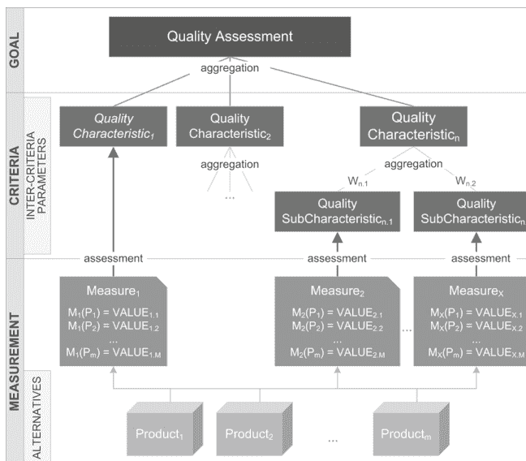
图 1. SQA 到 MCDA 的映射。

## 准则间参数 W

准则间参数是指各种 MCDA 方法分配给决策准的的参数，反映决策者对于每个准则相对于其他准则可能起作用的特定作用。这些参数包括重要权重、缩放常数、否决和拒绝水平、差异和偏好阈值等。

## 聚合算子 F

聚合代表了多准则决策分析的基本问题，指考虑备选方案 $a$ 在 $m$ 个准则上的性能 $g_i(a)$ 以对 $a$ 做出决策。MCDA 中的聚合包括：

- 准则间参数：重要权重、否决水平、差异和偏好阈值等，这些允许决策专家定义每个准则相对于其他准则的具体角色；

- 逻辑：聚合程序，应考虑：(1) 准则之间可能的独立性类型以及 (2) 决策者接受或拒绝不同准则间“正向”与“负向”性能相互补偿的条件。

#### 2.2.3 偏好关系

偏好形式化了属性在多大程度上满足了决策需求。从形式上说，偏好是定义在方案属性上的二元关系（通过基于属性构建的准则）。如果方案 $a$ 在准则 $g$ 上的性能大于方案 $b$ 在该准则 $g$ 上的性能，则方案 $a$ 优于方案 $b$，即 $g(a) > g(b)$。方案 $a$ 在准则 $g$ 上的可能评估值 $g(a)$ 称为性能评分或

在软件质量评估背景下，偏好关系对应于质量利益相关者对质量维度的偏好（非正式或正式定义）。一个定义在“可靠性”质量维度（测量为平均故障时间 MTTF）上的简单偏好关系示例可能是：如果产品 a 的可靠性高于产品 b，则认为软件产品 a 优于产品 b，即 MTTF(a) > MTTF(b)。

## 偏好与差异

某些 MCDA 方法意识到偏好关系是一种相当不精确的工具，只能告诉属性 $a$ 在准则 $g$ 上是否明确优于方案 $b$。为了解释两个方案 $a$ 和 $b$ 在准则 $g$ 上的不偏好情况，某些 MCDA 方法在 $g$ 上定义了阈值。例如在 [7, 90] 中，所谓的伪准则¹通过为准则 $g$ 分配两个阈值来定义：偏好阈值 $p[g]$ 和差异阈值 $q[g]$，其中 $p[g] > q[g]$。使用伪准则 $g$ 可以定义以下四主要情况：

> ¹真准则是指没有阈值的准则。半准则是指带偏好阈值的准则。

# 用于软件产品质量评估的多准则决策分析的适应调整

- *无差异 (I):* 存在明确理由证明两个备方案之间具有等效性。在无差异和偏好阈值方面，如果备方案 b 在准则 g 上相对于方案 a 无差异，则满足：


$g(a) \leq g(b) + q[g(b)]$ 且 $g(a) \leq g(b) + p[g(b)]$

无差异是一种自反且对称的二元关系。

- **弱偏好（Q）：** 存在明确理由支持对两个备方案中之一的严格偏好，但这些理由不足以推断出对另一个备方案的严格偏好或两者之间的无差异。在无差异和偏好阈值方面，如果备方案 `a` 在准则 `g` 上弱偏于备方案 `b`，则满足：

```
$g(a) > g(b) + q[g(b)]$
```

弱偏好是非自反且非对称的二元关系。

- **严格偏好（P）：** 存在明确理由支持对两个备方案中的之一。在无差异和偏好阈值方面，如果备方案 `a` 在准则 `g` 上严格偏于备方案 `b`，则满足：

```
$g(a) > g(b) + p[g(b)]$
```


严格偏好是非自反且非对称的二元关系。

- *不可比较性 (R):* 不存在明确理由证明上述三种关系中的任何一种。不可比较性是非自反且对称的二元关系。

基本偏好关系可以归分为更全面的偏好关系。全面偏好关系的一个著名例子是优排序关系 `S = P \cup Q \cup I`，对于任何一对决策备方案 `(a, b) \in A \times A`，`aS` 意味着“a 至少和 b 一样”。优排序是非传递、自反且非对称的二元关系。

## 2.3 现有的 MCDA 方法

有很多方法用于解决多准则决策问题。每种方法都具有不同的特征：有些与其解决的问题本质有关，另一些与提供结果的质量有关。因此，有许多分类 MCDA 方法。本节介绍并描述了 MCDA 方法的主要分类。

最广为人知且使用的分类系统基于 Roy [75] 引入的 *problématique* 概念，该概念区分了四种不同的问题：选择、排序、排名、描述（如 2.2 节所述）。

根据备方案的数量，我们可以区分为：

- *离散问题:* 这些问题也被称为多属性决策分析 (MADM)，涉及从一组离散的（有限且可计数的）显式决策备方案中进行选择（评价问题）。
- *连续问题:* 这些问题也被称为多目标决策分析 (MODM)，涉及从一组连续的（无限且不可计数的）、通常未直接指明的决策备方案数量中进行选择（优化问题）。与离散问题不同，连续问题仅勾勒出备方案所在的位置（即所谓的可区域），使得该区域内的每个点都对应一个特定的备方案。
- *Zoupoupis 和 Doumps [94]* 提到了一种关于特定准则评估聚合程序的 MCDA 方法分类。因此，有方法使用以下方式进行聚合：
  - *优排序关系:* 当有足够的理由确认一个备方案至少与另一个备方案一样同时，这种二元关系能够评估一个备方案相对于另一个备方案的优排序程度。
  - *效用函数:* 一个备方案的全局效用构成了考虑所有准则时该方案性能的所有衡量（例如，全局效用可以是所有相关准则效用的和或乘积）。从这个意义上说，全局效用是一种用于根据预定义的组对备方案进行分类/排序的索引。
  - *判别函数:* 类似于效用函数函数不能被视为偏好模型，因为它没有考虑决策类别之间的偏好顺序，也没有考虑准则领域的偏好顺序；所有准则都被认为是定量的（定性准则也应量化）；它总是线性的。
  - *无函数模型:* 以符号形式表示的模型，例如如果-那么决策规则或决策树。在这种情况下，决策规则可以决定备方案的整体性能。还有诸如亚符号形式（例如人工神经网络），它们能够对决策者高度复杂的线性行为进行建模，并使用内部机制对整体性能做出决策。

Roy [75] 和 Vincke [90] 将 MCDA 方法分为三大大类：

- *不具不可比较性的单准则综合法（多属性效用理论方法）:* 这些方法由将不同的观点聚合到一个唯一的函数并在随后对该函数进行优化组成。与这些方法相关的研究了聚合的数学条件、聚合函数的特定形式以及构建方法。
- *具不可比较性的优排序综合法（优排序方法）:* 这些方法的目标是首先建立一个称为优排序的关系，该关系在现有信息的基础上代表了决策者确定的偏好。因此，这种关系通常是非传递的。第二步包括对优排序关系进行优排序，以帮助决策者解决其问题。
- *带有试错迭代的交互局部判断法（交互式方法）:* 这些方法在计算步骤（产生连续的折中）和对话步骤（关于决策者偏好的额外信息来源）之间交替。尽管它们在多目标规划背景下最为发展，但其中一些也可以被应用。

注意，两个选项的不可比较性不等同于无差异。

MCD 方法之间的另一个重要区别是关于负面准则可行性：

- *补偿方法:* 在补偿方法中，负面准则被正面准则补偿。选择最佳方案的通用过程可以总结为四个步骤：
  1. 识别影响成功的完整准则集；
  2. 为每个准则分配相对重要（权重）；
  3. 根据准则计算每个方案的综合值；
  4. 选择最佳方案。

- *非补偿方法:* 尽管补偿决策看起来是非常理性的，但人类并不这样做，因为收集所有必要的数据耗费精力。特别是人们 (1) 没有系统地收集相关信息，(2) 能收集属性的重要性，或 (3) 没有权衡某些准则的利益与其他准则的缺陷。因此，在日常实践中通常使用非补偿决策。在非补偿决策中，负面和正面准则互不补偿。非补偿方法有两种基本类型：
  - *基于备方案的方法:* 针对多个准则，每次考虑一个备方案：
    - *结合法:* 选择满足评价准则最低水平的备方案，即如果方案在所有准则上都通过了最小接受值，则接受。
    - *离散法:* 选择满足每个相关评价准则满意水平的备方案，即如果方案在任何一个准则上通过了最小接受值，则接受。
  - *基于准则的方法:* 跨越多个备方案每次考虑一个属性：
    - *词序法:* 按重要性对属性排序，并选择在最重要属性上性能最好的备方案，即对所有准则进行排名，并选择在最重要准则上排名最高的。如果出现平局（多个品牌最好），则在下一个重要属性上再次进行比较。
    - *顺序消除法:* 对属性进行排序并为每个属性设置最低水平。选择在最重要属性上是可以接受的（高于最低水平）的备方案。如果出现平局，则移动到下一个重要属性并继续，直到选出一个备方案。
  - *部分补偿方法:* 在不同维度或准则之间接受某种形式的补偿。

基于备方案的方法通常选择一组备方案，而基于准则的方法通常选择一个最佳方案。因此，先使用基于备方案的（结合法/离散）方法形成一个“考虑集”，然后应用基于准则的方法来选择（最终的）方案是有用的。

将多准则分析（MCDA）应用于软件质量评估

其他分类根据涉及专家的数量（个人、群体与无限多个）、信息类型（定性与定量）、信息的确定性（确定与不确定）或加权技术类型（权衡加权与非基于的加权）来区分 MCDA 方法。

## 2.4 SQA 与 MCDA 之间的类比

在分析软件质量评估问题和多准则决策问题时，我们发现了许多类比。表 1 简要总结了这些类比和相似之处，而图 1 展示了层次决策与质量模型之间的相似性（例如 ISO SQuaRE 标准 [40]）。这种类比促使我们考虑将 MCDA 技术用于 SPA。

# 3. 研究设计与执行

### 3.1 研究问题与策略

我们设计的这项旨在调查现有的 MCDA 方法在多大程度上满足软件工程从业人员对软件质量评估的最相关需求。我们使用 QGM [6] 中定义的目标模板制定了研究目标，并从中推导出研究问题，并将两者均列在表 2 中。

为了回答上述研究问题，我们按照以下方案设计了研究。我们通过系统性文献综述（SLR）辅以对选定软件企业员工的小调查，回答了 RQ1、RQ3 和 RQ4。SLR 还允许我们识别出 MCDA 方法，我们通过执行所谓的“流行度搜索”（RQ2）对这些方法的使用频率进行了调查。我们确认为的用于回答 RQ2 的方法根据之前确定的标准（回答 RQ1、RQ3 和 RQ4）基于技术水平进行了评估，得出了研究问题 RQ5 的答案。

接下来的章节介绍了我们 SLR 的设计，并讨论了我们获得的结果。更详细的结果可以参见我们的研究报告 [87]。

### 3.1.1 综述过程

我们根据 [46, 11, 17] 中描述的指南设计了系统性文献综述（SLR）。该 SLR 涉及以下步骤（如图 2 所示）：

#### 表 1 MCDA 基本元素与 SQA 问题之间的类比

| 多准则分析 (MCDA) | 软件质量评估 (SQA) |
|---|---|
| 决策者 | 质量利益相关者 |
| 一或多个希望根据预定义的期望比较一组对象以建立它们之间关系，从而解决他们面临的问题的人 | 一或多个希望比较一组软件产品（或具有给定配置或模式的软件产品），根据预定义的质量期望建立它们之间的关系，以确定应该为软件产品分配何种质量评估 |
| 目标（问题） | 软件产品质量评估的目的 |
| 决策目标，例如对某些备选方案进行排序、分配到预定义的类别中 | SQA 的目的是将软件产品分配到预定义的类别中，例如：高质量、低质量、值得进一步投资、应放弃进一步投资 |
| 备选方案 | 评估中的软件产品 |
| 决策的多个潜在对象之一 | 软件产品的范围由质量利益相关者确定，可能是源代码或带有其他制品的源代码。软件产品通常根据与其他产品的比较（基准测试）或预期符合的配置（例如公司的标准）被分类为“更好”或“更差” |
| 属性 | 软件产品或制品的可测量属性 |
| 备选方案的特征，对于确定其在某项或若干项标准上的性能至关重要 | 软件产品的价值可以的属性，例如代码行数 (LOC)、响应时间 |
| (续) | |
| 测量 | 产品属性的值 |
| 为了确定给定备选方案在一组标准上的表现如何，需要对属性进行测量并确定其值 | 所考虑属性的测量结果，例如：1000 行代码、5 毫秒/100 次响应 |
| 标准 | 软件质量的一个方面 |
| 分配了特定偏好关系的属性。标准用于评估和比较备选方案 | 有关软件产品的一个或多个属性的或或期望，例如：C1 代码行数应大于 1000 行，C2 时间行为应被视为快速 |
| 性能得分 | 质量层面的评估值 |
| 表示给定备选方案在给定标准上的表现优劣 | 产品在给定某个方面的评估结果，例如：是，快速 |
| 准则间参数 | 质量方面的重要性 |
| 说明每个标准相对于其他标准的作用，例如：权重、否决阈值 | 允许定义给定的质量方面对于评估更重要或更不重要，例如：C1 的权重为 0.3，C2 的权重为 0.7 |
| 聚合算子 | 将质量方面的值聚合为质量评估的方法 |
| 一种数学运算逻辑，用于根据性能得分和准则间参数来确定备选方案之间的关系 | 定义了处理收集到的测量数据和偏好以获得结果的步骤；解决问题的建议 |

#### 表 2 研究目标和研究问题

| 目的 | 研究目标 |
|---|---|
| 对象 | 评估现有的 MCDA 方法 |
| 重点 | 用于 SQA 目的适用性 |
| 视角 | 质量保证工程师 |
| 范围 | 软件开发组织、MCDA 方法 |

研究问题：

- (A) 关于质量评估有哪些要求？
- (B) 存在哪些 SQA 方法？
- (C) 现有的 SQA 方法在多大程度上满足了需求？
- RQ2 哪些 MCDA 方法最流行？
- RQ3 选择 MCDA 方法的相关标准对于：
  - (A) 任何目的？
  - (B) 软件工程 (SE) 的目的？
  - (C) SQA 的目的？
- RQ4 SQA 方法如何从 MCDA 中获益？
- RQ5 流行的 MCDA 方法在多大程度上适用于 SQA？

计划：

1. 识别综述需求：在定义了研究目标和问题后，我们决定寻找答案的最可行方法是进行 SLR。
2. 制定研究方案：我们识别了相关信息源，并使用了相应知识领域外部专家的建议，制定了查询语句并定义了研究选择标准和程序。我们准备了质量评估清单、数据提取表和程序。指定了初始数据分析方法。
3. 自动搜索：其中一名评审员使用选定的搜索引擎和定义的查询语句搜索主要研究。

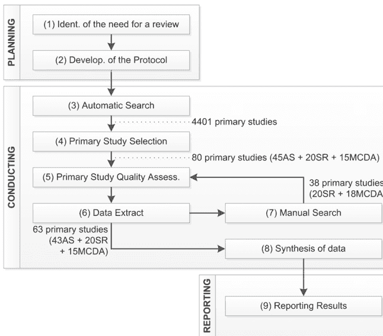

图 2. 过程的设计。它包含了每个步骤分析的主要研究数量，根据检索来源分组，即 AS——在自动中的项目的项目；SR——在扫描相关文献时检索的项目；MCDA——在扫描包含最流行 MCDA 方法描述的文献时检索的项目。

4. 主要研究筛选：一名评审员最初查看主要研究的标题、摘要和关键词，并根据定义的入选标准判断每项主要研究是否相关。如有疑问，将咨询另一名评审员。如果两个评审员都不确定，则包含该项。
5. 主要研究质量评估：下一步是评估主要研究的质量，以确保只分析高质量的项目。
6. 数据提取：质量合格的主要研究数据由两名评审员共同提取（每位研究人员审查 50% 的主要研究）。
7. 手动检索：根据 Jorgensen 和 Sheppard [43] 的指南，评审人员在提取数据时，会在首要研究的参考文献中寻找可能相关的出版物。此外，评审人员还需识别论文中提到的关于 MCDA（多准决策分析）方法的参考文献，例如，如果某项主要研究是关于使用 TOPSIS 进行 SQA（软件质量保证）的，则评审人员需要查找描述 TOPSIS 的论文引用。
8. 数据合成：我们分析了提取的数据并得出了结论。

# 报告

9. 结果报告：我们记录了结果。

#### 3.1.2 搜索策略

为了定义搜索策略，我们分析了研究问题并发现，为了找到答案，我们需要调查两个领域的交集，我们将其称为“上下文（contexts）”。对于这些上下文（软件工程和多准决策分析），我们必须就现有方法——SQA、MCDA 以及使用 MCDA 的 SE 和 SQA——进行检查。此外，我们对选择过程感兴趣，即关于 SQA 的需求以及用于选择 MCDA 的标准。对上述方面的分析应该能得出为 SQA 目的选择 MCDA 的标准，我们打算将这些标准用于对识别出的 MCDA 方法进行评估。我们的分析如图 3 所示。

| 上下文 | 软件工程 (SE) | 现有软件产品质量评估方法 | 关于软件产品质量评估的需求 |
|---|---|---|---|
| | | 用于 SE 和 SQA 目的 MCDA 方法的应用 | 用于 SQA 目的选择 MCDA 的标准 |
| 多准决策分析 (MCDA) | | 现有的多准决策分析方法 | 选择合适的 MCDA 方法的标准 |
| | | 现有方法 | 选择标准（需求与约束） |

图 3. 系统文献综述的视角。

适应多准决策分析以评估软件产品质量

#### 3.1.2.1 信息源

我们决定将评审重点放在高评名的期刊和会议论文上，以及领域专家推荐的研究上。为了确定这些信息源，我们执行了以下步骤。根据 2010 年的 JCR 汤森路沃特报告 [86]，我们根据影响因子价值选取了两组前 50 期刊（影响因子——是衡量期刊内平均文章在特定年份或期间被引用的频率的指标）。这是汤森路沃特期刊引用报告® (JCR®) 提供的评估工具之一；一个是软件工程—计算机科学；另一个是 MCDA—运筹学与管理科学。接下来，根据对其标题和描述的审查，我们排除了关注特定子领域的期刊（例如，广域网、数学软件）。我们保留了《软件质量期刊》，因为其关注点与我们的评审目标相关。然后，我们检查了是否可以访问这些期刊论文，并应用了下一个筛选标准：论文对我们可用（获取了电子版或纸质版），并且我们能够使用搜索引擎对一组期刊存档论文进行自动搜索。这些行动产生了一个包含 SE 上下文的 13 种期刊和 MCDA 上下文的 10 种期刊列表，如表 3 所示。

流程的后续步骤旨在识别目标软件工程会议。我们使用了微软学术搜索网站 (`http://academic.microsoft.com`) 提供的出版物数量和引用次数排名。我们选择了具有通用性或关注软件质量的、且我们能够获取其论文论文集的会议。我们识别了那些每年出版物超过 100 篇且引用次数超过 100 次的会议。为了列入清单，我们增加了一个根据我们的知识对软件工程社区具有高度重要性的会议，即“实证软件工程与测量”会议。结果，我们得到了一个包含七个会议的列表，如表 4 所示。

我们使用的并分配给信息源的搜索如下：ScienceDirect (`http://www.sciencedirect.com`)、Springer-link (`http://www.springlink.com`)、Ebscost (`http://www.ebscost.com`)、Portal ACM (`http://portal.acm.org`)、Ebscost (`http://www.ebscost.com`)、IEEEECS (`http://www.computer.org`) 以及 IEEEExplore (`http://ieexplore.ieee.org`)。

# 表 3 信息源—期刊

| 缩写 | 信息源 | 出版社 | 搜索引擎名称 |
|---|---|---|---|
| SE 期刊 | | | |
| IC | IEEE Computer | | |
| TSE | IEEE Transactions on Software Engineering | IEEE | IEEEExplore |
| SW | IEEE Software | | |
| AES | Advances in Engineering Software | Elsevier Science Inc. | ScienceDirect |
| JSS | Journal of Systems and Software Information and Software | | |
| IST | Technology | | |
| SQI | Software Quality Journal | | |
| EMSE | Empirical Software Engineering | Springer | Springerlink |
| TOESM | ACM Transactions on Software Engineering and Methodology | ACM | ACM Portal |
| JACM | Journal of ACM | | |
| Comm | Communications of ACM | IBM | IEEEExplore |
| ISJ | IBM Systems Journal | Oxford | OxfordSearch |
| CJ | Computer Journal | Univ. Press | |
| MCDA 期刊 | | | |
| IS | Information Sciences | | |
| ESA | Expert Systems with Applications | Elsevier Inc. | Science Direct |
| DSS | Decision Support System | | |
| EJOR | European Journal of Operational Research | | |
| IJAR | International Journal of Approximate Reasoning | | |
| COP | Computers and Operations Research | | |
| ITOR | International Transactions of Operation Research | Wiley | |
| OR | Operational Research | Ebscost | |
| ASC | Advances in Soft Computing | Springer | |

适应多准决策分析以评估软件产品质量

# 表 4 信息源—会议

| 缩写 | 会议名称 | 搜索引擎 |
|---|---|---|
| ICSE | 软件工程国际会议 | IEEEExplore |
| SEKE | 软件工程与知识会议 | Portal ACM |
| ESEM | 软件工程与测量研讨会 | Portal ACM |
| ESEC | 欧洲软件工程会议 | Portal ACM |
| FSE | 软件工程基础会议 | Portal ACM |
| FASE | 软件工程方法会议 | Portal ACM |
| APSEC | 亚太软件工程 | IEEEExplore |

## 3.1.2.2 搜索字符串

为了执行自动搜索，我们需要构建搜索字符串。我们按照以下步骤进行组合：

1. 从表 5 中识别需求。
2. 分析需求、信息源和研究问题，提取主要术语（关键词）。
3. 通过 Google (`http://google.com`) 识别主要术语的变体和同义词。
4. 在已有的相关论文中检查关键词。
5. 使用布尔逻辑构建查询语句（表 6）。使用运算符 `OR` 来整合变体和同义词，使用运算符 `AND` 来连接主要术语。
6. 通过执行五次随机搜索并查看检索到的稿件、扫描并判断内容是否满足需求来验证查询语句。
7. 在执行自动搜索之前，根据需要对相应搜索引擎的搜索字符串规则进行调整。

# 表 5 SLR 的需求和关键词

| | 决策支持 | 软件工程 |
|---|---|---|
| 需求与约束 | - 选择合适的 MCDA 方法的通用标准；MCDA 方法分类；MCDA 方法的基本要素 | 关于软件产品质量评估方法的需求；对现有质量评估方法的评价；用于任何软件工程目的选择合适 MCDA 方法的标准；在 SE 中使用 MCDA 方法的经验 |
| 现有方法 | - Common MCDA 方法及其来源文献；用于 SE 和 SQA 目的 MCDA 方法 | - SQA 方法；用于 SE 和 SQA 目的 MCDA 方法 |
| 带有变体的关键词 | - MCDA/multi-criteria/multicriteria/multi criteria；决策，分析/支持/辅助；质量/产品；选择/选取；需求；概述/分类/评估/比较/文献综述/评审；技术领先/实践现状；方法 | - 软件 |

## 表 6 搜索查询

| ID | 查询 | 评审问题 | 信息来源 MCDA SE |
|---|---|---|---|
| SQu1 | (Quality OR product) AND (assessment OR evaluation) | RQ1, RQ4 | ○ | |
| SQu2 | MCDA OR ((multi criteria OR multicriteria OR multi-criteria AND decision AND OR support OR aid)) | RQ4, RQ3, RQ2 | ○ | ● |
| SQu3 | (MCDA OR ((multi criteria OR multi-criteria AND decision AND (analysis OR decision OR aid))) AND (quality OR product) AND (assessment OR evaluation) AND software | RQ4, RQ3, RQ2 | ● | ○ |
| SQu4 | (MCDA OR ((multi criteria OR multi-criteria AND decision AND (analysis OR decision OR aid))) AND (methods OR overview OR classification OR evaluation OR comparison OR literature review OR state of art OR practice) | RQ3, RQ4, RQ2 | ● | ○ |
| SQu5 | (MCDA OR ((multi criteria OR multi-criteria AND decision AND (analysis OR support OR aid))) AND (selection OR selecting criteria OR requirements)) | RQ3, RQ4, RQ2 | ● | ○ |

### 3.1.2.3 文献筛选标准

我们定义了以下筛选标准：

- SC1. 条目发表在已识别的信息源之一。
- SC2. 条目发表于 1989 年之后。
- SC3. 条目以英文发表。
- SC4. 条目是一篇完整的研究论文。
- SC5. 条目的内容可用。
- SC6. 评审人员理解条目的内容。
- SC7. 条目必须满足以下标准之一：
  - a. 它包含对一个或多个 SQA 方法的描述（包含程序和执行步骤的思路）。
  - b. 它包含对至少一种用于软件工程目的的 MCDA 方法的描述（包括 SQA 的目的）。
  - c. 它包含至少两种 MCDA 方法的描述（方法的划分）。
  - d. 它包含对一个或多个 MCDA 方法的描述，这些方法包含了对选择该方法标准的要求的描述。

在自动执行后，评审人员根据标题、关键词和摘要进行了初步评审。他们检查了是否满足 SC1–SC5 标准，以及这些元数据是否意味着将满足 SC6–SC7 标准。

对于来自软件工程信息源的主要研究，我们执行了质量评估步骤，评审人员通过阅读全文并评估手稿的质量来验证 SC6–SC7 标准。评审人员使用 5 点 Likert 量表 [52] 回答每个问题：强烈同意、同意、中立、不同意和强烈不同意。如果一项主要研究在两个以上的标准上被评估为“强烈不同意”或“不同意”，我们不会从其中提取信息。

对我们而言，SQA 方法是指关注于评估软件产品质量的方法，而不是特定的质量属性集（例如安全性）。因此，我们没有包含以下可能被视为 SQA 的方法类：(1) 软件可靠性增长模型 [53]，旨在根据过去的软件故障预测软件可靠性；(2) 基于软件源代码结构化属性的软件易故障性或可维护性模型；以及 (3) 软件复用模型 [57]，根据软件复用水平预测收益，例如提高可维护性、减少故障或获得财务收益。

#### 3.1.2.4 质量保证

为了确保我们结果的高信度，我们执行了以下程序：阐明会议——评审人员收集关于主要研究筛选的疑问，并在会议期间进行讨论。双人评审——在分配给每位评审人员的主要研究中提取数据后，每位研究人员被分配另一位研究人员 30% 的研究。在联合研讨会上，讨论发现的提取数据之间的任何差异。质量评估——根据表 7 中列出的若干标准，对来自软件工程背景的主要研究进行质量评估。

## 表 7 质量评估表

| ID | 问题 |
|---|---|
| 1 | MCDA 方法描述是否恰当？ |
| 2 | MCDA 方法解决的问题是否表述清晰？ |
| 3 | 决策的备选方案/对象是否表述清晰？ |
| 4 | 决策标准是否定义清晰？ |
| 5 | 标准的结构是否定义？ |
| 6 | MCDA 方法的应用目的是否表述清晰？ |
| 7 | 支持 MCDA 方法应用的工具描述是否恰当（名称、描述）？ |
| 8 | 所应用方法的教训是否表述清晰？ |
| 9 | 实证验证描述是否恰当（即设计和记录是否清晰且完整）？ |
| 10 | SQA 方法描述是否恰当？ |
| 11 | SQA 的目的是否表述清晰？ |
| 12 | 底层质量模型是否命名并清晰描述？ |
| 13 | SQA 方法设计的设计的对象（类型和实例）是否定义恰当？ |
| 14 | 如果 SQA 方法是更广泛框架的一部分——该框架的描述是否恰当？ |
| 15 | 方法的输出是否定义清晰，并提供了解释机制？ |
| 16 | 方法的优势是否定义清晰？ |
| 17 | 要求是否表述清晰？ |
| 18 | 要求是否有依据？ |
| 19 | 实证验证描述是否恰当？ |
| 20 | 标准是否表述清晰？ |
| 21 | 要求是否有依据？ |
| 22 | 方法是否考虑了这些标准？ |

#### 3.1.2.5 支持

我们使用了 Zotero (`www.zotero.org`) ——一个用于 Firefox 的插件 —— 来存储和交换参考文献。

### 3.1.3 数据提取

为了收集所有信息，我们以以下方式设计了提取表：

1. 一位作者建议了提取标准。
2. 两位作者共同审阅了提取表。
3. 两位作者分别对随机样本论文进行了评审。
4. 两位作者比较了发现结果，并决定是否以及如何修改提取表。

我们提出了以下提取表：

- F1. MCDA 方法：关于文献的文档。
- F2. SQA 方法：关于 SQA 的数据。
- F3.A. SQA 要求：识别要求的表。
- F3.B. SQA 方法：用于填充标准的表。
- F4. 标准：标准的记录。
- F5. MCDA 批判：MCDA 方法的弱点。
- F6. 软件中的 MCDA 方法：软件工程中的 MCDA 方法记录。
- F7. MCDA 教训：正负经验文档。

### 3.2 工业调查

为了回答关于 SQA 要求的 RQ1.A，我们决定从专业人员处获取的需求补充到 SLR 结果中。我们在参与 Quamo 项目的公司员工中进行了小范围调查。该项目的目标是建立德国国家控制标准。调查分为两个步骤。首先，我们组织了研讨会来脑风可能的 SQA 要求。其次，我们发放了电子问卷让参与者评估这些需求。

### 3.3 MCDA 方法评估程序

为了支持 SQA，MCDA 方法必须适用于 SQA 背景并满足潜在用户的需求。为了评估现有 MCDA 方法对 SQA 目的适用性，我们首先确定了相关的评估标准，然后使用这些标准评估了流行的 MCDA 方法。在本节中，我们将介绍用于选择相关标准和评估 MCDA 方法的方法。

#### 3.3.1 评估标准

我们将评估标准定义为 (a) 用于 SQA 目的的 MCDA 使用限制和 (b) 关于 SQA 的需求。

##### 用于 SQA 目的的 MCDA 使用限制

为了确定用于 SQA 目的的 MCDA 使用限制，我们考虑了：

- MCDA 的内在限制，是指 MCDA 方法的基本特征，这些特征决定了使用的边界。这些边界在 MCDA 文献（例如 [35]）中通过整个 MCDA 方法的理论和公理发展基础的假设和假说来定义。为了识别 SQA 背景下哪些 MCDA 限制是相关的，我们将它们与 SQA 问题的内在特征进行了对比。
- 在软件工程背景下使用 MCDA 的限制，是指 MCDA 方法中决定其在背景中适用性的某些方面。

软件工程背景，与应用目的无关。为了确定这些约束条件，我们分析了主要研究中提到的 MCDA（多准则决策分析）方法的各个方面，并展示了 (1) 为了在软件工程背景下支持决策以选择合适的 MCDA 方法的标准则，和/或 (2) 对 MCDA 方法在软件工程背景下应用的批判性分析。为了综合在软件工程中使用 MCDA 的约束条件，我们将识别出的选择标准和关键点按照指向的 MCDA 相同方面进行归类，并累加了相关的频率（提及这些内容的文章数量）。接下来，我们根据相关频率对这些方面进行排序，并选择了频率大于或等于所有识别出的方面平均频率的因素。

我们通过结合 MCDA 的内在约束条件以及在软件工程中使用 MCDA 的约束条件，并消除冗余内容，确定了用于 SQA（软件质量保证）目的的 MCDA 最终约束集（即移除两个子集中指向 MCDA 相同方面的约束条件）。

## 用户对 SQA 的需求

根据文献综述和小型工业调查的结果，我们识别了与 SQA 最相关的用户需求。我们采用以下四步法确定了最终的需求集：

1. 工业调查分析：我们根据 10 点 Likert 量表，对每个需求提供的评分调查计算了中位数。然而，仅对可用评分进行简单中位数计算并不能作为需求排序的可靠依据，因为它们的受访者人数并不相等。例如，如果两个需求的中位数评分相同，但一个需求由所有 11 名受访者评分，而另一个需求仅由部分受访者评分，我们不能认为它们具有同等重要性。在缺失评分的情况下，我们考虑了两种情况：缺乏意见和需求不重要。如果调查问卷中预定义的需求（即呈现给所有受访者）缺失评分，则将其解释为缺乏意见。如果某个需求是由一个或多个受访者添加（并评分）的，那么我们为其余受访者对该需求给出最低评分。在此过程中，我们假设由于其他受访者没有添加这项额外需求，因此它对他们来说可能并不重要。遗憾的是，我们没有机会使用更新后的需求列表重复调查。
2. 文献综述综合：对于每个需求，我们计算了提到它的论文数量（假设该方面对于 SQA 是至关重要的）。
3. 需求映射：我们识别了系统性文献综述（SLR）和工业调查共同的需求。
4. 需求选择：根据需求在 SLR 和工业调查中的出现次数，选择了排名靠前的需求。然后，通过在系统性文献综述和工业调查中评分较高的需求来扩充列表。我们决定包含平均受访者评分大于三的所有需求，以及至少出现在五篇论文中的四个需求。

## 评估 MCDA 方法的最终标准

为了获得一组评估 MCDA 方法对于 SQA 目的适用性的最终标准，我们将与用户关于 MCDA 方法的约束合并为一组非冗余的决策标准。为此，我们合并了这两组集合并删除了指向 MCDA/SQA 方法相同方面的项目。此外，我们区分了必要标准和充分性标准。*必要性标准*不涉及权衡，必须满足这些标准才能接受候选 MCDA 方法在 SQA 目的上是可行的。如果不满足至少一个标准，该方法就会被淘汰，无论其在其他标准上的表现如何。*充分性标准*可以进行权衡，即某些标准上的负面评价可以通过其他标准上的正面评价来补偿。

#### 3.3.2 评估程序

我们通过两个步骤评估了在流行搜索中分析的 MCDA 方法对于 SQA 目的的适用性：筛选和评估。*筛选*步骤涉及排除不符合必要决策标准的 MCDA 方法。*评估*步骤包括评估 MCDA 方法在严谨评估标准方面的表现。

每位评审员评估了 50% 的 MCDA 方法，并验证了另一位评审员 30% 的评估结果。

对于每种方法，我们使用 5 点 Likert 量表 [52] 评估了其满足每个标准的程度。我们基于以下陈述建立了量表：“该方法满足了需求……”

- 完全满足：如果它满足了标准的所有方面。如果一个方法包含多个元素（例如，多种技术），则其所有元素必须支持该标准。
- 很好：如果在完全满足需求方面存在细微差异。
- 尚可：如果在完全满足需求方面存在显著缺陷。
- 较好：如果它部分满足了标准的某些方面。
- 完全不满足：如果它在所有方面完全都不满足该标准。
- 未说明：如果分析的现有水平无法确定需求满足的程度。

后续，我们将引用*标准满足情况*量表。

### 3.4 有效性威胁

在接下来的段落中，我们总结了本研究结果的有效性威胁。

作者是软件质量领域的活跃研究人员。尚未发现任何对论文识别和分类有效的偏见，但在得出结论时，我们的经验和观点可能会显现出来。

作者在执行 SLR 至少 5 年前参加过 MCDA 课程。然而，对 MCDA 领域的有限经验可能导致某些研究被忽略或误解。与 MCDA 领域专家的咨询旨在减少误解信息的风险。

最近的研究（例如 [46]）建议对提取的数据进行审查。由于资源和时间限制，我们未能对提取的数据进行全面审查；相反，我们对 30% 的数据进行了审查。

在 [46] 中，建议对全文进行质量评估。由于我们对 MCDA 领域的知识有限，我们省略了描述方法论文的步骤。我们主要的质量检查是论文是否能被评审员理解，这包含在选择标准中。然而，我们对描述领域的研究进行了质量评估。

仅分析顶级期刊研究的选择是受关注高质量论文的决策决定的。我们意识到，仅关注 1990 年以后发表的初级研究（包含至少两种方法且不包括会议论文）可能会导致某些信息的丢失。然而，我们在 SLR 之前进行的预研究显示，MCDA 缺乏深度综述类文章。我们认为分析的初级研究提供了较早发表的信息或描述了单一方法。

此外，我们没有发现任何关于方法应用失败的论文。MCDA 的缺点是在引用其他研究的论文文中发现的。

此外，我们将 MCDA 的范围缩小到以综述形式介绍其基本形式的最流行的 MCDA 方法，排除了介绍方法调整的参考文献。

# 4. 现有 SQA 方法分析

在本节中，我们展示了软件工程文献中提出的 SQA 方法的分析。首先，我们识别了 SQA 最相关的用户需求。然后，我们查看了现有 SQA 方法在多大程度上符合这些需求。最后，我们分析了现有 SQA 方法已经在多大程度上支持 MCDA，选择特定 MCDA 方法的理由是什么，以及 SQA 方法如何受益于 MCDA。

### 4.1 关于 SQA 的需求

RQ1 (A) 关于软件质量评估方法的需求有哪些？

根据系统性文献综述辅以小型工业调查的结果，我们识别了潜在用户对软件质量评估最相关的 15 个需求。这些需求涉及质量评估方法的实际使用，并是从潜在用户的角度定义的。根据对目标用户的相对重要性，特定的评估方法可能无法完全满足这些需求，但仍被认为是具有实际价值的。表 8 列出了这些需求。

# 表 8 关于 SQA 方法的用户需求

| ID | 用户需求 |
|---|---|
| R01 | 支持小组决策和多维度视角：质量评估方法必须提供一种机制，以结合多个利益者的质量偏好，这些利益者在质量的感知上可能存在差异 |
| R02 | 对质量利益者易于理解：质量评估方法对于软件产品的提供者和用户等质量利益者而言必须是易于理解的。易理解的方法有助于发现该方法执行的评估与质量利益者预期评估之间潜在差异的来源 |
| R03 | 处理不确定信息：质量评估方法必须适用于不确定和模糊的信息。另一方面，方法还应该指示其交付的评估所产生的不确定性 |
| R04 | 正确理解质量利益者的偏好：质量评估方法必须反映相关利益者（例如软件产品的客户和用户）的质量偏好。其结果是质量评估方法将（自动方式）实现这些利益者评估质量的方式 |
| R05 | 应对不完整信息：在信息不的情况下，质量评估方法必须提供合理的结果（可能在某个不确定范围内） |
| R06 | 处理质量模型元素之间的相互依赖关系：质量评估方法必须处理评估中考虑的质量属性之间的潜在相互依赖关系，以及这些交互如何影响最终的质量评估 |
| R07 | 结合补偿和非补偿方法：质量评估方法必须支持可比较和不可比较质量属性的评估，包括对可比较属性的“负”值和“正”值之间进行相互补偿的支持 |
| R08 | 受自动工具支持：质量评估方法必须由自动工具支持，该工具的配置和操作相对简单且廉价 |
| R09 | 允许纳入主观专家评估：质量评估方法允许对选定的质量属性输入人工评估，并与自动评估一同纳入最终质量评估中 |
| R10 | 支持基准测试：质量评估方法必须提供允许直接比较替代软件产品（特别是同一产品的不同版本）的质量评估 |
| R11 | 提供可重复的结果（评估）：质量评估方法在以相同条件应用时必须提供相同的质量评估 |
| R12 | 可定制：质量评估方法必须适用于质量问题的特定结构（例如由底层质量模型的结构所反映）以及质量评估领域的背景 |
| R13 | 支持分层质量模型：质量评估方法必须适用于组织为分层结构的质量属性 |
| R14 | 可扩展和可扩展：质量评估方法必须适用于任何规模和复杂性的质量模型，意味着包含任何数量质量属性及其依赖关系的模型 |
| R15 | 支持中间评估：质量评估方法在底层质量模型分层结构的中间层也提供有意义的质量评估（而是在提供最终评估的根节点） |

### 4.2 SQA 方法的评估

| RQI | (B) 存在哪些 SQA 方法？(C) 现有 SQA 方法在多大程度上满足了需求？ |
|---|---|

对识别出的 441 篇出版物中的 55 篇进行了全面审查，得到了 28 种软件质量评估方法。在本节中，我们总结了它们的分析结果。

哪些是最好的 SQA 方法？

图 4 和图 5 展示了现有质量评估方法评分的分布，这些评分是根据它们满足软件质量评估工业需求的程度的。Becker 和 Rauber [7] 提出的方法获得了平均分和中位数最高，即该方法在不考虑需求重要性的情况下，针对最多的需求执行了评估。在考虑了需求的排序重要性权重后，表现最好的是 Chen 等人 [23] 提出的方法。

得分最高的两种方法并没有涵盖所有关于 SQA 的最相关用户需求。可以改进的方面特别包括：处理不确定性和不完整数据 (R03, R05)，以及结合补偿和非补偿方法以综合对 SQA 期间考虑的单个质量方面进行评估 (R07)。

令人惊讶的是，28 种 SQA 方法中没有一种至少达到“良好”（Fairly）水平满足所有 15 个用户需求。

SQA 方法的共同优点是什么？

对评估结果的进一步分析表明，现有质量评估方法具有共同的优点和缺点。也就是说，某些工业需求被大多数现有质量评估方法一致地解决，而其他需求则几乎所有方法都未能满足。图 6 展示了结果。

超过 50% 的 28 种 SQA 方法至少达到“非常好”（Very well）水平的用户需求包括：将它们用于质量模型的替代结构的能力 (R12)、对分层质量模型的直接支持 (R13)，以及对质量模型中单个质量方面进行中间评估的可能性 (R15)。

# 采用多准则决策分析来评估软件产品质量

| %评估次数 | 1 - 完全不 | 2 - 非常好 | 3 - 良好 | 4 - 较好 | 5 - 完全不 |
|---|---|---|---|---|---|
| 100% | 3 | 4 | 3 | 4 | 4 |
| 90% | 3 | 5 | 5 | 5 | 5 |
| 80% | 4 | 3 | 5 | 6 | 6 |
| 70% | 4 | 2 | 5 | 6 | 8 |
| 60% | 2 | 3 | 3 | 9 | 9 |
| 50% | 3 | 2 | 2 | 9 | 9 |
| 40% | 2 | 3 | 3 | 4 | 4 |
| 30% | 3 | 3 | 3 | 4 | 4 |
| 20% | 3 | 3 | 3 | 6 | 6 |
| 10% | 5 | 5 | 3 | 2 | 2 |
| 0% | 5 | 5 | 3 | 2 | 2 |

软件评估方法（出版物）

**图 4.** 现有 SQA 方法：评估频率（参见参考文献 [1, 2, 7, 8, 12, 14, 18, 21, 23, 37, 44, 48, 51, 54, 56, 61, 65–67, 70, 74, 81, 82, 85, 91]）。

此外，需求 R10（支持基准测试）是接近最佳满足的需求。28 种 SQA 方法中有 13 种可以直接适用于软件产品，另 13 种可以很容易地此目的。

SQA 方法的共同缺点是什么？

大多数分析的 SQA 方法对小组决策 (R01)、不确定和不完整信息 (R03 和 R05)、质量模型元素之间的相互依赖关系 (R06) 以及对多个质量方面进行评估的综合方法 (R07) 支持较差。如果不解决这些问题，人员提出的 SQA 方法将无法从业者广泛接受和应用，因为它们没有解决从业者面临且需要适当支持的典型。。例如，Behkam 等人 [8] 建议对每个利益者小组进行单独的质量评估。然而，作者没有说明在需要集成评估时如何整合这些评估。其他方法（例如 Morisio 和 Tskouias [59] 以及 Lozano-Tello 和 Gómez-Pérez [51]）建议在运行已综合信息之前，先使用小组共识技术让多个利益者对软件质量达成共同观点。只有来自 Chen 等人 [23] 和 Chang 等人 [21] 的方法在评估过程中提出了专门的（尽管不是全面的）技术来结合多个利益者的偏好。Chen 等人计算多个利益者提供的单个质量方面评分或重要性权重的简单平均值。Chang 等人用三角形模糊数聚合多个利益者的输入。

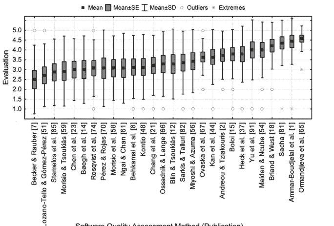

图 5. 现有 SQA 方法：评估箱线图。

## 用于多准则决策分析来评估软件产品质量

■1 - 完全不 ■2 - 非常好 ■3 - 良好 ■4 - 还可以 ■5 - 完全不

| | R01 | R02 | R03 | R04 | R05 | R06 | R07 | R08 | R09 | R10 | R11 | R12 | R13 | R14 | R15 |
|---|---|---|---|---|---|---|---|---|---|---|---|---|---|---|---|---|---|
| 100% | | | | | | | | | | | | | | | | |
| 90% | | 5 | | | | | | | 9 | | | 4 | 5 | | |
| 80% | 18 | | | | | | | | | 13 | | | 4 | | | |
| 70% | | 12 | | 20 | | 18 | | | | | | | 2 | 14 | | |
| 60% | | | | | 28 | | 26 | | | | | | | | | |
| 50% | | | | | | | | | 2 | | | | | | | | | |
| 40% | | | | | | | | | | 7 | | 2 | | 9 | | | |
| 30% | | 2 | | 3 | | 3 | | | | | | | 15 | | | | |
| 20% | | | | | | | | | | | | | 8 | 15 | | |
| 10% | 1 | | 7 | | | | 6 | 2 | | 11 | | 7 | | | 2 | |
| 0% | | 2 | 2 | | | | 1 | | | | 3 | | | | | |
| R01 | R02 | R03 | R04 | R05 | R06 | R07 | R08 | R09 | R10 | R11 | R12 | R13 | R14 | R15 |

关于质量评估方法的要求。

**图 6.** 现有 SQA 方法：用户需求的满足情况。

评估过程，而非生成的质量评估结果。极少数方法 [23, 21, 91] 允许使用模糊逻辑或类似的扩散区间技术 [51] 技术来表示输入信息的不确定性。

- *R05 处理不完整信息*：在我们研究的 28 种 SQA 方法中，没有一种能够处理不完整的输入。它们隐含地假设可以获得完整信息来实施和运行该方法。这对于这些方法的广泛应用是一个严重的障碍，因为众软件工程以数据的稀缺和不完整而闻名。
- *R06 处理质量模型元素之间的依赖关系*：28 种 SQA 方法中有 20 种没有明确解决相互依赖的质量属性问题。很少作者意识到这一方面的重要性，并要求在评估之前通过底层质量模型来确保质量属性的独立性（例如，[66]）。然而，他们并没有为处理此问题提供任何特定支持，或者仅在评估前使用简单技术来识别相互依赖的质量属性（例如，Briand 和 Wüst [18] 提议应用主成分分析）。Chen 等人 [23] 的方法是少数例外之一，提供了一种至少部分处理质量模型中相互依赖元素的方法。Chan 等人将简单的加权和算子更换为 Choquet 积分，用于整合整个质量模型层级中质量属性的值和质量。他们受益于 Choquet 积分类似于加权和，但它并不要求聚合的质量属性之间相互独立。
- *补偿性与非补偿性方法*：只有一种 SQA 方法 [7] 整合了非补偿性和补偿性决策策略。在聚合部分质量评估（跨多个质量属性）时，它将来自非补偿方法的否决（一票否决）理念整合到基于加权乘积运算的补偿方法中。该方法使用 6 分量表（0–5）对质量模型层级结构中最低层的属性质量进行量化，其中 0 代表不可接受的值。任何属性的质量 0 都会通过加权乘积聚合传播到质量模型的根节点，导致整体质量评估结果为 0（任何属性的不可接受质量都会对整体质量产生一票否决）。这种方法有两个潜在缺陷：(1) 否决传播到了质量模型层级的根部，尽管在实践中，这种情况只需要传播到层级中的下一层并在更高层进行补偿；(2) 否决是针对最低层质量属性触发的，且无法针对中间层属性“手动”触发（高层的否决总是从低层传播否决的结果）。剩余的 SQA 方法实施了补偿性策略（16 种）或非补偿性（11 种）决策策略。

尽管所分析的文献中信息不完整，不足以得出结论，但我们认为对质量利益相关者偏好的理解不足（R04）以及工具支持不足（R08）是实践中部署现有 SQA 方法的额外潜在障碍。有四种 SQA 方法在实证验证中包含了 R04，并为整个评估过程提供了工具支持（包括方法的实施、必要输入的收集和质量评估计算）。由于分析的未未提供适当信息，我们无法确定剩余的 SQA 方法是否满足 R04 和 R08 要求。然而，这些方法的潜在用户在获取评估这些方法对于其 SQA 需求的重要信息方面将面临困难。

### 4.3 现有 SQA 方法中 MCDA 的使用

## RQ4 SQA 方法如何从 MCDA 中获益？

对现有 SQA 方法的分析显示，28 种 SQA 方法中有 18 种实际上采用了一种或多种 MCDA 方法（或其元素）。

哪些 MCDA 方法被用于 SQA 目的？

图 7 展示了我们分析的 28 种 SQA 方法中使用特定 MCDA 方法（或其元素）的频率。分析层次法（AHP）[77, 78, 80] 最常用于 SQA 目的。流行的 AHP 或其元素用于 12 种 SQA 方法（43%）。AHP 的核心元素是成对比较技术，在 SQA 背景下用于为质量属性分配相对重要性权重。

第二种常用的 MCDA 方法是 ELECTRE 系列。五种 SQA 方法改进了 ELECTRE，而质量属性的重要性通过多种技术确定，包括 AHP。最后，一种 SQA 方法采用了逼理想解排序法（TOPSIS）[39, 64]，两种 SQA 方法通过模糊逻辑 [92] 扩展，以解释输入的不确定性。在剩余的 11 种 SQA 方法中我们没有发现任何 MCDA 方法。

图 7。现有 SQA 方法：采用 MCDA。

# 5. 流行方法的分析

### 5.1 MCDA 方法的流行程度

## RQ2 哪些是流行的 MCDA 方法？

为了确定流行的 MCDA 方法，我们首先决定根据论文数量确定。对于每种方法，我们统计了 (1) 标题、摘要或关键词中包含其名称的文章数量 (2) 期刊数量。我们发现 AHP 优于所有其他方法；9 个期刊提到了 AHP。我们认为出现在至少两个期刊中的方法是流行的。图 8 展示了结果。

### 5.2 MCDA 在软件工程中的应用

我们决定关于选择 MCDA 方法的 RQ3 回答将基于分析。

图 8. 相关文献中 MCDA 方法频率。

图 9. MCDA 在软件工程中的应用目的。

在文献综述中分析的 17 项主要研究展示了 MCDA 方法的应用（图 9）。它们将 MCDA 用于：(1) 选择投资方案，例如产品商业化的正确市场、信息安全维护方案、外包类型、ERP 系统迁移，或检查网站质量对业务成功的影响，例如 [73, 88, 62]；(2) 项目管理、任务控制或资源估计，例如 [49]；(3) 风险管理，检测和监测风险因素，例如 [83]；(4) 需求管理，例如已实施的需求集，例如 [84, 71]；(5) 过程改进，选择需要改进的领域和改进方法 [13, 19]。

作为基础方法，29% 的应用使用了 AHP [77, 78, 80]，12% 使用了效用函数，12% 使用了 ANP。在聚合步骤，AHP 和加权和用于 24%（4 种）的情况，AHP 用于 12%（2 种）的情况。出现在至少两个论文中的基础方法都包含在之前流行的流行的 MCDA 方法列表中。

198

Adam Trendrowowicz 和 Sylvia Kopczyrzyńska

在 [19] 中，决策试验与评估实验室（DAMATEL）[28] 被用于改进层次网络分析（ANP）中关系的表示；在 [73] 中，采用模糊集用于 ANP 以处理信息的不确定性。

主要用于排序的准则决策分析（MCDA）方法：88% (14) 的案例采用了补偿法，但在其中一项主要研究中提到了否决可能。在近 71% 的案例中，选择了基于专家的评估，仅有一个案例是基于收集数据的评估。标准的结构在 47% (8) 的情况下被建模为层次结构，18% (3) 的情况下为网络结构，35% 的情况下为列表。只有一个案例呈现了准则结构的元模型；在 14 个案例 (82%) 中记录了准则模型。尽管 82% (14) 的案例提到它们处理了多个观点，但其中仅两个案例实际上描述了综合多个决策者偏好的方法。

### 5.3 评估用于 SQA 的 MCDA 方法的标准

| RQ3 | 为以下目的选择 MCDA 方法最相关的准则是什么：(A) 任何目的，(B) 软件工程（SE）目的，(C) 软件质量保证（SQA）目的？ |
|---|---|

为了让 MCDA 方法在理论和实践上有用，必须满足 SQA 问题的内在约束及其潜在用户的需求（见第 4.1 节）。在本节中，我们将 (1) 识别与 MCDA 和 SQA 问题之间存在相互对应关系相关的 MCDA 内在约束，(2) 发现 MCDA 在软件工程背景下实际适用性的约束，(3) 将这些约束与对 SQA 的用户需求相结合，以推出一套评估 MCDA 方法对于 SQA 目的的最终准则集。

### 5.3.1 MCDA 的内在约束

MCDA 的内在约束是指潜在 MCDA 方法与软件产品质量评估问题的基本特征之间的相互对应关系。这种对应关系通常不被方法的预期用户显式地考虑，而是源于问题的定义。然而，至少有一些问题内在的约束决定了为了 SQA 目的使用 MCDA 方法的可行性。

调整多准则决策分析以评估软件产品质量

换句话之，某些问题内在约束是不受权衡的，不满足这些约束无法通过方法的任何正面特性得到补偿，从而自动剥夺其用于 SQA 目的的。这些约束可以被视为接受或拒绝 MCDA 方法的必要准则。另一方面，对 SQA 的用户需求通常代表充分准则，这意味着 MCDA 方法在某些需求方面的性能可以通过其在其他需求方面的良好表现来补偿。

为了识别这些约束，我们研究了 [35] 中定义的 MCDA 方法的基本特征与 SQA 问题的固有特征之间的对应关系。基本 MCDA 特征确立了该方法无法使用的边界。它们由基于 MCDA 方法理论和公理化开发的的假设和假说所决定，并包括：

- I. 决策模型结构：决策准则的结构按集合、层次和网络进行组织。潜在的 MCDA 方法必须符合底层的质量模型（QM）。例如，使用某些数学操作来评估质量（由多个质量属性定义）需要这些属性之间相互正交。在包含相互依赖质量属性的 QM 上使用此类操作将导致无意义的质量评估。
- II. 决策问题类型：决策问题要解决的问题。基本问题是排序、排名和选择。潜在 MCDA 方法处理的决策问题类型必须与软件产品质量评估所代表的决策问题类型对应。经典的决策支持理论区分了几种类型的决策问题，称为问题（problem）。质量评估的目标（即为软件产品分配质量值）对应于 MCDA 领域中的排序问题（β）。因此，潜在的 MCDA 方法必须处理排序问题才能适用于 SQA 目的。
- III. 决策准则数量：所考虑的决策准则数量。可能的选项包括有限或无限数量的准则。在软件质量评估的背景下，考虑的是一组有限的质量方面（即质量属性），这些方面可能被组织成层次结构。因此，潜在的 MCDA 方法必须处理具有有限决策准则集的决策问题，才能适用于 SQA 目的。
- I4. 备选数量：所考虑的决策备选数量。可能的选项包括有限或无限数量的备选。在 SQA 背景下，一次可以考虑有限数量的备选软件产品。因此，潜在的 MCDA 技术必须处理考虑有限备选集合的决策问题。这一约束排除了所有处理连续（优化）决策问题的 MCDA 方法，后者处理无限的决策备选空间。
- I5. 公理化假设：关于决策准则的公理假设。示例假设包括偏好独立性、差异独立性、值独立性和偏好传递性。特定 MCDA 方法中使用的技术对输入信息做出假设。如果这些假设不满足，该方法可能会提供无效结果。因此，潜在 MCDA 方法所做的假设必须与 SQA 约束一致，或者必须通过调整 MCDA 方法来实现这种一致性。MCDA 方法经常做的示例假设包括偏好独立性、值独立性、差异独立性和偏好传递性 [30]。
- *偏好独立性*：对于每一对质量属性，一个相对重要性不依赖于另一个的值。这一假设在质量评估的背景下通常是可以满足或保证的。我们可以通过询问利益者对 `QA_1` 和 `QA_2` 的偏好取决于另一个属性 `QA_s` 来测试偏好依赖性。如果存在 `QA_s`，导致 `QA_1` 和 `QA_2` 的偏好发生变化——例如，“如果将可用性评估为差而不是好，安全性和可靠性的重要性会 way吗？”例如，在可用性的背景下，安全性比可靠性更重要，而在差可用性的背景下，可靠性比安全性更重要。
- *差异独立性*：对于每个质量属性，在该属性上差异相同的其他属性相同的产品对，其偏好差异相等相等。质量属性的差异独立性在质量评估背景下通常是填充且不需要实际测试。
- *值（得分）独立性*：对于每一对质量属性，它们的值是不相关的。在质量评估的背景下，假设并保证相关性是不现实的。然而，MCDA 方法通常不做此假设。例如，Barron 和 Barrett [4] 指出，在具有加法聚合模型的 MCDA 方法中，属性之间的强相关通常减少权重分配的敏感性，负相关则会增加这种敏感性。因此，相关质量属性的问题应该在质量建模期间显式考虑——这已经在质量评估之前。应该进行适当的分析并提交给质量专家和质量利益者，他们应该意识到相关质量属性的潜在后果。他们应该决定保留在模型中还是移除。
- *偏好传递性*：对于三个备选软件产品 `a`、`b` 和 `c`，满足条件：如果 `a` 优于 `b` 且 `b` 优于 `c`，则 `a` 应该优于 `c`。这一假设对应于我们评估软件质量的实践。然而，某些 MCDA 方法在结合特定的综合方法时并不满足这一公理。对于某些 MCDA 方法，不满足传递性公理会导致排名翻转现象。排名翻转是指在通过简单添加原始产品的副本来增加备选产品集合后，备选产品相对于质量排名可能会发生变化。

I. 提供偏好信息的能力和意愿：决策者提供偏好信息的能力和意愿。这包括决策者的理性和一致性、获取偏好信息的方式以及其建模。一种可能的 MCDA（多准则决策分析）方法必须处理软件质量决策者在提供其软件产品质量偏好信息方面的能力和意愿限制。通常，MCDA 依赖于以下假设：决策者 (1) 是理性的，(2) 不改变偏好，且 (3) 具有足够的知识做出一致的判断 [34]。因此，软件质量决策者必须满足这些假设，MCDA 方法才能提供有意义的质量评估。某些 MCDA 方法要求决策者直接指定其偏好模型；另一些则提供了从示例决策（在我们的质量评估中）推断偏好模型的可能性。然而，在以测量数据匮乏的软件工程背景下，后者策略的可行性可能非常。

## 5.32 软件工程背景下应用 MCDA 的约束

为了确定 MCDA 方法在软件工程背景下适用性的约束，我们分析了软件工程文献的综述结果。我们关注了那些应用了 MCDA 方法并展示了 (1) 为支持软件工程（SE）背景下的决策选择合适的方法和/或 (2) 对该方法在 SE 背景下应用的批判的研究。

为了得出 MCDA 约束的最终集，我们首先将引用 MCDA 方法相同方面的选择标准和关键点进行分组，并汇总了相关的频率（提到这些内容的文章数量）。这产生了 36 个标准。接下来，我们根据相关频率对这些标准进行排序，并选择了频率大于或等于所有标准平均频率的项。这产生了 15 个约束（表 9 中的 C01–C15）。最后，我们将这些约束与 MCDA 的内在约束（即我们在表 9 中添加的 I12–I18）相结合，这些内在约束尚未被 15 个适用性约束 C01–C15 覆盖。

#### 5.3.3 评估 MCDA 方法的最终标准

为了获得一组用于评估 MCDA 方法是否适用于 SQA（软件质量保证）目的的最终标准，我们将关于 SQA 的用户需求（见表 9）与用户需求（见第 4.1 节表 8）合并成一组非冗余的标准。为此，我们合并了这两组标准，并删除了引用 MCDA/SQA 相同方面的条目。

#### 表 9 MCDA 方法的约束

| MCDA 约束 | |
|---|---|
| C01. 处理不确定信息 | 该方法应适用于确定信息和不确定信息。当提供不确定信息时，该方法还应指示其交付的输出（例如质量评估）的不确定性 |
| C02. 支持群体决策 | 该方法应提供机制来结合多个决策者的偏好，这些决策者对决策问题（例如质量评估）的认知可能存在差异 |
| C03. 决策者易于理解 | 该方法对决策者来说应该是透明且易于的。如果方法产生的输出偏离决策者的预期，他们应该能够发现并理解差异产生 |
| C04. 支持结构化标准 | 该方法应根据问题中定义的标准结构运行，特别是针对非结构化的标准集和层次化的标准 |
| C05. 处理准则间的依赖关系 | 该方法应处理决策标准之间潜在的依赖关系（即底层决策模型的元素） |
| C06. 支持不同的标准度量 | 该方法应支持在不同度量上衡的标准（例如，间隔或序数） |
| C07. 提供系统的加权方法 | 该方法应支持分配标准权重，以正确理解专家判断的主观性并表达标准之间的权衡。加权方法也应适用于标准的标准的类型 |
| C08. 应对不完整信息 | 该方法应适用于不完整的输入。当应用于不完整信息时，该方法应提供合理的结果，可能在某些不确定性范围内 |
| C09. 扩展至决策问题 | 该方法应能够根据问题的大小以及质量模型的复杂性（例如，结构）来应对决策问题 |
| C10. 减少信息丢失 | 该方法在整个决策过程中不应丢失输入信息（例如，由于输入信息的中间转换） |
| C11. 支持不同的补偿模型 | 该方法应同时支持决策标准的相互补偿和非补偿 |
| C12. 合理的应用开销 | 该方法在运行（例如设置参数）和将其应用于决策时不应需要过多的开销 |
| C13. 方法论上合理 | 方法的所有步骤从方法论角度都应适用于底层决策问题，例如，它应该系统地处理人类判断 |
| C14. 减少问题维度 | 该方法应减少决策问题的维度以促进分析（例如，将关于多个决策标准的结论聚合为单一最终评估） |
| C15. 维持偏好透明性 | 该方法不应允许在考虑中加入额外备选方案后出现顺序发生变化的情况（所谓的排序现象） |
| C16. 支持问题性排序 | 该方法应支持将备选项分配到预定义的决策类（例如，为软件产品分配特定的质量） |
| C17. 考虑有限的标准集 | 该方法应对有限的决策标准集（例如，质量属性）运行 |
| C18. 考虑有限的备选项集 | 该方法应对有限的决策备选项集（例如，软件产品）运行 |

#### 表 10 用于 SQA 目的选择 MCDA 方法的标准

| ID | 组件 | 描述 | 类型 |
|---|---|---|---|
| D01 | C01 | R03 | 处理不确定信息 | 充分 |
| D02 | C02 | R01 | 支持群体决策 | 充分 |
| D03 | C03 | R02 | 决策者易于理解 | 充分 |
| D04 | C04 | R13 | 支持结构化标准 | 充分 |
| D05 | C05 | R06 | 处理准则间的依赖关系 | 充分 |
| D06 | C06 | | 提供加权方法 | 充分 |
| D07 | C07 | | 支持不同的标准度量 | 充分 |
| D08 | D08 | R05 | 应对不完整信息 | 充分 |
| D09 | C09 | | 扩展至决策问题 | 充分 |
| D10 | D10 | | 减少信息丢失 | 充分 |
| D11 | C11 | R07 | 支持不同的补偿模型 | 充分 |
| D12 | C12 | | 应用应用开销 | 充分 |
| D13 | C13 | | 方法论上合理 | 充分 |
| D14 | C14 | | 减少问题维度 | 充分 |
| D15 | C15 | | 维持传递性 | 充分 |
| D16 | C16 | | 支持问题性排序 | 充分 |
| D17 | D17 | | 考虑有限的标准集 | 必要的 |
| D18 | C18 | | 考虑有限的备选项集 | 必要的 |
| D19 | | R12 | 可定制的 | 充分 |
| D20 | | R15 | 支持中间评估 | 充分 |
| D21 | | R08 | 正确理解偏好 | 充分 |
| D22 | | R04 | 由质量利益相关者的自动工具支持 | 充分 |
| D23 | | R09 | 允许纳入主观专家评估 | 充分 |
| D24 | | R10 | 支持基准测试（排序问题） | 充分 |
| D25 | | R11 | 提供可重复的结果 | 充分 |

表 10 展示了标准综合的结果。此外，我们区分了必要和充分决策标准。必要标准不接受权衡，必须满足才能接受候选的 MCDA 方法适用于 SQA 目的。不满足至少一个标准将导致该方法失效，无论其在其他标准上的表现如何。充分标准可以进行权衡，即某些标准上的负面评价可以被其他标准的正面评价所补偿。

### 5.4 MCDA 方法的评估

| RQ5 | 流行的 MCDA 方法在多程度上适用于软件质量保证 (SQA)？ |
|---|---|

本节介绍了对 MCDA 方法的评估结果，这些方法根据第 5.3.3 节定义的标准被我们认为是流行的。这些标准的确定是基于对 SQA 用户需求的综合分析，以及在通用决策和软件工程背景下，为了选择合适的 MCDA 方法时所采用的标准。

#### 5.4.1 最适用于 SQA 目的的 MCDA 方法

图 10 和 11 展示了对流行的 MCDA 方法在软件质量评估目的上的适用性分配的评分分布。在我们评估中表现最好的方法是：VC-DRSA/DRSA、MACBETH 和 UTA-DIS。基于变量一致性主导的粗集方法（VC-DRSA）得分最高，似乎是适配于软件质量评估目的的最佳候选方法。然而，它并非没有缺陷，在将其用于 SQA 之前应当承认这些缺陷。

最大的缺点是该方法的可理解性相对较低。VC-DRSA 基于粗集理论 [69]，这超出了信息技术和软件工程的标准课程范畴。此外，VC-DRSA 中的决策模型对“如果-那么”（If-Then）决策规则有非常特定的表示方式。它可能是非标准的，且不支持决策标准的层次结构，而是对应于人类专家通常做出决策的方式。最后，我们在评估中没有考虑 VC-DRSA 方法的一个方面（这在 SQA 场景下可能是一个缺点），即该方法通过对示例决策进行自动分析来推导偏好模型——其中决策由一组标准值和相应的决策来表示。根据我们的经验，在 SQA 场景下很少能够获得此类示例数据。构建决策模型需要生成一组样本决策，例如，通过询问人类专家对不同决策标准组合值的决策来生成。

# 适配多准则决策分析以评估软件产品质量

| | 1 - 完全 | 2 - 非常好 | 3 - 尚可 | 4 - 般 | 5 - 完全不 |
|---|---|---|---|---|---|
| 100% | | | | | |
| 90% | 2 1 3 3 7 7 5 7 7 7 7 7 8 8 7 8 9 9 9 9 10 |
| 80% | 6 5 1 3 1 4 5 5 3 2 4 6 2 2 3 2 4 4 5 2 |
| 70% | | | | | | |
| 60% | 5 0 3 3 2 | | | | | | | | |
| 50% | | | | | | | | |
| 40% | | | | | | | | |
| 30% | 9 9 11 11 10 4 2 3 4 2 6 7 8 8 4 4 9 5 7 3 3 |
| 20% | | | | | | | |
| 10% | | | | 6 5 5 5 3 4 3 4 2 3 3 3 3 3 3 |
| 0% | | | | | | | | |
| #评估次数 | | | | | | | |
| | | | | | | | |
| VC-DRSA DRSA MACBETH UTA-DIS FWA Eledre SAW Fuzzy-ANP ANHP TOPSIS TOPSIS III TOPSIS GAIP Promethee I Promethee II Promethee V VIKOR |

**图 10.** 流行的 MCDA 方法：评估频率。

VC-DRSA/DRSA 的若干缺点已经通过对这些方法的若干扩展得到了解决（例如 [30] 的第 13 节）。得分次高的 MCDA 方法是基于类别评估技术的吸引力测量法（MACBETH）[3] 和加法效用判别法（UTA-DIS）[26, 41]。两者都代表了基于效用概念的方法类。与 DRSA 不同，它们允许良好和糟糕的标准之间进行相互补偿。在两种情况下，偏好模型都是基于样本备方案的参考分组（UTA-DIS）或排序（MACBETH）构建的。与 VC-DRSA 相比，这两种方法的示例缺陷是：它们无法为小组决策提供任何帮助（D02），也无法处理不完整信息（D08）。

#### 5.4.2 流行 MCDA 方法的优缺点

我们的流行度搜索（第 5.1 节）得22 种最常用的 MCDA 方法。我们分步评估了它们对 SQA 目的的适用性：筛选和评估。“筛选”步骤排除了不符合必要决策标准的 MCDA 方法（表 10）。

# 多准则决策分析方法


**图 11.** 流行的 MCDA 方法：评估。

剩余 MCDA 方法的*评估*步骤。表 13 和图 12 总结了这些结果。

**流行的 MCDA 方法的共同优点是什么？**

所有考虑的 MCDA 方法都符合标准。由于 MCDA 的基本目标是推断、建模和使用决策者的偏好以支持在多个备方案中进行选择，这一方面决定了 MCDA 方法的实用性。

- 我们在相关文献中没有找到关于某一重要方面（D22）的信息，即 MCDA 方法是否正确理解决策者的偏好。一个可能指示 MCDA 方法如何理解决策者偏好的相关方面（D15）是其维持偏好透明度的程度。然而，对于 UTA 和 UTA-DIS，没有方法符合这一标准。结果是，在增加另一个备方案后，可能会改变对其他备方案的排名，即使该方案仅仅是已考虑备方案的副本。避免排名倒转需要决策模型基于良好的示例和大量的知识。
- 从软件工程的角度来看，流行的 MCDA 方法的另一个主要缺点是对不完整信息的支持不良。除了基于主导的粗集方法（DRSA）的一个小例外外，所有 MCDA 方法都假设数据是完整的，如果某些数据缺失，将无法工作。实际结果是在使用 MCDA 方法处理不完整信息之前可能需要额外的技术。
- 大量的应用工作通常与人类参与有关。除了与计算复杂度相关的精力外，人类参与带来的开销无法通过工具支持得到大幅减少。MCD 的人力密集型部分包括构建指定偏好的决策模型。例如，对于 `n` 个标准，人类专家需要进行 `(n−2)n/2` 次比较，并在其中根据 9 分量表评估相对重要性。

# 适配多准则决策分析以评估软件产品质量


评估标准

**图 12.** 流行的 MCDA 方法：评估。

所有考虑的 MCDA 方法都符合标准。由于 MCDA 的基本目标是推断、建模和使用决策者的偏好以支持在多个备方案中进行选择，这一方面决定了 MCDA 方法的实用性。

# 6. 讨论

在上一节中，我们分别评估了 SQA 和流行的 MCDA 方法在评估软件产品质量方面的适用性。为了这一目的，我们考虑了多种标准，这些标准涉及潜在软件质量方法的理论和实际实用性。在分析 SQA 方法时，我们观察到它们大多数实际上都借鉴了 MCDA 的元素。然而，选择特定 MCDA 方法的理由通常是清晰的。MCDA 方法的流行程度似乎是一个主要标准。

# 将多准则决策分析应用于软件产品质量评估

为了将其适配于软件质量保证（SQA）的 same。从这个角度来看，存在两个重要的问题：

- 从 SQA 的角度来看，MCDA 技术的主要缺陷有哪些？现有的适配 MCDA 的 SQA 方法是否解决了这些问题？
- 在现有的 SQA 方法中，将 MCDA 适配于 SQA 目的有哪些益处？现有的 SQA 方法是否利用了这些优势？

在接下来的章节中，我们将尝试回答这些问题。

### 6.1 从 SQA 角度看 MCDA 的缺陷

在对现有的 SQA 方法和流行的 MCDA 方法进行分析期间，我们观察到尽管存在多种 MCDA 技术，但只有少数技术已用于 SQA 目的。这种现象的一个可能是，SQA 方法的作者仅关注自身，而没有系统地考虑其他替代方案，包括它们在用于 SQA 目的时的特定优缺点。然而，如果对候选 MCDA 方法根据其对 SQA 的适用性进行评估，那么它们被拒绝的原因可能是由于它们的缺陷，这些缺陷会导致其在 SQA 中的应用变得困难或昂贵，并导致错误/误导性的质量评估。表 11 总结了我们回顾的研究提到的 MCDA 技术的主要缺点。直接的观察是，最常用的方法（AHP）同时是最受青睐的方法。有趣的是，在对 AHP 批评时，适配它的 SQA 方法作者并没有考虑替代 MCDA 方法。

### 6.2 将 MCDA 适配于 SQA 目的优势

决策支持领域提供了大量的 MCDA 方法 [30]，用于不同的决策目的和情况。其原因之一，尽管研究不断，但没有一种方法适用于所有的决策情况，每种方法的优点取决于其使用的背景。因此，在选择特定的 MCDA 方法之前，应该描述其应用背景（例如，目标和约束），并意识到在特定情况下使用该方法的后果。特别是，所选方法的优点应该被接受（例如，如果不关键），或者通过适当调整技术来缓解，例如通过与其他技术结合。在调查的适配了 28 种 SQA 方法中，我们 (1) 评估了 MCDA 技术（以其基本形式）满足 SQA 要求的程度，并 (2) 将这些评估与所使用的 MCDA 技术进行了比较。

### 表 11 研究中提到的 MCDA 技术缺点

| MCDA 技术及其缺点 | 论文数量 |
|---|---|
| 层次分析法 (AHP) | 4 |
| 不允许序数尺度 | 3 |
| 可能出现偏好反转的问题（见第 5.3 节说明） | 2 |
| 需要大量的比较 | 2 |
| 方法过于费力、耗时 | 2 |
| 需要标准的完全可比性 | 2 |
| 方法复杂 | 1 |
| 无法解决不确定性问题 | 1 |
| 不能处理数据不完整的情况 | 1 |
| 使用给定尺度会导致评估不精确 | 1 |
| 加权平均和 (WAS) | 6 |
| 要求属性至少是比例尺度 | 4 |
| 未提供特定的权重分配方法（这种选择是任意的） | 3 |
| 方法是补偿性的 | 2 |
| 将定性评估转换为数字没有意义 | 2 |
| 需要独立的标准和替代方案 | 2 |
| 聚合时信息较少，缺乏参考 | 1 |
| 信息可能冗余（同一方面可以在标准和评估中考虑） | 1 |
| 基于效用理论的方法 | 1 |
| 在描述性和指令性情况下不适用 | 1 |
| 使用序数尺度时结果质量较差 | 1 |
| 方法无法建立标准之间的权衡 | 1 |
| ELECTRE II | 1 |
| 丢失了子评估信息 | 1 |

**图 13.** 现有 SQA 方法：特定 MCDA 方法的使用。

| | ELECTRE | TOPSIS | SAW |
|---|---|---|---|
| 100% | 5 | 5 | 5 |
| 90% | 4 | 4 | 4 |
| 80% | 4 | 3 | 4 |
| 70% | 3 | 3 | 3 |
| 60% | 3 | 2 | 3 |
| 50% | 3 | 3 | 3 |
| 40% | 2 | 2 | 2 |
| 30% | 2 | 2 | 2 |
| 20% | 2 | 2 | 2 |
| 10% | 1 | 1 | 1 |
| 0% | 1 | 1 | 1 |

%评估

Becker & Rauber [7], Ngal & Chan [61], Kohl [48], Osaddick & Urte [66], Sarkis & Tall [82], Lozano-Tello & Gomez-Perez [51], Rosinski et al [74], Moris & Tsukada [59], Maiden & Nucube [54], Chang et al [21], Yu et al [91], Berehrak & Rojas [70], Bin et al [68], Stamev [65], Miyoshi & Azuma [59], Beeeh et al [1], Ammar-Boudjella [11], Chen et al [23], Ovaska et al [67], Kan et al [44], Andreou & Tzikouras [2], Bolox [15], Haack et al [37], Briand & Lust [38], Ormandijeva et al [65]

- 1 - 完全
- 2 - 非常好
- 3 - 还可以
- 4 - 较好
- 5 - 完全没有

软件质量评估方法（出版）

**SQA 方法是否利用了它们适配的 MCDA 方法的优势？**

图 13 展示了跨越 SQA 方法的评估分布，并按其适配的 MCDA 方法分组。正如我们看到的，很少有 SQA 方法结合了两种以上元素的元素。表 12 展示了适配了特定 MCDA 方法（AHP, SAW, ELECTRE）的 SQA 方法的平均得分，显示了 SQA 方法使用 MCDA 的。

### 表 12 现有 SQA 方法：使用 MCDA 的益处

| 要求 | AHP | SAW | ELECTRE | 其他 MCDA | 益处 |
|---|---|---|---|---|---|
| R01 | 4.1 | 3.6 | 4.5 | 4.2 | 0.1 |
| R02 | 2.9 | 2.2 | 3.0 | 2.8 | 0.2 |
| R03 | 4.4 | 4.2 | 4.7 | 4.3 | 0.5 |
| R04 | 2.0 | 4.0 | 2.0 | 2.7 | 0.3 |
| R05 | 5.0 | 5.0 | 5.0 | 5.0 | 0.0 |
| R06 | 4.8 | 5.0 | 4.2 | 4.6 | -0.5 |
| R07 | 4.6 | 4.8 | 5.0 | 4.8 | 0.2 |
| R08 | 3.0 | 4.2 | 4.3 | 3.9 | 0.1 |
| R09 | 2.5 | 2.6 | 4.0 | 3.1 | 3.8 | 0.7 |
| R10 | 1.1 | 1.8 | 2.2 | 1.7 | 3.3 |
| R11 | 2.6 | 2.6 | 1.8 | 2.3 | 3.3 | 1.0 |
| R12 | 1.8 | 1.6 | 2.7 | 2.2 | 3.3 | 1.1 |
| R13 | 1.1 | 1.0 | 2.5 | 1.8 | 3.4 | 1.6 |
| R14 | 3.5 | 3.0 | 3.2 | 3.4 | 3.7 | 0.3 |
| R15 | 1.1 | 1.0 | 2.0 | 1.6 | 2.4 | 0.8 |

任何 MCDA 方法在 12 个要求上的得分都优于完全未使用 MCDA 的 SQA 方法；基于 MCDA 的方法在两个要求上较差，其他情况下相同。由于每组方法数量较少，我们无法对这一发现得出任何具有统计学意义的结论。让我们看看 MCDA 方法的哪些元素，特别是哪些元素，可能导致适配 MCDA 的 SQA 方法性能更好。

例如，对于质量基准（R10），设计用于排序（γ）或分类（β）决策方案的 MCDA 方法天然支持这一要求。为排序目的设计的方法直接对替代软件产品按质量水平进行排序。分类方法可以很容易适配于基准测试目的，通过对分类方案的定义的类别按质量水平进行排序。通常，分类目的是更优的，因为质量类别可以在比例或间隔尺度上定义，从而允许评估替代软件之间的质量差异。排序方法仅允许得出一个产品优于另一个产品的结论，但无法

# 适配多准则决策分析以评估软件产品质量

多少。例如，所有适配 AHP 和/或 SAW 的 SQA（软件质量保证）方法都为质量方面的软件基准测试提供了良好的支持，因为 AHP 和 SAW 支持排序目的。

此外，MCDA 主要支持任何具有自定义优先级和测量标的决策准则集 (R12)。补偿性 MCDA 方法（如 AHP 和 SAW）也直接适用于简单的质量属性集或分层组织的属性 (R13)。适配 MCDA 的 SQA 方法，特别是以 AHP 和/或定制的软件质量模型作为质量评估基础的方法。关于定义在决策准则上的偏好量表，MCDA 通常使用一种直观的量表。例如，基于加权汇和（求和或乘积）的补偿性 MCDA 方法使用决策准则的 0–1 偏好量表。将此类方法适配于 SQA 有助于纳入对单个质量属性的主观质量评估 (R09)，并对评估中考虑的单个质量属性的中间质量评估进行阐释 (R15)。

为了处理质量属性之间的相互依赖关系 (R06)，SQA 方法的作者使用了直接处理这一问题的 MCDA 方法。例如，Morisioio 等人 [58, 59] 适配了如 ELECTRE 等 MCDA 排序方法。

最后，将补偿性和非补偿性方法结合以并将单个质量属性的评估聚合为整体评估 (R07)，对于现有的 SQA 方法来说是一项重大挑战。除了一种方法外，没有其他方法满足这一要求。Becker 和 Rauber [7] 提出了一种部分解决方案，他们使用了加权乘积聚合和使用 0–5 量表的效用函数。值 0 代表准则的不可接受值。如果任何测量结果导致值为 0，该值将通过加权乘积聚合向上传递到决策端。从这个意义上说，在最低层的可测量准则上设置了否决阈值 = 0。通过这种简单的方法，作者将非补偿性评估元素引入了通用的补偿性 SQA 方法中。

# SQA 方法是否解决了它们所适配的 MCDA 方法的缺陷？

根据平均评估结果，大多数 SQA 方法与其所使用的 MCDA 技术相比都有所改进。仅在少数情况下，平均评估结果变差了。然而，这一通用陈述并不准确，因为许多 SQA 方法适配了一种以上方法的元素。详细查看单个评估显示，MCDA 技术的调整提高了对某些需求的满足度，但需要满足其他需求。例如，Sarkis 和 Talluri 等人 [82] 通过将 AHP 与目标规划 [22] 的元素结合来调整它。结果，该方法满足了处理多个质量利益相关者偏好的需求 (R01)。然而，这种改进并非免费。使用诸如目标规划等相当复杂的技术降低了方法及其结果对决策者的可理解性 (R02)。另一个以牺牲另一项需求为代价、在某项需求上改进 SQA 方法的例子是 Becker 和 Rauber [7] 所所的的。他们将分层效用函数与分段线性插值相结合。这导致了方法的可理解性降低 (R13)。这些示例代表了调整 MCDA 技术时的典型权衡，意味着方法的额外能力是以牺牲其复杂性为代价实现的——而这降低了潜在用户的可理解性。高复杂性对 SQA 方法理解性的负面影响可以通过适当的工具支持来缓解。然而，对于我们分析的大多数方法来说，全面的工具支持似乎是缺失的；至少我们审查的主要研究没有提到此类支持。

在实践中，选择或改进 SQA 方法时，应该显式地考虑需求之间的权衡。换句话说，选择和调整候选 SQA 方法应该由满足最关键的需求来驱动，因为这允许优化获取合适 SQA 方法的成本效益比。遗憾的是，我们分析的主要研究没有提供任何用于 SQA 目的选择和调整特定 MCDA 技术的系统方法。

### 6.3 未来展望

我们的研究结果表明，为了让日常使用的 SQA 方法更具可行性，需要克服一些差距，并且 MCDA 技术可以支持软件质量评估。因此，我们决定创建一个名为 MCDA for SQA 的知识共享平台。它旨在利用 SQA 方面的专业知识以及改进 SQA 的方法。该平台专门面向软件工程和决策分析社区，以便他们能够轻松交换信息和专业知识。该平台还允许发布需要改进的 SQA 方法问题，并报告关于将 MCDA 方法用于 SQA 目的的教训。

该平台还展示在本章讨论的结果（图 14 显示了主网站界面），可以通过以下地址访问：`http://mcdaforsqa.cs.put.poznan.pl`。

# 7. 总结与结论

在本章中，我们展示了研究，其目标是评估现有的多准则决策分析 (MCDA) 方法在软件质量评估 (SQA) 适用性。这一主要目标是根据识别出的 SQA 问题特征与 MCDA 方法帮助解决的问题之间的联系而设定的。为了实现这一目标，我们进行了系统的文献综述，并辅以小规模的工业调查，得出了以下发现：

- 许多 SQA 方法由 MCDA 支持。
- 某些 SQA 方法继承了 MCDA 方法的缺陷。
- 28 种 SQA 方法中有 18 种使用了全部或部分技术。
- 为 SQA 选择 MCDA 方法并非系统性的。
- 主要研究通常应用最流行的 MCDA 方法，例如 AHP、TOPSIS 和 SAW。
- 这种选择可能导致 SQA 结果无法反映现实且不可信。
- 在我们的评估中获得最高的方法（VC-DRSA、UTA-DIS、MACBETH）未在主要研究用于 SQA。
- 这些方法允许减少问题的维度，并允许查看中间决策和整合子层次决策。
- 与分析的 MCDA 方法相反，MCDA 方法通常有工具支持，该工具通常是免费的。
- 软件工具可能是考虑某种 MCDA 方法的因素，因为许多 MCDA 方法很难理解。
- MCDA 方法存在需要改进的缺陷。
- 没有分析的 MCDA 方法可以替代现有的 SQA 方法。
- 评估表现最好的 SQA 方法没有被任何单一 MCDA 方法超越。

目前，最重要的是对 MCDA 方法的使用做出决策，以确保其应用的后果是明确且理解的。使用我们提出的需求准则列表可能是实现此的第一步。改进现有方法应该是未来研究的目标，以便通过 MCDA 方法支持 SQA 方法并提供可靠的结果。我们坚信，这两个领域的结合将开发出完全满足 SQA 定义的方法。第一步可能是通过 MCDA for SQA 平台在两个研究领域之间共享知识、信息和经验。

感谢 Jerzy Nawrocki 教授提供的价值建议，感谢 Roman Slowiński 博士分享 MCDA 领域的知识和经验。我们还感谢来自弗兰克福实验软件工程研究所 (IESE) 的 Sonnhid Namingha 对本章第一版本的评审。

# 附录

**表 13** 针对 SQA 目的的常用 MCDA 方法评估。

| 方法 | 参考文献 | D01 | D02 | D03 | D04 | D05 | D06 | D07 | D08 | D09 | D10 | D11 | D12 | D13 | D14 | D15 | D16 | D17 | D18 | D19 | D20 | D21 | D22 | D23 | D24 | D25 |
|---|---|---|---|---|---|---|---|---|---|---|---|---|---|---|---|---|---|---|---|---|---|---|---|---|---|---|
| VC-DRSA | [32] | 3 | 4 | 5 | 3 | 1 | n/a | 3 | 2 | 2 | 5 | 1 | 1 | 2 | x | 1 | 1 | 1 | 3 | n/a | x | 1 | x | 1 | 1 | 3 |
| DRSA | [33] | 4 | 3 | 4 | 3 | 1 | n/a | 3 | 2 | 2 | 5 | 1 | 2 | x | 1 | 1 | 1 | 3 | n/a | x | 1 | 1 | 3 | |
| MACBETH | [31] | 1 | 5 | 2 | 5 | 1 | 1 | 5 | 2 | 5 | 2 | 5 | 1 | 5 | 5 | 1 | 1 | 2 | x | 1 | x | 2 | 3 | |
| UTA-DIS | [41] | 5 | 5 | 2 | 5 | 3 | 1 | 5 | 3 | 2 | 5 | 1 | 1 | 1 | 1 | 1 | 1 | 5 | 1 | 1 | 1 | x | 2 | 3 | 3 | |
| UTA | [42] | 5 | 5 | 2 | 5 | 3 | 1 | 5 | 2 | 3 | 5 | 2 | 1 | 3 | 2 | 1 | 1 | 1 | 2 | 2 | x | 2 | 3 | 1 | | |
| FWA | [20] | 2 | 1 | 4 | 2 | 3 | 1 | 5 | 4 | 2 | 3 | 5 | 2 | 1 | 3 | 2 | 1 | 1 | 1 | 2 | 2 | x | 2 | 3 | 1 | |
| SAW | [79] | 5 | 5 | 2 | 5 | 3 | 1 | 5 | 3 | 2 | 5 | 1 | 5 | 3 | 3 | 3 | 1 | 3 | 3 | 1 | 2 | x | 2 | 3 | 3 | |
| Electre TRI | [60] | 5 | 5 | 3 | 5 | 2 | 1 | 5 | 5 | 2 | 5 | 5 | 4 | 5 | 2 | 3 | 3 | 1 | 5 | 1 | n/a | x | 4 | 3 | 3 | |
| Fuzzy-ANP | [39] | 5 | 5 | 2 | 5 | 3 | 1 | 5 | 5 | 3 | 5 | 5 | 4 | 5 | 2 | 5 | 1 | 2 | 3 | 1 | 2 | x | 4 | 3 | 3 | |
| ANP | [75] | 5 | 5 | 2 | 5 | 3 | 1 | 5 | 5 | 3 | 5 | 5 | 4 | 5 | 2 | 5 | 3 | 3 | 1 | 2 | x | x | 4 | 3 | 3 | |
| MAHP | [69] | 5 | 5 | 2 | 5 | 3 | 1 | 5 | 5 | 3 | 5 | 5 | 4 | 5 | 2 | 5 | 3 | 3 | 3 | 3 | 1 | x | 5 | 3 | 3 | |
| TOPSIS | [39] | 5 | 5 | 2 | 5 | 3 | 1 | 5 | 5 | 4 | 2 | 5 | 3 | 2 | 3 | 3 | 1 | 3 | 3 | 1 | n/a | x | 5 | 3 | 3 | |
| Electre III | [31] | 5 | 5 | 2 | 5 | 3 | 1 | 5 | 5 | 4 | 2 | 5 | 3 | 2 | 3 | 3 | 1 | 3 | 3 | 1 | n/a | x | 5 | 3 | 3 | |
| AHP | [50] | 5 | 5 | 2 | 5 | 3 | 1 | 5 | 5 | 3 | 5 | 5 | 4 | 2 | 2 | 5 | 4 | 1 | 4 | 1 | n/a | x | 4 | 3 | 2 | |
| Electre I | [31] | 5 | 5 | 2 | 5 | 3 | 1 | 5 | 5 | 3 | 5 | 5 | 4 | 2 | 2 | 5 | 3 | 1 | 4 | n/a | x | 4 | 5 | | | |
| FTOPAS | [24] | 3 | 3 | 2 | 5 | 3 | 1 | 5 | 5 | 2 | 3 | 5 | 4 | 4 | 1 | 5 | 3 | 3 | x | 5 | 3 | 2 | | | | |
| GAIA | [16] | 5 | 5 | 2 | 5 | 3 | 1 | 5 | 5 | 3 | 5 | 5 | 4 | 2 | 2 | 5 | 3 | 1 | 4 | n/a | x | 4 | 5 | | | | |
| MAHP | [50] | 5 | 5 | 2 | 5 | 3 | 1 | 5 | 5 | 3 | 5 | 5 | 4 | 2 | 2 | 5 | 3 | 1 | 5 | x | x | 5 | 3 | | | | |
| PROMETHEE II | [16] | 5 | 5 | 2 | 5 | 3 | 1 | 5 | 5 | 3 | 5 | 5 | 4 | 2 | 2 | 5 | 3 | 1 | n/a | x | 4 | 5 | 2 | | | |
| PROMETHEE V | [16] | 5 | 5 | 2 | 5 | 3 | 1 | 5 | 5 | 3 | 5 | 5 | 4 | 2 | 2 | 5 | 3 | 1 | 4 | n/a | x | 4 | 5 | | | | |
| VIKOR | [63] | 5 | 5 | 4 | 4 | 3 | 3 | 5 | 5 | 3 | 3 | 3 | 3 | 3 | 1 | 5 | 5 | x | 5 | 3 | 1 | n/a | | | | |

# 软件产品质量的多标准决策分析

# 参考文献

[1] E. Amar-Boudjal, J.Y. Lafaye, L. Louis, 在规范过程中评估和改进系统结构。应用 SDL，Software Quality Control 3 (4) (1998) 195–222.

[2] A.S. Andreou, J. Tzakioris, 用于开发和评估组件的质量框架，Information and Software Technology 49 (2) (2007) 122–141.

[3] C.A. Bana Costa, J.-C. Vansnick, PROMETHEE 方法：基本思想、软件及应用，见于 N. Meskins, M. Rouben (编.), Advans in Decision Analysis, 第 4 卷, Kluwer Academic Publishers, 1999, pp. 131–157.

[4] E.H. Barron, B.E. Barrett, 使用排序属性权的决策质量，Management-Science 42 (11) (1996) 1515–1523.

[5] V. Basril, L.C. Brand, W.L. Melo, 作为质量指标的对象设计指标评估，Software Engineering, IEEE Transactions on Software Engineering 22-7 (1996) 751–760.

[6] V. Basril, G. Calderiera, D.H. Rombach, 目标指标范式，见于 J.J. Marcniak (编.), 工程百科书，第 1 卷，John Wiley & Sons, 2002.

[7] C. Becker, A. Rau, 通过控制实验和自动测量改进组件选择与监控，Information and Software Technology 52 (6) (2000) 641–655.

[8] B. Beckhamal, M. Kahani, M.K. Akbari, 为 B2B 投资定制 ISO 9126 质量模型，Information and Software Technology 51 (3) (2009) 599–609.

[9] M. Bezhadian, R.B. Kazemzadeh, A. Albadvi, M. Aghdasi, PROMETHEE：方法论与应用的全面文献综述，European Journal of Operational Research 190 (1) (2010) 198–215.

[10] V. Beton, 多标准决策分析：集成方法，Kluwer Academic Publishers.

[11] J. Bjokhlin, P.G. Man, A. Natali, G. Gravasos, 软件投资中的统计方法。技术报告 RT-67/09，系统工程与计算机系，Luiz Coimbra 工程研究生与研究学院，里约热内卢联邦大学，里约热内卢, 2005.

[12] M.-J. Blin, A. Toukou, 规范过程中的系统结构评估与改进，应用 SDL，Software Quality Control 3 (2) (1998) 195–222.

[13] C.A. Bana Costa, J.-C. Vansnick, PROMETHEE 方法：基本思想、软件及应用，见于 N. Meskins, M. Rouben (编.), Advans in Decision Analysis, 第 4 卷, Kluwer Academic Publishers, 1999, pp. 131–157.

[14] E.H. Barron, B.E. Barrett, 使用排序属性权的决策质量，Management-Science 42 (11) (1996) 1515–1523.

[15] V. Basril, L.C. Brand, W.L. Melo, 作为质量指标的对象设计指标评估，Software Engineering, IEEE Transactions on Software Engineering 22-7 (1996) 751–760.

[16] V. Basril, G. Calderiera, D.H. Rombach, 目标指标范式，见于 J.J. Marcniak (编.), 工程百科书，第 1 卷，John Wiley & Sons, 2002.

[17] C. Becker, A. Rau, 通过控制实验和自动测量改进组件选择与监控，Information and Software Technology 52 (6) (2000) 641–655.

[18] B. Beckhamal, M. Kahani, M.K. Akbari, 为 B2B 投资定制 ISO 9126 质量模型，Information and Software Technology 51 (3) (2009) 599–609.

[19] M. Bezhadian, R.B. Kazemzadeh, A. Albadvi, M. Aghdasi, PROMETHEE：方法论与应用的全面文献综述，European Journal of Operational Research 190 (1) (2010) 198–215.

[20] V. Beton, 多标准决策分析：集成方法，Kluwer Academic Publishers.

[21] J. Bjokhlin, P.G. Man, A. Natali, G. Gravasos, 软件投资中的统计方法。技术报告 RT-67/09，系统工程与计算机系，Luiz Coimbra 工程研究生与研究学院，里约热内卢联邦大学，里约热内卢, 2005.

# 改进多准则决策分析以评估软件产品质量

[40] ISO25010, ISO25010，系统与软件工程 – 系统与软件质量需求与评价 (SuaRE) – 系统与软件质量模型。国际标准化组织 (2011)。

[41] E. Jacquet-Lrage, UTA判别模型在研发项目评估中的应用；见 M.P. Pardalos, Y. Sikos, C. Zopounidis (编)，多准则分析进展，Kluwer Academic Publishers, Dordrecht，1995, pp. 203–211。

[42] E. Jacquet-Lrage, J. Sikos, 用于多准则决策的一组加性函数评估，UTA方法，欧洲运筹杂志 10 (2) (1998) 151–164。

[43] M. Morgan, M. Shepperd, 软件成本估计研究的系统综述，IEEE软件工程汇 33 (1) (2007) 33–53.

[44] S.H. Kan, S. Dill, D.N. Amman, R. J. Lindner, R.J. Hedger, AS/400软件质量管理，IBM系统杂志 33 (1) (1994) 62–88。

[45] R.L. Keene, H. Raiffe, 多目标决策：偏好与价值权衡，剑桥大学出版社，1993。

[46] B. Kitchenham, S. Sherheld, 软件工程中执行系统文献综述的指南。版本2.0 (2007)。

[47] M. Klis, J. Heidrich, J. Munch, A. Trendowicz, CQML方案：一种综合模型景观的分类方案；见2009年欧洲微型软件工程与高级应用会议论文集，IEEE计算机学会，华盛顿特特区，美国，2009, pp. 243–250。

[48] J. Konto, 应用系统方法进行通用（COTS）选择的案例研究；见第18届国际软件工程会议论文集，1996年3月25–30日，德国柏林，1996, pp. 201–209。

[49] M. Lauras, G. Marquez, D. 面向多维度性能测量系统的发展，IEEE支持系统 48 (2) (2010) 342–353。

[50] E. Loossa, H. Schucht, 复杂背景下的乘法A SMART和ELECTRE，多准则决策分析，6 (4) (1997) 185–196。

[51] L. Lozano-Tello, A.Gomez-Perez, 如何使用层次层次分析法选择软件组件；见第14届国际软件工程与知识工程会议论文集，ACM，纽约，纽约州，美国，2002, pp. 781–788。

[52] R. Likert, 属性测量的技术，心理学档案 22 (1940) 1–55。

[53] M.R. Lyu, 软件可靠性理论，见：J.J. Marciniak (编)，软件工程百科书，卷1，第二版，John Wiley & Sons，2002。

[54] N.A. Maiden, C. Nucle, 获取通用（COTS）软件选择需求，IEEE软件 15 (2) (1998) 46–56。

[55] T.J. Cabase, 复杂度量，IEEE软件工程汇 2 (4) (1976) 308–320。

[56] T. Miyoshi, M. Aruna, 评估软件环境质量的实证方法，IEEE软件工程汇 19 (5) (1993) 425–435。

[57] P. Mohaghebaghi, R. Conradi, 软件收入的生产力和经济效益：工业研究综述，实证软件工程 12 (5) (2007) 47–56。

[58] M. Morisio, I. Stamelos, A. Tsoukiadis, 根据预定义配置评估软件制品的新方法，见第14届国际软件工程与知识工程会议论文集，ACM，纽约，纽约州，美国，2002, pp. 811–818。

[59] M. Morisio, A. Tsoukiadis, IusWare：一种软件产品评估与选择的机理，IEEE进展 — 软件 144 (3) (1997) 162–174。

224

Adam Trendendowicz 和 Sylvia Kopczyrzyńska

[60] M. Mousseau, R. Słinski, 从分配示例中推导出ELECTRI模型，全球优化杂志 12 (2) (1998) 157–174。

[61] E.W. Ngai, E.W. Chan, 使用AHP评估知识管理工具，应用专家系统与应用 24 (4) (2005) 889–899。

[62] D.L. Olson, ERP外包评估：计算机与运筹学 34 (12) (2007) 3715–3724。

[63] S. Oprovic, 土木工程多准则优化。塞尔维亚土木学院，2008。

[64] S. Oprovic, G.-H. Tzeng, 基于MCDM的折中方案：VIOR与TOPSIS的比较分析，欧洲运筹杂志 156 (2) (2006) 245–258。

[65] O. Ordmievska, M. Tzeng, 实时系统开发中的早期质量监控，系统与软件杂志 81 (10) (2008) 1738–1753。

[66] W. Ossadnik, O. Lange, 基于AHP的AHP软件评估，欧洲运筹杂志 11 (3) (1999) 578–588。

[67] O. Ovaska, M. Malviainen, 知识驱动的架构设计与评估，信息与软件技术 52 (6) (2010) 577–610。

[68] A. Adağoğlu, G. Özdaoğlu, 带有语言评估的多准则决策过程的AHP与模糊AHP的比较，伊斯坦布尔贸易科学杂志 11 (6) (2007) 65–85。

[69] Z. Pavlak, R. Rojas, 工作流类型产品评估：案例研究，信息与软件技术 42 (7) (2000) 489–503。

[70] A. Perini, F. Ricka, A. Susi, 工具支持的需求：AHP与CBR方法的比较，信息与软件技术 51 (6) (2009) 1021–1032。

[71] F.G. Fitz, J. McKillip, 评估者的决策分析，当代评估，Sage Publications Inc., 1991。

[72] J. Razmini, M.S. Sari, R. Gooldi, 基于层次分析法的ERP外包评估，工程 40 (2019) 1168–1178。

[73] S. Oprovic, T. Rosqvist, M. Mosk, 软件质量的评估，实证软件工程 11 (1) (2003) 39–55。

[74] B. Roy, 多准则决策：一种基于模糊准则的新方法，决策科学 30 (11) (1984) 1323–1335。

[75] T. Saaty, 层次分析法的规划，RWS，匹兹堡。

[76] T. Saaty, 决策：层次分析法，欧洲运筹杂志 48 (1990) 9–26。

[77] T. Saaty, 带有偏好的决策，RWS，匹兹堡。

[80] T. Saaty, 层次分析法的基础，2000。

[81] K. Sacha, L. Bares, 软件工程的进展，计算机科学，柏莱登堡，2006, pp. 170–183。

[92] C. Sarkis, D.M. Tall, 供应链中的多准则决策，欧洲运筹杂志 159 (2) (2004) 318–329。

[83] P. Zhou, J. Salmer, 维护中的多准则方法，系统与软件杂志 83 (10) (2010) 1941–1953。

[84] A. Sobczak, D. Berry, 组织环境中的软件需求优先级排序，信息与软件技术 49 (9) (2007) 960–984。

[85] I. Stamelos, I. Vahas, 基于Tsoukiadis的系统评估，信息与软件技术 42 (5) (2000) 333–345。

[86] Reuters, 引用报告 (2010)。来自 `http://iseweb.com/products/analytical/`

[87] A. Trendowicz, S. Kopczyyska, J. Nawrocki, 用于质量评估的多准则决策分析，波兹南理工大学报告，2011。

[88] H. Wang, D.L. Yang, ERP外包的多准则方法，研究 34 (12) (2007) 3691–3700。

[89] W.A. Word, B. Venkataraman, 软件质量观察，见第37届东南区域会议论文集，美国阿拉巴马州Mobile，4月15–18日，1999。

[90] P. Vimske, 多准则决策分析，Wiley，1992。

[91] X. Yu, S. Guo, J. Guo, X. Huang, B2C电子商务网站的AHP和模糊TOPSIS排名，国际专家系统与应用 38 (4) (2011) 3550–3563。

参与了国际标准化组织（ISO）关于 ISO 25000 系列软件产品质量标准的工作。

他共同合过三本书——两本关于软件项目成本估算，另一本关于通过测量使 IT 与业务目标保持一致。此外，他共同发表了 20 多篇国际期刊和会议论文。

Sylwia Kopczyńska 是波兰波兹南理工大学的一位博士候选生。她拥有计算机科学学士和硕士学位（专业：软件工程）。她的博士研究重点是支持非功能性需求工程。除了需求工程外，她的研究兴趣还涉及软件质量、测量程序和软件工作量估计领域。她的专业经验包括工业背景下的技术转移项目，以及担任分析师和软件开发人员的工作。

## 演化软件的变化影响分析

Raul Santelices, Yiji Zhang, Haipeng Cai, and Siyuan Jiang  
美国圣母母大学

## 目录

- 1. 引言 229
- 2. 背景 230
  - 2.1 控制流分析 231
  - 2.2 程序依赖关系 233
  - 2.3 切片分析 235
  - 2.4 符号执行 236
- 3. 相关方法 237
  - 3.1 故障传播模型 238
  - 3.2 变更影响测试与测试用集增强 239
  - 3.3 修改软件的回归测试标准 241
    - 3.3.1 整个软件的基于覆盖测试 242
    - 3.3.2 基于覆盖的标准
- 4. 变化影响分析的基础 242
  - 4.1 变化影响的形式模型 242
    - 4.1.1 示例 243
    - 4.1.2 代码变更定义 243
    - 4.1.3 单次变更的影响 246
    - 4.1.4 多次变更的影响 248
  - 4.2 变化影响的计算 249
    - 4.2.1 链条件 249
    - 4.2.2 状态条件 252
- 5. 相关方法的比较 253
- 6. 应用：测试用集增强需求 254
- 7. 应用：测试用集增强需求 255
  - 6.1 MATRIX 概述 255
  - 6.2 MATRIX 257
    - 6.2.1 第一阶段：链需求 257
    - 6.2.2 第二阶段：状态需求 258
  - 6.3 实证结果总结 260
- 7. 应用：需求驱动的测试用集增强 – 261
  - 7.1 概述 – 262
  - 7.2 MATRIX 的需求驱动方法 – 264
  - 7.3 综合研究 – 267
- 8. 应用：定量变更影响分析 – 269
  - 8.1 影响量化示例 270
  - 8.2 静态量化 271
  - 8.3 动态量化 272
    - 8.3.1 差异执行分析 – 272
    - 8.3.2 敏感性分析 – 272
    - 8.3.3 评估 – 274
    - 8.3.4 Setup – 274
    - 8.3.5 方法论 – 274
    - 8.3.6 结果与分析 – 275
- 9. 结论 – 277
- 10. 未来方向 – 278
- 参考文献

关于作者

# 摘要

软件在其生命周期内不断变化。这种现象在现代软件中尤为突出，其复杂度不断增加，并根据市场压力和用户需求发生快速变化。同时，开发者必须及时确保这些软件的质量。因此，为开发者提供有效的工具和技术，以便在软件演化过程中对其分析、测试和验证，是非常重要的。

虽然支持软件演化的技术已经存在，但为了该领域的持续增长，需要一个用于理解、分析、比较和开发新技术的概念基础。许多此类技术面临的一个关键挑战是准确地建模和计算变化对软件系统行为的影响。这种模型有助于理解、比较并进一步推进变更影响分析、回归测试、测试用集增强和合并过程等重要活动。

为了解决这一挑战，在本章中，我们描述了其他研究人员在开发和研究名为“变化影响分析”的基础方法方面的进展。这种分析在理想设置下（即资源无限的情况下）计算了代码更改对程序每个元素（例如语句）产生的所有差异。这些差异不仅包括哪些程序受了变化的影响，还包括它们的行为如何受到影响。

自然，计算所有可能的影响是一个不可判定的问题。然而，这种计算变化影响的模型可以作为近似这些影响实用方法的基础。在本章中，我们描述了变化影响分析的各种方法以及它们在软件演化的两个关键任务中的应用：变更影响分析和变更测试。

# 1. 引言

软件在生命周期内的不断修改给开发者和测试人员带来了严峻挑战，因为变更可能不会符合预期，或者可能会引入错误的副作用。例如，更改变量类型或函数逻辑可能会破坏系统中看似无关的部分之间的依赖关系。首要目标是识别这些影响并确保软件的可靠性。

# 演化软件的变化影响分析

控制流分析（第 2.1 节）构建了程序执行过程中所有可能的语句序列的图表示。控制与依赖分析（第 2.2 节）分析程序控制决策和计算产生的状态之间的依赖关系。切片（第 2.3 节）利用这些依赖关系来识别程序或执行中受特定控制决策或计算影响或影响该的子集。符号执行（第 2.4 节）产生程序某条或一组路径上语句对程序状态产生累积影响的代数表示。

### 2.1 控制流分析

在本章中，我们将语句定义为一行可执行代码（即可以修改程序状态或路径的代码）。在不失泛意性的情况下，我们假设语句最多包含一个过程调用（即函数或方法调用）。包含过程调用的语句称为调用点。程序过程的可执行代码可以用其对应的控制流图 [3] 表示，定义如下。

**定义 1。** 过程 `p` 的控制流图（CFG）是一个连通的有向图 `G=(V,E)`，其中 `V` 是节点集，`E` 是边集。对于 `p` 除调用点以外的每个语句，`V` 包含一个节点。对于 `p` 中的每个调用点，`V` 包含一个调用节点和一个返回节点，分别代表调用前后的点。这些节点中的每一个都用其对应语句的唯一标识符（例如行号）进行标记，如果是调用节点则加上后缀“a”，如果是返回节点则加上后缀“b”。`V` 还包含两个特殊的节点 `EN`（或 ENTRY）和 `EX`（或 EXIT），分别代表进入 `p` 和退出 `p`。在 `V` 中，只有 `EN` 没有前驱节点，`EX` 没有后继节点。`E` 中的边表示了由 `V` 中的节点所代表的 `p` 中元素之间的控制流。对于 `p` 中的每个调用点，`E` 包含一条从相应返回节点的指向边。如果 `p` 有多个退出语句，`E` 包含从每个节点到通往 `EX` 的退出语句的边。源节点具有多个出边的边 `e` 用导致该 `e` 被选的控制决策进行标记。

为了说明这一点，考虑图 1 中的单过程程序 `Bin`。`Bin` 有九条语句，其中六条对应于可执行语句（空语句 5 以及 `else` 语句 3 和 8 被忽略），并由图中的节点表示。

```


`int Bin(int a, int b)`

前置条件：`a, b ∈ [1,10]`

```
01: if (a <= 2) // Ci if (a > 2)
02:   b = b + 1
03: else
04:   b = b - 1
05: // Ci -> b = b * 2
06: if (b > 2)
07:   return 1
08: else
09:   return 0
```

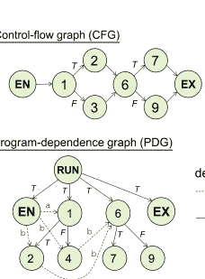

**1. 具有两个可能选择的程序 `Bin`。** 右侧是该程序的 CFG 和 PDG。（此图的彩色版本请读者参阅本章的在线版本。）

节点 1 有两个出边：标记为 `T` 的真分支 `(1, 2)` 和标记为 `F` 的假分支 `(1, 4)`。节点 `EN` 代表过程的入口，节点 `EX` 代表过程的出口。

CFG 适用于过程内（过程内部）分析。然而，程序中的不同过程通过调用点处的过程调用进行交互；这种交互需要在过程间（跨过程）分析中进行建模。因此，为了分析具有多个过程的程序，研究人员开发了作为超图的图表示 [64] 以及过程间控制流图（ICFG [83]）。在本章中，我们使用 ICFG 表示。

**定义 2。** 程序 `P` 的过程间控制流图（ICFG）是一个连通的有向图 `G^P = (V^P, E^P)`，其中 `V^P` 是所有过程 `P` 的 CFG 节点集的并集，且 `E^P = (E_cfg - E_cr) ∪ E_inter`，

- `E_cfg` 是所有过程 CFG 的所有边集的并集，
- `E_cr` 是所有连接调用节点和返回节点的边集，
- `E_inter` 是连接 `P` 中所有调用点的调用节点和返回节点与其调用的过程 `p` 的边 `(c, EN_p)` 和返回边 `(EX_p, r)`。

使用函数指针或执行虚拟调用的点可能有多个目标过程。在这项研究中，节点具有多个出调用边 `E_inter` 的调用点被视为分支节点，从该节点发出的每条调用边都标记有目标过程的签名。此外，过程可能会通过停止或抛出异常异常终止，这会产生特殊的依赖关系 [83]。任何其他控制流都由 CFG 和 ICFG 表示。程序 ICFG 中的并非所有路径都对应于程序中的路径——只有可实现的路径（realizable paths）才是。

**定义 3。** 程序 ICFG 中的可实现路径是指在程序中可以执行的路径，只有这种路径才是对应。

**定义 4。** CFG 或 ICFG 中的节点 `m` 支配节点 `n`，当且仅当从 `n` 到终点的所有路径都经过 `m`。

**定义 5。** CFG 或 ICFG 中的节点 `m` 后支配节点 `n`，当且仅当从 `n` 到终点的所有路径都经过 `m`。

### 2.2 程序依赖关系

程序中的不同过程通过调用点处的过程调用进行交互；这种交互需要在过程间分析中进行建模。控制决策和计算产生的状态之间的依赖关系产生了依赖关系。

**定义 6。** 语句 `s1` 控制依赖于语句 `s2`，当且仅当 `s2` 具有标记为 `L` 的后继节点 `v`，且 `s1` 支配 `v`。或者说，CFG 或 ICFG 中的节点 `m` 支配节点 `n`，当且仅当从 `n` 到 `G` 的所有节点的路径都经过 `m`。

控制依赖可以写为 `(x, y)` 或 `(x, y, L)`。为了说明这一点，考虑图 1 中的程序 `Bin`，语句 2 控制依赖于 1。

对程序变量的访问产生的依赖称为数据依赖。

**定义 7。** 语句 `s1` 数据依赖于语句 `s2`，当且仅当：

1. `s2` 定义了（赋值）变量 `v` 的值；
2. 从 `s2` 到 `s1` 存在一条不包含其他 `v` 定义的路径数据路径；
3. `s1` 使用（读取）`v`。

数据依赖的定义和使用对被称为定义-使用对（du-pair）。数据依赖可以写为 `(x, y)` 或 `(x, y, v)`。例如，在图 1 中，语句 6 数据依赖于变量 `b`，表示为 `(2, 6, b)`。

Podurski 和 Clarke 定义了语句间的语义依赖 [55]。

**定义 8。** 语句 `s1` 语义依赖于语句 `s2`，如果对于程序的某种执行，可以对 `s2` 计算的值进行更改，从而导致 `s1` 使用的值或 `s1` 的出现次数或位置发生变化。

基于这种 `s1` 对 `s2` 的这种依赖关系，我们也可以说 `s1` 语义依赖于语句 `s2` 中的特定更改 `C`，该更改在至少一次执行中影响 `s1`。语义依赖代表了分析的一个理想但非实际的目标。例如，一组依赖关系（控制或数据）是否为语义依赖是一个不可判的问题。

**定义 9。** 程序 `P` 的程序依赖图（PDG）[21] 是图 `D = (V^D, E^D)`，其中 `V^D` 包含程序 `P` ICFG 中每个节点的一个节点，`E^D` 是表示 `P` 语句间控制和数据依赖的边集，具有相应的节点。控制依赖边用目标节点依赖于源节点的控制决策进行标记。数据依赖边用变量名进行标记。`V^D` 还包含一个特殊的节点 `RUN`。对于 `P` 的 ICFG 中不依赖于任何其他节点 `n`，从 `RUN` 到 `n` 有一条标记为 `T`（真）的控制依赖边。

同样可能且有意义定义仅限于一种依赖类型的部分 PDG。

**定义 10。** 程序 `P` 的过程间控制依赖图（ICDG [83]）是不包含数据依赖边的 `P` 的 PDG。

## 演化软件的变更影响分析

## 程序依赖图 (PDG)

```java
boolean Arr(int a, int [] b)

pre-condition: b.length >= 4

01: int v, i, j
02: v = a // C1 -> v = a
03: for (i = 1; i <= 4; i++) {
04:   if (b[i] > 0) {
05:     j = // C4 -> j = 5
06:   } else
07:     j = 2
08:   }
09:   v += j // * nothing // // C3 -> print j
10: return v > 0 // C4 -> return v > -10
```


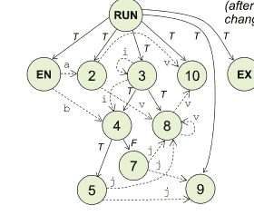

**图 2.** 左侧是具有四种可能变化的 `Arr` 示例，右侧对应的 PDG。（彩色版本请读者参阅本章的在线版本）。

### 2.3 切片

本节从变更对程序其余部分的潜在影响的角度描述了切片。左侧图 2 显示了本节用于说明切片的示例程序，该程序引入了四种变更。右侧图 2 显示了执行变更后 `Arr` 的 PDG。程序输入一个整数 `a` 和一个整数数组 `b`，并在语句 2 处将 `v` 初始化为 `a`。在语句 3–8 的循环中，程序迭代地确定 `j` 的值——取决于 `b[i]` 的值——并通过 `j` 增加 `v`。最后，在语句 10 处，如果 `v > 0` 程序返回 `true`，否则返回 `false`。

为了确定程序的哪些部分可能受语句变更的影响，可以使用静态正向切片（static forward slice）。

**定义 11。** 程序 `P` 中从语句 `s` 的静态正向切片 [30, 31, 90] 是一个集合，包含 `s` 以及在 `P` 的 PDG 中从节点 `s` 出发沿着控制和数据依赖直接或间接可达的所有节点的对应语句。

为了说明，考虑图 2 中的程序 `Arr` 及其 PDG。表 1 的第二列显示了 `Arr` 中三个不同节点的静态正向切片。例如，从节点 2 的静态正向切片是集合 `{2, 8, 10}`。该切片在变更前后是相同的。

为了确定对于特定的执行哪些语句可能受语句 `s` 变更的影响，可以从执行中的 `s` 计算动态正向切片（dynamic forward slice）。

**定义 12。** 对于程序 `P` 的一次执行 `Bin`，从语句 `s` 的动态正向切片 [10, 30, 31] 是一个集合，包含 `s` 以及在程序 `P` 执行的 PDG 中沿着控制和数据依赖直接或间接到达 `s` 节点的所有节点的语句。

**表 1** 应用图 2 中的变更后，程序 `Arr` 的示例正向程序切片。

| 切片准则 | 静态切片 | 输入值 | 从语句首次出现的动态切片 |
| --- | --- | --- | --- |
| 语句 2 | `{2, 8, 10}` | `a = 5, b = [1, -1, 0, 3]` | `{2¹, 8¹, 8², 8³, 8⁴, 10¹}` |
| 语句 5 | `{5, 9, 10}` | `a = 5, b = [1, -1, 0, 3]` | `{5¹, 8¹, 8², 8³, 8⁴, 9¹, 10¹}` |
| 语句 10 | `{10}` | `a = 5, b = [1, -1, 0, 3]` | `{10¹}` |

在本章中，我们使用最细粒度的动态切片形式，即基于语句出现次数 [1]：执行中语句 `s` 的第 `i` 次出现表示为 `s¹`。表 1 的最后一列显示了在修改后的 `Arr` 在 `[a = 5, b = [1, -1, 0, 3]]` 上执行时对应语句（第一列）首次出现时的动态切片（第三列）（注意，对于修改后的 `Arr` 和此输入，可执行语句的执行历史——排除 1 和 6——有 `2¹, 3¹, 4¹, 5¹, 8¹, 3², 4², 7¹, 8², 3³, 4³, 5², 8³, 8⁴, 9¹, 10³`）。例如，语句出现点 5 的动态正向切片是 `{5¹, 8¹, 8², 8³, 8⁴, 9¹, 10¹}`。

### 2.4 符号执行

符号执行 [17, 35] 允许通过使用符号输入沿程序执行程序来分析程序。如果可行，符号化执行程序中通往给定点的所有路径，可以提供程序在该点之前的语义描述。符号执行通过解释沿该路径使用符号输入执行的操作来表示程序变量的值。程序在给定点的状态由作用范围内变量的符号值组成。输入为了遵循某路径必须满足的约束集合是路径条件，它是每个谓词的约束 `p_i` 和 `¬p`（取决于所选分支）的取与。

## 3. 相关方法

在正式介绍变更影响分析之前，我们概述了一些虽然没有在变更影响分析中定义、但为此奠定了基础的方法。第 3.1 节讨论了描述变更传播条件的故障传播模型。第 3.2 节总结了的概念和技术。然后，第 3.3 节讨论了回归测试和测试集增强，这些也依赖于。

### 3.1 故障传播模型

许多研究人员在基于故障测试的理论方面工作。基于故障的测试 [19, 26] 将测试限制在一类故障中，并测试软件是否存在特定类型的故障。通常，考虑的故障是代码的简单变换。有两个支持这种测试方法的假设假设：胜任程序员假设 [19]，即开发者创建程序在语法上是正确的；耦合效应 [19]，即揭示简单故障的数据足够敏感，足以发现复杂的故障。本节描述的基于故障测试的理论工作自然地应用于变更。变更像故障一样可以被视为代码变换；变更与故障之间的唯一区别是变更的位置和语义是总是。

Morell [47] 开发了一种用于理解和系统化基于故障测试的理论。基于故障的测试限制在一类故障中，并测试软件是否存在这些故障。Morell 的理论提供了一个框架，其中故障类被指定为代码中的变换（替代表达式），并将测试目标设定为选择能够区分原始程序产生的所有替代方案输入数据。为了实现这一目标，Morell 提出了符号测试，其中变换是符号的（即它们代表无限替代方案），原始程序及其替代方案表示为输入的符号函数，而测试输入以区分原始程序的条件表示为传播断言，其中要求符号函数必须不同。虽然符号化评估完整程序是不行的，但 Morell 的理论使得符号测试成为开发和分析较少方法的理想形式。

Richardson 和 Thompson [65] 提出了故障检测的 RELAY 模型，通过详细描述故障执行和传播以导致可避免故障的步骤，完善了 Morell 的理论。这些步骤包括在执行故障组件时潜在故障的产生（即错误状态）、该故障到包含表达式的计算传输，以及通过信息流（即控制和数据依赖链）从计算到计算的故障状态传输，直到故障暴露给外部观察者。作者们使用了这种故障产生和传递条件的模型，来强调了基于程序实体（例如分支、数据依赖）的传统测试标准 [66] 的主要弱点之一，即它们无法处理巧合正确（coincidental correctness）——即故障已执行但错误未传递到输出结果的情况。在参考文献 [87] 中，这些作者详细探讨了 Relay 模型中的传递条件，承认需要符号执行来提供准确的传递条件，而这通常会使过程变得复杂。尽管如此，Relay 模型为 Morell 关于开发中应用故障（及变更）传播的理论提供了额外的见解。

Voas 在他的 PIE 模型 [88] 中也提到了错误状态的产生和传递的概念。在该模型中，故障的测试准则应该确保故障被执行（E）、故障感染了状态（I），以及被感染的状态传播到输出端（P）。Voas 并没有指定并解决这些条件，而是使用该模型构建了一种动态（基于执行的）技术，用于估计某些程序位置在包含故障时观察到故障的概率。尽管如此，PIE 模型非常方便地简要了 Relay 模型的主要步骤。

本节描述的三个模型旨在识别单点故障 [47, 66, 88] 或互不干扰的多重故障 [66] 的影响。对于变更，开发者需要确定变更对程序任何部分的影响，并可能同时对多个变更进行此类操作。据我们所知，目前还没有一种基础性模型能够系统地计算一个或多个变更对程序每个部分的影响。

### 3.2 变更影响分析

变更影响分析（CIA）[13] 寻找所有可能受影响、可能需要变更或可能将变更影响传播到其他组件的组件。基于静态和动态程序分析的 CIA 技术已在不同的粒度和精确度上被定义，如语句和类 [5, 13, 40, 54, 59, 63, 79, 94]。这些技术使用了控制流或依赖关系，但忽略了产生影响的状态。关于 CIA 文献的全面综述，请参考参考文献 [18, 41, 43]。

我们将 CIA 技术分为两类：预测性的和描述性的。预测性影响分析（例如 [5, 13, 14]）在更改特定程序位置（如语句或方法）之前识别更改的潜在影响。这对于协助开发者在决定是否更改该位置、如何更改以及如何传播变更 [60]（即作为结果后续需要进行哪些变更）特别有用。描述性影响分析（例如 [61, 63, 79]）通过对齐未修改软件与修改后软件在代码和行为上的差异，在变更后识别受影响的实体。

变更影响分析技术在可扩展性和精确性之间提供了各种权衡。可扩展性最好的粗粒度影响分析识别了类或方法（例如 [5, 14, 63]），这可以作为开发者理解变更后果的第一步，但它们没有描述这些类或方法中哪些受到了影响，以及是如何受影响的。细粒度影响分析使用代码依赖关系（例如 [10, 31]）来识别语句级别的影响，但它们仍然是不精确的，因为它们要么以保守的方式发现程序中过大部分部分可能受影响，要么遗漏了特定方程组未揭示的代码。

其他 CIA 方法利用软件仓库和标识符名称来识别属性和共同变更趋势 [4, 14, 24, 56, 97]。这些方法中的包括非组件变更 [82, 91]。一方面，这些方法提供了通过程序分析难以获取的开发者意图的提示；另一方面，它们在粗粒度分析上运行，并且仍然会产生假阳性和假阴性。

为了考虑语句级别的状态影响，我们开发了变更影响分析 [73, 75, 77–79] 以实现全精确度，并为了实际应用，开发了基于程序限制 [73, 78] 和影响量化 [15, 81] 的近似方法。这些是后续章节的主题。其他一些作者还通过基于摘要的符号执行 [52, 53] 和测试用例生成启发式算法 [57, 86] 处理变更状态。

### 3.3 回归测试与测试用集增强

回归测试是软件测试的重要形式，由在软件修改后对其进行重新测试 [8, 11, 22, 25, 28, 29, 36, 38, 42, 48, 51, 67, 70, 93] 以寻找由变更引入的任何回归（即停止正常工作的程序行为）。通常，重用现有的用集来执行回归测试。此外，由于变更可能会引入新功能或产生副作用，可能需要新的测试用例。因此，作为回归测试的补充，开发者需要执行所谓的测试用集增强 [6, 73]，这是一个评估现有测试用集并根据需要添加新测试用例的过程。

## 3.3.1 整个软件的覆盖测试准则

大量工作了基于白盒准的软件测试，旨在发现实现中任何位置的故障。这些准则定义了测试期间必须执行（即至少执行一次）的实体 [8, 22, 48]。某些准则要求覆盖某些类型的控制流实体 [32, 33, 48]（例如语句、分支、路径），另一些要求覆盖某些类型的数据流实体 [8, 22, 39, 62]。Frankl 和 Weyuker [22] 提供了一个控制流和数据流测试准的层次结构，展示了它们之间的包含关系。

### 3.3.2 修改软件的覆盖测试准则

整个程序覆盖准则旨在发现位置未知的故障。然而，在修改软件的情况下，变更和位置是已知的。研究利用这些信息，至少通过提出识别可能受变更影响的实体（如分支或数据依赖），并要求回归测试用集覆盖这些实体 [11, 25, 69]。受影响的实体是通过从受影响的位置正向遍历控制依赖关系来识别的——这种方法对应正向切片 [30, 31, 90]。因此，测试技术使用了专门的准则，要求对程序子集的覆盖，而不是像整个程序准则那样覆盖全部。

## 4. 变更影响分析的理论

本节介绍了自动分析变更影响的基础。虽然这些基础在软件变更领域本身是一项贡献，但它们是后续章节讨论的变更测试和分析的核心。4.1 节定义了变更的影响，4.2 节展示了如何计算这些影响。

### 4.1 变更影响的形式化模型

本节介绍了程序代码变更及其影响的形式化模型。该模型的指导原则是：

> 如果对程序应用变更 `C` 会改变程序元素 `e` 行为的任何方式，则变更 `C` 影响了元素 `e`。

元素 `e` 可以是一个语句，甚至是另一个更改。一个更改的行为是由于被修改语句的行为变化所引起的差异集合。

本节形式化了程序代码中的“更改”概念以及这些更改的“影响”。第 4.1.1 节展示了用于说明该模型的示例，4.1.2 节定义了代码更改的含义，4.1.3 节和 4.1.4 节分别介绍了单个更改和多个更改的模型。

#### 4.1.1 示例

我们将重用图 2 中的程序 `Arr`，并以注释形式显示四个更改：`C1`、`C2`、`C3` 和 `C4`。将这些更改应用于 `Arr` 会产生一个调用 `Arr'` 的修改版本。在程序的右侧，图 2 显示了 `Arr'` 的 PDG。回 `Arr` 输入一个整数 `a` 和整数数组 `b`，并在第 2 行初始化 `v`。在第 3–8 行的循环中，程序迭代地确定 `v` 的值——取决于 `b[j]` 的值——并将 `v` 递增 `j`。在 `Arr'` 中，第 8 行程序打印 `j` 是空的。最后，在第 10 行，程序如果 `v > 0` 则返回，否则不。在修改后的程序 `Arr'` 中，`C1` 修改了第 2 行的表达式，相对于 `Arr` 使 `v` 减 1；`C2` 更改了第 5 行赋值给 `j` 的值；`C3` 在第 8 行插入了 `print j`；`C4` 修改了第 10 行评估并返回的表达式。

### 4.1.2 代码更改的定义

为了定义更改的影响，在本章首先定义程序可执行代码中更改的概念。形式上，`P` 中的代码更改是一组一组可执行语句与一组新的可执行语句之间的映射，后者替换前者以产生修改后的程序 `P'`。为了支持本章其余部分的概念和技术，在不失一般性的情况下，我们假设进行代码更改的程序区域具有单一入口。形式上，接下来的两个定义了什么是代码更改以及如何指定它。

**定义 13。** 子 ICFG 是一个增量的、连通的有向图 `G^S = (V^S, E^S)`，它是 ICFG³ 的子图，其中 `V^S` 恰好包含一个没有前驱且作为子图入口的 `e`。

> ² 程序指的是语义正确（可编译）的声明和可执行代码序列。

> ³ ICFG 是过程间控制流图。参见第 2.1 节中的定义 2。

`e` 不一定是 `EN` 节点。如果 `G^S` 既是子 ICFG 又是 `I` 的子图，我们称 `G^S` 是 ICFG 的子 ICFG。

**定义 14。** 程序 `P` 中的代码更改是对 `P` 可执行代码修改的描述，由元组 `<G, G', IN, OUT>` 指定，`G` 是 `P` 的 ICFG 的子 ICFG，`G'` 是一个与 `G` 不同的子 ICFG（即节点集、边集或相应的语句不同），且 `IN` 和 `OUT` 是部分函数 `E → V × L_e`，其中 `E` 是 `I` 中的边集，`V'` 是 `G'` 中的节点集，`L_e` 是决策-决策标签集，包括空标签 `λ`。`IN` 的域包含 `I` 中所有边 `(m, n)`，其中 `m` 不在 `G` 中且 `n` 是 `G` 的入口。`IN` 的像集是 `{e'} × L_e`（即对于所有进入 `G` 的边，`e'` 映射到 `e`）。`OUT` 的域包含 `I` 中所有边 `(m, n)`，使得 `m` 在 `G` 中且 `n` 不在 `G` 中。

这种用于代码更改的更改 `<G, G', IN, OUT>` 的目的是让子 ICFG 指定要替换的 `P`（`P` 中的原始代码）的 ICFG 路径，以及用于替换 `G` 的子 `G'`。修改后的 `P'` 是通过将此更改应用于 ICFG `I` 得到 ICFG `I'` 获得的。部分函数 `IN` 和 `OUT` 指定了 `G'` 如何连接到其替换的 `I` 的其他部分。定义 14 指明，`I` 中所有进入 `G` 的边都指向 `G` 的入口节点。因此，如果来自 `IN` 域的边 `(m, e)` 满足 `IN((m, e)) = (e', l)`，则在应用更改时 `(m, e)` 被替换为带有标签 `l` 的边 `(m, e')`。然而，离开 `I` 的边可以从 `G` 中的任何节点离开。`OUT` 域中的每个边 `(m, n)` 被替换为带有标签 `l` 的边 `(m', n)`，其中 `OUT((m, n)) = (m', l)`。

代码更改的单一入口属性对于 4.1.3 节所示的影响定义定义。该约束并不影响定义 14 描述代码更改的影响——仅仅是 `P` 中具有多个入口的修改区域可以被指定为单独的可能重叠的更改，或者指定为一个更改，其 ICFG `G` 和 `G'` 包含所有修改节点。

（注：原文此处存在部分文本重复和乱码，译文已根据上下文进行逻辑对齐）

`img/0263f26030aa28a04b4ed982601224`

**图 4.** 代码更改示例。左侧是程序 `P` 的 ICFG 及其子 ICFG `G`（节点 2 和 3）。中间是子 ICFG `G'`、部分函数 `IN` 和 `OUT`，以及入口节点 `e` 和 `e'`。右侧是修改后程序 `P'` 的 ICFG。（本章版本）`P'` 显示在右侧。在此 ICFG 中，修改区域被高亮并对应于子 ICFG `G`，`IN` 将进入 `G` 的唯一边 `(1, 2)` 映射到 `G'` 的节点 6（`e'`），无标签。因此，边 `(1, 2)` 被替换为 `P` 中的无标签边 `(1, 6)`。`OUT` 将 `G` 的节点 4 和 5 分别映射到 `G'` 的节点 7 和 8，带有标签。因此，标签为 `T` 的边 `(3, 4)` 和标签为 `F` 的边 `(3, 5)` 被替换为 `P` 中的边 `(7, 4)` 和 `(7, 5)`。

### 4.1.3 单个更改的影响

为了方便讨论，此后代码更改简单称为更改，且程序执行是可重复的（即对于相同输入的所有执行都是相同的）。令 `P` 和 `P'` 为程序的两个版本，其中 `P'` 是应用集合 `N` 个更改 `{C_i | i ≤ N}` 的结果。令 `P'_C` 为对 `P` 应用除 `C` 以外的所有更改得到的程序版本。

更改改变程序的状态和/或被执行的指令。接下来的定义确定了程序和更改的指令与状态序列。

**定义 15。** 程序对于输入 `I` 的执行历史是程序在输入 `I` 上运行时执行的语句序列。

**定义 16。** 程序对于输入 `I` 的增强执行历史是程序对于输入 `I` 的执行历史的扩展，其中每个语句出现 `s^i` 都与 `s^i` 修改的状态部分配对。这些部分是在 `s^i` 处定义的值以及程序计数器（即下一个语句的索引）。

例如，考虑 `Arr'`（图 2）和输入 `{a = 5, b = {-1, -1, 0, 3}}`。令 `pc` 表示语句执行后的程序计数器。程序增强执行历史的前五个元素是：

`Arr'`：

```text
(2', {v = 4, pc = 3}), (3', {i = 1, pc = 4}), (4', {pc = 5}),
(5', {j = 5, pc = 8}), and (8', {v = 9, pc = 3}).
```

变更 `C` 在程序执行过程中可能发生也可能不发生（即执行），如果发生，它可能会发生多次。如果修改后的程序中至少有一个语句被执行，则认为 `C` 在执行过程中发生了。

**定义 17。** 针对程序 `P` 的某次执行，变更 `C` 对该程序的增强执行历史是 `C` 在该次执行中位置（入口点）的发生序列，并且对于每次发生，是增强执行历史中包含的仅有的在该次执行中语义上依赖于 `C` 的语句的子集。（语义依赖的定义参见定义 8.2）。

对于图 2 中的程序 `Arr'`，在 `{a = 5, b = [-1, 0, 3]}` 上执行时，`C2` 的增强执行历史包含了变更的两次发生：`5¹, 5², 和 5³`。在此示例中，`C2` 的发生 `5¹` 的增强执行历史子集是：

```text
(5', {v = 5, pc = 8}), (8', {v = 9, pc = 3}), (8', {v = 11, pc = 3}),
(8', {v = 13, pc = 3}), (8', {v = 18, pc = 3}),
and (10', {ret = true, pc = EX}).
```

其中 `ret` 代表要返回的值。注意，`5²` 的子集与 `5¹` 和 `5³` 之后的所有元素分别重叠，但除了那两次发生（`5²` 和 `5³`）以及存在于 `5³` 增强执行历史中的 `9¹`。

变更发生后，带有变更和不带变更版本的程序执行从该点开始在部分状态上发生分散。这种分散在之后的各自执行历史中持续，可能持续到两次执行的剩余部分。下一个定义形式化了这种分散。

**定义 18。** 给定修改后程序 `P'` 的输入 `I` 执行，变更 `C` 对该执行的影响是对于输入 `I`，`C` 在 `P'` 和 `P` 的增强执行历史之间的差异。

> 两个序列之间的差异可以通过其元素的添加、删除和修改的集合来指定。由于可能存在多个指定两个序列之间差异的集合，我们更广泛地使用“差异”一词来表示所有可能的集合。

**定义 19。** 变更 `C` 对程序 `P'` 的影响是 `C` 对 `P'` 所有可能执行的影响的并集。

变更对修改后程序的影响反映了该变更对程序行为的实际意义。因此，一个变更不仅可以看作是代码的局部语法修改，更准确地看，它是由语法修改引起的行为差异（即状态或路径的差异）的集合。这些差异始于变更的位置，并传播到程序的所有受影响部分，无论它们距离变更有多远。

### 4.1.4 多个变更的影响

程序中的变更通常不是孤立发生的。因此，有必要定义多个变更相互影响意味着什么——即它们是如何相互作用的。我们形式化模型中，多个变更的指导原则是：

> 如果 `C_x` 的存在以任何方式改变了 `C_x` 对程序的影响，则 `C_x` 影响了另一个变更 `C_y`。

本节提供了变更之间依赖关系和变更交互的正规定义，并在关于变更交互是对称关系的证明。

变更 `C` 影响的上下文是包含了所有其他变更在内的整个程序，而不仅仅是 `C` 的语法位置和带有变更 `C` 的原始程序。因为 `C` 的意义对应于它对整个修改后程序的影响，其他变更对这些影响的任何修改都是与 `C` 的交互。

**定义 20。** `C_x` 语义依赖于 `P'` 中的变更 `C_y`，如果 `C_x` 不同于该变更在 `P` 中的影响（即不包含变更 `C_y` 的 `P'`）。

换句话说，`C_y` 在修改后程序 `P'` 中的存在或缺失取决于 `C` 在 `P'` 的影响。这种语义依赖定义与 Podgorski 和 Clarke 定义的两个语句之间的语义依赖相似，不同在于：首先，语义依赖使用了变更的增强执行历史，它不仅包含了语法修改的语句，还包含了跨程序受该变更影响的所有语句和状态。其次，与其考虑源处的所有变更，我们使用 `P' \ C_y` 之间的具体变更。这第二个差异使得此类依赖的计算成为可能。

两个变更之间的语义差异是对称关系。以下定理形式化了这一属性。

> **定理 1.** 如果变更 `C_x` 语义依赖于变更 `C_y`，则变更 `C_y` 语义依赖于变更 `C_x`。

该定理的证明见文献 [72]。

## 4.2 变更的影响计算

基于变更影响的形式模型（4.1 节）和 PIE 模型（3.1 节），我们可以提供一种系统的方法来计算导致变更影响程序行为的变更。这些变更由图 5 中的 `COMEFFECT` 捕获并计算。该过程输入原始（未修改的）程序 `P` 和变更 `C`（见定义 14），并在第 1 行通过将 `C` 应用于 `P` 来计算修改后的程序 `P'`。

根据定义 18 和 19，变更的影响是 `P` 和 `P'` 的变更增强执行历史（定义 17）中的差异。因此，变更的影响无法根据其他程序完全指定。例如，在图 2 的 `P` 的 `Arr` 中，`C_3` 的执行历史在 `Arr'` 中被修改，因此它没有提供关于哪些程序行为受到影响的线索。该变更的插入代码——`C_3` 的图指定了返回值。

为了涵盖所有受影响的行为，`COMPEFFECT` 将变更 `C` 的影响输出为依赖链集合（序列）：一组用于 `P`，另一组用于 `P'`。因此，影响的计算分两步执行（2–20 行的循环），一步用于 `P`，另一步用于 `P'`。循环内部的条件如下。

### 4.2.1 链条件

变更的增强执行历史（定义 17），变更影响定义的关键部分（定义 18 和 19），我们使用 `procedure` 而不是 `algorithm`，因为 `COMPUT` 可能终止。

# Procedure COMPEFFECTS

输入：`P`: program；`C`: change

输出：`effects`: map program -> dependence chain -> conditions

```text


(1) `P' := applyChain(P, C)`

(2) `foreach program { P, P' }`

(3) `altProgram := P'` if `program` is `P` ; otherwise

(4) `chainWorklist := createEmptyChains(program, change)`

(5) `foreach emptyChain in chainWorklist`

(6) `effects[emptyChain] := reachingCondition(program, start(emptyChain))`

(7) `// incremental computation of conditions`

(8) `while chainWorklist \neq \emptyset`

(9) `prefixChain := pop(chainWorklist)`

(10) `foreach dep in nextDependencies(program, prefixChain)`

(11) `chain := append(prefixChain, dep)`

(12) `// chain conditions`

(13) `depCode := overCondition(program, prefixChain, dep)`

(14) `chainCode := effects[program][chain] \wedge depCode`

(15) `// state conditions`

(16) `(S, S_{alt}) := PSE_Dep(dep, altProgram, dep)`

(17) `stateCode := live(S) \neq live(S_{alt}) \vee pc(S) \wedge pc(S_{alt})`

(18) `effects[program][chain] := chainCode \wedge stateCode`

(19) `push(chainWorklist, chain)`

(20) `endfor`

(21) `endwhile`

(22) `endfor`

(23) `return effects`


**图5.** 计算变更影响的过程，不一定终止。

在 4.1.3 节中，使用了语句之间的语义依赖。计算所有可能执行的语义依赖是一个不可判问题，但语义依赖可以通过语法依赖（即通过程序分析识别的可能依赖）来近似。

**定义 21.** *节点 $n$ 在程序 $P$ 的 ICFG 中语法上依赖于节点 $m$ 且根据安全分析 $A_i$，当且仅当存在 $A$ 在 $P$ 中识别的一条从 $m$ 开始到 $n$ 的依赖链（控制或两者都有）时。*

> 如果程序分析没有漏报（例如漏掉依赖关系），则它是安全的。

## 演化软件的变更影响分析

**定义 22.** *依赖链是一个元组 `<n, seq>`，其中 `n` 是起始节点，`seq` 是一个可能为空的依赖序列，其中每个依赖项的目标节点是 `seq` 中下一个依赖项的源节点。*

语法依赖是语义依赖的必要条件（见第 4.1.3 节）。因此，计算变更影响的程序的一个自然选择是计算从 $P$ 到 $P'$ 的变更产生的第一条依赖链。例如，在包含和不包含变更 $C_2$ 的程序 $Azr$ 中，从节点 5 到 10 有四条链：$(5, ((5, (8, 10)))$, $((5, (5, 8), (8, 10)))$, $((5, ((5, 8), (8, 8), (8, 10))))$, 以及 $(5, ((5, 8), (8, 8), (8, (8, 10))))$。

`ComputeEffects` 过程的第 4–17 行计算了程序变更的链条件。链条件是到达变更中的每个节点并执行从节点开始的每个依赖链所需的程序输入约束。每条链的约束是所覆盖路径的路径条件（见第 2.4 节）。第 4–7 行通过为程序变更中每个节点 $n$ 的每个定义或分支决策创建一个“空”条件 `<n, ()>` 来开始计算，并将此链规划在工作列表中，直到该过程的后续部分。第 6–8 行通过调用 `reachingCondition` 将到达其起始节点的路径条件分配给每条链，作为其执行的条件。

第 8–9 行的 `while` 循环遍历链工作列表，直到列表为空，在节点 9 处一次提取一条链并将其规划在 `prefixChain` 中；第 10–18 行的 `for` 循环通过每个起始于前缀链结束处的控制依赖或数据依赖（第 11 行）来扩展该链。对于每个依赖项，该循环根据该依赖项源处的程序变量计算其覆盖条件（第 12 行），然后计算扩展后链和新依赖项的链条件（第 13 行）。辅助函数 `coverCondition` 不仅考虑可实现的路径（即 `proceed` 调用和 `return` 边匹配的路径）。第 16 行将此扩展链的链条件与链的状态条件（见第 4.2.2 节）一起存储。第 17 行将链添加到工作列表中，以便在 `while` 循环的后续迭代中进一步扩展。

> 我们使用“路径条件”不仅用于单条路径，还用于到达某个节点或覆盖某项依赖的所有路径条件的并析。

## 4.2.2 状态条件

语法依赖虽然是必要的，但并不是节点对变更 $C$ 语义依赖的充分条件——变更产生的感染可能不会通过连接 $C$ 和 $s$ 的任何链进行传播。例如，程序 $A'$ 中的节点 10 通过节点 8 通过变量 $v$ 的依赖链与节点 2 中的变更 $C1$ 相连，但节点 10 处的值不受 $C1$ 的影响，除非 $v$ 的值在该点有 $C1$ 时为 0，从而在有 $C1$ 时为 1。因此，为了获得变更 $C$ 对某点的影响，需要关于程序状态的额外条件。

尽管计算语义依赖是不可判定的，但可以从变更开始增量地为此类依赖添加程序状态条件，如图 5 中的 `ComputeEffects` 过程所示。回该过程中的循环一次扩展每条链的控制或数据依赖。虽然由于控制或数据流，针对特定点的计算可能不会终止，但计算这些影响的增量过程可以作为有用近似方法的基础，如后续章节所示。

程序状态在逻辑上可以分为两部分：程序变量和程序计数器（即指向下一条执行指令的指针）。因此，感染通过依赖链向外传播有两种情况：

- 情况 1：感染是至少一个程序变量值的差异。
- 情况 2：感染是程序计数器的差异，导致程序所选路径的分叉。

为了计算这两种状态条件，第 14 行调用 `PSE_Dep` 执行下文定义的部分符号执行 [6, 73]。

**定义 23.** 部分符号执行，或称为 PSE，是符号执行的一种形式，它在程序中的任意点开始并结束，并在起始点对程序变量使用符号输入。PSE 的结果包括终点的程序状态以及从起始点到达该点的路径条件¹⁰。这两个结果都是以起始点变量的符号表示的。

`PSE_Dep` 将 PSE 应用于程序中依赖依赖项的路径及其替代路径（在第 3 行确定），并返回这些路径结束时的相应符号状态 $S$ 和 $S_{alt}$。这些状态中的符号是依赖项源节点的程序变量。

## 演化软件的变更影响分析

然而，这些变量中每个变量的符号在第 16 行添加状态条件时，等同于已活跃影响变量的符号值。同样，`PSE_Dep` 使用占位符条件 $p$ 和 $p_{alt}$ 表示相应程序执行到达了依赖项的源节点；这些占位符在第 16 行被替换为到达路径端的实际路径条件。如果 $p_{alt}$ 不存在，则 $p_{alt}$ 不可满足。

## 4.3 与相关方法的比较

在参考文献 [6, 73] 中，我们引入了部分符号执行 (PSE) 和符号状态作为变更影响的机制。在本节中，我们用 4.1 节的模型为这项工作奠定了基础。与该理论不同，我们的模型对变更影响了什么、如何影响程序状态以及输出如何受变更影响提供了完整且精确的定义。

## 5. 应用：测试套件扩展需求

在最近的工作 [73, 78] 中，我们对早期文献中提出并在 3.3.2 节中讨论的变更测试标准进行了首次实证研究。结果表明，揭示变更引起的观测行为差异的能力较低，因为这些技术未能利用变更提供的所有信息。基于覆盖的方法要求覆盖变更的位置和潜在受影响实体，但没有考虑变更如何影响程序状态、这些实体如何受影响以及当这些实体受影响时输出如何受到影响。仅基于变更和受影响实体覆盖的方法保证了变更被执行（正如变更模型所示），但它们没有提供足够的保证程序状态被变更感染且感染传播到输出。

本节描述了用于变更传播测试的 MATRIX 技术 [6, 73]。该技术是一种实用、直接的演化软件的变更影响分析，这是第 4 节形式理想方法的近似，该方法显式地解决了 PIE 模型中的感染和传播需求。MATRIX 基于对这些变更的精确分析，计算并监控单个变化的测试套件增强需求——这与第 3.3.2 节中简单的方法不同。

# 6. 应用：测试套件增强需求

在最近的工作 [73, 78] 中，我们对早期文献提出并在第 3.3.2 节讨论的变更测试准则进行了首次实证研究。结果表明，这些方法揭示变更引起的行为差异的能力较低，因为这些技术未能充分利用变更提供的所有信息。基于覆盖的方法要求对更改的位置和可能受影响的实体进行覆盖，但没有考虑变更如何影响程序状态，以及当实体受到影响时输出如何受到影响。仅基于变更和受影响实体覆盖的方法只能保证变更被执行（正如适用于变更的 PIE 模型（第 3.1 节）所要求的那样），但它们无法提供足够的保证确保程序状态被变更感染，且感染传播到输出。

本节描述了用于基于传播变更测试的 MATRIX 技术。该技术是对第 4 节形式理想方法的实用近似，显式地解决了 PIE 模型中的感染和传播需求。MATRIX 基于对这些变更的精确分析，计算并监控单个变化的测试套件增强需求——这与第 3.3.2 节中简单的方法不同。

# 6.1 MATRIX 概述

MATRIX 技术调整了第 4.2 节图 5 中的 `ComputeEffects` 过程（该过程计算变更对程序中任意一点的影响），使其适用。该技术分为两个阶段。阶段 1 通过识别程序中的依赖链（定义 22），变更的影响可能通过这些链传播到输出。这些链就是我们在该技术中所谓的“变更测试需求”它们应该作为必要的（尽管不是充分的）条件被覆盖，以执行变更影响可能传播的许多路径。阶段 2 使用部分符号执行 (PSE)（定义 23）针对阶段 1 找到的依赖链，计算变更影响的感染条件和传播条件（即第 4.2.2 节中的状态条件）。在阶段 2 中为每条链计算的条件就是我们所谓的这些链的“状态测试需求”。

通常情况下，计算覆盖变更、感染状态和传播输出的所有需求是不行的。因此，该技术做了两个简化。首先，该技术省略了 `ComputeEffects` 在第 6 行获得的从程序入口到达变更的条件，因为具有高代码覆盖率的现有测试套件应该已经覆盖了变更。其次，该技术对分析允许沿着每条链到达的距离设置了限制 $d$（即从变更中的每个节点到每条链的长度）。该限制由开发者或使用该技术的工具指定。由于两个原因，该技术获得的测试需求是变更到输出的执行、感染和传播条件的安全近似。第一个原因是，在链上不满足这些需求的测试用例保证不会通过该链将感染传播到输出。第二个原因是，这些需求是测试用例通过链将感染传播到输出的必要而非充分条件。因此，通过将感染传播到距离变更的每条链距离为 $d$ 的位置，该技术旨在相对于基于覆盖的方法增加感染继续传播到该距离并最终影响输出的概率。对传播的强调是我们将该技术归类为基于传播的原因。

该技术的目标是为所有可能的测试用例中的“差异显示子集”创建需求，即在原始程序和修改程序中产生明显不同行为的测试用例。该子集首先通过仅覆盖变更的测试用例进行近似。从那时起，理想子集通过满足每个距离的链和状态需求的子集越来越好地近似，因为随着距离的增加，满足这些需求的测试套件会不断限制可能将感染传播到输出的测试用例。对于每个距离 $d$，测试需求包含了该距离内的分支和数据依赖覆盖准则（第 3.3.2 节）。

# 6.2 MATRIX 技术

本节描述了用于分析单个变更测试需求的基于传播的技术 MATRIX。第 6.2.1 节介绍了阶段 1，第 6.2.2 节介绍了阶段 2。

# 6.2.1 阶段 1：链需求

测试变更的一种简单策略是覆盖所有更改的语句。然而，研究 [73] 所示，这种策略无法保证变更对程序不同部分的所有可能影响都得到测试。例如，考虑图 1 中的程序 Bin 和变更 $C_i$。令 Bin 为此修改版本。该程序有 10×10 次测试。检查图 1 中的代码发现，当 $y \in \{2,3\}$ 时，变更会在 Bin 中产生不同的可观测行为（即相对于 Bin 有不同的输出），这对应于 20 个输入，或占输入阶段的 20%。因此，选择一个覆盖变更的输入导致差异的概率相当小。

在许多情况下，对于简单变更策略的充分测试套件只执行了变更可能传播的所有依赖链的一小部分。因为变更的影响可以沿着任何……的前向传播。

**表 3：** Bin 中针对变更 $C_1$ 的依赖链

| 距离 | 输入 | 差异 |
| :--- | :--- | :--- |
| 1 | 80 | 16 |
| 1 | 20 | 4 |
| 2 | 80 | 16 |
| 2 | 20 | 4 |
| 3 | 72 | 16 |
| 3 | 8 | 0 |
| 3 | 14 | 0 |
| 3 | 6 | 4 |

考虑在所有长度为 1 的链中传播变更的影响的需求。必须测试两个依赖关系：(1,2) 和 (1,4)。表 3 显示，对于 (1,2)，有 80 个输入，其中 16 个揭示了差异。对于 (1,4)，有 20 个输入，其中揭示了差异。每条链都有 20% 的概率揭示差异。因此，覆盖示例中所有依赖关系的测试有 36%$^{13}$ 的概率揭示差异。因此，相对于变更，覆盖所有长度为 1 的链将概率从 20% 增加到 36%。

现在考虑长度大于 1 的依赖链。链的数量随长度呈指数级增长，但在实践中可以覆盖有限长度链。在 $C_1$ 的情况下，有四条长度为 3 的链延伸到 7 和 9。其中两条链揭示了差异，如表 3 所示：$d_{3,1}$ 被 72 个输入覆盖，揭示了 16 个案例（22.2%），以及 $d_{3,4}$ 被 6 个输入覆盖，揭示了 4 个案例（66.7%）。相比之下，覆盖所有长度为 3 的链的测试套件以 74.1% 的概率揭示差异。大小为 4 的随机测试套件有 59% 的概率揭示差异。这表明通过要求对变更传播路径进行良好覆盖，长链比短链或简单变更覆盖（即长度为 0 的链）有所改进。

MATRIX 需求的计算与 COMPUTEES 中链条件的计算相同，仅有两个不同。第一个不同是，在第 6 行，到达变更的条件为空——由于第 6.1 节给出的原因省略了这些条件。第二个不同是，在第 17 行，对于 COMPUTEES，只有当长度未达到距离 $d$ 时才会将扩展链添加到工作列表中。从现在开始，我们使用 `CHAIN` 表示测试期间满足链需求的策略。

# 6.2.2 阶段 2：状态需求

链需求可以增加发现输出差异的概率，但它们无法保证链的影响传播到每条链的末端。例如，程序 Bin 和变更 $C_1$ 在

> $^{13}$测试 $T$ 揭示差异的概率为 $1-\prod_{t \in T}(1-p_t)$，$p_t$ 是测试 $t$ 揭示差异的概率。

## 演化软件的变更影响分析

图 1 和表 3 显示，在 72 个输入中，覆盖链 $q_{3,1}$ 的仅 16 个（22%）显示出输出差异。原因是，在覆盖链 $q_{3,1}$ 并到达 Bin 中的语句 7 后，程序状态可能与在相同输入下 Bin₁ 中语句 7 的状态相同。因此，为了保证感染传播到每条链的末尾——从而增加感染在该点之后继续传播并到达输出的概率——算法 `ComputeReqs` 为每条链计算状态需求。

与过程 `ComputeEffects` 类似，算法 `ComputeReqs` 对每个依赖关系执行部分符号执行（定义 23），以获得 P 和 P' 不同的情况 1 和 2（第 4.2.2 节）的状态：某些变量不同或路径不同。一个链的两个状态需求将覆盖该链的用例空间缩小为能够将感染传播到链末尾的用例，从而增加了感染传播到输出的概率。然而，与 `ComputeEffects` 不同，`ComputeReqs` 在第 14 行使用了 PSE 的变体版本，该版本考虑了给定的路径长度 $L$。

在 `ComputeReqs` 中，当路径长度 $l$ 达到覆盖依赖关系的路径时，PSE 会停止分析控制流路径，从而避免对过长（可能是无限长）路径进行昂贵的分析。当 PSE 分析某路径时，它会将该路径的路径条件添加到合取项中。在这种情况下，尽管实际上路径在第 $l$ 个节点之后可能未满足某些条件，但不完整的路径条件仍可能被满足。同样，如果在达到路径限制 $l$ 之后的路径中更新了变量 $v$，则该值 $v$ 被视为未知——它可能有任何值。在这种情况下，无法确定原始程序和修改后程序中的 $v$ 是否不同（$v$ 在其中一个程序中不存在）。

为了说明，再次考虑图 1。使用符号执行，该技术定义了 Bin₁ 在变更点 $(x=x_0, y=y_0)$ 的状态。在遵循链 $q_{3,1}$ 后，Bin₁ 中的符号状态为 $(x=x_0, y=y_0+1)$，该链的路径条件为 $x_0 > 2 \wedge y_0 > 1$。在示例中，$x$ 和 $y$ 都定义在语句 7，因此活跃状态存在于 Bin₁ 和 Bin 中；但 Bin 中通往语句 7 的所有路径路径条件 $(x_0 \le 2 \wedge y_0 > 1) > 1$ $(x_0 > 2 \wedge y_0 > 3)$，因此 $q_{3,1}$ 的情况 2 $(pc(S) \wedge \neg pc(S))$ 被 $x_0 > 2$ 且 $y_0 \in [2,3]$ 满足。条件 2 将覆盖该链的测试数量从 72 次减少到 16 次，这些测试恰恰揭示了差异。约束另一个显示差异的链 $q_{3,4}$ 也能产生 100% 的检测。

从现在起，我们使用 `PROP` 来表示在测试期间满足 `CHAIN`（链需求）以及每条此类链的状态需求的策略。

## 6.3 实验结果总结

为了评估 MaTRIX 在图 1 简单示例之外的潜力，我们获取了其与第 3.3.2 节中基于覆盖的方法相比的实验结果。我们将 MaTRIX 实现为 DUA-FORENICS [74, 80]（我们的依赖分析和插桩框架）的扩展。我们展示了 MaTRIX 策略 `CHAIN` 和 `PROP` 的差异检测能力，以及 3.3.2 节中基于覆盖的策略 `STMT`（修改语句）、`BR`（受影响分支）和 `DU`（受影响对）。对于 `CHAIN` 和 `PROP`，我们在 1 GB 内存限制和路径长度为 1 的 10 次更改范围内，使用了 `PROP` 能达到的最大距离 $d$。

结果如表 4 所示。我们在 tcas（小型空气控制程序）中更改了 6 处，在 NanoXML（一个轻量级 XAML 解析器）中更改了 9 处。对于每种更改和策略类型，我们生成了 100 个测试，并测量了该策略暴露输出中至少一个差异的概率。

### 表 4 针对各种变更的测试套增强需求的差异检测率。

| 变更 | 最大距离 | STMT (%) | BR (%) | DU (%) | CHAIN (%) | PROP (%) |
| :--- | :--- | :--- | :--- | :--- | :--- | :--- |
| tcas_1 | 3 | 41.1 | 41.1 | 47.3 | 47.3 | 10.0 |
| tcas_2 | 6 | 15.2 | 15.2 | 15.2 | 16.9 | 54.1 |
| tcas_3 | 6 | 2.0 | 3.2 | 20.0 | 18.4 | 18.6 |
| tcas_4 | 6 | 1.0 | 19.4 | 10.0 | 10.0 | 10.0 |
| tcas_5 | 6 | 0.7 | 0.7 | 0.7 | 3.5 | 3.7 |
| tcas_6 | 5 | 2.1 | 3.7 | 2.1 | 4.6 | 10.0 |
| nanoxml_1 | 2 | 52.2 | 10.0 | 52.2 | 52.2 | 10.0 |
| nanoxml_2 | 3 | 67.2 | 60.2 | 67.2 | 67.2 | 67.2 |
| nanoxml_3 | 3 | 0.0 | 0.0 | 10.4 | 10.4 | 10.4 |
| nanoxml_4 | 3 | 13.4 | 13.4 | 48.7 | 48.7 | 10.0 |
| nanoxml_5 | 3 | 18.7 | 18.7 | 18.7 | 18.7 | 18.7 |
| nanoxml_6 | 4 | 35.0 | 35.0 | 66.0 | 66.0 | 35.0 |
| nanoxml_7 | 4 | 21.9 | 42.2 | 42.2 | 42.2 | 21.9 |
| nanoxml_8 | 4 | 25.5 | 41.8 | 60.0 | 60.0 | 25.5 |

## 7. 应用：需求驱动的测试套增强

### 7.1 概述

为了规避 MATRIX 原版本的局限性，使用 `CHAIN` 和 `PROP` 策略对变更进行需求驱动的方法。该方法只需要静态和动态依赖分析以及运行时监控，而 MATRIX 需要对所有传播变更的路径进行符号执行。在 tcas 中，使用 SPD 增加了 PROP 的有效性 44%，而在 NanoXML 中，使用 SPD 增加了 PROP 的有效性 17%。对于 SPD 的更多细节，读者请参考 [7]。

为了保证感染传播到每条链的末尾——从而增加感染在该点之后继续传播并到达输出的概率——算法 `ComputeReqs` 为每条链计算状态需求。

在实践中，需求的数量随 $d$ 爆炸式增长，这带来了额外的测试工作量。在本节中，我们展示了通过按需识别而非预先计算所有测试需求来实现 MATRIX 的一种变体是可行且有效的。自然，这种代价是无法预知需求的总数。

为了满足 `CHAIN` 的需求驱动的测试。

虽然该方法不再以符号形式表示传播条件，而是为了求解约束，测试人员必须通过状态或路径差异来确保传播。

给定一个测试 TS，`CHAIN` 的边界测试需求是 TS 覆盖的依赖关系，排除其最后一个依赖。对于 `PROP`，TS 的边界测试需求是一个依赖关系及其传播条件，使得该链是 `CHAIN` 的边界测试需求，或者该链中最后一个依赖的传播条件未被 TS 满足。因此，对于测试 TS，未满足测试需求的集合是 TS 的边界测试需求以及每一个链扩展了边界需求链的其他测试需求的并集。

为了说明，我们使用树来描述变更的满足和边界测试需求。链树是一棵树，根节点代表变更，每个其他节点代表依赖关系及其传播条件。每个对都是某个满足测试需求的一部分，或者是边界测试需求的终点。边界需求结束的节点被称为边界节点，是链树中的叶子。根节点带有相应的依赖和传播条件。对于 `CHAIN`，省略了传播条件。链树中的每条边 (u, v) 表示在某些测试需求中节点 u（如果 u 是根节点）的依赖和传播条件位于节点 v 的依赖和传播条件之后。因此，u 依赖的 PDG 节点是 v 依赖的源 PDG 节点。

例如，考虑程序 Bin 和图 1 中的变更 C1，以及策略 `CHAIN`。在执行任何测试之前，Bin 中 C1 的链树仅包含一个节点——语句 1 中变更 C1 的边界节点。

## 演化软件的变更影响分析

初始：无测试 -> C1

添加测试 $t_1 : a=0, b=0 \rightarrow C1$

添加测试 $t_2 : a=5, b=5 \rightarrow C1$

添加测试 $t_3 : a=0, b=5 \rightarrow C1$

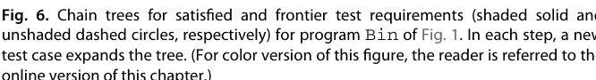

图 6 显示了随着三个不同测试用例的连续添加，该链树是如何增长的。第一个结果源于添加测试用例 $t_1$，它在 Bin 中遍历了 $((1, 2), (2, 5), (5, 8))$。属于该测试需求的节点被显示为阴影实心圆。对于依赖 $(1, 4)$ 和 $(5, 6)$，前沿节点显示为非阴影圆圈。这些依赖分别继随于变更 $C_1$ 和依赖 $(2, 5)$，我们的方法将它们识别为测试的下一个目标——任何被覆盖的链将以 $((1, 4)$ 或 $((1, 2), (2, 5, 6))$ 作为前缀。图 6 的中间和右侧显示了添加两个测试用例的结果。测试用例 $t_2$ 通过前沿节点 $(1, 4)$ 扩展了树，覆盖了链 $((1, 4), (4, 5), (5, 6))$。由于这条链包含了依赖 $(1, 4)$，$(1, 4)$ 不再是前沿节点。相反，节点 $(5, 8)$ 成为树中的前沿节点并继随 $(4, 5)$，$t_2$ 继续其它的其他后续节点——依赖 $(5, 6)$。然后，测试用例 $t_3$ 在 (1, 2) 和 (2, 5) 之后覆盖了依赖 (5, 6)。因此，在 $t_3$ 之后，节点 (5, 6) 不再在前沿节点。注意，如果我们使用 `PROP` 代替 `CHAIN`，每个节点还将被标记相应依赖的传播条件。

需求驱动的方法保留了基于传播的测试需求的精确性，同时避免了符号执行的代价，并避免了在 MATRIX 中花费的精力（MATRIX 执行全静态分析，可以找到大量的测试需求，但其中许多是无法满足的）。自然地，使用这种方法牺牲了立即获取描述整个未测试行为空间的需求的能力，而这种能力可能更好地支持测试用例的自动生成。然而，这种替代方法的优点证明了这种权衡是合理的，因为它可以显著增加 `CHAIN` 和 `PROP` 可及的距离。此外，这种需求驱动的方法消除了测试人员处理大量短距离需求的负担，而是让测试人员专注于更有可能被满足的、距离更远的需求。

## 7.2 MATRIX 的需求驱动方法

图 7 展示了用于基于传播的测试套件增强的需求驱动方法，由算法 `SATISFYREQDEMAND` 描述。输入是程序 $P$、变更 $C$、指示预算是否允许更多测试的布尔函数 $B$，以及待扩展的现有测试 $TS$。第一行通过将变更 $C$ 应用于 $P$ 来找到修改后的 $P'$。第 2 行和第 3 行找到所有从 $C$ 的子 CFG 中的节点开始、通过任何依赖序列可及的和数据依赖（参见定义 13 和 14）。第 4 行和第 5 行对两个程序进行插桩，以确定从变更节点开始覆盖的这些依赖的运行时，以及在运行时直接影响每个依赖的程序部分。对于控制依赖，影响状态简单地是依赖源节点的分支决策。对于数据依赖，影响状态是定义处赋值给变量的具体值。

该算法并不像 MATRIX 那样静态地枚举所有链。相反，算法仅当依赖开始于变更节点，或者其源节点的执行是与变更节点链接的依赖的运行时目标时，才对依赖的运行时覆盖情况进行插桩。每个插桩程序的结果是一个无环（依赖图）。

### 算法 `SATISFYREQSDEMAND`

输入：$P$:程序；$C$:变更；$B$:预算函数；$TS$:测试套件
输出：$TS$:测试套件；Satisfied：满足的需求

```


(1) `$p' := change(P, C)$`

(2) `$deps := forwardDepChains(P, C)$`

(3) `$deps' := forwardDepChains(P', C)$`

(4) `$P_{ins} := instrument(P, deps)$`

(5) `$P_{ins}' := instrument(P', deps')$`

(6) `$Satisfied := createEmpty(P_{ins}, U) \cup createEmpty(P_{ins}', C)$`

(7) `$totalEffect := 0$`

(8) while `$B(totalEffect, Satisfied, TS) = true$`

(9) `$(t, effectTest) := nextTest(TS, P_{ins}, P_{ins}', Satisfied)$`

(10) `$(data, effect') := execute(P_{ins}, t)$`

(11) `$(data', effect') := execute(P_{ins}', t)$`

(12) `$totalEffect := totalEffect + effectTest + effectEx + effectEx$`

(13) `$addTest := false$`

(14) foreach `$prefixChain \in Satisfied$`

(15) foreach `$dynDep \in dependencies(prefixChain, data')$`

(16) `$chain := append(prefixChain, dynDep)$`

(17) if `$chain \in Satisfied$`

(18) `$Satisfied := Satisfied \cup chain$`

(19) `$addTest := true$`

(20) endif

(21) if `$propagates(chain, data')$`

(22) mark `$chain \in Satisfied$` as propagated

(23) `$addTest := true$`

(24) endif

(25) endfor

(26) endif

(27) `$TS := TS \cup \{t\}$` if `$addTest$`

(28) endwhile

(29) return `$TS, Satisfied$`

# 演化软件的变更影响分析

这已在 `TS` 中。主循环前几次 `TS` 迭代的目的仅仅是为了在创建新测试用例之前，用 `Satisfied` 填充现有测试套件已满足的所有测试需求，并确定这些新测试用例是否应该添加到 `TS` 中。

## 7.3 综合研究

这种方法的需求驱动特性使得我们能够进行比对 `MATRIX` 更为全面的研究。在这项研究中，我们再次使用了 `DUA-FENICS` [80]，并考虑了具有大量测试用例的 Java 对象。这些测试用例池允许我们为每种研究的技术创建最多 1000 个测试套件。通过将来自 Siemens 套件 [34] 的若干对象翻译为 Java，并结合三个版本的 `NanoXML` [20]，我们总共研究了 62 处变更。有关此项研究的完整细节，请参考参考文献 [77, 78]。

对于每个变更，我们计算并衡量了每种策略——`STMT`、`BR`、`DU`、`CHAIN` 和 `PROP`——输出差异的检测能力。这为开发者提供了观察变更行为的视角。我们衡量测试套件质量的指标是测试套件的比例。因此，其可能的最值为 1.0。

为了支持对影响每种策略有效性因素的分析，我们将变更的可检测性定义为 `STMT` 在该变更上的差异检测率。变更的可检测性是覆盖该变更的测试用例也揭示输出差异的估计概率。变更的可检测性越低，测试用例发现该变更差异的可能性就越小，因此成功测试该变更的难度就越大。

表 5 显示了所有策略的平均检测率，`CHAIN` 和 `PROP` 的距离最高到 10。对于所有情况，后两种策略均达到了 10 或更短的距离。因此，距离 10 是我们为所有变更获取结果的最大距离。在此范围内，`DU` 每个测试用例的效率略高于 `BR`，而 `BR` 相比 `STMT` 并没有显著提高。平均而言，`CHAIN` 的成本效益始终高于这三种基于覆盖率的策略，尽管差异并不大。然而，在所有具有统计学意义的距离上，`PROP` 的表现均远优于所有其他策略（包括 `CHAIN`），且具有统计学显著性。有趣的是，`PROP` 在距离 4 处达到峰值并在某种程度上下降，这表明可以早实现测试用例的最佳分布。尽管如此，

**表 5** 每个变更测试策略发现的测试套件差异平均比例 (ds-ratio)。

| `STMT` | `BR` | `DU` | `CHAIN` | `PROP` | | | | | | | |
|---|---|---|---|---|---|---|---|---|---|---|---|
| | d1 | d2 | d3 | d4 | d5 | d6 | d7 | d8 | d9 | d10 |
| 0.32 | 0.35 | 0.38 | 0.38 | 0.40 | 0.40 | 0.41 | 0.41 | 0.40 | 0.40 | 0.40 |
| | d1 | d2 | d3 | d4 | d5 | d6 | d7 | d8 | d9 | d10 |
| 0.48 | 0.50 | 0.52 | 0.53 | 0.52 | 0.52 | 0.50 | 0.50 | 0.49 | 0.48 |

在距离 10 或更大处，随着测试套件规模的增加，可以发现更多的总差异。

另一个重要的考虑因素是相对于变更测试*难度*的测试有效性。表 6 显示了按 62 处变更子集的测试难度对我们的结果进行分类。该表按*可检测性限制*（在本节之前定义）的递减顺序显示了不同限制的数量。例如，所有 62 处变更的可检测性限制均为 1.0（即检测性最多为 1.0，即最大值），39 处变更的限制为 0.2（即检测性为 0.2 或低）。

表 6 中的后续列表示 `PROP`、`CHAIN`、`BR` 和 `DU` 相对于 `STMT` 在具有各可检测性限制的变更集上的成本效益。（对于 `PROP` 和 `CHAIN`，结果为 1 到 10 之间所有距离的平均值。）对于可检测性限制为 0.6 的变更子集，表格表明 *`PROP`* 每个测试发现发现差异的概率是 `STMT` 的 2.6 倍。请记住，`STMT` 对这些变更的检测概率小于或等于第一列中的值。

表中的数据表明，变更越难测试，所有技术的表现就越好。然而，`CHAIN` 尤其是所有策略中的 `PROP` 在检测困难变更的差异方面显示出比基于覆盖率的策略更优越越性，而这些可以说是最需要良好测试策略的变更。

总而言，`PROP` 产生了比其他策略质量更高的测试套件，因为它比替代方案更好地在变更的行为空间上舍弃和分布测试用例。同时，`CHAIN` 提供了一个效率较低但可能更简单的 *`PROP`* 替代方案。此外，这种

**表 6** 所有策略在每个可检测性限制下相对于 `STMT` 的差异检测增加。

| 可检测性限制 | 变更数量 | `BR` | `DU` | `CHAIN` (所有距离平均) | `PROP` (所有距离平均) |
|---|---|---|---|---|---|
| 1.0 | 62 | 0.0x | 0.1x | 0.2x | 0.6x |
| 0.8 | 48 | 0.4x | 0.4x | 1.0x | 2.0x |
| 0.6 | 46 | 0.5x | 0.5x | 1.3x | 2.6x |
| 0.4 | 43 | 1.0x | 0.7x | 2.0x | 3.8x |
| 0.2 | 39 | 1.0x | 0.8x | 2.6x | 5.2x |
| 0.1 | 30 | 1.9x | 1.1x | 5.0x | 11.3x |
| 0.05 | 22 | 4.9x | 2.8x | 8.9x | 16.3x |
| 0.03 | 18 | 6.1x | 2.8x | 10.9x | 21.3x |
| 0.01 | 9 | 5.4x | 6.8x | 16.2x | 34.7x |
| 0.005 | 7 | 8.0x | 12.6x | 23.7x | 51.0x |
| 0.003 | 4 | 0.1x | 1.7x | 3.6x | 74.0x |
| 0.001 | 1 | 0.0x | 0.0x | 0.0x | 334.0x |

## 8. 应用：定量变更影响分析

分析的一个大问题是假阳性（误报）或假阴性（遗漏）。程序切片 [90] 是一种流行但不精确的分析。静态切片通常报告许多相关语句，而以完整性换取精确性的动态切片则可能产生许多假阳性。

为了解决切片的局限性，我们在本节引入了定量切片（q-s片）[15, 76]，这是一种为切片中的语句分配数量（如得分或概率）的通用方法。

将切片量作为变更影响的实际且有效的近似值的益处很多，这可以进一步推动早期变更影响分析（即用户在设计变更之前评估更改位置的潜在影响）变得非常有效。正向切片还可以支持回归测试、可测试分析和信息流分析。与一般的程序分析一样，我们使用两种方法计算定量切片（q-slice）：静态和动态方法。每种技术都有其优点，并具有互补的潜力。第一种技术使用概率模型分析程序的静态结构 [76]。第二种技术对程序执行进行敏感性分析，动态衡量语句对其他语句修改的依赖程度 [15]。在本节中，我们重点介绍结合敏感性分析和执行动态方法，其结果令人鼓舞。

## 8.1 影响量化的示例

考虑图 8 中寻找圆间切线的代码片段。从第 2 行 `c` 的正向静态切片包含 2-11 行，这表明它们可能受到 `c` 的影响。然而，第 2 行的 `c` 强烈影响第 3 行的 `c*c`，但对该行的分支决策影响较小——变化

```
1: for (sign1 = +1; sign1 >= -1; sign1 -= 2) {
2:   c = (r1 - sign1 * r2) / d;
3:   if (c*c < 1.0) {
4:     h = sqrt(d*d - pow(r1-sign1*r2,2)) / d;
5:     for (sign2+=1; sign2=-1; sign2-=2) {
6:       nx = vx * c - sign2 * h * vy;
7:       ny = vy * c + sign2 * h * vx;
8:       print nx + r1 * ny;
9:       print y + r1 * ny;
10:      print x2 += sign1 * r2 * nx;
11:      print y2 + sign1 - r2 * ny;
     }
}}
```


**图 8.** 计算圆与之间切线的程序实验。

在`c`中可能会或翻翻转跳转的分支。因此，剩余行比第 2 和 3 行“影响较小”。然而，第 6–11 行也使用了`c`的值，这使得它们比第 4 和 5 行“影响更大”（但仍比第 2 和 3 行受影响小）。

- 切片量化了切片中行之间的差异。例如，q-切片技术可以给第 2 和 3 行给出 1.0 分，给第 4 和 5 行给出 0.5 分，给其余部分给出中间值 0.75。这些行的实际得分取决于用于量化切片的特定 q-切片技术。接下来我们介绍两种技术。

## 8.2 静态量化

程序切片的静态量化可以通过分析程序的控制流和数据流结构来实现 [76, 96]。这种方法的优点是不需要执行数据，且结果代表了程序的所有行为。后者的优势对于测试创建等任务非常有吸引，无论创建了多少测试用例，这种方法都能引导用户发现尚未测试的行为。

我们用于 q-切片的静态方法利用了两个见解：

1. 数据依赖发生的概率低于其他依赖，因为从依赖值的源到达目标需要满足条件。
2. 数据依赖更有可能通过控制依赖传播信息，但不应像某些现有工作那样忽略控制依赖。

利用第一个见解，我们创建了程序控制流的可达性和别名分析，用于估计依赖目标从其源点到达的概率，以及两点访问相同内存位置的概率。利用第二个见解，我们的方法执行了另一个可达性分析（这次是针对依赖图），为控制依赖给出一个较低但非零的分数。

我们通过计算两个部分来估计语句`a`影响语句`b`的概率：(1) 程序执行时出现从`a`到`b`的依赖序列的概率，(2) 信息通过该序列流动的概率。该方法的更多细节和早期良好的结果如现在 [76, 96] 中。

## 8.3 动态量化

给定一个代表性的测试套件，我们可以通过差异执行分析 [79] 和敏感性分析 [71] 来量化切片。

### 8.3.1 差异执行分析（DEA）

差异执行分析（DEA）专门设计用于基于变化的正向切片，以识别语句对变化的语义依赖 [55]。语义依赖告诉我们哪些语句真正受到哪些语句或变化的影响。尽管寻找依赖是一个不可判定的问题，但 DEA 能够在变化发生运行时检测到这些依赖，以低近似程序中语义依赖的集合。因此，DEA 不保证对测试套件具有 100% 的召回率，但比动态切片通常实现的结果好得多 [45, 79]。

DEA 的工作原理是在更改发生前后各执行程序，收集每次执行的增强执行历史 [79]，然后比较这两个历史。程序对于某个输入的执行历史是为该输入所执行的语句序列。增强执行历史是标注了每个语句执行时读取和写入值的执行历史。两个历史之间的差异揭示了哪些语句的出现或值被更改改变了——这就是语义依赖的条件。DEA 的正式定义给出 [79] 中。

### 8.3.2 敏感性分析

当变化已知时，可以使用 DEA 来量化静态正向——用于事后影响分析。为了实现这一点，基于 DEA 的 q-切片技术可以针对许多输入重复执行带变化和不带变化的程序，并找到每个语句代表程序变化的频率。如果输入充分代表程序的行为，我们可以使用这些频率作为 q-切片中语句的量化指标。

更通俗地说，当用户询问修改语句的影响或切片任务不涉及变化时，变化的细节可能未知（例如调试、信息流分析）。对于这些情况，我们生成了 SEnSA^17 敏感性分析技术和工具，用于切片量化和其他应用。敏感性用于许多领域，以确定对系统某些方面的修改（例如输入）如何影响系统的其他方面（例如输出） [71]。

## 演化软件的变更影响分析

通过增加访问深度。对于排名中并列的语句，我们使用它们在排名中的平均位置作为它们的排名。

为了评估并比较通过 SenSA 和 Weiser 方法进行 q-切片所给出的排名的预测能力，我们将每个更改逐一应用到其主体的相应位置。然后，对于每个更改，我们对未更改和已更改的主体分别运行 DEA（变更影响分析），以在运行该主体的所有测试用例时找到实际受影响的语句。利用这些实际影响，我们计算了每个排名预测这些影响的紧密程度。对于每个排名以及 DEA 发现的每个受影响语句，我们确定了按照排名顺序到达该语句时需要遍历的切片百分比。我们将此百分比定义为使用排名找到实际受影响语句的**成本**。然后，我们计算了每个排名找到所有实际影响的平均成本——成本越低，说明产生该排名的技术预测影响的能力越强。

此外，为了评估结果排名的优劣程度，我们通过将实际受影响的语句放在理想排名的顶部，创建了理想排名。

## 8.3.6 结果与分析

表 7 展示了每个主体及其内部七种更改的五种排名的平均成本：理想排名、切片排名（Weiser 遍历）以及 SenSA 及其三种策略的排名：rnd（随机）、inc（增量）和 obs（观测）。对于 NanoXML 和 XML-security 中的某些更改，SenSA-obs 并不适用，因为在运行时仅在更改处观察到了一个值，且 SenSA 无法找到不同的值来替换它。因此，我们省略了这些主体的 SenSA-obs 结果。

> RQ1：表 7 中 Schedule1 的理想成本显示，平均而言，切片中超过三分之一的语句实际上受到了影响；相比之下，另外两个主体的切片之间（切片间）受影响的语句比例小于 10%。对于 Weiser 的切片，预测成本范围在 25–45% 之间，而 SenSA 的预测结果在 10–38% 之间，明显接近理想预测。在适用情况下，所有 SenSA 策略均表现出相似的成本。总而言之，用于 q-切片的 SenSA 在预测实际影响方面似乎比简单的程序切片（Weiser 遍历）好得多。

> RQ2：由于切片可能很大，如果用户无法探索整个切片，我们预计他们将从顶部开始检查每个排名的切片。图 9 和图 10 针对 NanoXML 和 XML-security（两个最大的主体）展示了在主体内所有更改的平均情况下，每个检查排名切片百分比（X 轴）下所找到的实际影响百分比（Y 轴）。

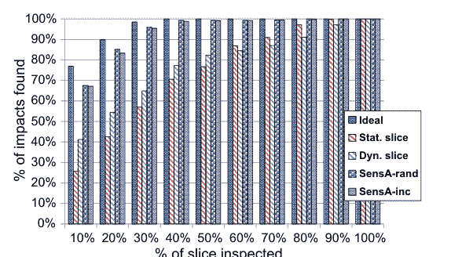

**图 9.** NanoXML 在不同检查工作下的技术预测有效性。（如需此图彩色版本，请参阅本章节的在线版本。）

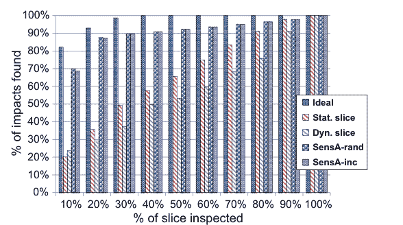

**图 10.** XML-security 在不同检查工作下的技术预测有效性。（如需此图彩色版本，请参阅本章节的在线版本。）

例如，在 NanoXML 遍历的 10% 时，理想排名平均找到了 77% 的实际影响，而切片预测仅找到了 25–41%。相比之下，SenSA 的预测找到了 67–68% 的影响。这些结果表明，SenSA 不仅在整体上更好（RQ1），而且对于排名中工具将进行检查实验的部分特别优异。

- RQ3：我们在一台具有 8GB 内存的 64 位 Linux 的 Intel Core i5 四核机器上运行了实验。SenSA 处理主体中所有更改的平均时间在 303 到 493 秒之间。执行插桩主体测试套件的运行时开销在 32–63% 之间。我们认为这些是可以接受的。我们的实现仍有很大的优化空间。

## 9. 结论

表 7 q-切片的变更影响预测结果。

| 主体 | 理想 (%) | 切片 (%) | SenSA-rnd (%) | SenSA-inc (%) | SenSA-obs (%) |
|---|---:|---:|---:|---:|---:|
| Schedule 1 | 37.1 | 45.2 | 38.4 | 38.3 | 38.4 |
| NanoXML | 7.8 | 24.6 | 9.9 | 10.7 | — |
| XML-security | 5.7 | 35.8 | 12.0 | 12.5 | — |

在本章中，我们解决了变更影响分析的挑战，通过一种原则且注重成本的方法使其有效性最大化。在基础层，本章通过精确定义什么是变更、变更对程序的影响以及它们如何相互影响，为变更影响分析提供了理论基础。在应用层面，我们展示了多种通过识别需求影响集来提供可用近似的技术。测试应用的结果表明，基于传播的测试需求比文献早期基于受影响实体的测试方法有效得多。

变更的影响也可以量化为代码行的影响程度。由此产生的技术——定量切片有望提高切片的实用性。q-切片并不是从切片中删除语句，而是根据相关性对语句进行评分。在本章中，我们讨论了 q-切片的方法，包括一种计算相关性评分的新颖动态技术。更多的技术可以纳入 q-切片的伞下。q-切片是一个新兴、丰富且开放的领域。

## 10. 未来方向

另一个重要的未来研究方向是自动化创建测试数据，以满足针对变更的传播测试需求。尽管测试数据生成领域近期取得了进展，但针对性测试数据生成（即为到达程序中的特定点而生成输入）的问题远未解决。此外，基于传播的变更测试不仅需要执行变更，还需要满足感染条件（infection conditions）和传播条件（propagation conditions）。因此，目前对于变更影响的测试数据生成能否自动化到令人满意的水平尚不清楚，尽管该领域目前的不成熟状态表明可以实现更大程度的自动化。总之，为变更测试创建测试数据是该研究方向的自然后续步骤，旨在改进我们在案例研究中使用的手动方法。目前，大量开发者的参与限制了我们研究变更测试技术的能力。

我们对 q-切片（q-slicing）的即刻计划是将研究扩展到更多对象以及不同类型和规模的变更，以进一步推广我们的结果，并表征使用 q-切片的最佳和最差条件。我们正在开发一种量化切片的可视化，以增强对该方法的理解、开展用户研究并支持其他研究人员。通过该工具，我们将研究开发者在实践中如何利用量化切片。在稍远远的未来，我们预见到将 q-切片应用于调试、理解、变异和交互测试以及信息分析。此外，根据我们的基础理论，q-切片的评分是对状态影响的抽象，这些评分可以在框架内首先扩展为多维值或数据结构，然后为了可扩展性简化为离散集合。

## 参考文献

- [1] Hiralal Agrawal, Joseph R. Horgan, Dynamic program slicing, in: Proceedings of ACM Conference on Programming Language Design and Implementation, June 1990, pp. 246–256.
- [2] Ahmed V. Ao, Monica Lam, Ravi Sethi, Jeffrey D. Ullman, Compilers: Principles: Techniques and Tools, Prentice Hall, September 2006, pp. 229, 231, 233.
- [3] Ahmed V. Ao, Ravi Sethi, Jeffrey D. Ullman, Compilers: Principles, Techniques and Tools,.-W., 1986.
- [4] Giul Antonio, Vincenzo Fabio Rolle, and Gabriele Venturi, Detecting groups of co-changing files in CVS repositories, in: Proceedings of International Workshop on Principles of Software, Evolution, September 2005, pp. 23–32.
- [5] Taweesup Apiwatananpong, Alessandro Orso, Mary Jean Harrold, Efficient and precise dynamic impact analysis using execute-after sequences, in: Proceedings of IEEE/ACM International Conference on Software Engineering, May 2005, pp. 432–441.
- [6] Tawees Apiwatananpong, Raul Santelices, Pavan Kumar Chittimalli, Alessandro Orso, Mary Jean Harrold, Matrix: matrix-oriented testing requirement identifier and examiner, in: Proceedings of Testing and Academic Industrial Conference Practice and Research, Techniques, August 2006, pp. 137–146.
- [7] Robert S. Arnold, Shawn A. Bohner, Impact analysis – towards a framework for comparison, in: Proceedings of IEEE Conference on Software Maintenance, September 1993, pp. 292–301.
- [8] Boris Beizer, Software Testing Techniques, 2nd ed., International Houston Computer Press, 1990.
- [9] Keith B. Bennett, Vladislav T Rajlich, Software maintenance and evolution: a roadmap, Proceedings of Conference on the Software Engineering, ICSE 2000 (May 2000) 73–87.
- [10] Dave Binkley, Sebastian Danicic, Toby Gyimothy, Mark Harman, Aks Kiss, and Lane Querba, Formalizing executable dynamic and forward slicing, in: Proceedings of Source Code Analysis and Manipulation, Fourth IEEE International Workshop, September 2004, pp. 43–52.
- [11] Dave Binkley, Semantic guilty regression test control, IEEE Transactions on Software Engineering 23 (8) (1997) 498–516.
- [12] Dave Binkley, Shawn Horwitz, Thomas Reps, Program integration for languages with calls, ACM Transactions on Software Engineering and Methodology 4 (1) (1995) 3–35.
- [13] Shawn A. Bohner, Robert S. Arnold, An introduction to software change impact analysis, in: Robert S. Bohner, Robert S. Arnold (Ed.), Software Change Impact, IEEE Computer Society Press, 1996, pp. 1–26.
- [14] Lionel C. French, Julien Weucht, Haiku Loomin, Coupling measurement for impact analysis, in: Proceedings of IEEE International Conference on Software Maintenance, August 1999, pp. 475–482.
- [15] Haifeng Cai, Jian Xiang Yjie, Yiyi Zhang, Raul Santelices, Sens-Sensitive Analysis for Quantitative Change-Impact, Technical Report TSR 2013-04, CSE, U. of North Data, March 2013, pp. 1.
- [16] Yih-Farn Chen, David S. Rosenblum, Kim-Phong Vo, Testsub: a selection for regression testing, in: Proceedings of IEEE/ACM International Conference on Software Engineering, March 1994, pp. 211–220.
- [17] Lori A. Clarke, A system to generate test data and symbolically execute programs, IEEE Transactions on Software Engineering 2 (3) (1976) 215–222.
- [18] A. De Lucia, F. Rasano, R. Olivite, Traceability for impact analysis, in: Frontiers of Software Maintenance at ICM, 2008.
- [19] Richard A. DeMillo, Richard J. Lipton, Frederick G. Sayward, Hints on test selection: for the programming language, Computer 11 (4) 34–41.
- [20] Hyunseook Do, Sebastian Elbaum, Grady Rothermel, Supporting experimentation with testing techniques: an infrastructure and its potential impact, Empirical Software Engineering 10 (4) (2005) 405–435.
- [21] Jeanne Ferrante, Karl J. Ottenstein, David D. Warren, The program dependence graph and optimization, ACM Transactions on Program Languages and Systems 9 (3) (1987) 319–399.
- [22] Phyllis G. Frankl, Elaine Weyuker, An applicable family of data flow criteria, IEEE Transactions on Software Engineering 14 (10) (1988) 1483–1498.
- [23] Keith Gallagher, James R. Lyle, Using program slicing in software maintenance, IEEE Transactions on Software Engineering 17 (8) (1991) 751–761.
- [24] Malcolm Gethers, Bogdan Dit, Denys Poshyank, Integrated impact analysis for managing changes, in: Proceedings of IEEE/ACM International Conference on Software Engineering, May 2012, pp. 430–440.
- [25] Rajiv Gupta, Mary Jean Harrold, An approach to regression testing using slicing, in: Proceedings of Software Maintenance, November 1992, pp. 299–308.
- [26] R. G. Hamlet, Testing programs with the aid of a compiler, IEEE Transactions Software Engineering 3 (4) (1977) 279–290.
- [27] M. J. Harrold, Rajiv Gupta, Mary Lou Soffa, Methodology for controlling the size of a test suite, ACM Transactions on Software Engineering and Methodology 2 (3) (1993) 270–285.
- [28] Mary Jean Harrold, James A. Jones, Liang Donglin, Alessandro Orso, Mikael Pennagath, Ashish Ghosh, Regression selection for Java software, in: Proceedings of ACM Conference on Object-Oriented Programming, Systems, and Applications (OOPSLA 2001), Tampa Bay, FL, November 2001, pp. 312–326.
- [29] M. J. Harrold, G. Rothermel, K. Sayre, L. Yi, An empirical investigation of the relationship between spectra distributions and regression faults, Journal of Software Testing, Verification 10 (3) (2000) 171–194.
- [30] S. Horwitz, T. Reps, Interprocedural slicing using dependence graphs, in: Proceedings of ACM SIGPLAN Conference on Programming Language Design and Implementation, June 1988, pp. 35–46.
- [31] Susan Horwitz, Thomas Reps, David Binkley, Interprocedural slicing using dependence graphs, ACM Transactions on Graphics and Systems 12 (1) (1990) 26–60.
- [32] William E. Howden, Tutorial software testing and validation techniques, IEEE Computer, 1978.
- [33] J. C. Huang, An approach to program testing, ACM Computing 7 (3) (1975) 113–128.
- [34] Natasha Hutchins, Herb Foster, Tarak Goradia, Thomas Ostrand, The effectiveness of dataflow and control-based testing criteria, in: Proceedings of IEEE/ACM International Conference on Software Engineering, 1994, pp. 191–200.
- [35] James C. King, Symbolic execution and program testing, Communications of the ACM 19 (7) (1976) 385–394.
- [36] Bogdan Korel, Ali M. Al-Yami, Automated regression test generation, in: Proceedings of International Symposium on Software Testing and Analysis, March 1998, pp. 143–152.
- [37] Jens Krinke, The effect of context on program slicing, Journal of Systems and Software 79 9 (2006) 1249–1260.
- [38] David Cheng Jung, Jerry Gao, Pei Hsia, Leroy Lin, Yasufumi Toyoshima, Class Firewall, Test Order, and Regression Testing of Object-Oriented Programs, Journal of Object-Oriented Programming 8 (2) (1995) 51–65.
- [39] J. W. Laski, B. Korel, A flow oriented program testing strategy, IEEE Transactions on Software Engineering 19 (3) (1983) 347–354.
- [40] James Law, Greg Rothermel, Program path-based dynamic impact analysis, in: Proceedings of IEEE/ACM International Conference on Software Engineering, May 2000, pp. 308–315.
- [41] Stefan Lehnert, A Review of Software Change Impact Analysis, Technical Report, University of Technology, Department of Software Systems/Process Informatics, December 2011.
- [42] Hareton K. N. Lee, Lee J. White, Insights into regression testing, in: Proceedings of IEEE on Software Maintenance, October 1989, pp. 60–69.
- [43] 李立鑫（Bixin Li），孙晓斌, Hareton Leung, Sai Zhang. 基于代码的变更影响分析技术综述，《Journal of Software Testing, Verification and Reliability》28 (8) (2013) 613–646.
- [44] Li Li, A. Jefferson Offutt. 面向对象软件变更影响的算法分析；见 IEEE International Conference on Software Maintenance 会议, 1996年11月, pp. 171–184.
- [45] Wasmin Masri, And Podgkowski. 测量程序中信息流的强度，《ACM Transactions on Software Engineering and Methodology》19 (2) (2009) 1–33.
- [46] Tom Mens. 软件工程的最新进展综述，《IEEE Transactions on Software Engineering》28 (5) (2002) 449–462.
- [47] Larry Morell. 基于故障的测试理论，《IEEE Transactions on Software Engineering》16 (8) (1990) 844–857.
- [48] Glen J. Myers. 《软件测试艺术》，第二版，Wiley, 2004.
- [49] Alessandro Orso, Taweesup Apiwattanapong, Jean Harrold. 利用字段进行影响分析和回归测试；见第 9 次欧洲软件工程会议和第 10 次 ACM SIGSOFT 软件工程基础研讨会，芬兰赫尔辛基，2003 年 9 月，pp. 128–137.
- [50] Alessandro Orso, Taweesup Apiwattanapong, Jean Harrold, James Law, Gregg Rothermel, Mary Jean Harrold. 动态影响分析算法的实证比较；见第 26 次 IEEE 和 ACM SIGSOFT 软件工程国际会议（ICSE），苏格兰爱丁堡，2004 年 5 月，pp. 491–500.
- [51] Alessandro Orso, 石南涓（Nanjuan Shi）, Mary Harrold. 将回归测试扩展到大型软件系统；见第 12 次 ACM SIGSOFT 软件工程基础研讨会（FSE 2004）, 2004 年 11 月，pp. 241–252.
- [52] Suzanne Person, Matthew B. Dwyer, Sebastian Elbaum, Carlos Păsăreanu. 差异执行；见第 8 次 ACM 软件工程基础研讨会，2006 年 11 月，pp. 226–237.
- [53] Suzette Person, 郭卫阳（Guwei-Yang）, Neha, Sarfraz Khurshid. 定向增量符号执行；见 ACM 编程语言设计与实现会议，2011 年 6 月，pp. 504–515.
- [54] Maksym Petrenko, Václav Rajlich. 提高影响分析精度的变量粒度；见 IEEE International Conference on Program Comprehension, 2009, pp. 10–19.
- [55] Andy Podgurski, Lori A. Clarke. 程序依赖关系的正式模型及其对软件测试、调试和维护的影响，《IEEE Transactions on Software Engineering》16 (9) (1990) 965–979.
- [56] Denys Poshyank, Andrei Roychoudhury, Marcus R. Ferenc, Tibor Gyimóthy. 使用信息检索耦合度量进行影响分析，《Empirical Software Engineering》14 (1) (2009) 5–32.
- [57] 大伟（Dawei Qi）, Attiq Roshary. 处理演化程序变更的测试生成；见 IEEE/ACM International Conference on Automated Software Engineering, 2010 年 9 月，pp. 397–406.
- [58] Václav Rajlich. 一种图重写的代码分析模型；见 IEEE International Conference on Software Maintenance, 1997 年 9 月，pp. 84–91.
- [59] Václav Rajlich. MSE：一种软件演化的方法论，《Journal of Software Maintenance: Research and Practice》9 (2) (1997) 103–124.
- [60] Václav Rajlich. 《软件工程：现状》，Hall/CRC, 2011 年 11 月.
- [61] Murali Krishna Ramanathan, Ananth Grama, Suresh Jagannathan. Sieve：一种自动检测程序版本间变动的工具，见 IEEE/ACM International Conference on Automated Software Engineering, 2006 年 9 月，pp. 241–252.
- [62] S. Raps, E. J. Weyuker. 使用数据流信息选择软件测试，《IEEE Transactions on Software Engineering》11 (4) (1985) 367–375.
- [63] 任晓晓（Xiaoxia Ren）, 冯帅（Fen Shail）, 方铁（Fang Tip）, Barbara G. Ryder, Ophelia Chesley. Chianti：一种 Java 程序影响分析工具；见 ACM 对象面向、系统、语言和应用会议, 2004 年 10 月，pp. 332–340.
- [64] Thomas Reps, Susan Horwitz, Moritz Sagiv. 通过图可达性进行精确数据分析；见 ACM SIGPLAN 语言原理研讨会，1995 年 1 月，pp. 49–61.
- [65] D. Richardson and M. C. Thompson. REL 错误检测方法及其应用；见测试、分析和验证工作坊，1988 年 7 月，pp. 223–230.
- [66] Debra J. Richardson, Margaret C. Thompson. 使用 REL 故障检测模型的测试选择准则，《IEEE Software Engineering》19 (6) (1993) 533–556.
- [67] G. Rothermel, M. J. Harrold. 分析回归测试技术，22 (8) (1999) 529–551.
- [68] G. Rothermel, R. H. Hunt. 测试用例排序，《IEEE Transactions on Software Engineering》27 (10) (2001) 929–948.
- [69] G. Rothermel. 选择修改软件的测试，见 ACM 测试会议，2004 年 8 月，pp. 169–188.
- [70] Rothermel. 一种安全的测试方法，《ACM Transactions on Software Engineering》6 (2) (1997) 173–210.
- [71] S. Raps. 敏感性分析, Wiley, 2009.
- [72] Saltelli. 针对演化软件的变更效应分析，佐治亚大学, 2012.
- [73] Kumar. 软件的测试用例增强，见 IEEE/ACM International Conference on Software Engineering, 2008 年 9 月，pp. 218–227.
- [74] IEEE. 细粒度数据流覆盖率，见 IEEE International Conference on Software Engineering, 2007, pp. 343–352.
- [75] IEEE. 可扩展的符号执行，见 ACM 测试 Symposium, 2010 年 7 月，pp. 195–206.
- [76] 技术报告, 2010.
- [77] Rothermel. 基于传播的变更测试方法，见 IEEE International Conference on Software Engineering, 2011, pp. 1–20.
- [78] Alessandro Orso. 演化软件的测试，《Journal of Software Testing》23 (6) (2013) 499–528.
- [79] Alessandro Orso. 软件变动的动态检测，见 IEEE International Conference on Software Engineering, 2010 年 9 月，pp. 429–438.
- [80] IEEE. 基于相关性的细粒度切片，见 ACM Testing Symposium, 2011, pp. 11–22.
- [81] IEEE. 基于集合最小化的测试测试排序，见 IEEE/ACM International Conference on Software Engineering, 2013, pp. 1269–1277.
- [82] Václav Rajlich. 动态切片，见 IEEE International Conference on Software Engineering, 2008, pp. 268–277.
- [83] ACM. 过程依赖，《ACM Transactions on Software Engineering and Methodology》10 (2) (2001) 209–254.
- [84] ACM. 基于环境的程序切片，见 ACM 编程语言设计与实现会议，2007, pp. 112–122.
- [85] ACM. 测试用例优先级排序，见 ACM Testing Symposium, 2002, pp. 97–106.
- [86] IEEE. 引导路径探索测试生成，见 International Symposium on Testing and Analysis, 2011 年 7 月，pp. 1–11.
- [87] IEEE. 故障检测的信息流模型，见 International Symposium on Testing and Analysis, 1993 年 7 月，pp. 182–192.
- [88] IEEE. 基于故障的动态技术，《IEEE Software Engineering》18 (8) (1992) 717–727.
- [89] Wiley. 工程师与科学家的概率与统计学, 2011.
- [90] Mark Weiser. 程序切片，《IEEE Transactions on Software Engineering》10 (4) (1984) 352–357.
- [91] Elaine Y. Ycker. 故障预测的建模方法有效性比较，《Empirical Software Engineering》15 (3) (2010) 277–295.
- [92] W. E. Wang. 集合最小化对故障检测效率的影响，见 IEEE/ACM International Conference on Software Engineering, 1995 年 4 月，pp. 41–50.
- [93] Tao Xie. 检查黑盒：通过值谱进行回归测试，《IEEE Transactions on Software Engineering》31 (10) (2005) 869–883.
- [94] Zhang. 基于软件信息的故障产生代码编辑定位，见 IEEE International Conference on Software Maintenance, 2011 年 9 月，pp. 23–32.
- [95] Zhang. 基于置信度的动态切片剪枝，见 ACM 编程语言设计与实现会议，2006 年 6 月，pp. 169–180.
- [96] Yiji Zhang 和 Raul Sanchez, 为切片优先级排序预测数据依赖，发表于 IEEE 国际程序调试工作会议会议, 2012 年 11 月，pp. 177–182. <http://ieexplore.ieee.org/xpls/abs_all?number=6405438>.
- [97] Thomas Zimmermann, Andreas Zeller, Peter Weissger, Stephan Diehl, 挖掘历史引导软件变更, IEEE Transactions on Software Engineering 31 (6) (2005) 429–445.

## 作者简介

Raul Santelices 是美国圣母利亚大学计算机科学与工程系的助理教授。过去，他曾在教育类和视频游戏类初创企业中担任软件架构师。他的学术兴趣是广义的软件工程，以及软件测试、调试和演化中软件测试的程序分析。他曾于 2008 年 IEEE/ACM 自动化软件工程国际会议上获得最佳论文奖和 ACM SIGSOFT 特别论文奖。他的工作部分由美国海军研究办公室资助。

Yiji Zhang 是美国圣母利亚大学计算机科学专业的博士生。她的研究兴趣是软件工程，特别是用于程序切片和故障定位的程序行为概率模型。她在中国浙江大学获得了软件工程学士学位。

Haipeng Cai 是美国圣母利亚大学计算机科学专业的博士生。他在之前的研究生阶段从事过计算机图形和可视化工作，并在互联网搜索服务和嵌入式系统中担任过软件人员。他目前的研究兴趣是侧重于程序分析的软件工程。他在密西西比南方大学获得了计算机科学硕士学位。

Siyuan Jian 是美国圣母利亚大学计算机科学专业的博士生。她的研究兴趣是软件工程，特别是动态切片、变更影响量化和动态符号执行。她分别在中国华东师范大学和同济大学获得了软件工程硕士和学士学位。

## 作者索引

### A

- Adl-Tabatabay, Ali-Reza, 68–99
- Agakov, Felix, 68
- Aghdasi, M., 197
- Agrawal, Hiralal, 236
- Agreiter, B., 125, 128
- Aho, Alfred V., 229, 231, 233
- Aho, P., 190
- Akbari, M. K., 190–191
- Albed, W., 116
- Alagar, V., 190
- Alam, M., 125, 128
- Albadvi, A., 197
- Alexander, R. T., 6, 12, 14
- Alshawan, N., 27, 32–35
- Al-Yami, M., 229, 240
- Amalitano, D., 43
- Amaral, V., 107
- Amini, P., 23
- Ammar-Boudjelal, F., 190
- Ammons, Glenn, 68
- Amrani, M., 107
- Amundson, D. N., 190
- Anderson, Jennifer M., 68
- Andreou, A. S., 190
- Arews, A. A., 6, 12, 14
- Ang, B. W., 156–6
- Antoniol, G., 7–9, 11–240
- Apiwatannong, Taweesup, 229–230, 239–240, 242–255, 257, 260
- Araujo, J., 112
- ARM, 89–90
- Armando, A., 115, 141
- Arnold, Matthew, 58
- Arnold, Robert S., 229
- Artzi, S., 14, 18, 26
- Astapchuk, Alexander, 68–69
- Atkinson, C., 112
- ATLAS, 106
- Ayyagari, R., 54
- Azimi, Reza, 68
- Azuma, M., 190

### B

- Balcer, M. J., 18
- Ball, Thomas, 68
- Bana e Costa, C. A., 207, 219
- Biannasch, E., 111
- Barais, O., 112
- Barbara, G. Ryder, 58
- Barnes, Ronald D., 68
- Barrett, B. E., 201
- Barroca, C., 107
- Baron, F. H., 221
- Bittmann, P., 121
- Basili, V. R., 155, 158, 180
- Basin, D., 113, 115, 121–124, 141–142
- Bast, W., 108
- Baudry, M., 111
- Becker, C., 190, 194, 215
- Behkamal, M., 190–191
- Bezhadian, M.
- Beizer, B., 19
- Beizer, Boris, 229, 240
- Belaunde, M., 106
- Bell, Robert M., 240
- Bellettini, C., 27–29
- Belton, V., 161–62
- Bennett, Keith H., 229
- Berc, Lance M., 68
- Bery, M., 197
- Besnard, H., 106
- Best, B., 118, 121
- Bezivin, J., 104
- Bieman, J. M., 111
- Binkley, D., 235, 240, 242
- Binkley, David, 225–230, 235
- Blochini, J., 169
- Bleier, T., 13
- Blim, M.-J., 190
- Bobrovsky, Konstantin, 68–69
- Bodik, R., 54, 57
- Bodin, L. D., 197
- Bogh, J., 190
- Bohner, Shawn A., 229, 239
- Bichout, Y., 115, 141
- Boloix, G., 190
- Bonilla, Edwin, 68
- Borek, M., 131–136
- Borguer, E., 134
- Bosschere, Koen, 68
- Botafogo, R., 28
- Braga, C., 124
- Brans, J–P., 197, 219
- Brereton, P., 125, 128
- Breu, R., 125, 128
- Briand, L. C., 180, 193, 229–240
- Bron, Arkady, 81
- Browne, S., 64–65, 74
- Budgen, D., 14
- Bunch, C., 14
- Butler, C. W., 22
- Büttner, F., 107
- Buayta, Dries, 68
- Büyükkan, G., 197

### C

- Cabot, J., 107
- Cai, Haipeng, 240, 260, 267, 269–270, 274
- Calder, Brad, 68
- Caldiera, G., 155, 158, 169
- Callaghan, M. D., 58
- Cargille, J. M., 58
- Casazza, G., 6, 9, 11
- Casaval, Calin, 68
- Cavazos, John, 68
- Chan, E. W. C., 190
- Chan, K., 272–273
- Chang, C.–W., 219
- Chang, C.–W., 190–193
- Chang, P.–T., 219
- Charnes, A., 215
- Charters, S., 169, 186
- Chays, D., 22
- Chen, C.–B., 190–193
- Chen, C.–T., 219
- Chen, D., 56, 67–69
- Chen, Dong–Yuan, 68
- Chen, Howard, 68
- Chen, W., 56–69
- Chen, Yih-Farn, 229, 241
- Chevalier, Y., 115, 141
- Chilakamkar, K–R., 18
- Childers, B. R., 54, 58, 82
- Chittamni, P. Kumar, 230, 240, 224, 255–257, 260
- Chrysos, George, 68
- Chu, C., 229, 241
- Clarke, Lori A., 234, 236, 248, 272
- Clarke, S., 111
- Clause, J. A., 54, 58, 82
- Clavel, M., 113, 121–122, 142
- Cohn, R., 54, 58, 82
- Combale, B., 107–108
- Compagna, L., 115, 141
- Conallen, J., 7
- Connors, Daniel A., 68, 93
- Conradi, R., 180
- Conte, Thomas M., 68
- Cooper, W. W., 215
- Cordy, J., 107
- Cornett, S., 51, 82
- Coyne, E., 121
- Cutten, T., 112
- Crégut, X., 108
- Crosby, P., 157
- Cuellar, J., 115, 141
- Cutache, Ioasana, 68–69
- Cysneiros, L., 190

### D

- Danicic, Sebastian, 235, 240
- Davidson, J., 56
- de Alfaro, L., 14
- de Carlini, U., 6, 9, 11, 20
- de La Lara, J., 107, 239
- De Lucia, A., 239
- Dean, D., 110
- Dean, Jeffrey, 68
- Decker, B. D., 140
- Dedhia, J., 229, 240
- DeMillo, Richard A., 238
- Deng, Y., 4, 22
- Designs, Semantic, 57
- Devaud, J., 207
- Dey, T., 56
- Dhyani, D., 28
- Di Lucca, G., 6, 9, 11, 18, 20
- Di Penta, M., 7, 9, 12
- Dig, D., 14, 18, 26
- Dingel, J., 107
- Dit, Bogdan, 240
- Dodgson, J., 161
- Do, Hyunsook, 267, 274
- Doser, J., 113, 121, 124
- Drielsma, P. H., 141
- Duesterwald, Evelyn, 68
- Dull, S. D., 190
- Dupe, G., 106
- Dwarkadas, Sandhya, 68
- Dwyer, Matthew B., 240

### E

- Eaton, C., 6
- Eeckhout, Lieven, 68
- Eekelen, M., 190
- Egea, M., 107, 131, 122, 142
- Ehrott, M., 161, 195, 200, 206, 219
- Ehrig, H., 106
- Ehrig, K., 106
- Elbaum, S., 18, 24–25, 42, 240, 267, 274
- Elkhary, A. M., 112
- Elrad, T., 112
- Ensemble, D. W., 18, 21
- Erian, S., 55, 59, 64, 78
- Eranian, Stephane, 69
- Ernst, M. D., 14, 18, 26
- Emette, T., 14
- Evesti, A., 190

### F

- Falatooni, E., 197
- Faralli, E., 6, 9, 11, 18, 20
- Farchi, Eitan, 181
- Sasano, E., 239
- Fasolino, A., 43
- Fasolino, A. R., 6, 9, 11, 18, 20
- Feinstein, H., 121
- Fenanson, J., 64
- Fenton, N. E., 162
- Ferenc, Rudolf, 240
- Fernández-Medina, E., 129
- Ferrante, Jeanne, 223–234
- Figueira, J. R., 161, 195, 200, 206, 219
- Fink, Stephen, 269
- Fisher, II, M., 18
- Fisher, M., 18, 24–25, 42
- Fleurey, F., 106, 111, 112
- Foster, Herb, 267
- France, R., 111
- France, R. B., 111
- Frankl, P., 4, 22
- Frankl, Phyllis G., 240–241
- Gori, 68

### G

- Gallagher, Keith Brian, 229
- Gerry, Jay, 240
- Gao, S., 141
- Garcia-Molina, H., 18, 21
- Garcia-Molina, J., 129–131, 139
- Gethers, Malcolm, 240
- Ghafo, A., 115
- Ghemawat, Sanjay, 68
- Ghosdi, R., 197
- Gilla, A., 190

### K

- Kacker, R., 11, 15
- Kaczmarek, Eric, 68–69
- Kagdi, Huzefa, 240
- Kahani, M., 190–191
- Kan, S. H., 190
- Kao, David, 81
- Kapthamer, Gregory M., 91
- Kappel, G., 107
- Karavanic, K. L., 58
- Karre, S., 18, 24–25, 42
- Kasal, K., 118, 141
- Kazazemdeh, R. B., 197
- Keeney, R. L., 159
- Keisler, J., 156
- Kent, S., 110
- Khalil, M., 169
- Khurshid, Sarfraz, 239–240
- Khwaja, A., 114
- Kczales, G., 111
- Kienz, J., 112, 116
- Kiezun, A., 14, 18, 26
- Kishma, Luh., 68
- Kim, Miryung, 239
- King, J. C., 26
- King, James C., 236
- Akos, 235, 240
- Kitchenham, B., 169, 186, 190
- Kitchenham, B. A., 169
- Klabbers, M., 190
- Kläs, M., 155, 158–159
- Klauser, S., 54, 82
- Klein, J., 112, 114–116, 118–141
- Klegpe, A., 108
- Kontio, J., 190
- Kopczy’ska, S., 169
- Kore, B., 229, 240–241
- Koskela, M., 155
- Koster, Ken, 81
- Kouchnarenko, O., 115, 141
- Kozacynski, W., 106
- Kramer, M., 114–116, 118–139
- Kramer, M. E., 112
- Krinke, Jens., 255
- Kristen, R. Walcott, 62, 69, 91, 94
- Kuhn, R., 11, 15
- Kunchithapadam, K., 58
- Kung, David Chenho, 229, 240
- Kusel, A., 107

### L

- Lafaye, J. Y., 190
- Lam, Monica, 229
- Lamping, J., 111
- Lang, U., 113
- Lange, O., 190, 193
- Larabel, M., 90
- Larus, James R., 68
- Laski, J. W., 241
- Lattner, Chris Arthur, 80
- Lau, Jeremy, 68
- Luras, M., 197
- Law, James B., 229
- Law, James, 229, 239
- Lawrence, J., 11, 15
- Layouni, M., 140
- Le-Tron, Y., 107, 116, 118, 139–141
- Lee, Y., 57
- Lehnert, Steffen, 239
- Lei, Y., 11, 15
- Leman, Z., 197
- Lemselik, S., 41
- Leung, Hareton K. N., 229, 239–240
- Leung, Shun-Tak A., 68
- Levin, Roy, 68
- Levon, J., 60, 74, 89
- Li, Bixin, 239
- Li, J., 57
- Li, Lee, 229
- Li, Tongiyu, 229, 240
- Liang, Donglin, 229, 240
- Liang, Zenchai, 230, 240
- Liao, S.-w., 56, 67–69
- Liddle, S. W., 18
- Likert, R., 180, 185
- Lin, C.-T., 190–193
- Lin, H.-L., 190–192
- Lin, Jeremy, 229, 240
- Lin, K.-P., 219
- Lindner, R. J., 190
- Ling, Zheng, 58, 182
- Linkov, I., 156
- Lipner, S., 104
- Lipton, Richard J., 238
- Liu, D., 141
- Lloyd, J., 121
- Lodderstedt, T., 113, 121–124
- Loeb, M. P., 197
- Lointinger, J., 111
- London, K., 64–65, 74
- London, S., 229, 241
- Lootsma, F. A., 219
- Lopes, C., 111
- Lopez, C., 197
- Lu, K., 201
- Louis, G., 190
- Lounis, Hakim, 229–230
- Lowney, G., 54, 58, 82
- Lozano-Tello, A., 190–192
- Lu, Jiwei, 68
- Lucca, G. A. D., 120
- Lucio, L., 107
- Luk, C.-K., 54, 58, 82
- Lyle, James., 229
- Lyu, M., 180

### M

- Memon, M., 125, 128
- Mendelson, Bilha, 68
- Menezes, Kishore N., 68
- Menhdekar, A., 111
- Mens, Tom, 230
- Merten, Matthew C., 68
- Mesbah, A., 40–41, 46
- Metacase, J., 110
- Mian, P. G., 169
- Milenkovic, Alexander, 68
- Miller, B. P., 58
- Misurda, J., 54, 58, 87
- Miyoshi, T., 190
- Modersheim, S., 115, 141
- Moebus, N., 131–136
- Mohagheghi, P., 180
- Molina, F., 129–131
- Moore, W., 110
- Moreira, A., 112
- Morell, Larry., 238–239, 253
- Morin, B., 112
- Morisio, M., 190, 215
- Moseley, Pipp, 56
- Mosterman, P. J., 110
- Mousseau, V., 219
- Mucci, P., 64–65, 74
- Muller, P., 106
- Münch, J., 155, 158–159
- Muñoz, J., 114
- Muth, R., 54, 58, 82
- Myers, Glenford J., 240–241
- Myers, Raymond H., 268
- Myers, Sharon L., 268
- Ma, Z., 139
- MacDonald, N., 113
- Maeda, C., 111
- Magid, Yonit, 81
- Maiden, N., 190
- Mankefors, Stefan., 81
- Mantovani, J., 115, 141
- Marchetto, A., 27–29, 32–35, 39–41, 45–46
- Marcus, Andrian, 240
- Mareschal, B., 197, 219
- Marques, G., 197
- Mars, J., 56, 59, 66–67
- Martel, J.-M., 183, 199
- Masad, A., 115
- Masri, Wassim, 269–270, 72
- Matarazzo, B., 229, 241
- May, John H. R., 80
- McCabe, T., 34
- McCabe, T. J., 162
- Mckip, J., 159
- Melo, W. L., 180
- Memon A. M., 6, 45

### N

- Nain, G., 112
- Natali, A., 169
- Nawrocki, J., 169
- Nebe, C., 190
- Nebauer, T., 114, 181, 141
- Newhall, T., 58
- Ng, P. W., 111
- Ngai, E. W., 190
- Nguyen, P. H., 114, 116, 139–141
- Niam, O., 58, 82
- Nir, Yearden, 81
- Notkin, David, 229–240–21
- Nowak, A., 125, 128
- Nuseib, M., 118, 221
- Nystrom, Erik, 68

### O

- O'oyle, Michael E. P., 68
- Offutt, J., 12, 14
- Oliveres, V., 106
- Oliveto, R., 239
- Olson, D., 197
- Oprovic, S., 195, 219
- Ormandjeva, O., 190
- Orso, A., 18, 229–230, 239–242, 252–255, 257, 260, 269–272
- Osadnik, W., 190, 193
- Ostrand, T., 18, 240
- Ostrand, Thomas, 266
- Ottenstein, Karl J., 233–234
- Ouarby, and Lachen, 235
- Ovaska, E., 190
- Ozdagoglu, A., 219
- Ozdagğlu, G., 219
- O, R., 201
- Ozturkcan, D., 197

### P

- Păreanu, Corina S., 240
- Pace, F., 11, 20
- Palvainen, M., 190
- Papadakis, M., 116
- Paradkar, A., 18, 26
- Paradkar, A. M., 14
- Pasquini, A., 190
- Patel, Burzin A., 68
- Patil, H., 54, 58, 82
- Pawlak, Z., 206
- Pleg, Netzan, 638
- Pennings, Maikel, 229, 240
- Perelman, Erez, 628
- Pérez, M., 190
- Peri, R., 54
- Perini, A., 197
- Perruchon, R., 106
- Person, Suzette, 240
- Petrenko, Maksym, 239
- Pfleeger, S. L., 162
- Phansalker, Aashish, 68
- Phillips, L. D., 161
- Prattini, M., 129
- Pitz, G., 159
- Podguski, Andy, 234, 248–269–272
- Poh, K. L., 156
- Pollock, L., 18, 82
- Porter, Adam, 69
- Poshyany, Denys, 240
- Prange, U., 106

### Q

- Qi, Wei, 230, 240

### R

- Raghavan, S., 18, 21
- Raiffa, H., 159
- Rajlich, Václav, 229, 239
- Ramanathan, Murali Krishna, 229, 239
- Ramasamy, V., 56, 69
- Rapps, S., 241
- Rauber, A., 190, 215
- Ray, I., 111
- Razmi, J., 197
- Reddi, R., 54, 58, 68, 93
- Reed, J., 54, 58, 82
- Refanis, I., 190
- Retif, W., 131–136
- Ren, Xiaoxia, 229–240
- Runesson, P., 81
- Rungta, Neha, 230, 232, 235
- Retschitz, W., 107
- Ruthers, Thompson, 175
- Ricicca, F., 7, 15
- Robert, Hundt, 59, 68, 94
- Rivlin, E., 28
- Rojas, T., 190
- Rollo, Vincenzo, 240
- Rombach, H. D., 155
- Roos, S., 91
- Rosenblum, David S., 229, 241
- Rosqvist, T., 155, 190
- Rothermel, G., 18, 24–25, 42, 229, 232, 234, 239–242, 267, 274
- Roubtov, V., 57
- Roy, B., 164, 219
- Rouchury, Abhik, 230, 240
- Rusinow, M., 115, 141
- Ryder, Barbara G., 229, 239

### S

- Saaty, T. S., 195, 197
- Sacha, K., 190
- Sagly, Molly, 232
- Salimi, M., 197
- Salmeron, J. L., 197
- Saltelli, Andrea, 272–273
- Sampaio do Prado, J., 140
- Sampath, S., 11, 15, 48
- Hanson, Jack, 68
- Sánchez, O., 129–131
- Sandhu, R., 121
- Sandkikkaya, M. T., 140
- Sangari, M. S., 197
- Sanitices, R., 54, 87, 229–230, 239–249, 252–255, 260–261, 267, 274
- Santiago, J., 115, 141
- Sarkis, J., 190, 215
- Sayre, K., 229–240
- Frederick, G., 238
- Schläpfer, M., 124
- Schmid, J., 134
- Schmidt, H., 118
- Schneider, Florian T., 68–69
- Schönböck, J., 107
- Schreck, J., 121
- Schreiner, R., 113
- Shuijt, H., 219
- Schwinger, W., 107, 110
- Scott, D. T., 18, 21
- Scott, E. M., 272–273
- Seifert, J. P., 125, 128
- Selim, G. M., 107
- Susi, A., 197
- Sutton, M., 23
- Syriani, E., 106
- Systems, M. M., 57

### V

- Vachaharjani, N., 56, 67–69
- Vallecillo, A., 107
- Van Den Berg, A., 112
- Van Densen, A., 40–41, 45–46
- Vanderheyden, P., 110
- Vandevoorde, Mark T., 68
- Vanghelhuwe, H., 107, 110, 140
- Vansnick, J–C., 207, 219
- Venkataraman, B., 158
- Venturi, Gabriele, 240
- Verslype, K., 140
- Viganò, L., 115, 141
- Vincke, P., 164, 167
- Viswanathan, Sandhya, 68–99
- Vlahavas, I., 190
- Vo, Kim-Phong, 229, 241
- Voas, Jeffrey M., 239, 253
- von Ohemb, Z., 115, 141

### W

- Wong, W. E., 229, 241
- Wong, Weng-Fai, 68
- Word, W. A., 158
- Woychowsky, E., 36, 38–39
- Wozak, F, 128, 139
- Wu, C.-R., 190–192
- Wu, R., 229, 240–241
- Wu, X., 57
- Wuestjer, Juergen, 229–240
- Wüst, J., 190, 193
- Yoon, K. L., 160, 195, 219
- Youman, C., 121
- Yu, H., 141
- Yu, X., 190, 192
- Puan, P., 56, 67–69

### Z

- Zadeh, L. A., 195
- Azzara, M., 7, 11–12
- Zhai, A., 59
- Zhang, Lingning, 239
- Zhang, X., 128, 128, 267–274
- Zhang, Wei, 58
- Zhang, Weifeng, 125, 269
- Zhang, Yiji, 240, 260, 269–274
- Zhang, Ying jie, 240, 269–270
- Zhao, Qin, 68
- Zheng, W., 56, 67–69
- Zheng, Weimin, 64
- Zhichen, Xu, 58, 82
- Zhou, P., 156
- Zhu, Hong, 80
- Zhu, Z. J., 141

### X

- Xie, Tao, 229, 240–241

### Y

- Yadavalli, B., 54
- Yang, D.-L., 197
- Yang, L., 141
- Yang, Guowei, 240
- Yau, S. H., 18, 21
- Yang, Q., 57
- Pew, Keying E., 268
- Yew, Pen-Chung, 68
- Yi, L., 229, 240–241
- Yilmaz, Cemal, 69
- Zulkernine, M., 141

## 主题索引

### A

- 抽象状态机（ASMs）模型，134
- 活动图，119
- 实际用户执行，41
- 加入购物车（AddToCart）指标，11, 27
- 充分性标准，作为指标，27
- 充分性指标，29, 47
- Adore 系统，68
- 高级搜索功能，4
- AGENDA，22–23
- `aCall`，121
- Ajax 购物车管理，5, 38
- 替代方案（Alternative），160
- 基于替代的非补偿性方法，168
- `altProgram`，252–253
- 层次分析法（AHP），195
- AspectJ 编程语言（Aom），111
- 面向切面的软件开发（AOSD），111
- 切面（Aspects），111
- 攻击点，23
- 攻击脚本，23–24
- 增强执行历史，272
- 变更影响的，247
- 程序的影响的，246
- 身份认证，4, 9, 11, 20
- 自动化爬虫，32

### B

- 基路径测试技术，22
- 二进制程序，232, 237, 257–258, 252
- 依赖链中的，27
- 边界值分析，自动化，22
- 分支覆盖率，改进，72
- 通过监控的分支覆盖，69
- 实证评估，72
- 实验设计与指标，73
- 实验与结果，74
- 贯透可见性，启用，74
- 高采样率下的覆盖，80
- 中断驱动效率，77
- 多核，跨测试，78
- 访问轮询效率，76
- 单核，在测试，74
- 贯透可见性，改进分支覆盖，72
- 用户级分支向量访问，71
- 分支追踪缓冲区（BTB），62
- 分支追踪存储（BTS）机制，61–63
- 应用程序中的 Bug，4
- `<<Builds>>`，8
- Bullseye，75
- bzip2，78

### C

- 购物车管理（CartManagement），4–5, 11, 26, 39
- 中央节点，28–29
- CHAIN 策略，262–267
- 链树，262–263
- 变更影响分析，230
- 背景，230
- 控制流分析，231
- 程序依赖关系，233
- 切片（slicing），235
- 符号执行，236
- 需求驱动的测试集增强，267
- 综合研究，267
- 需求驱动的 MATRIX 方法，264
- 基础，242
- 与相关方法的对比，253
- 变更影响的计算，249
- 影响的化模型，242
- 量化变更影响分析，269
- 动态量化，272
- 影响量化的示例，270
- 静态量化，271
- 相关方法，237
- 计算与使用，33
- 变更影响分析（CIA），239
- 作为指标，27
- 故障传播模型，238
- 爬虫指标，6, 32, 34
- 应用程序的爬虫率，32
- 回归测试与测试集增强，240
- 基于爬取的执行，41
- 测试集增强需求，254–259
- 爬虫的分类学，33
- Crawjax，41, 44
- 实证总结，260
- 基于准的补偿方法，168
- MATRIX 技术，255, 257
- 变更影响分析，240
- 变更影响分析（CIA）技术，229–240
- 跨触发接口（CTI），89–90
- 加密，125
- 圈复杂度（CC），34, 162
- 客户端页面，标记类型，8
- `<<ClientPage>>` 标记，8
- 数据依赖关系，233
- 数据语句，定义，234
- 节点/CEDGES 标准，31
- 死变量，253
- Cobertura，57
- 代码变更，245
- 程序中的代码变更，定义，244
- 调试与高级硬件机制，60
- 调试存储（DS）机制，62–63
- 依赖链，定义，255
- 部署图，120
- 描述性影响分析，229–239–240
- 可检测性，267
- 差异子集，256
- 差异化执行（DEA），272
- 裁量量指标（Discretion Metrics），166
- 具体路径信息，92
- 领域特定建模（DSM），109
- 领域对象模型（DOM），5, 7
- 基于 DOM 的状态，37
- 控制流图（CFG），3
- 动态符号执行，68
- Dyninst，58
- 讨论与未来方向，91
- 动态优化，68
- 路径剖析与轨迹选择，68
- 语句覆盖，见通过硬件监控获取的语句覆盖
- 智能手机和平电脑，88
- 利用 HPMS 的工具，64
- 用户级 HPM 访问，65

### E

- 早期变更影响分析，274
- 电子商务应用程序，4, 19
- 有效性，78
- 变更的影响，247–248
- Emma，57
- 企业级 Java Bean（EJB），124
- 等价划分，自动化，22
- 程序的执行历史，定义，246
- 优势，57

### F

- 贯透可见性，启用，70, 74
- 故障传播模型，238
- 基于故障的测试，238
- 有限状态机（FSM）模型，12–14
- 形式化，106
- `<<FrameSet>>` 标记，9
- 边界节点，262
- FSM 模型，7, 43
- 模糊测试，23
- 爬虫组件，14
- 模糊路径信息，92

### I

- IBM 的测试集，57
- 不可比较性，165
- 节点，28–29
- 无差异，165
- 个变更的影响，246
- 信息检索指标，28
- INODES 标准，30
- 输入生成，18, 6–9
- `<<InputElement>>`，8–9
- 指令指针，60
- 实例化，54
- 交互式局部判断错错方法，167

### G

- gcov，57
- Geko，112
- 通用编程语言（Gpl），105
- `getNextTest`，266
- GPU gprof，64
- 目标-问题-指标（GQM）范式，158

### H

- h264ref，79, 86
- 硬件监控，58, 67, 59
- 硬件性能机制（HPM），55, 66
- 硬件性能监控（HPM），92
- 隐藏网页爬虫，21
- HiWE，21–22
- 主页，11
- HTML 片段，7

### J

- Jazelle 直接字节码执行，89
- Jazelle 感知 Java 虚拟机（IVM），89
- Jazz，58
- JCover，57
- JVIC，35

### K

- Kompose，111
- KPATH 指标，29

### L

- 标签值集（LVS）表，21
- 最后分支记录（LBR），61, 64–65
- 平均故障时间（MTTF），164
- 通过分类评估技术实现的可衡量吸引力（MACBETH），207
- libpfn，56
- libquantum，77, 84, 86
- 元模型，106
- 元对象设施（MoF），108
- 指标，27
- Linux 内核，62
- 动态变体，253
- 逻辑网页（LWP），7, 17
- 逻辑网页的识别，15
- 登录页面，9, 11, 13
- Lucifer，100

### M

- 网页测试中的手动方法，18–19
- 基于制造的软件质量，158
- Mata，112
- MATRIX 技术，255, 257, 260 链需求，257
- 模型驱动架构（MDA），模型驱动工程（MDE），104–105
- 模型构建，5, 7
- 模型挖掘，42
- 模型转换，106–107, 110

- 面向面向建模（AOM），111
- 领域特定建模（DSM），109
- 模型驱动的架构（MDA），108–109
- 多范式建模（MPM），110
- 模型、元模型和模型转换，106
- 模型驱动的安全性（MDS），104–105, 112, 114–115
  - 当前方法及其评估，118
  - ModelSEC，129–131
  - STECT，125
  - SECUREMD，131, 133
  - SECUREML，121–125
  - UMSEC，118, 120
  - 讨论，136
  - 建模语言的选择，140
  - 建模范式的选择，139
  - 评估综合，136
  - 相关项目，139
  - 安全关注点及相应的元模型，140
  - 对 MDS 价值的威胁，139
  - 评估分类法，114
  - 应用领域，114
  - 建模方法，115
  - 模型转换，116
  - 安全关注点，114
  - 安全与业务的分离，116
  - 工具支持，117
  - 可追溯性，117
  - 验证，117
  - 校验，116
  - 历史，112
- 模型驱动工程（MDE），105
  - 方法，107
  - 模型、元模型和模型转换，106
- 模型驱动的安全性（MDS），112, 114–115
  - 简述历史，112
  - 评估分类法，114
  - 相关工作，141
  - 对有效性的威胁，139
- 建模语言的选择，140
- ModelSEC，129–131
  - 应用领域，129
  - 建模方法与安全业务的分离，130
  - 模型转换与工具支持，131
  - 安全关注点，129
  - 校验、可追溯性和验证，131
- 模型到模型转换（MMT），116, 128
- 模型到文本转换（Mtt），116, 131
- Morell 理论，235
- Mivation，155
- 多准则决策分析（MADM），166
  - 多准则决策分析的适配，153
  - SQA 方法的分析，187
  - SQA 方法的评估，190
  - 现有 SQA 方法中 MCDA 的使用，195
  - 关于用户需求，187
  - 讨论，210
  - 为 SQA 目的适配 MCDA 的益处，211
  - 从 SQA 角度看 MCDA 的缺陷，211
  - 未来展望，216
  - 运动，155
  - 流行 MCDA 方法的分析，16, 207
  - MCDA 在软件工程中的应用，196
  - 评估 SQA MCDA 的标准，198
  - MCDA 方法的流行程度，196
  - 研究目标和范围，157
  - 软件质量建模与评估，158, 163, 179
  - SQA 与 MCDA 之间的模拟，现有 SQA 方法，165
- 多准则决策模型（MDM），161
  - 多准则决策问题，160
  - 偏好关系，164
  - 研究设计与执行，169
  - 工业调查，183
  - 评估 MCDA 方法的程序，183
  - 研究问题与策略，169
  - 对有效性的威胁，186
- 路径约束，26
- 路径表达式，19
- 路径分析与轨迹选择，68
- 支付，14
- 支付与运输，4
- Perifon2，74
- 多准则决策模型（MDM），161
  - 聚合算子，163
  - 方案，162
  - 属性，162
  - 准则间参数，163
  - 度量，162
- 性能监控单元（PMU），55, 94
- Pin，54, 58
- 平台设计模型（PdM），108
  - 平台无关应用模型（PdM），108, 128
- 多准则决策模型，160
  - 方案，160
  - 视角，160
- 平台特定模型（PSM），108
  - PNODES/PEDGES 标准，31
  - 轮询效率的访问，76
  - 流行方法，207–209
  - 弱点，207
- 多目标决策（MODM）
- 多范式建模（MPM），110, 115
- 流行度搜索，169
- 评估用于 SQA MCDA 的标准，198
  - MCDA 方法的流行度，196
- 精确事件采样（PEBS），64
  - 预测影响分析，229–230
  - 偏好关系，162
    - 偏好与无差异性，164
  - 多重影响，248
  - 多核心测试，78
- 多目标决策（MODM），160
- 多属性决策（MADM），160
- 前缀链，251
- Problématique，161
- 产品浏览，9
- 基于交付的软件质量，158
- 产品选择，4
- 计数器，252
- 程序依赖图（PDG），235
  - 定义，234
  - 程序监控及其开销减少，57
  - 概要，64–65
  - 组织控制的软件质量，158
  - 具有不可比较性的综合方法，167
- POP 策略，262–268
- 传播断言，238
- 基于传播的技术，256
- PSE_Dep，252
- 伪标准，164
- 决策目的，161
- NanoXML，261
- 导航，9
- 导航图，3, 6
- 必要标准，185
- .Net 系统，124
- Nokia，110
- 非补偿方法，168
- 部分符号执行（PSE），255, 259
  - 定义，252
  - 路径条件，236
  - 质量属性，162
  - 量化切片，269, 271
  - 质量用例，19–20
- 原始数据通信，38
- 可实现路径，233
- 回归集，78
- 修改软件的覆盖率测试标准，242
- 重命名，121
- 所有 UML 模型的逆向工程，11
- RIA 测试，45, 36
- 丰富客户端，36
- 基于事件的用户界面，37
- 丰富互联网应用（RIAs），36–37, 39
- 丰富客户端 Web 应用，47
- 基于角色的访问控制（RBAC）语言，121, 126
- 规范，73, 83
- 建模方法与业务的分离，132
- 模型转换与工具支持，134
- 安全关注点，132
- 可追溯性，135
- SECUREMOVA 工具，124
- SECUREML，111, 123–121
  - 应用领域，121
  - 建模方法与业务的分离，122
  - 模型转换与工具支持，124
  - 安全关注点，122
  - 可追溯性，124
  - 验证，125
- 安全需求，129
- 语义依赖定义，272
- 语义设计，57
- 等等划分与边界值分析，22
- 隐藏爬虫，21
- 符号执行与约束求解技术，26
- 敏感性分析，273–275
- 关注点分离（SoC），113, 116
- 序图，119
- ShowProducts，9, 11, 13
- 简单加权法（SAW）方法，195
- 单核心测试，74
- 不可比较的单准则方法，167
- 卫星监控，94
- SATISFYReq 算法，264–265
- SCC 标准，30
- SECTET，125
  - 应用领域，125
  - 建模方法与业务的分离，126
  - 模型转换与工具支持，128
  - 安全关注点，128
  - 可追溯性，128
  - 验证，128
- SECTET-UMI，126
- SECUREMDD，131, 133
  - 应用领域，131
- Sjeng，78
- SmartAdapter，112
- 智能手机，主题，88
  - 未来的挑战，93
- 软件质量评估（SQA），158, 187
  - 评估，190
  - 与 MCDA 之间的模拟，163, 169, 171
  - 在……中使用 MCDA，195
  - 用户需求，187
- 软件测试，69
  - 通过硬件监控的分支覆盖，69
  - 提高可见性，70
  - 提高分支覆盖率，72
  - 用户级分支访问，71
  - 通过硬件监控的语句覆盖，81
- 语句监控的挑战，82
- 充分标准，185
- 符号测试，238
- 句法依赖于节点定义，250
- 系统性文献综述（SLR），169, 174
- 表格，主题，88
- 理想解贴距离排序法（TOPSIS），195
- 终端，132
- 测试用例生成，18–19, 45, 47
- 测试数据生成。见输入生成
- 测试输入数据，23
- 模型的测试套件，241
- 文本相似性，15，针对智能手机，88
- THEME 系统，70, 73, 83, 86
- 第三方/UML，111
- 第三方入侵者，131
- 探索 HPMS 的工具，64
  - 采样挑战，66
  - 用户级 HPM 访问，65
- 总计，43
- 智能手机的主题，88
- SPEC2006 C 整数基准，73
- 状态图，120
- 状态流图（SFG）模型，44
- 通过硬件监控的语句覆盖，81
  - 选择机制，84
  - 硬连语句测试，83
  - 语句比较，85
  - 语句监控的挑战，82
- 静态后向/向前程序，35
- 静态向前，划分，235
- 静态插桩，54
- 停止标准，29
- 严格偏好，165
- 字符串编辑距离，17
- 结构相似性，15–16
- 子 ICFG，定义，243–244
- 基于用户会话的技术，24
- 判别性附加用（UTA-DIS），207
- 指标，27
- 恰性指标，29
- 可爬取性指标，32, 34
- 模型构建，6

### V

- 基于变量一致性主导的粗集方法（VC-DRSA），206
- 观点，160
- FSM 模型，12
- 逻辑网页，识别，15
- UML 模型，8
- 富客户端，36
- 动态分析，40
- 模型挖掘，42
- RIA 测试，45
- 运行示例，4
- Weiser 的方法，274–275
- While 循环，251
- 全程序覆盖标准，242

### W

- 弱偏好，165
- Web 应用，32
- Web 爬虫，32
- Web 模型，1
- Web 模型，6, 9, 21
- Web 测试，18
- 输入生成，18
- （半）自动技术，21
- 手动技术，19
- Web 中的关键问题，5

### X

- XPAND，134

### Z

- Zotero 工具，182

## 本系列丛书目录

### 第 60 卷

- 软件专业人员的许可与认证  
  DONALD J. BAGERT
- 认知黑客  
  GEORGE CYBENKO, ANNARITA GIANI, AND PAUL THOMPSON
- 数字侦探：数字取证导论  
  WARREN HARRISON
- 存活性：安全性与可靠性的协同  
  CRISPIN COWAN
- 智能卡  
  KATHERINE M. SHELFER, CHRIS CORUM, J. DREW PROCACCINO, AND JOSEPH DIDIER
- 散弹枪序列组装  
  MIRAI POP
- 大词汇连续语音识别进展  
  GEOFFREY ZWEIG AND MICHAEL PICHENY

### 第 61 卷

- 软件架构评估  
  ROSEANNE TESIEROSO TYVEDT, PATRICIA COSTA, AND MIKAEL LINDV
- 高性能微处理器的高效架构设计  
  LEVEN EECKHOUT AND KOEN BOSSCHHERE
- 分布式异构移动数据库系统的安全问题与解决方案  
  A. R. HURSON, J. PLOSKONA, Y. JIAO, AND H. HARIDAS
- 破坏性技术及其对全球电信的影响  
  STAN MCCLEAN, STEPHEN LOW, AND WAI-IAN TAN
- 离子、原子与比特：量子计算的架构方法  
  DEAN COPSEY, MARK OSKIN, AND FREDERIC T. CHONG

### 第 62 卷

- 敏捷方法简介  
  DAVID COHEN, MIKAEL LINDVALL, AND PATRICIA COSTA
- 迭代软件开发的时间盒模型  
  PANJ JALOTE, AVEJEET PALIT, AND PRIYA KURIEN
- 程序切片实证结果调查  
  DAVID BINKLEY AND MARK HARMAN
- 无处不在计算的设计与软件基础设施中的挑战  
  GURUDUTH BANAVAR AND ABRAHAM BERNSTEIN
- MBASE（基于模型）架构设计与软件工程导论  
  DAVID KLAPPHLOZ AND DANIEL PORT
- 基于案例推理的软件质量估计  
  TAGHI M. KHOSHGOFTAR AND NAEEM SELIYA
- 支持系统的数据管理技术  
  SURAJIT CHAUDHRI, UMESHWAR DAYAL, AND VENKATESH GANTI

### 第 63 卷

- 超越流水线的性能提升技术：超流水线、超标量和 VLIW  
  JEAN-LUC GAUDIOT, JUNG-YUP KANG, AND WON WO RO
- 网络（NoC）：下一代片上系统的互连  
  THEODORE THEODORIDES, GREGORY M. LINK, NARAYANAN VIJAYKRISHNAN, AND MARY J IRWIN
- 异构计算系统资源分配启发式的表征  
  SHUKAI ALI, TRACY D BRAUN, HOWARD J SIEGEL, ANTHONY A. MACIEJESKI  
  NOAH BEC, LADISLAU BOLONI, MUHTUCUMAR MAHESHWARAN, ALBERT R. REUTHER, JAMES P. ROBERTSON, MITCHELL D THEYS, AND BIN YAO
- 能源高效计算系统的功率分析与优化技术  
  WILLIAM CHEDD, CHIANSU Y, AND BEN LEE
- 泛在计算中的灵活与自适应服务  
  BYUNG Y. SUNG, MOHAN KUMAR, AND BEHHOOZ SHIRAZI
- 压缩文本的搜索与检索  
  AMAR MUKHERJEE, JAN ZHANG, TAO TAU, RAVI VIJAYA SATYA, AND WEIFENG Z

### 第 64 卷

- Web 搜索服务的自动评估  
  ABDUR CHOWDHURY
- Web 服务  
  SANG SHIN
- 网络服务的协议层调查  
  JOHN V. HARRISON AND HAL BERGHEL
- E 服务：电子商务盈利的营收扩张路径  
  ROLAND T. RUST, P. K. KANN, AND ANUPAMA D. RAMACHANDRAN
- 泛在计算：实现的愿景  
  DEBASIS SAHA
- 开源软件开发：美国实验中的结构性张力
- 残障与技术：建立屏障还是创造机会？  
  COSKUN BAYRAK AND CH DAVIS, PETER GREGOR, DAVID SLOAN, AND AL F NEWELL

### 第 65 卷

- 人工智能现状  
  ADRIAN A. HOPGOOD
- 使用 SPIN 进行软件验证  
  GERARD HOLZ
- 计算机视觉
- 泛在计算中的索引检索
- 缺陷分析
- 科学中的数学作用

### 第 66 卷

- 计算软件投资回报率
- 需求管理
- 功能点
- 软件演进
- 可靠系统
- 软件改进
- 高性能计算中的挑战

### 第 67 卷

- 无线环境中的数据广播
- Web 测试
- 系统的透明性、效率与安全性平衡
- 状态反映
- 数字取证现状

### 第 68 卷

- 进化进化树
- 聚类算法的挑战
- 串联分析
- 分布式集群
- 蛋白质的特征描述
- 能源效率计算的泄漏分析
- 质谱分析
- 肽段识别

### 第 69 卷

- 多核处理器的架构
- 自由/开源开发的进展
- 基因组重组

### 第 70 卷

- 增强网络手持设备的设计
- 交互式解释性对话
- 自然语言信息过滤
- 语言定制化概念
- 分布式空间
- 业务转型

### 第 71 卷

- 纳米技术编程：学习自然
- 纳米技术的工程
- 通向纳米级传感系统
- 纳米电子系统的仿真
- 纳米技术、政策与伦理的汇

### 第 72 卷

- HPCS：历史、模型、工具
- 高性能计算的生产力
- 超级计算机检测与排名
- 处理器仿真：调查
- 高级语言分布式空间矩阵
- 高性能/高生产力计算的文献快照

### 第 73 卷

- 计算机历史、电子商务与敏捷方法
- 基于软件设计进行测试
- 泛在系统中透明度、效率与安全性的平衡
- 医疗机器人与计算机集成干预医学

### 第 74 卷

- Windows 和 Unix 文件系统的数据隐藏战术  
  HAÏ BERGHEL, DAVID HOELZER, AND MICHAEL SHULTZ
- 多媒体与传感器安全  
  ANNA HAĆ
- 邮件垃圾过滤  
  ENRIQUE PUERTAS SAN, JOSÉ MARÍA GÓMEZ HIDALGO, AND JOSÉ CARLOS CORITOO PÉREZ
- 用于软件成本估计和风险分析的仿真技术  
  MICHAEL KLÁS, ADAM TRENDOWICZ, AXEL WICKENKAM, JÜGEN MÜNCH, NAHOMI KIKUMI, AND YUSHI ISHIGAI
- 用于软件工程实验的环境  
  LORIN HOCHSTEIN, TAIGA NAKAMURA, FORREST SHULL, NICO ZAZWORKA, VICTOR R. BASILI, AND MARVIN Z. ZELOWITZ
- 全球开发：起源、实践与方向  
  JAMES J. CUSICK, ALPANA PRABAD, AND WILLIAM M. TEPFENART

### 第 75 卷

- HPC 集成市场：基于通品的集群  
  CHRISTINE A. KITCHEN AND MARTYN F. GUEST
- 高性能可重构计算的要素
- 能效计算的模型与指标  
  TOM VANCOUNT AND MARTIN C. HERBODT
- 计算机性能评估的兴起格局  
  PARTHASATH RANG, SUSANNE RIVOIRE, AND JUSTIN MOORE  
  JOANN M. PAUL, MWAFAQ OTOOM, MARC SOMERS, SEAN PIEPER, AND MICHAEL J. SCHULTE
- Web 测试的进展  
  CYNTRICA EXTON AND ATHIF M. MEMON

### 第 76 卷

- 信息共享与社交计算：为什么、什么以及哪里？  
  ODED NOV
- 社交网络网站：用途与使用  
  MIKE THELWALL
- 高度交互的可扩展在线世界  
  GRAHAM MORGAN
- 社交 Web 的未来：带有语义的数据共享与信任应用程序  
  SHELA KINSELLA, ALEXANDRE PASSANT, JOHN G. BRESLIN, STEFAN DECKER, AND AJIT JAKAR
- 带有轻量级描述的语义 Web 服务架构  
  TOMAS VITVAR, JACEK COPEKI, JANA VISKOVA, ADRIAN MOC, MICK KERRIGAN, AND DIETER FENSER
- Web 2.0 客户端访问企业数据的问题与方法  
  AVRAHAM LEFF AND JAMES T. RAYFIELD

### 第 77 卷

- 照片伪造与取证  
  HANY FARID
- 计算机显示器的进展  
  LEON JOHNSON, AND LUC RENAMBOT
- 玩转所有传感器：游戏的人机接口  
  JOR LOVISCACH
- 关于 P 与 NP 问题的报告  
  ERIC ALLENDER
- 动态类型语言  
  LAURENCE TRAIT
- 影响软件开发生产力的因素——现状与工业经验  
  ADAM TRENDOWICZ AND JÜRGEN MÜNCH
- 软件架构设计的可修改性评估  
  M. OMOLADE SALIU, GÜNTHER RUHE, MIKAEL LINDVALL, AND CHRISTOPHER ACKERMANN
- 普通法及其对互联网的影响  
  ROBERT ALBERTS, DAVID HAMES, PERCY POON, AND PAUL D. THISTLE

### 第 78 卷

- 搜索引擎优化——黑帽与白帽方法  
  ROSS A. MALAGA
- Web 搜索与浏览：多语言视角  
  WINCYAN CHUNG
- 基于内容的音频检索特征  
  DALIBOR MITROVIĆ, MATTHIAS ZEPPELAUZAR, AND CHRISTIAN BREITENEDER
- 无线城域网上的多媒体服务  
  KOSTAS PERENTIKOUS, JARNO PINOLA, ESA PIRI, PEDRO NEVES, AND SUSANA SARGENTO
- Web 工作量估计概述  
  EMILIA MENDES
- 临时小组交互的通信媒介选择  
  FABIO CALEFATO AND FILIPPO LANUBILE

### 第 79 卷

- 数据密集型计算的应用  
  ANUJ R. SHAH, JOSHUA N. ADKINS, DOUGLAS J. BAXTER, WILLIAM R. CANNON, DANIEL G. CHAVARRIAMIRANDA, SUTAY CHOUDHURY, IAN GORTON, DEBORAH K. GRACIO, TODD D. HALTER, NAVDEEP D. JAITLY, JOHN R. JOHNSON, RICHARD T. KOUZES, MAT. MACDUFF, ANDRES MARQUEZ, MATTHEW E. MONROE, CHRISTOPHER S. OEHMEN, WILLIAM A. PIKE, CHAD SCHERRER, ORESTA VILLA, BOBBIE-JO WEBB-ROBERT, PAUL D. WHITNEY AND NINO ZULJEVIC
- 多核编程的陷阱与问题  
  AMI MOROWKA
- 无线安全的幻象  
  ALFRED W. LOO
- 机器人和假肢设备的脑机接口  
  DENNIS J. MCFARLAND AND JONATHAN R. WOLPAP
- 工具视角下的软件工程：需求、构建与评估  
  HOLGER M. KIENLE AND HAUSI A. MÜLLER

### 第 80 卷

- 敏捷软件开发方法与实践  
  LAURIE WILLIAMS
- 基于模型的测试领域的图景：概念、技术与挑战  
  ABILO C. DIAS-NETO AND GUILHERME H. TRAVASSOS
- 带有 GUI 前端的软件应用程序自动化模型系统测试进展  
  ATIF M. MEMON AND BAO N. NGUYEN
- 计算机科学中的三角化经验发现  
  RAVI I. SINGH AND JAMES MILLER
- 计算机性能评估的兴起格局  
  PARTHASATH RANG, SUSANNE RIVOIRE, AND JUSTIN MOORE  
  JOANN M. PAUL, MWAFAQ OTOOM, MARC SOMERS, SEAN PIEPER, AND MICHAEL J. SCHULTE
- StarLight：下一代通信服务、交换与全球战场  
  JO MAMBRITI, TOM DEFIANTI, AND MAXINE B. BROWN
- 影响 2D 二维码扫描可靠性的因素  
  AMIT GROVER, PAUL BRAECKEL, KEVIN LINDGREEN, HAL BERGHEL, AND DENNIS COBB
- 基于视频的人类活动分析：挑战与方法  
  PAVAN TURGA, RAMA CHELLAPPA, AND ASHOK VEERAGHAVAN

### 第 81 卷

- VoIP 安全：漏洞、利用与防御  
  XINYUAN WANG AND RUSHAN ZANG
- 互联网电话的电话对电话配置  
  XINYUAN WANG AND RUSHAN ZANG
- StarLight：下一代通信服务、交换与全球战场  
  JO MAMBRITI, TOM DEFIANTI, AND MAXINE B. BROWN
- 影响 2D 二维码扫描可靠性的因素  
  AMIT GROVER, PAUL BRAECKEL, KEVIN LINDGREEN, HAL BERGHEL, AND DENNIS COBB
- 基于视频的人类活动分析：挑战与方法  
  PAVAN TURGA, RAMA CHELLAPPA, AND ASHOK VEERAGHAVAN

### 第 88 卷

- 能量感知的高性能计算——综述  
  MICHAEL KNOBLOCH
- 堆叠 3D-IC 的微流冷却：原理、建模与设计  
  BING SHI AND ANSKUR SRISTAVA
- 带有片上无线链路的可持续 DVFS 多核心架构  
  JACOB MURRAY, TENG LU, PARTHA PANDE, AND BEHROOZ SHIRAZ
- 智能电网考量：能源效率 vs 安全  
  ANDREAS BERL, MICHAEL NIEDERMEIER, AND HERMANN DE MEER
- 应用程序软件的能效率优化  
  KAY GROSKKOP AND JOOST VISSER

### 第 89 卷

- Android 移动应用测试：挑战、策略与方法  
  DOMENICO AMALFITANO, ANNA RITA FASOLINO, PORFIORIO
- 演化程序的回归测试  
  MARCEL BÖHM, ABHIR ROYCHOUDHURY, AND BRUNO C. D. S. OLIVEIRA
- 模型推理与测试  
  MUHAMMAD SAEEM IRAN, CATHERINE ORATE, AND ROLAND GROZ
- 可配置系统的测试  
  XIAO QU
- 测试有效性与缺陷密度：Android 平台案例研究  
  VAHID GAROUSI, RILEY KOTCHOREK, AND MICHAEL SMITH

### 第 90 卷

- 真实世界传感器网络系统的进展  
  DEBRAJ DE, WEN-ZHAN SONG, MINGSEN XU, LEI SHI, AND SONG TAN
- 基于语义的传感器网络集成的新型系统  
  ZORAN BAROVIC AND VELJKO MILUTOVIC
- 无线传感器网络中的移动性  
  SHIRAM CHELLAPPAN AND NEELANJANA DUTTA
- 无线传感器网络数据挖掘算法分类，面向无线传感器网络系统概念建模的分类扩展
- 基于自然语言处理  
  STAŠA VUJIJIĆ STANKOVIĆ, NEMAN KOJI, GORAN RAKOVIĆ, DUŠKO VITAS, AND VELJKO MILUTINOVIC
- 多宿主：全面综述  
  BRUNO SOUSA, KOSTAS PENTIKOUS, AND MARILIA CURADO
- 云端高效数据分析  
  RAJEEV GUPTA, HIMANSH GUPTA, AND MUKESH MOHANIA
