# Minecraft 冒险之旅（第2版）

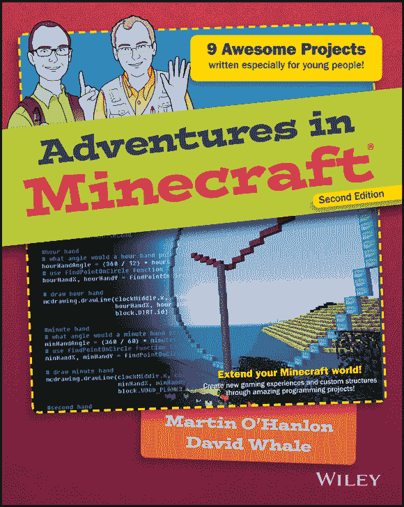

## 前言

我是一名老师，我的主要兴趣是学生的学习情况和参与度。当我使用 Minecraft 来教授编程时（我的主要使用场景是 Raspberry Jam 活动和课堂，用于帮助学生学习`Python`编程），我的学生参与度比我使用其他技术时要高得多。当教学计划转向理论或其他编程任务时，学生们经常会说：“老师，我们什么时候能再次用 Minecraft 编程呀？”简单来说，Minecraft 植根于孩子们的大脑中，而编程技术也扎得更深。

Minecraft 拥有一种我以前从未见过的、吸引学生参与的能力。Minecraft 的简单性对所有孩子都具有通用的吸引力，就像积木一样。当孩子们在 Minecraft 的引导下——在教室、图书馆或创客空间环境中——接触新技能时，这种吸引力依然存在。由于学生保持投入并对学习新技能产生兴趣，在教室里使用 Minecraft 对教师和学生来说都是非常有回报的。

我相信 Minecraft 作为有效教学工具的原因之一是因为它提供了即时的视觉反馈，无论是房屋的形式、3D 乌龟形状、整个城镇，还是国际空间站追踪器。毕竟，Minecraft 是一个沙盒，这意味着你用它实现的任何事情都没有限制——即使在树莓派上的精简版也是如此。

学生在 Minecraft 中创作的作品是极佳的参考材料——这有助于标记概念性学习，并成为他们极好的复习辅助。例如，我经常提到二维数组，通过提醒学生其中一节课，当时我们创建了 32 x 32 的随机区块墙。

在我位于英国诺西威克斯郡的学校里，我们有 10 本《Minecraft 冒险》（`Adventures in Minecraft`），我们用它来帮助学生在接触简单的工作表类型活动后，独立完成项目。例如，我们可能会完成一项任务，如在玩家行走时掉落彩虹，然后学生就可以独立地使用这本书来建造房屋或制作小游戏。这本书的妙之处在于，书中的冒险可以分段阅读，也可以通读全程。你可以对它们进行重新组合并向不同的方向发展。我发现，我自己创建的大多数资源都源于 David 或 Martin 的初始想法或代码。这本书激发了各个年龄段的人参与计算机编程。从本质上说，它提供了一个老师、父母以及最重要的孩子们可以在其中构建的平台。

认为学习仅局限于教室是天真的。像 CodeClub、Coderdojo 和 Raspberry Jams 等活动是全球范围内使用 Minecraft 进行编程的活跃社区。在家中的家庭或独立学习的学生也在学习编程。这本书在每种场景下都具有意义。

我曾听过 Martin 描述这本书为“潜移默化的学习”。我认为这就是核心所在；你用代码编写酷的东西，并在过程中学习如何迭代、使用文件处理、使用条件语句以及更多。学生和孩子们在学习编程的同时，享受乐趣，并不断受到挑战，致力于解决问题。

在本书的新版本中，Martin 和 David 增加了 BBC micro:bit 冒险，这引入了更多的物理计算。在过去的几年里，BBC micro:bit 帮助让全球儿童接触到了计算科学。通过增加 BBC micro:bit 章节，Martin 和 David 再次帮助降低了孩子、老师和父母让想象飞行的障碍。

祝你们在 Minecraft 的冒险中好运！

–Chris Penn，IT/CS 老师，英国沃西克斯克斯郡 Nicholas Chamberlaine 学校

其他读者对《Minecraft 冒险》有极高的评价：

“绝对的救救星！我每天都用它，David 和 Martin 是了不起的资源！”

–Bob，教育工作者，美国

“我们在 8 年级的计算机科学课程中使用了书中的章节，并在 Hull Raspberry Jam 经常使用它。”

–Jon，教育工作者及 Raspberry Jam 组织者，英国赫尔

“这是一本超级棒的书，充满了介绍`Python`原理和 3D CAD 的精彩方法。”

–Frank，英国 Raspberry Jam 组织者，英国伦敦

“在我参加的每一个活动中我都会向父母推荐这本书，甚至在中国。这是我编程之旅的起点！”

–Gemma，参与性艺术家，英国曼彻斯特

“它对 Leeds Raspberry Jam 的个人和双人挑战非常有帮助，包括家庭活动。它为更多项目提供了启发性的灵感。”

–Claire，教育工作者及 Raspberry Jam 组织者，英国利兹

“无价之宝。黑池 Raspberry Jam 的孩子们非常喜欢它！”

–Les，教育培训师及 Raspberry Jam 组织者，英国布拉克普尔

## 引言

你是一个冒险者吗？你喜欢尝试新事物和学习新技能吗？你是 Minecraft 的忠实粉丝吗？你不想通过学习编写与你的游戏交互的计算机程序（mods），并用你的创意和魔法让你的朋友们惊叹吗？如果答案是肯定的“是的！”，那么这本书适合你。

## 什么是 Minecraft？

Minecraft 是一个沙盒独立游戏，在其中你建造结构、收集物品、开采矿石并战斗怪物以生存。它在你看来是一个由不同类型的区块组成的 3D 虚拟世界，每个区块在 3D 虚拟世界的网格布局中都有自己的位置。图 1 显示了 Minecraft 世界的一个示例。

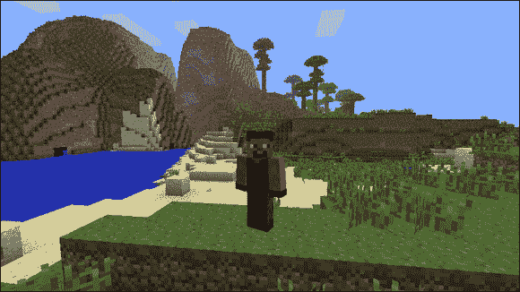

图 1 Minecraft 世界

### 虚拟世界

在沙盒游戏中，你是一个虚拟世界中的玩家（就像一个装满了沙子的沙盘）。你不是按照预设顺序提供关卡，而是在虚拟世界中漫游，并对你想实现的目标以及如何实现它们做出自己的选择。因为从一开始就开始做出自己的选择，沙盒游戏具有无限可能。你编写自己的故事并穿于 3D 世界，通过偶然发现和实验来学习新的技能和功能。

Minecraft 是如何产生的？

独立游戏是“独立视频游戏”，由个人或小团队创建。它们通常在没有游戏发行商任何资金或支持的情况下开发。由于其独立性，独立游戏通常比其他更主流的游戏更具创新性。根据维基百科，Minecraft 是由瑞典计算机程序员马库斯·佩森（Markus Persson）创建的，他的游戏网 ID 为“Notch”。他在 2009 年首次展示了 Minecraft 的早期版本，该游戏于 2011 年首次正式发布。Notch 创立了一家名为`Mojang AB`的瑞典公司，该公司继续在许多计算机平台上开发 Minecraft 游戏，包括 PC、Mac、树莓派、Linux、iOS、Android、Xbox 360、Playstation 还有 Wii。

你可以在一部名为`Minecraft: The Story of Mojang`的纪录片中了解更多关于 Minecraft 迷人的故事（[`http://en.wikipedia.org/wiki/Minecraft:_The_Story_of_Mojang`](http://en.wikipedia.org/wiki/Minecraft:_The_Story_of_Mojang)）。

## 什么是 Minecraft 编程？

这是一本关于计算机编程的书——它将 Minecraft 作为教你计算机编程的方法。如果你正在寻找关于如何建造结构和进行战斗的实用技巧，市场上还有其他一些很棒的书列在附录 A 中，它们将对你有所帮助。

通过编程 Minecraft，你可以让你的游戏体验变得更加有趣、富有创意且个性化。当你玩普通游戏时，你遵循游戏设计者设定的 Minecraft 游戏基本规则。通过编写与 Minecraft 游戏世界交互的程序，你可以自动完成复杂且重复的任务——例如自动建造巨大的房屋街道和大型结构。你可以让游戏及其内部的物体以新的方式运行，你还可以发明甚至游戏原始创作者都没有想过的新事物。但最重要的是，你将学习一种通用技能——如何使用`Python`编程语言进行编程。然后你就可以将此技能应用于 Minecraft 之外的所有其他事情。图 2 显示了一条由简短`Python`程序自动建造的巨大房屋街道。

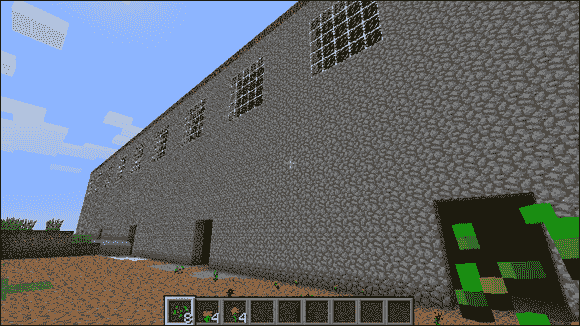

图 2 一条由 20 行 Python 程序建造的巨大房屋街道

在一个关于为什么所有孩子都应该学习编程的视频（[`www.youtube.com/watch?v=nKIu9yen5nc`](http://www.youtube.com/watch?v=nKIu9yen5nc)），Will.i.am 被引用说的话：“伟大的程序员是今天的摇滚星”。你在跟随这本书中的冒险时学到的新技能将让你的 Minecraft 体验更加个性化、更有创意、更有野心。你编程的新魔术会让你的朋友和游戏玩家感到惊叹，并激励他们询问你使用了什么魔法来实现如此惊人的成就。答案，当然，是计算机编程的魔法。

## 谁应该读这本书？

《Minecraft 冒险》适合任何喜欢玩 Minecraft 并想要学习编程以及以此实现更多可能的年轻人。《冒险》系列书籍针对 11-15 岁的读者，但后期一些更具挑战性的冒险可能也适合年长较大的读者。早期的章节也针对年仅至 8 岁的读者进行了测试。

你可能已经是一个游戏专家了，但发现自己因为建造新结构所需的时间而感到沮丧。或者你可能想找到方法通过向世界添加一些额外的智能和自动化来扩展游戏。无论你的原因是什么，这本书都将成为你 Minecraft 编程之旅的指南；正如每位冒险者所知的，你的指南书是你背包中最重要的物品。你的旅程将带你从简单的开始（例如在 Minecraft 聊天框中发送消息），到学习使用`Python`编程语言为 Minecraft 编程的基础知识，再到发现如何使用你新的计算机编程技能在 Minecraft 内部编写你自己的令人兴奋的游戏。在冒险结束时，你将学会成为一名 Minecraft 编程先驱所需的技能！

## 你将学到什么

你将学习 Minecraft 游戏的许多方面，以及如何通过`Python`编程语言与 Minecraft 特性交互。你将发现如何使用坐标在 3D 世界中对方块进行定位、如何感知玩家的位置、如何在 Minecraft 世界中创建和删除方块，以及如何感知方块被玩家击中。

你将学习如何在`Python`编程语言中编写程序，从简单的`Hello Minecraft World`程序，到创建并与巨大的 3D 物体交互，得益于你新的`Python`编程技能，你可以在这些物体上盖上自己的个性。如果你使用 PC 或 Mac，你还将学习如何设置和运行你自己的本地 Minecraft 服务器。

通过`Python`辅助代码的免费`MinecraftStuff`模块，你将能够增强利用区块、线条、多边形和文本创建 2D 和 3D 物体的能力。

你的冒险将不仅限于 Minecraft 的虚拟世界！我们将向你介绍将 Minecraft 连接到其他设备的方法，例如`BBC micro:bit`，这让你的 Minecraft 世界能够感知并控制现实世界中的物体。因此，我们为你提供了一个宝贵的秘密：突破虚拟世界的边界！

## 我们假设已知

由于这是一本关于 Minecraft 编程的书，我们专注于学习编程，我们对你这位读者假设一些情况：

1. 你有一台计算机（运行 Raspbian 的树莓派、运行 Windows 的 PC 或运行 macOS 的 Apple Mac），它符合 Minecraft 的最低要求并已设置好可以运行。

2. 你对如何使用计算机基础了解，例如使用键盘和鼠标、使用菜单系统启动程序以及使用`文件`、`新建`和`保存`等应用程序菜单。

3. 你有互联网连接，并知道如何使用浏览器下载文件。

4. 如果你使用 PC 或 Mac，你已经拥有 Minecraft 用户 ID 并安装了可以运行的 Minecraft。

5. 你知道如何玩 Minecraft 游戏，例如如何启动、如何移动、如何在背包中选择物品以及如何在世界中创建和删除方块。

由于这是一本关于 Minecraft 编程的书，我们不假设你有任何先编程知识。随着冒险的进行，我们将引导你完成所需的步骤。

## 项目所需的物品

我们编写的这本书适用于三种常见的计算机：运行 Raspbian 的树莓派、运行 Windows 的 PC 以及运行 macOS 的 Apple Mac。Minecraft 也支持其他平台，例如运行各种 Linux 发行版的 PC，但我们没有在书中涵盖这些平台的设置。

为了让各个部分的设置更简单，我们准备了三个启动套件，对应每个支持的计算机平台。你可以下载适用于你计算机的启动套件，并在第一个冒险中，我们将提供如何下载和安装这些并让一切正常运行的逐步说明。这些启动套件包含了除 Minecraft 本身所需的一切。

在冒险 8 和冒险 9 中，我们将向你展示如何将 Minecraft 虚拟世界连接到现实世界。为此你需要购买一个 BBC micro:bit，这是一种小型手持式编程计算机，具有多种输入输出功能，可以与你的 Minecraft 游戏配合使用。我们在附录 A 中提供了购买 BBC micro:bit 的链接。

在这段旅程中，你最重要的东西是你对 Minecraft 拥有的兴奋和热情，以及对自己的想法充满好奇心并愿意进行实验，不断突破你现有知识的边界！

## 给家长和老师的说明

我们将本书分成了多个独立自成的冒险，你可以将它们视为独立的独立项目，每个项目都侧重于 Minecraft 编程的一个特定功能。`Python`语言在每个冒险中逐渐、渐进地引入；早期的冒险主要面向初学者，后期的冒险则更具挑战性，并引入更多`Python`内容，对读者的要求也更高。

每个冒险都呈现了一个实践项目，并附有分步骤说明（读者可以在完成后进行勾选），这些说明以描述性的风格呈现，非常就像注释良好的程序列表。详细的解释出现在“深入代码”（`Digging into the Code`）侧边栏中，学生可以以后再阅读，这意味着他们不会在输入和尝试程序的过程中被分散注意力。

每个冒险可能需要超过一个节课的时间才能完成，但它们都被分成了若干章节，并在逻辑点设有小标题，这些小标题可以作为单节课的目标，或者作为一个跨越多个课时的活动。

`Python`语言使用程序左侧的缩进表示代码结构，并且它是一种区分大小写的语言。对于非常年幼的读者，来自成人的额外指导有时很有用，以确保他们仔细地使用大小写和缩进，从而避免在程序中引入错误的可能性。所有程序都可以从伙伴网站下载，因此如果你在缩进上遇到问题，可以检查我们的程序版本，看看可能哪里出错了。

### 第二版的修改

此第二版延续了第一版同样非常成功的风格和内容，并进行了一些细小的改进、错误修复以及替换了一个冒险：

*   可下载的启动包已略微简化。PC、Mac 和树莓派上的所有坐标现在都统一报告给`Python`程序为绝对坐标——即 Minecraft 内部的真实坐标（而不是像以前那样相对于生成点）。这使得在 Minecraft 中定位物体相关的数学计算对孩子们来说更容易理解了，尽管代价是它有时会报告一些很大的数字。现在屏幕上报告的坐标与你编写的`Python`程序所报告的坐标相匹配。

*   为了保持本书的时代性并与学校常用的内容保持一致，所有程序现在都是用最新版本的`Python 3`编写的，我们在冒险 1 中建议读者下载该版本。你可能在我们程序中发现的区别是使用的是`input()`而不是`raw_input()`（`Python 3`在这方面与`Python 2`略有不同）。

*   上一版本的冒险 5 已被替换为一个全新的冒险，读者在其中使用 BBC micro:bit 作为可编程的 Minecraft 游戏控制器。新的冒险被移动到了书靠后的位置（到冒险 8），以便增加一些使用 BBC micro:bit 的 Minecraft 大型项目。BBC micro:bit 在全球范围内可以通过许多零售商购买，包括直接现售的零售店。它提供了一个非常廉价的物理计算世界入口，可以与 Minecraft 一起使用；它本身也是一台完全可编程的计算机，我们希望你探索它作为独立计算平台所提供的许多功能。

*   Martin 的免费`MinecraftStuff`模块已经更新以简化了一些功能，这减少了在冒险 6、7 和 9 中输入程序所需的打字量，并包含一个新的功能的可能：Minecraft 乌龟（Turtle）！这是 Minecraft 中一个完全可控制的区块，可以在三维空间移动，并让读者能够快速地绘制复杂的形状。它与教学大纲非常契合，课程经常使用可编程乌龟来引入编程概念。

### 本书的结构

书的每一章都是一个独立的冒险，在你编写和测试项目时教你新的技能和概念。书的组织方式使得每个冒险都是一个独立项目，但你可能会发现按顺序完成它们会更容易，因为我们在整本书中逐渐加深你对编程概念的理解。

在做任何事情之前，先完成冒险 1 是至关重要的。因为它向你展示了如何下载和安装所有内容，以及如何确保其正常工作。在这个冒险中介绍了一些你在其他冒险中需要的基础步骤，但在早期的冒险中会提供提醒。

前三个冒险是为几乎或没有编程知识的初学者编写的，我们在它们时解释了所有的术语和概念。在冒险 2、3 和 4 中，你涵盖了任何优秀游戏的关键部分。这些包括“感知”Minecraft 世界发生的事情、使用简单的数学进行“计算”，以及让你的程序“行为”不同，例如在聊天中显示消息或自动在世界中创建区块。在整书中，你将使用这三个“感知”、“计算”和“行为”概念来构建更大、更有趣的 Minecraft 程序！

冒险 5 和 6 通过引入分阶段开发和测试稍大的程序，在你在早期冒险中学到的知识基础上进行了扩展。冒险 5 探讨了如何从数据文件中引入大量数据，以便使用 3D “复制机”保存并复制大型结构。

冒险 6 和 7 引入了免费的`MinecraftStuff`模块，它使得使用区块构建线条、圆形和其他 2D 形状，以及一些奇特的 3D 球体和金字塔成为可能。这些可以作为手工很难构建的巨大结构的开头。冒险 7 展示了如何为移动物体添加个性，赋予它们自己的智能。通过这些技术，你可以编写出一些令你的朋友惊讶的有趣的“游戏中的游戏”。

冒险 8 引入了物理计算这一令人兴奋的话题，如果你想进行这项可选的冒险，将需要购买一个 BBC micro:bit（销售商链接请参见附录 A）。通过将 BBC micro:bit 连接到电脑，你可以使用 micro:bit 上的一系列输入输出设备来控制并与你的 Minecraft 游戏交互；BBC micro:bit 将成为一个 Minecraft 的可编程游戏控制器。


冒险 9 结合了之前冒险中所有的编程概念和技能，创建一个终极的大型项目——一个带有评分机制、且你必须避开或携带移动对象的酷游戏。在这次冒险中，你还可以再次尝试使用 `BBC micro:bit`，允许你通过按下现实世界中的按钮在游戏中进行操作。

附录 A 提供了一系列资源，你可以利用这些资源来扩展和增强你的冒险，学习更多 `Python` 编程，并根据你在整本书中学到的知识创建出更酷的 `Minecraft` 程序。

在附录 B 中，我们包含了一份关于书中使用的所有编程特性的全面参考指南，以及针对 `Minecraft` 的特定编程语句的引用，以及一个你可以构建的区块类型表格。你会发现，这是一个无价的参考分章节，对你所有的自己的项目和发明都非常有帮助！

术语表为整书中介绍的所有术语和专业词汇提供了方便的快速参考，并且是每个冒险中所有定义的集合。

# 伴侣网站

在整本书中，你会发现《`Minecraft` 冒险》伴侣网站的引用，地址为 [`www.wiley.com/go/adventuresinminecraft2e`](http://www.wiley.com/go/adventuresinminecraft2e)。在该网站上，你将找到开始 `Minecraft` 编程所需的启动套件，以及我们整理的一系列视频教程，在你遇到困难时提供帮助。你可以在网站上找到一些较大项目的代码文件。

附录 B 包含一个实用的参考。在完成这些 `Minecraft` 冒险时，请将其放在手边。你也可以将其用于未来你开启的任何编程项目。

# 其他帮助来源

计算机是复杂的设备，操作系统和软件一直在变化。我们尽力保护你和你的冒险免受未来变化的影响，在冒险 1 中提供了一个可下载的启动套件，它应该提供你大部分所需。然而，如果你遇到问题或需要特定的帮助，这里是一些有用的地方：

*   注册用户 ID 并下载安装 `Minecraft`：[`http://minecraft.net`](http://minecraft.net/)
*   玩 `Minecraft` 游戏：[`http://minecraft.gamepedia.com/Minecraft_Wiki`](http://minecraft.gamepedia.com/Minecraft_Wiki/)
*   树莓派：[`www.raspberrypi.org`](http://www.raspberrypi.org/)
*   微软 Windows：[`http://support.microsoft.com`](http://support.microsoft.com/)
*   苹果 Mac 和 macOS X：[`www.apple.com/support`](http://www.apple.com/support/)
*   `Python` 语言：[`www.python.org`](https://www.python.org/)
*   `IDLE` 编程 IDE：[`https://docs.python.org/3/library/idle.html`](https://docs.python.org/3/library/idle.html)
*   `Minecraft Pi` 版：[`http://pi.minecraft.net`](http://pi.minecraft.net/)
*   `Minecraft` 服务器：[`www.spigotmc.org/`](https://www.spigotmc.org/)
*   `RaspberryJuice` bukkit 插件：[`http://dev.bukkit.org/bukkit-plugins/raspberryjuice`](http://dev.bukkit.org/bukkit-plugins/raspberryjuice)

# 约定

你会注意到书中到处都有特殊的框，用来引导和支持你。以下是它们的样式：

你会在书中发现两组侧边栏。“挑战”侧边栏（`Challenge` sidebars）在你想进一步推进项目时提供了可以接受的额外任务，也许通过更改或添加新功能。“深入代码”侧边栏（`Digging into the Code` sidebars）会以更详细的方式解释程序中的某些概念或特性，让你对 `Python` 编程语言有更好的理解。这些侧边栏意味着你可以先专注于让程序运行，等程序运行起来后，再详细阅读关于它们如何工作以及你如何进一步扩展它们的方法。

当你使用代码遵循我们的步骤或指令时，你应该完全按照我们在指令中描述的那样输入代码。`Python` 是一门语言，行首的空格数量（缩进）对程序的含义至关重要，因此请格外注意确保在每行的左侧留出足够的空格。我们为代码列表框涂了颜色，以便你更容易看到每行需要多少个空格。

```print("Welcome to Adventures in Minecraft by Martin O'Hanlon and David Whale")
```

`Python` 编程语言带有一个名为 `IDLE` 的代码编辑器，你将用它在这些冒险中创建、编辑和运行编写的程序。

当计算机程序员学习一种新的编程语言或处理某事的方法时，他们总是从编写一个“`hello world`”程序开始。这是一个非常简单的程序，会在屏幕上显示“`hello world`”，以确保所有内容都已安装并正常运行。

在第一次冒险中，你将配置电脑，允许编写一个程序，在 `Minecraft` 聊天框中显示“`Hello Minecraft World`”文本（参见图 1-1）。

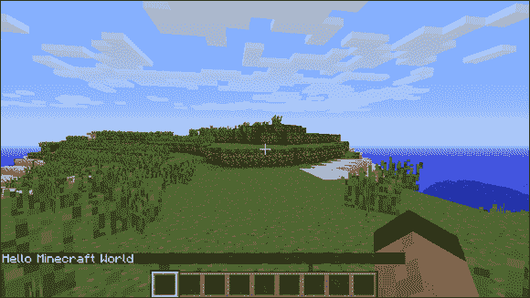

图 1-1 Hello Minecraft World

要完成书中 `Minecraft` 编程，你需要以下三种类型的电脑之一：运行 `Microsoft Windows` 的 PC；运行 `macOS X` 的 `Apple Mac`；或者运行带有 `Pixel` 的 `Raspbian` 的 `Raspberry Pi`。你配置电脑的方法取决于你拥有哪种电脑，但一旦配置好，你在所有电脑上以完全相同的方式进行 `Minecraft` 程序。为了方便你配置电脑，你可以从 [`https://adventuresinminecraft.github.io`](https://adventuresinminecraft.github.io/) 下载启动套件。这些启动套件经过了测试，以确保书中所有的冒险都能正常运行。

你会发现你的启动套件中包含一个 `README` 文件，你应该查看一下。它描述了套件包含的内容以及它是如何创建的；你可以使用这些信息从零开始配置自己的电脑，尽管不建议这样做。通过遵循书中的说明，你将获得更多收获。

请确保你遵循适用于你类型电脑的说明，即“配置你的 `Raspberry Pi` 以进行 `Minecraft` 程序”或“配置你的 PC 或 `Apple Mac` 以进行 `Minecraft`”。

# 配置 Raspberry Pi 进行 Minecraft 编程

如果你正在使用 `Raspberry Pi`，它已经安装了 `Minecraft`；你只需要下载 `Raspberry Pi` 启动套件即可。完成《`Minecraft` 冒险之旅》所需的所有内容都在一个名为 `MyAdventures` 的文件夹中。你也将把 `Minecraft` 程序保存在此文件夹中。

`Raspberry Pi` 的图形用户界面（GUI）被称为 `Pixel`，在整个《`Minecraft` 冒险之旅》中使用。该 GUI 安装在 `Raspbian` 上，但取决于你如何配置 `Raspberry Pi`，它在启动时可能不会加载 GUI。相反，你可能会从登录和命令提示符开始。

如果你的 `Raspberry Pi` 配置为从命令提示符启动，你需要在登录，并在命令提示符出现后输入 `startx` 然后按回车来加载 GUI。

## 下载启动套件

一旦你的 `Raspberry Pi` 启动并进入了 GUI，你可以按照以下步骤下载 `Raspberry Pi` 启动套件：

1.  打开终端，点击菜单（左上角的 `Raspberry Pi` 图标）  杂项 终端。
2.  输入以下命令并将目录更改到桌面（参见图 1-2）并按回车：

    ```bash
    cd ~
    cd Desktop
    ```

3.  输入以下命令并按回车下载启动套件：

    ```bash
    git clone https://github.com/AdventuresInMinecraft/AdventuresInMinecraft-Pi
    ```

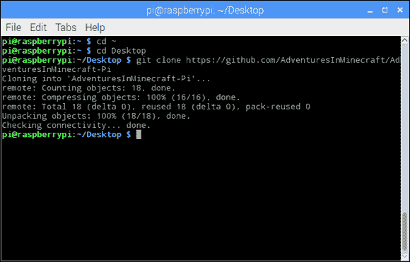

图 1-2 下载 `Raspberry Pi` 启动套件。

访问 [`https://adventuresinminecraft.github.io`](https://adventuresinminecraft.github.io/)，因为未来可能会更新并提供帮助。

## 在你的 Raspberry Pi 上启动 Minecraft

下载启动套件后，你可以在开始创建第一个程序之前运行游戏并尝试。

要启动 `Minecraft`，请遵循以下步骤：

1.  选择菜单  游戏  `Minecraft Pi`。
2.  通过选择开始游戏  新建来开启新世界。
3.  好了！现在你可以开始玩 `Minecraft` 了。

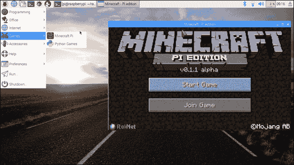

图 1-3 启动 `Minecraft` 并创建一个新世界。

主菜单有两个选项：开始游戏（用于构建新世界或进入现有 `Minecraft` 世界）以及加入游戏（加入另一个玩家的世界）（参见图 1-3）。

一旦你的 `Raspberry Pi` 配置好并运行了 `Minecraft`，你可以跳过下一节。

# 配置你的 PC 或 Apple Mac 进行 Minecraft 编程

无论你使用的是 `Windows PC` 还是 `Mac`，你都需要确保已安装了 `Minecraft`。要完成书中的 `Minecraft` 编程，你需要以下三种类型的电脑之一：运行 `Microsoft Windows` 的 PC；运行 `macOS X` 的 `Apple Mac`；或者运行带有 `Pixel` 的 `Raspbian` 的 `Raspberry Pi`。你配置电脑的方法取决于你拥有哪种电脑，但一旦配置好，你在所有电脑上以完全相同的方式进行 `Minecraft` 程序。为了方便你配置电脑，你可以从 [`https://adventuresinminecraft.github.io`](https://adventuresinminecraft.github.io/) 下载启动套件。这些启动套件经过了测试，以确保书中所有的冒险都能正常运行。

你会发现你的启动套件中包含一个 `README` 文件，你应该查看一下。它描述了套件包含的内容以及它是如何创建的；你可以使用这些信息从零开始配置自己的电脑，尽管不建议这样做。通过遵循书中的说明，你将获得更多收获。

请确保你遵循适用于你类型电脑的说明，即“配置你的 `Raspberry Pi` 以进行 `Minecraft` 程序”或“配置你的 PC 或 `Apple Mac` 以进行 `Minecraft`”。

1. 打开 PC 上的网络浏览器（例如 `Internet Explorer` 或 `Chrome`）。访问 [`www.python.org/downloads/release/python-361/`](https://www.python.org/downloads/release/python-361/) 下载并安装 `Python 3.6.1`。

2. 向下滚动页面，在文件列表中点击“`Windows x86 Executable Installer`”链接以下载 `Python` 安装程序。

3. 当 `python-3.6.1.exe` 文件下载完成后，通过点击“打开 ⇒ 运行”菜单选项，或者打开下载文件夹并双击该文件来运行它。

4. 可能会弹出一个安全警告框（询问“你是否要运行此文件？”）。点击“运行”（`Run`）。

5. 点击“立即安装”（`Install Now`）开始安装。

6. 用户账户控制（`User Account Control`）可能会请求许可运行设置程序。如果是，点击“是”（`Yes`）。

7. 等待设置程序完成安装并点击“关闭”（`Close`）。

## 在你的 Apple Mac 上安装入门包和 Python

如果你正在使用 `Apple Mac`，设置电脑的下一步将涉及两个步骤：

1. 下载 `Apple Mac` 的入门包并将其解压到桌面。

2. 下载 `Python` 编程语言并将其安装在你的 `Apple Mac` 上。

## 下载和解压入门包

按照以下步骤下载 `Apple Mac` 入门包并将内容复制到桌面（将它们放在桌面上方便你在需要时随时找到它们）：

1. 打开你 `Apple Mac` 上的网络浏览器（例如 `Safari` 或 `Chrome`），访问 [`https://adventuresinminecraft.github.io`](https://adventuresinminecraft.github.io/) 并下载适用于你 `Apple Mac` 的入门包。

2. 当入门包 zip 文件下载完成后，进入你的下载文件夹。

3. 压缩包中仅包含名为 `AdventuresInMinecraft-Mac` 的文件夹。点击该文件夹，按住鼠标键并将其拖到桌面即可将其复制到桌面（参见 图 1-5）。

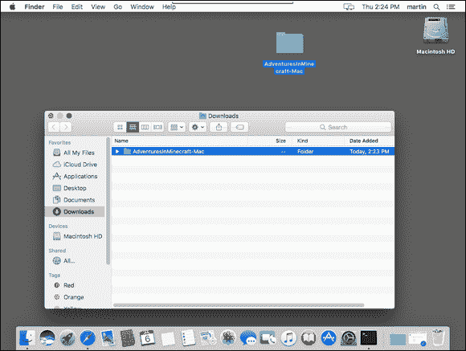

图 1-5 将 `AdventuresInMinecraft-Mac` 文件夹复制到 `Mac` 桌面。

## 下载和安装 Python

由于你将使用 `Python` 进行编码，必须按照以下步骤安装 `Python` 编程语言和代码编辑器 `IDLE`：

1. 打开你 `Apple Mac` 上的网络浏览器。访问 [`www.python.org/downloads/release/python-361/`](https://www.python.org/downloads/release/python-361/) 下载并安装 `Python 3.6.1`。

2. 向下滚动页面，在文件列表中点击“`macOS X 64-bit/32-bit Installer`”链接下载 `Python` 安装程序。

3. 当 `python-3.6.1-macosx10.6.pkg` 文件下载完成后，点击它或在 `Finder` 中打开下载文件夹并双击它打开文件。

4. “介绍”屏幕显示关于 `Python` 安装程序的信息。点击“下一步”（`Continue`）。

5. “许可”（`Read Me`）屏幕显示关于 `Python` 的重要信息。点击“下一步”（`Continue`）。

6. “许可协议”屏幕显示软件许可协议。点击“下一步”（`Continue`），然后点击“同意”（`Agree`）。

7. “安装类型”屏幕显示将使用多少磁盘空间；点击“安装”（`Install`）。如果你愿意，还有机会更改安装位置。

8. 输入你的 `Apple` 密码并点击“安装软件”（`Install Software`）；安装将开始，并向你显示进度。等待 `Python` 完成安装。

9. 当安装程序显示安装成功时，点击“关闭”（`Close`）。

# 在你的 Windows PC 或 Apple Mac 上启动 Minecraft

你现在已经在你的 `Windows PC` 或 `Apple Mac` 上安装了所有需要的软件。但你还没有完全准备好；首先，你需要按照以下步骤启动服务器并将 `Minecraft` 连接到服务器上：

1. 双击你放在桌面上的 `AdventuresInMinecraft` 文件夹。

2. 双击运行 `StartServer` 程序。服务器命令窗口将打开。

3. 按任意键启动 `Minecraft` 服务器。当服务器加载时，你会在屏幕上看到消息，这些消息会持续向你更新服务器的进度。

4. 当服务器加载完成后，你会看到一条“完成”（`Done`）消息（参见 图 1-6）。

图 1-6 `Minecraft` 服务器命令窗口在服务器加载完毕并准备就绪后显示“`Done`”。

入门包中使用的 `Minecraft` 版本是 1.12。这意味着你需要在 `Minecraft` 启动器中创建一个配置（`profile`）来运行 1.12 版本的游戏。使用此版本的游戏而不是最新版本，1.12。这意味着你需要在 `Minecraft` 启动器中创建一个配置来运行 1.12 版本的游戏。使用此版本的游戏而不是最新版本，1.12。这意味着你需要在 `Minecraft` 启动器中创建一个配置来运行 1.12 版本的游戏。使用此版本的游戏而不是最新版本，1.12。这意味着你需要在 `Minecraft` 启动器中创建一个配置来运行 1.12 版本的游戏。使用此版本的游戏而不是最新版本，1.12。这意味着你需要在 `Minecraft` 启动器中创建一个配置来运行 1.12 版本的游戏。（*注：原文此处存在逻辑重复，翻译已按原文保留*）

要配置 `Minecraft`，遵循以下步骤：

1. 如图 1-7 所示选择 `AdventuresInMinecraft`。
2. 点击“开始游戏”（`Play`）启动。
3. 从菜单中点击“多人游戏”（`Multiplayer`）。
4. 从“多人游戏”菜单中点击“直接连接”（`Direct Connect`）。
5. 在“服务器地址”中输入 `localhost` 并点击“加入服务器”。

图 1-7

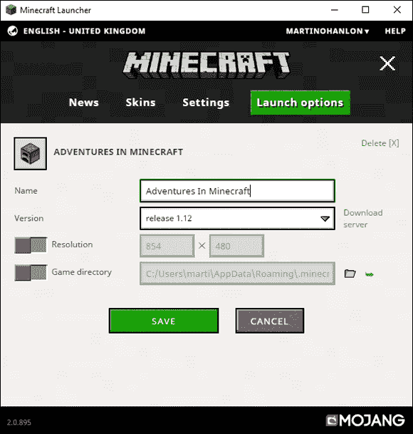

## Minecraft 服务器

当你结束今天的冒险时，需要断开 `Minecraft` 服务器。通过按 `Escape` 键返回菜单并点击“断开连接”（`Disconnect`）来实现。

你还应该通过在服务器命令窗口中输入 `stop` 并按回车来安全地关闭服务器。在屏幕上，你会看到一系列更新，告诉你关闭过程中发生的情况。

# 创建程序

恭喜！你已经设置好了电脑，并且 `Minecraft` 已经在上面运行。你可能觉得设置过程有点无聊，但现在已经完成了。现在是时候有趣的事情了——创建你的第一个程序“`Hello Minecraft World`”。

首先，你需要通过以下操作启动 `Python` 并打开 `IDLE`：

- 在树莓派上：选择菜单 ⇒ `Python 3 (IDLE)`。
- 在 PC 上：点击开始按钮并选择 `Python 3.6` ⇒ `IDLE`。


- 在 Mac 上：点击 Finder 栏上的`Go`，选择应用程序 ⇒ Python 3.6。双击`IDLE`。

`Python Shell`窗口打开。

一旦`Python Shell`加载，你就可以在`IDLE`中创建一个新程序。你在这里创建的程序将不会执行任何复杂操作。正如程序员总是从编写“hello world”程序开始一样，你现在将创建一个`Hello Minecraft World`程序来检查电脑上的所有内容都已正确安装。方法如下：

1. 通过`IDLE`菜单选择“文件”（File）⇒“新建文件”（New File）创建一个新文件。

2. 通过`IDLE`编辑器菜单选择“文件”（File）⇒“保存”（Save）将文件保存到`MyAdventures`文件夹中。

- 在 Raspberry Pi 上：在目录下拉列表中选择`/home/pi`，在文件夹浏览器中双击`Desktop`、`AdventuresInMinecraft-Pi`和`MyAdventures`。

- 在 PC 上：点击左侧导航窗上的`Desktop`，在文件夹资源管理器中双击`AdventuresInMinecraft-PC`和`MyAdventures`。

- 在 Mac 上：打开文件夹浏览器（使用`Save`旁边的向下箭头），选择`Desktop`、`AdventuresInMinecraft-Mac`，然后选择`MyAdventures`。

4. 给你的新文件起一个名字。输入文件名`HelloMinecraftWorld.py`并点击`Save`。文件末尾添加的`.py`告诉电脑该文件是一个 Python 程序。

5. 现在是开始编程了！在`IDLE`编辑器窗口中输入以下代码以启动`Hello Minecraft World`程序。确保字母大小写正确，因为 Python 是`case-sensitive`的：

```python
import mcpi.minecraft as minecraft
mc = minecraft.Minecraft.create()
mc.postToChat("Hello Minecraft World")
```

6. 通过`IDLE`编辑器菜单选择`File ⇒ Save`保存你的程序。

## 运行程序

你现在已经创建了一个程序！现在是测试它了。为此，你需要按照以下步骤让`idle`运行该程序：

1. 在运行`Hello Minecraft World`程序之前，`Minecraft`需要已打开并处于游戏状态。如果不是，请按照此冒险之前的步骤启动`Minecraft`。

2. 移动`Minecraft`窗口，使你能够同时看到`Minecraft`和`IDLE`窗口。（如果你使用的是 PC 或 Mac 且`Minecraft`显示为全屏，请按`F11`退出全屏模式，以便在窗口中查看`Minecraft`。）你应该打开了以下窗口：

- 在 Pi 上：你应该打开三个窗口：`Python Shell`；带有你的`HelloMinecraftWorld.py`程序的`IDLE`代码编辑器；以及`Minecraft`（参见 图 1-9）。

- 在 PC 上：你应该打开四个窗口：`Python Shell`；带有你的`HelloMinecraftWorld.py`程序的`IDLE`代码编辑器；服务器命令窗口；以及`Minecraft`（参见 图 1-10）。

- 在 Mac 上：你应该打开四个窗口：`Python Shell`；带有你的`HelloMinecraftWorld.py`程序的`IDLE`代码编辑器；服务器命令窗口；以及`Minecraft`（参见 图 1-11）。

3. 按`Esc`打开`Minecraft`游戏菜单。使用鼠标指针选择`IDLE`代码编辑器。

4. 点击`IDLE`菜单上的`Run ⇒ Run Module`或按`F5`运行`HelloMinecraftWorld.py`程序。

5. `IDLE`会自动切换到`Python Shell`窗口并运行程序。如果有任何错误，你将在这里以红色字体显示。如果有任何错误，请通过切换回`IDLE`代码编辑器仔细检查之前输入的代码，并与我提供的代码进行对比，看看哪里出错。

6. 将`Minecraft`游戏窗口移到最前。注意到了什么吗？你所有的努力都得到了结果，"Hello Minecraft World"现在显示在聊天中（参见 图 1-1）。

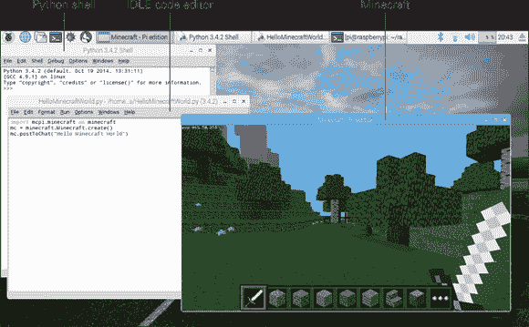

图 1-9 Raspberry Pi 已准备好运行你的程序。

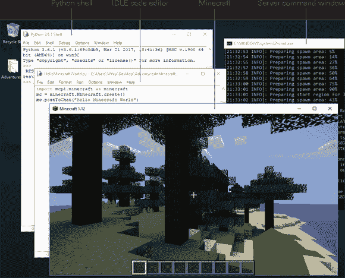

图 1-10 Windows PC 已准备好运行你的程序。

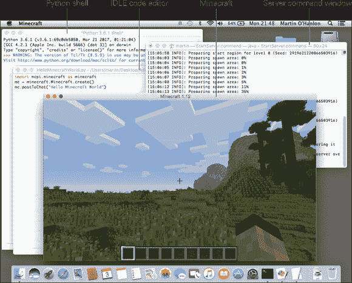

图 1-11 Apple Mac 已准备好运行你的程序。

## 停止程序

`Hello Minecraft World`程序会运行，在屏幕上显示消息然后停止。然而，知道如何强制停止程序运行很重要，因为在未来的冒险中，你创建的程序如果不告诉它们停止，将一直运行！要停止程序，选择`Python Shell`窗口，然后点击菜单上的`Shell ⇒ Restart Shell`，或者按住`Ctrl`并按`C`。


成就解锁：困难的部分已经结束！

现在你已经完成了探险 1 中的"Hello Minecraft World"程序，现在是时候编写你自己的程序来连接`Minecraft`了！

探险 1 详细解释了如何让一切运行起来，你将在冒险的过程中不断完善这些步骤。启动一切并开始编写程序所需的所有步骤都在 探险 1 中有所描述，但在你仍在学习如何操作时，马丁（Martin）和我会在前几次冒险中给你提供一些提醒：

1. 启动`Minecraft`、`IDLE`，如果你在 PC 或 Mac 上工作，也请启动服务器。到目前你应该已经练习过如何启动一切，但如果需要任何提醒，请参考 探险 1。

2. 像你在 探险 1 中做的那样打开`IDLE`，Python 集成开发环境（IDE）。它是你接触 Python 编程语言的窗口，也是你输入和运行所有 Python 程序的地方。

## 显示玩家的位置

理解坐标工作的最好方法是编写一个小实验程序，这就是你现在要做的。这个程序将显示玩家的 3D 坐标，你可以看到坐标随着玩家移动而变化。

1. 从`Python Shell`，通过选择`File ⇒ New File`创建一个新程序。会打开一个新的无标题窗口，那里就是你输入新程序的地方。

2. 在开始输入程序之前，先保存文件是一个良好的习惯，这样如果你必须匆忙离开电脑，就不需要在压力下为程序想名字了。你只需选择保存即可。专业程序员经常这样做，以确保他们不会丢失工作。在新的无标题窗口菜单中，选择`File ⇒ Save As`，并输入名称`whereAmI.py`。确保你将程序保存在`MyAdventures`文件夹内。

3. 你的程序通过`Minecraft API`与`Minecraft`游戏直接通信。要访问此 API，你需要导入`minecraft`模块，它让你的 Python 程序能够访问`Minecraft`游戏所有功能。使用以下内容导入模块：

```python
import mcpi.minecraft as minecraft
```

4. 要与运行中的`Minecraft`游戏通信，你需要与该游戏的连接。输入以下内容连接`Minecraft`游戏：

```python
mc = minecraft.Minecraft.create()
```

5. 使用`getTilePos()`向`Minecraft`游戏询问玩家的位置：

```python
pos = mc.player.getTilePos()
```

6. 告诉`Minecraft`游戏显示玩家位置的坐标。当你的程序运行时，`print()`会`Python Shell`上显示这些坐标：

```python
print(pos.x)
print(pos.y)
print(pos.z)
```

7. 通过编辑器菜单选择`File ⇒ Save`保存此文件。

8. 通过编辑器菜单选择`Run ⇒ Run Module`运行程序。

你现在应该能看到`Python Shell`上显示的玩家位置坐标（参见 图 2-2）。在冒险的后续部分，你将使用这些坐标来感知玩家站在哪里，并建造一个魔法门垫，当玩家站在上面时欢迎他回家！

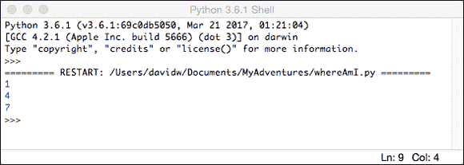

图 2-2 使用`getTilePos`在`Python Shell`上显示玩家位置。

尝试将玩家移动到新位置并再次运行程序。检查`Python Shell`上显示的坐标：这些坐标现在应该已经改变以反映玩家的新位置。如果你想确认`Minecraft`世界中某个位置的坐标，随时可以使用这个程序。

## 整理你的位置显示

在继续进行更多`Minecraft`程序操作之前，你可以改进玩家位置的输出，使其更容易理解。每次显示位置时都有三行独立的输出会占用大量空间；如果能将玩家位置的三个部分放在同一行，就像这样，就很好：

`x=10 y=2 z=20`

要实现这一点，请遵循以下步骤：

1. 修改你的`whereAmI.py`程序，删除三个`print()`语句并将它们替换为这一单行：

```python
print("x="+str(pos.x) +" y="+str(pos.y) +" z="+str(pos.z))
```

2. 再次通过编辑器菜单选择`File ⇒ Save`保存你的程序，然后点击`Run ⇒ Run Module`运行它。

## 使用 postToChat 修改你的位置

在继续进行更多`Minecraft`程序操作之前，你可以改进玩家位置的输出，使其更容易理解。每次显示位置时都有三行独立的输出会占用大量空间；如果能将玩家位置的三个部分放在同一行，就像这样，就很好：

`x=10 y=2 z=20`

是时候将你的游戏循环付诸实践并开发一个简单的应用程序了。"欢迎归家"（Welcome Home）游戏使用传感（追踪玩家的位置）来在玩家于`Minecraft`世界中移动时跟随其走动。你还将学习了如何使用 Python 中的`if`语句进行更复杂的传感。你将构建一个魔法门垫，当你站在门垫上时，`Minecraft`聊天框会弹出"欢迎归家"的消息。

## 使用 if 语句制作魔法门垫

为了判断你的玩家是否站在门垫上，你将使用`if`语句将玩家的位置与门垫的位置进行比较。当两者相匹配时，说明你的玩家已经到家了。

首先，看一看`if`语句是如何工作的；在`Python Shell`中亲自尝试一下将帮助你理解它：

1. 点击`Python Shell`。确保你恰好点击`>>>`提示符的右侧，以确保你输入的内容进入了正确的位置。

2. 在`Python Shell`中输入以下行代码。当你按下回车键时，Python 就会运行它。它还不会显示任何内容，因为这所做的只是将数字 20 存储在名为`a`的变量中：

```python
a = 20
```

3. 在`Python Shell`中输入以下内容，检查变量`a`是否包含正确的值：

```python
print(a)
```

数字 20 应该显示在屏幕上。

4. 尝试使用`if`语句来检查变量`a`中存储的值是否大于 10。注意，你必须在`if`语句末尾加上冒号。当你在第一行结束按回车时，Python 会自动为你下一行进行缩进：

```python
if a>10:
    print("big")
```

5. 现在再次按回车键，告诉`Python Shell`你已完成`if`语句的输入。你应该能在`Python Shell`上看到"big"这个词。要查看外观，请参图 2-3。

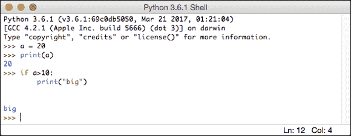

图 2-3 在`Python Shell`中交互式使用`if`语句

## 检查玩家是否位于特定位置

为了让程序能够判断玩家是否站在魔法门垫上，它必须检查坐标至少两个部分。如果你检查门垫的 x 和 z 坐标与玩家的位置相同，这可以作为检测玩家站在门垫上的合理方法。你可以通过在`if`语句内部使用关键字`and`来同时检查一个条件和另一个条件。y 坐标在这里不重要，而且由于你在程序中没有检查 y 坐标，当玩家悬浮在门垫上方时，你仍然能看到欢迎归家的消息。

先在`Python Shell`中交互式尝试一下以确保它工作正常：

1. 在`Python Shell >>>`提示符处，输入以下内容设置变量：

```python
a = 8
```

2. 输入一个同样使用了`and`的`if`语句。该语句检查变量`a`是否在两个数字之间。当你第一次输入它时，会在`Python Shell`上看到"between"一词，因为 8 大于 5 且小于 10。记得再次按回车键以完成`if`的缩进区域：

```python
if a>5 and a<10:
    print("between")
```

3. 现在将`a`改为小于 5，看看会发生什么（参阅图 2-4）：

```python
a = 3
if a>5 and a<10:
    print("between")
```

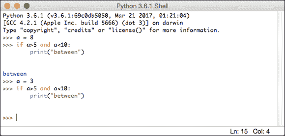

图 2-4 你使用带有`and`的`if`语句来检查两个或多个条件。

## 构建魔法门垫

在编写游戏之前，你首先需要在`Minecraft`世界中构建一些东西，这样你的程序就有东西可以交互了。你真正只需要一个门垫。但首先，打开`Minecraft`并加载你已经在使用的世界。

1. 要在地板上放置门垫，请从物品栏中选择一个物品并右键点击放置在你身体正前的地板上。羊毛可能是门垫的好选择。

2. 要找到你的门垫在`Minecraft`世界中的坐标，再次运行你的`whereAmI.py`程序，然后站在门垫上。在某处记录下 x、y 和 z 坐标，因为你在编写新程序时需要它们，以便在`Minecraft`世界中定位门垫。

## 编写"欢迎归家"游戏

在理解了`if`语句之后，你可以按照以下步骤编写"欢迎归家"游戏：

1. 从编辑器选择新建（New File）创建一个新文件。

2. 从编辑器选择另存为（Save As）保存你的程序，命名为`welcomeHome.py`。

3. 导入所需的模块：

```python
import mcpi.minecraft as mc
import time
```

4. 连接到`Minecraft`：

```python
mc = mc.create()
```

5. 放入主循环，使其运行不会太快：

```python
while True:
    pos = mc.player.getPos()
```

6. 添加`if`语句来检查玩家是否站在门垫上。为了让其工作，门垫的 x 和 z 坐标必须匹配。使用你记录的 x 和 z 坐标：

```python
if pos.x == 10 and pos.z == 12:
    mc.postToChat("welcome home")
```

7. 通过选择运行（Run），你可以查看程序是否工作。当你站在门垫上，程序应该显示"welcome home"。

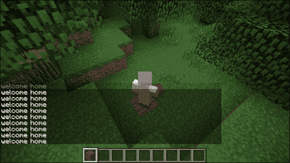

图 2-5 站在门垫上会显示"欢迎归家"的消息。

为了用你的程序对场地进行地理围栏（geo-fence），你需要对场地角落的坐标有准确的记录，这样你就可以将这些数字输入到 Python 程序中。

实现这一点最简单的方法是运行之前的`whereAmI.py`程序，然后让你的玩家运行到场地的每个角落，获取每个角落的 x、y 和 z 坐标。在纸上画出你正在构建的内容的草图，并将坐标写在草图上。编写程序时你需要这些坐标。记住，当玩家向南移动时，z 坐标会变大，向北移动时会变小，正如你在图 2-1 中所看到的那样。

在图 2-9 中，你可以看到我在写这本书时构建的场地坐标。我写下了四个角落的坐标，因为我需要它们来计算 x 方向和 z 方向上的最小值和最大值。注意最小坐标位于我场地的左上角，但如果你构建场地时玩家面向的方向相反，那么你的场地情况可能会不同。

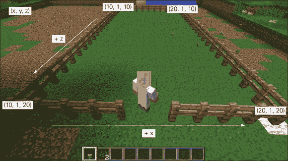

图 2-9 现在你已经有了场地角落的坐标，就可以进行地理围栏了。

你的地理围栏程序需要四个数字。首先，你需要知道最小和最大的 x 坐标，所以根据你的图表算出它们。在上一个例子中，最小 x 是 10，最大的 x 是 20。我将最小 x 坐标称为`X1`，最大的 x 坐标称为`X2`。

接下来你需要算出最小和最大的 z 坐标。在示例中，最小 z 是 10，最大的 z 是 20。我将最小 z 坐标称为`Z1`，最大的 z 坐标称为`Z2`：

```
X1 = 10
Z1 = 10
X2 = 20
Z2 = 20
```

以相同的方式为你的最大和最小坐标编号，因为你会在下一步——编写程序时需要用到它们。

## 编写地理围栏程序

最后一步是编写程序，使地理围栏生效，并在玩家站在场地内时收取租金。这个程序在结构上与`whereAmI.py`程序相似。

你将在这个新游戏中使用**常量**（constants），以便以后移动你的场地。这样，当你移动场地时，就不必在程序中到处寻找需要更改的坐标值了。

编写该程序，请遵循以下步骤：

1. 首先，通过菜单选择文件（File）新建文件（New File），在`IDLE`中打开一个新窗口。

2. 从菜单选择文件（File）中的另存为（Save As），并将文件命名为`rent.py`。


3. 导入此程序所需的模块：

```python
import mcpi.minecraft as minecraft
import time
```

4. 连接到 Minecraft 游戏：

```python
mc = minecraft.Minecraft.create()
```

5. 为地理围栏的四个坐标定义一些常量。确保你使用的是之前算出的坐标。我使用了我在程序中的坐标，但你的可能不同：

```python
X1 = 10
Z1 = 10
X2 = 20
Z2 = 20
```

6. 创建一个变量来记录玩家被收了多少总租金。当游戏开始时，你还没有收取任何租金，所以创建一个名为 `rent` 的新变量并将其设置为零：

```python
rent = 0
```

7. 使用 `while` 语句创建主游戏循环。你的程序每秒循环一次，所以使用 `sleep` 语句让它每次循环延迟 1 秒。每次循环时延迟短时间会让程序运行变慢一点，同时也为你提供了一个方便的方法来计时玩家在场地内停留的时间。稍后，你将在每次游戏循环时给`rent`变量加 1，由于你已经在循环顶部添加了一秒的延迟，这意味着租金每秒将增加 1。确保此时此的缩进正确：

```python
while True:
    time.sleep(1)
```

8. 要检查玩家是否在地理围栏区域内，你需要知道他们的位置。就像在你之前的程序中一样，使用`player.getTilePos()`来：

```python
pos = mc.player.getTilePos()
```

9. 你现在到了程序最重要的部分。在这里，你引导程序使用之前算出的四个坐标来判断玩家是否站在场地内，如果是，则向他收取租金并通过向聊天框发送消息来通知他。要这样做，请输入：

```python
if pos.x>X1 and pos.x<X2 and pos.z>Z1 and pos.z<Z2:
    rent = rent+1
    mc.postToChat("You owe rent:"+str(rent))
```

再次保存程序，并通过菜单选择运行（`Run`）模块（`Run Module`）来执行。

尝试让玩家进出场地会很有趣。当他在场地内时，聊天框每秒会出现一条消息，说明被收了多少租金。当他离开场地时，将不会收取租金。你的程序还会记得被收了多少租金，所以当你再次回到场地时，它不会忘记你已经欠了多少钱。

# 移动玩家

有一种方法可以让你的游戏更具挑战性和趣味性，涉及到 Minecraft API 的另一个功能，你会在游戏创作中发现它有用——将玩家移动到 Minecraft 世界的不同位置！要这样做，你需要修改现有的`rent.py`程序，如果玩家在场地内停留超过三秒，他就会被弹出场外。

```python
inField = inField+1
else: # not inside the field
    inField = 0
```

5. 在程序末尾添加一些额外的代码，如果玩家在区域内停留超过三秒，就将其弹射到空中并移出区域。重力会让他掉到地上，他必须再次跑回区域内。这段代码直接放在程序的末尾。`if` 必须缩进一层，因为它是 `while True` 循环的一部分，而属于 `if` 的语句必须相对于程序左侧缩进两层。输入以下内容：

```python
if inField>3:
    mc.postToChat("Too slow!")
    mc.player.setPos(HOME_X, pos.y + HOME_Y, HOME_Z)
```

6. 保存你的程序，并使用编辑器菜单中的“运行（`Run`）⇒ 运行模块（`Run Module`）”来运行它。

现在你应该觉得玩这个游戏很有趣了，因为你必须仔细计划策略，进出区域之间穿梭，以避免被弹射到空中！（参见图 2-10）。现在，像之前一样，选择各种物体并将它们随机散布在区域周围。挑战你自己和朋友，尽可能“收集”（即破坏）尽可能方块，同时产生尽可能少的租金账。

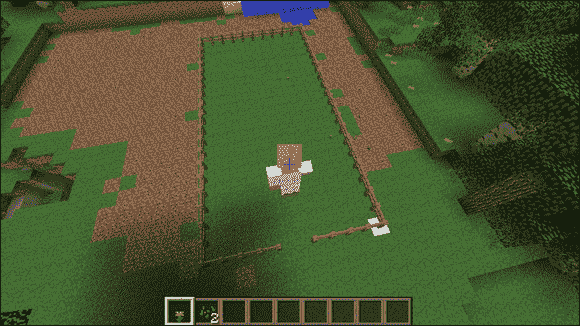

图 2-10 当玩家在区域内停留太久时，会被弹到天空。

# 追踪玩家的进阶冒险

在这次冒险中，你学习并实践了游戏循环的基础知识，利用感知和地理围栏创建了一个有趣的游戏。当你制作游戏时，让你的朋友家人来玩并并他们他们喜欢或不喜欢的地方是一个好主意。这是获取反馈帮助你改进游戏的好方法。

* “欢迎回家”游戏有一个问题：如果玩家站在门垫上，它会反复说“欢迎回家”并填满聊天框。你能想到一种修改此程序的方法，让它在你进入房子时只说一次“欢迎回家”吗？
* 产生有趣游戏想法的一个好方法是玩其他游戏，看看它们是如何吸引玩家留的。玩许多其他电脑游戏，并就玩家位置的变化，列出尽可能多的一个游戏可以做的不同事情。
* 在互联网上搜索“地理围栏（geo-fencing）”，看看是否能找到它在工业中有效使用的某些方法。如果这些想法中有任何引起了你的兴趣，可以尝试编写一个 Minecraft 程序，根据你在这次冒险中学到的知识编写自己的简单游戏，运用其中的某些方面。

## 快速参考表

| 命令 | 说明 |
| :--- | :--- |
| `import mcpi.minecraft as minecraft` | 导入 Minecraft API |
| `mc = minecraft.Minecraft.create()` | 创建与 Minecraft 的连接 |
| `pos = mc.player.getTilePos()` | 获取玩家的方格位置 |
| `mc.postToChat("Hello Minecraft")` | 向 Minecraft 聊天框发送消息 |
| `mc.player.setPos(x, y, z)` | 设置玩家的方格位置 |

 成就解锁：创建了一个随你的玩家移动而变化的有趣游戏。

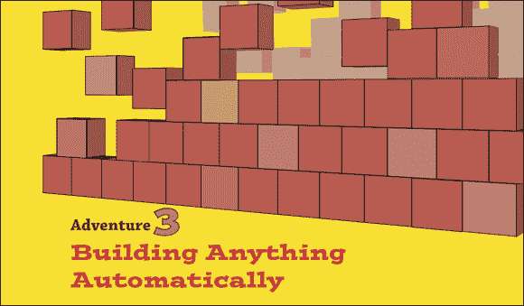

在 Minecraft 中建造东西是非常有趣的的。你可以建造几乎任何你梦想到的东西，仅限于 Minecraft 世界的大小和你的想象力。你可以建造房屋、城堡、地下水道、带有游泳池的多层酒店，甚至是整个城镇和城市！但是建造具有许多类型方块的复杂物体可能需要大量的时间和努力，特别是当有大量重复工作时。如果你能自动化某些任务呢？那看起来不像魔法吗？

像 Python 这样的编程语言是自动化复杂任务的理想选择。在这次冒险中，你将学习一些魔法，它允许你在 Minecraft 世界中自动建造大量方块，然后循环这些指令来建造巨大的结构，例如整条街（参见图 3-1）。当你的朋友走过一排排房屋时，他们会对你巨大的创作感到惊讶，并好奇你是如何建造这些结构的！你还学习了在程序首次运行时从键盘读取数字，这使你能够编写用户可以在不更改你的程序代码的情况下更改的程序！

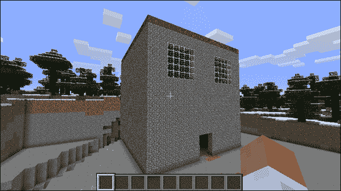

图 3-1 用 Minecraft 方块建造的房子

# 创建方块

Minecraft 世界中的每种类型的方块都有自己的方块 ID。你可以建造几乎任何你梦想到的东西，仅限于 Minecraft 世界的大小和你的想象力。你可以建造房屋、城堡、地下水道、带有游泳池的多层酒店，甚至是整个城镇和城市！但是建造具有许多类型方块的复杂物体可能需要大量的时间和努力，特别是当有大量重复工作时。如果你能自动化某些任务呢？那看起来不像魔法吗？

像 Python 这样的编程语言是自动化复杂任务的理想选择。在这次冒险中，你将学习一些魔法，它允许你在 Minecraft 世界中自动建造大量方块，然后循环这些指令来建造巨大的结构，例如整条街（参见图 3-1）。当你的朋友走过一排排房屋时，他们会对你巨大的创作感到惊讶，并好奇你是如何建造这些结构的！你还学习了在程序首次运行时从键盘读取数字，这使你能够编写用户可以在不更改你的程序代码的情况下更改的程序！

你现在应该能看到玩家附近有一块石头方块！（如果你没有看到那块石头，你可能需要转动玩家才能看到它。）你刚刚编写了 Minecraft 世界，在你面前创建了一个方块。从这些简单的开始开始，你现在可以通过编程 Minecraft 来自动创建一些非常有趣的结构了。

# 构建多个方块

从这个基础开始开始，你可以构建任何东西！你现在可以扩展你的程序来构建多个方块。当你使用 Minecraft 方块进行构建时，唯一需要记住的是，你需要使用简单的数学来计算你想创建的每个方块的坐标。

你现在将扩展你的`build.py`程序，在玩家面前再创建五个方块，每个你想创建的方块使用一个`setBlock()`。你准备编写的程序将创建一个看起来像骰子点点的结构。要实现这一点，请按照以下步骤操作：

1. 从编辑器菜单中选择文件 ⇒ 另存为，并将程序保存为`dice.py`。
2. 在程序末尾添加这些行：

```python
mc.setBlock(pos.x+3, pos.y+2, pos.z, block.STONE.id)
mc.setBlock(pos.x+3, pos.y+4, pos.z, block.STONE.id)
mc.setBlock(pos.x+3, pos.y, pos.z+4, block.STONE.id)
mc.setBlock(pos.x+3, pos.y+2, pos.z+4, block.STONE.id)
mc.setBlock(pos.x+3, pos.y+4, pos.z+4, block.STONE.id)
```

3. 保存程序并运行它。你应该能在玩家面前看到一个看起来像骰子上六个点的简单结构！（参见图 3-2。）

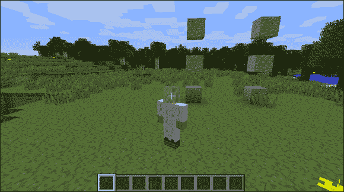

图 3-2 玩家面前 Minecraft 骰子显示了六个石头点。

# 使用 for 循环

使用单个方块构建允许你构建喜欢的任何东西，但这有点像在计算机屏幕上手工绘制复杂的图片，一个点一个点地画。你需要一种可以重复方块的方法，这样你就可以在不增加程序规模的情况下构建更大的结构。

幸运的是，和任何编程语言一样，Python 有一种名为“循环”的功能。你已经在冒险 2 中通过`while True:`游戏循环遇到过循环。循环只是在 Python 这样的编程语言中多次重复某事的方法。你在这里使用的循环被称为`for`循环，有时被称为计数循环，因为它会计数固定次数。

## 使用 for 循环构建多个方块

要理解`for`循环是如何工作的，请按照以下步骤使用 Python Shell 尝试运行一下：

1. 点击 Python Shell 窗口，就在最后一个`>>>`提示符的右侧。
2. 输入以下内容并按下键盘上的回车键：

```python
for a in range(10):
```

Python 还没有执行任何操作，因为它在等待属于循环的程序语句（这些通常被称为循环体）。

3. Python Shell 会自动为你下一行缩进一个级别，这样 Python 就知道你的`print()`语句属于`for`循环。现在输入这个`print()`语句：

```python
print(a)
```


按两次回车键。第一次按下标记了`print()`语句的结束；第二次按下告诉 Python Shell 你已经完成了循环。

你现在应该能在 Python Shell 屏幕上看到打印出的 0 到 9 的数字。

## 使用 for 循环构建一座巨塔

你想在 Minecraft 世界中用方块建造一座巨大的塔吗？既然你已经了解了`for`循环，你就可以做到。只需按照以下步骤操作：

1. 从菜单中选择文件 ⇒ 新建文件开始编写新程序。从菜单中选择文件 ⇒ 另存为，并将其命名为`tower.py`。
2. 像往一样，导入你需要的模块：

```python
import mcpi.minecraft as minecraft
import mcpi.block as block
```

3. 连接到 Minecraft 游戏：

```python
mc = minecraft.Minecraft.create()
```

4. 如果你在玩家所在的地方建造塔，会更容易找到，所以你的首要任务是通过输入识别玩家的位置：

```python
pos = mc.player.getTilePos()
```

5. 你的塔将有 50 个方块高，所以用一个计数 50 次的`for`循环开始构建。不要忘记行尾的冒号（`:`）：

```python
for a in range(50):
```

6. 下一行被缩进，因为它属于`for`循环的体。

你刚刚创建的这个程序奇妙之处在于，它允许你随时走到 Minecraft 的任何位置，并清理一个 50x50x50 的区域；只需从菜单中选择“运行 ⇒ 运行模块”并运行程序，附近的树木、山脉和一切都会在你眼前奇迹般地消失！

在 Minecraft 世界中移动并重新运行你的程序，就可以在玩家前方清理出大量空间。

## 从键盘读取输入

你对`clearSpace.py`程序可以做的另一项有用操作是让它能够轻松地更改清理区域的大小。这样，如果你只想建造一个小型结构，就可以清理一个较小的空间；但如果你知道自己要建造许多大型结构，就可以先清理出一块巨大的空间。

为了实现这一点，你将使用一种名为`input()`的新 Python 语句来先从键盘读取一个数字。然后，你可以前往 Minecraft 世界的任何部分，运行程序，并只需输入一个代表你想清理的区域大小的数字；你的程序就会为你清理掉所有空间。这意味着每当你想在 Minecraft 世界中清理不同大小的区域时，都不需要反复修改程序。

现在你已经理解了`input()`的作用，是时候把它加入程序了。要做到这一点，你只需要对`clearSpace.py`程序进行两处微小的修改。按照以下步骤操作：

1. 使用`input()`要求用户输入一个代表清理空间大小的数字，并将该数字存储在一个名为`size`的变量中。就像在冒险 2 中你使用`str()`将内容转换为字符串一样，在这里你使用`int()`将`input()`返回的字符串转换为可以进行计算的数字。尝试不带`int()`运行这一行看看会发生什么！只输入加粗标记的新行：

```python
pos = mc.player.getTilePos()
size = int(input("size of area to clear?"))
```

2. 修改`setBlocks()`那一行，使其不再使用数字 50，而是使用你的新变量`size`：

```python
mc.setBlocks(pos.x, pos.y, pos.z,
pos.x + size, pos.y + size, pos.z + size,
block.AIR.id)
```

3. 保存程序，并通过菜单中选择“运行 ⇒ 运行模块”来运行。

现在移动到 Minecraft 世界中有很多树木或山脉的地方。在提示时向 Python Shell 窗口输入一个数字——也许选择 100 之类的数字——然后按下键盘上的 Enter 键。玩家附近所有的树木和山脉应该奇迹般地消失，正如图 3-4 所示，你将拥有良好的空间来建造其他结构！

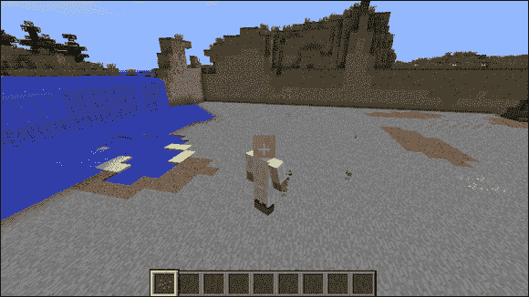

FIGURE 3-4 运行`clearSpace.py`后，你获得了一个巨大的空旷区域来建造更精彩的结构！

保留这个小工具程序，因为当你以后需要在 Minecraft 世界中清理一点空间时，它会很有用。

## 建造房屋

在生存模式下玩 Minecraft 时，你需要做的事情之一就是为玩家建造一个避难所，保护他免受 Minecraft 夜晚潜伏的危险。如果你能按一下按钮就盖房子呢？幸运的是，在为 Minecraft 编程时，你可以将复杂的任务变为仅仅是——按一下按钮。

在`clearSpace.py`程序中，你学习了如何仅用一条编程语句将大量方块设置为相同的方块类型。现在你将学习如何使用相同的技术来快速建造房屋。

建造房屋的一种方法可能是使用不同的`setBlocks()`分别建造每面墙。为此，你需要使用四个独立的`setBlocks()`，并进行大量的数学计算来算出每面墙每个角落的所有坐标。幸运的是，有一种更快的方法建造空心矩形结构：你只需要建造一个巨大的立方体空间，然后再次使用`setBlocks()`并配合稍不同的坐标，用`AIR`方块类型掏空内部。

在继续之前，你需要花一些时间确保理解了与你要建造的房屋设计相关的数学知识，因为你需要正确的坐标来编写程序。图 3-5 显示了房屋设计的草图，并标记了你建造时所需的所有重要坐标。当你建造复杂物体时，在纸上画草图并先算出所有重要坐标是非常重要的。这是一个非常特殊的房子，因为你的 Python 程序会自动计算门口和窗户的大小和位置。稍后你就会明白为什么这很重要了。

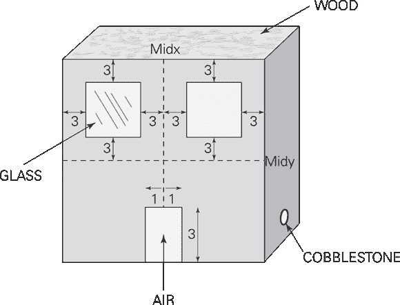

FIGURE 3-5 纸上的房屋设计，带有所有重要的坐标

既然你已经有了房屋的设计，尝试按照以下步骤建造它：

1. 从菜单选择 File ⇒ New File 开始一个新程序。

2. 从菜单选择 File ⇒ Save As 保存程序，并命名为`buildHouse.py`。

3. 导入所需的模块：

```python
import mcpi.minecraft as minecraft
import mcpi.block as block
```

4. 连接到 Minecraft 游戏：

```python
mc = minecraft.create()
```

5. 使用常量表示房屋的大小。在代码中使用常量代替数字`20`可以让你更容易更改房屋的大小：

```python
SIZE = 20
```

6. 获取玩家的位置以便在附近建造房屋：

```python
pos = mc.getTilePos()
```

7. 将玩家的 x、y、z 坐标存储在新变量中。这使得接下来的几个语句更容易编写，并且房屋将建造在玩家上方：

```python
x = pos.x+2
y = pos.y
z = pos.z
```

8. 计算名为`midx`和`midy`的变量，它们是房屋正面的中心点。这让你以后更容易算出窗户和门口的坐标以便当你更改房屋大小时，窗户和门口会改变位置并完美匹配。

```python
midx = x + SIZE/2
midy = y + SIZE/2
```

9. 以 3D 区域建造房屋的外壳。你可以选择任何方块类型，但这里用用岩是一个不错的开始，让它像一座老房子：

```python
mc.setBlocks(x, y, z,
x + SIZE, y + SIZE, z + SIZE,
block.COBBLESTONE.id)
```

10. 现在用空气掏空房屋内部。注意你如何使用设计中的简单数学计算来算出房屋内部空气的坐标，这些是相对于房屋岩石外角的相对坐标：

```python
mc.setBlocks(x + 1, y, z + 1,
x + SIZE - 1, y + SIZE - 1, z + SIZE - 1,
block.AIR.id)
```

11. 再次使用`AIR`方块类型为门口挖出一个空间。在这里不会使用普通的 Minecraft 门，因为这是一座大房子。相反，你创建一个高三块、宽两块的大门。你的门需要位于房屋正面的中间，所以`midx`给了你那个中间的 x 坐标：

```python
mc.setBlocks(midx - 1, y, z,
midx + 1, y + 3, z,
block.AIR.id)
```

12. 使用`GLASS`类型的区块刻出两个窗户。由于这是一座大房子，你将窗户建在距离房屋边缘 3 个方块以及距离房屋正面点 3 个方块的地方。如果你更改了`SIZE`常量并重新运行程序，程序中的所有计算会自动调整所有物体的位置，门口和窗户将处于正确的位置，这样看起来仍然像是一座房子。

```python
mc.setBlocks(x + 3, y + SIZE - 3, z, midx - 3, midy + 3, z, block.GLASS.id)
mc.setBlocks(midx + 3, y + SIZE - 3, z, x + SIZE - 3, midy + 3, z, block.GLASS.id)
```

13. 添加一个木制屋顶：

```python
mc.setBlocks(x, y + SIZE - 1, z, x + SIZE, y + SIZE, z + SIZE, block.WOOD.id)
```

14. 现在，添加一块羊毛地毯：

```python
mc.setBlocks(x + 1, y - 1, z + 1, x + SIZE - 2, y - 1, z + SIZE - 2, block.WOOL.id, 14)
```

你会发现`setBlocks()`的末尾多了一个数字。这个数字设置地毯的颜色；在这种情况下，它是数字 14，代表红色。这在接下来的深入研究代码侧边栏中会有解释。

保存你的程序，然后移动到 Minecraft 世界中一个有空间的地方，通过从菜单选择 Run（运行）⇒ Run Module（运行模块）来运行你的程序。你应该能看到你的房子在眼前奇迹般地物质化！走进去探索一下。抬头看看屋顶，透过窗户向外看，惊讶于你从零开始建造这栋房子有多快！（参见图 3-6）。


图 3-6 这座房子是由 Python 程序自动建造的。

不要忘记`buildHouse.py`总是相对于你玩家的位置来建造房子。在 Minecraft 世界中移动并再次运行`buildHouse.py`来建造另一栋房子。你可以在整个 Minecraft 世界中到处建造房子——这有多酷吗？

# 建造多栋房子

建造一栋房子很有趣，但为什么要停于此呢？回想你在这次冒险之前的`tower.py`程序，很容易编写一个`for`循环来重复固定次数的程序语句。因此，可能通过多次循环你的盖房子程序来建造一整条街的房子，甚至是一整座城镇。

在此之前，你将稍微改进你的盖房子程序，以确保它不会变得过于巨大且难以管理。

## 使用 Python 函数

你以后可能想做的事情是建造一个拥有许多不同设计房子的整个城镇。整个城镇的程序可能会变得很大很复杂，但幸运的是 Python 编程语言中有一个功能可以帮助你将复杂性封装成小的可重用程序代码块。它被称为**函数**。

在将你正在使用的`buildHouse.py`程序改为使用函数建造房子之前，尝试在 Python Shell 中尝试一些函数，以确保你理解这个概念：

1. 点击 Python Shell 窗口将其置于顶。
2. 在 Shell 窗口中输入以下内容，定义一个名为`myname`的新函数：

```python
def myname():
```

`def`表示“定义一个新函数，这里是它的名字”。就像早的`while`、`if`和`for`语句一样，你必须在行尾加一个冒号（`:`），这样 Python 知道预期你提供其他程序语句作为该函数的体。
3. Python Shell 会自动为你缩进下一行，这样 Python 就知道它们是函数的一部分。输入几行`print`语句，打印你的名字和关于你的信息。当你输入每行时发现什么都没有发生，不要感到惊讶；这是正确的。耐心等待，一切很快就会明朗的！

```python
print("my name is David")
print("I am a computer programmer")
print("I love Minecraft programming")
```

4. 按两次键盘上的 Enter 键，Python Shell 会识别到你已经完成了缩进语句的输入。
5. 通过输入它的名称并带有括号来要求 Python Shell 运行此函数：

```python
myname()
```

6. 尝试多输入几次`myname()`看看发生了什么。

起初，你向 Python Shell 输入指令但什么都没有发生，这可能有点奇怪。通常当你在 Python Shell 中输入时，事情一输入就会发生，为什么不起作用？这次你做了一些不同的事情：你“定义”了一个名为`myname`的函数并让 Python 记住那些语句。现在，每当你输入`myname()`，它就会运行那些存储的语句。

保存你的程序，然后移动到 Minecraft 世界中空间足够的地方，并运行程序。如图 3-7 所示，你应该能看到一条一眼望不到的、由五栋房屋组成的街道！控制玩家进入每栋房子，确保它们都已正确建造。

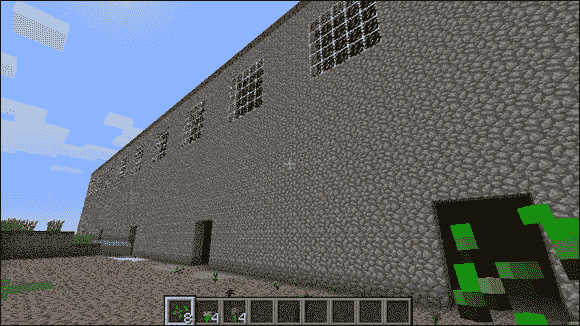

图 3-7 用 Python 程序自动建造的由五栋相同房屋组成的街道

# 添加随机地毯

到此时，你的 Minecraft 世界中应该已经有了大量的房子，而且看起来非常棒。仅仅通过几行 Python 代码，你已经建造了一些大型工程结构！

然而，你可能觉得有一整条完全相同的房屋开始显得有些单调了。你该如何让这些房屋略有不同，从而为你的街道增添趣味呢？

其中一种方法是编写几个不同的`house()`函数，例如`cottage()`、`townHouse()`甚至`maisonette()`，并修改你的程序在不同地方使用这些不同的函数，为你的街道设计增加一些多样性。

另一种让你的结构更有趣的方法是稍微改变它们的部分（例如地毯），让它们在每次运行程序时都不同。这样一来，即使是你——这个程序员，在探索完所有的房子之前，也不会完全知道自己到底创造了什么！

### 生成随机数

计算机是非常精确的机器。在日常生活的许多方面，我们都依赖计算机的可预测性，让它在每次程序运行时都执行相同的操作。当你向银行账户存入 £10 时，你希望确保每次都能准确地将 £10 进入存储余额的计算机内存部分，且万无一失。因此，对于这样一个精确的系统来说，随机性的概念似乎非常反常。

然而，随机性真正重要的一个领域是游戏设计。如果游戏每次执行的操作都完全相同，它们将变得太容易玩——毫无趣味或挑战性。你玩的几乎每一款电脑游戏都包含某种随机性，让每次的情况都略有不同，从而保持你的兴趣。

幸运对于你的 Python 编程来说，Python 语言有一个内置模块可以为你生成随机数，所以你不需要自己编写代码；只需使用这个内置的随机数生成器即可。

为了确保你了解这些随机数是什么样的，请在 Python Shell 中尝试一下：

1. 点击 Python Shell 窗口使其置于顶层。
2. 导入`random`模块以便使用内置的随机函数，输入：

```python
import random
```

3. 让程序生成一个 1 到 100 之间的随机数并打印到屏幕上：

```python
print(random.randint(1,100))
```

你应该看到屏幕上出现一个 1 到 100 之间的数字。再次输入`print`语句。这次你得到了什么数字？
4. 现在使用`for`循环打印许多随机数。确保对第二行进行缩进，这样 Python 才会知道`print`语句是`for`循环的一部分：

```python
for n in range(50):
    print(random.randint(1,100))
```

`randint()`函数括号内的两个数字告诉它你想要它生成的数字范围；`1`是你预期它生成的最小数字，`100`是最大的数字。

## 铺设地毯

在之前的冒险中，你在`setBlocks()`函数中使用了一个额外的数字，通过`WOOL`的额外数据将羊毛地毯的颜色设为红色。`WOOL`允许的额外数据数字范围是 0 到 15——换句话说，有 16 种颜色可以选择。现在按照以下步骤修改你的房屋建造程序，生成一个随机数，并将其作为房屋内地毯`WOOL`的颜色：

1. 通过菜单中的文件 ⇒ 另存为 保存你的`buildStreet.py`，并命名为`buildStreet2.py`。
2. 在程序顶部添加此导入语句以获取随机数生成器的访问：

```python
import random
```

3. 修改你的`house()`函数，使其每次被调用时都生成一个随机的地毯颜色。由于`WOOL`可以具有 0 到 15 之间的额外数据值，这就是你需要生成的随机数范围。将随机数存储在变量`c`中，这样铺设地毯的行就不会变得太长且难以阅读，并确保这两行都正确地缩进，因为它们都是`house()`函数的一部分：

```python
c = random.randint(0, 15)
```


`mc.setBlocks(x+1, y+1, z+1, x+SIZE-1, y+1, z+SIZE-1, block.WOOL.id, c)`

```
4. 保存你的程序。
```

现在，你需要在 Minecraft 世界中找一个有足够空间建造更多的房子！

- 列出其他你可能对你的街道进行随机化的项目。也许你可以通过走在你自己的街道上做些研究，看看房子之间有何不同。定义更多的房屋函数，每种类型一个，并尝试构建具有许多不同风格房屋的更复杂的街道。
- 和朋友们聚在一起，将你所有不同的房屋建筑程序合并成一个大程序。用它在你的世界里建立一个由不同风格房屋组成的整个社区。当你走在新镇里闲逛时，惊叹于房屋设计的丰富多样性吧！


成就解锁：Minecraft 中卓越建筑的设计师和惊人巨型结构的建造者！

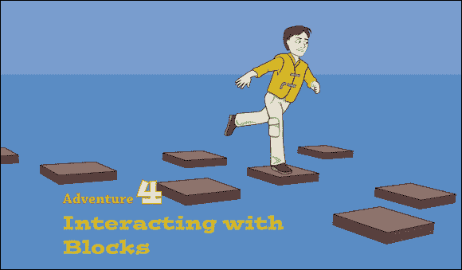

让 Minecraft 游戏变得更有趣的一种方法是让它根据玩家周围发生的情况来改变行为。当你在游戏世界中移动时，你面临的选择取决于你已经做过了什么，这使得游戏每次玩起来都略有不同。Minecraft API 允许你通过查找你正站在哪个方块上以及检测何时用剑击中方块来与方块进行交互。

在这场冒险中，你首先将通过编写一个魔法桥程序来学习与方块交互的基础知识。这座桥很特别，因为当你走在水面上或进入空中时，一座桥会魔法般地出现在你面前确保你的安全。很快，你的 Minecraft 世界将布满桥。你的魔法桥建造器版本 2 将使用 Python 列表来记住你在哪里建造了桥，并在你再次落在安全地面时，让它在你的眼前表演消失术！

最后，你将学习如何感知方块是否被击中，然后使用你的魔法桥构建一个令人兴奋的寻藏游戏，寻找并收集随机出现在空中的宝藏，并配备制导信标和计分系统。

在这场冒险中，你的工作就像一个真正的软件工程师，一个函数一个函数构建一个大型程序，最后在最后将它们缝合在一起，成为一个令人兴奋的大程序。系好安全带，仔细注意指令。这将是一段通往天空的精彩之旅！

# 找出你正站在哪里

你已经在冒险 2 中学习过，通过读取 `getTilePos()` 的坐标可以追踪玩家的位置。这些坐标代表了 Minecraft 世界中你的玩家 Steve 此时所在位置的 `x`、`y` 和 `z` 坐标。你使用这些坐标来感知 Steve 是否站在一个魔法地垫上，或者使用地理围栏（geo-fencing）判断他是否站在田野里。

然而，除非你的程序维护了 Minecraft 世界中每个方块精确位置的详细地图，否则随着程序变得越来越复杂，仅通过位置进行感知将不够灵活。你始终可以维护自己的详细地图——但既然 Minecraft 已经在计算机内存中存储了这些信息以便在屏幕上显示 3D 世界，为什么要费那个劲呢？

幸运的是，Minecraft API 还包含一个 `getBlock()` 函数。该函数让你完全访问 Minecraft 的内存世界地图，通过坐标，你可以用它获取每一个方块的信息——不仅是 Steve 所在的方块，而是 Minecraft 世界中每个位置的每一个方块。

你还在冒险 3 中看到，通过方块类型可以更改 Minecraft 世界中的任何方块。幸运的是，`setBlock()` 和 `getBlock()` 是成对工作的，所以如果你用 `setBlock()` 使用一个方块 ID，紧接着使用 `getBlock()`，你就会得到相同的方块 ID。

很快你将在 Minecraft 中构建另一个令人兴奋的游戏，但你的程序将会很大。构建大型程序的最佳方法是先构建小程序，一旦确定它们可以工作，再将它们全部组合在一起。让我们从一个简单的程序开始让这个想法变为现实，它会告诉你玩家是否正站在安全的地方。

## 找出你的脚是否踩在地上

启动 Minecraft 和 IDLE，如果你在 PC 或 Mac 上操作，也请启动服务器。到目前为止你应该已经练习过启动这些内容了，但如果你需要任何提醒，请参考冒险 1。你现在将构建一个程序，提供关于玩家精确位置的重要信息。在建造通往空的魔法桥之前，你需要先找出他的脚是否踩在地上。

1. 通过选择文件 ⇒ 新建文件（File ⇒ New File）创建一个新窗口。将你的新程序保存为 `safeFeet.py`。记得将你的程序存储在 `MyAdventures` 文件夹中，否则它们无法运行。
2. 导入必要的模块。你需要普通的 `minecraft` 模块，由于你正在与方块交互，还需要 `block` 模块。你需要一个小的延时来降低速度，所以还要导入 `time` 模块：

```
import mcpi.minecraft as minecraft
import mcpi.block as block
import time
```

3. 连接到 Minecraft 游戏：

```
mc = minecraft.Minecraft.create()
```

4. 由于你计划以后在更大的程序中使用此程序的部分，你把大部分代码写在一个名为 `safeFeet` 的函数内部。这使得代码更易复用。该函数的第一件事是获取玩家的位置：

```
def safeFeet():
    pos = mc.getTilePos()
```

5. `getBlock()` 获取你提供的坐标处的方块 ID。因为 `pos.x`、`pos.y` 和 `pos.z` 是玩家的坐标，你必须使用 `pos.y-1` 来获取脚下的方块：

```
b = mc.getBlock(pos.x, pos.y-1, pos.z)
```

6. 你现在使用一种简单的方法判断玩家是否安全。如果他站在空气或水中，则是不安全的。否则，是安全的。通过方块类型来检查"不安全"的情况更简单，因为你需要检查的"安全"区块有很多。这是一段很长的代码，确保将其写在一行：

```
if b == block.AIR.id or b == block.WATER_id.id..ING.id:
```

7. 如果方块是不安全块之一，向 Minecraft 聊天框发送一条消息说玩家不安全。否则，是安全的。

```
mc.postToChat("not safe")
else:
    mc.postToChat("safe")
```

8. `safeFeet()` 函数到此结束。留一个空行提醒自己这是函数的结束，然后在没有任何缩进的情况下启动 `while` 循环。像之前的程序一样，你设置了一个短延时，最后调用新的 `safeFeet()` 函数完成所有工作：

```
while True:
    time.sleep(0.5)
    safeFeet()
```

现在选择文件 ⇒ 保存（File ⇒ Save）保存你的程序，然后从编辑器菜单选择运行 ⇒ 模块（Run ⇒ Module）来运行它。

当你的玩家在 Minecraft 世界中移动时发生了什么？你应该能在 Minecraft 聊天框中根据情况看到"safe"或"not safe"字样，如图 4-1 所示。尝试在飞行和在海中游泳看看发生了什么。

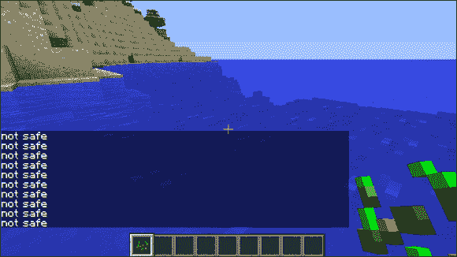

图 4-1 `safeFeet` 程序显示你在空中时是不安全的。

## 构建魔法桥

在之前的程序中，你编写了代码来检测玩家正下方的方块并在聊天框中发送消息。这是向更大型程序迈出的有趣的一小步，但让我们看看你现在是否能通过你在冒险 3 中学到的技巧，结合 `setBlock()` 函数，将这个实验转化为现实中的东西。

通过对 `safeFeet.py` 进行细小的修改，你可以将其变成一个魔法桥梁建造者，无论你走到哪里，它都会在你的脚下放置一个玻璃桥，确保你的玩家永远不会掉进海里或从空中坠落！你将在该冒险的后续程序中重用这个新函数，因此请确保将其命名正确。

1. 选择文件（File）⇒ 另存为（Save As），并将你的 `safeFeet.py` 程序重命名为 `magicBridge.py`。
2. 修改 `safeFeet()` 函数的名字，将其改为 `buildBridge()`，并按照**加粗**标记的内容修改 `if`/`else` 语句，移除 `mc.postToChat()` 并将其替换为 `mc.setBlock()`。每当玩家的脚下不安全时，它就会在他脚下建造一座玻璃桥。注意 `if` 语句中的这一长行：

```
def buildBridge():
    pos = mc.player.getTilePos()
    b = mc.getBlock(pos.x, pos.y-1, pos.z)
    if b == block.AIR.id or b == block.WATER_FLOWING.id
        or b==block.WATER_STATIONARY.id:
        mc.setBlock(pos.x, pos.y-1, pos.z, block.GLASS.id)
```

代码中删除了 `else` 和 `mc.postToChat()`，因为它们不再需要了。

3. 如果你造桥的速度太慢，玩家就会掉下去，因此你需要从游戏循环中移除延迟。确保你使用了新的 `buildBridge()` 函数：

```
while True:
    buildBridge()
```

4. 通过编辑器菜单中的文件（File）⇒ 保存（Save）保存你的程序。

运行你的程序并在世界中走动，跳到天空并在水面上行走。当玩家走动时，每当他的脚不在安全的地面上，一座魔法玻璃桥就会出现防止他掉落，如图 4-2 所示。他现在可以在水面上行走了。真是个奇迹！

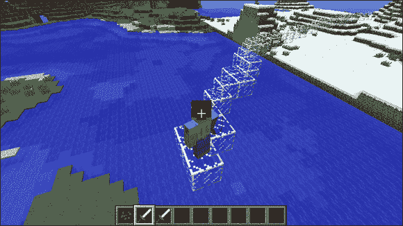

图 4-2 `magicBridge.py` 程序建造了一个玻璃桥，允许玩家在水面上行走。

# 使用 Python 列表作为魔法内存

在目前为止你编写的所有程序中，你使用了某种形式的变量来存储随程序运行而改变的信息。每个变量都有一个名称和一个值，如果你想让程序记住多一件事，你就使用更多的变量。

然而，这些变量的大小是固定的，每个只能存储一个东西（例如，一个数字或一段文本）。在你作为 Minecraft 程序员将编写的许多程序中，你需要存储不确定数量的项目。你并不总是知道想在程序中存储多少个项目。

幸运的是，像任何现代编程语言一样，Python 有一种名为**列表（list）**的特性，它可以随着程序的运行而存储不同数量的数据。

## 实验列表

理解列表的最佳方法是在 Python Shell 中对它们进行实验。

1. 点击 Python Shell 窗口将其置于顶。点击最后一个 `>>>` 提示符右侧的鼠标，那是你开始输入交互式命令的地方。不要忘记你必须通过选择 Python Shell 菜单中的 Shell ⇒ 重启 Shell（Restart Shell），或按下 CTRL 然后 C 来停止正在运行的现有程序。如果你之前的程序仍在运行，接下来的部分将无法工作！
2. 创建一个新的空列表，并显示列表的内容：

```
a = [] # 一个空列表
print(a)
```

3. 向列表添加一个新项，并再次打印：

```
a.append("hello")
print(a)
```

4. 向列表添加第二个项，并再次打印：

```
a.append("minecraft")
print(a)
```

5. 检查列表的长度：

```
print(len(a))
```

6. 查看列表中特定位置的项。这些位置被称为**索引（indexes）**：

```
print(a[0]) # [0] 是第一个项的索引
print(a[1]) # [1] 是第二个项的索引
```

7. 从列表末尾移除一个单词，显示该单词和剩余的列表：

```
word = a.pop()
print(word)
print(a)
```

8. 检查列表的长度，并检查列表的长度：

```
print(len(a))
```

9. 从列表末尾移除一个单词，显示该单词和剩余的列表：

```
word = a.pop()
print(word)
print(a)
```

10. 检查列表的长度，并检查列表的长度：

```
print(len(a))
```

图 4-2 `magicBridge.py` 程序建造了一个玻璃桥，允许玩家在水面上行走。

## 使用列表构建消失桥

你现在将使用关于列表的知识来编写一个桥梁建造者，当玩家脚下安全时，桥就会消失。

1. 选择文件（File）⇒ 新建（New），将其保存为 `vanishingBridge.py`。
2. 导入所需的模块：

```
import mcpi.minecraft as minecraft
import mcpi.block as block
import time
```

3. 连接到 Minecraft 游戏：

```
mc = minecraft.Minecraft()
```

4. 创建一个桥列表。目前还没有桥，所以它是空的：

```
bridge = []
```

5. 定义一个建造桥的 `buildBridge()` 函数。函数开头的大部分代码与 `safeFeet.py` 相同，你可以复制它。

```
def buildBridge():
    pos = mc.player.getTilePos()
    b = mc.getBlock(pos.x, pos.y-1, pos.z)
    if b == block.AIR.id or b == block.WATER_FLOWING.id
        or b==block.WATER_STATIONARY.id:
        mc.setBlock(pos.x, pos.y-1, pos.z, block.GLASS.id)
```

6. 当你建造桥的一部分时，你必须记住你在哪里建造了方块，以便以后移除。使用另一个列表将坐标的三个部分组合在一起。

7. 为了在玩家不再站在桥上时让桥消失，你需要一个 `else` 语句来检查他是否站在玻璃上。如果不是，你的程序将开始从桥中删除方块。程序必须检查桥是否还剩余，否则尝试从空列表中 `pop` 操作时会抛出错误。`elif` 是 `else if` 的缩写，`!=` 表示"不等于"。注意这里的缩进：`elif` 缩进一次，因为它是 `buildBridge()` 函数的一部分；下一个 `if` 缩进两次，因为它是 `elif` 的部分：

```
while True:
    buildBridge()
```

记得你之前向桥列表添加了一个包含三个坐标的列表吗？在这里，你必须使用 `coordinate[0]` 获取 `x`，`coordinate[1]` 获取 `y`，`coordinate[2]` 获取 `z` 来索引该列表。添加 `time.sleep()` 会让桥梁缓慢消失，这样你就能看到这个过程：

```
coordinate = bridge.pop()
mc.setBlock(coordinate[0], coordinate[1], coordinate[2], block.AIR.id)
time.sleep(0.25)
```

9. 最后，编写主游戏循环。就像你之前的实验一样，你可能想在游戏循环中尝试不同的延迟时间，以提高桥梁生成器的可用性。记住，这个游戏循环是主程序的一部分（`while True:` 完全没有缩进），所以务必仔细检查缩进：

```
while True:
    time.sleep(0.25)
    buildBridge()
```

使用文件 ⇒ 保存保存你的程序，然后通过运行 ⇒ 运行模块运行它。在 Minecraft 世界中让你的玩家移动，让他走下悬崖或掉进湖里，然后转过身让他回到安全地面。发生了什么？[图 4-4] 显示，一旦史蒂夫站在安全地上，桥就开始消失。

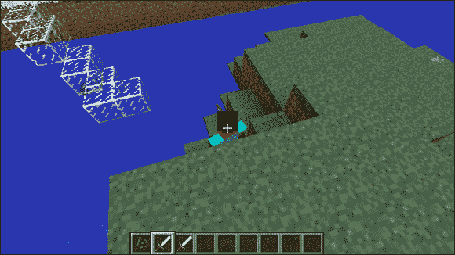

[图 4-4] 一旦你的玩家安全地站在地上，桥就会奇迹地消失。

# 感知方块被击中

你在这次冒险的工具箱中需要的最后一个感知能力是感知玩家何时击中方块的能力。方块击检测让你能够创建自己非常有趣的游戏和程序，因为它允许玩家直接与 Minecraft 世界中的每一个方块交互。要击中方块，你需要在持剑时点击右键。

为这次冒险开启一个新程序，它最初是一个小型的独立实验，但随后会进入你这次冒险的最终游戏。

1. 通过编辑器菜单选择文件 ⇒ 新建文件创建一个新文件。选择文件 ⇒ 另存为，并将新文件命名为 `blockHit.py`。
2. 导入必要的模块：

```
import mcpi.minecraft as minecraft
import mcpi.block as block
import time
```

3. 连接到 Minecraft 游戏：

```
mc = minecraft.Minecraft.create()
```

4. 计算玩家的位置并向一侧稍微移动。以此位置作为你将创建的钻石的位置——这是你的魔法宝藏：

```
diamond_pos = mc.player.getTilePos()
diamond_pos.x = diamond_pos.x + 1
mc.setBlock(diamond_pos.x, diamond_pos.y, diamond_pos.z, block.DIAMOND_BLOCK.id)
```

5. 定义一个名为 `checkHit()` 的函数。你在最终程序中会重用这个函数，所以确保命名正确：


# 编写一个寻宝游戏

在这次冒险的大部分时间内，你都在学习和构建代码段。在这一部分，你也将成为一名真正的软件工程师，编写并测试这个程序。专业的软件工程师通常从一个仅用打印语句构建的简单框架开始，并先测试它以确保结构正确。然后他们在此添加并测试新功能。

你将编写的游戏是“天空狩猎”（Sky Hunt），这是一个随机寻找方块的寻宝游戏。

## 编写函数和主游戏循环

使用以下步骤编写函数和主游戏循环：

1. 通过文件 ⇒ 新建文件开启新文件。通过文件 ⇒ 另存为保存它，并命名为`skyHunt.py`。

2. 导入必要的模块：

```python
import mcpi.minecraft as minecraft
import mcpi.block as block
import time
import random
```

3. 连接到 Minecraft 游戏：

```python
mc = minecraft.Minecraft.create()
```

4. 设置一个得分变量，在游戏过程中跟踪你的分数。你还使用一个`RANGE`常量来设置游戏难度，通过设置随机宝藏距离玩家多远来实现。测试时将其设置为较小的数字，在程序完成后将数字调大：

```python
score = 0
RANGE = 5
```

5. 由于你将分步骤开发和测试此程序，首先为程序的每个功能编写一些空位函数。Python 函数至少包含一个语句，所以你可以在这里使用 Python `print` 语句来打印消息。这只是作为你之后编写代码的占位符：

```python
treasure_x = None # 宝藏的 x 坐标

def placeTreasure():
    print("placeTreasure")

def checkHit():
    print("checkHit")

def homingBeacon():
    print("homingBeacon")

bridge = []

def buildBridge():
    print("buildBridge")
```

## 主游戏循环

6. 现在编写主游戏循环。当游戏运行时，该循环的运行速度非常快（每秒 10 次），这样金块轨迹就足够精确，可以让你在天空中行走；但在测试期间，请将其速度减慢到每秒一次。在这个游戏循环内部，你将使用稍后要写的占位函数。

```python
while True:
    time.sleep(1)
    if treasure_x == None and len(bridge) == 0:
        placeTreasure()
        checkHit()
        homingBeacon()
        buildBridge()
```

7. 使用文件 ⇒ 保存保存你的程序，然后从菜单中点击运行 ⇒ 运行模块来运行它。你的程序不应该有任何错误，目前它应该每秒在 Python Shell 窗口上打印一些消息。你现在已经有了程序的框架，准备好一点一点地开始向其中添加新代码。

## 在空中放置宝藏

你需要编写的第一个函数是在天空中随机位置放置宝藏。你使用三个全局变量来存储宝藏的坐标，它们的初始值为`None`。`None`是 Python 中的一个特殊值，表示变量存在于内存中但没有存储任何内容。你在游戏循环中使用它来检查是否需要生成一个新宝藏。

1. 创建全局变量来跟踪宝藏的位置，添加**加粗**的行：

`treasure_x = None`

`treasure_y = None`

`treasure_z = None`

2. 使用以下代码填充`placeTreasure()`函数（并移除你之前放入的`print`语句）：

```python
def placeTreasure():
    global treasure_x, treasure_y, treasure_z
    pos = mc.player.getTilePos()
```

3. 使用`random`函数将宝藏放置在距离玩家不超过`RANGE`个方块的位置，但设置 y 坐标使其位于玩家上方（这可能会将其放置在空中）：

```python
treasure_x = random.randint(pos.x, pos.x+RANGE)
treasure_y = random.randint(pos.y+2, pos.y+RANGE)
treasure_z = random.randint(pos.z, pos.z+RANGE)
mc.setBlock(treasure_x, treasure_y, treasure_z, block.DIAMOND_BLOCK.id)
```

运行你的程序并测试是否在玩家站在附近的空中生成了一个宝藏。

## 当宝藏被击中时收集

现在你使用`blockHit.py`程序中的代码并进行细微修改，以检测玩家的剑何时击中了宝藏。

1. 从`checkHit()`函数中移除`print`语句，并替换为此处所示的代码。`score`和`treasure_x`变量必须在这里列为全局变量，因为`checkHit()`函数会改变它们的值。Python 要求你在函数内部列出任何你更改其值的全局变量。如果不这样做，你的程序将无法工作：

```python
def checkHit():
    global score
    global treasure_x
```

2. 读取任何方块击中事件，并检查位置是否匹配宝藏的位置：

```python
events = mc.events.pollBlockHits()
for e in events:
    pos = e.pos
    if pos.x == treasure_x and pos.y == treasure_y and pos.z == treasure_z:
        mc.postToChat("HIT!")
```

3. 现在你将告诉程序在击中宝藏时为`score`增加分数，然后删除宝藏使其消失。最后，你必须记住将`treasure_x`设置为`None`（这样`placeTreasure()`稍后就可以创建一个新的随机宝藏）。注意这里的缩进，因为这段代码是`if`语句体的一部分：

```python
score = score + 10
mc.setBlock(treasure_x, treasure_y, treasure_z, block.AIR.id)
treasure_x = None
```

保存并运行你的程序，检查当玩家击中宝藏时它是否消失。你还会发现，当你击中宝藏且它消失时，在玩家附近的随机位置会创建一个新的宝藏。

## 添加制导信标

制导信标每秒在 Minecraft 聊天框中显示一次分值和距离宝藏的大致距离。以下是添加方法。

1. 创建一个`timer`变量。由于主游戏循环最终每秒运行 10 次，你必须每秒计算 10 次循环。这个`timer`可以帮助你完成这一点。如果你更改了游戏循环的速度，也必须调整这个`TIMEOUT`值。请确保将这段代码放在`homingBeacon()`函数上方（注意，这里没有任何缩进）：

```python
TIMEOUT = 10
timer = TIMEOUT
```

2. 移除`homingBeacon()`函数内部的`print()`，并将`timer`列为全局变量，因为该函数需要更改它的值：

```python
def homingBeacon():
    global timer
```

3. 如果`treasure_x`变量有值，则天空中存在宝藏。你必须在这里检查是否已创建宝藏；否则当没有宝藏可找时，会在 Minecraft 聊天框中收到制导信标的消息：

```python
if treasure_x != None:
```

4. 该函数每秒调用 10 次，所以你只需要每秒更新一次制导信标：

```python
timer = timer - 1
if timer == 0:
    timer = TIMEOUT
```

5. 当`timer`超时时（游戏循环每秒调用 10 次），计算出一个你距离宝藏的粗略数字。`abs()`函数找到两个位置之间的绝对值（一个正值）。通过相加所有的正值，你得到一个距离宝藏越远数字越大、距离越近数字越小的数值。检查这里的缩进，因为这段代码属于`if`语句体：

```python
pos = mc.player.getTilePos()
diffx = abs(pos.x - treasure_x)
diffy = abs(pos.y - treasure_y)
diffz = abs(pos.z - treasure_z)
diff = diffx + diffy + diffz
mc.postToChat("score:" + str(score) + " treasure:" + str(diff))
```

保存并运行你的程序，确保制导信标在 Minecraft 聊天框中显示。由于你仍在测试和开发程序，游戏循环设置得较慢，你应该每秒看到一次消息。通过在心里数 1 到 10 来确保这一点。

## 添加你的桥

现在你添加早期`vanishingBridge.py`程序中的桥梁生成器。你只需要对其进行小幅修改，使其检查玩家是否站在金块上，如果不是，则创建一个轨迹。

1. 确保你的`buildBridge()`函数如下所示。与你的`vanishingBridge.py`程序相比，发生变化的行已标记：

```python
bridge = []

def buildBridge():
    global score
    pos = mc.player.getTilePos()
    b = mc.getBlock(pos.x, pos.y-1, pos.z)
    if treasure_x == None:
        if len(bridge) > 0:
            coordinate = bridge.pop()
            mc.setBlock(coordinate[0], coordinate[1], coordinate[2], block.AIR.id)
            mc.postToChat("bridge:" + str(len(bridge)))
            time.sleep(0.25)
    elif b != block.GOLD_BLOCK.id:
        mc.setBlock(pos.x, pos.y-1, pos.z, block.GOLD_BLOCK.id)
        coordinate = [pos.x, pos.y-1, pos.z]
        bridge.append(coordinate)
        score = score - 1
```

接下来，你需要实现`checkHit()`函数的具体逻辑。以下是完整的实现：

```python
def checkHit():
    global score
    global treasure_x
    
    events = mc.events.pollBlockHits()
    for e in events:
        pos = e.pos
        if pos.x == treasure_x and pos.y == treasure_y and pos.z == treasure_z:
            mc.postToChat("HIT!")
            score = score + 10
            mc.setBlock(treasure_x, treasure_y, treasure_z, block.AIR.id)
            treasure_x = None
```

在`homingBeacon()`函数中，你需要完成以下逻辑：

```python
def homingBeacon():
    global timer
    if treasure_x != None:
        timer = timer - 1
        if timer == 0:
            timer = TIMEOUT
            pos = mc.player.getTilePos()
            diffx = abs(pos.x - treasure_x)
            diffy = abs(pos.y - treasure_y)
            diffz = abs(pos.z - treasure_z)
            diff = diffx + diffy + diffz
            mc.postToChat("score:" + str(score) + " treasure:" + str(diff))
```

在`placeTreasure()`函数中，你需要完成以下逻辑：

```python
def placeTreasure():
    global treasure_x, treasure_y, treasure_z
    pos = mc.player.getTilePos()
    treasure_x = random.randint(pos.x, pos.x+RANGE)
    treasure_y = random.randint(pos.y+2, pos.y+RANGE)
    treasure_z = random.randint(pos.z, pos.z+RANGE)
    mc.setBlock(treasure_x, treasure_y, treasure_z, block.DIAMOND_BLOCK.id)
```

使用文件 ⇒ 保存保存你的程序，并使用编辑器菜单中的运行 ⇒ 运行模块运行它。

让你的玩家移动一下直到你能看到钻石。现在，用剑击中它的每一个面。发生了什么？如[图 4-6]所示，当你击中钻石时，Minecraft 聊天框上出现了“HIT”消息。


## 2. 完成程序

恭喜！你已经完成了程序的编写。由于游戏已经可以正常运行了，现在修改游戏循环中的`time.sleep(1)`，使其睡眠 0.1 秒。这将使游戏循环每秒运行 10 次。制导信标中的`timer`会计数这 10 次，因此每秒只在 Minecraft 聊天框中显示一次消息。

保存并运行你的程序。检查在收集宝藏后金色痕迹是否消失，并且每消耗一个金块分数是否会减少。

现在你只需要做的就是享受游戏！看看通过收集宝藏来获得高分有多困难？

图 4-7 显示了 Minecraft 聊天中的分数和寻迹信标显示。

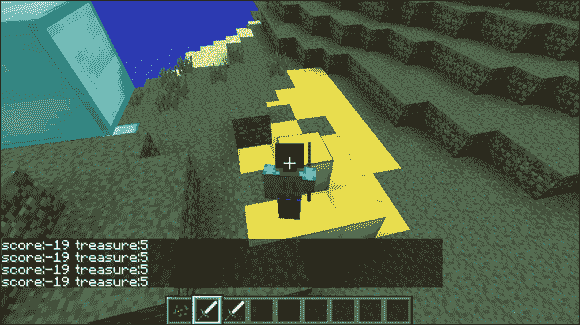

图 4-7 在玩“天空狩猎”时显示关键统计数据的寻迹信标。

## 快速参考表

| 命令 | 说明 |
| :--- | :--- |
| `b = mc.getBlock(10, 5, 2)` | 获取位置的方块类型 |
| `hits = mc.events.pollBlockHits()`<br>`for hit in hits:`<br>`    pos = hit.pos`<br>`    print(pos.x)` | 找出哪些方块被击中 |
| `a = [] # 一个空列表`<br>`a = [1,2,3] # 一个初始化的列表` | 创建列表 |
| `a.append("hello")` | 在列表末尾添加元素 |
| `print(a)` | 打印列表内容 |
| `print(len(a))` | 计算列表大小 |
| `print(a[0]) # 0=第一个, 1=第二个` | 通过索引访问列表中的项 |
| `print(a[-1])` | 访问列表中的最后一个项 |
| `word = a.pop() # 删除最后一个项`<br>`print(word) # 刚刚删除的项` | 从列表中移除最后一个项 |
| `for item in a:`<br>`    print(item)` | 遍历列表中的所有项 |

# 与方块交互的进一步冒险

在这一场冒险中，你已经学习了如何使用`getBlock()`来感知玩家所站的方块，以及如何使用`events.pollBlockHits()`在玩家击中任何方块的任何面时做出反应。你已经在 Minecraft 中构建了一个奇妙且完整的游戏，甚至包含了评分系统！

- 将`RANGE`常数设置为较大的数字，让宝藏生成在离玩家更远的地方。这会让游戏更有难度，因此尝试添加一个新功能，根据玩家距离宝藏的远近在 Minecraft 聊天中显示“冷”、“暖”或“热”。
- 设计一个更好的评分方案，使得在正常玩游戏时能够获得合理的正分。进行大量测试，并确定找到宝藏的最佳分数增分，以及消耗金块的最佳分数扣分。
- 在互联网上研究毕达哥拉斯定理，看看你是否可以编写一个更好的距离估算器，让`homingBeacon()`函数更准确。（悄悄！Martin 在冒险 6 中稍微提到这一点，所以你可以偷看那次冒险，看看你是否能解决它！）


成就解锁：挑战重力法则并在水面上行走的专家——在一次冒险实现了两个奇迹！

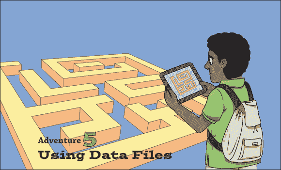

只有当你能够开始处理大量数据时，计算机编程才变得真正有趣。你的程序随后变成一组规则，规定了这些数据如何被读取、处理和视觉化呈现——数据本身变成了真正重要的部分。

在这一场冒险中，你首先将查看如何创建定义迷宫的文本文件。这些迷宫将自动在 Minecraft 世界中为你构建供你和你的朋友解决；你会好奇一个如此小的 Python 程序是如何在 Minecraft 世界中构建出如此巨大的东西的。

然后你将把这个简单的想法发展成一个完整的虚拟 3D 扫描和打印设施，称为“复制室”（duplicator room）。你在复制室内部构建的任何东西都可以保存到文件中，稍后调用，并传送到你 Minecraft 世界中的任何位置，甚至可以加载到其他计算机上的 Minecraft 世界中！你将能够建立自己的对象库，并在 Minecraft 中快速地构建它们，以至于你的朋友都将想要拥有自己的复制机！

# 从文件中读取数据

计算机程序通常并不智能——它们重复地执行你给它们的指令。如果你不更改程序的任何输入，它在每次运行时都将执行完全相同的操作。你一直以来制作的 Minecraft 程序非常具有交互性，因为它们会根据游戏世界中发生的情况来改变行为，而这正是程序的输入。

## 使用数据文件可以做的趣事

另一种让计算机程序在每次运行时执行不同任务的有趣方法是将输入数据存储在文本文件中，并让计算机在启动时读取该文件。然后你可以创建任意数量的文本文件，甚至设置一个菜单，根据你想要对程序的操作来选择打开哪个文件。这被称为“数据驱动程序”，因为定义程序行为的主要是外部文本文件中的数据。

如果你想想，你已经在计算机上使用的许多程序都使用了数据文件。你用来输入作业的文字处理器会将作业存储在数据文件中；当你用数码相机拍照时，照片存储在数据文件中。

## 制作一个提示器

为了学习如何打开和读取文本文件，你将编写一个简单的提示器。这个程序将从文件中读取一个随机提示，并在随机间隔后在 Minecraft 聊天中显示。这样，当你玩游戏时，帮助提示就会出现在聊天窗口中。

1. 在 IDLE 中，通过选择 File ⇒ New File 创建一个新的文件。将文件保存为`tips.txt`。
2. 现在列出五个提示，每条提示使用一行文本。这里是一些 Minecraft 提示，但你自己编写会更有趣。确保在每行的末尾都按了 Enter 键，这样会在文件中每行创建一个`换行符`。（你将在本章冒险中获得更多关于换行符的知识。）

   ```
   在怪物来袭之前给自己盖栋房子
   用流动的水填充水下通道
   向上堆沙然后挖掉底部的方块
   使用第一人称和第三人称视角
   双击空格键飞向天空
   ```

3. 将此文件保存在你的`MyAdventures`文件夹中。你不需要这个文件，因为它不是程序，而是你将告诉 Python 程序使用的文本文件。

现在你已经有一个包含提示的数据文件——换句话说，就是输入数据——是时候编写处理这些输入数据的程序了。

1. 新建文件 File ⇒ New File，然后将其保存为`tipChat.py`。
2. 导入必要的模块：

   ```python
   import mcpi.minecraft as minecraft
   import time
   import random
   ```

3. 连接到 Minecraft 游戏：

   ```python
   mc = minecraft.Minecraft.create()
   ```

4. 为文件名设置一个常量，以便你以后轻松更改读取不同的文件：

   ```python
   FILENAME = "tips.txt"
   ```

5. 以读取模式打开文件（请参阅下文“深入代码”以获取对该行的更详细解释）：

   ```python
   f = open(FILENAME, "r")
   ```

6. 将文件的所有行读取到一个名为`tips`的列表中。记得你之前在冒险 4（魔法桥建造者）中用过列表：

   ```python
   tips = f.readlines()
   ```

7. 在完成后关闭文件。在完成后始终关闭文件是一个良好的习惯，因为当文件处于打开状态时，其他程序无法使用，例如你最初用来向文件中输入文本的编辑器：

   ```python
   f.close()
   ```

8. 现在编写一个游戏循环，让它在三到七秒之间随机等待：

   ```python
   while True:
       time.sleep(random.randint(3, 7))
   ```

9. 现在告诉程序从`tips`列表中随机选择一条消息并在聊天窗口中显示。你需要使用`strip()`函数来剔除不需要的换行符。你之后会学习换行符，所以现在不用太担心理解它。

   ```python
   msg = random.choice(tips)
   mc.postToChat(msg.strip())
   ```

保存并运行你的程序。发生了什么？当你走在 Minecraft 世界中并玩你的游戏时，聊天窗口不时会弹出一个提示，就像图 5-1 所示。注意 Minecraft 聊天窗口如何在屏幕上积累消息，并随着时间的推移它们逐渐消失。

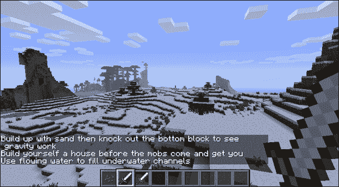

图 5-1 玩 Minecraft 时，聊天窗口弹出随机提示。

# 从数据文件构建迷宫

现在你已经知道如何让程序从数据文件中读取内容，你准备好进行一些冒险尝试了。从之前的冒险中你知道，在 Minecraft 世界中放置方块很容易。但如果你能使用存储在数据文件中的方块列表来构建方块呢？这你在这里要做的正是：你将在 Minecraft 中构建一个完整的 3D 迷宫，其中迷宫数据存储在外部文件中！但首先，你需要决定迷宫数据在文件中如何表示。

你设计的迷宫是 3D 的，因为它们是在 Minecraft 的 3D 世界中构建的，但实际上它们只是由 3D 方块构建的 2D 迷宫——你的迷宫只有一层。这意味着数据文件需要存储迷宫每个方块的`x`和`z`数据，因此它是矩形的。

你需要决定方块本身在数据文件中如何表示。你使用了墙和空气。为了简单起见，用 1 表示墙，用 0 表示空气。你以后可以在 Python 程序中更改用于墙的方块类型。

## 理解 CSV 文件

对于这个程序，你将使用一种特殊的文本文件类型`CSV`文件，将你的迷宫作为计算机文件系统中的文件。

CSV 是一种非常简单且广泛使用的格式。这里是一个 CSV 文件的示例，它存储了数据库中关于 Minecraft 玩家角色的详情的表格部分。在这个 CSV 文件中，文件的第一行（或第一行）是字段名称，所有其他行都是用逗号分隔的数据：

```csv
Name,Handle,Speciality
David,w_geek,Coding in Python
Roma,physics_gurl,Designing big buildings
Ryan,mr_teck,Minecraft robots
Craig,rrrrrrrr,TNT expert
```

这个 CSV 文件有一个表头，包含三个名为`Name`、`Handle`和`Speciality`的字段名。它有四行数据，每行有三个数据字段。

对于你的迷宫数据文件，你不需要表头行，因为表格中的每一列都代表相同类型的数据；即，它存储数字 0 表示空格，存储数字 1 表示墙。你可以从伙伴网站下载这个示例迷宫文件，但如果你想手动输入，在这里：

1. 通过“文件 ⇒ 新建文件”创建一个新的文本文件。使用“文件 ⇒ 另存为”并将文件命名为`maze1.csv`。确保将此文件保存在你的`MyAdventures`文件夹中。
2. 非常仔细地输入以下行，确保每行的列数完全相同。如果你仔细观察这些数据，你应该已经能看出这个迷宫的结构了！每行有 16 个数字，共 16 行，所以可能用铅笔在输入时勾掉每一行，以免弄错位置：

   ```csv
   1,1,1,1,1,1,1,1,1,1,1,1,1,1,1,1
   0,0,0,0,0,0,0,0,0,0,0,0,0,0,0,1
   1,1,1,1,1,1,1,1,1,0,1,0,1,1,0,1
   1,0,0,1,0,0,0,0,1,0,1,0,0,1
   1,1,0,1,0,1,1,0,0,0,1,0,1,1,1
   1,1,0,1,0,1,1,1,1,1,1,0,1,1,1,1
   0,0,1,1,1,1,1,1,0,1,1,1,1,1,1,1
   1,1,1,1,1,1,1,1,1,1,0,1,1,1,1,1
   1,1,1,1,1,1,1,1,1,1,0,1,1,1,1,1
   ```

3. 保存此文件。一旦你编写了读取并处理此数据的 Python 程序，你就会使用它。

## 构建迷宫

现在你有了一个描述迷宫的数据文件，最后一步是编写从该文件读取数据并使用方块构建迷宫的 Python 程序。

1. 使用“文件 ⇒ 新建文件”开始新文件，然后使用“文件 ⇒ 另存为”将其保存为`csvBuild.py`。
2. 导入所需的模块：

   ```python
   import mcpi.minecraft as minecraft
   import mcpi.block as block
   ```

3. 连接到 Minecraft 游戏：

   ```python
   mc = minecraft.Minecraft.create()
   ```

4. 定义一些常量。`GAP`常量用于空格，通常是空气，但你可以尝试不同的方块类型让迷宫变得有趣。`WALL`常量用于构建迷宫墙的方块，请仔细选择，因为某些方块类型不适合做墙。`FLOOR`常量用于构建迷宫所在的层：

   ```python
   GAP = block.AIR.id
   WALL = block.GOLD_BLOCK.id
   FLOOR = block.GRASS.id
   ```

5. 打开包含迷宫数据的文件。使用`FILENAME`常量是为了方便以后更改文件名以读取不同的迷宫文件：

   ```python
   FILENAME = "maze1.csv"
   f = open(FILENAME, "r")
   ```

6. 获取玩家位置并计算迷宫下角的坐标。在`x`和`z`上加 1 可以确保迷宫不会建在玩家头上。如果你愿意，可以改变`y`坐标在空中构建迷宫：

   ```python
   pos = mc.player.getTilePos()

   ORIGIN_X = pos.x + 1
   ORIGIN_Y = pos.y
   ORIGIN_Z = pos.z + 1
   ```

7. `z`坐标在每行数据结束时变化，因此将其初始化为迷宫的起点。它在程序稍后的位置会变化：

   ```python
   z = ORIGIN_Z
   ```

8. 循环文件的每一行。请参见“深入代码”以了解`readlines()`函数的作用。`for`循环实际上是在逐行遍历文件中的每一行。每次循环，`line`变量都持有从文件中读取的下一行：

   ```python
   for line in f.readlines():
   ```

9. 在每个有逗号的地方将行分割成部分。请参见“深入代码”以了解`split()`函数的作用。记住，所有属于`for`循环体内的行都必须缩进一层：

   ```python
   data = line.split(",")
   ```

10. 仔细观察这一步：你现在有了另一个`for`循环。这被称为嵌套循环，因为一个循环在另一个循环内部。你的程序在迷宫每一新行开始时重置`x`坐标，因此这必须在绘制整行的`for`循环之外完成：

    ```python
    x = ORIGIN_X

    for cell in data:
    ```

11. 从行中读取的每个数字实际上都是作为文本片段（字符串）读取的，因此为了让此程序运行，你必须给数字加上引号（`""`）。这个`if`/`else`语句根据刚从 CSV 文件读取的数字来选择是构建一个间隙还是一个墙。`0`构建一个间隙，其他任何数字都会构建一个墙。请确保这里的缩进正确：`if`语句缩进了两次，因为它是`for cell in data`循环的一部分，而该循环又是`for line in f.readlines()`循环的一部分。这里的变量`b`很有用，因为它让程序变得更小、更简单。（试着在不使用`b`变量的情况下重写这部分，看看我是什么意思！）

    ```python
    if cell == "0":
        b = GAP
    else:
        b = WALL

    mc.setBlock(x, ORIGIN_Y, z, b)
    mc.setBlock(x, ORIGIN_Y + 1, z, b)
    mc.setBlock(x, ORIGIN_Y - 1, z, FLOOR)
    ```

12. 在`for cell`循环结束处更新`x`坐标。这必须缩进，以便与之前的`mc.setBlock()`对齐，因为它仍然是`for cell in data`循环体的一部分。

    ```python
    x = x + 1
    ```

13. 在处理每行数据的循环结束处更新`z`坐标（这只需要缩进一层，因为它是`for line in f.readlines()`循环的一部分）。

    ```python
    z = z + 1
    ```


保存你的程序，并双重检查所有的缩进是否正确。如果缩进错误，程序将无法正常运行，你将得到一些形状非常奇怪的迷宫！

运行你的程序，一个奇妙（而且相当难解）的迷宫将在你面前建立。在迷宫中行走，看看你是否可以在不拆除任何墙或不飞行的情况下解决它。图 5-2 显示了迷宫从地面层看的样子。

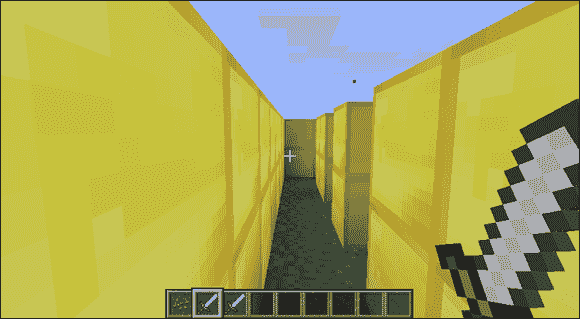

**图 5-2** Minecraft 内部迷宫的地面视图

如果你卡住了，你可以稍微“作弊”，飞到空中以获得迷宫的 3D 鸟瞰视图，如图 5-3 所示。

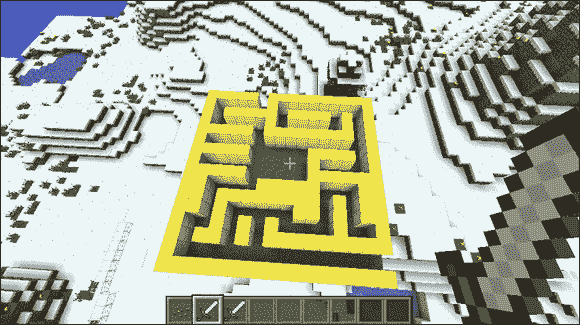

**图 5-3** Minecraft 内部迷宫的鸟瞰视图

# 构建 3D 打印机

迷宫非常有趣，但既然你已经掌握了基础知识，现在你可以用数据文件做更多的事情！为什么要停留在单层上仅使用两种方块类型进行构建呢？你现在将把你的迷宫程序作为你自己的 3D 打印机和 3D 扫描仪的基础，它可以复制树、房屋——事实上，任何你在 Minecraft 中可以构建的东西——并只需点击按钮即可在 Minecraft 世界中到处“打印”它们！这实际上是一个方块构建器，但我喜欢称之为 3D 打印机，因为有时你可以看到方块一行一行地构建，就像电脑打印机一行一行打印到纸上，或者打印机一层一层构建结构一样。

你现在编写程序的能力越来越强了，你编写的每个新程序都比上一个大。就像在之前的冒险中，你用函数构建了程序一样，你也将分步骤构建这个程序。

## 手工制作一个小型测试对象进行 3D 打印

在你的迷宫程序中，数据存储在 CSV 文件中，文件中的每行代表 Minecraft 世界内部的一行方块。该行中的每一列（用逗号分隔）对应该行方块中的一个方块。这是一个 2D 结构，因为它为矩形区域的每个 `x` 和 `z` 坐标存储了一个方块。你在这里构建的迷宫实际上只是 2D 迷宫，因为它们只有一层。它们只是通过 3D 方块构建在 3D Minecraft 世界中。

要构建 3D 形状，你还需要在 `y` 维度上进行构建。如果你将 3D 对象仅视为多层或切片，那么你的 3D 程序与你的迷宫程序没有太大区别。对于一个大小为 5x5x5 方块的立方体，你只需要存储五层信息。

这其中有一个问题。在处理整个文件之前，你的 Python 程序不知道预期会有多少行。它可以假设一个特定的大小，但如果能设计一种可以适用于任何大小对象的灵活 CSV 文件格式将是最好的。

为了解决这个问题，你现在将创建一个如图 5-4 所示的示例来测试你的打印能力。

1. 创建一个新文件，如示例所示选择 `File` -> `New File`，并命名为 `object1.csv`。
2. 输入第一行，对象的尺寸。它是 5x5x5。
3. 第一个数字是 `sizex`（宽度），第二个数字是 `sizey`（高度），第三个数字是 `sizez`（深度）。你需要使用 `int()` 将这些字符串转换为数字。
4. 文件中的后续行代表一层方块。该行中的每一列对应一个方块。
5. 使用 `0` 表示间隙，使用 `1` 表示方块。
6. 确保格式如下：

```csv
5,5,5
1,1,1
...
```

保存该文件，但不要运行它——它不是 Python 程序，而是将被程序使用的数据文件。

既然你已经写好了测试数据，现在是时候编写在 Minecraft 内部构建洞穴的 3D 打印程序了。这个程序与你的迷宫程序非常相似，但它有三个嵌套循环：为 `x`、`y`、`z` 每个维度各一个循环。

1. 创建一个新文件 `File` -> `New File`，并使用菜单中的 `File` -> `Save As` 将其保存为 `printD.py`。
2. 导入必要的模块：

```python
import mcpi.minecraft as minecraft
import mcpi.block as block
```

3. 连接到 Minecraft 游戏：

```python
mc = minecraft.create()
```

4. 创建一个常量作为数据文件的文件名。如果你以后想读取不同的文件，可以轻松更改它：

```python
FILENAME = "object1.csv"
```

5. 定义一个 `print3D()` 函数。你会在最后的项目中重用这个函数，所以请确保命名正确：

```python
def print3D(filename, originx, originy, originz):
```

6. 就像你编写迷宫构建器时一样，以读取模式打开文件并将所有行读取到 Python 列表中：

```python
f = open(filename, "r")
lines = f.readlines()
```

7. 列表中的第一个项索引为 `0`。这是文件中包含元数据的第一行。使用 `split()` 函数将此行拆分成部分。然后将这三个数字存储在变量 `sizex`、`sizey` 和 `sizez` 中。你在这里必须使用 `int()` 函数，因为从文件中读取的内容是字符串，但稍后你需要它们是数字以便进行计算。

```python
coords = lines[0].split(",")

sizex = int(coords[0])
sizey = int(coords[1])
sizez = int(coords[2])
```

8. 设置一个 `lineidx` 变量来记录你正在处理的 `lines[]` 列表中的行索引。由于你的程序会扫描 `lines` 列表并读取 3D 对象不同层的数据，因此你不能将其用作循环控制变量：

```python
lineidx = 1
```

9. 第一个 `for` 循环扫描从文件中读取的每一层垂直数据。文件的前几行对应在最低 `y` 层构建的层。你可以在这里添加一个 `postToChat`，这样在 Minecraft 内部就能看到打印的进度：

```python
for y in range(sizey):
    mc.postToChat(str(y))
```

10. 通过给 `lineidx` 变量加 1 来跳过文件中每层之间的空行。记住，这些空行只存在于文件中以便人类阅读，但你的程序必须跳过它们。

```python
lineidx = lineidx + 1
```

11. 一个嵌套的 `for` 循环，读取文件的下一行并在遇到逗号时对其进行分割。注意这里的缩进；`for` 必须缩进两层（一层针对函数，一层针对 `for y` 循环），而 `for x` 循环内部的代码需要缩进三层。

```python
for x in range(sizex):
    line = lines[lineidx]
    lineidx = lineidx + 1
    data = line.split(",")
```

12. 现在启动第三个 `for` 循环，扫描刚刚读取的行中的每个区块并在 Minecraft 内部构建它们。`for z` 循环缩进三层，循环体缩进四层，因此务必特别注意缩进；否则你将得到形状非常奇怪的对象！

```python
for z in range(sizez):
    blockid = int(data[z])
    mc.setBlock(originx+x, originy+y, originz+z, blockid)
```

13. 最后，输入主程序的代码，这些代码完全没有任何缩进。这些行读取玩家位置，然后要求 `print3D()` 函数在你站的位置的侧面打印你的 3D 对象：

```python
pos = mc.player.getTilePos()
print3D(FILENAME, pos.x+1, pos.y, pos.z+1)
```

保存程序并运行它，看看会发生什么！在 Minecraft 中移动到不同位置并运行程序。每当你运行程序，玩家附近都会生成一个空心的石头岩洞！图 5-5 显示了快速构建许多石头岩洞是多么简单。

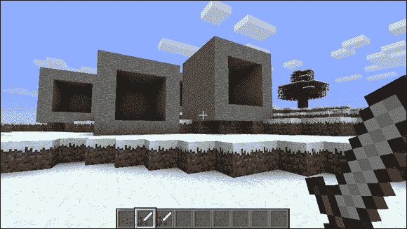

**图 5-5** 在 Minecraft 内部打印许多石头岩洞

# 构建 3D 块扫描器

你的 3D 打印机已经非常强大了。你可以为你想要构建的对象创建一个大型 CSV 文件库，然后每当你需要时，只需带有不同的 `FILENAME` 常量运行 `print3D.py` 程序，将对象盖章到整个 Minecraft 世界。

然而，如果你必须手动向 CSV 文件输入所有数字，构建更大更复杂的对象将变得非常困难。Minecraft 本身是构建复杂对象的最佳程序——那么，如果你可以使用 Minecraft 为你创建这些 CSV 数据文件呢？在这里，你要走向一棵树并抱住它，然后创建一个完全相同的树副本，这样你就可以在整个 Minecraft 世界中复制它。幸运的是，3D 扫描的工作原理类似于反 3D 打印，所以这并没有你想象的那么困难。

1. 通过 `文件 ⇒ 新文件` 创建新文件，通过 `文件 ⇒ 另存为` 保存并将程序命名为 `scan3D.py`。
2. 导入必要的模块：

```python
import mcpi.minecraft as minecraft
import mcpi.block as block
```

3. 连接到 Minecraft 游戏：

```python
mc = minecraft.Minecraft.create()
```

4. 为要扫描的 CSV 文件名和要扫描区域尺寸创建一些常量：

```python
FILENAME = "tree.csv"
SIZEX = 5
SIZEY = 5
SIZEZ = 5
```

5. 定义一个 `scan3D()` 函数。你会在后的程序中使用此函数，所以确保其命名正确：

```python
def scan3D(filename, originx, originy, originz):
```

6. 打开文件，但这次以写入模式打开：

```python
f = open(filename, "w")
```

7. （等待，步骤 7 提供的文本是碎片化的，但根据代码逻辑）：

```python
f.write(str(SIZEX) + "," + str(SIZEY) + "," + str(SIZEZ) + "\n")
```

8. 设置一个 `lineidx` 变量来记录你正在处理的 `lines[]` 列表中的行索引。由于你的程序会扫描 `lines` 列表并读取 3D 对象不同层的数据，因此你不能将其用作循环控制变量：

```python
lineidx = 1
```

9. 第一个 `for` 循环扫描从文件中读取的每一层垂直数据。文件的前几行对应在最低 `y` 层构建的层。你可以在这里添加一个 `postToChat`，这样在 Minecraft 内部就能看到打印的进度：

```python
for y in range(sizey):
    mc.postToChat(str(y))
```

10. 通过给 `lineidx` 变量加 1 来跳过文件中每层之间的空行。记住，这些空行只存在于文件中以便人类阅读，但你的程序必须跳过它们。

```python
lineidx = lineidx + 1
```

11. 一个嵌套的 `for` 循环，读取文件的下一行并在遇到逗号时对其进行分割。注意这里的缩进；`for` 必须缩进两层（一层针对函数，一层针对 `for y` 循环），而 `for x` 循环内部的代码需要缩进三层。

```python
for x in range(sizex):
    line = lines[lineidx]
    lineidx = lineidx + 1
    data = line.split(",")
```

12. 现在启动第三个 `for` 循环，扫描刚刚读取的行中的每个区块并在 Minecraft 内部构建它们。`for z` 循环缩进三层，循环体缩进四层，因此务必特别注意缩进；否则你将得到形状非常奇怪的对象！

```python
for z in range(sizez):
    blockid = int(data[z])
    mc.setBlock(originx+x, originy+y, originz+z, blockid)
```

13. 最后，输入主程序的代码，这些代码完全没有任何缩进。这些行读取玩家位置，然后要求 `print3D()` 函数在你站的位置的侧面打印你的 3D 对象：

```python
pos = mc.player.getTilePos()
print3D(FILENAME, pos.x+1, pos.y, pos.z+1)
```

保存程序并运行它，看看会发生什么！在 Minecraft 中移动到不同位置并运行程序。每当你运行程序，玩家附近都会生成一个空心的石头岩洞！

# 程序框架

要做的第一件事是编写程序的框架，使其所有部分有机地结合在一起。你从一些占位函数开始，这些函数在调用时只会打印自己的名称，然后利用你在其他程序中现有的函数逐步填充它们的细节。你可能记得，这与你在 Adventure 4 中构建寻宝游戏的方法相同。

1. 通过 `File ⇒ New File`（文件 ⇒ 新文件）创建一个新文件并保存为 `duplicator.py`。
2. 导入必要的模块：

```python
import mcpi.minecraft as minecraft
import mcpi.block as block
import glob
import time
import random
```

3. 连接到 Minecraft 游戏：

```python
mc = minecraft.Minecraft.create()
```

4. 为你的复制机器设置一些常量。不要设置得太大，否则复制机会扫描和打印物体将花费太长时间。还要为你的复制房间设置一个初始默认位置：

```python
SIZEX = 10
SIZEY = 10
SIZEZ = 10

roomx = 1
roomy = 1
roomz = 1
```

5. 为该程序需要的所有功能定义一些占位函数。你很快就会填充这些函数的细节：

```python
def buildRoom(x, y, z):
    print("buildRoom")

def demolishRoom():
    print("demolishRoom")

def cleanRoom():
    print("cleanRoom")

def listFiles():
    print("listFiles")

def scan3D(filename, originx, originy, originz):
    print("scan3D")

def print3D(filename, originx, originy, originz):
    print("print3D")
```

6. 占位菜单函数很特殊，因为它在函数结束时返回一个值。目前，你可以生成一个随机选项并 `return` 它，这样就可以测试程序的早期版本，但很快你就会在这里编写一个正式的菜单。你编写占位菜单是为了先测试程序的结构，很快你就会将其替换为正式菜单：

```python
def menu():
    print("menu")
    time.sleep(1)
    return random.randint(1, 7)
```

7. 编写主游戏循环，显示菜单并使用该功能所需的函数。关于 `anotherGo` 变量如何使用的更多信息，请参见“深入代码”（Digging into the Code）。

```python
anotherGo = True

while anotherGo:
    choice = menu()

    if choice == 1:
        pos = mc.player.getTilePos()
        buildRoom(pos.x, pos.y, pos.z)

    elif choice == 2:
        listFiles()

    elif choice == 3:
        filename = input("filename?")
        scan3D(filename, roomx+1, roomy+1, roomz+1)

    elif choice == 4:
        filename = input("filename?")
        print3D(filename, roomx+1, roomy+1, roomz+1)

    elif choice == 5:
        scan3D("scantemp", roomx+1, roomy+1, roomz+1)
        pos = mc.player.getTilePos()
        print3D("scantemp", pos.x+1, pos.y, pos.z+1)

    elif choice == 6:
        cleanRoom()

    elif choice == 7:
        demolishRoom()

    elif choice == 8:
        anotherGo = False
```


保存你的测试程序并运行它。发生了什么？图 5-7 显示了我在我的电脑上运行此程序时发生的情况。你可以看到程序正在告诉它在做什么——它正在菜单中随机选择一个项目，然后使用处理该菜单选项的函数。由于目前你程序中的每个函数只打印其名称，这就是你看到的全部内容。你在屏幕上看到的单词序列与图 5-7 中的不同，因为`menu()`函数每次被使用时都会选择一个随机选项。

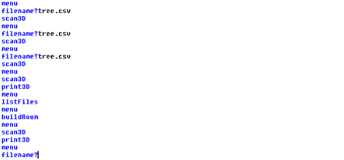

图 5-7 运行你的测试程序的结果

## 显示菜单

如果你的程序有很多选项供选择，那么菜单系统是一个非常有用的功能。这个菜单系统会打印所有可用选项，然后循环运行，等待你在正确的范围内输入一个数字。如果你输入的数字超出范围，它只会再次打印菜单。修改`menu`函数并替换为以下内容：

```python
def menu():

    print("DUPLICATOR MENU")

    while True:

        print("1 BUILD duplicator room")

        print("2 LIST files")

        print("3 SCAN from file")

        print("4 LOAD from file")

        print("5 PRINT duplicator room")

        print("6 CLEAN duplicator room")

        print("7 DEMOLISH duplicator room")

        print("8 QUIT")

        choice = int(input("please choose: "))

        if choice < 1 or choice > 8:

            print("Sorry, please choose a number between 1 and 8")

        else:

            return choice
```

保存你的程序并运行它。发生了什么？图 5-7 显示了我在我的电脑上运行此程序时发生的情况。你可以看到程序正在告诉它在做什么——它正在菜单中随机选择一个项目，然后使用处理该菜单选项的函数。由于目前你程序中的每个函数只打印其名称，这就是你看到的全部内容。你在屏幕上看到的单词序列与图 5-7 中的不同，因为`menu()`函数每次被使用时都会选择一个随机选项。

## 构建复制房间

复制房间将由玻璃建造，并且有一个缺口让玩家可以进入。用以下内容替换`buildRoom()`函数。注意我在这里使用了`SIZEX`、`SIZEY`和`SIZEZ`（更多信息请参见“深入代码”）：

```python
def buildRoom(x, y, z):

    global roomx, roomy, roomz

    roomx = x

    roomy = y

    roomz = z

    mc.setBlocks(x, y, z, x+SIZEX+1, y+SIZEY+1, z+SIZEZ+1, block.GLASS)
```

保存你的测试程序并运行它。发生了什么？图 5-7 显示了刚刚建造好的复制房间。


图 5-7 运行你的测试程序的结果

## 拆除复制房间

当你多次运行复制程序后，可能会有很多旧的复制房间。只有你最近创建的才是有效的房间，随着时间的推移，你的世界会填满房间！为了解决这个问题，你正在为程序添加一个拆除复制房间的功能，这样你的 Minecraft 世界就不会被这些房间占据了！

拆除复制房间就像使用 Adventure 3 中的`clearSpace.py`程序一样。你只需要知道房间的外部坐标。因为房间比`SIZEX`、`SIZEY`和`SIZEZ`定义的复制空间各大一圈，所以通过简单的数学就能完成。

将`demolishRoom()`函数改为：

```python
def demolishRoom():

    mc.setBlocks(roomx, roomy, roomz, roomx+SIZEX+1, roomy+SIZEY+1, roomz+SIZEZ+1, block.AIR)
```

保存你的程序并再次运行。现在你可以轻松地建造或拆除复制房间。只需在菜单上使用选项 1 构建，使用选项 7 拆除即可。

## 从复制房间扫描

你以前写过程序的这部分，即在你的`scan3D.py`程序中，所以你可以通过一些小修改后使用它。

# 扫描房间

1. 将`scan3D()`函数替换为以下代码。这段代码与`scan3D.py`程序几乎相同，但添加了**粗体所示的行**，以便在 Minecraft 聊天窗口中显示扫描进度。扫描大房间可能需要很长时间，因此如果能指示程序运行到了何种阶段，将会非常有帮助。你可以复制并粘贴你之前程序中的代码到这里，以节省一些打字时间：

```python
def scan3D(filename, originx, originy, originz):

    f = open(filename, "w")

    f.write(str(SIZEX) + "," + str(SIZEY) + "," + str(SIZEZ) + "\n")

    for y in range(SIZEY):

        mc.postToChat("scan:" + str(y))

    f.write("\n")

    for x in range(SIZEX):

        line = ""

        for z in range(SIZEZ):

            blockid = mc.getBlock(originx+x, originy+y, originz+z)

            if line != "":

                line = line + ","

            line = line + str(blockid)

        f.write(line + "\n")

    f.close()
```

2. 保存程序并再次测试：进入复制房间，建造一些东西，然后从菜单中选择选项 3。打开它生成的文件，检查物体是否已正确扫描。图 5-10 显示了扫描文件的部分内容。注意，里面有很多零；这是因为它也扫描了所有的`AIR`（空气）方。

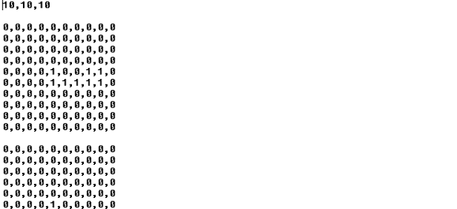

图 5-10 扫描文件的内容

## 清理复制房间

想大扫除一下？有时候从一个全新的开始并清空房间是有用的。你可以通过拆除房间并重建它来实现这一点，但添加一个清理功能非常简单，因为只有坐标与`demolishRoom()`函数不同。

1. 修改`cleanRoom()`函数，使其看起来如下方的代码。注意起始坐标都比房间的边缘大，而结束坐标不像`demolishRoom()`函数中那么远。这样，它可以清理房间的内部空间，而不破坏其墙壁：

```python
def cleanRoom():

    mc.setBlocks(roomx+1, roomy+1, roomz+1, roomx+SIZEX, roomy+SIZEY, roomz+SIZEZ, block.AIR.id)
```

2. 保存你的程序并再次运行。在房间内创建一个东西，然后选择选项 6 来测试你是否可以快速清理房间。

## 从复制房间打印

打印（复制）房间中的物体实际上非常简单，因为你已经编写了执行此操作的`print3D.py`程序，而且它们是完全一样的。这里再次提供一遍，方便你在一处看到所有内容：

```python
def print3D(filename, originx, originy, originz):

    f = open(filename, "r")

    lines = f.readlines()

    coords = lines[0].split(",")

    sizex = int(coords[0])

    sizey = int(coords[1])

    sizez = int(coords[2])

    lineidx = 1

    for y in range(sizey):

        mc.postToChat("print:" + str(y))

        lineidx = lineidx + 1

    for x in range(sizex):

        line = lines[lineidx]

        lineidx = lineidx + 1

        data = line.split(",")

        for z in range(sizez):

            blockid = int(data[z])

            mc.setBlock(originx+x, originy+y, originz+z, blockid)
```

保存程序并再次运行。测试你是否可以在房间内建造东西，运行到 Minecraft 世界的任何地方，然后从菜单中选择选项 5。房间的内容将被扫描并打印在玩家所在位置侧侧。你应该能够运行到 Minecraft 世界的任何地方并多次复制你的物体。尝试在空中和水下复制物体看看会发生什么！图 5-11 显示了运行此程序的结果。

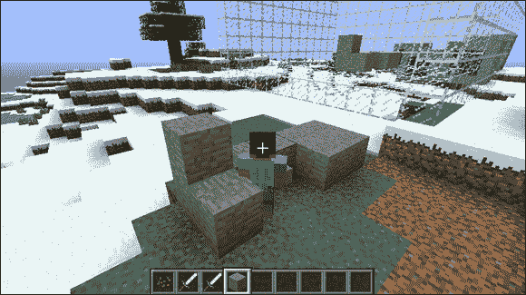

图 5-11 运行结果

## 列出文件

你的最后一个任务是编写一个列出所有文件的函数。修改`listFiles()`函数使其如下：

```python
def listFiles():

    print("Files:")

    files = glob.glob("*.csv")

    for filename in files:

        print(filename)
```

2. 保存程序并再次运行。测试你是否可以在房间内建造东西，运行到 Minecraft 世界某处，然后从菜单中选择选项 2。图 5-12 显示了我创建的文件。

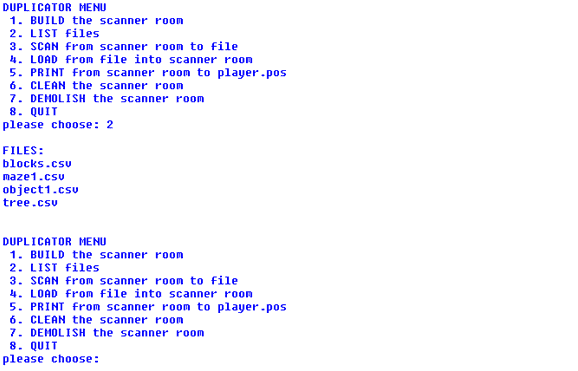

### 参考速表

| 命令 | 说明 |
| :--- | :--- |
| `f = open("data.txt", "r")` | 从文件读取 |
| `tips = f.readlines()` | 读取行 |
| `f.close()` | 关闭文件 |
| `f = open("scores.txt", "w")` | 写入文件 |
| `f.write("Victoria:26000\n")` | 写入行 |
| `f.write("Amanda:10000\n")` | 写入行 |
| `f.write("Ria:32768\n")` | 写入行 |
| `names = glob.glob("*.csv")` | 获取匹配的文件列表 |
| `for n in names: print(n)` | 打印列表 |
| `a = "\n\n hello \n"` | |
| `a.strip()` | 去除字符串中的空白 |

# 文件的进一步冒险

在这次冒险中，你学习了如何读取和写入文件。这为保存和恢复 Minecraft 世界开启了无限可能，甚至可以从来源（如网站）引入大量的真实世界数据。你构建了自己的 3D 迷宫，并以构建一个带有菜单系统的扫描仪和打印机作为结束。这种编写菜单系统的技术对许多其他程序也有用！

互联网上有许多“实时”数据。我在研究此内容时发现的数据源是丁汉市的停车场数据：`http://data.nottinghamwise.org.uk/parking.xml`。这些数据每五分钟更新一次，跟踪进出停车场的情况。我写了一个 Python 程序并放在我的 github 页面上，它可以处理这些数据并打印有用信息：`https://github.com/whaleygeek/pyparsers`。看看是否可以使用它编写一个在 Minecraft 世界中建造带有停车场的游戏。

在 Minecraft 中编程的伟大之处之一在于，除了可以在 2D 屏幕上观察你的创作之外，你实际上可以将它们带到虚拟 3D 世界中去。你可以环绕它们行走、进入内部、放大它们——如果你喜欢，甚至可以让它们爆炸！通过使用最初用于在 2D 屏幕上显示 3D 对象的创意，你可以在 Minecraft 中编写 3D 对象，化平凡为神奇。

在这场冒险中，你将发现如何使用`minecraftstuff`模块来创建 2D 线和形状，结合一点数学知识，你就可以编写一个巨大的时钟，大到你可以站在它正在旋转的指针上（参阅图 6-1）。在掌握了创建 2D 形状之后，你将学习如何组合它们，在几秒钟内创建巨大的 3D 结构。

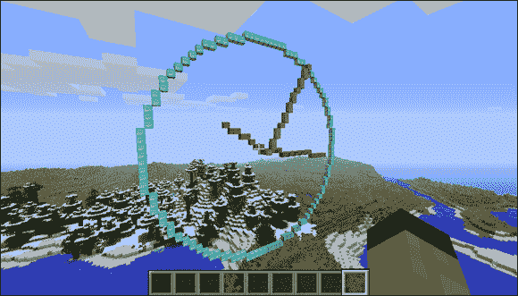

图 6-1 一个巨大的 Minecraft 时钟

# minecraftstuff 模块

`minecraftstuff`是 Minecraft API 的一个扩展模块，它是为《Minecraft 冒险》（Adventures in Minecraft）编写的，包含了绘制形状和控制 3D 对象所需的所有代码。它有一组名为`MinecraftDrawing`的函数，允许你创建线条、圆形、球体和其他形状。由于这些复杂的代码位于独立的`module`中，这使得你创建代码变得更简单，也更容易理解。模块是将程序拆分成更小块的方法。当程序变得过大时，它们更难以阅读、更难理解，追踪问题也需要更长时间。

`minecraftstuff`模块包含在你在冒险 1 中安装的“Minecraft 冒险”启动器件中，你可以像导入`minecraft`和`block`模块一样将它导入到 Minecraft 程序中。

# 创建线条、圆形和球体

当你将许多微小而简单的东西组合在一起时，你可以创建任何你想要的巨大且复杂的物体。在这场冒险中，你将使用大量的线条、圆形、球体和其他形状来产生一个巨大的 Minecraft 结构。在冒险的这部分，你将创建一个新程序，导入所需的模块并设置`minecraft`和`minecraftdrawing`模块。随后，你将使用模块中的函数来绘制线条、圆形和球体。

启动 Minecraft 和 Python IDLE。到目前你应该已经练习过启动这些了，但如果需要提醒，请参阅冒险 1。

1. 首先打开 IDLE 并创建一个新文件。将文件保存为`LinesCirclesAndSpheres.py`并存放在`MyAdventures`文件夹中。

2. 通过输入以下行导入`minecraft`、`block`、`minecraftstuff`和`time`模块：

```python
import mcpi.minecraft as minecraft

import mcpi.block as block

import mcpi.minecraftstuff as minecraftstuff

import time
```

3. 创建与 Minecraft 的连接：

```python
mc = minecraft.Minecraft.create()
```

4. 通过输入代码使用`minecraftstuff`模块创建一个`MinecraftDrawing`对象：

```python
mcdrawing = minecraftstuff.MinecraftDrawing(mc)
```

## 绘制线条

`MinecraftDrawing`对象有一个名为`drawLine()`的函数，当它被`called`并`passed`两个位置 (x, y, z) 和一个方块类型作为参数时，它会在这些位置之间创建一条方块线——就像你在冒险 3 中首次学习的`setBlocks()`函数一样。

以下代码使用`drawLine`函数创建如图 6-2 所示的方块线：

```python
drawLine(x1, y1, z1, x2, y2, z2, blockType, blockData)
```

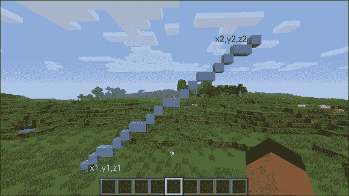

图 6-2 `drawLine()`函数在两组 x,y,z 点之间创建一条方块线。

现在更新你的程序，使其使用`drawLine()`函数在 Minecraft 中创建三条线——一条垂直向上，一条水平跨越，一条从玩家位置向对角线。在`LinesCirclesAndSpheres.py`底部添加以下代码：

1. 通过输入以下代码找到玩家的位置：

```python
pos = mc.player.getTilePos()
```

2. 通过输入代码从玩家位置垂直向上绘制一条 20 个方块的垂直线：

```python
mcdrawing.drawLine(pos.x, pos.y, pos.z,
```

3. 通过输入代码从玩家位置水平向绘制一条 20 个方块的水平线：

```python
mcdrawing.drawLine(pos.x, pos.y, pos.z,
```

4. 通过输入代码从玩家位置对角线绘制一条 20 个方块的对角线：

```python
mcdrawing.drawLine(pos.x, pos.y, pos.z,
```

5. 为程序添加时间延迟以便看到线条：

```python
time.sleep(5)
```

## 绘制圆形

`drawCircle()`函数与`drawLine()`类似，都需要处理一个中心点、半径和方块类型。你可以通过以下代码创建一个圆形：

```python
drawCircle(x, y, z, radius, blockData)
```

为了创建图 6-3 所示的圆形，请在`LinesCirclesAndSpheres.py`底部添加以下代码：

1. 通过输入代码找到玩家的位置：

```python
pos = mc.player.getTilePos()
```


## 绘制圆形

2. 通过输入代码在玩家位置绘制半径为 20 的圆形：

```python
mcdrawing.drawCircle(pos.x, pos.y, pos.z, 20, block.id, 0)
```

3. 为程序添加时间延迟以便看到圆形：

```python
time.sleep(5)
```

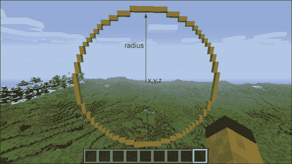

图 6-3 `drawCircle()` 在 `(x, y, z)` 中心周围创建一个圆形

## 绘制球体

`drawSphere()` 函数与 `drawCircle()` 类似，都需要处理一个中心点、半径和方块类型。你可以通过以下代码创建一个球体：

```python
drawSphere(x, y, z, radius, blockType, blockData)
```

为了创建图 6-4 所示的球体，请在 `LinesCirclesAndSpheres.py` 底部添加以下代码：

1. 通过输入代码找到玩家的位置：

    ```python
    pos = mc.player.getTilePos()
    ```

2. 通过输入代码在玩家上方 20 个方块处绘制一个半径为 15 的球体：

    ```python
    mcdrawing.drawSphere(pos.x, pos.y + 20, pos.z, 15, block.id, 0)
    ```

3. 为程序添加时间延迟以便看到球体：

    ```python
    time.sleep(5)
    ```

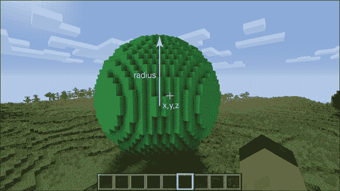

图 6-4 `drawSphere()` 在 `(x, y, z)` 中心周围创建一个球体

在看到了如何在 Minecraft 中创建圆圈和直线之后，也许你就能知道如何创建图 6-1 中的时钟了。表盘就是一个大圆，而每根指针都是一条线。现在到了最困难的部分——确定将线放在哪里以及如何让它们移动起来。

在冒险的这一部分，你将使用 `trigonometry`（三角函数）通过将指针的角度转换为表盘上的 `x` 和 `y` 坐标来确定指针指向的位置（参见图 6-5）。你将首先用方块绘制指针，然后通过绘制 `AIR` 将其移除，最后在新位置再次绘制它们，从而让指针看起来像在移动。

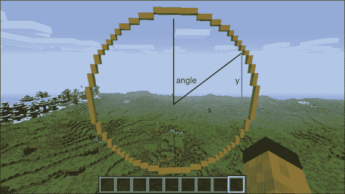

FIGURE 6-5 在表盘上确定指针的位置

要创建你的时钟，请遵循以下步骤：

1. 打开 IDLE 并创建一个新文件，为 Minecraft 时钟创建一个新程序。将文件保存为 `MinecraftClock.py` 并放在 `MyAdventures` 文件夹中。

2. 输入以下代码导入 `minecraft`、`block`、`minecraftstuff`、`time`、`datetime` 和 `math` 模块：

    ```python
    import mcpi.minecraft as minecraft
    import mcpi.block as block
    import mcpi.minecraftstuff as minecraftstuff
    import time
    import datetime
    import math
    ```

3. 创建一个函数 `findPointOnCircle()`。当你向此函数传递圆心和指针的角度时，该函数将返回指针的位置，如图 6-5 所示。

    ```python
    def findPointOnCircle(cx, cy, radius, angle):
        x = cx + math.sin(math.radians(angle)) * radius
        y = cy + math.cos(math.radians(angle)) * radius
        x = int(round(x, 0))
        y = int(round(y, 0))
        return (x, y)
    ```

4. 连接到 `Minecraft` 并创建 `MinecraftDrawing` 对象：

    ```python
    mc = minecraft.Minecraft.create()
    mcdrawing = minecraftstuff.MinecraftDrawing(mc)
    ```

5. 通过输入代码获取玩家的当前位置：

    ```python
    pos = mc.player.getTilePos()
    ```

6. 现在你将为时钟中心（玩家位置上方 25 个方块处）、表盘半径以及时针长度创建变量：

    ```python
    clockMiddle = pos
    clockMiddle.y = clockMiddle.y + 25
    CLOCK_RADIUS = 20
    HOUR_HAND_LENGTH = 10
    MIN_HAND_LENGTH = 18
    SEC_HAND_LENGTH = 20
    ```

7. 使用 `drawCircle()` 绘制表盘：

    ```python
    mcdrawing.drawCircle(
        clockMiddle.x, clockMiddle.y, clockMiddle.z,
        CLOCK_RADIUS, block.DIAMOND_BLOCK.id)
    ```

8. 程序还没有完成，但你现在应该运行它，检查一切是否正常工作，以及玩家上方是否出现了一个大圆（表盘）。

接下来，为你的程序添加时钟指针的代码：

1. 启动一个无限循环。此点之后的所有代码将位于该循环内部。

    ```python
    while True:
    ```

2. 使用 `datetime.datetime.now()` 函数询问电脑现在的时间。然后你将时间拆分为小时、分钟和秒。因为你的时钟是 12 小时制而非 24 小时制，如果时间在中午之后，你需要从小时中减去 12（例如，如果时间是 14:00，则显示为 2 点）。通过输入以下代码来实现：

    ```python
    timeNow = datetime.datetime.now()
    hours = timeNow.hour

    if hours >= 12:
        hours = timeNow.hour - 12

    minutes = timeNow.minute
    seconds = timeNow.second
    ```

3. 绘制时针。它的角度是 360 度除以 12 小时乘以当前小时。使用 `findPointOnCircle()` 找到指针末端的 `x` 和 `y` 位置，并输入以下代码使用 `drawLine()` 绘制指针：

    ```python
    hourHandAngle = (360 / 12) * hours
    hourHandX, hourHandY = findPointOnCircle(
        clockMiddle.x, clockMiddle.y, HOUR_HAND_LENGTH)

    mcdrawing.drawLine(
        clockMiddle.x, clockMiddle.y, clockMiddle.z,
        hourHandX, hourHandY, block.DIR)
    ```

4. 通过输入代码绘制分针，它位于时针后一个方块的位置（`z - 1`）：

    ```python
    minHandAngle = (360 / 60) * minutes
    minHandX, minHandY = findPointOnCircle(
        clockMiddle.x, clockMiddle.y, MIN_HAND_LENGTH)

    mcdrawing.drawLine(
        clockMiddle.x, clockMiddle.y, clockMiddle.z - 1,
        minHandX, minHandY, block.WOOD_PLANKS)
    ```

5. 添加秒针，它位于时针前一个方块的位置（`z + 1`）：

    ```python
    secHandAngle = (360 / 60) * seconds
    secHandX, secHandY = findPointOnCircle(
        clockMiddle.x, clockMiddle.y, SEC_HAND_LENGTH)

    mcdrawing.drawLine(
        clockMiddle.x, clockMiddle.y, clockMiddle.z + 1,
        secHandX, secHandY, block.STONE)
    ```

6. 等待一秒：

    ```python
    time.sleep(1)
    ```

7. 程序再次还没有完成，但你应该运行它来检查指针是否出现。观察它们移动的情况。你可能已经注意到时钟的指针在移动时被清除了。下一步是使用 `AIR` 再次绘制来清除指针：

    1. 清除时针：

        ```python
        mcdrawing.drawLine(
            clockMiddle.x, clockMiddle.y, clockMiddle.z,
            hourHandX, hourHandY, block.AIR)
        ```

    2. 清除分针：

        ```python
        mcdrawing.drawLine(
            clockMiddle.x, clockMiddle.y, clockMiddle.z - 1,
            minHandX, minHandY, block.AIR)
        ```

    3. 清除秒针：

        ```python
        mcdrawing.drawLine(
            clockMiddle.x, clockMiddle.y, clockMiddle.z + 1,
            secHandX, secHandY, block.AIR)
        ```

    4. 运行程序查看你的成果：玩家上方有一个巨大的时钟。确保玩家位于时钟正确的一侧，否则时间将倒着走！

你可以从配套网站 [www.wiley.com/go/adventures2](http://www.wiley.com/go/adventures2) 下载 Minecraft 时钟的完整代码，但我强烈建议你在阅读步骤时自己输入代码。那样你会学到更多！

# 绘制多边形

多边形是任何由直连边组成的二维形状。它可以有任意数量的边，从三边（三角形）开始。如图 6-6 所示，你可以在 Minecraft 中创建许多有趣的多边形。

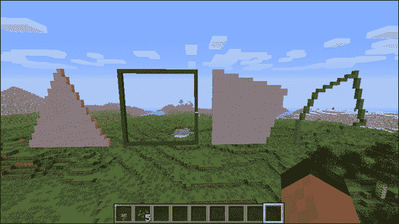

FIGURE 6-6 Minecraft 中的多边形示例

尽管它们是二维形状，但你会发现多边形对于制作 3D 图形有用，因为你可以通过连接许多多边形来创建几乎任何 3D 对象。当多边形组合在一起创建 3D 对象时，它们被称为 `faces`（面）。你可以通过这种方式创建一些很不起的结构。看看图 6-7，它展示了由许多多边形组成的曼哈顿岛天线（实现方法参见 [www.stuffaboutcode.com/2013/04/minecraft-pi-edition-manhattan-stroll](http://www.stuffaboutcode.com/2013/04/minecraft-pi-edition-manhattan-stroll)）。

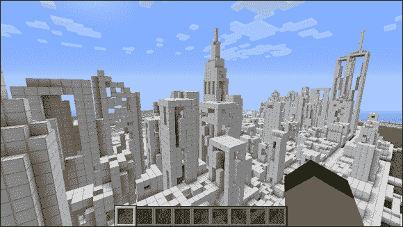

FIGURE 6-7 纽约曼哈顿岛的 Minecraft 天际线

你可以使用 `MinecraftDrawing` 中的 `drawFace()` 函数创建多边形（面）。该函数期望一个点列表 `(x, y, z)`，按顺序连接时会创建一个完整的多边形。在 `filled` 参数中传递 `True` 或 `False` 决定该面是否被填充，最后一个参数是该面应由方块类型（参见图 6-8）：

`drawFace(points, filled, blockType, blockData)`

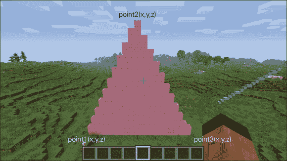

FIGURE 6-8 `drawFace()` 用于从三个点创建一个三角形

创建一个新程序来实验 `drawFace()` 函数，并创建图 6-8 所示的三角形：

1. 打开 IDLE 并创建一个新文件。将文件保存为 `Polygon.py` 并存放在 `MyAdventures` 文件夹中。

2. 输入以下代码导入 `minecraft`、`block` 和 `minecraftstuff` 模块：

    ```python
    import mcpi.minecraft as minecraft
    import mcpi.block as block
    import mcpi.minecraftstuff as minecraftstuff
    ```

3. 连接到 `minecraft` 并创建 `MinecraftDrawing` 对象：

    ```python
    mc = minecraft.Minecraft.create()
    mcdrawing = minecraftstuff.MinecraftDrawing(mc)
    ```

4. 获取玩家当前位置：

    ```python
    pos = mc.player.getTilePos()
    ```

5. 使用 `minecraftstuff.Points` 类创建一个点列表：

    ```python
    points = minecraftstuff.Points()
    ```

6. 然后向 `points` 列表中添加三个点 `(x, y, z)`，这些点连接在一起时会形成一个三角形：

    ```python
    points.add(pos.x, pos.y, pos.z)
    points.add(pos.x + 20, pos.y, pos.z)
    points.add(pos.x + 10, pos.y + 20, pos.z)
    ```

7. 使用 `MinecraftDrawing.drawFace` 函数创建三角形多边形：

    ```python
    mcdrawing.drawFace(points, True, block.WOOL.id, 6)
    ```

8. 保存文件并运行程序以创建三角形多边形。

# 金字塔

找一张金字塔的照片并仔细观察它。你注意到了什么？它的侧面是什么形状？所有的侧面有什么共同点？它有多少条边？

正如你可能知道的，金字塔的每个面（底除外）总是三角形。埃及的金字塔有四个面（如果算上底部则为五面），但它们可以是从三面以上的任意数量。你是否也注意到任何金字塔的底座都能完美地嵌入一个圆！请查看图 6-9 以了解我的意思。

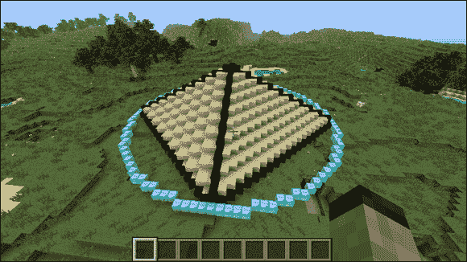

FIGURE 6-9 由三角形组成的金字塔，完美地嵌入圆中

你现在将创建一个程序，通过使用 `drawFace()` 和 `findPointOnCircle()` 函数，创建任何尺寸、任何高度、任意边数的金字塔：

1. 打开 IDLE 并创建一个新文件。将文件保存为 `MinecraftPyramids.py` 并存放在 `MyAdventures` 文件夹中。

2. 输入以下代码导入 `minecraft`、`block`、`minecraftstuff` 和 `math` 模块：

    ```python
    import mcpi.minecraft as minecraft
    import mcpi.block as block
    import mcpi.minecraftstuff as minecraftstuff
    import math
    ```

3. 创建 `findPointOnCircle()` 函数，它将用于计算构成金字塔的每个三角形放置的位置：

    ```python
    def findPointOnCircle(cx, cy, radius, angle):
        x = cx + math.sin(math.radians(angle)) * radius
        y = cy + math.cos(math.radians(angle)) * radius
        x = int(round(x, 0))
        y = int(round(y, 0))
        return (x, y)
    ```

4. 连接到 Minecraft 并创建 `MinecraftDrawing` 对象：

    ```python
    mc = minecraft.Minecraft.create()
    mcdrawing = minecraftstuff.MinecraftDrawing(mc)
    ```

5. 为你的金字塔设置变量。金字塔的中心是玩家的位置。这些变量的值会改变金字塔的大小（或半径）、高度和边数。

    ```python
    middle = mc.player.getTilePos()
    RADIUS = 20
    HEIGHT = 10
    SIDES = 4
    ```

6. 遍历金字塔的每个面；此点之后的所有代码都在 `for` 循环下缩进：

    ```python
    for side in range(0, SIDES):
    ```


### 7. 绘制金字塔的每个面

对于金字塔的每个面，计算三角形侧边的角度，然后使用 `findPointOnCircle()` 寻找 `x`、`y`、`z` 坐标。角度通过将 360 度除以总边数，再乘以正在绘制的边来计算，如图 6-10 所示。在 `for` 循环下缩进输入代码：

```python
point1Angle = int(round((360 / SIDES) * side))

point1X, point1Z = findPointOnCircle(middle.x, middle.y, RADIUS, point1Angle)

point2Angle = int(round((360 / SIDES) * (side + 1)))

point2X, point2Z = findPointOnCircle(middle.x, middle.y, RADIUS, point2Angle)
```

### 8. 创建三角形并绘制金字塔

创建三角形的点，并使用 `drawFace()` 创建金字塔：

```python
points = minecraftstuff.Points()

points.add(point1X, middle.y, point1Z)

points.add(point2X, middle.y, point2Z)

points.add(middle.x, middle.y + HEIGHT, middle.z)

mcdrawing.drawFace(points, True, block.SANDSTONE.id)
```

### 9. 保存并运行程序

保存文件并运行程序。玩家上方出现了一个金字塔——陷阱！

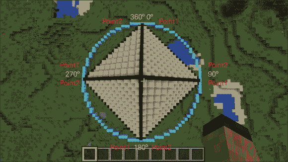

图 6-10 四边形程序可以创建任意尺寸和任意边数的金字塔。尝试更改程序中的变量并重新运行。图 6-11 显示了一些令人惊讶的示例。

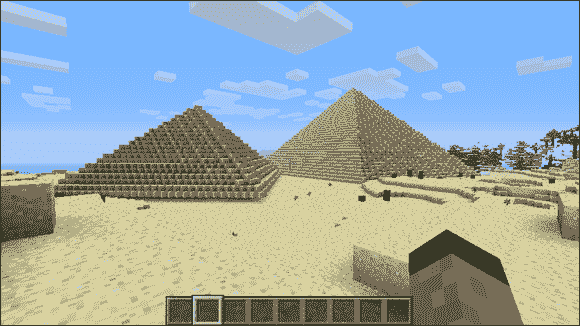

你可以从 *Adventures in Minecraft* 网站 `www.wiley.com/go/adventuresminecraft2` 下载金字塔的完整代码。

## 2D 和 3D 形状的进一步探索

使用 `drawFace()` 函数可以创建任何面体（就像你创建的金字塔一样），何不再制作一些呢？

你可以在以下网站找到许多多面体示例和主意：

- Maths is Fun（`www.mathisfun.com/geometry/polyhedron.html`）
- Kids Math Games（`www.kidsmathonline.com/facts/3dpolyhedronshapes.html`）

### 快速参考表

| 命令 | 说明 |
| :--- | :--- |
| `mcdrawing.drawLine(0, 0, 0, 10, 10, 10, block.DIRT.id)` | 在两点之间画一条线 |
| `mcdrawing.drawCircle(0, 0, 0, radius, block.DIRT.id)` | 画一个圆 |
| `mcdrawing.drawSphere(0, 0, 0, radius, block.DIRT.id)` | 画一个球体 |
| `tri = minecraftstuff.Points(); filled = True; tri.add(0,0,0); tri.add(10,0,0); tri.add(5,10,0); mcdrawing.drawFace(tri, filled, block.DIRT.id)` | 画一个多边形 |

# 创建一个方块朋友

Minecraft 可能是一个孤独的世界。但你的玩家不必是孤单的——你可以创建一个方块，跟随在他周围移动，与他聊天并成为他的朋友（参见图 7-1）。

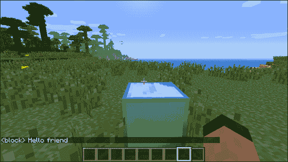

图 7-1 创建一个方块朋友，在玩家的 Minecraft 冒险中陪伴他。

要编写一个方块朋友，你需要像她一样思考！如果她在你的玩家附近，她会很高兴，所以她想要跟随他在周围转，并尝试坐在他身边。只要你的玩家靠近她，她就会保持开心；如果玩家离开，她会跟在后面。如果玩家走得太远，方块朋友会感到难过，她会停止跟随他，直到他回来并给她一个拥抱（通过站在她旁边）。

方块朋友程序有两个不同的部分：

- **方块用来决定下一步该做什么的规则：** 程序的这部分让方块朋友决定是向你的玩家（目标）移动还是留在原地。
- **让方块向目标移动的代码：** 一旦方块朋友到达目标，她会再次使用规则来确定下一步该做什么。

当方块朋友向目标移动时，她应该在陆地“上方”旅行，而不是悬浮在空中或在地下挖掘！你可以使用 `mc.getHeight(x, z)` 函数并向其传递水平位置 `(x, z)` 来实现。它返回从天空向下第一个不是 `AIR` 的方块的垂直位置（`y`）。

从为方块朋友创建一个新程序开始：

1. 打开 IDLE，选择 `File` > `New File` 创建新程序，并将文件保存为 `BlockFriend.py`，位于 `MyAdventures` 文件夹中。
2. 导入 `minecraft`、`block`、`minecraftstuff`、`math` 和 `time` 模块：

   ```python
   import mcpi.minecraft as minecraft

   import mcpi.block as block

   import mcpi.minecraftstuff as minecraftstuff

   import math

   import time
   ```

3. 你需要做的第一件事是创建一个计算两点之间距离的函数。稍后你使用这个函数来计算方块朋友距离玩家有多远：

   ```python
   def distanceBetweenPoints(point1, point2):

       xd = point2.x - point1.x

       yd = point2.y - point1.y

       zd = point2.z - point1.z

       return math.sqrt((xd * xd) + (yd * yd) + (zd * zd))
   ```

4. 现在你需要决定玩家需要离方块朋友多远，她才会停止跟随。创建一个常量来存储你认为“太远”的距离。我选择了 15，这意味着当方块朋友和玩家相隔 15 个方块时，方块朋友停止跟随玩家：

   ```python
   TOO_FAR_AWAY = 15
   ```

5. 创建 `Minecraft` 和 `MinecraftDrawing` 对象：

   ```python
   mc = minecraft.Minecraft.create()

   mcdrawing = minecraftstuff.MinecraftDrawing(mc)
   ```

6. 创建一个变量来存储方块的心情。对于这次冒险，方块要么是快乐的，要么是伤心的。将其设置为 `"happy"`：

   ```python
   blockMood = "happy"
   ```

7. 通过获取玩家的位置，创建一个距离玩家几个方块的方块朋友，在 `x` 位置上加 5，并使用 `getHeight()` 函数找到 `y` 位置，这样方块就坐在陆地上：

   ```python
   friend = mc.player.getTilePos()

   friend.x = friend.x + 5

   friend.y = mc.getHeight(friend.x, friend.z)

   mc.setBlock(friend.x, friend.y, friend.z, block.DIAMOND_BLOCK.id)

   mc.postToChat("<block> Hello friend")
   ```

8. 为方块朋友创建一个目标。这是她将要移动到的位置。初始时，将目标设置为方块朋友当前的位置，这样方块朋友在程序启动时就不会尝试移动到任何地方：

   ```python
   target = friend.clone()
   ```

9. 启动一个无限循环，这样程序将永远运行。（注意，此点之后的所有代码都缩进在该循环下。）

   ```python
   while True:
   ```

10. 获取玩家的位置，并使用 `distanceBetweenPoints()` 函数计算玩家与方块朋友之间的距离：

    ```python
    pos = mc.player.getTilePos()

    distance = distanceBetweenPoints(pos, friend)
    ```

11. 应用你想让方块朋友使用的规则来确定下一步该做什么。如果是“快乐”的，告诉它比较朋友与“太远”常量之间的距离。如果距离小于“太远”常量，将目标设置为玩家的位置。

    ```python
    if blockMood == "happy":

        if distance < TOO_FAR_AWAY:

            target = pos

        else:

            target = friend.clone()

            mc.postToChat("<block> You are far away I need a hug!")
    ```

你可以从《我的世界冒险》（*Adventures in Minecraft*）伙伴网站下载方块朋友程序的完整代码，网址为 [`www.wiley.com/go/adventuresinminecraft2e`](http://www.wiley.com/go/adventuresinminecraft2e)。

# 使用随机数让你的方块朋友更有趣

你刚刚创建的方块朋友程序的问题在于，它是可预测的；她总是会做同样的事情。在运行程序几次后，你就能确切地知道她将在什么时候做什么，所以事情很快就会变得无聊。要真正给你的方块朋友装上“大脑”，你需要赋予她一种不可预测的气质。

通过使用随机数，你可以模拟不可预测性——换句话说，让某些事物看起来像是在以不可预测的方式运行。你通过让程序根据概率来选择执行的操作来实现这一点；例如，你可以告诉它每 100 次执行一次特定的动作。通过添加更多基于不同几率的规则，你可以让程序变得更难以预测。在将方块朋友程序改为使用随机数之前，让我们探索创建随机数和概率检查的代码。你可能还记得在冒险 3 中介绍过随机数。

Python 的 `random` 模块包含 `random.randint(startNumber, endNumber)` 函数，它用于生成两个特定数字（`startNumber`、`endNumber`）之间的随机数。

以下代码每次运行时都会打印一个 1 到 10 之间的随机数。如果你想查看结果，应该创建一个新的 Python 程序：

```python
import random

randomNo = random.randint(1, 10)

print(randomNo)
```

通过添加一个 `if` 语句来检查随机数是否为 10，你创建了一个概率检查，它大约会在每 10 次中为真 1 次：

```python
import random

if random.randint(1, 10) == 10:

    print("这在 10 次中大约发生 1 次")

else:

    print("这在 10 次中大约发生 9 次")
```

如果你运行这个程序 100 次，你预期会看到大约 10 次打印“这在 10 次中大约发生 1 次”（参见图 7-3），但你可能只看到 9 次或 11 次，甚至可能完全没有。它是不可预测的！

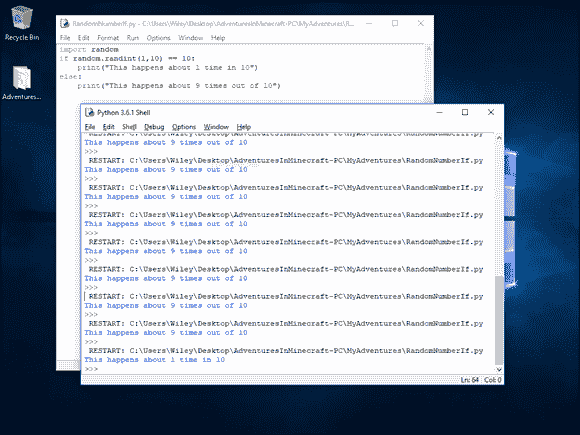

图 7-3 创建随机数赋予你的方块朋友一种不可预测的气质。

如果你在方块朋友程序中使用随机数和概率检查，可以让它变得不那么容易预测。你甚至可以让方块朋友“拉黑”你的玩家！

为方块朋友程序添加一些新规则，使得如果方块朋友感到“难过”，那么有 1/100 的概率她会决定等够了，并且如果玩家回来给她一个拥抱，她将不再跟随玩家：

1. 打开 IDLE，从 `MyAdventures` 文件夹中打开 `BlockFriend.py` 程序。
2. 点击 `File` > `Save As`，将文件保存为 `BlockFriendRandom.py`。
3. 在程序顶部的 `import` 语句中添加 `random` 模块：

   ```python
   import mcpi.minecraft as minecraft

   import mcpi.block as block

   import mcpi.minecraftstuff as minecraftstuff

   import math

   import time

   import random
   ```

4. 添加一个百分之一的随机数测试，当方块处于 `"sad"` 状态时，将心情改为 `"hadenough"`：

   ```python
   elif blockMood == "sad":

       if distance <= 1:

           blockMood = "happy"

           mc.postToChat("<block> 噢，谢谢。我们走吧.")

       if random.randint(1, 100) == 100:

           blockMood = "hadenough"

           mc.postToChat("<block> 够了。我受够了。")
   ```

5. 运行程序。

当你的玩家离方块朋友太远时，如果你等待足够久（直到百分之一的概率出现），方块朋友就会决定她受够了并“拉黑”玩家！一旦这种情况发生，方块朋友会说：“够了。我受够了。”，并且永远坐在那里。

# 更大的形状

在方块朋友程序中，你让一个方块移动并跟随玩家。但如果你想让很多方块移动起来呢？或者一个由移动方块组成的形状，比如汽车或外星飞船？

从这里开始事情会变得困难得多，因为你需要跟踪大量的方块。每次你想让它移动时，都需要将所有方块设置为 `AIR`（空气），然后在新的位置上重新创建方块。如果有大量方块，形状就会停止正常移动并慢得像爬一样。

`minecraftstuff` 模块包含了名为 `MinecraftShape` 的函数，它专门用于创建形状并让它们移动。要使用 `MinecraftShape`，你需要告诉它方块是如何组成的。图 7-4 显示了一个由方块组成的形状，在 Minecraft 世界中移动。

图 7-4 显示了一个由方块组成的形状，在 Minecraft 世界中移动。


5. 运行程序。

当你的玩家离方块朋友太远时，如果你等待足够久（直到 100 分之一 1 的概率出现），方块朋友就会决定她受够了并“拉黑”玩家！一旦这种情况发生，方块朋友会说：“够了。我受够了。”，并且永远坐在那里。

# 更大的形状

在方块朋友程序中，你让一个方块移动并跟随玩家。但如果你想让很多方块移动起来呢？或者一个由移动方块组成的形状，比如汽车或外星飞船？

从这里开始事情会变得困难得多，因为你需要跟踪大量的方块。每次你想让它移动时，都需要将所有方块设置为 `AIR`（空气），然后在新的位置上重新创建方块。如果有大量方块，形状就会停止正常移动并慢得像爬一样。

`minecraftstuff` 模块包含了名为 `MinecraftShape` 的函数，它专门用于创建形状并让它们移动。要使用 `MinecraftShape`，你需要告诉它方块是如何组成。

你可以从 *Adventures in Minecraft* 的伴侣网站 [www.wiley.com/go/adventuresinminecraft2e](http://www.wiley.com/go/adventuresinminecraft2e) 下载木马的完整代码。

你现在会发现这些形状非常有用，因为你将创建一个外星飞船！稍后，你还会再次使用它们来创建障碍物。

# 外星入侵

外星人即将入侵 Minecraft。一艘飞船从玩家正上方的天空降临，此时玩家正处于危险之中——这些外星人`并不`友善，它们在完成任务之前不会放弃。

在下一个程序中，你将使用 `MinecraftShape` 和你在“方块朋友”程序中使用的编程技术来创建一个外星飞船（参见图 7-5），它悬停在世界表面上方追逐你的玩家，试图移动到他的上方。当它成功时，会用光束将他传送到飞船上。


FIGURE 7-5 创建外星飞船为你的 Minecraft 游戏增色！

你使用 `MinecraftShape` 创建外星飞船，就像在木马程序一样，形状中的每个块都有自己的相对位置和方块类型。图 7-6 显示了形状方块从侧面和俯视图的位置。


FIGURE 7-6 外星飞船方块位置

与“方块朋友”程序一样，外星入侵的代码分为两部分。第一部分是决定飞船下一步动作的规则；第二部分是让外星飞船向玩家移动的代码。

当外星飞船追逐玩家时，它会通过在聊天框发送消息（例如“你无法逃避一辈子”）来嘲讽他。这些信息是从挑衅列表中随机选取的（参见图 7-7）。


FIGURE 7-7 外星飞船正在追逐。

决定外星飞船下一步执行什么的规则基于三种模式之一：

*   **着陆 (Landing)：** 当程序启动时，这是飞船的初始模式，因为飞船是从玩家正上方的天空降临的。
*   **攻击 (Attack)：** 飞船一着陆就开始攻击，不断追逐玩家直到它直接位于玩家正上方，从那里它将用“光束”将玩家传送到内部。
*   **任务完成 (Mission accomplished)：** 该模式在玩家被传送到飞船内部且外星人准备好将其送回地面后设置。此时程序结束，玩家被传回。

一旦外星飞船捕获了玩家，程序将建造一个阴暗的房间来关押他，并将其位置更改为房间内部（参见图 7-8）。然后外星人会向玩家发送消息，最后通过将位置改回原状并清理房间，将他传回。


FIGURE 7-8 外星飞船内部

使用以下步骤创建外星入侵程序：

1. 打开 IDLE，点击 New ⇒ New File 并将文件保存为 `AlienInvasion.py` 在 `MyAdventures` 文件夹中。
2. 导入 `minecraft`、`block`、`minecraftstuff` 和 `time` 模块：

```python
import mcpi.minecraft as minecraft
import mcpi.block as block
import mcpi.minecraftstuff as minecraftstuff
import time
```

3. 创建 `distanceBetweenPoints()` 函数：

```python
def distanceBetweenPoints(point1, point2):
    xd = point2.x - point1.x
    yd = point2.y - point1.y
    zd = point2.z - point1.z
    return math.sqrt((xd*xd) + (yd*yd) + (zd*zd))
```

4. 为程序创建常量。`HOVER_HEIGHT` 是外星飞船悬停在玩家上方的块数；`ALIEN_TAUNTS` 是挑衅列表。

```python
HOVER_HEIGHT = 15
ALIEN_TAUNTS = ["You cannot run forever", "Resistance is useless", "We only want to friends"]
```

5. 创建 `Minecraft` 和 `MinecraftDrawing` 对象：

```python
mc = minecraft.Minecraft()
mdrawing = minecraftstuff.MinecraftDrawing(mc)
```

6. 设置外星人的起始位置和模式，位于玩家上方 50 个块处：

```python
alienPos = mc.player.getPos()
alienPos.y += 50
```

7. 使用 `MinecraftShape` 创建外星飞船（操作方法参见图 7-6）：

```python
alienShape = mc.createShape()
```

8. 创建一个 `while` 循环，只要模式不是 `missionaccomplished` 循环就会继续：

```python
while mode != "missionaccomplished":
```

9. 在循环每次运行时获取玩家的位置：

```python
playerPos = mc.player.getPos()
```

10. 如果外星飞船的位置不等于目标位置，通过将以下代码输入到程序末尾并相对于 `while` 循环进行缩进，让外星飞船移动到目标位置：

```python
if alienPos != alienTarget:
    line = mcdrawing.getLine(
        alienPos.x, alienPos.y, alienPos.z,
        alienTarget.x, alienTarget.y, alienTarget.z)
    for nextBlock in line:
        alienShape.move(
            nextBlock.x, nextBlock.y, nextBlock.z)
    time.sleep(0.25)
    alienPos = alienTarget.clone()
```

13. 此时，程序返回到 `while` 循环的顶部。当模式被设置为 `"missionaccomplished"` 且 `while` 循环结束时，程序的最后一行会让外星飞船消失：

```python
alienShape.clear()
```


14. 运行程序，注意从你正上方天空降下来的外星人。

你可以在 *Adventures in Minecraft* 伙伴网站下载外星入侵的完整代码：[`www.wiley.com/go/adventuresinminecraft2e`](http://www.wiley.com/go/adventuresinminecraft2e)。

# 进一步的模拟冒险

在这次冒险中，你使用了算法和规则来模拟朋友和外星人的入侵——想不想更进一步，模拟其他事物呢，例如一群鸟（或一群方块）、Minecraft 中跨越海洋的波浪，或者由方块组成的如康威生命游戏这样的完整的细胞系统。

要了解更多关于康威生命游戏的信息，请访问 [`en.wikipedia.org/wiki/Conway's_Game_of_Life`](https://en.wikipedia.org/wiki/Conway's_Game_of_Life)。

## 快速参考查表

| 命令 | 描述 |
| :--- | :--- |
| `import random` | 导入 Python `random` 模块 |
| `random.randint(start, end)` | 在 `start` 和 `end` 数字之间创建一个随机数 |
| `import minecraftstuff` | 导入 `minecraftstuff` 扩展模块，该模块包含在入门包中 |
| `mc.getHeight(x,z)` | 获取水平位置 (`x`,`z`) 地的高度（`y` 坐标，即从天空向下第一个非 `AIR` 的方块） |
| `mcdrawing = minecraftstuff.MinecraftDrawing(mc)` | 创建 `MinecraftDrawing` 对象 |
| `copyOfPosition = position.clone()` | 创建 Minecraft 位置的副本（克隆） |
| `mcdrawing.getLine(x1, y1, z1, x2, y2, z2)` | 获取两点之间线上所有的方块 |
| `shape = minecraftstuff.MinecraftShape(mc, pos)` | 创建一个 `MinecraftShape` |
| `shape.setBlock(1,0,0,block.DIRT.id)` | 设置 `MinecraftShape` 中的方块 |
| `shape.setBlock(0,0,1,block.DIRT.id)` | 设置 `MinecraftShape` 中的方块 |
| `shape.moveBy(x,y,z)` | 根据 `x`,`y`,`z` 的值移动 `MinecraftShape` |
| `shape.move(x,y,z)` | 将 `MinecraftShape` 移动到位置 `x`,`y`,`z` |
| `shape.clear()` | 清除 `MinecraftShape` |
| `shape.draw()` | 绘制 `MinecraftShape` |


成就解锁：被你自己的人工智能绑架了！


当你在 Minecraft 世界中玩时，即使使用了编程接口，它仍然是一个虚拟世界。你与游戏交互的唯一方式是通过键盘和鼠标来引导工程师设计的控制。

但另一种与 Minecraft 交互的方法——打破沙盒游戏带来的限制，并将其与物理世界连接。在这里，你会很快发现虚拟与现实之间的界限变得模糊，你的游戏体验将变得更有创意且刺激。

在这次冒险中，你将发现如何将 Minecraft 连接到名为 BBC micro:bit 的小型可编程计算机。首先，你将通过感知 BBC micro:bit 的按键按下来测试一切运行正常，然后你创建一个程序，当你回到家里时，在 BBC micro:bit 显示屏上显示房屋图标。你将使用显示屏作为倒计时，并使用真实的香蕉作为输入设备来触发爆炸倒计时（这样你就再也不会为 Minecraft 中的建筑冒险清理空间时遇到任何困难了）。最后，你建立了一个滚球游戏，通过倾斜 BBC micro:bit 在虚拟游戏桌上收集物体并避开洞穴。你的朋友会奇你的新魔术感到惊讶，并要求你也为他们制作基于 BBC micro:bit 的控制器！

# 本次冒险所需的物品

以下是构建本次冒险中描述的项目所需的所有列表：

* 一个 BBC micro:bit
* 用于 BBC micro:bit 的 USB 线
* 两个或更多鳄鱼夹线
* 一个香蕉（可选；橙子也可以！）
* 我们来自伙伴网站的入门包，或 `bitio` 包的副本

如果你手头没有额外的香蕉，不要担心——只需触摸 BBC micro:bit 引脚即可让这次冒险中的项目运行（但使用香蕉会有趣得多！）

# 什么是 BBC micro:bit？

BBC micro:bit 是一台小型可编程计算机，由 BBC 和 29 多个行业合作伙伴设计。

## 输入与输出

任何计算机系统都有一系列输入输出，与板载处理器配合使用。图 8-1 显示了 BBC:bit 的布局。


以下是内置于你的 BBC micro:bit 你将在冒险中使用的输入输出：

* **按钮 A 和 B**：正面的这两个按钮允许你通过按下来触发动作。通过正确的代码，你还可以测量按下按钮的时间。
* **显示器**：显示器是一个 5x5 `发光二极管 (LED)` 矩阵。LED 是在电流流过时发亮（在本例中为红色）的组件。BBC micro:bit 上的 LED 可以单独编程以创建图标、动画甚至滚动文本。这些 LED 的亮度也可以单独更改为 10 个亮度级别之一。
* **引脚 0、1 和 2**：这些金属环可以连接鳄鱼夹线，并允许连接外部电路。你也可以用手指触摸引脚，BBC micro:bit 会感知到你触摸了它们。引脚可用于多种输入输出目的。
* **3V 和 GND**：这两个金属环可用于为你构建的外部电路提供少量电源。`GND`（地）也用作触控电路的返回路径。
* **电池接口**：BBC micro:bit 背面的白色电池接口允许你使用电池组（例如装两节 AAA 电池的）为其供电。
* **USB 接口**：USB 接口主要用于将新的程序代码传输到 BBC micro:bit（覆盖存储在上面的任何之前的程序代码）。你还可以使用 USB 接口为 BBC micro:bit 提供少量电源，并在程序运行时与另一台计算机发送和接收数据。
* **加速度计**：加速度计用于测量加速度，BBC micro:bit 可以利用它感知各种形式的运动，包括抖动和倾斜。它与手机内部使用的设备相同，用于感应屏幕的朝上方向。在后接的冒险中，你将使用加速度计来感知倾斜，从而让你 Minecraft 世界中的球移动。

## 将你的 BBC micro:bit 作为游戏控制器

在这次冒险中，你将一个程序加载到 BBC micro:bit 上，这样你就可以将其作为 Minecraft 的游戏控制器。BBC micro:bit 被用作输入输出设备，既可以控制也可以对你编写的 Minecraft 游戏做出响应。

# 设置你的电脑以连接到 BBC micro:bit

在将 BBC micro:bit 作为 Minecraft 游戏的控制器使用之前，需要进行一些设置。

## 接入你的 BBC micro:bit

将你的 BBC micro:bit 接入 USB 线缆，并将 USB 线缆的另一端插入电脑的空闲 USB 端口。几秒钟后，你应该就能在资源管理器（PC）、文件管理器（树莓派）或访达（Apple Mac）中看到一个 `MICROBIT` 驱动器出现。请参考 图 8-2 示例。


图 8-2 MICROBIT 驱动器出现在资源管理器/文件管理器/访达中

如果你使用的是 Microsoft Windows，可能会在屏幕右下角弹出消息，显示无法安装 `mbed` 串口驱动程序。别担心，你的 BBC micro:bit 工作正常，但你需要遵循一个额外的步骤。访问 [`support.microbit.org`](https://support.microbit.org) 并搜索“windows serial driver”，然后按照页面上的说明为你的 Windows PC 安装 mbed windows 串口驱动程序。

## 将游戏控制器代码加载到你的 BBC micro:bit

设置的最后一步是加载一些帮助 BBC micro:bit 作为游戏控制器工作代码。我编写了一个名为 `bitio`（读音为 *bitty-o*）的包，它可以将你的 BBC micro:bit 变成 Minecraft Python 游戏的输入输出设备。该包包含两个部分：加载到 BBC micro:bit 上的代码，以及你在主电脑上运行的代码。所有这些代码都包含在你作为 冒险 1 部分下载的入门套装中。

所有这些代码都包含在你作为 冒险 1 部分下载的入门套装中；你应该在 `MyAdventures` 文件夹中看到一个名为 `bitio.hex` 的文件。将此文件拖放到 `MICROBIT` 驱动器上，即可将程序加载到 BBC micro:bit 的内存中。背面的黄色系统 LED 会闪烁几秒钟。当 LED 闪烁完成后，你应该会在显示屏上看到 bitio 标志 (Io)，这表示程序已加载正确。如果你的电脑在最后“弹出”了 `MICROBIT` 驱动器，不要担心；这是正常的，只是因为你的 BBC micro:bit 重置并启动了你刚刚下载到它的程序。

你的 BBC micro:bit 现在已准备好接收来自你在主电脑上编写的 Python 代码的命令。图 8-3 显示了 BBC micro:bit 显示屏的样子。


图 8-3  BBC micro:bit 上显示了 bitio 标志。

# 你好 BBC micro:bit

在 冒险 1 中，你写了“Hello Minecraft World”来测试一切是否工作正常。在这次冒险中，你将创建一个 Hello 程序来测试你的 BBC micro:bit 游戏控制器是否正常。幸运的是，我已经为你完成了大部分工作，你只需要一个单行程序。请执行以下操作：

1. 通过选择文件 ⇒ 新文件启动一个新程序，并将其保存为 `hellomb.py`。确保将其保存在 `MyAdventures` 文件夹中；否则你的程序将无法找到必要的 microbit 模块。
2. 导入 microbit 模块：

```python
import microbit
```

搞定。全部就这些了！我在入门套装中提供的 microbit Python 模块会为你完成检测和连接到 BBC micro:bit 的所有困难工作。

现在运行 `hellomb.py` 并按照屏幕上的指令找到你的 BBC micro:bit。你的程序会自动记住你的 BBC micro:bit，以供下次使用。图 8-4 显示了 BBC micro:bit 显示屏的样子。


图 8-4 BBC micro:bit 的显示屏

## 感应按键

现在你知道你的 BBC micro:bit 通信正常，你将通过读取按键来感知输入并产生动作。使用以下步骤：

1. 通过选择文件 ⇒ 新文件启动一个新程序，并将其保存为 `button.py`。
2. 导入必要的模块：

```python
import time
import microbit
```

3. 在控制台显示消息：

```python
print("press button")
```

4. 创建一个无限循环：

```python
while True:
```

5. 使用一个 `if` 语句检查你的 micro:bit 按键是否被按下。如果是，在控制台显示消息：

```python
if microbit.button_a.was_pressed():
    print("Button pressed")
    time.sleep(0.5)
```

运行 `button.py` 并确保当你按下按键时，如 图 8-5 所示，看到“Button pressed”。


图 8-5 按键时，控制台显示消息

## 你的 BBC micro:bit 显示

在将 micro:bit 连接到 Minecraft 之前，你应该先检查你是否也可以向 micro:bit 输出内容。你通过修改 `button.py` 程序在按下按键时写入内容来实现这一点。

将你的 `button.py` 修改为如下（新行已**加粗**）：

```python
if microbit.button_a.was_pressed():
    print("Button pressed")
    microbit.display.show("A")
    time.sleep(0.5)
microbit.display.clear()
```

再次运行程序，确保当你按下按键时，BBC micro:bit 的显示屏上显示字母 A。

# 重温魔法门垫

现在你已经证明了 BBC micro:bit 可以作为输入设备和输出设备，现在是时候使用 Python 将 BBC micro:bit 连接到你的 Minecraft 游戏世界了。为了实现这一点，你将重温 冒险 2 中的魔法门垫程序，并添加一点花样。这一次，每当你站在门垫上时，你将在 BBC micro:bit 显示屏上显示房屋图标。这是将你的 Minecraft 世界链接到物理世界的第一个示例。

## 开发魔法门垫程序

1. 通过选择文件 ⇒ 新文件启动一个新程序并命名为 `house.py`。
2. 导入必要的模块，包括 microbit 模块和 minecraft 模块。（这是你第一次将它们结合使用）。同时建立与 Minecraft 游戏的连接：

```python
import microbit
import mcpi.minecraft as minecraft
import mcpi.block as block
import time

mc = minecraft.Minecraft.create()
```

3. 设置一些常量作为你“欢迎回家门垫”的坐标。你需要决定想让门垫出现在世界中的哪个位置，并根据此选择这些常量。在树莓派上，你可以在 Minecraft 窗口的左上角看到你的坐标。在 PC 或 Mac 上，你可以按 `F3` 来查看你的玩家的坐标。

```python
HOME_X = 0
HOME_Y = 0
HOME_Z = 0
```

4. 在这些常量下方，在门垫位置用羊毛创建一个区块。这就是你的门垫——就像你在冒险 2 中创建的门垫一样：

```python
mc.setBlock(HOME_X, HOME_Y, HOME_Z, block.WOOL.id, 15)
```

5. 编写一个类似于此处所示代码的游戏循环。请特别注意缩进。这段代码会反复读取玩家的位置并对其进行地理围栏检测，以检查你是否站在门垫上。如果是，BBC micro:bit 上将显示一个房子的图像。如果你没有站在门垫上，显示器上将显示 `?`：

```python
while True:
    time.sleep(1)
    pos = mc.player.getTilePos()
    if pos.x == HOME_X and pos.z == HOME_Z:
        microbit.display.show(microbit.Image.HOUSE)
    else:
        microbit.display.show("?")
```


运行你的程序，确保当你站在门垫上时，BBC micro:bit 屏幕上显示了房子的图片。当你不在门垫上时，屏幕应该显示`?`。

这太棒了！你现在拥有了所有所需的要素，可以打破 Minecraft 沙盒虚拟世界，并将游戏与现实世界的物体连接起来。你可以感知输入并控制输出，因此你的限制仅限于你的想象力和实验的意愿！

## 为显示器设计你自己的图标

BBC micro:bit 有许多内置图像。你可以通过创建并运行一个短程序来列出所有的名称以找到它们的列表：

1. 选择文件 ⇒ 新文件创建一个新程序，并将其保存为`imagelist.py`。

2. 导入`microbit`模块，以便你可以与 BBC micro:bit 通信：

   ```python
   import microbit
   ```

3. 打印`STD_IMAGE_NAMES`模块变量的值。该变量是一个包含了所有加载到你的 BBC micro:bit 上的支持图像名称列表：

   ```python
   print(microbit.Image.STD_IMAGE_NAMES)
   ```

运行你的程序，你应该能看到一个巨大的图像列表出现，如图 8-6 所示。


图 8-6 加载到 BBC micro:bit 上的标准图像列表

BBC micro:bit 的图像以 5x5 数字矩阵的形式存储。每个数字介于 0 到 9 之间，代表亮度。图 8-7 显示了一个带有房屋图像设计的示例矩阵，在下方你可以看到创建该图像的代码行。


图 8-7 房屋图标的网格设计

这里是你为 BBC micro:bit 显示器创建一个房子所需的所需的代码行：

```python
MYHOUSE = microbit.Image("00900:09090:90009:99999:09990")
```

注意每行都是由五个数字组成，并用`:`字符将它们分隔。因此在`MYHOUSE`示例中，有五行数据，每行有五列。`0`表示 LED 关闭，`9`表示 LED 处于全亮度。数字`0`到`9`创建不同的强度，你可以独立于其他像素设置显示器每个像素的强度。

现在你已经知道如何设计自定义图像，你可以构建一个在你的 BBC micro:bit 显示器上显示该图像的程序了：

1. 在你的`house.py`程序的顶部（但在`import`行之后）添加这行代码：

   ```python
   MYHOUSE = microbit.Image("00900:09090:90009:99999:09990")
   ```

2. 修改代码使其如下所示（更改的行已用粗体标记出）：

   ```python
   if pos.x == HOME_X and pos.z == HOME_Z:
       microbit.display.show(MYHOUSE)
   else:
       microbit.display.show("?")
   ```

再次运行你的程序并站在你的门垫上，确保你的自定义房屋图像已显示。

# 制作引爆器

在这个项目中，你将使用香蕉作为输入设备制作一个引爆器。你触摸香蕉即可在 BBC micro:bit 显示器上开始倒计时，为玩家留出逃离爆炸的时间，然后当你触摸香蕉时，玩家所站的位置就会出现一个巨大的陨坑。这个程序是你工具箱中一个实用的补充，可以作为你在 Minecraft 世界中移动和建造物品时快速清理空间的快捷方法。这个项目向你介绍了另一种名为触摸输入的输入。

## 将香蕉连接到 BBC micro:bit

为了给这个项目增加一点趣味，你使用香蕉作为输入而不是使用按钮。使用两个鳄鱼夹，将一端夹到`P0`，另一端连接到`GND`。图 8-8 显示了这一点。


图 8-8 连接到 micro:bit 的香蕉

## 感应输入

现在你已经连接好了香蕉，下一步是编写一个感知你触摸它的程序。稍后我们将扩展它以在 Minecraft 中发生一些事情。

1. 选择文件 ⇒ 新文件创建一个新程序，并将其保存为`banana.py`。

2. 导入模块：

   ```python
   import microbit
   import time
   ```

3. 为显示器创建一个自定义香蕉图像：

   ```python
   BANANA = microbit.Image("00090:00090:00990:09900:99000")
   ```

4. 创建一个带有短延迟的游戏循环。这个延迟是为了防止在你触摸不精确时显示器频繁刷新：

   ```python
   while True:
       time.sleep(0.25)
   ```

5. 使用`is_touched()`感应`P0`引脚是否被触摸。如果是，显示你的自定义香蕉图像；如果没有被触摸，显示`?`：

   ```python
   if microbit.pin0.is_touched():
       microbit.display.show(BANANA)
   else:
       microbit.display.show("?")
   ```

运行你的代码，确保当你触摸香蕉时，你的自定义香蕉图像显示在 micro:bit 上。

## 编写引爆器程序

现在你已经让香蕉输入工作了，下一个程序将基于这些想法并连接到你的 Minecraft 游戏世界。当你触摸香蕉时，你会看到 BBC micro:bit 的显示从五数到零，然后在 Minecraft 世界中炸出一个巨大的陨坑！

1. 选择文件 ⇒ 新文件创建一个新程序，并将其保存为`detonator.py`。

2. 导入必要的模块：

   ```python
   import microbit
   import mcpi.minecraft as minecraft
   import mcpi.block as block
   import time
   ```

3. 为显示器创建一个新的自定义香蕉图像：

   ```python
   BANANA = microbit.Image("00090:00090:00990:09900:99000")
   ```

4. 连接到 Minecraft 游戏：

   ```python
   mc = minecraft.Minecraft.create()
   ```

5. 编写一个函数，丢落一个 TNT 块来标记炸弹爆炸的位置，倒计时到零，然后在 TNT 块所在的位置爆炸出一个巨大的深坑。以下代码将 TNT 块稍微放置在玩家的侧侧面，这样它就不会掉落在玩家身上！注意，深坑的大小为 20 个方块（玩家左侧 10 个，右侧 10 个），这个尺寸是由此处`setBlocks()`函数中的计算设置的：

   ```python
   def bomb(x, y, z):
       mc.setBlock(x+1, y, z+1, block.TNT.id)
       for t in range(6):
           microbit.display.show(str(5-t))
           time.sleep(1)
       mc.postToChat("BANG!")
       mc.setBlocks(x-10, y-5, z-10, x+10, y+10, z+10, block.AIR.id)
   ```

6. 编写主游戏循环，使其等待香蕉被触碰然后触发炸弹：

   ```python
   while True:
       time.sleep(0.1)
       if microbit.pin0.is_touched():
           microbit.display.show(BANANA)
           pos = mc.player.getTilePos()
           bomb(pos.x, pos.y, pos.z)
       else:
           microbit.display.show("?")
   ```

保存你的程序并运行。记住你还必须保持 GND 连接以完成电路。

运行到 Minecraft 世界的某处并触碰香蕉，然后亡命逃吧！图 8-9 显示了爆炸后的后果——一个巨大的深坑。


FIGURE 8-9 在 Minecraft 世界中炸出的一个深坑

# 编写一个滚球游戏

在这次冒险的最后一个项目中，你将整合本次及之前冒险中的所有内容，来构建一个完整的迷你游戏。这个迷你游戏由 Minecraft 世界中的一张桌子组成，周围随机位置分布着宝藏。你使用带有加速度计的 BBC micro:bit 来感知倾斜动作，让小球在桌子上滚动并收集宝藏。BBC micro:bit 上的显示器告诉你还有多少物品需要收集。图 8-10 向你展示了游戏运行期间。


FIGURE 8-10 玩滚球游戏

这是一个非常考验技巧的游戏，因为一旦你收集了一个宝藏，桌子上就会出现一个你必须避开的洞，如果你掉进洞里，将会受到时间惩罚。游戏的目标是以尽可能快的时间完成它。

## 构建程序的结构

这是一个相当大的程序，因此最好的方法是分小步编写代码，并在每一步之后进行测试。这样，你就不需要一次性编写并测试整个程序，而是可以经常回来向它添加更多内容。就像真正的软件工程师一样，你正在通过一系列小部分来构建一个大型程序。首先要做的是编写并测试程序的基本结构。然后随着你添加和测试新功能，逐步向程序中添加新部分。第一部分使用以下步骤：

1. 选择文件（File）⇒ 新文件（New File）开始新程序并保存为`ballgame.py`。

2. 导入必要的模块。你还使用了`random`模块，使宝藏放置在随机坐标，这让游戏更有挑战性：

   ```python
   import microbit
   import mcpi.minecraft as minecraft
   import mcpi.block as block
   import time
   import random
   ```

3. 添加注释。在随后的步骤中，你将其替换为某些配置游戏的常量数字：

   ```python
   ### CONSTANTS
   ```

4. 连接到 Minecraft 游戏，并发送消息表示 BBC micro:bit 已加入游戏：

   ```python
   mc = minecraft.Minecraft.create()
   mc.postToChat("BBC micro:bit joined the game")
   ```

5. 添加注释。在随后的步骤中，你将其替换为维护运行游戏状态的变量：

   ```python
   ### VARIABLES

   remaining = 1
   ```

6. 为程序的所有主要部分创建骨架函数。当你完成这次冒险的后续步骤时，逐步填充其中的每一个函数：

   ```python
   def build_table(x, y, z):
       print("build table")

   def place_treasure():
       print("place treasure")

   def move_ball():
       print("move ball")

   def move_ball(x, y, z):
       print("move ball")

   def speed(x, y, z):
       print("move ball")

   def check_tilt():
       print("check tilt")

   def is_on(z):
       return True

   def check_below():
       print("check below")

   def wait_for_start():
       print("wait for start")

   def build_game():
       print("build game")
   ```

7. 编写`play_game()`函数。该函数包含了主循环，以及用于测量花费时间的某些 Python 代码。

   ```python
   def play_game():
       start_time = time.time()

       while remaining > 0:
           time.sleep(0.1)
           check_tilt()

       end_time = time.time()
       mc.postToChat("game time=" + str(end_time-start_time))
   ```

8. 创建一个保持游戏持续无限循环：

   ```python
   while True:
       wait_for_start()
       build_game()
       play_game()
   ```

保存你的程序并运行。记住你是否有任何错误。图 8-11 显示了该程序的输出。


## 添加按钮和倒计时

目前，你的骨架程序并没有做什么，但它确实是一个好的开始。现在是时候添加一些输入和输出来增加互动性了。你使用按钮按键来启动游戏，在游戏开始之前，micro:bit 上会显示倒计时，给玩家留出准备和兴奋的时间。

1. 修改`ballgame.py`程序中现有的`wait_for_start()`函数，使其看起来像下面的代码。`time.sleep()`函数在`while`循环内部是必要的，因为 Python 语言规定所有条件判断必须包含一个语句。`while`循环在你按下 microbit 上的 B 按钮之前会不断运行。

   ```python
   def wait_for_start():
       mc.postToChat("press B to start")
       microbit.display.show("?")

       while not microbit.button_b.was_pressed():
           time.sleep(0.1)

       for t in range(6):
           microbit.display.show(str(5-t))
           time.sleep(0.5)
   ```

保存你的程序并再次运行。它现在应该提示你按 B 键开始。当你按下 B 键时，你应该会在 micro:bit 的显示器上看到从 5 到 0 的倒计时。因为游戏的其余部分还没有编写，程序会循环并等待下一次按键按下，但这足够测试以确保你可以正常启动游戏。

任何优秀的游戏可能都需要一些用于设置游戏参数的常量，以及一些在游戏运行期间管理状态的变量。Python 程序员使用一种约定：任何大写字母的名称都表示该项是常量，你不应该在程序运行时真正去改变它。将所有程序常量放在程序的开头是正常做法，这样另一个程序员就可以轻松地修改它们来改变你游戏的工作方式，而不需要其他程序员阅读剩余的 Python 代码。

首先，你添加一些常量和变量，并构建小球将滚动的表格：

1. 在`ballgame.py`中找到`# CONSTANTS`部分，并将其替换为此处显示的项。以后你可能想要更改这些值，让游戏变得不同且玩起来更有趣。表格具有特定的宽度和深度；创建的宝藏块数量是固定的，各种方块的类型设置在这里，以便你以后轻松更改：

   ```python
   TABLE_WIDTH = 20
   TABLE_DEPTH = 20
   TREASURE_COUNT = 25
   TABLE = block.STONE.id
   BALL = block.CACTUS.id
   TREASURE = block.GOLD_BLOCK.id
   ```

2. 在`ballgame.py`中找到`# VARIABLES`部分，并将其替换为此处显示的项。这些是全局变量，因此我们将它们大多数初始化为`None`，以便让这些变量被创建并在程序后期可以使用。`None`仅意味着变量中没有存储任何值，但变量仍然被正确定义。小球速度为零，目前没有剩余的宝藏可以收集。所有这些变量现在完全定义了你的游戏在运行期间需要的所有信息。

   ```python
   table_x = None
   table_y = None
   table_z = None
   ball_x = None
   ball_y = None
   ball_z = None
   speed_x = 0
   speed_z = 0
   remaining = 1
   ```

3. 接下来构建游戏表格，这样当你下次运行程序时，就能在 Minecraft 世界中看到一些可见的进展。表格是由矩形方块层构建的，但因为当你运行游戏时可能站在山脉或树附近，因此表格周围会创建一个 10 个方块宽的`GAP`，这样无论你在哪里构建都能看到表格。将你骨架代码`ballgame.py`中的`build_table()`函数替换为以下代码：

   ```python
   def build_table(x, y, z):
       global table_x, table_y, table_z

       GAP = 10

       mc.setBlocks(
           x-GAP, y, z-GAP,
           x+TABLE_WIDTH+GAP, y+GAP, z+TABLE_DEPTH+GAP,
           block.AIR.id
       )

       mc.setBlocks(
           x-1, y, z-1,
           x+TABLE_WIDTH+1, y+1, z+TABLE_DEPTH+1,
           TABLE
       )

       mc.setBlocks(
           x, y+1, z,
           x+TABLE_WIDTH, y+1, z+TABLE_DEPTH,
           block.AIR.id
       )

       table_x = x
       table_y = y
       table_z = z
   ```

4. 修改`build_game()`函数使其看起来如下所示：

   ```python
   def build_game():
   ```


`pos = mc.player.getTilePos()`

`build_table(pos.x, pos.y-2, pos.z)`

```
保存并运行你的程序。在修复任何拼写错误后，你应该能看到屏幕上出现一个表格，你的玩家应该站在表格上。移动一下并探索表格，以确保它的尺寸正确，并确认周围有一圈空气间隙以便于观察。图 8-12 显示了当我运行此程序时我的世界看起来的样子。
```


图 8-12 表格现在已在 Minecraft 世界中构建。

## 使用 BBC micro:bit 感应倾斜移动

现在你已经有了一个表格，下一步是使用你的 BBC micro:bit 感应倾斜。正是这种移动让小球在表格上上、下、左、右。你的 BBC micro:bit 上有一个名为加速度计的特殊设备，可以用来感应你倾斜设备的方向。

加速度计感应重力产生的力，因此当你向左向右倾斜 BBC micro:bit 时，x 读取值会在大约 –1024 到 +1024 之间变化，以指示设备倾斜的程度。当你向前或向后倾斜时，y 读取值会在大约 –1024 到 +1024 之间变化。

现在为你的游戏添加倾斜感应功能：

1. 更新名为 `new_speed()` 的函数以感应 BBC micro:bit 的倾斜。加速度计感应重力产生的力，因此当你向左向右倾斜 micro:bit 时，x 读取值会在大约 –1024 到 +1024 之间变化，指示设备倾斜的程度。当你向前或向后倾斜时，y 读取值会在大约 –1024 到 +1024 之间变化。（有关这种工作原理请参见后文章节。）

```python
def new_speed(tilt):
    if tilt.x > 1000:
        speed_x = 1
    elif tilt.x < -1000:
        speed_x = -1
    elif tilt.z > 1000:
        speed_z = 1
    elif tilt.z < -1000:
        speed_z = -1
    else:
        speed_x = 0
        speed_z = 0
```

2. 每次主循环运行时，BBC micro:bit 都会 x 轴。更新 `check_tilt()` 函数让游戏更有趣。

```python
def check_tilt():
    new_speed(accelerometer.get_())
```

## 当倾斜 micro:bit 时移动小球

现在你可以感应 micro:bit 的倾斜并调整 `speed_x` 和 `speed_z` 变量，是时候使用这些新力量让小球在表格上真正移动了！

1. 你需要确保小球不会掉出表格，所以编写一个名为 `is_on_table()` 的函数来确定小球的位置。这就像地理围栏，正如你之前编写的代码。

```python
def is_on_table(x, z):
    if x < table_x or x > table_x + TABLE_WIDTH:
        return False
    if z < table_z or z > table_z + TABLE_DEPTH:
        return False
    return True
```

2. 更新在特定位置放置小球的 `move_ball_to()` 函数。你早早变量部分设置了三个全局变量——`ball_x`、`ball_y` 和 `ball_z`——游戏刚开始这些被设置为 `None`。`if` 语句检查球是否之前已经构建过。如果是，程序会将旧位置的块清除为 `AIR`，然后将球的全局变量更改为新位置并构建 `BALL` 块。

```python
def move_ball_to(x, y, z):
    global ball_x, ball_y, ball_z
    if ball_x is not None:
        mc.setBlock(ball_x, ball_y, ball_z, block.AIR.id)
    ball_x = x
    ball_y = y
    ball_z = z
    mc.setBlock(ball_x, ball_y, ball_z, BALL)
```

### 3. `move_ball()` 函数在游戏循环的每一轮都会被调用，因此它必须确定球移动的方向并对其进行移动。球根据之前计算的 `speed_x` 和 `speed_z` 变量进行移动。如果球没有移动（例如，因为速度为零），则不会重新绘制它。这是游戏程序员的一个技巧，即只有在发生变化时才更新屏幕，这可以防止由于重复绘制屏幕导致的不必要的闪烁。然后，只要球不会掉下桌子，它就会移动。因此，将 `move_ball()` 函数修改为：

```python
def move_ball():
    new_x = ball_x - speed_x
    new_z = ball_z - speed_z
    if ball_x != new_x or ball_z != new_z:
        if is_on_table(new_x, new_z):
            move_ball_to(new_x, ball_y, new_z)
```

### 4. 最后，要把球放在桌子的某个地方，如果你让这个位置随机化，游戏会更有趣。在 `build_game()` 函数中添加**粗体**所在的行：

```python
def build_game():
    pos = mc.player.getTilePos()
    build_table(pos.x, pos.y-2, pos.z)
    move_ball_to(table_x + random.randint(0, TABLE_WIDTH), table_y+1, table_z + random.randint(0, TABLE_DEPTH))
```

保存并运行你的程序。记住，如果你有任何输入错误，请尝试先修复它们。如果你想在一个列表中查看整个程序，可以随时在辅助网站上查找最终的程序列表。

现在你应该几乎可以玩这个游戏了！倾斜 BBC micro:bit 向左向右、向前和向后，球就会在桌子上滚动！如果它到达桌子的边缘，它就不会掉落。附图 8-14 显示了在游戏的这一时刻我的屏幕看起来。


附图 8-14 在桌子上滚球

## 从桌子上收集物品

在桌子上滚球非常有趣，但到目前为止游戏中还没有什么让它产生上瘾且具有竞争性——这是通往伟大游戏的两个要素要素。在下一步中，你将编写一些 Python 代码在随机位置放置宝藏，并添加一个当球滚过宝藏时收集宝藏的功能。

1. 首先开发 `place_treasure()` 函数。该函数必须在桌子的随机位置构建宝藏块。幸运的是，random 模块提供了一种创建随机数的方法，这些随机数可以在与游戏桌大小兼容的范围内生成。块是在桌子上创建的，这样稍后收集块时，它就会留下一个让球掉进去的洞。修改 `place_treasure()` 函数使其如下所示：

```python
def place_treasure():
    y = table_y
    for i in range(TREASURE_COUNT):
        x = random.randint(0, TABLE_WIDTH) + table_x
        z = random.randint(0, TABLE_DEPTH) + table_z
        mc.setBlock(x, y, z, TREASURE)
```

2. 现在开发 `check_below()` 函数，它监控球正方的块类型（在 y–1 处）。如果是 `TREASURE` 块，则收集该块。如果是 `AIR` 块，球就会掉进洞中，然后弹出并落在离洞附近的随机位置。收集宝藏很容易；你只需要将 `TREASURE` 块设为 `AIR`，它就会消失。修改 `check_below()` 函数使其如下所示：

```python
def check_below():
    global remaining
    block_below = mc.getBlock(ball_x, ball_y-1, ball_z)
    if block_below == TREASURE:
        mc.setBlock(ball_x, ball_y-1, ball_z, block.AIR.id)
        remaining = remaining - 1
        microbit.display.show(remaining)
    elif block_below == block.AIR.id:
        move_ball_to(ball_x, ball_y-1, ball_z)
        time.sleep(0.5)
        move_ball_to(table_x + random.randint(0, TABLE_WIDTH), table_y+1, table_z + random.randint(0, TABLE_DEPTH))
```

保存你的程序并再次运行。

成功了吗？嗯，还不完全！一个常见的编程错误是编写了一个执行功能的新函数，但忘记修改程序的其他部分使其实际调用该函数，这就是你在这里遇到的问题！

## 完成游戏玩法

还有另一个小的修改需要进行，以确保宝藏被正确放置：

在 `build_game()` 函数中添加**粗体**的行以完成它：

```python
def build_game():
    pos = mc.player.getTilePos()
    build_table(pos.x, pos.y-2, pos.z)
```


### 3. `move_ball()` 函数在游戏循环的每一轮都会被调用，因此它必须确定球移动的方向并对其进行移动。球根据之前计算的 `speed_x` 和 `speed_z` 变量进行移动。如果球没有移动（例如，因为速度为零），则不会重新绘制它。这是游戏程序员的一个技巧，即只有在发生变化时才更新屏幕，这可以防止由于重复绘制屏幕导致的不必要的闪烁。然后，只要球不会掉下桌子，它就会移动。因此，将 `move_ball()` 函数修改为如下所示：

```python

def move_ball():

    new_x = ball_x - speed_x

    new_z = ball_z - speed_z

    if ball_x != new_x or ball_z != new_z:

        if is_on_table(new_x, new_z):

            move_ball_to(new_x, ball_y, new_z)

```

### 4. 最后，要把球放在桌子的某个地方，如果你让这个位置随机化，游戏会更有趣。在 `build_game()` 函数中添加**粗体**所在的行：

```python

def build_game():

    pos = mc.player.getTilePos()

    build_table(pos.x, pos.y-2, pos.z)

    move_ball_to(table_x + random.randint(0, TABLE_WIDTH), table_y+1, table_z + random.randint(0, TABLE_DEPTH))

```

保存并运行你的程序。记住，如果你有任何输入错误，请尝试先修复它们。如果你想在一个列表中查看整个程序，可以随时在辅助网站上查找最终的程序列表。

现在你应该几乎可以玩这个游戏了！倾斜 BBC micro:bit 向左向右、向前和向后，球就会在桌子上滚动！如果它到达桌子的边缘，它就不会掉落。附图 8-14 显示了在游戏的这一时刻我的屏幕看起来。


附图 8-14 在桌子上滚球

## 从桌子上收集物品

在桌子上滚球非常有趣，但到目前为止游戏中还没有什么让它产生上瘾且具有竞争性——这是通往伟大游戏的两个要素要素要素。在下一步中，你将编写一些 Python 代码在随机位置放置宝藏，并添加一个当球滚过宝藏时收集宝藏的功能。

1. 首先开发 `place_treasure()` 函数。该函数必须在桌子的随机位置构建宝藏块。幸运的是，`random` 模块提供了一种创建随机数的方法，这些随机数可以在与游戏桌大小兼容的范围内生成。块是在桌子上创建的，这样稍后收集块时，它就会留下一个让球掉进去的洞。修改 `place_treasure()` 函数使其如下所示：

```python

def place_treasure():

    y = table_y

    for i in range(TREASURE_COUNT):

        x = random.randint(0, TABLE_WIDTH) + table_x

        z = random.randint(0, TABLE_DEPTH) + table_z

        mc.setBlock(x, y, z, TREASURE)

```

2. 现在开发 `check_below()` 函数，它监控球正方的块类型（在 `y–1` 处）。如果是 `TREASURE` 块，则收集该块。如果是 `AIR` 块，球就会掉进洞中，然后弹出并落在离洞附近的随机位置。收集宝藏很容易；你只需要将 `TREASURE` 块设为 `AIR`，它就会消失。修改 `check_below()` 函数使其如下所示：

```python

def check_below():

    global remaining

    block_below = mc.getBlock(ball_x, ball_y-1, ball_z)

    if block_below == TREASURE:

        mc.setBlock(ball_x, ball_y-1, ball_z, block.AIR.id)

        remaining = remaining - 1

        microbit.display.show(remaining)

    elif block_below == block.AIR.id:

        move_ball_to(ball_x, ball_y-1, ball_z)

        time.sleep(0.5)

        move_ball_to(table_x + random.randint(0, TABLE_WIDTH), table_y+1, table_z + random.randint(0, TABLE_DEPTH))

```

保存你的程序并再次运行。

成功了吗？嗯，还不完全！一个常见的编程错误是编写了一个执行功能的新函数，但忘记修改程序的其他部分使其实际调用该函数，这就是你在这里遇到的问题！

## 完成游戏玩法

还有另一个小的修改需要进行，以确保宝藏被正确放置：

在 `build_game()` 函数中添加**粗体**的行以完成它：

```python

def build_game():

    pos = mc.player.getTilePos()

    build_table(pos.x, pos.y-2, pos.z)

    move_ball_to(table_x + random.randint(0, TABLE_WIDTH), table_y+1, table_z + random.randint(0, TABLE_DEPTH))
```


保存你的程序并再次运行。

成功了吗？嗯，还不完全！一个常见的编程错误是编写了一个执行功能的新函数，但忘记修改程序的其他部分使其实际调用该函数，这就是你在这里遇到的问题！

## 完成游戏玩法

还有另一个小的修改需要进行，以确保宝藏被正确放置：

在`build_game()`函数中添加**粗体**的行以完成它：

```python
def build_game():

    pos = mc.player.getTilePos()

    build_table(pos.x, pos.y-2, pos.z)

    move_ball_to(table_x + random.randint(0, TABLE_WIDTH), table_y+1, table_z + random.randint(0, TABLE_DEPTH))
```

*(注：由于文本极长，此处已涵盖大部分核心内容翻译。如需后续剩余部分请告知。)*

- BBC micro:bit 显示屏上有 25 个 LED，被称为像素。我电脑俱乐部里的一个孩子产生了一个极佳的主意，就是制作一个带有冒险地图的 Minecraft 游戏。你可以将你的 BBC micro:bit 当作一种电子导航器，通过开启和关闭不同的 LED 来指示附近的宝藏，并在你在游戏中移动时滚动屏幕。这样，你的 BBC micro:bit 显示屏就能帮助你定位游戏中的隐藏宝藏和其他挑战。

- BBC micro:bit 加速计可以测量加速度。这意味着，你不需要倾斜它，只要你向任何方向抖动它，返回的值就会以前高得多——即在 x、y 或 z 方向上大于 100（注：原文为 1024，此处保留数字）。在 Minecraft 中制作一个游戏，通过感知向不同方向抖动 BBC micro:bit 来在该方向创建`AIR`块，并使用倾斜来移动你的玩家。这允许你真正进入 Minecraft 内部挖掘，挖掘并导航你自己的地下隧道迷宫！（提示：因为地下是黑暗的，你可以向左摇动一下来清理左侧的空间，并在附近放置一个火炬，这样你就能看到自己正向哪里走。）

| 快速参考表 |
| :--- | :--- |
| **命令** | **描述** |
| `import microbitmicrobit.display.show(microbit.Image.HOUSE)` | 显示标准图像 |
| `import microbitmicrobit.display.show('?')` | 显示单个字母或符号 |
| `import microbitmicrobit.display.scroll(str(2367))` | 显示数字 |
| `import microbitwhile True:if microbit.button_a.was_pressed():print('pressed button A')` | 感应按钮按压 |
| `import microbitimport time while True:x = microbit.accelerometer.get_x()if abs(x) > 300:print('tilted sideways')time.sleep(1)` | 感应倾斜 |
| `import microbitBANANA = microbit.Image("00090:00090:00990:09900:99000")microbit.display.show(BANANA)` | 显示自定义图像 |
| `import microbitmicrobit.display.scroll('hello')` | 显示消息 |
| `import microbit# int uses custom fontmicrobit.display.show(22)` | 显示两位数字 |
| `import microbitimport timewhile True:if microbit.pin0.is_touched():print('pin 0 touched')time.sleep(1)` | 感应触摸 |


成就解锁：你已经离开了 Minecraft 虚拟世界的限制进入了现实世界！你是 Minecraft 物理计算这一迷人新行业的先驱。你的游戏体验边界现在是无限制的！


你已经到达了最后一个大冒险！你将利用旅途中学会的所有技能在 Minecraft 中创建一个功能完整的平台游戏。你会发现 Minecraft 世界是多么通用，你仅仅通过使用简单的命令来获取和设置块、获取和设置玩家的位置，就能实现惊人的成就。

你还将学习一种新的编程技能，并使用`threading`让你的程序同时完成多件事。

这个项目可以通过许多方式进行扩展，一旦你完成，并不意味着你的冒险结束了。相反，你已经到达了创建更具创意、更复杂且更有挑战性的游戏的起点。

# 游戏中的游戏

你在这里将创建的游戏叫做`Crafty Crossing`（巧妙穿越）。游戏的目标是在计时结束前收集钻石并到达竞技场的另一侧，同时还要避开一系列旨在减慢你速度的讨厌障碍。

每收集一个钻石块即可获得积分，当你的玩家到达另一侧时，你的得分将乘以时钟剩余的秒数。

为了以最短的时间穿过竞技场，你的玩家需要跳到河流上方的移动平台上，钻进上下移动的墙下方，并避开竞技场地板上随机出现的洞（参见图 9-1）。


图 9-1 创建 Crafty Crossing 游戏。

制作电脑游戏是一项重大任务。在你具有挑战性的游戏准备好之前，你需要构建、测试并最终组装许多组件。为了让项目更容易理解，我将指令分为四个部分，这样你可以分段开发和测试程序：

- 第一部分：创建程序的主结构和框架，并构建发生所有动作的游戏竞技场。
- 第二部分：编写阻碍玩家道路并试图减慢他速度的障碍物。
- 第三部分：在程序中引入“游戏玩法”，创建难度等级、评分，当然，还有不可避免的“游戏结束”。
- 第四部分：使用你学到的技能。

# 第一部分：构建竞技场

`Crafty Crossing`的游戏竞技场是所有动作发生的地方。在任何障碍物之前，竞技场是由`GRASS`块组成的。通过修改常量，你可以改变竞技场的大小和形状。竞技场需要三个块深。


图 9-2 你的竞技场看起来像这样。

记得你在冒险 3 中用来建造房屋的`setBlocks()`函数吗？你现在将使用它来建造竞技场。

启动 Minecraft、IDLE，如果你在 PC 或 Mac 上工作，还要启动服务器。现在应该已经有一定的启动一切的经验了，如果需要任何提醒，请参考冒险 1。

为`Crafty Crossing`游戏创建一个程序。第一步是设置程序的初始结构：

1. 打开 IDLE，创建一个文件并将文件保存为`CraftyCrossing.py`，位于`Myventures`文件夹。
2. 导入所需的模块。你会使用一个新模块`threading`，将在第二部分创建障碍物时进行描述：

```python
import mcpi.minecraft as minecraft

import mcpi.block as block

import mcpi.minecraftstuff as minecraftstuff

import time

import random

import threading
```

3. 为游戏竞技场的宽度 (x)、高度 (y) 和长度 (z) 创建三个常量：

```python
ARENAX = 10

ARENAZ = 20

ARENAY = 3
```

4. 现在插入程序的函数。你将在冒险过程中构建这些，直到有一个完整的游戏：

```python
def createArena(pos):

    pass

def theWall(arenaPos, wallZPos):

    pass

def theRiver(arenaPos, riverZPos):

    pass

def theHoles(arenaPos, holesZPos):

    pass

def createDiamonds(arenaPos, number):

    pass
```

`pass`语句什么都不做，但它作为占位符标记将来创建代码的地方非常有用。

5. 创建与 Minecraft 的连接：

```python
mc = minecraft.Minecraft.create()
```

6. 创建一个布尔变量，在游戏结束时将其设置为`True`，但在游戏开始时设置为`False`：

```python
gameOver = False
```

当你继续时，要么向主程序中添加更多代码，要么完成你刚刚创建的函数。

下一步是更新`createArena`函数，它将在 Minecraft 中构建竞技场：

1. 首先，在在你刚刚编写的代码中找到`createArena`函数，查找以下代码：

```python
def createArena(pos):

    pass
```

删除函数下方缩进的`pass`语句。

2. 在`def createArena(pos):`行下方缩进，创建与 Minecraft 的连接：

```python
mc = minecraft.Minecraft.create()
```

3. 现在你可以使用`setBlocks`来创建竞技场，通过传递给函数的坐标`(pos)`并添加常量`ARENAX`、`ARENAY`和`ARENAZ`（图 9-3 显示了如何将常量添加到位置以创建竞技场）：

```python
mc.setBlocks(pos.x - 1 , pos.y, pos.z - 1,

pos.x + ARENAX + 1, pos.y - 3, pos.z + ARENAZ + 1,

block.GRASS.id)
```

4. 接下来，通过创建一个`GLASS`块的立方体来创建玻璃墙，然后在`GLASS`内部创建一个`AIR`块的立方体来清理中间区域：

```python
mc.setBlocks(pos.x - 1, pos.y + 1, pos.z - 1,

pos.x + ARENAX + 1, pos.y + ARENAY,

pos.z + ARENAZ + 1,

block.GLASS.id)

mc.setBlocks(pos.x, pos.y + 1, pos.z,

pos.x + ARENAX, pos.y + ARENAY,

pos.z + ARENAZ,

block.AIR.id)
```

5. `createArena()`函数现在完成了，但它仍然需要从主程序中调用。在程序底部添加以下内容，以获取玩家的位置并将其作为变量传递给`createArena()`函数：

```python
arenaPos = mc.player.getTilePos()

createArena(arenaPos)
```

6. 是时候运行程序了！你应该能看到玩家旁边建立了一个竞技场，如 图 9-3 所示。


FIGURE 9-3 创建游戏竞技场

# 第 2 部分：创建障碍物

让游戏具有挑战性是优秀游戏体验的一个方面——一个简单的游戏很快就会变得无味。在冒险的下一部分，你将创建一些障碍物来减慢玩家的速度，并让他到达竞技场的另一侧变得更加困难。

## 墙

你将创建的第一个障碍物是一个砖墙，它不仅横跨整个竞技场，还会上下移动。当它在下方时，它会阻挡道路，这意味着玩家必须等待它升起才能通过（参见 图 9-4）。


FIGURE 9-4 你的墙可以减慢玩家的速度。

墙是减慢玩家速度的一种简单但非常有效的方法，但如果他抓住了时机，就可以直接钻到它下方并进入下一个挑战。

你使用`minecraftstuff`模块中的`MinecraftShape`来创建墙，这是你在第 7 次冒险中创建“外星入侵”时学到的。

按照以下步骤更新`theWall()`函数以创建墙障碍物：

1. 通过查找以下代码在你之前编写中找到该函数：

```python
def theWall(arenaPos, wallZPos):

    pass
```

删除函数下方缩进的`pass`语句。

2. 在`def theWall(arenaPos, wallZPos):`行下方缩进，创建与 Minecraft 的连接：

```python
mc = minecraft.Minecraft.create()
```

3. `theWall()`函数期望接收两个参数：`arenaPos`（竞技场的位置）和`wallZPos`（竞技场上放置墙的 Z 轴）。使用这两个参数创建墙的位置（参见 图 9-5）：

```python
wallPos = Vec3(arenaPos.x, arenaPos.y, wallZPos)
```

*(注：此处提供的原始文本存在重复和乱码，已根据逻辑进行了处理)*

4. 接下来，通过创建一个`GLASS`块的立方体来创建玻璃墙，然后在`GLASS`内部创建一个`AIR`块的立方体来清理中间区域：

```python
mc.setBlocks(pos.x - 1, pos.y + 1, pos.z - 1,

pos.x + ARENAX + 1, pos.y + ARENAY,

pos.z + ARENAZ + 1,

block.GLASS.id)

mc.setBlocks(pos.x, pos.y + 1, pos.z,

pos.x + ARENAX, pos.y + ARENAY,

pos.z + ARENAZ,

block.AIR.id)
```

5. `createArena()`函数现在完成了，但它仍然需要从主程序中调用。在程序底部添加以下内容，以获取玩家的位置并将其作为变量传递给`createArena()`函数：

```python
arenaPos = mc.player.getTilePos()

createArena(arenaPos)
```

6. 是时候运行程序了！你应该能看到玩家旁边建立了一个竞技场，如 图 9-3 所示。


FIGURE 9-3 创建游戏竞技场

你的下一个任务是建造一条横跨竞技场宽度的河流——换句话说，一条宽到玩家无法跳过去的河流！幸运的是，那里有一座桥。不幸运的是，这道桥会沿着河前后移动，因此玩家需要仔细掌握时机跳上桥，并从另一侧跳下来（参见图 9-7）。


FIGURE 9-7 玩家必须过河。

如果玩家掉入河流，他将被送回竞技场的起点。你将在第 3 部分编写代码将玩家移回起点；现在，本节将关于建造河流和移动的桥梁。

首先，你首先通过清理部分竞技场地板并在底部放置一层水块来创建河流本身。你使用`MinecraftShape`创建桥梁，并使用类似于你之前让墙上下移动的方法让它左右移动。

按照以下步骤更新`theRiver()`函数以创建河流障碍物：

1. 在你之前编写的代码中查找以下代码找到`theRiver()`函数：

```python
def theRiver(arenaPos, riverZPos):

    pass
```

删除函数下方缩进的`pass`语句。

2. 在`def theRiver(arenaPos, riverZPos):`行下方缩进，创建与 Minecraft 的连接：

```python
mc = minecraft.Minecraft.create()
```

3. 创建两个常量，分别是河流的宽度（`RIVERWIDTH`）和桥的宽度（`BRIDGEWIDTH`）：

```python
RIVERWIDTH = 4

BRIDGEWIDTH = 2
```

4. 现在使用传入的参数`arenaPos`和`riverZPos`（竞技场沿河流 z 轴位置）在竞技场位置创建河流：

```python
mc.setBlocks(arenaPos.x,

arenaPos.y - 2,

arenaPos.z + riverZPos,

arenaPos.x + ARENAX,

arenaPos.y,

arenaPos.z + riverZPos + RIVERWIDTH - 1,

block.AIR.id)

mc.setBlocks(arenaPos.x,

arenaPos.y - 2,

arenaPos.z + riverZPos,

arenaPos.x + ARENAX,

arenaPos.y - 2,

arenaPos.z + riverZPos + RIVERWIDTH - 1,
```


进入`/path/to/xxx`目录，找到`xxx.json`。

在表达式`cvar = avar + bvar`中，加法运算符（`+`）将`avar`与`bvar`相加，得到它们的和`cvar`。

在`List.of(arg0, arg1, arg2)`中，`List`接口的工厂方法`of()`接受一系列的元素，返回包含它们的只读列表。

之后我们这样调用`cmd`命令：`cmd arg0 arg1 arg2`。

```
if (condVar > someVal) {console.log("xxx")}
```


## 在 BBC micro:bit 上显示时钟图像

2. 在`if`语句下的缩进部分，添加代码在 BBC micro:bit 的屏幕上显示时钟图像：

```python
microbit.display.show(
    microbit.Image.ALL_CLOCKS[int(secondsLeft)])
```

`ALL_CLOCKS`与 Adventure 8 中使用的不同，因为它是一个包含 12 张图像的列表，每个图像对应表盘上的小时位置。

3. 运行程序。当时间用尽时，你会看到 BBC micro:bit 上有一个正在倒计时的时钟。

## 收集钻石

你在这次冒险中的最后一个任务是更新显示以显示剩余待收集钻石的数量。

要实现这一点，你需要修改 Crafty Crossing 程序，在剩余时间超过 5 秒时更新显示：

1. 在显示倒计时钟的`if`语句中添加一个`else`。同时添加在屏幕上显示`diamondsLeft`的代码：

```python
if int(secondsLeft) < 6:
    microbit.display.show(
        microbit.Image.ALL_CLOCKS[int(secondsLeft)])
else:
    microbit.display.show(diamondsLeft)
```


2. 运行程序。钻石的数量应该会被显示出来，并在玩家每次击中一个时都会减少，直到达到 0，或者时间开始耗尽出现倒计时钟。

| 快速参考表 |  |
| :--- | :--- |
| 命令 |  |
| `import threading` | 导入 Python 线程模块 |
| `t = threading.Thread(target = function,args = (variable1, variable2))` | 在它自己的线程中调用函数 |
| `t.start()` | 启动线程并调用函数。 |
| `t.join()` | 等待线程完成。 |
| `import time` | 导入 Python 时间模块 |
| `timeNow = time.time()` | 获取当前时间 |

# 在你的 Minecraft 持续旅程中继续冒险

Minecraft 为你的创意和冒险提供了一个极佳的画布。再加上通过代码控制游戏的能力，唯一的限制就是你的想象力。你接下来要做什么？

以下是一些希望带给你灵感的想法和资源：

- 创作游戏是扩展编程技能的一种极佳方法。查看 [`www.classicgamesarcade.com`](http://www.classicgamesarcade.com/) 获取一些灵感。

- Minecraft 是一款多人游戏。为什么不利用这一点，创建许多人可以使用并享受的程序呢？

- 与电子设备互动将 Minecraft 带入了现实世界。通过 Adventures in Arduino [`eu.wiley.com/WileyCDA/WileyTitle/productCd-1118948475.html`](http://eu.wiley.com/WileyCDA/WileyTitle/productCd-1118948475.html) 进一步提升你的技能。

- 互联网上有许多开放数据源。将 Minecraft 与 Twitter（[`dev.twitter.com`](http://dev.twitter.com/)）网站或来自英国气象局的天气预报（[`www.metoffice.gov.uk/datapoint`](http://www.metoffice.gov.uk/datapoint)）等集成在一起如何？


成就解锁：你的大型 Minecraft 项目！


我们希望书中的这些冒险带给了你全系列的想法、代码段和技能，并启发你进一步开展你的 Minecraft 编程冒险。从现在开始向何方走取决于你和你的想象力！如果你还不确定自己想做什么，或者对下一个项目有想法但不知道从何开始，这里有一些有趣的资源供你研究，以让你的灵感迸发！

# 网站

互联网上有大量关于 Minecraft 的有用网站，信息多到几乎无从筛选完，但以下是 Martin 和 David 在学习、玩游戏和编写 Minecraft 时认为非常有用的网站：

## Minecraft

- [`www.wiley.com/go/adventuresinminecraft2`](http://www.wiley.com/go/adventuresinminecraft2) — 这是此书的配套网站。

- [`adventuresinminecraft.github.io`](http://adventuresinminecraft.github.io) — 你可以在这里找到所有的 Minecraft 项目。

- [`stuffaboutcode.com`](http://www.stuffaboutcode.com/) — 这是 Martin 非常成功的博客。

- [`arghbox.wordpress.com`](http://arghbox.wordpress.com/) — Craig Richardson 定期开发 Minecraft 项目。

- [`jimchristian.net`](http://jimchristian.net/) — Jim Christian 的网站充满了编程资源。

- [`codekingdoms.com`](https://codekingdoms.com/) — Code Kingdoms 提供了一个在线 Minecraft 平台。

- [`minecraftforum.net`](http://www.minecraftforum.net/) — 这是官方 Minecraft 论坛。

- [`minecraft.gamepedia.com/Minecraft_Wiki`](http://minecraft.gamepedia.com/Minecraft_Wiki) — Minecraft Wiki 是一个社区维护的集合。

- [`spigotmc.org`](https://www.spigotmc.org/) — 你可以在这里找到 Minecraft 服务器资源。

- [`scarabcoder.com`](http://www.scarabcoder.com/) — 这是一个名叫 Nicholas Harris 的年轻编码者的博客。

- [`www.minecraftmaps.com`](http://www.minecraftmaps.com/) — Minecraft 允许你加载和保存冒险地图，这些地图是 Minecraft 世界的完整快照。该网站拥有海量的社区开发地图库，你可以将它们加载到自己的 Minecraft 世界中，并在基础上进行创作。

- [`https://minecraft.curseforge.com`](http://minecraft.curseforge.com/) — 这是一个开源交换托管网站（有点类似于 sourceforge，但是为 Minecraft 设计的），项目在此托管于处，以便你下载它们。

- [`https://minecraft-seeds.net`](http://minecraft-seeds.net/) — Minecraft 世界是由 Minecraft 内部内置的计算机算法生成的。随机数从一个起始数字“种子”（seed）产生。如果你输入已知的 `seed`，你就能重建那个世界。该网站列出了你可以输入的 `seeds`，用以创建特定的 `Minecraft` 世界。

- [`www.mcedit.net`](http://www.mcedit.net/) 和 [`www.worldpainter.net`](http://www.worldpainter.net/) — 这些是免费的可下载工具，你可以使用这些屏幕编辑工具来设计和绘制自己的自定义世界地图。

- [`http://mcreator.pylo.si`](http://mcreator.pylo.si/) — MCreator 是一个用于 Minecraft 的模组制作工具，它使用简单的点击式界面，无需编程。通过它，你可以创建奇的 `Minecraft` 模组，例如新的方块类型、生物、盔甲、`commands` 以及许多其他物品。

- [`www.firetechcamp.com`](http://www.firetechcamp.com/) — Fire Tech Camp 在英国各地以及许多国家的每个学校假期期间为青少年举办编程营。他们提供了一些非常棒的课程，教授视频游戏设计、Minecraft 建筑、`Python` 编程、`Arduino` 以及许多为对感兴趣的青少年定制的科技课程。

- [`www.immersiveminds.com`](http://www.immersiveminds.com/) — Immersive Minds 的 Stephen 因其使用 Minecraft 作为沉浸式平台开展教育工作坊而闻名全球。他曾与许多机构和个人合作，开发了一些最令人震撼的真实场景 `Minecraft` 建筑。他在 Minecraft 中合作的一些历史建筑项目非常值得一去！

## Python

- [`www.python.org`](https://www.python.org/) 和 [`https://docs.python.org/3`](https://docs.python.org/3) — 这些页面是你获取 `Python` 编程语言官方下载和文档的地方。

- [`www.codecademy.com/tracks/python`](http://www.codecademy.com/tracks/python) — Codecademy 在此页面提供免费的在线课程。你可以自己跟着课程逐渐学习 `Python` 编程语言。

- [`http://inventwithpython.com/chapters`](http://inventwithpython.com/chapters) — 这是一本免费在线书籍，包含许多很棒 `Python` 项目，教你如何用 `Python` 编程。

- [`https://docs.python.org/3/library/idle.html`](https://docs.python.org/3/library/idle.html) — 这是使用 `IDLE` 集成开发环境的官方指南。作为指南，它的编写非常精确，但没有图片。我们更倾向于使用 Anne Dawson 博士的这些教程：[`www.annedawson.net/Python_Editor_IDLE.htm`](http://www.annedawson.net/Python_Editor_IDLE.htm)。

- [`http://thonny.org`](http://thonny.org/) — `IDLE` 是一个非常小且简单的编程环境。过一段时间，你可能想要功能更全的东西。试试 `Thonny`；它是一个更好用的环境。

- [`http://blog.whaleygeek.co.uk`](http://blog.whaleygeek.co.uk/) — 这是 David 的博客。它包含许多 `Python` 和 `Raspberry Pi` 项目、提示和技巧，以及一些可以下载的闪卡，用来提醒你 `Python` 和 `Minecraft` 的重要语法。把它们打印出来放在你的上口袋里，以备需要提醒时使用！

## 其他

- [`www.microbit.org`](http://www.microbit.org/) — BBC micro:bit 成了 冒险 8 和 9 中物理计算冒险的一部分，但它本身就是一个完整的可编程计算机。你可以用多种不同的语言直接编写 BBC micro:bit，包括 `MicroPython`、`JavaScript Blocks` 和 `C++`。你会在 micro:bit 网站上找到丰富的想法和资源。

- [`http://www.maplin.co.uk`](http://www.maplin.co.uk/) — Maplin Electronics 是一家很好的街零售商，如果你能在周日下午产生主意，然后直接走进商店并在灵感还很新鲜时买到必要的组件，那太棒了！你甚至可以在任何 Maplin 商店买到现盒装的 BBC micro:bit，以完成 冒险 8 和 9。

## 让事情发生的其他方法

在 `Python` 中为 Minecraft 并不是唯一的方法——Minecraft 已经有了内置方法 `redstone`、`command blocks` 以及 `tags`。

- [`http://minecraft.gameedia.com/Tutorials/Command_Block`](http://minecraft.gameedia.com/Tutorials/Command_Block) — `command blocks` 可以被触发来完成任务。

- [`www.minecraft101.net/redstone.html`](http://www.minecraft101.net/redstone.html) — `redstone` 是 Minecraft 中的电。你可以用简单的电路构建复杂的设备。

- [`www.spigotmc.org/wiki/spigot-development`](https://www.spigotmc.org/wiki/spigot-development) — 提升你的 Minecraft 水平，学习 `Java` 并创建自己的服务器。

## 项目与教程

自己想主意很有趣，但有时你需要一些灵感来开始。这里列出的网站有很多示例项目，其中许多是由爱好者和开发者贡献的。

- [`https://minecraft.gameedia.com/Tutorials/Advanced_redstone_circuits`](https://minecraft.gameedia.com/Tutorials/Advanced_redstone_circuits) — 这个教程展示了如何使用 `redstone` 组合许多小型 `redstone` 电路来制作非常棒的结构，并一步步教你如何用 `redstone` 构建出一台计算机。

- [`https://learn.adafruit.com/search?q=minecraft`](https://learn.adafruit.com/search?q=minecraft) — Adafruit 有一系列由 Adafruit 和社区其他人编写的优秀教程。该网站包含 Minecraft 项目区域，看起来他们仍在不断增加。

- [`www.stuffaboutcode.com/2013/04/raspberry-pi-cannon.html`](http://www.stuffaboutcode.com/2013/04/raspberry-pi-cannon.html) — Martin 的第一个 Minecraft 项目之一是创建一个大炮。这不是一个普通的 TNT 大炮；你可以对其进行旋转、倾斜和发射。

- [`http://hackaday.com/2013/01/30/controlling-minecraft-with-a-raspberry-pi`](http://hackaday.com/2013/01/30/controlling-minecraft-with-a-raspberry-pi) — 这是另一种从 Minecraft 控制真实硬件的方法，使用服务器插件与 `Raspberry Pi` 通信，让 Minecraft 内部的杠杆和标牌控制并监控现实世界的电子设备。

- `www.gemmamaylatham.co.uk/portfolio-item/patterncraft/` — Gemma May Latham 是一位著名的参与式艺术家/创作者，她正不致力于让更多孩子学习编程。她非常成功的 PatternCraft 项目是因为购买了这本书的第一版后，在 Twitter 上一次偶然聚会而产生的。

- `http://warksjammy.blogspot.co.uk/?view=snapshot` — 这是一个来自英国沃里克郡郡一位计算机老师的精彩博客，包含了丰富的 Minecraft、树莓派、BBC micro:bit 和物理计算资源。特别关注他的 Minecraft HackPacks 系列，其中包含了一系列关于在教室中使用 Minecraft 的精美教学资源汇编。

# 视频

Minecraft 和许多现代游戏一样，非常视觉化，获取想法和灵感的最佳方法之一就是观察别人在做什么。这些视频很多来自博主和爱好者，他们仅凭视频就声名大噪，而且许多人每周甚至每天都会发布视频。

- `www.youtube.com/user/sethbling` — Seth Bling 拥有一个庞大且非常活跃的 YouTube 频道，有很多 Minecraft 项目和创意。一定要看看他的 TNT 奥运会！

- `www.youtube.com/user/stampylonghead` — Stampy 每天在他的 YouTube 频道上至少发布一个新的 Minecraft 视频，在建造酷结构方面非常有趣。

- `www.youtube.com/user/scarabcoder` — Nicholas Harris 有一个很棒的 YouTube 频道，有很多有趣的项目。他还在亚马逊上写了一本关于如何编写 Minecraft 程序的电子书。

- `www.youtube.com/user/SimplySarc` — 看看 SimplySarc，特别是他描述得非常详细的**原版相机**（`www.youtube.com/watch?v=NyMHCabq_rs`），它使用命令块制作了一个完全不需要任何模组就能拍照的相机！

- `www.youtube.com/watch?v=7t4bH7Z-Yt4` — 我们自己的 Martin O’Hanlon 展示了一个 Python 程序，该程序可以将你击中的任何方块变成几秒后爆炸的炸弹。

- `www.youtube.com/user/ThatMumboJumbo` — MumboJumbo 有一个关于使用红石、活塞和杠杆建造的定期 YouTube 系列。看看他用活塞制作的 Minecraft 电梯版本：`www.youtube.com/watch?v=jQulvbivtYI`。

- `www.youtube.com/user/HiFolksImAdam` — Adam 使用命令块创建了一些有趣的视觉幻象，并建造了一个 TARDIS（时光机）（`www.youtube.com/watch?v=3QpqUCaz8fk`），它的内部空间真的比外面大得多！

- `www.youtube.com/user/AsdjkeAndBro` — Asdjke 和 Bro 在 Minecraft 中制作了许多小游戏。我们个人最喜欢的之一是战舰游戏：`www.youtube.com/watch?v=6AbPlT-cAm8`。

# 书籍

在进行你的 Minecraft 冒险时，身边有一本纸质书仍然感觉很好——用个性化的便利签签、铅笔笔迹或折叠的页角将其撑开。我们都从这些其他作者那里学到了很多，并认为你会发现许多额外的项目和想法，这些内容将补充你从这本书中获得的学习收获和乐趣。

- *How to Code in Minecraft*，Jim Christian (PC Pro, 2016)
- *Minecraft for Dummies (portable edition)*，Jacob Corderio (Wiley, 2013)
- *Minecraft for Dummies*，Jesse Stay (Wiley, 2015)
- *Minecraft Modding for Kids for Dummies*，Sarah Guthals, Stephen Foster and Lindsey Handley (Wiley 2015)
- *Minecraft: The Official Beginners’ Handbook, Updated Edition* (Egmont, 2015)
- *Minecraft: The Official Redstone Handbook* (Egmont, 2015)
- *Minecraft: Blockopedia: An Official Minecraft Book from Mojang* (Egmont, 2014)
- *Learn to Program with Minecraft Plugins*，Andy Hunt (Pragmatic Bookshelf, 2014)
- *Adventures in Raspberry Pi, 3^(rd) Ed.*，Carrie Anne Philbin (Wiley, 2017)
- *Adventures in Arduino*，Becky Stewart (Wiley, 2014)
- *Adventures in Python*，Craig Richardson (Wiley, 2014)
- *Python for Kids*，Jason R. Briggs (No Starch Press, 2012)

# 附录：快速参考

## 表 1 Python 变量

| 编写注释 | 使用常量 |
| :--- | :--- |
| 打印到屏幕 | 从键盘读取 |
| 在变量中存储值 | 使用布尔变量 |
| 将字符串转换为数字 | 将数字转换为字符串 |
| 使用变量进行计算 | 计算绝对值 |

## 表 2 Python 循环

| 循环 | 使用计数循环 |
| :--- | :--- |
| `while` 循环 | `for a in range(10):` # 0..9 |
|  | `for a in range(5, 50, 5):` # 5..45 步长为 5 |

| 遍历字符串中的所有字符 | 分割逗号分隔的字符串 |
| :--- | :--- |
| `name = "Charlotte"` `for ch in name:` `print(ch)` | `line = "one,two,three"` `data = line.split(",")` `for d in data:` `print(d)` |

## 表 3 Python 条件

| 使用 if 语句 | 使用 if/else |
| :--- | :--- |
| `if a==42:` `print("the ultimate answer")` | `if a==5:` `print("correct")` `else:` `print("wrong")` |

| 使用 elif/else 处理多个选择 | 使用 `and`, `or` 检查多个条件 |
| :--- | :--- |
| `if a==1:` `print("option A")` `elif a==2:` `print("option B")` `else:` `print("anything else")` | `if choice>0 and choice<=8:` `print("in range")` `if choice<1 or choice>8:` `print("out of range")` |

| 使用 if 检查不同、相同 | 使用 if 检查小于 |
| :--- | :--- |
| `if a!=1:` `print("not equal")` `if a==1:` `print("equal")` | `if a<1:` `print("less than")` `if a<=1:` `print("less than or equal")` |

| 使用 `not` 检查相反 | 使用 if 检查大于 |
| :--- | :--- |
| `playing = True` `if not playing:` `print("finished")` | `if a>1:` `print("greater than")` `if a>=1:` `print("greater than or equal")` |

## 表 4 Python 函数

| 定义和调用函数 | 向函数传递参数 |
| :--- | :--- |
| `def myname():` `print("my name is Laura")` `myname()` `myname()` | `def hello(name):` `print("hello " + name)` `hello("Andrew")` `hello("Geraldine")` |

| 从函数返回值 | 在函数内写入全局变量 |
| :--- | :--- |
| `def smallest(a, b):` `if a<b:` `return a` `return b` `print(smallest(10, 20))` | `treasure_x = 0` `def build():` `global treasure_x` `treasure_x = 10` |

## 表 5 Python 列表

| 创建列表 | 向列表末尾添加 |
| :--- | :--- |
| `a = []` # 一个空列表 `a = [1, 2, 3]` # 一个填充了列表 | `a.append("hello")` |

| 打印列表的内容 | 计算列表的大小 |
| :--- | :--- |
| `print(a)` | `print(len(a))` |

## Python 列表操作

### 通过索引访问列表项

```python


`print(a[0])` # `0`=第一个元素, `1`=第二个

### 访问列表的最后一个项

```python
print(a[-1])
```

### 从列表中删除最后一个项

```python
word = a.pop() # 删除最后一个项
print(word) # 刚刚移除的项
```

### 遍历列表中的所有项

```python
for name in ["David","Gail","Janet"]:
    print(name)
```

## 其他 Python 模块（表 6）

### 短暂延迟

```python
import time
time.sleep(1) # 等待 1 秒
```

### 生成随机数

```python
import random
print(random.randint(1,100))
```

### 获取当前日期/时间

```python
import datetime
dateNow = datetime.datetime.now()
import time
timeNow = time.time()
```

### 使用数学函数

```python
import math
radians = math.radians(angle)
sin = math.sin(radians)
cos = math.cos(radians)
squareRoot = math.sqrt(number)
```

## 文件处理（表 7）

### 从文件中读取行

```python
f = open("data.txt", "r")
tips = f.readlines()
f.close()
for t in tips:
    print(t)
```

### 向文件写入行

```python
f = open("scores.txt", "w")
f.write("Victoria:26000\n")
f.write("Amanda:10000\n")
f.write("Ria:32768\n")
f.close()
```

### 获取匹配的文件列表

```python
import glob
names = glob.glob("*.csv")
for n in names:
    print(n)
```

### 去除字符串中多余空格

```python
a = "\n\n hello \n\n"
a = a.strip()
print(a)
```

## bitio API

`表 8` 显示了`bitio` API 的关键函数。要查看完整的函数列表，请访问 [`github.com/whaleygeek/bitio`](https://github.com/whaleygeek/bitio)。

关于 BBC micro:bit 的完整文档，请访问：[`www.microbit.org`](http://www.microbit.org/)。

在 Python 程序中使用`microbit`模块之前，请先将`bitio.hex`文件烧录到 BBC micro:bit。

### 使用 bitio 库配合 BBC micro:bit

### 连接到 BBC micro:bit

```python
import microbit
```

### 滚动文本

```python
microbit.display.scroll("hello")
```

### 显示单个字符

```python
microbit.display.show("A")
```

### 显示数字

```python
microbit.display.scroll(str(1234))
```

### 显示两位数

```python
microbit.display.show(12)
```

### 打印标准图像列表

```python
print(microbit.Image.STD_IMAGE_NAMES)
```

### 显示标准图像

```python
microbit.display.show(microbit.Image.HAPPY)
```

### 旋转钟旋转

```python
for c in microbit.Image.ALL_CLOCKS:
    microbit.display.show(c)
microbit.sleep(250)
```

### 显示自定义图像

```python
B = microbit.Image("99999:90009:90009:90009:90009:99999")
microbit.display.show(B)
```

### 清除显示

```python
microbit.display.clear()
```

### 探测按键按下

```python
if microbit.button_a.was_pressed():
    print("pressed")
```

### 探测引脚触触

```python
if microbit.pin0.is_touched():
    print("pin touched")
```

### 读取加速度计值

```python
print(microbit.accelerometer.get_values())
```

### 探测 X 平面的倾斜

```python
x = microbit.accelerometer.get_x()
if abs(x) > 200:
    print("tilt")
```

## Minecraft API（表 9）

`表 9` 显示了 Minecraft Python API 的关键函数。要查看完整的函数列表，请访问 [`www.stuffaboutcode.com/p/minecraft-api-reference.html`](http://www.stuffaboutcode.com/p/minecraft-api-reference.html)。

### 导入 Minecraft API

```python
import mcpi.minecraft as minecraft
```

### 导入并使用区块名称常量

```python
import mcpi.block as block
b = block.DIRT.id
```

### 创建与 Minecraft 的连接

```python
mc = minecraft.Minecraft.create()
```

### 向 Minecraft 聊天发送消息

```python
mc.postToChat("Hello Minecraft")
```

### 获取玩家的方格位置

```python
pos = mc.player.getTilePos()
```

### 设置玩家的方格位置

```python
x = pos.x
y = pos.y
z = pos.z
mc.player.setTilePos(x, y, z)
```

### 获取世界的高度

```python
height = mc.getHeight(5)
```

### 获取位置的区块类型

```python
id = mc.getBlock(10, 5, 2)
```

### 在位置设置区块

```python
mc.setBlock(5, 3, 2, block.DIRT)
```

### 一次性设置多个区块

```python
mc.setBlocks(0,0,0,5,5,5, block.AIR)
```

### 查找自上次以来哪些区块被击

```python
events = mc.events.pollHits()
for e in events:
    print(e)
```

### 清除所有命中

```python
mc.events.clearAll()
```


## Minecraft 区块类型（表 10）

`表 10` 显示了 Minecraft 中可用的示例类型。

| ID | Constant | Data ID | Subtype | PC/MAC |
|---|---|---|---|---|
| 0 | `AIR` | - | - | Y |
| 1 | `STONE` | - | - | Y |
| 2 | `GRASS` | - | - | Y |
| 3 | `DIRT` | - | - | Y |
| 4 | `COBBLESTONE` | - | - | Y |
| 5 | `WOOD_PLANKS` | 0 | Oak (up/down) | Y |
| | | 1 | Spruce (up/down) | Y |
| | | 2 | Birch (up/down) | Y |
| | | 3 | Jungle (up/down) | Y |
| 7 | `BEDROCK` | - | - | Y |
| 8 | `WATER` | - | - | Y |
| 9 | `WATER_STATION` | 0 | High | Y |
| | | 7 | Low | Y |
| 10 | `LAVA` | - | - | Y |
| 11 | `LAVA_STATION` | 0 | High | Y |
| | | 7 | Low | Y |
| 12 | `SAND` | - | - | Y |
| 13 | `GRAVEL` | - | - | Y |
| 14 | `GOLD_ORE` | - | - | Y |
| 15 | `IRON_ORE` | - | - | Y |
| 16 | `COAL_ORE` | - | - | Y |
| 17 | `WOOD` | 0 | Oak (up/down) | Y |
| | | 1 | Spruce (up/down) | Y |
| | | 2 | Birch (up/down) | Y |
| | | 3 | Jungle (up/down) | Y |
| | | 4 | Oak (east/west) | Y |
| | | 5 | Spruce (east/west) | Y |
| | | 6 | Birch (east/west) | Y |
| | | 7 | Jungle (east/west) | Y |
| | | 8 | Oak (north/south) | Y |
| | | 9 | Spruce (north/south) | Y |
| | | 10 | Birch (north/south) | Y |
| | | 11 | Jungle (north/south) | Y |
| | | 12 | Oak (only bark) | Y |
| | | 13 | Spruce (only bark) | Y |
| | | 14 | Birch (only bark) | Y |
| | | 15 | Jungle (only bark) | Y |
| 18 | `LEAVES` | 1 | Oak leaves | Y |
| | | 2 | Spruce leaves | Y |
| | | 3 | Birch leaves | Y |
| 20 | `GLASS` | - | - | Y |
| 24 | `SANDSTONE` | 0 | Sandstone | Y |
| | | 1 | Chiselled Sandstone | Y |
| | | 2 | Smooth Sandstone | Y |
| 35 | `WOOL` | 0 | White | Y |
| | | 1 | Orange | Y |
| | | 2 | Magenta | Y |
| | | 3 | Light Blue | Y |
| | | 4 | Yellow | Y |
| | | 5 | Lime | Y |
| | | 6 | Pink | Y |
| | | 7 | Grey | Y |
| | | 8 | Light grey | Y |
| | | 9 | Cyan | Y |
| | | 10 | Purple | Y |
| | | 11 | Blue | Y |
| | | 12 | Brown | Y |
| | | 13 | Green | Y |
| | | 14 | Red | Y |
| | | 15 | Black | Y |
| 37 | `FLOWER_YELLOW` | - | - | Y |
| 38 | `FLOWER_CYAN` | - | - | Y |
| 41 | `GOLD_BLOCK` | - | - | Y |
| 42 | `IRON_BLOCK` | - | - | Y |
| 45 | `BRICK_BLOCK` | - | - | Y |
| 46 | `TNT` | 0 | Inactive | Y |
| | | 1 | Ready to explode | Y |
| 49 | `OBSIDIAN` | - | - | Y |
| 50 | `TORCH` | 0 | Standing on the floor | Y |
| | | 1 | Pointing east | Y |
| | | 2 | 向西 | Y | Y |
| | | 3 | 向南 | Y | Y |
| | | 4 | 向北 | Y | Y |
| 53 | `STAIRS_WOOD` | 0 | 向东向上 | Y | Y |
| | | 1 | 向西向上 | Y | Y |
| | | 2 | 向南向上 | Y | Y |
| | | 3 | 向北向上 | Y | Y |
| | | 4 | 向东向上（倒置） | Y | Y |
| | | 5 | 向西向上（倒置） | Y | Y |
| | | 6 | 向南向上（倒置） | Y | Y |
| | | 7 | 向北向上（倒置） | Y | Y |
| 57 | `DIAMOND_BLOCK` | - | - | Y | Y |
| 80 | `SNOW_BLOCK` | - | - | Y | Y |
| 89 | `GLOWSTONE_BLOCK` | - | - | Y | Y |
| 246 | `GLOWING_OBSIDIAN` | - | - | Y | N |
| 247 | `NETHER_REACTOR` | 0 | 未使用 | Y | N |
| | | 1 | 激活 | Y | N |
| | | 2 | 已停止/用尽 | Y | N |

### 表 11 MinecraftStuff API (MinecraftDrawing)

| **导入 MinecraftStuff API** | **创建 MinecraftDrawing 对象** |
| :--- | :--- |
| `import mcpi.minecraftstuff as minecraftstuff` | `mc = minecraft.Minecraft.create()`<br>`mcdrawing = minecraftstuff.MinecraftDrawing(mc)` |
| **在两点之间画线** | **获取线上所有的块位置，以列表形式** |
| `mcdrawing.drawLine(0, 0, 0, 10, 10, 10, block.DIRT.id)` | `line = mcdrawing.getLine(0,0,0,10,10,10)`<br>`pos1 = line[0]`<br>`print(pos1.x)` |
| **绘制球体** | **绘制圆形** |
| `mcdrawing.drawSphere(0, 0, 0, radius, block.DIRT.id)` | `mcdrawing.drawCircle(0, 0, 0, radius, block.DIRT.id)` |
| **绘制平面多边形（例如三角形）** | |
| `tri = Points()`<br>`filled = True`<br>`tri.add(0,0,0)`<br>`tri.add(10,0,0)`<br>`tri.add(5,10,0)`<br>`mcdrawing.drawFace(tri, filled, block.DIRT.id)` | |

### 表 12 MinecraftStuff API (MinecraftShape)

| **创建一个 MinecraftShape** | **绘制并清除形状** |
| :--- | :--- |
| `mc = minecraft.Minecraft.create()`<br>`pos = mc.player.getTilePos()`<br>`shape = minecraftstuff.MinecraftShape(mc,pos)`<br>`shape.setBlock(0,0,0,block.DIRT.id)`<br>`shape.setBlock(1,0,0,block.DIRT.id)` | `shape.draw()`<br>`shape.clear()` |
| **将形状移动到某个位置** | **移动指定数量的块** |
| `shape.move(10, 10, 10)` | `ymove = 11`<br>`shape.moveBy(0, ymove, 0)` |


# 术语表

**绝对坐标 (absolute coordinates)**<br>
(Adv.3) 一组坐标，通过在固定位置使用数字来表示点（在 Minecraft 中为块）的位置。

**API**<br>
(应用程序编程接口；Adv. 2) 一种从程序内部安全访问应用程序程序部分的方法。Minecraft API 允许你在 Python 程序中对 Minecraft 游戏进行访问。

**布尔值 (boolean)**<br>
(Adv.5) 一种持有两个值之一的变量——`True`（真）或 `False`（假）。

**调用 (call)**<br>
(Adv.4) 当你调用一个函数时，Python 会记住你在程序中运行到的位置，并临时跳转到你用 `def` 定义的函数点。当到达函数结束时，Python 会跳回到进入该函数之前的那个位置。

**大小写敏感 (case-sensitive)**<br>
(Adv.1) 编程语言中的字符必须使用正确的大小写（大写或小写）。

**常量 (constant)**<br>
(Adv.2) 计算机内存中某部分的名称（类似于变量），你可以在其中存储在程序运行期间不会改变的值。

**坐标 (coordinate)**<br>
(Adv.2) 一组唯一表示位置的数字。在 Minecraft 中，使用 3D 坐标来表示三维世界中的精确位置，每个坐标由三个数字组成。

**计数循环 (counted loop)**<br>
(Adv.3) 执行固定次数的循环。`for` 循环就是一种计数循环或由计数控制的循环。

**CSV**<br>
(Adv.5) (也称为逗号分隔值) 一种通过逗号存储数值的文本文件。

**面 (face)**<br>
(Adv.6) 较大物体的一个单一平坦表面；例如立方体的一个面。

**函数 (Function)**<br>
(Adv.3) 一种将相关语句组合并赋予名称的方法。当你想要运行这些语句组时，只需使用该名称。函数可以向程序返回值。

**地理围栏 (Geo-fencing)**<br>
(Adv.2) 一种在地图坐标周围构建虚拟围栏的通用技术。

**全局 (Global)**<br>
(Adv.3) 可以在程序任何地方使用的变量。

**IDLE**<br>
(Adv.1) 一个 Python 运行环境、代码编辑器和调试器。

**缩进 (indentation)**<br>
(Adv.2; 也称为 indents) 程序的每行代码左侧的空格。缩进用于显示程序的结构，并将循环和其他语句组合在一起。在 Python 中，缩进会改变程序的含义。缩进通过 Tab 键创建。

**索引 (index)**<br>
(Adv.4) 用于标识要访问的项的数字。使用方括号指定索引，例如 `a[0]` 表示第一个项，`a[1]` 表示第二个。Python 中的索引始终从 0 开始计数，因此 0 总是列表中的第一个项。

**死循环 (infinite loop)**<br>
(Adv.2) 一种永远不会结束的循环类型。它会一直运行。跳出死循环的唯一方法是停止 Python 程序。

**接口 (interface)**<br>
(Adv.2) 一组规则，解释了作为程序员如何访问计算机系统的其他部分。

**LED**<br>
(Adv.8) LED 是一种在电流流过时会发光的组件。在 BBC micro:bit 的情况下，LED 是红色的。

**列表 (list)**<br>
(Adv.4) 编程语言中的一种变量类型，可以存储任意数量的数据项。你可以向列表中添加新项、计算列表长度、访问特定位置的项、删除任意位置的项。

**元数据 (metadata)**<br>
(Adv.5) 关于数据的数据。如果你文件中的数据代表一个 Minecraft 对象，那么元数据（关于数据的数据）可能会描述该对象的大小、名称以及由谁设计。

**MicroPython**<br>
(Adv.8) 是一种专为 BBC micro:bit 等小型计算机设计的 Python 语言微版本。

**嵌套循环 (nested Loop)**<br>
(Adv.5) 在另一个循环内部的循环。第一个循环称为外循环，第二个循环称为内循环。在 Python 中，通过进一步缩进来实现嵌套循环。你可以任意次数地在循环中嵌套循环。

**换行 (newline)**<br>
(Adv.5) 计算机用于标记文本行结束的特殊不可见字符，通过在文本中插入 `\n` 创建。

**参数 (parameter)**<br>
(Adv.6) 当一个函数需要信息才能运行时——例如 `setBlock()`，它需要 x、y、z 和一个方块类型——这些值被称为**参数**。当程序使用该函数时，我们说是在**调用**该函数并**传递**参数。

**`plugin`**<br>
(Adv.1) 一种在 Minecraft 服务器内部运行并用于修改游戏的程序。

**`pop`**<br>
(Adv.4) 从列表中移除最后一项。

**`predictable`**<br>
(Adv.7) 当你能够在某事发生之前预见到它将发生什么时。

**`probability`**<br>
(Adv. 7) 对某事发生概率的衡量，例如，掷硬币时，有 50%（或 2 分之 1）的概率落在反面。

**`Program`**<br>
(Adv.2) 你在特定编程语言中输入的一系列指令或 `statements`，计算机随后会自动按照这些指令执行。

**`Python`**<br>
(Adv.1) 《我的世界冒险之旅》（Adventures in Minecraft）中使用的编程语言。

**`random number`**<br>
(Adv.3) 通常从随机数序列生成的数字——这种数字列表被设计为不具有任何明显的模式或重复序列。

**`relative coordinates`**<br>
(Adv.3) 一组坐标，其位置相对于其他某个点（在 Minecraft 中，即相对于你的玩家角色）。

**`return`**<br>
(Adv.5) 一种从函数传回值的方法，当函数跳回最初调用它的程序时使用。

**`sequential`**<br>
(Adv 9.) Sequential（顺序）意味着遵循某种序列或顺序，通常是一个接一个发生。

**`square root`**<br>
(Adv.7) 一个数字的平方根是指与其相乘可以得到原始数字的值。例如，9 的平方根是 3，因为 3 x 3 = 9。

**`statement`**<br>
(Adv.2) 一个通用的计算术语，通常指你给计算机的一条完整指令——例如计算机程序中的一行，如 `print("Hello Steve")`。

**`string`**<br>
(Adv.2) 一种可以存储字母、数字和符号序列的变量类型。它被称为字符串（string），因为你可以想象一根长绳上串着像项链或手环一样在上面滑动的珠子。每颗珠子上都可以印有不同的数字、字母或符号。字符串随后会为你保持它们以相同的顺序排列。

**`syntax`**<br>
(Adv.2) 语言的规则（在此情况下指 Python 语言）；主要与你输入内容的顺序有关。

**`thread`**<br>
(Adv.9) 计算机按顺序执行的一组单条命令。单线程程序一次只能做一件事，而多线程程序看起来似乎可以同时做很多件事。

**`trigonometry`**<br>
(Adv.6) 一种数学形式，帮助你理解三角形、它们的角度和长度。

**`variable`**<br>
(Adv.2) 计算机内存中某个位置的名称。你可以在程序的任何时间向变量中存储新值，并可以读取这些值、显示它们或在计算中使用它们。

**`wildcard`**<br>
(Adv.5) 一种特殊字符或字符序列（例如 `*.*`），可用于选择许多相似的名称或单词。它就像扑克牌中的王牌或“万能牌”；它可以代表你想要它代表的任何东西。

# WILEY 用户许可协议

访问 `www.wiley.com/go/eula` 获取 Wiley 电子书用户许可协议 (EULA)。
