# Steam 计算机冒险

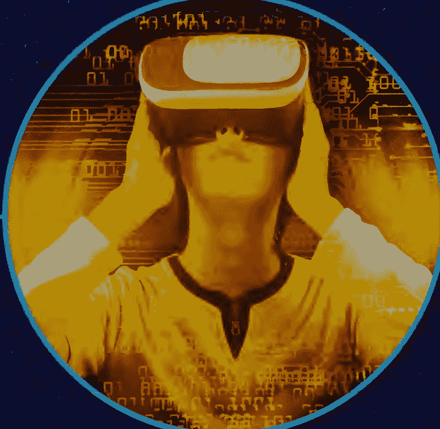

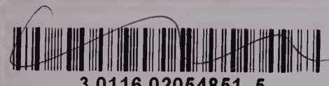

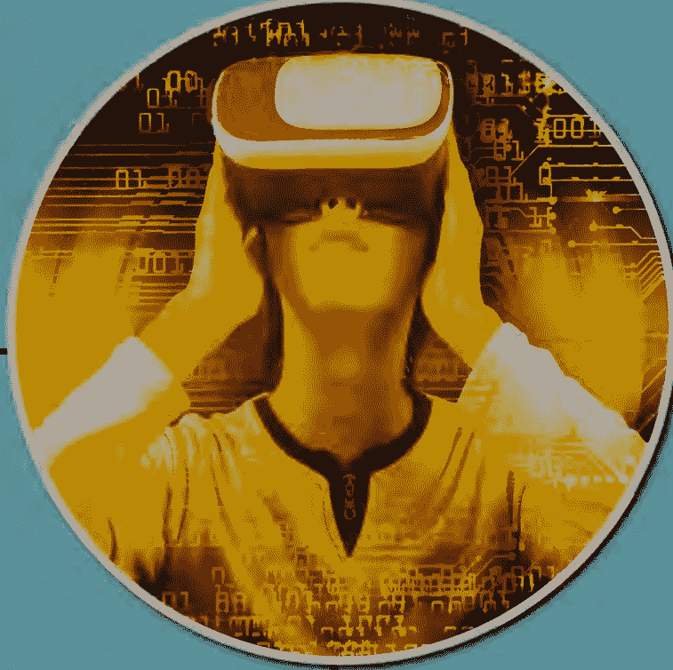

克劳迪娅·马丁 (Claudia Martin)

丛书编辑：Izzi Howell

设计：Rocket Design (东亚洲) Ltd

插画：Rocket Design (东亚洲) Ltd

内部编辑：Julia Bird


Scratch 由 MIT 实验室的终身幼儿园小组开发。详见 `http://scratch.mit.edu`。书中使用的第三方商标是其各自所有者的财产，包括 Scratch 名称和标志。所有设计元素均来自 Shutterstock。

# 计算机是……

## 计算机是

计算机是由一组被称为“程序”的指令控制的机器。大多数人每天都使用计算机来完成各种事情，从帮助完成作业到听音乐。

计算机处理信息，这些被称为数据。计算机能够存储数据并利用它执行任务，这被称为“处理”。然后计算机向用户显示结果。

### 技术谈

程序是告诉计算机该做什么的指令列表。没有程序，计算机什么也做不了。程序将任务分解为不同的步骤，例如：首先，然后。现代计算机以各种形式处理数据：

## 硬件

硬件是计算机运行的部件。软件存储在硬件中。当你使用计算机时，显而可见的硬件部分是屏幕和键盘。计算机

- 主板

- CPU

- 内存

### 起之初

数千年前，人们发明了计算设备来帮助求和。这些是电子机器。

第一个机械计算器由数学家布莱斯·帕斯卡（Blaise Pascal）于 1642 年发明。它通过联动轮的旋转进行加法和减法。遗憾的是，这台机器太复杂了。

#### 计算机的早期形式

算盘出现在几千年前。像现代计算机一样，算盘通过织物进行工作。算盘是利用织物进行计数。算盘有七根杆子。

#### 算盘

> 可编程机器的发展的一个巨大进步是约瑟夫·玛丽·雅卡（Joseph Marie Jacquard）于 1801 年发明的织机。织机是编织物的机器。雅卡织机的非凡之处在于，织工第一次可以对织机编程以织出图案。程序是以打孔卡的形式存在的，孔代表制作图案的彩色线。

#### 计算机可以画画、播放音乐或

#### 火星上的航天器

### 科学谈

今天的计算机由电力驱动。台式计算机插在电源。智能手机和笔记本电脑由电池驱动，电池可以储存一定量的电。它们需要从电源充电。所有的计算机数据都通过被称为电流的小流量传输。

#### 计算机无处不在

当你想到计算机时，你可能想象的是一台带有屏幕和键盘的机器。这些被称为个人电脑（PC），因为它们是供一个人使用的。但有些计算机看起来完全不同。

有几种类型的电脑：

台式计算机这些沉重的计算机固定在一个地方。它们有独立的屏幕和键盘，并使用鼠标作为访问屏幕位置的指向设备。大多数台式计算机还有扬声器、麦克风和摄像头。

笔记本电脑这些轻型计算机通常采用“合盖”形式，键盘位于“外壳”的下方，屏幕位于上方。它们的指向设备通过触摸操作，使用触控板。

平板电脑是平板状的手持设备。它们通过触摸屏幕（触摸屏）进行操作。平板电脑有摄像头、扬声器和麦克风，还有一个“加速度计”，它可以监测移动并确保计算机显示始终竖直。

### 项目

如果你有一块算盘，或者可以使用珠子进行加法和减法。这里有一个让你开始的例子：

40 + 12 = 52

| 40 | 12 | 52 |

|---|---|---|

| | | |

#### 在你的家里和学校里。

到处都是“隐藏”的计算机。这些计算机通常被程序化为执行比个人电脑更有限的任务。它们中的大多数设备没有屏幕、键盘或鼠标，所以你可能根本不会将它们识别为计算机。在游戏机、相机、汽车、飞机、交通信号灯和机器人玩具等各种机器内部都有计算机。

就像你的个人电脑一样，自动取款机内部的计算机也处理数据工作。这些数据包括你的私人个人密码、你想要提取的现金总量以及你银行账户中的资金总额。计算机的软件提供如何使用这些数据的指令，然后如何显示工作结果——通常是发放现金。

### 项目

你可以在个人电脑上完成哪些任务？在成人的帮助下，尝试在接下来的一周内使用计算机完成这些任务。在每种情况下，写下你执行该任务时使用的软件名称：

- 写一个故事。

- 画幅画。

- 访问儿童友好网站。

- 播放一段曲子。

- 创建演示文稿。为什么不展示一下你软件的研究结果呢！

#### 对于计算机来说，一切都是 1 和 0 的流

计算机的电路无法以文字或图片的形式存储和处理数据。计算机将接收到的所有数据转换为它们可以快速处理的形式：数字。

计算机是数字设备。这意味着它们使用数字（数位）执行所有操作。计算机实际上处理的是两个数字：0 和 1。这些被称为二进制数。

### 数学对话

在二进制数字系统中，没有数字 2、3、4、5、6、7、8 和 9。尽管如此，任何数字都可以以二进制形式给出。在二进制中，计数方式如下：

| 二进制值 | 十进制值 |

|---|||

| 0 | 0 |

| 1 | 1 |

| 10 | 2 |

| 11 | 3 |

| 100 | 4 |

| 101 | 5 |

| 110 | 6 |

| 111 | 7 |

| 1000 | 8 |

| 1001 | 9 |

| 1010 | 10 |

你能看出这个规律吗？尝试从 11 数到 20。

#### 111111S 和 000000S。

二进制数控制计算机电路的开启和关闭。CPU 包含许多带有开关的微型电路。就像灯开关一样，这些微型开关控制电路中电流的开启或关闭。1 开启电流。0 关闭电流。电路的不断开启和关闭让计算机能够执行其工作。

#### 技术对话

这是一块电路板，一块上面绘制有电气电路的板子。银色的插头是大型的老式晶体管。今天的晶体管非常小，只有在显微镜才能看到。

> 计算机电路中的微型开关被称为晶体管。它们由名为硅的材料制成，硅可以通过化学处理让电流流动或停止流动。开关是由经过两种方式处理的硅制成的。晶体管由约翰·巴丁（John Bardeen）、威廉·肖克利（William Shockley）和沃尔特·布拉特恩（Walter Brattain）于1947年发明。从那时起，晶体管变得越来越小。今天，它们可以小到 7 纳米。一个纳米是米的十亿分之一。

#### 计算机的“大脑”是它的中央处理器的大脑

CPU 是一个关键硬件部件。它执行计算机所有的计算并控制它的其他硬件。

为了执行任何任务，每台计算机都遵循相同的流程：

- 输入：计算机接收数据。这被称为输入。

- 内存：当计算机接收输入时，CPU 和内存协同工作：CPU 读取存储在内存中的程序，并将数据存储在内存中。

- 处理：计算机在其 CPU 中处理数据。

- 输出：计算机给用户工作结果。这被称为输出。

### 跳出框架思考！

你可以把大脑想象成自己的。考虑一下：

1. 你接收来自 CPU 的指令。

2. 你在内存中搜索数据。

3. 你使用你的大脑算出算式。

4. 你给回结果。

### 处理单元。

现代 CPU 是小型扁平的硅芯片。它们也被称为“集成电路”。它们包含许多可以开启或关闭的开关。在1971年微处理器发明之前，计算机非常笨重。

### 数学对话

CPU 拥有的开关越多，处理速度就越快。1975年，电子专家摩尔（Moore）预测计算机能力每两年翻一倍。他是对的！今天的微处理器包含数十亿个开关。

## 内存可以存储多达十亿

计算机内存的重要部分位于其主板上：ROM 和 RAM。

- ROM：“只读存储器”即使在计算机关闭时也会存储程序。

- RAM：“随机存存储器”是工作时存储数据的地方。当用户关闭计算机时，除非保存到硬盘，否则数据将会丢失。

- 硬盘：硬盘位于台式电脑中，但某些平板电脑使用内存代替。

### 数学对话

1956年，第一块硬盘重 1000 公斤，尺寸有两台冰箱大。它只存储了 3.75 兆字节。今天大多数硬盘重 62 克（一个鸡蛋的重量），容量为 10 TB。

### 设备

如果你需要更多的内存空间，可以将数据保存到外部设备上。在外部设备上备份（制作副本）文件也是良好的习惯，以防计算机损坏。

优存盘

优存盘（也称为闪盘或 USB 盘）可以放在口袋里，用于将数据从一台计算机携带到另一台计算机。

内存卡

内存卡可以滑入笔记本电脑、平板电脑和智能手机中。

#### 云存储

云存储是将数据保存在世界上其他地方的计算机上，通常位于数据中心。数据通过互联网传输。

#### 数学

就像距离以厘米、米和公里为单位一样，内存以字节、KB、MB、GB 和 TB 为单位。一个字节包含 8 个二进制位。一个 KB 包含 8000 个二进制位。一个 TB 包含 8 万亿二进制位。一个包含 100 个单词文本的文件可能约为 45 KB，而数字码相机拍摄的照片为 1 MB 或更多。

# 输入设备

你可能熟悉使用键盘、鼠标和触摸屏等输入设备。还有许多其他设备和传感器可以向计算机提供信息。

**键盘** 在计算机键盘上，每个按键都是一个向计算机发送电子信号的开关。计算机软件能够解释不同的按键动作。

**扫描仪** 扫描仪用于捕捉放在机器中的照片或纸质文档图像。彩色扫描仪会记录图像中每个微小区域内红、绿、蓝（原色）的比例。然后扫描仪会将这些信息转换为数字形式。

**鼠标** 通常，鼠标会向你的桌面投射出明亮的光，其中一些光会从桌面反射回传感器。随着鼠标的移动，反射光的光路会随之变化。

**条形码器** 这些输入设备读取商品标签上的条形码。条形码是代表数字的黑白线条图案。光敏传感器向条形码投射一束光并测量反射的光。黑色反射的光比白色少。读取器将该图案转换为二进制数字：黑色为 0，白色为 1。

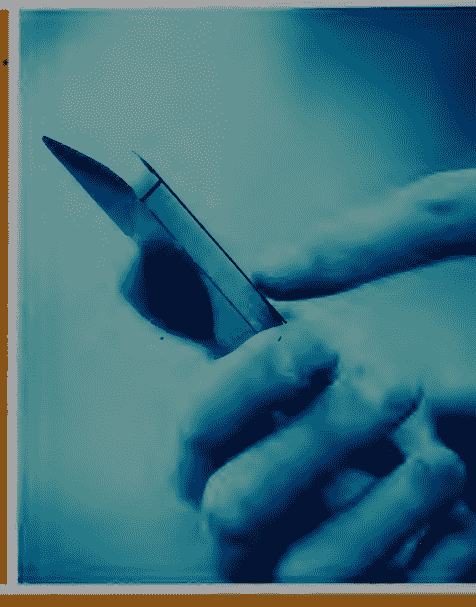

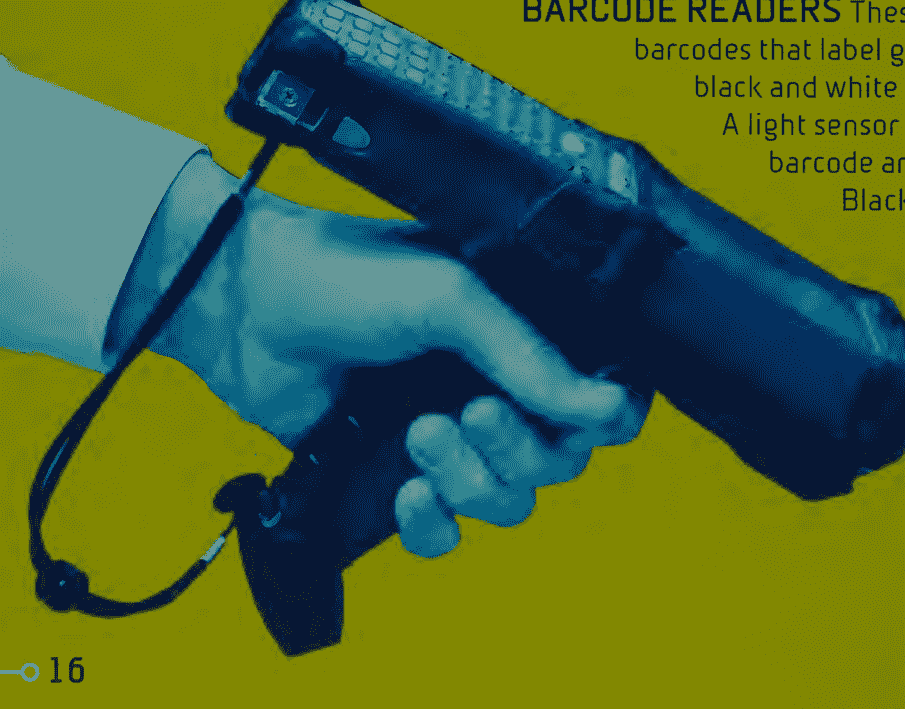

## 这些都是输入设备。

#### 跳出框架！

鼠标的工作非常出色，以至于大多数人从未考虑过替代方案。然而，还有其他手持指针设备，它们并没有广泛使用。一种是手写笔，配合触摸屏使用的笔状设备。另一种是光笔，它向特殊的计算机屏幕投射光。你能为手持输入设备设计一种新设计吗？

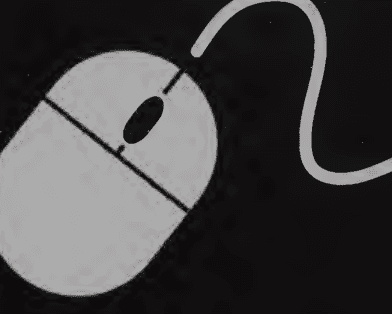

有些计算机可以接受语音输入。为了接受语音输入，计算机需要麦克风和语音识别软件。当我们说话时，我们的词汇具有响亮和柔和的声音模式。例如，硬辅音（如 p）是一个突然而响亮的声音。语音识别软件会将响亮和柔和的模式与其数据库中的约 50 多个音位（语音声音）进行比较。

### 技术科技

智能手机和平板电脑有触摸屏，而笔记本电脑用触控板代替鼠标。触摸屏或触控板下方有一个电路网格。它们能捕捉你手指的移动并向计算机发送信号。许多触摸屏可以识别特定的触摸动作，例如捏合缩放和滑动电子书页面。

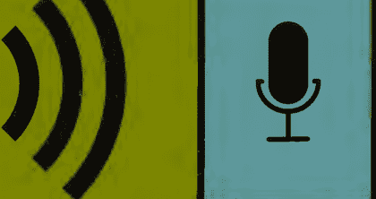

## 屏幕是最常见的输出设备，

### 输出设备

当你向计算机输入单词时，计算机通常会在屏幕上显示它们。它还可以将它们发送到打印机，或者通过扬声器广播它们。这些都是输出设备。

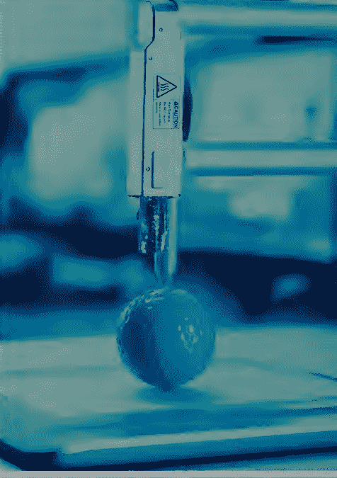

今天，计算机屏幕通常是液晶显示器（LCD）。LCD 覆盖着数千个像素，即屏幕的微小区域。每个像素都有三个子像素：红、绿、蓝。当包含数据（如文字、图片或视频）的电子信号发送到像素时，液晶会发生变化允许光线透过。根据像素需要显示的颜色，它允许不同比例的光线透过红、绿、蓝子像素。通过组合这三种原色，可以创建任何颜色。

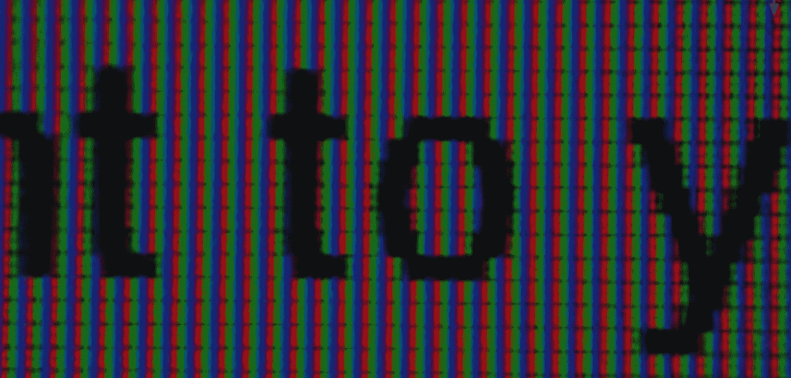

#### 但还有很多其他设备。

#### 跳出框架！

如果你回顾第 9 页那些“隐藏”的计算机，你可能会想到更多的计算机输出设备。例如，交通灯被程序设定为按顺序显示颜色。灯光就是它的输出设备。你认为说话机器人的输出设备是什么？

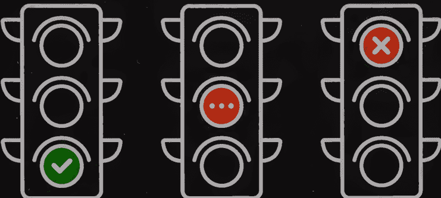

计算机通过电线或空气中的无线电波将数据发送到打印机。打印机将信号转换为最终形式：黑白文档、彩色照片甚至是三维（3D）物体。3D 打印机使用塑料或金属层层创建物体。

### 技术科技

另一种常见的计算机输出是声音，如语音、游戏特效或音乐。声音以振动的形式在空气中传播。这些振动被计算机的麦克风捕捉并转换为电子信号。计算机声卡将这些信号转换为二进制数字。为了输出，声音被转换回电子信号并发送到扬声器。信号让扬声器振膜振动，产生声音。

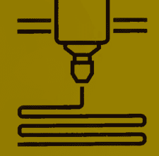

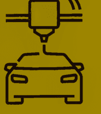

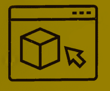

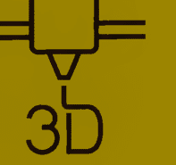


## 任何人都可以尝试自己编程

程序是一组有序的指令。计算机程序员使用许多编程语言之一（通常称为代码）编写他们的指令。


首先，程序员精确决定计算机需要做什么，将指令拆解为不会误解的逐步命令。与其反复输入相同的命令，程序员经常创建子程序。这些是程序中需要重复的部分。例如，每当程序员想要命令计算机播放乐曲时，他们都会告诉计算机运行“播放歌曲”。有时丰富的程序员也会出错！错误（bug）是任何导致程序无法运行的错误，例如在你想“右转”时说“左转”。

### 项目

编写一个程序让朋友行走：

- 为朋友选择一个路径，例如方形或六边形。

- 将你的指令拆解为易懂的命令，例如前进步数或半转。

- 你想包含子程序吗？

- 现在在你的程序中插入一个错误，但不要让你的朋友受伤！

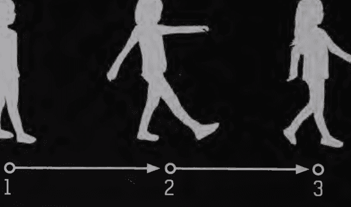

#### 计算机程序不同的编程代码或语言是用数字、符号或单词编写的。无论使用何种编程语言，计算机的“解释器”都会将其转换为 1 和 0 的字符串。你在学校使用的计算机语言包括 Scratch、Java 和 Python。

### 项目

在成人的许可下，尝试 Scratch。在 Scratch 中，编写一个角色在屏幕上移动很容易。角色会听从你的话，就像你在操场上的朋友一样。标准的 Scratch 角色是一只猫。你以带有命令的彩色块向它提供指令，例如“移动 10 步”。

- 访问 `https://scratch.mit.edu/` 并点击“试试看”。

- 找到让猫移动的块。它们位于屏幕中心的深蓝色“动作”组。将其中一些块拖到屏幕右侧的空白区域。

- 点击这些块查看角色在做什么。

```
 10 STEPS
TURN 15 DEGREES
MOVE 10 STEPS
TURN 15 DEGREES
```


# 笔记本电脑或智能手机中的技术是几十年来逐步发展的。一些伟大的思想家和发明家在这段旅途中发挥了作用。

# 查尔斯·巴贝奇 (1791-1871)

英国数学家查尔斯·巴贝奇通常被称为“计算机之父”。1837年，他设计了最早的真正的计算机——分析机，尽管他只制造了部分。它将是第一台可编程的计算机器，使用约瑟夫·玛丽·雅卡尔发明的孔片（见第7页）。任何计算都可以通过一组相互锁定的齿轮完成。该机器将由蒸汽驱动。

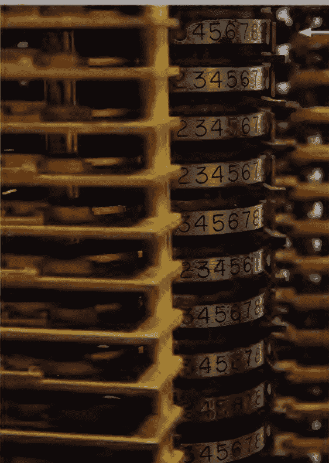

#### 艾达·洛芙莱斯 (1815-1852)

艾达·洛芙莱斯是英国诗人拜伦勋的女儿，巴贝奇的朋友。作为一位才华横溢的数学家，她预见到了（未制造的）分析机不仅仅是一个计算器的潜力。她编写了第一个供分析机使用的算法（一种通过一系列步骤解决问题的方法）。这使她成为世界上第一位计算机程序员。


# 名人堂：计算机科学家

##### 赫曼·霍立立 (1860-1929)

美国发明家赫曼·霍立立（Herman Hollerith）发明了打孔卡制表机，这是一种记录和排序信息的电气机器。这是数据处理领域的一个突破。他的理念是，任何信息都可以通过卡片上打的孔来记录。如果卡片上的特定区域代表性别，例如，那里的一个孔可能意味着“男性”。该系统最初用于美国人口普查局记录人口信息。

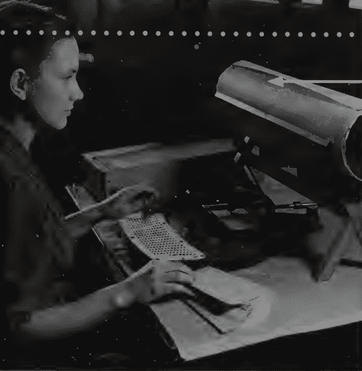

##### 艾伦·图灵 (1912-1954)

英国科学家艾伦·图灵（Alan Turing）发展了我们许多关于计算机如何运作的观点，尽管他的“图灵机”只是一个非常复杂的想法，而不是一台真实的机器。特别是，他研究了未来的电子计算机如何通过二进制数字字符串进行控制。他预测计算机有一天能像人类一样思考，我们称之为人工智能。今天，图灵也因为同性恋而受到迫害而被人记住。


##### 约翰·莫奇利 (1907-1980) 和 J. 普斯斯珀·埃尔特 (1919-1995)

美国发明家于1946年制造了第一台通用电子数字计算机，称为ENIAC（电子数值积分器和计算器）。它的输入、输出和内存存储均以打孔卡的形式存在。它每秒可以进行357次10位数的乘法。ENIAC占据了167平方米的地面空间，重量达30吨！

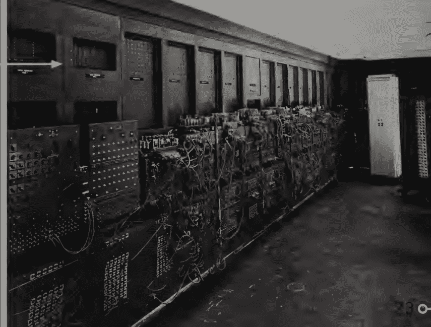

#### 有成千上万的软件程序


软件的关键部分是计算机的操作系统。它控制计算机的基本功能，以及其他软件如何使用`CPU`和内存。它解释输入，将其转换为`1`和`0`。微软`Windows`是台式电脑最常用的操作系统。许多移动设备，如平板电脑和智能手机运行安卓操作系统。然而，苹果`Mac`台式电脑运行`Mac OS`操作系统，而移动设备运行`iOS`。

> 艺术对话

> 现代操作系统通过图形用户界面（`GUI`）与用户通信。它们最早开发于20世纪80年代初。`GUI`是由下拉菜单、程序坞和图标组成的系统，你点击它们来告诉计算机执行不同的任务。我们往往认为`GUI`是理所当然的，但仔细观察会发现它们的设计非常精妙。许多功能是通过图片而不是文字展示的。今天，孩子们学习理解`GUI`与他们学习阅读非常相似。

检查一下你个人电脑上的`GUI`。如果可以，你会改变它的设计吗？还是它已经运行得很完美了？


#### 但你经常使用哪些呢？

##### 家庭软件

你计算机上的软件可能包括用于输入文档的文字处理程序、电子邮件程序、用于浏览网站的网络浏览器，以及播放音乐和视频的媒体播放器。反病毒软件可以防止你的计算机受到危险软件（病毒）的破坏，病毒通过互联网在计算机之间传播。

##### 专业软件

许多程序的创建是为了帮助人们更容易地完成工作。这些包括用于创建演示文稿或电子表格的程序、`2D`或`3D`设计程序、网站设计程序以及创建动画的程序。

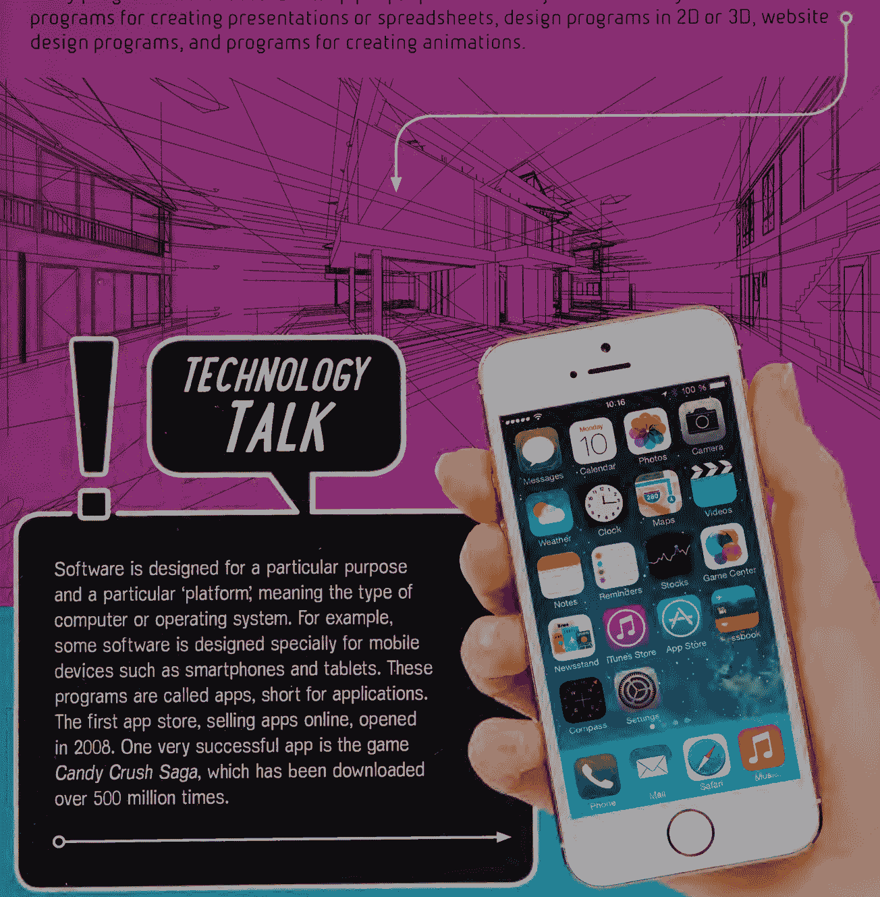

软件是为特定目的特定“平台”（即计算机类型或操作系统）设计的。例如，某些软件是专为智能手机和平板电脑等移动设备设计的。这些程序被称为`app`，应用程序的缩写。第一个在线销售应用的商店于2008年开放。一个非常成功的应用是游戏《糖果大曲》（`Candy Crush Saga`），它的下载量超过了5亿次。

> 技术对话

#### 在计算机上创建的图像是

### 图形

> 最早的个人计算机只能显示单色文本和数字。计算机的发展导致了更真实、更令人兴奋的图形。


到20世纪80年代，个人电脑开始拥有彩色屏幕。到90年代，更快的处理速度使得图形创建变得更快。随着这些发展，摄影也发生了变化，照片存储在计算机而不是胶片上。今天，软件开发者编写了许多创建图形和编辑照片的程序。图形主要有两种类型：

在这张20世纪80年代的位图中，可以看到独立的像素

- **位图图形**：图像由像素组成。

- **矢量图形**：图像由线条组成。

在这张20世纪80年代的位图中，可以看到独立的像素

- **位图图形**：图像由像素组成。

- **矢量图形**：图像由线条组成。

在这张20世纪80年代的位图中，可以看到独立的像素

- **位图图形**：图像由像素组成。

- **矢量图形**：图像由线条组成。

## 创建于 1962 年。

大多数家用游戏机使用手持式控制器作为输入设备，通过按钮或摇杆来控制游戏中的移动。某些游戏控制器（如`Wii`遥控器）包含运动传感器。另一种常见的输入设备是用于舞蹈游戏的触敏垫子。对于某些游戏机，玩家完全不需要触摸输入设备。例如，`Xbox 360`使用`Kinect`相机检测玩家的动作。

`Kinect`输入设备会对动作和语音指令做出响应。

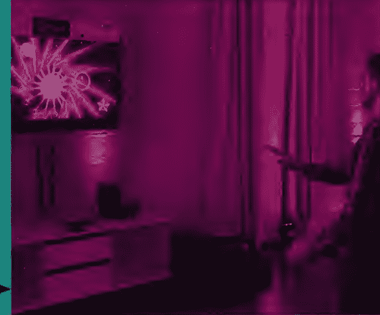

#### 艺术

许多热门游戏提供了虚拟世界，玩家可以在其中与其他玩家互动。玩家选择一个化身，即在世界上代表自己的精灵。通常，化身可以由玩家设计得看起来像他们自己，或者设计得奇特又惊喜。在普通游戏中，图形背景可能非常真实或美丽，但在虚拟世界中，它们被设计为玩家享受和游戏互动的关键部分。流行的虚拟世界包括《我的世界》（`Minecraft`）和《第二人生》（`Second Life`）。

在《我的世界》中，玩家可以设计自己的房子、公园和城市。

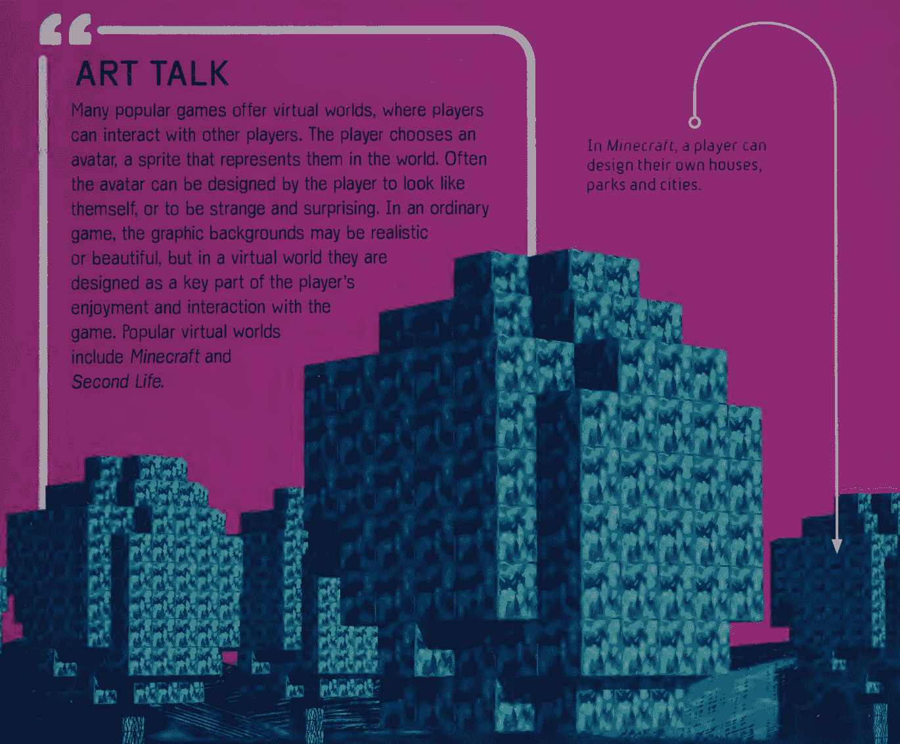

## 最早的计算机占据整个房间。因此，它们只能由政府和大型机构使用。一系列突破促促进了如今个人电脑的发展，而这些电脑存在于办公室、家庭和口袋中。

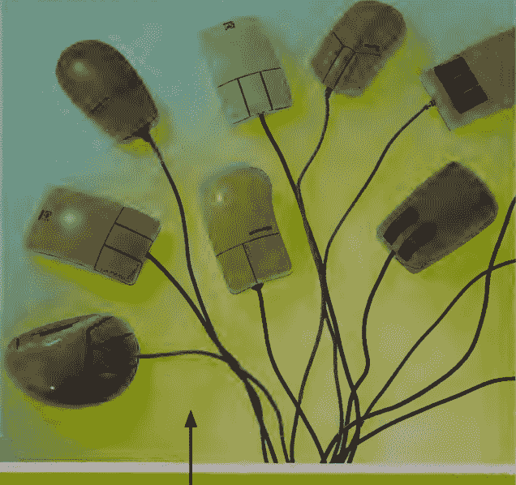

#### 苹果 II，1977年

这是第一批带有微处理器的即用个人电脑之一。它由苹果电脑公司的联合创始人史蒂夫·沃兹尼亚克（`Steve Wozniak`）和史蒂夫·乔布斯（`Steve Jobs`）设计。苹果`II`的最初售价为`1,298`美元，约相当于今天货币的`4,000`英镑。

#### 鼠标，1963年

鼠标是由美国计算机工程师道格拉斯·恩格尔巴特（`Douglas Engelbart`）和威廉·英国（`William English`）于`1963`年发明的。第一个鼠标有一个木制外壳、一块电路板和两个金属轮。九年后，英国将轮子替换为可以监测任何方向运动的球，改进了设计。`1973`年，`Xerox Alto`成为第一个使用鼠标的桌面电脑。

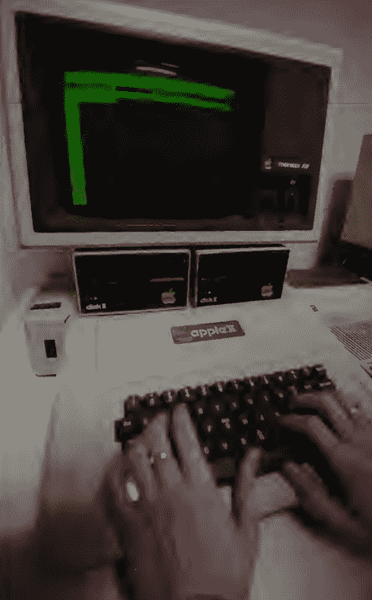

#### 智能手机，1994年

`1994`年，`IBM Simon`（西蒙）是第一部运行软件的手机，并带有用于手笔的触摸屏。应用程序包括电话录、日历、计算器、时钟和电子记事本。西蒙还可以发送和接收电子邮件。三年后，即`1997`年，第一批智能手机配备了用于搜索网页的网络浏览器。

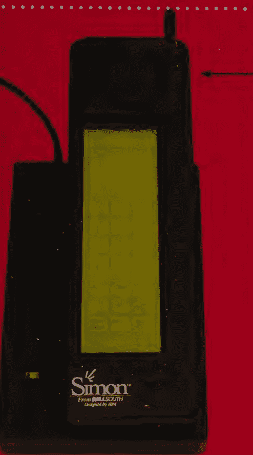

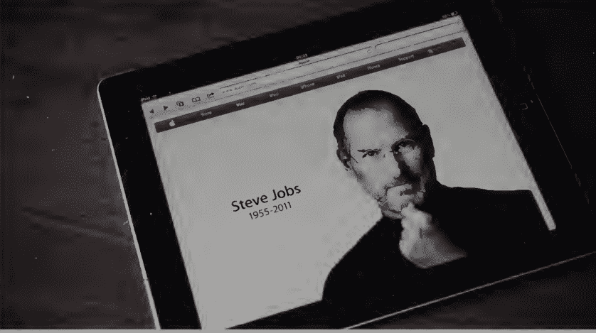

#### iPad，2010年

平板电脑自21世纪初就问世了，但直到苹果在`2010`年推出`iPad`，它们才变得真正流行。`iPad`的成功归功于它的许多内置功能，如无线网络连接、摄像头和音乐库。

#### 谷歌眼镜，2013年

这种可穿戴计算机配备了屏幕和摄像头。它接受来自语音命令和侧面触摸板的输入。谷歌眼镜在一年后停止发售，部分原因是人们担心被秘密偷拍。然而，计算的未来可能仍然在于可穿戴设备。


## 网络连接跨越房间的计算机，

### 网络

最早的网络使用电线连接一栋建筑内的计算机……如今，互联网是一个覆盖全球的庞计算机网络。


网络共享数据和其他资源的方式。有线网络由铜线或光纤建立。许多家庭通过铜线连接，数据以电信号传输。大多数新网络使用光纤，数据以光脉冲的形式传输。光纤传输传输的速度比铜线快得多。

#### 局域网

小型网络连接学校和办公室内的计算机和打印机。

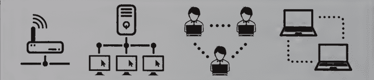

#### 广域网

广域网连接跨城市、国家和世界的计算机。

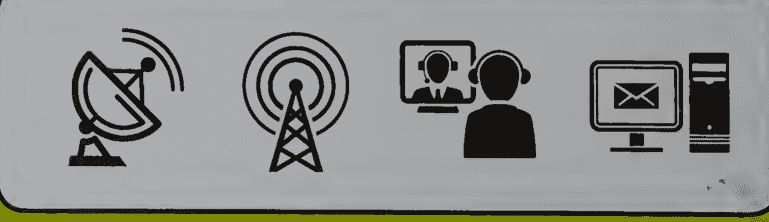

#### 城市或行星。

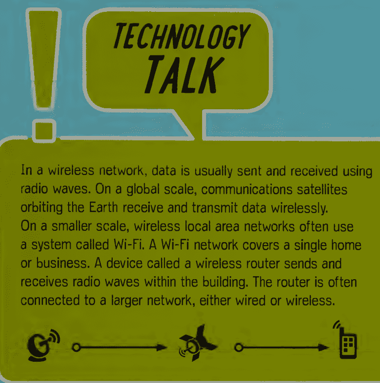

人们经常使用“网页”（`web`）和“互联网”（`Internet`）来表示同一个意思。事实上，互联网是一个全球网络，由电缆、卫星和无线连接组成。网址的结尾被称为后缀，它可以告诉我们关于运行该机构的一些信息，例如：

| 后缀 | 含义 |
| :--- | :--- |
| `.co.uk` | 由英国企业创建 |
| `.org` | 由慈善机构创建 |
| `.gov` | 由政府托管 |

#### 网页

网站是存储在计算机上的文档。网站可以包含文字、图像和视频。网页是由计算机科学家蒂姆·伯纳斯-李（`Tim Berners-Lee`）于`1989`年发明的。我们使用称为浏览器的软件查看网站。`HTML`是超文本标记语言。流行的浏览器有`Google Chrome`和`Internet Explorer`。当我们点击链接时，就会移动到另一个网站。浏览器向存储该网站的计算机发送请求。浏览器通过互联网返回数据。

### 技术谈

所有地址都以“`http`”开头，代表超文本传输协议。大多数网址都有“`www`”，代表世界维员网。互联网是一种交换数据的方式。在较小尺度上，它覆盖一栋建筑；在较大的尺度上，它覆盖全球。互联网用户比例最高的国家是冰兰，最低的国家是厄立特里。

### 跳出框框思考！

万维网为知识和通信开辟了巨大的可能性。然而，当我们使用网页时，思考我们如何使用它是重要的。任何人都可以创建一个包含虚假或有害信息的网站。当我们使用允许我们直接与他人交流的网站（通常称为社交网络）时，我们需要考虑自己的行为方式，并警惕他人的行为。由于网页是由人创建的，它的好坏取决于使用它的人。

## 虚拟现实 (VR) 正在改变我们

### 虚拟现实的方式

“虚拟”意味着“几乎”。虚拟现实是指计算机创造出一个似乎就在你眼前的世界，但它实际上只是程序的产物。

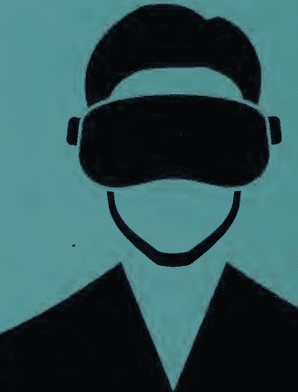

虚拟现实不是在屏幕上观看的，而是通过头戴式设备观看的。在游戏中，虚拟现实头戴设备让玩家感觉自己完全处于游戏世界中。头戴设备中的运动传感器捕捉头部动作，程序会改变视角以匹配这些动作。虚拟现实手套和体服通过对皮肤施加微小的压力，带给人在虚拟世界中触摸东西的感觉。

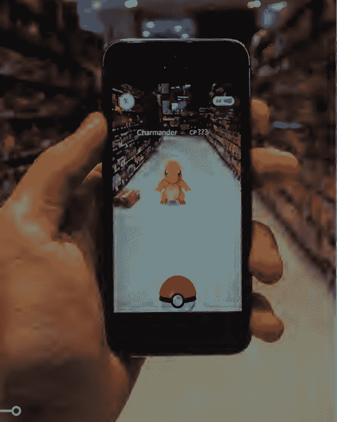

### 艺术对话

增强现实 (`AR`) 可于移动计算设备（如智能手机和平板电脑）的软件。增强现实与虚拟现实不同：它通过摄像头提供真实世界的视图，并添加额外功能，如有用或趣味性的图形、声音或文字。`2016`年发布的游戏《宝可梦 Go》，其特点是出现在屏幕上的虚拟生物，就像出现在现实世界一样。玩家必须找到它们。增强现实的一个缺点是用户可能会分心而忽视现实世界的安全！`2016`年，两名玩《宝可梦 Go》的男子走下了悬崖。幸运的是，他们没有受重伤。

### 学习、游戏与工作。

### 跳出框架思考！

虽然虚拟现实最常用于游戏，但也被应用于一些工作场所。它的技术对训练士兵很有帮助，士兵可以在不让自己陷入危险的情况下体验身处战斗的感觉。外科医生也能使用虚拟现实进行训练，为他们提供执行手术的真实体验，而不需要人类参与。

你能想到其他哪些虚拟现实会有帮助的职业或活动吗？增强现实可以提供有用功能的情况又有哪些？考虑一下教育、建筑、购物、交通和政府领域。

- 这位士兵正在使用虚拟现实程序学习如何进行跳伞跳。

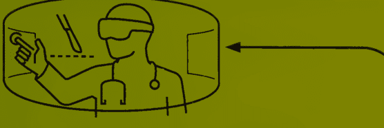

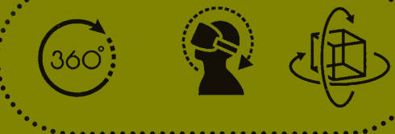

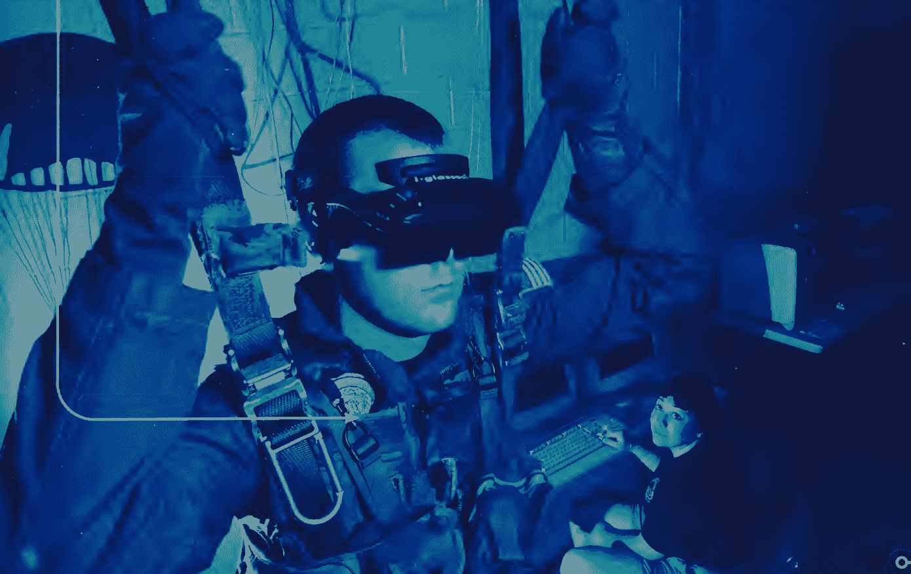

## 人工智能 (AI) 是计算机

### 人工智能

目前，大多数个人电脑只完全执行我们告诉它们要做的事情。然而，有些计算机被程序设定为“自己思考”，就像人类一样。这些计算机被称为拥有人工智能。

计算机只是执行程序指示它们做的任何事情。`AI`本身是通过编程创建的。`AI`程序使用数学算法允许计算机在对问题的不同回答之间做出选择。这些程序还允许计算机从过去的事件中“学习”。这是通过算法实现的：如果动作`A`产生了这个结果，但动作`B`产生了更好的结果，那么在未来将选择动作`B`。

### 跳出框架思考！

带有`AI`的计算机和机器人自`1920`年来一直出现在虚构作品中，当时捷克克作家卡雷尔·恰佩克写了一部关于机器人反抗人类主人的戏剧。无数其他书籍、电影和电视节目都关注了计算机自主思考的危险，包括`2004`年的电影《机械机器人》和`2015`年的儿童电视节目《伊芙 (`Eve`)》。你认为人类为什么对`AI`既着迷又担心？

- 机器人`Nao`包含一个运行`AI`程序的计算机。

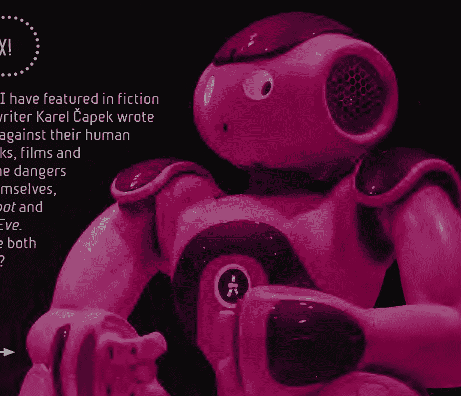

### 似乎在自己思考。

`1950`年，艾伦·图灵（见第23页）开发了一项测试，用来判断计算机是否像人类一样思考的能力。图灵测试由一个人类测试者同时进行两场“对话”，一个与人类对话，一个与计算机对话，使用键盘和屏幕，以使得测试者无法看到正在和“谁”说话。测试者必须判断哪是人，哪是计算机。`2014`年，一个名为`Eugene Goostman`的计算机第一次通过了测试。

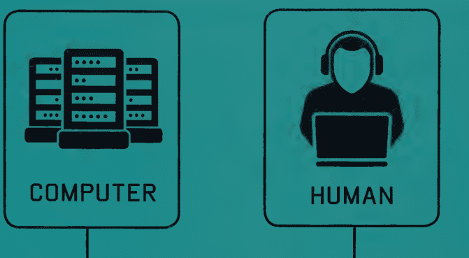

图灵测试中，计算机不需要给出正确答案，只需要人类会给出的答案。


### 项目

智能助手 (`IPAs`) 是为用户执行服务的程序，例如回答问题和通过网络预订桌位。像`Siri`或`Alexa`等智能可以在手机找到。

- 我可以提供什么帮助？

- 什么是人类助手？

- 什么是智能助手？

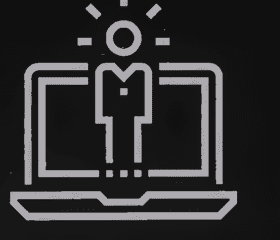

#### 这些计算机可能会改变对计算机的认知

`ALMA`（阿塔卡马大毫米/亚毫米波阵列）是位于智利的望远镜。相关器结合来自许多天线的信号以创建图像。这台超级计算机每秒执行数万亿次操作。

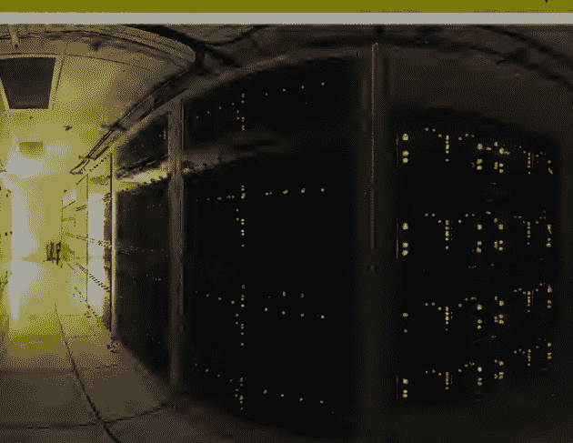

#### 树莓派

树莓派是一种价格低于`25`英元的小型计算机。它被用于学校教学。它包含一个`CPU`并用于编程。

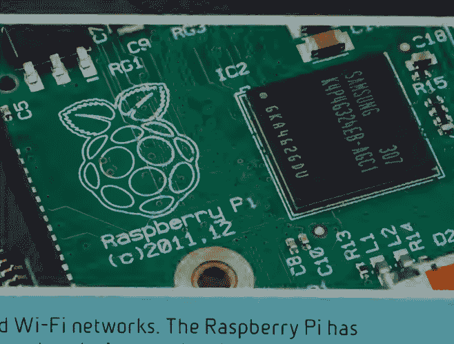

#### 旅行者号

旅行者号探测器是距离地球最远的人造物体。它于`1977`年发射并穿过了太阳系。它利用深空网络发送数据。

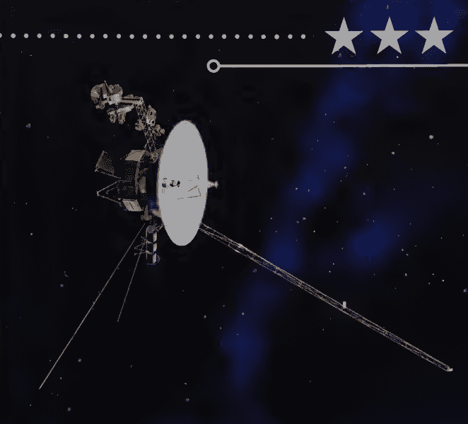

#### 起搏器

起搏器是一种放置在人体胸内的小型电子设备，用于监测和控制心脏问题。它使用电冲保持心脏正常工作。这些机器每天挽救数百生命。

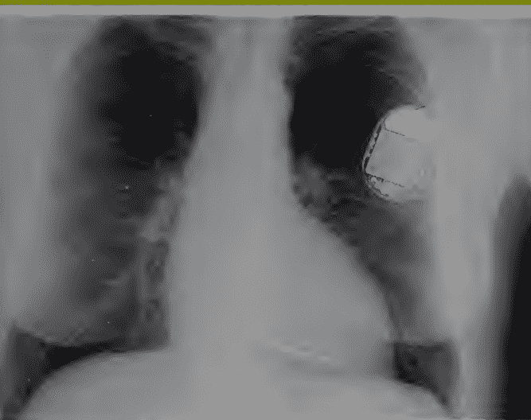

#### 谷歌

谷歌不是一台计算机，而是位于谷歌数据中心的由约`90`万台强大计算机组成的网络。这些计算机允许全球估计`11`亿用户搜索网络。谷歌可以被视为世界上最大的计算机或计算机集群。

## 自20世纪中期以来发生改变的星球

在计算机进入办公室之前，许多打字员和职员被雇佣在机械打字机上打印信件和文件，或用铅笔和纸绘制图表和表格。在`1961`年第一台机器人投入工厂之前，工厂雇佣了数百万从事体力劳动的工人。今天，已有`160`万台工业机器人。

工人不再需要一一整天都待在工作场所。通过电子邮件，工人可以在任何连接互联网的地方工作。摄像头允许在所有人到场的情况下进行会议，“临现场”机器人更进一步。通过传感器、麦克风和摄像头，远处的工人可以通过工作场所的机器人说话和观察，就像他们在场一样。临现场机器人现在已应用于教育领域，在远程学校授课，或为住院的孩子授课。


### 而且更加复杂。

互联网改变了我们相互互动的方式。社交网络网站`Facebook`由马克·扎克伯格及其朋友于`2004`年推出。到`2017`年，`Facebook`已经拥有了`19`亿用户，他们在这里分享自己的观点、活动记录和照片。今天，有些人每天可能只与一或两人面对面交流，但在网上却与数百甚至数千人“交流”。尽管我们可能觉得比以前联系更频繁，但也许我们中的一些人感到更加孤独。我们的在线“朋友”是真正的朋友吗？我们如何判断他们是否如他们表现出来那样

### 数学对话

`1950`年，世界上只有几台计算机。如今，每年有约`3.5`亿台台式电脑和笔记本电脑售出。此外，至少还有`9`亿智能手机和`2`亿平板电脑被购买。

### 计算机从未停止发展和

#### 未来的计算机

自从`70`年前第一台电子数字计算机问以来，计算机变得越来越小、越来越快。在未来的`70`年里，计算机将发生什么变化？

计算机可能会继续变得更快。然而，许多人认为，为了实现这一点，必须放弃目前使用硅片中电子电路的计算方法。新的计算方法的想法正在开发中：

- **量子计算机**可以使用极微小的天然粒子来存储和处理数据。

- **化学计算机**可以使用化学品的混合物，通过它们相互反应来执行计算。

- **光学计算机**可以使用光，其开关方式与当今计算机中的电流类似。

> 我们家中的一些设备装有微型计算机，它们通过互联网与其他设备通信，创造了“物联网”。这些连接的设备被称为“智能”：我们已经有了智能加热系统和可以使用手机开启的智能水壶，以及能够重新订购食物的智能冰箱。未来，整个房子都可能是智能的，浴室会在洗澡时间自动运行，卧室会在睡觉时间自动就好。

#### 改变——而且它们永不会停止。

在未来，我们可能不再使用物理（“真实”）设备，如笔记本电脑或智能手机。我们使用的“设备”将是我们独一无二的数字身份，可能是一个名字或数字。使用该身份，我们将通过非物理门户（或“门”）访问计算系统，而这些门户尚未被发明。也许数据将使用增强现实的形式进行查看。

### 跳出框架思考！

未来计算的另一种可能方法涉及集成纳米电子设备。“集成”意味着“链接”，“”，“纳米”意味着“微小”。这种计算方法可能直接通过我们的脑信号工作，这些信号沿着神经系统以微小电信号的形式传输。当你想要使用计算机时（它可能佩戴在皮肤上或植入皮肤中），你会想“开启”，而不是按下“开机”开关。这听起来像科幻小说，但对于生活在20世纪初的人来说，智能手机听起来同样不可思议。

## 词汇表

**算法（algorithm)** 解决问题时遵循的一系列规则。

**动画（animations）** 通过逐次显示略有不同的图像来创造运动幻觉的图形。

**人工智能（artificial intelligence）** 可以执行通常需要人类智能的任务的计算机程序。


**二进制（binary）**由两部分组成；二进制系统只使用`0`和`1`。

**中央处理器（central processing unit）**计算机的“大脑”，大多数操作发生的地方。

**电路板（circuit board）**安装电气电路的板子。

**数据（data）**信息。

**数据库（database）**存储在计算机上的组织良好的数据集合。

**数据中心（data center）**容纳许多网络计算机的建筑，用于存储和处理大量数据。

**数字的（digital）**以`0`和`1`的模式表示的信息或信号。

**电子书（ebook）**在计算机或其他电子设备上阅读的书。

**电路（electrical circuits）**电流可以流过的环路。

**文件（files）**作为一个单元存储的数据集。

**硬件（hardware）**计算机的机械装置、布线和其他物理部分。

**输入（inputs）**馈入计算机的信息。

**互联网（Internet）**全球计算机网络网络。

**操纵杆（joysticks）**用于控制计算机运动的手持杆杆。

**标志（logos）**公司用于识别产品的符号。

**微处理器（microprocessors）**作为现代计算机“大脑”的小型电子设备。

**主板（motherboard）**固定计算机主要部分的电路板。

**网络（networks）**通过电缆、无线连接连接的计算机。

**像素（pixels）**屏幕上表示图像的最小单位。

**处理（processing）**通过将数据通过一系列操作对数据进行操作。

**无线电（radio waves）**用于通过空气发送信号的能量形式。

**内存（RAM）**随机存取存储器；计算机关闭时存储数据的地方。

**只读存储器（ROM）**仅读存储器；存储程序。

**搜索引擎（search engine）**搜索网站的程序。

**传感器（sensors）**对光、声音或其他属性有响应的设备。

**社交网络（social networking）**允许人们与其他建立联系的网站。

**软件（software）**计算机使用的程序。

**网页（web）**全球性的超文本网络，通过互联网访问。

**摄像头（webcam）**可以发送图像或视频的摄像。

## 延伸阅读

《数字技术》Tom Jackson, 2016.

《项目代码》Kevin Wood, 2017.

## 在以下网站了解更多关于计算机和编程的信息：

- www.bbc.co.uk/education/topics/

- findout.com/coding/

- scratch.mit.edu/

## 测验

- 用二进制表示该数字。

- 谁发明了万维网（World Web）？

- 举出一个输入设备。

- 哪部电影是完全用计算机成像（CGI）制作的？

- 哪些计算机离地球最远？

测验答案

- `1011`

- 蒂姆·伯纳斯-李

- 键盘和扬声器

- 《玩具总动员》

- 飞掠一号探测器上的三台计算机

## 索引

算盘 6

算法 22

应用程序 25

人工智能 38

增强现实 36

未来的计算机 44-45

游戏 25,28-29

数据 4, 10, 23

数字技术 10

电路 11, 13

电子计算机

帕斯卡 Blaise 7

巴贝奇 Charles 22

条形码 19

伯纳斯-李 Tim 34, 35

二进制数字 10, 11

位图 26

漏洞 20

字节 15

中央处理器 5, 12-13

CGI（计算机成像） 27

自动售货机 9

数据 15

硬盘 14

输入设备 16-17, 29

操纵杆 15

爱达拉斯 Ada 22

键盘 16

内存 5, 14

微处理器 13, 30

主板 5, 14

网络 32, 33

操作系统 24

输出设备 18-19

个人计算机

台式电脑 8, 43

笔记本电脑 8, 43

平板电脑 8, 17, 25, 31, 43

可穿戴设备 31

照片 15, 26

像素 18, 26

打印机 19

编程 4, 20-21, 22

无线电波 5

RAM 5, 14

ROM 5, 14

搜索引擎 31

传感器 17

社交网络 32

软件 5, 9, 17, 24-25

网页 31, 33, 34-35, 43

摄像头 17

无线网络 33

虚拟现实 36, 37

虚拟世界 29

# STEAM 系列内容列表

## 建筑

- 入门基础

- 拱门与圆顶

- 设计建筑

- 比例与平面图

- 透视与古建筑

- 希腊人与罗马人

- 城堡与大教堂

- 建筑师

- 房屋

- 环保建筑

- 摩天大楼

- 地标建筑

- 公共建筑

- 桥梁

- 著名的桥

- 隧道

- 当出现问题时

- 恶劣环境

## 计算机

- 什么是计算机……

- 无处不在的计算机

- 0与1

- 计算机的大脑

- 内存输入

- 输出

- 编程

- 早期时代

- 计算机科学家

- 软件

- 游戏

- 个人电脑

- 网络

- 网页

- 虚拟现实

- 人工智能

- 令人惊叹的计算机

- 改变的星球

- 未来计算机

## 材料

- 选择材料

- 天然还是人造

- 固体

- 液体与气体

- 岩石与矿物

- 木材

- 金属、玻璃建筑

- 塑料

- 陶瓷

- 织品

- 艺术

- 复合材料

- 化学品

- 超材料

- 特殊表面

- 形状改变者

- 回收

- 未来材料

## 机器人

- 设计机器人

- 运动部件

- 电路

- 视觉与导航

- 代码编程

- 人工智能

- 机器人伦理

- 第一批机器人

- 危险中的机器人

- 太空机器人

- 无人机与汽车

- 真实的机器人

- 家用机器人

- 机器人与医学

- 仿生学

- 机械臂

- 机器人

- 虚构机器人

## 太空

- 学习太空

- 我们的太阳系

- 星

- 星系与宇宙

- 彗星与流星

- 黑洞

- 大爆炸

- 天文学家

- 天文与望远镜

- 太空探索

- 空间科学

- 宇航员

- 宇航训练

- 国际空间站

- 太空步

- 火箭

- 空间探测器

- 卫星

- 空间殖民地

- 未来探索

## 交通工具

- 设计车辆

- 陆地车辆

- 自行车

- 汽车

- 著名的汽车

- 火车

- 飞机

- 水上交通工具

- 船与船舶

- 气垫船

- 飞机

- 直升机

- 极端车辆

- 动力

- 材料

- 速度

- 刹车

- 安全特性

- 风格

- 记录打破者

- 未来车辆

| 图书馆服务 |

| A & H |

| 30116 02054851 5 |

| J004 少儿 |

| N |

| AKCNF17SS006 |

## 计算机

《STEAM冒险》探索了科学、技术、工程、艺术和数学在一系列迷人主题中的作用。发现激发灵感的创作和人物，看看好奇和创造力如何带来突破性的发现，并通过有趣的项目测试自己的想法！

探索如何编写程序来画画、玩游戏、发送电子邮件以及让太空探测器降落在火星上。看看古代算盘是如何演变成如今的超级计算机的，并开始编写你自己的程序。

## 系列标题
