# 敏捷项目管理傻瓜指南（第 2 版）


## 第一部分：理解敏捷

### 第一章：项目管理的现代化

- 项目管理需要一次改新
- 现代项目管理的起源
- 现状的问题
- 引入敏捷项目管理
- 敏捷项目是如何运作的
- 为什么敏捷项目效果更好

### 第二章：应用敏捷宣言与原则

- 敏捷宣言概述
- 敏捷宣言的四项价值和工具概述
- 价值 1：个人与交互优于过程
- 价值 2：可工作的软件优于详尽的文档
- 价值 3：客户合作优于合同谈判
- 价值 4：响应变化优于遵循计划
- 定义 12 条敏捷原则
- 关于客户满意的敏捷原则
- 关于质量的敏捷原则
- 关于团队合作的敏捷原则
- 关于项目管理的敏捷原则
- 增加铂金原则
- 反抗形式主义
- 像团队一样思考和行动
- 可视化而非书写
- 敏捷价值带来的变化
- 敏捷试金石

### 第三章：为什么敏捷效果更好

- 评估敏捷的收益
- 敏捷方法如何胜过传统方法
- 更大的灵活性和稳定性
- 减少非生产性任务
- 高质量，交付更快
- 提升团队性能
- 更严密的项目控制
- 更快且成本更低的失败
- 为什么人们喜欢敏捷
- 执行层
- 产品开发与客户
- 管理层
- 开发团队

## 第二部分：实践敏捷

### 第四章：敏捷方法

- 深入敏捷方法的伞下
- 回顾三大方法：精益（`Lean`）、`Scrum` 和极端编程（`Extreme Programming`）
- 精益概述
- `Scrum` 概述
- 极端编程概述
- 将它们整合在一起

### 第五章：环境中的敏捷实践

- 创建物理环境
- 确定团队位置
- 设置专属区域
- 消除干扰
- 移动办公
- 低技术沟通
- 高技术沟通
- 选择工具
- 工具的目的
- 组织限制

### 第六章：行为中的敏捷实践

- 建立敏捷角色
- 产品负责人（`Product owner`）
- 开发团队成员
- `Scrum` 主（`Scrum master`）
- 利益相关者（`Stakeholders`）
- 敏捷导师（`Agile mentor`）

《傻瓜式敏捷项目管理》

- 建立新价值观
- 承诺（`Commitment`）
- 勇气（`Courage`）


- 专注（Focus）……105
- 坦诚（Openness）……106
- 尊重（Respect）……107
- 团队哲学（Team Philosophy）……107
- 专属团队（Dedicated team）……108
- 跨功能性（Cross-functionality）……100
- 自我组织（Self-organization）……100
- 自我管理（Self-management）……100
- 规模限制的团队（Size-limited teams）……112
- 所有权（Ownership）……113

## 第三部分：敏捷计划与执行……15

### 第七章：定义产品愿景与路线图……17

- 敏捷计划（Agile Planning）……18
- 渐进式细化（Progressive elaboration）……20
- 检查并调整（Inspect and adapt）……20
- 定义产品愿景（Defining the Product Vision）……21
- 第 1 步：制定产品目标（Step 1: Developing the product objective）……22
- 第 2 步：创建愿景声明草（Step 2: Creating a draft vision statement）……23
- 第 3 步：验证并修订愿景声明（Step 3: Validating and revising the vision statement）……25
- 第 4 步：定稿愿景声明（Step 4: Finalizing the vision statement）……26
- 创建产品路线图（Creating a Product Roadmap）……26
- 第 1 步：建立利益相关者（Step 1: Establishing stakeholders）……27


# 第 2 步：建立产品需求（Step 2: Establishing product requirements） 28

# 第 3 步：安排产品功能（Step 3: Arranging product features） 30

# 第 4 步：估算工作量并排序需求（Step 4: Estimating efforts and ordering requirements） 31

# 第 5 步：确定高层时间框架（Step 5: Determining high-level time frames） 35

# 保存你的工作（Saving your work） 35

# 完成产品待办列表（Completing the Product Backlog） 35

## 第八章：计划发布与冲刺（Planning Releases and Sprints） 139

### 提炼需求和估算（Refining Requirements and Estimates） 139

#### 什么是用户故事？（What is a user story?） 140

#### 创建用户故事的步骤（Steps to create a user story） 142

#### 拆解需求（Breaking down requirements） 146

#### 估算扑（Estimation poker） 148

#### 亲和性估算（Affinity estimating） 150

### 发布规划 152

### 冲刺规划 155

#### 冲刺待办列表 156

#### 冲刺规划会议 157

## 第9章：全天候工作 163

### 规划你的一天：每日 Scrum 163

### 跟踪进度 166

#### 冲刺待办列表 166

#### 任务看板 170

### 冲刺中的敏捷角色 172

### 创建可交付的功能 174

#### 详化 175

#### 开发 175

#### 验证 176

### 识别障碍 178

### 一天工作的结束 179

## 第10章：展示工作、检查与适应 181

### 冲刺评审 181

#### 准备演示 182

#### 冲刺评审会议 183

#### 在冲刺评审会议中收集反馈 186

### 冲刺回顾 187

#### 冲刺回顾计划 189

#### 冲刺回顾会议 189

#### 检查与适应 190

## 第11章：准备发布 193

### 准备产品部署：发布 Scrum 193

### 准备运营支持 197

### 准备组织进行产品部署 199

### 准备市场进行产品部署 200

# 第4部分：敏捷管理 203

## 第12章：范围管理与采购 205

### 敏捷范围管理有什么不同？ 206

### 管理敏捷范围 208

#### 理解整个项目中的范围 208

#### 引入范围变更 211

#### 管理范围变更 211

#### 使用敏捷产制品进行范围管理 213

### 敏捷采购有什么不同？ 214

#### 管理敏捷采购 216

##### 确定需求并选择供应商 216

##### 理解服务的成本方法和合同 218

##### 采购的组织考量 221

##### 与供应商合作 223

##### 结束合同 224

## 第13章：管理时间与成本 225

### 敏捷时间管理有何不同？ 225

### 敏捷计划 227

#### 引入速率（Velocity） 228

#### 监控和调整速率 229

#### 从时间角度管理范围变更 234

#### 通过多个团队管理时间 235

#### 使用敏捷产物进行时间管理 236

### 敏捷成本管理有何不同？ 237

### 敏捷预算 238

#### 创建初始预算 239

#### 创建自给自足的项目 240

#### 使用速率确定长期成本 242

#### 使用敏捷产物进行成本管理 244

## 第14章：管理团队动态与沟通 245

### 敏捷团队动态有何不同？ 245

### 敏捷团队动态 247

#### 变得自管理和自组织 248

#### 支持团队：仆人式领导 252

#### 与专属团队合作 254

#### 与跨职能团队合作 255

#### 强化开放性 257

#### 限制开发团队规模 258

#### 离散团队项目管理 259

### 敏捷沟通有何不同？ 262

### 敏捷沟通 263

#### 理解敏捷沟通方法 263

#### 状态和进度报告 266

## 第15章：管理质量与风险 269

### 敏捷质量有何不同？ 269

### 敏捷质量 272

#### 质量与冲刺 273


- 主动质量 ......................................................275
- 通过定期检查和适应确保质量 ................280
- 自动化测试 .........................................................281
- 敏捷风险管理有何不同？ ................................283
- 管理敏捷风险 ............................................................................................286
- 内生性降低风险. .......................................................................................286
- 早期识别、优先排序并响应风险. ................................291

## 第 5 部分：确保敏捷成功 ................................................295

## 第 16 章：建立基础 ........................................................297

组织与个人承诺 ............................................297
- 组织承诺 ...................................................................298
- 个人承诺 ........................................................................299
- 获得承诺 ..........................................................................299
- 你能完成转型吗？ ................................................................300
- 转型的时机 .......................................................................302
- 选择合适的试点团队成员 ........................................302
- 敏捷倡导者 ........................................................................302
- 敏捷转型团队 ................................................................303
- 产品所有者 ..........................................................................304
- 开发团队 ........................................................305
- `Scrum Master` ...................................................................305
- 项目利益相关者 ..........................................................306
- 敏捷导师 ..................................................................307
- 创建支持敏捷的环境 ................307
- 初期及长期支持敏捷性. ........................310

## 第 17 章：跨敏捷团队扩展 ................................311

多团队敏捷项目 .......................................................312
- 通过垂直切分使工作易于消化 ...............314
- `Scrum` 之会（`Scrum of scrums`） ...................................................................315
- 通过角色在大规模 `Scrum` 中对齐 ........................318
- 扩展 `Scrum Master` ..................................................319
- 扩展产品所有者 ........................................320
- 每天同步一小时 ................................322
- 使用 `LeSS` 进行多团队协调 ................................323
- `LeSS`，小型框架 ................................323
- `LeSS Huge` 大框架 ........................................324
- 冲刺评审集市（`Sprint review bazaar`） ........................................325
- 每日站会的观察者 ................................326
- 组件社区与导师 ................................327
- 多团队会议 ........................................327
- 流动者 .........................................................327
- 使用 `Nexus` 减少依赖 ........................327
- `Nexus` 角色 — `Nexus` 集成团队 ................328
- `Nexus` 产物 ........................................330
- `Nexus` 事件 .........................................330
- 使用 `SAFe` 进行联合计划规划 .....................................................................................332
- 理解四个 `SAFe` 层级 ......................................................................................333
- 联合计划增量规划（`Joint program increment planning`） .................................................336
- 管理者的清晰度 .......................................................................................337
- 企业级 `Scrum` 的模块化结构 .................................................337
- `ES` 元素 ................................................................................337
- `ES` 关键活动 .................................................................................................338

## 第 18 章：成为变革者. ................................................................343
- 变得敏捷需要变革 ................................................................343
- 变革不会自动发生 ................................................................344
- 实施和管理变革的策略方法 .................................345
- 库恩（`Lewin`）模型 .................................................................................................345
- `ADKAR` 变革的五个步骤 .................................................................346
- 科特（`Kotter`）领导变革的八个步骤 .......................................................348
- `Platinum Edge` 变革路线图 ................................................349
- 第一步：带有成功指标的实施策略 ................................................352
- 第二步：建立意识和兴奋感 .................................................352
- 第三步：组建转型团队并识别试点项目 .................................................353
- 第四步：建立成功的环境 ........................................................355
- 第五步：成功培训并根据需要招聘 .........................................355
- 第六步：通过敏捷教练启动试点 ................................................356
- 第七步：执行价值路线图 ........................................................357
- 第八步：收集反馈并改进 .................................................357
- 第九步：成熟并固化改进 ...................................................358
- 第十步：在组织内部逐步扩展 ................................................359
- 避免陷阱 .........................................................................................360
- 你的变革失效的迹象 ......................................................363

## 第 6 部分：十的部分. ...................................................................367

## 第 19 章：敏捷项目管理的十大核心收益. ................369
- 更好的产品质量 .......................................................................369
- 更高的客户满意度 .......................................................370
- 降低风险 ........................................................................................371
- 增强协作与所有权 .......................................371
- 更具相关的指标 ...................................................................372
- 提高性能可见性 ................................................373
- 增强项目控制 .........................................................374
- 提高项目可预测性 ............................................374
- 定制化团队结构 .......................................................375
- 更高的团队士气 ...................................................................376

## 第20章：项目成功的十个关键因素 . 377
- 投入的团队成员 . 377
- 地协作 . 378
- 自动化测试 . 378
- 强制执行完成定义 (`Definition of Done`) . 378
- 清晰的所有者愿景和路线图 . 379
- 产品所有者的赋能 . 380
- 开发者的多才性 . 380
- `Scrum Master` 的影响力 . 380
- 管理层学习的支持 . 381
- 转型支持 . 381

## 第21章：敏捷组织的十个指标 . 383
- 投资回报率 (`ROI`) . 383
- `ROI` 预算中的新请求 . 386
- 资本重新部署 . 386
- 满意度调查 . 387
- 生产环境缺陷 . 388
- 冲刺目标成功率 . 389
- 上市时间 . 390
- 提前时间和交付周期时间 (`Lead and Cycle Times`) . 390
- 变更成本 . 391
- 团队成员流动率 . 391
- 技能多才性 . 392
- 管理者与创造者的比例 . 392

## 第22章：敏捷专业人士的十个价值资源 . 395
- 傻瓜版敏捷项目管理在线速查表 . 395
- 傻瓜学 `Scrum` . 396
- `Scrum` 联盟 (The `Scrum` Alliance) . 396
- 敏捷联盟 (The Agile Alliance) . 396
- 项目管理协会 (`PMI`) 敏捷社区 . 397
- 国际敏捷联盟 (`ICAgile`) . 397
- `InfoQ` . 397
- 精益企业学院 (Lean Enterprise Institute) . 398
- 极端编程 (Extreme Programming) . 398
- `Platinum Edge` . 398

## 索引 . 401

# 引言

欢迎阅读《傻小白：敏捷项目管理》。敏捷项目管理已成为当今商业界与任何管理技术一样常见的手段。在过去的十五年里，我们为全球各种大小的企业提供了培训和指导，教导他们如何成功地运行敏捷项目。通过这些工作，我们发现我们需要编写一本易于理解的指南，让普通人也能理解并使用。

在书中，我们将消除一些关于敏捷项目管理本质及其非本质的误解。书中的信息将带给你信心，让你知道你可以通过敏捷技术取得成功。

# 关于本书

《傻小白：敏捷项目管理》第二版不仅仅是关于敏捷实践和方法论的介绍；你还将学习在项目上执行敏捷技术的步骤。书中的内容超越了理论，旨在成为一本实战手册，让普通人也能轻松上手，并提供你在项目管理一线应对敏捷流程并取得成功所需的工具和信息。

# 愚蠢的假设

既然你正在阅读这本书，你可能对项目管理有初步的了解。也许你是一个项目经理、项目团队的一员，或者是项目的利益相关者。或者，你可能没有正式项目管理方法的经验，但现在正在寻找解决方案。你可能听过“敏捷”这个词并想了解更多。或者你可能已经处于一个尝试变得更敏捷的项目团队中。

无论你的经验或熟悉程度如何，这本书都将提供你可能觉得感兴趣的见解。至少，我们希望它能为你可能遇到的任何关于敏捷管理的困惑或误解带来清晰的思路。

# 书中使用的图标

在本书中，你会发现以下图标。

**提示（Tips）**是帮助你在敏捷项目管理旅程中行的建议。提示可以节省你的时间并帮助你快速理解特定主题，所以当你看到它们时，请看一看！

**记住（Remember）**图标提醒你可能在之前的章节中见过的内容。它也可能提醒你一些容易被忘记的常识原理。当重要的术语或概念出现时，这些图标可以帮助唤起记忆。

**警告（Warning）**图标表示你需要注意某些操作或行为。务必阅读这些内容，以避开大问题！

**技术细节（Technical Stuff）**图标表示有趣但对正文并非关重要的信息。如果你遇到技术细节图标，你不需要为了敏捷项目管理而阅读它，但其中的信息可能会引起你的兴趣。

**网络上（On the Web）**意味着你可以在书籍网站 `www.dummies.com/go/agileprojectmanagement` 找到更多信息。

# 书外拓展

虽然本书广泛涵盖了敏捷项目管理的各个领域，但在有限的页数内我们能做的有限！如果你在读到这里时想：“这本书太棒了！我可以在哪里学习更多关于如何通过敏捷方法推进我的项目？”，请查看第 22 章或访问 `www.dummies.com` 获取更多资源。


我们提供了一份关于根据敏捷原则评估项目的技巧速表（cheat sheet），以及使用敏捷技术管理项目的免费工具。要获取速表，请访问`www.dummies.com`并在搜索框中输入“Agile Project Management For Dummies Cheat Sheet”。在这里你也可以找到书中不同版本之间发生的任何重大更新或更改。

# 从此何向何处

我们写这本书是为了让你能够按任何顺序阅读。根据你的角色，你可能想要特别关注书中合适的章节。例如：

- 如果你刚开始学习项目管理和敏捷方法，请从第 1 章开始，一直读到最后。
- 如果你是项目团队的一员，并想知道如何在敏捷项目中工作的基础，请查看第 3 部分（第 7 至 11 章）的信息。
- 如果你是一个项目经理并好奇敏捷方法如何影响你的工作，请复第 4 部分（第 12 至 15 章）。
- 如果你了解敏捷项目管理的基础，并正寻求为公司引入敏捷实践或在整个组织中扩展敏捷实践，第 5 部分（第 16 至 18 章）将为你提供有用信息。

# 1 理解敏捷

## 本部分内容 ...

- 理解由于历史项目管理方法的缺陷和弱点，为什么项目管理需要现代化。
- 了解为什么敏捷方法作为传统项目管理的替代方案日益增长，并熟悉敏捷项目管理的基石：《敏捷宣言》和 12 条敏捷原则。
- 发现你的产品、项目、团队、客户和组织通过采用敏捷项目管理流程和技术可以获得的优势。

## 本章内容

- 理解为什么项目管理需要改变
- 了解敏捷项目管理

# 第 1 章

## 项目管理的现代化

敏捷项目管理是一种项目管理风格，专注于业务价值的早期交付、项目产品和流程的持续改进、范围灵活性、团队投入以及交付反映客户需求的经过测试的产品。

在本章中，你将了解到为什么敏捷在 20 世纪 90 年代中期作为软件开发项目管理的方法而出现，以及为什么敏捷方法会引起项目经理、投资新软件开发的客户以及那些资助软件开发部门的公司的关注。本章还解释了敏捷方法优于长期存在的项目管理方法的优势。

### 项目管理需要改造

项目是一个计划中的工作程序，需要大量的投入并计划完成。项目有目标和任务，并且通常必须在特定的时间内并在预算内完成。

由于你正在阅读这本书，你很可能是一个项目经理，或者是发起项目、参与项目或以某种方式受项目影响的人。

敏捷方法是对项目管理现代化需求的响应。要理解敏捷方法如何彻底改变项目，了解一下项目管理的历史、目的以及项目面临的问题将会有帮助。

### 现代项目管理的起源

项目自古以来一直。从中国的长城到提卡尔的玛雅金字塔，从印刷字机的发明到互联网的发明，人类完成了大小各的项目。

作为一门正式学科，我们所知的项目管理直到 20 世纪中叶才出现。第二次世界大战期间，世界各地的研究人员在计算机制造和编程方面取得了重大进展，主要是为了美国军方。为了完成这些项目，他们开始创建正式的项目管理流程。第一批流程基于美国军在二战期间使用的分步式制造模型。

计算机领域的人们采用了这些基于步骤的制造流程，因为早期的计算机相关项目严重依赖硬件，计算机占据了整个房间。相比之下，软件只是计算机项目的一小部分。在 20 世纪 40 年代和 50 年代，计算机可能有数千个真空管，但编程代码少于 30 行。40 年代用于早期计算机的制造流程，就是后来被称为“瀑布式”的项目管理方法的基础。

1970 年，一位名叫温斯顿·罗伊斯（Winston Royce）的计算机科学家在 IEEE 上发表了一篇名为《大型软件系统的管理》的文章，描述了瀑布方法的各个阶段。“瀑布式”一词是后来命名的，这些阶段（尽管有时命名不同）在本质上与罗伊斯最初定义的一致：

#### 1. 需求

2. 设计

3. 开发

4. 集成

5. 测试

6. 部署

在瀑布流项目中，只有在完成上一个阶段后，才会进入下一个阶段——这就是“瀑布”名称的由来。


纯瀑布式项目管理——在移动到下一个步骤之前完全完成每一个步骤——实际上是对罗伊斯（Royce）建议的误读。罗伊斯指出这种方法本质上具有风险，并建议在迭代中进行开发和测试，以创建出产品，而许多采用瀑布流方法的组织却忽视了这一点。

### 软件项目的成功与失败

遗憾的是，传统项目管理方法的停滞正逐渐追上软件行业。2015 年，一家名为 Standish Group 的软件统计公司对美国 10,000 个项目的成功和失败率进行了研究。研究结果显示：

- 29% 的传统项目完全失败。这些项目在完成之前就被取消了，没有产生任何产品发布。这些项目没有交付任何价值。
- 60% 的传统项目面临挑战。项目虽然完成了，但在预期与实际的成本、时间、质量或这些元素的组合之间存在差距。预期与实际结果之间的平均差异（从时间、成本和未交付的功能来看）远超过了 100%。
- 11% 的项目获得了成功。这些项目顺利完成，并在原预期的时间和预算内交付了预期的产品。

仅在美国，在应用开发项目上花费的数千亿美元中，就有数十亿美元被浪费在那些从未部署过任何单项功能的项目上。

瀑布流方法曾一直是软件开发中最常见的项目管理方法，直到在 2008 年左右被基于敏捷技术的改进型方法所超越。

### 现状存在的问题

当然，计算机技术自上个世纪以来发生了巨大的变化。现在许多人的手腕上都有电脑，其性能、内存和功能超过了人们最初开始使用瀑布流方法时存在的最大、最昂贵的机器。

与此同时，使用电脑的人群也发生了变化。人们不再为少数研究人员和军事人员创建带有简单程序的巨型机器，而是为普通大众创建硬件和软件。几乎每个国家的人每天都会直接或间接地使用电脑。软件运行着汽车、我们的家电器、我们的家庭；它提供了我们的日常信息和娱乐。甚至是小孩也会使用电脑——一个 2 岁的孩子比他们的父母更熟练使用 iPhone。对更新、更好产品的需求是持续的。

不知为何在技术成长的过程中，流程并没有落后。软件开发者仍然在使用 20 世纪 50 年的项目管理方法，而所有这些方法都源于为 20 世纪中期硬件密集型计算机设计的制造流程。

今天，那些成功的传统项目往往面临着一个问题：范围膨胀（scope bloat），即在项目中引入不必要的产品功能。

想想你每天使用的软件产品。例如，我们现在使用的这个文字处理器具有许多功能和工具。尽管我们每天都用这个程序写作，但一直只使用其中的一部分功能。我们对其他元素的使用频率较低，而且从未用过某些工具——而且想起来，我们也不认识有谁用过那些工具。那些少数人使用的功能就是范围膨胀的结果。

范围膨胀出现在各种软件中，从复杂的企业应用到正在使用的网站。图 1–1 显示了 Standish Group 的数据，说明了范围膨胀有多常见。在图中，你可以看到 64% 的请求功能很少或从未被使用过。

图 1–1 中的数字说明了时间和金钱的巨大浪费。浪费是传统项目管理流程无法适应变化的直接结果。项目经理和利益相关者知道，在项目中期引入变化是不受欢迎的；他们获得可能理想功能的最佳机会是在项目开始时。因此，他们要求：

### 引入敏捷项目管理

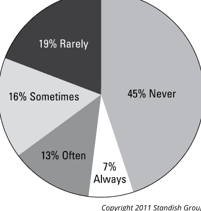

图 1-1:

所请求软件功能的实际使用情况。

Copyright 2011 Standish Group

- 他们需要的一切
- 他们认为他们可能需要的一切
- 他们想要的一切
- 他们认为他们可能想要的一切

结果就是功能的膨胀，导致了图 1-1 中的统计数据。

使用过时的管理和开发方法相关的问题并非小事。这些问题每年浪费数十亿美元。22015 年因项目失败损失的数十亿美元（参见侧边栏，“软件项目的成功与失败”）可能等于全球数百万个工作岗位。

在过去的二十年里，项目工作人员已经意识到传统项目管理日益严重的问题，并一直致力于创建一个更好的模型：敏捷项目管理。

敏捷技术的种子已经存在很了。事实上，敏捷的价值观、原则和实践只是常识的规范化。图 1-2 显示了敏捷管理的简史，可以追溯到 20 世纪 30 年代的计划-执行-检查-行动（PDSA）方法。

第 1 章 项目管理现代化 11

### 敏捷历史

- 1950 年：计划-执行-检查-行动（PDSA）方法。
- 1940 年：罗伊斯指出这种方法本质上具有风险，并建议在迭代中进行开发和测试。
- 1930 年：计划-执行-检查-行动（PDSA）方法。
- 1950 年：软件开发者仍然在使用 20 世纪 50 年的项目管理方法。
- 1970 年：罗伊斯指出这种方法本质上具有风险。
- 1980 年：丰健 Takeuchi 和野中 Nonaka 发表了《新产品开发》。
- 1986 年：丰健 Takeuchi 和野中 Nonaka 发表了《新产品开发》。
- 1990 年：丰健 Takeuchi 和野中 Nonaka 发表了《新产品开发》。
- 1995 年：丰健 Takeuchi 和野中 Nonaka 发表了《新产品开发》。
- 1996 年：丰健 Takeuchi 和野中 Nonaka 发表了《新产品开发》。
- 1997 年：丰健 Takeuchi 和野中 Nonaka 发表了《新产品开发》。
- 2001 年：一群软件和项目专家聚在一起讨论他们的共同点。这群人创建了《敏捷宣言》。
- 2008 年：瀑布流方法被基于敏捷技术的改进型方法所超越。
- 2009 年：丰健 Takeuchi 和野中 Nonaka 发表了《新产品开发》。
- 2011 年：Standish Group 版权。
- 2012 年：《敏捷项目管理入门》第一版。
- 2015 年：《Scrum 入门》。
- 2017 年：《敏捷项目管理入门》第二版。

图 1-2：敏捷项目管理时间线。

# 第 1 部分 理解敏捷

产品开发、增强和升级项目。通过对已完成的工作进行频繁且实地的检查，你可以在需要时进行时调整。经验性控制需要：

- **不改变的透明度：** 参与敏捷项目的每个人都知道正在发生什么以及项目进展如何。
- **频繁的检查：** 对产品和流程投入最多的人会定期评估产品和流程。
- **立即适应：** 快速进行调整以最大限地减少问题；如果检查发现某些变化，将立即进行更改。

为了适应频繁的检查和立即适应，敏捷项目以迭代（整个项目的较小部分）的形式工作。敏捷项目涉及的与传统瀑布项目相同类型的工作：你创建需求和设计、开发产品、对其进行文档，并在必要时将产品与其他产品集成。你测试产品、修复任何问题，并将其部署使用。然而，在瀑布项目中，你不是一次性完成所有产品功能的这些步骤，而是将项目拆分为多次迭代，也称为冲刺（sprints）。

图 1-3 显示了线性瀑布项目与敏捷项目之间的区别。

将传统的项目管理方法与敏捷方法结合，就像是在说：“我有一辆保捷 911 Turbo。但我左前侧用了一个马车轮。我如何能让我的车像其他保捷一样快？”答案自然是，你不能。如果你致力于敏捷方法，你将有更大的成功机会。


### 为什么敏捷项目效果更好

在本书中，你将看到敏捷项目如何比传统项目运作更好。敏捷项目管理方法可以产生更成功的项目。侧栏“软件项目成功与失败”中提到的 Standish Group 研究发现，29% 的传统项目完全失败，而在敏捷项目上这一数字仅下降到 9%。敏捷项目失败率的下降是因为敏捷项目团队根据对进度和客户满意度的频繁检查做了立即适应。

### 传统瀑布模型

| 需求 | 设计 | 开发 | 测试 | 最高 | 部署 |
| :--- | :--- | :--- | :--- | :--- | :--- |
| 最高 中 低 可选 | | 最高 高 中 低 可选 | 最高 高 中 低 可选 | 最高 低 可选 | 最高 中 低 可选 |

### 风险积累

#### 冲刺 1：最高优先级功能

| 需求 | 设计 | 演示与反馈 |
| :--- | :--- | :--- |
| 开发 集成 测试 | 设计 测试 | |

#### 冲刺 2：高优先级功能

| 需求 | 设计 | 演示与反馈 |
| :--- | :--- | :--- |
| 开发 集成 测试 | 设计 测试 | |

#### 冲刺 3：中等优先级功能

| 需求 | 设计 | 演示与反馈 |
| :--- | :--- | :--- |
| 开发 集成 测试 | 设计 测试 | |

#### 冲刺 4：低优先级功能

| 需求 | 设计 | 演示与反馈 |
| :--- | :--- | :--- |
| 开发 集成 测试 | 设计 测试 | |

#### 冲刺 5：可选优先级功能

| 需求 | 设计 | 演示与反馈 |
| :--- | :--- | :--- |
| 开发 集成 测试 | 设计 测试 | |

### 敏捷

图 1-3：瀑布模型与敏捷项目。

第 1 章 现代化项目管理 15

以下是敏捷方法优于传统项目管理方法的某些领域：

- **项目成功率：** 在第 15 章中，你将发现敏捷项目灾难性失败的风险降至几乎为零。根据业务价值和风险进行优先级排序的敏捷方法确保了早期的成功或失败。贯穿整个项目的测试方法有助于你尽早发现问题，而不是在花费大量金钱之后。
- **范围蔓延：** 在第 7、8 和 12 章中，你将看到敏捷方法如何适应整个项目的变化，最大限度地减少范围蔓延。在敏捷项目中，你可以在每个冲刺开始时添加新需求，而不会中断开发流。通过优先开发优先级功能，你防止了范围蔓延威胁关键功能。
- **检查与适应：** 在第 10 章和第 14 章中，你将找到敏捷项目定期检查和适应运作方式的细节。敏捷项目团队——拥有来自完整开发周期的频繁反馈以及可运行、可交付的功能——可以在每个冲刺中改进他们的流程和产品。

在本书的许多章节中，你发现了如何获得对敏捷项目结果的控制。及早且频繁测试、根据需要调整优先级、使用更好的沟通技术以及定期演示和发布产品功能，允许你对敏捷项目中的各种因素进行精细控制。

## 本章内容

- 定义敏捷宣言和 12 条敏捷原则
- 描述“铂金原则”（Platinum Principles）
- 理解项目管理中发生了哪些变化
- 接受敏捷试金石测试

# 第 2 章

## 应用敏捷宣言和原则

本章描述了什么是“敏捷”的基础：包含四个价值观的《宣言》，以及敏捷宣言背后的 12 条敏捷原则。我们还通过三个额外的铂金原则扩展了这些基础，这些原则是 Platinum Edge（由 Mark 所有）在支持组织敏捷转型的多年积累的经验后制定的。

这一基础为产品开发团队提供了所需的信息，以评估项目团队是否遵循了敏捷原则，以及他们的行动和行为是否符合敏捷价值观。当你理解了这些价值观和原则时，你将能够询问“这敏捷吗？”并对答案充满信心。

### 理解敏捷宣言

在 20 世纪 90 年代中期，互联网正在我们眼前改变世界。蓬勃发展的点网络行业的人面临着巨大的压力，要抢先推出快速变化的技术。开发团队日夜工作，力求在竞争对手使公司淘汰之前交付新的软件版本。

考虑到当时变化的速度，传统的项目管理实践不可避免地出现了裂痕。使用如第 1 章讨论的瀑布模型等传统方法无法让开发者对市场的动态性质和新兴业务方法做出反应。开发团队开始探索这些旧方法的替代方案。在此过程中，他们注意到了一些产生结果共同主题。

2001 年 2 月，这些新方法论的先驱在犹他州的斯诺伯德（Snowbird）见面，分享他们的经验、想法和实践；讨论改进软件开发的方法。他们无法想象这次会议对项目管理未来产生如此巨大的影响。他们所产生的宣言简单明了，随后的原则改变了信息技术领域，并继续彻底改变各个行业的项目管理，而不是软件开发。

该小组的工作注定使软件行业更加高效、更有人性、更具可持续性。

敏捷宣言是一个强有力的声明，经过精心设计，少于 75 个单词：

### 敏捷软件开发宣言

我们正在通过实践和帮助他人实践，来发现更好的软件开发方法。通过这项工作，我们重视：

#### 个人与交互优于过程和工具

可运行软件优于详尽文档

客户合作优于合同谈判

响应变化优于遵循计划

也就是说，右侧的项具有价值，而我们看重左侧的项。

* 敏捷宣言版权 ©2001; Kent Beck, Mike Beal, Arie van Bennekum, Alistair Cockburn, Ward Cunningham, Martin Fowler, James Green, Jim Highmuth, Andrew Hunt, Ron Jeffries, Ken Kern, Brian Mar, Robert C. Martin, Steve Mevel, Ken Schwab, Jeff Sutherland, Dave Thomas

此声明可以以任何形式自由复制，但必须通过本公告全文复制。

没有人能否认，敏捷宣言既是一份简洁又是一份具有权威性的陈述。传统方法强调僵化的计划、避免变化、记录所有内容并鼓励基于层级的控制，而敏捷宣言侧重于：

- 个人
- 沟通
- 产品
- 灵活性

敏捷宣言代表了项目构思、执行和管理方式的一场巨大转变。如果我们只读左侧的项，就能理解宣言签署者所愿景的新范式。他们发现，通过更多地关注个人和交互，团队通过有价值的客户合作以及良好响应变化，能够更有效地生产可运行软件。相比之下，传统上主要关注过程和工具通常会导致详尽或过度的文档，以遵守合同谈判并遵循不改变的计划。

研究和经验说明了为什么敏捷价值观如此重要：

- **个人与交互优于过程和工具：** 为什么？因为研究表明，当我们处理好个人交互时，性能会提升 50 倍。实现这一点的办法之一是让开发团队与赋权的产品所有者协作。
- **可运行软件优于详尽文档：** 为什么？因为未能在迭代（sprint）期间测试并纠正缺陷，在下一个迭代中花费的精力和成本可能会增加 24 倍。而在功能发布到市场后，如果由未参与产品开发的生产支持团队进行测试和修复，成本将增加 100 倍。

第 2 章 应用敏捷宣言和原则 19 页

客户合作优于合同谈判：为什么？因为一个全职且易于接触的产品所有可以通过为开发团队提供即时澄清，将客户的优先级与正在的工作对齐，从而使生产力提高四倍。


# 响应变化优于计划

为什么？因为瀑布模型下开发的特性有 64% 很少或从未被使用（第 1 章讨论）。从计划开始至关重要，但那是我们了解最少的时候。敏捷团队的计划并不比瀑布少——他们计划得多甚至更多。然而，敏捷团队采取及时计划的方法，在需要时进行足够的计划。根据现实调整计划是敏捷团队交付令客户惊喜产品。

敏捷宣言的创建者最初关注软件开发，是因为他们从事 IT 行业。然而，敏捷项目管理技术已扩展到软件开发之外，甚至是计算机产品之外。今天，人们在各种行业中使用敏捷方法创建产品，包括生物技术、制造业、航空航天、工程、营销、非营利工作甚至建筑施工。如果你需要对提供的产品或服务的早期反馈，你可以从敏捷方法中受益。

敏捷宣言和 12 条敏捷原则直接指软件；我们在全书中引用宣言和原则时将保持这些引用不变。如果你创建的是非软件产品，请在阅读时将你的产品进行替换。

## 概述敏捷宣言的四个价值观

敏捷宣言源于经验，而非理论。我们将在后续章节中回顾描述的价值观，考虑如果将它们付诸实践将意味着什么。这些价值观如何支持实现上市时间目标、应对变化以及重视人类创新？

## 价值观 1：个人与交互优于过程和工具

当你允许每个人为项目贡献自己的价值时，结果可能是巨大的。当这些人际交互关注于解决问题时，一个统一的目标就会出现。此外，通过过程和工具达成的协议将比传统的要简单得多。

在简单的对话中谈论项目问题，就可以在较短的时间内解决问题。试图通过电子邮件、电子表格和文档来模仿直接对话的力量会导致巨大的开销成本和延迟。这类管理、受控的沟通不仅没有增加清晰度，往往还是模糊且耗时的，并会分散开发团队创建产品的注意力。

考虑一下如果你高度重视个人和交互意味着什么。表 2-1 显示了重视个人与交互、重视交互与重视过程之间的某些区别。

### 表 2-1：个人与交互对比过程与工具

| 个人与交互具有高价值 | 过程与工具具有高价值 |
|---|---|
| **优点**：<br>沟通清晰且有效。<br>沟通快速高效。<br>随着人们共同工作，团队协作变得强大。<br>开发团队可以进行自我组织。<br>开发团队有更多机会进行创新。<br>开发团队可以根据需要自定义过程。<br>开发团队成员可以对项目拥有个人所有权。<br>开发团队成员可以获得更深层次的工作满意度。 | **优点**：<br>过程清晰且易于遵循。<br>存在沟通的书面记录。 |
| **缺点**：<br>开发团队必须具备参与、负责和创新的能力。<br>人们可能需要为了作为团队成员良好而放下自我。 | **缺点**：<br>人们可能过度依赖过程，而不是寻找创建良好产品的最佳方法。<br>一种过程不适用于所有团队——不同的人工作方式不同。<br>一种过程不适用于所有项目。<br>可能是模糊且耗时的。 |

你可以在书籍配套网站`www.dummies.com/go/agilemanagement`上找到表 2-1 的空白模板——记下适用于你和你的项目的各种方法的优缺点。

如果过程和工具被视为管理产品开发及所有相关内容（包括人和工作方式）的方法，人们就必须符合过程和工具。从性很难容纳新想法、新需求和新思维。敏捷方法重视人而非过程。这种对个人团队的强调将重点放在他们的能量、创新和解决能力上。在敏捷项目管理中使用过程和工具，但它们被刻意精简并直接支持产品创建。过程或工具越健壮，你花在维护和投入上的精力就越多，推迟的事情就越多。以人为中心，结果是生产力的飞跃。敏捷环境是以人为本且具有参与性的，可以随时适应新的想法和创新。

## 价值观 2：可运行软件优于详尽文档

开发团队的重点应该是可运行的功能。在敏捷项目中，衡量你是否真正完成某项产品要求的唯一方法是产生与其相关的可运行功能。对于软件产品，可运行软件意味着软件符合我们所谓的“完成定义”：至少经过了开发、测试、集成和文档记录。毕竟，可运行的产品是项目的目的。

你是否曾在一个状态会议上报告你已经完成了项目的（例如）75%？如果你的客户对你说“我们没钱了。我们现在得到 75% 吗？”会发生什么？在传统项目中，“75% 完成”传统上意味着进入了 75%，但完成了 0%。然而，在敏捷项目中，通过使用完成定义，你将拥有 75% 需求的可运行、可交付的功能——即优先级最高的 75% 需求。

尽管敏捷方法源于软件开发，但你也可以将其用于其他类型的产品。

必须对分散生产价值的任务进行评估，以查看它们是支持还是破坏了创建可运行产品的工作。表 2-2 显示了传统项目文档及其用途的示例。

## 识别有用文档

| 文档 | 该文档是否支持产品开发？ | 该文档是“仅够用”还是“过度金华”？ |
|---|---|---|
| 使用昂贵的项目管理软件创建的项目进度，包含甘特图。 | 否。从头到尾的进度表包含了详细的任务和日期，提供的细节超过了产品开发的需要。而且，在你们开发功能之前，其中许多细节就会发生变化。 | 过度金华。尽管项目经理可能花费大量时间创建和更新项目进度，但项目团队成员只想知道关键的交付物。管理层通常只想知道项目是按时、提前还是滞后了。 |
| 需求文档。 | 是。所有项目都有需求——即关于产品功能和需求的细节。开发团队需要知道这些来创建产品。 | 可能是过度金华；本应该足够用。需求文档很容易扩展到包含不必要的细节。敏捷方法提供了简单的方法来描述产品需求。 |
| 项目技术规格书。 | 是。记录你是如何创建产品的可以让未来的工作变得更容易。 | 可能是过度金华；本应该足够用。敏捷文档仅包含其所需的内容——开发团队没有时间进行额外的修饰，并渴望尽可能减少文档。 |
| 每周状态报告。 | 否。每周状态报告是为了管理层目的，但无助于产品的创建。 | 过度金华。了解项目状态是有帮助的，但传统的状态报告包含过时的信息，而且比需要的负担重得多。 |
| 详细的项目沟通计划。 | 否。虽然联系人列表会有帮助，但许多沟通计划中的细节对产品团队来说是没用的。 | 过度金华。沟通计划往往变成了关于文档的文档——这是忙碌式工作的极佳反面例子。 |

> 在敏捷项目管理中，“仅够用”（bare sufficient）是一个积极的描述，意味着项目中的一项任务、文档、会议或几乎任何内容都只包含实现目标所需的内容。仅够用是务实且高效的——恰好足够。仅够用的反面是“过度金华”，即为功能、任务、文档、会议或任何其他事物添加不必要的琐事和精力。

第 2 章 应用敏捷宣言与原则 23 页

# 价值 3：客户合作优于合同谈判

所有项目都需要某些文档。在敏捷项目中，文档只有在它们支持产品开发，并且“仅够用”于以最直接、不加修饰的方式、交付和部署运行中的产品时才是有用的。敏捷方法极大地简化了与时间、成本、范围控制或报告相关的行政性工作。

你可以在`www.dummies.com/agileprojectmanagement2`找到表 2-2 的空白模板。使用该表格来评估你的文档对产品的直接贡献有多大，以及它是否仅够用。

我们经常停止生产某种文档，然后这样做：在知道文档的请求者之后，我们努力更好地理解为什么该文档是必要的。“五问问法”在在这种情况下非常有效——在每个连续的回答之后询问“为什么”，以找到文档的根本原因。在知道文档的原因后，看看如何通过敏捷产物或精简流程来满足该需求。

敏捷项目产生的文档更少、更精简，维护这些文档所需的时间更短，并对潜在问题提供更好的可见性。在接下来的章节中，你将了解到如何创建和使用简单的工具（如产品待办列表、迭代待办列表和任务看板），让项目团队能够每天理解需求并评估状态。通过敏捷方法，项目团队花费更多时间在开发上，花费更少在文档上，从而更高效地交付运行中的产品。

客户不是敌人。真的。

传统的项目管理方法通常在关键点涉及客户：

- **项目开始：** 当客户和项目经理（或另一个项目团队代表）谈判合同细节时。
- **项目过程中范围发生任何时候：** 当客户和项目经理就合同进行谈判时。
- **项目结束：** 当项目团队向客户交付完成的产品时。如果产品不符合客户预期，项目经理和客户会对合同的额外更改进行谈判。

这种对谈判的历史性关注阻碍了潜在的价值客户输入，甚至会在客户与项目团队之间营造敌对关系。

在项目开始时，你对产品的了解可能少于此时。在项目开始时将产品细节锁定在合同中意味着你必须根据不完整的信息做出决策。如果你在了解更多产品时具有更改的灵活性，你将创造出更好的产品。

敏捷先驱者理解，协作而非对抗能产生更好、更精简、更有用的产品。基于这种理解，敏捷方法让客户持续地成为项目的一部分。

在实践中使用敏捷方法，你将体验客户与开发团队之间的伙伴关系，在这种关系中，项目过程中发现、提问、学习和调整是常态、可接受且系统化的。

# 价值 4：响应变化优于遵循计划

变化是创建伟大产品的价值工具。能够快速响应客户、产品用户和市场的项目团队能够交付人们想要使用的相关且有用的产品。

遗憾的是，传统的项目管理方法试图搏斗变化怪物并将其压在地上使其消失。无法适应新要求的严谨变更程序和结构使得变化变得困难。传统项目团队经常发现自己盲目遵循计划，错过了创建有价值产品的机会。

图 2-1 显示了传统项目中时间、变化机会和变化成本之间的关系。随着时间的推移——改变的能力减少，而成本增加。

相比之下，敏捷项目系统地适应变化。敏捷方法的灵活性增加了项目的稳定性，因为敏捷项目中的变化是预测且可管理的。在后面的章节中，你将发现敏捷的规划、工作和优先级排序如何让项目团队能够快速响应变化。

### 瀑布

### 敏捷

图 2-1：传统项目的变化机会。

随着新事件的展开，项目团队将这些现实纳入持续进行的工作。任何新项目都成为提供额外价值的机会，而不是要规避的障碍，为开发团队提供了更大的成功机会。

# 定义 12 条敏捷原则

在《敏捷宣言》发布后的几个月里，原始签署者继续交流。为了支持团队进行敏捷转型，他们用《敏捷宣言》背后的 12 条原则补充了宣言的四个价值观。

> 这些原则连同铂金原则（在后文的“添加铂金原则”部分进行解释）可以作为试金石，以检查你项目团队的具体实践是否符合敏捷运动的意图。

以下是 2001 年由敏捷联盟发布的原始 12 条原则的文本：

1. 我们的首要任务是通过早期和持续地交付有价值的软件来满足客户。
2. 欢迎需求的变化，即使在开发后期也是如此。敏捷过程利用变化来获取客户的竞争优势。
3. 频繁交付可运行软件，周期从几周到几个月不等，并优先选择更短的时间。
4. 业务人员和开发者在整个项目过程中必须每天工作。
5. 围绕有积极性的个人构建项目。为他们提供所需的环境和支持，并信任他们能够完成工作。
6. 在开发团队内部及之间传递信息最高效且有效的方法是面对面交流。
7. 可运行的软件是衡量进展的首要标准。
8. 敏捷流程促进可持续发展。赞助者、开发者和用户应该能够无限保持恒定的节奏。
9. 对技术卓越和良好设计的持续关注可以增强敏捷性。
10. 简单性——最大化减少未工作的艺术——至关重要。
11. 最佳架构、需求和设计源自自组织团队。
12. 团队定期反思如何变得更高效，并据此进行优和调整其行为。

这些敏捷原则为开发团队提供了实用的指导。

组织这 12 条原则的另一种方法是将它们分为以下几个不同的小组：

- 客户满意度
- 质量
- 团队合作
- 项目管理

后续章节将根据这些小组讨论相关原则。

## 客户满意度的敏捷原则

敏捷方法关注客户满意度，这是很有道理的。毕竟，客户是最初开发产品的原因。

虽然所有 12 条原则都支持满足客户的目标，但第 1、2、3 和第 4 条原则对我们来说尤为突出：

1. 我们的最高优先级是通过早期和持续交付有价值的软件来满足客户的需求。
2. 欢迎需求的变化，即使在开发后期也如此。敏捷流程利用变化来为客户赢得竞争优势。
3. 频繁交付可运行软件，周期从几周到几个月不等，并优先选择更短的时间。
4. 业务人员和开发者在整个项目过程中必须每天工作。

你可以通过以下方式定义项目中的客户：

- 在项目管理术语中，客户是为项目付费的人或群体。
- 在某些组织中，客户可能是组织外部的客户。
- 在其他组织中，客户可能是组织内部的项目利益相关者或利益相关者。
- 最终使用产品的人也是客户。为了清晰起见并与原始 12 条敏捷原则保持一致，在书中，我们将所有人称为“用户”。

你如何执行这些原则？只需执行以下操作：

- 敏捷项目团队包括一个产品所有（Product Owner），此人负责确保将客户想要的内容转化为产品需求。
- 产品所有根据业务价值或风险对产品功能进行优先级排序，并将优先级告知开发团队。开发团队在短的开发周期（称为迭代`iterations`和冲刺`sprints`）中交付列表中最有价值的功能。
- 产品所有在每天都有深度且持续的参与，以澄清优先级和需求、做出决策、提供反馈，并快速回答项目期间不断出现的许多问题。
- 频繁交付可运行的功能让产品所有和客户能够充分了解产品的开发情况。

随着开发团队继续每四到八周（或更短）交付一次完整的、可运行的潜在可交付的功能，整个产品的价值会逐渐增长，其功能能力也是如此。

客户通过在整个过程中接收新的、即插即用的功能，定期积累其投资的价值，而不是等到可能漫长的项目结束时才获得第一个、可能也是唯一的可交付产品功能。

在表 2-3 中，我们列出了一些项目中常见的客户不满意问题。请使用表 2-3 并收集你遇到过的客户不满意示例。你认为敏捷项目管理会有所不同吗？为什么或为什么不？

### 表 2-3：客户不满意以及敏捷方法如何提供帮助

| 客户不满的示例 | 敏捷方法如何提供帮助 |
|---|---|
| 开发团队误解了项目需求。 | 产品所有与客户紧密工作，定义并完善需求。 |
| 产品没有在客户需要的时间交付。 | 敏捷团队定期演示并交付功能。 |
| 客户无法在不增加成本的情况下请求变更。 | 通过冲刺，敏捷团队能够早期且频繁地交付优先级的功能。 |
| 产品无法按客户预期的方式运行。 | 敏捷流程能够适应每次冲刺的需求更新和优先级变化。 |

你可以在`dummies.com/go/agilemanagement`找到该形式的空白模板。

针对客户满意度的敏捷策略包括：

- 在每次迭代中首先生产优先级最高的功能
- 理想情况下，产品所有和其他项目团队成员位于同一地点以消除沟通障碍
- 将需求拆分为可以在四到八周或更短时间内交付的功能组
- 保持需求简练，强制进行更有效的面对面沟通
- 在功能完成后获得产品所有的批准
- 定期重新审查功能列表，确保最有价值的需求继续具有最高优先级

## 质量的敏捷原则

敏捷项目团队致力于每天为每一个产品保证质量——从开发到文档和测试结果。每个项目成员都贡献其最佳工作。虽然所有 12 条原则都支持交付质量的目标，但第 1、3、4、6-9 和 12 条原则对我们是核心：

1. 我们的最高优先级是通过早期和持续交付有价值的软件来满足客户的需求。
3. 频繁交付可运行软件，周期从几周到几个月不等，并优先选择更短的时间。
4. 业务人员和开发者在整个项目过程中必须每天工作。
6. 在开发团队内部及之间传递信息最高效且有效的方法是面对面交流。
7. 可运行的软件是衡量进展的首要标准。
8. 敏捷流程促进可持续发展。赞助者、开发者和用户应该能够无限保持恒定的节奏。
9. 对技术卓越和良好设计的持续关注可以增强敏捷性。
12. 团队定期反思如何变得更高效，并据此进行优和调整其行为。

原则在日常实践中的可以描述如下：

- 开发团队成员拥有完全的所有权，并被授权解决问题。他们承担着决定如何创建产品、分配任务和组织产品开发的责任。不干工作的人不告诉他们怎么做。
- 对于软件开发项目，敏捷方法要求的架构使代码和产品模块化、灵活且可扩展。设计应该解决今天的问题，并让不可避免的变化变得尽可能简单。

纸上的设计方案永远无法告诉你某项方案是否可行。当产品质量达到可以演示并最终在短间隔内交付时，每个人在每个冲刺阶段（`sprint`）结束时都知道产品是可行的。

当开发团队完成功能时，团队会向产品负责人展示功能，以验证其是否符合验收标准。产品负责人的评审应贯穿整个迭代过程，理想情况下是在需求开发完成的当天进行。

在每次迭代（持续一到四周或更短）结束时，可运行的代码会被交付给客户。进度清晰且易于衡量。

测试是开发过程中不可或缺且持续的一部分，贯穿全天，而不是在迭代结束时进行。

在软件项目中，检查新代码是否经过测试并以小增量的方式与之前的版本集成，甚至每天可以发生多次（在 Google、Amazon 和 Facebook 等某些组织中，每天可能发生数千次）。这一过程称为持续集成（CI），它确保了当新代码被添加到现有代码库中时，整个解决方案能够继续正常工作。

在软件项目中，卓越技术的示例包括建立编码标准、使用面向服务的架构、实施自动化测试以及为了未来的变化而构建。


敏捷方法为质量管理提供了以下策略：

- 在项目开始时定义“完成”（`done`）的含义，并将该定义作为质量基准
- 通过自动化手段每天进行激进的测试
- 仅在需要时构建需要的功能
- 审查软件代码并进行精简（重构）
- 仅向利益相关者和客户展示已被产品负责人接受的功能
- 在一天、一次迭代和期间拥有多个反馈点

## 敏捷团队协作原则

团队协作对于敏捷项目至关重要。创造良好的产品需要项目团队所有成员（包括客户和利益相关者）之间的合作。敏捷方法支持团队建设和团队协作，并强调对自管理开发团队的信任。一个技能熟练、动力、统一且赋权的项目团队是一个成功的团队。

尽管所有 12 条原则都支持团队协作的目标，但原则 4-6、8、11 和 12 对我们来说尤为突出，它们支持团队赋权、效率和卓越：

4. 业务人员和开发人员在整个项目中合作。
5. 围绕有动感的个人构建项目。给予他们所需的环境和支持，并信任他们完成工作。
6. 向团队内部及团队之间传递信息最高效最有效的方法是面对面交流。
8. 敏捷过程支持可持续发展。赞助者、开发者和用户应该无限地保持恒定的节奏。
11. 优秀的架构、需求和设计源于自组织团队。
12. 团队定期反思如何变得更有效，然后相应地调整和优化其行为。


敏捷关注可持续发展；作为知识工作者，我们的大脑是我们带给项目的价值所在。出于私利考虑，组织应该希望拥有清醒、休息充足的大脑为他们工作。保持规律的工作节奏，而不是经历长时间高强度的过度工作，有助于保持团队头脑敏捷和高水准。


> **提示**
>
> 这里是一些你可以采用的做法，以使这种团队协作愿景成为现实：
>
> - 确保你的开发团队成员具备适当的技能和动力。
> - 提供任务所需的培训。
> - 支持自组织开发团队关于做什么以及如何做的决策；不要让经理告诉团队该做什么。
> - 将项目团队成员视为一个整体来承担责任，而不是个人。
> - 使用面对面通信来快速、高效地传递信息。

假设你通常通过电子邮件与 Sharon 通信。你花时间撰写信息并发送。如果信息停留在 Sharon 的收件箱里，她最终读了它。如果 Sharon 有任何问题，她会写一封邮件回复。该信息会一直留在你的收件箱里，直到你阅读它。以此类推。这种“网球式”的通信在快速迭代期间使用效率太低了。


> **警告**
>
> - 全天进行自发性对话，以建立知识、理解和效率。
> - 近距离办公以增加清晰高效的沟通。如果无法近距离办公，请使用视频聊天而非电子邮件。
> - 确保经验教训是一个持续的反馈循环。应该在每次迭代结束时举行回顾（retrospectives），反思和适应可以提高未来的团队生产力，创造不断提高的效率。项目结束时的经验教训价值其微。

第一次回顾会议通常最有价值，因为在那个时候，项目团队有机会进行更改并从项目后续的结果中受益。


以下策略有助于有效的团队协作：

- 将开发团队放在同一个地点——这被称为近距离办公（collocation）。
- 营造一个有利于协作的物理环境：一个带有白板、彩色笔和其他用于开发和传达想法的触觉工具的团队室，以确保共识。
- 创建一个鼓励项目团队成员直抒己见的环境。
- 尽可能面对面会议。如果可以通过对话解决问题，就不要发送电子邮件。
- 在需要时全天获取说明。
- 鼓励开发团队解决问题，而不是让经理为开发团队解决问题。

## 敏捷项目管理原则

敏捷项目管理涵盖三个关键领域：

- 确保开发团队能够生产，并在长期内可持续地提高生产力。
- 确保利益相关者可以获取项目进度，而不会通过要求开发团队更新来干扰开发活动。
- 在出现新需求时将其整合到产品开发周期。

敏捷方法专注于计划和执行工作以产生最好的产品。该方法通过开放沟通、避免干扰和浪费活动，以及确保每个人都能看到项目进度。

所有 12 条原则都支持项目管理，但原则 2、8 和 10 对我们来说尤为突出：

- 2. 即使在开发后期也接受需求变更。敏捷过程利用变化获取客户的竞争优势。
- 8. 敏捷过程支持可持续发展。赞助者、开发者和用户应该无限地保持恒定的节奏。
- 10. 简单性——最大化工作量的艺术——至关重要。

以下是采用敏捷项目管理的优点：

- 敏捷团队可以更快地上市，因为创建对产品开发无用的文档是浪费精力。
- 保持文档刚好足够，你将会有更多时间专注于支持开发。


## 传统项目管理与敏捷项目管理的对比

| 传统项目管理任务 | 敏捷项目管理任务方法 |
| :--- | :--- |
| 在项目开始时创建一个完全详尽的项目需求文档。尝试在整个项目过程中控制需求变更。 | 创建产品待办列表——一个按优先级排序的简单需求列表。随着项目过程中需求和优先级的变化，快速更新产品待办列表。 |
| 与所有项目利益相关者和开发者举行每周会议。在每次会议后发送详细的会议纪要和状态报告。 | 开发团队在每天开始时进行快速会议，时间不超过 15 分钟，以协调和同步当天的工作和遇到的障碍。他们在每天结束时用一分钟时间更新清晰可见的燃尽图（burnout chart）。 |
| 在项目开始时创建一个包含所有任务的详细项目进度。努力保持项目按进度进行。定期更新进度。 | 在冲刺（sprints）中工作，并仅为活跃的冲刺识别特定任务。 |
| 为开发团队分配任务。 | 通过帮助消除障碍和分心来支持开发团队。在敏捷项目中，开发团队自己定义并拉取（而非被推送）任务。 |

表 2-4

通过以下敏捷方法促进项目管理：

- 支持开发团队。
- 产生仅足够的文档。
- 简化状态报告，使信息由开发团队在几秒钟内推出来，而不是由项目经理在较长时间内拉取。
- 将非开发任务降至最低。
- 设定预期，认为变更是正常且有益的，而不是需要恐惧或逃避的。
- 采用即时（just-in-time）需求细化，以最大限度地减少变更干扰和精力浪费。
- 与开发团队协作创建真实的进度表、目标和任务。
- 保护开发团队免受组织干扰的影响，这些干扰可能通过引入与项目目标无关的工作来损害项目目标。
- 理解工作与生活之间的适当平衡是高效开发的组成部分。

36 页 第 1 部分 理解敏捷

## 增加铂金原则

通过与向敏捷项目管理转型的团队合作的实战经验——在大型、中型和小型组织中的实地测试——我们开发了三个额外的敏捷开发原则，称之为“铂金原则”。它们是：

- 抵制形式化。
- 作为一个团队思考和行动。
- 可视化而非编写。

你可以在后续章节更详细地探讨每个原则。

## 抵制形式化

即使是最敏捷的项目团队也可能向过度形式化倾斜。例如，我们发现项目团队成员等到计划中的会议才讨论几秒钟就能解决的简单问题，这并不稀奇。这些会议通常有议程和会议纪要，参加需要一定的动员和解除。在敏捷方法中，不需要这种程度的形式化。

你应该始终质疑形式化和不必要的展示。例如，是否有更简单的方法来获取你需要的内容？当前活动如何支持尽可能地开发出高质量产品？回答这些问题有助于你专注于富有生产力的工作并避免不必要的任务。

在敏捷系统中，讨论和物理工作环境是开放且流动的；文档应保持在能为项目贡献价值而非阻碍项目的最低质量和复杂性水平；避免花哨的展示，例如装饰精美的演示文稿。专业、坦诚的沟通是面向项目团队的，整个环境必须提供这种开放性和舒适感。

抵制形式化并成功的策略包括：

- 通过消除项目团队中的头衔，尽可能减少组织层级。
- 避免审美上的投入，例如复杂的 PowerPoint 演示文稿或详细的会议纪要表格，特别是在冲刺结束演示可交付功能时。
- 识别并教育可能要求进行复杂工作展示的利益相关者，并告知他们此类展示的成本。

## 作为一个团队思考和行动

项目团队成员应该关注团队作为一个整体如何发挥最大的生产力。这种关注可能意味着放弃个人的利基领域和绩效指标。在敏捷环境中，整个项目团队在目标承诺、工作范围所有权以及对实现该承诺的可用时间的认可上应该保持一致。

以下是一些作为团队思考和行动的策略：

- 采用结对开发并更换伙伴。结对编程（双方都熟悉该领域）和影子编程（仅一个伙伴熟悉该领域）都能提高产品质量。你可以在第 15 章中学习关于结对编程的很多知识。
- 将个人工作职称替换为统一的“产品开发者”称号。开发活动包括从需求到功能的所有任务，包括设计、实现（编码）、测试和文档记录，而不仅仅是写代码或转螺丝刀。
- 仅在项目团队层面进行报告，而不是创建细分团队的特殊报告。
- 用项目团队绩效指标替换个人绩效指标。

## 可视化而非思考

项目团队应该尽可能使用可视化，无论是通过简单的图表还是计算机建模工具。图像比文字更有力量。当你使用图表或原型代替文档时，你的客户可以更好地理解内容和其内涵。

当我们加强与建议解决方案的互动时，我们定义系统特征的能力呈指数级增长：图形化表示几乎优于文本表示，而亲手体验功能是最好的。

> 即使是纸上的草图也可以比正式的基于文本的文档是更有效的沟通方式。一画胜千言。如果你试图确保被理解，文本描述是最弱的沟通形式——特别是当通过电子邮件发送并要求“如果你有任何问题，请告诉我”时。

## 即将来的变化

企业正在大规模地利用敏捷技术来解决业务问题。尽管敏捷小组以及非 IT 小组的方法论已经经历了根本性的转型，但这些小组周围的组织通常继续使用传统方法和概念。例如，企业的资金投入和支出周期仍面向以下内容：

- 在项目结束时交付可工作软件的长周期开发工作。
- 年度预算。
- 假设在项目开始时具有确定性。
- 关注个人而非团队绩效的企业激励方案。

由此产生的紧张导致组织无法充分利用敏捷技术所承诺的效率和巨大节省。

整合敏捷方法鼓励组织远离昨天的传统，并在各个层面建立一种结构，不断询问什么对客户、产品和项目团队最好。

敏捷项目团队可以像其服务的组织一样敏捷。随着该运动的不断演进，《敏捷宣言》及其原则中所述的价值观为提高个人项目和整个组织效率所需的变革提供了坚实的基础。这种演变将由不断探索和应用敏捷原则与实践的热情实践者驱动。

可视化策略的示例包括：

- 在环境中配备大量的白板、海报纸、笔和纸，以便绘图工具随时可用。
- 使用模型而非文本来交流概念。
- 通过图表、图形和仪表板报告项目状态，如图 2-2 所示。

## MyXYZ 银行发布预测

### 项目燃尽图

| 发布版本 | 计划长度（天） | 实际长度（天） |
| :--- | :--- | :--- |
| 2017/03/26 | 发布 1 | 10 | 12 |
| 2017/03/27 | 发布 2 | 12 | 11 |
| 2017/03/27 | 发布 3 | 11 | 10 |
| 2017/03/27 | 发布 4 | 10 | 9 |

| 迭代 (Sprint) | 实际 | 实际 | 实际 | 计划 | 总计 | 剩余 |
| :--- | :--- | :--- | :--- | :--- | :--- | :--- |
| 1 | 10 | 10 | 10 | 10 | 30 | 70 |
| 2 | 12 | 12 | 12 | 12 | 36 | 64 |
| 3 | 11 | 11 | 11 | 11 | 33 | 51 |
| 4 | 10 | 10 | 10 | 10 | 30 | 21 |
| 5 | 12 | 12 | 12 | 12 | 36 | 15 |
| 6 | 11 | 11 | 11 | 11 | 33 | 4 |

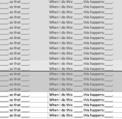

### 产品名称 - 产品排名

| 产品名称 | 需求 | 类型 | 状态 | 运行 | 发布 | 发布 | 总计 |
| :--- | :--- | :--- | :--- | :--- | :--- | :--- | :--- |
| 2001 - 用户故事 | 用户故事 | ... | 完成 |  |  |  | 1 |
| 2002 - 用户故事 | 用户故事 | ... | 完成 |  |  |  | 1 |
| 2003 - 用户故事 | 用户故事 | ... | 完成 |  |  |  | 1 |
| 2004 - 用户故事 | 用户故事 | ... | 完成 |  |  |  | 1 |
| 2005 - 用户故事 | 用户故事 | ... | 完成 |  |  |  | 1 |
| 2006 - 用户故事 | 用户故事 | ... | 完成 |  |  |  | 1 |
| 2007 - 用户故事 | 用户故事 | ... | 完成 |  |  |  | 1 |
| 2008 - 用户故事 | 用户故事 | ... | 完成 |  |  |  | 1 |
| 2009 - 用户故事 | 用户故事 | ... | 完成 |  |  |  | 1 |
| 2010 - 用户故事 | 用户故事 | ... | 完成 |  |  |  | 1 |
| 2011 - 用户故事 | 用户故事 | ... | 完成 |  |  |  | 1 |
| 2012 - 用户故事 | 用户故事 | ... | 完成 |  |  |  | 1 |
| 2013 - 用户故事 | 用户故事 | ... | 完成 |  |  |  | 1 |
| 2014 - 用户故事 | 用户故事 | ... | 完成 |  |  |  | 1 |
| 2015 - 用户故事 | 用户故事 | ... | 完成 |  |  |  | 1 |
| 2016 - 用户故事 | 用户故事 | ... | 完成 |  |  |  | 1 |
| 2017 - 用户故事 | 用户故事 | ... | 完成 |  |  |  | 1 |
| 2018 - 用户故事 | 用户故事 | ... | 完成 |  |  |  | 1 |
| 2019 - 用户故事 | 用户故事 | ... | 完成 |  |  |  | 1 |
| 2020 - 用户故事 | 用户故事 | ... | 完成 |  |  |  | 1 |
| 2021 - 用户故事 | 用户故事 | ... | 完成 |  |  |  | 1 |
| 2022 - 用户故事 | 用户故事 | ... | 完成 |  |  |  | 1 |
| 2023 - 用户故事 | 用户故事 | ... | 完成 |  |  |  | 1 |
| 2024 - 用户故事 | 用户故事 | ... | 完成 |  |  |  | 1 |
| 2025 - 用户故事 | 用户故事 | ... | 完成 |  |  |  | 1 |
| 2026 - 用户故事 | 用户故事 | ... | 完成 |  |  |  | 1 |
| 2027 - 用户故事 | 用户故事 | ... | 完成 |  |  |  | 1 |
| 2028 - 用户故事 | 用户故事 | ... | 完成 |  |  |  | 1 |
| 2029 - 用户故事 | 用户故事 | ... | 完成 |  | 2017/03/26 发布 1 |  | 1 |
| 2030 - 用户故事 | 用户故事 | ... | 完成 |  | 2017/03/27 发布 2 |  | 1 |
| 2031 - 用户故事 | 用户故事 | ... | 完成 |  | 2017/03/27 发布 3 |  | 1 |

## MyXYZ 手机银行 App - 迭代 1

迭代日期：2 月 4 日 - 2 月 8 日

**迭代目标**

展示个人银行业用户查看账户余额和待处理交易的能力。

### 燃尽图：剩余小时数与点数


### 燃尽图：剩余小时数与点数

迭代日期：2 月 4 日 - 2 月 8 日

| 实际 | 实际 | 实际 | 计划 | 总计 | 剩余 |
| :--- | :--- | :--- | :--- | :--- | :--- |
| 10 | 10 | 10 | 10 | 30 | 70 |
| 12 | 12 | 12 | 12 | 36 | 64 |
| 11 | 11 | 11 | 11 | 33 | 51 |
| 10 | 10 | 10 | 10 | 30 | 21 |
| 12 | 12 | 12 | 12 | 36 | 15 |
| 11 | 11 | 11 | 11 | 33 | 4 |


### 燃尽图：剩余小时数与点数

迭代日期：2 月 4 日 - 2 月 8 日

| 实际 | 实际 | 实际 | 计划 | 总计 | 剩余 |
| :--- | :--- | :--- | :--- | :--- | :--- |
| 10 | 10 | 10 | 10 | 30 | 70 |
| 12 | 12 | 12 | 12 | 36 | 64 |
| 11 | 11 | 11 | 11 | 33 | 51 |
| 10 | 10 | 10 | 10 | 30 | 21 |
| 12 | 12 | 12 | 12 | 36 | 15 |
| 11 | 11 | 11 | 11 | 33 | 4 |


### 燃尽图：剩余小时数与点数

迭代日期：2 月 4 日 - 2 月 8 日

| 实际 | 实际 | 实际 | 计划 | 总计 | 剩余 |
| :--- | :--- | :--- | :--- | :--- | :--- |
| 10 | 10 | 10 | 10 | 30 | 70 |
| 12 | 12 | 12 | 12 | 36 | 64 |
| 11 | 11 | 11 | 11 | 33 | 51 |
| 10 | 10 | 10 | 10 | 30 | 21 |
| 12 | 12 | 12 | 12 | 36 | 15 |
| 11 | 11 | 11 | 11 | 33 | 4 |


### 燃尽图：剩余小时数与点数

迭代日期：2 月 4 日 - 2 月 8 日

| 实际 | 实际 | 实际 | 计划 | 总计 | 剩余 |
| :--- | :--- | :--- | :--- | :--- | :--- |
| 10 | 10 | 10 | 10 | 30 | 70 |
| 12 | 12 | 12 | 12 | 36 | 64 |
| 11 | 11 | 11 | 11 | 33 | 51 |
| 10 | 10 | 10 | 10 | 30 | 21 |
| 12 | 12 | 12 | 12 | 36 | 15 |
| 11 | 11 | 11 | 11 | 33 | 4 |


### 燃尽图：剩余小时数与点数

迭代日期：2 月 4 日 - 2 月 8 日

| 实际 | 实际 | 实际 | 计划 | 总计 | 剩余 |


|---|---|---|---|---|---|---|---|

| 10 | 10 | 10 | 10 | 30 | 70 |

| 12 | 12 | 12 | 12 | 36 | 64 |

| 11 | 11 | 11 | 11 | 33 | 51 |

| 10 | 10 | 10 | 10 | 30 | 21 |

| 12 | 12 | 12 | 12 | 36 | 15 |

| 11 | 11 | 11 | 11 | 33 | 4 |


## 理解敏捷带来的变化

敏捷宣言和 12 条原则通过以下方式使项目改进：

- 敏捷方法改变了项目管理。敏捷宣言和 12 条原则意识到过度的流程是问题。
- 敏捷方法改变了知识工作。敏捷宣言和 12 条原则意识到团队协作可以带来结果。
- 敏捷方法改变了业务与 IT 之间的关系。敏捷宣言和 12 条原则意识到让双方目标一致。
- 敏捷方法改变了对变化的态度。历史方法将变化视为问题或需要规避。

### 燃尽图：剩余小时数与点数

敏捷宣言带来的变化：

- 敏捷方法改变了交付方式。通过持续交付满足需求。
- 敏捷方法改变了沟通方式。通过面对面交流提高。
- 敏捷方法改变了工作模式。通过响应客户来提高质量。
- 敏捷方法改变了交付标准。通过卓越的技术和设计来支持。

### 敏捷性测试

如果你不确定某个流程是否符合敏捷，可以参考以下问题：

- 我们的流程是否支持早期且持续的交付？
- 我们的流程是否欢迎并利用变化？
- 开发者和产品负责人是否每天在一起工作？
- 我们的环境是否为开发团队提供了所需的支持？
- 我们的面对面交流是否多于电话和邮件？
- 我们是否通过交付可运行的功能来衡量进度？
- 这种工作节奏我们可以一直保持下去吗？
- 我们是否通过卓越的技术和良好的设计来支持未来的变化？
- 我们是否在最大化减少不必要的工作，即只完成目标所需的工作？
- 团队是否是自组织和自管理的？它是否有成功的空间？
- 我们是否定期进行反思并做出相应的调整？

如果你对所有问题的回答都是“是”，恭喜你，你正在进行敏捷项目。如果你对任何一个问题的回答是“否”，你可以做什么来将答案变为“是”？

### 燃尽图：剩余小时数与点数

## 为什么敏捷更有效

敏捷项目管理的概念不同于以前的方法。正如第 1 章所述，敏捷方法解决了瀑布式方法面临的问题，但它们也更深一层。敏捷流程提供了一个我们工作所需的框架——即我们在解决问题和完成任务时的自然状态。

历史项目管理方法并不是为现代开发生命周期（如软件开发）设计的，而是为了更复杂的系统。这些方法还从其他领域（如建筑、制造业和军事）引入。

### 燃尽图：剩余小时数与点数

### 燃尽图：剩余小时数与点数

### 燃尽图：剩余小时数与点数

### 燃尽图：剩余小时数与点数

### 燃尽图：剩余小时数与点数

这些方法在尝试构建更复杂的现代产品时（例如移动应用程序或以网络为中心的面向对象应用）并不适用，这些产品需要不断的创新来保持竞争力。即使使用较旧的技术，传统方法论的记录也是糟糕至极，尤其是在应用于软件项目时。关于传统模式运行的项目高失败率的更多细节，请参阅第 1 章中来自 Standish Group 的研究。

除了软件开发外，你还可以在许多行业中使用敏捷项目管理技术。如果你正在创造产品并希望在整个过程中获得早期反馈，你将从敏捷流程中获益。

当你面临关键截止日期时，你的本能是转向敏捷。当你卷起袖子专注于必须完成的任务时，形式主义就会被抛之脑后。你能够快速、实用并按必要性从高到低的顺序解决问题，从而让你完成最关键的任务。

不仅仅是使用敏捷——更是要变得敏捷。当你变得敏捷时，你会制定不合理的期限来强迫自己专注。相反，你意识到人们即使在压力下也能很好地担任实际解决者。例如，流行的团队建设活动“棉花糖挑战”涉及四人小组在 18 分钟内，利用 20 根意大利面条、一英尺胶带和一英尺绳子建造出最高的自立结构，并在顶部放置一朵棉花糖。有关该概念的背景信息，请访问 `www.marshmallowchallenge.com`。在该网站上，你也可以查看 Tom Wujec 的 TED 演讲。

Wujec 指出，在分配的时间内，孩子们通常建造出的比大多数成年人在一系列成功结构基础上逐步构建的结构更高、更有趣。成年人花费大量时间进行规划，产生一个最终版本，然后没有时间来纠正任何错误。孩子们学到了一个宝贵的教训：大型开发——即过度的规划以及随后一次性的生产创建是行不通的。形式主义、花费在定义未来步骤上的过度时间以及单一的计划往往是成功的阻碍。

棉花糖挑战设定了模拟生活的开启条件。你使用固定资源（4 个人、意大利面条等）和固定时间（18 分钟）建造一个结构（在 IT 行业中等同于软件产品）。最终的结果无法预知，但历史项目管理方法的一个假设是你可以在开始时确定精确的投入（功能或需求），然后估计所需的人员、资源和时间。

这一假设与现实情况恰恰反之。从图 3-1 可以看到，历史方法的理论与敏捷方法是相反的。

44 第 1 部分 理解敏捷

我们假装生活在左侧的世界，但我们实际上住在右侧的世界。

图 3-1：历史项目管理与敏捷概念的比较。

在历史方法中，需求被锁定并一次性交付产品，结果就是全有全无。我们要么完全成功，要么完全失败。风险很高，因为一切都取决于循环最后阶段的末尾（即在顶部放置棉花糖），该阶段才会进行集成和客户测试。

在图 3-2 中，我们看到瀑布式项目的每个阶段是如何依赖于上一个阶段的。共同设计并开发所有功能，这意味着在完成最低优先级的功能之前，你无法获得最高优先级的功能。客户必须等到项目结束才能获得产品任何元素的最终交付。

图 3-2：瀑布循环是一种线性方法论。

第 3 章 为什么变得敏捷更有效 45

在瀑布式项目的测试阶段，客户才能看到他们期待的产品。到那时，投入和努力已经是巨大的，失败的风险很高。在所有已完成的产品需求中寻找缺陷就像在玉米地里找杂草。

敏捷项目管理颠转了软件开发应该如何进行的概念。使用敏捷方法，你在短短的迭代周期中开发、测试并发布小组的产品需求，这些周期被称为*迭代*（iterations）或*冲刺*（sprints），如图 3-3 所示。测试在每次迭代期间进行。为了寻找缺陷，开发团队是在花盆里寻找，而不是在玉米地。

产品所有者（`Product Owner`）、`Scrum Master`和冲刺（`Sprint`）是 Scrum 的术语，这是一种用于组织和执行项目流行的敏捷框架。Scrum 指的是橄榄球中的聚集，橄榄球队围绕球共同努力。Scrum 这种方法像橄榄球一样，鼓励项目团队紧密合作并对结果负责（有关 Scrum 和其他敏捷技术的更多信息请参阅第 4 章）。

46 第 1 部分 理解敏捷

## 瀑布式的局限

正如我们在第 1 章提到的，在 2008 年之前，瀑布模型是最广泛使用的传统项目管理方法。以下列表总结了瀑布式的主要方面：

- 历史方法锁定需求并一次性交付产品，结果就是全有全无。我们要么完全成功，要么完全失败。风险很高，因为一切都取决于循环最后阶段的末尾（即在顶部放置棉花糖），该阶段才会进行集成和客户测试。
- 在图 3-2 中，我们看到瀑布式项目的每个阶段是如何依赖于上一个阶段的。共同设计并开发所有功能，这意味着在完成最低优先级的功能之前，你无法获得最高优先级的功能。客户必须等到项目结束才能获得产品任何元素的最终交付。
- 在瀑布式项目的测试阶段，客户才能看到他们期待的产品。到那时，投入和努力已经是巨大的，失败的风险很高。在所有已完成的产品需求中寻找缺陷就像在玉米地里找杂草。

## 更高的灵活性与稳定性

相比之下，敏捷项目比传统项目具有更高的灵活性和更高的稳定性。首先，你将发现敏捷项目是如何提供灵活性的，然后我们讨论稳定性。

无论项目团队采用何种项目管理方法，在项目开始时都会面临两个重大挑战：

- 项目团队对产品的最终状态认知有限。
- 项目团队无法预测未来。

这种对产品和未来业务需求的有限认知几乎注定了项目会变更。

《敏捷宣言》中的第四个核心价值是“响应变化高于遵循计划”。敏捷框架在创建时就考虑了灵活性。


通过敏捷方法，项目团队可以随着项目的进展适应新出现的知识和新需求。我们在书中提供了许多关于使敏捷项目在过程中实现灵活性的细节。以下是一些帮助敏捷项目团队管理的流程的简单描述：

- 在敏捷项目开始时，产品负责人（`Product Owner`）从项目利益相关者处收集高级需求并对其进行优先级排序。产品负责人不需要所有需求——只需要足够充分理解产品必须完成的任务即可。
- 开发团队和产品负责人共同工作，将初始的高优先级需求拆解为更详细的需求。结果是开发团队可以立即开始的小型工作块。
- 无论冲刺（`Sprint`）的优先级设定得有多晚，你都关注每个冲刺中的最高优先级任务。
- 敏捷项目中的迭代时间很短——它们持续长达四周，通常为一或两周。你可以在第 8 至 10 章找到有关冲刺的细节。
- 开发团队在冲刺内处理一组需求，并在每次后续的迭代中了解产品。
- 开发团队一次只计划一个冲刺，并在每个冲刺开始时深入研究。开发团队通常只处理最高优先级的需求。


### 第 3 章 为什么敏捷效果更好 49

一次集中处理一个冲刺和最高优先级需求，使项目团队能够在每个冲刺开始时接纳新的高优先级需求。

当变更发生时，产品负责人会更新待在未来冲刺处理的需求列表。产品负责人定期对该列表进行优先级排序。

产品负责人可以对高优先级功能进行资金投入，并在整个项目中选择资助哪些功能。

产品负责人和开发团队在每个冲刺结束时收集客户反馈并处理这些反馈。客户反馈往往会导致现有功能的变更或产生新的有价值的需求。反馈还可以导致移除或重新调整并非绝对必要的需求优先级。

当产品负责人认为产品已具有足够的功能来满足项目目标时，可以停止项目。

图 3–4 说明了在敏捷项目上进行变更如何比瀑布模型中的变更更稳定。将图中的两个图像想象成钢条。在顶部的图中，钢条代表为期两年的项目。钢条的长度使其更容易被扭曲、弯曲和折断。项目变更在结构上容易受到不稳定的影响，因为项目的规划阶段与执行阶段（即现实进入阶段）是不同的，而且在长周期项目中没有自然的缓冲点。

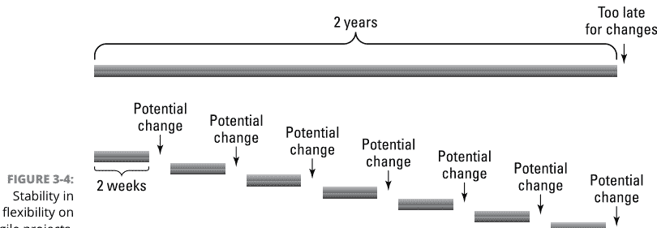

现在看图 3–4 底部的图像。小钢条代表项目内每两周一次的迭代。对于小钢条来说，保持稳定和不变比大钢条容易得多。同样，在具有已知灵活点的较小增量中获得项目稳定性也容易得多。

### 第一部分 理解敏捷

告诉一家公司两周内不能变更，比说两年内不能变更容易得多且更符合现实。

敏捷项目在战术上是灵活的，因为它们在战略上是稳定的。它们非常擅长适应变化，因为定期变更已内置在日常流程中。同时，敏捷项目的迭代为项目稳定性提供了独特的领域。敏捷项目团队可以随时适应产品待办列表的变更，但在冲刺期间通常不接受范围的外部变更。产品待办列表可能会不断变化，但除了紧急情况外，冲刺通常是稳定的。

在迭代开始时，开发团队计划将在该冲刺中完成的工作。冲刺开始后，开发团队只处理计划好的需求。可能会出现少数例外——如果开发团队提前完成，可以请求更多工作；如果发生紧急情况，产品负责人可以取消冲刺。然而通常情况下，冲刺是开发团队的稳定时期。

这种稳定性可以导致创新。当开发团队成员拥有稳定性——即他们知道自己在一段时间时间内将要做什么时——他们会在工作中有意识地思考自己的任务。他们还可能在工作之余无意识地思考任务，并随时得出解决方案。

敏捷项目提供了开发、反馈和变更的持续循环，使项目团队具有创建仅包含正确功能的灵活性，以及进行创造的稳定性。

## 减少非生产性任务

当你创建一个产品时，在工作日的任何时候，你要么在开发产品，要么在处理用于管理和控制产品创建的外围流程。显然，前者的价值更高，你应该尝试将其最大化；而后者是你希望将其最小化的。要完成一个项目，你必须专注于解决方案。尽管这句话听起来显而易见，但在瀑布项目中经常被忽视。软件项目上的程序员仅有 20% 的时间用于生成功能，其余时间花在会议、写电子邮件或创建不必要的演示文稿和文档上。

产品开发是一项需要持续关注的高强度活动。许多开发者在工作日内无法获得足够的开发时间来跟上进度，因为他们正在做其他类型的任务。以下因果链的结果是：

> 长工作日 = 疲惫的开发者 = 不必要的缺陷 = 更多的缺陷修复 = 更长的价值实现时间

为了使生产性工作最大化，目标是消除加班和开发者白天创建功能。要增加生产性工作，你必须减少非生产性任务，如此。

### 会议

会议可能会浪费大量时间。在传统项目中，开发人员发现自己处于对开发者几乎完全没有益处的长会议中。以下敏捷方法有助于确保开发团队只花时间在高效、有意义的会议上：

- 敏捷流程仅包含少数正式会议。这些会议重点突出，有特定主题且时间有限。在敏捷项目中，你通常需要参加非敏捷会议。
- `Scrum Master`的工作之一是防止干扰开发团队的工作时间，包括非敏捷会议的请求。当有要求开发者离开开发工作时，`Scrum Master`询问“为什么”以理解真实需求。然后`Scrum Master`会想办法在不干扰开发团队的情况下满足该需求。
- 在敏捷项目中，当前项目状态通常对整个组织可见，消除了对状态会议的需要。你可以在第 14 章中找到简化状态报告的方法。

### 电子邮件

电子邮件不是一种高效的通信方式；敏捷项目团队旨在少量使用电子邮件。电子邮件过程是异步且缓慢的：你发送一封邮件，等待回答；你有另一个问题，再发送另一封邮件。这个过程消耗了本可以用于生产工作的时间。

敏捷项目团队使用面对面讨论来即时解决问题和疑问。

### 演示文稿

在为向客户演示功能做准备时，敏捷项目团队通常使用以下技术：

- 演示，而不是陈述。换句话说，向客户展示你创建了什么，而不是描述你创建了什么。
- 展示如何满足需求并达成验收标准。换句话说，要说：“这是需求。这些是表明该功能已完成所需的标准。这里是满足这些标准的产出功能。”
- 避免正式的幻灯片演示以及其中涉及的所有准备工作。当你演示可以运行的功能时，它本身就会说明一切。演示应当是原始且真实的。

### 流程文档

长期以来，文档工作一直是项目经理和开发人员的负担。敏捷项目团队可以通过以下方法将文档工作降至最低：

- 使用迭代开发。许多文档的创建是为了参考几个月或几年前做出的决策。迭代开发将从决策到开发产品之间的时间从几个月或几年缩短到几个月。通过产品和相关的自动化测试（而不是大量的纸质文件）来记录决策。
- 记住“一刀切切”。你不需要为每个项目创建相同的文档。根据特定项目选择你需要的文档。
- 使用非正式、灵活的文档工具。白板、便利贴、图表以及工作计划的其他视觉化表示都是极好的工具。
- 包含简单的工具，为管理层提供足够的进度信息。不要为了报告而创建特殊的项目进度报告（例如详尽的状态报告）。敏捷团队使用燃尽图（`burndown charts`）来快速传达项目状态。

## 更高的质量，更快的交付

在传统项目中，从需求收集完成到客户测试开始的时间可能长得令人痛苦。在此期间，客户在等待查看结果，而开发团队则埋头于开发工作。项目经理负责确保项目团队遵循计划，阻止变更发生，并通过提供频繁且详细的报告，向所有对结果感兴趣的人员更新情况。

当测试开始时（接近项目结束时），缺陷可能会导致预算增加、进度延误，甚至导致项目失败。测试是项目最大的未知数，而在传统项目中，这种未知性一直持续到项目结束。

敏捷项目管理旨在快速交付高质量的、可发布的功能。敏捷项目通过以下方式实现更好的质量和快速交付：

- 客户在每个冲刺（`sprint`）结束时评审功能并在冲刺结束后立即向团队提供反馈，以便进行检查和调整。
- 短的开发迭代（冲刺）限制了在任何给定时间内开发中的功能数量和复杂性，使得完成的工作在每个冲刺中更易测试。每个冲刺能创建的内容是有限的。开发会将对于单个冲刺来说过于复杂的功能进行拆分。
- 开发团队每天构建和测试，并在整个项目过程中维护一个运行的产品。
- 产品所有者（`product owner`）全天参与，以快速回答问题并澄清误解。
- 开发团队获得赋权和激励，并拥有合理的工作日。因为开发团队不会精疲力竭，所以产生的缺陷更少。
- 错误能被快速检测到，因为开发者在完成工作后就会进行测试。广泛的自动化测试频繁发生，至少每晚一次。
- 现代软件开发工具允许将许多需求编写成测试脚本，而无需编程，这使得自动化测试更快。

## 提升团队性能

敏捷项目管理的核心是项目团队成员的体验。与瀑布流等传统方法相比，敏捷项目团队获得更多的环境和组织支持，花费更多时间专注于工作，并对流程的持续改进做出贡献。要了解这些特性在实践中意味着什么，请继续向下阅读。

### 对团队的支持

开发团队交付潜在可发布功能的能力是利用敏捷方法获得结果的核心，并通过以下支持机制实现：

- 常见的敏捷实践协作办公（`collocation`）——将开发团队和（理想情况下）产品所有者保持在同一个地方，并在物理上靠近客户。协作办公鼓励合作，并使通信更快、更清晰、更简单。你越早离开座位，他们就越能直接对话，并立即消除任何模糊或不确定性。
- 产品所有者可以延迟响应开发团队的问题和澄清请求，消除困惑并让工作顺利进行。
- `Scrum Master`消除障碍，确保开发团队拥有所需的一切来关注并实现最大的生产力。

### 聚焦

通过敏捷流程，开发团队可以尽可能将其工作集中在产品开发上。敏捷开发团队通过以下方式聚焦：

- 开发团队成员被 100% 投入到项目中，消除了在不同项目之间切换上下文导致的时间和注意力损失。
- 开发团队成员知道他们的同事将随时待命。
- 开发者专注于尽可能与其他功能独立的小单元功能。每天早晨，开发团队都知道当天取得成功意味着什么。
- `Scrum Master`有明确责任帮助保护开发团队免受组织干扰。
- 因为非生产性工作的减少，开发团队花在编码和相关生产性活动上的时间增加了。

### 持续改进

敏捷流程并不是盲目的“打钩”方法。不同类型的项目和项目团队能够根据自己的特定情况进行调整，正如你在第 10 章关于冲刺回顾的讨论所示。以下是敏捷团队持续改进的一些方式：


- 迭代开发使持续改进成为可能，因为每个新迭代都涉及全新的开始。
- 由于冲刺仅持续几周，项目团队可以快速纳入流程变更。
- 名为回顾（`retrospective`）的流程在每次迭代结束时，为所有敏捷团队成员提供了一个特定的论坛来识别并规划改进行动。
- 整个 Scrum 团队——产品所有者、开发团队成员和 Scrum 主管——评审他们认为需要改进的工作方面。
- Scrum 团队将从回顾中学到的经验应用到随后的冲刺中，从而提高其生产力。

# 更紧密的项目控制

在敏捷项目中，工作进展比瀑布流条件下更快。提高的生产力通过以下方式增强项目控制：

- 敏捷流程提供了持续的信息流。开发团队每天早晨在每日 Scrum 上共同计划工作，并在每天更新任务状态。
- 对于每个冲刺，客户都有机会根据业务需求对产品需求进行重新排序。
- 在每个冲刺结束交付运行功能后，你根据当前的优先级确定下一个冲刺的工作负载。无论是在下一个冲刺前几周还是几分钟设置优先级都没有区别。
- 当产品所有者为下一个冲刺设置优先级时，此操作对当前冲刺没有影响。在敏捷项目中，需求的变更不会增加行政成本或时间，也不会干扰当前工作。
- 敏捷技术让项目终止变得更容易。在每次迭代结束时，你可以判断产品功能是否足够。低优先级项目可能永远不会被开发。

## 更快速且成本更低的失败

在瀑布流项目中，失败检测的机会在理论上一直存在，直到项目进度接近尾声——那时所有已完成的工作汇聚在一起，且大部分投资已经耗尽。等到项目的最后几周或最后几天才发现产品存在严重问题，对所有相关人员来说都是风险。图 3-5 比较了瀑布流与敏捷方法的风险特征和投资状况。

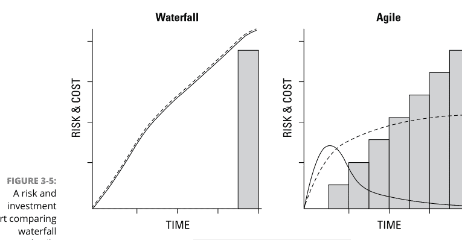

在提供更紧的项目控制机会外，敏捷框架还为你提供了：

- 更早、更频繁的失败检测机会
- 每几周就有一次评估和行动机会
- 降低失败成本

你在项目中遇到过哪些种类型的失败？敏捷方法会有帮助吗？你可以在第 15 章中找到更多关于敏捷项目的风险信息。

### 为什么人们喜欢敏捷

你已经看到组织如何通过敏捷项目管理从更快的交付和更低的成本中受益。在接下来的章节中，你将发现项目参与人员也能受益，无论是直接还是间接。

第 3 章 为什么敏捷效果更好 57

## 高管

敏捷项目管理提供了两项对高管特别有吸引力的益处：效率以及更高、更快的投资回报。

### 效率

敏捷实践通过以下方式极大提高了开发过程的效率：

- 敏捷开发团队效率极高。他们自己组织工作，专注于开发活动，并受到 Scrum Master 的保护免受干扰。
- 尽地减少了无的投入。敏捷方法消除了无用工作；重点在于开发。
- 通过使用简单、及时、按需的视觉辅助（如图表和图形）来显示已完成、进行中和即将进行的内容，项目进度变得一目了然。
- 通过持续测试，尽早检测并修正缺陷。
- 敏捷项目在具备足够功能时可以停止。

### 增加 ROI 机会

由于以下原因，使用敏捷方法可以显著提高投资回报率（ROI）：

- 功能更早交付市场。功能在完全完成后分组发布，而不是等到所有开发结束并一次性发布 100% 的功能。
- 产品质量更高。开发范围被拆分为可管理的区块，并持续进行测试和验证。
- 收益机会可以加速。与传统的项目管理方法相比，产品增量更早发布到市场。
- 项目可以自给自足。功能的发布可能在进一步功能的开发进行期间就产生收益。

### 产品开发与客户

客户喜欢敏捷项目，因为它们能够适应变化的需求并产生更高价值的产品。

### 改进对变化的适应

产品需求、优先级、时间表和预算的变化会极大干扰传统项目。相比之下，敏捷流程以有利的方式处理项目和变化。例如：

- 敏捷项目通过有效处理变化提供了增加客户满意度和投资回报的机会。
- 变化可以常规且平稳地整合到后续迭代中。
- 因为团队成员和冲刺（Sprint）长度保持不变，变化带来的问题比传统方法少。必要的更改根据优先级插入到功能列表中，将低优先项向后移动。最终由产品所有者决定项目何时结束，即未来的投资将不再提供足够价值的时间点。
- 因为开发团队首先开发价值最高的项目，且产品所有者控制优先级，产品所有者可以确信业务优先级与开发活动保持一致。

### 更大的价值

通过迭代式开发，产品功能可以在开发团队完成时进行发布。迭代式开发和发布通过以下方式提供更大的价值：

- 项目团队更早交付最高优先级的功能。
- 项目团队更早交付有价值的产品。
- 项目团队可以根据市场变化和客户反馈调整需求。

### 管理

管理人员倾向于喜欢敏捷项目，因为产品质量更高、时间和精力的浪费更少，并且强调产品价值而非勾选无用的功能列表。

### 更高的质量

在软件开发中，通过测试驱动开发、持续集成以及对运行软件的频繁客户反馈等技术，你可以在前期就为产品构建更高的质量。

在非软件开发项目中，你能想到哪些方法可以提前构建质量？

### 更少的产品和过程浪费

在敏捷项目中，通过多种策略减少了浪费和功能的浪费，包括：

- **即时 (JIT) 详化：** 对当前最高优先级需求的细化意味着时间不会被花在可能永远不会开发的特性细节上。
- **客户和利益相关者的参与：** 客户和其他利益相关者可以在每个冲刺中提供反馈，开发团队将反馈整合到项目中。随着项目和反馈的持续，对客户的价值就会增加。
- **偏好面对面交流：** 更快、更清晰的沟通节省了时间并减少了困惑。
- **内置对变化的利用：** 仅开发高优先级的特性和功能。
- **强调运行运行的证据：** 如果一个功能不起作用或无法以有价值的方式运行，将尽早以更低的成本被发现。

### 对简单价值的强调

敏捷简单原则支持消除那些不直接、高效支持开发的流程和功能，并排除很少增加实质价值的功能。这一原则也通过以下方式适用于管理和文档：

- 更少、更短、更集中的会议
- 减少形式主义
- 恰好充足的文档
- 客户与项目团队对产品的质量和价值共同负责

### 开发团队

敏捷方法使开发团队能够在合理的条件下产出最佳工作。敏捷方法为开发团队提供了：

- 通过共同创建目标并在需求开发期间识别验收标准，对成功的清晰定义
- 按照自己意愿组织开发的权力和尊重
- 提供价值所需的客户反馈
- 专职 Scrum Master 的保护，以消除障碍并防止干扰
- 人性化、可持续的工作节奏
- 支持个人发展和改进的学习文化
- 最小化非开发时间的结构

在上述条件下，开发团队将蓬勃发展，并以更快、更高质量交付成果。

在百老汇和好莱坞，在舞台和银上与观众交流的表演者被称为“人才”。他们是娱乐客户来看表演的原因，而支持他们的编剧、导演和制作人确保他们大放异彩。在敏捷环境中，开发团队就是人才。人才成功，每个人都成功。

## 第 4 章：敏捷方法

在之前的章节中，你阅读了关于敏捷项目管理的历史。你可能已经听过常见的敏捷框架和技术。你是否在好奇敏捷框架、方法和技术究竟是什么样子的？在本章中，你将对当今实施敏捷项目最常用的三种方法进行概述。

## 深入敏捷方法的伞下

仅仅依靠《敏捷宣言》和敏捷原则，不足以让你启动一个敏捷项目，无论你多么迫不及待地想这么做。原因在于原则与实践是不同的。然而，本书中描述的方法将为你提供在敏捷项目中取得所需的必要实践。

敏捷是对许多具有以下相似点的技术和方法的描述性术语：

- 在多次迭代中进行开发，称为**迭代开发**
- 强调简单性、透明度和针对特定情况的策略
- 跨功能、自组织团队
- 以可运行的功能作为进展衡量标准

敏捷项目管理是一种经验主义的项目管理方法。换句话说，你在实践中执行某些操作，并根据经验而非理论来调整你的方法。

在产品开发方面，经验主义方法由以下支柱支撑：

- **无限制的透明**：流程中的每个人都理解并能为流程开发做出贡献。
- **频繁检查**：检查人员必须定期检查产品并具备识别偏离验收标准的技能。
- **立即适应**：开发团队必须能够快速行动以最大限度地减少进一步偏差。

许多方法都具有敏捷特征。当组织声他们正在使用敏捷方法管理项目时，他们通常工作在一个精益环境中，持续关注在制品、浪费性做法和步骤；使用 Scrum 来组织工作并暴露项目进度；并使用极端编程（Extreme Programming）实践在前期构建质量。这些方法中的每一种将在本章稍后的部分进行详细解释。

与系统化方法一样，敏捷技术并非凭空产生。这些概念具有历史先例，其中一些起源于软件开发之外，这并不意外，因为在人类事件史上，软件开发出现的时间并不长。

敏捷方法的基础与传统的项目管理方法（如瀑布模型）不同，瀑布模型根于第二次世界大战期间材料采购使用的定义的控制方法。早期的计算机硬件先驱使用瀑布流程来管理第一批计算机系统的复杂性，这些系统大部分是硬件：1,600 个真空管，但只有几行手工编码的软件。（参见图 4-1。）当问题简单且市场静态时，不僵化的流程是有效的，但今天的产品开发环境对于这种过时的模型来说太复杂了。

图 4-1：早期硬件和软件。

## SEM —— “婴儿期”

温斯顿·罗伊斯（Winston Royce）博士在他 1970 年发表的文章《大型系统的开发管理》中，将逐步的软件开发过程编码为“瀑布模型”。当你查看图 4-2 中的原始设计时，你可以看到这个名字的由来。

随着时间的推移，计算机开发的情况发生了反转。硬件通过大规模生产变得可重复，而软件变成了完整解决方案中更复杂、更多化的方面。

讽刺的是，尽管图表暗示你是一步步完成任务，但罗伊斯博士本人添加了一个警告事项，说明你需要迭代。他是这样说的：

> “如果所涉及的计算机程序是第一次开发，请安排事务，使得交付给客户进行运行部署的版本在涉及关键设计/操作领域方面实际上是第二个版本。”

罗伊斯甚至包含了图 4-3 所示的图来说明这种迭代。

现在，我们不确定该图是否是用口香胶粘在其他页面上的，但软件开发社区在很大程度上丢失了故事的这部分。当你接受了“在初开始开发软件组件时可能并不了解一切，并且可能需要重新查看代码以确保其合理性”这一观点后，你就获得了让敏捷概念脱颖而出的光。如果人们能把罗伊斯博士的建议放在心上，敏捷可能会提前 40 年出现！

## 回顾三大要素：精益、Scrum 和极端编程

现在你已经有了关于使用瀑布方法管理的简要历史，你准备好了解更多关于三种流行的敏捷方法了：精益、Scrum 和极端编程。

#### 精益概述

精益源于制造业。已经存在了 100 多年的大批量生产方法旨在简化组装过程（例如，组装 T 型福特汽车）。这些过程使用复杂、昂贵的机器和低技能工人来产出有价值的物品。理念是，如果你让机器和人员持续工作而不堆积库存，就能产生大量的效率。

这种简单性具有欺骗性。传统上，大规模生产需要浪费性的支持系统和大量的劳动力来确保效率。结果是在机器、人员和没有价值的复杂流程上投入大量资金。听起来熟悉吗？

### 随着精益在制造业中出现，消除脂肪

20 世纪 40 年代的日本，丰田想生产汽车，但负担不起巨大的库存。他们研究了超市，注意到消费者只在用空时才补货。通过这一观察，丰田创建了准时制（`just-in-time`）流程并将其转化为工厂生产，减少了浪费。当时大规模生产的一个大成本是生产线上的工人被对待像机器一样：人们没有自主权，无法解决问题、做出选择或改进流程。工作是枯燥的并忽视了人的潜力。相比之下，准时制赋予了工人做决策的能力。

### 理解精益与软件开发

“精益（Lean）”一词出现在 20 世纪 90 年代的 James P. Womack 等人撰的著作《改变世界的机器：精益生产的故事》中。作为软件开发精益原则的早期采用者，eBay 通过每天响应客户请求的方法（在短时间内开发高价值功能）引领了潮流。

精益的重点是业务价值和尽量减少产品开发之外的活动。Mary 和 Tom Poppende 曾在他们的博客和关于软件开发的书籍中讨论了一组精益原则。以下是他们 2003 年书籍《精益软件开发》（Addison–Wesley Professional）中的精益原则：

- **消除浪费**：任何超出本身的活动（流程步骤、方面、会议）都会减慢进展的流。浪费包括未能从工作中学习、构建了错误的东西以及反复跳变（在任务或项目之间切换上下文）——这导致部分地创建了许多产品功能，但没有一个是完全的。
- **放大学习**：通过定期且有律的透明、检查和适应的心态，通过学习驱动可预测性。鼓励一种全公司的文化，允许为了失败以便从从中学习。
- **尽可能推迟交付**：允许后期适应。不要迟交交付，但要留足够的选择空间，以便根据事实而非不确定性在最后负责时刻做出决策——即你了解最多信息的时候。从失败中学习。挑战标准。使用科学方法——对假设进行实验寻找解决方案。
- **尽可能快速交付**：速度、成本和质量是可以兼容的。越早交付，越早收到反馈。一次只做更少的事，限制在制品并优化流。管理工作流而非进度。使用准时制计划缩短开发和发布周期。
- **赋能团队**：自主工作、精通技能、对工作目标充满信念可以激励开发团队。经理不应该告诉开发者如何工作，而是支持他们围绕待完成的工作进行自我组织，并消除他们的障碍。确保团队和个人拥有良好工作所需的环境和工具。
- **将质量融入其中**：建立机制，在缺陷发生时以及最终验证之前进行捕获和纠正。质量是从一开始就构建进去的，而不是在最后。打破依赖关系，你就可以随时开发和集成功能，而不会产生回归。
- **通览全局**：整个系统的强度取决于其最薄弱的一环。解决问题，而不是症状。持续关注整个工作流中的瓶颈并消除它们。在创建解决方案时要考虑远远。

除了精益原则外，敏捷团队使用的最精益方法之一是看板（`kanban`），有时被称为看板学习（`kan-learning`）。看板源自丰田生产系统方法，本质上是一种通过消除浪费来提高系统流和吞吐量的方法。

看板实践可以适用于几乎任何情况，因为它们的设计是从你开始开始的——你不需要更改现有的工作流即可开始。看板实践包括：

- 可视化。
- 限制在制品（WIP）。
- 管理流。
- 使流程策略显性化。
- 实现反馈循环。
- 协作改进，实验演进。

后三项实践常见于其他敏捷框架，例如 scrum 和 XP（在本章的稍后部分讨论）。前三项增强了敏捷团队的有效性：

可视化：将团队的工作流可视化是识别潜在浪费的第一步。传统的臃肿流程存在于许多组织中，但即使可视化了也无法反映现实。敏捷团队将他们的工作流可视化（在白板上、墙上或图表中），并识别生产力在哪里崩溃，他们可以轻松地分析根本原因并查看如何消除约束。然后反复如此，一次又一次。

看板是日语，意为视觉信号。看板板挂在工厂墙上或开发工作区的墙上，所有人都能看到，它显示了团队需要生产的项。看板上插着代表生产单位的卡片。随着生产的进行，工人移除、添加和移动卡片。随着卡片的移动，它们充当信号告诉工人何时需要工作或补充库存。敏捷团队使用看板或任务来展示他们的进度并管理工作流（在第 5 章和第 9 章中进行了详细描述）。

衡量交付时间和周期时间有助于敏捷团队监控其对流的管理。团队通过跟踪一个功能请求从队列到完成所需的时间来确定交付时间（`lead time`）。他们通过跟踪项目从工作开始到完成的时间来确定周期时间（`cycle time`）。敏捷团队通过识别和消除导致交付时间和周期时间不断减少的瓶颈来优化流。

为了支持良好的开发实践，请记住以下点：

- 不要开发你可能不会使用的功能。
- 让开发团队成为项目的核心，因为增加了最大的价值。
- 让客户对功能进行排序——他们知道什么对他们最重要。优先处理高优先级项以交付价值。
- 使用工具实现各方之间良好的沟通。

今天，精益原则继续影响敏捷技术的发展——并受到任何原则的影响。任何方法都应该是敏捷的，并随着时间不断适应。

第 2 部分 敏捷

## scrum 概述

Scrum 是软件开发中最流行的敏捷框架，它是一种迭代方法，其核心是冲刺（`sprint`，scrum 中迭代的术语）。为了支持这一过程，scrum 团队使用特定的角色、产物和事件。为了确保他们达到流程每个部分的目标，scrum 团队在整个项目过程中使用检查和适应。scrum 方法如图 4-4 所示。

图 4-4：scrum 方法。

### 冲刺的持久战

在每次冲刺中，开发团队开发并测试产品的功能部分，直到产品所有者接受。当一个冲刺结束时，另一个冲刺就开始了。功能发布到市场通常发生在多个冲刺结束时。

> 冲刺的核心原则之一是它的周期性：冲刺及其内部过程会循环往复，如图 4-5 所示。

记住

作为项目的一部分，你每天都需要需要进行检查和适应：

- 在冲刺期间，你进行持续检查以评估迈向冲刺目标的进展。
- 你召开每日 scrum 会议，通过回顾团队昨天完成了什么以及协调今天要做什么来组织一天的工作。从本质上说，scrum 团队正在检查其朝着冲刺目标的进展。
- 在冲刺结束时，你使用冲刺回顾会议来评估性能并计划必要的适应。

### 冲刺回顾：scrum 团队检查并适应他们的环境

### 冲刺计划会议：识别将开发的功能

### 冲刺循环过程

#### 冲刺：完成功能并获得接受

### 冲刺评审：向利益者展示冲刺完成的功能并收集反馈

这些检查和适应听起来很正式且充满流程，但事实并非如此。使用检查和适应解决问题，不要过度思考。你今天试图解决的问题将来往往会改变。

### 理解 scrum 角色、产物和事件

scrum 框架为项目定义了特定的角色、产物和事件。scrum 的三个角色如下：

- 产品所有者：代表并说明项目的业务需求。
- 开发团队：执行日常工作。开发团队专注于项目，每个团队成员都是多技能的——也就是说，尽管团队成员可能有某些优势，但每个成员都能胜任项目中的多个工作。
- Scrum 经理：保护团队免受组织干扰，清除障碍，确保正确执行 scrum，不断改进团队环境。

此外，Scrum 团队发现当他们与两个非 Scrum 特定的角色紧密合作时，他们更加有效且高效：

- **利益相关者 (Stakeholders)**：任何受项目影响或对项目提供建议的人。虽然利益相关者不是正式的 Scrum 规则，但 Scrum 团队与利益相关者在整个项目中紧密合作至关重要。
- **敏捷导师 (Agile mentor)**：敏捷技术和 Scrum 框架的资深权威。这个人通常是项目部门或组织的外部人员，因此他可以从局外人的角度客观为 Scrum 团队提供支持。

与 Scrum 有特定的角色一样，Scrum 还有三种具体的交付物，称为“产物”（`artifacts`）：


- **产品待办列表 (Product backlog)**：定义产品的完整需求列表，从最终用户的角度根据业务价值进行记录。产品待办列表在整个过程中是可以流动的。所有项，无论详细程度如何，都在产品待办列表中。产品所有者（Product owner）拥有产品待办列表，决定哪些进入以及优先级如何。
- **迭代待办列表 (Sprint backlog)**：在给定迭代（Sprint）中的需求和任务列表。产品所有者和开发团队在迭代计划会议上选择迭代需求，由开发团队将这些需求分解为任务。与产品待办列表不同，迭代待办列表只能由开发团队更改。
- **产品增量 (Product increment)**：可用的、潜在可发布的功能。无论产品是网站还是一栋新房子，产品增量都应该足够完整以演示其工作功能。当产品包含足够的可发布功能以满足客户对项目的业务目标后，该 Scrum 项目即告完成。

最后，Scrum 还有五个事件：

- **迭代 (Sprint)**：Scrum 对“迭代”的术语。迭代是每个其他 Scrum 事件的容器，Scrum 团队在其中创建潜在可发布的功能。迭代是短周期，最不超过一个月，通常在周到两周之间，在某些情况下短至只有一天。一致的迭代长度可以减少变数；Scrum 团队可以根据之前迭代中完成的工作，有信心地推断出每个迭代中可以做什么。迭代为团队提供了立即进行调整以实现持续改进的机会，而不是在项目结束时。
- **迭代计划 (Sprint planning)**：发生在每个迭代的开始。在迭代计划会议上，Scrum 团队决定哪些目标、范围和支持任务属于迭代待办列表。
- **每日 Scrum (Daily scrum)**：每天举行，持续不超过 15 分钟。在每日 Scrum 中，开发团队成员要做出三项陈述：
  - 团队成员昨天完成了什么
  - 团队成员今天将要做什么
  - 阻碍团队成员的项列表

  Scrum 主管也会在他或她正努力为开发者消除障碍的背景下参与。
- **迭代评审 (Sprint review)**：发生在每个迭代的结束时。在这次会议上，开发团队向利益相关者和整个组织演示迭代期间完成的被接受的产品部分。迭代评审的关键是从利益相关者那里收集反馈，这会告知产品所有者如何更新产品待办列表并考虑下一个迭代目标。
- **迭代回顾 (Sprint retrospective)**：发生在每个迭代的结束时。迭代回顾是团队内部会议，Scrum 团队成员（产品所有者、开发团队和 Scrum 主管）讨论迭代期间哪些方面做得好，哪些做得不好，以及他们如何为下一次迭代做出改进。这次会议是以行动为导向的（挫败感应该在其他地方发泄），并以下一次迭代的切实改进计划结束。

Scrum 是非常的：三个角色、三个产物和五个事件。每个部分都发挥着作用，确保 Scrum 在整个项目中具有持续的透明性、检查和适应。作为一个框架，Scrum 容纳了许多敏捷技术、方法和工具，用于执行构建功能的各个方面。

## 极端编程概述

产品开发的一种针对软件的流行方法是极端编程（Extreme Programming，简称 XP）。极端编程将软件开发的最佳实践推向极端。它由 Kent Beck 在 Ward Cunningham 和 Ron Jeffries 的帮助下于 1996 年创建；XP 的原则最初在 Beck 1999 年出版的书中《极端编程实战》（Extreme Programming Explained，Addison-Wesley Professional 出）中描述，该书从那时不断进行更新。

### 核心认证

如果你是——或想成为——一名敏捷实践者，你可能考虑获得一个或多个敏捷认证。仅认证培训本身就能提供有价值的信息——以及实践敏捷流程的机会——这些都是你日常工作中可以到的教训。许多组织希望聘佣具有证明的敏捷知识的人才，因此认证也可以提升你的职业生涯。

你可以从许多公认的入门级认证中选择，包括以下：

- **认证 Scrum 主管 (CSM)**：Scrum Alliance 是一个促进对 Scrum 的理解和使用的专业组织，它为 Scrum 主管提供认证。CSM 需要参加由认证 Scrum 培训师（CST）提供的为期两天的培训课程并通过 CSM 评估。CSM 提供了 Scrum 的整体视图，是初学者敏捷之旅的人士的良好起点。详见`http://scrumalliance.org`。
- **认证 Scrum 产品所有者 (CSPO)**：Scrum Alliance 也为产品所有者提供认证。类似于 CSO，CS 需要来自 CST 的为期两天的培训。CS 培训提供了对产品所有者角色的深度研究。详见`http://scrumalliance.org`。
- **认证 Scrum 开发者 (CSD)**：对于开发团队，Scrum Alliance 提供了 CSD。CSD 是一项技术路线认证，需要 CST 提供的五天培训并并通过关于敏捷工程技术的考试。CSM 或 CSO 培训可以计入 CSD；剩余的三天是技术技能课程。详见`http://scrumalliance.org`。
- **PMI 敏捷认证实践师 (PMI-ACP)**：项目管理协会（PMI）是全球最大的项目经理专业组织。2012 年，PMI 推出了 PMI-ACP 认证。PMI-ACP 需要培训、通用的项目管理经验、敏捷项目工作经验并通过关于你敏捷基础知识的考试。详见`http://pmi.org`。

极端编程的重点是客户满意度。XP 团队通过开发客户所需的功能来实现高客户满意。新请求是开发团队日常工作的一部分，团队被授权在这些请求出现时随时处理。团队围绕出现的任何问题进行自我组织，并尽可能高效地解决问题。

随着 XP 作为一种实践而增长，XP 角色变得模糊了。一个典型的项目由客户、管理、技术和项目支持组的人员组成。每个人在不同时间可能扮演不同的角色。

## 定义极端编程原则

极端编程中的基本方法基于敏捷原则。这些方法如下：

- **编码是核心活动**。软件代码不仅交付解决方案，还可以用于探索问题。例如，程序员可以使用代码来解释问题。
- **XP 团队进行持续测试**。如果只做一点测试就能帮助你识别缺陷，那么大量的测试将帮助你发现更多。事实上，开发者在开始工作之前，已经得出了需求的成功标准并设计了单元测试。缺陷不是代码的失败；而是定义正确测试的失败。
- **客户与程序员之间的通信是直接的**。程序员必须理解业务需求以设计解决方案。
- **对于复杂的系统，除了特定功能之外，还需要某种的的设计**。在 XP 项目中，整体设计是在经常重构期间考虑的——即通过系统改进代码来提高可读性、降低复杂性、提高维护性并确保整个代码库的可扩展性。

你会发现极端编程与精益或 Scrum 相结合，因为它们的流程元素非常相似，结合得很好。

# 极端编程（XP）的关键实践

| XP 实践 | 基础假设 |
|---|---|
| 计划博弈 (Planning game) | 团队的所有成员都应该参与计划。业务人员与技术人员之间不存在脱节。 |
| 全员参与 (Whole team) | 客户需要与开发团队在物理位置上共同并保持随时待命。这种便利性使得团队能够提出更多问题、快速获得答案，并最终交付更符合客户预期的产品。 |
| 编码标准 (Coding standards) | 使用编码标准来授权开发者做出决策，并在整个产品中保持一致性：不要在你的组织中重新发明开发产品的基础知识。标准代码标识符和命名约定是编码标准的两个示例。 |
| 系统隐喻 (System metaphor) | 在描述系统如何工作时，使用隐含的类比。一个易于理解的小故事（例如“系统就像做饭”）为团队提供了额外的背景，团队在所有产品发现活动和讨论中都可以参考。 |
| 集体所有制 (Collective ownership) | 整个团队对代码质量负责。共同所有权和责任制能带来最好的设计和最高质量。任何工程师都可以修改他人的代码，以确保进度持续。 |
| 可持续节奏 (Sustainable pace) | 过度工作的人是低效的。工作过多会导致错误，从而导致更多工作，进而导致更多错误。避免长时间每周工作超过 40 小时。 |
| 结对编程 (Pair programming) | 两个人共同完成一项编程任务。一个人负责策略（驾驶员），另一个人负责战术（导航员）。他们互相解释自己的方法。没有代码是只有一个人理解的。在合并代码并集成到系统之前，可以很容易地发现并修复缺陷。 |
| 设计改进 (Design improvement) | 通过重构代码持续改进设计——消除代码中的重复和低效部分。精简的代码库更容易维护且运行更高效。 |
| 简单设计 (Simple design) | 设计越简单，更改软件的成本越低。 |
| 测试驱动开发 (TDD) | 在编写任何代码之前，编写自动化客户验收测试和单元测试。编写一个测试，运行它，并看着它失败。然后编写恰好的代码让测试通过，不断重构直到通过为止（重清理）。在推进之前测试你的成功。 |
| 持续集成 (Continuous integration) | 团队成员应该基于最新的代码工作。尽可能地跨整个开发团队集成代码组件，以便在问题影响他人之前识别问题并采取纠正措施。 |
| 小节发布 (Small releases) | 尽可能地向客户交付价值。有些组织每天发布。避免构建大量的未发布代码库，这需要风险巨大的回归和集成工作。尽早、尽可能频繁地从客户那里获得反馈。 |

第 4 章 敏捷方法 79

### 整合一切

所有三种敏捷方法——精益（lean）、敏捷 Scrum（scrum）和极端编程（XP）都有共同点。这些方法最大的共同点是遵循《敏捷宣言》和《敏捷原则》。表 4-2 显示了这三种方法之间的一些相似之处。

### 表 4-2：精益、Scrum 和极端编程之间的相似之处

| 精益 | Scrum | 极端编程 |
|---|---|---|
| 全员参与 | 跨职能开发团队 | 全员 集体所有制 |
| 优化整体 | 产品增量 | 测试驱动开发 持续集成 |
| 快速交付 | 四周或更短的冲刺 | 小节发布 |

除了更广泛的敏捷框架和实践外，Scrum 还适应了各种可以持续提高敏捷项目成功的做法。就像物理房屋的框架是为了支持水暖、电力、通风和内部便利功能一样，Scrum 为许多其他敏捷工具和技术提供了良好工作的框架。以下是一些示例，你将在后续章节中学习到它们：

- 产品愿景声明（电梯演讲，关于达到项目外部边界方向的清晰陈述）
- 产品路线图（实现产品愿景所需的功能表示）
- 速率（Velocity，Scrum 团队用于规划每个冲刺的工作量，并经验性预测长期功能交付的工具）
- 发布计划（建立特定的中期目标，作为功能发布到市场的触发点）
- 用户故事（从最终用户的角度结构化需求，以明确业务价值）
- 相对估算（使用具有自纠能力的相对复杂性和工作量，而不是提供虚假精确感的不准确衡量）
- 攻关（Swarming，跨职能团队共同处理某项需求直到完成，以便更快地完成工作）

## 本章内容

- 创建你的敏捷工作空间
- 重新发现低技术通信并使用正确的高技术通信
- 寻找并使用所需的工具

## 第 5 章 实践中的敏捷环境

在脑海中勾勒你当前工作环境的画像。也许看起来像下面的设置。IT 团队坐在部门区域的隔间城市里，项目经理在步行范围内的某处。你与八个区外的海外开发团队合作。业务客户在楼的另一侧。你的经理躲在某处的小办公室里。会议室通常被完全订满，即使你进了一个，也会会在一小时内把你赶出去。

你的项目文档存储在共享驱动器的文件夹中。开发团队每天至少收到 100 封电子邮件。项目经理每周召开一次团队会议，参考项目计划告诉开发者要做什么工作。项目经理还会创建每周状态报告并将其发布在共享驱动器上。产品经理通常太忙，无法与项目经理交流来评审进度，但会定期发送有关该应用程序新想法的电子邮件。

尽管上述段落的描述可能不是你的具体情况，但你可以在任何企业环境中看到类似的情况。然而，敏捷团队通过短小、集中的迭代周期来执行项目，依靠团队成员的及时反馈。为了运作并变得更加敏捷，你的工作环境将发生变化。

第 5 章 实践中的敏捷环境 81

### 创建物理环境

本章向你展示如何创建一个促进沟通的工作空间，一个能帮助你变得敏捷的空间。

当 Scrum 成员在支持流程的环境中密切工作时，敏捷项目团队就会蓬勃发展。正如其他章节所述，开发团队是敏捷项目成功的关键。为他们创造合适的环境有助于他们的成功。你甚至可以聘佣专门设计环境的人员。

### 团队同地

如果可能，Scrum 团队需要同地——即物理位置上在一起。当 Scrum 团队同地时，以下实践是可能的并能显著提高效率效果：

- 面对面交流
- 站立——而不是坐着进行每日 Scrum（保持会议简洁且切题）
- 使用简单的低技术工具进行通信
- 从 Scrum 成员处获取实时澄清
- 了解他人正在做什么
- 为任务寻求帮助
- 支持他人的任务

当每个人都维护敏捷流程时，一个人过去提问并立即获得答案要容易得多。如果问题很复杂，面对面的谈话（及其产生的协同效应）比电子邮件交换高效得多。

这种通信效果的提高归于通信保真度——意图含义与接收含义之间的准确程度。

在语言中，38% 的信息是通过特定文化的语调解释来传达的，而只有 7% 是通过文字传达的。在下次进行 VoIP 通话或手机会议讨论一个不存在的系统的设计微妙之处时，请记住这一点。

《敏捷宣言》的签署者之一 Alistair Cockburn 创建了图 5–1 中的图表。该图显示了不同沟通形式的有效性。注意纸质沟通与两人在白板前交流之间的有效性差异——通过协作办公，你可以获得更好的沟通的好处。

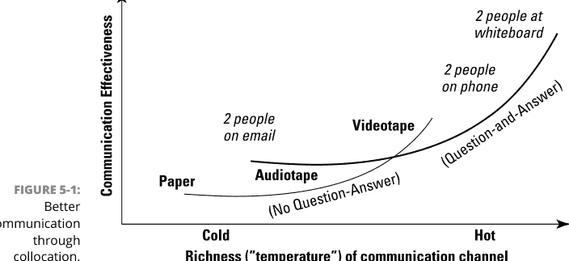

### 设置专用区域

如果 Scrum 团队成员位于同一个物理场所，你将尽可能为他们创建一个理想的工作环境。第一步是创建一个专用区域。

建立一个让 Scrum 团队能够在物理上近距离工作的环境。如果可能，Scrum 团队应该有一个自己的房间，有时被称为项目室或 Scrum 室。Scrum 团队成员在这个项目室里创建他们所需的配置，在墙上挂上白板和公告板，并移动家具。通过为生产力安排空间，它就成了他们工作的一部分。如果无法提供独立的房间，一个工作舱（pod）——边缘有工作空间，中间有一个桌子或协作中心——效果也。

如果你困在“格子间城市”中且无法拆墙，请申请一组空格子间并拆除隔断板。创建一个你可以视作项目室的空间。

合适的空间让 Scrum 团队能够完全沉浸在解决问题和制定解决方案中。

你的状况可能并不完美，但为了尽可能接近理想状态是值得的。在你的组织中开始敏捷转型之前，要层层管理创建最佳条件所需的资源。资源会因项目而异，但至少可以包括白板、公告板、记号笔、图钉和便利贴。你会惊讶于效率的提升多快就能收回投资并获得更多。

例如，对于一个客户公司来说，投入一个项目室并为开发者投入 6,000 美元购买多个显示器提高了生产力，这在项目生命周期内为公司节省了近两个月和 60,000 美元。对于简单的投资来说，回报非常丰厚。我们将在第 13 章中展示如何在项目早期量化这些节省的成本。

### 消除干扰

开发团队需要专注、专注、专注。敏捷方法的设计是为了以特定方式进行高生产力工作建立结构。这种生产力最大的威胁是干扰，因为……等一下，我需要接个电话。

好的，我回来了。好消息是，敏捷团队有一人专门负责抵避或消除干扰：即 Scrum Master。无论你将担任 Scrum Master 角色还是其他角色，你都需要了解什么样的干扰会使开发团队偏离，以及如何处理它们。表 5-1 是常见干扰列表以及处理干扰的准则。

干扰会耗尽开发团队的注意力、能量和性能。Scrum Master 需要力量和勇气来管理和抵避中断。避免的每一次干扰都是迈向成功的一步。

### 表 5-1 常见干扰

| 干扰 | 做的 (Do) | 不要做的 (Don't) |
|---|---|---|
| 多个项目 | 确保开发团队每次只 100% 专注于单一项目。 | 不要让开发团队分散在多个项目、运营支持和特殊任务之间。 |
| 多任务处理 | 让开发团队专注于单项任务，理想情况下是一次开发一个功能。任务板可以帮助跟踪进行中的任务，并快速识别出某人何时处理多个任务。 | 不要让开发团队在需求之间切换。切换任务会产生巨大的额外负担（至少 30% 的生产力损失）。 |
| 过度监督 | 在协作迭代目标后让开发团队成员独处；他们可以自我组织。观察他们的生产力。 | 不要在他们工作时干预开发团队或其他他人。每日 Scrum 会提供充足的机会来评估进度。 |
| 外部影响 | 重新引导任何干扰者。如果新任务超出了 Sprint 目标，请产品所有者决定该任务的优先级是否值得牺牲 Sprint 的功能。 | 不要打扰开发团队成员及其工作。他们正在追求 Sprint 目标，这是活跃 Sprint 期间的优先事项。即使是一个看似很快的任务也可能干扰一整天。 |
| 管理 | 保护开发团队免受管理层的直接请求（除非管理层为卓越表现发放奖励）。 | 不要允许管理层负面影响开发团队的生产力。让中断开发团队成为阻力最大的路径。 |

### 移动化

从“移动化”这一标题来看，你可能认为这一节是关于手机电话会议的，但并不是。敏捷项目采取响应式方法，Scrum 团队成员需要一个帮助他们应对日常项目需求的环境。敏捷团队环境应该是移动的——字面意义上的：

- 使用移动桌子和椅子，以便人们移动和重新配置空间。
- 使用无线连接的笔记本电脑，以便 Scrum 团队成员可以拿起并轻松移动。
- 准备一个大型移动白板。另见下一节关于低技术沟通。

通过这种可移动的环境，Scrum 团队可以配置他们的需求。

## 低技术沟通

当 Scrum 团队协作办公时，你可以使用白板和纸张。低技术工具有助于沟通。只需要几种工具：

- 使用白板进行头脑风暴和分享想法。
- 使用不同颜色的便利贴代表工作单元。
- 使用物理板展示进度。

Scrum 团队可以使用这些工具处理：

- Sprint 目标
- Sprint 所需的内容
- 已完成的内容
- 接下来是什么

### 发布目标

### 迭代目标

`US` = 用户故事 (User Story)

### 发布日期

### 迭代评审

`Task` = 任务 (Task)

| 待办 (TO DO) | 进行中 (IN PROGRESS) | 已通过 (ACCEPT) | 已完成 (DONE) |
|---|---|---|---|


| --- | --- | --- | --- |
| | | US | 任务 任务 任务 任务 |
| | | | 任务 任务 任务 任务 |
| | US 任务 任务 任务 任务 | | 任务 任务 任务 任务 |

US

| 任务 任务 任务 任务 |
| --- |
| 任务 任务 任务 任务 |
| --- |
| 任务 任务 任务 任务 |

（此处省略重复的表格行翻译，以保持格式一致）

> 图 5-2：挂在墙上或白板上的 Scrum 任务板。

### 高科技沟通

尽管协作办公几乎普遍能提高效率，但许多 Scrum 团队无法共同办公。有些项目的团队成员分散在多个办公室；另一些则拥有遍布全球的海外开发团队。如果你拥有地理位置分散的 Scrum 团队，首先尝试重新分配人才，在每个地理位置内形成 Scrum 团队。如果这种移动不可行，不要放弃敏捷转型。相反，尽可能模拟协作办公。

当 Scrum 团队成员在不同的地方工作时，你必须花更多精力建立一种产生联系的环境。为了跨越距离和时区，你需要更复杂的通信机制。

### 不要发明轮子！

在过去，制造过程通常涉及将未完成的物品运送到另一个地点进行完成。在这些情况下，第一个地点工厂墙上的看板板需要被第二个地点的车间管理人员看到。电子看板板软件是为了解决这个问题而开发的，但有趣的是，该软件看起来就像墙上真实的看板板，而且使用方式也完全一样。不要去修复已经运行良好的东西。

在决定支持哪些类型的高科技通信工具时，首先要考虑面对面讨论的缺失。你可以使用的某些工具包括：

- 视频会议和摄像头：这些工具可以营造一种聚在一起的感觉。如果你必须进行远程通信，至少要确保双方能看到并听到对方。肢体语言传递了大部分信息。
- 即时消息：尽管即时消息无法传递非语言信息，但它是实时的且易于使用的。几个人还可以共享一个会话并共享文件。
- 基于 Web 的桌面共享：特别对于开发团队，共享桌面允许你实时视觉化地突出问题和更新。看到问题总是比在电话里讨论要好。
- 协作网站：这些网站允许你完成所有工作，从简单的文档到确保每个人都有最新的信息，再到使用虚拟白板进行头脑风暴。

使用协作网站（如 SharePoint、Confluence 和 Google Drive）允许你发布显示迭代状态的文档。当经理请求状态更新时，你只需将他们引导至协作网站提供他们所需的信息。通过每天更新这些文档，你为经理提供了比传统项目管理周期下正式状态报告程序更好的信息。避免为管理层创建单独的状态报告；这些报告与迭代燃尽图（Sprint burndowns）中的信息重复，且不支持生产支持。


第 5 章 敏捷环境实践 89

> 当你拥有一个共享文档的协作站点时，不要假设每个人都能自动理解文档中的所有内容。使用协作站点来确保所有内容都是发布、可访问且透明的，但不要让你的团队产生一种“共同理解”的错觉。

### 选择工具

正如本章提到的，低技术工具最适合敏捷项目，特别是在初期，当 Scrum 团队正在适应该流程时。本节讨论了选择敏捷工具时需要考虑的几点：工具的用途以及组织和兼容性限制。

### 工具的用途

在选择工具时，你需要问的首要问题是：“工具的目的是？”工具应该解决特定问题并支持敏捷流程，流程的重点是推进工作。

最重要的是，不要选择比你需要的更复杂的工具。有些工具非常精密，在使用它们产生生产力之前需要时间来学习。如果你与一个分散的 Scrum 团队合作，敏捷实践的培训和采纳可能已经足够挑战性了，无需再添加一套复杂的工具。如果你与一个分散的 Scrum 团队合作，引入新工具可能会更加困难。

你可以在市场上找到以敏捷为中心的网站、软件和其他工具列表。其中许多是很有用的，但在实施敏捷的早期，你不应该投资昂贵的敏捷工具。这种投资是不必要的，并为适应过程增加了另一层复杂度。当你经历第一次迭代并修改你的方法时，Scrum 团队将开始识别可以改进或需要更改的程序。这些改进之一可能就是对额外工具或替换工具的需求。当需求从 Scrum 团队自然产生时，为购买必要的工具寻找组织支持会更容易，因为这种需求可以与项目问题挂钩。

### 组织和兼容性限制

除了前一节提到的初始考虑之外，还必须考虑在组织内必须运行的工具。除非你完全使用非电子工具，否则你可能需要考虑组织在硬件、软件和服务等方面的政策，以及云计算、安全和电话系统。如果你是分布式组织的一部分，某些团队可能无法支持复杂的解决方案、维护最新版本，或者没有你认为理所当然的强劲互联网带宽。为敏捷团队创建敏捷环境的关键是在战略层面进行。敏捷团队驱动敏捷项目，因此要尽早让组织领导层提供支持团队成功的工具。

## 敏捷行为实践

在本章中，你将查看为了让组织从敏捷技术的优势中受益而需要转变的行为动态。你将了解敏捷项目中的不同角色，并了解如何改变团队的价值观和哲学。最后，我们讨论了一些让团队锻炼技能的方法。

### 建立敏捷角色

在第 4 章中，我们描述了 Scrum，这是最流行的敏捷框架之一。该框架以特别简洁的方式定义了敏捷角色。我们在书中通过 Scrum 来描述敏捷角色。这些角色是：

- 产品所有者（Product Owner）
- 开发团队成员（Development team member）
- Scrum Master

产品所有者、开发团队和 Scrum Master 共同组成 Scrum 团队。每个角色都是平等的——没有人是别人的老板。

以下角色不是 Scrum 框架的一部分，但对敏捷项目至关重要：

- 相关利益者（Stakeholders）
- 敏捷导师（Agile mentor）

Scrum 团队与利益相关者共同组成敏捷项目团队。核心是开发团队。产品所有者和 Scrum Master 履行着确保开发团队成功的角色。图 6–1 显示了角色如何配合。本节将详细讨论这些角色。

### 产品所有者

产品所有者在非 Scrum 环境下有时被称为客户代表，负责桥接客户、业务利益者与开发团队之间的鸿沟。产品所有者是产品以及客户需求和优先级的专家。产品所有者是 Scrum 团队的同级成员，保护开发团队免受业务干扰，每天与开发团队合作帮助澄清需求，并在准备迭代评审期间接受完成的工作。

产品所有者决定产品包含和不包含什么。再加上决定向市场发布以及何时发布的责任，你会发现你需要一个聪明且干练的人来担任这个角色。

在敏捷项目中，产品负责人（Product Owner）将：

- 为项目制定策略和方向，并设定长期和短期目标。
- 提供或获取产品专业知识。
- 理解并将客户及其他业务利益相关者的需求传递给开发团队。
- 收集、优先排序并管理产品需求。
- 负责产品的预算和盈利能力。
- 决定何时发布已完成的功能。
- 每天与开发团队合作，回答问题并做出决策。
- 在冲刺（Sprint）期间，接受或拒绝已完成的工作。
- 在每个冲刺结束时，在开发团队展示这些成果之前，展示 Scrum 团队的成就。

什么使成为良好的产品负责人？果断力。良好的产品负责人彻底理解客户，并获得组织的授权每天做出困难的决策。尽管能够从利益相关者处收集需求，但产品负责人对产品本身也有深厚的知识。他们能够自信地进行优先级排序。

良好的产品负责人与业务利益相关者群体、开发团队以及 Scrum Master（Scrum Master）保持良好的互动。他们务实，能够根据现实情况进行权衡。开发团队可以找到他们，他们提出自己的需求。他们很有耐心，特别是对于来自开发团队的问题时。

表 6-1 概述了产品负责者的职责以及相应的特征。

## 表 6-1 良好产品负责者的特征

| 职责 | 良好的产品负责人…… |
| --- | --- |
| 提供产品策略和方向 | 构想完成的产品 |
|  | 坚定地理解公司策略 |
| 提供产品专业知识 | 过去工作过类似的产品 |
|  | 理解使用该产品的人的需求 |

#### 表 6-1（续）

| 职责 | 良好的产品负责人…… |
| --- | --- |
| 理解客户和其他利益相关者的需求 | 理解相关的业务流程<br>建立稳固的客户输入和反馈渠道<br>与业务利益相关者良好合作 |
| 管理并优先排序产品需求 | 决策果断<br>关注效率<br>保持灵活性<br>将利益相关者的反馈转化为有价值的、以客户为中心的功能<br>在处理具有财务价值的功能、高风险功能和战略性系统改进时非常务实<br>保护开发团队免受业务干扰（竞争性的利益相关者请求） |
| 负责预算和盈利能力 | 理解哪些产品功能能带来最高的投资回报<br>有效管理预算 |
| 决定发布日期 | 理解关于时间线的业务需求 |
| 与开发团队合作 | 方便每天解答需求疑问<br>与开发团队合作以了解能力<br>与开发者合作良好<br>能够熟练地描述产品功能 |
| 接受或拒绝工作 | 理解需求并确保已完成的功能正常运行 |
| 在每个冲刺结束时展示完成的工作 | 在开发团队演示冲刺运行功能之前，清晰地介绍冲刺的成就 |

产品负责人为项目承担了大量业务相关的责任。尽管项目赞助者提供资金并拥有预算，但产品负责人负责管理预算的支出。

凭借一个投入且果断的产品负责人，开发团队拥有了所有所需的业务支持来将需求转化为可运行的功能。下一节将解释产品负责人如何帮助确保开发团队理解他们将创建的产品。

### 开发团队成员

开发团队成员是创建产品的人。在软件开发中，程序员、测试人员、设计师、撰稿人、数据工程师以及任何在产品开发中担任实际角色的人都是开发团队成员。对于其他类型的产品，开发团队成员可能拥有不同的技能。

在敏捷项目上，开发团队是：

- 直接负责创建项目交付物。
- 自我组织和自我管理。开发团队成员决定自己的任务以及他们想要如何完成这些任务。
- 跨职能。开发团队共同拥有所有技能，以将需求详细化、设计、开发、测试、集成和文档化为可运行的功能。
- 多技能。开发团队成员是多才的——他们不受限于某一套技能。他们拥有现有的技能可以在项目开始时立即贡献，但他们也在学习新技能，并将所学教给开发团队成员。
- 理想情况下，在整个项目期间专注于一个项目。
- 理想情况下同地办公。团队应该在同一办公室的同一区域共同工作。

什么使成为良好的开发团队成员？请表 6-2 中的团队职责和相应的特征。

## 良好开发团队成员的特征

| 职责 | 良好的开发团队成员…… |
| --- | --- |
| 创建产品 | 喜欢创建产品 |
|  | 精通创建产品所需的多种工作 |
| 自我组织和自我管理 | 表现出主动性和独立性 |
|  | 理解如何通过克服障碍来实现目标 |
|  | 与团队的其他部分协调要完成的工作 |

#### 表 6-2（续）

| 职责 | 良好的开发团队成员…… |
| --- | --- |
| 跨职能 | 具有好奇心<br>愿意为其专长之外的领域做出贡献<br>喜欢学习新技能<br>热情地分享知识 |
| 投入且同地办公 | 是一个理解专注、同地办公团队带来的效率和效果的组织的一部分 |

Scrum 团队的另外两个成员——产品负责人和 Scrum Master——帮助支持开发团队创建产品的努力。产品负责人确保开发团队是有效的（正在产的），而 Scrum Master 帮助开发团队变得高效。

### Scrum Master

Scrum Master 有时被称为项目协调员，负责帮助团队工作。Scrum Master 与项目经理不同。

Scrum Master 是一个仆人型领导者。你可以在第 14 章找到更多关于仆人型领导的知识。在敏捷项目上，Scrum Master 将：

- 担任流程教练，帮助团队遵循 Scrum 价值观和实践。
- 帮助消除障碍——无论是被动还是主动——并保护开发团队免受干扰。
- 促进利益相关者与 Scrum 团队之间的紧密合作。
- 促进 Scrum 团队内部共识的形成。

我们将 Scrum Master 与航空工程师相比，后者的工作是减少飞机飞行的阻力。阻力总是存在，但可以通过创新和主动的工程来减少。同样，所有项目都有影响团队效率的障碍，并且存在另一个可以识别并消除的限制。Scrum Master 角色最重要的部分之一是消除障碍和防止干扰。一个擅长这些任务的 Scrum Master 对项目和团队来说是无价。如果一个开发团队有七个人，良好的 Scrum Master 的效果就是七倍。

产品负责人可能从未参与过敏捷项目，但 Scrum Master 可能参与过。因此，Scrum Master 可能会指导新产品和开发团队，并尽一切帮助他们成功。

什么使成为良好的 Scrum Master？Scrum Master 不需要项目经理经验。Scrum Master 是敏捷流程的专家并能指导他人。Scrum Master 还必须与产品负责人和利益相关者群体协作工作。

引导技巧可以过滤掉聚会中的噪音，确保 Scrum 团队的每个人在正确的时间关注正确的优先级。

Scrum Master 拥有强大的沟通技巧，并拥有足够的组织影响力通过谈判合适的环境、保护团队免受干扰以及消除障碍来确保成功的条件。Scrum Master 是优秀的引导者和倾听者。他们能够协调冲突意见并帮助团队帮助自己。查看表 6-3 中 Scrum Master 的职责和相应的特征。

#### 表 6-3 良好 Scrum Master 的特征

| 职责 | 良好的 Scrum Master…… |
| --- | --- |
| 维护 Scrum 价值观和实践 | 是 Scrum 流程专家 |
|  | 对敏捷技术充满热情 |
| 消除障碍并防止干扰 | 有组织影响力并能快速解决问题 |
|  | 口才伶俐、外外交且专业 |
|  | 是优秀的沟通者和倾听者 |
|  | 坚定要求开发团队只关注当前项目和当前冲刺 |

#### 表 6-3（续）

| 职责 | 优秀的 Scrum Master…… |
| --- | --- |
| 促进外部利益相关者与 Scrum 团队之间的紧密合作 | 关注项目的整体需求 |
| 避免小圈子并帮助打破团队间的孤岛 | |
| 促进共识的建立 | 理解帮助小组达成共识的技巧 |
| 是一位仆人式领导 | 不需要、也不想掌权或当老板 |
| 确保开发团队的所有成员都拥有完成工作所需的信息、使用他们的工具并跟踪进度 | |
| 真正渴望帮助 Scrum 团队 | |

影响力（Clout）并不等同于权威（Authority）。组织需要赋予 Scrum Master 权力，以便他们能够影响项目团队和组织的变革，但影响力涉及赢得尊重，即使是通过成功和经验获得的。某些类型的影响力能赋予 Scrum Master，它们来自于专业知识（通常是利基知识）、资历（“我在公司呆了很久了，能第一手了解它的历史”）、魅力（“人们通常很喜欢我”）或人脉关系（“我认识重要人物”）。不要低估拥有影响力的 Scrum Master 的价值。

Scrum 团队的成员——产品所有者、开发团队和 Scrum Master——每天都在项目上工作。

正如我们在章节早期提到的，Scrum 团队加上利益相关者组成了项目团队。有时，利益相关者的参与度没有 Scrum 团队成员积极，但仍然可以产生重大影响并为项目提供巨大的价值。

### 利益相关者

利益相关者是指任何对项目感兴趣的人。他们最终对产品的执行不负责，但他们提供投入并受项目结果的影响。利益相关者群体是多样化的，可以包括来自不同部门甚至不同公司的人。

在敏捷项目中，利益相关者：

- 包括客户。
- 可能包括技术人员，如基础设施架构师或系统管理员。
- 包括法务部门、客户经理、销售人员、营销专家和客户服务代表。
- 除了产品所有者外，还包括产品或领域专家。

利益相关者可以提供关于产品及其用途的关键见解。利益相关者在冲刺（Sprint）期间可能与产品所有者密切合作，并在每个冲刺结束时的冲刺评审期间提供产品反馈。

利益相关者在项目和组织中所扮演的角色。几乎所有的敏捷项目都有 Scrum 团队之外的利益相关者。有些项目还有敏捷导师，特别是那些项目团队对敏捷流程陌生的项目。

### 共识：五指法

作为团队工作的一部分意味着以团队的形式达成一致。作为 Scrum Master 的重要部分是帮助团队建立共识。我们都曾与难以达成共识的小组合作，从任务需要多久完成到午饭去哪里吃都有过。一种快速、非正式了解小组是否同意某个想法的方法是使用“五指法”，它看起来类似于石头剪刀布。

数到三时，每个人伸出手指数量，反映出对该想法的接受程度：

- 5：我非常喜欢这个想法。
- 4：我认为这是一个好主意。
- 3：我可以支持这个想法。
- 2：我有保留意见，所以我们讨论一下。
- 1：我反对这个想法。

如果有人伸出三、四或五只手指，而有些人只伸出一或两只，那么请讨论这个想法。找出支持该想法的人为什么认为它会有效，以及反对该想法的人有什么保留意见。你希望所有小组成员至少伸出三只手指——他们不需要喜欢这个想法，但他们需要支持它。Scrum Master 的共识技能对于这项任务至关重要。

你也可以通过要求简单的大拇指向上（支持）、大拇指向下（不支持）或大拇指向侧（未决定）来了解决策的共识情况。这比五指法更快，非常适合回答是非问题。

### 敏捷导师

对于任何你想开发新专业知识的领域，寻找导师都是一个极佳的主意。敏捷导师（有时被称为敏捷教练）是具有实施敏捷项目经验，并可以将这些经验与项目团队分享的人。敏捷导师可以为新项目团队和表现水平较高的项目团队提供价值的反馈和建议。

在敏捷项目中，敏捷导师：

- 仅担任导师角色，不是 Scrum 团队的成员。
- 通常是组织外部的人员，可以提供客观指导，而不考虑个人或政治考量。
- 是一位敏捷专家，在实施敏捷技术和运行不同规模的敏捷项目方面拥有丰富经验。

你可能希望像考虑高尔夫教练一样来考虑敏捷导师。大多数人使用高尔夫教练不是因为他们不知道怎么打高尔夫，而是因为高尔夫教练能客观观察到球员在比赛中永远不会注意到的细节。高尔夫和实施敏捷技术一样，是一项细微差别就能对表现产生巨大影响的练习。

### 建立新价值观

许多组织将其核心价值观贴在墙上。然而，在本节中，我们讨论的是代表每天共同工作、相互支持以及尽一切努力实现 Scrum 团队承诺的价值观。

除了《敏捷宣言》中的价值观外，Scrum 团队的五个核心价值观是：

- 承诺（Commitment）
- 勇气（Courage）
- 专注（Focus）
- 开放（Openness）
- 尊重（Respect）

后续章节将详细介绍这些价值观的每一个细节。

### 承诺


承诺意味着投入和参与。在敏捷项目中，`Scrum`团队承诺实现特定目标。由于相信`Scrum`团队将交付其承诺的内容，组织通过承诺达成每个目标来动员。

敏捷流程（包括自组织理念）为人们提供了权力。然而，承诺需要意识的努力。考虑以下几点：

- `Scrum`团队在做出承诺时必须保持现实，特别是在冲刺期间。
- `Scrum`团队必须完全投入目标。在团队达成共识后，尽全力实现目标。
- `Scrum`团队对结果是负有责任的。

持续履行承诺是核心。在第 13 章中，你将学习如何使用计划。

### 勇气

我们都会经历恐惧。我们都有不想做的事情，无论是要求团队成员解释我们不懂的东西，还是面对老板。接受敏捷技术是一项改变。成功的变革需要勇气。以下是一些培养勇气的建议：

- 意识到过去的方法并不一定适用。有时你需要提醒人们事实。如果你想成功实施敏捷技术，你的日常工作需要改进。
- 准备好反对现状。现状会产生阻。有些人因为利益不想要改变。
- 用尊重来挑战。组织成员可能对变化特别抵制；他们往往是旧规则的制定者。现在挑战这些规则。礼貌地提醒这些人，只有遵循 12 条敏捷原则才能获得收益。让他们尝试一下。
- 拥抱其他价值观。做出承诺并坚持的勇气。专注并对干扰者说“不”的勇气。开放并承认始终有改进机会的勇气。以及尊重包容他人观点的勇气，即使这些观点改变了你的观点。

当你用更现代的方法取代组织的陈旧流程时，要做好面对挑战的准备。接受挑战；回报是值得的。

### 专注

工作充满了干扰。你组织中的许多人喜欢利用你的时间来让他们自己过得轻松。然而，干扰是昂贵的。`Scrum`团队成员可以通过要求一个允许他们专注的环境来帮助改变职功能。为了减少干扰并提高生产力，`Scrum`团队成员可以：

- 在物理上隔离公司的干扰。确保高生产力的常用技巧之一是找一个远离公司核心办公室的附属，并将其作为`Scrum`团队的工作区域。有时最好的防御就是距离。
- 确保你没有浪费时间在与冲刺目标无关的活动上。如果有人试图用某些“必须做”的事情分散你对冲刺目标的注意力，请解释你的优先事项。问一句：“这项请求将如何推动冲刺目标的实现？”这个简单的问题可以将许多活动从待办清单中移除。
- 弄清楚需要做什么，并只做这些事情。开发团队决定了实现冲刺目标所需的任务。如果你是开发团队的成员，请利用这种所有权将你的注意力集中在当前的优先事项上。
- 平衡专注时间与对`Scrum`团队其他成员的可性。弗朗切斯科·西里奥（`Francesco Cirillo`）的番茄工作法——将工作分为 25 分钟的时间块——有助于在专注和可可用之间取得平衡。我们通常建议开发团队成员使用降噪耳机，将其作为一种“请勿打扰”的信号。然而，我们也建议团队达成共识，所有团队成员都有一段最少办公时间，在此期间可以进行协作。
- 检查你是否保持了专注。如果你不确定自己是否保持专注——这很难判断——请回到基础问题：“我的行动是否符合实现整体目标和近期目标（如完成当前任务）？”

正如你所看到的，任务专注并不是一个次要的优先级。在前期投入精力创建一个无干扰的环境，以帮助你的团队取得成功。

### 开放 (Openness)

敏捷团队中没有秘密的足之地。如果团队对项目结果负责，那么他们掌握所有事实就是合情合理的。信息就是力量，确保每个人都能获得做出正确决策所需的信息，需要一种透明的意愿。为了利用开放的力量，你：

- 确保团队中的每个人都能访问相同的信息。从项目愿景到任务状态的每一个微小细节，对团队而言，一切都应该是处于公共范围内的。建立一个集化的存储库作为信息的单一来源，并通过将所有状态（燃尽图、阻碍列表等）和信息放在一处，来避免“状态报告”带来的干扰。我们通常向项目利益相关者发送此存储库的链接并说：“我们拥有的所有信息点击可用。没有更快的更新方法了。”

第 6 章 敏捷行为实践 105

- **保持开放，并鼓励他人保持开放。** 团队成员必须能够自由地公开讨论问题和改进机会，无论这些问题是他们自己正在面临的还是团队其他地方的。开放需要团队内部的信任，并且需要时间培养。
- **通过劝阻八卦来消除内部政治。** 如果有人开始向你诉说另一个团队成员做了或没做什么，请让他们将问题提交给可以解决问题的人。你自己不要参与八卦。永远不要。
- **始终保持尊重。** 开放绝不是破坏性或刻薄的借口。尊重对于开放的团队环境至关重要。

未处理的小问题往往会增长变成危机。利用开放的环境从整个团队的投入中受益，并确保你的精力集中在项目真正的优先事项上。

### 尊重 (Respect)

团队中的每个人都有重要的贡献。你的背景、教育程度和经验对团队有着独特的影响。分享你的独特性，并在他人身上寻找并欣赏同样的独特性。在以下情况下鼓励尊重：

- **培养开放性。** 尊重和开放是并存的。没有尊重的开放会导致怨恨；有尊重的开放会产生信任。
- **营造积极的工作环境。** 快乐的人倾向于互相对待。鼓励积极情绪，尊重就会随之而来。
- **寻找差异。** 不要只是忍受差异；要尝试去发现它们。最好的解决方案来自经过考虑并受到适当挑战的多元意见。
- **以同等的尊重程度对待团队中的每一个人。** 所有团队成员都应该获得同样的尊重，无论他们的角色、经验水平或直接贡献如何。鼓励每个人尽所全力。

尊重是让创新繁荣发展的安全网。当人们感到可以分享更广泛的想法时，最终解决方案可以获得在没有尊重的团队环境中永远不会被考虑的改进。利用尊重来增加团队的优势。

### 改变团队哲学 (Changing Team Philosophy)

敏捷开发团队的运作方式与使用瀑布方法的团队不同。开发团队成员必须根据每天的优先事项改变自己的角色，组织自己，并以全新的方式思考项目以实现他们的承诺。

为了成为成功敏捷项目的一员，开发团队应该接受以下属性：

- **专注团队 (Dedicated team)：** 每个`Scrum`团队成员只负责分配给`Scrum`团队的项目，而不与外部团队或项目合作。项目可能会结束，新项目可能会启动，但团队保持不变。
- **跨功能性 (Cross-functionality)：** 愿意并能够处理不同类型的任务以创建产品。
- **自组织 (Self-organization)：** 决定如何进行产品开发工作的能力和责任。
- **自管理 (Self-management)：** 保持工作正轨的能力和责任。
- **规模限制团队 (Size-limited teams)：** 选择合适的开发团队大小以确保有效沟通。越小越好；开发团队人数应大于九人。
- **所有权 (Ownership)：** 对工作采取主动并对结果负责。

接下来的章节将详细介绍这些每一个观点。

### 专注团队 (Dedicated team)

传统的资源分配方法（我们更倾向于人才分配）是将团队成员的时间部分分配到多个项目和团队中，以实现充分利用。然而，结果是上下文切换——即从一个任务切换到另一个任务时与认知士气相关的成本。其他常见的人才分配实践包括将团队成员从一个团队移动到另一个团队以填补技能缺口或人力缺口，以及让一个团队同时负担多个项目。这些方法几乎无法预测。

第 6 章 敏捷行为实践 107

这些方法产生类似的结果：生产力显著下降且无法预测性能。研究表明，并行完成项目所需的时间至少增加了 30%。

频繁切换 (Thrashing) 是任务之间上下文切换的另一个术语。通过将团队成员投入单个项目来避免频繁切换。

当你将`Scrum`团队投入一个项目时，会产生以下结果：

- **更准确的发布预测：** 由于同一组人在每个冲刺中处理相同的任务，且分配的时间相同，`Scrum`团队可以更有确定性地推断所需的时间。
- **有效的短迭代：** 冲刺越短，反馈循环越快，`Scrum`团队对反馈和变化的响应就越快。没有足够的时间在项目之间频繁切换。
- **更少且成本更低的缺陷：** 上下文切换会导致缺陷，因为分心的开发人员产生的质量较低。在记忆尚新时（冲刺期间）修复问题的比以后（你需要回忆工作背景时）成本低得多。研究表明，在冲刺结束并转向其他需求后修复缺陷的成本是 6.5 倍，准备发布时是 24 倍，而在测试影响后修复是 100 倍。

如果你想要更高的可预测性、更高的生产力以及更少的缺陷，请让你的`Scrum`团队成员专注于一个项目。我们发现这是敏捷转型成功的最高因素之一。

### 跨功能性 (Cross-functionality)

在传统项目中，经验丰富的团队成员通常被认为只有单一技能。例如，`.NET`程序员可能总是做`.NET`，而测试人员可能总是做质量控制工作。具有互补技能的团队成员通常被认为是不同的小组，例如编程小组或测试小组。

敏捷方法将创建产品的人聚集在一起形成凝聚的群体——开发团队。敏捷开发团队的人员尝试抛弃头衔和有限的角色。开发团队成员可能带着一种技能开始项目，但在整个项目过程中学习执行许多不同的工作，以帮助创建产品。

跨职能让开发团队变得更高效。例如，假设一次每日站会（`daily scrum meeting`）发现，测试是完成需求的最高优先级任务。程序员可能会帮助快速完成该任务。当开发团队是跨职能的时，他们可以像围攻一样涌向产品，让尽可能多人参与同一个需求，以快速完成该功能。

跨职能还有助于消除单点故障。考虑传统项目，每个人只知道如何做一份工作。当一名团队成员生病、休假或离开公司时，没有其他人能够胜任他的工作。那个人正在执行的任务会被延迟。相比之下，跨职能敏捷开发团队成员能够胜任许多工作。当某人不在时，另一个人可以接手。

跨职能鼓励每个团队成员：

- **抛弃关于自己能做什么的狭隘标签。** 在敏捷任务中没有头衔的位置。技能和指挥能力才是重要的。开始将自己想象成一支特种部队——在相关领域拥有足够的知识，能够应对任何情况。
- **努力扩展技能。** 不要只在你已经熟悉的领域工作。尝试在每个冲刺（`sprint`）中学习一些新东西。如结对编程（两个开发者协作编写一个项目）或观察其他开发者等技术可以帮助你学习新技能并提高整体质量。
- **出手帮助遇到瓶颈的人。** 帮助他人解决现实世界的问题是学习新技能极好的方法。
- **保持灵活。** 愿意保持灵活有助于平衡工作负载，并使团队更有可能实现冲刺目标。

在跨职能机制建立后，你避免了等待他人处理任务。相反，一个充满积极性的、即使知识尚浅的开发团队成员今天就可以处理某项功能。该开发团队会不断学习和改进，工作流也能持续进行。

跨职能的一个巨大回报是开发团队能够快速完成工作。冲刺评审后的下午通常是庆祝时间。一起去看电影。去海滩或去保龄球场。早点回家。

# 第 6 章 敏捷行为实践

### 自组织

敏捷技术强调自组织开发团队，以利用开发团队成员多样化的知识和经验。

如果你读过第 2 章，你可能记得敏捷原则第 11 条：最好的架构、需求和设计源于自组织团队。


自组织是敏捷的重要部分。为什么呢？在一个所有权的世界里，自组织团队并不是服从他人的命令；他们拥有开发的解决方案，并对团队参与度和解决方案质量产生了巨大影响。

对于习惯了传统的命令与控制项目管理模型的开发团队来说，自组织最初可能需要一些努力。敏捷团队没有项目经理来告诉开发团队该做什么。相反，自组织开发团队：

- **承诺你们自己的冲刺目标。** 在每个冲刺的开始，开发团队与产品所有者合作，根据项目优先级确定一个可以实现的目标。
- **识别你们的任务。** 开发成员确定为实现每个冲刺目标所必需的任务。开发团队共同研究由谁负责哪项任务、如何完成工作，以及如何处理风险和问题。
- **估算需求和相关任务所需的精力。** 开发团队最了解创建特定产品功能需要多少精力。
- **关注沟通。** 成功的敏捷团队通过透明化、面对交流、关注非语言沟通、参与和倾听来提高他们的沟通技巧。


沟通的关键在于清晰。对于复杂话题，避免单向的、可能歧义的沟通模式（例如电子邮件）。面对面交流防止误解和挫败。如果需要保留细节，你随时可以通过一封简短邮件总结对话。

- **协作。** 获取多样化`scrum`团队的输入几乎总是改进产品，但这需要扎实的协作技能。协作是高效敏捷团队的基石。

第二部分 变得敏捷


没有任何成功的项目是孤岛。协作技能帮助`scrum`成员在想法上承担风险，并为项目问题带来创新解决方案。安全且舒适的环境是敏捷项目成功的基石。

- **通过共识决策。** 为了生产力最大化，整个开发团队必须达成共识并对当前目标负责。`scrum master`经常在建立共识方面发挥积极作用，但开发团队最终对达成决策的一致意见负责，每个人都对决策负责。
- **积极参与。** 自组织对于内向的人来说可能是具有挑战性的。所有开发团队成员必须积极参与。没有人会告诉开发团队该做什么来创建产品。开发团队告诉自己该做什么，以及何时做。


在自组织中，只有当开发团队成员加入并承诺引导项目方向时，自我管理才能发挥作用。开发团队主要负责升级（`escalation`）和自我管理。然而，`scrum master`可以以多种方式协助开发团队。当开发团队成员寻找特定方向时，`scrum master`可以提醒他们，他们有权决定做什么以及如何做。如果开发团队的其他人试图下命令、坚持要求任务或规定如何创建产品，`scrum master`可以干预。`scrum master`可以成为开发团队组织和自我管理中的强大盟友。

在自组织中，只有当开发团队成员加入并承诺引导项目方向时，自我管理才能发挥作用。开发团队主要负责升级和自我管理。然而，`scrum master`可以以多种方式协助开发团队。当开发团队成员寻找特定方向时，`scrum master`可以提醒他们，他们有权决定做什么以及如何做。如果开发团队的其他人试图下命令、坚持要求任务或规定如何创建产品，`scrum master`可以干预。

开发团队：

- **允许领导力此起彼伏。** 在敏捷项目中，开发团队中的每个人都有领导的机会。对于不同的任务，领导者会根据技能在团队中切换。
- **依靠敏捷流程和工具来管理工作。** 敏捷方法使自我管理变得简单。通过敏捷方法，会议有明确的目的和时间限制，产物可以通过最小精力暴露信息。利用这些流程让开发团队将大部分时间花在。

第 6 章 敏捷行为实践

- **定期且透明地报告进度。** 每个开发团队成员负责每天准确更新工作状态。坦率说，进度报告是敏捷中的一项快速任务。在第 9 章，你会看到关于燃尽图的内容，它们提供了状态，但每天只需要几分钟更新。保持状态真实会让规划更容易。
- **在开发团队内部管理问题。** 项目可能会出现许多障碍：开发挑战和人际问题只是例子。开发团队大多数问题的第一个升级点是团队内部。
- **创建团队协议。** 开发团队有时会制定团队协议，概述每个团队成员承诺的预期。工作协议提供了对行为预期的共同理解，并使协调者能够根据约定保持团队在正轨。
- **检查并适应。** 寻找适用于你们的方法。最佳实践因团队而异。有些团队早开始更好，另一些团队晚开始更好。开发团队负责审查自己的绩效并识别改进技术。

### 规模限制团队

敏捷开发团队刻意很小。小的开发团队是一个敏捷的团队。随着开发团队的增长，协调任务流和通信流的开销也随之增加。

理想情况下，敏捷开发团队拥有最少的人数来实现封装（可以生产所需的一切）且不需要存在单点故障。为了确保技能覆盖，团队人数通常不少于三人。从统计上讲，`scrum`团队在六名开发人员时最快，四到五名开发人员时成本最低。将开发团队规模保持在三到九人之间有助于团队作为一个凝聚的整体运作，并避免产生子小组或信息孤岛。

### 限制开发团队规模

- 鼓励开发多样化的技能
- 促进良好的团队沟通
- 保持团队作为一个单一单元
- 促进代码所有权、跨职能和面对面交流

当你拥有一个较小的开发团队时，项目也会具有类似的限制性和针对性。开发团队成员在整天中保持紧密接触，因为任务、问题和同行评审会在团队成员之间不断流转。这种凝聚力确保了成员的持续投入，增加了沟通，并降低了项目风险。

当你有一个大型项目和相应的大型开发团队时，请将工作分配给多个`scrum`团队。有关如何在跨企业级规模上扩展敏捷项目的更多信息，请参阅第 17 章。

### 所有权

成为跨职能、自组织、自管理开发团队的一员需要责任感和所有权。传统项目中自上而下的管理方法并不总是能培养对项目和结果负责所必需的所有权意识。即使是经验丰富的开发团队，也可能需要调整行为，以便在敏捷项目上做出决策。

开发团队可以通过以下方式调整行为并提高其所有权水平：

- 采取主动。不要等待别人告诉你要做什么，而是要采取行动。采取有助于达成承诺和目标所需的必要行动。
- 以团队为单位共同成功与失败。在敏捷项目中，成就和失败都属于项目团队。如果出现问题，要作为一个整体承担责任，而不是寻找指责对象。当你成功时，要承认为该成功所付出的努力。
- **信任做出良好决策的能力。** 开发团队可以就产品开发做出成熟、负责且明智的决策。这需要一定程度信任，因为团队成员会习惯于在项目中拥有更多控制权。

行为成熟和所有权并不意味着敏捷开发团队是完美的。相反，他们对所承诺的范围拥有所有权，并对履行这些承诺负责。错误在所难免。如果没有发生错误，说明你没有强迫自己走出舒适区。一个成熟的开发团队会诚实地识别错误，公开承担错误责任，并持续地从错误中学习和改进。

## 3 敏捷规划与执行

### 在本部分中 ...

遵循“价值路线图”（`Roadmap to Value`），从愿景到执行。

定义并估算需求。

创建可运行的功能并在迭代中展示。

检查你的工作并调整你的流程以实现持续改进。

在 在本书中

- 规划敏捷项目
- 建立产品愿景
- 创建功能点和产品路线图

## 第 7 章

## 定义产品愿景和产品路线图

首先，让我们消除一个常见的误区。如果你听过敏捷项目不包含规划，请立即摒弃这个想法。你不仅要规划整个项目，还要规划每一次发布、每个冲刺（`sprint`）以及每一天。规划是敏捷项目成功的基础。

如果你是一名项目经理，可能会在项目开始时完成大部分规划工作。你可能听过“计划工作，按计划执行工作”这种说法，它总结了非敏捷的项目管理方法。


相比之下，敏捷项目涉及前期和贯穿整个过程的规划。通过在“最后负责的时刻”（即活动开始前）进行规划，你对该活动的了解最充分。这种规划被称为*即时规划*（just-in-time planning）或*情境感知策略*（situationally informed strategy），是敏捷项目成功的关键。敏捷团队的规划量与传统项目团队相当，甚至更多。然而，敏捷规划更均匀地分布在整个项目中，并由参与该项目的整个团队完成。

海尔穆·冯·莫尔特（Helmuth von Moltke）是一位十九世纪的德国陆军军事战略家，他曾说：“没有任何计划能在与敌人接触后生存。”这意味着，在战斗的激烈时刻——就像在项目的中心——计划总是会改变。敏捷对即时规划的关注让你能够适应实际情况，并在规划特定任务时获得充分的信息。

本章描述了即时规划如何在敏捷项目中发挥作用。你还将学习规划敏捷项目的前两个步骤：创建产品愿景和项目路线图。

## 敏捷规划

敏捷发生于敏捷项目的多个位点。观察敏捷项目规划活动的一种极佳方法是使用“价值路线图”。图 7-1 显示了整个路线图。

### 价值路线图

### 第一阶段：产品愿景

| 说明 | 产品目标及其与公司战略的对齐 |
| :--- | :--- |
| 所有者 | 产品所有者 (Product owner) |
| 频率 | 至少每月一次 |

### 第七阶段：冲刺回顾 (SPRING RETROSPECTIVE)

| 说明 | 团队对环境和产品的精炼以讨论效率 |
| :--- | :--- |
| 所有者 | Scrum 团队 |
| 频率 | 每个冲刺结束时 |

| 说明 | 创建产品愿景的产品功能点全局视图 |
| :--- | :--- |
| 所有者 | 产品所有者 |
| 频率 | 至少每月一次 |

### 第二阶段：产品路线图

### 第六阶段：冲刺评审 (SPRING REVIEW)

| 说明 | 向团队演示可运行的产品 |
| :--- | :--- |
| 所有者 | 开发团队 |
| 频率 | 每个冲刺结束时 |

### 第三阶段：发布规划 (RELEASE PLANNING)

| 高优先级功能 | 低优先级功能 | 发布测试 (24小时) |
| :--- | :--- | :--- |
| 所有者 | 产品所有者 |
| 频率 | 至少每季度一次 |

### 第五阶段：每日 Scrum (DAILY SCRUM)

| 说明 | 当天优先事项的建立与协调 |
| :--- | :--- |
| 所有者 | 开发团队 |
| 频率 | 每日 |

### 第四阶段：冲刺规划 (SPRING PLANNING)

| 说明 | 具体目标的和任务建立 |
| :--- | :--- |
| 所有者 | 产品所有者和开发团队 |
| 频率 | 每个冲刺开始时 |

准备

执行

第 3 部分 敏捷规划与执行

敏捷发生在敏捷项目的多个位点。价值路线图包含七个阶段：

- 在第一阶段，产品所有者识别产品愿景。产品愿景是项目的目的地或最终目标。产品愿景包含了你的产品是什么、与竞争对手有何不同、如何支持你的公司或组织战略、谁将使用它以及人们为什么要它。在长期项目中，至少每年回顾一次产品愿景。

- 在第二阶段，产品所有者创建产品路线图。产品路线图是对需求的高级视图，提供了开发这些需求的大致框架。它通过展示项目期间将产生的功能为愿景提供背景。识别产品需求并对其进行排序和大致估算工作可以让你建立需求主题并识别差距。产品所有者在开发团队的支持下至少每两年修订一次产品路线图。

- 在第三阶段，产品所有者创建发布规划。发布规划确定了交付功能的高级时间表。发布作为 scrum 团队可以组织的中边界。敏捷项目将多次发布，高优先级功能首先出现。我们在发布开始时创建发布规划，通常至少每季度一次。在第 8 章了解更多发布规划。

- 在第四阶段，产品所有者、开发团队和 Scrum Master 将规划迭代（即冲刺），并在这些冲刺中创建产品功能。冲刺规划会议在每个冲刺开始时举行。在冲刺规划期间，scrum 团队确定冲刺目标，作为关注工作的直接边界，即支持目标且能在冲刺内完成的需求。scrum 团队概述如何完成这些需求。在第 8 章获取有关冲刺规划的信息。

- 在第五阶段，开发团队在每个冲刺期间进行每日 Scrum，以协调当天的优先事项。在每日 Scrum 会议上，你们讨论昨天完成了什么，今天要做什么，以及遇到了哪些障碍，以便立即解决问题。在第 9 章中阅读每日 Scrum。

- 在第六阶段，scrum 团队在每个冲刺结束时举行冲刺评审。在冲刺评审中，你们向产品利益相关者演示可运行的功能。在第 10 章了解如何进行冲刺评审。

- 在第 7 阶段，Scrum 团队会召开冲刺回顾。冲刺回顾会议是 Scrum 团队就流程和环境讨论已完成的冲刺，并为下一次冲刺的流程改进制定计划。与用于检查和适应产品的冲刺评审类似，冲刺回顾在每个冲刺结束时举行，以确定如何在第 10 章中进行冲刺回顾。

价值路线图（Roadmap to Value）中的每个阶段都是重复的，且每个阶段包含规划活动。敏捷规划像敏捷开发一样是迭代的。

## 渐进演化

在敏捷项目的每个阶段，你只对你需要规划的内容规划。在项目早期，你进行宽泛且整体的规划，以创建一个产品未来如何成型的粗略大纲。在后期，你将缩小规划范围并增加更多细节，以确保近期开发工作的成功。这一过程被称为需求的**渐进演化**。

开始时进行宽泛规划，在需要时再进行详细规划，可以防止你在那些可能永远不会实现的低优先级产品需求上浪费时间。该模型还允许你在项目期间添加高价值需求，而不会破坏开发流程。

你的详细规划越是“及时性”（just-in-time），你的规划就越高效。

> 某些客户很少或从不使用应用程序 64% 的功能。在敏捷项目的前几个开发周期中，你完成优先级最高且人们会需要的功能。通常，你尽早发布这些功能，以通过先发优势获得市场份额；获取有关可行性的客户反馈；尽早实现变现以优化投资回报率（ROI）；并避免内部和外部的过时。


## 检查和适应

及时规划运用了敏捷技术的两个基本原则：检查和适应。在项目的每个阶段，你都需要查看产品和流程（检查），并在需要时进行更改（适应）。

敏捷规划是一个检查和适应的节奏性循环。考虑以下情况：

- 在冲刺期间的每天，产品所有者提供反馈，帮助开发团队在创建产品时改进产品。

- 在每个冲刺结束时，在冲刺评审中，利益相关者提供反馈以进一步改进产品。

- 同样在每个冲刺结束时，在冲刺回顾中，Scrum 团队讨论过去冲刺中学到的教训，以改进开发流程。

- 发布后，客户可以提供用于改进的反馈。反馈可能是直接的（当客户就产品联系公司时），也可能是间接的（当潜在客户生产或不生产该产品时）。

检查和适应结合在一起是以最高效方式交付正确产品的极工具。

在项目开始时，你对正在创建的产品了解最少，因此那时尝试规划精细细节是不可行的。敏捷意味着你在需要时知道详细计划，并立即根据该计划开发定义的特定需求。


现在你对敏捷规划如何运作有了更多了解，是时候完成敏捷项目的第一步了：定义产品愿景。

## 定义产品愿景

敏捷项目的第一个阶段是定义你的产品愿景。产品愿景声明是一个电梯演讲或简要摘要，用于说明你的产品如何支持公司或组织的战略。愿景声明必须阐明产品的最终状态。

该产品可能是发布到市场上的商业产品，也可以是支持组织日常运营的内部解决方案。例如，假设你的公司是 XYZ 银行，你的产品是一个移动银行应用程序。哪些公司策略支持移动银行业务？该应用程序如何支持公司的战略？你的愿景声明清晰简洁地将产品与你的业务战略联系起来。

图 7–2 显示了愿景声明——价值路线图的第 1 阶段如何与敏捷项目的其他阶段和活动相匹配。

### 常见的敏捷实践

### 第 1 阶段：产品愿景

图 7-2：作为价值路线图一部分的产品愿景声明。

| 描述 |
| :--- |
| 产品目标及其与公司战略的对齐 |
| 所有者：产品所有者 |
| 频率：至少每年一次 |


产品所有者负责在整个项目中了解产品、其目标和需求。出于这些原因，产品所有者创建愿景声明，尽管其他人可能提供意见。愿景声明完成后，它将成为指导之针，成为开发团队、Scrum Master 和利益相关者参考项目时的“我们正在尝试实现什么”的。

在创建产品愿景声明时，遵循以下四个步骤：

1. 开发产品目标。
2. 创建愿景声明草案。
3. 与产品和项目利益相关者验证愿景声明，并根据反馈进行修订。
4. 确定愿景声明。

愿景声明的外观没有硬性规定。然而，从开发团队到首席执行官，参与项目的任何人都应该能够理解该声明。愿景声明应该是内部导向的、清晰的、非技术性的，并且尽可能简洁。愿景声明应侧重于内部，并避免营销辞藻。

### 步骤 1：开发产品目标

为了编写愿景声明，你必须理解产品的目标。你需要识别以下内容：

- 客户：谁会使用该产品？这个问题可能有多个答案。
- 关键产品目标：产品将如何使公司受益？目标可能包括对特定部门（如客户服务或市场营销部门）的利益，以及对整个公司的利益。该产品支持哪些特定战略？
- 需求：客户为什么需要该产品？哪些功能对客户至关重要？
- 竞争：该产品与类似产品相比如何？
- 主要差异：该产品与现状有什么不同？

### 步骤 2：创建愿景声明草案

当你良好掌握产品目标后，创建愿景声明的初稿。

任何新产品的采用都是一种博弈。用户会喜欢该产品吗？市场会接受吗？开发该产品是否有足够的投资回报？在《跨越鸿沟》中，Moore 描述了早期采用者受愿景驱动，而大多数人对愿景者持怀疑态度，对质量、产品维护和寿命等现实问题感兴趣。

> 投资回报率（简称 ROI）是公司投入某些资金后获得的收益或价值。ROI 可以定量的，例如 ABC 公司在投资新网站后通过在线获得的额外收入。ROI 也可以是非形的，例如 XYZ 银行使用移动银行应用程序的客户满意度提高。

Moore 的产品愿景方法是务实的。在图 7-3 中，我们根据 Moore 方法构建了一个模板，以更明确地将产品与公司战略联系起来。如果你在产品愿景声明中使用此模板，那么当产品从早期采用转向主流使用时，它将经受时间的考验。

让你的产品愿景声明更具吸引力的一种方法是使用现在时进行编写，仿佛该产品已经存在一样。使用现在时有助于读者想象产品的使用场景。

### 产品愿景声明

| 对于 | (目标客户) |
| :--- | :--- |
| 这些他们 | (需求) |
| 该 | (产品名称) |
| 是一个 | (产品类别) |
| 能够 | (产品收益、购买理由) |
| 与 (竞争对手) 相比 |
| 我们的产品 | (差异化/价值主张) |

图 7-3：用于愿景声明的 Moore 模板扩展。

使用我们对 Moore 模板的扩展，一个移动银行应用程序的愿景声明可能如下：

- 针对 XYZ 客户
- 他们希望在在途中时也能访问银行功能，
- 该 MyXYZ
- 是一个 移动应用程序
- 能够允许 24 小时全天候提供安全的、按需的银行服务。
- 与在家里或办公室电脑上进行在线银行不同，
- 我们的产品 允许用户立即访问，
- 这支持了我们随时随地提供快速、便利银行服务的策略。（Platinum Edge 补充）

如你所见，愿景声明确定了产品在完成时的未来状态。愿景侧重于产品完成后应当存在的条件。

> 在愿景声明中避免泛泛而谈的说法，如“让客户快乐”或“卖出更多产品”。同时还要注意过多的技术特殊性，例如“使用 Java 9.x 版本，创建一个具有四个模块的程序 . . .” 在这一早期，定义特定的技术可能会限制你以后。

以下是愿景声明的一些摘录，它们应该引起警觉：

- 为 MyXYZ 应用程序确保额外的客户。
- 在 12 月前满足我们的客户需求。
- 消除所有缺陷并提高质量。
- 使用 Java 创建一个新应用程序。
- 比 Widget 公司早六个月进入市场。

### 第 3 步：验证和修订愿景声明

在草拟愿景声明后，请根据以下质量清单对其进行审查：

- 该愿景声明是否清晰、聚焦，并且是为内部受众编写的？
- 该声明是否提供了关于产品如何满足客户需求的引人描述？
- 愿景是否描述了最可能的成果？
- 业务目标是否具体到目标是可以实现的的？
- 该声明提供的价值是否与公司战略和目标一致？
- 产品愿景声明是否具有说服力？
- 愿景是否简洁？

这些“是或否”的问题将帮助你确定愿景声明是否详尽且清晰。如果任何答案为“否”，请修订愿景声明。

当所有答案均为“是”时，请与其他一起审查该声明，包括：

- 项目利益相关者：利益相关者能够识别愿景声明是否包含了产品应该完成的所有内容。
- 开发团队：团队将创建产品，因此必须理解产品需要完成的任务。
- Scrum 主管：对产品的深刻理解将帮助 Scrum 消除障碍，并确保开发团队在项目后期处于正确的道路上。
- 敏捷导师：如果你有敏捷导师，请与他们分享愿景声明。敏捷导师独立于组织，可以提供外部视角，这些品质可以使其成为极佳的客观声音。

看看其他人是否认为愿景声明是清晰并传达了你想要表达的信息。反复审查并修订愿景声明，直到项目利益相关者、开发团队和 Scrum 主管完全理解该声明。在项目的这个阶段，你可能还没有开发团队或 Scrum 主管。在组建 Scrum 团队后，务必与其一起审查愿景声明。

### 第 4 步：定稿愿景声明

完成愿景声明修订后，确保你的开发团队、Scrum 主管和利益相关者拥有最终版本。你可以将副本贴在 Scrum 团队工作区域的墙上，每天都能看到。你将在整个项目生命周期中都会参考愿景声明。

如果你的项目持续超过一年，你可能希望重新查看愿景声明。我们喜欢至少每年查看一次产品愿景声明，以确保产品反映市场情况并支持公司需求的任何变化。由于愿景声明是项目的长期边界，当愿景不再可行时，项目就应该结束。

产品负责人拥有产品愿景，并负责在整个组织范围内准备和沟通。产品愿景为利益相关者设定了预期，并帮助开发团队专注于目标。

恭喜。你刚刚完成了敏捷项目的第一阶段。现在是时候创建产品路线图了。

## 创建产品路线图

产品路线图是价值路线的第 2 阶段（见图 7-4），它是产品需求的整体视图，也是规划和组织产品开发历程的价值工具。使用产品路线图对需求进行分类、确定优先级、识别差距和依赖关系，并确定向客户发布的时间表。

产品负责人像处理产品愿景声明一样，在开发团队和利益相关者的帮助下创建产品路线图。

### 产品路线图

| 特性 | 描述 |
| :--- | :--- |
| 视图 | 产品需求的整体视图 |
| 目的 | 规划和组织产品开发历程的价值工具 |
| 用途 | 对需求分类、确定优先级、识别差距和依赖关系，并确定发布的时间表 |

图 7-4：产品路线图

产品路线图是价值路线的第 2 阶段。要创建你的路线图，你将：

1. 识别利益相关者。
2. 建立产品需求。
3. 确定功能的优先级。
4. 估计工作量。
5. 确定发布的时间表。

### 分解需求

在整个项目过程中，你将通过被称为“分解”或“渐进式细化”的过程将需求分解为更小、更易管理的部分。你可以按照以下从大到小的规模对需求进行拆解：

- **主题 (Themes)：** 主题是功能的一个逻辑分组，也是最高层级的需求。你可以在产品路线图中将功能分组为不同的主题。
- **功能 (Features)：** 功能是产品中非常高层级的部分。功能描述了客户在功能完成后将拥有的新能力。你可以在产品路线图中使用功能。
- **史诗级用户故事 (Epic user stories)：** 史诗是从功能中分解出的中等规模需求，通常包含多个操作或价值渠道。在开始根据它们创建功能之前，你需要对这些史诗进行拆解。你可以在第 8 章中了解如何将史诗用于发布规划。
- **用户故事 (User stories)：** 用户故事是包含单个操作或集成的需求，足够小到可以开始实现功能。你将在第 8 章中看到如何在发布和冲刺级别定义并使用用户故事。
- **任务 (Tasks)：** 任务是将需求开发为可运行功能所需的执行步骤。在冲刺计划期间，你会将用户故事分解为不同的任务。你可以在第 8 章中了解任务和冲刺计划。

请记住，每个需求并不一定会经过所有规模的划分。例如，你可能在用户故事级别创建某个特定需求，而从未在主题或史诗规模上考虑过它。你可能在史诗故事级别创建一个需求，但它可能是一个低优先级的需求。你可能不会对其进行即时规划，在完成所有高优先级需求的开发之前，你可能不会花时间去拆解那个低优先级的史诗级故事。

为了识别产品主题和功能，产品负责人可以与利益相关者以及开发团队合作。举行需求需求会议可能会有所帮助，利益相关者和开发团队可以在会上见面并写下他们能想到的所有需求。

当你开始在主题和功能级别创建需求时，将这些需求写在索引卡片或便利贴上会有帮助。使用可以在不同类别之间来回移动的实体卡片，可以使组织和确定这些需求的优先级变得非常简单。

在创建产品路线图时，你确定的构成产品待办列表（product backlog）的功能——即产品范围内的完整列表，无论详细程度如何——就是基础。一旦你确定了第一批产品功能，你的产品待办列表就开始建立了。

### 第 3 步：安排产品功能

在确定产品功能后，你将与利益相关者合作将它们分组为主题——功能的常见逻辑分组。利益相关者会议对于功能分组非常有效，就像创建需求一样有效。你可以根据使用流程、技术相似性或业务需求对功能进行分组。

在路线图上视觉化主题和功能，允许你相对于其他功能分配每个功能的业务价值和风险。产品负责人同开发团队和利益相关者还可以识别功能之间的依赖关系，定位任何差距，并根据这些每个因素确定每个功能应该开发的顺序。

在分组和排序需求时，请考虑以下问题：

- 客户将如何使用我们的产品？
- 如果我们提供了这个提议的功能，客户需要做什么？他们可能还想做什么？
- 开发团队能识别技术上的相似性或依赖关系吗？

利用这些问题的答案来识别你的主题。然后根据这些主题对功能分组。例如，在手机银行应用程序中，主题可能是：

- 账户信息
- 交易


### 客户服务功能

### 手机功能

### 常见活动

| 验证并访问我的账户 | 账单 |
| :--- | :--- |
| 查看余额 | 账户间转账 |
| 查看待处理交易 | 查看账单 |
| 查看账单 | |
| 订购支票 | 订购账单副本 |
| :--- | :--- |
| 对支票或一系列支票执行停止支付 | 开户 |
| 修改密码 | |
| 查找分支/ATM 机 | 拨客户服务 |
| :--- | :--- |

### 第 4 步：估计工作量并排序需求

你已经确定了产品需求并将这些需求安排了逻辑分组。接下来，你对需求进行估算和排序。以下是你需要熟悉的术语：

- **工作量 (Effort)** 是从特定需求创建功能的难易程度。
- **估值 (Estimate)** 作为名词，是你用于表达需求估计工作量的数字或描述。
- **估算 (Estimating)** 作为动词，意味着得出一个创建该需求有多容易或困难（需要多少工作量）的估计。
- **排序 (Ordering)** 或 **优先级排序 (Prioritizing)** 意味着确定需求相对于其他需求的价值，以及你将以什么顺序实现它们。
- **价值 (Value)** 指一个产品需求对创建该产品的组织有多大收益。
- **风险 (Risk)** 指需求对项目可能产生的负面影响。

工作量、业务价值和风险估算为产品负责人确定每个需求的优先级提供了依据。价值最高和最高的项目应该放在产品路线图的顶部。高风险项目应首先进行探索和实施，以避免项目风险过载。

相对优先级只是帮助产品负责人决策和划分优先级的工具。它不是你必须遵循的数学真理。确保你的工具是帮助而非阻碍。

### 需求优先级排序

要确定你需求的整体优先级，请回答以下问题：

- 需求的相对优先级是什么？
- 任何需求的先决条件是什么？
- 哪一组需求组合在一起可以构成一套可以交付给客户的完备功能集？

通过使用这些问题的答案，你可以将优先级最高的需求放在产品路线图的最前面。当你完成需求优先级排序后，你将得到类似于图 7-6 所示的内容。

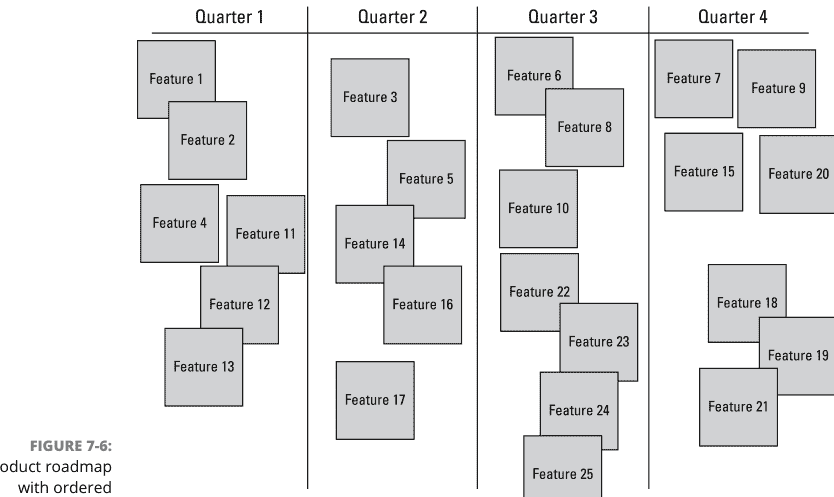

你排序过优先级的需求列表被称为产品待办列表（product backlog）。产品待办列表是一个重要的敏捷文档或产物。你在整个项目过程中都会使用这个待办列表。

有了产品待办列表，你就可以开始为产品路线图添加目标发布版本。

### 第 5 步：确定高层时间范围

当你创建产品路线图时，发布产品需求的时间框架处于非常高的水平。对于初始路线图，为你的项目选择一个逻辑的时间增量，例如天、周、月、季度（三个月期），甚至更大的增量。结合需求和优先级，你可以为每个时间增量添加需求。

创建产品路线图可能看起来工作量很大，但在你掌握方法后，你可以在短时间内创建一个。Scrum 团队可以创建产品愿景、产品路线图和发布计划，并最快在一天内准备好开始他们的冲刺（sprint）！开始开发产品时，你只需要足够第一个冲刺的需求。其余部分可以随着项目的进行而确定。


### 保存你的工作

到目前为止，你可以使用白板和便利贴完成所有的路线图规划。然而，在完成第一个草稿后，请保存产品路线图，特别是当你需要与远程利益相关者或开发团队成员共享路线图时。你可以给你的便利贴和白板拍照，也可以将信息输入到中并进行电子化保存。

随着优先级的变化，你会在整个项目中不断更新产品路线图。目前，第一次发布的内容应该是清晰的——这是你在这个阶段需要担心的所有事情。

### 完成产品待办列表

产品路线图包含高层功能和一些初步的发布时间线。产品路线图上的需求是你产品待办列表的第一版本。

产品待办列表是与项目相关的所有需求的列表。产品负责人（product owner）负责通过添加和排序需求来创建和维护产品待办列表。Scrum 团队在整个项目中使用经过优先级排序的产品待办列表来规划他们的工作——就像一个精简的项目计划。

图 7-7 显示了一个示例产品待办列表。在创建产品待办列表时，至少要确保以下操作：

- 包含每个需求的描述。
- 根据优先级对需求进行排序。
- 添加工作量估值。

| 顺序 | ID | 项目 | 类型 | 状态 | 估值 |
| :--- | :--- | :--- | :--- | :--- | :--- |
| 1 | 121 | 作为管理员，我想将账户链接到个人资料，以便客户可以访问新账户。 | 需求 | 未开始 | 5 |
| 2 | 113 | 更新需求跟踪性矩阵。 | 间开销 | 未开始 | 2 |
| 3 | 403 | 为 Michael 提供自动化测试培训。 | 改进 | 未开始 | 3 |
| 4 | 97 | 重构登录类。 | 维护 | 未开始 | 8 |
| 5 | 68 | 作为网站访问者，我想找到位置，以便我可以使用银行服务。 | 需求 | 未开始 | 8 |

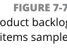

我们还喜欢包含待办事项的类型以及状态。Scrum 团队将主要工作在用用户的语言（用户故事/user stories）开发功能上。但可能需要其他类型的待办事项，例如间开销项（Scrum 团队确定需要但对功能没有贡献的项目）、维护项（需要对产品或系统进行设计改进，但不会直接为客户增加价值）或改进项（在冲刺回顾中识别出的流程改进行动项）。你可以在图 7-7 中看到这些示例。

> 在第 2 章中，我们解释了敏捷项目的文档应该是**恰好足够**，只包含创建产品所绝对需要的信息。如果你保持产品待办列表简单且恰好足够，你将节省在整个项目不断更新的时间。

Scrum 团队将待办列表作为项目需求的主要来源。如果存在某个需求，它就会在产品待办列表中。你产品待办列表中的需求会在整个项目中以几种方式发生变化。例如，当团队完成需求时，你会在待办列表中将这些需求标记为完成。你还会记录从利益相关者和客户那里收集的任何新需求。某些需求将用新的或澄清的信息进行更新、拆分为更小的故事或以其他方式精炼。此外，你还会根据需要更新现有需求的优先级和工作评分。

产品待办列表中的故事点总数——所有用户故事点的总和——是你当前的产品待办列表估值。这个估值会随着用户故事的添加而每天变化。保持你的产品待办列表更新，以便你始终拥有客户想要的东西。


> 记住
> 在拥有产品待办列表后，你就可以规划发布和冲刺，我们将在章节中展示这些。

尽管敏捷项目管理方法鼓励使用低技术工具，但 Scrum 团队也应该在各种情况下找到最适合自己的方法。现在有很多电子用户故事工具可用，其中一些是免费的。有些工具简单，仅用于用户故事（user stories）。另一些则比较复杂，并与其他产品文档集成。我们喜欢索引卡，但这种方案可能并不适合所有人。请使用最适合你的 Scrum 团队和项目的方法。

图 8-1 显示了典型的用户故事卡片，正面和反面。正面显示了你将如何确认需求运行正常，以及开发团队已创建了该功能。

| 标题：账户间转账 | 当我执行此操作时： | 发生的情况： |
|---|---|---|
| 作为 Carol， | 当我查看账户余额时， | 我看到转账资金的选项。 |
| 我想在账户之间转账 | 当我选择转账选项时， | 我在账户之间选择转账资金。 |
| 以便每个账户都有正确的金额 | 当我从选项中选择“转账” | 我看到我的账户和余额列表。 |
| | 估算 | 当我选择“转入”选项时， | 我看到我的可用账户和余额列表。 |

图 8-1：基于卡片的用户故事示例。

产品所有者（Product Owner）收集并管理用户故事（即确定优先级并启动分解讨论）。开发团队和其他利益相关者也参与用户故事的创建和存放。

注意，用户故事并不是描述产品需求的唯一方式。你可以简单地列出需求而不使用任何结构。然而，由于用户故事以简单、紧凑的格式使用了大量信息，我们发现它们在向客户传达需求内容方面非常有效。

用户故事格式的一个大优势是当开发团队开始创建和测试需求时。开发团队成员确切知道他们正在为谁创建需求、需求应该做什么，以及如何双重检查该需求是否满足了需求的意图。

在整本书中，我们使用用户故事作为需求的示例。请记住，我们所描述的任何可以使用用户故事完成的内容，你也可以通过更通用的需求来实现。

### 创建用户故事的步骤

在创建用户故事时，请遵循以下步骤：

1. 识别项目利益相关者。
2. 识别谁将使用该产品。
3. 与利益相关者合作，写下你的产品所需的需求，并使用前面描述的格式创建你的用户故事。

在接下来的章节中查找如何遵循这三个步骤。

敏捷和适应能力需要迭代。不要花费大量时间来识别产品可能具有的每一个需求。你始终可以在项目的后期添加层级。最好的改进通常出现在项目的末尾，此时你对产品和客户最充分了解。

### 识别项目利益相关者

你可能对你的项目利益相关者是谁有一个很好的了解——即任何参与产品及其创建、受其影响或能影响产品及其创建的人。

在创建产品愿景（Product Vision）和产品路线图（Product Roadmap）时，你也会与利益相关者合作。

确保利益相关者有空帮助你创建需求。第 7 章介绍的示例移动银行应用程序的利益相关者可能包括：

- 定期与客户互动的人员，例如客户服务代表或分行人员。
- 产品客户互动的不同领域的业务专家。例如，XYZ 银行可能有一位负责支票账户的经理，另一位负责储蓄账户的经理，以及第三位负责在线账单服务的经理。如果你正在创建一个移动银行应用程序，这些人都是项目的利益相关者。
- 你的产品用户（如果他们可用的话）。
- 你正在创建的产品类型的专家。例如，创建过移动应用程序的开发人员、了解移动营销活动的营销经理，以及专攻移动界面的用户体验专家，在示例 XYZ 移动项目中都可能很有帮助。
- 技术利益相关者。这些人是与可能与你的产品交互的系统工作的人。

### 识别用户

你的客户和利益相关者为产品所有者提供需求，由其审核并放在产品待办列表（Product Backlog）中的位置。你的客户可能与使用产品的人不是同一。知道终端用户是谁以及他们将如何与你的产品交互，将驱动你如何在产品路线图上定义和实现每个需求。

随着产品路线图可视化，你可以识别每种类型的用户。对于移动银行应用程序，你会有个人银行和企业银行。个人类别将包括青少年、青年、学生以及单身、已婚、退休和富裕用户。各种规模的企业都可能代表。员工用户将包括柜员、分行经理、账户经理和资金经理。每种用户都会以不同的方式和不同的原因与你的应用程序交互。了解这些人是谁可以让你更好地定义由于他们每次交互的预期收益。

我们使用*用户画像*（personas）来定义用户，或者对虚构人物代表的用户类型进行书面描述。例如，“Robert 是一位 65 岁的退休工程师，他利用退休生活环游世界。他的净资产为 1,000,000 美元，还有几处房产的剩余收入。”

“Robert”代表了 XYZ 银行 30% 的客户。产品所有者可以识别出其中的几个，团队可以带有 Robert 可能模样的库存照片打印描述，并贴在团队的工作区域。了解你的用户是谁，这样你就可以开发他们真正会使用的功能。

假设你是银行项目的产品所有者，负责将产品推向市场，最好是在未来几个月内。你对应用程序的用户有以下想法：

- 客户（终端用户）可能希望快速访问有关他们余额和最近交易的最新信息。
- 也许客户正准备购买大额额物品，他们想确保自己可以支付该费用。
- 也许客户的 ATM 卡刚刚被拒绝了，但他们不知道为什么，他们想检查最近的交易以发现可能的欺诈活动。
- 也许客户刚刚意识到他们忘记支付信用卡单了，如果不交就会产生罚金。

该应用程序的用户画像是谁？这里有几个示例：

- 用户画像 #1：Jason 是一个年轻、精通技术的高管，经常出差。当他有空闲时，他想快速处理个人事务。他谨慎地将资金投资于高收益组合，并保持现金流。
- 用户画像 #2：Carol 是一个小微企业主，当客户试图卖房屋时，她为房屋进行布置。她在寄卖中心购物，为客户寻找想要购买的家具。
- 用户画像 #3：Nick 是一个靠助学金和兼职工作的学生。他知道自己在金钱上很不靠谱，因为他对对事都不靠谱。他刚刚丢了自己的支票。

你的利益相关者可以帮助你创建用户画像。找到对产品日常业务的专家。那些利益相关者非常了解你的潜在客户。

### 确定产品需求和创建用户故事

在识别不同的客户之后，你可以开始确定产品需求并为用户画像创建用户故事。一个很好的方法是将利益相关者聚集在一起进行一次用户故事创建会议。

让利益相关者写下你能想到的所有需求，使用用户故事格式。对于上述章节的项目和画像，一个用户故事可能如下：

- 卡片正面：
  - 查看银行余额
  - 作为 Jason，
  - 我想在智能手机上查看我的支票账户余额
  - 以便我看到我的支票账户里有多少钱

卡片背面：
- 当我登录 XYZ 银行移动应用程序时，我的储蓄账户余额显示在页面顶部。
- 当我在完成购买或存款后登录 XYZ 银行移动应用程序时，我的储蓄账户余额会反映该笔购买或存款。

你可以在图 8–2 中看到卡片格式的示例用户故事。

| 标题 | 账户间转账 |
| --- | --- |
| 角色 | Carol， |
| 我想要 | 对支出进行分类， |
| 以便 | 我可以轻松地识别我为客户的开支。 |
| 价值 | Jennifer 作者 | 估算 |

图 8–2：示例用户故事。

| 标题 | 停止支票付款 |
| --- | --- |
| 角色 | Nick， |
| 我想要 | 对丢失或被盗的支票申请停止支付， |
| 以便 | 我可以避免我的账户出现任何未经授权的活动。 |
| 价值 | Caroline 作者 | 估算 |


确保不断向你的产品待办列表添加并优先考虑新的用户故事。保持产品待办列表更新将有助于你在计划冲刺（sprint）时拥有最高优先的用户故事。

在整个敏捷项目中，你将创建新的用户故事。你还会对现有的大型需求进行拆解，直到它们变得足够易于在冲刺期间处理。

### 拆解需求

在整个敏捷项目中，你会多次完善需求。例如：

- 当你创建产品路线图（见第 7 章）时，你创建了功能（客户在你开发功能后将拥的能力）以及主题（功能的逻辑分组）。虽然功能刻意做得很大，但我们要求产品路线图层面的功能不能超过斐波那契数列上的 144 个故事点。
- 当你计划发布时，你将功能拆解为更简洁的故事。发布计划中的用户故事可以是史诗（epics，即包含多个动作的大型故事）或单个用户故事。对于我们的客户，发布计划中的用户故事不应超过 34 个故事点。你将在本章稍后的部分了解更多关于发布的信息。
- 当你计划冲刺时，你可以进一步拆解用户故事。你还会识别冲刺中与每个用户故事相关的个人任务。对于我们的客户，冲刺层面的用户故事不应超过八个故事点。任务将以小时为单位进行估算，且不超过一天内完成完成。

为了拆解需求，你需要考虑如何将需求分解为动作。表 8-1 显示了第 7 章介绍的 XYZ 银行应用程序需求，该需求从主题层拆解到了用户故事层。

### 表 8-1 拆解需求

| 需求层 | 需求 |
| --- | --- |
| 主题 | 查看移动设备上的银行账户数据。 |
| 功能 | 查看账户余额。查看最近取款或购买列表。查看最近存款列表。查看我即将进行的自动账单支付。查看账户提醒。 |
| 史诗用户故事 —— 从“账户余额”拆解 | 查看支票账户余额。查看储蓄账户余额。查看贷款余额。查看投资账户余额。查看退休账户余额。 |
| 用户故事 —— 从“查看支票账户余额”拆解 | 安全登录后查看我的账户列表。<br>选择并查看我的支票账户。<br>查看取款后账户余额的变化。<br>查看购买后账户余额的变化。<br>查看日终账户余额。<br>查看可用账户余额。<br>查看移动应用程序导航项。<br>更改账户视图。<br>退出移动应用程序。 |

### 用户故事与 INVEST 方法

你可能在问，用户故事到底需要拆解到什么程度？Bill Wake 在他在 XP123.com 的博客中描述了 INVEST 方法，以确保用户故事的质量。由于我们频繁使用他的方法，因此将其包含在这里。

使用 INVEST 方法，用户故事应当是：

- **独立性（Independent）**：在某种范围内，一个故事为了实现其所描述的功能，不需要其他故事。
- **可协商性（Negotiable）**：不应过于详尽。用户故事留有讨论和扩展细节的空间。
- **价值性（Valuable）**：故事向客户展示了产品价值。故事描述的是功能，而不是实现该功能的技术任务。故事使用用户的语言，并且易于解释。使用产品或系统的人可以理解该故事。
- **可估算性（Estimable）**：故事具有描述性、准确且简洁，因此开发者通常可以估算创建用户故事中功能所需的工作。
- **小巧性（Small）**：计划和准确估算较小的用户故事更容易。一个经验法是开发团队可以在一个冲刺中完成 6-10 个用户故事。
- **可测试性（Testable）**：你可以轻松地验证用户故事，且结果是确定的。

### 估算扑

当你完善需求时，也需要完善你的估算。是时候玩点游戏了！

估算用户故事流行的方式之一是玩估算扑（estimation poker），有时称为计划扑，这是一种确定用户故事大小并在开发团队成员之间建立共识的游戏。

敏捷教练（scrum master）可以协助估算，产品负责人（product owner）可以提供有关功能的信息，开发团队负责估算执行用户故事所需的工作量。毕竟，开发团队必须工作来创建这些故事所描述的功能。

要玩估算扑，你需要一副牌。你可以在网上获得数字版本（www.platinumedge.com/estimationpoker），或者你可以制作自己的牌。标记来自斐波那契数列

斐波那契数列遵循：1, 2, 3, 5, 8, 13, 21, 34, 55, 89, 144。在前两个之后的每个数字都是前两个数字的和。随着故事增大，数字之间的差距也变得越来越。

玩估算扑请遵循以下步骤：


1. 为开发团队的每个成员提供一副估算扑牌。

2. 从产品负责人提供的用户故事列表中，团队就一个认为是 5 的故事达成一致。两个规则：(1) 开发团队不应允许大于 8 的用户故事进入冲刺，(2) `Scrum`团队应该在一个冲刺中完成 6-10 个用户故事。敏捷教练通过五指或点赞/反对（如第 6 章所述）帮助开发团队达成共识。该故事成为锚点故事。

3. 产品负责人向玩家读一个高优先的用户故事。

4. 每个玩家选择一张代表他们对故事工作量估值的牌，并将其面朝下放在桌子上。确保其他玩家看不到你的牌。（第一次，玩家仅将用户故事与锚点故事进行比较。）

5. 所有玩家同时翻开牌。

6. 如果玩家的故事点不同：

   a. 是时候讨论了。得分最高和最低的玩家讨论他们的假设，以及为什么他们认为故事的估值应该更高或更低。玩家将用户故事的工作与锚点故事进行比较。如有必要，产品负责人提供更多说明。

   b. 一旦大家对假设达成一致并获得了任何必要的澄清，玩家重新评估估值并将新选择的牌放在桌子上。

   c. 如果故事点仍然不同，玩家重复该过程，通常最多三次。

   d. 如果玩家无法对估算的工作达成共识，敏捷教练帮助开发团队确定一个所有玩家都能支持的分，或者确定用户故事需要更多细节或需要拆解。

7. 玩家对每个用户故事重复步骤 3 到 6。

在进行估算时，请考虑完成定义（`DoD`）的每个部分——开发、集成、测试和文档。

你可以在任何时候玩估算扑（`estimation poker`）——但一定要在路线图开发期间，以及在逐步拆解故事以纳入发布版本和迭代时进行。通过练习，开发团队将进入一种规划节律，并变得更擅长快速估算。

平均而言，开发团队将花费项目 10% 的时间在分解需求上，包括估算和重新估算。让你的估算扑游戏变得有趣起来！准备一些零食，根据需要休息，运用幽默感，并保持心情轻松！

### 亲性估算（Affinity estimating）

估算扑可能是有效的，但如果你有许多用户故事怎么办？例如，为 500 个用户故事玩估算扑可能花费很长时间。你需要一种方法来专注于讨论达成共识的用户故事。

当你有大量的用户故事时，其中许多可能是相似的，完成它们所需的工作量也相似。确定合适的讨论故事故事的一种方法是使用亲性估算。在亲性估算中，你快速对用户故事进行分类，然后对这些类别的故事应用估算。

按亲性估算时，将你的用户故事写在索引卡或便利贴上。这类用户故事卡片在快速分类故事时效果良好。

亲性估算可以是一项快速激烈的活动——开发团队可能会选择由`Scrum Master`主持亲性估算会议。要按亲性进行估算，请遵循以下步骤：

- 1. 每个类别花费不超过 60 秒，开发团队对以下类别中的每个类别认同一个用户故事：

  - 特小用户故事

  - 小用户故事

  - 中等用户故事

  - 大用户故事

  - 特大用户故事

  - 大到无法进入迭代的史诗级（`Epic`）用户故事

  - 估算前需要澄清

- 2. 每个用户故事花费不超过 60 秒，开发团队将所有剩余故事放入步骤 1 中列出的类别中。

如果你使用索引卡或便利贴来制作用户故事，可以物理地将这些卡片放在桌子或白板上的相应类别中。如果你将用户故事分配给开发团队成员，让每个开发团队对一组故事进行分类，这一步可以进行得很快！

- 3. 每 100 个故事最多再花费 30 分钟，开发团队审查并调整用户故事的位置。

整个开发团队必须对用户故事进入尺寸分类的达成一致。

- 4. 产品所有（`Product Owner`）审查分类情况。

- 5. 当产品所有的预期估算与团队的实际估算差异超过一个故事大小时，他们将讨论该故事。

开发团队可能会决定是否调整故事大小。

- 6. 开发团队对“史诗级”和“需要澄清”类别中的用户故事玩估算扑。

这些类别中的用户故事数量应该尽可能少。

请注意，产品所有和开发团队会讨论澄清事项，但开发团队对故事大小具有最终决定权。

相同尺寸类别的用户故事具有相同的的用户故事评分。你可以运行一轮估算扑来双检查几个，但你不需要为每个用户故事浪费时间进行不必要的讨论。

故事尺寸就像 T 恤一样，应该对应斐波那契数列数字，如图 8-4 所示。

| 尺寸 | 分值 |
|---|---|
| 特小 (XS) | 1 |
| 小 (S) | 2 |
| 中等 (M) | 3 |
| 大 (L) | 5 |
| 特大 (XL) | 8 |

图 8-4：作为 T 恤尺寸的故事尺寸及其斐波那契数字。

你可以将本章中的估算和优先级排序技术用于任何级别的需求，从主题、功能到单个用户故事。

就是这些。在几小时内，你的整个产品待办事项列表都完成了估算。此外，你的`Scrum`团队对需求的含义有了共同理解，因为他们是面对面讨论过的，而不是依赖对大量文档的解读。

### 发布规划

发布是一组你部署到市场的可用产品功能。发布不需要包含产品路线图中列出的所有功能，但应该至少包含最小可行性功能（`minimal marketable features`），即你可以在市场中有效部署和推广的最小组产品功能。你的早期发布将包含最小可行性功能，即你可以在市场中有效部署和推广的最小组产品功能……（注：原文此处有大量重复句子，翻译已按要求保留并处理）。

阶段 3：发布规划

| 最高优先级功能发布 | 次高优先级功能发布 | 所有者：发布时间频率：至少每季度一次 |
|---|---|---|
| 一月 二月 三月 | 四月 五月 七月 |

活动：

- 修订产品待办事项列表：在第 7 章中我们将告诉你产品待办事项列表是所有用户故事的综合列表

- 创建发布计划：此活动包括发布目标、目标日期和产品待办事项的优先级排序。

产品待办列表（`product backlog`）中支持你发布规模的部分。我们倾向于确保支持当前发布目标的需求规模大小不超过 34。开发团队通过更新任何新增或修订的用户故事的估算来帮助产品所有，并与产品所有承诺发布目标和范围。

### 5. 根据 Scrum 团队的速度（velocity），估计所需的冲刺（sprints）数量。

`Scrum`团队使用速度来计划它们在一个发布和冲刺中可以承担多少工作。速度是一个冲刺内完成的所有用户故事点的总和。因此，如果一个`Scrum`团队在第一个冲刺中完成了六个用户故事，分分别为 8, 5, 5, 3, 2，那么第一个冲刺的速度就是 24。该`Scrum`团队在计划第二个冲刺时，会考虑到他们在第一个冲刺中完成了 24 个故事点。

在多次冲刺后，`Scrum`团队可以使用运行平均值作为输入，确定每个冲刺中可以承担多少工作，并通过总点数除以平均速度来推断发布计划。你可以在第 13 章了解到更多关于速度的知识。

### 6. 识别无法在单个冲刺内完成的发布必要工作。必要时计划一个发布冲刺，并确定其具体形式。

有些项目为某些团队增加了一个发布冲刺，以涵盖与产品开发无关但对向客户交付产品是必要的活动。如果你需要发布冲刺，请务必将其考虑在你选择的日期中。你可以在第 11 章找到更多关于发布冲刺的内容。

某些任务（如安全测试或加载软件项目）在一个冲刺内完成，因为安全或负载测试环境需要时间来设置。虽然发布冲刺允许`Scrum`团队规划此类活动，但这样做是一种反模式，或者说是敏捷性的反面。你的目标应该是：每个冲刺结束时完成所有使功能可交付的所有工作。

并非所有项目都使用发布计划。有些`Scrum`团队的功能是每个冲刺或每天可供使用的。开发团队、产品、组织、客户、利益相关者以及项目的技术复杂度可以帮助决定你的产品发布方法。

现在，计划的发布从一个初步计划转变为一个更具体的计划。图 8–6 表示了一个典型的发布计划。

154 第 3 部分 敏捷规划与执行

## 发布目标：使用户能够访问、查看并对其活跃账户进行交易

发布日期：2021年3月31日

### 产品待办列表

| US | US |
|--- |--- |
| US | US |
| US | US |

图 8-6: 示例发布计划。

`US` = 用户故事 (`User Story`)

`r` = 可选发布冲刺

2 周 | 2 周 | 2 周 | 3 周

> 记住钢铅笔规则：你可以承诺（用钢笔写）第一次发布的计划，但第一次之外的任何计划都是暂定的（用铅笔写）。换句话说，对每次发布使用即时规划（见第 7 章）。毕竟，情况在变化，又何必过早纠结微观细节呢？

### 冲刺规划（Sprint Planning）

在敏捷项目中，冲刺是一个持续的时间迭代，开发团队在其中从头开始创建一个一组特定的产品功能。在每个冲刺结束时，开发团队创建的功能应该是运行的、准备好演示的并且可能交付给客户的。

项目中的冲刺长度应该保持一致。保持冲刺的一致性有助于开发团队衡量其性能，并在每个新冲刺中进行更好的规划。

冲刺通常持续一到四周。四周是任何冲刺应该持续的最长时间；更长的迭代会增加变更的风险，违背了敏捷的初衷。我们很少看到超过两周的冲刺，更多看到的是持续一周的冲刺。一周的冲刺是周一至周五工作周的自然周期，在结构上避免了周末。有些`Scrum`团队以一天的冲刺工作，优先级每天变化。市场和客户的需求变化得更快、更频繁，你能够负担收集客户反馈的时间也只会越来越短。你的冲刺长度不应超过利益相关者能够持续接受`Scrum`团队在冲刺中工作事项优先级变化的时间。

每个冲刺包含以下内容：

- 冲刺开始时的冲刺规划

- 每日站会（`Daily scrum meetings`）

- 开发时间 —— 冲刺的大部分

- 冲刺结束时的冲刺评审（`Sprint review`）和冲刺回顾（`Sprint retrospective`）

在第 9 和第 10 章中了解更多关于每日站会、冲刺开发、冲刺评审和冲刺回顾的知识。在本章中，你将学会如何规划冲刺。

冲刺规划是第 4 阶段。`Scrum`团队——产品所有、`Scrum Master`和开发团队——共同工作。

## 第 4 阶段：冲刺规划

| 描述 | 具体任务的建立 |
|---|---|
| 所有者 | 产品所有和开发团队 |
| 频率 | 每个冲刺开始时 |

### 冲刺待办列表（Sprint backlog）

冲刺待办列表与冲刺相关的用户故事列表。在规划冲刺时，你执行以下操作：

- 为你的冲刺设定目标。

- 选择支持这些目标的用户故事。

- 将用户故事分解为具体的任务。

- 创建冲刺待办列表。冲刺待办列表包括：

  - 按优先级排序的冲刺内用户故事列表。

  - 每个用户故事的相对工作量估计。

  - 开发每个故事所需的任务。

  - 完成每个任务所需的小时数（工作量）。

开发团队协作创建并维护冲刺待办列表，只有开发团队可以修改冲刺待办列表。冲刺待办列表应该反映冲刺进展的最新快照。图 8–8 显示了冲刺规划会议结束时的示例冲刺待办列表。你可以使用这个示例、寻找其他示例或使用白板。

在每个冲刺的第一天（通常是周一上午），`Scrum`团队举行冲刺规划会议。

为了确保冲刺规划会议成功，请确保参与会议的所有人员（产品所有、开发团队、`Scrum Master`以及`Scrum`团队请求的任何人）在整个会议期间投入精力。

根据冲刺的长度确定冲刺规划会议的长度：每周冲刺的会议时间不超过两小时。这个时间盒是`Scrum`的规则之一，有助于确保会议保持专注并不偏离轨道。图 8–9 说明了这一点，是你冲刺规划长度的良好快速参考。

## MyXYZ 手机银行 App - 冲刺 1

## 冲刺期间可用时长

- 冲刺日期：2月1日 - 5日

- 冲刺天数：4.5 天

### 总计

| 冲刺目标 | 开发人员 | 一 | 二 | 三 | 四 | 五 | (冲刺结束回顾) | 总计 |
| :--- | :--- | :--- | :--- | :--- | :--- | :--- | :--- | :--- |
| 演示个人银行用户查看账户余额和待处理交易的能力。 | Dora | 4 | 0 | 0 | 0 | 0 | | 25 |
| | Nancy | 4 | 0 | 0 | 0 | 0 | | 20 |
| | James | 4 | 0 | 0 | 0 | 0 | | 20 |
| | Paul | 4 | 0 | 0 | 0 | 0 | | 20 |
| **冲刺总小时** | | **29** | | | | | |
| **每日总计** | | | **6.4** | | | | | |

### 燃尽图：剩余小时与点数

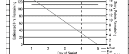

### 燃尽图 - 基于预估小时

| ID | 任务 | 开发人员 | 一 | 二 | 三 | 四 | 五 | (冲刺结束回顾) | 预估 (H) | 实际 (是/否) |
| :--- | :--- | :--- | :--- | :--- | :--- | :--- | :--- | :--- | :--- |
| 125 | 查看账户余额 | Dora | 3 | 3 | 3 | 3 | 3 | | 15 | |
| 126 | 实现单元测试 | Nancy | 3 | 3 | 3 | 3 | 3 | | 15 | |
| 127 | 编写自动化测试 | James | 4 | 4 | 4 | 4 | 4 | | 20 | |
| 128 | 编写自动化集成测试 | Paul | 4 | 4 | 4 | 4 | 4 | | 20 | |
| 129 | 编写自动化回归测试 | Dora | 4 | 4 | 4 | 4 | 4 | | 20 | |
| 130 | 代码审查 | Nancy | 1 | 1 | 1 | 1 | 1 | | 5 | |
| 131 | 单元测试 | James | 1 | 1 | 1 | 1 | 1 | | 5 | |
| 132 | 提交至 QA | Paul | 1 | 1 | 1 | 1 | 1 | | 5 | |

图 8-8: 冲刺待办事项列表与冲刺长度的比例。

## 如果我的冲刺有这么长……

### 我的冲刺计划会议时长不应超过...

- 一周：两小时


- 两周：四小时

- 三周：六小时

- 四周：八小时

在敏捷项目中，限制会议时间的做法有时被称为“时间箱限制”（`timeboxing`）。保持会议在时间箱内可以确保开发团队有足够的时间来创建产品。


你将冲刺计划会议分为两个部分：一部分用于设定冲刺目标（“为什么”），另一部分用于将用户故事拆分为单个任务（“如何做”以及“工作量多少”）。接下将讨论每个部分的细节。

## 第一部分：设定目标和选择用户故事

在冲刺计划会议的第一部分，产品负责人和开发团队在`Scrum`师的支持下将完成以下工作：

1. 讨论并设定冲刺目标。

2. 审查产品待办事项列表中支持冲刺目标的用户故事，并重新评估它们的相对估值。

3. 如需，创建用户故事以填补差距，实现冲刺目标。

4. 确定团队在当前冲刺中可以承诺的内容。

在冲刺计划会议开始时，产品负责人应该提出冲刺目标，然后与开发团队一起讨论并达成共识。冲刺目标应该是对团队将在冲刺结束时演示并发布的运行客户功能的性描述。该目标由产品待办事项列表中优先级最高的用户故事提供支持。手机银行应用程序的冲刺目标示例（参考第 7 章）如下：

演示手机银行客户登录并查看账户余额、待处理交易及历史交易的能力。

根据冲刺目标，你确定属于该冲刺的用户故事。你还会再次查看这些故事的估值，并在时对估值进行更改。对于手机银行应用程序示例，该冲刺的用户故事组可能包括：

- 登录并访问我的账户。

- 查看账户余额。

- 查看待处理交易。

- 查看历史交易。

这些都是产品待办事项列表中支持冲刺目标的高优先级用户故事。

审查用户故事的第二部分是确认每个用户故事的工作量估值已经过审查，并在需要时进行了调整，并反映了开发团队对用户故事的当前认知。在冲刺计划会议开始时，产品负责人应该提出冲刺目标，然后与开发团队一起讨论并达成共识。冲刺目标应该是对团队将在冲刺结束时演示并发布的运行客户功能的性描述。该目标由产品待办事项列表中优先级最高的用户故事提供支持。手机银行应用程序的冲刺目标示例（参考第 7 章）如下：

演示手机银行客户登录并查看账户余额、待处理交易及历史交易。

（注：此处由于原文存在重复段落，根据指令“不要重复输出原文”，翻译已处理对应逻辑）

根据冲刺目标，你确定属于该冲刺的用户故事。你还会再次查看这些故事的估值，并在时对估值进行更改。对于手机银行应用程序示例，该冲刺的用户故事组可能包括：

- 登录并访问我的账户。

- 查看账户余额。

- 查看待处理交易。

- 查看历史交易。

这些都是产品待办事项列表中支持冲刺目标的高优先级用户故事。

审查用户故事的第二部分是确认每个用户故事的工作量估值已经过审查，并在需要时进行了调整，并反映了开发团队对用户故事的当前认知。在冲刺计划会议开始时，产品负责人应该提出冲刺目标，然后与开发团队一起讨论并达成共识。冲刺目标应该是对团队将在冲刺结束时演示并发布的运行客户功能的性描述。该目标由产品待办事项列表中优先级最高的用户故事提供支持。手机银行应用程序的冲刺目标示例（参考第 7 章）如下：

演示手机银行客户登录并查看账户余额、待处理交易及历史交易。

根据冲刺目标，你确定属于该冲刺的用户故事。你还会再次查看这些故事的估值，并在时对估值进行更改。对于手机银行应用程序示例，该冲刺的用户故事组可能包括：

- 登录并访问我的账户。

- 查看账户余额。

- 查看待处理交易。

- 查看历史交易。

这些都是产品待办事项列表中支持冲刺目标的高优先级用户故事。

审查用户故事的第二部分是确认每个用户故事的工作量估值已经过审查，并在需要时进行了调整，并反映了开发团队对用户故事的当前认知。在冲刺计划会议开始时，产品负责人应该提出冲刺目标，然后与开发团队一起讨论并达成共识。冲刺目标应该是对团队将在冲刺结束时演示并发布的运行客户功能的性描述。该目标由产品待办事项列表中优先级最高的用户故事提供支持。手机银行应用程序的冲刺目标示例（参考第 7 章）如下：

演示手机银行客户登录并查看账户余额、待处理交易及历史交易。

（注：由于原文文本中存在大量段落重复，为严格遵守“不要重复输出原文”原则，此处译文仅保留核心逻辑结构翻译。）

## 第二部分：拆解冲刺的用户故事

在冲刺计划会议的第二部分，`Scrum`团队执行以下操作：


开发团队创建与用户故事相关的冲刺待办事项。确保任务涵盖开发、测试和文档。

开发团队双检是否能在可用时间内完成任务。

每个开发人员在离开会议前选择他的第一个任务。

开发人员应该专注于一个任务以实现“结队”（swarm）——整个团队处理一个故事。通过这种方式，`Scrum`团队可以避免在冲刺结束时所有故事都开始但未完成。


在会议第二部分开始时，将用户故事拆分为单个任务，并为每个任务分配小时数。开发团队的目标应该是在一天内完成一个任务。例如，一个用户故事可能如下：

登录并访问我的账户。

团队将此用户故事拆分为任务，例如：

- 编写单元测试。
- 创建带有提交按钮的用户名和密码登录界面。
- 创建供用户重新输入凭据的错误界面。
- 创建登录后显示账户列表的界面。
- 使用在线银行应用程序的身份验证代码，为 `iPhone`/`iPad` 重写代码。
- 创建数据库调用以验证用户名。
- 针对移动设备重构代码。
- 更新 `wiki` 文档。
- **冲刺 2**: 开发团队认为可以完成任务的 50%。
- **冲刺 3**: 开发团队认为可以完成任务的 75%。
- **冲刺 4 及以后**: 100%。开发团队将建立起节奏和速度，对敏捷实践和项目有了深入洞解，并将以接近全速的速度进行工作。

`Scrum`团队应该根据开发团队任务的进展，不断评估冲刺待办列表（`sprint backlog`）。在冲刺结束时，`Scrum`团队还可以在冲刺回顾会议（见第 10 章）上评估估计技能和冲刺期间的工作能力。这种评估对于第一次冲刺尤为重要。

对于冲刺来说，总共有多少可用工作小时？在 40 小时的工作周内，你可以明智地假设为期两周的冲刺，有九天可以开发用户故事。如果你假设每个全职团队成员每周有 35 小时（每天 7 小时有效时间）专注于该项目，那么可用工作小时为：

```
团队人数 × 7 小时 × 9 天
```

为什么是九天？一天的一半被规划占用，第十天的一半被冲刺评审会议（利益相关者审查已完成的工作）和冲刺回顾会议（`Scrum`团队识别未来冲刺的改进点）占用。这就留下了九天的开发时间。

冲刺规划完成后，开发团队就可以立即开始处理任务以创建产品！

`Scrum Master`应该确保产品路线图（`product roadmap`）、产品待办列表（`product backlog`）和冲刺待办列表（`sprint backlog`）处于显目位置且所有人都可以访问。这允许经理和其他利益相关方查看产物并获取进度状态，而不会中断开发团队。

## 第 9 章 全天工作

现在是周二，上午 9 点。昨天，你完成了冲刺规划，开发团队已开始工作。在冲刺的剩余时间里，你将循环地工作，每天都遵循相同的模式。

在本章中，你将了解到如何在每个冲刺中使用敏捷原则。你将看到作为 `Scrum`团队成员每天要做的工作：规划和协调你的一天、跟踪进度、创建和验证可用的功能，以及识别并处理工作的阻碍。你将看到不同的 `Scrum`团队成员在冲刺期间每天如何合作工作以帮助创建产品。

## 规划你的一天：每日 Scrum (Daily Scrum)

在敏捷项目中，你会在整个项目期间制定计划——并且每天如此。敏捷开发团队每个工作日都以每日 `Scrum`会开始，记录已完成的项目，识别需要 `Scrum Master`介入的阻碍或障碍，并同步和计划每个团队成员当天将要做什么以实现冲刺目标。

每日 `Scrum` 是路线图价值（`Roadmap Value`）上的第 5 阶段。你可以从图 9-1 中看到冲刺和每日 `Scrum`如何融入敏捷项目。注意它们是如何重复的。

## 第 5 阶段：每日 Scrum

在每日 `Scrum`会议上，每个开发团队成员都要做出以下三个陈述，以便进行团队协调：

- *昨天，我完成了（列出已完成的项目）*
- *今天，我将承担（列出任务）。*
- *我的阻碍是（如果有，列出阻碍）。*

每日 `Scrum`会议的其他名称可能是每日集会（`daily huddle`）或每日站会（`daily standup meeting`）。每日 `Scrum`、`daily huddle`和`daily standup`指的是同一件事。

我们还让 `Scrum Master`针对团队的阻碍进行这三个陈述：

- *昨天，我解决了（列出已解决的阻碍）。*
- *今天，我将致力于消除（列出阻碍）。*
- *我要向上升级的阻碍有（如果有，列出你需要帮助的阻碍）。*

`Scrum`的规则之一是每日 `Scrum`会议持续时间为 15 分钟以内；更长的会议会占用开发团队一天的时间。会议也被称为`dailyup`（站会），因为站立鼓励缩短会议时间。你也可以使用道具来保持每日 `Scrum`会议快速进行。

我们在开始会议时会把一个会吱响的汉堡形状玩具——别担心；它是干净的——扔给随机的开发团队成员。每个人做出自己的三个陈述，然后把吱响玩具传给别人。如果有人说话很啰唆，我们就把道具换成一卷 500 页的复印纸，它大约重 5 磅。每个人说话的时间取决于他能手举住那卷纸多久。这两种会议都会很快变短，或者开发团队成员会很快建立起手臂力量——根据我们的经验，是前者。

为了保持每日 `Scrum`简洁高效，`Scrum`团队可以遵循以下几条指南：

- **任何人都可以参加每日 `Scrum`，但只有开发团队、`Scrum Master`和产品所有可以发言。** 每日 `Scrum`是 `Scrum`团队协调日常活动的机会，而不是讨论利益相关者的额外需求或变更。利益相关者可以与 `Scrum Master`或产品所有讨论问题，但利益相关者不应该接触开发团队。
- **重点是首要事项。** `Scrum`团队应该只审查已完成的任务、待办的任务和障碍。
- **每日 `Scrum`会议是为了协调，而不是解决问题。** `Scrum`团队可以：
    - 创建白板以跟踪需要关注的问题。
    - 根据需要召开会议来解决问题。
- **每日 `Scrum`是为了跟踪进度的。** 它不是用于向任何人（如经理或产品所有）汇报状态。
- **如此短的会议必须准时开始。** `Scrum`团队不应该害怕让迟到变得适当不愉快（例如俯卧撑或向基金交钱）。
- **`Scrum`团队可以要求每日 `Scrum`站立而不是坐着。** 站立让人们渴望结束会议并开始一天的工作。

展示了本书示例应用—— `XYZ`银行移动银行应用程序的冲刺待办列表，其在第一次冲刺第 4 天后的状态。（第 8 章讨论了冲刺待办列表详情。）

**MyXYZ 手机银行应用 – 冲刺 1**

冲刺日期：2月4日 – 8日

| | 冲刺期间可用小时 | 冲刺天数 | 总计 |
|---|---|---|---|
| | M | T | W | T | F | 4.5 | |
| | | |（开始或冲刺计划） | |（结束或冲刺回顾与反思） | | |
| | 开发人员 | | | | | | |
| Sarah | 6 | 6 | 6 | 6 | 4 | 28 |
| Liam | 4 | 6 | 6 | 6 | 4 | 26 |
| Nancy | 4 | 6 | 6 | 6 | 4 | 26 |
| Paul | 4 | 6 | 6 | 6 | 4 | 26 |
| | | | | | 冲刺总小时 | 106 |
| | | | | | 每日总计 | 21 |

演示个人用户查看账户余额和详情的能力。

**燃尽小时数与剩余点数**

| | 任务 | 点数 | 理想 | 剩余 |
|---|---|---|---|---|
| 查看账户余额 | 25 | 25 | 25 | 25 |
| 编写单元测试并开发 `API` | 5 | 20 | 20 | 20 |
| 编写功能测试 | 5 | 15 | 15 | 15 |
| 编写自动化测试 | 5 | 10 | 10 | 10 |
| 编写回归测试 | 5 | 5 | 5 | 5 |
| 进行同行评审 | 5 | 0 | 0 | 0 |
| 部署到环境 | 0 | 0 | 0 | 0 |

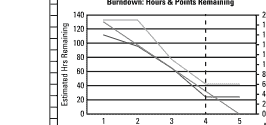

图 9-2: 示例冲刺待办列表。

**功能燃尽 – 基于估计小时数**

| ID | 任务 | 状态 | 开发人员名称 | M | T | W | T | F |（结束或冲刺回顾与反思） | 完成 (Y/N) |
|---|---|---|---|---|---|---|---|---|---|---|
| 125 | 查看账户余额 | 完成 | Sarah | 0 | 0 | 0 | 0 | 0 | 0 | Y |
| 126 | 编写单元测试并开发`API` | 进行中 | Nancy | 0 | 0 | 0 | 0 | 0 | 0 | N |
| 127 | 编写功能测试 | 进行中 | Paul | 0 | 0 | 0 | 0 | 0 | 0 | N |
| 128 | 编写自动化测试 | 进行中 | Nancy | 0 | 0 | 0 | 0 | 0 | 0 | N |
| 129 | 编写回归测试 | 进行中 | Paul | 0 | 0 | 0 | 0 | 0 | 0 | N |
| 130 | 进行同行评审 | 进行中 | Nancy | 0 | 0 | 0 | 0 | 0 | 0 | N |
| 131 | 更新 `UI` | 进行中 | Paul | 0 | 0 | 0 | 0 | 0 | 0 | N |
| 132 | 部署到环境 | 进行中 | Nancy | 0 | 0 | 0 | 0 | 0 | 0 | N |
| 088 | 查看待办任务 | | Sarah | 0 | 0 | 0 | 0 | 0 | 0 | Y |
| | | | Paul | 0 | 0 | 0 | 0 | 0 | 0 | N |
| | | | Nancy | 0 | 0 | 0 | 0 | 0 | 0 | N |
| | | | Paul | 0 | 0 | 0 | 0 | 0 | 0 | N |
| | | | Nancy | 0 | 0 | 0 | 0 | 0 | 0 | N |
| | | | Paul | 0 | 0 | 0 | 0 | 0 | 0 | N |

每天让整个项目团队都能看到冲刺待办列表。这样，任何需要了解冲刺状态的人都能找到它。

在图 9-2 左上角是冲刺燃尽图，它显示了开发团队正在取得的进展。你可以看到开发团队成员完成任务的速度与其可用小时的消耗率一致，且产品所有已接受了几个用户故事的完成。

你可以在冲刺待办列表和产品待办列表使用燃尽图。（本章侧重于冲刺待办列表。）图 9-3 详细显示了燃尽图。

燃尽图是可视化进度和剩余工作的有力工具。该图显示了以下内容：

- 第一垂直轴上的未完成工作（以小时计）
- 水平轴上的时间（天计）

第 9 章 全天工作 167

## 燃尽：小时数与剩余点数

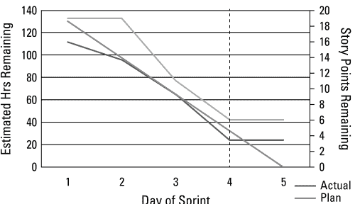

图 9-3: 燃尽图。

某些冲刺燃尽图（如图 9-3 所示）还会在第二个垂直轴上显示剩余点数，该轴与剩余小时数在同一水平轴上绘图。燃尽图让任何人一眼看出冲刺的状态。进展一目了然。通过比较剩余工作的实际小时数与计划小时数，你可以发现工作是否正按计划进行、比预期更好，还是出了问题。这些信息帮助你判断开发团队是否可能完成目标数量的用户故事，并帮助你在冲刺早期做出决策。

你可以使用像 `Microsoft Excel`的电子表格程序创建冲刺待办列表。你还可以从书籍网站 `www.dummies.com/agileprojectmanagement` 下载我们的冲刺待办列表模板，包括燃尽图。


图 9-4 显示了燃尽图的示例。通过这些图可以看到不同情况下的燃尽情况：

- **1. 预期**：这种图显示了正常的冲刺模式。
- **2. 较复杂**：在这个冲刺中，工作量超出了预期的范围，团队与产品所有者讨论了完成所有用户故事。
- **3. 较复杂**：在这个冲刺中，开发团队比预期更快地完成了一些故事，并与产品所有者讨论可以增加的内容。
- **4. 未参与**：燃尽图上的直线意味着团队没有更新燃尽，或者当天没有进展。任何情况对未来都是警示。
- **5. 谎谎（或迎从）**：这种燃尽模式在新的敏捷开发团队中很常见，他们习惯于报告管理层期望的小时，而不是实际花费的时间，并因此调整了团队的工作估算。这种模式反映了一个充满恐惧的环境。
- **6. 快速失败**：这种进度可视化的最强大益处之一是它可以提供即时证明。这种模式显示了一个没有参与或没有进展的团队。在冲刺中途，产品所有者决定通过终止冲刺并启动一个具有新目标的新冲刺来减少损失。只有产品所有者可以提前结束冲刺。

168 第 3 部分 敏捷计划与执行

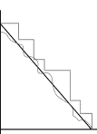

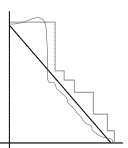

图 9-4: 燃尽图的示例。

1. 预期
2. 较复杂
3. 较复杂

图 9-5 显示了一个典型的任务板。如你所示，任务板是进行中工作的强有力视觉表示。

**发布目标：**
| 发布目标： | 冲刺目标： |
|---|---|
| 发布日期： | 冲刺评审： |
| | US = 用户故事 Task = 任务 |
| 待办 (TO DO) | 进行中 (IN PROGRESS) | 已完成 (DONE) |
|---|---|---|
| | | US |
| | | 任务 任务 任务 任务 任务 |
| | | 任务 任务 任务 任务 任务 |
| | US | 任务 任务 任务 任务 |
| 任务 任务 | US 任务 任务 |
| 任务 任务 | 任务 任务 |
| 任务 任务 | |
| US 任务 |
| 任务 任务 |
| 任务 任务 |
| 任务 任务 |

图 9-5: 示例任务板。


### 技术人员

任务板就像看板板。“*看板*”是一个日语词，意为*视觉信号*。（有关看板板的更多信息，请参阅第 4 章）。丰田在其精益生产流程中创建了看板。

在图 9-5 中，任务板显示了四个用户故事，每个故事之间由称为泳道道的水平线隔开。第一个用户故事已完成。所有任务都已完成，产品所有者已接受该工作。对于第二个用户故事，开发工作已完成，正在等待产品所有者的验收。第三个用户故事正在进行中，第四个用户故事尚未开始。一眼看上去，每个用户故事的状态不仅对 `Scrum`团队清晰（使得战术协调更快更方便），对相关的利益相关者也是如此。

敏捷项目的日常工作不仅包括计划和跟踪进度。在下一节中，将看看你大部分的工作将包含哪些内容，无论你是开发团队成员、产品所有者还是 `Scrum`主师。

一些开发团队仅通过任务板报告状态，并要求 `Scrum`主师将状态转换为冲刺待办列表（`sprint backlog`）。这一过程有助于 `Scrum`主师观察趋势和潜在问题。

## 冲刺中的敏捷角色

`Scrum`团队的每个成员在冲刺期间都有特定的日常角色和职责。开发团队的每日重点是产生可交付的功能。对于产品所有者来说，重点是为未来的冲刺准备产品待办列表，同时通过实时澄清支持开发团队执行冲刺待办列表。`Scrum`主师通过消除障碍和保护开发团队免受额外干扰，最大限度地提高开发团队的效率。

以下是 `Scrum`团队每个成员在冲刺期间执行的任务描述。如果你是开发团队的成员，你将：

- 选择需求最高的任务并尽快完成它们。
- 当你不清楚某个用户故事时，向产品所有者请求澄清。
- 与开发团队的其他成员协作设计用户故事的方法，在需要时寻求帮助，并在其他开发团队成员需要帮助时提供帮助。
- 对彼此的工作进行同行评审。
- 根据冲刺需求承担超出正常职责的任务。
- 完全按照“完成定义”（`definition of done`）中的约定开发功能（见下一节“创建可交付的功能”）。
- 每日报告你完成冲刺待办列表任务的进度。
- 对于你无法有效消除的任何障碍，提醒 `Scrum`主师。
- 实现你在冲刺计划期间承诺的冲刺目标。

产品所有者在冲刺期间承担以下任务：

- 投入所需的资金以保持高开发速度。
- 对产品功能进行优先级排序。
- 代表产品利益相关者面对开发团队。
- 向项目利益相关者报告成本和进度状态。
- 与开发团队详述用户故事，使团队清楚地他们正在创建的内容。
- 就需求提供即时澄清和决策，以保持开发团队的开发。
- 消除 `Scrum`团队其他成员带来的业务障碍。
- 审查用户故事已完成的功能并向开发团队提供反馈。
- 根据需要向待办列表添加新的用户故事，并确保新的用户故事支持产品愿景、发布目标和冲刺目标。
- 展望下一次冲刺，并为下一次冲刺计划会议准备详述用户故事。

非语言沟通涵盖很多方面。`Scrum`主师可以从站立肢体语言中受益，以识别 `Scrum`团队中未言说的紧张情绪。


如果你是 `Scrum`主师，你在冲刺期间执行以下操作：

- 在必要时通过教练产品所有者、开发团队和组织来维护敏捷价值观和实践。
- 保护开发团队免受外部干扰。
- 消除障碍，包括针对即时问题的战术消除和针对潜在长期问题的战略性消除。在第 6 章中，我们将 `Scrum`主师比作航空工程师，不断消除并防止对开发团队产生组织阻力。
- 促进 `Scrum`团队内部达成共识。
- 建立关系，以促进与 `Scrum`团队工作的人紧密合作。


我们经常告诉 `Scrum`主师：“永远不要午餐。始终要建立关系。”你不知道什么时候需要这样做。如你所示，开发团队的每个成员都有特定的工作。

## 创建可交付的功能

日常工作的目标是创建可交付的功能。在冲刺的背景下，开发团队确保产品经过了开发、测试和记录。开发团队遵循约定的完成定义。


为了创建可交付的功能，开发团队和产品所有者参与三项主要活动：

- 详述（`Elaborating`）
- 开发（`Developing`）
- 验证（`Verifying`）


### 详述

在敏捷项目中，详述是确定功能细节的过程。当开发团队处理一个新的用户故事时，详述确保未回答的问题得到解答。产品所有者与开发团队合作详述用户故事，但开发团队应对设计决策拥有最终决定权。

### 开发

在产品开发期间，大部分活动自然属于开发团队。产品所有者根据需要继续与开发团队合作，提供澄清并批准功能。

开发团队应该能够立即找到产品所有者。理想情况下，当产品所有者没有与客户和利益相关者互动时，他们与开发团队在一起。

Scrum 主师应该专注于保护开发团队免受外部干扰，并消除开发团队遇到的障碍。

- 进行代码审查以确保代码符合开发标准。识别出需要修改的地方。将这些修改作为任务添加到迭代待办列表（`sprint backlog`）中。

- 在工作的同时同步创建技术文档。不要等到迭代结束，或者更糟糕，等到发布前的上一个迭代结束才做。


持续集成（`Continuous integration`）是软件开发中的一个术语，指对每一个代码构建进行集成和全面测试。持续集成有助于在问题演变成危机之前将其识别。

### 验证

验证迭代中完成的工作包含三个部分：自动化测试、同行评审和产品所有者（`Product Owner`）评审。


防止缺陷的成本远比从已部署的系统中将其移除要低得多。

### 自动化测试

自动化测试意味着使用计算机程序为你完成大部分的代码测试。通过自动化测试，开发团队可以快速开发和测试代码，这对于敏捷项目是一个巨大的优势。

敏捷项目团队通常在白天编写代码，让测试在晚上运行。第二天早晨，项目团队可以查看测试程序生成的缺陷报告，在每日站会（`daily scrum`）上报告任何问题，并在当天立即修正这些问题。

自动化测试可以包括：

- 单元测试：对源代码的最小部分进行测试——即组件级测试
- 系统测试：将代码与系统的其余部分一起测试
- 静态测试：根据开发团队同意的最佳实践，验证产品代码是否符合标准

## 同行评审

同行评审简单来说意味着开发团队成员互相评审代码。如果 `Sam` 写了程序 `A`，`Joan` 写了程序 `B`，`Sam` 可以评审 `Joan` 的代码，反之亦然。客观的同行评审有助于确保代码质量。

结对编程（`Pair programming`）是评审的另一种形式，但评审发生在开发过程中。当一名开发者（飞行员）坐在键盘前编写代码时，另一名开发者（导航员）正在进行策略性思考、前瞻，并积极倾听和从战术上对飞行员的决策做出响应。评审不仅发生在当下——捕捉缺陷并做出更明智的决策——而且有两个开发者（而不是一个）能够深入地熟悉正在开发的系统部分。


结对编程是培养跨功能人才以减少单点故障的一种极方法。

提示

开发团队可以在开发期间进行同行评审。协作办公（`Collocation`）有助于让这变得简单——你可以转向旁边的人，请他或她快速查看一眼你刚刚完成的内容。开发团队也可以在白天留出专门的时间评审代码。自管理团队应该决定最适合自己的方式。

## 产品所有者评审

当一个用户故事（`user story`）开发并测试完成后，开发团队将故事移动到任务板上的“待接受（`Accept`）”列。产品所有者验证功能，并验证其是否根据用户故事的验收标准满足了用户故事的目标。产品所有者在每个迭代中都会验证用户故事。

正如第 8 章讨论，每张用户故事卡的反面都有验证步骤。这些步骤允许产品所有者评审并确认代码可以工作且支持用户故事。图 9-6 显示了用户故事卡的验证步骤示例。

图 9-6：用户故事验证。

| 当我执行操作时 | 会发生以下情况： |
|---|---|
| 当我去账户页面时 | 我可以看到我的活跃账户余额 |
| 当我选择转账时 | 我可以选择“转到账户”和金额 |
| 当我提交转账请求时 | 我收到了资金转账确认。 |

最后，产品所有者应该运行一些检查，以验证相关用户故事符合“完成定义（`definition of done`）”。当用户故事符合完成定义时，产品所有者通过将用户故事从“待接受”列移动到“已完成（`Done`）”列来更新任务板。

当产品所有者和开发团队共同工作为产品创建可交付的功能时，敏捷教练（`scrum master`）帮助 `Scrum` 团队识别并清除在此过程中出现的障碍。

## 识别障碍

管理和解决 `Scrum` 团队识别出的障碍是敏捷教练角色的主要部分。障碍是任何阻碍团队成员全量投入工作的因素。

虽然每日站会是开发团队识别障碍的好地方，但开发团队也可以在一天任何时候向敏捷教练反映问题。

以下是障碍的示例：

- **局部的、战术性的，例如**
  - 经理试图抽调团队成员去编写一份“优先级优先”销售报告。
  - 开发团队需要额外的硬件或软件来推进进度。
  - 某开发团队成员不理解用户故事，并说产品所有者无法提供帮助。

- **组织性的阻碍，例如**
  - 对敏捷技术的整体抵制，特别是当公司投入了大量成本建立并维护了之前的流程时。
  - 经理可能没有接触到一线工作。技术、开发实践和项目管理实践始终在进步中。
  - 外部部门在使用敏捷技术时，可能对 `Scrum` 的需求和开发节奏并不熟悉。
  - 一个执行不合理政策的组织。

> 敏捷教练可以拥有的最重要的特质是组织影响力（`clout or influence`）。影响力赋予敏捷教练进行艰难对话并为 `Scrum` 团队的成功做出改变的能力。我们在第 4 章中提供了不同影响力的示例。


除了创建可交付功能这一主要工作外，一天中还会发生其他事情。其中许多任务由敏捷教练负责。表 9-1 显示了潜在的障碍及措施。

## 表 9-1 常见障碍及解决方案

| 障碍 | 措施 |
|---|---|
| 开发团队需要用于测试各种移动设备的模拟软件。 | 研究软件成本，为产品所有者准备一份总结并讨论资金问题。通过采购处理，并交付给开发团队。 |
| 管理层想要借几份报告。所有开发团队成员都满了。 | 告诉请求经理该人员没有空，可能整个项目期间如此。建议请求者与产品所有者讨论，以便在产品待办列表中对其进行排序。 |
| 某开发团队成员因不理解故事而无法推进。产品所有者因个人紧急请假。 | 与团队协作确定在等待答案期间是否可以进行该故事之外的工作。找到另一个可以回答问题的人。如果失败，让开发团队评审后续的（与此无关的）任务并调整安排以保持生产力。 |
| 一个用户故事的复杂性增加，现在似乎超出了迭代长度。 | 让开发团队与产品所有者合作拆分用户故事，以便在当前迭代中完成一些可演示的价值，并将剩余放回产品待办列表。 |

在每一天结束时，开发团队通过更新迭代待办列表报告任务进度，说明哪些任务已完成，以及新任务剩余多少工作量（小时）。根据 `Scrum` 团队使用的软件，迭代待办列表可能还会自动更新迭代燃尽图（`burndown chart`）。

在本章中，你已经看到了 `Scrum` 团队如何管理他们的一天以及全天的工作。`Scrum` 团队在每天结束时也会完成一些任务。下一节将向你展示如何结束一天。

更新冲刺待办列表（`sprint backlog`），记录任务剩余的工作量，而不是已花费的时间。重点在于剩余多少时间，这让项目团队了解 `Scrum` 团队是否能按计划实现冲刺目标。如果可能，避免花费时间跟踪完成任务上花费了多少小时，因为在自我修正的敏捷模型中，这种跟踪是不必要的。

产品负责人（`Product Owner`）还应该更新任务看板，至少在每天结束时，并将任何通过评审的用户故事移动到“已完成（`Done`）”列。

`Scrum Master`（`Scrum Master`）可以在第二天每日站会之前检查冲刺待办列表或任务看板是否存在任何风险。

`Scrum` 团队遵循这一每日循环，直到冲刺结束，届他们将在冲刺评审会议和冲刺回顾会议上进行回顾、检查和适应。

## 本章内容

- 展示工作并收集反馈
- 回顾冲刺并改进流程

# 第 10 章 展示工作、检查与适应

在每个冲刺结束时，`Scrum` 团队都有机会在冲刺评审中展示其努力工作的成果。冲刺评审是产品负责人和开发团队向利益者演示冲刺期间完成的、潜在可交付的功能的地方。在冲刺回顾中，`Scrum` 团队（产品负责人、开发团队、`Master`）回顾冲刺的执行情况，并确定是否需要对下次冲刺进行任何调整。

这两个事件的共同基础是敏捷中的“检查与适应”概念，第 7 章对此有详细解释。

在本章中，你将了解到如何开展冲刺评审和冲刺回顾。

### 冲刺评审

冲刺评审是一个会议，旨在回顾和演示开发团队在冲刺期间完成的用户故事产生的功能，并让产品负责人收集反馈并据此更新产品待办列表。

第 10 章 展示工作、检查与适应 181

冲刺评审对任何感兴趣于查看冲刺成果的人开放。这意味着所有利益者都有机会看到产品的进展和准确性，并提供反馈。

冲刺评审是“价值路线图”（`Roadmap to Value`）中的第 6 阶段。图 10-1 显示了冲刺评审如何融入敏捷项目。

## 第 6 阶段：冲刺评审

| 描述 | 频率 |
| :--- | :--- |
| 运行中的产品演示 | 每个冲刺结束时 |
| 所有者：产品负责人和开发团队 | |

图 10-1：价值路线图中的冲刺评审。

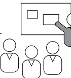

接下来的章节将向你展示准备冲刺评审需要做什么、如何主持冲刺评审会议，以及收集反馈的重要性。

### 准备演示

冲刺评审的准备工作不应超过几分钟。尽管冲刺评审听起来可能很高级，但敏捷团队的精髓在于形式化。会议需要准备和组织，它不需要许多华丽的材料。相反，冲刺评审侧重于演示开发团队做了什么。

> 警告：如果你的冲刺评审显得花里胡哨，请问问自己是否在掩盖在开发上花费的时间不足。回到创造价值的工作中去吧——创建一个可以运行的产品。场面工程是敏捷的敌人。

冲刺评审的准备涉及产品负责人和开发团队，并在需要时由 `Scrum Master` 协助。产品负责人需要知道开发团队在冲刺期间完成了哪些用户故事。开发团队则需要准备好演示完成的功能。

准备冲刺评审所需的时间不应超过 20 分钟——时间足够确保每个人知道谁在做什么，以及演示能够顺利进行。

未交付的工作没有业务价值。在单个冲刺的背景下，“可交付的功能”意味着开发团队已经满足了每个项的“完成定义”（`definition of done`），并且产品负责人已经验证该工作产品符合所有验收标准，并且如果市场价值和时机合适，就可以发布到市场或发货。实际发布可能会根据沟通的发布计划在稍后进行。在第 9 章了解更多关于可交付功能的信息。

为了让开发团队在冲刺评审中演示代码，代码必须根据完成定义是完整的。这意味着代码已完全完成：

- 开发
- 测试
- 集成
- 文档

随着用户故事在整个冲刺期间移动到“已完成”状态，产品负责人和开发团队应该检查功能是否符合标准。整个冲刺期间的持续验证减少了冲刺末的风险，并帮助 `Scrum` 团队花费尽可能少的时间准备冲刺评审。

通过了解已完成的用户故事并准备好演示这些故事的功能，将让你能够自信地开始冲刺评审会议。

### 冲刺评审会议

冲刺评审会议有两个活动：演示和展示 `Scrum` 团队完成的工作，并允许利益者对该工作提供反馈。图 10–2 显示了 `Scrum` 团队接收到的产品的不同反馈循环。

这种反馈循环在整个项目中重复如下：

- 每天，开发团队成员在协作环境中工作，该环境鼓励通过同伴评审和非正式交流进行反馈。
- 在每个冲刺期间，开发团队一旦完成每个需求，产品负责人就会通过检查运行的功能以进行验收来提供反馈。开发团队随后将纳入这些反馈（如果有），以满足用户故事的验收标准。
- 当用户故事完成后，产品负责人对为用户故事创建的功能给予最终验收。
- 在冲刺结束时，产品负责人对功能给予最终验收。
- 在冲刺结束时，利益者提供反馈。
- 在冲刺结束时，客户提供反馈。

图 10-2：敏捷项目。

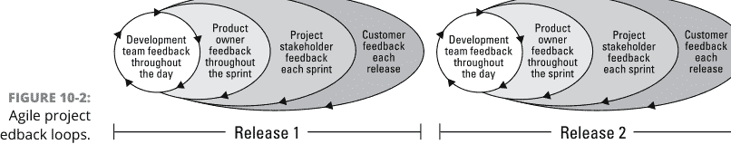

冲刺评审通常发生在冲刺的最后一天。`Scrum` 的规则之一是时间不要超过：

| 我的冲刺多长 | 冲刺评审不应超过 |
| :--- | :--- |
| 一周 | 1 小时 |
| 两周 | 2 小时 |
| 三周 | 3 小时 |
| 四周 | 4 小时 |

图 10-3：冲刺评审与时间的比例。

以下是你冲刺评审的一些指南：

- 不要用幻灯片！展示实际功能。
- 开发团队展示在冲刺期间完成的内容。
- 开发团队演示新功能。
- 演示应尽可能在生产环境中进行。

第三部分 敏捷计划与执行

- 任何感兴趣的人都可以参加。
- 整个 `Scrum` 团队都应该参与冲刺评审。
- 产品负责人介绍发布目标、冲刺目标和新功能。
- 利益者可以提问并对产品提供反馈。
- 产品负责人根据当前冲刺期间添加到产品待办列表的新项引导讨论。


在进行冲刺评审之前，产品负责人已经查看了要演示的用户故事的功能，并确认它们已完成。

记住

冲刺评审会议对开发团队非常有价值。冲刺评审为开发团队提供了直接展示其工作的机会。会议让利益者认可开发团队的努力。会议有助于开发团队的士气，使团队保持动力并产生越来越多的高质量工作。冲刺评审甚至在团队之间建立了某种定程度的良性竞争。


在进行冲刺评审之前，产品负责人已经看到了要演示的每个用户故事的功能，并认可了它们已完成。

有时，健康的竞争可能导致开发者尝试创建最便宜的功能或超过用户故事的需求——这种问题被称为“金镀”（`gold-plating`）。一种倾向是只生产通过用户故事验收测试的内容。存在一种风险，开发团队成员在热情下会超出需求，从而浪费了本应该花在有用功能上的时间。产品负责人应该警惕这一点。金镀问题每天都可以被识别和避免。

接下来，你将看到如何记录和使用利益相关者在迭代评审会议上的反馈。

### 在迭代评审会议中收集反馈

以非正式的方式收集迭代评审反馈。由产品负责人（`Product Owner`）或 `Scrum Master`（`Scrum Master`）代表开发团队做记录，因为团队成员通常会参与演示和随后的对话。

请记住我们在书中贯使用的示例项目：为 `XYZ` 银行开发的移动应用程序。他们在看到 `XYZ` 银行应用程序的功能后，可能会产生如下意见：

- 来自销售和营销人员的意见：“根据你们展示的结果，你们可能想要考虑让客户保存他们的偏好。这将为未来的发展提供更具个性化的体验。”
- 来自职能总监或经理的意见：“根据我所看到的，你们可能可以利用去年为 `ABC` 项目开发的一些代码模块。他们需要进行类似的数据处理。”
- 来自公司内部负责质量或用户体验专业人士的意见：“我注意到你们的日志非常简单；应用程序能够处理特殊字符吗？”

迭代评审后会产生新的用户故事（`User Stories`）。这些新的用户故事可能是新功能，也可能是现有功能的更改。

在最初的几次迭代评审中，`Scrum Master` 可能需要提醒利益相关者敏捷实践。有些人一听到“演示”一词就预期看到华丽的幻灯片和打印输出。`Scrum Master` 有责任管理这些预期，并维护敏捷价值和实践。

产品负责人需要将任何新的用户故事添加到产品待办列表（`Product Backlog`），并按优先级对这些故事进行排序。产品负责人还将计划在当前迭代中但未完成的故事加入产品待办列表，并根据最新的优先级对这些故事进行重新排序。

产品负责人需要在下一次迭代计划会议之前完成产品待办列表的更新。

当迭代评审结束，就是进行迭代回顾（`Sprint Retrospective`）的时候了。

你可能想在评审和回顾之间进行短暂休息，以便 `Scrum` 团队成员能够以新鲜、放松的状态进入回顾讨论。

在刚完成迭代评审后，`Scrum` 团队进入回顾时将准备好检查其流程，并产生改进的想法。

### 迭代回顾

迭代回顾是一次会议，产品负责人、开发团队和 `Scrum Master` 讨论迭代情况如何以及他们可以做什么来改进下一次迭代。`Scrum` 团队应该以自组织的方式进行这次会议。如果经理或主管参加迭代回顾，`Scrum` 团队成员将避免彼此坦诚，这限制了团队以自组织方式进行检查和调整的有效性。

如果 `Scrum` 团队愿意，成员也可以邀请其他利益相关者参加。如果 `Scrum` 团队经常与外部利益相关者互动，这些利益相关者的见解可能是很有价值的。

迭代回顾是价值路线图（`Roadmap to Value`）中的第 7 阶段。图 10-4 显示了迭代回顾如何融入敏捷项目。

| 描述 |
|---|
| 团队对环境和流程进行精炼以优化效率 |
| 所有者：`Scrum` 团队 |
| 频率：每次迭代结束时 |

迭代回顾的目标是持续改进你的流程。根据每个 `Scrum` 团队的需求改进和定制流程可以提高士气、提高效率并增加速率——即工作产出。（在第 13 章查找速率的详细信息）。然而，适用于一个团队的方法并不适用于另一个团队。`Scrum` 团队之外的经理不应该规定所有 `Scrum` 团队应该如何克服挑战，而应该让他们自己寻找最佳解决方案。

你的迭代回顾结果对你的 `Scrum` 团队来说可能是独特的。例如，我们合作的一个 `Scrum` 团队的成员决定，他们希望早点上班早下班，下午和家人共度。同一机构的另一个团队觉得他们晚上工作效果更好，决定下午去办公室并工作到晚上。两个团队的结果都是士气和速率的提高。

利用你在回顾中学到的信息来审查和修改你的流程，让你的下一次迭代变得更好。


敏捷方法——特别是 Scrum——能迅速揭示项目中的问题。Scrum 并不修复问题；它只是暴露问题，并为检查和调整问题提供一个框架。`Sprint Backlog`准确显示了开发团队在何处慢了下来。开发团队进行交流和协作。所有这些工具都有助于揭示低效率问题，并允许 Scrum 在迭代后精炼实践。注意那些被遗漏的内容。不要忽略它，也不要绕过它。

在接下来的章节中，你将了解到如何计划回顾、如何运行迭代回顾会议，以及如何使用每次迭代回顾的结果来改进未来的迭代。

## 停止生产线

大野（Ohno）在20世纪50和60年代构建了丰田生产系统——精益生产的开端——他将流水线管理去中心化，以赋予工人决策权。流水线工人在发现生产线上有缺陷或问题时，实际上有责任通过按下红色按钮停止生产线。传统上，工厂经理将停线视为失败，并专注于在每天尽可能的时间内满负运行生产线以最大化吞吐量。大野的哲学是，通过消除限制，他们可以主动创建一个更好的系统，而不是试图优化你的流程。

最初引入这种实践时，实施该实践的经理生产力最初下降了，因为他们花在修复系统缺陷上的时间比未采用该实践的团队更多。老团队起初宣布了这种胜利。然而，没多久，新团队就追了上来，而且比那些没有对系统进行持续改进的团队生产得更快、更便宜，缺陷和波动更少。这种定期和持续改进的过程让丰田如此成功。

## 计划迭代回顾

对于第一次迭代回顾，Scrum 团队的每个人都应该思考几个关键问题并准备好讨论它们。迭代期间哪些方面进展得好？你想改变什么？怎么改？

Scrum 团队的每个人都可能想在之前做一些笔记，甚至在整个迭代期间做记录。Scrum 团队可以记住每日 Scrum 会议中的障碍。从第二次迭代回顾开始，你还可以开始将当前迭代与之前的迭代进行比较，并跟踪从迭代到迭代的改进进展。在第9章中，我们提到保存之前的待办列表，这里可能会派上用场。

如果 Scrum 团队已经诚实且彻底地思考了哪些好以及哪些可以更好，就可以进入迭代回顾，准备好有用的对话。

## 迭代回顾会议

迭代回顾会议是一次行动导向的会议。Scrum 团队立即将回顾中中学的知识应用于下一次迭代。

迭代回顾会议是一次行动导向的会议，而不是理由会议。如果你听到“因为”之类的词，对话正在偏离行动转向理由。

Scrum 的规则之一是，每一周迭代，在迭代回顾会议上花费的时间不超过45分钟。图10-5显示了快速参考。

| 如果我的迭代很长…… | 我的迭代回顾会议持续时间不超过…… |
| --- | --- |
| 一周 | 45分钟 |
| 两周 | 1.5 小时 |
| 三周 | 2.25 小时 |
| 四周 | 3 小时 |

Sprint回顾应该涵盖三个核心问题：

- 在迭代期间哪些地方做得很好？
- 我们想要改变哪些地方？
- 我们该如何实施这些改变？

以下领域也可以进行讨论：

- **结果**：对比计划的工作量与开发团队完成的工作量。回顾迭代燃尽图（参见第 9 章）以及它告诉了开发团队关于其工作情况的信息。
- **人员**：讨论团队组成和协作一致。
- **关系**：讨论沟通、协作和结对编程。
- **流程**：回顾支持、开发和同行评审流程。
- **工具**：不同的工具对 Scrum 团队运作效果如何？考虑一下产物、电子工具、通信工具和技术工具。
- **生产力**：团队如何提高生产力，并在下一次迭代中完成尽可能的工作？

以结构化的格式进行这些讨论很有帮助。《敏捷回顾：让优秀团队变得卓越》（*Agile Retrospectives: Making Good Teams Great*，Pragmatic Books, 2006）的作者 Esther Derby 和 Diane Larsen 提供了一个非常棒的迭代回顾框架，能让团队专注于能够带来真正改进的讨论上：

### 1. 设定阶段

预先建立回顾的目标将帮助你的 Scrum 团队专注于在会议提供正确的反馈。随着迭代的不断进行，你可能希望针对一个或两个特定的改进领域进行回顾。

### 2. 收集数据

讨论关于上一次迭代中做得好以及需要改进的实实事实。创建一个迭代的整体视图；考虑使用白板记录与会人员的意见。

### 3. 生成洞察

查看你刚刚收集的信息，并就如何改进下一次迭代提出构想。

### 4. 决定做什么

以团队的形式决定将实施哪些想法。决定可以采取的具体行动以使想法变为现实。

### 5. 结束回顾

重申你们下一次迭代的行动计划。感谢大家的贡献。还要寻找让下一次回顾更好的方法！

对于某些 Scrum 团队来说，起初可能很难开口。Scrum Master 可能需要提出特定问题来启动讨论。参与回顾需要练习。重要的是鼓励 Scrum 团队对迭代负责——真正地拥抱自我管理。

在其他 Scrum 团队中，回顾期间会有大量的辩论和讨论。Scrum Master 可能会发现管理这些讨论并让会议在规定时间内完成具有挑战性，但这是必须的。

务必使用你迭代回顾的结果在整个项目过程中进行检查和适应。

### 检查与适应

迭代回顾是你将“检查和适应”的想法付诸行动的最佳机会之一。你在回顾期间提出了挑战和解决方案。不要让这些解决方案留在会议之外；让改进成为你每天工作的一部分。

你可以记录你的改进建议。某些 Scrum 团队会将回顾会议期间确定的行动发布在团队区域，以确保列出项目的可见性并得到执行。许多团队还将行动项添加到产品待办列表（`product backlog`）中，以确保在接的迭代中实施它们。

为了变得更加敏捷，Scrum 团队专注于具有巨大价值的小幅改变。我们希望团队在每次迭代中至少采取一项改进，这一过程有时被称为“Scrum 化”（`scrumming the scrum`）。

在随后的迭代回顾会议中，回顾上一次迭代的评估结果并确保你实施了建议的改进至关重要。

提示

## 本章内容

- 准备你的产品就绪
- 为运营支持进行组织
- 为组织的其他部分做发布做准备
- 确保市场已准备好迎接发布

## 第 11 章

### 准备发布

向客户发布新产品功能面临着特殊的挑战。开发团队对于开发发布有特定的任务，这些任务与普通迭代中创建功能的任务不同。赞助该产品的组织可能需要准备支持该产品。你希望客户能够使用发布的产品。

本章涵盖了在产品发布前如何管理最后一次迭代（如果需要）——即发布迭代（`release sprint`）。你还将发现如何为产品发布准备你的组织和市场。

## 准备部署产品：发布迭代

在演示你的产品之前，在常规开发迭代中进行的工作应该是完整的、包括测试和技术文档的。开发迭代的产物是可运行的功能。

然而，可能存在某些与创建产品功能相关的活动，开发团队无法在开发迭代内实际完成，甚至可能引入不可接受的开销。为了适应发布前的活动并帮助确保发布顺利，Scrum 团队可能会安排一个发布迭代，作为向客户发布功能之前的最后一次迭代。

如果一个 Scrum 团队需要发布迭代，这可能意味着更广泛的组织无法支持它，这是迈向敏捷的一种反模式。向市场发布功能所需的任何类型的工作或活动都应该是迭代层级“完成的定义”（`definition of done`）的一部分。这是敏捷团队的目标。

发布迭代仅包含将可运行功能移至市场所需的内容。以下是发布迭代项的示例：

- 为最新版本创建用户文档
- 性能测试、负载测试、安全性测试，以确保软件性能良好
- 将产品与企业级系统集成
- 准备发布说明
- 部署到生产环境

发布迭代的某些方面与开发迭代不同：

- 你不再从产品待办列表中开发任何新功能
- 虽然你有代码冻结（`code freeze`），但你的发布迭代长度可能与常规迭代不同
- 完成的定义是不同的：在开发迭代中，完成意味着用户故事的完成；在发布迭代中，它是完成发布所需的所有任务的完成

### 理解文档的作用

你在迭代期间创建的技术文档与你在发布期间可能创建的用户文档之间的区别是什么？

你的技术文档应该是足够的，没有修饰，仅足以开发团队（以及可能的未来团队）如何创建和更新产品。如果在迭代最后一天，开发团队中了彩票并退休到哥斯达华，新的开发团队应该查看技术文档并轻松接手前团队的工作。

你的用户文档告诉人们如何使用产品。你可能希望为每个客户定制用户文档。例如，一个手机应用程序可能为银行客户需要一个常见问题（FAQs）部分。同一个应用程序可能具有允许营销经理向应用程序上传消息的功能；你希望确保这些经理也有有关上传功能的说明。由于你的产品在发布前的每次迭代中都会发生变化，在最后期限时刻创建用户文档可能更有效，即利益相关者同意功能准备好发布之后。

> 发布迭代包含了在开发迭代中可能无法实现的测试和批准，例如性能测试、负载测试、安全性测试、焦点小组和法律审查。

敏捷开发团队可能会创建两个完成的定义：针对迭代和发布。

表 11-1 显示了开发迭代和发布迭代活动的比较。有关迭代中元素的详细说明，请参见第 8 至第 10 章。

| 元素 | 用于开发迭代 | 用于发布迭代 |
| --- | --- | --- |
| 迭代计划 | 是 | 是 |
| 产品待办列表 | 是 | 否 |

## 11-1 开发迭代元素与发布元素

# 表 11-1（续）

| 元素 | 用于开发迭代 (Development Sprint) | 用于发布迭代 (Release Sprint) |
| --- | --- | --- |
| 迭代待办列表 (Sprint backlog) | 是 | 在开发迭代中，你的迭代待办列表包含用户故事以及创建每个用户故事所需的任务。你使用故事点数（`story points`）对用户故事进行相对估算。（参见第 7 章和第 8 章。） | 在发布迭代中，你不再需要以用户故事的格式编写需求。相反，你只需创建发布所需的任务列表。你不再使用用户故事。相反，在计划发布迭代时，添加每项任务预计所需的小时，这与你在开发迭代计划期间期间拆分和估算任务的方式相同。 |
| 燃尽图 (Burndown chart) | 是 | 是 |
| 每日站会 (Daily scrum) | 是 | 涉及外部 Scrum 中与产品发布任务相关的利益相关者，例如企业构建经理或其他配置经理。 |
| 每日活动 (Daily activities) | 在开发迭代中，你的每日活动侧重于创建可交付的功能。 | 在发布迭代中，你的每日活动侧重于为外部发布准备你的可工作功能。 |
| 日终报告 (End-of-day reporting) | 是 | 是 |
| 迭代评审 (Sprint review) | 是 | 某些组织将发布迭代评审作为通过或否决（`go or no-go`）会议，以授权发布功能。 |
| 迭代回顾 (Sprint retrospective) | 是 | 是。这可以作为一个检查整个迭代并为下一次发布制定调整计划的机会。 |

发布迭代不应成为开发团队在开发迭代中未完成的任务的“停车场”。你听到开发团队倾向于将任务推迟到发布迭代可能并不感到意外。你可以通过确保 Scrum 团队对开发迭代中的需求有适当的完成定义（`definition of done`），包括测试、集成和文档，来避免这种情况。

在运行发布迭代的同时，你还需要为组织的产品发布做好准备。接下来的章节将讨论如何准备支持市场上的新功能，以及如何让公司或组织中的利益相关者准备好产品部署。

## 准备运营支持

当你的产品发布给客户后，必须有人支持它。支持你的产品涉及响应客户查询、维护生产环境中的系统以及增强现有功能以填补细小差距。虽然新开发工作和运营支持都很重要，但它们涉及不同的方法和节奏。

将新开发和支持工作分开，可以确保新开发团队能够专注于以更快的速度持续向客户推动创新解决方案，如果团队频繁在两种类型的工作之间切换，速度就会变慢。

进行新开发的 Scrum 团队可以在一个周到两周的迭代内计划并开发新的可工作功能，但很难计划运营或维护问题何时会出现。维护工作通常需要更短的箱化迭代，通常不超过一天，而这通常是组织在不更改生产优先级的情况下可以持续的最长时间。

我们推荐一种将新开发和维护工作分开的模型，如图 11-1 所示。

例如，对于一个由九名开发者组成的 Scrum 团队，我们将开发分为两个团队，一个有六名开发者，另一个有三名。（这些数字是灵活的。）六人团队根据产品待办列表以为期一周到两周的迭代进行新开发项目，正如第 7 章至第 10 章所述的。该团队在迭代计划会议期间承诺的工作将是他们要做的工作。

三人团队是我们的“消防员”，他们以一天的迭代或通过看板（`kanban`）进行维护和支持工作。（在第 4 章中学习看板。）单日迭代允许 Scrum 团队对前一天接收的所有请求进行分类，计划优先级最高的项目，作为团队实施它们，并在一天结束时（或更早）评审结果，以便在更改推送到生产环境之前进行通过或否决批准。为了连续性，每个团队的产品负责人（`Product Owner`）和 Scrum 大师是同一个人。

尽管新修改的项目开发团队比之前要小，但仍有足够的开发者让开发工作继续进行，不受维护工作的干扰。当你开始将功能推向市场时，你的 Scrum 团队将很好地合作，开发者将通过完成比项目刚开始时更多类型的任务而增加他们的通用性。

项目开发团队将进行定期发布，例如每 90 天一次。每次发布时，有一名开发者将轮换维护团队，带着有关部署到生产环境的功能的第一手知识。同时，另一名开发者将轮进入项目开发团队，配备在真实世界支持产品的实手知识。这种轮换在每次发布时持续。

开发运维（`DevOps`）是软件开发者与 IT 运营（包括系统管理和服务器维护功能）的协作与集成。采用 DevOps 方法使开发者和运营人员共同工作，以缩短部署周期。

这种 DevOps 模型确保了每个人都能参与新产品开发以及维护工作，并使产品知识在两个团队之间持续共享。这种方法改进了 DevOps 并促进了跨职能团队成员的交流。它减少了团队可能经历的干扰，因为轮换发生在发布时，而不是每天或每周。

在准备发布时，预先建立功能预期允许 Scrum 团队以这种方式开发产品，使团队在部署后能够支持它。这增加了整个 Scrum 团队的责任感，并提高了了团队对长期成功的意识。

## 单日迭代

我们建议为维护团队运行单日迭代。通过将迭代周期中的每一天框化，Scrum 团队在稳固的反馈循环中运行，确保持续的检查和调整以及利益相关者的定期参与。

通过使用相同的公式对事件进行箱化，你不会像在期一到四周的迭代中那样在计划或评审上花费几个小时。将一周的事件箱化时间除以五天，意味着你花费约 25 分钟对维护待办列表进行分类并计划当天，花费约 12-15 分钟进行迭代评审以确定是否进入生产，并额外花费 10 分钟检查和调整流程，并识别应该继续还是放弃的问题。

运行单日迭代的关键在于确保维护项目被拆分得足够细，以便开发者可以在一天内完成。这种方法确保了客户可以获得一切，而不是等待几周。

## 为组织准备产品部署

产品发布通常会影响公司或组织中的多个部门。为了让组织为新产品做好准备，产品负责人和 Scrum 大师必须将组织相关的项目添加到发布迭代待办列表中。（参见第 8 章中如何创建迭代待办列表。）

发布迭代待办列表还应涵盖开发团队的活动。它还需要添加组织内 Scrum 团队之外的小组执行的活动，以准备产品部署。这些部门可能包括：

- 营销：与产品相关的营销活动是否需要与产品同时启动？
- 销售：是否有特定的客户需要了解该产品？新产品会导致销售增长吗？
- 物流：产品是否是包含包装或运输的实体物品？
- 产品支持：客户服务小组是否拥有回答有关新产品问题所需的信息？当产品发布后客户问题增加时，该小组是否有足够的人手？
- 法律：产品是否符合法律标准，包括定价、许可和面向公众发布时使用的正确用语？

当然，需要为产品发布做好准备的部门以及这些小组需要完成的特定任务，取决于具体的组织架构。然而，发布成功的成功的关键在于，产品所有者（`Product Owner`）和敏捷大师（`Scrum Master`）让正确的人参与进来，并确保这些人清楚地知道需要做什么才能为功能发布做好准备。

与开发冲刺（`Sprint`）一样，在你的发布冲刺（`Release Sprint`）中，你可以有效利用每日冲刺、冲刺评审会议以及与参与准备产品部署的部门同事进行的冲刺。你可以使用任务看板，例如我们在第 9 章中描述的那种。

在你的发布冲刺期间，你还需要在计划中包含另一个群体：产品客户。下一节将讨论如何为你的产品做好市场就绪。

### 为产品部署准备市场

产品所有者负责与其他部门合作，确保市场——现有客户和潜在客户——为即将到来的内容做好准备。营销或销售团队可能领导这项工作；成员们希望产品所有者让他们随时了解发布日期以及将包含在发布中的功能。

> 某些产品仅供内部员工使用。你在这一节中看到的某些内容对于内部应用程序（仅在公司内部发布的应用程序）来说可能显得多此一举。然而，许多步骤仍然是推广内部应用程序的良好指南。无论是内部还是外部客户，为新产品做好准备都可能是产品成功的关键部分。

为了帮助客户为产品发布做好准备，产品所有者可能希望与不同团队合作以确保以下工作：

- **营销支持**：无论处理的是新产品还是现有产品的新功能，营销部门都应该利用新产品功能的兴奋感来帮助推广产品和组织。
- **客户测试**：如果可能，与你的客户（一些人员焦点小组）合作，从端用户子集中获得有关产品的真实世界反馈。你的营销团队还可以利用这些反馈转化为证言，以便立即推广产品。
- **营销材料**：组织的营销小组还负责准备和广告计划，以及物理媒介的包装。媒体材料（如新闻稿和面向分析师的信息）需要准备就绪，营销和销售材料也是如此。
- **支持渠道**：确保客户理解可用的支持渠道，以防他们对产品有疑问。


从客户的角度审查你发布冲刺待办列表上的任务。回想你在创建用户故事时使用的角色（Personas）。这些角色是否需要对产品了解某些事情？更新你的发布清单，增加对你角色所代表的客户有价值的项目。你可以在第 8 章中找到更多关于角色的信息。

最后，就是——发布日。无论你在过程中扮演了什么角色，这都是你努力实现的一天。是时候庆祝了！

# 4 敏捷管理

## 在本部分……

- 对范围的变化做出有效响应。
- 管理供应商和合同以获得成功。
- 监控并调整进度和预算。
- 自我组织以实现最佳通信。
- 检查并适应以提高质量并降低风险。

## 本章

- 了解范围管理在敏捷项目中有何不同。
- 使用敏捷流程管理范围和范围变化。
- 敏捷流程为采购带来的不同方法。
- 在敏捷项目中管理采购。

## 第 12 章：管理范围和采购

范围管理是每个项目的一部分。为了创建一个产品，你必须理解基础的产品需求以及完成这些需求所需要的工作。你需要在新需求出现时能够对更改进行排序和管理。你必须验证完成的产品满足了客户的需求。

采购也是许多项目的一部分。如果你需要从组织外部寻求帮助来完成项目，你应该知道如何进行商品和服务的采购。你将希望知道如何在项目期间与供应商团队协作。你还应该了解创建合同和不同的成本结构。

在本章中，你将了解到如何在敏捷项目中管理范围，并利用敏捷方法对知情化变更的包容态度。你还将了解到如何管理商品和服务的采购，以便在敏捷项目中交付产品范围。首先，我们回顾传统的范围管理。

## 敏捷范围管理有何不同？

从历史上看，项目管理的很大一部分是范围管理。项目范围是产品包含的所有功能和需求。项目范围是创建产品所涉及的所有工作。

传统的项目管理将需求的变化视为前期规划失败的标志。然而，敏捷项目具有可变范围，因此项目团队可以立即且增量地吸收学习和反馈，并最终创建更好的产品。敏捷宣言的签署者意识到范围变化是自然且有益的。敏捷方法专门拥抱变化，并利用它做出更明智的决策和更有用的产品。

如果你运行一个敏捷项目，而你的需求没有变化是因为你在过程中没有学到任何东西，那就是失败。随着你从利益者和客户的反馈中学习，你的产品待办列表经常发生变化。你不可能在项目开始时就知道一切。

敏捷宣言的签署者意识到范围变化是自然且有益的。敏捷方法专门拥抱变化，并利用它做出更明智的决策和更有用的产品。

如果你运行一个敏捷项目，而你的需求没有变化是因为你在过程中没有学到任何东西，那就是失败。随着你从利益者和客户的反馈中学习，你的产品待办列表经常发生变化。你不可能在项目开始时就知道一切。

敏捷宣言的签署者意识到范围变化是自然且有益的。敏捷方法专门拥抱变化，并利用它做出更明智的决策和更有用的产品。

敏捷宣言的签署者意识到范围变化是自然且有益的。敏捷方法专门拥抱变化，并利用它做出更明智的决策和更有用的产品。

- 我们的首要任务是通过早期和持续交付来满足客户。
- 欢迎需求的变化，即使在开发后期。
- 频繁交付可行的软件，从几周到几个月不等，尽可能缩短时间。
- 简单性——最大化工作量的艺术是关重要的。

### 表 12-1：传统与敏捷管理

| 传统方法的范围管理 | 敏捷方法的范围管理 |
| --- | --- |
| 项目团队尝试在项目开始时识别并记录完整范围，此时团队对产品的了解最少。 | 产品所有者在项目开始时收集高层级需求，细分并详细说明近期将实现的需求。随着团队知识的增长，在整个项目中收集并完善功能。 |
| 组织将需求阶段完成后的范围变化视为负面的。 | 组织将变化视为项目过程中改进产品的积极方式。 |
| 项目经理在利益相关者签署需求后严格控制更改。 | 变化是项目固有的，当你在最了解产品时发生的变化是有价值的变更。 |
| 更改成本随时间推移而增加，更改能力随之减少。 | 产品所有者确定新需求的价值和优先级，并将这些需求添加到产品待办列表中。 |
| 项目经常包含范围膨胀，由于担心项目中期变更而包含了不必要的产品功能。 | Scrum 团队通过考虑直接支持项目愿景、发布目标和冲刺目标的功能做出决定。开发团队首先创建最有价值的功能以确保其被包含并尽快交付这些功能。 |
| 价值较低的功能可能永远不会被创建，这在客户获得最高价值功能后对业务和客户来说是可以接受的。 |  |

（瀑布模型，参见第 1 章。）如果向一位经验丰富的项目经理提到“范围蔓延（`scope creep`）”，他可能会因此发抖。

在每个冲刺（`sprint`）开始的冲刺计划期间，Scrum 团队可以使用产品待办列表（`product backlog`）优先级来帮助决定是否应将新需求纳入冲刺中。低优先级的需求留在产品待办列表中以供以后考虑。你可以在第 8 章中阅读有关计划冲刺的内容。

下一节将介绍如何在敏捷项目中管理范围。

### 管理敏捷范围

欢迎范围的变化有助于你创建最好的产品。然而，拥抱变化要求你理解当前的范围，并在更新出现时知道如何处理。幸运的是，敏捷方法是管理新需求和现有需求的简单方式：

- 产品负责人确保项目团队的其他成员——Scrum 团队加上项目利益相关者——清楚地理解项目的现有范围、产品愿景、当前发布目标以及当前冲刺目标。
- 产品负责人根据产品愿景、发布目标、冲刺目标和现有需求，确定新需求的价值和优先级。
- 开发团队按优先级创建产品需求，以便首先发布产品最重要的部分。

在接下来的章节中，你将了解如何在敏捷项目的不同部分理解和传递范围。查看在出现新需求时如何评估优先级。你还将获知如何使用产品待办列表和敏捷产物来管理范围。

### 理解整个项目中的范围

在敏捷项目的每个阶段，Scrum 团队以不同的方式管理范围。查看整个项目范围管理的一种好方法是使用“价值路线图（`Roadmap to Value`）”，该图首次在第 7 章中介绍，并在图 12-1 中再次显示。

#### 阶段 1：产品愿景

- **描述：** 产品目标及其与公司战略的对齐
- **所有者：** 产品负责人
- **频率：** 至少每月一次

#### 阶段 2：产品路线图

- **描述：** 创建产品愿景的产品特征的全局视图
- **所有者：** 产品负责人
- **频率：** 至少每年一次

#### 阶段 3：发布计划

| 最高优先级 | 下一优先级 | 描述 | 时间 |
| --- | --- | --- | --- |
| 特性 | 特性 | 发布特定的产品功能 | 4 小时 |
| 一月、二月、三月、四月、五月、六月 |  | 频率：至少季度一次 | 1-4 周 |

（阶段 1-3 是常见的做法。）

#### 阶段 4：冲刺计划

- **描述：** 迭代目标和领导任务的建立
- **所有者：** 产品负责人和开发团队
- **频率：** 每个冲刺开始时

#### 阶段 5：每日冲刺

- **描述：** 当日活动的建立与协调
- **所有者：** 开发团队
- **频率：** 每日

#### 阶段 6：冲刺评审

- **描述：** 可运行产品的演示
- **所有者：** 产品负责人和开发团队
- **频率：** 每个冲刺结束时

#### 阶段 7：回顾

- **描述：** 团队对环境和流程进行精炼，以优化效率
- **所有者：** Scrum 团队
- **频率：** 每个冲刺结束时

**图 12-1：价值路线图**

准备

执行

考虑价值路线图的每个部分：

- **阶段 1，产品愿景：** 产品愿景声明确立了产品将包含的功能的外边界，是建立产品范围的第一步。产品负责人负责确保项目团队成员了解产品愿景声明，并确保团队中的每个人都能正确解释该声明。

- **阶段 2，产品路线图：** 在创建产品路线图期间，产品负责人参考愿景声明，并确保特性支持愿景声明。随着功能的具体化，产品负责人需要理解并能够向开发团队和利益相关者清晰地沟通这些功能的范围以及它们如何支持产品愿景。

- **阶段 3，发布计划：** 在发布计划期间，产品负责人需要确定一个发布目标——计划在下一次发布时进入市场的功能中期边界——并仅选择支持发布目标的范围。

- **阶段 4，冲刺计划：** 在冲刺计划期间，产品负责人需要确保 Scrum 团队理解发布目标，并根据该发布目标计划每个冲刺目标——即冲刺结束时可能交付的功能的即时边界。产品负责人和开发团队仅选择支持冲刺目标的范围作为冲刺的一部分。产品负责人还将确保开发团队理解为该冲刺选出的单个用户故事（`user stories`）的范围。

- **阶段 5，每日 Scrum：** 每日 Scrum 会议可以作为未来冲刺范围变化的起点。每日 Scrum 会议是开发团队的一个 15 分钟专注会议，用于说明三件事：前一天完成的工作、未来一天的工作范围以及开发团队可能遇到的任何障碍。每日 Scrum 的三个主题通常会揭示更大的范围变化机会。

当需要比每日 Scrum 会议的时间和格式允许更大的讨论时，Scrum 团队可以决定召开一个会后会议（`after-party meeting`）。在会后会议中，Scrum 团队成员讨论影响其冲刺目标进展的问题。如果在冲刺期间发现了新功能——新范围的机会，产品负责人将对其进行评估，并在产品待办列表中进行优先级排序，以供未来的冲刺使用。

- **阶段 6，冲刺评审：** 产品负责人通过重申冲刺范围——Scrum 团队追求的冲刺目标以及已完成的内容来设定每次冲刺评审的基调。特别是在第一次冲刺评审期间，会议中的利益相关者对范围有正确的预期非常重要。

冲刺评审可以激发启发。当整个项目团队聚集在一起与运行产品交互时，成员可能会以新的方式看待产品，并提出改进产品的想法。产品负责人根据冲刺中收到的反馈更新产品待办列表的新范围。

- **阶段 7，回顾：** 在回顾会议中，Scrum 团队成员可以讨论他们完成冲刺开始时承诺的范围。如果开发团队未能实现冲刺计划期间确定的目标，其成员需要精炼计划和流程，以确保每个冲刺选择正确的工作量。如果开发团队实现了目标，可以使用回顾会议提出增加未来冲刺范围的方法。Scrum 团队的目标是每次冲刺提高效率。

## 引入范围变更

许多人甚至组织外的人员都可以为敏捷项目建议新功能。你可能会从以下方面看到新功能想法：

- 用户社区，包括有机会预览产品的群体或个人。
- 看到市场机会或威胁的业务利益相关者。
- 对组织战略和变化有洞察的高管和高级人员。
- 开发团队，他们每天都在学习深入了解产品。
- Scrum Master，他们在与外部部门合作或清除开发团队障碍时可能会发现机会。
- 产品负责人，他们通常最了解产品和利益相关者的需求。

你将在敏捷项目过程中收到范围变更建议，你需要确定哪些更改是有效的并管理这些更新。查看。

### 管理范围变更

当你获得新需求时，使用以下步骤评估并对需求进行优先级排序，并更新待办列表。

> **警告**
>
> 不要向正在进行中的冲刺添加需求，除非开发团队主动请求（这通常是因为容量意外增加）。

1. 通过对需求提出一些关键问题，评估新需求是否应属于产品、发布或冲刺：
   - **a.** 新需求是否支持产品愿景声明？
   - 如果是，将需求添加到产品待办列表和产品路线图中。
   - 如果否，该需求不应是项目的一部分。它可能是独立项目的良好候选者。
2. 如果新需求支持产品愿景，那么该新需求是否支持当前的发布目标？
   - 如果是，该需求是当前发布计划的候选方案。
   - 如果否，将该需求留在产品待办列表（`product backlog`）中，以备未来发布。
3. 如果新需求支持发布目标，那么该新需求是否支持当前的冲刺目标（`sprint goal`）？
   - 如果是且冲刺尚未开始，该需求是当前冲刺待办列表（`sprint backlog`）的候选方案。
   - 如果否或冲刺已经开始或两者皆是，将该需求留在产品待办列表中，以备未来的冲刺。

### 估算新需求的工作量

由开发团队估算工作量。如何估算需求请参考第 7 章。

### 进行优先级排序并更新产品待办列表

相其他需求进行优先级排序，并按优先级将新需求添加到产品待办列表中。

考虑以下因素：

- 产品经理最了解产品的业务需求，以及新需求与其他需求相比可能有多重要。产品所有者（`product owner`）可能还会联系产品利益相关者，获得有关需求优先级的额外见解。
- 开发团队可能对新需求的优先级有技术见解。例如，如果需求 A 和需求 B 的价值相等，但你必须完成需求 B 才能使需求 A 可行，那么开发团队需要提醒产品所有者。需求 B 可能需要先完成。
- 虽然开发团队和产品利益相关者可以提供帮助确定优先级的信息，但确定优先级最终是产品所有者的决定。
- 将新需求添加到产品待办列表中可能意味着其他需求在列表中的位置会后移。图 12-2 显示了在产品待办列表中添加新需求。

产品待办列表是产品所有已知范围的完整列表，也是你在敏捷项目中管理范围变更最重要的工具。

### 剩余产品待办列表

保持产品待办列表的更新可以让你能够快速地对新需求进行优先级排序和添加。通过当前的产品待办列表，你始终了解项目剩余的范围。第 7 章有更多关于需求优先级排序的信息。

### 使用敏捷交付物进行范围管理

从愿景声明到冲刺计划，敏捷项目管理中的所有交付物都支持你的范围管理工作。逐步分解或拆分需求为功能点（`features`），并将其放在优先级列表的最顶端。我们在第 7 章中讨论了需求的分解和渐进式详细。

表 12-2 显示了每个敏捷交付物（包括产品待办列表）如何有助于持续的范围细化。

### 敏捷交付物与范围管理角色

| 交付物 | 在建立范围中的角色 | 在范围变更中的角色 |
| --- | --- | --- |
| 愿景声明：产品最终目标的定义。第 7 章有更多关于愿景声明的内容。 | 使用愿景声明作为基准，判断功能是否在当前项目的范围之内。 | 当有人引入新需求时，这些需求必须支持产品愿景声明。 |
| 产品路线图（`product roadmap`）：创建产品愿景的产品功能的整体视图。第 7 章有更多关于产品路线图的内容。 | 范围是产品路线图的一部分。作为功能级的需求用于关于实现产品愿景之含义的业务对话。 | 根据新需求更新产品路线图。产品路线图提供了新功能被纳入项目的视觉化沟通。 |

### 表 12-2（续）

| 交付物 | 在建立范围中的角色 | 在范围变更中的角色 |
| --- | --- | --- |
| 发布计划（`release plan`）：一个围绕一组最小市场化特征易于理解的中期目标。第 8 章有更多关于发布计划的内容。 | 发布计划显示了当前版本的范围。你可能希望按主题（需求的逻辑分组）来规划你的发布。 | 将属于当前发布的新功能添加到发布计划中。如果新的用户故事不属于当前发布，则将其留在产品待办列表中，以备未来发布。 |
| 产品待办列表（`product backlog`）：产品所有范围的完整列表。第 7 章和第 8 章提供了更多关于产品待办列表的内容。 | 如果需求在产品愿景的范围内，它就是产品待办列表的一部分。 | 产品待办列表包含了所有的变更。新的高优先级功能会将低优先级功能向后推迟。 |
| 冲刺待办列表（`sprint backlog`）：当前冲刺范围内的用户故事和任务。第 8 章有更多关于冲刺待办列表的内容。 | 冲刺待办列表包含了当前冲刺的用户故事。 | 冲刺待办列表确定了冲刺中允许的内容。在开发团队于冲刺计划会议上承诺冲刺目标后，只有开发团队可以修改冲刺待办列表。 |

## 敏捷采购有什么不同？

项目管理的另一部分是采购，即管理交付产品范围所需的服务或货品的购买。像范围一样，采购是项目投资方面的一部分。

第 2 章解释了敏捷宣言看重客户合作重于合同谈判。这为敏捷项目上的采购关系奠定了重要的基调。

重视客户合作重于合同谈判，并不意味着敏捷项目没有合同：合同和谈判对业务关系至关重要。然而，敏捷宣言规定，买方和卖方应该合作创建产品，两者之间的关系比纠结于信息不全的细节以及勾选可能对客户是否有价值的合同条款更为重要。

所有 12 条敏捷原则都适用于采购项目。然而，在获取货物和服务时，以下几条似乎尤为突出：

- **2.** 欢迎需求的变化，即使在开发后期。敏捷流程利用变化来获得客户的竞争优势。
- **3.** 频繁地交付运行的软件，从几周到几个月不等，并以更短的时间周期为。
- **4.** 业务人员和开发人员在整个项目过程中必须共同工作。
- **5.** 围绕受激励的人建立项目。给予他们所需的环境和支持，并信任他们能完成工作。
- **10.** 简单性——最大化不做工作的艺术——是关重要的。
- **11.** 优秀的架构、需求和设计从自组织团队中涌现。

表 12-3 列出了传统项目采购与敏捷项目采购之间的差异。

### 表 12-3

| 传统方法的采购 | 敏捷采购管理 |
| --- | --- |
| 项目经理和组织负责采购活动。 | 自管理团队在识别需要采购的项目方面起着重要作用。Scrum Master 协助获取所需的物品。 |
| 与服务提供者的合同通常包含固定需求、详尽计划和其他基于瀑布生命周期的传统交付。 | 敏捷项目的合同基于每个冲刺结束的功能评估，而不是基于可能对交付产品做出贡献的交付物。 |
| 买卖双方之间的合同谈判可以是无缝的。因为谈判是一项压力巨大的活动，它可能会在项目开始前损害买方和卖方之间的关系。 | 敏捷项目团队专注于从流程开始就保持买方和卖方之间积极、合作的关系。 |
| 项目启动后更换供应商可能是昂贵且耗时的，因为新供应商必须理解旧供应商的大量进行中的工作。 | 供应商在每个冲刺结束时提供完成的运行功能。如果更换供应商，新供应商可以立即开始开发下一个冲刺的需求，避免漫长且昂贵的过渡。 |

无论是瀑布还是敏捷项目团队都追求成功。传统的项目方法在合规性方面负责制，将成功定义为勾选列表中的文档和交付物。相比之下，敏捷项目方法在最终结果方面负责，将成功定义为运行的功能。

下一节将展示如何在敏捷项目中管理采购。

### 管理敏捷采购

本节重点关注敏捷项目团队如何完成采购流程：从确定需求、选择供应商、通过与供应商合作创建合同，到在买卖项目结束时结束合同。

### 确定需求并选择供应商

在敏捷项目中，当开发团队决定需要某种工具或第三方服务来创建产品时，采购便开始了。

敏捷项目开发团队是自管理和自组织的，他们负责做出关于什么最有利于最大化开发产出的决策。自管理适用于所有项目管理采购。请参阅第 6 章和第 14 章了解有关自管理团队的信息。

开发团队有许多机会考虑外部商品和服务：

- **产品愿景阶段：** 开发团队可能开始思考实现产品愿景所需的工具和技能。在这个阶段，研究需求可能是明智之举，但不应开始购买流程。
- **产品路线图阶段：** 开发团队开始看到具体的功能，并可能了解帮助创建产品所需的某些商品或服务。


**发布计划：** 开发团队对产品有了更多了解，并识别出有助于实现下一次发布目标的特定商品或服务。

**冲刺计划：** 开发团队正处于开发的前线，可能会识别出冲刺的需求。

**每日站会：** 开发团队成员说明阻碍。采购商品或服务可能有助于消除这些阻碍。

**全天候：** 开发团队之间相互沟通并协作任务。特定的需求可能从开发团队的对话中产生。

**冲刺评审会议：** 项目利益相关者可能会为未来的冲刺识别出新需求，这些需求需要采购商品或服务。

**冲刺回顾会议：** 开发团队可能会讨论特定工具或服务如何对过去的冲刺大有帮助，并为未来的冲刺提出购买建议。

有时，你可以在组织内部找到项目所需的商品或服务。在考虑购买物品或与供应商合作之前，敏捷大师（`Scrum Master`）会确定内部是否有所需的工具或具备开发团队所需技能的人。如果内部资源或人员能够满足开发团队的需求，敏捷团队就能节省费用。

在开发团队确定需要某种商品或服务后，开发团队和敏捷大师将与产品负责人（`Product Owner`）合作获取必要的资金。产品负责人负责根据项目预算管理项目范围，产品负责人对任何项目采购负最终责任。在敏捷团队启动采购后，敏捷大师通常代表敏捷团队管理供应商关系。

在采购商品时，开发团队可能需要在决定购买之前比较工具和供应商。采购商品时，你选择买什么以及从哪里获得，流程通常很简单：购买和交付。

采购服务通常比购买商品的过程长且更复杂。选择服务供应商的某些针对敏捷的考虑因素包括：

- 供应商是否可以在敏捷项目环境中工作，如果是，该供应商具有多少敏捷项目经验。
- 供应商是否可以与开发团队进行现场工作。
- 供应商与敏捷团队之间的关系是否可能是积极且协作的。

你所属的组织或公司在选择供应商方面可能受到法律法规的约束。例如，参与政府工作的公司通常需要对超过某些金额的工作从各公司收集多份提案和投标书。尽管你的表亲或大学同学可能是完成这项工作最合适的人，但如果你不遵守适用法律，可能会遇到麻烦。如果你对如何简化流程有疑问，请咨询公司的法务部门。

在你选定服务供应商后，你需要创建一个合同，以便供应商可以开始工作。下一节将解释合同在敏捷项目中是如何运作的。

## 理解服务的成本方法和合同

在开发团队和产品负责人选择供应商后，他们需要一份合同来确保对服务和定价达成一致。为了启动合同流程，你应该了解不同的定价结构以及它们如何在敏捷项目中运作。在理解了这些方法后，你将看到如何创建合同。

### 成本结构

当你为敏捷项目采购服务时，了解固定价格项目、固定时间项目、工时材料项目和封顶项目（`not-to-exceed project`）之间的区别非常重要。每种方法在敏捷环境中都有其优势：

**固定价格项目：** 从设定的预算开始。供应商对产品工作并创建发布，直到该供应商耗光预算中的所有资金，或者你交付了产品功能，以先者为准。

例如，如果你有 250,000 美元的预算，而你的供应商成本为每周 10,000 美元，那么供应商负责的项目部分将可以持续 25 周。在这 25 周内，供应商将创建并发布尽可能多的可交付功能。

**固定时间项目：** 有特定的截止日期。例如，你可能需要在下一次发布前时启动一个项目。

**工时材料项目：** 比固定价格或固定时间项目更具开放性。

**封顶项目：** 项目的时间和材料有固定上限的项目。

### 低价压榨供应商的谬误

试图通过欺压供应商提供最低价格总是一个双输的局面。在项目总是流给最低价投标者的行业中，承包商有句格言：“报价得低点，看它如何增长。”瀑布式项目管理通过在项目开始时锁定范围和价格来支持这种做法，此时你对项目一无所知。变更订单以及随之而来的成本是不可避免的。

更好的模型是供应商和买方在固定成本和进度限制内，随着项目的推进共同协作定义项目范围。双方都可以从项目过程中学到的知识中获益，你最终将获得一个充满了每次冲刺结束识别出的功能的产品。与其努力做一个强硬的谈判者，不如做一个良好的合作者。

无论采用何种成本方法，在敏捷项目中，专注于完成最高价值的产品功能。

### 合同创建

在了解项目的成本方法后，敏捷大师可能会帮助创建合同。合同是买卖双方之间具有法律约束力的协议，设定了工作和支付的预期。

创建合同的责任人因组织而异。在某些情况下，法务或采购部门的人员创建合同并要求敏捷大师审核。在其他情况下，情况相反：敏捷大师起草合同并让法务或采购专家审核。

无论谁创建合同，敏捷大师通常代表敏捷团队执行以下操作：启动合同创建、谈判合同细节以及引导合同通过任何内部审批。

敏捷宣言并没有规定合同是不可避免的。无论你的公司或组织规模如何，在你的公司与供应商之间建立一份服务合同都是一个非常好的主意。跳过合同会导致买方和卖方在预期、未完成的工作甚至法律问题上产生困惑。

最起码，大多数合同都包含法律术语，描述双方和工作、成本估算方法以及支付条款。敏捷项目合同还可能包含以下内容：

- **对供应商将完成的工作的描述：** 供应商可能有其自己的产品愿景声明，这可以作为描述供应商工作的一个良好起点。你可能想要参考第 7 章中提到的产品愿景声明。
- **供应商可能使用的敏捷方法：** 这些方法可能包括：
  - 供应商将参加的会议，例如每日站会（`daily scrum`）、冲刺计划（`sprint planning`）、冲刺评审（`sprint review`）和冲刺回顾会议（`sprint retrospective meetings`）
  - 在每个冲刺结束时交付运行的功能
  - 完成定义（在第 9 章中讨论）：根据产品所有者、开发团队和 Scrum 师之间的协议，经过开发、测试、集成和文档化的工作
  - 供应商将提供的产物，例如带有状态燃尽图的冲刺待办列表
  - 供应商将投入项目的人员，例如开发团队
  - 供应商的工作地点，例如在现场或在贵公司
  - 供应商将是与自己的 Scrum 师和产品所有者合作，还是与你的 Scrum 师和产品所有者合作
  - 对构成合作结束的定义：固定预算或固定时间的结束，或者拥有足够完整且可运行的功能
- **对于不使用敏捷方法的供应商，描述供应商及其工作将如何与买方的开发团队和冲刺集成。**

这不是一个完整的列表；合同条款因项目和组织而异。

在最终版本完成之前，合同可能会经过几轮审查和修改。清晰传达变更并与供应商保持良好关系的一种方法是在每次提议变更时都与供应商进行交流。如果你通过电子邮件发送修订后的合同，请跟进电话以解释你更改了什么以及原因，回答任何问题，并讨论进一步修订的意见。开放式讨论有助于合同过程向积极方向发展。

如果在讨论期间供应商的服务发生了任何实质变化，产品所有者或 Scrum 师与开发团队一起审查这些变更是一个好主意。开发团队特别需要了解并对供应商将提供的服务、供应商的方法以及供应商团队的人员变更提供意见。

你的公司和供应商很可能需要各自项目团队之外的人员进行审查和批准。审查合同的人员包括高级经理或高管、采购专家、财务人员和公司律师。根据这种组织架构，Scrum 师需要确保任何需要阅读合同的人都能读到。

现在你已经了解了一些关于如何选择供应商和创建合同，是时候看看不同公司和组织之间的采购有何不同了。

## 采购的组织考量

贵公司处理采购的方式会影响你选择供应商以及创建和谈判合同的方式。由于采购涉及资金和法律合同，采购订单和决策有时不在项目团队的控制范围内。采购活动的考虑因素包括以下：

- **公司组织规模和经验：** 较小和较新的公司可能正式化程度较低，允许在采购方面有更大的自主权。较大且更成熟的公司在采购方面往往会有更多的开销。有些公司设有专门部门，人员全职负责采购。
- **公司或组织类型：** 某些组织（如政府机构）有法律规定的完成的采购流程和文件。私营公司由于上市公司语言的差异，在采购方面的限制可能比上市公司更少。
- **公司或组织文化：** 许多组织会让项目团队参与采购决策。然而，情况并非总是如此，项目团队有时发现自己正在与他们没有参与选择的商品或服务提供商合作。有些公司相当非正式，采购不需要太多的文档或流程。其他公司则需要文件来证明对良好服务的需要、需要卖方的正式提议，以及采购过程中每一步都需要多次批准。

如果你在一个拥有繁琐采购流程和独立采购部门的组织中从事敏捷项目，那么你必须平衡这些流程与敏捷流程。在采购期间确保敏捷流程的良好方法是让 Scrum 师与采购部门的人员紧密合作。

在第 6 章中，我们提到 Scrum 师确保组织遵循敏捷实践和原则。在这个角色上，Scrum 师帮助向采购专家解释敏捷的采购方法。Scrum 师可能会发现，帮助将组织需求调整为敏捷流程是值得的。

Scrum 师让采购人员理解为什么合同可能需要适应不断变化的需求和迭代。Scrum 师为合同创建过程奠定了协作的基调。

如果敏捷项目团队得到了组织高层的支持，那么将敏捷方法融入到组织的采购流程中通常会更容易。

获得将敏捷方法引入你的组织采购流程的支持的一种方法，是确保高层理解敏捷方法如何使敏捷团队和组织频繁地交付更高的客户价值。如更好的产品质量、降低风险以及对项目性能更多的控制和可见性等优势，有助于在与供应商合作时使用敏捷流程提供有力的论据。第 19 章提供了敏捷项目管理的关键优势列表。

流程简单或没有采购流程的组织为敏捷项目带来了不同的挑战——或者对于任何项目来说都是如此。Scrum 师发现自己必须从零开始采购活动，几乎没有先例或支持。

签署合同的人应该拥有代表公司做出财务决策的权限，他们通常是高管层的人员。Scrum 师和产品所有者通常没有这种权限。如有疑问，请询问。找到正确的签署人。

当你选择了供应商并签署了合同后，供应商就可以开始工作了。在下一节中，你将看到像采购流程一样，与供应商合作也有特殊的考量。

## 与供应商合作

你在敏捷项目中与供应商合作的方式在一定程度上取决于供应商团队的结构。在理想情况下，供应商团队与买方组织完全集成。供应商团队与买方的 Scrum 团队协作。供应商成员作为开发团队的一部分工作多久。

有些开发团队会将供应商成员纳入他们的会议中。这可能是了解供应商团队每天做什么的好方法，并帮助开发团队与供应商进行更紧密的合作。你还可以邀请供应商参加冲刺评审，以让他们了解进度。

供应商团队也可以是集成或分离的。如果供应商无法在贵公司现场，它仍然可以是买方 Scrum 团队的一部分。第 14 章提供了更多关于敏捷项目团队动态的信息。

如果供应商无法协作，或者供应商负责项目的某个离散部分，可能会有一个独立的 Scrum 团队。供应商的 Scrum 团队与买方的 Scrum 团队遵循相同的冲刺计划。有关如何与多个团队合作的信息，请参考第 13 章和第 17 章。

## 结束合同

在供应商完成合同规定的工作后，买方的 Scrum 主师（`scrum master`）通常会有一些最后的任务来结束合同。

如果项目正常结束，根据合同条款，Scrum 主师可能希望以书面形式确认合同结束。如果项目是按时计费（`time-and-materials`）的项目，Scrum 主师必须以书面形式结束合同，以确保供应商不会继续处理低优先级的需求并进行计费。

根据组织结构和合同的成本结构，Scrum 主师可能负责在工作完成后通知买方公司的财务部门，以确保供应商获得妥善付款。

如果项目在合同规定的结束日期之前完成，Scrum 主师需要以书面形式通知供应商，并遵循合同中的任何提前终止说明。

> 以积极的方式结束这段合作。如果供应商表现优异，Scrum 团队可能希望在冲刺评审会议（`sprint reviews`）上对供应商团队的成员表示认可。项目中的每个人都有可能再次合作，一句简单、真诚的“谢谢”有助于为未来的项目维持良好的关系。

## 本章主要内容

- 了解敏捷项目时间管理的独特之处
- 了解如何在敏捷项目中管理时间
- 识别敏捷项目中的成本管理有何不同
- 了解如何在敏捷项目中管理成本

## 第 13 章：时间与成本管理

管理项目时间和控制项目成本是项目管理的关键方面。在本章中，你将看到敏捷的时间和成本管理方法。你将了解到如何利用 Scrum 团队的开发情况来确定特定项目的时间和成本，以及如何通过增加开发来降低项目的时间和成本。

### 敏捷时间管理有何不同？

在项目管理术中，时间指的是确保项目按时完成的过程。为了理解敏捷时间管理，回顾一下我们在第 2 章中讨论的一些敏捷原则会有帮助：

1. 我们的最高优先级是通过早期和持续地交付价值软件来满足客户。
2. 欢迎需求变更，即使在开发后期也是如此。敏捷流程利用变化为客户赢得竞争优势。
3. 频繁交付可运行的软件，从几周到几个月不等，并倾向于更短的时间尺度。
4. 敏捷流程促进可持续开发。赞助者、开发者和用户应该能够无限期保持恒定的工作节奏。

表 13-1 显示了传统项目与敏捷项目在时间管理的一些差异。

### 表 13-1：传统方法与敏捷时间管理

| 使用传统方法的时间管理 | 使用敏捷方法的时间管理 |
| :--- | :--- |
| 固定范围直接驱动进度表。 | 敏捷项目的范围不是固定的。时间可以是固定的，开发团队可以创建符合特定时间框架的需求。 |
| 项目经理根据项目开始时收集的需求来确定时间。 | 在项目期间，Scrum 团队会评估并重新评估他们在给定时间范围内可以完成多少工作。 |
| 团队在不同阶段一次性处理所有项目需求，如需求收集、设计、开发、测试和部署。关键需求和可选需求之间没有进度差异。 | Scrum 团队以冲刺（`sprints`）为单位进行工作，并优先完成最高优先级、最高价值的需求。 |
| 团队在项目后期（即需求收集和设计阶段完成后）才开始产品开发。 | Scrum 团队从第一个冲刺就开始产品开发。 |
| 传统项目的时间变动性更大。 | 敏捷项目中的箱箱冲刺（`Timeboxed sprints`）保持稳定，从而实现预测性。 |
| 项目经理尝试在项目开始时预测进度，此时他们对产品了解甚少。 | Scrum 团队根据冲刺中的实际开发性能来确定长期进度。随着 Scrum 团队对产品以及开发团队速度（`velocity`）的进一步了解，他们会在整个项目期间调整估算。你将在本章稍后了解到更多关于速度的信息。 |

固定进度和固定价格的项目在采用敏捷技术时风险较低，因为敏捷开发团队总会在时间或预算限制内交付最高优先的功能。

敏捷时间管理技术的一个大优势是，敏捷团队可以比传统项目团队早得多交付产品。例如，更早地开发并在迭代中完成功能，使得与我们公司 Platinum Edge 合作的敏捷项目团队能够快 30% 到 40% 为市场带来价值。

敏捷项目更早结束的原因并不复杂；它们只是更早地开始了开发。

在下一节中，了解如何在敏捷项目中管理时间。

### 管理敏捷进度表

敏捷实践支持战略性和战术性的进度及时间管理：

- 你的早期规划在本质上是战略性的。产品路线图（`product roadmap`）和产品待办列表（`product backlog`）中的高级需求可以帮助你尽早了解进度。在第 7 章中了解如何创建产品路线图和产品待办列表。
- 你对每个发布和每个冲刺的详细规划。在第 8 章中阅读更多关于发布规划和冲刺规划。
- 在发布规划时，你可以规划发布以匹配特定日期，并包含最少的可销售功能。
- 你也可以留出足够的时间来规划特定的功能集发布。
- 在每个冲刺会议中，除了选择冲刺任务外，开发团队还会估计单个任务的时间。在第 8 章中，我们描述了为最少的可销售功能进行发布规划。要确定敏捷团队在规定时间内可以交付多少功能，你需要知道你的速度（`velocity`）。在下一节中，你将查看如何在整个项目中使用速度。

### 确定敏捷项目的长度

几个因素决定了敏捷项目的长度：

**分配的截止日期：** 出于业务考虑，敏捷项目团队可能设定特定的结束日期。例如，你可能希望在特定的购物季节将产品投放市场，或与竞争的产品发布同步。在这种情况下，你设定一个特定的结束日期，并尽可能地创建可销售功能。

**预算考虑：** 敏捷项目团队可能还有影响项目持续时间的预算考虑。例如，如果你有 1,600,000 的预算，而项目每周成本 20,000，那么你的项目可以持续 80 周。你需要 80 周来创建尽可能多的可销售功能。

**已完成的功能：** 敏捷项目可能只持续到功能完成为止。项目团队可能会运行冲刺，直到高价值的需求完成，然后确定低价值的需求（那些人们不会使用或不会产生大量收入的需求）不再需要。

### 简介速度

敏捷项目时间管理最重要的内容之一是使用速度，它是预测长期周期的强大工具。在敏捷术语中，速度是指开发团队的速度。在第 7 章中，我们描述了如何衡量需求（或故事）的工作量。你通过开发团队在每个冲刺中完成的用户故事点来衡量速度。

> 用户故事是对产品需求的简单描述，识别了需求必须完成什么以及为谁完成。用户故事是描述开发用户故事所需工作量的相对数字。第 8 章深入探讨了创建用户故事和使用故事点估算工作量的细节。

当你知道开发团队的速度时，可以将其作为长期规划工具。速度可以帮助预测 Scrum 团队完成特定数量需求需要多久，以及项目可能花费多少费用。

在下一节中，你将深入探讨作为时间管理工具的速率。你将看到范围的变化如何影响敏捷项目的时间线。你还将了解如何与多个 Scrum 团队协作，以及如何审查敏捷产物进行时间管理。

### 监控和调整速率

项目启动后，Scrum 团队开始监控其速率。你从一个冲刺（`sprint`）到另一个冲刺测量速率。你利用速率进行长期进度和预算规划，以及冲刺计划。

通常情况下，人们擅长短期的规划和估算，为即将到来的冲刺任务确定小时数效果良好。但同时，人们在用绝对术语（如小时数）估算远期任务时往往非常不擅。基于表现的相对估算和速率等工具，对于长期规划来说是准确的衡量方法。

速率是一个很好的趋势工具。你可以利用它来确定未来的时间表，因为冲刺内的活动和开发时间在每个冲刺之间是相同的。

速率是冲刺后的事实，而不是目标。避免在项目开始前或冲刺期间尝试猜测或承诺某个特定的速率。你只会对团队能完成的工作量产生不现实的预期。如果速率在过去的测量后变成了目标，Scrum 团队可能会为了夸大估算的故事点以达到该目标，从而使速率失去意义。使用 Scrum 团队的实际速率来预测项目可能还需要多长时间和多少成本。还要关注通过消除冲刺期间和冲刺回顾中引入的限制来提高速率。

在下一节中，你将看到如何计算速率、如何使用速率预测项目进度，以及如何提高你 Scrum 团队的速率。

### 计算速率


在每个冲刺结束时，Scrum 团队查看已完成的需求，并相加这些需求相关的故事点总数。完成的故事点总数就是该 Scrum 团队在该冲刺的速率。在最初几个冲刺后，你将开始看到趋势并能够计算出平均速率。

由于速率是一个数字，经理和高管可能会试图将速率作为补偿和比较团队的绩效指标。速率不是绩效指标，它是团队特有的，不应在 Scrum 团队之外使用。它也不仅仅是 Scrum 团队可以用来预测剩余工作的规划工具。

平均速率是完成的故事点总数除以完成的冲刺总数。例如，如果开发团队的速率为：

- 冲刺 1 = 15 点
- 冲刺 2 = 13 点
- 冲刺 3 = 16 点
- 冲刺 4 = 20 点

你完成的故事点总数将是 64 点。你的平均速率是 16：64 个故事点除以 4 个冲刺。

在你运行一个冲刺并知道 Scrum 团队的速率后，你就可以开始预测项目的剩余时间。

## 使用速率估算项目时间线

当你知道了自己的速率后，就可以确定项目将持续多久。遵循以下步骤：

1. 累加产品待办列表（`product backlog`）中剩余需求的故事点数。
2. 通过将产品待办列表中剩余的故事点除以速率，确定你需要的冲刺次数：
   - 要获得悲观估算，使用开发团队实现的最低速率。
   - 要获得乐观估算，使用开发团队实现的最高速率。
   - 要获得最可能性的估算，使用开发团队实现的平均速率。

> 通过使用这些实证数据——实际输出速度——产品所有可以向利益相关者提供一系列发布结果，他们可以共同在在项目早期做出业务优先级决策。这些决策可能包括是否需要增加额外的 Scrum 团队来开发更多范围项、调整市场发布日期或请求项目预算。

3. 通过将冲刺长度乘以剩余冲刺的次数，确定完成产品待办列表故事点所需的时间。

例如，假设：

- 你的剩余产品待办列表包含 800 个故事点。
- 你的开发团队速率平均每个冲刺 20 点。

你的产品待办列表还需要多少冲刺？将故事点数除以你的速率，即可得到循环冲刺次数。在这种情况下，`800/20 = 40`。

如果你在项目中使用为期两周的冲刺，那么你的项目将持续 80 周。

在 Scrum 团队知道其速率和需求的故事点数后，你可以使用速率来确定任何一组需求创建需要多久。例如：

> 如果你对进入该发布的故事点数有概念，你就可以计算单次发布。在发布层面，你的故事点估算会比冲刺层面更粗粒。如果你基于交付特定功能来确定发布时间，那么随着你在整个项目过程中提炼用户故事和估算，你的发布日期可能会发生变化。

> 你可以使用该组用户故事的故事点数，计算特定一组用户故事所需的时间——例如所有高优先级故事或所有与特定主题相关的故事。

速率在不同冲刺之间存在差异。在项目全新的最初几个冲刺中，Scrum 团队的速率通常较低。随着项目的进行，速率应该增加，因为 Scrum 团队将对产品有更多了解，并作为一个协作的团队变得更加成熟。特定冲刺中的挫折可能会暂时降低速率，但回顾等敏捷流程可以帮助 Scrum 团队确保挫折是暂时的。

在项目初期，速率在每个冲刺之间会有很大差异。只要 Scrum 团队保持一致，速率随时间推移变得更加稳定。Scrum 团队在整个敏捷项目中增加速率，使项目缩短并降低成本。在下一节中，你将找到提高速率的方法。

## 第13章 管理时间与成本

### 提高速率

如果 Scrum 团队有一个包含 800 个故事点的待办列表，平均速率为 20 点，那么项目将持续 40 个冲刺。但如果 Scrum 团队可以提高其速率呢？

- 将平均速率提高到每个冲刺 23 点，意味着 34.78 个冲刺。如果四舍五入为 35 个冲刺，同样的项目将需要 70 周。
- 平均速率 26 点需要大约 31 个冲刺。
- 平均速率 31 点需要大约 26 个冲刺，即 52 周。

如你所见，提高速率可以节省大量时间，从而节省成本。

速率可以随着 Scrum 团队找到协作的节奏而自然增长。然而，敏捷项目中存在提高速率的机会，常见的增长是随时间产生的。Scrum 团队的每个人都为每个后续冲刺获得更高的速率做出了贡献：

- **消除障碍**：提高速率的一种方法是快速消除项目障碍（阻碍）。障碍是阻碍开发团队以满负荷运行的一切。清除障碍可以立即提高速率，帮助 Scrum 团队保持功能健全且高效。在第 9 章中了解更多信息。
- **避免障碍**：提高速率的最佳方法是策略性地创建避免障碍的方法。通过了解或学习你将合作的小组的流程和特定需求，你可以在障碍发生之前化解它们。
- **消除干扰**：提高速率的另一种方法是 Scrum Master 保护开发团队免受干扰。通过确保团队成员不从事冲刺目标之外的工作——即使是花费少量时间的任务——Scrum Master 将能够帮助开发团队专注于目标。

拥有一个专职的 Scrum Master 不断消除限制将导致速率的持续提高。Scrum Master 的价值是可量化的。

### 预防障碍

我们合作过的一个开发团队需要公司法务部的反馈，但一直无法通过电子邮件或语音邮件获得回复。在一次每日站会（`daily scrum meeting`）上，开发团队的一名成员将这种缺乏回复的情况描述为一个障碍。站会结束后，敏捷大师（`scrum master`）去法务部门找到了合适的对接人员。在与该人交流后，敏捷大师发现她的邮箱不断被各种请求淹没，语音邮件也大同小。

随后，敏捷大师为未来的法律请求建议了一个流程：从今以后，开发团队成员可以直接走到法务部门，面对面地立即获取反馈。新流程仅花费了几分钟，但节省了法务部门数天的周转时间，有效地防止了未来出现类似的障碍。寻找预防障碍的方法有助于敏捷团队的速度（`velocity`）。

> 团队提供的速率输入：每个人在冲刺回顾会议（`sprint retrospective meeting`）上都可以为增加冲刺速率提供建议。开发团队最了解自己，可能有如何提高输出的想法。产品负责人（`product owner`）可能对需求有见解，可以帮助开发团队工作得更快。敏捷大师见过重复出现的障碍，可以讨论如何从源上防止这些障碍。

增加速率是有价值的，但记住，你可能不会一夜看到变化。敏捷团队速率通常呈现出缓慢增长、几次大幅跳跃、一段平台期，然后随着敏捷团队识别、实验并纠正阻碍的限制而再次增长。

### 保持有效速率的一致性

由于速率是以故事点（`story points`）来衡量完成的工作量的，只有当你采用以下实践时，它才是准确的性能指标和预测指标：

- **一致的冲刺长度**：在整个项目周期内，每个冲刺的持续时间应该是相同的。如果冲刺长度不同，开发团队在每个冲刺中完成的工作量也会不同，速率在预测项目剩余时间时将不再具有参考价值。
- **一致的工作时间**：每个开发团队成员在每个冲刺中的工作小时应该相同。如果`Sandy`在一个冲刺中工作 45 小时，另一个工作 23 小时，又一个工作 68 小时，她每个冲刺完成的工作量自然会不同。然而，如果`Sandy`在每个冲刺中始终工作相同的时间，她的速率在不同冲刺之间就具有可比性。
- **一致的开发团队成员**：不同人的工作速度不同。`Tom`的速度可能比`Bob`快，所以如果`Tom`在一个冲刺中工作而`Bob`在下一个冲刺工作，那么`Tom`冲刺的速率就不是`Bob`冲刺的良好预测。

当冲刺长度、工作时间和团队成员在整个项目过程中保持一致时，你就可以利用速率真正判断开发速度是在增加还是减少，并准确估算时间线。

性能并不与可用时间成线性比例。例如，如果你有为期两周的冲刺，每个冲刺 20 个故事点，那么改为三周一次冲刺并不能保证能达到 30 个故事点。新的冲刺长度将导致速率产生未知变化。

尽管冲刺长度会给敏捷团队的速率和预测带来波动，但我们很少反对敏捷团队缩短冲刺长度（例如从三周减到两周，或从两周减到一周），因为更短的反馈循环允许敏捷团队更快地响应客户反馈，从而能够为客户交付更多价值。然而，改变冲刺长度始终伴随着同样的警惕：速率在反方向也不会呈线性增长，否则敏捷团队必须在预测再次可靠之前，先为较短的冲刺建立速率。

当你知道如何准确衡量和增加速率时，你就有了一个用于管理项目时间和成本的强有力工具。在下一节中，我们将讨论如何在不断变化的环境中管理时间线。

## 从时间角度管理范围变更

敏捷团队欢迎在项目过程中的任何时候改变需求，这意味着项目范围反映了业务的真实情况。这是纯粹的“达尔文进化论”——开发团队完成优先级最高的需求。固定的冲刺长度迫使那些理论上听起来很好但永远无法在“这个需求还是那个需求”竞争中胜出的需求让位。

新需求可能会对项目时间线产生影响；你只需要进行优先级排序。产品负责人通过与项目利益者合作，确定只开发符合时间窗口或预算范围的需求。产品待办列表中项目的优先级排序决定了哪些需求重要到可以开发。敏捷团队可以保证完成高优先级需求。低优先级可能是另一个项目的一部分，或者可能永远不会创建。

在第 12 章中，我们将讨论如何使用产品待办列表来管理范围变更。当你向敏捷项目添加新需求时，你会针对产品待办列表的所有其他项进行优先级排序，并将新项添加到产品待办列表的相应位置。如果你在需求不断出现时保持产品待办列表及其估值的更新，那么即使范围不断变化，你对项目时间线也有清晰的了解。

另一方面，产品负责人和项目利益者可能会确定产品待办列表中的所有需求（包括新需求）都足够有用并包含。

### 使用多个团队管理时间

对于较大的项目，多个并行工作的敏捷团队可能可以在更短的时间内完成项目。

如果出现以下情况，你可能想要创建一个多团队的项目：

- 你的项目非常大，需要一个九人或更少的开发团队才能完成。
- 你的项目有一个必须满足的截止日期，而敏捷团队的速率不足以在该日期前完成大部分需求。

敏捷项目开发团队的理想规模是不少于三人且不超过九人，否则就会开始形成孤岛，且通信通道的数量会让自我管理变得困难。（在某些情况下，我们在少于九人的团队中也见过这些问题）。当你的产品开发所需的开发团队成员超过有效沟通能力时，可能是时候考虑使用多个敏捷团队了。

如果你在一个项目中有多个敏捷团队，将工作划分为主题（`themes`），即每个团队的逻辑功能分组。

在急于执行这一点之前，你需要考虑主题的整体范围以及它们之间的关系。工作需要具有足够的敏捷性，以便团队独立运行，并尽可能减少相互依赖。在第 17 章中，我们将向你展示几种跨团队扩展产品工作的技术。

### 敏捷产物与时间管理

| 产物 | 在时间管理中的作用 |
|---|---|
| 产品路线图 (Product roadmap) | 产品路线图是对支持产品愿景的高级需求进行优先级排序的全局视图。在第 7 章中了解更多关于产品路线图的内容。产品路线图是对整体产品优先级的战略性观察。虽然产品路线图可能没有具体的日期，但它会为功能组提供通用的日期范围，并为产品上市提供初始框架。 |
| 产品待办列表 (Product backlog) | 产品待办列表是所有已知需求的完整列表。在第 7 和第 8 章中了解更多关于产品待办列表的内容。你待办列表中的需求将被估算故事点（`story points`）。在了解开发团队的速率（`velocity`）后，可以使用待办列表中的总故事点数来确定合理的冲刺结束日期。 |
| 发布计划 (Release plan) | 发布计划包含一组最小需求集的时间表。在第 8 章中了解更多关于发布计划的内容。发布计划将为由一组最小可用功能支持的特定目标设定目标发布日期。Scrum 团队一次只计划并执行一个发布。 |
| 冲刺待办列表 (Sprint backlog) | 冲刺待办列表包含当前冲刺的需求和任务。在第 8 章中了解更多关于冲刺待办列表的内容。在冲刺计划期间，你以小时为单位估算待办列表中的单个任务。每个冲刺结束时，你从冲刺待办列表中提取已的故事点，计算开发团队在该冲刺中的速率。 |

### 敏捷成本管理有何不同？

成本是项目的财务预算。当你从事敏捷项目时，你关注价值，探索变化的力量，并追求简单。敏捷原则 1、2 和 10 规定如下：

- 1. 我们的最高优先级是通过尽早、持续地交付有价值的软件来满足客户。
- 2. 欢迎需求的变化，即使在开发后期也是如此。敏捷流程利用变化来为客户赢得取竞争优势。
- 10. 简单——最大化所做工作量的艺术——至关重要。

正因为对价值、变化和简单的这种强调，敏捷项目在预算和成本管理上与传统项目不同。表 13–3 突出了一些区别。

### 传统与敏捷成本管理的对比

| 传统方法的成本管理 | 敏捷方法的成本管理 |
|--- |--- |
| 成本像时间一样，基于固定成本。 | 项目进度对成本的影响最大，而不是范围。你可以从固定成本和固定的时间开始，然后将需求作为潜在的可交付功能来完成，并符合你的预算和进度。 |
| 组织在项目开始前估算项目成本并提供资金。 | 产品所有者（`Product owners`）通常在产品路线图阶段完成后获得项目资金。有些组织的敏捷项目是逐个发布的；项目所有者在完成每次发布的计划工作后获得资金。 |
| 新需求意味着更高的成本。因为项目经理根据项目启动时已知的信息（通常很少）来估算成本，因此超支是常有的。 | 项目团队用新的等大小的高优先级需求替换低优先级需求，而对时间或成本不产生影响。 |
| 范围膨胀（`Scope blast`，见第 12 章）在根本不使用的功能上浪费大量资金。 | 因为敏捷团队按优先级完成需求，专注于只创建用户需要的产品功能，这些功能是在项目第 1 天或第 100 天添加的。 |
| 项目在项目完成之前无法产生收入。 | 项目团队可以发布运行的、产生收入的功能，创建一个自筹资金的项目。 |

当成本增加时，项目赞助人会发现自己处于一种人质困境。瀑布式方法在项目结束之前不需要任何完整的产品功能。因为传统的开发方法都是“全有全无”的提案，如果成本增加而利益相关者不为产品支付更多费用，他们将无法获得任何完成的需求。不完整的产品变成了被质质：要么多付，要么一无所获。

在接下来的章节中，你将了解到敏捷项目中的成本方法、如何估算敏捷项目的成本、如何控制你的预算以及如何降低成本。

### 管理敏捷预算

在敏捷项目中，成本大部分是项目时间的直接体现。由于 Scrum 团队由全职、专的团队成员组成，他们有一个固定的团队成本——通常以每人的小时率或固定率表示——这对于每个项目应该是相同的。一致的冲刺长度、工作时间和团队成员让你能够准确地使用速率来预测开发速度。一旦你使用速率确定了项目需要多少个冲刺——即你的项目需要多久——你就可以知道 Scrum 团队整个项目将花费多少钱。

项目成本还包括硬件、软件、许可证以及完成项目可能需要的任何其他资源的成本。

在本节中，你将了解到如何创建初始预算，以及如何使用 Scrum 团队的速率来确定长期成本。

### 创建初始预算

要创建项目预算，你需要知道你的 Scrum 团队每个冲刺的成本，以及完成项目所需的任何额外资源的成本。

通常，你通过使用每个团队成员的小时率来计算 Scrum 团队的成本。将每个团队成员的小时率乘以其每周小时乘以冲刺周数，计算出 Scrum 团队的单冲刺成本。表 13-4 显示了一个 Scrum 团队的示例预算——产品所有者、五名开发成员、一名 Scrum Master——针对为期周的冲刺。

表 13-4 Scrum 团队示例预算

| 团队成员 | 小时率 | 每周小时 | 每周成本 | 冲刺成本（2 周） |
|---|---|---|---|---|
| `Don` | `$80` | 40 | `$3,200` | `$6,400` |
| `Peggy` | `$70` | 40 | `$2,800` | `$5,600` |
| `Bob` | `$70` | 40 | `$2,800` | `$5,600` |
| `Mike` | `$65` | 40 | `$2,600` | `$5,200` |
| `Joan` | `$85` | 40 | `$3,400` | `$6,800` |
| `Tommy` | `$75` | 40 | `$3,000` | `$6,000` |
| `Pete` | `$55` | 40 | `$2,200` | `$4,400` |
| **总计** | | **280** | **`$20,000`** | **`$40,000`** |

额外资源的成本因项目而异。除了团队成员成本外，在确定项目成本时请考虑各项：

- 硬件成本
- 软件（包括许可证成本）
- 托管成本
- 培训成本
- 团队杂费，如办公用品、团队午餐和可能需要的任何工具费用

这些成本可能是一次性成本，而不是单冲刺成本。我们建议在预算中将这些成本分开；正如你在下一节中看到的，你需要每个冲刺的成本来确定项目成本。（为了保持全文计算简单，我们假设 `$40,000` 的项目成本包含了团队成本以及上述列出的额外资源成本。）

资源通常指无物体，而不是人。资源需要管理。在讨论项目资源时，将人称为团队成员、人才或直接人。这个问题看似微不足道，但你即使在细节上越是关注个人和互动而非流程和工具，你的思维方式就越能变得更加敏捷。

### 创建自筹资金项目

敏捷项目的一大优势是具有创建自筹资金项目的能力。Scrum 团队在每个冲刺结束时交付运行的功能并在发布周期结束时将这些功能推向市场。如果你的产品是产生收入的产品，你可以利用早期发布的收入为项目的剩余提供资金。

例如，一个电子商务网站在第一次发布后每月可能产生 15,000 美元的销售额，第二次发布后每月产生 40,000 美元，以此类推。表 13-5 和 13-6 比较了传统项目的收入与自筹资金敏捷项目的收入。

## 六个月后最终发布的传统项目收入

| 月份 | 产生的收入 | 项目总收入 |
|---|---|---|
| 一月 | `$0` | `$0` |
| 二月 | `$0` | `$0` |
| 三月 | `$0` | `$0` |
| 四月 | `$0` | `$0` |
| 五月 | `$0` | `$0` |
| 六月 | `$0` | `$0` |
| 七月 | `$100,000` | `$100,000` |

在表 13-5 中，该项目在开发六个月后创造了 100,000 美元的收入。现在，将表 13-5 中的收入与表 13-6 中产生的收入进行对比。

## 每月发布且六个月后最终发布的项目收入

| 月份/发布 | 产生的收入 | 项目总收入 |
|---|---|---|
| 一月 | `$0` | `$0` |
| 二月 | `$15,000` | `$15,000` |
| 三月 | `$25,000` | `$40,000` |
| 四月 | `$40,000` | `$80,000` |
| 五月 | `$70,000` | `$150,000` |
| 六月 | `$80,000` | `$230,000` |
| 七月 | `$100,000` | `$330,000` |


在表 13-6 中，该项目从第一次发布就开始产生收入。六个月结束时，该项目产生了 330,000 美元——比表 13-5 中的项目多出 230,000 美元。

### 使用速率确定长期成本

本章前面的“使用速率估算项目时间线”部分展示了如何使用 Scrum 团队的速率（`velocity`）和产品待办列表中剩余的故事点（`story points`）来确定项目需要多少时间。你可以同样相同来确定项目或你当前版本的成本。

在了解 Scrum 团队的速率后，你可以计算项目剩余部分的成本。

在本章早前的速率示例中，你的 Scrum 团队速率平均每个冲刺（`sprint`）16 个故事点，产品待办列表包含 800 个故事点，且你的冲刺周期为 2 周，那么你的项目需要 50 个冲刺，即 100 周才能完成。

要确定项目的剩余成本，将每个冲刺的成本乘以 Scrum 团队完成产品待办列表所需的冲刺次数。

如果你的 Scrum 团队成本为每个冲刺 40,000 美元，且你还剩下 50 个冲刺，那么你项目的剩余成本将是 2,000,000 美元。

在接下来的章节中，你将降低项目成本的不同方法。

### 通过增加速率来降低成本

在本章的时间管理部分，我们讨论了增加 Scrum 团队的速率。利用前一节的示例以及表 13-4 中每两周冲刺 40,000 美元的成本，增加速率可以如下所示降低你的成本：

- 如果 Scrum 团队将其平均速率从 16 个故事点增加到 20 个故事点
  - 你将剩余 40 个冲刺。
  - 你的项目成本将为 160 万美元，为你节省超过 400,000 美元。

- 如果 Scrum 团队将其速率增加到 23 个故事点
  - 你将剩余 35 个冲刺。
  - 你的项目成本将为 140 万美元，额外为你节省 200,000 美元。

- 如果 Scrum 团队将其速率增加到 26 个故事点
  - 你将剩余 31 个冲刺。
  - 你的项目成本将为 124 万美元，额外节省了 160,000 美元。

如你所见，通过消除障碍来增加 Scrum 团队的速率可以实际节省项目成本。参见本章前面的“增加速率”部分如何帮助 Scrum 团队变得更高效。

### 通过缩短时间来降低成本

你也可以通过不完成较低的需求、减少所需的冲刺次数来降低项目成本。因为在敏捷项目中，完成的功能会在每个冲刺中交付，因此项目利益相关者可以做出业务决策，当未来开发的成本高于该未来开发的价值时，结束项目。

项目利益相关者随后可以使用旧项目的剩余预算来启动一个新的更有价值的项目。这种将预算从一个项目转移到另一个项目的做法被称为资本重新部署（`capital redeployment`）。

要根据成本确定项目的结束时间，你需要知道：

- 产品待办列表中剩余需求的业务价值 (V)
- 完成产品待办列表需求所需工作的实际际成本 (AC)
- 机会成本 (OC)，即让 Scrum 团队从事一个新项目的价值

当 `V < AC + OC` 时，项目可以停止，因为你投入到项目中的成本将超过你从项目中能获得的价值。

考虑这个用例：一家公司正在运行一个敏捷项目，且：

- 产品待办列表中的剩余功能将产生 100,000 美元的收入（`V = $100,000`）。
- 创建这些功能需要 3 个冲刺，每个冲刺成本为 40,000 美元，总计 120,000 美元（`AC = $120,000`）。
- 开发新项目的机会成本为 150,000 美元（`OC = $150,000`）。

当 `V < AC + OC`（`$100,000 < $120,000 + $150,000`）时，项目可以停止，因为你投入到项目中的成本将超过你从项目中能获得的价值。

### 确定其他成本

与时间管理类似，在了解 Scrum 团队的速率后，你可以确定项目中任何内容的成本。例如：

- 如果你对进入该版本的故事点有大致了解，你可以计算单个版本的成本。将版本中的故事点数量除以 Scrum 团队的速率，以确定需要多少冲刺。在发布时，你的故事点估算会比在冲刺时更宏观，因此你的成本可能会取决于你如何确定发布日期。
- 你可以通过使用该组用户故事的故事点数量，计算特定组用户故事的成本，例如高优先级故事或所有与特定主题相关的故事。

### 使用敏捷产物进行成本管理

你可以使用产品路线图（`product roadmap`）、发布计划（`release plan`）和冲刺待办列表（`sprint backlog`）进行成本管理。表 13-2 显示了每个产物如何帮助你衡量和评估项目时间和成本。

基于开发团队实际表现的时间和成本预测比基于希望的预测更准确。

## 14 章

管理团队动态与沟通

团队动态和沟通是项目管理的重要部分。在本章中，你将了解项目团队和沟通的传统及敏捷方法。你看到对个人和交互的高度重视如何让敏捷项目团队成为优秀的团队。你还将发现面对面沟通如何帮助敏捷项目成功。

## 本章内容

- 识别敏捷团队动态的不同之处
- 了解如何与敏捷团队协作
- 理解敏捷项目中的沟通差异
- 了解沟通在敏捷项目中的运作方式

共同。宣言中的第一项核心价值是“个体和交互优于流程和工具”。

以下敏捷原则（同样来自第 2 章）支持了对项目团队成员以及他们如何协作工作的重视：

- 4. 业务人员和开发人员在整个项目期间必须每天在一起。
- 5. 围绕有积极主动性的个人构建项目。为他们所需的环境和支持，信任他们能够完成工作。
- 8. 敏捷过程促进可持续的开发。赞助者、开发者和用户应该能够无限地保持恒定的节奏。
- 11. 优秀的架构、需求和设计源于自组织团队。
- 12. 团队应该定期反思如何变得更高效，然后据此对其行为进行调整和优化。

敏捷原则适用于许多不同的项目管理领域。你会在本书的不同章节中看到这些原则的重复出现。

在项目中，开发团队包含了负责产品创建物理工作的人员。Scrum 团队包含开发团队，加上产品负责人（`Product Owner`）和 Scrum 导师（`Scrum Master`）。项目团队即 Scrum 团队和你的项目利益相关者。Scrum 团队中的每个人都承担与自我管理相关的责任。

表 14-1 显示了传统项目与敏捷项目在团队管理方面的差异。

我们在指代人员时避免使用“资源（`resources`）”一词。用同一个术语来指代人和设备，是将团队视为可互换对象的思维的开始。“资源”是物品，是功利性的且可消耗的。你项目团队中的成员是人，在项目内外都有情感、想法和优先事项。人们可以在整个项目过程中学习、创造和成长。通过将同事称为“人”而非“资源”来尊重你的伙伴，这是一种微妙但强大的方式，强化了“人是敏捷思维核心”这一事实。

接下来的章节将讨论与一个专门的、跨职的、自组织的且规模有限的团队协作如何使敏捷项目获益。你将了解到“仆人式领导力”（`servant leadership`）以及如何为 Scrum 团队营造良好的环境。简而言之，你将了解到团队动态如何帮助敏捷项目取得成功。

### 表 14-1 传统与敏捷团队动态对比

| 传统方法下的团队管理 | 敏捷方法下的团队动态 |
|---|---|
| 项目团队依赖命令与控制——这是一种自上而下的管理方法，项目经理负责为团队成员分配任务，并试图控制团队的行为。 | 敏捷团队是自管理、自组织的，并受益于仆人式领导力。仆人式领导者不是进行自上而下的管理，而是通过教练、消除障碍和防止干扰来使团队能够蓬勃发展。 |
| 公司评估个人员工的绩效。 | 敏捷组织评估敏捷团队的绩效。敏捷团队像运动队一样，作为一个整体获得成功或失败。全团队的表现鼓励团队增加他们对团队成功的贡献方式。 |
| 团队成员通常发现自己一次只在一个项目上工作，并在项目之间来切换注意力。 | 开发团队一次专注于一个项目，并获得专注带来的益处。 |
| 开发团队成员具有明确的角色，例如程序员或测试员。 | 敏捷组织关注技能而非头衔。开发团队跨职能工作，在团队内部承担不同的工作，以确保他们快速完成优先需求。 |
| 开发团队没有特定的规模限制。 | 开发团队在规模上是刻意限制的。理想情况下，开发团队人数少于 3 人且不过于 9 人。 |
| 团队成员通常被称为“资源”，是人力资源的缩写。 | 团队成员被称为“人”、“人才”或简单称为“团队成员”。在敏捷项目中，你可能不会听过有人用“团队资源”来指代人员。 |

### 管理敏捷团队动态

一次又一次，当我们与产品负责人、开发人员和 Scrum 导师交谈时，我们总是听到同样的话：在敏捷项目工作的人。敏捷团队动态让人们能够以他们所知的最佳方式完成卓越工作。在 Scrum 团队中，人们有机会学习、教学、领导，并成为一个凝聚力强的、自管理团队的一部分。

接下来的章节将向你展示如何作为敏捷团队的一工作（以 Scrum 为背景），以及为什么敏捷的协作方法能让敏捷项目成功。

### 变得自管理和自组织

在敏捷项目中，Scrum 团队直接对交付物的创建负责。Scrum 团队自我管理，组织自己的工作和任务。没有某个人会告诉 Scrum 团队该做什么。这并不意味着敏捷项目没有领导力。Scrum 团队的每个成员都有机会根据自己的技能、想法和主动性进行非正式学习。

在敏捷项目中，开发团队包含了负责产品创建物理工作的人员。Scrum 团队包含开发团队，加上产品负责人和 Scrum 导师。项目团队是 Scrum 团队和你的项目利益相关者。开发团队和整个 Scrum 团队都承担与自我管理相关的责任。

自我管理和自组织的思想是一种成熟的工作思考方式。自我管理假设人是专业的、有积极性的，并且致力于投入某项工作并坚持到底。自我管理的核心思想是：执行工作的人最有资格决定如何执行这些工作。自我管理要求团队具备能力并对结果负责。

尽管如此，让我们明确一点：问责制是敏捷项目的核心。传统上，公司要求团队对合规性负责。然而，自我管理将创新能力和创造力归还给了开发团队。通过赋予团队决策和解决问题的能力，他们在工作中的心理投入度会更高。

为了让一个 Scrum 团队实现自管理，你需要一个信任的环境。Scrum 团队的每个成员必须从个人和团队层面对项目做出承诺。

自管理的开发团队能够创建更好的架构、需求和设计，只有一个原因：所有翁感（`ownership`）。当你赋予他们解决问题的自由和责任时，他们在工作中的心理投入度会更高。

Scrum 团队成员在所有项目管理领域都扮演着角色。表 14-2 显示了 Scrum 团队和开发团队如何管理范围、采购、时间、成本、动态、沟通、利益相关者、质量和风险。

### 表 14-2 项目管理与自管理团队

| 项目管理领域 | 产品负责人如何自管理 | 开发团队如何自管理 | Scrum 导师如何自管理 |
|---|---|---|---|
| 范围 | 使用产品愿景、发布目标和每个 Sprint 目标来确定范围项。 | 根据技术可行性建议功能。直接与产品负责人协作以澄清需求。 | 消除限制开发团队创建范围的障碍。 |
| | 使用 Backlog 优先级排序确定开发哪些需求。 | 识别在一个 Sprint 中可以承担多少工作。 | 通过教练，开发团队在每次迭代中变得更高效。 |
| | | 识别完成 Sprint Backlog 中范围的任务。确定创建特定功能的最佳方式。 | |
| 采购 | 为开发团队获取必要的工具和设备资金。 | 识别创建产品所需的工具。与产品负责人协作获取这些工具。 | 促进加速开发团队速率的工具和设备。 |
| 时间 | 确保开发团队正确理解产品，以便他们能正确估计创建这些功能的工作量。 | 提供功能工作量估计。识别在给定时间内可以创建哪些功能。通常为每个 Sprint 中的任务提供时间估计。 | 引导估算扑克。帮助开发团队增加速率以影响时间。保护团队免受组织的时间浪费者和干扰。 |
| | 使用速率（开发速度）来预测长期时间线。 | 选择自己的时间表并进行管理。 | |
| 成本 | 对敏捷项目的预算和投资回报负责。根据时间线预测长期成本。 | 提供功能工作量估计。 | 引导估算扑克。帮助开发团队增加速率以影响成本。 |

### 表 14-2（续）

| 项目管理领域 | 产品所有者如何自我管理 | 开发团队如何自我管理 | Scrum 主师如何自我管理 |
|---|---|---|---|
| 团队动态 | 作为 Scrum 团队的集成化同伴成员，对项目做出承诺。 | 通过跨功能工作防止瓶颈，并愿意承担不同类型的任务。 | 促进 Scrum 团队的现场办公。帮助消除 Scrum 团队的障碍。 |
| | | 持续学习并互相。个人以及作为 Scrum 团队的一部分对项目及彼此做出承诺。 | 对项目做出承诺并成为 Scrum 团队的成员。 |
| | | 在做重要决策时努力达成共识。 | 在做重要决策时在 Scrum 团队内部达成共识。促进 Scrum 团队与利益相关者之间的关系。 |
| 沟通 | 持续向开发团队传递有关产品和业务需求的信息。 | 在每日 Scrum 中报告进度、即将的任务并识别障碍。 | 鼓励所有 Scrum 成员之间面对面的交流。促进 Scrum 团队与公司或组织内其他部门的紧密合作。 |
| | 向利益相关者传递有关项目进展的信息。 | 每日更新 Sprint 状态，提供关于项目状态的准确、即时信息。 | |
| | 在每个 Sprint 结束时的 Sprint Review 上向项目利益相关者展示运行的功能。 | | |
| 利益相关者 | 设定愿景、发布和 Sprint 目标预期。 | 在 Sprint Review 中演示运行的功能。 | 针对与 Scrum 团队的互动，就 Scrum 和敏捷原则指导。保护开发人员免受业务干扰。 |
| | 通过产品所有者拆解需求。 | 通过发布和 Sprint 燃燃图报告项目进度。 | 促进用于收集反馈的 Sprint Review。 |
| | 在 Sprint Review 中收集反馈。 | 不晚于每天结束时更新任务状态。 | 促进 Sprint Review 之外的交互。 |
| | 在整个项目期间收集会议。 | | 沟通发布日期以及新功能如何影响发布日期。 |

250 第 4 部分 敏捷管理

| 项目管理领域 | 产品所有者如何自我管理 | 开发团队如何自我管理 | Scrum 主师如何自我管理 |
|---|---|---|---|
| 质量 | 在需求中添加验收标准。 | 承诺提供卓越的技术和良好的设计。 | 帮助 Sprint 回顾。 |
| | 确保开发团队正确理解并解释需求。 | 全天测试其工作，并对每个开发日进行全面测试。 | 帮助确保 Scrum 成员之间的面对面交流，从而确保工作质量。 |
| | 为开发团队提供来自组织和市场的产品反馈。 | 在每个 Sprint 结束时的 Sprint 回顾会议上检查工作并适应改进。 | 帮助创建可持续的开发环境，使开发团队能够发挥最佳水平。 |
| | 在每个 Sprint 中接受功能。 | | |
| 风险 | 关注整体项目风险以及对其 ROI 承诺的风险。 | 识别并制定每个 Sprint 的风险缓解措施。 | 帮助防止障碍和干扰。 |
| | 尽早将产品包中的高风险项优先排在顶部。 | 提醒 Scrum 主师障碍和干扰。 | 帮助消除障碍和已识别的风险。 |
| | | 利用每个 Sprint 回顾的信息来减少未来 Sprint 的风险。 | 促进开发团队关于可能风险的对话。 |
| | | 拥抱跨功能以在某成员意外离开团队时降低风险。 | |
| | | 承诺在每个 Sprint 结束时交付可发布的功能，减少整个项目的风险。 | |

总之，敏捷项目中的人员往往会有很大的工作满意感。自我管理体现了人类深处对自主的渴望——控制我们自己的命运——并让人们每天获得这种控制。

下一节将讨论敏捷项目人员感到快乐的另一个原因：仆人领导。

### 支持团队：仆人领导

Scrum 主师担任仆人领导者，即通过消除障碍、防止干扰并帮助 Scrum 团队其余成员尽力完成工作来领导。敏捷项目的领导者寻找解决方案而不是分配任务。Scrum 主师教练、信任并挑战 Scrum 团队进行自我管理。

Scrum 团队的其他成员也可以承担仆人领导的角色。当 Scrum 主师消除干扰和障碍时，产品所有者和开发团队成员也可以根据需要提供帮助。产品所有者可以通过主动提供有关产品需求的重要细节，并快速回答开发团队的问题来领导。开发成员在成为跨功能的同时可以互相教学和指导。Scrum 团队的每一个人都可能在项目的某个时刻担任仆人领导。

Larry Spears 在他的论文《仆人领导的理解与实践》（仆人领导圆讨会，摄政大学领导力学院，2005年8月）中确定了仆人领导的十个特征。以下是这些特征，以及我们关于每种特征如何造福敏捷项目团队动态的补充。

- **倾听：** 仔细倾听 Scrum 团队的其他成员将帮助团队成员识别出相互帮助的领域。仆人领导可能需要倾听人们说的话，以及人们没说的话，并消除障碍。
- **同理心：** 仆人领导试图理解并对 Scrum 团队的人员产生同理心，并帮助他们相互理解。
- **愈合：** 在敏捷项目中，愈合可能意味着消除非以人为中心的过程带来的损害。这些过程将人视为设备和其他可更换的部件。许多传统的项目管理方法被描述为非以人为中心的。
- **意识：** 在敏捷项目中，Scrum 团队的人员可能需要意识到各个层面的活动，以更好地服务团队。
- **说服力：** 仆人领导依靠说服的能力而不是自上而下的权威。强大的说服力加上组织的影响或影响力，将帮助 Scrum 主师为 Scrum 团队发声。仆人领导还可以将说服力传给 Scrum 团队，有助于维护和谐并达成共识。
- **概念化：** Scrum 团队的每个成员在敏捷项目中都可以概念化技能。敏捷项目变化的本质鼓励 Scrum 团队展望超越眼下的想法。仆人领导将培养 Scrum 团队的创造力，涵盖产品开发和团队动态。
- **远见：** Scrum 团队在每个 Sprint 回顾中都能获得远见。通过定期检查工作、流程和团队动态，Scrum 团队可以不断适应并理解如何为未来的 Sprint 做出决定。
- **管理：** 仆人领导是 Scrum 团队需求的管理者。管理关乎信任。Scrum 团队成员信任彼此会尽快考虑团队的需求。
- **对成长的承诺：** 成长对于 Scrum 团队实现跨功能的能力至关重要。仆人领导将鼓励并使 Scrum 团队学习和成长。


- **建立社区：** Scrum 团队是一个独立的社区。仆人领导将帮助在该社区内建立和维护积极的团队动态。

仆人领导之所以有效，是因为它积极关注个人和互动，这是敏捷项目管理的关键要素。和自我管理一样，仆人领导需要信任和尊重。

接下来两节涉及敏捷项目成功的团队因素：专注团队和跨功能团队。

### 与专门团队合作

拥有专门的 Scrum 团队为项目提供了以下重要益处：

- 让人们一次只专注于一个项目有助于防止分心。专注于一个项目可以通过减少**任务切换**（即在不同任务之间来回移动，而没有真正完成其中的任何一项）来提高生产力。

- 专门的 Scrum 团队受到的干扰更少——干扰越少意味着错误越少。当一个人不需要满足多个项目的需求时，此人就有充足的时间和清晰的思路来确保其工作达到最佳水平。第 15 章讨论了提高产品质量的方法。

- 当人们在专门的 Scrum 团队工作时，他们知道自己每天要做什么。行为科学中一个有趣的现象是，当人们知道自己近期将要做什么时，他们的大脑在工作环境内外都会有意识地投入工作。团队的稳定性让你的大脑投入更长的时间，从而产生更好的解决方案和高质量的产品。

- 专门的 Scrum 团队成员更有可能在项目中进行创新。当人们沉浸在产品中而不受干扰时，他们可以为产品功能提出创造性的解决方案。

- 专门 Scrum 团队的人在工作中可能更快乐。通过让 Scrum 团队专注于一个项目，Scrum 成员的工作会变得更容易。许多（甚至是大多数）人都喜欢产出高质量的工作、保持高效并发挥创造力。专门的 Scrum 团队带来了更高的满意度。

- 当你有一个专门的 Scrum 团队每周工作相同的时间时，你可以准确地计算**速率**（velocity）——团队的开发速度。在第 13 章中，我们介绍了如何在每个 Sprint 结束后确定 Scrum 团队的速率，并使用速率来确定长期时间表和成本。由于速率取决于比较一个 Sprint 与下一个 Sprint 之间的输出，因此如果 Scrum 团队的工作小时数恒定，使用速率预测时间和成本的效果最好。如果你无法拥有专门的 Scrum 团队，至少要让团队成员每周分配到项目的时间相同。

“高效多任务处理者”的想法是一个神话。在过去的 25 年里，特别是过去十年中，许多研究得出结论：任务切换会降低生产力，损害决策能力，并导致更多错误。

要拥有专门的 Scrum 团队，你需要组织的强力承诺。许多公司要求员工同时处理多个项目，错误地认为通过雇佣更少的人可以节省资金。当公司开始接受更敏捷的思维模式时，他们会发现最便宜的方法是通过专注来减少缺陷并提高开发生产力。

Scrum 团队的每个成员都可以帮助确保：

- 如果你是**产品负责人**（Product Owner），确保公司知道专门的 Scrum 团队是一个明智的财务决定。你负责项目的投资回报率，因此要愿意为项目的成功而战。

- 如果你是**开发团队成员**，且有人要求你在项目之外工作，你可以拒绝，并在必要时让产品负责人或 Scrum 师（Scrum Master）参与。无论外部工作请求是多么无害，都是一个潜在的障碍。

- 如果你是 **Scrum 师**（即敏捷方法的专家），你可以教育公司专门的 Scrum 团队意味着生产力、质量和创新。一个优秀的 Scrum Master 还应该拥有组织影响力，防止公司从 Scrum 团队中抽调人员去负责其他项目。

Scrum 团队的另一个特点是它们**跨职**的。

### 与跨职团队合作

跨职开发团队在敏捷项目中同样重要。敏捷软件项目中的开发团队不仅包括程序员；它可能包括所有将在项目中担任工作的人。例如，一个软件项目的开发团队可能包括程序员、数据库专家、质量保证人员（QA）、可用性专家和平面设计师。每个人都有自己的性格，跨职意味着团队中的每一个人都愿意尽可能参与项目不同部分的工作。

在敏捷开发团队中，你不断地问自己两个问题：“我今天可以贡献什么？”以及“未来我如何扩大我的贡献？”开发团队的每个人都将在每个 Sprint 中使用他们目前的技能和专长。跨职为开发团队成员提供了通过从事其专业知识之外的领域来学习新技能的机会。跨职还允许人们与其团队成员分享知识。在敏捷开发团队中工作并不需要成为一个“全才型”，但你应该愿意学习新技能并帮助处理各种任务。

尽管任务切换会降低生产力，但跨职之所以有效，是因为你并没有改变你正在工作的语境；你只是从不同的视角观察同一个问题。从同一个问题的不同方面入手会增加知识的深度以及你完成更好工作的能力。

跨职开发团队最大的益处是消除了**单点故障**。如果你工作过一个项目，有多少次经历过因为团队的关键成员休假、病假或离开公司而导致延迟？休假、疾病和人员流失是生活的一部分，有了跨职开发团队，其他成员可以介入并继续工作，干扰降至最低。即使专家意外且突然地离开项目，其他开发团队成员也将了解足够的工作知识以保持其持续进行。

开发成员会去休假或感冒。不要因为只有一个人知道某项技能或功能领域而破坏你的项目。

跨职需要开发团队作为个人和作为一个小组做出的强力承诺。老话“团队中没有‘我’（i）”在敏捷项目中格外地真实。没有头衔的开发团队更注重功绩。

放弃自己是“高级质量保证测试员”或“初级开发”的想法可能需要新的思维方式。接受成为跨职开发团队一部分的概念可能有些困难，但在你学习新技能并建立协作节奏时，这将是有回报的。

当开发人员也负责测试时，他们编写的代码将有利于团队。

拥有跨职开发团队还需要组织的承诺和支持。有些公司取消了头衔，或者故意保留头衔（你可能会看到“应用程序开发”）以鼓励协作。从组织角度创建跨职开发团队的其他技术包括提供培训、将团队作为一个整体认可，并在特定人员不适应团队环境时愿意做出改变。在招聘时，你的公司可以积极寻找那些能够在高度协作环境中表现良好、想要学习新任务并愿意从事所有领域的人。

### 强化开放性

正如我们在其他章节中解释过的，**同地**（collocated）的 Scrum 团队是理想的。互联网将全球的人联系在一起，但任何东西——即使是电子邮件、即时消息、视频会议、电话和在线协作工具的最完美组合——都无法取代面对面对话的简单和高效。图 14-1 展示了电子邮件交流与面对面对话之间的区别。

Scrum 团队成员在同一个物理位置工作并能够面对面、即时进行交谈的想法，对团队动态至关重要。你可以在本章稍后部分找到更多关于沟通的细节。此外，第 5 章提供了关于如何设置 Scrum 团队物理环境的详细信息。

拥有开放的文化环境有利于敏捷（Scrum）团队的成长，这是敏捷项目的另一个成功因素。Scrum 团队中的每个人都应该能够：

- 感到安全。
- 以积极的方式表达自己的想法。
- 挑战现状。
- 坦诚地面对挑战而不受惩罚。
- 请求对项目产生实质影响的资源。
- 犯错并从错误中学习。
- 提出变更建议并让其他 Scrum 团队成员认真考虑这些变更。
- 尊重团队成员。
- 赢得 Scrum 团队其他成员的尊重。

信任、开放和尊重是敏捷项目团队动态的基础。

一些最优秀的产品和流程改进来自于新手提的“愚蠢”问题。


敏捷团队动态的另一个方面是“规模限制团队”的概念。

### 限制开发团队规模

敏捷项目团队动态中一个有趣的心理学方面是开发团队的人数。开发团队通常有三到九个人。理想的规模是中间位置。

将开发规模限制在这个范围内，可以为团队提供足够的技能来将需求从纸面变为生产环境，同时保持沟通与协作的简单。开发团队成员可以轻松地相互互动并通过共识做出决策。

当你的开发团队人数超过九个人时，团队中的成员倾向于分成小组并形成信息孤岛。这是人类的正常行为，但小组对于力求自管理的开发团队来说可能是破坏性的。与较大的开发团队进行沟通也更加困难；沟通渠道更多，丢失或误解信息的机会也随之增加。开发团队人数超过九人时，你通常需要额外的人来专门管理沟通。

相反，少于九人的开发团队往往倾向于采用敏捷方法。然而，规模太小的开发团队可能会发现跨功能工作很困难，因为项目上可能没有足够的不同技能的人才。

如果你的产品开发需要九个以上的开发团队成员，请考虑将工作分配给多个 Scrum 团队。创建具有相似性格、技能和工作风格的团队可以提高生产力。在第 13 章和第 17 章查找如何与多个 Scrum 团队协作的详细信息。


### 管理异地团队项目

正如我们在书中不断强调的，同地工作的 Scrum 团队是敏捷项目的理想选择。然而，有时 Scrum 团队无法在同一个地方工作。异地团队（成员在不同地点工作的团队）由于多种原因以不同的形式存在。

在某些公司，具备项目所需技能的人员可能在不同的办公室工作，公司可能不想承担在项目期间将他们聚在一起的成本。有些组织与其他组织合作项目，但可能不想或无法共享办公空间。有些人（尤其是承包商）从他们工作的公司通勤很远，而且从未去过该公司的办公室。有些公司与海外小组合作，与其他国家的人共同创建项目。

好消息是，即使拥有异地 Scrum 团队或团队，你仍然可以进行敏捷项目。如果你必须与异地团队合作，我们发现敏捷方法可以让你更早地发现问题，并限制异地团队不可避免的误解带来的风险。

在《Scrum 手册》（Scrum Institute Training Program）中，Jeff Sutherland 描述了分布式 Scrum 团队的三种模型：

- **孤立 Scrum**（Isolated scrums）：在孤立 Scrum 中，单个 Scrum 团队拥有集中的 Scrum 成员，但每个 Scrum 团队位于不同的地理位置并独立工作。孤立 Scrum 的产品开发仅有代码级的集成；也就是说，不同团队之间不沟通也不共同工作，但期望在将每个模块集成到组织编码标准时代码能够运行。孤立 Scrum 往往会挣扎，因为不同的人对编码标准的理解不同。

- **分布式 Scrum 之会**（Distributed scrum of scrums）：在分布式 Scrum 之会模型中，Scrum 团队位于不同的地点，与孤立 Scrum 类似。为了协调工作，Scrum 团队举行 Scrum 之会（即多个 Scrum Master 的会议），以进行每日集成。

- **集成式 Scrum**（Integrated scrums）：Scrum 团队是跨功能的，Scrum 团队成员位于不同地点。仍然会有 Scrum 之会，但失去了面对面的沟通。

表 14-3 取自 Amsoft 2008 年的《敏捷采用率调查结果》，显示了同地 Scrum 团队项目与地理分散 Scrum 团队项目成功率的对比。

### 同地与异地 Scrum 团队的成功

| 团队位置 | 成功百分比 |
| --- | --- |
| 同地 Scrum 团队 | 83% |
| 异地但物理可到达 | 72% |
| 跨地理分布 | 60% |

表 14-3

> “敏捷采用率调查结果”（Scott W. Ambler, Amsoft, Copyright ©2008）

如何通过异地 Scrum 团队实现成功的敏捷项目？我们有三个词：沟通、沟通、还是沟通。由于无法进行日常面对面的交谈，异地 Scrum 团队的敏捷项目需要项目中的每个人都付出独特的努力。以下是针对以下几点的建议：

- 使用视频会议模拟面对面交谈。大多数人际沟通是视觉性的，涉及面部表情、手势。在一天中大量使用视频会议，甚至远程呈现技术，确保团队成员做好准备。

- 如果可能，安排团队成员至少在项目开始时面对面，最好在项目期间多次见面。面对面的共同经历有助于建立……

- 使用在线协作工具。某些工具可以模拟白板和用户故事卡，跟踪对话，并允许多人同时更新制品。

- 在在线协作工具中加入 Scrum 成员的照片，甚至在电子邮件签名行中。人类对脸的反应比文字更敏感。

- 注意时差。在墙上挂不同的时钟，这样你就不会无意中凌晨 3 点拨打某人的手机并疑惑对方为什么不接。

- 因为时差保持灵活性。你可能需要在特殊时间参加视频或电话会议。对于差异巨大的情况，考虑轮换可用时间。某一周，A 团队可以在清晨可用；B 团队可以在晚上可用。这样，没有人会感到不便。

- 如果你对对话或文字信息有任何疑问，请通过电话或视频寻求澄清。当你确定对方的意思时，反复检查总是有帮助的。通过跟进以避免误解造成的错误。

- 注意 Scrum 成员之间语言和文化上的差异，特别是在与多个国家的群体合作时。理解俚语和发音差异可以提高跨国沟通的质量。了解当地节日也有帮助。

- 有时额外尝试讨论非工作话题。讨论非工作话题有助于你与 Scrum 成员建立更亲近的关系，无论地点何处。

### 敏捷沟通有何不同？

在项目管理术语中，沟通是指项目团队成员之间相互传递信息的正式和非正式方式。与传统项目一样，良好的沟通对于敏捷项目来说同样是必不可少的。

然而，敏捷原则为敏捷项目设定了不同的基调，强调简单、直接和面对面交流。以下敏捷原则与沟通有关：

- 4. 业务人员和开发者在整个项目期间必须每天一起工作。

- 6. 在开发团队内部以及向开发团队传递信息最高效且有效的方法是面对面交流。

- 7. 可运行的软件是进展的首要标准。

- 10. 简单——最大化未完成工作量的艺术——至关重要。

- 12. 团队定期反思如何变得更有效，然后相应地调整自己的行为。

《敏捷宣言》也提到了沟通，重视可运行的软件而非详尽的文档。尽管文档具有价值，但在敏捷项目中，运行的功能更为重要。

表 14-4 显示了传统项目与敏捷项目之间沟通的一些差异。

> 需要多少文档的问题不是数量问题，而是恰当性问题。你为什么需要特定的文档？你如何以最简单的方式创建它？你可以把便利贴贴在墙上，使信息易于理解。这对于视觉化传达产物（如愿景声明、完成定义（DoD）、阻碍日志和重要的架构决策）效果也最好。一画胜于千言。

接下来的章节将展示如何利用敏捷框架对面对面沟通的强调、对简单性的关注，以及将运行的功能作为沟通媒介的价值。

### 表 14-4 传统与敏捷沟通的对比

| 传统方法的沟通管理 | 敏捷方法的沟通管理 |
| --- | --- |
| 团队成员可能不会为面对面交流做出特别努力。 | 敏捷项目管理方法认为面对面交流是传递信息的最佳方式。 |
| 传统方法高度重视文档。团队可能会根据流程创建大量的文档和状态报告，而不是考虑实际需求。 | 敏捷文档（或产物）被刻意保持简单，提供恰好足够的信息。敏捷产物仅包含核心信息，可以一眼看出项目状态。 |
| 项目团队使用“展示而非口头描述”的概念，通过可运行的软件在冲刺评审中定期沟通进展。 | 项目团队使用“展示而非口头描述”的概念，通过可运行的软件在冲刺评审中定期沟通进展。 |
| 团队成员可能需要参加大量会议，无论这些会议是否有用或必要。 | 敏捷项目中的会议在设计上尽可能快速，并且只包含对会议有贡献并能从中受益的人员。敏捷会议提供了面对面交流的所有益处，同时不浪费时间。敏捷会议的结构是为了增强而非减少生产力。 |

### 管理敏捷沟通

为了管理敏捷项目中的沟通，你需要了解不同的敏捷沟通方法如何运作以及如何结合使用它们。你还需要知道为什么敏捷项目的状态有所不同，以及如何向利益相关者报告项目进展。以下章节将展示如何实现。

### 理解敏捷沟通方法

你可以通过产物、会议和非正式方式在敏捷项目中进行沟通。

面对面交流是敏捷项目的核心。当 Scrum 团队成员每天讨论项目时，沟通变得很容易。随着时间的推移，Scrum 团队成员了解彼此的性格、沟通风格和思维方式，并能够快速高效地进行交流。

图 14–2 源自 Alistair Cockburn 的演讲《作为协作游戏的开发》，展示了面对面交流与其他类型沟通的有效性对比。

图 14-2：沟通类型对比。

在之前的章节中，我们描述了许多适用于敏捷项目的产物和会议。所有产物和会议在沟通中都起着作用。敏捷会议为面对面环境下的沟通提供了格式。敏捷项目中的会议有特定的目的和时长，以便开发团队能够工作，而不是坐在会议上。敏捷产物提供了一种书面沟通的格式，它是结构化的但不冗长或不必要的。

表 14-5 提供了敏捷项目不同沟通渠道的视图。

### 表 14-5 敏捷项目沟通渠道

| 渠道 | 类型 | 在沟通中的角色 |
| --- | --- | --- |
| 项目计划、发布计划和冲刺计划 | 会议 | 计划会议有特定的预期结果，并简洁地向 Scrum 团队传达项目、发布和冲刺的目的和细节。在第 7 和 8 章中了解更多计划会议。 |
| 项目愿景声明 | 产物 | 产品愿景声明向团队和组织传达项目的最终目标。在第 7 章中了解更多关于产品愿景的内容。 |
| 项目路线图 | 产物 | 产品路线图传达了支持产品并可能成为项目部分的特性长期视图。在第 7 章中了解更多关于产品路线图的内容。 |
| 项目待办列表 | 产物 | 产品待办列表向项目团队传达整个项目的范围。在第 7 和 8 章中了解更多关于项目待办列表的内容。 |
| 发布计划 | 产物 | 发布计划传达了特定发布的目标和时间安排。在第 8 章中了解更多发布计划。 |
| 冲刺待办列表 | 产物 | 每天更新时，冲刺待办为任何需要的人提供即时冲刺状态。冲刺待办上的燃尽图提供了冲刺进展的快速视觉化。在第 8 和 9 章中了解更多关于冲刺待办的内容。 |
| 任务看板 | 产物 | 使用任务看板视觉化向任何经过 Scrum 工作区域的人传达当前冲刺或发布的状态。在第 9 章中了解更多任务看板。 |
| 每日 Scrum（Daily Scrum） | 会议 | 每日 Scrum 为 Scrum 团队提供了一个口头的、面对面的机会，以协调当天的优先级并识别任何挑战。在第 9 章中了解更多每日会议。 |
| 面对面交流 | 非正式 | 面对面交流是敏捷项目最重要的沟通模式。 |
| 冲刺评审 | 会议 | 冲刺评审是“展示而非口头描述”哲学的体现。向整个项目团队展示功能比书面报告或概念演示更有意义地传达进展。在第 10 章中了解更多冲刺评审。 |
| 冲刺回顾 | 会议 | 冲刺回顾允许 Scrum 团队之间进行针对改进的沟通。在第 10 章中了解更多冲刺回顾。 |
| 会议记录 | 非正式 | 会议记录是敏捷项目的一种可选非正式沟通方式。会议记录可以记录会议中的行动事项，确保 Scrum 团队成员之后记得。 |
| 协作解决方案 | 非正式 | 白板、便利贴和电子协作工具都能帮助 Scrum 团队沟通。确保这些工具是增强而非取代面对面交流。捕捉并保存协作结果是一种低保真的方式，提醒团队注意现在和未来考虑的决策。 |


产物、会议以及更多非正式的沟通渠道都是工具。请记住，即使是最好的工具，也需要正确使用才能发挥效用。敏捷项目的核心在于人与互动；工具对于成功是次要的。

下一节将介绍敏捷项目沟通中的一个特定领域：状态报告。

## 状态与进度报告

所有项目都有利益相关者，即核心 Scrum 团队之外、对项目有切身利益的人。至少有一位利益相关者是负责为你的项目付费的人（项目赞助人）。对于利益相关者，特别是负责预算的人来说，了解项目的进展至关重要。本节将介绍如何沟通你的项目状态。

敏捷项目的状态是衡量 Scrum 团队已完成功能的衡量标准。根据第 2、8、10 和 15 章中的“完成定义”（`definition of done`），如果 Scrum 团队根据产品所有者与开发团队之间的协议开发、测试、集成并记录了某个功能，则该功能即为已完成。

如果你做过传统的软件项目，曾多少次在状态会议上报告项目已经完成了（比方） 64%？如果你的利益相关者回答：“太棒了！我们现在就要这 64%，我们的资金用完了，”你和利益相关者都会感到无所措，因为你的意思并不是 64% 的功能已经就绪可用。你的意思是其中一个产品功能只进展了 64%，你还没有可运行的功能，在任何人可以使用该产品之前，你还有大量工作要做。

在敏捷项目中，符合“完成定义”的可运行功能是进度的首要衡量标准。你可以自信地说项目功能已完成。由于敏捷项目的状态不断变化，你不会用百分比来表示状态。相反，一个不断增长的潜在发布功能列表对利益相关者来说会更有趣。

每天跟踪 Sprint（冲刺）和项目的进度。你沟通状态和进度的主要工具是任务板（`task board`）、Sprint 待办列表（`sprint backlog`）、产品待办列表（`product backlog`）、发布和 Sprint 燃尽图（`burndown charts`）以及 Sprint 评审（`sprint review`）。

Sprint 评审是你向项目利益相关者演示运行软件的地方。克制创建幻灯片或分发材料；评审的关键是通过演示向利益相关者展示进度，而不是告诉他们你完成了。要展示，不要口说。

强烈鼓励任何对你的项目感兴趣的人参加你的 Sprint 评审。当人们看到运行的功能在运作时……

开始使用敏捷技术的公司和组织可能希望看到敏捷产物之外，还能看到传统的状态报告。组织还希望 Scrum 团队成员参加每日 Scrum 和其他敏捷会议之外的定期会议。这被称为“双倍敏捷”（`double agile`），因为你做的工作是需要工作的两倍。双倍敏捷是敏捷项目最大的陷阱之一。如果 Scrum 团队试图满足两个截然不同的项目需求，很快就会耗尽。你可以通过教育你的公司，敏捷产物和活动是旧文档和会议更好的替代品，从而避免双倍敏捷。坚持尝试敏捷产物，并开展一个成功的敏捷项目。

Sprint 待办列表是你当前 Sprint 状态的报告。Sprint 待办列表包含了 Sprint 的用户故事以及相关的任务和估算。Sprint 待办列表还包含一张燃尽图，直观地显示开发团队已完成的工作状态和 Sprint 中剩余的工作。开发团队负责通过更新每个任务剩余的工作小时数，每天至少完成一次 Sprint 待办列表。

如果你每天更新 Sprint 待办列表，你就能始终为利益相关者提供最新的项目状态。你也可以向他们展示产品待办列表，让他们知道 Scrum 团队迄今完成了哪些功能，哪些功能将属于未来的 Sprint，以及功能的优先级。

产品待办列表会随着你添加和重新调整功能的优先级而变化。确保审查产品待办列表的人（特别是为了状态汇报目的）理解这一概念。

**记住**：任务板是向项目团队快速展示 Sprint、发布或项目状态的极佳方式。任务板有列：待办（`To Do`）、进行中（`In Progress`）、验收（`Accept`）和已完成（`Done`）。始终努力使用简单、低保真的信息辐射器来沟通状态。信息越易于获取，你和利益相关者花费在疑惑上的时间就越少。

## 本章内容

- 学习敏捷项目管理的质量方法
- 发现确保质量的方法——利用自动化测试提高生产力
- 理解敏捷方法如何降低风险

# 第 15 章

## 管理质量与风险

质量和风险是项目管理中密切相关的部分。在本章中，你将了解到如何使用敏捷方法交付质量。你将理解质量在历史上如何影响项目风险，以及敏捷项目的质量管理如何从根本降低。

## 敏捷质量有何不同

质量是指产品是否运行以及是否满足了利益相关者的需求。质量是敏捷项目管理的内在部分。

我们在第 2 章列出的 12 条敏捷原则直接或间接地促进了质量。这些原则如下：

1. 我们的首要任务是通过早期持续交付价值软件来满足客户。
2. 欢迎需求的变化，即使在开发后期。敏捷过程利用变化获取竞争优势。
3. 频繁交付运行软件，周期从几周几个不等，尽可能缩短。
4. 业务人员和人员在整个项目期间每天工作。
5. 围绕积极的人构建项目。为他们提供所需的环境和支持，并信任他们完成工作。
6. 开发团队内部传递信息最高效的方法是面对面交流。
7. 运行软件是进度的主要衡量标准。
8. 敏捷过程促进可持续开发。赞助人、开发者和用户应该能够无限保持这种节奏。
9. 对技术卓越和良好设计的持续关注可增强敏捷性。
10. 简单性——最大化减少不做工作的艺术——至关重要。
11. 优秀的架构、需求和设计源于自组织团队。
12. 团队定期反思如何变得更有效，然后据此调整和优化其行为。

这些原则强调要创建一个环境，使敏捷团队能够产生价值的运行功能。敏捷方法在产品正确运行和满足利益相关者需求方面都鼓励追求质量。

表 15-1 显示了传统项目与敏捷项目质量管理之间的某些差异。

### 传统与敏捷的质量

| 传统方法的质量管理 | 敏捷方法的质量动态 |
| :--- | :--- |
| 测试是项目部署前的最后一个阶段。某些功能在创建几个月后才对其进行测试。 | 测试是冲刺（`sprint`）的日常组成部分，并包含在每个“完成定义”（`definition of done`）中。你使用自动化测试，允许每天进行快速且稳健的测试。 |
| 质量通常是一种响应性实践，重点主要在产品测试和问题解决上。 | 你通过测试和鼓励性实践主动处理质量，为质量工作奠定基础。主动质量方法的示例包括面对面交流、结对编程和建立标准。 |
| 问题在项目末端发现时风险更高。到每次测试发生时，沉没成本已经很高。 | 你可以在沉没成本仍然很低的早期冲刺中创建并测试功能。 |
| 问题或缺陷（软件开发中有时被称为 `bug`）在项目末端很难发现，且项目末端的修复成本高昂。 | 当你测试较少的工作量时，问题很容易发现。修复你刚刚创建的内容比修复你早些创建的内容要容易。 |
| 有时，为了满足截止日期或节省资金，团队会缩短测试阶段。 | 测试在敏捷项目中是有质量保障的，因为它是每个冲刺的一部分。 |

> 在本章开头，我们提到质量和风险密切相关。表 15 中的敏捷方法极大地减少了通常伴随质量管理的风险和不必要的成本。

## BUG。BUG吗？BUG！

我们为什么把计算机问题称为 `bug`（虫子）呢？第一批计算机是巨大的玻璃外壳机器，占据整个房间。1945年，哈佛大学的这些巨型计算机之一——Mark II Aiken 继电器计算器的一个电路出现了问题。工程师们将问题追溯到机器里的一只蛾子——一个字面上的“`bug`”（虫子）。从那以后，团队的一个流行笑话是，任何问题都一定是 `bug`。这个词流传了下来，人们现在仍然使用 `bug` 来描述硬件问题、软件问题，有时甚至是计算机科学领域之外的问题。哈佛大学的工程师将那只蛾子贴在了日志上。那个第一个 `bug` 现在在史密森尼国家美国历史博物馆展出。

敏捷项目质量的另一个区别是贯穿整个项目的多个质量反馈循环。在图 15-1 中，你可以看到 `scrum` 团队在项目过程中收到的不同类型的产品反馈。开发团队可以立即将这些反馈整合到产品中，定期提高产品质量。

### 图 15-1：敏捷项目中的反馈。

发布 1

发布 2

在第 14 章中，我们告诉过敏捷项目的开发团队可以包括所有参与产品工作的人。敏捷项目上的开发团队通常包括执行和测试确保质量的专家。开发团队成员是跨职能的；也就是说，每个团队成员在项目的不同时间可能承担不同的工作。跨职能性延伸到质量活动中，例如预防问题、测试和修复 `bug`。

在下一节中，你将看到如何使用敏捷项目管理技术来提高质量。

### 管理敏捷质量

敏捷开发团队对敏捷项目的质量负首要责任。质量责任是自管理所带来的责任和自由的延伸。当开发团队可以自由决定其开发方法时，开发团队负责确保这些方法能够产生高质量的工作。

> 组织通常将质量管理统称为质量保证，即 `QA`。你可能会看到 `QA` 部门、`QA` 测试人员、`QA` 经理、`QA` 分析师以及所有带有 `QA` 前缀的头衔来指代负责质量活动的人。`QA` 有时也用作测试的缩写，例如“我们对产品进行了 `QA`”和“我们现在处于 `QA` 阶段”。质量控制（`QC`）也是指代质量管理的常用方式。

`scrum` 团队的其他成员——`scrum master` 和产品所有者——也在质量管理中扮演角色。产品所有者提供需求的澄清，并接受这些需求在每个冲刺中已完成。`scrum master` 确保开发团队拥有工作环境，让开发团队的人员能够尽力工作。

幸运的是，敏捷项目管理方法有多种方式让 `scrum` 团队创建高质量的产品。在这一节中，你将看到冲刺中的测试如何增加发现缺陷的概率并降低修复它们的成本。你将理解敏捷项目管理主动鼓励高质量产品开发的许多方式。你将看到定期检查和适应如何解决质量问题。最后，你会发现自动化测试对于整个敏捷项目持续交付价值的产品至关重要。

### 质量与冲刺

质量管理是敏捷项目的日常组成部分。`scrum` 团队通过冲刺运行敏捷项目，冲刺是持续一到四周的短开发周期。每个周期都包含冲刺中每个用户故事（`user story`）的传统项目不同阶段的活动：需求、设计、开发、测试和集成部署。在第 8、9 和 10 章中了解更多关于在冲刺中工作的知识。

> 这里有一个小谜谜：在桌子上找硬币还是在体育馆里找更容易？显然，答案是桌子。就像在 100 行软件代码中发现缺陷比在 100,000 行中更容易一样。迭代开发让高质量的产品开发变得更容易。

`scrum` 团队在整个冲刺期间进行测试。图 15-2 显示了测试如何融入项目。当开发团队在整个冲刺期间进行测试时，他们可以立即发现并修复问题。与其尝试记忆几周或几个月前创建的内容，在敏捷项目中每天测试是确保产品质量极极方法。下一节展示了敏捷项目管理帮助你创建质量的不同方法。

| 冲刺 | 优先级 | 质量反馈 |
| :--- | :--- | :--- |
| 冲刺 1 | 最高优先级 | 需求、设计、开发、测试 |
| 冲刺 2 | 高优先级 | 需求、设计、开发、测试 |
| 冲刺 3 | 中优先级 | 需求、设计、开发、测试 |
| 冲刺 4 | 低优先级 | 需求、设计、开发、测试 |
| 冲刺 5 | 可选优先级 | 需求、设计、开发、测试 |

### 主动质量

质量的一个重要且经常被忽视的方面是预防敏捷问题。许多敏捷方法允许并鼓励 `scrum` 团队主动创建质量。这些实践包括：

- 对技术卓越和良好设计的强调
- 将特定的开发技术整合到产品创建中
- 开发团队与产品所有者之间的日常交流
- 构建在用户故事中的验收标准
- 面对面交流和协作办公
- 可持续开发
- 对工作和行为的定期检查和适应

后续章节将详细介绍这些主动质量实践。质量意味着产品运行正常，也意味着产品符合项目利益相关者的需求。

## 持续关注技术卓越和良好设计

敏捷团队关注技术卓越和良好设计，因为这些特质会带来价值的产品。开发团队如何提供优秀的技术解决方案和设计？

一种方式是开发团队通过自管理提供技术卓越，这给了他们创新的自由。传统组织可能有强制性的技术标准，而这些标准对于特定项目可能并不适用。自组织开发团队有权决定某项标准是否为创建产品提供了价值，或者其他方法是否更好。

自管理还为开发团队提供了产品所有权。当开发团队的人员对他们正在创建的产品有深切责任感时，他们会努力寻找解决方案并以最好的方式执行这些方案。

# 没有什么比简单的解决方案更复杂的了。

组织承诺在技术卓越性方面也起着作用。一些公司和组织无论其项目管理方法如何，都对卓越有着承诺。想想你每天使用的并认为与质量相关的产品；这些产品很可能来自那些重视良好技术解决方案的公司。如果你正在为一家信奉并奖励技术卓越的公司从事敏捷项目，那么执行这一原则将易如行。

其他公司可能低估技术卓越性的价值；这些公司的敏捷项目团队在尝试为有助于创建更好产品的培训或工具寻求辩护时可能会遇到困难。有些公司没有将良好的技术、良好的产品与盈利能力联系起来。敏捷主事（`Scrum masters`）和产品负责人（`Product owners`）可能需要向公司普及什么是良好的技术和设计，并可能需要帮助开发团队获取创建优秀产品所需的的。

不要将为了使用新技术或潮流而使用新技术与技术卓越性混淆。你的技术解决方案应该高效地支持产品需求，而不仅仅是为了丰富简历或公司的技能简介。

通过将技术卓越和良好的设计融入你的日常工作，你创造出了一种让你感到自豪的产品。

## 质量开发技术

在过去的几十年软件开发中，对更有适应性和更敏捷的动力激发了许多关注质量的敏捷开发技术。本节提供了几种极端编程（`XP`）开发方法的高层级概述，这些方法有助于主动确保质量。有关 `XP` 实践的更多信息，请参阅第 4 章。

许多敏捷质量管理技术是针对软件开发创建的。在创建其他类型的产品（如硬件产品或建筑施工）时，你可以调整其中的一些技术。如果你将从事一个非软件项目，请在考虑适应性的前提下阅读本节中的开发方法：

- **测试驱动开发 (TDD)**：这种开发方法从开发者为他想要创建的需求创建一个测试开始。然后开发者运行该测试，该测试最初应该是失败的，因为该功能尚不存在。开发者不断开发直到测试通过，然后重构代码——在保持测试通过的同时，尽可能提取大量代码。通过 `TDD`，你知道新创建的功能运行正常，因为你会在创建功能和开发功能的同时在进行测试，并一直开发该功能直到测试通过。
- **结对编程 (Pair programming)**：在结对编程中，开发者以两人一组的形式工作。开发者坐在同一台电脑前，作为一个团队协作创建一个产品需求。开发者轮流操作键盘以协作。通常，坐在键盘前的人承担直接的战术角色，而观察伙伴则承担更具战略性或导航的角色，并提供即时反馈。由于开发者字面上上有在看着对方的肩膀，他们可以快速发现错误。结对编程通过提供即时的错误检查和平衡提高了质量。
- **同行评审 (Peer review)**：有时称为同行评审，同行评审涉及开发团队成员之间的相互评审。像结对编程一样，同行评审具有协作性质；当开发者评审每个完成的产品时，开发者共同工作为他们发现的任何问题提供解决方案。如果开发团队不实践结对编程，他们至少应该实践同行评审，通过允许开发专家寻找产品代码中的结构性问题来提高质量。
- **集体代码所有权 (Collective code ownership)**：在这种方法中，开发团队中的每个人都可以创建、更改或修复项目代码的任何部分。集体代码所有权可以加速开发，鼓励创新，并且由于有多双眼睛盯着代码，可以帮助开发团队成员快速发现缺陷。
- **持续集成 (Continuous integration)**：这种方法涉及每天集成一次或多次代码构建。持续集成允许开发团队的成员检查开发团队正在创建的用户故事如何与产品的其余部分协作。持续集成通过允许开发团队定期检查冲突来确保质量。持续集成对于敏捷项目的自动化测试至关重要；你需要在一天结束时创建一个代码构建，以便在晚上运行自动化测试。

> 在敏捷项目中，开发团队决定哪种工具和技术对项目、产品和个人开发团队最有效。

许多敏捷软件开发技术都有助于确保质量，在使用敏捷项目管理方法的人群中，有很多关于这些技术的讨论和信息。如果你将从事敏捷项目，我们鼓励你多了解这些方法，特别是如果你是一名开发者。整整书都专门介绍其中一些技术，例如测试驱动开发。我们在这里提供的信息只是冰山一角。更多建议请参阅第 22 章。

### 产品负责人与开发团队

敏捷项目管理的另一个鼓励质量的方面是开发团队与产品负责人之间存在紧密关系。产品负责人是产品业务需求的声音。在这个角色上，产品负责人每天与开发团队一起工作，确保功能满足其业务需求。

在规划阶段，产品负责人的工作是帮助开发团队理解每个需求。在冲刺（`Sprint`）期间，产品负责人回答开发团队提出的问题，并负责评审功能及将其接受为已完成（`done`）。当产品负责人接受需求时，他或她确保开发团队正确解释了每个需求的业务需求，并确保新功能执行了它需要执行的任务。

在瀑布项目中，开发者与业务所有者之间的反馈循环频率较低，因此开发团队的工作通常会偏离产品愿景声明中设定的原始产品目标。

每天评审需求的产品负责人可以尽早发现误解。然后，产品负责人可以将开发团队带回正确的轨道，避免大量的徒劳。

> **注意** 产品愿景声明传达了你或组织的策略。第 7 章解释了如何创建产品愿景声明。

### 用户故事与验收标准

敏捷项目的另一个主动质量措施是您构建在每个用户故事中的验收标准。在第 7 章中，我们解释了用户故事是描述需求的格式之一。用户故事通过概述用户将采取的具体行动来提高质量。图 15-3 显示了一个用户故事和验收标准。

| 标题 | 当我执行： | 发生这种情况 |
|---|---|---|
| 在账户之间转账 | 当我查看账户余额时， | 我看到一个转账的选项 |
| 作为 Carol， | 当我选择转账选项时， | 我在我想要转账的账户之间进行选择 |
| 我想在账户之间转账 | 当我选择“转账自”选项时， | 我看到一个可用账户列表。 |
| 以便每个账户都有正确的资金金额 | 当我选择“转账到”选项时， | 我看到一个可用账户列表。 |
|  | Jennifer Author | 估算 |

图 15-3：用户故事和验收标准。

即使你不是以用户故事的格式描述需求，也要为你的每个需求考虑验证步骤。验收标准不仅帮助产品负责人评审需求，它们帮助开发团队理解从一开始如何创建产品。

## 面面沟通

你是否曾某人交谈，仅通过看那个人的脸就知道他或她没有听懂你？在第 14 章中，我们解释了面对面交流是最快、最有效的沟通形式。这是因为人类传递信息不仅仅通过语言；我们的面部表情、手势、肢体语言，甚至是我们看向的地方都有助于彼此的交流和理解。

面对面沟通有助于确保敏捷项目的质量，因为它能对需求、障碍和 Scrum 团队成员之间的讨论产生更好的解释。定期的面对面沟通需要一个同地办公的 Scrum 团队（`collocated scrum team`）。


# 可持续开发

可能在你生命中的某个时刻，你发现过长时间、连续地工作或学习。你可能经历过一次或两次通宵，整晚没有睡觉。在那段时间你感觉如何？你做出了明智的决定吗？你犯了任何愚蠢的错误吗？

遗憾的是，传统项目上的许多团队发现长时间、疯狂的工作，特别是在项目末尾，当截止日期临近时，似乎完成的方法就是花费几个极长的日子。这些长日子通常意味着以后会有更多问题，因为团队成员会犯错——有些很愚蠢，有些更严重——并最终精疲力竭。

在敏捷项目中，Scrum 团队通过创建一个环境来确保他们完成高质量的工作，这种环境让开发团队成员在整个项目过程中保持恒定的工作节奏。以冲刺（sprints）模式工作有助于保持恒定的节奏；当团队选择每个冲刺阶段可以完成的工作时，他们就不必在最后阶段忙于脚乱。

开发团队可以自己决定什么是“可持续的”，无论是每周常规工作 40 小时、采用天数或工时较少的时间表，还是在标准的九五五工作时间之外工作。


如果你的 Scrum 成员们开始把衣服反过来穿了，你可能需要双重检查自己是否正维持着可持续的环境。

让开发团队保持愉快、休息充足并能够在工作之外拥有生活，可以减少错误、激发更多的创造力和创新，并获得更好的产出结果。

从长远来看，主动维护质量可以为你节省很多麻烦。在一个缺陷较少的产品上工作要比修复缺陷容易得多且更有趣。下一节将讨论一种从主动和反应性两个角度处理质量的敏捷方法：检查与适应（inspect and adapt）。

## 通过定期的检查与适应确保质量

敏捷的“检查与适应”原则是创建高质量产品的关键。通过敏捷项目，你既查看你的产品也查看你的流程（检查），并在需要时进行更改（适应）。第 7 章和第 10 章有关于这一原则的更多信息。

在冲刺评审（sprint review）和冲刺回顾（sprint retrospective）会议上，敏捷项目团队会定期停下来，回顾他们的工作和方法，并确定如何进行调整以改进项目。我们在第 10 章中提供了关于冲刺评审和冲刺回顾的细节。以下是这些会议如何确保敏捷项目质量的快速概述。

在冲刺评审中，敏捷项目团队会审查每个冲刺结束时完成的需求。冲刺评审通过让利益相关者看到运行的需求并在整个项目过程中对这些需求提供反馈来解决质量问题。如果需求不满足利益相关者的预期，利益相关者会立即告诉 Scrum 团队。随后 Scrum 团队可以在未来的冲刺中调整产品。Scrum 团队还可以将其对产品如何运作的修订理解应用到其他产品需求上。

在冲刺回顾中，Scrum 团队聚会讨论每个冲刺结束时哪些工作是有效的，哪些可能需要调整。冲刺回顾通过允许 Scrum 团队讨论并立即修复问题来帮助确保质量。冲刺回顾还允许团队聚集在一起，正式讨论可能提高质量的产品或工作环境的更改。

冲刺评审和冲刺回顾并不是敏捷项目中通过检查和适应确保质量的唯一机会。敏捷方法在每个工作日都会审查并调整行为和方法。每天对你在项目中做的每件事进行检查和适应，有助于确保质量。

另一种管理和帮助确保敏捷项目质量的方法是使用自动化测试工具。下一节将解释自动化测试为什么敏捷项目至关重要，以及如何将自动化测试整合到你的项目中。

### 自动化测试

自动化测试是使用软件来测试你的产品。自动化测试对敏捷项目至关重要。如果你想快速创建符合完成定义（definition of done）——即已编码、已测试、已集成并记录的功能，你需要一种方法在每个功能被创建时对其快速测试。自动化测试意味着每天都进行快速且稳健的测试。敏捷团队不断增加自动测试系统的频率，以便缩短完成并向客户部署新功能所需的时间。

如果没有自动化测试，项目团队无法变得敏捷。手动测试耗时太长了。


在整书中，我们解释了敏捷项目团队如何赋能低技术解决方案。那么，为什么书中会有一个关于自动化测试这种高技术质量管理技术的章节呢？这个问题的答案是效率。自动化测试就像文字处理程序中的拼写检查功能。事实上，拼写检查是自动化测试的一种。同样，自动化测试是一种比手动测试快得多、更准确——因此也更高效的发现软件缺陷的方法。

要使用自动化测试开发产品，开发团队按照以下步骤进行开发和测试：

1. 在每天期间开发支持用户故事（user stories）的代码和自动化测试。
2. 在每天结束时创建一个集成的代码构建。
3. 安排自动化测试软件在夜间测试最新的构建。
4. 每天早上首先检查自动化测试结果。
5. 立即修复任何缺陷。


在你睡觉时进行全面的代码测试太酷了。

自动化测试允许开发团队利用非工作时间提高生产力，并拥有快速的“测试-修复”周期。此外，自动化测试软件测试需求比人工测试这些需求更快、更准确、更一致。

如今的市场有很多自动化测试工具。一些自动化测试工具是开源且免费的；另一些可以购买。开发团队需要审查自动化测试选项并选择最合适的工具。

自动化测试改变了开发团队中质量角色人员的工作。传统上，质量管理人员大部分的工作涉及手动测试产品。传统项目上的测试人员会使用产品并寻找问题。有了自动化测试，质量活动很大程度上涉及创建测试。自动化测试增强而非替代人的技能、知识和工作。


仍然让来人工检查（有时称为冒烟测试）自动化测试的小部分是一个好主意，特别是当你刚开始自动化测试时。你可以避免在冲刺结束时才发现你的产品无法运行。

你可以自动化几乎任何类型的软件测试。如果你是软件开发的新手，你可能不知道有很多类型的软件测试。一小部分包括：

- 单元测试（Unit testing）：测试产品代码的单元或最小部分。
- 回归测试（Regression testing）：从头到尾测试整个产品，包括之前的需求。
- 用户验收测试（User acceptance testing）：产品利益相关者或部分最终用户审查产品并接受其完成。
- 功能测试（Functional testing）：确保产品根据用户故事的验收标准运行。
- 集成测试（Integration testing）：确保产品与产品的其他部分协同工作。
- 企业测试（Enterprise testing）：根据需要确保产品与组织内的其他产品协同工作。
- 性能测试（Performance testing）：测试产品在给定不同场景下的运行速度。
- 负载测试（Load testing）：对代码或系统的微小关键部分进行测试，以帮助判断整体是否可能工作。
- 冒烟测试（Smoke testing）：重点检查代码标准，而非运行中的软件。

自动化测试适用于这些测试以及现有的许多其他类型的软件测试。

- 2. 欢迎需求变更，即使在开发后期也是如此。敏捷流程利用变化来为客户赢得竞争优势。
- 3. 频繁地交付软件，周期从几周到几个月不等，并倾向于更短的时间跨。
- 4. 业务人员和开发人员在整个项目期间必须每天工作。
- 5. 可运行的软件是衡量进展的首要标准。

上述原则以及任何体现这些原则的实践，都能显著减少或消除许多经常导致项目失败的风险。

根据斯坦迪什集团（Standish Group）的《2015年混沌报告》（一项对 10,000 个软件项目的研究），小型敏捷项目的成功率比传统项目高 30%。见图 15-4。中等规模项目采用敏捷方法的成功率是传统方法的四倍（400%），而大型、复杂项目采用敏捷方法的成功率是传统方法的六倍（600%）。

## 敏捷与瀑布模型的混沌解决对比

| 规模 | 方法 | 成功 | 面临挑战 | 失败 |
|---|---|---|---|---|
| 所有规模项目 | 敏捷 | 39% | 52% | 9% |
|  | 瀑布 | 11% | 60% | 29% |
| 大规模项目 | 敏捷 | 18% | 59% | 23% |
|  | 瀑布 | 3% | 55% | 42% |
| 中等规模项目 | 敏捷 | 27% | 62% | 11% |
|  | 瀑布 | 7% | 68% | 25% |
| 小规模项目 | 敏捷 | 58% | 38% | 4% |
|  | 瀑布 | 44% | 45% | 11% |

图 15-4：斯坦迪什集团的《2015年混沌报告》。

新 CHAOS 数据库中 2011-2015 财年所有软件项目的解决情况，按敏捷流程和瀑布方法进行了分类。项目总数超过 10,000 个。

表 15–2 显示了传统项目与敏捷项目风险之间的一些差异。

## 表 15-2

### 传统与敏捷风险对比

| 传统方法的风险管理 | 敏捷方法的风险动态 |
|---|---|
| 大量项目失败或面临挑战。 | 灾难性失败的风险——投入大量资金却毫无产出——几乎被消除。 |
| 项目越大、越长、越复杂，风险越高。风险在项目结束时最高。 | 立即获得产品价值，而不是将成本投入到持续数月或数年的项目中且失败概率不断增加。 |
| 在项目结束时进行所有测试意味着发现严重问题可能会使整个项目面临风险。 | 在开发的同时进行测试。如果某种技术方案甚至整个产品不可行，开发团队会在短时间内发现。如果无法纠正，利益相关者将为失败的项目投入资金。 |
| 项目无法在项目中期接纳新需求且不增加时间，因为在低优先级需求中存在着昂贵的沉没成本。 | 欢迎有利于项目利益的变更。敏捷项目可以在不增加时间的情况下，或通过移除等等时间和成本的低优先级需求，来接纳新的高优先级需求。 |
| 传统项目在项目开始时就需要时间和成本估算，此时团队对项目的了解最少。估算往往不准确，导致预期与实际项目进度及预算之间产生差距。 | 使用 Scrum 团队的实际性能或速率来估算项目时间和成本。你在整个项目过程中不断完善估算，因为对项目投入越多，对项目、需求以及 Scrum 团队的了解就越多。 |
| 当利益相关者没有统一目标时，他们可能会项目应该实现什么产生冲突的信息。 | 单一的产品负责人负责为项目创建愿景，并代表利益相关者与项目团队沟通。 |
| 利益相关无响应或缺失会导致项目延迟，导致产品无法实现正确的目标。 | 产品负责人负责立即提供项目信息。此外，Scrum Master 每天帮助消除障碍。 |

敏捷项目的风险随着项目的进行而减少。图 15–5 显示了瀑布项目与敏捷项目之间风险与时间的对比。

无论采用何种项目方法，所有项目都存在某些风险。然而，通过敏捷项目管理，灾难性项目失败——投入大量时间和金钱却没有投资回报（ROI）的时代已经过去。消除大规模失败是传统项目与敏捷项目风险之间最大的区别。在下一节中你可以看到。

### 瀑布

### 敏捷

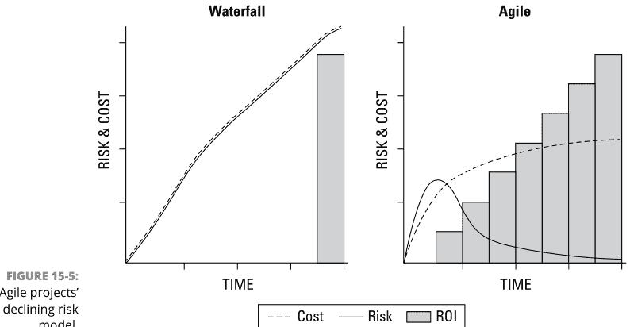

| 成本 | 风险 | ROI |

## 管理敏捷风险

在本节中，你将研究敏捷项目的关键结构，这些结构可以在项目生命周期内降低风险。你将了解到如何使用敏捷工具和事件在项目的适当发现风险，以及如何优先考虑并缓解这些风险。

### 固有地降低风险

敏捷方法在实施正确的情况下，从上减少了产品开发中的风险。通过冲刺（sprints）进行开发确保了项目投入与证明产品运行之间的时间很。冲刺还提供了项目早期产生收入的潜力。

降低风险的三个重要因素是“完成定义”（definition of done）：

- 已开发：项目投入与证明产品运行之间的时间很短。
- 已测试：开发团队必须确保产品运行。
- 已集成：开发团队必须确保产品运行。
- 已文档：开发团队必须确保产品运行。

“完成定义”极大地改变了敏捷项目的风险因素。通过在每个冲刺中创建一个符合完成定义的的产品，你每个冲刺结束时都有一个可运行的版本和可用的功能。即使外部因素导致项目提前结束，项目利益相关者始终看到某些价值并必须使用且在此构建。

## 风险与完成定义

在第 10 章中，我们讨论了完成定义。对于一个冲刺，完成定义通常包括以下：

- 已开发：开发团队必须确保产品运行。
- 已测试：开发团队必须确保产品运行。
- 已集成：开发团队必须确保产品运行。
- 已文档：开发团队必须确保产品运行。

图 15–6 显示了一个完成定义的示例。

| 冲刺 | 发布 | 风险 |
|---|---|---|
| QA | 阶段环境 | |
| 单元/开发 | 性能 | |
| 功能性 | 安全性 | |
| 回归 | 负载 | |
| 用户验收 | 企业级 | Deepa |
| 静态 | 焦点小组 | Sarah |
| 同行评审 | 用户文档 | Jim |
| → 培训 | Wiki | |

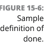

产品负责人和开发团队可能还会创建一个可接受风险列表。例如，在云计算中，负载测试可能不关键，因为可以根据需要轻松添加额外容量。

## 自资金项目

敏捷项目可以以传统项目无法做到的独特方式缓解财务风险：自资金项目。如果你的产品是一个产生收入的项目，你可以利用这些收入来资助项目的剩余部分。

在第 13 章中，我们向你展示两种不同的 ROI 模型。它们在这里，表 15-3 和 15-4 中。两个项目创建的产品相同。

### 表 15-3 传统项目在六个月后最终发布的收入

| 月份 | 产生收入 | 项目总收入 |
|---|---|---|
| 一月 | $0 | $0 |
| 二月 | $0 | $0 |
| 三月 | $0 | $0 |
| 四月 | $0 | $0 |
| 五月 | $0 | $0 |
| 六月 | $0 | $0 |
| 七月 | $100,000 | $100,000 |

## 每月发布及六个月后最终发布的敏捷项目收入

| 月份/发布 | 产生的收入 | 项目总收入 |
|---|---|---|
| 一月 | $0 | $0 |
| 二月 | $15,000 | $15,000 |
| 三月 | $25,000 | $40,000 |
| 四月 | $40,000 | $80,000 |
| 五月 | $70,000 | $150,000 |
| 六月 | $80,000 | $230,000 |
| 七月 | $100,000 | $330,000 |

在短时间内产生收入的能力对公司和项目团队都有许多益处。自给资金的敏捷项目对于几乎任何组织来说都具有财务意义，但对于那些可能没有资金创建产品的组织来说，它们特别有用。自给资金可以使原本无法行的项目变得可行。

自给资金的项目还有助于降低项目因资金不足而取消的风险。公司可能会规定将特定项目的预算转移到其他地方，从而延迟或取消项目。然而，一个每次发布都能产生额外收入的敏捷项目在危机期间有很大机会持续下去。

最后，自给资金的项目有助于从一开始向利益相关者推销项目；对于一个从开始就提供持续价值并支付了部分项目成本的项目，人们是很难反驳的。

## 快速失败

所有产品开发工作都带有一定的失败风险。在冲刺（sprints）中测试引入了“快速失败”的概念：与其在需求、设计和开发上投入大量成本进行长期努力，然后在测试阶段发现阻碍项目进展的问题，敏捷项目中的开发团队可以在几个冲刺内识别出关键问题。这种量化的风险缓解可以为组织节省大量资金。

表 15-5 和表 15-6 展示了失败的瀑布项目和失败的敏捷项目在沉没成本上的差异。两个表格中的项目是相同的产品，成本也相同。

## 表 15-5 瀑布项目的失败成本

| 月份 | 阶段与问题 | 项目沉没成本 | 项目总沉没成本 |
|---|---|---|---|
| 一月 | 需求阶段 | $80,000 | $80,000 |
| 二月 | 需求阶段 | $80,000 | $160,000 |
| 三月 | 设计阶段 | $80,000 | $240,000 |
| 四月 | 设计阶段 | $80,000 | $320,000 |
| 五月 | 设计阶段 | $80,000 | $400,000 |
| 六月 | 开发阶段 | $80,000 | $480,000 |
| 七月 | 开发阶段 | $80,000 | $560,000 |
| 八月 | 开发阶段 | $80,000 | $640,000 |
| 九月 | 开发阶段 | $80,000 | $720,000 |
| 十月 | QA 阶段：测试期间发现大规模问题。 | $80,000 | $800,000 |
| 十一月 | QA 阶段：开发团队尝试解决问题以继续开发。 | $80,000 | $880,000 |
| 十二月 | 项目取消；产品不可。 | 0 | $880,000 |

在表 15-5 中，项目利益相关者花费了 11 个月和近百万美元才发现一个产品想法行不通。将其中的沉没成本与表 15-6 进行对比。

## 表 15-6 敏捷项目的失败成本

| 月份 | 冲刺与问题 | 项目沉没成本 | 项目总沉没成本 |
|---|---|---|---|
| 一月 | 冲刺 1：无问题。<br>冲刺 2：无问题。 | $80,000 | $80,000 |
| 二月 | 冲刺 3：测试期间发现大规模问题导致冲刺失败。<br>冲刺 4：开发团队尝试解决问题以继续开发；冲刺最终失败。 | $80,000 | $160,000 |
| 最终 | 项目取消；产品不可。 | 0 | $160,000 |

通过早期测试，敏捷项目在二月结束前花费了更少的时间和资金就发现产品不可行，这与表 15-5 相比。

## 识别并应对风险

尽管有“完成的定义”、自给资金项目和快速失败的概念，团队仍应该意识到风险的存在。在下一节中，你将看到如何使用敏捷工具管理风险。

## 表 15-7 敏捷风险管理工具

| 产物或会议 | 在风险管理中的作用 |
|---|---|
| 产品愿景 | 产品愿景声明统一了项目目标，降低了对需求误解风险。在创建产品愿景时，团队可能会根据市场和客户反馈并结合组织战略，从很高水平考虑风险。在第 7 章了解更多关于产品愿景的内容。 |
| 产品路线图 | 产品路线图提供了需求和优先级的视觉化概述。该概述使项目能够快速识别缺口。在第 7 章了解更多关于路线图的内容。 |


| 产品待办列表 | 产品待办列表是适应变化的工具。通过向待办列表添加更改并重新排列优先级，可以将范围变更相关的传统风险转化为创建更好产品的方式。保持待办列表中的需求和优先级确保开发团队能够在正确的时间处理最重要的需求。在第 7 和第 8 章了解更多关于待办列表的内容。 |

| 发布计划 | 在发布计划期间，团队讨论发布以及如何缓解这些风险。发布计划会议中的风险讨论应该是高层面的针对整个发布。通过冲刺计划中的具体需求应对风险。在第 8 章了解更多关于发布的内容。 |

| 冲刺计划 | 在每个冲刺计划期间，团队讨论特定的需求和任务以及如何缓解这些风险。冲刺计划中的风险讨论可以深入，但应仅限于当前冲刺。在第 8 章了解更多关于冲刺计划的内容。 |

| 冲刺待办列表 | 完成图（`burndown chart`）提供了冲刺状态的快速视图。该视图有助于团队在问题出现时管理风险，并通过立即解决问题来最小化其影响。在第 9 章了解更多关于冲刺待办列表和完成图的内容。 |

| 每日 Scrum | 在每个每日 Scrum中，开发成员讨论阻碍。阻碍或障碍有时是风险。每天讨论阻碍为开发团队和 Scrum 师提供了立即缓解这些风险的机会。在第 9 章了解更多关于每日 Scrum的内容。 |

| 交付物或会议 | 在风险管理中的角色 |

| --- | --- |

| 任务看板 | 任务看板提供了冲刺状态的不可避免的视图，使 Scrum 团队能够发现并管理针对冲刺的风险。在第 9 章中了解更多关于任务看板的信息。 |

| 冲刺评审 | 在冲刺评审期间，Scrum 团队定期确保产品符合利益相关者的预期。冲刺评审还为利益相关者提供了讨论产品变更的机会，以适应变化的业务需求。冲刺评审的这两个方面都管理了在项目结束时交付错误产品的风险。在第 10 章中了解更多关于冲刺评审的信息。 |

| 冲刺回顾 | 在冲刺回顾期间，Scrum 团队讨论上一个冲刺出现的问题，并识别出哪些问题可能会出现在未来的冲刺中。开发团队需要确定方法防止这些风险再次变成问题。在第 10 章中了解更多关于冲刺回顾的信息。 |

本节讨论的交付物和会议通过由负责的角色在适当的时间处理风险，系统地帮助敏捷团队在敏捷项目中管理风险。项目越大、越复杂，采用敏捷方法消除失败风险的概率就越高。

## 5 确保敏捷成功

## 在此部分 ...

通过组织和个人对变得更加敏捷的承诺来建立基础。

选择一个项目并创建一个能够优化敏捷转型成功的环境。

在多团队项目中适当地规模化敏捷技术。

成为你组织中的变革者，帮助避免敏捷转型中的常见陷阱。

## 本章内容

- 获得组织和个人的承诺

- 组建具备必要技能和能力的团队

- 建立合适的环境

- 投资培训

- 确保初始和持续的支持

## 第 16 章

## 建立基础

要成功地从传统项目管理流程转向敏捷流程，你必须从良好的基础开始。你既需要组织的承诺，也需要个人的个人的承诺，并且需要为你的第一个敏捷项目找到一个良好的项目团队，为他们提供一个有利于于敏捷方法的环境。你希望为项目团队找到合适的培训，并持续支持你组织的敏捷方法，使其能够在你的首个项目之外不断成长。

在本章中，我们将向你展示如何在你的组织内部建立强大的敏捷基础。

### 组织和个人承诺

对敏捷项目管理的承诺意味着积极、有意识地努力尝试新方法并放弃所有旧习惯。个人层面和组织层面的承诺对于敏捷的成功至关重要。

如果没有组织的支持，即使是最热情的敏捷项目团队成员也可能发现自己被迫回到旧的项目管理流程中。如果没有个人项目团队成员的承诺，采用敏捷方法的公司可能会遇到过多的阻力，甚至是破坏，从而无法成为敏捷组织。

以下章节提供了关于组织和个人如何支持敏捷转型的详细说明。

### 组织承诺

组织承诺在敏捷转型中起着巨大的作用。当一家公司及其内部群体接受敏捷原则时，项目团队成员的转型将变得更容易。

组织可以通过以下方式承诺敏捷转型：

- 聘请经验丰富的敏捷专家制定真实的转型计划，并指导公司执行该计划

- 投资员工培训，从公司第一个敏捷项目团队的成员以及支持他们的各级领导层开始

- 允许 Scrum 团队放弃瀑布式流程、会议和文档，转而采用精简的敏捷方法

- 确保每个敏捷项目所需的所有 Scrum 团队成员都投入其中：一个赋权的的产品所有、一个由多技能人员组成的跨职能开发团队，以及一个具有影响力的仆型领导 Scrum Scrum Master

- 鼓励开发团队不断增加他们的技能组合

- 提供自动化测试工具和持续集成框架

- 在后勤上支持 Scrum 团队进行自我管理

- 给敏捷项目团队时间和自由去经历一个试错过程

- 修订员工绩效考核以强调团队绩效

- 鼓励敏捷项目团队并庆祝成功

组织支持在敏捷转型之外同样重要。公司可以通过在考虑敏捷项目团队的情况下进行招聘，以及为新员工提供敏捷培训，以确保敏捷流程持续运作。组织可以利用敏捷导师的持续支持，导师可以在项目团队遇到新且具有挑战性的情况时为他们提供指导。

当然，组织是由个人组成的。组织承诺和个人承诺是密不可分的。

### 个人承诺

在敏捷转型中，个人承诺与组织承诺具有同等的作用。当项目团队中的每一个人都努力采用敏捷实践时，对于项目团队中的每个人来说，变化变得更容易了。

个人可以通过以下方法单独承诺敏捷转型：

- 参加培训和会议，并愿意学习敏捷方法

- 开放改变，愿意尝试新流程，并努力适应新习惯

- 抵制回到旧流程的诱惑

- 为敏捷技术方面经验较少的项目团队成员担任同伴教练

- 允许自己犯错并从这些错误中学习

- 在冲刺回顾中诚实地反思每个冲刺，并致力于改进工作

- 积极成为多才技能的开发团队成员

- 放下自我并作为团队的一部分工作

- 对团队的成功和失败负责

- 主动进行自我管理

- 在每个敏捷项目中保持活跃和投入

在有了组织承诺的情况下，个人承诺在敏捷转型期之后同样重要。第一个敏捷项目团队的成员将成为整个公司的变革推动者，为其他项目团队奠定基础，并效范如何有效地工作。

## 获得承诺

对敏捷方法的承诺可能不是瞬间形成的。你需要帮助组织中的人们克服抵制的自然本能。

敏捷转型中一个良好的早期步骤是寻找敏捷倡导者，这是一种高级别经理或高管，他们可以帮助确保组织变革。伴随敏捷转的基本流程需要管理和执行业务决策的人的支持。一个优秀的敏捷倡导者能够集结组织及其人员围绕流程变革。

获得承诺的另一个重要方法是识别组织当前项目的挑战，并利用敏捷方法提供解决方案。敏捷项目管理可以解决许多问题，包括产品质量、客户满意度、团队士气、预算和进度超支、资金、组合管理以及整体项目问题。

最后，强调敏捷项目管理的整体利益。从传统管理方法转向敏捷方法的某些真实利益包括：

- 更快乐的客户：由于敏捷项目团队能够快速生产产品、响应变化并与其合作，敏捷项目通常具有更高的客户满意度。

- 利润：敏捷方法允许项目团队更快交付功能。敏捷组织可以实现更高的投资回报，通常会导致自筹项目。

- 缺陷减少：质量是敏捷方法的核心。主动的质量措施、持续集成和测试以及持续改进都有助于更高质量的项目。

- 士气提高：作为可持续开发和自我管理开发团队的敏捷实践意味着员工更快乐、效率更高、流动更少。

你可以在第 19 章中找到更多敏捷项目管理的益处。

- **你们现在的业务是如何运作的？** 宏观层面是如何规划项目的？组织是否固执于固定的范围？业务代表的参与程度如何？你们是否外包开发？

- **你们的团队目前是如何工作的，在敏捷方法下需要哪些调整？** 瀑布模型根有多深？团队是否具有强烈的命令与控制心态？好的想法是否可以来自任何地方？团队之间有信任吗？人员是否在团队间共享？为了确保这些实现，你们需要申请什么？你们能否获得人员、工具、空间和承诺来试点变革？

- **面临哪些监管挑战？** 是否有与监管要求相关的流程和程序？这些要求是由内部或外部采纳的法规标准强加给你们的？你们是否需要创建额外的文档来满足监管要求？你们是否可能面临合规性审计，违规的成本是多少？

在审查你对障碍和挑战的分析时，你可能会发现以下关注点：

- **敏捷方法表明组织需要改变。** 当你将敏捷实践和结果与传统做法进行比较时，你会发现表现并未达到理想水平。你需要直面这个问题。你的组织一直在一个项目预期运行的框架内运作。你的组织已经尽力产生结果，往往是在面临极端挑战的情况下。对于所有参与方，你必须承认他们的努力，并引入敏捷流程的潜力，让他们产生更巨大的成果。

- **项目管理可能误认为敏捷技术是不够充分的。** 通常情况下，《敏捷宣言》的价值观和原则被误解为：敏捷框架涉及计划和文档，从而忽略了通用的项目管理标准。经验项目经理可能认为在向敏捷流程过渡的过程中，某些价值正在流失。利用每个机会来澄清敏捷价值观和原则支持什么、不支持什么。展示每个原则如何解决传统项目管理试图尝试解决的相同挑战，以及敏捷技术是如何项目经理能力和职业的扩展，而不是对他们努力维护的价值的贬低。

- **从领导模式向服务模式转变可以获益。** 敏捷领导者是服务导向的。命令与控制变成了引导。仆人式领导对许多项目团队和职能经理来说是一个巨大的转变。证明这种转变如何为所有人提供更有效的成果。你可以在第14章中阅读更多关于仆人式领导的内容。

请记住，阻力在所难免；没有反对，变革就不会发生。做好应对阻力的准备，但不要让它阻败了你的整体计划。

### 转型时机

从组织角度来看，你可以任何时候启动转向敏捷方法的倡议。你可能考虑几个最佳时机：

- **当你需要证明敏捷项目管理是必要的时：** 在一个大型项目结束时，此时你可以清楚地看到哪些地方行不通（例如，在项目结项回顾期间）。你将能够证明瀑布模型的问题，并为你的第一个敏捷项目试点获得一个跳板。

- **当你的挑战是准确预算时：** 在年度预算年开始前的一个季度（即当前预算周期结束前的一个季度）运行你的第一个敏捷项目。你将从第一个项目中获得指标，让你在规划明年的计划时更有据可。

- **当你开始一个新项目时：** 在有新项目时转向敏捷流程可以让你从零开始，而不受旧方法的包袱。

- **当你尝试进入新市场或行业时：** 敏捷技术允许你交付快速创新，帮助你的组织为新客户创造产品。

- **当你有新的领导层时：** 管理层的变动是利用敏捷方法满足新预期的绝佳机会。

尽管你可以利用这些机会之一开始使用敏捷流程，但这些并不是要求的。变得更加敏捷的最佳时机是……今天！

# 选择合适的试点团队成员

确定与什么的人合作，特别是在早期阶段，对于敏捷项目的成功至关重要。在为你组织的第一个敏捷项目选择不同角色的人员时，要考虑以下事项。

### 敏捷冠军（`Agile Champion`）

在敏捷转型的初期，敏捷冠军将是确保项目团队成功的关键人物。这个人能够有效、快速地影响影响试点敏捷团队成功机会组织每一层。一个优秀的敏捷冠军应该能够完成所有任务：

- 对敏捷以及敏捷方法将解决的组织和市场问题充满热情。

- 对公司流程做出决策。如果存在现状，敏捷冠军应该能够影响变革。

- 让组织对敏捷流程可能实现的可能性感到兴奋。

- 在项目团队建立敏捷流程的步骤中，定期且直接地与其协作并提供支持。

- 为第一个项目以及长期来看，获取成功所需的项目团队成员。

- 作为一个升级点，消除不必要的干扰和非敏捷流程。

在选择敏捷冠军时，寻找组织中具有权威的人员——他们的声音受到尊重，并且过去成功领导过变革倡议。

### 敏捷转型团队

与敏捷冠军同样重要的是，一个人无法完成所有工作。敏捷冠军应该与其他组织领导者合作，敏捷项目团队在转型过程中依赖这些领导者的支持。敏捷团队共同消除组织障碍，确保试点团队和未来敏捷团队的成功。敏捷转型团队应该：

- 通过对试点敏捷团队的持续支持致力于组织的成功。

- 为组织如何变得敏捷建立清晰的愿景和路线图。

- 组织成一个 Scrum 团队

- 以 Scrum 团队的形式运作，举行所有的五个 Scrum 事件并实现所有的 Scrum 产物。

图 16-1 展示了敏捷转型团队和试点 Scrum 团队的冲刺节奏是如何对齐的。试点团队的回顾中识别出的障碍将成为转型团队解决的待办事项。

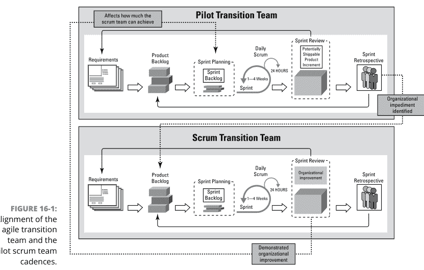

敏捷转型团队不仅为试点 Scrum 提供系统支持，组织领导层也通过与团队一起使用 Scrum 变得敏捷。

### 产品负责人（`Product Owner`）

在敏捷冠军和敏捷转型团队到位后，焦点转向试点 Scrum 团队。试点团队负责人应该来自组织的业务端，将业务与技术结合起来。在第一个敏捷项目中，产品负责人可能需要适应与团队合作。一个良好的产品负责人应该：

- 果断的。

- 客户需求和业务的专家。

- 拥有业务权限并被授权对产品需求进行排序和重新排序。

- 足够组织，以管理不断变化的待办事项。

- 承诺与团队合作，并在整个项目期间对团队可用。

- 拥有获取项目资金和其他资源的能力。

为你的第一个敏捷项目选择产品负责人时，寻找一个能够提供产品知识并对项目投入的人。

### 开发团队（`Development Team`）

在敏捷项目中，自管理的开发团队是项目成功的核心。开发团队决定如何开展项目工作。良好的开发团队成员应该能够：

- 多才多艺的。

- 愿意跨职能工作。

- 计划冲刺并围绕该计划进行自我管理。

- 理解产品需求并提供工作量估计。

- 向产品负责人提供技术建议，以便其理解需求的复杂性并做出相应决策。

- 响应环境并调整流程、标准和工具以优化性能。

充满好奇心、渴望学习新方法并愿意以各种方式为项目目标做出贡献的开发者最可能在敏捷环境中成长。

### Scrum Master

公司第一个敏捷项目的 Scrum Master 可能对后期项目中开发团队的干扰保持敏感。良好的 Scrum Master 应该

- 具有影响力。

- 拥有足够的组织影响力，以消除防止项目团队成功使用敏捷方法的外部干扰。

- 了解敏捷项目管理知识，能够帮助项目团队在整个项目过程中维护敏捷流程。

- 具备沟通和引导技巧，引导开发团队达成共识。

- 拥有足够的信任感，能够后退并允许开发团队进行自我组织和自我管理。

在为公司的第一个敏捷项目确定 Scrum Master（敏捷 Scrum师）时，你需要选择一位愿意担任仆型领导者（`servant-leader`）的人。同时，Scrum Master 需要具备强大的心理素质，在面对组织和个人的阻力时能够抵御干扰并维护敏捷流程。

## 项目利益相关者

在组织的第一个敏捷项目中，良好的项目利益相关者应该：

- 参与其中。

- 将最终产品决策交给产品主（`Product Owner`）。

- 参加迭代评审（`Sprint Reviews`）并提供产品反馈。

- 理解敏捷流程。让项目利益相关者与项目团队其他成员参加相同的培训，将有助于他们更好地适应新流程。

- 以敏捷格式理解项目信息，例如迭代评审、产品待办（`Product Backlogs`）和迭代待办（`Sprint Backlogs`）。

- 当产品主和开发团队有疑问时提供细节。

- 与产品主及项目团队的其他成员协作工作。

你敏捷项目的利益相关者应该是值得信赖、合作且对项目的积极贡献者。

### 敏捷导师

敏捷导师（有时称为敏捷教练）是确保在学习 Scrum 并开始建立基础敏捷环境的同时，让团队和组织不离轨道的关键。一名优秀的敏捷导师应该：

- 经验丰富。

- 成为敏捷流程专家，特别是你组织选择的敏捷流程。

- 熟悉不同规模的大小项目。

- 帮助团队进行自我管理，通过提问帮助他们自主学习，提供实用的建议和支持，而不接管项目。

- 在项目开始时引导项目团队完成第一个迭代，并在整个过程中根据需要回答问题。

- 与产品主、开发团队成员和 Scrum Master 工作并建立联系。

- 应该是来自部门或组织之外的人员。敏捷导师通常来自公司的项目管理小组或卓越中心。如果敏捷导师来自组织内部，他在提出建议和提供指导时应该能够放下政治考量。

许多组织提供敏捷策略、规划和导师服务，包括我们的公司 Platinum Edge。

## 创建支持敏捷所需的环境

当你为将从传统方法调整为敏捷方法奠定基础时，请创建一个能让敏捷项目取得成功且项目团队蓬勃发展的环境。敏捷环境不仅指物理环境（如我们在第 5 章中描述的），还包括良好的组织环境。要创建一个良好的敏捷项目环境，你应该具备：

- 良好利用敏捷流程：这似乎是显而易见的，但从一开始就使用经过过的敏捷框架和技术。参考价值路线图 16-2，使用 Scrum 和其他关键敏捷实践来增加成功的机会。从基础开始；仅在项目和你的知识进步时才在此基础上构建。为了进步而进步并不会导致完美。记住，熟能不能生巧，熟能只能使习惯永久。从正确的开始。

### 价值路线图

### 阶段1：产品愿景

描述：产品目标及其与公司愿景的对齐。

所有者：产品主。

频率：至少每年一次。

发布产品（根据发布情况）

### 阶段2：产品路线图

描述：产品特征的整体视图，有助于定义产品愿景。

所有者：产品主。

频率：至少每季度一次。

### 阶段7：迭代回顾

描述：对迭代进行反思并制定改进计划。

所有者：团队。

频率：迭代结束时。

### 阶段6：迭代评审

描述：工作性产品的演示。

所有者：产品主。

频率：迭代结束时。

### 阶段3：发布计划

描述：产品发布计划。

所有者：团队。

频率：至少每季度一次。

### 阶段5：每日站会 (`Daily Scrum`)

描述：工作的每日同步和计划。

所有者：开发团队。

频率：每日。

### 阶段4：迭代计划

描述：为即将进行的迭代计划。

所有者：团队。

频率：迭代开始时。

### 准备

### 执行

- 透明性：对状态透明。

- 频繁反馈：使用定期反馈查看项目进展。

- 立即适应：利用敏捷机会进行改进。

- 专职团队：产品主、开发团队和 Scrum Master 必须专职。

- 同地团队：理想情况下，产品主、开发团队和 Scrum Master 坐在一起。

308 第 5 部分 确保敏捷成功

- 经过培训的团队：当你首次启动敏捷流程时，通过关注关键成功因素，为你的敏捷转型提供每一个机会。

幸运的是，有很多培训机会。你可以找到正式认证，也可以找到非认证的敏捷课程。可用的认证包括：

来自 Scrum Alliance：

- 认证 ScrumMaster (`CSM`)

- 高级 ScrumMaster (`A-CSM`)

- 认证 Scrum 产品主 (`CSPO`)

- 高级 Scrum 产品主 (`A-CSPO`)


# 认证与课程

## 认证 Scrum 开发人员 (CSD)

## 高级 Scrum 开发人员 (A-CSD)

## 针对 ScrumMaster (CSP-SM)、产品主 (CSP-PO) 和开发人员 (CSP-D) 的认证 Scrum 专业人士

## 认证团队教练 (CTC)

## 认证企业教练 (CEC)

## 认证敏捷领导力 (CAL)

## 项目管理协会敏捷认证实践师 (PMI-ACP) 认证

## 来自 Scrum.org 的认证

- 专业 Scrum Master (PSM I, II, III)
- 专业 Scrum 产品主 (PSPO I, II)
- 专业 Scrum 开发人员 (PSD)

## 来自敏捷国际联盟 (ICAgile) 的认证

- 敏捷教练、工程、培训、业务敏捷、交付管理、DevOps、企业、敏捷和价值管理的各种路径

## 众多大学课程

# 初期和长期支持敏捷

当你首次启动敏捷流程时，通过关注关键成功因素，为你的敏捷转型提供每一个机会：

- **选择一个良好的试点**：选择一个足够重要以获得大家支持的项目。同时，设定预期：尽管项目将产生可衡量的改进，但在团队学习新方法期间结果将是微小的，并随着时间的推移而改进。
- **获得敏捷导师**：利用导师或教练增加建立良好敏捷环境和最大化卓越表现的机会。
- **多多沟通**：在组织的各个层面不断讨论敏捷流程。利用你的敏捷倡导者推动试点向更广泛的敏捷适应转型。
- **准备好向前**：考虑未来。思考你将如何把试点项目的教训应用到新项目和新团队。还要思考你将如何从单项目扩展到多个项目（包括多个团队的项目）。

# 本章内容

- 识别在多团队项目何时以及为何进行扩展
- 理解扩展的基础知识
- 探索扩展挑战

# 第 17 章 跨敏捷团队的扩展

根据进度、范围和所需的技能，许多中小型项目可以通过单个 Scrum 团队完成。然而，较大的项目可能需要多个 Scrum 团队，以便在合理的进入市场时间范围内实现产品愿景和发布目标。当需要多个 Scrum 团队时，这些团队需要有效的团队间协作、通信和同步——它们需要规模化运行。无论项目大小如何，如果多个在同一项目上合作的团队（甚至是跨一组项目）之间存在相互依赖关系，你可能需要进行扩展。

仅在必要时才进行扩展。尽管你有可用的人才和资源来在项目中部署多个团队，但多个团队并不能自动确保更高的质量和更快的上市速度。始终要寻找实现第十条敏捷原则的方法：“简单性——最大化未完成工作的艺术——至关重要。”少即是多。

作为一种敏捷框架，Scrum 帮助团队组织工作并有效地展示进度，无论你的项目包含一个 Scrum 团队还是一千个 Scrum 团队。然而，扩展带来了新的挑战，因此你希望实施跨团队协调与协作技术，这些技术不仅要支持敏捷价值观和原则，还要解决你的项目和组织面临的特定挑战。

在本章中，我们讨论了在敏捷项目上需要多个团队时需要解决的一些问题。我们还提供了某些解决扩展挑战的敏捷扩展框架和方法的概述。

# 多团队敏捷项目

当产品积压（`Product Backlog`）和发布计划要求的开发速度比 Scrum 团队能够实现的更快时，组织就会确定需要多个 Scrum 团队。

在敏捷项目中，跨职能团队在项目的每个冲刺（`Sprint`）中共同工作，每个冲刺执行相同类型的工作，将产品积压中的需求实现为完成的、可运行的可交付的功能。然而，当多个团队从同一个产品积压中工作时，你就面临新的挑战需要解决。

一个 Scrum 团队在同一个项目上工作时的常见挑战包括：

- **项目规划**：敏捷规划从开始就是协作的。大型群组的协作与单个 Scrum 团队的协作不同。与更广泛的项目团队（所有 Scrum 团队和利益相关者）建立愿景，并根据所有参与方的协作输入构建产品路线图和积压列表，需要一种与单团队项目不同的方法。
- **发布规划**：与项目规划的挑战类似，发布涉及对范围和发布时间的更具体的规划。协调谁在什么时候做什么以及贯穿整个发布周期尤为关键，以确保依赖关系、范围缺口和人才分配符合项目需求。
- **分解**：为了拆分同一个积压列表中的较大需求，多个团队可能需要参与研究和精炼讨论及活动。由谁发起这些讨论？由谁促成？
- **冲刺规划**：虽然冲刺规划不是 Scrum 团队之间协调规划和执行的最后机会，但冲刺规划是 Scrum 团队锁定产品积压中某部分范围进行执行的时候。在这个阶段，Scrum 团队之间的依赖关系变成了现实。如果之前开发产品路线图和发布计划的活动没有暴露依赖关系，那么 Scrum 团队可以在冲刺规划中暴露并解决哪些？
- **每日协调**：即使在从项目启动到冲刺规划的有效规划和协作之后，Scrum 团队每天也可以也应该进行协作。在团队处于执行模式时，谁参与以及可以做什么？
- **冲刺评审**：有如此多的团队在展示他们的增量并寻求反馈，利益相关者如何利用有限的时间参与？产品所有者如何根据跨多个 Scrum 团队学到的所有知识更新产品积压列表？开发团队如何知道其他开发团队完成了什么？
- **冲刺回顾**：多个 Scrum 团队共同工作组成一个更广泛的项目团队。他们如何识别改进机会并在整个计划中实施这些改进？
- **集成**：所有产品增量都需要在集成环境中运行。谁来集成？谁为团队提供基础设施？谁来确保集成？
- **架构决策**：谁来负责架构？这些决策可以如何去中心化以使团队能够自主工作？

这些是一些示例；你可以根据自己的经验识别其他。无论你的情况如何，选择适用于你情况的解决方案。

某些扩展框架提供了你可能面临的挑战的解决方案。在本章中，我们指的是产品（`Product`）、项目（`Project`）、计划（`Program`）和组合（`Portfolio`）。通常情况下，*产品*是为客户提供某种价值或用性的功能集合。*项目*是一组需要时间、努力和规划才能完成的工作，具有特定的开始和结束。*计划*是具有相关性的项目集合（汇入同一个产品）。*组合*是用于满足战略业务目标的计划和项目集合。

自 20 世纪 90 年代出现第一个 Scrum 团队以来，一直存在需要多个团队协作的敏捷团队。以下是各种框架和技术的概述。

## 通过垂直切分使工作易于理解

最简单的扩展方法之一被称为垂直切分（`Vertical Slicing`），它为跨团队划分工作提供了简单的解决方案，以便在每个冲刺中量交付功能。如果你的扩展挑战是跨团队划分工作，垂直切分就是解决方案。

垂直切分的概念也适用于单团队项目。开发团队由共同拥有将需求转换为完成的可交付功能的成员组成。开发团队一次攻克一个需求，该需求是产品积压列表的一个垂直切片，可能涉及技术的各个方面。

通过垂直切分，多个 Scrum 团队在相同长度的同步冲刺中针对垂直切片——整体产品的一部分或模块进行工作，然后由集成团队在每个冲刺后对这些模块进行集成。集成团队按冲刺安排开发团队，并本身就是一个 Scrum 团队，拥有专门的产品所有者、开发团队和 Scrum 导师。

图 17-1 说明了如何将产品积压列表切分为每个 Scrum 团队的具体需求。然后，在每个冲刺结束时，各个团队实现可以与更广泛的产品功能集中其他运行功能集成的功能。每个独立团队的功能都馈入集成团队的积压列表（图中上方的 Scrum 团队），用于架构和系统级协调。

所需的集成 Scrum 团队数量取决于每个项目的复杂度。该图展示了微软软件的一套功能可能需要的级别。（我们使用微软作为示例，因为大多数人熟悉它）。

每个集成 Scrum 团队处理其馈入团队产生的功能集成的所有系统级开发工作，并提供架构监督以统一各个 Scrum 团队。

以 Microsoft Office 为例：

- 一个 Scrum 团队开发电子邮件功能的“撰写/发送消息”功能（需求 ID `1.1.1.1`）。
- 另一个 Scrum 团队开发了“语法/拼写检查消息”（`1.1.1.2`）的功能。
- 第三个 Scrum 团队开发了“搜索消息”（`1.1.1.3`）的功能。
- 集成 Scrum 团队（在活动层级）负责集成工作，将这三个 Scrum 团队的功能集成到一个软件包（`1.1.1`）中，以便 Email 集成团队可以将其将该包集成到整个 Email 模块中。
- Outlook 集成团队获取 Email 模块以及日历、联系人和其他模块，将它们集成到一个 Outlook 软件包（`1.1`）中，以便 MS Office 集成团队可以将其集成到整个 MS Office 套件中（`1`）。

在这个示例中，集成团队作为独立的 Scrum 团队运行，每个角色都有专门的团队成员。

# 团队 Scrum (Scrum of teams)

不同的 Scrum 团队每天如何相互协调？“Scrum of scrums”模型通过垂直切片促进了 Scrum 团队之间有效的集成、协调和协作。我们在本章中向你们展示的几乎所有扩展框架都使用“团队 Scrum”来实现 Scrum 团队之间的每日协调。

图 17-2 展示了每个团队的每个角色如何与其它团队中相同角色的人员进行每日协调，涉及影响范围程序团队的优先级、依赖关系和障碍。每个角色的 Scrum of Scrum 由每个角色的集成层级人员促进。彻底的集成和发布工作建立了一个一致且定期的 Scrum of Scrum。

每天，各个 Scrum 团队会在大致相同的时间在不同的地点举行自己的 Scrum。在这些每日 Scrum 之后，将进行下述的 Scrum of Scrum 会议。

## 产品所有者 Scrum of Scrum

每天在个人 Scrum 团队的每日 Scrum 之后，每个 Scrum 团队的产品所有者会与集成团队的产品所有者见面，时间不超过 15 分钟。他们处理正在完成的需求，并根据个人 Scrum 团队每日会议中发现的实际情况进行任何调整。每个产品所有者处理以下内容：

- 自上次会面以来他们各自接受或拒绝的业务需求
- 在下次会面之前应该被接受的需求
- 哪些需求受到了阻碍，需要其他团队帮助来解决（例如，“John，在你完成你当前冲刺待办列表中的 `xyz` 需求之前，我们将无法完成 `123` 需求。”）

集成团队产品所有者做出必要的跨团队优先级决策，以确保障碍在团队每日 Scrum 中得到解决。

## 开发团队 Scrum of Scrum

每天在个人 Scrum 团队的每日 Scrum 之后，每个 Scrum 团队的一名开发成员代表参加集成团队的每日 Scrum（即开发人员的 Scrum of Scrum），并集成开发团队成员一起讨论以下内容：

- 自上次会面以来他们团队的成就
- 从现在到下次会议之间的团队计划成就
- 他们需要帮助的技术问题
- 团队已经做出的、任何人应该知晓以防止潜在问题的技术方向决策

从个人 Scrum 团队中轮换参加 Scrum of Scrum（集成团队的每日 Scrum）的开发团队成员，每天或每个冲刺换一次，以确保每个人都关注组合的集成工作。

## Scrum Master Scrum of Scrum

每个 Scrum 团队的 Scrum Master 也会与集成 Scrum 团队的 Master 会面，处理每个团队正在面临的障碍，每个团队不超过 15 分钟。每个 Scrum Master 处理以下内容：

- 自上次会面以来已解决的个人团队级障碍以及是如何解决的，以防其他 Scrum Master 遇到相同的问题
- 自上次会面以来发现的新障碍以及任何未解决的障碍
- 他们需要帮助解决哪些障碍
- 每个人都应该注意的潜在障碍

集成团队 Scrum Master 确保升级的障碍在每日 Scrum of Scrum 之后得到解决。

通过垂直切片，存在一个单一的产品待办列表，当这些需求被拆分并移动到开发 Scrum 团队时，团队属性会被分配给这些需求。通过这种模型，你可以看到整个程序，也可以快速过滤出你所在团队在整个程序中的部分。

一个常见的问题是“在垂直切片程序中，谁负责架构？”答案是，这取决于决策将影响哪些模块。

你的组织应该有现有的架构标准、编码标准和风格指南。这样一来，每个团队就不需要重复发明轮子。

考虑一个需要做出且将仅影响模块 A 的架构决策。模块 A 的 Scrum of Scrum 如果涉及多个团队，那么集成层级的开发团队可能是其中之一。

以图 17-2 为例，一个影响两个模块团队（`1.1.1.2` 和 `1.1.1.3`）的架构决策将由 Email 集成团队（`1.1.1`）做出。一个影响搜索消息集成 Scrum 团队的决策由更高级别的集成团队做出（`1`）。

垂直切片是一种简单的方法，可以让每个 Scrum 团队在更广泛的程序范围内交付价值功能。它有助于团队就限制和进展进行及时且相关的对话。

# 通过 Scrum at Scale 连接角色

敏捷扩展模型在复杂性和简单性上各异。Scrum at Scale 用于两个或数百个 Scrum 团队协作工作的方法是基础通信、障碍消除、优先级，以及 Scrum Master 和产品所有者的协调通信、需求细化和计划。使用 Scrum Master 和产品所有者的 Scrum of Scrum 模型是团队之间进行这种同步的方式。

## 扩展 Scrum Master

遵循 Scrum of Scrum 的垂直切片模型，Scrum at Scale 将五个 Master 分组成一个 Scrum of Scrum。它反映了个人 Scrum 团队的每日 Scrum 以发现并消除障碍。Scrum at Scale 将 Scrum of Scrum 的范围缩小到来自五个 Scrum 团队的五个 Master，限制了就 Scrum 团队正在工作的内容及其工作如何相互影响进行有效跨团队协作的复杂性。Scrum Master Scrum of Scrum 作为发布团队协调发布活动。

图 17-3 展示了 Scrum at Scale Scrum of Scrum 模型。

对于超过五个 Scrum 团队的项目，Scrum at Scale 实现了一个 Scrum of Scrum，其中每个 Scrum of Scrum 的代表与其他四个 Scrum of Scrum 代表一起参加，在 Scrum of Scrum of Scrum 层面上发现并消除障碍。

图 17-4 展示了 Scrum at Scale Scrum of Scrum of Scrum 模型。

当项目有超过 25 个团队时，执行行动小组（`EAT`）支持第三级 Scrum of Scrum of Scrum，以消除 Scrum of Scrum 组无法自行消除的组织障碍。

图 17-5 展示了带有执行行动小组（`EAT`）的 Scrum at Scale 第三级 Scrum of Scrum of Scrum。

## 扩展产品负责人

产品负责人以类似且对齐的方式组织；他们不再被标记为 Scrum 之 Scrum，而是“元 Scrum”（`meta scrums`）。一级元 Scrum 将五位产品负责人聚集在一起进行元 Scrum 会议，以提炼和规划优先级。每个元 Scrum 有一个首席产品负责人 (`CPO`)，负责监督愿景和产品待积列表的整体情况，并促进元 Scrum 内部产品负责人之间的协调。

图 17–6 展示了用于产品负责者的扩展规模 Scrum 元 Scrum。

二级和三级元 Scrum 的分组与 Scrum Master 之 Scrum 之 Scrum 之 Scrum 的分组保持一致。执行元 Scrum (`EMS`) 通过拥有并沟通全组织愿景来支持元 Scrum，接收来自元 Scrum 的技术优先级反馈，并为项目提供整体优先级决策。

图 17–7 展示了带有执行元 Scrum (`EMS`) 的扩展规模 Scrum 三级元 Scrum 模型。

图 17–8 展示了扩展规模 Scrum 三级 Scrum 之 Scrum 之 Scrum 模型与元 Scrum 模型在执行团队 (`EAT`) 和执行元 Scrum (`EMS`) 的对齐分组。

元 Scrum 应该是一个包含利益相关者的同步会议。`CPO` 级别的所有利益相关者都应该出席，以确保整个组织的对齐，并在每个冲刺期间支持 `CPO` 产品待积列表的优先级排序。

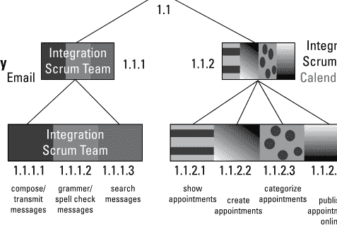

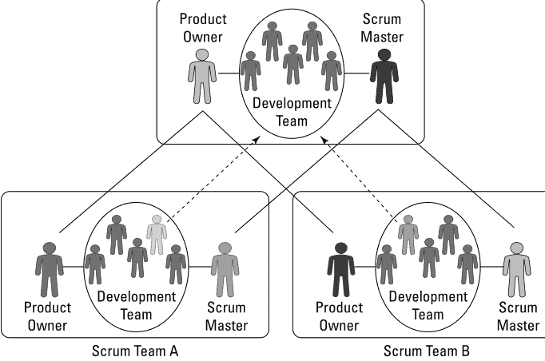

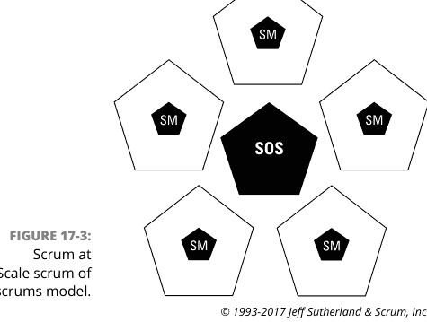


© 1993-2017 Jeff Sutherland & Scrum, Inc.

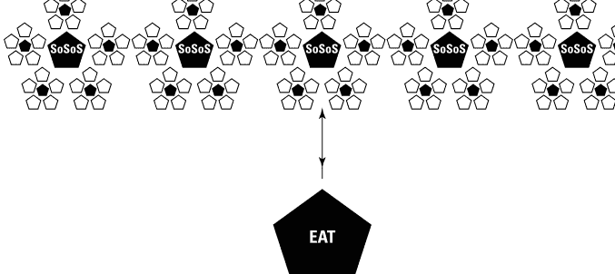

© 1993-2017 Jeff Sutherland & Scrum, Inc.

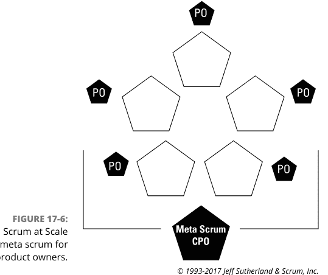

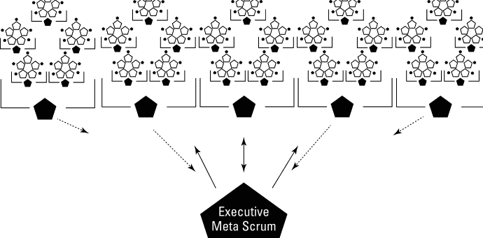


© 1993-2017 Jeff Sutherland & Scrum, Inc.

## 图 17-8

扩展规模 Scrum 三级 Scrum 之 Scrum 与元 Scrum 的对齐。

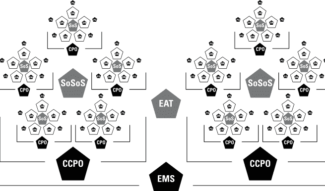

© 1993-2017 Jeff Sutherland & Scrum, Inc.

## 每天一小时同步

每天只需一小时或更短的时间，整个组织就可以对齐当日优先级，并完成消除障碍的有效协调。例如，早上 8:00，每个单个 Scrum 团队分别举行每日 Scrum。早上 8:45，Scrum Master 举行 Scrum 之 Scrum，产品负责人举行一级元 Scrum 会议。早上 9:00，Scrum Master 在 Scrum 之 Scrum 中会合，产品负责人在二级元 Scrum 中会合。最后，早上 9:15，Scrum Master 之 Scrum 之 Scrum 之 Scrum 与 EAT 会合，产品负责人元 Scrum 代表与 EMS 会合。

## 使用 LeSS 进行多团队协作

大规模 Scrum（LeSS）是在巨型项目中扩展 Scrum 的另一种方法。LeSS 基于这样一些原则，这些原则支持在将多个 Scrum 团队组合在一起处理同一个产品待积列表时保持 Scrum 的简单性。LeSS 更多关注 Scrum 团队如何共同工作，而不是组织结构。它还为解决扩展挑战提供了多种选项。在本节中，我们先提供概述，然后介绍几个脱颖出的选项。

LeSS 定义了两种框架规模：LeSS 和 LeSS Huge。区别在于涉及的团队总数。

### LeSS，较小的框架

图 17-9 展示了基础 LeSS 框架，以三个 Scrum 团队作为例。LeSS 建议遵循基础模型的 Scrum 团队不要超过八个。

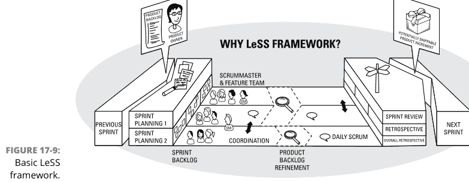

图 17-9：基础 LeSS 框架。

LeSS 概述了 Scrum 团队如何一个冲刺一次地工作，从冲刺计划开始，接着是冲刺执行和每日 Scrum，最后以冲刺评审和冲刺计划结束。尽管 LeSS 的大部分仍然遵循 Scrum 框架，但存在以下显著差异：

- 在 LeSS 中，团队通常与一到三个团队合作，且多达八个团队只有一个产品负责人。

我们强烈建议为每个 Scrum 团队分配专门的产品负责人和 Scrum Master，以确保开发团队能够立即、直接地获得业务决策、澄清并快速解决问题，以便他们能够不受间断地工作。


- 冲刺计划（部分 1）不要求所有开发者参加，但每个 Scrum 团队至少有两名成员以及产品负责人参加。代表团队随后返回并与其团队分享信息。
- 进行独立的冲刺计划（部分 2）和每日 Scrum 会议，不同团队的成员可以参加对方的会议以促进信息共享。
- 冲刺评审通常是所有团队合并进行的。
- 整体冲刺回顾在个人团队回顾中进行。Scrum Master、产品负责人和开发团队代表对项目的整体系统进行检查和调整，包括流程、工具和沟通。

### LeSS Huge 框架

通过 LeSS Huge，几千人可以处理一个项目。但结构仍然保持简单。

Scrum 团队围绕客户需求的主要区域进行分组，称为“需求领域”（requirement areas）。这种分组可能类似于 Scrum Master 之 Scrum 之 Scrum。执行元 Scrum（EMS）通过拥有并沟通全组织愿景来支持元 Scrum，接收来自元 Scrum 的技术优先级反馈，并为程序提供整体优先级决策。

图 17–7 展示了带有执行元 Scrum（EMS）的扩展规模 Scrum 三级元 Scrum 模型。

图 17–8 展示了扩展规模 Scrum 三级 Scrum 之 Scrum 之 Scrum 模型与元 Scrum 模型在执行团队（EAT）和执行元 Scrum（EMS）的对齐分组。

### 多团队会议

与联合冲刺回顾模型类似，LeSS Scrum 团队也可以从其他 Scrum 计划活动和活动的共同会议中受益。产品待办列表细化（Product backlog refinement）、冲刺计划的第二部分以及其他工作坊都是示例。LeSS 建议对每种情况采用类似的格式，共同元素包括以下内容：

- 首先是一个全体会议，供所有团队共享，以识别哪些团队可能承担哪些产品待办列表项。
- 每个团队的代表参加全体会议（所有人都可以参加，但不是要求全部参加）。
- 根据需要，全体会议之后进行多小组小组，仅由涉及的团队参加。

这些会议的关键在于面对面在同一个房间内进行实时协作，以消除依赖关系。对于分布式 LeSS 组（一个团队位于地理位置，其他团队位于其他地点），视频会议是关键。

### 旅行者

开发团队越全能型。为了开始构建跨团队的技能，技术专家可以成为“旅行者”，加入 Scrum 团队，通过结对编程（见第 4 章）、工作坊和教学课程在他们的专长领域进行教练和指导。

随着这些知识的共享，专家导师继续领导并提升整个组织的技能（作为社区 CoP 的组织者）。此外，Scrum 团队增加了他们的跨功能性并开发得更高效。

## 使用 Nexus 减少依赖关系

工作于同一产品的团队之间的依赖关系会阻碍单个 Scrum 团队在没有这些依赖关系时通常拥有的生产力。Nexus 是一个扩展框架，专注于将多个团队视为一个单元。减少团队间的依赖关系是扩展成功的关键。

团队间的依赖关系通常围绕团队如何构建需求和产品待办列表、团队之间的领域知识差异以及软件和测试产物。将需求、团队成员的知识和测试产物映射到同一个 Scrum 团队可以减少依赖关系。

Nexus 是一个框架，它描述了三到九个 Scrum 团队如何在同一个产品待办列表上工作，并在单一产品所有者的指导下，在每个冲刺交付潜在的可交付功能。

图 17-11 展示了 Nexus 框架。

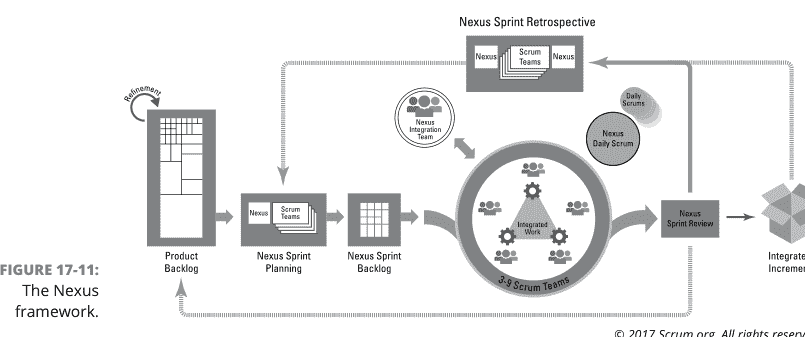

图 17-11：Nexus 框架。

除了 Scrum 角色、产物和事件外，Nexus 还引入了一个新角色、三个新产物和五个事件，以支持共同运行的大型 Scrum 团队组。

Nexus 帮助工作于同一产品身份的 Scrum 团队快速尽早解决依赖关系，使每个 Scrum 团队能够无阻碍、不受影响地推进工作。当产品待办列表项细化得充分，或者没有被拆分为单个 Scrum 团队可以处理的相对独立的项时，就会产生团队间依赖。依赖关系也源于团队之间技术技能或领域知识的差异。联合产品待办列表细化有助于团队在冲突发生前识别并将依赖降至最低。

Nexus 是一个轻量级框架，专注于将 Scrum 的实证方法扩展到需要多个 Scrum 团队开发的项目。

## Nexus 角色——Nexus 集成团队

与垂直切片模型中的集成团队概念类似，Nexus 集成团队确保 Nexus 每个冲刺至少产生一个集成产品增量。Scrum 团队执行工作，但 Nexus 集成团队对整个集成产品负责。

Nexus 集成团队的活动可能包括开发有助于集成的工具和实践，或作为教练和顾问帮助协调。为了完成这些活动，Nexus 集成团队的成员必须具备教学心态。他们的角色是帮助暴露需要在 Nexus 级别解决的问题，并帮助 Scrum 团队解决这些问题。

Nexus 集成团队由 Nexus 成员 Scrum 团队的人员组成。这是一个由以下人员组成的 Scrum 团队：

- **产品负责人负责排序和细化 Nexus 产品待办列表，以便从 Nexus 每个冲刺创建的工作中获得最大价值。** 产品所有者的角色没有从 Scrum 中改变；工作范围只是变得更加复杂。
- **开发团队成员通常是 Nexus 中 Scrum 团队的成员。** Nexus 集成开发团队成员优于单个 Scrum 团队，以集成产品作为每个冲刺的主要目标。Nexus 集成团队的成员可能会根据项目生命周期中特定的集成需求而变化。

将 Scrum 团队成员专门分配给团队可以消除由于上下文切换而导致频繁解散和重新组建的开销。始终意识到将团队成员的注意力分散到多个团队的风险。

- **Scrum Master** 总体负责确保执行并理解 Nexus 框架。此项的 Nexus 集成团队的 Scrum Master 也可能是 Nexus 中一个或多个 Scrum 团队的 Scrum Master。

因此，Nexus 集成团队成员可能会从产品待办列表中提取项并作为 Scrum 团队实现它们，但只有在所有其他选项都已耗尽且 Scrum 团队无法生产集成产品增量时，他们才采取这种紧急模式行为。正如“紧急模式”一术语所示，这种情况是非常不寻常、非常不理想且不可持续的。只有当它是让 Scrum 团队回到正道的唯一途径时才会采取。


### Nexus 产物

三个额外的产物为 Nexus 级别的检查和适应提供了透明度：

- **Nexus 目标（Nexus goal）：** 虽然冲刺目标在 Scrum 中不是一个独立的产物，但明确了 Nexus 冲刺目标。对于 Nexus 中的所有团队拥有清晰、可见的共同目标是关键。
- **Nexus 冲刺待办列表（Nexus sprint backlog）：** 每个 Scrum 团队都有自己的待办列表。Nexus 冲刺待办列表不是这些待办列表的聚合；它的存在是为了暴露和映射团队间的依赖。Nexus 冲刺待办列表作为 Nexus 的一部分每天更新。
- **集成增量（Integrated increment）：** 所有 Scrum 团队在冲刺期间完成的所有工作都是集成增量。它满足可用的可交付功能的完成定义。

### Nexus 事件

五个额外的事件增强了 Nexus 的团队间协作。

### Nexus 冲刺计划

在 Nexus 冲刺计划期间，产品负责人提供冲刺的优先级和业务背景，并设定冲刺目标。单个 Scrum 团队选择冲刺的工作，同时突出并最小化依赖。每个 Scrum 团队举行自己的冲刺计划，以规划从 Nexus 冲刺待办列表中提取的工作。最后一个 Scrum 团队完成后，Nexus 冲刺计划结束。

### Nexus 每日 Scrum

Nexus 没有规定谁应该参加每日 Scrum——正确的人是理解自己的工作如何影响或被其他团队影响的 Scrum 团队成员。解决的问题与单个 Scrum 团队的每日 Scrum 相似，专注于跨团队集成，包括：

- 昨天的工作是否成功集成？
- 发现了哪些新的依赖？
- 哪些信息需要在团队间共享？

Nexus 每日 Scrum 在每个 Scrum 团队举行自己的 Scrum 之前举行，以提供帮助他们更好地计划当天工作的输入。

### Nexus 冲刺回顾

与其他扩展框架类似，Nexus 冲刺回顾可以取代单个 Scrum 团队的冲刺回顾，因为重点是集成增量。你可以使用各种技术进行会议以最大化利益相关者的反馈，但没有规定。可以使用本章建议的技术。

## Nexus 冲刺回顾会议

Nexus 冲刺回顾是一个通过检查和适应改进 Nexus 工作方式的正式机会。Nexus 冲刺回顾包括三个部分：

- Nexus Scrum 团队的代表见面，识别跨团队问题并使其在 Nexus 中透明。
- 单个 Scrum 团队举行自己的回顾。
- 团队代表再次见面，决定如何解决 Nexus 范围的问题。

### 细化

Nexus 使用细化来拆解产品待办列表项，以便尽可能由单个 Scrum 团队独立开发。除了我们在第 7 章向您展示的渐进完善需求的通用过程外，Nexus 的细化过程包括：

- 拆解产品待办列表项，以理解哪些 Scrum 团队可能能够它们。
- 识别并可视化产品待办列表项之间的依赖。

## 与 SAFe 的联合计划规划

规模敏捷框架（SAFe）用于将 Scrum 和敏捷原则扩展到 IT 以及软件或系统开发组织的多个层级。SAFe 在四个层级解决扩展问题：端口、大型解决方案、程序和团队。图 17-12 显示了完整的 SAFe 5 全景图。

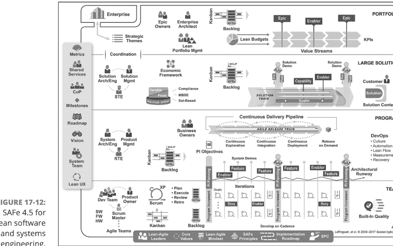

图 17-12：用于精益软件和系统工程的 SAFe 4.5。

SAFe 有四种配置，利用四个 SAFe 级的组合。SAFe（参考图 17-12）包含所有级别（端口、大型解决方案、程序和团队）。基础 SAFe（Essential SAFe，见图 17-13）是较小组织的起点，仅包含程序和团队级。端口 SAFe（Portfolio SAFe）在基础 SAFe 的基础上增加了端口级，适用于端口内拥有较小程序的组织。大型解决方案 SAFe（Large solution SAFe）在基础 SAFe 的基础上增加了大型解决方案级，针对构建需要数百人参与但不需要端口协调的大型解决方案的组织。

332 | 第 5 部分 确保敏捷成功

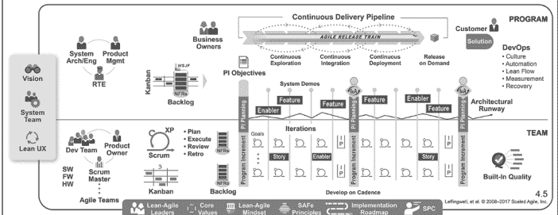

图 17-13：基础 SAFe 配置。

SAFe 以一组价值观、精益敏捷思维以及《敏捷宣言》中的价值观和原则为基础。尽管其他框架在战术上存在差异，但它们也有相似之处，例如：

- 开发在敏捷团队中进行。
- 团队在冲刺长度和节奏（cadence）上保持一致。
- 团队 Scrum 会（Scrum of teams）在程序级进行协调。

我们在这里不深入探讨 SAFe 的所有细节，但我们提供一个通用的概述，以及一些解决本章之前讨论过的挑战的实践。

## 理解四个 SAFe 级级

在 SAFe 中，你可以找到多四个规定的集成和协调层级，每个层级都旨在将决策下放到较低层级。我们强调“最多四个个”，是因为并非所有组织都需要某些层级，例如大型解决方案级。

框架提供了灵活性而非僵化。尽管 SAFe 为端口组织的所有层级提供了详细的可视化，但要避免实现对你来说不必要的结构。

接下来将描述四个层级——端口、大型解决方案、程序和团队。

### 端口级（Portfolio level）

在端口级，建立了整个端口的愿景和路线图。开发战略主题（Strategic themes）以支持愿景。管理预算、业务目标和企业架构治理。端口按价值流进行组织，使组织与交付的价值对齐。

SAFe 将价值流定义为从概念到交付或收款，向客户交付价值的系列步骤。它包括执行工作的人员、系统和物流。

三个端口级角色驱动端口决策：

- **精益端口管理（LPM）：** 该角色通过向端口传递战略主题、建立价值流和分配预算来对齐战略与执行。LPM 负责整个端口的战略、投资资金、敏捷指导和精益治理。（在第 4 章中了解更多关于精益的内容。）LPM 与组织各层级的许多小组协作。
- **史诗所有者（Epic owner）：** 史诗在第 8 章中介绍，尽管 SAFe 使用不同的特性-史诗关系。在 SAFe 中，史诗是最大且最长期的计划，驱动组织的业务愿景。它们被拆分为特性（features）或能力，然后进一步拆分为可在团队级单个开发团队执行的故事（stories）。史诗所有者在大型解决方案和程序级与解决方案管理、产品管理合作，并在团队级与敏捷团队合作。
- **企业架构师（Enterprise architect）：** 企业架构师建立共同的技术愿景，通过持续反馈、协作以及自适应工程设计和工程实践，驱动跨程序的整体技术方法。

SAFe 中的端口待办工作列表（portfolio backlog）由业务和赋能需求（enablers）组成。赋能需求是扩展架构能力以支持业务功能的需求。LPM 使用看板（kanban）引导大型倡议的流动。（在第 4 章中了解更多关于看板的内容。）

### 大型解决方案级（Large solution level）

大型解决方案级承载解决方案训练（solution train），这是一种用于协调多个敏捷发布训练（ARTs）的组织结构，ART 在“程序级”部分中定义。大型解决方案级适用于构建需要超过 125 人解决方案的组织。

解决方案训练由三个角色协调，类似于程序级角色，这些角色将在下一节“程序级”中详细描述。

### 程序级（Program level）

与端口愿景和待办列表保持一致，程序建立了愿景和路线图，以定义其工作范围的边界，重点关注端口待办列表中的选定史诗。

在程序级，进行发布和产品管理。该层级使用敏捷发布训练（ART）模型，ART 是由多个敏捷团队组成的团队（总共 50–125 人），负责交付增量的价值发布。“火车”按照可靠的时间表发站，如果特性准备就绪，可以加载到火车上。ART 提供了一个固定的节奏，程序团队据此对齐和同步。组织的其他部分知道此节奏后，也可以围绕已知的发布计划可靠地规划其工作。

如果在大型级组织，则由三个角色为每个价值流中的 ART 提供协调：解决方案训练工程师（STE）、解决方案管理和解决方案架构师/工程师。

在没有大型解决方案级的情况下，ART 由发布训练工程师（RTE）、产品管理和系统架构师/工程师驱动。ART 规则由以下角色制定：

- **发布训练工程师（RTE）：** ART 通常是自组织的，但需要协调程序级流程、障碍消除、风险管理和持续改进。类似于团队级的 Scrum Master，RTE 是仆人型领导。
- **产品管理（Product management）：** 这些人员为 ART 或解决方案训练定义需求并确定优先级，为个体敏捷团队的开发者提供快速决策所需的信息。
- **系统架构师/工程师（System architect/engineer）：** 一个跨学科团队，负责 ART 或解决方案训练的整体架构和工程设计。类似于在最低级集成团队中做出决策的方式，架构师/工程师为个体敏捷团队的开发者提供标准。

在该集成层级，ART 以五个个迭代为一个周期工作，创建所谓的程序增量（PI）。

### 团队级（Team level）

ART 由若干个敏捷团队组成，这些团队构成了 SAFe 的团队级。ART 中的敏捷团队彼此同步工作，它们的团队待办列表支持并对齐程序愿景和待办列表。

SAFe 有许多方面，但我们发现以下内容在解决扩展挑战方面最有价值。


# 联合程序增量规划（Joint Program Increment Planning）

程序增量（PI）规划统一了 ART 内的敏捷团队。在 PI 规划中，敏捷团队在同一房间、同一时间面对面共同规划下个 PI 的工作。

PI 规划包括：

- 由高管或业务所有者设定 PI 的业务背景。
- 由产品管理传递程序愿景，并支持程序待办列表的变化。
- 展示系统架构愿景和任何支持敏捷的开发实践（如自动化测试）。
- 由 RTE 概述规划流程。
- 敏捷团队小组会议，以确定容量和支持程序愿景的待办事项。
- 与所有敏捷团队共同绘制计划草，每个团队展示关键输出、潜在风险和依赖关系。产品管理和其他利益相关者提供输入和反馈。
- 由管理层绘制计划草，以识别范围、人员分配限制和依赖关系的任何问题。由 RTE 引导。
- 由 RTE 评审最终计划。

PI 规划的奇之处在于，依赖关系可以在这些两天的会议期间现场被识别并协调——这两天过得非常值。如果一个团队在团队小组会议期间发现自己的需求中存在依赖关系，该团队将立即派成员去另一个团队现场讨论该依赖关系。无需反复往返。

虽然没有任何规划可以提前识别所有问题，但这种协作模式可以提前解决大部分问题。此外，它在整个计划增量（Program Increment）执行期间建立了一个开放的通信渠道，确保团队能够同步并立即解决问题，这比他们作为独立团队在不讨论的情况下共享文档要更有效。

# 管理者的清晰性

在第 3 章和第 14 章中，我们讨论了管理变更如何使团队在本质上更加敏捷和适应适应。对于较大的组织，SAFe 为中间管理层参与敏捷团队提供了结构。组合、大型解决方案和程序层级概述了个人团队成员未涵盖的角色和功能，这明确了职能、技术和其他领导团队如何扫清障碍，使各个敏捷团队尽可能高效有效，并将战略与执行连接起来。

# 带有企业 Scrum 的模块化结构

在本章介绍的所有扩展模型中，企业 Scrum（ES）可能提供了最模块化的扩展方法。ES 框架经过高度配置，以实现整体业务敏捷性。

对于较大的项目、程序和组合，ES 将单团队 Scrum 实践的基础扩展到许多团队中，并通过许多结构化选项支持大规模的自组织。这些选项允许团队团队不仅跟踪他们创建功能的工作，还能在每次迭代结束时指定、趋势、检查和适应与他们成功相关的所有内容，包括所有配置。

某些配置菜单包括团队和角色结构模式、协作风格、交付模式、合同类型以及一系列指标。ES 还泛化了 Scrum 的某些元素（角色、产物和事件）。我们在本节中讨论了 ES 元素泛化和关键配置菜单。

## ES Scrum 元素泛化

在整个组织扩展敏捷性会引入可能不熟悉 Scrum 中特定术语的人员。ES 对 Scrum 角色、产物和事件的某些名称进行了泛化，使其更让广泛组织成员熟悉，同时保持其功能与 Scrum 一致。

Scrum 的元素——三个角色、三个产物、五个事件——是 Scrum 框架的核心。删除或更改其中任何一个都意味着你没有在执行 Scrum。你不必使用 Scrum，但始终要使用四个敏捷价值观和 12 条原则作为你的试金石，以判断你是否正在实践敏捷。你可以在第 1 章和第 2 章中了解更多关于敏捷价值观和原则的内容。

ES Scrum 泛化的示例包括：

- 产品所有者（Product Owner）变为业务所有者（Business Owner），以强调该角色适用于整个业务，即使对于可能并非专注于特定目标、而是专注于服务或倡议的计划。
- Scrum 角色变为教练（Coach），以强调该角色在团队内部以及外部与所有利益相关者和业务部门的性质。
- 产品块（Product Block）变为价值列表（Value List），以强调每个价值项可能由直接影响功能的用户故事，或对画布概述的任何项目提供业务价值的内容组成。在下一节“ES 关键活动”中了解画布。

在产品块中引入不仅是功能需求的想法在第 7 章中介绍，在那里我们展示了产品项目的示例，这些不仅包括需求（功能），还包括维护（对现有功能的开发）、开销（不影响功能的工作）和改进（来自冲刺回顾的改进团队和组织结构及流程的行动项）。

- 冲刺块（Sprint Block）变为故事板（Storyboard），以强调在墙上或任务板上可视化冲刺期间要完成工作的价值。你可以在第 9 章中了解更多关于任务板的内容。
- 冲刺（Sprint）变为周期（Cycle）。在软件项目中，周期为一到四周，其计划、检查和适应（评审和回顾）的节奏与冲刺相同。非软件周期可能更。
- 冲刺计划（Sprint Planning）和冲刺评审（Sprint Review）分别变为周期计划（Cycle Planning）和周期评审（Cycle Review），以对应冲刺的重命名。
- 冲刺回顾（Sprint Retrospectives）转变为改进（Improvement），以强调检查和适应的前瞻性方向。

## ES 关键活动

ES 有三个关键活动，我们在这里根据每个活动如何应用于跨团队的扩展来对其进行概述。

### 可视化所有重要事项

ES 提供了一个不断增长的模板库来组织项目信息，包括愿景、路线图、角色、涉及的团队、资源、价值列表项、部署方法、利益相关者客户。这些模板被称为画布（Canvases），是团队可视化其工作的基础。图 17 展示了扩展软件开发项目的画布模板（ES 模板也存在其他类型的非软件开发中，但我们在这里关注扩展软件开发）。

| 所需的资源和支持 | 业务所有权和角色 | 团队的工作和实践： | 个人团队价值列表——每个垂直切片一个团队一个 | 交付渠道 | 客户 |
| :--- | :--- | :--- | :--- | :--- | :--- |
| 物理 | | 团队名单(s) | 产品增量 | 营销 | 选择或发现 |
| 财务 | | 工作协议 | 销售 | 了解 |
| 知识产权 | | 准备就绪和完成的定义 | 需求 | 关系 | 分段 |
| 工具 | | 技术实践和技能 | 架构 | 部署 | 沟通 |
| 等。 | 教练工作和角色 | 等等。 | 计划 | 等等。 | 协作 |
| | | | 每个价值列表（列）可以根据需要对某一个有不同的定义。 | | |

图 17：ES 扩展软件开发画布。

利益相关者指标（指标、报告、关系，等）

经许可使用。© 2017 Enterprise Scrum Inc.

每个部分包含每个类别需要处理的工作或问题。团队将每个部分中的项拉取到价值列表中，并将列表的子集放到故事板上，以便在每个周期期间实施。

在多个团队进行扩展时，画布持有切分并详细的价值列表，包括愿景、资源、业务所有权、教练、涉及的团队、指标以及与利益相关者的交互、部署和客户。

### 步骤 2：做出主动配置

在大规模下，ES 提供了如何实现某些角色、产物或事件预期结果的选择，以应对个人情况。通过一组提供多种选项的菜单，团队对他们的配置做出主动选择。本节描述了一些最重要的菜单。

#### 交付目标菜单（Delivery Targets Menu）

理解你所需的规模是确定你需要什么方法的重要第一步。首先，ES 提供了一个目标菜单，这是一组用于确定扩展工作中的团队所处最高协调交付水平的指南：

- 大型项目：两个或多个团队合作交付一个项目
- 程序：两个或多个项目为同一客户群提供服务
- 组合：两个或多个应用团队在业务单元内合作进行多个程序工作
- 企业级架构：两个或多个业务领域需要使用通用的架构元素
- 业务流程：将敏捷技术应用于非软件组织单元，如人力资源、财务、市场营销、销售、合规或财务
- 业务敏捷性：在公司范围内应用敏捷原则

与其他提供特定方法的多种团队规模范围的扩展模型不同，ES 将两个或多个团队视作考虑菜单中任何选项的基础。

#### 结构模式菜单（Structural Patterns Menu）

ES 关注角色而不是分配给个人的头衔。构建每个团队的业务所有者和教练角色的结构模式菜单选项包括：

- 每个 Scrum 团队专属的业务所有者和专属教练（正如我们在第 6 章中概述的）
- 所有团队共享一个业务所有者和一个教练
- 所有团队共享一个业务所有者，每个团队一个教练
- 每个团队一个业务所有者，所有团队共享一个教练

为 Scrum 团队中的每个角色分配特定职责，可以降低因任务切换（或忙目切换）而导致生产力损失和缺陷的风险。

- 虚拟所有者或虚拟教练——根据需要，业务所有者或教练进入该角色，同时还担任开发者或团队外部角色的其他职责。
- 首席业务所有者或教练——分别为各个团队的业务所有者或教练提供指导。
- 业务所有者或教练的虚拟团队——其中任何一种功能都可以由业务所有者或教练协作自团队来实现。

在业务所有者（产品所有者）或教练（Scrum 师）角色中引入多人会增加通信渠道的复杂性，并可能导致所有项目团队成员产生疏离感。

你选择的配置取决于许多因素，包括预算、组织文化、管理风格和个人专业知识。

#### 协作模式菜单

协作模式菜单用于协调跨团队的业务优先级变更。可以使用各种方法来支持或对齐所选的结构模式：

- 中心化：由业务所有者做出优先级决策，并为所有团队提供说明。
- 委派：由业务所有者提供整体优先级，并定期与各团队的业务所有者见面，授权他们对其团队负责的价值列表进行同样的操作。
- 协作：每个团队的业务所有者与其他团队的业务所有者合作，达成协作协议，而无需业务所有者的监督。
- 吸纳：来自组织中开发功能之外更广泛领域的专家（如营销、财务和销售）对业务需要交付给客户的变更进行协作。

协作的范围通常是为了解决前述概述的业务流程或整体业务敏捷性目标。

其他扩展方法，如 Scrum of Scrums（参阅本章中关于垂直切分的章节），也用于 ES 中，以帮助促进跨团队依赖关系的解决，并鼓励保持通信线路始终畅通。

#### 交付模式菜单

每个组织对于向客户交付功能的频率和节奏将会有不同的要求和限制。交付的频率和类型还将决定团队之间在每天、每个周期以及每次发布期间所需的协调水平。交付模式的示例包括：

- 持续交付：产品增量被持续集成和测试，但不部署到生产环境。
- 持续部署：每个需求实现后，一旦完成立即将其部署到生产环境。
- 周期：产品增量在每个周期结束时部署到生产环境。
- 发布：产品增量在多个周期后部署到生产环境。

随着时间的推检查和适应，组织可能会从一种交付模式进展或演变为另一种模式，而不会破坏 ES 框架。你可以在第 8 章中学习更多关于发布的功能。

### 第三步：计划、协作、评审并改进一切、每一个周期

ES 旨在对所有画布以及从每个菜单做出的配置选择进行持续检查和适应。在每个周期的结束，画布上已完成和待完成的所有内容都可供检查和适应。

ES 还邀请团队考虑有助于更平衡敏捷管理的指标，并提供团队或程序的进展透明度以供检查和适应。你可以在第 21 章中学习更多关于敏捷指标的内容。

这些扩展模型都有许多共同点。它们都旨在解决复杂项目和需要多个团队的系统所带来的协调、通信、优先级排序和集成挑战。在多个跨职能团队之间扩展项目需要组织最高级别的协调和领导。管理结构需要从传统的命令与控制转变为分布式决策和自主，并下放到执行工作的尽可能最低水平。

这种转变需要组织对心态和结构的长期变革做出承诺，我们在第 18 章中讨论这一点。

## 本章内容

- 理解变更管理问题和常见的变更管理模型
- 在你的组织中采用敏捷方法的步骤
- 避免在采用敏捷方法中的常见问题
- 提出正确的问题以防止过程中出现问题

# 第 18 章

# 成为变革者

如果你正在考虑为你的公司或组织引入敏捷项目管理想法，本章可以帮助你开始这些变革。引入敏捷意味着学习和实践一种新的心态、文化、组织结构、框架和技术。在本章中，你将学习实施敏捷项目管理技术的关键原则和步骤。我们还介绍了常见的变更模型，包括我们在公司（Platinum Edge）使用的模型。我们还涵盖了在敏捷转型过程中需要避免的常见陷阱。

## 变得敏捷需要变化

传统的项目管理侧重于过程、工具、详尽文档、合同谈判和遵循计划。尽管敏捷项目仍然致力于解决这些每一个问题，但重点已转变为个人、互动、可工作的功能、客户协作以及响应变化。

瀑布式组织并非一夜之间就达到今天地步，将来也不会。对于某些组织来说，几十年的习惯养成、建立和保护领地，以及强化根深蒂固的传统思维是现实。

组织结构将需要某种变化，领导层需要学习一种看待开发人员并授权他们完成工作的新方法，而执行工作的人必须学习合作工作并以他们可能不习惯的方式管理自己。

## 为什么变化不会自动发生

变革更多是关于人，而不是定义一个过程。人们会抵制变化，这种抵抗基于个人经验、情感和恐惧。Scrum 是简单的。敏捷价值观和原则几乎引起每个人的共鸣。开发产品和服务的 Scrum 就像玩一种新游戏，有新的位置。想象一个足球教练某天告诉他的团队：“我们今天要学习如何踢（足球）。15 分钟后在场上见我。”为了让团队做出改变，必须遗忘旧的规则、技术和思维。这会引发大量的困惑。立即，你会听到球员们的问题，例如：

- 我什么时候可以用手手？
- 我们有多少次暂停机会？
- 在这一来球中我是进攻还是防守？
- 开球时我应该站在哪里？
- 我们进球时谁拿着球？
- 在对方拿到球之前我们有多少次尝试？
- 我的头盔在哪儿？
- 这些鞋有时让我很难踢球。

过渡到敏捷技术不会一夜之间发生，但如果你和你的组织领导层对敏捷转型采取变革管理方法，那么它就会发生。对于现有的瀑布式组织，从管理层承诺开始，敏捷转型至少需要一到三年的时间。这是一个持续的旅程，而不是终点。

## 实现和管理变化的策略方法

组织变革倡议如果没有策略和纪律通常会失败。在这里，我们将失败定义为未能达到变更后组织应有的预期最终状态。失败通常是因为目标不明确，或者因为变更计划没有解决阻碍预期变更的高风险因素和挑战。

存在多种管理方法。我们在这里向你展示了几种，包括我们的（Platinum Edge），以便你在启动自己的计划时了解会发生什么。

### 卢因

库特·卢因（Kurt Lewin）是20 世纪40年代和社会组织心理学的创新者，他为理解有效建立建立了基石模型。大多数现代变更模型都基于这种哲学，即图 18-1 所示的：冻结——改变——重新冻结。

如果你想改变冰块的形状，你必须将其从现有的冷冻状态变为液态，以便对其进行改变或重塑，然后通过固化过程形成新的形状。图中前两个状态之间暗示了冻结，而所做的改变隐含在液态状态中。

#### 解冻（Unfreeze）

第一阶段代表了变革发生前的准备——挑战现有的信念、价值观和行为。重新审查并寻求新平衡的动力，是引导行为参与和认同的关键。

#### 变革（Change）

下一阶段涉及不确定性，以及通过解决这种不确定性以新方式处理事务。这一过渡阶段代表了新信念、价值观和行为的形成。时间和沟通是看到变革开始产生效果的关键。

#### 重新冻结（Refreeze）

随着人们接受新方式，信心和稳定性不断增加，变革开始固化为稳固的新流程、结构、信念体系或行为准则。

这一简单模式为大多数变革管理工具和框架奠定了基础，包括本章中讨论的内容。

### ADKAR 变革的五个步骤

Prosci 是变革管理和基准研究领域的领先组织之一。Prosci 的变革管理工具之一 ADKAR 是个人和组织实现成功变革所需的五个成果（意识、愿望、知识、能力和强化）的字母缩写。它是一个面向个人的目标导向型模型，也是针对组织需要共同采取的讨论和行动的关注模型。

组织变革仍然需要个人的改变，因此成功的秘密在于影响所有相关者的变革。

ADKAR 概述了个人通过变革的成功旅程。旅程的五个步骤都与组织变革活动对齐。它们应该按照接下来描述的顺序完成。

#### 意识（Awareness）

人类发现变革是困难的。当变革倡议在组织内部开展时，人们口头上可能同意，但他们的行动说明了其他。言行不一通常是无意且自然的。如果没有意识，或者不影响管理层变革愿望的因素，特别是如果没有意识到某些事情应该改变，个人将缺乏改变的动力。告知组织内的个人，帮助他们对存在的挑战达成共识，然后评估这种意识是否普遍，构成了成功且持久变革的第一步。这是基础，没有它，倡议将无法取得进展。

#### 愿望（Desire）

根据对需要解决的挑战的意识，个人将对于是否有或想要通过变革来解决该问题持有意见。将对问题的意识与可以采取的措施联系起来是下一步。组织内个人产生愿望后，就会迈向变革的动力。

#### 知识（Knowledge）

愿望是关键，但关于如何变革以及每个个人在变革中处于什么位置的知识构成了变革过程的关键部分。在整个组织中，人们需要理解变革对他们意味着什么，领导层需要以合作的方式在整个组织范围内促进教育和行动。知识来自培训和教练。

#### 能力（Ability）

有了关于如何变革的新知识后，实施需要获得技能、重新定义规则并明确定义新的绩效预期。其他的承诺可能不会延迟或被新的行为或职责取代。可能需要持续的辅导和指导，领导层需要明确这种对承诺的重新排序是符合预期且受鼓励的。

#### 强化（Reinforcement）

变革在一次成功的迭代后并稳固。新的行为、技能和流程必须通过持续的纠正行动和教练来强化，以确保旧习惯不再回来。

ADKAR 模型通过评估和行动计划环绕这些步骤，引导领导和个人完成他们的变革旅程。ADKAR 应该迭代使用，利用 Scrum、检查和适应，直到在进入下一个步骤之前实现每一个步骤。

### Kotter 领导变革的八个步骤

John Kotter 的领导变革流程识别了组织在变革倡议失败的八个常见但可预防的原因，并针对每种原因提出了应采取的行动以成功领导变革。

- 允许过度懈怠：领导的行动是营造紧迫感。人们习惯了现状并学会应对它。帮助他人看到变革的需要需要创造一种变革的紧迫感。领导者必须传达即时性的重要。
- 缺乏强大的引导联盟：领导的行动是建立一个引导联盟。成功的变革需要的不仅仅是一个活跃的支持者，即使此人正处于组织的最高层。执行官、董事、经理和非正式的社会领袖需要在变革的需求和愿景上达成统一。这个联盟必须形成并驱动变革。
- 削弱和沟通不充分传达愿景的力量：Kotter 估计，领导层对变革愿景的传达次数高达 1,000 次。即使人们对现状不满，除非他们相信所提的益处且变革是可能的，否则他们不会为变革做出牺牲。作为一个联盟，要明确定义未来与过去不同之处，以及实现这一现实的步骤。我们在第 7 章中讨论了产品和服务的愿景和路线图——变革管理也需要从明确的目标方向开始。


## 变革领导的常见陷阱与应对

- **缺乏围绕共同机会的集结**：领导的行动是招募一支志愿者军队。如果人们认同并受内在驱动，变革将加速并持续。由于领导层对愿景和需求的有效沟通，人们应该围绕他们开始相信的事业集结。如果他们没有集结，请重新评估你的信息传递、语气和频率。

- **允许障碍阻愿景**：领导的行动是消除行动障碍。某些障碍可能只是感知，但另一些是真实的。然而，两者都必须克服。位于“正确”位置上的一个阻塞可能是失败的唯一原因。许多人倾向于避免面对障碍（流程、层次、跨部门协作），因此领导层必须作为仆型领导者，识别并消除减少一线执行变革人员赋能的障碍。

- **缺乏短期胜利**：领导的行动是产生短期胜利。最终的转型目标通常无法在短期实现，因此所有相关者可能会产生疲劳。变革的证据应该早期且定期强调。这种强化在变革的时期增加了士气，并激励努力和进展。

- **过早宣布胜利**：领导的行动是维持加速。庆祝短期胜利会产生变革已完成的虚假安全感。每一次成功都建立在之前的成功的基础上，增加信心和信誉，并在每次成功后更加努力。在整个转型过程中继续传达愿景。

- **忽视变革在组织文化中的锚定**：领导的行动是落实变革。在整个过程中，领导层将有机会将成功和新行为与文化的演变以及日益增长的力量联系起来。一旦实现成功和新行为，这些联系应该被公开认可并变得可见。

## Platinum Edge 的变革路线图

在书中，我们强调了敏捷流程与传统的项目管理不同。将组织从瀑布模型转向敏捷思维是一项巨大的变革。通过引导公司进行此类变革的经验，我们确定了成功成为敏捷组织的重要步骤。

图 18–2 展示了我们的敏捷转型路线图。

### 步骤 1：开展具有成功指标的实施策略

*实施策略*是一个概述以下内容的计划：

- 转型过程中可以利用的当前优势
- 基于当前结构可能面临的挑战
- 组织如何转型敏捷项目管理的行动项

### SCRUM 转型路线图

1. 制定带有成功指标的实施策略。
2. 建立意识并激发兴趣。
3. 组建转型团队并确定试点项目。
4. 为成功营造环境。
5. 进行充分培训并根据需要招聘人员。
6. 在积极辅导下启动试点。
7. 执行价值路线图。
8. 收集反馈并改进。
9. 完善并巩固改进。
10. 在组织内逐步扩大。

> 图 18-2：Platinum Edge 敏捷转型路线图。

实施策略由外部敏捷专家以评估或当前状态审计的形式执行最为有效。

无论你是聘请第三方还是自己进行评估，请确保回答了以下问题：

- **当前流程**：你的组织目前是如何运行项目的？哪些方面做得好？存在哪些问题？
- **未来流程**：你的公司将如何从敏捷方法中获益？你将使用哪些敏捷方法或框架？你的组织需要哪些关键变化？从团队和流程的角度来看，转型后的公司将是什么样子？
- **逐步计划**：你将如何从现有流程过渡到敏捷流程？哪些部分会立即变化？六个月后呢？一年或更久以后？这个计划应该是一个路线图，引导公司达到可持续的成熟状态。
- **收益**：敏捷转型将为组织中的个人、群体以及整个组织带来哪些优势？敏捷技术对大多数人来说都是赢的；识别他们将如何获益。
- **潜在挑战**：哪些是最困难的挑战？哪些部门或人员对敏捷方法会遇到最大的麻烦？谁的领地受到了破坏？你潜在的障碍是什么？你将如何克服这些挑战？
- **成功因素**：在切换到敏捷流程时，哪些组织因素将帮助你？公司将如何投入新方法？哪些人员或部门将成为敏捷推动者？

良好的实施策略将引导你的公司向敏捷实践转型。策略可以为支持者提供一个可以集结和支持的清晰计划，并为你的组织敏捷转型设定合理的预期。

对于你的第一个敏捷项目，请确定一种量化的方式来认可项目的成功。使用指标将能够向利益相关者和组织立即展示成功。指标为冲刺回顾提供了具体目标，并帮助为项目团队设定清晰预期。

与人员和绩效相关的指标在与团队而非个人相关时效果最好。`Scrum`团队作为一个团队进行自我管理，作为一个团队获得成功或失败——并且应该作为一个团队接受评估。

跟踪项目的成功衡量标准不仅有助于在整个项目过程中进行改进。当你迁移第一个项目并开始在整个组织中扩展敏捷实践时，指标可以提供成功的明确证明。

第 21 章详细描述了成功的各项指标。

### 步骤 2：建立意识并激发兴趣

在你拥有一份展示敏捷转型“如何做”的路线图后，你需要向组织中的人员传达即将发生的变化。敏捷方法有许多益处；确保让公司里的每位员工都知道这些益处，并让他们对变化感到兴奋。建立意识有以下一些方法：

- **教育员工**。你组织中的人员可能对敏捷项目管理了解不多——或者完全不。让员工了解原则、方法以及伴随新方法而来的变化。你可以创建一个敏捷 `wiki`，举办午餐座会，甚至举行“热座讨论”（与领导层面对面讨论，人们可以在那里讨论顾虑，并获得关于变化和敏捷主题问题的解答），以解决转型中的疑虑。
- **使用多种通信工具**。利用新闻邮件、博客、内部邮件和面对面工作坊等通信渠道，传达即将到来组织的变化。
- **突出益处**。让公司里的人知道敏捷方法如何帮助组织创造高价值产品、提高客户满意度并提升员工士气。第 19 章有一份关于敏捷项目管理益处的绝佳列表以供此参考。
- **分享实施计划**。让所有人都能看到你的转型计划。通过正式和非正式的方式讨论它。提议为人们讲解计划并回答问题。我们通常会将转型路线图印在海报上分发整个组织。
- **让初始 Scrum 参与进来**。尽早让负责公司第一个敏捷项目的人知道这件事。
- **保持开放态度**。从仅仅一个项目开始转型可以让你理清随之而来的小问题。

良好的实施策略将引导你的公司向敏捷实践转型。策略可以为支持者提供一个可以集结和支持的清晰计划，并为你的组织敏捷转型设定合理的预期。

### 步骤 3：组建转型团队并确定试点项目

第 16 章描述的转型团队由将进行系统性改进的高管和其他领导组成。转型团队将专注于降低变更的风险。

尽早让负责公司第一个敏捷项目的人知道这件事。选择一个你可以通过至多两个团队同时工作即可完成的项目，以防止同时出现过多的变动环节。从一个项目开始敏捷转型可以让你在对组织扰动最小的情况下摸出方法。专注于一个项目也能让你理清随之而来的小问题。图 18-3 显示了从敏捷中获益的项目类型。

在选择第一个项目时，寻找具有以下特质的任务：

- **重要性适当**：确保你选择的项目足够重要，足以引起公司内部关注。然而，要避免选择即将上线的最重要的项目；你需要留出空间来犯错并从中学习。
- **足够的可见性**：你的试点项目应该对组织的关键影响者可见，但不要让它成为议程中度最高的项目。你需要自由来适应新流程；关键项目在第一次尝试可能不允许这种自由。
- **清晰且可控**：寻找一个需求明确、且业务部门能够承诺定义并优先考虑此类需求的产品。尽量选择一个有明确终点的项目，而不是可以无限扩展的项目。
- **不要过大**：选择一个你可以通过管理适的团队完成的项目。
- **切实可衡量**：选择一个你确定可以提供可衡量价值的项目。

人们需要时间来适应任何类型的组织变革，而不是敏捷转型。研究发现，在重大变更时，公司和团队的性能会在改进之前下降。图 18-4 中的 `Satir` 曲线说明了团队从兴奋、混乱到最终适应新流程的过程。

> 图 18-4：`Satir`曲线。

成功运行一个敏捷项目后，你将为未来的成功奠定基础。

## 步骤 4：构建成功所需的环境

敏捷原则之一指出：“围绕积极主动的个人来构建项目。给予他们所需的环境和支持，并信任他们能够完成工作。”

我们在第 5 章中概述了创建一个能够实现成功的环境意味着什么。请仔细并认真地学习这 4 个敏捷价值观和 12 条敏捷原则（参见第 2 章），以确定你是在创建一个促进成功的环境，还是在为“现状已经足够好”寻找合理化的借口。

尽早开始修复和改进你的环境。

### 步骤 5：充分培训并按需招聘

在转向敏捷思维时，培训是一个关键步骤。将与经验丰富的敏捷专家进行面对面培训，与通过使用敏捷实践来完成练习相结合，是帮助项目团队吸收并开发成功启动敏捷项目所需知识的最佳方式。

当项目团队成员能够共同学习共同进步时，培训效果最好。作为敏捷培训师和导师，我们曾有机会无意中听到团队成员之间的对话，这些对话通常是：“还记得 `Mark` 是向我们展示如何…… 吗？当我们在课堂上这样做时是有效的。让我们试试看会发生什么。”如果产品负责人、开发团队、`Scrum Master` 和项目利益相关者能够参加同一门课程，他们就可以作为一个团队将教训应用到工作中。

招聘人才来填补所需角色的空缺，可以避免在转型开始时出现明显的问题。如果没有专门的产品负责人以及她在起始阶段的明确指导，你的项目成功的概率有多大？什么会影响团队的自组织能力？如果你缺少 `Scrum Master`，谁来促进大量的互动？如果你在开发团队中缺少实现首次冲刺目标极码所需的关键技能，那么第一个冲刺将会是样子的？

尽早与你的人力资源部门合作，开始招聘流程。与你的敏捷专家顾问合作，利用他们经验丰富的敏捷实践者的人脉网络。

### 步骤 6：通过积极教练启动试点

当你拥有清晰的敏捷实施策略、一个充满热情且经过培训的项目团队、一个具有项目待办列表的试点项目以及明确的成功衡量标准时，恭喜你！你准备好运行第一个冲刺了。

不要忘记，敏捷方法对于试点团队来说是新的。团队需要教练才能变得高效高效。与敏捷专家合作进行敏捷教练，让项目从正确的方向开始。

练习并不会使其完美。练习只会使其永恒。

当 `Scrum` 团队计划其第一个冲刺时，不应该贪多需求。请记住，你只是刚刚开始学习一种新流程和新产品。新的 `Scrum` 团队承担的任务通常比他们认为在第一个冲刺中能完成的任务少。典型的进展如下：

通过产品愿景声明、产品路线图和初始发布目标确定总体目标后，你的产品待办列表只需要足够的一个冲刺的用户级需求（参见第 8 章），供 `Scrum` 团队开始开发。

- **在冲刺 1 中**，`Scrum` 团队承担了他们在冲刺计划期间认为可以完成的工作的 25%。
- **在冲刺 2 中**，`Scrum` 团队承担了他们在冲刺计划期间认为可以完成的工作的 50%。
- **在冲刺 3 中**，`Scrum` 团队承担了他们在冲刺计划期间认为可以完成的工作的 75%。
- **在冲刺 4 及以后**，`Scrum` 团队承担了他们在冲刺计划期间认为可以完成的工作的 100%。

到冲刺 4 时，`Scrum` 团队将对新流程更加熟悉，对产品了解更多，并能够更准确地估计任务。

你无法通过计划来消除不确定性。不要成为分析瘫痪的受害者；设定一个方向然后行动吧！

在整个第一个冲刺期间，确保有意识地坚持敏捷实践。在第一个冲刺期间思考考虑以下点：

- 召开每日站会（`Daily Scrum`），即使你觉得没有取得任何进展。记住也要列出障碍！
- 开发团队可能需要记住自我管理，不要向产品负责人、`Scrum Master` 或冲刺待办列表以外的地方寻求任务分配。
- `Scrum Master` 可能必须保护开发团队免受外部工作和干扰的干扰，特别是当组织的其他成员正在习惯周围有一个专门的敏捷项目团队时。
- 产品负责人可能已经习惯了直接与开发团队合作，随时解答问题，并立即审查和接受已完成的需求。

在第一个冲刺中，预料道路可能会有些坎坷。这没关系；敏捷流程在于学习和适应。

在第 8 章中，你可以看到 `Scrum` 团队如何计划冲刺。第 9 章提供了运行冲刺的日常细节。

### 步骤 7：执行价值路线图

当你选定试点项目时，不要掉入使用旧方法论或习惯的陷阱。相反，从项目开始就使用敏捷流程。

我们在全书中概述了“价值路线图”，在第 7 章引入它，并引导你通过每个七个阶段。

### 步骤 8：收集反馈并改进

在转向敏捷思维时，培训是一个关键步骤。与经验丰富的敏捷专家进行面对面培训，与通过使用敏捷实践来完成练习相结合，是帮助项目团队吸收并开发成功启动敏捷项目所需知识的最佳方式。

当项目团队成员能够共同学习共同进步时，培训效果最好。作为敏捷培训师和导师，我们曾有机会无意中听到团队成员之间的对话，这些对话通常是：“还记得 `Mark` 是向我们展示如何…… 吗？当我们在课堂上这样做时是有效的。让我们试试看会发生什么。”如果产品负责人、开发团队、`Scrum Master` 和项目利益相关者能够参加同一门课程，他们就可以作为一个团队将教训应用到工作中。

招聘人才来填补所需角色的空缺，可以避免在转型开始时出现明显的问题。如果没有专门的产品负责人以及她在起始阶段的明确指导，你的项目成功的概率有多大？什么会影响团队的自组织能力？如果你缺少 `Scrum Master`，谁来促进大量的互动？如果你在开发团队中缺少实现首次冲刺目标极码所需的关键技能，那么第一个冲刺将会是样子的？

尽早与你的人力资源部门合作，开始招聘流程。与你的敏捷专家顾问合作，利用他们经验丰富的敏捷实践者的人脉网络。

### 步骤 9：成熟并巩固改进

检查并适应 `Scrum` 团队以使其成长。

敏捷实践者有时将成熟的过程与武术技术 `Shu Ri` 进行比较，这是一个日语术语，可以翻译为“守、离、入”。该术语描述了学习技能的三个阶段：

- **守（`Shu`）阶段**，学生按照教授的方式遵循新技能，将该技能通过记忆并使其自动化。

新的 `Scrum` 团队可以从习惯遵循敏捷流程中受益，直到这些流程变得熟悉。在守阶段，`Scrum` 团队可能会与敏捷教练或导师紧密合作，以正确遵循流程。

- **离（`Ha`）阶段**，随着学生更深入了解技能是如何工作的，他们开始即兴发挥。有时即兴发挥是有效的，有时无效。学生将从成功和失败中学习更多知识。随着 `Scrum` 团队更多地了解敏捷方法的工作，他们可能会尝试流程变体。在离阶段，`Scrum` 团队会发现冲刺回顾是讨论他们的即兴发挥是否有效的宝贵工具。在这一阶段，`Scrum` 团队成员可能仍然从敏捷导师那里学习，但也可以从相互、从其他敏捷专业人士以及开始向他人教授敏捷技能中学。

- **入（`Ri`）阶段**，技能进入前学生内心，他们将知道什么是有效的，什么无效。前学生现在可以充满心地进行创新。通过练习，`Scrum` 团队将达到敏捷流程变得简单舒适的，就像骑自行车或开车一样。在入阶段，`Scrum` 团队可以自定义流程，并知道如何符合敏捷宣言和12条敏捷原则的精神。

### 步骤 10：在组织内逐步扩展

完成一个成功的项目是组织转向敏捷项目管理的一个重要步骤。通过证明项目成功和敏捷方法论价值的指标，你可以获得公司支持新敏捷项目的承诺。

为了跨组织范围内逐步扩展敏捷项目管理，请从以下步骤开始：

- **种子团队**。一个已经达到成熟的敏捷项目团队——即参与过第一个敏捷项目的人员——现在应该具备专业知识和热情，成为组织内的敏捷大使。这些人员可以加入新的敏捷项目团队，并帮助这些团队学习和成长。
- **重新定义指标**。针对每个新的 `Scrum` 团队和每个项目，识别组织范围内成功衡量标准。
- **有计划地扩展**。取得巨大成果可能令人兴奋，但公司范围的改进需要重大的流程变更。不要跑得比组织的承受速度快。请查看第 17 章，了解在多个团队中扩展敏捷实践的不同方法。
- **识别新挑战**。你的第一个敏捷项目可能发现了一些你在原始实施计划中没有考虑到的障碍。根据需要更新你的策略和成熟度路线图。
- **持续学习**。在推行新流程时，确保新团队成员拥有恰当的培训、指导和资源，以有效地运行敏捷项目。

上述步骤适用于成功的敏捷项目管理转型。在扩展时使用这些步骤并并在需要时返回，你可以让敏捷实践在你的组织中蓬勃发展。

## 避免陷阱

项目团队在实施敏捷实践时可能会犯许多常见但严重的错误。表 18–1 提供了一些典型问题及其扭转方式的概述。

正如你可能注意到的，许多此类陷阱与缺乏组织支持、培训需求以及退回到旧有项目管理实践有关。如果你的公司支持积极变化，如果项目团队接受了培训，如果 `Scrum` 团队积极承诺维护敏捷价值观，你将获得成功的敏捷转型。

## 常见的敏捷转型问题与解决方案

| 问题 | 描述 | 潜在解决方案 |
|---|---|---|
| 伪敏捷或重复工作或二者兼有 | 有时组织会说他们正在“进行敏捷”。他们执行了一些敏捷项目中所使用的实践，但并没有拥抱敏捷原则，并继续创建瀑布式交付物，这有时被称为“伪敏捷”，是规避敏捷技术收益的必经之路。 | 坚持遵循一种流程——敏捷流程。获得管理层的支持以避免非敏捷原则和实践。 |
| 缺乏培训 | 在完成瀑布式流程、文档和会议的同时，尝试完成敏捷流程是另一种伪敏捷方法。重复工作的敏捷会导致项目团队迅速职业倦怠。如果你在做双倍的工作，说明你没有遵守敏捷原则。投资于实操培训课程将提供比最好的书籍、视频、博客或白皮书更快速、更好的学习环境。缺乏培训通常表明组织对敏捷实践缺乏整体承诺。 | 将培训融入到你的实施策略中。为团队提供正确的技能基础对于成功至关重要，且在敏捷转型初期是必要的。 |
| 产品负责人（`Product Owner`）能力不佳 | 请记住，培训可以帮助 `Scrum` 团队避免此列表中的许多错误。敏捷项目团队需要一个对业务需求和优先级了如指掌，并且每天与 `Scrum` 团队其他成员良好合作的产品负责人。缺席或优柔寡断的产品负责人会迅速导致敏捷项目沉没。 | 由一个有时间、专业知识和性格能够胜任产品负责人的人启动项目。确保产品负责人接受恰当的培训。`Scrum Master`（敏捷大师）可以帮助指导产品负责人，并尝试消除阻止产品负责人发挥作用的障碍。如果消除障碍无效，`Scrum` 团队应该坚持用能够做出产品决策并帮助 `Scrum` 团队成功的产品负责人（至少是代理人）来替换低效的产品负责人。 |
| 缺乏自动化测试 | 没有自动化测试，可能无法在冲刺（`Sprint`）内完全完成并测试工作。手动测试需要快速移动的 `Scrum` 团队所没有的时间。 | 你可以在现在的市面上找到许多低成本的开源测试工具。研究合适的工具。 |
| 缺乏转型支持 | 成功转型是困难的，且无法保证。在使用这些工具前确保方法正确。 | 在你决定转向敏捷时，利用你所能利用的人才。在使用工具时寻求来自组织内部或外部咨询公司的敏捷导师的帮助来支持你的转型。流程是容易的，但人是困难的。邀请了解行为科学和组织变革的专业伙伴来支持你的转型。 |
| 环境不当 | 当 `Scrum` 团队不在一起就地协作时，他们会失去面对面交流的优势。仅仅让团队在同一栋楼内是不够的；`Scrum` 团队需要坐在一起。 | 如果你的 `Scrum` 团队在同一栋楼但没有坐在一起，请让他们聚集。考虑为 `Scrum` 团队创建一个房间或区域以持续运行。 |
</think>[content]
## 变革领导的常见陷阱与应对

- **缺乏围绕共同机会的集结**：领导的行动是招募一支志愿者军队。如果人们认同并受内在驱动，变革将加速并持续。由于领导层对愿景和需求的有效沟通，人们应该围绕他们开始相信的事业集结。如果他们没有集结，请重新评估你的信息传递、语气和频率。

- **允许障碍阻愿景**：领导的行动是消除行动障碍。某些障碍可能只是感知，但另一些是真实的。然而，两者都必须克服。位于“正确”位置上的一个阻塞可能是失败的唯一原因。许多人倾向于避免面对障碍（流程、层次、跨部门协作），因此领导层必须作为仆型领导者，识别并消除减少一线执行变革人员赋能的障碍。

- **缺乏短期胜利**：领导的行动是产生短期胜利。最终的转型目标通常无法在短期实现，因此所有相关者可能会产生疲劳。变革的证据应该早期且定期强调。这种强化在变革的时期增加了士气，并激励努力和进展。

- **过早宣布胜利**：领导的行动是维持加速。庆祝短期胜利会产生变革已完成的虚假安全感。每一次成功都建立在之前的成功的基础上，增加信心和信誉，并在每次成功后更加努力。在整个转型过程中继续传达愿景。

- **忽视变革在组织文化中的锚定**：领导的行动是落实变革。在整个过程中，领导层将有机会将成功和新行为与文化的演变以及日益增长的力量联系起来。一旦实现成功和新行为，这些联系应该被公开认可并变得可见。

## Platinum Edge 的变革路线图

在书中，我们强调了敏捷流程与传统的项目管理不同。将组织从瀑布模型转向敏捷思维是一项巨大的变革。通过引导公司进行此类变革的经验，我们确定了成功成为敏捷组织的重要步骤。

图 18–2 展示了我们的敏捷转型路线图。

### 步骤 1：开展具有成功指标的实施策略

*实施策略*是一个概述以下内容的计划：

- 转型过程中可以利用的当前优势
- 基于当前结构可能面临的挑战
- 组织如何转型敏捷项目管理的行动项

### SCRUM 转型路线图

1. 制定带有成功指标的实施策略。
2. 建立意识并激发兴趣。
3. 组建转型团队并确定试点项目。
4. 为成功营造环境。
5. 进行充分培训并根据需要招聘人员。
6. 在积极辅导下启动试点。
7. 执行价值路线图。
8. 收集反馈并改进。
9. 完善并巩固改进。
10. 在组织内逐步扩大。

> 图 18-2：Platinum Edge 敏捷转型路线图。

实施策略由外部敏捷专家以评估或当前状态审计的形式执行最为有效。

无论你是聘请第三方还是自己进行评估，请确保回答了以下问题：

- **当前流程**：你的组织目前是如何运行项目的？哪些方面做得好？存在哪些问题？
- **未来流程**：你的公司将如何从敏捷方法中获益？你将使用哪些敏捷方法或框架？你的组织需要哪些关键变化？从团队和流程的角度来看，转型后的公司将是什么样子？
- **逐步计划**：你将如何从现有流程过渡到敏捷流程？哪些部分会立即变化？六个月后呢？一年或更久以后？这个计划应该是一个路线图，引导公司达到可持续的成熟状态。
- **收益**：敏捷转型将为组织中的个人、群体以及整个组织带来哪些优势？敏捷技术对大多数人来说都是赢的；识别他们将如何获益。
- **潜在挑战**：哪些是最困难的挑战？哪些部门或人员对敏捷方法会遇到最大的麻烦？谁的领地受到了破坏？你潜在的障碍是什么？你将如何克服这些挑战？
- **成功因素**：在切换到敏捷流程时，哪些组织因素将帮助你？公司将如何投入新方法？哪些人员或部门将成为敏捷推动者？

良好的实施策略将引导你的公司向敏捷实践转型。策略可以为支持者提供一个可以集结和支持的清晰计划，并为你的组织敏捷转型设定合理的预期。

对于你的第一个敏捷项目，请确定一种量化的方式来认可项目的成功。使用指标将能够向利益相关者和组织立即展示成功。指标为冲刺回顾提供了具体目标，并帮助为项目团队设定清晰预期。

与人员和绩效相关的指标在与团队而非个人相关时效果最好。`Scrum`团队作为一个团队进行自我管理，作为一个团队获得成功或失败——并且应该作为一个团队接受评估。

跟踪项目的成功衡量标准不仅有助于在整个项目过程中进行改进。当你迁移第一个项目并开始在整个组织中扩展敏捷实践时，指标可以提供成功的明确证明。

第 21 章详细描述了成功的各项指标。

### 步骤 2：建立意识并激发兴趣

在你拥有一份展示敏捷转型“如何做”的路线图后，你需要向组织中的人员传达即将发生的变化。敏捷方法有许多益处；确保让公司里的每位员工都知道这些益处，并让他们对变化感到兴奋。建立意识有以下一些方法：

- **教育员工**。你组织中的人员可能对敏捷项目管理了解不多——或者完全不。让员工了解原则、方法以及伴随新方法而来的变化。你可以创建一个敏捷 `wiki`，举办午餐座会，甚至举行“热座讨论”（与领导层面对面讨论，人们可以在那里讨论顾虑，并获得关于变化和敏捷主题问题的解答），以解决转型中的疑虑。
- **使用多种通信工具**。利用新闻邮件、博客、内部邮件和面对面工作坊等通信渠道，传达即将到来组织的变化。
- **突出益处**。让公司里的人知道敏捷方法如何帮助组织创造高价值产品、提高客户满意度并提升员工士气。第 19 章有一份关于敏捷项目管理益处的绝佳列表以供此参考。
- **分享实施计划**。让所有人都能看到你的转型计划。通过正式和非正式的方式讨论它。提议为人们讲解计划并回答问题。我们通常会将转型路线图印在海报上分发整个组织。
- **让初始 Scrum 参与进来**。尽早让负责公司第一个敏捷项目的人知道这件事。
- **保持开放态度**。从仅仅一个项目开始转型可以让你理清随之而来的小问题。

良好的实施策略将引导你的公司向敏捷实践转型。策略可以为支持者提供一个可以集结和支持的清晰计划，并为你的组织敏捷转型设定合理的预期。

### 步骤 3：组建转型团队并确定试点项目

第 16 章描述的转型团队由将进行系统性改进的高管和其他领导组成。转型团队将专注于降低变更的风险。

尽早让负责公司第一个敏捷项目的人知道这件事。选择一个你可以通过至多两个团队同时工作即可完成的项目，以防止同时出现过多的变动环节。从一个项目开始敏捷转型可以让你在对组织扰动最小的情况下摸出方法。专注于一个项目也能让你理清随之而来的小问题。图 18-3 显示了从敏捷中获益的项目类型。

在选择第一个项目时，寻找具有以下特质的任务：

- **重要性适当**：确保你选择的项目足够重要，足以引起公司内部关注。然而，要避免选择即将上线的最重要的项目；你需要留出空间来犯错并从中学习。
- **足够的可见性**：你的试点项目应该对组织的关键影响者可见，但不要让它成为议程中度最高的项目。你需要自由来适应新流程；关键项目在第一次尝试可能不允许这种自由。
- **清晰且可控**：寻找一个需求明确、且业务部门能够承诺定义并优先考虑此类需求的产品。尽量选择一个有明确终点的项目，而不是可以无限扩展的项目。
- **不要过大**：选择一个你可以通过管理适的团队完成的项目。
- **切实可衡量**：选择一个你确定可以提供可衡量价值的项目。

人们需要时间来适应任何类型的组织变革，而不是敏捷转型。研究发现，在重大变更时，公司和团队的性能会在改进之前下降。图 18-4 中的 `Satir` 曲线说明了团队从兴奋、混乱到最终适应新流程的过程。

> 图 18-4：`Satir`曲线。

成功运行一个敏捷项目后，你将为未来的成功奠定基础。

## 步骤 4：构建成功所需的环境

敏捷原则之一指出：“围绕积极主动的个人来构建项目。给予他们所需的环境和支持，并信任他们能够完成工作。”

我们在第 5 章中概述了创建一个能够实现成功的环境意味着什么。请仔细并认真地学习这 4 个敏捷价值观和 12 条敏捷原则（参见第 2 章），以确定你是在创建一个促进成功的环境，还是在为“现状已经足够好”寻找合理化的借口。

尽早开始修复和改进你的环境。

### 步骤 5：充分培训并按需招聘

在转向敏捷思维时，培训是一个关键步骤。将与经验丰富的敏捷专家进行面对面培训，与通过使用敏捷实践来完成练习相结合，是帮助项目团队吸收并开发成功启动敏捷项目所需知识的最佳方式。

当项目团队成员能够共同学习共同进步时，培训效果最好。作为敏捷培训师和导师，我们曾有机会无意中听到团队成员之间的对话，这些对话通常是：“还记得 `Mark` 是向我们展示如何…… 吗？当我们在课堂上这样做时是有效的。让我们试试看会发生什么。”如果产品负责人、开发团队、`Scrum Master` 和项目利益相关者能够参加同一门课程，他们就可以作为一个团队将教训应用到工作中。

招聘人才来填补所需角色的空缺，可以避免在转型开始时出现明显的问题。如果没有专门的产品负责人以及她在起始阶段的明确指导，你的项目成功的概率有多大？什么会影响团队的自组织能力？如果你缺少 `Scrum Master`，谁来促进大量的互动？如果你在开发团队中缺少实现首次冲刺目标极码所需的关键技能，那么第一个冲刺将会是样子的？

尽早与你的人力资源部门合作，开始招聘流程。与你的敏捷专家顾问合作，利用他们经验丰富的敏捷实践者的人脉网络。

### 步骤 6：通过积极教练启动试点

当你拥有清晰的敏捷实施策略、一个充满热情且经过培训的项目团队、一个具有项目待办列表的试点项目以及明确的成功衡量标准时，恭喜你！你准备好运行第一个冲刺了。

不要忘记，敏捷方法对于试点团队来说是新的。团队需要教练才能变得高效高效。与敏捷专家合作进行敏捷教练，让项目从正确的方向开始。

练习并不会使其完美。练习只会使其永恒。

当 `Scrum` 团队计划其第一个冲刺时，不应该贪多需求。请记住，你只是刚刚开始学习一种新流程和新产品。新的 `Scrum` 团队承担的任务通常比他们认为在第一个冲刺中能完成的任务少。典型的进展如下：

通过产品愿景声明、产品路线图和初始发布目标确定总体目标后，你的产品待办列表只需要足够的一个冲刺的用户级需求（参见第 8 章），供 `Scrum` 团队开始开发。

- **在冲刺 1 中**，`Scrum` 团队承担了他们在冲刺计划期间认为可以完成的工作的 25%。
- **在冲刺 2 中**，`Scrum` 团队承担了他们在冲刺计划期间认为可以完成的工作的 50%。
- **在冲刺 3 中**，`Scrum` 团队承担了他们在冲刺计划期间认为可以完成的工作的 75%。
- **在冲刺 4 及以后**，`Scrum` 团队承担了他们在冲刺计划期间认为可以完成的工作的 100%。

到冲刺 4 时，`Scrum` 团队将对新流程更加熟悉，对产品了解更多，并能够更准确地估计任务。

你无法通过计划来消除不确定性。不要成为分析瘫痪的受害者；设定一个方向然后行动吧！

在整个第一个冲刺期间，确保有意识地坚持敏捷实践。在第一个冲刺期间思考考虑以下点：

- 召开每日站会（`Daily Scrum`），即使你觉得没有取得任何进展。记住也要列出障碍！
- 开发团队可能需要记住自我管理，不要向产品负责人、`Scrum Master` 或冲刺待办列表以外的地方寻求任务分配。
- `Scrum Master` 可能必须保护开发团队免受外部工作和干扰的干扰，特别是当组织的其他成员正在习惯周围有一个专门的敏捷项目团队时。
- 产品负责人可能已经习惯了直接与开发团队合作，随时解答问题，并立即审查和接受已完成的需求。

在第一个冲刺中，预料道路可能会有些坎坷。这没关系；敏捷流程在于学习和适应。

在第 8 章中，你可以看到 `Scrum` 团队如何计划冲刺。第 9 章提供了运行冲刺的日常细节。

### 步骤 7：执行价值路线图

当你选定试点项目时，不要掉入使用旧方法论或习惯的陷阱。相反，从项目开始就使用敏捷流程。

我们在全书中概述了“价值路线图”，在第 7 章引入它，并引导你通过每个七个阶段。

### 步骤 8：收集反馈并改进

在转向敏捷思维时，培训是一个关键步骤。与经验丰富的敏捷专家进行面对面培训，与通过使用敏捷实践来完成练习相结合，是帮助项目团队吸收并开发成功启动敏捷项目所需知识的最佳方式。

当项目团队成员能够共同学习共同进步时，培训效果最好。作为敏捷培训师和导师，我们曾有机会无意中听到团队成员之间的对话，这些对话通常是：“还记得 `Mark` 是向我们展示如何…… 吗？当我们在课堂上这样做时是有效的。让我们试试看会发生什么。”如果产品负责人、开发团队、`Scrum Master` 和项目利益相关者能够参加同一门课程，他们就可以作为一个团队将教训应用到工作中。

招聘人才来填补所需角色的空缺，可以避免在转型开始时出现明显的问题。如果没有专门的产品负责人以及她在起始阶段的明确指导，你的项目成功的概率有多大？什么会影响团队的自组织能力？如果你缺少 `Scrum Master`，谁来促进大量的互动？如果你在开发团队中缺少实现首次冲刺目标极码所需的关键技能，那么第一个冲刺将会是样子的？

尽早与你的人力资源部门合作，开始招聘流程。与你的敏捷专家顾问合作，利用他们经验丰富的敏捷实践者的人脉网络。

### 步骤 9：成熟并巩固改进

检查并适应 `Scrum` 团队以使其成长。

敏捷实践者有时将成熟的过程与武术技术 `Shu Ri` 进行比较，这是一个日语术语，可以翻译为“守、离、入”。该术语描述了学习技能的三个阶段：

- **守（`Shu`）阶段**，学生按照教授的方式遵循新技能，将该技能通过记忆并使其自动化。

新的 `Scrum` 团队可以从习惯遵循敏捷流程中受益，直到这些流程变得熟悉。在守阶段，`Scrum` 团队可能会与敏捷教练或导师紧密合作，以正确遵循流程。

- **离（`Ha`）阶段**，随着学生更深入了解技能是如何工作的，他们开始即兴发挥。有时即兴发挥是有效的，有时无效。学生将从成功和失败中学习更多知识。随着 `Scrum` 团队更多地了解敏捷方法的工作，他们可能会尝试流程变体。在离阶段，`Scrum` 团队会发现冲刺回顾是讨论他们的即兴发挥是否有效的宝贵工具。在这一阶段，`Scrum` 团队成员可能仍然从敏捷导师那里学习，但也可以从相互、从其他敏捷专业人士以及开始向他人教授敏捷技能中学。

- **入（`Ri`）阶段**，技能进入前学生内心，他们将知道什么是有效的，什么无效。前学生现在可以充满心地进行创新。通过练习，`Scrum` 团队将达到敏捷流程变得简单舒适的，就像骑自行车或开车一样。在入阶段，`Scrum` 团队可以自定义流程，并知道如何符合敏捷宣言和12条敏捷原则的精神。

### 步骤 10：在组织内逐步扩展

完成一个成功的项目是组织转向敏捷项目管理的一个重要步骤。通过证明项目成功和敏捷方法论价值的指标，你可以获得公司支持新敏捷项目的承诺。

为了跨组织范围内逐步扩展敏捷项目管理，请从以下步骤开始：

- **种子团队**。一个已经达到成熟的敏捷项目团队——即参与过第一个敏捷项目的人员——现在应该具备专业知识和热情，成为组织内的敏捷大使。这些人员可以加入新的敏捷项目团队，并帮助这些团队学习和成长。
- **重新定义指标**。针对每个新的 `Scrum` 团队和每个项目，识别组织范围内成功衡量标准。
- **有计划地扩展**。取得巨大成果可能令人兴奋，但公司范围的改进需要重大的流程变更。不要跑得比组织的承受速度快。请查看第 17 章，了解在多个团队中扩展敏捷实践的不同方法。
- **识别新挑战**。你的第一个敏捷项目可能发现了一些你在原始实施计划中没有考虑到的障碍。根据需要更新你的策略和成熟度路线图。
- **持续学习**。在推行新流程时，确保新团队成员拥有恰当的培训、指导和资源，以有效地运行敏捷项目。

上述步骤适用于成功的敏捷项目管理转型。在扩展时使用这些步骤并并在需要时返回，你可以让敏捷实践在你的组织中蓬勃发展。

## 避免陷阱

项目团队在实施敏捷实践时可能会犯许多常见但严重的错误。表 18–1 提供了一些典型问题及其扭转方式的概述。

正如你可能注意到的，许多此类陷阱与缺乏组织支持、培训需求以及退回到旧有项目管理实践有关。如果你的公司支持积极变化，如果项目团队接受了培训，如果 `Scrum` 团队积极承诺维护敏捷价值观，你将获得成功的敏捷转型。

## 常见的敏捷转型问题与解决方案

| 问题 | 描述 | 潜在解决方案 |
|---|---|---|
| 伪敏捷或重复工作或二者兼有 | 有时组织会说他们正在“进行敏捷”。他们执行了一些敏捷项目中所使用的实践，但并没有拥抱敏捷原则，并继续创建瀑布式交付物，这有时被称为“伪敏捷”，是规避敏捷技术收益的必经之路。 | 坚持遵循一种流程——敏捷流程。获得管理层的支持以避免非敏捷原则和实践。 |
| 缺乏培训 | 在完成瀑布式流程、文档和会议的同时，尝试完成敏捷流程是另一种伪敏捷方法。重复工作的敏捷会导致项目团队迅速职业倦怠。如果你在做双倍的工作，说明你没有遵守敏捷原则。投资于实操培训课程将提供比最好的书籍、视频、博客或白皮书更快速、更好的学习环境。缺乏培训通常表明组织对敏捷实践缺乏整体承诺。 | 将培训融入到你的实施策略中。为团队提供正确的技能基础对于成功至关重要，且在敏捷转型初期是必要的。 |
| 产品负责人（`Product Owner`）能力不佳 | 请记住，培训可以帮助 `Scrum` 团队避免此列表中的许多错误。敏捷项目团队需要一个对业务需求和优先级了如指掌，并且每天与 `Scrum` 团队其他成员良好合作的产品负责人。缺席或优柔寡断的产品负责人会迅速导致敏捷项目沉没。 | 由一个有时间、专业知识和性格能够胜任产品负责人的人启动项目。确保产品负责人接受恰当的培训。`Scrum Master`（敏捷大师）可以帮助指导产品负责人，并尝试消除阻止产品负责人发挥作用的障碍。如果消除障碍无效，`Scrum` 团队应该坚持用能够做出产品决策并帮助 `Scrum` 团队成功的产品负责人（至少是代理人）来替换低效的产品负责人。 |
| 缺乏自动化测试 | 没有自动化测试，可能无法在冲刺（`Sprint`）内完全完成并测试工作。手动测试需要快速移动的 `Scrum` 团队所没有的时间。 | 你可以在现在的市面上找到许多低成本的开源测试工具。研究合适的工具。 |
| 缺乏转型支持 | 成功转型是困难的，且无法保证。在使用这些工具前确保方法正确。 | 在你决定转向敏捷时，利用你所能利用的人才。在使用工具时寻求来自组织内部或外部咨询公司的敏捷导师的帮助来支持你的转型。流程是容易的，但人是困难的。邀请了解行为科学和组织变革的专业伙伴来支持你的转型。 |
| 环境不当 | 当 `Scrum` 团队不在一起就地协作时，他们会失去面对面交流的优势。仅仅让团队在同一栋楼内是不够的；`Scrum` 团队需要坐在一起。 | 如果你的 `Scrum` 团队在同一栋楼但没有坐在一起，请让他们聚集。考虑为 `Scrum` 团队创建一个房间或区域以持续运行。 |
[/content]</think>[content]
## 变革领导的常见陷阱与应对

- **缺乏围绕共同机会的集结**：领导的行动是招募一支志愿者军队。如果人们认同并受内在驱动，变革将加速并持续。由于领导层对愿景和需求的有效沟通，人们应该围绕他们开始相信的事业集结。如果他们没有集结，请重新评估你的信息传递、语气和频率。

- **允许障碍阻愿景**：领导的行动是消除行动障碍。某些障碍可能只是感知，但另一些是真实的。然而，两者都必须克服。位于“正确”位置上的一个阻塞可能是失败的唯一原因。许多人倾向于避免面对障碍（流程、层次、跨部门协作），因此领导层必须作为仆型领导者，识别并消除减少一线执行变革人员赋能的障碍。

- **缺乏短期胜利**：领导的行动是产生短期胜利。最终的转型目标通常无法在短期实现，因此所有相关者可能会产生疲劳。变革的证据应该早期且定期强调。这种强化在变革的时期增加了士气，并激励努力和进展。

- **过早宣布胜利**：领导的行动是维持加速。庆祝短期胜利会产生变革已完成的虚假安全感。每一次成功都建立在之前的成功的基础上，增加信心和信誉，并在每次成功后更加努力。在整个转型过程中继续传达愿景。

- **忽视变革在组织文化中的锚定**：领导的行动是落实变革。在整个过程中，领导层将有机会将成功和新行为与文化的演变以及日益增长的力量联系起来。一旦实现成功和新行为，这些联系应该被公开认可并变得可见。

## Platinum Edge 的变革路线图

在书中，我们强调了敏捷流程与传统的项目管理不同。将组织从瀑布模型转向敏捷思维是一项巨大的变革。通过引导公司进行此类变革的经验，我们确定了成功成为敏捷组织的重要步骤。

图 18–2 展示了我们的敏捷转型路线图。

### 步骤 1：开展具有成功指标的实施策略

*实施策略*是一个概述以下内容的计划：

- 转型过程中可以利用的当前优势
- 基于当前结构可能面临的挑战
- 组织如何转型敏捷项目管理的行动项

### SCRUM 转型路线图

1. 制定带有成功指标的实施策略。
2. 建立意识并激发兴趣。
3. 组建转型团队并确定试点项目。
4. 为成功营造环境。
5. 进行充分培训并根据需要招聘人员。
6. 在积极辅导下启动试点。
7. 执行价值路线图。
8. 收集反馈并改进。
9. 完善并巩固改进。
10. 在组织内逐步扩大。

> 图 18-2：Platinum Edge 敏捷转型路线图。

实施策略由外部敏捷专家以评估或当前状态审计的形式执行最为有效。

无论你是聘请第三方还是自己进行评估，请确保回答了以下问题：

- **当前流程**：你的组织目前是如何运行项目的？哪些方面做得好？存在哪些问题？
- **未来流程**：你的公司将如何从敏捷方法中获益？你将使用哪些敏捷方法或框架？你的组织需要哪些关键变化？从团队和流程的角度来看，转型后的公司将是什么样子？
- **逐步计划**：你将如何从现有流程过渡到敏捷流程？哪些部分会立即变化？六个月后呢？一年或更久以后？这个计划应该是一个路线图，引导公司达到可持续的成熟状态。
- **收益**：敏捷转型将为组织中的个人、群体以及整个组织带来哪些优势？敏捷技术对大多数人来说都是赢的；识别他们将如何获益。
- **潜在挑战**：哪些是最困难的挑战？哪些部门或人员对敏捷方法会遇到最大的麻烦？谁的领地受到了破坏？你潜在的障碍是什么？你将如何克服这些挑战？
- **成功因素**：在切换到敏捷流程时，哪些组织因素将帮助你？公司将如何投入新方法？哪些人员或部门将成为敏捷推动者？

良好的实施策略将引导你的公司向敏捷实践转型。策略可以为支持者提供一个可以集结和支持的清晰计划，并为你的组织敏捷转型设定合理的预期。

对于你的第一个敏捷项目，请确定一种量化的方式来认可项目的成功。使用指标将能够向利益相关者和组织立即展示成功。指标为冲刺回顾提供了具体目标，并帮助为项目团队设定清晰预期。

与人员和绩效相关的指标在与团队而非个人相关时效果最好。`Scrum`团队作为一个团队进行自我管理，作为一个团队获得成功或失败——并且应该作为一个团队接受评估。

跟踪项目的成功衡量标准不仅有助于在整个项目过程中进行改进。当你迁移第一个项目并开始在整个组织中扩展敏捷实践时，指标可以提供成功的明确证明。

第 21 章详细描述了成功的各项指标。

### 步骤 2：建立意识并激发兴趣

在你拥有一份展示敏捷转型“如何做”的路线图后，你需要向组织中的人员传达即将发生的变化。敏捷方法有许多益处；确保让公司里的每位员工都知道这些益处，并让他们对变化感到兴奋。建立意识有以下一些方法：

- **教育员工**。你组织中的人员可能对敏捷项目管理了解不多——或者完全不。让员工了解原则、方法以及伴随新方法而来的变化。你可以创建一个敏捷 `wiki`，举办午餐座会，甚至举行“热座讨论”（与领导层面对面讨论，人们可以在那里讨论顾虑，并获得关于变化和敏捷主题问题的解答），以解决转型中的疑虑。
- **使用多种通信工具**。利用新闻邮件、博客、内部邮件和面对面工作坊等通信渠道，传达即将到来组织的变化。
- **突出益处**。让公司里的人知道敏捷方法如何帮助组织创造高价值产品、提高客户满意度并提升员工士气。第 19 章有一份关于敏捷项目管理益处的绝佳列表以供此参考。
- **分享实施计划**。让所有人都能看到你的转型计划。通过正式和非正式的方式讨论它。提议为人们讲解计划并回答问题。我们通常会将转型路线图印在海报上分发整个组织。
- **让初始 Scrum 参与进来**。尽早让负责公司第一个敏捷项目的人知道这件事。
- **保持开放态度**。从仅仅一个项目开始转型可以让你理清随之而来的小问题。

良好的实施策略将引导你的公司向敏捷实践转型。策略可以为支持者提供一个可以集结和支持的清晰计划，并为你的组织敏捷转型设定合理的预期。

### 步骤 3：组建转型团队并确定试点项目

第 16 章描述的转型团队由将进行系统性改进的高管和其他领导组成。转型团队将专注于降低变更的风险。

尽早让负责公司第一个敏捷项目的人知道这件事。选择一个你可以通过至多两个团队同时工作即可完成的项目，以防止同时出现过多的变动环节。从一个项目开始敏捷转型可以让你在对组织扰动最小的情况下摸出方法。专注于一个项目也能让你理清随之而来的小问题。图 18-3 显示了从敏捷中获益的项目类型。

在选择第一个项目时，寻找具有以下特质的任务：

- **重要性适当**：确保你选择的项目足够重要，足以引起公司内部关注。然而，要避免选择即将上线的最重要的项目；你需要留出空间来犯错并从中学习。
- **足够的可见性**：你的试点项目应该对组织的关键影响者可见，但不要让它成为议程中度最高的项目。你需要自由来适应新流程；关键项目在第一次尝试可能不允许这种自由。
- **清晰且可控**：寻找一个需求明确、且业务部门能够承诺定义并优先考虑此类需求的产品。尽量选择一个有明确终点的项目，而不是可以无限扩展的项目。
- **不要过大**：选择一个你可以通过管理适的团队完成的项目。
- **切实可衡量**：选择一个你确定可以提供可衡量价值的项目。

人们需要时间来适应任何类型的组织变革，而不是敏捷转型。研究发现，在重大变更时，公司和团队的性能会在改进之前下降。图 18-4 中的 `Satir` 曲线说明了团队从兴奋、混乱到最终适应新流程的过程。

> 图 18-4：`Satir`曲线。

成功运行一个敏捷项目后，你将为未来的成功奠定基础。

## 步骤 4：构建成功所需的环境

敏捷原则之一指出：“围绕积极主动的个人来构建项目。给予他们所需的环境和支持，并信任他们能够完成工作。”

我们在第 5 章中概述了创建一个能够实现成功的环境意味着什么。请仔细并认真地学习这 4 个敏捷价值观和 12 条敏捷原则（参见第 2 章），以确定你是在创建一个促进成功的环境，还是在为“现状已经足够好”寻找合理化的借口。

尽早开始修复和改进你的环境。

### 步骤 5：充分培训并按需招聘

在转向敏捷思维时，培训是一个关键步骤。将与经验丰富的敏捷专家进行面对面培训，与通过使用敏捷实践来完成练习相结合，是帮助项目团队吸收并开发成功启动敏捷项目所需知识的最佳方式。

当项目团队成员能够共同学习共同进步时，培训效果最好。作为敏捷培训师和导师，我们曾有机会无意中听到团队成员之间的对话，这些对话通常是：“还记得 `Mark` 是向我们展示如何…… 吗？当我们在课堂上这样做时是有效的。让我们试试看会发生什么。”如果产品负责人、开发团队、`Scrum Master` 和项目利益相关者能够参加同一门课程，他们就可以作为一个团队将教训应用到工作中。

招聘人才来填补所需角色的空缺，可以避免在转型开始时出现明显的问题。如果没有专门的产品负责人以及她在起始阶段的明确指导，你的项目成功的概率有多大？什么会影响团队的自组织能力？如果你缺少 `Scrum Master`，谁来促进大量的互动？如果你在开发团队中缺少实现首次冲刺目标极码所需的关键技能，那么第一个冲刺将会是样子的？

尽早与你的人力资源部门合作，开始招聘流程。与你的敏捷专家顾问合作，利用他们经验丰富的敏捷实践者的人脉网络。

### 步骤 6：通过积极教练启动试点

当你拥有清晰的敏捷实施策略、一个充满热情且经过培训的项目团队、一个具有项目待办列表的试点项目以及明确的成功衡量标准时，恭喜你！你准备好运行第一个冲刺了。

不要忘记，敏捷方法对于试点团队来说是新的。团队需要教练才能变得高效高效。与敏捷专家合作进行敏捷教练，让项目从正确的方向开始。

练习并不会使其完美。练习只会使其永恒。

当 `Scrum` 团队计划其第一个冲刺时，不应该贪多需求。请记住，你只是刚刚开始学习一种新流程和新产品。新的 `Scrum` 团队承担的任务通常比他们认为在第一个冲刺中能完成的任务少。典型的进展如下：

通过产品愿景声明、产品路线图和初始发布目标确定总体目标后，你的产品待办列表只需要足够的一个冲刺的用户级需求（参见第 8 章），供 `Scrum` 团队开始开发。

- **在冲刺 1 中**，`Scrum` 团队承担了他们在冲刺计划期间认为可以完成的工作的 25%。
- **在冲刺 2 中**，`Scrum` 团队承担了他们在冲刺计划期间认为可以完成的工作的 50%。
- **在冲刺 3 中**，`Scrum` 团队承担了他们在冲刺计划期间认为可以完成的工作的 75%。
- **在冲刺 4 及以后**，`Scrum` 团队承担了他们在冲刺计划期间认为可以完成的工作的 100%。

到冲刺 4 时，`Scrum` 团队将对新流程更加熟悉，对产品了解更多，并能够更准确地估计任务。

你无法通过计划来消除不确定性。不要成为分析瘫痪的受害者；设定一个方向然后行动吧！

在整个第一个冲刺期间，确保有意识地坚持敏捷实践。在第一个冲刺期间思考考虑以下点：

- 召开每日站会（`Daily Scrum`），即使你觉得没有取得任何进展。记住也要列出障碍！
- 开发团队可能需要记住自我管理，不要向产品负责人、`Scrum Master` 或冲刺待办列表以外的地方寻求任务分配。
- `Scrum Master` 可能必须保护开发团队免受外部工作和干扰的干扰，特别是当组织的其他成员正在习惯周围有一个专门的敏捷项目团队时。
- 产品负责人可能已经习惯了直接与开发团队合作，随时解答问题，并立即审查和接受已完成的需求。

在第一个冲刺中，预料道路可能会有些坎坷。这没关系；敏捷流程在于学习和适应。

在第 8 章中，你可以看到 `Scrum` 团队如何计划冲刺。第 9 章提供了运行冲刺的日常细节。

### 步骤 7：执行价值路线图

当你选定试点项目时，不要掉入使用旧方法论或习惯的陷阱。相反，从项目开始就使用敏捷流程。

我们在全书中概述了“价值路线图”，在第 7 章引入它，并引导你通过每个七个阶段。

### 步骤 8：收集反馈并改进

在转向敏捷思维时，培训是一个关键步骤。与经验丰富的敏捷专家进行面对面培训，与通过使用敏捷实践来完成练习相结合，是帮助项目团队吸收并开发成功启动敏捷项目所需知识的最佳方式。

当项目团队成员能够共同学习共同进步时，培训效果最好。作为敏捷培训师和导师，我们曾有机会无意中听到团队成员之间的对话，这些对话通常是：“还记得 `Mark` 是向我们展示如何…… 吗？当我们在课堂上这样做时是有效的。让我们试试看会发生什么。”如果产品负责人、开发团队、`Scrum Master` 和项目利益相关者能够参加同一门课程，他们就可以作为一个团队将教训应用到工作中。

招聘人才来填补所需角色的空缺，可以避免在转型开始时出现明显的问题。如果没有专门的产品负责人以及她在起始阶段的明确指导，你的项目成功的概率有多大？什么会影响团队的自组织能力？如果你缺少 `Scrum Master`，谁来促进大量的互动？如果你在开发团队中缺少实现首次冲刺目标极码所需的关键技能，那么第一个冲刺将会是样子的？

尽早与你的人力资源部门合作，开始招聘流程。与你的敏捷专家顾问合作，利用他们经验丰富的敏捷实践者的人脉网络。

### 步骤 9：成熟并巩固改进

检查并适应 `Scrum` 团队以使其成长。

敏捷实践者有时将成熟的过程与武术技术 `Shu Ri` 进行比较，这是一个日语术语，可以翻译为“守、离、入”。该术语描述了学习技能的三个阶段：

- **守（`Shu`）阶段**，学生按照教授的方式遵循新技能，将该技能通过记忆并使其自动化。

新的 `Scrum` 团队可以从习惯遵循敏捷流程中受益，直到这些流程变得熟悉。在守阶段，`Scrum` 团队可能会与敏捷教练或导师紧密合作，以正确遵循流程。

- **离（`Ha`）阶段**，随着学生更深入了解技能是如何工作的，他们开始即兴发挥。有时即兴发挥是有效的，有时无效。学生将从成功和失败中学习更多知识。随着 `Scrum` 团队更多地了解敏捷方法的工作，他们可能会尝试流程变体。在离阶段，`Scrum` 团队会发现冲刺回顾是讨论他们的即兴发挥是否有效的宝贵工具。在这一阶段，`Scrum` 团队成员可能仍然从敏捷导师那里学习，但也可以从相互、从其他敏捷专业人士以及开始向他人教授敏捷技能中学。

- **入（`Ri`）阶段**，技能进入前学生内心，他们将知道什么是有效的，什么无效。前学生现在可以充满心地进行创新。通过练习，`Scrum` 团队将达到敏捷流程变得简单舒适的，就像骑自行车或开车一样。在入阶段，`Scrum` 团队可以自定义流程，并知道如何符合敏捷宣言和12条敏捷原则的精神。

### 步骤 10：在组织内逐步扩展

完成一个成功的项目是组织转向敏捷项目管理的一个重要步骤。通过证明项目成功和敏捷方法论价值的指标，你可以获得公司支持新敏捷项目的承诺。

为了跨组织范围内逐步扩展敏捷项目管理，请从以下步骤开始：

- **种子团队**。一个已经达到成熟的敏捷项目团队——即参与过第一个敏捷项目的人员——现在应该具备专业知识和热情，成为组织内的敏捷大使。这些人员可以加入新的敏捷项目团队，并帮助这些团队学习和成长。
- **重新定义指标**。针对每个新的 `Scrum` 团队和每个项目，识别组织范围内成功衡量标准。
- **有计划地扩展**。取得巨大成果可能令人兴奋，但公司范围的改进需要重大的流程变更。不要跑得比组织的承受速度快。请查看第 17 章，了解在多个团队中扩展敏捷实践的不同方法。
- **识别新挑战**。你的第一个敏捷项目可能发现了一些你在原始实施计划中没有考虑到的障碍。根据需要更新你的策略和成熟度路线图。
- **持续学习**。在推行新流程时，确保新团队成员拥有恰当的培训、指导和资源，以有效地运行敏捷项目。

上述步骤适用于成功的敏捷项目管理转型。在扩展时使用这些步骤并并在需要时返回，你可以让敏捷实践在你的组织中蓬勃发展。

## 避免陷阱

项目团队在实施敏捷实践时可能会犯许多常见但严重的错误。表 18–1 提供了一些典型问题及其扭转方式的概述。

正如你可能注意到的，许多此类陷阱与缺乏组织支持、培训需求以及退回到旧有项目管理实践有关。如果你的公司支持积极变化，如果项目团队接受了培训，如果 `Scrum` 团队积极承诺维护敏捷价值观，你将获得成功的敏捷转型。

## 常见的敏捷转型问题与解决方案

| 问题 | 描述 | 潜在解决方案 |
|---|---|---|
| 伪敏捷或重复工作或二者兼有 | 有时组织会说他们正在“进行敏捷”。他们执行了一些敏捷项目中所使用的实践，但并没有拥抱敏捷原则，并继续创建瀑布式交付物，这有时被称为“伪敏捷”，是规避敏捷技术收益的必经之路。 | 坚持遵循一种流程——敏捷流程。获得管理层的支持以避免非敏捷原则和实践。 |
| 缺乏培训 | 在完成瀑布式流程、文档和会议的同时，尝试完成敏捷流程是另一种伪敏捷方法。重复工作的敏捷会导致项目团队迅速职业倦怠。如果你在做双倍的工作，说明你没有遵守敏捷原则。投资于实操培训课程将提供比最好的书籍、视频、博客或白皮书更快速、更好的学习环境。缺乏培训通常表明组织对敏捷实践缺乏整体承诺。 | 将培训融入到你的实施策略中。为团队提供正确的技能基础对于成功至关重要，且在敏捷转型初期是必要的。 |
| 产品负责人（`Product Owner`）能力不佳 | 请记住，培训可以帮助 `Scrum` 团队避免此列表中的许多错误。敏捷项目团队需要一个对业务需求和优先级了如指掌，并且每天与 `Scrum` 团队其他成员良好合作的产品负责人。缺席或优柔寡断的产品负责人会迅速导致敏捷项目沉没。 | 由一个有时间、专业知识和性格能够胜任产品负责人的人启动项目。确保产品负责人接受恰当的培训。`Scrum Master`（敏捷大师）可以帮助指导产品负责人，并尝试消除阻止产品负责人发挥作用的障碍。如果消除障碍无效，`Scrum` 团队应该坚持用能够做出产品决策并帮助 `Scrum` 团队成功的产品负责人（至少是代理人）来替换低效的产品负责人。 |
| 缺乏自动化测试 | 没有自动化测试，可能无法在冲刺（`Sprint`）内完全完成并测试工作。手动测试需要快速移动的 `Scrum` 团队所没有的时间。 | 你可以在现在的市面上找到许多低成本的开源测试工具。研究合适的工具。 |
| 缺乏转型支持 | 成功转型是困难的，且无法保证。在使用这些工具前确保方法正确。 | 在你决定转向敏捷时，利用你所能利用的人才。在使用工具时寻求来自组织内部或外部咨询公司的敏捷导师的帮助来支持你的转型。流程是容易的，但人是困难的。邀请了解行为科学和组织变革的专业伙伴来支持你的转型。 |
| 环境不当 | 当 `Scrum` 团队不在一起就地协作时，他们会失去面对面交流的优势。仅仅让团队在同一栋楼内是不够的；`Scrum` 团队需要坐在一起。 | 如果你的 `Scrum` 团队在同一栋楼但没有坐在一起，请让他们聚集。考虑为 `Scrum` 团队创建一个房间或区域以持续运行。 |


| 团队选拔不当 | 不支持敏捷流程、无法与他人良好合作或缺乏管理能力的 `Scrum` 团队成员将从内部破坏新的敏捷项目。 | 在创建 `Scrum` 团队时，考虑潜在团队成员如何执行敏捷原则。关键在于多功能性和学习意愿。 |

| 纪律松散 | 记住敏捷项目仍然需要需求、设计、开发、测试和发布。在冲刺中完成这些工作需要纪律。 | 你需要更多的纪律在短期迭代内交付工作的功能。进度需要是持续不断的。 |

| 缺乏对学习的支持 | `Scrum` 团队作为一个整体成功或失败；指责某人的错误（即指责游戏）会破坏学习环境并破坏创新。 | `Scrum` 团队可以在项目开始时做出承诺，为学习留出空间，并接受成功和失败。 |

| 稀释直至失效 | 用旧瀑布模式稀释敏捷流程会侵蚀敏捷流程的收益，直到这些收益不再存在。 | 在进行流程变更时，停下来并考虑这些变更如何支持敏捷宣言和 12 条敏捷原则。抵抗不符合宣言和原则的变更。记住最大化未完成的工作。 |

### 你的变化出现偏差的迹象

以下问题列表帮助你识别警告信号，并在出现问题情况时提供思路：

> 你是否在“做 `Scrum`，但是……？”

> `ScrumBut` 发生在组织部分采用 `Scrum` 时。某些敏捷纯主义者认为 `ScrumBut` 是不可接受的；而其他敏捷实践者则允许向新方法逐渐成长。尽管如此，要警惕那些阻碍敏捷原则的实践，例如在冲刺结束时仍未完成的功能。

`Scrum` 是否暴露了某些你不愿意检查和适应的问题？

### 你仍然在使用旧方法进行文档记录和报告吗？

如果你仍然花费大量小时在编写繁重的文档和报告上，说明该组织尚未接受用敏捷方法来传递项目状态。帮助经理理解如何使用现有的敏捷报告产物，并停止双功！

### 在一个冲刺（`sprint`）中完成 50 个故事点的团队比另一个完成 10 个点的更好，对吗？

不是的。记住，故事点是相对的，并且在一个 `scrum` 团队内部是一致的，但不能跨多个 `scrum` 团队进行比较。速率（`Velocity`）不是团队指标。它仅仅是 `scrum` 团队用于帮助自己规划的冲刺后事实。你可以在第 8 章看到更多关于故事点和速率的介绍。

## 利益相关者何时签署所有规格？

如果你在等待全面的需求签署后才开始开发，那么你并没有遵循敏捷实践。只要你有足够用于一个冲刺的需求，就可以开始开发了。

## 我们是否正在使用外包来降低成本？

理想情况下，`scrum` 团队应该是同地办公的。这种面对面交流的能力可以节省更多的时间金钱，并防止更多错误，这比你在某些外包团队中看到的每小时成本节省要得多。

如果你与外包团队合作，请投资良好的协作工具，例如个人摄像头和持久的虚拟团队室。

## 开发团队成员是否要求在冲刺中留更多时间来完成任务？

开发团队可能没有进行跨功能工作，或者没有在优先需求上进行集结（`swarming`）。开发团队成员可以帮助完成任务，即使这些任务超出了个人的核心专业领域。

这个问题也可能表明存在低估任务的压力，并试图将更多开发团队无法处理的任务塞进一个冲刺中。

## 开发团队成员是否在询问下一步应该做什么？

在冲刺计划制定且开发工作进行后，如果开发者正在等待 `scrum master` 或产品所有者的指示，那么他们不是自组织的。开发团队应该告诉 `scrum master` 和产品所有者下一步要做什么，而不是反过来。

- 团队成员是否等到冲刺结束时才进行测试？

敏捷开发团队应该在冲刺期间每天进行测试。所有开发团队成员都是测试员。

- 利益相关者是否会参加冲刺评审？

如果参加冲刺评审的唯一的人是 `scrum` 团队成员，那么是时候提醒利益相关者频繁反馈循环的价值了。让利益相关者知道，他们错过了定期评审工作产品功能、早期纠错以及亲身了解产品进展的机会。

- `scrum` 团队是否抱怨被 `scrum master` 踢来踢去？

命令-控制技术是自我管理的对立面，并与敏捷原则直接冲突。`scrum` 团队是同伴团队——唯一的领导是团队。与敏捷导师进行讨论，并迅速行动重置 `scrum master` 对其或该角色的预期。

- `scrum` 团队是否投入了大量的加班时间？

如果每个冲刺的结束都变成为了完成任务而冲刺，那么你并没有在实践可持续开发。寻找根源，例如低估的压力。如果是这种情况，`scrum master` 可能需要指导开发团队，将其成员从产品所有者的压力中释放出来。减少每个冲刺的任务点数，直到开发团队能够掌控工作。

- 什么回顾（`retro`）？

如果 `scrum` 团队成员开始规避或取消冲刺回顾，你正处于滑回瀑布模型。记住检查和适应的重要性，并务必查看人们最初缺席回顾的原因。如果你没有进展，自满通常会导致倒退。即使 `scrum` 团队有很高的速率，开发速度也可以更好，所以请保持回顾并持续改进。

### 十项部分（The Part of Tens）

## 在这一部分 ...

- 沟通敏捷项目管理的优势。

- 解决敏捷成功的关键因素。

- 通过适当的检查和适应来衡量进度，使组织变得更加敏捷。

- 在价值资源的支持下，通过学习成为敏捷专业人士。

# 第 19 章

## 敏捷项目管理的十大关键益处

在本章中，我们提供了敏捷项目管理为组织、项目团队和项目提供的十个重要益处。

> 记住

> 要利用敏捷项目管理的益处，你需要信任敏捷实践，学习更多关于不同的敏捷方法，并使用最适合你项目团队的方法。

## 更好的产品质量

项目的存在是为了构建伟大的产品和目标导向的成果。敏捷方法具有卓越的保障措施，以确保质量尽可能高。敏捷项目通过以下方式帮助确保质量：

- 采取主动的质量方法来防止产品问题。

- 拥抱卓越的技术、良好的设计和可持续开发。

- 及时定义和详述需求，以便对产品功能的知识尽可能具有相关性。

- 将验收标准构建到用户故事中，以便开发团队能更好地理解它们，产品所有者能准确地验证它们。

- 将持续集成和每日测试整合到开发过程中，允许开发团队在问题新鲜时进行处理。

- 利用自动化测试工具在白天开发，在夜间运行，并在早晨修复缺陷。

- 进行冲刺回顾，允许 `scrum` 团队不断改进流程和工作。

- 使用“完成定义”（`definition of done`）完成工作：已开发、已测试、已集成并已文档。

你可以在第 15 章找到更多关于项目质量的信息。

## 更高的客户满意度

敏捷项目团队致力于生产满足客户的产品。让项目赞助者更开心的敏捷方法包括：

- 与客户建立伙伴关系进行合作，并在整个项目过程中让客户参与并投入。

- 拥有一对产品需求和客户需求是专家的产品所有者。（查看第 6 章和第 9 章以获取更多关于产品所有者的信息。）

- 保持更新并排序产品待办列表（`product backlog`），以快速响应变化。（你可以在第 8 章了解产品待办列表，并在第 12 章了解其响应变化的作用。）

- 在每次冲刺评审中向客户演示工作的功能。（第 10 章将介绍如何进行冲刺评审。）

- 通过发布更快、更频繁地交付产品。

- 拥有自筹项目的潜力。（第 13 章将为你介绍自筹项目。）

## 降低风险

敏捷项目管理技术几乎消除了项目完全失败的可能性——即投入大量时间和金钱却没有回报。敏捷项目团队通过以下方式以较低风险运行项目：

- 以冲刺进行开发，确保从初始投资到快速失败或确认产品/方法可行的时间很短。

- 从第一个冲刺开始始终拥有可集成的产品，因此每个冲刺都增加价值，确保敏捷项目不会完全失败。

- 根据每个冲刺的完成定义开发需求，无论项目未来发生什么，项目赞助者都有已完成、可用的功能。

- 通过以下方式对产品和过程提供持续反馈：

    - 每日会议和开发团队的持续沟通

- 需求的定期澄清以及产品所有对功能的评审和验收

    - 冲刺评审，收集利益相关者和客户对完成功能的反馈

    - 冲刺回顾，开发团队讨论流程改进

    - 发布，最终用户可以定期看到并对新功能

- 通过自筹项目早期收入，允许组织以较少的预付费用支付项目。

你可以在第 15 章找到更多关于风险管理的信息。

## 增加协作与所有权

当开发团队对项目和产品负责时，他们就能产生出色的结果。敏捷开发团队通过以下方式协作并对产品质量和项目性能拥有权：

- 确保开发团队、产品所有者和 `scrum master` 每天紧密合作。

- 开展目标目标驱动的冲刺计划会议，允许开发团队承诺冲刺目标并组织工作以实现该目标。

- 由开发团队主持每日站会（`daily scrum meetings`），开发成员围绕已完成的工作、未来的工作和阻碍进行组织。

- 进行冲刺评审（`Sprint reviews`），让开发团队能够直接与利益相关者演示并讨论产品。

- 进行冲刺回顾（`Sprint retrospectives`），允许开发团队成员回顾过去的工作，并在每个冲刺周期推荐最佳实践。

- 在协作办公环境中工作，以便开发团队成员之间进行即时通信与协作。

- 通过共识做出决策，使用估算扑牌（`estimation poker`）和五指法（`fist of five`）等技术。

你可以在第 7 章了解开发团队如何对需求进行工作量估计、分解以及达成共识。要了解更多关于冲刺计划和每日站会的信息，请参第 9 章。有关冲刺回顾的更多信息，请查看第 10 章。

## 更相关的指标

敏捷团队用于估算时间和成本、衡量项目性能和做出项目决策的指标，通常比传统项目中的指标更具相关性和准确性。敏捷指标应该以最适合团队的方式鼓励可持续的进展和效率，从而及早频繁地为客户交付价值。在敏捷项目中，你通过以下方式提供指标：

- 根据每个开发团队的实际表现和能力确定项目时间表和预算。

- 确保由执行工作的开发团队（而非其他人）为项目需求提供估算。

- 使用相对估算而非小时或天，以根据单个开发团队的知识和能力准确地定制工作量。

- 随着开发团队对项目的了解不断加深，定期精炼估算、时间和成本。

- 每天更新冲刺燃尽图（`sprint burndown chart`），提供关于开发团队在每个冲刺内表现的准确指标。

- 将未来开发的成本与该未来开发的价值进行比较，这有助于项目团队决定何时结束项目并将资本重新部署到新项目中。

你可能会发现这里缺少了“速率”（`velocity`）。速率（一种开发速度的衡量标准，详见第 13 章）是你用来确定时间表和成本的工具，但它只有在针对单个团队进行定制时才有效。团队 A 的速率与团队 B 的速率没有关系。此外，速率对于衡量和趋势分析非常棒，但它不能作为控制机制。试图让开发团队达到某个速率只会破坏团队性能并阻碍自我管理。

如果你感兴趣了解更多关于相对估算的信息，请务必查看第 7 章。你可以在第 13 章找到确定时间表和预算的工具，以及关于资本重新部署的信息。第 21 章向你展示了敏捷项目管理的十关键指标。

## 提高性能可见性

在敏捷项目中，项目团队的每个成员都有机会在任何时候了解项目的进展。敏捷项目可以通过以下方式提供高水平的性能可见性：

- 高度重视 团队、利益相关者、客户以及组织中任何想要了解项目的人之间开放、诚实的沟通。

- 通过更新冲刺待办列表（`sprint backlog`）对冲刺性能进行每日衡量。冲刺待办列表供组织内的任何人评审。

- 通过每日站会洞察开发团队的即时进展和阻碍。尽管只有开发团队可以在每日站会上发言，但项目团队的任何成员都可以参加。

- 通过使用任务板并在开发团队的工作区域每天张贴冲刺燃尽图来物理展示进度。

- 在冲刺评审中演示成果。组织内的任何人都可以参加冲刺评审。

正如后续章节所述，可见性的提高可以带来更强的项目控制能力和可预测性。

## 增强项目控制

由于以下原因，敏捷项目团队有许多机会控制项目性能并根据需要进行修正：

- 在整个项目过程中调整优先级允许组织在适应变化的同时拥有固定时间和固定价格的项目。

- 拥抱变化允许项目团队能够对市场需求等外部因素做出反应。

- 每日站会允许 团队在问题出现时迅速解决。

- 每日更新冲刺待办列表意味着燃尽图能准确反映冲刺性能，使 团队在发现问题时就有做出更改的机会。

- 面对面的交流消除了沟通和问题解决的障碍。

- 冲刺评审让利益相关者看到工作的产品，并在发布前对产品提供建议。

- 冲刺回顾使 团队能够在每个冲刺结束时做出明智调整，以提高产品质量并精炼流程。

敏捷项目中随处检查和适应的许多机会让项目团队的所有成员——产品所有者、开发团队、`Scrum` 师和利益相关者——都能行使控制并最终创造出更好的产品。

## 提高项目可预测性

敏捷项目管理技术帮助项目团队随着项目的进展准确预测事情走向。以下是一些提高可预测性的实践、产物和工具：

- 在整个项目过程中保持冲刺长度和开发团队分配不变，使项目团队能够知道每个冲刺的准确成本。

- 使用个人开发速度允许项目团队预测发布、剩余产品待办列表或任何一组需求的时间表和预算。

- 使用来自每日站会、冲刺燃尽图和任务板的信息，允许项目团队预测单次冲刺的性能。

你可以在第 8 章查找到更多关于冲刺长度的信息。

## 定制化团队结构

自我管理将通常由经理或组织做出的决策交到 `Scrum` 团队成员手中。由于开发团队规模有限（由 3 到 9 人组成），必要时敏捷项目可以在一个项目拥有多个 `Scrum` 团队。自我管理和规模限制意味着敏捷项目可以提供定制团队结构和工作环境的独特机会。这些是：

- 开发团队可以自己组织成具有特定技能小组，或处理产品系统和功能的特定部分。

- 开发团队可以根据工作风格和性格来组织团队结构。围绕工作风格组织具有以下益处：

- 允许团队成员以他们想要的方式工作

- 鼓励团队成员扩展技能以适应团队

- 有助于提高团队性能，因为工作出色的人喜欢聚在一起并自然相互吸引

- `Scrum` 团队可以做出定制化决策，以提供团队成员职业和个人生活之间的平衡。

- 最终，`Scrum` 团队可以就与谁合作以及如何工作制定自己的规则。

团队定制化的想法允许敏捷工作场所具有更多多样性。传统管理风格的组织遵循相同的规则。敏捷工作环境就像传统的“沙拉碗”比喻。就像沙拉中口味迥异的食材在一起可以做出一道美味佳肴一样，敏捷项目可以拥有非常多样化的优势，从而创造出出色的产品。

## 更高的团队士气

与快乐并热爱工作的人一起工作是很有成就感且回报的。敏捷项目管理通过以下方式提高 `Scrum` 团队的士气：

- 成为自组织团队的一员使人们能够创造力、进行创新，并使其贡献得到认可。

- 关注可持续的工作实践，确保人员不会因压力或过度工作而精疲力竭。

- 鼓励仆领导力方法，有助于 `Scrum` 团队进行自我管理，并主动避免命令与控制的方法。

- 拥有专职的 `Scrum Master`（敏捷教练），他们负责服务 `Scrum` 团队、消除障碍并保护团队免受外部干扰。

- 提供支持和信任的环境可以增加人们的整体动力和士气。

- 面对面的交流有助于减少沟通误解带来的挫败感。

- 跨功能工作允许开发团队成员学习新技能，并通过教导他人来实现成长。

你可以在第 14 章中找到更多关于团队动力学的知识。

## 本章内容

- 确保 `Scrum` 团队拥有所需的环境和工具

- 用合适的人才填充所有角色

- 为团队提供明确的方向和支持

## 第 20 章

## 项目成功的十个关键因素

有十个决定敏捷转型是否成功的关键因素。你不需要在开始之前解决所有问题。你只需要意识到这些问题，并制定在旅程中尽早处理它们的计划。

我们发现，前三个因素是成功的最强指标。处理好这三点，你成功的概率就会大大增加。

## 专职的团队成员

在第 6 章中，我们讨论了让团队成员——产品所有者、开发团队成员以及 `Scrum Master`——同时专注于单一项目的重要性。这在开始阶段尤为关键，因为此时 `Scrum` 团队和组织的其他部分仍在学习重视敏捷价值和体现敏捷原则意味着什么。

如果团队成员每小时、每天、每周甚至每月都在不同的项目背景之间跳跃，那么对掌握敏捷技巧的关注就会降到最低，代价是仅仅试图跟上多个任务列表。此外，由于任务切换涉及的持续认知动员和重新动员所损失的时间，对每个参与的项目来说都是非常昂贵的。

如果你认为没有足够的人投入到 `Scrum` 团队，那么你绝对没有足够的人让他们同时在多个项目之间奔波。美国心理学会报告说，任务切换浪费了多达 40% 的时间。

## 地办公

《敏捷宣言》将“个人和互动”列为第一价值。你实现这一点的方法是让团队成员地办公，以便在整个项目过程中进行清晰、有效且直接的沟通。

在第 5 章中，我们讨论了地办公作为敏捷环境的关键要素。贝尔实验室显示，仅通过地办公处理好个人和互动，生产力就提升了五十倍。当这一成功因素得到充分解决后，客户协作和有效应对变化将变得更加现实。

### 自动化测试

如果开发团队在每个冲刺（`Sprint`）中集成新功能模块时都必须手动测试工作，那么他们的开发速度将跟不上技术和市场状况。团队依赖手动测试的时间越长，测试覆盖的漏洞就越大；手动测试耗时太长，在现实中变成了抽检检查。没有自动化，`Scrum` 团队将难以在每个冲刺中都完成完全交付。

在第 4 章中，我们讨论了在前期构建质量的极端编程实践；自动化测试是主要的实践之一。第 15 章讨论了如何通过测试自动化和持续集成构建质量。

## 强制性的完成定义（`Definition of Done`）

以不可交付的功能结束冲刺是通向更敏捷的一种反模式。你们的“完成定义”应该明确以下内容：

- 功能集成的环境

- 测试的类型

- 所需文档的类型

`Scrum` 团队还应该强制执行其完成定义。如果 `Scrum` 团队告诉利益相关者他们在冲刺后已完成，但完成定义中的某一个方面未满足，那么完成该定义的工作必须添加到下一个冲刺中，这会夺占处理新价值产品待办列表项目的容量。这种场景就像庞氏骗局。

开发团队通过“围攻（`Swarming`）”用户故事来达到完成——一次只处理一个用户故事，直到其完成后再开始下一个。开发者在开始新的用户故事之前，通过确保满足完成定义中的所有规则来相互负责。产品所有者根据 `Scrum` 团队的完成定义和验收标准对工作进行评审——请在开发者完成工作后立即查阅第 8 章——而 `Scrum Master` 确保开发人员在转向新的用户故事之前解决掉所有被产品所有者拒绝的问题。

遵循明确的完成定义进行围攻能使冲刺获得成功。第 2、8、10 和 15 章提供了更多关于完成定义的内容。

## 清晰的产品愿景和路线图

虽然产品所有者拥有产品愿景和产品路线图，但许多人都有责任确保这些敏捷产物的清晰度。产品所有者在项目规划初期以及整个项目期间需要接触利益相关者和客户，以确保愿景和路线图不断反映客户和市场需求。目标驱动的开发可以交付业务和客户价值，并有效降低风险。

没有明确的目标，人们就会盲目，且缺乏所有权。当所有团队成员都理解目标时，他们就会团结在一起。记住敏捷原则：“最好的架构、需求和设计源于自组织团队。”


我们在第 7 章中讨论了开发愿景和产品路线图的机制。

## 产品所有者赋权

产品所有者的角色是优化开发团队产生的价值。这种产品所有者的职责要求某人熟悉产品和客户，每天都能服务开发团队，并有权做出优先级决策并在现场提供说明，避免开发工作等待或对产品方向做出不当决策。

Scrum 团队中的所有角色都至关重要且同样重要。赋权但无效的产品所有者通常会导致 Scrum 团队最终无法交付客户所需的价值。关于产品所有者的角色，请参阅第 6 章。

## 开发者的通用性

你可能在启动第一个敏捷项目时，开发团队并没有具备产品待办列表每个需求所需的理想技能水平。然而，目标应该是尽早实现技能覆盖。如果在任何一项技能（包括测试）上存在单点故障，你的团队在实现冲刺目标时将面临挑战。

从某天起，你的团队需要具有好奇心和兴趣去学习新事物、进行实验、指导和接受指导，并团队协作以快速度完成工作的开发者。这种通用性在第 6 章中有更多详细讨论。

## Scrum Master 的影响力

当你离开命令与控制领导力，授权执行工作的人做出决策时，仆领导力提供了解决方案。有了正式权力，Scrum Master 将被视为经理——一个需要汇报的对象。Scrum Master 不应拥有正式权力，而应获得领导层的授权，与 Scrum 团队成员、利益相关者和其他第三方合作，清除障碍，使开发团队能够不受阻地运行。

如果 Scrum Master 拥有组织影响力（非正式的、通过社会获得的影响能力），他们能最好服务团队以优化工作环境。在第 6 章中，我们将更多地讨论不同类型的影响力。提供培训和导师指导，以确保你的 Scrum 经理（scrum masters）培养出服务型领导的软技能，并摒弃命令和指示的倾向。

## 管理对学习的支持

当执行领导者决定转为敏捷时，他们的思维必须发生变化。我们经常看到领导层的指令，但缺乏后续的支持来完成实施变更的学习过程。期望在第一个冲刺（sprint）之后就能获得遵循敏捷原则的所有收益是不现实的。在第 18 章中，我们将讨论如何选择合适的敏捷试点项目，这种项目应该有足够的余地，让大家在学习新的工作方式时偶尔出错。

底线是：如果对学习的支持仅仅是口头上，Scrum 团队很快就会察觉到，失去尝试新事物的动力，并回到通过上而下的指令来工作。

## 转型支持

第 18 章将敏捷转型比作体育团队转型到一项不同的运动。在领导和团队层面，良好的教练可以增加你的成功机会。教练通过以下形式提供支持：

- 当纪律开始松动或出现错误时，进行即时课程纠正
- 强化培训
- 针对特定角色的挑战提供一对一指导
- 执行领导风格和思维的调整

请参阅第 18 章中的 Platinum Edge 敏捷转型路线图，了解与你信任的敏捷专家教练一起采取的特定步骤。

## 本章内容

- 使用成功指标
- 计算时间和成本指标
- 理解满意度指标

# 第 21 章：敏捷组织的十项指标

在敏捷项目中，指标可以是规划、检查、适应和理解随时间进展的强大工具。成功或失败率帮助 Scrum 团队了解其是否需要进行积极改变或保持良好工作。时间和成本数据可以突出敏捷项目的优势，并为组织的财务活动提供支持。量化人员满意度的指标可以帮助 Scrum 团队识别客户和团队自身的改进领域。

本章描述了引导敏捷项目团队的十项关键指标。

## 投资回报率

投资回报率（ROI）是产品收入减项目成本：投入资金与产出资金。敏捷项目的 ROI 与传统项目相比有本质区别。敏捷项目具有在首次发布时产生收入的潜力，并随着每次新发布增加收入。

第 21 章 敏捷组织的十项指标 383

为了充分理解传统项目和敏捷项目 ROI 之间的差异，请对比表 21-1 和 21-2 中的示例。这两个示例的项目具有相同的项目成本，完成所需的时间也相同。当所有需求完成后，两种产品都有每月产生 $100,000 收入的潜力。

首先，看表 21-1 中传统项目的 ROI。

### 表 21-1 传统项目的 ROI

| 月份 | 每月收入 | 每月成本 | 每月 ROI | 总收入 | 总成本 | 总 ROI |
| :--- | :--- | :--- | :--- | :--- | :--- | :--- |
| 一月 | $0 | $80,000 | -$80,000 | $0 | $80,000 | -$80,000 |
| 二月 | $0 | $80,000 | -$80,000 | $0 | $160,000 | -$160,000 |
| 三月 | $0 | $80,000 | -$80,000 | $0 | $240,000 | -$240,000 |
| 四月 | $0 | $80,000 | -$80,000 | $0 | $320,000 | -$320,000 |
| 五月 | $0 | $80,000 | -$80,000 | $0 | $400,000 | -$400,000 |
| 六月（项目启动） | $0 | $80,000 | -$80,000 | $0 | $480,000 | -$480,000 |
| 七月 | $100,000 | $0 | $100,000 | $100,000 | $480,000 | -$380,000 |
| 八月 | $100,000 | $0 | $100,000 | $200,000 | $480,000 | -$280,000 |
| 九月 | $100,000 | $0 | $100,000 | $300,000 | $480,000 | -$180,000 |
| 十月 | $100,000 | $0 | $100,000 | $400,000 | $480,000 | -$80,000 |
| 十一月（收支平衡） | $100,000 | $0 | $100,000 | $500,000 | $480,000 | $20,000 |
| 十二月 | $100,000 | $0 | $100,000 | $600,000 | $480,000 | $120,000 |

以下是表 21-1 中传统项目的几个关键点：

- 该项目在七月产生了收入，在六月启动。
- 该项目在十一月实现了正向 ROI。
- 在年底，该项目产生了 $600,000。
- 在年底，该项目的 ROI 为 $120,000。

现在看表 21-2 中敏捷项目的 ROI。

### 表 21-2 敏捷项目的 ROI

| 月份 | 每月收入 | 每月成本 | 每月 ROI | 总收入 | 总成本 | 总 ROI |
| :--- | :--- | :--- | :--- | :--- | :--- | :--- |
| 一月 | $0 | $80,000 | -$80,000 | $0 | $80,000 | -$80,000 |
| 二月 | $0 | $80,000 | -$80,000 | $0 | $160,000 | -$160,000 |
| 三月 | $0 | $80,000 | -$80,000 | $0 | $240,000 | -$240,000 |
| 四月 | $0 | $80,000 | -$80,000 | $0 | $320,000 | -$320,000 |
| 五月 | $0 | $80,000 | -$80,000 | $0 | $400,000 | -$400,000 |
| 六月（项目启动） | $0 | $80,000 | -$80,000 | $0 | $480,000 | -$480,000 |
| 七月 | $100,000 | $0 | $100,000 | $100,000 | $480,000 | -$380,000 |
| 八月 | $100,000 | $0 | $100,000 | $200,000 | $480,000 | -$280,000 |
| 九月 | $100,000 | $0 | $100,000 | $300,000 | $480,000 | -$180,000 |
| 十月 | $100,000 | $0 | $100,000 | $400,000 | $480,000 | -$80,000 |
| 十一月（收支平衡） | $100,000 | $0 | $100,000 | $500,000 | $480,000 | $20,000 |
| 十二月 | $100,000 | $0 | $100,000 | $600,000 | $480,000 | $120,000 |

以下是表 21-2 中敏捷项目的几个关键点：

- 该项目在二月就产生了首次收入。
- 该项目在九月实现了正向 ROI。
- 在年底，该项目产生了 $830,000。
- 在年底，该项目的总 ROI 为 $350,000。

当 `V < AC + OC` 时，项目可以停止。你投入项目的成本将超过你从项目中获得的价值。

资本重新部署允许组织在有价值的产品开发上进行高效支出，并使组织的整体 ROI（回报率）最大化。你可以在第 13 章找到有关资本重新部署的详细信息。

## 满意度调查

在敏捷项目中，Scrum 团队的首要任务是尽早频繁地满足客户。同时，Scrum 团队努力激励个人团队成员并促进可持续发展实践。

Scrum 团队可以从深入挖掘客户和团队成员的体验中受益。通过满意度调查，可以获得关于 Scrum 团队体现敏捷原则程度的可衡量信息之一：

- 客户满意度调查：衡量客户对项目和 Scrum 团队的体验。
- Scrum 团队可能希望在项目期间多次使用客户调查。Scrum 团队可以使用客户调查结果来检查流程、继续良好的做法，并根据需要调整行为。
- 团队满意度调查：衡量 Scrum 成员对组织、工作环境、流程、其他项目团队成员以及其工作的体验。Scrum 团队的每个人都可以参加团队调查。

与客户调查一样，Scrum 团队可能选择在整个项目期间进行调查。Scrum 团队成员可以使用调查来定期微调和调整个人及团队行为。Scrum 团队还可以利用结果解决组织问题。随着时间的推移，客户调查结果可以提供 Scrum 团队作为一个团队成熟程度的定量观察。

如果组织培养开放、透明和支持学习的文化，调查结果将更加诚实且自由提供。

你可以编制纸质问卷，也可以使用许多在线调查工具之一。

## 生产环境中的缺陷

缺陷是任何项目的一部分。然而，测试和修复它们可能是耗时且昂贵的，特别是当它们到达生产环境时。敏捷方法帮助开发团队主动地减少缺陷。

当开发团队对需求的开发进行迭代时，他们会进行测试并发现缺陷。冲刺（Sprint）周期有助于在缺陷到达生产环境之前立即修复。理想情况下，由于第 7 章和第 15 章讨论的自动化测试和持续集成，生产环境中不会出现缺陷。

跟踪缺陷指标可以让开发团队了解其预防问题的程度，以及何时完善流程。为了跟踪缺陷，查看以下数字是有帮助的：

- **构建缺陷：** 如果开发团队使用自动化测试和持续集成，他们可以跟踪每个冲刺中构建层面的缺陷数量。

  通过理解缺陷数量，开发团队可以知道如何调整开发流程和环境因素，以便在开发过程中更早地接受验收测试（UAT）缺陷。

- **用户验收（UAT）缺陷：** 开发团队可以跟踪产品所有在审查每个冲刺中已完成的功能时发现的缺陷数量。

  通过跟踪 UAT 缺陷，开发团队和产品所有者可以识别出完善需求理解流程的必要性。开发团队还可以确定是否有必要对自动化测试工具进行调整。

- **发布缺陷：** 开发团队可以跟踪进入发布到市场的缺陷数量。

  开发团队还可以跟踪用户故事验收（User Story Acceptance）与发现缺陷之间的天数。开发者处理该功能以来过去的天数越少，修复缺陷的成本越低。

  通过跟踪发布缺陷，开发团队和产品所有者就可以知道对 UAT 流程、自动化测试或开发流程需要进行哪些更改。发布阶段大量的缺陷可能表明 Scrum 团队存在更大的问题。

缺陷的数量以及缺陷是在增加、减少还是保持不变，是并在冲刺回顾中引发关于项目流程和开发技术讨论的良好指标。

你可以在第 15 章了解更多关于主动质量管理和测试的内容。

## 冲刺目标成功率

衡量敏捷项目性能的一种方法是实现冲刺目标的速率。

冲刺可能不需要冲刺待办列表中的所有需求和任务来实现目标。然而，一个成功的冲刺应该有一个运行的产品增量，它满足冲刺目标并符合 Scrum 团队的完成定义（Definition of Done）：已开发、已测试、已集成并已记录。

整个项目中，Scrum 团队可以跟踪其成功达到冲刺目标的频率，并使用成功率查看团队是否正在成熟或需要调整路线。冲刺成功率是检查和适应的有用起点。

你可以在第 8 章找到更多关于设置冲刺目标的知识。

## 上市时间

上市时间是敏捷项目通过向用户发布可用功能来提供价值所需。组织可能以两种方式感知价值：

- 当产品直接产生收入时，其价值就是它能赚到的钱。
- 当产品供组织内部使用时，价值将是员工使用产品的能力，并包含基于产品能做什么的主观因素。

在衡量上市时间时，请考虑以下因素：

- 衡量从项目开始到你第一次展示价值的时间。
- 一些 Scrum 团队在每个冲刺结束时部署产品功能。对于每个冲刺都发布一次的 Scrum 团队，上市时间简单为冲刺长度（以天计算）。
- 其他 Scrum 团队在多个冲刺后计划发布并分组部署产品功能。对于使用较长发布期的 Scrum 团队，上市时间是发布之间的天数。

上市时间有助于组织识别和量化敏捷项目的持续价值。上市时间对于具有产生收益产品的公司尤为重要，因为有助于全年的预算编制。如果你有一个自给资金的项目——一个由产品收入支付资金的项目，它也很重要。

你可以在第 13 章找到更多关于产品收入产生和自给资金项目的内容。

## 前置时间和周期时间

前置时间（Lead time）是从接收需求请求到交付完成的平均时间。周期时间（Cycle time）是从开始开发需求到交付的平均时间。

敏捷团队工作在精益环境中，即一种寻求消除浪费的环境。每种工作流或价值流中都存在约束。敏捷团队不断寻找并消除约束，以实现工作通过系统流的最大化。

前置时间和周期时间不仅提供了瓶颈所在位置的衡量，还为利益相关者提供了他们提交请求平均需要多久完成的预期。

如果某个 Scrum 团队的前置时间为 45 天，这种差异可能会提醒团队评估其规划和产品待办列表完善流程，看该如何缩小这 5 天的差距。同样，如果前置时间为 45 天而周期时间为 40 天，团队可能想要评估其开发流的瓶颈。无论什么情况下，Scrum 团队都应该一直在寻找约束，以适当减少前置时间和周期时间。

## 变更成本

敏捷领导者和团队拥抱变更是为了客户的竞争优势。但接受变更并不意味着接受与变更相关的不必要成本。当敏捷团队检查并调整产品及其流程时，他们的目标应该是持续地减少变更的影响。

增加产品的灵活性是降低变更成本的一种常用方法。在软件开发中，使用面向服务的架构（SOA）策略允许敏捷团队使应用程序的每个组件都彼此相互独立，这样当某个组件必须更改时，整个系统就不需要更改。开发、测试和文档工作量将显著减少。

在制造业中，零部件的标准化和模块化使得像丰田以及最近的 WikiSpeed 等制造商能够更快地制造汽车，并减少因不兼容导致的浪费性返工。（有关丰田生产系统的更多信息请参见第 4 章。）

价值流映射是识别系统或工作流中约束的常用技术。通过可视化（例如在白板上）流程中的每一步，敏捷团队可以识别出哪些变化给流程带来了最大的压力或成本。识别出约束后，Scrum Master 和其他组织变革代理可以努力消除该约束，以降低系统中未来变更的成本。

## 团队成员流失率

敏捷项目往往具有更高的士气。量化士气的方法之一是衡量流失率。虽然流失与满意度并非直接相关，但观察以下指标会有帮助：

- **Scrum 团队流失率：** 低 Scrum 团队流失率可能是团队环境健康的标志。高 Scrum 团队流失率可以识别项目、组织、工作、个人 Scrum 团队成员、职业倦怠、无效的 Product Owner 强制开发团队做出承诺、性格不合、未能消除障碍的 Scrum Master 或整体团队动态问题。
- **公司流失率：** 高公司流失率（即使不包括 Scrum 团队）也会影响士气和有效性。高公司流失率可能是组织存在问题的标志。随着公司采用敏捷实践，可能会看到流失率下降。

当 Scrum 团队了解流失率指标并理解这些指标背后的原因时，他们可能采取行动维持士气并改善工作环境。如果流失率很高，请开始询问为什么。

## 技能通用性

成熟的 Scrum 团队通常比不成熟的 Scrum 团队更具跨功能性。通过消除 Scrum 团队中的单点故障，你增加了更快速移动和生产更高质量产品的能力。跟踪技能通用性允许 Scrum 团队和职能经理衡量跨功能的增长。

在开始时，记录每个组织结构中包含的现有技能和水平：

- 按人的技能和水平
- 按团队的技能和水平
- 按层的技能和水平

随着时间的推移，随着每个人增加其技能的数量和水平，由于技能缺口导致的约束和延迟就会消失。敏捷团队关注的是技能而不是头衔。你希望团队成员能够为冲刺目标和每一天的工作做出贡献，且不会产生单点故障的风险。

## 管理者与创造者比例

较大的组织可能发展出了厚厚的中层管理人员。许多组织尚未弄清楚如何在没有多个经理处理人员、培训和开发问题技术指导的情况下进行运作。然而，你需要在经理和生产产品的个人之间取得正确的平衡。

想象两支由 11 人组成的职业对阵足球（美式足球）队，他们都进行密集训练并为比赛做准备。B 队 1–0 击败 A 队。

两支队伍回到下一场比赛。A 队的管理层请分析师提供解决方案。在对两支队伍进行仔细分析后，他看到：

B 队有一名守门员，十个人分布在场上担任防守、中场和前锋；而 A 队同时上了十名守门员，一名前锋负责将球带下场进球，而没有任何团队成员互相干扰。

A 队管理层请了一位顾问来重组团队。她发现了显而易见的问题：A 队上了太多守门员了。顾问建议团队减少一半守门员（五名），并安排五名防守员，他们从观察全局的守门员向前锋传达指令。她还建议助理教练团队增加一倍，以提高前锋进球激励。

在下一场比赛中，B 队再次击败 A 队，但这次是 2-0。

前锋被裁掉了，助理教练和防守员因其激励策略受到认可，但管理层要求再次进行分析。作为结果，他们建立了更现代的训练设施，并为下赛季投资了最新的鞋类技术。

**记住**

花在管理组织流程的人身上的每一美元，都是没有花在产品创造者身上的一美元。

跟踪你的管理者与创造者比例，以识别冗员并找到减少在不创造产品的人身上投入投入的方法。

## 本章内容

- 寻找支持成功敏捷转型的支持
- 参与活跃的敏捷社区
- 获取常用敏捷方法的资源


# 第 22 章 敏捷专业人士的十项价值资源

许多组织、网站、博客和公司都提供有关敏捷项目管理支持的信息。为了帮助你开始，我们汇总了十项资源，我们认为这些资源对于你迈向敏捷项目管理的之旅非常有价值。

## 傻瓜版敏捷项目管理在线速表

`www.dummies.com`

当你开始实施《敏捷宣言》中的价值观和原则以及书中概述的模型时，可以使用我们的在线速表作为本书的伴侣。你将找到适用于敏捷工具箱的操作指南、工具、模板和其他有用资源。要进入速表，请访问 `www.dummies.com`，然后输入 `Agile Project Management For Dummies` 搜索框。

## 《傻瓜版 Scrum》

2014 年，我们出版了《Scrum Dummies》(Wiley)，不仅是 Scrum 的现场指南，还涵盖信息技术 (IT) 和软件开发之外的行业和业务职能中的 Scrum。Scrum 可应用于任何希望对正在构建的内容或追求的项目获得实证反馈的情况。

了解游戏软件开发、实体货物生产（建筑、制造、硬件开发）等行业，以及医疗保健、教育和出版等服务行业中的 Scrum。

探索 Scrum 在业务职能中的应用，包括运营、组合管理、人力资源、财务、销售、营销和客户服务。

在日常生活中，看看 Scrum 如何帮助你组织约会、家庭生活、退休计划和教育的追求。

## Scrum 联盟 (The Scrum Alliance)

`www.scrumalliance.org`

Scrum 联盟是一个非营利专业会员组织，促进对 Scrum 的理解和使用。联盟通过推广 Scrum 培训和认证课程、举办国际和区域 Scrum 聚会以及支持本地 Scrum 社区来实现这一目标。Scrum 联盟网站拥有博客文章、白皮书、案例研究和其他学习和使用 Scrum 的工具。第 16 章列出了许多 Scrum 认证。

## 敏捷联盟 (The Agile Alliance)

`www.agilealliance.org`

敏捷联盟是最初的全球敏捷社区，其使命是无论采用何种方法，都推进 12 条敏捷原则和常用的敏捷实践。敏捷联盟网站有一个资源板块，包括文章、视频、演示文稿以及全球独立敏捷社区小组的索引。

## 项目管理协会 (Project Management Institute)

敏捷社区

`www.projectmanagement.com/practices/agile`

项目管理协会（PMI）是全球最大的非营利项目管理协会。它拥有超过400,000名成员，遍布20多个国家。PMI 支持敏捷实践社区和敏捷认证，即 PMI 敏捷认证从业人员（PMI-ACP）。

PMI 网站提供了认证信息和要求，以及关于敏捷项目管理的论文、书籍和研讨会。PMI 成员还可以访问 PMI 的敏捷社区网站，那里有丰富的知识中心，包括博客文章、论坛、网络研讨会以及当地敏捷社交活动的信息。

## 国际敏捷联盟 (ICAgile)

`icagile.com`

ICAgile 是一个社区驱动的组织，通过教育、意识和认证帮助人们变得更加敏捷。其学习路线图为业务敏捷、企业和团队敏捷教练、价值管理、交付管理、敏捷工程、敏捷测试和 DevOps 提供职业路径开发支持。

## InfoQ

`www.infoq.com/agile`

InfoQ 是一个独立的在线社区，拥有显著的敏捷板块，提供新闻、文章、视频采访、视频演示和迷你书籍，这些均由敏捷技术领域的专家编写。InfoQ 的资源通常质量很高，内容既独特又与敏捷项目团队面临的问题密切相关。

## 精益企业研究所 (Lean Enterprise Institute)

`www.lean.org`

精益企业研究所为更广泛的精益思考者和实践者发布书籍、博客、知识库、新闻和活动。当你追求敏捷项目管理时，请记住将精益思维融入你所做的一切。`Lean.org` 是你探索与你情况相关的精益主题的良好平台。

## 极端编程 (Extreme Programming)

`ronjeffries.com/xpro/what-is-extreme-programming/`

Ron Jeffries 与 Kent Beck 和 Ward Cunningham 一起是极端编程（XP）开发方法的奠基者之一。Ron 在他的 `ronjeffries.com` 上提供了支持 XP 进展的资源和服务。该网站的“什么是极端编程？”部分总结了 XP 的核心概念。此外，其他文章和极端编程资源也以 wiki 格式发布在 `http://wiki.c2/?ExtremeProgrammingCorePractices`。

## 铂金边缘 (Platinum Edge)

`www.platinumumedge.com`

自2001年以来，Platinum Edge 团队一直帮助公司实现组织投资回报率（ROI）的最大化。访问我们的博客获取有关与全球1000强公司以及动态敏捷社区合作的实践、工具和创新解决方案的最新见解。

我们还提供以下服务，在第18章中进行了详细概述：

- **敏捷审计**：对你当前的组织结构和流程进行审计，以创建交付底线结果的敏捷实施策略。
- **招聘**：凭借顶尖的敏捷和 scrum 人才——因为我们培训过他们——我们帮助你找到合适的人来启动 scrum 项目，包括 scrum 主管（scrum masters）、scrum 产品负责人（product owners）和 scrum 开发人员。
- **培训**：无论你的知识水平如何，提供公开和私有的定制企业敏捷和 scrum 培训及认证。除了定制和非认证培训选项外，我们还提供以下认证：
  - 认证 Scrum 主管 (CSM) 课程
  - 认证 Scrum 产品负责人 (CSPO) 课程
  - 认证 Scrum 开发人员 (CSD) 课程
  - SAFe 规模化敏捷培训与实施
  - PMI 敏捷认证从业人员 (PMI-ACP) 备考课程
- **转型**：没有比恰当教练更重要的成功因素了。我们在敏捷培训后会跟进嵌入式的敏捷教练和指导，以确保在现实世界发生正确的实践。

## 索引

A

能力，在 ADKAR 中，347

验收标准，用户故事，140, 278–279

责任制，在团队动态中，248

适应 (adaptation)

  一种敏捷方法，16, 59

  一种敏捷项目环境，308

  在实证方法中，14, 66

  在企业 Scrum 中，342

  在即时计划中，120–121

  在敏捷质量管理中，280–281

  在 scrum 框架中，73–74

  在自管理开发团队中，112

  冲刺回顾，191

ADKAR 变更管理工具，346–347

亲和力估算，150–152

派对之后，165

敏捷联盟 (Agile Alliance)，18, 396

一种敏捷审计，398

一个敏捷冠军冠军，300, 302–303

一个敏捷教练。参见敏捷导师；scrum 主管

一种敏捷试金石，41–42

敏捷宣言 (Agile Manifesto)

  一种敏捷试金石，41–42

  由此产生的变更，40–41

  客户协作，20, 24–25

  定义，18

  通用讨论，17–20

  个人与交互，19, 20–22

  概述，13

  响应变化，25–26

  可工作功能，19, 22–24

  一个敏捷导师，75, 102, 125, 307, 310

敏捷原则 (Agile Principles)

  一种敏捷试金石，41–42

  由此产生的变更，40–41

  客户满意度，27–30

  定义，18

  概述，13, 26–27

  铂金原则，37–40

  关于项目管理的，33–36

  关于质量的，30–31

  关于团队合作的，31–33

敏捷管理。参见敏捷

方法与特性 (approaches and features)

  概述，65–69

  方法之间的相似性，80

  益处，57–61, 300–376

  承诺于，297–299

  双倍敏捷，267, 361

  实证方法，13–14, 66

  环境支持，创建，307–309

  失败在，57

  伪，361

  灵活性与稳定性，49–51

  与历史方法对比，43–48

  历史，11–13

  在组织中的集成方法，40

  成功的关键因素，377–381

  非生产性任务的减少，51–53

  项目控制，56

  质量与交付，53–54

  资源，395

  优越性，14, 16

  支持，310

  团队表现中的，54–56

  转型到，300–302, 343–344, 360–363, 381

  瀑布方法论，15–46

  （敏捷模型），335–336

  转型团队，303–304, 353

  锚点故事，149

  架构，313, 318

产物 (artifacts)

  访问性，162

  敏捷沟通，264–265

  成本管理，244

  定义，134

  枢纽，330

  产物（继续）

  概述，263

  风险管理，292–293

  范围管理，213–214

  scrum，75

  CI（持续集成），31, 79, 177

  Cirillo，法国，105

  scrum 主管的权力，100, 178–381

  教练，338–356, 381。参见敏捷导师；rum 主管

  时间管理，236–337

  流水线管理，188

  审计，铂金边缘，398

  自动化测试，176, 281–283, 362, 378

  平均速率，230

  意识，347–352

  Cockburn, Alistair，83, 263–264

  编码，在 XP 中，78–79

协作 (collaboration)

  沟通渠道，265

  客户，在敏捷价值中，20, 24–25

  演化过程，175

  作为敏捷的关键益处，371–372

  在采购管理中，214, 219–221

  演化模式，ES，341

  在自组织开发团队中，110–111

  协作网站，89–90, 261

  集体代码所有权，279

协作 (collocation)

  敏捷问题的迹象，364

  创建敏捷项目清单，308

  作为成功的关键因素，378

  团队合作中的角色，33, 55

  设置，82–83

  足够的，260

  命令与控制方法，247

  管理，103, 297–299

沟通 (communication)

  敏捷方法，263–266

  协作中的角色，82–83

  离散团队，260–261

  在极端编程中，78

  高技术，88–90

  低技术，86–88

  概述，245

  在铂金边缘变更路线图中，352

  主动质量实践，279

  在自管理团队中，250

  在自组织开发团队中，110

  状态和进度报告，266–268

  是敏捷的成功之，310

  传统版本的敏捷，262–263

  沟通保真，82–83

  沟通计划，23

  实践社区（CoP），在 LeSS 中，326

B

基本足够的文档，23

Beck, Kent，76

大爆炸式开发，44

无理指责，363

Blanchard, Kenneth，253

范围膨胀，10–11, 207

预算，228–240

漏洞，271

缺陷跟踪，368

燃尽图，87, 157–169, 267–268

业务所有者，在企业 Scrum 中，338

业务价值和风险评估，133

C

画布，企业 Scrum，339

能力开发，243–244, 386–387

认证，77, 309, 399

变更。参见铂金边缘路线图；管理

  对敏捷益处的适应，59

  通过……变得敏捷，343–344

  相关的挑战，344–345

  成本，391

  缺乏，失败，206

  避免陷阱，363

  响应，在敏捷价值中，20, 25–26

  敏捷的稳定性与灵活性，48–50

  策略性方法，345–359

  相关的警告信号，363–365

快速查表，2, 395

首席产品负责人 (CPO)，320–321


# 关于项目管理的，33–36

# 关于质量的，30–31

# 关于团队合作的，31–33

敏捷管理。参见敏捷

## 方法与特性 (approaches and features)

- 概述，65–69
- 方法之间的相似性，80
- 益处，57–61, 300–376
- 承诺于，297–299
- 双倍敏捷，267, 361
- 实证方法，13–14, 66
- 环境支持，创建，307–309
- 失败在，57
- 伪，361
- 灵活性与稳定性，49–51
- 与历史方法对比，43–48
- 历史，11–13
- 在组织中的集成方法，40
- 成功的关键因素，377–381
- 非生产性任务的减少，51–53
- 项目控制，56
- 质量与交付，53–54
- 资源，395
- 优越性，14, 16
- 支持，310
- 团队表现中的，54–56
- 转型到，300–302, 343–344, 360–363, 381
- 瀑布方法论，15–46
- （敏捷模型），335–336
- 转型团队，303–304, 353
- 锚点故事，149
- 架构，313, 318

## 产物 (artifacts)

- 访问性，162
- 敏捷沟通，264–265
- 成本管理，244
- 定义，134
- 枢纽，330
- 产物（继续）
- 概述，263
- 风险管理，292–293
- 范围管理，213–214
- `scrum`，75
- `CI`（持续集成），31, 79, 177
- `Cirillo`，法国，105
- `scrum` 主管的权力，100, 178–381
- 教练，338–356, 381。参见敏捷导师；`rum` 主管
- 时间管理，236–337
- 流水线管理，188
- 审计，铂金边缘，398
- 自动化测试，176, 281–283, 362, 378
- 平均速率，230
- 意识，347–352
- `Cockburn`, `Alistair`，83, 263–264
- 编码，在 `XP` 中，78–79

## 协作 (collaboration)

- 沟通渠道，265
- 客户，在敏捷价值中，20, 24–25
- 演化过程，175
- 作为敏捷的关键益处，371–372
- 在采购管理中，214, 219–221
- 演化模式，`ES`，341
- 在自组织开发团队中，110–111
- 协作网站，89–90, 261
- 集体代码所有权，279

## 协作 (collocation)

- 敏捷问题的迹象，364
- 创建敏捷项目清单，308
- 作为成功的关键因素，378
- 团队合作中的角色，33, 55
- 设置，82–83
- 足够的，260
- 命令与控制方法，247
- 管理，103, 297–299

## 沟通 (communication)

- 敏捷方法，263–266
- 协作中的角色，82–83
- 离散团队，260–261
- 在极端编程中，78
- 高技术，88–90
- 低技术，86–88
- 概述，245
- 在铂金边缘变更路线图中，352
- 主动质量实践，279
- 在自管理团队中，250
- 在自组织开发团队中，110
- 状态和进度报告，266–268
- 是敏捷的成功之，310
- 传统版本的敏捷，262–263
- 沟通保真，82–83
- 沟通计划，23
- 实践社区（`CoP`），在 `LeSS` 中，326

# B

- 基本足够的文档，23
- `Beck`, `Kent`，76
- 大爆炸式开发，44
- 无理指责，363
- `Blanchard`, `Kenneth`，253
- 范围膨胀，10–11, 207
- 预算，228–240
- 漏洞，271
- 缺陷跟踪，368
- 燃尽图，87, 157–169, 267–268
- 业务所有者，在企业 `Scrum` 中，338
- 业务价值和风险评估，133

# C

- 画布，企业 `Scrum`，339
- 能力开发，243–244, 386–387
- 认证，77, 309, 399
- 变更。参见铂金边缘路线图；管理
  - 对敏捷益处的适应，59
  - 通过……变得敏捷，343–344
  - 相关的挑战，344–345
  - 成本，391
  - 缺乏，失败，206
  - 避免陷阱，363
  - 响应，在敏捷价值中，20, 25–26
  - 敏捷的稳定性与灵活性，48–50
  - 策略性方法，345–359
  - 相关的警告信号，363–365
- 快速查表，2, 395
- 首席产品负责人 (`CPO`)，320–321
- 公司人员流失率，391。另见组织
- 兼容性约束，敏捷工具，90-91
- 详尽文档，19, 22–24
- 计算机相关项目管理，8-11, 66–69。另见软件开发
- 配置菜单，`ES`, 50–342
- 符合燃尽图模式，169
- 一致性，105, 111
- 一致性，对速度的重要性，233–234
- 上下文切换，107–108
- 持续改进，项目团队，55–56
- 持续集成 (`CI`)，31, 79, 176
- 合同，20-24-25, 219-221, 224
- 敏捷控制，56, 374
- 成本管理
  - 事实依据，244
  - 基于成本结束项目，243–244
  - 初始预算，239–240
  - 长期成本，确定，224–244
  - 概述，238–239
  - 创建自给自足项目，240–241
  - 自管理团队，239
  - 传统与敏捷对比，237–238
  - 速度，通过速度确定成本，242–244
- 变更成本，391
- 成本结构，218–219
- 勇气，作为核心价值，103–104
- `CPO` (首席产品负责人），320–321
- 跨职能团队
  - 在 `LeSS` 中，327
  - 跨越，97, 98
  - 在质量管理中，272
  - 团队动态，225–257
- 团队哲学，107–108
- 客户代表。另见产品负责人
- 客户满意度，27–30, 77, 370, 387
- 客户服务部门，128
- 客户
  - 敏捷的益处，59
  - 与客户协作，20, 24–25
  - 来自客户的反馈，184
  - 识别，122
  - 参与项目，60
  - 准备项目部署，200–201
  - 作为利益相关者，128
- 定制化团队结构，375
- 周期时间，72, 390
- 周期，在企业 `Scrum` 中，338
- 循环性工作，163

# D

## 每日流程，敏捷

- 每日站会 (`daily scrum`)，163–166
- 每日结束活动，179–180
- 多团队，挑战，313
- 概述，163
- 采购管理，216
- 阻碍因素，识别，178–179
- 角色与职责，172–173
- 创建可交付功能，173–179
- 迭代迭代待办列表 (`sprint backlog`)，166–170
- 任务板，170–172
- `tr` 进度，166–172

### 每日站会

- 通信渠道，265
- 其中的面对沟通，86
- 一般讨论，163–166
- `Nexus`，330–331
- 在 `LeSS` 中的观察员，326
- 采购管理，216
- 在迭代发布中，196
- 风险管理，292
- 在通往价值的路线图中，119
- 范围管理，210
- 在 `scrum` 框架中，73, 76
- 完成目的，165, 166

- 截止日期，作为项目长度的截止日期，228
- 死亡标记，35
- 分解，120, 129, 132
- 专用区域，设置，83–84
- 专用团队，107–108, 254–255, 308–377
- 缺陷指标，388–389
- 完成定义 (`definition of done`)。另见完成的定义。
- 交付，53–54, 70
- 每日交付菜单，`ES`, 342
- 每日交付元数据，`ES`, 340
- 依赖关系，需求，133
- `Derby`, `Estes`, 190–191
- 设计，79, 275–276
- 欲望，在 `ADKAR` 中，347
- 桌面交付，基于 `Web` 的，89
- 详细的项目沟通计划，23
- 主动质量实践，276–278
- 可交付功能，175–176
- 可持续性，32, 75, 29–280
- 开发运维 (`DevOps`)，198
- 开发速度。另见速度。
- 开发迭代。另见迭代。
- 开发团队。另见多团队；团队动态：速度
  - 亲和性，150–152
  - 敏捷角色，97–98
  - 敏捷问题故事，364–365
  - 对于敏捷的益处，对于61
  - 实现更好的质量和交付，54
  - 跨职能性，108–109
  - 每日角色与职责，172
  - 每日站会，164, 165
  - 专用团队，107–108, 255
  - 已定义的，94, 246
  - 完成定义，以及风险，278–288
  - 在开发过程中，175
  - 细化过程，174–175
  - 每日结束活动，179–180
  - 估计工作，132–133
  - 估计能力，148–150
  - 来自的反馈，183–184
  - 关注，55
  - 改进性能，54–55
  - 限制规模，112–133, 258–259
  - 在 `scrum` 团队中，93
  - `Nexus` 团队，329
  - 非生产性任务，51–53
  - 运营支持，197–199
  - 概述，48
  - 所有权，在，113–114
  - 物理环境，82–86
  - 试点团队，205
  - 主动质量实践，216–217
  - 采购管理，278
  - 产品负责人作为帮助，55, 96, 98
  - 产品路线图创建，126
  - 产品愿景声明，125
  - 在质量管理中，272
  - 与其他敏捷团队的关系，94
  - 职责，97–98
  - 阻碍因素，178–179
  - 范围管理，208, 212
  - 在 `scrum` 框架中，73, 74
  - `scrum` 大师支持，55, 98, 111, 212
  - `scrum` 团队，317
  - 自管理，111–112, 249–251
  - 自组织化，110–111
  - 仆人领导力，252
  - 迭代待办列表，157
  - 迭代计划会议，159–162
  - 迭代回顾，187–191
  - 迭代评审，182, 183, 185
  - 稳定性与灵活性，49–50, 51
  - 支持机制，54–55
  - 团队哲学，107–114
  - 技术卓越与良好设计，275
  - 时间管理，235–236
  - 用户故事的益处，141
  - 验证功能，176–178
  - 多功能性，作为成功的因素，380
  - 垂直切片，314
  - 向敏捷转的纪律，363
- 离散团队，259–261
- 分布式团队，259–261
- 文档
  - 敏捷方法，53
  - 在敏捷宣言中，19, 22–24
  - 敏捷原则，34
  - 需要的，262
  - 技术，195
  - 问题迹，364
  - 用户，195
- 完成的定义
  - 强制的，378–379
  - 估计能力，150
  - 质量管理，31
  - 在发布迭代中，194
  - 风险管理，287–288
  - 迭代评审，183
  - 工作功能，22
  - 双倍工作敏捷，267, 361
  - 产品产品愿景声明，123–125

# E

- 早期采用者，123
- 挣值管理 (`EVM`)，267
- 在敏捷沟通中，263
- `eBay`，70
- 益处，86
- 效率，作为敏捷的益处，58
- 通信渠道，265
- 工作
  - 在离散团队中，260–261
  - 确认估算，159–160
  - 重要性，257
  - 定义的，131, 140
  - 与其他类型的沟通对比，263–264
  - 估计，132–133
- 快速失败，57, 169, 289–291
- 肘部过程，174–175
- 与敏捷的失败，57
- 电子看板板软件，89
- 伪敏捷，361
- 邮件，52, 257
- 特性。另见发布计划：发布。
- 经验性项目管理方法，13–14, 66
- 分解需求，对于146
- 每日结束活动，179–180
- 定义的，129
- 强制完成定义，378
- 在产品路线图上的分组，128–131
- 企业架构，`SAFe`，334
- 在产品路线图上的识别，128–130
- 企业 `Scrum` (`ES`)，283
- 最小市场化，152, 227
- 企业测试，283
- 建议，211
- 敏捷环境，307–309。另见工作。
- 被客户使用的，关注，120
- 环境
- 反馈，183–184, 186–187, 272–357
- 斐波那契序列，148
- `Epic` 用户故事，129, 146, 334
- 视图的，101
- 精要 `SAFe`，332
- 固定价格项目，218
- 固定时间项目，218
- 灵活性，49–51
- 流，管理
  - 工作，在迭代待办列表中的，156–157
  - 项目时间线，与速度，230–231
  - 需求，131–134
- 功能测试，283
- 完成的，以及项目长度，228
- 对于敏捷的益处，58
- 交付的，55


风险管理，287–288  
迭代评审，183  
工作功能，22  
双倍工作敏捷，267, 361  
产品产品愿景声明，123–125  

# H

每日流程，敏捷

每日站会，163–166

每日结束活动，179–180

多团队，挑战，313

概述，163

采购管理，216

阻碍因素，识别，178–179

角色与职责，172–173

创建可交付功能，173–179

迭代迭代待办列表 (sprint backlog)，166–170

任务板，170–172

`tr` 进度，166–172

### 每日站会

- 通信渠道，265
- 其中的面对沟通，86
- 一般讨论，163–166
- Nexus，330–331
- 在 LeSS 中的观察员，326
- 采购管理，216
- 在迭代发布中，196
- 风险管理，292
- 在通往价值的路线图中，119
- 范围管理，210
- 在 `scrum` 框架中，73, 76
- 完成目的，165, 166

截止日期，作为项目长度的截止日期，228

死亡标记，35

分解，120, 129, 132

专用区域，设置，83–84

专用团队，107–108, 254–255, 308–377

缺陷指标，388–389

完成定义 (definition of done)。另见完成的定义。

交付，53–54, 70

每日交付菜单，ES, 342

每日交付元数据，ES, 340

依赖关系，需求，133

Derby, Estes, 190–191

设计，79, 275–276

欲望，在 ADKAR 中，347

桌面交付，基于 Web 的，89

详细的项目沟通计划，23

主动质量实践，276–278

可交付功能，175–176

可持续性，32, 75, 29–280

开发运维 (DevOps)，198

开发速度。另见速度。

开发迭代。另见迭代。

开发团队。另见多团队；团队动态：速度

亲和性，150–152

### 敏捷角色

- 对于敏捷的益处，对于61
- 实现更好的质量和交付，54
- 跨职能性，108–109
- 每日角色与职责，172
- 每日站会，164, 165
- 专用团队，107–108, 255
- 已定义的，94, 246
- 完成定义，以及风险，278–288
- 在开发过程中，175
- 细化过程，174–175
- 每日结束活动，179–180
- 估计工作，132–133
- 估计能力，148–150
- 来自的反馈，183–184
- 关注，55
- 改进性能，54–55
- 限制规模，112–133, 258–259
- 在 `scrum` 团队中，93
- Nexus 团队，329
- 非生产性任务，51–53
- 运营支持，197–199
- 概述，48
- 所有权，在，113–114
- 物理环境，82–86
- 试点团队，205
- 主动质量实践，216–217
- 采购管理，278
- 产品负责人作为帮助，55, 96, 98
- 产品路线图创建，126
- 产品愿景声明，125
- 在质量管理中，272
- 与其他敏捷团队的关系，94
- 职责，97–98
- 阻碍因素，178–179
- 范围管理，208, 212
- 在 `scrum` 框架中，73, 74
- `scrum master` 支持，55, 98, 111, 212
- `scrum` 团队，317
- 自管理，111–112, 249–251
- 自组织化，110–111
- 仆人领导力，252
- 迭代待办列表，157
- 迭代计划会议，159–162
- 迭代回顾，187–191
- 迭代评审，182, 183, 185
- 稳定性与灵活性，49–50, 51
- 支持机制，54–55
- 团队哲学，107–114
- 技术卓越与良好设计，275
- 时间管理，235–236
- 用户故事的益处，141
- 验证功能，176–178
- 多功能性，作为成功的因素，380
- 垂直切片，314
- 向敏捷转的纪律，363
- 离散团队，259–261
- 分布式团队，259–261

### 文档

- 敏捷方法，53
- 在敏捷宣言中，19, 22–24
- 敏捷原则，34
- 需要的，262
- 技术，195
- 问题迹，364
- 用户，195

### 完成的定义

- 强制的，378–379
- 估计能力，150
- 质量管理，31
- 在发布迭代中，194
- 风险管理，287–288
- 迭代评审，183
- 工作功能，22
- 双倍工作敏捷，267, 361
- 产品产品愿景声明，123–125
- 笔记，265
- 冲刺规划，157–162
- 传统与敏捷，263
- 梅尔哈布（Mehrab, Albert），82–83
- 元数据碎片（meta crums），320–322
- 指标
  - 敏捷，相关性，372–373
  - 变更成本，391
  - 生产环境中的缺陷，388–389
  - 交付周期与创建者比例，392–393
  - 概述，383
  - 投资回报率，383–387
  - 满意度调查，387
  - 技能通用性，392
  - 迭代目标成功率，389
  - 成功，349–351
  - 团队成员流失，391–392
  - 上市时间，389–390
- 最小可行性功能，152, 227
- 移动工作环境，85–86
- 杰弗·摩尔（Moore, Geoffrey），123–124
- 团队道德，376
- 更复杂的燃尽图模式，168, 169
- 多个对象，85
- 多个团队
  - 协作面临的挑战，312–313
  - 企业级 Scrum（Enterprise Scrum），337–332
  - 大规模 Scrum，323–327
  - Nexus，327–331
  - 概述，311–312
  - 扩展敏捷框架（Scaled Agile Framework），332–337
  - 这种 Scrum 的方法（Scrum at approach），318–323
  - 时间管理中的时间，235–236
  - 纵向切片，314–318
- 多技能团队成员，74, 97
- 多团队会议，在 LeSS 中，327

# O

- 野野大一（Ohno, Taichi），188
- 网页图标（On The Web icon），解释，2
- 一日冲刺，199
- 开放性，105–106, 257–352
- 运营投入，197–199
- 组织
  - 承诺，276, 298–299
  - 对敏捷工具的限制，90–91
  - 跨职能团队的支持，256
  - 能够敏捷的环境，307–309
  - 在集成敏捷方法中的，40
  - 准备产品文档，199–200
  - 采购考虑因素，221–223
  - 组织中的障碍，178, 300–331
  - 组织变革。参见变革：铂边缘（Platinum Edge）
- 变革路线图
  - 外部影响，作为干扰，85
  - 过度监督，作为唯一手段，85
- 所有权
  - 集体代码，79, 277
  - 作为敏捷的核心收益，371–372
  - 在自管理团队中，248
  - 在团队哲学中，107, 113–114

# P

- 结对编程，38, 79, 177, 277
- 同行评审，176–177, 277
- 性能测试，283
- 性能可见性，373
- 用户画像（personas），143, 145–144
- 物理环境，82–86, 362
- PI（程序计划增量），355, 336–337
- 试点团队，353, 354–356–5
- 试点团队，选择，302–307
- 规划。参见发布规划；冲刺规划
  - 亲和意图（affinity intent），150–152
  - 通信渠道，264
  - 需求分解，129, 146–147
  - 估计扑牌（estimation poker），148–150
  - 在极端编程（extreme programming）中，79
  - 检查与适应，120–121
  - 多个团队的挑战，312
  - 概述，117–120, 139–140

# N

- Nexus，327–331
- 野中郁郎（Nonaka, Ikujiro），13
- 非生产出性任务，51–53
- 燃尽图中的“Not”，169
- 待超出产出的任务，218

### 规划（续）

- 成本结构，218–219
- 产品待办列表（product backlog），135–137
- 确定需求并选择供应商，216–217
- 产品路线图，126–135
- 组织考虑因素，221–223
- 产品愿景声明，121–126
- 概述，205
- 程序计划增量（program increment），336–337
- 自管理团队，249
- 渐进式细化，120
- 传统与敏捷，214–215
- 冲刺回顾，189
- 与供应商合作，223
- 用户故事，140–145

### 产品

- 规划器，148–150
- 敏捷的益处，60
- 敏捷宣言中的计划，20, 25–26
- 定义，313
- 铂边缘变革路线图
- 交付目标，122–123
- 主动教练，356–357
- 质量，369–370
- 意识与兴奋，352
- 准备支持，197–199
- 成功环境，355
- 技术规格，23

### 产品待办列表

- 收集反馈，357–358
- 实现策略，349–351
- 通信渠道，264
- 改进，357–359
- 完成，135–137
- 概述，340
- 定义，134
- 试点项目，识别，353–354
- 在企业级 Scrum 中，338
- 渐进式扩展，359–360
- 用户故事优先级，145
- 在价值路线图（Roadmap to Value）中执行，357
- 在发布管道中修订，152–153
- 培训与招聘，355
- 风险管理，292
- 铂边缘，398–399
- 范围管理，212–213
- 铂边缘原则，37–39
- 在 Scrum 框架中，75
- 项目管理协会（PMI），77, 397
- 状态与进度，268
- 番茄工作法，105
- 在时间管理中，235, 337
- 普皮克（Poppieck, Mary），70–71

产品待办列表估计，137

- 产品功能。参见功能
- 组合（portfolio），定义，313
- SAFe 组合，322, 333–334
- 产品管理，SAFe，335
- 积极情绪，106
- 可预测性，374–375
- 敏捷角色，94–96
- 演示，52–53
- 每日角色与责任，172–173
- 定价结构，218–219
- 专用团队，确保，255
- 优先级，定义，28, 48
- 作为项目控制，56
- 完成定义（definition of done）与风险的关系，287–288
- 需求，489, 132–134
- 早期风险，291–293
- 在开发过程中，175
- 在范围管理中，212
- 开发团队的支持，55, 96–98
- 主动质量，271, 275–280
- 细化过程，174
- 流程，19, 20–22
- 日终活动，180
- 采购管理
  - 在企业级 Scrum 中，338
  - 合同关闭，224
  - 估计扑牌，148, 149
  - 合同创建，219–221
  - 来自的反馈，183–184
  - 成功的关键因素，380
  - LeSS，324–325
  - Nexus 集成团队，229
  - 在试点团队中，304–305
  - 市场准备，200–201
  - 需求优先级，132, 133
  - 主动质量实践，278
- 质量管理，273
- 发布规划，152–155
- 责任，95–96
- 范围管理，209–211, 212
- 扩展级 Scrum 方法，320–322
- 在 Scrum 框架中，73, 74
- 团队 Scrum（scrum of teams），316–371
- 在 Scrum 团队中，59
- 服务型领导力，252
- 冲刺长度会议，159–160
- 冲刺回顾，187–191
- 冲刺评审，182, 185, 186
- 敏捷的稳定与灵活，49–50
- 在向敏捷转型中，361
- 验证可交付功能，177–178

产品发布。参见发布规划；发布冲刺；

租赁

产品需求。参见需求；范围

### 产品路线图

- 与成功的关系清晰度，379
- 通信渠道，264
- 需求的分解，146
- 需求的估计与优先级排序，131–134
- 功能的范围变化，130–131
- 高级时间范围，135
- 概述，80, 126–127
- 采购管理，216
- 需求的建立，128–130
- 风险管理，292
- 在价值路线图中，119
- 节约工作，135
- 范围管理，209, 213
- 相关利益者
- 优先级排序，137
- 敏捷的，237

### 产品愿景声明

- 敏捷成功的关键因素，379
- 通信渠道，264
- 敏捷的细化，146
- 敏捷的估计与优先级排序，131–134
- 敏捷的功能范围变化，130–131
- 高级时间范围，135
- 概述，80, 126–127
- 采购管理，216
- 需求的建立，128–130
- 风险管理，292
- 在价值路线图中，119
- 节约工作，135
- 范围管理，209, 213
- 相关利益者
- 优先级排序，137
- 敏捷的，237

敏捷的范围。参见范围

尊重（respect），104, 106

与精益（lean）和 XP 的相似之处，80

投资回报率 (ROI)，58, 123, 383–387

冲刺（sprints），73–74

阶段（stage），书·日技术（Shu Ri technique），359

Scrum 联盟（Scrum Alliance），77, 309, 396

预设功能（rigged functionality），185

规模化 Scrum 的方法（Scrum at Scale approach），318–323

风险（risk），132, 133, 281

### Scrum 主经理（scrum master）

风险与投资状况，57

作为敏捷角色，98–100

完成定义（definition of done），207–288

敏捷问题迹象，365

早期识别、优先级排序和响应，291–293

产物可访问性，162

快速失败（failing fast），289–291

影响力（clout of），100, 178–381

概览，286

建立共识的技能，101

自筹资金项目，208–289

采购的合同创建，219

自管理团队，251

每日角色和职责，172, 173

传统与敏捷对比，283–286

每日 Scrum（daily scrum），164, 15

价值路线图（Roadmap to Value），118–120, 58, 123–307, 358

确保专门团队（dedicated teams），255

ROI（投资回报率），58, 123, 383–387

在开发过程中，175

罗伊斯斯（Royce），8–9, 67–68

开发团队支持，55, 98, 111, 112

RTE（发布团队负责人），335

消除干扰，84–85, 232

# S

销售部门，128

每日活动，180

萨提尔曲线（Satir's Curve），354

在企业 Scrum（Enterprise Scrum）中，338

满意度调查，387

估算扑牌（estimation poker），148, 149

大规模敏捷框架（SAFe®），332–337

在 LeSS 中，324

跨敏捷团队的扩展。参见多团队

Nexus 集成团队（Nexus integration team），329

进度，23。另另见时间管理

减少非生产性团队，52

范围膨胀（scope bloat），10–11, 207, 238

概览，48

在试点团队中，305–306

范围蔓（scope creep），16, 207–208

采购管理，217, 222, 224

### 范围管理（scope management）

质量管理，273

对于产物（artifacts, for），213–214

产物的职责，99–100

引入范围变更，211–213

修订产品愿景声明，125

概览，205–224

识别阻碍（roadblocks），177–179

自管理团队，249

防止阻碍，233

整个项目期间，208–210

规模化 Scrum 的方法，319–320

时间管理，234–235

在 Scrum 框架中，74


# S

- 销售部门，128
- 每日活动，180
- 萨提尔曲线（Satir's Curve），354
- 在企业 Scrum（Enterprise Scrum）中，338
- 满意度调查，387
- 估算扑牌（estimation poker），148, 149
- 大规模敏捷框架（SAFe®），332–337
- 在 LeSS 中，324
- 跨敏捷团队的扩展。参见多团队
- Nexus 集成团队（Nexus integration team），329
- 进度，23。另见时间管理
- 减少非生产性团队，52
- 范围膨胀（scope bloat），10–11, 207, 238
- 概览，48
- 在试点团队中，305–306
- 范围蔓延（scope creep），16, 207–208
- 采购管理，217, 222, 224
- 范围管理（scope management）
  - 质量管理，273
  - 对于产物（artifacts, for），213–214
  - 产物的职责，99–100
  - 引入范围变更，211–213
  - 修订产品愿景声明，125
  - 概览，205–224
  - 识别阻碍（roadblocks），177–179
  - 自管理团队，249
  - 防止阻碍，233
  - 整个项目期间，208–210
  - 规模化 Scrum 的方法，319–320
  - 时间管理，234–235
  - 在 Scrum 框架中，74
  - 传统与敏捷对比，206–208
- 团队间 Scrum（scrum of scrums），317–318
- Scrum（scrum）
  - 在 Scrum 团队中，93
  - 认证，77
  - 自管理，249–252
  - ES 元素的代际，337–338
  - 仆人式领导（servant leadership），252–253
  - 历史，13
  - 冲刺计划会议（sprint planning meetings），159
  - 概览，46, 66, 73
  - 冲刺回顾（sprint retrospective），187–191
  - 相关资源，396
  - 跟踪进度，172
  - 角色、产物和事件，74–76
  - 团队间 Scrum，260, 315–318
  - 团队间团队间 Scrum（scrum of scrums of scrums），319, 320, 321, 322
  -  Scrum 室（scrum room），83–84
  - Scrum 团队。参见敏捷每日流程；多团队：Scrum 动态；速率；积极教练：256–357
  - 敏捷问题迹象，365
  - 创建初始预算，239
  - 持续改进，56
  - 核心价值观，102–106
  - 创建敏捷项目环境，308
  - 定义，234
  - 分布，259–260
  - 每日活动，179–180
  - 确定长期成本，242
  - 降低成本，242–243
  - 为运营支持做准备，197–199
  - 物理环境，82–86
  - 试点，304
  - 向其他敏捷团队的扩展，94
  - 发布冲刺（release sprints），193–196
  - 风险管理，291–293
  - 书式学习技术（Shu learning technique），358–359
  - 冲刺计划，156–162
  - 冲刺回顾，187–191
  - 冲刺评审（sprint review），181–187
  - 团队哲学，107–114
  - 时间管理，225–236
  - 速率（velocity），154
  - 在 ES 中的 Scrum 板，338
  - 执行 Scrum，191
  - Scrum.org 认证
  - 自筹资金项目，58, 240–241, 288–359
  - 自管理团队，97, 107, 111–112, 248–251
  - 自组织团队，97, 100, 111–110, 248–251
  - 仆人式领导，98, 100, 247–252, 301
- 影子学习（shadowing），定义，38
- 功能性，174–179, 183
- 协作（complicity），60–79
- 规模限制团队，107, 112–113, 258–259
- 技能通用性，跟踪，392
- 小型发布，在 XP 中，79
- 测试，282, 283
- 软件开发。参见开发团队；开发的特定方面
  - 敏捷原则，30, 31
  - 自动化测试，281–283
  - 开发方法，276–278
  - DevOps 模型，198
  - 经验性控制，13–14
  - 极端编程，76–79
  - 现代化的项目管理，10, 11–178
  - 项目成功与失败率，9
  - 冲刺范围，10–11
  - 瀑布模型方法，8–9, 67–69
- 解决方案架构/工程师，SAFe®，335
- 解决方案管理，SAFe®，335
- 解决方案训练工程师（STE），335
- 解决方案冲刺，SAFe®，334
- 斯尔斯，拉里（Larry），252–253
- 斯皮拉，约翰（Jonathan），104
- 冲刺待办列表（sprint backlog）
  - 将用户故事分解为任务，160–162
  - 沟通渠道，265
  - 每日活动，179–180
  - 在企业 Scrum 中，338
  - 示例，158
  - Nexus，330
  - 发布冲刺，194, 196
  - 风险管理，292
  - 范围管理，214
  - 在 Scrum 框架中，75
  - 状态和进度报告，267, 268
  - 时间管理，237
  - 跟踪进度，166–170
- 冲刺计划
  - 沟通渠道，264
  - 需求分解，146
  - 在企业 Scrum 中，338
  - 在 LeSS 中，324
  - 用于会议，157–162
  - 多团队的挑战，312–313
  - Nexus，330
  - 概览，155–156
  - 采购管理，216
  - 风险管理，292
  - 在价值路线图中，119
  - 范围管理，209–210
- 《敏捷项目管理入门》（Agile Project Management For Dummies）
  - 在 Scrum 方法，76
  - 冲刺待办列表，156–157
  - 冲刺计划会议，157–162
  - 时间管理，227
- 冲刺回顾
  - 议程，190–191
  - 敏捷问题迹象，365
  - 沟通渠道，265
  - 定义，56
  - 在企业 Scrum 中，338
  - 检查和适应，191
  - 在回顾中讨论的项，190
  - 长度，189
  - 在 LeSS 中，324
  - 用于会议，189–191
  - 多团队的挑战，333
  - Nexus，331
  - 概览，181–188
  - 计划，189
  - 在 Platinum Edge 变更路线图中，358
  - 采购管理，216
  - 质量管理，280, 281
  - 在发布冲刺中，196
  - 风险管理，293
  - 在价值路线图中，120
  - 范围管理，210
  - 在 Scrum 框架中，73, 76
- 冲刺评审（sprint review）
  - 敏捷问题迹象，365
  - 沟通渠道，265
  - 在企业 Scrum 中，338
  - 反馈，183–184, 186–187
  - 指南，184–185
  - 在大规模 Scrum 中，325–326
  - 长度，184
  - 在 LeSS 中，324
  - 多团队的挑战，313
  - Nexus，331
  - 概览，181–182
  - Platinum Edge 变更路线图，357–358
  - 准备，182–183
  - 采购管理，216
  - 质量管理，280–281
  - 在发布冲刺中，196
  - 风险管理，293
  - 在价值路线图中，120
  - 范围管理，210
  - 在 Scrum 框架中，73, 76
- 在 XP 中，79
- 静态测试，176, 283
- 状态报告，267, 268
- 解决方案训练工程师（STE），335

# T

- 在质量管理中，271, 273–274
- 在风险管理中，285
- 冲刺（sprints），273–274
- 在瀑布敏捷方法中，46
- 主题（themes），123–131, 146
- 抖动（thrashing），70, 108
- 确定框架，确定高层，135
- 时间管理
  - 产物（artifacts），236–237
  - 通过缩短时间降低成本，243–244
  - 多个团队，235–236
  - 概述，227
  - 项目长度，确定，228
  - 范围管理，234–235
  - 自管理团队，249
  - 传统与敏捷，225–227
  - 速度（velocity），228–234
- 产品上市时间，389–390
- 按工计费项目，218
- 时间箱计时（timeboxing），158, 199
- 提示图标，解释，2
- 丰田（Toyota），69–70, 188
- 培训，355, 361, 399
- 转型团队，组建，353–354
- 敏捷过渡团队，303–304, 353
- 透明度，14, 66, 308
- LeSS 中的旅行，327
- 信任，114, 248
- 团队成员流失率，391–392

# U

- 解冻结阶段，Lewin 变革模型，346
- 单元测试，176, 282
- 工作单元，87
- 用户验收测试 (UAT)，283, 388
- 用户文档，195
- 用户故事
  - 亲和力估算，150–152
  - 锚点（anchor store），149
  - 拆分为任务，160–162
  - 计算其成本，244
  - 为冲刺选择，159–160
- 史诗（epic），129, 146, 334
- 估算扑牌（estimation poker），148–150
- INVEST 方法，147
  - 概述，140–141
- 主动性质量实践，278–279
- 发布规划，153–154
- 需求，确定，144–145
- 可交付功能方面，174
- 冲刺待办列表（sprint backlog），156–157
- 利益相关者，识别，142–143
  - 创建步骤，142–145
- 群集（swarming），160
- 任务看板，171
- 用户，识别，143–144
- 验证，177
- 用户，28, 143–144

# V

- 价值（value）
  - 作为敏捷的收益，59, 60–61
  - 业务，评估，133
  - 定义，132
  - 产品上市时间，389–390
  - 用户故事，140
  - ES 中的价值列表，338, 339
  - 价值流图分析，391
  - SAFe® 价值流，334
- 价值观（values）
  - 敏捷宣言，19–26
  - 核心敏捷，102–106
- 速度（velocity）
  - 平均值，230
  - 计算，229–230
  - 一致性的重要，233–234
  - 专门团队，254
  - 估计项目时间线，230–231
  - 增加，231–233
  - 长期成本，确定，242–244
  - 通过增加降低成本，242–243
  - 监控，229
  - 概述，228–229, 373
  - Scrum 团队，154
- 采购管理中的供应商，215, 216–217, 219, 223
- 验证可交付功能，176–178


- 为其分解需求，147
- 定义，80，129，139
- 详细化，174–175

- 多功能性，380，392

- 纵向切片，314–318，326

- 视频会议，89，260

- 通过愿景引导变革，348

- 可视化，38–39，71–72，339

- 冯·捷特，Helmuth，118

- 摄像头，89

- 周报，23

- 白板，87

- 在制品工作（WIP），72

- 工作速度。见速度（velocity）

- 工作环境
  - 协作团队，82–83
  - 专门的，83
  - 消除干扰，84
  - 移动化的，85
  - 技术沟通，86
  - 物理环境，88
  - 变革路线图，89
  - 消除浪费，90
  - 概述，81–82
  - 交付，85
  - 消除，86
  - 建立，66
  - 警告图标，解释，2
  - 敏捷的工具，70
  - 瀑布方法
    - 在项目管理中，289–290
  - 敏捷的方面，67–68
  - 失败的成本，47
  - 变革的机会，57
  - 概述，8–9
  - 风险管理中的，285
  - 风险，207
  - 桌面化的，89
  - 交付功能，193
  - 写作，22–24
  - 可视化的，38–39
  - 唤醒，Tom，44

# X

- XP，见极端编程（`extreme-programming`）

# 关于作者

**Mark C. Layton**，Platinum Edge 的联合创始人，频繁的会议演讲者，《敏捷傻瓜》系列作者，在金融、医疗、娱乐、国防和能源、地方政府、电子商务领域担任顾问、培训师已有 20 多年。他在加州洛杉矶大学获得行为科学学士学位，在皮策学院获得 MBA。他是认证 Scrum 专业人士（CSP）、项目管理专业人士（PMP）以及规模框架顾问（SPC）。

**Steven Ostermiller**，Platinum Edge 的创始人，通过审计、培训和嵌入式教练引导敏捷转型。他帮助执行层、团队和个人变得更加敏捷。他在犹他大学马里特学院获得业务管理学士学位。他是认证 Scrum 导师（CST）、项目管理专业人士（PMP）以及认证 Scrum 主师。

# 献辞

给那些不倦地爱并支持我追求这些疯狂想法的朋友、家人和特别的人。现在的时间属于你们。——Mark

给我的完整且最终答案 Gwen。还有我们的五个孩子，他们给了我不断检查和适应的理由。——Steve

# 作者致谢

我们再次感谢对第一版做出贡献并帮助其实现的许多人士。

我们非常感谢那些让第二版成为更有价值的现场指南的人：David Morrow 提供的洞察和技术支持；Caroline Patchen 确保这些概念通过清晰的可视化易于理解；Jeff Sutherland、Ken Schwab、Kurt Bittner、Patricia Kong、Dean Leffingwell、Alex Yakma、Inbar Oren、Craig Larman、Bas Vodle、Mike Beedle 和 Michael Herman 为扩展章节提供了选项；以及 Amy Fderei、Susan Pink 以及整个 John Wiley & Sons 团队。你们都是非常专业的同事，感谢你们让这本书变得更好。

感谢敏捷宣言的签署者。感谢他们聚集在一起，寻找共同点，并开启启发我们变得更加敏捷的讨论。

# WILEY 最终用户许可协议

访问`www.wiley.com/go/eula`以访问 Wiley 的电子书最终用户许可协议（EULA）。
