# 敏捷项目管理傻学者指南（第二版）

## 引言

欢迎阅读《傻瓜式敏捷项目管理》（Agile Project Management For Dummies）。敏捷项目管理已成为当今商业领域与任何管理技术一样常见的手段。在过去的十五里，我们对全球各种大小的公司提供了培训和指导，教他们如何成功地运行敏捷项目。通过这项工作，我们发现需要一本普通人也能理解并使用的易读性指南。

在本书中，我们将消除一些关于敏捷项目管理是什么、以及不是什么的误区。书中的信息将带给你足够的信心，让你深信使用敏捷技术可以取得成功。

### 关于本书

《傻瓜式敏捷项目管理》第二版不仅是对敏捷实践和方法论的介绍；你还将发现在项目中执行敏捷技巧的步骤。这里的内容超越了理论范畴，旨在成为一本让普通人都能上手的实战手册，为你提供在项目管理一线通过敏捷流程取得成功所需的工具和信息。

### 愚率的假设

由于你正在阅读这本书，你可能对项目管理有初步的了解。也许你是一个项目经理、项目团队的成员，或者是项目的利益相关者。又或者你可能没有正式项目管理方法的经验，但现在正在寻找解决方案。你可能甚至听过`agile`一词并想了解更多信息。或者你可能已经是一个正尝试变得更敏捷的项目团队的一员。

无论你的经验或熟悉程度如何，本书都提供了你可能会发现感兴趣的见解。至少，我们希望它能让你可能遇到的任何关于敏捷项目管理的困惑或误区变得拨云见日。

### 本书中使用的图标

在全书中，你会发现以下图标。

 提示（Tips）是在帮助你完成敏捷项目管理之旅的要点。提示可以节省你的时间并帮助你快速理解特定主题，所以当你看到它们时，请过来看！

 记住（Remember）图标提醒你可能在之前的章节中见过的内容。它也可能提醒一个容易被忘记的常识原理。当重要的术语或概念出现时，这些图标可以帮助唤起记忆。

 警告（Warning）图标表示你需要注意某些操作或行为。请务必阅读这些内容以避开大问题！

 技术细节（Technical Stuff）图标表示有趣但对正文并非必少的信息。如果你看到技术细节图标，不需要阅读它就能理解敏捷项目管理，但那里的信息可能会激发你的兴趣。

 网络上（On the Web）意味着你可以在书籍网站找到更多信息，网址为 [`www.dummies.com/go/agileprojectmanagementfd2e`](http://www.dummies.com/go/agileprojectmanagementfd2e)。

### 本书之外

虽然本书广泛涵盖了敏捷项目管理的各个领域，但在有限的页数内涵盖的内容有限的！如果你在读完本书后在想：“这本书太棒了！我哪里可以学习更多关于如何通过敏捷方法推进我的项目？”，请查看第 22 章或访问[`www.dummies.com`](http://www.dummies.com) 获取更多资源。

我们提供了一份关于根据敏捷原则评估你当前项目的技巧速查表，以及使用敏捷技术管理项目的免费工具。要获取速查表，请访问[`www.dummies.com`](http://www.dummies.com)，然后在搜索框中输入 `Agile Project Management For Dummies Cheat Sheet`。在这里你也可以找到本书版本之间发生的任何重大更新或更改。

### 从此处该去哪里

我们写这本书是为了让你能够以几乎任何顺序阅读它。根据你的角色，你可能希望额外关注书中适当章节。例如：

- 如果你刚刚开始学习项目管理和敏捷方法，请从第 1 章开始，并从头读到尾。
- 如果你是项目团队的成员，并想了解从事敏捷项目工作的基础知识，请查看第 3 部分中的信息（第 7 章到第 11 章）。
- 如果你是项目经理，并好奇敏捷方法如何影响你的工作，请回顾第 4 部分（第 12 章到第 15 章）。
- 如果你了解敏捷项目管理的基础知识，并正考虑将敏捷实践引入你的公司或在整个组织中扩展敏捷实践，第 5 部分（第 16 章到第 18 章）为你提供了有用的信息。

## 第一部分 理解敏捷

在本部分

理解为什么项目管理需要现代化，以解决历史方法的缺陷和缺点。了解为什么敏捷方法作为传统项目管理的替代方案而兴起，并熟悉敏捷项目管理的基础：敏捷宣言和 12 条敏捷原则。发现你的产品、项目、团队、客户和组织从采用敏捷流程中可以获得的优势。

### 第一章 项目管理的现代化

在本章

- **理解为什么项目管理需要改变**
- **了解敏捷**

什么是敏捷

敏捷项目管理`是一种专注于早期交付业务价值、持续改进产品和过程、范围灵活性、团队投入以及交付符合需求的良好产品的管理风格。在本章中，你将了解到为什么敏捷流程在 20 世纪 90 年代作为软件开发项目管理的方法出现，以及为什么敏捷方法引起了项目经理、客户和高管的关注。本章还解释了敏捷方法优于长期项目管理的优势。

#### 项目管理需要改造

`项目`是一项计划好的工作，需要一定的时间、努力和规划才能完成。项目有目标和目的，并且通常必须在固定的时期和预算内完成。由于你正在阅读这本书，你很可能是一个项目经理，或者是发起项目、参与项目或以某种方式受项目影响的人。

##### 现代项目管理的起源

项目自古以来一直存在。从长城到提卡尔玛雅金字塔，从印刷术的发明到互联网的发明，人们通过项目完成了各种大小的伟业。

作为一门正式学科，我们现在所知的项目管理直到 20 世纪中叶才出现。第二次世界大战期间，全球研究人员在计算机构建和编程方面取得了重大进展，大部分是为美国军方服务。为了完成这些项目，他们开始创建正式的项目管理流程。第一批流程基于美国军在二战期间使用的分步制造模型。

计算机领域的人们采纳了这些基于步骤的制造流程，因为早期的计算机相关项目严重依赖硬件，计算机占据了整个房间。相比之下，软件只是计算机项目中的很小部分。在 20 世纪 40 年代和 50 年代，计算机可能有数千个物理真空管，但编程代码少于 30 行。在这些初始计算机上使用的 40 年代制造流程就是“瀑布型”项目管理方法论的基础。

1970 年，一位名叫温斯顿·罗伊斯（Winston Royce）的计算机科学家为 IEEE 编写了一篇名为《大型软件系统开发管理》的文章，描述了瀑布方法的各个阶段。`waterfall` 一词是后来才提出的，但这些阶段（即使有时标题不同）本质上与罗伊斯最初定义的一致：

1. 需求分析
2. 设计
3. 开发
4. 集成
5. 测试
6. 部署

在瀑布型项目中，只有在前一个阶段完成后，你才会移动到下一个阶段——因此得名于“瀑布”。

 纯粹的瀑布型项目管理——在移动到下一个步骤之前完全完成每一个步骤——实际上是对罗伊斯建议的误读。罗伊斯识别出这种方法具有固有风险，并建议在迭代中进行开发和测试以创建产品——这些建议被许多采用瀑布方法的组织所忽视了。

瀑布方法一直是软件开发中最常见的项目管理方法，直到 2008 年左右它被基于敏捷技术的改进方法所超越。

#### 现状存在的问题

当然，计算机技术自上世纪以来已经发生了巨大变化。许多人的手腕上都有计算机，性能、内存和功能超过了人们最初开始使用瀑布方法时存在的最大、最贵的机器。

同时，使用计算机的人群也发生了变化。人们不再为少数研究人员和军方创建运行极少数程序的巨型机器，而是为普通大众创建硬件和软件。在许多国家，几乎每个人每天都会直接或间接地使用计算机。软件运行着我们的汽车、家电器、家庭；它提供了我们的日常信息和娱乐。即使是小孩也使用计算机——一个 2 岁的孩子对 iPhone 的熟练程度几乎超过了她的父母。对更新更好的软件产品的需求是不断的。

不知为何在技术如此增长的过程中，流程并没有落后。软件开发人员仍然在使用 20 世纪 50 年代的项目管理方法，而这些方法都源于为 20 世纪中期硬件密集型计算机设计的制造流程。

今天，那些成功的传统项目往往面临一个问题：`scope bloat`（范围膨胀），即在项目中引入了不必要的产品功能。

想想你每天使用的软件产品。例如，我们现在正在使用的文字处理程序有许多功能和工具。尽管我们每天都用这个程序写作，但我们一直只使用其中的一些功能。我们使用其他元素的频率较低。而且我们从未用过相当数量的工具——说起来，我们也不认识有其他人用过它们。那些很少使用的功能就是范围膨胀的结果。

范围膨胀出现在各种软件中，从复杂的企业级应用到每个人都在使用的网站。图 1-1 显示了斯坦迪集团（Standish Group）研究的数据，说明了范围膨胀有多常见。在图中，你可以看到 64% 的请求功能很少或从未被被过。

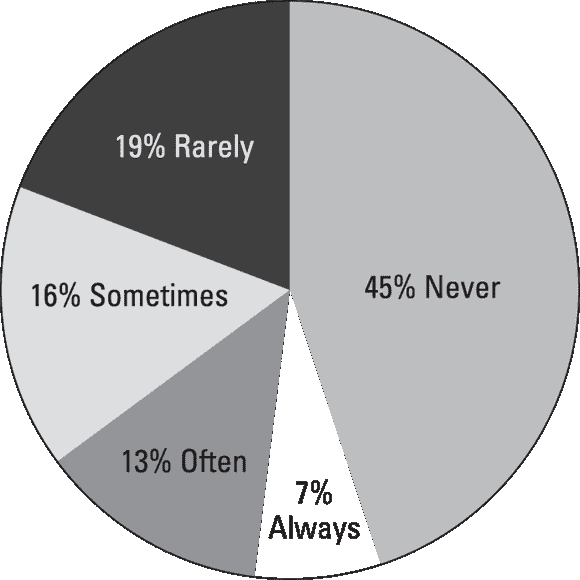

Copyright 2011 Standish Group

FIGURE 1-1: 请求软件功能的实际使用情况。

图 1-1 中的数字说明了时间和金钱的巨大浪费。这种浪费是传统项目管理流程无法适应变化的直接结果。项目经理和利益相关者知道在项目中期引入变化是不受欢迎的，因此他们获得潜在理想功能的最佳机会是在项目开始时。因此，他们要求：

- 他们需要的一切
- 他们认为自己可能需要的一切
- 他们想要的一切
- 他们认为自己可能想要的

结果就是功能的膨胀，导致了图 1-1 中的统计数据。

使用过时的管理和开发方法相关的问题非同小可。这些问题每年浪费数十亿美元。2015 年项目失败损失的数十亿美元（参见侧栏，“软件项目成功与失败””）可能相当于全球数百万个工作岗位。

在过去的二十年里，从事项目的人们意识到传统项目管理日益严重的问题，并致力于创建一个更好的模型：敏捷。

#### 介绍敏捷项目管理

敏捷技术的种子已经存在很久了。事实上，敏捷的价值观、原则和实践只是常识的规范化。图 1-2 显示了敏捷项目管理的简史，追溯到 1930 年代沃尔特·谢尔瓦特（Walter Sherwart）的质量`计划-执行-检查-行动`（`PDSA`）方法。

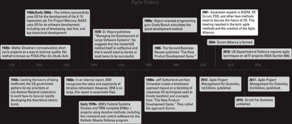

FIGURE 1-2: 敏捷项目管理时间线。

1986 年， Takeuchi（Hirotaka Takeuchi）和中纪（Ikujiro Nonaka）在《哈佛商业评论》上发表了一篇名为《新产品开发游戏》的文章。他们和中的文章描述了一种为了满足快速产品需求的快速、灵活的开发策略。这篇文章首次将 `scrum` 一词与产品开发结合在一起（`scrum` 原指橄榄球中的阵型）。`Scrum` 最终成为最流行的敏捷项目管理框架之一。

2001 年，一群软件和项目专家聚在一起讨论他们成功项目的共同点。这个小组创建了《敏捷宣言》，一份关于成功开发的价值声明：

> **敏捷软件宣言^***

> 我们通过实践和帮助他人实践，发现了更好的软件开发方法。
> 通过这项工作，我们开始重视：
> 
> **个人和交互**优于流程和工具
> **可运行的软件**优于详尽文档
> **客户协作**优于合同谈判
> **响应变化**优于遵循计划
> 
> 也就是说，虽然右侧也有价值，但我们更看重左侧的项目。
> 
> ^* 敏捷宣言所有 © 2001：Kent Beck, Mike Beedle, Arie van Bennekum, Alistair Cockburn, Ward Cunningham, Martin Fowler, James Grenning, Jim Highsmith, Andrew Hunt, Ron Jeffries, Jon Kern, Brian Marick, Robert C. Martin, Steve Mellor, Ken Schwaber, Jeff Sutherland, Dave Thomas.
> 本声明可以任何形式自由复制，但必须通过本声明全文引用。

这些专家还创建了*《敏捷宣言背后的原则》》（*Principles behind the Agile Manifesto*），这有助于支持《敏捷宣言》中的价值观的 12 项实践。我们将在第 2 章中列出敏捷原则并更详细地介绍《敏捷宣言》。

在产品开发术语中，“敏捷”（Agile）是对关注人员、沟通、产品和灵活性的项目管理方法的描述词。如果你在寻找*某种特定的*敏捷方法论，你将无一获。然而，所有的敏捷方法论（例如 `crystal`）、框架（例如 `scrum`）、技术（例如 `user story requirements`）和工具（例如 `relative estimating`）都有一个共同点：坚持《敏捷宣言》和 12 原则敏捷原则。

##### 敏捷项目是如何运作的

敏捷方法基于一种`经验性控制方法`（`empirical control method`）——这是一种根据观察到的项目现实情况做出决策的过程。在软件开发方法论的背景下，经验性方法在新产品开发以及增强和升级项目中都是有效的。通过对已完成的工作进行频繁且直接的检查，你可以在必要时立即进行调整。经验性控制需要：

- **无限制的透明度：** 参与敏捷项目的每个人都知道正在发生什么以及项目进展如何。
- **频繁检查：** 对产品和过程投入最多的人定期评估产品和过程。
- **即时适应：** 快速进行调整以最大限地减少问题；如果检查显示某些地方需要更改，则立即更改。

为了适应频繁的检查和即时适应，敏捷项目以`迭代`（`iterations`，即整个项目的较小部分）的形式运作。敏捷项目涉及与传统瀑布项目相同类型的工作：你创建需求和设计、开发产品、编写文档，并在必要时将产品与其他产品集成。你测试产品、修复任何问题并将其部署使用。然而，你并不是像瀑布项目那样一次性完成所有产品功能的这些步骤，而是将项目拆分为多次迭代，也称为*冲刺*（*sprints*）。

图 1-3 展示了线性瀑布项目与敏捷项目的区别。

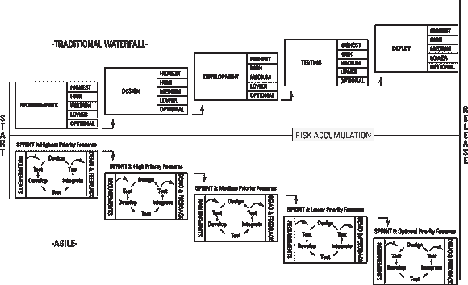

图 1-3： 瀑布项目与敏捷项目。

 将传统的项目管理方法与敏捷方法结合就像是在说：“我有一辆保时捷 911 Turbo。但我左前用了一个马车轮。我该如何让我的车变得像其他保时捷一样快？”答案当然是，你做不到。如果你全心投入敏捷方法，你将有更大的成功机会。

##### 为什么敏捷项目运作得更好

在本书中，你将看到敏捷项目如何比传统项目更好。敏捷项目管理方法可以产生更成功的项目。侧边栏提到的“软件项目成功与失败”中的研究发现，虽然 29% 的传统项目完全失败，但敏捷项目的这一数字仅降至 9%。敏捷项目失败率的下降是因为敏捷项目团队根据进度和客户满意度的频繁检查进行了即时适应。

以下是敏捷方法优于传统项目管理方法的关键领域：

- **项目成功率：** 在第 15 章中，你会发现敏捷项目灾难性项目失败的风险几乎降为零。通过业务价值和风险进行优先级排序的敏捷方法确保了早期的成功或失败。贯穿整个项目的测试方法有助于确保你尽早发现问题，而不是在花费大量精和资金之后。
- **范围蔓延：** 在第 7 章、第 8 章和第 12 章中，你会看到敏捷方法如何适应整个项目中的变化，从而尽量减少范围蔓延。在敏捷项目中，你可以在每个冲刺开始时添加新需求，而不会中断开发流。通过优先开发优先级的功能，你防止了范围蔓延威胁关键功能。
- **检查与适应：** 在第 10 章和第 14 章中，你发现了定期检查和适应在敏捷项目中如何运作的细节。敏捷项目团队——拥有来自完整开发周期的频繁反馈以及工作的可交付功能——可以在每个冲刺中改进他们的流程和产品。

在本书的许多章节中，你将发现如何控制敏捷项目的结果。尽早且频繁测试、根据需要调整优先级、使用更好的沟通技术以及定期演示和发布产品功能，让你能够对结果进行精细控制。

### 第二章 应用敏捷宣言与原则

本章

 **定义敏捷宣言和 12 项敏捷原则**

 **描述铂金原则**

 **理解项目管理发生了哪些变化**

 **进行敏捷试金石**

2001 年 2 月，17 位这些新方法论的先驱在犹他州的斯诺鸟德（Snowbird）会面，分享他们的经验、想法和实践；讨论如何最好表达这些内容；并提出改进软件开发领域的方法。他们无法想象这次会议对项目管理的未来将产生如此影响。他们产出的宣言的简洁与清晰，以及随后开发的原则，改变了信息技术世界，并继续彻底改变各行业的项目管理模式，而不仅仅是软件开发。

在接下来的几个月里，这些领导者构建了以下内容：

- `敏捷宣言`：对核心开发价值的刻意精简的表达
- `敏捷原则`：一套 12 个指导性概念，支持敏捷项目团队实施敏捷技术并保持正轨运行
- `敏捷联盟（The Agile Alliance）`：一个社区开发组织，专注于支持应用敏捷原则和实践的个人和组织

该小组的工作注定会让软件行业更具生产力、更人性化且更具可持续。

《敏捷宣言》是一个强有力的声明，使用少于 75 个单词精心编写而成：

> **敏捷软件开发宣言**

> 我们通过实践和帮助他人实践来发现更好的软件开发方法。
> 通过这些工作，我们重视：
> 
> `个人和交互` 高于过程和工具
> `运行的软件` 高于全面文档
> `客户协作` 高于合同谈判
> `响应变化` 高于遵循计划
> 
> 也就是说，虽然右侧的项具有价值，但我们更重视左侧的项。
> 
> ^* 敏捷宣言版权 © 2001: Kent Beck, Mike Beedle, Arie van Bennekum, Alistair Cockburn, Ward Cunningham, Martin Fowler, James Grenning, Jim Highsmith, Andrew Hunt, Ron Jeffries, Jon Kern, Brian Marick, Robert C. Martin, Steve Mellor, Ken Schwaber, Jeff Sutherland, Dave Thomas


> 此声明可以以任何形式自由复制，但必须通过本告示完整地复制。

没有人能否认《敏捷宣言》既是简洁又具有权威性的声明。传统方法强调僵化的计划、避免变化、记录一切并鼓励基于层级的控制，而该宣言侧重于：

* 人
* 沟通
* 产品
* 灵活性

《敏捷宣言》代表了项目构思、执行和管理方式上重心的巨大转变。如果我们只读左侧的项，就能理解宣言签署者所构想的新范式。他们发现，通过更多地关注个人和交互，团队将通过价值客户协作以及对变化的良好响应，更有效地生产运行的软件。相比之下，传统方法对过程和工具的首要关注通常会导致详尽或过度的文档，以符合合同谈判并遵循不变的计划。

研究和经验说明了为什么敏捷价值如此重要：

* `个人和交互优于过程和工具`：为什么？因为研究表明，当我们处理好个人和交互时，性能会提升 50 倍。我们做对这一点的方法之一是将开发团队与一个被赋权的产品负责人安排在一起。
* `运行的软件优于全面文档`：为什么？因为在冲刺期间未能测试并纠正缺陷，在下一次冲刺中可能会花费多达 24 倍的努力和成本。而且在功能发布到市场后，如果由未参与产品开发的生产支持团队进行测试和修复，成本将高达 100 倍。
* `客户协作优于合同谈判`：为什么？因为一个投入且易于接触的产品负责人可以通过为开发团队提供即时澄清，将客户优先级与正在执行的工作相结合，从而使生产力提高四倍。
* `响应变化优于遵循计划`：为什么？因为在瀑布模型下开发的特征有 64%很少或从未被使用过（如第 1 章中讨论）。从计划开始至关重要，但那是我们了解最少的时候。敏捷团队的计划并不比瀑布团队少——他们的计划量一样多甚至更多。然而，敏捷团队采取“准时”方法，在需要时进行足够的计划。在过程中根据实际情况调整计划，是敏捷团队交付令客户惊喜的产品的关键。

《敏捷宣言》的创建者最初关注软件开发是因为他们从事 IT 行业。然而，敏捷项目管理技术已扩展到软件开发之外，甚至计算机相关产品之外。今天，人们在各种行业使用敏捷方法创建产品，包括生物技术、制造业、航空航天、工程、营销、非营利工作甚至建筑施工。如果你想对提供的产品或服务获得早期经验反馈，你可以从敏捷方法中受益。

 《敏捷宣言》和 12 条敏捷原则直接提到软件；我们在全书中引用宣言和原则时，将保持这些引用不变。如果你创建的是非软件产品，请在阅读时尝试用你的产品进行替换。

## 概述《敏捷宣言》的四大价值

《敏捷宣言》源于经验，而非理论。当你回顾后续章节中描述的价值时，考虑一下如果你将它们付诸实践，会意味着什么。这些价值如何支持实现上市时间目标、应对变化以及重视人类创新？

### 价值 1：个人和交互优于过程和工具

当你允许每个人为项目贡献其独特的价值时，其结果可能是巨大的。当这些人员互动关注于解决问题时，就能产生一个统一的目标。此外，协议是通过比传统方法简单得多的过程和工具形成的。

在简单的对话中谈论项目问题，可以在很短的时间内解决许多问题。试图通过电子邮件、电子表格和文档来模仿直接对话的力量，会导致巨大的开销成本和延迟。这种管理、受控的沟通往往是模糊且耗时的，并会分散开发团队创建产品工作的注意力。

考虑一下如果你高度重视个人和交互意味着什么。表 2-1 显示了重视个人和交互与重视过程和工具之间的某些区别。

|   | **个人和交互价值高** | **过程和工具价值高** |
| --- | --- | --- |
| **优点** | 沟通清晰且有效。沟通快速高效。随着人们的协作，团队合作变得强大。开发团队可以进行自我组织。开发团队有更多创新机会。开发团队可以根据需要自定义流程。开发团队成员可以对项目产生主人翁精神。开发团队成员可以获得更深层次的满意度。 | 过程清晰易于遵循。存在沟通的书面记录。 |
| **缺点** | 开发团队成员必须具备参与、负责和创新的能力（`capacity`）。人们可能需要放下自我表现，才能作为团队成员良好地工作。 | 人们可能过度依赖流程，而不是寻找创建良好产品的最佳方法。一种流程并不适用于所有团队——不同的人有不同的工作风格。一种流程也不适用于所有项目。沟通可能是模糊且耗时的。 |

#### 表 2-1 个人与交互 vs 流程与工具

 你可以在书籍的配套网站上找到表 2-1 的空白模板：[`www.dummies.com/go/agileprojectmanagementfd2e`](http://www.dummies.com/go/agileprojectmanagementfd2e) —— 记录适用于你和你项目的每种方法的优缺点。

 如果流程和工具被视为管理产品开发及所有相关工作的方式，那么人及其工作方式就必须符合流程和工具。这种从性使得很难接纳新想法、新需求和新思维。然而，敏捷方法重视人胜过流程。这种对个人和团队的强调将重点放在他们的精力、创新和解决问题的能力上。在敏捷项目管理中，你会使用流程和工具，但它们经过刻意的精简，并直接支持产品的创造。流程或工具越健壮，你投入在其维护和管理上花费的时间就越多，对它的依赖也越深。然而，以人为中心，结果是生产力的飞跃。敏捷环境是以人为本且具有参与性的，可以迅速适应新的想法和创新。

### 价值 2：可运行的软件优于详尽的文档

开发团队的重点应该是产生可运行的功能。在敏捷项目中，衡量你是否真正完成了一个产品需求的唯一方法是产生与该需求相关的可运行功能。对于软件产品，可运行的软件意味着至少满足我们所谓的`完成定义`（`definition of done`）：即经过开发、测试、集成和文档化。毕竟，可运行的产品是项目存在的意义。

你是否曾经在状态会议上报告说你已经完成了（比如）项目的 75%？如果你的客户告诉你说：“我们没钱了。我们现在可以拿那 75% 吗？”会会发生什么？在传统项目中，你没有任何可运行的软件可以给客户——“完成 75%”在传统上意味着你进度完成了 75%，而交付为 0%。但在敏捷项目中，通过使用`完成定义`，你将为你项目 75% 的需求提供可运行的、潜在可交付的功能——即优先级最高的 75% 需求。

 尽管敏捷方法源于软件开发，但你也可以将其用于其他类型的产品。这第二个敏捷价值可以简单读为：“可运行的功能优于详尽的文档。”

那些分散了产生价值功能注意力的任务必须经过评估，以查看它们是支持还是破坏了创建可运行产品的工作。表 2-2 展示了传统项目文档及其用途的一些示例。回想一下最近参与的项目中产生的文档。

| 文档 | 文档是否支持产品开发？ | 文档是恰好足够还是过度设计（`Gold-Plated`）？ |
| --- | --- | --- |
| 使用昂贵的项目管理软件创建的项目计划，包含甘特图。 | 否。带有详细任务和日期的从头到尾的进度表提供的往往比产品开发所需的更多。此外，在你们开发未来的功能之前，这些许多细节都会发生变化。 | 过度设计。尽管项目经理可能花费大量时间创建和更新项目进度表，但项目团队成员倾向于只知道关键的交付日期。管理层通常只想知道项目是准时、提前还是落后。 |
| 需求文档。 | 是。所有项目都有需求——关于产品功能和需求的详细信息。开发团队需要了解这些需求来创建产品。 | 可能是过度设计的；应该是恰好足够。需求文档很容易增长到包含不必要的细节。敏捷方法提供了描述产品需求的简单方法。 |
| 产品技术规格书。 | 是。记录你是如何创建产品的可以让未来的更改变得简单。 | 可能是过度设计的；应该是恰好足够。敏捷文档仅包含它需要的——开发团队通常没有时间进行额外的修饰，并热衷于尽可能减少文档。 |
| 每周状态报告。 | 否。每周状态报告是为了管理目的，但对产品创建没有帮助。 | 过度设计。了解项目状态是有帮助的，但传统的状态报告包含过时信息，并且比需要的要重得多。 |
| 详细的项目沟通计划。 | 否。虽然联系人列表可能有用，但许多沟通计划中的细节对产品开发团队来说是没用的。 | 过度设计。沟通计划往往变成关于文档的文档——这是一个忙碌工作的极反面例子。 |

#### 表 2-2 识别有用的文档

 在敏捷项目管理中，“恰好足够”（`barely sufficient`）一词是一个积极的描述，意味着任务、文档、会议或任何内容只包含实现目标所需的内容。恰好足够是务实且高效的——恰好足够的反面是过度设计（`gold-plating`），为功能增加了不必要的琐事——精力。所有项目都需要某些文档。在敏捷项目中，只有当文档支持产品开发并足以设计、交付和部署时才是用的。敏捷方法大大简化了与时间、成本控制、范围控制或报告相关的行政工作。

 你可以在书籍的配套网站上找到表 2-2 的空白模板：[`www.dummies.com/go/agileprojectmanagementfd2e`](http://www.dummies.com/go/agileprojectmanagementfd2e)——使用该表格来评估你的文档对产品的贡献程度，以及它们是否恰好足够。

 我们经常停止产生某文档并看看谁会抱怨。在我们知道文档的请求者后，我们努力更好地理解为什么该文档是必要的。“五问法”在这种情况下非常好用——在每个连续的回答后询问“为什么”，以找到文档的根本原因。在你知道文档的核心原因后，看看你可以如何用敏捷产物或精简流程来满足该需求。

### 价值 3：客户协作优于合同谈判

客户不是敌人。真的。

历史上的项目管理方法通常在三个关键点涉及客户：

- **项目启动：** 当客户与项目经理（或另一个项目团队代表）协商合同细节时。
- **项目过程中范围发生变化的任何时候：** 当客户与项目经理就合同的变更时。
- **项目结束：** 当项目团队向客户交付完成的产品时。如果产品不符合客户预期，项目经理和客户将就合同的其他变更进行协商。

这种对谈判的历史关注阻碍了可能具有价值的客户投入，甚至可能在客户与项目团队之间营造对立关系。

 在项目启动时，你对产品的了解可能比任何时候都少。在项目开始时将产品细节锁定在合同中，意味着你必须根据不完整的知识做出决策。如果你在深入了解产品时拥有变更的灵活性，你最终将创造出更好的产品。

敏捷开发的先驱们明白，协作而非对抗能产生更好、更精简、更有用的产品。由于这种理解，敏捷方法让客户持续成为项目的一部分。

在实践中使用敏捷方法，你将体验到客户与开发团队之间的伙伴关系，在这种关系中，项目过程中的发现、提问、学习和调整是常态、可接受且系统化的。

### 价值 4：响应变化而非遵循计划

变更是创造伟大产品的宝贵工具。能够快速响应客户、产品用户和市场的项目团队能够开发出人们想要使用的、相关且有用的产品。

遗憾的是，传统的项目管理方法试图搏斗“变更怪兽”并将其按在地上使其彻底认输。严苛的变更管理程序和无法容纳新产品需求的预算结构使得变更变得困难。传统的项目团队往往发现自己只是在盲目地执行计划，错过了创造更具价值产品的机会。

图 2-1 显示了传统项目中时间、变更机会与变更成本之间的关系。随着时间的推移——以及对产品知识的增加——变更的能力会下降，成本会增加。

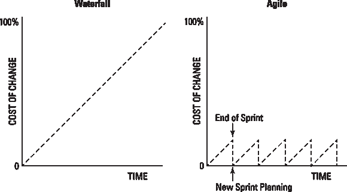

图 2-1： 传统项目的变更机会。

相比之下，敏捷项目系统地适应变更。敏捷方法的灵活性增加了项目的稳定性，因为敏捷项目中的变更是预测且可管理的。在随后的章节中，你将发现敏捷的规划、工作和优先级排序如何让项目团队快速响应变化。

随着新事件的发生，项目团队将这些现实纳入持续进行的工作。任何新事项都是提供额外价值的机会，而不是要避免的障碍，为开发团队提供了更大的成功机会。

## 定义 12 条敏捷原则

在《敏捷宣言》发布后的几个月里，原始签署者继续进行交流。为了支持团队进行敏捷转型，他们用《敏捷宣言》背后的 12 条原则补充了宣言中的四项价值观。

 这些原则连同铂金原则（后文“添加铂金原则”部分将进行解释）可以作为试金石，以判断你项目团队的具体实践是否符合敏捷运动的意图。

以下是敏捷联盟于 2001 年发布的原始 12 条原则的文本：

1. 我们的首要任务是通过早期和持续地交付有价值的软件来满足客户。
2. 欢迎需求的变化，即使在开发后期。敏捷过程利用变化为客户赢得竞争优势。
3. 频繁地交付可运行的软件，从几周到几个月不等，并倾向于更短的时间范围。
4. 业务人员和开发者在整个项目期间每天一起工作。
5. 围绕积极主动的个人构建项目。给予他们所需的环境和支持，并信任他们能够完成工作。
6. 在开发团队内部及之间传递信息最高效有效的方法是面对面交流。
7. 可运行的软件是进展的首要标准。
8. 敏捷过程促进可持续开发。赞助者、开发者和用户应该能够无限保持恒定的节奏。
9. 对技术卓越和良好设计的持续关注可增强敏捷性。
10. 简单性——最大化未完成的工作量的艺术——至关重要。
11. 好的架构、需求和设计源自自组织团队。
12. 团队定期反思如何变得更有效，然后据此调整和优化其行为。

这些敏捷原则为开发团队提供了实用的指导。

组织这 12 条原则的另一种方法是将它们分为以下四个不同的小组来考虑：

- 客户满意度
- 质量
- 团队合作
- 项目管理

接下来的章节将根据这些小组讨论相关原则。

### 客户满意度的敏捷原则

敏捷方法关注客户满意度，这是合理的。毕竟，客户是开发产品的最初原因。

虽然所有 12 条原则都支持满足客户的目标，但第 1、2、3 和 4 条原则让我们脱颖而出：

1. 我们的首要任务是通过早期和持续地交付有价值的软件来满足客户。
2. 欢迎需求的变化，即使在开发后期。敏捷过程利用变化为客户赢得竞争优势。
3. 频繁地交付可运行的软件，从几周到几个月不等，并倾向于更短的时间范围。
4. 业务人员和开发者在整个项目期间每天一起工作。

你可以通过多种方式定义项目的客户：

- 在项目管理术语中，客户是项目付费的人或群体。
- 在某些组织中，客户可能是外部客户。
- 在其他组织中，客户可能是项目利益相关者或组织内部利益相关者。
- 最终使用产品的人也是客户。为了清晰起见并与原始 12 条敏捷原则保持一致，书中我们将这些人称为`user`。

如何执行这些原则？只需执行以下操作：

- 敏捷项目团队包含一个`product owner`（产品负责人），其负责确保将客户想要的东西转化为产品需求。
- `product owner` 根据业务价值或风险对产品功能进行排序，并向开发团队传递优先级。开发团队在短期的开发周期（称为`iterations` 或 `sprints`）中交付列表中最有价值的功能。
- `product owner` 每天都有深度且持续的参与，以澄清优先级和需求、做出决策、提供反馈并快速回答项目过程中出现的许多问题。
- 随着开发团队每隔四到八周或更短的时间交付完整、可运行且可能可以发布的功能，整个产品的价值会不断增长，其功能能力也是如此。
- 客户通过在整个项目中接收新的、即插即用的功能，定期为其投资积累价值，而不是等到漫长的项目结束时才获得首次（可能也是唯一一次）的可发布的功能交付。

在表 2-3 中，我们列出了项目中常见的客户不满意问题。使用表 2-3 并收集你遇到过的客户不满意案例。你认为敏捷项目管理会有所不同吗？为什么？或者为什么？

| 项目客户不满的示例 | 敏捷方法如何提高客户满意度 |
| --- | --- |
| 开发团队误解了产品需求。 | 产品所有者与客户紧密合作，定义并完善产品需求，并为开发团队提供清晰的指示。敏捷项目团队定期演示并交付可运行的功能。如果产品运行方式不符合客户预期，客户可以在冲刺结束时提供反馈，而不是在项目结束时已经太晚了。 |
| 产品没有在客户需要时交付。 | 以冲刺模式工作，使敏捷项目团队能够早期且频繁地交付高优先级的功能。 |
| 客户无法在不增加额外成本和时间的情况下请求更改。 | 敏捷流程为变化而构建。开发团队可以在每个冲刺中适应新需求、需求更新和不断变化的优先级，通过移除低优先级需求（即可能永远或很少被使用的功能）来抵消这些更改的成本。 |

表 2-3 客户不满意以及敏捷如何帮助

 你可以在[`www.dummies.com/go/agileprojectmanagementfd2e`](http://www.dummies.com/go/agileprojectmanagementfd2e) 找到该表的空白模板。

 提高客户满意度的敏捷策略包括：

* 在每次迭代中，首先生产优先级最高的功能
* 理想情况下，将产品所有者和项目团队的其他成员安排在同一地点，以消除沟通障碍
* 将需求拆分为可以在四到八周或更短时间内交付的功能组
* 保持书面需求的精简，迫使进行更稳健、有效的面对面沟通
* 在功能完成后及时获得产品所有者的批准
* 定期重新审查功能列表，以确保最有价值的需求继续保持最高优先级

### 敏捷质量原则

敏捷项目团队承诺每天为其创建的每一个产品保证质量——从开发到文档，再到集成和测试结果。每个项目团队成员始终贡献他们的最佳工作。尽管所有 12 项原则都支持质量交付的目标，但对我们来说，原则 1、3、4、6–9 和 12 特别突出：

1. 我们的首要任务是通过尽早和持续地交付有价值的软件来满足客户。
2. 频繁地交付运行的软件，周期从几周到几个月不等，并倾向于更短的时间尺度。
3. 业务人员和开发者在整个项目中必须每天合作。
4. 在开发团队内部及之间传递信息最高效且有效的方法是面对面交流。
5. 运行的软件是衡量进展的主要标准。
6. 敏捷流程促进可持续发展。赞助者、开发者和用户应该无限地保持恒定的速度。
7. 对技术卓越和良好设计的持续关注可以增强敏捷性。
8. 团队定期反思如何变得更有效，然后据此调整和优化其行为。

这些原则在日常实践中的应用可以描述如下：

* 开发团队成员必须拥有完全的所有权，并被赋予解决问题的能力。他们承担着决定如何创建产品、分配任务和组织产品开发的责任。不参与工作的人不应该告诉他们怎么做。


对于软件开发项目，敏捷方法要求架构使编码和产品具有模块化、灵活且可扩展性。设计应该解决今天的问题，并使不可避免的变化尽可能简单。

纸面上的系列设计永远无法告诉你某事是否可行。当产品质量达到可以在短时间内演示并最终交付时，每个人都知道产品是可靠的——在每个冲刺结束时。

当开发团队完成功能时，团队向产品所有者展示产品功能，以验证其是否符合验收标准。产品所有者的评审应贯穿整个迭代，理想情况下是在需求完成完成当天。

在每次迭代（持续一周到四周或更短）结束时，向客户演示运行的代码。进展清晰且易于衡量。

测试是开发过程中不可或缺且持续的一部分，贯穿全天，而不是在迭代结束时进行。

在软件项目中，检查新代码是否经过测试并与之前的版本集成是以小增量进行的，甚至每天可能发生多次（在 Google、Amazon 和 Facebook 等组织中，每天可能发生数千次）。这种被称为`持续集成 (CI)`的过程有助于在添加新代码时确保解决方案继续正常工作。

在软件项目中，技术卓越的示例包括建立编码标准、使用面向服务的架构、实施自动化测试以及面向未来。

 敏捷方法提供了以下质量策略：

- 在项目开始时定义什么是“完成”，并以此作为质量的基准
- 通过自动化手段进行激进的每日测试
- 仅在需要时构建需要的功能
- 审查软件代码并重构（精简）
- 向利益相关者和客户展示经过产品所有者接受的功能

### 敏捷团队原则

团队合作对于敏捷项目至关重要。创建良好的产品需要团队所有成员（包括客户和利益相关者）之间的合作。敏捷方法支持团队建设和团队合作，并强调对自管开发团队的信任。一个技能、动力、统一且赋权的项目团队就是成功的团队。

尽管所有 12 项原则都支持团队的目标，但对我们来说，原则 4–6、8、11 和 12 特别支持团队赋能、效率和卓越：

1. 业务人员和开发者在整个项目中必须每天合作。
2. 围绕有动力的个人构建项目。给予他们所需的环境和支持，并信任他们完成工作。
3. 敏捷流程促进可持续发展。赞助者、开发者和用户应该无限地保持恒定的速度。
4. 最好的架构、需求和设计源于自组织团队。
5. 团队定期对如何变得更高效进行反思，然后据此调整和优化其行为。

 敏捷方法关注可持续发展；作为知识工作者，我们的大脑就是我们为项目带来的价值。即使只是出于自私考虑，组织也应该希望拥有精力充沛、休息充分的大脑为他们工作。保持规律的工作节奏，而不是经历长时间的高强度过度工作，有助于保持团队成员头脑敏捷并确保高质量。

以下是一些你可以采用的实践，以使这一团队协作的愿景成为现实：

- 确保你的开发团队成员具备适当的技能和动力。
- 提供与任务所需的充分培训。
- 支持自组织开发团队对“做什么”以及“如何做”做出决策；不要让经理告诉团队该做什么。
- 让项目团队成员作为一个整体承担责任，而不是作为个人承担。
- 使用面对面通信来快速、高效地传递信息。
- 全天随时进行自发对话，以建立知识、理解和效率。
- 将团队成员安排在近的地方，以增加清晰高效的沟通。如果无法协同办公，请使用视频聊天而不是电子邮件。
- 确保`经验总结`（lessons learned）是一个持续的反馈循环。应该在每次迭代结束时举行回顾，通过反思和适应来提高未来开发团队的生产力，创造不断提高的效率。在项目结束时召开经验总结会议的价值有限。

第一次回顾通常是有价值的，因为在此时，项目团队有机会做出更改，以使项目的后续部分受益。

 假设你通常通过电子邮件与 Sharon 通信。你花时间撰写信息并发送。信息停留在 Sharon 的收件箱里，她最终读了。如果 Sharon 有任何问题，她会写一封邮件回复并发送。那条信息一直留在你的收件箱里，直到你最终阅读。如此反复。这种乒乓球式的通信在快速迭代过程中使用的效率太低了。

 以下策略有助于促进有效的团队协作：

- 将开发团队放在同一地点——这被称为`协同办公`（collocation）。
- 营造成一个有利于协作的物理环境：一个带有白板、彩色画笔和其他用于开发和传递想法的触觉工具的团队室，以确保共同理解。
- 创建一个鼓励项目团队成员直抒胸臆的环境。
- 尽可能面对面会议。如果通过对话可以解决问题，就不要发送电子邮件。
- 在需要时随时获取澄清。
- 鼓励开发团队自己解决问题，而不是让经理为开发团队解决问题。

### 敏捷项目管理原则

项目管理的敏捷性涵盖三个关键领域：

- 确保开发团队能够产生生产力，并在长期内持续提高生产力
- 确保利益相关者可以获取项目进展的信息，而不会通过要求开发团队提供更新来中断开发活动的流
- 在出现新功能请求时及时处理，并将其整合到产品开发周期中

敏捷方法专注于工作的规划和执行，以产生可以发布的最佳产品。这种方法通过开放沟通、避免分心和浪费活动，并确保每个人都清楚项目进度得到支持。

所有 12 条原则都支持项目管理，但第 2、8 和 10 条对我们来说尤为突出：

1. 欢迎需求的变化，即使是在开发后期。敏捷流程利用变化为客户赢得竞争优势。
2. 敏捷流程促进可持续发展。赞助者、开发者和用户应该无限地保持恒定的节奏。
3. 简单性——最大化未完成工作量的艺术——至关重要。

以下是采用敏捷项目管理的一些优势：

- 敏捷项目团队实现了更短的上市时间，从而节省成本。他们比传统方法更早开始开发，因为敏捷方法最大限度地减少了传统瀑布项目早期阶段必不可少的详尽前期规划和文档工作。
- 敏捷开发团队是自组织和自我管理的。通常投入在告诉开发者如何工作的管理精力，可以用于消除减慢开发团队速度的障碍和组织干扰。
- 敏捷开发团队决定他们在一次迭代中可以完成多少工作，并承诺实现这些目标。所有权在根本上是不同的，因为是开发团队在建立承诺，而不是遵守外部制定的承诺。
- 敏捷方法问：“为了实现目标，我们最少可以做什么？”而不是专注于包含所有可能需要的特性和额外精炼。敏捷方法通常意味着精简：仅保持足够的文档记录、消除不必要的会议、避免低效通信（如电子邮件）以及更少的代码（仅足以使其运行即可）。

 创建对产品开发无用的复杂文档是浪费精力。记录一项决策是可以的，但你不需要对该决策如何产生的历史和细微差别写好页纸。保持文档处于基本足够的水平，你就有更多时间专注于支持开发团队。

- 通过将开发封装在为期一到四周或更短的短冲刺中，你可以遵循当前迭代的目标，同时适应后续迭代中的变化。每个冲刺的长度在整个项目中保持不变，为团队提供长期可预测的开发节奏。
- 规划、详细制定需求、开发、测试和演示功能均在迭代内进行，降低了长时间朝着错误方向或开发客户不想要的东西风险。
- 敏捷实践鼓励保持高效且健康的稳定开发节奏。例如，在名为极限编程（`XP`）的流行敏捷开发实践中，最大工作时间为 40 小时，理想工作时间为 35 小时。敏捷项目是可持续的，效率更高，尤其是长期来看。

 传统方法通常会有`行军`（death march），项目团队在项目结束时连续几天甚至几周疯狂加班，以满足一个之前未发现且不现实的期限。随着行军的进行，生产力往往会大幅下降。引入更多缺陷，由于缺陷需要在不破坏另一个功能的情况下进行修复，因此修复缺陷是最昂贵的工作。缺陷通常是系统过载的结果——特别是要求了不可持续的工作节奏。查看我们关于“逆倒车”负面影响的演示文稿（[https://platinumedge.com/overtime](https://platinumedge.com/overtime)）。

- 优先级、对现有项目的经验，以及最终每个冲刺（sprint）内开发可能发生的速度都是清晰的，这使得对于在给定时间内可以或应该完成多少工作可以做出良好的决策。

如果你以前做过某个项目，你可能对项目管理活动有基础的了解。在表 2-4 中，我们列出了一些传统的项目管理任务，以及你如何通过敏捷方法来满足这些需求。使用表 2-4 来记录你对经验的思考，以及敏捷方法与传统项目管理的不同之处。

| 传统项目管理任务 | 项目管理任务的敏捷方法 |
| --- | --- |
| 在项目开始时创建完全详尽的项目需求文档。尝试在整个项目过程中控制需求变更。 | 创建产品待办列表——一个按优先级排序的简单需求列表。随着项目过程中需求和优先级的变化，快速更新产品待办列表。 |
| 与所有项目利益者和开发者进行每周状态会议。在每次会议后发送详细的会议纪要和状态报告。 | 开发团队每天开始时快速会面，时间不超过 15 分钟，以协调和同步当天的工作以及任何障碍。他们可以在每天结束时用不到一分钟更新中央可见的燃烧图（burndown chart）。 |
| 在项目开始时创建一个包含所有任务的详细项目进度表。尝试保持项目任务按计划进行。定期更新进度表。 | 在冲刺内工作，并仅为活动冲刺识别特定任务。 |
| 为开发团队分配任务。 | 通过帮助消除障碍和分心来支持开发团队。在敏捷项目中，开发团队自己定义并拉取（而非）推（push）自己的任务。 |

表 2-4 历史项目管理与敏捷项目管理的对比

 表 2-4 的空白模板可在`www.dummies.com/go/agileprojectmanagementfd2e`获取。

 通过以下敏捷方法可以促进项目管理：

- 支持开发团队
- 产生仅足够的文档
- 精简状态报告，使信息由开发团队在几秒钟内推送，而不是由项目经理在较长时间内拉取
- 将非开发任务降至最低
- 设定预期：变化是正常且有益的，而不是需要恐惧或逃避的
- 采用即时（just-in-time）需求细化，以尽可能地减少变更干扰和精力浪费
- 与开发团队协作创建真实的进度表、目标和任务
- 保护开发团队免受组织干扰的影响，这些干扰可能会通过引入与项目目标无关的工作来损害项目目标
- 理解工作与生活之间的适当平衡是高效开发的组成部分

## 添加铂金原则

通过与向敏捷项目管理转型的团队合作的实战经验——以及在全球范围内大型、中小型组织的现场测试——我们开发了三个额外的敏捷软件开发原则，我们称之为铂金原则。它们是：

- 拒绝形式化。
- 像团队一样思考和行动。
- 视觉化而非书写。

你可以在后续章节中更详细地探索每个原则。

### 拒绝形式化

即使是最敏捷的项目团队也可能向过度形式化倾斜。例如，我们经常发现项目团队成员等到预定的会议才讨论可以在几秒钟内解决的简单问题。这些会议通常有议程和会议纪要，而且仅仅参加就需要某种程度的动员和撤离。在敏捷方法中，不需要这种程度的形式化。

 你应该始终质疑形式化和不必要的、好面的展示。例如，是否有更简单的方法获得你所需的内容？当前的活动如何支持尽可能快速地开发高质量产品？回答这些问题有助于你专注于富有生产性的工作并避免不必要的任务。

在敏捷系统中，讨论和物理工作环境是开放且流动的；文档的数量和复杂度被保持在最低水平，使其为项目做出价值，而不是阻碍它；避免花哨的展示，例如装饰精美的演示文。专业、坦诚的沟通对项目团队是最好的，整个环境必须提供这种开放和舒适感。

 成功抵抗形式化的策略包括以下：

- 尽可能通过消除项目团队中的头衔来减少组织层级
- 避免美学上的投入，例如复杂的 PowerPoint 演示文稿或详尽的会议纪要表，特别是在冲刺结束时演示可交付的功能时
- 识别并教育那些可能要求对工作复杂展示的利益者，并告知他们此类展示的成本。

### 像团队一样思考和行动

项目团队成员应该关注整个团队如何能够发挥最大的效率。这种关注可能意味着放弃个人的利基领域和绩效指标。在敏捷环境中，整个项目团队在对目标的承诺、对工作范围的所有权以及对实现该承诺的可用时间的认可上应该一致。

以下是一些像团队一样思考和行动的策略：

- 结对开发并频繁更换伙伴。结对编程（双方都熟悉该领域）和影子实操学习（只有一方熟悉该领域）都能提高产品质量。你可以在第 15 章了解更多关于结对编程的知识。
- 用统一的产品开发者职称代替个人职称。开发活动包括从需求到功能所需的所有任务，包括设计、实现（编码）、测试和文档，而不只是编写代码或转螺丝刀。
- 仅在项目团队层面报告，而不是创建划分团队的特殊报告。
- 用项目团队绩效指标代替个人绩效指标。

### 视觉化而非书写

敏捷项目团队应该尽可能使用视觉化，无论是通过简单的图表还是计算机建模工具。图像比文字更有力量。当你使用图表或原型而不是文档时，你的客户能够更好地理解概念和内容。

当我们增加与解决方案的互动时，定义系统功能的能力会指数级增长：图形化表示几乎比文本表示更好，而亲身体验功能最好。

 即使是纸上的草图也比正式的文本文档是更有效的沟通工具。一画胜千言。如果你试图确保共同理解，文本描述是最弱的沟通形式——特别是当它通过电子邮件发送并附带“有任何问题请告知我”的请求时。

视觉化的策略示例包括：

- 在工作环境中准备充足的白板、海报纸、笔和纸，以确保绘图工具随手可用
- 使用模型而非文本来传递概念
- 通过图表、图形和仪表板报告项目状态，例如图 2-2 所示。

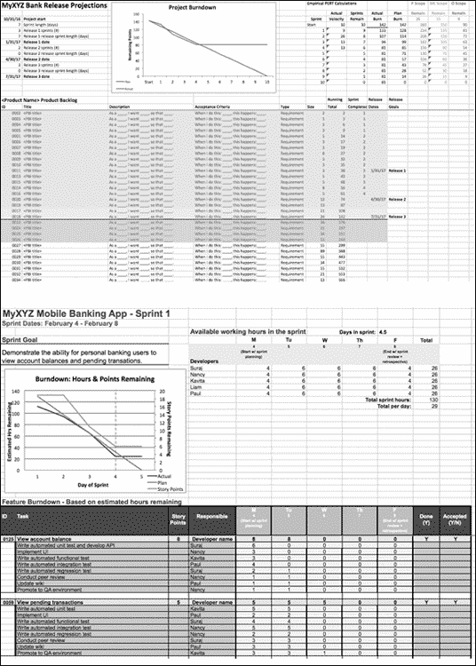

图 2-2：用于报告项目状态的图表、图形和仪表板。

## 敏捷价值观带来的变化

《敏捷宣言》和 12 条敏捷原则的发布，通过以下方式为敏捷运动提供了合法性并使其成为重点：

- **敏捷方法改变了对项目管理流程的态度。** 过去的方法论者在尝试改进流程时，致力于开发一种适用于所有条件的通用流程，假设更多的流程和更强的正式性会带来更好的结果。然而，这种方法需要更多的时间、开销和成本，并且往往会降低质量。宣言和 12 条原则承认，过多的流程是一个问题而非解决方案，而且在每种情况下，正确的流程和合适的量是各不相同的。
- **敏捷方法改变了对知识工作者的态度。** IT 团队开始意识到，开发团队成员并非易弃资源，而是其技能、天赋和创新能为每个项目产生影响的个体。不同团队成员创建的相同产品将是不同的产品。
- **敏捷方法改变了业务部门与 IT 团队之间的关系。** 敏捷项目管理通过将这些贡献者带到同一个项目团队，让他们以平等的参与程度和共享目标，解决了与业务部门和 IT 之间历史性分离相关的问题。
- **敏捷方法纠正了对变化的态度。** 历史上的方法将变化视为需要避免或降至最低的问题。《敏捷宣言》及其原则帮助人们将变化视为一种机会，以确保信息最充分的想法得以实施。

## 敏捷试剂测试

要做到敏捷，你需要能够问自己：“这敏捷吗？”如果你怀疑某个特定流程、实践、工具或方法是否遵循《敏捷宣言》或 12 条原则，请参考以下问题列表：

1. 我们现在正在做的事情支持有价值软件的早期持续交付吗？
2. 我们的流程是否欢迎并利用了变化？
3. 我们的流程是否能导向并支持可用功能的交付？
4. 开发者和产品所有者是否每天一起工作？客户和业务利益相关者是否与项目团队紧密合作？
5. 我们的环境是否为开发团队提供了完成工作所需的支持？
6. 我们面对面的交流是否多于通过电话和电子邮件的交流？
7. 我们是否通过产出的可用功能量来衡量进度？
8. 我们能无限期地保持这种速度吗？
9. 我们是否支持技术卓越和允许未来变化的良好设计？
10. 我们是否最大化了“未完成工作”量——即为了实现项目目标只做最少的工作？
11. 该开发团队是否是自组织和自我管理的？它是否拥有成功的自由？
12. 我们是否定期进行反思并相应地调整我们的行为？

如果你对所有这些问题都回答了“是”，恭喜你；你确实在从事一个敏捷项目。如果你对其中任何一个问题回答了“否”，你可以做些什么来将答案改为“是”呢？你可以随时回到这个练习，并与你的项目团队及更广泛的组织一起使用敏捷试剂测试。

## 第 3 章

# 为什么敏捷效果更好

## 本章内容

 **发现敏捷项目管理的益处**

 **将敏捷方法与历史方法进行**

 **了解人们为什么喜欢敏捷技术**

敏捷方法在现实世界中运作良好。这是为什么呢？在本章中，你将研究敏捷流程如何改进人们的工作方式的机制，以及它们如何防止沉重的额外开销。与历史方法的对比突显了敏捷技术带来的改进。

在谈论敏捷项目管理的优势时，核心在于两点：项目成功和利益相关者的满意度。

## 评估敏捷益处

敏捷项目管理概念与以往的方法论不同。正如第 1 章中提到的，敏捷方法解决了瀑布模型等历史项目管理方法的关键挑战，但它们也深入得多。敏捷流程为我们想要的工作方式提供了一个框架——即我们在解决问题和完成任务时的自然运作模式。

历史项目管理方法的开发并不是为了现代开发生命周期（如软件开发），而是为了复杂性较低的系统。它们还适应了其他领域，如建筑、制造和军事。难怪在尝试构建更复杂的现代产品（如移动端应用程序或以网络为中心的面向对象的应用程序）时，这些项目管理方法并不适用，因为这些产品需要不断创新来保持竞争力。即使使用较旧的技术，传统方法的记录也糟糕得惨睹，特别是在应用于软件项目时。有关传统方式运行的项目高失败率的更多详细信息，请查看第 1 章所示的 Standish Group 研究。

 你可以在软件开发之外的许多行业中使用敏捷管理技术。如果你正在创建一个产品并希望在过程中获得早期反馈，你可以从敏捷流程受益。

当你面临紧迫的截止日期时，你的直觉是`采取敏捷`。当你卷起袖子关注必须完成的工作时，正式性就被抛之脑后了。

比起采取敏捷，更重要的是“变得敏捷”。当你变得敏捷时，你不会通过不合理的截止日期来强制关注。相反，你意识到人们即使在压力下也是优秀的问题的解决者。

# 引言


棉花糖挑战设定了模拟现实生活的开局条件。你需要使用固定的资源（四个人、意大利面条等）和固定的时间（18 分钟）来构建一个结构（在 IT 行业中等同于软件产品）。最终结果如何无法预知，但历史项目管理方法的一个底层假设是：你可以在开始时确定精确的目标（功能或需求），然后估算所需的人员、资源和时间。

这一假设与生活的真实情况恰恰相反。正如你在图 3-1 中所示，历史方法的理论与敏捷方法完全相反。我们假装自己生活在左边的世界，但实际上生活在右边的世界。

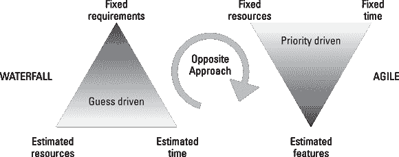

图 3-1: 历史项目管理与敏捷概念的对比。

在历史方法中需求被锁定且产品一次性交付，结果是全有或全无。我们要么完全成功，要么彻底失败。风险极高，因为一切都取决于循环最后阶段（即在顶部放上棉花糖）发生的工作，而该阶段包含了集成和客户测试。

在图 3-2 中，你可以看到瀑布项目的每个阶段是如何依赖上一个阶段的。团队共同设计并开发所有功能，这意味着在完成最低优先级功能的开发之前，你无法获得最高优先级的功能。客户必须等到项目结束才能获得产品任何元素的最终交付。

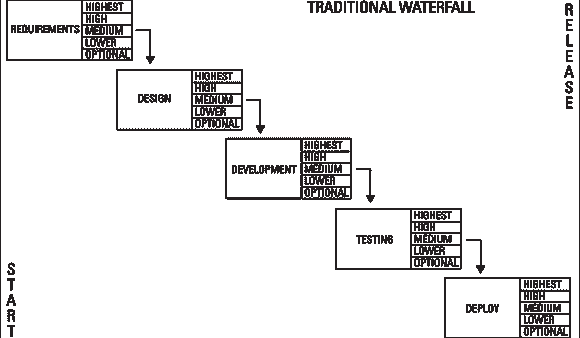

图 3-2: 瀑布项目周期是一种线性方法论。

在瀑布项目的测试阶段，客户才能看到他们期待已久的产品。到那时，投入的精力已经是巨大的，失败的风险很高。在所有完成的产品需求中寻找缺陷，就像在玉米地里找杂草。

敏捷项目管理从根本上颠覆了软件开发应该如何进行的概念。使用敏捷方法，你在短短的迭代周期内开发、测试并发布小组产品需求，这种周期被称为`iterations`（迭代）或`sprints`（冲刺），如图 3-3 所示。测试在每次迭代中都会发生。为了发现缺陷，开发团队是在花里找杂草，而不是在玉米地里。

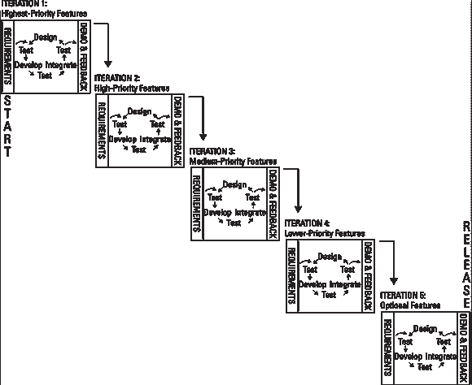

图 3-3: 敏捷方法具有迭代的项目周期。

`Product owner`、`scrum master`和`sprint`是来自`scrum`的术语，这是一个用于组织工作和展示项目进展的流行敏捷框架。`Scrum`指的是橄榄球中的围圈，橄榄球队围绕球聚在一起。Scrum 作为一种方法像橄榄球一样，鼓励项目团队紧密合作并对结果负责。（你可以在第 4 章中找到更多关于 scrum 和其他敏捷技术的知识。）

此外，在敏捷项目中，客户在每个短周期结束时都能看到他们的产品。你可以先创建最高优先级的功能，这让你有机会在客户投入较少资金时就确保价值的最大化。

这种敏捷概念非常有吸引力，尤其是对于规避风险的组织。此外，如果你的产品具有市场价值，即使在开发期间也能产生收入。现在你拥有了一个自给资金的项目！

## 敏捷方法如何胜过历史方法

敏捷框架承诺比历史方法具有显著优势，包括更高的灵活性稳定性、更少的非生产性工作、更快速且质量更高的交付、改进的开发团队性能、更紧的项目控制以及更快的失败检测。我们在本节中描述所有这些结果。

然而，如果没有一个高能力且功能完备的开发团队，这些结果无法实现。开发团队对于成功至关重要。敏捷方法强调为开发团队提供支持的重要性，以及项目团队成员行为和互动的重要性。

 敏捷宣言中的第一个核心价值是“个体和互动优于流程和工具”。培养开发团队是敏捷项目管理的核心，这也是你能够通过敏捷方法取得如此成功的原因。

敏捷项目团队以开发团队为中心（包括开发人员、测试人员、设计人员以及任何其他执行产品创建工作的人），并且包括项目利益相关者，以及以下两个重要的团队成员，没有他们，开发团队就无法运作：

*   `Product owner`：`product owner`是精通产品和客户需求的项目团队成员。（第 2 章有更多关于 product owner 的信息。）

*   `Scrum master or agile coach`：`scrum master or agile coach`充当开发团队与可能减慢开发工作的干扰之间的缓冲区。`scrum master or agile coach`还提供敏捷流程方面的专业知识并促进共识的建立。

你可以在第 6 章中找到 product owner、开发团队和 scrum master 的完整描述。在本章后面，你将看到这些角色的最高优先级是支持和优化开发团队的性能。

### 更高的灵活性稳定性

相比之下，敏捷项目比传统项目具有更高的灵活性稳定性。首先，敏捷项目如何提供灵活性，然后讨论稳定性。

无论采用何种项目方法，项目团队在项目初期都面临两个挑战：

*   项目团队对产品最终状态的认知有限。

*   项目团队无法预测未来。

对产品和未来业务需求的有限认知几乎保证了项目的变更。

 敏捷宣言中的第四个核心价值是“响应变化优于遵循计划”。敏捷框架的设计初衷就是考虑了灵活性。

通过敏捷方法，项目团队可以根据项目进展出现的新知识和新需求进行调整。我们在书中提供了许多关于实现灵活性的敏捷流程细节。以下是帮助敏捷项目团队管理变更的一些流程简单描述：

*   在敏捷项目开始时，`product owner`从项目利益相关者处收集高级产品需求并进行排序。`product owner`不需要所有的需求——只需要足够理解产品必须完成的任务即可。

*   开发团队和`product owner`共同工作，将初始的高优先级需求拆解为更详细的需求。结果是开发团队可以立即开始开发的小工作块。

*   在每个冲刺中，你关注最高优先事项，无论这些事项是在冲刺前多久设定的。

 敏捷项目中的迭代（或冲刺，sprints）时间很短——持续时间最长四周，通常为一或两周。你可以在第 8 章–第 10 章找到关于冲刺的详细信息。

*   开发团队在冲刺内处理一组需求，并随着每次连续迭代对产品有更多的了解。

*   开发团队一次计划一个冲刺，并在每个冲刺开始时深入研究需求。开发团队通常只处理优先级最高的需求。

*   一次专注于一个冲刺和最高优先级的需求，使项目团队能够在每个冲刺开始时适应新的高优先级需求。

*   当变化发生时，产品所有者（Product Owner）会更新未来冲刺待处理的需求列表。产品所有者定期对列表进行重新排序。

*   产品所有者可以对高优先级功能进行资金投入，并在整个项目过程中选择资助哪些功能。

*   产品所有者和开发团队在每个冲刺结束时收集客户反馈并根据反馈采取行动。客户反馈往往会导致现有功能的更改或产生新的、有价值的需求。反馈也可以导致移除或重新排序那些并非真正的需求。

*   当产品所有者认为产品具有足够的功能来满足项目目标时，可以停止项目。

图 3-4 展示了在敏捷项目中进行更改如何比在瀑布模型中进行更改更稳定。将图中的两个图像想象成钢筋。在顶部的图中，钢筋代表一个为期两年的项目。钢筋的长度使其更容易被扭曲、弯曲和折断。项目变化也可以这样考虑——长期项目在结构上容易产生不稳定性，因为项目的规划阶段与执行阶段（即现实情况介入阶段）是不同的，而且长期项目没有自然的缓冲点。

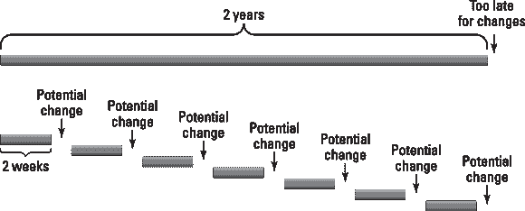

图 3-4： 敏捷项目灵活中的稳定性。

现在看图 3-4 底部的图像。小钢筋代表项目中的两周迭代。对于这些小钢筋来说，保持稳定不变比大钢筋容易得多。同样，在具有已知灵活点的较小增量中获得项目稳定性更容易。告诉企业两周内不能有更改，比说两年内不能有更改容易得多也更现实。

敏捷项目在战术上是灵活的，因为它们在战略上是稳定的。它们非常擅长适应变化，因为定期变化的手段已内置在日常流程中。同时，敏捷项目的迭代为项目稳定性提供了独特的领域。敏捷项目团队随时适应产品待办列表（product backlog）的更改，但在冲刺期间通常不接受范围的外部更改。产品待办列表可能会不断变化，但除了紧急情况外，冲刺通常是稳定的。

在迭代开始时，开发团队计划他们为该冲刺完成的工作。冲刺开始后，开发团队只处理计划的需求。该计划可能会出现少数例外——如果开发团队提前完成，他们可以请求更多工作；如果发生紧急情况，产品所有者可以取消冲刺。总的来说，冲刺对开发团队来说是一个极具稳定性的时期。

这种稳定性可以带来创新。当开发团队成员拥有稳定性时——也就是说，他们知道自己在一段时间内将要做什么工作——他们在工作时会有意识地思考自己的任务。他们还可能在工作之余无意识地思考任务，并倾向于在任何给定时间提出解决方案。

敏捷项目提供了开发、反馈和变化的持续循环，使项目团队既具有创建仅包含正确功能的产品的灵活性，又具有发挥创造力的稳定性。

### 减少非生产性任务

当你在创建一个产品时，在工作日的任何时候，你既可以开发产品，也可以处理那些旨在管理和控制产品创建的外围流程。显然，前者的价值更高，你应该尝试将其最大化，而后者是你希望将其降至最低的。

完成一个项目，你必须致力于解决方案本身。尽管这句话听起来显而易见，但在瀑布项目中经常被忽视。某些软件项目上的程序员仅花费 20% 的时间生成功能，其余时间则在开会、写邮件或创建不必要的演示稿和文档。

产品开发可能是一项需要持续关注的强度活动。许多开发者在正常工作日期间无法获得足够的开发时间来跟上项目进度，因为他们正在执行其他类型的任务。以下因果链是其结果：

```
Long workday = tired developers = unnecessary defects = more defect fixing = delayed release = longer time to value
```

为了使生产性工作最大化，目标是消除加班，并让开发者在工作日期间创建功能。要增加生产性工作，你必须减少非生产性任务，如此。

#### 会议

会议可能会浪费时间。在传统项目中，开发团队成员可能会发现自己处于几乎没有收益或没有益处的长会议中。以下敏捷方法可以帮助开发团队只花时间在有效的会议上：

*   敏捷流程仅包含少数正式会议。这些会议具有特定主题且时间有限。在敏捷项目中，你通常不需要参加非敏捷会议。

*   敏捷教练（scrum master）的工作职责之一是防止开发团队的工作时间被干扰，包括非敏捷会议的请求。当有要求开发人员离开开发工作时，敏捷教练会询问“为什么”以理解真实需求。随后，敏捷教练可能会如何在不干扰开发团队的情况下满足该需求。

*   在敏捷项目中，当前的项目状态通常对整个组织可见，消除了对状态会议的需求。你可以在第 14 章中找到简化状态报告的方法。

#### 电子邮件

电子邮件不是一种高效的通信模式；敏捷项目团队的目标是尽量减少电子邮件。电子邮件过程是异步且缓慢的：你发送邮件，等待回复；你有另一个问题，又发送另一封邮件。这个过程消耗了本可以更高效地使用的时间。

与其发送电子邮件，敏捷项目团队通过面对面讨论来现场解决问题和疑问。

在准备向客户演示功能时，敏捷项目团队通常使用以下技术：

*   **演示而不是汇报。** 也就是说，向客户展示你创建了什么，而不是描述你创建了什么。

*   **展示功能如何满足需求并符合验收标准。** 也就是说，说：“这就是需求。这些是判断功能已完成的标准。这里是符合这些标准的功能。”

*   避免正式的幻灯片演示及其涉及的所有准备工作。当你演示可运行的功能时，它会说明一切。保持演示的原始和真实。

#### 过程文档

长期以来，文档一直是项目经理和开发人员的负担。敏捷项目团队可以通过以下方法尽量减少文档：

*   **使用迭代开发。** 创建大量文档是为了参考几个月或几年前做出的决策。迭代开发将决策与开发产品之间的时间从几个月或几年缩短到几天。产品和相关的自动化测试（而不是大量的论文）记录了所做出的决策。

*   **记住一种方法并不适用。** 你不需要为每个项目创建相同的文档。根据特定项目选择你需要的内容。

*   **使用非正式、灵活的文档工具。** 白板、便利贴、图表和其他工作计划的视觉化表示都是极好的工具。

*   **包含能够为管理层提供足够项目进度信息的简单工具。** 不要为了报告而创建特殊的项目进度报告（例如详尽的状况报告）。敏捷团队使用燃尽图等视觉图表直观地传达项目状态。

## 更质量，更快交付

在传统项目中，从需求收集完成到客户测试开始的时期可能长得令人痛苦。在此期间，客户在等待某种结果，而开发团队则埋头于开发。项目经理负责确保项目团队遵循计划，将变更拒之门外，并通过提供频繁且详细的报告向所有对结果感兴趣的人员更新信息。

当测试开始时（接近项目结束），缺陷可能会导致预算增加、进度延误，甚至导致项目失败。测试是项目最大的未知数，而在传统项目中，这种不确定性一直持续到结束。

敏捷项目管理旨在快速交付高质量的、可发布的功能。敏捷项目通过以下方式实现更好的质量和快速交付：

*   客户在每个冲刺（迭代）结束时审查可运行的功能，并向团队提供即时反馈，以便在下一次冲刺中进行检查和调整。

*   短短的开发迭代（`sprints`）限制了任何时间内开发中功能的数量和复杂性，使得完成的工作在每个冲刺中更容易测试。每个冲刺中创建的内容是有限的。开发团队会将一个冲刺无法完成的复杂功能进行分解。

*   开发团队每天进行构建和测试，并在整个项目期间维护一个可运行的产品。

*   产品所有者全天参与，以回答问题并快速澄清误解。

*   开发团队获得赋权和动力，并拥有合理的工作时间。因为开发团队不会筋疲力尽，所以缺陷更少。

*   错误被快速检测，因为开发者在完成工作后就会进行测试。频繁进行自动化测试，至少每晚一次。

*   现代软件开发工具允许许多需求编写为测试脚本，无需编程，这使得自动化测试更快。

## 提高团队绩效

敏捷项目管理的核心是项目团队成员的体验。与瀑布等传统方法相比，敏捷项目团队获得了更多的环境和组织支持，可以花费更多时间专注于工作，并对流程的持续改进做出贡献。要了解这些特征在实践中的意义，请继续阅读。

### 对团队的支持

开发团队交付潜在发布功能的能力是利用敏捷方法获得结果的核心，并通过以下支持机制实现：

*   一种常见的敏捷实践是`collocation`（协同办公）——将开发团队以及理想情况下的产品所有者放在同一个地方，并在物理上靠近客户。协同办公鼓励协作，并使通信更快、更清晰、更容易。你可以离开座位进行直接对话，并立即消除任何模糊或不确定性。

*   产品所有者可以延迟响应开发团队的问题和澄清请求，消除困惑并允许工作顺利进行。

*   `scrum master`（敏捷大师）消除障碍，并确保开发团队拥有关注和实现最大生产力所需的一切。

### 专注

使用敏捷流程，开发团队可以将尽可能大部分的时间花在产品开发上。以下方法有助于敏捷开发团队专注：

*   开发团队成员被分配 100% 的精力投入一个项目，消除了在不同项目之间切换上下文而损失的时间和精力。

*   开发团队成员知道他们的同事将随时待命。

*   开发者专注于与其它功能尽可能独立的小功能单元。每天早晨，开发团队都知道当天成功意味着什么。

*   `scrum master`负有明确责任保护开发团队免受机构的干扰。

*   由于非生产性工作的减少，开发团队花在编码和相关生产性活动上的时间增加了。

### 持续改进

敏捷流程并不是盲目的勾选方法。不同类型的项目和不同的项目团队能够根据其特定情况进行调整，正如你在第 10 章中关于冲刺回顾的讨论中看到的。以下是敏捷项目团队持续改进的一些方式：

*   迭代开发使持续改进成为可能，因为每次迭代涉及一个新的开始。

*   因为`sprints`只持续几周，项目团队可以快速纳入流程变更。

*   名为`retrospective`（回顾）的过程在每次迭代结束时，为所有敏捷团队成员提供了一个特定的论坛来识别并规划改进措施。

*   整个`scrum team`——产品所有者、开发团队成员和`scrum master`——回顾可能需要改进的工作方面。

*   `scrum team`将从`retrospective`中学到的教训应用到后续`sprints`中，从而提高效率。

## 更紧的项目控制

在敏捷项目中，工作比瀑布条件下更快。生产力的提高通过以下方式增强项目控制：

*   敏捷流程提供了持续的信息流。开发团队每天早晨在`daily scrum meetings`中共同规划工作，并在每天期间更新任务状态。

*   对于每个`sprint`，客户都有机会根据业务需求重新对产品需求进行排序。

*   在每个`sprint`结束交付可运行的功能后，你根据当前优先级确定下一个`sprint`的工作量。优先级是在下一个`sprint`前几周还是几分钟设置的没有区别。

*   当产品所有者为下一个`sprint`设置优先级时，此操作对当前的`sprint`没有影响。在敏捷项目中，需求变更不会增加行政成本或时间，也不会干扰当前的工作。

*   敏捷技术让项目终止变得更容易。在每次迭代结束时，你可以判断产品功能是否已经足够。低优先级项目可能永远被开发。

在瀑布模型中，项目指标可能落后数周，而可演示的功能可能要在几个月后才能实现。在敏捷语境下，指标每天都是新鲜且相关的，完成的工作通常每天编译并集成，并且每隔几周就会演示一次运行软件。从第一次冲刺到项目结束，每个项目团队成员都清楚项目团队是否正在交付。实时的项目知识和快速确定优先顺序的能力使得高水平的项目控制成为可能。

### 更快且成本更低的失败

在瀑布项目中，检测失败的机会在理论上是存在的，但直到项目进度计划的末尾——那时所有完成的工作汇聚在一起，且大部分投资已经耗尽。等到项目的最后几周或几天才发现产品存在严重问题，这对所有相关人员来说都是风险的。图 3-5 对比了瀑布模型与敏捷方法的风险和投资概况。


图 3-5： 对比瀑布模型与敏捷方法的风险和投资图表。

除了更紧密的项目控制机会，敏捷框架还为你提供了：

*   更早、更频繁的检测失败的机会

*   每几周一次评估和行动机会

*   失败成本的降低

你在项目中见过什么类型的失败？敏捷方法会有帮助吗？你可以在第 15 章中了解更多关于敏捷项目的风险。

## 为什么人们喜欢敏捷

你已经看到组织如何通过敏捷项目管理从更快的交付和更低的成本中受益。在接下来的章节中，你将发现参与项目的人员也能受益，无论是直接还是间接。

### 高管

敏捷项目管理提供了两点对高管特别有吸引力的优势：效率以及更高、更快的投资回报率。

#### 效率

敏捷实践通过以下方式极大提高了开发过程的效率：


敏捷开发团队生产力很高。他们自己组织工作，专注于开发活动，并受`scrum master`保护免受干扰。

无生产性的努力减少到最低。敏捷方法消除了徒劳的工作；重点在于开发。

通过使用简单、及时、按需的视觉辅助工具（如图表和流程图）来显示已完成、进行中和未来的内容，更容易一目了然项目进度。

通过持续测试，可以尽早发现并纠正缺陷。

敏捷项目在具备足够功能后可以停止。

## 增加 ROI 机会

由于以下原因，使用敏捷方法可以显著增强投资回报率（ROI）：

* **功能更早地交付到市场。** 特性被完全完成，然后分组发布，而不是等待所有开发结束并一次性发布 100% 的功能。

* **产品质量更高。** 开发范围被拆分为可管理的小块，并持续进行测试和验证。

* **收入机会可以加速。** 与传统的项目管理方法相比，产品增量更早地发布到市场。

* **项目可以自筹资金。** 功能的发布可以在开发进一步特性的同时产生收入。

## 产品开发与客户

客户喜欢敏捷项目，因为它们能够适应变化的需求并产生更高价值的产品。

### 改进对变化的适应能力

产品需求、优先级、时间线和预算的变化会极大干扰传统项目。相比之下，敏捷流程以有益的方式处理项目和产品变化。例如：

* 敏捷项目通过有效处理变化，创造了提高客户满意度和投资回报率的机会。

* 变化可以常规且平滑地纳入随后的迭代中。

* 由于团队成员和冲刺长度保持不变，项目变化产生的问题比传统方法更少。必要的变化根据优先级插入特性列表，将低优先级的项目向后推。最终，由`product owner`决定项目何时结束，即未来的投资将不再提供足够价值的时间点。

* 由于开发团队首先开发最高价值的项，并且由`product owner`控制优先级，`product owner`可以确信业务优先级与开发活动是一致一致的。

### 更大的价值

通过迭代开发，产品特性可以在开发团队完成时立即发布。迭代开发和发布通过以下方式提供更大的价值：

* 项目团队更早交付最高优先级的产品特性。

* 项目团队可以更早交付有价值的产品。

* 项目团队可以根据市场变化和客户反馈调整需求。

## 管理层

管理人员倾向于喜欢敏捷项目，因为产品质量更高、时间和精力的浪费减少，并且强调产品价值而非勾选效用存疑的特性列表。

### 更高的质量

在软件开发中，通过如`测试驱动开发`、`持续集成`以及对运行软件的频繁客户反馈等技术，你可以在先在产品中构建出更高的质量。

对于非软件开发项目，你能想到哪些方法可以预先构建质量吗？

### 更少的产品和过程浪费

在敏捷项目中，通过多种策略减少了浪费的时间和特性，包括：

* **即时（JIT）详述：** 仅对当前最高优先级的需求进行放大，意味着不会花时间在可能永远不会开发的特性细节上。

* **客户和利益相关者的参与：** 客户和其他利益相关者可以在每个`sprint`中提供反馈，开发团队将这些反馈纳入项目。随着项目和反馈的持续，客户价值不断增加。

* **偏好面对面交流：** 更快速、清晰的沟通节省了时间和困惑。

* **内置对变化的利用：** 仅开发高优先级的特性和功能。

* **强调运行功能的证据：** 如果一个功能不起作用或没有价值，它将以更低的成本尽早发现。

### 强调价值

敏捷简单原则支持消除那些无法直接高效支持开发的流程和工具，并排除增加实质性价值的功能。这一原则也适用于管理和文档，方式如下：

* 更少、更短、更集中的会议

* 减少形式主义

* 仅维持足够的文档

* 客户与项目团队对产品的质量和价值共同负责

## 开发团队

敏捷方法使开发团队能够在合理的条件下产生最好的工作。敏捷方法赋予开发团队：

* 通过共同创建`sprint goal`和在需求开发期间确定验收标准，获得清晰的成功定义

* 按照自己的意愿组织开发的权力和受尊重

* 提供价值所需的客户反馈

* 专职`scrum master`的保护以消除障碍并防止干扰

* 人性化、可持续的工作节奏

* 一种既支持个人发展又支持项目改进的学习文化

* 一种能够最大限度减少非开发时间的结构

在上述条件下，开发团队能够蓬勃发展，并以更快的速度交付更高质量的结果。

 在百老汇和好莱坞，那些在舞台上和银上与观众建立联系的表演者通常被称为“人才”。他们是许多娱乐客户来看表演的原因，而支持他们的编作家、导演和制片人则确保了他们能够大放异彩。在敏捷环境中，开发团队就是那些“人才”。当人才成功时，所有人都会成功。

# 第二部分

## 变得敏捷

### 本部分内容包括……

* 理解敏捷的含义以及如何将敏捷实践付诸行动。

* 概述三种最流行的敏捷方法，并发现如何创建正确的物理空间、沟通和工具环境，以促进敏捷交互。

* 审视在敏捷团队中运作所需的价值观、哲学、角色和技能等上的行为转变。

# 第 4 章

## 敏捷方法

## 本章内容

 `应用敏捷实践`

 `理解精益、Scrum 和极端编程`

 `连接敏捷技术`

在之前的章节中，你读了关于敏捷项目管理的历史。你可能甚至听过常见的敏捷框架和技术。你是否在好奇敏捷框架、方法和技术到底是什么样子的？在本章中，你将了解到今天用于实施敏捷项目的三种最常用方法的概述。

## 深入了解敏捷方法的伞下

仅仅依靠《敏捷宣言》和敏捷原则本身是不足以让你投入一个敏捷项目的，尽管你可能已经按不及待地想这么做。其原因是原则和实践是不同的。然而，书中描述的方法为你提供了在敏捷项目中取得成功所需的必要实践。

`Agile`（敏捷）是对许多具有以下相似性的和方法的描述性术语：

* 在多次迭代中开发，称为`iterative development`（迭代开发）

* 强调简单性、透明性和针对特定情况的策略

* 跨功能、自组织的团队

* 以功能可用作为衡量进展的标准

敏捷项目管理是一种经验性的项目管理方法。换句话说，你在实践中执行操作，并根据经验而非理论调整你的方法。

在产品开发方面，经验方法由以下支柱支撑：

* `Unfettered transparency`（无限制的透明）：参与过程的每个人都理解并能为流程的发展做出贡献。

* `Frequent inspection`（频繁检查）：检查者必须定期检查产品，并具备识别与验收标准偏差的能力。

* `Immediate adaptation`（立即适应）：开发团队必须能够快速调整，以最大限度地减少产品偏差。

许多方法都具有敏捷特征。然而，三种方法在许多敏捷项目中常见：精益产品开发、`scrum`和极端编程（`XP`）。这三种方法完美地工作，并共享许多共同元素，尽管它们使用的术语不同或侧重点略有不同。广义上，精益和 Scrum 关注结构。极端编程也是如此，但它对开发实践更具规范性，更多地关注技术设计、编码、测试和集成。（来自一种名为`extreme programming`的方法，这种关注点是预料之中的。）

当我们合作的组织表示他们正在使用敏捷方法进行项目管理时，他们通常工作在一个精益环境中，持续关注限制进行中的工作、浪费做法和流程步骤；使用 Scrum 来组织工作并展示项目进度；并使用极端编程实践在前期建立质量。这些方法中的每一种将在本章的后半部分进行详细解释。

与任何系统化方法一样，敏捷技术并不是凭空产生的。这些概念具有历史先例，其中一些起源于软件开发之外，这并不意外，因为软件开发在人类历史中出现的时间并没有那么长。

敏捷方法的基础与传统的项目管理方法（如瀑布模型）不同，瀑布模型源于一种用于第二次世界大战物资采购的定义控制方法。早期的计算机硬件先驱使用瀑布式流程来管理第一批计算机系统的复杂性，这些系统大部分是硬件：1,600 个真空管，但只有 30 多行手工编码的软件。（参见图 4-1。）当问题简单且市场处于静态时，僵化的流程是有效的，但今天的产品开发环境对于这种过时的模型来说太复杂了。

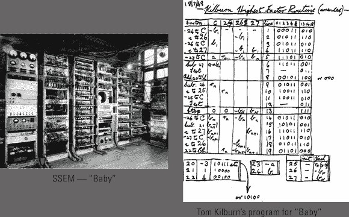

图 4-1: 早期硬件和软件。

温斯顿·罗伊斯（Winston Royce）博士登场了。在他 1970 年发表的文章《大型系统的开发管理》中，罗伊斯博士将被称为瀑布式的分步软件开发过程法规范化。当你查看他在图 4-2 中的原始图表时，你可以看到这个名字的来源了。

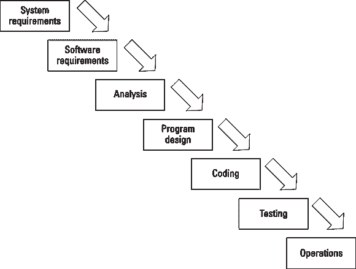

图 4-2: 瀑布模型的起源。

随着时间的推移，计算机开发的情况发生了反转。硬件通过大规模生产变得重复，而软件变成了更复杂、更多化的方面。

这里的讽刺在于，尽管图表意味着按步骤完成任务，但罗伊斯本人加入了一个警告，说明你需要迭代。他是这样陈述的：

> “如果所讨论计算机程序是第一次开发的，那么在关键设计/运行方面交付给客户的版本实际上是第二个版本。”

罗伊斯甚至包含了图 4-3 所示的图表，以说明迭代。

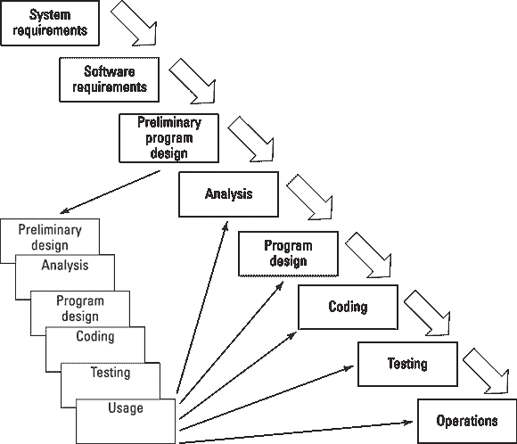

图 4-3: 瀑布模型中的迭代。

现在，我们不确定图表是否被用胶水粘在了其他页面上，但软件开发社区在很大程度上丢失了这部分故事。当你允许这样一个想法：在开始开发软件组件时可能并不知道一切，并且可能需要重新代码以确保其合理性，你就拥有了引入敏捷概念的光芒。如果人们能听取罗伊斯博士的建议，敏捷可能会提前 40 年兴起！

## 回顾三大法：精益、Scrum 和极端编程

现在你已经了解了瀑布式项目管理方法的简要历史，你准备好更深入地了解三种流行的敏捷方法：精益、Scrum 和极端编程。

## 精益概述

精益起源于制造业。大规模生产方法已经存在了 100 多多年，其目的是简化组装过程（例如，组装 T 型福）。这些流程使用复杂的、昂贵的机器和低技能工人来廉价地产出价值物品。其想法是，让机器和人员持续工作并积压库存就能产生巨大的效率。

这种简单性具有欺骗性。传统上，大规模生产需要浪费性的支持系统和大量的间接劳动力，以确保制造过程不中断。它产生了大量的零件库存、额外的工人、额外的空间以及无法为产品增加直接价值的复杂流程。听起来熟悉吗？

### 随着精益生产在制造业中的出现，如何“瘦”

20 世纪 40 年代的日本，一家名为`Toyota`的小公司想要为日本市场生产汽车，但负担不起大规模生产所需的巨额投资。这家公司研究了超市，注意到消费者只买他们需要的物品，因为他们知道总会有供应，而且商店只在货架空了时才进行补货。通过这种观察，`Toyota`创造了一种可以转化到工厂车间的`准时制` (just-in-time) 流程。

结果是零件和成品的库存显著减少，而且对机器、人员和空间的投入有所降低。

当时大规模生产流程的一个巨大成本是生产线上的工人被对待像机器一样：人们没有自主权，无法解决问题、做出选择或改进流程。工作是枯燥的，并抑制了人的潜力。相比之下，`准时制`流程赋予了工人能够在工厂车间实时对下一步最重要的事情做出决策的能力。工人对结果负责。`Toyota`在`准时制`流程上的成功帮助了全球范围内大规模制造方法的改变。

### 理解精益与与软件开发

`精益` (lean) 一词于 20 世纪 90 年代在 James P. Womack、Daniel T. Jones 和 Daniel Roos 的著作《The Machine That Changed the World: The Story of Lean Production (Free Press)》中提出。`eBay`是软件开发领域`精益`原则的早期采用者。该公司领先了一种方法，每天对客户对网站更改的需求做出响应，在短时间内开发出高价值的功能。

`精益`的重点是业务价值和尽可能减少产品开发之外的活动。`Mary`和`Tom Poppendieck`在他们的博客以及关于精益软件开发的书中讨论了一组`精益`原则。以下是来自他们 2003 年书籍《Lean Software Development (Addison-Wesley Professional)》中的`精益`原则：

* **消除浪费。** 任何超出基本需要的操作（流程步骤、产物、会议）都会减慢进展的流。浪费包括未能从工作中学习、构建了错误的东西以及反复无常（在任务或项目之间切换上下文）——这导致只部分创建了许多产品功能，而没有完整地创建任何一个。

* **强化学习。** 学习驱动可预测性。通过定期且纪律性的透明化、检查和适应的心态来实现改进。鼓励一种全组织文化，允许为了从失败中学习而允许失败。

* **尽可能晚地交付。** 允许后期调整。不要延迟交付，但要让你的选项开放足够长，以便根据事实而非不确定性在最后负责时刻做出决策——即你拥有最多信息的时候。从失败中学习。挑战标准。使用科学方法——对假设进行实验以寻找解决方案。

* **尽可能地交付。** 速度、成本和质量是可以兼容的。交付得越早，获得反馈得越快。一次处理更少的事情，限制在制品工作并优化流。管理工作流，而不是管理进度表。使用`准时制`计划来缩短开发和发布周期。

* **赋予团队。** 自主工作、精通技能以及对工作的信念可以激励开发团队。经理不告诉开发人员如何做工作，而是支持他们围绕要完成的工作进行自我组织并消除他们的障碍。确保团队和个人拥有良好工作所需的环境和工具。

* **贯穿质量。** 建立机制以在缺陷发生时并在最终验证之前捕获并纠正它们。质量是从开始就构建的，而不是在最后。打破依赖关系，以便你可以在任何时候开发和集成功能而不会产生回归。

* **洞察全局。** 整个系统的强度取决于其最薄弱的一环。解决问题，而不仅仅是症状。持续关注整个工作流中的瓶颈并消除它们。在创建解决方案时要考虑长期。

除了精益原则之外，敏捷团队最常用的精益方法之一是`看板` (kanban)，有时被称为`精益-看板` (lean-kanban)。`看板`演变自`丰田生产系统` (Toyota Production System) 方法，它本质上是一种消除浪费以提高系统内流转和吞吐量的方法。

`看板`实践可以应用于几乎任何情况，因为它们的设计是从你的现状开始的——你不需要对现有的工作流进行任何更改即可开始。`看板`实践包括：

* 可视化。

* 限制在制品 (`WIP`)。

* 管理流。

* 使流程策略显化。

* 实现反馈循环。

* 协作改进，实验性演进。

后三项实践常见于其他敏捷框架中，例如`scrum`和`XP`（本章稍后部分将讨论）。前三项增强了敏捷团队的效能：

* **可视化：** 可视化团队的工作流是识别潜在浪费的第一步。传统的臃肿流程存在于许多组织中，但即使被视觉化，也不能反映现实。当敏捷团队将他们的工作流视觉化（在白板上、墙上或图表中）并识别生产力何处中断时，他们可以轻松分析根源并看到如何消除限制。然后反复这样做，再一次，再一次。

 `Kanban`是日语中“视觉信号”的意思。悬挂在工厂墙上或开发工作区墙上，所有人都能看到，`看板`板显示了团队下一步需要生产的项目。看板上插着代表生产单位的卡片。随着生产的进行，工人移除、添加和移动卡片。随着卡片的移动，它们充当工人需要补充库存的信号。敏捷团队使用`看板板`或任务板来暴露他们的进度并管理工作流（在第 5 章和第 9 章中详细描述）。

* **限制在制品 (WIP)：** 当团队不断开始工作但不完成时，他们的在制品就会不断增加。敏捷的核心是关于实现“完成”，因此目标是只有在其他事情完成时才开始新工作。一次处理多件事并不意味着你完成得更快——实际上，比你一次处理一个来完成它们要慢得多。当敏捷团队限制其在制品时，项目的完成速度更快，加快了队列中每个物品的完成速度。

* **管理流：** 我们都经历过早高峰期间繁忙马路上发生的情况。当车辆数量超过车道的承载能力时，所有车辆的移动都会变慢。大家都想在同一时间到达某地，因此每个人都必须等得更久。为了更好地管理流，我们需要调节进入交通流的车辆，或者在拥堵最严重的地方增加车道数量。

 衡量交付时间（lead times）和周期时间（cycle times）有助于敏捷团队监控其对流转的管理。团队通过跟踪功能请求从进入队列到完成所需的时间来确定交付时间。他们通过跟踪从工作开始到完成的时间来确定周期时间。敏捷团队通过识别并消除阻碍交付时间和周期时间缩短的瓶颈来优化流转。

 为了支持良好的产品开发实践，请记住以下点：

- 不要开发你不太可能使用的功能。

- 让开发团队处于项目的核心，因为他们创造了最大的价值。

- 让客户对功能进行优先级排序——他们最清楚什么对他们最重要。优先处理高优先级事项以交付价值。

- 使用支持各方之间良好沟通的工具。

今天，精益原则持续影响着敏捷技术的发展，并受到这些技术的影响。任何方法都应该是敏捷的，并随着时间不断进行调整。

## Scrum 概述

Scrum 是软件开发中最流行的敏捷框架，是一种迭代方法，其核心是`sprint`（Scrum 中对迭代的术语）。为了支持这一过程，Scrum 团队使用特定的角色、工制品和事件。为了确保他们满足流程每个部分的目标，Scrum 团队在整个项目期间使用检查和适应。Scrum 方法如图图 4-4 所示。

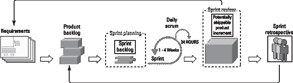

图 4-4: Scrum 方法。

### 贯穿 sprint 始终

在每个 sprint 内部，开发团队开发并测试产品的功能部分，直到产品所有者接受它（通常是每天），该功能就会成为整个产品的一个潜在可交付的增量。当一个 sprint 结束时，另一个 sprint 就开始。向市场发布功能通常发生在多个 sprint 结束，此时产品所有者认为已经足够的价值。然而，产品所有者也可以决定在每个 sprint 结束后发布功能，甚至在一个 sprint 期间根据需要发布多次。

 sprint 的核心原则是其循环性质：sprint 及其内部的流程会不断重复，如图图 4-5 所示。

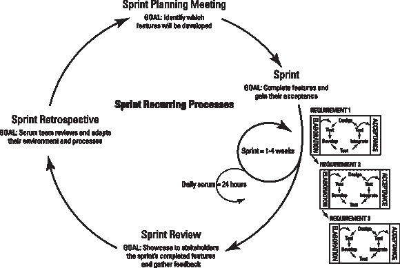


图 4-5：Sprint 是反复出现的过程。

作为 Scrum 项目的一部分，你每天都会使用检查和适应的原则：

- 在 sprint 期间，你进行`持续检查`以评估迈向 sprint 目标的进展，从而迈向发布目标的进展。
- 你召开`daily scrum`（每日站会）会议，通过回顾团队昨天完成的工作并协调今天将要做的工作来组织一天的工作。本质上，Scrum 团队正在检查其迈向 sprint 目标的进展。
- 在 sprint 结束时，你使用`sprint retrospective`（迭代回顾）会议来评估性能并计划必要的适应。

这些检查和适应听起来可能正式且充满流程，但事实并非如此。使用检查和适应解决问题，不要过度思考这个过程。你今天试图解决的问题在未来通常会发生。

## 理解 Scrum 角色、工制品和事件

Scrum 框架为项目定义了特定的角色、工制品和事件。

Scrum 的三个`roles`（角色）——项目中的人员如下：

- **产品所有者（Product owner）：** 代表并体现项目的业务需求。
- **开发团队（Development team）：** 执行日常工作。开发团队专注于项目，每个团队成员都是`多才多艺`的——也就是说，尽管团队成员可能有某些专长，但每位成员都能胜任项目中的多项工作。
- **Scrum 师（Scrum master）：** 保护团队免受组织外部的干扰，清除障碍，确保正确执行 Scrum，并持续改进团队环境。

此外，Scrum 团队发现，当他们与两个非 Scrum 特定的角色紧密合作时，他们会更有效、更高效：

- **利益相关者（Stakeholders）：** 任何受项目影响或对项目有建议的人。尽管利益相关者不是正式的 Scrum 角色，但 Scrum 团队与利益相关者在整个项目中密切合作至关重要。
- **敏捷导师（Agile mentor）：** 敏捷技术和 Scrum 框架的经验权威。这些人通常是项目部门或组织的外部人员，因此他们从人的视角客观地支持 Scrum 团队。

与 Scrum 有特定角色一样，Scrum 还有三个有形的交付物，称为`artifacts`（工制品）：

- **产品待办列表（Product backlog）：** 定义产品的完整需求列表，通常从终端用户的角度根据业务价值记录。产品待办列表在整个过程中可以是流动的。所有范围项，无论详细程度如何，都在产品待办列表中。产品所有者拥有产品待办列表，决定其中包含的内容以及优先级。
- **Sprint 待办列表（Sprint backlog）：** 给出 sprint 中的需求和任务列表。产品所有者和开发团队在 sprint 计划会议上选择 sprint 的需求，由开发团队将其拆分为任务。与产品待办列表不同，Sprint 待办列表只能由开发团队更改。
- **产品增量（Product increment）：** 可用的、潜在可交付的功能。无论产品是网站还是新房子，产品增量都应该足够完整以演示其工作功能。当产品包含足够的满足客户目标的可交付功能后，Scrum 项目即告满完成。

最后，Scrum 还有五个事件：

- **Sprint：** Scrum 对迭代的术语。`sprint` 是每个其他 Scrum 事件的容器，Scrum 团队在其中创建潜在可交付的功能。Sprint 是短周期，最长不超过一个月，通常在一周到两周之间，在某些情况下短至一天。一致的 sprint 长度可以减少波动；Scrum 团队可以根据之前在 sprint 中完成的内容，自信地推断出每个 sprint 中可以做什么。Sprint 为 Scrum 团队提供了立即进行持续改进调整的机会，而不是在项目结束时。
- **Sprint 计划（Sprint planning）：** 每个 sprint 开始时举行。在 sprint 计划会议上，Scrum 团队决定哪些目标、范围和支持任务将成为 sprint 待办列表的一部分。
- **每日 Scrum（Daily scrum）：** 每天举行，持续不超过 15 分钟。在每日 Scrum 期间，开发团队成员做出三个陈述：
  - 成员昨天完成了什么
  - 成员今天将做什么
  - 阻碍成员的项目列表

  Scrum 师也会在他正在为开发者清除障碍的背景下参与。
- **Sprint 回顾（Sprint review）：** 每个 sprint 结束时举行。在会议上，开发团队向利益相关者和整个组织演示团队在 sprint 期间完成的接受的部分。回顾回顾的关键在于收集利益相关者的反馈，这指导产品所有者如何更新产品待办列表并考虑下一个 sprint 目标。
- **迭代回顾（Sprint retrospective）：** 在每个迭代（Sprint）结束时举行。迭代回顾是一次团队内部会议，Scrum 团队成员（产品所有者、开发团队和 Scrum Master）在会议上讨论迭代期间哪些做得好，哪些做得不好，以及他们如何在下一个迭代中进行改进。这种会议是以行动为导向的（不满情绪应在其他地方发泄），并以针对下一个迭代的切实改进计划结束。

Scrum 非常简单：三个角色、三个产物和五个事件。每一项都确保 Scrum 团队在整个项目过程中保持持续的透明性、检查和适应。作为一个框架，Scrum 容纳了许多其他敏捷技术、方法和工具，用于执行功能构建的技术方面。

### 极端编程概述

一种流行的、特定于软件的产品开发方法是极端编程（XP）。极端编程将软件开发的最佳实践推向了极端。XP 原则由 Kent Beck 在 Ward Cunningham 和 Ron Jeffries 的帮助下于 1996 年创立，最初在 Beck 1999 年的著作《极端编程实之道》（Extreme Programming Explained，Addison-Wesley Professional）中描述，该书此后进行了更新。

极端编程的核心是客户满意度。XP 团队通过在客户需要时开发功能来实现高客户满意度。新请求是开发团队日常工作的一部分，团队被授权在这些请求出现时随时处理它们。团队围绕出现的任何问题进行组织工作，并尽可能高效地解决问题。


随着 XP 作为一种实践的不断发展，XP 角色变得模糊了。一个典型的项目现在由客户、管理、技术和项目支持组的人员组成。每个人在不同时间可能扮演不同的角色。

### 发现极端编程原则

极端编程的基本方法基于敏捷原则。这些方法如下：

- **编码是核心活动。** 软件代码不仅交付了解决方案，还可以用于探索问题。例如，程序员可以使用代码来解释一个问题。
- **XP 团队进行大量的测试。** 如果只做少量测试就能帮助你识别一些缺陷，那么大量的测试将帮助你发现更多。事实上，开发者在确定需求的成功标准并设计好单元测试之前是不开始编码的。缺陷并不是代码的失败；而是定义正确测试的失败。
- **客户与程序员之间的通信是直接的。** 程序员必须理解业务需求以设计技术解决方案。
- **对于复杂系统，有必要在任何特定功能之外进行某种整体设计。** 在 XP 项目中，整体设计是在定期的`refactoring`（重构）期间考虑的——即通过系统地改进代码的过程来提高可读性、降低复杂度、提高可维护性并确保整个代码库的可扩展性。


你可能会发现极端编程与精益（Lean）或 Scrum 结合，因为它们的流程元素非常相似，所以它们结合得很好。

### 了解一些极端编程实践

在 XP 中，某些实践与其他敏捷方法相似，但另另则则不然。表 4-1 列出了一些关键的 XP 实践，其中大多数是常识性实践，许多反映在敏捷原则中。

| XP 实践 | 基础假设 |
| --- | --- |
| 计划游戏（Planning game） | 团队的所有成员都应该参与计划。业务人员和技术人员之间不存在脱节。 |
| 全体团队（Whole team） | 客户需要与开发团队协作（物理上在一起）并保持可用。这种可访问性使团队能够提出更多细节问题，快速获得答案，并最终交付更符合客户预期的产品。 |
| 编码标准（Coding standards） | 使用编码标准使开发者能够做出决策并保持整个产品的一致性；不要在你的组织中不断重新发明开发产品的基础知识。标准的代码标识符和命名规范是编码标准的两个例子。 |
| 系统隐喻（System metaphor） | 在描述系统如何工作时，使用一种隐含的比较，一个易于理解的简单故事（例如，“系统就像做饭”）。这为团队在所有产品发现活动和讨论中提供了可以依靠的额外背景。 |
| 代码集体所有权（Collective code ownership） | 整个团队对代码质量负责。共享所有权和责任制带来了最好的设计和最高质量。任何工程师都可以修改另一位工程师的代码，以确保进度持续。 |
| 可持续节奏（Sustainable pace） | 过度工作的人是无效的。工作过多会导致错误，从而导致更多工作，进而导致更多错误。避免长时间每周工作超过 40 小时。 |
| 结对编程（Pair programming） | 两个人共同完成一项编程任务。一个人负责策略（主驾驶员），另一个人负责战术（导航员）。他们互相解释自己的方法。没有代码是只由一个人理解的。在与系统合并集成代码之前，可以更容易发现并修复缺陷。 |
| 设计改进（Design improvement） | 通过重构代码持续改进设计——消除代码中的重复和低效。精益的代码库更容易维护，且运行更高效。 |
| 简单设计（Simple design） | 设计越简单，更改软件代码的成本越低。 |
| 测试驱动开发（TDD） | 在编写任何代码之前，编写自动化客户验收测试和单元测试。写一个测试，运行它，观察它失败。然后编写恰好的代码让测试通过，不断重构直到通过（红-绿-重）。在声称进展之前，测试你的成功。 |
| 持续集成（Continuous integration） | 团队成员应该基于最新代码工作。尽可能跨整个开发团队集成代码组件，以识别问题并采取纠正措施。 |
| 小发布（Small releases） | 尽可能频繁地向客户交付价值。有些组织每天发布。避免积累大量需要大量回归和集成工作的未发布代码。尽早、尽可能地从客户那里获得反馈。 |

表 4-1：极端编程的关键实践


极端编程通过大幅增加最佳实践仪式的强度，刻意推向开发习俗的极限，这使得 XP 在提高开发效率和成功方面取得了良好的记录。

### 整合一切

所有三种敏捷方法——精益、Scrum 和极端编程（XP）——都有共同线索。这些方法最大的共同点是遵循敏捷宣言和 12 条敏捷原则。表 4-2 对这些共同点进行了总结。

| 敏捷原则 | Scrum | 极端编程（XP） |
| --- | --- | --- |
| 调动每个人 | 跨功能开发团队 | 全体团队、集体所有权 |
| 优化整体 | 周期为四周或更短的迭代 | 测试驱动开发、持续集成 |
| 快速交付 | 产品增量 | 小发布 |

除了更广泛的敏捷框架和实践外，敏捷（scrum）还容纳了各种持续提升敏捷项目成功的辅助工具。就像物理房屋的框架是为了支持水暖、电力、通风和内部便利设施而构建的，scrum 为许多其他敏捷工具和技术能够良好工作提供了框架。以下是一些示例，其中大部分你将在后续章节中学习到更多信息：

- 产品愿景声明（电梯演讲，关于实现项目外部边界方向的清晰陈述）
- 产品路线图（实现产品愿景所需功能的表示）
- 速率（Velocity，scrum 团队用于计划每个冲刺（sprint）工作量并根据经验预测长期功能交付的工具）
- 发布计划（建立一个特定的中短期目标，作为向市场发布功能的触发点）
- 用户故事（从终端用户的角度结构化需求，以明确业务价值）
- 相对估算（使用自我修正的相对复杂性和工作量，而非不准确的绝对衡量，后者会给人精确的虚假感）
- 集结/群攻（Swarming，跨职能团队共同处理某一个需求直到完成，从而更快完成工作）

# 第 5 章：行动中的敏捷环境

## 本章内容

-  创建你的敏捷工作空间
-  重新发现低技术通信并使用正确的高技术通信
-  寻找并使用你需要的工具

在脑海中勾勒你当前工作环境的画面。也许看起来像下面的设置：IT 团队坐在某个部门的“方格城市”里，项目经理在步行范围内某处。你与一个领先八个时区的海外开发团队协作。业务客户在建筑的另一侧。你的经理躲在某处的小办公室里。会议室通常被订满，即使你进去了，也会在一个小时内被人赶出去。

你的项目文档存储在共享驱动器的文件夹中。开发团队每天至少收到 100 封电子邮件。项目经理每周召开一次团队会议，并参考项目计划告诉开发者要做什么。项目经理还会创建每周状态报告并发布在共享驱动器上。产品经理通常太忙，无法与项目经理交流评审进度，但会定期发送邮件，分享对应用程序的一些新想法。

尽管前面的段落描述可能并不符合你的具体情况，但在任何企业环境中你都能看到类似的情况。然而，敏捷团队通过短而集中的迭代周期执行项目，依靠项目团队成员的及时反馈。为了运营并变得更加敏捷，你的工作环境必须发生变化。本章将向你展示如何创建一个促进交流的空间，这有助于帮助你更好地变得敏捷。

## 创建物理环境

当 scrum 团队成员在支持流程的环境中紧密合作时，敏捷项目团队就会蓬勃发展。正如其他章节提到的，开发团队成员是敏捷项目成功的关键。为他们创造一个合适的运行环境对支持他们的成功大有益处。你甚至可以聘请专门设计优化敏捷工作环境的人员。

### 团队同地

如果可能，scrum 团队需要`collocated`（同地）——即在物理位置上在一起。当 scrum 团队同地办公时，可以实现以下实践，并显著提高效率和效果：

- 面对面交流
- 小组形式站立而非坐着——进行每日站会（这能保持会议简洁并切入主题）
- 使用简单、低技术的工具进行通信
- 从 scrum 团队成员处获得即时澄清
- 了解他人正在工作的内容
- 就某任务寻求帮助
- 协助他人完成任务

所有这些实践都维护了敏捷流程。当每个人都在同一个区域时，一个人很容易侧身问一个问题并获得立即答复。如果问题复杂，面对面的交流所产生的这种协同效应远比邮件交换效率高得多。


这种通信有效性的提高得益于`communication fidelity`（通信保真度）——意图含义与解释含义之间的准确程度。加州大学洛杉矶分校（UCLA）教授阿尔伯特·梅拉宾（Albert Mehrabian）博士表明，对于复杂的、不一致的通信，55% 的意义通过肢体语言传达，38% 通过特定文化的语调解释传达，只有 7% 通过文字传达。在你下一次通过 VoIP 或智能手机会议讨论一个不存在的系统的细微差别时，这是需要记住的。

敏捷宣言的签署者之一阿里斯泰尔·科伯恩（Alistair Cockburn）创建了图 5-1。

图 5-1：通过同地实现更好的通信。

### 建立专用区域

如果 scrum 团队成员在同一个物理场所，你希望为他们创建一个尽可能理想的环境。第一步是创建一个专用区域。

建立一个可以让 scrum 团队近距离工作的环境。如果可能，scrum 团队应该有一个自己的房间，有时被称为`项目室`或`scrum 室`。scrum 团队成员在这个项目房间内创建他们需要的设置，在墙上挂上白板和公告板并移动家具。通过为生产力安排空间，它就变成了工作方式的一部分。如果无法设立独立房间，一个`pod`（单元）——周围是工作区，中间是协作中心——效果很好。

如果你被困在“方格城市”中且无法拆墙，请申请获得一组空方格并拆掉隔板。创建一个你可以将其视为项目房间的空间。


正确的空间让 scrum 团队完全沉浸在解决问题和制定解决方案中。

### 消除干扰

开发团队需要专注、专注、专注。敏捷方法的设计是为了为特定方式进行的高生产力工作建立结构。对这种生产力最大的威胁是分心，例如……等一下，我需要接个电话。

好了，我回来了。好消息是，敏捷团队中有人专门负责转移或消除干扰：那就是`scrum master`（敏捷大师）。无论你是准备担任`scrum master`角色还是其他角色，你都需要了解哪种干扰会让开发团队偏离轨道，以及如何处理这些干扰。表 5-1 列出了常见的干扰以及处理这些干扰的准则禁忌。

| 干扰 | 做的（Do） | 不要做的（Don’t） |
| --- | --- | --- |
| 多个项目 | 确保开发团队每次 100% 专注于单一项目。 | 不要将开发团队分散在多个项目、运维支持和特殊任务之间。 |
| 多任务处理 | 保持开发团队专注于单项任务，理想情况下是同时开发一项功能。任务板可以帮助跟踪进行中的任务，并快速识别某人是否同时在处理多个任务。 | 不要让开发团队在需求之间切换。切换任务会产生巨大的生产力损耗（至少损失 30%）。 |
| 过度监督 | 在协作制定迭代目标后，让开发团队成员保持清静；他们可以自我组织。看着他们的生产力飙升。 | 不要干预开发团队或允许他人这样做。每日站会提供了充足的机会来评估进度。 |
| 外部影响 | 重新引导任何干扰源。如果出现了冲刺目标之外的新任务，请产品负责人（product owner）决定该任务的优先级是否值得牺牲冲刺功能。 | 不要打扰开发团队成员及其工作。他们正在追求冲刺目标，这是活跃冲刺期间的首要任务。即使是一个看似很快的任务也可能干扰一整天的工作。 |
| 管理 | 保护开发团队免受管理层的直接请求（除非管理层想为优秀的团队成员发放奖励）。 | 不要让管理层负面影响开发团队的生产力。让中断开发团队成为阻力最大的路径。 |

表 5-1：常见干扰


干扰会消耗开发团队的专注力、精力和表现。`scrum master` 需要力量和勇气来管理和转移干扰。每避免一次干扰都是迈向成功的一步。

### 移动化


从“移动化”标题来看，你可能认为这一节是关于智能手机电话会议的，但事实并非。敏捷项目团队采取响应方法，`scrum` 团队成员需要一个帮助他们应对当天项目需求的环境。敏捷团队环境应该是移动的——字面意义上的：

* 使用移动桌子和椅子，以便人们可以走动并重新配置空间。
* 配备无线连接的笔记本电脑，以便 `scrum` 团队成员可以轻松地拿起并移动。
* 准备一块大型移动白板。另见下一节关于低技术通信的章节。

有了这种移动环境，`scrum` 团队成员可以根据需要配置和重新配置。鉴于 `scrum` 团队成员每天都会与不同的成员合作，移动性非常重要。固定家具往往会决定发生的交流形式。移动化允许更自由的协作和整体上的更多自由。

## 低技术通信

当 `scrum` 团队协作办公时，成员之间可以轻松流畅地进行面对面交流。特别是在你开始敏捷转型时，你希望保持通信工具是低技术的。依靠面对面谈和老式的纸笔。低技术促进了非正式性，让 `scrum` 团队成员感到在了解产品时，他们可以改变工作流程并进行创新。

交流的首要工具应该是面对面谈。面对面解决问题是加速生产的最佳方式：

* **面对面进行短的每日站会。** 一些 `scrum` 团队在会议期间站立，以防止会议超过 15 分钟。
* **向产品负责人提问。** 同时也，确保他或她参与关于产品功能的讨论，以便在需要时提供说明。对话不应在计划结束时停止。
* **与同事沟通。** 如果你对功能、项目进度或集成有疑问，请与同事沟通。整个开发团队负责创建产品，团队成员需要全天候保持交流。

只要 `scrum` 团队距离很近，你就可以使用物理视觉方法让每个人保持在同一信息线上。工具应该让每个人都能看到：

* 冲刺目标
* 实现冲刺目标所需的功能
* 冲刺中已完成什么
* 冲刺中接下来要做什么
* 谁在负责哪项任务
* 还有什么需要完成

只需要少数工具即可支持这种低技术通信：

* 一块或两块白板（理想情况下是移动的——带轮子或轻便的）。在协作方面，没有什么能比得上白板。`scrum` 团队可以使用它来头脑风暴解决方案或分享想法。
* 大量的不同颜色的便利签（包括海报尺寸的，用于你想要展示的信息，如架构、编码标准）。

 我个人非常喜欢给每个开发者至少准备一个桌面擦擦板/便利签本。这些轻便的工具极大地促进了交流。

* 大量的彩色笔。
* 一个冲刺特定的任务板或看板（在第 4 章 `信息辐射` 是一种向 `scrum` 团队及其工作区域的其他人物理展示信息的工具。信息辐射包括看板、白板、公告板、显示迭代状态的`燃尽图`以及任何关于项目、产品或 `scrum` 团队的细节。

基本上，你通过移动看板上的便利签或卡片来显示状态（参见图 5-2](#10_9781119405696-ch05.xhtml_c05-fig-0002)）。每个人都知道如何阅读看板以及如何根据显示的内容采取行动。在第 9 章中，你将了解到看板上放置什么内容的细节。


[图 5-2：]墙壁或白板上的 `scrum` 任务板。

 无论你使用什么工具，都要避免花费时间在让事情看起来完美整洁和漂亮上。布局和展示的正式化（你可能会称之为*场面*）可以给人一种工作整洁优雅的印象。然而，工作本身才是重要的，因此要把你的精力放在支持工作的活动上。

## 高科技沟通

虽然协作办公（collocation）几乎普遍能提高效率，但许多 `scrum` 团队无法实地办公。有些项目的团队成员分散在多个办公室；另一些项目则拥有遍布全球的离岸开发团队。如果你有多个地理位置分散的 `scrum` 团队，请尝试首先重新分配现有人才，在每个地理位置形成协作办公的 `scrum` 团队。如果这种调整不可行，不要放弃敏捷转型。相反，请尽可能模拟协作办公。

当 `scrum` 团队成员在不同的地点工作时，你必须付出更大的努力来营造一个能够产生连接感的环境。为了跨越距离和时区，你需要更复杂的通信机制。

在确定支持哪些类型的高科技通信工具时，首先要考虑面对面讨论的缺失。你可以使用的一些工具包括：

* `视频会议和网络摄像头`：这些工具可以营造一种在一起的感觉。如果你必须远程通信，至少要确保能够清楚地看到和听到对方。肢体语言提供了大部分信息。
* `即时消息`：虽然即时消息不能传递非语言交流，但它是实时的、易访问且易用的。几个人还可以共享会话并共享文件。
* `基于 Web 的桌面共享`：对于开发团队来说，共享桌面允许你实时视觉化地突出问题和更新。看到问题总是比在电话里讨论要好。
* `协作网站`：这些网站允许你完成一切事情，从共享简单的文档以确保每个人都有最新信息，到使用虚拟白板进行头脑风暴。

 使用协作网站（如 `SharePoint`、`Confluence` 和 `Google Drive`）允许你发布显示冲刺（sprint）状态的文档。当经理请求状态更新时，你可以简单地引导他们去协作网站，按需获取所需的信息。通过每天更新这些文档，你为经理提供了比传统项目管理周期下正式状态报告程序更好的信息。避免为管理层创建单独的状态报告；这些报告与冲刺燃尽图（sprint burndowns）中的信息重复，并且不支持生产。

 当你拥有共享文档的协作网站时，不要假设所有人都能自动理解文档中的所有内容。使用协作网站来确保所有内容都是发布、可访问且透明的，但不要让它给你的团队带来共同理解的错觉。

## 选择工具

正如本章提到的，低技术工具最适用于敏捷项目，特别是在初始阶段，当 `scrum` 团队习惯于这一流程时。本节讨论了选择敏捷工具时需要考虑的几点：工具的用途以及组织和兼容性限制。

### 工具的的

在选择工具时，你需要问的首要问题是：“工具的目的是什么？”工具应该解决特定问题并支持敏捷流程，而流程的重点是推进工作。

最，不要选择比你需要的更复杂的工具。有些工具非常复杂，需要花费时间学习才能使用它们产生生产力。如果你与一个协作办公的 `scrum` 团队一起，敏捷实践的培训和采用可能已经足够挑战性了，无需再增加一套复杂的工具。如果你与一个分散办公的 `scrum` 团队一起，引入新工具可能会更加困难。

 你可以在市场上找到许多以敏捷为中心的网站、软件和其他工具。许多是有用的，但在你实施敏捷的早期，你不应该投资于昂贵的敏捷工具。这种投资是不必要的，并为采用增加了另一个层次的复杂性。当你通过前几次迭代并修改方法时，`scrum` 团队将开始识别可以改进或需要更改的程序。这些改进之一可能是对额外工具或替代工具的需求。当需求从 `scrum` 团队自然产生时，为购买必要的工具寻找组织支持通常更容易，因为这种需求可以与项目问题挂钩。

### 组织和兼容性限制

除了上一节提到的初始考虑之外，你选择的工具必须在你的组织中运行。除非你只使用非电子工具，否则你可能需要考虑有关硬件、软件、服务的组织政策，以及云计算、安全和电话系统。

如果你是一个分布式组织的一员，某些 `scrum` 团队可能无法支持复杂的解决方案、维护桌面软件的最新版本，或者拥有你理所当然的强大互联网带宽。

为敏捷团队创建敏捷环境的关键是在组织战略层面这样做。敏捷团队驱动敏捷项目，因此请尽早寻求你组织的领导层，提供能够赋予你的团队成功的工具。

第 6 章

# 实践中的敏捷行为

本章内容

 设置敏捷角色

 在你的组织中建立敏捷价值观

 转变你的团队哲学

 磨炼重要技能

在本章中，你将观察为了让你的组织从敏捷技术实现的性能优势中受益而需要转变的行为动态。你将了解到敏捷项目中的不同角色，并看看如何改变项目团队对项目管理的价值观和哲学。最后，我们讨论了项目团队磨炼敏捷成功关键技能的方法。

## 建立敏捷角色

在 `第 4 章` 中，我们描述了 `scrum`，目前最流行的敏捷框架之一。`scrum` 框架以特别简洁的方式定义了常见的敏捷角色。我们在书中使用 `scrum` 术语来描述敏捷角色。这些角色是：

* 产品所有者
* 开发团队成员
* `Scrum master`

产品所有者、开发团队和 `scrum master` 共同构成了 `scrum 团队`。每个角色都是彼此平等的——团队中没有人是另一个人的老板。

以下角色不是 `scrum` 框架的一部分，但对敏捷项目仍然至关重要：

* 利益相关者
* 敏捷导师

`scrum` 团队与利益相关者共同组敏捷项目团队。这一切的核心是开发团队。产品所有者和 `scrum master` 履行确保开发团队成功的角色。`图 6-1` 显示了这些角色和团队是如何结合的。本节将详细讨论这些角色。

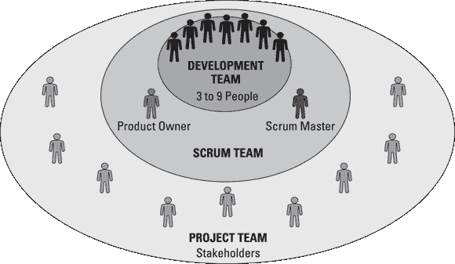

[图 6-1：]敏捷项目团队、`scrum` 团队和开发团队。

### 产品所有者

产品所有（`Product Owner`）在非 `Scrum` 环境下有时被称为 `客户代表`，负责桥接客户、业务利益相关者与开发团队之间的鸿沟。产品所有是产品本身以及客户需求和优先事项的专家。产品所有是 `Scrum` 团队的同级成员，负责保护开发团队免受业务干扰，每天与开发团队合作以帮助澄清需求，并在整个迭代冲刺（`Sprint`）期间接受完成的工作，以便为冲刺评审做准备。

产品所有负责对产品包含和不包含的内容做出决策。再加上决定向市场发布什么以及何时发布的责任，你会发现你需要一个明智且干练的人来担任这一角色。

### 在敏捷项目中，产品所有将：

* 为项目制定战略和方向，并设定长期和短期目标。
* 提供或获取产品知识。
* 理解并将客户及其他业务利益相关者的需求传达给开发团队。
* 收集、排序并管理产品需求。
* 负责产品的预算和盈利能力。
* 决定何时发布已完成的功能。
* 每天与开发团队合作，回答问题并做出决策。
* 在冲刺期间根据工作完成情况接受或拒绝完成的工作。
* 在每个冲刺结束时，在开发团队演示这些成就之前，展示 `Scrum` 团队的成果。

### 什么样的人是优秀的产品所有者？

果断。优秀的产品所有者彻底了解客户，并获得组织的授权每天做出困难的业务决策。尽管他们能够从利益相关者那里收集需求，但他们自己也对产品了如指掌。他们能够自信地进行优先级排序。

优秀的产品所有者与业务利益相关者群体、开发团队以及 `Scrum Master` 保持良好的互动。他们非常务实，并能够根据现实进行权衡。他们对开发团队易接触，也会主动提出他们的需求。他们非常有耐心，特别是面对开发团队的问题时。

表 6-1 概述了产品所有者的责任及相应的特征。

| 责任 | 优秀的产品所有者…… |
| --- | --- |
| 提供项目战略和方向 | 构想完成后的产品；坚定地理解公司战略 |
| 提供产品知识 | 过去曾接触过类似的产品；理解使用产品的人的需求 |
| 理解客户和其他利益相关者的需求 | 理解相关的业务流程；建立稳固的客户输入和反馈渠道；与业务利益相关者合作良好 |
| 管理并对产品需求进行排序 | 决策果断；关注效率；保持灵活；将利益相关者的反馈转化为有价值的、以客户为中心的功能；在优先考虑具有财务价值的功能、高风险功能和战略性系统改进方面非常务实；保护开发团队免受业务干扰（竞争性的利益相关者请求） |
| 负责预算和盈利能力 | 理解哪些产品功能可以带来最佳投资回报；有效率管理预算 |
| 决定发布日期 | 理解关于时间节点的业务需求 |
| 与开发团队合作 | 易于就每日需求进行解答；与开发团队合作以了解能力；与开发者合作良好；熟练地描述产品特征 |
| 接受或拒绝工作 | 理解需求并确保完成的功能正常运行 |
| 在每个冲刺结束时展示完成的工作 | 在开发团队演示冲刺运行功能之前，清晰地介绍冲刺的成果 |

表 6-1 优秀的产品所有者特征

产品所有者在项目期间承担了大量的业务相关责任。尽管项目赞助者提供并拥有预算，但产品所有者管理预算的支出方式。

拥有一个投入且果断的产品所有者，开发团队拥有将需求转化为运行功能所需业务支持。下一节将解释产品所有者如何帮助确保开发团队理解他们将创建的产品。

### 开发团队成员

开发团队成员是创建产品的人。在软件开发中，程序员、测试人员、设计师、作家、数据工程师以及任何在产品开发中担任实际角色的人都是开发团队成员。对于其他类型的产品，开发团队成员可能拥有不同的技能。

### 在敏捷项目中，开发团队是：

* 直接对项目交付物负责。
* 自组织和自管理。开发团队成员决定自己的任务以及他们希望完成这些任务的方式。
* 跨职能。开发团队共同拥有所有技能，可以将需求详细化、设计、开发、测试、集成并记录为可运行的功能。
* 多才技能。开发团队成员是多才的——他们不局限于单一技能组。他们拥有现有技能可以在项目开始时立即做出贡献，但也愿意学习新技能并将他们所知的教给其他开发团队成员。
* 理想情况下在整个项目期间专注于一个项目。
* 理想情况下同地办公。团队应该在同一办公室的同一区域共同工作。

### 什么样的人是优秀的开发团队成员？

查看表 6-2 中的团队责任及相应的特征。

| 责任 | 优秀的开发团队成员…… |
| --- | --- |
| 创建产品 | 享受创建产品；精通创建产品所需的一项或多项工作 |
| 自组织和自管理 | 出主动性和独立性；了解如何克服障碍以实现目标；与团队其他成员协调待办工作 |
| 跨职能 | 具有好奇心；愿意为其专长之外的领域贡献；喜欢学习新技能；热情分享知识 |
| 专注且同地办公 | 属于理解专注、同地办公相关的效率和有效性收益的组织 |

表 6-2 优秀的开发团队成员特征

`Scrum` 团队的另外两个成员——产品所有和 `Scrum Master` 帮助支持开发团队创建产品的努力。产品所有确保开发团队是有效的（做正确的事），而 `Scrum Master` 则帮助为开发团队尽可能高效的工作清除道路。

### Scrum Master

`Scrum Master` 在非 `Scrum` 的敏捷环境中有时被称为 `项目协调员`，负责支持开发团队、清除组织障碍并保持流程符合敏捷原则。

* 担任流程教练，帮助项目团队和组织遵循 `Scrum` 价值观和实践。
* 帮助消除项目障碍——无论是被动应对还是主动预防——并保护开发团队免受外部干扰。
* 促进利益相关者与 `Scrum` 团队之间的紧密合作。
* 促进 `Scrum` 团队内部达成共识的达成。
* 保护 `Scrum` 团队免受组织层面的干扰。

 我们将 `Scrum Master` 比作航空工程师，其工作是是减少飞机的阻力。阻力总是客观存在的，但可以通过创新的和主动的工程手段来减少。同样，所有项目都存在影响团队效率的组织障碍，而且总会有另一个可以被识别并消除的限制因素。`Scrum Master` 角色最重要的部分之一就是消除道路障碍并防止开发团队工作的干扰。一个擅长这些任务的 `Scrum Master` 对项目和团队来说是无价的。如果一个开发团队有七个人，那么一个优秀的 `Scrum Master` 带来的影响就是七倍。

产品所有者（`Product Owner`）可能从未参与过敏捷项目，但 `Scrum Master` 可能很有相关经验。因此，`Scrum Master` 可能会指导新的产品所有者和开发团队，并尽一切努力帮助他们成功。

什么构成了一个优秀的 `Scrum Master`？`Scrum Master` 不需要项目经理的经验。`Scrum Master` 是敏捷流程的专家，能够指导他人。`Scrum Master` 还必须与产品所有者和利益相关者社区协作工作。

 引导技巧可以穿透小组聚会的噪音，确保 `Scrum` 团队的每一个人都在正确的时间关注正确的优先事项。

`Scrum Master` 拥有强大的沟通能力，并具备足够的组织影响力，通过为争取合适的环境、保护团队免受干扰以及消除障碍来确保成功的条件。`Scrum Master` 是出色的引导者和优秀的倾听者。他们能够在冲突的意见中进行谈判，并帮助团队自我完善。请在 表 6-3 中查看 `Scrum Master` 的职责及相应的特征。

| 职责 | 优秀的 `Scrum Master` 能够 |
| --- | --- |
| 维护 `Scrum` 价值观和实践 | 是 `Scrum` 流程的专家；对敏捷技术充满热情 |
| 消除障碍并防止干扰 | 具有组织影响力并能快速解决问题；言辞得道、圆滑且专业；是良好的沟通者和倾听者；对于开发团队仅关注项目和当前冲刺的需求持坚定立场 |
| 促进外部利益相关者与 `Scrum` 团队之间的紧密合作 | 从整体角度考虑项目需求；避免派系并帮助打破部门孤岛 |
| 促进共识达成 | 理解帮助小组达成一致的技术 |
| 担任仆人式领导（`Servant-leader`） | 不需要也不想掌权或当老板；确保开发团队的所有成员都拥有完成工作所需的信息、使用工具并跟踪进度；真正渴望帮助 `Scrum` 团队 |

表 6-3 优秀的 `Scrum Master` 特征

 影响力（`Clout`）不等同于权威（`Authority`）。组织需要赋予 `Scrum Master` 权力，以便他们能够影响项目团队和组织的变革，但影响力涉及到赢得尊重，这通常通过成功和经验获得。赋予 `Scrum Master` 影响力的某些类型源于专业知识（通常是利基知识）、资历（“我在公司呆很久了，第一手了解它的历史”）、魅力（“人们通常喜欢我”）或人脉关系（“我认识重要人物”）。不要低估具有影响力的 `Scrum Master` 的价值。

`Scrum` 团队的成员——产品所有者、开发团队和 `Scrum Master`——每天都在项目上工作。

正如我们在章节早期提到的，`Scrum` 团队加上利益相关者组成了项目团队。有时，利益相关者的参与程度低于 `Scrum` 团队成员，但仍然可以产生巨大影响并为项目提供大量价值。

### 利益相关者 (Stakeholders)

利益相关者是指任何对项目产生感兴趣的人。他们最终不负责产品的执行，但他们提供输入并受项目结果的影响。利益相关者群体是多样化的，可以包括来自不同部门甚至不同公司的人。

在敏捷项目中，利益相关者：

* 包括客户


可能包括技术人员，如基础设施架构师或系统管理员。

可能包括法务部门、客户经理、销售人员、营销专家和客服代表。

除了产品所有者外，还可能包括产品或领域专家。

利益相关者可以帮助提供关于产品及其使用的关键洞察。利益相关者在冲刺期间可能会与产品所有者密切合作，并在每个冲刺结束的冲刺评审期间对产品提供反馈。

利益相关者及其扮演的角色随项目和组织而异。几乎所有的敏捷项目都有 Scrum 团队之外的利益相关者。

某些项目还有敏捷导师，特别是那些项目团队对敏捷流程尚生的项目。

## 敏捷导师 (Agile mentor)

对于任何想要开发新专业知识的领域，导师都是一个极佳的主意。`敏捷导师`（有时称为`敏捷教练`）是那些具有实施敏捷项目经验，并将这些经验分享给项目团队的人。敏捷导师可以为新的项目团队以及希望提高表现水平的项目团队提供宝贵的反馈和建议。

在敏捷项目中，敏捷导师：

- 仅担任导师角色，不是 Scrum 团队的一部分
- 通常是来自外部的人员，可以提供客观指导，而不考虑个人或政治考量
- 是一位在实施敏捷技术和运行不同规模敏捷项目方面具有丰富经验的敏捷专家

你可能希望像高尔夫教练一样看待敏捷导师。大多数人使用高尔夫教练不是因为他们不会打高尔夫，而是因为高尔夫教练能客观观察到球者无法察觉的细节。高尔夫和实施敏捷技术一样，都是一项细节影响表现的练习。

## 建立价值观 (Establishing New Values)

许多组织会在墙上贴出核心价值观。但在本节中，我们讨论的是代表每天工作方式、相互支持并尽一切实现 Scrum 团队承诺的价值观。

除了敏捷宣言中的价值观外，Scrum 团队的五个核心价值观是：

- 承诺 (Commitment)
- 勇气 (Courage)
- 专注 (Focus)
- 开放 (Openness)
- 尊重 (Respect)

后续章节将提供这些价值观的详细信息。

### 承诺 (Commitment)

承诺意味着参与和投入。在敏捷项目中，Scrum 团队承诺实现特定目标。组织相信 Scrum 团队会履行承诺，并围绕每个目标动起来。

敏捷流程（包括自我组织的理念）为人们提供了履行承诺所需的所有权限。然而，承诺需要意识的努力。考虑以下几点：

- Scrum 团队在做出承诺时必须现实，特别是对于短冲刺而言。在冲刺中引入新功能，比从冲刺中移除无法实现的功能在逻辑和心理上都要容易得多。
- Scrum 团队必须全力投入目标。这包括团队内部要达成共识，认为该目标是可以实现的。在 Scrum 团队对目标一致后，团队将尽一切努力实现该目标。
- Scrum 团队是务实的，但要确保每个冲刺（sprint）都有切实的价值。实现冲刺目标与完成目标范围内的每个项目是两回事。例如，一个“证明产品可以执行特定操作”的冲刺目标，远比一个规定“在冲刺期间将精确完成七项需求”的目标好得多。高效的 Scrum 团队专注于目标，并在实现该目标的具体细节上保持灵活性。
- Scrum 团队愿意对结果负责。Scrum 团队拥有负责项目的权力。作为 Scrum 团队的成员，你可以对如何组织你的一天、日常工作以及结果负责。

一如既往履行承诺是使用敏捷方法进行长期规划的核心。在第 13 章中，你将读到关于如何利用绩效来准确确定项目进度和预算。

### 勇气

我们都会经历恐惧。我们都有某些不想做的事情，无论是要求团队成员解释我们不理解的东西，还是与老板对质。拥抱敏捷技术对许多组织来说都是一种改变。成功实施变革需要在面对抵抗时具备勇气。以下是一些培养勇气的技巧：

- **意识到过去有效的流程现在并不一定有效。** 有时，你需要提醒人们这个事实。如果你想在敏捷技术上取得成功，你的日常工作流程需要发生改变并改进。
- **准备好打破现状。** 现状会产生反作用。有些人怀有既利益，不希望改变工作方式。
- **用尊重来缓解挑战。** 组织的高级成员可能对变化特别有抵制；他们往往是旧办事规则的制定者。现在你正在挑战这些规则。以尊重的方式提醒这些个人，只有通过忠实地遵循 12 条敏捷原则，你们才能获得敏捷技术的益处。请他们尝试一下改变。
- **拥抱其他价值观。** 要有勇气做出承诺并对这些承诺负责。要有勇气专注并对干扰因素说“不”。要有勇气保持开放并承认始终有改进的机会。要有勇气尊重和包容他人的观点，即使这些观点挑战你的观点。

当你用更现代的方法取代组织过时的流程时，要预料到面临挑战。接受这些挑战；最终的回报是值得的。

### 专注

工作生活充满了干扰。你组织中的许多人都想利用你的时间来让他们自己过得更轻松。然而，干扰是昂代价的。来自 Basex 咨询公司的 Jonathan Spira 发表了一份名为《不关注的代价：中断如何影响知识工作者的生产力》的报告。他的报告详细说明了美国企业每年因工作场所分心损失接近 6000 亿美元。

Scrum 团队成员可以通过坚持要求让他们专注的环境来帮助改变这些障碍。为了减少干扰并提高生产力，Scrum 团队成员可以：

- **在物理上与公司的干扰源分开。** 我们确保高生产率的最喜技巧之一是寻找一个远离核心办公室的附属楼，将其作为 Scrum 团队的工作区域。有时，最好的防御就是距离。
- **确保你没有花时间在与冲刺目标无关的活动上。** 如果有人试图用“必须做的事”分散对冲刺目标的注意力，请解释你的优先级。问：“这个请求将如何推动冲刺目标？”这个简单的问题可以把很多活动从待办清单上移除。
- **弄清楚需要做什么，并只做这些事。** 开发团队决定实现冲刺目标所需的任务。如果你是开发团队成员，请利用这种所有权将你的注意力引导到手头的优先任务上。
- **平衡专注时间与对 Scrum 团队其他成员的可用。** Francesco Cirillo 的番茄工作法——将工作分为 25 分钟的时间块，其间休息——有助于在专注和可用性之间取得平衡。我们通常建议给开发团队成员配备降噪耳机，佩戴它就是“请勿打扰”的标志。然而，我们也建议达成团队协议，所有 Scrum 团队成员拥有一最少办公时间，以便进行协作。
- **检查你是否保持了专注。** 如果你不确定自己是否保持了专注——这很难判断——回到基本问题：“我的行动是否与实现整体目标和短期目标（如完成当前任务）一致？”

如你所见，任务专注不是一个次要任务。在前期投入精力创建一个无干扰的环境，帮助你的团队成功。

### 开放

敏捷团队中没有秘密。如果团队对项目结果负责，那么他们掌握所有事实就是合乎逻辑的。信息就是力量，确保每个人都能获得做出正确决策所需的信息，需要一种透明的意愿。为了利用开放的力量，你可以：

- **确保团队中的每一个人都能访问相同的信息。** 从项目愿景到任务状态的每一个微小细节，对团队而言，一切都需要处于公共领域。使用中央存储库作为信息的单一来源，然后通过将所有状态（燃尽图、阻碍列表等）和信息放在这一个地方，来避免“状态报告”带来的干扰。我们经常向项目发送该存储库的链接并说：“我们所有的信息点一下即可，没有更快的更新方式了。”
- **保持开放并鼓励他人开放。** 团队成员必须能够自由地讨论问题和改进机会，无论这些问题是他们正在处理还是在其他地方看到的。开放需要团队内部的信任，信任需要时间建立。
- **通过反对八卦来消除内部政治。** 如果有人向你抱怨另一位团队成员做了或没做什么，请让他们去可以解决问题的人那里反映。你自己不要参与八卦。永远不要。
- **始终保持尊重。** 开放绝不是破坏性或刻薄的借口。尊重对于开放团队的环境至关重要。

未处理的小问题往往会变成危机。利用开放的环境从整个团队的投入中受益，并确保你的开发工作专注于项目真正的优先事项。

### 尊重

团队中的每个人都有重要的贡献。你的背景、教育和经验对团队有独特的影响。分享你的独特性，并发现欣赏他人的独特性。当你做到以下点时，你就鼓励了尊重：

- **培养开放。** 尊重和开放是密相分的。缺乏尊重的开放会导致怨恨；带有尊重的开放产生信任。
- **营造积极的工作环境。** 快乐的人倾向于更好地对待他人。鼓励积极，尊重就会随之而来。
- **寻找差异。** 不要仅仅忍受差异；要尝试发现它们。最好的解决方案来自经过考虑并受到适当挑战的多元观点。
- **对团队中的每一个人都给予同样的尊重。** 无论其角色、经验水平或直接贡献如何，所有团队成员都应该获得同样的尊重。鼓励每个人都尽最大全力。

 尊重是让创新蓬勃发展的安全网。当人们感到可以轻松提出更广泛的想法时，最终解决方案将得到那些在缺乏尊重的团队环境中无法被考虑的改进。将尊重转化为团队的优势。

## 改变团队哲学

敏捷开发团队的运作方式与使用瀑布方法的团队不同。开发团队成员必须根据每天的优先级改变自己的角色，进行自我组织，并以全新的方式思考项目，以实现他们的承诺。

要成为成功敏捷项目的一员，开发团队应该具备以下属性：

- **专门团队：** 每个 scrum 团队成员只专注于该 scrum 团队分配的项目，而不参与外部团队或项目。项目可能会结束，新项目可能会启动，但团队保持不变。
- **跨职能性：** 愿意并能够处理不同类型的任务来创建产品。
- **自我组织：** 具有决定如何开展产品开发工作的能力和责任。
- **自我管理：** 具有保持工作正轨运行的能力和责任。
- **规模限制团队：** 保持开发团队合适的规模以确保有效沟通。越小越好；开发团队人数不应超过九人。
- **所有权：** 对工作采取主动，并对结果负责。

以下章节将详细介绍这些每一个思想。

### 专门团队

传统的资源分配方法（我们更倾向于使用*人才分配*一词）是将团队成员的时间分配到多个团队和项目中，以实现 100% 的完全利用，从而证明雇用团队成员的成本是合理的。对于管理层来说，知道每周的所有小时都得到了记录和证明是令人欣慰的。然而，由于不断的*上下文切换*（context switching）——即在任务之间切换所需的认知动员和重新动员的成本——会导致生产率降低。

其他常见的人才分配实践包括将成员在团队之间移动以临时填补技能缺口或人力缺口，以及让一个团队同时负责多个项目。这些策略通常用于尝试以更少的资源完成更多工作，但所有的输入变量使得输出几乎无法预测。

这些方法产生相似的结果：生产率显著下降，且无法推断性能。研究明确表明，并行运行项目而非串行运行项目，所需时间至少增加了 30%。

 *抖动*（Thrashing）是任务间上下文切换的另一个术语。通过让团队成员一次专注于一个单一项目来避免抖动。

当你让 scrum 团队一次只专注于一个项目时，会产生以下结果：

- **更准确的发布预测：** 由于同一的人在每个冲刺（sprint）中始终执行相同的任务，且每个冲刺分配的项目时间是相同的，scrum 团队可以比传统的碎片化方法更准确、更实证地推断出完成剩余待办列表事项需要多久。
- **高效且短促的迭代：** 冲刺之所以短，是因为反馈循环越短，scrum 团队就能越快响应反馈和不断的需求。没有足够的时间让成员在项目之间抖动。
- **更少且成本更低的缺陷：** 上下文切换会导致更多缺陷，因为分心的开发人员产生的功能质量较低。在记忆中仍然很新鲜时（冲刺期间）修复问题的成本比以后（当你必须尝试回忆你工作的上下文时）要低。研究表明，在冲刺结束并转到其他需求后，修复缺陷的成本增加了 6.5 倍；在准备发布时增加了 24 倍；在产品投入生产后则增加了 100 倍。

 如果你想获得更高的可预测性、更高的生产率和更少的缺陷，请专注于你的 scrum 团队成员。我们发现这是敏捷转型成功的最高因素之一。

### 跨职能性

在传统项目中，有经验的团队成员往往被归类为只有单一技能。例如，`.NET` 程序员可能一直做 `.NET` 工作，而测试人员可能一直做质量控制工作。具有互补技能的团队成员通常被认为是独立小组，例如编程组或测试组。

敏捷方法将创建产品的人聚集在一个凝聚小组中——开发团队。敏捷开发团队的人员避免头衔和有限的角色。开发团队成员可能以一种技能开始项目，但在整个过程中学习执行许多不同的工作来帮助创建产品。

跨职能性使开发团队更高效。例如，假设一次每日 scrum 会议发现测试是完成需求的最高优先级任务。程序员可能会帮助测试以快速完成任务。当开发团队具有跨职能性时，它可以对产品功能进行*围攻*（swarm），让尽可能多人参与同一个需求，以快速完成该功能。

跨职能性还有助于消除单点故障。考虑传统项目，每个人只知道如何做一项工作。当团队成员生病、休假或离开公司时，其他人可能无法胜任他的工作。那个人正在执行的任务会被延迟。相比之下，跨职能的敏捷开发团队成员能够胜许多工作。当一个人不在时，另一个人可以上。

跨职能性鼓励每个团队成员：

- **放下对自身能力的狭隘标签。** 头捷团队没有头衔之地。技能和贡献能力才是重要的。开始把自己想象成特种兵——在不同领域知识丰富，可以应对任何情况。
- **努力扩展技能。** 不要只在你熟悉的领域工作。尝试*结对编程*（两个程序员协作编写一个项目）或观察其他开发者等技术可以帮你快速学习新技能并提高整体产品质量。
- **帮助遇到障碍的人。** 帮助他人解决现实问题是学习新技能的绝佳方法。
- **保持灵活。** 愿意灵活有助于平衡工作负载，并使团队更有可能实现冲刺目标。

有了跨职能性，你就避免了等待关键人物处理任务。相反，一个充满动力的（即使知识稍少）的开发团队成员今天就可以处理某项功能。该开发团队成员会学习并改进，工作流继续保持平衡。

跨职能性的一个大回报是开发团队能够快速完成工作。冲刺后回顾的下午通常是庆祝时间。一起去看电影。去海滩或保龄球场。早点回家。

### 自我组织

敏捷技术强调自组织开发团队，以利用开发团队成员多样化的知识和经验。

 如果你读过第 2 章，你可能还记得敏捷原则第 11 条：最好的架构、需求和设计源于自组织团队。

自组织是敏捷开发的重要组成部分。为什么呢？一言以之：所有权。自组织团队并非服从他人的指令；他们拥有所开发的解决方案，这对于团队成员的投入度和解决方案的质量产生了巨大影响。

对于习惯了传统的命令与控制型项目管理模型的开发团队来说，自组织最初可能需要额外的努力。敏捷项目没有项目经理来告诉开发团队该做什么。相反，自组织开发团队会：

- **承诺实现自己的冲刺目标。** 在每个冲刺的开始时，开发团队与产品负责人合作，根据项目优先级确定一个他们可以实现的目标。
- **识别他们的任务。** 开发团队成员确定实现每个冲刺目标所必需的任务。开发团队共同商讨由谁来承担哪些任务、如何完成工作，以及如何处理风险和问题。
- **估算需求和相关任务所需的精力。** 开发团队最了解创建特定产品功能需要投入多少精力。
- **关注沟通。** 成功的敏捷开发团队通过保持透明、面对面交流、关注非语言沟通、参与和倾听来提高他们的沟通技巧。

>  沟通的关键在于清晰。对于复杂话题，要避免单向且可能产生歧义的模式（如电子邮件）。面对面沟通可以防止误解和挫败感。如果需要保留细节，你稍后可以通过一封简短的邮件总结对话。

- **协作。** 获取多样化 Scrum 团队的投入几乎总是能改进产品，但这需要扎实的协作技能。协作是高效敏捷团队的石。

>  没有任何成功的项目是孤岛。协作技能帮助 Scrum 团队成员在想法上承担风险，并为项目问题带来创新的解决方案。安全舒适的环境是成功敏捷项目的基石。

- **通过共识做出决定。** 为了实现效率最大化，整个开发团队必须达成一致并承诺实现当前目标。Scrum Master（敏捷教练）通常在建立共识方面发挥积极作用，但开发团队最终对就决策达成意见负责，且每个人都对决策负责。
- **积极参与。** 对于内向的人来说，自组织可能具有挑战性。所有开发团队成员必须积极参与。没有人会告诉开发团队该做什么来创建产品。开发团队成员自己决定该做什么、什么时候做以及如何做。

>  在我们的敏捷教练经验中，我们过新敏捷开发团队成员问过这样的问题：“那么，我现在该做什么？”优秀的 Scrum Master 会通过询问开发者需要做什么来实现冲刺目标，或者通过询问开发团队其他成员的建议来回答问题。用问题回答问题是引导开发团队迈向自组织的一种有效方法。

成为自组织开发团队的一员需要承担责任，但也有回报。自组织赋予了开发团队成功的自由。自组织增加了所有感，从而产生更好的产品，从而帮助开发团队成员在工作中获得更多满足感。

### 自我管理

自我管理与自组织密切相关。敏捷开发团队对工作方式有很大的控制权；这种控制权也伴随着确保项目成功的责任。要通过自我管理获得成功，开发团队需要：

- **允许领导力的起伏。** 在敏捷项目中，开发团队的每一个人都有领导的机会。对于不同的任务，自然会产生不同的领导者；领导力会根据技能专长和以往经验在团队中转换。
- **依靠敏捷流程和工具来管理工作。** 敏捷方法是为使自我管理变得而定制的。通过敏捷方法，会议有明确的目的和时间限制，产物公开信息但创建和维护所需的精力极小。利用这些流程允许开发团队将大部分时间花在创建产品上。
- **定期且透明地报告进度。** 每个开发团队成员都负责每天准确更新工作状态。幸运的是，在敏捷项目中，进度报告是一项快速的任务。在第 9 章中，你会了解到燃图，它提供了状态，但每天只需要几分钟即可更新。保持状态更新且真实会让计划和问题管理变得更容易。
- **在开发团队内部管理问题。** 项目可能会出现许多障碍：开发挑战和人际问题就是两个例子。对于大多数问题，开发团队的首要升级点是开发团队本身。
- **创建团队协议。** 开发团队有时会制定一份团队协议，这是一份概述了每个团队成员承诺满足预期的文档。工作协议提供了对行为预期的共同理解，并赋能引导者根据他们已经达成的共识保持团队不正轨。
- **检查并调整。** 找出适合你团队的方法。最佳实践在团队之间有所不同。有些团队早进入效果最好；另一些团队晚进入效果最好。开发团队负责审查自己的绩效，并识别出需要继续的技术和需要改变的技术。
- **积极参与。** 与自组织一样，只有当开发团队成员加入并承诺引导项目方向时，自我管理才起作用。


>  开发团队主要负责自组织和自我管理。然而，Scrum Master 可以通过多种方式协助开发团队。当开发团队寻找具体的指示时，Scrum Master 可以提醒他们，他们拥有决定做什么以及如何做什么的权力。如果开发团队之外的人试图下达指令、坚持任务或规定如何创建产品，Scrum Master 可以干预。Scrum Master 可以是开发团队自组织和自我管理的强大盟友。

### 规模限制的团队

敏捷开发团队刻意保持小规模。小的开发团队是敏捷的团队。随着开发团队规模的扩大，协调任务流和沟通流的开销也会随之增加。

理想情况下，敏捷开发团队的最少人数应能够实现自封装（能够完成产品所需的所有工作）且没有单点故障。为了确保技能覆盖，团队通常不会少于三个人。统计数据显示，六名开发者的 Scrum 团队最快，四到五名开发者的成本最低。将开发团队规模限制在三到九个人之间有助于团队作为一个凝聚整体运作，并避免产生小组或“信息孤岛”。

限制开发团队规模：

- 鼓励培养多样化的技能
- 促进良好的团队沟通
- 保持团队处于单一单元
- 促进代码共同所有权、跨功能和面对面沟通

当你拥有一个小型开发团队时，项目范围通常也同样有限且集中。开发团队成员全天候保持紧密接触，任务、问题和同行评审在团队成员之间反复流动。这种凝聚力确保了持续的投入，增加了沟通，并降低了项目风险。

当你有一个大型项目以及相应的大型开发团队时，请将工作分配给多个 Scrum 团队。关于在跨企业范围内扩展敏捷项目的更多信息，请参阅第 17 章。

## 主人翁

成为跨职能、自组织、自管理开发团队的一员需要责任感和主人翁。传统项目中自上而下的管理方法并不总是能培养出对项目和结果负责所需的成熟度。即使是经验丰富的开发团队成员，可能需要调整行为，以习惯在敏捷项目中做出决策。

开发团队可以通过以下方式调整行为并提高主人翁水平：

- **采取主动。** 不要等别人告诉你该做什么，要采取行动。为了帮助实现承诺和目标，做一切必要的。

- **团队共同成功与失败。** 在敏捷项目中，成就和失败都属于项目团队。如果出现问题，要作为一个小组共同负责，而不是寻找指责对象。当你成功时，要承认实现该成功所付集体努力。

- **信任做出正确决策的能力。** 开发团队可以就产品开发做出成熟、负责且明智的决策。随着团队成员习惯在项目中拥有更多控制权，这需要某种程度的信任。

行为的成熟和主人翁精神并不意味着敏捷开发团队是完美的。相反，他们对承诺的范围负责主人翁翁，并对履行这些承诺负责。错误在所难免。如果没有发生错误，说明你没有迫自己走出舒适区。一个成熟的开发团队会诚实地识别错误，公开地承担错误责任，并持续地从错误中学习和改进。

# 第 3 部分：敏捷规划与执行

在本部分中：

- 遵循“价值路线图”（Roadmap to Value），从愿景到执行。
- 定义并估算需求。
- 创建可运行的功能并在迭代中展示。
- 检查你的工作并调整流程以实现持续改进。

## 第 7 章：定义产品愿景与产品路线图

在本章中：

-  **规划敏捷项目**
-  **建立产品愿景**
-  **创建特性和产品路线图**

首先，让我们消除一个常见的迷思。如果你听过敏捷项目不包含规划的，请立刻摒弃这种想法。你不仅要规划整个项目，还要规划每个版本、每个冲刺（Sprint）以及每一天。规划是敏捷项目成功的基础。

如果你是一名项目经理，可能会在项目开始时完成大部分规划工作。你可能听过“计划工作，然后执行计划”这种说法，它总结了非敏捷的项目管理方法。

相比之下，敏捷项目涉及前期和贯穿整个过程的规划。通过在“最后负责时刻”（即活动开始之前）进行规划，你对该活动的了解最充分。这种规划被称为`即时规划`（just-in-time planning）或`情境告知策略`（situationally informed strategy），是敏捷项目成功的关键。敏捷团队的规划量与传统项目团队相当甚至更多。然而，敏捷规划更均匀地分布在整个项目中，并由将参与项目的整个团队完成。

 19 世纪德国陆陆和军事战略家赫尔穆特·冯·毛奇奇曾说：“没有任何计划能在与敌人接触后生存。”也就是说，在战斗激烈时——就像在项目的核心阶段——计划总是变化的。敏捷对即时规划的关注让你能够适应实际情况，并在规划特定任务时拥有充分的信息。

本章描述了即时规划如何在敏捷项目中发挥作用。你还将学习规划敏捷项目的前两个步骤：创建产品愿景和产品路线图。

## 敏捷规划

规划发生在敏捷项目的多个时间点。观察敏捷项目规划活动的极佳方法是使用“价值路线图”。图 7-1 显示了整体路线图。

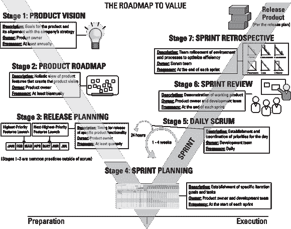

图 7-1：使用价值路线图的敏捷规划与执行阶段。

价值路线图分为七阶段：

- 在阶段 1 中，产品负责人确定`产品愿景`。产品愿景是项目的目的地或最终目标。产品愿景包含了产品的外部边界、产品与竞争对手的区别、产品如何支持你的公司或组织战略、谁将使用该产品以及人们为什么要使用该产品。对于较长的项目，至少每年重审一次产品愿景。

- 在阶段 2 中，产品负责人创建`产品路线图`。产品路线图是对产品需求的高级视图，并带有开发这些需求的大致时间范围。它通过展示项目期间将产生的具体特性为愿景提供了背景。识别产品需求，然后对这些需求进行优先级排序并粗略估计工作量，可以让你建立需求主题并识别需求缺口。产品负责人在开发团队的支持下，应每半年修订一次产品路线图。

- 在阶段 3 中，产品负责人创建`发布计划`。`发布计划`确定了向客户发布可运行功能的高级时间表。发布作为 Scrum 团队可以调动的的中期边界。敏捷项目将有很多版本，优先级最高的特性首先出现。你在每个版本开始时创建发布计划，通常至少每季度一次。在第 8 章中了解更多发布规划的信息。

- 在阶段 4 中，产品负责人、开发团队和 Scrum Master 将规划迭代（也称为冲刺），并在冲刺中开始创建产品功能。冲刺规划会议在每个冲刺开始时举行。在冲刺规划期间，Scrum 团队确定一个`冲刺目标`，建立了团队预计在冲刺期间完成的工作直接边界，包括支持目标且能在冲刺内完成的需求。Scrum 团队还概述了如何完成这些需求。在第 8 章中获取更多冲刺规划。

- 在阶段 5 中，开发团队在每个冲刺期间举行`每日站会`（daily scrum）以协调当天的优先级。在`每日站会`上，你们讨论昨天完成了什么、今天要做什么以及遇到了哪些障碍，以便立即解决问题。在第 9 章中阅读每日站会。

- 在阶段 6 中，Scrum 团队在每个冲刺结束时举行`冲刺评审`（sprint review）。在冲刺评审中，你们向产品利益相关者演示可运行的功能。在第 10 章中了解如何进行冲刺评审。

- 在第 7 阶段中，Scrum 团队会举行`sprint retrospective.`（冲刺回顾）。冲刺回顾会议是 Scrum 团队就其流程和环境讨论已完成的迭代，并为下一次迭代的流程改进制定计划的会议。用于检查和适应产品的迭代回顾类似，冲刺回顾在每个迭代结束时举行，以检查和适应你的流程和环境。可以在第 10 章中了解如何进行冲刺回顾。

价值路线图（Roadmap to Value）中的每个阶段都是可重复的，每个阶段都包含规划活动。敏捷规划与敏捷开发一样是迭代的。

### 渐进式细化

在敏捷项目的每个阶段，你只按需要规划的范围进行规划。在项目早期，你进行广泛且全面的规划，以创建一个产品随时间推演形成的大致轮廓。在后期，你将缩小规划范围并添加更多细节，以确保近期开发工作的成功。这一过程被称为`progressive elaboration of requirements.`（需求的的渐进式细化）。

起初广泛规划、后期在需要时详细规划，可以避免将时间浪费在可能永远不会实现的低优先级产品需求上。这种模型还允许你在项目期间添加高价值需求，而不会中断开发流。

你的详细规划越趋于“即时（just-in-time）”，你的规划过程就越高效。

 一些研究表明，客户很少或从未未使用应用程序中 64% 的功能。在敏捷项目的前几个开发周期中，你完成优先级最高且人们*会*使用的功能。通常，你尽早地发布这些功能组，以通过先发优势获得市场份额；获取有关可行性的客户反馈；尽早实现功能变现以优化投资回报率（ROI）；并避免内部和外部的过时。

### 检查并适应

即时规划运用了敏捷技术的两个基本原则：检查和适应。在项目的每个阶段，你都需要查看产品和流程（检查），并在必要时进行更改（适应）。

敏捷规划是一个检查和适应的节奏循环。考虑以下几种情况：

- 在冲刺期间每天，产品负责人都会提供反馈，帮助开发团队在创建产品时改进产品。
- 在每个冲刺结束时，在迭代回顾中，利益者提供反馈以进一步改进产品。
- 同样在每个冲刺结束时，在冲刺回顾中，Scrum 团队讨论在过去冲刺中学到的教训，以改进开发流程。
- 发布后，客户可以提供改进反馈。反馈可能是直接的（当客户就产品联系公司时），也可能是间接的（潜在客户购买或不购买产品时）。

检查和适应结合在一起是最高效方式交付正确产品的极工具。

 在项目开始时，你对正在创建的产品了解最少，因此那时试图规划精细细节是不可行的的。敏捷意味着你在需要时进行详细规划，并立即开发你通过该规划定义的特定需求。

现在你已经更了解了一点敏捷规划是如何运作的，是时候完成敏捷项目的第一步了：定义产品愿景。

## 定义产品愿景

敏捷项目的第一个阶段是定义你的产品愿景。`product vision statement`（产品愿景声明）是一个电梯演讲，或简要总结，用于说明你的产品如何支持公司或组织的战略。愿景声明必须阐述产品的最终状态。

产品可以是发布到市场的商业产品，也可以是支持你组织日常职的内部解决方案。例如，假设你的公司是 XYZ 银行，你的产品是一个移动银行应用程序。移动银行应用程序支持哪些公司战略？该应用程序如何支持公司战略？你的愿景声明清晰、简洁地将产品与你的业务战略联系起来。

图 7-2 显示了愿景声明——价值路线图第 1 阶段如何与敏捷项目的其他阶段和活动相匹配。

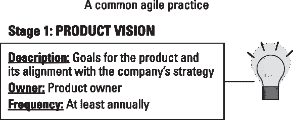

图 7-2：作为价值路线图一部分的产品愿景声明。

产品负责人负责在整个项目中了解产品、其目标和需求。出于这些原因，产品负责人创建愿景声明，尽管其他人也可能有投入。愿景声明完成后，它将成为一盏明灯，即“我们正试图实现的目标”声明，开发团队、Scrum Master 和利益者在整个项目中都会参考。

在创建产品愿景声明时，遵循以下四个步骤：

1. **制定产品目标。**
2. **创建愿景声明草案。**
3. **与产品和项目利益者验证愿景声明，并根据反馈进行修订。**
4. **定愿景声明。**

愿景声明的外观没有硬性规定。然而，从开发团队到首席执行官，任何参与项目的人都应该能够理解该声明。愿景声明应该是内部关注的、清晰的、非技术性的且尽可能简洁的。愿景声明还应该是明确的，避免营销辞藻。

### 第 1 步：制定产品目标

要编写愿景声明，你必须理解并能够传达产品目标。你需要识别以下内容：

- **客户**：谁将使用该产品？这个问题可能有多个答案。
- **关键产品目标**：产品将如何使它的公司受益？目标可能包括对特定部门（如客户服务或营销部门）的利益，以及对整个公司的利益。该产品支持哪些具体的公司战略？
- **需求**：客户为什么需要该产品？哪些功能对客户至关重要？
- **竞争**：该产品与相似产品相比如何？
- **主要差异化**：该产品与现状、竞争对手或两者何不同？

### 第 2 步：创建愿景声明草案

在充分掌握产品目标后，为你的愿景声明创建一个初稿。

你可以找到许多产品愿景声明的模板。关于定义整体产品愿景的优秀指南，请参阅杰弗里·摩尔写的《跨越》（HarperCollins 出版），该书关注如何跨越新技术早期采用者与随其后的大多数之间的差距（鸿沟）。

任何新产品的采用都是一种冒险。用户会喜欢该产品吗？市场会接受该产品吗？开发该产品是否有足够的投资回报？在《跨越》中，摩尔描述了早期采用者受愿景驱动，而大多数人对愿景家持怀疑态度，对质量、产品维护和寿命等务实问题感兴趣。


`投资回报率`（或 `ROI`）是指公司通过支付某项投入而获得的收益或价值。`ROI` 可以是量化的，例如 `ABC Products` 在投资新网站后，通过在线销售小部件获得的额外资金。`ROI` 也可以是无形的，例如使用 `XYZ Bank` 新型移动银行应用程序的客户获得了更高的客户满意度。

通过创建愿景声明，你帮助传达了产品的质量、维护需求和使用寿命。

摩尔（Moore）的产品愿景方法是务实的。在图 7-3 中，我们根据摩尔的方法构建了一个模板，以更显式地将产品与公司策略联系起来。如果你使用这个模板来编写产品愿景声明，那么当产品从早期采用转向主流使用时，它将经受住时间的考验。

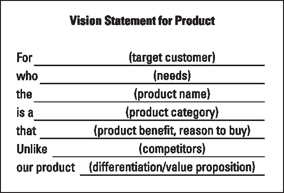

图 7-3：摩尔愿景声明模板的扩展。

 让你的产品愿景声明具有吸引力的一种方法是使用现在时来编写，仿佛该产品已经存在了。使用现在时有助于读者想象产品在使用中的状态。

使用摩尔模板的扩展，移动应用程序的愿景声明可能如下：

- 针对 `XYZ Bank` 的客户
- 那些希望在旅途中访问银行功能的用户，
- `XYZ Bank`
- 是一款移动应用程序
- 它允许 24 小时提供提供安全的、按需的银行服务。
- 与在家里或办公室进行网上银行服务不同，
- 我们的产品允许即时访问，
- 这支持了我们随时随地提供快速、便利服务的策略。

如你所见，愿景声明确定了产品完成后的未来状态。愿景关注的是产品完成时应当存在的条件。

 避免在愿景声明中使用泛化的表述，如“让客户快乐”或“销售更多产品”。还要警惕过于具体，例如“使用发布版本 9.x 创建具有四个模块的程序”。在这一早期阶段，定义特定的技术可能会限制你未来的发展。

以下是几段应该让你产生共鸣的愿景声明摘录：

- 为 XYZ 应用争取额外的客户。
- 在 12 月前满足我们的客户需求。
- 消除所有缺陷并提高质量。
- 使用 `Java` 创建一个新的应用程序。
- 比小部件市场领先六个月夺胜。

### 第 3 步：验证并修订愿景声明

在草拟愿景声明后，请根据以下清单对其进行审查：

- 该愿景声明是否清晰、重点突出，并且是为内部受众编写的？
- 该声明对产品如何满足需求提供了引人入胜的描述？
- 愿景是否描述了最可能的结果？
- 业务目标是否足够具体，以确保目标可以实现？
- 该声明提供的价值是否与公司策略和目标保持一致？
- 产品愿景声明是否有吸引力？
- 愿景是否简洁？

这些“是或否”的问题将帮助你确定愿景声明是否详尽且清晰。如果任何答案为“否”，请修订愿景声明。

当所有答案均为“是”时，请与他人一起审查该声明，包括：

- 项目利益相关者：利益相关者能够识别出愿景声明包含了产品应该完成的所有内容。
- 你的开发团队：团队因为要创建产品，必须理解产品需要完成什么任务。
- Scrum 主管（Scrum master）：对产品的深入理解将帮助 Scrum 主管消除障碍，并确保开发团队在项目后期处于正确的道路。
- 敏捷导师（Agile mentor）：如果你有敏捷导师，请与他们分享愿景声明。敏捷导师独立于组织，可以提供外部视角，这些特质可以使其成为非常棒的客观声音。

看看其他人是否认为愿景声明是清晰并传达了你想表达的信息。不断审查和修订愿景声明，直到项目利益相关者、开发团队和 Scrum 主管完全理解该声明为止。

 在项目的这个阶段，你可能还没有开发团队或 Scrum 主管。在形成 Scrum 团队后，务必与该团队一起审查愿景声明。

### 第 4 步：定稿愿景声明

完成修订愿景声明后，确保你的开发团队、Scrum 主管和利益相关者拥有最终副本。你甚至可以将副本贴在 Scrum 团队工作区域的墙上，让你每天都能看到它。在整个项目生命周期内都会引用愿景声明。

如果你的项目超过一年，你可能希望重新审视愿景声明。我们喜欢至少每年审查一次产品愿景声明，以确保产品反映市场情况并支持公司需求的变化。由于愿景声明是项目的长期边界，当愿景不再可行时，项目应该结束。

 产品负责人（Product owner）拥有产品愿景声明，并负责其在组织内的准备和沟通。产品愿景为利益相关者设定了预期，并帮助开发团队专注于目标。

恭喜。你刚刚完成了敏捷项目的第一阶段。现在是时候创建产品路线图了。

## 创建产品路线图

产品路线图是“价值路线图”（Roadmap to Value）的第二阶段（参见图 7-4），它是产品需求的整体视图，也是规划和组织开发过程的价值工具。使用产品路线图对需求进行分类、优先级排序、识别差距和依赖关系，并确定向客户发布的时间。

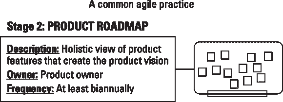

图 7-4：价值路线图中的产品路线图。

产品负责人像，在开发团队和利益相关者的帮助下创建产品路线图。开发团队的参与程度比创建愿景声明时更高。

 请记住，你将在整个项目中精炼需求和工作估算。在产品路线图阶段，需求、估算和时间处于很高水平是可以接受的。

创建产品路线图，你需要执行以下操作：

1. 识别利益相关者。
2. 建立产品需求并将其添加到路线图中。
3. 根据价值、风险和依赖关系对产品需求进行排序。
4. 高级估算开发工作量并对产品需求进行优先级排序。
5. 确定向客户发布功能组的高级时间范围。

由于优先级可能会变化，预计在整个项目中都会更新产品路线图。我们喜欢至少每年更新一次产品路线图。


 你的产品路线图可以简单地贴在白板上的便利贴，这样更新只需将便利贴从白板的一个区域移动到另一个区域，非常简单。

你使用产品路线图来规划发布——这是“价值路线图”中的第 3 阶段。发布是可用产品功能的组，你将这些功能发布给客户，以收集真实世界的反馈并产生投资回报。

下节将详细介绍创建产品路线图的步骤。

## Step 1：识别利益相关者

在最初建立产品愿景时，你可能只识别出了少数几个提供高层反馈的关键利益相关者。在产品路线图阶段，你为产品愿景提供了更多背景，并确定如何实现愿景，这让你更深入地了解谁会对你的项目产生影响。

现在是与现有和新识别的利益相关者互动，并对实现愿景所需的功能收集反馈的时候了。产品路线图是你对高级产品待办列表的初步规划，本文将在后文中讨论。在确定了第一轮细节后，你希望参与的不仅仅是 Scrum 团队、赞助人和显而见的用户。考虑包含以下人员：

* **营销部门：** 你的客户需要了解你的产品，这正是营销部门提供的。他们需要理解你的计划，并可能根据他们的经验和研究，对功能向市场的顺序提供建议。

* **客户服务部门：** 一旦产品进入市场，将如何提供支持？特定的路线图项目可能会识别出你为准备支持所需的人员。例如，产品负责人可能认为接入实时在线聊天功能价值不大，但客户服务经理可能会有不同看法，因为他的代表同时只能处理一个电话，但可以同时处理六个聊天会。

* **销售部门：** 确保销售团队成员看到产品，这样他们就会开始销售与你构建相同的东西。像营销部门一样，销售部门对客户在寻找什么有一手知识。

* **法律部门：** 特别当你处于高度受监管的行业时，尽早与法律顾问一起审查路线图，确保你没有遗漏任何在项目后期发现时可能导致项目面临风险的内容。

* **额外客户：** 在识别路线图上的功能时，你可能会发现其他会对你创造的内容产生价值的人员。给他们机会审查你的路线图，以验证你的假设。

## Step 2：建立产品需求

创建产品路线图的第二步是识别或定义产品的不同需求。

当你首次创建产品路线图时，通常会从大型、高级的需求开始。你产品路线图上的需求极可能处于两个不同的级别：主题（`themes`）和功能（`features`）。主题是功能和需求在最高层面的逻辑分组。功能是产品非常高级的部分，描述了客户在功能完成后将拥有的新能力。

为了识别产品主题和功能，产品负责人可以与利益相关者和开发团队合作。举行一次需求会议会有帮助，利益相关者和开发团队聚在一起，并写下他们能想到的所有需求。

 当你开始在主题和功能级别创建需求时，将这些需求写在索引卡或大胶粘条上会有帮助。使用可以在不同类别之间来回移动的实物卡片，可以使组织这些需求并确定其任务的优先级顺序变得非常容易。

在你创建产品路线图时，你识别的功能开始构成你的产品待办列表（`product backlog`）——即产品范围内的完整列表，无论其详细程度如何。一旦你确定了第一批产品功能，你的产品待办列表就开始建立了。

## Step 3：安排产品功能

在识别出产品功能后，你与利益相关者合作将它们分组成主题——即功能的常见、逻辑分组。利益相关者会议对于分组非常有效，就像对于创建需求一样有效。你可以根据使用流程、技术相似性或业务需求对功能进行分组。

在路线图上视觉化主题和功能，允许你相对于其他功能，为每个功能分配相关的业务价值和风险。产品负责人同开发团队以及利益相关者还可以识别功能之间的依赖关系，定位任何差距，并根据这些每个因素确定每个功能应该被开发的顺序。

在对你的需求进行分组和排序时，需要考虑以下问题：

* 客户将如何使用我们的产品？

* 如果我们提供这个提议的功能，客户还需要做什么？他们还可能想做什么？

* 开发团队能识别出技术关联性或依赖关系吗？

利用这些问题的答案来识别你的主题。然后按这些主题对功能进行分组。例如，在手机银行应用程序中，主题可能是：

* 账户信息

* 交易

* 客户服务功能

* 移动功能

图 7-5 显示了按主题分组的功能。

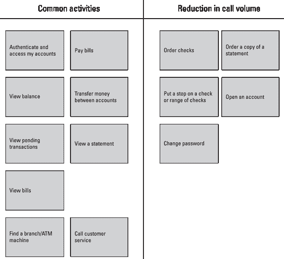

FIGURE 7-5: 按主题分组的功能。

## Step 4：估算工作并排序需求

你已经识别了产品需求并将这些需求分成了逻辑组。接下来，你对需求进行估算和优先级排序。这里有几个你需要熟悉的术语：

* 工作量（`Effort`）是指根据特定需求创建运行的难易程度。

* 估算（`Estimate`）作为名词，可以是你用来表示需求估算工作量的数字或描述。

* 估算需求（`Estimating a requirement`）作为动词，意味着对创建难易程度（需要的工作量）有一个大致的想法。

* 排序或优先级排序需求意味着确定该需求相对于其他需求的价值和风险，以及你实施它们的顺序。

* 价值（`Value`）是指产品需求对创建该组织有多大利处。

* 风险（`Risk`）指的是对项目可能产生的负面影响。

 你可以从主题、功能到单个用户故事的任何级别对需求进行估算和优先级排序。

需求排序实际上是对它们进行排序。你可以发现许多方法（其中许多非常复杂）来确定待办事项的优先级。我们通过根据业务价值、风险和工作量创建一个有序的待办列表来保持简单，按你实施它们的顺序排列。

在第 8 章中，我们将向你展示敏捷团队用于准确估算工作量的相对估计技术。传统的估算方法通过在项目计划的每个层级使用绝对时间估计来追求精确，无论团队是在今天处理工作项，还是在两年后处理。这种做法给非敏捷团队带来了一种虚假的精确感，在现实中并不准确（正如数千个失败的项目所证明的那样）。当你刚开始了解一个项目时，你怎么可能知道每个团队成员六个月后将要做什么，以及完成这些工作需要多长时间呢？

`相对估计`是一种自我纠正机制，它允许敏捷团队更加准确，因为将一个需求与另一个需求进行比较并判断一个是否比另一个大、大出多少，要容易得多。

为了对你的需求进行排序，你还需要了解任何依赖关系。依赖关系意味着一个需求是另一个需求的前置条件。例如，如果你需要一个需要使用用户名和密码登录的应用程序，那么创建用户名的需求就是创建密码需求的依赖项，因为你通常需要一个用户名来设置密码。

### 评估业务价值和风险

产品所有者与利益相关者一起识别业务价值最高的项目（具有高潜力 ROI 或对终端客户或其他感知价值），以及那些如果不解决会对项目产生巨大负面影响的项目。

与工作量估计类似，可以为每个产品路线图项分配价值或风险。例如，你可以使用货币 ROI 金额分配价值，或者对于内部产品，使用高、中、低来分配价值或风险。

工作量、业务价值和风险估计为产品所有者对每个需求的优先级决策提供了依据。价值和风险最高的项目应该位于产品路线图的最上方。高风险项目应优先进行探索和实施，以避免项目风险后置。如果一个高风险项目会导致项目失败（一个无法解决的问题），敏捷团队会尽早发现它。如果一个项目将会失败，你希望早失败、廉价失败，并转向有价值的新项目。从这个意义上说，失败是敏捷团队的一种成功形式。

在获得价值、风险和工作量估算后，你就可以确定每个需求的相对优先级或顺序。

* 高价值或高风险（或两者兼有）且工作量小的需求具有高相对优先级。产品所有者可能会将此项排在路线图的最顶部。

* 低价值或低风险（或两者兼有）且工作量大的需求具有较低的相对优先级。这项可能会出现在路线图的底部。

 相对优先级只是帮助产品所有者做出决策和确定需求需求的工具。它不是你必须遵循的数学真理。确保你的工具是起到帮助而非阻碍。

### 需求优先级排序

要确定你需求的整体优先级，请回答以下问题：

* 该需求的相对优先级是什么？

* 任何需求的先决条件是什么？

* 哪些需求属于一组，并将构成一个可以交付给客户的稳固功能集？

通过使用这些问题的答案，你可以将优先级最高的需求放在产品路线图的前部。当你完成需求的优先级排序后，你将得到一个类似于图 7-6 的内容。

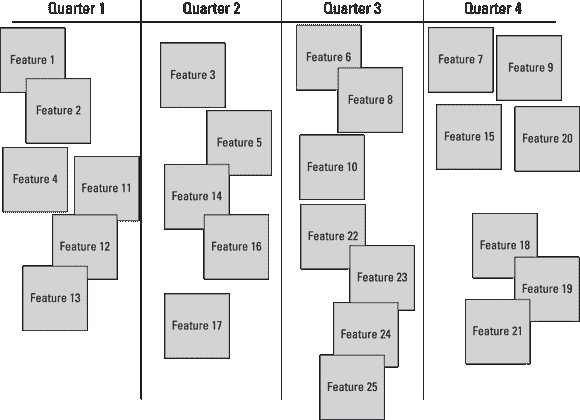

图 7-6： 带有排序需求的路线图。

你排序后的需求列表被称为 `product backlog`（产品备份列表）。你的产品列表是一个重要的敏捷文档或`制品`。你在整个项目中都会使用这个备份列表。

有了产品列表，你就可以开始为你的产品路线图添加目标发布版本。

## 第 5 ：确定高层时间跨度

当你创建产品路线图时，发布产品需求的时间跨度是非常高层的。对于初始路线图，为你的项目选择一个逻辑时间增量，例如特定的天数、周、月、季度（三个月周期），甚至更长的增量。通过结合需求本身和优先级，你可以将需求添加到每个时间增量中。

 创建产品路线图看起来可能工作量很大，但在你掌握之后，你可以在很短时间内创建一个。有些 Scrum 团队可以在短短一天内创建出产品愿景、产品路线图和发布计划，并准备好开始冲刺！要开始开发产品，你只需要足够用于第一个冲刺的需求。你可以随着项目的进展确定其余部分。

### 你的你的工作

到目前为止，你可以使用白板和便利贴完成所有的路线图规划。然而，在完成第一个草稿后，请保存产品路线图，特别是如果你需要与远程利益相关者或开发团队成员共享路线图时。你可以给便利贴和白板拍照，也可以将信息输入到文档中并电子化保存。

随着优先级的变化，会在整个项目中更新产品路线图。目前，首次发布的内容应该是清晰的——这就是你在此阶段唯一需要担的。

### 完成产品列表

产品路线图包含高层功能和一些初步时间线。你产品路线图上的需求就是 `product backlog` 的第一个版本。

产品列表是与项目相关的需求列表。产品所有者负责通过添加和排序需求来创建和维护产品列表。Scrum 团队在整个项目中使用产品列表来计划工作——就像一个精简的项目计划。

图 7-7 显示了一个产品列表示例。在创建产品列表时，至少要确保做到以下点：

* 包含每个需求的描述。

* 根据优先级对需求排序。

* 添加工作量估计。

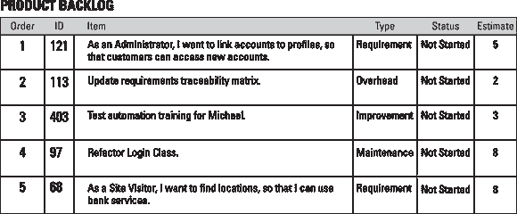

图 7-7： 产品列表示例。

我们还喜欢包含列表类型以及状态。Scrum 团队将主要开发用用户语言描述的功能（用户故事）。但可能需要其他类型的产品列表项，例如开销项（Scrum 团队认为需要但对功能没有贡献的内容）、维护项（对产品或系统进行的设计改进，但没有直接增加客户价值）或改进项（冲刺回顾中识别出的流程改进行动项）。你可以在图 7-7 中看到这些项的示例。

 在第 2 章中，我们解释了敏捷项目的文档应该是“恰好足够”的，只包含创建产品所绝对必要的信息。如果你保持产品列表格式简单且恰好足够，你将在整个项目中更新它时节省时间。

Scrum 团队将产品待办列表（`product backlog`）视为项目需求的主要来源。如果存在某个需求，它就在产品待办列表中。你产品待办列表中的需求在整个项目过程中会多种方式发生变化。例如，当团队完成某些需求时，你在产品待办列表中将这些需求标记为已完成。你还会根据来自利益相关者和客户的反馈记录任何新需求。某些需求将用新的或澄清的信息进行更新，被拆分为更小的用户故事（`user stories`），或以其他方式进行完善。此外，你还会根据需要更新现有需求的优先级和工作量评分。

产品待办列表中故事点（`story points`）的总数——所有用户故事点的总和——是你当前的`product backlog estimate`（产品待办列表估算）。随着用户故事的完成和新用户故事的添加，该估算每天变化。可以在第 13 章了解更多关于如何使用产品待办列表估算来预测项目长度成本的信息。

 保持你的产品待办列表更新，以便你始终拥有准确的成本和进度估算。当前的产品待办列表还能赋予你灵活性，对新发现的产品需求相对于现有功能的优先级排序——这是敏捷的核心优势之一。

拥有产品待办列表后，你就可以开始规划发布（`releases`）和迭代（`prints`），我们将在下一章向你展示。

# 第 8 章

# 发布与迭代

## 本章内容

 拆解需求并创建用户故事

 创建产品待办列表、发布计划和迭代待办列表

 规划迭代

在你为敏捷项目创建了产品路线图（参见第 7 章）后，是时候开始详细描述你的产品细节。在本章中，你将发现如何将需求拆解到更细粒度的层次，完善你的产品待办列表，创建发布计划并为执行构建迭代待办列表。首先，你将看到如何将产品路线图中的较大需求拆分为更小、更易管理的需求，这些需求被称为`user stories`。

 将需求拆分为更小部分的概念被称为`decomposition`（拆解）。

## 完善需求与估算

你开始敏捷项目时的需求是非常巨大的。随着项目的进展以及你越来越接近开发这些需求，你将把它们拆分为更小的部分——小到可以开始开发的程度。

定义产品需求的一种清晰、有效的格式是`user story`（用户故事）。用户故事及其较大的亲戚`epic user story`（史诗级用户故事）是发布规划和迭代规划中合适的需求。在本节中，你将了解如何创建用户故事、对用户故事排序以及估算用户故事的工作量。

### 什么是用户故事？

`user story`是对产品需求的简单描述，说明了该需求必须为**谁**完成**什么**。传统的需求读起来通常像这样：“系统应当[插入技术描述]。”这种需求只考虑了所要做的技术性质；整体的业务目标并不明确。由于开发团队具有更深层次参与的背景，他们清楚地知道每个需求对用户（或客户或业务）的收益，并能更快、更高质量地交付客户想要的内容。

你的用户故事至少包含以下部分：

* 标题（用户故事的可辨认名称）

* 作为（某种类型的用户）

* 我想要（采取此操作）

* 以便（我获得此收益）

用户故事还包括一个需要执行的验证步骤列表（`acceptance criteria`，验收标准），以便你知道用户故事的可运行需求是正确的：

> 当我（采取此操作）时，（发生某事）

用户故事可能还包括以下：

* **用户故事 ID：** 用于区分此用户故事与其他用户故事的数字。

* **用户故事价值和工作量估算：** `Value`（价值）是一个故事对创建该产品的组织有多有利。`Effort`（工作量）是创建该用户故事的难易程度。我们在第 7 章介绍了如何对用户故事的业务价值、风险和工作量评分。

* **构思用户故事的人：** 项目团队中的任何人都可以创建用户故事。

 虽然敏捷项目管理方法鼓励使用低技术工具，但 Scrum 团队也应该在各种情况下发现什么工具最适合自己。目前有很多电子用户故事工具可用，其中一些是免费的。有些很简单，仅用于用户故事。另一些则很复杂并能与其他产品文档集成。我们喜欢索引卡，但这种解决方案可能并不适合所有人。使用最适合你的 Scrum 团队和项目的工具即可。

图 8-1 显示了典型的用户故事卡正反面。正面有用户故事的主描述。背面显示了在开发团队创建功能后，你将如何确认该需求正常工作。


图 8-1： 基于卡的用户故事示例。

产品所有者（`Product owner`）收集用户故事并管理它们（即确定优先级并启动拆解）。开发团队和其他利益相关者也参与创建和拆解用户故事。

 注意，用户故事并不是描述产品需求的唯一方法。你可以简单地列出需求清单。然而，由于用户故事以简洁的格式包含了大量有用信息，我们发现它们在传达准确需求方面非常有效。

用户故事格式的大优势在于开发团队开始创建和测试需求时。开发团队成员清楚地知道为谁创建需求、需求应该做什么，以及如何检查需求是否符合意图。

我们在本章和全书中故事作为需求的示例。记住，我们用用户故事描述的任何内容都可以用更通用的需求来实现。

### 创建用户故事的步骤

创建用户故事时，遵循以下步骤：

1. **识别项目利益相关者。**

2. **识别谁将使用产品。**

3. **与利益相关者合作，写出产品所需的需求并使用前面的格式创建你的用户故事。**

在后续章节中了解如何遵循这三个步骤。

 敏捷和适应需要迭代。不要花费大量时间尝试识别产品可能具有每一个需求。你始终可以在项目后期添加需求。最好的改进通常出现在项目结束时，你对产品和客户了解最多。

#### 识别项目利益相关者

你可能清楚谁是你的项目利益相关者——任何参与产品、受影响或能影响产品及其创建的人。

 你在创建产品愿景和产品路线图时也会与利益相关者合作。

确保利益相关者有空帮助你创建需求。在第 7 章中介绍的示例移动银行应用程序的利益相关者可能包括以下内容：

- 定期与客户互动的人员，例如客户服务代表或银行网点人员。

- 你的产品客户与之交互的不同领域的业务专家。例如，`XYZ Bank` 可能会有一位经理负责支票账户，另一位经理负责储蓄账户，还有第三位经理负责在线账单支付服务。如果你正在创建一个移动银行应用程序，那么所有这些人人员都是项目利益相关者。

- 你的产品的用户（如果他们可以提供的话）。

- 你正在创建的类型产品的专家。例如，一位创建过移动应用的开发人员、一位了解如何开展移动活动的市场经理，以及一位专攻移动界面的用户体验专家，对于示例中的 `XYZ Bank` 移动银行项目都可能很有帮助。

- 技术利益相关者。这些人是与可能与你的产品交互的系统工作的人。

### 识别用户

你的客户和利益相关者为产品负责人提供需求，由产品负责人进行审核以决定将其放入你的产品待办列表（`product backlog`）中。你的客户可能与使用你产品的不是同一。了解终端用户是谁以及他们将如何与你的产品互动，将决定你如何定义和实现产品路线图上的每项需求。


通过将产品路线图可视化，你可以识别每种类型的用户。对于移动银行应用程序，你将拥有个人银行家和业务银行家。个人类别将包括青少年、成年人、学生以及单身、已婚、退休和富有用户。各种规模的企业都可能代表其中。员工用户将包括柜员、行长、客户经理和基金经理。每种类型的用户将以不同的方式和不同的原因与你的应用程序互动。了解这些人是谁，可以让你能够更好地定义他们每次互动的目的和预期收益。

我们喜欢使用“用户画像”（`personas`）来定义用户，即对虚构人物代表的某类用户进行文字描述。例如，“罗伯特是一位 65 岁的退休工程师，正在利用退休时间环游世界。他的净资产为 1,000,000 美元，还有几处投资房地产物业的剩余收入。”

“罗伯特”代表了 `XYZ Bank` 30% 的客户，产品路线图很大一部分包含了罗伯特这样的人会使用的功能。Scrum 团队每次讨论这些功能时，不需要重复关于罗伯特的所有细节，他们只需将该类型的用户称为“罗伯特”即可。产品负责人可能根据需要识别出几个这样的画像，甚至会打印带有罗伯特可能形象照片的描述，并将其贴在团队工作区域的墙上，以便在整个项目期间参考。

 了解你的用户是谁，这样你才能开发出他们真正会使用的功能。

假设你是 `XYZ Bank` 移动银行项目的产品负责人。你负责将产品推向市场的部门，最好在未来六个月内完成。对于应用程序的用户，你有以下想法：

- 客户（应用程序的终端用户）可能希望快速获取有关其账户余额和近期交易的最新信息。
- 可能客户正准备购买一件大额物品，他们想确保自己可以为这笔支出扣款。
- 可能客户的 ATM 卡刚刚被拒绝了，但他们不知道为什么，想检查最近的交易以发现可能的欺诈活动。
- 可能客户刚刚意识到他们忘记支付信用卡单了，如果今天不付款，将产生罚金。

你这个应用程序的用户画像有哪些？这里有几个例子：

- **画像 #1：** 杰森（Jason）是一位年轻、精通技术的执行管，经常出差。当他有空闲时，他想快速处理个人事务。他谨慎地将资金投入高收益投资组合中。他保持较低的可用现金。
- **画像 #2：** 凯罗（Carol）是一位小企业主，在客户试图售卖房屋时她负责为房屋进行布置。她在寄卖中心购物，并经常能找到她想为客户购买的家具。
- **画像 #3：** 尼克（Nick）是一个靠学生贷款和兼职工作的学生。他知道自己在金钱上可能很不可靠，因为他在其他事情上也很不可靠。他刚刚丢了支票簿。

 你的产品利益相关者可以帮助你创建画像。找到对你产品的日常业务了如的人。这些利益相关者对你的潜在客户了解非常多。

### 确定产品需求和创建用户故事

在识别出不同的客户后，你可以开始确定产品需求并为画像创建用户故事（user stories）。创建用户故事的一种好方法是让利益相关者聚在一起举行一次用户故事创建会议。

让利益相关者使用用户故事的格式写下他们所能想到的所有需求。该项目和前述章节画像的一个用户故事如下：

- 卡片正面：
  - **标题** 查看银行账户余额
  - **作为** 杰森，
  - **我想要** 在我的手机上查看我的支票账户余额
  - **以便于** 我能看到我的支票账户里有多少钱钱
- 卡片背面：
  - **当我** 登录 `XYZ Bank` 移动应用程序时，我的支票账户余额出现在页面顶部。
  - **当我** 在完成购买或存款后登录 `XYZ Bank` 移动应用程序时，我的支票账户余额会反映那次购买或存款。

你可以在 图 8-2 中看到卡片格式示例的用户故事。

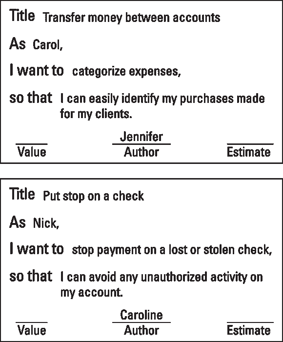

图 8-2：](#14_9781119405696-ch08.xhtml_c08-fig-0002) 用户故事示例。

 确保不断向你的产品待办列表添加并排序用户故事。在计划冲刺（sprint）时，保持产品待办列表更新将有助于你有最高优先级的用户故事。

在敏捷项目中，你会创建新的用户故事。你还会对现有的大型需求进行分解，直到它们足够易于冲刺。

#### 分解需求

你在整个敏捷项目中多次完善需求。例如：

- 当你创建产品路线图（参见第 7 章](#13_9781119405696-ch07.xhtml））时，你创建了功能（客户在开发功能后拥的能力），以及主题（功能的逻辑分组）。虽然功能在设计上很大，但我们要求路线图层面的功能不超过斐波契契中的 144 个故事点。
- 当你计划发布（releases）时，你把功能分解为更简洁的用户故事。发布计划层的用户故事可以是史诗（epics，包含多个动作的大型用户故事），也可以是单个用户故事（包含单个动作）。对于我们的客户，发布计划层面的用户故事不超过 34 个故事点。你将在本章晚些时候了解更多发布的内容。
- 当你计划冲刺时，你可以进一步分解用户故事。你还会识别冲刺中每个用户故事相关的单个任务。对于我们的客户，冲刺层面的用户故事不超过 8 个故事点。任务将以小时为单位进行估计，且不应大于一天内能完成的量。

为了拆解需求，你希望思考如何将需求拆分为各个具体的动作。表 8-1 展示了来自第 7 章中 XYZ 银行应用程序的一个需求，该需求从主题级一直分解到用户故事级。

| 需求级别 | 需求 |
| --- | --- |
| 主题 (Theme) | 在移动设备上查看银行账户数据。 |
| 功能 (Features) | 查看账户余额。查看最近取款或购买列表。查看最近存款列表。查看我即将到来的自动账单支付。查看我的账户警报。 |
| 史诗用户故事 (Epic user stories) — 从“查看账户余额”分解 | 查看支账户余额。查看储蓄账户余额。查看贷款余额。查看投资账户余额。查看退休账户余额。 |
| 用户故事 (User stories) — 从“查看支账户余额”分解 | 安全登录后查看我的账户列表。选择并查看我的支账户。查看取款后账户余额的变化。查看购买后账户余额的变化。查看每日账户余额。查看可用账户余额。查看移动应用程序导航项。更改账户视图。退出移动应用程序。 |

表 8-1 拆解需求

### 估算扑克 (Estimation poker)

当你精炼需求时，也需要精炼你的估算。是时候玩点游戏了！

估算用户故事最流行的方法之一是玩 `estimation poker`（有时被称为 `planning poker`，即计划扑克），这是一种用于确定用户故事大小并在开发团队成员之间建立共识的游戏。

 敏捷教练（scrum master）可以协助协调估算，产品负责人（product owner）可以提供功能信息，但开发团队负责估算用户故事所需的工作量。毕竟，开发团队必须执行工作来创建这些故事所描述的功能。

要玩估算扑克，你需要一副扑牌，类似于图 8-3 所示的牌组。你可以在我们的网站[`www.platinumedge.com/estimationpoker`](http://www.platinumedge.com/estimationpoker)上获取数字版本，也可以用索引卡和马克笔自制。扑牌上的数字来自斐波那契数列。

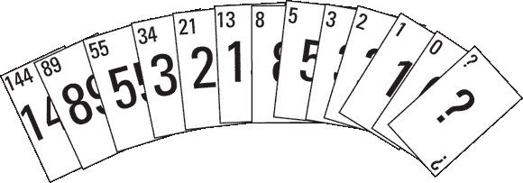

图 8-3: 一副估算扑克牌。

斐波那契数列遵循以下进展规律：

> 1, 2, 3, 5, 8, 13, 21, 34, 55, 89, 144, 依此类推

前两个数字之后的每个数字都是前两个数字之和。

每个用户故事相对于其他用户故事获得一个估值。例如，一个分值为 5 的用户故事所需的工作比 3、2 和 1 都多。它的工作量大约是 1 的 5 倍，是 2 的两倍，大约相当于 3 和 2 的工作量之和。它的工作量没有 8 那么多，但略超过 8 的一半。

随着用户故事和史诗用户故事规模的增加，斐波那契数字之间的差异变得越来越大。承认这些较大需求的精度差距不断增大，正是斐波那契数列在相对估算中效果极佳的原因。

要玩估算扑克，请遵循以下步骤：

1. **为开发团队的每位成员提供一副估算扑克牌。**
2. **从产品负责人展示的用户故事列表中，团队就一个值为 5 的用户故事达成一致。**

   团队遵循两条规则：(1) 开发团队不应允许任何大于 8 的单个用户故事进入冲刺（sprint），(2) 敏捷团队应该在一个冲刺中完成大约 6-10 个用户故事。

   敏捷教练通过“五指法”（fist of five）或“点赞/点踩”（如第 6 章中描述）帮助开发团队达成共识。这个用户故事就变成了 `anchor story`（锚点故事）。

3. **产品负责人向玩家读取高优先级的用户故事。**
4. **每位玩家选择一张代表他们对该用户故事工作量估值的牌牌，并将牌反朝放在桌子上。**

   玩家应该将该用户故事与其他估算过的用户故事进行比较。（第一次进行时，玩家仅与锚点故事比较。）确保没有其他玩家可以看到你的牌牌。

5. **所有玩家同时翻开牌牌。**
6. **如果玩家的故事分值不同：**
   - *是时候讨论了。*
     得分最高和最低的玩家将讨论他们的假设，以及为什么他们认为该用户故事的估值应该更高或更低。玩家将故事的工作量与锚点故事进行比较。
   - *一旦大家对假设达成一致并进行了必要的澄清，玩家重新评估估值并将所选的牌放在桌上。*
   - *如果故事分值不同，玩家重复此过程，最多重复三次。*
   - *如果玩家无法对估值达成共识，敏捷教练可以使用五指法或点赞/点踩（如第 6 章），或者确定故事需要更多细节或需要进一步拆解。*
7. **对每个用户故事重复步骤 3 到 6。**

 在创建估值时，请考虑`完成 — 已开发、集成、测试和文档`的每个部分。

 平均而言，开发团队在项目中花费 10% 的时间拆解需求，包括估算和重新估算。让你的估算游戏变得有趣！准备零食，根据需要休息，运用幽默，并保持气氛轻松。

### 类估算 (Affinity estimating)

估算扑克可能是有效的，但如果你有很多用户故事怎么办？为 500 个故事玩估算扑克可能会花费长时间。你需要一种方法专注于必须讨论以达成共识的用户故事。

当你拥有大量用户故事时，许多故事可能是相似的，完成所需的工作量也相似。确定需要讨论的正确故事的方法是使用类估算。在`类估算中，你快速对用户故事进行分类，然后对这些类别应用估值。

 在进行类估算时，将你的用户故事写在索引卡或贴纸上。这类用户故事卡在快速分类时非常好用。

类估算可以是一种快速且激烈的活动——开发团队可能会选择让敏捷教练协助引导类估算会议。要进行类估算，请遵循以下步骤：

1. **每个类别花费不超过 60 秒，开发团队对以下类别中的每个类别的一个用户故事达成一致：**
   - 特小用户故事
   - 小用户故事
   - 中等用户故事
   - 大用户故事
   - 特大用户故事
   - 体积到无法进入冲刺的史诗用户故事
   - 估算前需要澄清
2. **每个用户故事花费不超过 60 秒，开发团队将所有剩余故事放入步骤 1 中列出的类别中。**

   如果你在使用索引卡片或便签纸编写用户故事，可以物理地将这些卡片分别放置在桌子或白板上的不同类别中。如果你将用户故事分配给开发团队成员，让每位开发团队成员对一组故事进行分类，这一步骤可以非常快！

3. **每 100 个故事最多再花费 30 分钟，由开发团队审查并调整用户故事的放置位置。**

   整个开发团队必须对用户故事进入大小类别的划分达成共识。

4. **产品负责人审查分类情况。**
5. **当产品所有者的预期估值与团队的实际估值差异超过一个故事大小时，他们将讨论该用户故事。**

   开发团队可能决定调整也可能不调整故事的大小。

6. **开发团队对“史诗（epic）”和“需要澄清”类别中的用户故事进行估算扑克游戏。**

   这些类别中的用户故事数量应该尽可能少。

 注意，在产品负责人和开发团队讨论完澄清说明后，开发团队对用户故事的大小具有最终决定权。

同一大小类别中的用户故事将具有相同的用户故事分。你可以玩一轮估算扑克游戏来双检几个，但你不需要为每个用户故事在不必要的讨论上浪费时间。

故事大小就像 T 恤码，应该与斐波那契数列对应，如图 8-4

图 8-4: 作为 T 恤码的故事大小及其斐波那契数。

 你可以把本章中的估算和优先级排序技术应用于任何层级的需求，从主题、功能到单个用户故事。

就是这样。在几个小时内，你的整个产品待积列表都完成了估算。此外，由于你们团队面对面讨论了需求，而不是依赖对大量文档的解读，因此 scrum 团队对需求的含义有了共同的理解。

## 发布规划

一次`发布（release）`是你部署到市场的一组可用产品功能。一次发布不需要包含产品路线图中列出的所有功能，但应该至少包含`最小可行性功能（minimal marketable features）`，即你可以在市场上有效部署和推广的最小产品功能组。你的早期发布将排除你在产品路线图阶段确定的许多中等和低优先级需求。

在规划发布时，你将建立下一组最小可行性功能，并确定一个即将到来的产品发布日期，团队围绕该日期动员。与创建愿景声明和产品路线图一样，产品负责人负责创建发布目标并确定日期。然而，在 scrum 主管的促进下，开发团队的估值也提供了贡献。

发布规划是价值路线图的第 3 阶段（参考第 7 章查看整体路线图）。图 8-5 展示了发布规划如何融入敏捷项目。

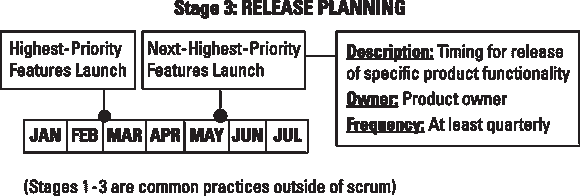

图 8-5: 作为价值路线图一部分的发布规划。

发布规划涉及两个关键活动：

* **修订产品待积列表：** 在第 7 章中，我们告诉你产品待积列表是你目前已知项目中所有用户故事的完整列表，无论它们是否属于当前发布。请记住，你的用户故事列表在整个过程中可能会变化。
* **创建发布计划：** 该活动包括发布目标、发布目标日期以及支持发布目标的待积列表项优先级排序。发布计划提供了一个团队可以实现的中期目标。

 不要在此规划期间创建一个新的独立的待积列表。这项任务是没有必要的，并且会降低产品负责人的灵活性。根据发布目标对现有的待积列表进行优先级排序就足够了，这让产品负责人在他在冲刺计划期间承诺范围时拥有拥有最新信息。

产品待积列表和发布计划是产品负责人与开发团队之间最重要的通信渠道之一。在第 7 章中，你会了解到如何完成产品待积列表。接下来将描述如何创建发布计划。

发布计划包含一组特定功能的发布进度。产品负责人在每次发布开始时创建发布计划。创建发布计划，请遵循以下步骤：

1. **建立发布目标。**

   发布目标是发布中功能的整体业务目标。产品负责人和开发团队协作根据开发团队的速度和能力创建发布目标。

2. **确定发布日期。**

   某些 scrum 团队根据功能的完成情况确定发布日期；另一些团队可能有硬性日期，例如 3 月 31 日或 9 月 1 日。

3. **审查产品待积列表和产品路线图，确定支持发布目标的最高优先级用户故事（最小可行性功能）。**

   这些用户故事将构成你的首次发布。

    我们喜欢使用 80% 的用户故事来实现发布，使用最后 20% 来添加满足发布目标的功能。

4. **精炼发布目标中的用户故事。**

   在发布规划期间，经常会发现影响估值和优先级的依赖关系、差距或新细节。这是确保支持你发布的产品待积列表部分大小合适的时候。我们喜欢确保支持发布目标的需求大小不超过 34。开发团队通过更新任何添加或修订的用户故事的估值来帮助产品负责人，并与产品负责人承诺发布目标和范围。

5. **根据 scrum 团队的速率（velocity）估算需要多少冲刺。**

    scrum 团队使用速率来计划他们在发布和冲刺中可以承担的工作。`速率（Velocity）`是一个冲刺内完成的所有故事点总和。因此，如果一个 scrum 团队在第一个冲刺中完成了大小为 8, 5, 5, 3, 2, 1 的六个用户故事，那么他们第一个冲刺的速率就是 24。scrum 团队在计划第二个冲刺时，考虑到他们在第一个冲刺中完成了 24 个故事点。

   在多次冲刺后，scrum 团队可以使用运行平均速率作为输入，确定他们在冲刺中可以承担的工作，并通过将发布中的总故事点除以平均速率来推断他们的发布进度。你可以在第 13 章中学习更多关于速率的知识。

6. **识别无法冲刺无法完成的发布工作。必要时规划发布冲刺（release sprint），并确定其长度。**

    一些团队会在某些发布中添加`发布冲刺`，以进行与产品开发无关但发布产品到客户手中必要的活动。如果你需要发布冲刺，请确保将其纳入你选择的日期中。你可以在第 11 章](#17_9781119405696-ch11.xhtml)中找到更多关于发布冲刺的信息。

某些任务，例如软件项目的安全测试或负载测试，无法在单个冲刺（sprint）内完成，因为安全或负载测试环境需要时间来设置和申请。虽然发布性冲刺（release sprints）允许 Scrum 团队为这类活动制定计划，但这样做是一种反模式，或者说是敏捷性的对立面。你的目标应该是：每个冲刺结束时，完成使功能可交付的所有工作。

 并非所有敏捷项目都使用发布规划。有些 Scrum 团队会在每个冲刺中甚至每天为客户发布供其使用的功能。开发团队、产品、组织、客户、利益相关者以及项目的技术复杂性都可以帮助决定你的产品发布方法。

计划中的发布现在从初步计划转变为更具体的目标。插图 8-6 展示了一个典型的发布计划。

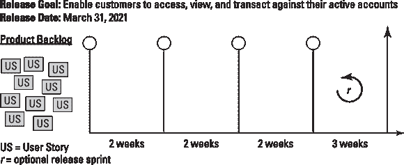

图 8-6： 示例发布计划。


 请记住钢笔铅笔规则：你可以承诺（用钢笔写）第一次发布的计划，但第一次发布之后的任何内容都是暂定的（用铅笔写）。换句话说，对每次发布都使用即时规划（参见第 7 章）。毕竟，情况在变化，为什么要过早地纠结微观细节呢？

## 冲刺计划（Sprint Planning）

在敏捷项目中，`sprint` 是一个持续的时间迭代周期，开发团队在此期间从开始到结束创建一组特定的产品能力。在每个冲刺结束时，开发团队创建的功能应该是可以运行、准备好演示，并可能可以交付给客户的。

一个项目内的冲刺长度应该保持一致。保持冲刺长度的一致有助于开发团队衡量其性能，并在每个新冲刺中进行更好的计划。

冲刺通常持续一到四周。四周是任何冲刺应该持续的最长时间；更长的迭代会增加变更风险，违背了敏捷的初衷。我们很少看到持续超过两周的冲刺，更多看到的是持续一周的冲刺。一周的冲刺与周一至周五的业务周是一个自然周期，从结构上防止了周末工作。有些 Scrum 团队以一天为一个冲刺进行工作，优先级每天变化。市场和客户需求变化得越来越快，你在收集客户反馈的机会之间能负担得的时间也变得越来越短。我们的准则是是：你的冲刺长度不要超过利益相关者能够对 Scrum 团队在冲刺中工作内容的优先级持续不忍变化的时间。

每个冲刺包含以下内容：

- 冲刺开始时的冲刺计划
- 每日 Scrum 会（Daily scrum meetings）
- 开发时间 —— 冲刺的大部分
- 冲刺结束时的冲刺评审（Sprint review）和冲刺回顾（Sprint retrospective）

你可以在第 9 章和第 10 章中了解更多关于每日 Scrum、冲刺开发、冲刺评审和冲刺回顾的内容。在本章，你将学习如何计划冲刺。

冲刺计划是路线图（Roadmap to Value）的第 4 ，如插图 8-7 所示。整个 Scrum 团队 —— 产品负责人、Scrum Master 和开发团队 —— 共同制定冲刺计划。

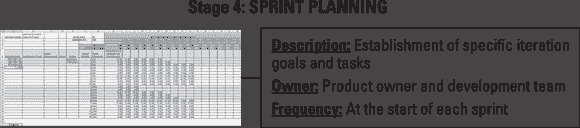

图 8-7：作为价值路线图部分的冲刺计划。

### 冲刺待办列表（The sprint backlog）

`sprint backlog` 是与当前冲刺相关的用户故事和任务列表。在计划冲刺时，你执行以下操作：

- 为你的冲刺建立目标。
- 选择支持这些目标的用户故事。
- 将用户故事拆分为特定的开发任务。
- 创建一个 `sprint backlog`。冲刺待办列表包含以下内容：
  - 按优先级排序的冲刺内用户故事列表。
  - 每个用户故事的相对工作量估计。
  - 开发每个用户故事所需的任务。
  - 完成每个任务所需的时间（以小时为单位）。

    在任务级别，你估算完成每个任务所需的小时，而不是使用故事点（story points）。因为你的冲刺有特定的长度，因此有一组固定的可用工作小时，你可以使用每个任务所需的时间来判断任务是否能放入你的冲刺。

    每个任务开发团队应该在一天或更短时间内完成。

     一些成熟的开发团队可能不需要估算任务，因为他们他们在将用户故事拆分为可执行任务方面变得越来越一致。对于新的开发团队来说，估算任务有助于他们理解自己的能力并恰当地地计划每个冲刺。

  - 一个燃尽图（`burndown chart`），显示开发团队已完成的工作状态。

 敏捷项目中的任务应该在一天或更短时间内完成，原因有两个。第一个原因是心理学：人们有动力到达终点。第二个原因是如果团队成员在同一个任务上工作超过两天，Scrum Master 应该调查是什么导致了偏离轨道。（有关管理阻碍的更多信息，请参见第 9 章。）

开发团队协作协作创建并维护冲刺待办列表，且只有开发团队可以修改冲刺待办列表。冲刺待办列表应该反映冲刺进展的最新快照。插图 8-8 显示了冲刺计划结束时的示例冲刺待办列表。你可以使用这个示例、其他示例，甚至使用白板。

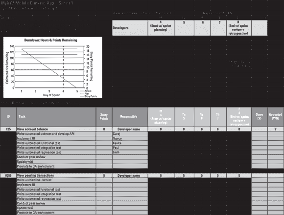

图 8-8：冲刺待办列表示例。

### 冲刺计划会议（The sprint planning meeting）

在每个冲刺的第一天（通常是周一早上），Scrum 团队举行冲刺计划会议。

 为了确保冲刺计划会议成功，请确保参与的所有人员（产品负责人、开发团队、Scrum Master 以及 Scrum 团队要求的任何人）都投入整个会议。

根据冲刺的长度决定你的冲刺计划会议长度：每周冲刺的会议时间不超过两小时。这个时间盒（`timebox`）是 Scrum 的规则之一，有助于确保会议集中且不偏离。插图 8-9 说明了这一点，并是你冲刺计划会议长度的良好快速参考。


图 8-9：冲刺计划会议与冲刺长度的比例。

你将迭代计划会议（sprint planning meetings）分为两个部分：一部分用于设定迭代目标（“为什么”）并选择本次迭代的用户故事（“做什么”），另一部分是将用户故事拆分为具体的个体任务（“怎么做”以及“工作量有多大”）。接下来将讨论每个部分的细节。

## 第一部分：设定目标和选择用户故事

在迭代计划会议的第一部分，产品负责人（product owner）和开发团队在 Scrum Master（scrum master）的支持下将完成以下工作：

1. 讨论并设定迭代目标。
2. 审查产品待办列表（product backlog）中支持迭代目标的用户故事，并重新评估它们的相对估值。
3. 如果需要，创建用户故事以填补实现迭代目标的空白。
4. 确定团队在当前迭代中可以承诺的内容。

在迭代计划会议开始时，产品负责人应该提出一个迭代目标，然后与开发团队共同讨论并达成一致。迭代目标应该是对团队将在迭代结束时演示并可能发布的运行中的客户功能进行的整体描述。该目标由产品待办列表中优先级最高的用户故事提供支持。移动银行应用程序的一个示例迭代目标（参考第 7 章）如下：

> 演示移动银行客户登录并查看账户余额、待处理交易以及历史交易的能力。

根据迭代目标，你来确定属于本次迭代的用户故事。你还会再次查看这些故事的估值，并在必要时对估值进行更改。对于移动银行应用程序示例，本次迭代的用户故事组可能包括以下：

- 登录并访问我的账户。
- 查看账户余额。
- 查看待处理交易。
- 查看历史交易。

所有这些都是产品待办列表中支持迭代目标的高优先级用户故事。

审查用户故事的第二部分是确认每个用户故事的工作量估值已经过审查，并在需要时进行了调整，且反映了开发团队对该用户故事的当前认知。必要时调整估值。在产品负责人参加的情况下，解决任何悬决问题。在迭代开始时，Scrum 团队拥有关于项目目前系统和客户需求的最新知识，因此确保开发团队和产品负责人有最后一次对进入迭代的用户故事进行澄清和规模评估。

最后，在知道哪些用户故事支持迭代目标后，开发团队应该同意并确认其可以完成为本次迭代计划的目标。如果你之前讨论的任何用户故事不适合当前迭代，请将它们从迭代中移除并重新加入产品待办列表。

 始终一次计划并执行一次迭代。容易掉入的陷阱是将用户故事放置在特定的未来迭代中。例如，当你仍在计划迭代 1 时，不要决定用户故事 `X` 应该放在迭代 2 或 3。相反，保持产品待办列表中的用户故事排序列表为最新，并专注于始终开发下一个优先级最高的故事。仅承诺对当前迭代进行计划。

当你拥有了迭代目标、迭代用户故事以及对目标的承诺后，请进入迭代计划的第二部分。

 因为超过一个周的迭代的计划会议可能会持续几个小时，你可能想在会议的两个部分之间休息一下。

## 第二部分：将用户故事拆分为任务以形成迭代待办列表

在迭代计划会议的第二部分，Scrum 团队将执行以下工作：

1. 开发团队创建与每个用户故事相关的迭代待办列表任务。确保任务涵盖了“完成定义”（definition of done）的每个部分：开发、集成、测试和文档化。
2. 开发团队双检其是否可以在迭代可用时间内完成这些任务。
3. 每个开发团队成员在离开会议前应选择他/她的第一个要完成的任务。

 开发团队成员每次应只处理一个用户故事中的一个任务，以便实现“集攻”（`swarming`——即整个开发团队共同处理一个用户故事直到完成的实践。集攻是在短时间内完成工作的高效方式。通过这种方式，Scrum 团队可以避免出现在迭代结束时，所有用户故事都已开始但很少有完成的窘境。

在会议第二部分开始时，将用户故事拆分为个体任务，并为每个任务分配小时数。开发团队的目标应该是一天或更短完成一个任务。例如，XYZ 银行移动应用程序的用户故事可能如下：

> 登录并访问我的账户。

团队将此用户故事拆分为如下任务：

- 编写单元测试。
- 为用户名和密码创建一个带有 `Submit`（提交）按钮的身份验证接界面。
- 创建一个让用户重新输入凭据的错误界面。
- 创建一个（登录后）显示账户列表的界面。
- 使用在线银行应用程序的身份验证代码，重写 iPhone/iPad 应用的代码。
- 创建数据库调用以验证用户名和密码。
- 为移动设备重构代码。
- 编写集成测试。
- 更新 wiki 文档。

在知道每个任务所需的小时数后，进行最终检查，以确保开发团队可用的小时数与任务估值的总和合理匹配。如果任务超过了可用小时数，则一个或多个用户故事将移出迭代。与产品负责人讨论哪些任务或用户故事最适合移除。

如果迭代内有额外时间，开发团队可能包含另一个用户故事。但在迭代开始时，要小心过度承诺，特别是在项目的前几次迭代中。

当你知道哪些任务将成为迭代的一部分后，选择你首先要做的工作。每个开发团队成员应选择他/她在迭代中要完成的初始任务。团队一次专注于专注于任务。

 当开发团队成员考虑在迭代中可以完成的内容时，请使用以下指南以确保他们在学习新角色和技术时不会承担超出范围的工作：

- **迭代 1**：开发团队认为可以完成任务的 25%。包括学习新流程和启动新项目的开销。
- **迭代 2**：开发团队认为可以完成任务的 50%。
- **迭代 3**：开发团队认为可以完成任务的 75%。
- **迭代 4 及以后**：100%。开发团队已经发展出节奏和速度，洞察了敏捷原则和项目，并将以接近全速的速度工作。

Scrum 团队应该根据开发团队对任务的进展不断评估迭代待办列表。在迭代结束时，Scrum 团队还可以在迭代回顾会议（sprint retrospective）上评估估计技能和工作能力（参见第 10 章）。这种评估对于第一次迭代尤为重要。

 对于本次冲刺（`sprint`），总共有多少可用工作小时？在每周 40 小时的情况下，你可以明智地假设对于为期两周的冲刺，有九个工作日可以开发用户故事。假设每个全职团队成员每周有 35 小时（每天 7 小时有效时间）专注于项目，那么可用工作小时为：

> 团队人数 × 7 小时 × 9 天

为什么是九天？第一天的一半被计划会议占据，第十天的一半被冲刺评审（利益相关者审查已完成的工作）和冲刺回顾（scrum 团队为未来的冲刺识别改进之处）占据。这就留下了九天的开发时间。

冲刺计划完成后，开发团队可以立即开始处理任务以创建产品！

Scrum Master（敏捷大师）应该确保产品路线图、产品待办（product backlog）和冲刺待办（sprint backlog）位于显眼位置并供所有人访问。这允许经理和其他利益相关方查看产物并获取进度状态，而不会中断开发团队。

# 第 9 章：全天候工作

## 本章内容

-  **规划每一天**
-  **跟踪每日进度**
-  **每天开发和测试**
-  **结束一天**

现在是周二上午 9 点。昨天，你完成了冲刺计划，开发团队已开始工作。在冲刺的剩余时间里，你将循环工作，每天都遵循相同的模式。

在本章中，你将了解到如何在每个冲刺期间每天运用敏捷原则。你将看到作为 scrum 团队的一员每天要做的工作：计划和协调你的一天、跟踪进度、创建和验证可用功能，以及识别并处理工作中的阻碍。你将看到不同的 scrum 团队成员在冲刺期间每天如何协作来创建产品。

## 规划你的一天：每日 Scrum

在敏捷项目中，你会在整个项目期间制定计划——而且每天都进行计划。敏捷开发团队每个工作日都以每日 Scrum 会议开始，记录已完成的项目，识别需要 Scrum Master 参与的障碍或路障，并同步和计划每个团队成员当天将做什么以实现冲刺目标。

每日 Scrum 是“价值路线图”（Roadmap to Value）上的第 5 。你可以通过图 9-1 看到冲刺和每日 Scrum 如何融入敏捷项目。注意它们是如何相互重复的。

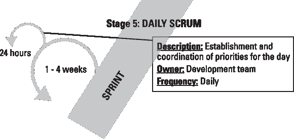

图 9-1：价值路线图中的冲刺和每日 Scrum。

在每日 Scrum 会议上，每个开发团队成员都会进行以下三个陈述，以便团队得以协作：

- **昨天，我完成了**（说明已完成的项目）。
- **今天，我将承担**（陈述任务）。
- **我的障碍是**（说明障碍，如果有的话）。

 你可能听到的每日 Scrum 会议的其他名称是每日集会（daily huddle）或每日站会（daily standup meeting）。每日 Scrum、每日集会和每日站会指的是同一件事。

我们还让 Scrum Master 针对团队的障碍进行这三个陈述：

- **昨天，我决定解决**（说明已解决的障碍）。
- **今天，我将致力于消除**（陈述障碍）。
- **我将向上升级的障碍是**（说明你需要帮助的障碍，如果有的话）。

Scrum 的规则之一是每日 Scrum 会议持续时间为 15 分钟或更短；更长的会议会占用开发团队的时间。会议也被称为每日站会，因为站立鼓励缩短会议时间。你也可以使用道具来保持每日 Scrum 会议快速进行。

 我们通过向随机开发团队成员扔一个响的汉堡形状狗玩具来开始会议——别担心；它是干净的。每个人做出自己的三个陈述，然后把吱吱玩具传给别人。如果有人很啰嗦，我们就把道具换成包 500 页的复印纸，大约重 5 磅。每个人说话的长短取决于他能把那包纸单手举多多久。两种会议都会很快变短，或者开发团队成员会很快建立起手臂力量——根据我们的经验，是前者。

为了保持每日 Scrum 简洁高效，scrum 团队可以遵循以下几条指南：

- **任何人都可以参加每日 Scrum，但只有开发团队、Scrum Master 和产品所有者可以发言。** 每日 Scrum 是 scrum 团队协调日常活动的机会，而不是接受来自利益相关者的额外需求或变更。利益相关者可以在之后与 Scrum Master 或产品所有者讨论问题，但利益相关者不应该接触开发团队。
- **重点是即时优先事项。** scrum 团队应该只审查已完成的任务、待办的任务和路障。
- **每日 Scrum 会议是为了协调，而不是解决问题。** 开发团队和 Scrum Master 负责在白天消除路障。
- **为了防止会议偏离到解决问题，scrum 团队可以：**
  - 在白板上列出列表以跟踪需要关注的问题，然后在会后直接与相关的团队成员处理这些问题。
  - 举行名为“派对”（after-party）的会议，在 Scrum 结束后解决问题。一些 scrum 团队每天安排派对时间；另一些则根据需要举行。
- **每日 Scrum 是同伴间的协作。** 它不是用于向某个人（如 Scrum Master 或产品所有者）汇报状态。状态是在冲刺待办每天结束时汇报的。
- **这种短时间会议必须准时开始。** scrum 团队对迟到采取有趣的惩罚并不罕见（例如俯卧撑或向庆祝基金缴纳罚金）。无论使用哪种方法，都是 scrum 团队共同商定的；而不是由外部人员（如经理）强加的。
- **scrum 团队可以要求每日 Scrum 的者在会议期间站立而不是坐着。** 站立会让人们渴望结束会议并开始一天的工作。

 当你只有 15 分钟会议时间时，每一分钟都至关重要。scrum 团队不应该害怕迟到每日 Scrum 会变得变得不愉快。我们曾通过建议 scrum 团队将罚金从 1 美元改为 20 美元的庆祝基金，一夜之间治好了持续性的迟到问题。

每日 Scrum 会议对于让开发团队专注于当天的正确任务非常有效。因为开发团队成员在同伴面前对自己的工作负责，他们就不可能偏离每日承诺。每日 Scrum 会议还能确保 Scrum Master 和开发团队立即处理路障。这些会议非常有用，即使是未采用其他敏捷技术的组织有时也会采用每日 Scrum。

 我们喜欢在开发团队正常开始时间的一小时后举行每日站会（daily scrum），以便留出处理拥堵、邮件、咖啡等开启一天的仪式时间。推迟站会还能让开发团队有时间审阅昨晚运行的自动化测试工具生成的缺陷报告。

每日站会用于讨论进展并计划接下来的每一。正如你接下来看到的，你每天都在跟踪进度——而不仅仅是讨论。

## 跟踪进度

你还需要每天跟踪冲刺（`sprint`）的进度。本节将讨论跟踪冲刺中任务的方法。

跟踪进度的两种工具是冲刺待办列表（sprint backlog）和任务板。冲刺待办列表和任务板都能让 scrum 团队在任何时候向任何人展示冲刺进度。

 《敏捷宣言》看重个人和交互优于流程和工具。确保你的工具是支持你的 scrum 团队而不是阻碍他们。如果有必要，可以修改甚至替换工具。可以在第 2 章中阅读更多关于《敏捷宣言》的内容。

### 冲刺待办列表


在冲刺计划期间，你集中于将用户故事和任务添加到冲刺待办列表中。在冲刺进行期间，你每天更新冲刺待办列表，跟踪开发团队在每个工作日的任务进度。图 9-2 展示了本书中示例应用程序——XYZ 银行移动银行应用程序在第一次冲刺第 4 天后的冲刺待办列表。（第 8 章

图 9-2: 示例冲刺待办列表。

每天让整个项目团队都能看到冲刺待办列表。这样，任何需要了解冲刺状态的人都可以立即找到。

在图 9-2 的左上方，注意`sprint burndown chart`（冲刺燃尽图），它显示了开发团队正在取得的进展。你可以看到开发团队成员完成的任务接近可用小时的均衡速率，且产品负责人已经接受了几个用户故事已完成。

你可以在冲刺待办列表和产品待办列表中包含燃尽图。（本章侧重于冲刺待办列表。）图 9-3 详细展示了燃尽图。

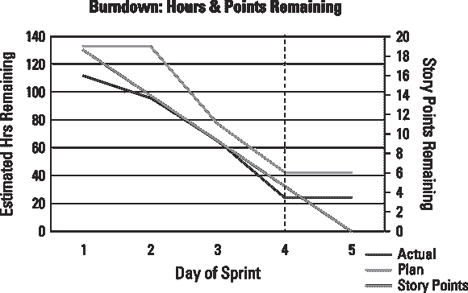

图 9-3: 燃尽图。

燃尽图是可视化进度和剩余工作的强大工具。该图显示了：

- 第一个垂直轴上的未完成工作（以小时为单位）
- 水平轴上的时间（以天为单位）

某些冲刺燃尽图（如图 9-3](#15_9781119405696-ch09.xhtml_c09-fig-0003）所示）在第二个垂直轴上还显示了剩余的故事点，该轴与剩余工作小时数在同一个水平时间轴上对应。

燃尽图让任何人一眼看出冲刺状态。进展一目了然。通过将实际可用小时数与剩余工作对比，你可以每天判断工作是按计划进行、情况比预想更好，还是出现了问题。这些信息帮助你判断开发团队是否可能完成目标用户故事数量，并帮助你在冲刺早期做出明智决策。

 你可以使用电子表格和图表程序（如 Microsoft Excel）创建冲刺待办列表。你还可以从书籍网站`www.dummies.com/go/agileprojectmanagementfd2e`下载包含燃尽图的冲刺待办列表模板。

图 9-4 显示了不同情况下冲刺的燃尽图示例。观察这些图表，你可以看出工作进展如何：

- **1. 预期：** 此图显示了正常的冲刺模式。随着开发团队完成任务、挖掘细节并识别最初可能未考虑的战术工作，剩余工作小时此升下降。虽然工作偶尔会增加，但在可控范围内，团队动员并在冲刺结束前完成所有用户故事。
- **2. 更复杂：** 在这次冲刺中，工作量超过了开发团队认为可以完成的范围。团队及早发现了此问题，与产品负责人合作移除了一些用户故事，仍然实现了冲刺目标。
- **3. 简单：** 在这次冲刺中，团队以比预想更快的速度完成了用户故事。与产品负责人合作确定了额外的用户故事。
- **4. 未参与：** 燃尽图呈直线意味着团队没有更新。无论哪种都是警告。

   就像心电图一样，燃尽图上的水平线绝不是好事。

- **5. 谎谎（顺从）：** 这种模式常见于习惯于报告管理层预期时间而非实际所需时间的开发团队。这种模式通常反映了一个基于恐惧的环境，经理通过恐吓进行管理。
- **6. 快速失败：** 这种简单进度可视化的最大优势之一是提供了进展或缺乏进展的证明。冲刺中期，产品负责人决定通过终止冲刺并启动具有新目标的冲刺来止损。只有产品负责人可以提前结束冲刺。

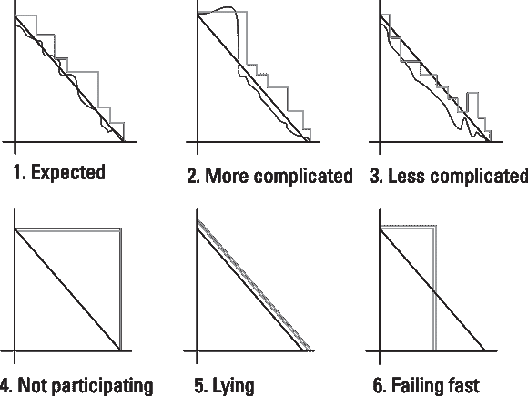

图 9-4: 燃尽图类型。

冲刺待办列表帮助你在整个冲刺期间跟踪进度。你也可以参考早期的冲刺待办列表来对比冲刺之间的进度。你在每次冲刺中都会对流程进行改进（可以在[第 10 章](#16_9781119405696-ch10.xhtml）中阅读更多检查和适应的概念）。不断检查你的工作并做出改进。保留那些旧冲刺待办列表。

### 任务板

虽然冲刺待办列表是跟踪和展示项目进展的好方法，但它可能是电子格式，因此想要查看的人可能无法立即获取。某些 scrum 开发团队会配合冲刺待办列表使用任务板。任务板为冲刺团队正在处理和已完成的项目提供了快速、易懂的视图。

我们喜欢任务板，是因为你无法否认它们展示的状态。就像产品路线图一样，任务板可以由白板上的贴纸组成。任务板从左到右至少包含以下四列：

- **待办（To Do）：** 待完成的用户故事和任务位于最左侧列。
- **In Progress（进行中）：** 开发团队当前正在处理的用户故事和任务位于`In Progress`列中。此列应只有一个用户故事。如果有多个用户故事正在进行，这提醒着开发团队成员没有进行跨职能协作，而是在囤积所需的任务。你面临的风险是，在冲刺结束时，多个用户故事只完成了部分，而不是多个用户故事完全完成。
- **Accept（待验收）：** 开发团队完成一个用户故事后，将其移动到`Accept`列。`Accept`列中的用户故事已准备就绪，等待产品负责人审查，并提供反馈或接受。
- **Done（已完成）：** 当产品负责人审查了用户故事并确认该用户故事已完成时，产品负责人可以将该用户故事移动到`Done`列。

 限制你的进行量！一次只选择一个任务。将其他任务留在`To Do`列中备。理想情况下，开发团队每次只处理一个用户故事，并共同攻克该用户故事的任务以快速完成它。

由于任务板具有触感性——人们通过物理移动用户故事卡片来完成它——它比任何电子文档都能投入开发团队。任务板仅仅通过存在于 Scrum 团队的工作区域就能鼓励思考和行动，因为每个人都能看到看板板。

 仅允许产品负责人将用户故事移动到`Done`列，可以防止对用户故事状态产生误解。

图 9-5 显示了一个典型的任务板。如你所示，任务板是进行工作的强有力视觉表示。

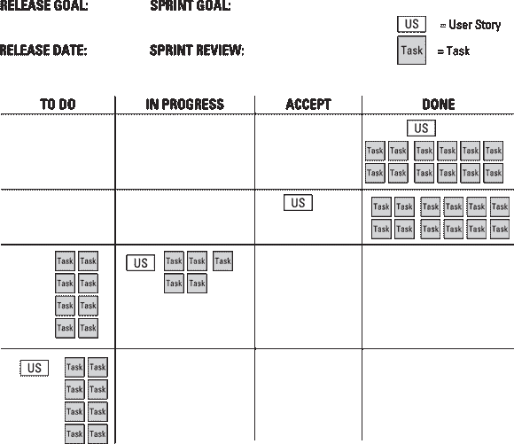

图 9-5：示例任务板。

 任务板非常像看板。看板（Kanban）是一个日语术语，意为视觉信号。（有关看板板的更多信息，请参见第 4 章中，任务板显示了四个用户故事，每个故事由称为泳道（swim lanes）的水平线分隔。第一个用户故事已完成。所有任务已完成，产品负责人已接受完成的工作。对于第二个用户故事，开发工作已完成，但正在等待产品负责人的验收。第三个用户故事正在进行，第四个用户故事尚未开始。一眼，每个用户故事的状态不仅对 Scrum 团队是清晰的（使得战术协调更快更方便），对感兴趣的利益者也是如此。

敏捷项目的日常工作不仅涉及计划和跟踪进度。在下一节中，你将看到你每天大部分的工作将包含什么，无论你是开发团队的成员、产品负责人还是 Scrum 经理。

 一些开发团队仅通过任务板报告状态，并要求 Scrum 经理将状态转换为冲刺待办列表。这一过程有助于 Scrum 经理查看趋势和潜在问题。

## 冲刺中的敏捷角色

Scrum 团队的每个成员在冲刺期间都有特定的日常角色和职责。开发团队每天的关注重点是产生可交付的功能。对于产品负责人来说，重点是为未来的冲刺准备产品待办列表，同时通过实时澄清来支持开发团队执行冲刺待办列表。Scrum 经理是敏捷教练，通过消除障碍和保护开发团队免受外部干扰来提高开发团队的生产力。

以下是 Scrum 团队每个成员在冲刺期间执行的任务描述。如果你是开发团队的成员，你：

- 选择需求最高的任务并尽快完成它们。
- 当你不清楚某个用户故事时，向产品负责人请求澄清。
- 与其他开发团队成员协作，设计特定用户故事的方法，在需要时寻求帮助，并在其他开发团队成员需要时提供帮助。
- 对彼此的工作进行同行评审。
- 根据冲刺需求承担超出正常角色范围的任务。
- 按照“完成定义”中约定的标准完全开发功能（在下一节“创建可交付的功能”中描述）。
- 每日报告你完成冲刺待办列表中任务的进度。
- 对于你无法有效自行消除的任何障碍，提醒 Scrum 经理。
- 实现你在冲刺计划期间承诺的冲刺目标。

产品负责人在冲刺期间承担以下任务：

- 进行保持高水平开发速度所需的投资。
- 对产品功能进行优先级排序。
- 向开发团队代表产品利益相关者。
- 向项目利益相关者报告成本和进度。
- 与开发团队详述用户故事，使团队清楚他们正在创建什么。
- 对需求提供即时澄清和决策，以保持开发团队的开发。
- 消除其他团队成员带来的障碍。
- 审查用户故事的功能并向开发团队提供反馈。
- 根据需要向待办列表添加新的用户故事，确保新故事支持产品愿景、发布目标和冲刺目标。
- 展望下一个冲刺，并为冲刺会议详述用户故事。

 非语言交流包含了很多信息。Scrum 经理可以从理解肢体语言中受益，以识别团队中未表达的情绪。

如果你是 Scrum 经理，你在冲刺期间执行以下操作：

- 在需要时通过教练产品负责人、开发团队和组织维护敏捷价值观和实践。
- 保护开发团队免受外部干扰。
- 消除障碍，包括针对眼前问题的战术消除和针对潜在长期问题的战略消除。在第 6 章中，我们将 Scrum 经理比作航空工程师，不断消除并防止组织对开发团队的拖。
- 促进 Scrum 团队达成共识。
- 建立关系，以促进与 Scrum 团队工作的人密切合作。

 我们经常告诉 Scrum 经理，“不要独自午餐。始终建立关系。”你永远不知道什么时候会在项目中需要帮助。

如你所示，Scrum 团队的每个成员在冲刺中都有特定的工作。在下一节中，你将看到产品负责人和开发团队如何协作创建产品。

## 创建可交付的功能

冲刺日常工作的目标是为产品创建可以交付给客户或用户的功能。

在单个冲刺的背景下，产品增量（product increment）或可交付的功能意味着工作产品已根据项目的完成定义进行了开发、集成、测试和记录，并被认为准备好发布。开发团队在冲刺结束时可能发布或不发布产品——发布时间取决于发布计划。项目可能需要多个冲刺，产品才能包含证明市场发布合理的最小可行性功能集。

 从用户故事（user stories）的角度来思考可交付的功能非常有帮助。用户故事最初是卡片上的一个书面需求。随着开发团队创建功能，每个用户故事都变成用户可以执行的操作。可交付的功能等同于完成的用户故事。

为了创建可交付的功能，开发团队和产品所有者参与了三项主要活动：

- 详化（Elaborating）
- 开发（Developing）
- 验证（Verifying）

在迭代（sprint）期间，这些活动中的任何或全部可能在任何时候发生。当你详细审查它们时，请记住它们并不总是以线性方式发生的。

### 详化

在敏捷项目中，`elaboration`（详化）是确定产品功能细节的过程。每当开发团队处理一个新的用户故事时，详化都能确保有关用户故事的任何未解问题得到解答，从而使开发过程顺利进行。

产品所有者与开发团队合作完善用户故事，但开发团队应该应对设计决策拥有最终决定权。如果开发团队在一天中的任何时候需要对需求进一步澄清，产品所有者应该随时提供咨询。

 协作设计是项目成功的关键因素。记住这些敏捷原则：“最好的架构、需求和设计源于自组织团队，”以及“业务人员和开发人员在整个项目过程中必须每天合作。”注意那些倾向于独立完成用户故事详化的开发团队成员。如果开发团队的成员脱离了团队，也许敏捷大师（scrum master）的工作之一应该是指导该成员如何维护敏捷价值观和实践。

### 开发

在产品开发期间，大多数活动自然而然地归开发团队负责。产品所有者继续根据需要与开发团队合作，以提供说明并批准已开发的功能。

 开发团队应该能够立即联系产品所有者。理想情况下，当产品所有者没有与客户和利益相关者互动时，他应该与开发团队坐在一起。

敏捷大师应该专注于保护开发团队免受外部干扰，并消除开发团队遇到的障碍。

为了在开发期间维持敏捷实践，请务必实施我们在第 4 章中向你展示的来自极端编程（extreme programming）的开发实践，包括以下内容：

- 结对开发团队成员以完成任务。这样做可以提高工作质量并鼓励技能共享。
- 遵循开发团队约的设计标准。如果由于某种原因你无法遵循这些标准，请重新审视并改进这些标准。
- 通过设置自动化测试来开始开发。你可以在后续章节以及第 15 章中找到更多关于自动化测试的知识。
- 如果在开发过程中出现了新的“锦上添花”的功能，请将它们添加到产品待办列表（product backlog）中。避免编写超出迭代目标的新功能。
- 每天集成当天编写的代码更改，一次一组。测试其 100% 的正确性。每天至少集成一次更改；有些团队每天集成多次。
- 进行代码审查以确保代码符合开发标准。识别需要修订的区域。将修订内容作为任务添加到迭代待办列表（sprint backlog）中。
- 在工作时创建技术文档。不要等到迭代结束，或者更糟糕，等到发布前的最后一个迭代结束。

 `Continuous integration`（持续集成）是软件开发中用于每次代码构建时集成和全面测试的术语。持续集成有助于在问题变成危机之前识别它们。

### 验证

验证迭代中完成的工作分为三个部分：自动化测试、同行评审和产品所有者评审。

 防止缺陷产生的成本远低于从已部署系统中移除它的成本。

### 自动化测试

`automated testing`意味着使用计算机程序为你完成大部分代码测试。通过自动化测试，开发团队可以快速开发和测试代码，这是敏捷项目的巨大优势。

敏捷项目团队通常查看测试程序生成的缺陷报告，在每日站会（daily scrum）上报告任何问题，并在当天立即修正这些问题。

自动化测试可以包括以下内容：

- 单元测试：对源代码的最小部分——组件级进行测试
- 系统测试：将代码与其他系统一起进行测试
- 静态测试：根据开发团队同意的规则和最佳实践验证产品代码是否符合标准

### 同行评审

`peer review`（同行评审）简单意味着开发团队成员相互审查代码。如果 Sam 编写了程序`A`，Joan 编写了程序`B`，Sam 可以审查 Joan 的代码，反之亦然。客观的同行评审有助于确保代码质量。

`pair programming`（结对编程）是同行评审的另一种形式，但评审发生在开发过程中。当一名开发者（飞行员）坐在键盘前编写代码时，另一名开发者（导航员）正在进行策略性思考、预测未来，并积极倾听对飞行员做出的战术决策做出响应。评审不仅发生在现场——捕捉缺陷并做出更明智的决策——而且是两名开发者（而不是一个）对正在开发的系统部分非常熟悉。

 结对编程是培养跨职能人才以减少单点故障的好方法。

开发团队可以在开发期间进行同行评审。协作办公有助于这变得简单——你可以转向旁边的人，请他快速查看一下你完成的内容。开发团队也可以在每天留出时间审查代码。自管理团队应该决定最适合他们的方式。

#### 产品所有者评审

当用户故事完成并测试后，开发团队将其移动到`Accept`列。然后产品所有者评审该功能并验证其是否符合用户故事的目标。产品所有者在一天中都会验证用户故事。

正如在第 8 章中所述的，每个用户故事卡片的反面都有验证步骤。这些步骤允许产品所有者审查并确认代码有效且支持用户故事。图 9-6 显示了一个用户故事卡片的验证步骤。

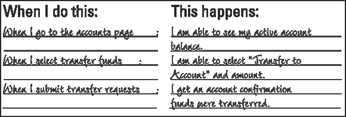

图 9-6: 用户故事验证。

最后，产品所有者应该进行一些检查以验证用户故事符合完成定义（definition of done）。当用户故事符合完成定义时，产品所有者通过将用户故事从`Accept`列移动到`Done`列来更新看板。

当产品所有者和开发团队努力为产品创建可交付的功能时，敏捷大师帮助敏捷团队识别并清除在此过程中出现的障碍。

管理并帮助解决 Scrum 团队识别出的障碍是 Scrum 师（scrum master）角色的主要部分。障碍是指任何阻碍团队成员无法满负投入工作的因素。

虽然每日站会（daily scrum）是开发团队识别障碍的好地方，但开发团队也可能在一天中的任何时候向 Scrum 师反映问题。

以下是障碍的示例：

- **局部的、战术性的问题，**例如：
  - 经理试图将某位团队成员抽去编写一份“优先级优先级”销售报告。
  - 开发团队需要额外的硬件或软件来推进工作。
  - 某开发团队成员不理解用户故事（user story），并说产品负责人（product owner）无法提供帮助。
- **组织性的障碍，**例如：
  - 对敏捷技术的整体抵触，特别是当公司投入了大量成本建立并维护了之前的流程时。
  - 可能不接触一线工作的经理。技术、开发实践和项目管理实践一直在不断进步中。
  - 在使用敏捷技术时，外部部门可能不熟悉 Scrum 的需求和开发节奏。
  - 组织执行了对敏捷项目团队没有意义的政策。集中的工具、预算限制和与敏捷流程不一致的标准化流程都会为敏捷团队带来问题。

 Scrum 师可以具备的最特质是组织威望或影响力。组织威望使 Scrum 师能够进行艰难对话，并为 Scrum 团队的成功做出必要的小大改变。我们在第 4 章中提供了不同类型威望的示例。

除了创建可交付功能这一主要重点外，敏捷项目的一天中还会发生其他事情。其中许多任务都由 Scrum 师承担。表 9-1 展示了潜在的障碍以及 Scrum 师可以采取的消除这些障碍的行动。

| 障碍 | 行动 |
| --- | --- |
| 开发团队需要一系列移动设备的模拟软件，以便测试用户界面和代码。 | 进行一些研究以估算软件成本，为产品负责人准备一份摘要，并就资金问题进行讨论。通过采购处理购买，并将软件交付给开发团队。 |


| 管理层想借用一名开发团队成员写几个报告。你所有的开发团队成员都已满。 | 告诉请求的经理该人员没有空，可能在整个项目期间都不会抽空。建议请求者与产品负责人讨论该需求，以便其相对于产品待办列表进行优先级。由于你可能是一个问题解决者，可能想建议经理获取其所需的替代方法。 |

| 某开发团队成员无法继续某个用户故事，因为他不完全理解该故事。产品负责人因个人紧急情况今天不在办公室。 | 与开发团队成员合作，确定在等待答案期间可以绕过该用户故事进行工作。帮助寻找另一个可以回答问题的人。如果不行，要求开发团队审查即将开展的任务（与此停滞的任务无关）并调整安排以保持生产力。 |

| 一个用户故事的复杂性增加，现在对于冲刺长度来说似乎太大了。 | 让开发团队与产品负责人协作拆分用户故事，以便在当前冲刺中完成一些可演示的价值，并将其余部分放回产品待办列表。目标是确保冲刺结束时是完成的用户故事（即使是更小的），而不是不完整的用户故事。 |

表 9-1 常见障碍与解决方案

到本章为止，你已经看到了 Scrum 团队如何开始一天的工作并在整天中工作。Scrum 团队每天结束时也会完成若干任务。下一节将向你展示如何在冲刺中结束一天。

## 这一天的结束

在每天结束时，开发团队通过更新冲刺待办列表来报告任务进度，说明哪些任务已完成，以及新开始的任务剩余多少工作量（以小时计算）。取决于 Scrum 团队使用的软件，冲刺待办列表数据可能还会更新冲刺燃尽图。

> **警告**：更新冲刺待办列表时的未完成任务剩余的工作量——而不是已花费的时间。关键点是剩余多少时间，这告诉项目团队 Scrum 团队是否正按计划实现冲刺目标。如果可能，避免花费时间跟踪执行任务花费了多少小时，这在自纠正的敏捷模型中是不太必要的。

产品负责人也应该更新任务看板，至少在一天结束时，并将任何通过评审的用户故事移动到“已完成”列。

Scrum 师可以在次日的每日站会之前检查冲刺待办列表或任务看板，以发现任何风险。

Scrum 团队遵循这个每日循环直到冲刺结束，届时该在冲刺评审和冲刺回顾会议上进行回溯、检查和适应了。

---

# 第 10 章 展示工作、检查与适应

## 本章内容

- 展示工作并收集反馈
- 回顾冲刺并改进流程

在每个冲刺结束时，Scrum 团队有机会在冲刺评审中展示他们的成果。冲刺评审是产品负责人和开发团队向利益相关者演示冲刺期间完成的可交付功能的地方。在冲刺回顾中，Scrum 团队（产品负责人、开发团队和 Scrum 师）回顾冲刺的情况，并确定是否需要进行调整。

这两个活动的基础是敏捷概念中的“检查与适应”，在第 7 章中介绍过。

> **图 10-1**：价值路线图中的冲刺评审。

后续章节将向你展示准备冲刺评审需要做什么，如何主持冲刺评审会议以及收集反馈的重要性。

## 准备演示

冲刺评审会议的准备工作最多不超过几分钟。尽管冲刺评审听起来很正式，但敏捷团队展示的精髓是非正式的。会议需要准备和组织，但不需要华丽的材料。

> **警告**：如果你的冲刺评审过于形式化，请问问自己是否在掩盖开发投入不足的事实。回归创造价值的工作——创建一个可以运行的产品。场面主义是敏捷性的敌人。

冲刺评审会议的准备涉及产品所有者开发团队，并在需要时由 Scrum 师提供引导。产品所有需要知道开发团队在本次冲刺期间完成了哪些用户故事。开发团队则需要准备好演示已完成的、可交付的功能。

准备冲刺评审所需的时间不超过 20 分钟——这足够让每个人知道谁在什么时间做什么什么，以确保演示顺利进行。

> **记住**：未交付的工作没有业务价值。在单个冲刺的语境下，`shippable functionality`意味着开发团队已经满足了每个项的“完成定义”，并且产品所有已验证该工作产物符合所有验收标准，并且如果市场价值和时机合适，就可以发布到市场或进行“出货”。实际发布可能根据传达的发布计划在稍后的时间进行。可以在第 9 章了解更多关于可交付功能的知识。

为了让开发团队在冲刺评审中演示代码，代码必须符合完成定义。这意味着代码已完全：

- 已开发
- 已测试
- 已集成
- 已文档

随着用户故事在整个冲刺过程中移动到“已完成”状态，产品所有者和开发团队应该检查功能是否符合这些标准。贯穿整个冲刺的这种持续验证减少了冲刺末的风险，并帮助 Scrum 团队花费尽可能少准备冲刺评审。

了解已完成的用户故事并准备好演示这些故事的功能，使你能够自信地开始冲刺评审会议。

## 冲刺评审会议

冲刺评审会议包含两个活动：演示和展示 Scrum 团队已完成的工作，并允许利益相关者对这些工作提供反馈。图 10-2 显示了 Scrum 团队接收到的产品的不同反馈循环。

> **图 10-2**：敏捷项目反馈循环。

这种反馈循环在整个项目中反复出现，如下：

- 每天，开发团队成员在协作环境中共同工作，该环境鼓励通过同行评审和非正式交流来提供反馈。
- 在每个冲刺期间，一旦开发团队完成每个需求，产品所有者就会通过评审运行的功能进行验收来提供反馈。然后，开发团队会立即整合这些反馈（如果有），以满足用户故事的验收标准。当用户故事完成后，产品所有者将根据用户故事的验收标准，对为用户故事创建的功能给出最终验收。
- 在每个冲刺结束时，项目利益相关者将在冲刺评审会议上对已完成的功能提供反馈。
- 随着每次发布，使用该产品的客户会对新的运行功能提供反馈。

冲刺评审通常在冲刺最后一天的晚些时候进行，通常是周五。Scrum 的规则之一是每冲刺一个周，冲刺评审会议的时间不超过一小时——图 10-3 显示了快速参考。

> **图 10-3**：冲刺评审会议与冲刺长度的比例。

以下是你的冲刺评审会议的一些指南：

- 不要 PowerPoint 幻灯片！展示实际运行的功能。如果你需要显示已完成的用户故事列表，请参考冲刺待办列表。
- 整个 Scrum 团队都应该参加会议。
- 对会议感兴趣的人都可以参加。项目利益相关者、实习生和 CEO 理论上都可以参加冲刺评审。也可以在有空时邀请客户。
- 产品所有者介绍发布目标、冲刺目标以及包含的新功能。
- 开发团队演示其在冲刺期间`completed`的内容。通常，开发团队会展示新特性或架构。
- 演示应该在尽可能接近计划生产环境的设备上进行。例如，如果你正在创建一个移动应用程序，请在手机上演示功能——可能连接到显示器——而不是笔记本电脑上。
- 利益相关者可以对演示的产品提问并提供反馈。
- 不要有未披露的虚假功能，例如硬编码值和其他让应用程序看起来比目前更成熟的编程捷径。虚假功能会在未来的冲刺中为 Scrum 团队产生更多额外工作，以追上他们认为已经存在的内容。
- 产品所有可以根据刚刚演示的功能以及当前冲刺期间添加到产品待办列表的新项，引导关于后续工作计划的讨论。

> **记住**：当你进行冲刺评审时，产品所有者已经看过了要演示的用户故事的功能，并确认它们已完成。

冲刺评审对开发团队非常有价值。冲刺评审为开发团队提供了直接展示工作的机会。会议允许利益相关者对他们的努力表示认可。会议有助于开发团队的士气，激励他们产出不断增加质量的工作。冲刺评审甚至在 Scrum 团队之间建立了某种程度的友好竞争。

> **警告**：有时，健康的竞争会导致开发者尝试创建酷炫的功能或超出用户故事的需求——这种问题被称为`gold plating`（过度开发）。敏捷的一个原则是只生产用户故事通过测试所需。开发团队成员可能会因为热情而超出需求，从而浪费了本可以花在有用功能上的时间。产品所有者应该警惕这一点。过度开发可以在每日站会或开发团队向产品所有者寻求澄清时识别并避免。

接下来，你将看到如何在冲刺评审会议期间记录和使用利益相关者的反馈。

## 在冲刺评审会议中收集反馈

非正式地收集冲刺评审反馈。产品所有者或 Scrum 师可以代表开发团队记笔记，因为团队成员通常会参与演示和随后的对话。

记住我们在整书中使用的示例项目：XYZ 银行的移动应用程序。对 XYZ 银行移动应用程序功能做出回应的利益相关者可能会给出如下：

- 来自销售或营销人员：“根据你们展示的结果，你们可能考虑让客户保存他们的偏好。这将使未来的体验更加个性化。”
- 来自职能部门主管或经理：“根据我看到的，你们可能可以利用去年为 ABC 项目开发的一些代码模块。它们需要类似的数据处理。”
- 来自公司内部质量或用户体验专业人员的反馈：“我注意到你们的登录非常简单；应用程序能够处理特殊字符吗？”

冲刺评审可能会产生新的用户故事。这些新的用户故事可能是新功能，也可能是现有功能的更改。

> **提示**：在最初几次冲刺评审中，敏捷大师可能需要提醒利益相关者敏捷实践。有些人一听到“演示”这个词，就会立刻期待看到花哨幻灯片和打印输出。敏捷大师有责任管理这些预期并维护敏捷价值观和实践。

产品负责人需要将任何新的用户故事添加到产品待办列表，并按优先级对这些故事排序。产品负责人还将将计划在当前冲刺但未完成的故事重新添加产品待办列表，并根据最新的优先级对这些故事进行重新排序。

产品负责人需要在下一次冲刺计划会议之前完成产品待办列表的更新。

冲刺评审结束后，就是进行冲刺回顾的时间。

> **提示**：你可能想在冲刺评审和冲刺回顾之间进行短暂休息，这样敏捷团队成员就能以清醒放松的状态进入回顾讨论。

在完成冲刺评审后，敏捷团队将进入回顾会议，准备好检查其流程并提出改进建议的想法。

## 冲刺回顾

`sprint retrospective`是一次会议，产品负责人、开发团队和敏捷大师在会议上讨论冲刺执行得如何，以及他们可以做什么来改进下一次冲刺。敏捷团队应该以自组织的方式进行这种会议。如果经理或主管参加冲刺回顾，敏捷团队成员将避免彼此保持坦诚，这会限制团队以自组织方式进行检查和调整的有效性。

如果敏捷团队愿意，成员可以邀请其他利益相关者参加。如果敏捷团队经常与外部利益相关者互动，这些利益相关者的见解可能非常有价值。

冲刺回顾是价值路线图的第 7 阶段。图 10-4 显示了冲刺回顾如何融入敏捷项目。

> **图 10-4**：价值路线图中的冲刺回顾。

冲刺回顾的目标是持续改进你的流程。根据每个敏捷团队的需求改进和定制流程，可以提高敏捷团队的士气、提高效率并增加`velocity`——即工作产出。（可以在第 13 章中查找速率的详情。）然而，适用于一个团队的方法并不适用于另一个团队。敏捷团队之外的经理不应该规定所有敏捷团队应该如何克服挑战，而应该让他们自己找到最适合解决方案。

你的冲刺回顾结果对你的敏捷团队来说可能是独的。例如，我们合作过的一个敏捷团队的成员决定，他们希望早到早退，并在夏季下午与家人共度。同一机构的另一个团队认为他们晚上工作效果更好，决定下午到办公室，工作到晚上。两个团队的结果都是士气提高和速率增加。

利用你在回顾中学到的信息来检查和修改你的工作流程，让你的下一次冲刺变得更好。

> **记住**：敏捷方法——特别是 Scrum——能够迅速揭示项目中的问题。Scrum 并不解决问题；它只是暴露问题，并提供一个检查和调整被暴露问题的框架。冲刺待办列表的数据准确地显示了开发团队在何处被放慢。开发团队交流并协作。所有这些工具和实践都有助于揭示低效环节，并允许敏捷团队精炼实践，改进每一个冲刺。注意被暴露的内容。不要忽略它，也不要绕过它。

在接下来的章节中，你将了解到如何计划回顾、如何运行冲刺回顾会议，以及如何使用每次冲刺回顾的结果来改进未来的冲刺。

### 计划冲刺回顾

对于第一次冲刺回顾，敏捷团队的每个人都应该思考几个关键问题，并准备好讨论它们。冲刺期间哪些方面做得好？你想改变什么，怎么改？

敏捷团队的每个人都可能想提前做一些笔记，甚至在整个冲刺期间都做记录。敏捷团队可以记住冲刺每日站会议中的障碍。从第二次冲刺回顾开始，你也可以开始将当前冲刺与之前的冲刺进行比较，并跟踪从冲刺到冲刺的改进工作进度。在第 9 章中，我们提到了保存之前的冲刺待办列表；这些列表可能会派上用场。

如果敏捷团队诚实且彻底地思考了哪些好的以及哪些可以更好，他们就可以进入冲刺回顾，进行有用的对话。

### 冲刺回顾会议

冲刺回顾会议是一个行动导向的会议。敏捷团队立即将回顾中中学到的知识应用到下一次冲刺。

> **记住**：冲刺回顾会议是一个行动导向的会议，而不是解释会议。如果你听到“因为”之类的词，对话正在偏离行动而转向理由。

Scrum 的规则之一是，每一周的冲刺，在回顾中花费的时间不超过 45 分钟。图 10-5 显示了一个快速参考。

> **图 10-5**：冲刺回顾会议与冲刺时间的比例。

冲刺回顾应该涵盖三个核心问题：

- 冲刺期间哪些方面做得好？
- 我们想改变什么？
- 我们如何实施该改变？

以下领域也可以开放讨论：

- **结果**：比较计划的工作量与开发团队完成的任务。审查冲刺燃图（见第 9 章）以及它告诉开发团队的信息。
- **人员**：讨论团队组成和对齐。
- **关系**：讨论沟通、协作和结对工作。
- **流程**：审查支持、开发和同行评审流程。
- **工具**：不同的工具对敏捷团队如何？考虑构制品、电子工具、通信工具和技术工具。
- **生产力**：团队如何提高生产力并在下一次冲刺中完成更多工作？

讨论上一次冲刺中哪些进展良好以及哪些需要改进的事实。为冲刺建立一个整体画面；考虑使用白板记录来自会会者的意见。

### 产生洞察

查看你刚刚收集的信息，并就如何改进下一次冲刺提出想法。

### 决定要做什么

以团队的形式确定你们将实施哪些想法。决定你可以采取的特定行动，以使这些想法变为现实。

### 结束回顾会议

重申你们下一次冲刺的行动计划。感谢大家的贡献。还要找到让下一次回顾会议变得更好的方法！

对于某些 scrum 团队来说，最初可能很难敞开心。敏捷大师可能需要提出特定的问题来启动讨论。参与回顾会议需要练习。重要的是鼓励 scrum 团队对冲刺负责——真正地拥抱自我管理。

在其他 scrum 团队中，回回顾会议期间会伴随着大量的辩论和讨论。敏捷大师可能会发现管理这些讨论并保持会议在规定的时间内完成具有挑战性，但这是必须要做的事情。

务必使用你的冲刺回顾结果在整个项目过程中进行检查和适应。

### 检查与适应

冲刺回顾是你将“检查和适应”的想法付诸行动的最佳机会之一。你们在回顾会议期间提出了挑战和解决方案。不要在会议结束后丢弃这些解决方案；让这些改进成为你每天工作的一部分。

你可以非正式地记录你的改进建议。一些 scrum 团队会在团队区域发布回顾会议期间确定的行动，以确保列出条项的可见性和可执行性。许多团队还会将行动项添加到产品待办列表中，以确保它们在即将到来的冲刺中实施它们。

> **提示**：为了变得更加敏捷，scrum 团队专注于具有巨大价值的小改动。我们希望团队在每个冲刺中至少采取一项改进，这一过程有时被称为`scrumming the scrum`。

在随后的冲刺回顾会议中，回顾上一次冲刺的评估结果并确保你实施了建议的改进是重要的。

---

# 第 11 章 准备发布

## 本章内容

- 准备好你的产品进行交付
- 组织运营支持
- 为发布做好组织准备
- 确保市场已为你的发布就绪

向客户发布新产品功能有一系列特殊的挑战。开发团队对于产品发布有特定的任务，这些任务与普通冲刺中创建功能时的任务不同。赞助产品的组织可能需要准备支持产品。你希望客户能够正确地使用发布的产品。

本章介绍了在需要时如何在产品发布前管理最后一次冲刺——发布冲刺。你还将发现如何为产品发布你的组织和市场做好准备。

## 准备产品部署：发布冲刺

在常规开发冲刺期间进行的工作在演示你的产品之前应该是完整且全面的，包括测试和技术文档。开发冲刺的产物是运行的功能。

然而，可能存在一些与创建产品功能无关活动，开发团队无法在开发冲刺内完成，甚至可能引入不可接受的开销。为了适应发布前的活动并帮助确保发布顺利，scrum 团队可能会安排一个发布冲刺作为向客户发布功能之前的最后一个冲刺。

> **记住**：如果 scrum 团队需要发布冲刺，可能意味着更广泛的组织无法支持它，这是通往敏捷的反模式。向市场发布功能所需的任何类型的工作或活动都应该是冲刺层级“完成定义”的一部分。这是敏捷团队的目标。

发布冲刺仅包含将运行的功能移至市场的内容。以下是发布冲刺待办列表项示例。看看你是否能想到可能将其中任何项转移到开发冲刺中：

- 为产品的最新版本创建用户文档
- 性能测试、负载测试、安全测试以及任何其他检查，以确保运行软件在生产环境中表现可接受
- 将产品与企业级系统集成，其中测试可能需要几天或几周
- 完成发布前强制性的组织性或监管程序
- 准备发布说明——关于产品更改的最终说明
- 准备部署包，使产品功能的所有代码一次性移动到生产环境


将你的代码部署到生产环境

发布冲刺的某些方面与开发冲刺不同：

- 你不会从产品待办列表中开发任何新的功能需求。虽然你有功能冻结（functionality freeze），但你没有代码冻结，因为开发团队需要进行调整以响应发布冲刺活动（如性能测试或焦点小组）的反馈。

- 根据你需要做的工作，你的发布冲刺长度可能与常规开发冲刺不同。此外，你将没有速度（velocity）的概念，因为你不会进行与在开发冲刺中相同类型的工作。

- 发布冲刺期间完成的工作的“完成定义”是不同的。在开发冲刺中，`done` 意味着用户故事的运行功能的完成。在发布冲刺中，定义是完成发布所需的所有任务。

- 发布冲刺包括在开发冲刺中执行可能不切实际的测试和批准，例如性能测试、负载测试、安全测试、焦点小组和法律审查。

 敏捷开发团队可能会创建两个“完成定义”：一个用于冲刺，一个用于发布。

表 11-1 显示了开发冲刺和发布冲刺活动之间的对比。

| 元素 | 开发冲刺中使用 | 发布冲刺中使用 |
| --- | --- | --- |
| 冲刺计划 | 是 | 是 |
| 产品待办列表 | 是 | 否 |
| 冲刺待办列表 | 在开发冲刺中，你的冲刺待办列表包含用户故事以及创建每个用户故事的任务。你相对地估计用户故事，使用故事点。（请参见第 7 章和[第 8 章](#14_978119405696-ch08.xhtml）） | 在发布冲刺中，你不再需要将需求放入用户故事格式。相反，你只创建发布所需的任务列表。你不再使用故事点。相反，在计划发布冲刺时添加每个任务所需的小时，就像你在开发冲刺计划期间拆分和估计任务的方式一样。 |
| 燃尽图 | 是 | 是 |
| 每日 Scrum | 是 | 涉及 scrum 团队之外的、与发布产品任务相关的利益相关者，例如企业级构建管理器或其他配置管理器。 |
| 日常活动 | 在开发迭代刺（development sprint）中，你的日常活动重点于创建可交付的功能。 | 在发布迭代刺（release sprint）中，你的日常活动重点于为外部发布准备你的工作功能。 |
| :--- | :--- | :--- |
| 每日报告 | 是 | 是 |
| 迭代刺评审 | 是 | 是 | 某些组织将发布迭代刺评审作为“通过或拒绝会议（go or no-go meeting）”，以授权功能的发布。 |
| 迭代刺回顾 | 是 | 是 | 这可以作为一个检查整个迭代刺并为下一次发布的调整做计划的机会。 |

表 11-1 开发迭代刺元素与发布迭代刺元素

 发布迭代刺不应成为开发团队在开发迭代刺中未完成的任务的“停车场”。如果你听到开发团队有时会倾向于将任务推迟到发布迭代刺，可能并不感到意外。你可以通过确保 Scrum 团队为开发迭代刺中的需求建立了适当的完成定义（definition of done）（包括测试、集成和文档）来避免这种情况。

在运行发布迭代刺期间，你还需要为组织的发布做准备。接下来的章节将讨论如何准备支持市场上的新功能，以及如何让公司或组织中的利益相关者准备好产品部署。

## 准备运营支持

在产品发布给客户之后，必须有人对其提供支持。支持产品涉及响应客户查询、维护生产环境中的系统以及增强现有功能以填补微小差距。虽然新开发工作和运营支持工作都很重要，但它们涉及不同的方法和节奏。

将新开发和支持工作分开，可以确保新开发团队专注于以更快的速度持续为客户带来创新解决方案，而不是频繁在两种类型的工作之间切换。

进行新开发的 Scrum 团队可以在一个到两周的迭代刺内计划并开发新的可工作功能，但很难计划何时会出现运营或维护问题。维护工作通常需要更短的时间盒迭代，通常不超过一天，而这通常是组织在生产环境出现任何问题时无法更改优先级所能接受的最长时间。

我们建议采用将新开发和维护工作分离的模型，如图 11-1 所示。

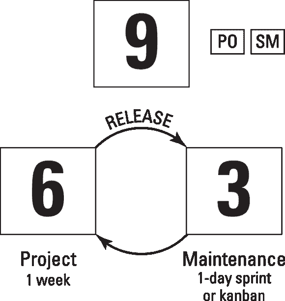

图 11-1: 运营支持 Scrum 团队模型。

例如，对于一个九名开发者的 Scrum 团队，我们将开发团队分为两个团队，一个六个开发者，另一个三个开发者。（这些数字是灵活的。）六人团队根据第 7 章到第 10 章所述，在一到两周的迭代刺内从产品待办列表中进行新的开发项目工作。他们在迭代刺计划会议期间承诺的工作将是他们唯一的工作。

三人团队是我们的“消防员”，在一天迭代刺或通过使用看板（kanban）进行维护和支持工作。（你可以在[第 4 章](#09_9781119405696-ch04.xhtml）中学习看板。）单日迭代刺允许 Scrum 团队对前一天收到的所有请求进行分拣，计划优先级最高的项目，作为一个团队实施这些项目，并在当天结束（甚至更早）评审结果，以便在更改推送到生产环境之前获得通过或拒绝的批准。为了连续性，每个团队的产品负责人（product owner）和 Scrum 主管是同一个人。

 尽管新修改的项目开发团队比以前小，但仍然有足够的开发者来保持新开发工作的持续进行，不受维护工作的干扰。等到你开始向市场发布功能时，你的 Scrum 团队将配合良好，开发者将通过能够完成比项目刚开始时更多类型的任务而增加他们的通用性。

项目开发团队将定期发布到生产环境，例如每 90 天发布一次。在每次发布时，一名开发者将轮换到维护团队，携带有关部署到生产环境的功能的第一手知识。同时，一名维护团队的开发者将轮换到项目开发团队，配备在真实世界中支持产品的第一手知识。这种轮换在每次发布时持续。

 `开发运维 (DevOps)` 是软件开发人员与 IT 运营（包括系统管理和服务器维护等功能）之间的协作与集成。采用 DevOps 方法使开发人员和运维人员共同工作，缩短部署周期。

这种 DevOps 模型确保每个人都能进行新产品开发以及维护工作，并且产品知识在两个开发团队之间持续有效共享。这种方法改进了 DevOps 并方便了跨功能团队成员。它还减少了团队因成员变更而可能经历的任何干扰，因为轮换发生在每次发布时，而不是每天或每周。

在准备发布时，预先建立如何在生产环境中支持功能的预期，允许 Scrum 团队以一种方式开发产品，使团队在产品部署后能够有效地支持它。这增加了整个 Scrum 团队的所有权感，并提高了团队对长期成功的意识和投入。

## 为产品部署做准备

产品发布通常会影响公司或组织中的多个部门。为了让组织为新产品做好准备，产品负责人和 Scrum 主管需要将与组织相关的项目添加到`发布迭代刺待办列表（release sprint backlog）`中。（参见[第 8 章](#14_9781119405696-ch08.xhtml）如何创建迭代刺待办列表。）

发布迭代刺待办列表还应涵盖开发团队的活动。它还需要涵盖组织中 Scrum 团队之外小组执行的活动，以准备产品部署。这些部门可能包括：

- **营销**：与新产品相关的营销活动是否需要与产品同时启动？

- **销售**：是否有特定的客户需要了解该产品？新产品会导致销售额增加吗？

- **物流**：产品是包含包装或运输的实体物品吗？

- **产品支持**：客户服务小组是否拥有回答有关新产品问题所需的信息？当产品发布时客户问题增加时，该小组是否有足够的人手准备？

- **法律**：产品是否符合法律标准，包括定价、许可和正确的表述，以便向公众发布？

需要为产品发布做好准备的部门以及小组需要完成的特定任务会因组织而异。然而，发布成功的关键在于产品负责人和 Scrum 主管让正确的人参与，并确保这些人员清楚他们为了为功能发布做好准备需要做什么。

正如开发冲刺一样，在你的发布冲刺中，你可以有效地利用每日站会、冲刺评审会议和冲刺回顾，并让参与产品部署准备的部门同事加入。你甚至可以使用任务看板，例如我们在第 9 章中描述的那种。

在你的发布冲刺期间，你还需要在计划中包含另一个群体：产品客户。接下来的章节将讨论如何为你的产品做好市场准备工作。

## 为产品部署准备市场

产品所有者（Product Owner）负责与其他部门合作，以确保市场——现有客户和潜在客户——已为即将到来的发布做好了准备。营销或销售团队可能会领导这项工作；团队成员则依靠产品所有者及时提供发布日期以及将包含在发布中的功能信息。

 某些软件产品仅供内部员工使用。在本节中读到的某些内容对于内部应用程序（即仅在公司内部发布的应用程序）来说可能显得过头了。然而，这些许多步骤对于推广内部应用程序仍然是良好的指南。无论内部还是外部客户，为新产品做好准备都是产品成功的关键部分。

为了帮助客户准备就产品发布，产品所有者可能希望与不同团队合作以确保以下工作：

- **营销支持：** 无论你处理的是新产品还是现有产品的新功能，营销部门都应该利用新产品功能的兴奋感来帮助推广产品和组织。

- **客户测试：** 如果可能，与你的客户合作（有些人会使用焦点小组），从部分端用户那里获取关于产品的真实反馈。你的营销团队还可以利用这些反馈将其转化为证言，以便立即推广产品。

- **营销材料：** 组织的营销小组还负责准备促销广告计划，以及物理介质的包装。媒体材料（如新闻稿和提供给分析师的信息）需要准备就绪，营销和销售材料也是如此。

- **支持渠道：** 确保客户了解可用的支持渠道，以防他们对产品有疑问。

从客户的角度审查你发布冲刺待办列表上的任务。回想一下你在创建用户故事时使用的角色画像（Personas）。这些角色需要了解关于产品的什么吗？更新你的启动清单，增加对你角色画像所代表的客户有价值的项目。你可以在第 8 章中找到更多关于角色画像的信息。

最后，这一天来了——发布日。无论你在过程中扮演了什么角色，这都是你努力实现的一天。是时候庆祝了！

# 第 4 部分

# 敏捷管理

在本部分中……

- 有效应对范围的变化。

- 良好供应商和合同以确保成功。

- 监控并调整进度和预算。

- 自组织以优化通信。

- 检查并适应以提高质量并降低风险。

# 第 12 章

## 管理范围与采购

在本章中

 **了解敏捷项目中的范围管理有何不同**

 **使用敏捷流程管理范围和范围变更**

 **查看敏捷流程为采购带来的不同方法**

 **在敏捷项目中管理采购**

范围管理是每个项目的一部分。要创建一个产品，你必须理解基本的产品需求以及满足这些需求所需的工作。你需要在新需求出现时能够对范围变更进行优先级排序和管理。你必须验证完成的产品功能满足了客户的需求。

采购也是许多项目的一部分。如果你需要从组织外部寻求帮助来完成项目，你应该了解如何采购商品和服务。你将希望知道在项目期间如何与供应商团队协作。你还应该了解一些创建合同和不同成本结构的知识。

在本章中，你将了解到如何在敏捷项目中管理范围，并利用敏捷方法对知情变更的包容态度。你还将了解到如何管理商品和服务的采购，以便在敏捷项目中交付产品范围。首先，我们回顾传统的范围管理。

## 敏捷范围管理有何不同？

从历史上看，项目管理的很大一部分是范围管理。*产品范围*（Product scope）是产品包含的所有功能和需求。*项目范围*（Project scope）是创建产品所涉及的所有工作。

传统的项目管理将需求的变化视为前期规划失败的标志。然而，敏捷项目具有可变范围，以便项目团队能够立即且增量地吸收学习和反馈，并创建出更好的产品。《敏捷宣言》的签署者意识到范围的变化是自然且有益的。敏捷方法专门欢迎变化，并利用它做出更明智的决策和更有用的产品。

 如果你运行一个敏捷项目，由于你在此过程中没有学到任何东西导致需求没有变化，那就是失败。你的产品待办列表应该随着你从利益相关者和客户的反馈中学习而频繁变化。你在项目一开始并不知道一切。

 第 2 章详细介绍了《敏捷宣言》和 12 条敏捷原则。（如果你还没有查看那一章，现在请翻回去。我们等一下。）宣言和原则回答了“我们有多敏捷？”这个问题。你的项目方法支持宣言和原则的程度有助于确定你的方法有多敏捷。

与范围管理关系最大的敏捷原则如下：

1. 我们的首要任务是通过早期持续交付有价值的软件来满足客户。

2. 欢迎需求的变化，即使在开发后期。敏捷流程利用变化来赢得竞争优势。

3. 频繁交付可运行的软件，从几周到几个月不等，并倾向于较短的时间周期。

4. 简单性——最大化未完成工作的艺术——至关重要。

敏捷范围管理方法与传统的范围管理方法根本不同。考虑你在[表 12-1](#19_9781119405696-ch12.xhtml_c12-tbl-0001)中看到的差异。

| **传统方法的范围管理** | **敏捷方法的范围管理** |
| --- | --- |
| 项目团队尝试在项目初期识别并记录完整范围，此时团队对产品的了解最少。 | 产品所有者在项目初期收集高级需求，对将要实施的需求进行细分和进一步说明。随着团队对客户需求和项目现实的知识增长，在整个范围内收集并完善需求。 |
| 组织将需求阶段之后发生的范围变化视为负面的。 | 组织将变化视为项目推进过程中改进产品的积极方式。在项目后期，当你最了解产品时发生的变化往往是最有价值的变化。 |
| 项目经理在利益相关者签署需求后，会严格控制并阻碍变更。 | 变更管理是敏捷流程中固有的组成部分。在每个迭代（sprint）中，你都会评估范围并有机会包含新需求。产品负责人决定新需求的价值和优先级，并将这些需求添加到产品待办列表（product backlog）中。 |
| 变更成本随时间推移增加，而进行变更的能力在降低。 | 你最初固定了资源和进度。高优先的新功能并不一定会导致预算或进度延误；它们只是会将低优先级的功能推后。迭代开发允许在每个新迭代中进行变更。 |
| 项目经常包含*范围膨胀*（scope bloat），由于害怕项目中期发生变更而加入了不必要的产品功能。 | Scrum 团队通过考虑哪些功能能直接支持产品愿景、发布目标和迭代目标来确定范围。开发团队首先创建最有价值的功能，以确保它们被包含并尽快发布这些功能。价值较低的功能可能永远不会被创建，对于业务和客户在获得最高价值的功能后，这是可以接受的。 |

### 表格 12-1 传统与敏捷范围管理的对比

在敏捷项目的任何时间点，任何人——Scrum 团队、利益相关者或组织中任何有好主意的人——都可以确定新的产品需求。产品负责人决定新需求的价值和优先级，并根据这些需求相对于产品待办列表中的其他需求进行优先级排序。


传统项目管理有一个术语来描述在项目初始定义阶段之后发生变更的需求：`范围蔓延`（scope creep）。瀑布模型没有一种积极的方式在项目中期纳入变更，因此范围变更往往会导致瀑布项目进度和预算出现大问题。（有关瀑布工作方法的更多信息，请参阅第 1 章）。向经验丰富的项目经理提到“范围蔓延”，你甚至可能会看到他不禁发抖。

在每个迭代开始的迭代规划期间，Scrum 团队可以使用产品待办列表的优先级来帮助决定新需求是否应该是该迭代的一部分。低优先级的需求留在产品待办列表中以备后考虑。你可以在第 8 章中阅读关于迭代规划的介绍。

下一节将介绍如何在敏捷项目上管理范围。

## 管理敏捷范围

欢迎范围变更有助于你创建出最好的产品。然而，拥抱变更要求你理解当前的范围，并知道如何处理随之而来的更新。幸运的是，敏捷方法有简单直接的方法来管理新需求和现有需求：

- 产品负责人确保项目团队的其余成员（包括 Scrum 团队和项目利益相关者）清晰地理解项目的现有范围、产品愿景、当前发布目标和当前迭代目标。

- 产品负责人根据产品愿景、发布目标、迭代目标和现有需求，确定新需求的价值和优先级。

- 开发团队按照优先级顺序创建产品需求，以便首先发布产品中最重要的部分。

在接下来的章节中，你将了解到如何在敏捷项目的不同部分理解和传达范围。你将看到当新需求出现时如何评估优先级。你还将了解如何使用产品待办列表和其他敏捷产物来管理范围。

### 在整个项目范围内理解范围

在敏捷项目的每个阶段，Scrum 团队以不同的方式管理范围。查看整个项目范围管理的一种好方法是使用“价值路线图”（Roadmap to Value），该图在第 7 章中首次提出，并在[图 12-1](#19_9781119405696-ch12.xhtml_c12-fig-0001)中再次显示。

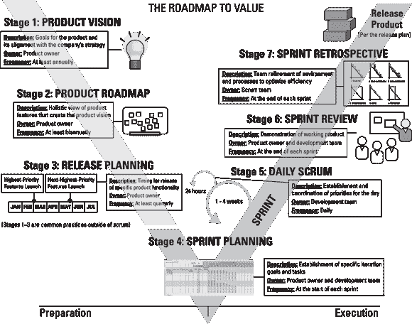

图 12-1: 价值路线图。

考虑价值路线图的每个部分：

- **阶段 1，产品愿景：** 产品愿景声明确立了产品将包含的功能外部边界，是建立项目范围的第一步。产品负责人负责确保项目团队的所有成员都了解产品愿景声明，并确保团队中的每个人都能正确解释该声明。

- **阶段 2，产品路线图：** 在创建产品路线图期间，产品负责人参考愿景声明，并确保功能支持愿景声明。随着新功能的出现，产品负责人需要理解它们，并能够向开发团队和利益相关者清晰地沟通这些功能的范围以及如何支持产品愿景。

- **阶段 3，发布规划：** 在发布规划期间，产品负责人需要确定一个发布目标——即计划在下次发布时上市的功能中期边界，并仅选择支持该发布目标的范围。

- **阶段 4，迭代规划：** 在迭代规划期间，产品负责人需要确保 Scrum 团队理解发布目标，并根据该发布目标规划每个迭代目标——即迭代结束时可能交付的功能即时边界。产品负责人和开发团队仅选择支持迭代目标的范围作为迭代的一部分。产品负责人还将确保开发团队理解迭代所选的单个用户故事（user stories）的范围。

- **阶段 5，每日站会（daily scrum）：** 每日站会可以是未来迭代范围变更的起点。每日站会是开发团队的一个专注 15 分钟的会议，说明三件事：前一天完成的工作、未来一天的工作范围以及开发团队可能遇到的任何障碍。然而，每日站会的三个主题往往揭示了更大的范围变更机会。


当出现比每日站会规定的格式允许更大讨论的话题时，Scrum 团队可以决定召开会后会议（after-party）。在会后会议中，Scrum 团队成员讨论影响实现迭代目标的问题。如果在迭代期间发现了新功能——即新范围的机会，产品负责人将对其评估，并可能将其添加到产品待办列表中，供未来迭代进行排序。

**阶段 6，迭代回顾（sprint review）：** 产品负责人通过重申迭代范围设定每次迭代回顾会议的基调，即团队所追求的迭代目标以及完成的内容。特别是在第一次回顾期间，确保与会的利益相关者对范围有正确的预期是重要的。

迭代回顾可以激发灵感。当整个项目团队聚集在一个房间内与运行中的产品交互时，成员可能会以新的角度看待产品，并提出改进产品的想法。产品负责人根据迭代回顾中收到的反馈更新产品待办列表中的新范围。

**第 7 阶段，冲刺回顾：** 在冲刺回顾会议中，Scrum 团队成员可以讨论他们从多大程度上实现了冲刺开始时做出的范围承诺。如果开发团队未能实现冲刺计划期间确定的冲刺目标，其成员将需要完善计划和工作流程，以确保他们为每个冲刺选择恰当的工作量。如果开发团队实现了目标，则可以利用冲刺回顾会议提出在未来冲刺中增加更多范围的方法。Scrum 团队的目标是在每个冲刺中提高生产力。

## 引入范围变更

许多人，甚至是组织之外的人，都可以对敏捷项目提出新的产品功能。你可能会看到来自以下方面的新功能想法：

- 用户社区反馈，包括获得预览产品机会的组或个人
- 看到新市场机会或威胁的业务利益相关者
- 对长期组织战略和变化有洞察力的执行官和高级经理
- 开发团队，他们每天对产品有更多了解，并且离运行中的产品最近
- Scrum Master，他们在与外部部门合作或清除开发团队障碍时可能会发现机会
- 产品所有者，他们通常对产品和利益相关者的需求最了解

由于你在整个敏捷项目过程中都会收到产品变更的建议，因此你需要确定哪些变更是有效的并管理这些更新。继续阅读了解如何操作。

## 管理范围变更

当你获得新需求时，使用以下步骤来评估、对需求进行优先级排序并更新产品待办列表（product backlog）。

 不要向已经在进行中的冲刺中添加新需求，除非开发团队提出了请求（通常是因为意料之外的容量增加）。

1. **通过对需求提出一些关键问题，评估新需求是否应该成为产品、发布版本或冲刺的一部分：**

   1. *该新需求是否支持产品愿景声明？*
      - 如果是，将该需求添加到产品待办列表和产品路线图中。
      - 如果否，则该需求不应成为该项目的一部分。它可能是独立项目的良好候选。

   2. *如果该新需求支持产品愿景，那么该新需求是否支持当前的发布目标？*
      - 如果是，则该需求是当前发布计划的候选者。
      - 如果否，将该需求留在产品待办列表中以备未来的发布使用。

   3. *如果该新需求支持发布目标，那么该新需求是否支持当前的冲刺目标？*
      - 如果是且冲刺尚未开始，则该需求是当前冲刺待办列表的候选者。
      - 如果否或冲刺已经开始（或两者如此），则将该需求留在产品待办列表中以备未来的冲刺。

2. **估计新需求的工作量。**

   由开发团队估计工作量。在第 7 章中查找如何估计需求。

3. **根据优先级对比产品待办列表中的其他需求进行排序，并将新需求添加到产品待办列表中。**

   考虑以下因素：

   - 产品所有者对产品的业务需求以及新需求相对于其他需求的重要性最了解。产品所有者还可能联系项目利益相关者，以获得有关需求优先级的额外洞察。
   - 开发团队可能也对新需求的优先级有技术上的见解。例如，如果`Requirement A`和`Requirement B`具有相同的业务价值，但你需要完成`Requirement B`才能使`Requirement A`可行，则开发团队需要提醒产品所有者。`Requirement B`可能需要先完成。
   - 尽管开发团队和项目利益相关者可以提供帮助确定需求优先级的信息，但确定优先级最终是产品所有者的决定。
   - 向产品待办列表添加新需求可能意味着产品待办列表中的其他需求会后移。图 12-2 显示了在产品待办列表中添加新需求。

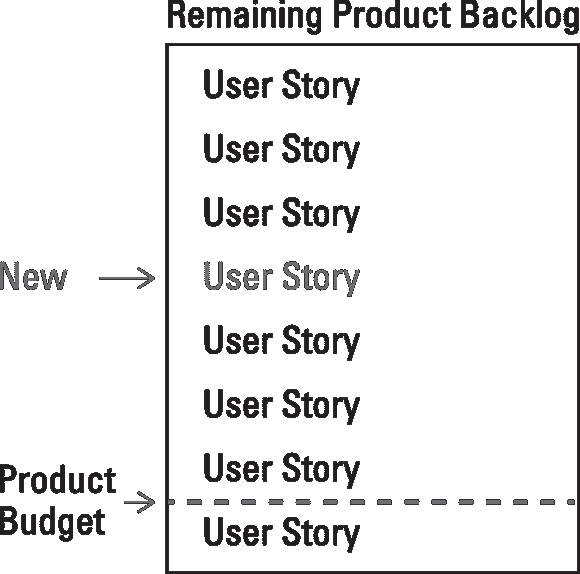

图 12-2：向产品待办列表添加新需求。

产品待办列表是产品所有已知范围的完整列表，是你管理敏捷项目范围变更最重要的工具。保持产品待办列表更新将允许你快速进行优先级排序并添加新需求。有了当前的产品待办列表，你始终了解项目剩余的范围。第 7 章提供了更多关于需求优先级排序的信息。

## 使用敏捷交付物进行范围管理

从愿景声明到冲刺计划，敏捷项目管理中的所有交付物都支持你的范围管理工作。随着功能升至优先级列表的顶端，逐步分解（或拆分）需求。我们在第 7 章中讨论了需求的分解和逐步演化。

表 12-2 揭示了每个敏捷交付物（包括产品待办列表）如何有助于持续的精炼。

| **交付物** | **在建立范围中的作用** | **在范围变更中的作用** |
| --- | --- | --- |
| **愿景声明：** 产品的终极目标。第 7 章有更多关于愿景声明的信息。 | 使用愿景声明作为判断功能是否属于范围的标准。 | 当引入新需求时，这些需求必须支持愿景声明。 |
| **产品路线图：** 创建产品愿景的功能整体视图。第 7 章有更多关于产品路线图的信息。 | 产品范围是路线图的一部分。功能级的需求有助于关于实现愿景的业务对话。 | 随着新需求的出现更新路线图。路线图提供了新功能纳入项目的可视化沟通。 |
| **发布计划：** 围绕最小市场化功能集合的中目标。第 8 章有更多关于发布计划的信息。 | 发布计划显示了当前版本的范围。你可能希望按主题（逻辑分组）来规划发布。 | 将属于当前发布的新功能添加到发布计划。如果新用户故事不属于当前发布，则将其留在产品待办列表中以备未来发布。 |
| **产品待办列表：** 产品所有已知范围的完整列表。第 7 章和第 8 章提供了更多关于产品待办列表的信息。 | 如果需求属于产品愿景范围，它就是产品待办列表的一部分。 | 产品待办列表包含了所有的范围变更。新的高优先级功能会将低优先级功能推后。 |
| **冲刺待办列表：** 当前冲刺范围的用户故事和任务。第 8 章有更多关于冲刺待办列表的信息。 | 冲刺待办列表包含了当前冲刺范围的用户故事。 | 冲刺待办列表建立了冲刺中允许的内容。在开发团队在冲刺计划会议上承诺冲刺目标后，只有开发团队可以修改冲刺待办列表。 |

# 敏捷交付物与范围管理角色

## 敏捷采购的不同之处

项目管理的另一部分是`采购`，即管理交付产品范围所需的服务或商品购买。与范围一样，采购是项目投资端的一部分。

第 2 章解释了《敏捷宣言》的价值在于`客户合作优于合同谈判`。这为敏捷项目中的采购关系奠定了重要的基调。

重视客户合作优于合同谈判，并不意味着敏捷项目没有合同：合同和谈判对于业务关系至关重要。然而，《敏捷宣言》提出了一个观点，即买方和卖方应该通力创造产品，双方之间的关系比纠结于信息不全的细节以及勾选那些最终对客户可能有用也可能无价值的合同条款更为重要。

所有 12 条敏捷原则都适用于敏捷项目中的采购。然而，在为敏捷项目获取货物和服务时，以下原则似乎尤为突出：

1. 欢迎需求的变化，即使在开发后期也是如此。敏捷流程利用变化来为客户赢得竞争优势。
2. 频繁交付运行的软件，周期从几周到几个月不等，并倾向于更短的时间范围。
3. 业务人员和开发人员在项目过程中必须每天工作。
4. 围绕积极主动的个人构建项目。给予他们所需的环境和支持，并信任他们能够完成工作。
5. 简单性——最大化未完成工作量的艺术——至关重要。
6. 最佳架构、需求和设计源于自组织团队。

表 12-3 突出了传统项目采购与敏捷项目采购之间的差异。

| 传统方法的采购管理 | 敏捷方法的采购管理 |
| :--- | --- |
| 项目经理和组织负责采购活动。 | 自管理开发团队在识别需要采购的物品方面发挥着更大的作用。`scrum master`协助为开发团队获取所需的物品。 |
| 与服务提供者的合同通常包含固定需求、详尽文档、完整的项目计划以及基于瀑布生命周期的其他传统交付物。 | 敏捷项目的合同基于对每个`sprint`结束时运行功能的评估，而不是基于可能有助于交付高质量产品的固定交付物和文档。 |
| 买方和卖方之间的合同谈判有时具有挑战性。由于谈判通常是一项压力巨大的活动，它在项目工作开始之前就会损害买方和卖方之间的关系。 | 敏捷项目团队专注于从采购过程开始就保持买卖双方之间积极、合作的关系。 |
| 项目开始后更换供应商可能代价高昂且耗时，因为新供应商必须尝试理解旧供应商正在进行的大量工作。 | 供应商在每个`sprint`结束时提供完成的、运行的功能。如果供应商在项目途中更换，新供应商可以立即开始开发下一个`sprint`的需求，避免漫长且昂贵的过渡。 |

TABLE 12-3 传统与敏捷采购管理

 瀑布式和敏捷项目团队都关注供应商的成功。传统项目方法在合规性责任方面非常严格，将成功定义为勾选列表中的文档和交付物。相比之下，敏捷项目方法对最终结果的责任非常严格，将成功定义为运行的功能。

下一节将展示如何在敏捷项目上管理采购。

## 管理敏捷采购

本节重点关注敏捷项目团队如何经历采购过程：从确定需求、选择供应商，到通过与供应商合作创建合同，以及在买卖双方项目结束时完成合同。

### 确定需求并选择供应商

在敏捷项目中，当开发团队决定他们需要某种工具或第三方的服务来创建产品时，采购就开始了。

 敏捷项目开发团队是自管理和自组织的，他们可以做出关于什么最有利于最大化开发产出的决策。自管理适用于所有项目管理领域，包括采购。在第 6 章和第 14 章中了解更多关于自管理团队的信息。

开发团队有许多机会考虑外部货物和服务：

- **产品愿景阶段：** 开发团队可能开始考虑帮助实现产品愿景所需的工具和技能。在这个阶段，研究需求可能是明智的，但可能不必开始购买流程。
- **产品路线图阶段：** 开发团队开始看到要创建的特定功能，并可能知道某些有助于创建产品所需的货物和服务。
- **发布计划：** 开发团队对产品有更多了解，并识别出有助于满足下一次发布目标的特定货物和服务。
- **Sprint 计划：** 开发团队正处于开发一线，可能会识别出`sprint`的紧迫需求。
- **每日站会 (Daily scrum)：** 开发团队成员说明阻碍。采购货物或服务可能有助于消除这些阻碍。
- **全天候：** 开发团队成员之间相互交流并协作完成任务。开发团队的对话可能会产生特定的需求。
- **Sprint 评审会议：** 项目利益相关者可能会为未来的 sprint 识别新需求，从而采购货物或服务。
- **Sprint 回顾会议：** 开发团队可能会讨论某个特定工具或服务如何能帮助过去的 sprint，并对未来的 sprint 提出购买建议。

 有时你可以在组织内部找到项目所需的货物或服务。在购买物品或与供应商合作之前，`scrum master`会确定内部是否有所需的工具或具备开发团队所需技能的人员。如果内部资源或人员满足开发团队的需求，敏捷团队就能节省费用。

在开发团队确定需要某种商品或服务后，开发团队和`scrum master`与产品负责人合作获取任何必要的资金。产品负责人负责管理项目范围与项目预算，因此产品负责人对任何项目采购负责。在与供应商启动采购后，`scrum master`通常代表敏捷团队管理供应商关系。

在采购货物时，开发团队可能需要在决定购买之前比较工具和供应商。在采购货物时，一旦确定了买什么以及从哪里获得，过程通常很简单：购买并交付。

采购服务通常比购买货物的过程长、更复杂。选择服务供应商时，一些敏捷特定的考虑因素包括：

- 供应商是否能够在敏捷项目环境中工作，如果是，供应商在敏捷项目方面有多少经验
- 供应商是否能够与开发团队进行现场协作
- 供应商与 Scrum 团队之间的关系是否可能是积极且具有协作性的

 你所属的组织或公司可能受到选择供应商相关法律法规限制。例如，参与政府工作的公司通常需要对超过特定金额的工作从多家公司收集多份提案和竞标方案。尽管你的表表或大学同学可能可能是完成这项工作最合适的人选，但如果你不遵守相关法律，就可能会遇到麻烦。如果你对如何简化冗余流程有疑问，请咨询你公司的法务部门。

在选择好服务供应商后，你需要创建一份合同，以便供应商开始工作。接下来的部分将解释合同在敏捷项目中是如何运作的。

### 了解服务的成本方法和合同

在开发团队和产品负责人（Product Owner）选择好供应商之后，他们需要一份合同来确保对服务和定价达成共识。为了启动合同流程，你应该了解不同的定价结构以及它们在敏捷项目中如何运作。在理解这些方法后，你将看到如何创建合同。

### 成本结构

在为敏捷项目采购服务时，了解`fixed-price`（固定价格）项目、`fixed-time`（固定时间）项目、`time-and-materials`（工时材料）项目和`not-to-exceed`（封顶）项目之间的区别是非常重要的。每种方法在敏捷环境下都有自己的优势：

- **固定价格项目（Fixed-price project）：** 从设定预算开始。在固定价格项目中，供应商负责产品并创建发布，直到供应商耗尽预算中的所有资金，或者你交付了足够的产品功能，以先者为准。

  例如，如果你有 250,000 美元的预算，而供应商的成本为每周 10,000 美元，供应商的项目部分可以持续 25 周。在这 25 周内，供应商将创建并发布尽可能的可交付功能。

- **固定时间项目（Fixed-time project）：** 有特定的截止日期。例如，你可能需要在下一次假期期间、为了某个特定活动或为了配合另一个产品的发布按时推出产品。在固定时间项目中，你根据供应商团队在项目持续期间的成本以及任何额外的资源成本（如硬件或软件）来确定成本。

- **工时材料项目（Time-and-materials project）：** 比固定价格或固定时间项目更灵活。在工时材料项目中，你与供应商的合作持续到完成足够的产品功能，而不考虑项目总成本。在项目结束时，当利益相关者确定产品具有足够的功能可以结束项目后，你才知道项目的总成本。

  例如，假设你的项目每周成本为 10,000 美元。20 周后，利益相关者认为他们有了足够的价值产品功能，因此你的项目成本为 200,000 美元。如果利益相关者认为在 10 周末获得了足够的价值，则项目成本为该金额的一半，即 100,000 美元。

- **封顶项目（Not-to-exceed project）：** 即时间和材料有固定价格上限的项目。

 无论采用何种成本方法，在敏捷项目中，都要专注于首先完成最高价值的产品功能。

### 合同创建

在了解项目的成本方法后，Scrum Master 可能会帮助创建合同。合同是买方和卖方之间具有法律约束力的协议，对工作和支付设定了预期。

负责创建合同的人员因组织而异。在某些情况下，法务或采购部门的人员起草合同，然后要求 Scrum Master 进行评审。在其他情况下，情况则相反：Scrum Master 起草合同并让法务或采购专家进行评审。

无论由谁创建合同，Scrum Master 通常代表 Scrum 团队执行以下任何操作：启动合同创建、谈判合同细节，以及将合同提交任何必要的内部审批。

这种重视协作重于谈判的敏捷方法是维护良好关系的关键。在创建和谈判合同期间，Scrum Master 通常代表 Scrum 团队，并与供应商保持紧密且频繁的沟通。

 敏捷宣言`并未`规定合同是必要的。无论你的公司或组织规模如何，为供应商创建合同都是非常好的主意。跳过合同会让买卖对预期和未完成的工作产生困惑。

至少大多数合同都会包含关于双方、工作、预算的法律条款。敏捷项目的合同可能还会包括内容：

- **对供应商将完成的工作的描述：** 供应商可能有自己的产品愿景说明，这可以作为描述工作的良好起点。你可以参考第 7 章。
- **供应商可能使用的敏捷方法：** 包括：
  - 供应商将参加的会议，例如每日站会、计划会议、评审会议和回顾会议
  - 每个 Sprint 结束时交付的可工作功能
  - 完成定义（Definition of Done，见第 9 章）：根据产品负责人、开发团队和 Scrum Master 的约定，经过开发、测试、集成和记录的工作
  - 供应商将提供的交付物，例如带有燃尽图的 Sprint 待办列表
  - 供应商将参与项目的人员，例如开发团队
  - 供应商的工作地点，例如在在你的公司现场
  - 供应商将是与自己的 Scrum Master 和产品负责人合作，还是与你的 Scrum Master 和产品负责人合作
  - 对构成合作结束的定义：固定预算或固定时间的结束，或者足够完整的工作功能
- **对于不使用敏捷方法的供应商，描述其及其工作如何与买方的开发团队和 Sprint 集成。**

这并不是一个清单；合同条款随项目和组织而异。

在最终版本完成之前，合同可能会经过几次评审和修改。在创建合同时，清晰沟通变更并维护良好关系的一种方法是在每次提议更改时都与供应商交流。如果你通过电子邮件发送修订后的合同，请跟进电话解释你更改了什么以及为什么，回答任何问题，并讨论任何进一步修改的建议。开放讨论有助于合同过程保持积极。

如果在合同谈判期间，供应商的服务发生了任何重大变化，让产品负责人或 Scrum Master 与开发团队一起评审这些变更。开发团队特别需要了解并就供应商提供的服务、其方法以及团队的人员提供意见。


 你的公司和供应商很可能需要各自项目团队之外的人员进行评审和批准。审核合同的人可能包括高层经理或执行、采购专家、会计人员以及公司法务。这因组织而异；`scrum master` 需要确保任何需要阅读合同的人都能阅读到。

现在你已经了解了一部分关于如何选择供应商和创建合同，是时候看看不同公司和组织之间采购的差异了。

## 采购的组织考量

贵公司处理采购的方式将影响你选择供应商以及创建和谈判合同的方法。由于采购涉及资金和法律合同，采购程序和决策有时超出了项目团队的控制范围。对采购活动的考量因素可能包括以下方面：

*   **公司或组织的规模和经验：** 较小和较新的公司正式化程度较低，在采购方面有更大的自主权。较大且更成熟的公司在采购方面往往会有更多的开销。有些公司设有专门部门，由全职人员负责采购。

*   **公司或组织类型：** 某些组织（如政府机构）在法律要求完成特定的采购流程和文件。由于上市公司法律的差异，私营公司在采购方面的限制可能比上市公司少。

*   **公司或组织文化：** 许多组织会让项目团队参与采购决策。然而，情况并非总是如此，项目团队有时会发现自己正在与他们未参与选择的商品或服务提供商合作。有些公司相当非正式，采购不需要过多的文档或流程。另一些公司则需要文件来证明对商品或服务的必要性、需要卖方的正式提案，并在采购的每一步都要经过多次批准。

如果你在一个具有复杂采购流程和独立采购部门的组织中开展敏捷项目，你必须平衡这些流程与敏捷流程。在采购过程中确保敏捷流程的一种良好方法是让 `scrum master` 与采购部门的工作紧密合作。

在第 6 章中，我们提到 `scrum master` 确保组织遵循敏捷实践和原则。在这个角色上，`scrum master` 帮助向采购专家解释敏捷的采购方法。`scrum master` 可能会发现帮助调整组织需求以支持敏捷流程是值得的。

 `scrum master` 确保采购人员理解为什么合同可能需要适应不断变化和迭代。`scrum master` 为合同创建过程奠定基调，使其具有协作性。

如果敏捷项目团队得到了组织高层的支持，那么将敏捷方法融入到组织的采购流程中通常会更容易。

 为将敏捷方法引入组织采购流程寻求支持的一种良好方法，是确保高层理解敏捷方法如何使敏捷团队和组织能够更频繁地交付更高的客户价值。诸如更好的产品质量、降低风险以及对项目性能更多的控制和可见性等优势，为在与供应商合作时使用敏捷流程提供了有力的论据。第 19 章提供了敏捷项目管理的关键优势列表。

采购流程简单或没有流程的组织为敏捷项目带来了不同的挑战——或者说对于任何项目都是如此。`Scrum masters` 可能会发现自己正在从零开始采购活动，几乎没有先例或支持。

 签署合同的人应该拥有为公司做出财务决策的权限，他们通常是执行级的人员。`Scrum masters` 和 `product owners` 通常没有这种权限。如有疑问，请多加询问。找到正确的签字人。

在你选定供应商并签署了合同后，供应商就可以开始工作了。在下一节中，你会看到，像初始采购流程一样，与供应商合作对于敏捷项目来说也有特殊的考量。

## 与供应商合作

在敏捷项目中如何与供应商合作，在一定取决于供应商团队的结构。在理想情况下，供应商团队与买方组织完全集成。供应商团队的成员与买方的 `scrum team` 同地办公。供应商团队成员将作为买方开发团队的一部分工作，直到需要为止。

 一些开发会将供应商团队成员包含在他们的每日站会（daily scrum）中。这是了解供应商团队每天做什么的好方法，并帮助开发团队与供应商更紧密地合作。你还可以邀请供应商参加你的冲刺评审（sprint reviews），让他们了解你的进展。

供应商团队也可以是集成但异地工作的。如果供应商无法在买方公司现场工作，它仍然可以是买方 `scrum team` 的一部分。第 14 章提供了关于敏捷项目团队动态的更多信息。

如果供应商无法同地办公，或者供应商负责产品某个特定的、独立的部分，供应商可能会有一个独立的 `scrum team`。供应商的 `scrum team` 与买方的 `scrum team` 执行相同的冲刺计划（sprint schedule）。查看第 13 章中的“管理异地团队的项目”章节获取与非敏捷团队合作的信息。

供应商提供的服务可能是持续一段时间，或者是整个项目周期。在供应商的工作完成后，合同即关闭。

### 关闭合同

在供应商完成合同工作后，买方的 `scrum master` 通常会有一些收尾工作来关闭合同。

如果项目根据合同条款正常结束，`scrum master` 可能希望以书面形式确认结束。如果项目是按时计费的项目（time-and-materials），`scrum master` 应该以书面形式终止，以确保供应商不会继续处理低优先级的需求并为此收费。

根据组织结构和合同的成本结构，`scrum master` 可能负责在工作完成后通知买方公司的会计部门，以确保供应商获得正确的报酬。

 以积极的方式结束合作。如果供应商表现良好，敏捷团队（scrum team）可能希望在迭代回顾会议（sprint reviews）上对供应商团队的人员表示认可。项目中的每个人都有可能再次合作工作，一个简单、诚挚的“谢谢”有助于为未来的项目保持良好关系。

# 第 13 章：管理时间与成本

## 本章内容

*  理解敏捷项目中时间管理的独特之处

*  了解如何在敏捷项目中管理时间

*  识别敏捷项目与成本管理的不同之处

*  了解如何在敏捷项目中管理成本

管理项目时间和控制项目成本是项目管理的关键侧方面。在本章中，你将看到敏捷的时间和成本管理处理方法。你将了解到如何利用敏捷团队的开发速度来确定特定项目的时间和成本，以及如何通过提高开发速度来降低项目的时间和成本。

## 敏捷时间管理有什么不同？

在项目管理术语中，`time` 指确保项目按时完成的过程。为了理解敏捷时间管理，回顾一下我们在第 2 章中讨论的某些敏捷原则会有帮助：

1. 我们的首要任务是通过早期和持续交付有价值的软件来满足客户。

2. 欢迎需求的变化，即使在开发后期也是如此。敏捷流程利用变化为客户赢得竞争优势。

3. 频繁地交付可行的软件，周期从几周到几个月不等，并倾向于更短的时间尺度。

4. 敏捷流程促进可持续开发。赞助者、开发者和用户应该能够无限保持恒工作的节奏。

表 13-1 显示了传统项目与敏捷项目时间管理之间的一些区别。

| 传统方法的时间管理 | 敏捷方法的时间管理 |

| --- | --- |

| 固定范围直接驱动进度。 | 敏捷项目的范围不是固定的。时间可以是固定的，开发团队可以创建适应特定时间框架的需求。 |

| 项目经理根据项目开始时收集的需求来确定时间。 | 在项目期间，敏捷团队会评估并重新评估他们在给定时间框架内可以完成多少工作。 |

| 团队分阶段一次性处理所有项目需求，例如需求收集、设计、开发、测试和部署。关键需求和可选需求之间没有进度差异。 | 敏捷团队以迭代（sprints）为形式工作，并首先完成最高优先级、最高价值需求的所有工作。 |

| 团队在项目后期（即在需求收集和设计阶段完成后）才开始实际的产品开发。 | 敏捷团队从第一次迭代就开始开始产品开发。 |

| 传统项目的时间更具变动性。 | 敏捷项目中的时间箱迭代（Timeboxed sprints）保持稳定，实现了可预测性。 |

| 项目经理在项目开始时尝试预测进度，此时他们对产品了解很少。 | 敏捷团队根据迭代中的实际开发表现来确定长期进度。随着对产品和开发团队速度（即 `velocity`）的不断了解，敏捷团队在整个项目过程中调整时间估算。你将在本章稍后部分了解到更多关于速度的信息。 |

表 13-1 传统与敏捷时间管理

 使用敏捷技术，固定进度和固定价格项目的风险较低，因为敏捷开发团队总能在时间或预算限制内交付最高优先的功能。

敏捷时间管理技术的一个大优势是，敏捷项目团队交付产品的速度比传统项目团队快得多。例如，更早开始开发并在迭代中完成功能，通常让与我们 Platinum Edge 公司合作的敏捷项目团队快 30% 到 40% 向市场带来价值。

 敏捷项目更早完成的原因并不复杂；他们只是更早地开始了开发。

在下一节中，了解如何在敏捷项目中管理时间。

## 管理敏捷进度

敏捷实践支持战略性和战术性的进度及时间管理：

* 你的早期规划在本质上是战略性的。产品路线图和产品待办列表（product backlog）中的高级需求可以帮助你获得整体进度的早期想法。在第 7 章中了解如何创建产品路线图和产品待办列表。

* 你对每个版本和每次迭代的详细规划是战术性的。在第 8 章中阅读更多关于发布规划和迭代规划的内容。

    * 在发布规划阶段，你可以计划在特定日期发布发布，并包含最少的可销售功能。

    * 你也可以计划发布，留出足够的时间创建一个特定的功能集。

    * 在每次迭代规划会议期间，除了选择迭代范围外，开发团队还会估算完成该迭代中每个需求的各个任务所需（以小时为单位）。使用迭代待办列表（sprint backlog）来管理整个迭代期间详细的时间分配。

* 在项目进行后，使用敏捷团队的 `velocity`（开发速度）来微调你的进度安排。我们下一节中讨论速度。

 在第 8 章中，我们描述了为最小的可销售功能进行发布规划，这组最小的产品功能提供了足够的价值，让你可以在市场上有效地对其进行部署和推广。

### 引入速度 (velocity)

敏捷项目时间管理中最重要的事情之一是使用速度，这是一个预测长期时间线的强大工具。在敏捷术语中，`velocity` 是开发团队的工作速度。在第 7 章中，我们描述了如何用故事点（story points）衡量需求或用户故事的工作量。你通过开发团队在每次迭代中完成的用户故事点数来衡量速度。

 用户故事是对产品需求的简单描述，识别了需求必须完成什么以及为谁完成。用户故事点是相对数字，描述了开发用户故事所需的投入量。第 8 章深入探讨了创建用户故事和使用故事点估算工作量的细节。

当你知道开发团队的速度时，你可以将其作为长期规划工具。速度可以帮助你预测敏捷团队完成特定数量需求需要多久，以及项目可能花费多少成本。

在下一节中，你将深入研究作为时间管理工具的速度。你看到范围变化如何影响敏捷项目的时间线。你还将了解如何与多个敏捷团队协作并审查用于时间管理的敏捷产物。

### 监控和调整速度

项目启动后，Scrum 团队开始监控其速率（velocity）。你从一个冲刺（sprint）到另一个冲刺测量速率。你将速率用于长期进度和预算规划，以及冲刺计划。

通常情况下，人们擅长短期的规划和估算，因此为即将到来的冲刺确定任务所需的小时数效果良好。与此同时，人们在用绝对术语（如小时）来估算远期任务时通常表现得很糟糕。基于表现的相对估算和速率等工具，是长期规划中更准确的衡量方法。

速率是一个很好的趋势工具。你可以利用它来确定未来的时间线，因为每个冲刺内的活动和开发时间在不同冲刺之间是相同的。

 速率是冲刺后的事实，而不是目标。避免在项目启动前或冲刺期间尝试猜测或承诺特定的速率。否则你只会对团队能完成多少工作产生不切实际的预期。如果速率变成了一个目标而不是过去的测量值，Scrum 团队可能会试图夸大估算的故事点（story points）以达到该目标，从而使速率失去意义。相反，请使用 Scrum 团队的实际速率来预测项目可能还需要多长时间和多少成本。还要关注通过消除冲刺期间和冲刺回顾中识别出的限制来增加速率。

在下一节中，你将看到如何计算速率、如何使用速率预测项目进度，以及如何增加你 Scrum 团队的速率。

### 计算速率

在每个冲刺结束时，Scrum 团队查看其已完成的需要，并相加与这些需求相关的故事点数。完成的故事点总数就是该 Scrum 团队在该冲刺的速率。在经过最初几个冲刺后，你将开始看到趋势，并能够计算平均速率。

 由于速率是一个数字，经理和高管可能会试图将速率作为绩效指标，用于团队的薪酬和比较。速率不是绩效指标，它是团队特有的，且不应在 Scrum 团队之外使用。它仅仅是 Scrum 团队用于预测剩余工作的一种规划工具。

`平均速率`（average velocity）是完成的故事点总数除以已完成的冲刺总数。例如，如果开发团队的速率为：

*   冲刺 1 = 15 点

*   冲刺 2 = 13 点

*   冲刺 3 = 16 点

*   冲刺 4 = 20 点

你完成的故事点总数将是 `64`。你的平均速率将是 `16`：64 个故事点除以 4 个冲刺。

在你运行完一个冲刺并知道 Scrum 团队的速率后，你就可以开始预测项目的剩余时间。

### 使用速率估计项目时间线

当你知道自己的速率时，就可以确定项目将持续多久。按照以下步骤操作：

1.  **累加产品待办列表（product backlog）中剩余需求的故事点总数。**

2.  **通过将产品待办列表中剩余的故事点数除以速率，确定你需要的冲刺次数：**

    *   要获得悲观估算，请使用开发团队实现的最低速率。

    *   要获得乐观估算，请使用开发团队实现的最高速率。

    *   要获得最可能的估算，请使用开发团队实现的平均速率。

 通过使用这些经验数据——实际输出速度——产品负责人（product owner）可以为利益相关者提供范围内的发布结果，他们可以合作在项目早期做出业务优先级排序决策。这些决策可能包括是否需要增加额外的 Scrum 团队来开发更多范围项、调整市场发布日期或请求项目预算。

3.  **通过将冲刺长度乘以剩余冲刺的次数，确定完成产品待办列表中的故事点所需的时间。**

例如，假设：

*   你的剩余产品待办列表包含 800 个故事点。

*   你的开发团队速率平均每个冲刺 20 个故事点。

你的产品待办列表还需要多少个冲刺？将故事点数除以你的速率，即可得到剩余冲刺次数。在这种情况下，`800/20 = 40`。

如果你在项目中使用`两周一个冲刺`，那么你的项目将持续 80 周。

在 Scrum 团队知道其速率和需求的故事点数后，你可以使用速率来确定创建任何一组需求需要多久。例如：

*   如果你对将进入该次发布的故事点数有大致了解，你就可以计算出单次发布可能需要的时间。在发布层级，你的故事点估算将比冲刺级别更宏观。如果你是基于交付特定功能来确定发布时间，那么你的发布日期可能会随着你在整个项目中精炼用户故事和估算而变化。

*   你可以通过使用该组用户故事的故事点数（例如所有高优先级故事或所有与特定主题相关的故事），来计算完成特定组用户故事所需的时间。

速率在不同冲刺之间存在差异。在项目初期的几个冲刺中，速率通常较低。随着项目的进行，速率应该增加，因为团队对产品有了更多了解并在协作方面变得更加成熟。特定冲刺内的故障可能会暂时降低速率，但冲刺回顾等敏捷流程可以帮助团队确保这些故障是暂时的。

 在项目开始时，速率在不同冲刺之间波动很大。只要 Scrum 团队成员保持稳定，速率随时间会变得更加稳定。

Scrum 团队也可以整个项目中增加速率，从而缩短项目并降低成本。在下一节中，你将找到增加每个冲刺速率的方法。

### 增加速率

如果一个 Scrum 团队拥有包含 800 个故事点的待办列表，且平均速率为每个冲刺 20 个故事点，那么项目将持续 40 个冲刺——如果两周一个冲刺，则为 80 周。但如果 Scrum 团队可以增加其速率呢？

*   将平均速率增加到每个冲刺 23 个故事点将意味着 `34.78` 个冲刺。如果你向上取整为 35 个冲刺，同一个项目将持续 70 周。

*   平均速率 26 将大约 `31` 个冲刺，即 62 周。

*   平均速率 31 将大约 `26` 个冲刺，即 52 周。

如你所见，增加速率可以节省大量时间，从而节省金钱。

速率可以随着每个冲刺自然增加，因为 Scrum 团队找到了他们项目协作的节奏。然而，在敏捷项目中也存在提高速率的机会，超越随时间增长的常见增长。Scrum 团队的每个人都为帮助后续冲刺获得更高的速率做出贡献：

*   **消除项目障碍：** 增加速率的一种方法是快速消除项目障碍（impediments）。障碍是任何阻碍开发团队成员满负能力工作的因素。根据定义，障碍会降低速率。及时清除障碍可以帮助 Scrum 团队充分发挥功能并提高效率，从而增加速率。有关消除项目障碍的更多信息请参阅[第 9 章](#15_9781119405696-ch09.xhtml)。

- **避免项目阻塞：** 提高速度的最佳方法是从策略上从源头上避免阻塞的方法。通过了解（或学习）你团队将合作的小组的流程和特定需求，你可以在阻塞出现之前就消除它们。

- **消除干扰：** 提高速度的另一种方法是敏捷大师（Scrum Master）保护开发团队免受干扰。通过确保人们不会向开发团队请求冲刺目标（Sprint Goal）之外的工作——即使是可能花费少量时间的任务——敏捷大师将能够帮助开发团队专注于本次冲刺。

   拥有一个专职的敏捷大师持续帮助敏捷团队消除障碍，将使速度不断提高。专职敏捷大师的价值是可量化的。

- **征求团队意见：** 最后，敏捷团队的每个人都可以在冲刺回顾会议上为增加冲刺速度提供建议。开发团队最了解自己的工作，可能有如何提高产出的想法。产品负责人（Product Owner）可能对需求有见解，可以帮助开发团队工作得更快。敏捷大师见过任何重复性的阻塞，并可以讨论如何从源头上防止这些阻塞。


 提高速度是有价值的，但请记住你可能不会一夜之间看到变化。敏捷团队的速度通常呈现出模式：缓慢增长、几次大幅跳跃、一段平期，然后再次缓慢增长，这是因为敏捷团队在识别、实验和修正阻碍它的约束。

## 保持一致性以获得有效速度

由于速度是根据故事点（Story Points）衡量的完成工作量，只有当你采用以下实践时，它才是项目性能的准确指标和预测依据：

- **一致的冲刺周期：** 在项目的生命周期内，每个冲刺的持续应该是相同的。如果冲刺周期不同，开发团队在每个冲刺中完成的工作量就会不同，速度在预测项目剩余时间时将失去参考价值。

- **一致的工作时间：** 开发团队的每个成员在每个冲刺中的工作小时应该相同。如果`Sandy`在一个冲刺中工作了`45`小时，另一个工作了`23`小时，又一个工作了`68`小时，那么她在每个冲刺完成的工作量自然不同。然而，如果`Sandy`在每个冲刺中工作相同的小时，那么她的速度在冲刺之间就是具有可比性的。

- **一致的开发团队成员：** 不同人的工作速度不同。`Tom`的速度可能比`Bob`快，所以如果`Tom`在一个冲刺中工作而`Bob`在下一个冲刺工作，那么`Tom`冲刺的速度就不是`Bob`冲刺的良好预测。

当冲刺周期、工作时间和团队成员在整个项目中保持一致时，你就可以利用速度来真正了解开发速度是在增加还是减少，并准确估计项目时间线。

 性能不会随可用时间线性扩展。例如，如果你有两个周一次的冲刺，每个冲刺`20`个故事点，改为三周一次冲刺并不保证会有`30`个故事点。新的冲刺周期将导致速度产生未知变化。

虽然改变冲刺周期会给敏捷团队的速度和预测引入波动，但我们很少阻止敏捷团队缩短冲刺周期（从三周减到两周，或从两周减到一周），因为更短的反馈周期允许敏捷团队更快地响应客户反馈，从而能够为客户交付更多价值。然而，改变冲刺周期始终伴随着同样的警惕：速度在反方向也不会线性扩展，敏捷团队必须在他们的预测再次变得可靠之前，为他们更短的冲刺建立新的速度。

当你知道如何准确衡量和增加速度时，你就有了一个管理项目时间和成本的强大工具。在下一节中，我们将讨论如何在不断变化的敏捷环境中管理时间线。

## 从时间角度管理范围变更

敏捷项目团队欢迎在项目的任何时候更改需求，这意味着项目范围反映了业务的真实优先级。这是纯粹的“需求达尔文主义”——开发团队优先完成优先级最高。固定的冲刺周期会淘汰那些理论上听起来不错但在“要这个需求还是那个需求”的竞争中永远落选的需求。

新需求可能对项目时间线没有影响；你只需要进行排序。通过与项目利益者合作，产品负责人可以决定只开发符合特定时间窗口或预算的需求。产品待办列表（Product Backlog）中事项的优先级排序决定了哪些需求重要到足以开发。敏捷团队可以保证完成高优先级的需求。低优先级的需求可能是另一个项目的一部分，可能永远不会创建。

 在`Chapter 12(#19_9781119405696-ch12.xhtml)`中，我们讨论了如何通过产品待办列表管理范围变更。当你向敏捷项目添加新需求时，你会将该需求与产品待办列表中的所有其他事项进行排序，并将新项添加到产品待办列表的相应位置。这可能会导致其他产品待办事项的优先级下降。如果你在新需求出现时保持产品待办列表及其估算为最新，即使范围不断变化，你始终对项目时间线有一个良好的了解。

另一方面，产品负责人和项目利益者可能认为产品待办列表中的所有需求（包括新需求）都足够有用并纳入项目。在这种情况下，你可以延长项目结束日期以适应额外的范围，增加速度，或者将项目范围分配给多个同时在不同产品功能上工作的敏捷团队。在`Chapter 17(#25_9781119405696-ch17.xhtml)`中了解更多关于多团队项目的信息。

项目团队通常在项目后期才对低优先级需求做出进度安排决策。这些及时决策（Just-in-time decisions）的原因是市场对特定范围项的需求发生了变化，而且随着开发团队进入状态，速度往往会增加。速度的变化增加了你对给定时间内开发团队可以完成多少产品待办事项的预测。在敏捷项目中，你等到最后期限——即你对当前问题了解最多时——再做出项目剩余时间的承诺决策。

下一节将向你展示如何在项目中使用多个敏捷团队。

### 通过多团队管理时间

对于较大的项目，多个敏捷团队并行的工作可能在更短的时间范围内完成项目。

如果出现以下情况，你可能想要创建一个多个敏捷团队的项目：

- 你的项目非常大，一个九人或更少的开发团队无法完成。

- 你的项目有一个必须的截止日期，而敏捷团队的速度无法在截止日期前完成最有价值的需求。

 敏捷项目开发团队的理想规模不少于三人且不多于九人。超过九人的小组开始产生信息孤岛，且通信通道的数量会使自我管理变得更加困难。（在某些情况下，我们在少于九人的团队中也遇到过这些问题。）当你的产品开发所需的开发团队成员超过能够有效沟通的人数时，可能是时候考虑使用多个`Scrum`团队了。

如果你在一个项目中有多个`Scrum`团队，请为每个团队将工作拆分为主题（或产品功能的逻辑分组）。

在着手做之前，你还需要考虑主题的整体范围以及它们之间的关系。工作需要足够分离，以便团队能够独立运行，并尽可能减少相互依赖。在第`17`章中，我们向你展示了跨多个团队扩展产品开发工作的若干技术。

### 使用敏捷产物进行时间管理

产品路线图、产品待办列表、发布计划和冲刺待办列表在时间管理中都起着作用。表`13-2`展示了每种产物是如何贡献时间管理的。

| 产物 | 在时间管理中的作用 |

| --- | --- |

| 产品路线图：产品路线图是对支持产品愿景的高级需求进行优先级排序的全局视图。可以在第`7`章中找到更多关于产品路线图的信息。 | 产品路线图是对整个项目优先级的战略性观察。虽然产品路线图可能没有具体的日期，但它将为功能组提供通用的日期范围，并为产品投放市场提供初步框架。 |

| 产品待办列表：产品待办列表是目前所有已知产品需求的完整列表。可以在第`7`章和第`8`章中找到更多关于产品待办列表的信息。 | 你产品待办列表中的需求将有估算的故事点。在你知道开发团队的速率（`velocity`）后，你可以使用产品待办列表中的故事点总数来确定一个现实的项目结束日期。 |

| 发布计划：发布计划包含一组最小需求集的发布调度。可以在第`8`章中找到更多关于发布计划的信息。 | 发布计划将为由一组最小可销售功能支持的特定目标设定一个目标发布日期。`Scrum`团队一次只计划和处理一次发布。 |

| 冲刺待办列表：冲刺待办列表包含当前冲刺的需求和任务。可以在第`8`章中找到更多关于冲刺待办列表的信息。 | 在你的冲刺计划会议期间，你以小时为单位估算待办列表中的单个任务。在每个冲刺结束时，你从冲刺待办列表中提取完成的故事点总数，以计算开发团队在该冲刺中的速率。 |

表`13-2` 敏捷产物与时间管理

在接下来的章节，你将深入研究敏捷项目的成本管理。成本管理与时间管理直接相关。这将传统的成本管理方法与敏捷项目中的方法进行比较。你将如何在敏捷项目中估算成本，以及如何使用速率来预测你的长期预算。

## 敏捷成本管理有什么不同？

*成本*（Cost）是一个项目的财务预算。当你事一个敏捷项目时，你关注价值，利用变化的力量，并追求简单。敏捷原则`1`、`2`和`10`规定如下：

1. 我们的最高优先级是通过早期和持续交付有价值的软件来满足客户。

2. 欢迎需求的变化，即使在开发后期也是如此。敏捷过程利用变化来获取客户的竞争优势。

3. 简单——最大化未完成工作量的艺术——是至关重要的。

由于对价值、变化和简单的强调，敏捷项目在预算和成本管理方面与传统项目不同。表`13-3`突出了一些差异。

| 传统方法的成本管理 | 敏捷方法的成本管理 |

| --- | --- |

| 成本像时间一样，基于固定范围。 | 项目进度（而非范围）对成本的影响最大。你可以从固定成本和固定的时间开始，然后作为符合你预算和计划的潜在交付功能来完成需求。 |

| 组织在项目开始前估算项目成本并提供资金。 | 产品所有者通常在产品路线图阶段完成后获得项目资金。有些组织甚至按每次发布来资助敏捷项目；产品所有者将在完成每次发布的发布计划后获得资金。 |

| 新需求意味着更高的成本。因为项目经理是根据项目启动时所知的信息（这些信息很少）来估算成本，所以成本超支是常有的事。 | 项目团队可以用新需求替换低优先级的需求。 |

| 范围膨胀（参见第`12`章）在人们不需要的功能上浪费了大量资金。 | 因为敏捷团队按优先级完成需求，他们专注于创建用户需要的功能，无论这些功能是在第`1`天还是第`100`天添加的。 |

| 项目在完成之前无法产生收益。 | 项目团队可以尽早发布产生收益的功能，实现项目自足。 |

表`13-3` 传统与敏捷成本管理

 当成本增加时，赞助者有时发现自己处于人质状态。瀑布方法在项目结束之前不会产生任何产品功能。因为传统的开发方法是全或无提案，如果成本增加而利益相关者不支付更多，他们将无法获得任何完成的需求。未完成的产品变成了被架的人质；支付更多，否则一无所有。

在接下来的章节中，你将了解敏捷项目的成本方法、如何估算敏捷项目的成本、如何控制预算以及如何降低成本。

## 敏捷预算

在敏捷项目中，成本主要是项目时间的直接体现。因为`Scrum`团队由全职、专的团队成员组成，他们有一个固定的团队成本——通常以每人的小时率或固定费用表示——且在每个冲刺中保持不变。一致的冲刺长度、工作时间和团队让你能够准确地使用速率来预测开发速度。一旦你使用速率确定了项目需要多少个冲刺——即项目需要多久——你就可以知道你的`Scrum`团队整个项目的成本。

### 创建初始预算

创建项目预算时，你需要知道你的`Scrum`团队每个冲刺的成本，以及完成项目所需的任何额外资源的成本。

通常，你通过使用每个团队成员的小时率来计算`Scrum`团队的成本。将每位成员的小时率乘以其每周可用小时，再乘以冲刺（Sprint）的周数，即可计算`Scrum`团队每个迭代的成本。表`13-4`显示了一个`Scrum`团队的示例预算——一个产品负责人、五名开发团队成员和一名`Scrum`主师——为期两周的迭代。

| 团队成员 | 小时率 | 每周小时 | 每周成本 | 冲刺成本（两周） |

| :--- | :--- | :--- | :--- | :--- |

| Don | $80 | 40 | $3,200 | $6,400 |

| Peggy | $70 | 40 | $2,800 | $5,600 |

| Bob | $70 | 40 | $2,800 | $5,600 |

| Mike | $65 | 40 | $2,600 | $5,200 |

| Joan | $85 | 40 | $3,400 | $6,800 |

| Tommy | $75 | 40 | $3,000 | $6,000 |

| Pete | $55 | 40 | $2,200 | $4,400 |

| 总计 | | 280 | $20,000 | $40,000 |

表`13-4` 两周迭代`Scrum`团队示例预算

额外资源的成本会因项目而异。在确定项目成本时，除了`Scrum`团队成员成本，还要考虑以下因素：

* 硬件成本

* 软件成本（包括许可费用）

* 托管成本

* 培训成本

* 团队杂费，如额外的办公用品、团队午餐、差旅费用以及可能需要的任何工具的费用

这些成本可能是一次性费用，而非每个冲刺成本。我们建议在预算中将这些成本分开列；正如你在下一节看到的，你需要每个冲刺的成本来确定项目的总成本。（为了保持本章计算的简单，我们假设 $40,000 的项目成本包含了`Scrum`团队成员成本以及任何额外资源，如上述列出的资源）。

 *资源*通常指的是无生命物体而非人。资源需要被管理。在讨论项目资源时，将人员称为*团队成员*、*人才*或直接称为*人*。这个问题看起来可能很微不足道，但你越关注个体和交互而非流程和工具（即使是在细节上），你的思维就越容易转变，变得更加敏捷。

### 创建自给资金的项目

敏捷项目的一个大优势是具备自给资金项目的能力。`Scrum`团队在每个冲刺结束时交付可用的功能，并在每个发布周期结束时将这些功能投入市场。如果你的产品是产生收入的产品，你可以利用早期发布的收入来资助项目的剩余部分。

例如，一个电子商务网站在首次发布后每月可能产生 $15,000 的销售额，第二次发布后每月可能产生 $40,000，以此此类推。表`13-5`和`13-6`对比了传统项目的收入与自给资金敏捷项目的收入。

| 月份 | 产生的收入 | 项目总收入 |

| :--- | :--- | :--- |

| 一月 | $0 | $0 |

| 二月 | $0 | $0 |

| 三月 | $0 | $0 |

| 四月 | $0 | $0 |

| 五月 | $0 | $0 |

| 六月 | $0 | $0 |

| 七月 | $100,000 | $100,000 |

表`13-5` 六个月后进行最终发布的传统项目收入

| 月份/发布 | 产生的收入 | 项目总收入 |

| :--- | :--- | :--- |

| 一月 | $0 | $0 |

| 二月 | $15,000 | $15,000 |

| 三月 | $25,000 | $40,000 |

| 四月 | $40,000 | $80,000 |

| 五月 | $70,000 | $150,000 |

| 六月 | $80,000 | $230,000 |

| 七月 | $100,000 | $330,000 |

表`13-6` 六个月后进行最终发布的敏捷项目收入

额外资源的成本会因项目而异。在确定项目成本时，除了`Scrum`团队成员成本，还要考虑以下因素：

* 硬件成本

* 软件成本（包括许可费用）

* 托管成本

* 培训成本

* 团队杂费，如额外的办公用品、团队午餐、差旅费用以及可能需要的任何工具的费用

这些成本可能是一次性费用，而非每个冲刺成本。我们建议在预算中将这些成本分开列；正如你在下一节看到的，你需要每个冲刺的成本来确定项目的总成本。（为了保持本章计算的简单，我们假设 $40,000 的项目成本包含了`Scrum`团队成员成本以及任何额外资源，如上述列出的资源）。

 *资源*通常指的是无生命物体而非人。资源需要被管理。在讨论项目资源时，将人员称为*团队成员*、*人才*或直接称为*人*。这个问题看起来可能很微不足道，但你越关注个体和交互而非流程和工具（即使是在细节上），你的思维就越容易转变，变得更加敏捷。

### 创建自给资金的项目

敏捷项目的一个大优势是具备自给资金项目的能力。`Scrum`团队在每个冲刺结束时交付可用的功能，并在每个发布周期结束时将这些功能投入市场。如果你的产品是产生收入的产品，你可以利用早期发布的收入来资助项目的剩余部分。

例如，一个电子商务网站在首次发布后每月可能产生 $15,000 的销售额，第二次发布后每月可能产生 $40,000，以此此类推。表`13-5`和`13-6`对比了传统项目的收入与自给资金敏捷项目的收入。

| 月份 | 产生的收入 | 项目总收入 |

| :--- | :--- | :--- |

| 一月 | $0 | $0 |

| 二月 | $0 | $0 |

| 三月 | $0 | $0 |

| 四月 | $0 | $0 |

| 五月 | $0 | $0 |

| 六月 | $0 | $0 |

| 七月 | $100,000 | $100,000 |

表`13-5` 六个月后进行最终发布的传统项目收入

| 月份/发布 | 产生的收入 | 项目总收入 |

| :--- | :--- | :--- |

| 一月 | $0 | $0 |

| 二月 | $15,000 | $15,000 |

| 三月 | $25,000 | $40,000 |

| 四月 | $40,000 | $80,000 |

| 五月 | $70,000 | $150,000 |

| 六月 | $80,000 | $230,000 |

| 七月 | $100,000 | $330,000 |

表`13-6` 六个月后进行最终发布的敏捷项目收入

### 使用速率估算项目成本

额外资源的成本会因项目而异。在确定项目成本时，除了`Scrum`团队成员成本，还要考虑以下因素：

* 硬件成本

* 软件成本（包括许可费用）

* 托管成本

* 培训成本

* 团队杂费，如额外的办公用品、团队午餐、差旅费用以及可能需要的任何工具的费用

这些成本可能是一次性费用，而非每个冲刺成本。我们建议在预算中将这些成本分开列；正如你在下一节看到的，你需要每个冲刺的成本来确定项目的总成本。（为了保持本章计算的简单，我们假设 $40,000 的项目成本包含了`Scrum`团队成员成本以及任何额外资源，如上述列出的资源）。

 *资源*通常指的是无生命物体而非人。资源需要被管理。在讨论项目资源时，将人员称为*团队成员*、*人才*或直接称为*人*。这个问题看起来可能很微不足道，但你越关注个体和交互而非流程和工具（即使是在细节上），你的思维就越容易转变，变得更加敏捷。

### 通过减少时间降低成本

敏捷项目的一个大优势是具备自给资金项目的能力。`Scrum`团队在每个冲刺结束时交付可用的功能，并在每个发布周期结束时将这些功能投入市场。如果你的产品是产生收入的产品，你可以利用早期发布的收入来资助项目的剩余部分。

等等，当未来开发的成本高于该未来开发的价值时，项目利益相关者可以做出终止项目的决策。将预算从一个项目转移到另一个项目的做法被称为*资本重新部署*。

根据成本确定项目的结束，你需要知道：

* 产品待办事项列表中剩余需求的业务价值（`V`）

* 完成待办事项列表需求工作所需的实际成本（`AC`）

* 机会成本（`OC`），即让`Scrum`团队开发新项目的价值

当 `V < AC + OC` 时，项目可以停止，因为你投入项目中的成本将超过你从项目中获得的价值。

考虑这个例子：一家公司正在运行一个敏捷项目并且


产品待办列表中剩余的功能将产生 $100,000 的收入（`V = $100,000`）。

创建这些功能需要三个冲刺，每个冲刺的成本为 $40,000，总计 $120,000（`AC = $120,000`）。

Scrum 团队可能在做一个新项目，该项目在三个冲刺后将产生 $150,000 的收入，减去 Scrum 团队的成本（`OC = $150,000`）。

项目价值 $100,000 小于实际成本加上机会成本（即 $270,000）。此时是结束项目的好时机。

重新部署资金的机会有时出现在紧急情况下，此时组织需要 Scrum 团队的成员暂停某个项目，以处理关键的计划工作。项目赞助者在重新启动已暂停的项目之前，有时会评估项目的剩余价值和成本。

 暂停项目可能是昂贵的。与撤员和重新组员相关的成本——保存进行中的工作、记录当前状态、对暂停的项目团队成员进行简报、为新项目准备工具、向团队成员简述新项目、学习新项目所需的新技能——可能是巨大的，在做出决定暂停一个未来可能需要重新组员的项目之前，应对这些成本进行评估。`V < AC + OC` 有助于做出这一决策。

项目赞助者还可以在整个过程中将产品待办列表价值与剩余开发成本进行比较，以便他们知道何时结束项目以获得最大的价值。

## 确定其他成本

与时间管理类似，在了解 Scrum 团队的速率后，你就可以确定项目中任何事务的成本。例如：

- 如果你对将进入该版本的故事点（story points）数量有大致估算，你就可以计算单个版本的成本。将发布中的故事点数除以 Scrum 团队的速率，以确定需要多少个冲刺。在发布时，你的故事点估算会比冲刺时更宏观，因此你的成本可能会发生，取决于你如何确定发布日期。
- 你可以通过使用该组用户故事的故事点数，计算特定组用户故事的成本，例如所有高优先级故事或所有与特定主题相关的故事。

## 使用敏捷产物进行成本管理

你可以使用产品路线图、发布计划和冲刺待办列表进行成本管理。表 13-2 显示了每个产物如何帮助你衡量和评估项目时间和成本。

基于开发团队实际表现的时间和成本预测比基于希望的预测更准确。

# 第 14 章

# 管理团队动态与沟通

## 本章内容

 **识别敏捷团队动态的与不同之处**

 **发现如何与敏捷团队协作**

 **理解敏捷项目中的沟通有何不同**

 **观察敏捷项目的沟通是如何运作的**

团队动态和沟通是项目管理的重要组成部分。在本章中，你将了解到项目团队和沟通的传统及敏捷方法。你将看到对个人和互动的高度重视如何使敏捷项目团队成为优秀的协作团队。你还将发现面对面沟通如何帮助敏捷项目成功。

## 敏捷团队动态有何不同？

是什么让敏捷项目中的项目团队与独特？敏捷团队与传统团队不同的核心原因在于它们的团队动态。《敏捷宣言》（参考第 2 章）为敏捷项目团队成员如何合作制定了框架：宣言中的第一项价值是`个体和互动`优于过程和工具。

以下敏捷原则（同样来自第 2 章）支持对项目团队中人员的重视以及他们如何共同工作：

1. 业务人员和开发人员在整个项目期间必须每天工作。
2. 围绕有积极投入的个人构建项目。为他们所需的环境和支持，并信任他们能够完成工作。
3. 敏捷过程促进可持续发展。赞助者、开发者和用户应该能够无限地保持恒定的节奏。
4. 最好的架构、需求和设计源自自组织团队。
5. 团队定期反思如何变得更有效，然后根据此对其行为进行调优和调整。

敏捷原则适用于许多不同的项目管理领域。你会在本书的不同章节中看到这些原则的重复。

 在敏捷项目中，开发团队包含了执行产品物理工作的人。Scrum 团队包含开发团队，加上产品所有（Product Owner）和 Scrum Master。项目团队是 Scrum 团队以及你的项目利益相关者。Scrum 团队中的每个人都有与自管理相关的责任。

表 14-1 显示了传统项目与敏捷项目团队管理之间的一些区别。

| **传统方法的团队管理** | **敏捷方法的团队动态** |
| --- | --- |
| 项目团队依赖`命令与控制`——一种自上而下的项目管理方法，项目经理负责为团队成员分配任务并试图控制他们。 | 敏捷团队是自管理的、自组织的，并受益于`仆式领导`。仆式领导不是自上而下的管理，而是教练、消除障碍并防止干扰，使团队能够繁荣。 |
| 公司评估个人绩效。 | 敏捷组织评估团队绩效。敏捷团队就像任何运动团队一样，作为一个整体成功或失败。团队绩效鼓励个人成员增加为团队成功做出贡献的方式。 |
| 团队成员经常发现自己同时在多个项目上工作，在之间切换注意力。 | 开发团队一次专注于一个项目，并获得专注的益处。 |
| 开发团队成员具有明确的角色，例如程序员或测试员。 | 敏捷组织关注技能而非头衔。开发团队跨职能工作，在团队内部承担不同的工作以确保快速完成需求。 |
| 开发团队没有特定的规模限制。 | 开发团队在规模上有刻意的限制。理想情况下，开发团队不少于三人，不少于九人。 |
| 团队成员通常被称为`资源`，这是“人力资源”的缩写。 | 团队成员被称为`人员`、`人才`或简单的`团队成员`。在敏捷项目中，你可能不会听到用`资源`一词来指代人员。 |

TABLE 14-1 传统与敏捷动态

 在指代人员时我们避免使用`资源`一词。将人员和设备称为同一个术语，是将团队成员视为可交换对象的开始。资源是工具，是具有功利性且易消耗的。项目团队中的成员是人，拥有情感、想法以及项目内外的优先级。人们在整个项目期间可以学习、创造和成长。通过被称为`人员`而非`资源`来尊重你的项目团队同事，是一种微妙但有力的方式，可以强化人是敏捷思维的核心这一事实。

以下章节将讨论与一个专门、跨职、自组织且规模有限的团队如何使敏捷项目受益。你将了解到更多关于仆人领导力以及为 Scrum 团队营造良好环境的内容。简而言之，你将了解到团队动态如何帮助敏捷项目成功。

## 管理敏捷团队动态

反复一次，当我们与产品所有者、开发者和 Scrum Master 通话时，我们总能听到同样的话：人们喜欢参与敏捷项目。敏捷团队动态使人们能够以他们所知的最方式完成工作。Scrum 团队的成员有机会学习、教学、领导，并成为一个凝聚力、自管理团队的一部分。

以下章节将向你展示如何作为敏捷团队的一部分（以 Scrum 为背景）开展工作，以及为什么敏捷协作方法能让敏捷项目成功。

## 成为自管理和自组织

在敏捷项目中，Scrum 团队直接对交付物的创建负责。Scrum 团队自我管理，组织自己的工作和任务。没有一个人告诉 Scrum 团队该做什么。这并不意味着敏捷项目没有领导力。Scrum 团队的每位成员都有机会根据自己的技能、想法和主动性进行非正式领导。

 在敏捷项目中，开发团队包含执行产品创建物理工作的人员。Scrum 团队包含开发团队，加上产品所有者和 Scrum Master。项目团队即 Scrum 团队和你的项目利益相关者。开发团队和整个 Scrum 团队都承担与自管理相关的责任。

自管理和自组织的理念是一种成熟的工作思维方式。自管理假设人们是专业的、有动力且足够专注的，能够投入工作并将其完成。自管理的核心理念是：每天从事这项工作的人最了解这项工作，并且最有资格决定如何完成它。与自管理的 Scrum 团队合作需要团队内部以及团队整个组织内部的信任与尊重。

尽管如此，让我们明确：问责制是敏捷项目的核心。区别在于，在敏捷项目中，团队对可见且可展示的实性结果负责。传统上，公司要求团队对遵守组织的逐步步流程的合规性负责——这剥夺了他们的创新能力或动力。然而，自管理将创新和创造力还给了开发团队。

 为了让 Scrum 团队实现自管理，你需要一个信任的环境。Scrum 团队中的每个人都必须信任彼此会为 Scrum 团队和项目尽力。Scrum 团队所属的公司或组织也必须信任 Scrum 团队是胜任的、能够决策并自我管理的。为了创建和维护信任的环境，Scrum 团队的每个成员必须以个人和作为一个团队对项目以及彼此做出承诺。

自管理的开发团队创建更好的产品架构、需求和设计，原因很简单：所有权。当你赋予人们解决问题的自由和责任时，他们对工作的投入会有更多心理精力。

Scrum 团队成员在项目管理的所有领域都扮演着角色。表 14-2 显示了 Scrum 团队和开发团队如何管理范围、采购、时间、成本、团队动态、沟通、利益相关者、质量和风险。

| 项目管理领域 | 产品所有者如何自管理 | 开发团队如何自管理 | Scrum Master 如何自管理 |
| --- | --- | --- | --- |
| 范围 | 使用产品愿景、发布目标和每个 Sprint 目标来确定范围项是否以及属于何处。使用产品待办列表优先级排序来决定哪些需求被开发。 | 可能根据技术亲和力建议功能。直接与产品所有者合作澄清需求。识别他们在一个 Sprint 中可以承担多少工作。识别在 Sprint 待办列表中完成范围所需的任务。确定创建特定功能的最佳方式。 | 移除限制开发团队创建范围数量的障碍。通过教练，帮助开发团队在每个后续的 Sprint 中变得更高效。 |
| 采购 | 为开发团队的工具和设备确保必要的资金。 | 识别他们创建产品所需的工具。与产品所有者合作获取这些工具。 | 帮助采购加速开发团队速率的工具和设备。 |
| 时间 | 确保开发团队正确理解产品功能，以便开发团队能够正确估算创建这些功能的工作量。使用速率（开发速度）根据时间表预测长期时间线。 | 为产品功能提供工作量估算。识别他们在给定的时间范围内（即 Sprint）可以创建哪些功能。通常为每个 Sprint 中的任务提供时间估算。选择自己的每日日程并管理好自己的时间。 | 促进估算扑克游戏（Estimation Poker）。帮助开发团队提高速率，这将影响时间。保护团队免受组织时间浪费和分心事的干扰。 |
| 成本 | 最终对敏捷项目的预算和投资回报负责。根据时间表使用速率预测长期成本。 | 为产品功能提供工作量估算。 | 促进估算扑克游戏。帮助开发团队提高速率，这将影响成本。 |
| 团队动态 | 作为 Scrum 团队的集成同伴成员对他们的项目做出承诺。 | 通过跨职能工作防止瓶颈，并愿意承担不同类型的任务。不断地相互学习和教学。以个人和作为 Scrum 团队的一部分对项目及彼此做出承诺。在做出重要决策时努力达成共识。 | 促进 Scrum 团队的协同工作。帮助消除 Scrum 团队自管理的障碍。对项目做出承诺并是 Scrum 团队的集成成员。在做出重要决策时在 Scrum 团队内部达成共识。促进 Scrum 团队与利益相关者之间的关系。 |
| 沟通 | 持续向开发团队传递有关产品和业务需求的信息。向利益相关者传递有关项目进展的信息。帮助在每个 Sprint 结束的评审会议上向利益相关者展示运行的功能。 | 在每日 Scrum 上上报告进展、即将的任务并识别障碍。每天更新 Sprint 待办列表，提供关于项目状态的准确信息。在每个 Sprint 结束的评审会议上向项目利益相关者展示运行的功能。 | 鼓励所有 Scrum 团队成员之间的面对面沟通。促进 Scrum 团队与公司或组织内部部门之间的紧密合作。 |
| 利益相关者 | 设置愿景、发布和 Sprint 目标预期。保护开发团队免受业务噪音。在 Sprint 评审期间收集反馈。在项目中收集需求。沟通发布日期以及新功能请求如何影响发布日期。 | 在 Sprint 评审中演示运行的功能。通过产品所有者分解需求。通过发布和 Sprint 燃烧图报告项目进展。每天至少在结束时更新任务状态。 | 就其与 Scrum 团队交互相关的 Scrum 和敏捷原则进行指导。保护开发者免受非业务干扰。促进 Sprint 评审以收集反馈。促进 Sprint 评审之外的互动。 |
| 风险 | 开发团队 | Scrum 师 |
| :--- | :--- | :--- |
| **质量** | 在需求中添加验收标准。确保开发团队正确理解并解释需求。从组织和市场角度为开发团队提供有关产品的的反馈。在每个冲刺（sprint）期间接受功能性的完成。 | 承诺提供卓越的技术和良好的设计。全天候对其工作进行测试，并每天对所有开发内容进行全面测试。在每个冲刺结束的回顾会议上检查工作并进行调整以改进。 | 协助进行迭代回顾。帮助确保 Scrum 团队成员之间的面对面沟通，这反过来有助于确保高质量的工作。帮助创建一个可持续的发展环境，使开发团队能够发挥最佳水平。 |
| **风险** | 关注整体风险以及对其投资回报率（ROI）承诺的风险。将产品待办列表中的高风险项目优先放在顶端，以便尽早处理它们。 | 识别并制定每个迭代的风险缓解措施。向 Scrum 师警报障碍和分心事项。利用每个迭代回顾的信息来降低未来迭代的风险。拥抱跨职能性，以防某成员意外离开团队时降低风险。承诺在每个迭代结束时交付可发布的功能，从而降低整个项目的风险。 | 帮助防止障碍和分心事项。帮助消除障碍和已识别的风险。促进开发团队关于可能风险的对话。 |

表格 14-2 项目管理与自我管理团队

 总而言之，敏捷项目中的人员往往能获得巨大的工作满意感。自我管理体现了人类对自主性根深蒂固的渴望——控制自己的命运——并让人们在日常生活中拥有这种控制。

下一节讨论了敏捷项目人员感到快乐的另一个原因：服务型领导者。

### 支持团队：服务型领导者

Scrum 师担任服务型领导者的角色，即通过消除障碍、防止分心并帮助 Scrum 团队的其余成员尽力完成工作工作。敏捷项目中的领导者帮助寻找解决方案，而不是分配任务。Scrum 师教练、信任并挑战 Scrum 团队进行自我管理。

Scrum 团队的其他成员也可以承担服务型领导的角色。虽然当 Scrum 师帮助消除分心和障碍时，产品所有者和开发团队成员也可以在需要时提供帮助。产品所有者可以通过主动提供有关产品需求的重要细节，并快速回答开发团队的问题来发挥领导。开发团队成员在变得更具跨职能性时可以相互教学和指导。Scrum 团队中的每一个人在项目的某个阶段都可能充当服务型领导者。

Larry Spears 在他的论文《服务型领导的理解与实践》（服务型领导力圆讨会，摄政王大学领导力学院，2005 年 8 月）中识别了服务型领导者的十个特征。以下是这些特质，以及我们对每种特征如何造于敏捷项目团队动态的补充说明。

- **倾听：** 仔细倾听 Scrum 团队其他成员的意见将有助于 Scrum 团队成员识别出相互帮助的领域。服务型领导者可能需要倾听人们说了什么，以及倾听人们*没有*说的话，以便消除障碍。
- **同理心：** 服务型领导者试图理解并共情 Scrum 团队中的成员，并帮助他们理解彼此。
- **治愈：** 在敏捷项目中，治愈可能意味着消除非以人为中心的流程所造成的伤害。这些流程将人视为设备和其他可更换的零件。许多传统的项目管理方法都可以被描述为非以人为中心的。
- **意识：** 在敏捷项目中，Scrum 团队的成员可能需要意识到许多层面的活动，以更好地服务 Scrum 团队。
- **说服：** 服务型领导者依赖于说服能力，而不是自上而下的权威。强大的说服技巧加上组织的权威或影响力，将帮助 Scrum 师为公司或组织维护 Scrum 团队利益。服务型领导者还将说服技巧传递给 Scrum 团队的其他成员，帮助维持和谐并达成共识。
- **概念化：** Scrum 团队的每个成员都可以在敏捷项目中使用概念化技能。敏捷项目变化的本质鼓励 Scrum 团队设想超越手中工作的想法。服务型领导者将帮助培养 Scrum 团队的创造力，无论是为了产品开发还是为了团队动态。
- **远见：** Scrum 团队在每次迭代回顾中都能获得远见。通过定期检查其工作、流程和团队动态，Scrum 团队可以不断调整并理解如何为未来的迭代做出更好的决策。
- **管理职责：** 服务型领导者是 Scrum 团队需求的守护者。管理职责关乎信任。Scrum 团队成员信任彼此会关注团队和整个项目的需求。
- **对个人成长的承诺：** 成长对于 Scrum 团队具备跨职能的能力至关重要。服务型领导者将鼓励并使 Scrum 团队学习和成长。
- **建立社区：** Scrum 团队是一个自己的社区。服务型领导者将帮助在该社区内建立和维护积极的团队动态。

服务型领导之所以有效，是因为它正向关注个人和互动，这是敏捷项目管理的核心原则之一。与自我管理一样，服务型领导需要信任和尊重。

 服务型领导的概念并不特定于敏捷项目。如果你学习过管理技术，你可能认识 Robert K. Greenleaf 的作品，他在 1970 年的一篇文章中发起了现代服务型领导运动——并创造了`servant-leader` 这一术语。Greenleaf 创立了应用伦理学中心（现在称为服务型领导力中心），该中心在全球范围内推广服务型领导的概念。

另一位服务型领导专家 Kenneth Blanchard 与 Spencer Johnson 合写了《一分钟经理》（由 William Morrow 出版），在书中描述了成为高效人员和团队的伟大经理的特征。（该书后来已更新为《新一分钟经理》，由 Harper Collins India 出版。）Blanchard 所研究的这些经理之所以如此有效，是因为他们专注于确保执行工作的人拥有方向、资源和免受干扰，以便尽快地完成工作。

接下来的两节大部分与敏捷项目成功的团队因素有关：专注团队和跨职能团队。

### 与专注团队合作

拥有专注的 Scrum 团队为项目提供了以下重要利益：

- **让人们专注于一个项目有助于防止分心。** 专注于一个项目可以通过减少任务切换（在不同任务之间来回移动，而不真正完成任何一项）来提高生产率。
- **专注的 Scrum 团队干扰更少——干扰越少意味着错误越少。** 当一个人不需要满足超过一个项目的需求时，这个人就有时间和清晰度来确保其工作达到最佳。第 15 章 详细讨论了提高产品质量的方法。


- **当人们在专职 Scrum 团队中工作时，他们清楚每天要做什么。** 行为科学中一个有趣的现象是：当人们知道自己近期要做什么时，他们的大脑会在工作时有意识地投入这些问题，在工作环境之外也会下意识地思考。任务的稳定性能让你的大脑每天投入更长的时间，从而产生更好的解决方案和更高质量的产品。

- **专职 Scrum 团队成员能够在项目上进行更多创新。** 当人们沉浸在产品中且不受干扰时，他们可以为产品功能提出创造性的解决方案。

- **专职 Scrum 团队的人员在工作中更容易快乐。** 通过专注于一个项目，Scrum 团队成员的工作会变得更容易。许多（如果不是大多数）人喜欢产出高质量的工作、保持高效并发挥创造力。专职 Scrum 团队能带来更高的满意度。

- **当你有一个专职 Scrum 团队每周投入相同的时间工作时，你就可以准确地计算`速率`（velocity）——团队的速度。** 在第 13 章中，我们讨论了如何在每个 Sprint 结束时确定 Scrum 团队的速率，并使用速率来确定长期时间表和成本。由于速率依赖于比较一个 Sprint 与下一个 Sprint 的输出，因此，如果 Scrum 团队的工作时间恒定，使用速率来预测时间和成本的效果最好。如果你无法拥有专职 Scrum 团队，至少尝试让团队成员每周投入到项目的时间保持相等。

 “高产的多任务处理者”的想法是一个神话。在过去的 25 年里，特别是在过去的十年里，许多研究得出结论：任务切换会降低生产力、损害决策能力并导致更多错误。

要拥有一个专职 Scrum 团队，你需要组织强有力的承诺。许多公司要求员工同时参与多个项目，错误地认为公司通过雇佣更少的人可以省钱。当公司开始接受更敏捷的思维时，他们会发现最廉价的方法是通过专注来减少缺陷并提高开发生产力。

Scrum 团队的每位成员都可以帮助确保这种专职：

- 如果你是产品负责人（Product Owner），请确保公司知道专职 Scrum 团队是一个明智的财务决策。你对项目的投资回报率负责，因此要愿意为项目的成功而战。

- 如果你是开发团队的成员，并且有人要求你做项目之外的工作，你可以拒绝，并在必要时让产品负责人或 Scrum Master 介入。无论对项目外工作的请求多么无害，它都是一个潜在的绊路石。

- 如果你是 Scrum Master，作为敏捷方法的专家，你可以向公司阐明为什么专职 Scrum 团队意味着生产力、质量和创新的提升。一个优秀的 Scrum Master 还应该具备组织影响力，防止公司从 Scrum 团队中“挖人”去负责其他项目。

Scrum 团队的另一个特点是跨职能的。

## 与跨职能团队协作

跨职能开发团队在敏捷项目中同样重要。敏捷软件项目中的开发团队不仅包括程序员；它还可能包括所有将在项目中担任工作的人。例如，一个软件项目的开发团队可能包括程序员、数据库专家、质量保证人员、可用性专家和平面设计师。虽然每个人都有自己的专长，但跨职能意味着团队中的每个人都愿意尽可能地参与项目的不同部分工作。

在敏捷开发团队中，你不断地问自己两个问题：“我今天能贡献什么？”以及“我未来如何扩大我的贡献？”开发团队的每个人都会在每个 Sprint 中使用他们目前的技能和专长。跨职能为开发团队成员提供了通过从事其专业领域之外的工作来学习新技能的机会。跨职能还允许人们与开发团队的其他成员分享知识。在敏捷开发团队中工作不需要成为“全能才”，但你应该愿意学习新技能并帮助完成各种任务。

 尽管任务切换会降低生产力，但跨职能之所以有效，是因为你并没有改变你正在工作内容的上下文；你是在从不同的视角观察同一个问题。在同一个问题的不同方面工作会增加知识的深度以及你完成更好工作的能力。

跨职能开发团队最大的益处是消除了单点故障。如果你以前做过某个项目，你有多少次因为团队的关键成员休假、生病，或者更糟糕的是离开了公司而经历过延迟？休假、疾病和人员流失是生活的常态，但通过跨职能开发团队，其他团队成员可以介入并在产生最小干扰的情况下继续工作。即使某个专家意外且突然地离开了项目团队，其他开发团队成员也会对工作有足够的了解，以保持其进展。

 开发团队成员会休假或感冒。不要因为只让一个人掌握某项技能或功能领域而破坏你的项目。

跨职能需要开发团队强有力的承诺，无论是作为个人成员还是作为一个整体。老话“在`team`（团队）里没有`i`（‘我’）”在敏捷项目中尤为真实。在敏捷开发团队中工作关注的是技能，而不是头衔。

 没有头衔的开发团队更基于绩效，因为团队的资历和地位是基于目前的知识、技能和贡献。

放弃自己是“高级质量保证测试员”或“初级开发人员”的想法可能需要一种审视自己的方式。接受成为跨职能团队的一部分可能需要一些努力，但在你学习新技能和建立协作节奏时，这将是有回报的。

 当开发者也进行测试时，他们创建的代码更易于测试。

拥有跨职能开发团队还需要组织的承诺和支持。一些公司取消了头衔或故意使其模糊（你可能会看到类似“应用程序开发”的名称）以鼓励团队合作。从组织角度创建强大的跨职能开发团队的其他技术包括提供培训、将 Scrum 团队作为一个整体认可，并在某人不适应团队环境时愿意做出调整。招聘时，你的公司可以积极寻找那些在高协作环境中表现良好、想学习新任务并愿意负责项目所有领域的人。

组织的物理环境和文化环境都是敏捷项目成功的关键。下一节将展示如何做到。

## 强化开放性

正如我们在其他章节中所解释的，同地的 Scrum 团队是理想的。互联网将全球的人联系在一起，但没有任何——即使是电子邮件、即时消息、视频会议、电话和在线协作工具的最佳组合——都无法取代面对面交流的简单高效。图 14-1

图 14-1: 电子邮件与面对面交流。

Scrum 团队成员在同一物理位置工作并能够进行面对面的即时交流，这对团队动态至关重要。你将在本章后续部分找到更多关于沟通的细节。此外，第 5 章提供了有关如何为 Scrum 团队搭建物理环境的细节。

营造开放的文化环境有利于 Scrum 团队的成长，这是敏捷项目的另一个成功因素。Scrum 团队中的每个人都应该能够做到：

*   感到安全。

*   以积极的方式表达自己的想法。

*   挑战现状。

*   坦然面对挑战而不必受惩罚。

*   请求对项目产生实质影响的资源。

*   犯错并从中学习。

*   提出建议，并让其他 Scrum 团队成员认真考虑这些建议。

*   尊重其他 Scrum 团队成员。

*   获得其他 Scrum 团队成员的尊重。

信任、开放和尊重是敏捷项目团队动态的基础。

 一些最佳的产品和流程改进来自于新手提出的“愚蠢”问题。

敏捷团队动态的另一个方面是规模限制型团队的概念。

## 限制开发团队规模

敏捷项目团队动态中一个有趣的心理方面是开发团队的人数。开发团队通常由三到九人组成。理想的规模处于中间位置。

将开发团队规模限制在这个范围内，可以为团队提供足够的多样化技能，将需求从纸面转化为生产，同时保持沟通与协作的简单。开发团队成员之间可以轻松地互动，并通过共识做出决策。

当你的开发团队人数超过九个人时，团队成员往往会分成小小组并形成信息孤岛。这是人类正常的社会行为，但对于力求实现自我管理的开发团队来说，小组可能会产生干扰。与规模较大的开发团队进行沟通也更加困难；沟通渠道更多，丢失或误解信息的机会也越大。当开发团队人数超过九人时，你通常需要额外的人员来帮助管理沟通。

另一方面，少于九人的开发团队往往会自然地倾向于敏捷方法。然而，规模太小的开发团队可能会发现跨职能协作困难，因为项目中可能没有足够的具备不同技能的人员。

 如果你的产品开发需要超过九名开发团队成员，请考虑将工作分配给多个 Scrum 团队。创建具有相似性格、技能和工作风格的团队可以提高生产力。有关如何与多个 Scrum 团队合作的细节，请参见第 13 章和第 17 章。

## 管理异地团队项目

正如我们在全书中所说的，同地 Scrum 团队对于敏捷项目是最理想的。然而，有时 Scrum 团队无法在同一个地点共同工作。异地团队（成员工作在不同地点的团队）由于多种原因存在并以不同的形式出现。

在某些公司中，具备项目所需技能的人员可能在不同的办公室工作，公司可能不想在项目期间承担将这些人员聚集在一起的成本。某些组织与其他组织合作项目，但可能不想或无法共享办公空间。某些人员可能远程办公（特别是合同工），他们居住地离公司很远，且从不访问该公司的办公室。某些公司与外包小组合作，并与来自其他国家的人一起项目。

好消息是，即使你有异地 Scrum 团队或多个团队，你仍然可以进行敏捷项目。如果你必须与异地团队合作，我们发现敏捷方法可以让你更早地看到可运行的功能，并限制异地团队不可避免的误解带来的风险。

在《Scrum 手册》（*Scrum Institute Training Press*）中，Jeff Sutherland 描述了分布式 Scrum 团队的三种模型：

*   **孤立 Scrum (Isolated scrums)：** 在孤立 Scrum 模式下，单个 Scrum 团队的成员是同地工作的，但每个 Scrum 团队都位于不同的地理位置并独立工作。孤立 Scrum 的产品开发仅有代码级的集成；也就是说，团队之间不进行沟通或协作，但期望在集成每个模块时由于组织编码标准，代码能够正常运行。孤立 Scrum 往往会陷入困境，因为不同的人对编码标准的理解不同。

*   **分布式 Scrum 集合 (Distributed scrum of scrums)：** 在分布式 Scrum 集合模型下，Scrum 团队位于不同的地点，与孤立 Scrum 类似。为了协调工作，Scrum 团队会举行`scrum of scrums`——即多个 Scrum Master 的会议——以进行每日集成。

*   **集成 Scrum (Integrated scrums)：** 集成 Scrum 团队是跨职能的， Scrum 团队成员位于不同地点。虽然会有 Scrum 集合，但失去了面对面的交流。

表 14-3 来自 Ambysoft 2008 年的“敏捷采用率调查结果”，显示了同地 Scrum 团队与地理分散 Scrum 团队项目成功率的比较。

| **团队位置** | **成功百分比** |
| --- | --- |
| 同地 Scrum 团队 | 83% |
| 异地但物理可 | 72% |
| 跨地理分布 | 60% |

“敏捷采用率调查结果”（Scott W. Ambler，Ambysoft，Copyright © 2008）

表 14-3 同地与异地 Scrum 团队的成功

如何让异地团队实现成功的敏捷项目？我们有三个词：沟通、沟通、沟通。由于无法进行日常面对面交流，异地团队的敏捷项目需要每位项目人员的独特努力。以下是非同地 Scrum 团队成员之间进行成功沟通的一些建议：

*   **使用视频会议技术模拟面对面交流：** 人际交流的大部分是视觉的，涉及面部表情、手势甚至是耸肩。视频会议让人们能够看到彼此，并从非语言交流中受益。在一天中要频繁使用视频会议，而不是在迭代会议期间。确保团队成员随时准备好即兴视频聊天，并且技术要易于发起。

*   **如果可能，安排 Scrum 团队成员在项目开始至少在中心位置面对面一次，最好在项目期间多次。** 面对面聚会的共同经历有助于同地团队成员之间建立团队精神。通过面对面访问建立的工作关系在访问结束后会更加稳固。

*   **使用在线协作工具：** 一些工具可以模拟白板和用户故事卡，跟踪对话，并允许多人同时更新产物。

*   **在在线协作工具中包含 Scrum 团队成员的照片，甚至在电子邮件签名行中：** 人类面对脸的反应比单纯的文字更强烈。一张简单的图片可以让即时消息和电子邮件更有人性化。

- **意识到时差。** 在墙上挂几只显示不同时区的时钟，以免无意中在凌晨 3 点拨打某人的手机并吵醒对方——或者纳闷为什么他或她不接电话。

- **由于时差也要保持灵活性。** 你可能偶尔需要在不常的时间进行视频会议或电话会议，以帮助项目工作的推进。对于巨大的时差，可以考虑权衡你们的可用时间。某周，A 团队可以在早上有空；下周，B 团队可以在晚上较晚的时间有空。这样，就不会有人一直感到不便。

- **如果你对某个对话或书面信息有任何疑问，请通过电话或视频寻求澄清。** 当你不确定某人的意思时，双重检查是有帮助的。通过电话跟进以避免因误解导致的错误。

- **意识到 Scrum 团队成员之间的语言和文化差异，特别是在与多个国家的小组合作时。** 理解口语和发音差异可以提高你跨国沟通的质量。了解当地节假日也有帮助。我们曾多次因为所在地区外的办公室关闭而感到措手不及。

- **有时额外尝试讨论非工作话题。** 讨论非工作话题有助于你与 Scrum 团队成员拉近距离，无论位于何地。

通过投入、意识和强有沟通，分布式敏捷项目可以取得成功。

敏捷项目中团队动态的独特方法是使敏捷项目成功的因素之一。沟通与团队动态密切相关，敏捷项目中的沟通方法与传统项目也有很大不同，正如接下来的章节所示。

## 敏捷沟通有何不同？

在项目管理术语中，沟通是指项目团队成员相互传递信息的正式和非正式方式。与传统项目一样，良好的沟通是敏捷项目的必要条件。

然而，敏捷原则为敏捷项目设定了不同的基调，强调简单、直接和面对面。以下敏捷原则与沟通有关：

1. 业务人员和开发人员在整个项目中必须每天合作。

2. 向开发团队内部及外部传递信息最高效且有效的方法是面对面。

3. 可运行的软件是进度的首要衡量标准。

4. 简单——最大化未工作量的艺术——是至关重要的。

5. 团队定期反思如何变得更有效，然后相应地对其行为进行调整和优化。

敏捷宣言也提到了沟通，看重可运行软件而非全面的文档。虽然文档有价值，但在敏捷项目中，运行的功能具有更高的优先级。

表 14-4 显示了传统项目沟通与敏捷项目沟通的一些区别。

| 传统方法的沟通管理 | 敏捷方法的沟通管理 |
| --- | --- |
| 团队成员可能对面对面交流不做任何特殊努力。 | 敏捷项目管理方法认为面对面沟通是传递信息的最佳方式。 |
| 传统方法非常重视文档。团队可能会根据流程创建大量复杂的文档和状态报告，而不是考虑实际需求。 | 敏捷文档，或`artifacts`（产物）是有意简单化的，提供恰好足够的信息。敏捷产物只包含核心信息，通常可以一眼看出项目状态。项目团队使用“展示而非说明”（`show, don’t tell`）概念，在冲刺评审中展示可运行软件以定期沟通进度。 |
| 敏捷项目的会议在设计上尽可能快捷，并且仅包含能为会议增加价值并从中受益的人员。敏捷会议提供了面对面沟通的所有益处，而不浪费时间。敏捷会议的结构是为了增强而非减少生产力。 |

TABLE 14-4 传统与敏捷沟通

 需要多少文档的问题不是数量问题，而是适用性问题。你为什么需要特定的文档？你如何以最简单的方式创建它？你可以使用海报大小的便利贴贴在墙上，使信息易于理解。这对于视觉化传达产物（如愿景声明、完成定义、阻碍日志和重要的架构决策）效果最好。图片确实胜过千言。

接下来的章节将展示如何利用敏捷框架对面对面沟通的强调、对简单的关注以及将可运行功能作为沟通媒介的价值。

## 管理敏捷沟通

为了管理敏捷项目中的沟通，你需要了解不同的敏捷沟通方法是如何工作的，以及如何将它们结合使用。你还需要知道为什么敏捷项目的状态与众不同，以及如何向利益相关者报告项目进度。接下来的章节将为你展示。

### 理解敏捷沟通方法

你可以通过产物、会议和非正式方式在敏捷项目中进行沟通。

面对面对话是敏捷项目的核心。当 Scrum 团队成员每天互相讨论项目时，沟通变得很容易。随着时间的推移，Scrum 团队成员会了解彼此的性格、沟通风格和思维过程，并能够快速高效地交流。

图 14-2

Copyright © Humans and Technology, Inc.

FIGURE 14-2: 沟通类型比较。

在之前的章节中，我们描述了许多适用于敏捷项目的产物和会议。所有的敏捷产物和会议在沟通中都起着作用。敏捷会议为面对面环境提供了格式。敏捷项目的会议有特定的目的和特定的时长，以便开发团队工作，而不是坐在会议上。敏捷产物为书面沟通提供了格式，具有结构化但不冗长或无必要。

表 14-5 提供了敏捷项目不同沟通通道的视图。

| 通道 | 类型 | 在沟通中的作用 |
| --- | --- | --- |
| 项目计划、发布计划和冲刺计划 | 会议 | 计划会议有特定的预期结果，并简洁地向 Scrum 团队传达项目、发布和冲刺的目的及细节。在第 7 章和第 8 章中了解更多关于计划会议的信息。 |
| 产品愿景声明 | 产物 | 产品愿景声明向项目团队和组织传达项目的最终目标。在第 7 章中了解更多关于产品愿景的信息。 |
| 产品路线图 | 交付物 | 产品路线图传达了功能的长期愿景，这些功能支持产品愿景并可能成为项目的一部分。可以在第 7 章了解更多关于产品路线图的信息。 |
| 产品待办列表 | 交付物 | 产品待办列表向项目团队传达了整个项目的范围。可以在第 7 章和第 8 章了解更多关于产品待办列表的信息。 |
| 发布计划 | 交付物 | 发布计划传达了特定发布的目标和时间安排。可以在第 8 章了解更多关于发布计划的信息。 |
| 迭代待办列表 | 交付物 | 每日更新的迭代待办列表为任何需要这些信息的人提供即时的迭代和项目状态。迭代待办列表上的燃尽图可以直观地展示迭代进度。可以在第 8 章和第 9 章了解更多关于迭代待办列表的信息。 |
| 任务看板 | 交付物 | 使用任务看板可以向任何经过 Scrum 团队工作区域的人直观地展示当前迭代或发布的状态。可以在第 9 章了解更多关于任务看板的信息。 |
| 每日站会 | 会议 | 每日站会为 Scrum 团队提供了一个面对面的机会，协调当天的优先级并识别任何挑战。可以在第 9 章了解更多关于每日站会的信息。 |
| 面对面交流 | 非正式 | 面对面交流是敏捷项目中最重要的通信模式。 |


| 迭代评审 | 会议 | 迭代评审是“展示，而非说明”哲学的体现。向整个项目团队展示可运行的功能，比书面报告或概念性演示能更有意义地传达项目进度。可以在第 10 章了解更多关于迭代评审的信息。 |

| 迭代回顾 | 会议 | 迭代回顾允许 Scrum 团队之间专门针对改进进行沟通。可以在第 10 章了解更多关于迭代回顾的信息。 |

| 会议记录 | 非正式 | 会议记录是敏捷项目中的一种可选的、非正式通信方式。会议记录可以记录会议中的行动事项，以确保 Scrum 团队的成员在日后记住它们。迭代评审的记录包括用于产品待办列表的新功能。迭代回顾的记录可以提醒 Scrum 团队改进计划。 |

| 协作解决方案 | 非正式 | 白板、便利签和电子协作工具都能帮助 Scrum 团队进行通信。确保这些工具是增强而非取代面对面交流。捕捉并保存协作结果是一种低保真的方式，可以提醒团队为了即时和未来的考虑而做出的决策。 |

表格 14-5 敏捷项目通信通道

 交付物、会议和更多非正式通信通道都是工具。请记住，即使是最好的工具也需要人们正确使用才能发挥作用。敏捷项目关乎人和互动；工具是成功的次要因素。

下一节将介绍敏捷项目通信的一个特定领域：状态报告。

## 状态和进度报告

所有项目都有利益相关者，即核心 Scrum 团队之外对项目有共同利益的人。利益相关者中至少有一个是负责为你的项目付费的人（项目发起人）。对于利益相关者，尤其是负责预算的人，了解项目的进展情况非常重要。本节展示了如何沟通你的项目状态。

敏捷项目中的`状态`是 Scrum 团队已完成功能的衡量标准。根据第 2 章、第 8 章、第 10 章和第 15 章中的“完成定义”，如果根据所有者和开发团队之间的协议，Scrum 团队已经开发、测试、集成并记录了该功能，则该功能为完成。

如果你工作过传统的软件项目，有多少次在状态会议上报告项目已经完成了例如 64%？如果你的利益相关者回答说：“太好了！我们现在就要那 64%，我们的资金完了，”那么你和利益相关者都会感到无所适从，因为你并不是说 64% 的功能是可以使用的。你的意思是每一个产品功能都是可以使用的。

在敏捷项目中，符合“完成定义”的可运行功能是衡量进度的主要标准。由于敏捷项目的范围不断变化，你不会将状态表示为百分比。相反，一个潜在的可发布功能列表随着它的增长，对利益相关者来说会更有趣。

每天跟踪迭代和项目的进度。你沟通状态和进度的主要工具是任务看板、迭代待办列表、产品待办列表和迭代评审。

 迭代评审是你向利益相关者演示可运行软件的地方。抵制创建幻灯片或讲义；迭代评审的关键是通过演示向利益相关者展示进度，而不是告诉他们你完成了什么。展示，而非说明。

强烈鼓励任何对你的项目可能感兴趣的人参加你的迭代评审。当人们看到运行中的功能时，特别是经常看到时，他们对你完成的工作会有更深的感受。

 开始使用敏捷技术的公司和组织可能期望在看到敏捷交付物之外，看到传统的状态报告。这些组织可能还希望 Scrum 团队成员参加每日站会和其他敏捷会议之外的定期状态会议。这被称为`双倍工作敏捷`（double work agile），因为你所做的工作是必要工作的两倍。双倍工作敏捷是敏捷项目最大的陷阱之一。你可以通过教育你的公司为什么敏捷交付物和事件是旧文档和会议更好的替代品，来避免双倍工作敏捷。坚持通过敏捷交付物和事件来开展成功的敏捷项目。

迭代待办列表是你当前迭代每日状态报告。迭代待办列表包含了迭代的用户故事以及相关的任务和估算。迭代待办列表通常还有一个燃尽图，直观地显示开发团队已完成的工作状态以及完成迭代中需求所需的剩余工作。开发团队负责至少更新一次迭代待办列表，通过更新每个任务剩余的工作小时数。

 如果你现在是一名项目经理，或者将来学习项目管理，你可能会遇到`挣值管理`（EVM）的概念，它被视为一种衡量项目进度和性能的方法。一些敏捷实践者尝试使用类似于敏捷版本的 EVM，但我们在敏捷项目中避免使用 EVM。EVM 假设你的项目有一个固定的范围，这与敏捷方法是背道而驰的。与其试图改变敏捷方法来适应旧模型，不如使用此处的工具——它们是有效的。

燃尽图能够快速地展示而非仅仅告知状态。当你查看冲刺燃尽图时，你可以立即看出冲刺进展得是否顺利，或者可能会遇到问题。在第 9 章中，我们向你展示了不同冲刺场景的示例燃尽图图像；这里在图 14-3 中再次出现。

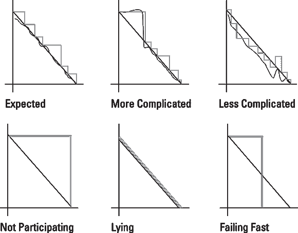

FIGURE 14-3: 燃尽图概览。

如果你每天更新冲刺待办列表，你就能始终为项目利益相关者提供最新的项目状态。你还可以向他们展示产品待办列表，以便他们知道 Scrum 团队到目前已完成了哪些功能，哪些功能将成为未来冲刺的一部分，以及这些功能的优先级。

 随着你添加功能和重新调整功能优先级，产品待办列表会发生变化。确保审查产品待办列表的人（特别是为了查看状态目的的人）理解这一概念。

 任务板是向你的项目团队快速展示冲刺、发布甚至整个项目状态的绝佳方法。任务板上有带有用户故事标题的便签，且至少分为四列：待办（To Do）、进行中（In Progress）、待验收（Accept）和已完成（Done）。如果你在 Scrum 团队的工作区域展示任务板，任何路过的人都能看到哪些产品功能已完成、哪些功能正在进行的高级状态。Scrum 团队总是知道项目处于什么位置，因为 Scrum 团队每天都会看到任务板。

始终追求简单、低保真的信息辐射器来沟通状态和进度。你越能让信息易于获取并按需使用，你和利益相关者花费在准备和猜测状态上的时间就越少。

# 第 15 章：管理质量与风险

## 本章内容

 **学习敏捷项目管理质量方法如何降低风险**

 **发现确保高质量开发的方法**

 **利用自动化测试提高生产力**

 **理解敏捷项目方法如何降低风险**

质量和风险是项目管理中紧密相关的部分。在本章中，你将了解到如何使用敏捷项目管理方法来交付高质量的产品。你将理解如何利用敏捷方法来管理项目的风险。你将看到质量在历史上是如何影响项目风险的，以及敏捷项目中的质量管理如何从根本上降低项目风险。

## 敏捷质量有何不同？

`质量`指的是产品是否可用，以及它是否满足了项目利益相关者的需求。质量是敏捷项目管理的固有部分。我们在第 2 章中列出的所有 12 条敏捷原则直接或间接地促进了质量。这些原则如下：

1. 我们的最高优先级是通过早期和持续交付有价值的软件来满足客户。

2. 欢迎需求的变化，即使在开发后期。敏捷流程利用变化为客户赢得竞争优势。

3. 频繁交付运行的软件，周期从几周到几个月不等，并优先选择更短的时间尺度。

4. 业务人员和开发人员在整个项目期间每天合作。

5. 围绕有激情的个人构建项目。为他们所需的环境和支持，并信任他们能够完成工作。

6. 向开发团队内部及之间传递信息最高效的方法是面对面交谈。

7. 可运行的软件是进度的首要标准。

8. 敏捷流程促进可持续开发。赞助者、开发人员和用户应该无限期地保持恒定的节奏。

9. 对技术卓越和良好设计的持续关注增强了敏捷性。

10. 简单性——最大化未完成工作量的艺术——至关重要。

11. 优秀的架构、需求和设计源于自组织团队。

12. 团队定期反思如何变得更有效，然后据此调优并调整其行为。

这些原则强调创建一个环境，使敏捷团队能够产生有价值的、可运行的功能。敏捷方法鼓励质量，这涵盖了产品正确运行和满足项目利益相关者需求这两个方面。

表 15-1 显示了传统项目与敏捷项目质量管理之间的一些差异。

| 传统方法的质量管理 | 敏捷方法的质量动态 |

| --- | --- |

| 测试是项目部署前的最后一个阶段。某些功能在创建几个月后才进行测试。 | 测试是每个冲刺的日常组成部分，并包含在每个需求的完成定义中。你使用自动化测试进行每日快速且稳健的测试。 |

| 质量通常是一种响应式实践，主要关注产品测试和问题解决。 | 你既通过测试进行响应式处理，也采取预防措施。预防方法的示例包括面对面沟通、结对编程和既定编码标准。 |

| 问题在项目后期发现风险更大。等到到达测试阶段，沉没成本已经很高。 | 你可以在沉没成本仍然较低的早期冲刺中创建并测试风险功能。 |

| 问题或缺陷（`bugs`）在项目后期很难发现，且项目后期修复问题的成本很高。 | 当你测试较少的工作时，问题很容易发现。修复新的内容比修复早期创建的内容更容易。 |

| 有时为了满足截止日期或节省资金，团队会缩短测试阶段。 | 敏捷项目的测试是有保障的，因为每个冲刺的一部分。 |

表 15-1 传统与敏捷质量

在本章开始，我们提到质量和风险是紧密相关的。表 15-1 中的敏捷方法大大降低了通常伴随质量管理的风险和不必要的成本。

敏捷项目质量的另一个不同是整个项目中的多个质量反馈循环。在图 15-1 中，你看到了 Scrum 团队在项目过程中接收的不同类型的产品反馈。开发团队可以立即将这些反馈纳入产品中，定期提高产品质量。

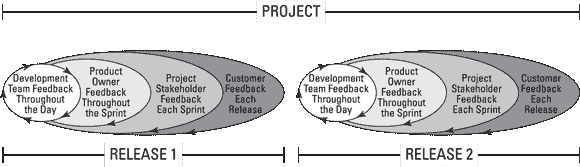

FIGURE 15-1: 敏捷项目中的质量反馈。

 在第 14 章中，我们告诉过你敏捷项目中的开发团队可以包括所有参与产品的人员。敏捷项目的开发团队通常包括负责创建和执行测试以及确保质量的专家。开发团队成员是跨职能的；也就是说，每个团队成员在项目的不同时间可能承担不同的工作。跨职能还延伸到质量活动，如预防问题、测试和修复漏洞。

在接下来的章节中，你将看到如何使用敏捷项目管理技术来提高质量。

## 管理敏捷质量

敏捷开发团队对敏捷项目中的质量负有首要责任。质量责任是自管理所带来的责任和自由的延伸。当开发团队可以自由决定其开发方法时，开发团队也负责确保这些方法能够产生高质量的工作。

 组织通常将整体质量管理称为`质量保证`（`quality assurance`）或 `QA`。你可能会看到 `QA` 部门、`QA` 测试人员、`QA` 经理、`QA` 分析师以及所有其他带有 `QA` 前缀的职称，统指负责质量活动的人员。`QA` 有时也被用作测试的简称，例如“我们对产品进行了 `QA`”或“我们现在处于 `QA` 阶段”。质量控制（`QC`）也是指代质量管理的常用方式。

Scrum 团队的其他成员——`scrum master` 和 `product owner`（产品负责人）——也在质量管理中起着作用。`Product owners` 对需求提供澄清，并在每个冲刺中接受这些需求已完成。`Scrum masters` 帮助确保开发团队拥有一个工作环境，让开发团队成员能够尽所能力工作。

幸运的是，敏捷项目管理方法有多种方式帮助 Scrum 团队创建高质量的产品。在本节中，你将看到在冲刺中进行测试如何增加发现缺陷的概率并降低修复成本。你将理解敏捷项目管理积极鼓励高质量产品开发的多种方式。你将看到定期的检查和适应如何解决质量问题。最后，你将发现自动化测试对于整个敏捷项目中持续交付有价值的产品至关重要。

### 质量与冲刺

质量管理是敏捷项目的日常部分。Scrum 团队通过冲刺运行敏捷项目，冲刺是持续一到四周的短开发周期。每个周期都包含冲刺中每个用户故事的传统项目不同阶段的活动：需求、设计、开发、测试和部署的集成。有关在冲刺中工作的更多信息，请参见第 8 章。

 这是一个小谜语：在桌子上找硬币更容易还是在体育场里更容易？显然，答案是桌子。同样显然，在 100 行软件代码中发现缺陷比在 10 万行中更容易。迭代开发让高质量的产品开发变得更简单。

Scrum 团队在每个冲刺中都进行测试。图 15-2 显示了测试如何融入敏捷项目的冲刺中。注意，测试从第一个冲刺就开始了，就在开发者开始创建项目首个需求之后。

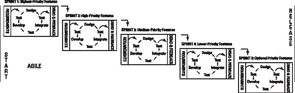

图 15-2： 冲刺内的测试。

当开发团队在每个冲刺中持续测试时，他们可以很快地发现并修复缺陷。通过敏捷项目管理，开发团队创建产品需求，立即测试这些需求，并在考虑工作完成之前立即修复任何问题。开发团队不需要尝试记住如何修复几周或几个月前创建的东西，他们最多只是在修复一两天前处理过的需求。

在敏捷项目中每天进行测试是确保产品质量的最佳方法。另一种确保产品质量的方法是从开始就创建一个更好的产品。下一节将向你展示敏捷项目管理帮助你避免错误并创建卓越产品的不同方式。

### 积极的质量

质量的一个重要且经常被忽视的方面是预防问题的想法。许多敏捷方法允许并鼓励 Scrum 团队积极主动地创建高质量的产品。这些实践包括：

*   对技术卓越和良好设计的强调

*   将特定的质量开发技术整合到产品创建中

*   开发团队与产品负责人之间的日常沟通

*   构建在用户故事中的验收标准

*   面对面交流和协作

*   可持续开发

*   对工作和行为进行定期检查和适应

接下来的章节将详细介绍这些积极的质量实践。

 质量既意味着产品运行正常，也意味着产品实现了项目利益相关者所需要的功能。

#### 对技术卓越和良好设计的持续关注

敏捷团队关注技术卓越和良好设计，因为这些特性会带来有价值的产品。开发团队如何提供卓越的技术解决方案和设计？

开发团队提供技术卓越的一种方法是通过自管理，这为他们提供了技术上创新的自由。传统组织可能会有强制性的技术标准，这些标准对于特定项目可能并不适用。自组织开发团队有权决定某项标准是否会在创建产品时产生价值，或者其他方法是否更好。创新可以带来良好的设计、技术卓越和产品质量。

自管理还为开发团队提供了产品所有感。当开发团队的人员对他们正在创造的产品深切负责时，他们通常会努力寻找最佳解决方案并尽可能地执行这些解决方案。

 没有比简单的解决方案更复杂的。

组织的承诺在技术卓越方面也起着作用。某些公司和组织无论采用什么项目管理方法，对卓越都有承诺。想想你每天使用并认为质量相关的产品；这些产品可能来自重视良好技术解决方案的公司。如果你在一个相信并奖励技术卓越的公司负责敏捷项目工作，那么实施这一敏捷原则将非常容易。

其他公司可能低估技术卓越；这些公司的敏捷项目团队在尝试为有助于创建更好产品的培训或工具进行辩护时可能会遇到困难。有些公司没有建立良好技术、良好产品与利润之间的联系。`Scrum masters` 和 `product owners` 可能需要向其公司解释为什么良好的技术和设计很重要，并可能需要为开发团队争取创建优秀产品所需的资源。

 不要将技术卓越与为了使用新奇或趋势技术而使用新技术混淆。你的技术解决方案应该高效地支持产品需求，而不仅仅是简历或公司技能简介的补充。

通过将技术卓越和良好设计融入你的日常工作中，你将创建一个让你感到自豪的高质量产品。

### 质量开发技术

在过去的几十年软件开发中，对更具适应性和敏捷性的追求激发了许多关注质量的敏捷开发技术。本节提供了几种极端编程（XP）开发方法的高级视角，这些方法有助于主动确保质量。有关 XP 实践的更多信息，请参见第 4 章。

 许多敏捷质量管理技术是考虑到软件开发而的。在创建其他类型的产品（如硬件产品，甚至是建筑施工）时，你可以调整其中的一些技术。如果你将从事非软件项目，请带着适应性的考虑来阅读本节介绍的开发方法：

*   **测试驱动开发 (TDD)：** 这种开发方法从开发者为其想要创建的需求创建一个测试开始。然后开发者运行该测试，该测试最初应该是失败的，因为该功能尚不存在。开发者不断开发直到测试通过，然后对代码进行重构——在保持测试通过的同时，尽可能提取出代码。通过 `TDD`，你知道新创建的需求功能运行正常，因为你在创建功能的同时就在进行测试，并在开发功能直到测试通过。

*   **结对编程：** 通过 `pair programming`，开发者以两人一组的形式工作。两名开发者坐在同一台电脑前，作为一个团队来创建一个产品需求。开发者轮流操作键盘进行协作。通常，键盘前的人承担直接的战术角色，而观察的伙伴则承担更具战略性或导航的角色，预测未来并提供即时反馈。由于开发者字面上在盯着对方看，他们可以快速发现错误。结对编程通过提供即时的错误检查和平衡来提高质量。

*   **同行评审：** 有时被称为 `peer code review`，`peer review` 涉及开发团队成员审查彼此的代码。与结对编程一样，同行评审具有协作性质；当开发者审查彼此的完成产品时，他们共同工作为发现的任何问题提供解决方案。如果开发团队不实践结对编程，他们至少应该实践同行评审，通过允许开发专家寻找产品代码中的结构性问题来提高质量。

*   **集体代码所有权：** 在这种方法中，开发团队中的每个人都可以创建、更改或修复项目中的任何部分代码。集体代码所有权可以加速开发，鼓励创新，并在多双眼睛检查代码的情况下，帮助开发团队成员快速发现缺陷。

*   **持续集成：** 这种方法涉及每天创建一次或多次集成代码构建。持续集成允许开发团队成员检查开发团队正在创建的用户故事如何与产品的其余部分配合。持续集成通过允许开发团队定期检查冲突来帮助确保质量。持续集成对于敏捷项目上的自动化测试至关重要；你需要在一天结束时运行夜间自动化测试之前创建一个代码构建。在本章后面将了解更多关于自动化测试的信息。

 在敏捷项目中，开发团队决定哪种工具和技术对项目、产品以及个人开发团队最有效。

许多敏捷软件开发技术都有助于确保质量，在使用敏捷项目管理方法的社区中，关于这些技术有大量的讨论和信息。如果你将从事敏捷项目，我们鼓励你学习更多这些方法，特别是如果你是一名开发者。整本书都专门介绍其中一些技术，例如测试驱动开发。我们在这里提供的信息只是冰山一角。请查看第 22 章获取更多建议。

### 产品所有者与开发团队


敏捷项目管理的另一个鼓励质量的方面是开发团队与产品所有者之间的紧密关系。产品所有者是产品业务需求的代表。在这个角色上，产品所有者每天与开发团队一起工作，确保功能满足这些业务需求。

在计划阶段，产品所有者的工作是帮助开发团队正确理解每个需求。在冲刺（`sprint`）期间，产品所有者回答开发团队关于需求的问题，并负责评审功能并将其接受为已完成。当产品所有者接受需求时，他或她确保开发团队正确地阐释了每个需求的业务需求，并确保新功能执行了它需要执行的任务。

在瀑布项目中，开发者与业务所有者之间的反馈循环不够频繁，因此开发团队的工作通常会偏离产品愿景声明中设定的原始产品目标。

每天评审需求的产品所有可以尽早发现误解。产品所有者可以将开发团队带回正确的道路，避免浪费大量的时间精力。

 产品愿景声明说明了你的产品如何支持公司或组织的战略。愿景声明阐述了产品的目标。第 7 章解释了如何创建产品愿景声明。

## 用户故事与验收标准

敏捷项目中另一个主动的质量措施是构建在每个用户故事中的验收标准。在第 7 章中，我们解释了用户故事是描述产品需求的一种格式。用户故事通过概述用户为正确满足业务需求将采取的特定行动来提高质量。图 15-3 显示了一个用户故事及其验收标准。

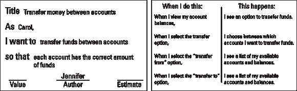

图 15-3：用户故事和验收标准。

即使你没有以用户故事的格式描述需求，也考虑为你的每个需求添加验证步骤。验收标准不仅帮助产品所有者评审需求，还帮助开发团队从一开始就理解如何创建产品。

## 面面沟通

你是否曾经与某人交谈，仅仅通过对方的脸就知道他或她没有理解你的意思？在第 14 章中，我们解释了面对面对话是最快速最有效的沟通形式。这是因为人类传递信息不仅仅通过文字；我们的面部表情、手势、肢体语言甚至我们看向的地方都有助于彼此沟通和理解。

面对面沟通有助于确保敏捷项目的质量，因为它能让`scrum`团队成员对需求、障碍和讨论产生更好的理解。定期的面对面沟通需要协作的`scrum`团队。

## 可持续开发

很有可能在生活的某个时刻，你发现自己长时间一段时间内长时间地工作或学习。你可能甚至熬了一个或两个通宵，整晚没有睡觉。在那段时间你感觉如何？你做出了明智决定吗？你犯了任何愚蠢的错误吗？

遗憾的是，许多传统项目中的团队发现自己正处于长时间、疯狂的工作中，特别是在项目后期，当截止日期临近时，完成任务的唯一似乎就是连续几周超长时间工作。这些漫长的工作通常意味着以后会有更多问题，因为团队成员开始犯错——有些很愚蠢，有些比较严重——并最终精疲力竭。

在敏捷项目中，`Scrum`团队通过创建一个让开发成员在整个项目中保持恒定工作节奏的环境，来确保他们高质量的工作。在冲刺（`sprints`）中工作有助于保持恒定的工作节奏；当开发团队选择每个冲刺期间可以完成的工作时，他们就不必在结束时赶忙。

开发团队可以决定对他们而言什么是“可持续”，无论是指每周常规工作 40 小时、天数或小时较多或更少的日程，还是在标准的九点五五时间之外工作。

 如果你的`Scrum`团队成员开始把衣服反过来穿上班，你可能需要双重检查你是否维持了可持续的开发环境。

保持开发团队愉快、休息充足并能够在工作之外拥有生活，可以减少错误、激发创造力和创新，并带来更好的产品。

从长远来看，主动注重质量可以避免很多烦恼。在一个缺陷较少的产品上工作要容易得多，也更有趣得多。下一节将讨论一种从主动和反应性两个角度解决质量的敏捷方法：检查和适应（`inspect and adapt`）。

## 通过定期检查和适应确保质量

敏捷的“检查和适应”原则是创建高质量产品的关键。在整个敏捷项目中，你都要查看你的产品和流程（检查），并根据需要进行更改（适应）。第 7 章和第 10 章提供了有关该原则的更多信息。

在冲刺评审（`sprint review`）和冲刺回顾（`sprint retrospective`）会议上，敏捷项目团队会定期停下来，回顾他们的工作和方法，并确定如何进行调整以改进项目。我们在第 10 章中提供了关于冲刺评审和冲刺回顾的细节。以下是这些会议如何帮助确保敏捷项目质量的简要概述。

在冲刺评审中，敏捷项目团队会评审每个冲刺结束时完成的需求。冲刺评审通过让项目利益相关者看到运行的需求，并在整个项目过程中对这些需求提供反馈来解决质量问题。如果需求不符合利益相关者的预期，利益相关者会立即告诉`Scrum`团队。然后`Scrum`团队可以在未来的冲刺中调整产品。`Scrum`团队还可以将其对产品如何运行的修正理解应用于其他产品需求上。

在冲刺回顾中，`Scrum`团队聚会讨论每个冲刺结束时哪些工作是有效的，哪些工作可能需要调整。冲刺回顾通过允许`Scrum`团队讨论并立即修复问题来帮助确保质量。冲刺回顾还允许团队聚集，正式讨论对产品、项目或工作环境进行可能提高质量的更改。

冲刺评审和冲刺回顾并不是敏捷项目中检查和适应质量的唯一机会。敏捷方法鼓励在每个工作日回顾工作并调整行为和方法。每天检查和适应你在项目中做的每一事情都有助于确保质量。

另一种管理和帮助确保敏捷项目质量的方法是使用自动化测试工具。下一节将解释为什么自动化测试对敏捷项目很重要，以及如何将自动化测试整合到你的项目中。

## 自动化测试

自动化测试是使用软件测试你的产品。自动化测试对敏捷项目至关重要。如果你想快速创建符合“完成定义”（`definition of done`）——即已编码、已测试、已集成并记录的软件功能，你需要一种方法在创建每个功能时快速对其进行测试。自动化测试意味着每天进行快速且稳健的测试。敏捷团队不断增加自动测试系统的频率，以便不断缩短向客户完成并部署新价值功能的时间。

 没有自动化测试，项目团队无法变得敏捷的。手动测试耗时太长了。

在整书中，我们解释了敏捷项目团队如何拥抱低技术解决方案。那么，为什么书中会有一节关于自动化测试——一种相当高技术的质量管理技术呢？这个问题的答案是效率。自动化测试就像文字处理程序中的拼写检查功能。事实上，拼写检查就是自动化测试的一种形式。同样，自动化测试是一种比手动测试更快速且通常更准确（因此更高效）的发现软件缺陷的方法。

使用自动化测试开发产品时，开发团队按照以下步骤进行开发和测试：

1. **白天开发支持用户故事的代码和自动化测试。**
2. **每天结束时创建一个集成代码构建（`build`）。**
3. **安排自动化测试软件在晚上对最新构建进行测试。**
4. **每天早上第一件事检查自动化测试结果。**
5. **立即修复任何缺陷。**

 在睡觉时进行全面的代码测试太酷了。

自动化测试允许开发团队利用非工作时间提高生产力，并拥有快速的创建-测试-修复循环。此外，自动化测试软件测试需求通常比人工测试这些需求更快、更准确、更一致。

今天的市场有很多自动化测试工具。一些自动化测试工具是开源且免费的；另一些可以购买。开发团队需要审查自动化测试选项并选择最合适的工具。

自动化测试改变了开发团队中质量角色人员的工作。传统上，质量管理人员的大部分工作涉及手动测试产品。传统项目中的测试人员会使用产品并寻找问题。然而，通过自动化测试，质量活动很大程度上涉及创建运行在自动化测试软件上的测试。自动化测试工具增强而非取代了人的技能、知识和工作。

 定期让人类检查你正在开发的需求是否正常运行仍然是一个好主意，特别是当你开始使用自动化测试工具时。任何自动化工具都可能出现小故障。通过手动双重检查（有时称为冒烟测试）自动化测试的小部分，你帮助避免了在冲刺结束时才发现你的产品没有如预期那样运行。

你可以自动化几乎任何类型的软件测试。如果你是软件开发的新手，你可能不知道有许多不同类型的软件测试。一小部分包括以下：

* **单元测试（`Unit testing`）：** 测试产品代码的单个单元或最小部分。
* **回归测试（`Regression testing`）：** 从头到尾测试整个产品，包括你之前测试过的需求。
* **用户验收测试（`User acceptance testing`）：** 产品利益相关者甚至某些产品的最终用户审查产品并接受其为完成。
* **功能测试（`Functional testing`）：** 确保产品根据用户故事的验收标准运行的测试。
* **集成测试：** 确保产品与其其他部分能够正常工作的测试。
* **企业级测试：** 根据需要，确保产品与组织内其他产品能够正常工作的测试。
* **性能测试：** 测试产品在不同场景下于给定系统上的运行速度。
* **负载测试：** 测试产品处理不同规模并发活动的能力。
* **冒烟测试：** 对代码或系统中较小但关键的部分进行测试，以帮助判断整个系统是否可能正常工作。
* **静态测试：** 重点于检查代码标准，而非运行中的软件。

自动化测试适用于这些测试以及许多其他类型的软件测试。

如你现在可能理解的，质量是敏捷项目中不可或缺的一部分。然而，质量只是区分敏捷项目风险与传统项目风险的因素之一。在接下来的章节中，你将看到传统项目风险与敏捷项目风险的对比。

# 敏捷风险管理有何不同？

`Risk`指影响项目成功或失败的因素。在敏捷项目中，风险管理不需要涉及正式的风险文档和会议。相反，风险管理被构建在`Scrum`角色、工制品和事件之中。此外，请考虑以下支持风险管理的敏捷原则：

1. 我们的最高优先级是通过早期和持续交付交付价值软件来满足客户的需求。
2. 欢迎需求的变化，即使在开发后期也是如此。敏捷流程利用变化为客户赢得竞争优势。
3. 频繁地交付运行的软件，周期从几周到几个月不等，并倾向于更短的时间尺度。
4. 业务人员和开发人员在整个项目期间必须每天合作。
5. 可运行的软件是衡量进展的主要标准。

上述原则以及任何体现这些原则的实践，显著地减少或消除了许多经常导致项目挑战和失败的风险。

根据`Standish Group`的《2015 年混沌报告》（这是一项针对 10,000 个软件项目的研究），小型敏捷项目的成功率比传统项目高 30%。请参见图 15-4。中型项目采用敏捷方法成功的概率是传统方法的四倍（400%），而大型复杂项目采用敏捷方法成功的概率是传统方法的六倍（600%）。

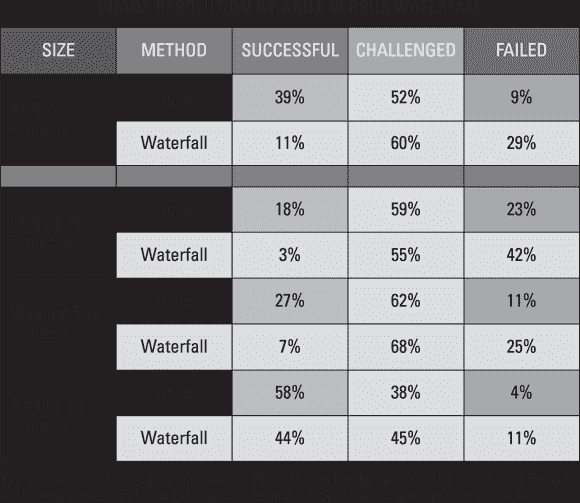

图 15-4：`Standish Group`的《2015 年混沌报告》。

表 15-2 显示了传统项目风险与敏捷项目风险之间的一些差异。

| 传统方法下的风险管理 | 敏捷方法下的风险动态 |
| --- | --- |
| 大量项目失败或面临挑战。 | 灾难性失败的风险——投入大量资金却无一获——几乎被消除了。 |
| 项目越大、越长、越复杂，风险就越高。风险在项目结束时最高。 | 产品价值立即获得，而不是将成本投入项目数月甚至几年，且失败几率不断增加。 |
| 在项目结束时进行所有测试意味着发现严重问题可能会使整个项目面临风险。 | 在开发的同时进行测试。如果技术方案、需求甚至整个产品不可行，开发团队会在短时间内发现，你有更多时间进行纠正。如果无法纠正，利益相关者在失败项目上花费的也会更少。 |
| 项目在项目中期无法在增加时间和成本的情况下接纳新需求，因为即使是低优先级需求也存在大量的沉没成本。 | 欢迎为了产品利益产生的变化。敏捷项目通过移除同等时间和成本的低优先级需求，在不增加时间或成本的情况下接受新的高优先级需求。 |
| 传统项目在项目开始时就需要时间和成本估计，此时团队对项目的了解最少。估计通常不准确，导致预期与实际项目进度及预算之间产生差距。 | 使用`Scrum`团队的实际表现（速率）来估计项目时间和成本。你在整个项目过程中不断精炼估计，因为你工作的时间越长，对项目、需求以及`Scrum`团队的了解就越多。 |
| 当利益相关者没有统一目标时，他们可能会用关于产品应该实现的什么冲突信息扰乱项目团队。 | 单个产品负责人负责为产品创建愿景，并代表利益相关者与项目团队。 |
| 利益相关者无响应或缺失可能导致项目延迟，并导致产品无法实现正确目标。 | 产品负责人负责立即提供产品信息。此外，`Scrum Master`每天帮助消除障碍。 |

表 15-2 传统与敏捷风险

敏捷项目的风险随着项目的进行而减少。图 15-5 显示了瀑布式项目与敏捷项目之间风险与时间的对比。

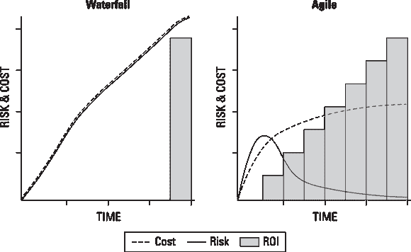

图 15-5：敏捷项目风险下降模型。

所有项目都存在风险，无论采用何种项目方法。然而，通过敏捷项目管理，灾难性失败——投入大量时间和资金却没有任何回报——的日子已经过去。消除大规模失败是传统项目风险与敏捷项目风险最大的区别。在下一节中，你将看到原因。

# 管理敏捷风险

在本节中，你将研究在项目周期内降低风险的敏捷关键结构。你将了解如何利用敏捷工具和事件在正确的时间发现风险，以及如何优先处理这些风险。

## 内生风险降低

敏捷方法在正确实施时，从本质上减少了开发的风险。通过`Sprint`开发确保了从投入到产品运行之间的时间很短。`Sprint`还提供了项目早期产生收益的可能性。`Sprint`评审、`Sprint`回顾以及产品负责人在每个`Sprint`中的参与为开发团队提供了持续的产品反馈。持续的反馈有助于防止预期与完成的产品之间的偏差。

敏捷项目风险降低三个特别重要的因素是完成定义、自筹资金项目以及快速失败的想法。你将在本节中详细了解这些因素的每一个。

## 风险与完成定义

在第 10 章中，我们讨论了需求何时算完成。为了认为需求在`Sprint`结束时完成并可以演示，它必须符合`Scrum`团队的完成定义。产品负责人和开发团队约定定义的细节；完成定义通常包含以下内容：

- **已开发：** 开发团队必须完整创建运行的需求。
- **已测试：** 开发团队必须测试过产品运行正常且无缺陷。
- **已集成：** 开发团队必须确保需求与整个产品以及任何相关系统协同工作。
- **文档化：** 开发团队必须创建关于他们如何创建产品以及所做关键技术决策背后的逻辑的笔记。

图 15-6 显示了完成定义（`definition of done`）的示例及其细节。

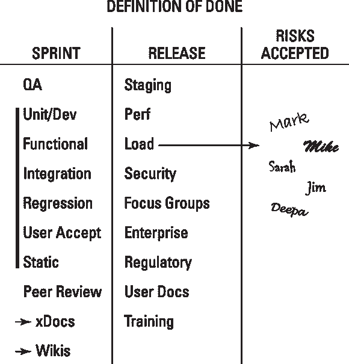

图 15-6：完成定义示例。

产品所有者和开发团队还可以创建一个可接受风险列表。例如，他们可能会同意端到端的回归测试或性能测试对于冲刺的完成定义来说是过度的。或者，在云计算中，负载测试可能没有那么关键，因为可以根据需求以廉价的价格且快速地增加额外容量。可接受风险允许开发团队集中在最重要的活动上。

完成定义极大地改变了敏捷项目的风险因素。通过在每个冲刺中创建符合完成定义的产品，你在每个冲刺结束时都拥有一个可运行的版本和可用的功能。即使外部因素导致项目提前结束，项目利益者始终能看到某些价值，并拥有现在可以使用且以后在此基础上构建的工作功能。

## 自筹资金项目

敏捷项目可以以一种传统项目无法做到的独特方式降低财务风险：自筹资金项目。第 13 章包含了自筹资金项目的示例。如果你的产品是产生收入的产品，你可以使用这些收入来帮助资助项目的其余部分。

在第 13 章中，我们向你展示了两种不同的项目`ROI`模型。这里再次列出在表格 15-3 和 15-4 中。这两个表格中的项目创建相同的的产品。

| **月份** | **产生的收入** | **项目总收入** |
| --- | --- | --- |
| 一月 | $0 | $0 |
| 二月 | $0 | $0 |
| 三月 | $0 | $0 |
| 四月 | $0 | $0 |
| 五月 | $0 | $0 |
| 六月 | $0 | $0 |
| 七月 | $100,000 | $100,000 |

表格 15-3 六个月后最终发布的传统项目收入

| **月份/发布版本** | **产生的收入** | **项目总收入** |
| --- | --- | --- |
| 一月 | $0 | $0 |
| 二月 | $15,000 | $15,000 |
| 三月 | $25,000 | $40,000 |
| 四月 | $40,000 | $80,000 |
| 五月 | $70,000 | $150,000 |
| 六月 | $80,000 | $230,000 |
| 七月 | $100,000 | $330,000 |

表格 15-4 按月发布且六个月后最终发布的敏捷项目收入

在表格 15-3 中，该项目在开发六个月后创造了 100,000 美元的收入。现在比较表格 15-3 中的`ROI`和表格 15-4 中的`ROI`。

在表格 15-4 中，该项目从第一次发布就开始产生收入。到六个月结束时，该项目产生了 330,000 美元——比表格 15-3 中的项目多出 230,000 美元。

在短时间内产生收入的能力对公司和项目团队有很多好处。自筹资金敏捷项目对几乎任何组织来说在财务上都是合理的，但对于可能没有资金创建产品的组织来说可能特别有用。对于资金紧张的群体，自筹资金可以实现原本无法行的项目。公司紧急情况可能会导致传统预算转移到其他地方或取消项目。然而，每次发布都能产生额外收入的敏捷项目在危机期间有持续的机会。最后，自筹资金有助于从一开始就向项目利益者销售一个提供持续价值并支付项目部分成本的项目。

## 快速失败

所有产品开发都带有失败风险。在冲刺中进行测试引入了`快速失败`的概念：与其将成本投入需求、设计和开发，然后发现阻止项目进展的问题，敏捷项目的团队可以在几个冲刺内识别出关键问题。这种定量风险缓解可以为组织节省大量资金。表格 15-5 和 15-6 说明了失败瀑布项目和失败敏捷项目的沉没成本差异。两个表格中的项目产品相同，成本相同。

| **月份** | **阶段和问题** | **沉没成本** | **项目总沉没成本** |
| --- | --- | --- | --- |
| 一月 | 需求阶段 | $80,000 | $80,000 |
| 二月 | 需求阶段 | $80,000 | $160,000 |
| 三月 | 设计阶段 | $80,000 | $240,000 |
| 四月 | 设计阶段 | $80,000 | $320,000 |
| 五月 | 设计阶段 | $80,000 | $400,000 |
| 六月 | 开发阶段 | $80,000 | $480,000 |


| 七月 | 开发阶段 | $80,000 | $560,000 |
| 八月 | 开发阶段 | $80,000 | $640,000 |
| 九月 | 开发阶段 | $80,000 | $720,000 |
| 十月 | QA 阶段：发现大规模问题 | $80,000 | $800,000 |
| 十一月 | QA 阶段：开发团队尝试解决问题继续开发 | $80,000 | $880,000 |
| 十月 | 项目取消；产品不可 | 0 | $880,000 |

表格 15-5 瀑布项目的失败成本

| **月份** | **冲刺和问题** | **沉没成本** | **项目总沉没成本** |
| --- | --- | --- | --- |
| 一月 | 冲刺 1：无问题。冲刺 2：无问题。 | $80,000 | $80,000 |
| 二月 | 冲刺 3：测试期间发现大规模问题导致冲刺失败。冲刺 4：开发团队尝试解决问题继续开发；冲刺最终失败。 | $80,000 | $160,000 |
| 最终 | 项目取消；产品不可。 | 0 | $160,000 |

表格 15-6 敏捷项目的失败成本

在表格 15-5 中，项目利益者花费了 11 个月和近百万美元才发现产品想法不可行。比较表格 15-5 中的沉没成本和表格 15-6 中的沉没成本。

通过早期测试，表格 15-6 中的开发团队在二月底之前就确定产品不可行，花费的时间和资金少于表格 15-5 项目中所花费的六分之一。

 因为有了完成定义，即使是失败的项目也会产生组织可以利用或改进的实体东西。例如，表格 15-5 中的失败项目本在前两个冲刺中提供可运行的功能。

“快速失败”的概念不仅适用于产品中的技术问题。你还可以通过在`sprints`（冲刺）中进行开发和快速失败，观察产品在市场上是否可行，并且如果看起来客户不会购买或使用该产品，则尽早取消项目。通过在项目早期发布产品的较小部分并与潜在客户进行测试，你可以很好地了解产品在商业上是否可行；如果发现人们不会购买该产品，则可以节省大量资金。你还会发现为了更好地满足客户需求而可能对产品所做的重要改进。

最后，快速失败并不一定意味着取消项目。如果你在沉没成本较低时发现了灾难性问题，你可能有时间和预算来确定完全不同的方法来创建产品。

完成定义（`definition of done`）、自筹资金项目以及快速失败的想法，结合敏捷原则的基础，都有助于降低敏捷项目的风险。在下一节中，你将看到如何积极使用敏捷项目管理工具来管理风险。

### 尽识别、优先排序并响应风险

尽管敏捷项目的结构本质上减少了许多传统风险，但开发团队仍然应该意识到项目过程中可能出现的问题。`Scrum` 团队是自管理的；就像他们对质量负责一样，`scrum` 团队也负责尝试识别风险并防止这些风险发生。

 在敏捷项目中，你优先处理最高价值和最高风险的需求。

`scrum` 团队并不是花费数小时或几天的时间来记录项目的所有潜在风险、这些风险发生的概率、严重程度以及减轻风险的方法，而是使用现有的敏捷产物和会议来管理风险。`scrum` 团队还会等到“最后负责任的时刻”来处理风险，因为那时他们对项目以及可能出现的问题有了最充分的了解。表 15-7 显示了 `scrum` 团队如何利用不同的敏捷项目管理工具在适当的时间管理风险。

| 产物或会议 | 在风险管理中的作用 |
| --- | --- |
| 产品愿景 | 产品愿景声明有助于统一项目团队对产品目标定义的理解，减少对产品需要实现什么目标而产生误解的风险。在创建产品愿景时，项目团队可能会根据市场和客户反馈，并结合组织战略，从非常高的层次考虑风险。在第 7 章中了解更多关于产品愿景的信息。 |
| 产品路线图 | 产品路线图提供了项目需求和优先级的视觉概述。该概述允许项目团队快速识别需求缺口和优先级错误的需求。在第 7 章中了解更多关于产品路线图的信息。 |
| 产品待办列表 | 产品待办列表是适应项目变化的工具。定期向待办列表添加更改并重新排列需求优先级，有助于将与范围变更相关的传统风险转化为创建更好产品的方式。保持待办列表中需求和优先级的更新，有助于确保开发团队能够在正确的时间处理最重要的需求。在第 7 章和第 8 章中了解更多关于产品待办列表的信息。 |
| 发布规划 | 在发布规划期间，`scrum` 团队会讨论发布风险以及如何减轻这些风险。在发布规划会议中的风险讨论应该是高层级的，并与整个发布相关。在冲刺计划会议上针对单个需求处理风险。在第 8 章中了解更多关于发布规划的信息。 |
| 冲刺计划 | 在每次冲刺计划会议期间，`scrum` 团队会讨论冲刺中特定需求和任务的风险，以及如何减轻这些风险。冲刺计划期间的风险讨论可以深入进行，但应仅限于当前的冲刺。在第 8 章中了解更多关于冲刺计划的信息。 |
| 冲刺待办列表 | 冲刺待办列表上的燃尽图提供了冲刺状态的快速视图。这种快速视图有助于 `scrum` 团队在冲刺风险出现时进行管理，并通过立即解决问题来将影响降至最低。在第 9 章中了解更多关于冲刺待办列表以及燃尽图如何显示项目状态的信息。 |
| 每日 scrum | 在每次每日 scrum 中，开发团队成员讨论阻碍。阻碍（障碍）有时就是风险。每天讨论阻碍让开发团队和 Scrum master 有了立即减轻这些风险的机会。在第 9 章中了解更多关于每日 scrum 的信息。 |
| 任务看板 | 任务看板提供了冲刺状态的不可避免的视图，允许 `scrum` 团队捕捉冲刺风险并立即进行管理。在第 9 章中了解更多关于任务看板的信息。 |
| 冲刺评审 | 在冲刺评审期间，`scrum` 团队定期确保产品满足利益者的预期。冲刺评审还为利益者提供了讨论以适应业务需求变更的机会。这两个方面都有助于管理在项目结束时交付了错误产品的风险。在第 10 章中了解更多关于冲刺评审的信息。 |
| 冲刺回顾 | 在冲刺回顾期间，`scrum` 团队会讨论过去冲刺的问题，并识别其中哪些问题可能成为未来冲刺的风险。开发团队需要确定方法防止这些风险再次发生。在第 10 章中了解更多关于冲刺回顾的信息。 |

表 15-7 敏捷风险管理工具

本节讨论的产物和会议通过在适当的时间由负责的角色处理风险，系统地帮助敏捷团队管理敏捷项目中的风险。项目越大、越复杂，通过敏捷方法消除失败风险的可能性就越高。

在本章中，我们将向你展示如何在组织内部建立强大的敏捷基础。

## 组织承诺与个人承诺

对敏捷项目管理的承诺意味着意味着通过积极、有意识的努力来使用新方法并放弃旧习惯。个人层面和组织层面的承诺对于敏捷转型的成功至关重要。

如果没有组织的支持，即使是最热情的敏捷项目团队成员也可能发现自己被迫回到旧的项目管理流程。如果没有个人项目团队成员的承诺，一家采用敏捷方法的公司可能会遇到过多的阻力甚至破坏，从而无法成为一个敏捷组织。

接下来的章节将介绍组织和个人如何支持敏捷转型的细节。

### 组织承诺

组织承诺在敏捷转型中起着巨大的性作用。当一家公司及其内部的小组接受敏捷原则时，项目团队成员的转型会变得更加容易。

组织可以通过以下方式承诺进行敏捷转型：

* 聘请经验丰富的敏捷专家来制定现实的转型计划，并指导公司执行该计划
* 投资员工培训，从公司首个敏捷项目团队成员以及支持他们的各级领导层开始
* 允许 Scrum 团队放弃瀑布式流程、会议和文档，转而采用精简的敏捷方法
* 确保每个敏捷项目所需的所有 Scrum 团队成员都到位：一个赋权的产品负责人、一个由多技能人才组成的跨职能开发团队以及一个具有影响力的服务型领导 Scrum Master
* 鼓励开发团队不断增加他们的技能
* 提供自动化测试工具和持续集成框架
* 在后勤上支持 Scrum 团队的共同办公
* 允许 Scrum 团队进行自我管理
* 给敏捷项目团队时间和自由，让他们经历健康的试错过程
* 修订员工绩效考核以强调团队表现
* 鼓励敏捷项目团队并庆祝成功

组织支持在敏捷转型之外同样重要。公司可以通过在考虑敏捷项目团队的情况下招聘，以及为新员工提供敏捷培训，来确保敏捷流程持续运作。组织还可以寻求敏捷导师的持续支持，在项目团队遇到新且具有挑战性的情况时提供指导。

当然，组织是由个人组成的。组织承诺与个人承诺是相辅相行的。

### 个人承诺

在敏捷转型中，个人承诺与组织承诺具有同等的作用。当项目团队中的每个人都致力于采用敏捷实践时，变革对项目团队中的每个人来说都会变得更加容易。

个人可以通过以下方法单独承诺进行敏捷转型：

* 参加培训和会议，并愿意学习敏捷方法
* 对改变持开放态度，愿意尝试新流程，并努力适应新习惯
* 抵制回到旧流程的诱惑
* 为敏捷技术方面经验较少的项目团队成员担任同伴教练
* 允许自己犯错并从错误中学习
* 在冲刺回顾会议中诚实地反每个冲刺，并致力于改进工作
* 积极成为多技能的开发团队成员
* 放下自我，作为团队的一员开展工作
* 对团队的成功和失败负责
* 主动进行自我管理
* 在每个敏捷项目中保持活跃和投入

与组织承诺一样，个人承诺在敏捷转型期之后同样重要。首个敏捷项目团队的人员将成为整个公司的变革推动者，为其他项目团队奠定基础，并效范如何有效地使用敏捷方法。

你可以在`第 19 章]`中找到更多关于敏捷项目管理的益处。

### 你能实现转型吗？

你已经为转向敏捷方法建立了许多有价值的理由，你的方案看起来很好。但你的组织能够实现转型吗？这里是一些需要考虑的关键问题：

* **组织障碍是什么？** 你的组织是拥有价值交付文化还是风险管理文化？它在管理的同时是否支持教练和导师指导？是否有对培训的支持？组织如何定义成功？它是否拥有一种开放的文化，能够接受项目进展的高可见性？
* **你们现在是如何开展业务的？** 项目在宏观层面是如何计划的？组织是否执着于固定范围？业务代表的参与度如何？你们是否外包了开发？
* **你们的团队目前是如何工作的，在敏捷方法下需要哪些转变？** 瀑布式模式根有多深？团队是否具有强烈的命令与控制心态？好主意可以来自任何地方吗？团队之间有信任吗？人员是否跨团队共享？你需要请求什么来确保转变的发生？你能获得人员、工具、空间和承诺来试点这一变革吗？
* **监管挑战有哪些？** 是否有与监管相关的流程和程序？这些要求是外部施加的还是内部采纳的法规和标准？你是否需要创建额外的文档来满足监管要求？你们是否可能面临合规审计，不合规的成本是多少？

最后，强调敏捷项目管理的整体益处。推动从传统项目管理方法转向敏捷方法的某些真实且切实的益处包括：

* **更满意的客户：**（注：原文为 Happier，意为更快乐）敏捷项目通常具有更高的客户满意度，因为敏捷项目团队可以快速生产可运行的产品，能够响应变化，并以伙伴身份与客户协作。
* **利润效益：** 敏捷方法允许项目团队比传统方法更快地向市场交付功能。敏捷组织可以实现更高的投资回报，通常会导致项目自给资金。
* **减少缺陷：** 质量是敏捷方法的关键部分。主动的质量措施、持续集成与测试以及持续改进都有助于更高质量的产品。
* **提高士气：** 持续开发和自我管理开发团队等敏捷实践意味着员工更快乐、效率提高以及公司流失率降低。

当你回顾对障碍和挑战的分析时，你可能会发现以下顾虑：

* **敏捷方法揭示了组织需要变革。** 当你将敏捷实践和结果与你的传统做法进行比较时，你可能会发现表现并未达到理想水平。你需要直面这一问题。你的组织一直在一个预设的项目运行方式的框架内运作。尽管面临严峻的挑战，你的组织已经尽了最大努力产出结果。对于所有参与方，你必须承认他们的努力，并引入敏捷流程的潜力，让他们能够产出更出色的成果。
* **项目管理领导者可能会将敏捷技术误解为不足的手段。** 通常，《敏捷宣言》中的价值观和原则被误解为：敏捷框架意味着规划和文档不足，并试图忽视通常公认的项目管理标准。经验丰富的项目经理可能会认为，在向敏捷流程转型的过程中，某些价值正在流失。要利用每一个机会来澄清敏捷价值观和原则支持什么、以及不支持什么。展示每项原则如何解决传统项目管理试图解决的相同挑战，以及敏捷技术如何是项目经理能力和职业的延伸，而不是贬低他们努力争取维护的任何东西。
* **从领导模式向服务模式转变可能具有挑战。** 敏捷领导者是服务导向的。命令与控制让位于促进。仆人式领导力对许多项目团队和职能经理来说是一个巨大的转变。证明这种转变如何为所有人带来更有效的成果。你可以在`第 14 章`中阅读更多关于仆人式领导力的内容。

记住，阻力在不可避免；没有反对就不会变革。准备好面对阻力，但不要让它阻碍你的整体计划。

### 转型时机

从组织角度来看，你可以在任何时候启动转向敏捷方法的倡议。你可以考虑几个最佳时机：

* **当你需要证明敏捷项目管理是必要的时：** 利用一个大型项目的结束节点，此时你可以清楚地看到哪些地方行不通（例如在结项回顾期间）。你能够清晰地展示瀑布式模型的问题，并为试点第一个敏捷项目提供跳板。
* **当你面临的挑战是进行准确预算时：** 在年度预算年开始前的一个季度（即当前预算周期结束前的季度）运行你的第一个敏捷项目。你将从第一个项目中获得指标，使你自己在规划明年的预算时更有据可。
* **当你启动一个新项目时：** 在有新项目时转向敏捷流程，可以让你从零开始，而没有旧方法的历史包袱。
* **当你正尝试进入新市场或新行业时：** 敏捷技术允许你快速交付创新，帮助你的组织为新类型的客户创造出产品。
* **当你有了新的领导层时：** 管理层的变动是利用敏捷方法设定新预期的绝佳机会。

尽管你可以利用上述任何任何一个来开始使用敏捷流程，但并非强制要求。变得更加敏捷的最佳时间是……现在！

### 选择合适的试点团队成员

确定与合适的人合作，特别是在早期阶段，对于敏捷项目的成功至关重要。在为组织的第一个敏捷项目选择不同角色的人选时，有以下思考点。

#### 敏捷倡导者 (Agile Champion)

在敏捷转型的初期，敏捷倡导者是确保项目团队成功的关键人物。这个人应该能够有效且快速地影响影响试点敏捷团队成功机会的每一个层级。一个优秀的敏捷倡导者应该能够完成所有任务：

* 对敏捷以及敏捷方法将解决的组织和市场问题充满热情。
* 对公司流程做出决策。如果存在现状，敏捷倡导者应该能够影响变革。
* 让组织对敏捷流程的可能感到兴奋。
* 定期并直接地与项目团队协作，支持他们完成建立敏捷流程的各个步骤。
* 为成功获取必要的项目团队成员，包括针对第一个项目以及长期来看。
* 作为升级点，以消除不必要的干扰和非敏捷流程。

在选择敏捷倡导者时，寻找那些在组织中拥有权威的人——其声音受尊重，并且过去成功领导过变革倡议的人。

#### 敏捷转型团队 (Agile Transition Team)

尽管敏捷倡导者非常重要，但一个人无法完成所有。敏捷倡导者应该与敏捷项目团队在转型过程中所赖的其他领导者共同工作。敏捷转型团队共同消除组织障碍，以确保试点团队和未来敏捷团队的成功。敏捷转型团队应该：

* 通过对试点敏捷团队的持续支持，致力于组织的成功。
* 为组织如何变得敏捷建立清晰的愿景和路线图。
* 组织形式像一个 `scrum team`，拥有一个 `product owner`（敏捷倡导者）、`development team`（能够支持试点 scrum 团队进行组织变革的领导者）和一个 `scrum master`（能够专注于帮助敏捷转型团队采用敏捷原则并执行 `scrum` 规则的组织领导者）。
* 作为一个 `scrum team` 运行，举行所有的五个 `scrum events` 并实现所有的 `scrum artifacts`。

`图 16-1` 展示了敏捷转型团队和试点 scrum 团队的节奏是如何对齐的。在试点团队的`sprint retrospective`（迭代回顾）中识别的障碍将转型团队的待办事项，作为试点团队的流程改进。

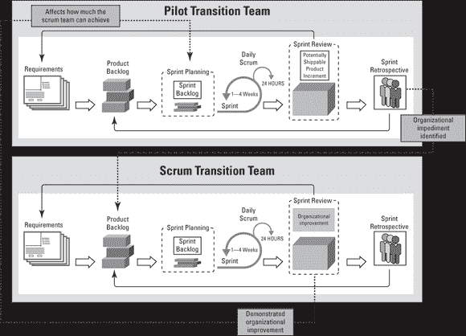

`图 16-1：` 敏捷转型团队与试点 scrum 团队节奏的对齐。

敏捷转型团队提供系统支持的同时，组织领导层也通过在使用 scrum 变得更加敏捷。

#### 产品所有 (Product Owner)

在敏捷倡导者和敏捷转型团队到位后，焦点转向试点 scrum 团队。试点 scrum 团队的产品所有应来自组织的业务端，将业务与技术对齐。在第一个敏捷项目中，产品所有可能需要适应与开发团队每天工作。一个良好的产品所有应该：

* 决策果断。
* 成为客户需求和业务需求的专家。
* 拥有业务权限，并被授权对产品需求进行排序和重新排序。
* 具备组织能力以管理不断变化的 `product backlog`。
* 致力于在整个项目期间与 scrum 团队其他成员合作并每天可用。
* 拥有获取项目资金和其他资源的能力。

为你的第一个敏捷项目选择产品所有时，寻找一个能够提供产品专业知识并对项目投入精力的人。

#### 开发团队 (Development Team)

在敏捷项目中，自组织的开发团队是项目成功的核心。开发团队决定如何进行产品工作。良好的开发团队成员应该能够做到：

* 能够才多艺。
* 愿意跨职能协作。
* 计划 `sprint` 并围绕该计划进行自我管理。
* 理解产品需求并提供工作量估计。
* 向产品所有者提供技术建议，以便其理解需求的复杂性并做出适当决策。
* 对情况做出响应并调整流程、标准和工具以优化性能。

对知识充满好奇心、渴望学习新事物并愿意以各种方式为项目目标做出贡献的开发者，最能够在敏捷环境中茁壮成长。在为试点项目选择开发团队时，应选择那些对变化开放、喜欢挑战、乐于处于新进展前沿，并且愿意尽一切努力确保成功的人，包括学习和使用其现有技能之外的新技能。

### 敏捷大师 (Scrum Master)

在公司的第一个敏捷项目中，敏捷大师可能需要比在后期项目中对开发团队的潜在干扰保持更加敏感。一个出色的敏捷大师应该：

* 具有影响力（威望）。
* 拥有足够的组织影响力，以消除阻止项目团队成功使用敏捷方法的外部干扰。
* 了解足够的敏捷项目管理知识，能够帮助项目团队在整个项目中维持敏捷流程。
* 具备沟通和引导技能，引导开发团队达成共识。
* 拥有足够的信任感，能够退一步让开发团队进行自我组织和管理。


在确定公司第一个敏捷项目的敏捷大师时，你需要选择一个愿意担任“仆型领导者”（servant-leader）的人。同时，敏捷大师需要足够强大的性格来在面对组织和个人的阻力时消除干扰并维护敏捷流程。

### 项目利益相关者 (Project Stakeholders)

在组织的第一个敏捷项目中，良好的项目利益相关者应该：

*   参与其中。
*   将最终产品决策交给产品所有者。
*   参加迭代评审（Sprint Reviews）并提供产品反馈。
*   理解敏捷流程。让项目利益相关者与项目团队其他成员参加相同的培训，将有助于他们更好地适应新流程。
*   以敏捷格式接收项目信息，例如迭代评审、产品待办列表（Product Backlogs）和迭代待办列表（Sprint Backlogs）。
*   当地所有者和开发团队有疑问时提供细节。
*   与产品所有者及项目团队其他成员协作工作。

你敏捷项目的利益相关者应该是值得信赖的、合作的且项目的活跃贡献者。

### 敏捷导师 (Agile Mentor)

敏捷导师（有时称为敏捷教练）是确保团队和组织在学习 Scrum 并开始建立更敏捷环境的同时保持良好正轨的关键。一个出色的敏捷导师应该：

*   富有经验。
*   是敏捷流程的专家，特别是贵组织所选择的敏捷流程。
*   熟悉不同规模（无论大小）的项目。
*   帮助团队进行自我管理，通过提问帮助他们自主学习，并在提供实用的建议和支持而不接管项目。
*   在项目开始时引导项目团队完成第一个迭代，并在整个项目期间根据需要随时回答问题。
*   与产品所有者、开发团队成员和敏捷大师合作并建立联系。
*   来自某个部门或组织之外的人员。内部敏捷导师通常来自公司的项目管理小组或卓越中心。如果敏捷导师来自组织内部，他们在提出建议和提供指导时应当能够抛开政治考量。

许多机构都提供敏捷策略、规划和导师指导服务，包括我们的公司 Platinum Edge。

## 创建能够实现敏捷性的环境

当你为将从传统方法转向敏捷方法奠定基础时，请创建一个让敏捷项目能够成功且项目团队能够茁壮成长的环境。敏捷环境不仅是指物理环境（如我们在`第 5 章`中描述的那样），还包括良好的组织环境。要创建一个良好的敏捷项目环境，你应该具备以下条件：

*   **善用敏捷流程：** 这似乎是显而易见的，但从一开始就开始使用经过验证的敏捷框架和技术。使用`图 16-2`中的“价值路线图”（Roadmap to Value），利用`scrum`和其他关键敏捷实践来增加成功机会。从基础开始；只有当项目和你的知识进步时才在此基础上构建。为了进步而进步并不会通向完美。记住，熟能不一定完美，熟能使习惯永久。从正确的起点开始。
*   **无障碍的透明度：** 公开透明项目状态和即将发生的流程变更。项目团队及整个组织的人都应该了解项目细节。
*   **频繁检查：** 利用`scrum`提供的定期反馈循环机会，亲眼观察项目的进展。
*   **即时适应：** 在检查之后，在整个项目过程中进行必要的更改以提升改进。利用机会今天改进；不要等到发布结束或整个项目结束。
*   **专门的 Scrum 团队：** 理想情况下，产品所有者、开发团队和敏捷大师将全职投入项目。
*   **同协作的 Scrum 团队：** 为了获得最佳结果，产品所有者、开发团队和敏捷大师应该坐在同一个办公室的同一区域。
*   **受训练良好的项目团队：** 当项目团队成员共同学习敏捷价值观和原则，并尝试敏捷技术时，他们对于作为敏捷组织将走向何方会有共同的理解和预期。

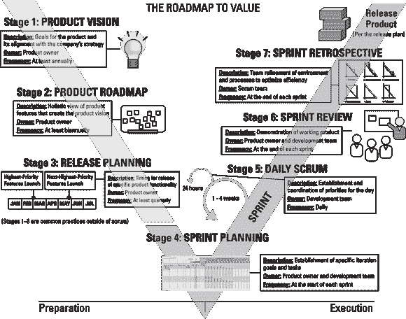

`图 16-2：` 价值路线图。幸运的是，有很多敏捷流程的培训机会。你可以找到正式的认证计划以及非认证的敏捷课程和工作坊。可用的敏捷认证包括：

*   来自 Scrum Alliance：
    *   认证 Scrum 大师 (CSM)
    *   高级认证 Scrum 大师 (A-CSM)
    *   认证 Scrum 产品所有者 (CSPO)
    *   高级认证 Scrum 产品所有者 (A-CSPO)
    *   认证 Scrum 开发者 (CSD)
    *   高级认证 Scrum 开发者 (A-CSD)
    *   认证 Scrum 专业人员 (CSP) 涵盖`大师 (CSP-SM)`、`产品所有者 (CSP-PO)`和`开发者 (CSP-D)`
    *   认证团队教练 (CTC)
    *   认证企业教练 (CEC)
    *   认证敏捷领导力 (CAL)
*   项目管理协会敏捷认证从业人员`(PMI-ACP)`认证
*   来自`Scrum.org`：
    *   专业 Scrum 大师 (PSM I, II, III)
    *   专业 Scrum 产品所有者 (PSPO I, II)
    *   专业 Scrum 开发者 (PSD)
*   来自`国际敏捷联盟 (ICAgile)`：
    *   涵盖敏捷教练、工程、培训、业务敏捷、交付管理、DevOps、企业、敏捷性以及价值管理的各个领域
*   大量的大学证书课程

有了良好的环境，你就有极大的成功机会。

当你首次启动敏捷流程时，请通过关注关键成功因素，为你的敏捷转型提供每一个成功的机会：

*   **选择一个好的项目。** 选择一个足够重要、能够获得所有人支持的项目。同时，要设定预期：尽管项目将产生可衡量的改进，但在项目团队学习新方法期间，结果将是有限的，随着时间的推移而改进。
*   **寻找一位敏捷导师。** 利用导师或教练来增加建立良好敏捷环境的机会，并最大限度地提高卓越表现的机会。
*   **沟通——多沟通。** 在组织的每个层面持续讨论敏捷流程。利用你的敏捷倡导者鼓励试点项目的进展，并走向更广泛的敏捷转型。
*   **准备向前推进。** 保持提前思考。考虑如何将试点项目的经验应用到新的项目和团队中。还要考虑将如何从单个项目扩展到多个项目，包括包含多个团队的项目。

# 第 17 章

# 跨敏捷团队的扩展

## 本章内容

*    **识别何时以及为何要在跨团队项目中进行扩展**
*    **理解扩展的基础知识**
*    **探索扩展面临的挑战**

根据进度、范围和所需的技能，许多中小型项目可以通过一个 scrum 团队完成。然而，较大的项目可能需要多个 scrum 团队，以便在合理的市场投放时间范围内实现产品愿景和发布目标。当需要多个 scrum 团队时，团队之间需要有效的团队间协作、通信和同步——它们需要在规模上保持敏捷。无论项目大小如何，如果多个团队共同合作完成同一个项目，甚至在一组项目之间存在相互依赖关系，你可能需要进行扩展。

 仅在必要时才扩展。尽管你可能拥有人才和资源来在项目中部署多个团队，但多个团队并不能自动确保更高的质量和更快的上市速度。始终寻找实现敏捷第十条原则的方法：“简单——最大限度减少未完成工作的艺术是至关重要的。”少即是多。

作为一种敏捷框架，scrum 帮助团队组织工作并有效展示进度，无论你的项目是由一个 scrum 团队还是一千个 scrum 团队组成。然而，扩展带来了新的挑战，因此你希望实施跨团队协调和协作技术，这些技术不仅要支持敏捷价值观和原则，还要解决你的项目和组织面临的特定挑战。

在本章中，我们将讨论当敏捷项目需要多个团队时需要解决的某些问题。我们还提供了一些通用的敏捷扩展框架和方法的概述，以解决扩展带来的挑战。

## 多团队敏捷项目

当产品待办列表（product backlog）和发布计划要求的开发速度超过单个 scrum 团队能实现的时，组织就会确定需要多个 scrum 团队。

在敏捷项目中，跨功能团队在项目的每个 sprint 中共同工作，每个 sprint 执行相同类型的工作，并将产品待办列表中的需求转换为完成的、可运行的可交付功能。然而，当多个团队根据同一个产品待办列表工作时，你有新的挑战需要解决。

多个 scrum 团队在同一个项目上工作时的常见挑战包括以下：

*   **项目规划：** 敏捷规划从开始就是协作的。大型小组的协作与单个 scrum 团队不同。与更广泛的项目团队（所有 scrum 团队和利益相关者）建立愿景，并结合所有参与方的协作输入构建产品路线图和产品待办列表，需要与单团队项目不同的方法。
*   **发布规划：** 与项目规划的挑战类似，发布涉及对范围和发布时机的更具体的规划。在整个发布周期内协调谁在何时做什么，这更为至关重要，以确保依赖关系、范围缺口和人才分配符合整个项目的需求。
*   **分解：** 为了拆分同一待办列表中的较大需求，多个团队可能需要参与研究和精炼讨论及活动。谁来发起这些讨论？谁来引导？
*   **Sprint 规划：** 虽然 sprint 规划不是 scrum 团队之间协调规划和执行的最后机会，但 sprint 规划是 scrum 团队锁定产品待办列表中的特定范围以供执行。在这个阶段，scrum 团队之间的依赖关系变成了现实。如果此前开发产品路线图和发布计划的活动没有暴露依赖关系，scrum 团队在 sprint 规划期间有哪些方法可以并解决这些关系？
*   **每日协调：** 即使在从项目启动到 sprint 规划的有效规划和协作之后，scrum 团队也可以并且每天进行协作。在团队处于执行模式时，谁参与以及可以做什么？
*   **Sprint 评审：** 有这么多团队在展示他们的产品增量并寻求反馈，利益相关者如何利用他们有限的时间表参与？产品所有者如何根据从多个 scrum 团队中学到的所有内容更新产品待办列表？开发团队如何知道其他开发团队完成了什么？
*   **Sprint 回顾：** 多个 scrum 团队共同工作组成了一个更广泛的项目团队。他们如何识别改进机会并在整个计划中实施这些改进？
*   **集成：** 所有产品增量都需要在一个集成环境中共同工作。谁负责集成？谁为团队提供基础设施？谁确保集成正常工作？
*   **架构决策：** 谁来监督架构和技术标准？这些决策如何去中心化，以使团队能够自我组织并尽可能自主地工作？

这些是一些例子；你可能根据自己的经验识别其他的。无论你的情况如何，请针对你的特定挑战选择解决扩展挑战的解决方案。

 某些扩展框架为你可能没有的挑战提供了解决方案。小心不要让你的框架为了修复没有问题的问题而变得臃肿。

 在在本书中，我们指的是产品、项目、计划和投资组合。通常情况下，`product`（产品）是为客户提供某种价值或实用性的功能集合。`project`（项目）是一项计划好的工作，需要时间、努力和规划才能完成，具有特定的开始和结束。`program`（计划/方案）是一组具有相互关联性的项目（针对特定的市场细分或属于同一个产品）。`portfolio`（投资组合）是用于满足战略业务目标的计划和项目集合。投资组合中的项目或计划之间可能没有直接关系，但组合在一起是为了便于管理工作。

## 通过垂直切片使工作易于理解

最简单的扩展方法之一被称为垂直切片（vertical slicing），它为跨团队划分工作提供了一个直接的解决方案，以便他们在每个 sprint 中增量地交付和集成功能。如果你的扩展挑战是拆分团队的工作，那么垂直切片就是解决方案。

 垂直切片（vertical slicing）的概念也适用于单团队项目。开发团队由若干人员组成，他们共同拥有将需求转换为已完成且可交付的功能所需技能。开发团队一次专注于一个需求，该需求是产品待办列表（product backlog）的一个垂直切片，可能触及所需的所有技术方面和技能。

通过`垂直切片`，多个 Scrum 团队在相同长度的同步冲刺（sprints）中针对`垂直切片`——即整个产品的独立部分或模块进行工作，然后在每个迭代结束后由集成 Scrum 团队（integration scrum team）对这些模块进行集成。集成 Scrum 团队比开发 Scrum 团队后一个迭代，它本身也是一个 Scrum 团队，拥有专门的产品负责人、开发团队成员和 Scrum 导师。

图 17-1 展示了如何将产品待办列表划分成每个 Scrum 团队的具体需求。然后，在每个迭代结束时，各个团队实现运行的功能，这些功能可以与更广泛的产品功能中的其他运行功能集成。每个独立团队的功能都会馈到集成团队的待办列表（图中直接位于上方的 Scrum 团队），以便进行架构和系统级协调。

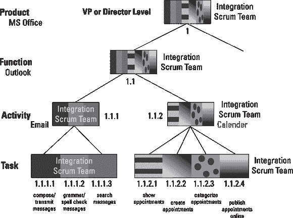

FIGURE 17-1: Scrum 团队在产品功能的垂直切片上工作，以 Microsoft Office 为例。

所需的集成 Scrum 团队层级取决于每个项目的复杂性。该图展示了 Microsoft Office 功能 set 在逻辑上可能需要的四个层。（我们使用 Microsoft 作为示例，因为大多数人对其都很熟悉。）

 每个`集成 Scrum 团队`（integration scrum team）负责处理其输入团队所产生的功能集成的所有系统级开发工作，并提供架构监督以统一各个独立的 Scrum 团队。

以 Microsoft Office 为例：

*   单个 Scrum 团队开发邮件功能`编写/发送消息`（需求 ID `1.1.1.1`）的功能。
*   另一个 Scrum 团队开发`语法/拼写检查消息`功能（`1.1.1.2`）。
*   第三个 Scrum 团队开发`搜索消息`功能（`1.1.1.3`）。
*   集成 Scrum 团队（在活动级）进行开发工作，将这三个 Scrum 团队的功能集成到一个包（`1.1.1`）中，邮件集成团队可以将其集成到整个邮件模块中。
*   然后，Outlook 集成团队获取邮件模块以及日历、联系人和其他模块，将它们集成到 Outlook 包（`1.1`）中，然后由 MS Office 集成团队将其集成到整个 MS Office 套件（`1`）。

在这个示例中，集成团队作为独立的 Scrum 团队运行，每个角色都有专门的团队成员。

### Scrum 之捷（Scrum of scrums）

这些不同的 Scrum 团队每天如何相互协调？`Scrum 之捷`（scrum of scrums）模型促进了使用垂直切片的 Scrum 团队之间有效的集成、协调和协作。我们在本章展示的几乎所有的扩展框架都使用 Scrum 之捷来启用 Scrum 团队之间的每日协调。

图 17-2 展示了每个团队的每个角色如何与其他团队中相同角色的人进行每日协调，针对影响整个计划团队的优先级、依赖关系和障碍。每个角色的 Scrum 之捷由每个角色的集成级人员促进。彻底的集成和发布工作建立了一个一致且定期的 Scrum 之捷模型。

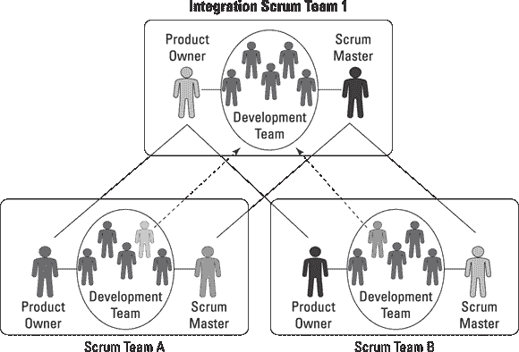

FIGURE 17-2: 用于 Scrum 团队之间协调的 Scrum 之捷。

每天，各个 Scrum 团队在大约相同的时间在不同的地点举行自己的每日 Scrum（daily scrums）。在这些每日 Scrum 之后，将进行下述的 Scrum 之捷。

#### 产品负责人 Scrum 之捷

每天在独立 Scrum 团队的每日 Scrum 之后，每个 Scrum 团队的产品负责人与集成团队的产品负责人见面，时间不超过 15 分钟。他们处理正在完成的需求，并根据独立 Scrum 团队每日 Scrum 中发现的实际情况进行任何调整。每个产品负责人处理以下内容：

*   自上次见面以来他们接受或拒绝的业务需求
*   在下次见面时应该被接受的需求
*   哪些需求受到了阻碍，需要其他团队的帮助来解决（例如，“约翰，在你完成当前冲刺待办列表中的需求`xyz`之前，我们将无法完成需求`123`。”）

集成团队产品负责人做出必要的跨团队优先级排序决策，以确保障碍在每日 Scrum 之捷期间得到解决。

#### 开发团队 Scrum 之捷

每天在独立 Scrum 团队的每日 Scrum 之后，来自每个 Scrum 团队的一名开发团队代表参加集成团队的每日 Scrum（即开发者的 Scrum 之捷），并与集成开发团队成员一起讨论以下内容：

*   他们的团队自上次见面以来取得的成就
*   团队从现在到下一次之间的计划成就
*   他们需要帮助的技术问题
*   团队已做出的、大家应该注意的技术决策

 考虑让独立团队的开发成员参加 Scrum 之捷（集成团队的每日 Scrum），每天或每个冲刺进行一次，以确保每个人关注整体。

#### Scrum 导师 Scrum 之捷

每个 Scrum 团队的 Scrum 导师也会与集成团队 Scrum 导师见面，时间不超过 15 分钟，以解决每个团队正在处理的障碍。每个 Scrum 导师处理以下内容：

*   自上次以来已解决的团队级障碍以及解决方法，以防其他 Scrum 导师遇到相同问题
*   上次以来发现的新障碍以及任何未解决的障碍
*   他们需要帮助解决的障碍
*   大家应该注意的潜在障碍

集成团队 Scrum 导师然后在每日 Scrum 之捷之后确保升级的障碍得到解决。

通过垂直切片，存在单一的产品待办列表，并在这些需求被拆分并移动到开发 Scrum 团队时，为其分配团队属性。通过这种模型，你可以看到整个计划，也可以快速过滤到你自己团队在该计划中的部分。

一个常见问题是：“在垂直切片的计划中，谁负责架构？”答案取决于该决策将影响哪些模块。

以图 17-2 为例，影响两个 Email 模块团队（`1.1.1.2`和`1.1.1.3`）的架构决策将由 Email 集成团队（`1.1.1`）做出。影响搜索消息 Email 模块团队（`1.1.1.3`）和日历集成 scrum 团队（`1.1.2`）的决策将由 Outlook 集成 scrum 团队（`1.1`）做出。


**纵向切片（Vertical slicing）** 是一种保持每个 `scrum` 团队自主性的简单方法，使其能够在更广泛的程序背景下交付有价值的功能。它也有助于帮助团队就限制条件和进度进行及时且相关的对话。

## 通过角色在 `Scrum at Scale` 中对齐

敏捷扩展模型在复杂性和简单性上各不相同。对于两个或数百个 `scrum` 团队的协作，`Scrum at Scale` 的方法是一种基础的“`捷捷会议`”（`scrum of scrums`）模型，用于协调 `Scrum Master` 和产品所有者的沟通、障碍消除、优先级、需求细化和规划。在 `Scrum Master` 和产品所有者角色中使用`捷捷会议`模型，是跨不同规模程序的团队之间进行这种每日同步的方式。

### 扩展 `scrum master`

遵循`捷捷会议`的纵向切片模型，`Scrum at Scale` 将五个 `Scrum Master` 组成一个“`Scrum Master 捷捷会议`”（`scrum master scrum of scrums`）。它镜像了单个 `scrum` 团队的每日 `Scrum` 以发现并消除障碍。通过 `Scrum at Scale`，将`捷捷会议`的范围缩小到来自五个 `scrum` 团队的五个 `Scrum Master`，限制了为了跨团队有效协作的通信复杂性，以讨论 `scrum` 团队正在工作的内容以及他们的工作可能如何相互影响。`Scrum Master 捷捷会议`作为发布团队协调发布活动。

图 17-3 展示了 `Scrum at Scale` 捷捷会议模型。

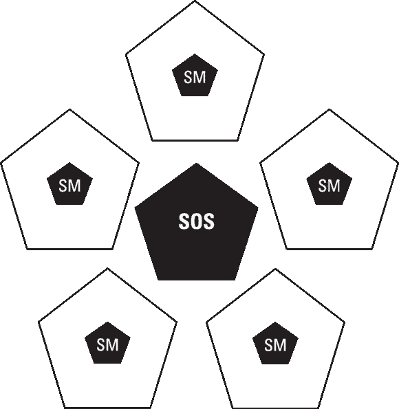

© 1993-2017 Jeff Sutherland & Scrum, Inc.

图 17-3： `Scrum at Scale` 捷捷会议模型。

当项目拥有超过五个 `scrum` 团队时，`Scrum at Scale` 了“`捷捷捷捷会议`”（`scrum of scrums of scrums`），每个 `Scrum Master 捷捷会议`的代表将与另外四个`捷捷会议`代表一起参加，在`捷捷捷捷会议`层级发现并消除障碍。

图 17-4 展示了 `Scrum at Scale` 捷捷捷捷会议模型。

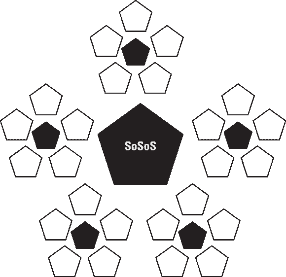

© 1993-2017 Jeff Sutherland & Scrum, Inc.

图 17-4： `Scrum at Scale` 捷捷捷捷会议模型。

当项目有超过 25 个团队时，执行行动团队（`EAT`）支持第三级`捷捷捷捷会议`，以消除`捷捷会议`小组无法自行消除的组织障碍。

图 17-5 展示了带有执行行动团队（`EAT`）的 `Scrum at Scale` 第三级`捷捷捷捷会议`模型。

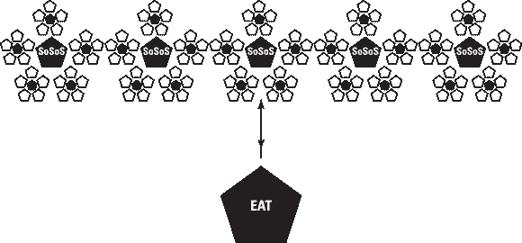

© 1993-2017 Jeff Sutherland & Scrum, Inc.

图 17-5： 带有执行行动团队（`EAT`）的 `Scrum at Scale` 第三级`捷捷捷捷会议`模型。

### 扩展产品所有者

产品所有者以类似的方式组织，只是不是被标记为`捷捷会议`，而是`捷捷会议`。第一级`捷捷会议`将产品所有者聚集在一起以细化优先级。每个`捷捷会议`都有一个首席产品所有者负责整体愿景并协调产品 backlog。图 17-6 展示了 `Scrum at Scale` 捷捷会议。


© 1993-2017 Jeff Sutherland & Scrum, Inc.

图 17-6： `Scrum at Scale` 捷捷会议。

在第二级和第三级`捷捷会议`中，`捷捷会议`支持愿景，从`捷捷会议`获取反馈并提供整体优先级。图 17-7 展示了带有执行行动团队（`EAT`）的 `Scrum at Scale` 第三级`捷捷会议`模型。


© 1993-2017 Jeff Sutherland & Scrum, Inc.

图 17-7： 带有执行行动团队（`EAT`）的 `Scrum at Scale` 第三级`捷捷会议`模型。

图 17-8 展示了带有执行行动团队（`EAT`）的 `Scrum at Scale` 第三级`捷捷捷捷会议`模型。


© 1993-2017 Jeff Sutherland & Scrum, Inc.

图 17-8： 带有执行行动团队（`EAT`）的 `Scrum at Scale` 第三级`捷捷捷捷会议`模型。

### 每日一小时同步

每天一小时内，整个组织可以对齐优先级并完成障碍消除。例如，每天 8:00，每个 `scrum` 团队举行每日 `Scrum`。8:45，`Scrum Master` 举行`捷捷会议`，产品所有者举行第一级`捷捷会议`。9:00，`Scrum Master` 以`捷捷捷捷会议`的形式会，产品所有者以第二级`捷捷会议`的形式会。最后，9:15，`捷捷捷捷会议`与 `EAT` 和执行捷 `Scrum` 会面。

## 使用 `LeSS` 进行多团队协作

大规模 Scrum（`LeSS`）是另一种在大型项目中扩展 `scrum` 的方法。`LeSS` 基于一些原则，这些原则支持在多个团队处理同一个 backlog 时保持 `scrum` 的简单性。`LeSS` 更多地关注 `scrum` 团队如何工作，而不是组织结构。它还为应对扩展挑战提供了多种方案。

`LeSS` 定义了两种框架规模：`LeSS` 和 `LeSS Huge`。区别在于总团队的大小。

### `LeSS`，较小框架

图 17-9 展示了基础 `LeSS` 框架，以三个 `scrum` 团队为例。`LeSS` 建议不要超过八个团队遵循基础模型。


经许可来自 Craig Larman 和 Bas Vodde。

图 17-9： 基础 `LeSS` 框架。

`LeSS` 概述了 `scrum` 团队如何一个一个 `sprint` 地工作，从 `sprint` 计划开始，进入 `sprint` 执行和每日 `Scrum`，最后以 `sprint` 回顾和 `sprint` 计划结束。尽管 `LeSS` 的大部分内容遵循 `scrum` 框架，但存在以下显著差异：

*   在 `LeSS` 中，`Scrum Master` 通常与一个到三个团队工作，并且最多八个团队仅有一个产品所有者。

我们强烈建议为每个 `scrum` 团队配备产品所有者和 `Scrum Master`，以确保开发团队能够直接、立即获取业务决策和澄清，并快速消除障碍，以便他们能够不受中断地继续工作。

*   迭代计划 `Part 1)` 并不要求所有开发人员参加，但每个 `Scrum` 团队至少有两个成员以及产品负责人（`Product Owner`）参加。代表团队成员随后返回并向自己的团队分享他们的信息。

*   进行独立的迭代计划 `Part 2)` 和每日 `Scrum` 会（`Daily Scrum`），不同团队的成员可以参加彼此的会议以促进信息共享。

*   迭代回顾（`Sprint reviews`）通常是所有团队合并进行的。

*   除了各团队回顾外，还会举行整体迭代回顾。`Scrum` 导师（`Scrum masters`）、产品负责人和开发团队的代表会检查并适应项目的整体系统，例如流程、工具和通信。

### `LeSS Huge` 框架

通过 `LeSS Huge`，几千人可以共同开发一个项目。但结构保持简单。

`Scrum` 团队围绕客户需求的主要区域分组，这些区域被称为需求区域（`requirement areas`）。这种分组可能类似于垂直切片中在集成团队下共同工作的团队小组。

对于每个区域，你将有一个区域产品负责人（`area product owner`）和四个到八个 `Scrum` 团队（每个需求区域至少有四个团队可以防止过度的局部优化和复杂性）。一个整体产品负责人与几个区域产品负责人合作工作，组成项目的产品负责人团队。`图 17-10` 释了 `LeSS Huge`。


经 Craig Larman 和 Bas Vodde 许可使用。

图 17-10: `LeSS Huge` 框架。

与单团队级别的 `Scrum` 以及基础 `LeSS` 一样，你拥有一个产品待办列表（`product backlog`）、一个完成定义（`definition of done`）、一个可交付的产品增量、一个（区域）产品负责人以及一个跨团队的迭代节奏（`sprint cadence`）。`LeSS Huge` 仅仅是针对每个需求区域将多个较小的 `LeSS` 实现进行堆叠。

为了让这些团队能够跨需求区域有效协作：

*   区域 `PO` 定期与每个产品负责人协调。

*   将需求区域添加到产品待办列表中，以识别谁计划处理产品的哪些部分。

*   每个需求区域需要一组并行的迭代会议。涉及所有团队的整体迭代回顾和回顾性会议是必要的，以实现超越单团队范围的持续检查和适应。这些多团队活动有助于协调整个计划的整体工作和流程。

除了限制了开发人员每天与业务人员（产品负责人）紧密合作的机会外，`LeSS` 为跨项目扩展 `Scrum` 提供了一种简单的方法。我们还发现，`LeSS` 中建议的协调技术的其灵活性对于解决其特定多团队协调挑战的团队是非常有效的。除了 `Scrum` 之 `Scrum`（在本章前面讨论过）和持续集成（参见 第 4 章），`LeSS` 还为 `Scrum` 团队与其他 `Scrum` 团队的协调提供了几种选择，如下文章节所述。

### 迭代回顾市集（`Sprint review bazaar`）

每个迭代中，多个团队朝着同一个产品增量努力，因此所有团队都有演示的内容，所有团队都需要利益相关者的反馈来更新其负责的产品待办列表部分。由于所有 `Scrum` 团队处于相同的节奏上，即使是基础 `LeSS` 组织也会涉及利益相关者在同一天参加大量的迭代回顾会议。

`LeSS` 建议对迭代回顾采用发散-收敛（`diverge-converge`）模式，类似于科学展览或市集的格式。每个 `Scrum` 团队在足够容纳所有 `Scrum` 团队的房间区域设置。每个 `Scrum` 团队演示他们在迭代期间的工作，并从访问其区域的利益相关者那里收集反馈。利益相关者访问感兴趣的区域。`Scrum` 团队可能会循环几次演示，以方便访问多个团队的利益相关者。这种方法还允许 `Scrum` 团队成员查看其他 `Scrum` 团队的演示。注意，合并迭代回顾可以通过其他方式举行。

合并迭代回顾增加了 `Scrum` 团队之间的透明度和协作文化。

### 每日 `Scrum` 的观察者

虽然进行每日 `Scrum` 是为了 `Scrum` 团队协调当天的工作，但欢迎任何人旁听。透明性是敏捷性的关键。本章前面描述的 `Scrum` 之 `Scrum` 模型是一个参与性模型——参加集成 `Scrum` 团队每日 `Scrum` 的开发人员参与讨论。然而，有时其他 `Scrum` 团队的成员只需要了解其他团队在做什么。

来自一个团队的开发团队代表可以参加另一个团队的每日 `Scrum`，观察，然后向自己的团队报告，以决定采取任何行动。这是一种非破坏性的方式，可以让其他 `Scrum` 团队参与进来而不会产生额外的会议时间开销。

### 组件社区与导师（`Component communities and mentors`）

`LeSS` 同样采用垂直切片方法来跨团队拆分产品待办列表，因此多个团队可能会“触碰”同一个系统或技术组件。例如，多个团队可能在一个公共数据库、用户界面或自动化测试套件中工作。在这些区域建立实践社区（`CoP`）让这些人有机会在他们花费大部分时间的组件区域上进行非正式的协作。

`CoPs` 通常由一个 `Scrum` 团队的某人组织，该成员拥有知识和经验来教导人们组件如何工作、长期监控组件，并让社区对组件区域正在进行的工作进行定期讨论、研讨会和评审。

### 多团队会议（`Multi-team meetings`）

类似于合并迭代回顾模型，`LeSS Scrum` 团队可能从共同参加其他 `Scrum` 计划活动和活动中受益。产品待办列表完善、迭代计划第二和其他设计研讨会就是例子。`LeSS` 为每种情况建议类似的格式，其共同元素包括：

*   首先是所有团队共享的整体会议，以识别哪些团队可能承担哪些待办事项。

*   每个团队的代表参加整体会议（所有人都可以参加，但不是必须）。

*   整体会议之后是团队级会议，以深入细节。

*   根据需要，整体会议之后是多团队小组讨论，仅涉及相关团队。

这些会议的关键在于是面对面的，在同一个房间内，允许实时协作以打破依赖关系。对于分布式 `LeSS` 组（一个团队在一个地理位置，其他团队在其他位置），视频会议是关键。

### 旅行者（`Travelers`）

开发团队越全能，你的 `Scrum` 团队遇到的瓶颈就越少。传统组织在技术领域有专家，但在敏捷转型初期没有足够的专家分配给所有的 `Scrum` 团队。为了跨团队缩小差距，技术专家可以成为“旅行者”，加入 `Scrum` 团队，通过结对（参见 第 4 章）、研讨会和教学课程在他们的专业领域进行指导和导师。

随着这些知识的共享，专家导师继续领导并扩大整个组织的技能（作为 `CoP` 组织者）。此外，`Scrum` 团队增加了他们的跨职能力，并能够更高效地开发。

开发同一产品的团队之间的依赖关系会阻碍单个 `Scrum` 团队在没有这些依赖时通常能拥有的生产力。`Nexus` 是一个扩展框架，侧重于将多个团队视为一个整体。减少团队间的依赖是扩展成功的关键。

团队间的依赖关系通常围绕团队如何构建需求和产品待办列表（`product backlog`）、团队之间的领域知识差异以及软件和测试产物。将需求、团队成员的知识和测试产物映射到同一个 `Scrum` 团队可以减少依赖关系。

`Nexus` 是一个框架，它描述了三个到九个 `Scrum` 团队——一个 `Nexus` ——如何在同一个产品待办列表上共同工作，并在单一产品所有者（`product owner`）的指导下，在每个冲刺（`sprint`）交付可发布的功能。

图 17-11 展示了 `Nexus` 框架。


© 2017 Scrum.org. 保留所有。

图 17-11: `Nexus` 框架。

除了 `Scrum` 角色、产物和事件外，`Nexus` 还引入了一个新角色、三个新产物和五个新事件，以支持共同工作的大规模 `Scrum` 团队。

`Nexus` 帮助开发同一产品的 `Scrum` 团队快速、早期识别并解决依赖关系，使每个 `Scrum` 团队能够在不受阻碍的情况下推进工作。当产品待办列表项没有经过充分细化，或者没有被拆分为单个 `Scrum` 团队可以处理的相对独立的项时，就会产生团队间依赖。依赖也源于团队之间技术技能或领域知识的差异。联合产品待办列表细化（`Joint product backlog refinement`）有助于团队在冲突发生之前识别并最大限度地减少依赖。

## `Nexus` 角色 — `Nexus` 集成团队

类似于垂直切片模型中的集成团队概念，`Nexus 集成团队（Nexus integration team）`确保 `Nexus` 至少每个冲刺产生一个集成产品增量。`Scrum` 团队执行工作，但 `Nexus 集成团队`对整个集成产品负责。

`Nexus 集成团队`的活动可能包括开发有助于集成的工具和实践，或者担任教练和顾问来协助协调。为了完成这些活动，`Nexus 集成团队`的成员必须具备教学思维。他们的角色是帮助暴露出在 `Nexus` 级别需要解决的问题，并帮助 `Scrum` 团队解决这些问题。

`Nexus 集成团队`由 `Nexus` 中成员 `Scrum` 团队的人员组成。它是一个由以下人员组成的 `Scrum` 团队：

*   `产品所有者（product owner）`负责排序和细化 `Nexus 产品待办列表`，以便从 `Nexus` 在每个冲刺创建的工作中获得最大价值。`产品所有者`的角色没有发生于 `Scrum`，只是工作范围变得更加复杂。

*   `开发团队成员（Development team members）`通常也是 `Nexus` 中 `Scrum` 团队的成员。`Nexus 集成开发团队成员`的优先级是 `Nexus 集成团队` 而非单个 `Scrum` 团队，而集成产品增量是每个冲刺的首要目标。随着时间的推移，`Nexus 集成团队`的成员可能会根据项目生命周期中特定的集成需求而变化。

     将 `Scrum` 团队成员专注于某一个团队，可以消除由于上下文切换导致的频繁认知动员和重新动员的开销。始终意识到将团队成员的注意力分散到多个团队的风险。

*   `Scrum 师（scrum master）`全面负责确保 `Nexus` 框架得到执行和理解。该 `Nexus 集成团队 scrum master` 也可能是 `Nexus` 中一个或多个其他 `Scrum` 团队的 `scrum master`。

作为最后手段，`Nexus 集成团队`成员可能会从`产品待办列表`中提取项并作为 `Scrum` 团队实施它们，但只有在所有其他选项都耗尽且 `Scrum` 团队无法产生集成产品增量时，他们才采取这种紧急模式行为。正如`紧急模式`一词所示，这种情况非常不寻常、非常不理想且不可持续。只有在这是帮助 `Scrum` 团队回到正轨的唯一途径时才会采取。

## `Nexus` 产物

三个额外的产物为 `Nexus` 级别提供了检查和适应的透明度：

*   `Nexus 目标（Nexus goal）`：虽然冲刺目标在 `Scrum` 中不是一个独立的产物，但明确提出了 `Nexus 冲刺目标（Nexus sprint goal）`。让 `Nexus` 中的所有 `Scrum` 团队拥有一个清晰、可见、共同的目标，是整个整个冲刺期间保持所有团队同步并朝着集成产品增量的关键。

*   `Nexus 冲刺待办列表（Nexus sprint backlog）`：每个 `Scrum` 团队都有自己的关于实现和集成任务的冲刺待办列表。`Nexus 冲刺待办列表`并不是这些冲刺待办列表的聚合；它的存在是为了暴露并映射团队间的依赖关系以及工作如何在 `Nexus` 中的所有 `Scrum` 团队之间流转。`Nexus 冲刺待办列表`作为 `Nexus 每日 Scrum`的一部分每天更新。

*   `集成增量（Integrated increment）`：`Nexus` 中所有 `Scrum` 团队在冲刺期间完成的所有集成工作都是`集成增量`。它符合可用的、可能发布的功能完成定义（`definition of done`）。

## `Nexus` 事件


五个额外的事件增强了 `Nexus` 级别团队间依赖关系的协调。

## Nexus 冲刺计划

在 `Nexus 冲刺计划`期间，`产品所有者`为冲刺提供优先级和业务背景，并设定冲刺目标。各个 Scrum 团队在选择冲刺工作的同时，突出并最小化依赖关系。然后每个 Scrum 团队将举行自己的冲刺计划，以计划它们从 `Nexus 冲刺待办列表`中提取的工作。`Nexus 冲刺计划`在最后一个 Scrum 团队完成其个人冲刺计划后结束。

## Nexus 每日 Scrum

`Nexus` 没有规定谁参加每日 Scrum——正确的人是个人团队的成员，他们了解自己的工作如何影响或受到其他团队工作的影响。解决的问题与单个 Scrum 团队的每日 Scrum 类似，但重点是跨团队集成，包括：

* 昨天的工作成功集成了吗？
* 发现了哪些新的依赖关系？
* 哪些信息需要在团队间共享？

`Nexus 每日 Scrum`在每个 Scrum 团队举行自己的每日 Scrum 之前举行，为 Scrum 团队提供输入以帮助他们规划当天的工作。

## Nexus 冲刺评审

与其他扩展框架类似，`Nexus 冲刺评审`可以取代单个 Scrum 团队的冲刺评审，因为重点是集成增量。你可以使用各种技术来进行会议以最大化利益相关者的反馈，但没有规定规定。可以使用本章建议的技术。

## Nexus 冲刺回顾

`Nexus 冲刺回顾`是一个通过检查和适应改进 `Nexus` 工作方式的正式机会。`Nexus 冲刺回顾`包括三个部分：

* Nexus Scrum 团队的代表会会，识别跨团队问题并使它们在 `Nexus` 中透明化。
* 个人 Scrum 团队举行自己的冲刺回顾。
* 团队代表再次会会，决定采取什么措施解决 Nexus 范围的问题。

## 细化

Nexus 使用精炼（refinement）来分解产品待办列表项，以便 Scrum 团队尽可能独立地进行开发。除了我们在第 7 章中向您展示的逐步完善需求的通用过程外，Nexus 精炼这些项的流程还包括：

* 将产品待办列表项分解到足以理解由哪些 Scrum 团队可能实现它们
* 识别并可视化产品待办列表项之间的依赖关系

Nexus 是一个轻量级框架，专注于将 Scrum 的经验方法扩展到开发需要一个以上 Scrum 团队的产品。

# 使用 SAFe 进行联合计划规划

`Scaled Agile Framework (SAFe)`用于在 IT 和软件或系统开发组织的多个层级扩展 Scrum 和敏捷原则。SAFe 在四个层级解决扩展问题：投资组合、大型解决方案、程序和团队。图 17-12 展示了完整的 SAFe 4.5 全景图。


经许可复制自 © 2011-2017 Scaled Agile, Inc. 保留所有权利。SAFe 和 Scaled Agile Framework 是 Scaled Agile, Inc. 的注册商标。

图 17-12：用于精益软件和系统工程的 SAFe 4.5。

SAFe 有四种配置，利用四个 SAFe 层级的组合。全 SAFe（参阅图 17-12）包含了所有层级（投资组合、大型解决方案、程序和团队）。基本 SAFe（见图 17-13）。

经许可复制自 © 2011-2017 Scaled Agile, Inc. 保留所有权利。SAFe 和 Scaled Agile Framework 是 Scaled Agile, Inc. 的注册商标。

图 17-13：基本 SAFe 配置。

SAFe 的核心是一个价值观、精益敏捷思维以及《敏捷宣言》中的敏捷价值观和原则。尽管其他扩展框架在战术上存在差异，但它们也有许多相似之处，例如：

* 开发在敏捷团队中进行。
* 团队在冲刺长度和节奏上保持一致。
* 在程序层级通过 Scrum Scrum（scrum of scrums）进行协调。

我们在这里进入 SAFe 的所有细节，但我们提供了一个概述，并重点介绍了一些解决本章之前讨论过的某些扩展挑战的实践。

## 理解四个 SAFe 层级

在 SAFe 中，你会找到多达四个规定的集成和协调层级，每个层级都旨在将决策下放到较低的层级。我们强调*多达四个*是因为并不是所有组织都需要所有层级，例如大型解决方案层级。

 框架提供了灵活性而非僵化。尽管 SAFe 为投资组合组织的所有层级提供了详细可视化，但请避免实施对您的情况而言并非必要的结构。

接下来描述四个层级——投资组合、大型解决方案、程序和团队。

### 投资组合层级

在`投资组合层级`，建立了整个投资组合的愿景和路线图。开发战略主题以支持该愿景。管理预算、业务目标和企业架构治理。投资组合按价值流进行组织，使组织与交付的价值对齐。

SAFe 将`价值流`定义为从概念到交付或收到付款向客户交付价值的步骤序列。它包括执行工作的人、系统和物料。

三个投资组合层级的角色驱动着投资组合决策：

* **精益投资组合管理 (LPM)：** 该角色通过向投资组合传递战略主题、建立价值流和分配预算来对齐战略与执行。LPM 负责整个投资组合的战略、投资资金、敏捷程序指导和精益治理。（在第 4 章中了解更多关于精益的内容。）LPM 与组织中所有层级的许多小组协作。

* **史诗所有者 (Epic owner)：** 史诗在第 8 章中引入，尽管 SAFe 使用不同的特性-史诗关系。在 SAFe 中，`epics` 是最大且最长期的倡议，驱动组织的业务价值。它们被分解为特性或能力，然后由开发团队进一步分解为用户故事。

* **企业架构师：** 企业架构师通过持续反馈、协作和自适应工程建立共同的技术愿景。SAFe 的投资组合待办列表包含业务史诗和启用史诗（enabler epics）。启用是扩展未来功能的需求。LPM 使用看板引导大型倡议的流动。（在第 4 章中了解更多关于看板的内容。）

### 大型解决方案层级

`大型解决方案层级`托管解决方案火车，解决方案火车是多个敏捷发布火车（ART）协调的组织结构，在下文的“程序层级”中定义。大型解决方案层级适用于需要 125 人的组织。解决方案火车由三个角色协调，类似于程序层级角色，所有角色将在下一节介绍，“程序层级。”

### 程序层级

与投资组合愿景和待办列表一致，`程序`建立了愿景和路线图以定义其工作范围边界，专注于投资组合待办列表中的选定史诗。

在程序层级进行发布和产品管理。该层级使用`敏捷发布火车 (ART) 模型`，这是一个由多个敏捷团队组成的团队（总人数 50-125 人），交付增量价值发布。“火车”按照可靠的时间表出发，功能就绪即可加载到火车上。ART 提供了一个固定节奏，使程序的团队与之对齐并同步。组织的其他部分知道此节奏，也可以围绕已知的发布计划可靠地规划工作。

如果在大型解决方案层级进行组织，则三个角色为每个价值流的 ART 提供协调：解决方案火车工程师 (`STE`)、解决方案管理和解决方案架构师/工程师。

* **发布训练火车工程师（或解决方案训练火车工程师）：** `ARTs` 通常是自组织的，但它们需要协调来引导自己的方向。`RTEs` 促进程序层面的流程、阻碍升级、风险管理和持续改进。`STEs` 提供类似的服务，通过 `RTEs` 引导解决方案训练队中所有 `ARTs` 的工作。类似于团队层面的 Scrum 硕士，`RTEs` 和 `VSEs` 是仆从型领导。

* **产品管理（或解决方案管理）：** 这些人持续地为 `ART` 或解决方案训练队定义并优先排序需求，以便产品所有者（Product Owners）拥有所需信息和赋权，从而做出快速决策，并对单个 Scrum 团队的开发者提供即时说明。

* **系统架构师/工程师（或解决方案架构师/工程师）：** 这是一个跨学科团队，负责相应 `ART` 或解决方案训练队的整体架构和工程设计的系统视图责任。与在垂直切片中最低层级集成团队做出架构决策的方式类似，架构师/工程师提供标准，使单个 Scrum 团队的开发者能够做出实时的技术决策。

在这一集成级别，`ART` 默认以五个迭代为周期的节奏工作，以创建被称为程序增量（PI）的内容。

### 团队层面

`ARTs` 由许多个人敏捷团队组成，这些团队构成了 SAFe 的团队级别。`ART` 中的敏捷团队以同步的节奏工作，它们的团队待办列表（Team Backlogs）都支持并符合程序愿景和待办列表。

SAFe 有许多方面，但我们发现以下内容在解决扩展方面最有价值。

### 联合程序增量计划

联合程序增量（PI）计划统一了整个 `ART` 的所有敏捷团队。在 `PI` 计划中，敏捷团队在同一房间、同一时间面对面共同为下一个 `PI` 计划工作。

`PI` 计划包括：

* 由高级执行官或业务所有者为 `PI` 设置业务背景。
* 由产品管理传播程序愿景，并支持程序待办列表中的功能特性。
* 展示系统架构愿景以及对开发实践的任何敏捷支持更改（例如测试自动化）。
* 由 `RTE` 概述计划流程。
* 安排敏捷团队分组会议，以确定他们为支持程序愿景将处理的容量和待办列表项。
* 与所有敏捷团队审查草案计划，每个团队展示关键计划输出、潜在风险和依赖关系。产品管理和其他利益相关者提供输入和反馈。
* 由管理层审查草案计划，以识别范围、人才分配限制和依赖关系方面的任何问题。由 `RTE` 促进。
* 敏捷团队分组并根据所有反馈调整计划。
* 在 `RTE` 的促进下审查最终计划。

`PI` 计划的魔力在于，依赖关系是在为期两天的会议期间立即被识别并协调的——这两天过得非常有价值。如果一个团队在小组讨论期间发现其自身需求中存在依赖关系，该团队将立即派遣一名成员到另一个团队，现场讨论该依赖关系。不需要往返。

尽管无论如何计划都无法预先识别每一个问题，但这种协作可以提前解决大部分问题。此外，它在整个程序增量执行期间建立了一条开放的通信渠道，确保团队能够同步并立即、更有效地解决问题，这比他们作为独立团队进行计划、仅共享文档而不进行讨论要有效得多。

### 管理者的清晰度

在第 3 章和第 14 章中，我们讨论了管理变更的方法，以使团队在本质上更加敏捷和适应。对于较大的组织，SAFe 为中层管理参与敏捷团队提供了结构。投资组合、大型解决方案和程序级别概述了个人团队成员未承担的角色和功能，为职能、技术和其他类型的领导如何扫清障碍、使单个敏捷团队尽可能高效有效，以及将战略与执行连接起来提供了一些清晰度。

## 带有企业级 Scrum 的模块化结构

在本章介绍的所有扩展模型中，企业级 Scrum (ES) 可能提供了最模块化的扩展方法。`ES` 框架为了实现整体业务敏捷，具有高度的可配置性。

对于较大的项目、程序和投资组合，`ES` 将单团队 Scrum 实践的基础扩展到许多团队，并通过结构化选项菜单支持大规模的自组织。这些选项允许团队不仅跟踪他们创建功能的工作，还能在每次迭代结束时指定、测试、检查和适应对他们成功至关的一切，包括他们所有的配置选择。

某些配置菜单包括团队和角色的结构模式、协作样式、交付模式、合同类型以及一系列指标。`ES` 还泛化了 Scrum 的一些核心元素（角色、产物和事件）。我们在本节中讨论了 `ES` Scrum 元素泛化和关键配置菜单。

### ES Scrum 元素泛化

在组织范围内扩展敏捷性会引入那些可能不熟悉 Scrum 中特定术语的人。`ES` 泛化了 Scrum 角色、产物和事件的一些名称，使它们更受广泛组织成员的熟悉，但保持其功能与 Scrum 保持一致。

 Scrum 的元素——三个角色、三个产物、五个事件——是 Scrum 框架的核心。删除或更改其中任何一个都意味着你没有在使用 Scrum。你不必使用 Scrum，但要始终使用四个敏捷价值观和 12 条敏捷原则作为你的试金石，以判断你是否在使用敏捷。你可以在第 1 章和第 2 章中了解更多敏捷价值观和原则。

ES Scrum 泛化的示例包括：

* 产品所有者（Product Owner）变为业务所有者（Business Owner），强调该角色适用于整个业务，即使对于那些不关注产品而是关注服务或倡议的倡议。
* Scrum 硕士角色变为教练（Coach），强调该角色在团队内部以及外部所有利益相关者业务部门的赋能性质。
* 产品待办列表（Product Backlog）变为价值列表（Value List），强调每个列表项可能由直接影响功能的用户故事，或针对画布中概述的任何项目提供业务价值的内容组成。下一节“ES 关键活动”中介绍画布。

   在产品待办列表中添加不仅仅是产品功能需求的想法在第 7 章中介绍，我们在那里向你展示了产品待办列表示例，不仅包括需求（功能），还包括维护（对现有功能的开发）、开销（不影响功能的必要工作）和改进（来自迭代回顾的、旨在改进团队和组织结构与流程的项）。

* 迭代待办列表（Sprint Backlog）变为 Scrum 板（Scrumboard），强调在墙壁或任务板上可视化冲刺内要完成工作的价值。你可以在第 9 章中了解更多关于任务板的信息。
* 冲刺（Sprint）变为一个 `cycle`（周期）。在软件项目中，周期通常为一到四周，并保持与冲刺相同的计划、检查和适应（评审和回顾）节奏。非软件项目的周期可能会更长。
* 冲刺计划（Sprint planning）和冲刺评审（Sprint review）分别变为 `cycle planning`（周期计划）和 `cycle review`（周期评审），以适应 `sprint` 的重命名。
* 冲刺回顾（Sprint retrospective）变为 `improvement`（改进），以强调检查和适应的前瞻性方向。

## ES 关键活动

ES 有三个关键活动，我们在这里概述了这些活动如何应用于跨团队的规模扩展。

### 步骤 1：可视化所有重要事项

ES 提供了一个不断增长的模板库来组织项目信息，包括愿景、路线图、角色、涉及的团队、资源、价值列表项、部署方法、利益相关者和客户。这些模板被称为 `canvases`（画布），是团队可视化其工作的基础。图 17-14 展示了扩展化软件开发项目的画布模板。（ES 画布模板也适用于其他非软件开发类型，但我们在这里关注的是扩展化软件开发画布。）


经许可使用，© 2017 Enterprise Scrum Inc.

图 17-14：ES 扩展化软件开发画布。

每个部分包含每个类别需要处理的工作或问题。团队将每个部分中的项拉入价值列表，并将列表子集置于看板（scrumboard）上，以便在每个周期内实施。

ES 画布包含了成功交付的所有重要事项。它将产品待办列表的概念扩展为各种工作所需的自定义价值列表。价值列表的内容从高层开始，并细化到完成周期内工作所需的任何细节。每个周期结束后，都会对画布和价值列表的所有内容进行评审，以寻求可能的改进。

### 在多团队扩展时，画布持有价值列表，包括所有用户故事，并随着工作的进展进行切片和详细化处理（中间部分）。价值列表还包含了来自画布的全范围周边问题和关系，包括愿景、资源、业务所有者、教练、涉及的团队、指标，以及与利益相关者、部署和客户的互动。

### 步骤 2：做出主动的配置选择

在大规模下，ES 还提供了如何实现某些角色、产物或事件预期结果的选项，以应对个人情况。通过一组提供多种选项的菜单，团队对其配置做出主动选择。本节描述了一些最重要的菜单和选择。

#### 交付目标菜单 (DELIVERY TARGETS MENU)

了解你所需的规模水平是确定需要采取什么方法的重要第一步。首先，ES 提供了一个交付目标菜单，这是一组指南，用于确定扩展工作中的团队组所针对的最高协调交付水平：

* 大型项目（Large project）：两个或多个团队协作交付项目。
* 程序（Program）：两个或多个服务于同一客户细分的项目。
* 投资组合（Portfolio）：业务单元内两个或多个应用团队协作进行多个程序。
* 企业架构（Enterprise architecture）：两个或多个需要使用通用架构元素的业务领域。
* 业务流程（Business process）：将敏捷技术应用于非软件组织单元，如人力资源、财务、市场、销售、合规或财务。
* 业务敏捷性（Business agility）：在公司范围内应用敏捷原则。

与其他提供特定方法的多种团队规模范围的扩展模型不同，ES 将两个或多个团队视为考虑菜单中任何选项的基础。

#### 结构模式菜单 (STRUCTURAL PATTERNS MENU)

ES 关注的是角色而非分配给个人的头衔。构建每个团队业务所有者（business owner）和教练（coach）角色的结构模式菜单选项包括：

* 每个 scrum 团队配备专职业务所有者和教练（正如我们在第 6 章为 scrum 团队中的每个角色设立专职，可以减少因任务切换（或盲目忙碌）导致的生产力损失和缺陷风险）。
* 虚拟业务所有者或虚拟教练——业务所有者或教练根据需要进入该角色，同时作为开发者或团队的外部角色担任另一个角色。
* 首席业务所有者或教练，分别为单个团队的业务所有者或教练提供方向。
* 业务所有者或教练的虚拟团队，其中任何职位都可以由一个协作、自管理的业务所有者或教练团队来履行。

 在业务所有者（产品所有）或教练（scrum master）角色中引入多人增加了通信通道的复杂性，并可能给所有项目团队成员带来困惑。

你选择的配置取决于许多因素，包括预算、组织文化、管理风格和个人专业。

#### 协作模式菜单 (COLLABORATION MODES MENU)

协作模式菜单用于协调跨团队的业务优先级和澄清。可以使用各种方法来支持或对齐所选的结构模式：

* **中心化（Centralization）：** 业务所有者做出优先级决策并向所有团队提供澄清。
* **委托（Delegation）：** 首席业务所有者提供整体优先级，并定期与各个团队的业务所有者会面，授权他们对其团队负责的价值列表部分进行同样的工作。


### 协作（Collaboration）

每个团队的业务所有者与其他团队的业务所有者合作达成协作协议，而无需首席业务所有者的监督。

### 包含（Subsumption）

来自组织中开发功能之外更广泛领域的专家（如市场、财务和销售）协作处理向客户交付价值所需的一切。这种协作范围通常需要处理前述的业务流程或整体业务敏捷性交付目标。

与其他扩展方法一样，看板 Scrum（scrum of scrums，见本章关于垂直切片的章节）也用于 ES，以帮助促进跨团队依赖解决，并鼓励保持沟通渠道畅通。

## 交付模式菜单（MOD MOD MENU）

每个组织对于何时以及以什么节奏向客户交付功能有不同的需求和限制。交付的频率和类型还将决定团队之间每天、每个周期以及每次发布期间所需的协调水平。交付模式菜单示例包括：

- **持续交付（Continuous delivery）：** 产品增量持续集成和测试，但不部署到生产环境。

- **持续部署（Continuous deployment）：** 每个需求实现后，一旦完成立即部署到生产环境。

- **周期（Cycle）：** 产品增量在每个周期结束时部署到生产环境。

- **发布（Release）：** 产品增量在多个周期后部署。

组织随着时间的推移通过检查和适应，从一种交付模式进展或演变为另一种，而不破坏 ES 框架。你可以在第 8 章中学习更多关于发布功能的信息。

# 第 3 章：计划、协作、评审并改进一切、每一个循环

ES（演进策略）是对画布所有方面以及从每个菜单做出的所有配置选择进行持续检查和适应。在每个循环结束时，画布上已完成的所有和尚未完成的所有工作都将开放检查和适应。

ES 还邀请团队考虑旨在实现更平衡敏捷管理的指标，并提供团队或计划进展的透明度，以便进行检查和适应。你可以在第 21 章中学习更多关于敏捷指标的知识。

这些扩展模型中的每一个都有许多共同点。它们都旨在解决复杂项目和系统（需要比单一团队更多的团队协作）所带来的协调、通信、优先级排序、执行和集成挑战。在多个跨功能特性团队之间扩展项目，需要组织最高层的协调和领导力指导。管理结构需要从传统的“命令与控制”转变为“分布式决策和自主”，并尽可能下沉到执行工作的最低层级。

实现这一转变需要整个组织对心态和结构的长期改变做出承诺，我们在第 18 章中讨论了这一点。

# 第 18 章：成为变革推动者

## 本章内容

-  **理解变革管理问题和常见的变革管理模型**

-  **遵循在组织中采用敏捷策略的步骤**

-  **避免在采用敏捷过程中的常见问题**

-  **提出正确的问题以防止沿途中出现问题**

如果你正在考虑为你的公司或组织引入敏捷项目管理的构想，本章可以帮助你开始这些变革。引入敏捷性意味着学习并实践一种新的心态、文化、组织结构、框架和技术。在本章中，你将学习实施敏捷项目管理技术的关键原则和步骤。我们还介绍了常见的变革模型，包括我们在公司使用的`Platinum Edge`。此外，我们还涵盖了在敏捷转型过程中需要避免的常见陷阱。

## 变得敏捷需要变革

传统的项目管理侧重于流程、工具、详尽的文档、合同谈判和遵循计划。虽然敏捷项目管理仍然致力于解决这些问题，但重点转向了个人、互动、可工作的功能、客户协作以及响应变化。

瀑布式组织不是一夜之间变成现状的，也不会在一夜之间改变。对于某些组织来说，几十年来形成的习惯、建立和保护领地以及强化传统心态已经根深蒂固。组织结构将需要某种变革，领导层需要学习一种看待开发人员和赋能他们工作的新方法，而执行工作的人将必须学习以他们可能不习惯的方式合作工作并自我管理。

## 为什么变革不会自动发生

变革与其说是定义流程，不如说是关于人。人们抵制变革，这种抵制基于个人经验、情感和恐惧。在我们帮助组织进行这些变革时，我们亲眼看到了这些反应。通常我们对一个组织的首次接触是他们要求正式的课堂培训，学习什么是敏捷以及`scrum`是如何工作的。在为期两天的课程之后，人们对实施这种更现代思维和工作方式的兴奋程度通常会增加，我们的学生不断地表达这多么有道理。

`Scrum`很简单。敏捷价值和原则引起几乎每个人的共鸣。但这些都不容易。用于开发产品和服务的`Scrum`就像玩一种新游戏，有新的位置、新的规则和不同的场地。想象一个美国橄榄球教练有一天来到他的球队说：“我们今天将学习如何踢足球（美式足球）。15 分钟后带上装备在球场见我，我们立即开始工作。”会发生什么？每个人可能根据他们在电视上看到的或青少年时期的经历知道如何踢足球，但团队还没有准备好做出改变。将会产生大量的混乱。为了让团队学习新事物并聚在一起有效地竞争，必须遗忘旧的规则、技术、培训和思维。你会立刻听到球员们提出的各种问题，如下：

- 我什么时候可以使用我的手？

- 我们有多少次请求暂停（注：此处指橄榄球的暂停）的机会？

- 在这一球中，我是进攻还是防守？

- 开球时我站在哪线上？

- 当我们踢进球时，谁拿着球？

- 在对方拿到球之前，我们有多少次机会？

- 我的头盔在哪里？

- 这些鞋有时很难踢球。

转向敏捷技术不会一夜之间发生，但如果你愿意投入，它就会发生。对于现有的瀑布式组织，敏捷转型至少需要一到三年的时间。这是一段持续的旅程，而不是终点。

## 实施和管理变革的策略方法

组织变革计划如果没有策略和纪律通常会失败。在这里，我们将`失败`定义为没有达到组织预期的最终状态。管理变革有多种方法。我们在这里向你展示几种，包括我们的（`Platinum Edge`），以便你了解预期情况。

### 卢温（Lewin）

库特·刘温（Kurt Lewin）是 20 世纪 40 年代社会和组织心理学的创新者，建立了一个理解有效变革的基石模型。大多数现代变革模型都基于这种哲学，即解冻——改变——重新冻结，正如图 18-1 所示。

```

```

图 18-1: 刘温的解冻、改变、重新冻结哲学。

如果你想改变冰块的形状，你必须先将其从现有的冻结状态变为液体，以便进行改变或重塑，然后将液体塑造成新形状，最后通过固化过程形成新形状。解冻隐含在图中两个状态之间，而所做的改变隐含在未冻状态期间。

#### 解冻

第一阶段代表了变革发生所需的准备——挑战现有的信念、价值观和行为。重新审查和寻求新平衡的动力会导致对意义变革的参与和支持。

#### 改变

下一阶段涉及不确定性并解决这种不确定性以新方式做事。这个过渡阶段代表了新信念、价值观和行为的形成。时间和沟通是看到变革开始生效的关键。

#### 重新冻结

当人们接受新方式时，信心和稳定性就会增加，变革开始形成稳固的新流程、结构、信仰体系或行为集合。

这种简单的模式是大多数变革管理工具和框架的基础，包括我们在本章中讨论的内容。

### ADKAR 变革的五个步骤

Prosci 是变革管理和基准研究领域的领先机构之一。Prosci 的变革管理工具之一`ADKAR`是五个成果（意识、愿望、知识、能力和强化）的缩写，这些成果是个人和组织实现成功变革需要达到的。它是一个面向个人的目标导向模型，也是针对组织需要共同采取的讨论和行动的关注模型。

组织变革对个人来说仍然需要转变，因此成功的秘诀在于影响每一个参与者的变革。

`ADKAR`概述了个人成功变革的旅程。旅程的五个步骤也都与组织变革活动对应。它们应该按照接下来的顺序完成。

## 意识 (Awareness)

人类认为变革是困难的。当变革倡议从组织自上而下发布时，人们口头上可能表示同意，但他们的行动却是另一回事。言行不一通常是无意且自然的。如果没有意识，或者对影响管理层变革意愿的因素缺乏理解，特别是没有意识到某些事情应该发生改变，个人将缺乏改变的动力。告知组织中的个人，帮助他们对所存在的挑战达成共识，然后评估这种意识是否普遍，这是实现成功且持久变革的第一步。它是基础，没有它，倡议将无法进展。

## 愿望 (Desire)

基于对需要解决的挑战的意识，个人将对于是否有必要或是否想要通过变革来解决该问题持有意见。将对问题的意识与可以或应该采取的措施联系起来是下一步。在组织中的个人产生这种愿望后，就有了共同进行变革的动力。

## 知识 (Knowledge)

愿望是关键，但关于如何变革以及每个个人在变革中处于什么位置的知识是变革过程中下一个关键部分。组织中的所有个人都需要理解变革对他们意味着什么，而领导层需要以合作的方式在整个范围内促进教育和行动。知识来自培训和辅导。

## 能力 (Ability)

拥有了如何变革的新知识后，实施需要获得技能、重新定义角色并清晰地定义新的绩效预期。其他的承诺可能需要推迟或用新的行为或责任取代。可能需要持续的辅导和指导，领导层需要明确，这种对承诺的重新排序是预期的并受鼓励的。

## 强化 (Reinforcement)

变革在一次成功的迭代后并不会稳固。新的行为、技能和流程必须通过持续的纠正措施和辅导来强化，以确保旧习惯不再回来。

`ADKAR`模型通过评估和行动计划围绕这些步骤，引导领导者个人完成他们的变革旅程。`ADKAR`应该迭代使用，利用`scrum`进行检查和调整，直到在进入下一个步骤之前实现每一个步骤。

## 柯特领导变革八步法

约翰·柯特的领导变革流程识别了组织在变革倡议中失败的八个常见但可以预防的原因，并针对每个原因提出了成功领导变革时应采取的行动。

- **允许过度懈怠：** 领导的行动是营造紧迫感。人们习惯于现状并学会应对它。帮助他人看到变革的需要需要创造变革的紧迫感。领导者必须传达立即行动的重要性。

- **缺乏强大的领导联盟：** 领导的行动是建立一个领导联盟。成功的变革需要的不仅仅是一个活跃的支持者，即使这个人处于组织的最高层。执行官、董事、经理、甚至具有影响力的非正式社交领袖（意见）也需要在变革的需求和愿景上达成统一。这个联盟必须形成并推动变革。

- **低估和沟通不足愿景的力量：** 领导的行动是形成战略愿景和倡议。柯特估计，领导层对变革愿景的沟通不足了多达 1000 倍。即使人们对现状不满，除非他们相信所提的益处且变革是可能的，否则他们不会为变革做出牺牲。作为一个变革联盟，清晰地定义未来与过去及现在有何不同，以及实现该未来的步骤。我们在第 7 章中讨论了产品服务的愿景和路线图——变革管理也需要从对所在地的清晰愿景开始。

- **缺乏围绕共同机会集结：** 领导的行动是招募一支志愿者军。如果人们认同并受内部驱动，变革将加速并持续。由于领导层对愿景和需求的有效沟通，人们应该围绕一个他们开始信赖的事业集结。如果他们没有集结，请重新评估你的信息传递、语气和频率。

- **允许障碍阻碍愿景：** 领导的行动是消除行动的障碍。某些障碍可能是感知到的，但另一些是真实的。然而，两者都必须克服。“正确”位置上的一个阻碍就可能是失败的唯一原因。许多人倾向于避免面对障碍（流程、层级、跨部门协作），因此领导层必须作为仆人型领导者，识别并消除那些削弱一线实施变革的个人赋能的障碍。

- **缺乏短期胜利：** 领导的行动是产生短期胜利。最终的转型目标通常无法在短期实现，因此如果过程中的成功和进展得不到认可，参与者都会感到疲劳。变革的证据应该早期且定期地强调和展示。这种强化可以在变革的艰难时期提高士气，并激励和鼓励持续的努力和进展。

- **过早宣布胜利：** 领导的行动是维持加速。庆祝短期胜利会产生一种变革已经完成的虚假安全感。每一次成功都应该建立在之前的成功的基础上。在每次成功后继续加大力度，带着更大的信心和信誉。在整个转型过程中继续过度沟通愿景。

- **忽视将变革锚在组织文化中：** 领导的行动是落实变革。领导层在整个变革过程中都有机会将成功和新行为与文化的演变和不断增长的力量联系起来，以防止旧习惯回归。一旦实现成功和新行为，这些联系应该被公开认可并对所有人可见。

## Platinum Edge 的变革路线图

在本书中，我们强调敏捷流程与传统的项目管理不同。将组织从瀑布模型转向敏捷思维是一项重大变革。通过指导公司进行此类变革的经验，我们确定了成功成为敏捷组织需要采取的重要步骤。

图 18-2 展示了我们用于成功敏捷转型的敏捷转型路线图。


[图 18-2：] Platinum Edge 敏捷转型路线图。

### 第一步：制定带有成功指标的实施策略

`implementation strategy`（实施策略）是一个概述以下内容的计划：

- 你在转型过程中可以利用的现有优势

- 根据你目前的架构你将面临的挑战

- 组织向敏捷项目管理转型的行动事项

 实施策略由外部敏捷专家以评估或现状审计的形式来执行效果最为有效。

无论你是聘请第三方还是自己进行评估，请确保以下问题已得到解答：

- **当前流程：** 你的组织现在是如何运行项目的？哪些方面做得好？存在哪些问题？

- **未来流程：** 你的公司如何能从敏捷方法中获益？你将使用哪些敏捷方法或框架？你的组织需要哪些关键变化？从团队和流程的角度来看，转型后的公司将是什么样子的？

- **分阶段计划：** 你将如何从现有流程转向敏捷流程？哪些部分会立即改变？六个月后呢？一年或更久以后呢？该计划应该是后续步骤的路线图，引导公司达到可持续的敏捷成熟状态。

- **收益：** 敏捷转型将为组织中的个人、群体以及组织整体带来哪些优势？敏捷技术对大多数人来说都是赢；识别他们将如何从中受益。

- **潜在挑战：** 哪些变化是最困难的？哪些部门或人员对敏捷方法会有最大的困难？谁的领地受到了干扰？你潜在的障碍是什么？你将如何克服这些挑战？

- **成功因素：** 在切换到敏捷流程的过程中，哪些组织因素将帮助你？公司将如何投入新方法？哪些人员或部门将成为敏捷倡导者？

良好的实施策略将引导你的公司完成向敏捷实践的转变。策略可以为支持者提供一个清晰的计划来集结和支持，并为你的组织的敏捷转型设定合理的预期。

对于你的第一个敏捷项目，请确定一种量化的方式来认可项目的成功。使用指标将让你能够向项目利益相关者和组织立即展示成功。指标为冲刺回顾提供了具体的目标和话术，并有助于为项目团队设定清晰的预期。

 与人员和绩效相关的指标在与团队而非个人相关时效果最好。`Scrum`团队作为一个团队进行管理、作为一个团队获得成功、作为一个团队遭遇失败——并且应该作为一个团队接受评估。

跟踪项目成功衡量标准不仅可以帮助你在整个项目过程中不断改进。当你度过第一个项目并开始在整个组织中扩展敏捷实践时，指标可以提供成功的清晰证明。

第 21 章详细描述了成功的衡量指标。

### 第 2 步：建立意识并激发兴奋情绪

在你拥有一份展示敏捷转型“如何做”的路线图后，你需要向你组织中的人员传达即将来的变化。敏捷方法有很多益处；确保让公司里的所有人都知道这些益处，并让他们对即将来的变化感到兴奋。以下是一些建立意识的方法：

- **教育员工。** 你组织中的人员可能对敏捷项目管理并不了解甚至完全不知道。向他们介绍敏捷原则、方法以及伴随新方法而来的变化。你可以创建一个敏捷 wiki，举办午餐学习会，甚至可以举行“热座讨论”（与领导层面对面的讨论，人们可以安全地讨论疑虑，并获得关于变化和敏捷主题的问题解答）来解决对转型的顾虑。

- **使用多种沟通工具。** 利用新闻简报、博客、内网、电子邮件和面对面的工作坊等沟通渠道，将组织即将发生的变化传出去。

- **强调益处。** 确保你公司的人们知道敏捷方法如何帮助组织创造高价值产品、提高客户满意度并提高员工士气。第 19 章为这一步提供了一个关于敏捷项目管理益处的绝佳列表。

- **分享实施计划。** 让你的转型计划对所有人可见。通过正式和非正式的方式进行讨论。主动提议向大家讲解计划并回答问题。我们经常会将转型路线图打印在海报上并在整个组织发放。

- **让初始 scrum 团队参与。** 尽早让那些可能参与公司第一个敏捷项目的人员知道即将来的变化。让初始的`scrum`团队成员参与转型规划，帮助他们成为热情的敏捷实践者。

- **保持开放。** 主动引导关于新流程的对话。尝试通过公开谈话、回答问题和消除关于敏捷项目管理的迷思，走在公司流言蜚语的前面。我们之前提到的热座会议等结构化沟通是开放沟通的很好的例子。

建立意识将为即将来的变化产生支持，并缓解变化自然带来的恐惧。沟通将是帮助你成功实施敏捷流程的重要工具。

### 第 3 步：组建转型团队并确定试点项目

在公司中确定一个可以负责组织层级敏捷转型的团队。这个敏捷转型团队在第 16 章显示了从敏捷方法中受益最多的项目类型。


图 18-3： 从敏捷技术受益的项目。

选择你的第一个敏捷项目时，寻找具有以下特征的项目：

- **适当的重要性：** 确保你选择的项目足够重要，足以引起公司的关注。然而，要避免目前最重要的项目；你需要留出犯错和从错误学习的空间。请参见后文节“规避陷阱”中关于推责游戏的说明。

- **足够的可见性：** 你的试点项目应该对组织的关键影响者可见，但不要让它成为议程中最受关注的项目。你需要自由来适应新流程；关键项目在第一次尝试新方法时可能无法提供这种自由。

- **清晰且可控：** 寻找一个需求明确、且能够承诺定义并优先考虑这些需求的业务部门的产品。尝试选择一个有明确终点的项目，而不是可以无限扩展的项目。

- **规模不宜过大：** 选择一个你通过最多两个`scrum`团队同时工作即可完成的项目，以防止同时处理过多的变动。

- **可衡量的衡量：** 选择一个你确定可以在几次敏捷冲刺（sprints）内展示出可衡量价值的项目。

 人们需要时间适应任何类型的组织变革，而不仅仅是敏捷转型。研究发现，当发生重大变化时，公司和团队在看到改进之前会经历性能的下降。图 18-4 所示的`Satir's Curve`阐述了团队从兴奋、混乱到最终适应新流程的过程。


图 18-4： Satir 曲线。

在你成功运行一个敏捷项目后，将为未来的成功奠定基础。

### 第 4 步：构建成功的环境


敏捷原则之一规定：“围绕有积极主动性的个人构建项目。给予他们所需的环境和支持，并信任他们能够完成工作。”

我们在第 5 章中概述了创建一个能够实现成功的环境的含义。仔细并认真地研究 4 个敏捷价值和 12 项敏捷原则（参见第 2 章），以确定你是在为成功创造环境，还是在合理化地认为现状已经足够。

尽早开始修复和改进你的环境。

### 第 5 步：充分培训并按需招聘

在转向敏捷思维时，培训是关键的一步。与经验丰富的敏捷专家进行面对面培训，以及通过敏捷流程练习解决问题的能力相结合，是帮助项目团队吸收和开发成功启动敏捷项目所需知识的最佳方式。

当项目团队成员能够一起培训和学习时，培训效果最好。作为敏捷培训师和导师，我们曾有机会旁听到项目团队成员之间的对话，这些对话通常是：“还记得 `Mark` 向我们展示如何做……吗？我们在课堂上这样做时效果很不错。让我们试试看会发生什么。”如果产品所有者、开发团队、`scrum master` 和项目利益相关者能够参加同一门课程，他们就可以作为一个团队将所学知识应用到工作中。

招聘人才来填补你所需的角色空缺，可以避免转型初期就会出现的显而易见的问题。如果没有专职的产品所有者及其对团队的清晰指导，你的项目成功的概率有多少？这将如何影响团队的自组织能力？如果你缺少`scrum master`，谁来促进许多互动？如果你在开发团队中缺少实现首次冲刺目标所需的关键技能，第一次冲刺将呈现什么样貌？

尽早与你的人力资源部门合作，开始招聘流程。与你的敏捷专家顾问合作，利用他们的经验敏捷从业者网络。

### 第 6 步：在积极的教练下启动试点

当你拥有清晰的敏捷实施策略、一个兴奋且经过培训的项目团队、一个具有产品待办列表的试点项目以及明确的成功标准时，恭喜你！你准备好运行第一次冲刺了。

但不要忘记——敏捷方法对于试点团队来说是新的。团队需要教练才能变得高效。通过敏捷专家进行敏捷教练，以正确地开始项目。

 练习并不导致完美。练习只会养成惯性。

当`scrum team`计划它的第一次冲刺时，不应该贪多需求。请记住，你只是开始学习一种新流程和新产品。新的`scrum teams`承担的工作量通常比他们认为在第一次冲刺中能完成的要少。典型的进展遵循如下：

 在通过产品愿景声明、产品路线图和初始发布目标确立整体目标后，你的产品待办列表仅需提供足够一次冲刺的用户故事级需求（参见第 8 章）。你无法通过计划来消除不确定性。不要成为分析瘫痪的受害者，设定好方向就行动！

在整个第一次冲刺期间，确保坚持敏捷实践。在第一次冲刺期间思考以下问题：

- 召开每日会议，即使你觉得没有取得进展。
- 开发团队可能需要自我管理，而不是向产品所有者、`scrum master` 或任何其他地方寻求任务分配。
- `scrum master` 可能需要保护开发团队免受干扰，特别是当其他成员正在习惯专用团队时。
- 产品所有者可能需要习惯与开发团队直接工作、回答问题并评审完成的需求。

在第一次冲刺中，预计道路会有些坎坷。敏捷是关于学习和适应。在第 8 章中，你可以看到`scrum team`如何计划冲刺。第 9 章提供了运行冲刺的日常细节。

### 第 7 步：执行价值路线图

当你选择了试点项目后，不要掉入使用旧方法或习惯的陷阱。相反，从项目开始就使用敏捷流程。

我们在书中概述价值路线图，在第 7 章中引入它，并在第 7 章到第 10 章中引导你通过每一个阶段。

### 第 8 步：收集反馈并改进

起初自然会犯错。没关系。在第一次冲刺结束时，你通过两个重要的活动收集反馈并改进：`sprint review` 和 `sprint retrospective`。

第一次迭代回顾（`sprint retrospective`）可能还需要设定一些预期。使用预设的格式进行会议会有帮助，例如第 10 章中的格式，这既可以引发对话，又能避免变成一场漫无目的的抱怨会。

在你的第一次迭代回顾中，请特别关注以下几点：

*   记住你对迭代目标的完成情况如何，而不是你完成了多少个用户故事。
*   回顾你完成需求的程度，是否符合“完成定义”（`definition of done`）：即已定义、已测试、已集成和已记录。
*   讨论你们是如何达成项目成功指标的。
*   谈论你们对敏捷原则的坚持程度。我们是从原则开始这段旅程的。
*   庆祝成功（即使是微小的进展），同时检查问题和解决方案。
*   记住，`scrum team`应该作为一个整体来管理会议，就如何改进达成共识，并带着行动计划离开会议。

你可以在第 10 章中找到关于迭代评审（`sprint reviews`）和迭代回顾（`sprint retrospectives`）的更多细节。

### 第 9 步：成熟并巩固改进

检查和适应让`scrum team`作为一个团队成长，并在每次迭代中成熟。

敏捷实践者有时会将成熟的过程与武术学习技术`Shu Ha Ri`（守破离）相比，这是一个日语术语，可以翻译为“保持、脱、超越”。该术语描述了人们学习新技能的三个阶段：

*   **在`Shu`（守）阶段，**学生按照教授的方式遵循新技能，不偏离，以将该技能记入脑中并使其自动化。

    新的`scrum team`可以从习惯密切遵循敏捷流程中获益，直到这些流程变得熟悉。在`Shu`阶段，`scrum team`与敏捷教练或导师紧密合作，以正确遵循流程。

*   **在`Ha`（破）阶段，**随着学生更多地了解其新技能的工作原理，他们开始进行发挥。有时发挥是有效的，有时则不然。学生将从这些成功和失败中学习更多关于该技能的知识。

    随着`scrum team`更多地了解敏捷方法的工作原理，他们可能会为自己的项目尝试流程的变体。在`Ha`阶段，`scrum team`会发现迭代回顾是讨论他们的发挥有效或无效的价值工具。在这个阶段，`scrum team`成员可能仍然从敏捷导师那里学习，也可以相互学习、从其他敏捷专业人士那里学习，并通过开始向他人教授敏捷技能来学习。

*   **在`Ri`（离）阶段，**技能对于以前的学生来说变得自然，他们将知道什么是有效的，什么是无效的。学生现在可以自信地进行创新。

    通过练习，`scrum team`将达到敏捷流程变得简单且舒适的地步，就像骑自行车或开车一样。在`Ri`阶段，`scrum team`可以自定义流程，并清楚在《敏捷宣言》和 12 条敏捷原则的精神下什么是有效的。

起初，作为一个`scrum team`的成熟可能需要集中的努力和对敏捷流程以及维护敏捷价值观的承诺。然而，最终`scrum team`将会顺利运行，从迭代中不断改进，并激励组织内的其他人。

随着时间的推移，随着`scrum team`和项目利益相关者的成熟，整个公司可以成熟为成功的敏捷组织。

### 第 10 步：在组织内部逐步扩展

完成一个成功的项目是让组织转向敏捷项目管理的重要一步。通过证明你的项目成功和敏捷方法论价值的指标，你可以获得公司的支持以开展新的敏捷项目。

要在整个组织范围内逐步扩展敏捷项目管理，请从以下工作开始：

*   **种子新团队。** 一个已经成熟的敏捷项目团队——那些参与过第一个敏捷项目的人——现在应该拥有专业知识和热情成为组织中的敏捷大使。这些人可以加入新的敏捷项目团队，帮助这些团队学习和成长。
*   **重新定义指标。** 为每个新的`scrum team`和每个新项目确定跨组织的成功衡量标准。
*   **有计划地扩展。** 产生巨大的结果可能是令人兴奋的，但公司范围的改进需要巨大的流程变革。不要跑得比组织处理得快。查看第 17 章了解跨多个团队扩展敏捷项目的不同方法。
*   **识别新挑战。** 你的第一个敏捷项目可能揭发现了你在原始实施计划中没有考虑的障碍。根据需要更新你的策略和成熟度路线图。
*   **持续学习。** 当你推行新流程时，确保新团队成员拥有适当的培训、指导和资源，以有效地运行敏捷项目。

上述步骤对于成功的敏捷项目管理转型有效。在扩展时使用这些步骤并反复回归它们，你就可以让敏捷实践在你的组织中蓬勃发展。

## 避免陷阱

项目团队在实施敏捷实践时可能会犯一些常见但严重的错误。[表 18-1 提供了一些典型问题及其扭转方式的概述。

| 问题 | 描述 | 潜在解决方案 |
| --- | --- | --- |
| 伪敏捷或双重敏捷或两者兼有 | 有时，组织会说他们正在“做敏捷”。他们可能采用了敏捷项目使用的某些实践，但他们还没有拥抱敏捷原则，并继续创建瀑布式的交付物和产品。这有时被称为`faux agile`（伪敏捷），是规避敏捷技术收益的捷径。 | 在瀑布流程、文档和会议之外尝试完成敏捷流程是另一种伪敏捷方法。`Double work agile`（双重工作）会导致项目团队快速耗尽。如果你在做双倍的工作，说明你没有遵循敏捷原则。 | 坚持遵循一种流程——敏捷流程。获得管理支持以避免非敏捷原则和实践。 |
| 缺乏培训 | 投入实地培训课程将比最好的书籍、视频、博客或白皮书提供更快、更好的学习环境。缺乏培训通常表明组织对敏捷实践缺乏承诺。 | 记住，培训可以帮助`scrum team`避免列表上的许多错误。 | 将培训纳入你的实施策略中。为团队提供正确的技能对于成功至关重要，并在敏捷转型初期是必要的。 |
| 表现不佳的产品负责人 | 产品负责人角色是非传统的。敏捷项目团队需要一个对业务需求和优先级有专家级理解，并且每天与`scrum team`的其他成员良好合作的产品负责人。缺席或犹豫不决的产品负责人会迅速摧毁一个敏捷项目。 | 在启动项目时选择一个有时间、专业知识和性格担任良好产品负责人的人。 | 确保产品负责人接受适当培训。`scrum master`可以帮助指导产品负责人，并尝试清除阻碍其有效的障碍。如果消除障碍无效，`scrum team`应该坚持更换表现不佳的产品负责人，换为一个可以做出产品决策并帮助`scrum team`取得成功的产品负责人（或至少一个代理）。 |

| 问题 |  | 解决方案 |
| :--- | :--- | :--- |
| 缺乏自动化测试 | 如果没有自动化测试，可能无法在一个迭代（`sprint`）内完全完成并测试工作。手动测试需要时间，而快速迭代的`Scrum`并没有这些时间。 | 你可以在市场上找到许多低成本的开源测试工具。研究合适的工具，并作为开发团队承诺使用这些工具。 |
| 缺乏转型支持 | 成功转型是困难的，而且无法保证百分之百成功。从一开始就由专业人士正确地执行是有价值的。 | 当你决定转向敏捷项目管理时，请寻求敏捷导师的帮助——导师可以来自你组织内部，也可以来自外部咨询公司——他们可以支持你的转型。流程很容易处理，但人很难。投资让理解行为科学和组织变革的经验伙伴提供的专业转型支持是值得的。 |
| 物理环境不恰当 | 当`Scrum`团队不在同一地办公时，他们失去了面对面交流的优势。在同一栋建筑里是不够的；`Scrum`团队需要坐在一起同一个区域。 | 如果你的`Scrum`团队在同一栋楼内但不在同一区域，请让团队整体移动。考虑为`Scrum`团队创建一个房间或附属室以便其持续协作。尝试让`Scrum`团队区域远离干扰源，例如那个话没完的人，或者总是需要你帮个小忙的经理。在与分散的`Scrum`团队开始项目之前，尽力招募本地人才。如果你必须与分散的`Scrum`团队一起工作，请查看第 14 章了解如何管理分散的团队。 |
| 团队选择不当 | 不支持敏捷流程、无法与他人良好合作或不具备自我管理能力的`Scrum`团队成员将从内部破坏新的敏捷项目。 | 在创建`Scrum`团队时，考虑潜在团队成员执行敏捷原则的程度。关键在于多才多艺和学习意愿。 |
| 纪律松散 | 记住，敏捷项目仍然需要需求、设计、开发、测试和发布。在迭代中完成这些工作需要纪律。 | 为了在短迭代内交付运行的功能，你需要更多而不是更少的纪律。进展需要保持一致和持续。每日`Scrum`有助于确保整个迭代过程中不断取得进展。利用迭代回顾的机会来重新设定纪律方法。 |
| 缺乏对学习的支持 | `Scrum`团队作为一个团队成功，也作为一个团队失败；公开指责某人的错误（即“`指责游戏`”）会破坏学习环境并破坏创新。 | `Scrum`团队可以在项目开始时承诺为学习留出空间，并作为一个整体接受成功和失败。 |
| 稀释直到死亡 | 用旧的瀑布习惯稀释敏捷流程会侵蚀敏捷流程的优势，直到这些优势不再存在。 | 在更改流程时，停下来并考虑这些更改是否支持《敏捷宣言》和 12 条敏捷原则。抵制与宣言和原则不符的改变。记住最大化未完成的工作。 |

表 18-1 常见的敏捷转型问题与解决方案

正如你可能注意到的，许多陷阱与缺乏组织支持、培训需求以及退回到旧的项目管理实践有关。如果你的公司支持积极变化，如果项目团队接受过培训，并且`Scrum`团队积极承诺维护敏捷价值观，你将获得成功的敏捷转型。

## 你的变化出现偏差的迹象

以下问题列表可以帮助你识别警告信号，并在出现问题情况时提供应对思路：

*   **你是否是在做“`Scrum`，但是……”？**

    `ScrumBut`发生在组织部分采纳`Scrum`的情况。一些敏捷纯主义者认为`ScrumBut`是不可接受的；而其他敏捷实践者则允许逐渐成长为一种新方法。尽管如此，要警惕那些阻碍敏捷原则的旧做法，例如以功能不完整结束迭代。

 `Scrum`包含三个角色、三个产物和五个事件。如果你发现你的团队在调整这些基础框架组件，请问问为什么。是`Scrum`暴露了某些你不愿意检查和适应的内容吗？

*   **你是否仍在使用旧方法进行记录和报告？**

    如果你仍然在沉重的文档和报告上花费大量时间，说明组织尚未接受用敏捷方法来传递项目状态。帮助经理理解如何使用现有的敏捷报告产物，并停止双功！

*   **一个团队在一个迭代中完成 50 个故事点比另一个团队完成 10 个更好，对吧？**

    不。请记住，故事点在一个`Scrum`团队内部是相对且一致的，而不是跨越多个`Scrum`团队。速率不是团队比较的指标。它仅仅是`Scrum`团队用于帮助自己进行规划的迭代后事实。你可以在第 8 章中看到更多关于故事点和速率的信息。

*   **利益相关者何时会对所有规格进行签字？**

    如果你在等待全面的需求签署后开始开发，那么你没有遵循敏捷实践。只要有足够完成一个迭代的需求，你就可以开始开发了。

*   **我们是否在利用外包来降低成本？**

    理想情况下，`Scrum`团队应该是同地办公的。即时面对面交流的能力可以节省更多的时间和资金，并比某些外包团队最初的每小时节省的资金防止更昂贵的错误。

    如果你与外包团队合作，请投资良好的协作工具，如个人摄像头和持久性的虚拟团队室。

*   **开发团队成员是否要求增加迭代中的时间来完成任务？**

    开发团队可能没有进行跨职能协作或在优先级需求上冲刺。开发团队成员可以互相帮助完成任务，即使这些任务超出了个人的核心领域。

    这个问题也可能表明外部压力导致低估了任务，并将开发团队无法处理的工作塞进了迭代。

*   **开发团队成员是否在询问下一步做什么？**

    在迭代计划完成且开发工作进行期间，如果开发者在等待`Scrum Master`或产品经理的指示，他们就没有进行自我组织。开发团队应该告诉`Scrum Master`和产品经理他们下一步要做什么，而不是相反。

*   **团队成员是否等到迭代结束时才进行测试？**

    敏捷开发团队应该在迭代期间每天进行测试。所有开发团队成员都是测试人员。

*   **利益相关者是否参加评审会议？**

    如果评审会议上只有`Scrum`团队成员，是时候提醒利益相关者频繁反馈循环的价值了。让利益相关者知道他们错过了定期查看运行功能、及时纠正路线以及亲眼观察项目进展的机会。

*   **`Scrum`团队是否在抱怨被`Scrum Master`指手画脚？**

    命令与控制技术是自我管理的对立面，并且与敏捷原则直接冲突。`Scrum`团队是同级团队——唯一的老板是团队。与敏捷导师讨论，并迅速重置`Scrum Master`对其角色的预期。

*   **`Scrum`团队是否投入了大量的加班？**

如果每个冲刺（`sprint`）的结束变成了为了完成任务的任务，说明你并没有进行可持续开发。请寻找根本原因，例如低估需求的压力。如果是这种情况，敏捷教练（`scrum master`）可能需要指导开发团队，并保护其成员免受产品主（`product owner`）的压力。减少每个冲刺的故事点（`story points`），直到开发团队能够掌控这些工作。

### 为什么需要回顾？

如果`Scrum`团队成员开始逃避或取消冲刺回顾，你正滑向瀑布模型的回退。请记住检查和适应的重要性，并确保查看人们起初为什么缺席回顾。如果你没有进展，自满通常会导致退步。即使`Scrum`团队拥有很高的速率（`velocity`），开发速度总是可以更好，因此请保持回顾，并持续改进。

# 第 6 部分：十项要素

在本部分中……

* 传达敏捷项目管理的益处。
* 解决敏捷成功的关键因素。
* 通过恰当的检查和适应来衡量进度，使组织变得更加敏捷。
* 通过学习并利用价值资源的支持，成为敏捷专业人士。

# 第 19 章：敏捷项目管理的十大关键益处

在本章中

*  **确保项目获得回报**
*  **让报告变得简单**
*  **提高结果**
*  **降低风险**

在本章中，我们提供了敏捷项目管理为组织、项目团队和产品提供的十项重要益处。

 要利用敏捷项目管理的益处，你需要信任敏捷实践，学习更多不同的敏捷方法，并使用最适合你项目团队的方法。

## 更好的产品质量

项目的存在是为了构建出色的产品和目标驱动的成果。敏捷方法具有卓越的保障，可以确保质量尽可能高。敏捷项目团队通过以下方式确保质量：

* 采取主动质量方法以防止产品问题。
* 拥抱卓越技术、良好的设计和可持续开发。
* 及时定义并详述需求，使产品功能的知识尽可能具有相关性。
* 在用户故事中建立验收标准，以便开发团队更好地理解它们，产品主能够准确地验证它们。
* 在开发过程中结合持续集成和每日测试，允许开发团队在问题还新鲜时处理它们。
* 利用自动化测试工具在白天进行开发，在晚上进行测试，并在早上修复缺陷。


进行冲刺回顾，允许 Scrum 团队持续改进流程和工作。

使用“完成定义”（definition of done）完成工作：已开发、已测试、已集成并已文档。

你可以在第 15 章中找到更多关于项目质量的信息。

## 更高的客户满意度

敏捷项目团队致力于生产满足客户的产品。让项目赞助人更开心的敏捷方法包括：

- 与客户作为伙伴一样合作，并在整个项目过程中让客户保持参与和投入。
- 拥有一位精通产品需求和客户需求的专家的产品主。（查看第 6 章和第 9 章以获取更多关于产品主角色的信息。）
- 保持产品待办列表（product backlog）更新并排序，以快速响应变化。（你可以在第 8 章中了解产品待办列表，并在第 12 章中了解其在响应变化的作用。）
- 在每次冲刺评审中向客户演示可运行的功能。（第 10 章向你展示如何进行冲刺评审。）
- 通过每次发布更快、更频繁地将产品推向市场。
- 具有自资金项目的潜力。（第 13 章向你介绍自资金项目。）

## 降低风险

敏捷项目管理技术几乎消除了项目绝对失败的可能性——即投入大量资金和金钱却没有任何回报。敏捷项目团队通过以下方式以较低风险运行项目：

- 以冲刺形式开发，确保从项目初始投资到快速失败或得知某个产品或方法有效之间的时间很短。
- 从第一个冲刺开始，始终持有一个可运行的、集成的产品，因此每个冲刺都能作为可交付的功能增加价值，确保敏捷项目不会完全失败。
- 根据每个冲刺的“完成定义”开发需求，这样无论项目未来发生什么变化，项目赞助人都已拥有完成且可功能。
- 通过以下方式对产品和过程提供持续反馈：
  - 每日 Scrum 会和开发团队的持续沟通
  - 每日定期澄清需求，以及产品主对功能的评审和验收
  - 冲刺评审，包含利益相关者和客户对已完成产品功能的投入
  - 冲刺回顾，开发团队讨论流程改进
  - 发布，终端用户可以定期看到并对新功能做出反应
- 通过自资金项目早期产生收入，允许组织以极少的预付支付项目费用。

你可以在第 15 章中找到更多关于风险管理的信息。

## 增加协作与所有权

当开发团队对项目和产品负责时，他们就能产生出色的结果。敏捷开发团队通过以下方式协作并对产品质量和项目性能拥有所有权：

- 确保开发团队、产品主和 Scrum 教练每天紧密合作。
- 进行以目标为驱动的冲刺计划会议，允许开发团队承诺冲刺目标并组织其工作来实现目标。
- 召开由开发团队的每日 Scrum 会议，团队成员围绕已完成的工作、未来的工作和障碍进行组织。
- 进行冲刺评审，开发团队可以直接向利益相关者演示并讨论产品。
- 进行冲刺回顾，允许开发团队成员在每次冲刺中回顾过去的工作并推荐更好的实践。
- 在协作环境中工作，允许开发团队成员之间进行即时通信和协作。
- 使用估算扑（estimation poker）和五指拳（fist of five）等技术通过共识做出决策。

了解开发团队如何估算需求量，可以在第 7 章中了解如何分解需求并获得团队共识。要发现更多关于冲刺计划和每日 Scrum 会议的信息，请参见第 9 章。更多关于冲刺回顾的信息，请查看第 10 章。

## 更具相关的指标

敏捷项目团队用于估算时间和成本、衡量项目性能和做出项目决策的指标，其通常比传统项目的指标更相关、更准确。敏捷指标应该以最适合团队的方式鼓励可持续的进展和效率，以便早期且频繁为客户交付价值。在敏捷项目中，你通过以下方式提供指标：

- 根据每个开发团队的实际表现和能力确定项目时间表和预算。
- 确保由负责执行工作的开发团队（而非他人）为项目需求提供工作量估算。
- 使用相对估算而非小时或天，以便将预估的工作量准确地匹配到单个开发团队的知识和能力。
- 随着开发团队对项目的了解不断深入，定期精炼预估的工作量、时间和成本。
- 每天更新`sprint burndown chart`（冲刺燃尽图），以提供关于开发团队在每个冲刺期间表现的准确指标。
- 将未来开发的成本与该未来开发的价值进行比较，这有助于项目团队决定何时结束项目并将资本重新部署到新项目中。

 你可能会注意到此列表中缺失了速率（velocity）。`Velocity`（开发速度的衡量标准，详见第 13 章）是你可以用来确定时间表和成本的工具，但它只有在针对特定团队进行定制时才有效。`Team A`的速率与`Team B`的速率没有关系。此外，速率非常适合测量和趋势分析，但它不能作为控制机制。试图让开发团队达到特定的速率数字只会干扰团队表现并阻碍自我管理。

如果你感兴趣了解更多关于相对估算的知识，务必查看第 7 章。你可以在第 13 章中找到确定时间表和预算的工具，以及关于资本重新部署的信息。第 21 章向你展示了敏捷项目管理的十大关键指标。

## 提高性能可见性

在敏捷项目中，项目团队的每位成员都有机会随时了解项目的进展。敏捷项目可以通过以下方式提供高水平的性能可见性：

- 高度重视`scrum team`、利益相关者、客户以及组织中任何想要了解项目的人员之间开放、诚实的的沟通。
- 通过更新`sprint backlog`（冲刺待办列表）提供冲刺性能的每日测量。`sprint backlogs`可供组织内的任何人员评审。
- 通过`daily scrum meeting`（每日站会）对开发团队的即时进展和障碍提供每日见。尽管只有开发团队可以在`daily scrum meeting`上发言，但项目团队的任何成员都可以参加。
- 通过使用`task boards`（任务看板）每天在开发团队的工作区域张贴`sprint burndown charts`来物理展示进度。
- 在`sprint reviews`（冲刺评审）中展示工作成果。组织内的任何人都可以参加`sprint review`。

正如后续章节所述，提高项目可见性可以带来更强的项目控制和预测性。

## 增强项目控制

由于以下原因，敏捷项目团队有许多机会控制项目性能并根据需要进行修正：

- 在整个项目过程中调整优先级允许组织在适应变化的同时拥有固定时长和固定价格的项目。
- 拥抱变化使项目团队能够对市场需求等外部因素做出反应。
- `daily scrum meetings`让`scrum team`在问题出现时迅速解决。
- 每日更新`sprint backlogs`意味着`sprint burndown charts`能准确反映冲刺性能，让`scrum team`有机会在发现问题的立即做出更改。
- 面对面的交流消除了沟通和问题解决的障碍。
- `sprint reviews`让项目利益相关者看到工作产品并在发布前对产品提供建议。
- `sprint retrospectives`（冲刺回顾）使`scrum team`在每个冲刺结束时做出明智的调整，以提高产品质量、提升开发团队性能并精炼项目流程。

敏捷项目中随处检查和适应的机会让项目团队的所有成员——`product owner`（产品所有者）、`development team`（开发团队）、`scrum master`和利益相关者都能行使控制并最终创建更好的产品。

## 提高项目预测性

敏捷项目管理技术帮助项目团队在项目进展过程中准确预测各项进展。以下是一些提高预测性的实践、产物和工具：

- 在整个过程中保持冲刺长度和开发团队资源分配不变，使项目团队知道每个冲刺的准确成本。
- 使用单个开发团队的速度允许项目团队预测发布、剩余产品待办列表或任何需求的时间表和预算。
- 利用来自`daily scrum meetings`、`sprint burndown charts`和`task boards`的信息允许项目团队预测单个冲刺的性能。

你可以在第 8 章中找到更多关于冲刺长度的信息。

## 自定义团队结构

自我管理将通常由经理或组织做出的决策交给了`scrum team members`。由于开发团队的规模较小（由三到九个人组成），必要时敏捷项目可以在项目中拥有多个`scrum teams`。自我管理和规模限制意味着敏捷项目可以提供定制团队结构和工作环境的独特机会。以下是一些示例：

- 开发团队可以组织成具有特定技能的小组，或者负责产品系统的特定部分特征。
- 开发团队可以围绕特定工作风格和性格的人来组织团队结构。围绕工作风格进行组织提供以下益处：
  - 允许团队成员以他们想要的方式工作
  - 鼓励成员扩展技能以适应他们喜欢的团队
  - 有助于提高团队性能，因为工作出色的人会互相聚集
  - `scrum teams`可以做出定制决策，以平衡成员的职业和个人生活
  - 最终，`scrum teams`可以就他们与谁合作以及如何工作制定自己的规则

 团队定制的理念让敏捷工作场所具有更多多样性。传统管理风格的组织倾向于拥有遵循相同规则的单一团队。敏捷工作环境就像经典的沙拉比喻。就像沙拉可以包含口味迥异的食材并变得美味，敏捷项目可以拥有优势非常多样的人来创造优秀的产品。

## 更高的团队士气

与快乐的人工作充满成就感和回报。敏捷项目管理通过以下方式提高`scrum teams`的士气：

- 成为自我管理团队的一部分让人们能够创造、创新并获得认可。
- 关注可持续的工作实践确保人们不会因压力或过度工作而职业。
- 鼓励仆人式领导模式协助`scrum teams`进行自我管理，并积极规避`development team`的外部干扰。
- 提供支持和信任的环境增加了人们的整体动力和士气。
- 面对面的交流有助于减少误解带来的挫败感。
- 跨职能工作允许开发团队成员学习新技能并通过教学他人来成长。

你可以在第 14 章中找到更多关于团队动力学的知识。

# 第 20 章

## 项目成功的十个关键因素

## 本章内容

 确保 scrum 团队拥有其所需的环境和工具

 用合适的人才填充所有角色

 为团队提供明确的方向和支持

以下是决定敏捷转型能否成功的十个关键因素。你不需要在开始之前解决所有问题。你只需要意识到这些问题的存在，并制定一个计划，在你的旅程中尽早解决它们。

 我们发现，前三点是成功的最强有力的指标。做好这三点，你成功的概率将大幅增加。

## 专职的团队成员

在第 6 章中，我们讨论了让团队成员——产品负责人、开发团队成员以及 scrum 师——一次专注于投入到一个单一项目的重要性。这在项目初期尤为关键，此时 scrum 团队和组织的其他部分仍在学习重视敏捷和践行敏捷原则的意义。

如果团队成员每小时、每天、每周甚至每月都在不同的项目背景之间来回跳，那么他们对正确掌握敏捷技术的关注就会降到最低，代价是仅仅试图跟上多个任务列表。此外，由于任务切换涉及持续的认知动员和重新动员而损失的时间，对参与的每个项目都是非常昂贵的。

 如果你认为没有足够的人投入到 scrum 团队，那你绝对没有足够的人让他们同时在多个项目之间奔波。美国心理学会报告，任务切换浪费了高达 40% 的时间。

## 协同办公 (Collocation)

《敏捷宣言》将个人和交互列为首要价值。实现这一价值的方法是将团队成员安排在一起，以便在整个项目过程中进行清晰、有效且直接的沟通。

在第 5 章中，我们认为协同办公是敏捷环境的首要关键要素。贝尔实验室显示，仅通过协同办公处理好个人和交互，生产力就提升了五十倍。当这一成功因素得到妥善解决后，客户协作、功能交付以及对变化的有效响应将变得更加现实。

### 自动化测试

如果开发团队在每个冲刺（sprint）集成新功能时必须手动对其工作进行测试，他们就无法按照技术和市场变化的速度进行开发。团队依赖手动测试的时间越长，测试覆盖的漏洞就越大——手动测试耗时太长，在现实中变成了抽样检查。如果没有自动化，scrum 团队将难以在每个冲刺中完全交付价值。

在第 4 章中，我们讨论了旨在提前构建质量的极值编程实践；自动化测试是其中的主要实践之一。第 15 章也讨论了通过自动化和持续集成来构建质量。

## 强制执行“完成定义” (Definition of Done)

以不可交付的功能结束冲刺是通向更敏捷转型的一种反模式。你的“完成定义”应该明确以下内容：

- 功能应该集成的环境
- 测试的类型
- 所需的文档类型

scrum 团队还应该强制执行其完成定义。如果 scrum 团队告诉利益相关者他们在一个冲刺后已经完成，但完成定义的某个方面尚未被满足，那么完成该定义的工作就必须增加到下一个冲刺中，这会夺走处理新价值产品待备列表项的能力。这种场景就像庞氏骗局。

开发团队通过“结集作战”（swarming）用户故事来达到完成状态——一次只共同处理一个用户故事，直到其完成再开始下一个。开发者在开始新的用户故事之前，通过确保满足所有完成定义的规则来相互问责。产品负责人在开发者一完成工作后，就会根据 scrum 团队的完成定义对已完成的工作进行审阅（同时也会核对用户故事的验收标准——参见第 8 章），而 scrum 师则确保开发者在转向新的用户故事之前解决产品负责人拒绝的问题。

遵循明确的完成定义进行结集作战使冲刺获得成功。关于完成定义的更多信息，请参阅第 2 章、第 8 章、第 10 章和第 15 章。

## 明确的产品愿景和路线图

虽然产品负责人拥有产品愿景和产品路线图，但许多人负责确保这些敏捷产物的清晰性。产品需要在项目计划初期以及整个项目过程中接触利益相关者和客户，以确保愿景和路线图持续反映客户和市场的需求。目标驱动的发展可以交付业务和客户价值，并有效降低风险。

没有明确的目标，人们就会迷茫并缺乏所有翁。当所有团队成员都理解目标时，他们就会团结在一起。记住敏捷原则：“最好的架构、需求和设计源于自组织团队。”

我们在第 7 章中讨论了制定愿景和产品路线图的机制。

## 赋能产品负责人

产品负责人的角色是优化开发团队产生的价值。这种产品负责人的责任需要某人了解产品和客户，每天都能开发团队，并被授权做出决策和即时澄清，以便开发团队无需等待或对方向做出错误的决策。

虽然 scrum 团队中的所有角色都至关重要且同样重要，未经授权且低效的产品负责人会导致 scrum 团队最终无法交付客户所需的价值。关于产品负责人角色的更多信息，请参阅第 6 章。

## 开发者的多才性

在启动第一个敏捷项目时，开发团队可能并不具备产品待备列表上每个需求所需的理想技能水平。然而，目标应该是尽早实现技能覆盖。如果你在任何一项技能（包括测试）上存在单点故障，你的团队在面临冲刺目标也将面临挑战。

从第一天起，你的团队中就需要具有学习好奇心和兴趣的开发者，去学习新事物、进行实验、提供指导和接受指导，并作为一个团队共同工作以尽快完成任务。这种多才性在第 6 章中进行了详细讨论。

## scrum 师的影响力

当你从命令与控制型领导转向赋能执行工作的人做出决策时，仆型领导力提供了解决方案。有了正式权力，scrum 师会被视为经理——一个需要汇报的对象。scrum 师不应被赋予正式权力，而应该获得领导层的授权，与 scrum 团队成员、利益相关者和其他第三方合作，以清除障碍，让开发团队能够无阻地运行。

如果 Scrum 大师（Scrum Masters）拥有影响力（这是一种非正式的通过社交获得的影响能力），他们就能很好地为团队服务，以优化工作环境。在第 6 章中，我们将更多地讨论不同类型的影响力。提供培训和指导，以确保你的 Scrum 大师能够培养出仆人式领导的软技能，并摒弃命令和指示的倾向。

## 管理对学习的支持

当执行领导者决定变得敏捷时，他们的思维必须发生改变。我们经常看到领导层指令，但缺乏后续支持来落实实施变革所需的学习过程。期望在第一个冲刺（Sprint）之后就能获得敏捷原则的所有益处是不现实的。在第 18 章中，我们将讨论如何选择一个合适的敏捷试点项目，这个项目应该有足够的空间让大家在学习新的协作方式时在最初出现小失误。

底线是：如果对学习的支持仅仅是口头功夫，Scrum 团队会很快察觉到，失去尝试新事物的动力，并变回等待上而下关于如何工作的指令。

## 转型支持

第 18 章将敏捷转型比作运动队转型去参加另一种运动。领导层和团队层良好的教练能增加你成功的几率。教练通过以下形式提供支持：

- 当纪律开始松懈或发生错误时进行即时纠偏
- 强化培训
- 针对特定角色的挑战提供一对一指导
- 执行领导风格和思维方式的调整

请查看第 18 章中我们的铂金边缘敏捷转型路线图，了解与你信赖的敏捷专家教练一起采取的特定步骤。

# 第 21 章

# 敏捷组织的十项指标

## 本章内容

 **使用成功指标**

 **计算时间和成本指标**

 **理解满意度指标**

在敏捷项目中，指标可以是规划、检查、适应以及理解随时间推移进展的强大工具。成功或失败率可以让 Scrum 团队了解他们是否需要做出积极变化或继续保持良好工作。时间和成本数字可以突出敏捷项目的优势，并为组织的财务活动提供支持。量化人员满意度的指标可以帮助 Scrum 团队识别客户以及团队自身待改进领域。

本章描述了十项帮助指导敏捷项目团队的关键指标。

## 投资回报率

`Return on investment (ROI)`是产品产生的收入减去项目成本：投入资金与产出资金对比。敏捷项目的 ROI 与传统项目有本质区别。敏捷项目有潜力在第一次发布时就产生收入，并随着每次新版本的发布增加收入。

为了充分理解传统项目和敏捷项目 ROI 之间的差异，请对比表 21-1 和表 21-2 中的示例。这两个示例项目的项目成本相同，完成所需的时间也相同。当所有需求完成后，这两个产品都有潜力每月产生 $100,000 的收入。

| **月份** | **每月收入** | **每月成本** | **每月 ROI** | **总收入** | **总成本** | **总 ROI** |
| --- | --- | --- | --- | --- | --- | --- |


| 月份 | 每月收入 | 每月成本 | 每月 ROI | 总收入 | 总成本 | 总 ROI |
| --- | --- | --- | --- | --- | --- | --- |
| 一月 | $0 | $80,000 | –$80,000 | $0 | $80,000 | –$80,000 |
| 二月 | $0 | $80,000 | –$80,000 | $0 | $160,000 | –$160,000 |
| 三月 | $0 | $80,000 | –$80,000 | $0 | $240,000 | –$240,000 |
| 四月 | $0 | $80,000 | –$80,000 | $0 | $320,000 | –$320,000 |
| 五月 | $0 | $80,000 | –$80,000 | $0 | $400,000 | –$400,000 |
| 六月（项目启动） | $0 | $80,000 | –$80,000 | $0 | $480,000 | –$480,000 |
| 七月 | $100,000 | $0 | $100,000 | $100,000 | $480,000 | –$380,000 |
| 八月 | $100,000 | $0 | $100,000 | $200,000 | $480,000 | –$280,000 |
| 九月 | $100,000 | $0 | $100,000 | $300,000 | $480,000 | –$180,000 |
| 十月 | $100,000 | $0 | $100,000 | $400,000 | $480,000 | –$80,000 |
| 十一月（盈亏平衡点） | $100,000 | $0 | $100,000 | $500,000 | $480,000 | $20,000 |
| 十二月 | $100,000 | $0 | $100,000 | $600,000 | $480,000 | $120,000 |

### 表 21-1 传统项目的 ROI

| 月份 | 每月收入 | 每月成本 | 每月 ROI | 总收入 | 总成本 | 总 ROI |
| --- | --- | --- | --- | --- | --- | --- |
| 一月 | $0 | $80,000 | –$80,000 | $0 | $80,000 | –$80,000 |
| 二月 | $0 | $80,000 | –$80,000 | $0 | $160,000 | –$160,000 |
| 三月 | $0 | $80,000 | –$80,000 | $0 | $240,000 | –$240,000 |
| 四月 | $0 | $80,000 | –$80,000 | $0 | $320,000 | –$320,000 |
| 五月 | $0 | $80,000 | –$80,000 | $0 | $400,000 | –$400,000 |
| 六月（项目启动） | $0 | $80,000 | –$80,000 | $0 | $480,000 | –$480,000 |
| 七月 | $100,000 | $0 | $100,000 | $100,000 | $480,000 | –$380,000 |
| 八月 | $100,000 | $0 | $100,000 | $200,000 | $480,000 | –$280,000 |
| 九月 | $100,000 | $0 | $100,000 | $300,000 | $480,000 | –$180,000 |
| 十月 | $100,000 | $0 | $100,000 | $400,000 | $480,000 | –$80,000 |
| 十一月（盈亏平衡点） | $100,000 | $0 | $100,000 | $500,000 | $480,000 | $20,000 |
| 十二月 | $100,000 | $0 | $100,000 | $600,000 | $480,000 | $120,000 |

### 21-2 敏捷项目的 ROI

为了充分理解传统项目和敏捷项目 ROI 之间的差异，请对比表 21-1 和表 21-2 中的示例。这两个示例项目的项目成本相同，完成所需的时间也相同。当所有需求完成后，这两个产品都有潜力每月产生 $100,000 的收入。

 像上市时间一样，ROI 指标是组织认可敏捷项目持续价值的一种极佳方法。ROI 指标有助于从开始证明项目的合理性，因为公司可以根据 ROI 潜力提供资金。组织可以跟踪单个项目的 ROI，也可以跟踪整个组织的 ROI。

### ROI 预算中的新请求

敏捷项目快速产生高 ROI 的能力为组织提供了额外的产品开发资金来源。新的产品功能可能会转化为更高的收入。

例如，假设在表 21-2 的示例项目中，项目团队识别出一个需要一个月才能完成的新功能，并将产品收入从每月 $100,000 提升到每月 $120,000。以下是这对 ROI 的影响：

- 该项目将在 9 月份实现首次正投资回报率（ROI），ROI 为 110,000 美元而非 50,000 美元。
- 到年底，该项目将产生 950,000 美元的收入——比每月产生 100,000 美元多 14%。
- 到年底，总 ROI 将达到 470,000 美元——比原始项目高出 34%。

如果一个项目已经在产生收入，组织将这些收入重新投入新开发并获得更高的收入是完全合理的。

### 资本重新部署

在敏捷项目中，当未来开发的成本高于该项未来开发的价值时，就是项目结束的时候了。

产品所有对需求进行优先级排序，部分是基于其产生收入或价值的能力。如果待办列表中仅剩低收入或低价值的需求，项目可能会在项目团队用完全部预算之前结束。此时，组织可以使用旧项目的剩余预算启动一个新的、价值更高的项目。这种将预算从一个项目转移到另一个项目的做法被称为 `capital redeployment`（资本重新部署）。

要确定项目的结束，你需要以下指标：

- 产品待办列表中剩余需求的价值（`V`）。
- 完成产品待办列表需求所需工作所需的实际成本（`AC`）。
- 机会成本（`OC`），或让 `scrum` 团队工作于新项目的价值。

当 `V < AC + OC` 时，项目就可以停止。你投入项目的成本将超过你从项目中获得的价值。

资本重新部署允许组织在极有价值的产品开发上进行高效开支，并最大化组织的整体 ROI。你可以在第 13 章中找到关于资本重新部署的详细信息。

## 满意度调查

在敏捷项目中，`scrum` 团队的首要任务是尽早频繁地满足客户。同时，`scrum` 团队努力激励个人团队成员并促进可持续开发实践。

`scrum` 团队从深入挖掘客户和团队成员的体验中受益。获取关于 `scrum` 团队在多程度上体现敏捷原则的可衡量信息的方法是通过满意度调查：

- **客户满意度调查：** 衡量客户对项目、流程和 `scrum` 团队的体验。

  `scrum` 团队可能希望在项目期间多次使用客户调查。`scrum` 团队可以使用客户调查结果来检查流程、继续良好的做法，并根据需要调整行为。

- **团队满意度调查：** 衡量 `scrum` 团队成员对组织、工作环境、流程、其他项目团队成员以及他们工作的体验。`scrum` 团队的每一个人都可以参加团队调查。

  与客户调查一样，`scrum` 团队可能选择在整个项目期间进行团队调查。`scrum` 团队成员可以使用团队调查结果来定期微调和调整个人及团队行为。`scrum` 团队还可以利用结果来解决组织问题。随着时间的推移，客户调查结果可以从量化的角度提供 `scrum` 团队作为一个团队的成熟程度。

 如果组织能够培养一种开放、透明和支持学习的文化，调查结果将更加诚实且不受保留。

你可以编写非正式的纸质问卷，或使用许多在线调查工具之一。有些公司甚至通过其人力资源部门提供调查软件。

## 生产环境中的缺陷

缺陷是任何项目的一部分。然而，测试和修复它们可能既耗时又昂贵，特别是当它们到达生产环境时。敏捷方法帮助开发团队主动减少缺陷。

当开发团队通过迭代进行需求的开发时，他们会进行测试并发现缺陷。冲刺（Sprint）循环有助于在缺陷到达生产环境之前立即修复它们。理想情况下，由于自动化测试和持续集成，生产环境中不会出现缺陷，这在第 7 章 缺陷：开发团队可以跟踪产品所有者在每个冲刺审查已完成功能时发现的缺陷数量。

通过跟踪 UAT 缺陷，开发团队和产品所有者可以识别出完善需求理解流程的需求。开发团队还可以判断是否有必要对自动化测试工具调整。

- **发布缺陷：** 开发团队可以跟踪发布后进入市场的缺陷数量。

   开发团队还可以跟踪用户故事接受到发现缺陷之间的天数。从开发者处理该功能以来过去的天数越少，修复缺陷的成本越低。

  通过跟踪发布缺陷，开发团队和产品所有者可以知道是否需要对 UAT 流程、自动化测试或开发流程进行调整。发布阶段出现大量缺陷可能表明 `scrum` 团队存在更大的问题。

缺陷的数量以及缺陷是在增加、减少还是保持不变，是引发冲刺回顾中项目流程和开发技术讨论的良好指标。

你可以在第 15 章了解更多关于主动质量管理和测试的内容。

## 冲刺目标成功率

衡量敏捷项目性能的一种方法是实现冲刺目标的率。

 冲刺可能不需要冲刺待办列表中的所有需求和任务来实现目标。然而，一个成功的冲刺应该具有一个冲刺目标并符合 `scrum` 团队完成定义的的产品增量：已开发、测试、集成并文档。

在整个项目过程中，`scrum` 团队可以跟踪其实现冲刺目标的频率，并使用成功率查看团队是否正在成熟或需要调整方向。冲刺成功率是检查和适应的有效起点。

你可以在第 8 章了解更多关于设置冲刺目标的内容。

## 上市时间

`time to market`（上市时间）是指敏捷项目通过向用户发布可用功能来提供价值的时间。组织可以通过几种方式感知价值：

- 当产品直接产生收入时，其价值是它能赚到的钱。
- 当产品供组织内部使用时，其价值将是员工使用产品的能力，并包含基于产品功能的主观因素。

在衡量上市时间时，请考虑以下因素：

- 衡量从项目开始到第一次展示价值的时间。
- 有些 `scrum` 团队在每个冲刺结束时部署新产品功能。对于每个冲刺都发布的 `scrum` 团队，上市时间就是冲刺的长度，以天为单位。
- 其他 `scrum` 团队计划在多个迭代后进行发布，并分批部署产品功能。对于使用较长发布周期的 `scrum` 团队，上市时间（Time to market）是每次发布之间的时间天数。

上市时间有助于组织识别并量化敏捷项目的持续价值。对于拥有创收产品的公司而言，上市时间尤为重要，因为它有助于全年的预算编制。如果你有一个自给自足的项目——即通过产品收入支付资金的项目，这一点同样重要。

你可以在第 13 章中了解更多关于产品收入生成和自给自足项目的信息。

## 交付时间和周期时间（Lead and Cycle Times）

`Lead time`（交付时间）是从接收需求到完成交付所需的平均时间。`Cycle time`（周期时间）是从需求开发开始到交付的平均时间。

敏捷团队在精益环境中工作，这种环境寻求消除浪费。每种工作流或价值创造流中都存在限制。敏捷团队不断寻找识别和消除限制的方法，以最大化通过其系统的工作流。

交付时间和周期时间不仅提供了衡量瓶颈可能存在的位置，还为利益相关者提供了预期，即他们提交的需求平均需要多久才能完成。

如果某个 `scrum` 团队的 `lead time` 为 45 天，而 `cycle time` 仅为 5 天，这种差异可能提示团队评估其规划和产品待办列表精炼过程，查看如何缩短这 40 天的差距。同样，如果 `lead time` 是 45 天而 `cycle time` 是 40 天，团队可能希望评估其开发工作流是否存在瓶颈。在任何情况下，`scrum` 团队都应该始终寻找消除限制的方法以适当减少 `lead` 和 `cycle time`。

## 变更成本（Cost of Change）

敏捷领导者和团队为了客户的竞争优势而拥抱变化。但接受变化并不意味着接受与变化相关的不必要的成本。当敏捷团队对产品及其流程进行检查和调整时，他们的目标应该是持续地减少变化的影响。

提高产品的灵活性是减少变更成本的常用方法。在软件开发中，使用面向服务的架构（SOA）策略允许敏捷团队使应用程序的每个组件独立于其他组件，这样当某个组件必须更改时，整个系统就不需要更改。开发、测试和文档所需的工作量显著减少。

在制造业中，零件的标准化和模块化允许像丰田以及近年来的 WikiSpeed 等汽车制造商更快速地制造汽车，并减少由于不兼容而造成的浪费性返工。（请参阅第 4 章

敏捷项目往往具有更高的士气。量化士气的一种方法是衡量流失率。虽然流失率并不总是与满意直接相关，但查看以下指标有所帮助：

- **`Scrum` 团队流失率：** 低 `scrum` 团队流失率可能是健康团队环境的迹象。高 `scrum` 团队流失率可能表明项目、组织、工作、个人 `scrum` 团队成员、职业倦怠、无效的产品所有者强制开发团队承担承诺、性格不不合、未能消除障碍的 `scrum master` 或整体团队动态方面存在问题。
- **公司流失率：** 高公司流失率（即使不包括 `scrum` 团队）也会影响士气和效率。高公司流失率可能是组织存在问题的迹象。随着公司采用敏捷实践，可能会看到流失率下降。

当 `scrum` 团队知道流失率指标并理解这些指标背后的原因时，他们可能采取行动来维持士气并改善工作环境。如果流失率很高，开始询问为什么。

## 技能通用性（Skill Versatility）

成熟的 `scrum` 团队通常比不成熟的 `scrum` 团队更具跨职能。通过消除 `scrum` 团队中的单点故障，你增加了其移动更快和生产更高质量产品的能力。跟踪技能通用性允许 `scrum` 团队和职能经理衡量跨职能能力的增长。

在开始时，记录以下组织结构中现有的技能和水平：

- 每个人的技能和水平。
- 每个团队的技能和水平。
- 每个组织的技能和水平。

随着时间的推移，随着每个人增加技能的数量和水平，由于技能缺口导致的限制和延迟就会消失。敏捷团队关注的是技能而非头衔。你希望团队成员每天都能为冲刺目标做出贡献，且没有单点故障的风险。

## 经理与创造者的比例（Manager-to-Creator Ratio）

规模较大的组织可能发展了厚厚的中层管理人员。许多组织尚未弄清楚如何在没有多位经理处理人员、培训和开发问题技术指导的情况下良好地运作。然而，你需要在经理和生产产品的个人之间取得正确的平衡。

想象两支各有 11 名球员的职业竞争足球队（美式足球），它们都正在进行密集的训练，并为相互进行的比赛做准备。B 队 1-0 击败 A 队。

两支球队都回去准备下一场比赛。A 队管理层请一名分析师提供解决方案。在对两支球队进行仔细分析后，他发现 B 队有一名守门员，另外十名分布在场上作为防守、中场和前锋；而 A 队同时派上了十名守门员和一名前锋来将球带过场地进入球门，而没有任何团队成员互相阻碍。

A 队管理层请了一位顾问来重组团队。她发现了显而易见的问题：A 队派出的守门员实在太多了。顾问建议团队将守门员人数减少减半（五名），并派上五名防守员，由能够观察全局的守门员向前锋传达指令。她还建议将助理教练增加一倍，以增加前锋的训练和激励。

在下一场比赛中，B 队再次击败了 A 队，但这次是 2-0。

前锋被裁掉了，助理教练和防守员因其激励策略获得了认可，但管理层又要求进行分析。根据分析结果，他们建造了更现代的训练设施，并为下赛季投资了最新的鞋类技术。

许多组织、网站、博客和公司都致力于为敏捷项目管理提供信息和支持。为了帮助你入门，我们整理了十项资源，我们认为这些资源对你的敏捷项目管理之旅非常有价值。

## 傻呆版敏捷项目管理在线速查表

[`www.dummies.com`](http://www.dummies.com)

在你开始实施《敏捷宣言》中的敏捷价值观和原则，以及书中概述的模型时，可以使用我们的在线速查表作为本书的伴侣。你将发现为你的敏捷工具包提供的操作指南、工具、模板和其他实用资源。要访问速查表，请访问 [`www.dummies.com`](http://www.dummies.com)，然后在搜索框中输入 `Agile Project Management For Dummies`。

## 傻呆版 Scrum

2014 年，我们出版了《Scrum For Dummies》（Wiley 出版），作为一份实战指南，不仅介绍了 Scrum，还介绍了 Scrum 如何应用于信息技术（IT）和软件开发之外的行业和业务职能。在任何你希望对项目中所正在构建或追求的内容获得早期实证反馈的情况下，都可以应用 Scrum。

了解游戏软件开发和实体货物生产（建筑、制造、硬件开发）等行业，以及医疗保健、教育和出版等服务业中的 Scrum。

探索 Scrum 在业务职能中的应用，包括运营、投资组合管理、人力资源、财务、销售、营销和客户服务。

在日常生活中，查看 Scrum 如何帮助你组织约会、家庭生活、退休规划和教育的追求。

## Scrum 联盟（The Scrum Alliance）

[`www.scrumalliance.org`](https://www.scrumalliance.org)

Scrum 联盟是一个非营利专业会员组织，旨在促进对 Scrum 的理解和使用。该联盟通过推广 Scrum 培训和认证课程、举办国际和区域 Scrum 集会以及支持本地 Scrum 用户社区来实现这一目标。Scrum 联盟网站拥有丰富的博客文章、白皮书、案例研究和其他用于学习和使用 Scrum 的工具。第 16 章列出了许多 Scrum 联盟认证。

## 敏捷联盟（The Agile Alliance）

[`www.agilealliance.org`](https://www.agilealliance.org)

敏捷联盟是最初的全球敏捷社区，其使命是帮助推进无论何种方法的 12 条敏捷原则和通用敏捷实践。敏捷联盟网站拥有丰富的资源板块，包括文章、视频、演示以及全球独立敏捷社区小组的索引。

## 项目管理协会（PMI）敏捷社区


[`www.projectmanagement.com/practices/agile`](https://www.projectmanagement.com/practices/agile/)

项目管理协会（PMI）是全球最大的非营利项目管理会员协会。它拥有超过 40 万名成员，遍布 200 多个国家。PMI 支持敏捷实践社区和一种敏捷认证，即 PMI 敏捷认证实践师（PMI-ACP）。

PMI 网站提供了认证信息和要求，以及关于敏捷项目管理的论文、书籍和研讨会。PMI 成员还可以访问 PMI 的敏捷社区网站，那里有丰富的知识中心，包括博客文章、论坛、网络研讨会以及有关本地敏捷社交活动活动的信息。

## 国际敏捷联盟 (ICAgile)

[`icagile.com`](http://icagile.com)

ICAgile 是一个社区驱动的组织，通过教育、意识和认证帮助人们变得敏捷。其学习路线图为业务敏捷、企业和团队敏捷教练、价值管理、交付管理、敏捷工程、敏捷测试和 DevOps 提供职业路径发展支持。

## InfoQ

[`www.infoq.com/agile`](https://www.infoq.com/agile)

InfoQ 是一个独立的在线社区，拥有一个突出的敏捷板块，提供新闻、文章、视频采访、视频演示和微书，这些都由敏捷技术领域的专家编写。InfoQ 的资源通常质量很高，内容具有独特性，且与敏捷项目团队面临的问题相关。

## 精益企业研究所 (Lean Enterprise Institute)

[`www.lean.org`](https://www.lean.org)

精益企业研究所为更广泛的精益思想者和实践者出版书籍、博客、知识库、新闻和活动。当你追求敏捷项目管理时，请记住在你所做的工作中融入精益思维。`Lean.org` 是你探索与你情况相关的精益主题的良好起点。

## 极限编程 (Extreme Programming)

[`ronjeffries.com/xprog/what-is-extreme-programming/`](http://ronjeffries.com/xprog/what-is-extreme-programming/)

Ron Jeffries 与 Kent Beck 和 Ward Cunningham 一起是极限编程（XP）开发方法的创始人之一。Ron 在他的 `ronjeffries.com` 网站上提供了支持 XP 进展的资源和服务。该网站的“什么是极限编程？”总结了 XP 的核心概念。其他文章和极限编程资源也可以以 wiki 格式在[`http://wiki.c2.com/?ExtremeProgrammingCorePractices`](http://wiki.c2.com/?ExtremeProgrammingCorePractices) 获取。

## Platinum Edge

[`www.platinumedge.com`](https://www.platinumedge.com)

自 2001 年以来，我们的 Platinum Edge 团队一直帮助公司最大化组织投资回报率（ROI）。访问我们的博客，获取我们与全球 1000 强合作中涌现的实践、工具和创新解决方案的最新见解。

我们还提供以下服务，在第 18 章中有详细概述：

*   **敏捷审计**：审计当前的组织结构和流程，创建交付成果的敏捷实施策略。

*   **招聘**：凭借顶敏捷和 Scrum 人才——因为我们培训过他们——我们帮助你找到启动 Scrum 项目的人员，包括 Scrum Master、Scrum 产品负责人和开发人员。

*   **培训**：无论知识水平如何，提供公开和私人定制的企业敏捷和 Scrum 培训。除了自定义非认证培训选项外，我们还提供认证：

    *   认证 Scrum 课程 (`CSM`)

    *   认证 Scrum 产品负责人课程 (`CSPO`)

    *   认证 Scrum 开发人员课程 (`CSD`)

    *   SAFe 规模化敏捷培训和实施

    *   PMI 敏捷认证实践师 (`PMI-ACP`) 备考课程

*   **转型**：没有比适当的指导对未来成功的更大的因素了。我们在敏捷培训之后提供嵌入式的敏捷教练和指导，以确保正确的实践在现实世界中发生。

## 关于作者

**Mark C. Layton**，全球闻名的 `Mr. Agile`，是一位组织战略家和 Scrum 联盟认证导师，在项目/计划管理领域拥有超过 20 年的经验。他是敏捷领导力网络的洛杉矶地区主席，《傻呆版 Scrum》和《傻呆版敏捷项目管理》系列书籍（均由 Wiley 出版）与 Pearson 教育合作创作了《敏捷基础完整视频课程》的作者，也是 Platinum Edge, LLC 的创始人——这是一家帮助企业从瀑布向敏捷转型的组织改进公司。

在 2001 年创立 Platinum Edge 之前，Mark 通过担任咨询公司高管、项目管理教练以及一线项目负责人积累了他的专业知识。他还曾在美国空军担任了 11 年的密码专家，并因其卓越表现获得了表彰奖和成就勋章。

Mark 拥有加州大学洛杉矶分校（UCLA）和新加坡国立大学的工商管理硕士（MBA）学位；拥有皮策学院/拉文大学的行为科学学士学位（`summa cum laude`，优等毕业）；以及空军航空学院的电子系统副学士学位（A.S.）。他还是空军领导力学校的优秀毕业生、认证 Scrum 培训师（CST）、认证项目管理专业（PMP）、斯坦福大学高级项目管理认证（SCPM）获得以及认证扩展敏捷框架计划顾问（SAFe SPC）。

除了书籍和视频外，Mark 还经常在关于精益、Scrum、XP 以及其他敏捷解决方案的大型会议上发表演讲。

更多信息可以在 [`platinumedge.com`](https://platinumedge.com) 找到。

`Steven J Ostermiller` 是一位教练、导师和培训师，旨在帮助领导、团队和个人变得更加敏捷。Steve 是犹他敏捷（Utah Agile，由 Agile Alliance、Scrum Alliance 和 Agile Leadership Network 赞助）的联合创始人兼组织者，这是一个致力于提高犹他州企业、技术和个人敏捷性的专业社区。他开发并教授了某商学院的敏捷项目管理课程，并在该学院的项目管理顾问委员会任职。Steve 还曾担任 `Scrum For Dummies` 和培生教育 `Agile Foundations Complete Video Course` 等项目的技术编辑。他偶尔也会就他在家庭中使用敏捷技巧的经验进行演讲和写作。

Steve 负责 de Platinum Edge, LLC 促成客户的敏捷转型服务，涵盖了审计、招聘、培训和嵌入式教练。他曾与金融、医疗保健、媒体、娱乐、国防与能源、地方和州政府、物流、电子商务、制造业、ERP 实施、PMO 开发、初创公司和非营利组织的执行领导层及个人团队合作。他是一名认证 Scrum 专业人员（CSP）和项目管理专业人员（PMP），并持有杨鲁大学布马里特管理学院的工商管理/组织行为学士学位。

Steve 尽可能花时间在犹他州与他可爱的妻子和五个迷人的孩子在一起，通过一顿一顿家做的饭过着梦想的生活。

## 献辞

感谢那些在我追求这些疯狂想法时，不疲倦地提供爱和支持的朋友、家人和特别爱的人。你们的时间属于现在。—— Mark

给 Gwen，我完整且最终的答案。还有我们的五个小家伙，他们给了我不断检查和调整的理由。—— Steve

## 作者致谢

我们再次感谢对本书第一版做出贡献并帮助其成为现实的众多人士。

我们非常感谢那些帮助使第二版成为更有价值的实地指南的人：David Morrow 提供的见解和技术编辑；Caroline Patchen 确保通过清晰的可视化使这些概念更容易理解；Jeff Sutherland、Ken Schwaber、Kurt Bittner、Patricia Kong、Dean Leffingwell、Alex Yakyma、Inbar Oren、Craig Larman、Bas Vodde、Mike Beedle 和 Michael Herman 为公众提供了扩展方案，并对新的扩展章节提供了宝贵的反馈；感谢 Amy Fandrei、Susan Pink 以及广泛的 John Wiley & Sons 团队。你们都是非常出色的专业人士；感谢你们提供机会让这本书变得更好。

还要特别向《敏捷宣言》的签署者表示感谢。感谢你们聚在一起，找到共同点，并启动了激励我们不断变得更加敏捷的讨论。

### `出版者致谢`

- **策划编辑：** Amy Fandrei

- **项目编辑：** Susan Pink

- **文字编辑：** Susan Pink

- **技术编辑：** David Morrow

- **高级编辑助理：** Cherie Case

- **生产编辑：** Antony Sami

- **封面图片：** © wsfurlan/iStockphoto

无论去到哪里，都带上本“傻瓜”（Dummies）吧！


访问我们的[网站](http://www.dummies.com)


在 [Facebook](http://www.facebook.com/fordummies) 上关注我们


在 [Twitter](http://www.twitter.com/fordummies) 上关注我们


在 [YouTube](http://www.youtube.com/user/fordummies) 上观看我们


在 [LinkedIn](http://www.linkedin.com/groups/home=&gid=3229946&trk=anet_ug_hm) 上加入我们


在 [Pinterest](http://pinterest.com/fordummies/) 上收藏我们


在 [google+](https://plus.google.com/105265587979403653723) 上关注我们


订阅我们的[新闻通讯](http://www.dummies.com/go/newsletter)


创建你自己的[傻瓜书书封面](http://covers.dummies.com/)


[在线购物](http://dummiesmerchandise.com)


# WILEY 用户许可协议

访问 [`www.wiley.com/go/eula`](http://www.wiley.com/go/eula) 获取 Wiley 的电子书 EULA。
