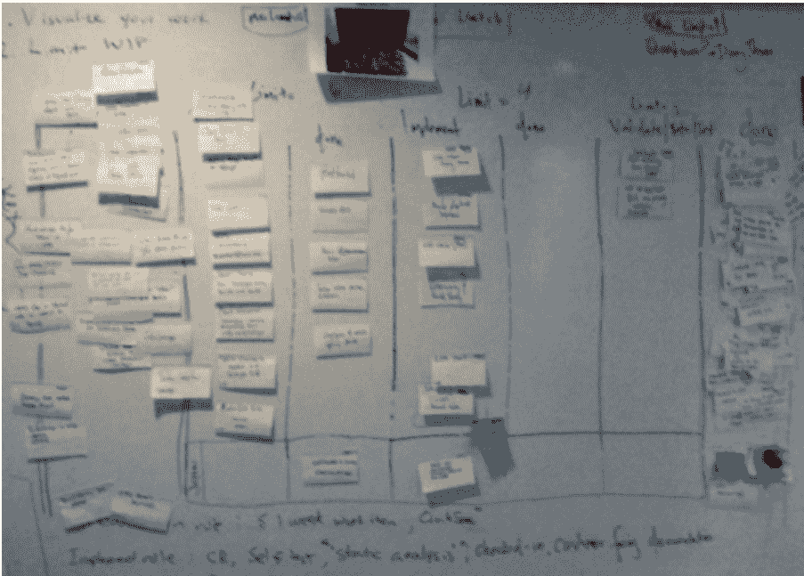
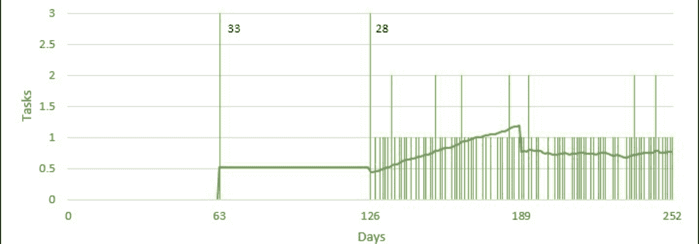
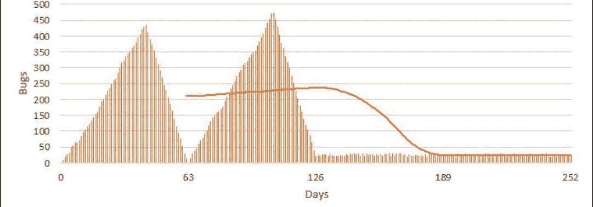
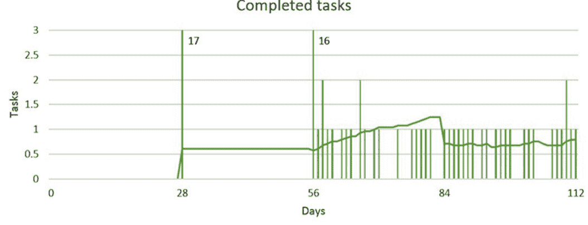
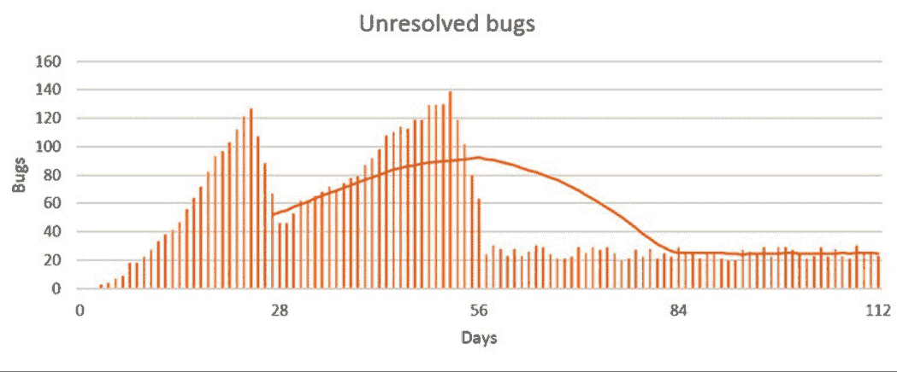
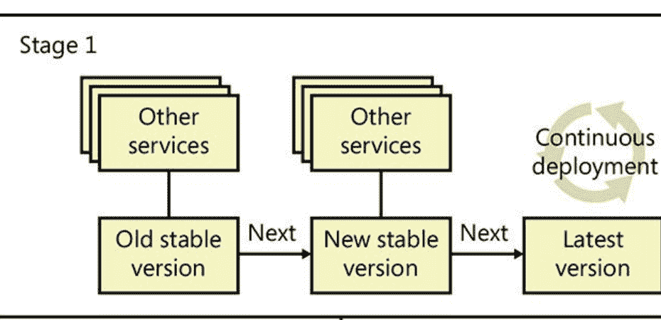
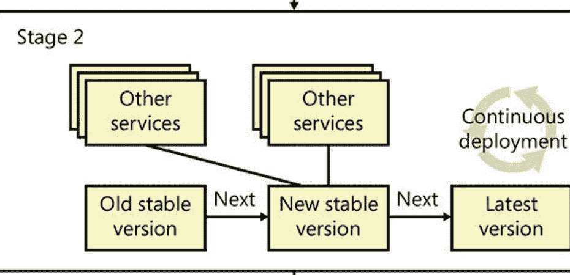
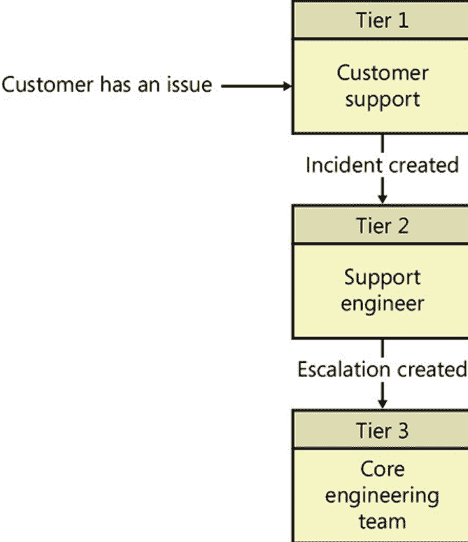

# Kanban敏捷项目管理（开发者最佳实践）

由 JAMES WALETZKY 贡献

收购编辑：Devon Graves  
开发编辑：Devon Graves  
项目编辑：Devon Graves  
编辑制作：Rob Nance, John Pierce 和 Carrie Keyes  
校对：John Pierce  
索引：Lucie Haskins  
封面：Twist Creative • 西雅图

## 《基于看板的敏捷项目管理》好评

“我有幸与 Eric 密切合作了多年。在这段时间里，他是 Xbox 效率最高、最一致且最有效的领导者之一。他对软件工程的哲学和方法是非常成功的。”
—Kareem Choudhry, Xbox 软件工程伙伴总

“Eric 能够轻松解释看板如何证明自己是管理和跟踪复杂工作的有效方法。然而，不要期望这本书是一本概述。Eric 总结了他在微软使用看板的深刻理解和经验，帮助你识别并避免实施看板时遇到的许多常见困难和风险。”
—Richard Haushausen, Accentient Inc. 总裁

“学习 Xbox 如何在其平台的大规模开发中使用看板，为该方法的有效性提供了真实的信誉。Eric Brechner 是一位实战派开发管理实践者，他直言不讳——来自一个以此为生计的人提供的稳实、实用、务实的建议。”
—David J. Anderson, Lean Kanban Inc. 主席

“作为一名软件开发教练，我不断寻找完美的参考资料，以务实地应用看板进行持续软件交付。最后，我的搜索结束了。”
—James Waletzky, Crosslake Technologies 伙伴

“看板在帮助我们 Xbox 团队在严苛的环境中管理变化的优先级和需求方面极其有效。《基于看板的敏捷项目管理》涵盖的概念为我们提供了日常工作的框架，为我们的客户提供他们应的高质量结果。”
—Douglas Thompson, Xbox Engineering首席计划经理

“对于那些想要交付高质量、可预测和灵活性软件的人来说，这是一本卓越的著作。Eric 在软件行业的深厚经验带来了一本真实的书籍，以简单易懂的方法教授看板。它是每位软件专业人士的必读！”
—Vijay Garg, Xbox Engineering 高级计划经理

## 关于作者

## 引言

献给 Corey Ladas，

我有幸与 Eric 密切合作了多年。在这段时间里，他是 Xbox 效率最高、最一致且最有效的领导者之一。他对软件工程的哲学和方法是非常成功的。

Eric 能够轻松解释看板如何证明自己是管理和跟踪复杂工作的有效方法。然而，不要期望这本书是一本概述。Eric 总结了他在微软使用看板的深刻理解和经验，帮助你识别并避免实施看板时遇到的许多常见困难和风险。

学习 Xbox 如何在其平台的大规模开发中使用看板，为该方法的有效性提供了真实的信誉。Eric Brechner 是一位实战派开发管理实践者，他直言不讳——来自一个以此为生计的人提供的稳实、实用、务实的建议。

作为一名软件开发教练，我不断寻找完美的参考资料，以务实地应用看板进行持续软件交付。最后，我的搜索结束了。

看板在帮助我们 Xbox 团队在严苛的环境中管理变化的优先级和需求方面极其有效。《基于看板的敏捷项目管理》涵盖的概念为我们提供了日常工作的框架，为我们的客户提供他们应的高结果。

对于那些想要交付高质量、可预测和灵活性软件的人来说，这是一本卓越的著作。Eric 在软件行业的深厚经验带来了一本真实的书籍，以简单易懂的方法教授看板。它是每位软件专业人士的必读！

我是一名软件开发者，已经工作了几十年了。我的工作始终在一个变化的环境中，优先级、需求和预期每天变化。我的同行也是如此，无论他们在哪里工作或生产什么。

我一直在寻找让我的生活更简单、更高率的方法。80 年代当我在 Bani、喷气推进实验室、Graftek 和 Silicon Graphics 工作时，我关注的是现在称为的设计模式和单元测试。90 年代，在波音开始在微软工作期间，团队和我尝试了瀑布里程碑、不同持续时间的稳定期、T 恤估算、断言、持续集成和代码审查。20 年代，我在微软尝试了团队软件流程、Scrum、代码检查、静态分析、规划扑克、结对编程和测试驱动开发。现在 10 年代，我发现了看板。

本书是关于你如何让你的团队复制我的成功。我已经做完了所有的

一直在不断尝试。我走过了所有的弯路。我筛选出了最重要的内容，并用通俗易懂的语言和简单直接的步骤为你呈现出来，以便让你直接获益。不要让你的同僚不读这本书、不使用看板，从而开始让你变得过时。采取我描述的简单步骤，开始生产客户喜爱的优质软件——高品质、准时且低成本。

### 谁应该读这本书

本书面向正在从事软件开发或渴望成为软件开发的专业人士。你可能从 20 世纪 60 年代就开始编写软件，或者刚刚从大学毕业。你可能是一家成熟软件公司或大型公司内部 IT 组织的一员，也可能是一个独立 App 或 Web 开发者。你可能是软件分析师、项目经理、程序计划经理、开发者、测试人员、项目负责人或开发经理。只要你是软件开发的认真实践者，你就会发现这本书深受启发且价值连城。

本书提供了务实且具有指导意义的步骤说明，教你如何在最短的时间内以最低成本、最高质量为客户创造最大的价值。我包含了图表、表格、统计图、工作表、真实的问答章节以及故障排除捷径，以阐明概念并引导你走向成功。书中还为想要从传统的瀑布模型进行适应或从 Scrum 演进的人准备了专门章节。

### 本书可能不适合你，如果……

尽管最后一章“更多资源”涵盖了看板及其他技术的基础理论，但如果你寻找的是深度参考资料，那么这本书可能并不适合你。学生、学者和顾问可能更倾向于通过其他文本对理论和实践进行深入分析。我在最后一章中建议了几个此类章节的内容。

### 本书的结构

本书遵循了一个功能团队（3–10 人）在学习看板时可能经历的进展过程：

- 第 1 章“获得管理层的认可”涵盖了获得使用看板许可和步骤（这是你开始之前的必要条件）。本章包含一封给你经理的开放信并附有一份示例建议书。
- 第 2 章“看板快速上手指南”只要你有现有的待办列表（`backlog`），就能让你在几天内上手看板。该章节还包含一个故障排除部分。
- 第 3 章“赶上截止日期”将帮助团队成员填充其待办列表，并估算项目所需的时间和资源。
- 第 4 章“从瀑布模型适应”和第 5 章“从 Scrum 演进”适用于目前使用传统瀑布模型或 Scrum 的团队。这些章节总结了使用看板的论点，提供了适应或演进到看板的步骤，并回答了团队可能产生的问题。这些章节及其真实的问答基于我将传统瀑布模型和 Scrum 团队引入看板的直接经验。
- 第 6 章“部署组件、应用和服务”侧重于将你通过看板产生的价值交付给客户——涵盖从持续集成到持续部署的所有内容。
- 第 7 章“在大型组织中使用看板”适用于在涉及数百或数千名工程师的项目中使用看板的团队，介绍如何将其融入并进行报告。
- 第 8 章“持续工程”是来自 James Waletzky 的特别贡献，讲述了如何应用看板进行软件发布后的维护。
- 第 9 章“更多资源及以后”提供了看板理论基础的概述，并涵盖了你可以如何改进前几章节描述的实践。本章为想要继续学习和演进的人提供了资源。

### 致谢

首先，我要祝贺微软出版社（Microsoft Press）三十周年。正是在雷德蒙的周年派对上，Devon Graves 找到我提议写这本书。非常感谢 Devon 的建议，我深感谢我的编辑 John Pierce，他对我文字的可读性和一致性出了贡献。

本书有六位评审员：David Anderson、Corey Ladas、Richard Haaland、James Waletzky、Doug Thompson 和 Vijay Garg。Doug 和 Vijay 目前在我的两个团队工作并每天使用看板。他们的反馈对于文本及其示例的清晰准确至关重要。James Waletzky 是一位热情的敏捷实践者。我们过去合作过，他的坦诚和批评指导了我的多年写作。James 以他卓越的风范，还提供了持续工程的章节（第 8 章）。Rich 较晚加入该项目，但提供了巨大的建议，并与敏捷项目管理服务建立了紧密的联系。总而言之，我认为如果没有深思的专家评审，无法产生有价值的设计、代码或评论。这本书之所以有价值，完全归于我那些卓越的评审员。

我想感谢 David Anderson 和 Corey Ladas。David 在整个职业生涯一直是项目管理技术领域的领导者。他是演进式改进看板方法的发明者。David 为全球的专业人士进行演讲和培训。自从多年前我们在微软首次合作以来，David 一直慷慨地分享他的时间和见解。David 对本书准确性、框架和语言的贡献是至关重要且广泛的。尽管奔波各地，David 仍花大量时间评审这项工作，对此我深表感谢。

Corey Ladas 对我的思维和职业的影响言言喻。Corey 向我介绍了 Scrum、公理化设计、TRIZ、质量矩阵以及许多其他技术。2007 年，Corey 邀请我来到 Corbis 观察他与 David Anderson 在那里开展看板工作。我立刻被迷住了。虽然我花了几几年才亲自尝试，但我立即将这项工作分享给尽可能愿意听的同行。Corey 是一个深邃的思考者，不断挑战现状。他无畏且毫不退缩。Corey 可能很严厉且反叛，但他总是诚实且富有洞察力。我很幸能称他为朋友。Corey 是这本书的灵感来源。

最后，感谢我过去的经理（Curt Steeb、Boyd Multerer 和 Kareem Choudry）让 Xbox 成为一个如此棒的工作场所，感谢所有经历过实验并分享我成功的团队成员，最重要的是，感谢我的妻子 Karen 和我的儿子 Alex 和 Peter，他们成就了现在的我。

## 来自 Microsoft Press 的免费电子书

从技术概览到特殊主题的深度信息，Microsoft Press 提供的免费电子书涵盖了广泛的话题。这些电子书提供 PDF、EPUB 和适用于 Kindle 的 Mobi 格式，您可以在此处处下载：

`http://aka.ms/mspressfree`

请经常回来查看最新动态！

## 我们想听取您的意见

在 Microsoft Press，您的满意度是我们的首要任务，您的反馈是我们最宝贵的资产。请通过以下链接告诉我们您对这本书的看法：

`http://aka.ms/tellpress`

我们知道您很忙，所以我们保持了简短，只有几个问题。您的回答将直接发送给 Microsoft Press 的编辑。（不会收集任何个人信息。）感谢您的参与！

## 保持联系

让我们继续交流吧！我们在 Twitter 上：`http://twitter.com/MicrosoftPress`

# 第 1 章 获取管理层的许可

本章描述了您如何使用看板（Kanban）以极高的效率、预测性和简单性来管理软件项目。看板可以帮助您比瀑布模型（Waterfall）、敏捷开发（Scrum）或几乎任何其他项目管理方法更快地为客户交付价值。它帮助您以高质量、准时且符合预算的方式交付价值，但在任何变化面前，即使是看板这样有效的工具，仍然可能惨遭失败。

在投入变革之前，请先获得管理层的许可。为什么？因为员工倾向于听命行事——直到这些员工意识到他们做其他事情实际上会获得奖励。告诉员工该做什么的人是经理。决定员工奖励方案的人也是经理。只有当管理层说“是的，你应该这样做”并在稍后奖励执行此事的员工时，变革才能成功。

因此，为了让您和您的团队成功采用看板，您必须首先说服管理层支持它，或者至少不阻碍它或不惩未使用它的成员。如果您是一名经理，仍然必须确保您的上级不会反对看板。

说服管理层进行变革（即使是好的变革）可能是困难的。正确的方法是提交一份提案，简要概述问题、解决方案、带有缓解措施的风险、成功或失败的标准以及未来的计划。

为了方便起见，我在本章中提供了一份提案样本，格式是给您经理的一封公开信。（您可以下载一份可编辑的电子版。详情请参阅书籍前言。）如果您的经理批准，您就可以充满心地继续进行。如果您的经理没有批准，即使在您解决了了他的顾虑之后，您也应该停止阅读并将书搁置，或者寻找一个新的经理。祝你好运！

涵盖的主题有：

- 给经理的公开信
- 向前推进
- 清清单

## 给经理的公开信

尊敬的先生/女士：

我们的团队希望使用看板来管理项目工作。本提案说明了变革的必要性、选择看板作为解决方案的原因、涉及的风险及建议的缓解措施，以及实施变化的计划。我们期待您对本提案的反馈，并在解决您可能有的任何疑虑后执行该计划。

### 问题

我们目前花费大量时间在与向客户交付价值无关的工作上。

- 我们参加了过多关于计划和流程的会议。
- 问题在发现、分析和纠正之前，会持续数周或几个月。
- 粗心的团队成员因纯粹的速度而受到奖励，鼓励他们产生昂贵的 Bug 并提交不完整的工作。
- 质量数周或几个月未受检查，导致了大量的重复工作。
- 由于需求变化和工作重新排序导致滞后，这迫使我们参加更多关于计划和流程的会议，并浪费了投入到废弃工作中的精力。

最终，我们的产品交付延迟、功能更少、质量更低且成本更高。我们过去一直接受这种结果，因为我们一直这样工作。然而，我们现在认为我们找到了一个简单有效的解决方案。

### 解决方案

看板是一种简单的项目管理技术，基于丰田的准时制（just-in-time）调度机制。使用看板管理我们的项目工作将允许我们将所有的时间和精力集中在为客户交付价值上。

- 看板仅在需要时召开计划会议，没有关于流程的特殊会议。
- 看板使项目工作流可视化，在出现瓶颈的当天将其凸亮出来，并强制团队成员立即解决问题或集思修复。
- 看板防止粗心的团队成员过早地将工作标记为完成。
- 看板最小化进行中工作（IP），让团队能够以极小的沉没成本适应新的优先级和需求，并允许团队准时交付。

看板不是万灵妙药。它不能解决所有问题。它能做的是简化项目管理；减少会议、瓶颈和重复工作的时间；更好地管理我们的产品质量；并使我们的客户价值吞吐更加顺畅、快速且可预测。

与任何工作变革一样，我们的团队需要几周时间来适应看板，需要几个月来掌握它。然而，我们将共同享受益处——以更低的成本准时交付更多功能和更高质量。

### 风险

任何变革都有风险。我们列出了看板的风险以及我们计划的缓解措施。

| 风险 | 缓解措施 |
| :--- | :--- |
| 团队适应新方法时，当前工作可能会受到干扰。 | 在新项目或里程碑开始时采用看板。 |
| 部分团队成员可能反对变革。 | 确保团队负责人和影响者同意尝试看板两个。 |
| 对新方法缺乏经验可能导致失败。 | 投资一名看板教练。 |
| 由于需求变化和工作重新排序导致滞后。 | 看板天生擅长处理需求变化。 |
| 状态和跟踪工具可能需要更新。 | 见。 |
| 需求问题可能影响实施。 | 看板在出现问题时表现良好。 |

### 计划

以下是我们计划的概述，分为四个阶段：

| 阶段 | 活动 | 持续时间 |
| :--- | :--- | :--- |
| 1 | 向团队负责人和影响者介绍看板（进行中） 获得两个月试期的同意 提前一个月向团队沟通采用计划 为团队提供看板资源和书籍 利用教练回答问题 | 1 个月 |
| 2 | 由顾问或团队专家培训团队看板 收集并组织工作积压 记录为客户生产价值的当前步骤 在团队位置制作看板 确定进行中工作（WIP）限制 为每个步骤建立完成标准 | 2 周 |
| 3 | 召开每日站会 每天向现有跟踪工具输入状态 跟踪生产率和 Bug 指标 利用顾问或团队专家回答问题 根据需要调整 WIP 限制和完成标准 | 1 个月 |
| 4 | 召开每日站会 每天向跟踪工具输入状态 跟踪生产率和 Bug 指标 庆祝性能提升 | 持续 |

每个阶段都取决于第一阶段的成功。成功取决于每个阶段活动的完成以及团队的持续参与。整体成功取决于相对于第一阶段基准的生产率和 Bug 指标的改进。

我们期待您对本提案的反馈，并在解决您可能有的任何疑虑后执行该计划。

诚挚地，

一个对为客户提供最大价值充满热情的团队

疑虑。

在解决了经理的疑虑后，你就可以按照信中描述以及后续章节详细说明的计划继续进行。对于瀑布流和 Scrum 团队，我包含了特定的章节，阐述了如何平滑地采用 Kanban。

## Xbox 内部

当我的团队切换到 Kanban 时，我并不需要管理层的许可。作为一名 Xbox 开发经理，我有权指定我的团队使用的方法。然而，我的团队需要使用 Xbox 全局跟踪系统来报告功能和 Bug 的进度。（我们起初使用微软内部系统 `Product Studio`，后来切换到 `Visual Studio Team Foundation Server` (TFS)，现在使用 `Visual Studio Online`。）在第 7 章“在大型组织中使用 Kanban”中，我讨论了如何无缝地将 Kanban 引入大型项目。

我曾与一些负责 Web 服务的 Scrum 团队一起使用 Kanban。我曾向所有团队介绍 Kanban，并询问他们是否有兴趣尝试。两个团队表现了兴趣，并且他们迅速调整了工作节奏以实现持续交付。这两个团队都非常喜欢 Kanban，并表示不会回到 Scrum。这两个团队都很快确定了许多在接下来的章节中你会读到的具体需求。

在我向团队引入 Kanban 八个月后，一次架构重组将我带到了全新的 Xbox 小组，从微软全球范围内招募了最擅长瀑布流的工程师。由于我们没有既定的做法，我简单地表示我的团队使用 Kanban。工程师们很快就接受了，只要他们遵循书中的核心原则，就可以根据自己的需求自由调整 Kanban。我在第 2 章“Kanban 快速上手指南”的“故障排除”部分记录了他们的许多调整。

## 检查清单

以下是在获得管理层使用 Kanban 的许可时需要采取的行动清单：

- 请求管理层许可使用 Kanban。
- 根据需要更新建议书、风险和计划。
- 将建议书发送给你的管理层。
- 根据需要为管理层提供 Kanban 评审以及实地操作体验。
- 解决你的管理层提出的任何疑虑。
- 建立生产力和 Bug 指标的基准。
- 执行你的行动计划，跟踪你在生产力和 Bug 指标上的改进。

# 第 2 章. Kanban 快速上手指南

Kanban 提供了一种简单的方法，能够按时、预算为客户交付高质量的价值。如果你已经有一组要完成的任务项（大多数团队都是如此），请使用本章立即开始。对于那些还没有任务项或需要组建团队的人，第 3 章“赶上期限”描述了如何规划你的项目并配置团队人员。

使用 Kanban 完成工作待办列表的快速上手步骤是：

- 步骤 1：记录你团队的高层常规工作
- 步骤 2：重新装饰你的墙板
- 步骤 3：为混乱设定限制
- 步骤 4：定义“完成”
- 步骤 5：运行你的每日站会
- 故障排除
- 检查清单

## 步骤 1：记录你团队的高层常规工作

团队成员从事许多类型的工作：

- 与合作伙伴、队友和客户讨论产品。
- 编写和回复邮件，参与相关的社交媒体。
- 寻找、评估并修复 Bug 以及运营问题（工单）。
- 跟踪反馈。
- 对产品和基础设施进行改进。

虽然所有这些工作都很重要，但 Kanban 主要关注最后一项也是最本质的项：对产品和基础设施进行改进。

Kanban 也可以管理某些特殊情况，例如：

- 为重大演示做准备。
- 编写建议书或主要设计文档，或者发布重大变更。
- 修复一个特别复杂的 Bug 或运营问题。
- 针对特别重要的反馈设计响应。

我将像处理改进一样处理这些特殊情况（更多细节请见本章的“故障排除”部分）。现在，让我们专注于产品和基础设施的改进。

你可能已经遵循一套用于产改进的高层常规工作流程。以下是我功能团队（3–10 人）使用的流程：

- 从待办列表中选取一个任务项
- 规定实现该项所需的工作
- 实现该项
- 验证其运行正常
- 将其交付给客户或合作伙伴

使用非常正式方法（可能是为了合规性）或正在进行深度设计的团队，可能会使用多个步骤来规范一个任务项。具有复杂流程或标准的团队可能会使用多个步骤来实施或验证一个任务项。请写下你的团队熟悉的步骤。

以下是几条可以让你的常规工作保持简单的准则：

- 仅包含你的团队执行的步骤。跳过项到达你团队之前发生的步骤（如其他团队的高层规划或规格说明）以及项交付给客户和合作伙伴之后发生的步骤。你可以合并团队并包含这些步骤，但为了这本快速上手指南，我们保持简单。
- 如果两个序列通常由同一个人完成，请合并这两个步骤。再次，你起初要保持简单。一个任务项的开发者通常会编写单元测试、实现代码并推动代码审查，只需将这些连续步骤统称为“实现”。一旦你的工作流变得顺畅，你可能想要重新检查每个步骤以进一步提高质量和吞吐量。第 9 章“更多资源及以后”有详细说明。
- 如果不确定，请使用我团队使用的步骤。这些步骤非常常见：规范、验证和交付。

## 步骤 2：重新装饰你的墙板

现在你已经记录了团队高层常规工作中的步骤，你需要将这些步骤贴在靠近团队所在地的看板板上。团队成员将使用这个看板板来实现进度可视化。Kanban 在日语中意为“看板”，这是一个非常恰当的翻译。

在团队所在地附近放置看板板带来了两个问题：

- 为什么不使用在线工具跟踪工作？可视化是 Kanban 的核心原则之一。如果不以直观的方式接触工作流，团队将无法发现问题。在看板板上操作卡片比电子操作更具参与感、更快且更简单。（对于大型组织，你的经理可以快速转换状态。）
- 团队是否应该坐在看板附近？通常，当团队成员距离较近时工作更快，这有助于更快速、更容易自发交流。根据我的经验，团队房间或隔间效果一样。如果你有选择，坐在物理看板旁边更好。选好看板位置后，是为每个步骤构建两列，并在左侧留出一个双宽列作为工作待办列表。每个步骤的列应与卡片（便利贴或索引卡）同宽。你可以使用胶带或标记笔划分列。你的看板可能如下所示：

| 待办列表 | 规范工作 | 实现它 | 验证它 |
|---|---|---|---|

回顾我的团队使用的常规步骤，注意第一步和最后一步的处理方式是不同的。

- 第一步“从待办列表中选取一个任务项”被一个待处理工作区域所取代。待办列表中的卡片按你希望处理项的顺序排列（团队可以随时重新排序卡片）。当团队准备好处理下一个项时，取出顶部卡片。第 3 章描述了如何填充和排序待办列表。
- 中间步骤——规范、实施和验证工作——每个步骤分为两列。每个步骤的左列持有活动卡片（正在被规范、实施或验证的项）。每个步骤的右列持有已完成该步骤的卡片（已完成规范、实施或验证的项）。
- 最后一步“将其交付给客户或合作伙伴”没有显示，因为该操作通常由独立流程批量处理，例如集成到大项目的主分支或部署到 Web 服务。我在第 6 章“部署组件、应用和和服务”中对最后一步进行了详细讨论。

这里我其中一个团队早期使用的真实看板。我们对在制品工作（WIP）限制的处理变得越来越精细，并在项目后期的“实施”（Implement）阶段增加了一个“跟踪”（Track）列。我将在本章稍后部分描述这些技术。

我知道这张图片很模糊且难以阅读，但为了保护机密。左上角是看板的基：“可视化你的工作”和“限制 WIP”。顶部中间是一张枫糖浆蛋糕的网络照片，团队决定将其作为完成当前项目的庆祝奖励。最左侧的列是待办工作列表（backlog），后面是一对“规格”（Specify）列（隐藏在便利签贴后面），然后是一对“实施”（Implement）列和一对“验证”（Validate）列。请注意写在每对列上方的 WIP 限制（将在下一节描述）。每个步骤的完成规则写在白板的底部。

## 步骤 3：为混乱设定限制

项目管理的很大一部分是限制团队工作中固有的混乱。这一步如此重要，以至于你通常可以通过一种项目管理方法论如何限制混乱来识别其精髓。

- 在传统的瀑布法中，混乱通过提前指定所有工作、执行正式的变更请求程序以及在预定的里程碑处同步团队间的工作来限制。
- 在 Scrum 中，混乱通过计划受时间箱限制的冲刺（sprints）、在下一次迭代之前推迟计划变更，以及在每次迭代结束时与客户同步来限制。
- 在 Kanban 中，混乱通过直接限制在制品（WIP）的数量来限制——从字面上说，就是每个步骤允许的便利签卡数量。简单却有效。

Kanban 中的 WIP 限制在控制混乱方面起着本质作用。首先，它们限制了受优先级、需求或设计变更影响的工作量。这让你的团队能够快速响应，其次考虑放弃。WIP 限制限制了工作流，使其与最慢步骤（也称为“瓶颈”）的速度匹配。因为你不可能比最慢步骤更快完成工作，因此调整其他步骤的速度以与之匹配可以产生最大的效率和生产力。（详情请见第 9 章。）

你希望使用尽可能小的 WIP 限制，同时仍让你的团队完全投入于为客户交付价值。

- 从最慢步骤的 WIP 限制开始，将其设置为执行该步骤的团队人数加上 50% 的缓冲区。这始终让最慢步骤保持忙碌，同时限制了该步骤的便利签数量。
- 然后使用比例设置其他步骤的 WIP 限制，使它们的吞吐量与最慢步骤匹配。
- 结果是初始值，你可以根据需要不断调整以实现吞吐量最大化。

这是一张包含我以前某个团队数值的工作表。（你可以下载带有公式的在线 Excel 表格。）

| A | B | C | D | E |
|---|---|---|---|---|
| 确定 WIP 限制 | | | 填充黄色亮的单元格 | |
| 步骤 | 规格 | 实施 | 验证 | |
| A: 每人每月平均速率 | 6 | 2 | 3 | |
| B: 最慢速率（A 列最小值） | | 2 | | |
| C: 分配到步骤 B 的人数 | | | 3 | |
| D: 步骤 B 的吞吐量 (B *) | | | 6 | |
| E: 匹配 B 吞吐量所需人数 (D / A) | 1 | 3 | 2 | |
| F: WIP 限制 (E * 1½ 向上舍入) | | 2 | 5 | 3 |

对于示例中的团队：

- 平均而言，每个团队每月可以规格六项任务，每位开发人员每月可以实施大约两个，每位测试人员每月可以验证大约三个任务。（由于你在这里使用的是比例，如果更容易，也可以按周或按天计算。）
- 实施是最慢的步骤（每人每月两个）。
- 团队有三名开发人员正在实施待办列表中的任务。
- D 吞吐量为每月六项（2 * 3）。
- E 将该吞吐量除以每个步骤的平均速率，即可得到每个步骤匹配每月六项任务所需的人（一名分析师、三名开发人员和两名测试人员）。
- 在这些人数总和的基础上增加 50% 并向上舍入，即可得到每个步骤的 WIP 限制（规格为 2，实施为 5，验证为 3）。

工作表中的 WIP 限制是很好的初始值。可以随时调整限制以使团队输出和敏捷性最大化。本章的“故障排除”部分描述了何时以及如何调整 WIP 限制以获得最佳结果。

在看板的每个步骤旁边写 WIP 限制非常方便，如下所示：

| 待办列表 | 规格 | 实施 | 验证 |
|---|---|---|---|
| | (2) | (5) | (3) |

注意 WIP 限制适用于每个步骤活动和完成卡片的总数，最后一个步骤除外，最后一个步骤的活动卡数量有限，但完成卡数量无限。（当项目通过验证后，它们就完全完成了，基本上就离开了白板。）

在微软，团队的项目经理也是其业务分析师。我们把这种角色称为项目经理（PM）。虽然由一个人担任两个角色可能是高效的，但如果 PM 在某个领域较弱，可能会导致问题。对于大型项目（100 人以上），这两个角色被拆分，由专门的发布经理承担项目管理职责，而功能团队 PM 主要担任分析师，并负责面向客户的文档（有关 DevOps 的详情请见第 9 章）。越使用 Kanban，对协作、效率和持续交付价值就越好。

## 步骤 4：定义完成

Kanban 通过一种看似简单的机制来监管质量。在便利签卡从步骤的左侧移动到右侧之前，其工作必须通过某些规则——即该步骤的“完成”定义（也称为拉取准则）。每个步骤使用两列看似过度，但它产生了巨大的影响。

- 步骤中的项目计入步骤限制（最后一个步骤除外）。记住，你想通过最慢步骤来管理吞吐量。因此，如果实施耗时很长，你可以在规格步骤中有两个项目，并且不允许规格更多工作。这是好事。你不应该让实施负载，你应该帮助解锁实施。更多信息见本章的“故障排除”部分。
- Kanban 区分了完成一个步骤和开始另一个步骤。当然，这些总是两个不同的事情。然而，用于 Scrum 或其他每日会议的看板通常在项目完成后将其移动到下一个步骤，丢失了“准备好进入下一个步骤的项目”与“处于下一个步骤的项目”之间的重要区别。
- 将一个步骤的结束与另一个步骤的启动分离解耦了步骤。这让你自由定义完成每个步骤的含义，无论下一个步骤是什么。

步骤解耦后，你的团队需要为每个步骤定义“完成”。我强烈建议你作为一个团队共同定义这些准则，并所有人承诺遵守这些定义。这里是我另外一个 Xbox 团队的示例（你可能早些注意到他们看板底部的规则了）。

- 规格完成规则：所有项目都已拆分为可以在一个周内完成的任务，并为每个项目都完成了快速规格说明。
- 实施完成规则：代码已通过评审和单元测试，静态分析通过，代码已签入，验收测试通过，面向客户的文档已完成。
- 验证完成规则：工作已部署到生产环境并由大部分真实客户进行测试。所有发现的问题已解决。

这些规则还带有一些最佳实践：

- 在团队成员将便利签卡从步骤的左侧移动到右侧之前，一位团队成员应该检查是否满足“完成”（done）规则。正是这些约定的规则驱动了每一步的上游质量，并防止懒散或粗心的团队成员利用未完成的工作取功，而负责的团队成员必须在之后完成并修复它们。只有当团队成员相互监督遵守规则时，规则才能发挥作用。

在看板底部列出规则可以提醒团队成员应用这些规则，并为讨论团队决定完成哪些规则提供一个中心场所。

## 步骤 5：进行每日站会

现在你已经定义了“完成”的含义，你的团队已经准备好使用看板了。有了填充好的待办列表，不再需要计划会议。没有里程碑，没有冲刺，也没有回顾。只要有工作要做，看板就会持续流动。

自然地，你仍然可以随时聚集团队进行设计评审、演示、客户评审以及关于产品和流程改进的讨论。然而，Kanban 通常唯一的会议就是团队看板前的每日站会。

任何团队成员都可以主持每日站会。我团队的项目经理通常负责这样做，因为这有助于他们更新 Xbox 在线跟踪工具。要求的议程项目是询问是否有团队成员受到阻塞或其他需要协助，并指派人员（通常是项目经理）解决问题。经验丰富的团队可以在五分钟内完成任务。

我的团队也喜欢利用每日站会了解其他成员在做什么，并庆祝他们共同取得的进展。这让会议变得稍微长了一些，但建立了共同的自豪感和所有翁意识。

作为一个站会的示例，我假设团队只在站会期间移动卡片（这不是最高效的流程，但容易解释）。实际上，任何团队成员可以在任何时间移动任何卡片，只要这种移动没有超过 WIP（制品中）限制并满足“完成”规则即可。同样在实际上，我的团队是男女混合的，但我默认使用男性代词。

开始，假设看板是这样的：

| Backlog | Specify (2) | Implement (5) | Validate (3) |
|---|---|---|---|
| □ | □ | □ | □ |
| □ | | □ | □ |
| □ | | □ | □ |

待办列表中有七项计划项目。有一个项目正在进行规格化，有一个项目已完成规格化（已拆分为四个较小的项目，显示在同一行）。有三个项目正在积极实施，有两个项目已准备好进行验证。最后，有三个项目正在积极验证。可能有一堆卡片已完成验证（最后一步），但它们不计入最后一步的 WIP 限制。（我的 Xbox 团队之一用完成的卡片为一名团队成员的办公室贴墙，在他休假回来时给他惊喜。）

每日站会开始，项目经理从最后一步开始，打开已完成的槽位，并向左移动。（由于 WIP 限制，项目只有在有空间的情况下向右移动。从左侧拉取卡片使 Kanban 成为“拉式”系统）。

项目经理指向最后一步验证（Validate），并问：“有完成验证的项目吗？”团队成员说有两个项目已完成。其他团队成员通过问题检查验证规则，例如“涉及了多少客户？”当团队感到满意时，团队成员高兴地将这两个项目移动到最后的“完成”（Done）列——为客户交付了更多价值！

| Backlog | Specify (2) | Implement (5) | Validate (3) |
|---|---|---|---|
| | | | |
| | | | |
| | | | |

由于完全完成的项目不计入最后一步的 WIP 限制，因此还有空间验证另外两个项目。团队成员从实施（Implement）步骤的完成列拉取两张卡片，决定谁做哪个项目，然后在所选卡片上写上名字。

> **要点**
>
> 工作项目的分配是“即时”的。这避免了由于之前分配的团队成员在任务准备就绪时很忙导致项目阻塞。（本章的“故障排除”部分有更多细节。）

| Backlog | Specify (2) | Implement (5) | Validate (3) |
|---|---|---|---|
| | | | |
| | | | |
| | | | |

接下来，项目经理询问是否有任何实施项目完成。一个团队成员说有一个项目已完成，另一个团队成员说：“没错，我执行了代码审查，检查了单元测试和静态分析，面向客户的文档看起来很好。都已提交了。”团队成员将完成的项目移动到实施步骤的右侧。

| Backlog | Specify (2) | Implement (5) | Validate (3) |
|---|---|---|---|
| ☐ | ☐ ☐ ☐ | ☐ ☐ | ☐ ☐ |
| ☐ | | | ☐ |
| ☐ | | ☐ | |
| ☐ | | ☐ | |

实施（Implement）步骤仍有两个空位（因为有两个项目移动到了验证），所以团队成员从规格化（Specify）步骤的完成列拉取前两个项目，决定谁做哪个工作项目，然后在所选的卡片上写上名字。

| Backlog | Specify (2) | Implement (5) | Validate (3) |
|---|---|---|---|
| ☐ | ☐ ☐ | ☐ ☐ | ☐ ☐ |
| ☐ | | ☐ ☐ | ☐ |
| ☐ | | ☐ | |
| ☐ | | ☐ | |

现在，项目经理询问分析师是否已完成其正在活跃的项目的规格化。分析师说他已经完成了该项目的规格化，并感谢团队成员对待实施项目（该项目已拆分为三个任务，需要几天时间完成）。由于规格化步骤已达到 WIP 限制，分析师无法从待办列表顶部拉取另一个项目。

| Backlog | Specify (2) | Implement (5) | Validate (3) |
|---|---|---|---|
| ☐ | ☐ ☐ | ☐ ☐ | ☐ ☐ |
| ☐ | | | ☐ |
| ☐ | | ☐ | |
| ☐ | | ☐ | |

项目经理询问是否有人根据新请求或需求更改待办列表的顺序。经过简短讨论，增加了一个新项目，两个项目交换了位置。

| Backlog | Specify (2) | Implement (5) | Validate (3) |
|---|---|---|---|
| | | | |
| | | | |
| | | | |

最后，项目经理询问是否需要额外帮助。（记住，这是站会的唯一要求。我描述的一切适用于任何时间。）项目经理特别关注实施，因为分析师在几个项目完成实施之前一直处于阻塞状态。团队成员提到了一些需要解决的问题，分析师提供帮助。

每日站会结束，大家回到工作。整个过程花费不到 15 分钟。项目经理留下来将项目状态输入组织的跟踪工具，然后处理站会期间提出的问题。

## 故障排除

每日站会进行得很顺利，只有一个小插曲（需要帮助实施工作，因为没有更多项目可以进行规格化）。然而，会发生各种情况，引发许多问题。本节涵盖了许多常见问题。我将从示例问题开始，“当中间步骤达到 WIP 限制且所有项目已完成时会发生什么？”

### 问题：由于中间步骤的所有项目已完成而被阻塞

在示例中，分析师被他的步骤（规格化）阻塞了，该步骤的 WIP 限制为二，他完成了两个项目，但实施（Implement）步骤还没有准备好接收。看板如下：

| Backlog | Specify (2) | Implement (5) | Validate (3) |
|---|---|---|---|
| | | | |
| | | | |
| | | | |

这种情况也可以发生在最后一步以外的任何步骤（最后一步是无限）。分析师应该怎么做？

- 他可以规格化待办列表中的项目，但这样做并没有帮助；这为团队创造了更多实施工作，而团队已经达到了实施限制。在没有帮助的情况下，团队无法变得更快。是的，下一个项目。

在待办列表（`backlog`）中的项目最终可能需要指定，但这会将问题推迟到以后，并没有解决问题，甚至可能在优先级发生变化时导致工作被白费。

- 分析师最好的做法是帮助实现（下一步）。他可以自己实现某些项目。他可以协助解决设计或实现上的问题。他可以进行一些研究，或者与合作伙伴团队合作以加快实现速度。

- 如果分析师不再需要帮助实现，他仍然可以通过早开始客户研究、高级规划或开发新工具来保持高效。总会有不损害团队的产出性工作可以做。

## 问题：前一个步骤没有完成项目时被阻塞

假设你的看板如下所示：

| 待办列表 (Backlog) | | 规格 (2) | | 实现 (5) | | 验证 (3) | |
| --- | --- | --- | --- | --- | --- | --- | --- |
| ☐ | | ☐ | | ☐ | | ☐ | |
| ☐ | | | | ☐ | | | |
| ☐ | | | | ☐ | | | |
| ☐ | | | | | | | |

验证步骤已经准备好接收新项目（上一个步骤的“完成”列不计入其 WIP 限制）。然而，实现步骤没有完成的项目。执行验证步骤的测试人员被阻塞了。他们应该怎么办？

就像分析师被阻塞时一样，测试人员最好的做法是帮助实现（上一个步骤）。他们可以实现某些项目，协助解决设计或实现问题，或者与合作伙伴团队合作加快实现速度。他们甚至可以为开发团队买午餐——任何所需的帮助。

如果测试人员没有办法帮助实现，他们仍然可以通过分析漏洞或使用模式、运行实验或改进工具来保持高效。总会有不损害团队的产出性工作可以做。

## 问题：某个项目的某个步骤花费的时间比常长

虽然不同的步骤所需的时间和精力不同，但理想情况下，每个步骤对每个项目都应该花费大约相等的时间。这就是为什么第一步是将大项目拆分为尺寸相似的小项目。然而，波动是客观存在的，有时某个步骤对某个特定项目可能会花费异常长的时间。

如果某个项目的某个步骤似乎花费了很长时间，团队成员应该检查发生了什么。

- 也许负责该项目的人被阻塞了或需要帮助。

- 也许该项目应该进一步拆分为更小的项目。

- 也许需要分配更多的设计工作。

- 也许负责该项目的人正在不恰当地扩大项目的范围。

- 也许存在一些重大的未解决的漏洞。

无论原因如何，项目应该始终以相当规律的速度向前移动。无论问题是什么，团队都应该尽快解决。我将在本节稍后的部分详细介绍一些特定情况。

## 问题：频繁被阻塞

如果团队或工作项目经常看起来被阻塞，你的团队可能需要调整规格步骤、WIP 限制、人员分配或其他变量。采取的适当行动取决于症状。

如果由于项目大小差异导致通过步骤的流量不均，请确保你的第一步（通常是规格或拆分）将项目拆分为大小相似的任务。团队成员可以审查项目拆分情况，以确保结果合理一致。

如果某个步骤仍然在“工作充足”和“无工作”之间反复波动，请将该步骤的 WIP 限制增加一个（增加额外的缓冲区来处理波动）。

如果某个步骤很慢，且前后的步骤不断被阻塞，你有几个选择：

- 对该步骤缓慢的原因进行根源分析。这可能意味着为缓慢步骤分配更多的人、改进工具或规范、为人们提供更快的计算机或任何有助于解决问题的措施。（更多细节请参见第 9 章。）

- 将缓慢步骤前后步骤的 WIP 限制减少一个。这样做为某些团队成员腾出了时间，他们应该被分配到缓慢步骤或其他项目中。（最小 WIP 限制为一。）

- 如果分配到缓慢步骤的团队成员大部分处于空闲状态，则将缓慢步骤的 WIP 限制增加一个。然而，要确保这是真实问题——增加 WIP 限制应该是最后的手段。

如果某个步骤很快且始终似乎有“完成”列，请将该步骤的 WIP 限制减少一个。（最小 WIP 限制为一）。分配到快速步骤的团队成员将会有额外时间在其他项目上进行产出性工作。

## 问题：等待外部输入而被阻塞

项目经常在中间被阻塞，等待外部评审、依赖项、问题、批准或其他来自团队之外的输入。对于我的 Xbox 团队，这种情况经常发生在实现步骤。

为了处理这个问题，我们在实现步骤的中间添加了一个“跟踪”（Track）列。

| 待办列表 (Backlog) | 规格 (2) | 实现 (5) | 验证 (3) |
| --- | --- | --- | --- |

每当项目被阻塞等待外部输入时，就会移动到跟踪列。被跟踪的项目不计入实现步骤的 WIP 限制。我们在每次每日立会上讨论它们的状态，直到它们不再阻塞。当一个被跟踪的项目不再阻塞时，一旦有空位，它就会回到“活动”（Active）列。逻辑是，实现步骤中的任何项目优先级都高于规格步骤中的下一个项目。（我将在[第 7 章，“在大型组织中使用看板”]中讨论处理延迟或不稳定依赖项的其他方法。）

偶尔，会发现某个项目将被无限阻塞。我们在看板的角上为这些项目留了一个特殊区域。我们称其为“停车场”（parking lot）。每隔几周，我们会检查停车场项目的状态，但我们不会每天检查。

## 问题：漏洞影响团队

项目经常在中间被阻塞，等待外部评审、依赖项、问题、批准或其他来自团队之外的输入。对于我的 Xbox 团队，这种情况经常发生在实现步骤。

为了处理这个问题，我们在实现步骤的中间添加了一个“跟踪”（Track）列。

| 待办列表 (Backlog) | 规格 (2) | 实现 (5) | 验证 (3) |
| --- | --- | --- | --- | --- |

每当项目被阻塞等待外部输入时，就会移动到跟踪列。被跟踪的项目不计入实现步骤的 WIP 限制。我们在每次每日立会上讨论它们的状态，直到它们不再阻塞。当一个被跟踪的项目不再阻塞时，一旦有空位，它就会回到“活动”（Active）列。逻辑是，实现步骤中的任何项目优先级都高于规格步骤中的下一个项目。（我将在[第 7 章，“在大型组织中使用看板”]中讨论处理延迟或不稳定依赖项的其他方法。）

偶尔，会发现某个项目将被无限阻塞。我们在看板的角上为这些项目留了一个特殊区域。我们称其为“停车场”（parking lot）。每隔几周，我们会检查停车场项目的状态，但我们不会每天检查。

## 问题：影响团队的漏洞

软件开发很容易出现漏洞，即使有严格的规则。通常，处理漏洞或故障是日常工作的一部分，这些工作需要规格、实现和验证。

> 如果所有工作都是处理漏洞或故障，Kanban 是一种极佳的方法来管理这些漏洞或故障。更多细节，请参见[第 8 章，“持续工程”]。

## 问题：项目需要设计工作

有时待办列表中的项目非常复杂，以至于分析师需要额外时间来规格和拆分。这通常涉及一些用户设计、架构设计以及实验设计（我在第 9 章中详细介绍了这一点）。设计工作本身就是一个任务，因此我们在看板上将其单独处理。

设计工作的规格步骤是将工作拆分为更小的任务。设计的实现步骤是创建设计。验证步骤是评审设计并获得批准。当设计完成后，它会产生新的待办项目。

是的，将设计工作像处理产品工作一样处理有些牵强。理想情况下，你应该使用带有特定步骤的看板来进行设计工作。如果团队被分配到设计，或者你想为设计工作使用泳道（更多细节请见第 9 章），你应该这样做。

# 备注

不需要为了新工作、计划变更或更新的需求而安排特殊的计划会议。

## 问题：任务需要分配给忙碌的团队成员

有时，由于某个团队成员的专业知识或过去的经验，某些任务特别适合该成员。如果该成员正忙于其他任务或无法可用，你有几种选择：

- 将任务分配给其他人，并让首选的团队成员进行评审和监督。这是在团队中传播知识并为首选成员备份的极佳选择。（你永远不希望某一个人成为瓶颈。）

- 将首选团队成员当前的工作重新分配给其他人。

- 将卡片移动到“跟踪”（Track）列，直到首选团队成员有空。

- 降低该任务在团队中的优先级。

## 问题：某些团队成员喜欢一次处理多个任务

当你按照每个团队一个任务、外加 50% 缓冲量的进度进行工作时，人们基本上一次只被分配一个工作任务。一次处理一个任务可以避免昂贵的上下文切换，并使你的注意力集中。如果你遇到卡壳，还有邮件或其他工作可以做。

然而，有些人习惯于处理一组相关的工作。虽然从最小化在制品量（WIP）的角度来看，这并不理想，但适应不同的工作风格对于具有凝聚力的团队是重要的。如果你的团队有这样的人，请将该步骤的 WIP 限制增加一或两个（一次给他们提供 2-3 个任务）。这并不理想，只有当该人的生产力受到较低 WIP 限制的负面影响时才应使用。

## 问题：没有时间改进工具和自动化

客户、合作伙伴和管理层的要求可能很严格。在这些需求下，很难找到时间来改进团队的工具和自动化。然而，正是这些基础设施的改进让你能够以更短的时间更高的质量交付更多工作（就像看板管理一样）。

解决方案是将工具和自动化改进放在便签卡上，就像你处理产品改进那样，并相应地在待办列表（backlog）中排序。每 10 个任务中应该有 1 或 2 个是基础设施改进——毕竟，改进空间永远存在。

## 问题：新成员加入团队

当新成员加入团队时，可能需要调整 WIP 限制。理想情况下，该人员被分配到最慢的步骤（增加其吞吐量）。如果是这样，只需再次执行“步骤 3：对混乱设定限制”中描述的过程。如果新成员被分配到不同的步骤，她将会有空闲时间或释放同事。可以通过帮助其他项目来明智地利用时间。记住，你的速度无法超过你最慢的那个步骤。

## 问题：团队在站会期间进行长时间的设计讨论

每日站会通常持续 5–15 分钟。有时团队在处理新任务或处理阻塞问题时会进入设计讨论。简短的概述是可以的，但长时间讨论应该在不同的时间进行。我团队的一些成员会在每日站会后预订一小时的会议室进行设计讨论。他们不是每天都用，但在需要时会用。

## 问题：某些团队成员无法参加站会

有时团队成员无法参加每日站会。也许他们那天正在居家办公或正在出差。团队成员可以随时要求其他团队成员移动便签卡。他们也可以将状态发送给项目经理，通过电话参加站会，或使用在线会议。

如果你的团队成员分散在很远的地方，将需要使用虚拟白板和在线站会。

## 问题：团队过度关注流程细节

某些团队成员可能对流程非常有热情。为了追求纯粹性、以“正确的方式”做事，或简单地遵守他们认为的“硬性规则”，团队可能会过度关注流程细节，而不是向客户交付高价值的成果。这些团队成员可能认为，精确地遵守规则和实践对于向客户交付高价值的内容是必要的。

对于一个开始使用看板的团队来说，遵循书中的规则和指南是重要的。然而，随着时间的推移，你的团队将内化“工作可视化”和“限制在制品”的方法。团队成员会自然地聚集到阻塞的步骤，并避免同时处理过多任务。在那个时候，灵活性是高效的重要组成部分。

你不希望在质量上妥协，但你应该信任你的团队以最符合其构成和当前需求的最佳方式运行。如果你发现质量或效率大幅下降，你可以随时回到更严格的方法。

## 检查清单

这里有一个快速开始使用看板的操作清单：

- 将你团队的高层常规工作记录为一系列步骤。

- 如果你不确定，请从“指定”（Specify）、实施”（Implement）和“验证”（Validate）这些步骤开始。

- 重新装饰你的墙板，制作一个带有待办列表（Backlog）列和每个步骤两列的看板。

- 设定混乱限制，限制每个步骤的最大工作任务（卡片）数量。这些被称为在制品（WIP）限制。

- 为每个步骤定义“完成”（done）规则，工作任务（卡片）在从该步骤的“活动”（Active）列移动到“完成”列之前必须满足这些规则。

- 每天在固定时间举行每日站会，关注阻塞工作进展的问题（阻止卡片在列之间移动的问题）。

- 根据需要，用团队的当前状态更新组织的跟踪系统。

- 根据需要，调整 WIP 限制和完成规则，以确保高质量的工作流畅地通过你的看板。

- 根据需要，在“活动”列和“完成”列之间添加一个“跟踪”（Track）列，以跟踪阻塞依赖项实现的外部输入。

- 根据需要，在待办列表中添加新任务（卡片）并重新排序。

# 第 3 章。击中截止日期

看板高效、高质量交付价值的简单方法提供了你按时、按预算交付价值所需的预测调度和人员数据。

看板通过限制在制品（WIP）提供预测性——这是它用来控制混乱的技巧。正如我在第 2 章《看板快速上手》中描述的，审慎地限制 WIP 让你的团队能够快速响应变化并防止问题扩大，让你的价值交付更加流畅、持续。

限制 WIP 约束了团队规模（你的成本），并缩短了周期时间（计划任务从规范到验证的时间）。周期时间有利于质量、敏捷性和客户参与。它还能让你准确衡量吞吐量，从而准确估计完成日期。

以下章节将帮助你规划项目和配置人员：

- 填充待办列表

- 建立最小可行产品（MVP）

- 任务排序，包括技术债

- 估计功能和任务

- 跟踪预计完成日期

- 团队定价

- 检查清单

## 填充待办列表

如果你的功能团队（3–10 人）是更大工作的一部分，且待办列表由内部合作伙伴或客户决定，那么填充待办列表是非常容易的。在这种情况下，只需将你需要完成的每个功能、改进和任务的描述性名称写在单独卡片上，然后将便签卡放在待办列表列。（你将在稍后的步骤中对其进行分类排序。）你就完成了。

如果你的团队自己决定工作待办列表，你需要进行一些产品规划。产品改进（对团队的需求）来自两个来源：

- 你的客户：通过埋点学习的使用模式、在线的实验、通过论坛获得的反馈以及从客户支持跟踪的问题，你可能有一份潜在的产品改进列表。将每个改进的描述性名称写在单独卡片上，然后将卡片放在待办列表列。为了方便以后排序和识别卡片，你可以在卡片的角落放置 U、X、F 或 S 来指示其来源：分别代表使用（usage）、实验（experiment）、反馈（feedback）和支持（support）。

你的业务领导层可能对他们想要改进业务有想法，即使你是为他们工作。你的团队，以及你的内部外部合作伙伴，可能对想要添加的优秀新功能、技术以及想要修复的漏洞有自己的想法。为每个想法在单独的卡片上写一个描述性名称，并将卡片放在“待办列表”（Backlog）列。为了方便以后排序和识别卡片，你可以在卡片的角上标记 L、TF、PF 或 B，分别表示其来源：领导层、团队功能、合作伙伴功能和漏洞。

到目前为止，你的待办列表中应该已经有太多的卡片了。接下来的几页将帮助你对它们进行分类。

## Xbox 内部

我的一些 Xbox 团队参与了大型项目，他们的高级功能待办列表基本上是由产品范围的规划决定的。然而，我的团队会向其待办列表添加设计细节、漏洞、基础设施改进和特定的支持问题。

功能的顺序是在季度规划日上与我们的同事团队共同决定的。

- 我们在墙上贴出每个团队待处理的高级功能，并被……阻塞了。

- 然后团队会通过“实地走访”来检查依赖项的时间问题，或者质疑每个月到底能容纳多少内容（考虑到假期、活动和其他考量）。

- 接下来是“快速约会”。每个团队都可以报名与其他任何团队会面 15 分钟，以讨论冲突和排序。我们通常会进行三到五轮快速约会，直到解决所有冲突。

- 然后在合并后的团队同意计划（如果没有异议）之前，是时候最后一次机会查看一遍更新后的墙了。

一旦计划确立，功能就会按顺序转移到团队的待办列表中。高级功能在完成“详细说明”（Specify）步骤时被拆解为任务，并迅速准备就绪。

我的一些 Xbox 团队作为孤立的服务团队工作。我们根据客户和合作伙伴的请求、领导层的请求以及团队的改进建议来构建他们的待办列表。因为不需要与其他团队进行协调。

我在第 7 章“在大型组织中使用看板”中提供了更多关于此类体验的细节。

## 建立你的最小可行性产品 (MVP)

如果你运行的是持续部署的服务或运营团队，且你只需要对迁入的工作进行排序，那么可以跳过本节。否则，你可能正在参与产品发布（首次发布或更新），并需要确定你的最小可行性产品 (MVP)。

为了对待办列表进行排序，你的 MVP 是待办列表中在发布前必须完成的工作项（注释卡片）。也就是说，无论金钱或市场影响如何，如果这些工作项未完成，你可能会延迟或取消产品发布。（有关建立 MVP 的详细信息可以在网上和从各种来源找到）。

如果你对自己和你的领导层诚实，那么构成 MVP 的工作项仅占总待办列表的极小比例。有些项是你**应该**拥有的，有些是你**想要**拥有的，有些是你并不在乎的。这些项都不在 MVP 中。MVP 中的唯一项是你**必须**拥有的。通常情况下，MVP 项目是客户在尝试每个产品之前期望的基础功能，再加上足以确定你的新版本具有吸引力的差异化特征。

提示

> 定义一个你优先于一切的真实 MVP 是按时完成截止日期并避免未使用规格、不完整且未测试的功能以及未使用测试的极佳方法。你会按时完成任务，是因为 MVP 仅占待办列表的一小部分，但一旦 MVP 完成，你就有了一个可以发布的产品。你将避免未完成的工作，因为你在 MVP 项目上做的所有工作都是至关重要的，不会被遗弃。（相比之下，导致产品延迟的最佳方法之一是将关键工作留到最后。）

确定 MVP 的一种简单、快速且有效的方法是与你的团队、领导层以及一些代表性的客户和合作伙伴一起分桶和亲和性练习。你们聚集在一个房间里，整理待办列表中的卡片。排序可以在大型白板、软木板或大桌子上进行，桌子被分为四个桶。你将所有项目分拣到以下桶中：

| 桶 | 优先级 |
| :--- | :--- |
| 必须有的 MVP，有时称为 "pri 0" | 0 |
| 应该有的 | 1 |
| 喜欢的 | 2 |
| 好的主意 | 3 |

在排序过程中，你会发现卡片经常会聚集成相关的工作（簇）。将这些簇保持在一起（使用胶带、回形针、大头针或其他方式）是有用的，甚至可以用一张高级卡片为该簇命名。相关的工作项有时会落入不同的桶中。

自然地，人们会对桶的分配产生分歧。由于房间里有所有人，你可以讨论有争议的项目，对工作及其重要性达成共识，然后非常有心地将其到位。特别是，一个项的优先级越高，你就越应该对其进行严格审视。你应该始终质疑 MVP 项目：“我们真的会为了那个推迟发布吗？”

当你完成排序后（通常需要二到四小时），你将对下一次发布有一个清晰的定义。它将包含所有的 MVP 项、许多 pri 1 项，以及一些与高优先级项目对齐的 pri 2 和 3 项。下一步是将这些项目中的第一组按顺序放入待办列表。

## 排序工作，包括技术债

此时，你已经将工作项待办列表分成了几个大的优先级桶。（运营团队通常会降低非面向客户工作的优先级，专注于迁入的警报和请求。）——等一下，让我重新检查第 40 页的 OCR 文本，因为它看起来非常混乱。

（此处由于原文包含大量 OCR 错误和重复乱码，已根据要求跳过无效内容并逻辑还原）

工作项的大小各不相同，很难预测某个特定项目需要多长时间，更不用说积压的任务列表了。然而，看板（Kanban）快速入门（第 2 章）中的“规格（Specify）”步骤将不同大小的项目分解为更小的、大小相似的小项（通常需要一到五天完成）。为了清晰起见，我将这些较小的项称为“任务（tasks）”。

完成任务的时间比那些大型且多样的原始工作项更具预测性，你的估算工作涉及以下步骤：

- 估算完成工作项所需的任务数量：我建议使用宽带德菲法（Wideband Delphi method），该方法利用迭代和共识提供准确的估算。我最喜欢的方法是简化版的宽带德菲法，被称为“规划扑克”（planning poker）。使用规划扑克估算任务分解时，团队成员坐在桌旁（或在线聊天室里），每个团队成员私下地估算完成相关工作项所需的任务数量。他们可以将估值写在纸条上或使用预付卡。规划卡通常遵循几何级数或斐波纳契数列。所有人同时揭晓自己的估值，以确保无人施影响。如果估值一致，任务就完成了（工作项卡片上的估值）。如果不同，高值和低值估算者解释自己的观点，团队成员讨论他们的想法，并重复该过程直到估值一致。这一过程还可以在假设变成问题之前识别出它们。

- 计算你的任务完成率：要做到这一点。

- 告知你的领导层、客户以及内部外部合作伙伴预计何时可以获得结果：使用下表中的适当公式（活跃任务是指正在进行中但尚未完成最后一步的任务，包括“跟踪（Track）”列中的任务）。

| 问题 | 估值（天） |
| --- | --- |
| 工作项将如何被处理和完成？ | （活跃任务 + 该工作项及之前工作项的估算任务）/ 任务完成率 |
| 重大产品发布何时完成？ | （活跃任务 + MVP 工作项的估算任务）/ 任务完成率 |

请注意：

- 产品发布估算是为了完成最小可行性产品（MVP），而不是任何 1 个或 2 个项目。这是因为一旦 MVP 完成，根据定义，你就能够发布该产品了。务必向感兴趣的领导层、客户和合作伙伴强调这一事实，并重申哪些功能包含 MVP。他们可能想增加更多项目并让你更新估值。

- 团队成员将工作项的估算任务数（写在注释卡上）与该工作项规格化后的实际任务数进行比较非常有帮助。随着时间的推移，团队的估算应该变得更好。

- 我列出的步骤是对功能的估算，并且快速、简单且相当准确。在估算上花费更多时间不会提高准确性，但会减少交付给客户的时间。

- 使用的估算公式（等待处理任务除以任务完成率）计算的是通常所谓的“交付时间（lead time）”。这一概念源于利特法则（Little's Law），该法则指出系统中的进行中工作（等待任务）等于平均吞吐量（任务完成率）乘以系统响应时间（交付时间）。你可以在第 9 章“更多资源及以后”中阅读更多关于利特法则的内容。

- 这些估值都没有考虑到由于依赖关系或计划变更导致的重大延迟。这将在本章的节中介绍。

## 内部情况（Inside Xbox）

当我的团队首次从 Scrum 切换到看板时，我们使用“故事点（story points）”进行估算。故事点是团队特有的尺寸衡量标准。团队估算每个项目包含多少故事点（使用规划扑克），并跟踪在特定时间间隔内可以完成多少故事点（通常是为期一到四周的冲刺）。

使用看板一两个月后，发现分解后的任务大小大致相同，所需时间也大致相同（故事点相同）。因此，估算任务与估算故事点达到了相同的目标，但任务对领导层（以及某些团队成员）来说似乎更具具体。

我目前的团队很少进行估算。起初需要估算是因为我们的客户和合作伙伴要求的。几个月后，由于我们有持续交付价值的记录并与客户和合作伙伴建立了信任，他们知道我们会可靠地交付，因此只在极少数情况下才会寻求估值。自然地，当被要求时，我们仍会按照本章描述的方法提供估值。

## 跟踪预计完成日期

早期的估算无法考虑到由于依赖关系和计划变更导致的重大延迟。此外，任务完成率会变化，任务估算也会改进。如果你的领导层、客户或合作伙伴希望定期了解预计何时获得工作项或产品何时发布，你需要根据变化的情况定期调整你的估值。

有三个值需要跟踪（在前节中提到了两个，还有一个新值）：

- 任务完成率（TCR）：你可以将移动平均值或每月更新的值（每天完成的任务数）作为 TCR 进行跟踪。这样做有助于考虑到延迟和不断变化的团队动态。

- 当前任务估值（CTE）：这是活跃任务和估算的等待任务的总数（包括“跟踪”列中的任务）。CTE 对于更新估值至关重要，因为它代表了剩余工作。

- 任务增加率（TAR）：这个值在上一节中没有使用，因为它衡量的是计划的变化，而不是初始估值。你将月初的任务总数（等待、活跃和已完成）减去月末的总数，然后除以天数。这得出了每天增加的任务数（如果值为负，则为每天削减的任务）。

- 我的团队计算工作日，因为人们有时会在周末工作，但只要你保持一致，你可以计算工作日。

- 我选择一个月作为常规间隔，但只要保持一致，你可以使用更少或更多天。

- 当前估中的等待任务通常是 MVP 任务的计数，但它们也可以是你的领导层、客户和合作伙伴感兴趣的任何集合。

有了任务完成率、当前估值和任务增加率的值，你就可以计算出你的团队完成当前集合需要多少天数。公式为 `CTE / (TCR – TAR)`。为了理解为什么，我包含了一个累积流量图示例（图 3-1），这是一个显示等待、活跃和已完成任务数量的堆叠柱状图。

提示：如果你的任务增加率（TAR）大于你的任务完成率（TCR），你永远无法完成任务。对于范围相对固定且受到严格审查的项目，定期跟踪当前任务估算、任务增加率、任务完成率，以及你预期的完成日期，对你非常有帮助。这些数据能为你控制项目范围提供强有力的论据。

## 确定合适的团队规模

一旦你计算出项目的预期完成日期，你的领导、客户或合作伙伴可能会产生疑虑。

- 也许你运行的是一个持续部署的服务或运营团队，发布日期并不重要——因为你们是持续发布的。然而，领导希望调整团队规模以适应入入请求的流量。你应该在团队中保留多少人？

- 也许日期比要求的要早。领导可以简单地要求团队在分配的时间内尽可能完成 1 级和 2 级优先级项目，但领导可能会决定将某些团队成员重新分配到其他需要的项目中。你需要保留多少人来按时完成项目？

- 这里有一个大问题：也许预期的完成日期比要求的要晚。领导可能会要求你的团队周末加班，但这不可持续的，而且会导致疲惫且缺乏思考时间的团队产生糟糕的设计和质量。领导可能会削减最小可行性产品（在这种情况下，它实际上并不是最小的）。然而，领导通常会考虑向该项目投入资源。你需要多少人来按时完成项目？

在展示团队规模的计算方法之前，有几个重要的考虑因素：

- 以下计算假设团队能力随团队规模线性增长。然而，正如弗雷德里克·P·布鲁克斯 Jr. 在《人月神话》（1995）中所指出的，跨团队沟通随团队规模呈几何级数增长。因此，你无法通过将团队规模翻倍来使吞吐量翻倍。看板专注于平流、工作可视化和减少会议，减少了跨团队沟通的影响，但你仍需要考虑大型团队的变化。以下计算规定，如果你的团队规模翻倍或三倍，请考虑将项目重构为几个通过共享架构和既定接口协作的团队。

- 向团队中加入新人总是会让团队变慢，然后才会变快。新团队成员需要时间学习生产所需的知识，而资深团队成员则花费时间回答问题并帮助新成员。因此，增加人员的时间发生在项目初期或中期——绝不会是在后期。（在项目后期，你最好推迟发布日期或减少功能。）

你可以通过两种方式计算团队所需的规模：

- 在团队尚未衡量出其当前任务估算（CTE）、任务增加率（TAR）和任务完成率（TCR）之前，使用基础方法。基础方法仅需要你在看板快速入门指南（第 2 章）中确定 WIP 限制时所使用的相同基础数据。

- 在团队拥有关于当前任务估算（CTE）、任务增加率（TAR）和任务完成率（TCR）的详细数据后，使用如前文“跟踪预期完成日期”章节所述的进阶方法。

## 基础方法

让我们从基础方法开始。假设你正在组建一个团队，有四个月时间发布 25 个新功能来改进你的产品。（所有公式和表格都可以在下载的 Excel 表格中找到。）

| 确定团队规模 |  |  |  |  |  |  |
| --- | --- | --- | --- | --- | --- | --- |
| 填充黄色高亮单元格 |  |  |  |  |  |  |
| 适用于没有 CTE、TAR 和 TCR 的团队的基础版本 | 每月天数 | 目标开始日期 | 目标完成日期 | 月数 |  |  |
| 待处理工作项 | 25 | 30 | 6/1/2014 | 10/1/2014 | 4.07 |  |

注意，月份被归一化为 30 天，但计数为 4.07 个月。如果你运行持续部署的服务或运营团队，并希望调整团队规模以适应入请求的流量，请将每月的请求数作为待处理工作项计数，并使用典型月的结束日期。

接下来，假设你有一个和我在看板快速入门指南（第 2 章）中使用的示例相同类型的团队。这里有一个显示团队规模计算的工作表。

| 步骤 | 指定 | 实现 | 验证 |
| --- | --- | --- | --- |
| 8：每月平均速率 |  | 6 | 2 |
| 9：最慢速率（最小 A） |  |  | 2 |
| 10：步骤 B 预估所需的人数（B * C） |  |  | 3.07 |
| 11：步骤 B 的吞吐量（D） |  |  | 6.15 |
| 12：匹配 B 吞吐量所需的人（D / A） | 1.02 | 3.07 | 2.05 |
| 13：WIP 限制（E * 1/2 向上取整） | 2 |  | 5 |

- 平均而言，每位分析师每月可以指定大约六项，每个实现人员每月大约实现两项，每个测试人员每月可以验证大约三项。（你可以通过更改每月的天数来使用更短的时间范围。）

- 实现是最慢的步骤（每人每月实现两项）。

- 我们想估算在 4.07 个月内实现 25 个工作项所需的开发者人数。由于开发者每月可以实现两项，你需要 `25 / 4.07 / 2 = 3.07` 名开发者。

- 步骤 B 的吞吐量为每月 6.15 项。

- 将该吞吐量除以平均速率，得到每个步骤所需的人数：1.02 名分析师、3.07 名开发者和 2.05 名测试人员。

- 按照快速指南，通过增加 50% 的缓冲并向上取整来计算 WIP 限制（指定 2，实现 5，验证 4）。

## 进阶方法

基础方法使用每人的平均速率来计算团队规模。然而，工作项的大小具有很大的变性。

如果你有当前任务估算（CTE）、任务增加率（TAR）和任务完成率（TCR），如“跟踪预期完成日期”章节所述，你可以更有心地估算团队规模。

| 当前任务估算（CTE） | 任务增加率（TAR） | 任务完成率（TCR） | 完成天数（CTE /（TCR – TAR）） | 开始日期 | 目标完成日期 | 预估/预期 |
| --- | --- | --- | --- | --- | --- | --- |
| 100 | 0.10 | 0.76 | 152 | 6/2/2014 | 10/1/2014 | 122 |

为了与基础方法对比，我将当前任务估设置为 100（每个基础示例工作项四项），使用了上一部分的增加率和任务完成率，以及与基础示例相同的 4.07 个月周期（122 天）。我使用天数而不是月份，因为任务速率和任务完成率是以天为单位的。

完成 100 个任务的预估天数为 152 天，但可用天数为 122 天。预估与预期天数的比例为 `152/122=1.24`——这就是我们需要的成员倍数。

| 指定 | 实现 | 验证 |
| --- | --- | --- |
| A：当前 WIP 限制 | 2 | 5 | 3 |
| B：当前投入人数（A + 1½ 向下取整） | 1 | 3 |  |
| C：预估所需人数（B * 预估/预期） | 1.24 |  | 2.48 |
| D：预估 WIP 限制（C * 1½ 向上取整） | 2 | 6 | 4 |

- 在此示例中：我们不再依赖可能未完全投入到完成率为 0.76 的任务中的团队成员，而是使用控制流量的 WIP 限制。

- B 将这些限额除以 1.5 并向下取整，以确定每天完成 0.76 个任务的人数。（这是我们获取 WIP 限制算法的逆向操作。）

- C 然后将其乘以 1.24，即估计天数与预期天数的比例。这得出了在 122 天内完成 100 个任务所需的人数估计。

- D 在这些人人数基础上增加 50% 并向上取整，即可得到每个步骤的 WIP 限制（规范阶段为 2，实施阶段为 6，验证阶段为 4）。

注意，高级方法和基础方法之间的 WIP 限制和人数有所不同。原因有二：

- 如果你假设每个项目包含四个任务，那么基础方法示例的吞吐量将是每月 `6.15 * 4 = 24.6` 个任务，任务完成率为每天 `24.6 / 30 = 0.82` 个任务。这略高于我们在高级方法示例中使用的每天 0.76 个任务。

- 基础方法没有考虑到任务添加率（每天 0.1 个任务）。在 122 天内，额外有 12.2 个任务需要完成。

与该方法一样，通过高级方法计算出的 WIP 限制和人数只是初始值。你应该在团队开展实际工作并获取反馈数据时进行调整。

由于看板持续为你提供更新的数据，你可以轻松地调整估值、WIP 限制和规模，以达成截止日期。随着时间的推移，你对客户价值的交付将变得非常有可预测性，使得估计变得简单，计划的准确性也不再是问题。

## 检查清单

以下是确保你按时完成任务的行动清单：

- 从客户和业务部门收集产品改进想法，并为每个想法在单独的卡片上取一个描述性名称。

- 在每张卡片上包含想法来源的指示（有助于卡片的排序和识别）。

- 将卡片放入四个分类桶之一：必须具备且不发布（优先级 0：最小可行性产品）、应该具备（优先级 1）、想要（优先级 2）以及很棒的主意（优先级 3）。

- 对看板故事板中待办列表（Backlog）列的一部分卡片进行排序，首先从最小可行性产品选择，然后根据需要增加相关或较低优先级的额外卡片。

- 根据需要，让你的领导层、客户以及内部外部合作伙伴知道何时可以获得结果。

- 估计完成工作项所需的任务数量，最好使用宽带德尔菲法（如计划扑克法）。

- 计算你的任务完成率（将任何两周到四周内完成最终步骤的任务数，除以该期间的天数）。

- 报告估算日期，方法是将所考虑范围内的任务估计总数除以任务完成率，并在当前日期基础上加上增加的天数。

- 根据需要，为你的领导层、客户或合作伙伴跟踪并报告你的预期完成日期。

- 计算你的任务完成率（TCR）、当前任务估值（CTE）和任务添加率（TAR）。

- 通过将 `CTE / (TCR – TAR)` 的结果加到当前日期，计算你的预期完成日期。

- 根据需要，使用两种方法之一调整团队规模，以按时完成项目。

- 使用基础方法，根据每个步骤每人每月平均速率来计算每个步骤所需的人数。

- 使用高级方法，根据任务完成率（TCR）、当前任务估值（CTE）和任务添加率（TAR）来计算每个步骤所需的人数。

# 第 4 章 从瀑布模型转型

本章适用于目前在使用传统的瀑布模型进行产品开发的人员。如果你的团队使用 Scrum，请随时跳到下一章“从 Scrum 演进”。

看板结构简单，使用通用术语。因此，广泛的人群可以在不遇到重大困难或无需长时间解释的情况下开始使用。与任何新方法一样，需要几周时间来适应看板，需要几个月来精通它。尽管如此，即使你是几十年前学习产品开发的，你也可以快速上手并感到看板让你变得强大。在几个月后，生产力、质量、可预测性和敏捷性的提升对你的团队应该是显而易见且可衡量的。

当我谈到“传统瀑布模型”时，指的是在跨越几个月的里程碑期间批量编写规范、实现功能并执行验证（一次处理多个功能）的做法。我在微软、波音以及我工作过的地方经历过许多瀑布模型的变体。

本章将帮助你毫不费力地将你的传统瀑布模型变体转换为看板。我甚至包含了一份“粗鲁问答”，列出了直率过快的团队成员可能会提出的问题，随后附有务实的回答，以消除疑惑、建立对新方法的信任，并清晰地解释如何通过看板取得佳绩。

涵盖的主题包括：

- 向瀑布团队介绍看板
- 在功能团队中工作
- 在启动新功能之前完成现有功能
- 处理规范和 Bug
- 与客户互动
- 庆祝性能改进
- 粗鲁问答
- 检查清单

## 向瀑布团队介绍看板

传统的瀑布团队是指那些成员已从事产品开发数十年的团队。他们的习惯在很久以前就形成了，并在多年来一直受益良浅。尽管他们构建的产品最初可能有 Bug，但瀑布团队的成员知道如何在最后稳定产品、消除 Bug，并以可接受的质量在接近计划日期的范围内发布。

然而，随着产品开发周期的缩短，传统的瀑布团队可能面临变得“敏捷”的压力。这会让团队成员既对变化的观念感到不适，又觉得自己的过去成就被忽视了。

要让传统的瀑布团队接受看板，你需要解释为什么这种变化是必要的，利用人们宝贵的瀑布模型经验，并微调他们熟悉的方法以促进顺畅的工作流和快速的节奏。一旦团队精通看板，就可以通过对其方法进行更重调整来进一步改进。然而，起点可以感觉既熟悉又简单。

为了理解为什么对瀑布模型进行一些调整是必要的，识别传统瀑布模型为何会崩溃很有帮助：

- 当传统的瀑布模型执行良好时，你从一个大家信任的可靠计划开始（基于市场研究、原型设计、架构设计和其他规划），具有清晰记录的需求和规范，以及基于已知依赖关系和人员配置的深思熟虑表。此类计划通常规定了一年或以上的产品开发，分为一系列里程碑，随后是长时间的稳定期。

- 遗憾的是，在执行计划几个月后，不确定性就会渗入，需求发生变化，依赖关系发生偏移，人员流动。结果是团队必须更新计划、规范和进度，并丢弃或重做受影响的产品（以及相关的测试，如果有）。

- 随着市场在产品开发期间发生以及客户在每个里程碑提供反馈，更新、丢弃工作和重做的循环不断重复。

- 所有的计划和产品结果导致了许多问题，这些问题往往延长了已经很长的稳定期，频繁推迟产品发布。

理想情况下，每个产品变化都应该获得即时的客户反馈，每天根据市场变化进行调整，且没有变动或其他质量问题的堆积。这样做需要工作顺畅地通过每个开发步骤，并采用每天交付完成的高质量产品改进的持续开发方法。

## 提示

即使是秘密产品和新的突破性产品也有客户，并从频繁的客户反馈中受益。你可能需要有选择地选择你的客户，但他们的反馈对于交付高质量、令人惊喜的产品至关重要。

`Scrum`试图通过将里程碑转换为短冲刺（通常为一到四周长）、在每个冲刺中产生客户可用的产品改进，并在每个冲刺结束时根据客户反馈进行调整来解决。这是一个巨大的改进，但在冲刺期间变动仍会堆积，计划每个冲刺仍需要更新，而改进的流（带有即时客户反馈）虽然更频繁，但仍然不够顺畅或持续。

看板（`Kanban`）是为了流畅且持续地交付客户价值而构建。它仔细控制流程和质量，以便立即发现并解决问题。它限制进行中的工作（在制造业中被称为“库存”），从而防止团队堆积压力，并使流程能够轻松适应市场变化。看板在传统瀑布团队现有的角色和专业领域内完成这一切，这使得它看起来既熟悉又简单。

在向瀑布团队引入看板时，首先要让团队成员感到心安。告诉他们：“你们以前为了开发产品而所做的所有工作，现在仍然可以做。你们不需要学习新的规则或不熟悉的术语。我们将重点关注质量，并会尽力将最关键的工作提前（`frontload`）。你们将继续像往常一样进行日常产品开发。最大的变化将是你们选择‘下一步做什么’的方式。幸运的是，这种选择过程非常简单，并显示在每个人都能看到的看板板上。”

此时，你可以以现有的工作待办列表（`backlog`）为起点，开始看板快速上手指南。但在继续之前，这里有关于本章其余部分的几点说明。

- 有两个可能会让传统瀑布团队成员感到惊讶的领域值得提前讨论。我在接下来两个章节中介绍了这些内容：“在功能团队中工作”和“在开始新功能之前完成功能”。

- 在你的功能团队习惯看板之后，你可能会选择改变处理规格和 `Bug` 的方式，我将在“处理规格和 `Bug`”以及“与客户互动”章节中描述这些变化。

- 为了向你的管理层和团队展示看板如何提高生产力和质量，你需要衡量并庆祝你们的进展。这对于获得对看板的承诺至关重要，而且既简单又能极大地激励士气。请参阅“庆祝性能改进”章节。

- 最后，我在最后一节“粗鲁的问答”中回答了常见问题。

## Xbox 内部

我将三个传统的瀑布团队转变为功能驱动的看板模式：两个软件开发团队和一个运营团队。团队中的几个人熟悉敏捷捷开发（`Scrum`）和敏捷技术，有些人曾在虚拟功能团队中工作过，但大多数人一直使用传统的瀑布模型。

在适应期间，投诉很少。团队成员发现看板非常直观，看板板也很有帮助。大多数困惑和问题都集中在 `WIP` 限制（进行中工作限制）以及处理偶尔不符合典型工作的项目上。

我观察了每个团队的第一次站会（`standup meetings`），并回答了出现的任何问题。每个团队都使用了我在看板快速上手中描述的规格（`Specify`）、实施（`Implement`）和验证（`Validate`）步骤。这些步骤对于传统瀑布团队来说是很。（我的一些团队将‘规格’步骤称为‘拆解’，但仍使用它来定义规格。）

在第一次站会之后，我只偶尔参加。当出现关于 `WIP` 限制或异常工作项目的问题时，团队成员会路过我的办公室问：“我们应该怎么做？”我将这些问题和答案记录在第 2 章看板快速上手指南的故障排除章节中。

## 在功能团队中工作

看板让让功能团队每天聚在一起，查看看板板并处理阻塞问题。功能团队是一组个人，通常来自多个学科，他们共同工作于同一组产品功能。

一个典型的功能团队可能有 1–3 名分析师、1–6 名开发者和 1–6 名测试人员（总共 3–15 人），也可以更大。功能团队还可能拥有营销人员、项目规划师、设计师、研究人员、架构师、技术研究员、数据科学家、质量保证人员、服务工程师、服务运营人员和项目经理。通常，功能团队成员是多个功能团队的一部分，尽管开发者和测试人员倾向于属于单一团队。

许多人使用传统的瀑布模型而非功能团队，这都是为了同一个经理或作为虚拟团队。然而，某些小组完全分离开了不同的学科，在学科之间使用正式的交接程序，包括相关的文档。

使用看板，如果你有意愿，仍然可以保持学科的独立和正式的交接程序。交接程序将工作在同一工作流中的每个学科连接起来，以便共享同一个看板并参加站会。虽然这确实是一个变化，但它是相对细微的物流调整，可以很容易融入人们的工作日中。

关键是要选择一个所有功能团队成员都能参加的时间。我的团队安排在上午 10:30。这个时间在早上足够晚，以至于即使睡懒觉的人也能准时到达，而且又足够早，不会让有人去午餐或参加下午的事务。由于站会需要 5–15 分钟，对于大团队来说，会在 10:45 之后结束。对于有远程成员的团队，请选择你能找到的最优时间并使用在线会议工具。

虽然站会的重点是查看看板板并处理阻塞问题，但让大家聚在一起也为跨学科团队成员提供了联系的机会。保持站会的重点到位，但在站会之后，人们可以会面并就各种调度、流程和设计问题进行同步，而不涉及这些问题的人则回到工作中。对于所有工作相同功能的人来说，能够对齐信息，拥有这种固定的时间是无价的。

为了帮助大家适应每日站会，告诉你的团队：“我们共同努力为客户创造出色的功能。当我们在一起工作时，每天聚在一起、查看我们的工作进展并处理任何可能阻碍我们的高质量工作交付给客户的问题是很有帮助的。”

## 在开始新功能之前完成功能

一些传统的瀑布团队在任何功能被实现之前，会规定（并评审）发布版本中的每一个功能，有些则在任何功能被验证之前会实现每一个功能。瀑布团队将发布安排为一系列“规格/实施/验证”里程碑。在每个发布版本中，所有功能在实施之前被规定好，在验证之前被实施。这种传统的瀑布方法让人联想起大型机机的批处理作业。

传统的瀑布方法方法简单并让团队成员专注于任务，但如果批次过大且缺乏活性，就会效率低下。对于适应看板的瀑布成员来说，可以说最大的变化是在受 `WIP` 限制的情况下处理非常小的批次。活动卡片构成了当前的批次。里程碑或发布版本以月或年为单位，批次仅持续几天。（我在第 7 章“在大型组织中使用看板”中讨论协调工作。）

虽然看板中的小批次是一个新概念，但传统瀑布团队很快接受了处理批次的步骤与之前是相同的。他们每次只处理少数。对于小批次，有两个困惑或惊讶的领域：

- 对于 `WIP` 限制限制批次流时该做什么最初感到困惑。我们在快速上手指南（第 2 章）中涵盖了这些情况。

- 对于学科互动频率的增加感到困惑或惊讶。因为看板使用了小批次，负责不同步骤的人更频繁地交流。起初，这看起来像是一种干扰。对安静时间、恰当互动和其他职业礼仪的预期会很快建立。久而久之，团队成员会将增加的互动视为巨大的益处，因为它在早期就能发现设计和实现的缺陷，避免它们渗透到整个发布版本并变得更难修复。

## 平滑对小批次的适应

由于看板使用了小批次，规格、实施和验证之间的时间以天而非月为单位。起初，传统的瀑布团队可能会选择为每个功能编写详细的规格。然而，团队可能会发现这种形式化的程度是没有必要的，因为设计在大家脑海中仍然新鲜。

记录、评审和批准设计仍然重要。但是没有必要将白板上的设计和考虑因素转录到正式文档中，并对每个点进行详细解释，以便人们在几个月后还能记得。相反，团队通常使用电子笔记本、`wiki`或其他快速工具来捕捉白板照片和设计讨论的关键点。（我的团队为此目的非常喜欢 `OneNote`。）这些非正式文档记录了足够让人记住主要属性、问题和协议的设计。然后，随着功能的实现，设计的细节会显现并可以进行实时讨论。

而不是提前几个月就进行推测。

正如 `Kanban` 快速入门指南“故障排除”章节（第2章）指出的，某些领域或单独的功能仍然复杂到认为需要编写详细的设计文档。选择编写详细规格不应该是教条主义或吹毛求疵，而应该是一个基于团队需求（以及客户需求的话）做出的决策。如果一个功能或功能区域不明确，权衡和架构存在疑问，你就应该编写详细的规格并完善设计。否则，一个快速、非正式的电子笔记本或 `wiki` 就足够了。（我的团队使用 `Word` 编写详细规格，使用 `OneDrive` 其他文档。）

## Bug（缺陷）

在传统的瀑布模型中，功能可能在实现几个月后才得到验证。在一个大型项目中，在验证阶段可能会发现数千个 `Bug`。通常，验证花费的时间与实现一样长甚至更长。

多年来，传统的瀑布团队开发了多种处理大量 `Bug` 方法：

- 因为修复这么多 `Bug` 时间有限，每个 `Bug` 都必须进行优先级排序，并删除重复的 `Bug` 报告。在微软，我们将其称为“`Bug` 分类（`bug triage`）”。代表每个职位的团队负责人每天开会大约一小时，审查每个新增或更新的 `Bug`。他们讨论 `Bug` 的影响（严重性、频率和受影响客户的百分比），并设定适当的优先级（现在、发布前、如果修复或在后续发布中）。他们还可以决定该 `Bug` 是之前问题的重复，或者该 `Bug` 不值得修复（通常是因为有简单易操作的变通方法、大多数客户不会遇到该 `Bug`，或者修复造成的破坏比 `Bug` 本身还要大）。

- 有些团队设有“`Bug` 监狱（`bug jail`）”，在其中，个人工程师必须停止进一步开发，只解决 `Bug`，直到他们的个人数量下降到合理水平（例如每人五个 `Bug`）。

- 有些团队会有类似于“狂人周三（`workaholic Wednesdays`）”的活动——在这一天，团队必须解决所有 `Bug`，或者至少将其降低到合理水平（例如每位工程师五个 `Bug`）。

- 我遇到的每个传统瀑布团队，在每个里程碑结束时或每个发布版本结束时都会经历实质性的稳定期。在稳定期间，团队（通常是整个组织）只关注于修复 `Bug`，使用各种形式的系统验证，并记录他们发现的新 `Bug` 或反复出现的 `Bug`。大型项目的稳定时间有时比规格说明、实现和预稳定验证时间的总和还要长。

- 一些先进的开发团队在实现过程中可能会采用代码审查、检查、单元测试、静态分析、结对编程甚至测试驱动开发（`TDD`），以减少验证期间发现的 `Bug` 数量。这些方法产生了巨大影响，但你最后通常仍然会面临大量的 `Bug`，这部分是因为系统验证发生在实现很久之后，部分是因为开发者之间对这些实践的遵循程度差异巨大。

在 `Kanban` 中，`Bug` 的生命周期是不同的：

- `Kanban` 的小批量处理确保验证在实现后几天内就会发生，`Bug` 待办列表很小，修复显而易见。

- `Kanban` 确保每个实现的任务都经过了代码审查、检查、单元测试、静态分析、结对编程，或使用 `TDD` 设计并验证，这是基于任务是自我施加的实现规则。即使是鲁莽的开发者也会被自己的团队约束。（没有人为懒惰鬼扫尾。）这进一步减少了 `Bug`。

- 同样，“验证完成（`validation done`）”规则确保每个任务都通过了集成测试且所有问题都解决。但当任务完成验证时，它已经准备好投入生产了。我将在第 6 章“部署组件、应用和服务”中讨论这一事实的优势。

即使每个完成验证的工作项都通过了集成测试并解决了所有问题，在生产使用的压力测试、安全测试、可用性测试、 `Beta` 测试以及各种全局系统测试中仍发现 `Bug`。然而，修复这些问题所需的稳定期要短得多，根据我的经验，每个功能团队的稳定 `Bug` 数从 100 个减少到 20 个（花费几周努力即可解决）。

在适应 `Kanban` 后，传统的瀑布团队可能会继续选择 `Bug` 分类、`Bug` 监狱、狂人周三和长期的稳定期。然而，团队可能会发现这些或某些做法是不必要的。在大型组织中，可能仍然需要跨团队的、全产品的稳定期（见第 7 章），使用 `Kanban` 的个人团队没有足够的 `Bug` 来常规进行团队分类、`Bug` 监狱或狂人周三。

## 与客户互动

传统的瀑布团队通常在计划阶段（工作开始之前）与客户互动，在每个里程碑稳定结束时每隔一到六个月互动（可能作为评审计划的一部分），以及在最终发布的稳定期间互动（通常作为 `Beta` 测试计划的一部分）。

经验丰富的工程师所知，客户反馈对于规范化、实现和验证产品改进至关重要。传统瀑布团队与客户的互动非常有限，因为产品通常 `Bug` 太多或不完整而无法使用。客户无法使用产品时就无法提供可操作的反馈。相反，客户必须等到稳定期结束，那时产品的已知 `Bug` 最少。

相比之下，`Kanban` 提供了一个机会，以团队或其客户认为最方便的任何节奏与客户互动，包括与现场客户持续互动。`Kanban` 实现了这一点，因为当一个任务通过验证时，它就准备好投入生产使用了。

自然，你希望先在有限的客户中尝试产品改进并衡量他们的反应，然后再将这些改进发布给整个客户群。一种常见的方法是让整个产品开发团队尝试最新版本，然后通过早期采用者计划进行分享。

## Xbox 内部

`Xbox One` 于 2013 年秋季发布，在本书编写时，它每月发布一次新版本。`Xbox One` 产品团队使用了多种方法论：`Scrum`、带有短长度“冲刺”里程碑的 `Scrumfall`（传统瀑布模型）以及 `Kanban`。所有这些技术都能够频繁获取客户反馈。

## 庆祝性能的提升

如果你的传统瀑布流团队很容易适应 `Kanban` 并且喜欢这种变化，成员们可能仍然质疑这种变化是否值得。毕竟，传统的瀑布流确实有效，而且多年来一直受到青睐。你的管理层可能也有类似的疑虑：采用 `Kanban` 的投入是否值得？

虽然每个团队都有自己的理由，但你采用 `Kanban` 是为了增加敏捷性，并在更短时间内为客户交付更多高质量价值。好消息是，衡量这些结果非常简单。通过从开始就开始衡量，并向团队展示结果如何随着时间的推移而改进，将增强每个人对变化的承诺，并提升士气和团队对流程的自豪感。

我将关注两个每日指标及其移动平均，以捕捉敏捷性、生产力和质量。我选择这些特定指标——已完成的任务和未解决的缺陷——因为它们对于瀑布流和 `Kanban` 来说都易计算，定义清晰，并且与敏捷性、生产力和质量直接相关。以下是各项的详细说明：

| 完成的任务 (`Completed tasks`) | 未解决的缺陷 (`Unresolved bugs`) |
|---|---|
| 定义 | 团队完成验证并解决所有问题的任务计数 | 当天团队未解决的缺陷计数 |
| 衡量的概念 | 每日敏捷性 | 每日缺陷债务 |
| 移动平均值 | 生产力 | 产品质量 |
| 瀑布流计算 | 统计每个规格中团队的任务数量：在里程碑或发布结束时完成验证并解决所有问题的任务，并将该计数与里程碑或发布的结束时间关联。 | 从你的缺陷跟踪系统中提取按天计算的团队未解决缺陷数量。 |
| `Kanban` 计算 | 统计每天完成验证的“已完成（`done`）”规则的任务数量。 | |
| 注意事项 | 仅衡量任务完成的生产力，不衡量其他日常活动或无规格的任务 | 仅衡量缺陷中捕获的各个方面，但未考虑不同类型的缺陷。 |

关于这些指标：

- 如果你的团队规模差异巨大，你应该除以团队成员人数，得到每位成员的完成任务数和每位成员的未解决缺陷数。根据我的经验，这种这样做可以让跨团队的指标更容易比较，但对管理层来说不那么直观。

- 瀑布流的完成任务计算是在每个里程碑或发布结束时统计所有任务，因为那是已知任务已验证并解决所有问题的最早日期。然而，如果你的瀑布流团队将所有缺陷直接与任务相关，你可以在最后一个缺陷被解决的那天计算任务。获得额外的准确性固然，但并非必须。特别是，额外的准确性对于移动平均值（生产力衡量标准）并不重要，只要你在里程碑的长度上取平均即可。

- 移动平均值可以是 7 天平均值（衡量每周生产力）、30 天平均值（衡量每月生产力）或你想要的任何长度。要比较瀑布流和 `Kanban` 的生产力，你应该根据瀑布流里程碑的长度取平均值。

图 4-1 和图 4-2 是四个九周周期内完成的任务和未解决缺陷的图表示例（包含在可下载的工作表中；更多细节请参阅本书的引言）。前两个周期是瀑布流里程碑，分为六周的实施和三周的验证。后两个周期是持续运行的 `Kanban`。数据基于我在第 3 章“赶上期限”中作为示例使用的团队配置。我让团队每周工作七天（为了简单起见，而不是为了惩罚）。他们的任务工作速度在所有四个周期内保持不变，这是人为的但无偏的。（我在整个过程中添加了一点随机噪声，以使结果更真实。）

## 完成的任务

**图 4-1** 四个九周周期内完成的任务图表，并叠加了运行平均值。

## 未解决的缺陷

**图 4-2** 四个九周周期内未解决缺陷的图表，并叠加了运行平均值。

查看完成的任务图表，在前两个瀑布流周期内，所有任务都在验证的最后一天被考虑。那两个周期的完成任务列大约是图表高度的 10 倍。我放大了视图以更好地查看移动平均生产力线。它从每天大约 0.52 个任务（每天 33 个任务）开始……（此处省略原文中重复的句子，以保持逻辑一致）……它增加到每天 0.76 个任务。然而，如果你的瀑布流团队将所有缺陷直接与任务相关，你可以在最后一个缺陷被解决的那天计算任务。获得额外的准确性固然，但并非必须。特别是，额外的准确性对于移动平均值（生产力衡量标准）并不重要，只要你在里程碑的长度上取平均值。

移动平均值可以是 7 天平均值（衡量每周生产力）、30 天平均值（衡量每月生产力）或你想要的任何长度。要比较瀑布流和 `Kanban` 的生产力，你应该根据瀑布流里程碑的长度取平均值。

（注：原文后续部分存在大量重复的段落，已根据要求进行去重处理，保留核心翻译内容）

- 我们为什么要采用 `Kanban`？

- 行业正在不断演进。

- 相比之下，我们改变实践和需求如何？

- 计划和需求总是会变化，无论准备得多么充分。小批次。

- 所以你是说没救了吗？

- 一点也不没救。行业的其他部分都在向前发展。小。

- 我们需要 `Kanban` 培训吗？

- 我们主要通过每天的实践来学习 `Kanban`。关于 `Kanban` 的书籍和 `Kanban` 教练可以帮助我们。

- 你会在隔间办公室里生存下来，还是共享办公桌？

- 不，你不需要更换办公室或共享办公桌。你甚至不需要改变编写规格、软件或测试的方式。我们只是增加了一个每日站会，并在看板上跟踪工作流。

- 增加会议如何让我们变快？

- 每日站会持续不到 15 分钟，并取代了我们旧的计划和状态会议。我们会在团队方便的时间安排它。无论如何，是流畅且持续的工作流让团队精通。

- 我们如何获得流畅且持续的工作流？

- 今天，我们批量地规格、实施和验证功能。这很快，但当计划或需求变化时，我们会丢失工作和动力，而且当发现缺陷时，会有大量的重工作。未来，我们将调整规格、实施和验证以以相似的速度运行，以便我们能够持续地完成小批次。

- 小批次如何让我们变快？

- 小批次通过多种方式加快我们的速度：

  - 当计划或需求变化时，它只会影响一个小批次，因此浪费的工作较少，团队可以快速调整。

  - 小批次意味着更小的批积压，因此我们不需要专门的团队稳定期。

我们一次只对一个小批次进行规格、实施和验证，因此我们不会编写未实现的规格、实施未验证的代码，或编写从未运行的测试。

我们可以在每个小批次后获得客户反馈，这避免了事后才措手不及，不得不重新设计设计的大部分（或者发布一个客户不喜欢的产品）。

总而言之，小批量生产显著减少了精力的浪费和重复工作，同时提高了我们产品的质量。

## Q 为什么我们一直没有使用小批量次？

答：小批量次需要协调一致的工作流。如果分析师在一周内指定的功能超过了开发人员实现的范围，规范就会开始堆积，你又回到了大批量处理模式。开发者实现的功能超过了测试人员验证的范围情况也是如此。如果你不能让规范、实现和验证的速度保持在相似的水平，你就会陷入大批量处理的困境，并面临精力浪费、大量的积压工作和大量的重复工作。

## Q 我们有各种分析师、开发人员和测试人员。如何合理控制工作节奏？

答：你需要限制规范、实现和验证的速度，使其相互匹配。我们根据每个步骤的当前速度来设定这些工作限制，并留出一些缓冲以考虑到涉及的人员工作的多样性（WIP 限制）。这些工作限制通常被称为“制品中”。显然，你对限制的初始猜测需要微调，但即使是初始猜测通常也足以产生更平滑、持续的小批量流。

## Q 限制工作不会让我们变慢的吗？

答：我们不是在限制速度，而是在限制他们工作的种类。如果开发人员被卡在某个功能上，分析师指定更多功能并没有帮助。相反，分析师应该致力于为开发人员扫障碍（例如：澄清规范、升级问题、研究客户偏好或引入合作伙伴的专业知识）。通过专注于保持工作顺畅流动，并限制工作以维持平稳的节奏，我们实际上可以在更短的时间完成更多工作。

## Q 为什么不让分析师继续工作，让开发人员转向下一个任务呢？

答：关键在于被阻塞实现任务的状态：

- 如果任务是因为外部依赖被阻塞，开发人员应该转向下一个任务，直到旧任务被解除。我们将在看板的一个特殊列中关注被阻塞的任务。

- 如果任务是因为设计问题或故障被阻塞，那么由分析师负责解除阻塞，理想情况下是在问题仍在开发人员记忆中时进行处理。对工作的限制和被阻塞任务的可见性可以防止分析师忽略设计问题并让其蔓延。

被阻塞的规范和验证任务同样适用。我们不会让任务堆积，而是将共同努力快速修复它们。这可以保持工作顺畅流动，在问题渗透到产品并变得难以修复之前修复它们，并更快、更持续地向客户交付价值。

## Q 会一直因为修复问题而被打扰吗？

答：实际上，你受到的打扰会比现在少。因为我们总会有问题，但现在我们是发现并修复它们。通过尽早修复问题，它们还在你的记忆中，更容易修复，而且不会增加并引起麻烦。你会在更早之前被打扰，但大多数人都会感激更快解决问题的红利。

## Q 所有人都会带着问题来找我吗？

答：不，你会像以前一样处理单个任务。我们增加了一个每日站会会议，我们在大型看板上跟踪工作流。该看板将显示你的工作以及每个人的工作，显示在流经三个步骤（规范、实现和验证）的卡片上。正确节奏对应的 WIP 限制将写在看板上每个步骤上方。每个人都能看到工作何时被阻塞和堆积——他们不会全都来找你。相反，团队将共同工作。

## Q 如果某人一直导致所有阻塞怎么办？

答：如果某人真的无法胜任工作，有一个经典的解决办法。然而，如果某人粗心或懒惰并倾向于传递半完成的工作，他是无法逃脱此的。我们将为规范、实现和验证制定规则。在某人移动卡片并声称已完成当前步骤之前，团队必须通过该步骤的“完成规则（done rules）”。不允许任何半完成的工作。

## Q 谁来决定规则？

答：由你和团队其他成员决定你们将遵循的完成规则。你清楚什么会导致问题。你清楚如何做好你的工作。你决定任务何时应该被视为完成。一旦团队决定了规则，我们将它们写在看板底部，以防产生混淆。任何时候需要调整规则时，我们可以一起更改。

## Q 与看板（Kanban）有什么区别？

答：没区别——直到我们想要进一步改进为止。目前，我们将有一个每日站会，面前有一个大看板，上面写着我们的工作步骤、卡片显示我们的工作、每个步骤的卡片数量限制，以及看板底部决定卡片何时完成当前步骤的规则。每当你完成一个步骤时，根据完成规则，你将在看板上移动你的卡片，并获取下一张可用的卡片。如果没有可用的卡片，说明工作流被阻塞了，你应该与队友合作解除流的阻塞。

## Q 卡片从哪里来？

答：我们将采用目前的列表和工作积压，将项目写在卡片上，按优先级顺序进行分类，并将它们放置在看板左侧、规范视图之前。当有新任务到达或计划增加时，我们将根据需要添加和重新排列卡片。（详情见第 3 章“应对截止日期”和第 7 章“在大组织中使用看板”）

## Q 当卡片从一个步骤移动到下一个步骤时，谁来处理？

答：我们会将工作分配给当时空闲且有能力执行该工作的人。与我们现在的做法相似，但是是根据需要，而不是提前计划。

## Q 在跟踪进度的看板前进行每日站会。我们不是已经在用看板了吗？

答：传统的瀑布团队每天在用于跟踪进度的看板前开会。然而，除非你在看板上列出步骤（如规范、实现和验证），并且每个步骤都有制品中（WIP）限制、一个“完成”列和一个在看板上清晰标记的完成规则，否则它不是看板。

## Q 为什么每个步骤都需要自己的“完成”列？

答：假设你刚刚完成了某个项目的实现（它通过了实现的完成规则）。如果没有特定的实现标记或实现“完成”列，你如何指示该项目已准备好进行验证？在普通的看板上，你只需将项目移动到验证。然而，这意味着该项目正在被验证，并计入了验证的 WIP 限制——这两者都不是事实。更糟糕的是，项目不再计入实现的 WIP 限制，因此你可以自由地实现另一个项目，即使验证已经过载并需要帮助。每个步骤的“完成”列清楚地指示了每个项目的状态，并结合你的 WIP 限制控制项目的流动。

## Q 里程碑（milestones）会发生什么变化？

答：大项目可能会有发布里程碑来同步团队，但我们作为一个团队不再需要它。根据我们的验证完成规则，我们的小批量总是完成的并可以投入生产。更多信息见第 7 章“在大组织中使用看板”。

## Q 稳定性（stabilization）怎么办？

答：大项目可能会有发布稳定性来解决系统级问题，但我们作为一个团队不再需要它。我们的完成规则确保工作在每个步骤结束时就是完成的，没有剩余问题需要稳定。

## Q 如果其他项目团队在使用瀑布流，他们仍然需要稳定性吗？

答：是的，他们需要。当他们进行稳定性处理时，我们可以做几件事：

- 我们继续处理当前项目里程碑的新任务。这可能会干扰瀑布流或违反项目规则，因此可能不是一个选项。

- 我们处理下一个项目里程碑的新任务，并将其提交到不同的源码控制分支。

- 我们改进基础设施和工具，并处理其他被忽视的技术债。

- 我们学习新的技术和方法。

- 我们确定我们遇到的各种问题的根源并寻求修复它们。

- 我们帮助其他团队稳定代码，特别是我们依赖的团队。这个选项可能不是最有吸引力的，但它是最有用的。

- 我们可以进行创新的实验并获取客户反馈。

## Q 规划会发生什么变化？

答：我们将参与整体发布和项目规划，但我们的团队规划仅仅是在大看板上排列卡片的问题。我们将节省大量时间，以更高的质量产生更多价值，同时能够轻松快速地调整计划并应对变更。

## Q 听起来非常简单。难道没有冲刺（sprints）或燃尽图（burndown）之类的概念吗？

答：不，这里没有不熟悉的术语或新的工作方式。看板（Kanban）非常简单直接。看板的大致意思是“信号卡片”、“标识”、“看板”或“查看看板”。它指的是代表我们工作的卡片、显示我们工作流步骤的看板（以及分配的 WIP 限制和规则），以及我们查看看板时的每日站会。仅此而已。我们在设定的 WIP 限制内继续处理新卡片，确保卡片在每个步骤都已完成，然后处理下一个卡片。如果卡片开始堆积，我们就找出问题所在并修复它，以确保工作顺利流动并持续向客户交付价值。这是一种快速、简单且易于工作的方法。

## 清单

以下是您的团队成员从瀑布模型转变为所需的行动清单：

- 解释为什么变更是必要的。

- 再次向团队成员保证，他们可以像以前一样工作，而无需学习新角色或不熟悉的术语。

- 引入由全队参加的每日站会。

- 描述小批次处理功能的重要性。

- 决定哪些功能需要正式的规格文档，哪些功能可以通过白板照片和备注进行非正式说明。

- 确定低优先级的待办事项（lower backlogs）如何影响缺陷管理和稳定期。

- 安排机会让客户对产品持续增加的价值进行频繁反馈。

- 执行第 2 章“看板快速上手指南”中列出的操作。

- 定期衡量已完成的任务和未解决的缺陷，或者您选择的任何生产力及质量指标。

- 庆祝生产力和质量的提高（以及向客户的持续交付）。

- 以尊重和感激团队成员过去成就的态度回答他们提出的任何问题。

# 第 5 章：从 Scrum 演进

本章适用于目前使用 Scrum 进行产品开发的人员。如果您不使用 Scrum，可以随时跳过本章。

对于有 Scrum 经验的人来说，看板看起来很熟悉——使用看板是一种直接的演进。每日站会、在功能团队中协作工作、在开始新功能之前完成旧功能以及与客户频繁互动，这些都是两种方法的共同做法。Scrum Master 和产品所有者（Product Owner）等角色在看板中是受欢迎的，但不像 Scrum 那样有严格规定。

在使用传统的瀑布模型超过 20 年后，我花了 8 年时间使用 Scrum，我深爱其中的每一分钟。Scrum 对我来说是一次启示——重点在于赋能团队、亲密的联系以及敏捷性，这些都是突破性的优势。如果你想学习更多关于 Scrum 的知识，我推荐 Ken Schwaber 的经典著作《Scrum 开发》（Agile Project Management with Scrum, Microsoft Press, 2004）。

Scrum 是对传统瀑布方法的巨大改进。如果不是那个在 2003 年向我介绍 Scrum 的 Corey Leeds 没有在 2007 年向我展示他是如何使用看板的，我今天可能仍在使用 Scrum。（Corey 和 David Anderson 很好地向我全面介绍了他们在 Corbis 使用的方法。）我花了三年半时间才找到合适的机会和勇气来使用看板来演进我的 Scrum 团队，然后我着迷了。Scrum 非常棒，但看板是我经历过的最接近项目管理涅槃境界的状态。通过看板，工作的每一分钟都直接花在增加客户价值上——似乎没有任何东西是被浪费的。

## Note

对于那些寻求详细了解看板的“如何做”和“为什么”，或想要考虑在 Scrum 和看板之间建立桥梁的人来说，我推荐 Corey Leeds 的书《看板转型》（Scrumban: Essays on Kanban Systems for Lean Software Development, Modus Cooperandi, 2009）。

本章致力于展示 Scrum 成员如何演进到使用看板，而没有许多麻烦或困扰。我包含了一份“粗鲁”的问答，列出了直率的团队成员可能会提出的问题，随后是务实的回答，以增强安全感、建立对新方法的信任，并清晰地解释如何通过看板取得巨大成果。

涵盖的话题包括：

- 向 Scrum 团队介绍看板

- 角色和术语的映射

- 事件的演进

- 庆祝性能改进

- 粗鲁问答

- 清单

## 向 Scrum 团队介绍看板

Scrum 团队已经熟悉敏捷项目管理。如果团队成员之前使用过传统的瀑布模型，他们可能对 Scrum 及其优势非常推崇（有些人可能仍然怀念瀑布模型的结构和学科划分）。Scrum 是一种有效的增量技术，可以快速向客户交付高质量产品。

然而，冲刺（Sprints）的时间盒限制对计划变更、客户反馈、发布日期和流程改进施加了人为的边界。理想情况下，团队可以随时处理这些事件，但 Scrum 将它们与冲刺开始时的规划，或冲刺结束时的回顾活动绑定在一起。这种时机避免了冲刺期间的工作中断，但导致了计划调整、反馈、发布和改进的延迟，并增加了额外的事件。看板消除了人为的冲刺边界和额外事件，同时保持工作流的流畅和连续。

此外，Scrum 引入了一些对新团队成员可能感到陌生和困惑的特殊术语，包括冲刺（Sprint）、增量（increment）、每日（Daily）、产品待办列表（Product Backlog）、冲刺待办列表（Sprint Backlog）、Scrum Master 和产品所有者（Product Owner）。这些术语增加了新成员适应和产出的难度。通过看板，你可以使用团队熟悉的任何术语和角色，这减轻了让新成员入职并使其高效工作的努力。

无论优势如何，人们可能会抵制从 Scrum 演变为使用看板。与其将看板视为推翻或对 Scrum 的激进转变，我建议你承认 Scrum 的有效性，并将看板引入为其敏捷性的后续迭代。考虑到 Scrum 和看板的所有共同点，任何调整看起来都像是微调。您的团队应该快速适应看板增强，并对开销的减少和生产力的提高感到惊讶。一旦团队掌握了看板的使用，就可以通过进行更重修改来进一步改进。

当 Scrum 团队通过使用看板进行演进时，可以这样向成员保证：“Scrum 已经证明自己是向客户快速交付高质量产品的有效增量方法。我们希望将其推向下一次迭代，保留现有的角色和工作流步骤。我们将减少规划活动，立即检测并纠正问题，并更明确地定义我们工作每个步骤的完成标准。这些变化在大看板上是可见的。除了显示我们的待办事项外，看板现在将区分每个步骤的进行中和已完成的工作，显示每个步骤的完成规则，并对每个步骤进行中的工作量设置限制。虽然这些变化看起来是巨大的，但 WIP 限制和规则将尽早发现问题并实现工作的持续流动——一个持续的冲刺。”

此时，您可以继续查看看板快速上手指南（第 2 章），以您当前的待办事项作为起点。但在继续之前，有几点关于本章的其余内容：

- 丰富的 Scrum 成员可能会好奇在向 Kanban 演进的过程中，各种 Scrum 角色和事件发生了什么变化。我将在接下来两个节中涵盖这些主题：“映射角色与术语”以及“演进事件”。

- 为了向你的管理和团队展示 Kanban 如何提高生产力和质量，你需要衡量并庆祝你们的进展。这对于获得对 Kanban 的认可至关重要，而且操作简单，还能极大地提升士气。请参考“庆祝性能改进”章节。

- 你的 Scrum 团队成员肯定对 Kanban 有疑问，因此我在“粗鲁问答”部分中包含了对常见问题的解答。

# Xbox 内部故事

几年前，在解决了稳定构建、稳定环境以及向生产环境频繁且可靠的依赖问题后，我将两个 Scrum 团队转为了 Kanban。我将 Kanban 作为另一种改进方式引入了我的 Scrum 团队。其中两个团队同意尝试，从为期两个月的试点期开始。

在采纳阶段，唯一的抱怨来自微软的一位资深团队成员。他更倾向于每月计划活动的形式化，但 Scrum 团队的其他成员并不认同。他们通过在规范中做得稍微正式一点来达成妥协。

总的来说，团队成员发现 Kanban 直观且简单。团队已经在使用白板来跟踪 Sprint 任务，因此 Kanban 等同于在现有白板上添加“完成（Done）”列、完成规则和 WIP（制品中）限制。他们对活动数量的减少表示欢迎，在适应 WIP 限制方面也没有什么困难。

我参加了每个团队的几次站立会议，并回答了提出的任何问题。每个团队都认为在实施和验证之前需要进行拆解。（我建议我所有的团队都将拆解作为“明确（Specify）”步骤的一部分。）在几周后，团队习惯了 Kanban，几乎很少再提问。

一旦两个月的试点期结束，两个 Scrum 团队都报告说他们非常喜欢 Kanban 并想要继续使用。在我搬到一个新小组很久之后，Kanban 已经扩展到了附近的其他团队。

# 映射角色与术语

除了开发团队外，Scrum 还规定了两个关键角色：Scrum Master（Scrum 大师）和 Product Owner（产品负责人）。在使用 Kanban 时，你可以保留这些规则，也可以将它们的部分职责分配给整个团队。在本节中，我将 Scrum 角色和 Scrum 术语映射到第2章“Kanban 快速上手指南”中提到的角色和术语。

在 Scrum 中，Scrum Master 使团队能够向客户交付价值。Scrum Master 促进活动，确保客户代表（Product Owner）与团队和产品 Backlog 高效协作，教练并赋能团队，消除进展阻碍，参与更大组织范围内的 Scrum 工作，并尽一切可能确保团队向客户交付高质量、可用的产品，同时保持进展更新并对所有参与者可见。

在使用 Kanban（以及现代版本的 Scrum）时，整个团队都积极参与消除障碍，并尽一切向客户增量交付高质量、可用的产品，同时保持进展对*直接*参与的人更新并可见。在 Kanban 中，团队的项目经理负责与*间接*参与的人员（如领导层和更大组织）分享这些进展。我们鼓励每个团队成员频繁与客户接触，尽管分析师主要负责将客户贴在心中，无论是否存在单一的客户代表（单一 Product Owner）。

# 贴士

个人而言，我像爱家人一样爱客户。有时他们让他们沮丧且难以相处，就像家人一样，但我依然爱他们。没有客户，我们的团队就不复存在。如果我们把客户记在心中，对他们的真实身份产生真正的同理心，我们就能创造出更好的产品并让我们的付出不虚流。感性，但这是真的。

Kanban 通过使用看板、卡片、WIP 限制和完成规则让每个团队成员参与。由于是持续的 Sprint，因此只有一个 Backlog 需要管理，每一张卡片都是交付给客户价值的增量。看板 Backlog 中的卡片代表用户故事、功能、场景、用例或其他类型的条目。在第一步（在我的示例中为“明确”步骤），大型工作项可以被拆解（分解）为更小的任务，每个任务都有自己的卡片。

团队成员亲自移动卡片，确保在卡片落下时，进展对团队和客户是更新且可见的。由于 WIP 限制会立即暴露问题，因此团队成员可以在一天的任何时候或每日站立会议期间做出响应。除了 Scrum 对已完成工作项有“完成定义”外，Kanban 在每一步都使用完成规则，确保始终为客户提供高质量、可用的产品。

当你通过使用 Kanban 从 Scrum 演进时，你可以保留现有的 Scrum Master 和 Product Owner。随着时间的推移，你可以按照自己的意愿在不同团队成员之间分配这些角色的职责。

- 你可以独立客户接触领导层和合作伙伴（就像第2章中将项目经理与分析师分开描述一样）。

- 你可以引入比单一 Product Owner 更多的客户。

- 你可以根据个人专注于服务交付或你团队的其他特定需求。

- 你可以让你的角色保持现状完全不变。

在 `Kanban` 中，你可以选择如何管理你团队中的角色。关键是保持价值顺畅地流向你的客户，这样他们就能为你提供你所需的即时反馈，以保持你的产品具有吸引力和竞争优势。

# 演进事件

`Scrum` 建立了几个定期举行的事件。在表格中，我描述了每个事件以及它在 `Kanban` 中是如何被取代的。

| Scrum 事件 | 描述 | 频率 | Kanban 替代方案 | 频率 |
| :--- | :--- | :--- | :--- | :--- |
| 高级计划 | Product Owner 建立初始的产品 Backlog。 | 每个项目一次，或者对于服务可能是每季度 | 与关键利益相关者进行类似的练习 | 每个项目一次，或者对于服务可能是每季度 |
| Sprint 计划 | Product Owner 与开发团队协作，从产品 Backlog 中选择高优先级项。 | 每个 Sprint 开始时 | 根据需要从 Backlog 中拉取项 | 不适用 |
| 每日 Scrum | 每个团队成员回答以下问题：自上次 Scrum 以来做了什么？在下次 Scrum 之前将做什么？有哪些阻碍？ | 每日 | 站立会议，但在查看看板后仅询问阻碍问题 | 每日 |
| Sprint 评审 | Scrum 团队向利益相关者展示完成的可运行软件以获取反馈。 | 每个 Sprint 结束时 | 客户每天或根据需要查看最新产品 | 不适用 |
| Sprint 回顾 | 团队讨论下一个 Sprint 的流程改进。 | 每个 Sprint 结束时 | 流程问题可见并每日解决 | 每日 |

注意，`Scrum` 和 `Kanban` 都有高级计划和每日站立会议，但 `Kanban` 禁止了 `Scrum` 的其他事件，以实现工作流的持续的产品交付。

一些值得注意的细节：

- 有时工作项会在 Sprint 计划期间被拆解为更小的任务。在 `Kanban` 中，我的团队在“明确”步骤中进行这种拆解。
- 一些 `Scrum` 团队还使用 Sprint 计划事件来分配工作项。在 `Kanban` 中，工作项分配被推迟到卡片准备移动到看板下一个步骤时。
- 在 `Kanban` 的每日站立会议中没有必要询问“你做了什么”和“你将做什么”，因为这些状态在看板上始终显示。

为了突出引人注目的特性或对决策获得反馈：

- 不需要定期的迭代回顾（Sprint Retrospective），因为当工作流或质量出现故障时，`Kanban` 的 WIP 限制（限制）和完成规则（done rules）会阻塞任务。然而，可能会出现更微妙或意外的问题，破坏质量或工作流。当这种情况发生时，`Kanban` 团队应该深入讨论这些问题，并推动产品、工具和方法的改进，就像他们作为 `Scrum` 团队时那样。

## 庆祝性能改进

即使你的 `Scrum` 团队轻松接受了 `Kanban` 并喜欢这种变化，成员可能仍然怀疑这种变化是否值得。毕竟，`Scrum` 非常棒，而且与 `Kanban` 有许多相似之处。你可能也有类似的疑虑：使用 `Kanban` 进行演化的投入是否值得？（注意，本节与第 4 章中的标题章节“从瀑布模型适配”非常相似。我将数据和衡量标准适配到了 `Scrum`。）

虽然每个团队都有自己的情况，但你很可能通过使用 `Kanban` 来提高敏捷性，并按时向客户交付更多高质量价值。好消息是，从开始进行衡量，并向团队和管理层展示结果如何随时间推移而改进，你将增强每个人对变化的承诺，并提振士气和团队的自豪感。

我将关注两个每日衡量指标及其移动平均值，以捕捉敏捷性、生产力和质量。我选择了这些特定指标——完成的任务和未解决的 Bug——因为它们对于 `Scrum` 和 `Kanban` 来说易于计算，具有明确的定义，并且与敏捷性、生产力和质量直接相关。以下是每个指标的详细说明：

| 完成的任务 (Completed tasks) | 未解决的 Bug (Unresolved bugs) |
| :--- | :--- |
| 定义：当天完成验证且所有问题已解决的团队任务计数。 | 当天团队未解决的 Bug 计数。 |
| 衡量的概念：每日敏捷性 | 每日 Bug 债务 |
| 移动平均值捕捉的：生产力 | 产品质量 |
| Scrum 计算方法：统计每个迭代结束时所有问题均已解决的每个工作项中团队任务的大略数量，并将其与相应迭代的结束日期关联。 | 从你的错误跟踪系统中提取每天团队未解决的 Bug 数量。 |
| Kanban 计算方法：统计每天完成验证完成规则的团队任务数量。 | 从你的错误跟踪系统中提取每天团队未解决的 Bug 数量。 |
| 注意事项：仅衡量任务完成的生产力，不衡量其他日常活动。 | 仅衡量 Bug 中捕捉的产品质量方面，但未考虑不同类型的 Bug。 |

关于这些指标的说明：

- 如果你的团队规模变化巨大，你应该除以团队成员人数，得到每位成员完成的任务和每位成员未解决的 Bug。根据我的经验，这样做使得指标在团队之间更容易比较，但对管理层来说不那么直观。

`Scrum` 的完成任务计算是在每个迭代结束时构建所有已知已通过验证且所有问题已解决的任务。然而，如果你的 `Scrum` 团队将所有 Bug 直接与任务关联，你可以计算到任务最后一个 Bug 解决的那天。获得这种额外的准确性很好，但并非必不可。特别是，只要在整个迭代长度上取平均值，额外的准确性对于移动平均值（生产力衡量）并不重要。

移动平均值可以是 7 天平均值以衡量每周生产力，或你想要的任何长度。要比较 `Scrum` 和 `Kanban` 的生产力，应该按迭代长度取平均。

图 5-1 和图 5-2 是四个周期间完成的任务和未解决的 Bug 的图表示例（在可下载的工作表中；详情见书籍引言）。前两个周期是 28 天的 `Scrum` 迭代。后两个周期反映 `Kanban` 的持续运行。数据基于我在第 3 章“击截止日期”中使用的示例团队配置。我让团队每周工作七天（为了简单，而不是惩罚）。他们的任务工作节奏在所有四个时期内保持不变，这是人为的但无偏见的。（我在整个过程中添加了一点随机噪声，以使结果更真实一些。）

图 5-1 四个四周期间完成的任务图表，叠加了运行平均值。

图 5-2 四个四周期间未解决的 Bug 图表，叠加了运行平均值。

查看完成任务图表，在第一个 `Scrum` 迭代期间，所有任务在迭代的最后一天被视为完成。这些时期的完成任务列高度大约是图表的六倍。我放大了以更好地查看衡量生产力的四周移动线。它从每天约 0.61 个任务（17 个任务 / 28 天）开始，随着第二个迭代的结果与 `Kanban` 的结果结合增加到每天约 1.2 个任务，并随着 `Kanban` 工作稳态的建立稳定在每天约 0.76 个任务。

## 注意

`Scrum` 爱好者可能会注意到，第 4 章中的瀑布模型生产力数字为 0.52，而 `Scrum` 的生产力数字高 17%，达到 0.61。在实践中，`Scrum` 的生产力可以远高于瀑布模型（尽管 17% 仍然是一个改进）。然而，我的瀑布模型示例在某些方面是理想化的：里程碑在……

## Q 如果没有 Sprint 的保护，我们不会被团队外的利益相关者分心吗？

A 领导层、合作伙伴、客户以及团队之外的其他人员提供反馈并影响待办列表的排序，但他们对进行中工作的干扰程度与在 Sprint 期间一样。与 `Kanban` 的区别在于，团队会持续地从待办列表中提取新工作，这使得团队对利益相关者及其需求更加敏捷。

## Q 如果没有 Sprint Planning（迭代计划），我们何时将功能拆解为任务？

A 我们会在工作流的规格阶段将功能拆解为可发布的任务。我们的分析师将与客户和其他团队成员合作，很好地完成这一步，他们还将指定任务应该产出和实现什么目标。

## Q 这些任务需要人为地绑定在一起并保持大小一致吗？

A 不需要，它们只需要是规模相似的可交付价值单元（每个任务通常需要一到五天时间完成）。我们只是想避免让大型、难以理解且可能无界限的工作阻塞我们的工作流。

## Q 可以使用白板的照片作为规格书吗？

A 完全可以。规格书可以从详细文档到白板草图不等——只要能简洁、清晰地捕捉任务要交付的内容以实现客户所需的价值即可。

## Q 难道大家都是分析师吗？在 Kanban 中不是每个人都像我们在 Scrum 中那样都要做所有事情吗？

A `Kanban` 中的所有团队成员都可以做任何事情，就像 `Scrum` 开发团队一样。事实上，`Kanban` 的指定角色比 `Scrum` 少（没有 Product Owner 或 Scrum Master）。你分配给某个功能的分析师也可以实现或验证它，或者两者兼顾，亦或处理其他功能。在 `Kanban` 中，你同样为每项工作任务分配了特定的人员。团队决定如何组织自己，并根据需要随时进行调整。

## Q 那么 Product Owner 在哪里？

A 如果你想用 `Kanban`，可以保留一名客户代表（Product Owner），但你也可以邀请尽可能多的客户参与产品反馈和决策。特别是第 3 章描述了客户和其他利益相关者如何参与计划和待办列表的排序。

## Q 如果没有 Scrum Master，谁来消除任务阻塞并与客户对接？

A 看板展示了任务如何跨越三个产品开发步骤：规格化、实现和验证。设定正确节奏的 WIP 限制（在制品限制）写在看板上每个步骤上方，完成规则（done rules）写在每个步骤下方。每个人都能看到工作何时被阻塞和堆积。因为 `Kanban` 让问题对所有人可见，所以每个人在消除任务阻塞方面都发挥了作用。因为完成规则确保了产品始终处于就绪状态，每个人都可以与客户对接。

## Q Scrum Master 培训呢？

A 你学会的成为 `Scrum Master` 所需的技巧如既往一样有用。它们将帮助你跨团队以及与客户进行更高效的工作。你将更有能力保持团队的专注和高产力。与 `Kanban` 的区别在于，这些责任将不再是你一个人的责任——而是由你的团队共同承担。

## Q 如果没有 Sprint Planning，我们如何避免承担过多工作？

A 我们设定了一个与团队可持续吞吐量（交付率）匹配的节奏。通过为规格化、实现和验证设定 WIP 限制，该节奏在三个产品开发步骤中实现了同步，从而使我们的吞吐量与可持续节奏相匹配（详见第 2 章的 `Kanban` 快速指南）。自然，我们的节奏会随着时间的推移和人员变动而变化。我们可以随时调整 WIP 限制，以保持工作流的顺畅和客户价值的持续交付。

## Q 限制工作会让我们变慢吗？

A 我们不是在限制人，而是在限制他们所做的工作类型。如果实现卡在某个功能上，规格化更多功能并没有帮助。相反，团队应该努力消除实现的阻塞（例如：澄清规格、升级问题、研究客户偏好或引入合作伙伴的专业）。通过保持工作顺畅流动并限制工作以维持平稳节奏，我们实际上在更短的时间内完成了更多工作。

## Q 为什么不跳到下一个任务？

A 关键在于被阻塞实现任务的状态：

- 如果任务由于外部依赖被阻塞，我们应该继续处理下一个任务，直到旧任务被解除。我们会在看板上的一个特殊列中关注那个被阻塞的任务。
- 如果任务是因为设计问题或故障被阻塞，我们应该消除任务阻塞，理想情况下该问题在人们脑海中仍然新鲜。对工作的限制和阻塞任务的可视性防止我们忽视设计问题并让其恶化。

同样也适用于被阻塞的规格化和验证任务。我们不会让问题堆积，而是尽快快速解决它们。这保持了工作的顺畅流动，在问题渗透产品并变得更难处理之前修复它们，并更快、更持续地为客户交付价值。

## Q 卡片从哪里来？

A 我们将取当前的产品待办列表，将项写在卡片上（如果还没有写的话），并顺序放置在看板左侧，即规格化步骤之前。当新工作到达或计划变化时，我们会根据需要添加和重新排列卡片。

## Q 我们还能做 Spike（探索任务）吗？

A 完全可以。我们控制待办列表和工作。如果我们需要 Spike，会在一张或多张卡片上写出来，根据当前待办列表进行适当排序（通常在最顶部），并一起进行研究。我们可以通过限制任务卡片的数量为 Spike 设置时间盒。当 Spike 完成后，常规工作将照常从待办列表顶部继续。

## 当卡片从一个步骤移动到下一个步骤时，谁来处理它？

我们将工作分配给任何空闲且有能力执行的团队成员（许多 `Scrum` 团队遵循这一做法）。

## Q 我们已经有一个跟踪进度的看板了。我们是在用 Kanban 吗？

许多 `Scrum` 团队每天在跟踪进度的看板前开会。然而，除非你在看板上列出步骤（如规格化、实现和验证），并且每个步骤都有 WIP 限制、完成列和标记的规则，否则不是 `Kanban`。

## Q 为什么每个步骤都需要自己的完成列？

假设你刚刚完成了项目的实现（通过了实现完成规则）。如果没有特定的实现列，你如何指示该项已准备验证？在任何看板上，你只需将其移动到验证。但这意味着该项正在验证并计入 WIP 限制——这两者都不是事实。更糟糕的是它不再计入 WIP 限制，因此你可以自由实现另一个项，即使验证已经过载需要帮助。每个步骤的完成列清晰地标识了项目的状态，并结合其 WIP 限制控制项目的流动。

## Q 谁来决定完成规则？

我们的团队决定我们将遵循的完成规则。我们知道什么会导致问题。我们如何确保工作良好？由我们决定任务何时应该被完成。一旦决定了规则，我们将它们写在看板底部，以避免产生混淆。任何规则需要调整时，我们可以一起修改。

## Q 这听起来其实比 Scrum 简单。为什么 Kanban 效果更好？

A 在 `Scrum` 中，我们通过为工作周期设置时间盒（即冲刺）来控制未完成工作（进行中工作）。这有助于我们保持敏捷并快速交付价值。然而，仔细的时间盒管理需要额外的规划，并且并不总是考虑到我们工作的变性。`Kanban` 则限制了拆分任务的进行中工作。这消除了额外规划的需求，并使工作流变得顺畅。问题会显而易见，不会产生并增加额外的成本。基本上，`Kanban` 在更直接的层面实现了 `Scrum` 试图做的事情，这使其更简单、更有效。

## 检查清单

以下是供团队成员从 `Scrum` 演进的行动清单：

- 解释为什么从 `Scrum` 演进是有益的。
- 让团队成员放心，这些调整看起来像是优化。
- 根据需要，由团队决定是否希望将 `Scrum Master`（Scrum Master）和产品负责人（Product Owner）的职责分配给更多人。
- 描述冲刺计划（Sprint Planning）、每日 Scrum（Daily Scrum）、冲刺评审（Sprint Review）和冲刺回顾（Sprint Retrospective）活动如何使用 `Kanban` 进行演进。
- 执行第 2 章“Kanban 快速上手指南”清单中列出的行动。
- 定期衡量完成的任务和未解决的错误，或你选择的任何生产力和质量指标。
- 庆祝生产力和质量的提高（以及向客户持续交付价值）。
- 以尊重和感激 `Scrum` 团队成员在 `Scrum` 中取得的所有进展以及他们使用 `Kanban` 进行持续改进的态度，回答他们的任何问题。

# 第 6 章。部署组件、应用和服务

第 3 章“追赶截止日期”描述了如何填充 `Kanban` 看板左侧的积压列表。本章涵盖了如何从故事板右侧部署完成的工作。由于组织良好且有序的积压列表通过故事板上的步骤产生顺畅的工作流，你的部署方法会影响向客户持续交付价值。

有四种常用模型用于部署功能团队完成的工作：

- 将代码从开发分支集成到主线。这种模型通常用于具有集中版本控制的大型项目（以及许多其他类型的项目）。
- 提交拉取请求（pull request）或将代码推送到仓库（通常存储在 GitHub 等主机上）。这种模型通常用于开源软件（OSS）和分布式项目。
- 将代码、应用或内容发布到在线目录或商店（如 Google Play）。这种模型通常用于应用、软件更新和数字媒体。
- 将代码和组件传播到 Web 服务器或虚拟机。这种模型通常用于网站、网络服务和软件即服务（SaaS）。

对于这些每个模型，我都涵盖了如何将完成的项分配到部署、何时跟踪它们，以及 `Kanban` 方法如何影响你的部署节奏和客户反馈机制。

涵盖的主题有：

- 持续集成
- 持续推送
- 持续发布
- 持续部署
- 检查清单

## 持续集成

持续集成是一项追溯到 20 世纪 90 年代初的软件工程实践。这种方法涉及自动化你的构建并有信心地进行测试，以至于你能够每天（可能一天几次）将高质量的代码更改集成到主分支中。

`Kanban` 是持续持续的天然契合者，因为你每天完成的任务都是生产就绪的；它们无疑符合集成标准。如果你正在从事一个允许你随意集成到主分支的较小项目，你的团队只需将此集成步骤作为验证的最后一个“完成”规则即可——不需要特殊的跟踪。

如果你在一个具有多个分支和团队的大型项目上，集成到主分支可能会受到控制，而且这很有必要。不同团队的集成可能会产生合并冲突或接口冲突（包括调用签名、架构和协议冲突）。你需要控制进入主分支的集成，以管理冲突的范围和深度。

这里有一个管理集成冲突的缓解策略：

- 从主分支向你的分支向前集成。
- 解决任何合并冲突。
- 构建合并后的代码。
- 验证新构建，以防发生任何接口（调用签名、架构或协议）冲突。
- 将合并后的更改反向集成回主分支。

如果在你验证更改时，另一个团队反向集了他们的更改，这种策略就会失效。这种时间问题对于拥有数百工程师的项目来说是很常见的。

大型项目通过调度不同分支的反向集成来缓解时间问题。一种常用方法是定期执行以下操作（至少每天一次）：

- 从主分支向所有子分支向前集成。
- 解决任何合并冲突，构建子分支并验证构建。
- 根据子分支的调度时间和验证结果，对子分支进行反向集成。
- 解决任何合并冲突，构建主分支并验证构建。

## 备注

集成冲突的另一种缓解方案是将产品划分为具有清晰代码边界的组件，并坚持特定组件的更改仅在分配的分支中进行。这种方法避免了分支之间的合并冲突，并允许多个分支同时进行反向集成。（你可能会在组件边界遇到接口冲突，可以通过接口版本化来缓解。）遗憾的是，人们经常忽略分支规则，因此这种缓解措施在集中版本控制下会失效。然而，正如本章“持续推送”部分讨论的，这是分布式版本控制的一种成功方法。

如果你的项目遵循集成计划，那么 `Kanban` 看板最右侧列的项可能是完成的，然后它们被部署到合作伙伴团队和客户，直到反向集成到主分支。我的团队将最右侧列分为几个部分以跟踪反向集成。

| 积压列表 | 指定 (2) | 实现 (5) | 验证 (3) |
| --- | --- | --- | --- |

| □ | □ □ □ | □ | 分支 A 已部署 |
|---|---|---|---|
| □ | | □ | 分支 B □ □ □ |
| □ | | □ | 快速通道 `FastTrack` □ □ □ |

- 我们为工作的每一个分支都设置一个部分。当工作项完成后，将其便签卡移动到执行工作分支相关的部分。便签卡一直留在那里，直到该分支成功反向集成。
- 我们还为快速通道（`FastTrack`）项设置了一个特殊部分。这些是主分支中立即需要的工作项。它们一旦准备就绪就会反向集成到主线。快速通道项由控制集成计划的人员提前批准。
- 最后，我们有一个大区域，所有便签卡在成功集成到主分支后都会进入那里。

在进行持续集成时，你需要多花一点精力来跟踪反向集成，但在故事板右端使用简单的部分可以让你回答所有客户都关心的问题：“我们的请求在哪里？”

## Xbox 内部揭秘

在 Xbox One 的初始开发阶段，我们为 One 平台采用了一个相当扁平的分支结构。（Xbox Live 服务、SmartGlass 以及 TV 和 Party 等应用是单独协调的。）

| 主分支 | “向前”集成（`FI`） | “反向”集成（`RI`） |
|---|---|---|
| 内核和应用平台 | 工具 | 编译器 |
| 开发 | 合作伙伴发布 | Windows 更新 |

一旦我们开始每月向预览观众和游戏开发者发布平台版本，我们就将平台分支结构改为我们目前使用的结构。在下面的示例中，当前月份是九月。

| 主分支 | 工具 | 编译器 | 发布 | Windows 更新 |
|---|---|---|---|---|
| 之前的月份 | 九月 | 十月 | 十一月 | |

- 我们将几乎所有的开发都移到了每月发布分支，这些分支是在主分支下的发布分支创建的。本月发布的修复在九月分支中进行。下个月计划发布的日常工作在十月分支中进行。无法在十月发布的工作在主分支的分支中进行。当功能开发完成后，我们会创建十二月分支。
- 十月分支。这创建了一个通过简单代码移动实现的每月发布持续循环。

## 持续推送（Continuous push）

持续推送是将持续集成应用于分布式版本控制。分布式版本控制系统（如 `Git`）允许团队和个人在他们各自的、源自上游版本控制仓库（`repo`）的本地克隆副本中独立工作。当个人或团队想要与彼此共享他们的进展时，他们会将更改从一个仓库推送（`push`）到另一个仓库——或者更礼貌地说，他们请求接收方或团队从一个仓库拉取（`pull`）更改到另一个仓库。

上游仓库通常存储在 `GitHub` 等托管服务上。上游仓库的所有者通过接受来自下游仓库个人和团队的拉取请求（`pull requests`），验证更改，并根据验证结果接受全部、部分或不更改。对于大型项目，托管服务上可能存储多个仓库，每个仓库中包含一个或多个组件。

与持续集成一样，看板（Kanban）天生适用于持续推送，因为你完成的任务是生产就绪的——它们无疑通过了让其非常适合推送到上游仓库（或通过拉取请求提交）的标准。而且与持续集成一样，大型项目在向代码推送到上游仓库时，需要处理合并和接口冲突。缓解措施遵循熟悉的模式：

- 从上游仓库拉取代码到你的仓库。
- 解决任何合并冲突。
- 构建合并后的代码。
- 针对接口冲突验证新构建。
- 将你合并后的更改推送回上游仓库（或提交拉取请求）。

这涉及到一个计时问题，就像集中式版本控制一样。如果你在验证自己的更改时，另一个仓库推送了更改，则冲突缓解就会失败。幸运的是，分布式版本控制允许上游仓库的所有者控制更改的流。所有者可以选择他们所接受的拉取请求的顺序，并在个人仓库或上游仓库的独立分支中验证每一个请求。因此，提交拉取请求的团队可能希望跟踪其请求何时被接受和完成。

你可以通过将看板最右侧的“完成”（Done）列划分为每个仓库区块来跟踪你的拉取请求。

| 待办事项（Backlog） | 指定 (2) | 实现 (5) | 验证 (3) | 仓库 A | 已部署（Deployed） |
|---|---|---|---|---|---|
| | | | | | |
| | | | | | |
| | | | | | |
| | | | | | |
| | | | | | |

- 为你工作的每个仓库包含一个区块。当一个工作项完成后，将其便签卡移动到与完成工作所在仓库相关的区块中。便签卡会一直停留在那里，直到拉取请求被接受并完成。
- 为“快速通道”（`FastTrack`）项目添加一个特殊区块。这些是上游仓库中立即需要的工作项。一旦准备就绪，它们就会被逐个拉取到上游仓库。快速通道项目由上游仓库的所有者提前请求。
- 最后，包含一个大区块，所有便签卡在成功拉取到上游仓库后都将进入那里。

跟踪拉取请求需要一些额外的工作，但在看板的右端使用简单的区块可以让你回答你的所有合作伙伴和客户都有的问题：“我们的请求什么时候能可用？”

## Xbox 内部（Inside Xbox）

Xbox Live 服务和大多数内置 Xbox One 内置应用（如 TV 和 Party）是与 Xbox One 平台代码分开开发的。它们的源代码存储在 Visual Studio Team Foundation Server（`TFS`）中。每个服务和应用团队单独存储源码并独立工作。有些团队倾向于使用 `Git` 进行版本控制，而有些则倾向于 `TFS` 版本控制（TFS 中的一种集中式版本控制系统）。使用 `Git` 的团队将上游仓库存储在 `TFS Git` 系统中。

预装在 Xbox One 系统上的 TV 和 Party 等内置应用在系统更新时必须与操作系统打包。由于我们每天发布更新，内置应用的打包是在每日构建中进行的。然而，应用和平台是独立更改和构建的。这产生了同步问题。

我们通过每天早上在应用构建机器上引用平台的每日构建来解决同步问题。应用在全天范围内针对新 `SDK` 进行构建和测试。在下晚的打包开始之前，我们将最新的应用同步到平台机器上。如果有人在当天更改了平台 `SDK` 应用接口，这可能仍然导致应用落后一天。

为了解决这种落后一天的问题，我们在全天候滚动平台构建期间检查应用接口的变化。当检测到变化时，将使用滚动平台构建的结果来修补应用构建机器所引用的 `SDK`。这一步诚然很复杂。理想情况下，应用应该独立于平台进行安装，`SDK` 即使对于内置应用也应该有版本化的接口。但在 Xbox，我们喜欢快速行动并每天更改，因此我们需要一个折中方案，在实现持续交付的同时，赋予应用团队独立开发的自由。

## 持续发布（Continuous publishing）

持续发布于 21 世纪初，随着内容提供商转向在线，他们意识到许多出版物（用户指南、唱片专辑、报纸、期刊、杂志和参考书）不再是不可更改的格式。故事截止日期和手册终稿的概念被“内容一就绪立即发布”以及“根据情况变化和客户反馈进行更新”所取代。其他形式的内容，如视频、应用和软件更新，在提供数字下载或流媒体时也转向了持续发布模型。

看板是持续发布的自然契合，因为你每天完成的任务都是生产级质量，因此已准备好发布。如果你是在自己的在线目录或商店中发布，你可以简单地将“发布”作为验证的最后一项完成规则——不需要特殊的跟踪。

在发布软件更改（应用和更新）时，许多内容提供会将初始受众限制在预览版或 Beta 测试组。这样，如果出现异常或未捕获的问题，影响将降到最低。一旦预览组或 Beta 测试组消耗了新内容且没有问题，就可以扩大受众。这种限制受众的方法也可为优惠客户提供优质内容。

如果你向第三方目录或商店（如 `Google Play`、`Microsoft Store` 或 `iTunes`）发布应用或更新，发布过程可能漫长且艰难，需要你汇总工作每周或每月发布一次。因此，看板最右侧列中的项目可能已经完成，但在应用或更新提交成功发布之前，它们还没有部署给客户。你可以通过将看板的最右侧列划分为区块来跟踪待提交的项目。

| 待办事项（Backlog） | | 实现（Implement） | | 验证（Validate） | | 已部署（Deployed） |
|---|---|---|---|---|---|---|
| | (2) | | (5) | | (3) | |
| ☐ | | ☐ | | 待处理（Pending） | ☐ |
| ☐ | | ☐ | | ☐ | ☐ |
| ☐ | | | | Submitted | ☐ |

- 当工作完成后，将其便签卡移动到待处理区块。便签卡会一直停留在那里，直到下一次应用或更新提交。这里没有 `WIP`（在制品量）限制，因为待处理区块是最后一个完成列的一部分，尽管该处项目数量异常多可能意味着提交问题。
- 当应用或更新提交时，将所有待处理便签卡移动到已提交（Submitted）区块。
- 最后，当应用或更新提交成功发布后，将便签卡移动到大的完成区块。

## Xbox 内部

Xbox 执行了大量的持续发布。正如之前的章节中提到的（并在第 4 章“从瀑布模型适配”中有详细阐述），我们将平台和收件箱应用更新发布给各种预览受众：内部“自用食物”用户、内部早期采用者以及公共预览组。我们每月在全球范围内发布这些更新。我们每天在全球范围内向 Xbox One 屏幕、`Xbox.com` 网站以及 Xbox Music 和 Video 发布编辑内容。自然地，我们还会发布其他游戏和应用更新，以及游戏和应用的额外可下载内容。

我们用于持续发布的系统根据内容类型而异。应用、游戏和平台更新通过游戏摄取流水线（在元数据被 `Bing` 索引之前）。Xbox One 主屏幕、`Xbox.com` 网站以及 Xbox Music 和 Video 的编辑内容由我们的内容管理系统发布。

我们的独立发布系统共享某些属性：

- 我们可以根据需要或特殊计划（例如针对特定发布日期定时）发布内容。
- 我们可以控制任何内容的受众。这对于处理不同地区、不同年龄段的适当内容的许可和标准尤为重要。这也有助于管理预览和首发内容。
- 我们可以针对多个设备管理多种语言的内容。我们经常为 Xbox One 主屏幕、`Xbox.com` 以及位于 Windows PC、Surface、Windows Phone、Android 设备以及 iPad 和 iPhone 上的 SmartGlass 发布同一份编辑内容的片段。
- 鉴于大量的持续发布，拥有一个像看板（Kanban）这样的简单系统来跟踪哪些工作在何时被发布到目标目标是非常方便的。我们使用诸如 Visual Studio Team Foundation Server（`TFS`）和发布系统来跟踪我们的工作，取决于每个团队的偏好。

# 持续部署

持续部署于 21 世纪中期开始，当时网络公司意识到，通过自动将主线构建版本部署到生产环境，可以在生产力和客户反馈方面获得显著收益。在自动化测试后将构建版本部署到生产环境，对于资深软件工程师和经理来说可能是一项风险很大的提案。但在实践中，与在部署到生产环境之前在预环境中广泛测试构建相比，持续部署的风险很少，有许多优势。

- 与持续发布一样，持续部署利用了受众控制。生产环境中的新版本最初仅面向非常有限的受众（可能小到仅某个功能）。假设版本运行正常，受众将分阶段从较大的内部小组扩展到有限的外部小组，再到更广泛的公众，最后面向全体公众。
- 持续部署依赖监控和仪表化来识别新版本何时出现故障、消耗过多资源或两者兼有。如果没有监控，在问题严重到影响客户之前，你将不会注意到问题。如果没有仪表化，你无法准确定构建版本的问题并解决它们。有一些框架（例如 Microsoft Azure 的 Application Insights）可以帮助你实现所需的监控和仪表化。
- 自然地，持续部署依赖自动化系统来部署构建版本。一旦出现问题，部署系统还必须具备自动回滚的能力（切换回之前的良好版本）。幸运的是，现代云服务供应商（如 Amazon Web Services（`AWS`）和 Microsoft Azure）提供了这些自动化系统。
- 有了受众、监控、仪表化以及自动化部署和回滚，你不再需要预生产环境。那些环境的构建和维护成本很高，而且由于规模、负载、网络、硬件、客户数据、业务数据和配置设置的差异，它们很少像生产环境一样运行。相反，你在生产环境中进行测试。
- 通过在生产环境中进行测试，你获得了更大的保证确保构建版本将在真实生产环境中正常运行，节省了在预环境中花费的时间（因为你反正必须在生产环境中测试），并获得了宝贵的早期客户反馈（包括 A/B 测试和其他实验）。

你服务的某些区域在没有广泛测试的情况下部署风险过大，例如个人身份信息（`PII`）的处理和货币交易，仍然需要通过预生产环境。然而，这些区域只是整体服务功能的一个小部分，即使对于像 `Amazon.com` 这样的网站也是如此。（Amazon 是持续部署的早期采用者。）

# 备注

我所指的持续部署有时被称为“持续交付（continuous delivery）”。那些称之为交付的人区分了：仅将团队选择的构建版本部署到生产环境（“持续交付”）与自动将每个构建版本部署到生产环境（“持续部署”）。明确团队决定采取哪种方法是非常重要的。

看板与持续部署是契合的，因为你每天完成的任务都是生产级质量的并已准备好部署。如果你正在部署到独立版本的网络服务或网站，你的团队可以简单地将部署作为最后一次运行进行验证——不需要特殊的跟踪。

- 如果你团队的努力是一个高度集成服务的大集合的一部分，你可能需要处理完成的工作并每周或每月部署一次（快速修复的除外）。结果是，你看板最右侧列的项目可能已经完成，但在下次集成服务部署之前，它们对客户不可用。你可以通过将看板最右侧的“已完成”（Done）列分成部分来跟踪你的待处理部署。

| 待办列表（Backlog） | 指定（Specify） | 实现（Implement） | 验证（Validate） |
|---|---|---|---|
| | (2) | (5) | (3) |
| | | | 待部署（Pending Deployed） |
| | | | |
| | | | 快速修复（Quick fix） |
| | | | |

- 当一个工作项完成后，将其备注卡片移动到待处理（Pending）部分。卡片一直留在那里直到下次集成服务部署。这里没有 `WIP`（在制品数量）限制，因为待处理部分是最后一个“已完成”列的一部分，尽管那里的项目异常多可能表明存在部署问题。
- 快速修复项目有一个特殊区域。这些工作项通常是针对问题的修复，这些问题的严重程度可以在一天内内修复，但还不需要回滚整个部署。
- 一旦项目部署到生产环境，将它们的卡片移动到已部署（Deployed）部分。

你需要花费一些额外工作来跟踪部署，但通过在看板右端使用简单的区域，可以为所有利益相关者和客户回答：“我们的请求何时上线生产环境？”

## Xbox 内部

当我在 2010 年首次加入 Xbox 部门时，Xbox 有八个环境：开发、签入测试、场景测试、压力测试、跨部门、合作伙伴集成、认证和生产。使用所有这些环境，我们每几个月部署到生产环境，目标是每六周部署一次。

当时我的团队负责所有的微软游戏网站，包括 `Xbox.com`。我们与 Xbox Live 社会服务小组紧密合作。我们的团队面临许多部署问题，并开始一个一个解决。首先，我们实现了持续集成，然后是自动化部署和回滚，接着是监控和仪表化，然后是受众控制，最后是部署。这些变化是困难的，但在不到两年内，我们每两周部署一次。

我们不是微软唯一采用持续部署的团队。Bing 和广告在 Xbox 之前就采用了这种方法，而整个 Xbox Live 在该小组看到持续部署显然有效后也采用了它，其自动化、客户反馈、监控和生产环境测试对于在大规模运行现代服务至关重要。Xbox 现在只有两个服务环境（集成与生产），并可以随地部署到生产环境（每天多次）。

如今的 Xbox 服务在 Visual Studio Team Foundation Server（`TFS`）中作为独立版本化的项目分单独构建的。我们的 `TFS` 构建系统会自动对每次构建运行单元测试，根据需要执行本地化和签名，然后根据分支（分为开发分支和生产分支）将每个构建版本直接部署到其目标环境。

由于每项现代服务都是一个独立的项目，我们永远不需要担心跨团队的合并冲突。然而，接口冲突仍然可能。这就是为什么我们对每个现代服务进行独立版本化管理，并将每个服务的多个版本部署到生产环境。

## 第一阶段

重定向其他服务。

## 第二阶段

废弃旧版本。

## 第三阶段

通过度化（instrumentation），每个服务团队都能知道其哪些版本正在被其他服务团队使用。他们随后可以联系其他团队，告知他们服务的旧版本何时被弃用，并平滑地将其他服务过渡到较新的稳定版本。同时，他们可以持续部署最新版本，而不必担心接口冲突。

我们服务的持续部署是一套完美的系统，支持了我们对平台和应用程序的持续发布，以及为客户持续持续价值集成。

## 检查清单

以下是使用看板（Kanban）部署组件、应用和服务的操作清单：

- 针对更改的持续集成：
  - 遵循你团队分支的集成策略，以避免合并和接口冲突。
  - 将看板最右侧的“已完成”（Done）列划分为你所使用的每个分支的区域，并为快速通道（`FastTrack`）更改和已部署更改设置特殊区域。
  - 使用“已完成”区域跟踪已完成工作的集成情况。
- 针对更改的持续推送：
  - 遵循你团队仓库的拉取并推送（或拉取请求）策略，以避免合并和接口冲突。
  - 将看板最右侧的“已完成”（Done）列划分为你所使用的每个仓库的区域，并为快速通道更改和已部署更改设置特殊区域。
  - 使用“已完成”区域跟踪已完成工作的推送或拉取请求。
- 针对应用和内容的持续发布：
  - 将看板最右侧的“已完成”（Done）列划分为待处理（Pending）、已提交（Submitted）和已部署（Deployed）三个区域。
  - 使用“已完成”区域跟踪已完成工作的发布状态。
- 针对服务的持续部署：
  - 使用提供受众控制、自动部署和自动回滚服务的服务的部署工具。
  - 确保你的服务监控和度化能够在客户受影响之前发现并准确定服务问题。
  - 在生产环境中测试你的服务。如果你的服务处理敏感信息（如个人身份标识信息 `PII`）和货币交易，你可能希望在预生产环境中测试更改。

- 将看板最右侧的“已完成（Done）”列划分为待处理（Pending）、快速修复（Quick Fix）和已部署（Deployed）三个区域。

- 使用“已完成”区域跟踪已完成工作的部署状态。

## 第 7 章：在大型组织中使用看板

如果你任职于小型 IT 部门，或者正在开发一个独立的应用程序、游戏、服务或其他小型独立项目，那么这一章不适合你。你的工作很大程度上源于大规模协调、规划、对齐、跟踪以及其他引导涉及数百或数千名参与者的大型项目运行所需的机制。你仍然需要处理预算、反复无常客户和管理层，以及各种变化的需求，而在其他情况下，你可以享受独立性，并通过看板交付持续价值。

如果你在大型组织内从事大型项目，你需要一种机制来引导、协调和跟踪许多参与人员的工作。然而，这并不是一本关于高层战略规划、众包或经典项目管理的书——关于这些主题有很多优秀的书籍和材料可供。这本书是关于如何在各种情况下（包括大型组织内部）有效地使用看板。

在大型组织中，不同的团队通常会使用不同的项目管理方法。你的功能团队（3–10 人）可能使用看板，携带极少的技术债（漏洞、捷径和遗憾的决策），并拥有生产环境就绪的代码。其他功能团队可能使用传统的瀑布模型、Scrumfall（带有 Scrum 的传统瀑布模型）、极限编程（XP）或其他方法。根据项目阶段，这些团队对质量以及共享组件是否生产就绪可能有不同的预期。这可能使跨团队协作变得非常棘手。要取得成功，你的团队需要将其工作待办列表（backlog）与更大的项目计划对齐，将其工作纳入项目里程碑中，向更大的项目汇报状态，处理你团队依赖的组件质量不佳或延迟的情况，并在你所有工作已完成但合作伙伴团队仍在稳定工作时保持忙碌。我为管理以下每个章节提供了建议。

涵盖的主题有：

- 从大规模的前期规划中导出待办列表

- 根据依赖关系安排工作

- 契合里程碑

- 向上和向外汇报状态

- 处理延迟或不稳定的依赖关系

- 在稳定期间保持生产力

- 检查清单

## 从大规模的前期规划中导出待办列表

当你正在运行一个涉及数百或数千人的大型项目时，拥有一个实现项目目标的愿景和计划是至关重要的。即使是众包项目也需要组织原则和结构，以便每个人都能为结果做出贡献。大型项目的层级规划和结构通常有几种形式：

- 关于最终产品的高层愿景。这可能包括一个可视化图、功能列表、任何限制条件、目标客户群体和支持场景，以及预期的发布时间。

- 一个高层架构，概述组件和贡献如何协同工作。

- 一个项目开发的高层计划，包含关键事件里程碑（如会议、新闻发布）、主要功能汇合的关键日期以及达到目标指标（如性能、规模）的预期日期。（在这里，“里程碑”指的是关键日期，而非特定的瀑布模型里程碑）

在启动大型项目之前创建高层愿景、架构和计划对于成功是必要的，但可能会过度。过多的前期规划往往是浪费的，因为存在许多未知数且需求经常变化。遗憾的是，规划过少会导致混乱和失败，即使某些功能在构建部分时是成功了。根据我的经验，只需要足够的规划来组织项目并协调所有参与人员，并且高层愿景、架构和计划会随着项目的进展而改变。然而，本章并不是关于创建大型项目计划（关于这个主题有很多其他书籍）；它是关于在这一框架内使用看板。

在初始高层计划制定后，个人需要知道如何为愿景贡献，他们的贡献如何符合架构，以及他们的工作如何与计划对齐。待办列表从愿景和架构开始。

图 7-1 显示了两种常用方法，用于个人团队如何为愿景贡献并符合架构：

- 按场景：每个独立团队拥有愿景中描述的不同场景（例如，“拍摄照片并与朋友分享”）。该团队根据场景需要创建架构中列出的组件。这些组件会根据其他团队的需要进行重构和增强。这种方法确保了端到端的执行，但可能导致由多个团队构建的工程质量欠佳。团队的待办列表是通过将分配的场景拆分为单个功能或故事来导出的。

- 按组件：每个独立团队拥有架构中列出的组件（例如照片处理库）。拥有 UI 的组件团队

通常使用低层级组件将愿景中描述的场景缝合在一起。这种组件方法为团队提供了清晰的边界和结构良好的组件，但它可能导致端到端的体验笨重或不完整。团队的待办事项（backlog）是通过将分配给团队的组件拆分为单独的功能或需求而得出的。

| 组件 | 组件 | 组件 | 组件 | 组件 |

|---|---|---|---|---||

| | 场景 | | | |

| | | 场景 | | |

| | | | 场景 | | |

| | | | | 场景 |

图 7-1 跨越多个组件的场景。

> 提示：就个人而言，我发现混合方法（如图 7-1 中的深灰色所示）最能取得成功。你为每个有 3 到 10 名成员的功能团队分配一组相关的组件，以及对主要在这些组件内部运行的较小场景的所有权。每个团队在构建自己的场景时创建相应的组件，并对较大的端到端场景进行协作。由于对较小场景的工作，端到端场景往往会契合在一起。每个团队的待办事项通过将其组件和场景拆分为功能、故事和需求而得出。

## 根据依赖关系进行工作排序

在第 3 章“赶上截止日期”中，我描述了如何填充待办事项、建立最小可行性产品（MVP）、排序工作（包括技术债）、估算功能和任务、跟踪预计完成日期以及调整团队规模。大型项目中的唯一区别如下：

- 你的团队的 MVP 受到整体 MVP 边界以及你的团队拥有的场景和组件的限制。只有在领导层和合作伙伴团队同意的情况下，你的团队应该跳出这些边界。否则，请准备好在他们发现你扰乱了他们的计划时，面对领导和合作伙伴的怒火。

- 你的工作排序深受依赖于你的合作伙伴团队以及你依赖的合作伙伴团队的影响。这是本节的重点。

有许多方法可以协调你团队的工作与其他团队的工作。以下是几种常用方法：

- **自动**方法：将团队的所有工作放入项目管理系统（如 Microsoft Project 或 LiquidPlanner），指示依赖关系，并让系统为你完成工作排序。这种方法看起来快速、简单且可靠，但在实践中，准备工作非常耗时且困难，进度表的好坏取决于你手动列出的依赖关系列表，你可能会错过团队之间细微的交互，而且工作项和依赖关系的小变化往往会导致调度的巨大变化。我曾成功使用这种方法在小组层面进行重大工作的调度，但通过这种方法交付的进度表对我来说太不稳定，无法在团队层面密集使用。

- **手动、工具密集型**方法：将你所有的工作放入工作项跟踪系统（如 Visual Studio Team Foundation 或 JIRA），创建查询以检查不同的产品领域，并通过评审会议来解决潜在的时间问题。这种方法有效但非常耗时。对于大型项目，你通常会将所有工作拉入工作项跟踪系统进行跟踪，因此这并不算额外工作。是跨团队依赖关系的组合导致了数周的跨团队评审会议。你通常需要与团队见面两次或三次，每次一小时或更久。一旦确定了排序，大多数团队保持每周开会，类似于“敏捷之捷”（Scrum of Scrums），以便根据进度进行定期调整。

- **手动、社交密集型**方法：让你所有的团队作为一个大组聚会，将未来六个月的所有工作按顺序排在一面长墙上（每行代表一个不同的团队，每个宽列代表一个月），沿着墙走并记录问题（顺序依赖关系和一个月内工作量过多），以团队对的形式进行 15 分钟的会议来讨论问题（团队配对进行），重新排列墙上的项目，再次沿墙走，并重复这些步骤直到每个团队都对排序感到满意。这是我最喜欢的方法，因为它创建了未来工作的可视化，而且持续时间短（只需一天或一个下午）。然而，它一次仅适用于 10 个以下的团队，而且你必须每三到四个月重复一次这些会议。

这些方法可以在不同的规模级别结合使用。如果你有一个由 8 人组成的项目，他们为 8 个团队组成的小组工作，这些团队属于由 8 个小组组成的部门，而这些小组又在一个拥有 16 个部门的组织内工作，那么项目的人数超过了 8,000 人。对于这个示例（如图 7-2 所示），每个规模级别可能使用不同的方法：

- 为了协调组织内部的部门，你可以与小组经理、部门负责人和组织领导一起使用自动或工具密集型方法。工作项将处于最高级（端到端场景和主要组件），但它们将为他们的部门、客户和合作伙伴提供设定清晰预期所需的指导，并为项目规划里程碑地图。

- 为了协调部门内部的小组，你可以与团队负责人、小组经理和部门负责人一起使用自动、工具密集型或社交密集型方法。工作项将处于高水平（场景和关键组件领域），但它们将起到组织小组并明确团队优先级和排序的作用。

- 为了协调小组内部的团队，我建议与 8 个团队的所有人员、他们的负责人以及小组经理一起使用社交密集型方法。这可以在一天内完成工作项的排序，并允许每几个月重新计划一次。（我见过许多小组有效地使用工具密集型方法来协调团队，但这需要更长的时间，而且仍然会遗漏问题。）

 图 7-2 不同层级的协调方法。

竞争性。左下角通常包含着你当前的核心能力。右上角则包含着改变游戏规则的想法。对于战略规划，你希望有一个平衡的组合，让工作分布在网格的所有部分——在核心和你的业务支出上投入不够；在边缘领域的投入不足，你将没有未来的业务。每年，我的团队会在几周内花上 5-10 小时来汇总他们的投资组合，并与我一起进行审查。我们发现这是一个快速、简单且灵活的框架，能够提供洞察、动力和结果。

## 契合团队的里程碑

在你的团队的待办列表（backlog）填充并排序后，你就可以使用看板开始持续向客户和合作伙伴团队交付价值。然而，你的领导层和合作伙伴团队希望知道每个里程碑节点将提供哪些工作项。如果你不需要提供此类信息，可以跳过本节；至于涉及的估算工作，真正重要的是优先级排序（在“根据依赖关系排序工作”中涵盖）以及了解工作何时实际交付（在“向内和向外沟通状态”中涵盖）。

如果你需要将工作项的交付固定到项目里程碑，请按照我在第三章“跟踪预计完成日期”节中概述的步骤对每个工作项进行操作。具体如下：

- 计算你团队的任务增加率（TAR）和任务完成率（TCR）。

- 估算组成每个工作项的任务数量。

- 对于每个工作项，累加该项及其所有前置任务的当前任务估值（CTE）。

- 将该 CTE 总和除以（TCR 减去 TAR），得到每个工作项完成所需的预计天数。

- 根据完成日期将你的工作项契合到项目里程碑中。

- 如果你想表现得保守，仅包含预计在里程碑目标日期几周前完成的工作项。

图 7-4 显示了一张可以为你计算预计完成日期的工作表。（你可以下载一个包含公式的 Excel 文件。）

## 契合里程碑

| 任务增加率 [TAR] | 任务完成率 [TCR] | 开始日期 |

| --- | --- | --- |

| 0.10 | 0.76 | 2014/11/3 |

| 工作项 | 任务估值 (TE) | 当前任务估值 (CTE = TE 之和) | 完成天数 (TCR - TAR) | 预计完成日期 |

| --- | --- | --- | --- | --- |

| [工作项 1] | | 4 | 6 | 2014/11/9 |

| [工作项 2] | | 10 | 15 | 2014/11/18 |

| [工作项 3] | | 12 | 18 | 2014/11/21 |

| [工作项 4] | | 17 | 26 | 2014/12/10 |

| [工作项 5] | | 21 | 32 | 2014/12/4 |

| [工作项 6] | | 22 | 33 | 2014/12/6 |

| [工作项 7] | | 25 | 38 | 2014/12/10 |

| [工作项 8] | | 28 | 42 | 2014/12/15 |

| [工作项 9] | | 33 | 50 | 2014/12/23 |

| [工作项 10] | | 37 | 56 | 2014/12/25 |

**图 7-4** 一组有序工作项的预计完成日期计算。在示例中，它们代表了你根据与组织建立的顺序对团队交付的交付。将它们的任务估值相加以计算当前任务估值（CTE），然后除以 TCR 减去 TAR，以找到工作项及其所有前置任务完成所需的天数。将天数加到开始日期上即可确定预计完成日期。请注意，这种简单的日期计算假设 TAR 和 TCR 的计算中包含了周末。

这些估值也可用于安排计划。例如，社交密集型的待办列表排序方法要求将工作项放在月份列中。你可以根据直觉经验放置工作项，或使用这些估值作为初步筛选。对于预计的开始日期，只需使用上一个项的完成日期（虽然粗略，但对于调度目的已经足够）。请记住，所有估值都会受到任何具有需求变化的复杂项目中固有的重新规划的影响。

## 向内和向外沟通状态

对于客户、管理层和合作伙伴团队来说，何时完成工作项比你对该日期的估值更重要。他们对工作项的状态感兴趣，以便查看整体进度、注意任何意外延迟、提供帮助并在任何项目特别早或很晚进入时更新计划。

大型组织通常使用在线工作项跟踪系统（如 Visual Studio Foundation Server 或 JIRA）或在线项目管理系统（如 Microsoft Project Server 或 LiquidPlanner）来跟踪项目状态。由于你的团队在看板上持续跟踪工作项，不需要额外努力收集状态信息。每天，团队的一名成员只需将看板上的项目与项目在线跟踪系统中的项目进行同步即可。

## Xbox 内部

Xbox 使用 Visual Studio Foundation Server (TFS) 作为其大型项目的在线工作项跟踪系统。我们用它跟踪客户承诺、场景、功能、故事、任务和缺陷。它很好地实现了需求，并与 Excel 有很好的交互，这对像我这样的 Excel 痴迷来说是福音。TFS 支持层级结构，允许我们将任务关联到功能和故事，而这些又关联到场景和客户承诺。除了涵盖分配、优先级、范围、区域、状态、标题、描述、历史等视觉信息外，我们还跟踪发布日期。

我们通过 Xbox 全范围的邮件列表发布主要交付物。听到重大功能可用总是令人兴奋的。通常，这些公告将我在第 4 章和第 5 章末尾提供的那些。组织理解每个交付物包含哪些内容是非常重要的。我们使用更广泛的邮件列表来通信 Xbox 的破坏性变更。变更消息遵循结构化模板，列出了变更名称、影响评估（低、中、高）、摘要、变更原因和联系人。在 Xbox 发布前的一年里，每周都会发送多次性变更消息。发布一年后，数量减少到了每月不到。

## 处理延迟或不稳定的依赖关系

如果你与合作伙伴团队仔细协调工作的排序，并定期提供和接收状态，你的工作流可能会受到延迟或不稳定依赖关系的严重影响。无论你使用何种产品开发方法，延迟依赖都会产生级联效应。我将在文中讨论处理它们的策略。

紧张感以及沟通中断。我将提供一些策略来建设性地处理不稳定的依赖。

## 延迟的依赖

当你的团队依赖的场景或组件延迟交付时，这会推迟你的场景和组件工作，导致链条下游团队的工作随之滞后。如果该依赖链是项目关键路径的一部分（限制整个项目长度的工作项链），那么一个团队每天的延误就会导致整个项目的每天延误。

你可以通过以下几种方式利用看板（Kanban）有效地处理延迟的依赖：

- 按照看板快速入门指南（第 2 章）中“故障排除”章节的描述，将被阻塞的任务放置在“实施（Implement）”步骤的“跟踪（Track）”列中。每天，负责被阻塞任务的团队成员都要报告解除阻塞的进度。一旦任务被解除阻塞，即可恢复实施。

- 为你的依赖项创建一个假的实现（fake），类似于模拟对象（mock object），但不是用该对象进行单元测试，而是用它来阻塞下游的实现。这个假实现是故意不完整且复杂的——它仅包含供你验证关键场景和组件的功能，并阻塞你所依赖的团队。

当你创建假实现时，也创建一个删除该假实现的新任务，并将该任务的任务卡片放在“实施”步骤的“跟踪”列中。一旦你的上游伙伴团队完成了真实工作，你就可以移除假实现并验证一切是否仍正常运行。为了创建和丢弃假实现而做的额外工作，对于项目关键路径上的任务来说可能是值得的。

- 在你依赖之前的稳定版本与预期的延迟未来版本之间编写一个垫接层（shim）。垫接层类似于假实现，但功能更强，因为它构建在良好的先验版本之上。与假实现一样，当你的上游伙伴团队完成真实工作时，你需要创建一个删除垫接层的新任务，并验证新版本。

- 协助你的上游伙伴团队，甚至可以到接手关于你依赖项的工作。由于你与所有伙伴团队共享整个项目的成功与失败，帮助他们处理最高优先级的工作应该始终是一个选项。然而，接手另一个团队的工作在政治和技术上都具有挑战性。它还可能危及你待办列表中那些未受延迟依赖影响的部分。如果特定情况需要介入，请与你的伙伴团队讨论，并在合适的地方提供帮助。

处理延迟的依赖可能会令人沮丧并产生额外工作，但这些工作是不可避免的。采取建设性的态度并采取行动避免对下游的影响有助于所有人。记住，造成延误的某个人也可能是你自己。

## 不稳定的上游依赖

当上游依赖不稳定（不完整、有许多质量问题）时，对于你的团队而言，这与依赖延迟是一样的。如果它依赖的场景或组件本身尚未达到生产就绪，你就无法指定、实施并验证你的工作已准备生产就绪。然而，即使你的上游伙伴团队承认他们的工作是不稳定的，他们可能仍然认为它是好的。这种观点上的根本差异会导致沮丧、紧张和误解。

你的上游伙伴团队可能出于以下原因认为其不稳定的交付物是完成的：

- 该团队可能仅仅是一个低质量团队，这是由于人员配置不当、实践错误、领导疏忽或这些因素的共同作用的结果。团队成员可能是非常优秀的人，但他们的交付物是不可靠的。

- 该团队可能遵循传统的瀑布模型，在该模型中，规范、实施和验证是批量进行的。团队可能在单个场景、功能、故事或组件一旦完成实施（但在验证之前）就认为它是完成的。团队成员可能使用“代码完成”或“功能完成”等术语来描述当前的工作状态。（“测试完成”和“发布候选”里程碑可能在几个月之后。）

- 该团队可能已尽所能完成工作的验证，但其上游依赖是不稳定的，导致交付给你团队的交付物不稳定。

- 该团队可能面临来自客户、合作伙伴或重大事件的巨大时间压力。也许团队成员正在准备一次重要的演示或其他重大事件。团队正在抢于交付交付，并为了满足日期而降低了质量。

- 该团队可能降低了质量标准，以符合团队成员认为的项目准则。他们观察了同级团队，发现绝大多数此类团队认为经过轻微验证的代码已经足够好可以传递了。

你的团队可能不同意其他团队的实践或定义，但在大型项目中，你不可能改变其他团队的工作方式。

## 注意事项

其他团队可能不喜欢你交付生产就绪的场景和组件的做法。他们可能希望更早获得你的代码（在验证之前），或者希望是批量交付而不是小批次交付。他们可能不习惯被要求提前交付质量，而不是在项目范围的稳定期间再验证工作。你可能会认为其他团队进展缓慢且低效（从客户交付的角度来看你是正确的），但考虑到最初的低质量预期，同样的团队可能认为你缓慢且低效。这些差异可能会让双方都感到不悦，但请记住，你们都在同一个项目里。与其他团队协作是一种取与舍的过程。

即使你们在质量和方法上无法达成共识，你也可以与伙伴团队达成共同理解。询问每个团队，在交付时你应该对他们的交付物期待什么。询问他们如何定义通用术语，如“完成（complete）”、“通过（done）”和“就绪（ready）”。告诉他们你对他们的期望，以及你如何定义通用术语。将这些定义发布在线或物理位置，让你的团队成员和其他团队能够看到。事先建立明确的预期可以避免项目后期很多沮丧和误解。

## 提示

客观地向你的伙伴团队描述你对“完成”、“通过”和“就绪”的定义，不要带有自傲或傲慢。自傲和傲慢通常会招反感，而事实性的描述加上质量交付会赢得更多支持。

如果你的上游依赖将“完成”、“通过”和“就绪”定义为远未生产就绪的代码，你需要缓解这一问题。以下是几种方法：

- 像处理延迟依赖一样处理不稳定依赖（如前所述）。这包括在看板上使用“跟踪”列、创建假实现或垫接层，或者协助你的伙伴团队进行实施。这种方法在项目早期你有时间处理其他工作时最好。
- 在不稳定依赖之上实施你的工作，必要时使用假实现填充空白。当伙伴团队稳定依赖时，你需要创建一个新任务来移除这些假实现。这种方法通常在项目后期无法再推迟实施时需要。
- 将你的完成规则与更低的质量标准对齐。例如，你可能会将“工作已部署到生产环境、由大量真实客户尝试并解决了所有发现的问题”改为“工作已成功集成到主分支、基本测试用例正常、所有发现的问题已记录在缺陷跟踪系统中”。这种被动的“入乡随俗”的方法远非理想，但在某些情况下，它可能是最务实的解决方案。
- 施压你的伙伴团队，使其交付物达到生产就绪。为每个故障的场景、功能、故事和组件记录缺陷；就每个缺陷与你的伙伴团队沟通；并推动在承诺的交付日期前解决这些缺陷。这种激进的方法可能是有效的，但如果伙伴团队投诉并升级，你需要高层的支持才能使其成功。

## Xbox 内部

当我的团队负责微软的游戏相关网站（包括 Xbox.com）时，我们处于服务栈的最顶端，因此有许多依赖关系。我们所依赖的 Web 服务团队使用了各种项目管理方法。有时，依赖项的交付会延迟，或者不可靠。

为了应对延迟或不稳定的服务，我们采取了三种方法：

- 推迟工作，直到我们的依赖项恢复正常。除了向服务团队提交我们发现的 Bug 外，我们还指派项目经理与服务团队紧密合作，确保他们理解我们的时间和质量要求。
- 为缺失或不稳定的服务创建伪存服务（fakes）。在真实服务上线后，我们继续使用这些伪存进行测试。同样，我们会记录 Bug，并根据需要让我们的项目经理与服务团队对接。
- 由我们完成必要的服务工作。我们只在少数情况下不得不这样做，即当服务团队缺乏资源，且我们的需求优先级低于他们的其他工作时。这种做法非常困难，并且会给相关团队之间的信任带来压力。幸运的是，我们努力与其他团队保持良好的关系，这对我们很有帮助。

在我离开游戏网站团队之前，我们被要求创建可以嵌入应用内（应用内的在线网页）的在线身份验证和购买流程。这是一项令人兴奋的新工作，需要与应用团队紧密集成。那些团队使用 Scrumfall（敏捷瀑布模型），且进度极其紧张。他们对“完成”的定义是代码适用于基本用例（但远未达到生产就绪）。我们合作得如此紧密，以至于不同的“完成”定义是不可行的。由于截止日期紧迫，且由应用团队驱动进度，我们不得不将我们的“验证完成”规则改为：“基础测试用例运行正常，且发现的所有问题已记录在 Bug 跟踪系统中。”这虽然并不舒服，但我们准时交付了。

我目前的团队位于平台和服务栈的底部，因此我们大多数合作伙伴团队都依赖我们。我们通常能按时或提前完成工作，因此产生的问题很少。在我们依赖其他团队的情况下，我们将他们延迟或不稳定的工作视为延迟并进行跟踪，或者依靠我们强大的跨团队关系，与他们共同完成工作。

# 在稳定期间保持生产力

在一个大型项目的后期，通常会有一个漫长的稳定期，特别是当大型组织中的许多团队使用 Scrumfall 或传统的瀑布模型时。在稳定期间，整个组织会完全专注于修复 Bug，记录发现的任何新 Bug 或复发 Bug。大型项目的稳定时间可能比项目其余部分的总和还要长，因为其他场景和组件完成得晚，且只经过了极少的集成测试。通常，整个场景、功能和组件会被从产品中移除——这意味着大量的精力被浪费了，但如果工作尚未准备就绪，这一步是必要的。

在运行 Kanban 的团队中，你会在开始新功能之前完成现有功能——而且“完成”规则确保了已完成的工作总是生产就绪的——即使你的同级团队并非如此。因此，在漫长的全组织稳定期内，你的 Kanban 团队很少有 Bug 需要解决，也没有东西需要被删减。然而，即使你的团队已经达到了首要目标，保持团队的生产力也是重要的。

如果在稳定期间发现了你团队负责区域的 Bug，它将立即成为最高优先级。但在其余时间里，对于一个空闲的 Kanban 团队，有几种高效的活动可以进行：

- 继续进行当前版本的新任务，这可能会违反项目规则，因此可能不是一个选项。你应该提前与项目管理和领导层协商，就你可以继续做哪些工作以及在什么条件下达成一致。
- 处理下一个版本（或不同项目）的任务，并将其提交到不同的源代码控制分支。这也可能违反项目规则或在你的同级团队之间产生敌意。通常，少数团队成员可以这样做而不会引起太多关注，而其他团队成员则以其他方式为当前项目做贡献。
- 运行创新性实验、创建原型并获取客户反馈。这可能会在同级团队之间产生敌意。通常，少数团队成员可以建设性地完成这一点，同时对其他人在当前项目上付出的辛劳保持敏感。
- 改进基础设施和工具，并解决其他被忽视的技术债。这种工作总是受欢迎的，并且很容易被当前项目中发现的高优先级 Bug 中断。
- 对团队进行新技术和方法的培训。就像改进基础设施和工具一样，自我提升是一项有回报的投资。
- 确定你遇到的各种问题的根源并寻求修复它们。这项工作非常适合稳定阶段。
- 帮助其他团队稳定他们的代码，特别是你所依赖的团队。这个选项可能没有吸引力，但它是最有帮助的，并在你的合作伙伴团队中赢得好感。

## 清单

当你的团队在大型组织中使用 Kanban 时，这里是需要采取的操作清单：

- 理解你组织的高层愿景、架构以及其即将发布的主要产品发布计划。
- 选择你的团队如何为高层愿景贡献并融入高层架构：
  - 通过场景
  - 通过组件
  - 通过拥有小型相关场景所有权的组件（混合模式）
- 在组织范围的 MVP 范围内建立你团队的最小可行产品（MVP）。
- 通过与同级团队协调安排团队的工作，使用自动化项目管理工具、依赖工作项系统查询的评审会议，或高密度的小组会议。
- 使用当前任务估算（CTE）、任务增加率（TAR）和任务完成率（TCR），将你排序的交付物（工作项）纳入高层计划的里程碑中。
- 确定何时以及如何将你的 Kanban 看板与组织的在线工作项跟踪系统同步。
- 选择一种方式让大型组织告知你的团队何时完成交付。
- 在被延迟或不稳定的依赖项阻塞时，在“实施”列下创建伪存（fakes）和存层（shims）。
- 创建用于移除这些伪存和存层的卡片（视需求定）。
- 与同级团队见面，讨论各团队如何定义“完成”和“就绪”，并将这些定义发布在团队成员可以看到的地方。
- 讨论当重要的依赖项延迟或不稳定时，你的团队应该怎么办。
- 为你的稳定期间规划合适且具有建设性的活动。

# 第 8 章 持续工程

James Waletzky

大多数发布产品或服务的团队在发布后都会进行软件维护。有效的团队在开发期间会减少缺陷，但某些发布后的修复是不可避免的。这种情况即使对于成熟的团队也带来了问题，因为他们需要在开发地图（新开发）的同时优先并计划维护工作。处理这种开发干扰的有效模型是什么？后续被称为“持续工程”（SE）。我猜你猜到了——Kanban。

我推荐使用 Kanban 来处理发布后缺陷的模型有几个方面。参与的团队定义角色和职责（支持、产品管理和工程），确定 SE 工作的归属，并规划他们将使用的支持分级。为了应对高效协作的需求，团队可以使用分诊（triage）或“快速解决”会议等方法来管理需要升级的维护工作。你可以通过使用看板来跟踪升级和 Bug，并辅以其他合适的工具（包括物理和软件）。我将在本章中探讨这种方法的每个方面：

涵盖的主题有：

- 定义术语、目标和角色
- 确定 SE 归属
- 规划支持分级
- 高效协作
- 实施 Kanban SE 工作流
- Kanban 工具
- 故障排除
- 清单

# 定义术语、目标和角色

在讨论 Kanban 如何帮助持续工程之前，在本节中，我为团队需要考虑的几个主题提供背景。首先，我列出了 SE 中需要共同理解的术语，以帮助在支持、开发和 SE 团队之间保持一致。其次，我列出了组织在进行 SE 时面临的一些挑战和目标，以便你看到 Kanban 如何提供帮助。最后，我描述了需要澄清的角色和职责，以便不同团队对参与者有共同的认知。

## 统一术语

以下术语和定义为跨团队提供了一套通用术语：

| 术语 | 定义 |
|---|---|
| Bug/缺陷（defect） | 与预期产品行为的偏差。Bug 可能由核心工程团队修复，并将修复部署给用户。 |
| 核心工程团队 | 一个跨职团队，由业务分析师/项目经理、开发人员、QA 工程师、用户体验工程师以及任何对产品或服务的交付做出贡献的人组成。 |
| 升级（Escalation） | 事件无法由客户支持人员解决，需要核心工程团队的协助。 |
| 热补程序（Hotfix） | Bug 修复程序通常在发现后不久立即部署给少数客户。 |
| 事件（Incident） | 客户报告的软件问题。支持团队负责并管理其处理结果。 |
| 服务包、更新（Service pack, update） | 作为一个单元部署的 Bug 和热补程序集合。定期发布的团队较少使用服务包。 |
| 支持分级（Support tiers） | 客户支持组织按层级划分。第一级处理与客户的首次接触并对事件进行整体跟踪。第二级可能负责耗时较长的调查，第三级代表进行更深层次详细调查的技术团队。 |

## 挑战与目标

工程团队在处理发布后的 Bug 时，通常面临以下挑战：

- 由于存在许多竞争（且有时会发生变化）的优先级，客户问题的解决耗时过长。
- 工作难以确定优先级。团队如何在处理客户问题和推进产品路线图之间做出选择？
- 无计划的维护工作难以预测和调度。如果发布日期的可预测性是你们组织的目标，那么预测团队在修复 Bug 和开发新功能之间花费的时间至关重要。
- 客户支持团队缺乏对工程团队工作的可见性。在问题移交给核心工程团队后，支持团队希望获知问题的状态。
- 工程团队处于孤岛状态工作。与协作团队（如客户支持）的协作并非定期进行。
- 核心工程团队缺乏修复 Bug 的动力。开发人员通常被创建新功能和解决新问题所吸引。修复 Bug 被视为一项“有趣”的任务。

通过实施看板（Kanban），你可以解决我概述的挑战。SE（持续工程）实践的目标以及看板在每种情况下的帮助包括：

- **减少团队干扰**：通过明确持续工程的角色，并配备相应的职责，团队可以高效地处理升级事件并最大限度地减少干扰。
- **做出快速决策**：正如你在之前的章节中看到的，看板不包括计划会议。升级事件按其提交的顺序放入有序列表中，客户支持人员以及潜在用户可以查看他们的问题是如何排序的。
- **以正确的方式解决问题**：强制性的堆栈排序工作项看板确保团队始终在处理最重要的事情。看板工作流中固有的“完成”规则（done rules）会影响质量。
- **可视化进行中的工作**：任何拥有看板权限的人都可以快速看到哪些问题处于优先级列表顶端、进行中或已完成。
- **最小化进行中的工作**：如前所述，看板实施的进行中（WIP）限制确保核心工程团队正在处理一组特定的问题，而不是持续、随机地处理问题且永不完成。
- **频繁交付**：客户问题需要快速周转。在软件即服务（SaaS）模型中，修复程序可以快速部署，一次解决多个客户的问题。看板系统的整体流转促进了频繁发布。
- **衡量持续工程的有效性**：看板呈现了一系列指标，你可以通过这些指标衡量团队处理升级事件的状况。这些指标对所有利益相关者可见的。
- **改进与客户支持的协作**：通过一个与看板工作流并行的流程，核心工程团队与支持部门配合更加直接，考虑到用户问题并协作确定工作优先级。
- **提高团队动力**：由于整个流程是可见的且输出是可衡量的，尽可能高效推动问题完成的动力就会增加。

这些目标是如何实现的？这从在正确的位置拥有正确的团队的人开始。

## 定义角色和职责

以下是持续工程过程中的关键利益相关者及其职责：

- **客户支持**：该团队与客户直接对接，并对报告的任何问题负最终责任。对于任何需要处理的升级，支持团队将与核心工程团队的代表合作工作。
- **产品管理**：产品管理（PM）团队拥有产品路线图，并对进入工程团队的所有请求进行优先级排序。筛选工程团队请求的人可能是团队本身的一员（如业务分析师或项目经理）。
- **核心工程团队**：一个跨职团队，由业务分析师/项目经理、软件开发人员、QA 工程师以及任何对交付产品或服务做出贡献的人组成。核心工程团队负责对问题进行详细分析。

## 确定 SE 所有权

要考虑的第一个领域是建立一个专门的 SE 团队、在核心工程团队中任命一名专门的 SE 人员，或将 SE 职责留给核心工程团队。每个决定都有其优缺点。

- **专门的 SE 团队**：拥有一个唯一职责是处理支持升级和发布后问题的团队，让核心工程团队能够完全专注于推进工作。在这种模式下，核心工程团队的看板可以最大限度减少干扰。然而，作为 SE 团队的全职成员可能被认为没有核心工程团队成员那么光鲜，SE 成员成功的动力较低。因此，必须建立正确的人事和系统激励，且该团队必须是组织文化的重要部分。有效的策略包括让新员工进入 SE 团队加入几周或几个月、让核心工程团队成员轮岗到那里，或招聘全职成员。

> **提示**：我建议让新员工进入 SE 团队以熟悉产品，并让核心工程团队的中高级工程师轮担任 SE 团队的技术负责人，提供指导和教练。有些工程师发现他们喜欢持续解决问题的挑战，并希望留在 SE 团队。

- **专门的 SE 人员**：此人是核心工程团队的一部分，但唯一负责处理升级，而不参与功能增强。这种模式的优点是同一团队在清理他们可能创建的发布后问题。此外，该 SE 人员融入团队。然而，这一角色可能不受欢迎。轮岗计划可以对此帮助。
- **核心工程团队所有**：在这种模式下，增加的升级事件与团队的其他任务一起排在看板上。这种模式的优点是问题由最有知识的人解决。此外，团队能感受到发布后问题的痛苦，并有动力防止它们。缺点是团队经常被升级事件干扰，导致无法在功能路线图上取得进展。

我根据情况使用了两种模式：

- 对于一个刚开始使用看板且正在维护大量的技术债（包括 Bug 和重构任务）的核心工程团队，应建立一个专门的 SE（软件工程）团队，直到质量得到控制。这种模型允许核心工程团队在减少债务的同时，通过改进开发实践来最大限度地减少未来的问题。它还能让后期调入核心工程团队的工程师养成良好的习惯。同时，其他工程人员可以继续为客户交付新价值。
- 对于技术债可控的团队，我更倾向于由核心工程团队保留所有权的模型。这种模型鼓励对质量承担个人责任，并进行广泛的改进，而不是点对点的修复。

既然正确的团队结构和角色已经到位，那么 Kanban 如何应用于持续工程化呢？让我们来看看各个活动部分是如何协同工作的。

## 布局支持层级

中大型组织通常设有最多三级支持，以提供最佳客户体验，并尽可能地减少对核心工程团队的干扰。图 8-1 显示了这种模型和典型工作流。我将重点关注第 3 级的操作，即事件升级到核心工程团队的情况。

### 第 1 级

客户通过电话、电子邮件或聊天与客户支持代表联系并报告产品问题。此时会创建一个支持事件。如果事件得到实时处理，该事件将被关闭，不会移动到下一层级。

### 第 2 级

在初始请求后需要跟进的事件将通过更长介入来处理（可能由支持工程师负责），请求历史将记录在事件中。这种介入可能包括跟进电话或邮件、日志文件分析以及检索其他故障排除数据。如果需要更深入的调查，则会将事件升级到第 3 级，这通常涉及核心工程团队。

### 第 3 级

如果事件通过升级进入了核心工程团队，是时候在工程工作跟踪系统中跟踪工作了。对于使用纸质看板的 Kanban 团队，事件将进入物理看板。对于使用项目跟踪工具的 Kanban 团队，将创建一个新的工作项，并将其与客户支持系统中的事件关联。然而，此时新工作尚未进行优先级排序（详情请见下一节“协作以提高效率”）。

> **注意**：较小的组织可能只有两级支持：一个直接与客户对接的外部支持层级，以及一个协助处理更复杂技术问题的核心工程团队。随着业务增长，核心工程团队必须处理更大数量的支持请求，可能会在前两个层级之间创建一个第三级。但在此步骤之前，查看核心工程团队受到干扰的原因至关重要。例如，是否存在可以通过解决来帮助减少支持请求的通用质量问题？

## 协作以提高效率

SE 需要跨角色的协作以实现最大效率。有助于促进协作的两种结构化技术包括分诊会议（Triage meetings）和快速解决会议（Quick-solve meetings）。

## 分诊（Triage）

Triage 一词源于医学领域。它指的是急诊室的人员评估患者伤情的严重程度，以决定哪些患者优先治疗。对录入的事件进行分诊是软件团队的一种最佳实践，用于确定哪些问题需要核心工程团队的关注以及优先顺序如何。我建议分诊团队在核心工程团队开始处理任何问题之前审查所有升级，以确保最重要的问题首先获得关注。

Triage 源自法语单词 `trier`，意为“分类”。该词可以追溯到 18 世纪后期，当时法国军医多多米尼克·让·拉雷男爵（Baron Dominique-Jean Larrey）在克里米战争期间开发了一套战场伤员分级排序系统。（参见 <https://en.wikipedia.org/wiki/Dominique_Jean_Larrey>。）该概念涉及在生存可行的情况下首先处理最紧急的病例，无论伤员是否仍在战场。随着概念的演变，病例被推入工作流，由更有能力处理护理工作的医生负责。在软件领域，这种类比非常合适。个人或团队最初负责分诊病例的优先级，然后其他团队（如开发团队）在适用情况下接管并解决问题。

分诊团队通常由一名客户支持代表、一名产品经理（或业务分析师或项目经理）、一名开发负责人和一个 QA 负责人组成。分诊团队的主要目标是防止核心工程团队受到干扰。具体而言，分诊团队执行以下工作：

- 在不涉及其他工程团队的情况下回答棘手和解决方案可行性问题。
- 移除重复的升级。
- 验证升级是否提供了足够的数据。
- 对 Kanban 看板上的所有录入升级进行堆排序（Stack-ranks）。
- 为任何立即判定为 Bug 的升级建议发布媒介，例如客户热补丁或通用服务包。
- 确保团队之间新升级以及任何正在进行中的升级保持同步。

分诊会议通常每周举行两次，但根据录入升级的数量或严重程度，频率可能会增加或减少。在产品发布后，升级数量可能会增加，因为支持团队正在熟悉产品细节，或者发现了质量问题。

分诊会议之后，新的工作项将放置在看板上合适的位置并进行堆排序。

就像你的团队在物理看板或使用的项目管理软件中可能有“需求”或“用户故事”类型项一样，我建议你也设置一个“升级（escalation）”工作项类型。这种做法允许跟踪与混淆与实际问题相关的指标。

## 注意

在微软，分诊已根于文化。我工作过的每一个团队都以不同的频率进行分诊，在接近发布日期时甚至每天进行两次会议。可以肯定，你在工程团队中找不到一个人不知道什么是分诊。我建议你将这种做法建立在你的文化中。

## 快速解决会议（Quick-solve meeting）

快速解决会议的目标是通过快速减少核心工程团队开始工作前的升级队列来辅助分诊。你可以将这种会议看作是某种“2 级”支持。分诊会议的目标是确保有足够的信息来排序和处理升级，而快速解决会议的目标是快速解决任何不需要更改代码的升级。

快速解决讨论类似于每个项目不超过五分钟。该会议的参与者与参加分诊会议的人员相似，但建议增加一名领域专家（开发者或 QA 工程师）。每周举行一次快速解决会议的节奏是合理的，有助于防止工作流后期的干扰。

## 实现 Kanban 工作流

核心工程团队可能会选择在总的 Kanban 看板上跟踪升级和 Bug。然而，用于跟踪专门团队的 Kanban 看板略有不同。看板的重点是升级和 Bug，而不是指定新的产品行为。在以下插图所示的看板视图中，升级与 Bug 分开（使用第二行），以反映它们是不同的工作项类型。升级可能不会变成 Bug，而 Bug 不一定有升级。

| 升级工作流步骤 |  |  |  |
|---|---|---|---|
| 升级工作项 |  |  |  |
| Bug 工作项 |  |  |  |

工作通常从升级开始，通过拉取系统运行，直到问题被确定为产品 Bug 或已得到妥当回答并关闭。如有必要，会创建一个产品 Bug，此时工作项将从 Bug 行重新开始。后续章节描述的工作流是基于拥有一个已有持续工程团队（sustained-engineering team），但无论使用哪种所有权模型，这些概念都适用。

## 升级（Escalations）

典型的持续工程（SE）升级看板如下所示：

| 升级 | 调查（4） | 完成 |
|:---:|:---:|:---:|
| ☐ | ☐ | ☐ |
| ☐ | ☐ | ☐ |
| ☐ | ☐ | ☐ |

这个看板与之前章节中显示的看板略有不同——有了新的名称且只有一个步骤——但作用相同。正如之前的章节中提到的，定义项目何时准备好从一列移动到另一列（即完成规则）至关重要。

升级待办列表（backlog）是经过分诊的升级事项的优先级排序列表，这是在该列表中插入项目的先决条件。当团队成员准备好调查下一个项目时，他们会从列表中拉取项目（假设 WIP 限制允许增加额外工作）。

“调查”列跟踪正在被积极调查的问题。典型活动包括澄清升级事项、尝试重现问题以及识别合适的变通方案。完成升级的“调查完成规则”是：“事故跟踪系统已更新调查结果；已通知客户；已创建了避免未来发生事故的任务（例如编写知识库文章）；并将任何产生的产品 Bug 添加到看板的第二行。”你可以根据需要修改你自己的规则。

## Bug/其他工作

典型的持续工程 SE Bug 看板如下所示：

| Bug/其他（3） | 验证（3） | 根因分析（3） | 已部署 |
|:---:|:---:|:---:|:---:|
| ☐ | ☐ | ☐ | ☐ |
| ☐ | ☐ | ☐ | ☐ |
| ☐ |  |  | ☐ |

“Bug/其他”待办列表是需要处理的 Bug 优先级排序列表。Bug 的来源是之前的升级事项，或者是分诊后直接添加到此待办列表的 Bug。注意“其他”分类。其他类别中工作项的一个示例是小的产品改进（例如改进软件中的日志记录），这会使持续工程更有效。另一个例子是运营改进，例如诊断工具，它可以提高团队效率。

“开发”列反映了开发人员或 QA 工程师解决该问题需要处理的内容。对于发布后的 Bug，强烈建议在将其拉入“验证”列之前，应有一个自动化测试来验证修复。该问题之前可能不存在针对它的测试，随着时间的推移增加测试覆盖率是最佳实践。

我建议使用测试驱动开发（TDD）方法来处理 Bug。首先，编写一个执行该行为的单元测试（或集成测试）。该测试应该会由于 Bug 的存在而失败。接下来，修复 Bug，然后再次运行测试。最后，根据需要进行重构以清理修复周围的代码。这种方法对于并非设计为易测试的遗留代码并不总是可行的，但你应该在低风险的情况下尽最大努力。“开发”运行的完成标准是：“所有相关的单元测试均已通过，包括验证修复的新单元测试；修复已在另一台机器上经过了‘测试’（通常由 QA 完成）；并根据情况增强了集成测试以执行所暴露的区域。”

“验证”列表示团队成员（很可能是 QA 工程师）需要通过在自动化构建上运行一组验收测试，来验证该 Bug 的验收标准（你确实有自动化构建，对吧？）“验证完成规则”是：“满足所有验收标准，且发现的任何问题均已解决。”

进行根因分析练习是为了解释为什么 Bug 会逃过核心团队的防御。该练习识别了可以防止未来向客户发布类似 Bug 的运营改进措施。这项练习可以是你的“开发”或“验证”完成规则的一部分，但我倾向于在工作流中设置一个特定步骤来使这种实践明确化。改进的示例包括更严格的验收标准定义、修改开发实践（如代码审查或单元测试程序）、在镜像生产环境的区域进行测试，或在发布给更广泛的用户之前使用用户验收阶段。持续改进的行为在精益和敏捷开发周期中被称为改善（kaizen）。

> 注意，改善是一个日语词，意为“良好的改变”，但它通常被翻译为“持续改进”，特别是在业务领域。改善涉及观察问题（理想情况下带有周期时间等指标）、确定问题的根源、对其进行更改、监控和衡量结果，并无限重复。建议将改善精神融入到你们的团队文化中，这通常伴随着个人和团队层面的日常微小变化。

可以通过简单的根因分析过程来识别改进措施，例如“五问分析法”（<http://en.wikipedia.org/wiki/5_Whys>）或我个人喜欢的“六盒模型”（<http://www.sixboxes.com>）。六盒模型提供了一个根因分析和解决方案框架，帮助你通过关注预期与反馈、工具与流程、激励与动机、选择与分配（或能力）以及技能与知识，超越显而易见的系统。根因分析完成后，建议采取的操作将被插入到 SE 的待办列表中，或回馈给核心工程团队以包含在他们的待办列表中。

“等待”部分表示已完成的 Bug 和其他工作类项目已完成并是正式构建的一部分，但正在等待发布。Bug 可能会单独发布，也可能与其他工作一起部署。当项目上线时，它们会被移动到“已部署”部分。你可以考虑根据“等待”部分中项目的数量来触发发布。

与任何 Kanban 实现方式一样，本节介绍的是一个推荐的起点，但请随意根据你的流程对其进行自定义。例如，看板的设置取决于你的所有权模型。如果所有权属于核心工程团队，你可能希望在一个地方跟踪所有工作。此外，单独的看板可能太多，你可能会通过卡片颜色或卡片符号来区分升级事项和工作项。

而内部系统关注的是修复何时部署以及如何进行测试。根据你的系统情况，集成器/插件可能可以将两者整合在一起。在坏的情况下，这些系统大多数都具有记录在案的 API，SE（软件工程）团队可以创建一个桥接将它们连接起来。这种集成对于 SE 团队来说可能是一个非常练手的有趣项目。

如果你的团队想使用物理看板（推荐），但组织强制在软件工具中跟踪工作项，请尝试避免冗余：

1. 将在软件中跟踪的工作项内容打印在物理卡片上，并将其贴在墙上、窗户或白板上进行跟踪。
2. 指派专人确保在团队完成每日启动会议后，更新软件系统中的工作项状态。

## 故障排除

本节涵盖了在将 Kanban 用于持续性工程（sustained engineering）时可能遇到的一些常见问题。

### 问题：核心工程团队被来自客户支持的升级淹没，导致不可持续的积压工作

Kanban 可以直观地展示团队必须处理的升级和 Bug 数量。过多的升级可能表明存在一个或多个问题：

- 支持团队过度依赖核心工程团队。使用分诊团队（triage team）来保护核心工程团队不受干扰，并确保适当的升级能够传递。
- 困难的升级导致交付周期过长。旨在改进诊断工具（如追踪和日志），以帮助解决更多技术问题。
- 为客户和支持组织提供的文档不足。核心工程团队在发布前，应该花费合理的时间向利益相关者介绍新功能。
- 产品发布后的质量问题。本着持续改进的精神，与核心工程团队合作，精炼他们的流程并提高早期周期的质量。

### 问题：我们是一个新的 SE 团队，不知道 WIP（在制品）限制应该设置为多少

先从某个数值开始。通过团队讨论并对 WIP 限制的初步设定达成一致。随着时间的推移，根据经验调整 WIP 限制，直到团队成员找到合理的数值。考虑定期举行回顾会议以持续改进团队的实践，并在回顾会议中不断完善 WIP 限制。（你可以在[第 2 章]()中找到更多关于故障排除 WIP 限制的详细信息。）

### 问题：看板上的“等待”区域有大量项目

幸运的是，你正在使用 Kanban，因此未发布的修复会很快变得可见。也许团队需要考虑更频繁的发布，形式如更高频率的部署或额外的可下载更新。如果更频繁的发布涉及缺乏自动化部署步骤等问题，请优先考虑运营改进以消除这些瓶颈。如果 SE 团队完成的工作项未能快速交付给客户，那么 SE 团队为让客户满意所做的巨大工作就无法完全实现。

### 问题：客户支持团队不断向工程团队查询开放问题的预计完成日期

工程团队在处理开放升级的进展上应尽可能透明。团队的工作通过看板进行可视化，并鼓励所有利益相关者对工作项的排序提供意见。客户支持团队可以随时从 SE 团队处获取更新。此外，通过在分诊团队中安排一名客户支持代表，支持与开发之间的协作会更加频繁且有效，为堆栈排序提供支持。得知 SE 团队正在使用 Kanban，支持团队就有信心问题将尽快得到解决。

为了进一步提高升级完成日期的预测性，只需衡量工作项的平均交付周期（lead time）。交付周期可以通过多种方式衡量，例如客户支持工单从开启到关闭的时间，或者从升级加入核心工程团队积压列表到部署修复的时间。为了保持简单，从过去几周中抽取工作项样本，计算平均交付周期，并用该数字作为预测完成日依据。你可以使用更高级的统计方法，通过绘制不同类型工作项的交付周期范围直方图，然后分析这些交付周期的分布，以确定更准确的交付率。这种分析为服务等级协议（SLA）提供了良好的支持，从而创建一个针对预期升级和问题解决时间的高信赖合同。

### 问题：团队在规划维护方面存在困难，因为不知道会有多少升级找来

许多团队都在计划外的工作感到挣扎。这是 Kanban 成为如此优秀模型的主要原因——它不需要对迭代进行计划；相反，接受不可预测性并据此进行堆栈排序。大量的积压项目可能需要你和他人设定预期，透明的积压列表和看板可以展示核心工程团队的容量和吞吐量。

### 问题：专门的 SE 团队正在修复问题，但每次修复都会产生新的 Bug

旧代码可能是脆弱的，且缺乏自动化回归测试。当一个项目被修复时，破坏其他代码部分的风险很高。为了降低这种风险，请采取以下措施：

- 从核心工程团队轮换一名人员到 SE 团队，帮助向其他团队成员传递技术知识。
- 要求核心工程团队举办午餐学习会（brown-bag learning sessions）以帮助传递知识。
- 在修复 Bug 时采用测试驱动开发风格（前文描述），随着时间的推移建立单元测试，这有助于随着测试的增加来降低风险。
- 分配核心工程团队资深成员的时间，参与 SE 团队完成的风险较高的修复代码审查。

### 问题：开发者对在 SE 角色中修复 Bug 没有动力，团队士气低迷

在持续工程角色中工作可能不被认为是有光彩的工作，尽管该角色对于任何组织的客户满意度都至关重要。一些帮助方法包括：

- 从最高层传达 SE 团队的重要性，以帮助任何组织的客户满意度。
- 让 SE 团队的新入职者帮助保持高士气。
- 记录团队对业务的整体贡献。
- 定义一个团队可以共同奋斗的愿景和使命。
- 当升级量较少时，在积压列表中加入一些有趣的项目。
- 使用不影响 SE 团队但有助于核心工程团队的运营改进。
- 如果小型功能请求能以某种隔离的方式（例如通过插件）为产品增加功能，则将其添加到 SE 积压列表中。

> **注意**
>
> 在微软，Windows 客户体验团队（也称为“Windows 持续工程”）已开始要求开发者不仅修复关键问题，还要添加一些小功能，特别是增强操作系统的可用性——让关闭那些原本隐藏在系统设置中的功能变得更容易。

### 问题：部分团队成员在每日会议中心不在焉，因为并不是所有人都在处理同一件事

拥有产品组合的组织必须支持所有产品。除非每个开发者只负责一个产品，否则一个由处理不同产品的开发者组成的 SE 团队可能效率不高。相反，考虑将较大的 SE 团队分成若干小组，每个小组都有自己的 Kanban 看板。

## 清单

当你的团队将 Kanban 用于持续工程时，以下是操作清单：

- 建立通用词汇，确保“升级”（escalation）和“事件”（incident）等术语的使用一致。
- 定义并记录客户支持、产品管理和核心工程团队的角色与职责，以便协作。
- 确定 SE 归属，使用专门的 SE 团队或核心工程团队中的专门 SE 人员；将升级与其他工作一起进行堆栈排序。
- 定义支持分级，以明确升级工作流以及支持团队、SE 和核心工程团队之间的协作。
- 对进入的升级进行分诊，减少对 SE 工程师的干扰，只处理重要的问题。
- 使用快速解决会议快速减少不需要代码更改的升级队列。
- 使用 Kanban 实施 SE 工作流。在看板和故事板的上部分跟踪升级，在下部分跟踪代码。
- 明确定义你的 Kanban 工作流的规则。
- 实践持续改进（kaizen），在修复 Bug 时使用根源分析以防止未来发生类似错误。
- 需要时使用工作项管理工具，但优先考虑物理看板。

项目跟踪系统可以提供帮助。

# 第 9 章 更多资源及拓展

之前的章节已经向你介绍了看板（Kanban）。你可以使用看板进行计划并按时完成截止任务。你可以使用看板从传统的瀑布模型（Waterfall）进行适配，或者从 Scrum 演进。你可以持续集成并推送组件，持续发布应用和内容，并持续部署服务。你甚至还可以在大型项目和组织中使用看板进行持续工程。

一旦你对 Kanban 有了真正的感悟，你可能会产生一些问题：

- 我可以用 Kanban 来处理我所做的每件事吗？
- 哪些实践与 Kanban 兼容，哪些不兼容？
- 为什么 Kanban 如此有效？
- 我如何在超越 Kanban 上进一步提升？

本章提供了更多资源的概览，以扩展你对看板的使用和理解，并帮助你超越 Kanban，从而改进你的业务和生活。

所涵盖的主题包括：

- 将看板扩展到业务和生活的新领域
- 将敏捷（Agile）、精益（Lean）与看板结合
- 为什么 Kanban 如此有效
- 超越 Kanban 的进一步提升
- 检查清单

## 将看板扩展到业务和生活的新领域

你可以用 Kanban 处理你所做的任何事情吗？看板对于你业务和个人生活的各种活动都很有用。首要要求是工作要有开始和结束。你可以将看板用于管理规模等于你的看板板能容纳的团队，也可以供你个人使用。

我将从业务应用开始，以个人看板结束。

## 看板的规模扩大、缩小和向外扩展

你可以扩展看板，使其能够让足够多的人员在每日站会（daily standup）期间查看看板并共同工作。在实践层面，这意味着人数少于 100 人。看板的扩展性很好，因为个人可以随时移动他们的卡片，不需要所有人都在每日站会期间发言（只有那些有阻塞问题的人），而且看板的流与当今的服务面向型架构（service-oriented architectures）完美契合。如果你使用在线虚拟看板，你可以在每日站会中加入更多人，但看板上便签的数量和多样性最终会变得难以管理。当你的看板变得笨重无比，或者你的架构要求进行重大重构时，就是时候拆分团队了。

## 另见

Anderson, David J. *Kanban*. Sequim, WA: Blue Hole Press, 2010.

当你应用看板管理更大的团队时，你可能会遇到更多样化的工作和工作项目类型。每个工作项目示例可能都有一套不同的步骤来完成。你可以在第 8 章“持续工程”中看到一个简单的示例，那里看板有两个水平泳道（swim lanes，有时也称为“管道”）：一个用于升级，一个用于向下。每个泳道都有自己的步骤、WIP 限制（制品 limits）和完成规则（done rules）。泳道出现在同一块板子上，堆叠在一起可能会显示五或六个不同的泳道。在看板快速上手指南（第 2 章）中，我通过保持简单，让不同的工作项目在单个泳道内共享相同的步骤。然而，随着团队的扩大和工作的多样化，可能需要单独的泳道来妥善跟踪变化。

## 另见

Ladas, Corey. *Scrumban: Essays on Kanban Systems for Lean Software Development*. Modus Cooperandi, 2009.

在你的看板上添加泳道可以扩展它，但你也可以向外扩展看板——即你工作流中的上游和下游。书中显示的大多数看板示例都有三个步骤：规格化（Specify）、实施（Implement）和验证（Validate）。然而，你的看板可以反映你产品开发中的独特步骤，包括规格化之前的步骤和验证之后的步骤。换句话说，你可以为你的产品拥有一个端到端的单一看板。

我在第 6 章“部署组件、应用和服务”中涵盖了验证后的许多步骤，但我假设这些步骤发生在你的小团队之外，因此你的看板看板只需要跟踪它们。如果你的团队负责自己的部署，你可以通过带有适当的 WIP 限制和规则将部署步骤添加到你的看板中。

我最喜欢的在规格化之前开始的步骤来自场景聚焦型工程（Scenario-Focused Engineering, SFE）。以下是一个 SFE 看板的样式：

| 待办列表 (Backlog) (1) | 框架 (Frame) (1) | 脑风暴 (Brainstorm) (1) | 原型 (Prototype) (3) | 分解 (Breakdown) (2) | 实施 (Implement) (5) | 验证 (Validate) (3) |
| :--- | :--- | :--- | :--- | :--- | :--- | :--- |
| ☐ | | | | | | ☐ |
| ☐ | | | | | | ☐ |
| ☐ | | | | | | ☐ |

- 待办列表（Backlog）列包含高级倡议，每项都是目标客户细分领域的预期结果，例如“针对游戏者的沉浸式全息环境”（一个虚构示例）。
- 该步骤获取一个高级倡议并观察目标客户，捕捉关于他们是谁、做什么、如何行动以及为什么在乎的一切。观察的完成规则（Observe done rule）可能是：“收集了定量、定性、视觉化和使用类客户数据的混合数据，并根据这些数据记录了洞察。”
- 框架（Frame）步骤获取客户数据和洞察，并利用它们来构定一系列成功指标和 SPICIER（SPICIER 代表“向客户讲述一个故事”、“包含个人细节”、“不依赖实现”、“以客户的口吻讲述”、“揭示了对客户需求的深层洞察”、“包含情感和环境”以及“基于研究”）。框架步骤的完成规则可能是：“产生了一组经过排序的 SPICIER 场景以及相关的成功指标。”
- 脑风暴（Brainstorm）步骤获取一个场景，并脑风暴呈现它的所有不同方式。要求对最符合场景并满足要求的选择进行原型制作。脑风暴的完成规则可能是：“生成了一打或更多备选方案。”
- 原型（Prototype）步骤获取一个高级倡议并观察目标客户，捕捉关于他们是谁、做什么、如何行动以及为什么在乎的一切。观察的完成规则可能是：“收集了定量、定性、视觉化和使用类客户数据的混合数据，并根据这些数据记录了洞察。”
- 框架（Frame）步骤获取客户数据和洞察，并利用它们来构定一系列成功指标和 SPICIER（SPICIER 代表“向客户讲述一个故事”、“包含个人细节”、“不依赖实现”、“以客户的口吻讲述”、“揭示了对客户需求的深层洞察”、“包含情感和环境”以及“基于研究”）。框架步骤的完成规则可能是产生了一组经过排序的 SPICIER 场景以及相关的成功指标。”
- 脑风暴（Brainstorm）步骤获取一个场景，并脑风暴呈现它的所有不同方式。要求对最符合场景并满足要求的选择进行原型制作。脑风暴的完成规则可能是：“生成了一打或更多备选方案。”（等一下，让我根据提供的 OCR 流程重新对齐文本）：

你可以扩展看板，使其能够让足够在每日站会期间查看看板的人员共同工作。在实践层面，这意味着人数少于 100 人。看板的扩展性很好，因为个人可以随时移动他们的卡片，不需要所有人都在每日站会期间发言（只有那些有阻塞问题的人），而且看板的流与当今的服务面向型架构完美契合。如果你使用在线虚拟看板，你可以在每日站会中加入更多人，但看板上便签的数量和多样性最终会变得难以管理。当你的看板变得笨重无比，或者你的架构要求进行重大重构时，就是时候拆分团队了。

- 待办列表（Backlog）列包含高级倡议，每项都是目标客户细分领域的预期结果，例如“针对游戏者的沉浸式全息环境”（一个虚构示例）。
- （等一下，OCR 说：“在看板快速上手指南（第 2 章）中，我通过保持简单，让不同的工作项目在单个泳道内共享相同的步骤。然而，随着团队的扩大和工作的多样化，可能需要单独的泳道来妥善跟踪变化。”）

等一下，让我仔细重读 OCR 以确保没有漏掉列表点。OCR 有一些奇怪的符号如 `■` 和 `■`。

- 待办列表（BackBack）列包含高级倡议，每项都是目标客户细分领域的预期结果，例如“针对游戏者的沉浸式全息环境”（一个虚构示例）。
- 这里的 OCR 重复且混乱了。我将根据提供的文本修复逻辑。
- 这里的 OCR 符号是 `■`。

实际上，根据 OCR，这里的列表点 `■` 是列表项。我将它们格式化为 `-`。

- 待办列表（Backback）列包含高级倡议，每项都是目标客户细分领域的预期结果，例如“针对游戏者的沉浸式全息环境”（一个虚构示例）。
- 该步骤获取一个高级倡议并观察目标客户，捕捉关于他们是谁、做什么、如何行动以及为什么在乎的一切。观察的完成规则可能是：“收集了定量、定性、视觉化和使用类客户数据的混合数据，并根据这些数据记录了洞察。”
- 框架（Frame）步骤获取客户数据和洞察，并利用它们来构定一系列成功指标和 SPICIER（SPICIER 代表“向客户讲述一个故事”、“包含个人细节”、“不依赖实现”、“以客户的口吻讲述”、“揭示了对客户需求的深层洞察”、“包含情感和环境”以及“基于研究”）。框架步骤的完成规则可能是：“产生了一组经过排序的 SPICIER 场景以及相关的成功指标。”
- 脑风暴（Brainstorm）步骤获取一个场景，并脑风暴呈现它的所有不同方式。要求对最符合场景并满足要求的选择进行原型制作。脑风暴的完成规则可能是：“生成了一打或更多备选方案。”
- 原型（Prototype）步骤获取一个高级倡议并观察目标客户，捕捉关于他们是谁、做什么、如何行动以及为什么在乎的一切。观察的完成规则可能是：“收集了定量、定性、视觉化和使用类客户数据的混合数据，并根据这些数据记录了洞察。”
- 这里的 OCR 重复且混乱了。我将根据提供的文本修复逻辑。

个人看板（Personal Kanban）项目有开始和结束，包括家庭维护、学校作业和博客文章。如果你发现自己需要一些结构来保持专注，请考虑个人看板。

在最简单的形式下，个人看板由一个小型软板或白板组成，你可以看到：

| 待办列表 (Backlog) | 进行中 (Doing) (3) | 完成 (Done) |
| :--- | :--- | :--- |
| | | |
| | | |
| | | |
| | | |
| | | |

将你需要的事写在便签或卡片上并将其放入待办列表。你设置一个进行项目的数量限制，这将成为步骤的 WIP 限制。在示例中，我将限制设置为三个，这足够让我忙碌，但又不会让我分散注意力。当你完成一项时，将其从“进行中”列移动到“完成”列。这为“进行中”空出一个位置。然后你就可以从待办列表中提取下一个并开始执行。

个人看板以简单的方式组织并跟踪你的待办事项。它限制了你同时做的事情，让你保持专注。它还让你的工作对其他人清晰可见，并提供了将项目移动到“完成”列的满足感。甚至有许多设备的个人看板应用。

如果你想更复杂一些，你可以引入更多步骤、针对不同类型任务的单独泳道以及步骤的完成规则。你也可以保持简单，只使用“进行中”步骤。它是你的个人看板，帮助你保持高效和多产。

## 将敏捷、精益与看板结合

哪些实践与看板是不兼容的？由于看板是一种管理工作流的方法，因此任何可以被视为工作流步骤或完成工作流中步骤的条件的实践，都能与看板完美契合。存在于工作流之外的实践，例如即时回复邮件或零散会议，可以通过创建邮件或会议工作流来适配看板，但强迫对所有事情都实施工作流是过度的。

看板是敏捷和精益实践集合中的一种。这些实践中的许多可以相互结合并与看板一起使用。我已经提到了几个，例如跨职团队、持续集成、迭代开发、待办列表（backlogs）和计划扑牌。

以下是几种常见的实践，并简要讨论了你的团队如何将它们纳入看板：

- **测试驱动开发 (TDD)**：TDD 是为代码更改编写单元测试的实践（如第 8 节所述）。测试起初是失败的，直到编写了代码使它们通过。通过编写测试可以为单元测试提供正向强化。（相比之下，编写代码和编写失败的单元测试是对单元测试的负面强化。）此外，使用 TDD 编写的代码在设计上是可测试的，并且仅实现了测试的内容，因此它往往具有高内聚、松耦合，并且仅完成满足需求所需的最小工作——这些都是良好代码的属性。

如果你愿意，可以将 TDD 的使用留给团队成员（依靠健康的同伴压力）。如果你倾向于将 TDD 引入你的看板工作流，你可以将“实施（Implement）”步骤命名为“TDD”，或者将“实施完成”定义为：“使用 TDD 开发了代码并经过了评审，静态分析已通过，代码已提交，且面向客户的文档已完成。”（你也可以在看板板上设置“编写单元测试”和“让其通过”步骤，但这可能粒度太细了，因为每张卡片将代表单项测试或一组测试。）

### 另见

Beck, Kent. *Test-Driven Development by Example*. Boston: Addison-Wesley, 2003.

- **重构 (Refactoring)**：重构是在不改变代码外部行为的情况下重组代码结构的实践。（当一个函数或类需要增强或更改其职责时，你可以让类或函数变得更大、更复杂，也可以对其进行重构（将其拆分为多种变体之一），然后在保持每个部分一致性的同时添加新职责。）重构让代码更容易测试、增强和维护。它要求预先有良好的单元测试，以确保重构后的外部行为保持不变（不引入 Bug）。重构是 TDD 的固有部分，因为你通常在编写新测试后需要重构代码。

你可以在“实施”中添加一个“重构”步骤，由于重构在实施过程中通常发生多次，更好的选择是将“实施完成”规则改为：“代码已编写[使用 TDD]，经过单元测试，根据需要进行了重构并评审；静态分析已通过；代码已提交；且面向客户的文档已完成。”

### 另

Fowler, Martin, et al. *Refactoring: Improving the Design of Existing Code*. MA: Addison-Wesley, 1999.

- **验收驱动开发 (ATDD)**：ATDD 是在编写实际功能之前为新功能编写验收测试的实践。它与 TDD 类似，但在更高的抽象层级进行。除了确保你有一套广泛的验收测试外，ATDD 还能提高场景、故事和功能规范的清晰度。毕竟，没有清晰的验收标准，很难编写验收测试。

ATDD 很好地作为你看板上的额外步骤。你可能可以将待办列表（Backlog）后的步骤命名为“编写验收测试”、“拆解”、“实施”和“验证”。“编写验收测试”的完成规则可以是：“已编写验收测试，所有标准已明确指定。”拆解步骤基本上是看板快速入门指南（第 2 节）中的规范（Specify）步骤，但大部分规范已经由验收测试或测试提供。拆解完成规则为：“所有项目已拆解为小于一周的工作量。”

### 另见

Pugh, Ken. *Lean-Agile Acceptance Test-Driven Development: Better Software Through Collaboration*. Upper Saddle River, NJ: Addison-Wesley, 2011.

- **行为驱动开发 (BDD)**：BDD 是 TDD 和 ATDD 的一种方法，侧重于你针对单元和系统的预期行为编写的测试。BDD 以一种可以容易且清晰验证的方式指定产品行为，使用特定的语言来描述测试以及对这些测试的验证。

BDD 会改变你使用的看板规则。如果你使用 ATDD，则变为“使用 BDD 编写了验收测试并遵循 BDD 语法”。如果你使用 TDD，则“实施完成”规则变为：“使用 TDD 配合 BDD 命名和验证开发了代码，经过评审，静态分析已通过，代码已提交，且面向客户的文档已完成。”

### 另见

Chelimsky, David, et al. *The RSpec Book: Behaviour-Driven Development with RSpec, Cucumber, and Friends*. Lewisville, TX: Pragmatic Bookshelf, 2010.

- **结对编程 (Pair programming)**：两个人一起编写代码的实践。一个人作为观察者，评审代码和设计，而另一个人作为驾驶员在键盘上打字。驾驶员和观察者每天切换几次角色，以保持每个人的新鲜感，缓解单调并维持同伴关系。结对编程让个人保持投入，确保每一行代码都经过了评审，并驱动对设计和实现选择的深度思考。除了驱动专注和代码质量外，结对编程对于团队内部、跨学科以及与新或缺乏经验的成员的信息共享也非常有利。

如果你愿意，可以将结对编程的使用留给团队成员（依靠健康的同伴压力）。如果你倾向于将结对编程引入你的工作流，你可以在看板上将“实施”步骤命名为“结对编程”。此外或者代替，你可以将“完成”规则设置为：“代码已结对编程，静态分析已通过，代码已提交，且面向客户的文档已完成。”

### 另见

Williams, Laurie, and Robert Kessler. *Pair Programming Illuminated*. Reading, MA: Addison-Wesley, 2002.

- **DevOps**：DevOps 是开发人员与运维人员紧密协作以共同创建和维护软件服务的实践。在设计服务时，运维人员直接做出贡献。当发生严重的生产环境问题时，编写该服务的开发者（们）会直接参与。DevOps 通常在生产环境中测试（TIP）并进行持续部署。

DevOps 可以像前面第 6 节[持续部署]中描述的那样纳入看板。此外，可以执行验证（Validate）方法。验证方法可以执行。验证方法可以执行。验证方法可以执行。此外，验证方法可以执行。

### 另见

Humble, Jez, and David Farley. *Continuous Delivery: Reliable Software Through Build, Test and Deployment*. Upper Saddle River, NJ: Addison-Wesley, 2010.

## 为什么有效

为什么看板如此有效？它是可视化、最小化、利特法则、单件流、约束理论和鼓扇绳理论的结合。这些概念相当多，所以我们一个一个来看。

- 可视化是看板的核心。每个人都能随时看到步骤、完成规则和工作（以卡片形式）。可视化提供了透明度和易于评估状态，但更重要的是，它提供了实时反馈。其他管理方法可能会隐藏工作流问题，直到它们变得显而易见。可视化将工作流问题推到了台前。
- 最小化是看板设计的关键。看板允许团队保留现有的流程、角色、职责和头衔。只需微调即可适应团队偏好，同时享受看板带来的生产力和质量提升。这使得看板易于使用和欣赏。

有些任务最难实现，而有些最难验证。这种差异会导致问题并可能让人们处于闲置状态。有时人们闲置是件好事——他们可以帮助陷入困难的人，而不是增加更多工作量。然而，频繁切换任务是非常消耗的，而且并不总是有帮助。此外，只要有一点缓冲，这种差异就可以抵消，让每个人在大部分时间内保持生产力（更高的吞吐量）。诀窍是将你的 WIP（在制品）限制尽可能得小，但不要小到没有缓冲程度。要找到正确的平衡点，理解约束理论很有帮助。

### 参见

Crenshaw, Dave. *The Myth of Multitasking: How “Doing It All” Gets Nothing Done*. San Francisco: Jossey-Bay, 2008.

## 约束理论 (TOC)

你如何设置 WIP 限制使其尽可能小，以便让每个人在大部分时间内保持生产力？考虑一种工作流，其中所有步骤都需要一天完成，但其中一个步骤总是需要一周（每个步骤分配了一个人员）。你在这种工作流中能实现的最快速度是每周一个项目。最耗时的一步就是你吞吐量的约束。

> **注意**
>
> 在实践中，最耗时的步骤可能因项目而异，但先思考这个简单的例子是有帮助的。

尽管快速步骤每周可以产生五个项目（假设每周工作五天），但整体吞吐量仍保持为每周一个项目（见下文注释）。如果允许，快速步骤将堆积未完成任务的库存，从而增加你的 WIP 并减慢你的响应时间。（长耗时步骤在处理新项目之前，必须先完成大量的待处理工作库存，除非你丢弃所有库存——那是非常糟糕的选择。）

> **注意**
>
> 快速步骤可能会让你的周期时间缩短，但它们不会影响你的吞吐量。周期时间是一个项目通过其所有步骤所需的时间。然而，你的团队一次处理多个项目。重要的是你的吞吐量：即你的团队每天交付多少个项目。如果你最长最耗时的一步总是需要一周，那么你的吞吐量始终是每周一个项目。

最耗时的一步作为你吞吐量约束的观点源于约束理论 (TOC)。该理论认为，提高吞吐量的方法是加速最耗时的一步，被称为“提升约束”。提升约束有几种方法：

- **并行执行最耗时的一步**：在我的例子中，假设你分配了五个人到长耗时步骤以匹配其他步骤的吞吐量。现在你每周可以完成五个项目（吞吐量的五倍）。然而，长耗时步骤进行中的项目数量将从变为五个（WIP 的五倍）。如果你还有两个步骤，每个步骤的 WIP 限制为一，你的响应时间将从 3 周（3 个项目 / 每周 1 个）变为 1.4 周（7 个项目 / 每周 5 个）。这更好，但不是好五倍。

在长耗时步骤中增加更多人员将迫使你在其他步骤中增加更多人员以保持同步，增加你的 WIP 并延长你的响应时间（见图 9-1）。1.4 周的响应时间是你无论增加多少人员在理论上能达到的最佳结果。它获得最佳响应时间是因为所有步骤的吞吐量相匹配（理想利用率）。

**图 9-1** 响应时间表，显示了周与分配给长耗时步骤的人数的关系。

- **将你最耗时的一步拆分为更小的步骤**  
  假设你将长耗时步骤拆分为五个每天一天的步骤（假设工作日为五天）。吞吐量从每周一个项目变为每天一个项目，但长耗时步骤的 WIP 从一个变为五个。和之前一样，如果你假设另外两个步骤，3 周的响应时间将下降到 1.4 周（7 个项目 / 每天 1 个 / 每周 5 天）。这显然更好，但这种方法涉及更多的人员和协调（尽管看板简化了这一点）。

- **改变你处理最耗时的一步的方式使其更快**  
  这种方法通过自动化、简化和深思熟虑的重新设计来提高步骤。这种方法是有效的，可以在不增加 WIP 的情况下提高产量，从而直接改进响应时间。TOC 提供了如何提高吞吐量的见解，但它是 TOC 的一种特定应用，被称为“鼓绳法”（buffer-rope），有助于平衡 WIP 限制。

## 参见

Goldratt, Eliyahu M. and Jeff Cox. *The Goal: A Process of Ongoing Improvement*. 3rd edition. Barrington, MA: North River Press, 2004.

## 鼓绳法

无论你选择如何提升约束（你最耗时的一步），你都不希望最耗时的一步花费更长时间。最耗时步骤的波动是你无法控制的，但你可以控制其中的一部分。特别是，有两个错误是可以避免的：

- **不要让最耗时步骤缺乏工作**  
  因为你的吞吐量取决于最耗时步骤，让它缺乏工作会减慢一切。

- **不要强迫最耗时步骤更快**  
  实际上，压力它会导致质量问题并增加 WIP。

鼓绳法提供了如何提高吞吐量的见解。它有助于平衡 WIP 限制。

- **鼓**  
  鼓是约束（最耗时的一步）。

- **缓冲**  
  缓冲区存储鼓波动时的额外项目。

- **绳**  
  绳限制其他步骤以匹配鼓的节奏。

## 可爱的鼓

David Anderson 在他的博客中提供了一个难忘的鼓绳法例子。当 David 带女儿散步时，女儿是约束。David 用牵绳跟踪女儿，用引绳控制狗。只要 David 和他的狗遵循女儿的节奏，配合一点缓冲，散步就会是愉快的。

将鼓绳法应用于看板有点不完美，因为工作的复杂性各异（同一个步骤并不总是最耗时的）。然而，通常某个步骤在平均而言是最耗时的，所以鼓绳法可以为平衡 WIP 限制提供一些见解。这里是看板快速上手指南（第 2 章）示例的另一个视角，其中实施步骤平均而言是最耗时的。

| 确定 WIP 限制 | 规格 | 执行 | 验证 | 黄色高亮单元格 |
|---|---|---|---|---|
| 步骤 | 指定 | 执行 | 验证 | 黄色高亮单元格 |
| A: 每人每月平均速率 |  |  |  |  |
| B: 最慢速率（A 列的最小值） |  |  | 2 |  |
| C: 分配给步骤 B 的人数 |  |  | 6 |  |
| D: 步骤 B 的吞吐量（B * C） |  |  |  |  |
| E: 匹配 B 吞吐量所需的（D / A） | 1 |  | 2 |  |
| F: WIP 限制（E * 1/2 向上取入） | 2 |  | 3 |  |

步骤各不相同。毕竟，工作项的复杂性各异，开发者在任何天的能力也各异。我将“实施（Implement）”的 WIP 限制增加了 50% 以作为缓冲区。使用 50% 并没有什么魔力；它只是一个起点，这个比例足够大以处理变动，同时又足够小，不至于过度延长响应时间。

- 你需要一些“绳子”让“规格（Specify）”和“验证（Validate）”步骤的速度与“实施”的速度（其吞吐量）匹配。每个步骤的速度是其人均平均速度乘以分配的人数。“规格”和“验证”的人均平均速度是固定的，但你可以改变人数。让每个步骤的速度相等，从而求出人数。例如，分配给“规格”的人数应该等于分配给“实施”的人数除以“规格”的人均平均速度。要将这根绳子具象化，你只需将“规格”的 WIP 限制设置为这个计算出的人数，并对“验证”执行同样的操作。

- 现在你有了鼓（drum）、缓冲区（buffer）和绳子（rope），但你还没有考虑到“规格”和“验证”速度中的变动。记住，工作的复杂性可能随步骤而异，而负责规格和验证的人员能力也会每天发生变化。幸运的是，Kanban 为每个步骤都有 WIP 限制，因此你可以为“规格”和“验证”的 WIP 限制添加缓冲区，就像你对“实施”做的那样（每个都增加 50% 作为起点）。这形成了一个“鼓-缓冲区-绳子”链，每个步骤都被限制为匹配所有其他步骤的速度，且每个步骤都有一些缓冲区来管理变动。

为了匹配“实施”的速度，“规格”或“验证”步骤（或两者）可能需要非整数的人数。这对应于那些只需要兼职处理该步骤的人员。Kanban 让你无需担心人员分配问题，而是让你专注于工作本身。你为“规格”和“验证”的分数 WIP 限制增加 50% 并向上取整。这为你的 WIP 限制提供了一个起点。分配给“规格”和“验证”的人员可以根据看板上的可用工作来调整自己的时间。有了 WIP 限制控制流程，不需要管理。

Kanban 的 WIP 限制控制着适当的节奏，以维持高利用率和快速响应时间，包括为了应对项目和步骤之间变动的缓冲区。你可以按比例增加所有步骤的人员（以及相应的 WIP 限制），以增加吞吐量，同时保持快速响应时间。Kanban 没有添加任何多余的内容，并针对你已经使用的步骤实现了最好的理论和实践结果。这就是为什么 Kanban 运行如此良好。

## 另见

Cox, James F., and John G. Schiele, eds. *Theory of Constraints Handbook*. New York: McGraw-Hill, 2010.

## 在 Kanban 之上改进

如何超越 Kanban 进行改进？通过重新构你的步骤并扩展你的视野。

从传统的瀑布式模型到 Scrum 再到 Kanban 的演进可能会让你希望，地平线上还有另一种更好的方法。然而，利特法则（Little's Law）消除了不同项目管理方法中的魔力。它关乎 WIP 和吞吐量。Kanban 采用直接且极简的方法来减少 WIP 并优化吞吐量。你可以找到更好的方法提前提升质量、整合客户反馈以及实施和部署高质量的产品。这些代表了对你的步骤和规则的重要改进。通过控制这些步骤和规则的 WIP 并最大化吞吐量，Kanban 仍然是一个理想选择。

你如何改进你的步骤和规则？

- **关键链（Critical chain）**  
  拆解单个步骤并重新配置它们，以缩短周期并提高吞吐量。

- **精益开发（Lean development）**  
  消除浪费，提高质量并加速你所有产品开发步骤的吞吐量。

- **全局优化（Global optimization）**  
  查看你的整个公司和行业，从全球视角观察你采取的步骤，并考虑如何重新设计这些步骤以获得更高的质量、更低的 WIP 和更大的吞吐量。

这些改进代表了业务运作方式的重要变化。让我们从你控制的区域开始：看板，看板上的步骤。

## 关键链

在这一章前面的约束理论（TOC）示例中，所有步骤平均需要一天完成，但有一个步骤需要五天（即约束点）。提升该约束点的一种方法是将该步骤拆分为五个五天的步骤，这增加了 WIP 但提高了吞吐量。另一种方法是重新设计这个长步骤以使其更快。这两种方法可以通过使用关键链的概念结合起来。

你工作流中的关键链是限制你实际时间（给定当前人员配置）的步骤集。你想让这条链尽可能短，并确保它始终处于激活状态（类似于鼓-缓冲区-绳子）。我提到过如何通过控制 WIP 和匹配吞吐量来实现这一点。你也可以通过重新设计工作流来实现。

考虑一个具有不同人均平均吞吐量步骤的工作流。深灰色步骤是限制周期的关键链的一部分。我将拆分并重新配置这些步骤。

### 串行

- 我从全宽串行步骤（第一行）开始，代表周期（最长的步骤限制了人均吞吐量）。所有步骤都是关键链的一部分。

### 并行

- 在拆分步骤（中间行）后，显然某些短步骤可以并行执行。每组并行步骤中最长的一个是深灰色的，因为它们决定了周期。请注意，这些步骤中的许多已经在并行执行了（例如各种形式的客户接触和市场研究）。

### 压缩

- 当你将拆分的步骤放在一起（最后几行）时，你就得到了压缩的周期更快的吞吐量。在看板上，并行步骤可能会变成独立的卡片，或者被自动化或与代码审查同时执行。

你能进一步改进你的工作流吗？你可以从精益的角度重新审你的工作流，我在下一节中介绍。

## 另见

Goldratt, Eliyahu M. *Critical Chain*. Great Barrington, MA: River Press, 1997.

## 精益开发

即使在应用 Kanban 缩短了周期后，可能存在大量的浪费时间和精力。你可能感觉到了浪费，但很难确定具体在哪里。幸运的是，在过去一个世纪里，人们一直在研究制造业中的浪费实践。精益制造列出了你应该避免的七种浪费。你可以将这些类别应用于软件开发。这些类别是：

- **过度生产（Overproduction）**  
  你是否产出的比需要的多？某些团队对样式、变量和函数命名、注释、长且详细规格、Mock、Fake 和单元测试非常执着。这些都是有价值的实践，但都可以被过度执行。你是否在白板就能解决的情况下创建了文档的设计？你是否花费大量时间创建计划和估算（有时你产生了客户看不见的额外产物）？

  对于只编写你需要的代码，有三种哲学可以帮助：现有解决方案的重用、“你以后会需要”（YAGNI）以及深度开发。使用开源软件（OSS）或商业现货软件（COTS）处理无差异价值领域可以让你受益匪浅。YAGNI 告诉你不要创建现在需要的功能、接口或扩展性，因为你可能不需要它们，或者你需要的是不同的（TDD 符合 YAGNI）。只做需要的，适应变化而不是预测变化。深度开发引导你完成到端的场景和故事（就像 Kanban 处理功能和任务那样）。它就像一次开发一个游戏关卡，而不是编写架构组件。通过深度开发，你避免了创建不需要的内容，并从频繁的客户反馈中受益。

- **运输（Transportation）**  
  你是否花费额外时间将信息从一个地方移动到另一个地方？示例包括依赖邮件信息、文件复制、构建、部署或分支集的步骤。寻找加速这种传输的方法，如即时消息、自动化、更快的构建和部署系统以及浅分支。

- **移动（Motion）**  
  你是否花费太多时间寻找信息？减少浪费会加速你的工作。适当的信息组织会有很大帮助（我的团队特别喜欢 OneNote）。另一个浪费搜索的例子是调试。通常，越早发现 Bug，修复越快，因为所有信息在脑海中都是新的，而且你可能导致问题的更改较少。代码审查和 TDD 有帮助。

- **等待（Waiting）**  
  任务是否经常等待依赖项？Kanban 在排序工作和按时提供方面非常有帮助。然而，不稳定或延迟的依赖项可能会让你非常晚。这将在第 7 章“在大型组织中使用 Kanban”中介绍。

- **过度处理（Overprocessing）**  
  你是否被要求做比需要的工作？某些团队对样式、变量和函数命名、注释、长且详细的规格说明、Mock、Fake 和单元测试非常执着。这些都是良好的实践，但都可以被过度。务实且需要客户质量，但仅此而已。如有疑问，可以尝试使用静态分析来捕捉问题，更加灵活一点，并遏制客户质量的损害。

- **库存（Inventory）**  
  你的在制品（WIP）是否超过了必要的数量？看板限制了 WIP，但你仍可以做得更多。拆分步骤是发现问题和机会的好方法，但这种做法并非永久。拆分步骤可能会增加 WIP、运输、动作和等待，因此只有当拆分能显著提高吞吐量或消除其他浪费时，才将其拆分。

- **缺陷（Defects）**  
  你的方法和环境导致了 Bug 吗？看板通过其“完成规则”（done rules）和持续的客户反馈，确保每一步都交付质量。然而，缺陷可能发生在任何任何地方。你的邮件沟通可能存在缺陷，导致误解和返工。你的工具和流程可能存在缺陷，迫使返工、重建和重新部署。你应该对你所做的每一件事关注质量。每种模式的缺陷都应该进行根源分析，并修正其根源。持续改进（改善）是万事的目标，因为它的投资回报率极高。

精益开发中的这七种浪费形式需要时刻警惕。学会在持续改进的努力中去识别并修复它们。

## 另见

Poppendieck, Mary, and Tom Poppendieck. *Lean Software Development: An Agile Toolkit*, Upper Saddle River, NJ: Addison-Wesley, 2003.

## 全局优化

一些人将精益思维与削减冗余和实现特定任务的效率联系起来。然而，真正的思考在于用最少的时间、精力和成本为客户交付最大的价值。客户价值是首要的。例如，情景驱动工程（SFE）严重依赖于你会被丢弃的原型和设计迭代。这是虚耗精力吗？如果它能为你带来更大的价值因子，就不是。

SFE 是努力构建正确产品（而非仅仅正确地交付产品）的一个例子。当你局部优化团队的努力时，你可能某些部分做得很好，但成功是有限的。当你全局优化整个公司的努力时，你将通过高利润和低成本获得巨大的客户价值。全局优化带来了广泛的益处，但它需要广泛的（行业范围内的）协作和改变。这很难，但如果可行，它将改变游戏规则。

为了优化你公司的交付价值，你需要深入理解你的客户以及他们想要接收的价值。你不能仅仅依赖他们所说的，还必须依赖他们所做的。（SFE 详细讨论了这一点。）通过在线服务，许多公司通过仪器测量和在线实验（如 A/B 测试）了解客户在做什么。但你监测什么，又测试什么呢？

全局优化的秘诀在于遵循客户寻求的价值，从需求产生之刻到交付之刻。例如，考虑医生诊所。客户访问诊所的价值是恢复健康。要全局优化诊所，就要寻求用最少的时间、精力和成本交付最大的客户价值（健康）。因此，需要监测和测试的事项包括：

- 从某人因疾病或受伤联系诊所开始到他们再次恢复健康需要多长时间？（周期时间）。

- 为了这些人再次恢复健康花费了多少患者和员工的小时？（所需的精力）。

- 为了这些人再次恢复健康在设备使用和外部服务花费了多少钱？（产生的成本）。

## 注意

周期时间不是就诊期间花费的时间。那将是局部优化。我们关注的是全局优化，因此我们计算从对价值最初的需求（第一次联系诊所）到价值交付（患者再次健康）的时间、精力和成本。

由于你想最小化时间、精力和成本，你需要理解是什么产生了这些因素，以及它们是如何被浪费的。我们在之前对精益开发的讨论中涵盖了浪费。时间、精力和成本有两个主要的产生器：价值需求（患者的首次联系）和失败需求（由于持续持续导致的后续联系）。你渴望价值需求——它是你业务的源泉。你鄙视失败需求和所有形式的浪费。

为了实现最小化失败需求和所有形式浪费的目标，你需要考虑价值流：工作流引导你从价值需求（初始接触）走向价值交付（患者恢复健康）。美国的一个典型工作流可能如图 9-2 所示。

## 图 9-2 美国患者恢复健康可能通常采取的二十二个步骤

- 患者拨打诊所电话，投诉病情，并安排未来的就诊。

- 预约当天，患者开车去诊所，在前台出示身份证明和保险证明，更新联系方式和健康信息，并候诊。

- 护士接待患者，收集生命体征（身高、体重、血压和温度），并记录困扰患者的问题。

- 患者在检查室等候医生。

- 医生到达，审阅记录，检查患者并讨论病情。此时，医生可能会将患者转诊给专家，此时所有这些步骤将重复。

- 一旦医生或专家得出诊断，医生就会描述治疗方案并开具后续药物、检查和治疗。

- 患者从药店购买药物（另一个重要流程）。

- 如果有检查或治疗，患者将重复与就诊相关的大部分（通常是全部）这些步骤，直到完全康复。（我没有图中显示这些步骤。）

- 患者再次恢复健康。

对价值流的初步审查凸显了几个失败需求和浪费的来源。这些缺陷在图 9-3 所示的工作流中得到了解决，该图展示了全局优化的工作流可能是什么样的。

![图 9-3 全局优化的患者恢复健康的步骤]

今天已经可以做到，但消除了等待、移动、运输和库存所产生的浪费。任何必要的测试或专家护理的后续随访都将在你离开之前安排好，并在获得你的许可的情况下提前传输你的健康数据。

医生诊所可以将自己选址在与其有协议的药房附近。作为优先业务的回报，药房将在电子化下单后 10 分钟内将处方直接送达医生诊所。一旦医生（或专家）决定了治疗方案，系统就会下单所有处方。等你的医生描述完治疗方案并你穿好衣服时，药品已经送达，你可以开始治疗了。（目前许多医院已经就已经实现了这一点。）

全球范围内优化的疾病治疗价值流假设诊所有有足够的人员来处理需求，并且有两名专家可以随时在线帮助任何疾病。（此外，对椅子、在线系统、药房和专家系统也有一些假设，但这些假设并不那么牵强。）人员配置的假设可能看起来非常奢侈（一点都不精益）。然而，在优化的价值流中，失败需求和浪费被大幅减少。这释放了时间来关注价值需求。

在优化的价值流中，医生们忙于接待诊所里的病人，或者帮助其他医生。如果他们因为价值需求的波动而偶尔闲暇（就像他们现在这样），那么巨大的节省（更不用说对患者了）将足以抵消这种差异。客户获得了更快的速度、更少的投入和更低的成本。这使得医生诊所随着能够用更少的人员治疗更多的客户。

全球优化会导致一些听起来不寻常的结果。你感觉身体不适，开车去医生诊所，进门后走到右侧，坐一分钟让护士记录你的病情，当你站起来时医生恰好到达，在同一次诊中获得准确的诊断和有效的治疗方案（可能来自两位专家），并在你穿好衣服时拿到了药，这是令人惊讶的。这样一个价值流的利润甚至比“惊讶”还要高。

为什么像诊所示例中描述的那种全球优化没有更频繁地发生？因为我们社会的系统是随时间推移发展的。随着它们的发展，人们自然地会对自己的系统进行局部优化（周围的系统），而不是全局优化。本书也不例外——前八章都是关于局部优化。在全球范围内优化系统通常需要广泛且剧烈的改变，这通常是不切行的。然而，如果你愿意并且能够，全局优化是值得的。

## 另请

Seddon, John. *Freedom from Command and Control: A Better Way to Make the Work Work*. Vanguard Education, 2005.

## 另请

Womack, James P., and Daniel T. Jones. *Lean Thinking: Banish Waste and Create Wealth in Your Corporation*. New York: Free Press, 2003.

## 另请

Modig, Niklas, and Pär Åhlström. *This Is Lean: Resolving the Efficiency Paradox*. Rheologica, 2012.

## 清单

这里有一份学习更多知识并超越看板的行动清单：

- 为通过不同工作流的不同类型工作项添加独立的泳道（swim lanes）。
- 根据需要，扩展你的看板，以包含规格说明之前的步骤（如客户研究）和验证之后的步骤（如功能交付）。
- 使用个人看板（Personal Kanban）来组织你的待办事项并集中精力。
- 通过测试驱动开发（`TDD`）、重构、验收测试驱动开发（`ATDD`）、行为驱动开发（`BDD`）、结对编程或 `DevOps` 来增强你的敏捷性。
- 通过学习利特法则、单件流、约束理论（`TOC`）和鼓-缓冲-绳（`drum-buffer-rope`）来了解看板的工作原理。
- 应用关键链来分解单个步骤，并重新配置它们，以缩短周期时间并提高吞吐量。
- 用精益思维削减所有产品开发步骤的浪费，提高质量并加速吞吐。
- 全局优化整个公司的价值流，在本章列出的书中进一步阅读你感兴趣的高级项目管理话题。

# 索引

## A

验收测试驱动开发（`ATDD`），121–122

敏捷实践：

- 改进（Kaizen）以及，110
- 与看板结合，120–123

基于 `Scrum` 的敏捷项目管理（Schwaber），57

Åhlström, Pär，135

Amazon Web Services（`AWS`），80

Anderson, David，57，118

Astels, Dave，122

`ATDD`（验收测试驱动开发），121–122

`AWS`（Amazon Web Services），80

## B

`backlog`（待办工作列表）：

- 从瀑布模型适配，41，45，50，52，54
- 需采取的行动清单，24
- 从 `Scrum` 演进，58–61，65–68
- 大型组织，85–87
- 任务排序，28–29
- 填充，25–27
- `SE` 工作流，109
- 故障排除，17–23

Barry, Tianne DeMaria，120

`BDD`（行为驱动开发），122

Beck, Kent，121

行为驱动开发（`BDD`），122

Benson, Jim，122

Brooks, Frederick Jr.，34

缓冲区（鼓-缓冲-绳），126–128

漏洞，软件：

- 从瀑布模型适配，45–46，48–51
- 定义，102
- 从 `Scrum` 演进，62–65
- 任务排序，28–29
- 持续工程，109–111
- 故障排除，20
- 业务应用，扩展看板，118–119

## C

混沌，设置限制，10–12

需采取的行动清单，从瀑布模型适配，56

截止日期管理，37

部署已完成的工作，83–84

从 `Scrum` 演进，70

看板（`Kanban`），24，136

大型组织，100

管理用，5

持续工程，115–116

Chelimsky, David，122

完成任务测量，从瀑布模型适配，48–51（已列出）

会议演讲，21

约束，定义，1

提升，125

约束理论，124–128

持续交付（Humble and Farley），123

持续部署，79–83

持续集成，72–75

持续发布，77–79

持续推流，74–77

核心工程，102–103

所有权，104

责任，104

故障排除，112–113

Cox, Jeff，126

关键链，129

Crenshaw, Dave，124

`CTE`（当前任务估算），32–35

累积流量图（`Cumulative Flow Diagram`），32–33

当前任务估算（`CTE`），32–35

需求，从瀑布模型适配，34–35

需求交互，从瀑布模型适配，46–48

与……沟通，92–93

面向的演示，21

从 `Scrum` 演进，67

持续工程，105

## D

每日会议，14–17

- 从瀑布模型适配，42–43
- 从 `Scrum` 演进，61，68
- 个人看板和，120
- 持续工程，115
- 故障排除，20，23

估算功能和任务，29–31

执行评审，21

Dennis, Zach，122

依赖关系，处理延期或不稳定，94–98

根据……排序，87–90

部署已完成的工作，关于，71

需采取的行动清单，83–84

持续部署，79–83

持续集成，72–75

持续发布，77–79

持续推流，74–77

`DevOps` 实践，122–123

分布式版本控制，73，75–77

通过……列表沟通，93

完成规则（`pull` 标准），关于，12–13，15

- 从瀑布模型适配，54
- 最佳实践，13–14
- 从 `Scrum` 演进，69
- 实施，13
- 规格化，13
- 验证，13

鼓-缓冲-绳（`TOC` 应用），126–128

## E

升级定义的，102

在 `SE` 工作流中，109

故障排除，113

估算功能和任务，29–31

执行层评审，21

预期完成日期，31–33

## F

Farley, David，123

功能从瀑布模型适配，42–44

估算，29–31

Fletcher, Drew，119

Fowler, Martin，121

Freedom from Command and Control（Seddon），135

## G

全局优化，132–135

目标，The（Goldratt 等），126

Goldratt, Eliahu M.，126

## H

Hellesoy, Aslak，122

Helmkamp, Bryan，122

高层例程：

## 目录

[第 156 页]

- 捕捉（capturing），7–8
- 发布步骤，8–10

热修复（`hotfix`），定义，102

Humble, Jez，123

## I

实施工作步骤（`implement work step`）：

- 在每日站会中，15–16
- 完成规则（`done rule`），13
- 指南，8–9
- 问题故障排除，17–20

改进，流程。产品改进

事件（`incidents`），定义，102

提议书介绍，1–2

库存（`Lean` 精益浪费类别），131

## J

Jones, Daniel T.，135

## K

持续改进（`kaizen`），110

看板（`Kanban`）：

- 捕捉高层常规工作，7–8
- 待办事项清单，24，136
- 定义完成（`done`），12–14
- 扩展到新的业务和生活领域，117–120
- 超越性改进，128–135
- 与敏捷和精益结合，120–123
- 墙面装饰，8–10
- 运行每日站会，14–17
- 限制混沌，10–12
- 问题故障排除，17–23
- 为什么有效，123–128
- 切换到 `Xbox`，4–5

[第 157 页]

看板（Anderson 体系），118

Kessler, Robert，122

## L

Ladas, Corey，57，118

大型组织：

- 待办事项清单，100
- 向向上和向外沟通状态，91–93
- 处理延迟或不稳定的依赖关系，93–97
- 从前期规划中推导出待办事项，86–87
- 拟合里程碑，90–91
- 在组织内部引入看板，85
- 根据依赖关系安排工作，87–90
- 在稳定期间保持生产力，98
- `Xbox` 案例，89–90，93，97

Larrey, Dominique-Jean，107

延迟依赖关系，94–95

交付时间（`lead time`），31

精益敏捷验收测试驱动开发（Pugh 体系），622

精益实践（`Lean practice`）：

- 全局优化与，132–133
- 超越看板的改进，129–132
- 与持续改进结合，110
- 与看板结合，120–123

精益软件开发（Poppendieck 和 Poppendieck），132

精益思想（Womack 和 Jences），135

LiquidPlanner，87

利特法则（`Little's Law`），31，123–124

## M

管理层许可（`management consent`）：

- 待办事项清单，5
- 重要性，1

[第 158 页]

向前发展，4–5

用于获取的提议书，1–4

《管理设计工厂》（Reinertsen），124

McGrath 和 MacMillan 的期权组合，89–90

Microsoft Azure，80

Microsoft Project，87

从瀑布模型适配的里程碑，10，39–40，43，49，55

大型组织以及，85–86，91，95

极简主义，123–124

最小可行产品（`MVP`），27–28，87

Modig, Niklas，135

运动（`Lean` 精益浪费类别），131

`MVP`（最小可行产品），27–28，87

《多任务处理神话》（Crenshaw），124

《人人月神》（Brooks），34

## N

新工作，问题故障排除，21–22

North, Dan，122

## O

单件流（`one-piece flow`），124

期权组合（McGrath 和 MacMillan），89–90

关于工作安排，28–29

基于依赖关系，87–90

组织，大型。参见大型组织

过过度（`Lean` 精益浪费类别），131

过度生产（`Lean` 精益浪费类别），130–131

## P

结对编程（`pair programming`），122

《结对编程解密》（Williams 和 Kessler），122

[第 159 页]

性能改进：

- 从瀑布模型适配，48–51
- 从 `Scrum` 演进，62–65

个人看板（`Personal Kanban`），120

个人看板（Benson 和 Barry），120

提议书中的计划大纲，3

规划，从中推导出待办事项，86–88

规划扑克法，30

项目经理（`PMs`），12

Poppendieck, Mary 和 Tom，132

发布后软件维护。参见持续工程（`sustained engineering`）

优先级排序（`nprioritization`）：

- 关于，28–29
- 基于依赖关系，87–90
- `MVP`，27
- `SE` 分诊团队，107
- 工作项，28

提议书中的问题声明，2

过程细节，问题故障排除，23

产品改进：

- 估算功能和任务，29–31
- 高层常规工作，7–8
- 来源，25–26

产品所有者（`Scrum`），60–61，67

项目经理（`PMs`），12

提议书：

- 介绍，1–2
- 计划大纲，3
- 问题声明中的，2
- 风险与缓解，3
- 解决方案中的，2

Pugh, Ken，122

[第 160 页]

拉取规则（`pull rule`）：

- 关于，12–13
- 从瀑布模型适配，54
- 最佳实践，13–14
- 从 `Scrum` 演进，69
- 实施，13
- 规范，13
- 验证，13

## Q

Q&A 答：

- 从瀑布模型适配，51–56
- 从 `Scrum` 演进，65–69

快速上手指南，108

快速开始（看板）：

- 捕捉高层常规工作，7–8
- 待办事项清单，24，136
- 定义完成，12–14
- 墙面装饰，8–10
- 运行每日站会，14–17
- 限制混沌，10–12
- 问题故障排除，17–23

## R

重构（`Refactoring`），121

重构实践，121

Reinertsen, Donald，124

发布经理，12

需求更新，21–22

提议书中的风险与缓解，3

根因分析，19，110

绳绳（`drum-buffer`），126–128

[第 161 页]

《回顾之旅》（Chewsky），122

回顾（`Retrospective`）：

- 从瀑布模型适配，51–56
- 从 `Scrum` 演进，65–69

## S

场景聚焦工程（`SFE`），119

设计工作，21

全局优化与，132–133

扩展看板，118

Schwaber, Ken，57

`Scrum Master`，60，67

`Scrum` 方法，71

看板板（`signboards`）：

- 关于，8–9

[第 162 页]

单件流，124

支持层（`SE`），102

问题故障排除，17–20

[第 163 页]

技术债，28

## T

跟踪：

- 预计完成日期，31–33
- 工作项，77，79，88，91–93，111

运输（`Lean` 精益浪费类别），131

分诊团队（`SE`），106–108

问题故障排除，22–23

[第 164 页]

`TAR`（任务增加率），32–35

任务完成率（`TCR`），30–35

`TDD`（测试驱动开发）：

- 关于，121
- 从 `Scrum` 演进，69
- 持续工程，110

`TFS`（Team Foundation Server）。参见 Visual Studio Team Server

约束理论（`TOC`）：

- 关于，124–126
- 鼓-缓冲-绳，126–128

《精益就是如此》（Modig 和 Åhlström），135

`TOC`（约束理论）：

- 关于，124–126
- 鼓-缓冲-绳，126–128

[第 165 页]

安排工作，28–29

团队规模调整，33–37

持续工程，102–105，112–115

问题故障排除，22–23，112–115

[第 166 页]

技术债，28

安排，28–29

[第 167 页]

[第 168 页]

[第 169 页]

[第 170 页]

[第 171 页]

[第 172 页]

- 重要事件临近，21
- 事项被阻塞等待外部输入，20
- 事项需要设计工作，21
- 事项需要分配给忙碌的团队成员，22
- 新成员加入团队，23
- 新工作、计划变更、需求更新，21–22
- 部分团队成员无法参加每日站会，23
- 部分团队成员喜欢一次处理多个事项，22
- 某个事项的步骤耗时比常长，18–19
- 持续工程，112–115
- 团队过度关注流程细节，23
- 团队在每日站会期间进行长时间的设计讨论，23

## U

未解决 `Bug` 的测量：

- 从瀑布流模型适配，48–51
- 从 `Scrum` 演进，62–65
- 不稳定的依赖，93，95–97
- 需求更新，故障排除问题，21–22

工具升级：

- 工作排序，28–29
- 故障排除问题，22

## V

验证工作步骤：

- 在每日站会中，15
- 完成规则，13
- 指南，8–9
- 故障排除问题，18，21
- 价值流，133–135

Visual Studio Team Foundation Server：

- 持续部署和，82
- 持续发布和，79
- 持续推送和，77
- 基于依赖关系的工作排序，88
- 与持续工程以及，111
- 跟踪项目状态，91，93

可视化：

- 与 `Kanban` 和，123–124
- 大型组织，86–88

## W

- 等待（`Lean` 精益浪费分类），131
- Waletzy, James，101–116
- 瀑布流模型，适配自
  - 庆祝性能改进，48–51
  - 待执行操作清单，56
  - 在开始新功能之前完成现有功能，43–44
  - 处理规格和 `Bug`，44–46
  - 与客户互动，46–48
  - 引入 `Kanban`，39–42
  - 在……限制混乱，10
  - 粗鲁的问答环节，51–56
  - 在功能团队中工作，42–43
  - `Xbox` 示例，41–42，47–48
- 宽带德尔菲法，30
- Williams, Laurie，122

`WIP`（进行中）：

- 从瀑布流模型适配，43–45，47，52–53，55
- 每日站会，14–15
- 从 `Scrum` 演进，60–62，66–68
- 限制混乱，10–11
- 关于李特尔法则，31
- 填充待办事项列表，25–27
- 单件流，124
- 故障排除问题，17–20

`Xbox` 示例，11

Womack, James P.，135

工作待办列表。见待办列表（`backlog`）

进行中。见 `WIP`（work in progress）

工作事项跟踪系统：

- 与持续部署和，82
- 持续发布和，79
- 持续推送和，77
- 基于依赖关系的工作排序，88
- 与持续工程以及，111
- 跟踪项目状态，92–93

工作流：

- `Bug` 和其他工作，109–111
- 关键链，129–130
- ……中的升级，109
- 实施，108

# 关于作者

Eric Brechner 是 `Xbox` 工程服务团队的开发经理。他在工程社区因其笔名 I. M. Wright 而广为人知。在担任目前的职位之前，Eric 管理 `Xbox.com` 网站的开发，曾担任微软公司工程学习与开发总监，并管理 Microsoft Office 共享功能团队的开发工作。在 1995 年加入微软之前，他是波音公司的高级首席科学家，并是 Silicon Graphics、Graftek 和 `JPL` 的开发人员。Eric 出过关于软件最佳实践的书籍，拥有八项专利，以及数学学士、硕士学位和应用数学博士学位。他是华盛顿大学波特尔分校的兼职教授。

# 既然你已经读完了这本书……

告诉我们你的想法！

它有用吗？

它教了你想要学习的内容吗？

还有改进的空间吗？

请通过 `http://aka.ms/tellpress` 告诉我们。

你的反馈将直接发送给微软出版社的员工，我们会阅读每一份回复。提前感谢！
