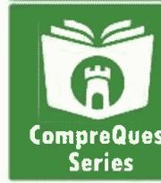

# C# 面向对象的算法与数据结构

Theophilus Edet

作者：Theophilus Edet

| Theophilus Edet |

| --- |

| @ theoedet@yahoo.com |

| f facebook.com/theoedet |

| @ twitter.com/TheophilusEdet |

| @ Instagram.com/edttheophilus |

封面设计：Benedict Edet

## 前言

- 列表操作与实现

# 拥抱成长与持续学习

本书的核心旨在培养持续成长和学习的心态。随着计算机科学领域的不断演进，接受新挑战和解决方案变得至关重要。我们鼓励读者将本书视为一个跳板，进入一个无限可能的世界，并在算法、数据结构和面向对象编程（OOP）的广阔领域中进行持续探索。

我们希望这本书能成为一份无足价值的资源，使读者不仅能够理解这些概念，还能在追求卓越软件的途中有效应用它们。加入我们，在面向对象的范式下，开启算法与数据结构领域的这段启智性旅程。

Theophilus Edet

# 基于 C# 的面向对象算法与数据结构

算法和数据结构是计算机科学的根本基石，在开发高效有效的软件系统方面发挥着至关重要的作用。《基于 C# 的面向对象算法与数据结构》是一本全面的指南，深入探讨了这些概念与面向对象编程（OOP）范式之间复杂的关系。该书由领域专家编写，为读者提供了算法和数据结构如何在面向对象环境中交织的深度理解，为初学者和资深开发者提供了丰富的资源。

本书的核心探讨了面向对象范式下算法与数据结构之间的共生关系。它阐明了算法——解决计算问题的逐步程序——是如何与数据结构——组织和存储数据的手段——产生相互作用的。通过精心设计的方法，本书展示了面向对象编程如何作为实现和利用这些算法与数据结构的理想框架，促进了更系统化、模块化的软件开发方法。

算法和数据结构的应用跨越大量的领域和功能，使得它们在现代软件工程中不可或缺。从优化搜索算法到高效管理大型数据集，它们的应用无处不在。本书不仅阐明了理论基础，还展示了它们在现实世界场景中的实际应用。通过大量的示例、案例研究和实践练习，读者被引导实现并使用这些算法和数据结构，对它们在编程和软件开发中的关联产生直观理解。

此外，本书并非孤立存在；它与面向对象编程支持的各种编程模型和范式交织在一起。面向对象编程本身是一种强大且广泛采用的范式，强调将代码组织成封装数据和行为的对象。OOP 的灵活性和模块化无缝地适用于算法和数据结构的实现，促进了提高重用性、可扩展性和可维护性的设计。本书充当了这些基础编程概念之间的桥梁，强调了 OOP 如何提供一个自然容纳算法和数据结构整合的环境，从而产生稳健且优雅的软件解决方案。

本质上，《基于 C# 的面向对象算法与数据结构》是一不可或缺的指南，阐明了算法、数据结构与面向对象范式之间的共生关系。它赋予读者对这些概念及其实际应用的深度理解，使他们能够在面向对象的框架内开发高效且复杂的软件解决方案。

# 模块 1：

OOP 中的算法与数据结构导论

在综合性著作《基于 C# 的面向对象算法与数据结构》中，“面向对象编程（OOP）中的算法与数据结构”模块是理解 OOP 框架内算法和数据结构的核心原理及实际应用的基石。该模块是一个基础部分，深入探讨了算法、数据结构与面向对象编程原则之间的共生关系。该模块由领域专家编写，是旨在掌握现代软件开发核心概念的学生、软件工程师和开发者的重要指南。

该模块旨在为算法和数据结构的基础概念提供结构化且全面的概述，强调它们在面向对象编程范式中的整合。它首先揭示了算法的基本原则——解决计算问题的顺序指令集——以及数据结构——用于高效存储和管理数据的组织机制。这些组件随后被密地织入面向对象编程范式中，展示了 OOP 原则如何增强软件开发中算法和数据结构的实现和利用。

该模块的重点不仅在于理论理解，还在算法和数据结构在面向对象环境中的实际应用。通过一系列示例、练习和案例研究，学习者被引导实现并使用算法和数据结构。重点在于这些概念在 OOP 框架内的无缝整合，突显了使用面向对象方法开发和维护软件系统的优势。

此外，该模块是理解算法和结构如何构成面向对象编程支持的各种编程模型和范式的骨干。这些元素之间的共生关系强调了 OOP 在实现算法和数据结构方面提供的灵活性、可扩展性和重用性。通过掌握该模块，个人将对 OOP 如何促进系统化和模块化的方法获得洞解，从而产生更优雅、高效的软件解决方案。

“面向对象编程中的算法与数据结构”模块概括了算法、数据结构及其在 OOP 框架内整合的核心概念。它提供了对这些基础基石的整体理解，使学习者能够有效地将这些原则应用于面向对象范式下的软件开发中。

## 算法与数据结构概述

在“OOP 中的算法与数据结构导论”模块中，“算法与数据结构概述”章节是理解对面向对象编程（OOP）范式至关重要的方面的的基础基石。

## 算法在软件开发中的重要性

算法是软件开发中解决问题的核心基础。考虑到高效算法在优化性能方面的重要性，考虑一个在 C# 中实现的简单泡排序示例：

```csharp
public static int[] BubbleSort(int[] arr)
{
    int n = arr.Length;
    for (int i = 0; i < n - 1; i++)
    {
        for (int j = 0; j < n - i - 1; j++)
        {
            if (arr[j] > arr[j + 1])
            {
                int temp = arr[j];
                arr[j] = arr[j + 1];
                arr[j + 1] = temp;
            }
        }
    }
    return arr;
}
```

## 面向对象背景下的数据结构理解

数据结构是数据存储和检索的组织框架。深入探讨数据结构，这里有一个 C# 中简单链表的示例：

```csharp
class Node
{
    public int data;
    public Node next;
    public Node(int data)
    {
        this.data = data;
        this.next = null;
    }
}

class LinkedList
{
    public Node head;
}
```

```csharp
public LinkedList()
{
    this.head = null;
}
// Additional methods for insertion, deletion, and traversal can be implemented here
```

## OOP 中算法与数据结构的集成

在 OOP 框架内实现算法与数据结构的无缝集成是非常关重要的。利用 OOP 原则，以下是一个在 C# 中演示二叉搜索树继承的示例：

```csharp
class Node
{
    public int key;
    public Node left, right;
}
```

```csharp
class BinarySearchTree
{
    public Node root;
}
```

```csharp
// Methods for insertion, deletion, search, etc. can be added here
}
```

## 软件开发中的实际应用

理解算法和数据结构是软件开发的基础。高效的算法和优化的数据结构对于解决复杂问题和构建高性能软件至重要。这些基础知识是在面向对象编程范式内开发稳健且高效应用程序的基础。

“算法与数据结构概述”部分作为一个启动平台，提供了对在面向对象编程框架内成功实现算法和数据结构的基础概念的初步理解。

## 面向对象编程原理

模块“OOP 中的算法与数据结构简介”中的“面向对象编程原理”章节引入了构成面向对象编程（OOP）概念基础的基础原理。理解这些原理对于开发模块化、可重用且可扩展的软件解决方案至关重要。

## C# 中的封装

封装是一项基本的 OOP 概念，强调数据隐藏以及将数据与操作数据的方法封装在一起。在 C# 中，封装通过访问修饰符实现。以下是一个封装的简单示例：

```csharp
public class BankAccount
{
private decimal balance;

public decimal GetBalance()
{
    return balance;
}

public void Deposit(decimal amount)
{
    balance += amount;
}

public void Withdraw(decimal amount)
{
    if (balance >= amount)
{
        balance -= amount;
    }
}
```

## C# 中的继承

继承允许新类从现有类中继承属性和行为。它促进了代码的重用，并允许创建类层次结构。考虑以下 C# 示例：

```csharp
public class Shape
{
    public virtual void Draw()
    {
        // Drawing logic for a generic shape
    }
}
```

```csharp
public class Circle : Shape
{
    public override void Draw()
    {
        // Drawing logic for a circle
    }
}
```

## C# 中的多态

多态允许将对象视为其基类的实例，从而能够动态执行方法。在 C# 中实现多态涉及方法重写。以下是一个说明多态的示例：

```csharp
public class Animal
{
public virtual void MakeSound()
{
    Console.WriteLine("Animal makes a sound");
}
```

```csharp
public class Dog : Animal
{
    public override void MakeSound()
    Console.WriteLine("Dog barks");
}
```

## OOP 原则的优势

面向对象编程原理（包括封装、继承和多态）提供了多种优势。它们促进了代码的组织、可重用性和可维护性。理解并应用这些原理有助于稳健且灵活的软件系统的开发。

## 在算法和数据结构中的应用

OOP 原则的应用对于算法和数据结构的实现与集成至关重要。OOP 促进了结构良好、模块化系统的创建，使得算法和数据结构能够在统一软件架构中无缝集成。

“面向对象编程原理”部分是理解 OOP 核心概念的基石。拥抱这些原理对于在算法、数据结构和软件开发的背景下利用 OOP 的力量至关重要。

## 面向对象背景下的数据结构

模块“OOP 中的算法与数据结构简介”中的“面向对象背景下的数据结构”章节侧重于利用和实现

```csharp
// List
List<int> list = new List<int>();
list.Add(10);
list.Add(20);
// ...
```

## C# 中的树结构

树结构（如二叉树）是广泛使用的层次结构数据结构。以下是 C# 中简化的二叉树实现：

```csharp
public class Node {
    public int data;
    public Node left, right;
    public Node(int data) {
        this.data = data;
        this.left = this.right = null;
    }
}
```

## C# 中的队列和栈

队列和栈是具有不同访问模式的线性数据结构。在 C# 中，队列和栈分别可以使用 `Queue<T>` 和 `Stack<T>` 类实现：

```csharp
// Queue
Queue<int> queue = new Queue<int>();
queue.Enqueue(10);
queue.Enqueue(20);
int dequeuedItem = queue.Dequeue();
```

```csharp
// Stack
Stack<int> stack = new Stack<int>();
stack.Push(10);
stack.Push(20);
int poppedItem = stack.Pop();
```

## C# 中的图和哈表

图和哈表是多功能数据结构。图表示元素之间的连接，而哈表提供了高效的键值对存储。以下是使用 C# 的哈表示例：

```csharp
Dictionary<string, int> hashTable = new Dictionary<string, int>();
hashTable["Alice"] = 25;
hashTable["Bob"] = 30;
int bobAge = hashTable["Bob"];
```

## OOP 与数据的集成

面向对象编程原理在管理和实现数据结构方面起着重要作用。封装、继承和多态对于构建良好且易维护的数据结构至关重要。

“面向对象背景下的数据结构”章节提供了对面向对象编程范式内各种数据结构的实现和利用全面理解。熟悉这些结构及其与 OOP 原则的集成，对于使用算法和数据结构进行有效的软件开发和问题解决至关重要。

```cs
public class AlgorithmExecutor
{
    public void ExecuteSorting(SortingAlgorithm algorithm,
    int[] arr)
    {
        algorithm.BubblesSort(arr); // Or algorithm.QuickSort(arr);
    }
}
```

## 面向对象在算法开发中的集成

面向对象编程原则在管理和设计算法时至关重要。封装确保了数据的完整性，继承实现了代码重用，而多态则允许在运行时灵活地选择算法。OOP 原则为创建模块化、自适应强且高效的算法做出了巨大贡献。

“使用 OOP 原则进行算法设计”章节提供了如何利用 OOP 原则来增强算法设计和实现的见解。理解在算法开发中如何利用封装、继承和多态，不仅能培养更具结构化的编码方法，还能增强算法解决方案的可维护性和扩展性。

# 模块 2：

复杂度分析与 OOP

“复杂度分析与面向对象编程 (OOP)”模块是《基于 C# 的 OOP 算法与数据结构》一书中的核心部分。该模块侧重于解析面向对象编程范式内复杂度分析的复杂性。该模块由专家编写，旨在让读者对在 OOP 环境下评估算法效率有全面的理解。

理解算法效率

该模块从探索复杂度分析开始，强调了其在评估算法效率方面的作用。它讨论了从时间复杂空间复杂度维度衡量计算成本的意义。该模块说明了这种分析如何帮助在面向对象编程中为特定任务选择算法时做出明智决策，确保软件系统不仅功能完备，而且性能也经过优化。

## 复杂度分析在 OOP 中的集成

核心重点在于将复杂度分析集成到面向对象编程框架中。它强调了 OOP 原则如何促进高效算法的设计和实现。这种集成确保了模块化和可重用，符合 OOP 原则，并为软件系统创建了组织良好且易维护的代码库。

## OOP 环境中的实际应用

该模块强调了复杂度分析在面向对象环境中的实际应用。真实世界的示例和案例研究引导学习者将复杂度分析应用于基于 OOP 的算法中。这不仅加深了他们的理解，还提供了在面向对象编程范式内优化算法所需的技能，确保软件系统同时具有优雅性和高性能。

## OOP 原则与算法设计

该模块详细阐述了面向对象编程如何通过其对封装、继承和多态的关注，自然地支持算法设计和复杂度分析。OOP 原则不仅有助于算法开发，还支持软件系统的维护和扩展性。掌握该模块使个人能够在利用 OOP 模块化和可重用性的同时设计出高效算法。

“复杂度分析与面向对象编程”模块是理解算法与数据结构领域复杂度分析与 OOP 交汇点的重要资源。它提供了对如何在 OOP 框架下评估和优化算法效率的深入理解，能够创建高性能的软件系统。

## 大 O 表示法与 OOP

“复杂度分析与 OOP”模块中的“大 O 表示法与 OOP”节深入探讨了分析算法效率的工具大 O 表示法与面向对象编程（OOP）原则之间的关系。理解大 O 表示法及其在 OOP 范围内的应用对于开发高效且可扩展的软件解决方案至关重要。

理解大 O 表示法

大 O 表示法代表算法时间或空间复杂度的最坏情况。它量化了算法运行时间或空间需求随输入规模增大而增长的情况。例如，考虑一个在 C# 中展示线性时间复杂度的方法：

```cs
public void LinearSearch(int[] arr, int target)
{
    for (int i = 0; i < arr.Length; i++)
    {
        if (arr[i] == target)
        {
            // 找到元素
            return;
        }
    }
}
```

## OOP 节点下的算法分析

在 OOP 框架内应用大 O 表示法允许对算法效率进行分析。OOP 原则有助于构建保持高效时间和空间复杂度的算法。例如，一个基于 OOP 的二分查找算法：

```cs
public class SearchAlgorithm
{
    public int BinarySearch(int[] arr, int target)
    {
        // 二分查找实现
    }
}
```

## OOP 原则在优化算法

利用封装和继承等 OOP 原则会对基于大 O 分析的算法优化产生重大影响。封装确保数据完整性，而继承允许扩展和重用高效的算法方法。例如，继承一个更优化的搜索算法：

```cs
public class OptimizedSearch : SearchAlgorithm
{
    public int OptimizedBinarySearch(int[] arr, int target)
    {
      // 优化的二分查找实现
    }
}
```

## 大 O 在基于 OOP 的算法中的意义


在 `OOP` 节点内理解大 `O` 表示法是分析和优化算法的基础。`OOP` 原则在实现更好的算法效率方面发挥着关键作用。高效算法确保了使用 `OOP` 原则开发的软件系统不仅功能上健壮，而且在输入规模扩大时也能保持高性能。

“大 `O` 表示法与 `OOP`”节在通过大 `O` 表示法对算法效率的理论分析与面向对象编程范式内的实际实现之间架起了桥梁。这种理解允许开发者编写不仅符合 `OOP` 原则而且展现出最佳效率和扩展性的算法。

## 时间空间复杂度分析

“复杂度分析与 `OOP`”模块中的“时间和空间复杂度分析”节专门阐明了在面向对象编程（`OOP`）背景下分析时间和空间复杂度的意义。理解这些复杂度有助于评估效率，对于设计高效的软件解决方案至关重要。

## C# 中的时间复杂度分析

时间复杂度是指算法随输入规模变化所需的时间测量。利用大 `O` 表示法，`C#` 能够对算法性能进行评估。例如，检查线性时间复杂度的场景：

```cs
public void LinearSearch(int[] arr, int target)
{
    for (int i = 0; i < arr.Length; i++)
    {
        if (arr[i] == target)
        {
            // 找到元素
            return;
        }
    }
}
```

## C# 中的空间复杂度分析

空间复杂度评估算法相对于输入规模的内存使用情况。在 `C#` 中，检查空间复杂度涉及分析存储空间需求。例如，考虑一个随输入规模使用额外内存的算法：

```cs
public void StoreInArray(int n)
{
    int[] arr = new int[n];
    // 在数组中存储 n 个元素
}
```

## OOP 在复杂度分析集成

面向对象编程原则与复杂度分析无缝集成。封装在衡量时间和空间复杂度时确保数据完整性，而继承为根据效率扩展算法提供了基础。在 `C#` 中，一种基于继承的优化搜索方法：

```cs
public class OptimizedSearch : SearchAlgorithm
{
    public int OptimizedBinarySearch(int[] arr, int target)
    {
        // 优化的二分查找实现
    }
}
```

## 复杂度分析在基于 OOP 的算法中的重要性

理解时间和空间复杂度对于 `OOP` 节点下的算法设计和优化至关重要。通过理解

通过评估算法的效率，开发者可以创建遵循 `OOP`（面向对象）原则的软件系统，这些系统不仅提供了稳健的功能，还了计算资源。

“时间与空间复杂度分析”章节将时间和空间复杂度的理论知识与 `OOP` 框架内的实际应用联系了起来。理解如何从时间和空间角度评估算法的效率，使开发者能够创建既符合 `OOP` 原则，又能保持最佳性能和资源管理的软件。

## 在面向对象实现中分析复杂度

在“复杂度分析与 `OOP`”模块中，“在面向对象实现中分析复杂度”章节深入探讨了在面向对象编程（`OOP`）语境下如何评估时间复杂度和空间复杂度。理解 `OOP` 中这些复杂性的错综之处，对于设计和优化算法至关重要。

## OOP 中的时间复杂度分析

在 `OOP` 范式中分析时间复杂度涉及理解不同的数据结构和算法如何随输入规模变化的性能。例如，检查一个展示二分查找实现中对数时间复杂的 `C#` 方法：

```csharp
public class SearchAlgorithm
{
    public int BinarySearch(int[] arr, int target)
    {
        // Binary search implementation
    }
}
```

## OOP 中的空间复杂度分析

`OOP` 环境下的空间复杂度分析涉及理解内存使用随输入规模变化的关系。在 `C#` 中，分析空间复杂度可能涉及为各种数据结构分配内存。考虑一种在基于 `OOP` 的链表实现中评估空间复杂的场景：

```csharp
public class Node
{
    public int data;
    public Node next;
}

public class LinkedList
{
    public Node head;
    // Operations to manipulate the linked list
}
```

## OOP 原则与复杂度分析

面向对象编程原则显著影响算法复杂度的分析。封装、继承和多态有助于评估效率，同时确保了代码的整洁、模块化和可扩展性。在 `C#` 中，基于封装的优化排序算法方法可以保持效率：

```csharp
public class SortingAlgorithm
{
    private void Merge(int[] arr, int l, int m, int r)
    {
        // Merge sort implementation
    }
    public void MergeSort(int[] arr, int l, int r)
    {
        // Recursive merge sort
    }
}
```

## 在 OOP 中分析复杂度的意义

理解 `OOP` 内部的复杂度对于设计不仅满足功能需求而且资源利用率的算法至关重要。评估时间和空间复杂度确保了基于 `OOP` 原则构建的软件系统不仅稳健，而且运行最优并能高效管理资源。

“在面向对象实现中分析复杂度”章节是算法复杂度理论方面与其在 `OOP` 框架内实际实现之间的桥梁。在 `OOP` 中理解和评估算法效率，允许开发者创建既遵循 `OOP` 原则又能保持最佳性能和资源管理的软件系统。

## OOP 算法中的复杂度考虑

在“复杂度分析与 `OOP`”模块中，“`OOP` 算法中的复杂度考虑”章节探讨了专门在面向对象编程（`OOP`）中评估时间和空间复杂度的关键方面。在 `OOP` 语境下理解这些复杂度对于开发高效且可扩展的算法和数据结构至关重要。

## C# 中的时间复杂度分析

`OOP` 算法中的时间复杂度评估涉及评估算法执行时间如何随输入规模增长。在 `C#` 中，时间复杂度的分析允许开发者理解高效算法在不同输入规模下的表现。例如，一个展示 `C#` 快速排序实现的方法，它表现出 `O(n log n)` 的时间复杂度：

```csharp
public class SortingAlgorithm
{
    public void QuickSort(int[] arr)
    {
        // Quick sort implementation
    }
}
```

## C# 中的空间复杂度分析

`OOP` 环境下的空间复杂度分析涉及理解算法相对于输入规模的内存消耗。在 `C#` 中，评估空间复杂度可能涉及检查算法需要多少额外内存。考虑一个代表基于 `OOP` 的图实现中空间复杂的 `C#` 示例：

```csharp
public class Node
{
    public int value;
    public List<Node> neighbors;
}
```

## OOP 原则与复杂度分析

面向对象编程原则显著影响算法复杂度的分析。封装、继承和多态有助于评估效率，同时确保了代码的整洁、模块化和可扩展性。在 `C#` 中，一种基于封装的优化排序算法方法可以保持效率：

```csharp
public class OptimizedSearch : SearchAlgorithm
{
    public int Search(int[] arr, int target)
    {
        // Optimized search implementation
    }
}
```

## 在 OOP 中分析复杂度的重要性

理解 `OOP` 内部的复杂度对于设计不仅满足功能需求而且资源利用率的算法至关重要。评估时间和空间复杂度确保了基于 `OOP` 原则构建的软件系统不仅稳健，而且运行最优并能高效管理资源。

“在面向对象实现中分析复杂度”章节是算法复杂度理论方面与其在 `OOP` 框架内实际实现之间的桥梁。在 `OOP` 中理解和评估算法效率，允许开发者创建既遵循 `OOP` 原则又能保持最佳性能和资源管理的软件系统。

## OOP 算法中的复杂度考虑

在“复杂度分析与 `OOP`”模块中，“`OOP` 算法中的复杂度考虑”章节探讨了专门在面向对象编程（`OOP`）中评估时间和空间复杂度的关键方面。在 `OOP` 语境下理解这些复杂度对于开发高效且可扩展的算法和数据结构至关重要。

## C# 中的时间复杂度分析

`OOP` 算法中的时间复杂度评估涉及评估算法执行时间如何随输入规模增长。在 `C#` 中，时间复杂度的分析允许开发者理解高效算法在不同输入规模下的表现。例如，一个展示 `C#` 快速排序实现的方法，它表现出 `O(n log n)` 的时间复杂度：

```csharp
public class SortingAlgorithm
{
    public void QuickSort(int[] arr)
    {
        // Quick sort implementation
    }
}
```

## C# 中的空间复杂度分析

`OOP` 环境下的空间复杂度分析涉及理解算法相对于输入规模的内存消耗。在 `C#` 中，评估空间复杂度可能涉及检查算法需要多少额外内存。考虑一个代表基于 `OOP` 的图实现中空间复杂的 `C#` 示例：

```csharp
public class Node
{
    public int value;
    public List<Node> neighbors;
}
```

## OOP 原则与复杂度分析

面向对象编程原则显著影响算法复杂度的分析。封装、继承和多态有助于评估效率，同时确保了代码的整洁、模块化和可扩展性。在 `C#` 中，一种基于封装的优化排序算法方法可以保持效率：

```csharp
public class OptimizedSearch : SearchAlgorithm
{
    public int Search(int[] arr, int target)
    {
        // Optimized search implementation
    }
}
```

关于在 `C#` 语言的面向对象编程（`OOP`）背景下数组的利用。数组作为基础数据结构，其 `OOP` 原则中的实现对于构建高效且结构化的应用程序至关重要。

## C# 中的基础数组声明

在 `C#` 中，数组的实现从声明开始。数组可以包含相同类型元素的固定大小集合。以下是创建和初始化数组的示例：

```
int[] integerArray = new int[5]; // 声明大小为 5 的整数数组
```

```
string[] stringArray = new string[3]; // 声明大小为 3 的字符串数组
```

## 访问和修改数组元素

访问和修改数组元素是数组实现的基础。在 `C#` 中，使用基于零的索引访问数组元素：

```
int[] numbers = { 10, 20, 30, 40, 50 }; // 初始化数组
```

```
// 访问和修改数组元素
int elementAtIndex2 = numbers[2]; // 获取索引为 2 的元素 (30)
numbers[3] = 45; // 修改索引为 3 的元素 (从 40 改为 45)
```

## 遍历数组

在 `OOP` 背景下，遍历数组是处理其元素的常用操作。`C#` 中的 `for` 循环允许遍历数组元素：

```
int[] scores = { 80, 90, 75, 85, 95 };
```

```
// 遍历数组元素
for (int i = 0; i < scores.Length; i++)
{
    Console.WriteLine($"Score at index {i}: {scores[i]}");
}
```

## 数组实现中的 OOP 原则

面向对象编程原则有助于更好的数组实现。封装确保了数组的完整性，继承有助于扩展数组功能，多态则有助于统一处理不同的数组。然而，由于固定大小以及在直接扩展或多态方面的局限性，基础形式的数组可能没有充分利用 `OOP` 原则。

## OOP 中数组实现的重要性

`OOP` 中的数组实现虽然基础，但它是更复杂数据结构和算法的基石。理解使用 `C#` 在 `OOP` 背景下的数组实现至关重要，因为它为更高级的数据结构及其实现奠定了基础。

“`OOP` 中的数组实现”部分提供了在 `C#` 语言的面向对象编程框架内实现和操作数组的基础知识。它为理解更复杂的数据结构及其在 `OOP` 范式中的关系奠定了基础。

## OOP 中的链表

《基于 `C#` 的面向对象编程算法与数据结构》一书中，“`OOP` 中的数组与列表实现”模块中的“`OOP` 中的链表”章节，深入探讨了在 `C#` 语言的面向对象编程背景下链表的实现和利用。链表表示一种动态数据结构，其中元素（被称为节点）被相互连接在一起，允许灵活地管理数据。

## C# 中的基础链表实现

在 `C#` 中，链表的创建涉及定义一个 `Node` 类和 `LinkedList` 类。每个节点都包含数据和指向下一个节点的引用，形成链接关系。以下是基础链表实现的示例：

```
public class Node
{
    public int data;
    public Node next;

    public Node(int data)
{
        this.data = data;
        this.next = null;
    }
}

public class LinkedList
{
    public Node head;

    public LinkedList()
{
        this.head = null;
    }
}
```

## 向链表添加元素

插入操作是链表的关键。它涉及在特定位置向列表添加节点。在 `C#` 中，在链表的开头添加节点：

```sharp
public void AddAtBeginning(int data)
{
    Node newNode = new Node(data);
    newNode.next = head;
    head = newNode;
}
```

## 遍历链表

遍历链表对于访问和显示元素至关重要。使用 `C#`，这里有一个显示链表中所有元素的遍历方法：

```sharp
public void DisplayLinkedList()
{
    Node temp = head;
    while (temp != null)
{
Console.WriteLine(temp.data);
temp = temp.next;
}
}
```

## OOP 原则与链表

面向对象编程原则增强了链表的管理和利用。封装维护了链表的完整性，而继承和多态可能有助于扩展链表的功能。然而，链表本质上体现了 `OOP` 原则，主要是封装和管理数据结构的灵活性。

## OOP 中链表的重要性

在使用 `C#` 的 `OOP` 框架下理解并实现链表至关重要，因为链表是基础数据结构。它们允许动态内存分配和灵活性，为更复杂的数据结构和算法提供了阶梯。

“`OOP` 中的链表”部分是理解在 `C#` 语言的面向对象编程框架内实现和操作链表的基石。它为理解更高级的数据结构及其在 `OOP` 范式中的利用奠定了基础。

## OOP 中的 ArrayList 和 LinkedList

《基于 `C#` 的面向对象编程算法与数据结构》一书中，“`OOP` 中的数组与列表实现”模块中的“`OOP` 中的 `ArrayList` 和 `LinkedList`”章节，重点关注在 `C#` 语言的面向对象编程背景下 `ArrayList` 和 `LinkedList` 的实现和对比。

## C# 中的 ArrayList 实现

在 `C#` 中，`ArrayList` 是一种可以根据需要调整大小的动态数组类结构。它是 `System.Collections` 命名空间的一部分。以下是 `ArrayList` 使用的示例：

```sharp
using System;
using System.Collections;

ArrayList arrayList = new ArrayList(); // 初始化 ArrayList
arrayList.Add(10); // 向 ArrayList 添加元素
arrayList.Add("Hello");
```

## C# 中的 LinkedList 实现

相比之下，`C#` 中的 `LinkedList` 是元素的序列，每个元素都链接到下一个元素。`System.Collections.Generic` 命名空间提供了 `LinkedList<T>` 实现：

```sharp
using System;
using System.Collections.Generic;

LinkedList<int> linkedList = new LinkedList<int>(); // 初始化 LinkedList
linkedList.AddLast(15); // 向 LinkedList 添加元素
linkedList.AddLast(25);
```

## 向 ArrayList 和 LinkedList 添加元素

在 `ArrayList` 中，可以使用 `Add` 方法动态添加元素。在 `LinkedList` 中，可以使用 `AddFirst` 或 `AddLast` 方法在特定位置添加元素。

## ArrayList 和 LinkedList 中的 OOP 原则

`C#` 中的 `ArrayList` 和 `LinkedList` 在其实现上符合 `OOP` 原则。两者都维护了封装，确保了列表的完整性。然而，链表通过其结构在本质上展示了更多的灵性和继承。

## OOP 中的对比与重要性

`ArrayList` 和 `LinkedList` 具有不同的功能。`ArrayList` 在随机访问和中间插入方面效率更高，而 `LinkedList` 擅长插入和删除。在 `OOP` 范式中理解并利用这两种结构对于软件开发中的高效数据管理和处理至关重要。

using System;


```sharp
using System.Collections;
using System.Collections.Generic;

ArrayList arrayList = new ArrayList(); // Initializing an ArrayList

arrayList.Add(30); // Adding elements to the ArrayList
arrayList.Remove(30); // Removing an element from the ArrayList

LinkedList<int> linkedList = new LinkedList<int>(); // Initializing a LinkedList

linkedList.Add(40); // Adding elements to the LinkedList
linkedList.Remove(40); // Removing an element from the LinkedList
```

# 列表实现与 OOP 原则

C# 中的列表实现遵循面向对象编程（OOP）原则。封装维持了数据的完整性以及受控的访问，而继承和多态可以在自定义列表实现中使用，从而提供可扩展性和灵活性。

## 列表操作在 OOP 中的重要性

在使用 C# 的 OOP 框架中，理解列表的操作和实现对于高效的数据管理至关重要。列表是多用途的，是许多其他数据结构的基础，使得其操作在各种软件应用程序中起着基础作用。

“列表操作与实现”部分深入探讨了使用 C# 语言的面向对象编程框架内列表的基本操作和实现。理解如何高效地添加、删除和操作列表中的元素对于开发组织化且高效的软件解决方案至关重要。

# 第 4 模块：OOP 中的栈与队列实现

“面向对象编程（OOP）中的栈与队列实现”模块是书籍《基于 C# 的 OOP 算法与数据结构》中的关键章节，它对面向对象编程范式中栈和队列的实际实现和功能进行了基础探索。该模块由领域专家编写，为理解、实现和利用这些基本数据结构提供了全面的指南，兼顾了初学习者和经验丰富的软件开发人员。

## 栈与队列的基础理解

本模块通过建立对栈和队列作为基本数据结构的深厚基础开始。它详细阐述了它们的特征、操作和用例。详细阐述了遵循后进先出（LIFO）原则的栈和遵循先进先出（FIFO）原则的队列。这种基础性的理解为它们在面向对象编程语境下的实现奠定了基础。

## 在面向对象编程中的集成

该模块的核心重点是探索栈和队列如何集成到面向对象编程范式中。它分析了封装、继承和多态等 OOP 原则如何支持栈和队列的实现和操作。读者可以了解到这些原则如何为以模块化和组织化的方式高效设计和使用这些数据结构提供最佳环境。

## 实际实现与应用

除了理论理解，本模块还强调了栈和队列在面向对象环境中的实际实现和应用。通过实操示例和练习，学习者被引导创建和利用栈和队列，展示了它们在各种软件应用程序中的重要性。这种实践方法使个人具备了有效利用这些数据结构的技能，从而加强了对 OOP 原则的理解。

## OOP 中的效率与优化

效率和优化在软件开发中至关重要。本模块阐明了面向对象编程如何促进栈和队列的高效利用。它涵盖了在 OOP 框架内优化这些数据结构使用的技巧和最佳实践，确保使用栈和队列开发的软件系统不仅在功能上健壮，而且在性能上经过优化。

“面向对象编程中的栈与队列实现”模块是理解、实现和优化面向对象环境中的栈和队列的不可或缺的指南。它赋予了读者有效利用这些关键数据结构所需的知识和实践技能，为在面向对象编程范式内创建高效且结构良好的软件系统铺平了道路。

## OOP 中的栈实现

《基于 C# 的 OOP 算法与数据结构》一书中，“OOP 中的栈与队列实现”模块中的“OOP 中的栈实现”部分，专注于使用 C# 语言在面向对象编程背景下栈数据结构的利用和实现。栈在后进先出（LIFO）原则下运行，使其成为许多算法的基础。

### C# 中的基础栈实现

在 C# 中，实现栈涉及利用 `System.Collections.Generic` 命名空间下的 `Stack<T>` 类。该类提供了 `Push`、`Pop` 和 `Peek` 来操作栈：

```sharp
using System;
using System.Collections.Generic;
```

```sharp
Stack<int> numberStack = new Stack<int>(); // 初始化栈

numberStack.Push(10); // 向栈添加元素
numberStack.Push(20);

int topElement = numberStack.Pop(); // 从栈中移除元素
int peekedElement = numberStack.Peek(); // 在不移除元素的情况下查看元素
```

### 栈的操作及其用途

由于其 LIFO 结构，栈在各种应用程序中至关重要。`Push` 操作将元素添加到栈顶，`Pop` 移除栈顶，`Peek` 在不移除的情况下获取栈顶。这些操作在算法、表达式求和软件系统的撤销功能中被广泛。

### 使用 OOP 原则实现栈

面向对象编程原则增强了 C# 中的自定义栈实现。封装确保了栈的完整性，继承可能用于扩展栈功能，而多态允许统一处理不同类型的栈。这是一个自定义栈实现的示例：

```csharp
public class CustomStack<T>
{
    private List<T> items = new List<T>();

    public void Push(T item)
    {
        items.Add(item);
    }

    public T Pop()
    {
        if (items.Count == 0)
        {
            throw new InvalidOperationException("栈为空.");
        }

        T popped = items[items.Count - 1];
        items.RemoveAt(items.Count - 1);
        return popped;
    }

    public T Peek()
    {
        if (items.Count == 0)
        {
            throw new InvalidOperationException("栈为空.");
        }
        return items[items.Count - 1];
    }
}
```

## OOP 中的队列实现

C# 提供了 `System.Collections.Generic` 命名空间下的 `Queue<T>` 类来创建并操作队列。此类类提供了 `Enqueue`、`Dequeue` 和 `Peek` 等方法，用于向队列中添加、移除和访问元素：

```csharp
using System;
using System.Collections.Generic;
```

```csharp
Queue<int> numberQueue = new Queue<int>(); // 初始化队列
```

```csharp
numberQueue.Enqueue(10); // 向队列添加元素
```

```csharp
numberQueue.Enqueue(20);
```

```csharp
int dequeuedElement = numberQueue.Dequeue(); // 从队列移除头部元素
```

```csharp
int peekedElement = numberQueue.Peek(); // 查看头部元素但不移除
```

### 队列操作及其用途

在按照到达顺序处理项目的场景中至关重要，例如任务调度、打印机作业队列或广度搜索算法。`Enqueue` 在队部添加元素，`Dequeue` 头部元素，`Peek` 允许在不移除的情况下查看头部元素。

### 使用 OOP 原则自定义队列

在 C# 中使用 OOP 原则实现自定义队列涉及封装队列结构并为队列操作提供方法。以下是一个基础自定义队列实现的示例：

```csharp
public class CustomQueue<T>
{
    private List<T> items = new List<T>();

    public void Enqueue(T item)
    {
        items.Add(item);
    }

    public T Dequeue()
    {
        if (items.Count == 0)
        {
            throw new InvalidOperationException("队列是空的.");
        }
        T dequeued = items[0];
        items.RemoveAt(0);
        return dequeued;
    }

    public T Peek()
    {
        if (items.Count == 0)
        {
            throw new InvalidOperationException("队列是空的.");
        }
        return items[0];
    }
}
```

### 队列实现在 OOP 中的重要性

在 C# 面对象编程框架中理解并实现队列至关重要，因为它们在各种算法和系统操作中起着作用。熟练操作队列对于高效的系统设计和算法开发是本质的。“OOP 中的队列实现”部分提供了关于使用 C# 语言面向对象编程框架内队列数据结构的实现和使用的见解。理解如何操作队列及其实际应用，对于构建结构良好且高效的软件解决方案至关重要。

## 栈和队列在 OOP 中的应用

《基于 C# 的面向对象算法与数据结构》书中的模块“OOP 中的栈和队列实现”部分深入探讨了在使用 C# 语言的面向对象编程背景下，栈和队列数据结构的实际应用和用例。栈和队列在各种场景和算法中作为基础结构，提供了核心功能和优化。

### C# 中的栈应用

栈在许多算法和现实场景中都有应用。一个显著的用途是在程序执行期间跟踪函数调用，使函数在完成后后能够返回到上一个调用处：

```csharp
public class StackExample
{
    public void DisplayStackExample()
    {
        Stack<int> callStack = new Stack<int>();
        callStack.Push(1); // 调用函数 1
        callStack.Push(2); // 调用函数 2
        callStack.Pop(); // 函数 2 完成
        callStack.Pop(); // 函数 1 完成
    }
}
```

### C# 中的队列应用

队列被广泛用于需要按照到达顺序处理任务的场景。例如打印机作业调度，确保打印作业按照它们提交的顺序进行处理：

```csharp
public class QueueExample
{
    public void PrintQueueExample()
    {
        Queue<string> printQueue = new Queue<string>();

        printQueue.Enqueue("Job 1"); // 打印队列中的第一个作业
        printQueue.Enqueue("Job 2"); // 打印队列中的第二个作业
        printQueue.Dequeue(); // 打印 Job 1
        printQueue.Dequeue(); // 打印 Job 2
    }
}
```

### 栈和队列应用中的 OOP 原则

将面向对象编程原则应用于栈和队列的实现可以实现封装，确保数据结构的完整性。继承和多态可以实现不同栈或队列的扩展和统一处理。

### 栈和队列应用在 OOP 中的重要性

在 C# 的 OOP 框架中理解并实现栈和队列至关重要，因为它们具有广泛的适用性。熟练应用它们可以确保各种软件解决方案中高效的算法开发和系统设计。“OOP 中的栈和队列应用”部分提供了关于在使用 C# 语言面向对象编程框架内栈和队列数据结构的真实应用和实际用例的见解。在不同场景下如何利用栈和队列是构建高效且结构良好的软件解决方案的基础。

## 高级操作与实现

《基于 C# 的面向对象算法与数据结构》书中的模块“OOP 中的栈与队列实现”中的“高级操作与实现”部分深入探讨了在使用 C# 语言面向对象编程背景下，与栈和队列数据结构相关的复杂功能复杂的实现。该部分探索了基于栈和队列基本概念的精细操作、优化和自定义实现。

### C# 中的自定义栈和队列实现

开发者经常需要根据特定的应用程序需求创建专门的栈或队列实现。例如，可以使用 C# 实现优先级队列或双端队列：

```csharp
public class PriorityQueue<T> where T : IComparable<T>
{
    private List<T> items = new List<T>();

    public void Enqueue(T item)
    {
        items.Add(item);
        items.Sort();
    }

    public T Dequeue()
    {
        if (items.Count == 0)
        {
            throw new InvalidOperationException("队列是空的.");
        }
        T dequeued = items[0];
        items.RemoveAt(0);
        return dequeued;
    }
}
```

### 增强的栈和队列操作

高级操作可能涉及通过额外能力增强基本功能。例如，实现一个带有返回当前最小元素方法的栈：

```csharp
public class MinStack {
    private Stack<int> dataStack = new Stack<int>();
    private Stack<int> minStack = new Stack<int>();

    public void Push(int item)
    {
        dataStack.Push(item);
        if (minStack.Count == 0 || item <= minStack.Peek())
        {
            minStack.Push(item);
        }
    }

    public int GetMin()
    {
        if (minStack.Count == 0)
        {
            throw new InvalidOperationException("栈为空");
        }
        return minStack.Peek();
    }
}
```

### OOP 中的优化与增强

在面向对象编程原则下对栈和队列实现中引入优化，可以提高性能和灵活性。通过应用动态调整大小、缓存或采用双向链表等特定数据结构的概念，开发者可以增强其实现的效率。

### 高级实现在 OOP 中的重要性

在 C# 的 OOP 框架中掌握栈和队列的高级操作和自定义实现对于根据特定需求定制数据结构至关重要。这些高级实现适用于专门的用例，并能够在各种软件应用程序中高效处理数据。

# 第 5 模块：面向对象编程中的树与二叉树

“面向对象编程中的树与二叉树”模块是《C# 面向对象算法与数据结构》一书的核心章节，深入探讨了树的实现和功能，特别关注面向对象编程（OOP）范式下的二叉树。该模块由领域专家编写，为寻求深度理解树及其在 OOP 框架中应用的个人提供了全面指南，兼顾初学者和资深程序员的需求。

## 树与二叉树的基础理解

本模块从建立对树作为层次级数据结构的全面理解开始，并专门探讨了二叉树的特征和属性。它阐明了树中的节点、分支和根结构概念，并详细说明了二叉树的属性——即由最多两个子节点组成的结构。这种基础理解为它们在面向对象编程中的实际实现奠定了基础。

## 在面向对象编程中的集成

本模块的一个重点是探索树和二叉树在面向对象编程范式中的集成。它详细介绍了 OOP 原则（包括封装、继承和多态）如何支持树和二叉树的实现与操作。读者将了解到这些原则如何为在模块化和组织的系统内高效设计和使用这些层次级数据结构提供理想环境。

## 实际实现与应用

本模块强调树和二叉树在面向对象环境中的实际实现和应用。通过实操示例和练习，学习者被引导创建和利用树及二叉树，展示了它们在各种软件应用中的重要性。这种实操方法使个人具备有效应用这些数据结构的技能，强化了他们对 OOP 概念的理解。

## OOP 中的效率与优化

效率和优化在软件开发中至关重要。本模块强调了面向对象编程如何促进树和二叉树的高效利用。它涵盖了在 OOP 框架内优化这些数据结构使用的技术和最佳实践，确保使用树和二叉树开发的软件不仅功能健壮，而且在性能上经过优化。

“面向对象编程中的树与二叉树”模块是理解、实现和优化面向对象环境内树和二叉树的重要资源。它为读者配备了有效利用这些基础数据结构所需的知识和实践技能，为在面向对象编程范式中创建高效且结构良好的软件系统铺平了道路。

## OOP 中的树结构

书籍《C# 面向对象算法与数据结构》中“树与二叉树”模块下的“OOP 中的树结构”部分探索了使用 C# 语言在面向对象编程范式下树结构的实现和功能。树作为层次级数据结构，节点以分支方式连接，对于组织和表示层次关系至关重要。

### C# 中的基础树节点实现

在 C# 中实现基础树结构涉及定义一个节点并与其他节点链接，从而形成树。这是一个简单的树节点示例：


```go
public class TreeNode<T>
{
    public T Data { get; set; }
    public List<TreeNode<T>> Children { get; } = new
    List<TreeNode<T>>();

    public TreeNode(T data)
    {
        Data = data;
    }

    public void AddChild(TreeNode<T> child)
    {
        Children.Add(child);
    }
}
```

## 使用树节点创建树

树可以通过将树节点连接来构建。每个节点都可以有子节点，形成层次结构：

```go
// 创建一个带有整数节点的树
TreeNode<int> rootNode = new TreeNode<int>(10);
TreeNode<int> childNode1 = new TreeNode<int>(20);
TreeNode<int> childNode2 = new TreeNode<int>(30);

rootNode.AddChild(childNode1);
rootNode.AddChild(childNode2);
```

## 在 C# 中遍历树

遍历树允许访问和操作其元素。可以使用深度优先或广度优先搜索等递归方法遍历树并对其节点执行操作：

```go
public void DepthFirstTraversal(TreeNode<T> node)
{
    Console.WriteLine(node.Data);
    foreach (var child in node.Children)
    {
        DepthFirstTraversal(child);
    }
}
```

## OOP 原则与树

将面向对象编程原则应用于树结构可以实现封装、继承和多态。封装确保了树结构的完整性，而继承和多态则有助于扩展树的功能并统一处理不同的树。

## OOP 中树结构的重要性

在基于 C# 的 OOP 框架中理解并实现树结构至关重要，因为它们在各种算法和数据表示中广泛适用。熟练地操作和组织层次级数据对于系统设计和算法开发是关重要的。

“OOP 中的树结构”部分提供了在使用 C# 语言的面向对象编程语境下树结构的基础理解。掌握树的实现和操作为在软件系统中高效地表示层次关系和组织复杂数据奠定了基础。

## OOP 中的二叉树实现

书籍《C# 面向对象算法与数据结构》中“树与二叉树”模块下的“OOP 中的二叉树实现”部分探索了使用 C# 语言在面向对象编程语境下二叉树的实现和功能。二叉树是层次级数据结构，每个节点最多有两个子节点，能够实现各种高效的搜索算法和数据组织。

## C# 中的基础二叉树节点结构

二叉树由具有左、子引用的节点组成。可以定义一个节点类来建立这种二叉树结构：

```csharp
public class BinaryTreeNode<T>
{
    public T Data { get; set; }
    public BinaryTreeNode<T> Left { get; set; }
    public BinaryTreeNode<T> Right { get; set; }

    public BinaryTreeNode(T data)
    {
        Data = data;
        Left = null;
        Right = null;
    }
}
```

用于系统设计和算法开发的思维模型。

“OOP 中的二叉树实现”章节提供了在基于 C# 语言的面向对象编程（OOP）框架内对二叉树结构的基础理解。掌握二叉树的实现和遍历，是软件系统中高效高效组织和搜索层级数据的基础。

## OOP 中的遍历与操作

《基于 C# 的 OOP 算法与数据结构》书中“OOP 中的树与二叉树”模块中的“OOP 中的遍历与操作”章节，深入探讨了在 C# 面向对象编程环境下，与树和二叉树相关的遍历方法和基本操作。遍历允许访问和操作树元素，为各种与树相关的算法提供了核心基础。

### 二叉树的中序遍历

中序遍历访问左子树，然后是根节点，最后是右子树，允许你按升序查看元素：

```csharp
public void InOrderTraversal(BinaryTreeNode<T> node) {
    if (node != null) {
        InOrderTraversal(node.Left);
        Console.WriteLine(node.Data);
        InOrderTraversal(node.Right);
    }
}
```

### 二叉树的前序遍历

前序遍历首先访问根节点，然后是左子树，最后是右子树：

```csharp
public void PreOrderTraversal(BinaryTreeNode<T> node) {
    if (node != null)
    {
        Console.WriteLine(node.Data);
        PreOrderTraversal(node.Left);
        PreOrderTraversal(node.Right);
    }
}
```

### 二叉树的后序遍历

后序遍历访问左子树，然后是右子树，最后是根节点：

```csharp
public void PostOrderTraversal(BinaryTreeNode<T> node)
{
    if (node != null)
    {
        PostOrderTraversal(node.Left);
        PostOrderTraversal(node.Right);
        Console.WriteLine(node.Data);
    }
}
```

### 二叉树操作

二叉树上可以执行操作，，计算树的高度、检查给定值是否存在或计算节点数量：

```csharp
public int Height(BinaryTreeNode<T> node)
{
    if (node == null)
    {
        return 0;
    }
    int leftHeight = Height(node.Left);
    int rightHeight = Height(node.Right);
    return Math.Max(leftHeight, rightHeight) + 1;
}
```

## OOP 中遍历与操作的重要性

在基于 C# 的 OOP 框架下，理解树的遍历和基本操作对于各种算法和数据处理至关重要。精通这些基础操作对于系统设计和高效算法开发是本质的。

“OOP 中的遍历与操作”章节提供了对使用 C# 语言的面向对象编程框架内与树和二叉树相关的遍历方法和操作的基础理解。掌握这些遍历和操作是各种软件系统中实现高效数据处理和算法实现的基础。

## 面向对象背景下的平衡树

《基于 C# 的 OOP 算法与数据结构》书中“OOP 中的树与二叉树”模块中的“面向对象背景下的平衡树”章节，探索了使用 C# 语言的面向对象编程领域内平衡树的概念。平衡树（如 AVL 树和红黑树）保持平衡结构，确保了高效的数据处理以及最优的搜索和检索操作。

### C# 中的 AVL 树实现

AVL 树是一种自平衡二叉搜索树，其中任何节点的左右子树之间的高度差值（也称为平衡因子）最多为 1。这一属性在插入和删除过程中会得到维护：

```csharp
public class AVLTreeNode<T>
{
    public T Data { get; set; }
    public int Height { get; set; }
    public AVLTreeNode<T> Left { get; set; }
    public AVLTreeNode<T> Right { get; set; }
}
```

### C# 中的红黑树实现

红黑树是另一种平衡树，它对节点施加额外的约束以保证平衡。这些树是自平衡的，在插入和删除操作方面特别高效：

```csharp
public class RedBlackTreeNode<T>
{
    public T Data { get; set; }
    public bool IsBlack { get; set; }
    public RedBlackTreeNode<T> Left { get; set; }
    public RedBlackTreeNode<T> Right { get; set; }
}
```

## 在 OOP 中维护平衡

平衡树使用各种技术来维护其平衡，确保树在搜索操作中保持高效。这些技术包括旋转、颜色变化以及节点插入/删除，所有设计都是为了保持树处于平衡状态。

## OOP 中平衡树的重要性

在基于 C# 的 OOP 框架下理解并实现平衡树，对于高效的数据处理和搜索操作至关重要。在维护平衡结构对于最优性能至关重要的场景中，这些树是基础性的。

“面向对象背景下的平衡树”章节在基于 C# 语言的面向对象编程框架内引入了平衡树的概念，特别是 AVL 树和红黑树。掌握这些平衡树有助于在不同的软件应用中实现高效的数据管理和最优的搜索操作。

# 模块 6：二叉搜索树与 OOP

《基于 C# 的 OOP 算法与数据结构》中的“二叉搜索树与面向对象编程 (OOP)”模块是一个基础章节，专门用于探索二叉搜索树在面向对象编程范式下的实现和功能。该模块由领域专家编写，为理解 OOP 框架下的二叉搜索树及其应用提供了全面的指南。

## 二叉搜索树的基础理解

该模块建立了对二叉搜索树的全面理解，二叉搜索树是一种具有便于高效搜索和排序属性的特殊二叉树。它深入探讨了二叉搜索树的关键特征和机制，详细说明了它们在面向对象编程中进行实现所需的基础。

## 在面向对象编程中的集成

该模块的一个重要重点是探索二叉搜索树如何在面向对象编程范式中集成。它探讨了封装、继承和多态等 OOP 原理如何促进二叉搜索树的实现和操作。读者将了解到这些原理为在组织良好的模块系统中设计和使用这些树提供了理想的环境。

## 实际实现与应用

该模块强调了二叉搜索树在面向对象环境中的实际实现和应用。通过真实案例和实践练习，学习者被引导创建和利用二叉搜索树，展示了它们在各种软件应用中的重要性。这种实践的方法使个人能够有效应用这些树，增强了对 OOP 概念的理解。

## OOP 中的效率与优化

效率和优化在软件中至关重要。该模块强调了面向对象编程如何高效使用二叉搜索树。它涵盖了在 OOP 框架内优化这些树的技术和最佳实践，确保使用二叉搜索树开发的软件系统不仅功能上稳健，而且在搜索和排序操作方面实现了性能优化。

## 二叉搜索树在 OOP 中的实现

书籍《基于 C# 的 OOP 算法与数据结构》中，“二叉搜索树与 OOP”模块下的“OOP 中的二叉搜索树实现”章节，探讨了在 C# 语言的面向对象编程背景下，二叉搜索树的构建与应用。二叉搜索树（BST）是一种层次化数据结构，它保持有序排列，使得搜索操作非常高效。

### C# 中的基础二叉搜索树节点

二叉搜索树中的节点通常包含数据、左子节点引用和右子节点引用。这里是一个 BST 节点的简化示例：

```csharp
public class BinarySearchTreeNode<T> where T : IComparable<T>
{
    public T Data { get; set; }
    public BinarySearchTreeNode<T> Left { get; set; }
    public BinarySearchTreeNode<T> Right { get; set; }

    public BinarySearchTreeNode(T data)
    {
        Data = data;
        Left = null;
        Right = null;
    }
}
```

### 使用节点构建二叉搜索树

BST 通过以有序的方式将节点连接在一起形成。BST 属性要求左侧的元素较小，右侧的元素较大：

```csharp
public class BinarySearchTree<T> where T : IComparable<T>
{
    public BinarySearchTreeNode<T> Root { get; private set; }

    // 向 BST 中插入元素的方法
    public void Insert(T value)
    {
        Root = InsertRecursive(Root, value);
    }

    private BinarySearchTreeNode<T> InsertRecursive(BinarySearchTreeNode<T> node, T value)
    {
        if (node == null)
        {
            return new BinarySearchTreeNode<T>(value);
        }

        if (value.CompareTo(node.Data) < 0)
        {
            node.Left = InsertRecursive(node.Left, value);
        } else if (value.CompareTo(node.Data) > 0)
        {
            node.Right = InsertRecursive(node.Right, value);
        }

        return node;
    }
}
```

### 在二叉搜索树中搜索

在 BST 中搜索元素涉及根据数据顺序遍历树：

```csharp
public BinarySearchTreeNode<T> Search(T value)
{
    return SearchRecursive(Root, value);
}

private BinarySearchTreeNode<T> SearchRecursive(BinarySearchTreeNode<T> node, T value)
{
    if (node == null || node.Data.Equals(value))
    {
        return node;
    }
    if (value.Compare(node.Data) < 0)
    {
        return SearchRecursive(node.Left, value);
    }
    else
    {
        return SearchRecursive(node.Right, value);
    }
}
```

## BST 在 OOP 中实现重要性

在 C# 语言的面向对象编程框架内理解并实现 BST，对于高效的搜索和检索操作至关重要。熟练使用 BST 管理有序数据对于系统设计和算法开发是本质的。

“OOP 中的二叉搜索树实现”章节介绍了如何使用 C# 语言在 OOP 框架内实现 BST。掌握 BST 的创建和操纵对于在各种软件系统中实现高效的数据组织和检索至关重要。

## 操作与优化

书籍《基于 C# 的 OOP 算法与数据结构》中，“二叉搜索树与 OOP”模块中的“操作与优化”部分，重点关注在使用 C# 语言的面向对象编程背景下，与二叉搜索树（BST）相关的基础操作和优化。BST 支持插入、删除、搜索、遍历方法等各种操作，并可以应用优化来提高它们的效率。

### 二叉搜索树中的插入操作

向 BST 中插入新节点的过程需要维护其有序属性。这里是插入操作的示例：

```csharp
public class BinarySearchTree<T> where T : IComparable<T>
{
    // 之前的代码...

    // 向 BST 中插入元素的方法
    public void Insert(T value)
    {
        Root = InsertRecursive(Root, value);
    }

    private BinarySearchTreeNode<T> InsertRecursive(BinarySearchTreeNode<T> node, T value)
    {
        if (node == null)
        {
            return new BinarySearchTreeNode<T>(value);
        }

        if (value.CompareTo(node.Data) < 0)
        {
            node.Left = InsertRecursive(node.Left, value);
        }
        else if (value.CompareTo(node.Data) > 0)
        {
            node.Right = InsertRecursive(node.Right, value);
        }

        return node;
    }
}
```

### 二叉搜索树中的删除操作

在 BST 中删除节点并维护其有序结构，涉及多种场景，如叶子节点、只有一个子节点的节点以及有两个子节点的节点：

```csharp
public void Delete(T value)
{
    Root = DeleteRecursive(Root, value);
}

private BinarySearchTreeNode<T> DeleteRecursive(BinarySearchTreeNode<T> node, T value)
{
    // 此处是维护树结构的同时进行删除节点的代码
}
```

## BST 的优化


BST 的优化旨在提高性能。树树平衡等技术可以确保其在搜索操作上保持高效。

## BST 在 OOP 中实现重要性

在 `C#` 语言的面向对象编程框架内理解并实现 BST，对于高效的搜索和检索操作至关重要。熟练使用 BST 管理有序数据对于系统设计和算法开发是本质的。

## 操作与优化

书籍《基于 `C#` 的 OOP 算法与数据结构》中，“二叉搜索树与 OOP”模块中的“操作与优化”部分，重点关注在使用 `C#` 语言的面向对象编程背景下，与二叉搜索树（BST）相关的基础操作和优化。BST 支持插入、删除、搜索、遍历方法等各种操作，并可以应用优化来提高它们的效率。

使用 `C#` 语言。这些结构是二叉搜索树（BST）的构建块，在组织和管理树数据方面起着关键作用。

### C# 中的二叉搜索树节点

BST 中的树节点通常包含一组数据、一个左节点引用和一个右节点引用。以下是 BST 结构的简化示例：

```csharp
public class BinarySearchTreeNode<T> where T : IComparable<T>
{
    public T Data { get; set; }
    public BinarySearchTreeNode<T> Left { get; set; }
    public BinarySearchTreeNode<T> Right { get; set; }

    public BinarySearchTreeNode(T data)
    {
        Data = data;
        Left = null;
        Right = null;
    }
}
```

### C# 中的 AVL 树节点结构

对于 AVL 等等自平衡树，节点结构可能包含额外的属性以促进平衡，例如高度：

```csharp
public class AVLTreeNode<T>
{
    public T Data { get; set; }
    public int Height { get; set; }
    public AVLTreeNode<T> Left { get; set; }
    public AVLTreeNode<T> Right { get; set; }
}
```

### C# 中的红黑树节点结构

红黑树采用特定的节点结构，包含维护节点颜色的属性，这对于确保树保持平衡至关重要：

```csharp
public class RedBlackTreeNode<T>
{
    public T Data { get; set; }
    public bool IsBlack { get; set; }
    public RedBlackTreeNode<T> Left { get; set; }
    public RedBlackTreeNode<T> Right { get; set; }
}
```

### 节点结构在 BST 中的作用

BST 中的节点结构在表示元素之间的层级关系方面起着至关重要的作用。这些结构实现了高效的数据组织和操作，构成了二叉搜索树的基础。

在 `C#` 的面向对象编程框架下，理解并实现多样化的节点结构对于管理和组织 BST 中的数据是基础性的。精通设计和使用这些节点结构对于高效的数据管理和搜索操作至关重要。

“OOP 中的树节点结构”章节探讨了使用 `C#` 语言的面向对象编程框架内 BST 中使用的各种节点结构。掌握这些结构是在不同软件系统中高效组织和管理数据的基础。

# 模块 7：OOP 中的哈希与哈希表

《`C# OOP` 算法与数据结构》书中的“面向对象编程 (`OOP`) 中的哈希与哈希表”模块是一个关键章节，深入探讨了面向对象编程范式下哈希和哈希表的实现与功能。该模块由领域专家编写，是理解哈希技术细节及其在 `OOP` 框架内应用的全面指南，适用于初学者和经验丰富的软件开发者。

## 哈希技术基础

该模块从建立对哈希的稳固理解开始，哈希是通过哈希函数将输入数据转换为固定长度字符字符串的本质过程。它探索了各种哈希技术，并深入探讨了哈希函数在将数据元素高效映射到哈希表中相应存储位置方面的关键作用。这些基础知识为在面向对象编程中哈希表的实际实现奠定了基础。

## 在面向对象编程中的集成

该模块的核心在于探索哈希和哈希表在面向对象编程范式中的集成。它详细介绍了 `OOP` 原则（如封装、继承和多态）如何支持哈希表的实现和操作。读者可以了解到这些原则如何为在模块化和组织的系统内设计和高效使用哈希表创建优化环境。

## 实际实现与应用

该模块强调实践经验，引导学习者在面向对象环境中哈希表的实际实现和应用。通过真实世界的示例和练习，个人学习了如何有效地创建和使用哈希表，展示了它们在各种软件应用中的重要性。这种实用的方法使读者具备有效实现和利用哈希表的技能，加强了他们对 `OOP` 概念的理解。

## OOP 中的效率与优化

效率和优化在软件开发中至关重要。该模块强调了面向对象编程如何支持哈希表的有效利用。它涵盖了在 `OOP` 框架内优化哈希表使用的技术和最佳实践，确保使用哈希表开发的软件系统不仅在功能上健壮，而且在性能上经过优化，特别是在数据检索和存储方面。

“面向对象编程中的哈希与哈希表”模块是在面向对象环境中理解、实现和优化哈希与哈希表的必备指南。它为读者提供了有效利用这些重要数据结构所需的知识和实践技能，为在面向对象编程范式内创建高效且结构良好的软件系统铺平了道路。

## OOP 中的哈希技术

《`C# OOP` 算法与数据结构》书中“`OOP` 中的哈希”模块中的“`OOP` 中的哈希技术”章节专注于探索使用 `C#` 语言的面向对象编程环境下哈希的原理和实现。哈希提供了一种将任意大小的数据映射到固定大小值的机制，通常用于实现哈希表以实现高效检索。

### C# 中的基础哈希函数

哈希函数是哈希中的关键元素，将输入数据转换为称为哈希码（`hash code`）的固定值。简单的哈希函数可能涉及对数据进行取模运算：

```csharp
public class BasicHashFunction
{
    public int Hash(string key, int arraySize)
    {
        int hashCode = 0;
        foreach (char c in key)
        {
            hashCode += c;
        }
        return hashCode % arraySize;
    }
}
```

### 哈希表的实现

哈希表是一种通过哈希技术实现高效检索的数据结构。它通常由一个数组组成，根据哈希键存储数据：

```csharp
public class HashTable<TKey, TValue>
{
    private const int Size = 20;
    private LinkedList<KeyValuePair<TKey, TValue>>[] items;

    public HashTable()
    {
        items = new LinkedList<KeyValuePair<TKey, TValue>>[Size];
    }

    public void Add(TKey key, TValue value)
    {
        int index = GetArrayIndex(key);
        if (items[index] == null)
        {
            items[index] = new LinkedList<KeyValuePair<TKey, TValue>>();
        }
        items[index].AddFirst(new KeyValuePair<TKey, TValue>(key, value));
    }

    public TValue Get(TKey key)
    {
        int index = GetArrayIndex(key);
        if (items[index] != null)
        {
            foreach (var item in items[index])
            {
                if (item.Key.Equals(key))
                {
                    return item.Value;
                }
            }
        }
        throw new KeyNotFoundException();
    }

    private int GetArrayIndex(TKey key)
    {
        return key.GetHashCode() % Size;
    }
}
```

### OOP 中哈希技术的重要性

在使用 `C#` 的面向对象编程框架下，理解并实现哈希技术对于高效的数据存储和检索至关重要。这些技术对于各种应用程序都是必需的，包括数据库、缓存系统和唯一标识机制。

“`OOP` 中的哈希技术”章节提供了 `C#` 语言 `OOP` 框架内哈希原理和应用的见解。精通这些技术对于高效的数据在各种软件系统中的组织与检索。

## OOP 中的哈希表实现

《`C# OOP` 算法与数据结构》一书中，“`OOP` 中的哈希与哈希表”模块中的“`OOP` 中的哈希表实现”章节重点讨论了使用 `C#` 语言在面向对象编程背景下对哈希表的实际实现。哈希表是一种基础的数据结构，通过哈希来高效地存储和检索键值对。

### 键值对与桶结构

哈希表通常使用基于数组的结构来存储元素，并经常采用键值对。以下是一个哈希表实现的简版示例：

```csharp
public class HashTable<TKey, TValue>
{
  private const int Size = 20;
  private LinkedList<KeyValuePair<TKey, TValue>>[] items;

  public HashTable()
  {
    items = new LinkedList<KeyValuePair<TKey, TValue>>[Size];
  }

  // 向哈希表添加键值对的方法
  public void Add(TKey key, TValue value)
  {
    int index = GetArrayIndex(key);
    if (items[index] == null)
    {
      items[index] = new LinkedList<KeyValuePair<TKey, TValue>>();
    }
    items[index].AddFirst(new KeyValuePair<TKey, TValue>(key, value));
  }

  // 根据键检索值的方法
  public TValue Get(TKey key)
  {
    int index = GetArrayIndex(key);
    if (items[index] != null)
    {
      foreach (var item in items[index])
      {
        if (item.Key.Equals(key))
        {
          return item.Value;
        }
      }
    }
    throw new KeyNotFoundException();
  }

  // 计算数组内索引的辅助方法
  private int GetArrayIndex(TKey key)
  {
    return key.GetHashCode() % Size;
  }
}
```

### 哈希表的工作原理

哈希表通过将键转换为数组中的索引来工作。它利用哈希函数生成此索引，从而允许对键值对进行高效存储和检索。数组中的每个桶通过链表等链链机制来处理潜在的冲突。

### OOP 中哈希表实现的重要性

在使用 `C#` 语言的面向对象编程框架下理解并实现哈希表，对于高效管理和访问数据至关重要。这些数据结构由于其高效的查找特性，被广泛应用于数据库、缓存和各种算法中。

“`OOP` 中的哈希表实现”章节为使用 `C#` 语言在 `OOP` 背景下设计和实现哈希表提供了实践见解。掌握这些实现方法对于各种软件系统中高效的数据组织和检索至关重要。

## 冲突处理与解决

《`C# OOP` 算法与数据结构》书中“`OOP` 中的哈希与哈希表”模块中的“冲突处理与解决”部分解决了当哈希表中多个键映射到相同哈希值时发生的关键冲突问题。冲突解决策略对于确保使用 `C#` 语言的面向对象编程背景下哈希表的高效存储和检索至关重要。

### 冲突解决的链法

处理冲突的一种常用方法是链法，其中哈希表中的每个桶存储一个键值对的链表。这种方法允许具有相同哈值的多个条目在哈希表的同一个槽中共存：

```csharp
public class HashTable<TKey, TValue>
{
  // 之前的哈希表代码...

  // 使用链表进行冲突解决
  public void Add(TKey key, TValue value)
  {
    int index = GetArrayIndex(key);
    if (items[index] == null)
    {
      items[index] = new LinkedList<KeyValuePair<TKey, TValue>>();
    }
    else
    {
      // 发生冲突，将键值对添加到链表中
      items[index].AddLast(new KeyValuePair<TKey, TValue>(key, value));
    }
  }
}
```

### 冲突解决的开放寻址法

解决冲突的另一种方法是开放寻址法。它涉及在发生冲突时在哈希表中寻找备用的空槽位。线性探测、二次探测或双重哈希是一些常用的开放寻址方法：

```csharp
public class HashTable<TKey, TValue>
{
  // 之前的哈希表代码...

  // 使用线性探测进行开放寻址冲突解决
  public void Add(TKey key, TValue value)
  {
    int index = GetArrayIndex(key);
    int i = 1;
    while (items[index] != null)
    {
      index = (GetArrayIndex(key) + i) % Size;
      i++;
    }
    items[index] = new LinkedList<KeyValuePair<TKey, TValue>>();
    items[index].AddLast(new KeyValuePair<TKey, TValue>(key, value));
  }
}
```

### 哈希表中冲突处理的重要性

高效的冲突解决技术是哈希表平稳运行的基础。它们确保即使在发生哈希冲突时数据也能被妥善存储和检索，从而提高数据结构的整体性能。

“冲突处理与解决”章节引入了链法和开放寻址等策略，以解决使用 `C#` 语言的面向对象编程背景下的哈希表冲突。精练这些技术对于高效的数据管理和检索至关重要。

## OOP 中的 Hash Maps 和 Hash Sets

《`C# OOP` 算法与数据结构》书中，“`OOP` 中的哈希与哈希表”模块中的“`OOP` 中的 `HashMap` 和 `HashSet`”部分详细阐述了在使用 `C#` 语言的面向对象编程背景下，`HashMap` 和 `HashSet` 的实现和用法。这两个数据结构都高度依赖哈希来提供高效的查找。

### HashMap 实现

`HashMap` 是一种存储键值对的数据结构，允许根据关联的键检索值。在 `C#` 中，这可以通过 `Dictionary` 来实现：

```csharp
Dictionary<string, int> hashMap = new Dictionary<string, int>();

// 向 HashMap 添加元素
hashMap.Add("Key1", 10);
hashMap.Add("Key2", 20);

// 根据键检索值
int value = hashMap["Key1"];
```

### HashSet 实现

相反，`HashSet` 是唯一元素的集合，确保集合中没有重复：

```csharp
HashSet<int> hashSet = new HashSet<int>();

// 向 HashSet 添加元素
hashSet.Add(10);
hashSet.Add(20);
hashSet.Add(10); // 重复项，不会被添加

// 检查元素是否存在
bool containsValue = hashSet.Contains(20);
```

### OOP 中 HashMap 和 HashSet 的重要性

`HashMap` 和 `HashSet` 都是使用 `C#` 的面向对象编程中至关重要的数据结构。它们分别为键值对和唯一元素提供了高效的存储和检索机制。`HashMap` 因其快速查找能力被广泛应用于，而 `HashSet` 则确保集合的唯一性，这在许多算法场景中至关重要。

“`OOP` 中的 `HashMap` 和 `HashSet`”章节介绍了在使用 `C#` 语言的面向对象编程框架下 `HashMap` 和 `HashSet` 的实现和用法。熟练使用这些数据结构对于各种应用程序中的高效数据管理和检索至关重要。

## OOP 中的图与图算法

《`C# OOP` 算法与数据结构》中的“`OOP` 中的图与图算法”模块是一个关键章节，全面探讨了在面向对象编程范式下图及其相关算法的实现和功能。该模块由领域专家编写，是理解图在 `OOP` 框架下的复杂性及其应用的重要指南，适用于无论是初学者还是经验丰富的软件开发人员。

### 图的基础理解


本模块从建立对图的稳健理解开始，图是表示对象对之间关系的基础数据结构。它深入探讨了图的特性和组成部分，包括顶点、边以及它们的各种表示方法。对图的类型（如有向和无向图、加权和无权图）的全面探索，为在面向对象编程中的实际实现奠定了基础。

## 在面向对象编程中的集成

本模块的主要重点是探索图及相关算法如何在面向对象编程范式中集成。它详细阐述了 `OOP` 原则（如封装、继承和多态）如何支持图及图算法的实现和操作。读者将深入了解这些原则如何为在模块化且组织良好的系统中高效设计和使用图创建最佳环境。

## 实际实现与应用

本模块强调了图及其算法在面向对象环境中的实际实现和应用。通过真实世界的示例和实践练习，学习者将在引导下创建和利用图，展示了它们在各种软件应用程序中的重要性。这种实践方法使个人具备了有效应用这些数据结构的技能，并加强了他们对 `OOP` 概念的理解。

## 面向对象编程中的效率与优化

效率和优化在软件开发中至关重要。本模块强调了面向对象编程如何促进图及其相关算法的高效使用。它涵盖了在 `OOP` 框架内优化这些数据结构使用的技术和最佳实践，确保使用图开发的软件系统不仅在功能上是健的，而且在路径查找、网络分析和相关算法方面经过了性能优化。

“面向对象编程中的图与图算法”模块是理解面向对象环境中理解、实现和优化图及其算法的基础性资源。它为读者提供了有效利用这些关键数据结构所需的知识和实战技能，为在面向对象编程范式中创建高效且结构良好的软件系统铺平了道路。

## OOP 中的图表示

《C# 面向对象的算法与数据结构》书中，“面向对象编程中的图与图算法”模块中的“OOP 中的图表示”章节，深入探讨了使用 `C#` 在面向对象编程范式中进行图表示的方法和实现。图是用于建模对象之间关系的关键数据结构。

### 邻接表表示

在 `C#` 中，可以使用邻接表方法来表示图。这种表示涉及创建一个字典，其中键是顶点，值是包含相邻顶点的列表：

```csharp
public class Graph
{
    private Dictionary<int, List<int>> adjacencyList;

    public Graph()
    {
        adjacencyList = new Dictionary<int, List<int>>();
    }

    public void AddVertex(int vertex)
    {
        if (!adjacencyList.ContainsKey(vertex))
        {
            adjacencyList[vertex] = new List<int>();
        }
    }

    public void AddEdge(int source, int destination)
    {
        if (adjacencyList.ContainsKey(source) && adjacencyList.ContainsKey(destination))
        {
            adjacencyList[source].Add(destination);
            adjacencyList[destination].Add(source); // 用于无向图
        }
    }
}
```

### 邻接矩阵表示

另一种，可以使用邻接矩阵来表示图。这种表示使用二维数组来存储顶点之间的边信息：

```csharp
public class Graph {
    private int[,] adjacencyMatrix;

    public Graph(int size) {
        adjacencyMatrix = new int[size, size];
    }

    public void AddEdge(int source, int destination) {
        adjacencyMatrix[source, destination] = 1;
        adjacencyMatrix[destination, source] = 1; // 用于无向图
    }
}
```

## OOP 中图表示的重要性

图被广泛应用于社交网络、地图和网络路由等领域。在基于 `C#` 的面向对象编程框架内对图进行表示，可以高效地建模和操作对象之间的关系。

“OOP 中的图表示”章节介绍了在 `C#` 语言的面向对象编程语境下，使用邻接表和邻接矩阵实现图。熟练掌握这些表示法对于在各种软件应用程序中进行复杂关系建模和高效数据管理至关重要。

## OOP 中的图遍历算法

《C# 面向对象的算法与数据结构》书中，“面向对象编程中的图与图算法”模块中的“OOP 中的图遍历算法”章节，探索了使用 `C#` 在面向对象编程范式中实现各种图遍历算法的方法和实现。这些算法对于导航和分析图中的结构和关系至关重要。

### 深度优先搜索 DFS 实现

在 `C#` 中，`DFS` 通常使用递归来遍历图。这里是将 `DFS` 应用于图的简单示例：

```csharp
public class Graph
{
    private Dictionary<int, List<int>> adjacencyList;

    public void DFS(int vertex, HashSet<int> visited)
    {
        visited.Add(vertex);
        foreach (int neighbor in adjacencyList[vertex])
        {
            if (!visited.Contains(neighbor))
            {
                DFS(neighbor, visited);
            }
        }
    }
}
```

### 广度优先搜索 BFS 实现

`BFS` 是另一种图遍历算法，它在移动到下一深度的顶点之前访问当前深度的所有顶点。可以使用队列数据结构来实现：

```csharp
public class Graph
{
    private Dictionary<int, List<int>> adjacencyList;

    // 图的实现细节...

    public void BreadthFirstSearch(int startVertex)
    {
        HashSet<int> visited = new HashSet<int>();
        Queue<int> queue = new Queue<int>();

        visited.Add(startVertex);
        queue.Enqueue(startVertex);

        while (queue.Count != 0)
        {
            int current = queue.Dequeue();
            Console.Write(current + " ");

            foreach (int neighbor in adjacencyList[current])
            {
                if (!visited.Contains(neighbor))
                {
                    visited.Add(neighbor);
                    queue.Enqueue(neighbor);
                }
            }
        }
    }
}
```

## OOP 中图遍历的重要性

图遍历算法在网络路由、最短路径确定和网络分析等各种应用中起着重要作用。在基于 `C#` 的面向对象编程语境下，正确实现和理解这些算法，对于在不同的软件系统中进行有效的数据分析和导航至关重要。

“OOP 中的图遍历算法”章节介绍了在 `C#` 面向对象编程框架内实现 `DFS` 和 `BFS` 算法。熟练掌握这些算法对于在图系统中进行有效的分析和导航至关重要。

```csharp
for (int count = 0; count < V - 1; count++)
{
    int u = MinDistance(distance, shortestPathSet);
    shortestPathSet[u] = true;

    for (int v = 0; v < V; v++)
    {
        if (!shortestPathSet[v] && graph[u, v] != 0 && distance[u] != int.MaxValue &&
            distance[u] + graph[u, v] < distance[v])
        {
            distance[v] = distance[u] + graph[u, v];
        }
    }
}

// Output the shortest paths or process as needed
}

private int MinDistance(int[] distance, bool[] shortestPathSet)
{
    int min = int.MaxValue, minIndex = -1;

    for (int v = 0; v < V; v++)
    {
        if (!shortestPathSet[v] && distance[v] <= min)
        {
            min = distance[v];
            minIndex = v;
```

```csharp
}
}
return minIndex;
}
```

### Bellman-Ford 算法实现

`Bellman-Ford` 算法用于寻找带有负权边的图中最短路径，并能检测负权环：

```csharp
public class ShortestPath
{
// Existing class details...
public void BellmanFord(int[], graph, int source)
{
int[] distance = new int[V];
for (int i = 0; i < V; ++i)
distance[i] = int.MaxValue;
distance[source] = 0;
for (int i = 0; i < V - 1; ++i)
{
for (int u = 0; u < V; ++u)
```

```csharp
{
  for (int v = 0; v < V; ++v) {
    if (graph[u, v] != 0 && distance[u] != int.MaxValue
      && distance[u] + graph[u, v] < distance[v]) {
        distance[v] = distance[u] + graph[u, v];
      }
    }
  }
}
```

## 最短路径算法在 OOP 中的重要性

最短路径算法在网络路由、GPS 系统和交通等各种应用中起着至关重要的作用。在 `C#` 的面向对象编程背景下理解并实现这些算法，对于多样化软件系统中的高效导航和优化至关重要。

“OOP 中的最短路径算法”章节介绍了如何在使用 `C#` 语言的面向对象编程框架内实现 `Dijkstra` 和 `Bellman-Ford` 算法。精通这些算法对于各种软件应用中的最优路线确定和路径规划是基础。

## OOP 中的生成树与图

“OOP 中的生成树与图”章节是书籍《C# OOP 算法与数据结构》中“OOP 中的图与图算法”模块的一部分，探索了面向对象编程背景下生成树的概念。图的生成树是包含所有顶点且边数最少的子图。

## 最小生成树 MST - Prim 算法

实现 `Prim` 算法是寻找加权图中最小生成树的常用方法。该算法通过添加边来逐步构建最小生成树：

```csharp
public class MinimumSpanningTree
{
    private int V; // 图中的顶点数

    public MinimumSpanningTree(int vertices)
    {
        V = vertices;
    }

    public void PrimMST(int[,] graph)
    {
        int[] parent = new int[V];
        int[] key = new int[V];
        bool[] mstSet = new bool[V];

        for (int i = 0; i < V; i++)
        {
            key[i] = int.MaxValue;
            mstSet[i] = false;
        }

        key[0] = 0; // 将第一个顶点包含 MST
```

```csharp
parent[0] = -1; // 第一个节点是生成树的根
```

```csharp
for (int count = 0; count < V - 1; count++) {
    int u = MinKey(key, mstSet);
    mstSet[u] = true;
    for (int v = 0; v < V; v++) {
        if (graph[u, v] != 0 && !mstSet[v] && graph[u, v] < key[v]) {
            parent[v] = u;
            key[v] = graph[u, v];
        }
    }
}
```

```csharp
// 输出最小生成树或根据需要处理
```

```csharp
private int MinKey(int[] key, bool[] mstSet) {
    int min = int.MaxValue, minIndex = -1;

for (int v = 0; v < V; v++) {
    if (!mstSet[v] && key[v] < min) {
```

```csharp
min = key[v];
minIndex = v;
    }
}
return minIndex;
}
```

## 生成树在 OOP 中的重要性

生成树在网络设计、电路设计和近似算法等各种应用中至关重要。在 `C#` 的面向对象编程背景下实现这些概念可以实现高效的表示和操作。

```cpp
int minIndex = i;

for (int j = i + 1; j < n; j++) {
    if (arr[j] < arr[minIndex]) {
        minIndex = j;
    }
}

int temp = arr[minIndex];
arr[minIndex] = arr[i];
arr[i] = temp;
}
```

## 归并排序实现

归排序是一种分治算法，它将数组分成更小的数组，对这些小数组进行排序，然后将它们合并：


```csharp
public class Sorting
{
    public void MergeSort(int[] arr, int left, int right)
    {
        if (left < right)
        {
            int mid = (left + right) / 2;
            MergeSort(arr, left, mid);
            MergeSort(arr, mid + 1, right);
            Merge(arr, left, mid, right);
        }
    }

    private void Merge(int[] arr, int left, int mid, int right)
    {
        int n1 = mid - left + 1;
        int n2 = right - mid;

        int[] L = new int[n1];
        int[] R = new int[n2];

        // 将数据拷贝到临时数组 L[] 和 R[]
        for (int i = 0; i < n1; i++)
        {
            L[i] = arr[left + i];
        }
        for (int j = 0; j < n2; j++)
        {
            R[j] = arr[mid + 1 + j];
        }

        // 合并临时数组
        int k = left, i = 0, j = 0;
        while (i < n1 && j < n2)
        {
            if (L[i] <= R[j])
            {
                arr[k] = L[i];
                i++;
            }
            else
            {
                arr[k] = R[j];
                j++;
            }
            k++;
        }

        // 拷贝剩余元素（如果有）
        while (i < n1)
        {
            arr[k] = L[i];
            i++;
            k++;
        }
        while (j < n2)
        {
            arr[k] = R[j];
            j++;
            k++;
        }
    }
}
```

# 排序技术在面向对象编程（OOP）中的重要性

排序是数据库、搜索算法和实时系统等许多应用基础。在 `C#` 的面向对象编程框架内，理解并实现这些排序技术，对于各种软件应用中的高效数据管理和处理至关重要。

# 面向对象中的归并排序与快速排序

《Algorithms and Data Structures for OOP With C#》一书中，“Sorting Algorithms and OOP”模块中的“面向对象中的归并排序与快速排序”章节，详细阐述了在 `C#` 面向对象编程环境下归并排序和快速排序算法的实现与利用。这两种算法都是用于管理和排列数据的高效排序技术。

## 归并排序实现

归并排序是一种分治算法，它将输入数组分成更小的数组，对这些小数组进行排序，然后将它们重新合并：

```csharp
public class Sorting {
    public void MergeSort(int[] arr, int left, int right) {
        if (left < right) {
            int mid = (left + right) / 2;
            MergeSort(arr, left, mid);
            MergeSort(arr, mid + 1, right);
            Merge(arr, left, mid, right);
        }
    }

    private void Merge(int[] arr, int left, int mid, int right) {
        // 合并逻辑...
    }
}
```

## 快速排序实现

快速排序也是一种分治算法，它通过选择一个元素作为基准（pivot），并围绕基准对数组进行分区：

```csharp
public class Sorting
{
    public void QuickSort(int[] arr, int low, int high)
    {
        int pi = Partition(arr, low, high);
        QuickSort(arr, low, pi - 1);
        QuickSort(arr, pi + 1, high);
    }

    private int Partition(int[] arr, int low, int high)
    {
        // 分区逻辑...
    }
}
```

# 面向对象中归并排序与快速排序的重要性

归并排序和快速排序是数据排序的关键算法。归并排序提供了一种稳定的排序技术，而快速排序在许多场景下速度更快。

“面向对象中的归并排序与快速排序”章节介绍了归并排序和快速排序在面向对象编程框架下的实现。精通这些算法对于优化数据管理至关重要。

# 面向对象中的堆排序与选择排序

《Algorithms and Data Structures for OOP With C#》中的“Sorting Algorithms and OOP”模块探讨了堆排序和选择排序这两种核心排序算法。这些算法在面向对象编程范式下的实现有助于数据组织数据。

## 选择排序实现

选择排序是一种简单的算法，它重复地从未排序部分选择最小元素，并将其放在开头：

```csharp
public class Sorting
{
    public void SelectionSort(int[] arr)
    {
        int n = arr.Length;
        for (int i = 0; i < n - 1; i++)
        {
            int minIndex = i;
            for (int j = i + 1; j < n; j++) {
                if (arr[j] < arr[minIndex]) {
                    minIndex = j;
                }
            }
            int temp = arr[minIndex];
            arr[minIndex] = arr[i];
            arr[i] = temp;
        }
    }
}
```

# 第 10 模块：面向对象编程中的搜索算法

《基于 C# 的面向对象编程算法与数据结构》书中的“面向对象编程 (OOP) 中的搜索算法”模块是一个关键章节，重点关注探索各种搜索算法及其在面向对象编程范式中的集成。该模块由该领域的专家编写，作为理解搜索算法复杂性及其在 OOP 框架内应用的全面指南，对初学者和经验丰富的软件开发者都有吸引。

## 搜索算法的基础理解

本模块通过建立对搜索算法的全面理解来奠定基础，搜索算法旨在在数据集中定位特定数据的基本过程。它涵盖了多种搜索技术，包括线性查找、二分查找、插值查找等。探索它们的机制、效率和最适用场景，为在面向对象编程语文中实现搜索算法提供了必要的基础。

## 在面向对象编程中的集成

该模块的核心重点是探索搜索算法如何集成到面向对象编程范式中。它详细说明了 OOP 原则（如封装、继承和多态）如何支持搜索算法的实现和操作。读者将深入了解这些原则如何为模块化和组织化的系统中设计并有效使用这些算法建立最佳环境。

## 实际实现与应用

该模块强调搜索算法在面向对象环境中的实际实现和应用。通过实践示例和练习，引导学习者创建和利用搜索算法，展示了它们在各种软件应用中的重要性。这种实践方法使个人具备有效应用这些算法的技能，加强了他们对 OOP 概念的理解。

## OOP 中的效率与优化

效率和优化在软件开发中至关重要。本模块强调面向对象编程如何支持高效利用搜索算法。它涵盖了在 OOP 框架内优化这些算法使用的技术和最佳实践，确保使用搜索算法开发的软件系统不仅功能强大，而且在性能上经过优化，特别是在快速有效的数据检索方面。

“面向对象编程中的搜索算法”模块是理解、实现和优化面向对象环境中各种搜索算法的不可或缺的资源。它为读者提供了有效利用这些基本算法所需的知识和实践技能，从而在面向对象编程范式中创建高效且结构良好的软件系统。

# OOP 中的线性查找

《基于 C# 的面向对象编程算法与数据结构》书中“OOP 中的搜索算法”模块中的“OOP 中的线性查找”章节，侧重于使用 `C#` 在面向对象编程语境下实现和利用线性查找算法。线性查找虽然简单，但是一项基础且直观的搜索算法。

## 线性查找算法

```
public class Searching
{
    public int LinearSearch(int[] arr, int target)
    {
        for (int i = 0; i < arr.Length; i++)
        {
            if (arr[i] == target)
            {
                return i; // 如果找到目标，返回索引
            }
        }
        return -1; // 如果未找到目标，返回 -1
    }
}
```

线性查找算法顺序检查数组中的每个元素，直到找到目标元素为止。如果找到了元素，算法返回目标元素的索引；否则，返回 `-1`，表示目标不在数组中。

## 线性查找在 OOP 中的重要性

线性查找适用于小到中等规模的数据集和未排序的数组。它简单、易于理解，并且对于定位数组中的特定元素非常有效。然而，其 `O(n)` 的时间复杂度可能会限制其在处理大型数据集或性能是关键因素时的效率。

## 在面向对象编程中的应用

使用 `C#` 在面向对象编程框架内实现线性查找允许封装和可重用性。搜索算法可以封装在一个类中，使其能够在程序或项目的各个部分被重用。

线性查找算法的简单性和易于理解的特性使其成为学习搜索算法的人的极佳起点。虽然它对于较大的数据集可能不是最高效的，但其直观性有助于理解更复杂的搜索算法，使其成为学习者必不可少的基础，也是小型应用的实用选择。

# OOP 中的二分查找

《基于 C# 的面向对象编程算法与数据结构》书中“OOP 中的搜索算法”模块的“OOP 中的二分查找”章节，探索了使用 `C#` 在面向对象编程范式下对二分查找算法的实现和功能。二分查找是一种用于在排序数组中查找元素的高效算法。

## 二分查找算法

```
public class Searching
{
    public int BinarySearch(int[] arr, int target)
    {
        int left = 0;
        int right = arr.Length - 1;

        while (left <= right)
        {
            int mid = left + (right - left) / 2;

            if (arr[mid] == target)
            {
                return mid; // 如果找到目标，返回索引
            }
            else if (arr[mid] < target)
            {
                left = mid + 1;
            }
            else
            {
                right = mid - 1;
            }
        }
        return -1; // 如果未找到目标，返回 -1
    }
}
```

## 二分查找的功能

二分查找算法通过将排序数组对半并高效地确定目标元素是否存在上半部分或下半部分来工作。通过系统地缩小搜索范围，二分查找每次迭代都会极大地减少搜索空间，从而快速检索所需的元素。

## 优势与复杂度

二分查找由于每次迭代都将搜索空间减半，具有 `O(log n)` 的时间复杂度。然而，为了让二分查找正常工作，数组必须是排序的，且该算法在未排序数据上可能性能最优。

## 面向对象上下文中的实现

在 `C#` 的面向对象编程框架中集成二分查找可以将搜索功能封装到类中。这种封装使得算法可以在程序的各个部分一致地使用，增强了可重用性和维护性。

## 实际用途

二分查找对于在大型排序数据集中快速定位元素极具价值。它被广泛应用于各种程序，如数据库、搜索引擎以及管理大量排序数据的库或框架中。

在面向对象编程语境下理解并实现二分查找是处理排序数据结构的开发者的必备技能，因为它为在数组中定位特定元素提供了高效且有效的方法。

## OOP 中的插值查找

《基于 C# 的面向对象编程算法与数据结构》书中“OOP 中的搜索算法”模块中的“OOP 中的插值查找”章节，探讨了使用 `C#` 在面向对象编程框架内对插值查找算法的实现和利用。插值查找是一种用于在排序数组中查找特定目标值的搜索算法。

## 插值查找算法

```
public class Searching
{
```

```sharp
public int InterpolationSearch(int[] arr, int target)
{
    int left = 0;
    int right = arr.Length - 1;

    while (left <= right && target >= arr[left] && target <= arr[right])
    {
        int pos = left + (((right - left) / (arr[right] - arr[left])) * (target - arr[left]));

        if (arr[pos] == target)
        {
            return pos; // Return the index if the target is found
        } else if (arr[pos] < target)
        {
            left = pos + 1;
        } else
        {
            right = pos - 1;
        }
    }

    return -1; // Return -1 if the target is not found
}
```

## 插值查找的功能

插值查找与二分查找不同，它并不简单地将数组分为两半进行搜索，而是根据目标元素的值估计其可能的位置。在假设数据集均匀分布的情况下，它会将搜索位置调整到更接近目标元素的预测位置。

## 效率与适用性

当数据集中的元素均匀分布时，插值查找可以非常高效。它的平均时间复杂度为 `O(log log n)`，对于具有均匀分布的大型数据集，它比二分查找更有效。然而，如果数据分布不均，它的性能可能与线性查找相似。

## 面向对象环境下的实现

在使用 `C#` 的面向对象编程框架中整合插值查找可以将搜索功能封装在类中。这种封装允许在程序的不同部分复用该算法，增强了其可维护性和复用性。

## 实际用例

在处理均匀分布的数据集时，插值查找非常有益，特别是在数据集分布已知或预期的应用中。在电信、科学计算和数据库系统等场景下，它具有优势。

在 `C#` 的面向对象编程范式中理解并应用插值查找对于处理排序数据结构的开发者来说是宝贵的技能。它提供在数组中定位特定元素的有效方法，特别是在考虑数据分布时。

# OOP 环境下搜索算法的比较

“在 OOP 环境下比较搜索算法”部分是《基于 C# 的面向对象算法与数据结构》书中“OOP 中的搜索算法”模块的一部分，侧重于分析和对比使用 `C#` 的面向对象编程框架内各种搜索算法的效率、应用和复杂度。理解不同搜索算法在各种场景下的多样行为和适用性至关重要。

## 线性查找

线性查找算法按顺序检查每个元素，直到找到目标值。对于小型数据集或未排序的数组，它是简单且有效的，但其 `O(n)` 的时间复杂度可能不适用于大型数据集。

```sharp
public int LinearSearch(int[] arr, int target) { /* 线性查找实现 */ }
```

## 二分查找

二分查找通过每一步将搜索空间减半，在排序数组中高效地定位目标值，其时间复杂度为 `O(log n)`。然而，它要求数组预先经过排序。

```sharp
public int BinarySearch(int[] arr, int target) { /* 二分查找实现 */ }
```

## 插值查找

插值查找根据目标元素的值估计其可能的位置。它在均匀分布的数据集上表现良好，在理想情况下时间复杂度为 `O(log log n)`，但在分布不均的数据中可能会下降。

```sharp
public int InterpolationSearch(int[] arr, int target) { /* 插值查找实现 */ }
```

## 性能与用例

线性查找虽然简单，但由于其线性时间复杂度，可能不再大型数据集。二分查找对于排序数组非常高效，但需要预排序。插值查找在数据集均匀分布时表现出色，但在分布不均的数据集中可能无法达到最佳性能。

## OOP 实现优势


在使用 C# 的面向对象编程框架中实现这些搜索算法提供了封装，使得复用和维护搜索功能更容易。这种封装使得这些算法能够以最小努力应用于项目的不同部分。

对于处理不同数据集大小和分布的开发者来说，理解各种搜索算法的特性和行为至关重要。通过考虑每个算法在面向对象编程框架内的效率和适用性，开发者可以根据数据集的特征和需求选择最合适的。

# 第 11 ：递归与 OOP

该模块从建立对递归的全面理解开始，递归是一种编程技术，通过函数调用来解决更小实例的问题。它涵盖了递归的基本原理，详细介绍了其在面向对象编程框架内问题解决和算法实现中的作用。

## 面向对象编程中的集成

该模块的主要重点是探索递归如何集成到面向对象编程范式中。它详细说明了 OOP 原则（如封装、继承和多态）如何支持递归算法的实现和操作。读者可以深入了解这些原则如何为设计和使用递归函数创建理想环境。

## 实际实现与应用

该模块强调了递归在面向对象环境中的实际实现和应用。通过实践示例和练习，学习者被引导创建和利用递归算法，展示了它们在各种问题解决场景中的重要性。这种实践方法使个人具备有效应用递归的技能，强化了他们对 OOP 概念的理解。

## OOP 中的效率与优化

效率和优化在软件开发中至关重要。该模块强调了面向对象编程如何支持高效的递归实现。它涵盖了在 OOP 框架内优化递归函数的技巧和最佳实践，确保使用递归开发的软件系统不仅在功能上健壮，而且在内存使用和算法效率方面经过了性能优化。

“递归与面向对象编程”模块是在面向对象环境中理解、实现和优化递归不可或缺的资源。它为读者提供了有效利用这种基本编程技术所需的知识和实践技能，从而创建高效且结构良好的软件系统。

# OOP 框架中的递归算法

《基于 C# 的面向对象算法与数据结构》书中“递归与 OOP”模块中的“OOP 框架中的递归算法”部分深入探讨了使用 C# 的面向对象编程背景下递归算法的实现和功能。递归是一种强大的概念，涉及方法调用自身来解决更小的、类似的子问题。

# 递归算法的基本结构

```sharp
public class Recursion
{
    public int RecursiveFactorial(int n)
    {
        if (n== 0 || n== 1)
```

```cpp
{
  return 1; // 基础情况：0 或 1 的阶乘为 1
}
else
{
  return n * RecursiveFactorial(n - 1); // 阶乘的递归调用
}
```

上述代码展示了一个典型的示例，即使用递归计算数字的阶乘。该方法通过减少输入值来调用自身，直到达到基础情况。

## 面向对象编程中的递归

在使用 C# 的面向对象编程范式中，在类内部实现递归允许对递归算法进行封装，从而提高了代码的可用性，并保持了解决问题的结构化方法。

## 重要性与应用

递归算法为各种场景下的问题解决提供了优雅且简洁的方法，例如遍历树或图等数据结构、执行阶乘或斐波那契序列等数学运算，以及在快速排序或归并排序等算法中的应用。

## 注意事项与局限性

递归可以提供一种清晰、直观的解决问题的方法，但由于函数调用和栈管理的开销，它在内存和性能方面是有代价的。此外，编写不当的递归算法导致栈溢出错误。

# 尾递归优化的使用

尾递归是指递归调用是方法中执行的最后一个操作，它可以通过编译器进行优化以避免栈溢出。在 C# 这样的语言中使用尾递归，可以为特定的递归问题带来更好的性能。

在使用 C# 的面向对象编程框架内理解并实现递归算法，是开发者处理那些可以使用递归优雅解决问题的必修技能。平衡其优势和局限性对于高效应用至关重要，使其成为开发者解决问题工具箱中极具价值的工具。

# 面向对象编程中的分治法

在《Using C# 的 OOP 算法与数据结构》书中，“递归与 OOP”模块中的“OOP 中的分治法”章节，探索了在使用 C# 的面向对象编程范式中使用分治策略的应用。该策略涉及将问题分解为更小、更易管理的子问题，独立地解决每个子问题，并将解决方案组合以形成最终结果。

# 分治算法的基本结构

```cpp
public class DivideAndConquer
{
    public int BinarySearch(int[] arr, int target, int left, int right)
    {
        if (right >= left)
        {
            int mid = left + (right - left) / 2;

            if (arr[mid] == target)
            {
                return mid; // 如果找到目标则返回索引
            }

            if (arr[mid] > target)
            {
                return BinarySearch(arr, target, left, mid - 1); // 在左子数组中搜索
            }
        }
        else
        {
        }
        return BinarySearch(arr, target, mid + 1, right); // 在右子数组中搜索
    }
    return -1; // 如果未找到目标则返回 -1
}
```

该代码展示了二分查找的示例，它遵循分治法。它在每一步中将搜索范围缩小一半，显著减少了搜索空间。

# 面向对象的实现

在 C# 的面向对象编程框架内利用分治策略，涉及到将较小的问题解决方法封装在类中，促进了模块化和可重用。

## 重要性与应用

分治算法在许多领域被广泛使用。它们被用于归并排序和快速排序等排序算法、二分查找等搜索算法，以及用于优化和解决问题的各种计算算法。

# 效率与局限性

分治算法通常提供高效的解决方案，特别是对于大型问题集。然而，它们可能并不适用于较小的数据集，或者划分和合并解决方案的开销大于收益的场景。

# 尾递归与优化

尾递归是递归的一种特殊形式，其中递归调用是方法中的最后一个操作，它允许编译器优化函数调用，最大限度地减少栈的使用并降低栈溢出的概率。

在使用 C# 的面向对象编程框架内理解并实现分治策略，是开发者处理问题的关键技能。合理地应用这种策略可以显著提高解决问题的效率。

# 这种递归。

# OOP 中的尾递归与优化

在《Using C# 的 OOP 算法与数据结构》书中，“递归与 OOP”模块中的“OOP 中的尾递归与优化”深入探讨了尾递归的重要性以及它如何在面向对象编程框架中进行优化。尾递归指的是递归调用是方法中最后一个操作的形式。

# 尾递归的示例

```cpp

public class TailRecursion {

    public int Factorial(int n, int result = 1) {

        if (n == 0 || n == 1) {

            return result; // 基础情况：返回结果

        } else {

            return Factorial(n - 1, n * result); // 尾递归调用

        }

    }

}

```

该代码展示了一个尾递归的阶乘函数。递归调用是执行的最后一个操作。

# 尾递归的优化

尾递归优化是一种编译器层面的优化技术。在 C# 等语言中，尾递归函数可以被编译器转换为迭代循环，从而减少栈的使用。

# 尾递归的优势

尾递归优化有助于避免过度的栈使用，特别是在函数可能被递归调用很多的情况下。它确保了每次递归调用都不会消耗额外的栈空间。

# 面向对象背景下的实现

在 C# 的面向对象编程范式中使用尾递归，涉及到将尾递归函数封装在类中，实现了可以从编译器中优化的代码。

# 实际应用

尾递归及其优化在函数式编程、大量使用递归的算法以及对栈空间节省有要求的场景中非常有价值，因为它最小化了栈溢出的风险。

在使用 C# 的面向对象编程框架内理解尾递归及其优化对于开发者来说至关重要。它提供了一种编写优雅递归算法的方法，同时最小化了栈溢出的风险，从而实现了更高效的内存使用。

# OOP 中的高级递归技术

《Using C# 的 OOP 算法与数据结构》书中，“递归与 OOP”模块中的“OOP 中的高级递归技术”探索了在使用 C# 的面向对象编程范式中实现递归函数的复杂应用和策略。这些技术超越了基础递归函数，深入了利用递归力量的高级方法。

# 尾递归优化

```cpp

public class AdvancedRecursion

{

    public int Fibonacci(int n, int a = 0, int b = 1)

    {

        if (n == 0)

        {

            return a; // 基础情况：返回计算出的斐波那契数

        }

        else

        {

            return Fibonacci(n - 1, b, a + b); // 斐波那契的尾递归调用

        }

    }

}

```

该代码展示了使用尾递归计算斐波那契序列。这种。

该方法通过最小化栈的使用来高效地计算斐波那契数。

# 备忘化与递归缓存

```sharp

public class Memoization

{

    private Dictionary<int, int> memo = new Dictionary<int, int>();

    public int Fibonacci(int n)

    {

        if (memo.ContainsKey(n))

        {

            return memo[n]; // 返回预计算的斐波那契数

        }

        if (n <= 2)

        {

            return 1; // 基础情况：对于前两个斐波那契数返回 1

        }

        else

        {

            memo[n] = Fibonacci(n - 1) + Fibonacci(n - 2); // 带缓存的递归调用

        }

        return memo[n];

    }

}

```

备忘化技术涉及将之前计算的结果存储在缓存（在本例中为字典）中，以避免冗余的递归计算，提高递归函数的效率。

## 动态规划

动态规划通过将问题分解为更小的子问题，并利用较小子问题的结果来解决更大的问题，从而优化递归算法。

## 在面向对象编程中的应用

在 C# 的面向对象编程框架中实现高级递归技术，涉及到将这些方法封装在类中，以确保代码结构化且可重用，并利用这些技术的优势。

# 优势与用例

高级递归技术对于通过优化计算性能和减少不必要的重复计算来更高效地解决复杂问题具有重要价值。这些技术应用于算法问题求解、数学计算和优化挑战等多种场景。

在 C# 的面向对象编程语境下掌握这些高级递归技术，为开发者提供了更强大的工具，以更高效地处理复杂问题，提高解决方案的性能和扩展性。

# 第 12 节：动态规划与 OOP

《基于 C# 的面向对象编程算法与数据结构》书中的“动态规划与面向对象编程 (OOP)”模块是一个核心章节，致力于探索动态规划的概念及其在面向对象编程范式中的整合。该模块由该领域的专家编写，为理解动态规划的复杂性及其在 OOP 场景下的应用提供了全面的指南，对初学者和资深软件开发者都有吸引。

## 理解动态规划

该模块从建立对动态规划的全面理解开始，动态规划是一种将复杂问题分解为更简单子问题的解决方法。它探索了动态规划的基本原理，包括重叠子问题和最优子结构，这些对于实现动态规划技术至关重要。这些基础知识为在面向对象编程框架中整合动态规划奠定了基础。

# 在面向对象编程中的整合

该模块的重点在于探索动态规划如何整合到面向对象编程范式中。它详细说明了 OOP 原则（如封装、继承和多态）如何支持动态规划算法的实现和操作。读者可以深入了解这些原理如何在模块化和组织良好的系统中为设计和有效使用动态规划创建最优环境。

## 实际实现与应用

该模块强调了动态规划在面向对象环境中的实际实现和应用。通过实操示例和练习，引导学习者学习如何创建和利用动态规划算法，展示了它们在高效解决复杂问题中的重要性。这种实践方法使个人具备了有效应用动态规划技术的技能，并强化了对 OOP 概念的理解。

## OOP 中的效率与优化

效率和优化在软件开发中至关重要。该模块强调了面向对象编程如何支持动态规划的高效实现。它涵盖了在 OOP 框架内优化动态规划使用的技术和最佳实践，确保使用动态规划技术开发的软件系统不仅在功能上稳健，而且在时间和空间复杂度上经过了性能优化。

“动态规划与面向对象编程”模块是在面向对象环境中理解、实现和优化动态规划技术的必缺资源。它为读者提供了有效利用这种强大的问题问题方法所需的知识和实操技能，从而在面向对象编程范式中创建高效且结构良好的软件系统。

# OOP 中的动态规划概念

在《基于 C# 的面向对象编程算法与数据结构》的“动态规划与 OOP”模块中，专注于“OOP 中的动态规划概念”的部分探索了动态规划的基本原理和实现。

```sharp

public class DynamicProgramming

{

    public int Fibonacci(int n)

    {

        int[] fib = new int[n + 1];

        if (n == 0) return 0;

        fib[0] = 0;

        fib[1] = 1;

        for (int i = 2; i <= n; i++)

        {

            fib[i] = fib[i - 1] + fib[i - 2]; // 动态规划方法

        }

        return fib[n];

    }

}

```

该代码演示了斐波那契数列的动态规划解决方案。它利用迭代方法通过在数组中存储结果来避免重复计算。

## 面向对象实现

在 C# 的面向对象范式中，通过将这些方法封装在类中可以实现动态规划。这使得代码模块化且可重用，并符合 OOP 原则。

```cs

return memo[n]; // 返回预计算的斐波纳契数

```

```cs

if (n <= 2) {

    return 1; // 基本情况：对于前两个斐波纳契数返回 1

}

```

```cs

else {

    memo[n] = Fibonacci(n - 1) + Fibonacci(n - 2); // 带缓存的递归调用

    return memo[n];

}

```

代码示例了计算斐波纳契序列的记忆化（memoization）技术。它使用字典来存储和检索之前计算过的值，减少了冗余的递归调用并提高了效率。

# 填充表（Tabulation）

```cs

public class Tabulation {

public int Fibonacci(int n)

{

    int[] fib = new int[n + 1];

    fib[0] = 0;

    fib[1] = 1;

    for (int i = 2; i <= n; i++)

    {

        fib[i] = fib[i - 1] + fib[i - 2]; // 斐波纳契序列的动态规划方法

    }

    return fib[n];

}

}

```

此代码演示了计算斐波纳契序列的填充表（tabulation）方法。它通过迭代构建表来存储简单子问题的结果，跳过冗余计算，从而高效地生成最终结果。

# 面对象实现

在 C# 的面向对象（OOP）范式中利用记忆化和填充表，涉及到将这些方法封装在类中。这种方法确保了代码的结构化和重用，符合 OOP 原则。

# 记忆化与填充表的意义

记忆化和填充表技术在优化递归算法的性能方面起着至关重要的作用。记忆化保存计算结果以避免冗余函数调用，而填充表通过填充表格值来构建解决方案，两者都显著增强了计算效率。

## 在 OOP 中的应用

在 C# 的 OOP 环境下实现记忆化和填充表有助于更高效地解决各种复杂问题，使其成为 OOP 框架内算法解决方案的基础技术。

在 C# 的面向对象编程范式中理解并应用这些技术，可以丰富开发者的工具箱，使能够遵循结构化 OOP 原则，高效且系统地解决复杂问题。

# 在 OOP 中用动态规划解决问题

《C# 面向对象对象的算法与数据结构》一书中“动态规划与 OOP”模块中的“在 OOP 中用动态规划解决问题”章节，探讨了动态规划原则在使用 C# 的面向对象编程（OOP）范式中的应用。动态规划是一种解决问题的技术，涉及将复杂问题分解为更简单的子问题，存储这些子问题的解决方案，并利用这些解决方案高效地解决更大的问题。

# 背包问题解

```cs

public class KnapsackProblem

{

    public int Knapsack(int capacity, int[] weights, int[] values, int n)

    {

        int[,] dp = new int[n + 1, capacity + 1];

        for (int i = 0; i <= n; i++) {

            for (int w = 0; w <= capacity; w++) {

                if (i == 0 || w == 0) {

                    dp[i, w] = 0; // 基本情况：没有物品或没有剩余容量

                }

                else if (weights[i - 1] <= w) {


```
                dp[i, w] = Math.Max(values[i - 1] + dp[i - 1, w - weights[i - 1]], dp[i - 1, w]);

            }

            else {

                dp[i, w] = dp[i - 1, w];

            }

        }

    }

    return dp[n, capacity];

}
```

代码示例了使用动态规划解决 0-1 背包问题的方案。它计算了在给定容量内选择指定重量和价值物品可以获得的最大价值。

# 面对象方法

在基于 C# 的 OOP 框架中整合动态规划涉及到将这些解决问题的方法封装在类中。这种封装确保了代码的结构化和重用。

# 动态规划的意义

动态规划在解决优化问题方面具有基础性，特别是在子问题解决方案重叠的情况下，允许重用已解决的解决方案来解决更大的问题。

# 实际应用

动态规划原则广泛应用于多个领域，如金融、资源分配、序列分析等。在 C# 的 OOP 环境下实现动态规划为解决各种复杂问题提供了稳健的方法。

# 优势与考量

动态规划通过避免重复计算重叠子问题来优化时间复杂度。然而，它通常需要额外的空间来存储这些子问题的结果，并不是所有问题都能用这种方法解决。

在 C# 的面向对象编程框架内理解并应用动态规划，为开发者提供了强大的解决问题工具，使其能够在遵循结构化 OOP 原则的基础上高效处理复杂问题。

# OOP 动态规划方法

《C# 面向对象对象的算法与数据结构》一书中“动态规划与 OOP”模块中的“OOP 动态规划方法”深入探讨了使用 C# 的面向对象编程（OOP）原则来实现动态规划概念。它重点是将这些动态规划方法封装到类中，确保代码的结构化、重用和模块化。

## 面对象封装

```cs
public class Fibonacci
{
    private Dictionary<int, int> memo = new Dictionary<int, int>();
    public int CalculateFibonacci(int n)
    {
        if (memo.ContainsKey(n))
        {
            return memo[n]; // 返回预计算的斐波纳契数
        }
        if (n <= 2)
        {
            return 1; // 基本情况：对于前两个斐波纳契数返回 1
        }
        else
        {
            memo[n] = CalculateFibonacci(n - 1) + CalculateFibonacci(n - 2); // 带缓存的递归调用
            return memo[n];
        }
    }
}
```

代码演示了在 OOP 环境下使用记忆化计算斐波纳契序列的封装。`Fibonacci` 类封装了记忆化技术，提供了一种组织计算方式。

专为数据结构设计，涵盖了基础和高级设计概念。

# 设计模式基础

本模块通过阐明专门为数据结构定制的各种模式，建立了坚实的基础。它探索了单例、工厂、适配器、装饰器和组合器等模式，以及它们在开发健壮、模块化且可重用的数据结构中的应用。对这些设计模式的全面理解为在面向对象编程中有效利用它们奠定了基础。

## 在面向对象编程中的集成

重点在于探索将设计模式无缝集成到面向对象编程范式中。它详细介绍了设计模式如何与封装、继承和多态等 OOP 原则相结合，支持数据结构的创建和操作。读者将深入了解这些模式如何为在模块化和组织的系统中构建多功能且可扩展的数据结构提供系统的方法。

## 实际实现与应用

本模块强调了在面向对象环境中专门为数据结构设计的模式的实际实现与应用。通过示例和练习，引导学习者使用这些设计模式创建和利用数据结构。这种实操方法使个人具备了有效应用设计模式的技能，并在数据结构的背景下强化了他们对 OOP 概念的理解。

## OOP 中的效率与优化

效率和优化在软件开发中至关重要。本模块强调了当与面向对象编程结合时，设计模式有助于数据结构的效率和优化。它涵盖了在 OOP 框架内优化专门为数据结构设计的模式的技术和最佳实践，确保使用这些模式开发的软件系统不仅在功能上健壮，而且在性能上经过优化。

“面向数据结构的面向对象设计模式”模块是理解、实现和优化面向对象环境中为数据结构量定的设计模式的综合资源。它为读者提供了有效使用这些模式所需的知识和实践技能，从而在面向对象编程范式中创建高效、适应且结构良好的软件系统。

# 数据结构中的设计模式

《基于 C# 的面向对象算法与数据结构》一书中，“面向数据结构的面向对象设计模式”模块中的“数据结构中的设计模式”章节，侧重于在数据结构背景下应用设计模式，增强 C# 中面向对象系统的模块化和扩展性。

## 单例模式

```csharp
public class SingletonDataStructure
{
    private static SingletonDataStructure instance;
    private List<int> data;
    private SingletonDataStructure()
    {
        data = new List<int>();
    }
    public static SingletonDataStructure GetInstance()
    {
        if (instance == null)
        {
            instance = new SingletonDataStructure();
        }
        return instance;
    }
    public void AddData(int value)
    {
        data.Add(value);
    }
}
```

单例模式确保一个类只有一个实例，并为该实例提供全局访问点。在代码中，`SingletonDataStructure` 使用私有构造函数和静态方法来创建并返回唯一实例。

## 工厂方法模式

```csharp
public interface IDataStructureFactory
{
    IDataStructure CreateDataStructure();
}
public class StackFactory : IDataStructureFactory
{ 
    public IDataStructure CreateDataStructure() {
        return new Stack();
    } 
}
```

工厂方法模式定义了一个创建对象的接口，但允许子类更改将创建的对象类型。在示例中，`StackFactory` 实现了 `IDataStructureFactory` 接口以创建栈实例。

### 组合模式

```csharp
public interface IDataStructure {
    void DisplayData();
}
public class CompositeDataStructure : IDataStructure {
    private List<IDataStructure> dataStructures = new List<IDataStructure>();
    public void AddDataStructure(IDataStructure dataStructure)
    {
        dataStructures.Add(dataStructure);
    }
    public void DisplayData()
    {
        foreach (var dataStructure in dataStructures)
        {
            dataStructure.DisplayData();
        }
    }
}
```

组合模式将对象组合成树形结构以表示部分与整体的层次。`CompositeDataStructure` 可以包含 `IStructure` 对象集合，允许它们被统一对待。

# 设计模式的应用

在数据结构中使用设计模式提供了一种解决反复问题的系统化结构化方法，使代码更具维护性和扩展性。这些模式为面向对象系统中的常见设计问题提供了解决方案。

# OOP 原则与设计模式

设计模式的应用与关键 OOP 原则一致，促进了代码的可重用、灵活性易于维护。实现这些模式确保了代码结构组织良好且健壮。

在 C# 面向对象的范式中，数据结构中使用设计模式有助于培养更具维护性和可扩展性的代码库。利用这些模式可以确保系统能够适应变化，并按照健壮的设计原则构建。

# OOP 中的适配器与桥接模式

《基于 C# 的面向对象算法与数据结构》一书中，“面向数据结构的面向对象设计模式”模块中的“OOP 中的适配器与桥接模式”探索了两种关键设计模式——适配器模式和桥接模式，以及它们在以 C 为重点的面向对象编程中的应用。

## 适配器模式

```csharp
// 被适配器（将 List 适配为 Stack）
public class ListToStackAdapter : IStack
{
    private List<int> list = new List<int>();
    public void Push(int value)
    {
        list.Add(value);
    }
    public int Pop()
    {
        int value = list.Last();
        list.RemoveAt(list.Count - 1);
        return value;
    }
}
```

适配器模式允许不兼容的接口共同工作。在上面的示例中，`ListToStackAdapter` 通过实现 `IStack` 接口将 `List` 适配得像栈一样工作。

## 桥接模式

```csharp
public interface IImplementation {
    void OperationImplementation();
}
public class Abstraction {
    protected IImplementation implementation;
    public Abstraction(IImplementation implementation) {
        this.implementation = implementation;
    }
    public virtual void Operation() {
        implementation.OperationImplementation();
    }
}
```

桥接模式将抽象与其实现解耦，以便两者都可以独立变化。`Abstraction` 作为抽象层，而 `IImplementation` 代表实现。

# 模式在数据结构中的应用

适配器模式适用于不兼容实体之间的接口需求，而桥接模式有助于分离抽象与实现，允许它们独立变化。

# OOP 设计与设计模式

在面向对象系统中中使用设计模式（如适配器和桥接模式）支持组织良好且模块化的设计。这些模式促进了代码的可重用、灵活性，确保了代码库的健壮性和适应性。

# 代码灵活性与可重用

通过实现这些设计模式，开发者可以轻松适应需求的变化并在代码的不同部分复用组件。这增强了系统的整体维护性和扩展性。

在 C# 的面向对象语文中应用适配器和桥接模式有助于代码的灵活性、可重用性和关注点分离，遵循了面向对象编程的原则。

# OOP 中的装饰器与组合模式

以及它们在面向对象编程中的应用，特别是 C# 中。

## 装饰器模式

```csharp
// 组件接口
public interface IDataStructure
{
    void Display();
}
```

```csharp
// 具体组件
public class ConcreteDataStructure : IDataStructure
{
    public void Display()
    {
        Console.WriteLine("Displaying data...");
    }
}
```

```csharp
// 装饰器
public abstract class DataStructureDecorator : DataStructure
{
    protected IDataStructure decoratedDataStructure;
    public DataStructureDecorator(IDataStructure decoratedDataStructure)
    {
        this.decoratedDataStructure = decoratedDataStructure;
    }
    public virtual void Display()
    {
        decoratedDataStructure.Display();
    }
}
```

装饰器模式允许动态地为单个对象添加行为。在代码中，`ConcreteDataStructure` 代表主组件，而 `DataStructureDecorator` 充当装饰器的基类，用于扩展主组件的功能。

## 组合模式

```csharp
// 组件接口
public interface ICompositeDataStructure
{
    void Display();
}
```

```csharp
// 叶子节点
public class SingleDataStructure : ICompositeDataStructure
{
  public void Display()
  {
    Console.WriteLine("Displaying single data structure...");
  }
}
// 组合类
public class CompositeDataStructure : ICompositeDataStructure
{
  private List<ICompositeDataStructure> dataStructures = new List<ICompositeDataStructure>();
  public void Add(ICompositeDataStructure dataStructure)
  {
    dataStructures.Add(dataStructure);
  }
  public void Display()
  {
    foreach (var dataStructure in dataStructures)
    {
      dataStructure.Display();
    }
  }
}
```

组合模式将对象组合成树形结构以表示部分整体的层次结构。`SingleDataStructure` 是叶子元素，而 `CompositeDataStructure` 是可以包含叶子元素或其他组合类的组合。

# 在数据结构中实现模式

装饰器模式动态地为对象添加职责，而组合模式通过层级结构组织对象，以统一的方式处理它们。

# 面向对象设计的灵活性

利用这些设计模式可以获得灵活且模块化的代码。装饰器模式增强了单个对象的功能，而组合模式简化了将对象组合成树形结构的过程。

# 代码适应性与扩展性

通过引入这些模式，代码库变得具有适应性和扩展性，确保设计在不更改现有结构的情况下能够吸纳新功能。这与 C# 面向对象编程的原则保持一致，促进了代码的可重用性和可扩展性。

# 数据结构的面向对象策略

《C# 面向对象对象的算法与数据结构》一书中，“数据结构的面向对象设计模式”模块中的“数据结构的面向对象策略”部分涵盖了在 C# 中设计和实现数据结构时符合面向对象原则的策略和方法。

## 封装与信息隐藏

```csharp
public class DataStructure
{
    private int[] elements;
    public DataStructure(int size)
    {
        elements = new int[size];
    }
    public int GetElement(int index)
    {
        if (index >= 0 && index < elements.Length)
            return elements[index];
        else
            throw new IndexRangeException("Index out of bounds");
    }
    public void SetElement(int index, int value)
    {
        if (index >= 0 && index < elements.Length)
            elements[index] = value;
        else
            throw new IndexRangeException("Index out of bounds");
    }
}
```


封装允许隐藏对象的内部状态和功能，防止未经授权的访问。在上面的示例中，`DataStructure`封装了一个数组，只允许通过 getter 和 setter 方法对其元素进行受控访问。

# 用于可重用的继承

```csharp

public class Stack : DataStructure

{

    private int top;

    public Stack(int size) : base(size)

    {

        top = -1;

    }

    public void Push(int value)

    {

        top++;

        SetElement(top, value);

    }

    public int Pop()

    {

        int value = GetElement(top);

        top--;

        return value;

    }

}

```

继承通过继承基类的属性和方法来促进代码重用。在代码片段中，`Stack`继承了`DataStructure`的结构和方法，利用并扩展其功能来实现堆栈。

## 多态与方法重写

```csharp

public class Queue : DataStructure

{

    private int front, rear;

    public Queue(int size) : base(size)

    {

        front = rear = -1;

    }

    public override void SetElement(int index, int value)

    {

        if (rear == elements.Length - 1)

        {

            throw new InvalidOperationException("Queue is full");

        }

        rear++;

        elements[rear] = value;

    }

}

```

多态允许类具有多种形式，允许通过方法重写提供方法的不同实现。在代码片段中，`Queue`中的`SetElement`方法重写了基类的行为，为队列结构提供了独特的功能。

# OOP 原则在数据结构中的应用

采用封装、继承和多态符合面向对象的设计，确保了数据结构的安全性、代码的可重用性和灵活性。这些策略为在 C# 中设计和实现数据结构提供了一种稳健且组织的方法。

# 第 14 模块：算法设计的面向对象策略

《C# 面向对象对象的算法与数据结构》中的“算法设计的面向对象策略”模块是一个核心部分，专门探讨在面向对象编程范式内设计算法的策略性方法。该模块由该领域的专家编写，提供了关于理解、应用和优化算法设计策略的全面指南。

# 算法设计策略的基础

该模块建立了对适用于面向对象编程的算法设计策略的稳健理解。它深入研究了一系列策略方法，如分治法、动态规划、贪心算法、回溯等。探索这些策略的机制、解决问题的方法以及在 OOP 框架内的相关性，为实际实现奠定了基础。

## 面向对象编程中的集成

重点在于阐明算法设计策略如何有效地融合到面向对象编程范式中。它详细阐述了封装、继承和多态等 OOP 原则如何为使用这些策略实现和操作算法提供坚实的基础。读者借此了解这些策略如何在模块化和组织的 OOP 系统中被高效使用。

## 实际实现与应用

该模块强调了在面向对象环境中算法设计策略的实际应用和实现。通过实际示例和练习，学习者被引导将这些策略应用于解决问题的场景。这种实践方法使个人具备了有效使用这些策略的技能，加强了他们在算法设计领域对 OOP 概念的理解。

## OOP 中的效率与优化

效率和优化在算法设计中至关重要。该模块强调了面向对象编程如何支持算法设计策略的高效实现。它涵盖了在 OOP 框架内优化这些策略使用的的技术和最佳实践，确保使用这些策略开发的软件系统不仅功能。而且不仅如此，它在时间和空间复杂度上进行了性能优化。

“面向对象的算法设计策略”模块是理解、实现和在在面向对象环境中优化算法设计策略的不可或缺的资源。它为读者提供了有效使用这些策略所需的知识和实战技能，从而在面向对象编程范式中创建出高效且结构良好的软件系统。

## 面向对象中的策略模式

“面向对象中的策略模式”章节

策略模式用于定义一组算法，将每个算法封装起来，并使它们可以相互替。这种模式允许算法独立于使用它的客户端发生变化。让我们探索 C# 中的一个具体实现。

## 接口与具体策略

```csharp

// Strategy 接口

public interface ISortStrategy

{

    void Sort(int[] array);

}

// 具体策略 A

public class BubbleSort : ISort_Strategy

{

    public void Sort(int[] array)

    {

        // 冒泡排序算法的实现

        //...

    }

}

// 具体策略 B

public class QuickSort : ISort_Strategy

{

  public void Sort(int[] array)

  {

    // 快速排序算法的实现

    //...

  }

}

```

在这里，`ISortStrategy`接口定义了排序算法的通用方法`Sort`。`BubbleSort`和`QuickSort`类实现了此接口，封装了具体的排序算法。

## 上文类

```csharp

// 上文类

public class SortContext

{

  private ISortStrategy _sortStrategy;

  public void SetSortStrategy(ISortStrategy sortStrategy)

  {

    _sortStrategy = sortStrategy;

  }

  public void PerformSort(int[] array)

  {

    _sortStrategy?.Sort(array);

  }

}

```

`SortContext`类封装了策略并包含对接口`ISortStrategy`的引用。它有一个`SetSortStrategy`方法用于设置特定的排序策略，以及一个`PerformSort`方法用于执行排序算法。

## 应用策略模式

```csharp

SortContext context = new SortContext();

int[] data = { 5, 2, 7, 1, 3 };

// 使用冒泡排序策略

context.SetSortStrategy(new BubbleSort());

context.PerformSort(data);

// 使用快速排序策略

context.SetSortStrategy(new QuickSort());

context.PerformSort(data);

```

策略模式允许在运行时动态更改排序算法。在提供的代码段中，实例化了`SortContext`，并对各种排序策略（`BubbleSort`和`QuickSort`）互换式地应用到数据数组上。

## 策略模式的优势

利用策略模式提供了灵活性，允许动态选择算法。通过封装算法并允许在不更改客户端代码的情况下轻松添加或修改策略，它促进了代码的可维护性和扩展性。这与《C# 面向对象编程》的原则一致，为算法设计提供了一种结构化且适应强的方法。

## 面向对象中的模板方法模式

“面向对象中的模板方法模式”章节是《基于 C# 的面向对象算法与数据结构》书中“面向对象的算法设计策略”模块的一部分，探讨了在使用 C# 的面向对象编程背景下模板方法的应用。

模板方法模式提供了一个骨架结构，在方法中定义算法，并将某些步骤委托给子类。这种模式有助于定义算法的整体结构，同时允许子类重写特定步骤。

## 抽象类与模板方法

```csharp

// 定义模板方法的抽象类

public abstract class SortingAlgorithm

{

    public void Sort(int[] array)

    {

        // 执行通用操作

        Console.WriteLine("Initializing sorting...");

        // 调用子类定义的抽象方法

        CompareElements(array);

        SwapElements(array);

        Console.WriteLine("Sorting completed.");

    }

    // 由子类实现的抽象方法

    protected abstract void CompareElements(int[] array);

    protected abstract void SwapElements(int[] array);

}

```

在段代码段中，`SortingAlgorithm`是一个抽象类，定义了模板方法`Sort`。该方法由一系列算法步骤组成，其中某些步骤被定义为抽象方法，将实现留给子类。

```csharp

// 实现模板方法的具体子类 A

public class QuickSortAlgorithm : SortingAlgorithm

{

    protected override void CompareElements(int[] array)

    {

        // 快速排序比较步骤的实现

        Console.WriteLine("Comparing elements for QuickSort...");

    }

    protected override void SwapElements(int[] array)

    {

        // 快速排序交换步骤的实现

        Console.WriteLine("Swapping elements for QuickSort...");

    }

}

// 实现模板方法的具体子类 B

public class MergeSortAlgorithm : SortingAlgorithm

{

    protected override void CompareElements(int[] array)

    {

        // 归并排序比较步骤的实现

        Console.WriteLine("Comparing elements for MergeSort...");

    }

    protected override void SwapElements(int[] array)

    {

        // 归并排序交换步骤的实现

        Console.WriteLine("Swapping elements for MergeSort...");

    }

}

```

在这里，`QuickSortAlgorithm`和`MergeSortAlgorithm`是扩展`SortingAlgorithm`抽象类的具体子类。它们重写了抽象方法以提供比较和交换元素的特定实现。

## 应用模板方法模式

```csharp

SortingAlgorithm quickSort = new QuickSortAlgorithm();

SortingAlgorithm mergesort = new MergeSortAlgorithm();

int[] data = { 8, 3, 1, 5, 4 };

// 应用快速排序算法

quickSort.Sort(data);

// 应用归并排序算法

mergesort.Sort(data);

```

在示例中，创建了`QuickSortAlgorithm`和`MergeSortAlgorithm`的实例，并调用了它们的`Sort`方法，执行子类中定义的特定步骤，从而使用了抽象类定义的模板。

## 模板方法模式的好处

模板方法模式通过在抽象类中定义通用算法结构并允许在子类中实现特定步骤，促进了代码的重用和一致性。这种模式增强了可维护性和扩展性，符合 C# 的面向对象设计原则。

在此插图中，`FileParser`是一个抽象类，作为定义工厂方法`CreateParser()`的工厂。具体的子类`XMLFileParser`和`JSONFileParser`实现了该方法，从而创建不同的`Parser`对象的实例。

## Parser 接口与具体解析器实现

```cs

// 解析器的接口

public interface Parser

{

void Parse();

}

```

```cs

// XML 解析器的具体实现

public class XMLParser : Parser

{

    public void Parse()

{

        Console.WriteLine("Parsing XML file...");

    }

}

```

```cs

// JSON 解析器的具体实现

public class JSONParser : Parser

{

    public void Parse()

    {

        Console.WriteLine("Parsing JSON file...");

    }

}

```

在这里，定义了`Parser`接口，`XMLParser`和`JSONParser`类实现了该接口，每个类都有其专门的`Parse()`方法来分别解析 XML 和 JSON 文件。

## 使用工厂方法模式

FileParser xmlFileParser = new XMLFileParser();
FileParser jsonFileParser = new JSONFileParser();

```cs

// 使用工厂方法解析 XML 文件

xmlFileParser.ParseFile();

```

```cs

// 使用工厂方法解析 JSON 文件

jsonFileParser.ParseFile();

```

在此代码段中，创建了`XML-FileParser`和`JSONFileParser`的实例，并为每个实例调用了`ParseFile()`方法，根据工厂方法模式触发了特定的`Parser`对象创建。

## 工厂方法模式优势

工厂方法模式实现了客户端代码与对象创建过程之间的解耦，提供了扩展性，并便于在不修改现有代码的情况下添加新类型的解析器。该模式符合 OOP 原则，提提升了 C# 软件设计的可维护性和灵活性。

## 在 OOP 算法设计中应用模式

“在 OOP 算法设计中应用模式”章节是《C# 面对象算法与数据结构》中“面向对象的算法设计策略”模块的一部分，侧重于使用 C# 将设计模式集成到算法结构中。它强调使用各种设计模式来增强算法的设计和效率。

## C# 中的算法设计模式

```cs

public interface IAlgorithm

{

    void Execute();

}

// 使用策略模式的具体算法

public class QuickSort : IAlgorithm

{

    public void Execute()

    {

        // QuickSort 算法实现

    }

}

// 使用模板方法模式的具体算法

public class BubbleSort : IAlgorithm

{

    public void Execute()

```

```cs

{

    // BubbleSort 算法实现

}

// 实现工厂方法模式创建算法的上下文类

public class AlgorithmContext {

    private IAlgorithm _algorithm;

    public AlgorithmContext(string algorithmType) {

        _algorithm = CreateAlgorithm(algorithmType);

    }

    public void ExecuteAlgorithm() {

        _algorithm.Execute();

    }

    private IAlgorithm CreateAlgorithm(string algorithmType) {

        return algorithmType switch

        {

            "QuickSort" => new QuickSort(),

            "BubbleSort" => new BubbleSort(),

            _ => throw new ArgumentException("Invalid algorithm type"),

        };

    }

}
```


该代码展示了算法中各种设计模式的使用。`IAlgorithm` 接口由具体算法类（`QuickSort`、`BubbleSort`）实现，利用了策略模式和模板方法模式。`AlgorithmContext` 采用工厂方法模式，根据提供的算法类型创建并执行特定算法。

## 在算法设计中使用设计模式

`AlgorithmContext algorithmContext = new AlgorithmContext("QuickSort");`

`algorithmContext = new AlgorithmContext("BubbleSort");`
`algorithmContext.ExecuteAlgorithm();`

代码实例化了一个 `AlgorithmContext` 并使用它执行不同的算法。通过提供算法类型("QuickSort") 或 "BubbleSort")，通过设计的模式创建并执行了相应的算法。

## 算法设计中设计模式的优势

在 C# 算法设计中集成设计模式带来了许多优势。模式有助于算法的封装，实现更好的代码组织和复用性。它们提供了一种结构化的方法，可以在不更改现有库的基础上修改或扩展算法，遵循面向对象的设计原则，并增强软件的可维护性和扩展性。模式的使用还便于清晰的关注点分离，使代码更易理解和管理。

# 第 15 章：启发式算法的面向对象应用

《C# 面对象算法与数据结构》中的“启发式算法的面向对象应用”模块是一个关键部分，探索了面向对象编程（OOP）范式内启发式算法的实现与应用。该模块由专家编写，是理解启发式算法及其在 OOP 中有效应用的全面指南，对初学者和资深软件开发者都有吸引。

## 理解启发式算法

该模块首先建立对启发式算法的全面理解，启发式算法是在经典算法可能不切实际时用于寻找近似解的求解方法。它深入探讨了各种启发式技术，包括遗传算法、模拟退火、蚁群优化等。探索它们在 OOP 语境下的原理、应用和适应性，为它们的实现奠定了基础。

## 在面向对象编程中的集成

一个重点是探索启发式算法如何集成到面向对象编程范式中。它深入了封装、继承和多态等 OOP 原则如何支持启发式算法的实现和利用。读者将获得关于这些算法如何有效地织入 OOP 框架内模块化和组织化系统的见解。

## 实际实现与应用

该模块强调了启发式算法在面向对象环境中的实际实现和应用。通过现实示例和练习，引导学习者应用这些算法来解决复杂问题。这种实践方法使个人具备了有效应用启发式算法的技能，强化了他们在解决问题场景时对 OOP 概念的理解。

## OOP 中的效率与优化

效率和优化在算法开发中至关重要。该模块强调了面向对象编程如何实现启发式算法的高效利用。它涵盖了 OOP 框架内优化这些算法的技术和最佳实践，确保使用启发式算法开发的软件不仅在功能上健壮，而且在寻找近优解方面经过优化。

“启发式算法的面向对象应用”模块是在面向对象环境中理解、实现和优化启发式算法的重要资源。它为读者提供了有效应用这些算法所需的知识和实践技能，能够在面向对象编程范式内创建高效且结构良好的软件系统，特别是在近似解可行且优化关键的情况下。

## OOP 语境下的启发式算法

《C# 面对象算法与数据结构》中“启发式算法的面向对象应用”模块的“OOP 语境下的启发式算法”章节，侧重于使用面向对象的方法在 C# 中实现启发式算法。启发式算法旨在处理复杂问题时高效地寻找近似解。

### C# 算法示例

模拟退火等启发式算法有助于为复杂问题寻找近优解。以下是模拟退火算法的面向对象实现示例：

```cs
public class SimulatedAnnealing<T>
{
}
```

```cs
private T currentState;
private T bestState;
```

```cs
public T FindOptimalSolution()
{
    double temperature = 1000.0;
    double coolingRate = 0.003;
    while (temperature > 1.0)
    {
        T nextState = GetNextState();
        double currentEnergy = CalculateEnergy(currentState);
        double nextEnergy = CalculateEnergy(nextState);
        if (AcceptanceProbability(currentEnergy, nextEnergy,
            temperature) > new Random().NextDouble())
            currentState = nextState;
        if (currentEnergy < CalculateEnergy(bestState))
            bestState = currentState;
        temperature *= 1 - coolingRate;
    }
    return bestState;
}
```

```cs
// Method to get the next state in the search space
private T GetNextState()
```

```cs
{
  // Implementation to generate the next state
}
// Method to calculate the energy or cost of a state
private double CalculateEnergy(T state) {
  // Calculate and return the energy of the state
}
// Method to determine the probability of accepting a new state
private double AcceptanceProbability(double energy, double newEnergy, double temperature) {
  if (newEnergy < energy)
    return 1.0;
  return Math.Exp((energy - newEnergy) / temperature);
}
```

## 利用模拟退火启发式算法

`SimulatedAnnealing` 类体现了模拟退火启发式算法。`FindOptimalSolution` 方法通过模拟退火过程来寻找近优解，有效地在搜索空间中平衡了探索（exploration）与利用（exploitation）。它迭代地探索搜索空间，并根据接受概率选择新状态，使用冷却调度随着算法的进行降低接受较差解的概率。

## 启发式算法在面向对象编程（OOP）中的优势

启发式算法应用于面向对象的语境时，提供了创建模块化、可重用且易维护代码的优势。通过将启发式算法逻辑封装在类中，促进了结构化的方法，允许在不影响代码库其他部分的情况下进行修改或扩展。这种方法还增强了启发式算法在不同问题领域的可重用性，促进了软件应用程序中更好的代码组织和可扩展性。

## 面向对象实现遗传算法

在《C# 面向对象算法与数据结构》一书中，“启发式算法的面向对象应用”模块中的“遗传算法的面向对象实现”章节详细阐述了使用 C# 进行遗传算法（GA）面向对象的设计和实现。遗传算法模拟自然选择的过程来解决优化和搜索问题。

### 遗传算法的面向对象结构

遗传算法通过选择、重组和变异操作来进化潜在解种群。以下是一个展示使用面向对象范式实现遗传算法的基本结构的简化示例：

```cs
public class Individual
{
    public int[] Genes { get; set; }
    public double Fitness { get; set; }
    // 个体的其他必要方法和属性
}
```

```cs
public class GeneticAlgorithm
{
    public List<Individual> Population { get; set; }
    public void Evolve()
{{
        InitializePopulation();
        while (!TerminationCondition())
        {
            EvaluatePopulation();
            var newPopulation = new List<Individual>();
            while (newPopulation.Count < Population.Count)
            {
                Individual parent1 = SelectParent();
                Individual parent2 = SelectParent();
            }
        }
}
}
```

```cs
Individual child = Crossover(parent1, parent2);
Mutate(child);
newPopulation.Add(child);
Population = newPopulation;
```

```cs
private void InitializePopulation()
{
    // 用随机个体初始化种群
}
```

```cs
private void EvaluatePopulation()
{
    // 评估种群中每个个体的适应度
}
```

```cs
private Individual SelectParent()
{
    // 实现父代选择机制
}
```

```cs
private Individual Crossover(Individual parent1, Individual parent2)
{
    // 实现交叉机制以产生后代
}
```

```cs
private void Mutate(Individual individual)
{
    // 实现变异操作
}
```

```cs
private bool TerminationCondition()
{
    // 实现终止进化过程的条件
}
```

## 遗传算法在 OOP 中的功能

`GeneticAlgorithm` 类封装了在多次迭代中进化个体种群的机制。`Evolve` 方法管理遗传算法的主循环，执行种群选择、繁殖（交叉）并引入变化（变异）以创建新种群。该类遵循面向对象原则，通过将特定操作封装在方法中，增强了代码的模块化可读性。

## 面向对象遗传算法的优势

遗传算法的面向对象实现增强了重用性和维护性。通过将 GA 操作封装在类中，开发者可以高效地创建和操作复杂的进化算法。此外，OOP 结构允许关注点清晰分离，能够在对代码库其他部分影响最小化的情况下进行修改和扩展。

《C# 面向对象算法与数据结构》中，“启发式算法的面向对象应用”模块中的“模拟退火与 OOP”章节深入探讨了使用 C# 面向对象范式实现模拟退火算法。模拟退火是一种受冶金退火过程启发的概率技术，旨在复杂的搜索空间中寻找全局最优解。

## 模拟退火的面向对象设计

为了在面向对象的框架内演示模拟退火，下面提供了一个说明性示例：

```cs
public class SimulatedAnnealing
{
    public double[] InitialSolution { get; set; }
    public double[] BestSolution { get; set; }
    public double BestCost { get; set; }
    // 其他必要的属性和方法
    public void Optimize()
    {
        double[] currentSolution = InitialSolution;
        double currentCost = EvaluateCost(currentSolution);
        BestSolution = InitialSolution;
        BestCost = currentCost;
    }
    double temperature = InitialTemperature();
}
```

```cs
double coolingRate = CoolingRate();
while (temperature > StoppingTemperature())
{
    double[] newSolution = GenerateNeighbor(currentSolution);
    double newCost = EvaluateCost(newSolution);
    if (AcceptanceProbability(currentCost, newCost, temperature) > RandomDouble())
    {
        currentSolution = newSolution;
        currentCost = newCost;
        if (currentCost < BestCost)
        {
            BestSolution = currentSolution;
            BestCost = currentCost;
        }
    }
    temperature *= coolingRate;
}
// 其他支持方法，如温度控制、
// 成本评估和解生成。
```

## 功能与面向对象方法

`SimulatedAnnealing` 类演示了使用面向对象方法实现模拟退火的基本实现。`Optimize` 方法通过迭代退火过程来管理算法。它从初始解开始，通过一系列基于温度的迭代探索并精炼解，最终收敛到最优解。该类封装了模拟退火所需的各种方法，促进了模块化且可读良好的 OOP 结构，符合 OOP 原则。

## OOP 在模拟退火中的优势

面向对象编程为处理模拟退火提供了一种组织且结构化的方式。通过将各种操作封装在 `SimulatedAnnealing` 类中，使得代码库变得更具维护性和可扩展性。这种结构允许开发者轻松地修改退火过程的各个部分、增强或替换评估方法，或者使算法适应不同的问题领域，而不会影响核心算法逻辑。

使用面向对象编程（OOP）方法实现模拟退火可以获得封装的优势，确保关注点的清晰分离，并便于代码库的维护和扩展。

## 面向对象设计中的启发式方法应用

《C# OOP 算法与数据结构》书中“启发式算法的面向对象应用”模块中的“面向对象设计中的启发式方法应用”章节阐述了启发式算法在面向对象设计中的结合，重点关注 C# 中用于解决各种启发式技术。

## 面向对象设计中的启发式集成

为了说明启发式方法在面向对象设计中的应用，考虑一个示例：在面向对象的框架内使用启发式算法（例如贪心算法）：

```csharp
public class GreedyAlgorithm
{
    public List<int> SelectItems(int[] items, int knapsackCapacity)
    {
        List<int> selectedItems = new List<int>();
        Array.Sort(items); // 根据某些标准对物品进行排序
        int remainingCapacity = knapsackCapacity;
        int index = items.Length - 1;
        while (remainingCapacity > 0 && index >= 0)
        {
            if (items[index] <= remainingCapacity)
            {
                selectedItems.Add(items[index]);
                remainingCapacity -= items[index];
            }
            index--;
        }
        return selectedItems;
    }
}
```


## 将启发式方法与 OOP 原则

在此示例中，`GreedyAlgorithm`类利用贪心启发式方法在面向对象的范式中解决背包问题。`SelectItems`方法采用贪心策略，通过按降序迭代选择价值最高的物品并将其添加到背包中，直到达到其容量。

## 启发式实现的面向对象方法

`GreedyAlgorithm`类封装了贪心算法的实现。这种封装允许结构化、模块化且可重用，并符合 OOP 原则。`SelectItems`方法独立于主类运行，能够灵活地修改、扩展或替换启发式方法，而不影响算法的整体功能。

## OOP 中启发式方法的优势

在面向对象的框架内集成启发式算法带来了许多优势。通过面向对象设计应用的启发式方法为可扩展和可维护的解决方案提供了基础。通过将启发式逻辑封装在类和方法中，这种方法促进了代码的可用性、可读性和维护性。此外，面向对象设计允许清晰的关注点分离，使得启发式算法的调试和增强更加容易。

在面向对象的环境中，启发式方法的集成代表了解决复杂问题的强大方法论。它允许开发者在结构化和组织的框架内实现并应用启发式技术，符合面向对象编程的原则。

# 模块 16：OOP 与并发数据结构

《C# OOP 算法与数据结构》中的“OOP 与并发数据结构”模块是一个至关重要的部分，侧重于探索面向对象编程（OOP）范式中的并发数据结构。该模块由该领域的专家编写，作为理解并发数据结构复杂性及其在 OOP 中集成的全面指南，适用于初学者和经验丰富的软件开发者。

## 理解并发数据结构

该模块从建立对并发数据结构的全面理解开始，这些结构促进了多线程环境中的数据操作。它深入研究了并发队列、栈、哈希表等并发结构的原理和功能。探索它们的线程安全设计、同步技术和并发访问机制，为它们在 OOP 框架中的实际实现奠定了基础。

## 面向对象编程中的集成

该模块的一个重点是探索重要的并发数据结构如何集成到 OOP 范式中。它详细说明了 OOP 原则（如封装、继承和多态）如何支持并发数据结构的实现和操作。读者可以获得关于如何在模块化和组织的 OOP 系统中在多线程环境中有效管理这些结构的见解。

## 实际实现与应用

该模块强调了并发数据结构在面向对象环境中的实际实现和应用。通过现实示例和练习，引导学习者在涉及多线程应用程序的场景中创建和利用这些结构。这种实践方法使个人具备了有效利用并发数据结构的技能，加强了他们对并发编程中 OOP 概念的理解。

## OOP 中的效率与优化

效率和优化在多线程软件开发中至关重要。该模块强调了面向对象编程如何实现高效使用并发数据结构。它涵盖了在 OOP 框架内优化这些结构使用的技术和最佳实践，确保使用并发数据结构开发的软件系统不仅在功能上健壮，而且在并发控制和多线程效率方面经过了性能优化。

“OOP 与并发数据结构”模块是理解、实现和优化面向对象环境中并发数据结构的一重要资源。它为读者提供了在多线程环境中有效管理数据所需的知识和实践技能，从而在面向对象编程范式中创建高效且结构良好的软件系统，特别是在需要同步和并发数据操作背景下。

## 并发与 OOP 数据结构

《C# OOP 算法与数据结构》书中“OOP 中的并发操作”模块中的“并发与 OOP 数据结构”章节探索了并发编程与面向对象数据结构的集成，能够在 C# 中实现高效的并行处理和同步。

## 面向对象设计中的并发控制

在面向对象编程中，当多个线程访问并修改共享资源时，并发数据结构至关重要。让我们考虑一个使用 C# 和并发集合的示例：

```csharp
using System;
using System.Collections.Generic;
using System.Collections.Concurrent;
using System.Threading.Tasks;
public class ConcurrentDataStructure
{
    private ConcurrentDictionary<int, string> concurrentDictionary = 
        new ConcurrentDictionary<int, string>();
    public void AddOrUpdateData(int key, string value)
    {
        concurrentDictionary.AddOrUpdate(key, value, (k, v) => value);
    }
    public string RetrieveData(int key)
    {
        concurrentDictionary.TryGetValue(key, out string value);
        return value;
    }
    public void ParallelUpdatedData()
    {
        Parallel.For(0, 100, i =>
        {
            AddOrUpdateData(i, "NewValue");
        });
    }
}
```

## OOP OOP 中并发集合

`ConcurrentDataStructure`类演示了使用 C# 提供的并发集合进行并发访问。在此示例中，`ConcurrentDictionary`允许多个线程安全地并发添加或检索元素，而不需要显式的锁定机制。

## OOP 中的同步与并行性

`AddOrUpdateData`方法利用`ConcurrentDictionary`方法安全地添加或更新数据。同样，`RetrieveData`方法以线程安全的方式从字典中检索数据。此外，`ParallelUpdateData`方法展示了多个线程如何同时高效执行更新而不会产生冲突或数据损坏。

通过在面向对象的结构中利用并发集合，该类抽象了并发控制的复杂性，提供了更高层次的抽象。并发集合在内部处理线程同步，使开发者能够专注于逻辑操作和结构，而不是底层的线程管理。

## OOP 在并发编程中的优势

并发性与面向对象编程的结合使得代码库更加整洁、更易于管理。将并发功能封装在类、方法和数据结构中，可以实现易于维护、提高可重用性，并确保解决方案更具健壮性和可扩展性。

在并发编程中使用面向对象原则确保了模块化和关注点分离，允许开发者在多线程环境中创建高响应且高效的应用程序，同时保持代码的组织结构和可读性。

## OOP 中的线程安全数据结构

《Algorithms and Data Structures for OOP With C#》一书中“OOP 中的并发操作”模块中的“OOP 中的线程安全数据结构”章节侧重于线程安全数据结构的实现和利用，确保并发操作的安全，而无数据损坏或状态不一致的风险。

## 并发操作中线程安全的重要性

由于多个线程同时访问共享资源，并发引入了竞态条件和数据不一致等挑战。使用线程安全数据结构对于防止此类问题至关重要。考虑以下示例：

```
using System.Collections.Generic;
using System.Threading;
public class ThreadSafeDataStructure<T>
{
    private readonly List<T> threadSafeList = new List<T>();
    private readonly ReaderWriterLockSlim lockObject = new ReaderWriterLockSlim();
    public void AddData(T item)
    {
        lockObject.EnterWriteLock();
        try
        {
            threadSafeList.Add(item);
        }
        finally
        {
            lockObject.ExitWriteLock();
        }
    }
    public List<T> GetData()
    {
        lockObject.EnterReadLock();
        try
        {
            return new List<T>(threadSafeList);
        }
        finally
        {
            lockObject.ExitReadLock();
        }
    }
}
```

## 实现线程安全数据结构

`ThreadSafeDataStructure`类展示了在 C# 中并发操作中使用线程安全集合。在示例中，使用了`ReaderWriterLockSlim`对象来确保对共享`List`的同步访问。

## 确保并发访问安全

`AddData`方法采用写锁，确保在数据插入期间的排他写访问；而`GetData`方法使用读锁，允许多个线程并发读取数据而不进行任何修改。

## OOP 中线程安全数据结构的优势

利用线程安全数据结构确保了并发环境下的安全性和一致性。该类抽象了线程同步的复杂性，提供了一种操作共享资源的安全机制。在这种情况下，锁的使用有助于维护共享数据的完整性，同时允许高效的并行读写操作。

## 线程安全操作中的面向对象原则

通过将线程同步封装在面向对象的结构中，该类促进了代码的可用性和整洁代码的设计。它为数据操作提供了清晰的接口，促进了模块化和关注点分离，使代码更具维护性和理解性。

在面向对象的环境中实现线程安全数据结构为确保安全的并发操作提供了一种优雅的解决方案，增强了多线程应用程序的可靠性和。

## OOP 中的并发操作

《Algorithms and Data Structures for OOP With C#》书中的“OOP 中的并发操作”模块深入探讨了在面向对象范式中处理共享资源同步执行操作的关键领域。

## 并发操作的挑战

并发编程涉及同时执行多个操作。然而，它也带来了固有挑战，如数据竞态、同步问题和不一致状态。在 C# 中，解决这些挑战通常需要锁（locks）和信号量（semaphores）等同步结构。

```
using System.Threading;
class ConcurrentOperationExample
{
    private static int sharedVariable = 0;
    private static readonly object lockObject = new object();
    public static void PerformConcurrentOperation()
    {
        for (int i = 0; i < 10000; i++)
        {
            ThreadPool.QueueUserWorkItem(UnsafeOperation);
        }
    }
    private static void UnsafeOperation(object state)
    {
        lock (lockObject)
        {
            sharedVariable++;
        }
    }
}
```

## 线程安全的重要性

代码片段展示了一个潜在的线程安全问题，多个线程同时修改共享变量（`sharedVariable`）。利用锁（`lockObject`）有助于防止因同时修改导致损坏，确保线程安全。

## OOP 中的同步机制

`ConcurrentOperationExample`类展示了如何使用线程池在多个线程中执行方法（`UnsafeOperation`）。在方法内部使用锁确保了访问共享资源的线程之间的互斥性。

## 面向对象的并发方法

在面向对象的环境中，将并发操作封装在类和方法中有助于抽象线程管理的复杂性。它有助于更好的代码组织并保持清晰的关注点分离，增强了代码库的可读性和维护性。

## 并发操作的 OOP 策略

OOP 促进了处理并发任务的可用模块化组件。利用封装、继承和多态等原则，开发者可以设计线程安全的类和方法，提高代码重用性并减少易错的同步逻辑风险。

面向对象方法的并发操作模块为开发者提供了在 C# 中实现安全、高效且可靠的并发系统所需的知识和工具。它强调了线程安全和同步策略的重要性，同时利用 OOP 原则构建健壮的多线程应用程序。

部分，防止竞态条件并维护线程安全。

## 锁中的 OOP 设计原则

通过将关键区域封装在方法内部并使用对象上的锁（lock-Object），代码遵循了 OOP 的封装原则，强调了并发操作的隔离性。这种封装有助于更好地组织并发逻辑，并提高可重用性。

## OOP 框架中的多线程操作

在面向对象的方法中使用锁机制对于构建稳健且可扩展的系统至关重要。锁的使用确保了多个线程安全地访问共享资源，有助于在 C# 构建稳定可靠的并发应用程序。

## 面向对象的线程安全

在 OOP 范式中实现锁加强了线程安全类和方法的开发。它强调了在对象内部封装同步代码段的重要性，为管理并发操作提供了清晰且模块化的结构。

本模块阐明了锁机制在 OOP 中的重要性，展示了如何使用 C# 中的 lock 语句强制执行线程安全。理解并实现这些机制对于有效的多线程编程，以及在面向对象的框架内构建可靠可扩展的应用程序至关重要。

# 第 17 模块：OOP 与持久化数据结构

《C# OOP 算法与数据结构》书中的“OOP 与持久化数据结构”模块是一个基础章节，侧重于面向对象编程（OOP）范式中持久化数据结构的实现和利用。该模块由该领域的专家编写，是理解持久化数据结构复杂性及其在 OOP 中集成的全面指南，适用于初学者也适用于经验丰富的软件开发者。

## 理解持久化数据结构

本模块从建立对持久化数据结构的全面理解开始，这种结构在修改后仍能保持数据的之前的版本。它探索了各种持久化结构，如持久化树、列表和哈希表，详细说明了它们的不可变性、写时复制机制和版本控制属性。这种基础理解为它们在 OOP 框架中的实际实现奠定了基础。

## 在面向对象编程中的集成

核心在于探索持久化数据结构如何集成到 OOP 范式中。它详细说明了封装、继承和多态等 OOP 原则如何支持持久化数据结构的实现和操作。读者将深入了解这些结构如何有效地织入 OOP 框架中模块化且组织良好的系统中。

## 实际实现与应用

本模块强调了持久化数据结构在面向对象环境中的实际实现和应用。通过真实世界的示例和练习，学习者被引导创建和利用这些结构，展示了它们在各种软件应用中的意义。这种实操方法使个人具备有效应用持久化数据结构的技能，加强了他们在维护数据历史背景下对 OOP 概念的理解。

## OOP 中的效率与优化

效率和优化在软件开发中至关重要。本模块强调了面向对象编程如何支持持久化数据结构的有效使用。它涵盖了在 OOP 框架内优化这些结构使用的技术和最佳实践，确保使用持久化数据结构开发的软件系统能够高效地管理历史数据，同时保持性能。

“OOP 与持久化数据结构”模块是理解、实现和优化在面向对象环境中持久化数据结构的一种重要资源。它为读者提供了有效管理历史数据所需的知识和实践技能，从而在面向对象编程范式中创建高效且结构良好的软件系统，特别是在需要数据版本控制和高效历史信息管理的应用程序中。

## OOP 背景下的持久化数据结构

《C# OOP 算法与数据-》书中的“OOP 与持久化数据结构”模块

## 理解持久化数据结构

持久化数据结构与传统数据结构不同，它们在修改时会保持之前的版本。它们提供了在保留原始结构的同时执行操作的能力，这在需要历史状态或撤销/重做功能的场景中非常有价值。

```
// 示例演示不可变列表及其操作。
using System.Collections.Immutable;
class PersistentDataStructuresExample
{
    public static void ImplementPersistentDataStructures()
{
```

## OOP 中的不可变数据结构

在`PersistentDataStructuresExample`中，`ImmutableArray`代表 C# 中的一个不可变列表。当元素被添加到`originalList`时，该方法返回一个新的列表（`modifiedList`），而原始列表保持不变。这种不可变性确保了操作不会修改现有结构。

## OOP 中不可变性的重要性

在 OOP 背景下使用持久化数据结构增强了应用程序的可靠性和预测性。不可变结构简化了状态管理，提供了清晰的变更历史，而不影响原始数据。

## 数据结构中持久化的优势

通过保留操作历史并维护数据的多个版本，持久化数据结构促进了可追溯性，允许回溯到之前的状态，并允许在跟踪更改的同时进行数据结构分支。

## OOP 设计哲学与持久化

持久化数据结构的设计与面向对象的原则非常契合，特别是封装和不可变性。这些结构在创建新实例时封装了更改，维护了原始对象的完整性。

本模块强调了持久化数据结构在 OOP 范式中的意义，强调了它们在确保数据不可变性、管理历史状态以及提高在面向对象框架内开发的应用程序预测性方面的价值。

## 函数式持久化与 OOP

《C# OOP 算法与数据结构》书中“OOP 与化化数据结构”模块中的“函数式持久化与 OOP”部分探索了函数式编程概念与面向对象范式中持久化数据结构的融合。

## 在 OOP 中利用函数式编程

函数式编程原则（如不可变性和纯函数）在持久化数据的背景下与面向对象设计无缝融合。OOP 框架内的函数式方法提供了管理数据的简洁表达方式，确保了状态的一致性。

```
// 示例展示函数式编程和不可变性。
using System.Collections.Immutable;
class FunctionalPersistenceExample
{
    public static void ImplementFunctionalPersistence()
    {
        var originalList = ImmutableArray.Create<int>(1, 2, 3, 4);
```


## 使用函数式编程，不对原始数据进行直接变异。

```csharp
var modifiedList = originalList.Add(5);
```

原始列表保持不变。

```csharp
Console.WriteLine("Original List: " + string.Join(",", originalList));
```

## OOP 中的函数式不可变性

`FunctionalPersistenceExample` 中，不可变性利用函数式编程概念创建一个不可变列表。当新元素被添加到 `originalList` 时，会产生 `modifiedList` 而不修改原始数据。这种函数式不可变性确保了原始数据状态的保留。

## 结合函数式与 OOP 概念的优势

函数式持久化与 OOP 的结合在面向对象的结构中提供了函数式编程的优势（不可变性和清晰性）。这种混合方法提供了一种灵活且清晰的

一种在不牺牲面向对象设计原则的情况下管理持久化数据的方法。

## 函数式与 OOP 设计的协同作用

函数式持久化通过保持不可变性、防止意外更改以及有效管理多版本数据，与面向对象的范式保持一致。这种方法遵循了封装和数据完整性的原则。

## 拥抱函数式与 OOP 的融合

该模块强调了处理持久化数据时，函数式与面向对象范式之间的协同关系。通过拥抱这两种范式，开发者可以采用简洁且可靠的数据管理技术，在维护数据不可变性的同时允许高效的数据版本控制。

“OOP 与持久化数据结构”模块中的“函数式持久化与 OOP”部分提供了函数式编程与面向对象概念融合的见解，使得在 C# 环境中能够对持久化数据结构进行高效且不可变的管理。

## OOP 中的不可变数据结构

《Algorithms and Data Structures for OOP With C#》一书中，“OOP 与持久化数据结构”模块中关于“OOP 中的不可变数据结构”的章节介绍了不可变数据结构的概念及其在面向对象范式中的集成。

## 理解不可变数据结构

与可变数据结构不同，不可变数据结构确保一旦创建，就无法被修改。它们在保留原始状态的同时，允许创建新的、修改后的结构。

```cs
// 示例数据结构不可变性的示例。

using System.Collections.Immutable;

class ImmutableDataExample
{
    public static void ImplementImmutableDataStructure()
    {
        var original = ImmutableList.Create<int>(1, 2, 3, 4);
        var modified = original.Add(5); // 创建了一个包含添加元素的新列表。
        Console.WriteLine("Original List: " + string.Join(", ", original));
        Console.WriteLine("Modified List: " + string.Join(", ", modified));
    }
}
```

## 不可变数据结构的优势

`ImmutableDataExample` 展示了不可变性的本质。在代码中，通过为原始列表添加元素生成了一个经过修改并派生的新列表，但原始列表保持不变。这种不可变性确保了数据的一致性和可追溯性。

## 在 OOP 中确保数据完整性

不可变数据结构符合面向对象设计的核心原则，特别是封装和数据完整性。通过禁止对原始数据进行直接更改，不可变性保证了数据状态不变，从而确保了多线程环境下的可预测性。

## 集成到 OOP 范式

该节探索了不可变数据结构如何有机地融入面向对象范式中。不可变性继承自函数式编程增强了面向对象设计，为处理数据结构提供了更安全、更易管理的方法。

## 不可变结构的安全与保障

不可变数据结构具有固有的线程安全一致性，使其成为面向对象方法的价值补充。它们有助于安全的数据处理，特别是在多线程场景下，减少了数据损坏和意外修改的风险。

“OOP 与持久化数据结构”模块中的“OOP 中的不可变数据结构”部分强调了不可变数据结构无缝集成到面向对象原则中。这确保了数据完整性，支持线程安全环境，并增强了 C# 编程背景下操作的可预测性和安全性。

## 持久化策略与 OOP

《Algorithms and Data Structures for OOP With C#》中的“OOP 与持久化数据结构”模块详细阐述了“持久化策略与 OOP”。该部分介绍了面向对象编程背景下的不同持久化策略，重点关注数据结构的创建、修改和维护。

## 理解 OOP 中的持久化

OOP 中的持久化策略围绕在跨不同程序执行期间保留对象状态的技术。这些策略主要涉及序列化、数据库交互和文件处理。

```cs
// 在 C# 中使用 JSON 格式序列化对象的示例。

using System;
using System.Text.Json;
using System.IO;

class PersistenceExample
{
    public static void SerializeToFile(object obj, string filePath)
    {
        string jsonData = JsonSerializer.Serialize(obj);
        File.WriteAllText(filePath, jsonData);
    }

    public static T DeserializeObjectFromFile<T>(string filePath)
    {
        string jsonData = File.ReadAllText(filePath);
        return JsonSerializer.Deserialize<T>(jsonData);
    }
}
```

## OOP 中的持久化技术

`PersistenceExample` 代码演示了对象持久化的基本方法。它展示了使用 `System.Text.Json` 库进行序列化（将对象转换为适用于存储或传输的格式）和反序列化（从存储中检索对象）。

## OOP 中的数据库与文件处理

面向对象原则与数据库操作及文件处理的结合扩展了 OOP 中的持久化概念。诸如数据库的对象关系映射（ORM）或文件输入/输出操作的技术是基本策略，使数据结构能够在不同的程序会话之间保留。

## 在会话之间维护数据结构

在多个程序会话或执行之间保留对象状态和数据结构仍然软件开发中的一个关键挑战。通过使用持久化策略，程序员可以将数据结构的状态保存到外部存储中，并在需要时检索。

## 集成到面向对象范式

持久化策略在面向对象编程中起着至关重要的作用。代码示例演示了对象的序列化和反序列化，以维护会话之间的状态。此类策略在遵循 OOP 原则的同时增强了数据的完整性。

“持久化策略与 OOP”部分阐明了持久化技术在面向对象范式中的集成，强调了在会话之间保留对象状态对于 C# 健壮且可持续软件开发的重要性。

## 第 18 章：OOP 与概率数据结构

《Algorithms and Data Structures for OOP With C#》中的“OOP 与概率数据结构”模块是一个核心章节，致力于探索面向对象编程（OOP）范式中概率数据结构的实现和应用。该模块由领域专家编写，为理解概率数据结构的复杂性及其在 OOP 中的集成提供了深度指南，兼顾初学者和资深软件开发者。

## 理解概率数据结构

该模块首先建立了对概率数据结构的全面理解，这些结构设计用于通过随机化技术提供受控精度的近似解决方案。它探索了各种概率结构，如布隆过滤器（Bloom filters）、计数 Sketch（Count-Min sketches）和 HyperLogLog，阐明了它们的原理、哈希技术和概率行为。这些基础知识是它们在 OOP 框架内进行实际实现的基础。

## 在面向对象编程中的集成

重点在于探索概率数据结构如何集成到 OOP 范式中。它深入探讨了 OOP 原则（如封装、继承和多态）如何支持概率数据结构的实现和操作。读者从中获得了见解

探讨这些结构如何在模块化且有组织的 OOP 系统中被有效管理，并兼顾它们的概率特性。

## 实际实现与应用

本模块强调了概率数据结构在面向对象（OOP）环境中的实际实现与应用。通过真实世界的示例和练习，学习者被引导去创建和利用这些结构，展示了它们在需要高效内存利用的近似解决方案的应用程序中的重要性。这种实践方法使个人掌握了有效应用概率数据结构的技能，并强化了他们在随机化算法背景下对 OOP 概念的理解。

## OOP 中的效率与优化

效率和优化在软件开发中至关重要。本模块重点介绍了面向对象编程如何促进概率数据结构的高效使用。它涵盖了在 OOP 框架内优化这些结构使用的技术和最佳实践，确保使用概率数据结构开发的软件系统不仅在功能上是稳健的，在内存利用和近似查询方面经过了性能优化。

“OOP 与概率数据结构”模块是在面向对象环境中理解、实现和优化概率数据结构的一项重要资源。它为读者提供了有效使用这些结构所需的必要知识和实践技能，使其能够在面向对象编程范式中创建高效且结构良好的软件系统，特别是在偏好近似和内存高效解决方案的应用程序中。

# OOP 中的概率数据结构

《Algorithms and Data Structures for OOP With C#》一书中的“OOP 与概率数据结构”章节深入了“OOP 中的概率数据结构”的应用。该章节旨在探索将概率数据结构集成到面向对象编程中，以管理和高效分析大型数据集。

# 理解概率数据结构

概率数据结构提供了一种传统数据结构的替代方法，通过牺牲准确性来换效率。它们使用哈希和基于概率的算法来快速估计信息，而无需精确计算，非常适合处理大型数据集。

```csharp
// C# 中用于概率数据存储的 Bloom Filter 示例。
using System;

class BloomFilter
{
    private bool[] bitArray;
    private int size;
    public BloomFilter(int size)
    {
        this.size = size;
        bitArray = new bool[size];
    }
    public void Add(string element)
    {
        var hash1 = Math.Abs(element.GetHashCode() % size);
        var hash2 = Math.Abs((17 * element.GetHashCode()) % size);
        bitArray[hash1] = true;
        bitArray[hash2] = true;
    }
    public bool Contains(string element)
    {
        var hash1 = Math.Abs(element.GetHashCode() % size);
        var hash2 = Math.Abs((17 * element.GetHashCode()) % size);
        return bitArray[hash1] && bitArray[hash2];
    }
}
```

# 实现概率数据结构

代码示例演示了 Bloom Filter 的实现，这是一种典型的概率数据结构。Bloom Filters 用于测试元素是否为集合的成员，具有高速度和低内存占用。

# 在 OOP 中利用概率数据结构

概率数据结构（如 Bloom Filters、HyperLogLog 和 Count-Min Sketch）在各种用例中都有优势。它们用内存和计算效率交换准确性。这些结构通常用于缓存系统、网络应用和数据库以优化性能。

# 概率数据结构的集成

Bloom Filter 的示例代码展示了 C# 中概率数据结构的简单性和高效。尽管存在可能的假阳性，但在接受近似答案的场景下，这些结构提供了显著的速度优势。

# OOP 设计中的优势

概率数据结构为 OOP 程序员提供了一种管理大型数据集的独特方法。当准确性与计算效率之间的权衡可行时，这些结构尤为有用。Bloom Filters 与其他概率数据结构一样，在 OOP 范式中提供了一个极具吸引力的替代方案，强调了性能和空间优化。

“OOP 中的概率数据结构”章节详细阐述了 C# 中概率数据结构的原理、设计和实现，展示了它们在现代编程范式中的重要性和应用。

# OOP 框架中的 Bloom Filters

《Algorithms and Data Structures for OOP With C#》一书中的“OOP 框架中的 Bloom Filters”章节专注于将 Bloom Filters 集成到 OOP 范式中，对其原理和实现进行了深入分析。

# 理解 Bloom Filters

Bloom Filters 是用于集合成员测试的概率数据结构。它们以通过概率查询紧凑表示数据而闻名，通过采用位数组和多个哈希函数来实现这一点。

```csharp
// 在 C# 中实现 Bloom Filter
using System;

class BloomFilter
{
    private bool[] bitArray;
    private int size;

    public BloomFilter(int size)
    {
        this.size = size;
        bitArray = new bool[size];
    }

    public void Add(string element)
    {
        var hash1 = Math.Abs(element.GetHashCode() % size);
        var hash2 = Math.Abs((17 * element.GetHashCode()) % size);
        bitArray[hash1] = true;
        bitArray[hash2] = true;
    }

    public bool Contains(string element)
    {
        var hash1 = Math.Abs(element.GetHashCode() % size);
        var hash2 = Math.Abs((17 * element.GetHashCode()) % size);
        return bitArray[hash1] && bitArray[hash2];
    }
}
```

# C# 中的 Bloom Filter 实现

代码演示了 C# 中 Bloom Filter 的基础，包括主要功能：用于包含元素的 `Add` 以及检查集合成员身份的 `Contains`。

# OOP 原则与 Bloom Filters

Bloom Filters 集成到 OOP 中，利用封装和抽象来提供清晰且可重用的的设计。它们是基于 OOP 原则构建的数据结构的基础示例。

# 效率与应用

Bloom Filters 在接受近似答案的场景中表现出色。它们在空间复杂度上非常高效，使其成为大型数据集成员测试的理想选择。

# 现实应用

Bloom Filters 广泛应用于各种场景，包括 Web 缓存、检查检查、分布式系统和数据库，通过减少磁盘读取和网络访问来实现显著的性能提升。

“OOP 框架中的 Bloom Filters”章节深入了 Bloom Filters 的特性、设计和实现，展示了它们在 OOP 范式中的重要性。它说明了 OOP 概念对于开发和应用概率数据结构。

《Algorithms and Data Structures for OOP With C#》一书中的“HyperLogLog 与 OOP”章节探索了 HyperLogLog（一种用于估计数据集基数的概率算法）在面向对象编程背景下的集成。

```csharp
// 在 C# 中实现 HyperLogLog
using System;

class HyperLogLog
{
    private int[] registers;
    private int registerSize;
    public HyperLogLog(int registerSize)
    {
        this.registerSize = registerSize;
        registers = new int[registerSize];
    }
    public void Add(string element)
    {
        var hash = GetHash(element);
        var index = GetIndex(hash);
        registers[index] = Math.Max(registers[index], GetLeadingZeros(hash - index));
    }
    public int Count()
    {
        double alpha;
        switch (registerSize)
        {
            case 16: alpha = 0.673; break;
            case 32: alpha = 0.697; break;
            case 64: alpha = 0.709; break;
            default: alpha = 0.7213 / (1 + 1.079 / registerSize);
        }
        double sum = 0;
        foreach (var reg in registers)
        {
            sum += Math.Pow(2, -reg);
        }
```


```csharp
var estimate = alpha * registerSize * registerSize / sum;

return (int)estimate;
```

// Methods for hash and index calculation

```csharp
private int GetHash(string element) { /* Get hash */ }
```

```csharp
private int GetIndex(int hash) { /* Get index */ }
private int GetLeadingZeros(int number) { /* Get leading zeros* */
}
```

# C# 中的 HyperLogLog 实现

该代码展示了用 C# 实现的基础 HyperLogLog 结构，包含了其关键函数，例如用于插入元素的 `Add` 和用于近似数据集基数的 `Count`。

# OOP 原则与 HyperLogLog

HyperLogLog 在面向对象编程（OOP）背景下体现了封装、抽象和可重用的原则。该实现封装了算法的内部机制，确保了模块化和易于维护。

# 效率与应用

HyperLogLog 在提供海量数据集不同元素计数近似值的同时，展现了卓越的内存效率。这种效率使其适用于流量分析、数据库优化和大数据处理等场景。

# 现实世界中的用法

HyperLogLog 常用于接受不同元素近似计数的场景，例如社交媒体分析、搜索引擎和网络流量分析，它在不产生显著内存开销的情况下提供了极具价值的见解。

“HyperLogLog 与 OOP”章节讨论了 HyperLogLog 的原理、设计和实际实现，展示了它在面向对象编程范式中的兼容性和优势，特别关注其在 C# 中的集成。

# OOP 中概率性数据结构的实现

《C# for OOP Algorithms and Data Structures》书中的“OOP 与概率性数据结构”模块涵盖了在面向对象编程背景下概率性结构的实现。这包括在 C# 中设计和编写如布隆过滤器（Bloom Filters）、HyperLogLog 等数据结构。

# OOP 中的概率性数据结构

概率性数据结构为处理海量数据集提供了高效的方法，其中精度权衡是可以接受的。这些结构利用算法为常见问题提供了近似的、空间高效的解决方案。

```csharp
// C# 中演示概率性数据结构的示例结构。
```

```csharp
class ProbabilisticDataStructures
{
    private BloomFilter _bloomFilter;
    private HyperLogLog _hyperLogLog;
    public ProbabilisticDataStructures(int bloomFilterSize, int hyperLogLogRegisterSize)
    {
        _bloomFilter = new BloomFilter(bloomFilterSize);
        _hyperLogLog = new HyperLogLog(hyperLogLogRegisterSize);
    }
    public void AddToBloomFilter(string element)
    {
        _bloomFilter.Add(element);
    }
    public int BloomFilterCount()
    {
        return _bloomFilter.Count();
    }
    public void AddToHyperLogLog(string element)
    {
        _hyperLogLog.Add(element);
    }
    public int HyperLogLogCount()
{
```

```csharp
return _hyperLogLog.Count();
}
```

# 概率性数据结构的集成

这段 C# 代码段描绘了概率性数据结构——布隆过滤器和 HyperLogLog——的集成，并展示了如何在 OOP 设计中利用它们。代码包含了使用这些概率性数据结构添加元素和估算数据集基数的功能。

# 优势与用法

概率性结构的优势在于其空间高效且操作速度快。它们被应用在需要节省内存并获取近似结果的场景中，例如成员资格测试、唯一元素计数和网络流量分析。

# 设计与面向对象原则

使用面向对象的方法实现这些结构封装了它们的功能和行为，促进了代码的可重用、灵活性易于维护。这些结构遵循抽象和封装的原则，保护了它们的内部实现细节。

该章节阐述了如何使用 C# 将概率性数据结构有效地集成到面向对象编程范式中。它演示了封装和可重用的原则，展示了这些结构如何在最小化内存使用的的同时高效近似数据特征，证明它们是 OOP 工具箱中宝贵的补充。

# 第 19 模块：OOP 与空间数据结构

《C# for OOP Algorithms and Data Structures》书中的“OOP 与空间数据结构”模块是一个基础章节，致力于探索面向对象编程（OOP）范式中空间数据结构的实现和应用。该模块由领域专家编写，为理解空间数据结构的复杂性及其在 OOP 中的集成提供了深度指南，兼顾初学者和资深软件开发人员。

# 理解空间数据结构

该模块从建立对空间数据结构的全面理解开始，空间数据结构根据其空间属性或关系来组织和管理数据。它深入了四叉树（quadtrees）、k-d 树、R 树等各种结构，阐明了它们的划分技术、空间索引和高效查询机制。这些基础知识为它们在 OOP 框架内的实际实现奠定了基础。

## 在面向对象编程中的集成

一个重点是探索空间数据结构如何集成到 OOP 范式中。它详细说明了封装、继承和多态等 OOP 原则如何支持这些结构的实现和操作。读者获得了这些结构如何在模块化和组织的 OOP 系统中有效管理，以适应它们的空间特性。

## 实际实现与应用

该模块强调了空间数据结构在面向对象环境中的实际实现和应用。通过现实示例和练习，学习者被引导创建和使用这些结构，展示了它们在需要高效空间数据组织、索引和检索的应用中的重要性。这种实践方法使个人具备有效应用空间数据结构的技能，强化了他们在空间数据管理领域对 OOP 概念的理解。

## OOP 中的效率与优化

效率优化在软件开发中至关重要。该模块强调了面向对象编程如何支持空间结构的高效使用。它涵盖了在 OOP 框架内优化这些结构的使用的最佳实践，确保使用空间数据结构开发的软件系统不仅功能稳健，而且在空间索引和查询效率方面经过了优化。

“OOP 与空间数据结构”模块是在面向对象环境中理解、实现和优化空间数据结构的重要资源。它使读者具备有效管理和检索空间数据所需的知识和实践技能，从而在面向对象编程范式中构建高效且结构良好的软件系统，特别是在需要高效空间数据组织和检索机制的应用中。

# OOP 中的空间数据结构

空间数据结构是能够

这些专门设计用于存储和处理空间数据，例如点、线和多边形。空间数据是具有空间组件的数据，例如位置或几何结构。空间数据被广泛许多领域，如地理信息系统（GIS）、计算机图形学和机器人技术。

面向对象编程（OOP）是一种使用对象及其相互作用来设计应用程序和计算机程序的编程范式。OOP 基于封装原则，这意味着数据和行为被封装在对象中。对象之间可以通过消息进行通信。

OOP 是设计空间数据结构非常合适的范式。这是因为 OOP 允许我们将空间对象建模为类，并将它们的相互作用建模为方法。例如，我们可以创建一个 `Point` 类来表示空间中的点。`Point` 类可以拥有计算两点之间距离的方法，或者判断一个点是否在多边形内部的方法。

## 常用空间数据结构

OOP 中使用了许多常用的空间数据结构。一些最常见的空间数据结构包括：

- 包围体（Bounding volumes）：包围体是封装更复杂对象的简单几何形状。包围体可以快速判断射线是否与物体相交，或者两个物体是否相交。
- 空间划分（Space subdivision）：空间划分数据结构将空间划分为更小的区域。这允许我们高效地查询特定区域内的物体。一些常见的空间划分数据结构包括四叉树（quadtrees）、八叉树（octrees）和 BSP 树。
- 距离场（Distance fields）：距离场是存储空间中一点到最近物体距离的数据结构。距离场可许多任务，如路径规划和碰撞检测。

## 示例：在 C# 中实现 Point 类

以下代码了 C# 中 `Point` 类的简单实现：

```csharp
public class Point
{
    public double X { get; set; }
    public double Y { get; set; }
    public Point(double x, double y)
    {
        X = x;
        Y = y;
    }
    public double DistanceTo(Point other)
    {
        return Math.Sqrt((X - other.X) * (X - other.X) + (Y - other.Y) * (Y - other.Y));
    }
    public bool IsInsidePolygon(Polygon polygon)
    {
        // TODO: Implement this method.
    }
}
```

`Point` 类有两个属性：X 和 Y。这些属性分别代表点的 x 坐标和 y 坐标。`Point` 类还有两个方法：`DistanceTo()` 和 `IsInsidePolygon()`。`DistanceTo()` 方法计算点与另一个点之间的距离。`IsInsidePolygon()` 方法判断该点是否在多边形内部。

## 在 OOP 中使用空间数据结构

空间数据结构可以在 OOP 中实现各种空间算法。例如，我们可以使用四叉树来实现最近邻搜索算法。该算法将找到数据集中距离离定点最近的点。

我们还可以使用 BSP 树来实现光线追踪算法。该算法将追踪射线穿过场景的路径，并确定射线交了哪些物体。

空间数据结构是 OOP 应用中存储和处理空间数据的强大工具。通过使用空间数据结构，我们可以为各种空间任务实现高效算法，例如最近邻搜索、光线追踪和碰撞检测。

## OOP 中的四叉树和八叉树

四叉树和八叉树是层次树数据结构，用于在多维应用中划分空间。它们被广泛应用于计算机图形学、地理信息系统（GIS）和空间索引问题。

## 四叉树

四叉树用于二维空间。它们递归地将空间分为四个象限，直到满足终止条件。四叉树中的每个节点代表一个正方形区域，根据实现的不同，它可以被进一步划分，也可以包含特定数据。它们通过递归地划分区域，实现了快速的空间查询和碰撞检测。

以下是 C# 中四叉树节点简化的表示：

```csharp
public class QuadTreeNode
{
    public double XMin, XMax, YMin, YMax;
    public QuadTreeNode NW, NE, SW, SE; // Children nodes
    public QuadTreeNode(double xMin, double xMax, double yMin, double yMax)
    {
        XMin = xMin;
        XMax = xMax;
        YMin = yMin;
        YMax = yMax;
        NW = null;
        NE = null;
        SW = null;
        SE = null;
    }
    // Additional methods for insertion, deletion, and searching
}
```

## 八叉树

八叉树将此概念扩展到三维。八叉树不是将空间划分为四个象限，而是将其划分为八个八体，根据需要递归地存储数据或进一步划分空间。

以下是 C# 中八叉树节点的 Basic大纲：

```csharp
public class OctreeNode
{
    public double XMin, XMax, YMin, YMax, ZMin, ZMax;
    public OctreeNode[] Children = new OctreeNode[8]; // Eight children nodes
    public OctreeNode(double xMin, double xMax, double yMin, double yMax, double zMin, double zMax)
    {
        XMin = xMin;
        XMax = xMax;
        YMin = yMin;
        YMax = yMax;
        ZMin = zMin;
        ZMax = zMax;
        for (int i = 0; i < 8; i++)
        {
            Children[i] = null;
        }
    }
}
```

查找两个数据集中所有相交的空间对象对。

我们还可以使用 R 树来实现反向 k-近邻搜索算法。该算法会找到与给定查询对象最相似的 k 个空间对象，其中相似性基于空间接近性进行度量。

R 树是 OOP（面向对象）应用中索引和查询多维空间数据的强大工具。通过使用 R 树，我们可以实现各种空间任务的高算法，例如空间连接、反向 k-近邻搜索和范围查询。

## 高级主题

除了上述描述的基本操作外，R 树还可实现多种更高级的空间算法。

例如，R 树可以实现：

- **空间聚类：** 该算法将相似的空间对象聚集在一起。
- **空间异常检测：** 该算法检测异常或位置不当的空间对象。
- **空间网络分析：** 该算法分析空间网络的连通性和结构。

R 树还可以对存储在分布式数据库中的空间数据进行索引。这允许我们对分布在多个服务器上的大型数据集上执行空间查询。

R 树是 OOP 应用中索引和查询多维空间数据的多功能且强大的工具。通过使用 R 树，我们可以为各种空间任务实现高效的算法。

## 空间数据库的 OOP 策略

面向对象编程（OOP）是一种使用对象及其相互作用来设计应用程序和计算机程序的编程范式。OOP 基于封装原则，这意味着数据和行为被封装在对象中。对象之间可以通过消息进行通信。

OOP 是设计空间数据库的非常合适的范式。这是因为 OOP 允许我们将空间对象建模为类，并将它们的交互建模为方法。例如，我们可以创建一个 `Point` 类来表示空间中的点。`Point` 类可以具有计算两点之间距离或判断点是否在多形内部的方法。

## 在空间数据库中使用 OOP 的优势

在空间数据库中使用 OOP 有以下几个优势：

- **灵活性：** OOP 是一种灵活的范式，可以用于建模各种空间数据结构和算法。
- **模块化：** OOP 允许我们将复杂的空间问题分解为更小、更易管理的模块。
- **可重用性：** OOP 允许我们在不同的空间数据库应用程序重用代码和组件。
- **可维护性：** 与过程化代码相比，OOP 代码通常更容易维护和扩展。

## 空间数据库的 OOP 设计模式

有很多 OOP 设计模式可以用于设计空间数据库。空间数据库最常用的 OOP 设计模式包括：

- **数据访问对象 (DAO)：** DAO 模式将应用程序的业务逻辑与数据访问逻辑分离。这使得应用程序更加灵活且易于维护。
- **存储库 (Repository)：** 存储库模式提供了一个访问和管理数据的统一接口。这使得在不同的数据存储技术之间切换变得容易。
- **工作单元 (Unit of Work)：** 工作单元模式确保数据库事务以正确且一致的方式执行。
- **工厂 (Factory)：** 工厂模式在不暴露底层实现细节的情况下创建对象。这使得代码更具灵活且可重用。

## 示例：在 C# 中实现空间数据库

以下代码展示了用 C# 实现空间数据库的简单示例：

```csharp
public class SpatialDatabase{
    private readonly IDictionary<string, SpatialObject> spatialObjects = new Dictionary<string, SpatialObject>();
    public void InsertSpatialObject(SpatialObject spatialObject)
{
        spatialObjects.Add(spatialObject.Id, spatialObject);
    }
    public SpatialObject GetSpatialObject(string id)
{
        return spatialObjects[id];
    }
    public IEnumerable<SpatialObject> GetSpatialObjectsWithinRange(MBR queryMBR)
{
        // TODO: Implement this method.
}
```

```csharp
public IEnumerable<SpatialObject> GetNearestNeighborSpatialObjects(MBR queryMBR, int k)
{
  // TODO: Implement this method.
}
```


`SpatialDatabase`类有四个方法：`InsertSpatialObject()`、`GetSpatialObject()`、`GetSpatialObjectsWithinRange()`和`GetNearestNeighborSpatialObjects()`。`InsertSpatialObject()`方法将空间对象插入数据库。`GetSpatialObject()`方法通过ID从数据库中获取空间对象。`GetSpatialObjectsWithinRange()`方法获取给定范围内的所有空间对象。`GetNearestNeighborSpatialObjects()`方法获取与查询对象最近的k个邻域空间对象。

OOP是设计空间数据库的非常合适的范式。OOP允许我们将空间对象建模为类，并将交互建模为方法。OOP还提供了许多设计模式，用于简化空间数据库应用程序的设计和实现。

## 第 20 节：OOP 与压缩数据结构

《C# 的 OOP 算法与数据结构》书中的“OOP 与压缩数据结构”模块是一个关键章节，专门探讨面向对象编程（OOP）范式下压缩数据结构的实现和应用。该模块由领域专家编写，可作为理解压缩数据结构复杂性及其在 OOP 中无缝集的全面指南，对初学者和资深软件开发者都有吸引。

### 理解压缩数据结构

本节通过对压缩数据结构的全面理解奠定了基础，压缩数据结构旨在减少存储或传输数据所需的空间。它深入探讨了各种压缩技术及其对数据结构的适应性，包括霍曼编码、游程编码和伯罗斯-韦勒变换（Burrows-Wheeler Transform）等技术。探索它们的压缩机制和解码策略对于理解它们在框架内的实际实现至关重要。

### 在面向对象编程中的集成

本节的重点是探索压缩数据结构如何集成到 OOP 范式中。它详细说明了封装、继承和多态等 OOP 原则如何为压缩数据结构的实现和操作提供坚实的基础。读者可以了解到这些结构如何在模块化和组织的 OOP 系统中得到有效管理。

### 实际实现与应用

本节强调了压缩数据结构在面向对象环境中的实际实现和应用。通过真实世界的示例和练习，学习者被引导创建和使用这些结构，展示了它们在需要高效数据压缩和存储的应用中的重要性。这种实践方法使个人具备有效应用压缩数据结构的技能，加强了他们对数据优化背景下 OOP 概念的理解。

### OOP 中的效率与优化

效率和优化在软件开发中起着关键作用。本节强调了面向对象编程如何高效使用压缩数据结构。它涵盖了在 OOP 框架内优化这些结构的技术和最佳实践，确保使用压缩数据结构开发的软件系统不仅功能稳健，而且在存储和数据传输方面经过性能优化。

# OOP 中的压缩数据结构

面向对象编程（OOP）技术可以有效应用于压缩数据结构的实现，从而实现信息的高效存储和检索。压缩数据结构通过减少数据内部的冗余或重复信息来优化存储。这些结构允许更小的内存占用和更快的数据处理速度。

## 实现策略

在 OOP 环境下，压缩数据结构通常使用各种编码和压缩技术构建。通过利用哈夫曼编码（Huffman coding）、游程编码（run-length encoding）或基于字典的压缩算法，结构中的对象以以更紧凑的形式表示。这些实现针对存储和管理大型数据集进行了优化，这在处理多媒体、数据库或网络协议的应用中非常常见。

## OOP 在压缩中的优势

OOP 原则有助于压缩数据结构的组织和管理。OOP 的继承、多态和封装能力为创建、维护和交互压缩数据提供了一个结构化的框架。这使得处理压缩数据的方法更加简单、更具结构化，确保了系统的健壮性和可维护性。

## 优化与权衡

在 OOP 中实现压缩数据结构涉及针对存储效率进行结构优化，同时需要管理编解码数据所需的处理速度之间的权衡。策略涉及在存储减少和数据访问的计算开销之间找到合适的平衡。

## C# 中的应用

使用 C# 进行这些实现可以有效处理内存和计算。C# 提供了一个高级框架，支持各种数据结构，并允许开发者使用 `System.IO.Compression` 或第三方压缩库构建自定义的压缩结构。

## 伪代码示例（类 C#）

一段伪代码片段可以说明使用类 C# 语法进行数据压缩和解压缩的过程：

```csharp
// 压缩数据
byte[] CompressData(byte[] input) {
  using (MemoryStream ms = new MemoryStream()) {
    using (GZipStream gz = new GZipStream(ms, CompressionMode.Compress)) {
      gz.Write(input, 0, input.Length);
```
```csharp
  }
  return ms.ToArray();
}

// 解压缩数据
byte[] DecompressData(byte[] compressed) {
  using (MemoryStream ms = new MemoryStream(compressed)) {
    using (GZipStream gz = new GZipStream(ms, CompressionMode.Decompress)) {
      using (MemoryStream decompressed = new MemoryStream()) {
        gz.CopyTo(decompressed);
        return decompressed.ToArray();
      }
    }
  }
}
```

这段伪代码演示了使用 `GZipStream` 类进行数据压缩和解密的简单 C# 方法。

## OOP 背景下的压缩字典（Compressed Tries）

压缩字典（Compressed trie）是一种经过优化以减少内存使用的字典树数据结构。

压缩字典通过在字典树的不同分支之间共享公共节点来实现。这可以通过将字典树中的每个节点表示为对指针来完成：一个指针指向子节点，另一个指针指向下一个兄弟节点。

压缩字典特别适合在 OOP 环境下存储字符串。这是因为压缩字典可以使用类层次结构来实现。层次结构中的基类可以代表字典树节点。派生类可以代表特定类型的节点，例如分支节点和叶子节点。

以下代码展示了 C# 中压缩字典节点类的简单实现：

```csharp
public abstract class CompressedTrieNode
{
    public CompressedTrieNode? Child { get; set; }
    public CompressedTrieNode? NextSibling { get; set; }
    public abstract void Insert(string key);
}
```

`CompressedTrieNode` 类有两个属性：`Child` 和 `NextSibling`。`Child` 属性指向节点的子节点。`NextSibling` 属性指向节点的下一个兄弟节点。

`CompressedTrieNode` 类还有一个名为 `Insert()` 的抽象方法。该方法用于将新字符串插入字典树中。

以下代码展示了 C# 中压缩字典分支节点类的简单实现：

```csharp
public class CompressedTrieBranchNode : CompressedTrieNode
{
    private readonly char key;
    public CompressedTrieBranchNode(char key)
    {
        this.key = key;
    }
    public override void Insert(string key)
    {
        // TODO: 实现此方法。
    }
}
```

`CompressedTrieBranchNode` 类继承自 `CompressedTrieNode` 类。该类代表字典树中的分支节点。分支节点有一个唯一的子节点，代表字符串中的下一个字符。

以下代码展示了 C# 中压缩字典叶子节点类的简单实现：

```csharp
public class CompressedTrieLeafNode : CompressedTrieNode
{
    public CompressedTrieLeafNode()
    {
    }
    public override void Insert(string key)
    {
        // TODO: 实现此方法。
    }
}
```

`CompressedTrieLeafNode` 类继承自 `CompressedTrieNode` 类。该类代表字典树中的叶子节点。叶子节点代表字符串的结束。

## 在 OOP 应用中使用压缩字典

压缩字典可以用于 OOP 应用来实现各种字符串相关的算法，例如：

- **字符串搜索：** 压缩字典可以高效地在数据集中搜索字符串。
- **自动补全：** 压缩字典可以实现自动补全功能，例如搜索引擎中的自动补全功能。
- **拼写检查：** 压缩字典可以用于实现拼写检查。

压缩字典是 OOP 环境下存储和操作字符串的强大工具。压缩字典可以高效地实现各种算法。

## 高级主题

除了上述基本操作外，压缩字典还可以用于实现各种更高级算法，例如：

- **后缀数组（Suffix arrays）：** 压缩字典可以高效地构建后缀数组。后缀数组是字符串搜索和其他字符串操作的高效数据结构。
- **上下文感知字符串压缩：** 压缩字典可以实现上下文感知字符串压缩算法。上下文感知算法根据字符串出现的上下文进行压缩。
- **模糊字符串匹配：** 压缩字典可以实现模糊字符串匹配算法。模糊匹配算法可以寻找与查询字符串相似的字符串，即使它们并不完全相同。

压缩字典是 OOP 应用中存储和操作字符串的一种多功能且强大的工具。通过使用压缩字典，我们可以为各种字符串相关任务实现高效算法。

## OOP 中的压缩实现

压缩是在不丢失任何本质信息的情况下减少数据大小的过程。压缩用于多种应用程序，如数据存储、数据传输和图像处理。

有很多不同的压缩算法可以使用。一些常用的压缩算法包括：

- **Lempel-Ziv-Welch (LZW)：** LZW 算法是一种无损压缩算法，通过将常见的数据序列替换为更短的代码来工作。
- **DEFLATE：** DEFLATE 算法是一种基于 LZ77 算法的无损压缩算法。DEFLATE 是 GZIP 和 ZIP 文件使用的算法。
- **BZ2：** BZIP2 算法是一种基于 Burrows-Wheeler 变换的无损压缩算法。BZIP2 通常比 DEFLATE 更高效，但速度也更慢。

在面向对象编程（OOP）中，可以使用多种技术实现压缩。一种常见的方法是为每个压缩算法创建一个独立的类。压缩算法类将包含压缩和解压缩数据的方法。

以下代码展示了 C# 中压缩算法类的一个简单示例：

```csharp
public abstract class CompressionAlgorithm
{
    public abstract byte[] Compress(byte[] data);
    public abstract byte[] Decompress(byte[] data);
}
```

`CompressionAlgorithm` 类有两个抽象方法：`Compress()` 和 `Decompress()`。`Compress()` 方法用于字节数组格式的数据压缩。`Decompress()` 方法用于字节数组格式的数据解压缩。

特定的压缩压缩算法可以通过继承 `CompressionAlgorithm` 类来实现。例如，以下代码展示了 C# 中 GZIP 压缩算法类的简单实现：

```csharp
public class GZipCompressionAlgorithm : CompressionAlgorithm
{
    public override byte[] Compress(byte[] data)
    {
        using (var gzipStream = new GZipOutputStream(new MemoryStream()))
        {
            gzipStream.Write(data, 0, data.Length);
            gzipStream.Close();
        }
        return ((MemoryStream)gzipStream.BaseStream).ToArray();
    }
    public override byte[] Decompress(byte[] data)
    {
        using (var gzipStream = new GZipInputStream(new MemoryStream(data)))
        {
            using (var memoryStream = new MemoryStream())
            {
                byte[] buffer = new byte[1024];
                int bytesRead;
                while ((bytesRead = gzipStream.Read(buffer, 0, buffer.Length)) > 0)
                {
                    memoryStream.Write(buffer, 0, bytesRead);
                }
                return memoryStream.ToArray();
            }
        }
    }
}
```


`GZipCompressionAlgorithm`类继承自`CompressionAlgorithm`类。`GZipCompressionAlgorithm`类使用`GZIPOutputStream`和`GZIPInputStream`类实现了`Compress()`和`Decompress()`方法。

# 在 OOP 应用中使用压缩

压缩可以在 OOP 应用中实现各种任务，例如：

- 缩小数据文件的大小：可以使用压缩来减小数据文件的大小，从而节省存储空间并提高数据传输速度。
- 提高内存密集型应用的性能：可以通过减少存储数据所需的内存量，来提高内存密集型应用的性能。
- 实现复杂的压缩算法：OOP 使得实现复杂的压缩算法（如 BZIP2 和 LZ77）变得简单。

压缩是一种强大的工具，可以在不丢失任何本质信息的情况下减小数据规模。在 OOP 中可以使用多种技术实现压缩，例如为每个压缩算法创建一个独立的类。压缩可以在 OOP 应用中实现各种任务，如减小数据文件的大小、提高内存密集型应用的性能以及实现复杂的压缩算法。

# OOP 中压缩的优势与局限性

## 优势

- **减少存储空间：**在面向对象编程中，压缩的首要优势是它能够显著减少存储空间。这在处理大型数据集或文件时特别有用。在 OOP 中压缩数据结构可以通过更紧凑地表示信息，从而节省大量空间。
- **更快的数据传输：**压缩导致的文件较小通常会导致网络上或设备之间的数据传输更快。压缩后的数据结构可以增强通信并加快文件传输，使各种需要快速处理数据的应用程序受益。
- **增强性能：**压缩后的数据结构有时会带来性能的提升，特别是当内存访问速度成为限制因素时。减小数据量允许更多信息留存在主存储中，从而提高速度并缩短访问时间。
- **隐私与安全：**在 OOP 中压缩数据结构可以作为隐私安全策略的一部分。加密和压缩通常可以协同工作，隐藏数据的实际内容，增加额外的隐私保护层。

## 局限性

- **处理开销：**虽然压缩减小了文件大小，但由于压缩和解压缩数据结构需要额外的处理，可能会导致 CPU 利用率提高。在计算资源受限的情况下，这种开销可能会影响整体性能。
- **有损压缩：**某些压缩算法可能涉及有损压缩，牺牲数据的部分细节来获得更高的压缩率。在保留所有数据细节至关重要的场景下，有损压缩方法可能不适用。
- **时间复杂度：**某些压缩技术是计算密集型的，可能具有较高的时间复杂度。这些方法在对快速数据处理要求高的实时应用中可行性较低。
- **不兼容性：**有时压缩后的数据结构可能与某些系统存在不兼容问题，特别是当接收端不支持相同的压缩算法时。这会为跨平台共享或传输数据带来挑战。

OOP 中的压缩在存储、性能和安全方面提供了许多优势，但这些优势也带有局限性，需要根据特定应用的要求进行考虑。

# 第 21 节：OOP 与外部内存数据结构

《C#算法与数据结构》中的“OOP 与外部内存数据结构”模块是一个关键章节，致力于探索在面向对象编程（OOP）范式中外部内存数据结构的实现和应用。该模块由该领域的专家编写，是理解外部内存数据结构复杂性及其在 OOP 中集成的全面指南，适用于初学者也适用于资深软件开发者。

## 了解外部内存数据结构

本模块从建立对外部内存数据结构的全面理解开始，它通过利用硬盘等次级存储，高效地管理超过主内存存储容量的数据。它探索了 B 树、外部哈希和外部合并排序等各种结构，阐明了分区技术、I/O 优化和高效的数据检索。这些基础知识为它们在 OOP 框架内的实际实现奠定了基础。

它为读者提供了有效处理和检索大规模数据所需的知识和实用技能，从而在面向对象编程（OOP）范式中创建高效且结构良好的软件系统，特别是在需要高效管理超出主内存容量数据的应用程序中。

## OOP 中的外部内存算法

外部内存算法（称为 I/O 算法）旨在管理过大而无法放入主内存（RAM）的数据。这些算法的设计是为了高效地处理存储在次级存储设备（如硬盘或 SSD）上的数据。

### 在 OOP 中的作用

面向对象编程（OOP）原则可以应用于设计、实现和管理这些算法。通过封装

- 文件处理与缓存：在 OOP 中，适当的文件处理和缓存机制变得至关重要。缓冲和缓存等技术可以减少 I/O 延迟并提高算法的整体效率。
- 并行处理：在大数据场景下，使用并行处理策略可以帮助分担负载并加速计算。
- 空间权衡：由于从次级存储访问数据的速度比主内存慢得多，OOP 有助于设计在空间和时间权衡之间取得平衡的算法，在最小化 I/O 的同时优化处理时间。

## C# OOP 代码示例

```csharp
// 一个显示 C# 外部内存操作的示例
class ExternalMemoryAlgorithm
{
    // 从次级存储中读取数据块的函数
    public Block ReadBlock(int blockID)
    {
        // 使用 C# 的文件 I/O 功能读取数据块的代码
        // 实现将根据特定的存储介质和文件格式而异。
        return /* Read block implementation */;
    }
  // 将数据块写入次级存储的函数
  public void WriteBlock(Block data)
  {
    // 使用 C# 的文件 I/O 功能写入数据块的代码。
    // 实现将根据特定的存储介质和文件格式而异。
    /* Write block implementation */
  }
}
```

OOP 原则对外部内存算法的结构和模块化做出贡献。通过在对象内部封装功能并有效组织代码，OOP 在处理存储在次级存储中的大规模数据时，可以增强这些算法的管理和实现。

## OOP 中的 B 树

B 树是一种自平衡搜索树，旨在能够在次级存储中高效工作。它们由具有多个子分支的节点组成，由于其平衡特性，为大型数据集提供了更好的性能，减少了所需的 I/O 操作次数。

### 在 OOP 中的作用

面向对象编程原则可以通过创建节点类、利用继承和使用封装来构建 B 树。该结构可以封装 B 树节点的属性和方法，提高可维护性和代码组织。

## C# B 树实现（大纲）

这里是一个简化的示例，用于说明 C# 中 B 树的概念结构：

```csharp
// B-Tree 节点类
class BTreeNode
{
    public List<int> Keys { get; set; }
    public List<BTreeNode> Children { get; set; }
    public bool IsLeaf { get; set; }
    public BTreeNode()
    {
        Keys = new List<int>();
        Children = new List<BTreeNode>();
        IsLeaf = true;
    }
}
```

```csharp
// B-Tree 类
class BTree
{
    public BTreeNode Root { get; set; }
    public int Degree { get; set; } // 树的阶数
    public BTree(int degree)
    {
        Root = new BTreeNode();
        Degree = degree;
    }
    // B-Tree 操作（插入、搜索、删除等）将在此处实现
    // 这些方法处理分裂、合并和其他节点操作
    // 示例方法：插入，搜索
    // ...
}
```

利用面向对象设计在 C# 中创建 B 树涉及定义节点类、利用继承并使用封装。这种方法允许 OOP 树在处理存储在次级存储中的大规模数据时，可以增强这些算法的管理和实现。

```go
public void Insert(int key, T value)
{
    // Check if root is null
    if (root == null)
    {
        root = new Node { Keys = new List<int>(), Values = new List<T>(), Children = new List<Node>() };
        root.Keys.Add(key);
        root.Values.Add(value);
    }
    else
    {
        // Search for appropriate position to insert
        // Split node if it's full (number of keys > MaxKeys)
        // Recursively add the key to the correct child node
    }
}
public T Search(int key)
{
    // Search for the key in the B-Tree and return its associated value
    return default(T);
}
```

这个基础实现展示了面向对象背景下的基于磁盘的 B 树。

在现实中，完整的实现将处理节点在外部存储中的持久化，管理磁盘 I/O，并有效地处理插入和搜索操作。

## 基于磁盘的数据结构的特征

基于磁盘的数据结构使用高级算法来管理分布在存储块中的数据。它们的设计目的是：

- 最小化磁盘 I/O：采用基于磁盘的数据结构可以确保数据操作得到优化，从而尽量减少对外部存储的读写操作。
- 支持大型数据集：这些结构可以处理超过内存容量的数据集，能够对大数据进行高效处理和操作。
- 维护数据一致性：确保数据结构在磁盘读写操作期间保持完整性和一致性，以保证数据存储的可靠性。

面向对象的方法对于创建基于磁盘的数据结构至关重要，它提供了一种组织、灵活且易于维护的设计，能够有效管理大型数据集，提高处理存储在外部设备上的海量数据的效率。

# 模块 22：数据结构的面向对象集成

《Algorithms and Data Structures for OOP With C#》一书中的“数据结构的面向对象集成”模块是一个基础性章节，侧重于在面向对象编程（OOP）范式中集成各种数据结构的原则和技术。该模块由领域专家编写，是一份重要的指南，旨在让读者全面理解不同的数据结构如何在 OOP 上下文中无缝衔接和运行。

## 数据结构集成的基础

该模块从建立围绕面向对象环境中集成数据结构的基本概念和原则开始。它探讨了如何从数组、列表、树、队列和图等数据结构出发，使用封装、继承和多态等 OOP 原则进行有效的实现和管理。理解这些结构如何在 OOP 框架内集成，是它们投入实际运用的核心基础。

## 面向对象编程中的集成技术

该模块的一个重点是深入研究将各种数据结构集成到面向对象编程范式的技术和策略。它详细阐述了 OOP 原则如何为管理和使用各种数据结构提供结构化的方法。读者将获得在模块化、组织化和可扩展系统中设计和实现这些结构的见解，将数据结构的特性和功能与 OOP 原则和谐。

## 实际应用与实现

该模块强调了集成数据结构在面向对象环境中的实际实现和应用。通过真实的示例和练习，学习者被引导创建并利用这些集成结构。这种实践方法使个人掌握了在 OOP 框架内有效使用和管理数据结构的技能，加强了他们在结构化数据管理背景下对 OOP 概念的理解。

## OOP 数据结构的效率与优化

效率和优化在软件开发中至关重要。该模块强调了面向对象编程如何支持集成数据结构的有效使用。它涵盖了在 OOP 框架内优化这些结构使用的技术和最佳实践，确保使用集成数据结构开发的软件系统不仅功能上健壮，而且在性能上经过优化。

“数据结构的面向对象集成”模块是理解、实现和优化面向对象环境中集成各种数据结构的关键资源。它赋予了读者有效管理和利用各种数据结构所需的知识和实践技能，从而在面向对象编程范式内创建高效且结构良好的软件系统。

## 在 OOP 中集成各种数据结构

在面向对象编程中集成不同的数据结构是一项关键策略，通过利用不同结构的优势来增强效率、可维护性和可重用性。

示例：集成队列与二叉搜索树（BST）

```go
class DataIntegration<T>
{
    Queue<T> queue;
    BinarySearchTree<T> bst;
    public DataIntegration()
    {
        queue = new Queue<T>();
        bst = new BinarySearchTree<T>();
    }
    public void Enqueue(T data)
    {
        queue.Enqueue(data);
    }
```

```go
    bst.Insert(data);
}
public T Dequeue()
{
    T data = queue.Dequeue();
    bst.Delete(data);
    return data;
}
public void SearchTree(T key)
{
    T result = bst.Search(key);
    // Handle result
}
```

这里的集成结合了队列和二叉搜索树。入队和出队操作在队列上执行，同时更新二叉搜索树。`SearchTree`函数演示了如何使用 BST 查找项。

## OOP 中数据结构集成的特征

- 功能增强：集成各种结构可以利用各自的功能创建更健壮的解决方案。例如，队列可以以先进先出（FIFO）的方式管理数据的进入和移除，而 BST 则提供了高效的搜索操作。
- 改进复杂度：使用不同的结构有助于有效管理复杂度。例如，队列的入队和出队操作的时间复杂度为 O(1)，而 BST 的搜索操作时间复杂度为 O(log n)，提高了整体性能。
- 灵活且模块化的设计：在面向对象语文中组合不同结构的能力提供了更模块化、更灵活的设计。这允许在不破坏整个系统的情况下更容易地修改或替换特定组件。

在 OOP 框架中集成数据结构允许有效利用它们的独特优势，优化系统性能，并创建更全面、适应性的数据管理系统。这种集成为健壮的软件设计提供了基础，使应用程序能够有效地处理各种任务。

## OOP 中组合数据结构

在面向对象编程（OOP）中，组合不同的数据结构可以为管理、处理和存储复杂数据带来创新方式。数据结构在 OOP 中的集成与协作允许产生强大且多功能的解决方案，利用每种结构的独特特性。

示例：组合栈与队列

```go
class CombinedDataStructure<T>
{
  Stack<T> stack;
  Queue<T> queue;
```

```go
  public CombinedDataStructure()
  {
    stack = new Stack<T>();
    queue = new Queue<T>();
  }
  public void Enqueue(T data)
  {
    queue.Enqueue(data);
  }
  public T Dequeue()
  {
    return queue.Dequeue();
  }
  public void Push(T data)
  {
    stack.Push(data);
  }
  public T Pop()
  {
    return stack.Pop();
  }
}
```

在此段代码中，展示了栈和队列的组合。这种混合结构允许——

同时具有 LIFO（后进先出）和 FIFO（先进先出）的行为。“入队”（`Enqueue`）和“出队”（`Dequeue`）操作反映了队列的行为，而“推送”（`Push`）和“弹出”（`Pop`）方法展示了栈的功能。

### 在面向对象（OOP）中结合数据结构的优势

**增强功能：** 数据结构的融合通过结合多种行为提供了增强的功能。在上面的示例中，混合结构结合了栈（`Stack`）和队列（`Queue`）的特性，允许不同类型的数据操作。

**增加灵活性：** 在 OOP 中结合数据结构可以带来更具适应性和动态性的系统。这种灵活性使得能够根据特定需求利用不同的行为，从而优化性能。

**改进问题解决能力：** 各种数据结构的聚合是解决问题的强大策略。通过在单个对象中使用多个结构，可以更高效地处理更广泛的复杂场景。

在面向对象的范式中结合数据结构对于构建复杂且可扩展的解决方案至关重要。它提供了灵活性，允许开发人员高效地处理不同的数据管理需求。这种集成对于设计高度优化且多功能的系统是基础性的。

## 在 OOP 中管理组合数据结构

组合数据结构是由多个其他数据结构组成的数据结构。例如，二叉树的链表就是一种组合数据结构。它由链表（一种以线性顺序存储数据的数据结构）和二叉树（一种以层次级结构存储数据的数据结构）组成。

组合数据结构可以实现各种算法和数据结构。例如，二叉树链表可以实现堆（heap），堆是一种用于在元素集合中高效查找最小或最大元素的数据结构。

在 OOP 中管理组合数据结构有多种方法。一种常见的方法是使用组合（composition）。组合是一种对象包含其他对象的技术。例如，二叉树链表可以使用一个类来实现，该类拥有一个作为二叉树节点对象的链表作为成员变量。

以下代码展示了 C# 中二叉树链表类的简单示例：

```csharp
public class LinkedListOfBinaryTrees
{
    private Node head;
    public LinkedListOfBinaryTrees()
    {
        head = null;
    }
    public void Add(BinaryTreeNode node)
    {
        Node newNode = new Node(node);
        if (head == null)
        {
```


```
            head = newNode;

        }

        else

        {

            newNode.Next = head;
            head = newNode;
        }
    }
    public BinaryTreeNode GetFirst()
    {
        if (head == null)
        {
            return null;
        }
        else
        {
            return head.Value;
        }
    }
    public void RemoveFirst()
    {
        if (head == null)
        {
            return;
        }
        else
        {
            head = head.Next;
        }
    }
    private class Node
    {
        public BinaryTreeNode Value { get; set; }
        public Node Next { get; set; }
        public Node(BinaryTreeNode value)
        {
            Value = value;
            Next = null;
        }
    }
}
```

`LinkedListOfBinaryTrees`类使用组合来管理二叉树节点的链表。`LinkedListOfBinaryTrees`类有一个类型为`Node`的成员变量，该类表示链表中的一个节点。`Node`类有一个`Value`属性，用于存储二叉树节点）以及一个`Next`属性，指向链表中的下一个节点。

## 在 OOP 中管理组合数据结构的优势

在 OOP 中管理组合数据结构有许多优势：

**模块化：** 通过使用组合，我们可以将复杂的数据结构分解为更小、更易管理的模块。这使得代码更容易于理解和维护。

**可重用性：** 我们可以复用相同的数据结构类来实现不同的组合数据结构。这节省了我们的时间和精力。

**灵活性：** 我们可以通过组合现有的数据结构类来创建新的组合数据结构。这赋予了我们实现各种算法和数据结构的灵活性。

在 OOP 中使用组合来管理组合数据结构是一项强大的技术，可以帮助我们开发更模块化、更可用且更灵活的代码。

## 针对集成结构的 OOP 设计模式

面向对象编程（OOP）设计模式是解决常见软件设计问题的复用方案。设计模式可以用于改进集成结构的设计，集成结构是由多个其他数据结构组成的数据结构。

一些常见的集成结构 OOP 设计模式包括：

**适配器模式（Adapter pattern）：** 适配器模式允许接口不兼容的对象协同工作。这对于集成具有不同接口的数据结构（例如链表和二叉树）非常有用。

以下代码展示了 C# 中适配器模式的简单示例：

```csharp
public class Adapter
{
    private readonly IAdaptee adaptee;
    public Adapter(IAdaptee adaptee)
    {
        this.adaptee = adaptee;
    }
    public void DoSomething()
    {
        adaptee.DoSomething();
    }
}
public interface IAdaptee
{
    void DoSomething();
}
```

`Adapter`类实现了`IAdaptee`接口，但它将所有对`DoSomething()`方法的调用委托给`adaptee`对象。这允许我们使用`Adapter`类来集成不同的接口。

**外观模式（Facade pattern）：** 外观模式为一组复杂的系统提供统一的接口。这对于集成多个数据结构非常有用。

以下代码展示了 C# 中外观模式的简单示例：

```csharp
public class Facade
{
    private readonly ISubsystem1 subsystem1;
    private readonly ISubsystem2 subsystem2;
    public Facade(ISubsystem1 subsystem1, ISubsystem2 subsystem2)
    {
        this.subsystem1 = subsystem1;
        this.subsystem2 = subsystem2;
    }
    public void DoSomething()
    {
        subsystem1.DoSomething();
        subsystem2.DoSomething();
    }
}
public interface ISubsystem1
{
    void DoSomething();
}
public interface ISubsystem2
{
    void DoSomething();
}
```

`Facade`类提供了一个与`Subsystem1`和`Subsystem2`交互的单一接口。这简化了两个系统的集成。

**装饰器模式（Decorator pattern）：** 装饰器模式允许我们在不现有类的情况下为对象添加新功能。这对于集成额外功能（如排序或过滤）的数据结构非常有用。

以下代码展示了 C# 中装饰器模式的简单示例：

```csharp
public class Decorator : IComponent
{
    private readonly IComponent component;
    public Decorator(IComponent component)
    {
        this.component = component;
    }
    public virtual void DoSomething()
    {
        component.DoSomething();
    }
}
public interface IComponent
{
    void DoSomething();
}
```

`Decorator`类实现了`IComponent`接口，并将`DoSomething()`方法的所有调用委托给组件对象。这允许我们通过包装装饰器对象为对象添加新功能。

## 为集成结构使用 OOP 设计模式的优势

为集成结构使用 OOP 设计模式有许多优势：

可重用性：设计模式是解决常见软件设计问题的复用方案。这在集成数据结构时可以节省我们的时间和精力。

**可维护性：** 设计模式有助于使代码更具模块化且易于维护。这在集成多个数据结构时尤为重要。

**灵活性：** 设计模式为我们提供了一种灵活的集成数据结构的方法。这允许我们轻松地创建新的集成数据结构或修改现有的集成数据结构。

# 第 23 节：机器学习的 OOP 与数据结构

《C# OOP 算法与数据结构》书中的“机器学习的 OOP 与数据结构”模块是一个至关重要的部分，致力于探索面向对象编程（OOP）范式下，数据结构在机器学习背景下的集成与利用。该模块由该领域的专家编写，作为一份重要的指南，为数据结构如何在 OOP 环境中与机器学习算法保持协同工作提供了深度见解。

## 机器学习中的数据结构基础

本模块首先确立了数据结构在机器学习应用中的基本作用。它深入探讨了数组、树、图和哈希表等各种数据结构，以及它们在机器学习任务中存储、组织和处理数据方面的重要性。理解这些数据结构如何交互并支持机器学习算法，是它们在 OOP 中实现实现的基石。

## OOP 环境中的集成技术

模块重点探讨了数据结构如何在面向对象编程范式中与机器学习算法无缝集成。它详细解释了封装、继承和多态等 OOP 原则，以及它们在实现数据结构以促进机器学习工作流中的作用。读者将了解如何在模块化、组织化且可扩展的 OOP 系统中有效管理这些结构，以适应机器学习任务的独特需求。

## OOP 中的实际应用与实现

该模块强调了 OOP 环境下机器学习数据结构的实际实现与应用。通过真实世界的示例和练习，学习者将引导学习如何创建和利用这些集成结构，展示了它们在数据预处理、特征提取和算法优化等机器学习任务中的重要性。这种动手操作的方法使个人掌握了在 OOP 框架内有效应用数据结构的技能，强化了他们在机器学习背景下对 OOP 概念的理解。

## 机器学习 OOP 数据结构中的效率与优化

效率和优化在机器学习算法中至关重要。本模块强调了面向对象编程如何支持机器学习背景下数据结构的有效使用。它涵盖了在 OOP 框架内优化这些结构使用的技术和最佳实践，确保使用机器学习数据结构开发的软件系统不仅在功能上是健的，而且在复杂的算法任务中经过性能优化。

“机器学习的 OOP 与数据结构”模块是理解、实现和优化为机器学习量身定制的面向对象环境中数据结构的重要资源。它为读者提供了在机器学习应用中有效管理和利用各种数据结构所需的知识和实践技能，从而在面向对象编程范式中创建高效且结构良好的软件系统。

## OOP 中的机器学习数据结构

数据结构在机器学习信息的组织和管理中起着至关重要的作用。在面向对象编程上下文中，这些结构被设计用于有效处理各种数据类型。

### OOP 机器学习的关键数据结构：

- **数组和列表：** 数组和列表是机器学习中持有和管理数据的基础结构。在面向对象的范式中，可以设计类或结构来高效地封装这些数据类型。
- **矩阵和张量：** 矩阵和张量是机器学习算法中多维数据表示的要素。在 OOP 中，可以使用数组或专用类来实现，以便更好地管理。
- **图和树：** 对于表示层级关系或网络数据，图和树起着重要作用。表示节点和边的类可以用于图结构，而树可以使用递归结构来实现。

### 用于特征工程和预处理的数据结构：

- **哈希映射和集合：** 这些结构对于高效的数据检索和处理至关重要。它们可以用于特征提取和操作。
- **队列和栈：** 遵循先进先出（FIFO）和后进先出（LIFO）原则的队列和栈可以用于数据预处理以及某些机器学习算法。

## 自定义数据结构在机器学习 OOP 中的作用：

利用 OOP，开发者可以创建为特定机器学习任务定制的自定义数据结构。例如，促进更快速数据访问或操作的优化数据结构可以显著影响算法的性能。

## 挑战与优化：

管理海量数据和针对计算效率进行优化是机器学习面临的主要挑战。在面向对象的方法中使用适当的数据结构可以帮助克服这些挑战。

## OOP 中的树结构与机器学习算法

### 机器学习中树结构的简介：

树形结构（如决策树、二叉树等）是机器学习的基石。在面向对象编程（OOP）范式中，可以使用类和继承层次结构来有效地设计这些结构。

### 决策树及其 OOP 实现：

决策树是用于分类和回归任务的基础机器学习算法。在 OOP 框架中，节点可以表示为类，每个类都可以负责根据各种条件进行决策过程。节点的层级结构可以使用父子关系或继承来管理。

### 机器学习算法中的二叉树：

二叉树广泛用于数据表示和搜索算法。在 OOP 中，可以使用具有左右子节点的节点类来实现二叉树，为机器学习应用提供高效的排序和搜索功能。

### 提高性能的平衡树：

平衡树（如 AVL 树或红黑树）有助于优化搜索操作并维护数据平衡。OOP 允许创建强制执行这些平衡属性的类或结构，确保在机器学习任务中获得一致且更快的性能。

## 机器学习 OOP 中树结构的优化：

通过利用 OOP 范式，可以针对特定的机器学习任务增强树结构。通过封装和继承，可以设计类来对树上执行各种操作，如剪枝、树遍历和特征选择。

### C# 中的挑战与实现：

在 C# 中开发用于机器学习的高效树结构需要仔细考虑所使用的算法、内存管理以及针对计算速度进行代码优化。在 C# 中实现这些树结构需要理解各种节点关系、数据插入、搜索算法以及性能考量。

示例代码实现（通用概念）：

```csharp
// 二叉树结的节点表示
public class BinaryTreeNode
{
    public int Value;
    public BinaryTreeNode Left;
    public BinaryTreeNode Right;
    public BinaryTreeNode(int value)
    {
        Value = value;
        Left = null;
        Right = null;
    }
    // 可以添加其他方法和属性用于
    // 树遍历、搜索等
}
```

这是 C# 中二叉树节点的通用示例。实际实现可能会根据机器学习算法的具体需求和树结构的设计选择而异。

## 数据结构在机器学习框架中的集成

## 数据结构及其在机器学习中的重要性：

机器学习算法高度依赖高效的数据结构来进行数据管理、组织和处理。在面向对象编程（OOP）框架中，这些数据结构在各种机器学习任务中起着至关重要的作用。

## 数据结构与机器学习框架的集成：

OOP 提供了一种结构化的方法将数据结构集成到机器学习框架中。通过实现类和层次结构，可以开发列表、数组、图、树和哈希表等数据结构来支持机器学习算法。

## 机器学习中的数组和列表：

数组和列表是基础的数据结构，有助于机器学习框架中数据集的特征提取、存储和操作。在 OOP 中，数组可以动态调整，列表可以被修改，以便高效地为机器学习任务存储和检索数据。

## 图及其在机器学习中的相关性：

图（尤其是有向图和无向图）在机器学习的推荐系统和网络分析中有广泛应用。OOP 设计可以封装图结构，从而在机器学习实现中实现广度优先搜索和深度搜索等操作。

## 为机器学习算法优化树结构：

决策树和二叉搜索树等树结构在机器学习中至关重要。OOP 原则允许设计包含节点表示的类，从而实现决策算法。

## C# 中基础二叉树结构的代码示例：

```csharp
// Basic binary tree node class
public class BinaryTreeNode<T>
{
    public T Data;
    public BinaryTreeNode<T> Left;
    public BinaryTreeNode<T> Right;
    public BinaryTreeNode(T data)
    {
        Data = data;
        Left = null;
        Right = null;
    }
}
```

这段代码展示了 C# 中的基础二叉树节点。在机器学习场景中，可以添加更多方法和属性来支持机器学习任务。

## 引入高级数据结构：

在机器学习框架中，哈希表、字典树（trie）以及 AVL 或 B 树等高级树结构可以提高效率。OOP 允许设计和实现这些结构，以满足机器学习算法的需求。

## 基于 OOP 的实现结构

机器学习中基于 OOP 的结构介绍：

在机器学习中，模型的实现通常依赖于良好的数据结构。面向对象编程（OOP）提供了一个结构化的框架，用于组织和管理这些结构，以构建和执行机器学习模型。

## 使用 OOP 设计机器学习模型：

OOP 允许创建为模型数据需求身定制的结构。例如，可以使用类、接口和继承来表示机器学习模型及其组件，如神经网络中的层、决策树中的节点或支持向量机中的权重。

## 使用 C# 类进行模型表示

考虑一个 C# 中简单神经网络结构的示例：

```csharp
// Example of a simple neural network in C#
public class NeuralNetwork
{
    // Layers, neurons, weights, and biases can be encapsulated within the class
    private List<Layer> layers;
    public NeuralNetwork()
    {
        layers = new List<Layer>();
        // Add layers to the network
    }
    public void Train()
    {
        // Training logic
    }
    public void Predict()
    {
        // Prediction logic
    }
}
```

此示例说明了一个封装的神经网络类，该类包含了层以及用于训练和预测的方法。

## 机器学习算法的灵活数据结构：

基于 OOP 的结构允许可扩展和适应的表示。这些有助于机器学习算法的高效执行和管理。链表、数组和树可以经过调整和扩展，以适应不同的机器学习模型和算法。

带树结构的代码示例：

```csharp
// Implementing a decision tree structure
public class DecisionTree
{
    // Attributes and methods for constructing and utilizing
    // the decision tree
    public DecisionTreeNode Root;
    public void ConstructTree()
    {
        // Construction logic
    }
    public void Predict()
    {
        // Prediction logic
    }
}
```


这段代码突显了如何使用 C# 中基于 OOP 的结构来实现决策树（基础机器学习模型之一）。

## 基于 OOP 的结构的优势

将 OOP 用于机器学习模型可以确保结构组织化、可重用且可维护。封装、继承和多态是增强机器学习模型结构和实现的 OOP 特性之一。

## 第 24 节：毕业设计项目与课程总结

《使用 C# 的 OOP 算法与数据结构》书中的“毕业设计项目与课程总结”模块代表了学习旅程的巅峰，为整个课程中所得的知识和技能提供了全面且实用的应用。这一最终模块作为对算法、数据结构及其在面向对象编程（OOP）范式中数据实现的理论理解的总结。

### 毕业设计项目概述

毕业设计项目是课程的实践组成部分，允许学生应用在整书中获得的理论知识。学生被要求完成一项重大项目，挑战他们去设计、实现并展示对算法、数据结构和 OOP 原则的理解。该项目可能涉及现实场景、问题解决挑战或需要整合课程中所涵盖的多个概念的软件开发任务。

### 算法、数据结构与 OOP 的应用

在本节中，鼓励学生通过各种算法、数据结构和 OOP 实践来运用所学知识解决复杂问题。他们的任务是设计高效的解决方案、选择合适的数据结构、实现算法并利用 OOP 原则创建模块化、可重用且结构良好的软件组件。

### 核心概念的集成

毕业设计项目鼓励学生整合整个课程中学的核心概念，培养对算法、数据结构和 OOP 原则如何协同工作的全面理解。它强调了技术的融合，例如使用高级数据结构进行算法优化，或在面向对象环境中实现复杂的算法。

### 实际问题解决与软件开发

该模块以实际问题解决和软件开发告终，培养了批判性思维、创造力和技术专业知识。学生被挑战去应对复杂的挑战，利用对算法和数据结构的理解来设计创新且高效的解决方案。该项目鼓励利用 OOP 概念创建健壮、可维护且可扩展的解决方案。

### 课程总结与反思

毕业设计项目结束了本书及其课程，为学生提供了反思和自我评估的机会。教师通常会指导学生审查项目结果，评估他们的成就并对学习旅程进行反思。该模块通常包括讨论和反馈环节，鼓励学生评估自己的进展并为成就感到自豪。

《使用 C# 的 OOP 算法与数据结构》中的“毕业设计项目与课程总结”模块代表了理论知识的实践总结。它鼓励在综合项目中应用所学概念，允许学生展示他们在软件开发中实现算法、数据结构和 OOP 原则的理解和实践技能。这一最终模块作为一个关键的反思点，为课程提供了一个圆满的结束。

### 毕业设计项目介绍

毕业设计是算法与数据结构课程学习旅程的终点。该项目作为所学知识的实践应用，要求学生通过在 C# 中设计并实现使用高级算法和数据结构的重大程序，展示他们的理解。

#### 项目目标与范围

毕业设计（Capstone Project）的主要目标是鼓励学生使用 C# 中的多种算法和数据结构创建一个解决复杂问题的功能性程序。该项目可能涵盖多个应用领域，从计算挑战到软件开发、数据库管理或机器学习实现。

#### C# 示例项目范围

一个示例毕业设计项目可能涉及开发一个程序，实现基于图的算法（如 Dijkstra最短路径算法），以寻找交通网络中不同位置之间最高效的路线。在 C# 中，`Dijkstra`算法的代码片段可能如下：

```csharp
// Example of Dijkstra's algorithm implementation in C#

public class Dijkstra
{
  public void ShortestPath(Graph graph, Node startNode) {
    // Implementation logic
  }
}
```

此代码段展示了示例交通网络中 `Dijkstra` 算法实现的简化结构，这只是毕业设计项目的一个潜在应用领域。

#### 学习成果与交付物

通过毕业设计，学生预计将提高 C# 编程、问题解决和算法思维的熟程度。他们需要产出一个运行良好的程序，展示特定算法或数据结构在解决现实世界问题中的高效应用。

#### 课程总结

毕业设计的完成标志着《算法与数据结构》课程的结束。这门课程赋予学生在 C# 中应用算法原理和高级数据结构解决实际问题的能力，为他们未来在软件开发和计算机科学领域的努力奠定了基础。

### 项目规划与执行

毕业设计中项目规划和执行阶段对于成功完成任务起着至关的作用。它涉及多个基本步骤，以确保项目具有结构化且有效的开发过程。在《算法与数据结构》课程的背景下，此阶段专注于使用 C# 编程语言在现实场景中应用这些概念。

#### 需求分析与范围定义

项目初期需要对需求进行全面分析以明确范围和目标。这包括建立问题描述，并确定用于解决问题的特定算法和数据结构。例如，项目可能涉及在 C# 中实现排序算法或树形数据结构来优化特定流程。

#### 设计与开发策略

在此阶段，学生应该对将采用的设计方法和开发方法制定策略。这包括概述解决方案的结构、规划类、接口和方法，并制定各个实施阶段的时间表。一个关键方面是考虑 C# 中的面向对象设计原则，以确保项目的健壮性、可扩展性和可维护性。

#### C# 代码实现

执行阶段涉及使用 C# 编程语言对设计进行实际实现。学生应用算法和数据结构的知识来创建功能性代码，以解决需求分析阶段确定的问题。这一步骤可能涉及为特定数据结构（如链表、二叉树）编写和调试代码，或实现复杂的算法（如 `Dijkstra` 最短路径或 `A*` 搜索）。

#### 测试与验证

代码开发完成后，将进行严格的测试和验证，以确保其正确性、健壮性和效率。此阶段旨在识别并纠正所实现的算法和数据结构中的任何错误、缺陷或性能问题。

#### 文档与评估

项目文档对于未来的参考和评估至关重要。这包括创建全面的报告，涵盖代码文档、用户手册和技术规范。项目的评估将基于其对概述要求的符合程度、所实现算法和数据结构的有效性以及所开发的 C# 代码的质量。

### 最终演示

最终演示标志着毕业设计的结束，并作为学生展示他们对 C# 编程语言中算法和数据结构的全面理解、实际应用以及成功执行的平台。

#### 项目回顾与总结

演示从项目目标、问题描述、应用场景和所采取实现方法的概述和回顾开始。这部分旨在总结从问题识别到解决方案开发的整个历程，强调为解决定义问题而采用的方法论、算法和数据结构。

#### 演示与代码解读

这部分涉及对开发的项目进行详细演示。学生展示他们的 C# 代码实现，重点介绍他们所使用的重要算法组件和数据结构。他们可能会引导观众查看代码，解释关键部分，并强调 C# 中的算法和数据结构是如何被有效应用于解决问题的。

#### 结果与性能分析

学生展示从解决方案中获得的结果。这可能包括性能指标、测试结果以及与不同算法方法的比较。他们将讨论所选算法和数据结构的效率、可扩展性以及对项目成功的影响。

#### 面临的挑战与经验教训

在演示期间，学生可能会提到项目中遇到的挑战。这包括在 C# 中实现算法和数据结构时遇到的任何障碍、技术困难或学习曲线。他们将讨论如何克服这些障碍，以及在这一过程中学到的教训。

#### 结论与反思

演示的最后一部分是总结关键要点，以及该项目在增强他们对 C# 背景下算法和数据结构理解方面的意义。他们将反思这些知识如何应用于现实场景，并讨论在解决与算法和数据结构相关的问题时使用面向对象原则的重要性。

最终演示不仅是一个总结，还是学生展示其使用 C# 编程语言在算法和数据结构领域专业能力、知识和技能的机会，同时也能锻炼他们的演讲能力。实际内容可能包括书中提供的特定案例研究、代码片段或示例。

### 课程回顾与结论

毕业设计的“课程回顾与结论”部分旨在总结整个课程涵盖的关键元素和成就。

#### 课程内容概述

该部分从回顾课程中学习的主要主题和概念开始。它可能涵盖对算法、数据结构及其在 C# 编程语言实现的全面总结。这涉及回顾课程期间涵盖的基础概念和高级技术。

#### C# 算法和数据结构的实际应用

讨论集中在算法和数据结构在实际中的实际应用。学生可能会反思使用这些算法和数据结构的各种现实场景，强调它们的意义和影响。

#### 学习成果的反思

学生将讨论课程的关键收获和学习成果。这涉及反思解决问题能力、算法思维的发展，以及在 C# 中利用数据结构创建高效解决方案的实践。

#### 项目与作业评估

回顾涉及对课程期间完成的项目和作业进行概述。这部分包括评估其优缺点、遇到的挑战，以及如何进一步改进实现方案。

#### 影响与关联性

本课程强调了其与现实世界场景及专业应用的相关性。学生们讨论了在 C# 中理解算法和数据结构的影响，并说明了这些技能如何应用于解决实际问题和挑战。

#### 结论与未来展望

总之，学生们总结了课程涵盖的关键方面。他们对算法和数据结构在编程中的重要性提出了见解，并分享了这些知识如何有助于他们的未来职业或深深学习。结论部分可能还会讨论 C# 中算法和数据结构的演变，以及它们与不断发展的科技领域的相关性。

### 评价请求

感谢阅读《面向面向对象的 C# 算法与数据结构》

我真心希望您发现这本书非常有价值且富有见地。您的反馈对于帮助其他读者发现 CompreQuest 系列至关重要。如果您喜欢这本书，可以通过以下几种方式支持它的成功：

- 1. 撰写评价：在 Amazon 上通过评论分享您的想法是帮助他人了解这本书的极佳方式。您诚实的意见可以指导同伴读者做出明智的决策。
- 2. 与朋友分享：如果您认为这本书对您的朋友或同事有帮助，请考虑向他们推荐。口碑是帮助书籍接触更广泛观众的有力工具。
- 3. 保持联系：如果您想了解 CompreQuest 系列未来的发布和特别优惠，请访问我们的网站 `https://www.amazon.com/stores/Theophilus-Edet/author/B0859K3294`，或在社交媒体上关注我 `facebook.com/theoedet`, `twitter.com/TheophilusEdet`, 或 `Instagram.com/edettophilus`。此外，您也可以通过邮件 `theoedet@yahoo.com` 与我联系。

感谢您的支持，并感谢您成为我们社区的一员。我们非常感谢您在计算机科学基础以及算法与数据结构领域学习和成长的热情。

祝愿您的编程之旅不断取得成功！

## Theophilus Edet



## CompreQuest 系列：与 CompreQuest 书籍一起开启 ICT 精通之旅

发现一个学习变为专业化的领域，让 CompreQuest 书籍引导您通向 ICT 精通和专家之路

- **CompreQuest 的承诺：** 我们致力于打破 ICT 教育的障碍，通过优质的课程为个人和社区授权。
- **定制路径：** 每一本书都提供个性化的历程，通过定制的课程点燃您对 ICT 知识的热情。
- **全面的资源：** CompreQuest 书籍无缝结合线上和线下材料，提供全面的学习方法。沉浸在涵盖各种格式的知识世界。
- **目标导向的任务：** 清晰的路径帮助您自信地追求职业目标。我们精心策划的阅读指南将释放您在 ICT 领域的潜力。
- **揭秘专业：** CompreQuest 书籍不仅是内容，更是一种转型体验。提升您的理解，作为 ICT专家脱颖而出。
- **低字数冗余：** 我们独特的方法确保了学习的简洁和专注。告别冗长的文本，直接进入 ICT 概念的掌握。
- **我们的愿景：** 我们渴望触及全球学习者，通过教育促进社会进步，并创造辉煌的职业机会。

加入我们的 ICT 卓越社区，与 CompreQuest 书籍一起开启您的旅程。
