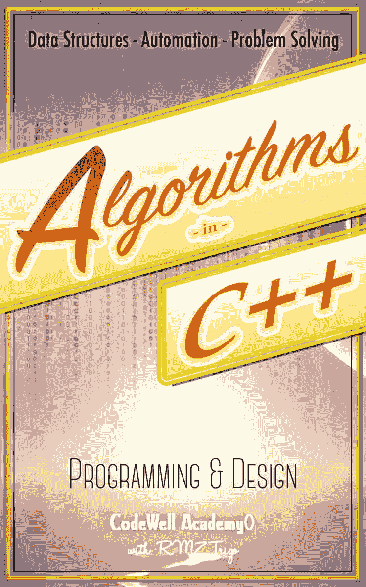

# 算法：C++：数据结构、自动化与问题解决，编程与设计





© Copyright 2015 - 保留所有权利。

以任何方式通过电子手段或打印格式复制、复制或传输本文档的任何部分都是不法的。严禁录制本出版，除非获得出版者的书面许可，否则不允许对本文进行任何存储。保留所有权利。

此处提供的信息被声明是真实且一致的，这意味着，对于由于疏忽或其他原因，使用或滥用本文包含的任何政策、流程或指令而产生的任何责任，均由接收读者承担全部责任。在任何情况下，对于因本文信息直接或间接导致的任何赔偿、损害或金损失，出版者均不承担任何法律责任或指责。

各作者拥有出版者未保留的所有版权。

# 法律声明：
本电子书受版权保护。本内容仅供个人使用。未经作者或版权所有者的同意，您不能修改、分发、销售、使用、引用或转述本电子书的任何部分或内容。如有违反，将追究法律责任。

# 免责声明：
请注意，本文档中包含的信息仅供教育和娱乐目的。我们已尽一切提供准确、最新、可靠的完整信息。不提供任何形式的明示或暗示保证。读者承认作者并未提供法律、财务、医疗或专业建议。

通过阅读本文，读者同意在任何情况下，我们对于因使用本文中包含的信息而导致的任何直接或间接损失（包括但不限于错误、遗漏或不准确之处）均不承担任何责任。

# 目录

## 引言

### 欢迎来到精通之路
感谢您购买并下载我们的作品《算法》。我们理解您希望将编程技能扩展到更深层、更高级的水平。您希望您的应用程序更加复杂；您希望它们能够自动生成结果或为您处理海量信息——而且以最快、最有效的方式实现。

在这一切发生之前，你需要一个良好的开始。因此，你来对地方了……

### 算法
算法可以简单到几行良好的代码，也可以复杂到像人工智能机器人一样。

搜索引擎如何根据你输入的短语为你提供成千上万个网页？搜索引擎如何在在你还没输完搜索关键词之前就完成了你的搜索？谜题是如何随机创建——或自动解决的？名字列表是如何瞬间按字母顺序进行排序的？

理解计算就是理解算法。编写一个良好的算法就是为计算机系统提供一套非常好的程序。这些程序会创建答案、管理数据，或通常情况下为您完成一些工作——所有这些通过最高可能的指令实现。

更重要的是，编写一个良好的算法是要理解所有数据将如何安排和布局。然后，算法或计算机可以多快、多方便地选取数据项并对其进行处理。

### 主结构
此时，你可以在编码之旅的上次停留继续。你已经了解了基本数据类型、`functions` 以及其他编程术语。你可能开始使用不同的编程语言编写代码；或者你可能选择了这本书的主语言。无论哪，你在这里是为了提升你的技能。

我们从计算一组数据项开始。我们仔细观察数据及其行为，然后识别出相应的适当数据结构。然后我们添加对数据结构至关重要的 `functions` 和 `methods`。随着书籍内容的推移，我们开始查看更复杂的数据排列。

### 伪代码参考
本书有自己的主语言和一种易于识别的伪代码。包含伪代码是为了教你一件主要事情：识别两种代码之间的通用程序。你可以在参考章节找到它们，也可以贯穿本书。之后，一旦你掌握了书中主语言的材料，你可以使用伪代码帮助你过渡到下一种语言。

总的来说，祝你好运，写好代码。这是一个好事的开始。

## C++ 简介

### 软件系统专家
C++ 是最广泛使用的编程语言之一，不仅用于开发游戏和应用程序，甚至用于操作系统和硬件编程。C++ 程序可以使用算法来管理和操作列表与集合，还可以管理系统层面（如内存）。这是因为 C++ 的过程化速度和内存管理能力。

### C++ 工作坊：
与我们的其他作品一样，这些工作坊由你以喜欢的方式完成。它们旨在将最近的概念投入现实实践。然而，它们在过程中也赋予了你灵活的批判性思维。当然，灵活和深度的批判性思维是程序员的关键特质！

在全书中寻找它们！

### 等等！！
在继续之前，最好了解编码基础。如果你觉得有必要，可以从我们的《编程：大师版系列》开始

[点击此处查看。](http://www.amazon.com/s/ref=dp_byline_sr_ebooks_1?ie=UTF8&field-author=Code+Well+Academy&search-alias=digital-text&text=Code+Well+Academy&sort=relevancerank)

我们还在全书中提供了示例章节来帮助你。

# 第一部分：识别数据类型

## 第 1a 章：抽象数据类型：栈（Stack）

### 栈
栈（Stack）字面意思就是它本身——一堆对象。作为一种抽象数据类型，栈存储一个数据对象列表供后续处理。栈中的数据对象按照“后进先出”（LIFO）的方式插入和检索。栈通常带有两个主要的函数：`push`（插入）和 `pop`（移除/检索）。

#### 栈的工作原理
将栈想象成一堆叠在另一个上面的盘子。每个盘子里都有一个字母。顶部的盘子最容易检索。因此从栈中检索的数据对象是最后进入的那个。

例如，让我们用数组来实现盘子堆栈：
```cpp
// stackOfPlates 是字符串集合
// 每个字符串代表一个盘子
string stackOfPlates[5] = {"A", "B", "C", "D"};
```
如果你想在这个栈中插入新盘子，它会被放在列表的末尾。现在，例如，看看这个栈：
```cpp
string stackOfPlates[5] = {"A", "B", "C", "D"};
```
然后，让我们输入名为“E”的盘子。向栈中输入项需要一个函数将其插入栈。这个函数通常称为 `push()`。
```cpp
stackOfPlates.push("E")
```
之后，栈看起来如下：
```cpp
string stackOfPlates[5] = {"A", "B", "C", "D", "E"};
```
如果我们想从这个栈中检索盘子，集合中的最后一个将被从栈中移除。然后该项将被给你。你需要一个函数从栈中移除并检索项。这个函数叫做 `pop()`。
```cpp
// 这会打印 E
print(stackOfPlates.pop())

// 这会打印 D
print(stackOfPlates.pop())

// 这会打印 C
print(stackOfPlates.pop())
```
之后，栈看起来是这样的：
```cpp
string stackOfPlates[5] = {"A", "B"};
```

### 什么时候使用栈


仔细观察数据对象列表的处理方式。一旦你注意到任何进入或离开的数据对象都遵循“后进先出”（Last-In-First-Out）的过程，请使用 `stack`。

此外，复杂的算法和函数也会使用 `stacks`。如果计算机按 `stack` 处理一个程序，它将“堆栈”所有调用的函数。然后它将开始完成每个被调用的函数，从最近的一个开始（稍后我们将深入学习这些内容）。

为了以以后参考，请想象自己正处于技术面试中。如果你被问到某个函数的程序是如何运作的，如果你知道 `stack` 的工作原理以及该函数如何从开始到结束执行，你将非常幸运。

然而，请记住栈通常使用列表——数组或链表。那么你应该选择哪一个呢？回顾《大师手册系列》中的这些观点：

链表 = 任意大小，添加和删除更快

数组 = 固定大小，访问/处理更快

因此，取决于你使用哪种数据结构，接下来的章节将展示如何实现 `stack`。

## 第 1b 章：作为数组的栈

### 数据结构

你需要实际的数组，以及两个整数：最大尺寸和当前项目计数。

```
// 抽象数据类型：栈，作为数组

// 栈包含：
// - 实际数组（带有尺寸和数据类型）
// - 栈的最大尺寸（整数）
// - 当前项目计数（整数）

CompositeStructure ArrayStack {
    Integer MAXSIZE
    Integer COUNT
    (choose a data type) ARRAY[MAXSIZE]
}
```

现在，让我们详细查看 `Push()` 和 `Pop()` 方法的工作原理：

### 数组栈：Push() 函数

`Array Stack` 的 `Push()` 函数将项目添加到该栈中。它按照以下过程执行，并遵循这一特定顺序：

1) 检查数组中是否有空间容纳额外的项目
2) 如果数组没有空间，要么报告栈溢出错误（如果是固定大小数组），要么增加数组尺寸（如果是可变数组）
3) 如果数组有空间，将项目添加到栈中。将新项目的索引设置为当前的 `Item Count`（这样该项目就变成了 `Stack` 中的最后一个项目）
4) 最后，递增 `Item Count`

在 `push()` 程序成功插入项目后，该项目应该位于数组的末尾，且项目计数应该增加 1。

### 数组栈：Pop() 函数

与 `Push()` 方法相反，`Array Stack` 的 `Pop()` 方法从栈中移除一个项目。该函数将该项目作为 `Function Output` 返回。它按照以下过程执行，并遵循这一特定顺序：

1) 检查 `Array Count` 查看是否有项目可以弹出
2) 如果没有，要么返回 `NULL` 或者报告栈下溢错误
3) 如果有项目可以弹出，先递减 `Item Count`。我们要移除一个项目了！
4) 然后，创建一个 `Local Variable`。将其设置为你将返回的项目（它应该是栈末尾的项目！）随后移除 `End of the Stack` 处的项目
5) 最后，函数返回你的项目并结束。

在 `pop()` 程序成功移除并检索一个项目后，该项目应该是原本位于数组末尾的那个项目。同时，项目计数应该减少 1。

## 第 1c 章：作为链表的栈

### 数据结构

你需要一个链表节点——`Head`——以及一个用于跟踪 `Item Count` 的整数。幸运的是，链表不存在栈溢出问题。很有可能，你还需要还需要设计链表节点。

```
// 单向链表节点包含：
// - 下一个节点（指向下一个节点）
// - 数据项目（任选你想要的数据类型）

CompositeStructure Node {
    Node NEXTID
    (choose a data type) ITEM
}

// 抽象数据类型：栈，作为链表
// 栈包含：
// - 一个头部（链表节点）
CompositeStructure LinkedListStack {
    Node HEAD
    Integer COUNT
}
```

现在，让我们详细查看 `Push()` 和 `Pop()` 方法的工作原理：

### 链表栈：Push() 函数

`Linked List Stack` 的 `Push()` 函数将项目添加到该栈中。它按照以下过程执行，并遵循这一特定顺序：

1) 创建一个新的 `Local Variable`。将其设置为一个 `Node`。这将是 `New Linked List head`（新链表头）。
2) 将你的输入项目设置为 `New Head Node` 的数据
3) 将前一个头部的下一个节点指向 `New Head`。 
4) 将 `New Head` 设置为链表的 `Stack Head`。
5) 最后，递增 `Item Count`

在 `push()` 程序成功插入项目后，该项目应该位于链表的头部，且项目计数应该增加 1。

#### 链表栈：Pop() 函数

与 `Push()` 方法相反，`Linked List Stack` 的 `Pop()` 方法从栈中移除一个项目。该函数将该项目作为 `Function Output` 返回。它按照以下过程执行，并遵循这一特定顺序：

1) 检查 `Head Node` 是否为 `Null`（如果 `Head Node` 存在）
2) 如果不是，要么返回 `NULL` 或者报告栈下溢错误
3) 如果有项目弹出，创建一个 `Local Variable`。将其设置为即将返回的项目（它应该是 `Head Node`！）
4) 获取 `Head` 的 `NEXT` 节点。这将成为新的 `LinkedList Head`。
5) 递减 `Item Count`
6) 最后，函数返回你的项目并结束。


```cpp
std::cout << "Count is " << this->COUNT << "\n";

};
```

## 可选项：数组大小扩容器（阶段 1.2）

如果你选择使用变长数组，请将此方法与其他方法一并包含。此版本会在需要时将数组大小翻倍。请注意操作步骤。根据定义，数组的大小是固定的。然而，这将简单地用一个更大的数组替换旧数组 —— 按照原始顺序逐个输入每个项目。

## 数组栈：`Pop()` 函数（C++ 语言）

与 `Push()` 函数一样，请注意 `Pop` 函数执行过程中的程序化步骤。在这里，我们使用 `C++` 来实现它。

如果在栈为空时调用了 `pop()`，我们将打印一条消息并结束函数。

```cpp
// INPUT: - 无

// OUTPUT: - 一个项目（某种数据类型）

// EFFECT: 从我们的数组栈中移除并检索一个项目（某种数据类型）

<chosen data type> pop() {

    // 1) 检查数组计数，查看是否有可弹出的项。
    if (this->COUNT <= 0) {
        // 2) 如果没有，打印一条消息并返回空
        std::cout << "Stack Underflow!\n";
        return NULL;
    }

    // 3) 如果有可弹出的项，先减少项目计数。
    // 我们要移除一个项目！
    this->COUNT -= 1;

    // 4) 然后，创建一个局部变量。
    // 将其设置为要返回的项目
    //（它应该是栈末尾的项！）
    <chosen data type> r = this->ARRAY[COUNT];

    // 证明它加载了末尾项：
    std::cout << "Loaded is " << this->ARRAY[COUNT] << " at index "<< this->COUNT << "\n";

    // 随后移除栈末尾的项
    this->ARRAY[COUNT] = NULL;

    // 5) 最后，函数返回你的项目并结束。
    return r;
}

};
```

## C++ 01b：作为链表的的栈

### 数据结构（C++ 语言）

在 `C++` 中，我们使用指针将节点连接起来。这样，每个节点都拥有下一个节点的内存地址。我们不需要复制节点并占用计算机内存中的数据空间，只需“指向”下一个节点即可。

我们为 `node` 和链表都定义了类。我们还为 `Node` 和 `Linked List Stack`（链表栈）都定义了构造函数。你需要同时使用它们，因为 `Stack` 需要节点被创建出来。

```cpp
// 单链链表节点包含：
// - 下一个节点（指向下一个节点）
// - 数据项（选择你想要的数据类型）
class Node {
public:
    Node* NEXT;
    <chosen data type> ITEM;

    // INPUT: - 一个数据项
    // OUTPUT: - 无
    // EFFECT: 构造函数：链表节点，以数据项作为输入
    Node(<chosen data type> item) {
        this->ITEM = item;
    }

};
```

### 抽象数据类型：作为链表的栈

// 栈存有：
// - 一个默认头节点（链表节点）
// - 一个项目计数（整数）
```cpp
class LinkedListStack {
    Node* HEAD;
    int COUNT;

public:
    // INPUT: - 无
    // OUTPUT: - 无
    // EFFECT: 构造函数：链表栈，
    LinkedListStack() {
        this->HEAD = new Node(<data with chosen data type>);
        this->COUNT = 0;
    }

    // 在此处插入 PUSH() 函数
    //________________
    // 在此处插入 POP() 函数
    //________________
};
```

对于高级用户来说，项目计数是可选的。然而，它在优化你的数据结构和操作方面非常有帮助，并能使其变得更加健壮。

### 链表栈：`Push()` 函数（C++ 语言）

```cpp
// INPUT: - 一个项目（某种数据类型）
// OUTPUT: - 无
// EFFECT: 将一个项目（某种数据类型）插入我们的链表栈
void push(<chosen data type> INPUT) {
    // 1) 创建一个新的局部变量。将其设置为节点。
    // 这将成为新的链表头。
    Node* NEWHEAD = new Node(INPUT);

    // 2) 将你的输入项目设置为新头节点的数据
    //（构造函数已完成此操作）
    // 3) 将上一个头的下一个节点指向新头
    NEWHEAD->NEXT = this->HEAD;

    // 4) 将新头设置为链表栈的头
    this->HEAD = NEWHEAD;

    // 证明它已插入：
    std::cout << "Head item is:" << HEAD->ITEM << "\n";
    std::cout << "Next Head item is:" << HEAD->NEXT->ITEM << "\n";

    // 5) 增加项目计数
    this->COUNT += 1;
}
```

#### 链表栈：Pop() 函数

```cpp
// INPUT: - 无
// OUTPUT: - 一个项目（某种数据类型）
// EFFECT: 从我们的链表栈中移除并检索一个项目（某种数据类型）
<chosen data type> pop() {
    // 1) 检查头节点是否为空（如果头节点存在）
    if (this->HEAD->NEXT == NULL) {
        // 2) 如果是，打印一条消息并返回空
        std::cout << "Stack Underflow!" << "\n";
        return NULL;
    }

    // 3) 如果有可弹出的项，创建一个局部变量。
    // 将其设置为要返回的项目
    //（它应该是头节点！）
    <chosen data type> r = this->HEAD;

    // 4) 随后移除栈末尾的项
    //（注：原文片段中移除头节点的逻辑）
    
    // 5) 最后，函数返回你的项目并结束。
    return r;
}
```
*(注：提供的文本中 pop 函数的实现逻辑存在部分重叠或碎片；我已按照源文本的结构进行了翻译。)*


## 队列 (Queue)

`Queue`（队列）也是一个项的列表或序列。每个项都在等待轮到处理——就像人们排队等某事一样。

队列中的数据对象按照“先进先出”（First-In-First-Out）的过程进行插入和检索。

一个 `Queue` 通常会与其定义的两个主要函数：`enqueue`（入队，插入队列末尾）和 `dequeue`（出队，从队列中移除）。

## 队列如何工作

将队列想象成一个排队。适用于任何场景。它可以是你银行的排队、你喜欢的快餐店的排队、夜俱乐部，或者任何像排队的场景。

在排队中，有人从末尾进入队伍。随着队伍的增长，越来越多的人从末尾进入。排在队最前面的人接受服务——他们处理客户服务、点餐、进入夜俱乐部，任何排队会做的事情。每当有人被服务时，队列就会变小。

队列的工作方式本质上相同。你将数据项输入到队伍中，最近的数据项位于队末尾。当检索数据项时，会首先检索最旧的项。

## 何时使用队列

每当你有一组数据项且它们必须按照“排队顺序”处理时，请使用 `Queue`。一旦你发现它对摄取的任何对象使用“先进先出”的过程，就使用队列。

在线游戏就是一个极好的例子。如果你必须登录任何游戏服务器来玩，你的登录请求将发送到由其他也想玩的用户的登录请求组成的“队列”中。最近的请求始终位于该队列的末尾。游戏服务器处理每个登录请求以让玩家登录服务器——一个接一个，从队头开始。

此外，请记住队列通常使用列表——数组或链表。再次，你选择哪一个？

默认情况下，为队列使用 `Linked Lists`（链表）——因为入队和出队的计算复杂度是常数级（`O(1)`）——这是算法速度最快的层级。

另一方面，如果队列中的任何数据项需要频繁访问，则对队列使用 `Arrays`（数组）。对于 `Array Queues`（数组队列），你将使用 `Circular Arrays`（循环数组）——一种起始索引（`0`）紧跟结束索引（数组大小 - `1`）的数组。这样，添加和删除数据项时就不需要不断将每一个数据项向左或右移动（这会非常消耗你的程序和计算资源）。

`Circular Array Queues`（循环数组队列）同样快——入队和出队也可以是常数时间。你只是额外的灵活性可以随所欲编辑队伍。

所以取决于你使用哪种数据结构，接下来的章节将向你展示如何实现栈。

## 第 2b 章：作为数组的队列

### 数据结构

与 `Array Stack`（数组栈）一样，你需要实际的数组。但这次，我们需要四个整数：头部索引、尾部索引、最大尺寸和当前计数。

```cpp
// 抽象数据类型：队列，通过数组实现

// 队列拥有：
// - 实际数组（带有大小和数据类型）
// - 头部项的索引（整数）
// - 尾部项的索引（整数）
// 队列的最大大小（整数）
// - 当前计数（整数）

CompositeStructure ArrayQueue {
    Integer FRONT
    Integer BACK
    Integer MAXSIZE
    Integer COUNT
    (选择一种数据类型) ARRAY[MAXSIZE]
}
```

现在，让我们详细查看 `Enqueue()` 和 `Dequeue()` 方法是如何工作的：

### 数组队列：Enqueue() 函数

`Array Queue`（数组队列）的 `Enqueue()` 函数向该队列中添加项。它按照以下过程、按特定顺序执行：

1. 检查数组是否有空间容纳额外的项。
2. 如果数组中没有空间，要么报告队列溢出错误（如果是固定大小数组），要么增加数组大小（如果是可变数组）。
3. 如果数组中有空间，我们将项添加到队列中。将新项的索引设置为当前的 `Back Index`（尾部索引）（因此该项是 `Queue` 中的最后一个项）。
4. 增加 `Back Index`。如果 `Back Index` 大于或等于数组大小，则将 `Back Index` 设置为 `0`（它现在位于循环数组的开头）。
5. 最后，增加 `Item Count`（项计数）。

在 `enqueue()` 过程成功插入一个项后，你应该拥有该项作为循环数组中的最后一项，无论它的索引是什么。此外，项计数应该增加 `1`。

### 数组队列：Dequeue() 函数

`Array Queue` 的 `Dequeue()` 方法从该队列中移除一个项。函数返回该项作为函数输出。它按照以下过程、按特定顺序执行：

1. 检查 `Array Count` 是否有要弹出的项。
2. 如果没有，要么返回 `NULL`，要么报告队列上溢错误。
3. 如果有要弹出的项，创建一个 `Local Variable`（局部变量）。将其设置为要返回的项（它应该是队列头部的项！）。之后移除 `Queue` 头部的项。
4. 增加 `Front Index`（头部索引）。如果 `Front Index` 大于或等于数组大小，则将 `Front Index` 设置为 `0`（它现在位于循环数组的开头）。
5. 最后，增加 `Item Count`。

在 `enqueue()` 过程成功插入一个项后，你应该拥有该项作为循环数组中的最后一项，无论它的索引是什么。此外，项计数应该增加 `1`。 (注：此处原文逻辑似乎有部分重复或描述错位，已根据上下文逻辑进行翻译并对齐)


## 抽象数据类型：基于数组的队列

## 队列包含：

- 实际数组（包含大小和数据类型）
- 队头元素索引（整数）
- 队尾元素索引（整数）
- 队列的最大容量（整数）
 当前 当前元素数量计数（整数）

```cpp
class ArrayQueue {
    int FRONT;
    int BACK;
    int MAXSIZE = 10;
    int COUNT;
    <chosen data type> ARRAY[10];

    public:
    // 输入：无
    // 输出：无
    // 效果：构造函数：数组队列
    ArrayQueue() {
        this->FRONT = 0;
        this->BACK = 0;
        this->COUNT = 0;
    };

    // 在此处插入 ENQUEUE() 函数
    //________________

    // 在此处插入 DEQUEUE() 函数
    //________________
};
```

## 数组队列：Enqueue() 函数，C++ 语言

// 输入：一个元素（选定的数据类型）
// 输出：无
// 效果：将一个元素（某种数据类型）插入我们的数组队列

```cpp
void enqueue(<chosen data type> item) {
    // 1) 检查数组是否有足够的空间存放额外的元素
    if (this->MAXSIZE <= this->COUNT) {
        // 2) 如果没有，打印消息并返回空
        std::cout << "Queue Overflow!\n" ;
        return;
    }
    // 3) 如果数组有空间，我们将元素加入队列。
    // 将新元素的索引设置为当前的队尾索引
    // （这样该元素就是队列中的最后一个元素）
    this->ARRAY[BACK] = item;
    // 4) 队尾索引加 1。
    // 如果队尾索引大于或等于数组大小，
    // 将队尾索引置为 0（它现在位于循环数组的起始位置）。
    this->BACK +=1;
    if (this->BACK >= MAXSIZE) this->BACK = 0;

    // 5) 最后，增加元素计数
    this->COUNT += 1;
};
```

## 数组队列：Dequeue() 函数，C++ 语言

// 输入：无
// 输出：一个元素（某种数据类型）
// 效果：从我们的数组队列中移除并获取一个元素（某种数据类型）

```cpp
<chosen data type> dequeue() {
    // 1) 检查数组计数是否有元素可以弹出
    if (this->COUNT <= 0) {
        // 2) 如果没有，打印消息并返回空
        std::cout << "Queue Underflow!\n";
        return NULL;
    }
    // 3) 如果有元素可以弹出，创建一个局部变量。
    // 将其设置为你的返回元素
    // （它应该是队列队头的元素！）
    <chosen data type> r = this->ARRAY[FRONT];
    // 随后移除队列队头的元素
    this->ARRAY[FRONT] = NULL;
    // 4) 队头索引加 1。
    // 如果队头索引大于或等于数组大小，
    // 将队头索引置为 0（它现在位于循环数组的起始位置）。
    this->FRONT+=1;
    if (this->FRONT >= MAXSIZE) this->FRONT = 0;
    // 5) 减少元素计数
    this->COUNT -= 1;
    // 6) 最后，函数返回你的元素并结束。
    return r;
}
```

## C++ 02b：基于链表的队列

## C++ 语言中的数据结构

首先，我们为链表队列定义了类 - 分别节点（Node）和实际的链表队列。我们还为这两个类定义了构造函数。我们使用了上面 `LinkedListStack` 中相同的 `Node` 类。和栈的版本一样，你需要同时使用它们；队列的构建需要节点来完成。

// 单向链表节点包含：
// - 下一个节点（指向下一个节点）
// - 数据元素（任选你想要的数据类型）

```cpp
class Node {
    public:
    Node* NEXT;
    <chosen data type> ITEM;

    // 输入：一个数据元素
    // 输出：无
    // 效果：构造函数：链表节点，以数据元素作为输入
    Node(<chosen data type> item) {
        this->ITEM = item;
    };
};
```

## 抽象数据类型：基于链表的队列

// 队列包含：
// - 队头（链表节点）
// - 队尾（链表节点）

```cpp
class LinkedListQueue {
    Node* x = new Node(NULL);
    Node* FRONT = x;
    Node* BACK = x;
    int COUNT;

    public:
    // 输入：无
    // 输出：无
    // 效果：构造函数：链表队列
    LinkedListQueue() {
        this->COUNT = 0;
    };

    // 在此处插入 ENQUEUE() 函数
    //________________

    // 在此处插入 DEQUEUE() 函数
    //________________
};
```

## 链表队列：Enqueue() 函数，C++ 语言

// 输入：一个元素（某种数据类型）
// 输出：无
// 效果：将一个元素（某种数据类型）插入我们的链表队列

```cpp
void enqueue(<chosen data type> item) {
    // 1) 创建一个局部变量。
    // 将其设置为节点。
    Node* NEWBACK = new Node(item);
    // 2) 将输入设置为新的队尾。
    this->BACK->NEXT = NEWBACK;
    // 3) 更新队尾指针。
    this->BACK = NEWBACK;
    // 4) 如果队列为空，将队头也指向队尾。
    if (this->COUNT == 0) {
        this->FRONT = this->BACK;
    }
    // 5) 最后，增加元素计数
    this->COUNT += 1;
}
```

## 链表队列：Dequeue() 函数，C++ 语言

// 输入：无
// 输出：一个元素（某种数据类型）
// 效果：从我们的链表队列中移除并获取一个元素（某种数据类型）

```cpp
<chosen data type> dequeue() {
    // 1) 检查计数是否有元素可以弹出。
    if (this->COUNT <= 0) {
        // 2) 如果没有，打印消息并返回空
        std::cout << "Queue Underflow!\n";
        return NULL;
    }
    // 3) 获取队头元素。
    <chosen data type> r = this->FRONT->ITEM;
    // 4) 移动队头指针。
    this->FRONT = this->FRONT->NEXT;
    // 5) 如果队列变空，将队尾也置为空。
    if (this->COUNT == 0) {
        this->BACK = NULL;
    }
    // 6) 减少元素计数
    this->COUNT -= 1;
    // 7) 最后，返回你的元素并结束。
    return r;
}
```

## C++ 工作坊 #2

## 消息队列

现在我们将观察队列的操作。

### 第一部分：

1) 确保你的代码包含了以下行：
```cpp
#include <iostream>
#include <string>
using namespace std;
```

2) 复制并粘贴 `ArrayQueue` 或 `LinkedListQueue` 类，以及它们相应的 `enqueue()` 和 `dequeue()` 方法。

3) 在代码中所有要求选择数据类型的地方，将其设置为 `string`：
`<chosen data type> === string`

4a) 如果你选择了 `ArrayQueue`，为了避免错误，修改 `dequeue()` 方法中的以下行：
```cpp
this->ARRAY[FRONT] = NULL;
```
改为：
```cpp
this->ARRAY[FRONT] = "";
```

5b) 如果你选择了 `LinkedListQueue`，为了避免错误，修改构造函数中的以下行：
```cpp
Node* x = new Node(NULL);
```
改为：
```cpp
Node* x = new Node("DEFAULT");
```

6) 之后，复制以下代码作为你的 `main()` 方法：
```cpp
int main()
{
    // 填充 ArrayQueue* 或 LinkedListQueue*
    // 注意不要忘记星号！*
    ____ q;

    // 填充 ArrayQueue() 或 LinkedListQueue()
    // 取决于你之前的选择
    // 这是构造函数：不要忘记括号！
    q = new ____;

    q->enqueue("HI ");
    q->enqueue("THERE! ");
    q->enqueue("How's ");
    q->enqueue("it ");
    q->enqueue("going? ");
    q->enqueue("Did ");
    q->enqueue("you ");
    q->enqueue("know ");
    q->enqueue("you're ");
    q->enqueue("my ");
    q->enqueue("Best Friend? ");

    string a[12];

    for(int i = 0; i < 12; i++) {
        a[i] = q->dequeue();
        std::cout << a[i] ;
    }

}
```

## 发生了什么？

注意运行代码后，消息会按完美顺序清晰地显示。

如果你使用了 `ArrayQueue`，我们尝试入队 10 个字符串 - 但第 11 个字符串没有被入队。发生了什么？队列溢出（Queue Overflow）。接下来，迭代代码尝试执行 12 次弹出。但当没有元素可以弹出时，发生了队列上界（Queue Underflow）。


如果你使用了链表队列（Linked List Queue），我们成功入队了所有 11 个字符串。怎么做到的？链表没有大小，记得吗？但话说回来，一旦没有可以出队的元素时，也发生了队列上界（Queue Underflow）。

## 第二部分：切换列表类型

如果你切换到另一种列表类型（数组或链表），你应该会得到相同的结果。尝试一下，并注意这两种数据结构之间的差异。

## 参考章节：

### REF-01: 栈（Stack）

数组栈，伪代码中的数据结构

```cpp
// 抽象数据类型：栈，使用数组实现

// 栈包含：
// - 实际数组（带有大小和数据类型）
// - 栈容量（整数）
// - 当前项目计数（整数）

CompositeStructure ArrayStack {
Integer MAXSIZE
Integer COUNT
(选择一种数据类型) ARRAY[MAXSIZE]
}
```

#### 数组栈：Push() 函数的伪代码

```cpp
// 输入: - 一个项目（某种数据类型）
// 输出: - 无
// 效果：将一个项目（某种数据类型）插入我们的数组栈中

void push(<选择的数据类型> ITEM) {
    // 1) 检查数组是否有空间容纳额外的项目
    if (this.MAXSIZE < this.COUNT) {
        // 2) 如果数组没有空间了，
        // ……要么报告栈溢出错误（如果是固定大小数组）
        //（假设 error() 会替你报告错误）
        error(“Stack Overflow”)
        // ……或者增加数组大小（如果是动态数组）
        //（假设 increaseArray() 将数组大小增加 1）
        this.increaseArray()
    }
    // 3) 如果数组有空间，则将项目添加到栈中。
    // 将新项目的索引设置为当前项目计数
    this.ARRAY[COUNT] = ITEM
    // 4) 最后，项目计数加 1
    this.COUNT += 1
}
```

#### 数组栈：Pop() 函数的伪代码

```cpp
// 输入: - 无
// 输出: - 一个项目（某种数据类型）
// 效果：从我们的数组栈中移除并获取一个项目（某种数据类型）

<选择的数据类型> pop() {
    // 1) 检查数组计数，看是否有项目可以弹出。
    if (this.COUNT <= 0) {
        // 2) 如果没有，要么返回 NULL
        return NULL
        // 或者报告栈下界错误
        //（假设 error() 会替你报告错误）
        error(“Stack Underflow”)
    }
    // 3) 如果有项目可以弹出，项目计数减 1
    this.COUNT -= 1
    // 4) 创建一个局部变量。
    // 将其设置为要返回的项目
    //（它应该是栈末尾的项目！）
    <选择的数据类型> r = this.ARRAY[COUNT]
    // 之后移除栈尾的项目
    this.ARRAY[COUNT] = null
    // 5) 最后，函数返回你的项目并结束。
    return r
}
```

注意看我们在输出项目并结束函数**之前**递减了 `COUNT`。如果你还记得，函数返回应该是函数过程中的最后的一件事——因为它结束了函数的执行。

对于有经验的程序员来说，如果你愿意，你也可以选择放弃局部变量，这取决于你想要使用的语言以及你对性能的需求。

#### 链表栈，伪代码中的数据结构

```cpp
// 单向链表节点包含：
// - 下一个节点（指向下一个节点）
// - 数据项目（选择你想要的数据类型）

CompositeStructure Node {
Node NEXTID
(选择一种数据类型) ITEM
}

// 抽象数据类型：栈，使用链表实现
// 栈包含：
// - 头部（链表节点）
CompositeStructure LinkedListStack {
Node HEAD
Integer COUNT
}
```

现在，让我们详细看看 `push()` 和 `pop()` 方法是如何运作的：

#### 链表栈：Push() 函数的伪代码

```cpp
// 输入: - 一个项目（某种数据类型）
// 输出: - 无
// 效果：将一个项目（某种数据类型）插入我们的链表栈中

void push(<选择的数据类型> INPUT) {
    // 1) 创建一个新的局部变量。并将其设置为一个节点。
    // 这将是新的链表头部。
    Node NEWHEAD = new Node
    // 2) 将你的输入项目设置为新头部节点的数据
    NEWHEAD.ITEM = INPUT
    // 3) 将前一个头下一个节点设置为新头部
    NEWHEAD.NEXT = this.HEAD
    // 4) 将新头部设置为链表的栈头
    this.HEAD = NEWHEAD
    // 5) 最后，项目计数加 1
    this.COUNT += 1
}
```

#### 链表栈：Pop() 函数

```cpp
// 输入: - 无
// 输出: - 一个项目（某种数据类型）
// 效果：从我们的数组栈中移除并获取一个项目（某种数据类型）

<选择的数据类型> pop() {
    // 1) 检查头部节点是否为空（如果头部节点存在）
    if (this.HEAD = NULL) {
        // 2) 如果是，要么返回 NULL
        return NULL
    }
    // 或者报告栈下界错误
    //（假设 error() 会替你报告错误）
    error(“Stack Underflow”)
}
    // 3) 如果有项目可以弹出，项目计数减 1
    this.COUNT -= 1
    // 4) 创建一个局部变量。
    // 将其设置为要返回的项目
    //（它应该是栈尾的项目！）
    <选择的数据类型> r = HEAD.ITEM
    // 4) 获取下一个节点。
    // 这将是新的头部。
    this.HEAD = HEAD.NEXT
    // 5) 项目计数减 1
    this.COUNT -= 1
}

### REF-02: 队列（Queue）

数组队列：伪代码中的数据结构

```cpp
// 抽象数据类型：队列，使用数组实现
// 栈包含：
// - 实际数组（带有大小和数据类型）
// - 最大容量（整数）
// - 当前项目计数（整数）

CompositeStructure ArrayQueue {
Integer MAXSIZE
Integer COUNT
Integer FRONT
Integer BACK
}
```

#### 数组队列：Enqueue() 函数的伪代码

```cpp
// 输入: - 一个项目（某种数据类型）
// 输出: - 无
// 效果：将一个项目（某种数据类型）插入我们的数组队列

void enqueue(<选择的数据类型> ITEM) {
    // 1) 检查数组是否有空间容纳额外的项目
    if (this.MAXSIZE < this.COUNT) {
        // 2) 如果数组没有空间了，
        // ……要么报告栈溢出错误（如果是固定大小数组）
        //（假设 error() 会替你报告错误）
        error(“Queue Overflow”)
        // ……或者增加数组大小（如果是动态数组）
        //（假设 increaseArray() 将数组大小增加 1）
        this.increaseArray()
    }
    // 3) 如果数组有空间，则将项目添加到栈中。
    // 将新项目的索引设置为当前的尾部
    this.ARRAY[BACK] = ITEM
    // 4) 尾部加 1。
    // 如果尾部大于或等于数组大小，将其置为 0。
    this.BACK+=1
    if (this.BACK >= MAXSIZE) {
        this.BACK = 0
    }
    // 5) 如果队列为空，将头部索引设置为尾部索引
    if (this.COUNT == 0) {
        this.FRONT = this.BACK
    }
    // 6) 项目计数加 1
    this.COUNT += 1
}
```

#### 数组队列：Dequeue() 函数的伪代码

```cpp
// 输入: - 无
// 输出: - 一个项目（某种数据类型）
// 效果：从我们的数组队列中移除并获取一个项目（某种数据类型）

<选择的数据类型> dequeue() {
    // 1) 检查数组计数，看是否有项目可以出队
    if (this.COUNT <= 0) {
        // 2) 如果没有，要么返回 NULL
        return NULL
        // 或者报告栈下界错误
        //（假设 error() 会替你报告错误）
        error(“Queue Underflow”)
    }
    // 3) 如果有项目可以弹出，创建一个局部变量。
    // 将其设置为要返回的项目
    //（它应该是队列头部的项目！）
    <选择的数据类型> r = this.ARRAY[FRONT]
    // 4) 之后移除队列头部的项目
    this.ARRAY[FRONT] = null
    // 5) 头部索引加 1。
    // 如果头部大于或等于数组大小，将其置为 0。
    this.FRONT+=1
    if (this.FRONT >= MAXSIZE) {
        this.FRONT = 0
    }
    // 6) 如果队列现在为空，将尾部索引设置为头部索引
    if (this.COUNT == 1) {
        this.BACK = this.FRONT
    }
    // 7) 项目计数减 1
    this.COUNT -= 1
    // 8) 最后，函数返回你的项目并结束。
    return r
}
```

#### 链表队列：伪代码中的数据结构

```cpp
// 单向链表节点包含：
// - 下一个节点（指向下一个节点）
// - 数据项目（选择你想要的数据类型）

CompositeStructure Node {
String ID
String NEXTID
(选择一种数据类型) ITEM
}

// 抽象数据类型：队列，使用链表实现
// 队列包含：
// - 头部（链表节点）
// - 尾部（链表节点）
CompositeStructure LinkedListQueue {
Node FRONT
Node BACK
Integer COUNT
}
```


现在，让我们详细查看 `Enqueue()` 和 `Dequeue()` 方法是如何运作的：

### 链表队列：伪代码中的 `Enqueue()` 函数

```cpp
// 输入: -一个项目（某种数据类型）
// 输出: - 无
// : 将一个项目（某种数据类型）插入到我们的链表队列中

void enqueue(<chosen data type> INPUT) {
  // 1) 创建一个新的局部变量。将其设置为一个节点（Node）。
  // 这将是新的链表尾部。
  Node NEWBACK = new Node

  // 2) 将你的输入项目设置为新尾部节点的数据
  NEWBACK.ITEM = INPUT

  // 3) 将上一个尾部的下一个节点指向新尾部
  NEWBACK.NEXT = this.back

  // 4) 将新尾部设置为链表队列的后端
  this.BACK = NEWBACK

  // 如果此队列之前是空的，
  // 则新节点也将成为新的头部
  if (this.COUNT <= 0) {
    this.FRONT = NEWBACK
  }

  // 5) 最后，增加项目计数
  this.COUNT += 1
}
```

### 链表队列：伪代码中的 `Dequeue()` 函数

```cpp
// 输入: - 无
// 输出: -一个项目（某种数据类型）
// : 从我们的链表队列中移除并检索一个项目（某种数据类型）

<chosen data type> dequeue() {
  // 1) 检查头部节点是否为空（如果头部节点存在）
  if (this.FRONT = NULL) {
    // 2) 如果是，返回 NULL
    return NULL
  }
  // 或者报告队列下界错误
  // （假设 error() 会为你报告错误）
  error("QueueUnderflow")
  }

  // 3) 如果有项目要出队，创建一个局部变量。
  // 将其设置为你即将返回的项目
  // (它应该是头部节点！）
  <chosen data type> r = FRONT.ITEM

  // 4) 获取头部节点的下一个下一个节点。
  // 这现在将成为新的链表头部。
  this.FRONT = this.FRONT.NEXT

  // 5) 减少项目计数
  this.COUNT -= 1

  // 7) 最后，函数返回你的项目并结束。
  return r
}
```

## 额外章节：

## 额外章节 01a：列表

在某一个时刻，计算机最终将有一组数据需要处理 - 无论它们是对象还是基本数据。因此，我们有了列表。

### 通用列表
作为一种抽象数据类型，列表本质上是一系列连接在一起的数据项。计算机通常会逐个处理列表中的数据项。列表通常有两种类型：链表和数组。大多数编程语言通常都会包含其中一种类型的列表。

### 链表 vs. 数组：应该使用哪种列表？

**重要提示**：大多数编程语言中一个讽刺的地方在于，它们**都**提供了数组和链表可以使用。但是，如果你的同事或老板问你应该用哪一个呢？看，有时候做出这类极微小的决定会非常重大，足以决定一个应用的成败——有时甚至会影响职位申请、职业生涯和创业公司。

通常情况下，使用 `Linked Lists` 来快速添加和删除列表中的数据项，无论它们的顺序如何。无论项目是在列表的开头、结尾还是中间，计算机添加/删除数据项花费的时间和精力都是相同的。此外，如果你也不知道列表会有多大，链表是更优的。

通常情况下，在任何需要访问或处理列表中的每个元素的计算中，使用 `Arrays`。`Array` 中的索引将帮助你的计算机更快地处理列表，并为计算机处理该列表提供多处理潜力。此外，如果列表中的每个项目都需要一个索引，请使用数组。例如，如果你想随机获取列表项目，你只能在数组中这样做（在链表中，计算机如何知道要获取哪个项目？思考一下……）

**结论：**
- `Linked Lists` = 任意大小，更快的添加/删除
- `Arrays` = 固定大小，更快的访问/处理

### 链表 vs. 数组：数据管理
通常情况下，如果给定相同的数据类型来存储在列表中，数组占用的内存/存储空间比链表少。你以后会发现这一点，但链表在结构中通常比数组多需要一点数据。然而，在项目数量非常大的列表中，这种微小的差别实际上是非常显著的。

## 额外章节 01b：链表
链表的概念实际上非常简单。将链表想象成一条链条——字面意义上的。在链表中，链条中的每个“环”都有自己的项目，后面紧跟着任何下一个“环”。如果某个环后面没有链环了，那么那个环就是链条的末尾——或者说，是链表的末尾。

这里是一个双向链表的视觉化示例：

[ ID01 ][ item ][ Prev: NULL][ Next: ID03]
[ ID04 ][ item ][ Prev: ID03][ Next: NULL]
[ ID03 ][ item ][ Prev: ID01][ Next: ID04]

链条中有三个“环”，其中环 `ID04` 是最后一个。为什么 `ID04` 是最后一个？因为它的 `Next` 字段是 `NULL`。在双向链表中，每个节点都同时指向下一个节点和上一个节点。

### 从零构建链表
如果你需要从零开始设计链表，这个概念也是简单的。单向链表只指向下一个节点，而双向链表指向下一个节点和上一个节点。

```cpp
// 抽象数据类型：链表
// 列表中的每个元素都由一个节点（Node）表示。
// 节点具有：

struct Node {
  String ID
  String PREVID
  String NEXTID
  (data type) ITEM
}
```

## 额外章节 01c：数组
如果你在字典中查询“数组”（array）一词，你会发现它是按照特定顺序排列的一种复杂的有时是美丽的项目安排。

这里是一个大小为 5 的数组的视觉化示例：

[ 0 ][item A]
[ 1 ][item B]
[ 2 ][ NULL ]
[ 3 ][item D]
[ 4 ][ NULL ]

### 从零构建数组
如果你需要从零开始设计数据数组，这个概念同样简单。但与链表不同，通常没有独立的节点。你只需要构建数组类型列表本身。它需要两个主要要素：数组的长度或大小以及你想存储在其中的数据类型。

```cpp
// 抽象数据类型：数组
```


// 数组包含：

- 数组大小
- 存储的数据项类型（选择你想要的数据类型）

```cpp
CompositeStructure Array {
    Integer SIZE
    (choose a data type) ITEM
}
```

就像链表一样，每个数组只能使用一种数据类型。然而，与链表不同，数组对每个数组只能有一种数据类型有严格限制。其的原因是计算机为该数组分配内存/存储的方式。每个数组使用一种数据类型使得数组结构更加结构化，并且更容易访问。

[在此处查看编程：大师手册系列](http://www.amazon.com/s/ref=dp_byline_sr_ebooks_1?ie=UTF8&field-author=Code+Well+Academy&search-alias=digital-text&text=Code+Well+Academy&sort=relevancerank)

