# 家居安全与防护系统集成方法


# 前言

基于人脸和语音识别的高效准确的家庭安全及门禁控制系统，对于广泛的安全应用非常重要。安全是智能家居应用中的重要方面或特征。大多数国家正在逐渐采用智能门安全系统。任何门禁安全系统最重要的主要部分是准确识别进入大门的个人。人脸和语音识别是人之间之间生物识别最自然的方式。此外，在指纹技术之后，这些是最流行的生物识别特征。生物识别，或简称为生物识别学，是根据物理或行为属性建立个人身份的科学。这是一个快速发展的领域，其应用范围从保护商业和政府应用中的大规模生物识别系统，增加了公众对该技术的认知。《家庭安全与安全系统集成方法》是一本介绍生物识别基础知识的教材，结合了人脸和语音识别的集成算法，旨在为在家的个人提供安全保障。书中详细介绍了生物识别领域两种常用的两种模态，即人脸和语音。还简要讨论了其他几种模态，如手部几何、耳朵和步态，并涵盖了如用于指尖应用的心率检测等高级话题。

《家庭安全与安全系统集成方法》为计算机科学和电气工程专业的研究生设计，也适用于研究人员以及生物识别和计算机安全专业人士。

MATLAB® 是 MathWorks, Inc. 的注册商标。有关产品信息，请联系：
The MathWorks, Inc.
3 Apple Hill Drive
Natick, MA 01760-2098 USA
Tel: 508-647-7000
Fax: 508-647-7001
E-mail: info@mathworks.com
Web: www.mathworks.com

# 致谢

首先，感谢全能的上帝，感谢他在成功完成这本书的过程中降下了他的福。。您赋予了我们相信自己的激情并追求梦想的力量。如果没有对您全能者的信仰，我们永远无法完成工作。

我们非常感谢父母的爱、祈祷、关怀和牺牲，他们教育我们并为我们的未来做准备。最后，我们感谢所有直接或间接支持我们的人。


- BPM: 每分钟拍数
- CDMA: 分码多址
- CMOS: 互补金属氧化物导体
- DCT:离散余弦变换
- DFT: 离散傅里叶变换


# 第一章：泛在计算概述

## I.1 泛在计算概述

泛在计算是随时随地使用信息的能力。如果将这种计算与桌面型计算进行比较，后者可能倾向于通过任何类型的设备、在任何类型的环境中访问数据 [1]。

**访问受限性：** 在这种情况下，组织的网络无法被所有用户访问。最大数量的用户无法负担一台台式电脑，组织也无法为每位成员提供计算机。

**隔离访问：** 隔离属性意味着桌面计算机旨在用于特定地点的单次使用。用户尝试与多个小组进行交互。

**泛在计算的定义：** 这种计算是由马克·维泽（Mark Weiser）定义的，他在移动计算、情感知计算和无线通信等不同应用中开发。它是一项始终“消失”的技术 [2]。它基本上是一种与集成到现实物体中的小型设备集合工作的技术，并为计算提供无处不在的访问。它也是

DOI: 10.1201/9781003120933-1


被称为无处不在的计算（omnipresent computing）。这种计算的目标是随时随地存在。为了实现无处不在，这种计算必须支持具有不断硬件能力的设备。为了更广泛的覆盖，这种计算必须兼容多种类型的网络。网络包括用于手机服务的 GSM（全球移动体系）、CDMA（码分多址）网络、无线网络技术、蓝牙等。这些设备支持不同范围的连接。蓝牙网络提供的范围为 10–100 米。无线技术支持高达 35 公里的远距离。一种名为“网络切换”的属性需要会话管理。图 1.1 给出了泛在计算技术的概述。

泛在计算以多种形式存在，从笔记本电脑到家用电器都有。构成它的技术包括微处理器、移动代码、传感器和互联网。简而言之，当人们使用数字设备连接到技术平台时，泛在计算就会发生。泛在计算的主要目标是将计算嵌入到环境中，使用户通过信息处理享受日常物品的益处。泛在系统需要在具有不同能力和资源的广泛环境中运行。应用需求可能会动态变化，需要灵活的适应。传感器故障会在寿命期间出现，由于预计用户不具备技术技能，系统需要自我管理。

| 容错性 | 可穿戴式计算机 | 位置感知 |
| :--- | :--- | :--- |
| 冗余 | 低功耗硬件 | 机器人 |
| 带宽估计 | 快速原型开发 | 自组织网络 |
| 网络与分布式系统 | 计算机架构 | 感知与执行 |
| 操作系统 | 泛在计算 | 软件工程 |
| 应用程序感知自适应 | 自愈性系统 | |
| 电源管理 | 动态重构 | |
| 多保真度算法 | 高效益模型 | |
| 人机交互 | 安全与隐私 | |
| 上下文感知 | 生物识别认证 | |
| 多模态 I/O | 位置隐私 | |
| 无缝性 | 高能效加密 | |

图 1.1 泛在计算概述。


分布式系统是位于不同机器上的独立组件的集合，它们通过相互共享消息来达成共同的目标。从 20 世纪 70 年代到 90 年代，研究人员一直致力于创建一个框架，通过网络实现两台计算机的连接。网络可以是静态或动态的、有线或无线的，也可以是泛在的。它是一种用于协调同时在多台计算机上执行过程的系统 [3]。计算机之间的通信介质是通过消息，如图 1.2 所示。这种计算用于解决在特定时间内单台计算机无法解决的复杂问题。分布式计算需要软件来协调任务，这是一个巨大的挑战，因为主要任务是划分单独运行的元素。在分布式计算中，需要特殊的软件来管理多台计算机的资源。这种软件由称为“主机”（master computer）的主计算机单元运行，其他计算机被称为“从机”（slaves）。主机负责将任务分配给从机，并在处理完成后合并结果。

使用主从系统的一个缺点是存在单点故障的可能，即服务器。由于它是唯一能为所有从机提供必要资源的计算机，如果服务器宕机，系统将无法正常工作；另一个缺点是，如果从机数量极高，资源将变得稀缺。

图 1.2 分布式计算概述。


在 20 世纪 90 年代，当构建分布式系统出现问题时，大约那时，另一个关于无线局域网和笔记本电脑的探索也完成了，即移动计算的运而生。分布式计算的各种标准或原则元素或功能在日常生活中被不断应用。然而，由于以下原初因素限制了新技术的开发：低价值的受信任约束、网络质量波动、元素的健壮性、尺寸问题、电池限制和重量限制 [4]。移动计算是一种我们在移动状态下使用的计算类型。它允许通过计算机或任何其他具有无线功能的设备传输数据、语音和视频，而无需连接到固定的物理链路如图 1.3 所示。它需要无线通信来方便设备在通信模式下的移动。

这项技术具有许多优点：在许多公司中使用移动设备提高了生产力，从而减少了客户的成本和时间。另一个优点是它可以用于娱乐目的（可以使用移动计算在途中流传输视频和音频记录）、便携性（用户可以在固定位置之外，只要建立了连接即可在任何地方工作）以及云计算（如果连接了互联网，就可以随时随地访问数据，然后可以在多台移动设备上访问文件），如图 1.4 所示。云服务现在涵盖了极其广泛的选项，从基础的存储、网络和处理能力到自然语言处理、人工智能以及标准办公应用程序。

图 1.3 移动计算概述。

图 1.4 云计算概述。


泛在计算是当今世界快速增长的领域。在这种技术中，允许小型设备以无处不在的方式使用，并以隐形嵌入，以提供无处不在的环境。根据 Weiser 的观点，一种称为泛在计算的系统了一种与普通环境集成且与之不可分的全连接介质。泛在计算设备是范围在几毫米到几米之间的微型设备，这些设备通过有线或无线链路相互连接 [5]。这种计算的目标是通过使用许多工具让每个人的生活变得简单，从而能够成功且容易地管理信息。泛在计算技术超越了个人电脑的概念。它基于这样一个概念：从服装到任何类型的设备，它们都与芯片集成，与其他设备的网络连接。这些设备具有许多特点：它们具有内存有限的小型、廉价处理器，这些设备在没有用户交互的情况下与其他设备连接，并通过有线或无线链路连接。泛在计算的系列图如图 1.5 所示。

| 远程通信 | 容错性 | 高可用性 | 远程信息访问 | 分布式安全 |
| :--- | :--- | :--- | :--- | :--- |
| 分布式系统 | 移动计算 | 泛在计算 | | |
| 移动网络 | 移动信息访问 | 自适应应用 | 位置敏感性 | 能源感知系统 |
| 智能空间 | 无形性 | 局部可扩展性 | 不均匀调节 | |

图 1.5 泛在计算系列图。

### 1.4.1 泛在计算示例

泛在计算有许多名称，如“无处计算”、“增强现实”、“可穿戴计算”、“环境计算”、“会思考的”和“智能空间计算”。在日常生活中，如果一个人意识到某个箱子重到提不动，会吹哨或呼叫超级助手来帮助。但在泛在计算中，如果一个人去提那个物体，隐形计算机代理检测到该人没有足够的力量，它会自动帮助该人，甚至无需询问。

在下一个场景中，有一个房间可以根据用户的配置自动管理加热、冷却和照明效果。另一个是如图 1.6 所示的“智能”或“智能冰箱”，用于在食品过期或过时时警告主人。这台冰箱应该感知冰箱内部的内容，并且在食物不足时具有订购新食物的能力，但这种智能冰箱目前尚未上市。

这种每个人都在使用的智能技术是“智能手机”。智能手机是具有除通话和发送短信之外高级功能的移动手机。大多数智能手机具有显示照片、播放视频、检查和发送电子邮件以及浏览网页的能力。今天的移动设备配备了近 14 个传感器，产生关于运动、位置和周围环境的原始数据，如图 1.7 所示。
在移动计算中，拥有通话和信息功能的手机的人在从一个区域移动到另一个区域时保持连接


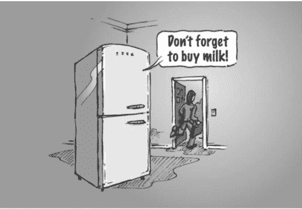
图 1.6 智能冰箱。

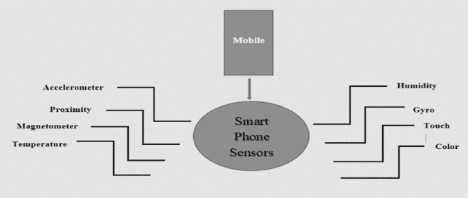
图 1.7 手机中使用的传感器。

另一个是。但在泛在计算中，拥有智能手机的人即使在经过冰箱时也能保持连接并获取信息，此时他/她正准备离开家，但黄油快用光了。因此，当他/她经过杂货店时，眼镜上会收到显示为“买黄油”的消息。这种计算可以使用的领域包括移动设备、无线通信、道路交通、上下文感知计算、军事、生产、智能家居、电子商务、医疗技术等，如图 1.8 所示。


在传统医疗系统中，危重患者大多得不到及时治疗，导致死亡率高，而且由于医院私有化，由一个医生治疗的患者无法获得其他医生的照顾 [6]。

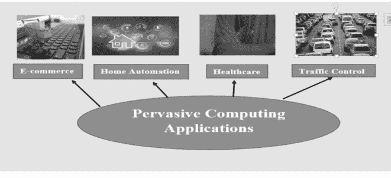
**图 1.8** 泛在计算应用。

许多情况下，载患者的救护车堵在交通中导致治疗延迟，从而导致死亡。此外，在去医院的路上，救护车上的可用资源有限，无法对患者进行现场治疗，可能会恶化危重患者的健康状况。在泛在医疗系统中，这些问题都得到了很好的解决，患者的安全和健康是受到优先考虑的主要关注点。

现实世界泛在医疗保健系统的完整场景如图 1.9 所示。它研究了领域泛在医疗的愿景，并确定了新的研究方向：便捷的通信和 PHR（患者健康记录）访问，帮助专家、患者及他人导航并定位最近的医疗机构，为医疗专家提供便捷的交通管理。该系统由多个层次组成，每个层都有不同但独特的用途。每个模块都以独立的方式运行，它们通过集中网络和服务器相互连接。系统分为三个部分：集中网络和服务器、智能救护车以及用户应用/接口。它们各由各种模块组成，以自主方式运行并服务不同的目的，且相互连接。智能救护车有一个交通监控模块，该模块是通过智能 IoT（物联网）技术实现的。该模块的作用是获取实时位置数据，并给出救护车到患者、以及进一步到最近医院的最短距离。智能救护车内置了健康传感器，可以在途中监测患者的状况。有各种传感器可以提供患者的健康读数并直接发送给相关医生。连接到集中网络的医疗团队和留在救护车内患者旁边的全科医生通过嵌入救护车的传感器和患者佩戴的可穿戴设备持续监测患者的健康状况，直到他/她安全到达最近的医院。这有助于已经在医院的关联医生在患者到达之前做出必要的安排。此外，如果患者在到达医院的途中健康状况恶化，全科医生和医疗团队会负责照顾。

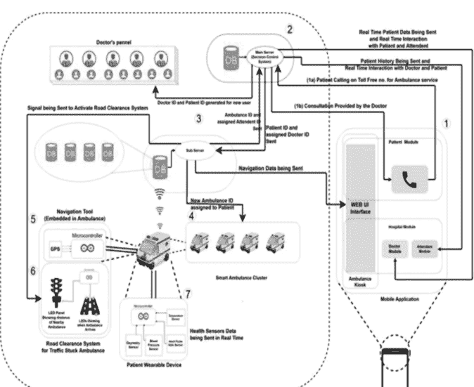
图 1.9 泛在计算医疗系统-示例。


- 1. 上下文感知：人们应该感知上下文，以便了解用户的状态和周围环境，并具有修改行为的能力 [7]。用户的上下文涵盖了人类因素和物理环境。人类因素包括心脏状态、温度和情绪状态等因素，而物理环境包括噪声和位置等因素。无上下文由“五个 W”很好地定义。“五个 W”包括：
    - Who（谁）：设备不仅能识别其所有者，还能识别环境中的其他人员和其他设备的能力。
    - What（什么）：利用这些信息解释用户的活动和行为，以推断用户想做什么，并提供必要的信息和帮助。
    - Where（何地）：解释用户位置并据此定制功能的能力。这是上下文被探索最充分的方面。
    - When（何时）：理解时间流逝的能力，利用它来理解活动并进行参考。
    - Why（为什么）：理解某些用户行为背后原因的能力。这可能涉及感知用户的情感状态，如体温和心率。

- 2. 社会影响：与任何气候内的常规处理创新相比，泛在计算将产生更关键的社会影响，改变我们与小设备以及他人的关系。计算事物的植入以及除该气候外没有计算能力的原始现实的增加，将为该气候内个人之间的互动和通信带来更好的方法。这将影响个人的社会行为，极可能带来新的社会结构。其结果是，我们不仅关注共同个体之间的关系连接（没有创新的情况下）或个人与设备之间的连接（在创新视野范围内），而且关注在创新视野内产生的干预人与人的连接。

- 3. 隐私与信任：隐私是最大的社会问题之一。……（注：原文此处此处中断，翻译根据提供的文本内容已完成对应部分）


与单个个人相关。随着个人系统用量的增加，这些设备的概念、物理和虚拟管理变成了一个问题。嵌入在咖啡杯或椅子等日常物品中的处理技术加剧了这一问题：设备数量呈指数级增长，必须以某种方式进行管理。面对大量设备时面临的主要问题仅仅是“存在什么”的基本知识：如果我知道某件东西，我该如何操作？或者如果我有一组设备，我该如何知道它们是什么？这个问题的解决方案是将对象从特定的设计中释放出来，将咖啡杯仅仅视为咖啡杯内部的一个咖啡杯。这种转变让我们的生活变得更加简单。计算机系统有一个独特的名称，即 IP 地址，这在深度嵌入式环境中可能并不存在便利性。

- 8. 感知计算：泛在计算与传统计算相比的特征是位置信息的使用。当考虑互联网时，服务器并不感知客户端的位置，但可以通过交互进行改进以提高结果。当嵌入式计算用于本地环境时，例如，对附近设备的查询可以根据当前位置自动完成。此外，如果在某一时刻在特定位置访问了信息，如果存在相同的查询，可以提供给其他人在这种情况下，以会议室为例，白板上将自动提供之前小组使用过的链接 [9]。同样，如果旁边正在进行会议，则低优先级的消息将不会被发送到笔记本电脑。在大学中，上下文系统通过工具包进行设计。

### 1.4.4 泛在计算中的问题

各种问题、它们在各自领域的影响以及相应领域的其他可能性已考虑内，并以表 1.1 所示的形式在此表示。

## 泛在计算概览


| 问题 | 影响 | 其他可能性 |
| --- | --- | --- |
| 突然生病、失去意识、从沙发上掉落 | a. 通过碰撞传感器检测<br>b. 通知医生。 | 高血压、心率、温度 |
| 如果处于移动状态的时间超过阈值 | a. 通过可穿戴式传感器检测<br>b. 传感器报警 | 可能会检查人的朝向和运动 |
| 身体周围存在体液 | a. 检查出血 | 可能有尿液或呕吐物 |
| 检测到人在一个时间范围内保持不变的休息或固定姿态 | a. 通过姿态检测 | |
| 心率异常 | a. 通过可穿戴式传感器检测<br>b. 通知医生 | 血压异常 |
| 药物剂量已减少 | a. 使用计数器值<br>b. 在药店订购药物 | 当药物剩余 2 天时，应向医生和患者发送消息 |
| 如果他已经几天没有出门 | a. 通过运动传感器检测<br>b. 发送警报 | 柜子是否已经几天没有打开 |
| 如果住户在床上时间超过 12 小时 | a. 通过床垫压力传感器检测<br>b. 发送警报 | 窗户的概念（如果永久处于低温，应发送警报） |
| 室温应在指定范围内（12-30），如果超出此范围超过特定时间 | a. 通过温度传感器检测<br>b. 居民将收到警报 | |


- 新技术的复杂性增加。
- 可以方便地访问信息。
- 信息可以容易、高效且轻松地管理。
- 不可见性（智能环境将与用户不可见的网络技术集成）。
- 决策制定（利用智能环境对日常事务做出更好的选择）。


- 融合（互联网络技术被包含在环境中，因此通过共享可以消除许多问题）。


- 这种计算的网络连接速度缓慢。
- 运行成本昂贵。
- 这不是一种安全的方法，因此需要基于信任的模型来获得更高的安全性。


IT 时代安全和认证的最新进展正推动生物识别系统发展。这两个因素：认证和安全，在现实应用中是必须的，例如 ATM 交易、执法、银行、军事、护照移民以及办公室/建筑，在这些地方每个人都要验证自己的身份 [10]。以前，用于用户认证的方法是登录 ID/密码、智能卡、PIN 识别，但它们存在一些相关的缺点，如 PIN 盗窃、卡被盗、忘记密码等。为了克服这些传统方法的问题，生物识别技术应运而生。

生物识别是人类的物理或社会属性，用于仔细区分个人以赋予对框架、设备或信息的访问权限。生物识别标识的实例是指纹、面部声音或打字节奏。这些标识符中的每一个都被认为对个人是唯一的，并且可以结合使用以确保身份具有更高的准确性。由于生物识别在验证个人时给客户带来了更直观的信任感，它可能显著提高努力安全性。当电脑和设备识别出目标客户的指纹时，可以正常打开。当感知到受限系统管理人员的特征时，办公室门可以打开。当感知到电话中有代表的声音时，工作站系统可能会调取所有相关数据。

生物识别一词由两个单词组成：Bio+metrics，意思是生命测量。许多系统需要认证来确定个人身份。这些方案的主要作用是允许数据传递给有效用户而非伪造者。它通过使用某些方法识别人的身份，该技术有许多方法：a) 人脸识别，b) 语音识别，c) 虹膜识别，d) 掌纹识别，e) 指纹识别和 f) DNA。DNA 检查主要用于法律要求以识别嫌疑人——以及

## 泛在计算概览


在电影中。从实践来说，DNA 测序由于远程用途而一直被过度延迟。这种情况正在改变。一年前，市场上出现了一种几分钟内即可完成 DNA 坐标的扫描仪。生物识别系统是通过生理或行为特征识别用户的自动化系统。生理方法是指通过考虑身体形状来识别个人。从 100 多年前开始，最古老的特征是用于识别目的的指纹。其他元素是人脸识别、耳朵识别和虹膜识别。行为方法与为了识别目的的人的行为有关（图 1.10）。

图 1.10 生物识别架构。


生物识别系统架构具有以下主要组件 [11]：

1. 传感器
2. 传感器数据预处理
3. 特征提取器和归一化
4. 模板生成器
5. 模板比较器
6. 识别系统

上述生物识别框架部分及其工作原理如下：

- 1. **传感器**：传感器是生物识别框架的主要部分，负责收集所有生物识别的重要信息。它是框架与现实之间的接口。通常，它是一个图像采集框架；但它取决于它需要替换或不需要的特征和属性。


3. 传感器数据预处理：这是执行所有预备准备的第二阶段。其功能是改进信息并处理来自传感器、基础抖动等的噪声。它起到某种标准的作用。
4. 特征提取器和归一化：这是生物识别框架中第三阶段也是主要的阶段。特征的提取将在后期通过识别来完成。元素提取器的目标是通过估计来描述待感知的项目。
5. 模板生成器：布局生成器根据提取出的特征产生用于验证的格式。布局是一个数字向量或具有特定绘图的图像。从源中获得的属性聚集在一起形成一个布局。布局被存储在数据库中以便检查，并为匹配器提供贡献。
6. 模板比较器：利用匹配器执行协调阶段。在这一部分，将获取的格式交给匹配器，由匹配器通过不同的算法（例如汉明距离等）对其进行对比并存储。随后在对数据源进行协调后，将产生结果。
7. 识别系统：这是利用生物识别框架结果的设备。虹膜识别框架和人脸识别框架是一些应用设备的基础。

## 1.5.2 常用生物识别方法

如图 1.11 所示，有许多使用的生物识别方法。生物识别长期以来一直是未来认证，预计生物识别认证将很大程度上取代我们目前的其他认证和访问控制手段。生物识别技术按所评估的特征类型分类：生理属性或行为特征。

- 生理生物识别：这些是根据人体的一部分获取的数据对人进行分类，如指纹、脸部或眼球虹膜。

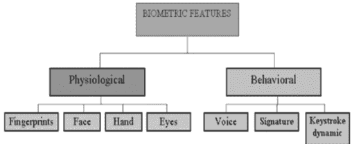

图 1.11 生物识别特征分类。


它是许多应用程序中生物识别技术之一。它用于通过指尖上的图案唯一地标识用户 [12]。指纹由每个人指纹上的谷线模式和紧随其后的脊线组成。

指尖上带有脊线和谷线的不平表面使得模式如图 1.12a 和 b 所示是独特的。指纹曾用于用户认证，匹配准确率非常高。以前这种方法基于旧墨水和纸，但现在为了识别目的生成了自动版本。在此情况下，用户必须放置手指以便电子读读取指纹。脊线的排列为每个用户形成了独特的指纹，并且数据存储所需的内存较少，但在干燥、皮肤感染和皮肤脏的情况下有时会导致错误识别，它是一个噪声较大的传感器。

### 1.5.2.2 人脸识别系统

人脸识别包括几个构成面部特征的地标点。可以通过摄像头捕捉用户的面部用于认证。这是一种通过摄像头自动识别用户的应用程序 [13]。它的主要优势是它可以从特定距离识别用户。该系统安全且易于实现，但姿态和光线的变化影响图像。由于人脸识别技术包含许多特征，它可以用于银行、犯罪分子识别和恐怖分子识别等多个领域。

这是一种根据面部区分他人的生物识别方法。它涉及三个主要步骤，如图 1.13 所示。

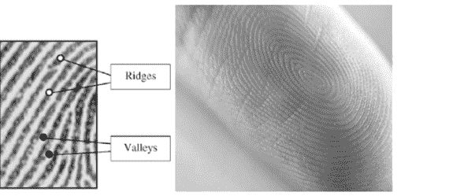

图 1.12 a) 手指脊线和谷线的图像，b) 手指脊线和谷线的真实图像。


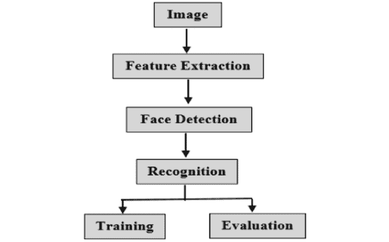

图 1.13 人脸识别步骤。

- 数据采集：采集数据项是人脸识别的主要步骤，通过多种源收集面部图像。采集的许多图像将具有不同的姿态变化、光照变化等。因此，我们可以根据条件轻松地验证我们识别系统的性能。有时，会对输入图像进行归一化，并对输入图像应用不同的图像变换方法。在此，去除了噪声、光照和模糊效果等意外参数，然后将其用于后续过程。
- 特征提取：特征提取是该系统的下一步，用于通过给定图像提取信息，提取出的特征用于识别步骤。在这一步中，使用了降维技术和噪声清洗。
- 识别：识别是脸识别系统在特征选择和提取之后的下一步，现在使用许多分类器对图像进行分类。在这一步中，获取大量图像并对其应用特征提取，存储在数据库中。当新图像用于人脸识别时，它首先执行人脸采集、特征提取，然后将数据库中的所有图像与此新图像进行比较。测试图像将与数据库中存储的所有图像进行比较，以识别个人。

自动人脸识别主要包含两个任务：

- 验证：在验证部分，系统将给定人员与其自称的身份进行关联，并以“是”或“否”决策的形式输出。
- 识别：在识别部分，系统将给定人员与数据库中的所有人进行关联，并以身份的形式输出。

## 泛在计算概述

### 1.5.2.2.1 人脸识别的挑战

存在许多挑战：

- 姿态：姿态的变化是识别中关注的问题，如图 1.14 所示，部分可见或闭合。
- 结构组件：存在一些特征如胡须、围巾和眼镜，这些特征并不总是存在（图 1.15）。
- 图像旋转：面部图像随各种旋转而波动。
- 质量差：某些包含噪声或模糊的图像可能导致质量差。
- 面部表情：面部表情可能因人而异，如图 1.16 所示。
- 不自然的强度：来自三维模型（如渲染脸部）的面部可能有不自然的强度。

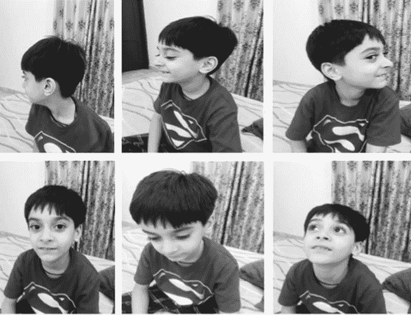

图 1.14 姿态的变化。


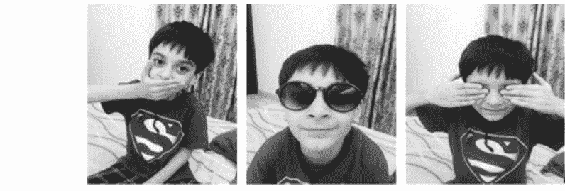

图 1.15 结构组件的变化。

### 1.5.2.2.2 人脸识别算法

脸部是用于传递身份的最重要对象。人类基本上使用脸部检测个体。用于人脸识别的方法有整体法、结构法和混合法。在整体方法中，整个脸部区域被作为输入数据进入人脸匹配系统。整体方法最好的示例之一是特征脸（最广泛的人脸识别方法）、主成分分析 (PCA)、线性判别分析 (LDA) 和独立成分分析 (ICA)。它使用全局表示，或者说是不考虑局部特征的脸部描述。这种方法进一步分为两个部分：统计学和人工智能。在统计学中，图像表示为二维数组，使用的主要概念是计算输入图像与数据库中其他图像之间的相关参数。这种方法非常昂贵，因为它无法适用于姿态、光照等可变条件。为了克服这些问题，可以使用其他方法来获得更准确、更有意义的结果。

- 主成分分析 (PCA) 算法

这是一个由 Turk 和 Pentland 在 1991 年开发的非常流行的算法。PCA 算法依赖于特征向量概念 [14]。通过该算法，图像被转换为分析，且这些图像必须具有相同的大小。首先，应用归一化技术来标记脸部眼睛和嘴巴的特征。PCA 算法用于压缩图像，它依赖于降维概念。通过降维，去除了不需要的信息，然后将脸部结构分解为许多互不相关的组件，这些被称为特征脸 (Eigenfaces)。每个存储的图像将通过加权特征脸特征向量的线性和组合，这些被称为特征脸。在识别时，新图像被投影到子空间，并使用欧几里得方法计算距离以...


## 22 家庭安全与防护系统的集成方法

用于分类目的 [15]。PCA 的目标是通过矩阵方法 [16] 收集数据的重要特征。在 AI 中，利用了大量的仪器来感知类脸的神经组织和机器程序。这意味着当神经组织从 PCA 计算中移除时，神经组织被用作分类器，以将部分减少到低测量空间。SVM 是一种用于样本分组问题的计算方法。Ge 也被用于此。它的缺点是当姿态、光照条件等存在高度不一致性时无法工作。

优点：

- 它是最简单、易用且高效的人脸识别方法。
- 它在较小的姿态或光照变化下可以工作。
- 它使用了正确的欧几得距离，并且基于降维过程，在保留大部分信息的同时减少了原始识别的维度。
- 它减少了噪声因素，因为它选择了最大变化，因此自动忽略了背景中的微小变化。
- 它是基于多幅图像作为输入概念的。
- 它的计算时间较短。

缺点：

- 对于高维数据来说成本高昂。
- 当姿态、方向、光照等发生巨大变化时，无法以正确的方式实现。


该算法用于分析高阶数据，或者说多元数据。该算法中使用的主要技术是将高维空间转换为低维空间，包含转换变量的新空间将定义数据的本质特征 [17]。聚类分析是该算法中用到的一种技术。一组数据元素被视为一个簇，聚类分析被定义为一种在存在大量数据的区域分配空间的技术，该区域被称为簇。


LDA 是一种用于分离数据项的技术。它是在类别未知的情况下，基于使用已知用户类别的训练样本进行样本分类的方法。LDA 的目标是最大化用户之间的方差并最小化用户内部的方差。它基本上对相似类别的图像聚类，并划分互不相似的类别的图像。这种技术仅用于分类，但不能用于回归。为了识别输入图像，将输入图像与数据库中存储的每个图像进行比较，然后计算最近距离，并根据距离识别输入图像。它可以用于模式识别、统计和机器学习。它也被称为基于降维的 Fisher 脸算法。

优点：

- 它最大化了类间距离，但类内距离最小化。
- 它具有鲁棒性。

缺点：

- 它不考虑多幅图像作为输入。


它用于以余弦函数和的形式表示在不同频率工作的数据项的点序列。这种变换主要用于压缩标准，其中系统接收脸作为输入图像，然后对该脸进行归一化或裁剪，然后计算脸之间的距离，最后进行比较。

优点：

- 在变化较小时工作效果良好。

缺点：

- 它在相同的方向、姿态、光照等情况下工作。
- 成功率不高。


它将图像表征为局部方向选择性和频率选择性特征 [18]。这种技术基本上是一种用于人脸检测的滤波器，以 Dennis Gabor 的名字命名 [19]。

优点：

- 它在姿态和光照条件大变化的情况下工作良好。


### 1.5.2.3 手部几何

这种方法现在非常流行，因为它在大多数情况下对用户识别都效果良好。这种方法自动测量手和手指的维度，然后将这些测量值与模板进行比较 [12]。当一个人将手放在嵌入了传感器的表面，并使用手指之间的杆子来正确放置手时，就会开始读取，这个过程属于空间几何术语。手指或手部几何通常测量两或三根手指，如图 1.17 所示。这种方法的优点是识别时不需要用户的任何配合，但问题是它的尺寸非常大。

### 1.5.2.4 虹膜扫描

这种方法通过使用人类虹膜的不同模式来识别用户。虹膜是眼睛内部的一种肌肉，用于控制进入眼睛的光线；它会调节瞳孔的大小，如图 1.18 所示。在其他生物识别系统中，这是一种准确的方法，因为它提供了高可靠性和高识别率。它不需要用户和机器之间的任何密切接触。同卵双胎的虹膜是不同的，这是该系统的优点。


图 1.17 基于手部几何的识别。

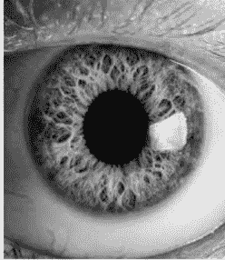

图 1.18 基于虹膜的识别。


- 行为生物识别：它由从用户动作中获取的测量组成，其中一些是从人体间接测量的。

### 1.5.2.5 击键动力学

这是一种借助键盘检查人员击键的自动方法。通过这种方法，可以检查用户按下或释放按键时的击键动力学，如速度和压力。这项技术的目标是提高鲁棒性和唯一性。该应用的一个例子是计算机访问，其中这种生物识别技术可以持续识别计算机人员的身份。人们通过输入登录 ID 和密码来验证自己的身份。使用这种技术的优点是除了全球通用的键盘外，不需要任何额外设备。


这种方法是文档认证和金融交易等许多应用中对用户验证要求最高的形式之一。这种方法用于检查书写的速度、方向、准确性和压力，如图 1.19 所示。在离线模式或之前的方法中，用户在普通纸上写下签名，然后使用扫描仪将那张纸数字化，最后由系统验证签名；但在如今的在线模式下，用户保存签名，系统使用成本并不高，且只需要很少的时间即可验证用户，这种技术存在的问题是它的错误率很高。

### 1.5.2.7 语音/声音识别

这种技术用于根据语音信号识别用户，因为它将语音转换为文本。对于语音识别，可以使用许多策略：支持向量机、隐马尔可夫模型、动态时间


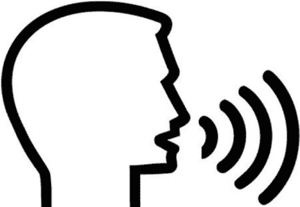

图 1.20 由人说话的单词生成的语音信号。

扭曲、矢量量化等。通过麦克风录制音频文件 [20]。但噪声因素是生物识别技术中的主要关注问题。用户认证所需的时间短，但其准确性较低。图 1.20 显示由人说话的单词生成的信号。

### 1.5.2.1 语音识别系统

语音是赋予语言内容的声音名称。语音识别是根据语音中包含的波进行验证的任务。识别人的声音以验证身份，并用于许多应用程序，如语音拨号、语音邮件和数据库访问服务。当一个人对着麦克风说话时，此时计算机将单词的声音转换为另一种形式，即计算机系统可用的文本。计算机或笔记本电脑要么重复人说的话，要么提供下一次的提示。在早些时候，语音识别程序让人们以断续的方式说话；这种方式要求人们在两个词之间留空，但现在的语音识别系统非常易用。人们可以在词与词之间没有任何停顿地说话。唯一的条件是说话清晰。该系统包含两个会话：

- 注册会话 (Enrollment session)
- 操作会话 (Operation session)

在注册会话中，已注册的用户将提供语音样本以训练该用户的模型。

在操作会话中，通过提取数据库中存储的所有用户的语音样本进行匹配。最后，做出决策以接受或拒绝该用户的身份。

语音识别过程的所有步骤如图 1.21 所示。


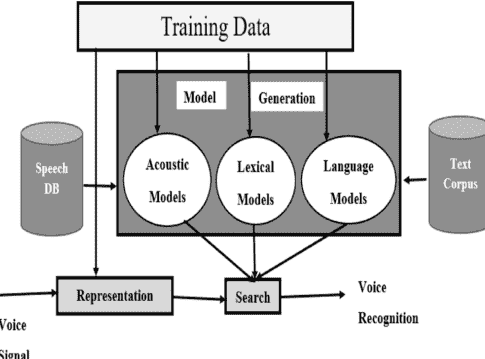

图 1.21 语音识别过程。

-   表征
  预处理：这是识别系统的第一步，通过麦克风录制语音，然后以5000 Hz的采样频率采集信号。在这一步中，通过高通滤波器去除低于 100 Hz 的频率（这些频率包含噪声因素）。预处理中执行的重要因素是分段或端点检测。当信号能量超过阈值时开始语音分段，当信号能量跌至阈值时结束。

-   模型
  特征提取：对信号进行处理后，下一步是提取或获取特征，为了计算起见，按时间帧提取观测值。假设语音信号在这些长度为 25 ms 的帧内是恒定的。特征之间是重叠的，并且通常移动 10 ms。在窗口上进行快速傅里叶变换，进入频谱域。人类耳朵并不是等同感知所有频段。这可以通过非均匀频宽的带通滤波器来模拟。在 500 Hz 之前，滤波器的宽度为100 Hz，之后对数增加。滤波器中心频率定义在所谓的 Mel 标中。通过离散余弦变换使频谱去相关。在生成的系数中，前几个系数最为重要。因此，只选择前十个系数作为特征向量。生成的特征称为梅尔倒谱（Mel Cepstra），通常简称为 MFCC。


-   搜索
  i. 解码：一种计算单词序列与特征向量生成的信号之间匹配率的方法。在解码过程中有三个信息来源：a) 声学模型，b) 字典和 c) 语言模型。解码的条件是已知可以说的单词的概率。
  ii. 后处理：语音识别过程的最后一步，将已处理的信号分类为接受或拒绝决策。


-   梅尔频率倒谱系数 (MFCC)

这是用于识别目的最常用的倒谱分析技术。在此中，对频段使用对数表示，因此它提供了比其他系统更清晰的响应。在此中，MFCC 的特征向量是通过信号分析中存在的每一帧计算出的 [21]。首先，从输入的信号中提取系数；这些信号被划分为若干帧。在这些帧上，当应用汉明窗（hamming window）时，信号的不连续性会降至最低，如图 1.22 所示。

优点：

-   用于语音处理任务。
-   其识别准确性和性能率高。
-   复杂度低。

缺点：
-   噪声鲁棒性较差。

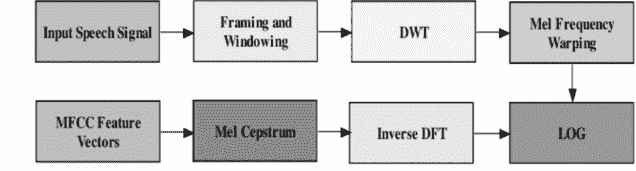

图 1.22 MFCC 技术的步骤。

## 泛在计算概述 29

-   感知线性预测 (PLP)

它的工作方式与线性预测编码相似；这意味着它也如图 1.23 所示基于语音的短期频谱。它消除了语音信号中不需要的信息，有助于提高语音信号的识别率。

-   线性预测编码 (LPC)

它为语音处理提供了信号的准确估计。通过这种方法以高效的方式对语音进行建模 [24]。该技术假设所有语音信号都是通过过去语音信号的组合而成的。最初，信号被划分为若干帧，然后每帧将乘以一个窗口，最后输出通过自相关测量计，如图 1.24 所示。

优点：

-   是一种静态技术 [22]。
-   是一种提供语音度量的可靠、准确且稳健的技术。

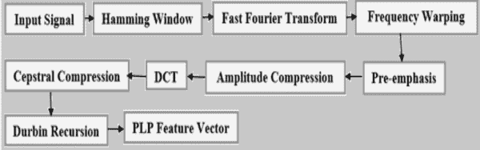

图 1.23 PLP 技术的步骤。

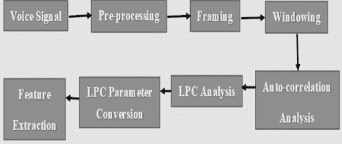

图 1.24 LPC 技术的步骤。
## 30 家庭安与安全系统的集成方法

缺点：

-   无法区分元音相似的单词。
-   输出产生差误差，导致语音质量差。
-   噪声鲁棒性较差 [23]。

相对谱-感知线性预测 (RASTA-PLP)

该方法用于增强在噪声环境中录制的语音。与 PLP 结合时可提供更好的性能。它由 Hynek Hermansky 提出，是一种主要用于信号嵌入噪声因素、且需要从语音信号中移除缓慢和快速变化信息的技术 [25]。它以稳健的方式工作，意味着对硬件设备记录音频文件的距离没有限制，如图 1.25 所示。

优点：

-   它是稳健的。

缺点：

-   在纯净语音环境下性能较差。


热图是出现在皮肤上的热模式。这些模式是由血管分支形成的。通过红外传感器，如图 1.26 所示采集身体不同部位散发的热量，采集的图像被称为热图。

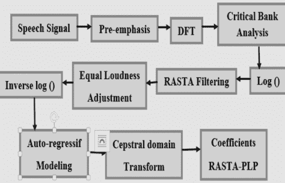

图 1.25 RASTA-PLP 技术的步骤。

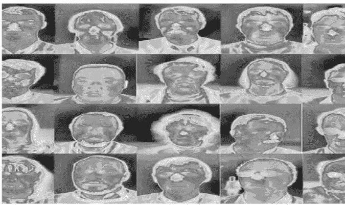

图 1.26 基于热图的检测。

这种技术在黑暗下也能有效工作，但受环境温度影响。


人类耳朵用于生物识别技术进行认证。特征提取是该识别的主要步骤。已知耳朵的形状和结构如图 1.27 所示。但预计耳朵的特征对每个人来说都是唯一的。特征向量表示基于几何、以及 PCA、ICA 等代数。

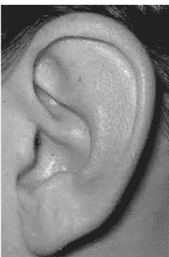

图 1.27 基于耳朵的识别。


DNA（脱氧核糖核酸）用于用户认证。通过这种方法，为每个人提供唯一的代码，如图 1.28 所示。事实是同卵双胎存在相同的 DNA 模式。它提供了大量数据的安全传输，失败率为 0%。其优点是它是免费的，且准确性高，但该技术的问题是成本极高。

人脸和语音识别技术是用于识别的最可靠、最准确的技术。该系统基于个人数据的采集、提取数据特征，最后将提取的特征与存储在数据库中的实际特征进行比较。这些系统用于增加用户的安全便利性。例如，在机场，用户通过在闸口插入卡片并面对摄像头进行注册，然后将采集其眼睛图像，处理图像并计算代码。最后一步比较两个代码，一个是实际代码，另一个是计算代码，以验证用户身份。这意味着每个生物识别技术四个参数：

- 传感器或数据采集
- 特征提取
- 匹配
- 决策控制系统

在数据采集中，从多个来源收集个人。在特征提取中，对获取的信息进行处理以提取特征。在匹配参数中，将提取的特征与存储在数据库中的特征进行比较，最后做出接受或拒绝个人身份的决策。如果我们使用不同的识别方法，它们的摘要见表 1.2。


| 表 1.2 不同生物识别方法及其准确率 |
| 技术 | 准确率 | 应用 |
| :--- | :--- | :--- |
| 指纹 | 高 | 执法 |
| 面部 | 高 | 护照 |
| 虹膜 | 高 | ATM |
| 签名 | 中 | 金融 |
| 语音 | 中 | 访问控制 |
| 击键轨迹 | 低 | 计算机安全 |

由于计算机领域的发展，自动生物识别系统现已投入应用。任何个人的自动验证都是基于该人的行为以及某些特征。

## 1.5.3 优点

- 普遍性：生物识别技术的主要特征是具有普遍性。大多数人都有手指，他们会说话，而且他们的细胞中含有 DNA。尽管存在一些例外，例如某些没有手指或手臂的人无法使用指纹系统等。然而，我们所有人都拥有 DNA。某些人无法识别的问题可以通过多重生物识别系统来解决。
- 唯一性：生物识别系统的可靠性与其安全系统的身份验证过程一样独特。这些特征是从人体部位（如 DNA、指纹等）中提取的，但唯一性是最重要的部分。并非在所有情况下都能保持这一点，但在大多数情况下它是真实的。
- 低绕过性：生物识别安全系统非常安全可靠。大多数生物特征可以由授权人员获取，前提是其本人必须在授权设备处现场。在某些情况下，人可能会切断手指并尝试通过系统验证。但现在的扫描仪能够测量被扫描手指静脉中的血流。因此，系统不会被个人欺骗。这非常安全可靠。
- 可扩展性：生物识别技术可以构建为多级身份验证系统。这种多级系统可以包括标准登录、语音登录、指纹登录等许多种。在单一单元中结合多种技术可以增加整个系统的安全性。如果系统的某一个级别被破解，其他级别可以减少突破的可能性。
- 永久性：这是从 DNA 中获得的特征，因为它是永久的且不会改变。指纹也是如此。但在指纹的情况下，人可能会割伤手指，从而改变指纹结构。下一个被考虑的永久性生物识别特征是视网膜扫描。


- 精确性：某些生物识别特征的获取非常精确且独特，例如，DNA 对我们所有人（双胞胎除外）都是唯一的，但频繁提取和分析它非常困难。DNA 分析的成本并不低。这使得 DNA 无法实时应用；它并不值得上现在能带来的优势。
- 实施困难：实施一个可靠的生物识别系统并非易事。研究团队定期工作，以确保生物识别系统的安全和可靠实施。系统的某些部分已经通过指纹识别、人脸识别特别是语音识别案例实现。
- 合作意愿度低：某些人不乐意提供其生物特征。大多数人不喜欢扫描虹膜、扫描指纹和脸部，而最少的人才不喜欢录制自己的声音。显然，开发基于语音处理的可靠技术将很有用。
- 不一致性：某些生物识别特征是永久的，但有些并非如此。因为人的声音在整个生命中并不是固定的。这可能是最大的问题。其他特征（如身高）也可能存在不稳定性。


- 司法与执法：联邦调查局（FBI）和国际刑警组织（Interpol）等机构长期以来一直在刑事检查中使用生物识别技术。今天，全球执法机构已广泛利用生物识别技术来识别犯罪分子。生物识别同样被广泛用于监狱管理。生物识别为监狱当局提供了先进的配置，公共安全部门和政府可以安全、可靠地监管拘留者的特征。
- 机场安全：生物识别技术简化了每天大量旅行旅客的机场体验。让旅客的机场旅行更加顺畅是全球机场的共同目标。用于检查旅客身份的生物识别技术已在几家大型国际机场使用了多年，且该技术正在迅速扩散到全球不同地区。

在许多机场，用于移动控制的首选生物识别技术是虹膜识别。要使用该技术，旅客首先通过相机捕捉其虹膜和脸部照片。然后，这些特殊的细节被存储在全球数据库中，以便在关口处快速、准确地识别，并将该识别用于旅客身份的确认。在使用时，旅客无需排长队，而是走到角落并查看虹膜摄像头。摄像头随后对准虹膜，程序随即将细节与数据库中存储的数据进行匹配。

生物识别技术简化了每天大量旅行旅客的机场体验。

- 员工管理：这是另一个正在使用生物识别的领域。员工造假考勤行为是全球企业中的典型问题。根据美国工资协会的一项研究，普通代表每周虚报约 4.5 小时，如果推算到一年，这相当于大约一个半月的年假。为了解决这个问题，公司正在其工作场所推行生物识别考勤机。

生物识别考勤框架是根据生理或社会特征识别员工的自动化技术。用于员工身份识别的最广认可的生物识别特征包括面部、指纹、指脉、掌脉、虹膜和语音模型。当员工尝试通过其自然属性提供证明时，生物识别设备会考虑所有可用格式的新型扫描，以找到精确匹配。事实上，现在甚至政府机构也依赖生物识别来确保员工出勤和精确的财务计算。

- 银行：银行正在使用生物识别技术开发下一代身份识别控制，以打击欺诈、提高交易安全性并增强客户体验。例如，2019年，苏格兰皇家银行（RBS）部署了包含生物识别标记技术的分期卡试点。该试点在银行行的约 200 名 NatWest 客户中进行，位于英国。独特标记取代了 PIN 密码，用于确认超过 30 英镑的交易，使客户完成分期支付更快、更简单。这一最新进展遵循生物识别开发的长期序列，RBS 和 NatWest 英国银行已在其移动银行应用程序上启用了 Touch ID 独特标记。ATM 也通过使用生物识别技术得到了保障。目前，还有许多其他应用如网上银行、电话银行在此项技术下是完全安全的。

- 安全系统：在某些领域，生物识别技术可以为学校、军事区等提供最大的安全性。这对于家长、员工等来说是重要的一部分。生物识别市场的指纹识别占据了学校在内的许多行业采用的最大市场份额。指纹识别是最普及、古老、简单且廉价的生物识别技术。尽管掌脉虹膜识别和人脸识别已在学校，但指纹扫描是中国教育市场最常用的技术。在英国，主要使用的生物识别类型是指纹扫描或拇指扫描，但静脉虹膜扫描系统也在使用。

在军事领域，主要的安全性关注问题涉及“功能蔓延”（capacity creep）风险以及生物识别的能力。功能蔓延或任务蔓延是将获取数据的最初目的扩大到最初声明之外的其他目的的循环。无论提供信息的个人是否知情，功能蔓延都可能发生。许多安全专家认为功能蔓延是不可避免的。随后，这可能被视为某种特定的功能蔓延，指的是逐步监控一个人的活动或查阅包含这些活动数据集的能力。例如，如果一个人必须使用一种标准的生物识别来进行日常生活中的各种行政、商务和娱乐交易，那么这些记录中的每一条都可能通过统一的生物识别连接起来。这种连接允许某些机构（例如政府）对该人的活动建立详尽档案。

- 移民：在全球范围内，非法移民被视为安全的主要威胁。这些是用于法律案件的自动流程。为了避免此类情况发生，加拿大政府开始使用生物识别技术。政府表示，收集生物识别将有助于申请处理，并简化低风险旅客进入加拿大的流程。指纹和照片


对于某些来自欧洲、中东和非洲申请加拿大访客签证、工作或学习许可、永久居住安排或在加拿大寻求庇护的人来说，这将是必要的。生物识别在申请阶段和进入加拿大阶段均会被使用。生物识别允许签证官筛选申请人是否有先前的犯罪记录或违反加拿大移民法的行为。在他们进入加拿大时，也会使用生物识别来确认其身份。

- **医疗保健：** 生物识别技术（如指纹扫描仪、掌脉阅读器、人脸识别技术、虹膜扫描仪等）长期以来有望提高患者和员工的识别能力。这将有助于可靠地确认自称是某人的患者身份，确保护理人员根据正确的临床和分段数据工作，并保证最佳代表接触正确的数据。尽管如此，生物识别创新在医疗服务中的应用一直被延迟。无疑，许多急诊中心和医院执行了一些基础技术；然而，生物识别尚未完全达到医疗标准。此外，现在还需要医疗 CSO 和生物识别创新供应商投入一些资金和精力，才能使该技术融入标准。


该技术由一个传感器芯片组成，用于感知人体的生命参数。它将一种形式的能量转换为另一种形式，并将物理参数转换为电的可测量信号 [26]。传感器用于将温度、心率、汗率和血压等物理参数转换为另一种通过电测量的信号形式。以温度为例来解释这项技术。当液体因玻璃温度计中的汞而膨胀和收缩时，读数由人工测量。使用了多种传感器，包括电磁、热、光学、光。过去，传感器的尺寸很大，因此无法以可穿戴技术的形式使用。但现在，微控制器电路、放大器和功能使得可穿戴传感器被用于健康监测。传感器和可穿戴设备安装在许多配件上，如杯子、衣服、腕带、眼镜和鞋子。发现可穿戴传感器具有许多优势，例如在附在身体上时使用传感器进行数据采集，持续监测患者健康，减少人为干扰，这使得

可穿戴传感器是作为配件的一部分穿戴在身上的智能设备 [27]。它们可以用于安全、娱乐、商业等多个领域。它通过提供可靠准确的信息为家庭提供安全提供了帮助。这些设备非常小且轻便，因此可以 24/7 舒适地佩戴。它们被用于健康监测，如血压、温度和心率。使用这些传感器可以轻松测量血压，而无需之前的压力带技术。对于简单的可穿戴传感器设备，其表示如图 1.29 所示。人员最近开发出了一种人工智能 (AI) 分类器，它可以使用可穿戴生物传感器检测特定的心血管疾病。

有许多传感器可以用于健康监测。主动传感器是需要外部电源供应的，例如光伏电池；而被动传感器是不需要任何外部电源供应的，例如电机械传感器。

- **加速度计：** 它是一种用于测量沿两个轴加速度的设备，所示。加速度计尺寸小且价格便宜，更易在现实应用中实施 [28]。存在多种类型的加速度计：a) 电阻式，b) 压电式和 c) 磁阻式，它们利用关键概念利用加速度。

跌倒检测、活动监测和不动检测是这种传感器的例子，可以轻松实现在智能家居中。

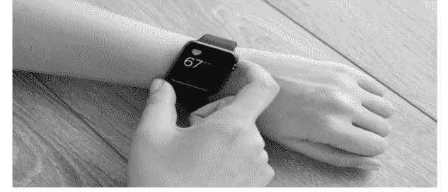

图 1.29 用于检测心脏病的可穿戴腕部生物传感器。

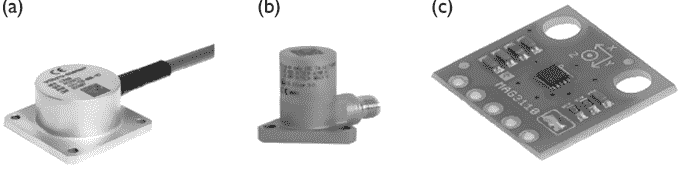

图 1.30 a) SE120 压阻加速度计，b) CA134 压电加速度计，c) MAG3110 三轴磁阻式。

生物传感器是基于电化学技术的。图像传感器基于 CMOS 技术。这种传感器用于生物识别。

- **运动检测器：** 它基于红外、超声波和微波技术。当一个人进入房间如果他/她不是授权人员时，传感器会检测异常活动。对于智能家居，这种探测器的目的是感知未经授权的人员并立即向家庭成员发送短信 [29]。运动传感器的目的是检测人的移动，为此目的，使用了三种技术：a) 被动红外，b) 超声波和 c) 微波。其中，被动红外被用于检测体热，并用于智能家居的安全目的。如果任何类型的物体产生热量，就会产生红外辐射。这是家庭中最常见的形式，例如，如果一个人进入房间，此传感器会自动打开房间的灯。另外两种技术名为超声波和微波，属于主动运动传感器的一部分。它们都发射声音信号，然后测量反射以检测移动。

- **远程医疗：** 这是一项利用音频和视频技术传输重要信息、收集用于治疗医疗状况的数据或提供医疗保健设施的技术。但现在这项技术已以更广泛的方式扩展。现在它可以用于人工智能和患者教育等领域。

- **射频识别：** 这是一种增强数据处理过程的方法，因为它用于通过射频信号对数据进行存储和访问。

存在三种类型的 RFID 标签：a) 被动式，b) 半被动式和 c) 主动式，它们通过射频信号访问数据。其中，被动 RFID 标签不需要外部电源。半被动 RFID 标签也需要外部电源，但主动 RFID 标签需要电池。


在一种为了让家庭网络更智能的方式，使用了具有高处理能力的智能设备。网络意味着传感器收集并传输如温度、湿度、光照等数据。这里光照意味着家居窗帘会自动移动，温度意味着提供智能空调系统。房屋主人希望推广他们的房屋以支持这些新技术。这是人类计算生活方式的自然延伸。使家居智能化是一种使用新技术设计的方式，能够以一种方式增强个人的安全、安保等，通过使用智能厨房、照明系统等维持独立生活。许多传感器可以用于这项技术：RFID、温度传感器、压力传感器、门传感器等。用于无线通信的技术是红外、射频、ZigBee、蓝牙等。温度传感器用于厨房控制炉热量。为了维持人的站立、行走和异常活动（如跌倒检测），可以使用碰撞传感器、加速度计等许多传感器检测流量。光传感器允许家中的灯自动开启关闭。光电池传感器允许系统在黑暗环境中运行。紧急报警可以用于智能家居的紧急用户设备，信息会自动发送给看护人员。

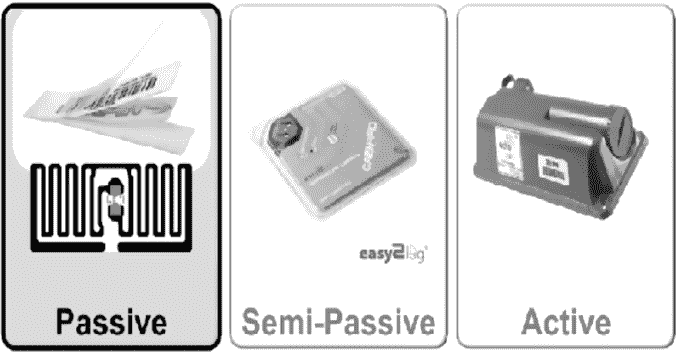

图 1.31 RFID 标签的类型。

个人护理是为居住在家里的人提供安全和保障的重要因素。为了实现这一目标，首先通过三个模块对人进行识别：人脸识别、语音识别和相似性指数。最初，当一个人来并敲门时，需要识别该人的脸部，如果脸部被正确识别，则进入下一个模块，即语音识别。如果该人的声音也被识别，则由独居在家的个人为门口的人提供访问权限。但在情况下，如果任何模块未被识别，则使用第三个模块，即相似性指数。它将检查门口人的声音与数据库中存储的语音的匹配百分比。如果相似性大于


当比例等于 75% 时，认为用户已被识别，否则声明为未知用户。最后一个模块是持续监测居家个体的健康参数。个体用户知道他们可以使用 MATLAB* 工具和智能手机与他们认识的人联系，并在紧急情况下发送消息，就会感到更加安全。在当今的世界，用户没有时间再次去看医生，因此患者需要即时监测并通知他们的护理人员。人体健康监测正成为传感器网络的一个突出应用。此前，将许多无线传感器放置在个人体上，监测温度、血压和心率等健康参数。这些传感器设备非常微小、轻便且便于携带。

智能家居技术被证明对于大大生活的老年人、工作人员以及独居在家的残障人士有用。为了以更健康、更安全的方式在家生活，老年人/残障人士或女性可以利用图 1.32 所示的智能家居技术监控系统的最新功能进行故障检测或应急系统等。

如图 1.33 所示的可靠应急系统必须能够监测老年人的状况，并在紧急情况下立即联系医生和救护车并通知家属 [32]。因此，目标是为所有独立在家的人提供一个舒适的环境。


人工神经网络（ANNs）的结构类似于人类大脑。一个成年人大脑的重量约为 1.5 公斤，体积为 1260 立方厘米。大脑由 2000 亿个神经元通过 25 万亿个突触、胶质细胞和血管连接。神经元可以分为三部分：细胞体（soma）、树突和轴突，如图 1.34 所示。每个树突包含细线，这些线接收来自周围神经元的信号。树突的每个分支在突触的帮助下连接到单个神经元 [33]。神经网络用于发现数据中具有关系的模式。

图 1.35 显示了输入神经元和输出神经元以及它们之间互连的权重。此图的第一步是借助输入节点以数值表达式获取数据或信息。人工神经网络是一种从生物神经系统中获取灵感并处理信息的范式。

模式识别情况下的 ANN 流程图如图 1.36 所示。

图 1.32 活动监测系统。
图 1.33 可靠的应急系统。
图 1.34 生物神经元的结构。
图 1.35 ANN 的结构。
图 1.36 ANN 流程图。


- **处理单元：** 神经网络系统由许多处理单元组成，这些单元代表人类大脑中的神经元。单元分为不同的组，如接收待处理数据的输入单元、用于处理和转换输入数据的隐藏单元，以及代表神经网络最终决策的输出单元 [34]。
- **权重：** 神经网络中的所有处理单元都以某种方式连接。每个连接都有一个权重值。来自神经元的输入与发送数据的连接权重相乘，输出值值发送到网络的激活函数中。如果计算值超过激活函数的阈值值，则神经元将被激活，否则将处于非激活状态。
- **计算方法：** 该方法用于通过激活函数确定正确的输出。在此过程中，神经网络使用阈值逻辑单元执行计算。它从神经元获取输入值，对其进行求和，最后使用激活函数进行计算。

- **监督训练：** 这是训练的第一种方法，为网络提供一系列输入，然后将目标与预期响应进行比较，或者给出正确的指令，这将是给定输入的期望输出。其中的主要问题是误差的产生。理想情况是生成的输出与期望输出之间的差异最小，例如模式关联记忆、反向传播网络和逆传播网络。
- **无监督或自适应训练：** 另一种训练方法称为无监督训练，为网络提供输入，但目标期望目标。系统维护输入数据项目的分组。这也被称为自组织或自适应方法，例如自组织映射、自适应共振理论。
- **强化训练：** 这是第三种训练方法，网络仅接收关于目标答案正确与否的指示报警。如果可用足够的信息，这种学习可以轻松处理特定问题。

### 1.7.1.1 网络架构

在网络架构中，神经元被排列成若干层，并在层与层以及内部生成连接。如果存在两层互连的权重，则发现具有隐藏层，神经网络有多种类型，包括矢量量化、混合网络、循环网络、RBF 网络等。

- **前馈神经网络**

这是一种所有数据仅沿单方向传输的网络。在此网络中，有两种选择：输入直接连接到输出，这意味着会有单层权重；或者使用隐藏神经元将输入连接到输出层。它由单层网络以及多层网络组成，如图 1.37 所示 [35]。所有神经元的群体行为将描述网络的性能，并在此基础上假设这些信息将是否提供所需的输出。反馈不需要循环。它用于模式识别。


这意味着在单层形式中，每个输入层直接连接到输出层，但反之则不然。它也称为无环网络。在此中，输入可能完全连接到输出单元，如图 1.38 所示。


在此中，隐藏单元的数量多于一个，也可以是一个，其中节点被视为隐藏节点。这种处理是通过首先将信息从源节点发送到第一个隐藏节点完成的，第二层的输出将作为第三层的输入，依此类推。底图 1.39 显示了多层网络（图 1.39）：

图 1.37 前馈神经网络。
图 1.38 单层前馈神经网络。
图 1.39 多层前馈神经网络。

- **循环网络**

它是神经网络中最简单的架构形式。在此中，输入层的所有单元都连接到输出层的所有其他单元，每个单元都可以同时作为输入和输出。这类网络是指隐藏层数量大于等于一个且带有反馈回路的网络。在此中，反馈意味着神经元的输出将返回到其输入，如图 1.40 所示。

- **Hopfield 神经网络**

该网络主要用于识别模式，为此使用特殊算法对网络进行训练。它基于循环网络的概念。它由一组神经元组成，每个神经元代表差分图像的一个像素。它还与邻域的所有神经元连接，如图 1.41 所示。


正如前馈神经网络定义的它由输入、输出和隐藏层组成，因此如果隐藏层依赖于径向函数的概念，则被称为 RBF 网络，如图 1.42 所示。该激活函数的高斯点比 FFNN-NN 更复杂。

图 1.40 循环神经网络。


MATLAB 代表矩阵实验室（Matrix Laboratory）。有两个项目 LINPACK 和 EISPACK 用于为矩阵软件提供简单的处理。


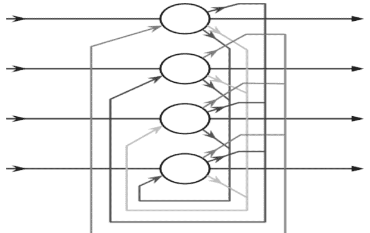
图 1.41 Hopfield 神经网络。

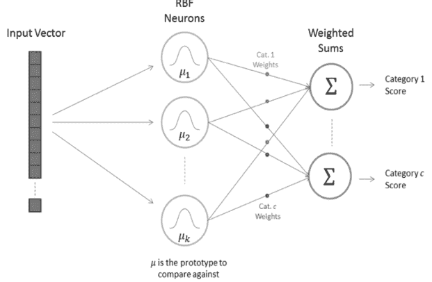
图 1.42 BFR 神经网络。

LINPACK 意味着线性系统包，EISPACK 意味着特征系统包。MATLAB 具有许多内置例程，能够实现各种计算以及许多用于图形的命令，这使得可视化结果变得可用可用。一个术语被称为“工具箱”（toolbox）；它意味着收集在包中的许多应用程序。有不同类型的工具箱，用于仿真、信号处理和控制理论以及某些领域的工程技术。


当人登录账户时，通过双击桌面上的 MATLAB 快捷图标进入 MATLAB。当 MATLAB 启动时，会显示一个名为 MATLAB desktop 的窗口，该窗口包含其他窗口，如命令行窗口、开始按钮、工作区、命令历史、当前目录和帮助按钮。当 MATLAB 启动时，屏幕如图 1.43 所示，工具和文档可以根据用户的需求进行自定义。命令行窗口可以使用命令提示符（>>）[37]。

例如，MATLAB 可用作计算器：可以使用 MATLAB 评估一个简单的表达式，例如，如果数字通过此表达式计算

+ 2 + 2 * 3

这意味着在提示符（>>）之后，如：

+ >> 1 + 2 * 3

+ Ans = 7

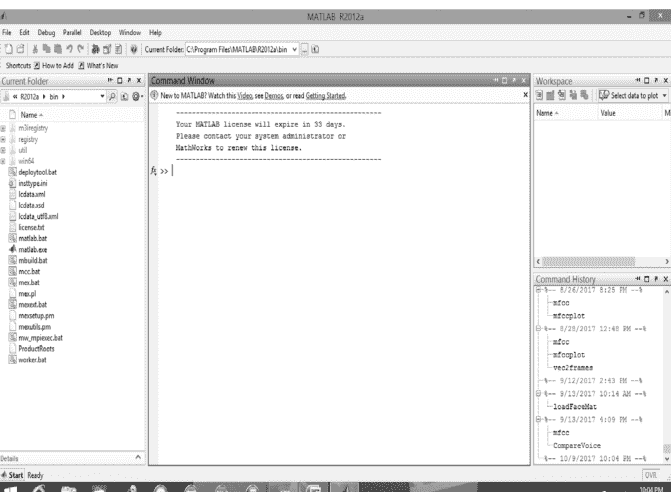
图 1.43 MATLAB 初始屏幕。*


如果未指定输出变量，在这种情况下，默认变量是答案，其变量指定如下：

```
> X = 2 + 2 * 3
```

```
X = 8
```

然后结果将存储在变量 X 中。通过选择主菜单中的“文件 -> 退出 MATLAB”或在命令行窗口中输入 quit 来结束 MATLAB 会话。

**获取帮助：** MATLAB Help 从帮助菜单中使用，其方式是在线查看文档。获取帮助的最佳方法是通过选择桌面工具栏上的此图标来使用帮助浏览器。

例如，如果某个特定函数（即 sqrt）需要帮助，则输入

Help sqrt

**MATLAB 绘图：** MATLAB 工具有一组图形工具。使用少数命令用于计算结果或绘制给定的数据集。通过取一个 x 坐标向量 x = [x1, x2, x3 ... x] 和一个 y 坐标向量 y = [y1, y2, y3 ... yn] 来定位点 (xi, yi)，其中 i = 1, 2, 3 ... n，然后用直线将它们连接起来即可创建一个简单的图。要绘制图，MATLAB 中使用的命令是 plot(x,y)。例如，如果向量 x = (2, 4, 6, 8, 10) 和 y = (3, -2, 3, 5, 2) 生成图表，如图 1.44 所示：

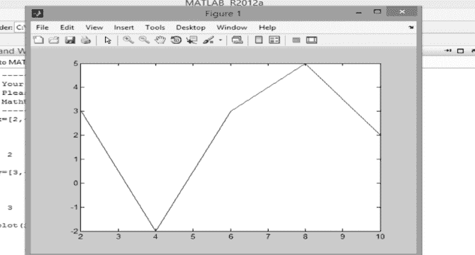
图 1.44 x 和 y 的图。

## 50 居家安防与安全系统的集成方法

```
>>x = [2, 4, 6, 8, 10]
```

```
>>y = [3, -2, 3, 5, 2]
```

```
>>plot(x, y)
```

MATLAB 还有助于添加轴标签和标题。如果在上面的图中添加了 x 和 y 轴，是使用这些命令。

```
>>xlabel('x=0.2*pi')
>>ylabel('Sine of x')
>>title('Plot of Sine Function')
```

图表如图 1.45 所示。带有标题的正弦函数图如图 1.46 所示。

### 1.8.1 矩阵概念

MATLAB 环境的基本元素是矩阵。矩阵是一个由 n 行 m 列组成的二维数组。在矩阵上应用了许多操作。第一个例子是输入一个向量，向量是矩阵的一个基本情况。其目的是在 MATLAB 中创建向量和矩阵。行向量由 1*n 维数组表示，列向量由 m*1 维数组表示，如图 1.47 所示。

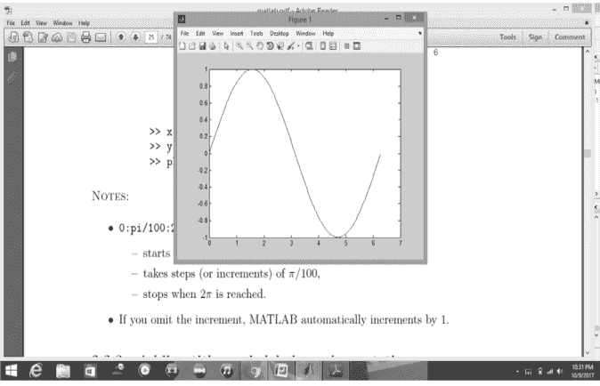
图 1.45 正弦函数的图。

## 泛在计算

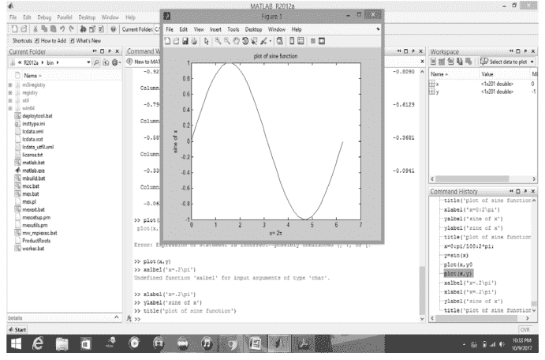
图 1.46 带有当前标题的正弦函数。

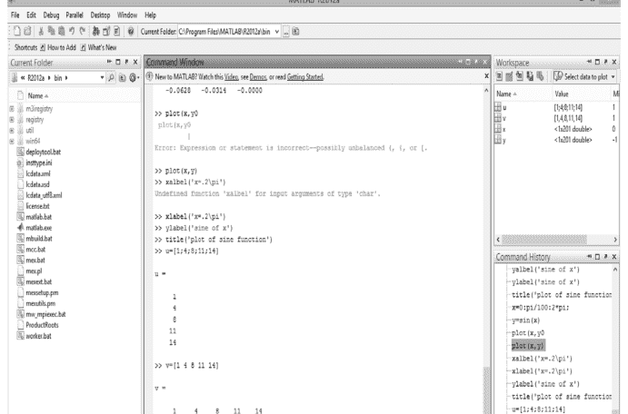
图 1.47 向量的表示。

## 52 居家安防与安全系统的集成方法

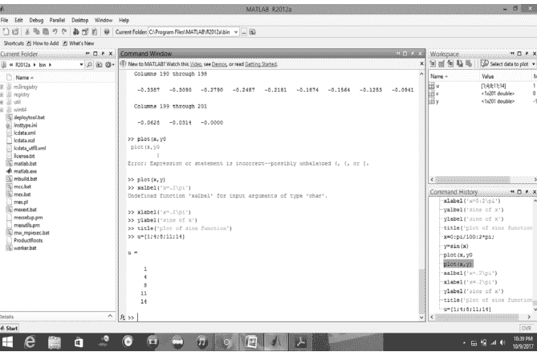
例如，要输入行向量 v，输入

>>v = [1 4 8 11 14]

同样，列向量的创建方式如如图 1.48 所示。

>>u = [1; 4; 8; 11; 14]

可以使用转置操作符将行向量转换为列向量，该操作符用撇号或单引号（') 表示。例如，u=v' 在图 1.49 中描述了它。

**矩阵形成：** 矩阵是数字的集合。在 MATLAB 中形成矩阵，从-

- 方括号 [
- 元素之间用空格或逗号（,) 分隔
- 分号 (;) 用于分隔行
- 矩阵以另一个括号 ] 结束

例如，形成一个如图 1.50 所示的矩阵。

>> A = [2 4 6; 8 10 12; 14 16 18]

结果将是 3*3 矩阵，如图 1.50 所示。

## 泛在计算 53

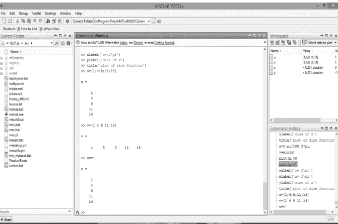
图 1.49 转置操作符的表示。

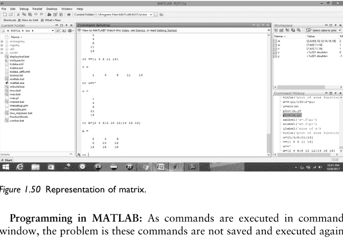
图 1.50 矩阵的表示。

**在 MATLAB 中编程：** 由于命令在命令行窗口中执行，问题在于这些命令没有被保存并反复执行多次。因此，使用了不同的概念来重复命令，即：

- 使用命令创建文件
- 保存文件
- 运行文件

## 54 居家安防与安全系统的集成方法

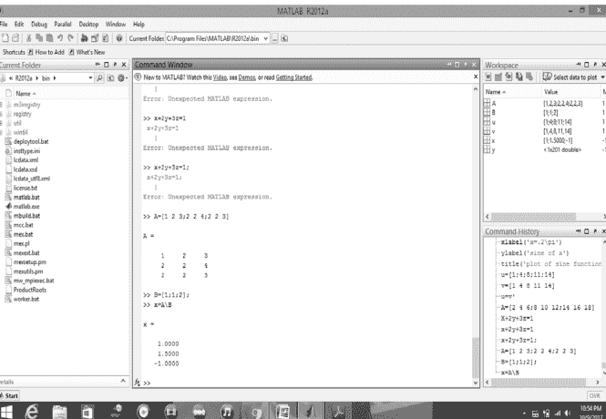
（注：此处原文路径似乎断裂或不完整，已按格式保留）


信号处理的功能在 M-文件中表示以实现相应任务。MATLAB 中最常用的两个内置函数是 `filter` 和 `fft`。`filter` 函数用于对数据序列进行滤波，而 `fft` 用于计算序列的变换。

## I.9 籍结构

本研究的主要目标是为独居在家的个人提供安全保障。工作按以下章节组织：

第1章介绍了泛在计算的基本概念及其挑战和问题。本章详细定义了结合人脸识别和语音识别技术的多种生物识别技术，并描述了本研究工作的目标。第2章提出了一种混合 PICA 算法，用于为家庭个人提供安全保障。第3章描述了一种混合 MFRASTA 算法，用于为独立生活的个人提供灵活的基于信任的安全。第4章提出了一种指尖应用，该应用可以在 iPhone 的摄像头镜头上运行，用于用户的健康监测。第5章展示了完整实现系统的图形用户界面（GUI），并从识别率方面对所提技术与此前使用的多种技术进行了比较。第6章介绍了所提工作的结论。为了使该系统更有用，还提了一些针对未来研究的观点。


# 第2章

## 用于个人家庭安全的混合人脸识别 PICA 算法

### 2.1 人脸识别简介

安全框架在当今世界占据着至关重要的地位。因此，设立了安全职业，并招聘工作人员使该框架一段时间内有效运行。在任何情况下，通过研究新进展，世界都得到了改进。许多基于机器的安全框架开始执行，以减少劳动和成本 [38]。人脸是生物识别技术最有前景的技术之一，而虹膜是最常用的识别方法。人脸传达了年龄、身份、性别、种族和反映情感及心理状态的面部需求。与其他一些生物识别特征相比，面部信息并不需要个人的配合，就可以以微妙的方式进行，使其特别适用于观察类应用 [39]。基于指纹、虹膜、签名识别等其他生物识别技术的问题在于数据采集，例如在指纹识别 [44] 中，用户必须以正确的方式和方向放置手指。在人脸识别中，采集脸部并不并不，因此可以作为一种生物识别技术。每张脸都有定义特定用户的特殊特征。情绪也可以通过像素强度识别，这对应于情绪检测的特征 [45]。人脸识别是一种经常应用于银行、安全信息和虚拟现实等许多领域的生物识别技术。图像处理是人脸识别中的一种方法，用于将图像转换为数字形式并对图像进行某些操作，以便我们从中提取有用信息。它包含三个步骤：图像采集、数据压缩或增强以分析数据并以修改后图像的形式输出。人脸识别系统涉及三个主要步骤：数据采集、特征提取和识别 [46]，如图2.1所示所示。数据采集是人脸识别系统的主要步骤，包括通过多种源采集脸部图像。

# 60 家庭安全与防护系统的集成方法

| 采集 | 特征提取 | 识别 |
| --- | --- | --- |

**图 2.1** 人脸识别系统的步骤。

采集的图像可能有不同的姿态变化、光照变化等。因此，我们可以很容易验证在多种条件下分类的识别系统的性能。有时，门处的输入图像会被分类，并对输入图像应用不同的修改方法。通过这种方式，去除了噪声、光照、模糊效果等某些不良参数，然后用于后续处理 [46]。特征提取是人脸识别系统的下一步，用于从图像中提取信息，在提取后，特征被用于识别步骤。在这一步中，使用了降维和去噪 [47]。

识别是人脸识别系统在选择和提取后的最后一步，现在使用多种分类器对图像进行分类。在这一步中，获取许多图像并对其进行特征提取，存储在数据库中。当新图像进行人脸识别时，它首先执行人脸采集、特征提取，然后将新图像与数据库中的所有图像进行比较。图像与数据库存储的所有图像相关以识别身份，如图2.2所示 [47]。

每个人脸识别系统主要由两个任务组成：

- 验证
- 识别

在验证中，适用于一对一匹配；系统帮助将特定个人与文件中特定的生物特征进行匹配。由于该系统只比较生物识别文件，因此它比识别是一种更快、更高效的技术，例如，它寻求为特定问题提供答案

| 图像采集 | 人脸检测 | 特征识别 | 人脸识别 | 输出 |
| --- | --- | --- | --- | --- |
| | | | 数据库存储的图像 |

**图 2.2** 人脸识别模型。

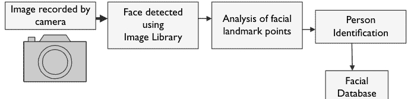

特定的问题，如“这个人真的是他所声称的吗？”。在识别中，适用于一对多匹配，这意味着在图库数据库中识别图像。它寻求识别未知用户，例如，它尝试回答“这个人是谁？”。人脸识别的基本框如图2.3所示。

存在两种人脸识别方法：基于特征的和基于整体的 [48]。在基于特征的方法中，从脸部提取特征，如眼睛、嘴唇和鼻子，并计算这些特征之间的几何关系，最后还原为向量形式。用于计算各种特征之间距离的方法是欧几里距离法。弹性簇图法（Elastic bunch graph method）是这种基于动态结构的示例。通过这种方法，对于每个人，都会生成一个图，并在簇图方法中为每个新图像生成图以用于识别。之后，将通过分析新脸部图像与数据库中存储的所有脸部图像的图来进行比较，最后计算相似性指数。

基于整体的方法使用全局表示来处理图像的局部或某些面部特征。这种方法再次分为两个部分：统计和二维数组，主要概念是计算输入图像与数据库中其他存储图像之间的相关参数。这种方法非常昂贵，因为它在姿态和光照等变化条件下不起，第二个缺点是它始终在高维空间中进行分类。为了克服这些问题，可以使用其他方法来获得更有意义的结果，例如PCA（主成分分析）算法，它将每张脸表示为特征脸（Eigen faces）的融合，每次重建也通过使用这些特征脸完成。

在人工智能方法 [48] 中，使用了许多工具来识别脸，如神经网络和机器技术。这意味着当从PCA算法中提取主成分时，使用神经网络作为分类器以在低维空间减少成分。SVM（支持向量机）是模式分类中最常用的算法。HMM（隐马尔可夫模型）也被用于


# 62 家庭安防与安全系统的集成方法

人脸识别任务。人脸识别的困难在于它在姿态、光照条件等高变异情况下无法正常工作。针对变化的姿态和光照条件下的人脸识别问题，需要通过使用人脸几何来应对姿态和光照条件以提高鲁棒性 [48]。因此，所提工作中定义了 PCA+ICA 算法用于人脸识别。

## 2.2 人脸识别算法

人脸是生活中最重要的视觉对象，可用于传递身份。有许多用于人脸识别的算法。

### 2.2.1 主成分分析 (PCA)

PCA 是一种可测量策略，它利用正交变换将一组可能相互关联的变量感知转换为一组高度不相关的估计因子，这些因子被称为主成分。主成分的数量并不完全等同于原始变量的数量。这种变换的特征是：第一主成分具有最大的方差（即呈现了信息中尽可能多的变异性），随后的每个部分在与前一个成分保持正交（即不相关）的前提下，具有最大的差异 [40]。如果信息连接是联合分布的，则主成分被定义为自治的。PCA 对原始变量的整体缩放非常敏感。这里研究了许多关于 PCA 的论文，发现没有论文将 PCA 策略与重要模型结合起来。这就是编写这本文论文的原因，将所有这些内容结合在一起，对初学者来说直观且易懂。PCA 是一种通用于高维数据分析的数学工具。PCA 已用于人脸识别、运动分析与合成、聚类和降维。它是 Turk 和 Pentland 在 1991 年开发的一种流行算法 [49]，主要用于压缩类型问题中的降维。PCA 起源于特征向量概念 [49]。它是具有模式识别特征的数据分析中最重要的工具，可以被该算法应用到图像处理中。线性变换方法被用于将完整数据从高维空间映射到低维空间。在此类算法中，如果我们把真实数据集转换到不同的空间，数据集的形状和位置将发生改变，它被用于在不了解分组的情况下计算更好的判别分量。这是一种在统计上用于数据分析和降维的技术。该算法的目标是将数据视为若干成分的组合 [49]。第一主成分是原始维度上方差最大化的线性组合。原始维度的第二主成分是方差最大且与第一主成分正交。第 n 个主成分是在与 n-1 个主成分正交的前提下具有最高方差的线性组合。为了减少识别人脸所需的变量数量，使用了统计方法。训练集中每张图像都将通过加权特征向量的线性组合来表示，这些向量被称为特征脸 (Eigen faces) [50]。使用了一种称为偏置函数的项，它表示由给定训练集协方差矩阵生成的所有特征向量。在识别阶段，新图像被投影到子空间，并使用欧几得方法计算各种面部特征之间的距离以进行分类。PCA 也称为 Karhunen Loeve 变换 [50]。它用于消除维度和相关性问题，并通过表示相似性和差异来分析数据。

实施 PCA 算法的步骤如下：所有以二维 N*N 格式拍摄的人脸图像。目标是提取可以表示训练集中存储的全脸部的主成分（特征脸）[51]。假设训练集中图像的数量为 M，训练集中每幅图像的线性形式表示为 $I_i$。

- 将训练集的图像转换为图像向量，以便我们将 N*N 映射到 1*N 向量。
- 归一化脸部向量，这意味着从每个脸部移除所有公共特征，以便每个脸部只保留其独特特征。
- 计算所有脸部向量的平均值。

$Mean = \frac{1}{M}\sum_{i=1}^{M} I_i$。

从每个脸部向量 I 中减去平均值，得到归一化的脸部向量。

$K_i = I_i - Mean$

- 从协方差矩阵计算特征向量。

$C = \frac{1}{M}\sum_{i=1}^{M} K_i K_i^T = B^* B^T (N^2 * N^2 \text{matrix})$

其中 $B = [K_1 K_2...K_M]^T (N^2*M \text{ matrix})$

- 从缩小的协方差矩阵 $C$ 或 $B*B^T$ 计算特征向量，令其为 $u_i$，但 $B*B^T$ 尺寸极大，无法对其计算特征向量。因此，改为寻找矩阵 $B^T*B$ 的特征向量。令 $v_i$ 为特征向量。

```
$B^T * v_i = I_i * v_i$
```

$v_i$ 与 $u_i$ 之间的关系

```
$B^T * B v_i = I_i * v_i$
$B^T * B * B_i = I_i * Av_i$
$C * B v_i = I_i * Bv_i$
$CU_i = I_i u_i$
```

其中 $u_i = Bv_i$

- 选择能够代表整个训练集的最佳特征脸。
- 将低维特征向量转换为原始维度。
- 将每个脸部图像表示为所有特征向量的线性组合。训练集中的每个脸都可以表示为特征脸和平均脸的加权和。
- 识别未知人脸。识别脸部图像的步骤是：

    a. 首先将脸部图像转换为向量形式 I。
    b. 通过减去平均值对其进行归一化。
    c. K=I-mean
    d. 将归一化的脸部向量 (K) 投影到特征空间以获得向量 W。

```
$W = [w_1 w_2 \dots w_N]^T$
```

其中 $w_i = u_i^T * K$，它给出了给定脸与训练集中另一个脸之间的最小距离，且该给定脸属于训练集中该脸部所所属的人员。

```
$E_r = \min ||w - w^T||$
```

如果 $E_r >$ 阈值，则用户未知，否则用户已知。

图 2.4 描述了 PCA 算法中提取图像主成分的步骤。在 PCA 算法中，所有图像必须是等的向量，这意味着所有图像都存在于矩阵中，矩阵的每一行显示一张图像。下一步是计算这些图像的特征向量，特征向量也称为特征脸。每幅图像都是这些特征脸加权和的线性组合。当注册新图像进行识别时，会首先创建该图像的特征向量，然后计算数据库中新脸之间的距离。这种矩阵方法。独立成分分析 (ICA)

这是一种用于寻找多维统计信息的基本因子或部分的统计和计算策略。ICA 与其他方法的不同之处在于，它寻找具有以下特征的成分：统计独立和非高斯性。ICA 为观测到的多变量信息描述了一个生成模型，这些信息通常被给定一组巨大的样本集合。在模型中，数据变量被假设为某些未知变量的线性混合，且混合系统也是未知的。潜变量被假设是非高斯且相互独立的。这些独立成分（也称为源或因子）可以通过 ICA 找到。由 ICA 分析的数据可能源于许多不同的应用领域，包括数字图像、数据库、经济指标和心理测量值 [41]。ICA 用于分析更高阶的数据，或者说分析多变量数据 [52]。聚类分析是该算法中使用的的一种技术。聚类被表示为许多数据元素的组，聚类分析被定义为一种在数据集中中的区域分配空间的技术，该区域被称为聚类 [53]。这


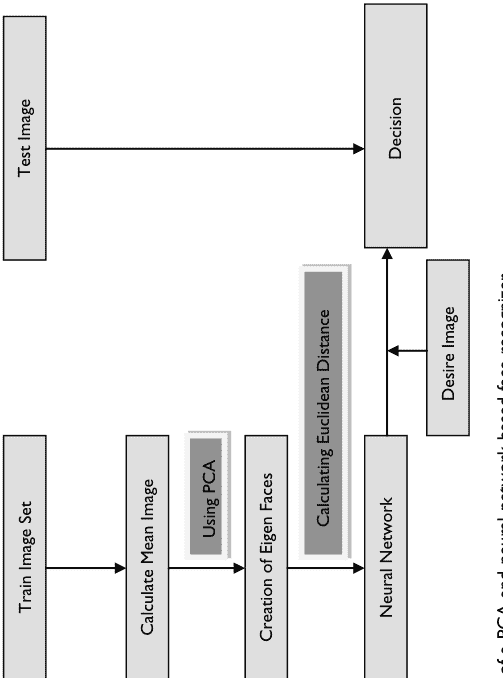

图 2.5 基于 PCA 和神经网络的脸部识别器示意图。

# 混合脸部识别 PICA 算法 67

基本上用于盲源分离问题，也称为鸡尾酒问题。该问题的定义是：如果房间里有三个人同时说话，通过放置在不同位置的三个麦克风采集麦克风产生的声音，每个麦克风记录了房间内所有声音的混合。其目标是仅通过录得的混合声音分离出个人的声音。独立成分分析（ICA）是解决这种盲源分离问题的方法 [54]。它是 PCA 算法的推广，能够区分输入的高阶矩和二阶矩。它的首工作工作是将信号分解为若干种独立信号的组合。

在此，使用的算法是 Bell 和 Sejmoski 提出的 info max 算法 [55]，用于分离数据集的分析独立分量。

ICA 算法的步骤为：
每幅脸部图像都是这些独立分量的唯一线性组合。

```
R = A * U
```

其中 R 代表脸部图像，A 定义了未知的混合矩阵，U 代表统计独立成分。

- 对训练集进行球化处理。它包括应用于数据集的中心化和白化过程。
  a. 中心化：在此行中，从数据减去均值，然后将数据集通过白化滤波器。
  b. 白化：通过公式计算：

```
Wc = U * E^{-1/2}
```

其中 U 和 E 分别是特征向量和特征。此步骤消除了数据的统计特性，协方差和均值均置零，且方差相等。

- 计算 W = W * Wz，
- 计算基图像。

```
B = R * Wi^{-1}
```

- 将测试图像投影到特征脸（Eigenfaces）。
- 计算系数

$B_{test} = R_{test} * W_{i}^{-1}$

# 68 居家安全与防护系统的集成方法

PCA 和 ICA 算法用于将测量分量减少为较小的组件集。如果数据是高斯分布、线性且平稳的，则 PCA 就足够了。如果不是，ICA 就派上了用场。简单来说，PCA 帮助压缩数据，而 ICA 帮助分离数据 [42]。图 2.6 显示了一个需要输入图像的系统。通过输入图像，它将找到所有训练图像的特征值。然后，选择一张测试图像并在考虑的测试图像上应用 ICA 算法。最后，从考虑的测试图像计算均值图像。如果与训练图像匹配，则已知身份，否则未找到结果。图 2.6 显示了基于 ICA 的脸部识别器的框图。

### 2.2.3 线性判别分析 (LDA)

LDA 是一种降维技术，用于人脸识别的预处理步骤。它的目标是将特征从高维空间投影到低维空间，以避免维度灾难，最重要的是降低成本和资源。LDA 技术由 Ronald A. Fisher 在 1936 年引入，名为线性判别分析（Linear Discriminant）或

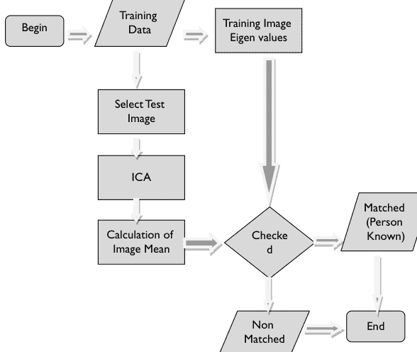

图 2.6 基于 ICA 的脸部识别器框图。

FDA（费斯尔判别分析）。这是模式识别的经典技术之一，该技术用于寻找分离对象类别的线性组合特征。结果的组合可以作为线性分类器。费斯尔判别分析技术。在这种分析中，可以使用多种像素值来表示每张脸。LDA 用于在分类发生之前通过减少特征数量来创建一个更易管理的形式。它被用于搜索线性类型的变换，使得特征簇具有很强的可性，这可以通过处理类内频率不相等的情况来实现，并且我们可以使用任何随机数据集计算其性能。它通过为任何数据集提供最大比例的类间方差与类内方差的比值，从而保证了可分离性 [55]。该算法通过如图 2.7 所示的变换，在最小化类内散度矩阵的同时最大化类间散度矩阵 [43]。

使用 LDA 的目标是在寻找子空间时，通过考虑训练图像的类隶属函数对 PCA 进行改进。它基于这样一个概念：将单幅脸部图像作为输入，并使用马哈拉诺斯距离方法的评分函数 [55]。它的优点是最大化了簇之间的距离但最小化了类内距离，但它没有考虑多个图像作为输入。

算法：

它与特征脸算法非常相似，首先；将训练图像投影到子空间。然后，通过将测试图像投影到相同的子空间计算相似性度量

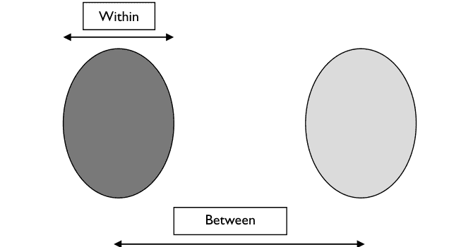

图 2.7 LDA 中的类分离。

# 70 居家安全与防护系统的集成方法

通过将测试图像投影到相同的子空间计算。子空间的测量步骤定义：

- 通过测量属于同一类的项目之间变化量来计算类内差异。
- 计算类间差异。
- 为两类类别（类内差异和类间差异）计算特征向量和特征值。
- 然后，根据关联的特征值从高到低对特征向量排序，并保留最高的特征向量。这些特征向量就是费斯尔基向量。
- 计算图像与费斯尔基向量的点积。此计算将图像投影到子空间。一旦训练图像被投影到子空间，就必须收集它们并根据它们之间的关系进行分类。计算图像之间的距离可以建立它们的相似性。例如，彼此距离最近的图像可以被认为是接近且相似的，而距离较远的图像则被认为是不相似的。

LDA 技术通过降维方法对数据集进行判别，LDA 测试阶段的框图如图 2.8 所示 [43]

### 2.2.4 离散余弦变换 (DCT)

这是精确且稳健的识别系统之一，通过使用不同的归一化方法；可以增加其对脸部几何变化的鲁棒性


图 2.8 LDA 测试阶段的框图。

# 混合脸部识别 PICA 算法 71

以及光照变化的增强。能量聚集特性使得 DCT 能够用于图像处理和信号分析。DCT 能够轻松压缩大部分信息，这就是它被用于特征提取的原因。在脸部图像上应用离散余弦变换时，它将提供一个包含低高频系数的矩阵。DCT 的性能很大程度上受到顶部系数幅度变化的影响。在此，在特征提取之前，应用光照归一化以补偿这些系数差异并将块设置为相等。DCT 是一种用于图像质量的高效技术，某些高频系数可以被忽略。在脸部表情、光照条件等变化的情况下，使用二维方法进行提取。DCT 的挑战是现实应用中用于特征提取的不受控光照条件。光照归一化（IN）是一种补偿不同光照条件的预处理技术。它由许多以余弦函数表示的不同频率波动的数据点组成 [56]。变换定义为用于信号转换的操作，即通过使用逆变换将一个域转换为另一个域。这种变换用于压缩标准，系统接收作为输入，然后对该脸进行归一化或裁剪，计算脸之间的距离，最后进行比较。DCT 也与其他变换一样尝试使图像数据去相关。在去相关后，每个变换系数都可以独立编码而不会丢失压缩效率。它在变化较小时工作良好。它在某些方向、姿态、光照等情况下工作良好，但成功率并不高。

### 2.2.5 Gabor 小波

它将图像表征为局部方向选择性和频率选择特征。该技术使用滤波器提取局部特征，这些特征实际上应用于许多幅图像以进行与特定角度或方向对齐的特征提取。[44] 这种技术以丹尼斯·加伯命名 [57]。它是一种带通线性滤波器，在姿态和光照条件发生大幅变化时工作良好。它在空间域和频率域都实现了最优分辨率。小波是满足某些数学要求的函数，用于表示数据或其他函数。小波技术用于在不同的尺度或分辨率上处理数据。如果一个信号具有大窗口，则计算粗略特征；如果信号具有小窗口，小波非常适合近似具有尖锐不连续点的数据。这种技术可以用于


## 72 一种家居安全与防护系统的集成方法

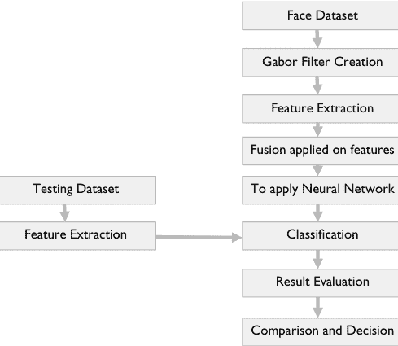

**图 2.9** Gabor 小波技术框图。

许多领域包括：天文学、声学、核工程、信号与图像处理、音乐、磁共振成像、语音鉴别、光学、分形、湍流、地震预测、雷达和人类视觉。图 2.9 显示了 Gabor 小波技术的框图。

该技术在许多应用中具有对我们极具吸引力的特征：

- 对光照变化不敏感
- 对面部表情变化的敏感性
- 平移和旋转不变性

尽管具有这些优点，该技术也存在一些缺点：

- 计算复杂度高
- 对内存容量的要求
- 特征向量维度非常高

PCA 与 ICA 算法在较小或姿态变化、光照变化等方面表现良好；在计算面部特征之间的距离时，它们使用欧几里得距离计数，PCA 算法使用了降维方法，这对于保留有用信息的同时压缩数据是必要的。独立特征的提取由 ICA 算法完成，但其他算法在较小或姿态变化、光照变化等方面表现良好。LDA 算法没有同时考虑多幅图像，并基于马氏距离法进行距离计算 [57]。DCT 仅在变化较小时工作良好，而小波仅在姿态和光照因素大幅变化时工作良好。

## 2.3 提出的混合 PICA 算法

自动人脸识别已成为一个活跃的研究领域，而自动监测监测家中独立生活的人的健康状况是一种用于向其家庭成员提供个人健康信息的方法。图 2.10 提供了一个人脸识别的集成模型。

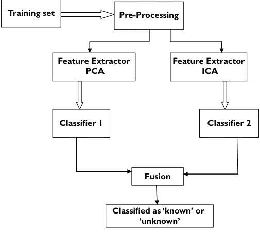

图 2.10 用于人脸识别的集成 PICA 模型。

工作使用了 PCA + ICA 的结合方法进行特征提取，因为与单个特征提取技术相比，这种方法有助于以较高的识别率实现我们的目标；通过这种组合，使用了一种名为反向传播的神经网络作为分类器。PCA 的演变 [58] 是通过使用特征向量完成的，通过这些特征向量的帮助，对给定输入考虑特征，这被称为主成分。它的优势是一个降维过程，包含了数据压缩，但没有信息丢失。

ICA 是一种非常实用的技术 [58]。前馈神经网络是一种由三层组成的简单网络：a) 输入层，b) 隐藏层和 c) 输出层。

以前人脸识别系统中完成的大部分工作由单一特征提取技术加分类器组成，但在所提出的工作中使用了分步程序：

- a. 取一个训练集，并使用 PCA 和 DCT 等方法对其进行预处理。
- b. 使用 PCA + ICA 结合两种人脸识别算法提取独立特征。
- c. 使用前馈神经网络进行分类，对给定的输入图像进行分类。
- d. 结合每个神经网络的输出以分类输入图像，定义该输入图像的类别。

提出的混合 PCA 算法：

1. 首先建立训练集。
2. 然后，在训练集上应用标记特征函数以标记输入图像中的眼睛和嘴巴位置。
3. 应用对齐函数将面部图像从 JPG 格式转换为 pgm 格式，因为 MATLAB 工具支持 pgm 格式。
4. 使用名为 C 的矩阵存储所有图像。
5. 应用 PCA 函数：
   - 数据中心化：通过从均值图像减去每个训练图像来使每个图像中心化，并存储名为 A 的矩阵中。
   - 计算协方差矩阵：矩阵 'A' 中的中心图像与其转置相乘形成协方差矩阵 L。如果每个图像的大小为 N*N，则该矩阵的大小为 N*2*N²。

```
L = A * A'
```
   - 计算特征向量：寻找 N*2*N² 矩阵的特征向量是困难的。因此，使用 A*A 较于计算特征向量。

```
C = 1/(M) ∑i=1^M Ki * KiT = B * BT (N^2 * N^2-矩阵)
```
6. 应用 ICA 算法：从之前计算的特征向量开始，通过中心化和学习对 ICA 进行分析。
   - 中心化：意味着对 x 进行白化或描述为去除 x 中的一阶和二阶统计量。
   - 学习：计算持有原始数据的 X。

```
Xx = inv(wz) * x
```
   - 计算输出协方差：通过提取的均值和原始数据计算。

```
Cov (xx') = w * wz * xx
```
   - 设置阈值并显示结果。
7. 使用 MATLAB 工具和 3G 狗接器向类别成员发送短信。

## 2.4 实现

为了测量 PCA 和 ICA 的性能，使用 MATLAB 工具生成了混合 PCA 算法的代码。与在 C 或 Java 语言中实现相比，使用此工具有助于提高识别率。主成分分析 (PCA) 与独立成分分析 (ICA) 的结合用于人脸识别。


## 混合人脸识别 PICA 算法 77

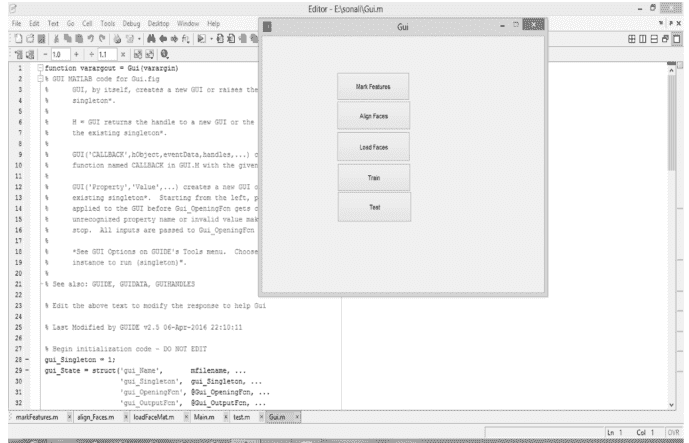

图 2.1 人脸识别过程接口。

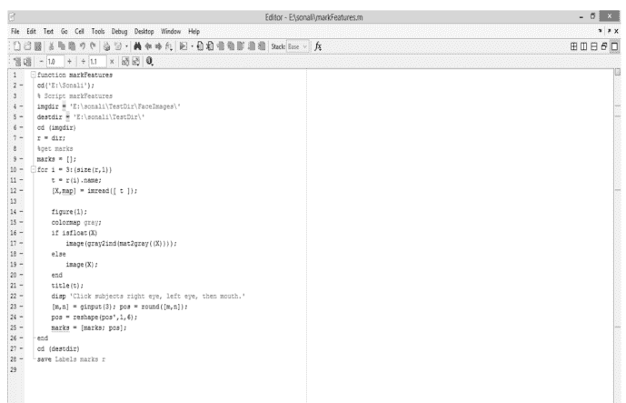

图 2.12 标记面部特征。

## 78 居家安全与防护系统的集成方法

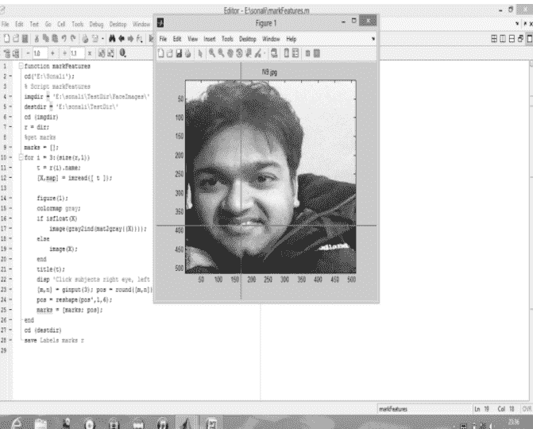

图 2.13 步骤 1：标记面部特征（左眼、右眼和嘴部）。

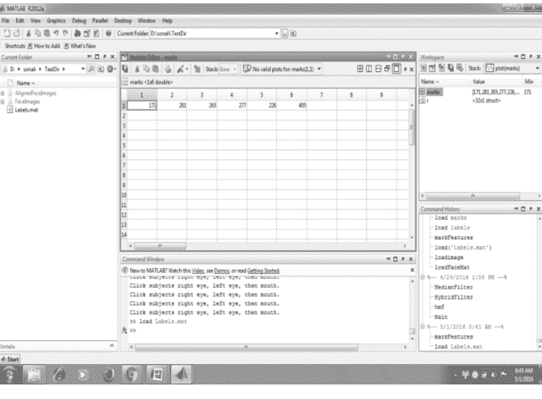

图 2.14 步骤 2：标记面部特征的矩阵。

## 混合人脸识别 PICA 算法 79

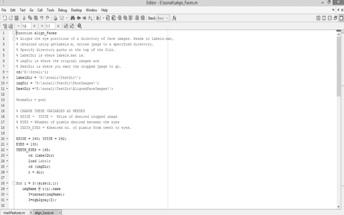

```matlab
1 align_Faces
2 returns partitions of a directory of face images. Reads in Label.mat,
3 obtained using getlabela, images to a specified directory.
4 Label is where Label.mat is in
5 cropped is where the cropped images are
6 there is where you want the cropped images to go
7 %
8 Labels=imread('Test.mat')
9 images=imread('Test/FaceManager/')
10 Desired=imread('Test/FaceManager/AlignedFace.mat')
11 %
12 threshold=250
13 % CHANGE VARIABLES AS NEEDED
14 % ESIZE = width of desired cropped image
15 % TEETH = number of pixels between eyes
16 % from teeth to teeth
17 ESIZE=260; TEETH=292;
18 %
19 EYES=230;
20 % Labels=
21 n=size(Labels)
22 m=size(images)
23 r=0
24 %
25 For i=1:size(images,1)
26 crop=images(i,:)
27 imname=Labels{i}
28 imwrite(imname,crop)
29 end
```

图 2.15 对齐人脸。

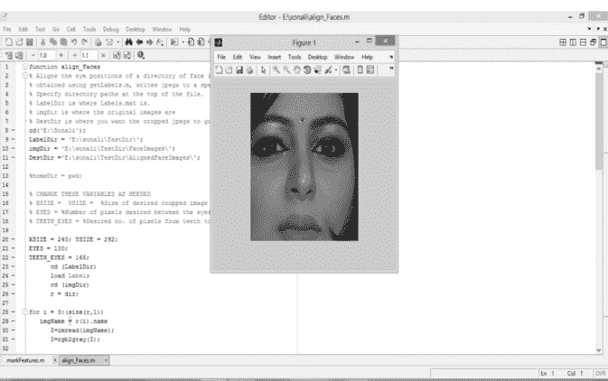

```matlab
1 align_Faces
2 returns partitions of a directory of face images
3 obtained using getlabela, images to a specified directory
4 Label is where Label.mat is in
5 cropped is where the cropped images are
6 there is where you want the cropped images to go
7 %
8 Labels=imread('Test.mat')
9 images=imread('Test/FaceManager/')
10 Desired=imread('Test/FaceManager/AlignedFace.mat')
11 %
12 threshold=250
13 % CHANGE VARIABLES AS NEEDED
14 % ESIZE = width of desired cropped image
15 % TEETH = number of pixels between eyes
16 % from teeth to teeth
17 ESIZE=260; TEETH=292;
18 %
19 EYES=230;
20 % Labels=
21 n=size(Labels)
22 m=size(images)
23 r=0
24 %
25 For i=1:size(images,1)
26 crop=images(i,:)
27 imname=Labels{i}
28 imwrite(imname,crop)
29 end
```

图 2.16 步骤 3：从 JPG 到 pgm 的格式转换，用于对齐人脸。

## 80 居家安全与防护系统的集成方法

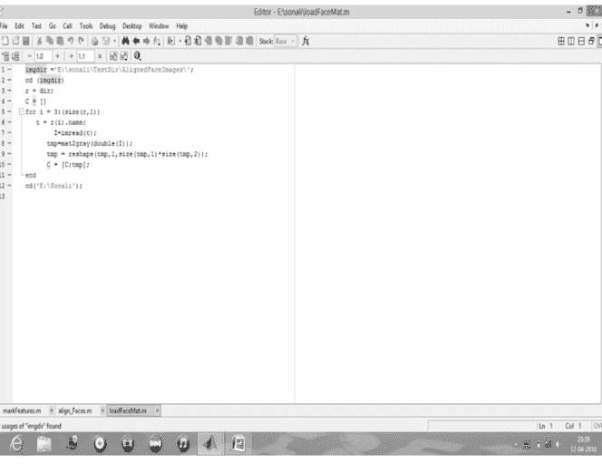

图 2.17 步骤 4：所有图像的矩阵形成。

加载到 MATLAB 工具中，它显示这种格式不兼容，这就是为什么在此需要进行转换。

- **加载人脸 (Load Faces)**：此步骤将所有对齐的人脸加载到名为 C 的矩阵中，其中包含 41 行和 70613 列。该函数的目的是重塑，即让所有人脸以矩阵形式存在，如图 2.17 所示。

- **主函数 (Main Function)**：这是核心步骤，其输出是以百分比形式显示有多少张图像与训练数据库匹配。如果标记了 41 张图像进行提取，那么从这 41 张图像中调用的训练数据库中，在由 `load faces` 创建的矩阵中有多少张图像。它的好处是在进入下一步阶段（图像测试）之前，检查训练数据库是否完整。图 2.18、2.19 和 2.20 分别显示了主函数的输出，给出 `pc` 变量。如果 `pc` 的值为 100%，则说明训练数据库已完整，意味着模型准确性为 100%。

- **训练 (Train)**：下一步是通过采用前馈神经网络对网络进行训练，以便在 MATLAB 工具中检查其性能。该步骤从 `load faces` 的矩阵 C 中提取 ICA 特征，如图 2.21、2.22 和 2.23 所示。在此过程中，输入值存储在 `input.mat` 中，输出值存储在 `targets.mat` 中。

## 混合人脸识别 PICA 算法 81

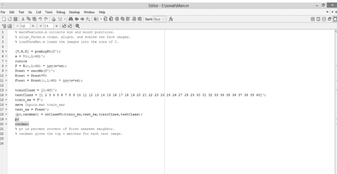

图 2.18 运行主函数的输出。

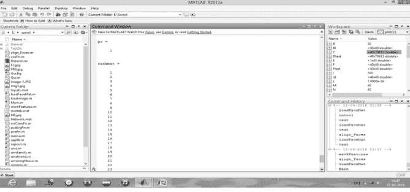

图 2.19 给出 `pc` 变量。

图 2.20 比较其他情况的性能。time delay as.

## 混合人脸识别 PICA 算法 82

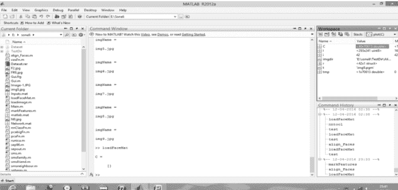

图 2.21 步骤 5：矩阵形成。


图 2.22 创建网络。

## 混合人脸识别 PICA 算法 83

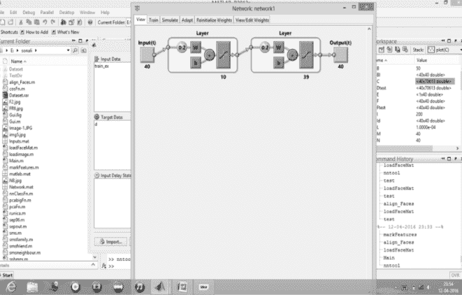

图 2.23 图像验证。

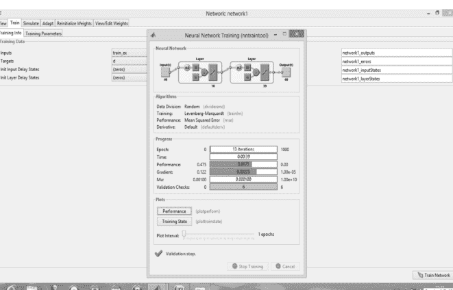

图 2.24 神经网络。

## 混合人脸识别 PICA 算法 84


表 2.1 类别对应

| 序号 | 类别 | 消息 |
|---|---|---|
| 1 | 家庭 | Family + neighbors |
| 2 | 朋友 | Family + Friend |
| 3 | 邻居 | Family + neighbors |
| 4 | 未知 | Family |

## 混合人脸识别 PICA 算法 85


图 2.24 性能图。

## 2.5 结果


## 86 家庭安防与安全系统的集成化方法


图 2.26 数据库中的存储图像（家人、朋友和邻居）。混合人脸识别 PICA 算法 87

表 2.2 识别率方面的 PCA 性能
| 序号 | 数据集 | 识别率 |
| :--- | :--- | :--- |
| 1 | I (10张图像) | 98% |
| 2 | II (20张图像) | 98% |
| 3 | III (30张图像) | 98% |
| 4 | IV (40张图像) | 97% |
| 5 | V (50张图像) | 93% |

表 2.3 识别率方面的 ICA 性能
| 序号 | 数据集 | 识别率 |
| :--- | :--- | :--- |
| 1 | I (10张图像) | 92% |
| 2 | II (20张图像) | 92% |
| 3 | III (30张图像) | 93% |
| 4 | IV (40张图像) | 98% |
| 5 | V (50张图像) | 98% |

表 2.4 PCA、ICA 和提议的 PICA 算法的对比
| 序号 | 数据集 | PCA+NN 识别率 | PCA+NN 识别率 | 混合 PCA+NN 识别率 |
| :--- | :--- | :--- | :--- | :--- |
| 1 | I (10张图像) | 98% | 92% | 99% |
| 2 | II (20张图像) | 98% | 92% | 99% |
| 3 | III (30张图像) | 98% | 93% | 99% |
| 4 | IV (40张图像) | 97% | 98% | 99.5% |
| 5 | V (50张图像) | 93% | 98% | 99.5% |

通过使用 MATLAB 工具 3G 网狗可以获得所需的结果，使得手机可以从注册了网狗的号码接收文本信息。通过在 MATLAB 代码中插入号码，可以同时向多人发送信息 [59]。命令的数量用于产生接收消息的操作。
图 2.27 识别率方面的个体 PCA 性能图。


图 2.28 识别率方面的个体 ICA 性能图。图 2.30 显示了使用 MATLAB 工具和 3G 网狗在手机上接收的消息截图。

## 2.6 总结

提出了一种名为 PICA 的新技术，通过融合两种现有的面脸识别算法进行身份识别，与单一识别算法相比，这可以显著提高识别率。提议系统使用主成分分析（PCA）与独立成分分析（ICA）的混合组合来提取面部特征，并使用反向传播馈前神经网络进行识别。实验结果表明，混合方法可以提高人脸识别的性能。未来可以考虑安全措施，使用人脸识别解锁手机。

## 第 3 章 针对家庭的混合 语音识别技术

### 3.1 语音识别引言

语音是赋予声音的名称，人们在童年时期学习许多技能，这一过程贯穿终生。这对我们来说似乎是自然的。语音产生的生物器官包括：声道和发音器官，其属性受性别和情绪状态的影响，语音在音量、速度、语调、发音方面存在差异。语音产生的总数据量很大且包含有用信息。语音识别的应用领域有很多：医疗保健、个人计算、工业等。该概念用于自动电话系统，引导呼叫者进入正确的部门。例如，如果命令是“按 3 获取支持”，当人说 3 时，意味着这里使用了语音识别。另一个例子是 Google 语音，允许在笔记本电脑上询问和搜索，数字助手也是语音识别的一部分，帮助用户与 Siri、Amazon Echo 等数字助手交互。为了正常语音识别，需要一台带有声卡、耳机或麦克风的计算机。语音识别的操作考虑四个参数：在识别时，必须有一种模式匹配算法，将输入的话语与词汇中的所有话语进行比较，使用任何算法并作为操作识别系统的接口。存在许多生物识别技术，如人脸、签名、虹膜识别等。但语音识别技术是根据标准选择的：可访问性、区别性、鲁棒性等。区别性用于衡量个体之间的差异，不是重复的模式且不受巨大变化的影响，并定义了向传感器设备演示数据的便利性 [60]。通过语音进行识别非常经济，因为采集语音样本的设备廉价且易于获得。图 3.1 显示了语音系统的通用框图，输入语音进入声学模块，并在其中转换为向量的统计表示。然后，在数据库存储的单词中搜索单词，并提供识别出的话语输出。


# MFSTA 语音识别技术 93


图 3.2 特征提取步骤。

与原始数据表示相比，它压缩了词的幅度，而不会对语音信号功率造成任何损害。下面是图 3.2 所示的特征提取图，它展示了提取特征所需的步骤步骤：

特征匹配通过将提取的特征与完整的输入样本集进行比较，用于确定未知身份。这意味着该系统分两个阶段工作：训练阶段和测试阶段。

在训练阶段，它对应于从标记数据中学习的过程，每个个人将提供其自己的语音样本，以如图 3.3 所示的方式训练系统，以便进行后续处理。

在测试阶段，当对某人的语音进行测试时，输入的语音将与所有存储的样本进行匹配，并在此基础上做出决策。这一过程如图 3.4 所示。


图 3.3 语音特征提取的训练阶段。


图 3.4 特征匹配的测试阶段。

# 94 家庭安与安全系统的集成方法

该系统中使用的基本术语包括：

-   语句 (Utterance)：定义为说出的、对计算机系统表示某些意义信息的单词。它可以是一个单独词或一组词，也可以是一个句子。然后它们被发送到语音引擎进行进一步处理。
-   词汇 (Vocabulary)：语音识别系统识别的一组词。显而易见，小词汇容易识别而大词汇难以识别。
-   准确率 (Accuracy)：定义为识别器正确识别单词的能力。它被用于识别语句。

语音识别系统可以根据识别出的说话单词数量进行分类：

-   孤立词 (Isolated word)：需要每个词在窗口的相邻部分都有静音。此时，它针对单个单词工作：这意味着词之间需要停顿。这是语音识别最简单的形式，因为端点更容易找到。
-   连贯词 (Connected words)：与孤立词相同，但它允许单独的单词以最小时间间隔一起运行。
-   连续语音 (Continuous speech)：不通过停顿分离；它是基于组合的语音单词。在这种情况下，人以自然的方式说话，识别起来很困难，因为需要定义单词边界的方法。它可以用于解放双眼的语音点录拨号器，可以实现免手拨号。

有许多技术被用于分析语音波形：

-   波形 (Waveform)：语音是听者与声源之间部分压力变化的序列。在 във图中，横轴是从左到右的时间参数轴，曲线表示信号中压力参数的变化。
-   音高 (Pitch)：语音是一个包含两个部分的过程：声源和滤波。在分析最终的语音语句时，它导向获取声音的基频频率。
-   频谱 (Spectrum)：它给出了某一时刻幅度的频率分布表示。
-   倒谱 (Cepstrum)：这种技术被用于语音分析，它基于信号的频谱视图。

语音识别技术取得了许多进展。以前的方法在所有条件下都表现良好，但如果在语音识别中使用单一的特征提取技术，则无法提供良好的识别结果，因此需要改进。

所提研究工作的基本目标是建立一个能够提供高识别率、高准确性和高效率的系统，以便为独居者提供安全保障。为了实现这一目标，实现了一种用于特征提取的混合 MFASTA 算法，其结果比现有算法更好。该混合算法使用 MATLAB 工具实现。

# 3.2 语音识别系统的挑战

语音识别系统分为依赖人的系统（speaker-dependent）和不依赖人的系统（speaker-independent）：依赖人的系统通过与数据库中存储的其语音样本进行比较，识别由预注册用户说的单词；而不依赖人的系统则在没有对该特定先先经验的情况下识别单词。有两个让语音识别系统面临挑战的主要因素：负载环境和到达距离因素。存在许多影响语音识别系统可靠性能的参数：

-   说话人根据情绪、性别、语速、口音或发音产生的语音变化
-   根据噪声的环境变化
-   传输通道变化
-   准确率
-   用户响应能力
-   性能
-   可靠性
-   容错性

# 3.3 语音识别算法

语音识别是一种通过获取语音波形中的个人信息来自动验证说话人的技术。获取两种类型的语音帧：频谱特征和韵律特征。频谱特征可以通过倒谱分析确定，其中从输入样本中计算 FFT。然后计算功率谱并对其应用对数值。韵律特征与句子的书写没有直接对应关系。有许多算法用于语音识别。以下是所有算法及其优缺点的解释。

### 3.3.1 梅尔频率倒谱系数 (MFCC)

这是由 Davis 和 Mermelstein 在 20 世纪80 年开发的一种流行技术。众我们所知，语音自动识别中的重要步骤是获取

# 96 家庭安与安全系统的集成方法

特征，即识别音频信号的元素，这有利于识别语言内容，并丢弃携带背景噪声和情绪信息的其他内容 [61]。MFCC 基于使用 Mel 标度的频域，该标度进一步基于人类耳朵尺度。这是一种基于音频的语音特征提取技术，类似于人类听语音的方式，并同时淡化了所有其他信息 [62]。MFCC 的框图如图 3.5 所示。

预处理：首先，语音信号作为输入提供，然后进行预加权，如图 3.6 所示，人为放大高频。这种帧意味着在滑动状态下与多个矩形窗相乘，但矩形窗的困难在于旁瓣涉及的高功率，因此它可能导致频谱泄漏。为了防止这个问题，使用了汉明窗的概念。具有 n 的汉明窗滤波器系数计算为：

```
W(n) = .54 -.46Cos(2 * n/N -1)
```

N = 样本总数
n = 当前样本

梅尔频率倒谱系数：它们使用三角形组滤波器进行计算，滤波器的中心频率在小于 1000 Hz 时呈线性间隔，在 1000 Hz 以上呈对数间隔。每个滤波器通过其带宽计算，该带宽取决于两个相邻滤波器的中心频率，并取决于滤波器组的频带以及为设计选择的滤波器数量。

静音检测：这是前端语音识别系统中必要的重要步骤。当人说单词时，此时系统没有控制，因此这一步的作用是确定人实际上何时开始说该单词，并立即将该单词的帧转换为瞬间。


图 3.5 MFCC 技术的框图。


# MFRASTA 语音识别技术 97


图 1

```python
# clean-clip
def clean_clip(audio, fs=16000):
    threshold = 0.01
    start = 0
    for i, sample in enumerate(audio):
        if abs(sample) > threshold:
            start = i
            break
    return audio[start:]

# 定义 V
V = 25
alpha = 0.97
M = 0
C = 1
L = 2
LF = 500
HF = 3000
win_len = 512

# 读取系统配置

# 特征
(MFCC, F)

# 生成
type, frame, time_frame, log_energies = mfcc(audio, fs)
# MFCC 特征
# MFCC13
```

图 3.6 MFCC 处理阶段。

加窗：这是一个重要的步骤，对每个单独的帧进行加窗，以最小地减少信号在帧开始和结束处的不连续性。在此过程中，用于最小化不连续性或频谱失真的标准是使用窗函数在帧的开始和结束处通过零值来截取信号。MFCC 中的 Window(n) 描述如下：

```
W(n), 0 < n <= N - 1
```

其中 N = 每帧中的样本数

```
Y1(n) = x1 <= N - 1
```

```
0 <= x <= N - 1
```

FFT：它将每帧的若干样本从时域转换为另一个称为频域的域。这是一种用于实现离散傅里叶变换的快速算法，其定义在 N 个样本集合 [X_n] 上，如下：

```
X_n = \sum_{k=0}^{N-1} X_k e^{-2\pi kn/N}
```

其中 n = 0, 1, 2, 3 ... N - 1
j 表示虚部

Mel 频率翘变（Mel warping）：语音信号中包含的声音频率内容并不遵循线性刻度。因此，对于实际频率为 f（赫兹）的每个音，另一个音高是在一个名为 Mel 刻度的更好尺度上测量的。它是1000 Hz 以下线性分布、1000 Hz 以上对数分布的频率间隔的一部分。使用一个公式来计算给定频率 f（Hz） 的 Mel 系数。

```
Mel(f) = 2995 * log_{10}(1 + f/700)
```

倒谱（Cepstrum）：该参数将对数 Mel 转换回时间，输出称为 MFCC。语音频谱的谱表示为信号的局部频谱特性提供了良好的表示，以便帧分析。计算 C_n：

```
C_n = \sum_{k=1}^{k} (log S_k) Cos[n(k - 1/2)] [[k]]
```

其中 n = 1, 2, 3 ... k。

# MFRASTA 语音识别技术 99

优点：

- 它用于语音处理任务。
- 它的识别准确率和性能率很高。
- 它的复杂度较低。

缺点：

- 该技术对噪声的鲁棒性较差。
- 它只考虑功率谱而忽略了相位谱，因此提供的表示有限。
- 它无法识别以不同能量说出的某些单词。

### 3.3.2 感知线性预测 (PLP)

PLP 类似于基于语音短期频谱的线性预测编码，但这种技术包含了一些使用多种心理物理基础变换的更好方法 [63]。在这一技术中，使用了三个概念来推导听觉频谱的估计：

- 关键带频谱分辨率
- 等响度曲线
- 强度亮度幂律

它排除了语音中的无关信息，从而提高了语音识别率。
频率翘变（frequency warping） [63] 应用 Bark 刻度滤波器组。在这种技术中，第一步是将频率转换为 Bark 刻度，这是人类听觉分辨率在频率 bark 刻度及这种表示方式上的更佳表示，如图 3.7 所示。与音频频率对应的频率为：

```
Ω(w) = 6 ln [w/(1200 [ ])) ] + [(w/(1200 [ ]))^2 + 1]^0.5
```


图 3.7 PLP 技术框图。

# 100 家庭安全与防范系统的集成方法

Bark 滤波器组由三个因素整合到一个组中：频率翘变、平滑和采样。等响度预加权滤波器组的输出以模拟听觉灵敏度。均衡后的值根据 Stevens 幂律进行转换，将每个值提升 0.33 次方。产生的听觉翘变频谱通过线性预测进一步处理。对翘变线谱应用线性预测意味着计算信号的预测系数。最后，通过等于模型预测器对数的递归以及逆傅里叶变换从预测系数得到倒谱系数。

优点：

- 它减少了清音和浊音语音之间的差异。
- 它生成的特征向量是低维的。
- 它基于语音信号的短期频谱 [63]。
- PLP 系数主要被使用，因为它们提供了语音频谱高能量区域的正确值。
- LPC 以相同的方式近似所有频率的语音频谱，这种表示对于了解人类听觉原理是必要的。

缺点：

- 它生成的特征向量取决于共振峰幅的频谱平衡。
- 它的频谱平衡很容易被信道、噪声和使用的设备改变。

### 3.3.3 线性预测编码 (LPC) [63]

LPC 是语音信号处理中最重要的特征，它提取作为音高格式和频谱的语音参数。这种技术用于设计用户的语音产生。它根据之前的特征预测未来的特征。压缩信号以便高效传输和存储是理想的。数字信号在传输前被压缩，以有效利用无线媒体中的信道。对于中比特率或低比特率编码器，它被广泛使用。当我们通过语音分析滤波器传递语音信号以消除信号中的冗余时，残差误差比原始信号更少的比特输出。因此，现在不再传输整个信号，而是传输此残差和语音参数以生成原始信号。计算基于最小 MSE 理论的参数化模型，这种技术被称为线性预测。图 3.8 和 3.9 表示了 LPC 技术包含的框图和步骤。

- 预加权：第一步是语音分析，通过借助滤波器对语音进行处理，目标是使信号在频谱上平直

# MFRASTA 语音识别技术 101


**图 3.8** LPC 技术框图。


**图 3.9** LPC 技术框图。

i. RASTA：值必须在 0.9 和 1 之间。
ii. 分帧创建：第一步之后，语音被划分为若干帧，每个样本的范围为 20 到 40。
iii. 应用加窗：这一步获取生成的帧，并将其与汉明窗相乘。
iv. LPC 计算：这是最后也是一步，在帧上应用自相关。

它通过估计共振峰来分析语音信号，通过称为逆滤波的方法从语音中消除它们影响，剩余的部分称为残差。

# 102 家庭安全与防范系统的集成方法

LPC 的类型 [64]:
我们有几种命名的 LPC 技术：

- 编码激励 LPC (CELP)
- 音高激励 LPC
- 残差激励 LPC
- 语音激励 LPC
- 多重激励 LPC (MPLPC)

优点：

- 它是一项静态技术。
- 它是一项提供语音参数的可靠、准确且鲁棒的技术。
- 计算速度良好，并提供准确的语音参数。
- 它用于低比特率的语音编码。
- 它是信号分析的强大方法之一。
- 它最小化了给定时间段真实语音与计算值之间的平方差和。

缺点：

- 它无法区分具有相似元音声音的单词。
- 它输出残差，导致语音质量较差。

### 3.3.4 相对频谱感知线性预测 (RASTA-PLP)

该方法用于增强在噪声环境中录制的语音。在此技术中，RASTA 技术与 PLP 技术合并，形成名为 RASTA-PLP 的组合，这种组合增加了单个 PLP 方法的鲁棒性。该方法使用的事实是，人周围环境的临时属性与语音属性不同 [65]。与 PLP 结合时，它提供了更好的性能。由 Hynek Hermansky 提出的 RASTA-PLP 是一种为了最小化说话者之间差异而编码频谱频谱的方法。

图 3.10 显示了该技术中定义的各种过程。这种技术像 PLP 一样计算关键带频谱，通过压缩静态线性变换频谱幅度，通过带通滤波器过滤每个转换后的频谱分量的时间轨迹，例如：

```
H(z) = (0.1)(2 + z^{-1} - z^{-3} - 2z^{-4}(1-.98z^{-1}))
```


# RASTA 语音识别技术 103


图 3.10 RASTA-PLP 技术框图。

优点：
- 具有良好的鲁棒性。

缺点：

- 在纯净语音环境下的性能较差。

### 3.3.5 零过交叉峰值幅 (ZCPA)

该技术由 Chok-ki Chan 开发。它基于依赖说话人的系统和人类听觉系统 [65]。ZC 使用跨越零点的间隔来表示信号信息，并提供幅值值来表示强度信息。通过这种技术，频率和幅值的值相结合形成特征向量的完整输出。该技术将一组词分为两类，并如图 3.11 所示，使识别过程变得更容易。

### 3.3.6 动态时间伸缩 (DTW) [66]

在时间序列分析中，这是一种估计两个时间序列之间相似性的计算方法，这些序列在速度和时间上可能会发生变化。例如，使用该算法可以很容易检测到步行“模式”的相似性，无论一个人是否比另一个人快，在第二种情况下，如果整个观察过程中速度有增加或减少。该技术已应用于视频、声音和图形数据的瞬态序列——实际上，任何可以转换为线性序列的信息都可以用动态时间伸缩进行轻松分析，如图 3.12 所示。

优点：
- 识别速度快。
- 参考模板所需的空间较少。
- 选择约束的最优路径查找器。
- 识别率高。
- 在出现错误的情况下，使用阈值。

缺点：
- 选择合适的参考物任务困难。

### 3.3.7 小波

众所周知语音中的信号是非平稳的 [66]。对于非平稳信号，傅里叶变换不适用于分析目的，结果是它只提供了信号的频率数据，但没有提供关于某个频率在什么时间出现的数据。因此，使用了窗加短时傅里叶变换——它提供了与信号频率内容相关的时间数据。


图 3.12 DWT 技术基本图。

应用：
- 信号处理。
- 数据压缩。
- 语音识别。
- 计算机图形学和多分形分析。

## 3.4 建议的混合 MFRASTA 技术

语音信号不仅提供了所说单词或句子的信息，还提供了说话人的状态。语音识别是提供有用信息的有效方法。特征提取在计算语音识别系统的有效性方面起着重要作用，只留下相关的特征。在所提出的工作中，记录了已知和未知人员的 .wav 格式音频文件。使用了两个名为 `voicecompare` 和 `voicecompareH` 的函数。本工作使用的函数是 `voicecompareH`。在所有之前的工作中，使用了名为 `voicecompare` 的函数，其中通过单一特征提取技术（即 MFCC）比较两个音频文件，但它是 MFCC+RASTA-PLP 技术的组合。用于比较音频文件的技术如图 3.13 所示，并据此决策。该过程从一个人开始；该人将说一个特定的密码问题及其答案。如果该问题和答案


图 3.13 用于语音识别的混合 MFRASTA 方法。

与数据库中存储的值相似，则仅识别该人员。最后，识别他/她属于数据库提出的四个类别（家人、朋友、邻居和未知）中的哪。

传统上，语音识别系统由单一特征提取技术和分类器组成，但在本提出的工作中，有四个步骤需要遵循：

- 选取训练集并进行预处理，通过不同的方法以 .wav 格式记录音频文件。
- 特征提取步骤提取从语音信号中提供特定信息的特征。使用两种语音识别算法 MFCC 和 RSTA-PLP 提取特征。
- 合并所有输出，并对已知或未知的输入语音进行分类。
- 发送消息以定义每个输入语音的类别。该混合算法的步骤以流程图的形式表示，如图 3.14 所示。


图 3.14 混合 MFRASTA 技术流程图。

## 3.5 相似性索引

这一步只有在两种生物识别技术（人脸或语音）之一无法识别门外的用户时才会运行。在这一步中，该人员的音频文件将与数据库存储的所有人员音频文件进行匹配，这是基于文本无关的语音识别技术。文本无关意味着不取决于人所说的内容，而是根据频率、音调、语速等语音函数数量来识别人的声音。这意味着从人脸、语音和相似性索引这三个模块中，必须满足两个模块，然后才授予该人员访问权限。为了计算相似性索引，会取阈值值，当这一步运行时，它会计算相似性索引值。如果该值大于或等于 75%，则宣布该人员属于已知类别。但在另一种情况下，如果相似性索引值小于 75%，则该人员属于未知类别，且在任何情况下，都会在独在家的人的手机上显示消息。开门的决定现在取决于个人。

## 3.6 实现

梅尔倒谱系数和相对频谱的集成：感知线性预测技术 [67] 被用于特征提取和识别目的。使用 MATLAB 工具和 3G 狗器识别语音并在手机上发送消息所需的步骤如下：

- 语音识别：在 MATLAB 中使用两个过程进行语音识别。
- `Voice_Rec_Pre`：其目的是以 5000 的频率以 wav 格式记录音频文件。在这一步中，使用两个函数进行预处理：静音检测和从最终文件中获得放大。
- `VoiceCompare`: 用于比较两个 wav 文件。要识别的 wav 文件将根据频率范围、倒谱系数等参数与数据库中保存的所有音频文件相关联。如果参数值与存储的值匹配，将显示该人员属于四个考虑的类别中的哪一个，如表 3.1 所示：家人、朋友、邻居和未知。最后，使用 MATLAB 工具和狗器向一个或多个类别发送消息。

表 3.1 接收方的类别

| 序号 | 类别 | 接收方 |
|---|---|---|
| 1 | 家人 | 家人 + 邻居 |
| 2 | 朋友 | 家人 + 朋友 |
| 3 | 邻居 | 家人 + 邻居 |
| 4 | 未知 | 家人 + 邻居 |

2. 在这一步中，可以维护一个包含所有定义类别人员语音信息的任意音频文件数据库。在目前的情况下，考虑了属于三个类别（即家人、朋友和邻居）的 41 个人员的 41 个音频文件，以及属于未知类别的 15 个语音信息的音频文件。示例如图 3.15 所示。

3. 基于文本或内容的识别：捕捉门外人员的声音，并与所有存储的声音进行比较，以确定该人员所属的类别。数据库由属于家人、朋友、邻居和未知的音频文件组成，如图 3.16 所示。

在图 3.17 中，获得属于家类的门外人员输出 f = 1。当人脸识别和语音识别技术都能正确识别人员时，将向所有已注册的家人邻居发送消息。在这一步中，根据人说的内容对语音进行测试，这意味着这一步基于依赖文本的语音识别技术。


图 3.15 存储在数据库中的音频文件示例。


# MFRASTA 语音识别技术 109


```c
void p(char *namefile, char *strname, char *resname) {
    sprintf(namefile, "%s_%s.wav", strname, resname);
    // ... more code ...
}
```

| 名称 | 类型 | 文件夹 |
|---|---|---|
| fm1 | int | 根文件夹 |
| fm2 | int | 根文件夹 |
| fm3 | int | 根文件夹 |
| fm4 | int | 桌面 |
| fm5 | int | 桌面 |
| fm6 | int | 桌面 |
| fm7 | int | 图库 |
| fm8 | int | 图库 |
| fm9 | int | 图库 |
| fm10 | int | 网络 |
| fm11 | int | 网络 |
| fm12 | int | 网络 |
| fm13 | int | 根文件夹 |

```c
if (i==1) {
    sprintf(buffer, "Unrecognized sent to Neighbor");
} else if (i==2) {
    sprintf(buffer, "Unrecognized sent to Family");
} else if (i==3) {
    sprintf(buffer, "Unknown 44 ms");
} else {
    sprintf(buffer, "Unrecognized sent to Family");
}
```

图 3.16 基于数据库中存储的样本进行的语音测试。

# 110 家庭安与与安全系统的集成方法


图 3.17 基于内容匹配的语音测试结果。

# MFRASTA 语音识别技术 III

门口人的声音被捕获并存储在音频文件中，从该音频文件中提取的特征以矩阵形式存储在数据库中。音频文件的特征通过倒谱系数公式计算，即 ceps1-ceps2。计算最近获取的音频文件的倒谱系数与数据库中已存储每个音频文件倒谱系数之间的差异。相减后，计算出 mfcc 值，该值决定了门口人员所属的类别并存储在变量 `t` 中。

图 3.18 显示了用于计算最近获取的音频倒谱系数并命名为 ceps1 的矩阵，图 3.19 显示了每个预存音频文件倒谱系数（命名为 ceps2）的矩阵形式。这些值以行和列的形式存储在矩阵中。

相减后，变量 `t` 将在另一个矩阵中提供结果，如图 3.20 所示，最后，人员所属的类别将如之前的图 3.17 所示显示在屏幕上。

文本无关语音识别（相似性指数）：当上述任一技术用于人脸识别且语音识别无法正确或准确识别人员时，将考虑此技术。这是一种文本无关语音识别技术，根据语音特征（如音高、语速、语音调制和频率）识别语音，而不取决于门口人员所说的文本或内容。门口人员的语音特征与属于所有四个类别的人员语音特征进行比较。如果存储的人员语音特征与任何一个存储的的特征之间的差异小于或等于 0.014，则语音匹配；否则，该人员匹配；否则，该人员被识别为属于未知类别，如图 3.20 所示。该值被视为相似性指数，即 0.014 被视为识别阈值。如果相似性指数大于或等于 75%，则门口人员将被宣布为已知人员，其/她所属的类别将显示在屏幕上，并根据其所属的类别，将文本消息发送给相关的家庭、朋友和邻居类人员；如果相似性指数值小于 75%，则窗口底部不会出现“门口人员属于未知类别”的消息。

图 3.21 和 3.22 显示了基于相似性指数值的输出。图 3.22 描绘了一个属于“未知”类别的人员，图 3.23 分别描绘了一个属于“家庭”类别的人员。

# 112 家庭安与与安全系统的集成方法


MATLAB R2012a

| 名称 | 值 |
|---|---|
| Stack | 22 |

| | 1 | 2 | 3 | 4 | 5 | 6 | 7 | 8 | 9 | 10 |
|---|---|---|---|---|---|---|---|---|---|---|
| 0 | 72.7142 | 70.4644 | 72.4113 | 72.7212 | 72.2117 | 71.0275 | 69.8999 | 68.5339 | 71.5854 | 71.512 |
| 1 | -4.7552 | -3.9957 | -5.9883 | -4.9796 | -4.4537 | -6.0067 | -7.1045 | -7.8164 | -8.0382 | -10.1226 | -10.485 |
| 2 | -6.5213 | -5.7981 | -4.6331 | -4.4908 | -5.1332 | -5.5411 | -6.1399 | -6.1182 | -7.4268 | -11.100 | -11.2065 |
| 3 | -3.0266 | -2.6955 | -3.8833 | -4.2852 | -4.7228 | -5.5104 | -5.5104 | -6.1182 | -7.4268 | -11.100 | -11.2065 |
| 4 | -4.7552 | -3.9957 | -5.9883 | -4.9796 | -4.4537 | -6.0067 | -7.1045 | -7.8164 | -8.0382 | -10.1226 | -10.485 |
| 5 | -6.5213 | -5.7981 | -4.6331 | -4.4908 | -5.1332 | -5.5411 | -6.1399 | -6.1182 | -7.4268 | -11.100 | -11.2065 |
| 6 | -3.0266 | -2.6955 | -3.8833 | -4.2852 | -4.7228 | -5.5104 | -5.5104 | -6.1182 | -7.4268 | -11.100 | -11.2065 |


## MFRASTA 语音识别技术 119

## MFCC


图 3.24 基于内容匹配语音测试。

## MFCC & MFCC+ RASTA PLP


图 3.25 所提出的混合 MFRASTA 技术与单个 MFCC 在识别率方面的性能对比图。

## 3.8 总结

家庭、办公室、银行等场所需要全面的安全性来为用户提供保障。因此，为了给独居在家的人提供安全保障，使用了上一章介绍的带有相似性指数（Similarity Index）的语音识别技术。语音识别系统涉及三个主要任务：预处理、特征提取和特征识别。提取特征的目的是从语音信号中提取特征，然后将其转换为特征向量。每个语音识别系统包含两个阶段：注册阶段（enrollment phase）和匹配阶段（matching phase）。在注册阶段，通过使用属于三类（即家人、朋友或邻居）之一的人员特征模块维护语音模型。在匹配阶段，从未知人员语音样本中分离出的特征向量与数据库存储的所有样本进行比较。这将产生一个相似性得分值。最后的决策模块使用该相似性得分值进行最终判断。所提出的系统使用了 MFCC（梅尔频率倒谱系数）与 RASTA-PLP（相对谱感知线性预测）的混合组合用于特征提取和数据分类。这项建议研究工作的目的是实现一种既能适用于文本依赖又能适用于文本无关识别技术的语音识别系统。本拟议工作中实施了混合 MFRASTA 技术，以获得更高可靠性的改进结果，并提供准确的响应。该系统具有成本效益，在采集和存储人员音频文件时可以考虑安全措施，并在所提模型中集成嵌入式传感器，以提供安全舒适的环境。可以开发出一种系统以支持更大的词汇量，并通过使用语音增强技术提高准确性。本项工作中进行的实验是基于无噪声环境下采集的语音样本。但在真实条件下，人员也可能在嘈杂环境中说话。因此，通过考虑这一因素，所提工作的有效性可以进一步扩展。

## 120 家庭安全与安全防护系统的集成方法


图 3.26 使用单个 MFCC 的相似性指数识别率图。


图 3.27 单个 MFCC 与混合 MFRASTA 技术在识别率方面的对比图。

# 第 4 章

## 基于传感器的健康监测系统采用指端应用

## 4.1 基于传感器的服务简介

生命体征是可以对人体进行测量的重要功能。每个生命体征都通过多种设备进行测量。在当今社会中，许多疾病的发病率很高。心力衰竭和脑中风由于护理成本高昂、生活质量下降和过早死亡给社会带来了沉重负担 [68]。因此，需要使用具有效益的设备监测血压（BP）、温度和心率等基本参数以便进一步治疗。在当今世界，使用了许多设备设备，如笔记本电脑、PDA、平板电脑、智能手机等。智能手机除了通话和短信外还具有一些高级功能。用户只需触摸或滑动屏幕即可使用具有所有电脑功能的手机。通信技术、信息与工程医学概念相结合，使医疗保健人员能够增加对家庭、公园、公共场所、医院等的患者监测。医院提供了患者监测，但并非每次都能去医院，这种情况很难处理。儿童、成年人和老年人的定制化监测。有很多方法可以测量健康参数，例如通过脉搏传输时间（PTT）估计血压，但这些方法需要结构复杂的设备，不便于用户佩戴 [69]。心率及其变异性与疾病密切相关。心率变异性也指示了应激和焦虑。以往的技术如心率传感器、指尖脉冲幅和心电图（ECG）现在已不再适用 [69]。心率代表心脏每分钟跳动的次数（bpm）。以前使用带有麦克风、放大器和过滤器等设备的留声机设备来记录心声。

有许多测量心率的方法，但大多数方法都是不舒适的。4.1、4.2 和 4.3 显示了用于脉搏量的传统设备：a) 手动测量脉搏，b) 手持式脉搏血氧仪和 c) 指夹蓝牙血氧仪心率监测设备。

## 124 家庭安全与安全防护系统的集成方法


图 4.1 手动测量脉搏。


图 4.2 手持式脉搏血氧仪。

软件应用程序从麦克风记录的心声提取振动频率。需要加速度计来检查心脏运动引起的胸部震动。通过 MEMS（微机机电系统）进行检测的能力。传统方法包括 GPS（全球定位系统）设施以跟踪患者位置 [70]，但其能耗很高且在室内无法使用。GPS 是一个卫星系统，向 GPS 接收器提供时间和相关信息。另一种方法是基于传感器的可穿戴设备，如手环、胸带和带有多个传感器的腰带，感觉不舒服且非常干扰人。

## 基于传感器的健康监测系统 125


图 4.3 指夹蓝牙血氧仪。

当心脏跳动时，它实际上在向全身泵血，这导致手指动脉内的血量发生变化。这种血液波动可以通过放置在指尖周围的光学传感机制检测。使用压力传感器、光传感器和声音传感器也可以测量心率。首先是压力传感器，用于检测心脏产生的震动附近的压力变化。研究人员主要使用这种方法观察静息心率。该传感器被放在被子下，然后检测心率的变化。这是最流行的心率测量方法，主要用于用户处于卧位时，使用靠近心脏的压力传感器。这种类型的缺点是对噪声因素敏感。声音传感器用于测量心脏附近的声音变化，其中空气传导麦克风在不直接接触皮肤的情况下测量心跳，光传感器则用于寻找血液光学属性的变化。这种方法使用红外区域的 LED 和光电二极管，有助于检测血量的变化。

体温通过产生的热量与丢失的热量之间的差异来测量。在口腔、耳朵和皮肤测量体温是可以接受的。图 4.4 代表玻璃温度计中的汞，图 4.5 显示了一种非常可靠且紧凑的耳温计设备，图 4.6 显示了无线温度测量设备。有很多影响测量准确性的因素，如手部或衣服冷热、流体冷热。下面给出的三个图显示了用于测量体温的不同设备。


126 一种家居安全与防护集成方法


图 4.4 玻璃水银温度计。


图 4.5 耳用温度计测量设备。

血压是人体重要的生理指标之一。在19世纪初，人类首次使用简单设备测量血压 [71]。此后，血压测量设备取得了许多进展。这些图描绘了用于测量血压的传统设备：图 4.7 显示了手动血压计，它使用听诊器测量心率；图 4.8 显示了生物医学设备，用于测量无线蓝牙设备；而图 4.9 显示了自动手腕心率监测仪，该设备具有大内存用于记录。

血压的测量单位是毫米汞柱（mmHg）。血压有两种：收缩压和舒张压。收缩压是指心脏泵出的最大压力，舒张压是指心脏放松时的最低压力。血压过高或过低可能对健康产生危险。

## 基于传感器的健康监测系统 127


**图 4.6** 无线远程体温设备。


**图 4.7** 手动测量血压的方法。

上表 4.1 显示了血压的不同分类。在目前的情景下，出现了两种新的关怀表现形式，即基于家庭服务的自我护理。传感器技术与网络技术的进步使得这项任务成为可能 [128]。传感器单元由一个红外发射二极管（用于将光传输到指尖）和一个用于感知反射光部分的光电二极管组成。健康成年人在静止状态下的心率约为 72 bpm，婴儿约为 120 bpm，而较大的儿童约为 90 bpm。随着预期寿命的延长，老年人口不断增长，给人类生活的许多方面带来了挑战，特别是在健康监测、安全和舒适度方面。

## 128 一种家居安全与防护集成方法


**图 4.8** Boso-medicus 血压监测设备。


**图 4.9** 自动手腕血压监测设备。

可以通过健康监测系统、传感器技术和通信系统增强对老年人的照顾。老年/残障人士或独居女性可以利用这种监测系统和应急系统的优势，以维持健康安全的生活 [71]。

# 基于传感器的健康监测系统

表 4.1 血压分类

| 分类 | 收缩压 | 舒张压 |
| :--- | :--- | :--- |
| 低血压 | <90 | <60 |
| 正常 | 90–120 | 60–80 |
| 前高血压 | 121–139 | 81–89 |
| 一级血压 | 140–159 | 90–99 |
| 二级高血压 | >=160 | =100 |

在过去，人们需要去医院进行心脏监测，由心脏病专家或医人员检查患者是否有心脏疾病。心电图机通常在大医院发现，并需要专家来操作设备。使用红外传感器开发一种低成本的心脏监测设备将成为基础。

架构的设计必须能够收集数据、分析数据，并通过与医生的互动，利用通过检查的重要体征和数值，使医生掌握最新情况，最后在紧急情况下呼救。这非常重要，所使用的技术必须对用户来说简单且透明。因此，一个可靠的应急系统必须监测老年人的状况，并在发生紧急情况时立即通知家属并像医生一样呼救医生 [72]。因此，目标是尽可能地克服生活中的任何问题，以便患者以更好的方式过独立的生活。主要目标是使用红外传感器设计并开发一种低成本的便携心脏监测仪。生成的原型是一种低成本设备，可以通过计算由红外传感器产生的脉冲来轻松检测并显示心率。在当今世界，医生、家人、朋友和邻居可以使用 MATLAB 工具和 3G 网卡在手机上轻松接收患者的健康相关信息。患者监测对于做出决策起着重要作用。该系统正通过其先进的功能和将数据转换为有用信息的能力不断扩展。人们注意到，理想的监测系统应该能够基于传感器的设备收集高质量数据，以有意义的方式呈现这些数据，利用专家知识进行决策支持，并做出适当的决策。

## 4.2 之前的技术

### 4.2.1 心音图应用

心音图记录心脏发出的声音，如图 4.10 所示。这种名为心音图的设备使用了过滤器、麦克风和放大器等技术。它通过集成的麦克风来记录心率。但这种设备对噪声非常敏感。心脏瓣膜的开启和关闭产生声音，通常通过听诊器可以听到。这些声音在心脏运行时是有节奏的，可以通过麦克风进行感知。这种心声用于确定心率。

## 130 一种家居安全与防护集成方法


**图 4.10** 心音图设备。

### 4.2.2 水银血压计

这是一种医生桌上常见的设备，由斯蒂芬·哈尔斯开发。这个词是两个词的组合：sphygmos 指脉搏，manometer 指压力计。这种设备用于计算血压，因为它有一个充气带以受控的方式释放动脉，并使用压力计测量压力。这种设备需要充气带、气囊和橡胶球，如图 4.11 所示。所有部件都需要处于良好状态，并根据制造商说明进行维护。这是一个基于重力的装置。当该设备维护良好时，它可以提供准确的血压值。

这种设备非常脆弱，在操作、存储或运输该装置时必须小心。使用这种设备的优点是它非常耐用，不需要重新调整，但它的问题是它很笨大，必须小心处理以防损坏。当不保持直立时可能会产生误差。

## 基于传感器的健康监测系统 131


图 4.11 水银血压计。

### 4.2.3 自动数字血压计

这种设备被称为振荡式设备，如图 4.12 所示。它使用电子压力传感器测量血压，读数以数字显示在屏幕上。这种设备具有与水银血压计一样的充气带，并连接在电子单元上。与其他类型的区别在于所使用的技术。它的报告基于动脉内流动产生的声音。它利用压力传感器评估并测量动脉的振荡。当充气带充气和放气时，会发生振荡。这些振荡通过算法处理，产生以数字显示在显示屏上的收缩压和舒张压值。


# 家庭安防与安全系统的集成方法


图 4.13 人心剖结构。

它们由电池供电。使用这种设备的优点是紧凑且便携。设备操作简单，错误率降至最低，尽管缺点是它很脆弱，在处理设备时应格外小心。

## 4.2.4 心电图

心脏是一个四腔室肌肉，其功能是将血液泵到全身。心脏实际上是左右两个“半心”，它们如图 4.13 所示同步跳动。这两个侧各有两个部分（或腔室）：上部为心房，下部为心室。

该术语由 Willem Einthoven 于 1893 年引入。心肌的收缩和舒弛导致血液流出心脏。在每个心脏周期中，心脏产生电形式的脉冲，然后将其扩散到整个心脏，导致心肌收缩，如图 4.14 所示。在人体的特定部位放置电极以检测这些脉冲。然后，ECG 获取这些变化的脉冲并显示心脏的整体工作情况。典型的 ECG 会受到周围设备电磁干扰、测量噪声和仪器噪声的干扰。ECG 是通过使用附在身体上的电极接触监测心脏功能的传统方法。

每分钟心率计算公式如下：

```
heartbeatrate/ min = 1/[pulseperiod/(3 * 512 * 60)] + 92160/pulseperiod
```


图 4.14 心电图 (ECG)。

## 4.2.5 基于加速度计的应用

该应用可用于计算由心脏运动引起的胸部震动。基于心动图（BCG）原理，这种方法容易受到噪声影响，且在不接触身体的情况下给出不准确的结果。它的优点是非接触式测量，能够在不打扰患者的情况下进行持续监测，如图 4.15 所示。它非常容易使用。


图 4.15 基于加速度计的应用。

## 4.3 拟议技术：指尖应用

所提出的技术是基于传感器概念，利用智能手机进行健康监测。每个人在任何时间任何地都带着智能手机，这种随处可见的特性使其监测健康参数的完美选择，并在紧急情况下向家庭成员发送短信。由于拟议研究工作的目的是实现一种使用红外传感器的低成本便携健康监测设备，为了实现这一目标，使用了两个模块：采集和处理。在采集阶段，使用智能手机通过指尖采集 5–6 秒的波形。该波形由许多帧组成，通过使用采样概念和快速傅里叶变换（FFT）算法，提取采样率值。在处理阶段，使用峰值检测和和平滑处理来获得清晰的波形结果。

第一步是按住手机摄像头镜头 5–6 秒，如图 4.16 所示即可获得读数。当用指尖覆盖摄像头时，手机屏幕并不是黑色的，实际上是红色的，且闪灯会开启，以便足够的光线到达手指进行准确测量。

在这项工作中，使用 iPhone 6s 录制视频并复制为 mov 格式，因为该格式与 MATLAB 工具兼容。然后，使用 MATLAB 工具对该视频进行处理。

拟议工作的步骤：

拟议应用的完整步骤在框图中提到，如图 4.17 所示。

视频信号采集：在进行信号采样时，首先需要的是带宽。正常状态下人的心率在 60 到 200 bpm（每分钟跳动次数）之间，但根据年龄、体能和体力活动而异。在拟议工作中，假设正常心率在 40 到 230 bpm 之间。使用 iPhone 6s 视频以 87 帧率录制，如图 4.18 所示。


图 4.16 指尖放在摄像头镜头上。

| 视频信号采集 | 信号计算 | 带通滤波 |
| --- | --- | --- |
| | 峰值检测 | 快速傅里叶变换 |

图 4.17 指尖应用的步骤。

**亮度信号计算：** 需要处理的信号是随时间变化的皮肤亮度，但亮度变化并不包含图像中所有像素像素，因此选择对每帧的像素进行简单平均处理以输出亮度输出值。在拟议实现中，跳过了一个部分，该部分通过取命名为红、绿、蓝的三个平面进行图像亮度计算，而通过使用单个红色平面取所有像素的平均值。红色平面消耗了所有能量，因此它提供了相似的结果而且也更便宜。

**带通滤波：** 在获取信号后，使用一种名为带通滤波器的滤波器，它通过禁用感兴趣频带之外的频率来工作。使用这种滤波器的优点是减少了后续处理步骤中的噪声因素，有助于使结果更平滑。


图 4.18 红色平面中的信号采集。

在拟议工作中，使用了更好的滤波器，因为它是一个 IIR 类型滤波器，在给定的带宽下，与截止频率设置为 40–230 bpm 的 FIR 滤波器相比，所需的阶数少得多。

**傅里叶变换：** 主要使用两种变换：离散傅里叶变换（DFT）用于将信号从时域转换为频域，而 FFT（快速傅里叶变换）算法用于恢复处理时间。当从计算复杂度 $N$ 的方面对 DFT 和 FFT 进行比较时，$N$ 个点提供 $O(N^2)$ 的值，而 FFT 提供了相似的结果，值为 $O(N \log(N))$。这代表 FFT 的速度大幅提升。

**滑动窗口：** 每隔 0.5 秒进行一次连续的心率平滑处理涉及：1. FFT、2. 峰值检测和 3. 平滑。计算在包含最后 6 秒信号样本的窗口上不断执行。基本上，这是窗口在信号上移动，这被称为滑动窗口。该窗口每 0.5 秒移动一次，因为在当前时间计算估值并不会提高输出的时间准确性，但在读取时增加了时间分辨率。

**泄漏减少：** DFT 在时间信号为无限运行时效果良好。有限时间信号长度 $N$ 与与其长度为 $N$ 的矩形信号相关。这导致产生了无限长度的时间信号频谱，从而产生泄漏，为了减少这种泄漏，使用了一个零边界的函数。当输入信号乘以此函数时，结果将为零。为此，使用了 Hann 窗口，因为它提供了良好的分辨率和泄漏抑制。

**峰值：** 一旦从当前滑动窗口的内容测量出 FFT，将使用 MATLAB 工具中名为“find peaks”的函数计算感兴趣带内的峰值值。

**平滑：** 为了使心率读数的信号变得更加连续，滑动窗口与多个具有相位内一系列调的相位进行协调，最终通过收集与最大幅度相关的频率来获取平滑的心率。


# 基于传感器的健康监测系统


图 4.19 通过指纹压力进行健康监测。

## 138 家庭安全与防护系统的集成方法


图 4.20 采样率计算。

## 基于传感器的健康监测系统 139


然后，信息将通过适配器注册的号码发送给家庭成员。如果心率值高于或低于阈值，在这种情况下，将发送紧急消息 [73]。图 4.22 显示使用 MATLAB 工具和 iPhone 6 接收到的手机消息截图。将所提工作与之前使用护理设备的工作相比，其结果在误接受率和准确性方面表现更好。使用所提方法的优点是：通过捕获率降低的低成本视频摄像头获得准确的结果，它耗电量低，可以定期使用，并且具有计算成本。它具有抗噪能力，即使在不确定的条件下也能给出良好的结果。

## 4.5 总结

人皆知处理紧急情况的最佳方法是采取快速响应。通过这种当前的应用程序，可以对危及婴儿生命的紧急情况获取快速的警报。在所提的研究中，研究了多种提取心率测量值的方法，但假设选择合适监测设备的方法是不接触该设备。本工作成功地使用了一种适用于智能手机用户的“指尖应用”方法。

# 140 家庭安全与防护系统的集成方法


图 4.22 手机上显示的短信截图。

与之前的方法比较结果，该方法即使使用低质量视频摄像头也能给出正确的结果。所提方法使用内置硬件（即摄像头）、集成传感器以及相互通信的简单方式（例如短信、电话、电子邮件等）。还经检查，红色平面足以获得所需结果，而无论 RGB 平面如何，且所使用的过滤器非常轻量，适用于资源较少的设备。人们可以在养老院、家外（例如公园）或任何活动期间高效地运行此应用程序进行心率测量。当用户想要每天记录自己的心率时，该应用程序适用于所有用户。未来，可能会考虑其他健康参数，如温度、血压、汗率等。收集到的数据可用于受控环境中的仿真，并可以在非理想条件下研究误报的可能性。

# 第 5 章

## 结合基于传感器的指尖应用，用于个人家庭安全的混合 PICA 和 MFRASTA 技术

## 5.1 人脸识别与语音识别的流程

当运行此应用程序时，首先开始人脸识别过程。在人脸识别中，提出了混合 PICA 算法；在语音识别中，提出了混合 MFRASTA 技术以获得所需的结果。人脸+语音识别技术的结合克服了单一技术的缺点。每个系统都将以已知或未知用户的形式输出结果 [74]。所提研究工作的目标是实现一个高安全性的系统，可用于家庭、办公室、银行等场所。

图 5.1 展示了所提模型的架构。在该模型中，首先通过摄像头获取图像，并使用 MATLAB* 工具中提供的图像获取工具箱进行人脸识别处理。在所提场景中，所考虑的图像维度为 512*512。可以使用任何现有软件通过程序将每个收到的文件尺寸从任何其他维度转换为指定维度。在所提模型中，使用了四步人脸识别程序。

- 选取一个训练集，并对图像进行预处理，使用 PCA 和 DCT 等方法对图像进行归一化。
- 使用两种人脸识别算法 PCA + ICA 的组合提取独立特征 [75], [76]。
- 优选使用前馈神经网络进行分类，对给定的输入图像进行分类。
- 组合每个神经网络的输出以对输入图像进行分类，从而定义该输入图像所属的人员类别。

这是一种生物识别的单模态技术。如果只在单一认证技术上做，将无法满足我们对性能、噪声问题等方面的要求。因此，为了克服这些问题，所提模型采用了多模态生物识别。

# 142 家庭安全与防护系统的集成方法


图 5.1 所提模型架构。

所提模型中考虑了两种认证技术的结合：首先是人脸识别，然后在同一个系统中进行语音识别。结合这些系统的主要目标是提高模型的性能和准确性。

在人脸识别后，采取的语音识别步骤如下：

- 第一步是获取训练集中的数据并进行预处理，以多种方法记录 .wav 格式的音频文件。
- 特征提取从语音信号中提供特定信息的特征。使用两种语音识别算法 MFCC 和 RASTA-PLP 提取特征 [77], [78]。
- 汇总所有输出并分类输入语音为已知或未知。
- 发送消息以定义每个输入语音的类别。

为了个人的高安全性，这里考虑了四种场景：

- 当人脸识别和语音识别均成功时。
- 人脸识别测试通过但语音识别测试失败。
- 人脸识别测试失败但语音识别测试通过。
- 当人脸识别和语音识别均失败时。

在第一种场景下，门口人员的类别作为输出显示在屏幕上，从建议的类别中选择：家人、朋友、邻居或未知。在第二、三种情况下，引入了相似性指数技术。当上述任何一种人脸识别技术或语音识别技术无法正确或准确地识别人员时，就会考虑这种技术。

# 家庭安全混合技术 143

这是一种独立文本语音识别技术，根据音调、语速、语音调制和频率来识别语音特征，而不取决于门口人员所说的文本或内容。将门口人员的语音特征与所有四个类别人员的语音特征进行比较。门口人员语音信号特征与任何存储语音的语音特征之间的差异小于或等于 0.014，如果匹配，则每个人被识别为属于未知类别。该值被视为相似性指数，即 0.014 被视为语音识别的阈值。如果相似性指数大于等于 75%，则门口人员将被宣布为已知人员，并在屏幕上显示其所属类别，并根据其所属类别，向属于家庭、朋友和邻居类别的相关人员发送消息；如果相似性指数小于 75%，则 MATLAB 窗口底部不会出现消息，因为门口人员属于未知类别。在第四种场景下，屏幕上显示的输出为该人员属于“未知”类别。

图 5.2 显示了所提架构的 GUI，包括人脸识别、语音识别、相似性指数和生命体征监测。这些与之前解释的步骤相同，如表 5.1 所示，该技术共有四种情况。如果人脸识别和语音识别执行正常，将向所有成员发送消息。


## 144 家庭安全与防护系统的集成方法


| 面脸识别 | 相似性指数 | 退出 |
| --- | --- | --- |
| 语音识别 | 生命体征监测 | |

```javascript
function isvararg(var) {
  var on = false;
  for (var i = 0; i < arguments.length; i++) {
    if (arguments[i] == var) {
      on = true;
      break;
    }
  }
  return on;
}

// GUI returns the handle to a new GUI or the
// existing one. It creates a new GUI if the
// existing one is null.
// GuiInit('Object','Object',when,..., when
// it returns the new handle which is
// applied to the via GuiOptions to get the
// handle.
// All options are passed to GuiOptions
// to run isolation().

// See GUI Options on GUI's Docs. Choose
// instead to run isolation.

// This has been modified by GUI 9.5 to modify the response to help Gui

// Gui initialization code - DO NOT EDIT

var rname = ...;
var gu_State = struct(gui_Home,
      gui_buttons = struct(
        gui_Options = struct(
          gui_Layout = [ ... ]
        
```

图 5.2 提议整体模型的 GUI。

## 室内安全混合技术 145

| 表 5.1 提议整体工作的情况 |
| 序号 | 人脸识别 | 语音识别 | 相似性指数 | 消息 |
|---|---|---|---|--|
| 1 | 是 | 是 | - | 类别成员 |
| 2 | 是 | 否 | SI=75% | 类别成员 |
| 3 | 否 | 是 | SI=75% | 类别成员 |
| 4 | 否 | 否 | SI=75% | 未知 |

## 5.2 生命体征监测

下一步是监测独居者的个人的健康参数。在这一步中，使用了包含指纹信息的 `in.mov` 格式视频，如图 5.10 所示。该视频由 iPhone 6s 录制，然后复制到笔记本电脑使用 MATLAB 工具进行进一步处理。

图 5.11 显示了通过峰值检测和平滑函数处理个人指纹所有帧的采样率。

图 5.12 提供了心率计算的图表，如图 5.11 所示，心率为 58 bpm。这意味着心率在正常范围内。如果数值偏离指定值，则只会向所有家庭成员发送文本消息。

## 5.3 结论与未来工作

由于人脸识别技术是免手的，它为用户提供了持续的身份验证。该技术通过摄像头捕捉图像，并提取随时间改变的面部特征。同样，语音识别在通过麦克风捕捉的音频文件验证中也起着至关重要的作用。所提的模型使用人脸识别和语音识别技术，为独居人员提供家庭安全保障。人脸识别技术实时用于家门口，即使家中无人也是如此；语音识别技术用于门与硬件之间的通信，该系统非常易于操作且用户友好。该模型结合了多种因素，就门口人员的身份识别提供安全保障。除了所实施的模型外，还考虑了房主的健康监测方面。开发了一种成本效益、易于使用的模型，帮助用户继续在舒适的家中生活。该模型将允许医疗人员

## 146 家庭安全与防护系统的集成方法


图 5.3 人脸识别过程。

## 室内安全混合技术


```javascript
function manage(regexp) {
  var git, by init, creates a new gut
  solution";
  var git returns the handle to a m
  solution";
}

function commit(Calendar,John,members,
  existing mission). Starting fr
  applied to the diff Gpe
  All the Git Gpe are passed to d
  instances to run on assignment";

see GUIDE, OUTGUIDES, OUTGUIDES
```

最后修改于 Gpe_v1 于 14-Jun-2017 10:54:10
开始初始化模式 - DO NOT EXIT
adifename =
gpe_State = "gpe_Home", gpe_Intelen...,
gpe_Outcfm = "gpe_Outcfm",
 = 

图 5.4 人脸识别情况下，图像与存储图像的对比。

## 148 家庭安全与防护系统的集成方法


图 5.5 带有类别显示（家人、朋友、邻居和未知）的人脸识别输出。

## 室内安全混合技术 149

图 5.6 语音识别过程。

## 150 家庭安全与防护系统的集成方法


图 5.7 带有类别显示（家人、朋友、邻居和未知）的语音识别输出。

## 室内安全混合技术 151


图 5.8 相似性指数计算。

## 152 家庭安全与防护系统的集成方法


图 5.9 相似性指数输出。

## 室内安全混合技术 153


图 5.10 监测参数的视频。

## 154 家庭安全与防护系统的集成方法


图 5.11 采样率输出。

## 室内安全混合技术 155


图 5.12 心率图表。


# 158 家庭安防与安全系统的集成方法

命名为：基于特征的方法和基于整体的方法。在基于特征的方法中，根据属性提取特征，并基于面部特征（包括眼睛、嘴巴和鼻子）计算几何关系 [81]。这种方法不适用于实际应用。在整体或基于外观的方法中，使用了全图像表示，并且它是基于高维向量表示。人脸识别系统包含两个步骤：特征提取和识别。在处理过程中，从脸部提取特征；在识别过程中，这些特征与数据库中存储的所有特征进行匹配。然后，将根据欧几里距离检查相似性评分，并用于做出最终决策。人脸识别系统中使用多种算法进行特征提取，如 PCA、ICA、LDA 等，但最常用的方法是带有 ICA（独立成分分析）的 PCA（主成分分析）。它们为降维提供了帮助，能够在保留信息的同时进行数据压缩；它们将所有图像转换为向量形式并存储在单个矩阵中 [82], [83]。有时，当位置、光照条件等变化较大时，系统性能会下降。因此，本提议的工作解决了这个问题。本研究提出了一种混合 PCA 算法，以提高人脸识别系统的识别率。集成 PCA 和 ICA 用于特征提取和分类：使用了反向传播神经网络。使用训练数据库中的 41 张图像测试了所提算法在人脸识别中的性能。还进行了语音识别，包括三个主要步骤，即数据处理、特征提取和语音识别 [84]。特征提取是一个提取特征并将其转换为特征向量的过程。从用户的特征中去除了冗余。在每个语音识别系统中都有两个模型：提取阶段和识别阶段。在提取阶段，每个模型使用语音特征进行训练；在识别阶段，这些特征与数据库中存放的所有特征进行匹配。通过使用这种概念，将计算相似性评分，并使用该评分做出最终决策。语音识别系统可以分类为：可以识别许多噪声词：孤立词在窗口两侧都有静音。它一次处理一个单词，单词之间有要求的停顿。这是最简单的语音识别形式，也更容易找到。连读词的工作方式与孤立词相似，但它要求彼此分离的单词之间有最小间隙 [85], [86]。连续语音不通过暂停分隔；它在所有单词都相互关联的语音上工作。在这种情况下，用户以自然的方式说话，很难识别，因为需要定义单词的边界。有许多方法 [87] 可提取特征，如 MFCC、LPC、PLP 和 RASTA-PLP，但最常用的方法是 MFCC 和 PLP [88], [89]。它们都带有依赖说话人和独立于说话人的信息。但有时，语音识别系统在噪声环境下的性能会下降。因此，本提议的工作解决了这个问题，最后提出了一种混合 MFRASTA 算法，以提高语音识别系统的识别率。算法包含四个步骤：第一步是收集数据和预处理过程，其中通过多种方法以 .wav 格式录音文件；提取步骤提取语音信号中提供特定信息的特征；使用两种语音识别算法 MFCC 和 RASTA-PLP 提取特征，合并所有输出并分类输入是否为已知或未知，最后是发送消息以定义每个输入语音的类别。所提混合 MFRASTA 的能力在一个包含 41 个 .wav 格式音频文件的数据库上进行了测试。另一个是相似性索引，当其中一种识别技术（脸部和语音）无法正确识别用户时，它将运行。这是一个文本无关的系统，用户根据语音参数（如音高、音调和发音）被识别，无论用户所说单词的内容。医疗服务提供者 [90] 始终面临着如何以低成本为患者提供舒适医疗设施的挑战，因为如今生活方式的快速变化以及老龄化日益严重的问题要求更新所有设施。因此，主要目标是建立一种低成本且快速的方法为老年患者提供医疗保健。本研究展示了所有可用的监测系统，有助于监测患者。已经描述了许多用于健康监测的设备 [91]，例如心电图应用、水银式血压计和数字血压计，这些设备的挑战已以噪声因素和笨重的形式得到了妥善解决。可穿戴传感器 [92] 是可以作为配件部分穿在身上的设备，可以轻松地用于健康监测，因为并不是每次都能去医院，在那种情况下，处理这种情况非常困难。有很多方法可以测量这些参数，例如 PTT（用于估计血压的脉搏传输时间），但这些方法需要高复杂性的设备，不方便用户佩戴。因此，为了解决这个问题，主要目标是开发一种低成本的便携式心脏监测设备。本提议工作通过 iPhone 6 摄像头传感器提出了一种基于传感器的指端应用。通过该应用程序的帮助，以准确的方式监测了心跳，并使用 MATLAB 工具进行实现获得了结果，并在紧急情况下向家庭成员发送了报告。

## 6.2 总结与范围

在第 1 章中，讨论并探索了泛计算的含义、其挑战、泛计算的用途、泛计算涉及的问题（如用户突然生病、心率异常、从沙发上跌落、血压异常等）及其影响 [93]。本章定义了生物识别技术概念、多种生物识别技术、人脸识别系统中基本类型及其优缺点、其应用、语音识别系统的基本结构、其应用以及两个阶段：依赖说话人的系统和独立于说话人的系统。然后，定义了基于传感器的技术、不同类型的传感器、用于健康监测的不同类型技术以及用于为个人提供安全的传感器用途 [94], [95]。还阐述了神经网络的基本概念、其应用、数量以及它如何用于人脸和语音识别。最后，解释了 MATLAB 的含义、所有版本以及用于人脸和语音技术的工具数量。探讨了人脸识别和语音识别面临的问题和挑战，作为本论文的动机。本章定义了这项研究工作的目标。

很清楚，在人脸识别方面，定义了不同的特征提取算法，并讨论了用于识别的神经网络数量。定义了人脸识别任务中使用的不同人脸识别方法 [96], [97]。最后，讨论了降维技术以提供高性能。为了识别未知用户，需要进行大量的计算 [98], [99]。接下来是语音识别系统，它详细描述了所有类型的识别技术、开发快速有效算法的方法以及如何处理噪声环境并进行了深入的探索和实现 [100], [101]。讨论了语音的不同类型特征 [102], [103]。在这种基于传感器的应用中，讨论了以前使用的方法，并定义了许多用于用户健康监测的传感器以及用于向用户发送消息的许多技术 [104], [105]。还简要描述了各种研究人员在传统基于传感器的系统中之前使用的健康监测方法。在这项研究工作中，重点在于利用多模态生物识别技术和基于传感器的应用，为在家的个人提供安全保障。

在第 2 章中，使用混合 PICA 算法定义了人脸识别过程。对于特征提取，描述了 PCA + ICA 的结合。PCA 的降维特征有助于消除冗余并提高人脸识别系统的性能 [106]。混合 PICA 算法有助于获得


## 结论与未来研究 161

与单个 PCA 和单个 ICA 技术相比，其识别率更高。单一方法在姿态、光照条件下有时会做出错误判断，但所提出的算法在所有条件下都能提供高精度。反向传播神经网络（BPNN）是用于该混合算法识别的首选网络。完整实现是使用 MATLAB 中的图像处理工具箱完成的。最后，利用 MATLAB 工具通过 3G 狗棒实现了向手机成员发送消息的过程。在提出的工作中，总共提取了 30 个特征，并从训练数据库中提取了41 张维度为 512*512 的图像。

第3章描述了语音识别的过程。对于特征提取，使用了 MFCC 和 RASTA-PLP 技术。RASTA-PLP 有助于即使在噪声环境中也能增强识别系统的性能 [107]。提出了一种混合算法，其识别率有了显著提高。此前已使用了多种语音识别技术组合 [108]，且神经网络技术与语音识别技术结合时，有时会做出错误判断并给出不准确的结果，但所提出的方法优于其他方法，实现了准确结果的识别率。这种混合技术针对语音风格、频率和音高被定义为文本相关和文本无关 [109], [110]。数据库包含约 41 个不同条件的音频文件。实验结果清楚地表明，混合工作的性能优于单一特征提取技术。

整个系统在 MATLAB 工具中实现，带有图形用户界面，最后经过多次测试，被证明非常可靠。

第4章描述了一种基于指尖的心率监测应用。通过指尖上的光学传感器测量心率，检测手指血流并计算传感器获取信号的亮度。在之前使用的所有技术中，心率是通过将拇指放在动脉脉动处，计时并在30秒内计数脉搏得到的 [111]。获取的心率乘以2，这种方法看起来非常简单，但在高率情况下会出现误差。为了克服这些问题，提出并实现了一种通过指尖测量心率的新应用。这项研究的基本目标是实现一种可以在任何地方、任何时间供任何人使用的低成本便携设备。它还旨在通过识别现有技术的缺点来提高当前所提应用的准确性。

所提出的应用在 MATLAB 中实现。它的主要优势是非专业人士可以在家里以安全、方便的方式使用该应用进行心率测量。即使使用集成在移动设备中的低端摄像头，该方法也能提供准确的结果。

## 162 家庭安全与安防系统的集成方法

第5章准备了最终的 GUI，包括人脸识别、语音识别、相似性索引和生命体征监测。所有步骤的执行方式都是识别门口的人，并对家庭个人进行健康监测。完整步骤在 MATLAB 工具中实现。人脸识别通过 PICA 算法完成，语音识别通过 MRASTA 算法完成。生命体征监测通过指尖应用进行验证。最后，根据需要向属于不同类别的所有成员发送消息。

此工作的成果汇总如下：

- 在人脸识别系统中，由于实施了混合 PICA 算法，识别率与单个 PCA 和单个 ICA 相比提高了 99.5%。
- 在语音识别方面，通过实施混合 MRASTA 技术，文本相关系统改进了 99%，对于已知人员文本相关系统改进了 87%，对于未知人员改进了 75%。总体而言，与单一 MFCC 相比，这种组合提供了较高的识别率。结果表明，在噪声环境中，所提的 MRASTA 在考虑鲁棒性因素方面要好得多。
- 基于传感器的指尖应用通过 iPhone 6s 摄像头提供了高精度的心脏监测，并在紧急情况下向家庭成员发送短信。将所提出的应用与之前使用的多种技术进行比较，最后观察到这种方法优于以前的方法。
- 设计了一种实时人脸和语音识别系统，在识别率方面性能更好。整个系统在 MATLAB 中通过创建 GUI 并使用 3G 狗棒向用户的手机发送消息。

## 6.3 未来工作

- 当脸和语音识别后显示门口人员所属的特定类别时，它将显示出现在门口的人员姓名。
- 可接受的图像维度为 512*512，但它们可以是任何维度和任何分辨率。
- 在健康监测方面，可能会包含其他参数，如压力率、出汗率和温度。
- 为了确保所提心率监测设备的准确性，可以对具有不同体重和不同年龄段的人群进行多次实验。
- 开发更好的算法和合适的传感器，以降低采集失败率。

# 参考文献

- 1. Francesco Marcelloni, Daniele Puccinelli, Alessio Vecchio. Special Issue on Sensing and Mobility in Pervasive Computing. Springer: Journal of Ambient Intelligence and Humanized Computing. 2013;5(3):263–264.
- 2. Stan Kurkovsky. Pervasive Computing: Past, Present and Future. International Conference on Information and Communication Technology. 2008 Jan;1(4):1–7.
- 3. Kamal Neel Mishra, Amit Kumar Tripathy. Some Issues, Challenges and Problems of Distributed Software System. International Journal of Computer Science and Information Technologies. 2014;5(4):4925–4925
- 4. M. Satyanarayanan. Pervasive Computing Vision and Challenges. IEEE Personal Communications. 2001 Aug8(4):10–17.
- 5. Gabor Kiss, David Szhtalo, Karla Vicsi. Language Independent Automatic Speech Segmentation into Phonome Units on the Base of Acoustic Distinctive Features. IEEE International Conference on Cognitive Information. 2013 Dec;10:579–582.
- 6. S. Lakshminikh, K. R. Nataraj, K.R. Rekha. Noise Cancellation in Speech Processing – A Review. International Journal of Advanced Research in Computer and Communication Engineering. 2014 Jan;3(1):5175–5186.
- 7. Nolan Chwak, Chong-Ho Choi, Jin Yong Choi. Feature Extraction using ICA. Lecture Notes in Computer Science. Berlin: Springer. 2001;568–573.
- 8. Paolo Rosario, Giulio Romano, Adrian Karta, Fernando Irderra. Devices for the Real Time Detection of Human Motion Disorders. IEEE Sensors Journal. 2016;16(23):8220–8224.
- 9. P. Dheerender, Ankita Chattervei, Sourav Mukhopadhyay. An Improved Biometric Based User Authentication Scheme for Connected Healthcare. International Journal of Adbos and Ubiquitous Computing. 2015;18(5):75–84.
- 10. Basma Mohammad El-Bashoni, Sherine Mab El-Kader, Mahmoud Abdelmonfim. Smart Home Design Using Wireless Sensor Network and Bio-metric Technologies. International Journal of Application or Innovation in Engineering and Management. 2013;2(3):413–429.
- 11. Hussein Lopez Nave, Angelica Muñoz Melendez. Wearable Inertial Sensors for Human Motion Analysis: A Review. IEEE Sensors Journal. 2015;16(22):7821–7834.
- 12. Andreas Komnios, Peter Barrie, Julian Newman. The Incidental Approach to Mobile Healthcare. International Conference on Pervasive Computing Technologies for Healthcare. IEEE, 2009.
- 13. Nawaz Hazim Barnouti, Sinaer Sameer Mahmood, Muhammed Hazim Jaafer Al-Bmarni. Real Time Face Detection and Recognition Using PCA: BPNN and RBF. Journal of Theoretical and Applied Information Technology. 2016,21(1):28–34.
- 14. Manal Abdullah, Sahar, Majida Wazdan. Optimizing Face Recognition Using PCA. International Journal of Artificial Intelligence and Applications. 2012;3(2):23–31.
- 15. Gurpreet Kaur, Sukhvir Kaur, Amit Alia. Face Recognition Using PCA, Deep Face Method. International Journal of Computer Science and Mobile Computing. 2016;5(5):359–366.
- 16. Raimeh Rouhi, Mehra Amiri, Behad Jad. A Review on Feature Extraction in Recognition. Signal and Image Processing: An International Journal. 2012 Dec;3(6):5–14.
- 17. Hiram Mokhtari, Idris Belaidi, Said Alem. Performance Comparison of Face Algorithms Based on Face Retrieval. Research Journal of Recent Sentences. 2013 Dec;2(6):65–73.
- 18. Asem Saxena, Amit Sinha, Shashank Chakravati. Speech Recognition Using MATLAB. International Journal of Advances in Computer Science and Computing. 2013 Nov;1(2):26–30.
- 19. Pratik K. Kurzekkar, Ratadeep R. Deshmukh, B. Vishal. Feature Technique for Speech Recognition System. International Journal of Engineering and Techniques. 2014 Dec;3(12):1806–1816.
- 20. N. Eswari, P. Ponmuthaling. A Comparative Study on Feature Extraction Technique For Isolated Word Speech Recognition. International Journal of Engineering and Techniques. 2015 Dec;1(6):108–116.
- 21. Beth Log. Mel frequency Cepstral Coefficients for Music Modelling. International Symposium on Information Retrieval (ISMIR). Oct. 2000.
- 22. Anchal Yatal, Amanpreet Kaur, Jasleen Gill. Automatic Recognition: A Review. International Journal of Engineering and Advanced Technology. 2014 Feb;3(3):71–74.
- 23. Mark Gale, Steve Young. The Application of Hidden Markov Models in Speech Recognition. Foundations and Trends in Signal Processing. 2007;1(3):195–304.
- 24. Narendra Kumar, Alok Aggarwal, Nidhi Gupta. Wearable Sensors for Remote Health Monitoring System. International Journal of Engineering Trends and Technology. 2012;3(1):37–42.
- 25. Marie Chan, Daniel Esteve, Christophe Escobar, Eric Campos. A Review of Smart Home: Present State and Future Challenges. Elsevier: Computer Methods and Bio-media. 2008 Mar;91(1):55–81.
- 26. Hoeyoung Kim, Chan-Hyun Youn, Dong-Hyun Kim, Hyewon Song, Eun Bo Shim. Adaptive Workflow Policy Based Management Scheme for Advanced Heart Disease Identification. IEEE International Conference on Pervasive Systems, Algorithms and Networks. 2009;545–549.


# 参考文献 167

28. Lara Srivastava. 智能独立生活的无线创新计划。奥尔尔堡大学社会发展与规划学院（Institute for Samfundsudvikling og Planning）。2009。

29. Jayashri Bangali, Arvind Shaligram. 基于 LABVIEW 的无线传感器网络的高能智能家居。美国工程研究杂志。2013;2(12):409-413。

30. Changu Suh. 基于智能传感器的家居网络的设计与实现。IEEE Transactions。2008;54(3):1177-1184。

31. Rishan Mafrur, Priagung Khusumanagarera, Gi Hyun Bang, Do Kyeong Lee, I Gde Dhrugha, Dejakoi. 用于智能家居控制的移动端开发与评估。国际智能家居期刊。2015;9(3):215-230。

32. Kulwinder Singh, Ashok Dardana, Kiranbir Kaur. 使用神经网络绘制不同脸部掩具进行人脸识别。国际计算机科学与技术杂志。2011;2(2):221-224。

33. Laurene V. Fauset. 神经网络基础：算法与应用。美国：Prentice-Hall，1994. 461页。

34. Henry A. Row, Shumeet Bajaj, Takeo Kanade. 基于神经网络的人脸检测。IEEE计算机视觉与模式识别。1998年1月;20(1):23-38。

35. P. Melin, O. Castillo. 利用脸部、指纹和语音进行人体识别。基于软计算的混合识别。柏林：Springer，2005;241-256。

36. Shamla Mantri, Kalpana Patel. 基于 MATLAB 的神经网络人脸识别。国际计算机科学工程技术杂志。2014;2(1):6-9。

37. Ryhan Ebad. 无处不在的：影响与问题的简述。MAGNIST 研究报告。2014;2(3):59-68。

38. R. Rameswari, S. Naveen Kumar, M. Abhishek Anananth, C. Deepak. 人脸识别：使用人脸识别的自动控制系统。材料今日。2020年5月。

39. Murat Tskiran, Nihan Kahraman, Cigdem Eroglu Erdem. 人脸识别：过去、现在与未来（综述）。2020。106卷。ISSN 1051-2004。

40. Sumanta Saha, Sarmishtha Bhattachararya. 综述：主成分分析 (PCA)。科学、工程与管理创新技术国际会议。2017。

41. P. Shiva Prasad. 独立成分分析。论文。2007。

42. Md. Shahajan Kabir, Md Mohammad Hossain, Dr. Rabibul Islam. 人脸检测中 PCA 和 ICA 的性能分析。国际控制、自动化与通信杂志。2016年1月;1(1):25-34。

43. Suman Kumar Bhattacharja, Kumar Rahul. 基于线性判别分析的人脸识别。电气、电子与控制工程最新进展国际会议。2011。

44. Urvashi Bakshi, Rohit Singhal. 人脸检测方法与人脸识别特征提取技术综述。计算机科学新兴趋势与技术国际杂志2014年6月;3(3):233-237。

45. Hyejoon Moon, P. Jonathon Philipps. 基于 PCA 的人脸识别算法的性能方面。感知。2001;30:303–321。

46. Nilind Sharma, Shiv Kumar Dubey. 使用 PCA、ICA 和神经网络的人脸识别分析。国际数字应用与当代研究杂志。2014;4月;2(9)。

47. Qasim Alshahani, Prashan Prematrate, Peter Vijay. 用于人脸识别的混合特征提取技术。信息技术与科学国际会议。2014。

48. S. Satonkar Suhas, B. Kurhe Ajay, B. Prakash Khanale. 人脸图像数据库中基于整体方法的 PCA 和 LDA 算法人脸识别。IOSR 工程杂志。2012;22(1):15–23。

49. Murad A.R., Anida Z., Mohd. Aizani Maaroof. 传感器网络基于主成分的数据削减模型。国际接入与泛在计算杂志。2015;18(5):85–101。

50. Surya Kent Tyagi, Pritee Khanna. 使用离散变换和最近邻判别分析进行人脸识别。工程与技术国际杂志。2012;4(3):311–319。

51. Sang Jean Lee, Lee Jong, Jang Woo Kwon, Seung Hong Hong. 使用 PCA 进行人脸检测与识别。IEEE 第10区会议论文。TENCON 99，第 84–87页。1999卷。

52. Vivek Banerjee, Prashant Jain. 使用模糊 C 聚类分类器的基于主成分的人脸识别系统。国际应用与当代研究杂志。2013年1月;1(16)。

53. Jamal Hussain Shah, Muhammad Sharif, Midassar Raza, Aisha Azeem. 综述：基于线性和非线性 PCA 的人脸识别技术。国际阿拉伯信息技术杂志。2013年11月(10):6; 536–545。

54. Zaid Abdi, Alkarem Alyasseri. 使用独立成分算法应用的人脸识别。2015年9月;12(3):34–39。

55. Abhishek S. Patel, Amol Joglekar. 使用 GSM 手机和微控制器实现家居安全系统。国际计算机科学与信息技术杂志。2015;6(9):2950–2953。

56. Tarikul Islam, S.C. Mukhopadhyay, N.K. Suryadevara. 智能传感器与物联网：研究生论文。IEEE Sensors Journal。2015;17(3): 577–584。

57. Bruce D. Kyungkim Baek, Marshall Stuart Bartlett, J. Roseberger. 使用 PCA 和 ICA 识别脸。计算机视觉与图像理解。2003;91(2-3):115–137。

58. M. A. Hambali, R.G. Jimbo. 用于人脸识别的主成分分析和独立成分分析算法的评估。科学学院多学科期刊出版物。2015;2:47–62。

59. Marian Stuart Bartlett, Javier R. Movellan, Terrence J. Sejnowowski. 基于独立成分分析的人脸识别。IEEE 神经网络事务。2002年11月;13(6):1450–1464。

60. Anil Kumar Vuppala, K.V: Mounika, Hari Krishna Yadana. 语音增强和语音共音区域对鲁棒语言识别的意义。IEEE 信号处理、通信与能源系统国际会议。2015。

61. Rohita P. Patil, Mohammadrived R. Mulla. 综述：图像采集与基于语音的安全系统设计与实现。电气、电子与仪器工程高级研究杂志。2015年3月;4(3)。

62. Suma Swami, K.V. Ramakrishnan. 一种高效语音识别系统。计算机科学与工程：国际杂志。2013;3(4)。

63. Varsha Singh, Vinay Kumar, Neeta Tripathy. 语言识别特征技术的比较研究。国际工程与通用科学杂志。2014;2(3):286–291。

64. Harshita Gupta, Divya Gupta. 语音识别中 LPC 和 PCC 特征提取方法。IEEE 国际云与数据工程会议。2016。

65. Asem Saxena, Amit Kumar Sinha, Shashank Chakawar, Surabhi Chevy. 使用 MATLAB 进行语音识别。国际计算机科学与云高级进展杂志。2013;1(2):26–30。

66. Smita B, Ratnadeep R. Deshmukh. 语音识别中特征技术的比较。统计及其应用最新进展国际会议。2013。

67. Shikant Upadhyay, Sudhir Kumar Sharma, Aditi Upadhyay. 劣条件下基于特征提取和验证的不同分类器分析。工程与技术创新国际杂志。2016年4月;6(4):425–434。

68. The Frank, Catherine Tong, Maureen C. Ashe. 高活跃老年人的秘密。老年研究杂志。2013;27(4):398–409。

69. Lucia Petistrian, Alexandra Todoritu, Maria Nicola Gogola. 利用低分辨率摄像头通过指纹测量心率的方法及其在自我护理中的应用。IEEE。2013:1–4。

70. T. Pusche, J. Krejewski. 人脸基础心率测量。IEEE 消费者电子国际会议。2012:544–546。

71. Julia Janssen. 使用视频录测量血压。青年科学家研究院。2016。

72. Basma M. Mohammad El-Bissani, Sherine M. Abd El-Kader, Mahmoud Abdelbonik Fakhrelin. 使用无线网络和生物识别技术的智能家居设计。工程管理创新应用杂志。2013;2(3):413–429。

73. Daniel H. Wilson. 用于健康监测的自适应智能环境。2005年9月。论文。

74. Trupti M.K., Dr. Prashant R.M. 基于主成分分析和独立成分分析评分融合处理器的混合人脸识别系统。计算机视觉与模式识别。2014。

75. Milos Oravec, Jasmila Pavlovicka. 基于前馈神经网络、PCA 和 SOM 的脸识别方法。无线电工程。2007年4月;16(1):51–57。


# 参考文献

76. Vivek Banerjee, Prashant Jain. 基于模糊 C 均聚类分类器的 PCA 语音识别系统. International Journal of Digital Application and Contemporary Research. 2013年1;126(3):34–38.

77. Kuldeep Kumar, Ankita Jain. 基于 HTK 的连接词印地语音识别系统. International Journal of Computational Systems Engineering. 2012;1(1):25–32.

78. S. Sainath, Brian Kingsbury, Hagen Soltau, Bhuvana Ramabhadran. 提高深度神经网络训练速度的优化技术. IEEE Transactions on Audio, Speech and Language Processing. 2013年11;21(11):2267–2276.

79. Tomas Matovic, Casper Robert Robo, Jakub Simko, Maria Blekova. 使用面部表情识别和 EEG 进行情绪检测. IEEE;19:–25.

80. X. Zhou, B. Bhanu. 用于视频人体识别的语音和步态特征. Pattern Recognition. 2008;41:778–795.

81. G. Sasikumar, B.K. Tripathi. 利用唇部特征在 MATLAB 中实现人脸识别. International Journal Intelligent Systems and Applications. 2012;8:30–36.

82. Sukhvinder Singh, Meenakshi Sharma, N. Suresh Rao. 使用 PCA 和 LDA 进行准确人脸识别. International Conference on Emerging Trends in Computer and Image Processing. 2011;10(3):103–112.

83. K. Kim. 基于护照识别和人脸验证的智能控制系统. Springer: International Symposium on Neural Networks. 2005;3497:147–156.

84. Shweta Sinha, Arun Jain. 基于频谱和韵律的语音模式分类. International Journal of Applied Pattern Recognition. 2015;2(1):96–109.

85. Yulan Liu, Pengyuan Zhang, Thomas Hain. 在远端多麦克风语音识别中使用神经前端. IEEE International Conference on Acoustic Speech and Signal Processing. 2014 5542–5546.

86. Tu Yanhi, Du Jun, Xu Yong, Dai Lrong, Lee Chin-Hui. 基于深度神经网络的鲁棒语音识别分离. IEEE. 2014;532–536.

87. Darryl Stewart, Rowan Seymour, Adrian Pass, Ji Ming. 噪声视频条件下的鲁棒音视觉识别. IEEE Transactions on Cybernetics. 2014年2月;44(2):175–184.

88. S. Lakshshmi, R.K. Raj, R.K. Rekha. 语音处理中的降噪——综述. International Journal of Advanced Research in Computer and Communication Engineering. 2014年1月;3(1):5175–5186.

89. B. Sudhakar, R. Beni Raj. 自动语音分割提高语音合成性能. International Conference on Circuits, Power and Computing Technologies. 2013;835–839.

90. Lei Clifton, David A. Clifton, Marco A.F. Pimentel, Peter J. Watkinson, Lionel Tarassenko. 结合临床观察与可穿戴传感器数据对移动患者进行预测监测. IEEE Journal of Biomedical and Health Informatics. 2014年5月;18(3):722–731.

91. S. Gayathri, R. Rajkumar, V. Vinoth Kumar. 使用可穿戴传感器的健康监测系统. International Research Journal of Engineering and Technology. 2015;2(8):122–126.

92. Narendra Kumar, Alok Aggarwal, Nidhi Gupta. 用于远程健康监测系统的可穿戴传感器. International Journal of Engineering Trends and Technology. 2012;3(1):37–42.

93. U. Cortes, C. Borrue, A.B. Martinez. 面新一代老年人的辅助技术：SHARE-It 方法. Int. J. Computing in Healthcare. 2010;1(1):35–61.

94. S. Sihana. 可穿戴跌倒检测系统. Middle East Conference on Biomedical Engineering. 2016.

95. Elmuted Talip, Yohan Chan, Hojang Cha. 基于智能手机的容延网络中的内容共享. IEEE Transaction on Mobile Computing. 2013年3月;12(3):581–595.

96. Tom Martin, Kahyun Kim, Jason Forsyth, Lisa McNair, Elise Coupe, Ed Dorsa. 基于学科的教学以促进可穿戴及泛计算产品的跨学科设计. Personal and Ubiquitous Computing. 2011;17(3):465–478.

97. Rizaan Toufiq. 多重融合人脸识别. Lap Lambert Academic Publishing, 2012.

98. Pawel Krowkowicz, Wojciech Jankowski, Piotr Nowak. 基于 2D 和 3D 数据融合的人脸识别. Int. J. Biometrics. 2015;7(1):69–81.

99. Ajay Jaiswal, Nitin Kumar, R.K. Aggarwal. 基于回归的面脸姿态分类方法的分析与评估. International Journal of Applied Pattern Recognition. 2015;22(1):24–45.

100. K-C. Kw, W. Predycz. 使用增强 ICA 方法进行人脸识别. IEEE Transactions on Neural Networks. 2007;18:530–541.

101. Ishwar S Jadh, V. T. Gaikwad, Gajanan U. 使用人脸和语音识别进行人体身份识别. International Journal of Science and Information Technologies. 2011;2:1248–1252.

103. A. Milton, S. Sharma Roy, S. Tamil Selvi. 使用 MFCC 特征的 SVM语音识别方案. International Journal of Computer Applications. 2013年5月;69(9):34–39.

104. Shi Huang, Yu-Ren Luo Chen. 使用 MFCC 和支持向量机的语音验证. International Multiconference of Engineers and Scientists. 2009;1:532–535.

105. Suryo Wijayo, Thiang. 使用线性预测编码和人工神经网络进行移动机器人控制语音识别. International Conference on Informatics and Electronics Engineering. 2011;6(1):179–183.

106. J.N.K. Liu, M. Wang, B. Feng. 基于物联网：使用不变人脸识别防止入侵者的智能机器人安全系统. IEEE Transactions on Systems and Cybernetics- Applications and Reviews. 2005;35:97–105.

107. Tara N. Sainath, Brian Kingsbury, Hagen Soltau, Bhuvana Ramabhadran. 用于大型语音任务深度神经网络训练速度的优化技术. IEEE Transactions on Audio, Speech and Language Processing. 2013年11月;21(11):2267–2276.

108. Samir Akrouf, Belaydi Yahia, Mostefai Messaaoud, Youssef Chahir. 使用人脸和语音的多模态识别系统. International Journal of Computer Science Issues. 2011;8(1):1694–1684.

109. Abdelmajid Hassan Mansour, Gafar Zen Alabdeen Saldeh, Hozayfa Hayder Zeen Alabdeen. 神经网络中使用反向传播算法的语音识别. International Journal of Computer Trends and Technology.

110. Lei Clifton, David A. Clifton, Marco A.F. Pimentel, Peter J. Watkinson, Lionel Tarassenko. 结合临床观察与可穿戴传感器数据对移动患者进行预测监测. IEEE Journal of Biomedical and Health Informatics. 2014年5月;18(3):722–731.

111. S. Gayathri, R. Rajkumar, V. Vinoth Kumar. 使用可穿戴传感器的健康监测系统. International Research Journal of Engineering and Technology. 2015;2(8):122–126.

112. Narendra Kumar, Alok Aggarwal, Nidhi Gupta. 用于远程健康监测系统的可穿戴传感器. International Journal of Engineering Trends and Technology. 2012;3(1):37–42.

113. U. Cortes, C. Borrue, A.B. Martinez. 面新一代老年人的辅助技术：SHARE-It 方法. Int. J. Computing in Healthcare. 2010;1(1):35–61.

114. S. Sihana. 可穿戴跌倒检测系统. Middle East Conference on Biomedical Engineering. 2016.

115. Elmuted Talip, Yohan Chan, Hojang Cha. 基于智能手机的容延网络中的内容共享. IEEE Transaction on Mobile Computing. 2013年3月;12(3):581–595.

116. Tom Martin, Kahyun Kim, Jason Forsyth, Lisa McNair, Elise Coupe, Ed Dorsa. 基于学科的教学以促进可穿戴及泛计算产品的跨学科设计. Personal and Ubiquitous Computing. 2011;17(3):465–478.

117. Rizaan Toufiq. 多重融合人脸识别. Lap Lambert Academic Publishing, 2012.

118. Pawel Krowkowicz, Wojciech Jankowski, Piotr Nowak. 基于 2D 和 3D 数据融合的人脸识别. Int. J. Biometrics. 2015;7(1):69–81.

119. Ajay Jaiswal, Nitin Kumar, R.K. Aggarwal. 基于回归的面脸姿态分类方法的分析与评估. International Journal of Applied Pattern Recognition. 2015;22(1):24–45.

120. K-C. Kw, W. Predycz. 使用增强 ICA 方法进行人脸识别. IEEE Transactions on Neural Networks. 2007;18:530–541.

121. Ishwar S Jadh, V. T. Gaikwad, Gajanan U. 使用人脸和语音识别进行人体身份识别. International Journal of Science and Information Technologies. 2011;2:1248–1252.

122. A. Milton, S. Sharma Roy, S. Tamil Selvi. 使用 MFCC 特征的 SVM语音识别方案. International Journal of Computer Applications. 2013年5月;69(9):34–39.

123. Shi Huang, Yu-Ren Luo Chen. 使用 MFCC 和 支持向量机的语音验证. International Multiconference of Engineers and Scientists. 2009;1:532–535.

124. Suryo Wijayo, Thiang. 使用线性预测编码和人工神经网络进行移动机器人控制. International Conference on Informatics and Electronics Engineering. 2011;6(1):179–183.

125. J.N.K. Liu, M. Wang, B. Feng. 基于物联网：使用不变人脸识别防止入侵者的智能机器人安全系统. IEEE Transactions on Systems and Cybernetics- Applications and Reviews. 2005;35:97–105.

126. Tara N. Sainath, Brian Kingsbury, Hagen Soltau, Bhuvana Ramabhadran. 用于大型语音任务深度神经网络训练速度的优化技术. IEEE Transactions on Audio, Speech and Language Processing. 2013年11月;21(11):2267–2276.

127. Samir Akrouf, Belaydi Yahia, Mostefai Messaaoud, Youssef Chahir. 使用人脸和语音的多模态识别系统. International Journal of Computer Science Issues. 2011;8(1):1694–1684.

128. Abdelmajid Hassan Mansour, Gafar Zen Alabdeen Saldeh, Hozayfa Hayder Zeen Alabdeen. 神经网络中使用反向传播算法的语音识别. International Journal of Computer Trends and Technology.

129. Lei Clifton, David A. Clifton, Marco A.F. Pimentel, Peter J. Watkinson, Lionel Tarassenko. 结合临床观察与可穿戴传感器数据对移动患者进行预测监测. IEEE Journal of Biomedical and Health Informatics. 2014年5月;18(3):722–731.

130. S. Gayathri, R. Rajkumar, V. Vinoth Kumar. 使用可穿戴传感器的健康监测系统. International Research Journal of Engineering and Technology. 2015;2(8):122–126.

131. Narendra Kumar, Alok Aggarwal, Nidhi Gupta. 用于远程健康监测系统的可穿戴传感器. International Journal of Engineering Trends and Technology. 2012;3(1):37–42.

132. U. Cortes, C. Borrue, A.B. Martinez. 面新一代老年人的辅助技术：SHARE-It 方法. Int. J. Computing in Healthcare. 2010;1(1):35–61.

133. S. Sihana. 可穿戴跌倒检测系统. Middle East Conference on Biomedical Engineering. 2016.

134. Elmuted Talip, Yohan Chan, Hojang Cha. 基于智能手机的容延网络中的内容共享. IEEE Transaction on Mobile Computing. 2013年3月;12(3):581–595.

135. Tom Martin, Kahyun Kim, Jason Forsyth, Lisa McNair, Elise Coupe, Ed Dorsa. 基于学科的教学以促进可穿戴及泛计算产品的跨学科设计. Personal and Ubiquitous Computing. 2011;17(3):465–478.

136. Rizaan Toufiq. 多重融合人脸识别. Lap Lambert Academic Publishing, 2012.

137. Pawel Krowkowicz, Wojciech Jankowski, Piotr Nowak. 基于 2D 和 3D 数据融合的人脸识别. Int. J. Biometrics. 2015;7(1):69–81.

138. Ajay Jaiswal, Nitin Kumar, R.K. Aggarwal. 基于回归的面脸姿态分类方法的分析与评估. International Journal of Applied Pattern Recognition. 2015;22(1):24–45.

139. K-C. Kw, W. Predycz. 使用增强 ICA 方法进行人脸识别. IEEE Transactions on Neural Networks. 2007;18:530–541.

140. Ishwar S Jadh, V. T. Gaikwad, Gajanan U. 使用人脸和语音识别进行人体身份识别. International Journal of Science and Information Technologies. 2011;2:1248–1252.

141. A. Milton, S. Sharma Roy, S. Tamil Selvi. 使用 MFCC 特征的 SVM 语音识别方案. International Journal of Computer Applications. 2013年5月;69(9):34–39.

142. Shi Huang, Yu-Ren Luo Chen. 使用 MFCC 和支持向量机的语音验证. International Multiconference of Engineers and Scientists. 2009;1:532–535.

143. Suryo Wijayo, Thiang. 使用线性预测编码和人工神经网络进行移动机器人控制. International Conference on Informatics and Electronics Engineering. 2011;6(1):179–183.

144. J.N.K. Liu, M. Wang, B. Feng. 基于物联网：使用不变人脸识别防止入侵者的智能机器人安全系统. IEEE Transactions on Systems and Cybernetics- Applications and Reviews. 2005;35:97–105.

145. Tara N. Sainath, Brian Kingsbury, Hagen Soltau, Bhuvana Ramabhadran. 用于大型语音任务深度神经网络训练速度的优化技术. IEEE Transactions on Audio, Speech and Language Processing. 2013年11月;21(11):2267–2276.

146. Samir Akrouf, Belaydi Yahia, Mostefai Messaaoud, Youssef Chahir. 使用人脸和语音的多模态识别系统. International Journal of Computer Science Issues. 2011;8(1):1694–1684.

147. Abdelmajid Hassan Mansour, Gafar Zen Alabdeen Saldeh, Hozayfa Hayder Zeen Alabdeen. 神经网络中使用反向传播算法的语音识别. International Journal of Computer Trends and Technology.

# 索引

加速度计, 133
可访问性, 92
准确性, 94
激活标签, 39
自适应训练, 44
人脸, 85
环境计算, 6
外观的, 157
人工智能, 66
增强现实, 6
自动
聚类, 63
计算方法, 44
上下文, 9
连续语音, 94
卷积, 56
协作意愿, 34
协方差矩阵, 74

CDMA, 1, 2
中心化, 67, 74
倒谱, 94
DNA, 15
DTW（动态时间规整）, 103
动态签名验证, 25

带通滤波, 135
行为生物识别, 25
偏置函数, 63
生物识别, 14, 15, 16, 34
血压, 126
蓝牙, 1, 2
亮度信号计算, 135

Gabor 小波, 23, 71
Google 语音, 92
GPS, 12
GSM, 1, 2

特征脸, 20, 63
欧几里得距离, 60
费舍尔脸, 23

人脸识别, 17, 19, 20, 59, 62, 141
快速傅里叶变换, 136
FDA（费舍尔判别分析）, 69
提取, 18, 27
特征匹配, 92
前馈神经网络, 44
FFT（快速傅里叶变换）, 98
滤波器, 56
指纹, 17
指尖, 134, 141
费舍尔变换, 23
傅里叶变换, 56


# 174 索引

整体的，61
霍普菲德神经网络，46

- ICA（独立成分分析），22, 65, 76
- 识别，19, 60
- 图像处理，55, 59
- 图像旋转，17
- 移民，37
- imread，55
- imshow，55
- 不稳定性，34
- 个人化护理，40
- 个人安全，59
- IoT（物联网），8
- 虹膜扫描（注：此处应为虹膜扫描），24
- 孤立词，94
- 隔离访问，1

- 司法与执法，34
- 击键识别动力学，25
- 基于知识的，157

- LDA（线性判别分析），22, 68
- 泄露检测，136
- 光传感器，40
- 位置感知计算，12
- 低度绕过，33
- LPC（线性预测编码），29, 100

- 主函数，80
- 标记脸，80
- MATLAB 2012A，47, 49, 55, 57
- 梅尔频率翘变，98
- 梅尔标度，27
- 水汞柱式血压计，130
- MFCC（梅尔倒谱系数），28, 95
- M-file 函数，53
- MRA（多分辨率分析），105, 118, 141, 159
- 移动计算，4, 6
- 运动检测，39
- 多层网络模型，45

- 网络，39
- 神经网络，42

- 操作会，26

- 被动标签，39
- PCA（主成分分析），20, 61, 62

- PCABigFn，76
- CAFn.m，75
- 峰值检测，136
- 性能图，83
- 持久性，34
- 泛在计算，1, 2, 5, 6, 9, 10, 12, 13, 14
- 泛在医疗系统，7
- 心音图学，129
- 电话协作，44
- PHR（患者健康记录），7
- 生理指标，16, 59–90, 141, 158
- PICA
- 语调，94
- PLP（感知线性预测），28, 99

- 姿态，19
- 后处理，28
- 电源管理，10
- 预加，100
- 隐私与信任，10
- 处理单元，43

- 径基函数网络，46
- RAST-PLP，30, 102
- 识别系统，16
- 循环网络，45
- 强化训练，44
- 资源限制，10
- RFID（射频识别），39
- 鲁健性，92
- runica，76

- 可扩展性，33
- 半被动标签，39
- 基于传感器的技术，37, 118
- 传感器，151
- seg96，77
- 信号处理，56
- 静音检测，96
- 相似指数，41, 107, 109
- 单层网络模型，47
- 滑动窗口，136
- 智能手机，6
- 平滑，136
- 社会影响，10
- 软件，1
- 频谱，76
- 球体，76
- 统计方法，61
- 结构组件，19
- 监督训练，44
- SVM（支持向量机），61

- 远程医疗，39
- 温度传感器，40
- 模板比较器，16
- 模板生成器，16
- 模板匹配，158
- test.m，75
- 测试，93
- 三代（3G）狗骨器，75, 107, 129, 143, 161
- 训练，93
- 变换，70
- 泛在计算，6
- 唯一性，33
- 通用性，33
- 无监督训练，44
- 用户界面适应，12
- 语句，94

- 验证，18, 60
- 视频信号采集，134
- 虚拟现实，6
- 语音识别，25, 26, 28, 91, 95, 107, 141
- 波形，94
- 小波，104
- 可穿戴计算，6
- 可穿戴传感器，38
- 权重，43
- 窗化，98
- 无线发现，10, 11
- 人力资源管理，35

- ZCPA，103

