# 家居安与安全系统的集成方法


# 前言

一种基于人脸和语音识别的高效准确家庭安全及门禁安全系统对于广泛的安全应用非常重要。安全是智能家居应用中的一个重要方面或特征。大多数国家正在逐渐采用智能门安全系统。任何门安全系统最重要的主要部分就是准确识别通过门进入的个人。人脸加语音识别可能是人与之间进行认证最自然的方式。此外，在指纹技术之后，这些特征是最流行的生物识别认证特征。生物识别（或简单称为生物识别学）是根据物理或行为特征建立个人身份的科学。这是一个快速发展的领域，应用范围从安全访问个人计算机到进入一个国家。虽然在商业和政府应用中大规模生物识别系统的部署增加了公众对该技术的认知，但*An Integrated Approach to Home Security and Safety Systems*是一本介绍生物识别基础的教材，它结合了人脸和语音识别的集成算法，旨在为独居人员提供安全保障。书中详细介绍了生物识别领域中常用的两种模态，即人脸和语音。还简要讨论了其他几种模态，如手形几何、耳部和步态，以及高级主题，如用于心率检测的指尖应用。

《An Integrated Approach to Home Security and Safety Systems》为计算机科学和电气专业的本科及研究生设计，也适用于研究人员以及生物识别和计算机安全专业人士。

MATLAB® 是 The MathWorks, Inc. 的注册商标。有关产品信息，请联系：

The MathWorks, Inc.
3 Apple Hill Drive
Natick, MA 01760-2098 USA
Tel: 508-647-7000
Fax: 508-647-7001
E-mail: info@mathworks.com
Web: [www.mathworks.com](https://www.mathworks.com)

# 致谢

首先，感谢全能的神，感谢他在成功完成这本书的旅程中赐予我们的祝福。您赋予了我们成功完成这本书的力量。我们非常感谢父母直接的爱、祈祷和牺牲。


# 第一章

## 泛在计算概述

DOI: [10.1201/9781003120933-1](https://doi.org/10.1201/9781003120933-1)

## 1.1 泛在计算概述

泛在计算（Pervasive computing）是指任何人可以在任何时间、任何地点使用软件信息部分应用程序的能力。如果将这种计算与桌面型计算进行比较，泛在计算可能通过任何类型的设备、在任何类型的地点以任何格式访问数据 [[1]](#ref-list.xhtml_refchapter_1)。桌面计算主要面临两个问题：

**可访问性限制：** 在这种情况下，组织的网络无法被该组织的所有用户访问。大多数用户无法负担得起桌面电脑，组织为每位成员提供计算机也是不可能的。

**隔离访问：** 隔离属性意味着桌面电脑是供特定地点的单用户使用的。用户试图与多个群体进行交互。因此，泛在计算作为解决这些挑战的一种方式应生。

**泛在计算的定义：** 这种计算由 Mark Weiser 定义，他在移动计算、上下文感知计算和无线通信等不同应用中进行了开发。它是一种始终“消失”的深层技术 [[2]](#ref-list.xhtml_refchapter_2)。它基本上是一种与集成到现实物体中的小型设备集合一起的技术，并为计算提供无处不在的访问。无处计算（Ubiquitous computing）的目标是布局计算基础设施，使其能够与环境无缝结合并变得不可见。Mark Weiser 将计算分为三类：板板（pads）、显示板（boards）和标签板（tabs）。由于用于记录的 tabs 尺寸非常小，屏幕非常敏感，而且位置感知也是一个问题。因此，pads 应运而出。的功能与 tabs 类似，但 pads 的尺寸更大，像是一个笔记本。最后是 boards，其尺寸比 tabs 和 pads 都大。用于 pads、tabs 和 boards 的基本属性包括移动设备、上下文感知、无线通信等。它们融入日常生活的织中，直到设备等同于它们。它也被称为无处不在计算（omnipresent computing）。这种计算的目标是无处不在。为了无处不在，这种计算必须支持具有不断硬件能力的多种设备。为了获得更大的覆盖范围，这种计算必须与多种网络兼容。网络包括用于手机服务的 GSM（全球移动通信系统）、CDMA（码分多址）网络、无线网络技术、蓝牙等。这些设备支持不同距离范围的连接。蓝牙网络提供 10–100 米内的连接。无线技术通过接入点支持远距离。手机网络支持高达 35 公里的距离。一种名为网络间切换的属性将需要会话管理。泛在计算技术的概述见于图 1.1。

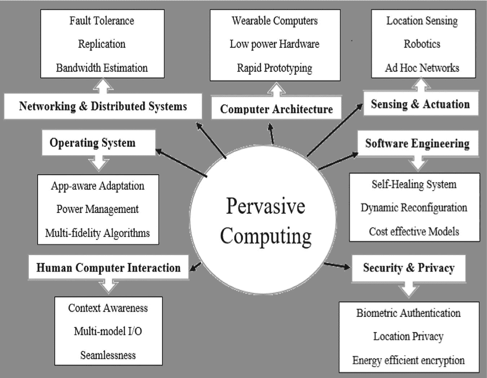

图 1.1 泛在计算概述。

泛在计算可以以多种形式存在，从笔记本电脑到家用电器不等。使其成为可能的技术包括微处理器、移动代码、传感器和互联网。简之，每当人们使用数字设备连接到技术平台时，泛在计算就会发生。泛在计算的主要目标是将计算嵌入到环境中，允许用户通过信息处理享受日常物品带来的处。泛在系统预计将在具有不同能力和资源的广泛环境中运行。应用需求可能会动态变化，从而需要灵活的适应。传感器故障在它们的寿命期间会出现，而且由于不期望用户具备技术技能，系统需要进行自我管理。

## 1.2 分布式计算

分布式系统是位于不同机器上的独立组件的集合，它们通过相互共享消息来共同实现目标。从 20 世纪 70 年代到 90 年代，一直有一项研究旨在创建一个通过网络连接两台计算机并运行的框架。网络可以是静态或动态的、有线或无线的，也可以是泛在的。它是一种用于协调在多台计算机上同时执行的过程系统 [[3]](#ref-list.xhtml_refchapter_3)。计算机之间的通信介质是通过图 1.2 所示的消息。这种计算用于解决在特定时间内单台计算机上无法解决的复杂问题。分布式计算需要软件来协调任务，这是一个巨大的挑战，因为主任务是划分可以单独运行的元素。在分布式计算中，需要特殊的软件来管理多台计算机的资源。这种软件由一个称为“主计算机”（master computer）的主单元运行，其他计算机被称为“从机”（slaves）。主计算机负责将任务分配给从机，并在处理完成后合并结果。

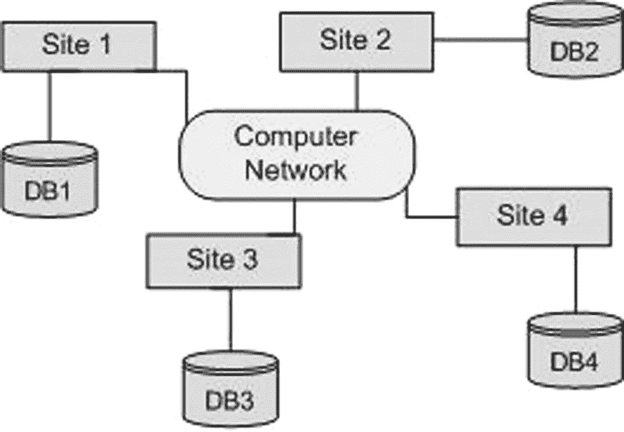

图 1.2 分布式计算概述。

使用主从系统的一个缺点是存在单点故障的可能性，即服务器。因为它是唯一一个为所有从机提供必要资源的计算机，如果服务器宕机，系统将无法正常工作；另一个缺点是，如果从机数量极高，情况下资源将变得稀缺。

## 1.3 移动计算

在 20 世纪 90 年代，构建分布式系统出现问题时，当时另一项关于无线局域网和笔记本电脑的研究也完成了，即移动计算因此诞生了。分布式计算的各种标准或元素、原则或功能在日常生活中不断应用。然而，由于某些要求开发了新技术，这些技术受限于低值、网络质量波动、元件稳健性、尺寸问题、电池限制和重量限制 [[4]](#ref-list.xhtml_refchapter_4)。移动计算是在我们在移动状态下使用的计算类型。它是一种允许通过计算机或任何其他无线设备传输数据、语音和视频的技术，而无需连接到固定物理链路，如图 1.3 所示。它需要无线通信来方便设备在通信模式下的移动性。

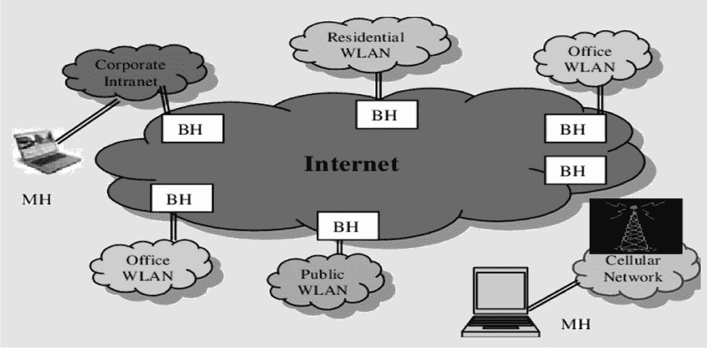

图 1.3 移动计算概述。


这项技术具有许多优势：许多许多公司通过使用移动设备提高了生产力，从而减少了客户的成本和时间。另一个优势是它可以用于娱乐目的（可以使用移动计算随地播放视频和音频录制）、便携性（用户无需处于固定位置即可工作，只要建立了连接，就可以在任何地方工作）以及云计算（如果连接了互联网，就可以随时随地访问数据，然后可以在许多移动设备上访问这些文件），如图 1.4 所示。现在，云计算服务涵盖了广泛的选项，从基础的存储、网络连接和处理能力，到自然语言处理、人工智能以及标准的办公应用程序。

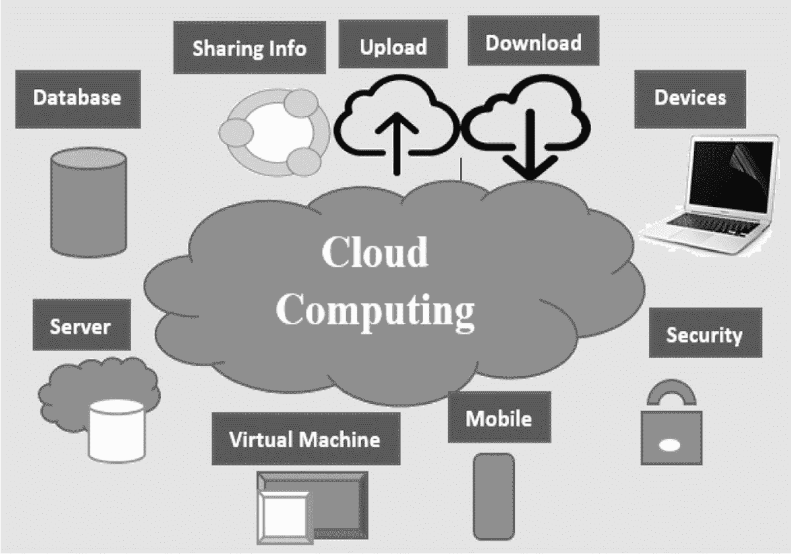

图 1.4 云计算概览。

## 1.4 泛在计算

泛在计算是当今世界发展非常迅速的领域。在这项技术中，小型设备被以无处不在的方式使用，并以无形的方式嵌入，以提供无处不在的环境。根据 Weiser 的观点，一种被称为泛在计算的系统创建了一个与普通环境集成且与其无法区分的全连接介质。泛在计算设备是尺寸从几毫米到几米不等的小型设备，这些设备通过有线或无线链接相互连接[[5]](#ref-list.xhtml_refchapter_5)。这种计算的目的是通过使用工具让每个人的生活变得更简单，从而能够成功且轻松地管理信息。泛在计算技术超越了个人电脑的概念。它基于这样一种观点：从衣服到任何类型的设备，它们都与芯片集成，以便与其他设备的网络连接。这些设备具有许多特点，如：它们具有内存有限的小型、廉价处理器；这些设备在没有任何用户交互的情况下与其他设备连接，并且将通过有线或无线链接进行连接。泛在计算的原理图如图图 1.5 所示。

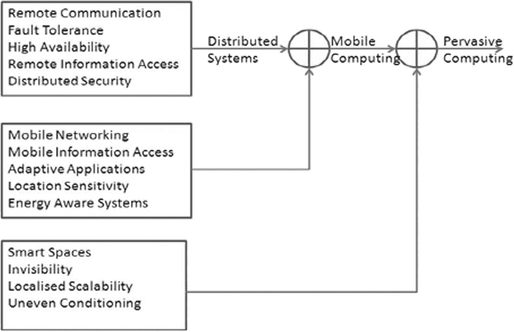

图 1.5 泛在计算系列原理图。

### 1.4.1 泛在计算示例

泛在计算有很多名称，如“无处不在计算”、“增强现实”、“虚拟现实”、“可穿戴计算”、“环境计算”、“会思考的物体”和“智能空间计算”。在日常生活中，如果一个人发现一个箱子太重无法抬起，就会吹哨或叫一个超重力的助手来帮助。但在泛在计算中，如果一个人去搬那块物体，隐形的计算机代理检测到该人力量不够，它会自动帮助该人，甚至无需询问。

在下一个场景中，有一个房间可以根据用户的配置文件自动管理加热、冷却和照明效果。另一个是“智能”或“智能冰箱”，如图 1.6 所示，用于在食品过期或失效时提醒主人。这台冰箱应该意识到冰箱内部的内容，并且在供应不足时具有订购新食物的能力，但这种智能冰箱尚未上市市场上。

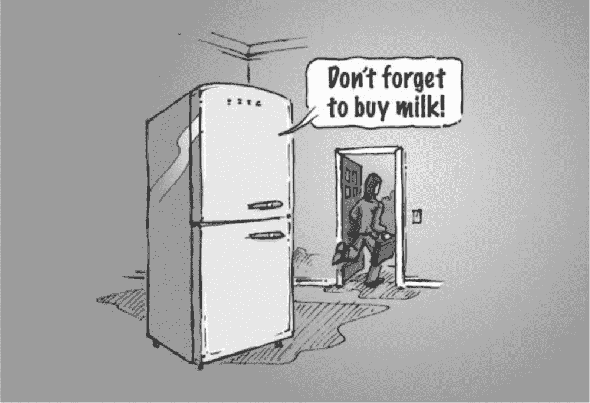

图 1.6 智能冰箱。

这种智能且所有人使用的技术是“智能手机”。智能手机是一种包含通话和发送短信之外高级功能的移动电话。大多数智能手机都有显示照片、播放视频、检查和发送电子邮件以及浏览网页的能力。如今的移动设备配备了近 14 个传感器，产生关于运动、位置和我们周围环境的原始数据，如图 1.7 所示。

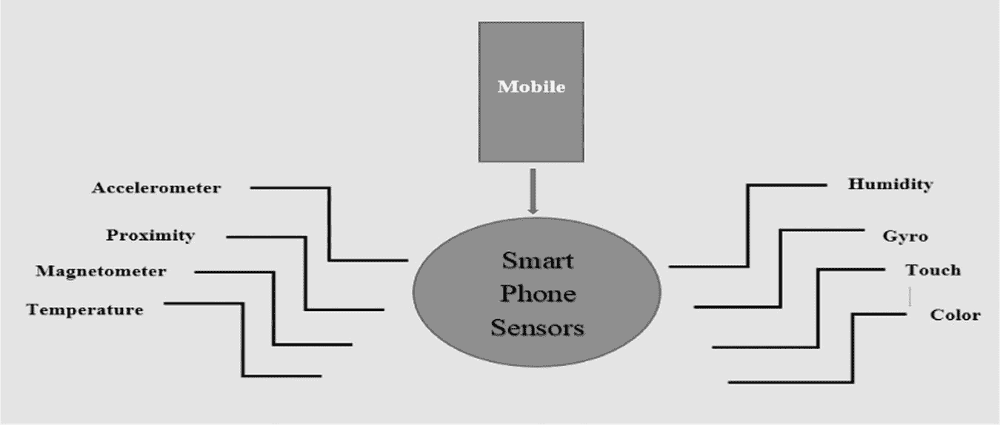

图 1.7 智能手机使用的传感器。

在移动计算中，拥有通话和信息功能的手机的人在保持连接时处于连接状态。但在泛在计算中，人即使在移动时也保持连接状态，如图 1.8 所示。

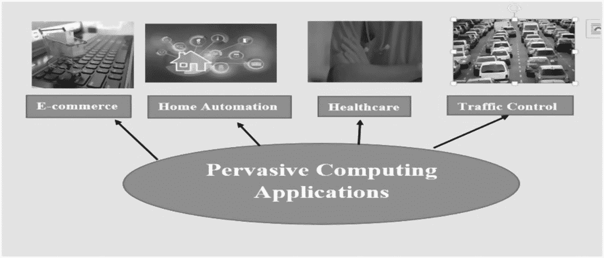

图 1.8 泛在计算应用。

### 1.4.2 泛在医疗系统

在传统的医疗系统中，患者往往被堵在交通中导致治疗延误和高死亡率。在泛在计算中，患者与医生实时连接，允许获得立即关注和保障。现实世界泛在医疗系统的完整场景如图图 1.9 所示。

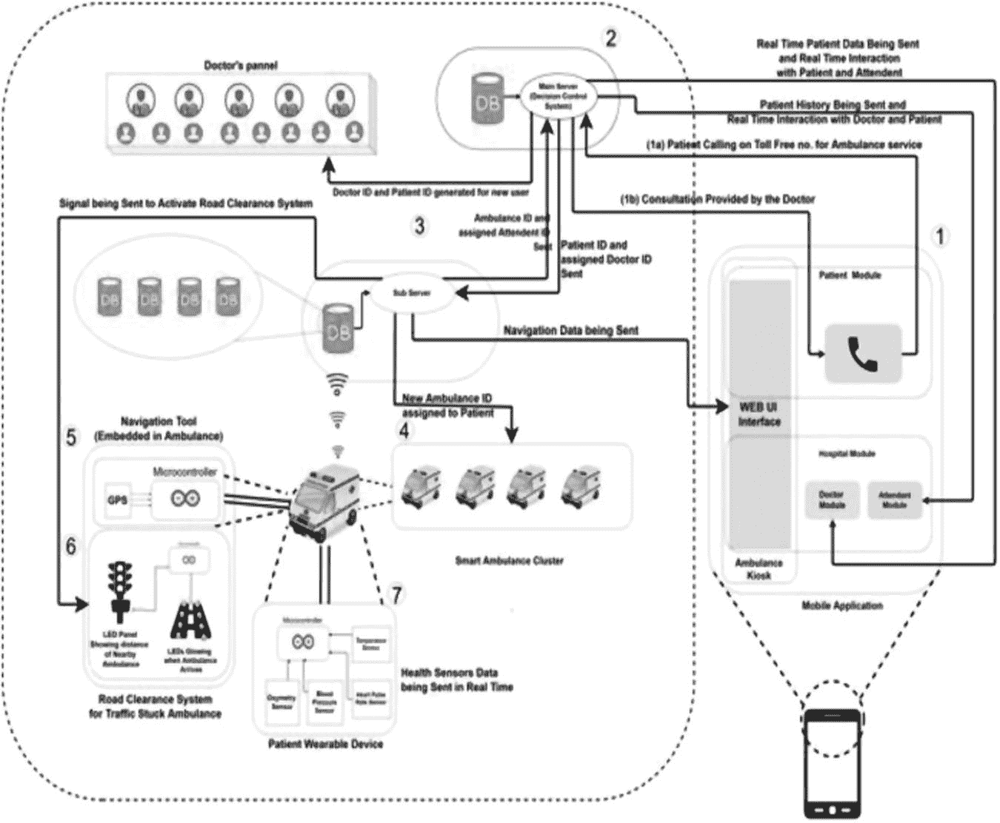

图 1.9 泛在计算医疗系统示例。

### 1.4.3 泛在计算的挑战


## 1. 上下文感知
应当始终保持上下文感知，以便了解用户的状态和环境，并具备修改其行为的能力 [[7]](#ref-list.xhtml_refchapter_7)。用户的上下文包含了人类因素和物理环境。人类因素包括心脏状态、温度和情绪状态等因素，而物理环境包括噪声和位置等因素。上下文感知通过“五个 W”有很好的定义。这“五个 W”包括：

*   **谁（Who）**：设备不仅能识别其所有者，还能识别环境环境中其他其他人员和设备的能力。
*   **什么（What）**：利用这些信息解释用户的活动和行为，以推断用户想要做什么，并提供必要的信息和帮助。
*   **何地（Where）**：解释用户位置并据此定制功能的能力。这是上下文领域探索最充分的方面。
*   **何时（When）**：理解时间流逝的能力，利用它理解周围的活动并进行推理。
*   **为什么（Why）**：理解某些用户行为背后的原因的能力。这可能涉及感知用户的情感状态，例如体温和心率。

## 2. 社会影响
泛在计算在任何气候下将与普通的处理创新相比产生更关键的社会影响，改变我们对小设备以及其他事物的认知。计算事物的植入以及除了存在外不具备计算能力的古老稀有物的增加，将为该环境下个体之间的互动和交流带来更好的方式。这将影响个人目前的社会行为，极可能引发新的社会结构。其结果是，我们不仅关注共同发现者之间的关系（在没有创新的情况下）或个人与设备之间的连接（在创新的范围内），而且关注在创新视野下产生的干预人与人之间的连接。

## 3. 隐私与信任
隐私是用户和信息安全面临的最社会问题之一。它会导致对用户活动的持续监控。依赖泛在计算基础设施的主要因素是信任它。相反，基础设施也需要对用户的身份充满信心。

随着客户端越来越依赖泛在计算框架，该框架对客户的偏好、个人行为标准、发展和倾向的了解也越来越深入。基础模型整合了用户身份，这可以通过验证其自己的手机、他一天内去过的地方等表现出来。这引发了关于谁可以接触此类数据以及他们将如何利用这些数据的问题。对此类框架有良好理解并担心保护缺失潜在风险的客户可能会选择不使用它们，因为在坏人手中，这些数据可能被变成针对他们的武器。为了让客户依赖泛在计算框架，我们应该让他们信任它。另一方面，基础应该确保客户的身份和许可级别，以对其请求做出恰当反应。现在的测试在于如何以一种几乎忽略不计的方式建立这种共同信任，从而保护隐身性。这里的审查问题包括：在这个世界中可以用于用户验证的不同策略，决定我们是应该重复为工作环境开发的技术，还是侧重于更现代且显然更精确的生物识别技术。我们应该平衡对一致行为的需求以及警示客户此类隐私问题的需求。

## 4. 设备异构性与资源限制
泛在计算为了无处不在，必须支持具有不同硬件能力的多个设备。这些能力导致了权衡，不可避免地影响了应用程序及其能力的发展。每个用户都有多个设备可用，因此需要机制来帮助确定哪些任务适合每个设备。当用户从一个设备移动到另一个设备时，具有跨设备移动能力的应用程序需要适应每个设备的特性，并根据设备能力优化其有效性。随着设备变得越来越多功能，更多的需求也随之产生。它们的本质上必须更加简单，以便用户能够方便地随身携带移动；这种尺寸限制限制了屏幕尺寸、处理能力、电池寿命等其他资源，从而影响了连接性以及服务和应用程序的发展等因素。

## 5. 电源管理
功耗由三部分组成：存储、通信和处理。为了控制功率，使用名为“调节旋钮”的技术。可以通过降低输出功率来降低无线发射器的功率，有效缩小其范围。另一种方法是在异构子系统之间切换，例如在 `Wi-Fi` 和 `蓝牙` 网络之间切换。但为了处理异构接口，需要更多的软件支持。处理是一个需求从极小到极高的部分。如果是单处理器问题，可以通过选择性地禁用单个模块来控制功耗。也可以通过使用多个处理器控制功耗。存储是泛在系统中消耗功率的系统。此类系统有多种存储介质可用：物理磁盘、与处理器集 `DRAM`、`SRAM`。与处理器和无线子系统类似，每种存储向系统呈现不同的功耗特性。

## 6. 无线发现
管理对于系统本身也是一个大问题。在过去，有许多人使用单台电脑。然后，随着 PC 革命，达到了单人使用单台电脑的阶段；现在随着手机和其他便携设备的引入，时代已经到来；现在达到了多个计算设备与一个人关联的阶段。随着个人系统使用量的增加，这些设备的概念、物理和虚拟管理变成了一个问题。日常物品（如咖啡杯或椅子）中的嵌入处理加剧了这个问题：计算设备数量指数级增长，它们必须以某种方式进行管理。大量设备面临的主要问题就是基础知识：如果我知道某个存在，我如何找到它？如果我有一堆设备，我如何知道它们是什么？这个问题的解决方案是将对象从特定的命名中释放出来，将咖啡杯视为普通的咖啡杯，而不是特定的咖啡杯。这种转变让我们的生活变得更容易。计算机系统有一个特定的名称，即 `IP 地址`，这在深度嵌入环境中可能不存在这种便利性。


### 7. 用户界面适配
泛在计算系统的特点是它们将一组具有微型传感器的设备与掌上设备、笔记本电脑和计算机融合，每种设备的尺寸各异。应用程序需要在系统组织者的角度在异构环境中有效工作，且用户必须对每个设备或组件拥有完全控制权，尽管尺寸有限 [[8]](#ref-list.xhtml_refchapter_8)。例如，微型设备的屏幕非常小，需要用户导航一系列此类菜单。PDA 的问题在于：它们功能繁多，但由于复杂性高而从未被使用。

### 8. 定位感知计算
与传统计算相比，无处计算的特点是位置的使用。当考虑互联网时，服务器并不知道客户端的位置，但当将嵌入计算引入本地环境中时，交互可以得到增强以改进结果。例如，对附近设备的查询可以通过当前位置自动完成。此外，如果存在相同的查询，在某个特定时间在特定位置访问的信息可以提供给其他人。在此情况下，以会议室为例，白板上将自动提供之前的小组曾使用过的链接 [[9]](#ref-list.xhtml_refchapter_9)。同样，如果旁边正在进行会议，则不允许低优先级消息传递到笔记本电脑。在大学中，上下文系统是由工具包设计的。

### 1.4.4 泛在计算中的问题
各种问题、它们在各自领域的影响以及相应领域的其他可能性已在此考虑，并以表 1.1 所示的形式列出。

**表 1.1 不同领域的问题、其影响和可能性**

| *问题* | *影响* | *其他可能性* |
| :--- | :--- | :--- |
| 突然生病、失去意识、从沙发上跌落 | 1. 通过碰撞传感器检测<br>2. 通知医生。 | 高血压、心率、温度 |
| 如果超过阈值的一段时间内未处于移动状态 | 1. 通过可穿戴传感器检测<br>2. 传感器应发出警报 | 可能会检查人的朝向和移动 |
| 人周围存在体液 | 1. 检查出血概率 | 可能存在尿液或呕吐物 |
| 检测到人在一个时间范围内保持不变不变的休息或固定姿态 | 1. 通过姿态传感器检测 | |
| 心率异常 | 1. 通过可穿戴传感器检测<br>2. 通知医生 | 血压异常 |
| 药物量已减少 | 1. 使用计数器值<br>2. 在药店订购药物 | 当药物剩余 2 天时，应向医生和患者发送消息 |
| 如果他几天没有出门 | 1. 通过运动传感器检测<br>2. 发送警报 | 橱柜在几天内是否打开过 |
| 如果居民在床上时间超过 12 小时 | 1. 通过床垫中的压力传感器检测<br>2. 发送警报 | |
| 房间温度应在指定范围内（12–30）内，如果超出此范围超过特定时段 | 1. 通过温度传感器检测<br>2. 居民将收到警报 | 窗户的概念（如果在低温下永久性开启，则应发送警报） |

### 1.4.5 泛在计算的优点
*   消除了新技术的复杂性。
*   可以方便地访问信息。
*   信息的管理既容易、高效又毫不费力。
*   无形性（智能环境将与用户不可见的网络技术集成）。
*   决策（通过使用智能环境可以对日常事宜做出更好的选择）。
*   融合（互联连接的网络技术包含在环境中，因此通过共享可以消除许多问题）。

### 1.4.6 泛在计算的缺点
*   在这种计算情况下，网络连接缓慢。
*   运营成本非常昂贵。
*   它不是一种安全的方法，因此需要基于信任的模型来实现更高的安全性。

## 1.5 生物识别
IT 时代的最新进展不断向前。在 ATM 交易、执法、银行业、护照入境和办公室等现实应用中，需要身份验证和安全这两个因素。以前，用于身份验证的方法是登录 ID/密码、智能卡、PIN 等。但它们存在一些缺点，如 PIN 盗窃、卡片被盗、忘记密码。因此，为了克服这些传统方法的问题，生物识别技术进入了视野。

生物识别是人类的生理或社会属性，可用于仔细区分个人以允许其访问系统。“。“生物识别”一词由两个单词组成：Bio+metrics，意思是生命测量。许多系统需要身份验证来确定个人的身份。这些方案的主要作用是允许数据传递给有效用户而非伪造者。

生物识别是通过生理或行为特征识别用户的自动化系统。生理方法是指通过考虑身体形状来识别身份。从 100 多年前开始，最老的特征是一直用于识别目的的指纹。其他例子包括人脸识别、耳朵识别和虹膜识别。行为方法与为了识别目的人的行为有关（图 1.10）。

```
图 1.10 生物识别架构。
```

### 1.5.1 生物识别架构
生物识别系统架构具有以下主要组件 [[11]](#ref-list.xhtml_refchapter_11)：

1.  `传感器`
2.  `传感器数据的预处理`
3.  `特征提取与归一化`
4.  `模板生成器`
5.  `模板比较器`
6.  `识别系统`

上述生物识别框架部分及其工作原理如下所示：


1. **传感器**：传感器是生物识别框架的主方框，负责收集生物识别所需的所有重要信息。它是框架与现实世界之间的接口。通常，它是一个图像采集框架；但它依赖于它需要替换或保留的亮点或属性。

2. **传感器数据预处理**：这是第二个方框，执行所有预备工作。它的功能是改进信息并消除来自传感器、基础故障等的干扰。它起到了某种标准化的作用。

3. **特征提取器和归一化器**：这是生物识别框架中第三个也是主要的步骤。需要进行特征提取以便在后续阶段进行识别。特征提取器的目标是通过估计来描述待感知的对象。

4. **模板生成器**：模板生成器根据提取出的特征产生用于验证的格式。模板是一个数字向量或具有特定构图的图像。从源数据获得的属性组合成一个模板。模板被存储在数据库中以供分析，并作为匹配器的输入。

5. **模板比较器**：通过匹配器执行协调阶段。在这一部分，将获取的格式交给匹配器，由匹配器利用不同的算法（例如汉明距离等）将其与存储的模板进行对比。在数据源协调之后，将产生结果。

6. **识别系统**：这是利用生物识别框架结果的设备。虹膜识别框架和面部识别框架是一些应用设备的简单实例。

### 1.5.2 常用生物识别方法

如图 1.11 所示，目前有多种生物识别方法。生物识别长期以来未来认证的目标，预计生物识别认证将很大程度上取代我们目前的认证和访问控制手段。生物识别技术按所评估的特征类型分类：生理属性或行为特征。

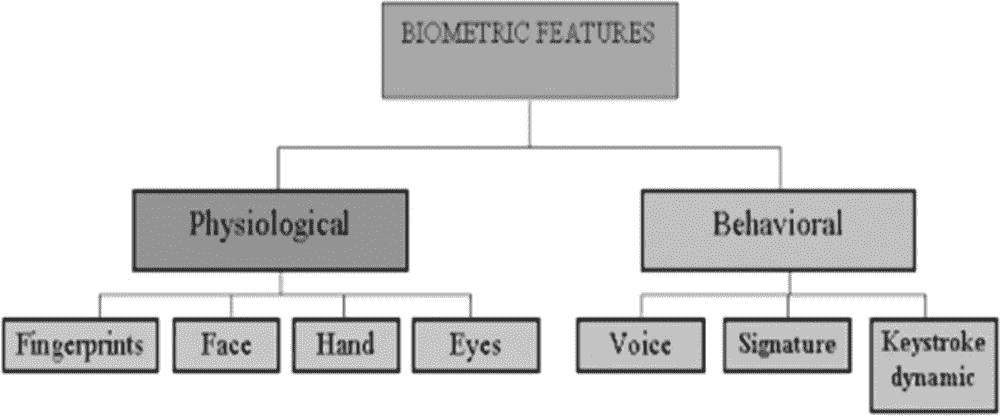

图 1.11 生物特征分类。

- **生理生物识别**：这些基于根据人体获取的数据对人进行分类，例如其指纹、脸部或眼虹膜。

### 1.5.2.1 指纹

它是用于许多应用程序的生物识别技术之一。它通过指尖上发现的模式来唯一地识别用户 [[12]](#ref-list.xhtml_refchapter_12)。指纹由每个人指尖上的沟谷模式和随后的脊线组成。

### 指尖上带有脊线和沟谷的不平表面使得模式具有独特性，如图 1.12a 和 b 所示。指纹被用于用户认证，匹配精度非常高。以前使用的方法是基于旧墨和纸的，但现在生成了自动版本用于识别。在此，用户必须放置手指以便电子读取指纹。如果用户在受控环境中操作，这种技术是最好的。脊线的排列为每个用户形成了独特的指纹，而且数据存储所需的内存较少，但在干燥、皮肤感染和皮肤脏的情况下，有时会导致误识别，它是一个噪声传感器。

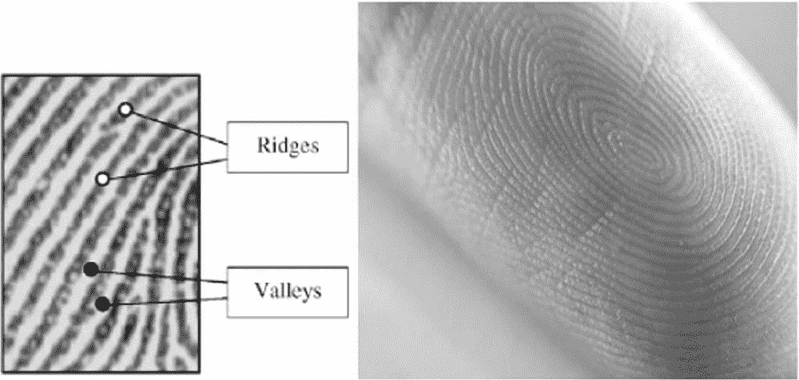

图 1.12 a) 手指脊线和谷的图像，b) 手指脊线和谷的真实图像。

### 1.5.2.2 人脸识别系统

面部识别包括几个构成面部特征的特征点。可以通过摄像头捕捉用户的脸部用于验证目的。这是一种通过摄像头自动识别用户的应用 [[13]](#ref-list.xhtml_refchapter_13)。它的主要优势是它可以从特定距离识别用户。该系统安全且易于实现，但姿态和光照的变化会影响图像。由于脸识别技术包含许多特征，它可以用于银行、罪犯识别和恐怖分子识别等各个领域。

这是一种根据脸部区分他人与其他人的生物识别方法。它涉及如图 1.13 所示的三个主要步骤。

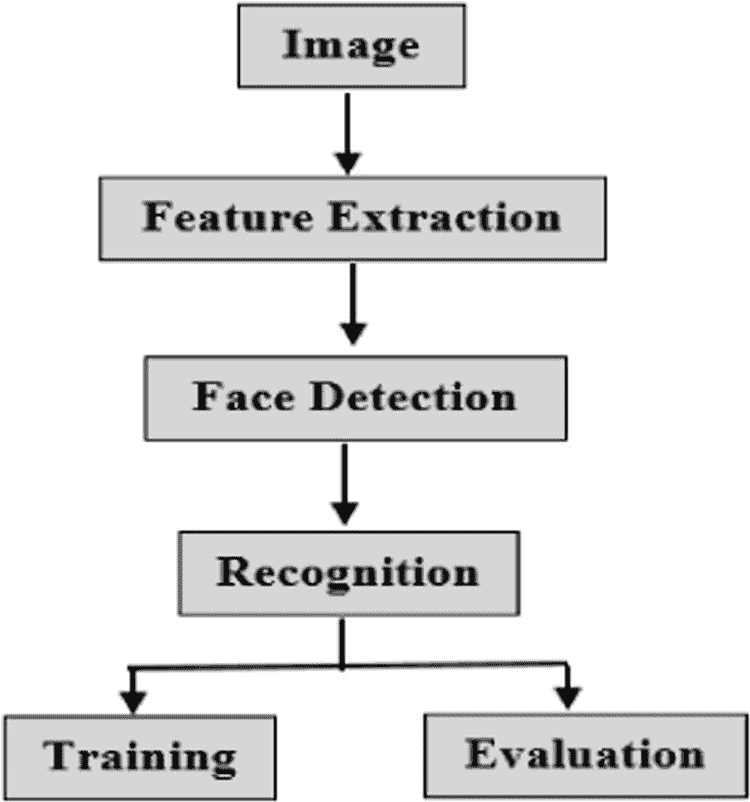

图 1.13 面部识别步骤。

- **数据采集**：数据采集是人脸识别的主要步骤，通过多种来源收集面部图像。采集的图像会有不同的姿态变化、光照变化等。因此，我们可以很容易根据多种条件验证我们识别系统的性能。有时，会对输入图像进行归一化，并对输入图像应用不同的图像转换方法。在此，去除了不需要的参数（如噪声、照明和模糊效果），然后将其用于后续处理。

- **特征提取**：特征提取是该系统的下一步，用于通过给定图像提取信息，然后提取出的特征用于识别步骤。在这一步中，使用了降维和噪声清洗。

- **识别**：识别是特征选择和提取之后的人脸识别系统的下一步，现在使用多个分类器对图像进行分类。在这一步中，获取大量图像并对其应用特征提取，存储在数据库中。当新图像来脸人脸识别时，它首先执行人脸采集、特征提取，然后比较数据库中的所有图像。待测试图像将与数据库中的所有图像进行比较，以识别个人。

自动人脸识别主要包含两个任务：

- **验证**：在验证部分，系统将给定用户与其其声称的身份进行关联，并以是或否的形式输出。

- **识别**：在识别部分，系统将给定用户与数据库中所有其他人进行匹配，并提供匹配列表。

#### 1.5.2.2.1 面部识别的挑战

面部识别存在许多挑战，可以通过以下实体定义：

- **姿态**：姿态变化是面部识别的一个问题，如图 1.14 所示，当人在靠近摄像头时，此时某些特征可能只部分可见或完全关闭，导致误识别 [[13]](#ref-list.xhtml_refchapter_13)。

- **结构组件**：某些特征如胡须、围巾、络子和眼镜，这些特征可能并不总是存在（如图 1.15 所示），这个问题会影响分类过程。

- **图像旋转**：面部图像随各种旋转产生波动。

- **质量**：某些包含噪声或模糊或失真的图像可能会导致人脸识别质量差。

- **面部表情**：面部表情随人而变化，如图 1.16 所示。

- **不自然的光照**：来自三维模型（如渲染脸、动画电影和卡通脸）的脸具有不自然的光照。


图 1.16 面部表情变化。

### 1.5.2.2.2 人脸识别算法

面部是生命中最重要的视觉对象，可用于传达身份。人类基本上利用面部来识别个体。用于人脸识别的方法包括整体法、结构法和混合法。在整体方法中，整个面部区域被作为输入数据引入人脸匹配系统。整体方法的最佳示例之一是特征脸（Eigenfaces，最广泛使用的人脸识别方法）、主成分分析（`PCA`）、线性判别分析（`LCA`）和独立成分分析（`ICA`）等。它使用全局表示，或者说是整个脸部的描述，而不考虑面部的某些局部特征。这种方法进一步分为两部分：统计学和人工智能。在统计学中，图像被表示为二维数组，使用的主要概念是计算输入图像与数据库中其他图像之间的相关参数。这种方法非常昂贵，因为它无法处理姿态、光照等可变条件，第二个缺点是它始终在维维空间中进行分类。为了克服这些问题，可以使用其他方法来获得更准确、更有意义的结果。

#### 主成分分析 (PCA) 算法

这是由 Turk 和 Pentland 在 1991 年提出的、非常流行的算法。`PCA` 算法依赖于特征向量概念 [[14]](#ref-list.xhtml_refchapter_14)。使用该算法对图像进行分析，且这些图像必须具有相同的大小。首先应用归一化技术来标记面部眼睛和嘴巴的特征。`PCA` 算法用于压缩图像，因此说它依赖于降维概念。通过降维，移除不需要的信息，然后将面部结构分解为若干个不相关的组件，这些组件被称为特征脸（Eigenfaces）。每个存储的图像将通过加权特征脸向量的线性求和组合，这些向量被称为特征脸。在识别时，新图像被投影到子空间上，并使用欧几里得方法计算距离以用于分类 [[15]](#ref-list.xhtml_refchapter_15)。使用 `PCA` 的目的是通过矩阵方法收集数据的重要特征 [[16]](#ref-list.xhtml_refchapter_16)。在人工智能中，利用诸如神经组织和机器程序等工具来感知面部。这意味着当从 `PCA` 计算中移除引导段时，神经组织被用作分类器将部分减少到低测量空间。`SVM` 是一种用于样本分组问题的计算方法。Gee 也额外用于此。它的缺点是无法在姿态、光照条件等高不确定性情况下工作。

**优点：**

* 它是最简单、容易且高效的人脸识别方法。
* 它在较小或较大的姿态或照明变化下运行良好。
* 它使用了欧几里得距离概念，并基于降维过程，在保留大部分信息的同时减少了原始识别的维度。
* 它减少了噪声因素，因为选择了最大变异基，因此会自动忽略背景的微小变化。
* 它是基于多幅图像作为输入的概念。
* 它的计算时间较短。

**缺点：**

* 对于高维数据数据，它的成本很高。
* 当姿态、方向、光照等发生巨大变化时，无法以正确的方式实现。

#### 独立成分分析 (ICA)

该算法用于分析高阶数据，或者说是多变量数据。该算法使用的主要技术是将高维空间转换为低维空间，使得包含转换变量的新空间能够定义数据的本质特征 [[17]](#ref-list.xhtml_refchapter_17)。聚类分析是该算法中的一种技术。一组数据元素被视为簇，聚类分析被定义为在存在大量集中区域为数据分配空间的技术，该区域被称为簇。

#### 线性判别分析 (LDA)

`LDA` 是一种用于分离数据项的技术。在未知类别的情况下，它是一种基于已知用户类别的训练样本进行样本分类的方法。使用 `LDA` 的目的是最大化用户之间的方差，并最小化用户内部的方差。它基本上对相似类别的图像进行聚类，并划分彼此不相似的类别图像。这种技术仅用于分类，但不能用于回归。为了识别输入图像，会将输入图像与数据库中存储的每张图像进行比较，然后计算最近距离，并根据距离识别输入图像。它可以用于模式识别、统计和机器学习。它也被称为基于降维概念的 Fisher 脸算法。

**优点：**

* 它最大化了类间距离，同时最小了类内距离。
* 它具有鲁棒性。

**缺点：**

* 它不将多幅图像作为输入。

#### 离散余弦变换 (DCT)

它用于用余弦函数之和表示在不同频率工作的数据项的点序列。这种变换主要用于压缩标准，其中系统接收脸作为输入图像，然后对该脸部进行归一化或裁剪，然后计算脸之间的距离，最后进行比较。

**优点：**

* 它在变化较小时运行良好。

**缺点：**

* 它在相同方向、姿态、光照等情况下运行良好。
* 它的成功率并不高。

#### Gabor 波

它将图像表征为局部方向选择性和频率选择性特征 [[18]](#ref-list.xhtml_refchapter_18)。这种技术基本上是用于人脸检测的滤波器，以丹尼斯·盖 abor 的名字命名 [[19]](#ref-list.xhtml_refchapter_19)。

**优点：**

* 它在姿态和照明的大变化下运行良好。

### 1.5.2.3 手几何结构

这种方法现在非常流行，因为它在大多数用户识别情景下运行良好。该方法自动测量手和手指的维度，然后将这些测量值与模板进行比较 [[12]](#ref-list.xhtml_refchapter_12)。当人把手放在嵌入传感器的表面上，并使用手指之间的杆子来正确放置手时，就会开始读取，该过程属于空间几何术语。手指或手几何通常测量两个或三个手指，如图图 1.17

图 1.17 基于手几何结构的识别。

### 1.5.2.4 虹膜扫描

这种方法通过使用人类虹膜的不同模式来识别用户。虹膜是眼睛内部的一种肌肉，用于控制进入眼睛的光线；它会调节瞳孔的大小，如图图 1.18


# 图 1.18 基于虹膜的识别。

- **行为生物识别**：它由从用户的动作中获取的测量值组成，其中一些是从人体间接测得的。

### 1.5.2.5 击键动力学

这是一种借助键盘检查人员击键习惯的自动化方法。通过这种方法，可以检查人员击键的动力学特征，例如用户按下或释放按键时的速度和压力。该技术的目标是提高鲁棒性和唯一性。该应用的一个示例是计算机访问，其中这种生物识别技术可以持续识别计算机操作人员的身份。人员通过输入登录 ID 和密码在系统上进行身份验证。使用这种技术的优点是，除了全球通用的键盘外，它不需要任何额外设备。

### 1.5.2.6 动态签名验证

这种方法是文档认证和金融交易等许多应用中需求最大的用户验证形式之一。该方法用于检查如图 1.19 所示的书的速度、方向、准确性和压力。在离线模式或之前使用的方法中，用户在普通纸上书写签名，然后使用扫描仪将该纸张数字化，最后由系统验证签名；但在目前使用的在线模式下，用户通过 PDA 在 iPad 或数字写板上保存签名，然后进行识别。


图 1.19 基于签名的识别。

该系统使用成本不高，验证用户所需的时间非常短，但这种技术存在存在的问题是其错误率较高。

### 1.5.2.7 语音/声纹识别

这种技术用于根据语音信号识别用户，因为它将语音转换为文本。对于语音识别，可以使用多种策略：支持向量机、隐藏马尔可夫模型、动态时间规整、矢量量化等。通过麦克风录制音频文件[[20]](#ref-list.xhtml_refchapter_20)。但噪声因素是这种生物识别技术的主要关注问题。用户身份验证所需较短，但其准确性较低。图 1.20 显示了由人说出的单词所产生的信号。

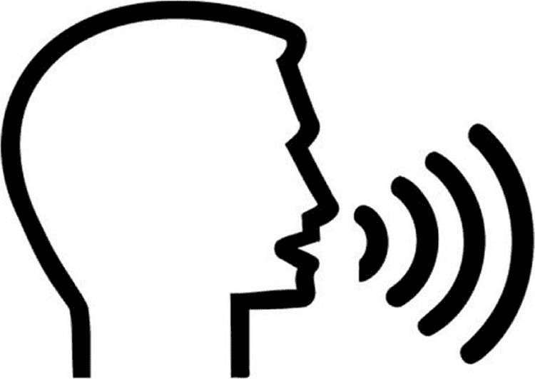

图 1.20 由人说出的单词产生的语音信号。

#### 1.5.2.7.1 语音识别系统

语音是带有语言内容的声音的名称。语音识别项基于语音中包含的波形对人员进行验证的任务。识别人的声音以验证身份，并用于语音拨号、语音邮件和数据库访问服务等许多应用中。当人对着麦克风说话时，计算机会将单词的声音转换为另一种形式，即计算机系统上可用的文本。计算机或笔记本电脑会重复该人所说的单词，或者为下一次提供提示。在早些时候，语音识别程序要求人以断断续的方式的方式；这种方式要求人在两个单词之间留空隙，但现在语音识别系统非常易用。人可以在单词之间不进行任何停顿的情况下说话。唯一的条件是人必须以清晰的方式说话。在该系统中，包含两个会话：

- 注册阶段（Enrolment session）
- 操作阶段（Operation session）

在注册阶段，已注册的用户将提供语音样本，用以训练该用户模型。

在操作阶段，通过摄取存储在数据库中所有用户的语音样本来完成匹配。最后，做出决定以接受或拒绝该用户的身份。

语音识别过程的所有步骤如图 1.21 所示。

- **表示（Representation）**
    **预处理：**这是识别系统的第一步，使用麦克风录制语音，然后在 5000 Hz 的采样频率捕捉信号。在此步中，使用高通滤波器移除 100 Hz 以下的频率（这些频率包含噪声因素）。预处理执行的重要因素是分段或端点检测。语音分段从信号能量超过阈值开始，当信号能量低于阈值时结束。

- **模型（Model）**
    **特征提取：**信号处理后，下一步是提取或取出特征，为了计算，根据时间帧提取观测值。假设语音信号在这些长度为 25 ms 的帧内是恒定的。时间帧是重叠的，并且通常偏移 10 ms。在时间窗口上进行快速傅里叶变换，进入频谱。人类耳朵对所有频段的感知并不平等的。这种效应可以用非均匀频率带宽的带通滤波器来模拟。在 500 Hz 之前，滤波器的宽度为 100 Hz，之后按对数增加。滤波器中心频率定义在所谓的 Mel 标度中。通过离散余弦变换使频谱去相关化。在生成的系数中，前几个系数具有最重要的意义。因此，仅选择前几个（例如十个）系数作为特征向量。生成的特征称为梅尔倒谱（Mel Cepstra），通常缩写 MFCC。

- **搜索（Search）**
    1. **解码（Decoding）：**这是一种计算单词序列与特征向量生成的信号匹配率的方法。在解码过程中，有三种信息可用：a) 声学模型，b) 字典和 c) 语言模型。解码的条件是知道已知单词的概率。
    2. **后处理（Postprocessing）：**这是识别过程的最后一步，对已处理的信号进行接受或拒绝的分类。

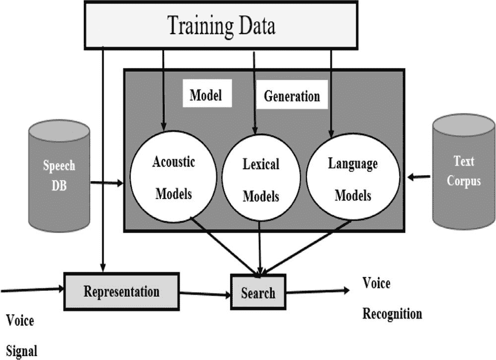

图 1.21 语音识别过程。

#### 1.5.2.7.2 语音识别技术

- **梅尔频率倒谱系数（MFCC）：**这是用于识别的最常用的倒谱分析技术。在此处，频段使用了对数表示，因此比其他系统提供了更清晰的响应。在此处，MFCC 的特征向量通过信号分析中的每一帧计算得出[[21]](#ref-list.xhtml_refchapter_21)。首先通过输入的信号提取系数；这些信号被划分为帧。在这些帧上应用汉明窗时，信号的不连续性降至最低，如图 1.22 所示。

优点：
- 用于语音处理任务。
- 识别准确性和性能率高。
- 复杂度低。

缺点：
- 噪声鲁棒性较差。

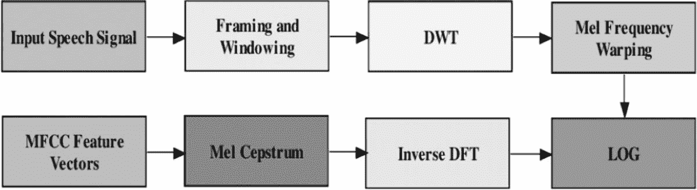

图 1.22 MFCC 技术。

- **感知线性预测（PLP）：**它的工作方式与线性预测编码相似；这意味着它也如图 1.23 所示基于语音的短期频谱。它消除了语音信号中不需要的信息，有助于提高语音信号的识别率。

- **线性预测编码（LPC）：**


它为语音处理提供了准确的信号估计。通过这种方法，可以高效地对语音进行建模 [[24]](#ref-list.xhtml_refchapter_24)。该技术假设所有语音信号都是通过过去信号的组合而成的。在此过程中，最初将信号分割成若干帧，然后每帧将与一个窗相乘，最后输出通过一个自相关参数，如图 1.24 所示。

#### 优点
- 它是一项静态技术 [[22]](#ref-list.xhtml_refchapter_22)。
- 对于提供语音参数来说，它是一种可靠、准确且稳健的技术。

#### 缺点
- 它无法区分具有相似元音相似的单词。
- 它会产生残差误差作为输出，导致语音质量差。
- 它的噪声鲁棒性较低 [[23]](#ref-list.xhtml_refchapter_23)。

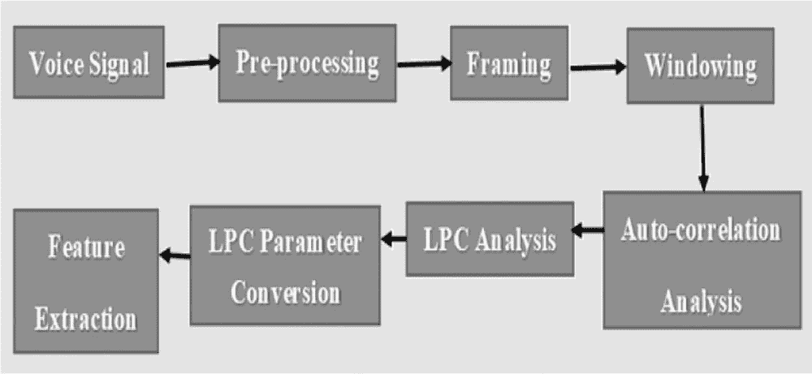

图 1.24 LPC 技术的步骤。

#### `RelAtive SpecTrA- Perceptual Linear Prediction` (`RASTA-PLP`)
该方法用于增强在噪声环境中录制的语音。当与 PLP 结合时，它具有更好的性能。它由 Hynek Hermansky 提出，是一种主要用于信号中嵌入噪声因素，且需要从语音信号中去除缓慢和快速变化信息的技术 [[25]](#ref-list.xhtml_refchapter_25)。它以稳健的方式工作，这意味着硬件设备记录音频文件的距离没有限制，如图 1.25 所示。

#### 优点
- 它是稳健的。

#### 缺点
- 它在纯净语音环境下性能较差。

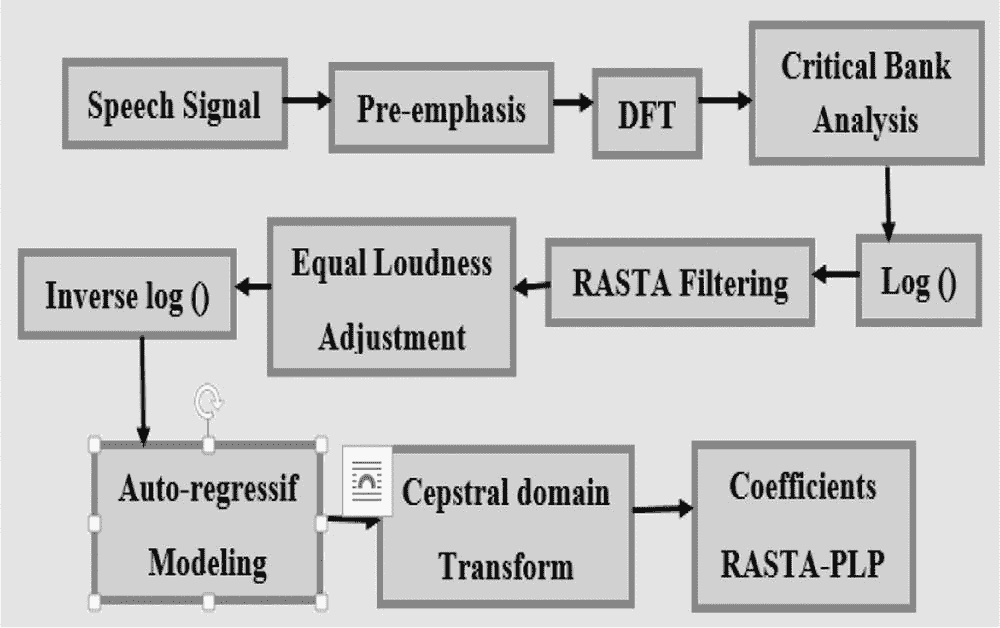

图 1.25 RASTA-PLP 技术的步骤。

### 1.5.2.8 面部热图
热图是皮肤上发出的热量模式。这些模式由血管的分支形成。使用红外传感器采集图像，以指示从身体不同部位辐射出的热量，如图 1.26 所示。这些图像的集合被称为热图。身体的任何部分都可以识别。该技术利用红外线，在黑暗中高效工作，但它受环境温度的影响。

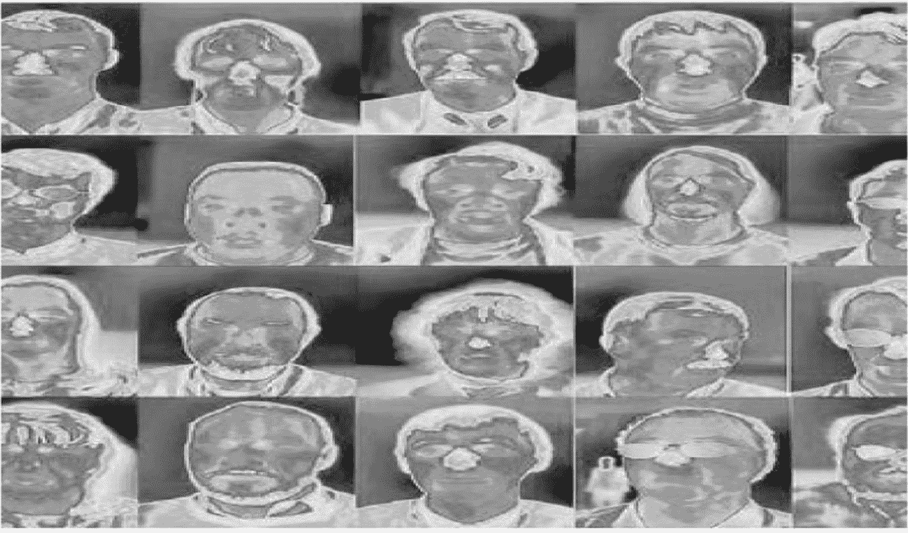

图 1.26 基于面部热图的检测。

#### 1.5.2.9 耳朵
人耳被生物识别技术用于身份验证。特征向量提取是这种识别的主要步骤。已知区别性特征是耳朵的形状和结构，如图 1.27 所示。但预计耳朵的特征对于每个人来说并不是唯一的。特征向量表达基于几何结构、耳朵内部结构以及如 `PCA`、`ICA` 等代数方法。

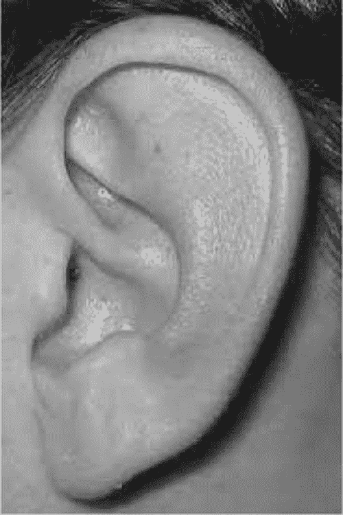

图 1.27 基于耳朵的识别。

#### 1.5.2.10 DNA
DNA（脱氧核糖核酸）用于用户认证。通过这种方法，为每个个体提供一个唯一的代码，如图 1.28 所示。事实是同卵双胞胎之间存在相同的 DNA 模式。它提供了大数据的安全传输，失败率为 0%。它的优点是无错误且准确性高，但该技术存在的问题是它的成本极其昂贵。

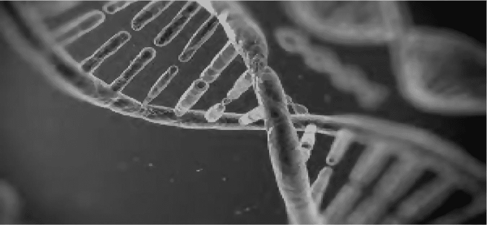

图 1.28 DNA 的结构。

人脸和语音识别技术是用于用户识别的最可靠、最准确的技术。该系统基于获取个体的数据，提取这些数据的特征，最后将提取的特征与数据库中存储的实际特征进行比较。这些系统用于增加用户的安全性和便利性。例如，在机场，用户通过在闸机处插入卡并面对摄像头进行注册，然后摄像头将获取其眼睛图像，处理该图像并计算出该图像的代码。最后一步是比较两个代码，一个是实际代码，另一个是计算代码，以验证用户的身份。这意味着每种生物识别技术都有四个参数：

- 传感器或数据采集
- 特征提取
- 匹配
- 决策控制系统

在数据采集阶段，从多个来源收集个体的数据。在特征提取阶段，对获取的信息进行处理以提取特征。在匹配参数阶段，提取的特征与数据库中存储的特征进行比较，在最后一步，做出决策以接受或拒绝个体的身份。

如果我们使用不同的识别方法，则它们的摘要见表 1.2。

表 1.2 连同准确率的各种生物识别方法

| 技术 | 准确率 | 应用程序 |
| --- | --- | --- |
| 指纹 | 高 | 法律执法 |
| 人脸 | 高 | 护照 |
| 虹膜 | 高 | ATM 机 |
| 签名 | 中 | 金融 |
| 语音 | 中 | 访问控制 |
| 击键轨迹 | 低 | 计算机安全 |

由于计算机的发展，现在已经使用了自动生物识别系统。对任何个体的自动验证都是基于该人的特征。

### 1.5.3 优点
- **通用性**：生物识别技术的主要特征是通用的。大多数人都有手指，细胞中含有 DNA。存在某些例外，没有手指的人无法使用基于指纹的系统等。然而，我们都有 DNA。这个问题可以通过多重生物识别系统解决。
- **唯一性**：生物识别系统非常可靠，因为它们在认证过程中是唯一的。特征提取自身体的多个部位，如 DNA、指纹等。但唯一性是最重要的部分。它并非在所有情况下都适用，但在大多数情况下如此。
- **低绕过性**：生物识别系统非常安全可靠。大多数生物特征必须由授权人员获取，其在授权设备面前是必要的。在某些情况下，人也可以误导安全系统，例如人可以切断手指并尝试让系统接受。但现在的扫描仪能够测量手指血管中的血流。因此，系统无法被欺骗。这就是它非常安全可靠的原因。
- **可扩展性**：生物识别技术可以构建为多级认证系统。这种多级系统可以包括标准登录、语音登录、指纹登录等许多种。将多种技术整合到单元中可以增加整个系统的安全性。如果整个系统的某层被破解，其他层可以减少突破的可能性。
- **永久性**：它是从 DNA 获取的一组特征，它是永久的且不会改变。同样的情况适用于指纹。但在指纹的情况下，人可以切断手指，这会改变指纹结构。下一个考虑的永久生物特征是视网膜扫描。

### 1.5.4 缺点
**精确性**：某些生物特征的获取可能非常精确且独特，例如 DNA。尽管 DNA 对我们所有人（同卵双胞胎外）都是唯一的，但频繁提取和分析它非常困难。DNA 分析的价格并不低。这使得 DNA 被排除在实时应用之外；它所带来的优势并不值得如此。


## 生物识别面临的挑战

- **实施困难**：实现一个可靠的生物识别系统并非易事。研究人员团队经常工作，以确保生物识别系统的安全与可靠。该系统的某些部分已经完成，如指纹识别、人脸识别，特别是语音识别领域。目前的安全性仍然不够高。

- **合作意愿低**：某些人不愿意提供自己的生物识别特征。大多数人不喜欢扫描视网膜、扫描指纹和脸部，而最少的人则不喜欢录制自己的声音。显然，开发一种基于语音处理的可靠技术将非常有用。

- **不稳定性**：某些生物特征是永久的，但另一些并非如此。人声在整个生命过程中并不是固定不变的。这可能是最大的问题。其他特征也可能具有不稳定性，例如身高。

## 1.5.5 生物识别的应用

- **司法与执法**：像美国联邦调查局（FBI）和国际刑警组织（Interpol）等机构长期以来一直在刑事检查中使用生物识别技术。今天，全球法律执法机构已广泛利用生物识别来识别犯罪分子。生物识别同样被广泛应用于监狱和监狱管理。生物识别为监狱当局、公共安全部门和政府提供了一种先进的配置，能够安全可靠地管理被拘留者的特征。

- **机场安全**：生物识别技术为每天大量的旅行旅客简化了机场体验。让旅客的机场行程变得更加一致是全球机场的共同目标。验证旅客身份的生物识别技术已在一些大型国际机场使用了多年，且该技术正在迅速扩散到全球不同地区。

在许多机场，移动控制的首选生物识别方案是虹膜识别。使用虹膜识别时，旅客首先通过摄像头捕捉其虹膜和脸部的照片。然后，他们的独特特征被存储在全球数据库中，以便在关口进行快速、准确的识别，并利用虹膜识别进行旅客身份确认。在旅行时，旅客无需排长队等候，只需走到一个角落接受虹膜摄像拍摄。摄像头随后拍摄虹膜，程序随后会将特征与数据库中存储的数据进行匹配。

生物识别技术为每天大量的旅行旅客简化了机场体验。

- **员工管理**：这是另一个生物识别利用率不断上升的领域。员工虚假考勤是全球范围内机构中常见的现象。根据美国薪资管理协会的研究，普通代表据称每周会花费约 4.5 小时，如果推算到一年，这相当于大约一个半月的休假时间。为了解决这个问题，公司正在其工作场所实施生物识别打卡机。

生物识别考勤系统是根据生理特征或社会特征识别员工的自动化技术。用于员工身份识别的最广认可的生物识别特征包括面部、指纹、指静脉、掌静脉、虹膜和声纹。当员工试图通过其自然属性证明身份时，生物识别设备会将新的扫描结果与所有可用格式进行对比，以找到精确匹配。事实上，许多政府机构现在也依赖生物识别来确保员工的便捷参与和财务计算的准确。

- **银行**：银行正在利用生物识别技术开发下一代身份控制，以打击欺诈、提高交易安全性并提升客户体验。例如，2019 年，苏格兰皇家皇家银行（RBS）宣布试点包含生物独特标记技术的分期卡。该试点正在该银行约 200 名 NatWest 客户中进行，并在英国举行。独特标记作为 PIN 码的替代品，用于确认超过 30 英镑的交易，使客户完成分期付款更快、更简单。这项最新进展是生物识别开发的长期序列之后，因为 RBS 和 NatWest 是首批在其移动银行应用程序中启用 Touch ID 独特标记识别的英国银行。ATM 使用生物识别技术也变得更加安全。目前，还有许多其他应用（如网上银行、电话银行）在该技术的下是完全安全的。

- **物理系统**：生物识别技术可以应用于许多领域，以在学校、军事区等提供最大的安全性。这对于父母、员工等来说至关重要。生物识别市场中的指纹识别技术拥有全球最大的份额，并被包括学校在内的许多行业广泛采用。指纹识别是最普及、最简单且廉价的生物识别技术。尽管学校已经实现了掌静脉识别、虹膜识别和人脸识别，但指纹扫描一直是美国教育市场最常用的技术。在英国，主要使用的生物识别类型是指纹扫描或拇指扫描，但静脉和虹膜扫描系统在使用。

在军事领域，主要的隐私安全忧虑与功能蔓延（capacity creep）的风险以及生物识别的后续能力有关。功能蔓延或任务蔓延是指获取数据的最初目的被扩展到最初规定之外的其他目的的过程。无论信息提供者是否知情或是否安排，功能蔓延都可能发生。许多安全专家认为功能蔓延是不可避免的。随后，这可能被视为特定类型的功能蔓延，指的是逐步监控某人的活动或检索包含这些活动数据数据集的能力。例如，如果一个人必须在日常生活的各种行政、商务和娱乐交易中使用标准的生物识别，那么这些记录中的每条都可能通过标准化的生物识别连接起来。这种连接可能允许某些因素（例如政府）对该人的活动建立详细档案。

- **移民**：在全球范围内，非法移民被视为安全的主要威胁。这些是用于法律违规的自动化流程。为了避免此类情况，加拿大政府已开始使用生物识别。政府表示，收集生物识别将有助于申请处理并简化低风险旅客入境加拿大。申请加拿大访问签证、工作或学习许可、永久居留安排或许可的某些人士需要提供指纹和照片。生物识别在申请和入境两个阶段都会被使用。当旅客入境加拿大时，其生物识别也将用于确认其身份。


- **医疗保健：** 生物识别技术（如指纹扫描器、掌脉读取器、人脸识别技术、虹膜扫描器等）一直在加强患者和员工身份识别方面具有巨大潜力。这有助于可靠地确认患者的身份真实性，确保监护人使用的是正确的临床和分段数据，并保证最合适的代表能够接触正确的数据。尽管如此，生物识别创新在医疗服务中的应用一直有所推迟。无疑，许多急诊诊和中心已经执行了一些基础技术；然而，生物识别尚未完全成为医疗实践的标准。此外，现在仍需要医疗首席安全官（CISO）和生物识别技术供应商投入一些资金和精力，才能使该技术融入标准。

## 1.6 基于传感器的技术

这种技术由一个用于感知人体生命参数的传感芯片组成。它将一种形式的能量转换为另一种形式，并将物理参数转换为电电测量的信号 [26]。传感器用于将温度、心率、汗率和血压等物理参数转换为另一种形式的电学测量信号。以温度为例来解释这项技术：当玻璃温度计中的汞受热膨胀或收缩时，读数由人工测量。使用了多种传感器，如电磁、热学、光学等。过去，传感器的尺寸很大，因此无法以可穿戴技术的形式使用。但现在，微控制器电路、放大器和功能使得可穿戴传感器能够健康监测。传感器和可穿戴设备被杯子、衣服、腰带、手环、眼镜和鞋等许多配件中。可穿戴传感器被证明是有用的，具有优势，例如使用传感器进行数据采集，附在人体上持续监测患者健康，从而减少人为干扰并降低了成本。

可穿戴传感器是作为配件佩戴在身上的智能设备 [27]。它们可以用于安全、娱乐、商业等多个领域。通过提供可靠准确的信息，它们有助于提供家庭安全。这些设备非常小且轻便，因此 24/7 全天佩戴也非常舒适。它们用于健康监测，如血压、温度和心率。使用这些传感器可以轻松测量血压，而不是之前的压力袖技术。对于简单的可穿戴无线传感设备，其表示如图 1.29 所示。人员最近开发出了一种人工智能（AI）分类器，可以使用可穿戴手腕生物传感器检测特定的心血管疾病。

```
images/fig1_29.jpg
```

图 1.29 用于检测心脏病的可穿戴手腕生物传感器。

有许多传感器可以用于健康监测。主动传感器是需要外部电源供应的传感器，例如光电导电池；而被动传感器是不需要任何外部电源供应的传感器，例如电机械传感器。

### 加速度计
它是一种用于测量沿两个轴加速度的设备，如图 1.30 所示。加速度计尺寸小且价格廉，更易于在现实应用中实施 [28]。存在多种类型的加速度计：a) 压阻式，b) 压电和 c) 磁电阻，它们通过关键技术概念测量加速度。

```
images/fig1_30.jpg
```

图 1.30 a) SE120 压阻式加速度计，b) CA134 压电式加速度计，c) MAG3110 三轴磁电阻式。

跌倒检测、活动监测和静止检测是这种传感器的示例，可以轻松实现在智能家居设备中。生物传感器是基于电化学技术的传感器。图像传感器基于 CMOS 技术。这种传感器用于生物识别。

### 运动检测器
它基于红外、超声波和微波技术。当人进入房屋且如果他/她不是授权的人员，此时传感器会检测到异常活动。对于智能家居，这种探测器的目的是感应未经授权的人并立即向家庭成员发送短信 [29]。运动传感器的目的是检测人的移动，为了这一目的，使用了三种技术：a) 被动红外，b) 超声波和 c) 微波。其中，使用了被动红外技术，它检测人体热量并用于智能家居的安全目的。如果任何类型的物体产生热量，就会产生红外辐射。这是家庭中最常用的形式，例如，如果有人进入房间，传感器会自动打开房间的灯。另外两种技术即超声波和微波属于主动运动传感器。它们都发射声音信号，然后通过测量反射来检测移动。

### 远程医疗
这是一种利用音频和视频技术传输重要信息、收集数据以治疗医疗状况，或在偏远地区提供医疗保健的技术。此前，视频通道的使用已用于基于咨询服务的适当交互 [30]。但现在这项技术已以更广泛的方式扩展。现在它可以用于人工智能和患者教育等许多领域。

### 无线频率识别
这是一种增强数据处理过程的方法，同时也用于通过无线频率信号存储和访问数据 [31]。这种技术可以用于工业、安全系统、制造业和零售等各个领域。

有三种 RFID 标签：a) 被动标签，b) 半被动标签和 c) 主动标签，如图 1.31 所示。在这里，标签意味着可以使用无线频率信号轻松修改或访问的数据存储。被动 RFID 标签不需要电源，它使用外部源传输信号。半被动标签也需要外部电源，但主动 RFID 标签需要外部电池。

```
images/fig1_31.jpg
```

图 1.31 RFID 标签类型。

## 1.7 泛在环境中的个人护理


为了让家庭网络变得更加智能化，使用了具有高处理能力和网络能力的智能设备。网络能力意味着传感器的集合，它们可以收集数据并传输感应数据，如温度、湿度、光照等。在这里，“光照”意味着根据家中的光线自动移动窗帘，“温度”则意味着提供智能空调系统。房屋主希望推广他们的家居以支持这些新技术。这是当前人类计算生活方式的自然延伸。打造智能家居是一种利用新的自动化技术设计的方法，通过使用智能厨房、照明系统等提供设施，以方式增强个人的安全性、保障等，并维持独立生活。开发智能家居的基本且重要的功能是了解人的作息，并根据该作息进行适应。该技术可以使用许多传感器，如`RFID`、`温度传感器`、`压力传感器`、`门传感器`等。用于无线通信的技术有`红外`、`射频`、`ZigBee`、`蓝牙`等。`温度传感器`用于厨房控制烤箱的热量。为了维持人的站立、行走等活动以及跌倒等异常活动，可以通过`冲击传感器`、`加速度计`等许多传感器检测血流。`光传感器`允许家中的灯光自动开关。`光电传感器`允许系统在黑暗环境中运行。`紧急报警器`可用于智能家居，应对用户需要立即帮助的紧急情况。通过使用此设备，信息会自动发送给护理人员。个人护理对于为独居在家的个人提供安全保障是一个重要因素。因此，为了实现这一目标，首先通过三个模块对人进行识别：`脸识别`、`语音识别`和`相似性索引`。最初，当人来并敲门时，需要识别该人的脸部，如果人脸识别正确，则进入下一个模块，即`语音识别`。如果该人的声音也被识别，那么家中独居者将为门门口的个人提供访问权限。但是，如果任何一个模块未被识别：情况下只使用第三个模块，即`相似性索引`。它将检查门口人员声音与数据库中存储声音相匹配的百分比。如果相似性大于或等于`75%`，则认为用户已被识别，否则声明为未知用户。最后一个模块是持续监测家中人员的健康参数。个人用户在得知自己可以联系他们认识的人，并在紧急情况下使用`MATLAB®`工具和`智能手机`发送信息后，会感到更加安全。在当今世界，用户没有时间反复看医生，因此患者需要现场监测并通知他们的护理人员。人体健康监测正成为传感器网络的一个重要应用。此前，将许多无线传感器放置在个人人体上，监测温度、血压和心率等健康参数。这些传感器设备非常微小、轻便且易于携带。

智能家居技术被证明对于大中独居的老人或职场女性以及在家独立生活的残障人士非常有用。为了以更健康、安全的方式在家里生活，老年/残障人士或女性可以利用智能家居技术中的最新功能，如图 1.32 所示的监控系统、跌倒检测或紧急系统等。

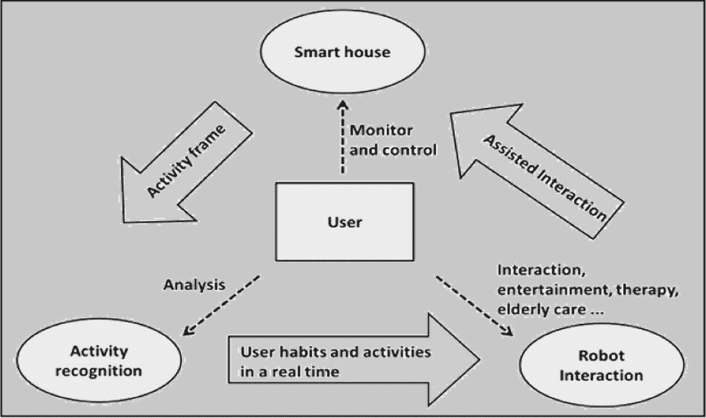

图 1.32 活动监控系统。

必须有一个如图 1.33 所示的可靠紧急系统，用于监测人的状况，并在紧急情况下立即联系医生和救护车，并通知家庭成员 [[32]](#ref-list.xhtml_refchapter_32)。因此，目标是为所有在家里独立生活的人提供舒适的环境。

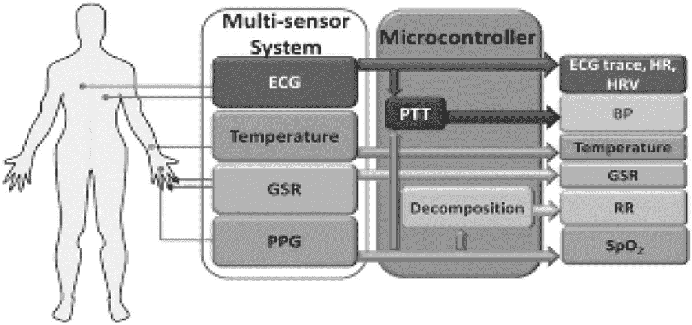

图 1.33 可靠的紧急系统。

### 1.7.1 神经网络

人工神经网络（ANNs）的结构类似于人类大脑。成年人脑的重量约为 1.5 公斤，体积为 1260 立方厘米。大脑由 2000 亿神经元组成，通过 25 万亿突触、胶质细胞和血管连接。神经元可以分为三部分：细胞体（soma）、树突和轴突，如图 1.34 所示。

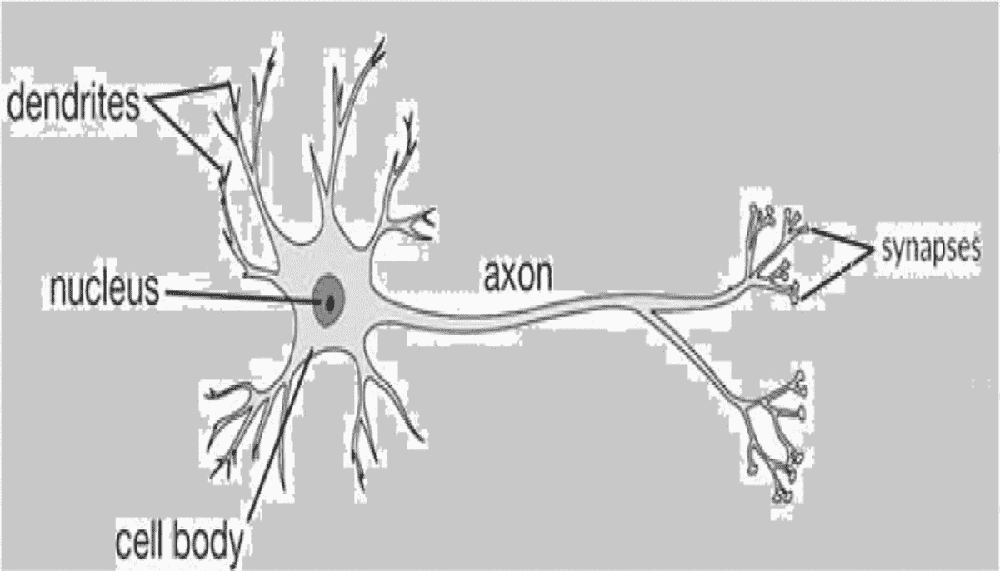

图 1.34 生物神经元的结构。

每个树突都包含细线，它们会接收来自周围神经元的信号。树突的每个分支在突触的帮助下连接到单个神经元上 [[33]](#ref-list.xhtml_refchapter_33)。神经网络用于发现数据中具有特定关系的模式。

图 1.35 显示了输入神经元和输出神经元，它们之间有相互连接的权重。此图的第一步借助输入节点以数值表达式的形式获取数据或信息。神经网络是一种从生物神经系统中汲取灵感并处理信息的范式。

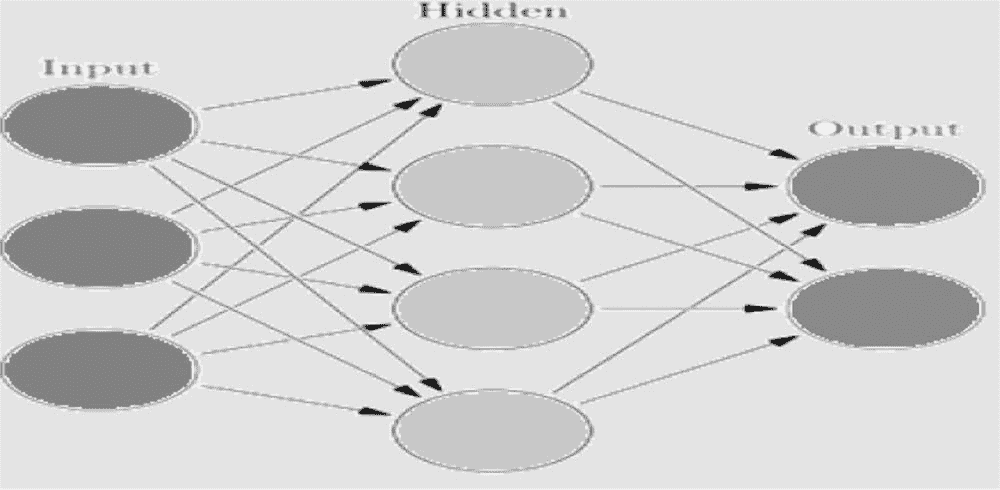

图 1.35 ANN 的结构。

模式识别情况下的 ANN 流程图如图 1.36](#ch01.xhtml_fig1_36)所示。

#### 神经网络基础

- **处理单元**：神经网络系统由许多代表大脑神经元的处理单元组成。这些单元被分为不同的组，如接收数据的输入单元、处理和转换输入数据的隐藏单元以及表示最终决策的输出单元 [[34]](#ref-list.xhtml_refchapter_34)。
- **权重**：神经网络中所有的处理单元都以某种方式连接。每个连接都有一个权重值。来自神经元的输入乘以发送数据的连接权重，然后将输出值发送到网络的激活函数。如果计算值超过激活函数的阈值，则神经元被激活，否则处于非激活状态。
- **计算方法**：该方法用于通过激活函数来确定正确的输出。在此情况下，神经网络使用阈值逻辑单元执行计算。它获取神经元的输入值并求和，最后使用激活函数进行计算。
- **监督训练**：这是第一种训练方法，为网络提供一系列输入，然后将目标与预期响应进行比较，或者给出针对给定输入的预期输出指令。这种方法的主要问题在于误差产生。理想情况是生成的输出与预期输出之间的差异越小，例如`Hebb 网`、`模式关联记忆`、`反向传播网络`和`反传播网络`。
- **无监督训练或自适应训练**：另一种训练方法称为无监督训练，其中为网络提供输入，但未知预期的目标。输入数据项的分组由系统维护。这也被称为自组织或自适应方法，例如`自组织映射`、`自适应共振理论`等。


**强化训练：** 这是第三种训练方法，其中网络仅接收关于目标答案正确或错误的指示报警。如果可用足够的信息，这种学习可以很好地处理特定问题。

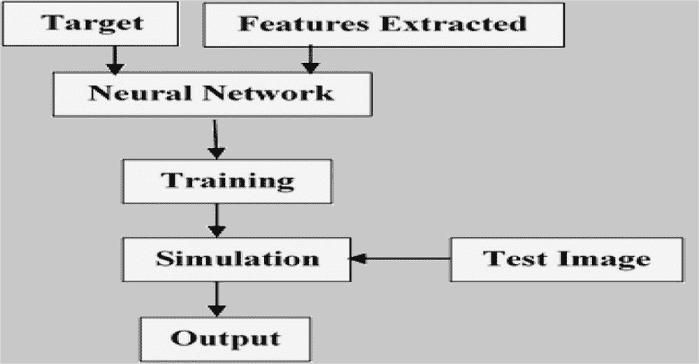

图 1.36 神经网络（ANN）流程图。

### 1.7.1.1 网络架构

在网络架构中，神经元被排列若干层，并在层之间与层内部生成连接。如果存在两个相互连接的权重层，则发现具有隐藏层。神经网络有多种类型，包括矢量量化网络、混合网络、循环网络、RBF 网络等。

#### **前馈神经网络**

这是一种所有数据仅沿单方向传输的网络。在这种情况下有两种选择：输入直接连接到输出，这意味着会有单层权重；或者通过隐藏层将输入连接到输出层。它由单层网络和多层网络组成，如图图 1.37 [[35]](#ref-list.xhtml_refchapter_35)所示。

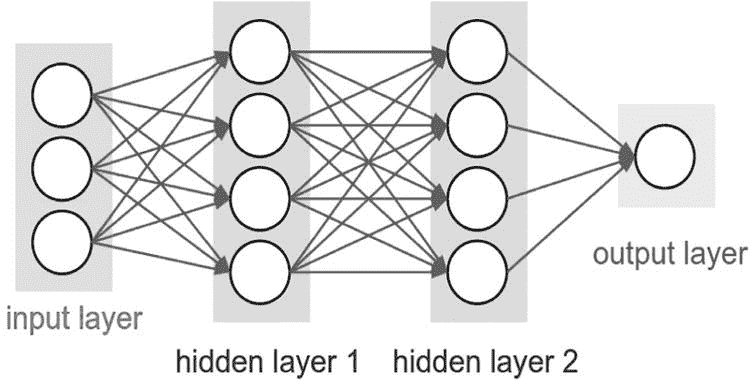

图 1.37 前馈神经网络。

所有神经元的群体行为描述了网络的强大能力，并在此基础上假设这些信息将是否提供所需的输出。反馈不需要循环。它被用于模式识别。

#### **单层网络模型**

这意味着在单层形式中，每个输入层都直接连接到输出层，但反之不然。它也被称为无环网络。在这种情况下，输入可能全连接连接到输出单元，如图图 1.38 所示。

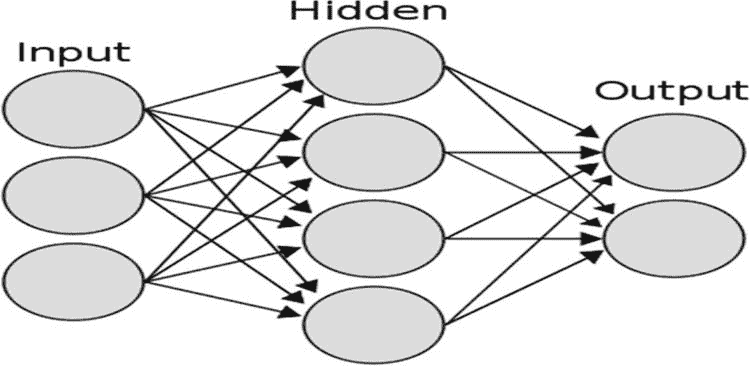

图 1.38 单层前馈神经网络。

#### **多层网络模型**

在这种模型中，隐藏单元的数量多于一个，也可以是一个（其中节点被视为隐藏节点）。这种处理方式是首先将信息从源节点发送到第一个隐藏节点，第二层的输出将作为第三层的输入，依此类推。接下来的图 1.39 显示了多层网络（图 1.39）：

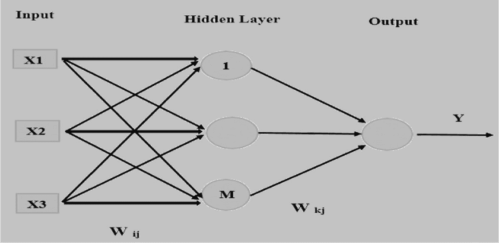

图 1.39 多层前馈神经网络。

#### **循环网络**

这是神经网络中最简单的一种架构形式。在这种情况下，输入层的所有单元都连接到输出层的所有其他单元，每个单元都可以同时作为输入和输出。它是那种隐藏层数量大于或等于一个且带有反馈循环的网络。在这种情况下，反馈意味着神经元的输出将返回到其输入，如图图 1.40 所示。

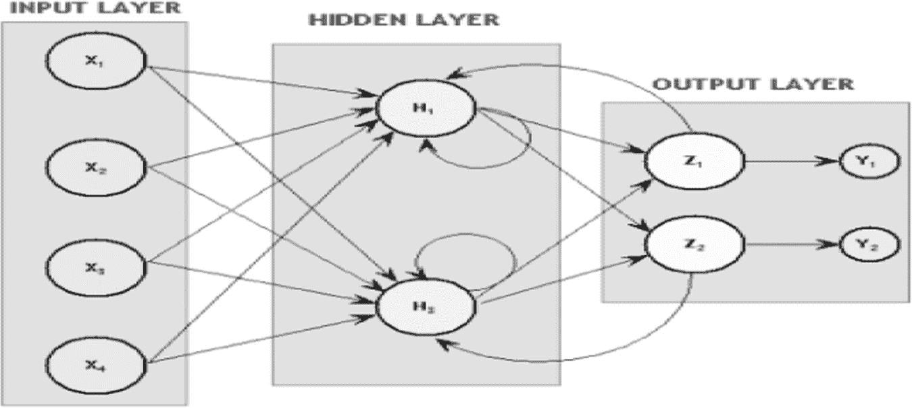

图 1.40 循环神经网络。

#### **霍普菲德神经网络**

这种网络主要用于模式识别，为此使用特殊算法对网络进行训练。它基于循环网络的概念。由一组神经元组成，每个神经元代表差异图像的一个像素。它还与邻域的所有神经元连接，如图图 1.41 所示。

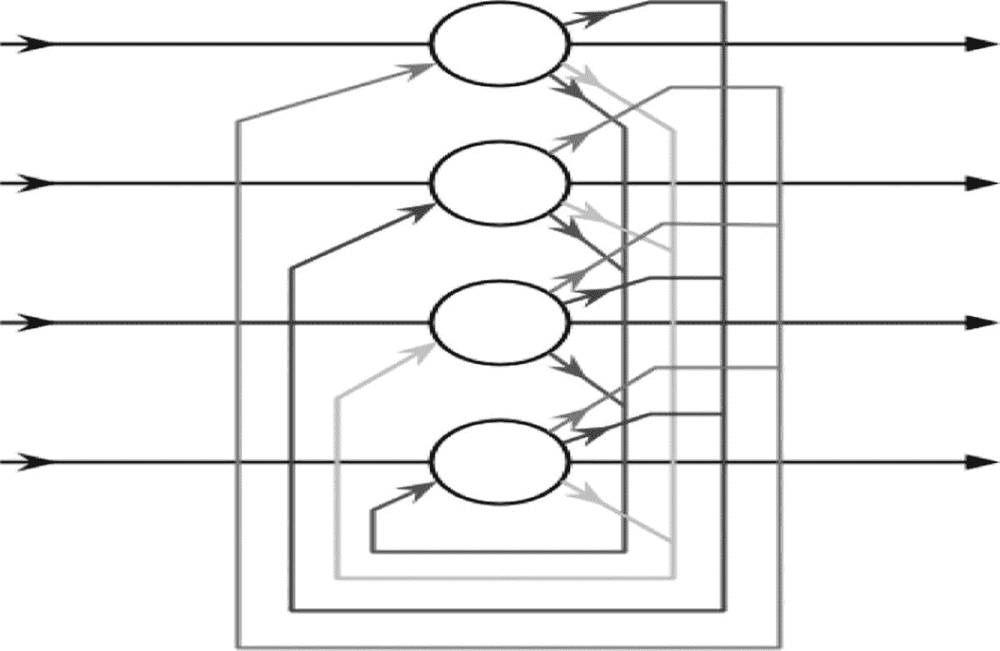

图 1.41 霍普菲德神经网络。

#### **径基函数网络**

正如前馈神经网络的定义，它由输入层、输出层和隐藏层组成，因此如果隐藏层依赖于径向函数的概念，则被称为 RBF 网络，如图图 1.42 所示。其中使用了高斯点，但其激活函数比前馈神经网络（FFNN）复杂。它也被用于模式识别 [[36]](#ref-list.xhtml_refchapter_36)。

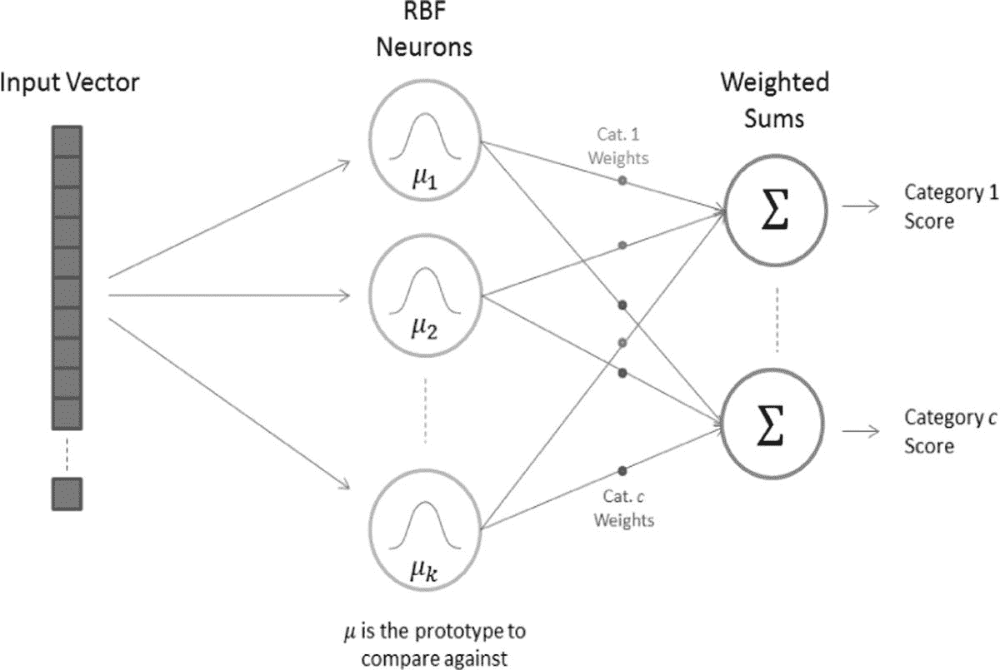

图 1.42 RBF 神经网络。

## 1.8 MATLAB 2012a

MATLAB 代表矩阵实验室有两个项目 LINPACK 和 EISPACK 用于为矩阵软件提供简单的处理。LINPACK 意味着线性系统包，EISPACK 意味着特征系统包。

MATLAB 有许多内置例程，能够实现各种计算，以及许多用于图形的命令，使得可视化结果可用。有一个术语称为工具箱；它意味着收集在包中的许多应用程序。有不同类型的工具箱，用于仿真、信号处理、控制理论以及某些工程技术领域。

当用户登录账户时，通过双击桌面上的 MATLAB 快捷图标进入 MATLAB 工具。当 MATLAB 启动时会显示一个名为 MATLAB desktop 的窗口，此窗口包含其他窗口，如命令行窗口、开始按钮、工作区、命令历史、当前目录和帮助按钮。当 MATLAB 启动时，屏幕如图图 1.43 所示。工具和文档可以根据用户的需求进行自定义。命令行提示符（`>>`）命令行命令行可用 [[37]](#ref-list.xhtml_refchapter_37)。

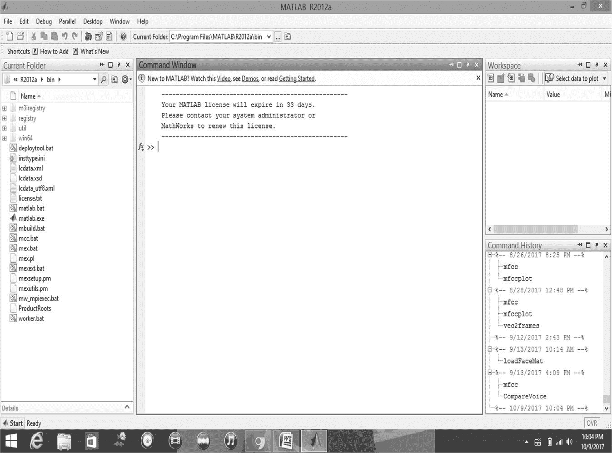

图 1.43 MATLAB 界面。

例如，MATLAB 可作为计算器：可以评估简单的表达式，例如：

```
>>
```

如果未指定输出，结果将存储在变量中。

```
>>
```

然后结果在变量中。

```
>>
```

MATLAB 还帮助添加轴标签。如果在上面的图中添加 x 和 y 标签，可以使用这些命令：

```
xlabel('0.2\pi')
```

```
ylabel('Sine of x')
```

```
title('Plot of Sine Function')
```

图形如图图 1.45 所示。带有标题的正弦函数图如图图 1.46 所示。

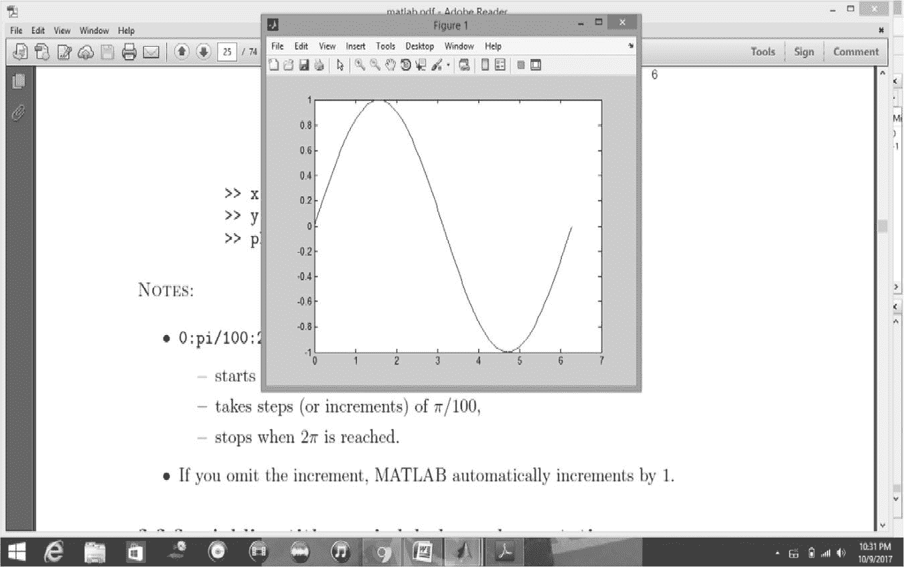

图 1.45 正弦函数图。

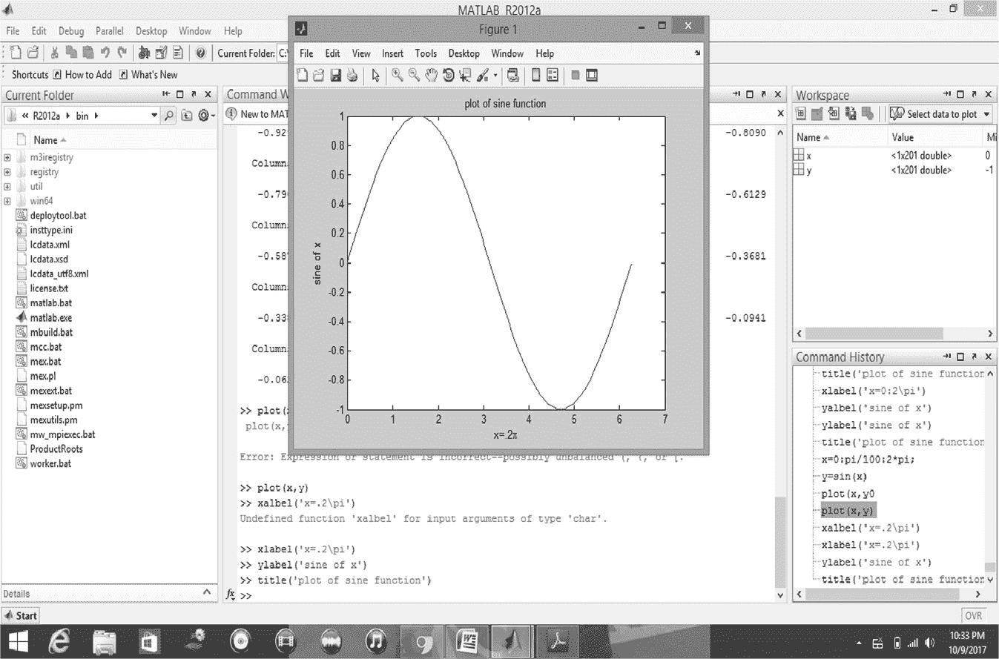

图 1.46 带有标题的正弦函数图。

### 1.8.1 矩阵概念

MATLAB 环境的基本元素是矩阵。矩阵是由 n 行 m 列组成的二维数组。对矩阵应用了许多操作。第一个例子是输入向量，它是矩阵的一种基本情况。其目标是在 MATLAB 中创建向量和矩阵。行向量由 1*n 维数组表示，列向量由 m*1 维数组表示，如图图 1.47 所示。

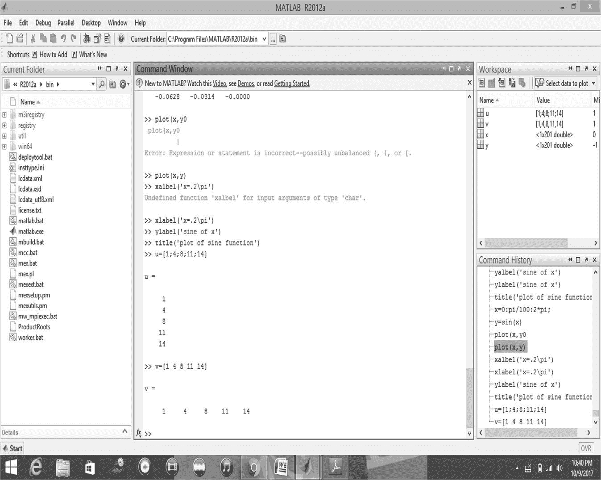

图 1.47 行向量的表示。

例如，要输入行向量 v，输入

```
>> v = [1481114]
```

同样，列向量创建方式如下：

```
>> u = [1; 4; 8; 11; 14]
```


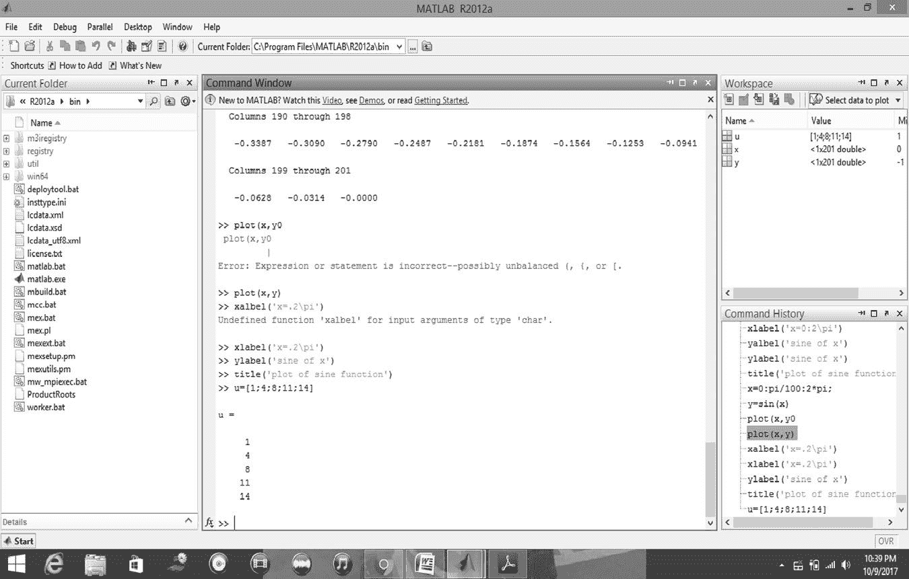

图 1.48 列向量的表示。

行向量可以通过使用转置运算符轻松转换为列向量，该运算符用撇号或单引号（`‘`）表示。例如，如图 1.49 所示的 `u=v’`。

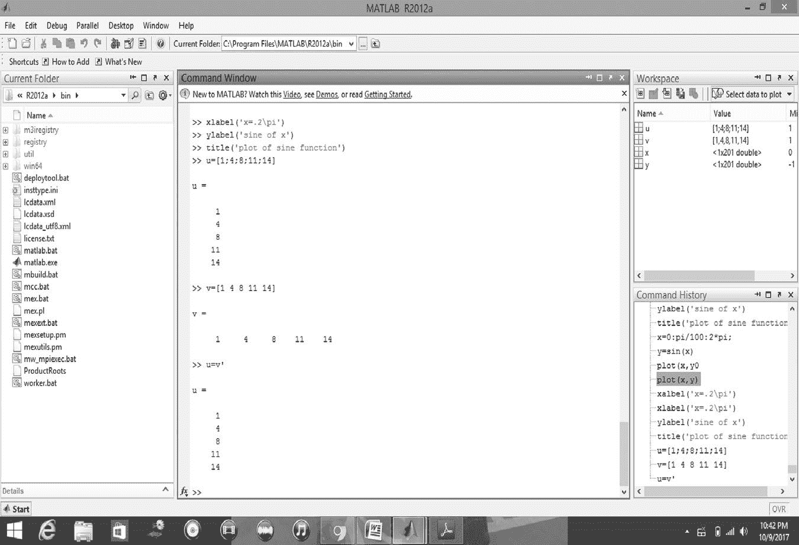

图 1.49 转置运算符的表示。

**矩阵形成**：矩阵是数字的集合。在 MATLAB 中形成矩阵，从这里开始-

> 使用方括号 `[`
> 元素之间用空格或逗号（`,`）分隔
> 使用分号（`;`）分隔不同的行
> 矩阵以另一个括号 `]` 结束

> 例如，形成一个如图 1.50 所示的矩阵。

```mat
A = [2 4 6; 8 10 12; 14 16 18]
```

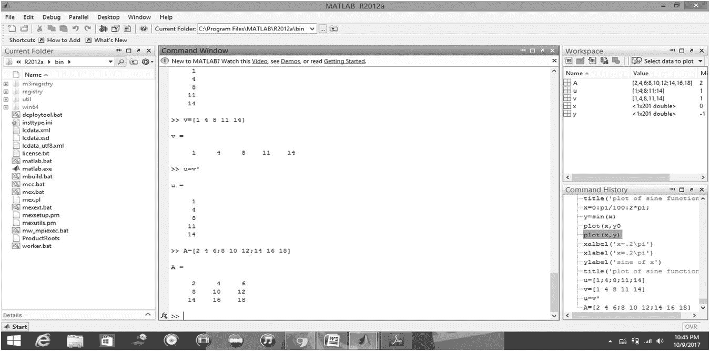

图 1.50 矩阵的表示。

结果将如图 1.50 所示的 `3*3` 矩阵。

**在 MATLAB 中编程**：由于命令是在命令行窗口中执行的，问题在于这些命令不会被保存且无法多次执行。因此，执行重复命令时使用了不同的概念，即-

* 创建带有命令列表的文件
* 保存文件
* 运行文件

此部分中定义了两个概念：M-file 脚本和 M-file 函数。

**M-file 脚本**：当 MATLAB 语句包含在一个序列中，该文件被命名为 M-file 脚本。它的扩展名为 `.m`，因此被称为 M-file。用户创建此文件来存储他们为特定应用程序编写的代码。M-file 的表示如图图 1.51 所示。考虑三个方程：

$X + 2y + 3z = 1$
$2X + 2y + 4z = 1$
$2X + 2y = 3z = 2$

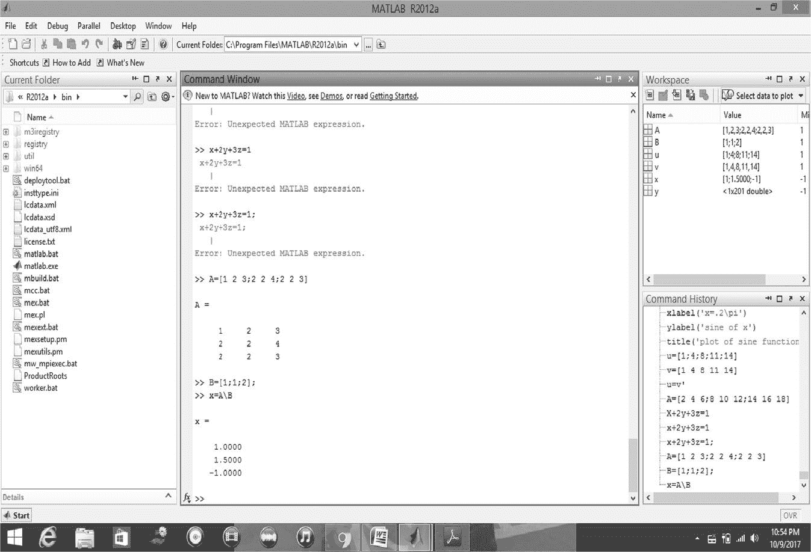

图 1.51 M-file 的表示。

求解 $x$？

使用 MATLAB 编辑器创建文件。

`File -> New -> M-File`

然后输入语句-

```
\begin{array}{l} \begin{array}{l} {A = \left\lbrack {1 2 3; 2 2 4; 2 2 3} \right\rbrack} \\ {B = \left\lbrack {1; 1; 2} \right\rbrack;} \end{array} \\ {X = A\backslash B} \end{array}
```

然后保存此文件，例如 `test.m`，通过 `File -> save as -> location` 选择合适的位置。通过选择 run 或按下 run 按钮或按 `F5` 运行文件。

通过输入运行

```mat
>>test
```

**M-file 函数**：函数是接受输入参数并返回输出参数的程序。每个 M-file 函数都写为 M-file 或简称为 function。

例如 `function f = factorial (n)`

```matlab
% Factorial (N) 返回 N 的阶乘
% 计算阶乘值
F = prod (1:n);
```

在此处，第一行以关键字 `function` 开始。它赋予了函数一个名称和参数数量。

### 1.8.2 MATLAB 中的图像处理

MATLAB 使用工具箱进行图像处理。图像是由二维或三维的像素矩阵组成的。单个像素包含一个或多个数字，代表分配给它的灰度或颜色。彩色图片的尺寸比灰度图片大，因此处理彩色图像需要更多的功率。在图像处理中，第一步是将彩色图像转换为灰度图像，然后对灰度图像进行处理。在此之前，加载图像以开始处理。如果图像是彩色的，则首先将其转换为灰度图像以简化处理。

对于转换，使用了函数 `rgb2gray` 来更改颜色。图像处理中使用两个函数：`imread` 和 `imshow`。`imread` 用于读取特定格式的图像文件，`imshow` 函数用于显示图像。最后使用 `imwrite` 函数写入图像，它允许将图像保存为 MATLAB 支持的任何文件，这些文件与 `imread` 支持的文件相同。

### 1.8.3 图像的属性

* **直方图**：显示数据分布的条形图。在图像处理中，它显示图像中存在的像素值数量。可以处理图像以满足规范。从图像创建直方图，使用 `imhist` 函数，`histeq` 函数用于对比增强，`graythresh` 用于阈值化。
* **负片**：意味着输入图像的反转。对于 8 位图像，新图像看起来与原始相同。此操作通过 `imadjust` 完成。
* **傅里叶变换**：频率的作用对于理解图像处理滤波的工作原理非常重要。图像由信号组成，因此信号与频率相关。有两种方法可以了解频率内容的高低。如果图像扫描时灰度值变化较小，说明图像包含低频内容。如果图像扫描时灰度值变化很大，说明图像包含高频内容。傅里叶变换被描述为信号转换为正弦波。对于数字系统，通过指定采样率设计傅里叶变换，这被称为离散傅里叶变换。MATLAB 使用快速算法进行 DFT 计算，称为 `fft`。
* **卷积**：图像处理中使用名为卷积的线性滤波方法。它是两个多项式的代数乘。图像是多项式的数组，像素值代表多项式的系数。因此，可以通过卷积将两个图像相乘产生新图像。在 MATLAB 中 `conv2` 用于两个矩阵的二维卷积。
* **滤波器**：滤波用于修改图像并用于图像处理。主要有两种滤波器：a) 低通滤波器用于模糊图像的高频区域。这种滤波器用于从图像中去除不需要的噪声。b) 中值滤波器对去除图像中的噪声很有帮助。它类似于平均滤波器，检查像素及其相邻的像素值并返回这些像素值的平均值。


# 第 1 章介绍了泛在计算的基本概念及其面临的挑战和问题。详细定义了基于人脸识别和语音识别技术的多种生物识别技术，本章描述了不同类型的传感器以及本研究工作的目标。第 2 章提出了一种用于为个人提供家庭保障的混合 PICA 算法。第 3 章描述了一种用于为独立生活的人员提供灵活基于信任的安全性的混合 MFRASTA 算法。第 4 章提出了一种可以在 iPhone 摄像头镜头上运行的、用于用户健康监测的指尖应用。第 5 章展示了完整实现系统的图形用户界面（GUI），并展示了所提技术与之前使用的技术在识别率方面的对比。第 6 章给出了所提工作的结论。文中还为未来的研究提到了一些点，以使该系统更加实用。

# 第 2 章

## 用于个人家庭安全的混合人脸识别 PICA 算法

DOI: [10.1201/9781003120933-2](https://doi.org/10.1201/9781003120933-2)

## 2.1 人脸识别简介](#contents.xhtml_toc2_41)

安全框架在当今世界处于至关重要的部分。因此，设立了安全岗位，并招聘了人员使该框架在一段时间内有效运行。在任何情况下，随着对新进展的调查，世界都在不断改进。各种机器人安全框架开始执行，以减少劳动和成本 [[38]](#ref-list.xhtml_refchapter_38)。人脸是生物识别技术中最具前景的技术之一，也是最识别方法。人脸传达了关于年龄、身份、性别、种族和面部表情的信息，反映了情感和心理状态。与其它一些生物特征不同，人脸识别并不真的需要个人的配合，可以以微妙的方式进行，这使其特别适用于观察类应用 [[39]](#ref-list.xhtml_refchapter_39)。其他基于指纹、虹膜、签名识别等的生物识别技术的问题在于数据采集，例如在指纹识别中 [[44]](#ref-list.xhtml_refchapter_44)，用户必须以正确的方式和方向放置手指。但在人脸识别中，采集脸部图像并不困难，因此可以作为一种生物识别技术。每张脸都有定义特定用户的特殊特征。还可以通过使用像素强度来识别情绪，这对应于用于检测情绪的特征 [[45]](#ref-list.xhtml_refchapter_45)。人脸识别是一种经常应用于银行、安全信息和虚拟现实等领域的生物识别技术 [[45]](#ref-list.xhtml_refchapter_45)。图像处理是人脸识别中的一种方法，用于将图像转换为数字形式并对图像进行某些操作，以便我们从中提取有用信息。它包含三个步骤：使用扫描仪或摄像头拍摄图像，应用数据压缩或增强以分析数据，并以修改后的图像形式输出。人脸识别系统涉及三个主要步骤：数据采集、特征提取和识别 [[46]](#ref-list.xhtml_refchapter_46)，如图 2.1 所示。

```
!images/fig2_1.jpg
```

图 2.1 人脸识别系统的步骤。

数据采集是人脸识别系统的主要步骤，包括通过多种来源采集脸部图像。采集的图像数量可能具有不同的姿势变化、光照变化等。因此，我们可以在多种条件下轻松验证我们识别系统的性能。有时，门处的输入图像会被分类，并对输入图像应用不同的修改方法。通过这种方式，除了噪声、光照、模糊效果等不理想参数，然后将其用于后续处理 [[46]](#ref-list.xhtml_refchapter_46)。特征提取是人脸识别系统的下一步，用于从给定的图像中提取信息，提取后，特征将用于识别步骤。在这一步中，使用了降维和噪声清洗技术 [[47]](#ref-list.xhtml_refchapter_47)。

识别是特征选择和提取后用于人脸识别系统的最后一步，现在使用多个分类器对图像进行分类。在这一步中，获取若干张图像并对其进行特征提取，存储在数据库中。当一张新图像用于人脸识别时，它首先执行人脸采集、特征提取，然后将数据库中的所有图像与此新图像进行比较。图像与数据库中存储的所有图像相关联，以识别个人，如图 2.2 所示 [[47]](#ref-list.xhtml_refchapter_47)。

```
!images/fig2_2.jpg
```

图 2.2 人脸识别模型。

每个人脸识别系统主要包含两个任务：

-   验证 (Verification)
-   识别 (Identification)

在验证中，适用一对一匹配；因为系统帮助将特定个人与文件中存在的特定生物特征进行匹配。由于该系统只比较生物特征文件，因此它是一种比识别更快更高效的技术，例如，它试图提供特定问题的答案，如“这个人真的是他所称的自己吗？”。在识别中，适用一对多匹配，这意味着在图库数据库中识别该图像。它试图识别一个未知用户，例如，它尝试回答“这个人是谁？”。人脸识别的基本框如图图 2.3 所示。

```
!images/fig2_3.jpg
```

图 2.3 人脸识别的基本步骤。

存在两类人脸识别方法：基于特征的和基于整体的 [[48]](#ref-list.xhtml_refchapter_48)。在基于特征的方法中，从脸部提取特征如眼睛、嘴唇和鼻子，并计算这些特征之间的几何关系，最后还原为向量形式。用于计算不同面部特征之间距离的方法是欧几里距离法。弹性束图法（Elastic bunch graph method）是这种基于动态链接技术的示例。通过这种方法，对于每个人都会生成一个图，通过在束图方法中为每张新图像生成图，用于识别目的。之后，通过分析新脸部图像图与数据库中存储的所有脸部图像图进行比较，最后计算相似性指数。


基于整体的方法除了局部或某些面部特征外，还使用了整个图像的全局表示。这种方法再次分为两个部分：统计学和人工智能。在统计学方法中，图像被表示为二维数组，其使用的主要概念是计算输入图像与数据库中其他存储图像之间的相关性参数。这种方法非常昂贵，因为它无法处理姿态和光照等可变条件，而另一个缺点是它总是在高维空间中进行分类。为了克服这些问题，可以使用其他方法来获得更准确、更有意义的结果，例如 `PCA`（主成分分析）算法，它将每个脸部表示为 `Eigen faces`（特征脸）的融合，且任何重构都是通过使用这些 `Eigen faces` 来完成的。

在人工智能方法中 [[48]](#ref-list.xhtml_refchapter_48)，使用了许多工具来识别脸，例如神经网络和机器学习技术。这意味着当从 `PCA` 算法中提取出主成分时，使用神经网络作为分类器以减少低维空间中的分量。`SVM`（支持向量机）是模式分类中最常用的算法。`HMM`（隐马尔可夫模型）也被用于人脸识别任务。人脸识别的困难在于它在姿态、光照条件等高变异性无法工作。针对变化的姿态和光照条件下的人脸识别问题已经解决，因此需要通过使用脸部几何来应对姿态和光照条件。[48]](#ref-list.xhtml_refchapter_48) 因此，在所提工作中定义了 `PCA+ICA` 算法组合用于人脸识别。

## 2.2 人脸识别算法](#contents.xhtml_toc2_42)

脸是生活中最重要的视觉对象，可用于传递身份。有许多算法用于人脸识别。

### 2.2.1 主成分分析 (PCA)](#contents.xhtml_toc3_43)

`PCA` 是一种可衡量的策略，利用正交变换将一组可能相关的变量的感知转换为一组线性不相关因素的估计，这些因素被称为主成分。主成分的数量并不完全或等同于原始变量的数量。这种变换的特征是：第一主成分具有最大的方差（即代表了预期的信息中尽可能多的变化），随后的每个部分在与前几个成分正交（即与前几个成分不相关）的限制下，具有尽可能高的差异 [[40]](#ref-list.xhtml_refchapter_40)。如果信息集呈联合正态分布，则主成分将是独立的。`PCA` 对原始变量的整体缩放敏感。这里研究了许多关于 `PCA` 的论文，并发现没有论文将 `PCA` 策略与显著模型结合起来。这就是编写这类论文的原因，将所有这些内容结合在一起，对于初学者来说直观且易于理解。`PCA` 是一种通用于高维数据分析的数学工具。`PCA` 已用于人脸识别、运动分析与合成、聚类和降维。它是 Turk 和 Pentland 在 1991 年开发的一种非常流行的算法 [[49],](#ref-list.xhtml_refchapter_49)，主要用于压缩类型问题中的降维。`PCA` 源于 `Eigenvector`（特征向量）概念 [[49]](#ref-list.xhtml_refchapter_49)。它是用于带有模式识别的数据分析中最重要的工具，可用于图像处理。该算法使用线性变换方法，将完整数据从高维空间映射到低维空间。在此类算法中，如果我们把真实数据集转换到不同的空间，真实数据集的形状和位置将发生改变，它被用于在组不知道的情况下计算更好的判别分量。这是一种在统计上用于数据分析和降维的技术。该算法的目标是将数据取为若干成分的组合 [[49]](#ref-list.xhtml_refchapter_49)。第一主成分是原始维的线性组合，在该维度上方差最大。第二主成分是原始维的另一个维度，在该维度上方差最大且与第一主成分正交。第 n 个主成分是在与前 n-1 个主成分正交的前提下具有最高方差的线性组合。为了减少识别脸部所需的变量数量，使用了统计方法。训练集中的每张图像都将由加权 `Eigen feature vectors`（特征特征向量）的线性组合来表示，这些向量被称为 `Eigen faces`（特征脸） [[50]](#ref-list.xhtml_refchapter_50)。使用一个称为 `bias function`（偏置函数）的术，它表示由给定训练集的协方差矩阵生成的所有 `Eigen vectors`。在识别阶段，将新图像投影到子空间，并使用 `Euclidean method`（欧几里得方法）计算各种脸部特征之间的距离以便分类。`PCA` 也称为 `Karhunen Loeve transformation` [[50]](#ref-list.xhtml_refchapter_50)。它用于消除维度和相关性问题，并通过表达相似性和差异来分析数据模式 [[50]](#ref-list.xhtml_refchapter_50)。

实施 `PCA` 算法的步骤如下：

所有拍摄的脸部图像都是二维的，即 `N*N`。目标是提取可以表示训练集中存储的全脸的主成分（`Eigen faces`） [[51]](#ref-list.xhtml_refchapter_51)。假设训练集中的图像数量为 `M`，训练集中每张图像的线性形式表示为 `I[n]`。

*   将训练集的图像转换为向量，将 `N*N` 映射为 `1*N²` 向量
*   归一化脸向量，意味着从脸中移除所有特征，留下独特特征。
*   计算所有脸向量的平均值
    $Mean = 1/(M)\sum_{i = 1}^{M}I_{i}.$
*   从脸向量 `I[i]` 中减去平均值，留下归一化的脸。
    `K[i] = I[i]-mean`
*   从协方差矩阵计算特征向量
    $C = 1/(M)\sum_{i = 1}^{M}{Ki \ast Ki^{T}} = B \ast B^{T}(N^{2} \ast N^{2})}$
    其中 `B = [K[1] K[2]…K[M]]^T` (N²M 矩阵)
*   从还原的协方差矩阵 `C` 或 `B*B^T` 计算特征向量，令其为 `u[i]`，但 `B*B^T` 很大，无法对其计算特征向量。因此改为找出矩阵 `B^T*B` 的特征向量。令 `v[i]` 为特征向量
`v[i]` 和 `u[i]` 之间的关系
$\begin{array}{l} {B^{T} \ast Bv_{i} = I_{i} \ast v_{i}} \\ {B^{T} \ast B \ast Bv_{i} = I_{i} \ast Av_{i}} \\ {C \ast Bv_{i} = I_{i} \ast Bv_{i}} \\ {Cu_{i} = I_{i}u_{i}} \end{array}$
    其中 `u[i] = Bv[i]`
*   选择能够表示整个训练集的最佳特征脸
*   将低维特征向量转换为原始维度
*   将每个脸图像表示为所有特征向量的线性组合。这意味着训练集中的每个脸都可以表示为特征脸和平均脸的加权和。
*   识别未知脸。识别脸图像遵循的步骤有：
    1. 首先将脸图像转换为向量形式 `I`。
    2. 通过减去平均值对其进行归一化。
        `K = I-mean`


3. 将归一化后的脸部向量 (`K`) 投影到特征值空间，以获得向量 `W`。

`W = [w[1]w[2]…..w[N]]^(T)`

其中 `w[i] = u[i]^T * K`

4. 寻找 `e[r,]`，它表示给定脸部与训练集中另一个脸部之间的最小距离，且给定脸部与训练集中该脸部所属的人之间的距离。

`E[r] = min ||w - w^T||`

5. 如果 `E[r] > threshold`，则用户未知，否则用户已知。

图 2.4 描述了 PCA 算法中为了提取面部图像主成分而采取步骤 [[51]](#ref-list.xhtml_refchapter_51)。在 PCA 算法中，所有图像必须具有相同的大小。通过归一化处理对所有图像数据进行归一化。每张图像被视为单个向量，这意味着所有脸部图像都存储在单个矩阵中，矩阵的每一行显示一张图像。下一步是为这些图像计算特征向量，这些特征向量也被称为特征脸（Eigenfaces）。每张图像都是这些特征脸加权和的线性组合。每当注册一张新图像进行识别时，首先会创建该图像的特征向量，然后计算门处的新脸部图像与数据库中所有存储图像之间的距离。使用 PCA 的主要目标是通过一种称为矩阵的方法获取数据的重要特征。PCA 特征脸法不直接于图像，因此使用了矩阵方法，将所有图像转换为向量形式并存储在单个矩阵中。图 2.5 显示了基于 PCA 和神经网络的脸部识别器的示意图。

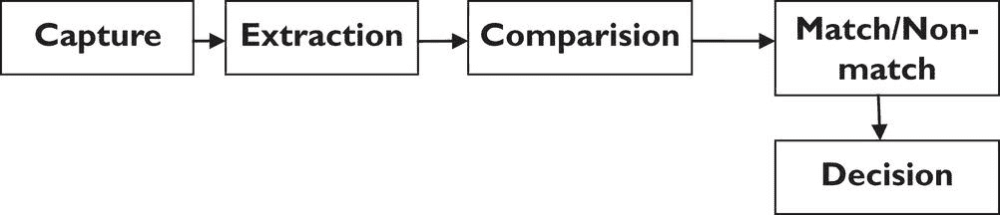

图 2.4 基于 PCA 的脸部识别器示意图。

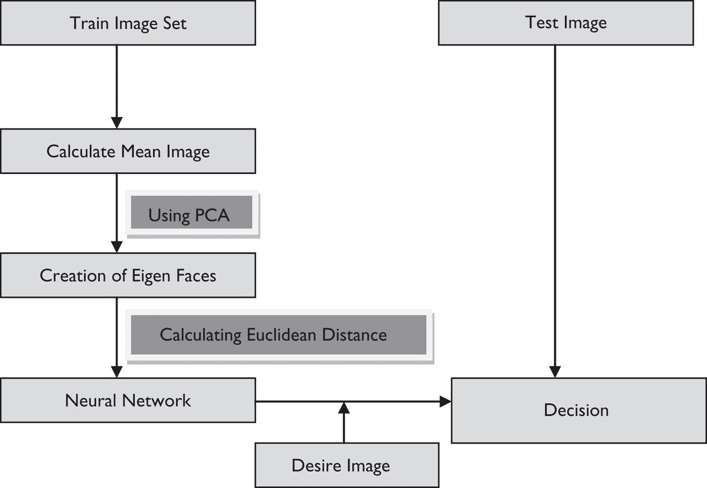

图 2.5 基于 PCA 和神经网络的脸部识别器示意图。

### 2.2.2 独立分量分析 (ICA)

这是一种静态且计算策略，用于从多维统计信息中寻找基本因子或部分。ICA 与其他方法的不同在于，它搜索同时具有两个特征的分量：统计独立性和非高斯性。ICA 为观测到的多变量信息刻画了一个生成模型，该模型通常被给出一个巨大的样本集合。在模型中，数据变量被假设是一些未知潜变量的线性混合，且混合系统也是未知的。潜变量被假设是非高斯且相互独立的，它们被称为观测数据的独立分量。这些独立分量（也称为源或因子）可以通过 ICA 找到。通过 ICA 分析的数据可能源自于许多不同的应用领域，包括数字图像、文档数据库、经济指标和心理测量值 [[41]](#ref-list.xhtml_refchapter_41)。ICA 用于分析高阶数据，或者说是多变量数据 [[52]](#ref-list.xhtml_refchapter_52)。该算法中使用的主要技术是将高维空间转换为低维空间，使得包含转换变量的新空间将定义数据的本质特征。聚类分析是该算法中用的一种技术 [[53]](#ref-list.xhtml_refchapter_53)。一个聚类表示为一组数据元素，聚类分析被定义为一种在存在大量浓度的区域为数据分配空间的技术，该区域被称为聚类 [[53]](#ref-list.xhtml_refchapter_53)。这种技术基本上用于盲源分离问题，也称为鸡尾酒会问题。该问题定义为：如果房间里三个人同时说话，使用放置在不同位置的三个麦克风来采集麦克风产生的声音，每个麦克风记录房间内所有声音的混合。目标是仅使用录制的语音混合来分离单个用户的声音。独立分量分析 (ICA) 是解决这种盲源分离问题的方法 [[54]](#ref-list.xhtml_refchapter_54)。它是 PCA 算法的推广，能够区分输入的高阶矩和二阶矩。它的主要工作是将信号分解为若干独立信号的组合。

在这里，使用的一种算法是 Bell 和 Sejmouski 提出的 info max [[55]](#ref-list.xhtml_refchapter_55)，用于分离数据集的分析独立分量。

ICA 算法的步骤为：

每张脸部图像都是这些独立分量的唯一线性组合。

`R = A * U`

其中 `R` 代表脸部图像，`A` 定义了未知混合矩阵，`U` 代表统计独立分量。

- 对训练集进行球化处理（sphering）。这包括应用于数据集的中心化和白化过程。
    1. 中心化：在此，从数据集中减去行平均值，然后数据集通过白化滤波器。
    2. 白化：通过公式计算：

        `W[z] = U * E^(-1/2)`

        其中 `U` 和 `E` 分别是特征向量特征值。此步骤消除了数据的统计特性，协方差和均值均置零，且方差相等。

- 计算 `W = W * W[z,]`

- 计算基础图像。

    `B = R * W[i]^(-1)`

- 将测试图像投影到特征脸。

- 计算系数

    `B[test] = R[test] * W[i]^(-1)`

PCA 和 ICA 算法用于将测量组件减少为较小的集合。如果数据是高斯、线性和平稳的，PCA 就足够。如果不是，则引入 ICA。简单来说，PCA 帮助压缩数据，而 ICA 帮助分离数据 [[42]](#ref-list.xhtml_refchapter_42)。图 2.6 显示了一个需要输入图像的系统。通过输入图像，将找到所有训练图像的特征值。之后，选择一张测试图像并对考虑的测试图像应用 ICA 算法。最后，从考虑的测试图像中计算平均图像。如果它与训练图像匹配，则人员已知，否则未找到结果。图 2.6 显示了基于 ICA 的脸部识别器的框图。

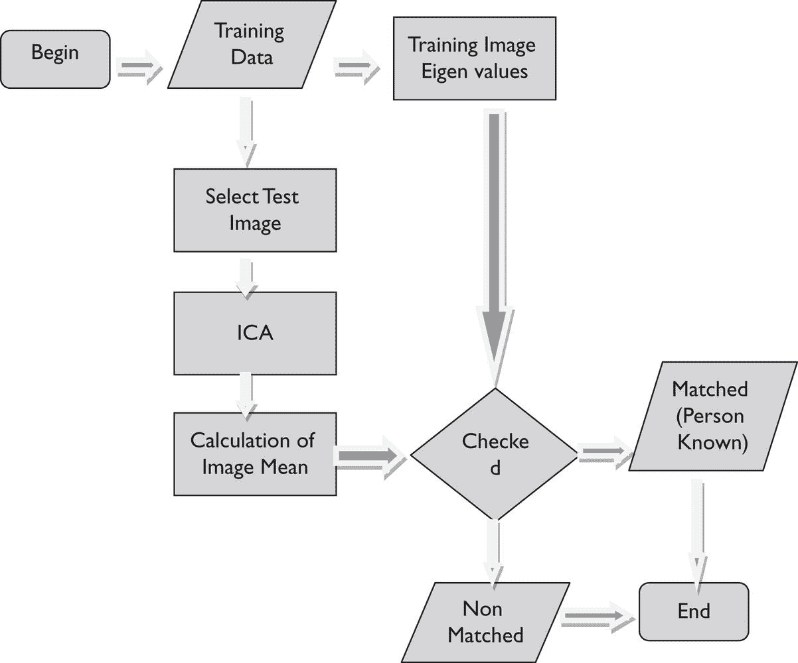

图 2.6 基于 ICA 的脸部识别器框图。

### 2.2.3 线性判别分析 (LDA)


# LDA 是一种降维技术，用作人脸识别的预处理步骤。其目标是将特征从高维空间投影到低维空间，以避免维度灾难，最重要的是降低成本和资源消耗。LDA 技术由 Ronald A. Fisher 于 1936 年引入，名称为线性判别分析或 FDA（费舍尔判别分析）。它是模式识别的经典技术之一，该技术用于寻找能够区分物体类别的线性组合特征。结果的组合可以像线性分类器一样使用。费舍尔判别分析也是线性判别分析技术的一部分。在这种分析中，可以使用多种像素值来表示每张脸。LDA 用于在分类之前通过减少特征数量来创建一个更易于管理的形式。它用于寻找线性变换，使得特征簇具有很高的分离性，这可以通过散度矩阵的分析来实现。该方法基本上用于处理类内频率不相等的情况，我们可以使用任何随机数据集来计算其性能。它通过给定变换，最大化了任何数据集类间方差与类内方差的比值，从而保证了可分性 [[55]](#ref-list.xhtml_refchapter_55)。该算法通过使用如 图 2.7 所示的变换，在最小化类内散度矩阵的同时最大化类间散度矩阵 [[43]](#ref-list.xhtml_refchapter_43)。

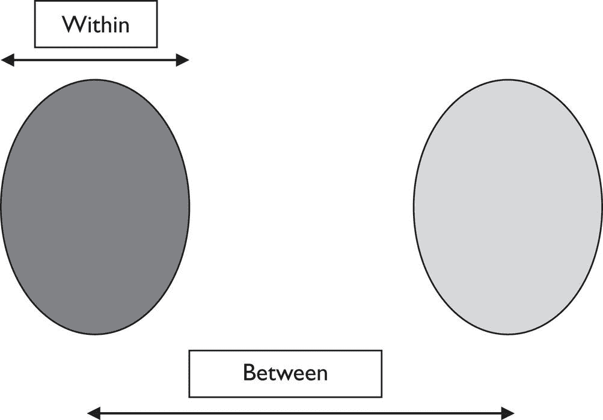

图 2.7 LDA 中的类别分离。

使用 LDA 的目的是在寻找子空间时考虑到训练图像的类别成员函数，从而对 PCA 进行改进。它基于这样一个概念：将单幅脸部作为输入，并使用基于马氏距离方法的评分函数 [[55]](#ref-list.xhtml_refchapter_55)。它的优点是能够最大化簇之间的距离同时最小化簇内距离，但它没有将多图像作为输入。

## 算法：

它与特征脸（Eigenface）算法非常相似，首先；将训练图像投影到子空间。然后，通过将测试图像投影到同一个子空间来计算相似性度量。子空间的测量通过以下定义的步骤进行：

1. 通过测量属于同一类的项目之间的差异程度来计算类内差异。
2. 计算类与类之间的差异。
3. 为两个类别（类内差异和类间差异）计算特征向量和特征值。
4. 然后，根据其对应的特征值对特征向量从高到低排序，并保留值最高的特征向量。这些特征向量就是费舍尔基向量。
5. 计算图像与费舍尔基向量的点积。此计算将图像投影到子空间上。一旦训练图像被投影到子空间，就必须收集它们并根据它们之间的远近程度进行分类。计算图像之间的距离可以建立它们的相似性。例如，彼此距离最近的图像可以被认为是接近且相似的，而距离较远的图像则被认为不相似。

LDA 技术试图通过降维方法对数据集进行判别，LDA 测试阶段的框图如图图 2.8 所示 [[43]](#ref-list.xhtml_refchapter_43)。

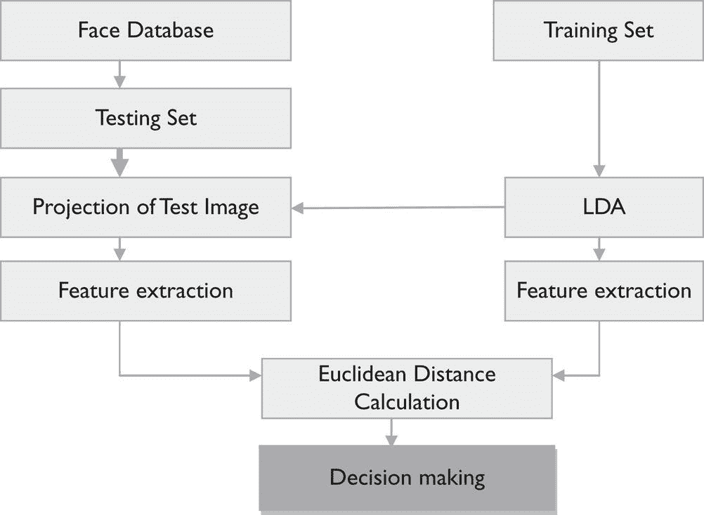

图 2.8 LDA 测试阶段的框图。

## 2.2.4 离散余弦变换 (DCT)](#contents.xhtml_toc3_46)

这是精确且稳健的识别系统之一，通过使用不同的归一化方法，可以增加其对脸部几何和光照变化的鲁棒性。能量聚集特性使得 DCT 可用于图像处理和信号分析。DCT 能够将大部分信号信息压缩到少量的系数中，这就是它被用于面部特征提取的原因。当离散余弦变换应用于脸部图像时，它将提供一个包含低、高频系数的矩阵 [[56]](#ref-list.xhtml_refchapter_56)。DCT 的性能很大程度上受到矩阵左上角系数幅度变化的影响。在此，在应用特征提取之前，会应用光照归一化以补偿这些系数差异，并将块设置为更更均匀的强度。DCT 是一种用于图像编码的高效技术。为了补偿图像质量，可以忽略某些高频系数。在脸部表情、光照条件等发生变化的情况下，使用二维 DCT 方法进行特征提取，以提高识别系统的性能。DCT 技术的挑战是现实应用中用于特征提取的光控光照条件。光照归一化（IN）是一种预处理技术，用于补偿不同的光照条件。它由通过余弦函数叠加表示的以不同频率波动的数据点组成 [[56]](#ref-list.xhtml_refchapter_56)。变换被定义为用于信号转换的操作，即通过逆变换将一个领域转换为另一个领域。该变换用于压缩标准，其中系统接收脸部作为输入图像，然后对脸部进行归一化或裁剪，计算脸部之间的距离，最后进行比较。DCT 还像其他变换一样尝试使图像数据去相关。在去相关后，每个变换系数都可以独立编码，而不会丢失压缩效率。它在变化较小时工作良好。它在相同朝向、姿态、光照等情况下工作良好，但其成功率并不高。

## 2.2.5 Gabor 小波](#contents.xhtml_toc3_47)

它将图像表征为局部的方向选择性和频率选择性特征。该技术使用滤波器来提取局部特征，这些特征实际上应用于许多图像，并以特定的角度或方向对齐进行提取 [[43]](#ref-list.xhtml_refchapter_44)。该技术以 Dennis Gabor 命名 [[57]](#ref-list.xhtml_refchapter_57)。它是一种带通线性滤波器，在姿态和光照条件大变化的情况下表现良好。它在空间和频率域上都实现了优的分辨。小波是满足某些数学要求的函数，用于表示数据或其他函数。小波技术用于在不同尺度或分辨率处理数据。如果信号具有较大的窗口，则计算粗略特征；如果信号具有较小的窗口，在这种情况下计算精细特征。小波非常适合近似具有尖锐断层的数据。该技术可以应用于许多领域：天文学、声学、核工程、信号和图像处理、音乐、磁共振成像、语音识别、光学、分形、湍流、地震预测、雷达和人类视觉。图 2.9 显示了 Gabor 小波技术的框图。

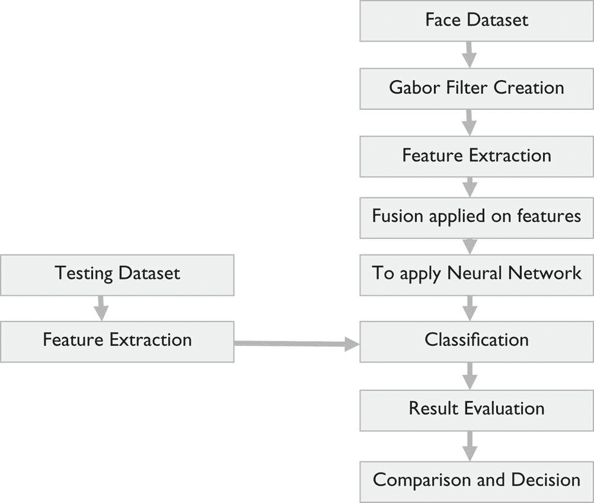

图 2.9 Gabor 小波技术的框图。

该技术具有许多特性使其在许多应用中具有吸引力：

* 对光照变化不敏感
* 对脸部表情变化不敏感
* 平移和旋转不变性

尽管有优点，该技术也有一些缺点：

* 计算复杂度高


- 对内存容量的要求
- 特征向量的维度很高

结合 `ICA` 算法的 PCA 在较少或较多的姿态、光照变化情况下效果良好，在计算面部特征之间的距离时，它们使用了 `Euclidean distance` 概念；降维方法由 `PCA` 算法使用，这对于保留有用信息的同时压缩数据是必要的。独立特征的提取由 `ICA` 算法完成，但其他算法在较少或较多的姿态变化、光照变化情况下效果良好。`LDA` 算法没有考虑多图像，并基于马哈拉诺斯距离进行计算 [[57]](#ref-list.xhtml_refchapter_57)。`DCT` 仅在变化较小时效果良好，而 `Wavelet` 仅在姿态和光照因素大幅变化时效果良好。

## 2.3 提出的混合 PICA 算法

自动人脸识别已成为一个非常活跃的研究领域，而自动对独立在家生活的人进行健康监测是一种用于向其家庭成员提供个人健康信息的方法。图 2.10 提供了一个用于人脸识别的集成模型。

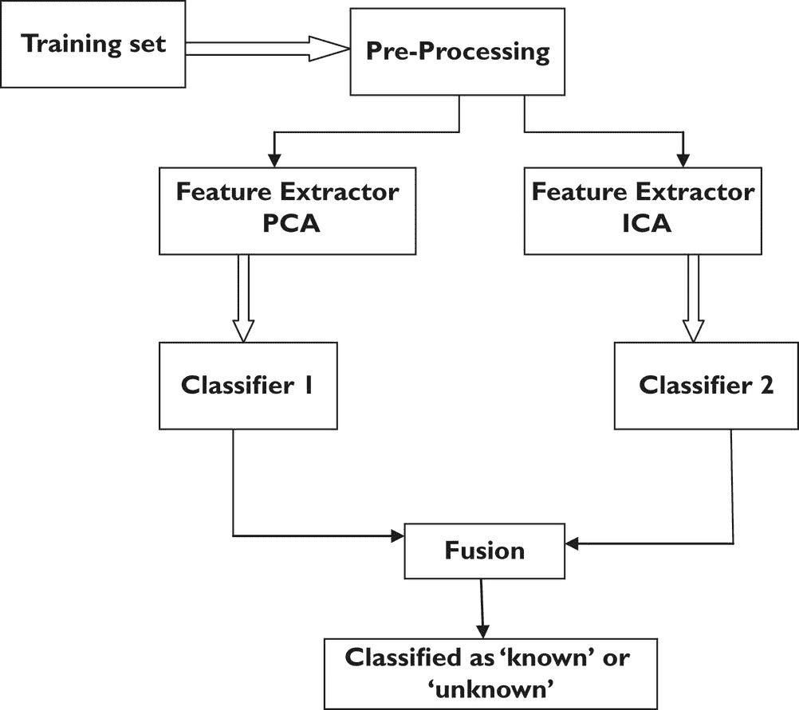

图 2.10 用于人脸识别的集成 PICA 模型。

我们的工作使用了 `PCA` + `ICA` 的结合方法进行特征提取，因为与单独的特征提取技术相比，这种方法有助于以较高的识别率实现我们的目标；并在此组合中，使用名为 `back propagation` 的神经网络作为分类器。`PCA` 的演变 [[58]](#ref-list.xhtml_refchapter_58) 是通过使用 `Eigenvectors` 完成的，通过这些 `Eigenvectors` 对给定输入考虑特征，称为主成分。它的优势是一个包含数据压缩的降维过程，但没有信息丢失。

`ICA` 是一种非常有用的技术 [[58]](#ref-list.xhtml_refchapter_58)。馈向神经网络是由三层组成的简单网络：a) 输入层，b) 隐藏层和 c) 输出层。

以前人脸识别系统的大部分工作由单一特征提取技术加分类器组成，但在提出的工作中使用了四步程序。

1. 选取训练集并对其进行预处理，其中使用 `PCA` 和 `DCT` 等不同方法对图像进行归一化。
2. 使用人脸识别算法 `PCA` + `ICA` 的组合提取独立特征。
3. 选择馈向神经网络进行分类，对给定的输入图像进行分类。
4. 结合每个神经网络的输出对输入图像进行分类，定义该输入图像的类别。

### 提出的混合 PICA 算法：

1. 首先建立训练集。
2. 然后，在训练集上应用 `mark features` 函数来标记输入图像的眼睛和嘴部位置。
3. 应用 `align faces` 函数，将 `JPG` 格式的人脸图像转换为 `pgm` 格式，因为 `MATLAB` 工具支持 `pgm` 格式。
4. 使用名为 `C` 的矩阵存储所有图像。
5. 应用 `PCA` 函数：
    * 数据中心化：通过从均值图像中减去每幅训练图像，对每幅训练图像进行中心化，并存储在名为 `A` 的矩阵中。
    * 计算协方差矩阵：将矩阵 `A` 中的中心化图像乘以其转置，形成协方差矩阵 `L`。如果每张图像的大小为 $N*N$，则该矩阵的大小为 $N²*N²$。
      `L = A * A'`
    * 计算 `Eigenvectors`：寻找 $N²*N²$ 矩阵的 `Eigenvectors` 是不可行的。因此，使用矩阵 `A'*A` 容易计算 `Eigenvectors`。
      $C = 1/(M)\sum\limits_{i = 1}^{M}{Ki \ast Ki^{T} = B \ast B^{T}(N^{2} \ast N^{2}matrix)}$
6. 应用 `ICA` 算法：从之前计算的 `Eigenvectors` 开始，在中心化和学习的帮助分析 `ICA`。
    * 中心化：意味着对 `x` 进行球化或去除 `x` 中的一、二阶统计量。
    * 学习：计算持有原始数据的 `Xx`。
      `Xx = inv(wz) * x`
    * 计算输出协方差：通过提取的均值和原始数据计算。
      `Cov(xx')`
      其中 `uu = w * wz * xx`
    * 设置阈值并显示结果。
7. 使用 `MATLAB` 工具和 3G 狗接器向类别成员发送短信。

## 2.4 实现

为了衡量 `PCA` 和 `ICA` 的性能，使用 `MATLAB` 工具生成了混合 PICA 算法的代码。与 `C` 或 `Java` 语言实现相比，优先选择此工具是为了提高识别率。主成分分析 (`PCA`) 与独立成分分析人脸识别算法的结合 [[58]](#ref-list.xhtml_refchapter_58) 用于面部特征提取，并作为分类器或识别人脸的馈向神经网络 [[57]](#ref-list.xhtml_refchapter_57), [[58]](#ref-list.xhtml_refchapter_58)。

**PCA 实现**：`PCA` 算法由两个函数组成：`PcaFn.m` 和 `Test.m`。`PcaFn.m` 负责算法初始化、数据训练以及图像投影到降维空间。

在此，输入包含预处理后的图像集。输出包含矩阵形式的数据、图像均值、特征值和降维空间。

`PCA` 实现步骤：
* 从路径读取人脸图像，将其重塑为向量形式并创建矩阵 `C`。
* 创建训练列表，包含数据集。
* 计算图像均值。
* 从所有图像中减去均值并保存结果。
* 计算 `Eigenvectors` 和 `Eigenvalues`。
* 计算 `Eigenfaces`。
* 人脸图像投影到降维空间。

`Test.m` 负责图像识别。它读取图像与数据库中所有其他图像之间的差异。距离最短的图像被认为是识别出的图像。

在此函数中，输入包含图像路径、均值、降维空间，输出提供匹配分数和关联图像。

**ICA 实现**：`ICA` 算法由五个函数组成：`PcabigFn.m`、`spherex`、`zeromn`、`runica` 和 `sep96`。`PcabigFn.m` 负责通过通过计算协方差矩阵并重建特征向量来计算 `PCA`。

在此算法中，输入包含列为人脸图像的矩阵 `C`，输出包含 `V`、`R`、`E`。`V` 意味着列中包含 `Eigenvectors` 的矩阵，`R` 意味着行中的 PCA 系数，`E` 意味着与特征向量关联的特征值矩阵。

`runica` 用于运行名为信息极大化的算法以寻找 $n$ 个独立成分，其中 $n$ 代表提供给算法的人脸图像数量。在此，输入包含一个行图像灰度值的矩阵 `x` 类，输出包含 `w` 和 `uu`，其中 `w` 意味着包含独立成分的矩阵，`uu` 意味着分离的输出信号。

`spherex` 被 `runica` 函数调用。它通过白化矩阵 `w[z]` 对训练向量 `x` 进行球化。在此，输入包含一个要求预定义 `x` 的函数，输出包含 `w[z]` 和 `x`，其中 `w[z]` 是白化矩阵的。


`Sep96` 由 `runica` 函数运行。它实现了信息最大化（info max）算法的学习规则。它通过通过白化矩阵 `w[z]` 对训练向量 `x` 进行球化。在该函数中，`input` 包含 `x`、`w`、`count`、`sweep`，其中 `x` 定义了图像行的灰度值，`w` 定义了一个存储学习规则权重的矩阵（初始化为单位矩阵），`count` 解释迭代过程中增加的计数器，`sweep` 存储扫描次数的计数器，`output` 存储 `w` 的值，其中包含一个由算法计算出的训练权重的矩阵。

人脸如何识别以及当人脸被识别为已知或未知时的完整步骤，使用 MATLAB [[59]](#ref-list.xhtml_refchapter_59) 工具和数据狗棒向家庭成员手机发送消息的程序如下：

`图 2.11` 显示了人脸识别系统的基本 GUI。它包含了识别人脸的所有步骤，如标记特征、对齐特征、加载人脸、测试和训练。

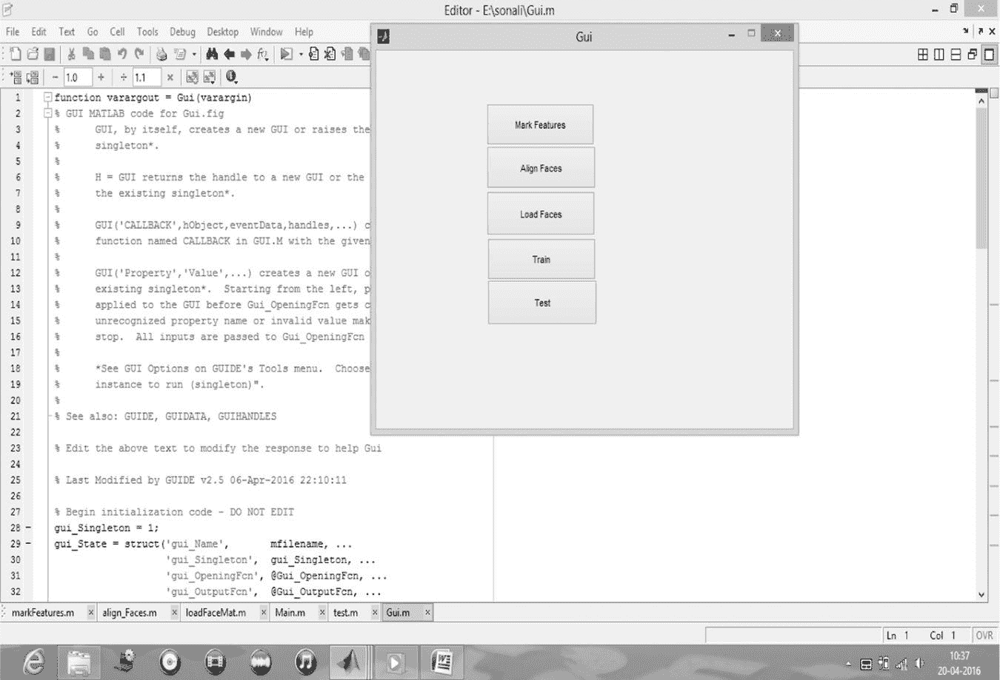

图 2.11 人脸识别过程界面。

### 标记面部特征
这是识别人脸的第一步。它包含在预处理函数中，处理后采用 512*512 像素的 JPG 格式图像。在此过程中，右眼、左眼和嘴巴的双重特征被手动标记，如 `图 2.12` 和 `2.13` 所示，并获得大小为 1*6 的矩阵 `Labels.mat`，显示了 `图 2.14` 中单张人脸六个特征的值。此图显示了一个具有 6 列的矩阵形式，用于使用 `ICA` 算法提取特征，剩余特征随后使用 `PCA` 算法提取。在所提工作中，共提取了 30 个特征用于人脸识别。

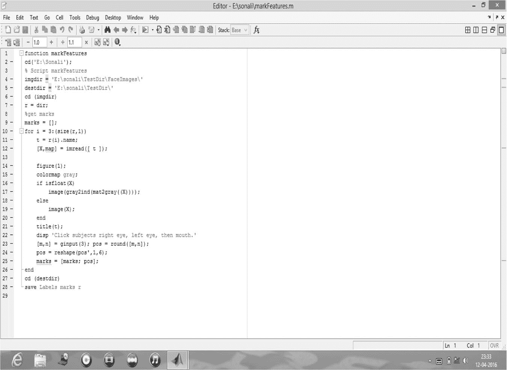

图 2.12 标记面部特征。

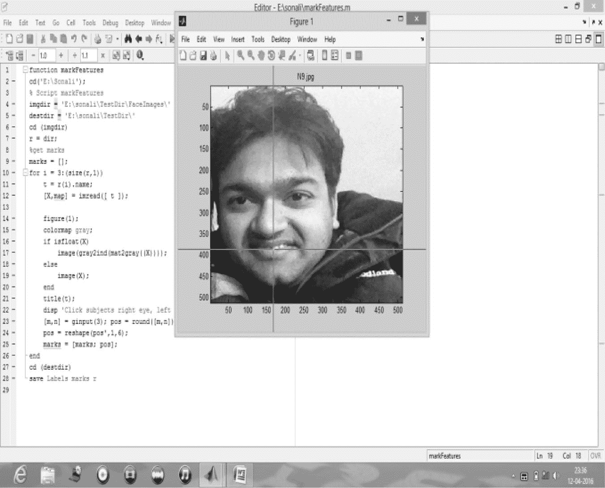

图 2.13 步骤 1：标记面部特征（左眼、右眼和嘴巴）。

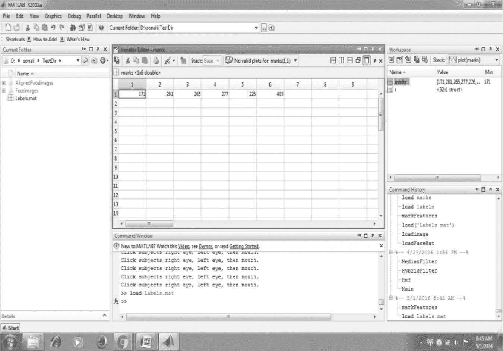

图 2.14 步骤 2：标记面部特征的矩阵形式。

### 对齐人脸
这是标记特征后的第二步。在此模块中，嘴巴和眼睛的位置从 JPG 格式被对齐为 `pgm` 格式，如 `图 2.15` 和 `2.16` 所示。当在标记特征中使用 JPG 格式并加载到 `MATLAB` 工具时，显示该格式不兼容，这就是为什么在此步需要进行转换。


图 2.15 对齐人脸。


图 2.16 步骤 3：为了对齐人脸从 JPG 到 pgm 的格式转换。

### 加载人脸
此步将所有对齐的人脸加载到名为 `C` 的矩阵中，其中包含 41 行和 70613 列。该函数的作用是重塑，这意味着以矩阵的形式加载所有人脸，如 `图 2.17` 所示。


图 2.17 步骤 4：所有图像的矩阵形成。

### 主函数
这是主要步骤，其输出了有多少图像与训练数据库匹配，从百分比上显示，如果拍摄了 41 张图像进行特征标记，那么在从 41 张图像（称为训练数据库）中，由 `load faces` 创建的矩阵中有多少张图像。它的用处是在进入下一步（即图像测试）之前，检查训练数据库是否完整。`图 2.18`、`2.19` 和 `2.20` 分别显示了主函数的输出，该输出提供了 `pc` 变量。如果 `pc` 的值为 100%，则说明训练数据库完整，意味着该模型的准确性为 100%。


图 2.18 运行主函数进行验证。


图 2.19 `pc` 和 `Rankmat` 形式的输出。


图 2.20 步骤 5：数据库形成验证。

### 训练
下一步是通过采用前馈神经网络对网络进行训练，以检查 `MATLAB` 工具中所提系统的性能。此步从 `load faces` 模块的矩阵 `C` 中提取带有 `PCA` 特征的 `ICA`，如 `图 2.21`、`2.22` 和 `2.23` 所示。


图 2.21 在 `MATLAB` 中创建神经网络。


图 2.22 步骤 6：使用前馈神经网络进行验证。


图 2.23 神经网络处理完成。

### 测试
这是识别属于已知或未知类别的图像的步骤，并类别发送消息。例如，如 `图 2.24` 所示，如果人脸被识别为邻居类别，则发送消息。在所提工作中有四个类别：家庭、朋友、邻居和未知。`表 2.1` 显示了人脸识别情况下接收方的值。如果人脸被识别为家庭类别，情况下消息将发送给家庭成员。在第二种情况下，如果人脸被识别为属于朋友类别，则消息将发送给朋友和家庭成员，显然在任何情况下消息都会发送给家庭成员，因为我们正在为独居的个人提供安全保障。因此这一步是必要的。


图 2.24 步骤 7：测试图像的结果显示。

表 2.1 对应的类别

| 序号 | 类别 | 接收方 |
| --- | --- | --- |
| 1 | 家庭 | 家庭 + 邻居 |
| 2 | 朋友 | 家庭 + 朋友 |
| 3 | 邻居 | 家庭 + 邻居 |
| 4 | 未知 | 家庭 |

### 性能图
此步通过关注获取最小均方误差来寻找所提工作的神经网络性能，选择神经网络分类器的值，它提供了训练数据集、测试数据集和误差下方某些类型的验证数据，如 `图 2.25` 所示。在 `MATLAB` 工作区运行 `nntool`，加载命名为 `inputs.mat` 的输入数据和命名为 `targets.mat` 的输出数据，并建立网络训练数据，然后运行此工具进行评估。


图 2.25 图像验证和识别的性能图


此前，数据库中已经实现了 `PCA`、`ICA` 和 `LDA` 等多种方法来分析系统效率。表 2.2 显示了所提工作与单一 `PCA` 的对比表 2.3 描述了所提工作与单一 `ICA` 的关系，最后表 2.4 描述了所提工作与单一算法的对比值。结论得出，本的混合方法提供了比以前方法更好的结果。

### 表 2.2 识别率角度的单一 PCA 性能

| 序号 | 数据集 | 识别率 |
| --- | --- | --- |
| 1 | I(10 张图像) | 98% |
| 2 | II(20 张图像) | 98% |
| 3 | III(30 张图像) | 98% |
| 4 | IV(40 张图像) | 97% |
| 5 | V(50 张图像) | 93% |

### 表 2.3 识别率角度的单一 ICA 性能

| 序号 | 数据集 | 识别率 |
| --- | --- | --- |
| 1 | I(10 张图像) | 92% |
| 2 | II(20 张图像) | 92% |
| 3 | III(30 张图像) | 93% |
| 4 | IV(40 张图像) | 98% |
| 5 | V(50 张图像) | 98% |

### 表 2.4 PCA、ICA 和所提混合 PICA 算法的对比

| 序号 | 数据集 | PCA+NN 识别率 | PCA+NN 识别率 | 混合 PICA+NN 识别率 |
| --- | --- | --- | --- | --- |
| 1 | I(10 张图像) | 98% | 92% | 99% |
| 2 | II(20 张图像) | 98% | 92% | 99% |
| 3 | III(30 张图像) | 98% | 93% | 99% |
| 4 | IV(40 张图像) | 97% | 98% | 99.5% |
| 5 | V(50 张图像) | 93% | 98% | 99.5% |

图 2.27 描述了单一 `PCA` 关于识别率的性能图，图 2.28 描述了单一 `ICA` 关于识别率的性能图，图 2.29 显示了所提混合 `PICA` 算法与单一 `PCA` 和单一 `ICA` 算法的分析。在该图中，若干图像作为 x 轴参数，识别率百分比作为 y 轴。该图显示在所提混合 `PICA` 算法的情况下，识别率为 99.5%。


图 2.27 识别率角度的单一 PCA 性能图。


图 2.28 关于识别率的单一 ICA 性能图。


图 2.29 识别率角度的所提混合 PICA 算法与以往算法的分析。

通过使用带有 `MATLAB` 工具的 3G 狗棒获得预期结果，使得手机可以接收来自与狗棒注册号码的短信。通过在 `MATLAB` 代码中插入多个号码可以同时向多个人发送消息 [[59]](#ref-list.xhtml_refchapter_59)。使用命令数量来产生接收消息的操作。图 2.30 显示了使用 `MATLAB` 工具和 3G 狗棒在手机上接收的消息截图。


图 2.30 手机上显示的短消息截图。

## 2.6 总结

提出了一种名为 `PICA` 的新技术，通过融合两种现有的脸部识别算法 `PICA` 进行人体身份识别，与单一识别算法相比，它可以显著提高识别率。所提系统使用了 `PCA` 与独立成分分析 (`ICA`) 的混合组合来提取面部特征，并使用反向传播馈神经网络来识别人脸。实验结果显示，混合方法在特征提取中采用了 `PCA` 和 `ICA` 的特征，并为人脸识别提供了卓越的性能。在数据集上进行了大量实验以计算各种特征的性能。未来，在采集和存储个人图像时可能需要考虑安全措施，人脸识别可以应用于 iPhone 以解锁手机。面部解锁是一个允许使用脸纹解锁手机的功能，所提混合模型中也可以嵌入集成传感器，以提供安全方便的环境。

# 第 3 章

## 用于个人家庭安全的混合 MFRASTA 语音识别技术

DOI: [10.1201/9781003120933-3](https://doi.org/10.1201/9781003120933-3)

### 3.1 语音识别引言


语音识别技术的研发过程始于 20 世纪 70 年代初，在 IBM 公司和卡内基·梅隆大学研究人员的帮助下，首次自动语音识别应用于 1952 年。人类也可以通过语音与机器通信，但这是一个非常缓慢的过程。因此，自动语音识别应运而生，可以通过人类命令或指令进行操作。通过使用这项技术，可以验证人的声音以确定其身份，并将其用于访问数据库服务、语音邮箱、电信（意味着在手机中，人们只需说出拨打对象的姓名即可拨号）等应用程序。语音识别问题通过理解其复杂性得到了解决。自动语音识别的应用领域很多：医疗保健、个人计算、工业等。这一概念被用于自动电话系统，该系统帮助将呼叫者引导至正确的部门。例如，如果有一个命令是“按键 3 获取支持”，某人说出 3，就意味着在这里使用了语音识别概念。另一个例子是 Google 语音，它允许人们从笔记本电脑、iPad 或平板电脑提问并搜索问题，数字助手也是语音识别的一部分，帮助用户与 Siri、Amazon Echo 等数字助手交互，并帮助回答问题。

为了语音识别的正常工作，需要一台带有声卡、耳机或麦克风的计算机。语音识别系统的运行考虑四个参数：它必须具有编码形式和它将要识别的话语数量；在识别时，必须有一种模式匹配算法，将输入话语的表示与词汇表中的所有话语进行比较；使用任何算法比较输入话语与词汇表；最后是操作识别系统的接口。存在许多其他生物识别认证技术，如人脸、签名、虹膜识别等。但语音识别技术是根据某些标准选择的：可访问性、区分性、稳健性等。区分性用于衡量个体间模式的差异，稳健性是指模式不可重复且不能发生巨大变化，可访问性定义了向传感器设备呈现数据的简易程度 [[ [60]](#ref-list.xhtml_refchapter_60)。通过声音进行识别非常经济，因为采集语音样本的设备廉价且容易获得。图 3.1 显示了语音识别系统的示意图，输入语音进入声模型模块，在其中发生了从语音到向量统计表示的转换。然后，通过数据库中存储的许多单词进行单词搜索，并提供识别话语的输出。


图 3.1 语音识别系统示意图。

该语音识别系统主要由两个步骤组成：

* 特征提取
* 特征匹配

特征提取是作为前端的主要步骤。它像系统的核心。它从单词中提取少量数据，然后随后用于表示每个人。与原始数据表示相比，特征是高级表示。它压缩了单词的幅度，而不对语音信号功率造成任何损害。下面是 图 3.2 中的特征提取图，显示了提取特征所需的 Basic 步骤：


图 3.2 特征提取步骤。

特征匹配用于通过将提取的特征与完整的输入样本集比较来确定未知身份。这意味着该系统分两个阶段：训练阶段和测试阶段。

在训练阶段，它对应于从标记数据中学习的过程，每个人都将以某种方式提供自己的声音样本，以训练系统进行后续处理，如 图 3.3 所示。


图 3.3 提取语音特征的训练阶段。

在测试阶段，当某人的声音被测试时，输入语音与所有存储的样本进行匹配，并在此基础上决策。这一过程在 图 3.4 中所示。


图 3.4 特征匹配的测试阶段。

该系统中使用的基本术语是：

* **话语 (Utterance)：** 定义为计算机系统具有某些意义信息的所说单词。它可以是一个单独的单词一组单词，也可以是一个句子。它们随后被发送到语音引擎进行进一步处理。
* **词汇表 (Vocabulary)：** 语音识别系统识别的一组单词。显而易见，小词汇容易识别，而大词汇难以识别。
* **准确率 (Accuracy)：** 定义为识别器正确识别单词的程度。它用于识别话语。

语音识别系统可以根据识别的语音单词数量进行分类：

* **孤立词 (Isolated word)：** 需要每个单词在窗口的相邻部分都有静音。它一次只处理一个单词：这意味着单词之间需要停顿。这是最简单的语音识别形式，因为结束点更容易找到。
* **连读词 (Connected words)：** 与孤立词相同，但它允许单独的单词以最小的时间间隔隙运行在一起。
* **连续语音 (Continuous speech)：** 不由停顿分隔；它是基于单词组合在一起的语音。在这种情况下，人以自然的方式说话，很难识别，因为需要定义单词边界的方法。它可以用于语音拨号器，在其中可以实现解放眼、解放手的拨号。

有许多技术用于分析语音波形：

* **波形 (Waveform)：** 语音信号是听话者和声源之间压力变化的序列。在图中图中，水平轴是从左到右的时间参数轴，曲线表示信号中压力参数的变化。
* **音高 (Pitch)：** 语音是一个由两部分组成的过程：声源和滤波。在分析最终语音话语时，它指向获取声音的基础频率。
* **频谱 (Spectrum)：** 它给出了某一时刻频率分布的表示。
* **倒谱谱 (Cepstrum)：** 这种技术用于语音分析，它是基于信号的光谱视图。

语音识别技术取得了许多进展。以前的方法在所有条件下都有良好的定义，但如果在语音识别中使用单一的特征提取技术，它们并不能提供良好的识别率结果，因此需要改进。所提研究工作的基本目标是生成一个能够提供高识别率、高准确性和高效率的系统，为独自居住在家的人提供安全。为了实现这一目标，实现了一种用于特征提取的混合 `MFRASTA` 算法，它比现有算法提供了更有用的结果。该混合算法使用 `MATLAB` 工具实现。


语音识别系统分为领域相关系统和领域无关系统：领域相关系统通过将预注册用户的语音与数据库中存储的语音样本进行比较，来识别其所说的词汇；而领域无关系统则在没有该特定个人先验经验的情况下识别词汇。有两个主要因素使语音识别系统处于挑战性局面：嘈杂环境和距离因素。存在许多影响语音识别系统可靠性和性能的参数：

* 说话者根据情绪、性别、语速、口音或发音的声音变化
* 随噪声变化的环境
* 传输通道的变化
* 准确性
* 用户响应性
* 性能
* 可靠性
* 容错性

## # 3.3 语音识别算法

语音识别是一种通过获取语音波形中的个体信息来自动验证说话者的技术。可以获得两种类型的语音帧：频谱特征和韵律特征。频谱特征可以通过倒谱分析确定，其中从输入样本中计算 `FFT`。然后计算功率谱并对其应用对数值。韵律特征与句子的书字符没有直接对应关系。有许多算法用于语音识别。以下是所有算法及其优缺点的解释。

### ### 3.3.1 梅尔频率倒谱系数 (MFCC)

这是由 Davis 和 Mermelstein 在 20 世纪 80 年代开发的一种流行技术。众所周知，语音自动识别中的重要步骤是获取特征，即识别音频信号中利于识别语言内容的元素，并丢弃携带背景噪声和情绪等信息的其他内容 [[61]](#ref-list.xhtml_refchapter_61)。`MFCC` 基于使用梅尔尺度的频域，该尺度又进一步基于人耳尺度。它是一种基于音频的特征提取技术，用于从语音中提取与人类听语音时相似的参数，同时弱化了所有其他信息 [[62]](#ref-list.xhtml_refchapter_62)。`MFCC` 的框图如图图 3.5 所示。


图 3.5 `MFCC` 技术框图。

**预处理：** 首先，将语音信号作为输入，然后对其进行预加，其中高频被人为放大，如图图 3.6 所示。在此过程中，分帧意味着信号与滑动状态下的若干矩形窗相乘，但矩形窗的困难在于旁瓣涉及的高功率，因此它可能导致频谱泄漏。为了防止这个问题，使用了汉明窗（Hamming window）。长度为 `n` 的汉明窗滤波器系数计算如下：

`W*(n) = .54 − .46*Cos*(2∏*n*/*N* − 1)`

`N` = 总数
`n` = 当前样本


图 3.6 MFCC 预处理阶段。

**梅尔频率倒谱系数：** 它们使用三角形形状组滤波器计算，滤波器的中心频率在 1000 Hz 以下线性间隔，在 1000 Hz 以上按对数间隔。每个滤波器通过其两个相邻滤波器的中心频率来计算其带宽，它取决于滤波器组的频带以及为设计而选择的滤波器数量。

**静音检测：** 前端语音识别系统中必要的一个重要步骤。当人说话时，系统无法控制，因此这一步骤必须确定人何时实际开始说话，并立即将该词的帧转换为瞬态。

**加窗：** 这是一个重要步骤，对每个单独的帧进行加窗，以最小化减少信号在帧开头和结尾的不连续性。在此处，用于减少不连续性或频谱失真的标准是使用窗在帧的开始和结束处用零值来贴合信号。`MFCC` 中的窗描述为：

`W*(n), 0 <  = n < = N − 1`

其中 `N` = 每帧的样本数

`Y1*(n) = x1*(n)*w*(n)`

其中 `0 < = x < = N− 1`

**FFT：** 它将由 `N` 表示的样本帧从时域转换为名为频域的另一个域。这是一个用于实现离散傅里叶变换的快速算法，其定义在 `N` 个样本集 `{X[n]}` 上如下：

```
X_{n} = \sum\limits_{k = 0}^{N - 1}{X_{k}e^{- 2\prod jkn/N}}
```

其中 `n` = 0, 1, 2, 3 … N−1
`j` 表示虚部

**梅尔频率翘曲：** 语音信号包含的声音频率并不遵循线性尺度。因此，对于每个实际频率为 f（赫兹测量）的音调，另一个音高则在一个称为梅尔尺度的更好尺度上测量。它是 1000 Hz 以下线性间距和 1000 Hz 以上对数间距的一部分。使用以下公式计算给定频率的梅尔系数：

`Mel*(f) = 2595 − log10`

**倒谱：** 该参数将对数梅尔谱转换回时间，输出称为 `MFCC`。频谱的倒谱表示提供了局部频谱的良好表示。通过以下公式计算 `MFCC`s：

```
C_{n} = \sum\limits_{k = 1}^{k}{(\log S_{k})Cos[n - 1/2]}
```

其中 `n` = 1, 2 ... k

优点：
* 它用于语音处理任务。
* 识别准确性和性能很高。
* 复杂度较低。

缺点：
* 该技术的噪声鲁棒性较差。
* 它只考虑功率谱而忽略了相位谱，因此提供的表示有限。
* 它无法识别能量不同的相同词。

### ### 3.3.2 感觉线性预测 (PLP)

PLP 类似于基于语音短期频谱的线性预测，但这种技术包含了几种基于心理物理学的更好方法 [[63]](#ref-list.xhtml_refchapter_63)。在此技术中，使用了三个概念来推导出听频谱估计：

* 关键频分辨率
* 等响度曲线
* 强度响度律

它排除了语音无关信息，从而提高了语音识别率。

对巴克尺度滤波器组应用了频率翘曲。在此技术中，第一步是将频率转换为巴克尺度（Bark Scale），该尺度是人耳频率分辨率更好的表示，这种表示如图图 3.7 所示。对应于音频频率的频率为：

`Ω*(w) = 6ln [*w*/(1200∏) + [(*w*/(1200∏))² + 1]^(0.5)]`


Bark 滤波器组将三个因素整合进一个滤波器组中：频率翘曲、平滑和平采样。等响度预强调对滤波器组输出进行加权，以模拟听觉灵敏度。等化后的值根据斯蒂文斯幂律通过将每个值提升 `0.33\.` 次方进行转换。生成的听觉扭曲线谱进一步通过线性预测进行处理。对听觉扭曲线谱应用线性预测意味着计算信号的预测系数。最后，通过等于模型频谱对数的递归以及逆傅里叶变换，从预测系数中获得倒谱系数。

#### 优点

* 它减少了清浊音和送浊音之间的差异。
* 它产生的特征向量是低维的。
* 它基于语音信号的短时频谱 [[63]](#ref-list.xhtml_refchapter_63)。
* `PLP` 的系数主要被使用，因为它们提供了语音频谱高能量区域的正确值。
* `LPC` 以相同的方式近似所有频率的语音频谱，而这种表示需要了解人类听觉的原理。

#### 缺点

* 它产生的特征向量依赖于共振峰幅的整个频谱平衡。
* 它的频谱很容易被通信信道、噪声和所用设备改变。

### 3.3.3 线性预测代码 (LPC) [[63]](#ref-list.xhtml_refchapter_63)

`LPC` 是语音信号处理最重要的特征，它提取提取音高、共振峰和频谱等语音参数。该技术用于设计用户的语音产生。它根据之前的特征预测未来的特征。为了高效传输和存储，最好对信号进行压缩。数字信号在传输前被压缩，以有效利用无线媒体中的信道。它在中低比特率编码中被广泛使用。当我们通过语音分析滤波器通过信号以消除信号中的冗余时，会产生残差误差。与原始信号相比，可以使用较少的比特进行量化。因此，现在不再传输整个信号，而是传输此残差误差和语音参数来生成原始信号。基于最小 MSE 理论计算参数模型，这种技术被称为线性预测。图 3.8 和 3.9 表示了 `LPC` 技术包含的框图和步骤。

1. **预强调**：第一步是语音分析，通过滤波帮助进行，其目标是在频谱形式上平滑信号并减少精度效应的影响。滤波器系数的值必须在 `0.9` 和 `1\.` 之间 [[64]](#ref-list.xhtml_refchapter_64)。
2. **分帧创建**：第一步之后，开发的语音被分为若干个包含 `N` 个样本的帧，每个样本的范围为 20 到 40 秒。一个必要要求是两个相邻帧之间有 10 ms 的标准重叠，以确保帧之间的平稳期。
3. **应用窗函数**：这一步获取生成的帧并将其与 `hamming window` 相乘。主要目的是最小化边缘效应。
4. **LPC 计算**：这是最后一步，在经过加窗处理的语音样本帧上应用自相关技术。


图 3.8 LPC 技术框图。


图 3.9 LPC 技术框图。

它通过估计共振峰来分析语音信号，从语音信号中消除它们的影响，并估计剩余 buzz 的强度和频率。消除共振峰的过程称为逆滤波，剩余的原始称为残差。

### `LPC` 的类型 [[64]](#ref-list.xhtml_refchapter_64):

有多种 `LPC` 技术命名如下：

* 码激励 LPC (CELP)
* 基音激励 LPC
* 残差激励 LPC
* 语音激励 LPC
* 多重激励 LPC (MPLPC)

#### 优点

* 它是一种静态技术。
* 它是提供语音参数的可靠、准确且稳健的技术。
* 计算速度快，并能提供准确的语音参数。
* 它用于低比特率语音编码。
* 它是信号分析的强大方法之一。
* 它最小化了给定时间内真实语音信号与计算信号之间的平方差和。

#### 缺点

* 它无法区分具有相似元音声音的单词。
* 它产生残差误差作为输出，导致语音质量较差。

### 3.3.4 相对频谱感知线性预测 (RASTA-PLP)

该方法用于在噪声环境中录制语音时增强语音。在这里，RASTA 技术与 `PLP` 技术合并，形成名为 `RASTA-PLP` 的组合，这种组合增加了单个 `PLP` 方法包含的鲁棒性。该方法利用的事实是周围环境的临时属性与语音信号的属性不同 [[65]](#ref-list.xhtml_refchapter_65)。与 `PLP` 结合时，它提供了更好的性能。`RASTA-PLP` 由 Hynek Hermansky 提出，是一种封装频谱以最小化说话者之间差异的方法，从而保留有用信息。`RASTA` 是一种应用于频率每个子带的带带滤波器技术。图 3.10 显示了该技术中的有用过程。

```
H(z))=(0.1)(2+z^(-1)-z^(-3)-z^(-4))/(1-.98z^(-1)))
```

#### 优点

* 它具有鲁棒性。

#### 缺点

* 在清洁环境下性能差。


图 3.10 RASTA-PLP 技术框图。

### 3.3.5 零交叉峰值 (ZCPA)

该技术由 Chok-ki Chan 开发。它基于说话者依赖系统人类声音系统 [[65]](#ref-list.xhtml_refchapter_65)。ZCPA 使用过零区间来表示信号信息，并提供幅值来表示强度信息。通过这种技术，频率和幅值结合形成特征向量的完整输出。该技术将一组单词分为两类，使识别过程变得更容易，如图 3.11 所示。


图 3.11 ZCPA 技术详细图。

### 3.3.6 动态时间规整 (DTW) [[66]](#ref-list.xhtml_refchapter_66)

这是时间排列分析中估计随时间变化的序列之间相似性的计算。例如，通过使用该算法，可以轻松检测步行模式的相似性，无论一个人是否比另一个走得快，或者在第二种情况下整个观察过程中速度增加或减少。该技术已应用于视频、声音和图形数据的瞬态序列——事实上，任何可以转换为线性序列的信息都可以使用动态时间规整进行分析，如图 3.12 所示。

#### 优点

* 识别速度快。


*   参考模板所需的空间较小。
*   带约束的最优路径查找。
*   高识别率。
*   在出错的情况下，使用阈值。

### 缺点：
*   选择合适的参考具有挑战性。


图 3.12 DWT 技术基本图。

### 3.3.7 小波](#contents.xhtml_toc3_62)

众所周知，语音中的信号是非平稳的 [[66]](#ref-list.xhtml_refchapter_66)。对于非平稳信号，`Fourier transform` 不适用于分析目的，其结果仅为信号提供频率数据，而没有提供关于时间方面的数据（即在什么时间出现了什么频率）。因此，使用了窗窗短时傅里叶变换，它提供了与信号频率内容相关的时间数据。

#### 应用：
*   信号处理。
*   数据压缩。
*   语音识别。
*   计算机图形和多分形分析。

## 3.4 提提出的混合 MFRASTA 技术](#contents.xhtml_toc2_63)

语音信号不仅提供了关于所说单词或句子的信息，还提供了说话者的状态。语音识别是提供有用信息的一种有效方法。特征提取在计算语音识别系统的有效性方面发挥着重要作用。必须从语音中消除冗余信息，只留下相关特征。在提出的工作中，已知和未知人员的音频文件被记录为 `.wav` 格式。使用了两个名为 `voicecompare` 和 `voicecompareH` 的函数。这项工作的主函数是 `voicecompareH`。在所有之前的工作中，名为 `voicecompare` 的函数，通过单一特征提取技术（即 `MFCC`）比较两个音频文件，但在提出的工作中，使用了 `voicecompareH` 模块，它是 `MFCC+RASTA-PLP` 技术的混合组合。用于比较音频文件的技术如图 3.13 所示，并据此做出决策。该过程从一个人开始；此人将说出一个特定的密码问题及其答案。如果该问题和答案与数据库中的存储值相似，则识别出该人员。最后，识别他属于数据库中提出的四个类别（即家人、朋友、邻居和未知）中的哪一类。


图 3.13 用于语音识别的混合 MFRASTA 方法。

传统上，语音识别系统由单一特征提取技术和分类器组成，但在本提出的工作中，需要遵循以下四个步骤：

*   获取训练集并进行预处理，通过使用不同的方法以 `.wav` 格式记录音频文件。
*   特征提取步骤提取从语音信号中提供特定信息的特征。通过两种语音识别算法 `MFCC` 和 `RASTA-PLP` 提取了特征。
*   合并所有输出并对输入语音进行分类，判断其已知未知。
*   发送消息以定义每个输入语音的类别。该混合算法的步骤以流程的形式表示，如图 3.14 所示。


图 3.14 混合算法流程图。

## 3.5 相似性指数](#contents.xhtml_toc2_64)

传统上，语音识别系统由单一特征提取技术和分类器组成，但在本提出的工作中，需要遵循以下四个步骤：

1.  获取训练集并进行预处理，通过使用不同的方法以 `.wav` 格式记录音频文件。
    *   `Voice_Rec`: 在这一步中记录音频文件。
    *   `voicecompare`: 用于比较音频文件。
    *   `voicecompareH`: 用于混合比较的主函数。
2.  特征提取步骤提取从语音信号中提供特定信息的特征。通过两种语音识别算法 `MFCC` 和 `RASTA-PLP` 提取了特征。
3.  合并所有输出并对输入语音进行分类，判断其已知未知。
4.  发送消息以定义每个输入语音的类别。

## 3.6 实现](#contents.xhtml_toc2_65)

语音信号不仅提供了关于所说单词或句子的信息，还提供了说话者的状态。语音识别是提供有用信息的一种有效方法。特征提取在计算语音识别系统的有效性方面发挥着重要作用。必须从语音中消除冗余信息，只留下相关特征。在提出的工作中，已知和未知人员的音频文件被记录为 `.wav` 格式。使用了两个名为 `voicecompare` 和 `voicecompareH` 的函数。这项工作的主函数是 `voicecompareH`。在所有之前的工作中，名为 `voicecompare` 的函数，通过单一特征提取技术（即 `MFCC`）比较两个音频文件，但在提出的工作中，使用了 `voicecompareH` 模块，它是 `MFCC+RASTA-PLP` 技术的混合组合。用于比较音频文件的技术如图 3.13 所示，并据此做出决策。该过程从一个人开始；此人将说出一个特定的密码问题及其答案。如果该问题和答案与数据库中的存储值相似，则识别出该人员。最后，识别他属于数据库中提出的四个类别（即家人、朋友、邻居和未知）中的哪一类。

传统上，语音识别系统由单一特征提取技术和分类器组成，但在本提出的工作中，需要遵循以下四个步骤：

*   获取训练集并进行预处理，通过使用不同的方法以 `.wav` 格式记录音频文件。
*   特征提取步骤提取从语音信号中提供特定信息的特征。通过两种语音识别算法 `MFCC` 和 `RASTA-PLP` 提取了特征。
*   合并所有输出并对输入语音进行分类，判断其已知未知。
*   发送消息以定义每个输入语音的类别。该混合算法的步骤以流程的形式表示，如图 3.14 所示。

#### 梅尔频率系数与感知线性预测：
`Fourier transform` 用于频率分析。对于非平稳信号，`Fourier transform` 不适用于分析目的，其结果仅为信号提供频率数据，而没有提供关于时间方面的数据（即在什么时间出现了什么频率）。因此，使用了窗窗短时傅里叶变换，它提供了与信号频率内容相关的时间数据。

#### 处理步骤：
*   `Voice_Rec`: 在这一步中记录音频文件。
*   `voicecompare`: 用于比较音频文件。
*   `voicecompareH`: 用于混合比较的主函数。

#### 基于内容的识别：
门口门口的语音被捕获并与所有存储的语音进行比较，以找出该人员所属的类别，如图 3.16 所示。

#### 表 3.1 类别及其对应的接收方
| 序号 | 类别 | 消息接收方 |
| --- | --- | --- |
| 1 | 家人 | 家人 + 邻居 |
| 2 | 朋友 | 家人 + 朋友 |
| 3 | 邻居 | 家人 + 邻居 |
| 4 | 未知 | 家人 + 邻居 |


门外人员的声音被采集并存储在音频文件中，从该音频文件中提取的特征以矩阵形式存储在数据库中。音频文件的特征通过倒谱系数公式计算，即 `ceps1-ceps2`。获取最近获取的音频文件的倒谱系数与数据库中已存储的每个音频文件的倒谱系数之间的差值。相减后，计算出 `mfcc` 值，该值决定门外人员所属的类别并存储在变量 `t` 中。

图 3.18 显示了用于计算最近获取的音频文件倒谱系数的矩阵，命名为 `ceps1`，图 3.19 显示了每个预存音频文件倒谱系数的矩阵形式，命名为 `ceps 2`。这些值以行和列的形式存储在矩阵中。


图 3.18 倒谱系数的矩阵形式。


图 3.19 第二倒谱系数的矩阵形式。

相减后，变量 `t` 将在另一个矩阵中提供结果，如图 3.20 所示，最后，门外人员所属的类别将如之前图 3.17 所示显示在屏幕上。


图 3.20 矩阵形式的结果。

### 独立于语音识别（相似性）

当上述两种技术（人脸识别和语音识别技术）中的任何一种无法正确或准确地识别人员时，就会考虑这种技术。这是一种独立于的语音识别技术，根据语音特征（如音高、语速、语音调制和频率）识别语音，而不取决于门外人员所说的文本或内容。将门外人员的语音特征与所有四个类别人员的语音特征进行比较。如果门外人员语音特征与存储的任何语音特征之间的差值小于或等于 0.014，则语音匹配成功，否则该人员被识别为属于未知类别，如图 3.20 所示。该值被视为相似性指数，即 0.014 被视为识别的阈值。如果相似性指数大于或等于 75%，则门外人员将被宣布为已知人员，并在屏幕上显示其所属的类别，并根据其所属的类别，将文本消息发送给家庭、朋友和邻居类别的相关人员；如果相似性指数值小于 75%，则 MATLAB 窗口底部不会出现消息，因为门外人员属于未知类别。

图 3.21 和 3.22 显示了基于相似性指数值的输出。图 3.22 描绘了一个属于“未知”类别的人，图 3.23 分别描绘了一个属于“家庭”类别的人。


图 3.21 基于语音频率模式的相似性指数测试。


图 3.22 属于“未知”类别人员的相似性指数结果。


图 3.23 属于“家庭”类别人员的相似性指数结果。

## 3.7 结果与讨论](#contents.xhtml_toc2_66)

在本节，提出的混合 MFRASTA 技术与单个 MFCC 方法进行了比较，通过考虑 30–50 个音频文件，对 MFRASTA 技术与单个 MFCC 方法在识别率方面的比较已如表 3.2 所示。表 3.3 代表了选取 15 个已知人员和 15 个未知人员时，相似性指数获得的准确率。总结来说，提出的混合技术超过了之前使用的单个算法或技术。

表 3.2 提出的混合 MFRASTA 与单个 MFCC 在识别率方面的比较

| 样本数量 | MFCC | MFRASTA |
| --- | --- | --- |
| I(30) | 90 | 99 |
| II(40) | 90 | 99 |
| III(50) | 92 | 99 |

表 3.3 已知和未知人员相似性指数准确率表

| 人员样本 | 样本数量 | 正确答案 | 错误答案 | 准确率 |
| --- | --- | --- | --- | --- |
| 已知 | 15 | 11 | 04 | 73 |
| 未知 | 15 | 14 | 01 | 93 |

图 3.24 显示了单个 MFCC 在识别率方面的性能图。


图 3.24 基于内容的语音测试。

图 3.25 显示了以识别率为参数时，提出的混合 MFRASTA 技术与单个 MFCC 的对比性能图。


图 3.25 混合 MFRASTA 技术与单个 MFCC 在识别率方面的性能图。

图 3.26 显示了单个 MFCC 相似性指数在识别率方面的性能图。


图 3.26 使用单个 MFCC 的相似性指数识别率图。

图 3.27 显示了提出的混合 MFRASTA 技术与单个 MFCC 在相似性指数准确率百分比方面的性，显示已知人员的识别率为 73%，未知人员的识别率为 93%。


图 3.27 单个 MFCC 与混合 MFRASTA 技术在识别率方面的比较。

最后，消息通过加密狗器预注册的号码如图 3.28 所示发送给相关类别的相关人员。属于不同类别的若干个人可以同时接收消息。


图 3.28 手机上显示的短信消息截图。


为了给用户提供安全保障，家庭、办公室、银行等场所都需要全面的安全性。因此，为了给独居家中的个人提供安全保障，使用了上一章介绍的带有相似性指数（Similarity Index）的语音识别技术以及脸识别技术语音识别系统涉及三个主要任务：预处理、特征提取和特征识别。提取特征的目的是从语音信号中提取特征，然后将其转换为特征向量。每个语音识别系统由两个阶段组成：注册阶段（enrollment phase）和匹配阶段（matching phase）。首先，在注册阶段，通过使用属于三类（即家人、朋友或邻居）之一的特征模块来维护语音模型。在匹配阶段，从未知人员语音样本中分离出的特征向量与数据库中存储的所有样本进行比较。这将得出一个相似性得分值。最后的决策模块使用该相似性得分值进行最终判断。所提的系统采用了`MFCC`（梅尔频率倒谱系数）与`RASTAA-PLP`（相对光谱感知线性预测）的混合组合用于特征提取和数据分类。这项所提研究工作的动机是实现一种语音识别系统，该系统将同时适用于文本依赖和文本无关的识别技术。在本提工作中实现了混合的`MFRASTA`技术，以在识别率方面获得改进的结果。该系统具有成本效益、高可靠性并提供准确的响应。未来，在采集和存储人员音频文件时可以考虑安全措施，并在所提模型中集成嵌入传感器以提供安全舒适的环境。可以开发一个具有更大词汇量的系统，并通过使用语音增强技术来提高准确性。所提工作中进行的实验是基于无噪声环境下采集的语音样本。但在现实情况下，人也可能在嘈环境中说话。因此，通过考虑这一因素，所提工作的有效性可以进一步扩展。

# 第 4 章

## 基于传感器的健康监测系统使用指端应用

DOI: [10.1201/9781003120933-4](https://doi.org/10.1201/9781003120933-4)

## 4.1 基于传感器的服务简介

生命体征是人体可以测量的重要功能。每个生命体征都通过多种设备进行测量。在当今社会，许多疾病的发病率非常高。由于护理成本高、生活质量低和早死，心力衰竭和中风给社会带来了巨大负担[[68]](#ref-list.xhtml_refchapter_68)。因此，需要通过高效益的设备监测`BP`、温度和心跳等基本参数以便进一步治疗。在当今世界，使用了许多通用设备，如笔记本电脑、PDA、平板电脑、智能手机等。智能手机除了通话和发送短信外，还具有一些先进功能。用户只需触摸或滑动屏幕即可简单地使用带有所有电脑功能的智能手机。通信技术和信息与工程及医学概念相结合，使医疗保健人员能够增加对家庭、公园、公共场所、医院等的患者监测。在医院里，他们有监测患者的规定，但并非每次都能去医院，在这种情况下，处理那种情况非常困难。儿童、成年人和老年人可以通过定制的监测从健康技术中受益。测量健康参数有多种方法，例如通过`PTT`（脉搏传导时间）估算`BP`，但这些方法需要复杂的设备，不便于用户佩戴[[69]](#ref-list.xhtml_refchapter_69)。心率和该心率的变异性是提供疾病相关信息的两个重要因素。心率变异性也反映了压力和焦虑。以前的技术如心率传感器、指脉脉冲幅度和心电图（`ECG`）现在不再适用[[69]](#ref-list.xhtml_refchapter_69)。心率代表心脏每分钟跳动的次数（`bpm`）。以前使用心音图设备配合麦克风、放大器和滤波器等设备来记录心声。

测量心率的方法有很多，但大多数方法都是不舒服的。图 4.1、4.2 和 4.3 显示了用于脉搏量的传统设备：a) 手动测脉法，b) 手持式血氧仪和 c) 指夹蓝牙血氧仪心率监测设备。


图 4.1 手动测量脉搏的方法。


图 4.2 手持式血氧仪。


图 4.3 指夹蓝牙血氧仪。

软件应用程序从麦克风记录的心声中提取振动率。需要加速度计来检查心脏运动产生的胸震动。加速度计具有通过`MEMS`（微机电系统）检测加速度的能力。传统方法包括`GPS`（全球定位系统）设施，以跟踪患者的位置[[70]](#ref-list.xhtml_refchapter_70)，但它能耗极高且室内无法使用。`GPS`是一个卫星系统，为`GPS`接收机提供与时间和、位置相关的信息。另一种方法是可穿戴的传感器设备，如腕带、胸带和带有多个传感器的腰带，传感器在设备上显得不舒服且非常困扰。

当心脏跳动时，它实际上在向全身泵血，这导致手指指动脉内的血量发生变化。这种血液波动可以通过放置在指端的光学传感机制进行检测。使用压力传感器、光传感器和声音传感器也可以测量心率。首先是压力传感器，它用于检测心脏产生的震动附近的压力变化。研究人员主要使用这种方法观察静息心率。该传感器放置在被子下，然后检测心率的变化。这是最流行的心率测量方法，主要在用户处于躺卧状态时使用靠近心脏的传感器进行测量。但这种类型的缺点是对噪声因素敏感。声音传感器被用于测量心脏附近的声音变化，其中空气传导麦克风在不直接接触皮肤的情况下测量心跳参数，光传感器用于寻找血液光学属性的变化。这种方法使用红外区域的`LED`和光二极管，有助于检测血量的变化。


体温是通过产生的热量与流失的热量之间的差异来测量的。口腔、耳朵和皮肤测量体温的接受次数不同。图 4.4 展示了玻璃温度计中的汞，图 4.5 显示了一个非常可靠且紧凑的耳用温度计设备，图 4.6](#ch04.xhtml_fig4_6)展示了无线远程温度测量设备。有很多因素会影响测量的准确性，例如手部冷热、衣物冷热或冷液体。下面给出的三幅图显示了测量体温的不同设备。


图 4.4 玻璃温度计中的汞。


图 4.5 耳用温度计测量设备。


图 4.6 无线远程体温设备。

# 血压测量

血压是人体重要的指标之一。在 19 世纪初，人类首次使用简单设备进行血压测量 [[71]](#ref-list.xhtml_refchapter_71)。之后，血压测量设备有了许多进展。这些图描绘了用于测量血压的传统设备：图 4.7 显示了手动血压计，它使用听诊器测量心率；在图 4.8](#ch04.xhtml_fig4_8)中有一个 Boso-medicus 设备，是一个无线蓝牙设备；图 4.9](#ch04.xhtml_fig4_9)显示了一个具有大记录内存的自动手腕心率监测设备。


图 4.7 手动测量血压的方法。


图 4.8 Boso-medicus 血压监测设备。


图 4.9 自动手腕血压监测设备。

血压的测量以 `mmHg` 为单位。血压有两种类型：收缩压和舒张压。收缩压是指心脏泵出的最大压力，舒张压是指心脏放松时的最小压力。血压过高或过低都可能对健康产生危险。

上述表 4.1](#ch04.xhtml_table4_1) 显示了血压的不同分类。在目前，出现了两种新的护理表示形式，即：基于家庭服务的自我护理。传感器技术与网络技术的进步使得这项任务成为可能 [128]。传感器单元由一个红外发射二极管组成，它将红外光传输到指尖，以及一个感应反射光的光二极管。健康成年人在静止状态的心率约为 72 bpm，婴儿约为 120 bpm，而大儿童约为 90 bpm。随着预期寿命的延长，老年人口的增加给人类生活的许多方面带来了许多挑战，特别是在健康监测、安全舒适舒适方面。可以通过健康监测系统、传感器技术和通信系统增强老年护理。老人/残障人士或独居女性可以从这种监测系统和应急系统中获益，以维持健康安全的生活 [[71]](#ref-list.xhtml_refchapter_71)。

表 4.1 血压分类

| 分类 | 收缩压 | 舒张压 |
| --- | --- | --- |
| 低血压 | <90 | <60 |
| 正常 | 90–120 | 60–80 |
| 前高 | 121–139 | 81–89 |
| 一级高血压 | 140–159 | 90–99 |
| 二级高血压 | >=160 | =100 |

在过去，人们去医院进行心率监测，由心脏病学家或医生检查患者是否有任何心脏疾病。心电图机通常在大医院发现，需要专家来操作机器。开发一种使用红外传感器的低成本心率监测设备将是基础。

架构的设计必须能够：收集数据、分析这些数据，然后通过与医生的交互提供检查的重要体征和数值，使医生获取最新信息，最后启动紧急报警。非常重要的是，所使用的技术必须对用户来说简单且透明。因此，必须有一个可靠的应急系统来监测老年人的状况，并在发生紧急情况时立即通知家属事故并呼打救护车和医生 [[72]](#ref-list.xhtml_refchapter_72)。因此，目标是尽可能地克服任何人生活中的问题，以便患者能够以更好的方式过独立的生活。主要目标是使用红外传感器设计并开发一种低成本便携式心率监测设备。生成的原型是一种低成本设备，可以通过红外传感器计数产生的脉冲来轻松检测并显示心率。在当今世界，医生、家属、朋友和邻居可以使用 `MATLAB®` 工具和 3G 网狗在手机上轻松接收其患者的健康相关信息。监测患者对于做出决策起着重要作用。该系统现在正通过其先进的功能和将数据转换为有用信息的能力不断扩展。注意到，理想的监测系统应该能够使用传感器设备收集高质量数据，利用专家知识进行决策支持并最终做出适当决策。

## 旧技术 (contents.xhtml_toc2_70)

### 心音图应用 (contents.xhtml_toc3_71)

心音图通过图 4.10](#ch04.xhtml_fig4_10)所示的机器记录心脏发出的声音。这种医疗设备使用滤波器、麦克风和放大器等多种技术来收集心声。集成麦克风用于记录心声，然后使用软件应用程序提取脉率。但使用这种设备，测量结果并不准确，且对噪声非常敏感。心脏瓣膜在收缩和舒张期间开启和关闭产生声音可以通过听诊器听到。这些声音与心跳有节奏，可以通过麦克风进行感知。正常心声用于确定心率。


图 4.10 心音图设备。

### 汞柱血压计 (contents.xhtml_toc3_72)

这是一种在每个医生桌子上常见的经典设备，由斯蒂芬·哈尔斯开发。这个词是两个词的组合：sphygmos 指脉搏，manometer 指压力计。这种设备用于计算血压，因为它带有一个充气袖带可以塌陷，然后以控制的方式释放袖带下的动脉，并使用压力计测量压力。该设备需要袖带、气囊、软管和橡胶球，如图 4.11](#ch04.xhtml_fig4_11) 所示。所有部件都需要保持良好状态并根据制造商说明在适当的时间进行维护。这是一个简单的基于重力的装置。当该设备维护良好时，它可以提供血压的绝对测量值。

这种设备非常脆弱，在操作、存储或运输该装置时应特别小心。使用这种设备的优点是它非常耐用，不需要重新调整，但这种设备的问题是它体积大，必须小心处理以防损坏。如果不保持垂直可能会产生误差。

### 自动数字血压计 (contents.xhtml_toc3_73)


这种设备被称为示波动法血压计，如图 4.12 所示。它使用电子压力传感器来测量血压，并以数字形式显示在显示器上。该设备像水银血压计一样有一个充气气囊，气囊连接在电子单元上。与其他类型的区别在于所采用的技巧。它的报告基于动脉内血液流动产生的声音。它利用压力传感器评估并测量动脉的振动。当气囊充气和放气时，会产生振动。这些振动通过算法处理产生收缩压和舒张压值，并数字显示在屏幕上。


图 4.12 自动数字血压计。

它们由电池供电。使用这种设备的优点是紧凑且便携。该设备操作简单，误差机会降最低，但缺点是它很脆弱，在处理设备时应妥善维护。

### 4.2.4 心电图](#contents.xhtml_toc3_74)

心脏是一个四腔肌肉，其功能是向全身泵血。心脏实际上是两个“半心”，即左右两部分同步跳动，如图 4.13 所示。这两个部分中的每一个都有两个部分或腔：上腔称为心房，下腔称为心室。


图 4.13 人体心脏解剖。

这个术语由 Willem Einthoven 于 1893 年引入。心肌的收缩和舒张导致血液流出心脏。在每个心周期期间，心脏中的一组组织会产生电形式的脉冲并将其扩散到整个心脏，导致心肌收缩，如图 4.14 所示。在人体的特定部位放置电极以检测脉冲。然后，心电图获取这些变化的脉冲并显示心脏的整体工作情况。典型的心电图受到以下因素干扰：周围设备的电磁干扰、测量噪声和仪器噪声。心电图是通过附着在身上的电极接触来监测心脏功能的传统方法。


图 4.14 心电图 (ECG)。

计算每分钟心率的公式如下：

```
heartbeatrate/min = 1/[pulseperiod/(3 * 512 * 60)] + 92160/pulseperiod
```

### 4.2.5 基于加速度计的应用](#contents.xhtml_toc3_75)

该应用可以计算由心脏运动引起的胸部震动。这种方法很容易受到噪声影响，且大多数时候结果不准确。它基于心搏图（BCG）原理，在不接触身体的情况下检测心率。它的优点是非接触式测量，能够在不打扰患者的情况下进行持续监测，如图 4.15 所示。它非常容易使用。


图 4.15 基于加速度计的应用。

## 4.3 提出的技术：指尖应用](#contents.xhtml_toc2_76)

所提出的技术基于利用传感智能手机进行健康监测。每个人在任何地方任何时间都带着智能手机，这种随身携带的属性使其成为监测健康参数并在紧急情况下向家属发送短信的完美工具。所提研究工作的目的是使用红外传感器实现一种低成本便携健康监测设备，为了实现这一目标使用了两个模块：采集（Acquire）和处理（Process）。在采集过程中，使用智能手机中的传感器通过指尖采集 5–6 秒的波形。波形由许多帧组成，通过采样概念和快速傅里叶变换（FFT）算法提取采样率值。在处理过程中，使用峰值检测和平滑处理来获得清晰的波形结果。

第一步是按住手机摄像头镜头 5–6 秒，以便获得读数，如图 4.16 所示。当用指尖覆盖摄像头时，手机屏幕并不是黑色的，而是红色的，闪光灯会开启，这样就有足够的光线到达手指进行准确测量。


图 4.16 指尖放在摄像头镜头上。

在这项工作中，使用 iPhone 6s 录制视频并 `.mov` 格式复制到笔记本电脑，因为该格式与 MATLAB 工具兼容。然后，使用 MATLAB 工具对该视频进行处理。

#### 所提工作的步骤：

所提应用的完整步骤列在框图中，如图 4.17 所示。


图 4.17 指尖应用的步骤。

#### 视频信号采集：

采样信号时首先需要的是带宽。人体心率在 60 到 200（每分钟跳数）之间，但会根据年龄、健身状况和体力活动而变化。在所提工作中，假设正常范围在 40 到 230 bpm 之间。使用 iPhone 6s 视频以 87 帧的速率录制，如图 4.18 所示。


图 4.18 红色平面信号采集。

#### 亮度信号计算：

处理的是随时间变化的亮度，但亮度变化并不包含所有像素，因此通过使用红色平面获取所有像素的平均值。红色平面消耗了大部分能量，因此它提供了相似的结果且成本更低。

#### 带通滤波：

信号采集后，使用滤波器：带通滤波器，它通过禁用感兴趣带外的频率来工作。使用这种滤波器的优点是减少后续处理步骤中的噪声因素，并有助于使结果平滑。在所提工作中使用了巴特沃斯滤波器（Butterworth），因为它是一种 IIR 类型滤波器，在给定带宽下，所需的阶数远小于 FIR 滤波器。

#### 快速傅里叶变换：

主要使用两种变换：离散傅里叶变换（DFT）用于将信号从时域转换到频域，而快速傅里叶变换（FFT）算法用于提高处理时间。当从计算复杂度的角度对 DFT 和 FFT 进行比较时，DFT 提供 `O(N²)` 值，而 FFT 提供具有 `O(N log(N))` 值的相似结果。

#### 滑动窗口：

持续心率估计通过三种方法完成：1. FFT，2. 峰值检测和 3. 每 0.5 秒进行一次平滑。计算在包含最后 6 秒信号样本的窗口内持续执行。基本上，窗口在信号上移动，因此被称为滑动窗口。窗口每 0.5 秒移动一次，因为在此时刻进行计算不会提高输出的时间准确性，但在读数时可以提高时间分辨率。


### **泄漏减少**：当时间信号是无限时，DFT 的表现卓越。长度为 `N` 的有限时间信号与其对应的长度为 `N` 的矩形信号相乘是相关的。这种结果会导致无限长度的时间信号频谱演变，从而产生泄漏；为了减少这种泄漏，使用了一个边界为零的函数。当输入信号乘以此函数时，所得边界值将为零。为此，使用了汉宁窗（Hann window），因为它提供了良好的分辨率和泄露抑制能力。

### **峰值检测**：从当前滑动窗口的内容中测量出 FFT 后，使用 MATLAB 工具中名为 `find peaks` 的函数计算感兴趣带内的峰值值。

### **平滑**：为了使心跳读数的信号更加平滑，滑动窗口与多个具有一系列同相色调的相位进行协调，最后通过收集与最大幅值相关的频率相关性来获取平滑的心率。

## 4.4 结果

所提系统的行为通过基本参数进行评估，这些参数是使用 iPhone 6s 摄像头进行测量，并在个人身上进行了实验。此步骤用于监测用户的健康参数。此处，浏览包含指尖印象的视频以计算采样率，如图 4.19 和图 4.20 所示。


图 4.19 通过指尖印象进行健康监测。


图 4.20 采样率的计算。

图 4.21 提供了心跳计算的图表。它显示数值等于 58 bpm。这意味着心跳在正常范围内。如果数值偏离指定值，则将向所有家庭成员发送消息。


图 4.21 心跳监测图表。

然后，消息将通过注册在加密狗上的号码发送给家庭成员。如果心率值高于或低于阈值，在那种情况下，将发送紧急消息 [[73]](#ref-list.xhtml_refchapter_73)。图 4.22 显示了使用 MATLAB 工具和 iPhone 6s 接收到的手机消息截图。当将所提工作与之前使用家庭护理设备的工作相比时，结果在误接受率和准确性方面表现更好。使用这种所提方法的优势是，即使使用捕获率降低的低因素视频摄像头也能获得准确的结果，它耗电少，可以定期使用，并且计算成本低。它具有抗噪能力，即使在不确定的条件下也能给出理想的结果。


图 4.22 手机上显示的短信截图。

## 4.5 总结

人人都知道处理紧急情况的最佳方法是采取快速响应。通过使用当前的应用程序，可以对可能危及婴儿生命的紧急情况获得快速警报。在所提工作中，研究了多种提取心跳测量值的方法，但假设选择合适监测设备的方法是不接触该设备。通过将结果与之前的方法进行比较，这项工作成功地使用了一种适用于智能手机用户的指尖应用方法。这种方法即使使用低质量视频摄像头也能给出正确的结果。所提方法使用内置硬件（即摄像头）、集成传感器以及简单的相互通信方式（例如短信、电话、电子邮件等）。经检查，红色平面对于无论 RGB 平面如何都能获得所需的结果，且使用的滤波器非常轻量，适用于资源较少的设备。该方法为心跳测量提供了正确的结果。人员可以在在家休息、外出（例如在公园）或进行任何活动期间高效地运行此应用程序。该应用程序适用于所有想要每天记录心率的用户。未来，可能还会考虑温度、血压、出汗率等其他健康参数。这些收集的数据可以用于受控环境中的模拟，并研究在非理想条件下发生误报的可能性。

# 第 5 章

## 结合基于传感器的指尖应用用于个人家庭安全的混合 PICA 和 MFRASTA 技术

DOI: [10.1201/9781003120933-5](https://doi.org/10.1201/9781003120933-5)

## 5.1 人脸和语音识别流程

当运行此应用程序时，首先开始人脸识别过程。在人脸识别中，提出了混合 PICA 算法；在语音识别中，提出了混合 MFRASTA 技术以获得所需的结果。人脸+语音识别技术的结合克服了单一技术的缺点。每个系统将以已知或未知用户的形式交付输出 [[74]](#ref-list.xhtml_refchapter_74)。所提研究工作的目标是实现一个高度安全的系统，该系统可用于家庭、办公室、银行等。

图 5.1 描绘了所提模型的架构。在该模型中，首先通过摄像头获取图像，然后使用 MATLAB 中提供的图像工具箱应用人脸识别过程。在当前场景下，考虑的图像尺寸为 `512*512`。在所提模型中，使用了四步人脸识别程序。

1. 采用训练集并进行预处理，其中使用 PCA 等方法对图像进行归一化。
2. 使用两种人脸识别算法 `PCA + ICA` 提取独立特征 [[75]](#ref-list.xhtml_refchapter_75), [76]](#ref-list.xhtml_refchapter_76)。
3. 优先使用馈神经网络进行分类，对给定的图像进行分类。
4. 结合每个神经网络的输出以对输入图像进行分类，从而确定门口人员所属的图像类别。


图 5.1 所提模型架构。

这是一种单模态生物识别技术。如果对单一认证技术进行工作，无法满足我们在性能、噪声问题等方面的要求。因此，为了解决这些问题，所提模型采用了多模态生物识别技术。在人脸识别之后，采取的语音识别步骤如下：

* 第一步是采用训练集数据并应用预处理，其中以 `.wav` 格式录制音频文件。
* 特征提取步骤从语音信号中提取提供特定信息的特征。提取使用了两种语音识别算法 `MFCC 和 RASTA-PLP` [[77]](#ref-list.xhtml_refchapter_77), [78]](#ref-list.xhtml_refchapter_78)。
* 结合所有输出并对输入语音进行分类为已知或未知。
* 发送消息以定义每个输入语音的类别。

为了个人的高度安全，这里考虑了四种场景。

1. 当人脸识别和语音识别均成功时


## 1. 人脸识别与语音识别

2. 人脸识别测试通过但语音识别测试失败。
3. 人脸识别测试失败但语音识别测试通过。
4. 当人脸识别和语音识别均未成功时。

在第一种情况下，门口人员的类别将作为输出显示在屏幕上，这些类别从预定义的类别中产生：家人、朋友、邻居或未知。在第二和第三种情况下引入了相似性索引技术。当上述两种技术（人脸识别技术或语音识别技术）中的任何一种无法正确或准确识别人员时，就会考虑这种技术。这是一种独立于内容的语音识别技术，根据音调、语速、语音调制和频率等语音特征来识别语音，而不考虑门口人员所说话的文本或内容。将门口人员的语音特征与属于所有四个类别的人员语音特征进行比较。如果门口人员语音信号特征与任何已存储语音特征之间的差异小于或等于`0.014`，则匹配成功，否则该人员被识别为未知类别。该值被视为相似性索引，即 `0.014` 被视为语音识别的阈值。如果相似性索引大于或等于`75%`，则门口人员将被宣布为已知人员，并在屏幕上显示其所属类别，并根据其所属的类别，向属于家人、朋友和邻居类别的相关人员发送文本消息；如果相似性索引小于`75%`，则 `MATLAB` 窗口底部不会出现消息，因为门口人员属于未知类别。在第四种情况下，屏幕上输出显示门口人员属于“未知”类别。

图 5.2 显示所提整体架构的 GUI，包含了人脸识别、语音识别、相似性索引和体征监测。这些步骤与之前解释的步骤相同，因为该技术总共有四种情况，如表 5.1 所示。如果人脸和语音识别执行正确，则信息将发送给所有类别成员。


图 5.2 所提整体模型的 GUI。

表 5.1 所提工作的工作分类

| 序号 | 人脸识别 | 语音识别 | 相似性索引 | 消息 |
| --- | --- | --- | --- | --- |
| 1 | 是 | 是 | – | 类别成员 |
| 2 | 是 | 否 | `SI>=75%` | 类别成员 |
| 3 | 否 | 是 | `SI>=75%` | 类别成员 |
| 4 | 否 | 否 | `SI>=75%` | 未知 |

人脸识别过程从从数据库中选择任意图像开始，其中存储了许多属于不同类别（朋友、家人和邻居）的图像。该过程使用 `MATLAB` 工具实现，如图 5.3 所示。待识别图像与数据库中存储的所有图像进行匹配，当识别出的图像与任何存储图像匹配时，屏幕将停止几秒钟，然后显示该图像所属的类别，如图 5.4 所示。


图 5.3 人脸识别过程。


图 5.4 人脸识别情况下图像与存储图像的比较。

当人脸识别过程完成后，百分比将与门口人员所属的类别一起显示在屏幕上，如图 5.5 所示。


图 5.5 带类别显示的人脸识别输出（家人、朋友、邻居和未知）。

人脸识别后，将进行语音识别过程，如图 5.6 所示。


图 5.6 语音识别过程。

如图 5.7 所示，人脸识别技术和语音识别技术提供的输出均为家人类别。这意味着待识别的图像属于家人类别。因此，将使用 `MATLAB` 工具和 3G 狗吐器将消息发送给已注册到数据库的所有家庭成员和邻居。


图 5.7 带类别显示的语音识别输出（家人、朋友、邻居和未知）。

相似性索引的快照在图 5.8 和 5.9 中显示。


图 5.8 相似性索引计算。


图 5.9 百分比形式的相似性索引输出。

## 5.2 体征监测](#contents.xhtml_toc2_81)

下一步是监测独居者的个人健康参数。在这一步中，浏览 `in.mov` 格式的包含指纹压的视频，如图 5.10 所示。该视频由 iPhone 6s 记录，然后复制到笔记本电脑上使用 `MATLAB` 工具进一步处理。


图 5.10 监测视频。

图 5.11 通过处理所有指纹压帧显示采样率。


图 5.11 采样率输出。

图 5.12 提供心率计算的图表，如图 5.11 所示，心率为 `58 bpm`。这意味着心率在正常范围内。如果值高于或低于指定值，则将向所有家庭成员发送短信。

## 5.3 结论与未来工作

由于人脸识别技术是免手的，它为用户提供了持续认证。该技术通过摄像头捕捉图像并提取不随时间变化的面部特征。类似的，语音识别在认证中起着至关重要的作用，通过麦克风捕捉音频文件。所提模型使用人脸和语音识别技术为独居者提供家庭安全。在该实施模型之外，还考虑了房屋主的健康监测方面。开发了一种成本效益且易于使用的模型，帮助用户继续在舒适的家中生活。该模型将允许医疗人员实时检查患者的重要体征，并从远程设施提供反馈。未来，可以使用软计算概念用于自动人脸识别系统。将模糊逻辑与神经网络相结合，可以提高人脸识别的性能。可以结合多个分类器以获得更好的结果。


## 6.1 引言

俗话说，面部表情能够完全描述一个人的本性、情感感受等。因此，面部被视为心灵的完整索引。所以，通过观察特定人的面部特征就可以识别出该人的独特性。

在公共区域识别某人并非易事，这也是为什么需要进化高效的认证技术的原因，因为发型的改变、戴眼镜、戴帽子或面部手术都会改变面部的自然外貌 [[79]](#ref-list.xhtml_refchapter_79)。如果面部特征频繁变化，脸识别可能会成为一个困难的步骤。因此，必须开发相应的模型来识别身份并识别特定人的面部以进行验证。

该模型在安全系统、银行和酒店等许多应用中发挥着重要作用。脸识别系统首先在图像中定位脸部，即使在姿态、光照和方向发生变化的情况下也是如此。脸识别方法包括以下几类：

a) **基于知识的 (knowledge-based)**：用于脸定位。该方法试图通过捕捉面部特征之间关系的概念，以规则的形式将用户的脸识别知识自动化；

b) **特征不变性 (feature invariant)**：捕捉在姿态、视角等变化情况下依然存在的面部特征结构，然后将这些结构用于脸识别过程；

c) **模板匹配 (template matching)**：使用完整的脸部来获取标准模式，并单独提取面部特征，将输入图像与数据库中存储的多个图像进行比较；

d) **基于外观的 (appearance-based)**：试图获取所有存储图像的变异特征，然后使用这些存储集合的特征来识别输入的脸部；

e) **基于知识的 (knowledge-based)**：借助研究知识，通过信息提取过程建立若干规则 [[80]](#ref-list.xhtml_refchapter_80)。


人脸识别通过利用广泛的领域已形成规模。目前描述了两类人脸识别方法，分别为：基于特征的方法和基于整体的方法。在基于特征的方法中，根据属性提取特征，并基于眼睛、下巴、嘴巴和鼻子等人脸部特征计算几何关系 [[81]](#ref-list.xhtml_refchapter_81) 。这种方法不适用于实际应用。在整体或基于外观的方法中，使用了全图像表示，它是基于高维向量表示的。

人脸识别系统主要由两个步骤组成：特征提取和人脸识别。在提取过程中，从人脸中提取特征；在识别过程中，这些特征与数据库中存储的所有特征进行匹配。然后将检查基于欧几得距离的相似性得分，并用于做出最终决策。人脸识别系统中使用了多种算法进行特征提取，如 `PCA`、`ICA`、`LDA` 等，但最常用的方法是结合了 `ICA`（独立成分分析）的 `PCA`（主成分分析）。它们有助于降维，能够在保留完整信息的同时进行数据压缩；它们将所有图像转换为向量形式并存储在单个矩阵中 [[82]](#ref-list.xhtml_refchapter_82)， [[83]](#ref-list.xhtml_refchapter_83) 。有时，当姿态、光照条件等变化较大时，系统性能会下降。因此，本提出的工作中解决了这个问题。

本研究工作提出了一种混合 `PICA` 算法以提高人脸识别系统的识别率。集成的 `PCA` 和 `ICA` 用于特征提取，并使用反传播神经网络进行分类。该算法在人脸识别中的性能通过训练数据库中的 41 张图像进行了测试。混合 `PICA` 算法优于以往的方法。

语音识别也已实现，包括三个主要步骤，即数据处理、特征提取和语音识别 [[84]](#ref-list.xhtml_refchapter_84) 。特征提取是一个用于提取特征并将其转换为特征向量的过程。从用户的特征中去除了冗余性。在每个语音识别系统中，都有两个模型：提取阶段和识别阶段。在提取阶段，使用语音特征训练每个模型；在识别阶段，这些特征与数据库中存放的所有特征进行匹配。通过使用这种概念将计算相似性得分，并用该得分做出最终决策。

语音识别系统可以根据识别的单词语数量进行如下分类：孤立词需要每个单词在窗口的两侧都有静音。它一次处理一个单独的单词，词与词之间有要求的停顿。这是语音识别最简化的形式，因为端点更容易找到。连续词的工作方式与孤立词类似，但它要求相互分离的单词之间有最小的间隙 [[85]](#ref-list.xhtml_refchapter_85)， [[86]](#ref-list.xhtml_refchapter_86) 。连续语音不被停顿隔开；它在所有单词都相互关联的语音上运行。在这种情况下，用户以自然的方式说话，很难识别，因为需要方法来定义单词的边界。有许多方法 [[87]](#ref-list.xhtml_refchapter_87) 可用于特征提取，如 `MFCC`、`LPC`、`PLP` 和 `RASTA-PLP`，但最常用的方法是 `MFCC` 和 `PLP` [[88]](#ref-list.xhtml_refchapter_88)， [[89]](#ref-list.xhtml_refchapter_89) 。它们都带有说话人相关和说话人无关的信息。但有时，语音识别系统的性能会下降，特别是在嘈杂环境中。因此，在提出的工作中解决了这一问题，并提出了一种混合 `MFRASTA` 算法以提高语音识别系统的识别率。该算法包含四个步骤：第一步是收集数据并应用预处理过程，其中通过多种方法以`.wav` 格式记录音频文件；特征提取步骤提取从语音信号中提供特定信息的特征。使用两种语音识别算法 `MFCC` 和 `RASTA-PLP` 提取特征，合并所有输出并对输入语音进行分类，确定是已知还是未知，最后发送消息以定义每个输入语音的类别。混合 `MFRASTA` 即使在存在噪声的情况下也能给出改进的结果。所提出的混合 `MFRASTA` 的能力已在一个包含 41 个`.wav` 格式音频文件的数据库上进行了测试。

另一个是 `Similarity Index`（相似性指数），当识别技术中的一种（人脸或语音）无法妥善识别用户时，它将运行。这是一个文本无关的系统，根据音高、语调和发音等语音参数识别用户，而不考虑用户所说单词的内容。

最后，医疗服务提供者 [[90]](#ref-list.xhtml_refchapter_90) 始终面临着挑战，即如何低成本为患者提供舒适的医疗设施，因为当今世界生活方式的快速变化加上老龄化问题迫切需要更新所有设施。因此，主要目标是建立一种低成本且快速的方法为老年人提供医疗保健。这项研究展示了所有可用的监控系统，有助于监测患者。已经描述了许多用于健康监测的设备 [[91]](#ref-list.xhtml_refchapter_91)，例如心音图应用、水银计和自动数字血压计，但这些设备面临的挑战已通过噪声因素和便于携带性方面得到解决。可穿戴传感器是设备 [[92]](#ref-list.xhtml_refchapter_92)，可以作为配件的一部分佩戴在身上，并能轻松用于健康监测，因为并不是每次都能去医院，在那种情况下处理这种局面非常困难。有许多方法可以测量这些参数，例如用于血压估计的 `PTT`（脉搏传输时间），但这些方法需要高复杂的设备，用户不方便佩戴。

6.2 总结与范围


在第 1 章中，讨论并探讨了泛在计算的含义、挑战、泛在计算的应用、泛在计算涉及的问题（如用户突然生病、心率异常、从沙发上跌落、血压异常等）及其影响 [[93]](#ref-list.xhtml_refchapter_93)。本章进一步定义了生物识别技术概念、生物识别技术数量、人脸识别系统中基本类型及其优缺点、其应用、语音识别系统的基本结构、其应用以及两个阶段：与人相关系统和与人无关系统。随后，定义了基于传感器的技术、不同类型的传感器、用于健康监测的不同技术类型以及为个人提供安全的传感器用途 [[94]](#ref-list.xhtml_refchapter_94)， [[95]](#ref-list.xhtml_refchapter_95)。还阐述了神经网络的一些基本概念、类型、应用、用途次数以及如何将其用于人脸和语音识别。最后，解释了 `MATLAB` 的含义、所有类型的版本以及用于人脸和语音技术的工具数量。针对了人脸识别和语音识别的问题与挑战，以得出本论文的动机。本章定义了本研究工作的目标。

显然，在人脸识别方面，定义了用于特征提取的不同算法，并讨论了用于识别的神经网络技术数量。定义了人脸识别任务中使用的不同类型的人脸识别方法 [[96]](#ref-list.xhtml_refchapter_96)， [[97]](#ref-list.xhtml_refchapter_97)。最后，讨论了提供高性能的降维技术。为了识别未知用户，需要进行大量的计算 [[98]](#ref-list.xhtml_refchapter_98)， [[99]](#ref-list.xhtml_refchapter_99)。接下来是语音识别系统，它描述了所有类型的识别技术、开发快速有效算法的方法以及如何处理噪声环境进行了深入的探索和实现 [[100]](#ref-list.xhtml_refchapter_100)， [[101]](#ref-list.xhtml_refchapter_101)。利用不同的神经网络技术讨论了语音的不同类型特征 [[102]](#ref-list.xhtml_refchapter_102)， [[103]](#ref-list.xhtml_refchapter_103)。在这种基于传感器的应用中，讨论了以往使用的各种方法，并为用户的健康监测定义了若干传感器，以及用于向用户发送消息的技术 [[104]](#ref-list.xhtml_refchapter_104)， [[105]](#ref-list.xhtml_refchapter_105)。还介绍了各种研究人员在传统传感器系统中定义的之前使用的所有健康监测方法的简述。在这项研究工作中，重点在于通过多模态生物识别技术和基于传感器的应用为独居人员提供安全保障。

在第 2 章中，使用混合 `PICA` 算法定义了脸识别过程。对于特征提取，描述了 `PCA + ICA` 的组合。`PCA` 的降维特征有助于消除冗余，从而提高人脸识别系统的性能 [[106]](#ref-list.xhtml_refchapter_106)。与单一 `PCA` 和单一 `ICA` 技术相比，混合 `PICA` 算法有助于获得更高的识别率。单一方法在姿态、光照条件变化时有时会做出错误决策，但提出的算法在所有条件下都能提供高准确度。反向传播神经网络是使用该混合算法进行识别的最优网络。完整实现使用 `MATLAB` 中的图像处理工具箱完成。最后，通过带有 `MATLAB` 工具的 `3G` 狗器向家庭成员的手机发送消息的过程。在所提出的工作中，共提取了 30 个特征，并从训练数据库中提取了 41 张维度为 `512*512` 的图像。

在第 3 章中，描述了语音识别过程。特征提取使用了 `MFCC` 和 `RASTA-PLP` 技术`RASTA-PLP` 即使在噪声环境中也能增强识别系统的性能 [[107]](#ref-list.xhtml_refchapter_107)。提出了一种名为 `MFRASTA` 的混合算法，该算法显示出识别率的显著提高。此前，语音识别系统使用了多种语音技术组合 [[108]](#ref-list.xhtml_refchapter_108)，并在语音识别技术中使用了多种神经网络技术，但有时它们会做出错误决策并给出不准确的结果，而提出的方法优于它们，以以准确的结果实现最高的识别率。该混合技术针对说话风格、频率和音调定义了文本相关和文本非相关的方法 [[109]](#ref-list.xhtml_refchapter_109)， [[110]](#ref-list.xhtml_refchapter_110)。数据库包含约 41 个音频文件（`.wav` 格式），用于在不同条件下评估语音识别系统的熟练度。实验结果地表明，混合工作的性能大于单一的特征提取技术。整个系统在 `MATLAB` 工具中带有图形用户界面实现，最后这项工作经过多次测试，被证明非常可靠。

第 4 章描述了一种基于指尖传感器的心率监测应用。通过光学传感器通过指尖检测血流，然后计算通过传感器获取的信号亮度。在所有以往使用的技术中，心率是通过通过将拇指置在动脉脉动上，计时并计算 30 秒内的脉搏考虑的 [[111]](#ref-list.xhtml_refchapter_111)。获取的心率然后乘以 2，这种方法看起来非常简单，但在高率上存在误差。因此，为了克服这些问题，提出并实现了一种新的应用，通过指尖测量心率。本研究工作的基本目标是实现一种任何人随地随地使用的低成本便携设备。它还旨在通过识别现有技术的缺点来提高所提应用的准确性。所提出的应用在 `MATLAB` 中实现。其主要优势是非专业人士可以在家里以安全方便的方式使用该应用进行心率测量。该方法即使使用集成在移动设备中的低端摄像头也能提供准确的结果。

在第 5 章中，准备了最终的 GUI，包括人脸识别、语音识别、相似性指数和体征监测。所有步骤均用于识别门口人员并对家庭个人进行健康监测。整个步骤在 `MATLAB` 中实现。人脸识别通过 `PICA` 算法完成，语音识别通过 `MFRASTA` 算法完成。体征监测通过指尖应用进行验证。最后，根据需要向所有不同类别的成员发送消息。

这项工作的成果汇总如下：

*   与人脸识别系统中单一 `PCA` 和单一 `ICA` 相比，由于实施了混合 `PICA` 算法，识别率提高了 99.5%。


- 在语音识别方面，通过实施混合 `MFRASTA` 算法，文本依赖型系统提升了 99%，对于已知人员提升了 87%，对于未知人员提升了 75%。与单一的 `MFCC` 相比，这种组合提供了更高的识别率。结果表明，在噪声环境中，所提的 `MFRASTA` 在鲁棒性条件下使用效果更好。

- 基于传感器的指端应用通过 `iPhone 6s` 摄像头为心率监测提供了高准确性，并在紧急情况下向其家庭成员发送短信。将该所提应用与许多以前使用的技术进行了比较，最终观察到该方法性能优于以前的方法。

- 设计了一种人脸和语音实时识别系统，其在识别率方面具有更好的性能。该完整系统在 `MATLAB` 中实现，通过创建 `GUI` 并使用 `3G dongle` 向用户的手机发送消息来完成。

## 6.3 未来工作

- 当在人脸和语音识别后显示门口人员所属的特定类别时，将同时显示门口人员的姓名。

- 可接受的图像尺寸为 `512*512`，它们也可以是任何尺寸和任何分辨率。

- 在健康监测方面，可能会包含其他参数，如压力率、出汗率和温度。

- 为了确保所提心率监测设备的准确性，可以对具有不同体重和不同年龄组的人群实施实验。

- 开发更好的算法和合适的传感器，以降低采集失败的率。

# 参考文献

1. Francesco Marcelloni, Daniele Puccinelli, Alessio Vecchio. Special Issue on Sensing and Mobility in Pervasive Computing. Springer: Journal of Ambient Intelligence and Humanized Computing. 2013; 5(3): 263–264.
2. Stan Kurkovsky. Pervasive Computing: Past, Present and Future. International Conference on Information and Communication Technology. 2008 Jan; 1–7.
3. Kamal Sheel Mishra, Amit Kumar Tripathy. Some Issues, Challenges and Problems of Distributed Software System. International Journal of Computer Science and Information Technologies. 2014; 5(4): 4922–4925
4. M. Satyanarayan. Pervasive Computing Vision and Challenges. IEEE Personal Communications. 2001 Aug; 8(4): 10–17.
5. Gabor Kiss, David Sztaho, Klara Vicsi. Language Independent Automatic Speech Segmentation into Phoneme like Units on the Base of Acoustic Distinctive Features. IEEE International Conference on Cognitive Info Communications. 2013 Dec; 10: 579–582.
6. S. Lakshmikanth, K. R. Nataraj, K.R. Rekha. Noise Cancellation in Speech Signal Processing – A Review. International Journal of Advanced Research in Computer and Communication Engineering. 2014 Jan; 3(1): 5175–5186.
7. Nojun Kwak, Chong-Ho Choi, Jin Young Choi. Feature Extraction using `ICA`. Lecture Notes in Computer Science. Berlin: Springer. 2001; 568–573.
8. Paolo Rosario Rao, Giulio Romano, Ardian Kita, Fernanda Irrera. Devices for the Real Time Detection of Specific Human Motion Disorders. IEEE Sensors Journal. 2016 Dec; 16(23): 8220–8224.
9. P. Dheerender, Ankita Chaturvedi, Sourav Mukhopadhyay. An Improved Biometric Based Remote User Authentication Scheme for Connected Healthcare. International Journal of Adhoc and Ubiquitous Computing. 2015; 18(½): 75–84.
10. Basma M. Mohammad El-Basioni, Sherine M. Abd El-Kader, Mahmoud Abdelmonim Fakhreldin. Smart Home Design Using Wireless Sensor Network and Bio-metric Technologies. International Journal of Application or Innovation in Engineering and Management. 2013; 2(3): 413–429.
11. Irvin Hussein Lopez Nava, Angelica Munoz Melendez. Wearable Inertial Sensors for Human Motion Analysis: A Review. IEEE Sensors Journal. 2015; 16(22): 7821–7834.
12. Andreas Komnios, Peter Barrie, Julian Newman. The Incidental Approach to Mobile Healthcare. IEEE International Conference on Pervasive Computing Technologies for Healthcare. IEEE. 2009.
13. Nawaf Hazim, Sinan Sameer, A Comparative Study on Feature Extraction Using `PCA`. and and and...22222  22 22............................     111111............. A Comparative Study. Feature Extraction Technique For Isolated Word Speech Recognition. International Journal of Engineering and Techniques. 2015 Dec; 1(6): 108–116.
16. Rahimeh Rouhi, Mehran Amiri. A Review on. Recognition. International.... 2011;      5577..
1...amamht,,ew Bo Shim. Adaptive Workflow Policy Based Management Scheme for Advanced Heart Disease Identification. IEEE International Symposium on Pervasive Systems, Algorithms and Networks. 2009; 545–549.
25. Narendra Kumar, Alok Aggarwal, Nidhi Gupta. Wearable Sensors for Remote Health Monitoring System. International Journal of Engineering Trends and Technology. 2012; 3(1): 37–42.
26. Marie Chan, Daniel Esteve, Christophe Escriba, Eric Campo. A Review of Smart Home: Present State and Future Challenges. Elsevier: Computer Methods and Programs in Bio-medicines. 2008 Mar; 91(1): 55–81.
14. Manal Abdullah. Face Recognition Using `PCA`. International Journal of Artificial Intelligence. 2012; 3(5): 31.
22. Anchal Katyal, Amanpreet Kaur, Jasmeen Gill. Automatic Speech Recognition: A Review. International Journal of Engineering and Advanced Technology. 2014 Feb; 3(3): 71–74.
23. Mark Gales. The Application of Hidden Markov Models in Speech Recognition. Foundations and Trends in Signal Processing. 2007; 1(3): 195–304.
24. N. Easwari, P. Ponmuthuramalingam. A Comparative Study on Feature Extraction Technique For Isolated Word Speech Recognition. International Journal of Engineering and Techniques. 2015 Dec; 1(6): 108–116.
21. Beth Logan. Mel frequency Cepstral Coefficients for Music Modelling. International Symposium on Music Retrieval (ISMIR). Oct 2000.
20. Pratik K. Kurzekar, Ratnadeep R. Deshmukh, B. Vishal, Pukhraj P. Shrishimal. A Comparative Study of Feature Extraction Techniques for Recognition System. International Journal of Innovative Research and Technology. 2014 Dec; 3(12): 18006–18016.
27. Hoeyoung Kim, Chan-Hyun Youn, Dong-Hyun Kim, Hyewon Song, Eun Bo Shim. Adaptive Workflow Policy Based Management Scheme for Advanced Heart Disease Identification. IEEE International Symposium on Pervasive Systems, Algorithms and Networks. 2009; 545–549.


28. Lara Srivastavas. 智能独立生活的无线创新。奥尔堡大学（Aalborg University）社会发展研究所（Institute for Samfundsudvikling og Planlagning）。2009。

29. Jayashri Bangali, Arvind Shaligram. 基于 `LABVIEW` 的无线传感器网络的高能耗智能家居。美国工程研究杂志（American Journal of Engineering Research）。2013; 2(12): 409–413。

30. Changu Suh. 基于智能传感器的家庭网络的设计与实现。IEEE Transactions。2008; 54(3): 1177–1184。

31. Rischan Mafrur, Priagung Khusumanegara, Gi Hyun Bang, Do Kyeong Lee, I Gde Dharma Nugraha, Deokjai Choi. 用于智能家居控制的移动传感开发与评估。国际智能家居期刊（International Journal of Smart Home）。2015; 9(3): 215–230。

32. Kulwinder Singh, Ashok Sardana, Kiranbir Kaur. 使用神经网络绘制不同面部标记进行人脸识别。国际计算机科学技术杂志（International Journal of Computer Science and Technology）。2011 年 6 月; 2(2): 221–224。

33. Laurene V. Fausett. 神经网络基础：架构、算法与应用。美国：Prentice-Hall，1994. 461 页。

34. Henry A. Rowley, Shumeet Baluja, Takeo Kanade. 基于神经网络的人脸检测。IEEE 计算机视觉与模式识别（IEEE Computer Vision and Pattern Recognition）。1998 年 1 月; 20(1): 23–38。

35. P. Melin, O. Castillo. 使用面部、指纹和人的人类识别。基于软计算的模式识别混合智能系统。柏林：Springer，2005; 241–256 页。

36. Shamla Mantri, Kalpana Bapat. 使用 `MATLAB` 的神经网络人脸识别。国际计算机工程技术杂志（International Journal of Computer Science Engineering and Technology）。2011 年 2 月; 1(1): 6–9。

37. Ryhan Ebad. 无处计算：影响与问题的简要回顾。MAGNT 研究报告。2014; 2(3): 59–68。

38. R. Rameswari, S. Naveen Kumar, M. Abhishek Aananth, C. Deepak. 使用人脸识别的自动访问控制系统。今日材料（Materials Today）。2020 年 5 月。

39. Murat Taskiran, Nihan Kahraman, Cigdem Eroglu Erdem. 人脸识别：过去、现在与未来（回顾）。2020. 第 106 卷。ISSN 1051-2004。

40. Sumanta Saha, Sharmishtha Bhattacharya. 综述：主成分分析 (`PCA`)）。科学、工程与管理创新趋势国际会议（International Conference on Innovative Trends in Science, Engineering and Management）。2017。

41. P. Shiva Prasad. 独立成分分析。论文。2007。

42. Md. Shahjahan Kabir, Md. Solaiman Hossain, >Dr. Rabiul Islam. 人脸检测中 `PCA` 与 `ICA` 的性能分析。国际控制、自动化、通信与系统杂志（International Journal of Control, Automation, Communication and Systems）。2016 年 1 月; 1(1): 25–34。

43. Suman Kumar Bhattacharya, Kumar Rahul. 基于线性判别分析的人脸识别。电气、电子与控制工程领域最新进展国际会议（International Conference on Recent Advancements in Electrical, Electronics and Control Engineering）。2011。

44. Urvashi Bakshi, Rohit Singhal. 人脸识别中的检测方法与特征提取技术综述。计算机科学新兴趋势与技术杂志（International Journal of Emerging Trends and Technology in Computer Science）。2014 年 6 月; 3(3): 233–237。

45. Hyeonjoon Moon, P. Jonathon Phillips. 基于 `PCA` 的人脸识别算法的计算与性能方面。感知（Perception）。2001; 30: 303–321。

46. Nilind Sharma, Shiv Kumar Dubey. 使用 `PCA`、`ICA` 和神经网络的人脸识别分析。数字应用与当代研究国际杂志（International Journal of Digital Application and Contemporary Research）。2014 年 4 月; 2(9)。

47. Qasim Alshebani, Prashan Premaratne, Peter Vial. 人脸识别的混合特征提取技术。科学（Science）。

48. S. Satonkar Suhas, Kalpana Bapat. 使用 `PCA`、`ICA` 和神经网络的人脸识别分析。IOSR 杂志。2012。

49. Murad Zaid, K.V. Ramakrishnan. 用于无线传感器网络的主成分分析数据降维。计算机科学国际杂志（International Journal of Computer Science）。2015; 85–101 页。

50. Surya Kant, Mohammajaved R. Mulla. 使用离散余弦变换的人脸识别。工程技术国际杂志（International Journal of Engineering and Technology）。2013。

51. Sang Lee, Kyungim Baek, Seung Hong. 使用 `PCA` 识别人脸。IEEE TENCON 会议。1999. 84–87 页。

52. Vivek Banerjee, Neeta Tripathy. 使用模糊 C 类分类器的 `PCA` 人脸识别系统。计算机应用国际杂志（International Journal of Computer Applications）。2015。

53. Jamal Hussain, Vinay Kumar, Muhammad Sharif. 基于主成分分析的人脸识别技术综述。阿拉伯技术杂志（Arab Journal of Technology）。2011; 536–545。

54. Abhishek S. Parab, Amol Joglekar. 图像采集与语音安全系统的实现。计算机科学技术国际杂志（International Journal of Computer Science and Technology）。2015; 126(3): 34–39。

55. Tarikul Islam, S.C. Mukhopadhyay, N. Suryadevara. 高效语音识别。计算机科学与工程国际杂志（Computer Science and Engineering: An international Journal）。2013; 3。

56. Bruce A. Draper, Marian Stewart, J. Ross Beveridge. 使用 `PCA` 和 `ICA` 识别人脸。计算机视觉与理解（Computer Vision and Understanding）。2003; 91(2): 115–137。

57. M. A. Hambali, R.G. Jimoh. 人脸识别的主成分分析与独立成分分析算法性能评估。科学学院多学科期刊（Multidisciplinary Journal of the Faculty of Science）。2015; 2: 47–62。

58. Marian Stewart Bartlett, Javier R. Movellan, Terrence J. Senowski. 基于独立成分分析的人脸识别。IEEE 神经网络事务（IEEE Transactions on Neural Networks）。2002 年 11 月; 13(6): 1450–1464。

59. Anil Kumar Vuppala, K.V. Mounika, Hari Krishna Vyadana. 语音增强和元音区域对鲁棒语言识别的重要性。IEEE 信号处理、通信与能源国际会议（IEEE International Conference on Signal Processing, Communication and Energy Systems）。2015。

60. Rohita P. Patil, Mohammajaved R. Mulla. 图像采集与语音安全系统的设计与实现。电气、电子与仪表先进研究杂志（International Journal of Advanced Research in Electrical, Electronics and Instrumentation Engineering）。2015 年 3 月; 4(3)。

61. Suma Swamy, K.V. Ramakrishnan. 高效语音识别系统。计算机科学与工程国际杂志（Computer Science and Engineering: An international Journal）。2013; 3(4): 21–27。

62. Varsha Singh, Vinay Kumar, Neeta Tripathy. 语言识别特征提取技术的比较研究。工程研究与通用科学杂志（International Journal of Engineering Research and General Science）。2004; 2(3): 286–291。


64. Harshita Gupta, Divya Gupta. 语音识别系统中的 LPC 和 LPCC 特征提取方法。IEEE 国际会议 - 云系统与大数据工程。2016。

65. Aseem Saxena, Amit Kumar Sinha, Shashank Chakarawati, Surabhi Charu. 使用 MATLAB 进行语音识别。计算机科学与云计算进展国际期刊。2013 11; 1(2): 26–30。

66. Smita M Magre, Ratnadeep R. Deshmukh. 语音识别中特征提取技术的对比研究。统计学及其应用进展国际会议。

67. Shirikant Upadhyay, Sudhir Kumar Sharma, Aditi Upadhyay. 恶劣声条件下说话人识别与验证的不同特征提取分类器分析。工程与技术创新国际期刊。2016; 6(4): 425–434。

68. The Franke, Catherine Tong, Maureen C. Ashe. 高活跃老年人的秘密。老年研究杂志。2013; 27(4): 398–409。

69. Lucian Pestritu, Alexandra Todir, Maria Goga, Nicolae Goga. 使用低端摄像头测量指尖心率的方法及其护理应用。

70. T. Pursche, J. Krejewski. 基于人脸的心率测量。IEEE 消费电子国际会议。2012; 544–546。

71. Julia Jansson. 开发基于视频录制的血压测量方法。年轻科学家学院。

72. Basma M. Mohammad El-Basioni, Sherine M. Abd-Kader, Mahmoud Abdelmonim Fakhreldin. 基于无线传感器网络和生物识别技术的智能家居设计。工程与管理创新国际期刊。2013; 2(3): 413–429。

73. Daniel H. Wilson. 用于自动健康监测的辅助环境。2005 9 论文。

74. Trupti M.K., Prashant R.M. 使用主成分分析和独立成分分析基于评分的人脸识别系统混合方法。计算机视觉与模式识别。

75. Milos Oravec, Jasmila Pavlovova. 基于前馈神经网络、PCA 和 SOM 的人脸识别方法。无线电工程。2007 4; 16(1): 51–57。

76. Vivek Banerjee, Prashant Jain. 基于 PCA 的模糊 C 聚类人脸识别系统。数字应用与研究国际期刊。2013 1; 126(3): 34–38。

77. Kuldeep Kumar, Ankita Jain. 使用 HTK 的中文语音识别系统。计算系统国际期刊。2012; 1(1): 25–32。

78. Tara S. Sainath, Brian Kingsbury, Hagen Soltau, Bhuvana Ramhadran. 提高深度神经网络训练速度的优化技术。IEEE 音频、语音和语言事务。2013 11; 21(11): 2267–2276。

79. Tomas Matlovic, Peter Gaspar, Robert Moro, Jakub Simko, Maria Bielikova. 使用面部表情识别和 EEG 进行情绪检测。IEEE 19。

80. X. Zhou, B. Bhanu. 基于视频的侧脸和步态特征融合。模式识别。2008; 41: 778–795。

81. G. Sasikumar, B.K. Tripathy. 使用 MATLAB 特征的人脸识别系统设计与实现。智能系统与应用国际期刊。2012; 8: 30–36。

82. Sukhvinder Singh, Meenakshi Sharma, N. Suresh Rao. 使用 PCA 和 LDA 的准确人脸识别。新兴趋势国际会议。2011; 3: 103–112。

83. K. Kim. 使用护照识别的智能控制系统。Springer。2005: 147–156。

84. Shweta Sinha, Aruna Jain. 频谱和韵律特征模式分类。国际研究期刊。2015; 2(1): 96–109。

85. Yulan Liu, Pengyuan Zhang, Thomas Hain. 深度网络远场语音识别。IEEE 声学与信号处理国际会议。2014: 5542–5546。

86. Tu Yanhui, Du Jun, Xu Long. 深度网络语音分离。IEEE 生物与健康信息期刊。2014: 532–536。

87. Darryl Stewart, Rowan Seymour, Adrian Pass. 噪声下的鲁棒语音识别。国际计算机期刊。2014; 4(2): 175–184。

88. S. Lakshmikanth, N. Rajkumar, K.R. National. 自动语音分段。应用模式识别国际期刊。2013: 5175–5186。

89. B. Sudhakar, Nitin Kumar, R.K. Aggarwal. 语音合成。电路、功率与计算国际会议。2015; 2(1): 24–45。

90. Lei Clifton. 远程健康监测。工程与技术国际期刊。2012; 377–42。

91. S. Gayathri, V. Vinoth. 可穿戴健康监测。工程与技术国际期刊。2015; 2(8): 122–126。

92. Narendra Kumar. 可穿戴传感器。工程与技术国际期刊。2012; 3(1): 37–42。

93. U. Cortes, C. Borrue, A.B. Martinez. 针对新一代老年人的辅助技术：SHARE 方法。医疗计算机国际期刊。2010; 1(1): 35–61。

94. S. Rihana. 可穿戴跌倒检测系统。中东生物医学会议。2016。

95. Elmusod Talip, Yohan Chon, Hojung Cha. 基于智能手机的容延网络内容共享。IEEE 移动计算事务。2013 3; 12(3): 581–595。

96. Tom Martin, Kahyun Kim, Jason Forsyth, Lisa McNair, Eloise Coupey, Ed Dorsa. 基于学科教学促进可穿戴与泛在计算产品的跨学科设计。个人与通用计算。2011; 17(3): 465–478。

97. Rizoan Toufiq. 使用多分类器融合的人脸识别。LAP Academic Publishing Germany，2012。

98. Pawel Krotewicz, Wojciech Sankowski, Piotr Stefan Nowak. 基于 2D 和 3D 数据融合的人脸识别。国际生物识别期刊。2015; 7(1): 69–81。

99. Ajay Jaiswal, Nitin Kumar, R.K. Aggarwal. 基于回归的方法的面部姿态分类分析与评估。应用模式识别国际期刊。


100. K-C. Kwak, W. Pedrycz. 使用增强型 ICA 方法的人脸识别。IEEE Transactions on Neural Networks. 2007; 18: 530–541.

101. Ishwar S. Jadhav, V. T. Gaikwad, Gajanan U. Patil. 使用人脸和语音识别的人类识别。International Journal of Computer Science and Information Technologies. 2011; 2: 1248–1252.

102. Dona Varghese, Domonic Mathew. 使用带有 MFCC 和 RASTA-PLP 特性的储池进行音素分类。IEEE International Conference on Computer Communication and Informatics. 2016 Jan; 1–6.

103. A. Milton, S. Sharmy Roy, S. Tamil Selvi. 使用 MFCC 特征进行语音情感识别的 SVM 方案。International Journal of Computer Applications. 2013 May; 69(9): 34–39.

104. Shi Huang, Yu-Ren Luo Chen. 使用 MFCC 和支持向量机的说话人身份验证。International Multiconference of Engineers and Computer Scientists. 2009; 1: 532–535.

105. Suryo Wijayo, Thiang. 使用线性预测编码和神经网络控制移动机器人的语音识别。International Conference of Information and Electronics Engineering. 2011; 6(2011): 179–183.

106. J.N.K. Liu, M. Wang, B. Feng. iBot Guard: 一种基于基于用于不变人脸识别入侵者的智能机器人安全系统。IEEE Transactions on Systems Man and Cybernetics Part-Applications and Reviews. 2005; 35: 97–105.

107. Tara N. Sainath, Brian Kingsbury, Hagen Soltau, Bhuvana Ramabhadran. 用于大型语音任务的深度神经网络训练速度的优化技术。IEEE Transactions on Audio, Speech and Language Processing. 2013 Nov; 21(11): 2267–2276.

108. Samir Akrouf, Belayadi Yahia, Mostefai Messaoud, Youssef Chahir. 使用人脸和语音的多模态识别系统。International Journal of Computer Science Issues. 2011; 8(1): 1694–0814.

109. Abdelmajid Hassan Mansour, Gafar Zen Alabdeen Salh, Hozayfa Hayder Zeen Alabdeen. 神经网络中使用反向传播算法的语音识别。International Journal of Computer Trends and Technology. 2015 May; 23(3): 132–139.

110. Mohammed Hayyan Alsibai, Hoon Min Siang. 使用安卓应用程序和嵌入系统的智能驾驶监控系统。IEEE International Conference on Control System, Computing and Engineering. 2015 Nov; 242–246.

111. Prosanta Gope, Tzonelih Hwang. BSN Care: 一种基于人体传感器网络的安全物联网现代保健系统。IEEE Sensors Journal. 2015; 16(5): 1368–1376.

112. Vahid Rafe, Masoumeh Hajvali. 泛在医疗系统的架构风格设计。Journal of Medical Systems. 2012; 38(19): 1–10.

# 索引

- 加速度计，38, 133
- 可访问性，92
- 准确性，94
- 激活标签，39
- 自适应训练，44
- 对齐脸部，85
- 环境计算，6
- 基于外观的，157
- 人工智能方法，61
- 增强现实，6
- 自动数字血压计，131
- 带通滤波，135
- 行为生物识别，25
- 偏置函数，63
- 生物识别，14, 15, 16, 34
- 血压，126
- 蓝牙，1, 2
- 亮度信号，135
- CDMA，1, 2
- 中心化，67, 74
- 倒谱，94
- 云计算，4
- 聚类，65
- 计算方法，44
- 上下文感知，9
- 连续语音，94
- 卷积，56
- 合作性，34
- 协方差矩阵，74
- 数据采集，59
- DCT 离散余弦变换，23, 70
- 解码，28
- 桌面级计算，1
- 设备异质性，10, 11
- 独特性，92
- DNA，15, 32
- DTW 动态时间规整，103
- 动态签名验证，25
- 特征脸脸，20, 63
- 心电图，132
- 紧急报警，40
- 注册阶段，26
- 欧几式距离，60
- 精确性，34
- 人脸识别，17, 19, 20, 59, 62, 141
- 面部热图，30
- 快速傅里叶变换，136
- FDA 费舍尔判别分析，69
- 特征提取，18, 27, 92
- 特征匹配，92
- 前馈神经网络，44
- FFT 快速傅里叶变换，98
- 滤波器，56
- 指纹，17
- 指尖，134, 141
- 费舍尔脸脸，23
- 傅里叶变换，56
- Gabor 波波，23, 71
- 谷歌语音，92
- GPS，124
- GSM，1, 2
- 手部几何，24
- 医疗保健，7, 37
- 直方图，55
- HMM 隐马尔可夫模型，61
- 整体性，61
- 霍夫德神经网络，46
- ICA 独立成分分析，22, 65, 76
- 识别，19, 60
- 图像处理，55, 59
- 图像旋转，19
- 移民，37
- imread，55
- imshow，55
- 恒性，34
- 个人护理，40
- 个人安全，59
- 物，8
- 虹膜扫描，24
- 孤立词，94
- 隔离访问，1
- 法律与执法，34
- 击键动力学，25
- 基于知识的，157
- LDA 线性判别分析，22, 68
- 泄漏减少，136
- 光学传感器，40
- 位置感知计算，12
- 低围规避，33


* 梅尔频率标度, 27
* 银柱式血压计, 130
* MFCC（梅尔频率倒谱系数）, 28, 95, 96
* M-file 函数, 55
* MFRASTA, 105, 118, 141, 159
* 移动计算, 4, 6
* 运动检测器, 39
* 多层网络模型, 45
* 网络化, 39
* 神经网络, 42
* 操作会话, 26
* 被动式标签, 39
* PCA（主成分分析）, 20, 61, 62
* `PCAbigFn.m`, 76
* `PCAFn.m`, 75
* 峰值检测, 136
* 性能图, 83
* 持久性, 34
* 泛在计算, 1, 2, 5, 6, 9, 10, 12, 13, 14
* 泛在医疗系统, 7
* 心音图, 129
* 光电单元, 40
* PHR（患者健康记录）, 7
* 生物特征生理识别, 16
* PICA, 59–90, 141, 158
* 音高, 94
* PLP（感知线性预测）, 28, 99
* 姿态, 19
* 后处理, 28
* 电源管理, 10
* 预强调, 100
* 隐私与信任, 10
* 处理单元, 43
* 径基函数网络, 46
* RAST-PLP, 30, 102
* 识别系统, 16
* 循环网络, 45
* 强化训练, 44
* 资源约束, 10
* RFID, 39
* 鲁棒性, 92
* runica, 76
* 可扩展性, 33
* 半被动式标签, 39
* 传感器技术, 37, 118
* 传感器, 15, 141
* sepx, 76
* 信号处理, 56
* 静音检测, 96
* 相似性, 41, 107, 109
* 单层模型, 47
* 滑动窗口, 136
* 智能手机, 6
* 平滑, 136
* 社会影响, 10
* 频谱, 94
* 球体, 76
* 统计方法, 61
* 结构组件, 19
* 有监督训练, 44
* SVM（支持向量机）, 61
* 远程医疗, 39
* 温度传感器, 40
* 模板, 16
* 模板生成器, 16
* 模板匹配, 158
* `test.m`, 75
* 测试, 93
* 三代网适配器, 75, 107, 129, 141, 161
* 训练, 93
* 变换, 70
* 泛在计算, 6
* 独特性, 33
* 通用性, 33
* 无监督训练, 44
* 用户界面, 12
* 话语, 94
* 验证, 18, 60
* 视频信号采集, 134
* 虚拟现实, 6
* 语音识别, 25, 26, 28, 91, 95, 107, 141
* 波形, 94
* 小波, 104
* 可穿戴计算, 6
* 可穿戴式传感器, 38
* 权重, 43
* 窗化, 98
* 无线发现, 10, 11
* 人力管理, 35
* ZCPA, 103

