# bada 入门指南：开发者指南


## 出版商致谢

以下人员帮助将本书推向市场：

### 编辑和制作

- VP Consumer and Technology Publishing Director: Michelle Leete
- Associate Director — Book Content Management: Martin Tribe
- Associate Publisher: Chris Webb
- Executive Commissioning Editor: Birgit Gruber
- Publishing Assistant: Ellie Scott
- Project Editor: Juliet Booker
- Copy Editor: Sarah Price

### 营销

- Senior Marketing Manager: Louise Breinholt
- Marketing Executive: Kate Parrett

### 排版服务

- Compositor: Erin Zeltner
- Proofreader: Susan Hobbs
- Indexer: Potomac Indexing, LLC

## 致谢

作者谨向 . . .

SERI 的所有人，尤其是开发者计划中的同事致谢：PN 使其成为可能，THR 承担费用，KB 和 JS 提供了配方，以及所有在我们完成工作时容忍我们任性的同事。

当然，这本书不可能没有 JSH 和他在总部的 bada 团队。

更个人化的 . . .

BM：致家团队，你们知道自己是谁。

CL：致妈妈、爸爸、Tong 和 Niuniu，爱你们。

MB：致 Natasha。

## 前言

三星于 2009 年底宣布了面向手机的 bada 平台。新的移动平台并不每天都会出现，但 2009 年在移动领域非常繁忙，大多数关注仍然集中在现有平台上。

一些三星的忠实关注者给予了更多关注，当第一款 bada 手机三星 Wave 在 2010 年 2 月的移动世界大会上预览时，你可以开始感受到一丝兴奋。

bada SDK 于 2010 年 5 月首次向公众开放，同时三星宣布了面向 bada 应用的全球开发者挑战赛，持续至 2010 年 12 月，奖金总额超过 270 万美元，最高奖金为 30 万美元。令人印象深刻！

即便如此，你会被原谅认为移动行业仍然没有真正理解 bada。毕竟，谁还需要另一个智能手机操作系统？

本书，我们希望能帮助你加入到那些真正理解 bada 的人中。2010 年春季和初夏的开发者日滚动计划已让 3000 多名开发者拿起工具、拿起手机、投入其中——从巴黎到北京，从圣彼得堡到都柏林，从首尔到布达佩斯，从伦敦到约翰内斯堡，再到伊斯坦布尔，不忘慕尼黑、马德里和米兰。他们理解。

在不太公开的情况下，三星一直在与你听说过的公司——以及可能一些你没听说过的公司——合作，将他们的游戏、服务和酷应用带到 bada 手机和全新的三星移动应用商店 SamsungApps 上。他们也理解。


Wave现已上市，定位明确瞄准中端价格区间——在英国和欧洲市场，选择中档合约套餐即可免费获得；在英国无合约裸机价低于300英镑——折合不到500美元。Wave之后，三星承诺bada设备的价格将进一步下探至200美元以下。

如今，bada真正的考验是市场能否接受它。

我们相信市场会接受。我们也希望本书能激励你下载SDK，打开你常用的编辑器，并开始跟着本书动手实践。

注意：本书内容针对1.0.0b3版本的SDK/IDE，并与之保持准确一致。

作者

## 引言

本书面向开发者，它能让你快速上手，开发出自己的第一个bada应用。除了第一个应用之外，我们也希望本书能成为你案头常备的bada伴侣书——其中包含平台概述、bada架构、bada命名空间、应用程序编程接口（API）和服务，而最重要的是其中的范例代码（recipes）。这些范例由三星bada开发团队编写，提供了超过45个常见bada API实际使用中的最佳实践示例。你可以从这些代码中学习，也可以直接复用这些代码。

至于本书的目标，我们希望它足够明确——那就是向你介绍bada，并让你尽可能轻松地为bada手机开发出炫酷的应用。

## 本书概览

无论使用什么平台，移动开发都绝非易事。在本书第1部分中，第1章会梳理移动开发中可能让你栽跟头的种种问题。如果你是一位经验丰富的移动开发者，可能已经知道这些问题。然而，移动应用开发的繁荣已让成千上万的新开发者涌入这个曾经的小众市场。如果你不是那种在移动时代曙光初现时，就以嵌入式开发起步、拿ARM¹汇编程序当早餐的资深老手，那么这一章可能正适合你。理解移动开发的独特之处，并对此驾轻就熟，是开展移动开发的必要起点。此外，第1章还总结了一些敏捷最佳实践。规则无论是用来打破还是遵循，首先了解它们是什么总是好的。

¹ARM RISC处理器架构来自英国ARM公司，是移动硬件中绝对主流的CPU选择。

**第2章**和**第3章**将展示上手bada有多么简单：介绍基于Eclipse的开发环境（IDE）及其应用向导（Application Wizard），演示如何将一个极简示例一步步构建成第一个演示用户界面（UI）。其他涉及的话题还包括应用部署，以及bada开发者门户——该门户提供了通过Samsung Apps移动商店发布应用的接口。

**第4章**接着深入探讨bada平台架构，并介绍一些重要的bada概念——包括bada的C++命名空间、类库、安全/保护模型以及编程惯用法。

**第5章**介绍bada服务——这是bada令人兴奋的创新之一。bada服务将商务、社交网络及其他以服务为中心的功能API与平台API集成在一起，让开发者可以轻松地将服务整合到应用中，从而拓展用户在移动设备上的体验边界。

**注意：** 在本书写作时，其中一些服务仍仅限于合作伙伴开发者使用。随着开发者计划的持续推进，请留意developer.bada.com上的最新动态。

作为本书**第1部分**的收尾，**第6章**概述了bada的各个命名空间，并重点介绍了其中最重要的类。

本书的**第2部分**收录了一系列范例代码，按主题分组，展示bada的主要功能，并为你提供可直接集成到自有项目中的现成代码解决方案。

## bada是什么——以及不是什么

bada（注意是小写的*b*）是三星为大众市场手机打造的全新开放智能手机平台。这里所说的“开放”意味着，搭载bada平台的手机对第三方开发者开放，他们可以通过Samsung Apps应用商店，为手机用户创建并发布原生应用。

bada的愿景是“人人适用的智能手机”。bada的诞生是为了让更多人享受到智能手机体验。因此，bada手机的主要目标客户不仅是热衷科技尝鲜的早期用户，也包括高中生。同样，bada不仅面向现有的智能手机地域市场，也面向发展中市场。为了实现这一目标，bada既提供强大的功能，又对各种硬件——从平价机型到昂贵的高性能机型——提供高度可配置性。

bada源于三星的专有平台，该平台于2004年首次投入使用。自那时起，该平台被广泛采用于手机，并拥有大量用户。正因如此，这个专有平台已经在各种硬件和内核上被成功定制。bada充分利用了三星移动平台发展历程中所积累的经验和知识，在复用成熟概念的基础上，补充了新的洞见和改进。bada在多种硬件配置和内核上具有很强的可配置性。例如，第一款bada手机Wave配置很高端，采用1 GHz CPU并配备多种传感器，而后来的一些手机虽然硬件性能较低，但价格能让大众市场接受。这种面向广泛设备的可配置性，将使bada成为大众市场手机的最佳平台。

bada另一个值得关注的特点是*服务*API与平台本身的集成。这些服务包括社交网络、允许用户与好友实时分享信息的好友列表、购物和电子商务API、位置与兴趣点，甚至天气服务。所有这些服务开箱即用，可以集成到任何第三方应用中（但请注意目前对非合作伙伴开发者的访问限制）。

值得强调的是，虽然bada是一个新平台，但其底层的很大一部分系统（中间件及以下）实际上复用了三星专有平台组件的增强版本。

如果这个事实的意义你还不明白，不妨这样理解：2009年，三星在触屏手机类别出货约4000万部。正是这些手机让三星成为全球第二大手机厂商，并正全力冲击全球第一。bada虽然无法为已经出货的手机带来新的可能，但它将为三星今年在该类别中即将出货的下数千万部手机打开机遇之门，未来几年还可能扩展到数亿部。² 这意味着，作为应用开发者，bada将中端触屏手机这一类别带入了你的视野——它拥有现成的全球受众、经过验证的中间件架构、久经考验的触控UI，以及潜力巨大的设备数量。

如果你想亲身体验一下这意味着什么，可以去当地手机店把玩一下三星Wave（首款已上市的bada手机）。这会是一个很有说服力的故事。

## 事实速览

bada的设计宗旨是简洁。bada提供了一套规模不大但精挑细选的API，让应用开发者能够创建简单而强大的应用。

请记住，bada应用的目标用户不是资深用户，而是广大普通用户——他们用手机处理日常事务、与朋友保持联系，并在此之余浏览信息、购物和娱乐。

²例如，网络报道援引三星的估计称，2010年bada手机出货量为1500万部，2011年将超过5000万部，详见http://bit.ly/bNYBkG。

## 第I部分

## 关于bada

## 移动的不同之处

移动是不同的。本章总结了移动软件和移动开发与为桌面或Web应用开发“传统”固定软件的不同之处。我们还会推荐一些特别适用于移动开发的最佳实践，帮助你始终掌控好项目。

### 1.1 移动环境

自移动通信诞生约20年以来，硬件和电信行业已经发生了翻天覆地的变化。在很多方面，移动设备的使用也改变了人们的行为方式。即便如此，移动服务的开发利用才刚刚起步。过去几年由iPhone主导（但绝不限于iPhone）的应用革命，清晰地预示了未来的发展方向。然而，真正的革命将是面向大众市场的应用和服务的到来——这正是bada可能改变游戏规则的原因。

从实践角度来看，bada平台及其配套生态系统为移动开发提供了很好的基础。那么，移动开发究竟有何不同？

首先，移动硬件与桌面硬件不同。这不仅仅因为手机可以放进口袋。为了将越来越多的功能塞进越来越小的物理体积中，这种不懈的追求已导致几乎


持续创新。因此，移动存储、移动显示和移动电源技术与桌面端的“老大哥”们有所不同。当您为移动设备开发时，理解这些差异如何影响您设计应用和编写代码的方式至关重要。

其次，移动使用方式不同。用户使用移动设备的方式与使用固定桌面设备的方式不同，他们消费移动服务的方式也不同。甚至用户购买和支付移动设备及移动软件的方式也与桌面端大相径庭。事实上，这是一个至关重要的差异，因为如果用户没有随意购买移动软件的意愿，就不会有应用程序革命！同样，这些差异也会影响您设计应用和编写代码的方式。

然而，最重要的是，移动机遇不同。让我们以移动服务为例来说明这种差异。我们可以将这些服务分为两类：一类是仅在移动情境下才有意义的新服务，另一类是传统上用于固定环境或基于 Web 浏览器环境、但现在可以扩展到移动领域的服务。

基于位置的服务或地图服务是第一类的典型例子。基于位置的服务（LBS）的概念已经存在十多年了。很少有人会怀疑这类服务在移动端创造独特价值的潜力——在移动端，服务和信息可以按特定位置进行过滤，提供与用户当前位置相关并能满足即时需求的信息。然而，真正取得巨大成功的此类服务寥寥无几，而最明显的成功案例——车载导航——根本不是基于网络的，因此几乎没有实现 LBS 真正的潜力。原因很简单。过去，技术和生态系统尚未准备就绪。而如今，LBS 最终兑现其承诺的一切条件都已具备。

第二类的例子是蓬勃发展的社交网络服务（SNS），它们源于 Web 2.0 运动，这场运动催生了博客、Facebook、MySpace、YouTube、Twitter 等众多应用。如今，此类应用和社交网络越来越可以通过手机进行调用和使用，无论是通过为移动浏览器定制的网站，还是通过独立应用程序。但在这些情况下，移动带来的新维度也才刚刚开始被开发利用。

这些例子还指出了移动应用与桌面应用之间的另一个差异。在桌面上，您的文字处理器、电子表格或数据库应用程序，以及第一人称射击游戏或冒险游戏，都是庞大而复杂的，而且越大越好；它们无所不能，与一切集成，并且如果它们是您唯一需要的应用程序，它们会非常高兴。移动应用几乎恰恰相反——它们是小型且专注的软件，旨在做好一件事，并且把它做好。

移动应用的使用方式也不同于桌面应用。如果您在移动中，想查找当地电影院正在放映什么电影的信息，或者对某家餐厅的评价，您希望快速找到这些具体信息，而不想浪费时间搜索不需要的信息。您使用应用程序的注意力持续时间有限，因此您希望看到特定位置的信息。您可能还在尝试查找路线，在阳光下使用手机，或者身处背景噪音很大的地方，这些都是需要考虑的环境因素。

## 1.2.3 生态系统中的差异

用户希望在移动过程中能够使用自己的设备找到并下载所需的软件。用户应按照 *即想即用* 的理念获得服务。当用户希望满足当前需求时，他们应该能够尽可能快速、简单地获取和使用相应的信息或服务。他们希望购买和安装过程简单，这正是三星应用商店（Samsung Apps store）等集中式一站式商店的用武之地。开发者通过 Samsung Apps 分发应用程序，这是一个集中的位置，bada 设备的用户可以从中购买和下载应用，并进行应用内购买。这种方法的一个副作用是，网络运营商不再对其设备扮演“看门人”的角色；用户可以自由决定安装哪些应用。

移动应用的生命周期和上市时间远短于传统软件产品，开发者需要适应这一点。通过拥有像 Samsung Apps 这样的集中分发系统，开发者可以专注于创建和营销他们的应用程序，因为他们知道分发、购买和收益分成模式将由 Samsung Apps 商店处理。

这种简化的应用分发模式还有其他优势。用户可以确信，应用程序将经过独立测试并符合一定的质量标准，会尊重用户数据的完整性，并且不会未经询问就花费用户的话费和流量费。

应用商店模式的另一个积极副作用是，用户的成本变得更加透明。网络运营商已经认识到这一趋势，并推出了提供数据费率或语音套餐的合约捆绑，以鼓励用户从商店下载应用。在过去，复杂且不透明的成本模式阻碍了用户使用移动服务或下载移动应用，因为他们担心费用过高。随着新的全包式定价的出现，下载应用和使用移动服务变得更加用户友好，因而被广泛接受。

bada 平台与 Samsung Apps 相结合，代表了一个生态系统，它应对、利用并实际上塑造了我们在本章中概述的一些差异。图 1.1 概括了 bada 生态系统的意义。

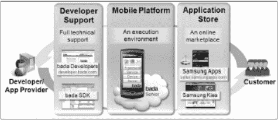

**图 1.1** bada 生态系统。

在这个链条的一端是想要开发应用程序的开发者和应用提供商。另一端是想要使用移动应用的用户或客户。沿着这一链条，三星提供了三个核心构建模块来促进 bada 生态系统的发展。其中中心是 bada 平台，它是部署在手机上的执行环境。该平台不仅涵盖移动端部分，还允许无缝访问 bada 服务器，您将在后面的第 5 章中了解到这一点。强大且抽象良好的 API 以开放式 SDK 的形式提供给开发者。此外，图 1.1 左侧的模块涵盖了大量各种各样的技术支持资源，例如培训材料、教程、示例代码、技术博客、视频和 API 参考文档。右侧的模块是应用程序商店 Samsung Apps，它允许您认证和发布应用。一旦您的应用准备好发布，您就可以决定是通过商店出售您的应用，还是免费提供，或者以其他任何方式让自己名利双收。

## 1.3 移动应用开发最佳实践

我们主张，移动应用具有一些使其区别于传统软件的特定特征。移动市场也有所不同，并且发展速度更快。因此，为了创建成功的移动解决方案或应用程序，我们建议在开发过程中采用一些最佳实践。在附录中，我们提供了一个完整的移动应用软件工程流程示例。

当然，您可以遵循任何您喜欢的过程，或者完全不遵循任何过程进行软件开发。从严格的瀑布模型到牛仔式编程，有多种选择。根据经验法则，项目越复杂，需要的协调越多，就越建议在……方面进行更正式的规范。


of processes. 经验表明，所谓的敏捷软件开发流程非常适合快节奏的软件，而移动应用绝对属于此类。

在敏捷宣言³中，软件工程专家总结了应有助于更快、更可靠地生产出更好软件的关键因素。他们指出，敏捷开发关乎*关注结果*。这意味着可执行的软件应尽快构建，这是衡量进展的主要指标。软件应*增量*地构建，从其核心功能开始，跨越多个*迭代*。工具和流程支持是相关的，但必须*适当*，以避免不必要的开销。最后，软件工程是人们共同协作的事情。因此，*沟通*——理想情况下是面对面和口头的——是敏捷开发的核心。这不仅指项目团队，也同样重要地指利益相关者、客户和未来的终端用户。

在此基础上，我们希望对这一建议补充强调在整个开发过程中尽可能多地使用*原型*和*多样化测试*，两者都是 bada 平台及其开发工具的组成部分，并且得到其固有支持。原型几乎可以在移动软件解决方案开发的任何阶段被利用。它们主要有助于在项目早期获取需求或与各种利益相关者达成共识。测试当然并非移动软件工程所独有，但在移动开发中必须以不同方式对待和执行。这是由与移动软件相关的各种问题造成的，例如硬件和设备的异构性、依赖于难以在模拟器上测试的上下文因素（如地理位置），以及模拟器与真实设备行为不一致的现象。

bada 工具包提供了支持两者的手段。首先是集成在 bada IDE 中的 UI Builder，它允许轻松快速地构建简单的模拟原型。开发人员可以使用此所见即所得工具，通过在设备屏幕上可视化放置各种 UI 控件来创建第一个“可点击”演示。第二个便捷工具是随 bada Simulator 提供的事件注入器。这对于模拟各种上下文数据非常有用。可以测试来电、短信和电池电量，以及位置和传感器，包括加速度、倾斜、指南针和接近度。在模拟器中测试移动应用总是很困难，因为显然你缺少所有上下文数据，而这又是如此必要。远为昂贵和复杂的一种测试类型是在真实设备上部署并在真实世界环境中进行测试运行。借助 bada 事件注入器（见图 1.2），大量工作可以转移到模拟器测试，使系统测试花费的时间更少、成本更低。

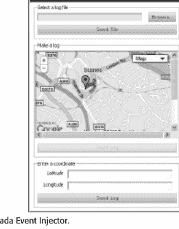

图 1.2 bada 事件注入器。

但让我们回到敏捷宣言所提出的思想。经常，“敏捷”被误用以描述一切没有明确规则或流程的东西。我们更愿意称之为“牛仔编码”。敏捷不能等同于混乱，或缺乏规则或纪律。敏捷应用开发确实建议遵循一些简单的准则和建议。

那么，让我们描述一些规则。我们通过列出来自各种敏捷方法学的一些最佳实践工具箱来做到这一点，例如 Scrum、测试驱动开发、极限编程和水晶。再次强调，核心基石是关注结果、增量迭代、手段的适当性以及沟通。以下最佳实践建议都涉及一个或多个这些基石：

- 关注结果多于流程。任何不有助于实现软件项目目标的程序或手段都应被切除。项目越复杂，它需要的工具、规则和形式化就越多。
- 将软件开发规划为周期或迭代。识别核心和最关键的组件和优先级，并从最重要的开始（“先办大事”）。
- 对变化保持宽容（需求变更和变更请求）。避免僵化或不灵活的结构、流程、工具或方法。
- 尝试在每个迭代结束时生产出可执行软件。
- 将每个迭代视为对最终软件产品的增量。
- 尝试保持设计和软件简单。考虑到可能的扩展，但专注于在每个迭代结束时至少生产出可执行代码（“保持简短和简单 – KISS”）。
- 利用来自各种利益相关者的早期反馈，例如你的客户或终端用户。用户验收测试可能被整合到每个迭代中。
- 在早期阶段，甚至使用纸和笔来绘制软件设计或早期原型。
- 使用以测试为导向的开发，在核心或关键代码部分至少先编写测试用例。
- 频繁构建和集成已测试的部分（例如每天）。
- 建立沟通渠道，使与客户和终端用户保持密切联系成为可能。
- 尝试进行定期、频繁且简短的团队内部沟通，而无正式开销（例如每日站会）。
- 建立并公布团队和项目规则——例如沟通礼仪或编码标准。
- 对核心或关键代码部分进行代码审查或结对编程会话。
- 确保团队内部以及对客户和用户的高效知识传递。这可能并不总是适用或明智。有时这种知识传递也可能是单向的。
- 为你的沟通使用可视化。例如，使用团队每个人都可以访问的可见白板来绘制任务或功能，以及开发进度。
- 尽管某种形式的文档是必要的，但要将其保持在最低限度：仅保留必要的部分。并且要警惕过度规范。

再次请记住，你不必严格遵守此处概述的移动软件工程最佳实践。这只是建议，你可以遵循。

## 第 2 章 bada 基础

本章将直接深入到使用 C++ 开发原生 bada 应用的本质。我们将看到在 bada Simulator 上运行第一个骨架应用有多么容易。

首先，这个小应用并没有做太多——想想 *Hello World*！但这是每个 bada 应用的核心代码，正如我们在接下来的几章中将看到的，bada 使从这个基本骨架构建到创建功能齐全的原生应用变得很容易。

> **注意：** 在撰写本文时，SDK 版本为 1.0.0 beta3。当前 SDK 仅安装在 Microsoft Windows 上。bada 最终可能会支持其他开发选项，但目前尚未公布。模拟器从 Eclipse 为基础的 bada IDE 启动，该 IDE 已包含在 SDK 中。

### 你将学到什么

本章旨在让你快速入门。你将学习：

- 如何使用 Application Wizard 创建一个简单应用。
- 如何使用 UI Builder 添加简单的 UI。
- 如何使用 bada 开发者门户提供的开发者和发布服务。
- 如何为手机构建并部署。

### 你需要什么

本书假设你具备初级 C++ 技能。如果你不懂 C++，不要放弃：bada 努力使应用开发者的生活尽可能轻松。如果你有使用任何现代编程语言的经验，一本好的 C++ 入门书应该足以让你起步。

顺便说一下，如果你对移动开发是新手也不用担心。正如我们在上一章中看到的，有一些事情使移动设备独一无二，与桌面世界不同。我们将在各章的上下文中出现时突出这些问题。

### 2.1 你的第一个 bada 应用

原生 bada 应用是 C++ 可执行文件，它将你编写的代码与框架代码结合在一起。因为 bada 框架负责每个应用所需的基本功能，所以创建最小应用所需的代码非常少，正如我们将看到的。

首先，我们将仅为 bada Simulator 构建。稍后在本章中，我们将深入探讨并向你展示如何为（并部署到）真正的 bada 手机构建。

由于 bada 具有高度模块化，作为开发人员，你的大部分时间将花费在连接各个组件上，而 bada 框架为你完成繁重的工作。

正如你所料，所有 bada 应用都是完全图形化的程序。事实上，思考 bada 应用的一种简单方式是将其视为执行某项操作的 GUI。

对于任何应用，GUI 都是用户与应用相遇的地方。它是 GUI 向用户展示应用功能，也是 GUI 允许用户控制该功能。对于用户而言，你的 GUI 就是你的应用，并在很大程度上决定了完整的应用体验。

所有使用标准 UI 元素的 bada 应用都共享 bada UI 和应用框架的独特外观和行为。当你需要更自定义的元素时，你可以派生自己的元素并扩展默认行为。当然，可能有时候你想要完全的 UI 控制（例如在游戏中），并且不想要标准的外观和感觉。在这种情况下，bada 允许你直接写入全屏显示器，从头构建自己的 UI。


## 2.1.2 项目结构

> 注意：启动 IDE 时，你可以选择 Eclipse 将创建新文件夹并查找现有项目文件的 workspace。你可以随时通过 IDE 主菜单选择 File | Switch Workspace 在 workspaces 之间切换。

在你的 workspace 中，你会看到一个名为 BuddyFix 的文件夹（或你为新项目选择的名称）。在其中你会看到一些子文件夹（见图 2.3）。如表 2.1 所总结的那样，文件夹结构如下：

- /inc 和 /src 文件夹是保存项目生成的 C++ 代码文件的位置；/inc 中的 .h 文件和 /src 中的 .cpp 文件。
- /Home 文件夹是应用读写任何数据文件或文件夹的文件系统根目录。
- /Icons 文件夹是你应该存储应用使用的图标的位置，也是向导复制默认应用图标的位置——当然，当你创建真正的项目时，你应该为自己的 artwork 更改它。
- /Res 文件夹是你的应用程序保存其使用的资源文件的位置。我们将在创建 BuddyFix UI 时看到资源的使用方式。

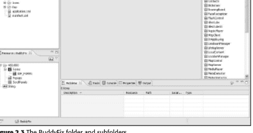

图 2.3 BuddyFix 文件夹和子文件夹。

这些是元数据文件，对你的项目至关重要。它们声明用于创建最终应用包的应用信息——应用名称和版本、厂商名称等——以及关于你的应用使用的 API 的关键信息和任何安全权限，即 bada 中称为 *privileges* 的权限，使用它们是必需的。权限是 bada 安全模型的一部分，我们将在第 4 章详细讨论它们。

当你开始一个真正的项目时，你需要使用通过 bada 开发者门户上的账户可用的工具创建清单的自定义版本（见第 2.7 节）。但起初我们完全不必担心这些细节；Application Wizard 生成的默认元数据文件足以开始使用。

**application.xml**  
*由应用打包工具用于创建可安装的包。声明应用名称、描述、厂商和版本；标识应用图标文件。*

**manifest.xml**  
*由认证过程用于权限检查。声明应用属性包括密钥和 ID；所需设备功能，例如 CPU 类型、最小堆大小、屏幕尺寸、使用的传感器；以及所需的权限。*

> **注意：** 如果你做过任何 widget 开发，那么 `application.xml` 会看起来很熟悉；它是定义 W3C 风格¹ widget 包的 `config.xml` 文件的等价物；如果你为 Android 开发过，`manifest.xml` 与 Android 清单文件的工作类似。

¹参见 www.w3.org.

## 2.1.4 构建和运行

虽然我们除了运行向导之外什么也没做，但我们已经有足够的代码来构建和启动我们应用的第一个骨架版本。

让我们验证代码是否可以构建。

在 IDE 中，通过 Project Explorer 按名称选择你的项目。从菜单栏选择 **Project | Build Project**，你的项目应该编译并链接（见图 2.4）。

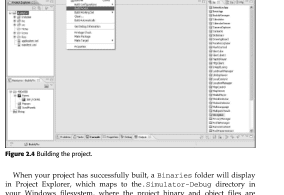

图 2.4 构建项目。

当你的项目成功构建后，Project Explorer 中会显示一个 Binaries 文件夹，它映射到 Windows 文件系统中的 Simulator-Debug 目录，其中存储项目二进制文件和对象文件。

要启动你的应用，通过 Project Explorer 按名称选择你的项目。从菜单栏选择 Run | Run As | 1 bada Simulator Application 从弹出菜单中。

bada Simulator 将运行。我们在创建项目时选择了 Wave 作为手机型号，所以我们看到的是在 PC 屏幕上运行的 Wave 的良好近似。

Simulator 启动并初始化，短暂显示手机主屏幕，然后启动我们的应用（见图 2.5）。

> 注意：Application Wizard 将使用 Form Based Application 选项生成的任何应用的应用标题栏设置为“Hello bada！”，并在应用运行时以 OK 按钮启动。这有点令人困惑，因为不明显的是正在运行的是我们的应用。但请相信我们——确实是！

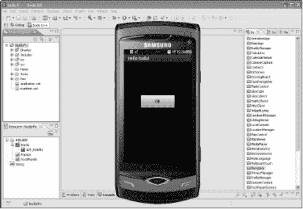

**图 2.5** 我们的应用在 Simulator 中运行。

要关闭应用，选择 Simulator 上手机的 **Power/End** 键。你的应用将关闭，你将被返回到主屏幕。选择 **Menu** 键进入 Application Manager。你将在图标菜单列表中看到你的应用，使用默认应用图标（见图 2.6）。

> **注意：** 当 BuddyFix 启动时，你可能注意到在应用程序显示之前短暂显示了一个启动画面，基于 `/Icons` 文件夹中的默认文件 `splash.png`。你可以通过更改此文件来更改显示的图像。启动画面是你的 bada 项目的可自定义属性——它以与设置应用图标相同的方式设置。
> 
> 顺便说一下，启动画面是为了填补应用启动时的任何延迟而显示的。延迟可能由于多种原因发生，具体取决于手机在任何时间点的负载。启动画面 *不是* 由应用本身显示以隐藏应用初始化时的延迟。而且，事实上，你应该设计你的应用以推迟可能导致显示其主屏幕时出现明显延迟的任何初始化。你可以通过使用多线程技术在后台执行此类初始化，或在应用启动后推迟此更深层次的初始化，或两者兼而有之来实现这一点。
> 
> 一个提示：为了通过认证过程，bada 应用必须拥有自己的启动画面和应用图标。

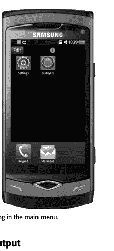

图 2.6 BuddyFix 显示在主菜单中。

## 2.1.5 标准输出

Eclipse IDE 中的一个有用视图是 Output 面板。当你在 Simulator 中启动应用时，系统会记录“Application started”消息，当你关闭应用时，系统会记录“Application finished”消息：

```
0010.200, INFO, P26, T-01, A-01, OspMain (24) > Application started.
0014.030, INFO, P26, T-01, A93, OspMain (39) > Application finished.
```

在这两个日志点之间，你可以使用 bada 的日志宏 AppLog()、AppLogDebug() 和 AppLogException() 输出类似 printf 的日志语句，以在运行时跟踪你的应用行为。例如，要输出一条简单的日志消息，添加以下行：

```
AppLog("This message will display in the output view");
```

日志文件可以导出为带有 .log 后缀的简单文本文件。在 Output 面板中，一旦你的应用程序正在运行，选择左侧的第二个图标（如图 2.7 所示）；将调用一个对话框，允许将输出保存到开发机器上的日志文件。

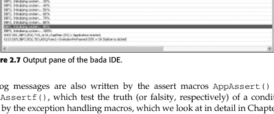

**图 2.7** bada IDE 的 Output 面板。

日志消息也由断言宏 AppAssert() 和 AppAssertIf() 写入，它们测试条件为真（或分别为假），以及我们将在第 4 章详细讨论的异常处理宏。

调试宏在 SDK Help 中有描述，在 IDE 中选择 Help | Help Contents | bada Developer Guide。

## 2.2 应用 UI

我们说过 bada 应用程序可以被认为是一个做某事的 GUI，其中 GUI 是你的应用向用户展示的公共面孔。在深入实际操作并向你展示如何构建简单的 GUI 之前，让我们先填补一些背景。

根据其复杂程度，一个应用程序可能只需要一个屏幕——例如计算器应用的简单计算器布局。或者它可能需要多个屏幕，例如地址簿应用，它可能会将主屏幕组织为姓名和地址条目的滚动列表，并提供一个详细信息屏幕来显示单个完整条目的详细信息，以及编辑屏幕以启用条目详细信息、标签等的编辑。

让你的 GUI 设计正确是作为应用开发者你将面临的最重要任务之一。关于良好 UI 设计的艺术有很多文章，关于良好移动 UI 设计的特殊情况也有很多文章。两个最突出的特征是：对细节的狂热关注和无情的简化。

同样重要的是，要理解你的应用 GUI 在平台外观和感觉的上下文中。记住 bada 的设计是将智能手机体验从高端推向中端。这影响了 bada 触摸 UI 的设计，进而应影响你的 GUI 设计。

2 Scott Jensen 的《The Simplicity Shift》（剑桥大学出版社，2002 年）是对工程主导设计习惯的极好纠正。Christian Lindholm 等人的《Mobile Usability: How Nokia Changed the Face of the Mobile Phone》（麦格劳-希尔，2003 年）提供了第一代和第二代移动电话 UI 演变的迷人案例研究。Barbara Ballard 的《Designing the Mobile User Experience》（Wiley，2007 年）是一本很好的概览文本。而没有 Bill Moggridge 的《Designing Interactions》（MIT Press，2007 年）的应用开发者是不完整的。网络上也有大量关于移动 UI 设计一般原则的资料，包括为你可能熟悉的其他移动平台发布的优秀文档，与所有移动应用开发相关，无论平台如何。


虽然没有真正设备的上手体验可以替代，但以下 bada 设计要点值得牢记：

- Touch – 基于手指的直接操作，包括多点触控、捏合和滑动，当然还有触觉反馈。
- Simplicity – 简单的屏幕布局、相对较大且粗体的字体、用于交互的大型 GUI 元素、简单的大图标、有限的自定义、简单的菜单。
- Bright and bold – 充分利用 superAMOLED 显示技术，高对比度、鲜艳的色彩、饱和的黑色（顺便说一下，由于 AMOLED 技术中暗像素比亮像素消耗更少电量，因此更偏好深色配色方案而非浅色）。
- Extended user input – 除了触控和硬键之外，触控 UI 还支持手势（包括敲击机身、旋转手机、快拍和摇晃等物理动作），甚至面部检测。
- Multiple display sizes and resolutions – WVGA（宽 VGA）480 × 800，WQVGA（宽四分之一 VGA）240 × 400。

您可以在 SDK Help 中找到详细的 UI 指南。在 IDE 中选择 Help | Help Contents | bada Application UI Guide。

### 2.2.1 Frames, Forms, and Controls

GUI 不仅仅是你屏幕上看到的内容。bada 的触控 UI 风格的简洁性延伸到了其下方的架构，以及驱动架构的概念。虽然 bada 不会为你设计 GUI，但它确实为你的应用提供了一个简单且标准化的 GUI 架构供使用。

你可以将应用中显示的一切视为组织在一个分层树中。树的根是应用 Frame。在每个应用中，Frame 都是所有 GUI 元素添加到的顶级容器。更正式地说，Frame 类封装了设备显示，并扮演应用顶级窗口的角色，每个应用恰好只有一个。所有应用都有一个 Frame，你无需做任何事情来创建或设置它。框架已全部处理好。

标准控件由框架预先制作，或你自己的派生自定义控件。Control 类抽象了一个屏幕区域，既用于显示也用于捕获输入。

自然地，bada 提供了全面的图形原语、位图、动画和字体，因此这里的真正限制只是你的想象力——以及你的设计技巧！⁴ Frames、Forms 和 Controls 之间的关系如图 2.8 所示。

> ⁴在底层，bada 图形功能所需的原始算力基于 OpenGL ES，支持 2.0（硬件加速和硬件着色器）和 1.1 标准（仅硬件加速）。可用的 OpenGL ES 版本取决于设备。也有可能在低端，一些 bada 手机根本不支持 OpenGL ES。需要 OpenGL ES 的应用将无法安装在缺乏相应支持的手机上。

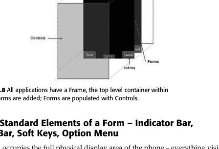

Figure 2.8 All applications have a Frame, the top level container within which Forms are added; Forms are populated with Controls.

### 2.2.2 Standard Elements of a Form – Indicator Bar, Title Bar, Soft Keys, Option Menu

Form 占据手机的整个物理显示区域——屏幕上所有可见内容。因此 Form 还可选择性地包含一些标准系统元素（见图 2.9）。这些是

- 显示在显示区域顶部的 Indicator bar，用于显示系统图标（如信号和电池强度）和通知（如你是否有未读消息）。
- Title bar，可显示字符串。
- 显示在主显示底部命令区域的 Soft keys。
- Option menu key，显示在显示区域底部软键之间，用于启动 Option menu。

系统元素被定义为 Form 的属性。是否显示全部或部分元素由每个 Form 决定，因此受定义该 Form 的应用控制。然而，它们的样式和外观（对于 Indicator bar 来说，其内容也是如此）并非由应用直接控制。尽管 Form 显示系统元素，但框架保留对其的控制权。

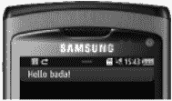

**Figure 2.9** The application name and standard system elements.

### 2.2.3 Handling Events

我们说过每个 Control 派生类都抽象了一个屏幕区域，既用于显示也用于输入，但我们没有说如何实现。输入事件包括来自触摸屏的输入，包括菜单和软键，来自物理手机按键包括侧键如锁定和相机，来自手势和原始传感器事件，来自 bada 系统事件——可能来自*任何*类型的事件。

Listeners 是将行为与 bada 应用中的呈现绑定在一起的粘合剂。在 bada 中，监听器提供了所有事件处理的机制。任何时候，GUI 中恰好有一个控件具有*焦点*。*焦点*只是指哪个对象正在主动更新显示并接收用户和系统事件。从概念上讲，焦点属于当前正在运行的前台应用的当前活动控件。该控件接收发生的任何输入事件（顺便说一下，也会启动重绘显示）。

每个控件都有内置的监听器，用于其识别的基本事件类型。根据控件的不同，这些可能包括以下任何一种：

- Focus events
- Key events
- Touch events
- Drag and drop events

## The BuddyFix UI

BuddyFix 是一个简单的应用，实现了简单的用例。它使用户能够与好友列表定期共享更新的位置信息，以便实时汇聚到一个会面地点。为此，BuddyFix 使用 bada 提供的 Buddy 服务作为服务 API。

BuddyFix 显示好友列表，对每个好友显示以下信息：

- picture;
- name;
- location fix, i.e. last known location;
- time fix, i.e. time of last location fix;
- location status, on or off the grid, i.e. currently reachable or not;
- whether location sharing is enabled for this buddy.

此外 UI 还必须提供以下信息：

- whether sharing is paused or active at application level;
- interval at which location fixes are updated.

Points to note:

- Location sharing is always in both directions.
- Location fixes are therefore always updated in both directions.
- Application-level pausing of location sharing allows power to be saved.
- Location display format should be user selectable.
- Location sharing is periodic not continuous, and is scheduled according to the update interval.
- The update interval should be user selectable.
- The update interval applies to all buddies.
- Individual buddies are added from the phone Contacts app.
- Friends must already be buddies on the Buddy service to be allowed by BuddyFix.

显然，以上一些限制使应用无法完全功能化，但就当前目的而言，它们使复杂性保持在可控范围内。

UI 必须启用以下操作：

- Add/Remove a buddy.
- Start/Stop sharing, for some buddy.
- Nudge now, share a location fix with some buddy now, without waiting for the next scheduled update.
- Set the update interval.
- Pause/Unpause all sharing.

那么让我们开始吧。我们将定义一个单一的 MainListForm 作为基本应用屏幕，所有功能都将从这里可用。通过 Eclipse 主菜单栏选择 Window | Show View | Other 启动 Resource Explorer，如图 2.10 所示。

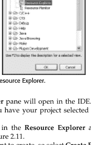

Figure 2.10 Launching the Resource Explorer.

Resource Explorer 面板将在 IDE 中打开。（如果启动时为空，请确保在 Project Explorer 面板中已选择你的项目。）在 Resource Explorer 中任意位置右键单击并选择 Open Insert Wizard，如图 2.11 所示。我们要创建一个新的 Form，因此选择 Create Form File，然后 Finish。Resource Explorer 面板中会出现一个新的 Form。双击以启动 WYSIWYG UI Builder，你应该会看到如图 2.12 所示的屏幕。请注意，默认 Form——出于演示目的——已包含一个 Button 控件，你可以使用它或直接删除。当 UI Builder 面板启动时，双击主 Form 面板以打开如图 2.13 所示的 Form Properties 面板。

### 2.3.2 Form Properties

在做任何其他事情之前，让我们先将 Form 名称更改为有意义的名称。属性是简单的名称、值对。要编辑属性，请在属性列表中双击属性名称并更改关联的值。对于 BuddyFix，我们保留 'IDF' 前缀和全大写的资源命名约定以在代码中提供清晰度，并将 Form 命名为 IDF_MAIN_LIST_FORM。


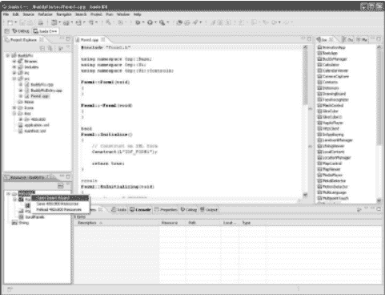

**图 2.11** 打开插入向导。

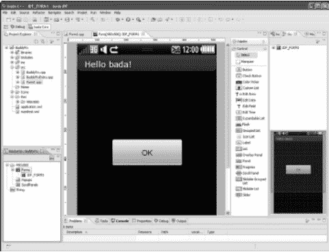

**图 2.12** 资源资源管理器窗格中已创建了一个新的 Form。

## 表 2.2 表单属性。

| 属性 | 用途 |
|---|---|
| Id | 表单标识符，通常以 `IDF_` 为前缀；这也在 C++ 代码中用于引用表单布局文件 |
| Type | WINDOW_FORM 是任何 Frame 内的顶级 Form，其中应用程序 Frame 表示应用程序显示的屏幕窗口 |
| Title | 如果启用，将出现在表单标题栏中的标题 |
| Orientation | 手机旋转经过可能四个方向时表单的显示方式 |
| Layout | 模式 | 竖屏或横屏 |

> 注意：虽然你可以为 Frame 和 Form 都设置背景颜色，但你不能将背景设置为图像，不像其他类型的控件。

## 2.3.3 好友列表

UI 的最重要部分是主要的好友列表本身，它将为每个好友显示若干信息项。UI Builder 为我们提供了多种列表类型的选择，并且 bada 允许我们定义自己的自定义列表，但起初我们保持简单，使用一个基本、简单的列表，为每个项目显示以下字段：

- 图片
- 名称
- 最后已知的定位修复/时间修复
- 是否为此好友启用了位置共享

要在 UI Builder 中向 Form 添加列表，请从控件调色板中选择列表图标，并拖放到主 Form 视图上，或单击其中，如图 2.14 所示。

调整列表大小以占据表单的整个区域。现在双击列表内的任意位置以打开属性编辑器窗格。编辑列表属性的方式与编辑表单属性完全相同。

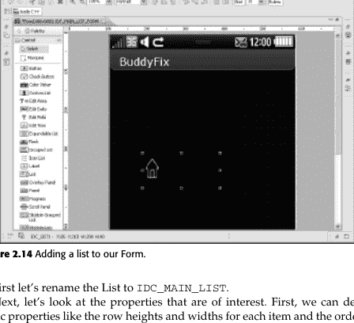

图 2.14 向我们的表单添加列表。

首先让我们将列表重命名为 IDC_MAIN_LIST。
接下来，让我们查看感兴趣的属性。首先，我们可以定义基本属性，如每个项目的行高和列宽以及不同字段的显示顺序：

| 行 1 高度 | 默认 80 |
| 行 2 高度 | 默认 50，仅在选择了双行格式时显示 |
| 列 1 宽度 | 默认 50 |
| 空列表文本 | 列表为空时显示的文本 |
| 列表项格式 | 11 种可能的格式样式之一，指定列表内容的结构，例如：LIST_ITEM_SINGLE_IMAGE, LIST_ITEM_DOUBLE_IMAGE_TEXT_FULLTEXT |

一个简单的列表可以显示一列或两列，第一列可以显示一行或两行。我们将格式设置为 LIST_ITEM_DOUBLE_IMAGE_TEXT_FULLTEXT，它将显示第一行的图像和文本，以及第二行的文本。

接下来，在布局下，我们可以设置列表样式（见图 2.15）。即使使用简单的列表，我们也有很多样式可供选择，包括：

| LIST_STYLE_NORMAL | 普通样式 |
| LIST_STYLE_NUMBER | 编号样式 |
| LIST_STYLE_RADIO | 单选样式，用于单选 |
| LIST_STYLE_RADIO_WITH_DIVIDER | 带分隔符的单选样式，用于单选 |
| LIST_STYLE_MARK | 标记样式，用于多选 |
| LIST_STYLE_MARK_WITH_DIVIDER | 带分隔符的标记样式，用于多选 |
| LIST_STYLE_ONOFF | 开/关样式 |
| LIST_STYLE_ONOFF_WITH_DIVIDER | 带分隔符的开/关样式 |

我们将选择 LIST_STYLE_MARK，它为每个项目显示一个选择标记，允许我们进行选择并对所选子集应用操作。

最后，我们将“空列表文本”属性设置为 'No buddies...'。

UI Builder 为我们提供了一个关于列表在运行时的基本概念，但没有替代在运行的应用程序中看到它。 在我们能够做到这一点之前，还有一点工作要做。


但首先，我们应该保存所做的更改。 选择 文件 | 保存所有资源。

> 注意：使用 UI Builder 工作完成后务必保存，因为资源文件只有在你明确保存它们时才会被保存到你的项目 /Res 文件夹中。 如果不这样做，UI Builder 退出时你的更改可能会丢失。

## 2.4 将表单连接到代码

UI Builder 采用我们定义的属性并从中生成声明性 XML 布局文件。 如果你用文本编辑器打开 IDF_MAIN_LIST_FORM，你会看到 XML 声明。

```
<?xml version="1.0" encoding="UTF-8" standalone="no"?>
<!DOCTYPE Scene SYSTEM "UIForm.dtd">
<Scene Diversion="2">
  <Form id="IDF_MAIN_LIST_FORM">
    <property BGColor="" BGColorOpacity="0" Orientation="Portrait" softKey0NormalIcon="" softKey0PressedIcon="" softKey0Text="" softKey1NormalIcon="" softKey1PressedIcon="" softKey1Text="" title="BuddyPix" titleAlign="ALIGN_LEFT" titleIcon=""/>
    <layout mode="Portrait" style="FORM_STYLE_INDICATOR|FORM_STYLE_TITLE"/>
    <layout mode="Landscape" style="FORM_STYLE_INDICATOR|FORM_STYLE_TITLE"/>
  </Form>
  <List id="IDC_MAIN_LIST" parent="IDF_MAIN_LIST_FORM">
    <property ListItemFormat="LIST_ITEM_DOUBLE_IMAGE_TEXT_FULLTEXT" colorOfEmptyListText="" column1Width="50" column2Width="50" rowHeight="80" row2Height="50" textOfEmptyList="No buddies..."/>
    <layout height="708" mode="Portrait" style="LIST_STYLE_MARK" width="480" x="0" y="0"/>
    <layout height="72" mode="Landscape" style="LIST_STYLE_MARK" width="333" x="95" y="85"/>
  </List>
</Scene>
```

很容易看出我们的属性设置是如何被翻译成 XML 声明的 Form 和 List 对象的属性的。 然而，布局文件只是一个声明，而不是实现。 在运行时，如果我们加载布局文件，框架将为我们完成实例化对象的其余工作。 但我们必须首先加载布局文件。

为此，我们需要创建一个 Form 类。 UI Builder 可以为我们做到这一点。 请注意，到目前为止，对应用程序向导生成的 C++ 代码没有任何更改，也没有任何添加。

在 UI Builder 中，通过右键单击表单打开上下文菜单来为主要表单生成底层代码。 （确保单击表单，而不是列表；单击标题栏内部可确保表单不会被其他控件隐藏。）

选择 添加类 如图 2.16 所示以弹出 新建类向导，它将显示如图 2.17 所示的窗口。

我们将把类命名为 MainListForm，与资源文件名相匹配。

接下来，让我们设置其监听器。

在 EventListener 对话框中，我们设置 IActionEventListener。 我们不设置 IOrientationEventListener，因为我们只设计了竖屏模式。 在真正的应用程序中，除非有特定的原因不这样做，否则我们应该启用纵向和横向模式。

在 Control Base EventListener 对话框中，我们选择焦点、键和触摸事件。 这些是底层事件，将由框架检测并从中生成操作事件。 因此我们知道在我们的代码中应该期望处理键、触摸和焦点事件。

我们不设置拖放事件，因为我们不希望与好友列表进行拖放交互。

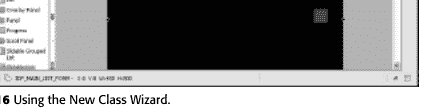

图 2.16 使用新建类向导。

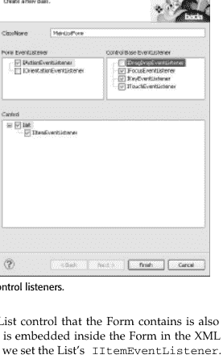

# 图 2.17 设置控件监听器。

请注意，表单包含的列表控件也包含在向导中（因为它在 XML 描述中嵌入在表单内）。 在控件对话框中，我们设置列表的 `ItemEventListener`。 选择 完成，然后从主菜单保存。

如果你打开 MainListForm.cpp，你可以看到表单是通过在构造函数中加载资源声明来初始化的：

```
bool
MainListForm::Initialize()
{
    Form::Construct(L"IDP_MAIN_LIST_FORM");
    return true;
}

result
MainListForm::OnInitializing(void)
{
    result r = E_SUCCESS;

    // TODO: Add your initialization code here

    return r;
}
```

注意：你会看到我们总是使用 ‘L’ 宏从文字文本创建 String 对象，确保所有字符串文字都编码为 Unicode，而不是简单的 C 风格单字节字符字符串。 我们建议你也采用这种用法。

此外，我们选择响应的所有监听器方法都已添加：

```
class MainListForm :
    public Osp::Ui::Controls::Form,
    public Osp::Ui::IActionEventListener,
    public Osp::Ui::IFocusEventListener,
    public Osp::Ui::IKeyEventListener,
    public Osp::Ui::ITouchEventListener,
    public Osp::Ui::IItemEventListener
{

    // ... Other methods omitted

    // Generated call-back functions
    public:
        void OnActionPerformed(const Osp::Ui::Controls::int);
        void OnFocusGained(const Osp::Ui::Control&);
        void OnFocusLost(const Osp::Ui::Control&);
        void OnKeyLongPressed(const Osp::Ui::Control&, Osp::Ui::KeyCode);
        void OnKeyPressed(const Osp::Ui::Control&, Osp::Ui::KeyCode);
        void OnKeyReleased(const Osp::Ui::Control&, Osp::Ui::KeyCode);
        void OnTouchDoublePressed(const Osp::Ui::Control&, const Osp::Graphics::Point&, const Osp::Ui::TouchEventInfo&);
        void OnTouchFocusIn(const Osp::Ui::Control&, const Osp::Graphics::Point&, const Osp::Ui::TouchEventInfo&);
        void OnTouchFocusOut(const Osp::Ui::Control&, const Osp::Graphics::Point&, const Osp::Ui::TouchEventInfo&);
        void OnTouchLongPressed(const Osp::Ui::Control&, const Osp::Graphics::Point&, const Osp::Ui::TouchEventInfo&);
        void OnTouchMoved(const Osp::Ui::Control&, const Osp::Graphics::Point&, const Osp::Ui::TouchEventInfo&);
        void OnTouchPressed(const Osp::Ui::Control&, const Osp::Graphics::Point&, const Osp::Ui::TouchEventInfo&);
        void OnTouchReleased(const Osp::Ui::Control&, const Osp::Graphics::Point&, const Osp::Ui::TouchEventInfo&);
        void OnItemStateChanged(const Osp::Ui::Control&, int, int, Osp::Ui::ItemStatus);

    // ... etc
};
```

将我们新的表单挂接到一起所需的最后一步。 在 BuddyFix.cpp 中，我们仍然有应用程序向导生成的原始代码，它构造了一个默认的 Form 类 Form1。 相反，我们构造我们新的 Form 类 MainListForm：


在 **Project Explorer** 中，我们现在可以构建并运行项目（参见图 2.18）。

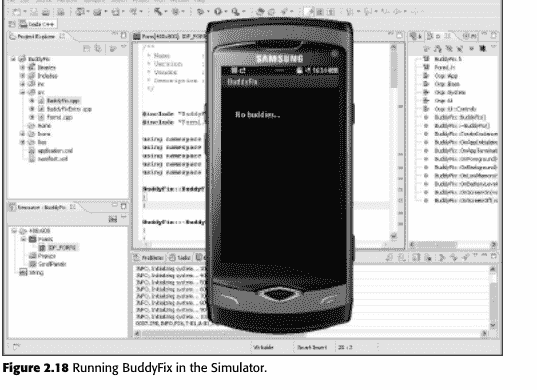

图 2.18 在模拟器中运行 BuddyFix。

当 BuddyFix 运行时，我们看到的不是好友列表，而是我们为列表为空时设置的默认显示文本。要真正看到列表，我们需要先为它填充数据；为此需要编写一些代码——我们将在下一章中完成。

## 2.5 应用图标

要完成我们的应用骨架，还剩下最后一件事。每个应用都需要一个图标。正如我们所看到的，图标显示在主菜单中，是用户启动应用的方式。

应用图标被定义为应用项目的一个属性，设置起来很容易。在 Project Explorer 中选择你的项目，然后从主菜单中选择 Project | Properties，打开 Properties 对话框。

展开 bada Build 项，选择 Application Information。这里可以看到 BuddyFix 的一些基本定义信息。

要添加图标，你当然首先需要创建图形资源。我们建议你按照以下属性创建图标图形：

| | |
| --- | --- |
| 文件类型 | PNG |
| 尺寸 | 135 × 135 像素 |
| 分辨率 | 72dpi |
| 位深度 | 32 位 |

在你喜欢的图形应用程序中创建图标，并将其添加到 /Icons 文件夹中。

选择主菜单图标旁边的 File System 按钮，浏览 /Icons 文件夹，然后选择你想要的应用图标。选择 OK 保存。下次启动模拟器时，你选择的图标就会显示在主菜单中。（无需重新构建，更改即可生效。）

> **注意：** 图标不会应用任何效果，例如圆角或斜角（除了变暗以表示选中状态）。你应该按自己的需要创建带有任意效果的图标，并使用透明背景；例如，如果你将图标四角做成圆角，就需要透明背景。运行时框架会提供应用名称，因此你只需提供图形资源。

## 2.6 三步轻松实现多语言

就目前实现而言，我们的 BuddyFix GUI 有一个严重限制：我们将英文字符串硬编码到了显示的 UI 文本中——例如软键文本。bada 的一个出色特性是广泛的语言支持。事实上，在编写本书时，SDK 已包含近 40 种语言的语言包，并承诺很快会支持更多语言。⁵

⁵ 截至 SDK 1.0.0b3 版本，支持的语言包括：巴斯克语、保加利亚语、加泰罗尼亚语、简体中文、繁体中文（香港）、繁体中文（台湾）、克罗地亚语、捷克语、丹麦语、荷兰语、英语、爱沙尼亚语、芬兰语、法语、加利西亚语、德语、希腊语、匈牙利语、冰岛语、爱尔兰语、意大利语、哈萨克语、韩语、拉脱维亚语、立陶宛语、马其顿语、挪威语、波兰语、葡萄牙语、罗马尼亚语、俄语、塞尔维亚语、斯洛伐克语、斯洛文尼亚语、西班牙语、瑞典语、土耳其语和乌克兰语。即将推出的是阿拉伯语、波斯语、希伯来语、马来语、泰语、乌尔都语和越南语。

本地化的一个方面是确保你在应用 UI 中显示的所有文本都与用户的语言设置匹配。另一方面是确保你向用户显示的所有内容都采用他们期望的格式。日期和时间信息应以特定国家和语言设置的正确格式显示，并使用适当的分隔符以及星期和月份名称。数字应以正确的分隔符显示，并应使用适当的货币符号。在 bada 中，对本地化数字格式、日期、时间和货币的支持由 Locales 命名空间中的类提供。（更多内容详见第 6 章。）

支持多种语言以及日期、时间和数字格式，确实会提高你的应用在全球获得成功的几率。本节其余部分将演示如何在 UI 中构建多语言支持。幸运的是，bada 让这一切变得简单。创建多语言 UI 所需的一切都已包含在 UI Builder 中。

### 2.6.1 添加新语言

添加语言很容易。要支持其他语言，请在 IDE 中打开 Resource Explorer。双击 String。在 String 窗口内右键单击，在显示的菜单中选择 Language Setting。此时会显示 Add New Language 对话框，如图 2.19 所示。

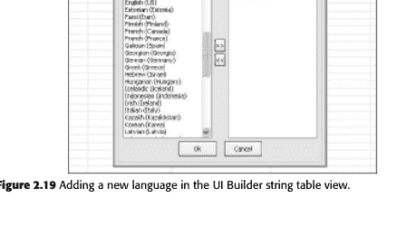

图 2.19 在 UI Builder 的字符串表视图中添加新语言。

选择你要支持的语言。完成后，你会注意到字符串表窗口已更新，为你选择的每种语言都添加了一列。

> **注意：** 项目会为每种语言添加一个包含本地化字符串表的 XML 文件。例如，英式英语字符串表名为 `eng-GB.xml`，法语字符串表名为 `fra-FRA.xml`。

### 2.6.2 为每种语言添加文本

现在只需为支持的每种语言，将 UI 中出现的字符串添加到字符串表的相应列中。例如，在图 2.19 中，我们为 UI 中显示的每个字符串添加了英文版和法文版。为每种语言添加适当的文本后，bada 会根据用户的语言设置选择正确的文本。

接下来，你需要确保 Form 的标题或按钮控件的文本等都能针对每种语言正确显示。你只需为每个字符串资源添加本地化文本，并使用 UI Builder 确保控件使用字符串资源作为标题或文本。图 2.20 演示了具体做法。

在图 2.20 中，我们将 Form 的标题设置为 IDS_STRINGS。如果用户将语言设置为法语，Form 标题会自动设为“Bonjour bada”。如果找不到本地化字符串，则使用英文。

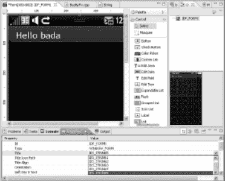

**图 2.20** 使用字符串 ID 作为 Form 标题：bada 会选择正确的本地化字符串。

### 2.6.3 在代码中使用字符串资源 ID

要充分利用 bada 的多语言支持，请不要在代码中硬编码字符串。硬编码字符串难以针对多种语言进行查找和更新，因此应改为从资源中读取字符串，如以下代码所示：

```
Application* pApp= Application::GetInstance();
String str1;
r = pApp->GetAppResource()->GetString(L"IDS_STRING1", str1);
```

str1 的值是从资源文件读取的，而非硬编码。如果你为每种语言设置了不同的字符串，系统会根据用户的语言设置选择相应的字符串。

## 2.7 从创意到发布应用

如果你有一个关于 bada 开创性应用的想法，只需经历以下三个步骤（见图 2.21）：

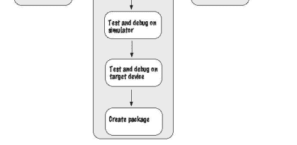

图 2.21 在 Samsung Apps 上发布应用的步骤。

### 步骤 1：在 developer.bada.com 门户上

当你在 developer.bada.com 门户注册以下载 IDE 和 SDK 时，你做的不仅仅是注册下载；你已加入 bada 开发者计划。这使你可以访问在线服务，这些服务提供了许多有用的资源，例如文档、API 参考、代码示例、教程、博客、视频或支持论坛。

**生成应用配置文件并下载 manifest.xml**

在本节中，我们重点介绍自定义应用配置文件生成器，它应该是你实际项目的起点，因为它允许你定义应用的功能，并指定应用需要或预期的硬件特性（例如屏幕尺寸、传感器、默认方向）。门户还会检查你的应用名称是否全局唯一，并为你的应用分配一个唯一的数字 ID，该 ID 用于保护其私有资源。

在第 2.1 节“元数据”中，我们简要了解了每个应用项目必须包含的两个元数据文件：application.xml 和 manifest.xml。我们说过，它们声明了用于打包应用的应用信息——例如名称、版本和预期的目标手机型号——以及关键的安全权限声明。application.xml 的配置由 IDE 处理，Web 门户帮助生成 manifest.xml。

要创建 manifest 文件，请前往 developer.bada.com 门户，点击 My Applications 标签页，然后打开左侧的 Application Manager。在那里，你可以开始生成应用配置文件。图 2.22 显示了该网站以及要遵循的五个简单步骤。

首先，为你的应用命名，如果愿意，可以添加描述。其次，定义权限，这些权限是应用的主要功能。如果你的应用涉及 bada Server 的任何远程服务，可以在第三步中定义它们。第四，指定手机硬件要求。最后，你可以下载 manifest 文件。

下载的 manifest.xml 通常包含如下信息：

```
<?xml version="1.0" encoding="utf-8"?>
<Manifest>
  <Id>93btip123e</Id>
  <Secret>9C645DBA19C71BAD1204DA4DAA7A0B9</Secret>
  <AppVersion>1.0.0</AppVersion>
  <Privileges>
    <Privilege>
      <Name>IMAGE</Name>
    </Privilege>
  </Privileges>
  <DeviceProfile>
    <CPU>Cortex6</CPU>
    <MinimumHeapSize>16</MinimumHeapSize>
    <MinimumVRAMSize>4</MinimumVRAMSize>
    <Accelerator3D>OpenGL-ES1.1</Accelerator3D>
    <Accelerator3D>OpenGL-ES2.0</Accelerator3D>
```


<BluetoothProfile>OPP</BluetoothProfile>
<BluetoothProfile>S PP</BluetoothProfile>
<WiFiMode>Infrastructure</WiFiMode>
<WiFiMode>Ad-hoc</WiFiMode>
<Sensor>GPS</Sensor>
<Sensor>Accelerometer</Sensor>
<Sensor>Magnetic</Sensor>
<Sensor>Proximity</Sensor>
<InputDevice>Touch</InputDevice>
<ScreenSize>480x800</ScreenSize>
<SoundMixing:Enable</SoundMixing>
<APIVersion>1.0</APIVersion>
</DeviceProfile>
</Manifest>

这里，前面的属性是基本的应用信息。虽然 <Id> 和 <Secret> 都出现在代码中，但框架会处理它们的使用。ID 是一个唯一的数字。密钥与你的应用唯一相关。

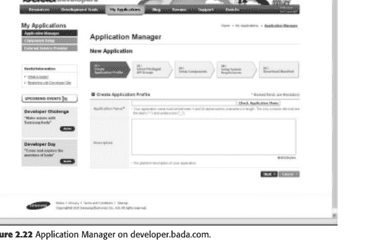

图 2.22 developer.bada.com 上的应用管理器。

更有趣的是 `<Privileges>` 属性及其 `<Privilege>` 子属性。在上面的清单文件中，指定了单个 IMAGE 权限：

```
```xml
<Privileges>
    <Privilege>
        <Name>IMAGE</Name>
    </Privilege>
</Privileges>
```
```

这里声明的格式是直接的 XML：`<Privileges>` 是一个属性，包含一系列 `<Privilege>` 子属性，每个子属性都使用 `<Name>` 子属性声明，在本例中为 `<Name>IMAGE</Name>`。⁶ 权限声明了应用提供的功能。如果没有声明适当的权限，应用首次尝试使用未声明的特权 API 时会在运行时抛出异常。

比如何声明权限更有趣的是它们意味着什么以及它们的作用。权限对于 bada 的安全机制非常重要，以确保隐私等。你可以在第 4 章找到有关 bada 权限模型的更多信息。

清单文件中的下一个 XML 标签是 `<DeviceProfile>`。它声明了应用的最低系统要求。它完全由门户根据开发者提供的信息自动生成。

你可以用与生成它相同的方式更新清单，使用门户工具。

声明权限很容易。只要记住，每当你添加来自新命名空间的 API 时，你可能需要声明一个新的权限，并在构建时更新你链接的库。

## 第 2 步：在 bada IDE/SDK 中

### 使用清单文件创建 bada 应用

下载清单文件到硬盘后，你可以按前面所述创建 bada 应用项目。在向导中到达选择清单文件的点时，你应该取消选中默认选项，并将向导指向刚下载的硬盘上的 manifest.xml。另一种选择——如果你已有现有项目和现有清单文件——是直接用新文件覆盖旧的清单文件。

### 编程和构建

让你的应用活起来的下一个必要步骤实际上是思考你的逻辑并进行编程。当你认为你的应用处于可运行状态时，你可以在 IDE 中按前面所述构建你的 bada 项目。

⁶ 也可以称这些为“属性”，如果你愿意的话。

## 在模拟器上测试和调试

一旦你的应用编译成功且没有任何错误，你就可以通过在 bada 模拟器中运行它来开始测试。模拟器对于测试代码的主要正确性非常有用。传统上，模拟器的行为与真实移动设备之间存在很大差异。由于上下文信息的重要性，密集的真实世界测试仍必须在移动设备上进行。bada 模拟器非常接近真实设备。此外，它还提供了一个名为事件注入器 的额外工具（见图 2.23），可将各种传感器事件注入模拟器。事实上，还可以注入其他事件，例如电话呼叫、消息事件、网络事件以及低电量或低内存等设备事件。这非常有帮助，使测试更高效，因为许多真实世界的上下文测试可以转移到成本更低的模拟器测试。

可以模拟的事件如下：

- 来电；
- 网络特性和质量（例如服务级别、漫游或网络代码）；
- 文本消息、WAP push⁷ 和推送通知的传输；
- 通过地图选择或显式插入的位置数据（纬度和经度）；
- 各种传感器，如加速度计、GPS、磁力、倾斜、接近或天气；
- 设备事件，如内存或电池电量。

bada 运动传感器是一个基于机载硬件传感器复合数据的逻辑传感器。运动传感器通过用户检测手机的预定义移动：

### Snap

手机在 X、Y 或 Z 任意维度上的快速一次性来回移动。三种不同的事件被识别，每个轴各一个，分别在纵向和横向模式下。

### Shake

手机的快速重复横向移动。

⁷ WAP 是无线应用协议，是早期实现移动设备上网络的倡议。从用户角度看，WAP 已 largely 被移动设备上的“真正的”网络取代，但 WAP 协议仍在基础设施中发挥重要作用。WAP Push 仍是向手机推送网络通知和设置消息的标准。

### Double Tap

*在手机外壳的任何一侧双击。*

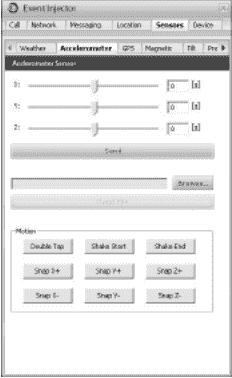

**图 2.23** 事件注入器。

> **注意：** 实际上，bada 模拟器是 bada 平台的完整构建，定制为在桌面操作系统之上运行，具体为 Microsoft Windows 主机 SDK 中的 Win32，而不是手机操作系统。

当然，你的应用可能一开始并不能完美运行。其中可能存在错误。bada IDE 支持 GNU 项目调试器（GDB），它允许你使用软件调试的常见功能，例如设置断点、单步进入、退出或越过方法或监视变量。图 2.24 和 2.25 说明了如何在 bada IDE 中调用调试并显示 IDE 的调试透视图。

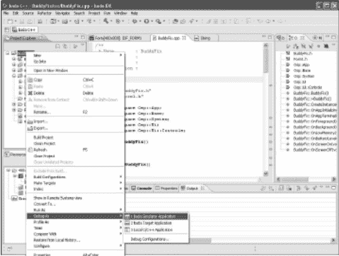

**图 2.24** 在 bada IDE 中调用 GDB。

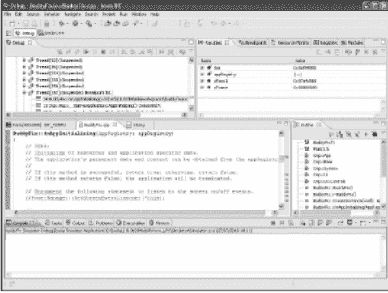

**图 2.25** bada IDE 的调试透视图。

## 在真实目标设备上测试和调试

为 bada 等移动平台开发与在桌面上进行更传统的应用程序开发之间的明显区别在于，开发环境与执行环境不同。为了理解和测试移动应用，前面所述的模拟器非常有用。但最终你真的想知道你的应用在真实手机上的表现如何。

回溯时间机器，移动平台曾经很困难。但 bada 展示了事情发展到何种程度。一些平台仍带有遗留问题——例如 Symbian 怪异的构建系统。事实上，这些都是使移动不同并使移动开发声名狼藉的原因。

截至撰写本文时，第一款 bada 手机已发货——三星 Wave，一款功能丰富的高端手机，定义了 bada 产品线的顶端。最终，bada 手机将从这一高端点延伸到中端价格实惠的“人人智能手机”，将智能手机功能带入大众市场。

在 Wave 目标设备上构建和部署 bada 应用之前，你需要在桌面操作系统上安装 Wave 设备驱动程序。这些设备驱动程序是 IDE/SDK 捆绑包中随 developer.bada.com 门户下载的简单可执行文件。

如果成功，你需要复制并安装测试根证书，这是测试目标设备上应用所必需的。在没有此测试根证书的情况下，应用无法在 Wave 上安装、运行和测试。你可以自行决定如何将测试根证书文件传输到 Wave。最简单的方法是从桌面计算机通过蓝牙推送。另一种方法是使用 USB 数据线以“大容量存储”模式连接。

这可以在 Wave 上通过调用菜单然后进入：设置 | 连接 | USB | 大容量存储，然后点击“设置”软键来设置。

需要从桌面传输到 Wave 设备的测试根证书文件随 SDK/IDE 下载提供。

你可以在 <BADA_SDK_INSTALL_DIR>\Tools\sbuild 中找到所需文件“rootCACert.cer”。

然后断开 Wave 设备与桌面的连接。在 Wave 上调用菜单然后进入我的文件 | 其他。

点击 rootCACert.cer 文件，它应该会自动安装（见图 2.26）。

要通过 USB 使用设备上调试，你需要在 Wave 设备中显式设置此项。打开菜单并进入设置 | 连接 | USB | USB 调试，然后点击“设置”软键（见图 2.27）。


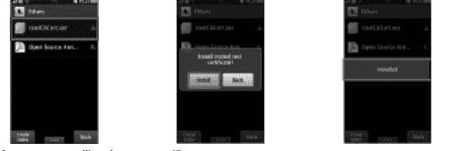

# 图 2.26 安装根证书。

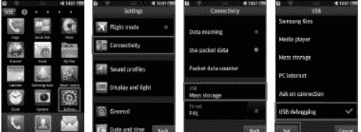

# 图 2.27 为 USB 调试设置设备。

要将你的 bada 应用部署到你的 Wave 设备上，你所要做的就是更改活动的构建配置并为目标平台构建它。打开你的 bada IDE 并创建或打开你的 bada 项目。通过在 Project Explorer 窗口中右键单击项目名称来打开项目的上下文菜单。然后进入 Build Configurations | Set Active 并勾选 Target-Debug（见图 2.28）。

之后，通过进入项目的上下文菜单并单击 Build Project 再次为目标设备构建你的项目。

在目标设备上运行你的 bada 应用之前，请确保它已通过 USB 连接到你的计算机，并且处于 USB 调试模式，这样你就可以在 IDE 中使用调试消息。

要运行你的应用，请进入项目的上下文菜单并选择 Run As | bada Target Application（见图 2.29）。

之后，你的应用应该能够成功在你的移动设备上运行，并且日志消息应该在你的 IDE 输出窗口中可见。

> 注：在撰写本文时，还有一个非常有用的功能处于测试阶段。 三星很快将为你提供在没有设备的情况下也能使用真实设备目标部署的机会。 其代号为 RTL：Remote Testing Lab。 世界上的某个实验室将托管大量真实的 bada 驱动设备。 你可以方便地通过互联网连接到这些设备并在那里部署你的 bada 应用——就像它就在你面前一样。 所有这些很快都将通过 bada IDE 的 RTL 插件访问。 所以请继续关注！

## 创建包

将想法变为已发布应用的流程的第二步的最后一步是创建在第三步中用于认证你的应用的完整包。 要创建包，请在 IDE 中选择你想要提交认证的 bada 项目。 单击 Project 菜单并选择 Make Package（见图 2.30）。

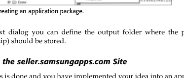

图 2.30 创建应用程序包。

在下一个对话框中，你可以定义输出文件夹，包（即 zip）应存储在该文件夹中。

## 第 3 步：在 seller.samsungapps.com 网站上

完成所有这些工作并将你的想法实现为已构建、运行、测试并打包的应用后，你就离变得富有和出名——或两者兼得——只差一步。 这最后一步是在发布你的应用之前进行认证。

## 获取认证

要获得认证，你需要访问 seller.samsungapps.com 网站。 在那里，你可以使用与步骤 1 中用于 developer.bada.com 门户的相同账户登录。 登录后，主屏幕会显示，如图 2.31 所示。

你可以通过单击顶部的 Add New Application 按钮开始提交流程。 然后网站会逐步引导你完成提交应用进行认证所需的任务（见图 2.32）。

完成流程后，你的应用将被提交进行认证。 应用将被测试以确保其功能和非功能正常，并且符合质量标准（例如可用性）。 我们的目标是在七个工作日内完成 QA 并向你反馈。

## 发布应用

当你的应用获得认证后，它将被发布供下载。 你在上传认证过程中设置价格或地理市场等标准。 所有应用都可以通过 samsungapps.com 网站访问，或直接下载到你的 bada 手机。 管理你的应用和下载的一种便捷方式是桌面软件 Samsung Kies，你也可以从 Samsung Apps Store samsungapps.com 获取它。

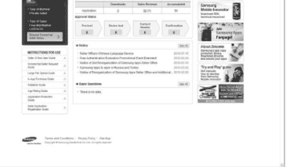

图 2.32 将你的应用添加到 Samsung Apps Seller Office。

## 3.1 扩展应用程序骨架

我们已经看到在 bada 中启动项目是多么容易； 向导为你做了繁重的工作。 现在让我们深入代码。

让我们从遍历 buddyfix.h 中声明的主要 BuddyFix 类开始（这是 Application Wizard 为我们生成的代码）：

```
class BuddyFix :
    public Osp::App::Application,
    public Osp::System::IScreenEventListener
{
```

每个应用都派生自 App::Application 类； 因此，当你创建自己的应用并派生自 Application 时，你扩展了一个 bada 框架已知的类，并指定自定义行为。 框架期望的所有方法都存在于你的派生类中。 你会注意到你的应用还派生自 System::IScreenEventListener 类； ‘I’ 代表 ‘Interface’，这是一种我们将看到很多的模式（将在第 4 章中更详细地讨论）。

接下来，我们看到声明了各种构造函数：

```
public:
    static Osp::App::Application* CreateInstance(void);

public:
    BuddyFix();
    ~BuddyFix();
```

CreateInstance() 是一个所谓的工厂函数，它包装了 C++ 构造函数，并在被调用时返回应用的实例。 其后的两个声明是 C++ 构造函数和析构函数方法。 由于默认实现对我们来说都很好，所以这里不用担心。 完成类的剩余公共声明是我们感兴趣的：

```
public:
    bool OnAppInitializing(Osp::App::AppRegistry& appRegistry);
    bool OnAppTerminating(Osp::App::AppRegistry& appRegistry,
        bool forcedTermination = false);
    void OnForeground(void);
    void OnBackground(void);
    void OnLowMemory(void);
    void OnBatteryLevelChanged(Osp::System::BatteryLevel batteryLevel);
    void OnScreenOn(void);
    void OnScreenOff(void);
};
```

让我们称这些为‘生命周期’方法； 每个应用都有它们，每个应用都必须实现它们。 向导为我们提供了最小实现，但正如我们将看到的，这些方法在定义应用行为的方式上很重要，所以我们 definitely 想要了解它们能为我们做什么。

### 3.1.1 事件驱动

bada 应用完全是事件驱动的； 其运行时行为是响应从框架接收到的事件而定义的。 这些包括用户发起的事件，例如触摸事件、软键事件和（硬）键事件，以及系统发起的事件，例如计时器、传感器通知、传入语音呼叫或消息，以及生命周期事件。

在 bada 中，事件循环隐藏在 bada 框架内部，对应用程序不可见。 为了接收它想要处理的事件，应用只需实现适当的监听器回调方法。 这使得编写 bada 应用程序非常简单。 应用程序本质上是反应式的，并且完全由其处理的事件集定义。

选择要监听和处理的事件取决于你希望 GUI 如何表现，以及应用的核心功能。 然而，生命周期方法定义了每个 bada 应用都应处理的通用系统事件集。

### 3.1.2 运行时应用生命周期

应用生命周期定义了每个应用程序的动态、运行时架构。 生命周期由 bada 应用框架定义，并且当你将应用派生自 App::Application 时，你的应用继承生命周期方法。

在 bada 中，生命周期非常简单。 你的应用存在于四种可能状态之一：Initialising、Running、Terminating 或 Terminated。 在任何时候，你的应用只能处于这四种状态之一。 你可能认识到这是一个简单的状态机：你的应用程序在这些状态之间转换，并且与转换或状态相关联的是生命周期方法：

- 1. Initialising OnAppInitializing()
- 2. Running OnForeground(); OnBackground(); OnLowMemory(); OnBatteryLevelChanged(); OnScreenOn(); OnScreenOff();
- 3. Terminating OnAppTerminating();
- 4. Terminated（无关联方法——你的应用不再运行）。

应用程序生命周期如图 3.1 所示。

严格来说，只有其中四个方法专门与生命周期相关； 其他方法，例如 OnBatteryLevelChanged() 和 OnScreenOff()，响应由框架认为非常重要或在移动设备上如此频繁的系统事件触发的条件，因此框架对它们进行了特殊处理，并给你机会做出适当响应。

让我们更仔细地看看四个生命周期状态，以及生命周期方法如何映射到它们。


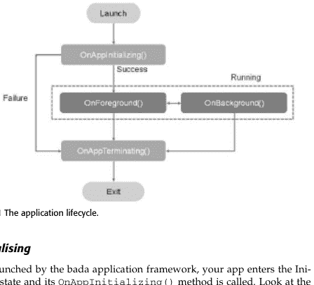

图 3.1 应用程序生命周期。

## 1. 初始化

当 bada 应用程序框架启动应用时，应用会进入初始化状态，并调用其 `OnAppInitializing()` 方法。请查看 `BuddyFix.cpp` 中的实现；回想一下，我们已经更新了 Application Wizard 生成的代码，以加载我们自己的 Form `pMainListForm`，否则这就是默认实现：

```
// Customised to load IDF_MAIN_LIST_FORM
bool
BuddyFix::OnAppInitializing(AppRegistry& appRegistry)
{
    // Initialize UI resources and application specific data.
    // The application's permanent data and context can be obtained
    // from the appRegistry.
    // If this method is successful, return true; otherwise, return
    // false.
    // If this method returns false, the application will be terminated.
    // Uncomment the following statement to listen to the screen on/off
    // events.
    // PowerManager::SetScreenEventListener(*this);

    // Create a form
    //REPLACED Form1 *pForm1 = new Form1();
    MainListForm *pMainListForm = new MainListForm();
```

```
    //REPLACED pForm1->Initialize();
    pMainListForm->Initialize();
    // Add the form to the frame
    Frame *pFrame = GetAppFrame()->GetFrame();
    //REPLACED pFrame->AddControl(*pForm1);
    pFrame->AddControl(*pMainListForm);
    // Set the current form
    //REPLACED pFrame->SetCurrentForm(*pForm1);
    pFrame->SetCurrentForm(*pMainListForm);
    // Draw and Show the form
    //REPLACED pForm1->Draw();
    pMainListForm->Draw();
    //REPLACED pForm1->Show();
    pMainListForm->Show();
    return true;
}
```

在这段代码中，当我们的应用启动时，我们：

1. 创建我们将显示的默认 Form，将其添加到应用程序 Frame，并将其设置为当前 Form。
2. 对 Frame 调用 `Draw()` 和 `Show()`；这两步会将 Form（及其包含的任何控件）渲染到逻辑显示区；然后更新物理 Frame 缓冲区（从而更新手机显示，让你能够看到它）。

`AppRegistry& appRegistry` 参数被传递给该方法，免去你通过方法调用来获取它。初始化时对 AppRegistry 的典型用法有：

-   查找一个键，判断应用是否为首次运行；如果有一些特定的“首次”操作要执行，例如邀请用户注册、提供默认数据（如昵称），或者只是为了说一声“你好！”
-   如果找到键，则恢复任何已保存的偏好设置。

在这两种情况下，最好将任何代码限制为简单、快速的标志设置，留待稍后处理；这样我们加载的 Form 可以被绘制，屏幕得到更新，我们也能继续启动应用；我们通过设置返回值来实现这一点：

```
return true;
```

这很重要；如果返回值为 true，框架会将我们的状态设置为运行状态；否则，将设置为终止状态。

## 2. 运行

如果 `OnAppInitializing()` 返回 true，我们的应用将进入运行状态。这一转换没有关联的生命周期方法——那么我们该如何为此编写代码呢？

答案在于，在运行状态中，我们必须区分两个子状态：前台（Foreground）和后台（Background）。与这两个状态的转换相关的方法有：`OnForeground()` 和 `OnBackground()`。当应用启动并显示时，会隐式调用 `OnForeground()`。当按下 Home 键或调用基础应用（如来电或短信）时，运行中的应用会被发送到后台。此时会调用 `OnBackground()` 方法，建议停止资源密集型操作并释放不需要的内存。一旦应用再次回到前台，你就可以正常继续运行。

启动后，我们的应用现在是前台应用程序。默认 Form 正在显示；用户交互将触发我们的事件监听器运行，例如我们编写了 `OnActionPerformed()` 来响应软键、Option 菜单键和 Option 菜单选择。

另外回想一下 UI Builder 工具添加到我们的 `MainListForm` 中的一长串监听器；按键、触摸和多点触控事件以及焦点事件都会导致我们的监听器实现（回调）运行，以便我们能够恰当地处理各种事件。

当然，系统事件也会生成回调。正如我们所看到的，我们应该准备处理的最小系统事件集是：

- `OnBackground()`
- `OnLowMemory()`
- `OnBatteryLevelChanged()`
- `OnScreenOn()`
- `OnScreenOff()`

你可能已经猜到，两个屏幕事件正是我们继承 `IScreenEventListener` 的原因。

对于如何处理这些事件，没有硬性规定。但很明显，例如，如果内存不足，你应该考虑释放自己所持有的内存；如果电池电量变低，请节省电量，并为突然断电做好准备；如果屏幕关闭，更新显示就没有意义了，等等。

## 3. 终止

你的应用可能会被用户终止；通常在 bada 中，应用没有 Exit 软键或菜单选项，而是当用户按下 Power/End 键时结束。你的应用也可能被系统终止，但这通常表示发生了某种严重错误。无论哪种情况，当你的应用转换到终止状态时，都会调用其 `OnAppTerminating()` 方法，你应该准备关闭；释放所有资源，并在相关时保存状态（但通常不保存用户数据——用户数据应在变更时随时保存）。

当你的应用下次运行时，它会启动进入初始化状态，这正是它被终止与被置于后台之间的区别。

## 4. 已终止

你的应用不再运行。

## 3.1.3 关于框架的说明

框架的妙处在于，它们让你的应用能够利用现成的行为。由于 bada 的语言是 C++，bada 的框架使用 C++ 继承在框架与你的应用之间共享行为。如果你懂 C++，你大概会知道（至少大致知道）这是如何工作的；但即使你不懂也没关系。原理很简单：框架声明了某些你的应用必须实现的方法；框架会调用这些方法，当它们被调用时，你的实现就会运行。

bada C++ 框架使用派生和虚函数在框架本身和使用框架的应用之间分担职责。应用所继承的框架基类提供了所有应用都将共享的通用行为的现成实现，还提供了虚方法中定义的可选覆盖行为，以及纯虚方法中定义的抽象行为，派生类必须为这些抽象行为提供实现。抽象类在 bada 中被广泛使用，尤其是在定义接口类时。有关接口类及其用法的更多信息，请参阅第 4 章。

> 注意：在 C++ 中，派生（即继承）是一种通用机制，允许派生类共享基类的行为；具体来说，虚函数（动态绑定）允许派生类通过覆盖基类行为来扩展基类的行为。覆盖不同于重载，重载允许具有相同名称但不同签名的方法，并在编译时解析引用；虚方法使用 virtual 关键字，具有相同的名称和签名，并在运行时解析引用。

> 在 C++ 中，纯虚方法（也称为抽象方法）使用特殊的 =0; 语法声明，表示该方法具有空主体，即没有实现；在提供实现之前，代码无法链接。

> 基类中的纯虚方法必须由派生类实现；¹ 基类的其他虚方法具有基类实现，但派生类可以选择重新实现以覆盖默认行为。

¹更准确地说，将被实例化的派生类必须实现其基类的纯虚方法。抽象类可以形成链，但一个类如果没有实现所继承的纯虚方法，那么它本身就是一个无法实例化的抽象类。


## 3.2 使用 UI 框架

有效地且恰当地实现应用程序生命周期是充分利用 bada 框架的重要方面之一。另一个方面是使用 GUI 框架来创建有效、美观且易于使用的 GUI。bada 上的触控 UI 具有众多优秀功能，且内置应用展示得很好。在以下各节中，我们将更深入地探讨 bada 的控件和图形类，它们为创建应用 GUI 提供了构建块。

### 3.2.1 控件层级

bada UI 类提供了一组实用的现成 Control 类型。所有 UI 元素，包括 Frame 和 Form，都派生自 Control 类，如图 3.2 所示，该图展示了 Control 层级中最重要的类。

请注意，出于清晰考虑，图表并未显示所有派生自 Control 的 UI 控件，但它确实展示了 Control 与 Container 之间的关系。

Control 是所有 GUI 元素的基类，而 Frame 和 Form 是应用的顶层 GUI 对象。

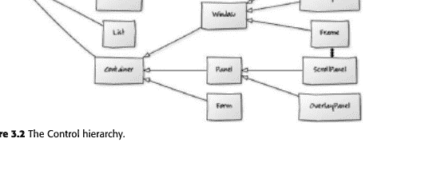

图 3.2 Control 层级。

### 3.2.2 关于 UI 控件的更多内容

Form 包含内容。内容类型包括纯文本、直接嵌入的图像以及标准或自定义控件。派生自 Container 类的控件也可以作为嵌套控件的容器。除了包含内容外，控件也是活跃的，可以响应用户事件，例如触摸、多点触控和手势。

正如您所期望的，bada 提供了一套全面的标准控件，例如按钮、选择器和编辑区域，以及更专业的控件，包括动画、Flash 影片和覆盖面板，可实现控件分层（例如在视频帧上叠加播放器式控件）。

如果没有合适的标准控件满足应用需求，应用程序也可以派生并自定义自己的控件。

所有控件必须同时被绘制和显示才能呈现，要么同步使用 Draw() 和 Show() 方法，要么异步使用 RequestRedraw()。请注意，同步绘制方法不应在回调中调用。相反，请使用异步 RequestRedraw() 方法，该方法在排队重绘请求后立即返回。

Container 控件具有 OnDraw() 方法，该方法在框架绘制任何子控件之前被调用，从而能够在 Container 中执行任何自定义绘制（例如绘制位图背景）。随后对子控件的绘制会覆盖 Container 画布的相关区域，从而允许在 Container 中绘制背景，以便其后面的任何控件都能显示。

> 注意：控件只有在被添加到可显示的容器后才变得可显示。控件是否可显示也会决定其子控件（如果有）是否可显示。因此，一般规则是，在控件被添加到其容器之前不要调用该控件的任何方法，以避免可能出现意外行为，例如与可显示性相关的问题。

因此，框架按以下顺序执行绘制：

- 1. 调用 Form 的 Draw() 方法。
- 2. 调用 Form 的 OnDraw() 方法，因为 Form 是 Container。
- 3. 调用第一个子控件（如果有）的 Draw() 方法。
- 4. 如果第一个子控件是 Container，则调用其 OnDraw() 方法。
- 5. 调用第二个子控件的 Draw() 方法，依此类推。

请注意，只有 Container 控件才具有 OnDraw() 方法。

| Draw() | 将控件绘制到包含 Window 的画布上，该 Window 通常为 Application Frame，因为 Frame 派生自 Window（但例如 Form 不是）。 |
| Show() | 将 Window 画布内容复制到可显示的帧缓冲区。 |
| RequestRedraw() | 异步方法，调用 Draw() 和 Show()，并立即返回。 |
| OnDraw() | 当 Container 控件被绘制时由框架调用，以便在绘制任何嵌套控件之前执行任何自定义绘制。 |

下面展示了 bada 提供的部分标准 Control 派生类的选择，按您在设计用户界面时所需的用户交互类型组织。

## 简单按钮和标签

- Button
- CheckButton
- Label


此组控件用于通用按钮，向用户提供复选框选项，并在 Label 控件的情况下显示不可编辑的文本或图像。

## 选择器

ColorPicker

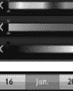

DatePicker


RadioGroup

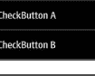

Slider

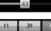

TimePicker

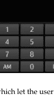

这些是允许用户选择颜色、日期或时间，或在 RadioGroup 的情况下从选项列表中做出一个选择。滑块允许用户从范围内选择一个值。

## 列表

CustomList

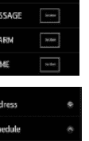

ExpandableList

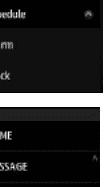

GroupedList

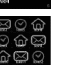

IconList

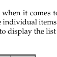

bada 在显示列表方面为您提供了很多选择，从图标列表到 CustomList，其中各个项目可以具有不同的布局。我们在 BuddyFix 中使用简单列表来显示好友列表。

## 可编辑控件

EditDate


EditField


### 3.3.1 关于 Canvas 的更多内容

Canvas 类使您可以直接访问设备显示以进行绘制。每当您想使用图形原语进行直接绘制时（例如 Line、Rectangle、Ellipse、Polygon 等，以及用于文本的 TextElement 和用于图像的 Bitmap，它们都是 Osp::Graphics 命名空间的成员），则必须使用 Canvas。

您可以从 GUI 中的任何位置显式构造一个普通（全局）Canvas 对象：

// Construct a "normal" or global canvas
Canvas* pCanvas = new Canvas();
pCanvas->Construct();

请注意，Canvas 总是以两阶段方式构造，通过 operator new 分配并使用 Construct() 初始化（参见第 4 章，关于两阶段构造）。

普通 Canvas 覆盖应用程序 Frame 并绕过窗口（和 Control）层级，提供对显示的直接访问并覆盖其显示矩形内的任何内容（包括您当前的 Form 和其包含的任何控件）。如果在构造时未指定矩形，普通 Canvas 为全屏大小。

这意味着 Canvas 可用于设置全屏背景图像。（请回忆，Frame 和 Form 都允许设置其背景颜色，但不会将图像加载为背景。）

一旦 Canvas 被绘制，任何后续的 Draw() 调用都会覆盖它，从而允许控件（例如）绘制在其之上。然而，这仅与代码中 Draw() 调用的顺序一样可靠。因此请谨慎使用。

使用 Canvas 的更典型方式是在窗口和控件层级内操作（因此不会无意覆盖其他 GUI 元素），即请求一个本地‘窗口’Canvas 对象。每个 Control 派生对象，从 Form 到 Control 层级，都拥有一个窗口 Canvas 对象：

// Get the window canvas
Canvas* pCanvas = GetCanvasN();

在这种情况下，Canvas 共享其拥有控件的上下文，包括其显示区域和已设置的本地图形上下文的任何其他属性。通常，调用者然后设置所需的显示属性并进行绘制，从而使 Canvas 能够在给定控件的上下文中直接向屏幕绘制显示原语或背景位图，以创建文本或其他图形。

实际上，Canvas 在 Container 控件（如 Frame、Form 和 Panel）的上下文中最有用。


Canvas 并不属于 Control 层级结构，实际上也不属于 `Osp::UI` 命名空间；相反，它直接派生自 bada 根对象类 `Osp::Base::Object`，并且是 `Osp::Graphics` 命名空间的成员。Canvas 具有表 3.1 中列出的属性，你可以使用诸如 `SetForegroundColor()` 和 `SetLineWidth()` 之类的方法在任何画布上设置这些属性。

**表 3.1 Canvas 属性**

| 属性 | 描述 |
|---|---|
| 前景颜色 | 图元的绘制颜色 |
| 背景颜色 | 清除时使用的背景颜色 |
| 线条样式 | 线条样式（仅支持实线） |
| 线条宽度 | 具有线条样式的图元的线条宽度 |
| 字体 | 用于文本绘制的字体 |

> **注意：** 如果你在 `OnDraw()` 回调中进行绘制，那么应该调用父级 Container 控件上的 `GetCanvasN()` 来获取该 Container 正在使用的画布，否则控件的本地画布会被父级覆盖，因为绘制始终是从下到上依次遍历容器所拥有的控件列表来进行的。

## 3.3.2 图形图元

正如你所期望的那样，bada 提供了一整套全面的图形图元。这些图元始终绘制到 Canvas 对象上。Canvas 以可设置的 Canvas 属性的形式，为绘制到其上的图元提供图形上下文。你可以在绘制代码中随时动态设置和重置这些属性。你绘制的 Canvas 可以是显式构造的，也可以是从适当的 Control 请求获得的。

`Point`、`Dimension` 和 `Rectangle` 类用于构造各种图形图元：

**Point**

*由 X、Y 坐标组成的二维点。*

**Dimension**

*一个 X、Y 有序对，表示（宽度，高度）。*

**Rectangle**

*具有左上角点（X，Y）以及宽度和高度的矩形区域。*

形状总是从左上角开始构造，即局部坐标空间的 (0,0) 点。

### 简单形状和文本

请注意，对于简单的形状和文本绘制，所有工作都由 Canvas 完成。你不需要显式创建形状、线条或文本对象；而是设置 Canvas 属性并调用 Canvas 对象的专用绘制方法，例如：

1. 构造画布：

   ```
   Canvas::Construct()
   ```

2. 清除画布：

   ```
   Canvas::Clear();
   ```

3. 将线条颜色设置为红色：

   ```
   Canvas::SetForegroundColor(Color::COLOR_RED);
   ```

4. 在画布上绘制一个矩形：

   ```
   Canvas::DrawRectangle();
   ```

5. 将画布显示到屏幕上：

   ```
   Canvas::Show();
   ```

对于形状，如椭圆、多边形、矩形，通过调用 Fill 方法而不是普通的 Draw 方法来设置填充属性，例如：

```
Canvas::FillRectangle(const Color &color, const Rectangle &rect);
```

文本可以以类似方式绘制到 Canvas 上：

1. 构造画布。
2. 使用样式和大小构造字体：

   ```
   Font::Construct(FONT_STYLE_ITALIC, 32);
   ```

3. 清除画布。
4. 设置 Canvas 字体：

   ```
   Canvas::SetFont(font);
   ```

5. 将 "BuddyFix!" 绘制到画布上：

   ```
   Canvas::DrawText(Point(55, 55), L"BuddyFix!");
   ```

6. 将画布显示到屏幕上。

注意：文本也可以直接绘制到大多数（但并非所有）类型的控件中——最明显的是 Label，它专门用作不可编辑文本的容器，以及 EditArea 和 EditField，用于可编辑文本，还包括 MessageBox，以及各种 List 类型和 ListItem 类型。详情请参阅 bada API 参考文档。

### EnrichedText

EnrichedText 让你可以更好地控制文本样式。使用简单的 Canvas 文本样式只能设置 Direction、Underline 和 Strikeout 样式。

使用 EnrichedText，你可以通过将整个 EnrichedText 块的总体样式（例如对齐方式和换行方式）与块中每个 TextElement 对象的单独样式（例如字体样式和大小、颜色，另请参见表 3.2）相结合，来完整指定文本样式。

**表 3.2 EnrichedText 属性。**

| 属性 | 描述 |
|---|---|
| 水平对齐 | 左对齐、居中对齐或右对齐 |
| 垂直对齐 | 顶部对齐、居中对齐或底部对齐 |
| 文本换行样式 | 不换行、按字符换行或按单词换行 |
| 缩写 | 当绘制文本的大小超过 EnrichedText 的尺寸时，是否对绘制文本进行缩写 |
| 字体大小和样式 | 字体大小和样式：常规、粗体或斜体 |
| 文本颜色 | 文本元素的前景颜色 |
| 背景颜色 | 文本元素的背景颜色 |
| 轮廓颜色 | 文本元素的轮廓颜色 |

EnrichedText 仍然使用 Canvas 绘制，只是文本本身是显式创建并作为参数传递的：

```
pEnrichedText->Construct(Dimension(width, height));
pCanvas->DrawText(Point(left, top), *pEnrichedText);
```

在应用程序中使用图像数据之前，必须先将图像数据从文件加载到内存中。保存在手机内存中的图像数据通常应先保存为文件格式，然后再传输到手机外部，或与手机上的其他应用共享。

在 bada 中，Bitmap 类封装了内存中的图像数据，而 Image 类作为工具类提供，用于在文件和位图之间执行双向转换，以及在不同文件格式之间直接转换。

使用 Image 类，图像数据可以：

- 从受支持的文件格式解码为位图；
- 或将位图编码为受支持的文件格式。

Bitmap 对象包含原始文件数据的（已解码的）物理副本，以标准位图格式存储（见下文）。这意味着解码后，Image 对象和原始图像文件将不再需要。

要从图像文件创建 Bitmap 对象：

1. new 并 `Construct()` 一个空的 Image 对象：

   ```
   Image* pImage = new Image();
   pImage->Construct();
   Bitmap* pBitmap = null;
   ```

2. 调用 `Image::DecodeN()` 方法从文件解码图像数据。`DecodeN()` 返回一个 Bitmap 对象：

   ```
   pBitmap = pImage->DecodeN(L"/Res/bada.png", BITMAP_PIXEL_FORMAT_ARGB8888);
   ```

3. 删除 Image 对象：

   ```
   delete pImage;
   ```

4. 使用 Bitmap 对象，并在不再需要时删除，例如：

   ```
   pButton->SetNormalBitmap(Point(0,0), pBitmap);
   delete pBitmap;
   ```

具体来说，Image 类包含用于处理图像的工具方法：

- 将图像数据编码/解码到文件或从文件解码；
- 在图像格式之间转换位图或文件图像数据；
- 压缩 JPEG 图像；

解码图像数据支持以下文件类型：

- JPEG
- GIF
- PNG
- BMP
- TIFF
- WBMP

编码支持以下文件类型：

- JPEG
- PNG
- BMP

bada 支持三种不同的位图格式。位图像素格式说明符用于定义目标位图的颜色模式，并接受以下枚举类型：

| 像素格式 | 枚举类型 |
|---|---|
| RGB565 像素格式 | BITMAP_PIXEL_FORMAT_RGB565 |
| ARGB8888 像素格式 | BITMAP_PIXEL_FORMAT_ARGB8888 |
| 用于 OpenGL 的 R8G8B8A8 像素格式 | BITMAP_PIXEL_FORMAT_R8G8B8A8 |

像素格式表示以下标准颜色模式：

- RGB565 指定 16 位 RGB，红色和蓝色各 5 位，绿色 6 位。
- ARGB8888 指定 32 位 Alpha RGB，每个分量 8 位。
- R8G8B8A8 是另一种基于字节的 32 位格式，OpenGL(R) 更倾向于使用这种格式。

有关 Bitmap 类的所有枚举，请参见头文件 FGrpBitmapCommon.h。

与图形绘制图元一样，Bitmap 对象表示像素数据，通过将 Bitmap 对象绘制到 Canvas 的某个区域，然后显示 Canvas，来显示位图。

由于每张图像都有一个“实际”大小（创建时的大小），这可能不是你希望在手机上显示的大小，因此从图像文件解码支持图像缩放。其他变换，例如旋转，可以在将图像绘制到 Canvas 时执行。

位图还可以裁剪到 Canvas 的某个区域，这是与设置屏幕区域（该区域必须始终是矩形）的大小和位置分开的步骤。

下面是一个完整的示例，包含显示位图所需步骤的代码。


## 从文件创建位图

FMedia.h 是 Media 命名空间的头文件，其中包含 Image 类，而 Bitmap 定义在 FGraphics.h 的 Graphics 命名空间中。

所需的 #include 声明为：

```
#include <FMedia.h>
#include <FGraphics.h>
```

使用 Media 命名空间中的类需要链接 FMedia 库，而使用 Graphics 命名空间中定义的类（如 Bitmap）则需要链接 FGraphics 库。

所需的命名空间声明为：

```
using namespace Osp::Media;
using namespace Osp::Graphics;
```

权限级别为 NORMAL。权限组为 IMAGE。图像构造过程如下：

```
result r = E_SUCCESS;
Image *pImage = new Image();
r = pImage->Construct();
if (IsFailed(r))
{
    // 处理错误情况
}
```

如果方法成功，r 包含 E_SUCCESS，否则包含错误状态。有关系统错误值的更多信息，请参阅 FBaseErrors.h，它定义了所有框架错误代码。

Image 提供了四种解码方法：

- 1. 接受源文件图像路径字符串和目标位图像素格式说明符。
  - 不执行缩放。
  - 保留原始宽高比：

```
Bitmap* Decode(const Osp::Base::String& srcImagePath,
    BitmapPixelFormat colorFormat) const;
```

3. 接受源缓冲区引用和目标位图像素格式说明符。

- 不执行缩放。
- 保留原始宽高比。

```
Bitmap* DecodeN(const Osp::Base::ByteBuffer& srcImageBuf,
    ImageFormat srcImageFormat, BitmapPixelFormat colorFormat)
    const;
```

4. 接受源缓冲区引用和目标位图像素格式说明符，以及输出图像宽度和高度。

- 按指定方式缩放。

```
Bitmap* DecodeN(const Osp::Base::ByteBuffer& srcImageBuf,
    ImageFormat srcImageFormat, BitmapPixelFormat colorFormat,
    int destWidth, int destHeight) const;
```

接续上面的代码片段，声明了结果 r 并构造了 pImage：

```
Bitmap* pBitmap = null;
String path(L"/Res/Sample.jpg");
pBitmap = pImage->DecodeN( path, BITMAP_PIXEL_FORMAT_RGB565,
    SCREEN_WIDTH, SCREEN_HEIGHT );
if (null == pBitmap)
{
    delete pImage;
}

//您的代码写在这里...

//最后，删除图像实例
delete pImage;
```

注意，一旦我们不再需要 Image 对象，就立即删除它；或者在发生错误时，我们必须删除它。

由于 pBitmap 和 String 不是构造的对象（只是声明为自动变量），我们不应调用它们的析构函数；当方法返回时，它们超出作用域后会被自动释放。

在上面的代码中，我们创建了一个 String 对象来存储路径；更高效的方法是使用 L 宏在方法调用中创建字符串字面量：

```
pBitmap = pImage->DecodeN(L"/Res/Sample.jpg", BITMAP_PIXEL_FORMAT_RGB565, SCREEN_WIDTH, SCREEN_HEIGHT );
```

## 将位图绘制到画布上

现在我们已经创建了位图，可以使用它了。例如，要显示位图，我们获取窗体（如果没有窗体则为框架）的画布，在画布上绘制，然后调用 Show()。

接续代码片段：

```
// 创建一个要绘制到的矩形，获取客户区域的边界
Rectangle rect = TopBoardViewForm-> GetClientAreaBounds();

// 获取 Canvas 实例
Canvas *pCanvas = null;
pCanvas = pForm -> GetCanvasN();
// 如果我们想直接在应用程序框架中显示，则改为这样获取画布：
pCanvas = GetAppFrame()->GetCanvasN();

r = pCanvas -> DrawBitmap(rect, *pBitmap);

if (IsFailed(r))
{
    delete pCanvas;
}

r = pCanvas->Show();
if (IsFailed(r))
{
    delete pCanvas;
}

// 您的进一步代码...
delete pCanvas;
```

要将位图绘制到画布上，我们必须创建一个要绘制到的矩形。请注意，决定所绘制位图大小的是矩形大小，而不是位图大小。另外还请注意，在失败的情况下，我们必须删除 Canvas 对象。

在上面的代码片段中，我们根据可用的客户区域设置画布矩形。要创建任意矩形，我们会使用矩形初始化构造函数，例如，我们可以提供 x=20、y=80、width=440、height=440 的值：

```
Osp::Graphics::Rectangle::Rectangle (int x, int y, int width, int height);
```

> 注意：您可以构造一个比设备屏幕更大的画布。在 FGrpCanvas.h 中：
> result Construct(const Rectangle& rect);

### 3.3.4 颜色

最后，为了完成这一概述，我们将简要介绍 Color 类。

颜色值在代码中出现的频率不如 String 或 Number 类型，但大多数应用——事实上，所有应用——都是定义颜色的图形类的客户端，因此至少对颜色在 bada 中如何使用和操纵有一个粗略的了解将会有所帮助。

手机已经从早期的单色（或绿屏、基于文本）设备走了很长一段路，我们中至少有些人还记得在移动开发职业生涯早期使用过这些设备。

事实上，三星是显示技术的领导者，并一直推动手机规格向高端发展，在高清（HD）和 AMOLED 显示技术方面开辟了新天地。诸如 Wave 等手机拥有物理尺寸大、像素密度高、明亮、高对比度、户外可读且色彩鲜艳的屏幕。

随着硬件图形加速和着色器支持的广泛普及，透明度、动画和全 3D 等 UI 效果现在可以在手机显示屏上实现，而就在几年前，这些效果还是不可想象的。

有趣的是，AMOLED 技术以一种令人惊讶的方式将设备显示屏引入了电源管理方程。与标准的 LCD 技术不同，OLED（有机发光二极管）显示屏使用有源像素，其功耗需求会根据像素所显示的色调而变化。确切地说，较暗的颜色比较亮的颜色更省电（在功耗方面），这意味着 UI 设计师现在可以将功耗添加到决定其应用调色板和配色方案设计选择的因素列表中。

在 bada 中，颜色使用 ARGB 颜色模型定义，该模型使用 Alpha（即透明度）、红色、绿色和蓝色值。

> 注意：并非 bada 中的所有图形对象都有 alpha 通道。Bitmap 和 Canvas 都有，因此两者都支持 alpha 混合。

Color 类提供了有用的内置函数，包括：

- 设置和获取 Color 对象的颜色分量，支持所有 ARGB 或特定颜色值（以及 alpha）的值，以及 32 位颜色值。
- 10 种预定义颜色。

所有颜色都是 32 位实体，支持 24 位“真彩色”或“数百万色”显示，红色、绿色、蓝色和 alpha 数据各占 8 位。如果设备显示屏支持的物理位深较低，颜色会被降采样，导致质量损失。顺便提一下，bada 手机上的像素始终是正方形的。

## 3.4 重新审视 BuddyFix 用户界面

如我们所见，UI Builder 在创建功能性 UI 方面只能帮我们到这里。特别是，要完成 BuddyFix 的基本 UI，我们需要：

在 BuddyFix 中，我们将实现以下顶级选项菜单项和子项：

| 好友 | 顶级项 |
|---|---|
| 添加好友 | 子项，向好友列表中添加新好友 |
| 移除好友 | 子项，从好友列表中移除好友 |
| 暂停共享（如果处于活动状态）或取消暂停共享（如果处于暂停状态） | 顶级项，全局暂停或取消暂停所有好友的位置共享 |
| 设置 | 顶级项，启动设置弹出窗口 |
| 关于 | 顶级项，启动提供应用版本和其他信息的信息弹出窗口 |

让我们看一下代码。

首先，在 MainListForm.h 中，我们添加一个 OptionMenu 指针成员 pOptMenu 和事件 ID 定义：

```
class MainListForm :
    public Osp::Ui::Controls::Form
{
    // ...等等
    // 选项菜单声明

protected:
    Osp::Ui::Controls::OptionMenu* pOptMenu;
    static const int ID_OPTIONKEY = 100;
    static const int ID_OPTIONMENU_ITEM_1 = 101;
    static const int ID_OPTIONMENU_ITEM_2 = 102;
    static const int ID_OPTIONMENU_ITEM_3 = 103;
    static const int ID_OPTIONMENU_ITEM_4 = 104;
    static const int ID_OPTIONMENU_ITEM_5 = 105;
    static const int ID_OPTIONMENU_SUBITEM_1 = 201;
    static const int ID_OPTIONMENU_SUBITEM_2 = 202;
};
```

接下来，在 MainListForm.cpp 中，我们添加代码来构造和分配 OptionMenu 对象。通过将 ID 传递给项或子项构造函数方法来设置事件 ID。我们还必须调用两个 Form 方法：

```
SetOptionkeyActionId(ID_OPTIONKEY);
AddOptionkeyActionListener(*this);
```

Form 初始化代码现在如下所示。注意使用两阶段构造来分别分配和初始化 OptionMenu 对象：


bool
MainListForm::Initialize()
{
    Form::Construct(L"IDF_MAIN_LIST_FORM");

    // Create the OptionMenu
    // Member in MainListForm Osp::Ui::Controls::OptionMenu* pOptMenu
    pOptMenu = new OptionMenu;
    pOptMenu->Construct();

    pOptMenu->AddItem("Buddies",ID_OPTIONMENU_ITEM_1);
    pOptMenu->AddSubItem(0, "Add Buddy",ID_OPTIONMENU_SUBITEM_1);
    pOptMenu->AddSubItem(0, "Remove Buddy",ID_OPTIONMENU_SUBITEM_2);
    pOptMenu->AddItem("Pause Sharing",ID_OPTIONMENU_ITEM_2);
    pOptMenu->AddItem("Unpause Sharing",ID_OPTIONMENU_ITEM_3);
    pOptMenu->AddItem("Settings",ID_OPTIONMENU_ITEM_4);
    pOptMenu->AddItem("About Buddy Fix!",ID_OPTIONMENU_ITEM_5);

    // Invoked on the Form, not the menu
    SetOptionKeyActionId(ID_OPTIONKEY);
    AddOptionKeyActionListener("this");

    return true;
}

我们已经分配了菜单对象，因此我们有责任删除它。在 MainListForm.cpp 中：

```
result
MainListForm::OnTerminating(void)
{
    result r = E_SUCCESS;

    delete pOptMenu;

    return r;
}
```

最后，我们需要处理菜单操作生成的事件。在 MainListForm.cpp 中，我们在 OnActionPerformed() 方法中添加监听器代码：

```
void
MainListForm::OnActionPerformed(const Controls source, int actionId)
{
    switch (actionId)
    {
    case ID_OPTIONKEY:
        ShowOptionMenu();
        break;
        // Menu items
    case ID_OPTIONMENU_ITEM_1:
        // Todo: insert your code here
        break;
        // ... etc
        // Menu sub-items
    case ID_OPTIONMENU_SUBITEM_1:
        // Todo: insert your code here
```

就这样。为了捕获和处理 Softkey 事件，在 MainListForm.cpp 中我们在 OnActionPerformed() switch 语句顶部添加一个合适的 case：

```
switch (actionId)
{
    case ID_LEFT_SOFTKEY:
        ShowOptionMenu();
        break;
    case ID_OPTIONKEY:
        ShowOptionMenu();
        // ... etc

    default:
        break;
}
```

## 3.4.3 填充列表

直到我们用一些内容填充它之前，我们仍然无法看到我们应用的 buddy 列表的外观或行为。

由于我们只对 UI 行为感兴趣，我们将推迟任何其他复杂性，并编写一个测试方法来用虚拟数据填充 buddy 列表。这将使我们能够练习列表功能并验证 UI 行为。

首先我们只想向列表中添加一些数据，以便我们可以看到它看起来如何。

要添加一个项目，我们将编写一个 TestAddItem() 方法，并将其作为 MainListForm 的受保护方法添加。回想一下，我们选择了格式：LIST_ITEM_DOUBLE_IMAGE_TEXT_FULLTEXT，以显示第一行的图像和文本，以及第二行的文本。

我们需要传递的参数是 List.AddItem() 所需的参数：

- pText1 – 我们文本的第一行，buddy 名称字符串；
- pText2 – 第二行文本，buddy 位置时间戳字符串；
- pBitmap1 – 第一个普通位图，buddy 图片；
- pBitmap2 – 未使用；
- itemId – 一个整数 ID，用于让我们识别此列表项。

这是我们添加到 MainListForm.h 的原型：

// Implementation
protected:

    //Test method, add an item to the list
    result TestAddItem( const Osp::Base::String* aBuddyName,
                        const Osp::Base::String* aLocationStamp,
                        const Osp::Graphics::Bitmap* aBuddyPic );
```

这是我们添加到 MainListForm.cpp 的 stub 实现：

/*
 * Test method, add an item to the main buddy list
 */
result
MainListForm::TestAddItem(const Osp::Base::String* aBuddyName,
    const Osp::Base::String* aLocationStamp,
    const Osp::Graphics::Bitmap* aBuddyPic)
{
    AppLog("TestAddItem\n");
    return E_SUCCESS;
}
```

首先，我们需要创建一个 Bitmap 对象来传递给此方法。我们可以假设在最终实现中，位图和名称字符串将从 Contacts 应用中检索。

现在，我们需要自己提供位图。因为这是临时代码，我们将使其成为测试方法本身的一部分，并创建一个可以传递给我们创建的每个测试项的单个虚拟位图（因此原型发生变化）。

要使用位图和图像，在 manifest.xml 中声明：

```
<Privileges>
    <Privilege>
        <Name>IMAGE</Name>
    </Privilege>
</Privileges>
```

对于生产应用，您应该使用 developer.bada.com 门户上的 Application Manager。

要使用位图和图像，在 MainListForm.h 中：

```
#include <FGraphics.h>
#include <FSystem.h>
#include <FMediaImage.h>
```

要使用位图和图像，在 MainListForm.cpp 中：

```
using namespace Osp::Graphics;
using namespace Osp::Media;
```

注意：不要忘记添加您的链接库！

这现在可以构建了。

我们现在可以调整原型以去掉图像参数，因为我们在方法中创建了虚拟位图。现在我们可以测试调用该方法：

/*
 * Test method, add an item to the main buddy list
 */
result MainListForm::TestAddItem(const Osp::Base::String * aBuddyName,
    const Osp::Base::String * aLocationStamp)
{
    // First, get a pointer to the main list, by name
    List* mainlist = static_cast(GetControl(L"IDC_MAIN_LIST"));
    if (mainlist)
        AppLog("Not null list\n");
    else
        AppLog("Null list!\n");

    // Create a dummy bitmap to put into buddy list entries
    result r = E_SUCCESS;
    Image* dummyimage = new Image;
    Bitmap* bitmap = null;
    r = dummyimage -> Construct();
    if (IsFailed(r))
    {
        // Handle error condition
    }

    bitmap = dummyimage->DecodeN(L"/Home/94-novaq.png",
        BITMAP_PIXEL_FORMAT_RGB565, 52, 52);

    if (null == bitmap)
    {
        // Handle error condition
    }

    //Delete the image instance
    delete dummyimage;

    AppLog("TestAddItem() %s %s \n", aBuddyName, aLocationStamp );

    // Okay, now make a list item
    // r = mainlist->AddItem(*aBuddyName, *aLocationStamp, bitmap,
    // bitmap, 500); r = mainlist->AddItem(aBuddyName,
    aLocationStamp, bitmap, null,
    500);

    return r;
}
```

使用以下方式调用：

```
String dummyname(L"Elvis");
String dummylocstamp(L"Has left the arena");

result r = TestAddItem(&dummyname, &dummylocstamp );
// Log it!
AppLog("result = %s", GetErrorMessage(r));
```

我们现在可以看到列表项。

这不是最终的 UI，但我们已经展示了 BuddyFix 使用的基本要素。请关注 developer.bada.com 上的最终应用新闻。

# bada 基础

本章首先概述了 bada 平台——其起源和架构——然后介绍其编程习惯和约定，以及 bada 类库和其平台特定类型。它以一些实用的快速教程结束，涵盖了 bada C++ 编程中最重要的习惯用法。

## 你将学到什么

本章旨在为您提供有效使用 bada 作为开发者的背景。它提供了 bada 是什么的大局视图。您将学习关于：

- 1. 高级系统架构
- 2. bada 类库和您将在应用中使用的平台特定类型，包括集合、字符串和数字
- 3. 您需要知道的习惯用法和命名约定，以编写和阅读 bada 代码

## 你需要什么

为了充分利用本章，我们建议——除了 bada SDK 和 IDE 之外——一杯茶和一把扶手椅——但任何其他饮品也同样不错！

在 UI 级别，中间件支持您可能想要做的所有事情，而 bada 设备很酷、性感且功能齐全。事实上，设备可能是 bada 故事中最大的一部分——这正是您可能从三星那里期望的。

三星每年出货超过 2 亿部手机。2009 年，其中 4000 万部手机基于触摸屏，预计 2010 年这一数字将显著增长。bada 将成为触摸屏手机的主要平台，取代三星之前专有的平台。这些数字就是 bada 的真正含义。它的目标是开放一个在市场上非常成功的平台（毕竟它已推动三星进入移动手机厂商第二名）给第三方开发者开发的 bada 应用。这一目标将使应用革命进入下一阶段，并将其从高端昂贵设备推向中端——无论这些设备是运行 iOS 的 Apple 设备，还是运行 Symbian、Android、Windows Mobile 和 LiMo 等智能手机操作系统的各厂商智能手机，包括三星。

这种面向“我们其他人（包括你妈妈）的手机”的中端市场迄今已证明是三星的肥沃领域，开放给应用是合乎逻辑的一步。

但让我们停止像营销人员那样说话，深入到细节。

## 4.1.2 简短的 bada 历史

在本书中，我们感兴趣的是从应用开发者角度理解平台软件。换句话说，我们真正的重点是如何使用平台并利用其功能编写很酷的 bada 应用。

但系统成长和演变的环境，以及它经历的阶段，对其构建方式有很大影响，而理解系统是如何构建的可以帮助您理解如何充分利用它。

三星大约在 1999 年开始开发其内部 3G 手机平台。众所周知，三星手机业务的一个持久原则是为有市场需求的每个手机平台提供产品。截至撰写本文时，三星在 Android、LiMo、Symbian 和 Windows Mobile 以及其专有平台上出货手机，还有第一款 bada 手机 Wave。


## 4.1.3 bada 平台的分层模型

从概念上讲，bada 平台用四个层来描述。虽然应用程序开发者只需了解顶层细节即可创建应用程序，但了解更多关于平台的信息、其设计方式以及它提供的潜力是有用的。四层模型如图 4.1 所示，我们将在下面解释每一层包含的内容。

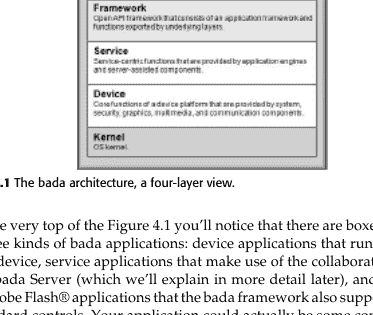

图 4.1 bada 架构，四层视图。

在图 4.1 的最顶部，你会注意到有表示三种 bada 应用程序的框：独立运行在设备上的设备应用程序、利用 bada Server 协作功能的服务应用程序（我们将在后面更详细地解释），以及 bada 框架通过其标准控件也支持的基于 Web 和 Adobe Flash® 的应用程序。你的应用程序实际上可以是这三种类型的组合。

框架层由应用程序开发者可用的 API 组成，分为本书中解释并在第 6 章详细说明的 20 个顶级命名空间。这些 C++ API 是开发者访问设备功能的网关。在这里你会找到实现应用程序架构的类、存储和恢复应用程序状态、支持基本数据类型，以及访问系统功能（如电池电量）的类。命名空间还包括创建应用程序 UI、2D 和 3D 图形以及利用设备多媒体功能的类。通过这些 API，开发者可以播放和录制音频和视频，并访问摄像头，以及利用运动、振动器和其他传感器。它也是位置命名空间的所在地，这使得在你的应用程序中包含一个功能齐全的地图控件变得非常简单。

但正是面向服务的命名空间使 bada 与其他平台区别开来。图 4.2 显示了更详细的架构视图，说明了应用程序功能如何超越设备以利用 bada Server 的功能。实现诸如协作、商务和 Web 服务等功能与服务器通信的实际工作是由服务层中的组件完成的。

开发者使用框架层中定义的 API 来访问功能，无论这些功能是纯粹在设备上实现还是在 bada Server 支持下实现。例如，Social 命名空间包含在设备上管理用户地址簿和日历的类，但 Social::Services 子命名空间包含一套完整的协作服务，可与 bada Server 协同工作，以共享个人资料信息、访问第三方社交网络站点或查找好友——BuddyFix 应用程序就是一个很好的例子。

访问第三方站点，如 Facebook 和 Twitter，通常需要编写复杂的代码来与每个站点通信，但开发者只需使用框架层中定义的开放 API，让 bada Server 处理与特定 Web 服务通信的细节。这些以服务为中心的特性的完整解释可在第 5 章找到。

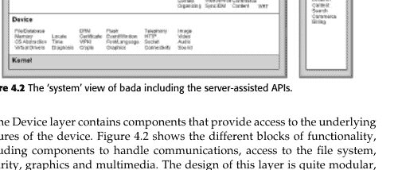

图 4.2 包含服务器辅助 API 的 bada “系统”视图。

设备层包含提供对设备底层功能访问的组件。图 4.2 显示了不同的功能块，包括处理通信、访问文件系统、安全、图形和多媒体的组件。该层的设计非常模块化，这在支持新技术时是一个巨大的优势。例如，对新音频或视频编解码器、更新的摄像头、额外传感器或新的通信标准等的支持可以通过更新几个组件来添加，而无需对整个底层操作系统进行巨大更改。这使得 bada 平台非常动态，并为开发者利用最新的设备硬件提供了大量可能性。该层提供的所有功能均由开发者通过框架层中定义的 API 访问。

最底层是内核层。bada 平台设计为例如在 Linux 或 RTOS 内核上运行，这使得 bada 平台非常灵活。它还提供了支持比任何其他移动平台更广泛的设备范围的可能性。这对你的 bada 应用程序来说是一个巨大的潜在市场。

## 4.2 bada 编程习惯

### 4.2.1 C++ 与 bada

在所有当前主流编程语言中，C++ 是最强大和最灵活的。这并不使其成为最流行的语言。事实上，在撰写本文时，C++ 在流行度调查中稳居第三，仅次于 Java 和 C。¹

C++ 不太可能赢得流行度竞赛是有充分理由的。与更新的语言（如 Python，甚至 Java）相比，它具有复杂的语法。这有几个原因。一个原因是它保留了 C 作为一个适当的语言子集。另一个是有意决定偏爱简洁紧凑（甚至晦涩）而非冗长透明。还有一个原因是语言的广度——既有高级也有低级以及两者之间的一切——支持过程式、面向对象编程（OOP）和通用（基于模板）编程风格。最后，虽然前一点暗示了最大主义目标（包容所有人！），但 C++ 对编程语言应追求的目标却采取了非常极简的观点。其内置类型本质上是 C 的类型，语言（或多或少）就到此为止。语言本身不包含框架或类库。（甚至极简的 std.h 和 stdio.h 也是严格可选的。）

由于所有这些原因，C++ 不是那种牵着你走的语言。这可能让它显得比实际更可怕。但这也意味着任何基于 C++ 的平台都必须驯服该语言以适应自身目的。

¹例如，根据 TIOBE 编程社区指数软件调查，2010 年 4 月，见 www.tiobe.com/index.php/content/paperinfo/tpci/index.html。有趣的是，在 2010 年，Java 和 C 在前两名的位置互换，C 现在是最流行的语言，因为 Java 的流行度份额下降。与此同时，Objective C 正在榜单上迅速上升。相比之下：C 和 Java 约为 20%；C++ 约为 10%；Objective C 约为 2%。

旧定义标准的标准，在如今 1 GHz 处理器和多千兆字节内存的时代。

答案是，移动设备相对于桌面在几乎所有方面都受限，从 CPU 能力到可用 RAM、屏幕尺寸和网络带宽。

但移动设备也有绝对的限制。让我们不要再次列出所有差异（我们在第 1 章中已经讨论过），但在移动设备上，资源在以下领域至关重要：

- 内存——大小和速度（例如闪存，无 HD）；
- CPU；
- ROM；
- 电池/电力；
- 网络带宽。

C++ 的强大和灵活性是有代价的。最关键的问题是：

- 内存管理，应用程序必须自行管理，与提供垃圾回收以回收不再使用的已分配内存的语言形成对比。
- 异常处理，其中 C++ 标准异常机制在内存占用和处理器周期方面代价高昂。
- 缺乏原生字符串和数组类型。

大多数 C 和 C++ 程序的运行时失败（崩溃）都是由同样的几种常见编程错误引起的，具体来说是内存分配错误和内存访问错误，包括指针和数组索引错误。

这一简单事实正是促使 Java 许多独特特性的动机。没有指针，数组和字符串的真正原始类型，以及自动垃圾回收。

然而，Java 带来了即使在桌面上也可能明显的运行时成本，在移动设备上可能是致命的；它还迫使应用程序开发者进入沙箱，禁止访问原生功能，降低灵活性，并在应用程序与原生平台之间制造障碍。

在移动设备上，原生开发可让应用程序获得底层平台的所有功能。然而，桌面上似乎已成为习惯的对运行时失败的容忍在移动设备上是完全不可接受的。移动用户不会接受数据丢失、通话挂起，或因崩溃或冻结的有缺陷的应用程序带来的其他挫折。


为了兼顾两者优点——既提供不会崩溃的健壮应用，又提供具备原生性能的完整平台——bada 通过限制开发者对某些 C++ 特性的使用来施加一些限制，特别是：

- bada 中的平台代码使用两阶段构造（尽管对于你自己定义的类来说并非必需）。

- 支持一种简单的所有权策略：应用始终负责删除其分配的内存（每次调用 new 都必须有对称的调用 delete），并且应用必须始终删除由以 N 结尾的平台方法返回的平台分配对象，例如 SearchN()；在所有其他情况下，平台会负责删除其分配的对象。

- 不鼓励使用原生 C++ 字符串；bada 平台提供专用的 String 类。

- 不鼓励使用原生 C++ 数组；bada 平台提供专用的 Array 类。

- 不支持标准 C++ 异常；bada 拥有自己的轻量级异常模型。

## 4.2.5 Native Idioms and Types Tutorials

是时候再次进入实践了。

当你阅读 SDK 教程和下面的示例中的 bada 代码时，你会看到原生类型在真实世界上下文中的使用，当然你也需要在自己的代码中使用它们。

以下简短教程将帮助你快速掌握 bada 与众不同的地方——并且在你更深入地探索平台时，这将是一个有用的参考资料。你可能想收藏这些页面。

### The Problem of Object Construction

在 C++ 中，与 C 类似，运行时内存分为：

- 静态内存，由编译器分配，是运行时应用程序二进制的一部分；

- 栈内存，由操作系统在运行时分配和释放，用于运行程序的函数激活帧的创建和释放；

- 堆内存，按程序请求动态分配和释放。

内存泄漏是由于程序分配堆内存但未能释放它而造成的。由于手机通常在不关机的情况下运行数天、数周甚至更长时间，内存泄漏会严重损害手机的性能。问题更加严重，因为（相对于桌面）手机通常具有更少的 RAM，并且（就绝对值而言）由于手机的功耗和物理尺寸限制，内存技术——例如 Flash 文件系统——速度较慢。

不幸的是，在 C++ 中，确保内存不泄漏的问题比在 C 中更复杂，并且需要的不只是程序员的自律（即匹配每个分配与释放）。

在 C++ 中，堆内存的分配可以由程序员通过调用 operator new 或 new[] 显式完成，也可以由编译器在 C++ 对象创建过程中隐式完成。

与 C 不同，在 C 中每个运行时构造要么是静态的，要么在栈上，要么在堆上，单个 C++ 对象的各个部分可能根据类的编码方式分配在一个或多个或全部这些分配中。³

由于一个 C++ 类只有一个析构函数（如果程序员没有显式编码析构函数，则为编译器生成的默认析构函数），而它可能有许多不同的构造函数，因此必须谨慎编码析构函数。

所有这些结果是，C++ 中的天真编码很容易导致内存泄漏。

还有两个具体问题使情况变得更糟。第一个问题是，在 C++ 中，当构造函数失败时，类的析构函数不会被调用。

内存泄漏问题，正如我们所说，是堆内存的问题。（静态内存永远不是问题，因为它是在编译时分配的，而栈内存帧会在与其关联的函数返回时自动释放）。

（堆分配的）C++ 对象是在 new 运算符在类构造函数上调用时创建的。分配的内存必须通过匹配的调用 delete() 释放；也就是说，如果内存不泄漏，分配和释放必须始终对称。调用 delete() 会调用类析构函数。在析构函数内部，类分配的任何进一步内存都应通过适当的调用 delete() 释放。当析构函数返回时，delete() 执行的最后一步是释放为对象本身分配的内存。

这本身很简单。问题在于如果类构造函数尝试分配内存，例如调用 new 来创建恰好是对象的类成员，并且分配失败。在这种情况下，析构函数不能被调用来删除对象，因为对象指针将为空（因为构造失败），而尝试删除空指针将导致异常。但与此同时，如果在失败的分配发生之前构造的任何分配确实成功了，则系统或程序都没有办法释放该内存，因为没有指向它的指针。分配的内存成为孤儿。

在移动设备上，应假定低内存条件会定期发生。多任务处理、网页浏览、播放音乐、录制和查看图像、播放或录制视频，以及下载和尝试应用，都是手机日常使用的一部分，并且可能以任何动态使用模式出现。任何一个都可能导致内存使用峰值，如果你的应用不幸遇到它，可能会导致内存对你不可用。更糟的是，如果设备上运行的任何程序泄漏内存，那么随着时间的推移，低内存条件将成为必然，并且设备上的所有应用都将有效地受到用户选择运行的最差质量应用的损害。

让我们假设我们有一个非常简单的类：

```cpp
class SimpleClass;
```

然后我们有一个更复杂的类，其中包含 SimpleClass 的对象作为成员。

```cpp
class ComplexClass
{
public:
    ComplexClass(void)
    {
        p1 = new SimpleClass();
        p2 = new SimpleClass(); // Assume an Out-of-memory error occurs here.
    }
    ~ComplexClass(void)
    {
        delete p1; delete p2;
    }
private:
    SimpleClass* p1;
    SimpleClass* p2;
};
```

然后我们在某个方法中实例化 ComplexClass 的对象。

```cpp
void AnyClass::SomeMethod()
{
    ComplexClass* pComplexClass = new ComplexClass();
    // Calls the constructor, which could throw an exception.
}
```

这样构造函数就会被调用。但如果发生异常，析构函数不会被调用，已分配的内存无法释放，从而导致内存泄漏。

Java 开发者免于这些场景，因为所有动态分配的内存都由 Java 运行时管理（然而，Java 开发者也有很多其他问题让他们的生活变得艰难）。

事实上，这个场景不仅仅是 C++ 问题。例如，在 OS X 上，Objective-C 中最可识别的编程构造之一就是两阶段对象构造：

```objc
id anObject = [[Rectangle alloc] init];
```

如果你熟悉 OS X 的惯用法，或者如果你在 Symbian 上编程过 C++ 应用，那么 bada 的解决方案应该立刻就能被识别出来。

两阶段构造只是对象创建与其成员的内存分配应分开的规则：

```cpp
class TwoPhaseClass
{
public:
    TwoPhaseClass(void) : p1(null), p2(null)
    {}
    ~TwoPhaseClass(void)
    {
        delete p1;
        delete p2;
    }

    result Construct(void)
    {
        p1 = new SimpleClass();
        p2 = new SimpleClass(); // Out-of-memory error occurs.
    }
private:
    SimpleClass* p1;
    SimpleClass* p2;
};
```

然后我们在某个方法中使用两阶段构造实例化 TwoPhaseClass 的对象。

```cpp
void AnyClass::SomeMethod()
{
    TwoPhaseClass* pTwoPhaseClass = new TwoPhaseClass();
    result r = pTwoPhaseClass->Construct();
}
```

由于在对象创建期间没有为成员分配内存，因此不会泄漏内存。相反，我们在 Construct() 方法中分配内存。如果出现任何问题，可以通过查询类型为 result 的 r 变量来处理异常。

简单的规则是对象应分两步创建：

- 1. Allocate:
  - 动态分配新对象的内存。这可能包括使用初始化列表语法进行的任何简单值初始化。


## 2. 完成构造：

- 这应包括创建所有需要动态分配内存的对象。

第一步返回的对象尚未完成，因此不能使用；但如果内存分配失败，由于尚未分配任何内存，因此无需清理。

如果分配成功，则已为所有类成员分配内存。对于成员是简单值的情况，如果使用编译时值设置了默认值，或使用初始化列表语法或（简单值的）传递参数在运行时设置，则无需再做任何工作。

对于成员本身是需要动态分配的对象，成员指针的内存已被分配，但对象本身尚未分配。

对象的构造第二步现在应进行任何进一步的分配（当然，对于必要的对象也应使用两阶段构造）。

系统使用时，这是一种易于遵循的约定，类变得自文档化；在类中存在 Construct() 方法时，应使用两阶段构造。

## 对象所有权责任

与内存分配和对象构造相关的另一个小但重要的复杂性是，有时框架方法需要框架为调用应用程序分配并返回一个新对象。然而，一旦对象由框架返回并传递给调用者的所有权，框架就不再知道对象何时使用完毕。

在这种情况下，分配和释放内存应始终对称进行的简单规则不再成立。然后应用程序程序员的问题是，应用程序或框架是否应负责清理给定对象。

这个问题在 bada 中几乎通过一个简单的命名约定以及相关的规则得以 trivial 解决：

### 约定

方法名以 'N' 结尾，例如 SomeType SomethingN();

### 规则

调用者始终有责任删除由以 'N' 结尾的框架方法返回的对象。

举例来说，接口 IRemoteLandmarkStoreListener 是 Osp::Locations 命名空间的一部分，定义了方法 OnLandmarksReceivedN()。当应用程序查询远程服务器关于其存储的地标时调用此方法。如果有符合搜索条件可用的地标，则它们存储在该方法的一个参数中。该参数是调用应用程序本地的，因此对象所有权发生变化。以下代码应能说明这一点。

```
void
OnLandmarksReceivedN(RequestId reqId, IList* pResults, int pageNo, int countPerPage, int totalPageCount, int totalCount, result r,
const String& errorCode, const String& errorMsg)
{
    if (!IsFailed(r) && pResults)
    {
        // Do something with the results stored in pResults...
        pResults->RemoveAll(true);
        // You have to explicitly delete the object !!!
        delete pResults;
    }
}
```

## 异常处理

异常处理出现在 C++ 中并非完全是事后想法，但是在首次发布很长时间之后。⁴ 效率是一个重要的设计目标，⁵ 特别是避免为不使用异常的代码增加时间和空间开销。该目标确实实现了，但量化使用异常的代码的成本则更具争议性。

至少在未优化的情况下，‘打开’标准 C++ 异常处理可能会使系统代码量增加多达 10%，⁶ 当抛出和处理异常时会有可测量的运行时性能损失。

出于这些原因，以及出于简单性的原因，bada 不支持原生 C++ 异常，而是实现了一种简单的错误处理机制。

在 bada 中：

- 所有异常都被捕获并作为简单类型定义的返回值返回。
- 可能失败的框架方法返回一个结果值，并鼓励应用程序开发人员在其自己的代码中也这样做。
- 提供了获取和设置‘最后结果’以及获取错误消息的框架方法，这有助于异常的简单传播。

这提供了一个在应用程序代码中传播异常的最小框架，以及返回和检查异常的简单机制。重要的是，它迫使异常处理的责任落在应用程序开发人员身上。从积极的角度来看，这意味着应用程序开发人员被鼓励‘尝试理解和处理问题’⁷ 而不是将它们抛入一个异常处理机制，该机制按惯例强调在出现异常时终止程序而不是优雅地恢复。

在这方面，移动设备与更传统的桌面平台不同。

正如 Stroustrup 本人所解释的，C++ 设计哲学的重要部分是支持开发在‘没有程序员在场’的环境中执行的系统，⁸ 例如电话交换机和 ATM。在这些上下文中，应用程序对异常的推荐响应是终止。⁹

在科学或学术环境中，这种对正确性的做法完全合适，而且这确实是我们习惯于在（例如）桌面办公应用程序中看到的行为。但移动设备完全不同；如果我的手机那样表现，它会直接被退回商店。

关于移动设备上异常的要点不仅仅是它们必须被处理，而是它们必须被预期；内存不足、电量不足、突然断电、连接丢失和间歇性连接，甚至文件系统的突然丢失（例如当可移动介质在未先卸载的情况下从设备中突然移除时），都是移动设备上的日常发生事件，而对这些事件的响应是立即终止的应用程序不会受到用户的欢迎。

因此，在移动设备上，异常处理机制与桌面相比不仅在可接受的开销程度上有所不同，它们还表达了不同的设计哲学并必须尊重不同的用户期望。如果在大型系统上正式性和正确性，如突然终止，最重要，那么在移动设备上价值观则相反，优雅降级或用户友好性是首要美德。

> 4 见 B. Stroustrup, The Design and Evolution of C++ (Addison-Wesley, 1994). C++ 1.0 于 1986 年发布，异常于 1992 年包含。
>
> 5 Stroustrup, Design and Evolution, p. 385.
>
> 6 见 B. Morris, Symbian OS Architecture Source Book (Wiley, 2007). 示例为 Symbian。
>
> 7 在 Doug McIlroy 的（现在可能已不时髦的）话语中，由 Stroustrup 引用，Design and Evolution, p. 384。
>
> 8 Stroustrup, Design and Evolution, p. 107.
>
> 9 例如，见 Franek, Memory as a Programming Concept, p. 52: ‘因此我们建议在内存分配失败时立即终止程序。’ 正如他继续所说，‘当然’还应向用户报告一条有用的消息，‘以便在必要时可以轻松确定错误的性质。’

正如第三种情况下的宏名所暗示的那样，这实际上只是一种提供类似于熟悉的 try/catch 异常处理行为的简单、局部且廉价的方法。

最后说明，所有异常都会在模拟器中记录到 Output 面板，使得无需任何显式编码即可轻松追踪错误。

## 接口

C++ 允许多重继承，但在 bada 中仅使用单继承。这并没有什么新奇或令人惊讶之处。

关于多重继承的争论，以及它是否是一件好事还是坏事，可以追溯到 OOP 的黎明。允许多重继承符合 C++ 的非规定性哲学，以及它成为真正的建模和仿真语言的目标，因为在现实世界中，对象可以属于多个类别。因此限制继承意味着灵活性和准确性的丧失。

反方论点——至少在 C++ 的上下文中——主要集中在优先级和歧义上（如果多个基类具有同名方法？在派生类中哪一个会被调用？）；效率（例如‘邪恶钻石’模式，可能导致代码重复）；以及复杂性（要很好地使用多重继承，程序员必须理解它，这意味着又一个需要掌握的语言特性）。

折中解决方案，bada 采用的，与一些其他移动平台以及 Java 语言类似，是提倡使用接口来解决那些诱使程序员转向多重继承的设计问题，并允许多重接口继承但仅允许从任何具体基类进行单继承。

接口类使用起来非常自然，并允许简单而富有表现力的设计。它们也有熟悉开发人员的优势，因为 Java 语言。

在 bada 中，例如，各类监听器、与基础应用程序的交互、集合、以及集合比较器和枚举器等行为都可以使用接口类实现。

Java 将接口概念提升为具有 interface 关键字的语言特性。在 C++ 中没有内置的语言约定，因此 bada 引入了自己的约定，即接口类以前导‘I’命名（例如 IList、IEnumerator、IEventListener 等）。在 bada 中，与许多其他平台一样：

- 接口类始终是抽象的，即它只包含纯虚方法，这意味着它不能直接实例化（你不能 new 一个接口类），它只能被继承。


要开始使用，本节提供一个快速概述，并展示这些类在实际使用中的一些示例。

原生类型包括以下类：

- 基本类型，包括 `Object`，它是 bada 类库的根类，以及对熟悉的原生 C++ 类型的包装类，包括 `Boolean` 和 `Character`；
- `Number`，所有数值类型都派生自它，以及对完整数值类型集合的包装类，从 `Short` 到 `LongLong`；
- `BufferBase`，所有数组类型都派生自它，以及 `Buffer` 和 `ByteBuffer`，它们包装 C++ 原生的字节数组；
- `String`，表示一个 Unicode 字符串；
- `DateTime` 和 `TimeSpan`，表示日期和日期差；
- `UuId`，一个通用唯一标识符；
- 除了这些包装类之外，bada 还包含一套完整的集合类，定义在 `Base::Collection` 命名空间中。

最后，`Base` 命名空间还包括针对上述许多类型的有用的 `Comparer` 类，而 `Base::Utility` 提供了用于管理互联网统一资源标识符（URI）、数学库和字符串函数的实用工具。

顺便说一下，`Object` 提供了两个有用的内置方法：

- `Equals()` 测试相等性，默认情况下解释为 *恒等*，即当且仅当两个被测试对象共享同一地址时为真。然而，它可以被重写以支持值相等，在这种情况下它返回与相等运算符相同的值。SDK 示例和示例代码包含多个重写和使用 `Equals()` 的示例。
- `GetHashCode()`，为当前实例生成哈希值（请注意，默认实现只是简单地返回对象的地址，作为返回随机但唯一数字的一种简单方法）。

`Object` *不* 提供额外的功能，例如在对象实例化时清零内存。

## 4.3.2 使用字符串、字符和 Unicode

bada 完全支持 Unicode，并且认真对待非西方字母表和书写系统，这一点不足为奇。事实上，bada 的设计允许使用一套完整的替代窗口集，例如支持三星在韩国的本土市场。这不仅仅是提供良好的本地化支持（这是一个很棒的 bada 特性）；它确实是对替代书法系统的完整支持。

## 文本和 Unicode

Unicode 是一种通用字符编码，旨在通过为约 90 种字母、文字、表意和象形文字书写系统的单个字符提供代码点，来支持所有现存语言（以及大多数已死语言，甚至一些虚构语言）的字体。支持的脚本列表包括从 ASCII 和西方拉丁文以及非拉丁语言如希腊语和西里尔语，一直到闪米特语和印度语系以及印度次大陆的其他文字，再到远东的表意字符集，包括中文、日文和韩文谚文。Unicode 非常庞大。

像大多数现代平台一样，无论是移动还是桌面，bada 都包含全面的 Unicode 支持。最重要的是，bada 支持在最常见的编码方案之间进行多向转换（其中许多 Unicode 在其全局字符空间中作为子集包含），包括表 4.2 中列出的那些。

表 4.2 支持的字符编码

| 编码方案 | 描述 |
|---|---|
| UTF-8 | XML 使用的编码，因此越来越成为基于网络的文本资源的标准 |
| Latin1 | 西方字母，由 ISO-8859-2 定义 |
| UCS2 | 替代 Unicode 编码 |
| ASCII | 标准单字节文本编码 |
| GSM | GSM 特定字符集和用于 SMS 消息的 7 位编码 |

在不同方案之间的编码和解码可以按每个 String（或每个 ByteBuffer 或 MCharBuffer）使用编码字符串的 GetBytes() 或 GetChars() 方法来完成，也可以构造一个 Encoder 或 Decoder 对象进行处理，你应该在处理大块文本或具有顺序数据时这样做，例如如果你从外部源读取文本。原生地，bada 中所有字符字符串默认都是 UTF-8。

你可以用以下方法查询设备支持的编码：

```
IList* Encoding::GetAvailableEncodingsN(void)
```

你可以用以下方法查询文本字符串的编码：

```
Encoding* Encoding::GetEncodingN(const String &encodingType)
```

编码和解码支持由 Osp::Text 命名空间的类提供，而 Osp::Base 类提供了对原生 Unicode 的底层支持，包括 mchar 宽字符数据类型 wchar_t。

> 注意：mchar 在编译器级别作为原生类型由 Sourcery G++ GNU Toolchain 支持，该工具链用于 bada SDK 中的目标和模拟器构建。请注意，出于效率考虑，bada mchar 类型定义为 2 字节大小，即 16 位。在大多数 GNU 平台上，mchar 定义为 4 字节大小。因此，任何依赖于 mchar 物理大小的代码，如果移植到 bada 而不更改，将无法正确运行。当然，编程最佳实践会说代码不应依赖于数据类型的物理大小。

顺便说一下，bada 还为本地化提供了出色的支持，而不仅仅是书写语言。支持包括日期、时间、时区、数字、货币和其他本地化敏感信息类型，包括转换和格式化，以及 IDE 对字符串资源的支持。

## 4.3.3 使用缓冲区

正如字符串应始终用于代替原生 C 风格的以空字符结尾的字符数组（因为字符串本质上是 Unicode，并且大小检查意味着它们不会溢出），Buffer 类优先于原生 C 风格数组。

缓冲区是包装 C++ 原始类型数组（序列）的容器类，例如 int、long、double 和 char。（与字符串相比——字符串是非原始类型 Character 的序列。）缓冲区提供绝对和相对索引，以及存储索引的标记：

- ByteBuffer 是 8 位无符号 int 序列的包装类。
- BufferType 提供了现成的 double、float、int、long、longlong、mchar 和 short 原始类型的模板类。

> 注意：DoubleBuffer 是一个 Buffer double 对象，不应与“双缓冲”缓冲管理技术混淆！

## 4.3.4 集合类

任何设计良好的类库的一个必备要素就是一套良好的集合类。秉承其极简设计哲学（它是一种语言用于

对于每种集合类型，都提供了一个模板类型，例如 StackT、QueueT、HashMapT。

除了具体的和模板类之外，bada 还提供了允许操作集合的接口类：

### ICollection

定义集合大小、枚举器和同步方法。

### IEnumerator, IMapEnumerator, IBidirectionalEnumerator

启用对 Collection 和 Map 类型的迭代。

### IList

可索引列表。

### IComparer

启用对两个单独对象的比较。

### IHashCodeProvider

一个哈希映射。

再次，与具体的集合类完全一样，每个接口类都提供了模板版本以供与模板化集合类一起使用：例如 ICollectionT 表示模板化集合 IListT、IMapT 等等。

基于对象类和基于模板类的区别在于：

- 基于对象的集合派生自 ICollection，并存储派生自 Object 类的对象。
- 基于模板的集合派生自 ICollectionT<Type>，并且通常应用于存储 C++ 原始类型。

> 注意：基于对象的集合不收集对象的副本（出于效率的明显原因）；相反它们收集指针。因此，你想要放入集合类的任何对象都必须使用 operator new 分配。否则，如果你的集合存储指向自动变量的指针，其生命周期是不可预测的，并且在集合使用它时很可能不存在。你的应用将不可预测地崩溃。


## 4.3.5 使用日期与时间

日期与时间，以及基于日期与时间的计算，在众多类型的应用程序中出现得如此频繁，以至于在任何平台上，提供便捷类来简化其使用都是至关重要的。

bada 中的 DateTime 类封装了创建和操作日期与时间的全部复杂性。

一个 DateTime 表示一个精确到秒的值，范围从公元 1 年 1 月 1 日午夜 12:00:00 到公元 9999 年 12 月 31 日晚上 11:59:59（午夜前一秒）。因此，DateTime 是一个单一的、特定的瞬间。由于 DateTime 是一个瞬间，对 DateTime 值进行差分（加、减）没有实际意义，但比较是有意义的。

相比之下，TimeSpan 是一个时间段（即持续时间），在内部以“刻度”（毫秒）表示。持续时间支持有意义的差分运算以及比较。

DateTime 对象可以使用内置的加法和减法方法进行加（或减），例如：

```
dt.AddYears(10);

dt.AddDays(-3);
```

更复杂的日期和时间操作通常涉及使用 DateTime 和 TimeSpan 对象：

```
TimeSpan ts(1, 1, 1); // 1 day, 1 hour, 1 second
dt.Add( ts );
dt.Subtract( ts );
```

-   可以将一个 DateTime 与一个 TimeSpan 进行加或减。
-   可以将一个 TimeSpan 与另一个 TimeSpan 进行加或减。
-   可以提取 DateTime 的各个组成部分，并可以使用 IsLeapYear() 查询 DateTime。
-   可以使用内置方法 AddYears()、AddDays() 等对 DateTime 进行加或减。
-   TimeSpan 可以被取负、转换为时间单位或在时间单位之间转换、哈希、比较等。
-   DateTime 可以转换为秒，也可以从秒转换为 DateTime。

## 4.3.6 使用数字

在 bada 中，为 C++ 的每种原始数字类型（short、char（8 位整数）、int（32 位整数）、double、long、longlong 和 float）都定义了包装类和比较类。

## 4.4.1 bada 中的特权

在 bada 中，敏感的 API 受特权保护。特权有两个维度：

- 1. 特权组是一个类别，通常适用于某个类或命名空间的相关方法。当你被授予对某个组的访问权时，你就可以访问所有需要该特权的方法。
- 2. 每个特权组属于两种特权级别之一——NORMAL 或 SYSTEM。

bada 特权模型的目标是保护应用程序用户免受恶意代码的侵害，并保护 bada 服务免遭滥用。由于 bada 的 API 集中包含基于网络、以服务为中心的功能，因此显然存在恶意意图者试图颠覆或破坏服务的可能。由于这些服务可能持有用户的私有数据，保护它们至关重要。

并非所有 bada API 都受保护，事实上大多数 API 不需要任何特权。要访问受特权的 API，你必须具备所需的特权级别，并且你的应用必须在其清单文件中声明所需的特权组。

声明特权很容易。特权是元数据，不是代码：你只需在定义应用配置文件时添加所需的特权组（如第 2 章所解释的）。特权组与命名空间的映射关系相当紧密（目前有 30 多个特权组，而与之相比，顶层命名空间有 20 个，如果包括嵌套命名空间，命名空间总数约 30 多个），因此，通常添加新命名空间意味着需要检查是否需要新特权。

特权的独特之处在于特权级别，它根据应用开发者而不是应用本身来解释对特权的访问。因此，对特权的访问是基于开发者状态来控制的，开发者状态定义为 bada 生态系统中的成员级别——目前只有两个值：普通成员和战略合作伙伴。在当前版本的 bada 中，这一机制带来的不幸副作用是，特权的访问受到严格限制。几乎一半的特权组，而且很多方面来说是最有趣的那些特权组，都被置于普通第三方开发者无法触及的范围之外，仅向合作伙伴开放。

这在很大程度上反映了该平台的新颖性，并且这种情况将会改变。请留意 developer.bada.com 上的新闻。

## 4.4.2 实践应用

撇开特权级别的限制不谈，在应用中使用特权非常简单：

- - 如果不需要特权组（bada 类库的大部分情况都是如此），则无需特殊声明或其他操作。
- - 所有开发者自动拥有 NORMAL 特权，这意味着他们的应用可以使用任何标记为需要 NORMAL 特权的 API。只需在清单文件中声明所需的特权组。
- - 如果你只有 NORMAL 特权，但想要访问需要 SYSTEM 级别特权的 API，你应申请成为 bada 合作伙伴开发者。申请不是自动获得批准的，但预计那些提出充分理由的开发者会获得批准。实际上，与希望获得合作伙伴访问权限的开发者数量相比，这一选项必然会受到限制。

你会注意到，在第 6 章的命名空间描述中，我们列出了每个命名空间所需的特权组（如果有的话）。有关 API 级别特权的更多详细信息，请参阅 SDK 文档。

## 探索 bada 服务

在本章中，我们将探索一些 bada 服务 API。你可能知道，bada 平台不仅限于在设备上提供功能，还提供与服务器相关的功能。与市场上的其他移动平台相比，这些是关键且独特的功能。bada 平台为其设备提供了远程服务器基础设施，使得将 Web 服务轻松集成到应用程序中成为可能，同时也为 bada 开发者提供了一个完整的移动应用生态系统。本章专门介绍这些以服务为中心的功能。

## 本章学习内容

本章介绍 bada 服务 API，并展示如何在你自己应用中应用它们。你将学习：

- 1. 从高层次了解提供了哪些服务以及它们提供什么功能。
- 2. 设备、应用和 bada 服务器之间的基本通信。
- 3. 如何运用这些服务，并通过实际示例进行演示。

## 准备工作

在撰写本文时，对这些 API 中的许多 API 的访问仅限于合作伙伴开发者，因为访问 bada 需要一定程度的信任

## 5.1.4 商务服务

商务服务允许最终用户通过 bada 应用程序浏览和购买商品。商品可以是任何能从 bada 应用内购买的东西。开发者可以建立自己的在线商店、管理商店中的商品，并跟踪购买统计数据。

作为开发者，你可以利用此服务创建应用程序，实现诸如检索在售商品信息和在应用内购买等功能。

购买过程变得非常简单，因为买家在三星应用商店（Samsung Apps）网站注册时，需要预先登记其信用卡信息。因此，开发者无需处理买家的任何信用卡信息。三星应用商店保存买家的信用卡详细信息，并将其与买家 ID 关联。购买时只需输入买家 ID 和密码即可。

> 注意：要销售你的商品，你始终需要在 seller.samsungapps.com 的三星应用商店卖家平台（Samsung Apps Seller Office）注册。

## 5.1.5 单点登录

bada 服务并不限于上述服务。还有其他服务位于其他命名空间中，例如来自 Osp::App::AppControl 命名空间的单点登录（SSO）应用控制，以及来自 Osp::UiX 命名空间的天气传感器服务。

bada 服务器可以通过将单一登录名和密码与其所有服务相关联来管理身份。这种 SSO 方法利用服务器提供的身份验证令牌，来验证用户可能在 bada 服务器上拥有的所有服务并登录这些服务。

## 5.2 工作原理

对于大多数移动应用开发者来说，最大的问题是选择开发语言。当开发涉及 Web 组件之间的通信时，问题就更加困难了，例如地图提供商（Google、NavTeq 等）、社交服务提供商（Facebook、Twitter 等）或内容服务器（Flickr、Picasa 等）。那么 bada 平台如何处理这些类型的通信呢？

## 5.2.1 设备与服务器交互——bada API

当你开发访问服务器相关服务的应用程序时，你无需考虑使用哪种语言，无论是 JavaScript、Python，


注意：目前SNS网关主要用于从第三方社交网络提供商检索好友信息。对于其他功能，如Twitter上的关注和取消关注，您必须使用bada提供的HTTP连接和XML解析器。

图5.1展示了bada服务器基础设施的整体情况。所有应用程序开发人员都需要了解bada C++ API。

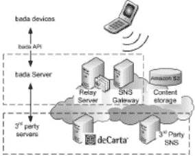

**图5.1** bada服务器。

现在让我们看看开放API是如何在bada服务器上工作的。通常，客户端应用程序使用表述性状态转移（REST）API与Web服务器通信，即通过HTTP（GET、POST等）向服务器发出调用。²正如我们在前一节提到的，不同的Web服务实现了不同的RESTful API集合。客户端应用程序很难与不同的服务进行互操作。通过使用bada服务器作为中介，您无需使用任何特定的RESTful API，而是使用原生C++ API。bada服务器负责向特定的第三方服务器发出调用。

通过第三方地图服务器deCarta，bada可以为您的应用程序提供丰富的地图服务，包括路线计算、地理编码和目录服务。

> ²按照设计，HTTP协议是无状态的，这意味着服务器不会保留关于客户端的任何信息。这种设计的缺点是可能会增加重复数据的传输，从而降低网络性能。在服务器端添加缓存可以使HTTP具有状态。

## 5.3 服务详解

现在您应该对bada服务器相关服务有了大致的了解。在接下来的章节中，我们将更详细地探讨这些功能。让我们从定位服务开始。

### 5.3.1 作为服务的定位

移动应用程序与传统应用程序的一个关键区别在于定位功能。大多数现代智能手机都配备了GPS收发器。设备始终能够感知位置变化。移动开发人员可以利用实时位置数据来创建功能丰富的应用程序，就像FourSquare和Loopt所做的那样。

正如本章开头所讨论的，bada平台提供了多种类型的基于位置的服务。所以现在我们将逐一检查它们，并为您提供更深入的视角。在开始之前，让我们考虑一个用例：假设您想创建一个应用程序，根据用户的当前位置为其指引最近的星巴克，并在地图上显示。很简单，对吧？

要搜索特定的地标，您可以使用bada提供的目录服务或远程地标存储。在本章中，我们展示如何使用目录服务。如前一章所述，bada上的所有开发都与以下内容相关：服务提供商（例如IDirectoryServiceProvider接口）、监听器（例如IDirectoryServiceListener接口）和处理程序（例如OnDirectoryRequestReceivedN方法）。

# 步骤1：实例化目录服务提供程序对象

```
String providerName = L"deCarta";
String extraInfo =
  L"ClientName=username;ClientPassword=pwd;"
  HostUrl=http://developer.kr.dz.decarta.com:80/openls";

IDirectoryServiceProvider *pProvider =
  dynamic_cast<IDirectoryServiceProvider>(
    ProviderManager::ConnectToServiceProviderN(
      providerName, LOC_SVC_PROVIDER_TYPE_DIRECTORY, extraInfo
    )
  );
```

以上代码不言自明。要实例化提供程序对象，您必须指定客户端名称、客户端密码以及地图提供程序的主机URL。但请记住，要将deCarta用作您的服务提供程序，您必须从deCarta开发者网站申请自己的用户帐户（客户端名称）和密码。在deCarta开发者专区有一份针对bada平台的入门指南。此外，您还可以在deCarta开发者专区网站上专门针对bada的板块中找到“功能”、“测试”和“商业化”信息。

现在我们需要做的是获取LocationProvider对象并更新当前位置。

```
LocationProvider* pLocationProvider;
pLocationProvider = new LocationProvider();
MyListener* pLocationListener = new MyListener();

result r = pLocationProvider->Construct(LOC_METHOD_HYBRID);
if(!(IsFailed(r)))
{
    int interval = 60;
    pLocationProvider->RequestLocationUpdates(*pLocationListener,
        interval, false);
}
```

上述代码使用混合方式实例化了一个LocationProvider对象，并以等于60秒的间隔值请求更新后的位置。一旦位置更新，它将调用您在MyListener类中实现的OnLocationUpdated()方法。

# 步骤6：发送搜索请求

```
RequestId reqId;
MyDirectorServiceListener *pListener;    //You have to implement by
yourself per step 5
CircleGeographicArea *pArea;
Coordinates center;  //Normally it is your current coordinates from GPS

pArea = new CircleGeographicArea();
pArea->Set(center, 2000);

pFilter->AddFilter(DirectoryFilter::SEARCH_FILTER_KEYWORD,
    L"Starbucks");
result r = pProvider->Search(*pFilter, *pArea, pPreferences, *pListener,
    reqId);
```

要发送搜索请求，您可以使用在步骤1中声明的DirectoryServiceProvider类中定义的Search()方法。调用此方法时，您必须传递五个参数：在步骤2中声明的接收搜索结果的首选项pPreferences，在步骤3中设置的搜索条件pFilter，在步骤4中定义的用于接收服务器回复的监听器pListener，标识此搜索请求的请求ID reqId，以及最后的搜索区域pArea。

参数pArea是您将搜索地标的给定区域。在本例中，我们使用圆形区域，以当前位置为中心坐标。中心坐标center在给定间隔内不断更新。实现方法在步骤5中描述。

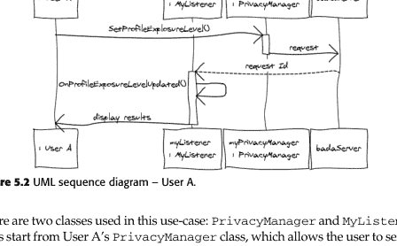

# 图5.2 UML时序图——用户A。

此用例中使用了两个类：PrivacyManager和MyListener。让我们从用户A的PrivacyManager类开始，该类允许用户向bada服务器发送隐私控制相关事件，例如设置个人资料公开级别（PEL）。下面的代码片段演示了如何使用PrivacyManager类将用户A的个人资料设置为可搜索，以及如何将监听器对象分配给此类。

```
MyListener* pMyListener;
pMyListener = new MyListener();
pMyListener->Construct();

pMyPrivacyManager = new PrivacyManager();
pMyPrivacyManager->Construct(*pMyListener);
//Register/assign the listener to PrivacyManager

RequestId reqId;
pMyPrivacyManager->SetProfileExposureLevel(PROFILE_SEARCHABLE, reqId);
```

用户A端的另一个类是MyListener类，它是处理bada服务器发送的异步事件的关键类。下面的代码片段向您展示了如何实现MyListener类。

```
// implementation of MyListener class
class MyListener :
{ public IPrivacyManagerListener
{ };

void
MyListener::OnProfileExposureLevelUpdated(RequestsId reqId, result r,
 const String &errorCode, const String &errorMsg)
{
 //Your implementations for this virtual method
}
```

如您所见，MyListener类派生自名为IPrivacyManagerListener的接口类。它定义了以“On”前缀开头的虚方法。您必须自己实现它们。从时序图中可以看出，On方法主要在从bada服务器收到结果时向用户显示或通知。从现在起，用户A的个人资料是可搜索的。其他bada用户可以搜索她，或者请求她成为好友。

# 步骤2：用户B向用户A发送好友请求

接下来我们来看看用户B这一侧。用户B是试图查找其朋友（用户A）的个人资料并请求成为好友的人。我们将像对用户A所做的那样，从用户B的时序图开始。

图5.3展示了用户B搜索个人资料并在成功搜索后添加为好友的时序。与图5.2相比，这里还涉及另外两种类：ProfileService和BuddyService。ProfileService类访问bada服务器上的个人资料并向服务器发送不同类型的请求，而BuddyService类向bada服务器发送好友请求。

用户B的MyListener类必须实现两个虚方法：OnProfileResultsReceived()（用于处理服务器返回的结果）和OnBuddyRequestSent()（在收到服务器对好友请求的响应时调用）。让我们看看在这种情况下如何实现该类。

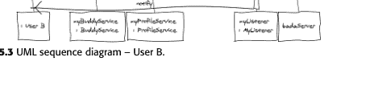


从 bada 服务器接收好友服务相关结果。下面的代码片段演示了 `MyListener` 类必须实现的虚方法。

```
// implementation of MyListener class
class MyListener :
public IPProfileServiceListener,
public IBuddyServiceListener
{};

void
MyListener::OnReceivedBuddyRequestsReceivedN(RequestsId reqId,
IList *pRequestList, int PageNo, int countPerPage,
int totalPageCount,int totalCount, result r, const String
&errorCode, const String &errorMsg)
{
    //Your implementations
}

void
MyListener::OnBuddyResponseSent(RequestsId reqId, result r,
const String &errorCode, const String &errorMsg)
{
    //Your implementations for this virtual method
}
```

当用户 A 从 bada 服务器收到好友请求时，将调用 `OnReceivedBuddyRequestsReceivedN()` 回调函数。当用户 A 对某个好友请求发送响应时，将调用 `OnBuddyResponseSent()` 回调函数。

与图 5.2 相比，这次用户 A 多了一个名为 `BuddyService` 的类。`BuddyService` 类由 bada 应用程序框架定义，直接处理用户交互，例如 `GetReceivedBuddyRequests()` 和 `RespondToBuddyRequest()`。下面的代码片段展示了如何使用此类。

```
BuddyService* pMyBuddyService;
pMyBuddyService = new BuddyService();
pMyBuddyService->Construct(*pMyListener);

pMyBuddyService->GetReceivedBuddyRequests(reqId, 1, 20);
pMyBuddyService->RespondToBuddyRequest(*pRequest, RESPONSE_ACCEPT,
reqId);
```

用户 A 还可以通过将返回的 `ReceivedBuddyRequest` 实例中的用户 ID 传递给 `ProfileService::GetProfile()`，来获取请求者的详细信息。

## 步骤 4：共享位置信息

到目前为止，我们已经了解了如何设置个人资料公开级别、如何发送好友请求，以及如何使用侦听器处理来自服务器的异步事件，例如接收好友请求或个人资料搜索请求的结果。最后一步是共享位置信息。

bada 服务器允许用户共享个人数据。用户可以通过 `PrivacyManager` 将个人信息设置为可共享，例如位置信息。在本例中，从用户 A 的角度来看，应用程序必须执行以下操作。

用户 A 必须使用一个名为 Location Provider 的新类获取自己的位置，该类会持续从 GPS 收发器更新位置数据。然后，用户 A 必须使用另一个名为 `RemoteLocationProvider` 的类，将位置数据报告给 bada 服务器。下面的代码片段展示了此类的用法。通过调用 `StartLocationReport()` 方法，用户 A 开始向服务器报告位置。要使用此方法，必须传入一个 `IRemoteLocationEventListener` 类型的侦听器对象（该类型为接口类），定义要用于报告位置的方法，传入一个用于设置是否向服务器报告扩展位置信息（例如速度和卫星信息等）的布尔值，以及向服务器报告位置的时间间隔。

```
//Set your location information can be accessed by your buddy
myPrivacyManager->SetUserInfoPrivacy(INFO_LOCATION, ACCESS_BUDDY, reqId);

//Create and initialize location provider
pLocationProvider->RequestLocationUpdates();

//Report location information to bada server using static function from
RemoteLocationProvider::StartLocationReport(*pListener,
LOC_METHOD_HYBRID, false, interval);
```

> 注意：在 bada 中，有两种类型的位置信息。一种是本地位置信息，表示设备的当前位置；另一种是远程位置信息，存储在 bada 服务器上，是多个本地位置组成的记录。

当用户 A 将位置信息设置为可共享并开始向 bada 服务器报告后，用户 B 便可以请求接收用户 A 的位置更新，因为两人互为好友。用户 B 的实现如下代码片段所示：

```
//Add User A to target list
ArrayList targetInfoList;
TargetInfo targetInfo(userAid);
TargetInfoList.Add(targetInfo);

//Request last known location list
```

```
bool isExtendedLocationIncluded = false;
int maxAge = 100;
RequestId reqId;

ArrayList<TLocationMethod> locMethodList;
locMethodList.Construct(1);
locMethodList.Add(LOC_METHOD_HYBRID);
pRemoteLocationProvider = new RemoteLocationProvider();
pRemoteLocationProvider->RequestLastKnownLocationList(
    isExtendedLocationIncluded, maxAge, locMethodList, targetInfoList,
    *pListener, reqId);
```

用户 B 通过调用 `RemoteLocationProvider` 类中定义的 `RequestLastKnownLocationList()` 方法向服务器发送请求。调用此方法时必须传入多个参数：(1) 是否需要扩展位置信息的布尔值；(2) 希望从服务器检索的最早位置记录；(3) 希望接收其位置的用户 ID 目标列表；(4) 从 `IRemoteLocationListener` 接口类派生的侦听器对象；(5) 用于记录已向服务器发送哪个请求的请求 ID。

收到 bada 服务器返回的结果后，`IRemoteLocationListener` 类中定义的名为 `OnTargetLocationReceived()` 的回调函数将被调用。位置信息将通过指向新分配内存的 `IMap` 类型指针返回。

图 5.5 展示了共享位置的时序图。请注意，其中有多个 `MyListener` 类和 `RemoteLocationProvider` 类的实例，这表示用户 A 和用户 B 都分别拥有这两个类的实例。

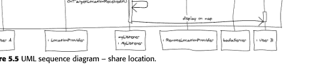

图 5.5 UML 时序图——共享位置。

## 步骤 5：创建内容

要在远程服务器上创建内容，必须使用 `RemoteContent Manager` 类。

```
MyListener* myListener;
myListener = new MyListener();
RequestId reqId;

pRemoteContentManager = new RemoteContentManager();
pRemoteContentManager->Construct(pMyListener);

pRemoteContentManager->CreateContent(*pRemoteContentInfo, reqId);
```

上面的代码片段展示了如何在远程服务器上创建内容。参数 `pRemoteContentInfo` 就是我们在步骤 3 中定义的参数，而 `MyListener` 类则是我们在步骤 4 中定义的类。

## 5.3.4 Commerce Service——创建自己的业务

使 bada 平台最具独特性和吸引力的功能，就是商务服务。利用商务服务，开发者不仅可以在 Samsung Apps 商店销售自己的应用程序，还可以销售应用内项目。

商务服务的核心是 Samsung Apps，您可以在其中设置要出售的项目。请注意，您销售的所有项目都必须在 Samsung Apps 的卖家网站中设置。这与普通应用程序略有不同，因为您的项目不会显示在设备上的 Samsung Apps 客户端（COD）中。图 5.6 展示了如何使用 Samsung Apps 帐户设置项目。下面先介绍如何在卖家网站中设置项目。

商店中列出的每个项目都有自己的属性，例如名称、描述、价格、货币、图片 URL、下载 URL，以及两个供将来使用的保留字段。

### 步骤 1：在 Samsung Apps 卖家办公室中设置项目

下面介绍如何定义和注册项目：首先，访问 Samsung Apps 卖家办公室（seller.samsungapps.com），然后在菜单中选择 Applications | Item Management，提交项目以供审核和可能的收录。创建一个项目组，并将项目添加到其中。请注意，必须记住项目组 ID，稍后将其作为 API 的参数使用。

在 Samsung Apps 中注册应用程序（Applications | Add New Application）之前，可以在应用程序中测试购买项目，而无需实际付款（测试模式）。添加应用程序时，可以通过选择项目组 ID，将项目注册到该应用程序中。并非所有项目都会被接受。有关更多信息，请阅读 Samsung Apps 上的条款和条件。


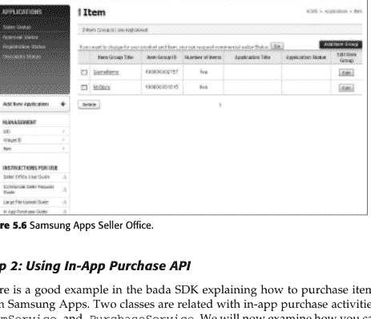

图5.6 三星应用商店卖家中心。

## 步骤 2：使用应用内购买 API

bada SDK 中有一个很好的示例，说明了如何从 Samsung Apps 购买商品。与应用内购买活动相关的有两个类：`ItemService` 和 `PurchaseService`。我们现在将研究如何使用这两个类来实现你自己的应用程序。

`ItemService` 类只有一个名为 `GetItemList()` 的方法。你可以使用它向 Samsung Apps 服务器发送请求以获取商品列表。你还应指定一个 `String` 类型的商品组 ID（item group ID）。该 ID 必须存在于 Samsung Apps Seller 服务器上。通常情况下，应用程序会硬编码商品组 ID。当应用程序启动时，它将只显示来自该组的商品。

```
Osp::Commerce::Store::ItemService* pItemService;
Osp::Commerce::Store::ItemServiceListener* pItemServiceListener;

pItemService = new ItemService();
pItemService->Construct("pItemServiceListener");

//Getting the items start from index 1 to index 2 from the item group
// with group ID "100000000a"
pItemService->GetItemList(L"100000000a", 1, 2, reqId);
```

此外，你还必须实现监听器（listener）来捕获服务器的回复，这些回复在构造 `pItemService` 对象时是必需的。

```
class ItemServiceListener :
    public Osp::Commerce::Store::IItemServiceListener
{
public:
    ItemServiceListener();
    ~ItemServiceListener();
    void OnItemListReceivedN(RequestId reqId,
        Osp::Base::Collection::IList* pItemInfoList,
        result r, const Osp::Base::String & errorCode,
        const Osp::Base::String &errorString);
};

void
ItemServiceListener::OnItemListReceivedN(RequestId reqId,
    Osp::Base::Collection::IList* pItemInfoList, result r,
    const Osp::Base::String & errorCode, const
    Osp::Base::String &errorString)
{
    if(IsFailed(r))
    {
        //print error message
    }
    else
    {
        //display item information
    }
    if(pItemInfoList != NULL)
    {
        pItemInfoList->RemoveAll(true);
        delete pItemInfoList;
    }
}
```

`PurchaseService` 类是允许用户购买商品并获取购买信息（如设备上的支付历史）的类。遵循与 `ItemService` 类相同的模式，你必须同时实现 `IPurchaseServiceListener` 接口类和 `PurchaseService` 类。这与上面提到的 `IItemServiceListener` 非常相似。这两个类都需要有配套的监听器接口类来处理来自 Samsung Apps 服务器的响应和结果。

```
class PurchaseServiceListener :
    public Osp::Commerce::Store::IPurchaseServiceListener
{
public:
    PurchaseServiceListener();
    ~PurchaseServiceListener();
    void OnItemPurchaseCompleted(RequestId reqId,const PaymentId& paymentId, const ItemIds itemId, const String& itemName,
        double price, String& currency, const DateTime& purchaseDate,
        result r, const String& errorCode, const String& errorMsg);
    void OnItemPurchaseInfoReceivedN(RequestId reqId,
        IList* pPurchaseInfoList,result r, const String& errorCode,
        const String& errorMsg);
};
```

要购买商品，你可以使用以下代码片段：

```
pPurchaseService = new PurchaseService();
pPurchaseService->Construct(pPurchaseServiceListener);
result r;
RequestId reqId = INVALID_REQUEST_ID;
String itemGroupId(L"1000000000a7");
String purchaseItemId(L"00000000517");
r = pPurchaseService->PurchaseItem(itemGroupId, purchaseItemId, reqId);
```

## 5.3.5 组件设置

我们在前面解释了在使用商务服务（commerce service）时，如何在 Samsung Apps Seller Office 上设置销售商品。还有其他服务要求你通过 bada 开发者网站（developer.bada.com）设置组件。最常见的是远程内容管理服务。在你真正开始编写代码之前，你必须为你的应用程序设置 Amazon S3 工作区。

## 步骤 1：设置基本应用程序信息

这是生成新应用程序时的第一步。在此步骤中，你需要为应用程序提供名称、简单描述和版本信息。图 5.7 是开发者网站上步骤 1 的截图。

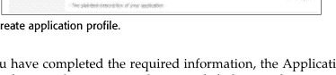

图5.7 创建应用程序配置文件。

完成所需信息后，当你单击 Next 按钮时，Application Manager 将引导你进入下一步。

## 步骤 2：选择特权 API 组

一旦你确定了应用程序名称并提供了应用程序描述，就需要选择包含应用程序所用 API 的特权组。如果你想使用内容管理功能，则需要从 `CONTENT_TRANSFER`、`LOCAL_CONTENT` 或 `REMOTE_CONTENT` 中至少选择一个特权 API 组，如图 5.8 所示。如果只想在设备上使用内容服务，请选择 `LOCAL_CONTENT`。如果你想使用远程内容服务（这是以服务为中心的功能），请选择 `CONTENT_TRANSFER` 或 `REMOTE_CONTENT`。

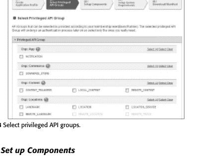

图5.8 选择特权 API 组。

## 步骤 3：设置组件

选择特权 API 组后，你就可以为应用程序设置组件。此步骤涵盖社交组件、内容组件和工作区，如图 5.9 所示。工作区（Amazon S3）是存放实际内容文件（如图像、视频和音频）的存储空间。当你在 Content 部分单击 Content Type Management 选项时，可以创建新的内容类型。bada 中有四种预定义的内容类型：图像、视频、音频和其他。

## bada 命名空间

C++ 中的命名空间（Namespaces）是一种语言级机制，用于划分全局程序命名空间，例如 Java 中的包（packages）或 Python 中的导入模块（import modules）。在 C++ 中，命名空间可以被视为一种顶层封装机制。

在 bada 中，命名空间提供了一种在编程级别将系统组织为定义良好、逻辑连贯、功能子集的方法。

每个命名空间声明了构成 bada 类库的类的一个离散子集。

总的来说，bada 在顶级 `Osp` 命名空间内包含 20 个主要命名空间，`Osp` 封装了所有 bada 第三方 API。大约一半的主要命名空间包含一个或多个嵌套命名空间，因此 `Osp` 根命名空间下总共有超过 30 个命名空间。

本章的其余部分将概述各个命名空间。

## 你将学到什么

本章将逐一介绍 bada 命名空间，重点突出每个命名空间最重要的特性，并将每个命名空间放在整个平台的更大背景下。它将为你提供以下内容：

- 概述 bada 平台如何划分为主要功能领域。
- 理解每个命名空间对整个系统的贡献。

到本章结束时，你将知道有趣的功能在哪里，以及如何访问它们。

## 你需要什么

为了从本章获得最大收益，请保持编辑器打开并浏览所提到的头文件，这些头文件几乎都包含有用的注释和代码示例。

## 6.1 using 指令和声明

如果你不熟悉 C++ 中的命名空间语法，请不要灰心；它非常直接了当。

要在 C++ 中使用来自给定命名空间的类和其他定义，你必须包含一个 using 指令来声明你想在给定源文件中可用的该命名空间中的所有名称，或者通过使用声明（using declarations）来限定代码中出现的各个标识符的名称。

其中 `somenamespace` 是一个命名空间，指令的形式为：

```
using namespace somenamespace;
```

其中 `someidentifier` 是一个标识符（例如类名或枚举），声明具有以下形式：

```
using somenamespace::someidentifier;
```


若要包含嵌套命名空间，例如 Ui::Controls，必须显式包含该嵌套命名空间，而不仅仅是包含它的容器命名空间。例如，要使用 Button 对象，你的代码中应出现以下内容：

```
using namespace Ui;
using namespace Ui::Controls;
```

## 6.2 本章内容组织方式

图 6.1 展示了每个命名空间如何映射到 bada 的主要功能区域，并可作为确定哪个命名空间包含所需功能的起点。

第 6.3 节按字母顺序介绍各个命名空间，因此一旦确定了所需的功能，就可以轻松地查找更多详细信息。

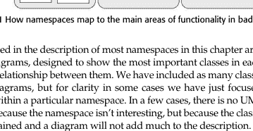

图 6.1 命名空间与 bada 主要功能区域的映射关系。

本章大多数命名空间的描述中都会包含一个或多个 UML 图，旨在展示每个命名空间中最重要的类以及它们之间的关系。我们尽可能在图中包含更多的类，但为了清晰，在某些情况下只重点关注特定命名空间中的关键类。少数情况下根本没有 UML 图，这并不是因为命名空间不重要，而是因为这些类大多是自包含的，添加图对描述没有太大帮助。

如果您不是 UML 爱好者，也无需担心。本章仅使用足够的 UML 来展示每个命名空间中重要类是如何组合在一起的。如需复习 UML 语法，请参阅附录中的 UML 入门。

## 库、头文件与权限

在大多数命名空间描述的开头，您还会看到一个权限表，指定使用该命名空间中特定功能所需的权限组。您会注意到某些功能需要 SYSTEM 级别的权限，这些权限可能并非对所有开发人员都可用，主要是那些与 bada 服务器配合使用的功能。请访问 developer.bada.com 上的开发者网站，了解您的应用程序如何获得此权限级别的最新信息。有关获取权限的更多信息，请参阅第 2 章，第 4 章详细介绍了 bada 安全模型，包括权限。

我们还列出了使用每个命名空间所需的库和头文件。仅当为模拟器构建时才需要包含各个库；当为设备构建应用程序时，FOSP 是唯一需要的库。要将库添加到项目，请在 IDE 中选择 Properties | C/C++Build | Settings | bada C++ Linker | Libraries，并按名称添加所需的库。

在 bada 中，通常每个命名空间都与一个头文件相关联，该头文件包含命名空间声明以及所有为命名空间贡献声明的各个头文件的 #include 列表。您可以在每个命名空间描述的开头找到需要包含的头文件。

在每个命名空间摘要的开头，我们还列出了一些该命名空间中最重要的类，但摘要正文中会详细说明更多的类。

## 6.3 命名空间详解

### Osp

# 声明位置：

```
Framework.h
```

# 摘要

顶级命名空间，包含 bada 中所有其他命名空间。名称源自 bada 的原始项目名称 Open Service Platform。

### Osp::App

# 声明位置：

```
FApp.h
```

# 库：

```
FApp
```

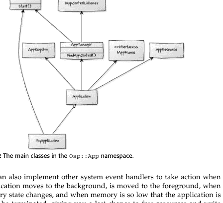

图 6.2 Osp::App 命名空间中的主要类。

您还可以实现其他系统事件处理程序，以便在应用程序转到后台、切换到前台、电池状态发生变化，以及内存过低导致应用程序即将被终止时采取相应操作，这为您提供了释放资源并将状态信息写回注册表的最后机会。

AppControl 类提供对 bada 基础应用程序导出功能的访问，例如拨号、访问相机和日历条目。AppManager 类查找指定的控件（例如拨号控件），并将其作为 AppControl 对象类型返回给应用程序使用。

NotificationManager 类包含一些方法，用于当收到新消息或有事项需要用户注意时向用户提供通知。通知可以显示在滚动条（ticker）和快捷面板（quickpanel）中，例如当应用程序因用户接听电话而在后台运行时，该功能尤其有用。

您还可以实现其他系统事件处理程序，以便在应用程序转到后台时采取相应操作。

```
Osp::Base
```

# 声明位置：

```
FBase.h
```

Base 还包含针对 bada 所定义数值类型的包装类。Number 类如图 6.4 所示。

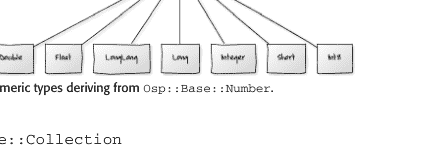

图 6.4 从 Osp::Base::Number 派生的数值类型。

### Osp::Base::Collection

# 声明位置：

FBaseCol.h

# 所需权限：

无。

# 摘要

选中的重要类：

- ICollection
- IComparer
- IEnumerator
- ArrayList
- LinkedList
- Stack
- Queue
- HashMap

这是用于处理数组、列表和栈等各种集合的命名空间。它包含一些方法，便于创建和操作这些集合。集合要么基于对象，要么基于模板。基于对象的集合派生自 ICollection，用于存储对象；而基于模板的集合派生自 ICollectionT，用于存储接口指针和 int 等原始类型。

为清晰起见，图 6.5 仅显示了该命名空间中非模板版本类的派生关系和关联，但图中的每个集合类也都有一个接受模板类型的版本——例如 LinkedList 和 LinkedListT。

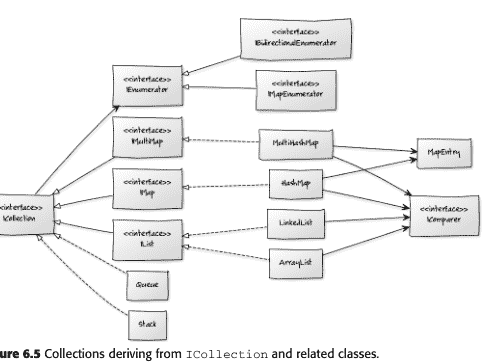

# 图 6.5 从 ICollection 派生的集合及相关类。

从图 6.5 所示的集合类中，您只需选择适当的集合类来匹配管理数据的方式。Stack 和 Queue 是简单的对象集合，分别按后进先出（LIFO）和先进先出（FIFO）顺序组织。ArrayList 和 LinkedList 实现了可通过索引访问的对象列表，而 HashMap 和 MultiMap 管理由 MapEntry 表示的键/值对列表。您可以遍历这些集合中的元素，对每个元素执行操作，例如使用当前集合的 GetEnumeratorN() 方法返回的 IEnumerator 派生类。

> 注意：ArrayList 和 LinkedList 的使用方式相同，但每个类的实现略有不同。ArrayList 元素存储在连续的内存区域中，因此访问列表更快，但添加元素的速度比 LinkedList 慢，因为添加新项时可能需要调整整个内存块的大小。LinkedList 访问较慢，但调整大小更快。因此，如果您有一个固定列表，并且不打算频繁添加或删除元素，请选择 ArrayList。如果列表中元素的数量可能更频繁地变化，请使用 LinkedList。

IComparer 派生类也可用于对 ArrayList 和 LinkedList 的列表进行 Sort() 排序，或用于键/值对列表的键比较。bada 提供了许多用于比较特定类型的比较器，包括 IntegerComparer 和 StringComparer，但对于更复杂的对象比较，您可以从 IComparer 派生自己的比较类。

> 注意：基于对象的集合不收集对象的副本，而是收集指针。因此，任何要放入集合类的对象都必须使用 operator new 分配。否则，如果集合存储的是指向自动变量的指针，其生命周期无法预测，当集合使用该指针时，变量很可能已不存在，应用程序将不可预测地崩溃。

### Osp::Base::Runtime

# 声明位置：

FBaseRT.h

# 所需权限：

无。

# 摘要

选中的重要类：

- Monitor
- Thread
- Timer

该命名空间包括实现应用程序运行时环境的类，包括线程、同步对象和计时器，如图 6.6 所示。


图 6.6 Osp::Base::Runtime 命名空间中的主要类。


bada 应用程序可以有多个线程，使用同步对象（互斥锁、信号量和监视器）来控制对共享资源的访问，例如，任何时刻只有一个线程可以独占访问设备上的特定代码段或共享资源。
定时器用于调度特定代码段的执行。

```
Osp::Base::Utility
```

## Osp::Base::Utility
### 声明于：
FBaseUtil.h

### 所需权限：
无。

### 概述
重要类选摘：
- Math
- StringUtil
- Uri

此命名空间提供了一些有用的工具类。Math 类是数学库的封装，提供对数函数和其他常见数学函数；其他类提供字符串处理工具以及用于创建和分析 URI 的类。

```
Osp::Commerce::Store
```

## Osp::Commerce::Store
### 声明于：
FCommerce.h

### 库：
FOsp

### 所需权限：
要使用此命名空间中的功能，需要以下权限：

| 权限组 | 权限级别 | 描述 |
|---|---|---|
| COMMERCE_STORE | NORMAL | 连接到 Samsung Apps 以启用应用内购买 |

### 先决条件：
要使用应用内购买等功能，您需要在 Samsung Apps 上拥有一个卖家账户。

### 概述
重要类选摘：
- `ItemInfo`
- `ItemService`
- `PurchaseService`

`Commerce::Store` 命名空间提供的类和方法允许应用程序从 Samsung Apps 检索信息并进行应用内购买。这些项目可能是应用内购买，例如新的应用服务或游戏中的新关卡。

实际购买过程由 Samsung Apps 服务器处理，因此应用程序只需让用户选择要购买的项目，并将该请求传递给服务器。

图 6.7 展示了 `Commerce::Store` 命名空间的组织方式。有两个主要类：`ItemService` 用于检索项目信息，`PurchaseService` 用于实际购买项目。每个可用项目的信息（如描述、价格和货币）由 `ItemInfo` 类表示，而应用程序通过实现 `IItemServiceListener` 来处理 `ItemService` 事件。

类似地，对于购买，`PurchaseInfo` 类包含购买详情，而响应（如项目购买成功或购买错误）应由应用程序的 `IPurchaseServiceListener` 实现来处理。


图 6.7 在 Osp::Commerce::Store 中实现 ItemService 和 PurchaseService 的类。

## Osp::Content
### 声明于：
```
FContent.h
```

### 库：
```
FContent
```

### 所需权限：
要操作设备或服务器上的内容，需要设置以下权限组：

| 权限组 | 权限级别 | 描述 |
|---|---|---|
| LOCAL_CONTENT | NORMAL | 处理设备内容 |
| CONTENT_TRANSFER | SYSTEM | 向服务器上传内容和从服务器下载内容 |
| REMOTE_CONTENT | SYSTEM | 操作服务器上的内容 |

### 先决条件：
要操作远程内容，开发者需要在 bada 服务器上拥有一个账户。远程内容的信息存储在 bada 服务器上，而实际内容存储在 Amazon S3 工作区中，您需要设置该工作区并将其链接到您的应用程序。您可以通过 bada 开发者站点 developer.bada.com 上的 Application Manager 在“Set Up Components”部分设置 Amazon 工作区。

### 概述
重要类选摘：
- ContentInfo
- ContentManager
- ContentSearch

Content 命名空间包含用于在设备本地和服务器远程搜索和管理内容的类和方法。内容是各种媒体类型（包括图像、音频和视频）的逻辑表示，包含元信息，例如拍摄日期和时间、GPS 信息、描述以及实际内容本身的位置。可以使用类似 SQL 的语法利用这些信息搜索内容。

内容的创建、读取、更新和删除由 ContentManager 和 RemoteContentManager 类处理。设备上内容数据库中的信息通过派生自 ContentInfo 的专门类访问：AudioContentInfo、ImageContentInfo 和 Video ContentInfo 都包含其特定媒体类型的信息，而 OtherContentInfo 用于表示 PDF 等内容。

如图 6.8 所示，这些类用于保存这些搜索返回的内容信息。


图 6.8 负责在 bada 设备上管理和搜索 Osp::Content 的类。

设备和服务器上的内容搜索由 ContentSearch 和 RemoteContentSearch 类提供。本地搜索返回派生自 ContentInfo 的项目，而远程搜索在更灵活的 RemoteContentSearch 类中返回信息，如图 6.9 所示。获得内容后，对于音频和视频，请使用 Osp::Media::Player 播放；对于图像，请使用 Osp::Media::Image 将其解码为位图，并使用 Osp::Graphics::Canvas 利用 ContentInfo 中的信息绘制位图。

Content 命名空间还提供了在设备和 bada 服务器之间传输内容的类，可用于在社交网络应用中共享信息、备份内容或与云端同步。向服务器上传内容以及从服务器下载内容的功能由 ContentTransfer 类提供。


图 6.9 内容也可以使用 bada 服务器进行远程存储和管理。

## Osp::Graphics
### 声明于：
```
FGraphics.h
```

### 库：
```
FGraphics
```

### 所需权限：
无。

### 概述
重要类选摘：
- Bitmap
- Canvas
- EnrichedText

Graphics 命名空间包含用于绘制 2D 和 3D 图元、文本和图像的类。

所有图形图元都渲染到 Canvas 中，Canvas 类包含用于绘制基本形状的方法以及绘图设置，例如前景色和背景色、线条样式以及用于文本绘制的字体信息。您可以创建自己的 Canvas，但在大多数情况下，您将绘制到控件的区域中。

> 注意：要获取具有整个应用程序框架边界的 Canvas，请使用 Osp::App::Application::GetAppFrame 方法获取框架控件，然后使用 Osp::Ui::Control::GetCanvasN 返回可供绘制的 Canvas。

使用 Canvas 类的方法绘制的常见图形包括弧线、直线、矩形、多边形、文本以及位图。请查看图 6.10 以了解 Canvas 与其他 Graphics 类之间的关系。

Bitmap 类包含创建和缩放位图的方法，但位图实际上使用 Canvas::DrawBitmap 方法渲染。位图还用于存储由 Osp::Media::Image 解码的图像，然后将包含图像的位图绘制到画布上。

该命名空间还包含一些用于绘制形状的核心类：Dimension、Point 和 Rectangle。

更高级的 2D 和 3D 绘制由 OpenGL 子命名空间提供。


图 6.10 Osp::Graphics 命名空间中的类。请注意 Canvas 的重要性。

## Osp::Graphics::OpenGl
### 声明于：
FGraphicsOpenGL.h（适用于 OpenGL ES 1.1）

### 库：
FGraphicsOpenGL, FGraphicsEgl

### 所需权限：
无。

### 先决条件：
请注意，并非所有运行 bada 平台的硬件都支持 OpenGL。

### 概述
此命名空间提供对 OpenGL ES 2D 和 3D 图形库的支持。OpenGL ES 是面向嵌入式系统的跨平台标准，为 3D 游戏提供完整功能。通过支持 OpenGL ES，bada 允许开发者使用最初为其他移动平台编写的图形代码。

EGL 库提供 OpenGL 绘制的渲染表面，并将 OpenGL 调用连接到 bada 的底层窗口系统。

> 注意：同时支持 OpenGL ES 1.1 和 Open GL ES 2.0。您可以使用哪个版本取决于设备硬件是否支持。


Osp::Io

# 声明位置：

FIo.h

# 库：

FIo

# 所需权限：

无。

# 摘要

选择的重要类：

- Database
- Directory
- File

如图6.11所示，Io命名空间包括用于处理文件、目录、数据库和注册表的包装类。File类提供使用原始缓冲区和字符串创建、删除、写入和读取文件的支持。要获取文件和目录的信息，请使用FileAttributes类。

应用程序只能对其主目录或共享目录中的文件具有写访问权限——共享目录用于与其他应用程序共享数据。


图6.11 Osp::Io命名空间中的核心类。

Database类提供对基本数据库功能、创建和删除数据库以及执行SQL命令的支持。它还包括对事务和回滚的支持，这些功能在使用SQL数据库时非常有用。Database类使用的SQL是SQLite（www.sqlite.org）。

> 注意：数据库仅用于本地设备上的存储，不支持连接到远程数据库。

Registry类支持创建、写入和读取注册表文件，应用程序通常使用注册表文件来存储设置。这与App::AppRegistry管理的注册表不同，后者只能由应用程序访问。应用程序可以将Io::Registry创建的文件存储在


图6.13 LocationProvider类在OSp::Locations命名空间中的作用。

# 服务器支持的服务

使用bada服务器，结合RemoteLocationProvider类，开发人员还可以访问远程设备的信息，定期将本地设备的最后位置报告给服务器，并使用SubscribeToTraceService方法和ITraceServiceListener类记录旅行路径。

使用StartLocationReport方法和ILocationReportListener类向bada服务器报告设备位置。这将导致位置信息定期上传到bada服务器，然后其他经过认证的设备可以读取这些信息。

要检索远程设备的最后已知位置，请使用RequestLastKnownLocationList方法，传入一个TargetInfo对象列表，这些对象通过用户的bada服务器userID标识设备。您还可以使用RequestLastKnownLocationListInCircle和RequestLastKnownLocationListInRectangle方法将结果缩小到给定区域内最后已知位置的设备。

# 地标

Landmark类表示具有名称的命名地理位置，并包含额外信息，如描述和URL。应用程序可以创建自己的地标，例如从用户在图上选择的位置，也可以使用其他应用程序或第三方内容提供商提供的预定义地标。


# 图6.14 在UI控件中渲染Map的类。

每个图层的目的以及用于操作此信息的相关类和方法如下：

# 缩放（Zoom）

包含缩放UI控件的顶层。应用程序实现IMapEventListener::OnMapZoomingStarted和OnMapZoomingEnded，以便在用户缩放地图时收到通知。

# 信息窗口（Info Window）

显示有关位置和商家有用信息的文字气泡。例如，这可能包括商家的简要描述及其联系信息。信息窗口使用NativeMapInfoWindow类创建预定义窗口，使用IMapInfoWindow类创建用户自定义窗口。

# 我的位置（MyLocation）

在地图上显示当前位置，并带有显示误差范围的圆形边界。应用程序可以通过使用Map::SetMyLocationEnabled方法选择是否显示此信息。

# 覆盖层（Overlay）

一个交互式图层，带有标记地图上位置的形状和用户可以在物理地图上像图钉一样移动的标记。形状——多边形、圆形和矩形——可以通过添加从MapOverlayShape类派生的对象来包含在地图中，而可移动标记则从MapOverlayMarker派生，如图6.15所示。

应用程序实现IMapOverlayEventListener来处理用户移动标记时接收到的事件。

# 地图（Map）

由地图服务提供商提供并由Map类封装的基本地图图形。该类的这些方法提供了对地图显示方式的大量控制，包括其大小和边界矩形。


图6.15 向地图添加覆盖层的类。

```
Osp::Locations::Services
```

# 声明位置：

```
FLocations.h
```

# 所需权限：

使用Locations::Services的功能需要以下权限组：

| 权限组 | 权限级别 | 描述 |
|---|---|---|
| LOCATION_SERVICE | NORMAL | 使用目录、地理编码、地图或路径服务 |

# 先决条件：

拥有地理服务提供商的账户。

# 摘要

选择的重要类：

- `IDirectoryServiceProvider`
- `IMapServiceProvider`
- `IRouteServiceProvider`
- `ProviderManager`

此命名空间为地理信息服务提供支持：地图、地理编码、目录和路径服务。实现这些服务的起点是`ProviderManager`类，它检索设备可用服务提供商的信息，并允许应用程序选择提供适当服务的一个。

地图服务的支持由一组接口类提供，用于获取地图信息和渲染地图。`IMap`接口实现来自服务提供商的动态地图，支持平移和缩放等功能，其UI由`Locations::Controls`命名空间中的类处理。

# 路径和目录服务

路径服务由`IRouteServiceProvider`和`IRouteServiceListener`实现，允许应用程序在给定一组路径点（至少必须由起点和目的地组成）以及诸如交通方式、路径是最快还是最短等参数的情况下请求路径。应用程序将收到一个`Routes`列表，其中包含表示路径的一组坐标以及长度、预计旅行时间和一组`RouteSegments`等信息。然后，应用程序可以在地图上显示此信息，以提供诸如逐向导航等服务。提供路径服务的类如图6.16所示。

目录服务允许应用程序开发人员在指定地理区域内实现用户友好的产品和搜索服务——例如某个城市内的咖啡店。开发人员使用`IDirectoryServiceProvider`的方法组合搜索请求，并使用`IDirectoryServiceListener`异步处理响应。搜索结果显示为`Landmarks`列表。支撑这些服务的是地理编码服务，它将地址转换为地理坐标，反之亦然。

注意：要使用这些服务，您需要拥有地理信息服务提供商的账户，例如deCarta（www.de carta.com），这是bada当前支持的地图提供商。但是，您可以通过使用Web::Control类和诸如www.googlemaps.com等网站在应用程序内提供地图访问。


图6.16 管理Osp::Locations::Services中服务提供商功能的类。

# Osp::Media

声明位置：
FMedia.h

库：
FMedia


图 6.17 Osp::Media 命名空间中的核心类。

> 注意：你可以在配备网络摄像头的 PC 上使用模拟器测试摄像头功能，但根据硬件的不同，可能并非所有摄像头设置都可用。

## 媒体格式支持

支持多种标准音频播放格式：MP3、AAC、WMA、M4A、XMF、3GA、MMF、MIDI、WAV 和 AMR。音频可以 AMR 或 WAV 格式录制。

视频播放格式同样十分丰富，包括 WMV、ASF、AVI、MP4 和 3GP；视频可以 MP4 和 3GP 格式录制。

Image 类可以解码以下图像格式：BMP、GIF、JPEG、PNG、TIFF 和 WBMP。图像可以 BMP、JPEG 和 PNG 格式输出。

采用 OMA 和 Windows Media 数字版权管理（DRM）格式保护的音频和视频文件也可以播放。

```
Osp::Messaging
```

## 声明于：

FMessaging.h

## 库：

FMessaging

## 所需权限：

使用此命名空间中的类发送消息需要以下权限组：

| 权限组 | 权限级别 | 描述 |
|---|---|---|
| MESSAGING | SYSTEM | 发送 SMS、MMS 和电子邮件消息 |

## 摘要

重要类选列如下：
- EmailManager
- MmsManager
- SmsManager

此命名空间提供访问设备消息处理功能的接口。应用程序可以发送 SMS、MMS 或电子邮件消息。为了检查消息发送状态，开发人员需要为每种消息类型实现一个监听器，以异步接收状态信息。

图 6.18 展示了 SmsManager、RecipientList 和 SmsMessage，以及用于接收消息状态信息的 ISmsListener。MMS 和电子邮件消息的发送方式与此类似：使用收件人列表、用于表示消息的类，以及用于接收消息状态信息的监听器。


图 6.18 Messaging::SmsManager 及相关类。

> 注意：在撰写本文时的当前版本 bada SDK 1.0.0b3 中不支持推送消息。

```
Osp::Net
```

## 声明于：

FNet.h

## 库：

FNet

## 所需权限：

要使用此命名空间的功能，至少需要以下权限组中的一个；根据所使用功能的不同，可能还需要其他权限组：

| 权限组 | 权限级别 | 描述 |
|---|---|---|
| NET | NORMAL | 操作 netaccount 信息 |
| NET_STATISTICS | NORMAL | 访问数据呼叫信息 |
| NET_ACCOUNT | SYSTEM | 创建和删除网络账户 |

## 前提条件：

如果你处于防火墙之后，可能需要使用代理服务器。

## 摘要

重要类选列如下：
- NetAccountInfo
- NetAccountManager
- NetConnection

此命名空间负责访问 bada 的数据通信功能。其中包含用于建立、维护和监控网络数据收发连接的类。它还提供通过互联网域名系统（DNS）检索特定主机信息的方法。此外，还提供用于管理 Wi-Fi 和 Bluetooth 连接，以及使用 HTTP 或底层套接字函数发送和接收数据的子命名空间。


# 图 6.19 使用 Osp::Net 命名空间中的类创建和管理连接。

如图 6.19 所示，用于创建网络连接的主要类是 NetAccountManager 和 NetAccountInfo。NetAccountInfo 封装了建立远程连接所需的配置信息，例如 Wi-Fi 接入点名称、DNS 和授权信息。随后，NetConnection 类使用这些信息建立连接，之后即可与远程主机收发数据。

## Osp::Net::Bluetooth

## 声明于：

FNetBluetooth.h

## 所需权限：

要使用此命名空间的功能，需要以下权限组：

| 权限组 | 权限级别 | 描述 |
|---|---|---|
| BLUETOOTH | NORMAL | 创建连接、发送和接收数据 |

## 前提条件：

必须在设备上启用 Bluetooth。请注意，无法使用模拟器测试 Bluetooth 功能。

## 摘要

重要类选列如下：
- BluetoothDevice
- BluetoothManager

## 摘要

重要类选列如下：
- `HttpHeader`
- `HttpSession`
- `HttpTransaction`

Http 子命名空间提供了一组支持 HTTP 协议的类，使应用程序能够作为符合 HTTP 1.1 标准的客户端运行，并支持流水线和分块等标准功能，以及与互联网上的 HTTP 服务器通信。还支持使用 SSL 3.0 和 TLS 1.0 协议的 HTTPS 安全连接。

`Http` 命名空间中的主要类如图 6.21 所示。要发送 HTTP 请求，必须先设置一个 `HttpSession`，其中包括连接类型（默认通过 TCP/IP 连接发送纯文本）、代理服务器（如果有）以及要向其发送 HTTP 请求的主机服务器 URL。要发送 HTTP 请求并接收响应，可以使用 `HttpTransaction`，它负责管理客户端与服务器之间的交互。客户端支持一个或多个会话，而一个会话可以包含多个事务。

使用 `HttpRequest` 类封装待发送的消息，而响应则以 `HttpResponse` 的形式接收。在请求中添加标头，或读取响应中的一个或全部标头，在 bada 中都可以通过 `HttpHeader` 轻松实现。


**图 6.21** `Osp::Net::Http` 命名空间中的类实现了 HTTP 协议。

与 bada 的其他通信功能一样，HTTP 请求采用异步方式处理。因此，要接收 HTTP 请求的响应，以及上传被分割成多个区块的消息，需要实现 IHttpTransactionEventListener。

对于要求输入用户名和密码的网站，可以在打开 HttpTransaction 时提供这些信息：将登录信息封装在 HttpAuthentication 对象中即可。

```
Osp::Net::Sockets
```

## 声明于：

```
FNetSockets.h
```

## 所需权限：

要使用 Sockets 子命名空间的功能，需要以下权限：

| 权限组 | 权限级别 | 描述 |
|---|---|---|
| SOCKET | NORMAL | 创建套接字连接、发送和接收数据 |

## 摘要

重要类选列如下：
- SecureSocket
- Socket

Sockets 实现了类似于标准 BSD 套接字库的套接字数据通信协议。套接字被描述为一个端点，即网络上运行的两个应用程序之间通信的一端。bada 支持 TCP/IP、UDP 和安全套接字，以及流协议和数据报协议。应用程序应实现 ISocketEventListener，以异步处理套接字事件。

图 6.22 展示了用于实现套接字功能的各个类。请注意，bada 同时支持标准套接字和安全套接字。

```
Osp::Net::Wifi
```

## 声明于：

```
FNetWifi.h
```


图 6.22 Osp::Net::Sockets 实现了类似于 BSD 套接字库的功能。

## 所需权限：

要使用此命名空间的功能，至少需要下表中的第一个权限组：

| 权限组 | 权限级别 | 描述 |
|---|---|---|
| WIFI | NORMAL | 设置临时网络、获取本地 WiFi 设备信息 |
| WIFI_MANAGER | SYSTEM | 建立与特定接入点的连接 |

## 前提条件：

必须在设备上启用 Wi-Fi，并且必须连接到无线网络。请注意，无法使用模拟器测试 Wifi 功能。

## 摘要

重要类选列如下：
- AdhocService
- WifiManager
- WifiNetAccountInfo


这个命名空间包含用于获取活动 Wi-Fi 连接信息的类和方法，使开发者能够通过 WiFiNetAccountInfo 类的方法访问 SSID 和安全信息。要控制当前的 Wi-Fi 连接，请使用 WiFiManager 类，该类包含用于激活和停用连接、加入指定的 WiFi 网络以及返回设备 WiFi 状态信息的 方法。WiFiManager 和相关类如图 6.23 所示。


图 6.23 Osp::Net::Wifi 命名空间中的主要类，用于管理 Wi-Fi 设备。

Wifi 还包含用于创建和管理临时 Wi-Fi 网络的类，因此 bada 用户可以与朋友连接并进行多人游戏，例如。此功能由 AdhocService 类管理。

## Osp::Security

### 声明于：

```
FSecurity.h
```

### 库：

FSecurity

### 所需权限：

无。

### 摘要

选定的重要类：

- PrivateKey
- PublicKey
- SecretKey
- SecretKeyGenerator
- AesSecureRandom, DesSecureRandom, DesEdeSecureRandom

Security 命名空间提供了一个平台范围的安全系统和高级安全服务，例如：加密功能、证书管理服务、密钥管理和单点登录用户身份验证。

bada 支持使用以下算法生成伪随机数：使用 AesSecureRandom 类的 AES，使用 DesSecureRandom 的 DES，以及使用 DesEdeSecureRandom 的 3DES。

这些函数生成密码学安全的随机数（CSPRNG），可在 bada 中用于使用 SecretKey、SecretKeyGenerator 和相关接口类生成密钥（见图 6.24）。例如，密钥可用于保护文件的密码。


图 6.24 用于生成密钥的 Osp::Security 类。

用于 RSA 标准 PKI（公钥基础设施）受保护消息的公钥/私钥对是通过使用 KeyPair 和 KeyPairGenerator 以及相关接口类生成的。PKI 用于创建数字证书以验证消息发送者并确保消息未被篡改。在此上下文中，消息可能指电子邮件或文档或流，例如。

对消息添加数字签名和验证签名消息由 Crypto 和 Cert 子命名空间处理。

### Osp::Security::Cert

#### 声明于：

```
FSecCert.h
```

#### 所需权限：

无。

#### 摘要

选定的重要类：

- X509Certificate

此命名空间提供用于从用于验证消息的 X509 标准安全证书中获取信息的类。X509Certificate 类表示一个证书，其中包含返回有关证书的信息的方法以及一个 Verify 方法，该方法以 IPublicKey 作为参数并检查证书是否使用相应的私钥签名。这可用于检查消息是否已被篡改，例如。

### Osp::Security::Crypto

#### 声明于：

```
FSecCrypto.h
```

#### 所需权限：

无。

#### 摘要

选定的重要类：

- IHash
- IHmac
- RsaCipher
- RsaSignature

此命名空间包含类和方法以支持各种类型的加密和解密。支持四种基本加密类型：使用哈希的一次性加密、使用密钥的加密、使用公钥和私钥的加密，以及使用数字签名。

公钥/私钥对用于两种方式：使用公钥加密消息以便只有拥有相应私钥的人才能读取它，以及使用私钥对文档进行数字签名。任何拥有公钥的人都可以读取消息，但使用数字签名进行签名可证明其未被篡改。

RsaCipher 和 RsaSignature 类提供使用公钥/私钥对进行加密和签名的支持。

## Osp::Social

### 声明于：

FSocial.h

### 库：

FSocial, FSocialLifelog（如果您访问生活日志）

### 所需权限：

使用此命名空间的功能将至少需要下表中列出的其中一个权限，具体取决于您实现的功能：

| 权限组 | 权限级别 | 描述 |
|---|---|---|
| ADDRESSBOOK | NORMAL | 访问设备上的地址簿 |
| CALENDARBOOK | NORMAL | 访问设备上的日历 |
| LIFELOG | SYSTEM | 访问生活日志 |

### 摘要

选定的重要类：

- Addressbook
- Calendarbook
- Lifelog

Social 命名空间包含用于维护用户个人数据、地址簿、日历和设备上的生活日志的类。生活日志是在一定时期内的活动日志，包括通话和消息传递，以及基于蜂窝的定位信息。你可以认为这个命名空间

Lifelog 允许应用程序分析最常拨打的号码、列出特定日期范围或来自基于蜂窝的位置的呼叫者，以及以许多其他方式处理生活日志数据库。

### Osp::Social::Services

#### 声明于：

FSocial.h

#### 所需权限：

此命名空间的所有功能都与 bada Server 协同工作，并且实现的所有服务都需要 SYSTEM 级别权限：

| 权限组 | 权限级别 | 描述 |
|---|---|---|
| BUDDY_SERVICE | SYSTEM | 好友服务 |
| MESSAGING_SERVICE | SYSTEM | 消息服务 |
| PRIVACY_SERVICE | SYSTEM | 隐私服务 |
| PROFILE_SERVICE | SYSTEM | 配置文件服务 |
| SNS_SERVICE | SYSTEM | SnsGateway |

#### 先决条件：

用户需要登录 bada Server 上的帐户才能使用其中大多数功能，并且还需要设置其隐私级别，以便朋友可以看到他们。

#### 摘要

选定的重要类：

- BuddyService
- MessagingService
- PrivacyManager
- ProfileService
- Profile
- SnsGateway

Services 命名空间为用户提供了使用 bada Server 功能进行交互的不同方式。提供了用于在 bada 用户之间建立社交关系的功能，以及一个社交网络聚合服务（SNA），该服务在应用程序内部为 Facebook 和 Twitter 等社交网络服务提供内置支持。

正如您从表中看到的那样，服务的功能可以分为五组：Profile、Privacy、Messaging 和 Buddy 管理与 bada Server 的功能协同工作以连接 bada 用户，而 SnsGateway 则提供从应用程序通过 bada Server 到社交网络站点的链接。

ProfileService 类用于管理配置文件。用户的配置文件实际上由几个不同的部分组成：默认情况下为公开的 BasicProfile，以及其他配置文件，例如 ContactProfile 和 SocialProfile，这些配置文件在设备上对所有允许的用户可用，但在存储在 bada Server 上时设置为私有。用户必须选择在 bada Server 的公共目录中列出，并且还可以选择其其他配置文件是否可供所有用户或指定用户组访问。您需要实现 IProfileServiceListener 以响应由 ProfileService 发起的请求。ProfileService 和各种类型的 Profiles 如图 6.27 所示。


图 6.27 ProfileService 如何管理不同种类的 Profiles。

对用户配置文件和其他信息（如其位置）的访问由 PrivacyManager 类处理。这控制了用户配置文件信息的哪些部分可以被其他用户搜索以及谁可以访问该信息，例如好友。开发人员需要实现 IPrivacyManagerListener 类来实现此功能。

bada Server 的用户可以作为 Buddys 连接起来——两个用户之间相互确认的关系。发送和响应好友


Requests are handled by the BuddyService class, and because, as with most other requests in the Services namespace, these requests are handled asynchronously, you need to implement the IBuddyServiceListener. The classes that are used to implement the BuddyService are shown in Figure 6.28.


**Figure 6.28** The classes that go to make up the BuddyService.

The MessagingService is used for applications to send text messages between devices to one user or a group of users. Messages are sent via the bada Server and you need to implement IMessageServiceListener and IMessageServerEventListener to take advantage of this functionality.

> Note: The MessagingService can only be used to send messages between the same application on different devices, not between different applications.

## SnsGateway

The SnsGateway class manages one of the most powerful features of the Services namespace, allowing you to create applications that can easily communicate with social networking sites such as Facebook, MySpace, and Twitter, and retrieve information such as pictures and status updates, all from within your application. All you need to do is use the SnsGateway class and related classes such as SnsAuthenticator, and the low-level work of connecting to and retrieving information from the various social networking sites is taken care of for you by the bada Server.

The organisation of the classes making up the functionality of the SnsGateway is shown in Figure 6.29.


**Figure 6.29** Classes that allow access to social networking sites, as provided by the SnsGateway.

SnsGateway helps to present a unified view of all the information from various sites, representing the retrieved information in classes such as SnsPhotoInfo and SnsStatusText, which you can then display in whatever way you want.

> Note: A Buddy as managed by the BuddyService refers to another user of the bada Server and is different from the concept of a buddy as returned by the SnsGateway::GetMyBuddies method. The latter refers to a buddy in a social networking service such as Facebook or MySpace and is represented by a SnsProfile.

## Osp::System

### Declared In:

`FSystem.h`

### Library:

`FSystem`

### Privileges Required:

To access any of the functions of this namespace, you need the following privilege group:

| Privilege group | Privilege level | Description |
|---|---|---|
| SYSTEM_SERVICE | NORMAL | Accessing the features of the utility classes provided by this namespace |

### Summary

Selected important classes:

- Alarm
- Battery
- PowerManager
- RuntimeInfo
- SettingInfo
- SystemInfo
- SystemTime
- Vibrator

The System namespace provides access to device level information including system time, the alarm service, operating the vibrator device, battery levels and charge status, and power management. The system time can be returned as UTC (coordinated universal time) and local time with or without any adjustment for daylight saving time. The classes that provide the functionality of the System namespace are shown in Figure 6.30.

> Note: Applications should check the battery level (using Battery::GetCurrentLevel) before starting a particularly power-intensive function such as playing multimedia content.
> 
> The Osp::App::Application::OnBatteryLevelChanged is invoked whenever the battery level changes. If the battery level is critical, the application should stop using multimedia features, and if it is empty, the application should save state information and prepare to terminate.

System contains a number of classes for getting information about the device. RuntimeInfo returns information such as the amount of memory, and internal and external storage available to an application. SettingInfo provides access to system settings such as whether silent mode is switched on, whether GPS or data roaming is active, and the current language setting and country code. SystemInfo is mainly used for obtaining information about the capabilities of the device, such as the number of cameras, whether Bluetooth is supported, and the version of OpenGL ES that the device supports.


**Figure 6.30** Osp::System consists of a group of self-contained utility classes.

Using the PowerManager class you can implement and register listeners to be notified when the screen switches on or off (IScreenEventListener) or when the charging state of the device changes (IChargingEventListener). PowerManager also includes the KeepScreenOnState method, which can be used to keep the screen on until the application is sent to the background. This is useful when using features such as media players or the camera.

## Osp::Telephony

### Declared In:

`FTelephony.h`

### Library:

`FTelephony`

### Privileges Required:

To use the features of this namespace you need the following privilege group:

| Privilege group | Privilege level | Description |
|---|---|---|
| TELEPHONY | NORMAL | Getting network and SIM information |

### Summary

Selected important classes:

- CallManager
- NetworkManager
- SimInfo

This namespace provides classes to access the telephony features of the device and contains methods for getting information about the current call and network information, and access to information from the SIM card (see Figure 6.31).


**Figure 6.32** Text encoding and decoding as provided by the Osp::Text namespace.

### Privileges Required:

None.

### Summary

Selected important classes:

- Container
- Control
- Window

The Ui namespace together with the Controls sub-namespace provide the classes and methods to implement a GUI. The Ui namespace provides common base classes for all controls as well as interfaces for event handlers.

An application UI is divided into layers of a frame, forms, and controls. The frame is the top-level window of an application and an application can have only one. Within that are forms – there can be many forms within an application and within forms are controls, which are handled by the Controls sub-namespace.

## Osp::Ui::Controls

### Declared In:

`FUiControls.h`

## Osp::Uix

### Declared In:

`FUix.h`

### Library:

`FUix`

### Privileges Required:

None.

### Summary

Selected important classes:

- FaceDetector
- FaceRecognizer
- Haptic
- Motion
- SensorManager
- WeatherSensor

This namespace contains classes to implement UI extensions – unconventional UI features that are not covered by basic UIs. While conventional applications interact with the user via menus and physical buttons, the bada UI extensions provide ways of using the device in unconventional ways and give the application developer access to built-in sensors. The classes that represent the UI extensions are shown in Figure 6.34.


**Figure 6.34** UI extensions provided by the Osp::Uix namespace.

The FaceDetector is the class used to locate a face in a still image or camera preview, while the FaceRecognizer will analyse this image and try and identify it from a list of already identified faces.

A device can contain many sensors available to application developers, including acceleration, magnetic, proximity, and tilt sensors. The SensorManager class is used to determine whether a sensor is available and to add or remove the sensor event handlers, while the SensorData class is used to retrieve information from that sensor. The classes that handle the functionality of these sensors are shown in Figure 6.35.


**Figure 6.35** Sensors provided by the Osp::Uix namespace.

> Note: Sensor monitoring methods such as ISensorEventListener::OnDataReceived are called from a separate thread to the main thread, so that they are not slowed down by the API calls in the main thread. This means that if you implement monitoring of a sensor, you should minimise what you do in the OnDataReceived method and do any drawing in the main thread. This also applies to the weather services classes, including WeatherSensor and WeatherForecast, which are used to retrieve weather data for a given location.

## Osp::Web

### Declared In:

`FWeb.h`


Library:

```
FWeb
```

Privileges Required:

Some of the functions of this namespace require privileges, as explained in the table below:

| Privilege group | Privilege level | Description |
|---|---|---|
| WEB_PRIVACY | NORMAL | Accessing the web history |

Summary

Selected important classes:

+   - HistoryItem
+   - WebHistory

This namespace contains classes and methods to interact with the browser engine. It contains classes that track browsing history. The functionality for displaying a web browser inside a window is handled by the Controls sub-namespace.

```
Osp::Web::Controls
```

Declared In:

```
FWebControls.h
```

Privileges Required:

To use the features of this namespace, you must have the following privilege group:

| Privilege group | Privilege level | Description |
|---|---|---|
| WEB_SERVICE | NORMAL | Constructing a web control |

Summary

Selected important classes:

+   - Web

This sub-namespace provides web browsing functionality to an application. A full web browser can be embedded in an application window just like any other control. This control can be used to download web content to the device and run Javascript (using the EvaluateJavaScriptN method of Web). The web control is based on the WebKit standard.

```
Osp::Xml
```

## Declared In:

```
FXml.h
```

## Library:

```
FXml
```

## Privileges Required:

None.

## Summary

Contains methods to manipulate XML documents using the standard libXml2 library for parsing document content.

# PART

# II

# Recipes

# Fundamentals

## Recipe 1.1: Save to and Restore from the Registry

### Problem Description

You want to write some application settings to the registry and restore them when your application launches again.

### The Recipe

The following configuration is required for this recipe:

**Namespaces used:**
`Osp::App, Osp::Base`

**Header files to #include:**
`FBase.h, FApp.h`

**Required libraries:**
`FBase, FApp`

**Required privilege level:**
`Normal`

**Required privilege groups:**
`None`

The application registry is where you store the application state. This may include application settings such as user preference information, the current player status in a game, or configuration information that you don’t want the user to have to re-enter each time the application is run. So, for example, if the user is several levels into a complicated game, they don’t want to start all over again if they quit the application and open it again later. By storing the game state in the registry, an application developer can let them resume their game playing at the point they chose to stop.

In this recipe we’ll demonstrate how to write values to and read them from the registry. Our example is a very simple currency application that provides up-to-date currency exchange rates for the UK pound against the US dollar and euro. We use the application registry to store the last known euro and dollar exchange values and the time that these values were last updated.

The recipe consists of the following steps:

+   1. Set up the initial values for our registry entries.
+   2. Read each entry from the registry. If the entry does not exist, create it.
+   3. Restore our application state from the registry entries.
+   4. Write the updated entry back to the registry when the application is about to terminate.

The App::AppRegistry class contains the methods to read from and write to the registry. In our class AppRegistrySample we read from the registry in the application’s OnAppInitializing method, which is sent a reference to the application’s registry:

```
bool
AppRegistrySample::OnAppInitializing(AppRegistry& appRegistry)
{
    // The keys for each registry entry
    String DollarKey ("LastDollarValue");
    String EuroKey ("LastEuroValue");
    String DateKey ("DateUpdated");

    // Set up initial values for our registry entries
    double DollarValue (1.53);
    double EuroValue(1.17);

    // Set the default date value to be the current time
    DateTime dateUpdated;
    SystemTime::GetCurrentTime(dateUpdated);
    String currentDateString = dateUpdated.ToString();

    result r;

    // Read the last known value of each setting from the registry
    // If the registry entry does not exist, create it
    r = appRegistry.Get(DollarKey, DollarValue);
    if (r == E_KEY_NOT_FOUND)
    {
```

```
appRegistry.Add(DollarKey, DollarValue);

r = appRegistry.Get(EuroKey, EuroValue);
if (r == E_KEY_NOT_FOUND)
{
    appRegistry.Add(EuroKey, EuroValue);
}

r = appRegistry.Get(DateKey, currentDateString);
if (r == E_KEY_NOT_FOUND)
{
    appRegistry.Add(DateKey, currentDateString);
}

// Save any updated data to the registry
r = appRegistry.Save();
//...
```

The first time the application is run the AppRegistry will already exist but will be empty. It's your responsibility to add registry entries. Each registry entry has a key – a String that identifies it – and a value – which can be either of type String, int or double. In our example we store the last known dollar and euro exchange rate as a double and the time that these values were last updated as a String converted from a DateTime value.

To read from the registry we use the AppRegistry::Get() method. If this returns a E_KEY_NOT_FOUND error, we create the registry entry with AppRegistry::Add(), setting it to our default value. Then we store these values in our internal data structure and use this to restore our application state. In our case we display a form with the values read from the registry, as shown in Figure R1.1.


Figure R1.1 We store the last known exchange rates and the time they were last updated in the application registry.

When the application is about to terminate, your application's OnAppTerminating() method will be called with a reference to your AppRegistry passed as a parameter. In this method you should update your registry entry

with the current values. In our example, we’ll update the registry entries for the current exchange rate and the time this information was last updated:

```
bool
AppRegistrySample::OnAppTerminating(AppRegistry& appRegistry,
    bool forcedTermination)
{
    String DollarKey ("LastDollarValue");
    String EuroKey ("LastEuroValue");
    String DateKey ("DateUpdated");

    result r;

    // Write the current settings out to the registry
    r = appRegistry.Set(DollarKey, mDollarRate);
    if (IsFailed(r))
    {
        // Handle error condition
    }
    r = appRegistry.Set(EuroKey, mEuroRate);
    if (IsFailed(r))
    {
        // Handle error condition
    }

    r = appRegistry.Set(DateKey, mDateUpdated);
    if (IsFailed(r))
    {
        // Handle error condition
    }

    // Make sure the changes are written out to persistent storage
    appRegistry.Save();

    return true;
}
```

We update our registry entries with the AppRegistry::Set() method. Notice that at the end of the method we call AppRegistry::Save(). This ensures that our updated registry entries are written to persistent storage. Our registry entries are now up to date, ready to restore our application the next time it is launched.

## Hints, Pitfalls, and Related Topics

The application registry should be used for storing application settings and similar state information, not for larger amounts of data that should either be stored in a File or Database object, as provided by the Io namespace. File is useful for storing large blocks of information that will generally be written out and read back into memory in one block. A Database object is a SQLite database that is useful for storing information that you want to search through and update easily.

## Recipe 1.2: Use Error Handling in bada

### Problem Description

bada does not support the standard C++ exception handling mechanism. However, you need to catch and handle exceptions, which you can do by exploiting the mechanisms built into bada.

### The Recipe

The following configuration is required for this recipe:

| Configuration | Value |
|---|---|
| **Namespaces used:** | N/A |
| **Header files to #include:** | N/A |
| **Required libraries:** | N/A |
| **Required privilege level:** | Normal |
| **Required privilege groups:** | None |

The content of this recipe is not related to any specific namespace. What we describe here is rather a generally valid concept and describes the way in which bada handles exceptions. The reason for this speciality lies in the fact that the bada SDK was designed with optimised runtime efficiency in mind. Most of the standard C++ was applied. However, the bada SDK does not comply with standard C++ exception handling. Although this is a very convenient and well-proven technique, it is also very heavyweight and resource intensive. The bottom line is: bada is for mobile devices, which are embedded devices that are resource restricted compared to desktop computers. Hence, programming for these devices should also be treated differently. That is why in bada there is no standard C++ exception handling.

The exception handling in bada was designed to be extremely lightweight and simple. To realise this, a specific type was defined that is called result. This result type holds information about exceptions that have occurred and can be queried accordingly. Many different values are defined for describing the potentially occurring exceptions. Later in this recipe we give a list of these values.

The most common way to make use of the result type in bada is to use it as a return value for relevant methods. The bada API that opens up the SDK


开发者会大量使用这种结果类型的返回值，以便进行异常检查。这里仅举一个例子：`Osp::Media` 命名空间中的 `Camera` 类提供了 `StartPreview()` 方法，其定义如下：

```
result
Osp::Media::Camera::StartPreview(
    const Osp::Graphics::BufferInfo* pBufferInfo,
    bool previewedData = false
);
```

此方法会开始显示摄像头设备的预览图像。如果 `pBufferInfo` 为 `null`，则不会显示预览图像。如果 `previewedData` 为 `true`，预览图像数据会根据帧率定期传递给 `ICameraEventListener::OnCameraPreviewed()` 方法；否则不会调用该回调。`previewedData` 的默认值为 `false`。本示例关注的是该方法的返回值，其类型为 `result`，用于表示可能发生的异常。此方法可能发生的异常汇总在表 R1.1 中。

### 表 R1.1 调用 Camera::StartPreview 时可能返回的错误代码

| 错误代码 | 描述 |
|---|---|
| E_SUCCESS | 方法执行成功 |
| E_INVALID_STATE | 摄像头当前状态下无法调用此方法 |
| E_UNSUPPORTED_FORMAT | 不支持指定的格式 |
| E_DEVICE_BUSY | 设备正在执行其他操作，无法访问 |
| E_DEVICE_UNAVAILABLE | 设备不可用 |
| E_DEVICE_FAILED | 设备操作失败 |
| E_OUT_OF_MEMORY | 内存不足 |
| E_PRIVILEGE_DENIED | 应用程序没有调用此方法所需的权限 |

以下代码片段展示了如何在 bada 中使用这种异常处理机制：

```
result r = E_SUCCESS;
// 假设我们已构造了一个 Camera* 类型的 pCamera 对象
r = pCamera->StartPreview(null, false);

if(IsFailed(r))
{
    // 处理错误情况
}
else
{
    // 正常继续执行
}
```

bada 异常处理的另一种用法适用于方法已返回其他值或数据类型的情况。在这种情况下，我们无法直接使用 `result` 作为返回类型。为此，bada 提供了静态方法 `GetLastResult()`，它会返回最后一次发生的异常，或通过 `SetLastResult()` 方法设置的结果。此值对每个线程而言都是唯一的，并会持续保留，直到再次为该线程调用 `SetLastResult()`。为了获得更具说明性的错误消息，可以将 `result` 类型所保存的错误代码转换为 bada SDK 中预定义的语句。转换通过调用静态方法 `GetErrorMessage()` 完成，该方法返回一个 `char*`。

下面仍以 `Camera` 类为例，介绍另一个返回类型不是 `result` 的方法。该方法名为 `GetSupportedPreviewResolutionListN()`，返回一个尺寸列表，用于表示摄像头支持的分辨率。如果返回 `null`，则表示发生了异常。该方法的签名如下：

```
Osp::Base::Collection::IList*
GetSupportedPreviewResolutionListN(void);
```

此方法中发生的异常可以通过 `GetLastResult()` 方法处理，具体如以下代码片段所示：

```
result r = E_SUCCESS;

// 假设我们已构造了一个 Camera* 类型的 pCamera 对象
Osp::Base::Collection::IList* pList = null;

pList = pCamera->GetSupportedPreviewResolutionListN();
if (pList == null)
{
    r = GetLastResult();
    AppLog("Operation failed with error: %s", GetErrorMessage(r));
    // 继续执行后续必要操作
}
```

bada 预定义的错误代码及其对应的返回情形列于表 R1.2。

### 表 R1.2 bada 错误代码

| 错误代码 | 描述 |
|---|---|
| E_ADDRESS_CHANGED | 网络地址已被外部更改 |
| E_ALREADY_BOUND | 目标已绑定到其他源 |
| E_ALREADY_CONNECTED | 目标已连接到其他源 |
| E_ALREADY_OPENED | 目标已打开 |
| E_AUTHENTICATION | 身份验证请求失败 |
| E_CONNECTION_BUSY | 连接正忙，无法处理新请求 |
| E_CONNECTION_FAILED | 与指定目标的连接失败 |
| E_CONNECTION_RESET | 其他线程仍在使用连接时，该连接被重置 |
| E_DATA_NOT_FOUND | 请求的数据不存在 |
| E_DATABASE | 底层数据库系统引发了异常 |
| E_DECODING_FAILED | 解码操作失败 |
| E_DEVICE_BUSY | 设备正在处理先前的任务，无法处理新任务 |
| E_DEVICE_FAILED | 设备因未知原因发生故障 |
| E_DEVICE_INCOMPATIBLE | 设备不支持指定的请求 |
| E_DEVICE_UNAVAILABLE | 设备未安装，或完全没有响应 |
| E_DHCP | 一般 DHCP 异常 |
| E_DNS | 一般 DNS 异常 |
| E_DNS_NOT_FOUND | DNS 无法解析请求的地址 |
| E_EFFECTS_DISABLED | 已禁用当前触觉设备正在播放的效果 |
| E_EMPTY_BODY | 正文为空 |
| E_ENCODING_FAILED | 编码操作失败 |
| E_END_OF_FILE | 输入操作期间意外到达文件或数据流末尾 |
| E_FDN_MODE | 启用 FDN 模式时，应用程序尝试拨打不允许的号码 |
| E_FILE_ALREADY_EXIST | 尝试创建指定路径名所表示的文件失败 |
| E_FILE_NOT_FOUND | 尝试打开指定路径名所表示的文件失败 |
| E_GROUP_NOT_FOUND | 所需的组不存在 |
| E_HOST_NOT_FOUND | 找不到目标主机 |
| E_HOST_UNREACHABLE | 无法连接到目标主机 |
| E_ILLEGAL_ACCESS | 用户没有适当的权限 |
| E_INVALID_SESSION | 相关会话无效 |
| E_INVALID_SOCKET | 负责处理应用程序请求的套接字无效 |
| E_INVALID_STATE | 实例处于无效状态 |
| E_INVALID_TRANSACTION | 相关事务无效 |
| E_IO | 输入/输出（I/O）操作期间发生异常。这是由 I/O 操作失败或中断引起的一般异常 |
| E_KEY_ALREADY_EXIST | 指定的键已存在 |
| E_KEY_NOT_FOUND | 所需的键不存在 |
| E_LANDMARK | 处理地标时发生错误 |
| E_LIBRARY_NOT_FOUND | 指定的库不存在 |
| E_LIBRARY_NOT_LOADED | 指定的库尚未加载 |
| E_LINK | 发生链接错误 |
| E_LOCATION | 发生 Location API 特定错误 |
| E_LOCATION_SERVICE | 处理服务提供商请求时发生错误 |
| E_LOCK_FAILED | 逻辑中的加锁（或解锁）失败，因此无法保证同步操作 |
| E_MAX_EXCEEDED | 超出定义的限制 |
| E_MISSING_INPUT | 未提供一个或多个必需的输入项 |
| E_NETWORK_FAILED | 一般网络异常 |
| E_NETWORK_UNAVAILABLE | 网络未启用 |
| E_NOT_A_MEMBER | 仅允许成员执行此操作，而当前用户不是成员 |
| E_NOT_PAIRED | 尚未建立蓝牙配对 |
| E_NOT_RESPONDING | 目标无响应 |
| E_NUM_FORMAT | 指定的字符串不是有效数字 |
| E_OBJ_ALREADY_EXIST | 指定的实例已存在 |
| E_OBJ_NOT_FOUND | 所需的实例不存在 |
| E_ON_INITIALIZING | 目标仍在初始化时收到请求 |
| E_OPERATION_CANCELED | 操作已被明确取消 |
| E_OPERATION_FAILED | 操作因特定原因失败 |
| E_OUT_OF_MEMORY | 内存不足，无法执行请求的操作 |
| E_OUT_OF_RANGE | 当前实例的内部状态超出有效范围 |
| E_OVERFLOW | 操作导致溢出 |
| E_PAIRING_FAILED | 请求的蓝牙配对失败 |
| E_PARSING_FAILED | 解析某类内容失败 |
| E_PRIVILEGE_DENIED | 应用程序在没有适当权限的情况下调用了 API |
| E_READ_ONLY | 对处于只读模式的实例请求执行写操作 |
| E_REJECTED | 远程站点拒绝了该操作 |
| E_RESOURCE_UNAVAILABLE | 所需资源当前不可用 |
| E_RIGHT_EXPIRED | 获取服务的权利已过期 |
| E_SECTION_ALREADY_EXIST | 指定的节已存在 |
| E_SECTION_NOT_FOUND | 所需的节不存在 |
| E_SERVER | 服务器通知设备操作因某种原因失败。错误代码后会附带详细信息和错误消息 |
| E_SERVICE_BUSY | 专用服务模块过于繁忙，无法处理其他请求 |
| E_SERVICE_LIMITED | 特定服务受到策略限制 |
| E_SERVICE_LOCKED | 服务已锁定 |
| E_SERVICE_UNAVAILABLE | 专用服务不可用 |
| E_SESSION_DEACTIVATED | 基础会话在仍被使用时已停用 |
| E_STORAGE_FULL | 存储空间已满 |
| E_SYMBOL_NOT_FOUND | 找不到指定的符号 |
| E_SYNTAX | 输入语句不符合指定语法 |
| E_SYSTEM | 底层系统发生故障 |
| E_TABLE_NOT_FOUND | 指定的表不存在 |
| E_TIMEOUT | 无法在指定时间段内完成操作 |
| E_TYPE_MISMATCH | 指定的类型不匹配 |


## 表 R1.2（续）

| 错误代码 | 描述 |
|---|---|
| E_UNDERFLOW | 操作导致下溢 |
| E_UNKNOWN | 发生未知错误 |
| E_UNSUPPORTED_ALGORITHM | 指定的算法不受支持 |
| E_UNSUPPORTED_CODEC | 未找到所需的 CODEC |
| E_UNSUPPORTED_FAMILY | 请求的地址族不受支持 |
| E_UNSUPPORTED_FORMAT | 当前实现不支持输入的格式 |
| E_UNSUPPORTED_PROTOCOL | 指定的协议不受支持 |
| E_UNSUPPORTED_OPERATION | 当前实现不支持请求的运算 |
| E_UNSUPPORTED_OPTION | 指定的选项不受支持 |
| E_UNSUPPORTED_SERVICE | 指定的服务不受支持 |
| E_UNSUPPORTED_TYPE | 指定的类型不受支持 |
| E_USER_AGENT_NOT_ALLOWED | 由 HTTP 事务使用 |
| E_USER_ALREADY_REGISTERED | 用户已注册到设备 |
| E_USER_NOT_FOUND | 所需的用户不存在 |
| E_USER_NOT_REGISTERED | 设备上尚未注册任何用户 |
| E_WOULD_BLOCK | 非阻塞套接字操作无法立即完成 |

## 配方 1.3：使用两阶段构造和无泄漏销毁

### 问题描述

你希望通过使用两阶段构造机制来构造 bada 对象，以避免内存泄漏。

### 配方

本配方需要以下配置：

- 使用的命名空间：N/A
- 要 #include 的头文件：N/A
- 所需库：N/A
- 所需权限级别：Normal
- 所需权限组：None

本配方的内容与任何特定命名空间无关。我们在这里展示的更像是一个普遍适用的概念，它描述了一种在 bada 中构造和销毁对象以避免内存泄漏的方法。

bada 的这一特性与 bada 中异常处理方式有关，该方式已在配方“在 bada 中使用错误处理”中描述。为了优化运行时效率，bada 不支持标准的 C++ 异常处理。相反，异常通过特定的结果类型来处理，该类型作为返回值。对于构造对象，你需要使用类的构造函数。然而，构造函数不提供返回值。另一种可能性是在构造函数内部抛出异常。由于 bada 不支持 C++ 标准异常处理，这也是不可能的。因此，为了规避这种情况并仍然符合优化运行时效率的设计目标，采用了 bada 的两阶段构造概念。

该概念定义了对象构造被分解为两个阶段：

- 1. 使用类构造函数创建对象，此时不会为各个成员分配内存——因此异常情况不会导致内存泄漏的风险。
- 2. 使用额外的 Construct() 方法进行对象构造，在此方法中实际进行内存分配。此 Construct() 方法提供一个结果返回值，可用于查询异常。

对于对象的销毁，可以使用遵循传统 C++ 约定的类析构函数。以下代码示例有助于阐明这一两阶段构造概念：

```
result r = E_SUCCESS;

// 1. Phase: create object;
Popup* pPopup = new Popup();

// 2. Phase: construct object (allocations):
r = pPopup->Construct(true, Dimension(400, 500));

// Exception handling:
if (IsFailed(r))
{
    AppLog("Operation failed with error: %s", GetErrorMessage(r));
    delete pPopup;
    // Process error condition ...
}
```

大多数 bada SDK 都遵循此模式。你可以自由地按自己喜欢的方式实现对象构造。然而，出于显而易见的原因，强烈建议在你的类中遵循这种两阶段构造模式。

我们现在展示如何在你的类中简单地实现这一两阶段构造概念。首先我们定义一个名为 MyOwnClass.h 的头文件，它包含标准的构造函数和析构函数，同时还包含 Construct() 方法，以及为演示目的而设的两个成员 Osp::Ui::Controls::Button* pButton 和 Osp::Base::String* myString。我们还定义了公共接口 GetString()，它允许调用者访问存储在成员 myString 中的 String。

```
#include <FBase.h>
#include <FUi.h>
class MyOwnClass
{
public:
    // Standard constructor
    MyOwnClass();

    // Standard destructor
    virtual ~MyOwnClass();

    // The actual construction
    result Construct(Osp::Base::String s);

private:
    // Some member objects
    Osp::Ui::Controls::Button* pButton;
    Osp::Base::String* myString;

public:
    Osp::Base::String* GetString();
};
```

```
AnyClass::TestMyOwnClass()
{
    result r = E_SUCCESS;

    // 1. Phase: creation
    MyOwnClass* pMyOwnClass = new MyOwnClass();

    // 2. Phase: construction
    r = pMyOwnClass->Construct("A test String.");

    // Error handling
    if (IsFailed(r))
    {
        AppLog("Operation failed with error: %s", GetErrorMessage(r));
        delete pMyOwnClass;
        // Further processing of error condition
    }

    // Show that the member myString was initialized correctly:
    AppLog("pMyOwnClass->myString = %s", pMyOwnClass->GetString()->GetPointer());
}
```

### 提示、陷阱和相关主题

在某些非常简单的情况下，bada API 使用普通构造，例如以下示例描述的字符串处理：

```
String str;
str.Append("To this first part ..");
str.Append(".. a second one is appended ! ");
```

## 配方 1.4：创建 AppControl 以与基础应用程序交互

### 问题描述

你希望从 bada 应用程序中使用 Application Control 启动基础应用程序。

### 配方

本配方需要以下配置：


图 R1.2 Application Control – 启动浏览器。

需要 WEB_SERVICE 组权限才能使用 Browser Application Control。启动指定 URI 的 Browser 基础应用程序需要以下步骤：

- 1. 使用 Application Manager 查找用于启动浏览器的 Application Control。
- 2. 创建一个 ArrayList 集合实例以存储 Application Control 数据。
- 3. 创建一个 String 实例并用 url: 标签和用于启动 Browser Application Control 的 URI 进行初始化。
- 4. 启动 Browser Application Control，将 URI 数据作为 ArrayList 传入。

以下代码片段是可添加到 MainForm 类的方法示例，用于启动浏览器到指定的 URI：

```
result
MainForm::LaunchBrowser(void)
{
    result r = E_SUCCESS;
    // Find the required Application Control based on the application
    // control id and the type of operation required
    AppControl* pAc = AppManager::FindAppControlN(APPCONTROL_BROWSER, OPERATION_MAIN);
    if(pAc != null)
    {
        // Create an ArrayList and initialise
        ArrayList* pDataList = null;
        pDataList = new ArrayList();
        pDataList->Construct();

        // Create String for URI and add to the ArrayList
        String* pData = null;
        pData = new String(L"url:http://www.bada.com");
        pDataList->Add(*pData);

        // Start the required application with the relevant data.
        // As the BROWSER does not provide any callback data, no
        // listener is required.
        r = pAc->Start(pDataList, null);

        delete pAc;
        pDataList->RemoveAll(true);
        delete pDataList;
    }
    else
    {
        r = E_OBJ_NOT_FOUND;
    }
    return r;
}
```

一旦调用了 Application Control Start() 方法，应用程序就会进入后台，浏览器 UI 会显示出来。当用户退出浏览器应用程序时，应用程序会返回到前台。

### 示例 2：从联系人列表中检索电话号码

本配方使用 Application Control 启动 Contacts 应用程序，并允许用户从联系人列表中选择多个电话号码（见图 R1.3）。要传递给 Application Control 的相关数据，在本例中为选择模式和返回类型，是使用 Osp::Base::Collection::ArrayList 类型的集合构造的。

为了允许用户从 Contacts 应用程序中选择电话号码，它会使用 PICK 操作启动。此操作会在退出 Contacts Application Control 时返回一些数据。这些数据是操作的结果以及所选联系人的值字符串。为了接收来自 Contacts Application Control 的数据，应用程序需要实现 Osp::App::IAppControlEventListener 接口。


**图 R1.3** 应用程序控制——从 Contacts 应用程序中选择项目。

以下代码片段展示了 MainForm 类定义的一个示例：

```cpp
class MainForm :
    public Osp::Ui::Controls::Form,
    public Osp::App::IAppControlEventListener
{
// Construction
public:
    MainForm(void);
    ~MainForm(void);
    bool Initialize(void);

public:
    result OnInitializing(void);
    result OnTerminating(void);

    void OnAppControlCompleted(const Osp::Base::String& appControlId,
        const Osp::Base::String& operationId,
```

```cpp
pDataList->Add(*pData2);

// Start the required application with the relevant data
// As the CONTACTS app is going to return phone numbers,
// the callback listener must be sent to the
// application control.
r = pAC->Start(pDataList, this);

delete pAC;

pDataList->RemoveAll(true);
delete pDataList;
}
else
{
    r = E_OBJ_NOT_FOUND;
}

return r;
}
```

IAppControlEventListener 接口在应用程序控制完成时（即操作已完成或已被取消）接收来自 Application Control 的通知事件。收到的通知数据类型取决于所启动的应用程序控制类型和所使用的操作类型。在本示例中，`OnAppControlCompleted()` 方法的实现必须同时处理应用程序状态结果和多条 Contacts 数据。

以下步骤描述了将在 `OnAppControlCompleted()` 方法中实现的功能：

1. 从 Contacts 应用程序返回的 IList 集合中获取结果元素的数量。
2. 检查应用程序控制 ID 和操作 ID 是否与启动应用程序控制时所请求的 ID 匹配（分别为 `APPCONTROL_ID_CONTACTS` 和 `OPERATION_PICK`）。
3. 如果匹配，则通过从 IList 集合中获取第一个结果项，并将其与 `APPCONTROL_RESULT_SUCCEEDED` 结果进行比较，来确定请求是否成功。
4. 如果匹配，则通过从 IList 集合中获取第二个结果项，并将其与字符串“phone”进行比较，来确定是否设置了正确的返回类型。
5. 如果匹配，则循环遍历列表，直到到达最后一个元素，从而检索所有数据值。

以下代码片段是 MainForm 的 `OnAppControlCompleted()` 方法中应用程序控制事件处理的一个示例：

```cpp
void
MainForm::OnAppControlCompleted(const Osp::Base::String& appControlId,
                const Osp::Base::String& operationId,
                const Osp::Base::Collection::IList* pResultList)
{
    String* pPickResult = null;

    int loopCount = 0;
    int elementCount = pResultList->GetCount();

    if(appControlId.Equals(APPCONTROL_ID_CONTACTS) &&
            operationId.Equals(OPERATION_PICK))
    {
        pPickResult = (String*)pResultList->GetAt(0);
        if(pPickResult->Equals(APPCONTROL_RESULT_SUCCEEDED))
        {
            pPickResult = (String*)pResultList->GetAt(1);
            if(pPickResult->Equals(String(L"phone")))
            {
                // Result is a phone number,
                // so retrieve numbers from the list
                for (loopCount=2; loopCount<elementCount;
                        loopCount++)
                {
                    pPickResult = (String*)
                            pResultList->GetAt(loopCount);
                    DisplayContact(pPickResult);
                }
            }
        }
    }
}
```

在此示例中，可以实现一个 `DisplayContact()` 方法，用于显示从 Contacts 应用程序检索到的电话号码。

一旦调用了 Application Control 的启动方法，应用程序将转到后台，并显示 Contacts 用户界面。当用户选择所需项目或退出 Contacts 应用程序时，应用程序将返回前台。

## 提示、陷阱和相关主题

若要使用 Browser 应用程序控制，必须在应用程序的清单文件中设置 WEB_SERVICE 组权限。

使用 Contacts 应用程序控制时，无法请求返回与单个联系人相关的多个数据项（例如电话号码和电子邮件地址）。如果需要此功能，则应改为执行以下步骤：

1. 使用 Contacts 应用程序控制让用户选择所需联系人，但请求操作的返回类型为联系人 ID。
2. 使用 `Osp::Social::Addressbook` 类的 `GetContactN()` 方法检索与该联系人关联的所有联系人详细信息。

若要使用此地址簿功能，必须在应用程序的清单文件中设置 ADDRESSBOOK 组权限。从 Contacts 应用程序中选择多个项目时，这些项目添加到 IList 集合中的顺序可能与它们在 Contacts 应用程序中显示的顺序不同。它们将按联系人 ID 升序返回（即按信息在 Contacts 应用程序中保存的顺序返回）。

### 相关配方

- 向基于 Frame 的应用程序添加 Form

## 配方 1.5：创建和使用计时器

### 问题描述

您希望使用计时器，并在计时器到期后响应事件。

### 配方

此配方需要以下配置：

| | |
|---|---|
| **使用的命名空间：** | `Osp::Ui`, `Osp::Ui::Controls`, `Osp::Base::Runtime` |
| **要 #include 的头文件：** | `FUi.h, FUiControls.h, FBase.h` |
| **所需库：** | `FUi, FUiControls, FBase` |
| **所需特权级别：** | `Normal` |
| **所需特权组：** | `None` |

bada 平台通过 `Osp::Base::Runtime::Timer` 类提供计时器。该 Timer 类不是周期性计时器，而是一次性计时器。为了执行周期性任务，必须在计时器到期后重新启动它。本配方详细介绍了如何将 Timer 类与 Form 上的 Progress 控件一起使用，以显示动画进度指示（参见图 R1.4）。本配方假定已经按照第二组配方（“UI 基础”）中“向基于 Frame 的应用程序添加 Form”配方所详述的步骤执行，从而将 Form 添加到应用程序的 Frame。


**图 R1.4** 动画进度指示。

为了处理计时器到期，必须使用监听器。ITimerEventListener 是任何对使用计时器感兴趣的类都必须实现的接口类。

以下代码片段展示了 MainForm 类定义的一个示例：

```cpp
class MainForm :
    public Osp::Ui::Controls::Form,
    public Osp::Base::Runtime::ITimerEventListener
{
public:
    MainForm(void);
    ~MainForm(void);
    bool Initialize(void);
protected:
    static const int PROGRESS_MIN = 0;

static const int PROGRESS_MAX = 100;

Osp::Ui::Controls::Progress* pProgress;

Osp::Base::Runtime::Timer* pTimer;

public:
    result OnInitializing(void);
    result OnTerminating(void);
    void OnTimerExpired(Osp::Base::Runtime::Timer& timer);
};
```

应该在 MainForm 初始化期间（OnInitializing() 中）创建 UI 控件 Progress 进度条和 Timer 对象：

1. 创建一个 Progress 对象，并通过设置其大小、位置以及最小值和最大值对其进行初始化。
2. 将 Progress 对象的当前值设置为其最小值。
3. 将 Progress 对象添加到 MainForm。
4. 创建一个 Timer 对象，并使用事件监听器对其进行初始化。
5. 以 500 ms 的超时间隔启动计时器。

以下代码片段是添加到 MainForm 的 `OnInitializing()` 方法中，用于向 Form 添加进度条并启动计时器的代码示例：

```cpp
// Create progress bar
pProgress = new Progress();

// Initialise size and range of progress bar
pProgress->Construct(Rectangle(20, 100, 440, 100),
    PROGRESS_MIN, PROGRESS_MAX);

// Set initial value to minimum value
pProgress->SetValue(PROGRESS_MIN);

// Add progress bar to MainForm
AddControl(*pProgress);

// Create a timer
pTimer = new Timer();
pTimer->Construct(*this);

// Start a 500ms timer
pTimer->Start(500);
```

当计时器到期时（500 ms 后），将调用 `ITimerEventListener::OnTimerExpired()` 方法。

在本配方中，当计时器到期时，进度条将使用新值重新绘制，并重新启动计时器：


1. 检索 `Progress` 对象的当前值。
2. 如果当前值小于最大值，则递增 `Progress` 值；否则，重置为最小值。
3. 请求重绘 `MainForm`。
4. 以 500 ms 的超时间隔启动计时器。

以下代码片段是 `OnTimerExpired()` 回调方法的实现示例：

```cpp
void
MainForm::OnTimerExpired(Osp::Base::Runtime::Timer& timer)
{
    // Retrieve current value of progress bar
    int currentValue = Progress->GetValue();

    // Increment the progress bar value or reset to minimum
    if(currentValue < PROGRESS_MAX)
        Progress->SetValue(currentValue+5);
    else
        Progress->SetValue(PROGRESS_MIN);

    RequestRedraw();

    // Restart the 500ms timer
    timer.Start(500);
}
```

## Hints, Pitfalls, and Related Topics

当应用程序终止或计时器不再需要时，程序员负责删除 `Timer` 对象。

## Related Recipe

- Add a Form to a Frame-based App

## Recipe 1.6: Parse XML Content

## Problem Description

You want to parse XML content.

## The Recipe

The following configuration is required for this recipe:

### Namespaces used:

```text
Osp::Base, Osp::Xml
```

### Header files to #include:

```text
FBase.h, FXml.h
```

### Required libraries:

```text
FXml
```

### Required privilege level:

```text
Normal
```

### Required privilege groups:

```text
None
```

XML, which stands for EXtensible Markup Language, is used to transport and store data. To parse XML in bada, there is a namespace called `Osp::Xml`, which allows manipulation of XML documents using the libXml2 library, which is explained in detail at xmlsoft.org/index.html.

This recipe will provide insight into how you can parse XML data. It can also be treated as an extension to the recipe ‘Get Notes from Facebook using RESTful APIs’ because the sample XML considered here is the XML received from Facebook when you request notes.

This recipe details the following steps to parse the XML returned in response to the GetNotes REST API call:

1. Load the XML into DOM and get the docPointer.
2. Parse the XML and get required node values using docPointer.
3. Delete the docPointer.

The sample XML which we’ll use for parsing is as follows:

```xml
<?xml version="1.0" encoding="UTF-8"?>
<notes_get_response xmlns="http://api.facebook.com/1.0/"
 xmlns:xsi="http://www.w3.org/2001/XMLSchema-instance"
 xsi:schemaLocation="http://api.facebook.com/1.0/ http://api.facebook.com/1.0/facebook.xsd" list="true">
  <note>
    <note_id>114843655202265</note_id>
    <title>Web 2.0</title>
    <content> web applications that facilitate interactive information
      sharing, interoperability, user-centered design,[1] and
      collaboration on the World Wide Web.</content>
    <created_time>1271379846</created_time>
    <updated_time>1271379846</updated_time>
    <uid>100000951206325</uid>
    <content_html> web applications that facilitate interactive
      information sharing, interoperability, user-centered design,
      [1] and collaboration on the World Wide Web.</content_html>
  </note>
  <note>
    <note_id>114843171868980</note_id>
    <title>Harry Potter</title>
    <content>chamber of secrets :)</content>
    <created_time>1271379740</created_time>
    <updated_time>1271379740</updated_time>
    <uid>100000951206325</uid>
    <content_html>chamber of secrets :)</content_html>
  </note>

  <note>
    <note_id>11459818561982</note_id>
    <title>...</title>
    <content>Man without aim is letter without address .</content>
    <created_time>1271297013</created_time>
    <updated_time>1271297013</updated_time>
    <uid>100000951206325</uid>
    <content_html>Man without aim is letter without address.</content_html>
  </note>

  <note>
    <note_id>114054615281169</note_id>
    <title>Sayings</title>
    <content>No dream comes true unless U wake up and work for it !!</content>
    <created_time>12711138928</created_time>
    <updated_time>12711138928</updated_time>
    <uid>100000951206325</uid>
    <content_html>No dream comes true unless U wake up and work for it !!</content_html>
  </note>
</notes_get_response>
```

Below are the detailed steps for parsing the XML received in response to GetNotes:

1. Load the XML buffer into DOM parser.

```cpp
xmlDocPtr docPtr = null;
xmlNodePtr curNodePtr = null;

docPtr = xmlParseDoc((unsigned char*)pBuf->GetPointer());

if (docPtr == NULL)
{
    return;
}
```

Here, `pBuf` is the buffer that contains the response XML from the GetNotes request to Facebook. `xmlParseDoc()` parses the buffer containing the XML data and returns an `XmlDocPtr`, which organises the data into a tree to make it easier to parse the individual elements.

2. Get the root element of XML. In this example, the XML root element is “notes_get_response”.

```cpp
curNodePtr = xmlDocGetRootElement(docPtr);

if (curNodePtr == NULL)
{
```

```cpp
xmlFreeDoc(docPtr);
return;
}

if (xmlStrcmp(curNodePtr->name, (const xmlChar*) "notes_get_response"))
{
    xmlFreeDoc(docPtr);
    return;
}
```

To get the root element, call the `xmlDocGetRootElement()` function, which takes the `xmlDocPtr` and returns the document pointer. To compare the node value, use the `xmlStrcmp()` function. This returns true if the node name matches. Using this function, compare the root element pointer with the root node string.

3. Now get all the child nodes of the root node and traverse them one by one to the ‘note’ node.

```cpp
curNodePtr = curNodePtr->xmlChildrenNode;

while (curNodePtr != NULL)
{
    if (!xmlStrcmp(curNodePtr->name, (const xmlChar*) "note"))
        GetNoteData(docPtr, curNodePtr);

    curNodePtr = curNodePtr->next;
}
```

4. Use the `curNodePtr` to get the value under the ‘note’ tag.

```cpp
void
GetNoteData(xmlDocPtr doc, xmlNodePtr cur)
{
    xmlChar* keyTitle = null;
    xmlChar* keyContent = null;

    cur = cur->xmlChildrenNode;

    while (cur != null)
    {
        // Get Title tag data
        if (!xmlStrcmp(cur->name, (const xmlChar*) "title"))
            keyTitle = xmlNodeListGetString(doc, cur->xmlChildrenNode, 1);

        // Get Content Tag Data
```

```cpp
if ((!xmlStrcmp(cur->name, (const xmlChar*) "content")))
{
    keyContent = xmlNodeListGetString(doc,
                                      cur->xmlChildrenNode, 1);
    // Use this key content as per developer need.
    xmlFree(keyContent);
    xmlFree(keyTitle);
}

cur = cur->next;
}

return;
}
```

In the above code, the child node is traversed for the ‘title’ and ‘content’ tags. If a tag is found, use the function `xmlNodeListGetString()` to get the string contained in that tag.

5. When parsing is done, delete the `XmlDocPtr`.

```cpp
xmlFreeDoc(docPtr);
```

## Hints, Pitfalls, and Related Topics

Be cautious: after getting the string via `xmlNodeListGetString()`, it should be freed using the `xmlFree()` function, as memory for this string is allocated internally and it is the developer’s responsibility to take care of this.

## Related Recipe

- Get Notes from Facebook using RESTful APIs

## Recipe 1.7: Get Dates and Times

## Problem Description

You want to use the date and time functionality of the bada platform.

## The Recipe

The following configuration is required for this recipe:

### Namespaces used:

```text
Osp::UI, Osp::Ui::Controls, Osp::Base, Osp::Locales, Osp::System
```

### Header files to #include:

```text
FUI.h, FUIControls.h, FBase.h, FLocales.h, FSystem.h
```

### Required libraries:

```text
FUI, FUIControls, FBase, FLocales, FSystem
```

### Required privilege level:

```text
Normal
```

### Required privilege groups:

```text
None
```

Time can be represented in two different ways in the bada platform:

- The `DateTime` class represents dates and times with values ranging from 12:00:00 midnight, January 1, 0001 to 11:59:59 P.M., December 31, 9999 in the Gregorian calendar and provides methods for conversion between time formats.
- The `TimeSpan` class represents a period of time measured in ticks. A tick is the smallest unit of time used by the platform or system. In bada, it is a millisecond.

This recipe details three different examples of how a developer could use these two different methods of representing time, and provides some sample code snippets. This recipe assumes the steps detailed in the recipe ‘Add a Form to a Frame-based App’ in the second group of recipes (“UI Basics”) have been followed to add a Form to the application’s Frame.

Within the `Osp::System` namespace is the `SystemTime` class, which provides methods for getting the current system time and the length of time the device has been powered on. This recipe uses the `SystemTime` class to get time information for creating `DateTime` and `TimeSpan` objects.

## Example 1: Date and Time Formatting

This example shows how date and time data can be retrieved from a `DateTime` object and formatted for display in a Label on a Form.

In this example, the current time is retrieved from the system using the `TimeMode::WALL_TIME` mode, which represents either the standard time or Daylight Saving Time (DST), depending on the current date.

The following code snippet shows an example of converting the current date and time to a `String` object and displaying it within a label:

```cpp
DateTime currentDateTime;
SystemTime::GetCurrentTime(WALL_TIME, currentDateTime);

Label* pLabel1 = new Label();
pLabel1->Construct(Rectangle(20, 20, 440, 100),
```


```
```cpp
currentDateTime.ToString());
AddControl(*pLabel1);
```
```

ToString() 方法以 mm/dd/yyyy hh:mm:ss 格式呈现日期和时间。除了此默认格式外，还可以使用以下方法来格式化日期和时间：

- 通过使用 GetSecond()、GetMinute()、GetHour()、GetDay()、GetMonth() 和 GetYear() 方法手动检索 DateTime 对象的特定元素来构造字符串。
- 使用为系统区域设置和所需格式样式配置的 Osp::Locales::DateTimeFormatter 类的实例来格式化字符串。

本示例描述了如何创建和使用 DateTimeFormatter 对象以三种不同的方式为系统区域设置格式化日期和时间。以下步骤描述了如何执行此操作：

1. 创建并初始化 LocaleManager 的一个实例。
2. 从设备获取系统区域设置。
3. 为系统区域设置创建三个 DateTimeFormatter 对象，每个对象演示一种不同的日期和时间格式化方式。
4. 创建标签并显示日期/时间、日期和时间字符串。

以下代码片段显示了使用 DateTimeFormatter 类的示例：

```
```cpp
String formattedDateTime;
String formattedDate;
String formattedTime;

LocaleManager localeManager;
localeManager.Construct();

Locale locale = localeManager.GetSystemLocale();

DateTimeFormatter* pDateTimeFormatter =
        DateTimeFormatter::CreateDateTimeFormatterN(locale,
                DATE_TIME_STYLE_DEFAULT, DATE_TIME_STYLE_DEFAULT);
pDateTimeFormatter->Format(currentDateTime, formattedDateTime);

DateTimeFormatter* pDateFormatter =
        DateTimeFormatter::CreateDateTimeFormatterN(locale,
                DATE_TIME_STYLE_FULL);
pDateFormatter->Format(currentDateTime, formattedDate);

DateTimeFormatter* pTimeFormatter =
        DateTimeFormatter::CreateTimeFormatterN(locale,
                DATE_TIME_STYLE_SHORT);
pTimeFormatter->Format(currentDateTime, formattedTime);

Label* pLabel2 = new Label();
pLabel2->Construct(Rectangle(20, 100, 440, 100),
```
```

```
formattedDateTime);
AddControl(*pLabel2);

Label* pLabel3 = new Label();
pLabel3->Construct(Rectangle(20, 180, 440, 100), formattedDate);
AddControl(*pLabel3);

Label* pLabel4 = new Label();
pLabel4->Construct(Rectangle(20, 260, 440, 100), formattedTime);
AddControl(*pLabel4);

delete pDateTimeFormatter;
delete pDateFormatter;
delete pTimeFormatter;
```

图 R1.5 显示了本示例中所示的四种不同方法中日期和时间的表示。格式化的时间和日期示例基于系统区域设置，其 LanguageCode 为 LANGUAGE_ENG，CountryCode 为 COUNTRY_GB。


图 R1.5 日期和时间格式化。

# 示例 2：使用 TimeSpan

本示例展示了如何使用 TimeSpan 对象表示时间，以及如何从 TimeSpan 对象检索时间信息并在 Form 上的 Label 中显示。

在本示例中，使用 SystemTime::GetUptime() 方法从系统检索设备上电以来经过的时间，并将其存储在 TimeSpan 对象中。

以下代码片段显示了从 TimeSpan 对象检索时间信息并在标签中显示的示例（参见图 R1.6）：

```
TimeSpan timeInterval = 0;

SystemTime::GetUptime(timeInterval);

Label* pLabel1 = new Label();
pLabel1->Construct(Rectangle(20, 20, 440, 100), L"Time since power on");
AddControl("pLabel1");

Label* pLabel2 = new Label();
String label1(L"Hours: ");
label1.Append(timeInterval.GetHours());
pLabel2->Construct(Rectangle(20, 100, 440, 100), label1);
AddControl("pLabel2");

Label* pLabel3 = new Label();
String label2(L"Minutes: ");
label2.Append(timeInterval.GetMinutes());
pLabel3->Construct(Rectangle(20, 180, 440, 100), label2);
AddControl("pLabel3");

Label* pLabel4 = new Label();
String label3(L"Seconds: ");
label3.Append(timeInterval.GetSeconds());
pLabel4->Construct(Rectangle(20, 260, 440, 100), label3);
AddControl("pLabel4");
```

# 示例 3：计算时间差

本示例展示了如何计算两个 DateTime 对象之间的时间差，并将 resulting 时间差显示在 Form 上的 Labels 中。

在本示例中，在从系统检索的当前日期和时间与为将来某个日期和时间设定的预约之间计算时间差。

尽管可以比较两个 DateTime 对象以确定哪一个在时间上先于另一个，但不能直接使用这些对象计算时间差。必须使用 TimeSpan 对象通过其重载的运算符方法来计算时间差。


# 图 R1.6 使用 TimeSpan。

DateTime 类提供了一个 GetTime() 方法，该方法获取自最小日期以来以毫秒为单位（以 TimeSpan 表示）的时间。然后可以将这两个 DateTime 对象的值与 TimeSpan 的减法运算符一起使用，以计算两个对象之间的时间差（参见图 R1.7）。

以下代码片段显示了计算时间差并在标签中显示的示例：

```
DateTime currentDateTime;
SystemTime::GetCurrentTime(NULL_TIME, currentDateTime);

DateTime appointment;
appointment.SetValue(2010, 07, 01, 12, 30, 0);

// Calculate time until appointment

TimeSpan timeDiff = (appointment.GetTime())-
    (currentDateTime.GetTime());

Label* pLabel1 = new Label();
pLabel1->Construct(Rectangle(20, 20, 440, 100), L"Time until:");
```

```
AddControl("pLabel1");

Label* pLabel2 = new Label();
pLabel2->Construct(Rectangle(20, 100, 440, 100), appointment.ToString());
AddControl("pLabel2");

Label* pLabel3 = new Label();
String string1(L"Days: ");
string1.Append(timeDiff.GetDays());
pLabel3->Construct(Rectangle(20, 180, 440, 100), string1);
AddControl("pLabel3");

Label* pLabel4 = new Label();
String string2(L"Hours: ");
string2.Append(timeDiff.GetHours());
pLabel4->Construct(Rectangle(20, 260, 440, 100), string2);
AddControl("pLabel4");

Label* pLabel5 = new Label();
String string3(L"Minutes: ");
string3.Append(timeDiff.GetMinutes());
pLabel5->Construct(Rectangle(20, 340, 440, 100), string3);
AddControl("pLabel5");
```


图 R1.7 计算时间差。

# 提示、陷阱和相关主题

在本食谱的示例 1 中，使用了 `CreateDateTimeFormatterN()`、`CreateDateFormatterN()` 和 `CreateTimeFormatterN()` 方法来创建日期/时间格式化器。这些方法具有 ‘N’ 后缀，因此为防止内存泄漏，调用方必须在完成对实例的使用后删除返回的实例。

# 相关食谱

- Add a Form to a Frame-based App

应用程序的顶级窗口称为 Frame。Frame 是应用程序所拥有所有控件的最终父对象。Frame 可以包含一个或多个 Forms。

Form 是最高级别的容器。它是一个全屏容器，可以包含用户创建的控件和系统 UI 组件，以帮助为应用程序提供功能（参见图 R2.1）。

Frame 和 Form 类由 `Osp::Ui::Controls` 命名空间提供。

本食谱展示了两种不同的方法，可用于创建 Form 并将其添加到应用程序的 Frame 中。每种方法都详细说明了将 Form 添加到 Frame 所需的步骤，并提供了一些示例代码片段。


**图 R2.1** 一个空白 Form。

# 方法 1：使用 Osp::Ui::Controls::Form 类将 Form 添加到 Frame

本简单的食谱使用系统的 Osp::Ui::Controls::Form 类创建一个新的 Form 对象并将其添加到应用程序的 Frame 中。

Form 应在应用程序初始化阶段（OnAppInitializing()）期间创建并添加到应用程序的 Frame 中：

1. 创建 Form 的一个实例，并使用所需样式参数对其进行初始化，以显示包含标题栏和指示栏的普通 Form。
2. 设置 Form 的名称和要在 Form 标题区域显示的文本。
3. 将 Form 添加到应用程序 Frame。
4. 将 Form 设置为 Frame 的当前表单。
5. 绘制并显示 Form。

以下代码片段是添加到应用程序 OnAppInitializing() 方法中的示例代码：

```
// Create a Form
Form* pForm = new Form();
pForm->Construct(
    FORM_STYLE_NORMAL|FORM_STYLE_TITLE|FORM_STYLE_INDICATOR);
pForm->SetName(L"MainForm");
pForm->SetTitleText(L"MainForm");

// Get a frame pointer and add the Form to the Frame
Frame* pFrame = GetAppFrame()->GetFrame();
pFrame->AddControl(*pForm);
// Set the current Form
pFrame->SetCurrentForm(*pForm);
// Call Draw & Show to display Form
pForm->Draw();
pForm->Show();
```

# 方法 2：使用用户定义的 Form 类将 Form 添加到 Frame

本食谱创建与方法 1 相同的结果，但使用新创建的 Form 类来实现。此方法可能更适合包含多个表单的应用程序，因为 Form 的控件创建及其逻辑由 Form 实现，而不是在应用程序代码中实现。


# 提示、陷阱和相关主题

所有容器，包括 Form 容器，都必须在堆内存上创建。但是，一旦 Form 已附加到 Frame，应用程序框架将在应用程序终止时负责其删除。如果开发者删除控件，将会导致问题。

## 食谱 2.2：向 Form 添加软键并获取操作

### 问题描述

你想向 Form 添加软键。

### 食谱

本食谱需要以下配置：

**使用的命名空间：**
`Osp::Ui`、`Osp::Ui::Controls`，如果软键显示图像则 additionally `Osp::Media`、`Osp::Graphics`

**需要 #include 的头文件：**
`FUi.h`、`FUiControls.h`，如果软键显示图像则 additionally `FMedia.h`、`FGraphics.h`

**必需库：**
`FUi`、`FUiControls`，如果软键显示图像则 additionally `FMedia`、`FGraphics`

**必需的权限级别：**
`Normal`

**必需的权限组：**
`IMAGE`

Form 由指示区域、标签和标题区域、客户端区域以及软键区域组成。Form 的样式决定是否显示指示器、标签、标题、选项键或软键。

软键可以显示文本或位图。软键在被按下时会生成操作事件。如果应用程序想要处理软键生成的操作事件，它应该实现一个操作事件监听器并使用 `AddSoftkeyActionListener()` 方法将其注册到软键。

本食谱详细说明了为 Form 创建左右软键的步骤，并描述了 Form 接收和处理软键操作事件所需实现的代码（见图 R2.2）。在本食谱中，左侧软键包含图标，右侧软键包含文本。


图 R2.2 带软键的 Form。

本食谱假设已按照“向基于 Frame 的 App 添加 Form”食谱中的方法 2 的步骤将 Form 添加到应用程序的 Frame。它还假设已按照“向 Form 添加简单按钮控件”食谱中描述的步骤实现 Osp::Ui::IActionEventListener 接口类。

要显示带有左右软键的软键区域，需要使用 FORM_STYLE_SOFTKEY_0（与左侧软键相关）和 FORM_STYLE_SOFTKEY_1（与右侧软键相关）样式参数调用 Form 构造函数。

以下代码片段是将在 MainForm 的 Initialize() 方法中实现的代码示例：

```
Form::Construct(FORM_STYLE_NORMAL|FORM_STYLE_TITLE|
FORM_STYLE_INDICATOR|FORM_STYLE_SOFTKEY_0|FORM_STYLE_SOFTKEY_1);
```

需要在 MainForm 中为每个软键添加操作 ID，以便在 OnActionPerformed() 事件处理程序中处理事件时可以识别软键操作事件：

```
static const int ID_SOFTKEY_LEFT = 101;
static const int ID_SOFTKEY_RIGHT = 102;
```

在 OnActionPerformed() 事件处理程序中，软键操作事件通过在创建软键时注册的操作 ID 来识别，并可以实现相关的处理。

以下代码片段是 MainForm 的 OnActionPerformed() 方法的示例：

```
void
MainForm::OnActionPerformed(const Osp::Ui::Control& source, int actionId)
{
    switch(actionId)
    {
    case ID_SOFTKEY_LEFT:
    {
        // Add left softkey handling code here
    }
    break;
    case ID_SOFTKEY_RIGHT:
    {
        // Add right softkey handling code here
    }
    break;
    default:
        break;
    }
}
```

软键应在 MainForm 初始化期间创建 - OnInitializing()：

+   1. 创建 Image 对象并初始化。
+   2. 将图像文件解码为解码后的位图容器，传递图像文件的本地文件路径和颜色格式参数。
+   3. 设置左侧软键以显示图标并分配“Normal”和“Pressed”图像。
+   4. 设置右侧软键以显示文本字符串。
+   5. 为两个软键分配唯一的操作 ID。
+   6. 将 MainForm 类实现的 IActionEventListener 注册到软键。

以下代码片段是将在 MainForm 的 OnInitializing() 方法中添加到创建左右软键的代码示例：

```
// Create left softkey (SOFTKEY_0)
// Create a Bitmap and decode image
Bitmap* pBitmap = null;
Image* pImage = new Image();
pImage->Construct();
pBitmap = pImage->DecodeN(L"/Res/bada.png", BITMAP_PIXEL_FORMAT_ARGB8888);

SetSoftkeyIcon(SOFTKEY_0, *pBitmap, pBitmap);

delete pImage;
delete pBitmap;

// Create right softkey (SOFTKEY_1)
SetSoftkeyText(SOFTKEY_1, "Right");

// Assign action IDs for both the softkeys
SetSoftkeyActionId(SOFTKEY_0, ID_SOFTKEY_LEFT);
SetSoftkeyActionId(SOFTKEY_1, ID_SOFTKEY_RIGHT);

// Register event listener
AddSoftkeyActionListener(SOFTKEY_0, *this);
AddSoftkeyActionListener(SOFTKEY_1, *this);
```

## 提示、陷阱和相关主题

如果同时为同一个软键设置图标和文本，则文本优先于图标。软键可以使用 SetSoftkeyEnabled() 方法启用或禁用，将 enable 参数设置为 true 或 false。

## 相关食谱

- Add a Form to a Frame-based App
- Add a Simple Button Control to a Form

## 食谱 2.3：向 Form 添加选项菜单并获取用户选择

### 问题描述

你想向 Form 添加选项菜单并获取用户的选择。

### 食谱

本食谱需要以下配置：

使用的命名空间：
Osp::Ui, Osp::Ui::Controls

需要 #include 的头文件：
FUi.h, FUiControls.h

必需库：
FUi, FUiControls

必需的权限级别：
Normal

必需的权限组：
None

Form 由指示区域、标签和标题区域、客户端区域以及软键区域组成。Form 的样式决定是否显示指示器、标签、标题、选项键或软键。

选项菜单是从显示器命令区域的选项键激活的菜单控件。它可用于向用户呈现多个选项，并显示在表单内容之上。它是一个分层菜单，可以包含最多两级，由主项和子项组成。菜单项只能以文本字符串呈现；位图无法显示。

选项菜单控件不会添加到容器中，因此在不再需要时必须显式删除。应用程序框架在应用程序终止时不会删除选项菜单。

本食谱详细说明了为 Form 创建选项键并添加两级选项菜单的步骤，并描述了 Form 接收和处理选项键和选项菜单操作事件所需实现的代码（见图 R2.3）。

本食谱假设已按照“向基于 Frame 的 App 添加 Form”食谱中方法 2 详细说明的步骤将 Form 添加到应用程序的 Frame。它还假设已按照“向 Form 添加简单按钮控件”食谱中描述的步骤实现 Osp::Ui::IActionEventListener 接口类。

要在显示器的软键区域显示选项键，需要使用 FORM_STYLE_OPTIONKEY 样式参数调用 Form 构造函数。

以下代码片段是将在 MainForm 的 Initialize() 方法中实现的代码示例：

```
Form::Construct(FORM_STYLE_NORMAL|FORM_STYLE_TITLE|
FORM_STYLE_INDICATOR|FORM_STYLE_OPTIONKEY);
```


图 R2.3 具有两级的选项菜单。

## 提示、陷阱和相关主题

本食谱中显示的示例为选项菜单的菜单层次结构具有两级固定结构。也可以在运行时动态添加、更改和删除项目。如果要更改选项菜单的内容，可以使用多种方法来添加、更改和删除主项和子项。这些方法为：`AddItem()`、`AddSubItem()`、`SetItemAt()`、`SetSubItemAt()`、`RemoveItem()` 和 `RemoveSubItem()`。

如果需要确定主项是否有关联的子项以及有多少个，可以使用 `GetSubItemCount()` 方法。

在示例中，菜单中的第一个主项（`ID_OPTION1`）具有关联的子项。在此场景中，无需在 `OnActionPerformed()` 事件处理程序中为此操作 ID 实现代码，因为子项的显示由选项菜单对象自动执行。但是，如果在 `OnActionPerformed()` 事件处理程序中为此操作 ID 有代码，它将在子项显示后执行。

当用户选择子项或没有关联子项的主项时，选项菜单对象将为表单处理生成适当的事件，并且菜单将从显示中移除。

由于选项菜单在没有子项可显示时从显示中移除的方式，不建议在选择该主项时为其动态创建任何子项。

如果项目的文本字符串太长，显示时会截断：

- 主项将在两行文本（英文）处截断，并在字符串末尾添加‘…’。
- 子项将在一行文本（英文）处截断，并在字符串末尾添加‘…’。

## 相关食谱

- Add a Form to a Frame-based App
- Add a Simple Button Control to a Form

## 食谱 2.4：向 Form 添加简单按钮控件

### 问题描述

你想向 Form 添加 Button 控件。


# 方法

本方法需要以下配置：

**使用的命名空间：**
Osp::Ui、Osp::Ui::Controls，另外对于显示图像的按钮控件还需要 Osp::Media、Osp::Graphics

**需要 #include 的头文件：**
FUi.h、FUiControls.h、FMedia.h，另外对于显示图像的按钮控件还需要 FGraphics.h

**所需库：**
FUi、FUiControls，另外对于显示图像的按钮控件还需要 FMedia、FGraphics

**所需权限级别：**
Normal

**所需权限组：**
IMAGE

按钮（Button）是 Osp::Ui::Controls 命名空间提供的一个控件。按钮的大小可以变化，并且可以包含文本或图像。

为了处理按钮控件的事件，必须使用侦听器。IActionEventListener 是任何希望接收按钮操作事件的类都应实现的接口类。

本方法详细介绍了将按钮控件添加到窗体（Form）的步骤，并描述了窗体接收和处理按钮按下事件所需实现的代码。文中提供了包含文本的按钮和包含图像的按钮的示例。

本方法假定已按照“向基于框架的应用添加窗体”方法中的方法2所述的步骤，将窗体添加到应用程序的框架（Frame）中。

如“向基于框架的应用添加窗体”方法所示，MainForm 类继承自 Form 基类。为了让该窗体处理来自按钮等控件的事件，必须实现事件侦听器接口。因此，在本方法中，MainForm 类必须实现 Osp::Ui::IActionEventListener 接口类。

由于 IActionEventListener 被许多控件共享，因此每个使用此侦听器的控件必须分配一个唯一的操作 ID。在 OnActionPerformed() 事件处理程序中处理事件时，该操作 ID 用于标识相关控件。

以下代码片段突出显示了为了处理按钮控件的事件而对 MainForm 类所做的更改：

```
class MainForm :
    public Osp::Ui::Controls::Form,
    public Osp::Ui::IActionEventListener
{
    // Construction
public:
    MainForm(void);
    ~MainForm(void);
    bool Initialize(void);

    // Implementation
protected:
    static const int ID_BUTTON_OK = 101;

public:
    result OnInitializing(void);
    result OnTerminating(void);
    void OnActionPerformed(const Osp::Ui::Control& source, int
        actionId);
};
```

为了处理按钮控件的操作事件，需要在 `MainForm` 类中实现 `IActionEventListener` 类的纯虚函数 `OnActionPerformed()`。在此事件处理程序中，通过控件的操作 ID（在创建控件时注册）来标识控件的事件，并可以实现相关的处理。

以下代码片段是 `MainForm` 的 `OnActionPerformed()` 方法的示例：

```
void
MainForm::OnActionPerformed(const Osp::Ui::Control& source, int actionId)
{
    switch(actionId)
    {
    case ID_BUTTON_OK:
        {
            // Add button handling functionality here
        }
        break;
    default:
        break;
    }
}
```

## 示例1：创建包含文本的按钮

在此示例中，将在窗体上创建一个带文本标签的按钮控件（参见图 R2.4）。


### 图 R2.4 带文本的按钮。

按钮控件应在 MainForm 初始化（OnInitializing()）期间添加到窗体：

- 1. 创建一个按钮对象，并使用 Rectangle 实例设置其大小和位置以完成初始化。
- 2. 设置要在按钮控件上显示的文本字符串。
- 3. 为按钮控件分配一个唯一的操作 ID。
- 4. 将 MainForm 类实现的 IActionEventListener 注册到按钮控件。
- 5. 将按钮控件添加到窗体。

以下代码片段是将按钮控件添加到窗体时，需要添加到 MainForm 的 OnInitializing() 方法中的代码示例：

```
// Create Button
Button* pButton = new Button();
// Set button size and position
```

```
pButton->Construct(Rectangle(10, 100, 460, 60));

// Set button text
pButton->SetText(L"Ok");

// Set button Action identifier
pButton->SetActionId(ID_BUTTON_OK);

// Register an event listener
pButton->AddActionEventListener(*this);

// Add the button control to the Main Form
AddControl(*pButton);
```

## 示例2：创建包含图像的按钮

在此示例中，将在窗体上创建一个带图像的按钮控件（参见图 R2.5）。

按钮控件应在 MainForm 初始化（OnInitializing()）期间添加到窗体：


图 R2.5 带图像的窗体。

- 1. 创建一个按钮对象，并使用 Rectangle 实例设置其大小和位置以完成初始化。
- 2. 创建一个 Image 对象并完成初始化。
- 3. 将图像文件解码到解码后的位图容器中，传递图像文件的本地文件路径和颜色格式参数。
- 4. 设置 'Normal' 和 'Pressed' 状态的按钮图像，并将它们定位在相对于按钮矩形左上角的位置。
- 5. 为按钮控件分配一个唯一的操作 ID。
- 6. 将 MainForm 类实现的 IActionEventListener 注册到按钮控件。
- 7. 将按钮控件添加到窗体。

以下代码片段是将按钮控件添加到窗体时，需要添加到 MainForm 的 OnInitializing() 方法中的代码示例：

```
// Create Button
Button* pButton = new Button();

// Set button size and position
pButton->Construct(Rectangle(140, 100, 200, 200));

// Create a Bitmap and decode image
Bitmap* pBitmap = new Bitmap();
Image* pImage = new Image();
pImage->Construct();
pBitmap = pImage->DecodeFile("/Res/bada.pqg", BITMAP_PIXEL_FORMAT_ARGB8888);

delete pImage;

// Set button images
pButton->SetNormalBitmap(Point(0, 0), *pBitmap);
pButton->SetPressedBitmap(Point(0, 0), *pBitmap);

delete pBitmap;

// Set button Action identifier
pButton->SetActionId(ID_BUTTON_OK);

// Register an event listener
pButton->AddActionEventListener(*this);

// Add the button control to the Main Form
AddControl(*pButton);
```

## 提示、注意事项和相关主题

所有控件必须在堆内存中创建。然而，一旦控件被添加到容器中，并且容器被附加到框架（Frame）上，应用程序框架将负责在应用程序终止时将其删除。

如果控件未添加到容器中，程序员必须在应用程序终止时显式删除它。

诸如按钮等控件可以在运行时根据 UI 上下文动态添加和移除，以节省内存。AddControl() 和 RemoveControl() 方法用于向容器添加控件和从容器移除控件。

## 相关方法

- 向基于框架的应用添加窗体

## 方法2.5：弹出并关闭消息框

### 问题描述

您希望提示用户确认某个操作，并且该提示位于应用程序的固定视图或菜单结构之外。

## 方法

本方法需要以下配置：

使用的命名空间：
Osp::Ui、Osp::Ui::Control

需要 #include 的头文件：
FUi.h、FUiControls.h

所需库：
FUi、FUiControls

所需权限级别：
Normal

所需权限组：
None

本方法演示如何启动并显示一个确认消息框（Message Box），该消息框向用户显示一条消息和一个 OK 按钮，并等待用户按下 OK 进行确认。消息框也可以没有按钮（此时仅显示消息），或者有两个或三个按钮。按钮的文本是固定的，由 MSGBOX_STYLE 参数设置。

处理用户响应很容易——响应结果设置在传递给启动方法的参数中。

根据当前具体上下文，由提示、警报、消息和通知提供。

MessageBox 类的使用几乎微不足道，但它提供的选项相当有限；特别是只提供少量预设按钮：

| MSGBOX_STYLE_NONE | 不包含按钮 |
| MSGBOX_STYLE_OK | 包含一个按钮：OK |
| MSGBOX_STYLE_CANCEL | 包含一个按钮：CANCEL |
| MSGBOX_STYLE_OKCANCEL | 包含两个按钮：OK 和 CANCEL |
| MSGBOX_STYLE_YESNO | 包含两个按钮：YES 和 NO |
| MSGBOX_STYLE_YESNOCANCEL | 包含三个按钮：YES、NO 和 CANCEL |
| MSGBOX_STYLE_ABORTRETRYIGNORE | 包含三个按钮：ABORT、RETRY 和 IGNORE |
| MSGBOX_STYLE_CANCELTRYCONTINUE | 包含三个按钮：CANCEL、TRY 和 CONTINUE |
| MSGBOX_STYLE_RETRYCANCEL | 包含两个按钮：RETRY 和 CANCEL |

当需要更多灵活性时，Popup 类通过弹出对话框实现类似的动态交互，并且完全可自定义——但也需要显式地进行构造、初始化、显示和清理。弹出窗口还可以包含按钮、标签和其他简单控件，以支持捕获更丰富的用户选择。

在 ShowAndWait() 方法（这是一个同步函数）返回时，result 参数包含调用的结果。

以下结果由 MessageBox 返回：

| MSGBOX_RESULT_CLOSE | 消息框已关闭 |
| MSGBOX_RESULT_OK | 已选择 OK 按钮 |
| MSGBOX_RESULT_CANCEL | 已选择 CANCEL 按钮 |
| MSGBOX_RESULT_YES | 已选择 YES 按钮 |
| MSGBOX_RESULT_NO | 已选择 NO 按钮 |
| MSGBOX_RESULT_ABORT | 已选择 ABORT 按钮 |
| MSGBOX_RESULT_TRY | 已选择 TRY 按钮 |
| MSGBOX_RESULT_RETRY | 已选择 RETRY 按钮 |
| MSGBOX_RESULT_IGNORE | 已选择 IGNORE 按钮 |
| MSGBOX_RESULT_CONTINUE | 已选择 CONTINUE 按钮 |


ITextEventListener 接口接收文本事件。为了使应用程序能够检索用户使用 Keypad 控件输入的任何文本，必须实现此接口。

以下代码片段显示了 MainForm 类定义的示例：

```
class MainForm :
    public Osp::Ui::Controls::Form,
    public Osp::Ui::ITextEventListener
{

    // Construction
    public:
        MainForm(void);
        ~MainForm(void);
        bool Initialize(void);

    private:
        Osp::Ui::Controls::Keypad *mKeypad;

    public:
        result OnInitializing(void);
        result OnTerminating(void);

        void ShowKeypad(bool show);

        void OnTextValueChanged(const Osp::Ui::Control& source);
        void OnTextValueChangeCanceled(const Osp::Ui::Control& source);
};
```

Keypad 控件可以在 MainForm 初始化期间创建（OnInitializing()）：

- 1. 创建一个 Keypad 对象。
- 2. 设置所需的样式和输入模式类别参数，例如，普通样式配合字母输入模式。
- 3. 将 MainForm 类实现的 ITextEventListener 注册到 Keypad 控件。

以下代码片段是添加到 MainForm 的 OnInitializing() 方法中以创建 Keypad 控件的代码示例：

```
// Create the Keypad member object
mKeypad = new Keypad();

// Initialize with specified style and category
mKeypad->Construct(KEYPAD_STYLE_NORMAL, KEYPAD_MODE_ALPHA);

// Register an event listener
mKeypad->AddTextEventListener(*this);
```

由于 Keypad 控件未显式添加到 Form 容器中，因此不会自动显示。必须调用键盘的 Show() 方法

以显示键盘。例如，键盘的显示可以通过按下软键调用 `ShowKeypad()` 方法来触发：

```
void
MainForm::ShowKeypad(bool show)
{
    if(true == show)
    {
        pKeypad->Show();
    }
    else // call the Form's Show() method
    {
        Show();
    }
}
```

独立键盘在软键区域显示“Done”和“Cancel”命令按钮。虽然它们看起来像软键，但它们不是软键，也不以与软键相同的方式运行。当点击“Done”按钮时，会触发一个 `ITextEventListener` 动作事件，并调用 `MainForm` 的 `OnTextValueChanged()` 方法。当点击“Cancel”按钮时，会触发一个 `ITextEventListener` 动作事件，并调用 `MainForm` 的 `OnTextValueChangedCancelled()` 方法。

这些方法可由应用程序用于检索用户使用 Keypad 控件输入的数据。例如，`OnTextValueChanged()` 方法可以实现为从 Keypad 对象检索文本字符串：

```
void
MainForm::OnTextValueChanged(const Osp::Ui::Controls& source)
{
    String string(pKeypad->GetText()); // Retrieve text from Keypad
                                        // object
}
```

## 方法 2：使用编辑字段内的覆盖式键盘

此配方创建一个 Edit 字段，向用户显示一行可编辑文本。它以覆盖样式实现，因此当用户点击 Edit 控件时，会启动覆盖键盘，并且 Edit 控件会自动滚动以使其不与覆盖键盘重叠（见图 R2.7）。

要使用覆盖式键盘，Form 必须包含一个滚动面板，并且 Edit 字段控件必须添加到滚动面板中。此配方使用 `Osp::Ui::Controls::ScrollPanel` 类创建滚动面板容器，并使用 `Osp::Ui::Controls::EditField` 类创建 Edit 字段控件。


### 图 R2.7 带覆盖键盘的编辑字段。

必须实现 IScrollPanelEventListener 接口以处理键盘打开或关闭时生成的事件，例如，用于检索编辑后的文本字符串。如果应用程序需要知道光标在 Edit 字段内的移动情况，则必须实现 ITextEventListener 接口。如果 Edit 字段是在创建时带有可选键盘命令按钮控件的，则必须实现 IActionEventListener 接口以处理点击这些按钮时生成的事件。以下代码片段显示了 MainForm 类定义的示例：

```
class MainForm :
    public Osp::Ui::Controls::Form,
    public Osp::Ui::IActionEventListener,
    public Osp::Ui::ITextEventListener,
    public Osp::Ui::IScrollPanelEventListener
{

// Construction
public:
    MainForm(void);
    ~MainForm(void);
```

```
bool Initialize(void);

// Implementation
protected:
    static const int ID_BUTTON_EDITFIELD_DONE = 100;
    static const int ID_BUTTON_EDITFIELD_CANCEL = 101;

private:
    Osp::Ui::Controls::EditField* pEditField;
    Osp::Ui::Controls::ScrollPanel* pScrollPanel;
    Osp::Base::String* pEditFieldText;

public:
    result OnInitializing(void);
    result OnTerminating(void);

    void OnActionPerformed(const Osp::Ui::Control& source,
        int actionId);

    void OnTextValueChanged(const Osp::Ui::Control& source);
    void OnTextValueChangeCanceled(const Osp::Ui::Control& source);

    void OnOverlayControlCreated(const Osp::Ui::Control& source);
    void OnOverlayControlOpened(const Osp::Ui::Control& source);
    void OnOverlayControlClosed(const Osp::Ui::Control& source);
    void OnOtherControlSelected(const Osp::Ui::Control& source);
};
```

ScrollPanel 容器和 EditForm 控件可以在 MainForm 初始化期间创建（OnInitializing()）：

- 1. 创建 ScrollPanel 对象并通过使用 Rectangle 实例设置其大小和位置来初始化它。
- 2. 创建 EditField 对象并使用其大小、位置、Edit 字段样式、输入样式、标题、输入长度限制和表格视图样式参数对其进行初始化。
- 3. 将 MainForm 类实现的 IActionEventListener 与 EditField 控件注册。
- 4. 将 MainForm 类实现的 ITextEventListener 与 EditField 控件注册。
- 5. 将 MainForm 类实现的 IScrollPanelEventListener 与 EditField 控件注册。
- 6. 添加 EditField 的左右命令按钮。
- 7. 创建一个 String 对象来存储编辑后的文本。
- 8. 将 EditField 控件添加到 ScrollPanel 容器。
- 9. 将 ScrollPanel 容器添加到 MainForm。

以下代码片段是添加到 MainForm 的 OnInitializing() 方法中以创建覆盖式 Edit 字段控件的代码示例：

```
// Create ScrollPanel
pScrollPanel = new ScrollPanel();
pScrollPanel->Construct(Rectangle(0, 0, 480, 712));

// Create EditField
pEditField = new EditField();
pEditField->Construct(Rectangle(0, 300, 480, 80),
    EDIT_FIELD_STYLE_NORMAL, INPUT_STYLE_OVERLAY,
    true, 20, GROUP_STYLE_SINGLE);
pEditField->SetGuideText(L"Edit Field");

// Register event listeners
pEditField->AddActionEventListener(*this);
pEditField->AddTextEventListener(*this);
pEditField->AddScrollPanelEventListener(*this);

// Add command buttons
pEditField->SetOverlayKeypadCommandButton(
    COMMAND_BUTTON_POSITION_LEFT, L"Done",
    ID_BUTTON_EDITFIELD_DONE);
pEditField->SetOverlayKeypadCommandButton(
    COMMAND_BUTTON_POSITION_RIGHT, L"Cancel",
    ID_BUTTON_EDITFIELD_CANCEL);

// Create String to store entered text
pEditFieldText = new String();

// Add an EditField to the Scroll Panel
pScrollPanel->AddControl(*pEditField);

// Add a ScrollPanel to the Form
AddControl(*pScrollPanel);
```

当用户点击 Edit 字段控件时，会启动覆盖键盘。为了接收和处理覆盖键盘的任何更改，应实现以下 IS scrollPanelEventListener 方法：OnOtherControlSelected()、OnOverlayControlClosed()、OnOverlayControlCreated() 和 OnOverlayControlOpened()。

以下代码片段显示了在 OnOverlayControlOpened() 方法中键盘打开时，如何将 Edit 字段的文本字符串存储在字符串成员变量中的示例：

```
void
MainForm::OnOverlayControlOpened(const Osp::Ui::Control& source)
{
    pEditFieldText->Clear();
    pEditFieldText->Append(pEditField->GetText());
}
```

当覆盖键盘处于活动状态并且用户点击 Edit 字段控件的任一命令按钮时，会生成一个动作事件，并在 OnActionPerformed() 方法中处理。以下代码片段是 MainForm 的 OnActionPerformed() 方法中命令按钮事件处理的示例：


void
MainForm::OnActionPerformed(const Osp::Ui::Control& source,
    int actionId)
{
    switch(actionId)
    {
    case ID_BUTTON_EDITFIELD_DONE:
        pScrollPanel->CloseOverlayWindow();
        pEditField->Draw();
        pEditField->Show();
        break;
    case ID_BUTTON_EDITFIELD_CANCEL:
        pEditField->SetText(*pEditFieldText);
        pScrollPanel->CloseOverlayWindow();
        pEditField->Draw();
        pEditField->Show();
        break;
    default:
        break;
    }
}

当按下“Done”按钮时，覆盖式键盘关闭并且编辑字段被重绘。当按下“Cancel”按钮时，存储在成员变量 pEditFieldText 中的原始文本字符串会被载入编辑字段，覆盖式键盘关闭并且编辑字段被重绘。

## Hints, Pitfalls, and Related Topics

ITextEventListener 接口接收文本事件，但它接收到的文本事件类型会根据其注册的 UI 控件类型而有所不同。例如，在方法 1 中，OnTextValueChanged() 方法在按下“Done”按钮时被调用，但在方法 2 中，它在光标在编辑字段内移动时每次都被调用。默认情况下，覆盖式键盘不会显示任何命令按钮。如果需要这些按钮，必须使用 SetOverlayKeypadCommandButton() 方法创建它们。

在为编辑字段初始化 ScrollPanel 对象时，ScrollPanel 的位置和大小参数应相对于 Form 可用客户端区域的左上角进行设置。因此，如果 Form 包含指示区域和/或标题区域，则在设置 ScrollPanel 的高度参数时应考虑这些区域的高度。如果这些值设置不正确，覆盖式键盘将不会显示在正确的位置。

要清除独立键盘中之前输入的任何文本，可以使用空字符串参数调用 SetText() 方法。

## Related Recipe

- Add a Form to a Frame-based App

# Recipe 2.7: Get Touch Events

## Problem Description

你想要从用户输入中获取触摸事件。

## The Recipe

本配方需要以下配置：

| Configuration | Value |
|---|---|
| **Namespaces used:** | `Osp::Ui`, `Osp::Ui::Controls`, additionally `Osp::Graphics` for graphics canvas drawing in the recipe |
| **Header files to #include:** | `FUi.h`, `FUiControls.h`, additionally `FGraphics.h` for graphics canvas drawing in the recipe |
| **Required libraries:** | `FUi`, `FUiControls`, additionally `FGraphics` for graphics canvas drawing in the recipe |
| **Required privilege level:** | `Normal` |
| **Required privilege groups:** | `None` |

bada 平台同时支持单点触摸和多点触摸用户输入。本配方详细说明了在 Form 中启用单点触摸用户输入的步骤，并描述了 Form 接收和处理触摸事件所需实现的代码。

本配方假设已按照“Add a Form to a Frame-based App”配方中的方法 2 的步骤将 Form 添加到应用程序的 Frame 中。

在本配方中，触摸屏用户输入由应用程序处理，并用于在图形画布上绘制线条（参见图 R2.8）。线条会跟随用户触摸输入的移动而在图形画布上绘制。双击触摸输入用于清除画布。

如“Add a Form to a Frame-based App”配方所示，MainForm 类继承自 Form 基类。为了使此 Form 能够处理来自触摸屏的事件，必须实现一个事件监听器接口。因此在本配方中，MainForm 类必须实现 `Osp::Ui::ITouchEventListener` 接口类。


Figure R2.8 Drawing lines with touch screen input.

以下代码片段显示了 MainForm 类定义的示例：

```
class MainForm :
    public Osp::Ui::Controls::Form,
    public Osp::Ui::ITouchEventListener
{
public:
    MainForm(void);
    ~MainForm(void);
    bool Initialize(void);

private:
    Osp::Graphics::Canvas* pDrawingCanvas;
    Osp::Graphics::Point* pStartPoint;

public:
    result OnDraw(void);
    result OnInitializing(void);
```

```
result OnTerminating(void);
void OnTouchPressed(const Osp::Ui::Controls& source,
const Osp::Graphics::Point& currentPosition,
const Osp::Ui::TouchEventInfo& touchInfo);
void OnTouchLongPressed(const Osp::Ui::Controls& source,
const Osp::Graphics::Point& currentPosition,
const Osp::Ui::TouchEventInfo& touchInfo);
void OnTouchReleased(const Osp::Ui::Controls& source,
const Osp::Graphics::Point& currentPosition,
const Osp::Ui::TouchEventInfo& touchInfo);
void OnTouchMoved(const Osp::Ui::Controls& source,
const Osp::Graphics::Point& currentPosition,
const Osp::Ui::TouchEventInfo& touchInfo);
void OnTouchDoublePressed(const Osp::Ui::Controls& source,
const Osp::Graphics::Point& currentPosition,
const Osp::Ui::TouchEventInfo& touchInfo);
void OnTouchFocusIn(const Osp::Ui::Controls& source,
const Osp::Graphics::Point& currentPosition,
const Osp::Ui::TouchEventInfo& touchInfo);
void OnTouchFocusOut(const Osp::Ui::Controls& source,
const Osp::Graphics::Point& currentPosition,
const Osp::Ui::TouchEventInfo& touchInfo);
);
```

为了接收触摸事件，MainForm 必须使用 AddTouchEventListener() 方法注册触摸事件监听器。

画布的创建和触摸事件监听器的注册应在 MainForm 初始化期间（OnInitializing()）执行：

- 1. 创建一个图形画布并根据可用的客户端区域设置其大小和位置。
- 2. 设置 MainForm 的背景颜色。
- 3. 设置绘图画布的背景颜色和前景颜色。
- 4. 设置绘图画布的线宽。
- 5. 清除绘图画布。
- 6. 创建一个 Point 对象以在绘制时存储触摸起始位置。
- 7. 注册由 MainForm 类实现的 ITouchEventListener。

以下代码片段是添加到 MainForm 的 OnInitializing() 方法中以创建图形画布并启用触摸事件处理的示例代码：

```
// Create a member canvas object, and set its size to the
// Form's client area
pDrawingCanvas = new Canvas;
pDrawingCanvas->Construct(GetClientAreaBounds());

// Set background colour of the Form
SetBackgroundColor(Color::COLOR_WHITE);

// Set the bg, fg colour and line width of canvas
```

```
pDrawingCanvas->SetBackgroundColor(Color::COLOR_WHITE);
pDrawingCanvas->SetForegroundColor(Color::COLOR_RED);
pDrawingCanvas->SetLineWidth(3);
pDrawingCanvas->Clear();

// Create an instance of a Point to store the touch start position
pStartPoint = new Point();
// Register touch event listener
AddTouchEventListener(*this);
```

由于本配方使用触摸事件在图形画布上创建自定义绘图，因此必须实现 OnDraw() 方法。GetCanvasN() 方法在 OnDraw() 实现中使用来检索 MainForm 使用的画布；否则 MainForm 的默认 Draw() 方法将覆盖自定义绘图。

在本配方中，OnDraw() 方法将绘图画布的内容复制到窗口画布；这是必要的，因为绘图操作实际上并未在 OnDraw() 方法中直接在 MainForm 的画布上执行：

```
result
MainForm::OnDraw(void)
{
    result r = E_SUCCESS;

    // Retrieve the window canvas
    Canvas* pWindowCanvas = GetCanvasN();

    if (pWindowCanvas)
    {
        // Copy the contents of the drawing canvas (where the
        // operations have been performed) to the window canvas
        pWindowCanvas->Copy(Point(GetClientAreaBounds().x,
            GetClientAreaBounds().y),
            *pDrawingCanvas, GetClientAreaBounds());
        delete pWindowCanvas;
    }

    return r;
}
```

显示将在调用 MainForm 的 Show() 方法时更新；这会在 OnDraw() 回调之后自动发生。

为了在触摸事件发生时处理它们，MainForm 必须实现以下方法：OnTouchDoublePressed()、OnTouchFocusIn()、OnTouchFocusOut()、OnTouchLongPressed()、OnTouchLongPressed()、OnTouchMoved()、OnTouchPressed() 或 OnTouchReleased()。每个方法都会传递有关事件源、当前位置、起始位置和事件状态的信息。

在本配方中，仅实现了 OnTouchPressed()、OnTouchMoved() 和 OnTouchDoublePressed() 方法。


TOUCH_PRESSED 事件在用户触摸屏幕时发生。此事件在 MainForm 中由 OnTouchPressed() 方法处理。

在本教程中，OnTouchPressed() 方法用于将触摸起始位置 Point 对象设置为用户当前触摸的位置：

```
void
MainForm::OnTouchPressed(const Osp::Ui::Controls & source,
    const Osp::Graphics::Point& currentPosition,
    const Osp::Ui::TouchEventInfo & touchInfo)
{
    // Set the touch start position to the current position
    pStartPoint->SetPosition(currentPosition);
}
```

此触摸起始位置在 OnTouchMoved() 方法中用于绘制线条。

TOUCH_MOVED 事件在用户触摸屏幕并将手指在屏幕上移动时发生。第一次事件不会在用户移动若干像素后立即发送，以补偿不准确的触摸。在此余量之后，将为每个方向上两个像素或以上的移动发送事件。此事件在 MainForm 中由 OnTouchMoved() 方法处理。

在本教程中，OnTouchMoved() 方法用于从存储的触摸起始位置绘制一条线到当前位置：

```
void
MainForm::OnTouchMoved(const Osp::Ui::Controls & source,
    const Osp::Graphics::Point& currentPosition,
    const Osp::Ui::TouchEventInfo & touchInfo)
{
    // Draw a line from stored touch start point to current position
    pDrawingCanvas->DrawLine(*pStartPoint, currentPosition);

    // Draw the Form
    RequestRedraw();

    // Set the current position to the touch start point
    pStartPoint->SetPosition(currentPosition);
}
```

绘制线条后，触摸起始位置被设置为当前位置。这对于绘制正确表示用户在屏幕上移动的线条是必要的。传递给此函数的起始位置不能使用，因为它是用户触摸屏幕时的起始位置，而不是最后一次移动的起始位置。

TOUCH_DOUBLE_PRESSED 事件在用户在屏幕上双击时发生。此事件在 MainForm 中由 OnTouchDoublePressed() 方法处理。

在本教程中，OnTouchDoublePressed() 方法用于清除图形画布：

```
void
MainForm::OnTouchDoublePressed(const Osp::Ui::Controls source,
const Osp::Graphics::Point& currentPosition,
const Osp::Ui::TouchEventInfo & touchInfo)
{
    // Clear the canvas
    pDrawingCanvas->Clear();

    // Draw the Form
    RequestRedraw();
}
```

## Hints, Pitfalls, and Related Topics

正如预期的那样，当用户触摸屏幕时，TOUCH_PRESSED 和 TOUCH_RELEASED 事件成对出现。这些事件也与 TOUCH_MOVED、TOUCH_LONG_PRESSED 和 TOUCH_DOUBLE_PRESSED 事件一起发生。在设计应用程序的事件处理时需要考虑这些事件序列。

移动触摸事件的事件序列为：
- 1. TOUCH_PRESSED
- 2. TOUCH_MOVED（多次）
- 3. TOUCH_RELEASED

长按触摸事件的事件序列为：
- 1. TOUCH_PRESSED
- 2. TOUCH_LONG_PRESSED
- 3. TOUCH_RELEASED

双击触摸事件的事件序列为：
- 1. TOUCH_PRESSED
- 2. TOUCH_RELEASED
- 3. TOUCH_DOUBLE_PRESSED
- 4. TOUCH_RELEASED

对于应用程序来说，仅在收到对应的 TOUCH_RELEASED 事件时才处理 TOUCH_PRESSED 事件可能是合适的。或者，应用程序也可以设计为如果在之后序列中收到 TOUCH_MOVED、TOUCH_LONG_PRESSED 或 TOUCH_DOUBLE_PRESSED 事件，则在 OnTouchPressed() 方法中完成的任何处理都会被撤销。在这两种情况下，都需要存储之前事件的状态。

建议不要在 OnTouchMoved() 方法中做太多处理，因为移动的灵敏度（两个像素）可能导致此方法被多次调用。

在本教程中，`GetCanvasN()` 方法在 `OnDraw()` 方法中使用来检索 `MainForm` 的画布。为了防止内存泄漏，如果方法名称以 'N' 为后缀，调用者必须在完成对返回实例的使用后删除该实例。

### Related Recipe
- Add a Form to a Frame-based App

## Recipe 2.8: Get Multi-touch Events

### Problem Description

你想要从用户输入中检索多个触摸事件。

### The Recipe

本教程需要以下配置：

**Namespaces used:**
`Osp::UI, Osp::UI::Controls, Osp::Graphics`

**Header files to #include:**
`FUI.h, FUIControls.h, FGraphics.h`

**Required libraries:**
`FUI, FUIControls, FGraphics`

**Required privilege level:**
`Normal`

**Required privilege groups:**
`None.`

bada 平台同时支持单点和多点触摸用户输入。本教程详细介绍了在 Form 中启用多点触摸用户输入的步骤，并描述了 Form 接收和处理多个触摸事件所需实现的代码（参见图 R2.9）。bada 平台支持同时检测和处理多达六个点²。

本教程假设已按照教程‘Get Touch Events’中详细说明的步骤启用触摸输入并处理触摸事件。

¹用于教程中的图形画布绘制。
²这可能因设备的硬件规格而异，有些可能不支持六个点。

在本教程中，触摸屏用户输入由应用程序处理，并用于在图形画布上绘制线条。线条会跟随用户触摸输入的移动而在图形画布上绘制。双击触摸输入用于清除画布。


图 R2.9 使用多点触摸输入绘制线条。

本教程仅详细说明对‘Get Touch Events’教程所做的更改，以启用多个触摸事件的处理。

在‘Get Touch Events’教程中，添加了一个类型为 Point 的成员变量指针来存储用于 TOUCH_MOVED 事件计算的上一个触摸位置。因为本教程将处理多个触摸点，所以将使用类型为 IList 的成员变量指针来存储每个点的事件信息：

```
Osp::Base::Collection::IList* pStartInfoList;
```

除了绘制代码的初始化和触摸事件监听器的注册之外，还需要修改 OnInitializing() 方法以为主 Form 启用多点触摸事件。

通过创建 Touch 对象的实例并使用 SetMultipointEnabled() 方法启用它，可以为 MainForm 控件启用多点触摸。

以下代码片段是添加到 MainForm 的 OnInitializing() 方法中的示例代码，用于初始化事件位置信息指针并启用多点触摸：

```
// Initialise list pointer
pStartInfoList = null;

// Enable multi-point touch
Touch touch;
touch.SetMultipointEnabled(*this, true);
```

在本教程中，只有 OnTouchPressed() 和 OnTouchMoved() 事件处理方法与‘Get Touch Events’教程相比有所修改。

如‘Get Touch Events’教程所述，每个事件处理方法都会传递有关触摸事件的位置和状态的信息，并且可以使用这些参数来实现所需的功能。在本教程中，可以忽略这些参数，因为它们仅包含有关单个触摸点的信息，而不包含所需的多点触摸信息。

为了检索多个触摸点的信息，需要创建一个 Touch 对象的实例。Touch 对象提供了一个 GetTouchInfoList() 方法，该方法返回 MainForm 控件的多点触摸位置列表，每个位置由一个 TouchInfo 对象表示。

在‘Get Touch Events’教程中，OnTouchPressed() 方法被实现为将当前触摸位置存储到触摸起始位置 Point 对象中。在本教程中，多点触摸位置的列表存储在事件位置信息 IList 成员变量中。此列表中的每个项的类型为 TouchInfo：

```
void
MainForm::OnTouchPressed(const Osp::Ui::Controls& source,
    const Osp::Graphics::Point& currentPosition,
    const Osp::Ui::TouchEventInfo & touchInfo)
{
    Touch touch;

    // Set the start info list to the current touch info list
    pStartInfoList = touch.GetTouchInfoList(source);
}
```

在‘Get Touch Events’教程中，OnTouchMoved() 方法被实现为从存储的触摸起始位置绘制一条线到当前位置。在本教程中，OnTouchMoved() 方法实际上做的是同样的事情


线条绘制功能，但需要为用户生成的多个触点执行。

OnTouchMoved() 方法执行以下步骤来绘制多条线：

+   1. 检索当前多点触控位置的 TouchInfo 对象列表。
+   2. 确保上一个和当前多点触控位置列表的指针有效，并且其中包含相同数量的项目。
+   3. 遍历触点列表直至末尾，对每个步骤执行：
+      a. 获取上一个触控事件的 TouchInfo 对象；
+      b. 获取当前触控事件的 TouchInfo 对象；
+      c. 从起始位置绘制到当前位置的线，从其 TouchInfo 对象中检索每个位置信息；
+      d. 将起始位置 TouchInfo 列表项设置为当前点 TouchInfo 列表项。
+   4. 删除包含当前多点触控位置 TouchInfo 对象的列表。
+   5. 绘制 MainForm。

```
void
MainForm::OnTouchMoved(const Osp::Ui::Controls& source,
const Osp::Graphics::Point& currentPosition,
const Osp::Ui::TouchEventInfo & touchInfo)
{
    Touch touch;

    // Get the list of current event information
    IList *pList = null;
    pList = touch.GetTouchInfoListN(source);

    // Check the start info list and current info list exist and
    // are the same same size
    if (pStartInfoList && pList &&
        (pStartInfoList->GetCount() == pList->GetCount()))
    {
        // Iterate through the list to retrieve the previous and
        // current TouchInfo objects for each point
        for(int i=0; i<pStartInfoList->GetCount(); i++ )
        {
            TouchInfo* pStartTouchInfo =
                static_cast<TouchInfo *>
                (pStartInfoList->GetAt(i));

            TouchInfo* pTouchInfo = static_cast<TouchInfo *>(pList->GetAt(i));

            // Draw a line from stored touch start point
            // to current position
            pDrawingCanvas->DrawLine(pStartTouchInfo->position,
                        pTouchInfo->position);

            // Set the start info item to the current
            // touch info item
            pStartInfoList->SetAt(*pTouchInfo, i);
        }
    }
    pList->RemoveAll(true);
    delete pList;

    // Draw the Form
    RequestRedraw();
}
}
```

此配方中的 OnDraw() 方法与“Get Touch Events”配方中的保持相同。

## Hints, Pitfalls, and Related Topics

多点触控事件可以在模拟器中以及设备上进行测试。可以通过在 PC 键盘上按住 Ctrl 键并在屏幕上的各个点点击鼠标来模拟多点触控。模拟器显示上会显示一个灰色圆圈以指示触控点。

要生成多个 TOUCH_PRESSED 事件，在所有所需点点击鼠标后释放 Ctrl 键。要生成多个 TOUCH_MOVED 事件，保持 Ctrl 键按下并将每个灰色圆圈拖动到所需位置，然后释放 Ctrl 键。

图 R2.10 显示了使用模拟器在此配方中模拟多点触控事件的示例。

此配方中的示例代码适用于单点触控以及多点触控事件处理。

## Related Recipe

+   - Get Touch Events


**Figure R2.10** Simulating multi-touch events.

## Recipe 2.9: Create a Custom List Control

### Problem Description

你想要创建一个自定义列表控件。

### The Recipe

此配方需要以下配置：

| Configuration | Value |
|---|---|
| **Namespaces used:** | `Osp::Ui, Osp::Ui::Controls, Osp::Base::Collection, Osp::Media` |
| **Header files to #include:** | `FUi.h, FUiControls.h, FBase.h, FMedia.h` |
| **Required libraries:** | `FUi, FUiControls, FBase, FMedia` |
| **Required privilege level:** | `Normal` |
| **Required privilege groups:** | `IMAGE` |

CustomList 是一种特殊的列表，开发者可以配置列表中所有项目的样式和外观。CustomList 中的每个项目都由可以是文本、位图或自定义绘图的<|message|>


+   1. 创建并初始化一个 `CustomListItemFormat` 对象。
+   2. 在由 `Rectangle` 对象指定的位置添加一个类型为 `ID_FORMAT_PICTURE` 的位图元素。
+   3. 在由 `Rectangle` 对象指定的位置添加一个类型为 `ID_FORMAT_NAME` 的文本元素，并指定正常文本和选中文本的颜色。
+   4. 在由 `Rectangle` 对象指定的位置添加一个类型为 `ID_FORMAT_NUMBER_TYPE` 的文本元素，并指定正常文本和选中文本的颜色。
+   5. 在由 `Rectangle` 对象指定的位置添加一个类型为 `ID_FORMAT_NUMBER` 的文本元素，并指定正常文本和选中文本的颜色。
+   6. 启用能够处理事件的元素（例如 `ID_FORMAT_PICTURE` 和 `ID_FORMAT_NAME`）。

```
// Create and initialise the Name Item Custom Format
pNameItemFormat = new CustomListItemFormat();
pNameItemFormat->Construct();

// Add elements for a picture, the name, the number type and
// the number
pNameItemFormat->AddElement(ID_FORMAT_PICTURE,
Rectangle(5, 5, 110, 110));
pNameItemFormat->AddElement(ID_FORMAT_NAME,
Rectangle(125, 5, 240, 50), 40, Color::COLOR_WHITE,
Color::COLOR_GREEN);
pNameItemFormat->AddElement(ID_FORMAT_NUMBER_TYPE,
Rectangle(125, 55, 240, 30), 25,
Color::COLOR_WHITE, Color::COLOR_GREEN);
pNameItemFormat->AddElement(ID_FORMAT_NUMBER,
Rectangle(125, 85, 240, 30), 25, Color::COLOR_WHITE,
Color::COLOR_GREEN);

// Enable the elements which have actions associated with
// them: picture and name
pNameItemFormat->SetElementEventEnabled(ID_FORMAT_PICTURE, true);
pNameItemFormat->SetElementEventEnabled(ID_FORMAT_NAME, true);
pNameItemFormat->SetElementEventEnabled(ID_FORMAT_NUMBER_TYPE, false);
pNameItemFormat->SetElementEventEnabled(ID_FORMAT_NUMBER, false);
```

使用位图元素、文本元素和自定义元素创建 `CustomListItemFormat` 对象的步骤如下：

+   1. 创建并初始化一个 `CustomListItemFormat` 对象。
+   2. 在由 `Rectangle` 对象指定的位置添加一个类型为 `ID_FORMAT_PICTURE` 的位图元素。
+   3. 在由 `Rectangle` 对象指定的位置添加一个类型为 `ID_FORMAT_NAME` 的文本元素，并指定正常文本和选中文本的颜色。
+   4. 在由 `Rectangle` 对象指定的位置添加一个类型为 `ID_FORMAT_CUSTOM` 的自定义元素。
+   5. 启用能够处理事件的元素（例如 `ID_FORMAT_PICTURE` 和 `ID_FORMAT_NAME`）。

```
// Create and initialise the Custom Item Custom Format
pCustomItemFormat = new CustomListItemFormat();
pCustomItemFormat->Construct();

// Add elements for a picture, the name and the custom drawing
pCustomItemFormat->AddElement(ID_FORMAT_PICTURE,
    Rectangle(5, 5, 70, 70));
pCustomItemFormat->AddElement(ID_FORMAT_NAME,
    Rectangle(85, 20, 280, 70), 40, Color::COLOR_WHITE,
    Color::COLOR_GREEN);
pCustomItemFormat->AddElement(ID_FORMAT_CUSTOM,
    Rectangle(375, 20, 100, 70));

// Enable the elements which have actions associated with
// them: picture and name
pCustomItemFormat->SetElementEventEnabled(ID_FORMAT_PICTURE,
    true);
pCustomItemFormat->SetElementEventEnabled(ID_FORMAT_NAME, true);
pCustomItemFormat->SetElementEventEnabled(ID_FORMAT_CUSTOM,
    false);
```

创建好自定义列表项格式后，即可创建自定义列表，并使用指定的格式将列表项添加到其中。

自定义列表应在 `MainForm` 初始化期间（`OnInitializing()`）创建。

+   1. 创建并初始化一个 `Image` 对象。
+   2. 将图像文件解码到解码后的位图容器中，传入图像文件的本地文件路径和颜色格式参数。
+   3. 创建一个 `CustomList`，并使用列表的大小和位置、列表样式以及是否显示项目分隔线来初始化它。
+   4. 创建第一个自定义列表项：
+      a. 创建 `CustomListItem` 对象的实例，并使用所需的项目高度对其进行初始化。
+      b. 使用之前创建的 `CustomListItemFormat` 对象设置自定义项的格式。
+      c. 使用正常和聚焦的解码位图容器设置位图元素（`ID_FORMAT_PICTURE`）。
+   d. 设置第一个文本元素（`ID_FORMAT_NAME`）的字符串。
+   e. 设置第二个文本元素（`ID_FORMAT_NUMBER_TYPE`）的字符串。
+   f. 设置第三个文本元素（`ID_FORMAT_NUMBER`）的字符串。

+   5. 创建第二个自定义列表项：
+   a. 创建之前创建的自定义列表元素的实例：`CustomListElement`。
+   b. 创建 `CustomListItem` 对象的实例，并使用所需的项目高度对其进行初始化。
+   c. 使用之前创建的 `CustomListItemFormat` 对象设置自定义项的格式。
+   d. 使用正常和聚焦的解码位图容器设置位图元素（`ID_FORMAT_PICTURE`）。
+   e. 设置文本元素（`ID_FORMAT_NAME`）的字符串。
+   f. 使用之前创建的自定义列表元素设置自定义元素（`ID_FORMAT_CUSTOM`）。

+   6. 将列表项添加到自定义列表。
+   7. 添加自定义列表事件处理程序。
+   8. 将自定义列表控件添加到 `MainForm`。

以下代码片段是添加到 `MainForm` 的 `OnInitializing()` 方法中，以创建自定义列表项并将它们添加到自定义列表的示例代码：

```
Bitmap* pBitmap = new Bitmap;
Image* pImage = new Image;
pImage->Construct();
pBitmap = pImage->DecodeN(L"/Res/bada.png", BITMAP_PIXEL_FORMAT_ARGB8888);

// Create and initialise custom list
CustomList* pCustomList = new CustomList();
pCustomList->Construct(Rectangle(0, 0, GetClientAreaBounds().width, GetClientAreaBounds().height), CUSTOM_LIST_STYLE_NORMAL, false);

// Create first list item of type pNameItemFormat
CustomListItem* pItem1 = new CustomListItem();
pItem1->Construct(120);
pItem1->SetItemFormat(*pNameItemFormat);
pItem1->SetElement(ID_FORMAT_PICTURE, *pBitmap, pBitmap);
pItem1->SetElement(ID_FORMAT_NAME, "Name 1");
pItem1->SetElement(ID_FORMAT_NUMBER_TYPE, "Home");
pItem1->SetElement(ID_FORMAT_NUMBER, "01234567890");

// Create second list item of type pCustomItemFormat
pCustomListElement = new CustomListElement();
CustomListItem* pItem2 = new CustomListItem();
pItem2->Construct(80);
```

```
pItem2->SetItemFormat(*pCustomItemFormat);
pItem2->SetElement(ID_FORMAT_PICTURE, *pBitmap, pBitmap);
pItem2->SetElement(ID_FORMAT_NAME, "Name 1");
pItem2->SetElement(ID_FORMAT_CUSTOM, *(static_cast<ICustomListElement *>(pCustomListElement)));

// Add items to the list
pCustomList->AddItem(*pItem1, ID_CUSTOM_LIST_ITEM1);
pCustomList->AddItem(*pItem2, ID_CUSTOM_LIST_ITEM2);

// Add Custom Item Event listener
pCustomList->AddCustomItemEventListener(*this);

// Add custom list to the Form
AddControl(*pCustomList);

delete pBitmap;
delete pImage;
```

在本方案中，自定义列表项的图片和名称元素已被设置为可处理事件。这些事件可以在 `MainForm` 中通过实现 `ICustomEventListener` 接口类中的两个 `OnItemStateChanged()` 方法来处理。当项或项内元素的状态发生变化时，这两个方法会发出通知。

## 提示、陷阱和相关主题

所有 `CustomListItem` 和 `CustomListItemFormat` 对象都需要在堆内存中创建。当 `CustomList` 被销毁时，`CustomListItem` 对象会被自动删除。任何 `CustomListItemFormat` 和 `CustomListElement` 对象都应由应用程序删除。

可以使用 `CustomList::RemoveItemAt()` 方法从自定义列表中移除项。

## 相关方案

- 向基于 Frame 的应用添加 Form

## 方案 2.10：实现窗体管理器

### 问题描述

您希望创建一个窗体管理器来控制应用程序中各个窗体的显示。

### 方案

本方案需要以下配置：

使用的命名空间：
`Osp::Ui`、`Osp::Ui::Controls`、`Osp::Media`

需要 #include 的头文件：
`FUI.h`、`FUIControls.h`、`FMedia.h`

必需的库：
`FUI`、`FUIControls`、`FMedia`

所需权限级别：
普通（Normal）

所需权限组：
`IMAGE`

bada 平台不提供用于管理应用程序中窗体的控件。因此，如果应用程序有多个窗体，用户可以在这些窗体之间切换，或者这些窗体由系统事件控制，那么实现一个窗体管理器可能会很有用。

本方案详细介绍了创建和使用窗体管理器的步骤（参见图 R2.12），并提供了一些示例代码片段。它使用了“向基于 Frame 的应用添加 Form”方案中的一些步骤，将窗体管理器添加到应用程序的 Frame 中。

可以通过实现一个新类来创建窗体管理器，该类继承自 `Osp::Ui::Controls::Form` 类。窗体管理器应在应用程序启动时创建，用于创建并控制应用程序中所有其他窗体的显示。窗体管理器不包含任何控件，也不直接显示任何内容。

窗体所继承的 `Control` 类提供了一种使用 `Control::SendUserEvent()` 方法进行控件间通信的机制。窗体可以利用该机制与窗体管理器通信，以请求在应用程序中显示另一个窗体。

本方案包含创建以下内容的步骤：

- `FormMgr` – 创建并管理应用程序中所有窗体的显示
- `MainForm` – 应用程序的主窗体，显示一个图标列表，图标编号为 1–9。
- `BaseForm` – 一个通用窗体，用于显示包含九个选项卡的选项卡区域、一个标题栏和一个右侧软键。

在 `MainForm` 中选择一个图标后，将显示相应的 `BaseForm`，并选中对应的数字选项卡。


## 步骤 1：创建 BaseForm 类

第一步是创建一个 BaseForm，用于显示带选项卡的表单（tabbed Forms）。由于本配方中九个表单的功能相同，因此更高效的做法是创建一个单一的 Base Form，并在 `Initialize()` 方法中传入任何自定义设置。

以下代码片段展示了 BaseForm 类定义的示例：

```cpp
class BaseForm :
    public Osp::Ui::Controls::Form,
    public Osp::Ui::IActionEventListener
{
public:
    BaseForm(void);
    ~BaseForm(void);
    bool Initialize(int actionId);

protected:
    static const int ID_SOFTKEY_RIGHT = 110;

private:
    int id;

public:
    static const int ID_TAB_ONE = 100;
    static const int ID_TAB_TWO = 101;
    // ...
    static const int ID_TAB_NINE = 108;

    result OnInitializing(void);
    result OnTerminating(void);

    void OnActionPerformed(const Osp::Ui::Control& source,
        int actionId);
};
```

在 `Initialize()` 方法中，BaseForm 被构造为一个普通的 Form，包含标题区、指示器区、选项卡区和一个右侧软键，传入的 `actionId` 存储在一个成员变量中，以备后续使用：

```cpp
bool
BaseForm::Initialize(int actionId)
{
    Form::Construct(FORM_STYLE_NORMAL|FORM_STYLE_TITLE|
        FORM_STYLE_INDICATOR|FORM_STYLE_SOFTKEY_1|
        FORM_STYLE_TEXT_TAB);

    id = actionId;

    return true;
}
```

选项卡控件与右侧软键一起在 BaseForm 的 `OnInitializing()` 方法中创建：

1. 设置右侧软键的文本。
2. 为软键分配 `actionId` 并注册软键事件监听器。
3. 获取 `BaseForm` 选项卡控件的指针。
4. 向选项卡控件添加选项卡项——在本配方中，选项卡控件包含文本标签。
5. 使用传入 `Initialize()` 方法的 `actionId` 参数设置所选选项卡的索引。
6. 向选项卡控件注册操作事件监听器。

```cpp
SetSoftkeyText(SOFTKEY_1, "Back");
SetSoftkeyActionId(SOFTKEY_1, ID_SOFTKEY_RIGHT);
AddSoftkeyActionListener(SOFTKEY_1, *this);

Tab* pTab = GetTab();
if(pTab)
{
        // Add the tabs
        pTab->AddItem(L"One", ID_TAB_ONE);
        pTab->AddItem(L"Two", ID_TAB_TWO);
        // ...
        pTab->AddItem(L"Nine", ID_TAB_NINE);

        // Set the selected tab
        pTab->SetSelectedItem(
                pTab->GetItemIndexFromActionId(id));

        // Add the action event listener
        pTab->AddActionEventListener(*this);
}
```

软键的事件处理以及选项卡之间的导航将在后面的步骤 6 中描述。

## 步骤 2：创建 MainForm 类

`MainForm` 显示一个图标列表。根据用户选择哪个图标，将显示相应的选项卡式表单。
以下代码片段展示了 `MainForm` 类定义的示例：

```cpp
class MainForm :
    public Osp::Ui::Controls::Form,
    public Osp::Ui::IItemEventListener
{
public:
    MainForm(void);
    ~MainForm(void);
    bool Initialize(void);

protected:
    static const int ID_ICON_LIST_ITEM1 = 121;
    static const int ID_ICON_LIST_ITEM2 = 122;
    // ...
    static const int ID_ICON_LIST_ITEM9 = 129;

    Osp::Graphics::Bitmap* pBitmapNormal1;
    Osp::Graphics::Bitmap* pBitmapNormal2;
    // ...
    Osp::Graphics::Bitmap* pBitmapNormal9;

    result CreateBitmaps(void);
    result DeleteBitmaps(void);

public:
    result OnInitializing(void);
    result OnTerminating(void);

    void OnItemStateChanged(const Osp::Ui::Control& source,
                            int index, int itemId, Osp::Ui::ItemStatus status);
};
```

图标列表是在 mainForm 初始化（`OnInitializing()`）期间使用 IconList 控件创建的：

1. 创建用于在 IconList 中显示的位图——有关如何解码图像并将其存储在位图容器中的描述，请参阅“向基于 Frame 的应用添加表单”配方。**注意：** 这些位图容器必须在 MainForm 的 `OnTerminating()` 方法中删除。
2. 创建 IconList 控件的实例。
3. 使用控件的大小和位置、列表样式以及每个图标的大小初始化 IconList 对象。
4. 向 IconList 控件注册项事件监听器。
5. 移除列表顶部和左侧的边距。
6. 向 IconList 控件添加项。
7. 将 IconList 控件添加到 MainForm。

```cpp
CreateBitmaps();

// Create Icon List
IconList* pIconList = new IconList();
pIconList->Construct(Rectangle(0, 0, GetClientAreaBounds().width,
                               GetClientAreaBounds().height),
                     ICON_LIST_STYLE_NORMAL, 160, 160);
pIconList->AddItemEventListener(*this);

// Remove margins from top and left of the icons
pIconList->setMargin(0, 0);

// Add the icons to the list
pIconList->AddItem(null, pBitmapNormal1, null,
    ID_ICON_LIST_ITEM1);
pIconList->AddItem(null, pBitmapNormal2, null,
    ID_ICON_LIST_ITEM2);
// ...
pIconList->AddItem(null, pBitmapNormal9, null,
    ID_ICON_LIST_ITEM9);

// Add icon list control to the Form
AddControl(*pIconList);
```

在本配方中，当选中某个项时，使用 IconList 控件提供的默认焦点动画。或者，可以通过在 `AddItem()` 方法中添加一个聚焦位图参数来使用特定的位图指示焦点。如果使用了聚焦位图，则必须通过调用 `IconList::SetFocusAnimationEnabled()` 方法并将 enable 参数设置为 false 来禁用默认的焦点动画。

图标选择的事件处理将在步骤 5 中描述。

## 步骤 3：创建 FormMgr 类

FormMgr 是一个 Form 控件，用于管理应用程序中所有 Form 的创建和显示；它本身不显示任何控件。来自 MainForm 或 BaseForms 的请求使用 Control 类的 `SendUserEvent()` 方法发送到 FormMgr。

以下代码片段展示了 FormMgr 类定义的示例：

```cpp
class FormMgr :
    public Osp::Ui::Controls::Form
{
public:
    FormMgr(void);
    virtual ~FormMgr(void);
    bool Initialize(void);

protected:
    Osp::Ui::Controls::Form* pPreviousForm;
    MainForm* pMainForm;

public:
    virtual result OnInitializing(void);
    virtual result OnTerminating(void);
    static const RequestId REQUEST_MAINFORM = 100;
    static const RequestId REQUEST_ITEM1 = 101;
    static const RequestId REQUEST_ITEM2 = 102;
    // ...
    static const RequestId REQUEST_ITEM9 = 109;
    bool SetStarterForm(RequestId requestId,
        Osp::Base::Collection::IList* pArgs);

    void SwitchToForm(RequestId requestId,
        Osp::Base::Collection::IList* pArgs);

    void OnUserEventReceivedN(RequestId requestId,
        Osp::Base::Collection::IList* pArgs);
};
```

在 `Initialize()` 方法中，FormMgr 被构造为一个普通的 Form，并命名为 `'FormMgr'`。该名称很重要，因为 MainForm 和 BaseForms 使用它来标识要发送用户事件的控件：

```cpp
bool
FormMgr::Initialize()
{
    Form::Construct(FORM_STYLE_NORMAL);
    Form::SetName("FormMgr");

    return true;
}
```

当收到来自 MainForm 或任何 BaseForms 的用户事件时，会调用 `OnUserEventReceivedN()` 方法。在此方法中，调用 `SwitchToForm()` 方法来处理该事件：

```cpp
void
FormMgr::OnUserEventReceivedN(RequestId requestId,
    Osp::Base::Collection::IList* pArgs)
{
    SwitchToForm(requestId, pArgs);
}
```

`SwitchToForm()` 方法负责所请求 Form 的创建和显示。在本配方中，MainForm 只创建一次，并在应用程序的整个生命周期内存在，而 BaseForms 则根据需要创建和销毁。

对于每个 BaseForm 显示请求，执行以下步骤：

1. 创建 BaseForm 的实例并初始化它，传入相应的 `actionId`。
2. 设置要在 BaseForm 标题区域显示的文本。
3. 将 BaseForm 添加到应用程序的 Frame 中。
4. 将 BaseForm 设置为 Frame 的当前 Form。
5. 绘制并显示 Form。
6. 移除之前的 BaseForm 控件，并存储对当前 BaseForm 的引用。

MainForm 显示请求遵循相同的步骤，不同之处在于，如果它已经存在，则无需再次创建并添加到应用程序框架中。


void
FormMgr::SwitchToForm(RequestId requestId,
    Osp::Base::Collection::IList* pArgs)
{
    BaseForm* pForm = null;
    Frame *pFrame =
        Application::GetInstance()->GetAppFrame()->GetFrame();

    switch(requestId)
    {
    case REQUEST_MAINFORM:
    {
        if(pMainForm == null)
        {
            pMainForm = new MainForm();
            pMainForm->Initialize();
            pFrame->AddControl(*pMainForm);
        }
        pFrame->SetCurrentForm(*pMainForm);
        pMainForm->Draw();
        pMainForm->Show();

        if(pPreviousForm != null &&
            pPreviousForm != pMainForm)
        {
            pFrame->RemoveControl(*pPreviousForm);
        }
        pPreviousForm = pMainForm;
        return;
    }
    break;

    case REQUEST_ITEM1:
        pForm = new BaseForm();
        pForm->Initialize(BaseForm::ID_TAB_ONE);
        pForm->SetTitleText("Tab 1");
        break;
    case REQUEST_ITEM2:
        pForm = new BaseForm();
        pForm->Initialize(BaseForm::ID_TAB_TWO);
        pForm->SetTitleText("Tab 2");
        break;
    // ...
    case REQUEST_ITEM9:
        pForm = new BaseForm();
        pForm->Initialize(BaseForm::ID_TAB_NINE);
        pForm->SetTitleText("Tab 9");
        break;
    default:
        break;
    }

    if(pForm)
    {
        pFrame->AddControl(*pForm);
        pFrame->SetCurrentForm(*pForm);
        pForm->Draw();
        pForm->Show();
        if(pPreviousForm != null &&
            pPreviousForm != pMainForm)
        {
            pFrame->RemoveControl(*pPreviousForm);
        }
}
    pPreviousForm = pForm;
}

MainForm 的显示由用户事件请求，该事件要么发生在应用程序启动期间，要么是在从 BaseForm 中选择返回软键时。BaseForm 的显示由用户事件请求，该事件要么来自在 MainForm 中选择图标，要么来自在 BaseForm 中选择选项卡。

## 步骤 4：应用程序启动

在应用程序初始化阶段（OnAppInitializing()）中，创建 FormMgr 并将其添加到应用程序的 Frame 中。按照“向基于 Frame 的应用程序添加 Form”指南中描述的相同步骤执行，额外的一步是调用 SetStarterForm() 方法，请求 FormMgr 显示 MainForm。

// Create a form
FormMgr *pFormMgr = new FormMgr();
pFormMgr->Initialize();

// Add the form to the frame
Frame *pFrame = GetAppFrame()->GetFrame();
pFrame->AddControl(*pFormMgr);

// Request the Form Manager to display the MainForm
pFormMgr->SetStarterForm(FormMgr::REQUEST_MAINFORM, null);

SetStarterForm() 方法检查当前活动表单是否为 FormMgr，然后通过调用 SwitchToForm() 方法来请求显示 MainForm。

bool
FormMgr::SetStarterForm(RequestId requestId,
    Osp::Base::Collection::IList* pArgs)
{
    Form *pCurrentForm = Application::GetInstance()->
        GetAppFrame()->GetFrame()->GetCurrentForm();

    if (pCurrentForm == this)
        SwitchToForm(requestId, pArgs);
    else
        return false;

    return true;
}

## 步骤 5：实现 MainForm 事件处理

当 IconList 中的某个项目被选中时，会调用 MainForm 对 IIItemEventListener::OnItemStateChanged() 方法的实现来处理该事件。在本指南中，通过向 FormMgr 发送用户事件请求来处理该事件，FormMgr 将创建并显示相应的 BaseForm。

void
MainForm::OnItemStateChanged (const Osp::Ui::Control &source,
    int index, int itemId, Osp::Ui::ItemStatus status)
{
    Frame *pFrame = Application::GetInstance()->
        GetAppFrame()->GetFrame();
    FormMgr *pFormMgr = static_cast<FormMgr *>(
        (pFrame->GetControl("FormMgr")));

    switch(itemId)
    {
    case ID_ICON_LIST_ITEM1:
        pFormMgr->SendUserEvent(FormMgr::REQUEST_ITEM1, null);
        break;
    case ID_ICON_LIST_ITEM2:
        pFormMgr->SendUserEvent(FormMgr::REQUEST_ITEM2, null);
        break;
    // ...
    case ID_ICON_LIST_ITEM9:
        pFormMgr->SendUserEvent(FormMgr::REQUEST_ITEM9, null);
        break;
    default:
        break;
    }
}

## 步骤 6：实现 BaseForm 事件处理

当选择 BaseForm 中的右侧软键或选项卡时，会调用 BaseForm 对 IActionEventListener::OnActionPerformed() 方法的实现来处理该事件。在本指南中，通过向 FormMgr 发送用户事件请求来处理该事件，FormMgr 将创建并显示 MainForm 或相应的 BaseForm。

void
BaseForm::OnActionPerformed(const Osp::Ui::Control& source,
    int actionId)
{
    Frame *pFrame = Application::GetInstance()->
        GetAppFrame()->GetFrame();
    FormMgr *pFormMgr = static_cast<FormMgr *>(
        (pFrame->GetControl("FormMgr")));

    switch(actionId)
    {
    case ID_SOFTKEY_RIGHT:
        pFormMgr->SendUserEvent(FormMgr::REQUEST_MAINFORM, null);
        break;
    case ID_TAB_ONE:
        pFormMgr->SendUserEvent(FormMgr::REQUEST_ITEM1, null);
        break;
    case ID_TAB_TWO:
        pFormMgr->SendUserEvent(FormMgr::REQUEST_ITEM2, null);
        break;

除了 bada 平台提供的软键功能外，bada 设备通常还具有一些硬键。有些默认硬键执行关键任务，例如**电源键**和**菜单键**，还有一些可选硬键依赖于设备，例如**相机键**和**音量键**。图 R2.13 显示了 bada Wave 设备上的这些按键。


**图 R2.13** Wave 硬件按键概览。

本指南假定已按照“向 Form 添加软键并获取操作”指南中详述的步骤，为应用程序的 Form 添加了软键及软键事件处理。

在本指南中，接收按键事件，并将相应的日志消息打印到输出终端。

如“向 Form 添加软键并获取操作”指南所示，`MainForm` 类继承自 `Form` 基类，并实现了 `IActionEventListener` 类来处理软键事件。硬键事件的接收和处理方式与软键事件不同，必须实现单独的侦听器接口来接收按键事件。因此，`MainForm` 类还必须实现 `Osp::Ui::IKeyEventListener` 接口类。

以下代码片段展示了 `MainForm` 类定义的示例：

class MainForm :
    public Osp::Ui::Controls::Form,
    public Osp::Ui::IActionEventListener,
    public Osp::Ui::IKeyEventListener
{

public:
    MainForm(void);
    ~MainForm(void);
    bool Initialize(void);

protected:
    static const int ID_SOFTKEY_LEFT = 101;

static const int ID_SOFTKEY_RIGHT = 102;

Osp::Ui::KeyCode prevKeyCode;
Osp::Ui::KeyState prevKeyState;

public:
    result OnInitializing(void);
    result OnTerminating(void);

    void OnActionPerformed(const Osp::Ui::Control& source,
        int actionId);

    void OnKeyPressed (const Osp::Ui::Control &source,
        Osp::Ui::KeyCode keyCode);
    void OnKeyReleased (const Osp::Ui::Control &source,
        Osp::Ui::KeyCode keyCode);
    void OnKeyLongPressed (const Osp::Ui::Control &source,
        Osp::Ui::KeyCode keyCode);
};

为了接收按键事件，MainForm 必须使用 AddKeyEventListener() 方法在 OnInitializing() 方法中注册按键事件侦听器：

// Register MainForm with key event listener
AddKeyEventListener(*this);

为了处理发生的按键事件，MainForm 必须实现以下方法：OnKeyPressed()、OnKeyReleased() 和 OnKeyLongPressed()。每个方法都会接收到有关事件源以及与事件相关的硬键按键代码的信息。

以下代码片段展示了这些方法的示例：

void
MainForm::OnKeyPressed(const Control &source,
    Osp::Ui::KeyCode keyCode)
{
    switch(keyCode)
    {
    case Osp::Ui::KEY_SIDE_UP:
        AppLog("Side key up pressed \n");
        break;
    case Osp::Ui::KEY_SIDE_DOWN:
        AppLog("Side key down pressed \n");
        break;
    case Osp::Ui::KEY_CAMERA:
        AppLog("Camera key pressed \n");
        break;
    case Osp::Ui::KEY_SWITCH:
        AppLog("Task switcher key pressed \n");
        break;
    default:
        AppLog("Invalid key pressed \n");
        break;
    }
    prevKeyCode = keyCode;
    prevKeyState = KEY_PRESSED;


```
)

void
MainForm::OnKeyReleased(const Control &source,
Osp::Ui::KeyCode keyCode)
{
    switch(keyCode)
    {
        // Handle the various keys however you need it
    }
    prevKeyCode = keyCode;
    prevKeyState = KEY_RELEASED;
}

void
MainForm::OnKeyLongPressed (const Control &source,
Osp::Ui::KeyCode keyCode)
{
    switch(keyCode)
    {
        // Handle the various keys however you need it
    }
    prevKeyCode = keyCode;
    prevKeyState = KEY_LONGPRESSED;
}
```

## Hints, Pitfalls, and Related Topics

当用户按下并释放硬键时，会生成两个事件：

- 1. KEY_PRESSED
- 2. KEY_RELEASED

当用户在释放硬键之前长按该键时，会额外生成一个长按事件：

- 1. KEY_PRESSED
- 2. KEY_LONGPRESSED
- 3. KEY_RELEASED（在键被释放时触发）

在设计应用程序时，必须考虑与硬键关联的功能是在按下时还是在释放时被调用。此外，还必须考虑是否要为硬键实现长按功能。这些因素将有助于确定按键事件处理方法的实现方式。

使用的命名空间：
Osp::Ui, Osp::Ui::Controls, Osp::Web::Controls

需要 #include 的头文件：
FUi.h, FUiControls.h, FWeb.h

所需库：
FUi, FUiControls, FWebControls

所需权限级别：
Normal

所需权限组：
WEB_SERVICE

Web 控件可用于在应用程序中添加网络浏览器以加载网页、下载内容并在浏览器内运行 JavaScript。Web 控件基于 Webkit（webkit.org）。本教程展示了使用 Web 控件的两种不同方式。每个示例都详细说明了创建和使用 Web 控件所需的步骤，并提供了一些示例代码片段。

本教程中的两个示例均假设已按照教程“Add a Form to a Frame-based App”中的方法 2 中详细说明的步骤将 Form 添加到应用程序的 Frame 中。

## Example 1: Loading a Web Page

本示例使用 Osp::Web::Controls::Web 类创建一个 Web 控件以显示网页，并以横向方向将其显示在表单中（见图 R2.14）。


图 R2.14 Web 控件。

在 MainForm 类中添加一个类型为 Web 的成员变量指针，以保存对创建的 Web 控件的引用：

```
Osp::Web::Controls::Web* pWeb;
```

Web 控件可以在 MainForm 初始化期间创建（OnInitializing()）：

- 1. 将 MainForm 的方向设置为横向。
- 2. 创建 Web 控件。
- 3. 使用可用屏幕区域的大小和位置初始化 Web 控件。
- 4. 将 Web 控件添加到 MainForm。
- 5. 在 Web 控件中加载指定的 URL。

以下代码片段是添加到 MainForm 的 OnInitializing() 方法中以创建 Web 控件的示例代码：

```
// Set the orientation of the Form to landscape
SetOrientation(ORIENTATION_LANDSCAPE);

// Create Web control object
pWeb = new Web();

// Initialise the Web control
pWeb->Construct(Rectangle(0, 0, GetClientAreaBounds().width, GetClientAreaBounds().height));

// Add the Web control to the Form
AddControl(*pWeb);

// Load the specified URL in the Web control
pWeb->LoadUrl(L"http://developer.bada.com");
```

## Example 2: Downloading a File

本示例使用 Osp::Web::Controls::Web 类创建 Web 控件并使用它从网络下载文件。文件保存到应用程序的 /Home 目录中，可由应用程序按需使用。

要从远程服务器下载文件，使用 Osp::Web::Controls::Web 控件在应用程序内嵌入浏览器。实现 Osp::Web::Controls::ILoadingListener 接口类以监听加载操作期间发生的事件并通知 Web 控件应用程序希望自行处理数据。Osp::Web::Controls::IWebDownloadListener 接口类用于将数据下载到应用程序。

以下代码片段显示了 MainForm 类定义的示例：

```
class MainForm :
    public Osp::UI::Controls::Form,
    public Osp::UI::Controls::ILoadingListener,
    public Osp::Web::Controls::IWebDownloadListener
{
public:
    MainForm(void);
    ~MainForm(void);
    bool Initialize(void);

protected:
    Osp::Io::File* pFile;
    Osp::Web::Controls::Web* pWeb;

    String serverFilePath;
    String fileName;
    String localFilePath;

    void WriteDownloadFile(Osp::Io::File* file,
        const Osp::Base::ByteBuffer& chunk);
    void CloseDownloadFile(Osp::Io::File* file);

public:
    result OnInitializing(void);
    result OnTerminating(void);

    void OnEstimatedProgress(int progress) {};
    void OnHttpAuthenticationCanceled(void) {};
    bool OnHttpAuthenticationRequestedN(
        const Osp::Base::String &host,
        const Osp::Base::String &realm,
        const Osp::Web::Controls::AuthenticationChallenge &authentication) { return false; };
    void OnLoadingCanceled(void) {};
    void OnLoadingCompleted(void) {};
    void OnLoadingErrorOccurred
        (Osp::Web::Controls::LoadingErrorType error,
        const Osp::Base::String &reason) {};
    bool OnLoadingRequested(const Osp::Base::String &url,
        Osp::Web::Controls::WebNavigationType type)
        { return false; };
    void OnLoadingStarted(void) {};
    void OnPageTitleReceived(const Osp::Base::String &title) {};
    Osp::Web::Controls::DecisionPolicy OnWebDataReceived
        (
        const Osp::Base::String &mime,
        const Osp::Net::Http::HttpHeader &httpHeader);

    void OnWebChunkedDataReceived
        (
        const Osp::Base::ByteBuffer& chunk);
    void OnWebDataDownloadCompleted(void);
    void OnWebDownloadFailed
        (
        Osp::Web::Controls::LoadingErrorType error);
};
```

Web 控件的创建和监听器的注册应在 OnInitializing() 方法中完成：

- 1. 定义文件名、要从中下载文件的服务器文件路径以及要存储文件的本地文件路径。
- 2. 创建 Web 控件并将其初始化为客户端区域的大小。
- 3. 将 Web 控件添加到 MainForm。
- 4. 注册 ILoadingListener。
- 5. 注册 IWebDownloadListener。

以下代码片段是添加到 MainForm 的 OnInitializing() 方法中的示例代码：

```
fileName.Append(L"somefile");
serverFilePath.Append(L"http://www.somewebsite.com/");
serverFilePath.Append(fileName);

localFilePath.Append(L"/Home/");
localFilePath.Append(fileName);

// Create web control and add to form
pWeb = new Web();
pWeb->Construct(GetClientAreaBounds());
AddControl(*pWeb);

// Register loading & download listeners with the web control
pWeb->SetLoadingListener(this);
pWeb->SetDownloadListener(this);

// Load the URL
pWeb->LoadUrl(serverFilePath);
```

ILoadingListener 接口类提供了多个方法来监控加载操作期间发生的事件。本示例仅实现了其中一个方法：OnWebDataReceived()。OnWebDataReceived() 方法在接收到第一块数据时立即被调用，并通知应用程序要下载的数据的内容类型。

在本示例中，而不是由 Web 引擎处理数据，应用程序自行处理数据。OnWebDataReceived() 方法应返回 WEB_DECISION_DOWNLOAD，以便将数据路由到由应用程序注册的 IWebDownloadListener：

```
Osp::Web::Controls::DecisionPolicy
MainForm::OnWebDataReceived(const Osp::Base::String &mime,
    const Osp::Net::Http::HttpHeader &httpHeader)
{
    return WEB_DECISION_DOWNLOAD;
}
```

CloseDownloadFile() 销毁对本地文件的引用，以便无法再向其写入数据：

```
void
MainForm::CloseDownloadFile(Osp::Io::File* file)
{
    if(file)
    {
        delete file;
        file = null;
    }
}
```

文件成功下载后，可由应用程序按需使用。

## Hints, Pitfalls, and Related Topics

必须在应用程序的清单文件中设置 WEB_SERVICE 组权限才能使用 Web 控件。

## Related Recipe

- Add a Form to a Frame-based App


## 扩展UI和传感器

### 方案3.1：使用手势输入和运动UI

### 问题描述

您希望使用手势和运动事件来控制UI。

### 方案

本方案需要以下配置：

使用的命名空间：
Osp::UI, Osp::UI::Controls, Osp::UIx

需包含的头文件：
FUI.h, FUIControls.h, FUIx.h

所需库：
FUI, FUIControls, FUIx

所需特权级别：
普通（Normal）

所需特权组：
无

用户可以通过各种不同的手势（运动UI）与bada设备交互，还可以旋转屏幕，从而改变应用程序的方向。本方案详细说明了如何在应用程序中启用运动和方向控制，并描述了Form需要实现的代码，以便接收和处理运动及方向改变事件。

支持的运动事件类型有三种：

- 双击（Double-tap）：当设备的任何部分被敲击两次时发生。敲击使用加速度传感器，因此可以敲击设备的任何部分，包括屏幕。
- 摇动（Shake）：当设备快速来回移动多次时发生。摇动可能持续较长时间。为了准确捕获此行为，摇动的开始和结束会作为两个独立事件报告。
- 甩动（Snap）：当设备沿某一轴移动并返回时发生。

本方案假设已按照“向基于框架的应用添加Form”方案（可在第二组方案“UI基础”中找到）中的步骤，向应用程序的Frame中添加了一个Form。

在本方案中，将创建一个Flash动画并在屏幕上播放。用户可以通过运动事件控制动画的状态、可见性以及动画的大小和位置。

如“向基于框架的应用添加Form”方案所示，MainForm类继承自Form基类。为了让该Form处理运动和方向事件，必须实现运动和方向事件监听器接口。因此，在本方案中，MainForm类必须实现Osp::Ui::IMotionEventListener和Osp::Ui::IOrientationEventListener接口类。

以下代码片段展示了MainForm类定义的示例：

```
class MainForm :
    public Osp::Ui::Controls::Form,
    public Osp::Ui::IMotionEventListener,
    public Osp::Ui::IOrientationEventListener
{
public:
    MainForm(void);
    ~MainForm(void);
    bool Initialize(void);

protected:
    Osp::Ui::Motion* pMotion;

public:
    Osp::Ui::Controls::Flash* pFlash;

    result OnInitializing(void);
```

```
result OnTerminating(void);

void OnShakeDetected(Osp::Uix::MotionState motionState);
void OnDoubleTapDetected(void);
void OnSnapDetected(Osp::Uix::MotionSnapType snapType);

void OnOrientationChanged(const Osp::Ui::Control &source,
    OrientationStatus orientationStatus);
);
```

Flash动画的创建、运动和方向支持的启用，以及运动和方向事件监听器的注册，应在OnInitializing()方法中执行：

- 1. 创建一个运动对象。
- 2. 使用关联的监听器初始化运动对象。
- 3. 设置要启用的运动类型（例如双击、摇动和甩动）。
- 4. 创建一个Flash对象。
- 5. 构造Flash对象：设置控件的大小和位置、Flash播放样式以及SWF文件的文件名和路径。
- 6. 将Flash控件添加到MainForm。
- 7. 设置MainForm的方向（例如四方向方向样式）。
- 8. 绘制MainForm。

以下代码片段是添加到MainForm的OnInitializing()方法中的示例代码：

```
// Create Motion instance and set to detect all types of events
pMotion = new Motion();
pMotion->Construct(*this);
pMotion->SetEnabled(MOTION_TYPE_DOUBLE_TAP|MOTION_TYPE_SHAKE|
    MOTION_TYPE_SNAP);

// Create new Flash object
pFlash = new Flash();
pFlash->Construct(Rectangle(40, 40, 400, 400),
    FLASH_STYLE_PLAY_WITHOUT_FOCUS,
    String(L"/Res/Bada.swf"));

// Add flash object to form
AddControl(*pFlash);

// Set Orientation of the form
SetOrientation(ORIENTATION_AUTOMATIC_FOUR_DIRECTION);

// Register Orientation listener
AddOrientationEventListener(*this);

// Draw the controls
Draw();
Show();
```

为了开始Flash动画播放，必须调用Flash控件的Play()方法。如果应用程序需要立即播放，应在应用程序进入前台状态后调用Flash控件的Play()方法。在简单的应用程序中，可以通过在应用程序的OnForeground()方法中调用Flash控件的Play()方法来实现。如果不需要立即播放，可以在处理用户或系统事件时，由MainForm调用Flash控件的Play()方法。

以下代码片段是添加到应用程序的OnForeground()方法中以开始播放Flash控件的示例代码：

```
Frame *pFrame = GetAppFrame()->GetFrame();
MainForm *pForm = static_cast<MainForm*>(pFrame->GetCurrentForm());

pForm->pFlash->Play();
```

摇动运动通过IMotionEventListener::OnShakeDetected()方法报告给应用程序。在本方案中，摇动运动用于暂停或恢复Flash动画。当收到MOTION_ENDED通知时，根据当前动画状态暂停或恢复动画：

```
void
MainForm::OnShakeDetected(Osp::UiX::MotionState motionState)
{
    switch (motionState)
    {
    case MOTION_STARTED:
        AppLog("OnShakeDetected: Motion started\n");
        break;
    case MOTION_INPROGRESS:
        AppLog("OnShakeDetected: Motion in progress\n");
        break;
    case MOTION_ENDED:
    {
        AppLog("OnShakeDetected: Motion ended\n");
        if(pFlash->GetStatus() == FLASH_PLAYING)
            pFlash->Pause();
        else if(pFlash->GetStatus() == FLASH_PAUSED)
            pFlash->Resume();
    }
        break;
    default:
        break;
    }
    RequestRedraw();
}
```

双击运动通过IMotionEventListener::OnDoubleTapDetected()方法报告给应用程序。在本方案中，双击运动用于显示或隐藏Flash动画。当收到此事件时，根据当前状态显示或隐藏Flash控件：

```
void
MainForm::OnDoubleTapDetected(void)
{
    if(pFlash->GetShowState() == true)
        pFlash->SetShowState(false);
    else
        pFlash->SetShowState(true);

    RequestRedraw();
}
```

甩动运动通过IMotionEventListener::OnSnapDetected()方法报告给应用程序。在本方案中，甩动运动用于在屏幕上移动Flash动画或更改其大小。

当收到甩动事件时，会检查snapType参数以确定甩动运动发生的平面：

- 如果设备在x平面移动，则Flash动画的x坐标根据甩动方向（正或负）增加或减少20像素。
- 如果设备在y平面移动，则Flash动画的y坐标根据甩动方向（正或负）增加或减少20像素。
- 如果设备在z平面移动，则Flash动画的大小根据甩动方向（正或负）增加或减少20像素。

```
void
MainForm::OnSnapDetected(Osp::Uix::MotionSnapType snapType)
{
    Point currentPosition = pFlash->GetPosition();
    Dimension currentSize = pFlash->GetSize();
    switch(snapType)
    {
    case MOTION_SNAP_X_POSITIVE:
        pFlash->SetPosition(Point(currentPosition.x+20,
            currentPosition.y));
        break;
    case MOTION_SNAP_X_NEGATIVE:
        pFlash->SetPosition(Point(currentPosition.x-20,
            currentPosition.y));
        break;
    case MOTION_SNAP_Y_POSITIVE:
        pFlash->SetPosition(Point(currentPosition.x,
            currentPosition.y+20));
        break;
    case MOTION_SNAP_Y_NEGATIVE:
        pFlash->SetPosition(Point(currentPosition.x,
            currentPosition.y-20));
        break;
    case MOTION_SNAP_Z_POSITIVE:
        pFlash->SetSize(Dimension(currentSize.width+20,
            currentSize.height+20));
        break;
```


在设计应用程序对运动和触摸事件的响应时应考虑这种行为。

## Related Recipe
- Add a Form to a Frame-based App

## Recipe 3.2: Get Device Orientation from the Magnetometer (Compass)

### Problem Description
你想要从磁力计（指南针传感器）获取数据，以将该信息用于各种应用（例如确定设备方向或金属检测）。

### The Recipe
本食谱所需的配置如下：

**Namespaces used:**
`Osp::Uix`

**Header files to #include:**
`FUixSensorManager.h, FUixSensorTypes.h`

**Required libraries:**
`FUix`

**Required privilege level:**
`Normal`

**Required privilege groups:**
`None`

本食谱与命名空间 `Osp::Uix` 相关。Uix 代表 UI extension，即用户界面扩展，它为用户与移动设备交互提供了额外的创新方式。这些内容在基础 UI 中未涵盖。传统的 UI 方法大多依赖于口头或视觉输入和输出来提供信息，或通过按钮从用户获取命令或信息。UI 扩展旨在改善用户与手机交互的体验。

本食谱涵盖该命名空间的其中一部分。它使用了磁力计（磁传感器）。该传感器是一个三轴电子罗盘，也可用于确定方向。磁传感器测量磁场强度。测量值分为 X、Y 和 Z 轴，单位为微特斯拉（µT）。请注意，有几个因素会影响该传感器的数据：天气、你在地球上的当前位置，以及最具影响力的附近磁场，例如磁铁或电线圈。

磁传感器以手机为固定参考系，如图 R3.2 所示，并将其建模为三轴笛卡尔空间坐标系。


Figure R3.2 Magnetic field related to the device.

在本示例中，我们使用来自命名空间 Osp::UiX 的 SensorManager 类和 ISensorEventListener 接口。SensorManager 类提供了添加和移除传感器监听器、检查传感器是否可用、设置间隔以及获取最大和最小间隔的功能。bada 设备可以具有各种物理传感器（例如加速度传感器或接近传感器）。SensorManager 支持以简单方式访问设备中的内置传感器。通过向 SensorManager 注册监听器，应用程序可以根据可定义的时间间隔获取带时间戳的传感器数据。

在我们的示例中，我们定义了一个继承自 ISensorEventListener 接口的类。下面是包含本食谱中展示的方法所有签名的示例头文件。

```
//...
class YourClassName :
{
    public Osp::UiX::ISensorEventListener

private:
    Osp::UiX::SensorManager sensorMgr;
    // ...

public:
    // ...
    bool RegisterSensor();
    bool UnRegisterSensor();
    void OnDataReceived(Osp::UiX::SensorType sensorType,
        Osp::UiX::SensorData& sensorData, result r);

private:
    void DrawArrow();
    float GetDegree(float rad);
    float CalculateAngle(float f1, float f2);
};
```

由于我们继承自接口，因此需要重写具有以下签名的相应方法：

```
void OnDataReceived(Osp::UiX::SensorType sensorType,
Osp::UiX::SensorData& sensorData, result r);
```

我们类的实现还提供了两个帮助注册和注销传感器类型的方法。

```
bool
RegisterSensor()
{
    result r = E_SUCCESS;

    // Construct the sensor manager instance
    r = sensorMgr.Construct();
    if(IsFailed(r))
{
    return false;
}
long interval = 0;

// Activate the sensor type SENSOR_TYPE_MAGNETIC
r = sensorMgr.GetMinInterval(SENSOR_TYPE_MAGNETIC, interval);
if(IsFailed(r))
{
    return false;
}
if (interval < 50)
{
    interval = 50;
}
// Register our listener to this sensor
r = sensorMgr.AddSensorListener(*this, SENSOR_TYPE_MAGNETIC, interval, false);
if(IsFailed(r))
{
    return false;
}

return true;
}

bool
UnRegisterSensor()
{
    result r = E_SUCCESS;

    // Deactivate our compass sensor
    r = sensorMgr.RemoveSensorListener(*this);
    if(IsFailed(r))
    {
        return false;
    }
    return true;
}
```

在重写的 OnDataReceived() 方法体中，我们获取 X、Y 和 Z 值并可按需处理。在本示例中，我们仅计算地球磁场的 3D 向量（假设没有其他严重干扰源）。为此，我们定义了一个名为 magField 的 float 类型成员，用于存储该向量的长度。

```
void
OnDataReceived(Osp::UiX::SensorType sensorType, Osp::UiX::SensorData&
sensorData, result r)
{
    float x=0, y=0, z=0;

    AppLog("DataReceived: Get Magnetic Sensor Data");

sensorData.GetValue({SensorDataKey}MAGNETIC_DATA_KEY_X, x);
sensorData.GetValue({SensorDataKey}MAGNETIC_DATA_KEY_Y, y);
sensorData.GetValue({SensorDataKey}MAGNETIC_DATA_KEY_Z, z);

// Calculate the length of our vector determined by the three axis
magField = Math::Sqrt((Math::Pow(x,2)+ Math::Pow(y,2)+
Math::Pow(z,2)));
}
```

### Hints, Pitfalls, and Related Topics
一旦代码编译无误，你就可以在模拟器中运行它。bada 模拟器非常方便的一个功能是事件注入器工具。要获取它，请右键单击模拟器屏幕，选择事件注入器，然后选择传感器选项卡。在下方行中选择磁性选项卡。在那里你可以自由选择 X、Y 和 Z 轴每轴的 μT 值。点击发送按钮，将这些值作为事件发送到在 bada 模拟器上运行的应用程序。该工具对于测试非常有用。

对于某些用例，你可能有兴趣获取两个向量之间的角度。以下代码片段应该会有所帮助：

```
float
CalculateAngle(float f1, float f2)
{
    float angle = 0;
    // angle in rad
    if (f1==0 && f2==0){
        angle = 0;
        return angle;
    }else{
        angle = Math::Asin(f1 / Math::Sqrt((Math::Pow(f1,2) +
        Math::Pow(f2,2))));
    }
    return angle;
}
```

SDK 以弧度计算角度。若要将其转换为度数，你可能会发现以下代码有用：

```
float
GetDegree(float rad)
{
    return Math::Abs(rad * 180/Math::GetPi());
}
```

## Recipe 3.3: Get Readings from the Tilt Sensor

### Problem Description
你想要利用倾斜传感器提供的方位角、俯仰角和横滚角值，并在屏幕上显示它们。

### The Recipe
本食谱所需的配置如下：

Namespaces used:
Osp::UI, Osp::UI::Controls, Osp::UIx

Header files to #include:
FUI.h, FUIx.h

Required libraries:
FUI, FUIControls, FUIx

Required privilege level:
None.

Required privilege groups:
None

倾斜传感器测量移动设备在每个位置的角度。传感器结合加速度传感器和磁传感器来确定方位角、俯仰角和横滚角值（见图 R3.3）。倾斜传感器支持的值范围如表 R3.1 所示。

### Table R3.1 Range of values supported by the tilt sensor

| Measurement | Type | Range | Unit |
|---|---|---|---|
| Timestamp | long | – | Milliseconds |
| Azimuth | float | Max. value = 360 Min. value = 0 | Degrees (°) |
| Pitch | float | Max. value = +180 Min. value = -180 | Degrees (°) |
| Roll | float | Max. value = +180 Min. value = -180 | Degrees (°) |

这些是基于固定框架参考的角位置。


Figure R3.3 Azimuth, pitch and roll.

在本食谱中我们将：
- 1. 构造一个基础 Form 和 Label。
- 2. 构造 SensorManager 并添加倾斜传感器的所需监听器。
- 3. 继承自 ISensorEventListener 接口。
- 4. 实现 OnDataReceived() 方法。

结果，倾斜传感器的值将显示在屏幕上（见图 R3.4）。


Figure R3.4 Values of the tilt sensor on the Simulator.


为了显示从`ISensorEventListener`获取的传感器值，我们将从bada IDE中的一个基于框架的应用程序项目开始。我们的Tilt类定义如下：

```cpp
class Tilt :
    public Osp::App::Application,
    public Osp::System::IScreenEventListener,
    public Osp::Uix::IXxxxxSensorEventListener
{
public:
    // [Tilt] application must have a factory method that creates an
    // instance of itself.
    static Osp::App::Application* CreateInstance(void);

public:
    Tilt();
    ~Tilt();

    Osp::Ui::Controls::Form* pForm;        //Form
    Osp::Ui::Controls::Label* pLabel;      //Label for display
    Osp::Base::String str;                 //String for text

    Osp::Uix::SensorManager* SManager;     //Sensor manager

    // a float for each value
    float azimuth;
    float pitch;
    float roll;

public:
    bool OnAppInitializing(Osp::App::AppRegistry& appRegistry);

    // Called when the application is terminating.
    bool OnAppTerminating(Osp::App::AppRegistry& appRegistry, bool forcedTermination = false);

    // for readability we leave out the other member methods
    // ...

    // callback function to receive sensor data
    virtual void OnDataReceived(Osp::Uix::SensorData& sensorData, result r);
};
```

当传感器管理器接收到传感器数据时，会调用`OnDataReceived()`方法。可用的传感器类型有若干种。这里，我们重点介绍倾斜传感器的使用。为此，我们选择倾斜类型（`SENSOR_TYPE_TILT`）作为参数。

以下代码片段是一个基本的Form和一个Label，用于在`OnAppInitializing()`中显示倾斜传感器的各个值：

## 方案3.4：从视频中检测人脸

### 问题描述

您希望检测摄像头预览视频流中出现的人脸。

### 解决方案

此方案需要以下配置：

| 配置 | 详情 |
|---|---|
| 使用的命名空间 | `Osp::Ui`, `Osp::Ui::Controls`, `Osp::Ui::Uix`, `Osp::Media` |
| 需要`#include`的头文件 | `FUi.h`, `FUiX.h`, `FMedia.h` |
| 所需库 | `FUi`, `FUiControls`, `FUiX`, `FMedia` |
| 所需权限级别 | `Normal (Media::Camera)` |
| 所需权限组 | `CAMERA` |

在本方案中，我们来看一看bada的人脸检测功能，以在视频流中定位人脸。`FaceDetector`类使您能够在静态图像或视频流中找到人脸。一次最多可以检测五张不同的人脸。不过，我们可以通过使用`SetProperty()`方法来控制人脸检测的数量。

要使用视频流，我们必须构造并使用一个Camera类型的对象。清单文件中必须设置允许访问摄像头设备的权限。因此，在生成清单文件时，请确保设置了CAMERA权限。

“识别人脸”方案展示了在检测到人脸后如何使用人脸识别API。

在本方案中，我们向您展示如何在视频中识别人脸并在人脸周围绘制矩形。步骤如下：

- 1. 将方向设置为横向。
- 2. 构造一个`FaceDetector`对象。
- 3. 构造Camera对象并调用`PowerOn()`。
- 4. 构造一个`OverlayPanel`来显示视频流。
- 5. 相应地设置分辨率和`PixelFormat`。
- 6. 调用Camera的StartPreview()方法，不要忘记关闭Camera。
- 7. 实现OnCameraPreviewed()方法。

在我们成功构建并运行项目后，视频流中应该能够识别人脸（如图R3.5中的方框效果所示）。


图R3.5 在模拟器上从视频中检测人脸。

下面的代码片段表示我们主类Form1的声明（头文件）。它继承自Form类以及接口Osp::Ui::IActionEventListener和Osp::Media::ICameraEventListener。

```cpp
class Form1 :
    public Osp::Ui::Controls::Form,
    public Osp::Ui::IActionEventListener,
    public Osp::Media::ICameraEventListener    //camera listener
{
    // Construction
    public:
        Form1(void);
        virtual ~Form1(void);
        bool Initialize(void);

    // Implementation
    protected:
        Osp::Ui::Controls::OverlayPanel* pPanel;    //for displaying
        Osp::Media::Camera* pCamera ;
        Osp::Graphics::BufferInfo bufferInfo;
        Osp::Uix::FaceDetector* pFDetect;
        Osp::Graphics::PixelFormat format;          //camera format
        Osp::Graphics::Dimension resolution;        //camera resolution
        Osp::Graphics::Rectangle* pRect;            //rectangle for face

    public:
        result OnInitializing(void);
        result OnTerminating(void);
        void OnActionPerformed(const Osp::Ui::Control& source, int actionId);

        // the below 4 functions are of ICameraEventListener
        void OnCameraAutoFocused(bool completeCondition);
        void OnCameraPreviewed(Osp::Base::ByteBuffer&
                               previewedData, result r);
        void OnCameraErrorOccurred(Osp::Media::CameraErrorReason r);
        // Get the preview data of Camera
        void OnCameraCaptured (Osp::Base::ByteBuffer& capturedData,
                               result r);
};
```

在C++源文件中，我们首先必须将屏幕布局设置为横向：

```cpp
bool
Form1::Initialize()
{
    // Construct a Form control
    Construct(FORM_STYLE_NORMAL|FORM_STYLE_TITLE);

    SetOrientation(ORIENTATION_LANDSCAPE);

    return true;
}
```

现在我们转到`OnInitializing()`方法。我们首先使用两阶段构造来构造`FaceDetector`：

```cpp
pFDetect = new FaceDetector();
pFDetect->Construct();
```

请注意，主摄像头和副摄像头都是可用的选项。在本方案中，我们只使用主摄像头，即设备背面的摄像头。构造Camera后，我们调用`PowerOn()`来启动硬件。然后我们创建一个矩形，用于构造`OverlayPanel`。我们的`BufferInfo`对象保存来自摄像头的数据，这些数据随后会显示在`OverlayPanel`中。

```cpp
pCamera = new Camera();
pCamera->Construct(*this,CAMERA_PRIMARY);
pCamera->PowerOn();

Rectangle rect=GetClientAreaBounds(); //rectangle for OverlayPanel
pPanel = new OverlayPanel();
pPanel->Construct(rect);

pPanel->GetBackgroundBufferInfo(bufferInfo); //enable to display

AddControl(* pPanel);
```

接下来，我们设置预览的分辨率和格式。像素格式和分辨率将存储为成员变量，以便在`OnCameraPreviewed()`中复用。

```cpp
pCamera->SetPreviewResolution(*pPreviewResolution);
pCamera->SetPreviewFormat(pixelFormat);
```

现在，我们要检查视频的格式和分辨率是否受支持。在我们的代码片段中，最大分辨率应为我们直接从摄像头获取的列表中的最后一个元素。对于pixelFormat，我们可以假设每个设备至少支持一种格式，因此我们选择第一个元素。

```cpp
IListT<Dimension*>* pPreviewResolutionList = null;
IListT<PixelFormat>* pPreviewFormatList = null;

pPreviewResolutionList = pCamera->
    GetSupportedPreviewResolutionListN();

// supported max resolution
Dimension* pPreviewResolution =
    (Dimension*)pPreviewResolutionList->GetAt(
        pPreviewResolutionList->GetCount()-1
    );

pPreviewFormatList = pCamera->GetSupportedPreviewFormatList();
PixelFormat pixelFormat;
pPreviewFormatList->GetAt(0, pixelFormat);    //first element

pCamera->SetPreviewResolution(*pPreviewResolution);
pCamera->SetPreviewFormat(pixelFormat);

resolution = *pPreviewResolution;    //store in member variable
format = pixelFormat;
```

然后我们通过调用StartPreview()方法来启动摄像头预览。它的第一个参数保存摄像头预览的数据缓冲区。第二个参数是一个bool值，true表示触发回调函数OnCameraPreviewed()，false会禁用此回调函数。

```cpp
pCamera->StartPreview(&bufferInfo, true);
```

如果您正在使用摄像头预览，请确保在应用程序终止时在OnTerminating()方法中将其关闭，如下所示：

```cpp
result
Form1::OnTerminating(void)
{
    result r = E_SUCCESS;
    if(r = pCamera->GetState() == CAMERA_STATE_PREVIEW)
    {
        pCamera->StopPreview();
        pCamera->PowerOff();
        delete pCamera;
    }
    return r;
}
```


最后，我们在 `OnCameraPreviewed()` 中实现检测逻辑。在此回调方法中，应绘制一个矩形，该矩形包围由 `FaceDetector` 从相机预览中检测到的面部（即 `ByteBuffer previewedData`）。为此，我们调用成员 `pFDetect` 对象的 `DetectFacesFromVideoStreamN (previewedData, resolution, format)` 方法。此方法以列表形式返回人脸的位置。经过强制转换后即可从该列表中获取矩形。在下面的代码中，我们稍微偏移了 `x` 的位置以将其调整到 `OverlayPanel` 上的实际坐标位置。我们还通过使用透明颜色将背景设置为清除。然后绘制矩形：

```
void
Form1::OnCameraPreviewed(ByteBuffer& previewedData, result r)
{
    IList* pList = pFDetect->DetectFacesFromVideoStreamN
        (previewedData, resolution, format);

    if(pList->GetCount()>0)
    {
        pRect = (Rectangle *)pList->GetAt(0);
        pRect->x += 80;

        Canvas* pCan = GetCanvasN();
        pCan->SetBackgroundColor(Color(0,0,0,0));
        pCan->Clear();

        pCan->DrawRectangle(*pRect);
        pCan->Show();

        delete pCan;
    }

    if(pList!=null)
    {
        pList->RemoveAll(true);
        delete pList;
        pList = null;
    }
}
```

## Hints, Pitfalls, and Related Topics

让我们更深入地查看 `Camera` 类的 `StartPreview()` 方法及其选项。有两个参数：第一个是保存来自相机的数据的缓冲区，第二个是布尔原语，用于启用或禁用回调方法 `OnCameraPreviewed()`。因此，如表 R3.2 所示，有四种组合可能。

### Table R3.2 Four options for the StartPreview() method

| Case | Camera state | Preview | Call-back | notes |
|---|---|---|---|---|
| StartPreview (OverlayPanel, callback) | Camera is in PowerOn | Previews are displayed automatically | Call-back is called to process data | N/A |
| StartPreview (no Overlay Panel, no callback) |  | No preview is displayed | No callback is called to process data | You can use this case to take pictures in a power-saving mode. |
| StartPreview (OverlayPanel, no callback) |  | Previews are displayed automatically | No callback is called to process data | Only the visuals are working. |
| StartPreview (no Overlay Panel, callback) |  | No preview is displayed | Call-back is called to process data | Even though no picture is shown, you can manually display one through the OnCameraPreviewed() event handler. Get the buffer information through Ui::Controls:: Overlay Panel::GetBackground BufferInfo(). The application must set the callback parameter to true so that the preview data is sent to the event handler. |

### Related Recipe

- Recognise a Face

## Recipe 3.5: Recognise a Face

### Problem Description

给定一张人脸图像，你想确定这张人脸是否存在于相机的预览视频流中。

### The Recipe

本食谱需要以下配置：

使用的命名空间：
Osp::Base::Collection, Osp::UiX, Osp::Media, Osp::Graphics

需要 #include 的头文件：
FUiX.h, FMedia.h

所需库：
FUiX, FMedia

所需权限级别：
Normal

所需权限组：
CAMERA, IMAGE

人脸识别软件变得越来越流行，因为用户要求更先进的应用程序来加速诸如在照片中标记朋友等任务。方便的是，bada 平台包含一个内置类来执行人脸识别和比较。本食谱详细介绍了设置和使用 `FaceRecognizer` 类所需的步骤。

目标应用程序分析来自静态图像的人脸，然后分析视频的每一帧（在本例中由设备的相机预览提供），以检查视频中的任何人脸是否与图像中的人脸匹配。该食谱假设用户已按照食谱“打开相机并获取和显示实时帧”中所述设置了 `Camera` 对象，并且已按照食谱“使用位图和图像”中所述创建了静态图像的位图。`OverlayPanel` 对于本食谱不是必需的，但对于测试目标应用程序可能很有用 - 请参阅食谱“使用 Overlay Panel”。

我们食谱中的关键类是 `MainForm` 类，它将控制食谱中的所有功能。该类必须实现 `Osp::Media::ICameraEventListener` 中的 `OnCameraPreviewed()` 方法，以便对每一帧执行人脸识别。此方法以及 `OnInitializing()` 方法将是食谱进行大部分处理的地方。

以下类声明显示了人脸识别应用程序所需的基本功能：

```
class MainForm :
    public Osp::UiX::Controls::Form,
    public Osp::Media::ICameraEventListener
{
public:
    MainForm(void);
    virtual ~MainForm(void);
    bool Initialize(void);

protected:
    // Face recognizer members
    Osp::UiX::FaceRecognizer* pFaceRecognizer;
    Osp::UiX::FaceRecognitionInfo* pTargetFaceInfo;
    // Camera data members
Osp::Media::Camera* pCamera;
Osp::Graphics::PixelFormat cameraFormat;
Osp::Graphics::Dimension cameraResolution;

public:
    result OnInitializing(void);
    result OnTerminating(void);

    // These functions override those in ICameraEventListener
    void OnCameraAutoFocused(bool completeCondition);
    void OnCameraPreviewed(Osp::Base::ByteBuffer &previewedData,
        result r);
    void OnCameraErrorOccurred(Osp::Media::CameraErrorReason r);
    void OnCameraCaptured(Osp::Base::ByteBuffer &capturedData,
        result r);
```

`FaceRecognizer` 对象的创建和配置应在 `OnInitializing()` 方法期间执行。为了对图像进行人脸识别，`FaceRecognizer` 配置为仅查找一张人脸，并将比例设置为值 1。这允许检测最小的人脸，以牺牲更多的处理能力为代价。

由于视频流可能包含多张人脸，因此食谱应尽可能检查尽可能多的面部与目标人脸进行比较。这是通过使用 `GetRange()` 方法获取 `MAXNUMBER_VIDEO` 属性的可接受范围的信息，然后将此属性设置为其最大值来完成的。比例设置为值 2（中间值），这是处理时间和最小人脸尺寸之间的权衡。

```
result
MainForm::OnInitializing(void)
{
    /* Setup the camera.... */

    // Create a FaceRecognizer object and set its properties.
    pFaceRecognizer = new FaceRecognizer();
    pFaceRecognizer->Construct();
    pFaceRecognizer->SetProperty(FACERECOGNIZER_MAXNUMBER_IMAGE, 1);
    pFaceRecognizer->SetProperty(FACERECOGNIZER_SCALE_IMAGE, 1);

    long minFaces, maxFaces, step, initial;
    pFaceRecognizer->GetRange(FACERECOGNIZER_MAXNUMBER_VIDEO, minFaces, maxFaces, step, initial);
    pFaceRecognizer->SetProperty(FACERECOGNIZER_MAXNUMBER_VIDEO, maxFaces);
    pFaceRecognizer->SetProperty(FACERECOGNIZER_SCALE_VIDEO, 2);
```

接下来，食谱需要对指向 `pBitmap` 的静态图像执行人脸识别。各种 `ExtractFaceInfo()` 方法将始终返回一个指向 `IList` 对象的指针，即使只检测到一张人脸。为了获取指向 `FaceRecognitionInfo` 对象的指针，会在列表中的第一个（也是唯一一个）元素上调用 `GetAt()` 方法，然后将其强制转换为正确的类型。

```
// Perform face recognition on the bitmap image,
// and get a pointer to the result.
```

```
 IList* pTargetList = null;
 pTargetList = pFaceRecognizer->ExtractFaceInfoFromStillImageN(
   *pBitmap);
 pTargetFaceInfo = static_cast<FaceRecognitionInfo*>(
   pTargetList->GetAt(0));
```

`OnInitializing()` 中食谱需要做的最后一件事是将相机预览的分辨率和图像格式存储在成员变量中，因为这些变量是每次调用 `ExtractFaceInfoFromVideoStreamN()` 时都需要，即每帧一次。最后，使用第二个参数为 true 调用 `StartPreview()` 方法 - 启用 `OnCameraPreviewed()` 回调例程。

```
// Get the camera parameters now,
// to avoid doing this every frame.
cameraResolution = pCamera->GetPreviewResolution();
cameraFormat = pCamera->GetPreviewFormat();

// Start the preview with callback but no OverlayPanel.
pCamera->StartPreview(null, true);

return r;
// End of MainForm::OnInitializing()
```

在本食谱中，人脸比较是在 `OnCameraPreviewed()` 回调例程中完成的，该例程在新帧可用时被调用。第一个任务是调用 `FaceRecognizer` 的 `ExtractFaceInfoFromVideoStreamN()` 方法并获取 `FaceRecognitionInfo` 对象列表。由于此方法带有“N”后缀，因此 `FaceRecognitionInfo` 对象必须在不再需要时进行释放（在 `OnCameraPreviewed()` 结束时），否则内存会泄漏。

一旦人脸列表被填充，就可以使用 `GetAt()` 从列表中取出 `FaceRecognitionInfo` 对象，并使用 `FaceRecognizer` 的 `IsMatching()` 方法将其与之前通过该方法获得的目标 `TargetFaceInfo` 进行比较。由于这是在回调例程中进行，因此不应调用耗时的处理方法。为了停止例程再次被调用，请调用 `Camera::StopPreview()` 方法。

```
void
MainForm::OnCameraPreviewed(Osp::Base::ByteBuffer &previewedData,
    result r)
{
    // Get a list containing all the FaceRecognitionInfo
    // objects in the video stream.
    IList* pFaceList = null;
    pFaceList = pFaceRecognizer->ExtractFaceInfoFromVideoStreamN(
        previewedData, cameraResolution, cameraFormat);

    // For each FaceRecognitionInfo object,
    // compare it to our target face.
    FaceRecognitionInfo* pThisFace;
    for (int i = 0; i < pFaceList->GetCount(); i++)
    {
        pThisFace = static_cast<FaceRecognitionInfo*>
```


```
(pFaceList->GetAt(i));

if (pFaceRecognizer->IsMatching(&pTargetFaceInfo, &pThisFace))
{
    // We've found the target face -
    // Perform desired output here.
}
// Deallocate the instances of FaceRecognitionInfo
// that we don't want any more.
pFaceList->RemoveAll(true);
}
```

## Hints, Pitfalls, and Related Topics

在本示例中假设所讨论的设备能够将处理器的大部分时间用于 FaceRecognizer 类中的方法，因此示例可以以中等规模处理最大数量的人脸。实际上，这些方法可能需要与其他计算密集型应用功能（如视频处理和显示）共享处理器时间。

因此，开发者应密切关注人脸识别方法执行所需的时间，并在该时间对所讨论的应用来说过长时考虑调整 FaceRecognizer 的属性。这可以通过减少要查找的人脸最大数量或增加 Scale 属性的值来实现，以阻止 FaceRecognizer 查找更小的人脸。

在调用各种 ExtractFaceInfo...() 方法后应谨慎，因为这些方法带有后缀 'N'。调用方必须确保在不再使用时删除返回的实例（在本例中为 FaceRecognitionInfo 对象）。用户应牢记，仅仅删除对象的 IList 只会删除指针，而不会删除对象本身。

FaceRecognizer 旨在利用从前一帧获得的信息来确定在视频流中查找人脸的位置。因此，对 ExtractFaceInfoFromVideoStreamN() 的前五次调用将返回 null，即使视频中存在人脸。用户应注意不要每帧都构造一个新的 FaceRecognizer；否则其应用可能根本检测不到任何人脸。

## Related Recipes

- Detect a Face from Video
- Open the Camera and Get and Display Live Frames
- Use Bitmaps and Images
- Use an Overlay Panel

Osp::Media 命名空间提供了 Image 类，可用于解码、编码、转换和压缩图像。它与 Osp::Graphics 命名空间的 Bitmap 类一起使用。Bitmap 类封装了一个位图，其中包含图像的像素数据及其属性。

本示例展示了在应用中使用 Image 和 Bitmap 类的两个示例。每种方法都详细说明了创建和使用图像和位图数据的步骤，并提供了一些示例代码片段。

本示例中的两个示例都假设已按照示例 ‘Add a Form to a Frame-based App’（可在第二组示例“UI Basics”中找到）中详细说明的步骤，为应用的 Frame 添加了一个 Form。

## Example 1: Downloading Image from a Remote URL and Saving it to the Filesystem

本示例从远程位置下载 JPEG 图像文件并将其保存到设备文件系统的 /Media/Images/ 文件夹中。

Image 类提供从指定 URL 下载图像文件的功能，因此应用无需为下载文件创建并使用 Web 控件。DecodeUrl() 方法异步工作，因此必须实现 Osp::Media::IImageDecodeUrlEventListener 以确保解码正确运行。

以下代码片段显示了 MainForm 类定义的示例：

```
class MainForm :
    public Osp::Ui::Controls::Form,
    public Osp::Media::IImageDecodeUrlEventListener
{
public:
    MainForm(void);
    ~MainForm(void);
    bool Initialize(void);

protected:
    Osp::Graphics::Bitmap* pBmp;
    Osp::Media::Image* pImage;
    RequestId decodeRequestId;

public:
    result OnInitializing(void);
    result OnTerminating(void);

    void OnImageDecodeUrlReceived (RequestId reqId,
        Osp::Graphics::Bitmap* pBitmap, result r,
        const Osp::Base::String errorCode,
        const Osp::Base::String errorMessage);
};
```

图像对象的创建和下载图像的请求应在 OnInitializing() 方法中完成：

- 1. 创建一个 URI 实例并设置要解析为 URI 的图像位置字符串。
- 2. 创建并初始化一个 Image 对象。
- 3. 通过调用 DecodeUrl 方法启动解码 URL 操作，参数如下：图像文件位置、位图像素格式、解码后位图尺寸、请求 ID、事件监听器接口以及以毫秒为单位的超时时间

由于 DecodeUrl() 方法是异步的，因此在步骤 2 中创建的图像对象和步骤 3 中的请求 ID 必须定义为类的成员变量或指针，以便在 OnInitializing() 方法退出后仍然存在。任何分配的内存都可以在 MainForm 类的 OnTerminating() 方法中删除。

以下代码片段是添加到 MainForm 的 OnInitializing() 方法中的示例代码：

```
// Create URI object and set image path
Uri decodeURI;
decodeURI.SetUrl(String(L"http://www.pathoffile.com/file.jpg"));

// Create Image object
pImage = new Image();
pImage->Construct();

// Request the retrieval of the image from remote URL
pImage->DecodeUrl(decodeURI, BITMAP_PIXEL_FORMAT_ARGB8888, 400, 400, decodeRequestId, *this, Osp::Media::Image::TIMEOUT_INFINITE);
```

IImageDecodeUrlEventListener 接口类接收与 DecodeUrl() 操作相关的事件。OnImageDecodeUrlReceived() 方法通知应用 DecodeUrl() 操作已完成，并且解码后的位图已从远程位置下载。

在本示例中，OnImageDecodeUrlReceived() 方法中执行以下操作：

- 1. 检查报告的请求 ID 是否与原始 DecodeUrl() 方法返回的请求 ID 相同。
- 2. 创建位图容器并通过将从远程位置下载的位图复制到容器中进行初始化。
- 3. 创建并初始化一个图像对象。
- 4. 将位图数据编码为文件：在此示例中，JPG 文件被编码到文件系统 /Media/Images/ 文件夹中的文件。
- 5. 创建 ContentManager 实例并进行初始化。
- 6. 创建 ImageContentInfo 实例并使用刚刚存储在文件系统中的图像文件进行初始化。
- 7. 在内容数据库中为文件创建内容条目。

```
void
MainForm::OnImageDecodeUrlReceived (RequestId reqId,
    Osp::Graphics::Bitmap *pBitmap, result r,
    const Osp::Base::String errorCode,
    const Osp::Base::String errorMessage)
{
    if(reqId == decodeRequestId)
    {
        // Create bitmap
        pBmp = new Bitmap();

        // Copy the bitmap
        pBmp->Construct(*pBitmap, Rectangle(0, 0,
            pBitmap->GetWidth(), pBitmap->GetHeight()));

        // Create image object
        pImage = new Image();
        pImage->Construct();

        // Encode the bitmap to a file
        pImage->EncodeToFile(pBmp, IMG_FORMAT_JPG,
            String(L"/Media/Images/img1.jpg"),
            true);

        // Use Content Manager to add file to content database
        // so that image will appear in My files -> Images folder
        ContentManager contentManager;
        contentManager.Construct();
        ImageContentInfo imageContent;
        imageContent.Construct(String(L"/Media/Images/img1.jpg"));
        contentManager.CreateContent(imageContent);
    }
}
```

下载的图像文件现在可以在 /My files/Images/ 文件夹中找到。

## Example 2: Displaying a Bitmap from a Stored Image File

本示例从文件系统检索文件并将其解码为位图容器以在屏幕上显示。本示例假设指定文件存在于文件系统中。

图像解码和位图显示可以在 MainForm 的 OnDraw() 方法中执行：

- 1. 检索窗口画布。
- 2. 创建并初始化一个 Image 对象。
- 3. 将指定的图像文件解码到位图容器中，指定位图像素格式。
- 4. 使用 Point 对象设置的位置在画布上绘制解码后的位图。

以下代码片段是添加到 OnDraw() 方法中的示例代码。要创建画布，将图像解码到位图容器并在屏幕上绘制它：

```
// Get the window canvas
Canvas* pCanvas = GetCanvasN();

// Create image object
pImage = new Image();
pImage->Construct();

// Decode image file into bitmap container
pBmp = pImage->DecodeN(String(L"/Media/Images/img1.jpg"),
BITMAP_PIXEL_FORMAT_ARGB8888);

// Draw the bitmap
pCanvas->DrawBitmap(Point(10, 400), *pBmp);

// Delete canvas
delete pCanvas;
```

## Hints, Pitfalls, and Related Topics

尽管 Image 类的 EncodeToFile() 方法会在文件系统中创建有效文件，但除非使用 ContentManager 类在内容数据库中创建文件，否则用户在 /My files/Images/ 文件夹中看不到该文件。

为了使用 ContentManager 类的功能，必须在应用的清单文件中设置 LOCAL_CONTENT 组权限。

为了使用 Image 类的功能，必须在应用的清单文件中设置 IMAGE 组权限。

在本示例中，GetCanvasN() 和 DecodeN() 方法在 OnDraw() 方法中使用。这两个方法都有 'N' 后缀，因此为防止内存泄漏，调用方必须在使用完实例后删除返回的实例。

## Related Recipe

- Add a Form to a Frame-based App


## 配方4.2：绘制图形基元

## 问题描述

你想要在画布上绘制图形基元。

## 具体方法

本配方需要以下配置：

使用的命名空间：

Osp::UI, Osp::Media, Osp::Graphics, Osp::Base::Collection

需要 #include 的头文件：

FUI.h, FMedia.h, FGraphics.h, FBase.h

所需库：

FUI, FMedia, FGraphics, FBase

所需权限级别：

Normal

所需权限组：

IMAGE

使用 bada 平台，你可以通过 `Canvas` 类在屏幕上绘制基本形状、文本和位图，该类位于 `Osp::Graphics` 命名空间中。本配方详细说明了创建画布所需的步骤，并描述了需要在画布上绘制一些基本形状、文本和位图而实现的代码。

本配方假定你已经按照“向基于框架的应用中添加表单”配方中详述的步骤，向应用程序的框架中添加了一个表单。

在本配方中，重写了表单的 `OnDraw()` 方法，以便可以在窗口画布上执行自定义绘制。

在进行任何绘制之前，我们需要创建一个用于绘制的画布。在本配方中，通过使用 `GetCanvasN()` 方法从表单中获取窗口画布来创建画布。此外，在清除显示之前必须设置背景颜色，并且可以在绘制基元之前设置线宽和前景颜色。

下面的代码片段是一个示例，展示了为创建画布并初始化绘制参数而需要添加到 `OnDraw()` 方法中的代码：

```cpp
// Get the window canvas
Canvas* pCanvas = GetCanvasN();

// Set line width
pCanvas->SetLineWidth(2);

// Set the bg and fg colours for drawing
pCanvas->SetBackgroundColor(Color::COLOR_BLACK);
pCanvas->SetForegroundColor(Color::COLOR_GREEN);

// Clear canvas
pCanvas->Clear();
```

## 绘制形状

矩形可以以轮廓形式绘制，也可以填充颜色，边缘可以是直边或圆边。矩形的大小和位置由 `Rectangle` 对象的边界决定。矩形的圆边宽度和高度通过 `Dimension` 对象设置：

```cpp
// Draw rectangles
pCanvas->DrawRectangle(Rectangle(10, 110, 60, 40));
pCanvas->FillRectangle(Color::COLOR_GREEN,
    Rectangle(80, 110, 60, 40));

// Draw rectangles with rounded edges
pCanvas->DrawRoundRectangle(Rectangle(10, 200, 60, 40),
    Dimension(5, 5));
pCanvas->FillRoundRectangle(Color::COLOR_GREEN,
    Rectangle(80, 200, 60, 40), Dimension(5, 5));
```

圆或椭圆可以以轮廓形式绘制，也可以填充颜色。圆或椭圆的直径和位置由 `Rectangle` 对象的边界决定：

```cpp
// Draw circles
pCanvas->DrawEllipse(Rectangle(150, 110, 40, 40));
pCanvas->FillEllipse(Color::COLOR_GREEN,
    Rectangle(200, 110, 40, 40));
```

三角形可以以轮廓形式绘制，也可以填充颜色。三角形顶点的位置通过 `Point` 对象设置：

```cpp
// Draw triangles
pCanvas->DrawTriangle(Point(280, 110), Point(260, 150),
    Point(300, 150));
pCanvas->FillTriangle(Color::COLOR_GREEN, Point(330, 110),
    Point(310, 150), Point(350, 150));
```

```cpp
// Draw polygons
IList* pIList1 = CreatePointListN(150, 200);
pCanvas->DrawPolygon(*pIList1);
delete pIList1;

IList* pIList2 = CreatePointListN(220, 200);
pCanvas->FillPolygon(Color::COLOR_GREEN, *pIList2);
delete pIList2;
```

在本示例中，`CreatePointListN()` 方法已添加到 `MainForm` 类中。该方法根据传入的位置偏移量，创建一个用于绘制六边形多边形的顶点列表：

```cpp
Osp::Base::Collection::IList*
MainForm::CreatePointListN(int xOffset, int yOffset)
{
    IList* pPoints = new ArrayList();

    pPoints->Add(*(new Point(20+xOffset, 0+yOffset)));
    pPoints->Add(*(new Point(10+xOffset, 20+yOffset)));
    pPoints->Add(*(new Point(20+xOffset, 40+yOffset)));
    pPoints->Add(*(new Point(40+xOffset, 40+yOffset)));
    pPoints->Add(*(new Point(50+xOffset, 20+yOffset)));
    pPoints->Add(*(new Point(40+xOffset, 0+yOffset)));

    return pPoints;
}
```

## 绘制文本

画布对象也可以用于绘制文本。要绘制的文本的位置通过 `Point` 对象设置：

```cpp
// Draw Text
pCanvas->DrawText(Point(250, 260), L"text");
```

## 绘制位图

画布对象可用于在屏幕上绘制位图。在本示例中，位图是从存储在应用程序资源目录中的图像文件创建的：

```cpp
// Create a Bitmap and decode image
Bitmap* pBadaBitmap = new Bitmap();
Image* pImage = new Image();
pImage->Construct();
pBadaBitmap->pImage->DecodeN(L"/Res/bada.png", BITMAP_PIXEL_FORMAT_ARGB8888);
pBadaBitmap->Scale(Dimension(80, 80));
```

位图可以绘制在画布上，使用 `Point` 对象定义位图左上角的位置：

```cpp
// Draw bitmap
pCanvas->DrawBitmap(Point(10, 350), *pBadaBitmap);
```

位图还可以围绕枢轴旋转显示。在本示例中，位图围绕枢轴逆时针旋转 45 度绘制：

```cpp
// Draw rotated bitmap
pCanvas->DrawBitmap(Point(100, 350), *pBadaBitmap,
                   Point(0, 0), 45);
```

枢轴点定义为旋转的中心，在本示例中，枢轴点（`Point(0, 0)`）定义为位图的左上角。在 `OnDraw()` 方法的末尾，必须释放所有已分配的实例：

```cpp
// Delete canvas
delete pBadaBitmap;
delete pImage;
delete pCanvas;
```

本配方中描述的示例形状、文本和位图，如图 R4.1 所示。


**图 R4.1** 绘制图形。

## 提示、注意事项和相关主题

在本配方中，`GetCanvasN()` 方法在 `OnDraw()` 方法中用于获取窗口画布，并新增了一个 `CreatePointListN()` 方法用于创建绘制多边形的顶点列表。这两个方法都有一个“N”后缀，因此为了防止内存泄漏，调用方在使用完返回的实例后必须将其删除。

## 相关配方

- 向基于框架的应用中添加表单

## 配方4.3：打开相机并获取和显示实时帧

## 问题描述

你想启动相机并从中获取实时帧以显示实时预览。

## 具体方法

本配方需要以下配置：

| 项目 | 值 |
|---|---|
| 使用的命名空间 | Osp::UI, Osp::UI::Media, Osp::UI::Controls |
| 需要 #include 的头文件 | FUI.h, FMedia.h |
| 所需库 | FUI, FMedia |
| 所需权限级别 | Normal |
| 所需权限组 | CAMERA |

要在应用程序中显示实时相机预览，你必须考虑实时预览将在何处播放。

要使用相机，必须使用 `OverlayPanel` 控件，相机帧将嵌入其中。`OverlayPanel` 由两个主要组件组成：前景层和后台缓冲区。后台缓冲区用于存储相机帧。如果需要，`OverlayPanel` 的前景层可用于在相机预览上叠加图形控件。

由于 `OverlayPanel` 是一个控件，你通常会将其添加到一个表单中。`Osp::Media::Camera` 类用于创建相机实例。相机实例必须配置为指向 `OverlayPanel` 缓冲区。本配方展示了如何在 bada 设备上全屏显示相机的实时预览。

1. 我们需要为相机预览显示进行设置，如下所示：

```cpp
// create camera form
pCameraForm = new Form();
if (pCameraForm)
{
    // construct the form to be of normal style with no visible
    // attributes
    pCameraForm->Construct(FORM_STYLE_NORMAL);
    // add the newly created form to the application's Frame
    GetAppFrame()->GetFrame()->AddControl(*pCameraForm);
}

// Initialize the overlay panel
pCameraPanel = new Osp::Ui::Controls::OverlayPanel();
pCameraPanel->Construct(Rectangle(0, 0, 480, 800));

// Add camera OverlayPanel to form
pCameraForm->AddControl(*pCameraPanel);

#if defined(BUILD_FOR_TARGET)
    // if we are embedding the camera preview on the target device
    // it is necessary to rotate the overlay panel through 90 degrees
    Osp::Ui::Controls::OverlayPanel::Rotation rotate;
    rotate = Osp::Ui::Controls::OverlayPanel::ROTATION_90;
    pCameraPanel->SetRendererRotation(rotate);
#endif
```

2. 现在我们可以创建一个相机实例，并通过后台缓冲区将其连接到叠加面板：

```cpp
pPrimaryCamera = new Camera();
if (pPrimaryCamera)
{
    // construct the camera instance to use the primary camera
    // also, the 'this' argument informs the application framework
    // that the virtual methods associated with the
    // ICameraEventListener interface class are implemented within
```


```cpp
// this class

pPrimaryCamera->Construct(*this, CAMERA_PRIMARY);

// on the camera panel, we need to obtain the buffer info
pCameraPanel->GetBackgroundBufferInfo(bufferInfo);

// we can now power on the camera. Note, although powered on
// we have not started the camera preview yet
pPrimaryCamera->PowerOn();
}
```

3. 既然摄像头已通电，我们便可以查询和更改与摄像头相关的许多可配置属性，不过在大多数情况下，默认设置应该已经足够：

-   支持的预览分辨率；
-   支持的预览格式；
-   支持的帧速率。

每次查询都会同步返回一个链表，链表中的每一项都是可应用于该摄像头实例的相关摄像头属性。例如，查询摄像头支持的帧速率可能会返回一个包含 7、15 和 30 的列表。这些值均表示“fps”值，随后可将其应用于摄像头实例。

以下代码展示了如何查询摄像头支持的预览格式：

```cpp
pPreviewFormatList = pPrimaryCamera->
    GetSupportedPreviewFormatList();
if ( pPreviewFormatList != null )
{
    if ( pPreviewFormatList->Contains(PIXEL_FORMAT_YCbCr420_PLANAR) )
    {
        r = pPrimaryCamera->
            SetPreviewFormat(PIXEL_FORMAT_YCbCr420_PLANAR);
        if ( IsFailed(r) )
        {
            AppLog("Setting preview format failed - PIXEL_FORMAT_YCbCr420_PLANAR.");
            return false;
        }
    }
    else if ( pPreviewFormatList->Contains(PIXEL_FORMAT_RGB565) )
    {
        r = pPrimaryCamera->SetPreviewFormat(PIXEL_FORMAT_RGB565);
        if (IsFailed(r))
        {
            AppLog("Setting preview format failed - PIXEL_FORMAT_RGB565.");
            return false;
        }
    }
    else
    {
        PixelFormat pixelFormat = PIXEL_FORMAT_MIN;
        pPreviewFormatList->GetAt(0, pixelFormat);
        r = pPrimaryCamera->SetPreviewFormat( pixelFormat );
        if (IsFailed(r))
        {
            AppLog("Setting preview format failed - PIXEL_FORMAT_MIN.");
            return false;
        }
    }
}

pPreviewFormatList->RemoveAll();
delete pPreviewFormatList;
pPreviewFormatList = null;
```

4. 当我们的摄像头实例完全配置好后，便可以启用预览。请注意，在此调用中，我们传入了从 `OverlayPanel` 获取的缓冲区信息地址。这样可以有效地将摄像头生成的帧链接到用于显示这些帧的 `OverlayPanel` 上：

```cpp
r = pPrimaryCamera->StartPreview(&bufferInfo, false);
if (E_SUCCESS == r)
{
    // keep screen continuously lit with no dimming
    Osp::System::PowerManager::KeepScreenOnState(true, false);
}
```

5. 传递给 `StartPreview()` 方法的 `false` 参数表示不会调用 `Osp::Media::ICameraEventListener` 类中关联的 `OnCameraPreviewed()` 方法。如果不需要处理摄像头生成的帧，这种不调用 `OnCameraPreviewed()` 的能力可以减少应用的处理需求。

6. `Osp::Media::ICameraEventListener` 类提供了一个接口，摄像头可以通过该接口向应用报告事件。例如，`OnCameraPreviewed()` 回调允许应用周期性获取包含预览数据帧的字节缓冲区。`ICameraEventListener` 类提供以下事件报告方法：

-   `OnCameraPreviewed()`：在调用 `Camera::StartPreview()` 方法后，以摄像头帧速率周期性通知，以接收预览数据。
-   `OnCameraAutoFocused()`：在 `Camera::SetAutoFocus()` 方法完成时通知。
-   `OnCameraCaptured()`：在 `Camera::Capture()` 方法完成时通知。
-   `OnCameraErrorOccurred()`：通知摄像头发生错误，例如：
    -   `CAMERA_ERROR_OUT_OF_MEMORY`：内存不足；
    -   `CAMERA_ERROR_DEVICE_FAILED`：摄像头设备故障。

## 提示、陷阱和相关主题

建议实现 `Osp::Media::ICameraEventListener` 类，即使您不希望在 `OnCameraPreviewed()` 方法中处理摄像头帧。这仅仅是因为 `OnCameraErrorOccurred()` 方法。摄像头随时可能报告错误。实现 `ICameraEventListener` 接口类将允许您获知错误并采取适当措施。

仅当您希望对摄像头帧进行任何后期处理时，才需要在 `OnCameraPreviewed()` 方法中订阅接收摄像头帧。此类处理可能会影响应用的性能。

目前，在目标设备上工作时，需要将用于显示摄像头帧的 `OverlayPanel` 旋转 90 度。在模拟器上工作时则无需进行此类旋转。

## 相关技巧

-   向基于 Frame 的应用添加窗体
-   向窗体添加简单按钮控件

## 技巧 4.4：使用覆盖面板

### 问题描述

您希望在摄像头预览画面上叠加显示一张图像。

### 实现步骤

此技巧需要以下配置：

-   **使用的命名空间：** `Osp::UI`、`Osp::UI::Controls`、`Osp::Graphics`、`Osp::Media`
-   **需要 #include 的头文件：** `FUI.h`、`FUIControls.h`、`FGraphics.h`、`FMedia.h`
-   **所需的库：** `FUI`、`FUIControls`、`FGraphics`、`FMedia`
-   **所需权限级别：** 普通
-   **所需权限组：** `IMAGE`、`CAMERA`、`SYSTEM_SERVICE`

`OverlayPanel` 是一种特殊类型的面板，用于指定一个区域，开发者可以在其中播放视频或显示来自摄像头的预览图像。之所以称为覆盖面板，是因为可以在视频或摄像头预览之上叠加其他图形和控件。

`OverlayPanel` 由两层组成：前景面板和背景缓冲区，后者支持硬件加速渲染。视频播放或摄像头预览显示在背景缓冲区中，任何自定义图形或控件显示在前景面板中。覆盖面板可以控制输入缓冲区的旋转、宽高比和大小。

由于 `OverlayPanel` 的实现方式，任何包含 `OverlayPanel` 的窗体只能具有黑色不透明的背景。

本技巧详细说明了创建和使用 `OverlayPanel` 的步骤，并提供了一些示例代码片段。本技巧假设已经按照“向基于 Frame 的应用添加窗体”这一技巧中的方法 2 所详述的步骤，向应用的 Frame 添加了窗体。

在本技巧中，一张自定义图像作为覆盖层显示在摄像头预览图像上。在 bada 平台中，如果开发者需要在控件中进行任何自定义绘制，则必须在控件的 `OnDraw()` 方法中完成。本技巧展示了创建自定义覆盖面板类以及在 `OnDraw()` 方法中实现自定义绘制的步骤。

创建了一个新类 `CameraOverlayPanel`，它继承自 `OverlayPanel` 类，并重写了 `OnDraw()` 方法。以下是类声明：

```cpp
class CameraOverlayPanel :
        public Osp::Ui::Controls::OverlayPanel
{
public:
        CameraOverlayPanel(void);
        ~CameraOverlayPanel(void);
        bool Initialize(const Osp::Graphics::Rectangle &rect);

protected:

public:
        result OnInitializing(void);
        result OnTerminating(void);
        result OnDraw(void);
};
```

为了实现覆盖面板的构造，实现了一个 `Initialize()` 方法：

```cpp
bool
CameraOverlayPanel::Initialize(const Osp::Graphics::Rectangle &rect)
{
        OverlayPanel::Construct(rect);

        return true;
}
```

自定义覆盖面板的自定义绘制在 `CameraOverlayPanel` 的 `OnDraw()` 方法中完成。执行以下步骤：

1.  为覆盖面板创建画布并清除。
2.  创建 `Image` 对象并初始化。
3.  将图像文件解码到已解码的位图容器中，传入图像文件的本地路径和颜色格式参数。
4.  将位图容器缩放到所需大小。
5.  设置掩蔽颜色，以便任何具有此颜色的像素都被视为透明。
6.  在覆盖面板的画布上绘制位图。

以下代码片段是 `CameraOverlayPanel` 的 `OnDraw()` 方法的一个示例：

```cpp
result
CameraOverlayPanel::OnDraw(void)
{
        result r = E_SUCCESS;

        // Retrieve panel canvas and clear
        Canvas* pCanvas = GetCanvasN();
        pCanvas->Clear();

        // Create bitmap from image data and scale to required size
        Image* pImage = new Image();
```


```cpp
pImage->Construct();

Bitmap* pBitmap = new Bitmap();
pBitmap = pImage->DecodeN(String(L"/Res/image.jpg"),
BITMAP_PIXEL_FORMAT_RGB565);

pBitmap->Scale(Dimension(200, 120));

// In this example we use white as the masking colour. Any white
// pixels in the bitmap will be treated as transparent.
Color maskColour(Color::COLOR_WHITE);
pBitmap->SetMaskingColor(&maskColour);

// Draw bitmap on panel canvas
pCanvas->DrawBitmap(Point(140, 140), *pBitmap);

delete pCanvas;
delete pBitmap;
delete pImage;

return r;
```

该 CameraOverlayPanel 类可由 MainForm 用于创建相机预览图像的叠加面板。

Camera 类提供了若干用于控制相机设备的 方法，其中一些方法为异步工作。因此当相机设备在应用程序中使用时，必须实现 Osp::Media::ICameraEventListener 监听器以接收与相机相关的事件。

以下代码片段展示了 MainForm 类定义的示例：

```cpp
class MainForm :
    public Osp::UI::Controls::Form,
    public Osp::Media::ICameraEventListener
{
public:
    MainForm(void);
    ~MainForm(void);
    bool Initialize(void);

protected:
    Osp::Media::Camera* pCamera;

public:
    result OnInitializing(void);
    result OnTerminating(void);

    void OnCameraAutoFocused (bool completeCondition);
    void OnCameraCaptured (Osp::Base::ByteBuffer &capturedData,
        result r);
    void OnCameraErrorOccurred (Osp::Media::CameraErrorReason r);
    void OnCameraPreviewed (Osp::Base::ByteBuffer &previewedData,
        result r);
};
```

在本教程中仅使用相机设备的预览功能，且预览图像的显示由相机引擎执行，因此无需实现任何 ICameraEventListener 方法。

相机设备和叠加面板可在 MainForm::OnInitializing() 初始化期间创建。

- 1. 创建主相机设备的实例并使用相机事件监听器进行初始化。
- 2. 打开相机电源。
- 3. 创建自定义叠加面板 CameraOverlayPanel 的实例。
- 4. 使用 Rectangle 对象将面板构造为所需尺寸。
- 5. 将面板的渲染旋转设置为竖屏模式。
- 6. 将面板添加到 MainForm。
- 7. 获取将显示相机预览图像的背景缓冲区的 信息。
- 8. 开始从相机显示预览图像。在此示例中，相机设备绘制预览图像，且 OnCameraPreviewed() 监听器回调被禁用。
- 9. 设置设备屏幕保持常亮且不调暗。

以下代码片段是 MainForm 的 OnInitializing() 方法示例：

```cpp
result
MainForm::OnInitializing(void)
{
    result r = E_SUCCESS;

    // Create an instance of the primary Camera and register listener
    pCamera = new Camera();
    pCamera->Construct("this", CAMERA_PRIMARY);

    // Power on the camera
    pCamera->PowerOn();

    Osp::Graphics::BufferInfo buffer_info;

    // Create an instance of the CameraOverlayPanel and initialise
    CameraOverlayPanel* pCameraPanel = new CameraOverlayPanel();
    pCameraPanel->Initialize(Rectangle(0, 0, 480, 800));

    // Set the panel's renderer rotation - for portrait mode
    pCameraPanel->SetRendererRotation(OverlayPanel::ROTATION_90);

    // Add panel to MainForm
    AddControl(*pCameraPanel);

    // Get the information of the background buffer
    pCameraPanel->GetBackgroundBufferInfo(buffer_info);

    // Start displaying preview image from camera
    // Image will be drawn by camera object
    pCamera->StartPreview(&buffer_info, false);

    // Set the display to remain permanently on and not be dimmed
    Osp::System::PowerManager::KeepScreenOnState(true, false);

    return r;
}
```

当应用程序终止时，必须在 MainForm 的 OnTerminating() 方法中正确关闭相机设备：

- 1. 检查相机是否已通电。
- 2. 停止从相机显示预览图像。
- 3. 关闭相机电源。

以下代码片段是 MainForm 的 OnTerminating() 方法示例：

```cpp
result
MainForm::OnTerminating(void)
{
    result r = E_SUCCESS;

    // Check if camera is powered on
    if(pCamera->IsPoweredOn())
    {
        // Stop displaying the preview image and power off
        // the camera
        pCamera->StopPreview();
        pCamera->PowerOff();
    }

    delete pCamera;
    pCamera = null;

    return r;
}
```

## Hints, Pitfalls, and Related Topics

为使用相机设备，必须在应用程序的清单文件中设置 CAMERA 组权限。

为使用 Power Manager 功能使显示器保持常亮并防止调暗，必须在应用程序的清单文件中设置 SYSTEM_SERVICE 组权限。

为使用 Image 类的 DecodeN() 方法，必须在应用程序的清单文件中设置 IMAGE 组权限。

如果计算机连接了网络摄像头，本教程也可以在模拟器环境中进行测试。相机控件将显示网络摄像头的预览。在撰写本教程时 SDK 和 Wave 设备固件的当前版本中，模拟器与 Wave 目标设备的行为存在细微差异，您应注意。默认情况下，目标设备上的 CAMERA_PRIMARY 以横屏模式启动，因此有必要将面板旋转为竖屏模式。在模拟器环境中，相机以竖屏模式启动，因此无需该函数调用。见下文：

```cpp
// Set the panel's renderer rotation - for portrait mode
pCameraPanel->SetRendererRotation(OverlayPanel::ROTATION_90);
```

如果需要在自定义叠加面板中添加按钮或标签等控件，应在 CameraOverlayPanel::OnInitializing() 方法中创建并添加它们。

使用 SetMaskingColor() 方法设置位图的透明色，仅支持位图像素格式为 BITMAP_PIXEL_FORMAT_RGB565 的位图容器。

可使用 Camera::SetPreviewFormat() 方法设置相机控件的预览格式。但在此方法中设置的值必须是相机设备支持的格式之一。可使用 Camera::GetPreviewFormat() 方法查询相机支持的格式。

## Related Recipe

- Add a Form to a Frame-based App

## Recipe 4.5: Record Audio from the Microphone or Audio Input Device

### Problem Description

你想要从麦克风录制音频并将录音保存到文件。

### The Recipe

本教程需要以下配置：

| | |
| --- | --- |
| 使用的命名空间： | Osp::UI, Osp::Media, Osp::UI::Controls |
| 需要 #include 的头文件： | FUi.h, FMedia.h |
| 所需库： | FUi, FMedia |
| 所需权限级别： | Normal |
| 所需权限组： | RECORDING |

AudioRecorder 类将音频数据从输入源记录到存储。输入设备源的选择取决于当前设备状态。例如，如果耳机麦克风设备已连接，则会自动选择为输入源。可使用此类中的方法设置音频录制格式、最大录制时间和最大录制大小。

创建 AudioRecorder 实例后，您希望实现一个监听器以在录制过程中获知相关事件。 Osp::Media::IAudioRecorderEventListener 接口类可用于此目的。继承此类时，您需要实现方法以在应用程序中调用，从而通知录制事件。

本教程将展示如何创建这样一个监听器，以及如何将其与 AudioRecorder 实例结合以将音频录制到文件。首先，我们将创建一个音频录制监听器。此监听器将绑定到 AudioRecorder 实例以通知应用程序 AudioRecorder 事件：

```cpp
#include <FBase.h>
#include <FMedia.h>

class MyAudioRecorderListener:
    public Osp::Media::IAudioRecorderEventListener
{
public:
    void OnAudioRecorderStopped(result r);
    void OnAudioRecorderCanceled(result r);
    void OnAudioRecorderPaused(result r);
    void OnAudioRecorderStarted(result r);
    void OnAudioRecorderEndReached(
        Osp::Media::RecordingEndCondition
        endCondition);
    void OnAudioRecorderClosed(result r);
    void OnAudioRecorderErrorOccurred(
        Osp::Media::RecorderError r);
};
```

上述每个方法都将为 MyAudioRecorderListener 类实现。

现在让我们创建 AudioRecorder 实例并为其提供监听器的句柄。

```cpp
result
MyApp::CreateAudioRecorder(void)
{
    result r = E_SUCCESS;

    pAudioRecorder = new AudioRecorder();
    pListener = new MyAudioRecorderListener;

    r = pAudioRecorder->Construct(*pListener);
    if (!IsFailed(r))
    {
        r = pAudioRecorder->CreateAudioFile(path, true);
        if (!IsFailed(r))
        {
```


```
    pAudioRecorder->Record();
}
if (r != E_SUCCESS)
{
    if (pAudioRecorder)
        delete pAudioRecorder;
    if (pListener)
        delete pListener;
}
return r;
}
```

在对 AudioRecorder 实例 `pAudioRecorder` 发出 `Record()` 方法后，监听器的 `OnAudioRecorderStarted()` 方法将被调用。只有在该方法被调用时才认为录制已开始，而不是在对异步 `Record()` 方法的调用返回时。

类似地，当在 `pAudioRecorder` 上调用 `Stop()`、`Pause()`、`Close()` 和 `Cancel()` 等基本函数时，监听器中的异步方法将被调用以确认成功。

在录制过程中，可能会发生错误。这也将通过调用 `OnAudioRecorderErrorOccurred()` 报告给已注册的监听器。此调用将报告错误，并且应用程序将被期望采取适当的行动。与此调用相关的错误有：

- RECORDER_ERROR_OUT_OF_STORAGE：存储空间不足。
- RECORDER_ERROR_STORAGE_FAILED：存储访问失败。
- RECORDER_ERROR_DEVICE_FAILED：录制设备失败。

在录制期间，被捕获的音频数据将被写入文件。该文件的路径在调用 `CreateAudioFile()` 时传入。这可以是新文件或现有文件的路径。事实上，在此调用中传递的第二个参数说明如果文件已存在，则可以覆盖它。应用程序可以控制数据的录制方式，包括数据编码类型以及 resulting 文件的大小。

以下代码摘录显示了如何指示录制器实例录制到 `.amr` 文件，并将 resulting 文件限制为 70 秒的录制时间，或文件大小不超过 500Kb。

```
pAudioRecorder->SetFormat(AUDIORECORDING_FORMAT_AMR);
pAudioRecorder->SetMaxRecordingSize(500);
pAudioRecorder->SetMaxRecordingTime(70000);
```

设置了这些录制要求后，录制可以开始。你的监听器将在其中一个条件被达到时收到通知。在监听器中，`OnAudioRecorderEndReached()` 方法将被调用。这将报告录制停止的条件。条件为：

- `RECORDING_ENDOF_MAX_SIZE`：文件大小的末尾。
- `RECORDING_ENDOF_MAX_TIME`：时间的末尾。

## Hints, Pitfalls, and Related Topics

可以随时获取 AudioRecorder 的状态。跟踪录制器的状态可能很有价值，以便在发生错误时采取必要的行动。例如，当用户尝试在录制器处于错误状态时执行操作时，你可能希望显示一个错误弹出窗口。

通过在你的 AudioRecorder 实例上调用 `Osp::Media::AudioRecorder::GetState()`，你的应用程序将被告知当前的录制器状态。以下状态可用：

- `RECORDER_STATE_INITIALIZED`：录制器现已初始化。
- `RECORDER_STATE_OPENED`：要写入的文件现已打开。
- `RECORDER_STATE_ENDOF_FILE`：录制器已达到大小或时间的末尾。
- `RECORDER_STATE_STOPPING`：现在正在处理停止行为。
- `RECORDER_STATE_STOPPED`：已停止且没有当前录制时间，然而，媒体内容已打开并已初始化。
- `RECORDER_STATE_PAUSING`：在特定位置暂停录制。
- `RECORDER_STATE_PAUSED`：录制已暂停。
- `RECORDER_STATE_STARTING`：录制操作现已开始。
- `RECORDER_STATE_RECORDING`：正在录制媒体内容。
- `RECORDER_STATE_CLOSING`：现在正在处理关闭行为。
- `RECORDER_STATE_CLOSED`：文件现已关闭。
- `RECORDER_STATE_ERROR`：录制器中发生错误。

## Recipe 4.6: Play a Sound

### Problem Description

你想在应用程序中播放声音。

### The Recipe

本配方需要以下配置：

使用的命名空间：
Osp::Media, Osp::Base, Osp::Base::Collection, Osp::App¹

需要 #include 的头文件：
FMedia.h, FBase.h, FApp.h²

所需库：
FMedia, FApp [.lib | .so]

所需权限级别：
Normal

所需权限组：
None

bada 支持在设备上本地播放声音，支持所有流行的输出格式，包括 AAC、MP3、WAV 和 WMA。AAC 内容也可以从服务器远程流式传输。

要播放声音，你有两个选择：

- 使用 Media 命名空间中的类；
- 使用可以使用 AppControl 访问的设备的内置媒体播放器应用程序。

本配方集中于 Media 命名空间，因为它提供了更大的灵活性，但由于你有时也可能想要使用内置播放器，我们也包含了该代码。

### Example 1: Playing a Sound using Media::Player

在本配方中，我们假设你已创建了一个表单（参见配方“Add a Form to a Frame-based App”）并作为某些用户操作的结果播放声音，例如点击按钮。

`Osp::Media::Player` 类用于播放存储在设备本地或从远程服务器流式传输的音频和视频内容。Player 还包括设置音量、暂停、seek 和循环等你期望的播放媒体功能的 methods，但在本配方中我们将集中于仅播放声音。

¹Osp::Base::Collection 和 Osp::App 仅在你使用内置播放器 AppControl 播放声音时才需要。

²如果使用内置播放器 AppControl 播放声音，则 FApp.h 仅作为包含文件需要，FApp 作为库文件需要。

我们的示例包含以下步骤：

- 1. 创建新的 Media::Player 对象。
- 2. 使用表单作为 IPlayerEventListener 构造 Media::Player 对象。
- 3. 使用 Media::Player::OpenFile 打开音频文件。
- 4. 播放音频。
- 5. 关闭 Media::Player。

让我们看看如何在代码中实现：

```
// Create and construct the media player
pAudioPlayer = new Player();
pAudioPlayer->Construct(*this);

// Open the audio filed stored locally on the device
// The first parameter specifies the path
// The second parameter specifies whether we should open the file
// synchronously or asynchronously. We pass true for asynchronously
pAudioPlayer->OpenFile(L"/Res/bell_effect.wav", true);
```

你可以选择三种方法来选择音频或视频内容：OpenFile 打开存储在设备本地的文件，OpenUrl 打开从服务器远程流式传输的文件，以及 OpenBuffer 从 ByteBuffer 播放内容。这些方法中的每一种都可以用同步或异步方式使用。当处理存储在设备本地的小文件时，你可能会选择同步打开内容，而对于远程内容或存储在本地的大文件，异步打开内容更有意义，以确保在媒体内容打开时你的应用程序保持响应。

在我们的示例中我们使用表单作为监听器，因此我们需要设置我们的表单从 IPlayerEventListener 派生以接收和处理媒体播放器事件：

```
class AudioPlayerForm :
public Osp::UI::Controls::Form,
public Osp::UI::IActionEventListener,
public Osp::Media::IPlayerEventListener,
```

我们需要实现 IPlayerEvent Listener 的以下方法：

```
virtual void OnPlayerBuffering(int percent);
virtual void OnPlayerEndOfClip();
virtual void OnPlayerErrorOccurred(
Osp::Media::PlayerErrorReason r);
virtual void OnPlayerInterrupted();
virtual void OnPlayerOpened(result r);
virtual void OnPlayerReleased();
virtual void OnPlayerSeekCompleted(result r);
```

我们以异步方式调用了 Player::OpenFile，因此我们需要在知道内容成功打开时实际启动音频播放器。使用的 method 是 IPlayerEventListener 的 OnPlayerOpened 方法：

```
void
AudioPlayerForm::OnPlayerOpened(result r)
{
    // The content is successfully opened, start playing
    pAudioPlayer->Play();
}
```

当音频播放完毕时，OnPlayerEndOfClip 方法将被调用。我们将在此方法中关闭播放器。pAudioPlayer 将在我们的表单的析构函数中被删除。

```
void
AudioPlayerForm::OnPlayerEndOfClip()
{
    pAudioPlayer->Close();
}
```

### Other IPlayerEventListener methods

在我们的示例中我们实现了两个 IPlayerEventListener 方法：OnPlayerOpened 和 OnPlayerEndOfClip。IPlayerEventListener 还包含许多其他方法，列在表 R4.1 中。

### Table R4.1 Other IPlayerEventListener methods

| Method | Description |
|---|---|
| OnPlayerInterrupted | 当播放器因接收来电等事件而被中断时调用。播放器将被自动停止。注意此处理程序仅在播放器在播放某些内容时被中断时才被调用 |
| OnPlayerReleased | 当在 OnPlayerInterrupted 中中断播放器的外部事件完成后调用。应用程序有责任通过调用 Player 的 Play() 方法重新开始播放声音 |
| OnPlayerBuffering | 调用以通知应用程序正在缓冲流数据。你可以在此时更新你的用户界面，让用户知道为什么音频播放不那么流畅 |
| OnPlayerErrorOccured | 此方法发送一个 Media::PlayerErrorReason 指定诸如内存不足或流数据的连接错误等错误 |
| OnPlayerSeekCompleted | 在移动到音频或视频中的某个位置完成后调用 |


## 示例 2：使用播放器基础应用程序

播放声音的另一种方法是使用内置媒体播放器，该播放器可通过 App::AppControl 类访问。有关如何访问基础应用程序的更多信息，请参阅“创建 AppControl 以与基础应用程序交互”这一操作指南。
图 R4.2 显示了使用内置播放器播放声音的情形。
可以使用以下代码启动内置媒体播放器：

```
ArrayList* pDataList = null;
pDataList = new ArrayList();
pDataList->Construct();
String* pData = null;
pData = new String(L"type:audio");
pDataList->Add(*pData);
String* pData2 = null;
pData2 = new String(L"/path:/Res/CanYouHearMe.mp3");
pDataList->Add(*pData2);
AppControl* pAc = AppManager::FindAppControlN
    (APPCONTROL_AUDIO, OPERATION_PLAY);
if(pAc)
{
    pAc->Start(pDataList, null);
    delete pAc;
}
pDataList->RemoveAll(true);
delete pDataList;
```


图 R4.2 使用内置媒体播放器基础应用程序播放声音。

## 提示、陷阱和相关主题

在本示例中，我们播放了一个存储在应用程序 /Res 目录中的音频文件。我们将此文件添加到 bada IDE 中项目的 /Res 目录中，该文件随后会被复制到设备或模拟器上的应用程序 /Res 目录中。
bada 最多支持 10 个同时运行的 Media::Player 实例，不过实际可同时打开的播放器数量取决于设备资源。
请注意，使用 Media::Player 命名空间和内置播放器应用程序播放声音时，bada 不会检查设备是否

设置为静音模式。应用程序需要使用 System::SettingInfo 类检查是否已启用静音模式，并询问用户希望如何处理。

## 相关操作指南

- 向基于 Frame 的应用程序添加 Form
- 创建 AppControl 以与基础应用程序交互

网络连接是数据网络服务的运行时会话，使用网络帐户设置进行配置。本操作指南介绍如何创建默认或自定义网络连接。

## 示例 1：创建默认网络连接

为降低设置网络连接的难度，bada 会管理默认网络连接（见图 R5.1）。如果应用程序在使用套接字或 HTTP 等功能时未指定网络连接，则会使用默认连接。


图 R5.1 创建默认网络连接。

创建和使用默认网络连接的步骤如下：

- 1. 请求网络服务，但不指定网络连接。
- 2. 网络服务接收请求并启动默认网络连接。
- 3. 网络服务访问远程网络。

bada 会处理创建默认网络连接的所有工作。你只需使用 Net::Socket 和 Net::Http 等类提供的 API，而无需指定网络连接。使用默认网络连接无需设置 NET 权限；只需确保为所用服务设置相应权限，例如，使用 SNS Gateway 时设置 SNS_SERVICE 权限，以及建立 HTTP 会话时设置 HTTP 权限。

## 示例 2：创建自定义网络连接

如果需要使用特定配置而非默认设置，则应创建自定义网络连接（见图 R5.2）。

创建自定义网络连接的工作流程如下：

- 1. 使用 NetAccountManager 和 NetAccountInfo 对象配置所需的连接设置。
- 2. 使用自定义设置创建并启动自定义网络连接。
- 3. 通过该网络连接请求网络服务。
- 4. 网络服务访问远程网络。


图 R5.2 创建自定义网络连接。

创建自定义连接所需的类属于 Net 命名空间。NetAccountManager 和 NetAccountInfo 封装了 NetConnection 类创建连接所需的信息。NetAccountManager 用于获取 NetAccountId 列表，之后可使用这些 ID 构造 NetConnection。

创建自定义网络连接需要 NET 和 NET_ACCOUNT 权限。

本操作指南包含以下步骤：

- 1. 实现 INetConnectionEventListener。
- 2. 构造 NetAccountManager 对象。
- 3. 从 NetAccountManager 对象获取 NetAccountId 列表。
- 4. 现在可以使用此列表中的任意 NetAccountId 启动连接。

下面来看代码。

- 1. 从 INetConnectionEventListener 派生你的类。

```
#include <FNet.h>

class MyClass :
public Osp::Net::INetConnectionEventListener
{
Osp::Net::NetConnection* pNetConnection;

void InitiateNetConnection();
void CloseNetConnection();

//NetConnection
void OnNetConnectionStarted(Osp::Net::NetConnection& netConnection,
result r);
```

```
void OnNetConnectionStopped(Osp::Net::NetConnection& netConnection, result r);
void OnNetConnectionSuspended(Osp::Net::NetConnection& netConnection);
void OnNetConnectionResumed(Osp::Net::NetConnection& netConnection);
};
```

## 2. 调用 InitiateNetConnection() 函数：

- a. 构造 NetAccountManager 对象。
- b. 通过 NetAccountManager 获取 NetAccountId 列表。
- c. 使用所需网络帐户的 NetAccountId 创建网络连接实例。
- d. 注册 NetConnectionListener。
- e. 调用 NetConnection 的启动函数。

请注意，这是一个异步函数，你将在回调函数 OnNetConnectionStarted() 中收到响应。

```
void
MyClass::InitiateNetConnection()
{

    result r;

    NetAccountManager netMgr;

    r = netMgr.Construct();

    NetAccountId id;
    id = netMgr.GetNetAccountId(NET_BEARER_WIFI);
    pNetConnection = new NetConnection();
    r = pNetConnection->Construct(id);

    pNetConnection->AddNetConnectionListener(*this);
    pNetConnection->Start();

    if (null != pNetAccIdList)
    {
        pNetAccIdList->RemoveAll();
        delete pNetAccIdList;
        pNetAccIdList = null;
    }
}
```

3. 调用 pNetConnection->Start() 后，连接启动时会在 OnNetConnectionStarted() 中收到响应。

命名空间。要接收 `SecureSocket` 事件的异步通知，必须注册并维护事件侦听器 `ISecureSocketEventListener`。`ISecureSocketEventListener` 接口指定了用于响应不同类型套接字事件的方法。只有在非阻塞模式下使用安全套接字时，才会发送这些事件。通过调用 `AddSecureSocketListener()` 添加事件侦听器。生成安全套接字事件时，会调用其中一个方法。

本操作指南包含以下步骤：

- 1. 从 `ISecureSocketEventListener` 派生一个类。
- 2. 创建安全客户端套接字并连接到服务器。
- 3. 通过已连接的套接字发送数据。
- 4. 通过已连接的套接字接收数据。
- 5. 最后关闭套接字。

下面来看代码。

- 1. 从 `ISecureSocketEventListener` 接口派生一个类。

```
```cpp
#include <FNet.h>

class SocketsSecureExample :
        public Osp::Net::Sockets::ISecureSocketEventListener
{
public:
  SocketsSecureExample(void) {}
  ~SocketsSecureExample(void) {}

public:
  void CreateSecureSocket(void);
  void CloseSecureSocket(void);
  void SecureSendData(void);
  void SecureReceiveData(void);

  // ISecureSocketEventListener
  void OnSecureSocketConnected(Osp::Net::Sockets::SecureSocket& socket);
  void OnSecureSocketClosed(Osp::Net::Sockets::SecureSocket& socket,
      Osp::Net::Sockets::NetSocketClosedReason reason);
  void OnSecureSocketReadyToReceive(Osp::Net::Sockets::SecureSocket& socket);
  void OnSecureSocketReadyToSend(Osp::Net::Sockets::SecureSocket& socket);
  void OnSecureSocketServCertFailed(Osp::Net::Sockets::SecureSocket& socket);

private:
  Osp::Net::Sockets::SecureSocket* pSocket;
};
```
```


2. CreateSecureSocket 方法执行以下操作：

+   a. 创建安全套接字。
+   b. 添加套接字侦听器，以侦听套接字事件。
+   c. 初始化安全套接字服务器的端口和 IP。
+   d. 创建对等端点。
+   e. 连接服务器套接字。

```
void
SocketsSecureExample::CreateSecureSocket(void)
{
    result r = E_SUCCESS;

    // Create a Secure(based on TCP) socket
    pSocket = new SecureSocket();
    pSocket->Construct(NET_SOCKET_AF_IPV4, NET_SOCKET_TYPE_STREAM,
        NET_SOCKET_PROTOCOL_SSL);

    // Add a Socket Listener to listen to socket event
    pSocket->AddSecureSocketListener(*this);

    // Set the socket as select an interested event.
    pSocket->AsyncSelectByListener(
        NET_SOCKET_EVENT_CONNECT|NET_SOCKET_EVENT_WRITE
        |NET_SOCKET_EVENT_READ|NET_SOCKET_EVENT_CLOSE);

    // Connect to a Secure Server
    IpAddress peerAddr("127.0.0.1");
    // server socket address
    unsigned short peerPort = 8080;
    // port
    NetEndPoint peerEndPoint(peerAddr, peerPort);

    pSocket->Connect(peerEndPoint);
}
```

3. 在 SecureSendDataMethod 中发送数据。

```
void
SocketsSecureExample::SecureSendData(void)
{
    result r = E_SUCCESS;

    const char* pSendData = "Send";
    ByteBuffer txBuffer;
    txBuffer.Construct(strlen(pSendData) + 1);
    txBuffer.SetArray((byte*)pSendData, 0, strlen(pSendData));
```

```
txBuffer.Flip();

r = pSocket->Send(txBuffer);

if (r == E_SUCCESS)
{
    // Release resource
    txBuffer.Clear();
}
```

+   4. 接收安全数据：
+       a. 准备一个用于接收数据的缓冲区。
+       b. 获取待接收数据的大小。
+       c. 接收数据。
+       d. 从 OnSecureSocketReadyToReceive 方法中调用下方所示的 SecureReceiveData 函数来接收数据。

```
void
SocketsSecureExample::SecureReceiveData(void)
{
    result r = E_SUCCESS;

    ByteBuffer rxBuffer;
    int capacity = MAX_BUFFER_SIZE;
    char data[MAX_BUFFER_SIZE];

    rxBuffer.Construct(capacity);

    // Receive data
    r = pSocket->Receive(rxBuffer);

    if(r == E_SUCCESS)
    {
        // Release resource
        rxBuffer.Flip();
        rxBuffer.GetArray((byte*)data, 0, capacity);
        data[capacity]='\0';
        AppLog(data);
        rxBuffer.Clear();
    }
}
```

5. 使用 Close() 方法关闭安全套接字服务。

```
void
SocketsSecureExample::CloseSecureSocket(void)
{
```

```
result r = E_SUCCESS;

// Close socket
r = pSocket->Close();

if(r == E_SUCCESS)
{
    //Release resource
    delete pSocket;
    pSocket = null;
}
```

## 提示、注意事项及相关主题

SecureSocket 实例只能在异步（非阻塞）模式下创建和使用，并且只能用于 TCP 客户端套接字功能。bada 的安全套接字功能支持 CipherSuite 机制，该机制由特定的证书类型、密码算法、MAC、密钥交换算法和压缩方法组合而成。

## 配方 5.3：为 HTTP 会话建立普通和流水线连接模式

### 问题描述

你想要建立 HTTP 普通连接模式和流水线连接模式。

### 配方

此配方需要以下配置：

| 使用的命名空间： | Osp::Base、Osp::Net::Http、Osp::Net |
| 要包含的头文件： | FBase.h、FNet.h |
| 所需库： | FNet |
| 所需权限级别： | 普通 |
| 所需权限组： | NET |

HTTP 客户端架构为运行在各种传输方式之上的类 HTTP 协议提供了一种通用机制。使用此命名空间，客户端可以选择 HTTP 协议、对数据进行编码，然后传输数据。默认操作是在 TCP/IP 连接上运行纯文本 HTTP。

Net::Http 提供 HTTP 数据通信协议的实现。正确使用此命名空间，可使应用程序成为符合 HTTP 1.1 标准的客户端。

HTTP 会话封装了客户端在其运行期间的 HTTP 活动。它由一组使用相同连接设置（例如代理或主机）的事务组成。HTTP 会话有两种模式（见图 R5.3）：

+   - 普通模式；
+   - 流水线模式。

在普通模式下，会话中的所有事务共享同一个连接。一个会话只有一个连接，并且一次只处理一个事务。

流水线模式与普通模式类似，同样共享连接，但可以并发提交多个请求，而无需等待每个请求的响应。


本配方介绍创建 HTTP 连接的步骤，如下所示：

+   1. 从 IHttpTransactionEventListener 派生一个类。
+   2. 创建 HttpSession，打开一个事务并发送请求。
+   3. 在 OnTransactionReadyToRead 中响应请求。

现在来看代码。

### 1. 从 IHttpTransactionEventListener 派生，以便在应用程序中接收 HTTP 事务事件。

```
class MyHttpClass :
    public Osp::Net::Http::IHttpTransactionEventListener
{
public:
    MyHttpClass();
    virtual ~MyHttpClass();

    void SendRequestGet(Osp::Base::String requestUrl);

private:
    void OnTransactionReadyToRead(Osp::Net::Http::HttpSession& httpSession,
        Osp::Net::Http::HttpTransaction& httpTransaction,
        int availableBodyLen);

    void OnTransactionAborted(Osp::Net::Http::HttpSession& httpSession,
        Osp::Net::Http::HttpTransaction& httpTransaction, result r);

    void OnTransactionReadyToWrite(Osp::Net::Http::HttpSession& httpSession,
        Osp::Net::Http::HttpTransaction& httpTransaction,
        int recommendedChunkSize);

    void OnTransactionHeaderCompleted(Osp::Net::Http::HttpSession&
        httpSession,
        Osp::Net::Http::HttpTransaction& httpTransaction,
        int headerLen, bool rs);

    void OnTransactionCompleted(Osp::Net::Http::HttpSession& httpSession,
        Osp::Net::Http::HttpTransaction& httpTransaction);

    void OnTransactionCertVerificationRequired(Osp::Net::Http::HttpSession&
        httpSession, Osp::Net::Http::HttpTransaction&
        httpTransaction,
        String* pCert);

private:
    Osp::Net::Http::HttpSession* pSession;
};
```

在此类中，我们创建了一个指向 HttpSession 的指针。会话封装了客户端在其运行期间的 HTTP 活动。

+   2. 发起 HTTP 请求：
+      a. 创建一个 `HttpSession` 实例。
+      b. 构造一个 `HttpSession` 实例，并指定普通模式或流水线模式。
+      c. 为 `HttpSession` 打开事务。
+      d. 添加一个 `HttpTransactionListener`。
+      e. 调用 `GetRequest` 获取 `HTTPRequest` 指针。使用该指针设置实际 URI、方法、请求头等。
+      f. 提交 HTTP 请求。

```
void
MyHttpClass::SendRequestGet(Osp::Base::String requestUrl)
{
    result r = E_SUCCESS;
    HttpTransaction* pTransaction = null;
    HttpRequest* pRequest = null;

    String hostAddr(requestUrl);

    if (null != pSession)
    {
        delete pSession;
        pSession = null;
    }

    pSession = new HttpSession();
    r = pSession->Construct(NET_HTTP_SESSION_MODE_NORMAL, null,
            hostAddr, null);

    if (IsFailed(r))
    {
        AppLog("Fail to HttpSession::Construct. [%s]",
                GetErrorMessage(r));
        return;
    }

    pTransaction = pSession->OpenTransactionN();

    if (pTransaction)
    {
        pTransaction->AddHttpTransactionListener(*this);
        pRequest = pTransaction->GetRequest();

        if (pRequest)
```

在 NORMAL 和 PIPELINING 会话模式下，此会话中的所有事务都通过同一个连接提交。普通模式下，一次只处理一个事务；流水线模式下则可以对多个事务进行流水线处理。在普通模式下，必须等待前一个事务结束后才能提交下一个事务。每个应用程序最多可以构造六个 HttpSession。

## 配方 5.4：使用蓝牙配置文件

### 问题描述

根据连接类型或需求使用不同的蓝牙配置文件。

### 配方

此配方需要以下配置：

**使用的命名空间：**  
Osp::UI、Osp::Base、Osp::Net

**要包含的头文件：**  
FUI.h、FBase.h、FNet.h

**所需库：**  
FUI、FBase、FNet

**所需权限级别：**  
普通

**所需权限组：**  
BLUETOOTH

蓝牙可以快速、轻松地连接其他设备，并支持多种使用场景，包括一次性文件传输，以及无线连接耳机、键盘等外围设备。标准使用场景通过蓝牙配置文件进行定义。

bada 支持的蓝牙配置文件包括：

+   - 通用访问配置文件（GAP）
+   - 对象推送配置文件（OPP）

GAP 是最基础的蓝牙配置文件，也是所有其他配置文件的基础。包括 OPP 在内的所有其他配置文件都构建于 GAP 之上。GAP 的目的是确保所有设备都能成功建立基带链路。


OPP 是一个用于发送“对象”的基本配置文件，例如图像、虚拟名片或任何类型的文件。名称中包含“Push”，因为事务总是由发送方（客户端）发起，而不是接收方（服务器）。在本教程中，我们将向您展示如何使用蓝牙 OPP。

在查看代码之前，让我们先总结 Osp::Net::Bluetooth 命名空间中最重要的类和方法：

- BluetoothDevice：封装设备身份和类型。
- BluetoothManager：提供管理蓝牙功能的 API，例如蓝牙硬件的激活和停用。
- IBluetoothManagerEventListener：一个接口类，指定用于通知不同种类蓝牙管理器事件的方法，将调用适当的监听器方法。
- BluetoothOppClient：提供使用 OPP 配置文件的 API。
- IBluetoothOppClientEventListener：一个接口类，指定用于通知不同种类蓝牙 OppClient 事件的方法，将调用适当的监听器方法。
- IBluetoothOppServerEventListener：一个接口类，指定用于通知不同种类蓝牙 OppServer 事件的方法。

为了在本教程中演示 OPP，我们将：

1. 定义一个蓝牙客户端类和一个蓝牙服务器类。
2. 创建一个带有 Form 和 OPP 客户端按钮的基本应用程序。

## Bluetooth client：

1. 构造一个 BluetoothManager 实例并从蓝牙管理器中选择目标蓝牙设备。
2. 实现 onActionPerformed() 以处理用户事件以发送文件或取消文件。
3. 向目标设备发送文件（OPP）。
4. 显示传输进度。
5. 实现 IBluetoothManagerEventListener 和 IBluetoothOppClientEventListener。

## Bluetooth server：

1. 创建一个 OPP 服务器并实现 IBluetoothOppServerEventListener 以作为 OPP 服务器工作。
2. 从远程 OPP 客户端接收文件。

// Override virtual functions of
IBluetoothOppClientEventListener
void OnOppPushResponded(result r)()
void OnOppTransferDone(const Osp::Base::String& fileName, int
fileSize, bool isCompleted);
void OnOppTransferInProgress(int percent);

private:
void ShowTransferProgress(Osp::Base::String &titleMsg);
private:
static const int ID_BTN_OPP = 101;
static const int ID_BTN_CANCEL = 102;
Osp::Net::Bluetooth::BluetoothManager* pBtManager;
Osp::Net::Bluetooth::BluetoothDevice* pBtDevice;
Osp::Net::Bluetooth::BluetoothOppClient* pBtOppClient;
Osp::Base::String strFileName;
Osp::Ui::Controls::Popup* pProgPopup;
Osp::Ui::Controls::Progress* pTranProg;
};

我们建议为蓝牙客户端和蓝牙服务器分别创建类。

```
#include <FUi.h>
#include <FBase.h>
#include <FNet.h>

class BtServer:
Osp::Net::Bluetooth::IBluetoothOppServerEventListener
{
public:
// Construction
BtServer();
~BtServer(void);
bool Initialize(void);
// Stop and Start server service
result StartService(void);
result StopService(void);

protected:
// OPP Server
void OnOppPushRequested(const Osp::Net::Bluetooth::BluetoothDevice&
device);
void OnOppTransferDone(const Osp::Base::String &fileName, int
fileSize, bool isCompleted);
void OnOppTransferInProgress(int percent);

static const int ID_PROGRESS_BAR = 201;

private:
void ShowTransferProgress(Osp::Base::String &titleMsg);

// for recipe
Osp::Ui::Controls::Popup* pProgPopup;
Osp::Ui::Controls::Progress* pTranProg;
Osp::Net::Bluetooth::BluetoothOppServer* pBtOppServer;
};
```

BluetoothManager、BluetoothOppClient 的创建以及获取目标 BluetoothDevice 是在我们的表单的 OnInitializing 方法中完成的。请确保在析构函数或 Form 的 OnTerminating() 方法中清理（delete）所有在堆上创建（new）的变量。目标蓝牙设备是从 BluetoothManager 维护的已配对设备列表中获取的。将整数值作为参数传递给 BluetoothManager 的 GetPairedDeviceAt() 方法，以获取该位置的 BluetoothDevice。您也可以使用 APPCONTROL_BT 来搜索和选择尚未配对的蓝牙设备。

```
void
BtForm::OnInitializing()
{
    // make a new Form
    Form::Construct(FORM_STYLE_NORMAL | FORM_STYLE_TITLE |
        FORM_STYLE_INDICATOR);
    SetTitleText(L"Bluetooth OPP");

    // create send button
    Button* pButton = null;
    pButton = new Button();
    pButton->Construct(Rectangle(0, 200, 480, 100), L"Send File ?");
    pButton->SetActionId(ID_BTN_SEND);
    pButton->AddActionEventListener(*this);
    AddControl(*pButton);

    // Create OPP Client
    pBtClient = new BtClient();
    pBtClient->Initialize();

    // Create OPP Server
    pBtServer = new BtServer();
    pBtServer->Initialize();
}
```

Initialize() 方法封装了构造管理器实例和 OPP 客户端实例所需的步骤。

```
result
BtClient::Initialize()
{
    pBtManager = new BluetoothManager();
    pBtManager->Construct(*this);

    pBtDevice = pBtManager->GetPairedDeviceAt(0);

    pBtOppClient = new BluetoothOppClient();
    pBtOppClient->Construct(*this);

    // Hard coded file path for sending a file.
    strFileName = L"/Home/Media/Sounds/Samsung.mp3";

    return E_SUCCESS;
}
```

请注意传递给 BluetoothManager 和 BluetoothOppClient 类的 Construct() 方法的 *this 参数。所有这些构造方法都接受作为其各自事件处理程序实现的对象的引用。

下面给出了 IActionEventListener 的函数定义 OnActionPerformed()。这是接收 UI 控件事件的函数。在这里，它接收按钮按下事件。在 Form 中，如果单击发送按钮，蓝牙客户端将通过调用 SendFileToTargetUsingOPP() 发送文件。

客户端在蓝牙服务器使用蓝牙设备时无法推送文件。为防止这种情况，在推送文件之前停止蓝牙服务器服务，并在客户端完成推送文件后重新启动服务器服务。

```
void
BtForm::OnActionPerformed(const Controls& source, int actionId)
{
    switch (actionId)
    {
    case ID_BTN_SEND:
    {
        // stop OPP server service
        if(pBtServer)
            pBtServer->StopService();

        // send a file to peer BT device using OPP profile.
        pBtClient->SendFileToTargetUsingOPP();

        // start OPP server service
        if(pBtServer)
            pBtServer->StartService();
    }
        break;
    default:
        break;
    }
}
```

是时候发送文件了。查看下面的函数定义，了解如何通过蓝牙 OPP 从一个设备传输文件到另一个设备。SetMinProgressInterval() 方法指定 IBluetoothOppClientEventListener 接口的 OnOppTransferInProgress() 监听器方法的最小调用间隔。单位是百分比，默认值是 5。

```
void
BtClient::SendFileToTargetUsingOPP()
{
    // make a Popup to show the progressing of the transfer
    ShowTransferProgress();

    // send a file to server
    pBtOppClient->SetMinProgressInterval(5);
    pBtOppClient->PushFile(*pBtDevice, strFileName);
}
```

我们省略了在传输文件时显示进度的代码。请注意，我们还应实现 IActionEventListener 的 OnActionPerformed() 方法以启用取消传输，例如如果用户按下取消按钮。在这种情况下，我们将调用客户端的 CancelPush() 方法。

一旦您调用了 BluetoothOppClient 类的 PushFile() 方法，底层的蓝牙硬件将开始将您选择的文件（strFileName）分块发送到目标设备（pBtDevice）。

当您尝试推送文件时，源和目标蓝牙设备之间会进行多次控制通信或“握手”。所有这些通信的响应或结果都由应用程序在 IBluetoothOppClientEventListener 类的三个事件处理程序中处理。

其中一个方法 OnOppTransferInProgress() 会定期更新文件已发送的进度（此值使用 SetMinProgressInterval() 方法设置）。此值用于更新传输进度条。另一个 IBluetoothOppClientEventListener 方法是 OnOppTransferDone()，它通知文件传输已完成。代码如下。

```
void
BtClient::OnOppTransferInProgress(int percent)
{
    if (pTranProg)
    {
        pTranProg->SetValue(percent);
        pTranProg->Draw();
        pTranProg->Show();
    }
}

void
BtClient::OnOppTransferDone(const Osp::Base::String &fileName,
    int fileSize, bool isCompleted)
{
    if (pProgPopup)
        delete pProgPopup;
}
```

从现在开始我们必须创建 OPP 服务器。以下代码片段显示了我们必须做什么来创建和启动 OPP 服务器的服务：

```
bool
BtServer::Initialize()
{
    pBtOppServer = new BluetoothOppServer();
    pBtOppServer->Construct(*this);
    String destPath = L"/Media/Images";
    pBtOppServer->StartService(destPath);
    return true;
}
```


我们需要实现 IBluetoothOppServerEventListener，以便从远程 OPP 客户端获取文件。当 OPP 服务器收到来自远程客户端的请求时，会调用 OnOppPushRequested 方法。
下面的代码片段展示了 IBluetoothOppServerEventListener。

```
void
BtServer::OnOppPushRequested(const Osp::Net::Bluetooth::BluetoothDevice&
device)
{
    // show the status of receiving a file.
    String title = L"Receiving....";
    ShowTransferProgress(title);

    pBtOppServer->AcceptPush();
}
```

如果想要接受文件，请调用 AcceptPush()；如果想要拒绝文件，请调用 RejectPush()。与接收文件时一样，向用户显示进度并允许取消操作是很有帮助的。

## 方案 5.5：使用非阻塞与阻塞的 TCP 和 UDP 套接字

### 问题描述

你想要使用套接字。

### 方案步骤

本方案需要以下配置：

-   使用的命名空间：Osp::Net::Sockets
-   需要 #include 的头文件：FNet.h
-   所需库：FNet
-   所需特权级别：Normal
-   所需特权组：SOCKET

Net::Sockets 命名空间为 TCP（传输控制协议）或 UDP（用户数据报协议）套接字编程提供了一组类、方法和属性。

Socket 类是在网络上连接、发送和接收数据的基类。默认情况下，Socket 以异步（非阻塞）模式创建和使用。要接收异步套接字事件，你需要注册并维护一个 ISocketEventListener。

本方案演示了：

-   1. 创建服务器套接字。
-   2. 创建客户端套接字。
-   3. 通过套接字进行通信。

让我们逐步完成实现这一目标的代码：

-   1. 实现 ISocketEventListener。

```
#include <FNet.h>

class MyClass:
  public Osp::Net::Sockets::ISocketEventListener
{
Osp::Net::Sockets::Socket* pServerSocket;
Osp::Net::Sockets::Socket* pCommunicatorSocket;
Osp::Net::Sockets::Socket* pClientSocket;
Osp::Base::ByteBuffer* pByteBuffer;

CreateServerSocket(void);
CreateClientSocket(Osp::Base::String serverIP);
SendData();
ReceiveData();
CreateBlockingSocket();

// ISocketEventListener

void OnSocketConnected(Osp::Net::Sockets::Socket& socket);
void OnSocketClosed(Osp::Net::Sockets::Socket& socket,
    Osp::Net::Sockets::NetSocketClosedReason reason);
void OnSocketReadyToReceive(Osp::Net::Sockets::Socket& socket);
void OnSocketReadyToSend(Osp::Net::Sockets::Socket& socket);
void OnSocketAccept(Osp::Net::Sockets::Socket& socket);
};
```

-   2. 创建服务器套接字。服务器绑定到一个网络端点——即 IP 地址和端口号。当客户端连接到服务器时，响应由 OnSocketAccept() 事件处理程序接收。创建服务器套接字的代码包括以下步骤：
    -   a. 创建套接字实例。
    -   b. 在 TCP 套接字的构造方法中，提供 NET_SOCKET_TYPE_STREAM 作为网络套接字类型，提供 NET_SOCKET_PROTOCOL_TCP 作为网络套接字协议。
    -   c. 如果你想使用 UDP 套接字，则在构造方法中提供 NET_SOCKET_TYPE_DATAGRAM 作为网络套接字类型，提供 NET_SOCKET_PROTOCOL_UDP 作为网络套接字协议。
    -   d. 要创建非阻塞套接字，请通过调用 AddSocketListener 向 ISocketEventListener 注册。
    -   e. 通过调用 AsyncSelectByListener 将套接字设置为异步模式。监听器接收的事件包括：Write、Read、Close、Accept、Connect，以及 SecureSocket 的 Certificate failed 事件。
    -   f. 将此套接字绑定到网络端点，指定服务器将要监听的端口。
    -   g. 调用 Listen() 函数以监听连接。

```
void
MyClass::CreateServerSocket(void)
{
    result r = E_SUCCESS;

    //Create socket instance
    pServerSocket = new Socket();
    r = pServerSocket->Construct (
        NET_SOCKET_AF_IPV4, NET_SOCKET_TYPE_STREAM,
        NET_SOCKET_PROTOCOL_TCP);

    if (E_SUCCESS!= r)
    {
        AppLog("Construct Failed %d ", r);
    }

    //Register with ISocketListener
    pServerSocket->AddSocketListener(*this);

    //Sets the socket in asynchronous mode, also listener will listen
    //to the specified events as passed in the argument
    r = pServerSocket->AsyncSelectByListener
        (NET_SOCKET_EVENT_ACCEPT|NET_SOCKET_EVENT_CLOSE );

    if (E_SUCCESS!= r)
    {
        AppLog("AsyncSelectByListener Failed %d",r);
    }

    //NetEndPoint holds the IP address and Port number
    Ip4Address peerAddr(NET_SOCKET_INADDR_ANY);
    unsigned short peerPort = 9000;
    NetEndPoint peerEndPoint(peerAddr, peerPort);

    //The socket will bind to a port, on which it will listen for
    //connection
    r = pServerSocket->Bind(peerEndPoint);
    if (E_SUCCESS!= r)
    {
        AppLog("CreateServerSocket Bind Failed %d",r);
    }

    //The socket will listen to the incoming connections, the maximum
    //number of incoming connections that can be queued for acceptance
    //can be specified as argument to this function
    r = pServerSocket->Listen(1);

    if (E_SUCCESS!= r)
    {
        AppLog("CreateServerSocket Listen Failed %d",r);
    }
}
```

-   3. 按如下方式创建客户端套接字：
    -   a. 创建套接字实例。
    -   b. 与客户端套接字一样，在 TCP 套接字的构造方法中，提供 NET_SOCKET_TYPE_STREAM 作为网络套接字类型，提供 NET_SOCKET_PROTOCOL_TCP 作为网络套接字协议。
    -   c. 要创建非阻塞套接字，请通过调用 AddSocketListener 向 ISocketEventListener 注册。
    -   d. 通过调用 AsyncSelectByListener 将套接字设置为异步模式。
    -   e. 调用 Connect 函数，并指定该客户端要连接的服务器的 NetEndPoint。

```
void
MyClass::CreateClientSocket(String serverIP)
{
    result r = E_SUCCESS;

    //Create socket instance
    pClientSocket = new Socket;
    pClientSocket->Construct(NET_SOCKET_AF_IPV4, NET_SOCKET_TYPE_STREAM, NET_SOCKET_PROTOCOL_TCP);

    //Register with ISocketListener
    pClientSocket->AddSocketListener(*this);

    //Sets the socket in asynchronous mode, also listener will listen
    //to the specified events as passed in the argument
    pClientSocket->AsyncSelectByListener(
        NET_SOCKET_EVENT_CONNECT | NET_SOCKET_EVENT_WRITE
        | NET_SOCKET_EVENT_READ | NET_SOCKET_EVENT_CLOSE);

    //NetEndPoint holds the IP address and Port number, here IP Address
    //and port is that of server to which the client wishes to connect
    Ip4Address peerAddr(serverIP);      // For Testing
    unsigned short peerPort = 9000;     // port
    NetEndPoint peerEndPoint(peerAddr, peerPort);

    //Establishes a connection to a remote host for a connection-oriented
    //socket
    r = pClientSocket->Connect(peerEndPoint);
}
```

-   4. 套接字在 OnSocketAccept() 中收到来自对端的新连接通知。调用 AcceptN 函数，该函数将返回一个可用于发送和接收数据的套接字实例。你需要将此套接字注册到监听器，并按上述方式将其设置为异步模式。

```
void
MyClass::OnSocketAccept(Osp::Net::Sockets::Socket& socket)
{
    AppLog("OnSocketAccept");
    Socket* pSocket = const_cast<Socket*>(&socket);

    if (null != pCommunicatorSocket)
    {
        delete pCommunicatorSocket;
        pCommunicatorSocket = null;
    }

    pCommunicatorSocket = pSocket->AcceptN();

    pCommunicatorSocket->AddSocketListener(*this);

    pCommunicatorSocket->AsyncSelectByListener(
        NET_SOCKET_EVENT_CONNECT | NET_SOCKET_EVENT_WRITE
        | NET_SOCKET_EVENT_READ | NET_SOCKET_EVENT_CLOSE);
}
```

-   5. 现在你可以通过套接字发送和接收数据。调用 Send() 方法将 pByteBuffer 中的数据发送到远程主机。

```
void
MyClass::SendData()
{
    r = pCommunicatorSocket->Send(this->pByteBuffer);
    // pByteBuffer contains the data to be sent
}
```

-   6. 要接收数据，我们首先调用 Ioctl() 方法检查有多少字节可读，然后利用此信息构造缓冲区，再使用 Receive() 方法将数据读入其中。

```
void
MyClass::ReceiveData()
{
    ByteBuffer rxBuffer;
    unsigned long arg =0;
    if (null != pCommunicatorSocket)
    {
        pCommunicatorSocket->Ioctl(NET_SOCKET_FIONREAD, arg);
        rxBuffer.Construct(arg);
        r = pCommunicatorSocket->Receive(rxBuffer);
    }
}
```

-   7. ISocketEventListener 是你处理套接字相关事件的地方：

//Notifies a connecting socket that the connection attempt has been completed
//successfully

void
MyClass::OnSocketConnected(Osp::Net::Sockets::Socket& socket)
{
    AppLog("OnSocketConnected");
}

//Notifies the registered socket that the peer socket has been closed
//or if the connection attempt has not been completed successfully

void
MyClass::OnSocketClosed(Osp::Net::Sockets::Socket& socket,
    Osp::Net::Sockets::NetSocketClosedReason reason)
{
    // Do necessary cleanup if required
}

//Notifies a socket that data is ready to be retrieved
void


MyClass::OnSocketReadyToReceive(Osp::Net::Sockets::Socket& socket)
{
    ReceiveData();
}

// Notifies a socket that it can send data
void
MyClass::OnSocketReadyToSend(Osp::Net::Sockets::Socket& socket)
{
    SendData();
}
```

## Hints, Pitfalls, and Related Topics

bada 也支持阻塞模式。要使用阻塞套接字，请不要实现 `ISocketEventListener`，并且不要将套接字设置为异步模式。使用 `NET_SOCKET_FIONBIO` 和 `0` 作为参数调用 `Ioctl` 函数。

```
void
MyClass::CreateBlockingSocket()
{
    pClientSocket = new Socket();
    pClientSocket->Construct(NET_SOCKET_AF_IPV4,
        NET_SOCKET_TYPE_DATAGRAM, NET_SOCKET_PROTOCOL_UDP);

    // Enable synchronous (blocking) mode
    unsigned long arg = 0;
    pClientSocket->Ioctl(NET_SOCKET_FIONBIO, arg);
}
```

使用阻塞模式的应用在事务处理期间可能会冻结或变得无响应，因此最好使用非阻塞模式。

## Recipe 5.6: Set Up an Ad Hoc Wi-Fi Network

## Problem Description

你需要建立一个 ad hoc Wi-Fi 网络，例如用于多人游戏。

## The Recipe

本配方需要以下配置：

Namespaces used:

Osp::Base, Osp::Net, Osp::Wifi, Osp::Base::Collection

Header files to `#include`:

FBase.h, FUi.h, FNet.h

Required libraries:

FBase, FNet

Required privilege level:

Normal

Required privilege groups:

NET, WIFI

独立模式或 ad hoc 模式允许 Wi-Fi 网络在没有中央无线路由器或接入点的情况下运行。ad hoc 网络上的所有无线对等方必须使用相同的 SSID（服务集标识符）和信道号。目前，信道不能由应用程序开发人员配置；Wi-Fi 设备会自行扫描并选择合适的信道。

本配方向你展示如何使用 `Net::Wifi` 命名空间中的类和方法执行以下操作：

- 建立一个 ad hoc Wi-Fi 网络。
- 在建立 ad hoc 网络时获取对等方信息。
- 与对等方交换消息。

在图 R5.5 中，设备 1 的用户将其名称设为 Jerry，设备 2 的用户将其名称设为 Tom。然后他们按下 Search，建立了 Wi-Fi 网络并可以看到彼此作为对等方。


Figure R5.5 Establishing an ad hoc Wi-Fi network.

在图 R5.6 中，Tom 和 Jerry 之间建立了 ad hoc 连接。


Figure R5.6 An ad hoc Wi-Fi connection is established.

下面是从你的应用程序中建立 ad hoc Wi-Fi 网络需要遵循的步骤。

1. 使你的类派生自 `IAdhocServiceEventListener`。

```
#include <FNet.h>

class MyWiFiClass :
  public Osp::Net::Wifi::IAdhocServiceEventListener
{
  Osp::Net::Wifi::AdhocService* pAdhocService;

  void Initialize();
  void StopService();
  void SendBroadcastMessage(Osp::Base::String msg);
  void SendMessageToPeer(Osp::Base::String peerName,
    Osp::Base::String message);

  void OnAdhocServiceStarted(const Osp::Net::NetConnection*
    pNetConnection, result r);
  void OnAdhocServiceStopped(result r);
  void OnMessageReceived(const Osp::Base::String& peerName,
    const Osp::Base::String& message);
};
```

2. 创建一个 `AdhocService` 的实例。

```
{
    IEnumerator* pEnum;
    pEnum = pNeighborPeerInfo->GetEnumeratorN();
    while (pEnum->MoveNext() == E_SUCCESS)
    {
        pAdhocPeerInfo = (AdhocPeerInfo*) pEnum->GetCurrent();
        name = pAdhocPeerInfo->GetName();
        pAddr = pAdhocPeerInfo->GetAddress();
        String ip = pAddr->ToString();
    }
    pAdhocService->SendBroadcastMessage("Hello All");
    delete pNeighborPeerInfo;
    delete pEnum;
}
```

7. 一旦你的 ad hoc 服务启动，你可以通过调用 `SendBroadcastMessage()` 向所有对等方广播消息。

```
void
MyWiFiClass::SendBroadcastMessage(String msg)
{
    pAdhocService->SendBroadcastMessage(msg);
}
```

8. 你也可以通过调用 `SendUnicastMessage()` 向你的任何对等方发送专用消息。

```
void
MyWiFiClass::SendMessageToPeer(String peerName, String message)
{
    pAdhocService->SendUnicastMessage(peerName, message);
}
```

9. 完成 ad hoc 服务后，调用 `StopService()`。

```
void
MyWiFiClass::StopService()
{
    if (pAdhocService)
    {
        pAdhocService->StopAdhocService();
        delete pAdhocService;
    }
}
```

## Hints, Pitfalls, and Related Topics

一次最多可以看到八个对等方。

你不能在模拟器中测试 `Net::WiFi` 的功能；你需要在设备硬件上进行测试。

## Recipe 5.7: Query a DNS Server

## Problem Description

你想要查询一个域名系统（DNS）服务器。

## The Recipe

本配方需要以下配置：

| Item | Details |
|---|---|
| Namespaces used | Osp::UI, Osp::UI::Controls, Osp::Net, Osp::Base::Collection |
| Header files to `#include` | FUI.h, FNet.h |
| Required libraries | FUI, FUIControls, FNet |
| Required privilege level | Normal |
| Required privilege groups | NET |

`Dns` 是由 `Osp::Net` 命名空间提供的类。该类提供简单的域名解析功能，可将主机名转换为 IP 地址，反之亦然。

要使用 `Dns` 获取查询的答案，必须使用 `IDnsEventListener`。

`Dns` 类封装了从 DNS 服务器请求信息的请求。DNS 请求可以是两种类型之一：

- 从用户友好的主机名查找 IP 地址。
- 从 IP 地址查找主机名。

本配方解释了如何创建 `Dns` 实例，如何发送名称解析查询以及如何获取响应。发送 DNS 查询的 UI 由一个带有 Host by Name 和 Host by IP 按钮的表单提供，如图 R5.7 所示。本配方将集中于发送 DNS 查询的细节。我们的代码包括以下步骤：

1. 从接口 `IDnsEventListener` 派生一个类以获取 DNS 查询的结果。
2. 重写函数 `OnDnsResolutionCompletedN`。该函数作为查询的响应被调用。
3. 使用 `Dns` 类方法 `GetHostByName()` 或 `GetHostByAddress()` 中的任一个查询 DNS 服务器。


Figure R5.7 Our UI allows us to query the DNS server by name or IP address.

让我们看一下代码。

首先我们从接口 `IDnsEventListener` 派生一个类。

```
#include <FBase.h>
#include <FUi.h>
#include <FNet.h>

class FormDns :
    public Osp::Ui::Controls::Form,
    public Osp::Ui::IActionEventListener,
    public Osp::Net::IDnsEventListener
{
public:
    FormDns(void);
    virtual ~FormDns(void);
    bool Initialize(void);
protected:
    static const int ID_BUTTON_BY_NAME = 101;
    static const int ID_BUTTON_BY_IP = 102;
    Osp::Ui::Controls::Button* pButtonHostByName;
    Osp::Ui::Controls::Button* pButtonHostByIP;
    Osp::Ui::Controls::Label* pLabelHostDetails;
private:
    Osp::Net::Dns* pDns;
public:
    result OnInitializing(void);
    result OnTerminating(void);
    void OnActionPerformed(const Osp::Ui::Control& source, int actionId);
    void OnDnsResolutionCompletedN(Osp::Net::IpHostEntry* ipHostEntry, result r);
private:
    void DnsRequestIP(Osp::Base::String hostName);
    void DnsRequestHostName(Osp::Net::IpAddress& ipAddress);
};
```

`OnDnsResolutionCompletedN` 是作为异步 DNS 查询的响应而被调用的回调函数，即 `GetHostByName()` 或 `GetHostByAddress()`。

```
void FormDns::OnDnsResolutionCompletedN(IpHostEntry* ipHostEntry, result r)
{
    if (r == E_SUCCESS && ipHostEntry != null)
    {
        // Get IP Addresses
        // Gets the address list of a domain name.
        IList* addressList = ipHostEntry->GetAddressList();
        pLabelHostDetails->SetText(L"");
        String strTemp = L"";

        if (addressList != null)
        {
            // Get the count of IpAddress object in address list
            int count = addressList->GetCount();
            strTemp += L"IP:\n";
            for (int index = 0; index < count; index++)
            {
```


// 逐个获取 IpAddress
IpAddress* pIpAddress = static_cast<IpAddress*>(
    (addressList->GetAt(index));
)
    strTemp += pIpAddress->ToString() + L"\n";
}

// 获取域名的别名列表。
IList* aliasList = ipHostEntry->GetAliasList();

if (aliasList != null)
{
    // 获取别名列表中 IpAddress 对象的数量
    int count = aliasList->GetCount();
    strTemp += L"ALIAS:\n";
    for (int index = 0; index < count; index++)
    {
        // 逐个获取别名
        String* alias = static_cast<String*>(
            (aliasList->GetAt(index));
        strTemp += (*alias) + L"\n";
    }
    if (pLabelHostDetails)
    {
        pLabelHostDetails->SetText(strTemp);
        pLabelHostDetails->Draw();
        pLabelHostDetails->Show();
    }
    delete ipHostEntry;
}
else
{
    AppLog(GetErrorMessage(r));
}

此回调函数的第一个参数是 IpHostEntry。该参数将 DNS 主机名与别名列表和匹配的 IP 地址列表关联起来。要获取 IP 地址列表，需要调用 GetAddressList() 函数；要获取别名列表请调用 GetAliasList() 函数。
我们在 Form 的 OnInitializing 方法中创建 Dns 对象，并将表单添加为监听器。

// 创建 Dns 对象
pDns = new Dns();
// 注册 Dns 事件监听器
pDns->Construct(*this);

要按名称获取主机，请调用 Dns 类的 GetHostByName() 函数。此函数以 String 作为参数。
要按 IP 获取主机，请调用 Dns 类的 GetHostByAddress() 函数。此函数以 IpAddress 作为参数。

下面的代码展示了如何调用这些函数来获取主机信息。

```
void
FormDns::DnsRequestIP(String hostName)
{
    result r = pDns->GetHostByName(hostName);
    if (IsFailed(r))
    {
        AppLog("GetHostByName Failed.");
    }
}
void
FormDns::DnsRequestHostName(Ip4Address& ipAddress)
{
    result r = pDns->GetHostByAddress(ipAddress);
    if (IsFailed(r))
    {
        AppLog("GetHostByAddress Failed.");
    }
}
```

最后，为了清理，在 OnTerminating() 函数中删除 Dns 实例。

```
delete pDns;
pDns = null;
```

## Maps and Location

## 6.1 Get Geographic Data from a Provider and Show a Map

### Problem Description

你想获取地理信息并以地图形式在 bada 设备上显示。

### The Recipe

需要以下配置。

使用的命名空间：
Osp::Locations::Services, Osp::Locations::Controls, Osp::Graphics

需要 #include 的头文件：
FLocations.h

所需库：
FLocations, LocationControls

所需权限级别：
Normal

所需权限组：
LOCATION, LOCATION_SERVICE

命名空间 Osp::Locations::Services 提供了开发人员可以利用的许多有用服务。我们将介绍的一个基本服务是封装在 IMapServiceProvider 接口中的服务。

本配方中使用的另一个命名空间是 Osp::Locations::Controls，它允许用户平移、缩放并按通常预期与地图交互。

我们简单展示如何在屏幕上显示地图。我们的示例代码展示了 C++ 源文件及其对应头文件的片段，我们将其命名为 MapVisualisation.cpp（涵盖将地理数据作为地图呈现的代码）。

为了能够显示地图，我们需要访问地理数据提供者。对于此示例，我们使用 deCarta 作为地图提供者。你可以在 deCarta 网站（developer.decar ta.com）注册并免费申请一个密钥。

获得密钥后，你可以通过创建地图提供者对象将你的 deCarta 账户链接到应用程序中。我们在 MapVisualisation 类中执行此操作。

// 为提供者定义一个名称
String providerName = L"deCarta";

// 为 deCarta 设置地图密钥（将 XXX/YYY 替换为你的用户名/密码）
static const String extraInfo = L"ClientName=XXX;ClientPassword=YYY;"
"HostUrl=http://developer.kr.dz.decarta.com:80/openls/openls";

// 创建地图提供者
IMapServiceProvider* pProvider = static_cast<IMapServiceProvider*>(
ProviderManager::ConnectToServiceProviderN(L"deCarta",
LOC_SVC_PROVIDER_TYPE_MAP, extraInfo));

## 6.2 React to Location Changes

### Problem Description

你想对位置变化做出反应，并在该地图上显示用户当前位置。本配方与配方“从提供者获取地理数据并显示地图”相关。

### The Recipe

需要以下配置。

使用的命名空间：
Osp::Locations, Osp::Graphics, Osp::Locations::Services

需要 #include 的头文件：
FLocations.h

所需库：
FLocations

所需权限级别：
Normal

所需权限组：
LOCATION, LOCATION_SERVICE

命名空间 Osp::Locations 包含其他类，其中包括 LocationProvider 和 Location，我们将在配方中使用它们。使用 LocationProvider 类可以定义你希望从何处获取位置（例如来自 GPS 传感器）。该类还实现了 ILocationListener 接口，可提供位置更新信息。表示位置信息的类 Location 是 LocationProvider 的一部分。我们展示如何显示地图，并在其上叠加显示用户当前位置。

除了来自配方“从提供者获取地理数据并显示地图”的 MapVisualisation.cpp 之外，我们的示例代码还展示了另一个 C++ 源文件的片段，我们将其命名为 MapInteraction.cpp

一旦我们建立了对 deCarta 等地理信息提供者的访问并初始化了地图，我们就可以开始从设备获取位置信息。为此，我们切换到 MapInteraction 类。我们创建

并通过添加位置源来构造一个 LocationProvider。我们使用 GPS 接收器。在此你还可以配置更新速率，我们在 RequestLocationUpdate() 方法中将其设置为 5 秒。

// 创建一个 LocationProvider
LocationProvider *locProvider = new LocationProvider();

// 通过使用 GPS 和 WPS（Wi-Fi 定位系统）作为定位机制来构造 LocationProvider
locProvider->Construct(LOC_METHOD_HYBRID);

// 配置更新的时间间隔
locProvider->RequestLocationUpdates(*this, 5, false);

要接收位置更新，你需要重写 OnLocationUpdated() 方法，该方法在 ILocationListener 接口中声明。

// 当接收到位置事件时被调用
void
MapInteraction::OnLocationUpdated(Location& location)
{
    if(location.GetQualifiedCoordinates() != null)
    {
        const QualifiedCoordinates *q = location.GetQualifiedCoordinates();

        // 经纬度值
        double longitude = q->GetLongitude();
        double latitude = q->GetLatitude();

        // 将地图居中于这些新值
        pFormMap->SetCenter(latitude, longitude, true);

        // 重新绘制并显示地图
        pFormMap->Draw();
        pFormMap->Show();
    }
}

### Hints, Pitfalls, and Related Topics

一旦你的代码编译无误，你就可以在模拟器中运行它。bada 模拟器非常方便的一个功能是事件注入器工具。要获取它，请右键单击模拟器屏幕，选择事件注入器，然后选择位置选项卡。你可以在地图上拖放指针，或直接输入经纬度值，如图 R6.1 所示。这些值随后将作为事件发送到在 bada 模拟器上运行的应用程序。此工具对于测试非常有用。


图 R6.1 IDE 中正在运行的事件注入器。

## 7.1 Create Content on the bada Server

### Problem Description

你想为 bada 服务器创建内容并将其传输到 Amazon S3 工作区。

### The Recipe

本配方需要以下配置：

使用的命名空间：
Osp::Content

需要 #include 的头文件：
FContent.h

所需库：
FContent.lib

所需权限级别：
System

所需权限组：
REMOTE_CONTENT, CONTENT_TRANSFER


本配方与第5章介绍的内容服务类似，但更为详细。bada平台上的内容指的是图像、音乐、视频或开发者指定的任何其他类型的数据。创建内容需要两个步骤。第一步是将物理内容文件传输到工作区，第二步是在bada服务器上创建内容元信息。这些元信息对于bada平台能够搜索和操作工作区上的物理内容至关重要。

在使用Amazon S3工作区之前，应用程序必须在Amazon服务器上进行身份验证。我们此前在第5章中已经解释过这一过程。因此，在本配方中我们不再重复这部分内容，而是专注于内容传输本身。在本配方的所有示例代码中，我们假设您已经使用Amazon服务器对应用程序进行了身份验证。下面的代码片段展示了我们类的声明，该类包含了所需的方法和成员。

我们将类命名为`YourClassName`，它派生自`Osp::App::IAppControlEventListener`、`Osp::Content::IContentTransferListener`和`Osp::Content::IRemoteContentManagerListener`这些接口。

```cpp
class YourClassName :
    public Osp::App::IAppControlEventListener,
    public Osp::Content::IContentTransferListener,
    public Osp::Content::IRemoteContentManagerListener
{
private:
    Osp::Content::ContentTransfer* pContentTransfer;
    Osp::Content::RemoteContentInfo* pRemoteContentInfo;
    Osp::Content::RemoteContentManager* pRemoteContentManager;
    Osp::Base::Utility::Uri uri;

public:
    // 这里我们只提及相关的方法

    // 登录AppControl的回调函数
    void OnAppControlCompleted(const Osp::Base::String& appControlId,
        const Osp::Base::String& operationId,
        const Osp::Base::Collection::IList* pResultList);

    // 内容传输到工作区的回调函数
    void OnContentUploadCompleted(RequestId reqId, result r,
        const Osp::Base::String& errorCode,
        const Osp::Base::String& errorMessage);

    void OnContentTransferCanceled(RequestId reqId, result r,
        const Osp::Base::String& errorCode,
        const Osp::Base::String& errorMessage);

    void OnContentCreated(RequestId reqId,
        const Osp::Base::String& contentId, result r,
        const Osp::Base::String& errorCode,
        const Osp::Base::String& errorMessage);
};
```

在这个头文件中，`IContentTransferListener`和`IRemoteContentManagerListener`接口类中还定义了其他纯虚函数。为简洁起见，我们在此不一一列出。但在您的代码项目中，您必须实现它们，否则项目将无法构建。

在本配方中，我们只关注内容创建部分，因此我们只实现上述头文件中定义的相关回调函数。

```cpp
void
YourClassName::OnAppControlCompleted(
    const Osp::Base::String& appControlId,
    const Osp::Base::String& operationId,
    const Osp::Base::Collection::IList* pResultList)
{
    if (appControlId.Equals(APPCONTROL_SIGNIN) && operationId.Equals(
        OPERATION_SIGNIN))
    {
        AppLog("SignIn AppControl Completed");
    }
}
```

上述代码是一个检查登录步骤的示例实现。当用户首次启动应用程序并完成登录流程后，该函数会被调用。我们也可以检查登录过程的结果，以验证其是否成功。

成功登录后，我们现在可以开始将物理内容信息传输到Amazon服务器。为此，您只需要创建一个`ContentTransfer`类的实例：

```cpp
pContentTransfer = new ContentTransfer();

result r = E_SUCCESS;

// 将YourClassName作为指向IContentTransferListener的指针传递
r = pContentTransfer->Construct(*this);

if (IsFailed(r))
{
    AppLog("Failed to construct ContentTransfer: %s",
        GetErrorMessage(r));
    // 处理错误条件
}

RequestId reqId;
pContentTransfer->Upload(L"/Media/Images/sample.jpg",
    L"/Image/sample.jpg", true, uri, reqId);
```

`Upload()`方法需要五个参数：

- 设备上内容文件的源路径；
- Amazon工作区上内容文件的目标路径；
- 一个`bool`原始类型，指示是否应替换已有文件；
- URI；
- 请求ID。

```cpp
void
YourClassName::OnContentCreated(RequestId reqId,
    const Osp::Base::String& contentId, result r,
    const Osp::Base::String& errorCode,
    const Osp::Base::String& errorMessage)
{
    if (IsFailed(r))
    {
        AppLog("OnContentCreated[%s]", GetErrorMessage(r));
        AppLog("Error code: %s", errorCode.GetPointer());
        AppLog("Error message %s", errorMessage.GetPointer());
    }
    else
    {
        // 正常继续，并在此处实现您的“检查”...
    }
}
```

## 提示、陷阱及相关主题

之前我们介绍了`Osp::Content::IContentTransferListener`接口。另一个有用的方法是`OnContentTransferInProgress()`，其定义如下：

```cpp
virtual void
Osp::Content::IContentTransferListener::OnContentTransferInProgress
(RequestId reqId, int totalTransferredSize);
```

该方法被声明为纯虚函数，这意味着它必须被实现。在数据上传或下载时，这是一个非常实用的方法，可用于查询进度信息。

在bada平台上创建内容相当直接。其优势在于，您的内容由bada服务器进行虚拟管理，而物理内容则存储在工作区提供商（如Amazon）处。由于内容托管在独立的第三方平台上，因此能保证内容的最大安全性。

目前，Amazon是唯一允许使用bada内容服务（即搜索和共享）的存储提供商。因此，Amazon会对此服务收取费用，尽管费用很小。不过，预计不久后将建立一系列类似的存储服务提供商。

bada SDK提供了一些代码示例，这些示例更详细地说明了如何与远程内容交互并利用bada平台的这一功能。例如，可以查看RemoteContent示例，它提供了有关（远程）内容管理功能的更多细节。

## 7.2 使用bada SNS网关访问Facebook等社交网络服务

## 问题描述

您需要一种简便的方式从bada应用中使用Facebook等社交网络服务。您可以使用bada SNS网关。

## 配方

本配方需要以下配置：

**使用的命名空间：**  
Osp::Social::Services, Osp::Base::Collection

**需要`#include`的头文件：**  
FSocial.h, FBase.h

**所需库：**  
FSocial, FSocialServices, FSocialServicesSnsAuth

**所需权限级别：**  
System

**所需权限组：**  
SNS_SERVICE

bada SNS网关提供了统一的API，使应用程序能够轻松访问Facebook、Twitter和MySpace等社交网络服务（SNS）。该网关支持许多基本用例，并且提供简单的身份验证，可用于后续与服务自身的RESTful API交互，如果您需要更复杂的交互。

该API是异步的，使用接口类的监听器方法来接收框架在感兴趣事件发生时发出的回调。要使用监听器，应用程序需要从相应的接口类派生一个合适的对象（例如`Form`），并实现一个监听器方法来处理感兴趣的事件。

SNS网关为四种不同类型的事件提供了监听器：

- `ISnsActivityListener`：接收发送到网关的活动请求的响应。
- `ISnsGatewayListener`：接收与客户端应用登录状态相关的事件。


- **ContentListener:** 接收发往网关的 *content* 请求的响应。
- **SnsPeopleListener:** 接收发往网关的其他请求的响应。

与 SNS 进行任何交互的关键步骤都是身份验证。身份验证有两个方面：

- 所有社交网络（事实上大多数 Web 服务）都要求客户端应用在允许访问其服务 API 之前先注册密钥。
- 所有社交网络都要求用户在允许用户访问个人账户之前进行用户身份验证。

因此，当你开发 bada SNS 客户端应用时，第一步就是将该应用向服务提供商（Facebook、Twitter 或 MySpace）注册。developer.bada.com 上的文档提供了逐步说明，展示如何将你的应用程序（即你的 SNS 客户端）与这些服务提供商注册。当服务提供商注册你的应用程序时，你将获得自己的应用程序和密钥。

在你将应用程序向相关服务提供商注册后，与 bada SNS 网关的交互包含以下初始步骤：

1. 实现 `ISnsAuthenticatorListener` 和 `ISnsGatewayListener`。
2. 实现应用程序所需的任何其他 SNS 监听器。
3. 创建 `SnsAuthenticator` 和 `SnsGateway` 对象的实例。
4. 调用 `SnsAuthenticator::Authenticate()`。
5. 身份验证成功后，通过调用 `SnsGateway::AddAuthResult` 将此结果添加到 `SnsGateway`。

完成这些步骤后，你可以调用 `SnsGateway` 方法来提供应用程序所需的特定交互，例如上传图片或发送推文。

图 R7.1 显示了应用如何使用 bada SNS 网关进行身份验证。首先，应用本身为相关服务提供登录页面。按下 **Sign in** 将调用 `SnsAuthenticator::Authenticate()`。进而，这将启动 SNS 的用户登录页面，在此示例中为 Facebook。最后，在用户成功登录后，bada Server 会向用户显示通知。按下 Exit 后，用户将被返回到应用程序，此时应用程序开始运行。

当然，在你使用 bada 服务之前，还需要拥有适当的开发者权限。有关如何成为 bada 合作伙伴的更多信息，即使用 bada 服务的开发者所需的会员级别，请参阅 developer.bada.com 上的信息。

不同服务提供商之间的术语有所不同。例如，对于 Twitter 和 MySpace，这些分别称为 Consumer Key 和 Secret Key，而对于 Facebook 则称为 Application Key 和 Application Secret。


让我们看看代码中的实现方式。下面示例展示了如何从 Facebook 获取相册。为此，我们实现了 `ISnsAuthenticatorListener`、`ISnsGatewayListener` 和 `ISnsContentListener` 接口。

1. 实现 `ISnsAuthenticatorListener` 接口。这是用于对应用程序进行身份验证的必要步骤，也是使用 bada SNS 功能的第一步。如果身份验证不成功，则无法继续进行。
2. 为 `SnsGateway` 实现 `ISnsGatewayListener` 接口。
3. 现在你可以根据想要提供的功能实现应用程序所需的任何其他 `SnsGateway` 监听器。例如，如果你的应用程序只需要好友列表或好友圈，则只需实现 `ISnsPeopleListener` 接口即可。

```cpp
#include <FSocial.h>

class MySNSClass :
    public Osp::Social::Services::ISnsAuthenticatorListener,
    public Osp::Social::Services::ISnsGatewayListener,
    public Osp::Social::Services::ISnsContentListener,
{

Osp::Social::Services::SnsGateway* pSnsGateway;
Osp::Social::Services::SnsAuthenticator* pSNSAuthenticator;
Osp::Social::Services::SnsAuthResult* pSNSAuthResult;

result Initialize(void);

result Authenticate(void);

// ISnsAuthenticatorListener function
void OnSnsAuthenticated(Osp::Social::Services::SnsAuthResult
snsAuthResult, result r, const String& errorCode,
const String& errorMsg);

// ISnsGatewayListener Listener
void OnSnsLoggedInStatusReceived(RequestId reqId,
Osp::Base::String& serviceProvider, bool isLoggedIn,
result r, const Osp::Base::String& errorCode,
const Osp::Base::String& errorMsg);

result GetAlbums(void);

// ISnsContentListener functions
```

```cpp
void OnSnsPhotoAlbumsReceivedN(RequestId reqId,
    Osp::Base::Collection::IList* pAlbumList, bool hasNext,
    Osp::Social::Services::SnsPagingParam& pagingParam,
    result r, const Osp::Base::String& errorCode,
    const Osp::Base::String& errorMsg);

void OnSnsPhotoReceived(RequestId reqId,
    Osp::Social::Services::SnsPhotoInfo* pPhoto,
    result r, const Osp::Base::String& errorCode,
    const Osp::Base::String& errorMsg) {}

void OnSnsPhotosByUserReceivedN(RequestId reqId,
    Osp::Base::Collection::IList* pPhotoList,
    bool hasNext,
    Osp::Social::Services::SnsPagingParam& pagingParam,
    result r, const Osp::Base::String& errorCode,
    const Osp::Base::String& errorMsg);

void OnSnsPhotosInAlbumReceivedN(RequestId reqId,
    Osp::Base::Collection::IList* pPhotoList,
    bool hasNext,
    Osp::Social::Services::SnsPagingParam& pagingParam,
    result r, const Osp::Base::String& errorCode,
    const Osp::Base::String& errorMsg);

void OnSnsPhotoUploaded(RequestId reqId,
    Osp::Base::String& serviceProvider,
    Osp::Base::String* pPhotoId, result r,
    const Osp::Base::String& errorCode,
    const Osp::Base::String& errorMsg);
```

4. 在此类初始化代码中，我们创建 `SnsAuthenticator` 和 `SnsGateway` 实例并向事件处理器注册。

5. 在 `SnsGateway` 的构造函数方法中，我们向相关事件处理器注册。

```cpp
result
MySNSClass::Initialize()
{
    result r = E_SUCCESS;

    pSNSAuthenticator = new SnsAuthenticator;
    r = pSNSAuthenticator->Construct(*this);

    if (IsFailed(r))
    {
        AppLog("Cannot initialize SnsAuthenticator :: %s",
        GetErrorMessage(r));
        return r;
    }
}
```

```cpp
pSnsGateway = new SnsGateway();
// Be cautious in registering with listeners; if you miss this step,
// you will not be able to get any event.
// Here, the second argument is for ISnsContentListener.
r = pSnsGateway->Construct(*this, this, null, null);

AppLog("SnsGateway ::: %s", GetErrorMessage(r));

if (IsFailed(r))
{
    AppLog("Cannot initialize SnsGateway ::: %s",
    GetErrorMessage(r));
    return r;
}
return r;
```

6. 现在，实例创建过程已完成，可以进行身份验证。在此示例中，需要 Facebook 应用 ID 和应用密钥。将此处显示的虚拟值替换为真实密钥。

```cpp
result
MySNSClass::Authenticate(void)
{
    result r = E_SUCCESS;

    String serviceProvider = "facebook"; // can be twitter for Twitter
    String appID = "xyz";    // provided by Facebook/Twitter, etc.
    String appSecret = "abc"; // provided by Facebook/Twitter, etc.

    r = pSNSAuthenticator->Authenticate(serviceProvider, appID,
        appSecret);

    if (IsFailed(r))
        AppLog("Fail to Authenticate. [%s]", GetErrorMessage(r));

    return r;
}
```

7. 第 6 步的结果将在 `OnSnsAuthenticated` 中返回，它是 `ISnsAuthenticatorListener` 事件处理器。请记住，如下所示将身份验证结果添加到 `SnsGateway`。

```cpp
void
MySNSClass::OnSnsAuthenticated(SnsAuthResult& snsAuthResult,
    result r, const String& errorCode, const Osp::Base::String&
    errorMsg)
{
```

```cpp
if (snsAuthResult.GetTokenKey().IsEmpty())
{
    AppLog("Fail : OnSnsAuthenticated[%s][%S][%S]",
        GetErrorMessage(r), errorCode.GetPointer(),
        errorMsg.GetPointer());
}
else
{
    pSnsGateway->AddAuthResult(snsAuthResult);
}
```

8. 如果身份验证成功，你现在可以使用 `SnsGateway` 提供的功能。

9. 在此应用程序场景中，假设你想要获取使用此应用程序的已登录用户的相册列表。为此，调用 `SnsGateway` 的 `GetPhotoAlbums` 方法。

```cpp
result
MySNSClass::GetAlbums(void)
{
    result r = E_SUCCESS;

    RequestId reqId = INVALID_REQUEST_ID;
    SnsPagingParam pagingParam(5);

    String serviceProvider = pSNSAuthResult->GetServiceProvider();

    r = pSnsGateway->GetPhotoAlbums(serviceProvider, null, pagingParam, reqId);

    if (IsFailed(r))
        AppLog("Fail to GetPhotoAlbums. [%s]", GetErrorMessage(r));

    return r;
}
```

10. 你在回调函数 `OnSnsPhotoAlbumsReceivedN` 中获取响应。请注意末尾的 `N`，这意味着我们需要销毁方法返回的任何对象。

```cpp
result
MySNSClass::OnSnsPhotoAlbumsReceivedN(RequestId reqId,
    IList* pAlbumList, bool hasNext,
    SnsPagingParam& pagingParam, result r,
    const String& errorCode, const String& errorMsg)
{
```


```
if (IsFailed(r))
{
    Util::ShowMessage(L"Error!",
        L"Sorry, can't get the Albums.");
    AppLog("OnSnsPhotoAlbumsReceivedN() is failed.");
    return;
}

IEnumerator*      pEnum = null;
SnsAlbumInfo*     pAlbum = null;
String            albumId;
String            albumTitle;

//make item to add following list

Util::DeleteList(pAlbumList);
pAlbumList = pAlbumList;
pEnum = pAlbumList->GetEnumeratorN();

while ((pEnum->MoveNext() != E_OUT_OF_RANGE))
{
    pAlbum = static_cast<SnsAlbumInfo*>(pEnum->GetCurrent());

    albumId = pAlbum->GetAlbumId();

    pAlbum->GetValue(SNS_ALBUM_PID_TITLE, albumTitle);
    //You can use this value as per the requirement
}
delete pEnum;
}
```

## Hints, Pitfalls, and Related Topics

请确保在步骤 4 中构造 SnsGateway 实例时注册适当的事件处理程序。 每种类型的监听器在 Constructor 的参数列表中的位置不同。

另外，请记得将 SnsAuthResult 添加到 SnsGateway 实例中。 此身份验证结果至关重要，特别是如果您想使用 bada SNS Gateway 默认不支持的其他功能； 在这种情况下，您可以使用在应用程序身份验证过程中生成的 token key 和 token secret，通过服务提供商提供的 RESTful API 进行交互。

按照配方 ‘Use the bada SNS Gateway to Access a Social Network Service such as Facebook’ 中的步骤 1–7 设置并使用 SNS Gateway 进行身份验证。 为此，您的请求类应继承自 ISnsAuthenticatorListener 和 ISnsGatewayListener

在您的应用成功通过 bada Server 身份验证后，您可以继续发布推文。 为此，您使用 ISnsPeopleListener 接口。

Figure R7.2 显示了一个应用，它为用户提供了一个简单的可编辑控件来书写文本，以及一个更新按钮，可将文本作为推文从用户的 Twitter 账户发送出去。


Figure R7.2 Writing and posting a tweet to a Twitter account. The Update button posts the tweet, which you can see displayed in the Twitter stream below.

让我们看看代码中的实现方式。

- 1. 使您的类从 ISnsAuthenticatorListener 派生以通过 SnsAuthenticator 进行身份验证，从 ISnsGatewayListener 派生以用于 SnsGateway 函数，并从 ISnsPeopleListener 派生以与 Twitter 交互。 请注意，未使用的接口方法的实现可以为空。

```
#include <FSocial.h>

class MyTwitterClass :
    public Osp::Social::Services::ISnsAuthenticatorListener,
    public Osp::Social::Services::ISnsGatewayListener,
    public Osp::Social::Services::ISnsPeopleListener
{
    Osp::Social::Services::SnsGateway* pSnsGateway;
    Osp::Social::Services::SnsAuthenticator* pSNSAuthenticator;
    Osp::Social::Services::SnsAuthResult* pSNSAuthResult;

    result Initialize(void);

    result SubmitTweet(const Osp::Base::String tweet);

    // ISnsAuthenticatorListener function
    void OnSnsAuthenticated(Osp::Social::Services::SnsAuthResult &snsAuthResult, result r,
        const Osp::Base::String& errorCode,
        const Osp::Base::String& errorMsg);

    // ISnsGatewayListener
    void OnSnsLoggedInStatusReceived(RequestId reqId,
        Osp::Base::String& serviceProvider,
        bool isLoggedIn, result r,
        const Osp::Base::String& errorCode,
        const Osp::Base::String& errorMsg);

    // ISnsPeopleListener
    void OnMySnsBuddiesReceivedN(RequestId reqId,
        Osp::Base::Collection::IList *pBuddyProfileList,
        bool hasNext,
        Osp::Social::Services::SnsPagingParam &pagingParam,
        result r, const Osp::Base::String &errorCode,
        const Osp::Base::String& errorMsg);
    void OnSnsStatusTextReceived(RequestId reqId,
        Osp::Social::Services::SnsStatusText *pStatusText,
        result r,
        const Osp::Base::String errorCode,
        const Osp::Base::String& errorMsg);
    void OnSnsProfileReceived(RequestId reqId,
        Osp::Social::Services::SnsProfile *pProfile,
        result r,
        const Osp::Base::String errorCode,
        const Osp::Base::String& errorMsg);
```

```
void OnMySnsStatusTextUpdated(RequestId reqId,
    Osp::Base::String &serviceProvider,
    result r,
    const Osp::Base::String &errorCode,
    const Osp::Base::String &errorMsg);
```

2. 身份验证遵循配方 ‘Use the bada SNS Gateway to Access a Social Network Service such as Facebook’ 中所示的步骤，只是当您构造 SnsGateway 实例时作为参数提供的预期监听器方法的位置不同。 要使用 Twitter，监听器是 ISnsPeopleListener，它作为函数调用中的第三个参数提供（因为我们从 ISnsContentListener 派生的类中进行调用）：

```
pSnsGateway->Construct(this, null, this, null);
```

3. 身份验证成功后，使用以下方法发布推文：

```
pSnsGateway->UpdateMyStatusText(L"twitter", tweet, reqId);
```

其中 L"twitter" 是请求的服务（注意使用 L 宏来构造字符串），tweet 是消息文本，reqId 是服务器在请求完成后将被填充的 RequestId（如果您向服务器发出多个请求，您可能会使用它来跟踪哪个调用已完成）。

```
result
MyTwitterClass:: SubmitTweet(const String tweet)
{
    result r = E_SUCCESS;

    RequestId reqId = INVALID_REQUEST_ID;

    r =pSnsGateway->UpdateMyStatusText(L"twitter", tweet, reqId);

    if (IsFailed(r))
        AppLog("Fail to . [%s]", GetErrorMessage(r));

    return r;
}
```

4. 完成后，SnsGateway::OnMySnsStatusTextUpdated() 是包含更新请求结果的回调方法。 实现此方法以处理任何错误。 result r 中的值包含更新请求的结果，而 errorCode 和 errorMsg 字符串提供有关任何错误的进一步信息。

```
void
MyTwitterClass::OnMySnsStatusTextUpdated (RequestId reqId,
    String &serviceProvider, result r,
    const String &errorCode, const String &errorMsg)
```

```
if (IsFailed(r))
{
    AppLog("Sorry, can't update status text.");
}
```

## Hints, Pitfalls, and Related Topics

确保在构造 SnsGateway 实例时注册正确的事件处理程序（参见步骤 2）。 否则，您的应用将不会收到预期的回调。

使用您的应用程序使用 Twitter 的另一种方法是直接使用 Twitter 自己的 RESTful API。 您可以使用 bada 的 HTTP API 实现此目的。 直接使用 Twitter API 可为您提供更大的灵活性，但当然更复杂。

## Related Recipe

- Use the bada SNS Gateway to Access a Social Network Service such as Facebook

## 7.4 Upload a Photo to Facebook

### Problem Description

您想要从应用上传照片到 Facebook。

### The Recipe

本配方需要以下配置：

| 使用的命名空间： | Osp::Social::Services |
| 要 #include 的头文件： | FSocial.h |
| 所需库： | FSocial, FSocialServices, FSocialServicesSnsAuth |
| 所需权限级别： | System |
| 所需权限组： | SNS_SERVICE |

您可以使用 bada SNS Gateway 轻松地从应用上传照片到 Facebook。

与网关交互的基本步骤在配方 ‘Use the bada SNS Gateway to Access a Social Network Service such as Facebook’ 中描述。 使用网关使用 Facebook 所需的步骤与使用 Twitter 的配方 ‘Send a Tweet from Twitter’ 中描述的步骤相似。 在使用网关对 Facebook 进行身份验证时，您应指定 facebook 作为服务提供商：

```
String serviceProvider = "facebook";
r = pSNSAuthenticator->Authenticate(serviceProvider, appID, appSecret);
```

与相关配方中关于用于与社交网络服务进行身份验证的密钥以及所需 bada 权限的相同评论也适用于本配方。 有关这两个主题的更多信息，以及 Facebook 特定的指导，请参阅 developer.bada.com 上的文档。

按照配方 ‘Use the bada SNS Gateway to Access a Social Network Service such as Facebook’ 中的步骤 1-7 设置并使用 SNS Gateway 进行身份验证。 为此，您的请求类应继承自 ISnsAuthenticatorListener 和 ISnsGatewayListener。

此外，要上传照片到 Facebook，请继承 ISnsContentListener 接口并实现 ISnsContentListener::OnSnsPhotoUploaded() 方法，该方法将在您的上传请求完成后接收来自框架的响应。

要上传照片，请调用 SnsGateway::UploadPhoto() 方法。 让我们看看代码中的实现方式。

- 1. 继承所需的接口类并提供接口方法的实现。 请注意，其中许多可以为空实现。 例如，我们唯一需要的 ISnsContentListener 方法是 OnSnsPhotoUploaded()。

```
#include <FSocial.h>

class MyFacebookClass :
public Osp::Social::Services::ISnsAuthenticatorListener,
public Osp::Social::Services::ISnsGatewayListener,
public Osp::Social::Services::ISnsContentListener
{
Osp::Social::Services::SnsGateway* pSnsGateway;
Osp::Social::Services::SnsAuthenticator* pSNSAuthenticator;
Osp::Social::Services::SnsAuthResult* pSNSAuthResult;

result Construct(void);

result Authenticate(void);
```


- 2. 身份验证遵循“使用bada SNS网关访问Facebook等社交网络服务”方法中所示的步骤，除了构造SnsGateway实例时作为参数提供的预期监听器方法的位置。要上传图像，监听器是ISnsContentListener，它在函数调用中作为第二个参数提供（作为this，因为我们从ISnsContentListener派生类进行调用）：

    ```
    pSnsGateway->Construct(*this, this, null, null);
    ```

- 3. 身份验证成功后，使用以下代码上传照片：

    ```
    r = pSnsGateway->UploadPhoto(serviceProvider, null, *pContentInfo, reqId);
    ```

    其中serviceProvider是指定Facebook的String，pContentInfo是SnsUploadContentInfo*的一个实例，它封装了要上传的内容——在本例中是通过文件路径指定的照片。

    ```
    void
    MyFacebookClass::UploadPhotos(void)
    {
        RequestId reqId = INVALID_REQUEST_ID;
        result r = E_SUCCESS;

        String filepath = "~/Home/upload/1.jpg";

        String serviceProvider = pSNSAuthResult->GetServiceProvider();
        SnsUploadContentInfo* pContentInfo = new
            SnsUploadContentInfo(SNS_UPLOAD_CONTENT_PHOTO, filepath);

        r = pSnsGateway->UploadPhoto(serviceProvider, null, *pContentInfo,
            reqId);

        delete pContentInfo;
        pContentInfo = null;
    }
    ```

    > 注意：SnsUploadContentInfo类提供了设置标题、标签和其他内容详细信息的方法，但并非所有这些当前都支持Facebook。有关哪些功能支持哪些服务的更多详细信息，请参阅developer.bada.com上的文档。

- 4. 完成后，SnsGateway::OnSnsPhotoUploaded()是包含上传请求结果的回调方法。实现此方法以处理任何错误。`result r`中的值包含更新请求的结果，`errorCode`和`errorMsg`字符串提供有关任何错误的进一步信息：

    ```
    void
    MyFacebookClass::OnSnsPhotoUploaded(RequestId reqId, Osp::Base::String &serviceProvider, Osp::Base::String *pPhotoId, result r, const Osp::Base::String &errorCode, const Osp::Base::String &errorMsg)
    {
        if (!IsFailed(r))
        {
            AppLog("Successfully uploaded the photo with photoId as %ls",pPhotoId->GetPointer());
        }
    }
    ```

## 提示、陷阱和相关主题

请注意，在第2步中将监听器实例ISnsContentListener传递给SnsGateway构造函数时的参数位置；ISnsContentListener应为第二个参数，第三个和第四个参数应为null。

作为使用SNS网关的替代方案，您可以使用bada的HTTP API直接从应用程序中使用Facebook的RESTful API。使用SNS网关要简单得多，但直接使用Facebook API可提供更大的灵活性。有关更多信息，请参阅“使用RESTful API从Facebook获取笔记”方法。

请注意，如果您没有在UploadPhoto()中设置目标相册，上传的照片将进入默认相册；该相册使用应用程序名称创建，即Facebook为其提供API密钥和API秘密的名称。

在撰写本文时，您无法通过SNS网关设置上传照片的标题和其他属性，但您可以设置说明。

## 相关方法

- 使用bada SNS网关访问Facebook等社交网络服务
- 从Twitter发送推文
- 使用RESTful API从Facebook获取笔记

## 7.5 使用RESTful API从Facebook获取笔记

### 问题描述

您想从Facebook帐户获取笔记并在应用程序中使用它们。

### 方法

此方法需要以下配置：

- **使用的命名空间：** Osp::Social::Services, Osp::Base, Osp::Base::Collection, Osp::System, Osp::Security, Osp::Security::Crypto, Osp::Base::Utility, Osp::Net::Http
- **要#include的头文件：** FUI.h, FSocial.h, FSecurity.h, FNet.h
- **所需库：** FSocial, FSocialServices, FSocialServicesSnsAuth, FSecurity, FNet, FSystem
- **所需权限级别：** System
- **所需权限组：** SNS_SERVICE, HTTP

有些时候，您需要使用SNS网关不支持的服务功能。从Facebook获取笔记就是一个例子。

在这种情况下，您必须直接使用Facebook的RESTful API。本方法描述了执行此操作的步骤。概括如下：

- 1. 按照“使用bada SNS网关访问Facebook等社交网络服务”方法获取令牌密钥和秘密。
- 2. 使用bada HTTP服务请求Facebook的“Notes”URL。
- 3. 您需要使用bada Crypto服务，因为Facebook要求URL请求参数进行MD5Hash签名。
- 4. HTTP响应返回XML数据。
- 5. 按照“解析XML内容”方法解析XML并提取您想要的内容。

此处与相关方法中关于SNS身份验证所需密钥以及所需bada权限的说明相同。有关这两个主题的更多信息以及针对Facebook的指导，请参阅developer.bada.com上的文档。

图R7.3显示了下载后显示的Facebook笔记。


图R7.3 从Facebook检索到的笔记。

让我们看看它在代码中是什么样子。

- 1. 对于初始身份验证，您可以使用SNS网关`SnsAuthenticator`。按照“使用bada SNS网关访问Facebook等社交网络服务”方法中的步骤1-7进行设置并使用SNS网关进行身份验证。为此，您的请求类应继承自`ISnsAuthenticatorListener`和`ISnsGatewayListener`。
- 2. 身份验证成功后，`OnSnsAuthenticated()`回调返回一个`SnsAuthResult`对象，该对象包含一个密钥令牌和一个秘密令牌。您可以使用这些令牌进一步直接与SNS站点（此处为Facebook）的RESTful API通信。
- 3. 继承`Osp::Net::Http::IHttpTransactionEventListener`接口以接收HTTP事务事件。注意，您需要查看Facebook API文档以了解如何使用Notes接口；它提供了要调用的方法和所需参数的详细信息。

```
#include <FNet.h>
#include <FSecurity.h>

class MyClass :
    public Osp::Net::Http::IHttpTransactionEventListener
{
public:

    MyClass();
    ~MyClass();

private:
    Osp::Net::Http::HttpSession* pSession;
    Osp::Base::String authToken;
    Osp::Base::String authTokenSecret;

    void GetNotes(void);

    void SendRequest(Osp::Base::String reqString);

    Osp::Base::String MakeRequestUrl(const Osp::Base::String& method);

    Osp::Base::String GenerateSignature(const Osp::Base::String&
        requestStr);
    //Generates the MD5Hash signature

    //HTTP functions
    void OnReadyToRead
    (Osp::Net::Http::HttpSession& httpSession,
    Osp::Net::Http::HttpTransaction& httpTransaction,
    int availableBodyLen);

    void OnTransactionAborted(Osp::Net::Http::HttpSession& httpSession,
        Osp::Net::Http::HttpTransaction& httpTransaction, result r);

    void OnTransactionReadyToWrite
    (Osp::Net::Http::HttpSession &httpSession,
    Osp::Net::Http::HttpTransaction& httpTransaction,
    int recommendedChunkSize);

    void OnTransactionHeaderCompleted
    (Osp::Net::Http::HttpSession& httpSession,
    Osp::Net::Http::HttpTransaction& httpTransaction,
    int headerLen, bool rs);

    void OnTransactionCompleted
    (Osp::Net::Http::HttpSession& httpSession,
    Osp::Net::Http::HttpTransaction& httpTransaction);

    void OnTransactionCertVerificationRequiredN
    (Osp::Net::Http::HttpSession& httpSession,
    Osp::Net::Http::HttpTransaction& httpTransaction,
    Osp::Base::String* pCert);
};
```

- 4. GetNotes()方法封装了构造URL请求字符串和发送HTTP请求所需的步骤。调用的Facebook API方法是facebook.notes.get。

```
void
MyClass:: GetNotes(void)
{
String url = L"http://api.facebook.com/restserver.php?";
String method = L"facebook.notes.get";
String requestString = MakeRequestString(method);
String requestUrl = url + requestString;
SendRequest(requestUrl);
}
```

- 5. MakeRequestString()方法封装了创建我们将发送到facebook.notes.get API的参数字符串所需的步骤。我们必须提供API密钥、指定Open API（必须为版本1.0）、会话密钥、方法名称等。
- 6. 会话密钥是网关身份验证过程生成的密钥（见步骤2）。
- 7. 我们构造字符串，然后按字母顺序对参数列表排序，最后使用网关身份验证过程中生成的秘密令牌生成MD5Hash签名。
- 8. 最后，我们将此签名附加到请求字符串。

```
String
MyClass:: MakeRequestString()
{
String apiKey = L"api_key=";
String callId = L"call_id=";
String version = L"v=";
String signature = L"sig";
String sessionKey = L"session_key=";
String methodParam = L"method=";
String paramString;
String requestString;
String signatureStr;
long long secTimeStamp = 0;
```


String appID;

SetAuthData();
apiKey.Append("xyz");      //api Id of the registered application

// callId
// 1. Get current system time via SystemTime::GetTicks().
// 2. Make time in seconds.
SystemTime::GetTicks(secTimeStamp);
callId.Append(secTimeStamp);

// version : 1.0
version.Append(L"1.0");

// sessionKey
sessionKey.Append(authToken);

// method
methodParam.Append(method);

ArrayList* pParamList = new ArrayList;
StringComparer* pStringComp = new StringComparer();

pParamList->Construct();
pParamList->Add(*(new String(apiKey)));
pParamList->Add(*(new String(callId)));
pParamList->Add(*(new String(version)));
pParamList->Add(*(new String(sessionKey)));
pParamList->Add(*(new String(methodParam)));

StringTokenizer strTok(additionalParams, L'&');
String param;

while (strTok.HasMoreTokens())
{
    strTok.GetNextToken(param);
    pParamList->Add(*(new String(param)));
}

pParamList->Sort(*pStringComp);

for (int count = 0; count < pParamList->GetCount(); count++)
{
    String* pStr = static_cast<String*>(pParamList->GetAt(count));
    paramString.Append(*pStr);
}

paramString.Append(authTokenSecret);
signatureStr = GenerateSignature(paramString);
signature.Append(signatureStr);
pParamList->Add(*(new String(signature)));

for (int count = 0; count < pParamList->GetCount(); count++)
{
    String* pStr = static_cast<String*>(pParamList->GetAt(count));
    requestString.Append(*pStr);

    if (count < pParamList->GetCount()-1)
    {
        requestString.Append(L"&");
    }
}

pParamList->RemoveAll(true);
delete pParamList;
pParamList = null;
delete pStringComp;
pStringComp = null;

return requestString;

9. 现在我们可以使用 HTTP SendRequest 方法发送请求字符串。

```
void
MyClass::SendRequest(String requestUrl)
{
    result r = E_SUCCESS;
    HttpTransaction* pTransaction = null;
    HttpRequest* pRequest = null;

    String hostAddr(L"api.facebook.com");

    if (pSession == null)
    {
        pSession = new HttpSession();
        r = pSession->Construct(NET_HTTP_SESSION_MODE_NORMAL, null, hostAddr, null);

        if (IsFailed(r))
        {
            AppLog("Fail to HttpSession::Construct. [%s]", GetErrorMessage(r));
            return;
        }
    }
```

}

pTransaction = pSession->OpenTransactionN();

if (pTransaction)
{
    pTransaction->AddHttpTransactionListener(*this);
    pRequest = pTransaction->GetRequest();

    if (pRequest)
    {
        pRequest->SetUri(requestUrl);
        pRequest->SetMethod(NET_HTTP_METHOD_GET);
        r = pTransaction->Submit();

        if (IsFailed(r))
        {
            AppLog(*"Fail to HttpRequest::Submit. [%s]",
                   GetErrorMessage(r));
        }
    }
    else
    {
        delete pTransaction;
        pTransaction = null;
    }
}

10. HTTP 请求是异步进行的，并在完成时触发回调。回调方法是从 Facebook 请求类派生的 IHttpTransactionEventListener 的 OnTransactionReadyToRead 方法。实现此方法以接收从 Facebook 请求的数据。

```
void
MyClass::OnTransactionReadyToRead
(HttpSession& httpSession, HttpTransaction& httpTransaction,
int availableBodyLen)
{
// Get the response from the HTTP
HttpResponse* pHttpResponse = httpTransaction.GetResponse();
// Get buffer received
ByteBuffer* pBuffer = pHttpResponse->ReadBodyN();

//Now you can utilize this pBuffer data, these contain Notes in XML
```

//format

delete pBuffer;
pBuffer = null;
}
```

我们调用的 Facebook API 以 XML 格式返回数据。要解析 XML，请使用 bada Osp::XML 命名空间中的 API，其中包含 libXml2 XML 库的实现。有关 XML 解析的示例，请参阅配方“Parse XML Content”（它使用返回的 Facebook XML 数据作为示例）。

11. 最后，您应该删除 HttpTransaction 指针。

```
void MyClass::OnTransactionAborted
(HttpSession& httpSession, HttpTransaction& httpTransaction,
result r)
{
    delete &httpTransaction;
}

void MyClass::OnTransactionCompleted
(HttpSession& httpSession, HttpTransaction& httpTransaction)
{
    delete &httpTransaction;
}
```

## Hints, Pitfalls, and Related Topics

由 SNS 网关身份验证过程生成的 secret token 用作 session key，并用于生成 MD5 签名。

## Related Recipes

+   - 使用 bada SNS 网关访问 Facebook 等社交网络服务

+   - 解析 XML 内容

## 7.6 使用 BuddyService 添加好友

### 问题描述

您想在 bada 服务器上搜索某人，并将其添加为您的好友。

### 配方

本配方需要以下配置：

**使用的命名空间：**
Osp::Social, Osp::Social::Services

**需要 #include 的头文件：**
FSocial.h

**所需库：**
FSocial, FSocialServices

**所需权限级别：**
System

**所需权限组：**
BUDDY_SERVICE

本配方使用 Osp::Social 和 Osp::Social::Services 命名空间来提供对 bada 社交功能的访问。它是对第 5 章中介绍的好友请求请求更详细的实现。使用此功能在您的应用程序中存在一些先决条件。首先，您的应用程序配置文件必须在 bada 开发者网站上以系统级权限注册。其次，您必须拥有有效的 Samsung 帐户，可免费获取并登录。

添加好友分为两个步骤：

+   1. 使用 ProfileService 类通过传递姓名、电子邮件地址或登录 ID 来搜索个人资料。
+   2. 使用 BuddyService 类向该特定用户发送好友请求。要使用这两个类，您必须实现侦听器接口类来处理从 bada 服务器接收到的结果。

让我们首先实现我们自己的侦听器类 MyListener。在具体项目中，您可能希望使用您希望显示服务器结果的 UI 类作为侦听器。这意味着您的 UI 类将继承自 IProfileServiceListener 和 IBuddyServiceListener 接口。但您也可以拥有自己的类来处理结果，如下所示。

```
//MyListener class implementation
class MyListener :
    public Osp::Social::Services::IProfileServiceListener,
    public Osp::Social::Services::IBuddyServiceListener
{
public:
    MyListener();
};
```

```
void
MyListener::OnBuddyRequestSent(
RequestId reqId, result r, const Osp::Base::String& errorCode,
const Osp::Base::String& errorMsg)
{
    //You can check the results when buddy request is sent
    if (IsFailed(r))
    {
        AppLog("Fail to request buddy. (%s, %S)", GetErrorMessage(r),
            errorMsg.GetPointer());

        if(E_CONNECTION_FAILED == r)
            AppLog("Network connection is failed.");
    }
    else
    {
        AppLog("Successfully sent a buddy request.");
    }
}
```

以下代码片段演示了如何使用 ProfileService 类在服务器端搜索您想要添加为好友的人。

```
MyListener* pMyListener;
pMyListener = new MyListener();
int pageNo = 1;    //Number of pages used to display the results
int countPerPage = 20; //Number of profiles per page
RequestId reqId;

ProfileService* pProfileService;
pProfileService = new ProfileService();
pProfileService->Construct(*pMyListener);

List* pProfileListResult; // keep track of memory allocated by
                          // OnProfileSearchResultsReceived()
pProfileService->SearchProfilesByName(L"firstName", L"lastName",
    null, null, reqId, pageNo,
    countPerPage);
```

当您向服务器发送 SearchProfileByName() 请求时，侦听器对象将异步捕获来自服务器的结果。

pProfileListResult 对象保存了您想要添加为好友的人的 userID。要向此人发送好友请求，您必须使用 BuddyService 类。以下是发送好友请求的代码片段：

```
BuddyService* pBuddyService;
pBuddyService = new BuddyService();
pBuddyService->Construct(*pMyListener); //The same MyListener object
                                        //from before

BasicProfile* pProfile = null;
pProfile = (BasicProfile*) pProfileListResult->GetAt(0); //Assuming that
//the first entry in the list is the person you want to add as buddy
pBuddyService->RequestBuddy(pProfile->GetUserId(), reqId);
```


最后，假设你的好友请求已成功发送到服务器，你发送请求的人需要检查收到的请求并作出回应。此过程在第 5 章中有详细描述。

## 提示、陷阱和相关主题

好友服务是 bada 中的一项功能强大且方便的功能。但请注意设备与 bada 服务器之间请求和响应的工作方式。回调函数是异步调用的，并且可能出现网络错误和延迟。因此，始终建议跟踪所有错误信息。有时如果你找不到想要添加为好友的人，这可能是因为他们的个人资料未设置为 `PROFILE_SEARCHABLE`。

SDK 中的 BuddyManager 示例提供了更详细的实现和处理好友的功能。请随意在自己的实现中使用它。

## PART

## III

## 附录

## 下载和安装 bada SDK

要获取最新版本的 bada SDK，请访问开发者网站 developer.bada.com。在下载之前，你首先需要成为注册的 bada 开发者。别担心，这是免费的，一旦注册成功，你还可以访问网站上的所有支持资源，包括开发者论坛、博客文章和其他有用的信息。本附录中的细节适用于 SDK 版本 1.0.0b3，因此你可能会在以后使用的 SDK 版本中注意到一些差异。

> 注意：在撰写本文时，安装 bada SDK 的系统要求为：Microsoft Windows、XP、Vista 或 Windows 7 以及 1.8 GB 的可用硬盘空间。

要下载 SDK，请前往网站的开发工具部分并选择 SDK/IDE，如图 A.1 所示。

你会注意到有两种版本的 SDK 可供下载：

- 全套包：IDE 和模拟器/目标 SDK（语言包 1、2、3 和 4）
- SDK 安装程序：IDE 和模拟器/目标 SDK

你可以选择包含所有语言包的完整版本，或选择允许你选择子集的较小下载量。两种下载都包含 IDE 以及你在模拟器和目标设备上进行开发所需的所有文件。


图 A.1 从 developer.bada.com 下载 bada SDK。

如果你下载较小的版本并开始安装过程，你会看到一个允许你选择语言包的屏幕，如图 A.2 所示。安装程序将引导你完成其余的安装过程。


图 A.2 在 SDK 下载期间选择要安装的语言包。

安装完成后，你会看到如图 A.3 所示的 bada SDK 欢迎屏幕。

我们稍后会谈到访问帮助信息，但现在你可能迫不及待地想要开始使用开发环境，所以选择工作台图标（或直接关闭欢迎屏幕以进入工作台）。工作台将与 bada SDK 示例一起显示，如图 A.4 右侧的窗口所示。

> 注意：你可以通过选择 Window | Show View | Other | bada | bada SDK Samples 随时显示 SDK 示例视图。

右键单击其中一个示例并选择 Copy into my workspace。所选项目将被复制到你的工作区以便构建和运行。通过单击锤子图标或选择 Project | Build Project 来构建项目。

要运行项目，请选择 Run 按钮或选择 Run | Run As | bada simulator application。图 A.4 显示了 SDK 中的 AnimationApp 示例即将运行，而图 A.5 显示了该应用程序在模拟器中运行。


图 A.3 bada SDK 欢迎屏幕。


图 A.4 准备在模拟器中运行 SDK 示例之一。


图 A.5 在模拟器中运行 AnimationApp 示例。

SDK 全部设置好后，你就可以开始开发自己的应用程序了。我们从第 2 章开始详细介绍 bada 开发过程。
除了随 SDK 包含的示例外，另一个有用的开发资源是广泛的帮助系统。要打开帮助，请在 IDE 中选择 Help | Help Contents。图 A.6 显示了帮助系统。从这里你可以获取有关所有 bada 命名空间和类的更多信息、bada 开发者指南以及 UI 开发指南。


图 A.6 bada SDK 中的帮助系统。

## A UML 简介

本附录解释了我们在书中使用的 UML 记法的子集。

### B.1 类图

| 接口继承 |  |
|---|---|
| Queue 派生自 ICollection 并实现其定义的接口。有关接口的更多信息，请参阅第 4 章“bada 基础”。 | <<interface>> ICollection <--> Queue |
| 继承 |  |
| AudioContentInfo 和 VideoContentInfo 都派生自 ContentInfo。 | ContentInfo --> AudioContentInfo ContentInfo --> VideoContentInfo |

(continued)

(continued)

### 依赖关系

LocationProvider 使用 IAreaListener 和 ILocationListener 来提供位置更新。


### 简单关联

CurrentWeather 和 WeatherForecast 以某种方式连接到 IWeatherEventListener；这些类协同工作。应用程序请求 WeatherForecast 列表或 CurrentWeather 列表，这将使用 IWeatherEventListener 返回。


### 组合

Route 包含一个或多个 RouteSegment。如果菱形未填充，则表示聚合，即“拥有”关系。


> 注意：第 6 章中的 UML 类图是使用优秀的免费在线工具 yUML 创建的，可在 yuml.me 获取。

### B.2 序列图

序列图显示对象和进程如何在时间线上相互交互——图中所显示的垂直线代表对象的生命周期。在第 5 章中，我们使用序列图来展示应用程序如何响应用户请求与 bada 服务器交互，例如使个人资料可搜索，以及处理请求所涉及的对象之间如何发送消息。

|  |  |
|---|---|
| **一个实体。** 在本例中为 BuddyService 类的对象 MyBuddyService。 | myBuddyService : BuddyService |
| **发送在对象之间的消息。** | Request Buddy → |
| **对请求的响应。** | ← response |
| **响应消息而执行的过程。** |  |

**注意：** 第 5 章中使用的序列图是使用免费的在线网络工具 www.websequencediagrams.com 创建的。

## 移动应用开发的软件工程模型

正如我们在书中早期提到的（参见第 1 章），要成功开发移动软件解决方案，你应遵循一个工程流程，以帮助你解决移动软件的特定特征。我们称之为移动软件工程。这样的流程理想情况下是高度敏捷的，包含多个宏观和微观迭代。当然，你可以遵循任何你喜欢的流程，或完全不遵循任何流程进行软件开发。范围从严格的瀑布模型到牛仔式编程。经验法则是项目越复杂、所需协调越多，流程方面的正式化就越可取。经验表明，所谓的敏捷流程非常适合快速变化市场的软件，这对于移动应用开发来说绝对如此。

从高层次来看，开发桌面、服务器、Web 或移动设备的软件之间没有区别。它们都是软件工程，基本步骤始终相同：需求、设计、编程、测试和部署。然而，正是细节造成了差异。根据经验，我们可以说，不可能简单地将传统软件工程技术一对一地转移到移动软件工程中，而不进行重大修改。

由于本书讨论的是用于移动应用的 bada 平台，我们在本附录中的主要兴趣自然是移动软件工程流程。在接下来的几页中，我们将介绍一种敏捷的移动软件工程流程，它涵盖了几种推荐的最佳实践。当然，你可以自由选择要遵循的任何工程流程


以及是否应该遵循我们介绍的所有阶段、只挑选最适合你需求的部分，还是完全不用。我们还将展示 bada 平台及其工具在哪些位置、以何种方式支持所描述的阶段和最佳实践。

## 一些移动软件工程最佳实践

对于开发移动软件，我们建议采纳敏捷开发理念（见敏捷宣言¹）中的思想，例如适应性、迭代，并在流程中尽早大量使用原型和多样化测试。

原型几乎可以在移动软件解决方案工程的任何一个阶段加以利用。它们主要有助于在项目早期获取需求，或与各方利益相关者建立共识。测试当然并非移动软件工程所独有，但正如我们将在本附录中论证的那样，它必须以不同的方式对待和执行。

我们在这里介绍的移动软件工程过程分为三个主要阶段：

- 1. 可行性与经济效率分析阶段
- 2. 软件产品实现阶段
- 3. 分发阶段

以下各节将详细讨论每个阶段，图 C.1 展示了整个流程。


图 C.1 一个软件工程过程模型。

> ¹参见 http://www.agilemanifesto.org/。

## 阶段 1：可行性与经济效率分析

这第一个阶段应帮助所有利益相关者更好地了解移动软件解决方案的可行性、接受度以及潜在的经济成功可能性。所谓经济效率分析，是指在项目生命周期的最早期就能确定是否值得开展移动软件开发项目。第一阶段由四个子阶段组成：需求工程、设计草案、早期原型、用户验收测试，并在阶段结束时设置一个里程碑。

### 子阶段 1.1：需求工程

这一分析阶段的第一步是获取并理解需求。业务需求涵盖关于商业模式和分发策略的考量。这些输入通常来自产品管理流程，而我们的移动软件工程过程正是嵌入在该流程中的。

用户需求是起点，代表用户需要什么以及他们对移动软件的期望。这些需求必须被收集起来，并可以以用例或用户故事的形式维护。早期原型可以用于此目的，因为用户能对未来的系统获得更具体的印象。早期原型可以是低保真度的，比如纸质图纸。更高级一点的原型可以使用电子图像创建，这些图像实际上能够展示序列和简单交互。更进一步则是使用简单的用户界面（UI），这类界面可以通过 bada IDE 提供的 UI Builder 相当轻松快捷地创建。可以勾画出设想的应用程序，并建模简单的用户交互（点击按钮或利用多点触控），甚至可以部署到真实硬件设备上进行演示。这更能帮助用户思考应用程序未来的使用方式，而用户的反馈质量也会直接反映这一点。

对于移动应用，我们建议聚焦于解决一个明确定义的问题或需求，并尽可能只保留必要的功能。许多应用显得功能过剩，结果反而难以使用。专注于核心，宁可少一些需求。我们说的不是桌面应用。我们前面已经概述了移动应用与桌面应用之间的差异。用户的认知资源和注意力持续时间都极为有限。传统软件工程师往往低估移动环境对应用使用模式的影响。

### 子阶段 1.2：设计草案

设计草案涉及两个方面。第一个方面是对话流程逻辑和 UI 设计的草稿。这是软件中唯一暴露给用户的部分，因此也是用户唯一能体验到的部分。经验表明，提供一个简洁而有吸引力的 UI 至关重要。如果一个应用在第一分钟内难以理解，或者外观丑陋，用户很可能不会再次打开它。

第二个方面主要涉及软件组件架构的考量。UI 设计活动以多个微迭代的方式进行，并吸收利益相关者的反馈。

### 子阶段 1.3：早期原型

早期原型体现了迄今已收集的需求和已形成的设计。它们是达成共识的良好手段。应具备一些基础功能，以便能够进行最少的交互。这可以通过纸质原型、交互式幻灯片或可点击的 UI 模拟来实现。目标是在快速且成本效益高的原型与接近最终产品的用户体验之间找到良好平衡。

如前所述，bada 工具为快速构建优质原型提供了理想支持。另一个优势是这些原型可以直接复用于后续编程，无需重做所有 UI 工作。这得益于 bada 所带来的 UI 设计与编程之间的清晰分离。

### 子阶段 1.4：用户验收测试

这是一个可选子阶段。不过，我们建议计划并执行由未参与项目的人员参与的测试。这些测试可以时间较短，但应尽可能接近真实使用场景。这样，许多在实验室环境中不会被注意到的问题就会显现出来，例如在阳光下可读性差，或者界面过于复杂和令人困惑。这类试验几乎总会带来极具价值的反馈，涉及用户未来的接受度，从而影响在市场上的潜在成功。一次测试会话之后，根据可用的时间以及质量和成本目标，可能会有一个或多个迭代返回到需求工程子阶段。

第一阶段以“继续决策”这一里程碑结束，该里程碑包含继续或放弃软件项目的决策。借助本阶段获得的知识——尤其是早期验收测试所产生的知识——可以更清晰地估计移动解决方案的潜在成功，从而有助于评估经济效率。

## 阶段 2：软件产品实现

第二个主要阶段涉及实现软件解决方案。它建立在第一阶段工作的基础上，并应尽可能多地复用第一阶段的结果。遵循敏捷工程流程，这一阶段同样以多次迭代、增量开发（“要事先行”）以及高度内外部沟通为特征。

该阶段由六个子阶段组成：需求评审、设计细化、测试用例定义、编程、测试、用户验收测试，并在阶段结束时设置一个里程碑。再次强调，我们在这里呈现的是一个完整的移动软件工程过程。参考我们关于以敏捷方式工作的建议——即强调适应性——你可以自由选择在软件项目中采用哪些子阶段。

### 子阶段 2.1：需求评审

在开始详细软件设计、编程和测试之前，应审查并修订需求——理想情况下与所有利益相关者一起进行。

### 子阶段 2.2：设计细化

在这一步中，第一阶段已有的 UI 和架构设计被细化到更细粒度——直至元素和组件级别。尽管移动软件工程是一门相对年轻的学科，但已经出现了一些（主要是厂商驱动的）为 UI 设计提供指导方针的举措。虽然你不必强制使用这些指南，但我们强烈建议遵循它们，因为这能提高产品的可用性及其接受度。

该平台也引入了此类指南。当你使用用于 UI 和扩展 UI 控件的开放应用程序编程接口（API）时，这些指南会被隐式地使用。此外，IDE 还附带帮助文档，提供有关可视化 UI 设计最佳实践的更多信息。

### 子阶段 2.3：定义测试用例

测试在任何软件工程活动中都是绝对必要的。在移动软件工程中，测试更加多方面，需要考虑更多变量。测试用例的定义是与测试相关的第一项活动。测试用例可以从需求中推导出来。


## 第 2.4 阶段：编程

在此阶段，设计应被转化为能够最终成功通过所有测试用例的程序代码。尽管移动设备变得越来越强大，但仍然强烈建议编写高效的代码，并以保守的计算为目标，以尽可能节省电池容量。延长电池电力的可用性至关重要，正如我们在第 1 章中所论证的那样。

bada IDE 理想地为你编写程序代码提供了一切所需，例如语法高亮、代码补全、全面的文档和示例材料，以及所有必要的编译、链接、部署和运行功能。

还必须理解，每款移动应用程序都受制于一种“技术”应用程序生命周期，其中包含初始化、运行、终止和已终止。bada 平台以及你用来访问它的 IDE 为处理此应用生命周期提供了支持，并在适当阶段做正确的事情（通过定义明确的方法）。

## 第 2.5 阶段：测试

在移动软件工程过程中，必须在测试阶段投入很大精力。重要的是区分测试平台和真实平台。测试平台通常是运行移动设备仿真的台式计算机。不幸的是，仿真器与真实移动设备存在很大差异。仿真器测试是在理想的实验室环境中进行的，其中上下文因素如位置或光照条件要么不被考虑，要么被模拟。因此，有必要在真实的目标移动设备上以及软件预期使用的真实环境中测试软件。所有“可控”变量都必须被软件捕获，例如根据设备功能的行为、适应屏幕尺寸、屏蔽网络中断或 GPS 信号丢失。

这最后三个阶段（定义测试用例、编程和测试）以许多微迭代为特征，实际上在现实中也是部分并行执行的。特别是，测试自然会与测试用例定义和编程阶段迭代。它通常也会与设计细化和需求审查阶段迭代。

## 第 2.6 阶段：用户验收测试

第二阶段结束时的用户验收测试再次是可选的但推荐的。这样，工程师可以确保真正满足用户需求，并且软件版本越来越接近最终状态。此类测试可以重复进行，其结果可以反馈到该阶段的早期步骤。诸如音视频记录、问卷、合作评估、焦点小组或受控实验等人类-计算机交互技术可以部署并有益。

在利益相关者接受移动软件的现有版本后，可以将其标记为发布。这意味着里程碑 版本已发布 得到满足，并且可以开始同一阶段的下一次迭代（以实现进一步的增量）或后续阶段。

## 第 3 阶段：分发

该阶段主要处理将移动软件产品带入市场供用户使用。该阶段比其他两个阶段迭代性更低。它由三个阶段组成：营销、准备部署、产品维护，以及阶段末的里程碑。

## 第 3.1 阶段：营销

营销阶段体现了移动软件工程和产品管理流程的重叠和互补之处。该阶段用于业务模式和分发政策的最终确定，以及为软件产品的实际市场进入做准备。营销部分与其它阶段并行，并在更早阶段开始。

## 第 3.2 阶段：准备部署

在此步骤中，软件必须被准备好（即认证），以便能够适当访问移动设备的所需功能。必须决定哪些组件和内容打包在一起，哪些部分可以按需下载或安装。还必须准备分发渠道，这通常涉及申请应用商店账户并熟悉相关政策。最后，移动软件在物理上分发并安装到终端用户的设备上。

## 第 3.3 阶段：产品维护

维护涵盖支持、错误修复和反馈集成。此步骤——取决于报告问题的严重性和应用程序提供商的政策——可能导致与准备部署阶段的额外迭代。此外，维护的水平和对它的承诺取决于提供商，可以从 24/7 服务到完全无支持不等。移动软件工程流程以利益相关者和项目经理定义的结束事件（里程碑：项目结束）结束。

## 索引

A
abstract methods, 69
ad hoc Wi-Fi network, 401–406
AddControl() method, container, 76
AddItem() method, List control, 94
Addressbook class, 195–196, 235–236
AdhocService class, 191–192, 404–405
AesSecureRandom class, 193
agile software development, 15–17
Alarm class, 201–202
Amazon S3 (Simple Storage Service), 131, 153–155, 417–421
AMOLED display (Samsung), 11, 30, 89
Animation control, 75
App namespace, 160–162
app store, 13, 14
AppAssert() macro, 29
AppAssertIf() macro, 29
AppControl class (Application Control), 161, 162, 228–236
Append() method, strings, 119
Application class, 64, 161–162
Application Control (AppControl class), 161, 162, 228–236
Application Manager (AppManager class), 161, 229
application registry, 213–216
applications. See also mobile software
base applications. See base application
building, 25–26, 46
certifying, 61
creating, 21–22
described, 20–21
development of. See mobile software development
folder structure of, 23–25
GUI for. See GUI (Graphical User Interface)
icon for, 46–47
ID for, 51, 52
lifecycle of, 65–69
localisation for. See localisation
logging, 28–29
package for, creating, 60
privileges for, 53, 125–127, 160
profile for, 51–53
publishing, 61–62
running in Simulator, 26–27, 46
secret key for, 52
splash screen for, 27
testing. See testing
application.xml file, 25–26, 51–53
AppLog() macro, 28
AppLogDebug() macro, 28
AppLogException() macro, 28
AppManager class (Application Manager), 161, 229
AppRegistry class, 214–216
architecture of bada, 98, 101–103
ARGB colour model, 89
ArrayList class, 122, 164–165
arrays, 106, 121. See also Buffer class

ASCII encoding, 120
audio
playing, 369–374
recording, 366–369
AudioRecorder class, 183–184, 367–369
azimuth measurement, 332

Bluetooth namespace, 187–188
Bluetooth profiles, 388–395
BluetoothDevice class, 187–188, 389
BluetoothManager class, 187–188, 389
BluetoothOppClient class, 389
books about user interface design, 29
Boolean class, 118
browser
downloading files in, 315–319
launching using Application Control, 229–231
launching using Web control, 314–315
Browser base application, 229–231
buddy lists. See also Social service
adding buddy to, 446–450
described, 31
requests of, 142–146
BuddyFix application example
app icon for, 46–47
building, 25–26
creating, 21–22
folder structure for, 23–24
Form for, 33–38
GUI for, 33–41
list for, creating, 38–41
list for, populating, 94–96
metadata for, 24–25
Option menu for, 77–78, 90–93
running in Simulator, 26–27
soft key for, 93–94
BuddyService class, 197–199
Buffer class, 121
BufferBase class, 118
BufferType class, 121
building applications, 25–26, 46
built-in memory, 229
Button control
adding to Form, 263–269
containing an image, 267–268
containing text, 263–267
described, 72
ByteBuffer class, 121, 163

B
bada. See also specific topics
architecture of, 98, 101–103
features of, 2–5, 98–99
history of, 99–100
bada developer programme, 51
bada SDK
downloading and installing, 453–455
help system for, 457
running sample projects, 455–456
system requirements for, 453
bada Server. See also mobile services
creating content for, 417–421
described, 102
privileges for, 160, 161
Ballard, Barbara (author)
Designing the Mobile User Experience, 29
base application
Browser base application, 229–231
Contact base application, 231–235
described, 229
launching from bada application, 228–236
Player base application, 373
Base namespace, 117–118, 162–168
Base::Collection namespace, 118, 164–166
Base::Runtime namespace, 166–167
Base::Utility namespace, 118, 167
battery capacity, of mobile hardware, 12
Binaries folder, 26
Bitmap class, 84–88, 171–172, 350–351, 354–355
bitmaps. See also graphics
creating from a file, 86–87
described, 83–85
displaying an image as, 350–351
drawing onto Canvas, 87–88, 354–355
transparency colour of, 366
blocking sockets, 401

C
C++
alternatives to, 104
described, 103
exception handling, 111–114


inheritance, 69, 114–116
as native system for bada, 104
object construction, 106–110
object ownership, 110–111
restrictions on, for mobile apps, 104–106
Calendar class, 174–175
Calendarbook class, 195–196
CallManager class, 202–203
camera
detecting a face in a video, 337–342
displaying image overlay on preview screen, 360–366
displaying live frames from, 356–360
recognizing a face in a video, 337–342
Camera class, 183–184, 357–360
Canvas class
described, 78–80, 171–172
drawing primitives to, 81–83, 87–88, 352–356
showing to display, 81
Cert namespace, 194
certifying applications, 61
Character class, 118, 119
characters, 118–121
CheckButton control, 72
class diagrams, 459–460
Clear() method, Canvas class, 81
collection classes, 121–123
Collection namespace, 164–166
Color class, 88–89
ColorPicker control, 73
colours
of canvas foreground and background, 80
of shapes, 81
of text, 82, 83
specifying in code, 88–89
transparency colour of bitmap, 366
user specifying, 73
Commerce service, 131–132, 150–153, 167–168
Commerce::Store namespace, 167–168
Comparer classes, 118
compass (magnetometer), 327–331
component setup for services, 153–155
Construct() method
Canvas class, 81
Font class, 81
objects, 225–227
construction of objects, 106–110, 224–228
Contact base application, 231–235
Container class, 204
content, forms containing, 71
Content namespace, 168–170
Content service
Amazon S3 required for, 131
creating content for server, 417–421
creating content on remote server, 150
described, 131
listening to remote server, 149
signing in required for, 147
transferring content to server, 147–148
ContentInfo class, 169–170
ContentManager class, 169–170
ContentSearch class, 169–170
ContentTransfer class, 419
Control class, 70, 204
controls. See also specific controls
described, 30–31, 71
displaying, 71–72
focus on, 32
hierarchy of, 70
listeners for, 32–33
Controls namespace
in Locations namespace, 178–180
in UI namespace, 204–205
in Web namespace, 208–209
CreateInstance() function, 64
Crypto namespace, 194–195
CustomList control, 74, 291–298
D
Database class, 173, 216
DatePicker control, 73
dates and times
described, 124
formatting, 244–246, 250
formatting for different locales, 48
time differences, calculating, 247–249
DateTime class, 118, 124, 163, 244–246
DateTimeFormatter class, 174–175
deCarta map provider, 135, 182, 412
Decoder class, 203
derivation, 69
DesEDesSecureRandom class, 193
Designing Interactions (Moggridge), 29

Designing the Mobile User Experience (Ballard), 29
desktop software, differences from mobile, 11–14
DesSecureRandom class, 193
destruction of objects, 224–228
development. See mobile software development
device. See mobile hardware
Dimension class, 80
Directory class, 173
Directory service, 181–184
display, of mobile hardware, 11, 30, 89
DNS (Domain Name System) server, querying, 406–410
Dns class, 406–410
double-tap motion event, 322
downloading files in browser, 315–319
Draw() method, control, 71–72
DrawRectangle() method, Canvas class, 81
DrawText() method, Canvas class, 82–83
dynamic binding, 69
key pressed events, retrieving, 309–313
motion events, retrieving, 321–327
multi-touch events, retrieving, 286–291
touch events, retrieving, 280–286
exceptions
in C++, not supported, 106
handling, 111–114, 217–224
ExpandableList control, 74
E
Eclipse IDE, 19, 21
editable controls, 74–75
EditArea control, 75
EditDate control, 74
EditField control, 74, 275–279
EditTime control, 75
EmailManager class, 185
Encoder class, 203
Encoding class, 203
energy consumption, of mobile hardware, 12
EnrichedText class, 82–83, 171–172
Equals() method, Object class, 118
error (exception) handling, 111–114, 217–224
error codes, 219–224
event driven applications, 65
Event Injector, 15, 331, 336, 415–416
events. See also listeners
described, 32–33
gesture events, retrieving, 321–327
F
face detection, 337–342
face recognition, 342–346
Facebook
accessing with SNS Gateway, 422–430
getting Notes from, 439–446
uploading a photo to, 434–438
FaceDetector class, 206–207, 337
FaceRecognizer class, 206–207, 343–344
File class, 173, 216
file system, 116–117
files, downloading in browser, 315–319
FillRectangle() method, Canvas class, 81
Flash, 104
focus on a Control, 32
folder structure
of application, 23–25
of bada phones, 116–117
Font class, 81
Form class
adding Button control to, 263–269
adding Option menu to, 77–78, 90–93, 258–263
adding soft keys to, 93–94, 255–258
adding to Frame, 76, 251–255
in control hierarchy, 70, 205
creating, 35–38, 42
described, 30–31, 77–78
getting Frame within, 76
initialising, 43, 45
listeners for, setting, 42–44
manipulating within Frame, 76–77
properties of, 35–38
standard elements in, 31–32
tabbed, 76–77
Form Manager, 298–309

IEnumerator interface, 123, 164–165
IHash interface, 194–195
IHashCodeProvider interface, 123
IHmac interface, 194–195
IHttpTransactionEventListener interface, 190, 384–385
IImageDecodeUrlEventListener interface, 348–349
IItemEventListener interface, 43
IKeyEventListener interface, 310–312
IList interface, 123
ILoadingListener interface, 315
ILocationListener interface, 176–177, 414–415
Image class, 84–85, 86, 348–351
images. See also graphics
on Button control, 267–268
creating bitmaps from files, 86–87
described, 83–85
displaying as a bitmap, 350–351
displaying overlay on camera preview screen, 360–366
downloading and saving as a file, 348–350
drawing bitmaps to Canvas, 87–88
file types supported, 84–85
uploading to Facebook, 434–438
IMapEnumerator interface, 123
IMapEventListener interface, 178–181
IMapOverlay interface, 178–181
IMapServiceProvider interface, 181, 412
IMotionEventListener interface, 322–326
/inc folder, 23–24
#include directive, 45
/Includes folder, 24
IndexOf() method, strings, 119
Indicator bar, 31, 37
inheritance, 69, 114–116
Initialising state, 66–67
Initialize() macro, 45
Insert() method, string, 119
interfaces, 114–116. See also specific interfaces
Io namespace, 173–174
IOrientationEventListener interface, 322–326
IPlayerEventListener interface, 371–372
IRemoteContentManagerListener interface, 418–419
IRouteServiceListener interface, 181–182
IRouteServiceProvider interface, 181–182
IScreenEventListener interface, 43, 64
ISecureSocketEventListener interface, 379–380
ISensorEventListener interface, 329, 333–335
ISnsAuthenticatorListener interface, 425
ISnsContentListener interface, 425, 435, 438
ISnsGatewayListener interface, 425
ISnsPeopleListener interface, 431–433
ISocketEventListener interface, 396, 401
ItemInfo class, 168
ItemService class, 168
ITextEventListener interface, 273–275
ITimerEventListener interface, 237–238
ITouchEventListener interface, 280–282
ITraceServiceListener interface, 176–177
IWebDownloadListener interface, 315
J
Jensen, Scott (author)
The Simplicity Shift, 29
K
KeyPad class, 272–279
KeyPair class, 194
KeyPairGenerator class, 194
keys. See hard keys; soft keys

mobile hardware (continued)
processor speeds of, 11
sensors in, 12
technological advances in, 11–12
testing applications on, 57–60
user experience with, 9–10, 12–13
mobile services. See also specific services
APIs for, 132–134
component setup for, 153–155
described, 3, 10
namespaces applicable to, 159
mobile software, 9–14
mobile software development
best practices for, 14–17
process for, 50–62, 463–470
prototyping, 15
technical support resources for, 14
testing, 15
Mobile Usability (Lindholm), 29
Moggridge, Bill (author)
Designing Interactions, 29
Monitor class, 166
Motion class, 206–207
motion events, retrieving, 321–327
MultiHashMap class, 122
multimedia content recipes, 347–374
multiple inheritance, 114–116
multiple screen apps, 76–77
multi-touch events, retrieving, 286–291
MyLocation layer, 179

N
‘N’ postfix for method name, 110–111
namespaces, 158–160. See also specific namespaces
Net namespace, 186–192
NetAccountInfo class, 186–187, 377
NetAccountManager class, 186–187, 377
Net::Bluetooth namespace, 187–188
NetConnection class, 186–187
Net::Http namespace, 188–190
Net::Sockets namespace, 190, 396
Net::Wifi namespace, 190–192
network connection
ad hoc Wi-Fi, 401–406
Bluetooth, 388–395

creating, 375–379
DNS server, querying, 406–410
HTTP sessions, 383–388
secure sockets, 379–383
TCP and UDP sockets, 395–401
NetworkManager class, 202–203
normal mode, HTTP session, 383–388
Notes from Facebook, 439–446
NotificationManager class, 161, 162
Number class, 163, 164
number formats, localisation for, 48, 174–175
NumberFormatter class, 174–175
numbers, 118, 124–125

O
Object class, 118, 163
object construction, 106–110, 224–228
object deletion, 110–111, 224–228
Object Push Profile (OPP), Bluetooth, 388–389
OnActionPerformed() method, IActionEventListener interface, 68
OnAppInitializing() method, Application class, 65, 66–67
OnAppTerminating() method, Application class, 65, 68
OnBackground() method, Application class, 65, 68
OnBatteryLevelChanged() method, Application class, 65
OnDraw() method, container, 71–72, 77, 80
OnForeground() method, Application class, 65, 68
OnLowMemory() method, Application class, 65
OnScreenOff() method, 65
OnScreenOn() method, 65
OpenGL ES, 31
OpenGL namespace, 172
OPP (Object Push Profile), Bluetooth, 388–389
Option menu, 32, 77–78, 90–93, 258–263
OptionMenu class, 90–93, 258–263


设备方向，确定，327–331
Orientation 属性，Forms，38
Osp 命名空间，160
Osp::Base 类，121
输出窗格，28–29
覆盖层，179–180
OverlayPanel 控件，356–366
方法重载，69
方法重写，69

## P
应用程序包，60
面板，75，76–77
虚拟路径，117
选择器控件，73
HTTP 会话管道模式，383–388
俯仰测量，332
Player 基础应用程序，373
Player 类，183–184，370–374
Point 类，80
Popup 类，271，272。另请参见 KeyPad 类；MessageBox 类
定位技术，11。另请参见基于位置的服务 (LBS)
PowerManager 类，201–202
绘图图元，81–83，87–88，352–356
PrivacyManager 类，197–199
PrivateKey 类，193
权限，53，125–127，160
移动硬件的处理器速度，11
应用程序配置文件，51–53
Profile 类，197–199
Social 服务中的个人资料，131，140–142
ProfileService 类，197–199
编程语言。参见 C++；Flash；WebKit
Progress 控件，75
项目。参见应用程序
属性
Forms 的属性，35–38
列表的属性，38–40
属性的 XML 布局文件，41
原型设计，15
ProviderManager 类，181
PublicKey 类，193
发布应用程序，61–62

PurchaseService 类，168
纯虚方法，69

## Q
Queue 类，122，164–165

## R
RadioGroup 控件，73
示例
基本 UI，251–319
扩展 UI 和传感器，321–346
基础知识，213–250
地图和位置，411–416
多媒体内容，347–374
网络，375–410
服务和社交网络，417–450
Rectangle 类，81
应用程序注册表，213–216
Registry 类，173–174
RemoteLandmarkStore 类，178
RemoteLocationProvider 类，176–177
Remove() 方法，119
容器的 RemoveControl() 方法，76
RemoteLocationProvider 类的 RequestLastKnownLocationList() 方法，177
RemoteLocationProvider 类的 RequestLastKnownLocationListInCircle() 方法，177
RemoteLocationProvider 类的 RequestLastKnownLocationListInRectangle() 方法，177
控件的 RequestRedraw() 方法，71–72
/Res 文件夹，23–24
RESTful API，134，439–446
结果类型，217–219
横滚测量，332
Route 服务，181–184
RsaCipher 类，194–195
RsaSignature 类，194–195
运行应用程序，26–27
运行状态，67–68

## S
Runtime 命名空间，166–167
RuntimeInfo 类，201–202

Samsung Kies 软件，61
SamsungApps 商店，13，14
ScrollPanel 控件，75
SDK。参见 bada SDK
应用程序密钥，52
SecretKey 类，193
SecretKeyGenerator 类，193
安全套接字，379–383
SecureSocket 类，190，379–383
安全性，125–127
Security 命名空间，192–195
Security::Cert 命名空间，194
Security::Crypto 命名空间，194–195
SensorManager 类，206–207，329，333–335
移动硬件中的传感器，12
时序图，460–461
蓝牙串行端口配置文件 (SPP)，388–389
服务器。参见 bada Server
服务。参见移动服务
Services 命名空间
Locations 命名空间中的，180–181
Social 命名空间中的，197–199
Frame 类的 SetCurrentForm() 方法，76
SetFont() 方法
Canvas 类，81
TextElement 类，83
Canvas 类的 SetForegroundColor() 方法，81
TextElement 类的 SetTextColor() 方法，83
EnrichedText 类的 SetTextWrapStyle() 方法，83
SettingInfo 类，201–202
摇晃动作事件，322
绘制形状，353–354
购物和商务服务。参见 Commerce 服务
Show() 方法
Canvas 类，81
控件，71–72

SimInfo 类，202–203
《简约转变》(Jensen)，29
模拟器
事件注入器，15，331，336
启动，19
在模拟器中运行应用程序，26–27
.Simulator-Debug 目录，26
单点登录 (SSO) 服务，132
Slider 控件，73
SmsManager 类，185
弹动动作事件，322
SNS（社交网络服务），10。另请参见 Social 服务
SNS Gateway，422–438
SnsAuthenticator 类，426
SnsGateway 类，197–200
Social 命名空间，195–199
社交网络服务 (SNS)，10
社交网络示例，417–450
Social 服务。另请参见好友列表；个人资料，描述，130
其 RESTful API，439–446
其 SNS Gateway，422–438
Social::Services 命名空间，197–199
Socket 类，190，396
套接字，395–401
Sockets 命名空间，190，396
软键
添加到 Form，93–94，255–258
说明，32
启用和禁用，258
检索软键按下事件，309–313
软件。参见移动软件
软件开发。参见移动软件开发
声音。参见音频
启动画面，27
splash.png 文件，27
SPP（串行端口配置文件），蓝牙，388–389
/src 文件夹，23–24
SSO（单点登录）服务，132
Stack 类，122，164–165
标准模板库 (STL)，122
RemoteLocationProvider 类的 StartLocationReport() 方法，177
生命周期中的状态，65–69

## T
STL（标准模板库），122
Store 命名空间，167–168
String 类，118，163
字符串
不建议使用原生字符串，106
常规构造方式，228
从资源中读取，49–50
使用，118–121
StringTokenizer 类，119
StringUtil 类，167
RemoteLocationProvider 类的 SubscribeToTraceService() 方法，177
Samsung 超级 AMOLED 显示屏，11，30，89
System 命名空间，200–202
SystemInfo 类，201–202
SystemTime 类，201–202

TCP 套接字，395–401
Telephony 命名空间，202–203
已终止状态，69
正在终止状态，68
测试
使用模拟器中的事件注入器进行测试，15，331，336
测试建议，15
在模拟器上测试，54–56
在目标设备上测试，57–60
绘制文本，354
Text 命名空间，121，203
TextElement 类，82–83
Thread 类，166
TimePicker 控件，73
Timer 类，166，236–239
时间。参见日期和时间
TimeSpan 类，118，124，244，247–249
TimeZone 类，174–175
标题栏，31，37
Forms 的 Title 属性，38
检索触摸事件，280–286
TouchInfo 类，288–290
向 Twitter 发布推文，430–434
两阶段构造，109–110，224–228
Forms 的 Type 属性，38
类型，117–125

## U
UCS2 编码，120
UDP 套接字，395–401
UI（用户界面）。另请参见 GUI（图形用户界面）；具体主题
基本示例，251–319
扩展示例，321–346
UI Builder
添加控件，38–41
说明，15，33
创建 Forms，35–38
保存资源，41
Ui 命名空间，203–205
Ui::Controls 命名空间，204–205
Uix 命名空间，206–207，328–329
UML 表示法，459–461
Unicode，118–121
通用唯一标识符。参见 Uuid 类
URI（统一资源标识符），118，119
Uri 类，167
用户界面 (UI)。参见 UI（用户界面）
用户
应用程序分发对用户的影响，13–14
用户与移动硬件的交互，9–10，12–13
using 指令，158–159
UTF-8 编码，120
Utility 命名空间，167
Uuid 类，118

## V
Vibrator 类，201–202
视频
在视频中检测人脸，337–342
在视频中识别人脸，337–342
VideoRecorder 类，183–184
虚方法，69
虚拟路径前缀，117

## W
WeatherSensor 类，206–207
Web 浏览器。参见浏览器
Web 控件，208–209，314–319
Web 命名空间，207–209
基于 Web 的软件与移动软件的差异，11–14
Web::Controls 命名空间，208–209
WebHistory 类，208
WebKit，104
Wi-Fi 命名空间，190–192
临时 Wi-Fi 网络，401–406
WifiManager 类，191–192
WifiNetAccountInfo 类，191–192
Window 类，204
愿望与使用理念，13
选择工作区，23

## X
X509Certificate 类，194
解析 XML 内容，239–243
XML 布局文件，41
Xml 命名空间，209

## Z
缩放层，179

