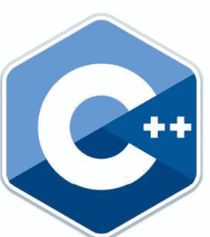
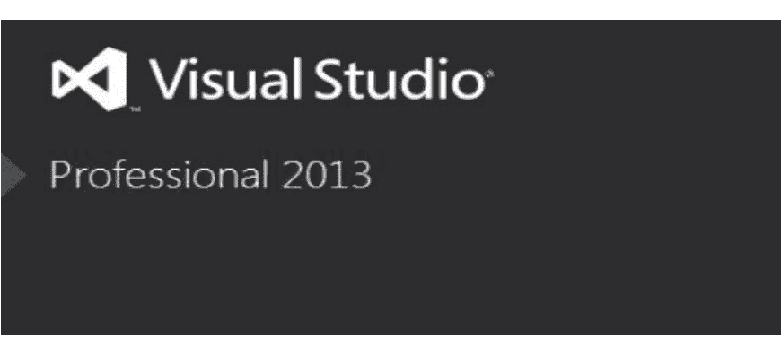
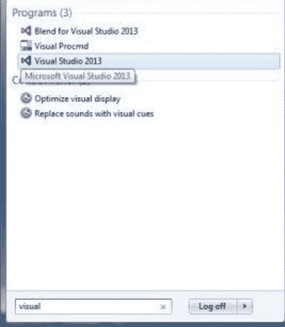
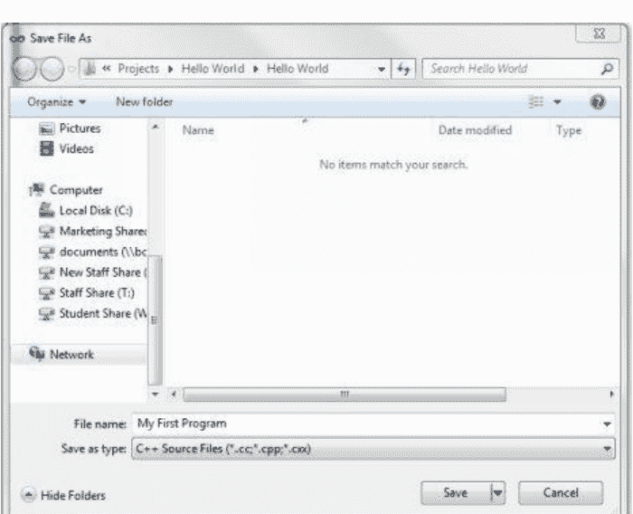
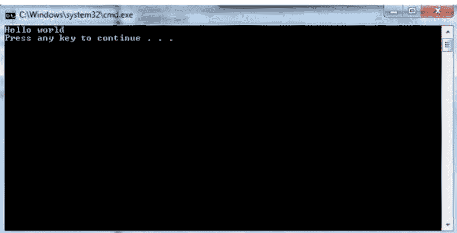
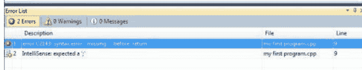
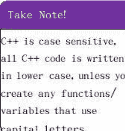
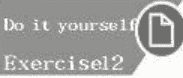
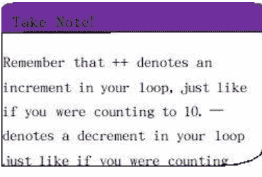

# C++ 入门指南：初学者完全指南





| 关键字 | | | | | |
| :--- | :--- | :--- | :--- | :--- |
| break | case | char | default | do |
| double | else | float | for | goto |
| if | int | long | operator | signed |
| static | switch | unsigned | void | while |

| 数据类型 | | |
| :--- | :--- |
| char | 单字符 |
| int | 整数是一个整数 |
| float | 浮点数，精确到六位小数 |
| double | 浮点数，精确到十位小数 |
| bool | 布尔值，真 (1) 或假 (0) |
| string | 字符组 |

| 库类 | | |
| :--- | :--- |
| <iostream> | 读取和写入控制台 |
| <iomanip> | 操作输入输出 |
| <fstream> | 读写文本文件 |
| <string> | 存储和处理文本流 |
| <sstream> | 将字符串转换为其他数据类型 |
| <vector> | 在向量数组元素中存储和处理数据 |
| <stdexcept> | 报告逻辑错误和运行时错误 |
| <ctime> | 报告日期和时间 |


C++ 由 Bjarne Stroustrup 在 20 世纪 80 年代初在 AT&T 实验室开发，基于 C 语言。这个名字是一个双关语——++”是 C 语言中的一种语法结构（用于变量递增），而 C++ 旨在是对 C 的增量改进。C++ 的大部分是 C 的子集，因此大多数 C 程序都可以使用 C++ 编译器进行编译（即转换为计算机可以直接执行的一系列低级指令）。

C++ 被认为是一种多范式语言，因为它的实现方式可以有所不同。本书将涵盖 C++ 作为一种过程化语言，并符合 ANSI（美国国家标准协会）和 ISO（国际标准组织）的标准。这意味着你可以获取书中的所有源代码并在任何编译器中运行。

为了能够成功运行书中的源代码，你需要以下条件：

- 一台电脑（Windows, OSX, Linux）
- 一个 IDE（集成开发环境）
    - Windows (Visual Studio)
    - OSX (X code)
    - Linux (Code Blocks)

如需此软件的免费版本，请访问 www.bcotcomputing.co.uk

本指南中的所有源代码均使用 Visual Studio 2013 专业版实现，可以在学校网站上找到。该软件已安装在计算机学院的所有机器上。你也可以点击此链接使用你的 dreams spark 账户免费下载

| 你知道吗？ | |
| :--- | :--- |
| 许多编程语言源自 C，如 C#、PHP、Objective-c。如果你学会了 C++，就可以轻松地将知识和技能转移到其他编程语言。 |




本指南旨在展示如何设置、创建和编译你的第一个 C++ 程序“Hello world”。

在开始编写程序之前，你需要加载一个 IDE（集成开发环境）。为此，点击开始图标并输入 visual。你应该看到以下内容：



点击“Visual Studio 2013”，Visual Studio 的加载界面将出现在桌面上：

加载界面之后，将加载 Visual Studio 启动页。在此界面中你可以创建新项目、打开现有项目甚至访问指南和资源。要创建一个新项目，我们需要点击“new project”（新建项目）。

| Professional 2013 | 发现 Professional 2013 的新功能 |
| :--- | :--- |
| Professional 2013 | 发现 Professional 2013 的新功能 |
| Start (开始) | Professional 2013 |
| Open Project (打开项目) | Professional 2013 |
| New Project (新建项目) | Professional 2013 |
| New Project (新建项目) | Professional 2013 |
| Open Project (打开项目) | Professional 2013 |
| Open Project (打开项目) | Professional 2013 |
| New Project (新建项目) | Professional 2013 |
| New Project (新建项目) | Professional 2013 |
| Open Project (打开项目) | Professional 2013 |
| Open Project (打开项目) | Professional 2013 |
| New Project (新建项目) | Professional 2013 |
| New Project (新建项目) | Professional 2013 |
| Open Project (打开项目) | Professional 2013 |
| Open Project (打开项目) | Professional 2013 |
| New Project (新建项目) | Professional 2013 |
| New Project (新建项目) | Professional 2013 |
| Open Project (打开项目) | Professional 2013 |
| Open Project (打开项目) | Professional 2013 |
| New Project (新建项目) | Professional 2013 |
| New Project (新建项目) | Professional 2013 |
| Open Project (打开项目) | Professional 2013 |
| Open Project (打开项目) | Professional 2013 |
| New Project (新建项目) | Professional 2013 |
| New Project (新建项目) | Professional 2013 |
| Open Project (打开项目) | Professional 2013 |
| Open Project (打开项目) | Professional 2013 |
| Start (开始) | Professional 2013 |
| Open Project (打开项目) | Professional 2013 |
| New Project (新建项目) | Professional 2013 |
| New Project (新建项目) | Professional 2013 |
| Open Project (打开项目) | Professional 2013 |
| Open Project (打开项目) | Professional 2013 |
| New Project (新建项目) | Professional 2013 |
| New Project (新建项目) | Professional 2013 |
| Open Project (打开项目) | Professional 2013 |
| Open Project (打开项目) | Professional 2013 |
| New Project (新建项目) | Professional 2013 |
| New Project (新建项目) | Professional 2013 |
| Open Project (打开项目) | Professional 2013 |
| Open Project (打开项目) | Professional 2013 |
| New Project (新建项目) | Professional 2013 |
| New Project (新建项目) | Professional 2013 |
| Open Project (打开项目) | Professional 2013 |
| Open Project (打开项目) | Professional 2013 |
| New Project (新建项目) | Professional 2013 |
| New Project (新建项目) | Professional 2013 |
| Open Project (打开项目) | Professional 2013 |
| Open Project (打开项目) | Professional 2013 |
| New Project (新建项目) | Professional 2013 |
| New Project (新建项目) | Professional 2013 |
| Open Project (打开项目) | Professional 2013 |
| Open Project (打开项目) | Professional 2013 |
| Start (开始) | Professional 2013 |
| Open Project (打开项目) | Professional 2013 |
| New Project (新建项目) | Professional 2013 |
| New Project (新建项目) | Professional 2013 |
| Open Project (打开项目) | Professional 2013 |
| Open Project (打开项目) | Professional 2013 |
| New Project (新建项目) | Professional 2013 |
| New Project (新建项目) | Professional 2013 |
| Open Project (打开项目) | Professional 2013 |
| Open Project (打开项目) | Professional 2013 |
| New Project (新建项目) | Professional 2013 |
| New Project (新建项目) | Professional 2013 |
| Open Project (打开项目) | Professional 2013 |
| Open Project (打开项目) | Professional 2013 |
| New Project (新建项目) | Professional 2013 |
| New Project (新建项目) | Professional 2013 |
| Open Project (打开项目) | Professional 2013 |
| Open Project (打开项目) | Professional 2013 |
| New Project (新建项目) | Professional 2013 |
| New Project (新建项目) | Professional 2013 |
| Open Project (打开项目) | Professional 2013 |
| Open Project (打开项目) | Professional 2013 |
| New Project (新建项目) | Professional 2013 |
| New Project (新建项目) | Professional 2013 |
| Open Project (打开项目) | Professional 2013 |
| Open Project (打开项目) | Professional 2013 |
| Start (开始) | Professional 2013 |

你的指南已经创建，用于展示如何如何，并且在 C++ 中第一个第一个第一个第一个


快了，你的文件已经创建了，但我们需要将其保存到正确的位置，否则放置在文件中的任何代码都将无法工作。

要将文件移动到正确的位置，点击 file（文件），在菜单底部有一个名为“Move source1.cpp into”（将 source1.cpp 移动到）的选项，将鼠标悬停在此选项上，会出现一个名为“1 World”的新菜单。选择此选项将你的 C++ 文件移动到正确的位置。

在保存之前会提示你命名你的 C++ 文件。给它一个与程序相关的名称，但不要给与项目相同的名称，否则编译时可能会遇到错误。

做得好，你现在已经设置好了 C++ 文件，它已准备好编写代码了。你会注意到左侧面板中的文件结构，现在包含了你新命名的 C++ 文件。


现在让我们在 C++ 中编写你的第一个程序。使用下面的 C++ 源代码，将代码复制到你的 Hello World 项目中。

```
//我的第一个 C++ 程序
#include <iostream>
using namespace std;
int main() {

    cout << "Hello world" << endl;
    return 0;
}
```





请注意！
在这一行代码中：
cout << "Hello world" << endl;
endl 中的小字母 "l" 可能会被误认为数字 1。不要让这成为错误的原因。

一旦你输入了这段代码，我们就准备好编译程序了。这可以通过按下 ctrl=F5 并点击弹出的对话框中的确定来完成。

完成后，控制台屏幕将显示你的第一个 hello world 程序。



干得好，你成功完成了你的第一个 C++ 程序。

出现错误或程序没有运行。检查错误框并查看错误信息。
可以通过使用顶部的工具栏，查看（view）来找到错误框。

```cpp
#include <iostream>
using namespace std;
int main() {
    system("cls");
    cout<<"Hello world" << endl;
    return 0;
}
```



所有错误将出现在错误列表中，错误列表会自动出现并给你提供错误信息。在这种情况下，错误在第 9 行，该行在 <<endl 代码之后缺少了分号 ;。


现在你已经成功创建了第一个名为“Hello World”的 C++ 程序，让我们来看看你程序的结构，并逐行拆解代码。让我们看看下面的“Hello World”程序。


// 我的第一个 C++ 程序

```cpp
#include <iostream>
using namespace std;
int main()
{
cout<<"Hello World"<<endl;
return 0;
}
```

// 我的第一个 C++ 程序

这是一行单行注释，它不会影响程序的性能。我们使用注释来对代码进行标注，解释程序的功能。显示注释有两种方式（// 用于单行）。为了编写特定程序或源代码的描述，你可能希望跨越几行代码。为此，我们使用 (/* */)

#include <iostream>

using namespace std;

标准 C++ 库的所有元素都声明在一个称为命名空间（namespace）中，名为 std 的命名空间。因此，为了访问其功能，我们通过此表达式声明我们将使用这些实体。这行代码在使用标准库的 C++ 程序中非常常见。


这一行对应于 main 函数定义的开始。main 函数是所有 C++ 程序开始执行的起点，无论它在源代码中的位置如何。在它之前或之后是否定义了其他同名函数并不重要——此函数定义中包含的指令将是任何 C++ 程序中第一个执行的指令。出于同样的原因，所有 C++ 程序都必须有一个 main 函数是至关重要的。

代码中该单词后面跟着一对括号（()）。这是因为它是一个函数声明：在 C++ 中，函数声明与其他类型表达式的区别在于紧跟在它名称后面的这些括号。可选情况下，这些括号内部可以包含一个参数列表。

紧接这些括号，我们可以找到用大括号 { } 包围的 main 函数体。这些大括号的内容就是函数执行时所的操作。

```cpp
cout<<"Hello World" << endl;
```

这一行是一个 C++ 语句。语句是一个可以产生实际效果的简单或复合表达式。事实上，此语句执行了我们第一个程序中产生可见视觉效果的唯一操作，cout 是 C++ 中标准输出流的名称，整个语句的含义是将字符序列（在本例中为 Hello World 字符序列）插入到标准输出流（cout，通常对应于屏幕）中，被声明且我们需要包含特定的文件，并在代码稍早之前声明我们正在使用这个特定的命名空间。

注意语句以分号字符（;）结束。该字符用于标记语句的结束，事实上，在所有 C++ 程序中，所有表达式语句末尾必须包含分号（最常见的语法错误之一就是忘记在语句后包含某些分号）。<<endl; 用于输出语句之后，将任何其他语句移动到输出窗口的独成行上。如上面输出窗口所示，“按任意键继续”（Press key to continue）独成一行。如果删除了 <<endl;，那么输出语句“hello world”将与“press key to continue”在同一行。


return 语句导致 main 函数结束。它后面可能跟着一个返回代码（在我们的示例中，后面跟着值为零的返回代码）。main 函数的返回代码 0 通常被解释为程序在执行期间按预期工作，没有任何错误。这是结束 C++ 控制台程序最常用的方法。




当你开始编写 C++ 代码时，你会注意到你可能在代码中犯几个错误，例如缺少分号 (;) 或在实际上应该使用小写时使用了大写字母。最好的方法是……（此处原文逻辑不完整，按上下文理解为：最好的方法是检查错误）。为了熟悉 C++ 的最佳方法是练习解决错误。下面是一个 C++ 程序，显示了如何修复错误。

```cpp
#include <iostream>
using namespace std;
int main()
{
    cout << "Hello" << endl;
    return 0;
}
```
*(注：由于原文示例处代码块不完整，且根据要求代码块不翻译，此处根据逻辑补全)*

在 C++ 中编写代码时，你会注意到你可能会在代码中犯几个错误，例如缺少分号 (;) 或在实际上应该使用小写时使用了大写字母。解决错误的最佳方法是检查错误框并查看错误信息。
错误框可以通过使用顶部的工具栏找到，查看>view>

```cpp
#include <iostream>
using namespace std;
int main() {
    system("cls");
    cout<<"Hello world" << endl;
    return 0;
}
```


所有错误将出现在错误列表中，错误列表会自动出现并给你提供错误信息。在这种情况下，错误在第 9 行，该行在 <<endl 代码之后缺少了分号 。


现在你已经成功创建了名为“Hello World”的第一个 C++ 程序，让我们来看看你程序的结构，并逐行拆解代码。让我们看看下面的“Hello World”程序。


// 我的第一个 C++ 程序

```cpp
#include <iostream>
using namespace std;
int main()
{
cout<<"Hello World"<<endl;
return 0;
}
```

// 我的第一个 C++ 程序

这是一行单行注释，它不会影响程序的性能。我们使用注释来对代码进行标注，解释程序的功能。显示注释有两种方式（// 用于单行）。为了编写特定程序或源代码的描述，你可能希望跨越几行代码。为此，我们使用 (/* */)

#include <iostream>

using namespace std;

标准 C++ 库的所有元素都声明在一个称为命名空间（namespace）中，名为 std 的命名空间。因此，为了访问其功能，我们通过此表达式声明我们将使用这些实体。这行代码在使用标准库的 C++ 程序中非常常见。


这一行对应于 main 函数定义的开始。main 函数是所有 C++ 程序开始执行的起点，无论它在源代码中的位置如何。在它之前或之后是否定义了其他同名函数并不重要——此函数定义中包含的指令将是任何 C++ 程序中第一个执行的指令。出于同样的原因，所有 C++ 程序都必须有一个 main 函数是至关重要的。

代码中该单词后面跟着一对括号（()）。这是因为它是一个函数声明：在 C++ 中，函数声明与其他类型表达式的区别在于紧跟在它名称后面的这些括号。可选情况下，这些括号内部可以包含一个参数列表。

紧接这些括号，我们可以找到用大括号 { } 包围的 main 函数体。这些大括号的内容就是函数执行时所的操作。

```cpp
cout<<"Hello World" << endl;
```

这一行是一个 C++ 语句。语句是一个可以产生实际效果的简单或复合表达式。事实上，此语句执行了我们第一个程序中产生可见视觉效果的唯一操作，cout 是 C++ 中标准输出流的名称，整个语句的含义是将字符序列（在本例中为 Hello World 字符序列）插入到标准输出流（cout，通常对应于屏幕）中，被声明且我们需要包含特定的文件，并在代码稍早之前声明我们正在使用这个特定的命名空间。

注意语句以分号字符（;）结束。该字符用于标记语句的结束，事实上，在所有 C++ 程序中，所有表达式语句末尾必须包含分号（最常见的语法错误之一就是忘记在语句后包含某些分号）。<<endl; 用于输出语句之后，将任何其他语句移动到输出窗口的独成行上。如上面输出窗口所示，“按任意键继续”（Press key to continue）独成一行。如果删除了 <<endl;，那么输出语句“hello world”将与“press key to continue”在同一行。


return 语句导致 main 函数结束。它后面可能跟着一个返回代码（在我们的示例中，后面跟着值为零的返回代码）。main 函数的返回代码 0 通常被解释为程序在执行期间按预期工作，没有任何错误。这是结束 C++ 控制台程序最常用的方法。


当你开始编写 C++ 代码时，你会注意到你可能在代码中犯几个错误，例如缺少分号 (;) 或在实际上应该使用小写时使用了大写字母。解决错误的最佳方法是……（此处原文逻辑不完整，根据上下文理解为：最好的方法是检查错误）。为了熟悉 C++ 的最佳方法是练习解决错误。下面是一个 C++ 程序，显示了如何修复错误。

检查错误框并查看错误信息。错误框可以通过使用顶部的工具栏找到，查看>view>

```cpp
#include <iostream>
using namespace std;
int main() {
    system("cls");
    cout<<"Hello world" << endl;
    return 0;
}
```


所有错误将出现在错误列表中，错误列表会自动出现并给你提供错误信息。在这种情况下，错误在第 9 行，该行在 <<endl 代码之后缺少了分号 。


现在你已经成功创建了第一个名为“Hello World”的 C++ 程序，让我们来看看你程序的结构，并逐行拆解代码。让我们看看下面的“Hello World”程序。


// 我的第一个 C++ 程序

```cpp
#include <iostream>
using namespace std;
int main()
{
cout<<"Hello World"<<endl;
return 0;
}
```

// 我的第一个 C++ 程序

这是一行单行注释，它不会影响程序的性能。我们使用注释来对代码进行标注，解释程序的功能。显示注释有两种方式（// 用于单行）。为了编写特定程序或源代码的描述，你可能希望跨越几行代码。为此，我们使用 (/* */)

#include <iostream>

using namespace std;

标准 C++ 库的所有元素都声明在一个称为命名空间（namespace）中，名为 std 的命名空间。因此，为了访问其功能，我们通过此表达式声明我们将使用这些实体。这行代码在使用标准库的 C++ 程序中非常常见。


这一行对应于 main 函数定义的开始。main 函数是所有 C++ 程序开始执行的起点，无论它在源代码中的位置如何。在它之前或之后是否定义了其他同名函数并不重要——此函数定义中包含的指令将是任何 C++ 程序中第一个执行的指令。出于同样的原因，所有 C++ 程序都必须有一个 main 函数是至关重要的。

代码中该单词后面跟着一对括号（()）。这是因为它是一个函数声明：在 C++ 中，函数声明与其他类型表达式的区别在于紧跟在它名称后面的这些括号。可选情况下，这些括号内部可以包含一个参数列表。

紧接这些括号，我们可以找到用大括号 { } 包围的 main 函数体。这些大括号的内容就是函数执行时所的操作。

```cpp
cout<<"Hello World" << endl;
```

这一行是一个 C++ 语句。语句是一个可以产生实际效果的简单或复合表达式。事实上，此语句执行了我们第一个程序中产生可见视觉效果的唯一操作，cout 是 C++ 中标准输出流的名称，整个语句的含义是将字符序列（在本例中为 Hello World 字符序列）插入到标准输出流（cout，通常对应于屏幕）中，被声明且我们需要包含特定的文件，并在代码稍早之前声明我们正在使用这个特定的命名空间。

注意语句以分号字符（;）结束。该字符用于标记语句的结束，事实上，在所有 C++ 程序中，所有表达式语句末尾必须包含分号（最常见的语法错误之一就是忘记在语句后包含某些分号）。<<endl; 用于输出语句之后，将任何其他语句移动到输出窗口的独成行上。如上面输出窗口所示，“按任意键继续”（Press key to continue）独成一行。如果删除了 <<endl;，那么输出语句“hello world”将与“press key to continue”在同一行。


return 语句导致 main 函数结束。它后面可能跟着一个返回代码（在我们的示例中，后面跟着值为零的返回代码）。main 函数的返回代码 0 通常被解释为程序在执行期间按预期工作，没有任何错误。这是结束 C++ 控制台程序最常用的方法。


当你开始编写 C++ 代码时，你会注意到你可能在代码中犯几个错误，例如缺少分号 (;) 或在实际上应该使用小写时使用了大写字母。解决错误的最佳方法是……（此处原文逻辑不完整，根据上下文理解为：最好的方法是检查错误）。为了熟悉 C++ 的最佳方法是练习解决错误。下面是一个 C++ 程序，显示了如何修复错误。

检查错误框并查看错误信息。错误框可以通过使用顶部的工具栏找到，查看>view>view

```cpp
#include <iostream>
using namespace std;
int main() {
    system("cls");
    cout<<"Hello world" << endl;
    return 0;
}
```


所有错误将出现在错误列表中，错误列表会自动出现并给你提供错误信息。在这种情况下，错误在第 9 行，该行在 <<endl 代码之后缺少了分号 。


现在你已经成功创建了第一个名为“Hello World”的 C++ 程序，让我们来看看你程序的结构，并逐行拆解代码。让我们看看下面的“Hello World”程序。


// 我的第一个 C++ 程序

```cpp
#include <iostream>
using namespace std;
int main()
{
cout<<"Hello World"<<endl;
return 0;
}
```

// 我的第一个 C++ 程序

这是一行单行注释，它不会影响程序的性能。我们使用注释来对代码进行标注，解释程序的功能。显示注释有两种方式（// 用于单行）。为了编写特定程序或源代码的描述，你可能希望跨越几行代码。为此，我们使用 (/* */)

#include <iostream>

using namespace std;

标准 C++ 库的所有元素都声明在一个称为命名空间（namespace）中，名为 std 的命名空间。因此，为了访问其功能，我们通过此表达式声明我们将使用这些实体。这行代码在使用标准库的 C++ 程序中非常常见。


这一行对应于 main 函数定义的开始。main 函数是所有 C++ 程序开始执行的起点，无论它在源代码中的位置如何。在它之前或之后是否定义了其他同名函数并不重要——此函数定义中包含的指令将是任何 C++ 程序中第一个执行的指令。出于同样的原因，所有 C++ 程序都必须有一个 main 函数是至关重要的。

代码中该单词后面跟着一对括号（()）。这是因为它是一个函数声明：在 C++ 中，函数声明与其他类型表达式的区别在于紧跟在它名称后面的这些括号。可选情况下，这些括号内部可以包含一个参数列表。

紧接这些括号，我们可以找到用大括号 { } 包围的 main 函数体。这些大括号的内容就是函数执行时所的操作。

```cpp
cout<<"Hello World" << endl;
```

这一行是一个 C++ 语句。语句是一个可以产生实际效果的简单或复合表达式。事实上，此语句执行了我们第一个程序中产生可见视觉效果的唯一操作，cout 是 C++ 中标准输出流的名称，整个语句的含义是将字符序列（在本例中为 Hello World 字符序列）插入到标准输出流（cout，通常对应于屏幕）中，被声明且我们需要包含特定的文件，并在代码稍早之前声明我们正在使用这个特定的命名空间。

注意语句以分号字符（;）结束。该字符用于标记语句的结束，事实上，在所有 C++ 程序中，所有表达式语句末尾必须包含分号（最常见的语法错误之一就是忘记在语句后包含某些分号）。<<endl; 用于输出语句之后，将任何其他语句移动到输出窗口的独成行上。如上面输出窗口所示，“按任意键继续”（Press key to continue）独成一行。如果删除了 <<endl;，那么输出语句“hello world”将与“press key to continue”在同一行。


return 语句导致 main 函数结束。它后面可能跟着一个返回代码（在我们的示例中，后面跟着值为零的返回代码）。main 函数的返回代码 0 通常被解释为程序在执行期间按预期工作，没有任何错误。这是结束 C++ 控制台程序最常用的方法。


当你开始编写 C++ 代码时，你会注意到你可能在代码中犯几个错误，例如缺少分号 (;) 或在实际上应该使用小写时使用了大写字母。解决错误的最佳方法是……（此处原文逻辑不完整，根据上下文理解为：最好的方法是检查错误）。为了熟悉 C++ 的最佳方法是练习解决错误。下面是一个 C++ 程序，显示了如何修复错误。


现在你已经知道了如何分行打印代码，现在请创建一个 C++ 程序，讲述三只小猪和大大灰狼的故事。

你的代码需要编译，并且你将对代码中的关键部分进行注释。


变量是临时存储空间，它们在需要时一直存在，需要后会被销弃。想象一个计算器，你输入的数字会存储在计算器中，直到你使用清除键或关闭计算器，这些值就会消失。变量存储在计算机系统的内存中，并被赋予一个唯一的地址，以便编译器随时访问它们。

变量通过预期的数据类型来声明，例如数字、字母或句子。声明数据类型对于确保编译器生成正确的机器码供 CPU（中央处理单元）使用至关重要。


## 整数 (int)

int 是 integer（整数）的缩写，指一个整数数字，例如 0, 1, 2, 3, 4, 5, 6, 7, 8, 9 等。它们可以是有符号（负数）也可以是无符号（正数）。整数的大小取决于所使用的整数类型。


char 是 character（字符）的缩写，是一种可以容单个字母、符号或数字的数据类型，例如 ‘A’、『b’、『$’、『1’。一个简单的 char 将至少使用 1 字节（8 位）的存储空间。


float 是 floating point number（浮点数）的缩写，是一种存储小数数字的方法，例如 3.2、6.8、7.1 等。浮点数的精度取决于所使用的浮点类型。浮点数有两类：Floats 和 doubles。Doubles 具有更高的精度，通常是 C++ 程序中首选的数据类型。


字符串非常强大，不仅用于存储单词，还用于存储单词和数字的组合。当你想要获取信息如人的全名（名字和姓氏）、街道地址等时，字符串非常有用。


 C++ 中的布尔称为 bool，用两种状态表示：真（true）或假（false）。你可能会看到这种数据类型与二进制数字一起使用，这再次反映了布尔值的两种状态。0 = false，1 = true。


为了在 C++ 中声明一个变量，我们需要声明我们期望变量持有的数据类型，这可以通过输入数据类型名称来实现，如下表所示：

| 数据类型：如何声明 |
|---|---|
| 整数 | int |
| 浮点数 | double |
| 字符 | char |
| 字符串 | string |
| 浮点数 | float |
| 布尔值 | bool |

当你在 C++ 中输入数据类型时，你会发现文字颜色会 way，这表示它将会被编译器用于变量赋值。

一旦你为变量选择了数据类型，你就需要为它分配一个名称。你可以给变量起任何你名字，只要遵循以下规则：


在创建变量时，你给它们起一个名字，如 num1、hostname、fname 等。变量命名非常灵活，但创建它们时有一些黄金准则：

- 变量名由字母、数字和下划线的任意组合组成。某些编译器允许变量名长度可达 247 个字符。尽管如此，遵循 31 个字符的规则会更安全。请避免创建过长的变量名，因为这会增加你的输入工作量。
- 所有变量名必须以字母或下划线 (_) 开头。对于初学者来说，让所有变量名以字母开头可能更容易。第一个字符不能是数字或任何特殊符号。
- 在第一个字母之后，变量名也可以包含字母和数字。但不允许空格或特殊字符。
- 大写字母和小写字母是有区别的。使用大写字母主要用于标识常量变量。

## 变量赋值的示例

```cpp
int num1; // num1 是我选择的变量名，期望整数数据类型。
float num2; // num2 是选择的变量名，期望浮点数据类型。
```

```cpp
char letter; // letter 是选择的变量名，期望 char 数据类型
```

```cpp
string name; // name 是选择的变量名，期望一个或多个字符串。
```


在程序的这部分，我们将创建一个 C++ 程序，用于在程序中存储一个简单的整数（Integer）。我们将声明一个使用整数数据类型的变量，并用预设值对其进行初始化。


创建一个名为“my first variable”的新 C++ 程序，并输入以下代码：

```cpp
#include <iostream>
using namespace std;
int main()
{
    int num; // 声明一个存储整数的变量
    num = 10; // 值为 10

    cout << "My Number is: " << num; // 输出数字
}
```
*(注：OCR 文本在第 32-33 页包含大量重复和碎片，已根据提供的片段提供了清理后的预期内容。)*


当你需要存储包含多个字符的数据时（例如名称、电子邮件地址或邮政编码）时，就会使用字符串（Strings）。字符串与 C++ 中的所有其他数据类型都不同，因为你必须调用一个新的编程库。


在这个程序中，你将创建你的第一个 C++ 程序，在字符串变量中显示“Hello world”。创建一个名为 "intro to strings" 的新 C++ 程序，输入下面的代码并编译程序。

```cpp
#include <iostream>
#include <string>//with the new string header has to be used or string will not work.
using namespace std;
int main()
{
    string hello="Hello World";

    cout << "Please enter your first name: " << endl;

    cout << hello << " Welcome to C++"<<endl;

    return 0;
}
```

如果你想将单词和字母组合存储在变量中，而不是使用字符串，可以使用字符数组（Char Array）。数组将在本指南的最后部分介绍，它是中级 C++ 的开始。

下面包含了另一个程序，用于演示如何将两个独立的字符串拼接成一个字符串。

```cpp
#include <iostream>
#include <string>

using namespace std;
int main()
{
    string firstname = "Frodo";
    string secondname = "Bagsins";
    string fullname;

    fullname = firstname + secondname; //example of concatenation
    cout << "First name: " <<firstname << endl;
    cout << "Second name: " <<secondname << endl;
    cout << "Your full name is: " << fullname << endl;

    return 0;
}
```

> 注意！
字符串比你所看到的要复杂得多。使用字符串可以被视为高级 C++，在本编程指南中并不使用，但更多额外信息可以在书末尾找到。


有时你可能需要让用户向你的程序输入某些形式的数据，你可以将其用于条件语句和循环，或者当在屏幕上写出某些指令时。

为了收集输入，我们需要使用 `cin>>` 命令，后跟将保存数据的变量名。例如 `cin>>name;`。


在这个程序中，你正在创建一个 C++ 程序，允许用户输入一个数字并在屏幕上显示该数字。创建一个名为 "integer input" 的新 C++ 项目，输入下面的代码，编译并运行。

```cpp
#include <iostream>
using namespace std;

int main()
{
    int num;

    cout << "Please enter a number";
    cin>>num;
    cout<<"You entered " <<num<<endl;

    return 0;
}
```


在下面的程序中，你将创建一个程序，允许用户输入一个名称（不带空格）并将其显示给用户。输入下面的代码，保存，编译并运行。

```cpp
#include <iostream>
#include <string>//the new string header has to be used or string will not work.
using namespace std;
int main()
{
    string name;

    cout << "Please enter your first name: " << endl;
    cin >> name;
    cout << "Hello " << name << " Welcome to C++" << endl;

    return 0;
}
```

现在你已经知道如何声明变量、允许用户数据输入并向用户显示结果，是时候创建你自己的捕获用户信息的 C++ 程序了。你的程序需要捕获以下数据：

- 名（First name）
- 姓（Surname）
- 年龄（Age）
- 门号（House number）
- 一行地址
- 城市（City）
- 州（State）
- 邮编（Postcode）

你可以使用之前的练习来帮助设计这个程序。在这个程序中，你需要执行以下操作：

- 使用注释解释你的代码
- 正确缩进你的代码
- 使用正确的变量类型和合适的变量名

作为此练习的扩展，将用于存储姓名的两个字符串变量拼接为一个字符串，以便在一行中打印。


**变量算术：** 什么是算术？算术是数学，计算一个范围数字的和。例如，你可以将两个变量相加并将答案存储在一个新变量中。


在活动活动中，你将创建一个 C++ 程序，要求用户输入两个数字，程序会将数字相加并产生总数，然后显示在屏幕上。创建一个名为“Variable Maths”的项目，保存，编译并运行下面的代码。

```cpp
#include <iostream>
using namespace std;
int main()
{
    int num1, num2, sum;

//addition program

    cout<<"Please enter your first number to add: ";
    cin>>num1;

    cout<<"Please enter your second number to add: ";
    cin>>num2;

    sum = num1+num2; //add variable num1 and num2, and store new number in variable sum

    cout<<num1<<+"%(num2<<"="<<sum;

    return 0;
}
```


下面的程序是一个乘法程序，将两个数字相乘并显示结果。创建一个名为“Multiplication”的新项目并输入下面的代码。

```cpp
#include <iostream>
using namespace std;
int main()
{
    int num1, num2, sum;
    cout << "Please enter your first number to add: ";
    cin>>num1;
    cout << "Please enter your second number to add: ";
    cin>>num2;

    sum = num1*num2; //times variable num1 and num2, and store new number in variable sum

    cout<<num1<<"x"%(num2<<"="<<sum;

    return 0;
}
```


在这个程序中，我们将声明一个全局变量和两个局部变量。其中一个是标准的局部变量，另一个被声明为常量。常量是在程序运行之前必须具有初始化值的变量，且它的值在整个程序过程中保持不变。常量的值在运行时不能更改。

```cpp
#include <iostream>
using namespace std;

int num1;// I am a global variable, I can be used by any function within C++

int main()
{
    const int num2=5; // I am a constant local variable. I can be used within this function only and my value will
    never change.
    int num3;// I am a local variable and can only be used within the "main" function
    int number_of_pods;
    int peas_per_pod;
    int total_peas;

    cout << "Enter the number of pods:\n";
    cin >> number_of_pods;
    cout << "Enter the number of peas in each pod:\n";
    cin >> peas_per_pod;

    total_peas = number_of_pods * peas_per_pod;

    cout << "If you have ";
    cout << total_peas << " peas in all the pods.\n";

    return 0;
}
```

现在你已经成功编译了上面的程序，你将尝试通过减少代码行来缩短程序。


我们知道如何使用变量，但在此为止你一直在使用局部变量。变量是在函数内部声明的，并且仅对该函数可用。另一种类型是全局变量（Global Variable），它声明在函数外部，对 C++ 程序中的所有函数都可用。

全局变量是有用的，但它们存储的值很容易被不同的函数操纵。许多开发者避免使用全局变量，而是从函数之间传递数据以避免数据丢失。


在这个程序中，我们将声明一个全局变量和两个局部变量。其中一个是标准的局部变量，另一个被声明为常量。常量是在程序运行之前必须具有初始化值的变量，且它的值在整个程序过程中保持不变。常量的值在运行时不能更改。

```cpp
#include <iostream>
using namespace std;

int num1;// I am a global variable, I can be used by any function within C++

int main()
{
    const int num2=5; // I am a constant local variable. I can be used within this function only and my value will
    never change.
    int num3;// I am a local variable and can only be used within the "main" function

    cout << "Please enter a number for global variable num1: ";
    cin>>num1;
    cout<<"We are going to add "<<num1 << " + " <<our constant variable, which has the value of "5"<<endl;
    cout<<num1 << " " + <<num2 << " = " <<(num3=num1+num2) <<endl;

    return 0;
}
```


**条件语句：** C++ 中的条件语句是用于检查是否满足了某个特定条件的。当你想要根据用户的选择显示不同的结果时，条件语句非常有用。在编程中，条件也称为 if/else 语句。在练习中，你将涵盖 if/else 语句。

它们也是一种根据用户选择来改变执行方向极极方法。在编程中，条件也称为 if/else 语句。在练习中，你将涵盖 if/else 语句。条件语句可以包含多个条件，这些将按顺序进行测试。

条件语句的一个示例是：

如果 Joshua 吃完了所有的晚餐，那么他就可以出去玩。如果没有，他就必须去收拾他的房间。Joshua 吃完晚餐的结果将决定结果的走向。

| 如果 Joshua = 吃完所有晚餐 | 这是条件 1 |
| :--- | :--- |
| 那么出去玩 | |
| 或者如果 Joshua = 没吃晚餐 | 这是条件 2 |
| 那么收拾你的房间 | |

在 C++ 的这部分中，你将接触一些你需要熟悉的新符号。下表解释了这些符号。

| == 等于 | && 与 |
| :--- | :--- |
| != 不等于 | || 或 |
| > 大于 | >= 大于等于 |
| < 小于 | <= 小于等于 |

> 注意！
> 小心！运算符 =（单个等号）与运算符 ==（两个等号）不同，前者是赋值运算符（将值赋给变量），另一个（==）是相等性运算符，用于比较它两边的两个表达式是否相等。


在本次活动中，我们正在创建一个简单的 if 语句，提示用户输入一个 10 以下的数字。该程序有两个结果/条件，取决于用户输入的数字将取决于哪一个条件变为真。

创建一个新的 C++ 项目并将其命名为“condition statements”（条件语句）。输入以下代码，保存并编译程序。

```cpp
#include <iostream>
using namespace std;
int main ()
{
    int num;
    cout<<"Please enter a number under 10 : ";
    cin>>num;
    if (num<=10) //结果 1
        cout<<"Your number was 10 or less";
    else //结果 2
        cout<<"Your number was greater than 10";
    return 0;
}
```

干得好，你刚刚创建了第一个使用条件语句的 C++ 程序。
在下一个练习中，你将学习如何编写具有两个以上结果的 C++ 代码，这在用户输入数字 10 时可以开发出一个解决方案。

创建一个 C++ 程序，使用条件语句为一位老师服务，该老师想知道对于没有完成作业的学生应该采取什么行动。该程序需要命名为“Teacher Program”（老师程序）并包含两个条件：

- 第一个条件是：学生是否做完作业
- 第二个条件是：学生是否没做作业

**注意：此程序需要使用 Char 数据类型来检查条件，而不是整数**

在本次活动中，你将创建一个 C++ 程序，使用 if 和 else 语句来测试多个条件。创建一个新的 C++ 项目并将其命名为“else if statement”（else if 语句），输入下方的代码，保存、编译并运行。

```cpp
#include <iostream>
using namespace std;
int main()
{
    int num;

    cout << "Please enter a number between 1 and 5 : ";
    cin >> num;

    if (num == 1)
    {
        cout << "Your entered the number 1"<<endl;
    }
    else if (num == 2)
    {
        cout << "Your entered the number 2"<<endl;
    }
    else if (num == 3)
    {
        cout << "Your entered the number 3"<<endl;
    }
    else if (num == 4)
    {
        cout << "Your entered the number 4"<< endl;
    }
    else if (num == 5)
    {
        cout << "Your entered the number 5"<< endl;
    }
    return 0;
}
```

以上面的代码为指导，创建一个程序，让用户输入特定的字母 'Q', 'W', 'E', 'R', 'T', 'Y'。在 C++ 中使用影响程序状态的字母需要加单引号。


逻辑运算符 && 和 || 用于评估两个表达式以获得单一结果。运算符 && 对应逻辑“与”（AND）。当两个表达式都真时，该操作为真。运算符 || 对应逻辑“或”（OR），当至少有一个表达式为真时，结果为真。


在本次活动中，我们将使用 || 运算符，这样我们可以检查任一条件。创建一个名为“OR operator”（或运算符）的 C++ 项目并输入以下代码，保存并编译。

```cpp
#include <iostream>
using namespace std;
int main () {

    char answer;

    cout<<"Please enter the letter A : ";
    cin>>answer;

    if ((answer == 'A') || answer == 'a')//我们检查 A 或 a
    {
        cout<<"well done you entered the letter A";
    }
    else
    {
        cout<<"You did not enter the letter A"<<endl;
    }
    return 0;
}
```

创建一个检查数字条件的程序，要求用户输入5 或 10。确保你的程序可以编译和运行，并且所有代码都已注释。

## 活动 16 - AND 运算符

在本次活动中，我们将使用 && 运算符，以便你可以看到如何测试两个条件都为真。

创建一个名为“And Operators”（与运算符）的 C++ 项目并输入以下代码：

```cpp
#include <iostream>
using namespace std;
int main()
{
    int num1,num2;

    cout<<"Please enter the number 5: ";
    cin>>num1;

    cout<<"Please enter the number 3: ";
    cin>>num2;

    if ((num1==5) && (num2==3));//如果输入 5 和 3，则此语句为真
    {
        cout<<"Well done you entered the number 5 and 3 ";
    }
    else
    {
        cout<<"Oops you didnt do as your told"<<endl;
    }
    return 0;
}
```


在活动 15 和 16 中，你可能注意到每个条件都被包裹在一对括号中，如下例所示：

If ((condition 1) && (condition 2))

每个条件都必须包含在自己的括号中，然后你正在检查的所有条件必须包裹在一个单一括号内。请看下面的示例，如何在同一条语句中检查 3 个条件：

```
If ((condition 1) && (condition 2) && (condition 3))
(num1== 5) && (num2==3))
```

# 活动 17：使用非运算符

在本次活动中，我们将使用 `!`（非）运算符，以便你看到我们如何测试一个不为真的条件。

```cpp
#include <iostream>
using namespace std;
int main()
{
    int num1;
    cout<<"Please enter any number, other than 5: ";
    cin>>num1;
    if (num1 != 5)// 如果数字不是 5
{
        cout<<"Well done your number was not 5"<<endl;
    }
    else // 如果数字是 5
{
        cout<<"Your number was 5"<<endl;
    }
    return 0;
}
```


你创建了一系列使用各种条件语句的程序。现在是时候将所学的知识付诸实践了！设计并构建以下程序：

你需要创建一个评分程序，讲师可以输入成绩百分比，程序将说明学生获得了什么种等级。输出可能如下：

- Excellent you got 90%, you got a Distinction（你获得了优等）
- Well done you got 75%, you got a Merit（你获得了良好）
- You got 60%, you got a pass（合格了。再加油！）

你需要编译并运行你的程序，并对你的所有代码进行注释。

# 使用条件语句创建计算器

## 活动 18 - 创建计算器

> **小贴士！** 注意活动 18 中的 `cout` 语句和 `if/else` 语句被写在括号内，这是因为在同一行代码中， 'a' 和 'b' 的值被赋值给了 'c'。这节省了代码行，并且比下面的写法更容易 CPU 处理：
```c
c= a+b;
```

在段 C++ 代码中，你编写了一个简单的计算器来执行任何计算，将以下代码复制到名为“Calculator”的新项目中，保存并编译。

```cpp
#include <iostream>
using namespace std;
int main()
{
    float a, b, c;
    char m;
    cout<<"Do you want to add(+), subtract(-), multiply(x), or divide(/)?:";
    cin>>m;
    cout<<"Enter a number: ";
    cin>>a;
    cout<<"Enter a second number: ";
    cin>>b;
    cout<<"The answer is: ";
    if (m == '+')
    {
        cout<<(c = a + b) << endl;
    }
    else if (m == '-')
    {
        cout<<(c = a - b) << endl;
    }
    else if (m == 'x')
    {
        cout<<(c = a * b) << endl;
    }
    else if (m == '/')
    {
        cout<<(c = a / b) << endl;
    }
    else
    {
        cout<<"Invalid Symbol" << endl;
    }
    return 0;
}
```

# 嵌套 If/Else 语句

“嵌套”是指我们将一个对象插入另一个对象的术语。例如，你可能会创建一个条件语句并在其中插入循环或另一个条件语句。这非常常见，在未来的练习中将会这样做。

## 活动 19 - 嵌套条件语句

在本次活动中，我们将一个条件语句嵌套在另一个内部。创建一个新的 C++ 项目并命名为“nesting conditional statements”。复制以下代码，保存并编译。

```cpp
#include <iostream>
using namespace std;
int main () {
    int num1,num2;
    cout<<"Please enter a number between 0 - 100"<<endl;
    cin>>num1;
    if ((num1 >= 0) && (num1<=50)) {
        //（必须使用括号，因为该语句中有多行代码）
        cout<<"Your number was between 0 - 50"<<endl;
        cout<<"Please enter a new number under 50"<<endl;
        cin>>num2;
        if ((num2 >= 0) && (num2<=50)) {
            cout<<"Well done your number was below 50"<<endl;
        } else
            cout<<"Your number was over 50, you didn't listen"<<endl;
        }
    }
    else if ((num1>=51) && (num1<=100)) {
        cout<<"Your number was between 51 - 100";
        cout<<"Please enter a new number between 50 - 100"<<endl;
        cin>>num2;
        if ((num2 >= 50) && (num2<=100)) {
            cout<<"Well done your number was between 51 - 100"<<endl;
        } else
            cout<<"Your number was over 50, you didn't listen"<<endl;
    }
}
```
（注：活动 19 的 OCR 文本在逻辑流上存在严重的语法错误，已根据上下文将其修正为有效的 C++ 结构)。

# Switch 语句

`switch` 语句用于将变量与常量值列表进行比较。它通常比长长的 `if-else-if` 语句链更简洁、更易读。

## Switch 简介

`switch` 语句也称为 `case` 语句。它是检查多个可能值的理想选择。

## 活动 20：创建 switch 语句

在本次活动中，我们将创建一个简单的评分程序。创建一个名为“Grade”的新项目并输入以下代码，保存并编译。

```cpp
#include <iostream>
using namespace std;
int main()
{
    char grade;
    cout<<"Please enter your grade ";
    cin>>grade;
    switch(grade)
    {
        case 'A':
            cout<<"Excellent!" << endl;
            break;
        case 'B':
            cout<<"Well done" << endl;
            break;
        case 'C':
            cout<<"You passed" << endl;
            break;
        case 'D':
            cout<<"Better try again" << endl;
            break;
        default:
            cout<<"Invalid grade" << endl;
    }
    cout << "Your grade is " << grade << endl;
    return 0;
}
```

## 活动 21：在 switch 语句中检查多个字符

使用上一个程序，修改你的代码如下。这允许你处理产生相同输出的多个情况。

```cpp
#include <iostream>
using namespace std;
int main ()
{
    char grade;
    cout<<"Please enter your grade ";
    cin>>grade;
    switch(grade)
    {
        case 'A': 
        case 'a': 
            cout<<"Excellent!" << endl;
            break;
        case 'B': 
        case 'b': 
            cout<<"Well done" << endl;
            break;
        case 'C': 
        case 'c': 
            cout<<"You passed" << endl;
            break;
        case 'D': 
        case 'd': 
            cout<<"Better try again" << endl;
            break;
        default:
            cout<<"Invalid grade" << endl;
    }
    cout << "Your grade is " << grade << endl;
    return 0;
}
```

## 活动 22：使用 switch 语句创建菜单

在本次活动中，你将使用整数为咖啡馆创建一个简单的菜单。创建一个名为“Café Menu”的新程序并输入以下代码，保存并编译。

```cpp
#include <iostream>
using namespace std;
int main () {
    int choice;
    cout<<"Option 1: Eat Breakfast"<<endl;
    cout<<"Option 2: Wash up the dishes"<<endl;
    cout<<"Option 3: Make a drink"<<endl;
    cout<<"What would you like to eat? Please enter a number to make your choice ";
    cin>>choice;
    switch (choice) {
        case 1:
            cout<<"Bacon Bap"<<endl;
            break;
        case 2:
            cout<<"Washing dishes..."<<endl;
            break;
        case 3:
            cout<<"Coffee and Tea"<<endl;
            break;
        default:
            cout<<"Invalid selection"<<endl;
    }
    return 0;
}
```


```cpp
case 2:
    cout<<"Sausage roll"<<endl;
    break;
case 3:
    cout<<"Bowl of porridge"<<endl;
    break;
default:
    cout<<"invalid choice"<<endl;
    break;
}
    return 0;
}
```

现在你已经对字符和整数都使用了 `case` 语句，但这两个程序中都缺少了一些可以提高程序可读性的东西，你知道是什么吗？为了提高可读性并防止出现错误的概率，我们应该为每个 case 使用大括号 `{}`。因此，每个 case 应该看起来像这样：

```cpp
case 1:
{
    //code here
    break;
}
```

回到你两个使用 `switch` 语句的程序，并将括号加上去，确保你编译并测试每个程序以确保它们运行正常。

# 嵌套 switch/case 语句

嵌套 switch 与嵌套 if/else 语句完全相同，它在一个 switch 内部嵌套另一个 switch。

## 活动 23 – 嵌套 switch 语句

在这个程序中，你将创建一个带有嵌套 switch 的电影系统的 C++ 程序。创建一个名为 `nesting switch` 的新程序，复制代码，保存并编译。

```cpp
#include <iostream>
using namespace std;
int main () {
    int choice, film;
    cout<<"1. View Prices"<<endl;
    cout<<"2. View Times"<<endl;
    cout<<"3. View Films"<<endl;
    cin>>choice;
    switch(choice) {
        case 1:
            cout<<"You have chossen to view prices";<<endl;
            cout<<"Student: £5.59"<<endl;
            cout<<"Adult: £7.00"<<endl;
            cout<<"Concession: £5.40"<<endl;
            break;
        case 2:
            cout<<"what film would you like to watch?" <<endl;
            cout<<"1. The Hobbit: The Battle of Five Armies"<<endl;
            cout<<"2. The Imitation Game"<<endl;
            cout<<"3. Frozen"<<endl;
            cin>>film;
            switch(film) {
                case 1:
cout<<"The Hobbit: The Battle of Five Armies"<<endl;
cout<<"1. Monday"<<endl;
cout<<"2. Tuesday"<<endl;
cout<<"3. Wednesday"<<endl;
cout<<"4. Thursday"<<endl;
cout<<"5. Friday"<<endl;
break;

case 2:
{
cout<<"The Imitation Game"<<endl;
cout<<"1. Monday"<<endl;
cout<<"2. Tuesday"<<endl;
cout<<"3. Wednesday"<<endl;
cout<<"4. Thursday"<<endl;
cout<<"5. Friday"<<endl;
break;
}

case 3:
{
cout<<"Frozen"<<endl;
cout<<"1. Monday"<<endl;
cout<<"2. Tuesday"<<endl;
cout<<"3. Wednesday"<<endl;
cout<<"4. Thursday"<<endl;
cout<<"5. Friday"<<endl;
break;
}

default:
{
cout<<"You have entered an invalid menu choice"<<endl;
cout<<"Please try again"<<endl;
break;
}

break;
}
case 3:
{
    cout<<"The Hobbit: The Battle of five armies"<<endl;
    cout<<"The Imitation Game"<<endl;
    cout<<"Frozen"<<endl;
    break;
}
default:
{
    cout<<"You have entered an invalid menu choice"<<endl;
    cout<<"Please try again"<<endl;
    break;
}
return 0;
}
```

> 注意！
> 缺少 `break` 命令不会导致语法错误，相反，它将直接执行到下一个 case。

> 重要！嵌套 switch 可能会让人困惑，你将遇到的大多数错误是因为你没有使用大括号 `{}` 关闭你的 case。请确保你检查并关闭了所有的 case。

你会注意到上面那个带有嵌套 switch 的程序没有包含每部电影的时间，只有日期。你需要为每部电影都创建另一个嵌套语句。这意味着你的程序将包含 3 个嵌套 switch。

# 循环简介

在编程中，我们使用循环来重复程序的某个方面，直到满足特定条件。循环的每一次通过被称为迭代，它是编程的三种结构之一（顺序、选择和迭代）。在编程中，我们使用三种类型的循环：`while`、`for` 和 `do-while`。

## While 循环

`while` 循环会在条件真时重复执行语句。这种循环是唯一在执行循环命令之前先测试条件的循环。左侧的流程图显示了 `while` 循环的工作原理。

`while` 循环基于布尔条件，就像条件语句一样。

```cpp
while (true) 
{
  //do stuff
}
```

## Do.. While 循环

`do..while` 循环保证至少执行一次代码，因为条件是在最后检查的。与 `while` 循环不同，它是在之后检查。

```cpp
do {
  //do stuff
} while (condition);
```

## For 循环

`for` 循环设计用于执行特定的次数。它们通常用于遍历数组元素。

```cpp
for (int i = 0; i < 10; i++) {
  //code here
}
```

## 循环计数器

循环计数器用于控制迭代次数。它可以递增或递减。

## While 循环

while 循环是最简单的循环。它在条件真时重复语句。当条件变为假时，循环不再运行。

## 活动 24 – While 循环（递减计数）

创建一个名为 `Lif off` 的 C++ 程序并复制下面的代码。

```cpp
#include <iostream>
using namespace std;

int main() {
    int num = 10;

    while (num>0)
    {
        cout << num << ", ";
        num--; //decrement counter
    }

    cout << "liftoff!\n";
    return 0;
}
```

## 活动 25 – While 循环（递增计数）

创建一个名为 `counting` 的 C++ 程序并复制下面的代码。

```cpp
#include <iostream>
using namespace std;

int main() {
    int num = 0;
    while (num<10)
    {
        cout << num << " ";
        num++; //increment counter
    }

    cout << "finished\n";
    return 0;
}
```

## 活动 26 – Do While

在这个程序中，我们要求用户输入大于 10 的数字，如果他们输入的数字小于 10，则将被提示输入另一个。将下面的代码复制到名为 `Do while` 的新项目中，保存并编译。

```cpp
#include <iostream>
using namespace std;
int main()
{
    int num;
    do
    {
        cout<<"Please enter a number greater than 10: ";
        cin>>num;
    }while(num<10);
    return 0;
}
```

## 活动 27 – Do while，结合非 (!) 操作

创建一个新的 C++ 程序，输入下面的源代码，然后保存并编译。

```cpp
#include <iostream>
using namespace std;
int main()
{
    int num;
    bool done = false;
    do
    {
        system("cls");//clears the screen down
        cout<<"Please enter a number: ";
        cin>>num;
        if(num > 10) done = true;
    } while(!done);
    return 0;
}
```

- 创建一个评分程序，要求用户输入成绩。当成绩低于 70% 时，显示消息“还不够，请重试”。


```cpp
cout<<num<<endl;
system("pause");
int num = 0;

while (!done) {
    return 0;
}
```


在活动 23 中，你被要求编写一个带有嵌套 `switch` 语句的 C++ 程序。使用与该程序相同的代码，将整个代码封装在一个 `while` 循环中，允许用户重复运行程序而不会退出。

## 活动 26 - 修复错误

下面是一个包含几个错误的 C++ 程序，使用你所学到的知识创建一个名为“循环中的错误（Errors with Loops）”的新 C++ 项目，复制下面的代码并修复这些错误。保存并编译，直到所有错误都得到解决。

```cpp
#include <iostream>
using namespace std;
int main() {
    int num1, num2;
    char again;

    cout << "Enter a number: ";
    cin >> num1;
    cout << "Enter another number: ";
    cin >> num2;
    cout << "Their sum is " << (num1 + num2) << endl;
    cout << "Do you want to do this again? ";
    cin >> again;
    while (again == 'y' || again == 'Y');
    return 0;
}
```

## 关键事实！

`break` 语句可以用于循环中的任何地方，它们在条件满足且需要终止循环时特别有用。

## 注意事项！

请非常小心你放置 `break` 语句的位置。如果它们放置在错误的位置，将导致无限循环。如果你启动了无限循环，请按 ctrl+c，然后。

## 活动 27：为什么这个循环仍在运行？

在下面的代码中，有一个可以编译的程序，但我们遇到了所谓的“无限循环”。无限循环是指一旦开始，就会持续循环而不会中断的循环。任务是找到无限循环发生的位置并解决它：

```cpp
#include <iostream>
#include <string>
using namespace std;
string first, last, DoB;
char gender;
int main()
{
    int choice, info, loop = 1;
    do {
        while (choice = 2)
        {
            cout << "Enter following information is inputted:" << endl;
            cout << "1. Name: " << first << " " << last << endl;
            cout << "2. Date of Birth: " << DoB << endl;
            cout << "3. Gender: " << gender << endl;
            cout << "4. Complete application." << endl;
            cin >> info;
            switch (info)
            {
                case 1: //name
                {
                    cout << "Please enter your first name: " << endl;
                    cin >> first;
                    break;
                }
                case 2: //age
                {
                    cout << "Please enter your date of birth(DD/MM/YYYY):" << endl;
                    cin >> DoB; break;
                }
                case 3: //gender
                {
                    cout << "Please enter your gender(M/F):" << endl;
                    cin >> gender; break;
                }
                case 4: //complete application
                {
                    choice = 0;
                    break;
                }
                default:
                    cout << "not a valid option";
                    break;
            }
        }
    } while (loop == 1);
    return 0;
}
```



> 小贴士！
命令行屏幕上杂乱太多。使用内置系统函数 `system ("cls");` 来清除屏幕上不需要的文本。

你现在已经学习了两种类型的循环，创建一个你喜欢的程序，同时使用 `while` 循环和 `do` 循环。你可以使用之前的程序来帮助构建循环。

## 活动 28：

下面是一个根据你的出生年份和月份计算年龄并将其与当前月份对比对比的程序。修改此程序以适用于一家无酒执，当用户年龄小于 18 岁时，用户不能购买任何酒精。

```cpp
#include<iostream>
using namespace std;
int main() {
    int birthmonth, birthyear;
    int currentmonth, currentyear;
    int agey, ag;
    cout << "The Age Calculator" << endl;
    cout << "Enter Birth Year(Eg:1993):" << endl;
    cin >> birthyear;
    cout << "Enter Birth Month(Eg:5):" << endl;
    cin >> birthmonth;
    if (birthmonth > 12 || birthmonth < 1) {
        cout << "Enter Current Month(Eg:7):" << endl;
        cin >> currentmonth;
        cout << "Enter Current Year(Eg:2010):" << endl;
        cin >> currentyear;
        agey = currentyear - birthyear;
        agem = currentmonth - birthmonth;
        cout << "Your Age is " << agey << " Years And " << ag << " Months" << endl;
    }
    return 0;
}
```

## For 循环

`for` 循环是一种特殊的循环，它会循环固定次数，这与 `while` 和 `do` 只有在条件为真时才会循环不同。`for` 循环在处理数组等数据结构时非常有用（稍后介绍）。

## 活动 8

在这个程序中，我们将统计发生了多少次迭代。循环的迭代被称为循环执行的次数。

```cpp
#include <iostream>
using namespace std;
int main()
{
    int i;
    for (i=1; i<10; i++)
    {
        cout << "loop iteration: " << i << endl;
    }
    return 0;
}
```

 你得到了多少次迭代？如果代码正确，你应该得到 10 次。如果你将上述程序中的数字 10 改为另一个数字，你将会得到迭代。尝试一下看看你会得到什么。

## 活动 9

在这个活动中，我们更改了 `for` 循环的规则，从 10 开始倒数。对比之前的程序，而不是递增。创建一个名为“倒数（count down）”的新 C++ 项目，复制代码并编译。

```cpp
#include <iostream>
using namespace std;
int main()
{
    int i;
    for (i = 10; i > 0; i--)
    {
        cout << "loop iteration: " << i << endl;
    }
    return 0;
}
```

注意事项！
`for` 循环中使用的变量有两种声明方式：
`for (int i=1; i<4; i++)`
或者
`int i; for (i=1; i<4; i++)`
两种方式都可以的，但当你的目标是让循环持续时，初始化变量。

`for (i = 1; i<10; i++)`
{
    cout << "loop is running";
}

## 理解 for 循环的语法

## 活动 10（嵌套循环）

在这个程序中，你将创建一个使用嵌套 `for` 循环的程序。创建一个名为“嵌套 for 循环（nested loops）”的项目，复制下面的代码，保存并编译。

```cpp
#include <iostream>
using namespace std;
int main()
{
    int i, j;
    for (i=1; i<4; i++)
    {
        for(j=1; j<4; j++)
        {
            cout << "loop iteration: " << i << endl;
            cout << "Inner loop iteration: " << j << endl;
        }
    }
    return 0;
}
```

## 函数简介

> 你知道吗？
从你编写第一个 C++ 程序开始就会使用函数了？`main` 是函数的一种，并且是主函数。

函数是执行特定任务的代码块。它们用于将代码分解成小部分，使程序更容易理解。函数提高了重用性，并对节省空间有用。

下面的活动展示了不同类型的函数以及它们如何在 C++ 环境中运行。

## 活动 11

在这个程序中，我们将创建一个使用 `void` 的简单函数。`void` 只在函数不返回任何值时使用。例如，只打印语句的函数（如下）只需要 `void` 类型。创建一个名为“我的第一个函数（My first function）”的新程序，复制下面的代码，编译并运行。

```cpp
#include <iostream>
using namespace std;

void banner() //调用函数
{
    cout << "I am a simple function" << endl;
}

int main()
{
    banner(); //调用函数
    return 0;
}
```

> 关键事实！
记住，无论你有多少函数，无论它们的编码顺序如何，`main` 函数总是第一个被调用的。对于所有 C++ 都是如此。

注意事项
为了防止错误并节省代码行，请确保你的函数定义在 `main` 函数之前。

创建一个使用从上一个程序中学到的 `void` 函数的程序。你的程序至少需要在程序的不同位置调用该函数三次。


# 活动 32

在这个程序中，我们正在使用函数在它们之间传递数据。这种方法取代了全局变量，是允许特定函数访问某些数据且不破坏其完整性的最佳实践。下方的程序有一个名为“add”的函数，它负责将两个值相加并将这两个值的和返回给“main”函数，然后由后者将其打印到屏幕上。

创建一个名为“Function Addition”的程序，复制下面的代码并编译。

```cpp
#include <iostream>
using namespace std;

int add(int num1, int num2)//在此处编写带参数的函数
{
    int sum = num1 + num2; //
    return sum;//sum 的值是返回给 main 的数字
}

int main()
{
    int result = add(2, 3); //将 2 和 3 的值传递给 add 函数
    cout << "The result is " << result << endl; //
}
```

## 逐行理解程序在做什么。

这个程序有两个函数，一个叫“add”，另一个叫“main”。这些函数被声明为整数类型，因为它们处理的都是数字。

add int num1, int num2

在这一行中，我们正在创建一个类型为整数的函数名为“add”，它有两个参数。参数是期望从另一个函数传递数据的变量，这些被称为参数（arguments）。该函数有两个参数，类型均为整数型 num1 和 num2。

int sum = num1 + num2;

创建了一个局部变量 sum，用于将 num1 和 num2 的值相加。到目前你应该已经熟悉这种操作了，因为你在之前的 C++ 活动中用过这种声明。

return sum;

就像 `result = 0;` 一样，这结束了“add 函数”，但它携带的是 num1 和 num2 的总和。该值将传递给调用“add”函数的函数。在程序程序中，该值将传递给“main”函数。

```cpp
int result = add(2, 3);
```

在这一行代码中，我们创建了一个类型为整数的新新变量 result。我们还调用了函数“add”并向该函数传递了两个参数。

这些参数是是值 2 和 3，它们被存储在“add”函数的变量 num1 和 num2 中。在最后一行 `return sum` 中，2 和 3 的总和 5 被返回给 main 函数。值 5 存储在我们的变量 result 中。然后将 result 打印到屏幕上。

```cpp
int add(int num1, int num2)
{
    int sum = num1 + num2;
    return sum; // 2 和 3 的值被传递给 "add" 函数中相应的变量
}

int main()
{
    int result = add(2, 3); // sum 的值被返回给 main 函数中的 result 变量
    cout << "The result is " << result << endl;
}
```

你已经学习了如何创建两种类型的函数：一种是使用 void 的简单函数，另一种是使用整数类型的函数。在本次活动中，你需要创建一个使用两个函数的 C++ 程序。该程序将要求用户输入两个数字，将它们相乘并显示最终的和输出。

## 数组简介

数组是数据结构的一种，用于存储一组特定数据，这些数据被放在连续的内存位置。数组不应仅仅被看作一组数据，而应该是一组相同数据类型的变量。存储在数组中的每个数据被称为一个元素（element），并有其唯一的标识符。无论使用的数组长度或类型如何，第一个元素始终是 0。请下方的示例。

| 元素 | 0 | 1 | 2 | 3 | 4 |
|---|---|---|---|---|---|

在上面的示例中，我们有 5 个区块，存储了 5 组相同类型的数据。当我们声明数组时，像声明变量一样声明它，因为我们必须提供数据类型和名称，但我们也必须声明预计数组包含多少元素。我们通过在方括号 `[]` 中使用一个数字来实现。根据上面的示例，我们的数组有 5 个元素 [5]。下面是 C++ 中声明简单数组的示例：

和变量一样，数组在声明时可以使用预定义值进行通用化。要用一组值初始化数组，我们需要使用一组大括号 `{}` 来存储这些数据。根据我们目前为止使用的示例，你可以这样初始化一个数组：

```cpp
int numbers[5] = {11, 22, 33, 44, 55};
```

由于我们已经初始化了数组的所有元素，根据上面的第一个示例，我们的数组看起来如下：

| int numbers[5] = | 11 | 22 | 33 | 44 | 55 |
|---|---|---|---|---|---|

在上面的示例中，你可能会遇到只需要初始化几个元素的情况，例如下面：

```cpp
int numbers[5] = {11, 22, 33};
```

## 活动 33：我的数组

在这个程序中，我们将创建一个 C++ 程序，要求用户输入两个数字，将它们相乘并显示最终的和输出。

```cpp
#include <iostream>
using namespace std;

int main()
{
    int numbers[5];
    int i;
    cout << "Please enter five numbers: ";
    for (i = 0; i < 5; i++)
    {
        cin >> numbers[i];
    }
    cout << "The numbers you entered: ";
    for (i = 0; i < 5; i++)
    {
        cout << numbers[i] << " ";
    }
    cout << endl;
    return 0;
}
```

## 活动 34：向数组输入数据

在本次活动中，我们将声明一个新的整数数组并在运行时初始化它。创建一个名为 "Array Input" 的新项目，输入下面的代码并保存。

```cpp
#include <iostream>
using namespace std;

int main()
{
    int numbers[5];
    int i;
    cout << "Please enter five numbers: ";
    for (i = 0; i < 5; i++)
    {
        cin >> numbers[i];
    }
    cout << "The numbers you entered: ";
    for (i = 0; i < 5; i++)
    {
        cout << numbers[i] << " ";
    }
    cout << endl;
    return 0;
}
```

> 关键知识点！
如果你需要在数组中使用高级功能，你可能需要使用一个数组库。该库可以通过在 C++ 程序的顶部输入以下内容来声明：

你是否注意到在这个程序中我们用于循环的变量 "i" 是在 for 循环之外声明的？这是因为在编码时你应该考虑内存空间，虽然你只节省了几字节，但在更大的程序中，它可以节省更多。


输出剩余零花钱金额

## 扩展活动 5

编写一个程序来计算圆的面积。你需要研究根据半径计算圆面积的公式。

将值 3.14159 赋值给名为 pi 的变量。
输入圆的半径
输出圆的面积。

## 扩展活动 6

输入矩形游泳池的长度、宽度和深度。编写一个程序来计算填充池子所需的水量并输出。

## ASCII 表

计算机只能理解二进制语言。ASCII（美国标准信息交换）表显示了诸如 `@` 或 `y` 等字符的十进制表示，然后由编译器转换为二进制。

| 十进制 | 二进制 | 字符 | 十进制 | 十进制 | 字符 | 十进制 | 字符 |
|---|---|---|---|---|---|---|---|
| 0 | 000 | (null) | 64 | 40 | @ | 96 | ` |
| 1 | 001 | (start of heading) | 65 | 41 | A | 97 | a |
| 2 | 002 | (start of text) | 66 | 42 | B | 98 | b |
| 3 | 003 | (start of text) | 67 | 43 | C | 99 | c |
| 4 | 004 | (end of transmission) | 68 | 44 | D | 100 | d |
| 5 | 005 | (enquiry) | 69 | 45 | E | 101 | e |
| 6 | 006 | (acknowledge) | 70 | 46 | F | 102 | f |
| 7 | 007 | (bell) | 71 | 47 | G | 103 | g |
| 8 | 008 | (backspace) | 72 | 48 | H | 104 | h |
| 9 | 009 | (horizontal tab) | 73 | 49 | I | 105 | i |
| 10 | 00A | (line feed) | 74 | 50 | J | 106 | j |
| 11 | 00B | (vertical tab) | 75 | 51 | K | 107 | k |
| 12 | 00C | (form feed) | 76 | 52 | L | 108 | l |
| 13 | 00D | (carriage return) | 77 | 53 | M | 109 | m |
| 14 | 00E | (shift out) | 78 | 54 | N | 110 | n |
| 15 | 00F | (shift in) | 79 | 55 | O | 111 | o |
| 16 | 010 | DAK (device control) | 80 | 56 | P | 112 | p |
| 17 | 011 | DC1 (control 1) | 81 | 57 | Q | 113 | q |
| 18 | 012 | DC2 (control 2) | 82 | 58 | R | 114 | r |
| 19 | 013 | DC3 (control 3) | 83 | 59 | S | 115 | s |
| 20 | 014 | DC4 (control 4) | 84 | 60 | T | 116 | t |
| 21 | 015 | NAK (negative acknowledge) | 85 | 61 | U | 117 | u |
| 22 | 016 | SYN (synchronous idle) | 86 | 62 | V | 118 | v |
| 23 | 017 | EM (end of medium) | 87 | 63 | W | 119 | w |
| 24 | 018 | CAN (cancel) | 88 | 64 | @ | 120 | x |
| 25 | 019 | RS (unit separator) | 89 | 65 | A | 121 | y |
| 26 | 01A | FS (file separator) | 90 | 66 | B | 122 | z |
| 27 | 01B | US (unit separator) | 91 | 67 | C | 123 | | |
| 28 | 01C | NEL (end of transmission) | 92 | 68 | D | 124 | | |
| 29 | 01D | ESC (escape) | 93 | 69 | E | 125 | | |
| 30 | 01E | GS (group separator) | 94 | 70 | F | 126 | | |
| 31 | 01F | RS (record separator) | 95 | 71 | G | 127 | | |

ASCII 表非常重要，因为它有助于理解两个值具有相同的含义。‘A’和‘a’在二进制中的值分别是 65 和 97。CPU 能够正确处理这些值。

以下是 31-127 范围内的 ASCII 表。它显示了十进制、八进制、十六进制值。

| DEC | OCT | BIN | 符号 | 描述 |
|---|---|---|---|---|
| 32 | 040 | 010000 | | 空格 |
| 33 | 041 | 010001 | ! | 感叹号 |
| 34 | 042 | 010010 | " | 双引号 |
| 35 | 043 | 010011 | # | 号 |
| 36 | 044 | 010100 | $ | 美元符号 |
| 37 | 045 | 010101 | % | 百分号 |
| 38 | 046 | 010110 | & | 取和符号 |
| 39 | 047 | 010111 | ' | 单引号 |
| 40 | 050 | 0101000 | ( | 左括号 |
| 41 | 051 | 0101001 | ) | 右括号 |
| 42 | 052 | 0101010 | * | 星号 |
| 43 | 053 | 0101011 | + | 加号 |
| 44 | 054 | 0101100 | , | 逗号 |
| 45 | 055 | 0101101 | - | 连字符 |
| 46 | 056 | 0101110 | . | 句号、点 |
| 47 | 057 | 0101111 | / | 斜杠 |
| 48 | 060 | 0110000 | 0 | 零 |
| 49 | 061 | 0110001 | 1 | 1 |
| 50 | 062 | 0110010 | 2 | 2 |
| 51 | 063 | 0110011 | 3 | 3 |
| 52 | 064 | 0100100 | 4 | 4 |
| 53 | 065 | 0100101 | 5 | 5 |
| 54 | 066 | 0100110 | 6 | 6 |
| 55 | 067 | 0100111 | 7 | 7 |
| 56 | 070 | 0110000 | 8 | 8 |
| 57 | 071 | 0110001 | 9 | 9 |
| 58 | 072 | 0111010 | : | 冒号 |
| 59 | 073 | 0111011 | ; | 分号 |
| 60 | 074 | 0111100 | < | 小于 |
| 61 | 075 | 0111101 | = | 等于 |
| 62 | 076 | 0111110 | > | 大于 |
| 63 | 077 | 0111111 | ? | 问号 |
| 64 | 100 | 1000000 | @ | 符号 |
| 65 | 101 | 1000001 | A | 大写 A |
| 66 | 102 | 1000010 | B | 大写 B |
| 67 | 103 | 1000011 | C | 大写 C |
| 68 | 104 | 1000100 | D | 大写 D |
| 69 | 105 | 1000101 | E | 大写 E |
| 70 | 106 | 1000110 | F | 大写 F |
| 71 | 107 | 1000111 | G | 大写 G |
| 72 | 110 | 1101000 | H | 大写 H |
| 73 | 111 | 1101001 | I | 大写 I |
| 74 | 112 | 1101010 | J | 大写 J |
| 75 | 113 | 1101011 | K | 大写 K |
| 76 | 114 | 1101100 | L | 大写 L |
| 77 | 115 | 1101101 | M | 大写 M |
| 78 | 116 | 1101110 | N | 大写 N |
| 79 | 117 | 1101111 | O | 大写 O |
| 80 | 120 | 1110000 | P | 大写 P |
| 81 | 121 | 1110001 | Q | 大写 Q |
| 82 | 122 | 1111010 | R | 大写 R |
| 83 | 123 | 1111011 | S | 大写 S |
| 84 | 124 | 1111100 | T | 大写 T |
| 85 | 125 | 1111101 | U | 大写 U |
| 86 | 126 | 1111110 | V | 大写 V |
| 87 | 127 | 1111111 | W | 大写 W |
| 88 | 130 | 10001000 | X | 大写 X |
| 89 | 131 | 10001001 | Y | 大写 Y |
| 90 | 132 | 10001010 | Z | 大写 Z |
| 91 | 133 | 10001011 | [ | 左括号 |
| 92 | 134 | 10001100 | \ | 反斜杠 |
| 93 | 135 | 10001101 | ] | 右括号 |
| 94 | 136 | 10001110 | ^ | 上扬符号 |
| 95 | 137 | 10001111 | - | 下划线 |
| 96 | 140 | 11000000 | ' | 反引号 |
| 97 | 141 | 11000001 | a | 小写 a |
| 98 | 142 | 11000010 | b | 小写 b |
| 99 | 143 | 11000011 | c | 小写 c |
| 100 | 144 | 11000100 | d | 小写 d |
| 101 | 145 | 11000101 | e | 小写 e |


| 十进制 | 十六进制 | 八进制 | 二进制 | 字符 | 描述 |
| :--- | :--- | :--- | :--- | :--- | :--- |
| 102 | 66 | 146 | 01100110 | f | &#102; 小写 f |
| 103 | 67 | 147 | 01100111 | g | &#103; 小写 g |
| 104 | 68 | 150 | 01101000 | h | &#104; 小写 h |
| 105 | 69 | 151 | 01101001 | i | &#105; 小写 i |
| 106 | 6A | 152 | 01101010 | j | &#106; 小写 j |
| 107 | 6B | 153 | 01101011 | k | &#107; 小写 k |
| 108 | 6C | 154 | 01101100 | l | &#108; 小写 l |
| 109 | 6D | 155 | 01101101 | m | &#109; 小写 m |
| 110 | 6E | 156 | 01101110 | n | &#110; 小写 n |
| 111 | 6F | 157 | 01101111 | o | &#111; 小写 o |
| 112 | 70 | 160 | 01110000 | p | &#112; 小写 p |
| 113 | 71 | 161 | 01110001 | q | &#113; 小写 q |
| 114 | 72 | 162 | 01110010 | r | &#114; 小写 r |
| 115 | 73 | 163 | 01110011 | s | &#115; 小写 s |
| 116 | 74 | 164 | 01110100 | t | &#116; 小写 t |
| 117 | 75 | 165 | 01110101 | u | &#117; 小写 u |
| 118 | 76 | 166 | 01110110 | v | &#118; 小写 v |
| 119 | 77 | 167 | 01110111 | w | &#119; 小写 w |
| 120 | 78 | 170 | 01111000 | x | &#120; 小写 x |
| 121 | 79 | 171 | 01111001 | y | &#121; 小写 y |
| 122 | 7A | 172 | 01111010 | z | &#122; 小写 z |
| 123 | 7B | 173 | 01111011 | { | &#123; 左括号 |
| 124 | 7C | 174 | 01111100 | | | &#124; 竖线 |
| 125 | 7D | 175 | 01111101 | } | &#125; 右括号 |
| 126 | 7E | 176 | 01111110 | ~ | &#126; 等号 - 波浪号 |
| 127 | 7F | 177 | 01111111 | | | &#127; 删除 |

要查看 0-255 的完整 ASCII 表，请访问 www.ascii-code.com

# 术语表

以下是编程中用到的一些关键术语，你务必熟悉它们：

- 算法 (Algorithm)：解决问题的一系列步骤。
- ASCII：美国信息交换标准代码，是一种字符编码。
- 数组 (Array)：一组具有相同大小的对象。
- 布尔值 (Boolean)：变量可以有两种可能的状态：真（true）或假（false）。
- 字符 (Character)：单个数据单元。
- 编译器 (Compiler)：负责将代码转换为机器语言。
- IDE：集成开发环境，一套用于开发的工具集。
- 整数 (Integer)：一个整数。
- 迭代 (Iteration)：重复某个过程的行为。
- 参数 (Parameter)：传递给函数的值。
- 选择 (Selection)：一种决策结构。
- 顺序 (Sequence)：执行的正常顺序。
- 字符串 (String)：用于存储字符的数据类型。
- 变量 (Variable)：可以改变的位置。

# 延伸阅读

为了帮助你更好地学习 C++，这里这里一些书籍和网站：

- http://www.tutorialpoint.com
- http://www.learncpp.com
- http://isocpp.org
- http://www.daniweb.com
- http://www.cplus.com
- http://www.stackoverflow.com

