# C & GUI 编程入门指南


https://archive.org/details/introductiontocg0000simo


# 欢迎阅读《C语言与 GUI 编程简介》

C 编程语言发明于20世纪70年代初，从那时已成为最流行和广泛使用的通用语言之一。C 可以用于创建简单的命令行程序，或用于操作烤面包机和手表中的微型微控制器的嵌入代码。在另一端，它可以用于创建丰富的图形化桌面应用程序——事实上，大部分的 Linux（以及树莓派本身）都是用它编写的。它可以让你控制处理器运行的最细微细节，但仍然简单易学、易读。本书的第一部分是面向初学者的 C 语言入门；第二部分展示了如何使用 C 和 GTK 工具包为 Raspbian 创建桌面应用程序。你不需要任何编程经验，一台运行着 Raspbian 的树莓派即可开始。


# 关于作者

Simon Long 是一名在 Raspberry Pi 工作工程师。他负责树莓派桌面系统及其相关应用程序。在加入 Raspberry Pi 之前，他在 Broadcom 工作，在那里他首次遇到了 Eben Upton；在此之前，他曾花了十年时间在一家大型咨询公司担任软件工程师和用户界面设计师。在空闲时间，他喜欢解决那些没有任何黑色方格的极难字谜游戏。


枚举 63

# 第1章：入门

学习如何使用 C 语言为树莓派 010

## C 语言的优点何？

C 编程语言发明于20 70 年代初，从那时已成为最流行和广泛使用的通用语言之一。C 可以用于创建简单的命令行程序，或用于操作烤面包机和手表中的微型微控制器的嵌入代码。在另一端，它可以用于创建丰富的图形化桌面应用程序——事实上，大部分的 Linux（以及树莓派本身）都是用它编写的。它可以让你控制处理器运行的最细微细节，但仍然简单易学、易读。本书的第一部分是面向初学者的 C 语言入门；第二部分展示了如何使用 C 和 GTK 工具包为 Raspbian 创建桌面应用程序。你不需要任何编程经验，一台运行着 Raspbian 的树莓派即可开始。

## 选择你的编辑器

你可以使用任何喜欢的编辑器来输入代码，只要它保存为纯文本。Raspbian 自带的编辑器是一个不错的选择，但你也可以使用 Leafpad、`nano` 或任何你喜欢的

## 空格并不重要！

与 Python 不同，空格在 C 中没有意义——你可以在 C 程序的任何地方放置空格、制表符和换行以提高可读性

## Hello world - 你的第一个 C 程序

排除这些之后（希望这让你觉得 C 可能值得学习），让我们来看看任何语言编写的第一个程序：在屏幕上打印“Hello World”。顺便提一下，编写 Hello World 程序的传统最早出现在描述 C 的原始文档中。想想：没有 C 没有 Hello World……

```c
#include <stdio.h>

void main ()
{
    /* 一个打印语句 */
    printf("Hello world!\n");
}
```

希望并不吓！让我们逐行查看

```c
#include <stdio.h>
```

这被称为 `#include`。如上所述，C 语言有大量的函数可以包含，而我们在程序中使用了其中一个：格式化打印命令 `printf`。它是标准输入输出库的一部分，简称为 `stdio`。因此，这一行的作用是警告编译器程序需要将 `stdio` 库作为编译过程的一部分包含

```c
void main ()
```

C 是一种基于函数的语言；每个程序由若干函数组成。每个函数接收零或多个参数，并返回一个单一的值。函数定义由函数返回值的规范（在本例中为 `void`）、函数名称（在本例中为 `main`）以及圆圆括号内的参数列表（再次为 `void`）。

每个 C 程序必须包含一个名为 `main` 的函数，当你运行编译后的程序时，`main` 函数是第一个执行的。

`void` 单词被称为一种类型限定符，`void` 是一种特殊类型，意味着“不需要值”。我们将在下一章中查看更多类型。

这一行定义了该程序的 `main` 函数；它声明 `main` 函数不接受任何参数，且没有返回值。

构成函数本身的代码被包含在函数定义后的两个大括号 `{ }` 之间。

`/* 一条打印语句 */`

首先，我们有一个注释，告诉我们正在发生什么。C 语言中的注释以符号 `/*` 开始，以 `*/` 结束 - 这两个符号之间的任何内容都会被编译器忽略。

代码本身只有一行：

```
printf("Hello world!\n");
```

这是对 `stdio` 库中 `printf`（“格式化打印”）函数的调用。在这种情况下，它接受一个参数，即一个包含在双引号内的文本字符串。如上所述，函数参数包含在圆括号中。

注意该行以分号结尾。C 语言中的所有语句都必须以分号结束；这告诉编译器这是该语句的结束。C 语言中初学者最常见的错误之一就是忘记分号！

那么字符串本身呢？`Hello World!` 部分非常直观，但结尾的 `\n` 是什么呢？记得这个函数是“格式化打印”的吗？嗯，`\n` 是一种格式控制；它是换行符符号。因此，这一行将打印字符串 'Hello World'，然后是一个新行。

## 检查你的括号

与空格不同，标点在 C 语言中非常重要 - 确保你在需要圆括号的地方使用了大括号，或者反之亦然。

## 编译你的程序

让我们编译并运行这个程序。Raspian 包含一个 C 编译器 `gcc`，所以你不需要安装任何东西，只需在你的 Pi 上启动 Raspian 即可准备就绪。使用你喜欢的文本编辑器创建一个文件 `hello.c`，将上面的程序复制到其中并保存。然后，从终端进入你保存 `hello.c` 的目录并输入：

```
gcc -o myprog hello.c
```

这调用了带有 `-o myprog` 选项的 `gcc` C 编译器，它告诉编译器创建一个名为 `myprog` 的可执行输出文件，并使用 `hello.c` 作为输入源码。

如果你正确输入了 C 代码（你确保分号在场了吗？），这应该花费大约一秒钟，然后返回命令行。现在当前目录下应该有一个名为 `myprog` 的文件 - 尝试通过输入来运行它：

```
./myprog
```

搞定！你现在应该能在终端中看到：

Hello World!

```
File Edit Tabs Help
pi@raspberry:~ $ gcc -o myprog hello.c
pi@raspberry:~ $ ./myprog
Hello World!
pi@raspberry:~ $ |
```

## 运行你的程序

这就是你编写、编译并运行的第一个 C 程序。在下一章中，我们将开始学习一些更有实用的 C 应用！

# 第 2 章

变量与算术

在 C 中进行一些实际工作：创建变量并对它们进行数学运算。

在某些语言中，你可以随时创建变量并向其中放入任何想要的数据。C 并不那样：在 C 中使用变量，你需要先创建它，并且在创建它时，你必须设置它将要存储的什么类型的值。通过这样做，编译器可以分配正确大小的内存块来存放变量。这种创建变量的过程被称为声明。

## 整数

C 语言中有几种基本数据类型，但我们先从最常用的类型开始看：`int` 类型，用于存储整数值。

```c
#include <stdio.h>

void main (void) {
  int a;
  int b = 3;
  int c;

  a = 2;
  a = a + b;
  printf("The sum of adding %d and %d is %d\n", a, b, c);
}
```

## C 语言与编程简介

### 算术简写

为一些常用操作提供了快捷方式（例如，与其输入 `a = a + 1`，你只需要输入 `a++` 或 `a -= 3`、`a *= 3`）。

在示例中将 `int` 值更改为 `float` 值时，不要忘记使用 `%f` 代替 `%d` 作为打印说明符。

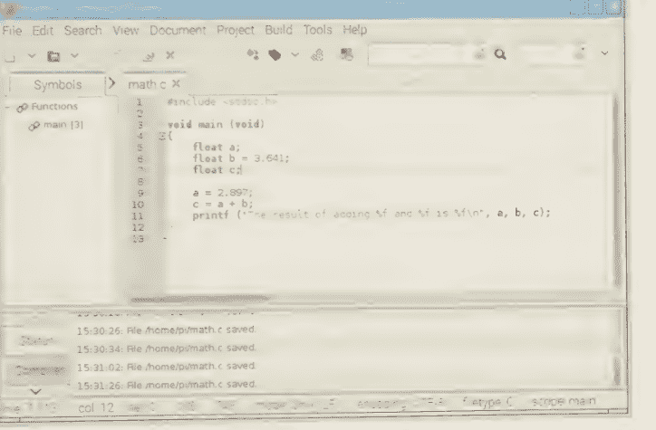

### 小数位

你可以通过在 `printf` 的 `%` 和 `f` 之间放入小数点和位数，来设置浮点类型显示的小位数。`%.3f` 将显示小数点后保留三位的浮点值。

其他类型

另一种常见的变量类型是 `char`；字符值。正如其名所示，它用于存储单个字符。ASCII 字符编码对每个字母、数字和标点符号使用一个 0 到 127 之间的单个值，因此 `char` 是单字节；它实际上是一个只能存储较小数字的整数值。编译器分配了几个字节来存储 `int` 或 `float`，但只分配单字节内存来存储 `char`。

还有可以应用于变量类型的修饰符。`char` 和 `int` 都可以用于存储正数和负数，但在声明时应用 `unsigned` 修饰符，可以将它们限制为只存储正值。所以……

`char a;`

..声明了一个可以存储从 -128 到 127 之间值的变量，而……

`unsigned char a;`

..声明了一个可以存储 0 到 255 之间值的变量。

进行算术运算时，确保任何计算结果都能放入变量中是非常重要的。例如，如果你有一个值为 100 的 `char`，并对其加上 30，你本会得到结果 130 —— 但如上所述，`char` 只能存储高达 127 的值。因此，你的 `char` 最终实际包含的值将是 -126，因为超过 127（`char` 能存储的最大值）的值会回绕到最低值（-128）并从那里开始计数。这种“溢出”行为是 C 程序执行算术运算时常见的 Bug 来源。

> 记住优先级

遵循运算符优先级的常用规则 - 所以 `a = a + 2 * 3` 先计算乘法，然后将结果加到 `a`。你可以使用括号来改变优先级 - `a = (a + 2) * 3` 得到 `a=6`。

这让你对 C 如何处理数字以及你如何使用它进行算术运算有了一些了解；在下一章中，我们将查看如何使用计算结果来决策。

## 第3 章

## 条件与比较

分支与循环：控制你的 C 程序的执行流

任何编程语言的基础之一都是进行条件操作的能力——即根据测试结果改变程序的执行流。

在本章中，我们将查看如何在 C 程序中测试条件，以及如何使用结果来决定下一步发生什么。

在 C语言中，根据测试条件控制执行流的机制是 `if-else` 语句。这是一个简单的示例：

```c
#include <stdio.h>

void main(void) {
    int a = 0;

    if (a == 0) {
        printf("a is equal to 0\n");
    } else {
        printf("a is not equal to 0\n");
    }
}
```

在这里，关键字 `if` 后面跟着一个在圆括号内的测试，在本例中为 `(a == 0)`。如果测试结果为真，则执行测试后大括号包含的操作。

这个示例还展示了 `if` 后面跟一个圆括号的测试。如果测试结果为真，则执行测试后大括号包含的操作。

这个示例还展示了 `else` 的用法。`if` 后面跟一个圆括号的测试。如果测试结果为真，则执行测试后大括号包含的操作。

大示例

大。

大括号用于将一组语句组合在一起。

大括号用于将一组语句组合在一起。

大括号用于将一组语句组合在一起。

大测试结果为真，则执行

后大括号的操作。

章，，，。

如何在 C 程序中测试条件

。。`if` 后面跟一个圆括号的测试。如果测试结果为真，则执行测试后大括号包含的操作。

这个示例还展示了 `else` 的用法。`if` 后面跟一个圆括号的测试。如果测试结果为真，则执行测试后大括号包含的操作。


## Another common variable type is `char`; a character value

This is used, as the name suggests, to store a single character. The ASCII character encoding uses a single value between 0 and 127 for each letter, number, and punctuation symbol, so a `char` is a single byte; it's really just an integer value which can only hold small numbers. The compiler allocates several bytes to store an `int` or a `float`, but only allocates a single byte of memory to store a `char`.

There are also modifiers which can be applied to variable types. Both `char` and `int` can be used to store both positive and negative numbers, but by applying the `unsigned` modifier when one is declared, they can be restricted to only store positive values. So...

`char a;`

..declares a variable which can hold values from -128 to 127, while...

`unsigned char a;`

..declares a variable which can hold values from 0 to 255.

When doing arithmetic, it is important to make sure that the answers to any calculation will fit into the variable. If, say, you have a `char` containing the value 100, and you add 30 to it, you would expect to end up with the result 130 – but as above, a `char` can only hold values up to 127. So the value your `char` will actually end up containing is -126, because values over 127 – the highest value a `char` can store – wrap around to the lowest value (-128) and start counting up from there. This ‘overflow’ behaviour is a common cause of bugs in C programs which do arithmetic.

> REMEMBER PRECEDENCE

Obey the common rules for operator precedence - so `a = a + 2 * 3` evaluates the multiply first and then adds the result to `a`. You can use brackets to change precedence - `a = (a + 2) * 3` gives `a=6`.

That gives you some idea about how C handles numbers, and how you can use it for arithmetic; in the next chapter, we'll look at how to use the results of calculations to make decisions.

# Chapter 3

## Conditions and comparisons

Branches and loops: controlling the flow of your C program

One of the fundamentals of any programming language is the ability to make conditional operations – to change the program's flow depending on the result of a test.

In this chapter, we'll look at how you test conditions within your C programs, and how you use the results to determine what happens next.

In C, the mechanism for controlling flow based on testing a condition is the `if-else` statement. Here's a simple example:

```c
#include <stdio.h>

void main(void) {
    int a = 0;

    if (a == 0) {
        printf("a is equal to 0\n");
    } else {
        printf("a is not equal to 0\n");
    }
}
```

Here, the keyword `if` is followed by a test enclosed in round brackets, in this case `(a == 0)`. If the test evaluates as true, the operations enclosed by the curly brackets after the test are executed.

# C 语言与编程简介

## 算术简写

为一些常用操作提供了快捷方式（例如，与其输入 `a = a + 1`，你只需要输入 `a++` 或 `a -= 3`、`a *= 3`）。

## 小数位

你可以通过在 `printf` 的 `%` 和 `f` 之间放入小数点和位数，来设置浮点类型显示的小位数。`%.3f` 将显示小数点后保留三位的浮点值。

## 其他类型

另一种常见的变量类型是 `char`；字符值。正如其名所示，它用于存储单个字符。ASCII 字符编码对每个字母、数字和标点符号使用一个 0 到 127 之间的单个值，因此 `char` 是单字节；它实际上是一个只能存储较小数字的整数值。编译器分配了几个字节来存储 `int` 或 `float`，但只分配单字节内存来存储 `char`。

还有可以应用于变量类型的修饰符。`char` 和 `int` 都可以用于存储正数和负数，但在声明时应用 `unsigned` 修饰符，可以将它们限制为只存储正值。所以……

`char a;`

..声明了一个可以存储从 -128 到 127 之间值的变量，而……

`unsigned char a;`

..声明了一个可以存储 0 到 255 之间值的变量。

进行算术运算时，确保任何计算结果都能放入变量中是非常重要的。例如，如果你有一个值为 100 的 `char`，并对其加上 30，你本会得到结果 130 —— 但如上所述，`char` 只能存储高达 127 的值。因此，你的 `char` 最终实际包含的值将是 -126，因为超过 127（`char` 能存储的最大值）的值会回绕到最低值（-128）并从那里开始计数。这种“溢出”行为是 C 程序执行算术运算时常见的 Bug 来源。

> 记住优先级

遵循运算符优先级的常用规则 - 所以 `a = a + 2 * 3` 先计算乘法，然后将结果加到 `a`。你可以使用括号来改变优先级 - `a = (a + 2) * 3` 得到 `a=6`。

这让你对 C 如何处理数字以及你如何使用它进行算术运算有了一些了解；在下一章中，我们将查看如何使用计算结果来决策。

# 第3 章

## 条件与比较

分支与循环：控制你的 C 程序的执行流

任何编程语言的基础之一都是进行条件操作的能力——即根据测试结果改变程序的执行流。

在本章中，我们将查看如何在 C 程序中测试条件，以及如何使用结果来决定下一步发生什么。

在 C 语言中，根据测试条件控制执行流的机制是 `if-else` 语句。这是一个简单的示例：

```c
#include <stdio.h>

void main(void) {
    int a = 0;

    if (a == 0) {
        printf("a is equal to 0\n");
    } else {
        printf("a is not equal to 0\n");
    }
}
```

在这里，关键字 `if` 后面跟着一个在圆括号内的测试，在本例中为 `(a == 0)`。如果测试结果为真，则执行测试后大括号包含的操作。

# C语言编程简介

```c
int a = 0;
do {
    printf("a is equal to %d\n", a);
    a++;
} while (a < 5);
printf("a is equal to %d and I've finished\n", a);
```

`do` 关键字位于大括号之前，而 `while` 测试位于闭合大括号之后。当这段代码运行时，循环中的代码在测试之前始终会执行一次。你可以通过运行上面两个循环示例，并将通用的目标值改为 5 而不是 0，来观察行为上的不同。


在下一章中，我们将查看一些更复杂的循环和流控制示例。

```text
File Edit View Help
pigrasberrypi: ./myprog
a is equal to 0
a is equal to 1
a is equal to 2
a is equal to 3
a is equal to 4
a is equal to 5 and I've finished
pigrasberrypi: $
```

# 第4章

## 更高级的流控制

### For 循环和 case 语句 - 更高级的控制程序流的方法

上一章描述的 `if` 语句和 `while` 循环是非常简单的控制结构。在本章中，我们将查看一些更复杂的结构，它们可以帮助你的代码更简洁，并减少你需要输入的工作量。

虽然我们在上一篇文章中看到的 `while` 循环非常有用，但 `for` 循环往往更受程序员青睐，因为它将控制循环的所有逻辑都放在了一起。这里有一个示例：

```c
#include <stdio.h>

void main (void)
{
    int a;
    for (a = 0; a < 5; a++) {
        printf("a is equal to %d\n", a);
    }
    printf("a is equal to %d and I've finished\n", a);
}
```


这与 `while` 循环没有太大区别，但循环的所有控制都位于 `for` 关键字后的圆括号内。它包含了三个语句，用分号隔开；按顺序排列，它们是初始条件、测试和增量。

- `a = 0` 是初始条件，变量 `a` 在循环开始时初始化为 0。
- `a < 5` 是测试，就像 `while` 循环中一样。它在循环的每次迭代中都会检查，只有当测试结果为真时，才会执行循环代码；一旦测试结果为假，执行将从循环代码末尾的大括号之后继续进行。
- `a++` 是增量，这段代码在循环每次迭代结束时执行，在再次评估测试之前执行。在这种情况下，它将 `a` 加了 1。

所以，当这个 `for` 循环运行时，会发生什么？首先 `a` 被设置为 0。然后检查测试：`a`（值为 0）是否小于 5？是的，小于，因此执行大括号内的代码，并打印 `a` 的值。最后，应用增量，意味着在 `a` 上加了 1。

如果测试为真，则重复测试，再次执行循环代码，并再次应用增量，这个过程不断重复，直到测试为假，此时执行将继续从闭合大括号之后开始。

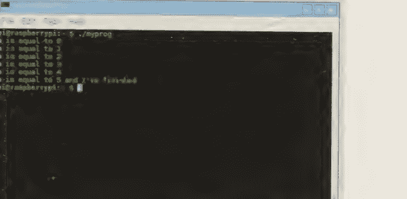

从功能来说，`for` 循环和 `while` 循环几乎是相同的，它们都将你想要运行多次的代码段封装在某种控制运行次数的逻辑中。你可以使用任何你认为最合理的，或者任何你认为看起来最整洁的！

### 多次初始化

### 多次增量

与多次初始化一样，你可以在 `for` 循环中拥有多个增量，同样用逗号隔开 - 例如 `for (a = 0; b = 1; <test>; a++, b++ = 2)`。如果有两个或多个变量在循环运行时保持一致的变化，这就非常有用。

### Switch 语句

你经常想做的一件事是对变量与多个值进行测试，并根据每个值执行不同的操作。你可以通过一组嵌套的 `if` 语句来实现这一点：

```c
#include <stdio.h>
void main (void) {
    int a = 0;
    if (a == 0) {
        printf("a is equal to 0\n");
    } else if (a == 1) {
        printf("a is equal to 1\n");
    } else {
        printf("a is greater than 1\n");
    }
}
```

不过这确实变得很长了，因此 C 语言提供了一种更整洁的方法，被称为 `switch` 语句。

```c
#include <stdio.h>
void main (void) {
    int a = 0;
```
```c
switch (a)
{
case 0 :      printf("a is equal to 0\n");
    break;
case 1 :      printf("a is equal to 1\n");
    break;
default :      printf("a is greater than 1\n");
}
```

与上述多个 `if` 语句的示例完全相同，但要短得多。它是如何工作的呢？`switch` 后面跟着一个变量，它会与一系列 `case` 值进行匹配。如果匹配成功，则执行对应的 `case` 块中的代码。`break` 语句用于跳出 `switch` 块。如果没有 `break`，程序将继续执行后续的所有 `case` 块，直到遇到 `break` 或 `switch` 块结束。如果没有任何 `case` 匹配，则执行 `default` 块。

```c
#include <stdio.h>
void main (void) {
    int a = 0;
    while (1) {
        printf("a is equal to %d\n", a);
        a++;
        if (a == 3) {
            break;
        }
    }
    printf("a is equal to %d and I've finished\n", a);
}
```

所以我们有一个 `while` 循环，其测试仅仅是值 1；这是一个非零值，因此始终为真。如果你在 `while (1)` 语句后包含大括号，循环将永远不会结束，它会一直运行。但在这种情况下，我们提供了另一种结束循环的替代方法；我们在循环内部通过 `if` 语句测试 `a` 的值，如果 `a` 等于 3，我们调用 `break`。这会导致循环结束，执行继续循环之后的语句。

### 提前退出循环

`break` 语句还有另一个用途，它可以用于 `while` 和 `for` 循环中跳出它们。看这个示例：

```c
#include <stdio.h>
void main (void) {
    int a = 0;
    while (1) {
        printf("a is equal to %d\n", a);
        a++;
        if (a == 3) {
            break;
        }
    }
    printf("a is equal to %d and I've finished\n", a);
}
```

所以我们有一个 `while` 循环，测试仅仅是值 1；这是一个非零值，因此始终为真。如果你在 `while (1)` 语句后包含大括号，循环将永远不会结束。但在这种情况下，我们提供了另一种结束循环的替代方法；我们在循环内部通过 `if` 语句测试 `a` 的值，如果 `a` 等于 3，我们调用 `break`。这会导致循环结束，执行继续循环之后的语句。

如果你忘记在每个 `case` 处包含 `break` 语句，可能会导致意想不到的结果。但这也有用，程序员会在 `switch` 语句中故意漏掉 `break` 语句，例如：

```c
switch (a)
{
case 0 :      printf("a is equal to 0\n");
case 1 :      printf("a is equal to 1\n");
default :      printf("a is greater than 1\n");
}
```

这不是你预期的吗？再次运行它，你会看到：

a is equal to 0
a is equal to 1
a is greater than 1

img/6a7eee5b22417c3d49170130a20b16f2_27_0.png)

不要忘记在每个 `case` 处加上 `break` 语句！

### 你最喜欢的循环...

C 语言中所有的循环类型 - `while`、`do` 和 `for` - 都可以在许多需要循环的地方使用；选择任何你喜欢的。有些人倾向于用一种循环类型处理所有问题，而另人则根据情况选择看起来最整洁的。没有错误的选择。

# 第 5 章

## 指针

指针 - 变量既有地址也有名称。

“指针”一词曾让许多初学者 C 程序员心生胆畏，但一旦你理解了它们，指针就是该语言中一个非常有用的特性。在现实中，它们并不复杂，但在使用它们时很容易产生困惑，所以让我们尽量避免这种情况……

还记得我们看过的变量的声明吗？在 C语言中，在使用变量之前必须对其进行声明——告诉编译器它是什么类型、叫什么名字——因为声明允许编译器分配一块内存来存储该变量。因此，对于你声明的每一个变量，编译器都会为该变量留出一块内存，并且编译器会记住哪个特定的内存块被哪个变量使用。

## 什么是指针？

指针仅仅是包含变量的内存块的地址；仅此而已。所以，如果你声明了一个变量以及指向该变量的指针，你可以通过两种方式访问该内存块中的值：通过变量名，或者通过指针。

让我们来看一个简单的例子：

```c
#include <stdio.h>
void main(void)
{
    int a;
    int *ptr_to_a;
    ptr_to_a = &a;
    a = 5;
    printf("The value of a is %d\n", a);
    *ptr_to_a = 6;
    printf("The value of a is %d\n", a);
    printf("The value of ptr_to_a is %d\n", ptr_to_a);
    printf("It stores the value %d\n", *ptr_to_a);
    printf("The address of a is %d\n", &a);
}
```

逐行来看，第一行是我们已经熟悉的：我们声明了一个整数变量 `a`。但这是什么？

```c
int *ptr_to_a;
```

这看起来像是在声明另一个整数变量，不是吗？但仔细看，变量名开头的的星号 `*` 表示这并不是在声明一个整数变量，而是一个指向整数变量的指针。

所以我们现在有了一个名为 `a` 的整数，有了一个指向整数变量的指针 `ptr_to_a`。但它们内部实际上还没有任何值；它们都是未初始化的。把指针命名为 `ptr_to_a` 固然，但它不知道 `a` 是什么（或在哪里），所以我们用下一行来修复这个问题。

```c
ptr_to_a = &a;
```

这是 C 语言中的关键部分：变量名前的符号 `&` 表示变量的地址；因此 `&` 意味着变量 `a` 在内存中的地址。正如我们上面所说，指针就是变量的地址。所以这一行将 `ptr_to_a` 初始化为 `a` 的地址，`ptr_to_a` 现在是一个指向变量 `a` 的有效指针，所以我们现在可以使用它了。

接下来两行很熟悉：我们将 `a` 设置为 5，为了检查操作是否成功，我们打印了它的值。让我们尝试做同样的操作，但是使用指针。

```c
*ptr_to_a = 6;
```

又是那个星号，但用法与之前略有不同。在声明变量时，在它的名字前加星号表示该变量是一个指针。但一旦指针存在，在它的名字前面加星号就意味着该指针所指向的变量；这被称为**解引用**（dereferencing pointer）。所以这一行告诉编译器将指针 `ptr_to_a` 指向的变量设置为 6。我们知道 `ptr_to_a` 指向的变量是谁，我们在几行前已经设置好了，所以这一行只是将 `a` 设置为 6 的另一种方式；事实上，如果我们打印 `a` 的值，它已经变成了 6。

接下来的行有助于帮助你在脑中理清指针、变量和地址之间的关系。

```c
printf("The value of ptr_to_a is %d\n", ptr_to_a);
```

在这一行中，我们打印的是 `ptr_to_a` 的值，而不是它指向的值，而是指针本身的值。这会打印出一个很大的数字，因为它是 `a` 所在的内存地址。

```c
printf("It stores the value %d\n", *ptr_to_a);
```

在这一行中，我们打印的是 `ptr_to_a` 指向的值，注意名字前的星号。这打印的是 `a` 的值。

```c
printf("The address of a is %d\n", &a);
```

在这一行中，我们打印的是 `a` 本身的地址——注意名字前的 `&` 符号。同样，这打印出一个很大的数字，与我们上面打印的 `ptr_to_a` 的值相同。

| 当我第一次学习指针时，发现大声说出某行代码在做什么很有帮助——`*` 是“所指向的内容”，而 `&` 是“……的地址”…… | 当这两个概念在脑海中固定后，你基本上理解了指针 |

在处理指针时需要记住的关键点是：你不能只声明一个指针，你还需要声明并关联你想要指向的变量。当指针被创建时，它指向内存中的一个随机位置；如果你尝试向它写入内容，可能会导致各种错误，甚至导致计算机完全崩溃！在对指针进行任何操作之前，务必确保你的指针指向了某个东西。

指针是 C 语言允许你在某些情况下（强制性地）思考计算机实际硬件的方式之一——深入理解指针可以让你很好理解编译器是如何处理内存的。

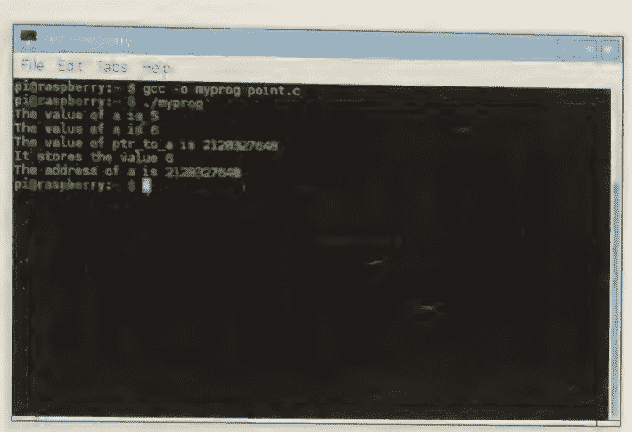

指针是 C 语言的一个强大特性。它们允许你直接操作内存地址，这对于动态内存分配、数据结构和高效的数组传递非常有用。

> 始终要有指向的对象！

## 空指针与类型转换

你也可以定义一个指针而不说明它指向什么种类型的变量；这就是空指针，写作为 `void *`。（注：此处存在大量重复文本，已根据要求去重并翻译）。类型转换是告诉编译器如何解释内存。

## 调用函数

以下是需要翻译的

## 参数 (ARGUMENTS)

函数可以有任意数量的参数，从零到数百个。如果你不需要返回值，可以将返回类型设置为 `void`。

## 看看函数

我们向函数提供的参数在圆括号内，且与函数定义的顺序相同；所以在这种情况下，a 是 5，b 是 y 的值。

你能从一个函数返回多个结果吗？但是，你也可以使用指针将多个数据项传回调用函数。考虑这个示例：

```c
#include <stdio.h>
int sum_and_diff (int a, int b, int *res)
{
  int sum;
  sum = a + b;
  *res = a - b;
  return sum;
}
void main (void)
{
    int b = 2;
    int diff;
    printf("The sum of 5 and %d is %d\n", b,
    sum_and_diff(5, b, &diff));
    printf("The difference of 5 and %d is %d\n", b, diff);
}
```

我们修改了 `sum` 函数，以计算参数的和和差值。和之前之前返回一个整数，但我们还通过指针传回了差值。记住，函数的参数是局部变量，即使你在函数内部修改了其中一个，对调用函数传递的值也没有影响。这就是为什么指针很有用的原因：通过传递指针，函数不会更改指针本身的值，而是更改它所指向的值。

## 变量作用域 (VARIABLE SCOPE)


## 调用函数

让我们看看 main 中是如何调用函数的

```
int z = sum (5, y);
```

`sum` 函数返回一个整数，因此我们将其赋值给整数变量。我们提供的函数参数在圆括号内，与定义相同；所以在这种情况下，a 是 5，b 是 y 的值。

```c
#include <stdio.h>
void main(void) {
    int a[10];
    int count;
    for (count = 0; count < 10; count++) {
        a[count] = count * 10 + count;
    }
    printf("The first and second elements of a are %d and %d\n", a[0], a[1]);
    printf("Or, as pointers, %d and %d\n", *(a), *(a+1));
}
```

数组 `a` 包含 0, 11, 22, 33 等十个值，然后读取 `a[0]` 和 `a[1]`。通过使用 `a` 作为指针读取相同的值，如果你运行代码，你会发现它们是完全相同的。

对于二维（或多维）数组，你需要考虑编译器如何在内存中安排这些维度。它通过将数组最右侧索引的元素组合在一起来实现。对于数组 `b[5][6]`，`b` 指向 `b[0][0]`，`b+1` 指向 `b[0][1]`，`b+5` 指向 `b[0][5]`，而 `b+6` 指向 `b[1][0]`。

| a[0] | a[1] | a[2] | a[3] | a[4] | a[5] | a[6] | a[7] | a[8] | a[9] |
|---|---|---|---|---|---|---|---|---|---|
| b[0][0] | b[0][1] | b[0][2] | b[0][3] | b[0][4] | b[0][5] | b[1][0] | b[1][1] | b[1][2] | b[1][3] |

数组元素在内存中顺序存储。多维数组元素在存储时，最右侧索引的值是相邻的。你可以在声明数组的同时通过将值放在大括号中来初始化数组，例如：

```c
int a[10] = { 0, 11, 22, 33, 44, 55, 66, 77, 88, 99 };
```

此处注意，这仅在数组首次声明时有效；一旦它存在，你就不能使用这种快捷方法，而需要遍历数组逐个设置每个值。

## 字符串

在 C 语言中，字符串只是另一个数组，它是单字符的数组。正如我们在第 2 章看到的，`char` 是 C 中的一种特定类型，占用一个字节，这足够容纳一个字符。一个包含十个字符的字符串将：

```c
char mystery[10];
```

需要记住的一点是，C 中的字符串必须始终以一个字节零字节结尾，并且存储这个最终零（称为终止符）所需的内存必须在声明字符串时进行分配。因此，声明为十个字符数组的 `mystery` 只能包含九个或更少的字母。

## string.h

字符串以单字符数组的形式存储，最后一个字符之后的元素被设置为零。

```c
#include <stdio.h>
void main (void) {
    char str1[10] = "first";
    char str2[10] = "second";
    char str3[20];
    char *src, *dst;
    src = str1;
    dst = str3;
    while (*src != 0) {


```c
        *dst = *src;

        src++;

        dst++;

    }

    src = str2;

    while (*src != 0) {

        *dst = *src;

        src++;

        dst++;

    }

    printf("%s + %s = %s\n", str1, str2, str3);

}
```

你可以使用方括号中的索引来访问字符串中的单个字符，也可以使用指针。这里有一个使用指针的示例：

## C 编程简介

首先，我们创建两个字符串 - `str1` 为 'first'，`str2` 为 'second' - 然后我们分配一个空字符串 `str3` 来存放结果。

然后，我们创建了一对 `char` 指针，让 `src` 指向 `str1` 的开头（'first' 中的 f），让 `dst` 指向空字符串 `str3` 的开头。接着我们进行循环，将 `src` 处的内容复制到 `dst`，然后将两个指针都移动一位，直到找到终止 `str1` 的零。

然后我们让 `src` 指向 `str2` 并再次执行操作，直到找到 `str2` 结尾的零。最后，我们在 `str3` 的末尾写入一个零以终止它。注意用于打印字符串的使用的格式说明符；`%s` 用于打印字符串，它将显示从提供的参数指针开始的每一个字符，直到找到第一个终止零为止（如果你想打印单个字符，可以使用格式说明符 `%c`）。

## 写入字符串

由于字符串变量名仅是指向字符串第一个字符的指针，因此你不能使用等号来设置整个字符串的值。你可以在像上面那样在声明时初始化字符串变量，但如果你想稍后设置或更改它怎么办？

有几种方法可以实现，但最有用的是 `printf` 函数；这是我们见过的 `printf` 的版本，它可以将任意文本写入字符串变量。唯一的区别是它接收的第一个参数是字符串变量名，并且是写入该变量而不是终端：

```c
#include <stdio.h>

void main(void)
{
    int val = 12;
    char string[50];
    printf(string, "The value of val is %d\n", val);
    printf("%s", string);
}
```

`printf` 函数会自动在你创建的任何字符串末尾添加终止零。

## 终止字符串

始终记住，字符串的内存需要足够容纳所有字符，外加一个字节用于存储终止零，如果你自己使用指针操作字符串；请确保在字符串末尾写入零。

# 第 8 章

## 字符串库

使用 C 字符串库简化常用的字符串操作。

在上一章中，我们看到了如何使用指针访问字符串。这工作得很好，并且让你很好理解指针的工作原理，但代码有点冗长。幸运的是，C 提供了一个用的字符串函数库，可以节省大量的工作！在上一章中，我们看到了如何使用指针连接字符串。现在我们将使用字符串库来实现相同的操作：

```c
#include <stdio.h>
#include <string.h>
void main(void)
{
    char str1[10] = "first";
    char str2[10] = "second";
    char str3[20];
    strcat(str3, str1);
    strcat(str3, str2);
    printf("%s + %s = %s\n", str1, str2, str3);
}
```

### 保持字符串内部
字符串库函数通常不会防止你越界写入字符串，就像使用指针时一样。在使用库函数时，你必须确保你的字符串变量足够存储你存储的值。

## 覆盖
看起来可以使用 `strcpy` 和 `strcat` 复制字符串自身的一部分 - 例如 `strcpy(a+1, a)`。不要尝试！`strcpy` 和 `strcat` 的源和目标缓冲区必须是完全独立的内存区域，如果不是就会

```c
ptr2++;
}
```

```c
if (*ptr1 == 0 && *ptr2 == 0)
{
    printf("The two strings are identical.\n");
}
else
{
    printf("The two strings are different.\n");
}
```

每次都写这些有点冗琐，所以字符串库可以使用 `strcmp` 函数（代表 'string compare'）来为你完成这些工作。以下是它的使用方法：

```c
#include <stdio.h>
#include <string.h>
```

```c
void main (void)
{
    char str1[10] = "first";
    char str2[10] = "fire";
    if (strcmp(str1, str2) == 0)
    {
        printf("The two strings are identical.\n");
    }
    else
    {
        printf("The two strings are different.\n");
    }
}
```

`strcmp` 两个字符串作为参数，如果它们相同则返回 0；如果不同则返回非零值。

如果你只想比较字符串的前几个字符，而不是整个字符串呢？有一个库函数可以实现：`strncmp`（代表 string numbered compare）。

它的工作方式与 `strcmp` 完全相同，但它接收第三个参数，即一个指定要比较字符数量的整数。因此 `strcmp("first", "fire", 4)` 会返回一个非零值，而 `strncmp("first", "fire", 3)` 将返回 0。

## C 语言与 GUI 编程简介

## 忽略大小写

存在某些 `strcmp` 和 `strcmp` 版本会忽略所比较字符串中字母的大小写；它们分别被称为 `strcasecmp` 和 `strncasecmp`。它们接受相同的参数并返回相同的值。

## 从字符串中读取值

我们在上一章中看到可以使用 `sprintf` 将变量写入字符串，那么能够从字符串中读出变量呢？`fscanf` 函数（代表 string scan formatted）可以为你完成这一工作。以下是它的工作原理：

```c
#include <stdio.h>
void main (void)
{
    int val;
    char string[10] = "250";
    sscanf(string, "%d", &val);
    printf("The value in the string is %d\n", val);
}
```

`sscanf` 使用与 `printf` 完全相同的格式说明符。然而，一个重要的区别是 `fscanf` 的参数都是指向变量的指针，而不是变量本身。一如既常，它永远不会改变作为参数提供的变量的值，但如果它们是指针，它就可以向目标写入内容。

你可以通过查看 `fscanf` 的返回值来检查它是否能够与提供的字符串匹配格式说明符；`fscanf` 返回成功读取的值的数量。例如，如果提供了 `%d` 格式说明符，但提供的字符串不是以数字开头，`fscanf` 将不会向提供的指针写入任何内容并返回 0；如果提供的字符串是以数字开头，`fscanf` 将返回 1。

传递给 `fscanf` 的格式字符串可以包含多个格式说明符甚至是其他文本：

```c
#include <stdio.h>
void main (void)
{
    int val;
    char result[10];
    char string[25] = "The first number is 1";
    if (sscanf(string, "The %s number is %d", result, &val) == 2)
    {
        printf("String : %s Value : %d\n", result, val);
    }
    else
    {
        printf("I couldn't find two values in that string.\n");
    }
}
```

注意，不一致的是，`%s` 格式说明符在 `printf` 和 `sscanf` 中都表示字符串的指针，而 `%d` 在 `printf` 中表示变量，在 `sscanf` 中表示指针。

关于 `sscanf` 注意的一是，它在标准 I/O 库而不是字符串库中，所以使用它不需要 `#include <string.h>`。

## scanf 字符串

`sscanf` 从格式化字符串中读取数值和单词，允许你解析来自其他地方的内容。记住 `sscanf` 的所有参数必须是指针。

## 字符串有多长？

最后一个实用的字符串函数是 `strlen`（代表 string length）；正如其名，它告诉你字符串从开始到终止零字符有多少个字符。

```c
#include <stdio.h>
#include <string.h>
void main (void)
{
    char str1[10] = "first";
    printf("The length of the string '%s' is %d\n", str1, strlen(str1));
}
```

我们在这里看到的所有操作都可以通过手动操作指针，字符串库只是让它们变得更容易并让你的代码更短。

# 第 9 章

## 用户输入

从字符串中读取值

获取程序输入的另一种方法是在从命令行启动程序时将其作为参数提供。

## 更好的方法

```c
#include <stdio.h>
void main (void)
{
    char input[256];
    int age;
    printf("What is your age?\n");
    while (1)
    {
        fgets(input, 256, stdin);
        if (sscanf(input, "%d", &age) == 1)
            break;
        printf("I don't recognise that, try again!\n");
    }
    printf("Well, you are %d years old.\n", age);
}
```

`char *argv[]`，这听起来很困惑，对吧？这实际上是我们已经见过的几种东西的复合体。里面有一个 `*`，所以它是一个指针，类型是 `char`，所以里面有字符，而且有方括号 `[]`，所以它是一个数组。
这实际上是一个指向字符的指针数组；数组的每个元素都是一个字符串，而每个字符串都是提供给程序的参数之一。
在实践中，这样理解可能更容易：

```c
#include <stdio.h>
int main (int argc, char *argv[]) {
    int param = 0;
    while (param < argc) {
        printf("Parameter %d is %s\n", param, argv[param]);
        param++;
    }
    return 0;
}
```

尝试像以前一样运行它，只需输入它的名称。然后在命令行中在名称后输入其他内容，看看程序打印了什么。
这里是一个使用程序参数编写的（非常）简单的计算器示例：

```c
#include <stdio.h>
int main (int argc, char *argv[]) {
    int arg1, arg2;
    if (argc == 4) {
        sscanf(argv[1], "%d", &arg1);
        sscanf(argv[3], "%d", &arg2);
        if (argv[2] == '+') printf("%d\n", arg1 + arg2);
        if (argv[2] == '-') printf("%d\n", arg1 - arg2);
        if (argv[2] == 'x') printf("%d\n", arg1 * arg2);
        if (argv[2] == '/') printf("%d\n", arg1 / arg2);
    }
    return 0;
}
```

注意，我们使用 `*argv[2]` 来获取第二个参数的第一个字符。这应该始终是一个单个字符，但因为每个参数都是字符串，`argv[2]`（不带星号）是一个指向字符的指针，而不是使用 `=` 进行比较时所需的单个字符。

确保你用空格将参数与运算符隔开，以便它们被识别为独立的参数：`<progname> 2 + 2` 而不是 `<progname> 2+2`。

## 获取正确的数字

记住 `argv` 数组中的第一个元素 `argv[0]` 是程序本身，而不是第一个参数。实际参数从 `argv[1]` 开始。

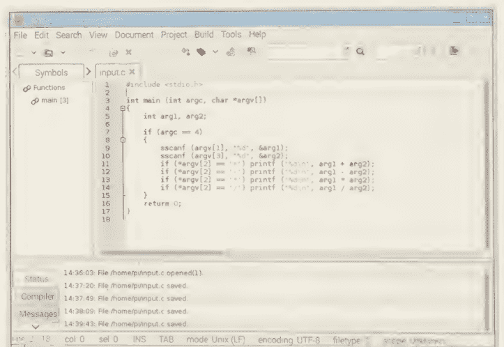

```c
#include <stdio.h>
int main(int argc, char *argv[]) {
    int arg1, arg2;
    if (argc == 4) {
        sscanf(argv[1], "%d %d", &arg1, &arg2);
        if (strcmp(argv[2], "print") == 0)
            printf("%d %d\n", arg1, arg2);
        else if (strcmp(argv[2], "sub") == 0)
            printf("%d %d\n", arg1 - arg2);
    }
    return 0;
}
```

`main` 函数的 `argc` 和 `argv` 参数可以用于访问程序运行时在命令行上输入的参数

## C 语言与 GUI 编程简介

```
File Edit Tabs new c
pi@raspberry:~$ ./myprog 2 + 2
4
pi@raspberry:~$ _
```

函数的返回值是它执行完毕后发送给调用者的值。

## 检查返回值

在 C 语言中，可以通过将结果赋值给变量来获取函数的返回值。

# 第 10 章

## 文件输入和输出

### 读取文件和写入文件

在上一章中，我们查看了如何从控制台获取用户输入。在本章中，我们将查看 C 语言另一种常用的输入输出方法：读取和写入文件。

许多程序需要能够访问主机计算机磁盘上的文件；即使只是为了保存用户偏好设置等，文件访问也是许多编程任务的基本需求。

在 C 语言中，通过文件指针来访问文件。文件指针包含了访问文件所需的所有信息：文件在文件系统中的名称和位置，以及在文件中将读取或写入数据的当前位置。

因此，我们需要做的第一件事是获取文件指针。C 函数 `fopen` 接受两个参数。第一个参数是文件的路径，包括它的文件名和扩展名。第二个参数是文件访问模式；这是一个指示你打算从文件中读取还是写入文件的代码。

让我们来看一个读取文件的示例：使用你的文本编辑器在树莓派的 `/home/pi` 目录下创建一个名为 `input.txt` 的文件，并在其中输入你喜欢的内容。保存并使用以下程序编译它：

```c
#include <stdio.h>
void main(void)
{
    FILE *fp;
    int value;
    fp = fopen("/home/pi/input.txt", "rb");
    if (fp) {
        while (1) {
            value = fgetc(fp);
            if (value == EOF) break;
            else printf("%c", value);
        }
    }
}
```

## C 语言与 GUI 编程简介

```c
}
fclose(fp);
}
```

首先，我们声明了一个名为 `fp` 的文件指针变量，类型为 `FILE *`。我们还声明了一个整数用于存储从文件中读取的字符。

然后我们使用 `fopen` 命令（代表“打开文件”）创建文件指针。我们打开 `/home/pi/input.txt` 文件，并将模式设置为 `"rb"`，这表示以二进制读取。这创建了文件指针并将其初始化为文件的开头。

然后我们检查文件指针是否非空。`fopen` 函数接收两个参数。第一个参数是文件的路径，包括文件名和扩展名。第二个参数是文件访问模式；这是一个指示你打算从文件中读取还是写入文件的代码。

注意，我们使用 `*argv[2]` 来获取第二个参数的第一个字符。这应该始终是一个单个字符，但因为每个参数都是字符串，`argv[2]`（不带星号）是一个指向字符的指针，而不是使用 `=` 进行比较时所需的单个字符。

确保你用空格将参数与运算符隔开，以便它们被识别为独立的参数：`<progname> 2 + 2` 而不是 `<progname> 2+2`。

```c
#include <stdio.h>
void main (void) {
    FILE *fp;
    int value;
    fp = fopen("/home/pi/input.txt", "rb");
    if (fp != NULL) {
        fseek(fp, 10, SEEK_CUR);
        while (1) {
```


```
            value = getc(fp);

            if (value == EOF) break;

            else printf("%c", value);

        }

        fclose(fp);

    }

}
```

`fseek(fp, 10, SEEK_CUR)` 将文件指针向当前位置向前移动10个字节，此程序将打印文件中所有的前十个字符。`fseek` 的第一个参数是文件指针，第二个是指针移动的偏移量。这可以是正数也可以负数：`fseek(fp, -5, SEEK_CUR)` 将指针从当前位置向后移动5个字节。

`fseek` 的第三个参数允许你选择相对于文件开头（`SEEK_SET`）或文件末尾（`SEEK_END`）的位置，而不是相对于当前位置（`SEEK_CUR`）。因此，`fseek(fp, 12, SEEK_SET)` 将指针置于文件开头12个字节处，而 `fseek(fp, -17, SEEK_END)` 将其置于文件末尾后17个字节处。

## 检查库

该库提供了许多用于读写文件数据的函数，我们刚刚查看了其中一些。如果你需要访问文件，请查看库的其他函数，例如 `fread`、`write`、`fputs`、`sscanf`、`gets`，看看它们是否比我们在这里使用的基本 `fputc` 和 `getc` 更合适。

# 第11章

## 关于类型和变量的更多

全局变量、类型定义、枚举和结构

在本章中，我们将介绍关于变量和类型使用的一些高级主题，包括局部变量和全局变量之间的区别、定义新类型以及枚举和数据结构的使用。

当我们在书中示例中使用变量时，总是将它们放在函数定义内部。因此，这些是局部变量；也就是说，变量仅限于这些函数，并且在函数外部没有意义。

### 全局变量

C 还允许使用全局变量，即定义在所有函数之外的变量。它们具有全局作用域，这意味着可以在程序内的任何函数中进行读取和写入。让我们来看一个示例：

```c
#include <stdio.h>

int result;

void add(int a, int b)
{
    result = a + b;
}

void main(void)
{
    add(3, 4);
    printf("The result is %d\n", result);
}
```

在这个示例中，变量 `result` 是全局的。因此，可以在 `add` 函数和 `main` 函数中对其进行读取或写入。如你所见，我们在 `add` 中对其写入一个值并在 `main` 中将其读取，因此我们不需要从 `add` 返回值。

在某些方面，这看起来比到处传递值要简单，不是吗？那么为什么不一直这样做呢？答案是内存。函数中的局部变量在函数运行时分配空间，并在函数结束时释放内存。但全局变量在程序启动时分配空间，该空间直到程序结束才会被释放，如果你分配了足够的全局变量，可能会耗尽系统内存。

有一种更好的方法可以让每个函数都能访问大量数据，我们稍后会介绍……

### 不同的名称

虽然在同一个程序中给局部变量和全局变量起相同的名称是完全有效的，但不是吗？如果你有一个同名的全局变量和局部变量，局部变量将在声明它的函数中使用，而全局变量将在任何可以使用的地方被使用，这可能会导致意料之外的行为。

### 类型定义

在第2章中，我们查看了C语言变量类型的范围：`char`、`int`、`float` 等。C 还允许你通过所谓的 `typedef` 来定义自己的类型。`typedef` 是一种格式为 `typedef <现有类型> <新名称>` 的行，通常放在程序的开头。例如：

```c
typedef unsigned char BYTE;
```

这定义了一个名为 `BYTE` 的新类型，它是 `unsigned char` 的另一个名称（注意，按照习惯，用户定义的类型通常使用大写字母命名。这并不是强制的，但在阅读代码时有助于将它们与变量区分开）。

当我们定义一个新类型时，它实际上是为现有类型创建一个别名。这看起来似乎没什么意义，但它可以从两个方面提供帮助。首先，如果你让类型名称针对你的程序数据，它可以让你的代码行为变得更加直观。其次，通过定义特定类型，你可以让编译器在函数参数或变量使用错误的类型时向你发出警告。

在某些特定情况下，`typedef` 特别有用：这些是枚举类型数据结构。

### 枚举类型

通常，某些变量只能取少数几个值中的一个。C提供了一种名为 `enum` 的类型用于此，它定义了一个具有固定一组命名值的整数。

这里有一个示例：

```c
#include <stdio.h>

typedef enum {
    false,
    true
} BOOLEAN;

void main (void) {
    BOOLEAN b_var = false;
    if (b_var == true) {
        printf("TRUE\n");
    } else {
        printf("FALSE\n");
    }
}
```

如你所示，使用了命名值而不是数字。这可以使代码变得更容易。

#### 编号枚举

使用 `typedef` 的另一个有用方法是用于定义结构

#### 结构

使用 `typedef` 的另一个有用方法是用于定义数据结构。这是一个组合在一起的变量集合，允许你传递整个结构而不是单个变量。这里有一个示例：

```c
#include <stdio.h>

typedef struct {
    int inval1;
    int inval2;
    int outval;
} MY_DATA;

void add (MY_DATA *d)
{
    d->outval = d->inval1 + d->inval2;
}

void main (void)
{
    MY_DATA data;
    data.inval1 = 5;
    data.inval2 = 7;
    add(&data);
    printf("The sum of %d and %d is %d\n", data.inval1, data.inval2, data.outval);
}
```

结构可以包含其他类型（基本类型、枚举甚至是结构），只需确保在包含它们的结构 `typedef` 之前出现这些类型的 `typedef` 即可。

### C 语言与 GUI 编程简介

```
File Edit Tabs Help

pi@raspberrypi: 5 ./myprog

The sum of 5 and 7 is 12

pi@raspberrypi: 6
```

* 除非用户想要添加，否则所有的 MYDATA 实例都是唯一的

# 第 12 章

## 头文件与预处理器

### 将代码拆分到多个文件中

在到目前为止看到的示例中，我们一直将程序的所有代码都放在单个文件中。但一旦程序变得庞大，将它们拆分成多个单元，并将相似的函数组合在一起，就会更有意义。为了理解这是如何运作的，我们需要更详细地查看编译器究竟做了什么：

在目前为止所有的示例中，我们都对单个源文件调用了 `gcc`，它创建了一个单一的可执行程序。这掩盖了 `gcc` 实际上做了两件事的事：首先，它将你的 C 源文件编译成一个对象文件（object file），然后将对象文件与所有的库函数链接在一起以创建可执行文件。这第二步是由一个名为链接器（linker）的程序执行的，而 `gcc` 包含了这个功能。

如果你创建一个包含多个源文件的程序，你只需要在调用 `gcc` 时包含所有源文件的文件名即可。它会为每个源文件创建一个对象文件，然后将你所有的对象文件链接在一起以创建可执行文件。

不过这里有一个障碍：如果你将代码拆分成单独的文件（通常称为模块），你将会有一些为了运行而调用其他文件中函数的文件。这些文件并不知道链接器是如何对它们操作的；文件是被单独编译的，如果你在一个编译器不认识的文件在使用函数，编译器就会报错。

我们使用头文件（header files）来解决这个问题。这些是扩展名为 `.h` 的文件，其中存储了模块中定义的函数（以及全局变量）的声明，这样当它们被另一个模块使用时，就可以告诉编译器它们的存在。我们已经见过很多次了，记得示例顶部的 `#include <stdio.h>` 吗？这正是这个过程；它在告诉编译器，系统头文件 `stdio.h` 中声明的函数在该模块中使用了。

### 保持命名一致

虽然你可以给头文件起任何名字—— 并没有强制规定命名 —— 但良好的做法是将特定文件中函数的头文件命名为与 C 文件本身相同的名称，并使用 `.h` 扩展名而不是 `.c`。这使得阅读你代码的人更容易更容易找到定义函数的文件。


### 将代码拆分到多个文件中

让我们来看它是如何运作的示例。创建三个文件，两个扩展名为 `.c`，一个扩展名为 `.h`，如下所示：

```c
function.c
int add_vals(int a, int b, int c)
{
    return a + b + c;
}
```

```c
function.h
extern int add_vals(int a, int b, int c);
```

```c
main.c
#include <stdio.h>
#include "function.h"

void main (void)
{
    printf("The total is %d\n", add_vals(1, 2, 3));
}
```

将所有三个文件放在同一个目录下并运行 `gcc`，给它 `.c` 文件的文件名——
`gcc -o myprog main.c function.c`

生成的程序将运行 `main.c` 中的 `main` 函数，该函数调用了 `function.c` 中的 `add_vals`。

有几点需要注意：首先，在头文件中，我们在声明开头使用 `extern` 单词来声明函数。这告诉编译器，该函数将在文件外部找到，即在另一个 C 文件中。

其次，虽然我们一直在 `<>` 符号之间包含 `stdio.h` 及其名称，但我们使用双引号 `#include "function.h"`。`<>` 符号告诉编译器在系统头文件存储的目录中查找文件，`""` 符号表示该文件是本地的，并且与你正在构建的 `.c` 文件在同一个目录下。如果你在创建自己的头文件，包含它们时始终在名称周围使用双引号。

## MAKEFILES

## 预处理器

那么 `#include` 实际上做了什么？它是对预处理器的指令，预处理器是编译的第一阶段；它在将源文件传递给编译器之前替换源文件中的文本。预处理器通过所谓的指令进行控制；这些指令很容易识别，因为它们都以 `#` 符号开头。

- `#include` 指令指示预处理器将该行替换为它所包含的文件。因此，在我们上面的示例中，`.c` 文件中的行 `#include "function.h"` 被替换为 `function.h` 文件的内容，这意味着传递给编译器的内容类似于：

```c
#include <stdio.h>
extern int add_vals(int a, int b, int c);
void main (void) {
    printf("The total is %d\n", add_vals(1, 2, 3));
}
```

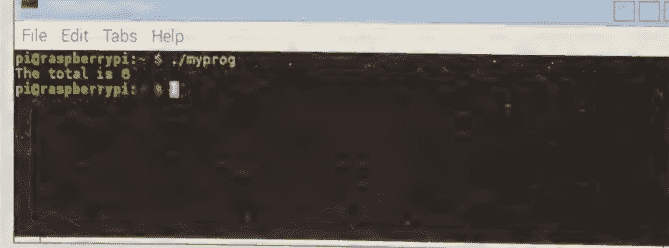

### 不要 #INCLUDE C 文件

`#include` 可以作用于任何文件，它将包含行替换为文件的内容。偶尔我看到这种做法被滥用。某些程序员通过直接包含其他 C 文件本身来跳过对头文件的使用。虽然这可行，但这是糟糕的做法。不要受诱去尝试！

### #define

另一个有用的指令是 `#define`，可以用于定义常量值。看这个这个示例：

```c
#include <stdio.h>
#define PI 3.14159

void main (void) {
    printf("The circumference is %f\n", 2 * PI);
    printf("The area is %f\n", PI * PI);
}
```

（注：原文中 `#define` 的部分存在重复和乱码，已根据逻辑处理，此处保留核心示例翻译）


它已经超越了那个范围，成为一个通用的用户界面工具包，现在是 Linux 桌面上最广泛使用的界面库之一。

GTK 项目的基础构建单元被称为“小部件”（widgets）。你在屏幕上看到的所有内容——窗口、按钮、标签——都是小部件。GTK 库负责了创建小部件所需的所有工作——你只需要告诉它想要什么小部件、想把它们放在什么位置、以及你想让它们做什么，GTK 就会为你处理好所有其他工作。

为了让你了解“处理所有其他工作”意味着什么，请想象一下上述情况：你正在通过向屏幕缓冲区写入数据并绘制像素来手动创建一个窗口。如果用户点击窗口标题栏并将其拖动到屏幕上的另一个地方，你必须检测到鼠标被点击，你必须跟踪它正在移动，并且在它移动的每个点上重新绘制窗口，恢复它移动过的区域原本被遮挡的内容。仅仅拖动窗口就需要几百行代码——但有了 GTK，你只需创建一个“窗口”小部件（只需一行代码），这一切都由它来处理。

因此，像 GTK 这样的库使得创建丰富的图形用户界面变得相对简单，你可能会惊讶于为了让程序运行起来你需要编写的代码是如此之少。

### GTK 2 和 GTK 3

在这里值得提到的是，目前有两个版本的 GTK 在在使用。当前版本是 GTK 3，它仍然处于活跃开发中——不同版本之间会有很大变化。

出于这个原因，许多人倾向于使用较旧的 GTK 2。它提供了大部分功能，但它是稳定的代码，不再发生太大变化。有人说，对于任何东西，使用最新、最强大的版本总是好的，但更谨慎的工程师（比如你的作者……）往往更倾向于使用经过了更多测试、并且被人们反复琢磨过的旧版本！就我们在这里查看的示例而言，两者之间有很多显著差异，但为了明确起见，本书示例将使用 GTK 2。

### 关于主题的说明

GTK 的强大功能之一是主题化（theming）。GTK 中每个小部件的外观都可以在几乎每一个细节上进行自定义，从文本颜色到按钮角的形状。这种自定义与 GTK 应用程序的实际代码完全分离，相反，小部件的外观是由运行 GTK 应用程序的系统上使用的当前主题控制的。

创建主题超出了本书的范围——这是一个相当复杂且琐碎的过程。书中所有的示例截图取自树莓派桌面（Raspberry Pi Desktop）环境，它使用一个名为 Pix 的自定义主题。如果你在具有不同主题的其它计算机上使用 GTK，你的小部件看起来可能与所示略有不同，但你编写的代码是相同的。

# 第14 章

## 你的第一个 GTK 程序

使用 GTK 库用 C 语言开始编码并创建你的第一个简单 GUI 应用程序

让我们创建一个简单的 GTK 程序。打开你喜欢的文本编辑器，编写以下内容。

```c
#include <gtk/gtk.h>

int main (int argc, char *argv[]) {
    gtk_init (&argc, &argv);
    GtkWidget *win = gtk_window_new(GTK_WINDOW_TOPLEVEL);
    gtk_widget_show(win);
    gtk_main();
    return 0;
}
```

我告诉过你不需要太多代码！在我们尝试运行它之前，逐行查看这些代码

```c
#include <gtk/gtk.h>
```

这一行告诉预处理器我们要使用 GTK 库。

```c
int main (int argc, char *argv[])
```

这一行是 C 程序的入口。

```c
gtk_init (&argc, &argv);
```

这一行初始化了 GTK——我们需要通过命令行传递给 GTK 库的参数，并设置了 GTK 将要使用的内部变量（注意，在程序开始处需要调用 `gtk_init`）。

```c
GtkWidget *win = gtk_window_new(GTK_WINDOW_TOPLEVEL);
```

这一行创建了一个 GTK 顶层窗口实例。

```c
gtk_widget_show(win);
```

这一行告诉 GTK 显示该小部件。

```c
gtk_main();
```

`gtk_main` 调用运行了主循环；这实际上是将 GUI 的控制权交给了 GTK。

```c
return 0;
}
```

`main` 函数返回一个整数，这是 C 程序的结束方式，我们需要把它保存为 `gtktest.c`。现在你用喜欢的编辑器把它写好并保存。

### 构建 GTK 程序

如果我们正在编写一个命令行程序，我们可以直接使用 `gcc` 来构建源文件。首先需要确保 GTK 库已安装。要这样做，请在终端输入 `sudo apt-get install libgtk2-dev` 并接受任何提示——这安装了 GTK 的开发库。

现在我们需要通过 `gcc` 来构建它

```bash
gcc pkg-config --cflags --libs gtk+-2.0 gtktest -o gtktest
```

如果你运行这个命令，你应该得到一个名为 `gtktest` 的可执行文件。通过输入以下命令运行它

```bash
./gtktest
```


看看会发生什么。

## 第15章

### 按钮

通过添加按钮让你的空窗口变得更有趣且更具交互性

我们在上一章节中看到的简单程序在屏幕上画出了一个窗口，但它看起来非常单调。还有一个问题是，用 X 按钮关闭窗口时，程序仍在运行。我们将通过添加一个关闭窗口的按钮来解决这两个问题。

按钮是另一个标准的 GTK 控件，它支持你预期的所有功能——你可以给它设置一个标签；当你点击它时可以看到它的外观发生变化；你可以使用键盘快捷键激活它；你还可以临时禁用并将其显示为灰色。

第一要工作是将按钮添加到窗口中。完成后，我们就可以考虑让它变得有用。

将上一个示例的代码修改为：

```c
#include <gtk/gtk.h>

void main (int argc, char *argv[])
{
    gtk_init (&argc, &argv);
    Gtkwidget *win = gtk_window_new (GTK_WINDOW_TOPLEVEL);
    GtkWidget *btn = gtk_button_new_with_label ("Click me");
    gtk_container_add (GTK_CONTAINER (win), btn);
    gtk_widget_show_all (win);
    gtk_main();
}
```

让我们来看看这些：

```c
GtkWidget *btn = gtk_button_new_with_label ("Click me");
```

这创建了一个 `GtkButton` 控件。虽然有一个标准的 `gtk_button_new` 函数，但使用这个版本 `gtk_button_new_with_label` 允许我们能够在创建按钮的同时为按钮添加一个标签。

```c
gtk_container_add (GTK_CONTAINER (win), btn);
gtk_widget_show_all (win);
```

最后，对 `gtk_widget_show` 的调用被替换为 `gtk_widget_show_all` —— 这告诉 GTK 显示该控件以及它包含的任何控件；如果这一行没有更改，窗口将会显示，但按钮将保持隐藏。如果你编译并运行代码，你会发现显示有一个标记为“Click me”按钮的窗口：


### 容器

在示例中，我们使用该行将按钮放入窗口中。正如你可能注意到的，GTK 中的每个函数调用都以 `gtk_` 前缀开头，随后是它所操作的控件类型名称——`gtk_window_new` 创建一个 `GtkWindow` 类型的控件。因此，此函数调用操作的是 `GtkContainer` 类型的属性，但我们将其应用于 `win`，而它是一个 `GtkWindow`。

GTK 内部存在控件类型的层级结构，控件类型继承其在层级中的父类型，该类型可以被描述为上方控件类型的子。因为 `GtkContainer` 是 `GtkWindow` 的父类型之一，你可以在 Gtk 控件上使用 `gtk_container` 函数。这样将一个控件放入另一个控件内部是我们经常需要的操作。你会注意到，当 `win` 作为参数传递给 `gtk_container_add` 函数时，它被封装在 `GTK_CONTAINER()` 函数内部——这会将参数转换为 `GTK_CONTAINER` 类型的变量，告诉函数将 `win` 视为一个 `GtkContainer`。如果不包含这个函数，代码仍然可以工作，但编译器会报错！（GTK 为每种类型的控件都提供了一个函数，因为将控件转换为不同的类型是非常常见的。）

### 信号

如果你运行应用程序，你可以用鼠标点击按钮，它会高亮显示已被点击。你也可以按下键盘上的 ENTER 键来执行相同的操作——其行为与我们在应用程序中常见的按钮完全相同，但它实际上仍然没有执行任何操作。下一步是修复这个问题。

这样做的方法是将处理函数连接到按钮被点击时产生的信号上。

这里是添加了处理函数的代码：

```c
#include <gtk/gtk.h>

void end_program(GtkWidget *wid, gpointer ptr) {
    gtk_main_quit();
}

void main (int argc, char *argv[]) {
    gtk_init(&argc, &argv);
    GtkWidget *win = gtk_window_new(GTK_WINDOW_TOPLEVEL);
    GtkWidget *btn = gtk_button_new_with_label("Click");
    g_signal_connect(btn, "clicked", G_CALLBACK(end_program), NULL);
    gtk_container_add(GTK_CONTAINER, win, btn);
    gtk_widget_show_all(win);
    gtk_main();
}
```

处理函数（通常称为回调函数）名为 `end_program`，它所做的只是调用 GTK 函数 `gtk_main_quit` ——如该名称所示的那样，该函数退出 `gtk_main` 内部循环并允许程序结束。

```c
g_signal_connect(btn, "destroy", G_CALLBACK(end_program), NULL);
```

这一行将处理函数（`end_program`）连接到名为 `"clicked"` 的信号，该信号在按钮控件被鼠标点击时由其发射。我们使用 `GTK_CALLBACK` 函数来确保编译器知道 `end_program` 函数是一个有效的回调。不过这并不完美——如果我们点击 X 按钮，窗口会关闭但程序不会退出。让我们通过将另一个处理函数连接到点击 X 时产生的信号来修复这个问题。

```c
GtkWidget *l1 = gtk_label_new ();
gtk_container_add (GTK_CONTAINER (win), l1);
gtk_widget_show_all (win);
gtk_main ();
}
```

让我们来看看新代码：

```c
Gtkwidget *l1 = gtk_label_new("My label");
```

这创建了一个名为 `l1` 的 `GtkLabel`，其中包含文本 'My label'。然后我们又调用了另一个 `gtk_container_add` 将标签添加到窗口中。编译并运行代码，看看发生了什么。


有一个按钮，但没有标签……

啊。有一个带按钮的窗口，但没有标签。哪里出错了呢？嗯，如果你查看终端，就能得到一个线索——你应该看到一条错误消息，告诉 `GtkWindow` 一时间只能包含一个部件（widget），而这一个已经包含了一个 `GtkButton`。

所以你可以向窗口中放入一个部件，但我们想要两个——一个按钮和一个标签，这行不通。除非……

### 盒子 (Boxes)

一个只允许你一次在窗口上放置一个东西的工具包将是非常局限的！虽然一个窗口只能包含一个部件，但 GTK 有几种部件可以用来容纳其他部件的集合。最有用的两个是盒子（boxes）和表格（tables）——我们现在先坚持盒子，因为它们更容易使用。

盒子部件有两种类型，分别称为 `GtkBox` 和 `GtkVBox`，它们由于是“水平盒子”和“垂直盒子”的缩写，取决于你放入盒子中的部件将如何排列。盒子部件可以容纳无限数量的其它部件，但在其父级看来，它是一个单一的部件，因此可以用于将多个部件放入窗口中。

我们将在此示例中使用 `GtkVBox`，因此对如下所示的代码进行修改：

```c
#include <gtk/gtk.h>
```

```c
void end_program(GtkWidget *wid, gpointer ptr)
{
  gtk_main_quit();
}
```

```c
void main(int argc, char *argv[])
{
  gtk_init(&argc, &argv);
  GtkWidget *win = gtk_window_new(GTK_WINDOW_TOPLEVEL);
  GtkWidget *btn = gtk_button_new_with_label("Click me");
  g_signal_connect(btn, "clicked", CALLBACK(end_program), NULL);
  g_signal_connect(win, "destroy", CALLBACK(end_program), NULL);
  GtkWidget *lbl1 = gtk_label_new("My label");
  GtkWidget *box = gtk_vbox_new(GTK_ORIENTATION_VERTICAL, 5);
  gtk_box_pack_start(GTK_BOX(box), lbl1, TRUE, TRUE, 0);
  gtk_box_pack_start(GTK_BOX(box), btn, TRUE, TRUE, 0);
  gtk_container_add(GTK_CONTAINER(win), box);
  gtk_widget_show_all(win);
  gtk_main();
}
```

让我们逐行查看更改：

`GtkWidget *box = gtk_vbox_new(FALSE, 5);`

这创建了一个新的 `GtkBox` 部件。该调用的两个参数是盒子是否同质的（homogeneous）——这意味着它为其容纳的每个部件分配相同的空间——以及它容纳的部件之间的像素间距。因此，在这种情况下，盒子不是同质的——每个部件将根据需要分配空间——而且我们放入其中的两个部件之间将有 5 像素的间隙。

```c
gtk_box_pack_start (GTK_BOX(box), lbl1, TRUE, TRUE, 0);
gtk_box_pack_start (GTK_BOX(box), btn, TRUE, TRUE, 0);
```

`gtk_box_pack_start` 函数将一个部件放入盒子中。部件按照调用此函数的顺序进行添加，而末尾的 `_start` 表示部件是从盒子的“开始”端放置的，即 `VBox` 的顶部或 `HBox` 的左侧。（还有一个 `gtk_box_pack_end` 函数，它从底部或右侧添加部件。）

该函数接受五个参数，第一个是我们将部件放入的盒子的名称，第二个是我们要放入盒子的部件。其余三个参数控制部件在盒子中的位置——我们稍后会看。

```c
gtk_container_add (GTK_CONTAINER) (win, box);
```

最后，我们将盒子添加到窗口本身——这意味着窗口只持有一个部件，即盒子，我们不会再对它持有太多部件而抱怨了。

如果你现在编译并运行它，你应该能看到如下所示的窗口：

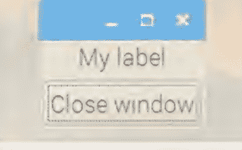

现在我们有一个包含了我们所需的控件的窗口，让我们回到创建按钮点击计数器。这里是代码：

```c
#include <gtk/gtk.h>

int count = 0;

void end_program(GtkWidget *wid, gpointer ptr) {
    gtk_main_quit();
}

void increment(GtkWidget *wid, gpointer ptr) {
    char buffer[30];
    count++;
    sprintf(buffer, "%d", count);
    gtk_label_set_text(GTK_LABEL(ptr), buffer);
}

int main(int argc, char *argv[]) {
  gtk_init(&argc, &argv);
  GtkWidget *win = gtk_window_new(GTK_WINDOW_TOPLEVEL);
  GtkWidget *btn = gtk_button_new_with_label("Click me");
  g_signal_connect(btn, "clicked", CALLBACK(increment), NULL);
  g_signal_connect(win, "destroy", CALLBACK(end_program), NULL);
  GtkWidget *lbl1 = gtk_label_new("My label");
  GtkWidget *box = gtk_vbox_new(GTK_ORIENTATION_VERTICAL, 5);
  gtk_box_pack_start(GTK_BOX(box), lbl1, TRUE, TRUE, 0);
  gtk_box_pack_start(GTK_BOX(box), btn, TRUE, TRUE, 0);
  gtk_container_add(GTK_CONTAINER(win), box);
  gtk_widget_show_all(win);
  gtk_main();
}
```
*(注：原文提供的示例代码块在逻辑上似乎有些断裂，翻译时已根据上下文进行了逻辑对齐。)*

让我们逐行查看更改：

`GtkWidget *box = gtk_vbox_new(FALSE, 5);`

这创建了一个新的 `GtkBox` 部件。该调用的两个参数是盒子是否同质的——这意味着它为其容纳的每个部件分配相同的空间——以及它容纳的部件之间的像素间距。因此，在这种情况下，盒子不是同质的——每个部件将根据需要分配空间——而且我们放入其中的两个部件之间将有 5 像素的间隙。

```c
gtk_box_pack_start (GTK_BOX(box), lbl1, TRUE, TRUE, 0);
gtk_box_pack_start (GTK_BOX(box), btn, TRUE, TRUE, 0);
```

`gtk_box_pack_start` 函数将一个部件放入盒子中。部件按照调用此函数的顺序进行添加，而末尾的 `_start` 表示部件是从盒子的“开始”端放置的，即 `VBox` 的顶部或 `HBox` 的左侧。（还有一个 `gtk_box_pack_end` 函数，它从底部或右侧添加部件。）

该函数接受五个参数，第一个是我们将部件放入的盒子的名称，第二个是我们要放入盒子的部件。其余三个参数控制部件在盒子中的位置——我们稍后会看。

```c
gtk_container_add (GTK_CONTAINER) (win, box);
```

最后，我们将盒子添加到窗口本身——这意味着窗口只持有一个部件，即盒子，我们不会再对它持有太多部件而抱怨了。

如果你现在编译并运行它，你应该能看到如下所示的窗口：


现在我们有一个包含了我们所需的控件的窗口，让我们回到创建按钮点击计数器。这里是代码：

```c
#include <gtk/gtk.h>

int count = 0;

void end_program(GtkWidget *wid, gpointer ptr) {
    gtk_main_quit();
}

void increment(GtkWidget *wid, gpointer ptr) {
    char buffer[30];
    count++;
    sprintf(buffer, "%d", count);
    gtk_label_set_text(GTK_LABEL(ptr), buffer);
}

int main(int argc, char *argv[]) {
  gtk_init(&argc, &argv);
  GtkWidget *win = gtk_window_new(GTK_WINDOW_TOPLEVEL);
  GtkWidget *btn = gtk_button_new_with_label("Click me");
  g_signal_connect(btn, "clicked", CALLBACK(increment), NULL);
  g_signal_connect(win, "destroy", CALLBACK(end_program), NULL);
  GtkWidget *lbl1 = gtk_label_new("My label");
  GtkWidget *box = gtk_vbox_new(GTK_ORIENTATION_VERTICAL, 5);
  gtk_box_pack_start(GTK_BOX(box), lbl1, TRUE, TRUE, 0);
  gtk_box_pack_start(GTK_BOX(box), btn, TRUE, TRUE, 0);
  gtk_container_add(GTK_CONTAINER(win), box);
  gtk_widget_show_all(win);
  gtk_main();
}
```


`gtk_box_pack_start` 的第三个参数称为 `expand`。如果设置为 `TRUE`，那么当窗口增大时，分配给此小部件的空间也会按比例增大。如果设置为 `FALSE`，分配给此小部件的空间永远不会超过所需的最小空间。

第四个参数称为 `fill`。如果 `expand` 设置为 `FALSE`，则它没有作用；但如果 `expand` 设置为 `TRUE`，它将控制是分配给小部件的空间还是小部件本身增长。如果 `expand` 为 `TRUE` 且 `fill` 为 `FALSE`，小部件本身的大小保持不变；如果 `expand` 和 `fill` 均为 `TRUE`，小部件本身将增长以填满增加的空间。

写下来这些可能很难理解，但几个例子将有助于理清思路。在上面的示例中，将 `GtkHB` 改回 `GtkVBox`，然后将示例中三个 `gtk_box_pack_start` 调用的 `expand` 和 `fill` 都设置为 `FALSE`。如果你调整窗口大小，标签和两个按钮将保持在窗口顶部相同的高度。

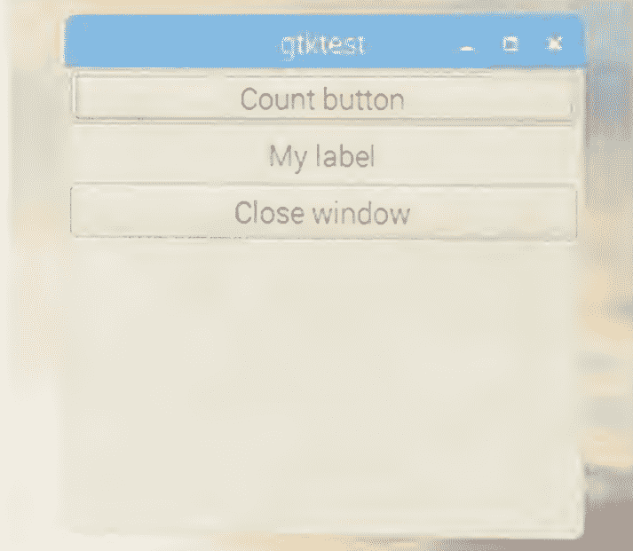

所有小部件的 `expand` 和 `fill` 均设置为 `FALSE` 的布局

现在尝试相同的操作，但将 `btn` 的 `gtk_box_pack_start` 中的 `expand` 参数设置为 `TRUE`：

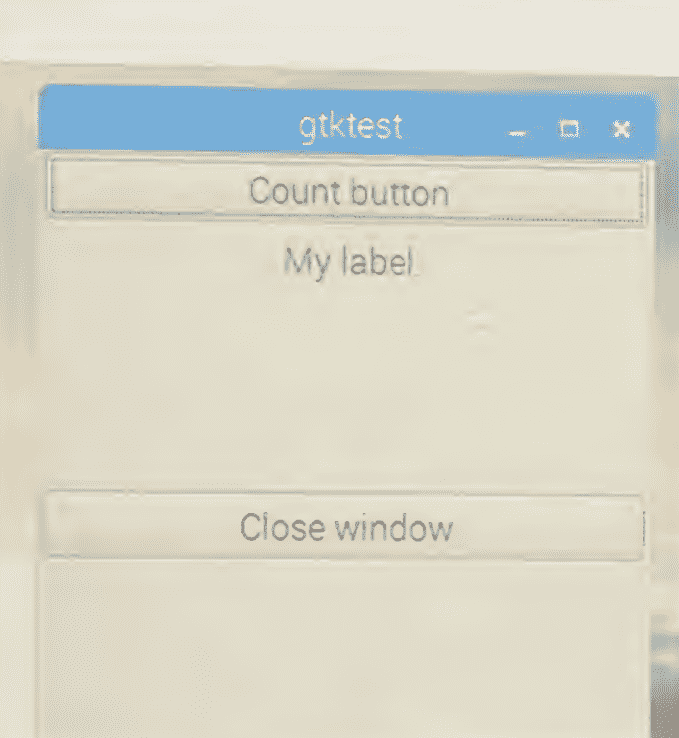

“关闭窗口”按钮 `expand` 设置为 `TRUE` 且 `fill` 设置为 `FALSE` 的布局

按钮现在向下移动以适应增加空间的中间部分，额外空间已分配给按钮，但按钮本身的大小保持不变。

最后，尝试将 `btn` 的 `expand` 和 `fill` 都设置为 `TRUE`，查看与上方图片类似的结果。

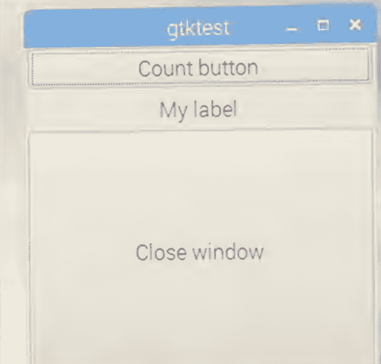

“关闭窗口”按钮 `expand` 和 `fill` 均设置为 `TRUE` 的布局

现在增大窗口会导致整个按钮填满额外空间。

我们可以看到，这些参数只影响小部件的垂直尺寸；这是因为它们被使用在 `GtkVBox` 中。如果我们也想控制小部件的水平尺寸，我们需要创建一个包含一组 `GtkBoxes` 的 `GtkBox`，然后用这些容器来包含小部件本身。

`gtk_box_pack_start` 调用中的最后一个参数称为 `padding` —— 这是在小部件两端插入的自由空间（以像素为单位），这是在 `gtk_box_new_call` 中请求的所有小部件之间的 `spacing` 之外的。

通过仔细调整 `expand`、`fill` 和 `padding` 参数，你可以创建一个整齐显示所有小部件并完全按照你的预期调整大小的窗口。

# 表格

你可能好奇如何在一个每两行的窗口中放置四个项目。嗯，将一个 `GtkHBox` 作为 `GtkVBox` 内部的项目之一是完全可以的，反之亦然。将一个 `GtkHBox` 作为 `GtkHBox` 内部的项目也是可以的（但通常没什么意义）。通过使用嵌套 `GtkHBoxes` 和 `GtkVBoxes` 的组合，你可以按照想要的方式布局窗口中的所有小部件。

嵌套 `GtkBoxes` 和 `GtkVBoxes` 在两个维度上布局小部件的效果非常好，并且实际上能让你对它们的外观拥有最好的控制。其实有一种更简单的替代方案：`GtkTable` 小部件。

`GtkTable` 是一个二维框，在创建时定义为具有特定数量的行和列。小部件可以位于各种行列坐标。这不如使用嵌套的 `GtkBoxes` 和 `GtkVBoxes` 灵活，因为每个小部件必须在行和列上对齐——这意味着任何一行的高度至少与该行中最高的小部件一样，任何一列的宽度至少与该列中最宽的小部件一样，这可能导致大量的空间浪费。但很多时候，这种简单的布局就足够了，`Table` 的工作得良好。

如果我们使用 `GtkTable` 来定位标签和按钮，我们的示例将更改如下：

```c
void main (int argc, char *argv[])

{

    gtk_init(&argc, &argv);

    GtkWidget *win = gtk_window (GTK_WINDOW_TOPLEVEL);

    GtkWidget *btn = gtk_button_with_label ("Click me");

    g_signal_connect(btn, G_CALLBACK (end_program), NULL);

    g_signal_connect(win, G_CALLBACK (end_program), NULL);

    GtkWidget *lbl = gtk_label_new ("My label");

    GtkWidget *btn2 = gtk_button_with_label ("Button 2");

    g_signal_connect(btn2, G_CALLBACK (count_button), lbl);

    GtkWidget *table = gtk_table_new (2, 2, TRUE);

    gtk_table_attach_defaults (GTK_TABLE (table), lbl, 0, 1, 0, 1);

    gtk_table_attach_defaults (GTK_TABLE (table), btn2, 1, 2, 0, 1);

    gtk_table_attach_defaults (GTK_TABLE (table), btn, 0, 2, 1, 2);

    gtk_container_add (GTK_CONTAINER (win), table);

    gtk_widget_show_all (win);

    gtk_main ();

}
```

我们通过以下代码创建一个新的 `GtkTable`：

```c
GtkWidget *tbl = gtk_table_new (2, 2, TRUE);
```

`gtk_table_new` 函数的参数是行数和列数。要向表格中插入小部件，我们使用：

```c
gtk_table_attach_defaults (GTK_TABLE (tbl), lbl, 0, 1, 0, 1);
```

我们将表格和要放入其中的小部件作为参数传递。接下来的数字是小部件附加到表格上的坐标——按顺序它们是左边缘和右边缘的位置，然后是顶部和底部边缘。这把小部件放置在第一列（在 x 0 到 1 之间）和第一行（在 y 0 到 1 之间）。注意，你可以让小部件跨越多行或多列，就像 `btn` 放置的方式：

```c
gtk_table_attach_defaults (GTK_TABLE (tbl), btn, 0, 2, 1, 2);
```

在这种情况下，小部件跨越了第一列和第二列，因为它在左侧附加于 0，右侧附加于 2。为了完整性，请注意 `gtk_table_attach_defaults` 是函数 `gtk_table_attach` 的简化版本，后者具有许多其他选项。这些其他选项包括为每个小部件提供扩展、填充和设置 `padding` 的功能，就像上一章描述的 `gtk_box_pack` 函数一样。但这些函数写起来很麻烦——使用 `gtk_table_attach_defaults` 会将每个小部件的 `padding` 设置为 0 并将 `expand` 设置为 `TRUE`。如果你编译并运行此代码，你将得到一个像下面的窗口。注意，“关闭窗口”按钮如上所述跨越了表格的两个列。

img/6a7eee5b22417c3d49170130a20b16f2_95_0.png)

`GtkTable` 允许小部件在行列中对齐，使用户可以使用选择框和单选按钮输入文本并选择选项。我们已经看到可以使用标签在窗口上显示文本，但如果我们想读取用户输入的某些文本怎么办？GTK 提供了 `GtkEntry` 小部件来实现。

# 文本输入

修改上面的示例代码，在表格中添加带有 `GtkEntry` 小部件的新单元格，如下所示：

```c
#include <gtk/gtk.h>

GtkWidget *txt;

void end_program(GtkWidget *wid, gpointer ptr)

{

    gtk_main_quit();

}

void edit(GtkWidget *wid, gpointer ptr)

{

    const char *input = gtk_entry_get_text(GTK_ENTRY(txt));

    gtk_label_set_text(GTK_LABEL(ptr), input);

}

void main(int argc, char *argv[])

{

    gtk_init(&argc, &argv);

    GtkWidget *win = gtk_window_new(GTK_WINDOW_TOPLEVEL);

    GtkWidget *btn = gtk_button_new_with_label("edit");

    gtk_signal_connect(btn, "clicked", G_CALLBACK(end_program), NULL);

    gtk_signal_connect(win, "delete_event", G_CALLBACK(end_program), NULL);

}
```

```c
GtkWidget *lbl = gtk_label_new ("My label");
```

```c
GtkWidget *btn2 = gtk_button_new_with_label ("Button 2");

g_signal_connect(btn2, "clicked", G_CALLBACK(edit), lbl);
```

```c
txt = gtk_entry_new();
```

```c
GtkWidget *tab = gtk_table_new (2, 2, TRUE);

gtk_table_attach_defaults (GTK_TABLE (tab), lbl, 0, 0, 1, 1);

gtk_table_attach_defaults (GTK_TABLE (tab), btn2, 1, 0, 0, 1);

gtk_table_attach_defaults (GTK_TABLE (tab), win, 0, 1, 1, 2); // 注意：此处原文误为win

gtk_table_attach_defaults (GTK_TABLE (tab), txt, 1, 1, 1, 1);
```

在这个示例中，我们将 `GtkEntry` 小部件的指针 `txt` 声明为全局变量。这是因为我们需要从按钮处理程序访问它，而在这种情况下处理程序也需要访问标签小部件。我们之前使用 `g_signal_connect` 函数中的通用指针将小部件信息传递给处理程序，但对于两个独立的小部件，我们只有一个指针（有很多方法可以使用单个指针，但使用全局变量更容易理解）。

我们添加了一个新函数 `copy_text`，它使用函数 `gtk_entry_get_text` 获取指向文本缓冲区的指针，缓冲区存储了用户在输入框中输入的任何内容。注意这个字符缓冲区带有 `const` 修饰符——这表示程序员无法更改它。然后我们将此缓冲区传递给 `gtk_label_set_text`，它会将 `GtkEntry` 的内容复制到 `GtkLabel`。

最后，我们通过 `gtk_entry_new` 创建 `GtkEntry` 本身，并将其添加到表格中（注意我们移动了 `btn` 的附加点，使其只占据表格的一个单元格而不是两个，以便为 `GtkEntry` 留出足够的空间）。

编译并运行代码；在输入框中输入内容并按下“复制”按钮，看看会发生什么。

img/6a7eee5b22417c3d49170130a20b16f2_97_0.png)

添加到表格右下角的 `GtkEntry`

## 数字调节旋按钮 (Spin buttons)

用户有多种输入数据的方式。通常，他们需要从多个选项中选择一个，而不是被给一个框并要求输入内容。GTK 为此目的提供了许多控件，它们与 `GtkEntry`、`GtkSpinButton` 密切相关。

数字调节旋按钮用于在特定范围内输入数值值。你可以指定最小值、最大值，以及每次按下按钮时数值变化的步长。这提供了一个文本输入控件——用户仍然可以向其中输入——同时也提供了一种更改值的方便方法。如果用户输入了超出你设置的范围的值，当你尝试读取它时，它会自动舍入到范围内最接近的值。

在上面的示例中，我们只需要更改一行代码即可将 `GtkEntry` 转换为 `GtkSpinButton`。将：

```c
txt gtk_entry_new ();
```

替换为：

```c
GtkObject *adj = gtk_adjustment_new (0, -10, 10, 1, 0, 0);

txt gtk_spin_button_new (GTK_ADJUSTMENT (adj), 0, 0);
```

这使得 `txt` 从 `GtkEntry` 变为 `GtkSpinButton`。我们可以看到 `gtk_spin_button_new` 函数的参数之一被称为 `GtkAdjustment` 的东西——它是什么？

`GtkAdjustment` 用于设置数字调节旋按钮（以及其他具有类似行为的控件）可以取值的值范围。`gtk_adjustment_new` 函数的参数按顺序指定了默认值（在本例中为 0）、最小值（-10）、最大值（10）和步长（1）。（最后两个参数指定“页增量”，用于那些有两组不同的按钮来更改值的情况——数字调节旋按钮不使用这些，因此它们可以设置为 0）。

`GtkAdjustment` 作为参数传递给 `gtk_spin_button_new` 函数。

另外两个参数是爬升速率——即按住按钮时值变化的速度——以及数值上显示的小数位数。

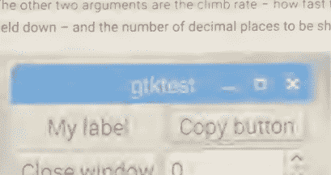

-   用 `GtkSpinButton` 代替 `GtkEntry`

编译并运行新版本的代码，文本输入框现在右侧有两个小按钮；这些按钮可以用来更改值。你仍然可以向框内输入内容，如果你输入的值不是数字，或者超出了 `GtkAdjustment` 指定范围，当按下其中一个按钮（或“复制按钮”）时，它将被纠正为范围内的一个值。

## 切换按钮 (Toggle buttons)

获取用户输入的一种简单方法是使用按钮来选择选项。GTK 为此目的提供了几个控件，其中两个比较有用的是复选按钮（check buttons——可以被勾选或取消勾选的框）和单选按钮（radio buttons——在一组中同时只有一个成员处于激活状态的选择器）。它们都是 `GtkToggleButton` 控件的子控件，而该控件本身是我们已经使用过几次的 `GtkButton` 控件的子控件。切换按钮是一种处于已选中或未选中状态之一的按钮。

## 复选按钮 (Check buttons)

复选按钮是两者中最简单的，所以我们先看它们。一个 `GtkCheckButton` 是一个可以是空框也可以带有勾选标记的框；点击它可以在这两种状态之间切换。创建一个复选按钮就像这样简单：

```c
GtkWidget *chk = gtk_check_button_new_with_label ("My check");
```

这创建了一个复选按钮以及其左侧一个带有提供文本的标签。（还有一个函数 `gtk_check_button_new`，它会创建一个不带标签的复选框——如果你在窗口的其他地方有它的标签，这会让事情更整洁。）尝试将上一个示例中的 `btn2` 替换为像 `chk` 的复选框——它看起来应该是这样：

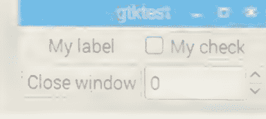

窗口右上角的复选按钮

默认情况下，新建的复选按钮处于未勾选状态。要勾选按钮，你调用：

```c
gtk_toggle_button_set_active(GTK_TOGGLE_BUTTON (chk), TRUE);
```

将按钮的激活状态设置为 `TRUE` 会勾选方框，设置为 `FALSE` 则会取消勾选。有一个相应的函数来读取切换按钮的激活状态——要将复选按钮当前是否被勾选读取到一个变量中，请执行：

# C语言编程入门

```c
int state = gtk_toggle_button_get_active(GTK_TOGGLE_BUTTON (chk));
```

如果按钮被勾选，`state` 的值将为1，否则为 0。

你也可以通过 `signal_connect` 为复选按钮的 `toggled` 信号连接一个处理函数——这等于我们在之前的示例中看到的连接到普通 `GtkButton` 的 `clicked` 信号：

```c
g_signal_connect(chk, "toggled", G_CALLBACK(check_toggle), NULL);
```

`toggled` 用的处理函数如下：

```c
void check_toggle(GtkWidget *wid, gpointer ptr)

{

    printf("The state of the button is %d", gtk_toggle_button_get_active(GTK_TOGGLE_BUTTON (wid)));

}
```


注意，`toggled`信号的第一个参数是控件本身，第二个是信号名称，第三个是回调函数。第四个参数用于传递给回调函数的数据。

## 单选按钮 (Radio buttons)

单选按钮可以被视为一组，其中一次只有一个能被选中。单选按钮和复选按钮之间的区别在于，单选按钮需要关联到一个组才能使链接生效。以下是创建一个组并向其中添加单选按钮的方法：

```c
GtkButtonGroup *group = gtk_button_group_new();

GtkWidget *rad1 = gtk_radio_button_new_with_label(group, "Button 1");

GtkWidget *rad2 = gtk_radio_button_new_with_label(group, "Button 2");
```

组中的每个按钮都需要与组中的另一个链接。如果你正确链接了它们，那么当你点击“Button 2”时，它会被选中而“Button 1”会被取消选中，反之亦然。

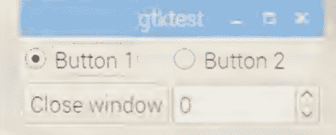

窗口顶部的两个 `GtkButton`

# 第19章

## 下拉框 (Combo boxes) 与列表存储

创建下拉框并与其关联列表存储

像数字调节旋按钮、单选按钮和复选按钮这样的控件允许用户在较少选项之间进行选择，但有时我们需要提供更多选项。下拉框是为用户提供选择范围而不占用大量空间的好方法；GTK 提供了两种类型的下拉框。

### 文本下拉框

更简单的下拉框类型是 `GtkComboBoxText`，它允许每个选项仅纯文本。以下是创建它的方法：

```c
GtkWidget *comb = gtk_combo_box_text_new ();

gtk_combo_box_text_append_text (comb, "Option 1");

gtk_combo_box_text_append_text (comb, "Option 2");

gtk_combo_box_text_append_text (comb, "Option 3");

gtk_combo_box_set_active (comb, 0);
```

`gtk_combo_box_text_new` 函数创建一个空的下拉框，可以使用 `gtk_combo_box_text_append_text` 向其添加项目（按照它们应该出现的顺序，从上到下）。

最后所示的函数调用 `gtk_combo_box_set_active` 设置了下拉框的初始值——在本例中，设置为 0 选择了第一个添加到下拉框的选项。

`box`，'Option 1'。注意，这是针对 `GtkComboBox` 组件的函数，而不是针对 `GtkComboBoxText` - 因为 `GtkComboBox` 是 `GtkComboBoxText` 的父类，你可以通过适当的类型转换在子类上使用父类的函数。

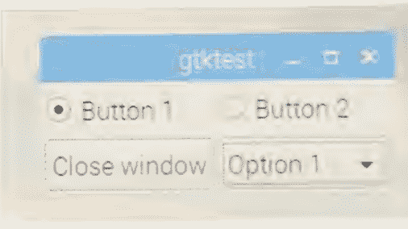

窗口右下角的 `GtkComboBoxText`

读取当前选中的值，请使用：

```c
int sel = gtk_combo_box_get_active (GTK_COMBO_BOX ());
```

此函数返回当前选中项的索引 - 0 表示 'Option 1'，1 表示 'Option 2'，依此类推。或者，

```c
char *selected = gtk_combo_box_text_get_active_text (
GTK_COMBO_BOX_TEXT (comb));
```

...可以使用它来返回被选中的实际文本字符串。（注意，此函数仅适用于 combo box；不能用于下一节中描述的完整 combo box。）

当用户更改值时，combo box 生成的信号称为 `changed`，因此可以使用如下的回调函数：

```c
void combo_changed (GtkWidget *wid, gpointer ptr) {
  int sel = gtk_combo_box_get_active (GTK_COMBO_BOX (wid));
  char *selected = gtk_combo_box_text_get_active_text (
    GTK_COMBO_BOX_TEXT (wid));
  printf("The value of the combo is %d %s\n", sel, selected);
}
```

...可以使用以下代码进行连接：

### C语言编程简介

```c
g_signal_connect (comb, "changed", G_CALLBACK(combo_changed), NULL);
```

`GtkComboBoxText` 是一个简单情况的有用控件，但完整的 `GtkComboBox` 提供了更多的灵活性。像其他用于自由形式数据显示的组件一样，它被用作一个名为 list store 的数据库结构的前端。

## 列表存储 (List stores)

`list store` 可以被认为是一个具有多行多列的数据表。表格的每个单元格都可以存储文本字符串、整数，甚至是图像。

一旦创建了 list store，就可以将其与 combo box 关联，并使用 list store 的一列来为框提供选项。这部分代码比上面的 `GtkComboBoxText` 代码稍微长且更复杂，但它为对 combo box 进行更复杂的处理提供了可能。

```c
int pos = 0;
GtkListStore *ls = gtk_list_store_new (1, G_TYPE_STRING);
gtk_list_store_insert_with_values (ls, NULL, pos++, 0,
    "Option 1", -1);
gtk_list_store_insert_with_values (ls, NULL, pos++, 0,
    "Option 2", -1);
gtk_list_store_insert_with_values (ls, NULL, pos++, 0,
    "Option 3", -1);
```

```c
GtkWidget *comb = gtk_combo_box_new_with_model (
    Gtk_TREE_MODEL (ls));
```

```c
GtkCellRenderer *rend = gtk_cell_renderer_text_new ();
```

```c
gtk_cell_layout_pack_start (GTK_CELL_LAYOUT (comb), rend, FALSE);
gtk_cell_layout_add_attributes (GTK_CELL_LAYOUT (comb), rend,
    "text", 0);
```

首先，我们创建一个 `GtkListStore`：

```c
GtkListStore *ls = gtk_list_store_new (1, G_TYPE_STRING);
```

`gtk_list_store_new` 函数接收一个参数列表 - 第一个是 list store 中的列数，随后是每列所存储的数据类型类型列表。在例例中，我们正在创建一个单列的框，该列将包含一个文本字符串。
然后我们向 list store 添加一些条目：

```c
gtk_list_store_insert_values (ls, NULL, pos++, 0,
    "Option 1", -1);
gtk_list_store_insert_values (ls, NULL, pos++, 0,
    "Option 2", -1);
gtk_list_store_insert_values (ls, NULL, pos++, 0,
    "Option 3", -1);
```

每次调用 `gtk_list_store_insert_with_values` 都会将 list store 作为参数，随后是一个 NULL 指针。在某些情况下，这将是一个指向迭代器（iterator）的指针，它是对刚刚添加的条目的引用 - 我们不需要此功能，所以将指针设置为 NULL。

随后是新条目要放置在 list store 中的索引 - 实际上是用于数据的行号 - 然后是一组成对的值。每对值的第一个值是要存储数据的列，第二个值是数据本身，值对列表以列值 -1 结束。在这种情况下，我们只在每行的第 0 列添加一个单一字符串项。
我们将 combo box 与 list store 关联起来：

```c
GtkWidget *comb = gtk_combo_box_new_with_model (
    GTK_TREE_MODEL (ls));
```

这创建了一个 combo box，并告诉它数据来自于我们创建的 list store。combo box 的类型是 `GtkTreeModel`。现在我们设置渲染器来显示 combo box 的内容：

```c
GtkCellRenderer *rend = gtk_cell_renderer_text_new ();
```

我们将渲染器放置到 cell 布局中：

```c
gtk_cell_layout_pack_start (GTK_CELL_LAYOUT (comb), rend, FALSE);
```

然后设置属性：

```c
gtk_cell_layout_add_attributes (GTK_CELL_LAYOUT (comb), rend,
    "text", 0);
```

尝试构建并运行代码，看看 combo box 的效果是否与 `GtkComboBoxText` 相同

右下角的 `GtkComboBoxText`

有些情况下，使用 list store 来处理 combo box 可能是多此一举的 -但在某些情况下，它是正确的做法！由于 list store 允许对数据排序，这在 combo box 中非常有用：

```c
char *selected = gtk_combo_box_text_get_active_text (
    GTK_COMBO_BOX_TEXT (wid));
```

...可以返回被选中的实际文本字符串。（注意，此函数仅适用于 combo box；不能用于下一节中描述的完整 combo box。）

当用户更改值时，combo box 生成的信号称为 `changed`，因此可以使用如下的回调函数：

```c
void combo_changed (GtkWidget *wid, gpointer ptr) {
  int sel = gtk_combo_box_get_active (GTK_COMBO_BOX (wid));
  char *selected = gtk_combo_box_text_get_active_text (
    GTK_COMBO_BOX_TEXT (wid));
  printf("The value of the combo is %d %s\n", sel, selected);
}
```

...可以使用以下代码进行连接：

```c
g_signal_connect (comb, "changed", G_CALLBACK(combo_changed), NULL);
```


# C语言编程简介

`g_signal_connect(comb, "changed", G_CALLBACK(combo_changed), NULL);`

`box`，`'Option 1'`。注意，这是针对 `GtkComboBox` 组件的函数，而不是针对 `GtkComboBoxText` —— 因为 `GtkComboBox` 是 `GtkComboBoxText` 的父类，你可以通过适当的类型转换在子类上使用父类的函数。


窗口右下角的 `GtkComboBoxText`

读取当前选中的值，请使用：

```
int sel = gtk_combo_box_get_active(GTK_COMBO_BOX());
```

此函数返回当前选中项的索引 - 0 表示 `'Option 1'`，1 表示 `'Option 2'`，依此类推。或者，

```
char *selected = gtk_combo_box_text_get_active_text(GTK_COMBO_BOX_TEXT(comb));
```

...可以使用它来返回被选中的实际文本字符串。注意，此函数仅适用于 combo box；不能用于下一节中描述的完整 combo box。

当用户更改值时，combo box 生成的信号称为 `changed`，因此可以使用如下的回调函数：

```c
void combo_changed(GtkWidget *wid, gpointer ptr) {
  int sel = gtk_combo_box_get_active(GTK_COMBO_BOX(wid));
  char *selected = gtk_combo_box_text_get_active_text(GTK_COMBO_BOX_TEXT(wid));
  printf("The value of the combo is %d %s\n", sel, selected);
}
```

...可以使用以下代码进行连接：

```
g_signal_connect(comb, "changed", G_CALLBACK(combo_changed), NULL);
```

`GtkComboBoxText` 是一个简单情况的有用控件，但完整的 `GtkComboBox` 提供了更多的灵活性。像其他用于自由形式数据显示的组件一样，它被用作一个名为 `list store` 的数据库结构的前端。

## 列表存储 List stores

`list store` 可以被认为是一个具有多行多列的数据表。表格的每个单元格都可以存储文本字符串、整数，甚至是图像。

一旦创建了 `list store`，就可以将其与 combo box 关联，并使用 `list store` 的一列来为框提供选项。这部分代码比上面的 `GtkComboBoxText` 代码稍微长且更复杂，但它为对 combo box 进行更复杂的处理提供了可能。

```
int pos = 0;
GtkListStore *ls = gtk_list_store_new(1, G_TYPE_STRING);
gtk_list_store_insert_with_values(ls, NULL, pos++, 0, "Option 1", -1);
gtk_list_store_insert_with_values(ls, NULL, pos++, 0, "Option 2", -1);
gtk_list_store_insert_with_values(ls, NULL, pos++, 0, "Option 3", -1);
```

```
GtkWidget *comb = gtk_combo_box_new_with_model(GTK_TREE_MODEL(ls));
```

```
GtkCellRenderer *rend = gtk_cell_renderer_text_new();
```

```
gtk_cell_layout_pack_start(GTK_CELL_LAYOUT(comb), rend, FALSE);
gtk_cell_layout_add_attributes(GTK_CELL_LAYOUT(comb), rend, "text", 0);
```

首先，我们创建一个 `GtkListStore`：

```
GtkListStore *ls = gtk_list_store_new(1, G_TYPE_STRING);
```

`gtk_list_store_new` 函数接收一个参数列表 - 第一个是 `list store` 中的列数，随后是每列所存储的数据类型列表。在例中，我们正在创建一个单列的框，该列将包含一个文本字符串。

然后我们向 `list store` 添加一些条目：

```
gtk_list_store_insert_values(ls, NULL, pos++, 0, "Option 1", -1);
gtk_list_store_insert_values(ls, NULL, pos++, 0, "Option 2", -1);
gtk_list_store_insert_values(ls, NULL, pos++, 0, "Option 3", -1);
```

每次调用 `gtk_list_store_insert_with_values` 都会将 `list store` 作为参数，随后是一个 `NULL` 指针。在某些情况下，这将是一个指向迭代器 `iterator` 的指针，它是对刚刚添加的条目的引用 - 我们不需要此功能，所以将指针设置为 `NULL`。

随后是新条目要放置在 `list store` 中的索引 - 实际上是用于数据的行号 - 然后是一组成对的值。每对值的第一个值是要存储数据的列，第二个值是数据本身，值对列表以列值 `-1` 结束。在这种情况下，我们只在每行的第 0 列添加一个单一字符串项。

我们将 combo box 与 `list store` 关联起来：

```
GtkWidget *comb = gtk_combo_box_new_with_model(GTK_TREE_MODEL(ls));
```

这创建了一个 combo box，并告诉它数据来自于我们创建的 `list store`。combo box 的类型是 `GtkTreeModel`。现在我们设置渲染器来显示 combo box 的内容：

```
GtkCellRenderer *rend = gtk_cell_renderer_text_new();
```

我们将渲染器放置到 cell 布局中：

```
gtk_cell_layout_pack_start(GTK_CELL_LAYOUT(comb), rend, FALSE);
```

然后设置属性：

```
gtk_cell_layout_add_attributes(GTK_CELL_LAYOUT(comb), rend, "text", 0);
```

尝试构建并运行代码，看看 combo box 的效果是否与 `GtkComboBoxText` 相同 

右下角的 `GtkComboBoxText`

有些情况下，使用 `list store` 来处理 combo box 可能是多此一举的 - 但在某些情况下，它是正确的做法！由于 `list store` 允许对数据排序，这在 combo box 中非常有用：

```
char *selected = gtk_combo_box_text_get_active_text(GTK_COMBO_BOX_TEXT(wid));
```

...可以返回被选中的实际文本字符串。注意，此函数仅适用于 combo box；不能用于下一节中描述的完整 combo box。

当用户更改值时，combo box 生成的信号称为 `changed`，因此可以使用如下的回调函数：

```c
void combo_changed(GtkWidget *wid, gpointer ptr) {
  int sel = gtk_combo_box_get_active(GTK_COMBO_BOX(wid));
  char *selected = gtk_combo_box_text_get_active_text(GTK_COMBO_BOX_TEXT(wid));
  printf("The value of the combo is %d %s\n", sel, selected);
}
```

...可以使用以下代码进行连接：

```
g_signal_connect(comb, "changed", G_CALLBACK(combo_changed), NULL);
```

# 第20章 树视图

使用 `GtkTreeView` 组件来显示信息和用户输入

正如在前一节提到的，将 `list store` 用于 combo box 有时是多此一举的！但在某些情况下，它是正确的做法！但 `list store` 真正设计的场景是作为名为 `GtkTreeView` 组件的数据存储。`GtkTreeView` 是一个按列排列的数据表。表格可以显示图像以及文本，甚至可以包含其他组件，如复选按钮。

## 创建树视图

为了演示这一点，我们将创建一个新的 `list store`，每行包含两个条目：一个字符串和一个图标。以下是实现该点的代码：

```c
void main(int argc, char *argv[]) {
  gtk_init(&argc, &argv);
  GtkWidget *window = gtk_window_new(GTK_WINDOW_TOPLEVEL);
  GtkWidget *btn = gtk_button_new_with_label("Click me");
  g_signal_connect(btn, "clicked", G_CALLBACK(end_program), NULL);
  g_signal_connect(win, "delete_event", G_CALLBACK(end_program), NULL);
  int pos = 0;
  GtkListStore *ls = gtk_list_store_new(2, GTK_TYPE_STRING, GTK_TYPE_PIXBUF);
  GdkPixbuf *icon = gtk_icon_theme_load_icon(gtk_icon_theme_get_default(), 2, 0, NULL);
}
```

```c
gtk_list_store_insert_with_values(ls, NULL, pos++, 0, "Option 1", 1, icon, -1);
gtk_list_store_insert_with_values(ls, NULL, pos++, 0, "Option 2", 1, icon, -1);
gtk_list_store_insert_with_values(ls, NULL, pos++, 0, "Option 3", 1, icon, -1);
```

```
GtkWidget *tv = gtk_tree_view_new_with_model(GTK_TREE_MODEL(ls));
GtkCellRenderer *prend = gtk_cell_renderer_pixbuf_new();
GtkCellRenderer *trend = gtk_cell_renderer_text_new();
```

```c
gtk_tree_view_insert_column_with_attributes(GTK_TREE_VIEW(tv), -1, "Icon", prend, "pixbuf", 1, NULL);
gtk_tree_view_insert_column_with_attributes(GTK_TREE_VIEW(tv), -1, "Option", trend, "text", 0, NULL);
```

```c
GtkWidget *tbl = gtk_table_new(2, 2, FALSE);
gtk_table_attach_defaults(GTK_TABLE(tbl), tv, 0, 2, 0, 1);
gtk_table_attach_defaults(GTK_TABLE(tbl), btn, 0, 1, 1, 2);
gtk_container_add(GTK_CONTAINER(win), tbl);
gtk_widget_show_all(win);
gtk_main();
```

首先，我们调用 `gtk_list_store_new` 创建一个包含 2 列的列表存储；列 0 包含一个如上一章所示的文本字符串；列 1 包含一个 `pixbuf`，用于存储图像。

```c
GtkListStore *ls = gtk_list_store_new(2, G_TYPE_STRING, GTK_TYPE_PIXBUF);
```

我们创建了一个包含小图像的 `GdkPixbuf` —— 在这种情况下，我们从当前项加载一个图标到其中，通过 `GdkPixbuf` 可以存储任何你选择要显示的图像。

```c
GdkPixbuf *icon = gtk_icon_theme_load_icon(gtk_icon_theme_get_default(), "dialog-ok-apply", 32, 0, NULL);
```

在每个情况下，我们都向列表存储添加了三行；我们在行的第 0 列放入一个文本字符串，并在第 1 列放入我们创建的 `pixbuf`。

## C语言与 GTK 编程简介

```c
gtk_list_store_insert_with_values(ls, NULL, pos++, 0, icon, 1, icon, -1);
gtk_list_store_insert_with_values(ls, NULL, pos++, 0, icon, 1, icon, -1);
gtk_list_store_insert_with_values(ls, NULL, pos++, 0, icon, 1, icon, -1);
```

我们需要创建一个 `GtkTreeView` 来显示列表存储。这一步与上一章中创建 `GtkListStore` 类似 —— 将新的 `GtkTreeView` 与我们创建的 `GtkListStore` 关联。

```c
GtkWidget *tv = gtk_tree_view_new_model(GTK_TREE_MODEL(ls));
```

与组合框一样，我们需要为想要在此显示的所有数据类型创建单元渲染器，在这种情况下，我们有两个 —— 一个文本渲染器和一个 `pixbuf` 渲染器。

```c
GtkCellRenderer *prend = gtk_cell_renderer_pixbuf_new();
GtkCellRenderer *trend = gtk_cell_renderer_text_new();
```

最后，我们将想要查看的列插入树视图中。

```c
gtk_tree_view_insert_column_with_attributes(GTK_TREE_VIEW(tv), -1, "Icon", prend, "pixbuf", 1, NULL);
gtk_tree_view_insert_column_with_attributes(GTK_TREE_VIEW(tv), -1, "Option", trend, "text", 0, NULL);
```


`GTK_TREE_VIEW (tv)`, -1, "Option", trend, "text", 0, NULL);

每次对 `tree_view` 的调用都将树本身作为第一个参数。该参数是列的位置 —— 这可以是实际位置（从表格左侧的 0 开始编号），也可以在这里是 -1，这表示该列应作为下一列添加；即表格中已存在的最右侧列的右侧。下一个参数是列标题（可以显示在表格顶部），然后是我们创建的用于该列的渲染器。

最后的参数被传递给单元渲染器本身，并将渲染器的属性设置到列表存储中某列的数据上 —— 在第一个实例，我们使用 pixbuf 渲染器的 'pixbuf' 属性设置到第 1 列的数据上，在第二种情况下，我们把文本渲染器的 'text' 属性设置到第 0 列的数据上（由于某些渲染器可以设置多个属性，因此最后一个参数是 `NULL`，表示没有更多需要设置的属性了）。

构建并运行代码，并观察发生了什么 —— 你应该会看到类似图像叠加的效果：


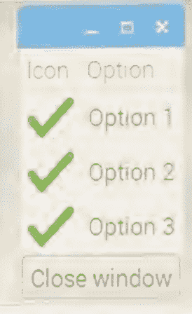

具有两列（一个 pixbuf 和一些文本）的 GtkTreeView

## 从树视图获取输入

树视图作为信息显示非常有用，但也可以用于读取用户的选择。如果你点击表格中的某一行，它会被高亮 —— 你也可以通过键盘上的箭头键在表格中上下移动高亮部分。

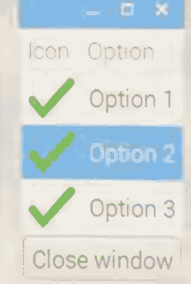

一个被用户选了行的 GtkTreeView

每当选中的行改变时，树视图就会产生 `cursor-changed` 信号，因此可以用此调用相应的回调函数：

```c
g_signal_connect(tv, "cursor-changed", G_CALLBACK
(row_selected), NULL);
```

回调函数应该如下：

```c
void row_selected (GtkWidget *wid, gpointer ptr)
{
    GtkTreeSelection *sel;
    GtkTreeModel *model;
    GtkTreeIter iter;
    char *option;
    sel = gtk_tree_view_get_selection (GTK_TREE_VIEW (wid));
    if (gtk_tree_selection_get_selected (sel, &model, &iter))
    {
        gtk_tree_model_get(model, &iter, 0, &option, -1);
        printf ("The selected row contains the text %s\n", option);
    }
}
```

确定哪些行被选中需要一个迭代器（iterator），它是一个存储列表存储中某行位置的数据结构。

首先，我们需要获取树视图的 `GtkTreeSelection` —— 它存储了当前被高亮的行（或哪些行）。

```c
sel = gtk_tree_view_get_selection (GTK_TREE_VIEW (tv));
```

从 `GtkTreeSelection` 获取 `GtkTreeIter` 和关联的 `GtkTreeModel`。模型是提供树数据的列表存储，迭代器是当前被高亮的行。

```c
if (gtk_tree_selection_get_selected (sel, &model, &iter))
```

（此函数返回 `FALSE` 则表示没有选中项 —— 否则下一行会导致崩溃。）

最后，我们可以从模型和迭代器获取实际值。

```c
gtk_tree_model_get (model, &iter, 0, &option, -1);
```

当设置列表存储中的值时，传递给函数的模型和迭代器之后的参数是一对值，每对第一个是要读取的列，第二个是要写入数据的指针。在这种情况下，第一列的文本指针作为 `option` 返回。`-1` 表示没有更多要设置的属性。

# 第21章

## 菜单

带有下拉菜单和弹出菜单的菜单栏

应用程序顶部都有菜单栏。GTK 提供了许多创建菜单栏或弹出菜单的控件。菜单的构建块是 `GtkMenuItem`。菜单中的每个项都是 `GtkMenuItem`，它关联有一个文本标签。使用 `GtkWidget` 来包含一个或多个 `GtkMenuItem`；创建一个类型在应用程序菜单栏项被选中时看到的弹出菜单。

### 菜单栏

`GtkMenuBar` 可以显示在应用程序顶部；它包含许多 `GtkMenuItem`；每个项为 `GtkMenu` 提供名称，如上所述，认为 `GtkMenuItem` 既是菜单的成员又是整个菜单的名称可能有些困惑，但希望示例会让情况更清晰。这是带有菜单栏应用程序的代码：

```c
void main (int argc, char *argv[]) {
    int init;
    gtk_init (&argc, &argv);
    GtkWidget *win = gtk_window_new (GTK_WINDOW_TOPLEVEL);
    GtkWidget *btn = gtk_button_new_with_label ("Close");
    g_signal_connect (btn, "clicked", G_CALLBACK (end_program), NULL);
    g_signal_connect (win, "delete_event", G_CALLBACK (end_program), NULL);
    GtkWidget *mbar = gtk_menu_bar_new ();
    GtkWidget *hbox = gtk_box_new (FALSE, FALSE, 5);
    gtk_box_pack_start (GTK_BOX (hbox), mbar, TRUE, TRUE, 0);
    gtk_container_add (GTK_CONTAINER (win), hbox);
}
```

```c
Gtkwidget *file_mi = gtk_menu_item_with_label ( "File" );
gtk_menu_shell_append (GTK_MENU_SHELL(mbar), file_mi);
```

```c
Gtkwidget *f_menu = gtk_menu_new ( );
gtk_menu_item_set_submenu (GTK_MENU_ITEM(file_mi), f_menu);
```

```c
Gtkwidget *quit_mi = gtk_menu_item_new_with_label ( "Quit" );
gtk_menu_shell_append (GTK_MENU_SHELL(mbar), quit_mi);
gtk_signal_connect (quit_mi, "destroy", G_CALLBACK (end_program), NULL);
```

```c
gtk_box_pack_start (GTK_BOX(vbox), btn, TRUE, TRUE, 0);
gtk_widget_show_all (win);
gtk_main ( );
```

首先，我们创建一个菜单栏来容纳应用程序菜单。

```c
Gtkwidget *mbar = gtk_menu_bar_new ( );
```

我们需要将其添加到窗口中；像任何其他部件一样，为了将其置于窗口顶部，我们需要创建一个垂直布局框，将菜单栏放置在顶部，将窗口的其他内容放置在其下方，然后将该垂直布局框放入窗口的容器中。

```c
Gtkwidget *vbox = gtk_vbox_new (FALSE, 5);
gtk_box_pack_start (GTK_BOX(vbox), mbar, TRUE, TRUE, 0);
gtk_container_add (GTK_CONTAINER(win), vbox);
```

我们创建一个菜单项来容纳“文件”（File），并使用 `gtk_menu_shell_append` 将其添加到菜单栏——菜单壳（menu shell）可以是任何可以包含菜单项的对象，在实践中，这要么是菜单要么菜单栏。

```c
Gtkwidget *file_mi = gtk_menu_item_new_with_label ( "File" );
gtk_menu_shell_append (GTK_MENU_SHELL(mbar), file_mi);
```

此时，我们有一个包含单个“文件”项的菜单栏 - 现在我们需要创建一个与该菜单项关联的菜单。

```c
Gtkwidget *f_menu = gtk_menu_new ( );
```

# C语言 GUI 编程简介

创建菜单后，我们使用 `gtk_menu_item_set_submenu` 将其设为“文件”菜单项的子菜单。

```c
gtk_menu_item_set_submenu (GTK_MENU_TREE(file_mi), f_menu);
```

此时，我们有一个带有“文件”项的菜单栏，以及一个作为该菜单项子菜单的空菜单。我们创建一个新菜单来容纳“退出”（Quit）选项，并使用 `gtk_menu_shell_append` 将其添加到“文件”菜单中。

```c
GtkWidget *quit_mi = gtk_menu_item_new_with_label("Quit");
gtk_menu_shell_append(GTK_MENU_SHELL(menu), quit_mi);
```

我们有一个包含单个菜单（“文件”）的菜单栏，该菜单包含单个选项（“退出”），但目前该选项还不会执行任何操作。要让菜单项执行操作，我们需要通过 `connect` 将处理回调连接到激活（activate）信号，就像处理按钮一样。

将现有的 `end_program` 处理器连接到“退出”菜单项的代码如下：

```c
g_signal_connect(quit_mi, "activate", G_CALLBACK(end_program), NULL);
```

就是这样 - 现在你的应用程序中有一个可以工作的“退出”菜单选项。你可以使用相同的过程向菜单栏中添加尽可能多的菜单和菜单项。

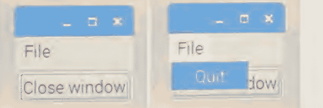

- 一个包含单个菜单（文件）且其中包含一个退出项的 GtkMenuBar

注意，我们用于将菜单添加到菜单栏的函数是 `gtk_menu_item_set_submenu` —— 实际上，该菜单被视为菜单栏中顶层菜单项的子菜单。你可以使用完全相同的函数从菜单项创建实际子菜单，并可以根据需要深度嵌套这些调用，以创建更复杂应用程序使用的那种分级菜单结构。

从易用性的角度来看，建议子菜单不要超过一级——让一个菜单从某些项创建子菜单是可以的，但如果你从子菜单本身又创建更多子菜单，用户可能会感到困惑！

### 弹出菜单

工具栏是向应用程序添加菜单最常见的方法，但也可以使用非常相似的代码来添加点击按钮、树视图或其他各种部件时产生的弹出菜单。

创建以下处理函数，并将其连接到按钮的点击（clicked）信号。

```c
void button_popup (GtkWidget *wid, gpointer ptr) {
  GtkWidget *f_menu = gtk_menu_new ();
  GtkWidget *quit_mi = gtk_menu_item_new_with_label ("Quit");
  gtk_menu_shell_append (GTK_MENU_SHELL(f_menu), quit_mi);
  g_signal_connect (quit_mi, "activate", G_CALLBACK (end_program), NULL);
  gtk_widget_show_all (f_menu);
  gtk_menu_popup (GTK_MENU(f_menu), NULL, NULL, NULL, NULL, 1);
  gtk_get_current_event_time ();
}
```

这创建了一个包含单个项“退出”的菜单，与之前一样，但不是将其放入菜单栏，而是使用 `gtk_menu_popup` 函数在鼠标光标位置显示它。当你按下连接到此处理句的按钮时，菜单将显示在按钮上方，然后可以从那里进行选择。


^ 一个从按钮启动的弹出菜单

`gtk_menu_popup` 函数设计用于从非常底层的系统鼠标事件——当从按钮处理函数调用它时，大多数事件信息是不需要的，这就是为什么它的的大部分参数被设置为 `NULL`。唯一重要的是第一个参数 —— 要弹出的菜单，以及最后两个参数，即被按下的按钮代码（1 表示左鼠标键）以及按下按钮的时间（从 `gtk_get_current_event_time` 函数获取）。

此示例显示了通过按下按钮生成的弹出窗口，但它也可以链接到许多其他部件的鼠标事件上。

# 第22章

## 对话框

使用对话框向用户提供信息并向他们提问

如果我们想向用户提问或通知他们某些信息，最好的方法是使用对话框。GTK 让我们轻松地创建对话框——对话框可以包含任何 GTK 部件，根据需要变得简单或复杂。

对话框与窗口的区别特征是它会中断应用程序的操作——直到对话框关闭。

对话框通常有一个或多个按钮（例如“确定”和“取消”），这些按钮位于对话框的动作区域（action area）。这里是简单对话框的代码：

```c
void open_dialog(GtkWidget *wid, gpointer ptr) {
  GtkWidget *dlg = gtk_dialog_new("My dialog",
      GTK_WINDOW(wid),
      GTK_DIALOG_MODAL,
      "Cancel", 0, "OK", 1, NULL);
  int result = gtk_dialog_run(GTK_DIALOG(dlg));
  printf("Return code = %d\n", result);
  gtk_widget_destroy(dlg);
}
```

这些参数的第一个是显示在标题栏上的文本。第二个是主窗口的指针。第三个参数是控制对话框行为的标志；在本例中，我们将其设置为模态（modal）并随父窗口销毁。模态意味着当对话框显示时，父窗口将被锁定——这通常是需要的行为。

剩余的参数控制动作区域显示哪些按钮。这是一个值对列表，每对第一个是显示在按钮上的标签，第二个是按钮被点击时生成的返回代码。列表以 `NULL` 值终止。

一旦创建了对话框，我们就调用 `gtk_dialog_run` —— 这显示对话框并允许用户与之交互。他们将操作对话框上的任何部件，但在此期间主窗口将被锁定；代码执行等待在 `gtk_dialog_run` 函数内部，直到动作区域中的按钮被点击。此时，你需要对对话框调用 `gtk_widget_destroy` 将其移除 —— 你可能认为点击按钮会移除对话框，但并没有；对话框一直显示在屏幕上，直到被显式移除。

在对话框显示期间，点击主窗口上的任何其他控件将不起作用。当你通过点击“确定”或“取消”按钮关闭对话框时，你将在启动应用程序的终端窗口中看到显示你点击的按钮返回代码的消息。


一个简单的 GtkDialog，动作区域内有两个按钮

这是一个基础对话框，但它看起来有点小且单调！让我们向它添加一个标签来向用户提问。为了实现这一点，我们访问对话框的内容区域，实际上，一个对话框是一个 GtkWindow，它内部包含一个带有两个 GtkContainer 容器的 GtkBox ——一个是底部的包含按钮的动作区域，另一个是顶部的内容区域。我们添加任何内容区域对话的额外内容，可以通过 `gtk_dialog_get_content_area` 函数访问。

像如下所示修改上面的处理函数：

```
void open_dialog(Gtkwidget *wid, gpointer ptr) {
  Gtkwidget *dlg = gtk_dialog_new_with_buttons("My dialog",
      GTK_WINDOW (ptr),
      GTK_DIALOG_MODAL | GTK_DIALOG_DESTROY_WITH_PARENT,
      "Cancel", 0, "OK", NULL);
  Gtkwidget *lbl = gtk_label_new (
    gtk_container_add(
      GTK_CONTAINER (gtk_dialog_get_content_area (GTK_DIALOG (dlg))),
      lbl
    );
    gtk_widget_show (lbl);
}
```

```
int result = gtk_dialog_run (GTK_DIALOG (dlg));
g_widget_destroy (dlg);
printf("Return code: %d\n", result);
```


我们使用了熟悉的 `gtk_container_add` 函数将标签添加到对话框的内容区域。请注意，我们还需要对添加的标签调用 `gtk_widget_show` —— `gtk_dialog_run` 会自动显示对话框本身的组件（如背景和按钮），但你需要显式地显示你添加的所有其他内容。

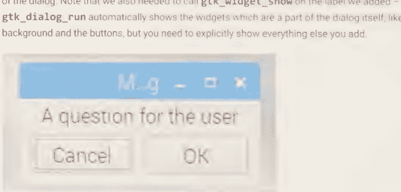

向内容区域添加了标签的 GtkDialog
与主应用程序窗口一样，如果我们想向内容区域添加多个组件，首先需要添加一个框或一个表格，然后将组件放入其中。

## 第 23 章

### 内置对话框

GTK 包含了一些用于常用函数的预制对话框。

在许多桌面应用程序中都有常用的对话框；例如，用于选择加载或保存的文件，或者选择颜色。GTK 包含了这些常用对话框的预制版本，可以轻松地包含在应用程序中，无需从头创建对话框的每个方面。对于大多数此类对话框，有一个 GTK 按钮可以启动对话框；最简单的方法是在应用程序中包含相应的按钮，剩下的工作都会为你完成。

#### 文件选择器对话框

让我们来看一个文件选择器对话框的示例，它用于获取文件的名称和路径，这些路径可以在后续的文件读取操作中使用。

```c
static void label(GtkFileFileChooser *btn, gpointer ptr)
{
    char *filename = gtk_file_chooser_get_filename(GTK_FILE_CHOOSER(btn));
    // ... ...
}

void main (int argc, char *argv[])
{
    gtk_init(&argc, &argv);
    GtkWidget *win = gtk_window_new(GTK_WINDOW_TOPLEVEL);
    gtk_window_set_title(win, "FileChooser");
    GtkWidget *btn = gtk_button_new_with_label("Open");
    g_signal_connect(btn, "clicked", G_CALLBACK(end_program), NULL);
    g_signal_connect(win, "delete_event", G_CALLBACK(end_program), NULL);
    GtkWidget *vbox = gtk_vbox_new(FALSE, 5);
    gtk_container_add GTK_CONTAINER (win, bbox);
    GtkWidget *fc_btn = gtk_file_choose_button_new (
  GTK_FILE_CHOOSER_ACTION_OPEN);
    gtk_signal_connect (fc_btn,
      CALLBACK (file_selected), NULL);
    gtk_box_pack_start (GTK_BOX, vbox), fc_btn, TRUE, TRUE, 0);
    gtk_box_pack_start (GTK_BOX, vbox), btn, TRUE, TRUE, 0);
    gtk_widget_show_all (win);
    gtk_main ();
}
```

创建了一个类型为 FileFileChooser 的组件并将其添加到窗口中。`gtk_file_chooser_button_new` 函数接受两个参数。第一个是应用于文件选择器窗口的标题。在这种情况下，我们想要打开一个现有文件，因此使用了 `GTK_FILE_CHOOSER_ACTION_OPEN`。另一种是选择一个现有文件夹，对应的代码为 `GTK_FILE_CHOOSER_ACTION_SELECT_FOLDER`。

`file-set` 信号连接到按钮上 —— 当用户做出选择时触发触发 —— 在该信号的处理函数中，调用了 `gtk_file_chooser_get_filename` 函数来读取文件名。

运行这段代码时，你会看到一个像这样的窗口：


一个 GtkFileChooser

顶部按钮右侧的文件夹图标表示它是文件选择器；按钮的标题是当前选定的文件名，当程序首次运行时显示为“(None)”。如果你点击该按钮，将打开一个文件选择对话框：

### C 语言与 GUI 编程简介

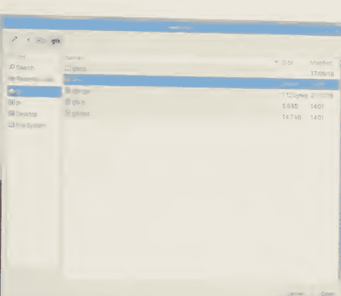

从 GtkFileChooserButton 打开的对话框用于选择现有文件提供了一个标准文件浏览器，因为我们是以“打开”模式打开窗口的，它只允许你选择系统中已存在的文件。使用浏览器选择文件并点击 Open。当窗口关闭时，按钮的标题将更新为选定的文件，并打印到启动终端。

你可以使用 GtkFileChooserButton 打开选择现有文件或文件夹的浏览器，但 GTK 的设计者认为你不能使用这种方法来选择保存新文件的地方。为此，你需要自己创建一个 Gtk 对话框。修改代码如下：

```c
static void func(GtkWidget *btn, gpointer *ptr) {
    GtkWidget *sch = gtk_file_chooser_dialog_new ("Save",
        GTK_WINDOW(ptr), GTK_FILE_CHOOSER_ACTION_SAVE,
        "Cancel", GTK_RESPONSE_CANCEL, "Open", GTK_RESPONSE_ACCEPT);
    if (gtk_dialog_run(GTK_DIALOG(sch)) == GTK_RESPONSE_ACCEPT) {
        char *filename = gtk_file_chooser_get_filename(GTK_FILE_CHOOSER(sch));
        printf("Saved to %s\n", filename);
    }
    gtk_widget_destroy(sch);
}
```

```c
void main (int argc, char *argv[]) {
    gtk_init(&argc, &argv);
    GtkWidget *win = gtk_window_new(GTK_WINDOW_TOPLEVEL);
    gtk_window_set_title(win, "FileChooser");
    GtkWidget *btn = gtk_button_new_with_label("Open");
    g_signal_connect(btn, "clicked", G_CALLBACK(end_program), NULL);
    g_signal_connect(win, "delete_event", G_CALLBACK(end_program), NULL);
    GtkWidget *vbox = gtk_vbox_new(FALSE, 5);
    GtkWidget *bbox = gtk_get_border_width(vbox);
    gtk_container_add(GTK_CONTAINER(win), vbox);
    gtk_container_set_border_width(GTK_CONTAINER(vbox), 10);
    GtkWidget *fc_btn = gtk_file_choose_button_new(
      GTK_FILE_CHOOSER_ACTION_OPEN);
    gtk_signal_connect(fc_btn,
      CALLBACK (file_selected), NULL);
    gtk_box_pack_start(GTK_BOX(vbox), fc_btn, TRUE, TRUE, 0);
    gtk_box_pack_start(GTK_BOX(vbox), btn, TRUE, TRUE, 0);
    gtk_widget_show_all(win);
    gtk_main();
}
```

创建了一个类型为 FileFileChooser 的组件并将其添加到窗口中。`gtk_file_chooser_button_new` 函数接受两个参数。第一个是应用于文件选择器窗口的标题。在这种情况下，我们想要打开一个现有文件，因此使用了 `GTK_FILE_CHOOSER_ACTION_OPEN`。另一种是选择现有文件夹，对应的代码为 `GTK_FILE_CHOOSER_ACTION_SELECT_FOLDER`。

`file-set` 信号连接到按钮上 —— 当用户做出选择时触发 —— 在该信号的处理函数中，调用了 `gtk_file_chooser_get_filename` 函数来读取文件名。

运行这段代码时，你会看到一个像这样的窗口：


一个 GtkFileChooser

顶部按钮右侧的文件夹图标表示它是文件选择器；按钮的标题是当前选定的文件名，当程序首次运行时显示为“(None)”。如果你点击该按钮，将打开一个文件选择对话框：

在这种情况下，我们创建一个按钮来打开对话框，然后必须手动创建并打开对话框。

通过 `gtk_file_chooser_dialog_new` 创建对话框，其参数与 `gtk_dialog_with_buttons` 非常相似。首先提供对话框的标题，接着是父窗口指针，然后是一个决定对话框行为的标志（在这种情况下，被设置为提供一个可以保存文件的位置）。剩余的参数是对话框底部按钮的标签和返回值列表，以 NULL 结尾。

当按下按钮时，通过调用 `gtk_dialog_run` 创建对话框：按钮处理函数等待对话框返回：然后我们像处理文件打开对话框一样，使用 `gtk_file_chooser_get_filename` 从文件选择器中读取文件路径。


### C 语言 GUI 编程简介

如果你运行这段代码并点击“Save file”按钮，你会发现文件保存选择器与文件打开选择器有不同，因为它有一个允许输入新文件名的框：

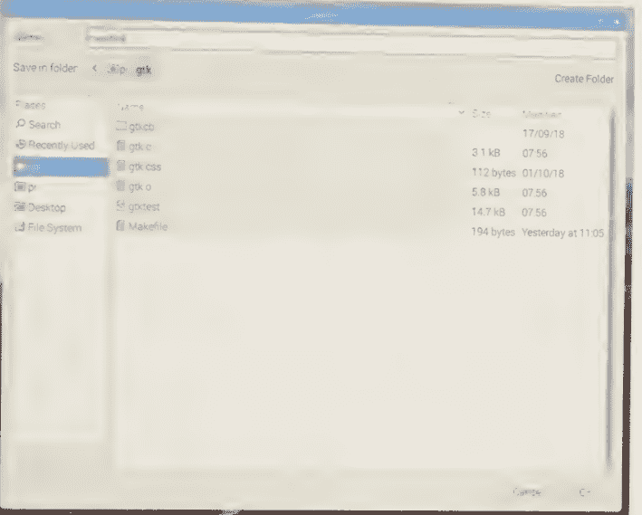

用于选择新文件的 GtkFileChooserDialog

输入新文件名并选择新文件的位置，当你按下“OK”时，新文件的路径将打印到终端。

有时你需要允许用户选择一种颜色来决定如何高亮显示，例如：使用 GtkColorButton 可以轻松实现这一点

颜色在 GTK 中存储在 GdkColor 结构中，包含红、绿、蓝分量的独立值。因此，GtkColorButton 操作的是存储为 GdkColor 格式的数据。

这里是一个使用 GtkColorButton 的示例：

```c
static void (GtkButton *btn, gpointer ptr)
{
  GdkColor col;
  gtk_color_button_get_color(btn, &col);
  printf("%d %d %d\n", col.red, col.green, col.blue);
}
```

```c
void main (int argc, char *argv[])
{
  gtk_init(&argc, argv);
  GtkWidget *win = gtk_window_new(GTK_WINDOW_TOPLEVEL);
  GtkWidget *btn = gtk_button_new_label("Close window");
  g_signal_connect(btn, "clicked", G_CALLBACK(end_program), NULL);
  g_signal_connect(win, "destroy", G_CALLBACK(end_program), NULL);
  GtkWidget *vbox = gtk_vbox_new(FALSE, 5);
  gtk_container_add(vbox, btn);
  GtkWidget *col_btn = gtk_color_button_new(0);
  g_signal_connect(col_btn, "changed", G_CALLBACK(col_selected), NULL);
  gtk_box_pack_start(GTK_BOX(vbox), col_btn, TRUE, TRUE, 0);
  gtk_box_pack_start(GTK_BOX(vbox), btn, TRUE, TRUE, 0);
  gtk_widget_show_all(win);
  gtk_main();
}
```

我们以创建文件选择器按钮的方式创建颜色选择器按钮，并连接到它的 `color-set` 信号以检测用户何时进行了选择。该信号的处理程序调用 `gtk_color_button_get_color` 将所选值读回 `GdkColor` 结构体中，然后打印出红、绿、蓝值。
如果你运行此程序，你会看到颜色按钮显示了当前所选颜色的小矩形。

# C 语言与 GUI 编程简介

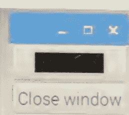

- 一个 GtkColorButton

点击时，会显示颜色选择器对话框，允许通过多种方式设置颜色：点击三角形颜色映射、输入 RGB 或 HSV 值，或者使用吸管工具从屏幕的某处选取颜色。

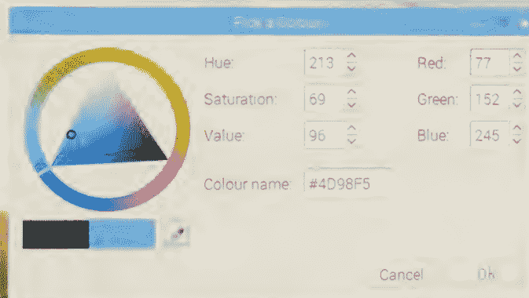

- 由 GtkColorButton 启动的颜色选择器对话框

当你点击 OK 时，选定的红、绿、蓝值将打印到终端。

#### 字体选择

另一个常见操作是选择字体，这在许多办公应用程序中都会用到。例如 GTK 提供了一个字体选择器，工作原理与颜色选择器相同。只需将 `GtkColorButton` 替换为 `GtkFontButton` 即可：

```c
GtkWidget *fnt_btn = gtk_font_button_new();
g_signal_connect (fnt_btn, "changed", G_CALLBACK (fnt_selected), NULL);
```

并为 `font-set` 信号创建处理程序：

```c
static void font_cb(GtkButton *btn, gpointer ptr)
{
    printf("font = %s\n", gtk_font_button_get_font_name(btn));
}
```

运行时，将显示一个带有当前选择字体名称的字体按钮：

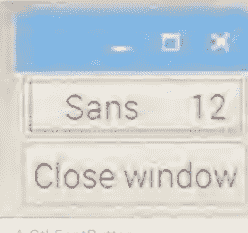

按下字体按钮会打开选择器对话框，允许你选择系统当前安装的任何字体：

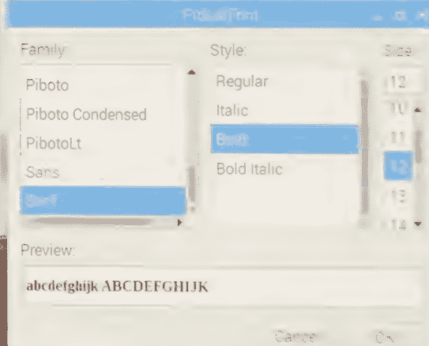

当你点击“OK”时，选定的字体名称和大小将打印到终端。

# 第 24 章

## 自定义组件

### 修改组件的属性
改变它们的外

在我们目前为止看到的所有示例中，我们都是以默认状态使用组件；我们只是通过 `gtk_<widget name>_new` 函数创建组件并使用它。然而，GTK 允许通过设置每个组件的属性来对组件进行某种程度的自定义。
例如，我们将查看基础 `GtkButton` 组件的某些属性。尝试这个示例：

```c
void main (int argc, char *argv[]) {
  gtk_init(&argc, &argv);
  GtkWidget *win = gtk_window_new(GTK_WINDOW_TOPLEVEL);
  GtkWidget *btn = gtk_button_new_with_label("clicked");
  g_signal_connect(btn, "clicked", G_CALLBACK(end_program), NULL);
  g_signal_connect(win, "delete_event", G_CALLBACK(end_program), NULL);
  GtkWidget *btn2 = gtk_button_new_with_label("exit");
  g_object_set(G_OBJECT(btn2), "relief", GTK_RELIEF_NONE, NULL);
  GtkWidget *box = gtk_box_new(FALSE, 5);
  gtk_pack_start(GTK_BOX(box), btn2, TRUE, TRUE, 0);
  gtk_pack_start(GTK_BOX(box), btn, TRUE, TRUE, 0);
  gtk_container_add(GTK_CONTAINER(win), box);
  gtk_widget_show_all(win);
  gtk_main();
}
```


这是来自之前示例的熟悉代码，但高亮的行是新的。
`g_object_set`接收参数为组件名称，后跟一个 NULL 终止符、属性名称列表和属性值。在这种情况下，我们正在将`GtkButton``btn2`的`relief`属性设置为`GTK_RELIEF_NONE`。
`GtkButton`的`relief`（凹凸）控制边框的外。某些 GTK 组件的边缘应用了某种程度的阴影以提供 3D 效果——默认情况下，`GtkButton`应用了这种阴影，使得按钮看起来略微突出窗口背景。通过将`relief`设置为`GTK_RELIEF_NONE`，3D 效果会被移除——如果你运行此程序，你应该看到按钮之间的差异。

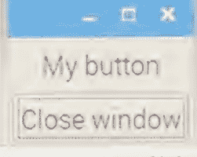

- 设置了 relief 的 GtkButton

这是另一个示例：

```c
GtkWidget *btn2 = gtk_button_new_with_label("exit");
g_object_set(G_OBJECT(btn2), "relief", GTK_RELIEF_NONE, NULL);
```

在这种情况下，我们正在设置`underline`（下划线）属性，它应该像这样：

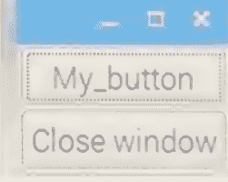

- 设置了 underline 的 GtkButton

# 第 25 章

## Glade

使用此布局编辑器更方便地为应用程序创建窗口布局

如前面的章节所示，使用 GTK 创建组件比从头开始向屏幕缓冲区写入像素来编写要简单得多。尽管如此，即使对于一个相当简单的窗口布局，你仍然需要编写大量的代码，而且你必须非常仔细地考虑你编写的代码，以确保窗口的外观符合你的预期。此外，在运行应用程序之前无法实际看到窗口的样式，这也不够理想。

幸运的是，有一种方法可以在不编写所有代码的情况下处理窗口布局，那就是使用布局编辑器。GTK 允许将窗口上组件的布局定义在一个 XML 文件中，该文件在应用程序运行时会被加载并绘制在屏幕上——虽然你仍然需要将任何组件的行为与代码关联，但组件的外观可以提前确定。布局编辑器是创建此类 XML 文件的有用工具。

GTK 最广泛使用的布局编辑器是一个名为 Glade 的工具。Glade 有两个版本，一个一个用于 GTK 2，另一个用于 GTK 3 应用程序；它们不能互换，因此你确实需要使用正确的版本。创建 GTK 3 应用程序的版本被称为 'glade'。而且，为了增加难度，你创建 GTK 2 应用程序所需的版本被称为 'glade-3'。（是的，这非常违反直觉且令人恼火！）我们要做的第一件事是安装 glade-3。在终端中输入 `sudo apt-get install glade-3`，并对任何提示回答 yes。然后，你应该会在桌面的程序的编程菜单中看到一个名为“Glade”的选项。如果你启动它，将看到一个如下所示的屏幕。


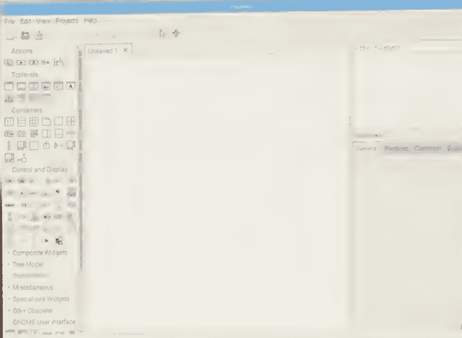

### Glade 布局编辑器

这是 Glade 中的基础设计界面。左侧是所有可用组件的调色板。中间是你实际设计窗口的区域，右侧是一个允许你设置单个组件属性的区域。

### 使用 Glade 创建布局文件

我们将为应用程序创建一个简单的窗口，要做的第一件事是添加一个顶层窗口。在标记为“Toplevels”（顶层窗口）的调色板部分，左上角的项目是 `GtkWindow`——如果你用鼠标悬停在上面，会弹出一个带有“Window”标签的工具提示以确认这一点。只需点击此图标即可在中间的设计区域添加一个空窗口：

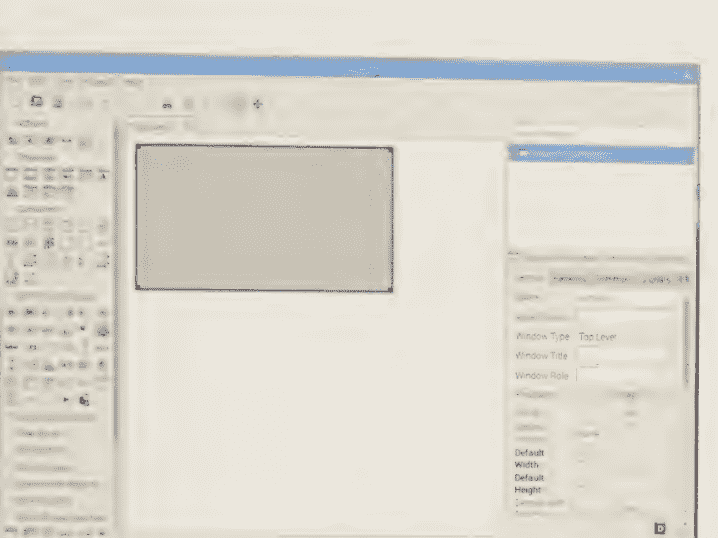

一个空窗口（注：此处原文为“An empty window”，根据要求应保留格式并翻译，此处译为标题或描述）

接下来，让我们添加一个 VBox 以便我们在其中放置一些组件。组件调色板有一个标记为“Containers”（容器）的部分，其中前两个项目是 HBox 和 VBox——点击 VBox，然后将光标移动到空窗口内并点击。会弹出一个对话框，询问你想在 VBox 中放置多少个项目——设置为 2，并点击“Create”（创建）：

### 添加垂直框

现在你有了一个中间有一条线的空窗口，显示了 VBox。我们将在顶部添加一个标签，在底部添加一个按钮。在调色板的“Control and Display”（控制与显示）部分找到这些内容——首先在调色板中点击每个项目，然后点击设计区域中相应的 VBox 以添加它们。

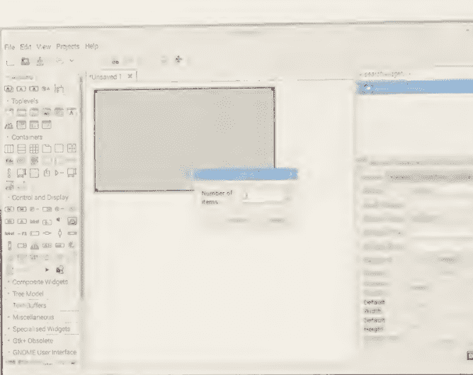

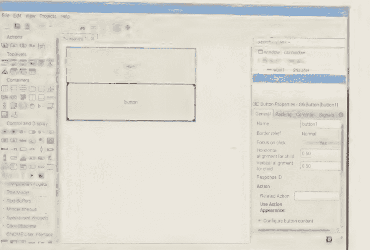

- 添加了标签和按钮后：

如果你查看右侧列的顶部，你会看到显示的组件层级结构——一个 `GtkWindow`，包含一个 `GtkBox`，`GtkBox`包含一个 `GtkLabel`和一个 `GtkButton`。如果你点击层级结构中的一个组件，右侧列标签区域显示的选项将是该组件的选项。

点击 `GtkLabel`并浏览“General”（常规）选项卡上的选项，你会找到一个标记为“Edit label appearance”（编辑标签外观）的部分，包括“Label”（标签）项目——使用它来设置标签中的任意文本。

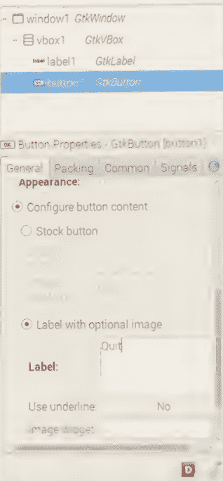

组件属性编辑器

点击 `GtkButton`，并找到它的 Label 部分——它位于“Label with optional image”（带有可选图像的标签）下方——在右侧列底部将按钮的标签更改为“Quit”（退出）——在此处时，值得研究所有选项卡上的选项，但特别感兴趣的是“Packing”（填充）选项卡上的选项，这些允许你扩展在添加组件到框时可用的 expand（扩展）、fill（填充）和 padding（内边距）选项。如果你尝试它们，你就能对窗口布局的控制程度有一个很好的感觉，特别是当 Glade 允许你组合多个框时。

关于右侧列需要注意的重要点是 Glade 为每个组件分配名称——这可以在顶部的层级列表中看到，在“General”选项卡的最后一项中，Glade 以组件类型加上数字进行命名，但如果你愿意，可以更改这些。但有一条关键规则——布局文件中的每个组件必须具有唯一的名称。如果两个组件具有相同的名称，则布局文件是无效且无法正确加载。

你的按钮和标签组件名称应该是 'button1' 和 'label1$，你的窗口应该是 Window1——记住这些名称；因为它们在将代码与布局文件关联时非常重要。现在，将你的布局保存为 `mylayout.glade`。

```c
#include <gtk/gtk.h>
void on_destroy (GtkWidget *wid, gpointer ptr)
{
    gtk_main_quit(NULL);
}
void main (int argc, char *argv[])
{
    gtk_init(&argc, &argv);
    GBuilder *builder = gtk_builder_new();
    gtk_builder_load_from_file(builder, "mylayout.glade", NULL);
    GtkWidget *win = (GtkWidget*)gtk_builder_get_object(builder, "window");
    GtkWidget *btn = (GtkWidget*)gtk_builder_get_object(builder, "button");
    g_signal_connect(btn, "clicked", G_CALLBACK(on_destroy), NULL);
    gtk_widget_show_all(win);
    gtk_main();
}
```

# 第 26 章

## C 快速参考

利用这些实用的备查表和代码示例

### 控制结构

```
if (<test>)
    <如果 test 为真则执行代码>
```

```
if (<test>)
    <如果 test 为真则执行代码>
else
    <如果 test 为假则执行代码>
```

```
if (<test1>)
    <如果 test1 为真则执行代码>
else if (<test2>)
    <如果 test1 为假 且 test2 为真则执行代码>
else
    <如果 test1 为假 且 test2 为假则执行代码>
```

```
switch (<variable>)
{
    case <testval1> : <如果 variable 等于 testval1 则执行代码>
        break;
    case <testval2> : <如果 variable 等于 testval2 则执行代码>
        break;
```

```
default : <如果 variable 既不等于 testval1 也等于 testval2 则执行代码>
break;
```

```
}
```

```
switch (<variable>)
{case <testval1> : <如果 variable 等于 testval1 则执行代码>
case <testval2> : <如果 variable 等于 testval1 或 testval2 则执行代码>
break;
default : <如果 variable 既不等于 testval1 也等于 testval2 则执行代码>
break;
```

```
}
```

```
while (<test>)
<只要 test 为真就重复执行代码>
```

```
do
<执行一次代码，然后在 test 为真时重复执行代码>
while (<test>);
```

```
for (<初始条件>; <递增>; <终止条件>)
<在终止条件为真之前，不断重复执行代码>
```

在所有循环中，都可以使用关键字 `break` 来退出循环并在循环后立即恢复执行。

在所有循环中，都可以使用关键字 `continue` 来跳过循环体中剩余的代码，并在下一次循环迭代测试处恢复执行。

### 变量类型

| 名称 | 描述 | 大小 |
|---|---|---|
| char | 单个字母数字字符 | 1 |
| signed char | 有符号 8 位整数 (-128 - 127) | 1 |
| unsigned char | 无符号 8 位整数 (0 - 255) | 1 |
| short, signed short | 有符号 16 位整数 (-32768 - 32767) | 2 |
| unsigned short | 无符号 16 位整数 (0 - 65535) | 2 |
| int, signed int | 有符号 32 位整数 (-2147483648 - 2147483647) | 4 |
| unsigned int | 无符号 32 位整数 (0 - 4294967295) | 4 |
| long, signed long | 有符号 32 位整数 (-2147483648 - 2147483647) | 4 |
| unsigned long | 无符号 32 位整数 (0 - 4294967295) | 4 |
| float | 浮点值 (+/- 3.402823 x 10^38) | 4 |
| double | 双精度浮点值 (+/- 10^308) | 8 |

取决于平台，`int` 可以是 `short`（16位）或 `long`（32位）。在 Raspian 上，如上表所示，`int` 是 `long`（32位）整数值。

### 格式说明符

| 说明符 | 格式 / 类型 |
|---|---|
| %c | 字母数字字符 / char |
| %d | 有符号十进制值 / int |
| %ld | 有符号十进制值 / long int |

### C 和 C++ 编程简介

```
%u 无符号十进制值 / int
%lu 无符号十进制值 / long int
%o 进制值 / int
%lo 进制值 / long int
%x, %X 十六进制值 / int
%lx, %lX 十六进制值 / long int
%f 浮点值 / float
%e 指数值 / float
```

* `%x` 以十六进制形式显示值，使用小写字母 a 到 f；`%X` 使用大写字母 A 到 F 显示。

宽度（或打印的最小字符数）可以通过在 `%` 和字母之间插入一个数字来设置；这将短于宽度的值在开头填充空格。要在末尾填充空格，请在 `%` 和数字之间插入一个 `-`。要在开头填充导零，请在 `%` 和数字之间插入一个 `0`。

例如，要打印一个值为 42 的整数变量，使用格式说明符 `%5d` 将打印 42 并在其前面留三个空格。格式说明符 `-5d` 将打印 42 并在其后面留三个空格。格式说明符 `%05d` 将其打印为 00042。

浮点值或指数值显示的十进制位数可以通过在 `%` 和字母之间插入一个小数点后跟一个数字来设置，这可以通过在小数点前放置宽度来与宽度结合。

例如，要打印一个值为 76.54321 的浮点变量，格式说明符 `%.2f` 将其打印为 76.54。格式说明符 `%0.2f` 将其打印为 00076.54（注意小数点占了指定宽度中的一个字符）。

### 运算符

下表中的运算符产生的结果可以赋值给另一个变量，例如 `c = a + b`，但不会影响 `a` 或 `b` 的值。

| 符号 | 功能 |
|---|---|
| a + b | 加法 |
| a - b | 减法 |
| a * b | 乘法 |
| a / b | 除法 |
| a % b | 取模（a / b 的余数） |
| a & b | 位位与 |
| a | b | 位位或 |
| a ^ b | 位位异或 |
| a << b | 左移 |
| a >> b | 右移 |
| ~a | 位位取反 |
| !a | 逻辑非 |

下表中的运算符会直接修改 `a` 的值。

| 符号 | 功能 |
|---|---|
| a++ | a 递增 1 |
| a-- | a 减 1 |
| ++a | a 递增 1 |

### C 编程简介

a-- | a 减 1
a += b | a 增加 b
a -= b | a 减 b
a *= b | a 乘以 b
a /= b | a 除以 b
a %= b | a / b 的余数
a &= b | 与 b 位与
a |= b | 与 b 位或
a ^= b | 与 b 位异或
a <<= b | a 左移 b
a >>= b | a 右移 b

2. `a++` 和 `++a` 的区别在于它们用于测试，例如 `if (a++)`，`a++` 测试值后递增，而 `++a` 先递增值再进行测试。

下表中的运算符用于比较。

| 符号 | 功能 |
|---|---|
| == | 等于 |
| != | 不等于 |
| > | 大于 |
| < | 小于 |
| >= | 大于等于 |
| <= | 小于等于 |
