# 线性代数入门指南

行列式。在 **第 4 章** 中，我们给出了方阵可逆的充要条件。我们将证明行列式理论可以用于求出方阵逆矩阵的解析表示。在此，我们还利用差分方程的初等理论来求某些带矩阵的逆。

**第 5 章和第 6 章** 的主要目的是系统地讨论高斯消元法和高斯–约当消元法，以求解 $m$ 个关于 $n$ 个未知数的线性方程组。这些方程可方便地写成 $Ax=b$，其中 $A$ 是一个 $m\times n$ 矩阵，$x$ 是一个 $n\times 1$ 未知向量，$b$ 是一个 $m\times 1$ 向量。为此，我们引入了相容、不相容、解空间、零空间、增广矩阵、矩阵的阶梯形、主元、初等行变换、初等矩阵、行等价矩阵、行标准形和矩阵的秩等术语。这些方法还为计算矩阵的行列式和逆矩阵提供了有效的算法。我们还证明了若干理论结果，给出了线性方程组有解的充要条件。**第 7 章** 讨论了高斯消元的一种修正但受限的实现。我们将给定的 $m\times n$ 矩阵 $A$ 分解为两个矩阵 $L$ 和 $U$ 的乘积，其中 $L$ 是一个 $m\times m$ 下三角矩阵，$U$ 是一个 $m\times n$ 上三角矩阵。在此，我们还讨论了该因式分解的各种变体及其应用。

在 **第 8 章** 中，我们定义了向量的线性相关和线性无关的概念。这些概念在线性代数乃至整个数学中都起着至关重要的作用。线性相关和无关区分了两个向量本质上是相同还是不同。在 **第 9 章** 中，对于给定的向量空间，我们首先引入基的概念，然后用基中向量的个数来描述其维数。在此，我们还引入了两个子空间的直和的概念。在 **第 10 章** 中，我们将向量在 $\mathbb{R}^3$ 中的已知几何坐标解释扩展到一般向量空间。我们展示了如何将向量空间相对于一个基的坐标变换到另一个基。在此，我们还定义了有序基、同构和过渡矩阵等术语。在 **第 11 章** 中，我们重新定义矩阵的秩，并展示该数与齐次线性方程组解空间维数的直接关系。在此，对于给定矩阵，我们还定义了行空间、列空间、左逆和右逆，并给出了它们存在的充要条件。在 **第 12 章** 中，我们引入了两个向量空间之间线性映射的概念，并扩展了前几章的一些结果。在 **第 13 章** 中，我们建立了线性映射与矩阵之间的联系。我们还引入了相似矩阵的概念，它在后续章节中起着重要作用。在 **第 14 章** 中，我们将两个或三维向量的熟悉内积概念扩展到一般向量空间。我们对内积的定义导致了垂直向量概念的推广，称为正交向量。我们还讨论了向量在另一个向量上的投影、酉空间、正交补、正交基和傅里叶展开等概念。本章以著名的格拉姆–施密特正交化过程结束。在第 15 章中，我们讨论了一种特殊的线性映射，称为线性泛函。我们还涉及对偶空间、对偶基、第二对偶、自然映射、伴随映射、消元子等概念，并证明了著名的 Riesz 表示定理。

第 16 章讨论矩阵的特征值和特征向量。我们总结了矩阵特征值和特征向量的那些有助于其计算的性质。在此，我们遇到了特征多项式、特征值的代数重数和几何重数、特征空间以及伴随矩阵和循环矩阵等概念。第 17 章从向量范数的定义开始，然后将其扩展到矩阵。接下来，我们对给定矩阵的特征值进行一些估计，并证明了一些有用的收敛结果。在此，我们还建立了著名的 Cauchy–Schwarz、Minkowski 和 Bessel 不等式，并讨论了谱半径、Rayleigh 商和最佳逼近等术语。

在第 18 章中，我们证明如果 $n \times n$ 矩阵 $A$ 的代数重数和几何重数相同，则它可以对角化，即 $A = PDP^{-1}$；这里，$P$ 是一个非奇异矩阵，$D$ 是一个对角矩阵。接下来，我们给出了 $A$ 可正交对角化的充要条件，即 $A = QDQ^{t}$，其中 $Q$ 是一个正交矩阵。然后，我们讨论矩阵 $A$ 的 QR 分解。我们还提供了矩阵 $P$、$D$、$Q$ 和 $R$ 的完整计算特征。在第 19 章中，我们发展了第 18 章中讨论的对角化过程的推广。该因式分解适用于任何实 $m \times n$ 矩阵 $A$，在文献中被称为奇异值分解。在此，我们还讨论了约简奇异值分解。

在第 20 章中，我们展示了线性代数（尤其是特征值和特征向量）在求解常系数齐次微分和差分系统解中所起的重要作用。在此，我们还发展了著名的 Putzer 算法的连续和离散版本。在广泛的应用中，我们会遇到给定系统 $Ax = b$ 没有解的问题。对于这样的系统，我们寻求一个或多个向量 $\hat{x}$，使得欧几里得范数中的误差，即 $\|Ax\hat{} - b\|_2$，尽可能小（最小化）。这个解 $\hat{x}$ 称为最小二乘近似解。在第 21 章中，我们将证明最小二乘近似解总是存在，并可以通过求解一个关于 $n$ 个未知数的 $n$ 个方程的相关系统（正规方程）方便地计算。在第 22 章中，我们研究 $n$ 个变量的二次型和对角二次型，并给出它们为正定的判据。在此，我们还讨论了在某些约束条件下二次型的最大值和最小值（约束优化）。在第 23 章中，我们首先用二次型定义正定对称矩阵，然后对于一个对称矩阵为正定，我们

provide necessary and sufficient conditions. Next, for a symmetric matrix we revisit $LU$-factorization, and give conditions for a unique factorization $LDL^t$, where $L$ is a lower triangular matrix with all diagonal elements 1, and $D$ is a diagonal matrix with all positive elements. We also discuss Cholesky’s decomposition $L_cL_c^t$ where $L_c = LD^{1/2}$, and for its computation provide Cholesky’s algorithm. This is followed by Sylvester’s criterion, which gives easily verifiable necessary and sufficient conditions for a symmetric matrix to be positive definite. We conclude this chapter with a polar decomposition. In **Chapter 24**, we introduce the concept of pseudo/generalized (Moore–Penrose) inverse which is applicable to all $m \times n$ matrices. As an illustration we apply Moore–Penrose inverse to least squares solutions of linear equations. Finally, in **Chapter 25**, we briefly discuss irreducible, nonnegative, diagonally dominant, monotone, and Toeplitz matrices. We state 11 theorems which, from the practical point of view, are of immense value. These types of matrices arise in several diverse fields, and hence have attracted considerable attention in recent years.

In this book, there are 148 examples that explain each concept and demonstrate the importance of every result. Two types of 254 problems are also included, those that illustrate the general theory and others designed to fill out text material. The problems form an integral part of the book, and every reader is urged to attempt most, if not all of them. For the convenience of the reader, we have provided answers or hints to all the problems.

In writing a book of this nature, no originality can be claimed, only a humble attempt has been made to present the subject as simply, clearly, and accurately as possible. The illustrative examples are usually very simple, keeping in mind an average student.

It is earnestly hoped that **An Introduction to Linear Algebra** will serve an inquisitive reader as a starting point in this rich, vast, and ever-expanding field of knowledge.

We would like to express our appreciation to our students and Ms. Aastha Sharma at CRC (New Delhi) for her support and cooperation.

Ravi P. Agarwal
Cristina Flaut

# Chapter 1

# Linear Vector Spaces

A vector space (or linear space) consists of four things {F, V, +, s.m.}, where F is a field of scalars, V is the set of vectors, and + and s.m. are binary operations on the set V called vector addition and scalar multiplication, respectively. In this chapter we shall define each term axiomatically and provide several examples.

**Fields.** A *field* is a set of scalars, denoted by F, in which two binary operations, addition (+) and multiplication (·), are defined so that the following axioms hold:

- A1. *Closure property of addition:* If a, b ∈ F, then a + b ∈ F.
- A2. *Commutative property of addition:* If a, b ∈ F, then a + b = b + a.
- A3. *Associative property of addition:* If a, b, c ∈ F, then (a + b) + c = a + (b + c).
- A4. *Additive identity:* There exists a zero element, denoted by 0, in F such that for all a ∈ F, a + 0 = 0 + a = a.
- A5. *Additive inverse:* For each a ∈ F, there is a unique element (−a) ∈ F such that a + (−a) = (−a) + a = 0.
- A6. *Closure property of multiplication:* If a, b ∈ F, then a · b ∈ F.
- A7. *Commutative property of multiplication:* If a, b ∈ F, then a · b = b · a.
- A8. *Associative property of multiplication:* If a, b, c ∈ F, then (a · b) · c = a · (b · c).
- A9. *Multiplicative identity:* There exists a unit element, denoted by 1, in F such that for all a ∈ F, a · 1 = 1 · a = a.
- A10. *Multiplicative inverse:* For each a ∈ F, a ≠ 0, there is a unique element a⁻¹ ∈ F such that a · a⁻¹ = a⁻¹a = 1.
- A11. *Left distributivity:* If a, b, c ∈ F, then a · (b + c) = a · b + a · c.
- A12. *Right distributivity:* If a, b, c ∈ F, then (a + b) · c = a · c + b · c.

**Example 1.1.** The set of rational numbers Q, the set of real numbers R, and the set of complex numbers C, with the usual definitions of addition and multiplication, are fields. The set of natural numbers N = {1, 2, ···}, and the set of all integers Z = {···, −2, −1, 0, 1, 2, ···} are not fields.

Let F and F₁ be fields and F₁ ⊆ F, then F₁ is called a *subfield* of F. Thus, Q is a subfield of R, and R is a subfield of C.

# Vector spaces.

A vector space $V$ over a field $F$ denoted as $(V,F)$ is a nonempty set of elements called vectors together with two binary operations, addition of vectors and multiplication of vectors by scalars, so that the following axioms hold:

- B1. *Closure property of addition:* If $u,v\in V$, then $u+v\in V$.
- B2. *Commutative property of addition:* If $u,v\in V$, then $u+v=v+u$.
- B3. *Associativity property of addition:* If $u,v,w\in V$, then $(u+v)+w=u+(v+w)$.
- B4. *Additive identity:* There exists a zero vector, denoted by $0$, in $V$ such that for all $u\in V$, $u+0=0+u=u$.
- B5. *Additive inverse:* For each $u\in V$, there exists a vector $v\in V$ such that $u+v=v+u=0$. Such a vector $v$ is usually written as $-u$.
- B6. *Closure property of multiplication:* If $u\in V$ and $a\in F$, then the product $a\cdot u=au\in V$.
- B7. If $u,v\in V$ and $a\in F$, then $a(u+v)=au+av$.
- B8. If $u\in V$ and $a,b\in F$, then $(a+b)u=au+bu$.
- B9. If $u\in V$ and $a,b\in F$, then $ab(u)=a(bu)$.
- B10. *Multiplication of a vector by a unit scalar:* If $u\in V$ and $1\in F$, then $1u=u$.

In what follows, the subtraction of the vector $v$ from $u$ will be written as $u-v$, and by this we mean $u+(-v)$, or $u+(-1)v$. The spaces $(V,\mathbb{R})$ and $(V,\mathbb{C})$ will be called real and *complex vector spaces*, respectively.

# Example 1.2 (The $n$-tuple space).

Let $F$ be a given field. We consider the set $V$ of all ordered $n$-tuples

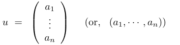

of scalars (known as *components*) $a_i\in F$. If

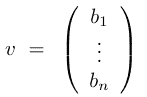

is in $V$, the addition of $u$ and $v$ is defined by

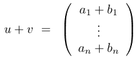

and the product of a scalar $c\in F$ and vector $u\in V$ is defined by

$$cu=\begin{pmatrix}ca_1\\\vdots\\ca_n\end{pmatrix}.$$

It is to be remembered that $u=v$, if and only if their corresponding components are equal, i.e., $a_i=b_i$, $i=1,\cdots,n$. With this definition of addition and scalar multiplication it is easy to verify all the axioms B1–B10, and hence this $(V,F)$ is a vector space. In particular, if

$$w=\begin{pmatrix}c_1\\\vdots\\c_n\end{pmatrix}$$

is in $V$, then the $i$-th component of $(u+v)+w$ is $(a_i+b_i)+c_i$, which in view of A3 is the same as $a_i+(b_i+c_i)$, and this is the same as the $i$-th component of $u+(v+w)$, i.e., B3 holds. If $F=R$, then $V$ is denoted as $R^n$, which for $n=2$ and $3$ reduces respectively to the two and three dimensional usual vector spaces. Similarly, if $F=C$, then $V$ is written as $C^n$.

# Example 1.3 (The space of polynomials).

Let $F$ be a given field. We consider the set $\mathcal{P}_n$, $n\geq 1$ of all polynomials of degree *at most* $n-1$, i.e.,

$$\mathcal{P}_n=\left\{a_0+a_1x+\cdots+a_{n-1}x^{n-1}=\sum_{i=0}^{n-1}a_ix^i:a_i\in F,\quad x\in R\right\}.$$

If $u=\sum_{i=0}^{n-1}a_ix^i$, $v=\sum_{i=0}^{n-1}b_ix^i\in\mathcal{P}_n$, then the addition of vectors $u$ and $v$ is defined by

$$u+v=\sum_{i=0}^{n-1}a_ix^i+\sum_{i=0}^{n-1}b_ix^i=\sum_{i=0}^{n-1}(a_i+b_i)x^i,$$

and the product of a scalar $c\in F$ and vector $u\in\mathcal{P}_n$ is defined by

$$cu=c\sum_{i=0}^{n-1}a_ix^i=\sum_{i=0}^{n-1}(ca_i)x^i.$$

This $(\mathcal{P}_n,F)$ is a vector space. We remark that the set of all polynomials of degree exactly $n-1$ is not a vector space. In fact, if we choose $b_{n-1}=-a_{n-1}$, then $u+v$ is a polynomial of degree $n-2$.

# Example 1.4 (The space of functions).

Let $F$ be a given field, and $X\subseteq F$. We consider the set $V$ of all functions from the set $X$ to $F$. The sum of two vectors $f,g\in V$ is defined by $(f+g)$, i.e., $(f+g)(x)=f(x)+g(x)$, $x\in X$,

# **示例 1.7.** 设 $F=R,$

$$W=\left\{\begin{pmatrix}a_1\\a_2\\0\end{pmatrix}:a_1,a_2\in R\right\}\quad\text{且}\quad V=\left\{\begin{pmatrix}a_1\\a_2\\a_3\end{pmatrix}:a_1,a_2,a_3\in R\right\}.$$

显然，$(W,R)$ 是 $(V,R)$ 的子空间。但是，如果我们令

$$W=\left\{\begin{pmatrix}a_1\\a_2\\a_3\end{pmatrix}:a_1>0,a_2>0,a_3>0\right\},$$

则 $(W,R)$ 不是 $(V,R)$ 的子空间。

# **示例 1.8.** 设 $F$ 为给定域。考虑向量空间 $(\mathcal{P}_4,F)$ 和 $(\mathcal{P}_3,F)$。显然，$(\mathcal{P}_3,F)$ 是 $(\mathcal{P}_4,F)$ 的子空间。但是，域 $F$ 上所有次数恰好为二的多项式集合不是 $(\mathcal{P}_4,F)$ 的子空间。

# **示例 1.9.** 考虑在 [示例 1.1](#) 中考虑的向量空间 $(V,F)$ 和 $(C[X],F)$。显然，$(C[X],F)$ 是 $(V,F)$ 的子空间。

要检查域 $F$ 上 $V$ 的非空子集 $W$ 是否为子空间，需要验证所有公理 B1–B10。但是，以下结果大大简化了此验证。

# **定理 1.2.** 如果 $(V,F)$ 是向量空间且 $W$ 是 $V$ 的非空子集，则当且仅当对于每对向量 $u,v\in W$ 和每个标量 $a\in F$，向量 $au+v\in W$ 时，$(W,F)$ 才是 $(V,F)$ 的子空间。

# **证明.** 如果 $(W,F)$ 是 $(V,F)$ 的子空间，且 $u,v\in W$，$a\in F$，则显然 $au+v\in W$。反之，由于 $W\ne\varnothing$，存在向量 $u\in W$，因此 $(-1)u+u=0\in W$。此外，对于任何向量 $u\in W$ 和任何标量 $a\in F$，向量 $au=au+0\in W$。这特别意味着 $(-1)u=-u\in W$。最后，我们注意到如果 $u,v\in W$，则 $1u+v\in W$。其他公理可以类似地证明。因此，$(W,F)$ 是 $(V,F)$ 的子空间。$\blacksquare$

因此，$(W,F)$ 是 $(V,F)$ 的子空间当且仅当对于每对向量 $u,v\in W$，$u+v\in W$ 且对于每个标量 $a\in F$，$au\in W$。

设 $u^1,\cdots,u^n$ 是给定向量空间 $(V,F)$ 中的向量，$c_1,\cdots,c_n\in F$ 是标量。向量 $u=c_1u^1+\cdots+c_nu^n$ 称为 $u^i$ 的 *线性组合*，$i=1,\cdots,n$。通过数学归纳法可得 $u\in(V,F)$。

# **定理 1.3.** 设 $u^i\in(V,F)$，$i=1,\cdots,n(\geq 1)$，且

$$W=\{c_1u^1+\cdots+c_nu^n:c_i\in F,\ i=1,\cdots,n\}$$

则 \((W, F)\) 是 \((V, F)\) 的子空间，且 \(W\) 包含每个向量 \(u^i\)，$i = 1, \cdots, n$。

# ## 证明.

显然，每个 \(u^i\) 都是形式为

\(u^i = \sum_{j=1}^n \delta_{ij} u^j,\)

的线性组合，其中 \(\delta_{ij}$ 是由以下定义的克罗内克三角函数：

\(\delta_{ij} = \left\{\begin{array}{ c c }
0, & i \neq j \\
1, & i = j.
\end{array}\right.\)

因此，每个 \(u^i \in W$。现在，如果 \(v = \sum_{i=1}^n c_i u^i$，\(w = \sum_{i=1}^n d_i u^i$ 且 \(a \in F$，则我们有

\(av + w = a \sum_{i=1}^n c_i u^i + \sum_{i=1}^n d_i u^i = \sum_{i=1}^n (ac_i + d_i)u^i = \sum_{i=1}^n \alpha_i u^i, \quad \alpha_i \in F\)

这表明 \(av + w \in W$。结果现在由定理 1.2 得出。$\blacksquare$

定理 1.3 中的子空间 \((W, F)\) 称为由向量 \(u^i\)，$i = 1, \cdots, n$ 生成的子空间，记作 \(\text{Span}\{u^1, \cdots, u^n\}$。如果 \((W, F) = (V, F)$，则集合 \(\{u^1, \cdots, u^n\}$ 称为向量空间 \((V, F)$ 的 *生成集*。显然，在这种情况下，每个向量 \(u \in V$ 都可以表示为向量 \(u^i\)，$i = 1, \cdots, n$ 的线性组合。

# ## 示例 1.10.

由于

\(2\left(\begin{array}{ c }
2 \\
1 \\
4
\end{array}\right) - 3\left(\begin{array}{ c }
1 \\
0 \\
2
\end{array}\right) + 5\left(\begin{array}{ c }
3 \\
2 \\
1
\end{array}\right) - \left(\begin{array}{ c }
4 \\
2 \\
0
\end{array}\right) = \left(\begin{array}{ c }
12 \\
10 \\
7
\end{array}\right)\)

可得

\(\left(\begin{array}{ c }
12 \\
10 \\
7
\end{array}\right) \in \text{Span}\left\{\left(\begin{array}{ c }
2 \\
1 \\
4
\end{array}\right), \left(\begin{array}{ c }
1 \\
0 \\
2
\end{array}\right), \left(\begin{array}{ c }
3 \\
2 \\
1
\end{array}\right), \left(\begin{array}{ c }
4 \\
2 \\
0
\end{array}\right)\right\}.\)

但是，

\(\left(\begin{array}{ c }
1 \\
2 \\
3
\end{array}\right) \notin \text{Span}\left\{\left(\begin{array}{ c }
1 \\
0 \\
0
\end{array}\right), \left(\begin{array}{ c }
1 \\
1 \\
0
\end{array}\right)\right\}.\)

# ## 示例 1.11.

对于示例 1.2 中考虑的向量空间 \((V, F)$

集合 \(\{e^1,\cdots,e^n\}$，其中

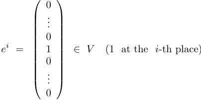

是一个生成集。同样，对于示例 **1.3** 中考虑的向量空间 \((\mathcal{P}_n,F)$，集合 \(\{1,x,\cdots,x^{n-1}\}\) 是一个生成集。

# 问题

+   1.1. 证明所有形式为 \(a+\sqrt{2}b\) 的实数集合是一个域，其中 \(a\) 和 \(b\) 是有理数。

+   1.2. 证明
+   
+   (i) 如果 \(u^1,\cdots,u^n\) 生成 \(V$ 且 \(u\in V$，则 \(u,u^1,\cdots,u^n$ 也生成 \(V\)
+   
+   (ii) 如果 \(u^1,\cdots,u^n$ 生成 \(V$ 且 \(u^k$ 是 \(u^i\) 的线性组合，$i=1,\cdots,n$，$i\ne k$，则 \(u^i\)，$i=1,\cdots,n$，$i\ne k$ 也生成 \(V\)
+   
+   (iii) 如果 \(u^1,\cdots,u^n$ 生成 \(V$ 且 \(u^k=0$，则 \(u^i\)，$i=1,\cdots,n$，$i\ne k$ 也生成 \(V\)。

+   1.3. 证明向量空间 \(V$ 的任意数量子空间的交集是 \(V$ 的子空间。

+   1.4. 设 \(U$ 和 \(W$ 是向量空间 \(V$ 的子空间。空间
+   
+   \[U+W=\{v:v=u+w\text{ where }u\in U,\ w\in W\}\]
+   
+   称为 \(U$ 和 \(W$ 的 *和*。证明
+   
+   (i) \(U+W$ 也是 \(V$ 的子空间
+   
+   (ii) \(U$ 和 \(W$ 包含在 \(U+W$ 中
+   
+   (iii) \(U+U=U\)
+   
+   (iv) \(U\cup W$ 是 \(V$ 的子空间？

+   1.5. 考虑以下三次多项式：

\[L_1(x)=\frac{(x-x_2)(x-x_3)(x-x_4)}{(x_1-x_2)(x_1-x_3)(x_1-x_4)},\qquad L_2(x)=\frac{(x-x_1)(x-x_3)(x-x_4)}{(x_2-x_1)(x_2-x_3)(x_2-x_4)}\]

\[L_3(x)=\frac{(x-x_1)(x-x_2)(x-x_4)}{(x_3-x_1)(x_3-x_2)(x_3-x_4)},\qquad L_4(x)=\frac{(x-x_1)(x-x_2)(x-x_3)}{(x_4-x_1)(x_4-x_2)(x_4-x_3)}\]

# # 线性向量空间

**1.4.** (i) 设 \(v^1, v^2 \in U + W$，其中 \(v^1 = u^1 + w^1$，\(v^2 = u^2 + w^2\)。则，
\(v^1 + v^2 = u^1 + w^1 + u^2 + w^2 = (u^1 + u^2) + (w^1 + w^2)\)。现在由于 \(U$ 和 \(W$ 是
子空间，\(u^1 + u^2 \in U$ 和 \(w^1 + w^2 \in W$。这意味着 \(v^1 + v^2 \in U + W$。
同样，我们可以证明 \(cv^1 \in U + W$，\(c \in F$。

(ii) 如果 \(u \in U$，则由于 \(0 \in W$，\(u = u + 0 \in U + W$。

(iii) 由于 \(U$ 是 \(V$ 的子空间，它对向量加法封闭，因此
\(U + U \subseteq U$。我们还从 (i) 得到 \(U \subseteq U + U$。

(iv) \(U \cup W$ 不一定是 \(V$ 的子空间。例如，考虑 \(V = R^3$，

\(U = \left\{ \left( \begin{array}{c} 
a_1 \\
0 \\
0 \\
\end{array} \right) : a_1 \in R \right\}, \quad W = \left\{ \left( \begin{array}{c} 
0 \\
0 \\
a_3 \\
\end{array} \right) : a_3 \in R \right\}.\)

则
\(U \cup W = \left\{ \left( \begin{array}{c} 
a_1 \\
0 \\
0 \\
\end{array} \right), \left( \begin{array}{c} 
0 \\
0 \\
a_3 \\
\end{array} \right) : a_1 \in R, \ a_3 \in R \right\}.\)

显然，
\(\left( \begin{array}{c} 
1 \\
0 \\
0 \\
\end{array} \right) \in U \cup W, \quad \left( \begin{array}{c} 
0 \\
0 \\
1 \\
\end{array} \right) \in U \cup W, \quad \text{但} \quad \left( \begin{array}{c} 
1 \\
0 \\
1 \\
\end{array} \right) \notin U \cup W.\)

**1.5.** (i) 函数 \(f(x) = L_1(x)P_3(x_1) + L_2(x)P_3(x_2) + L_3(x)P_3(x_3) + L_4(x)P_4(x_4)$ 是次数至多为三的多项式，且 \(f(x_i) = L_i(x_i) \times P_3(x_i) = P_3(x_i)$，$i = 1, 2, 3, 4$。因此 \(f(x) = P_3(x)$ 由插值多项式的唯一性得出。

(ii) 由 (i) 得出。

**1.6.** 只需注意 \(a + bx + cx^2 + dx^3 = (a - b) + (b - c)(1 + x) + (c - d)(1 + x + x^2) + d(1 + x + x^2 + x^3)$。

**1.7.** 使用定理 1.2。

**1.8.** 否。

**1.9.** \(V_1$ 和 \(V_3$ 是向量子空间，而 \(V_2$ 和 \(V_4$ 不是 \(R^3$ 的向量子空间。

**1.10.** 使用定理 1.2。

## Chapter 2

## Matrices

Matrices occur in many branches of applied mathematics and social sciences, such as algebraic and differential equations, mechanics, theory of electrical circuits, nuclear physics, aerodynamics, and astronomy. It is, therefore, necessary for every young scientist and engineer to learn the elements of matrix algebra.

A system of $m \times n$ elements from a field $F$ arranged in a rectangular formation along $m$ rows and $n$ columns and bounded by the brackets $(\ \ )$ is called an $m \times n$ matrix. Usually, a matrix is written by a single capital letter. Thus,

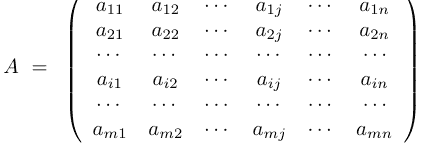

is an $m \times n$ matrix. In short, we often write $A=(a_{ij})$, where it is understood that the suffix $i=1,\ldots,m$, and $j=1,\ldots,n$, and $ij$ indicates the $i$-th row and the $j$-th column. The numbers $(A)_{ij}=a_{ij}$ are called the elements of the matrix $A$. For example, the following matrices $A$ and $B$ are of order $2\times3$ and $3\times2$,

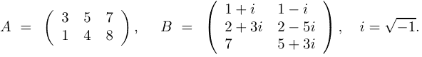

A matrix having a single row, i.e., $m=1$, is called a *row matrix* or a *row vector*, e.g., $(2\ \ 3\ \ 5\ \ 7)$.

A matrix having a single column, i.e., $n=1$, is called a *column matrix* or a *column vector*, e.g.,

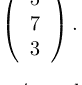

Thus the columns of the matrix $A$ can be viewed as vertical $m$-tuples (see Example 1.2), and the rows as horizontal $n$-tuples. Hence, if we let

\(a^j = \left( \begin{array}{ c } a_{1j} \\ \vdots \\ a_{mj} \\ \end{array} \right), \quad j = 1, 2, \cdots, n\)

then the above matrix \(A\) can be written as

\(A = (a^1, a^2, \cdots, a^n).\)

A matrix having \(n\) rows and \(n\) columns is called a _square matrix_ of order \(n\), e.g.,

\(A = \left( \begin{array}{ c c c } 1 & 2 & 3 \\ 2 & 3 & 4 \\ 3 & 4 & 5 \\ \end{array} \right)\) (2.1)

is a square matrix of order 3.

For a square matrix \(A\) of order \(n\), the elements \(a_{ii}\), \(i = 1, \cdots, n\), lying on the _leading_ or _principal diagonal_ are called the _diagonal elements_ of \(A\), whereas the remaining elements are called the _off-diagonal elements_. Thus for the matrix \(A\) in (2.1) the diagonal elements are 1, 3, 5.

A square matrix all of whose elements except those in the principal diagonal are zero, i.e., \(a_{ij} = 0\), \(|i - j| \geq 1\) is called a _diagonal matrix_, e.g.,

\(A = \left( \begin{array}{ c c c } 7 & 0 & 0 \\ 0 & 5 & 0 \\ 0 & 0 & 1 \\ \end{array} \right).\)

A diagonal matrix of order \(n\) that has unity for all its diagonal elements, i.e., \(a_{ii} = 1\), is called a _unit_ or _identity matrix_ of order \(n\) and is denoted by \(I_n\) or simply by \(I\). For example, identity matrix of order 3 is

\(I_3 = \left( \begin{array}{ c c c } 1 & 0 & 0 \\ 0 & 1 & 0 \\ 0 & 0 & 1 \\ \end{array} \right),\)

and of \(n\)th order \(I_n = (e^1, e^2, \cdots, e^n)\).

If all the elements of a matrix are zero, i.e., \(a_{ij} = 0\), it is called a _null_ or _zero matrix_ and is denoted by 0, e.g.,

\(0 = \left( \begin{array}{ c c c } 0 & 0 & 0 \\ 0 & 0 & 0 \\ 0 & 0 & 0 \\ \end{array} \right).\)

A square matrix \(A = (a_{ij})\) is called _symmetric_ when \(a_{ij} = a_{ji}\). If \(a_{ij} = -a_{ji}\), so that all the principal diagonal elements are zero, then the matrix is called a _skew-symmetric matrix_. Examples of symmetric and skew-symmetric matrices are respectively

\(\left(\begin{array}{ c c c } a & h & g \\ h & b & f \\ g & f & c \end{array}\right)\text{and}\left(\begin{array}{ c c c } 0 & h & -g \\ -h & 0 & f \\ g & -f & 0 \end{array}\right).\)

An \(m \times n\) matrix is called _upper triangular_ if \(a_{ij} = 0\), \(i > j\) and _lower triangular_ if \(a_{ij} = 0\), \(j > i\). In particular, a square matrix all of whose elements below the principal diagonal are zero is called an _upper triangular matrix_, and a square matrix all of whose elements above the principal diagonal are zero is called a _lower triangular matrix_. Thus,

\(\left(\begin{array}{ c c c } a & h & g \\ 0 & b & f \\ 0 & 0 & c \end{array}\right)\text{and}\left(\begin{array}{ c c c } a & 0 & 0 \\ h & b & 0 \\ g & f & c \end{array}\right)\)

are upper and lower triangular matrices, respectively. Clearly, a square matrix is diagonal if and only if it is both upper and lower triangular.

Two matrices \(A = (a_{ij})\) and \(B = (b_{ij})\) are said to be _equal_ if and only if they are of the same order, and \(a_{ij} = b_{ij}\) for all \(i\) and \(j\).

If \(A\) and \(B\) are two matrices of the same order, then their sum \(A + B\) is defined as the matrix each element of which is the sum of the corresponding elements of \(A\) and \(B\). Thus,

\(\left(\begin{array}{ c c c } a_1 & b_1 \\ a_2 & b_2 \\ a_3 & b_3 \end{array}\right)+\left(\begin{array}{ c c c } c_1 & d_1 \\ c_2 & d_2 \\ c_3 & d_3 \end{array}\right)=\left(\begin{array}{ c c c } a_1 + c_1 & b_1 + d_1 \\ a_2 + c_2 & b_2 + d_2 \\ a_3 + c_3 & b_3 + d_3 \end{array}\right).\)

Similarly, \(A - B\) is defined as a matrix whose elements are obtained by subtracting the elements of \(B\) from the corresponding elements of \(A\). Thus,

\(\left(\begin{array}{ c c c } a_1 & b_1 \\ a_2 & b_2 \end{array}\right)-\left(\begin{array}{ c c c } c_1 & d_1 \\ c_2 & d_2 \end{array}\right)=\left(\begin{array}{ c c c } a_1 - c_1 & b_1 - d_1 \\ a_2 - c_2 & b_2 - d_2 \end{array}\right).\)

The addition of matrices satisfies the following properties:

- \(A + B = B + A\), _commutative law_
- \(A + (B + C) = (A + B) + C\), _associative law_
- \(A + 0 = 0 + A = A\),
- \(A + (-A) = (-A) + A = 0\).

The product of a matrix \(A\) by a scalar \(k \in F\) is a matrix whose every element is \(k\) times the corresponding element of \(A\). Thus,

\(k\left(\begin{array}{ c c c } a_1 & b_1 & c_1 \\ a_2 & b_2 & c_2 \end{array}\right)=\left(\begin{array}{ c c c } ka_1 & kb_1 & kc_1 \\ ka_2 & kb_2 & kc_2 \end{array}\right).\)

For such products, the following properties hold:

1. \( (k_1 + k_2)A = k_1A + k_2A, \ k_1, k_2 \in F \)
2. \( k_1(k_2A) = (k_1k_2)A \)
3. \( k(A + B) = kA + kB, \text{distributive law} \)
4. \( (-1)A = -A \)
5. \( 0A = 0 \)
6. \( k0 = 0 \).

In what follows we shall denote by \( M^{m \times n} \) the set of all \( m \times n \) matrices whose elements belong to a certain field \( F \), i.e.,
\( M^{m \times n} = \{ A = (a_{ij}) : a_{ij} \in F, \ i = 1, \cdots, m, \ n = 1, 2, \cdots, n \} \).

It is clear that with the above definition of addition and scalar multiplication, \( (M^{m \times n}, F) \) is a vector space. The set of all \( m \times n \) matrices with real (complex) elements will be represented by \( R^{m \times n} \) (\( C^{m \times n} \)).

Two matrices can be multiplied only when the number of columns in the first matrix is equal to the number of rows in the second matrix. Such matrices are said to be *conformable* for multiplication. Thus, if \( A \) and \( B \) are \( n \times m \) and \( m \times p \) matrices

\( A = \begin{pmatrix} a_{11} & a_{12} & \cdots & a_{1m} \\ a_{21} & a_{22} & \cdots & a_{2m} \\ \cdots & \cdots & \cdots & \cdots \\ a_{n1} & a_{n2} & \cdots & a_{nm} \end{pmatrix} \quad \text{and} \quad B = \begin{pmatrix} b_{11} & b_{12} & \cdots & b_{1p} \\ b_{21} & b_{22} & \cdots & b_{2p} \\ \cdots & \cdots & \cdots & \cdots \\ a_{m1} & a_{m2} & \cdots & a_{mp} \end{pmatrix} \).

then \( A \times B \), or simply \( AB \) is a new matrix of order \( n \times p \),
\( AB = \begin{pmatrix} c_{11} & c_{12} & \cdots & c_{1p} \\ c_{21} & c_{22} & \cdots & c_{2p} \\ \cdots & \cdots & \cdots & \cdots \\ c_{n1} & c_{n2} & \cdots & c_{np} \end{pmatrix} \),

where
\( c_{ij} = a_{i1}b_{1j} + \cdots + a_{im}b_{mj} = \sum_{k=1}^{m} a_{ik}b_{kj} \).

Thus, in particular
\( \begin{pmatrix} a_1 & b_1 & c_1 \\ a_2 & b_2 & c_2 \\ a_3 & b_3 & c_3 \end{pmatrix} \times \begin{pmatrix} d_1 & e_1 \\ d_2 & e_2 \\ d_3 & e_3 \end{pmatrix} = \begin{pmatrix} a_1d_1 + b_1d_2 + c_1d_3 & a_1e_1 + b_1e_2 + c_1e_3 \\ a_2d_1 + b_2d_2 + c_2d_3 & a_2e_1 + b_2e_2 + c_2e_3 \\ a_3d_1 + b_3d_2 + c_3d_3 & a_3e_1 + b_3e_2 + c_3e_3 \end{pmatrix} \).

In the product \( AB \) the matrix \( A \) is said to be *post-multiplied* by \( B \), and the matrix \( B \) is said to be *pre-multiplied* by \( A \). It is possible that \( AB \) is defined,

但 \( BA \) 可能未定义。此外，\( AB \) 和 \( BA \) 可能都存在，但可能不相等。

### 示例 2.1

对于矩阵

\[
A = \begin{pmatrix} 0 & 1 & 2 \\ 1 & 2 & 3 \\ 2 & 3 & 4 \end{pmatrix}, \quad B = \begin{pmatrix} 1 & -2 \\ -1 & 0 \\ 2 & -1 \end{pmatrix},
\]

我们有

\[
AB = \begin{pmatrix} 3 & -2 \\ 5 & -5 \\ 7 & -8 \end{pmatrix}.
\]

然而，\( BA \) 未定义。

### 示例 2.2

对于矩阵

\[
A = \begin{pmatrix} 1 & 1 & 0 \\ -1 & 2 & 1 \\ 0 & 0 & 2 \end{pmatrix}, \quad B = \begin{pmatrix} 2 & 3 & 4 \\ 1 & 2 & 3 \\ -1 & 1 & 2 \end{pmatrix},
\]

我们有

\[
AB = \begin{pmatrix} 3 & 5 & 7 \\ -1 & 2 & 4 \\ -2 & 2 & 4 \end{pmatrix}, \quad BA = \begin{pmatrix} -1 & 8 & 11 \\ -1 & 5 & 8 \\ -2 & 1 & 5 \end{pmatrix}.
\]

因此，\( AB \neq BA \)。

### 示例 2.3

对于矩阵

\[
A = \begin{pmatrix} 1 & 1 \\ 1 & 1 \end{pmatrix}, \quad B = \begin{pmatrix} 1 & -1 \\ -1 & 1 \end{pmatrix},
\]

我们有 \( AB = 0 \)。因此 \( AB = 0 \) 不意味着 \( A \) 或 \( B \) 是零矩阵。

对于矩阵乘法，以下性质成立：

- 1. \( A(BC) = (AB)C \)，结合律
- 2. \( A(B \pm C) = AB \pm AC \) 和 \( (A \pm B)C = AC \pm BC \)，分配律
- 3. \( AI = A \) 和 \( IA = A \)
- 4. \( k(AB) = (kA)B = A(kB), \ k \in F \)
- 5. \( A0 = 0 \) 和 \( 0B = 0 \)。

如果 \( A \) 是一个 \( n \times n \) 矩阵，则乘积 \( AA \) 记为 \( A^2 \)。一般来说，\( m \) 次乘积 \( AA \cdots A = A^{m-1}A = A^m \) 且 \( A^0 = I \)。另外，如果 \( m \) 和 \( p \) 是正整数，则根据结合律，我们有 \( A^m A^p = A^{m+p} \)。特别是，\( I = I^2 = I^3 = \cdots \)。此外，如果 \( A \) 是对角线元素为 \( (\lambda_1,\ldots,\lambda_n) \) 的对角矩阵，则 \( A^m \) 也是对角线元素为 \( (\lambda_1^m,\ldots,\lambda_n^m) \) 的对角矩阵。而且，如果 \( A \) 是上（下）三角矩阵，则 \( A^m \) 也是上（下）三角矩阵。矩阵 \( A \) 的多项式也已定义。事实上，如果 \( P_{m-1}(x)=\sum_{i=0}^{m-1}a_i x^i\in P_m(F) \)，则 \( P_{m-1}(A)=\sum_{i=0}^{m-1}a_iA^i \)。显然，\( P_{m-1}(A) \) 是一个方阵。如果 \( P_{m-1}(A) \) 是零矩阵，则 \( A \) 被称为 \( P_{m-1}(x) \) 的零点或根。

一个 \( m\times n \) 矩阵 \( A=(a_{ij}) \) 的转置，记为 \( A^t \)，是一个 \( n\times m \) 矩阵，通过交换 \( A \) 的行和列得到，即 \( A^t=(a_{ji}) \)。因此，对于示例 2.1 中的矩阵，

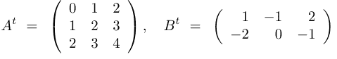

由此可知，对于列向量

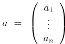

\( a^t \) 是行向量 \( a^t=(a_1,\ldots,a_n) \)，反之亦然。

对于矩阵的转置，以下成立：

- 1. \( (A+B)^t=A^t+B^t \)
- 2. \( (cA)^t=cA^t \)，其中 \( c \) 是标量
- 3. \( (A^t)^t=A \)
- 4. \( (AB)^t=B^tA^t \)（注意顺序颠倒）。

显然，方阵 \( A \) 是对称矩阵当且仅当 \( A=A^t \)，是反对称矩阵当且仅当 \( A=-A^t \)。如果 \( A \) 是对称（反对称）矩阵，则显然 \( A^t \) 是对称（反对称）矩阵。

方阵的迹，记为 \( \operatorname{tr}(A) \)，是对角线元素之和，即 \( \operatorname{tr}(A)=a_{11}+a_{22}+\cdots+a_{nn} \)。因此，对于 (2.1) 中的矩阵 \( A \)，其迹为 \( 1+3+5=9 \)。对于方阵的迹，以下成立：

- 1. \( \operatorname{tr}(A+B)=\operatorname{tr}(A)+\operatorname{tr}(B) \)
- 2. \( \operatorname{tr}(A)=\operatorname{tr}(A^t) \)
- 3. \( \operatorname{tr}(cA)=c\operatorname{tr}(A) \)，其中 \( c \) 是标量
- 4. \( \operatorname{tr}(AB)=\operatorname{tr}(BA) \)。

最后，我们指出，特别是为了计算目的，矩阵 \( A \) 可以通过在其行和列之间绘制水平和垂直线分割为称为块或单元的子矩阵。这种分割不是唯一的；例如，矩阵

\[
A=\begin{pmatrix}1&0&7&3&4\\3&5&7&1&0\\0&4&3&2&7\\6&3&9&0&2\end{pmatrix}
\]

可以分割为

\[
\begin{pmatrix}1&0&7&3&4\\3&5&7&1&0\\0&4&3&2&7\\6&3&9&0&2\end{pmatrix}
=
\begin{pmatrix}A_{11}&A_{12}\\A_{21}&A_{22}\end{pmatrix},
\]

或

\[
\begin{pmatrix}1&0&7&3&4\\3&5&7&1&0\\0&4&3&2&7\\6&3&9&0&2\end{pmatrix}
=
\begin{pmatrix}A_{11}&A_{12}&A_{13}\\A_{21}&A_{22}&A_{23}\\A_{31}&A_{32}&A_{33}\end{pmatrix}.
\]

如果 \( A=(A_{ij})_{r\times s} \)，\( B=(B_{ij})_{s\times t} \) 且块 \( A_{ij},B_{ij} \) 可兼容，则 \( AB=(C_{ij})_{r\times t} \)，其中

\[
C_{ij}=\sum_{k=1}^{s}A_{ik}B_{kj}.
\]

在分块矩阵中，块可以被视为数字，以便执行矩阵之间的基本运算（具有正确阶数的块）。

## 问题

**2.1.** 将以下矩阵表示为一个下三角矩阵和一个主对角线为零的上三角矩阵之和

\[
A=\begin{pmatrix}1&3&5\\2&4&7\\6&-5&9\end{pmatrix}.
\]

**2.2.** 设 \( A=(a_{ij}), B=(b_{ij})\in M^{n\times n} \) 为上三角矩阵。证明 \( AB \) 是一个上三角矩阵，其对角线元素为 \( a_{ii}b_{ii} \)，\( i=1,\ldots,n \)。

**2.3.** 对于矩阵

\[
A=\begin{pmatrix}-1&2&4\\3&6&5\\6&5&8\end{pmatrix},\qquad B=\begin{pmatrix}3&-6&-5\\1&3&5\\3&5&7\end{pmatrix}
\]

## 答案或提示

- **2.1.** \( U=\begin{pmatrix}0&3&5\\0&0&7\\0&0&0\end{pmatrix},\quad L=\begin{pmatrix}1&0&0\\2&4&0\\6&-5&9\end{pmatrix}.\)
- **2.2.** \( AB=C=(c_{ij}) \)，如果 \( i>j \) 则 \( c_{ij}=0 \)，如果 \( j\ge i \) 则 \( c_{ij}=\sum_{k=i}^{j}a_{ik}b_{kj} \)。
- **2.3.** 直接计算。
- **2.4.** 直接计算。
- **2.5.** 直接计算。
- **2.6.** \( (A+B)^2=(A+B)(A+B)=A^2+AB+BA+B^2. \)
- **2.7.** 考虑 \( A=\begin{pmatrix}1&1\\1&1\end{pmatrix} \)。则 \( 1\cdot A=\begin{pmatrix}1&0\\0&1\end{pmatrix}\ne A \)。因此，B10 被违反。
- **2.8.** \( \begin{pmatrix}a&b\\c&d\end{pmatrix}=\begin{pmatrix}a&0\\0&0\end{pmatrix}+\begin{pmatrix}0&b\\0&0\end{pmatrix}+\begin{pmatrix}0&0\\c&0\end{pmatrix}+\begin{pmatrix}0&0\\0&d\end{pmatrix}.\)
- **2.9.** 设 \( C,D\in S \) 和 \( \alpha,\beta\in \mathbb{R} \)。则，\( (\alpha C+\beta D)B=\alpha CB+\beta DB=\alpha BC+\beta BD=B(\alpha C+\beta D). \)
- **2.10.** 使用数学归纳法原理。
- **2.11.** 设 \( A=(a_{ij})_{m\times n} \)，\( B=(b_{ij})_{n\times p} \)，\( C=(c_{ij})_{p\times r} \)，则 \( BC \) 和 \( AB \) 分别是 \( n\times r \) 和 \( m\times p \) 矩阵，\( A(BC) \) 的 \( ij \)-th 元素为
    
    \[
    \sum_{\mu=1}^{n}a_{i\mu}\left(\sum_{\nu=1}^{p}b_{\mu\nu}c_{\nu j}\right)=\sum_{\mu=1}^{n}\sum_{\nu=1}^{p}a_{i\mu}b_{\mu\nu}c_{\nu j}.
    \]
    
    同样，\( (AB)C \) 的 \( ij \)-th 元素为
    
    \[
    \sum_{\nu=1}^{p}\left(\sum_{\mu=1}^{n}a_{i\mu}b_{\mu\nu}\right)c_{\nu j}=\sum_{\nu=1}^{p}\sum_{\mu=1}^{n}a_{i\mu}b_{\mu\nu}c_{\nu j}.
    \]
- **2.12.** 类似于问题 2.11。
- **2.13.** (iv)
    
    \[
    (AB)^H_{ij} = \overline{(AB)_{ji}} = \overline{\sum_{k=1}^{n}a_{jk}b_{ki}}
    = \sum_{k=1}^{n}\overline{a_{jk}}\,\overline{b_{ki}}
    = (\overline{B}^{\,t}\overline{A}^{\,t})_{ij} = (B^H A^H)_{ij}.
    \]
- **2.14.** 赫米特矩阵：
    
    \[
    \begin{pmatrix}1&i&2-i\\-i&2&5\\2+i&5&3\end{pmatrix}
    \]
    
    反赫米特矩阵：
    
    \[
    \begin{pmatrix}i&i&2+i\\i&2i&5\\-2+i&-5&5i\end{pmatrix}
    \]
    
    正规矩阵：
    
    \[
    \begin{pmatrix}-i&-2-i\\2-i&-3i\end{pmatrix}.
    \]
- **2.15.** (i) 设 \( AB \) 为赫米特矩阵。则，\( AB=(AB)^H=B^HA^H=BA \)，即 \( A,B \) 交换。反之，设 \( A,B \) 交换。则，\( AB=BA=B^HA^H=(AB)^H \)，即 \( AB \) 是赫米特矩阵。
    
    (vii) \( A = \frac{1}{2}(A - A^H) + \frac{1}{2}(A + A^H) \)。
- **2.16.** 设 \( A = \begin{pmatrix} 1+i & 2 \\ 1 & -i \end{pmatrix} \)，\( B = \begin{pmatrix} 2i & 1 \\ 1-i & 3 \end{pmatrix} \)。\( \operatorname{tr}(AB) - \operatorname{tr}(BA) = 0 \neq n = \operatorname{tr}(I) \)。\( \operatorname{tr}(A^H A) = \sum_{i=1}^n \sum_{j=1}^n a_{ij} \overline{a_{ij}} \geq 0 \)。
- **2.17.** 检查 \( n=2 \) 的情况，并观察规律。

## 第 3 章

## 行列式

许多复杂的表达式，特别是在电气和机械工程中，可以通过将其表示为行列式的形式来优雅地求解。此外，2 阶和 3 阶行列式在几何上分别代表面积和体积。因此，行列式的工作知识是所有科学和工程学生的基本必需。在本章中，我们将简要概述行列式的重要性质。行列式在求解线性代数方程组中的应用将在第 6 章中介绍。

与方阵 \( n \times n \) 矩阵 \( A=(a_{ij})\in M^{n\times n} \) 相关的是 \( F \) 中的一个标量，称为 \( A \) 的 \( n \) 阶行列式，记为 \( \det(A) \)，或 \( |A| \)，或

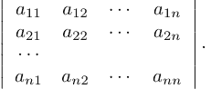

1 阶和 2 阶行列式定义为

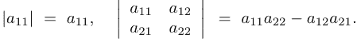

如果在矩阵 \( A \) 中我们选择任意 \( p \) 行和任意 \( p \) 列，其中 \( p\le n \)，则这些行和列交叉处的元素形成一个 \( p \) 阶方阵。这个新矩阵的行列式称为矩阵 \( A \) 的 \( p \) 阶余子式。\( A \) 的任何对角线元素的余子式称为主余子式。特别是，通过删除矩阵 \( A \) 的第 \( i \) 行和第 \( j \) 列得到的 \( (n-1)\times(n-1) \) 行列式是 \( (n-1) \) 阶余子式，我们记为 \( \tilde a_{ij} \)，并称 \( \alpha_{ij}=(-1)^{i+j}\tilde a_{ij} \) 为 \( a_{ij} \) 的余子式。用余子式表示，\( A \) 的行列式定义为

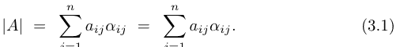

此外，

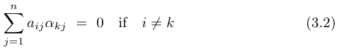

and
\(\sum_{i=1}^n a_{ij}\alpha_{ik}=0 \text{ if } j \neq k.\) (3.3)

因此，阶数为 \(n\) 的行列式可以表示为 \(n\) 个阶数为 \(n-1\) 的行列式。计算行列式 \(A\) 的公式 (3.1) 称为 _Laplace 展开_。特别是，对于阶数为 3 的行列式，我们有

\(\begin{vmatrix} a_{11} & a_{12} & a_{13} \\ a_{21} & a_{22} & a_{23} \\ a_{31} & a_{32} & a_{33} \end{vmatrix} = a_{11} \begin{vmatrix} a_{22} & a_{23} \\ a_{32} & a_{33} \end{vmatrix} - a_{12} \begin{vmatrix} a_{21} & a_{23} \\ a_{31} & a_{33} \end{vmatrix} + a_{13} \begin{vmatrix} a_{21} & a_{22} \\ a_{31} & a_{32} \end{vmatrix}\)
\(= a_{11}(a_{22}a_{33} - a_{23}a_{32}) - a_{12}(a_{21}a_{33} - a_{23}a_{31})\)
\(+ a_{13}(a_{21}a_{32} - a_{22}a_{31})\)
\(= a_{11}a_{22}a_{33} - a_{11}a_{23}a_{32} - a_{12}a_{21}a_{33} + a_{12}a_{23}a_{31}\)
\(+ a_{13}a_{21}a_{32} - a_{13}a_{22}a_{31}.\) (3.4)

为了找到与 (3.4) 类似的阶数为 \(n\) 的行列式的通用表达式，我们回顾一下，集合 \(N = \{1, 2, \cdots, n\}\) 的一个排列 \(\sigma\) 是 \(N\) 到其自身的一个一对一映射。这样的排列通常表示为 \(\sigma = i_1 i_2 \cdots i_n\)，其中 \(i_j = \sigma(j)\)。很明显，\(N\) 有 \(n!\) 个排列。所有这样的排列的集合表示为 \(S_n\)。例如，对于集合 \(\{1, 2, 3\}\)，有 6 个排列，且 \(S_3 = \{123, 132, 213, 231, 312, 321\}\)。如果 \(\sigma \in S_n\)，则逆映射 \(\sigma^{-1} \in S_n\)，并且如果 \(\sigma, \tau \in S_n\)，则复合映射 \(\sigma \circ \tau \in S_n\)。此外，恒等映射 \(\sigma \circ \sigma^{-1} = 12 \cdots n \in S_n\)。在 \(\sigma\) 中的一个 _逆序_ 是指一对整数 \((i, j)\)，使得 \(i > j\)，但在 \(\sigma\) 中 \(i\) 在 \(j\) 之前出现。我们说 \(\sigma\) 是偶排列或奇排列，取决于 \(\sigma\) 中逆序的数量是偶数还是奇数。我们还定义
\(\text{sgn } \sigma = \begin{cases} 1 & \text{if } \sigma \text{ has even permutation} \\ -1 & \text{if } \sigma \text{ has odd permutation.} \end{cases}\)

等价地，我们可以根据将排列置于自然顺序所需的最小交换次数是偶数还是奇数来定义排列为偶排列或奇排列。可以证明，对于任何 \(n\)，\(S_n\) 中的一半排列是偶排列，另一半是奇排列。

有了这些术语，就有
\(|A| = \sum_{\sigma \in S_n} (\text{sgn } \sigma) a_{1\sigma(1)} a_{2\sigma(2)} \cdots a_{n\sigma(n)}.\) (3.5)

**示例 3.1.** 在 \(12 \cdots n\) 中，逆序为零（偶），而在 \(321\) 中，逆序为三（奇），因为有两个数（3 和 2）大于且在 1 之前，还有一个数（3）大于且在 2 之前。在集合 \(S_3\) 中，排列 \(123, 231, 312\) 是偶排列，而 \(321, 213, 132\) 是奇排列，因此从 (3.5) 得到展开式 (3.4)。在 \(4312 \in S_4\) 中，4 在 3、1 和 2 之前，3 在 1 和 2 之前；因此逆序为 5（奇）。

# **示例 3.2.**

从 (3.5) 可以立即得出，对于下三角和上三角矩阵 \(A\)，我们有

$$|A|=\begin{vmatrix}a_{11}&0&\cdots&0\\a_{21}&a_{22}&\cdots&0\\\vdots&\vdots&\ddots&\vdots\\a_{n1}&a_{n2}&\cdots&a_{nn}\end{vmatrix}=a_{11}a_{22}\cdots a_{nn}$$

和

$$|A|=\begin{vmatrix}a_{11}&a_{12}&\cdots&a_{1n}\\0&a_{22}&\cdots&a_{2n}\\\vdots&\vdots&\ddots&\vdots\\0&0&\cdots&a_{nn}\end{vmatrix}=a_{11}a_{22}\cdots a_{nn}.$$

因此，特别是，对于单位矩阵 \(|I|=1\)。同样，可以得出

$$\begin{vmatrix}0&0&\cdots&0&a_{1n}\\0&0&\cdots&a_{2,n-1}&a_{2n}\\\vdots&\vdots&&\vdots&\vdots\\0&a_{n-1,2}&\cdots&a_{n-1,n-1}&a_{n-1,n}\\a_{n1}&a_{n2}&\cdots&a_{n,n-1}&a_{nn}\end{vmatrix}$$

$$=(-1)^{n+1}a_{1n}(-1)^na_{2,n-1}\cdots(-1)^3a_{n-1,2}a_{n1}$$

$$=(-1)^{(n-1)(n+4)/2}a_{1n}a_{2,n-1}\cdots a_{n-1,2}a_{n1}$$

和

$$\begin{vmatrix}a_{11}&a_{12}&\cdots&a_{1,n-1}&a_{1n}\\a_{21}&a_{22}&\cdots&a_{2,n-1}&0\\\vdots&\vdots&&\vdots&\vdots\\a_{n-1,1}&a_{n-1,2}&\cdots&0&0\\a_{n1}&0&\cdots&0&0\end{vmatrix}$$

$$=(-1)^{(n-1)(n+4)/2}a_{1n}a_{2,n-1}\cdots a_{n-1,2}a_{n1}.$$

我们注意到，对于一般行列式，表示式 (3.5) 仅具有理论意义；实际上，它有 \(n!\) 项需要求和，每一项需要 \((n-1)\) 次乘法，因此计算 \(|A|\) 总共需要 \((n-1)\times n!\) 次乘法，对于较大的 \(n\) 来说，这是一项艰巨的任务。为了大大减少计算工作，我们通常使用行列式的以下基本性质。

- 1. 如果 \(A\) 的任何一行或一列只有零元素，则 \(|A|=0\)。
- 2. 如果 \(A\) 的两行（或两列）相等或具有常数比，则 \(|A|=0\)。
- 3. 如果 \(A\) 的任何两行（或两列）相邻交换，则新矩阵 \(A_1\) 的行列式为 \(-|A|\)。
- 4. 如果 \(A\) 的一行（或一列）乘以一个常数 \(\alpha\)，则新矩阵 \(A_1\) 的行列式为 \(\alpha|A|\)。
- 5. 如果将 \(A\) 的一行（或一列）的常数倍加到另一行（或一列），则新矩阵 \(A_1\) 的行列式不变。
- 6. \(|A^t|=|A|\)。
- 7. \(|AB|=|A||B|=|BA|\)。行列式的这个性质非常有趣。对于示例 2.2 中给出的矩阵 \(A\) 和 \(B\)，我们已经看到 \(AB\ne BA\)。然而，我们有

$$|A|=\begin{vmatrix}1&1&0\\-1&2&1\\0&0&2\end{vmatrix}=6,\qquad |B|=\begin{vmatrix}2&3&4\\1&2&3\\-1&1&2\end{vmatrix}=-1,$$

$$|AB|=\begin{vmatrix}3&5&7\\-1&2&4\\-2&2&4\end{vmatrix}=-6,\qquad |BA|=\begin{vmatrix}-1&8&11\\-1&5&8\\-2&1&5\end{vmatrix}=-6.$$

因此，\(|AB|=|A||B|=|BA|\)。
- 8. 如果 \(A\) 的一行或一列的每个元素表示为两个数之和，则 \(|A|\) 可以写成两个行列式之和。例如，

$$\begin{vmatrix}a_{11}&a_{12}+b_{12}&a_{13}\\a_{21}&a_{22}+b_{22}&a_{23}\\a_{31}&a_{32}+b_{32}&a_{33}\end{vmatrix}=\begin{vmatrix}a_{11}&a_{12}&a_{13}\\a_{21}&a_{22}&a_{23}\\a_{31}&a_{32}&a_{33}\end{vmatrix}+\begin{vmatrix}a_{11}&b_{12}&a_{13}\\a_{21}&b_{22}&a_{23}\\a_{31}&b_{32}&a_{33}\end{vmatrix}.$$
- 9. 如果 \(A\) 的元素是 \(x\) 的多项式函数，并且当 \(x=a\) 时，两行或两列变得相同，则 \(x-a\) 是 \(|A|\) 的一个因式。

虽然任何阶数的行列式计算的系统程序将在第 6 章中给出，但以下示例说明了上述性质的有用性。

# **示例 3.3.** 我们有

$$\Delta=\begin{vmatrix}11&3&4\\19&6&5\\21&7&8\end{vmatrix}=-\begin{vmatrix}3&11&4\\6&19&5\\7&21&8\end{vmatrix}=-\begin{vmatrix}-1&11&4\\-1&19&5\\-1&21&8\end{vmatrix}$$

$$=\begin{vmatrix}1&19&5\\-1&11&4\\-1&21&8\end{vmatrix}=\begin{vmatrix}1&19&5\\0&30&9\\0&40&13\end{vmatrix}=\begin{vmatrix}30&9\\40&13\end{vmatrix}$$

$$=30\times13-9\times40=390-360=30.$$

# 示例 3.4. 我们有

\(\Delta = \left|\begin{array}{ c c c }
a-b-c & 2a & 2a \\
2b & b-c-a & 2b \\
2c & 2c & c-a-b
\end{array}\right| = \left|\begin{array}{ c c c }
a+b+c & a+b+c & a+b+c \\
2b & b-c-a & 2b \\
2c & 2c & c-a-b
\end{array}\right|\)
\(= (a+b+c) \left|\begin{array}{ c c c }
1 & 1 & 1 \\
2b & b-c-a & 2b \\
2c & 2c & c-a-b
\end{array}\right|\)
\(= (a+b+c) \left|\begin{array}{ c c c }
1 & 0 & 0 \\
2b & -b-c-a & 0 \\
2c & 0 & -c-a-b
\end{array}\right|\)
\(= (a+b+c) \left|\begin{array}{ c c }
-b-c-a & 0 \\
0 & -c-a-b
\end{array}\right| = (a+b+c)^3.\)

# 示例 3.5. Vandermonde 矩阵

\(V = \left(\begin{array}{ c c c c }
1 & 1 & \cdots & 1 \\
x_1 & x_2 & \cdots & x_n \\
x_1^2 & x_2^2 & \cdots & x_n^2 \\
\cdots &  &  &  \\
x_1^{n-1} & x_2^{n-1} & \cdots & x_n^{n-1}
\end{array}\right)\)

在多项式插值理论中起着重要作用。通过归纳法，我们将证明
\(|V| = \prod_{1 \leq i < j \leq n} (x_j - x_i).\)

确实，我们有
\(\left|\begin{array}{ c c }
1 & 1 \\
x_1 & x_2
\end{array}\right| = (x_2 - x_1)\)

和
\(|V| = \left|\begin{array}{ c c c c }
1 & 1 & \cdots & 1 \\
0 & x_2 - x_1 & \cdots & x_n - x_1 \\
0 & x_2^2 - x_2x_1 & \cdots & x_n^2 - x_nx_1 \\
\cdots &  &  &  \\
0 & x_2^{n-1} - x_2^{n-2}x_1 & \cdots & x_n^{n-1} - x_n^{n-2}x_1
\end{array}\right|\)
\(= \prod_{j=2}^n (x_j - x_1) \left|\begin{array}{ c c c c }
1 & 1 & \cdots & 1 \\
x_2 & x_3 & \cdots & x_n \\
x_2^2 & x_3^2 & \cdots & x_n^2 \\
\cdots &  &  &  \\
x_2^{n-2} & x_3^{n-2} & \cdots & x_n^{n-2}
\end{array}\right|\)
\(= \prod_{j=2}^n (x_j - x_1) \prod_{2 \leq i < j \leq n} (x_j - x_i) = \prod_{1 \leq i < j \leq n} (x_j - x_i).\)

### 示例 3.6.

从行列式的定义可以清楚地看出，对于在区间 \( J \) 上的可微函数组成的给定 \( n \times n \) 矩阵 \( A(x) = (a_{ij}(x)) \)，函数 \( \det A(x) \) 在 \( J \) 上可微。我们将利用 (3.1) 中给出的 \( \det A(x) \) 展开式来计算 \( (\det A(x))' \)。由于

\[
\det A(x) = \sum_{j=1}^n a_{ij}(x) \alpha_{ij}(x)
\]

可得

\[
\frac{\partial \det A(x)}{\partial a_{ij}(x)} = \alpha_{ij}(x)
\]

因此

\[
(\det A(x))' = \sum_{j=1}^n \sum_{i=1}^n \frac{\partial \det A(x)}{\partial a_{ij}(x)} \frac{da_{ij}(x)}{dx} = \sum_{j=1}^n \sum_{i=1}^n \alpha_{ij}(x) a'_{ij}(x),
\]

这等价于

\[
(\det A(x))' =
\begin{vmatrix}
a'_{11}(x) & \cdots & a'_{1n}(x) \\
a_{21}(x) & \cdots & a_{2n}(x) \\
\cdots & \cdots & \cdots \\
a_{n1}(x) & \cdots & a_{nn}(x)
\end{vmatrix}
+
\begin{vmatrix}
a_{11}(x) & \cdots & a_{1n}(x) \\
a'_{21}(x) & \cdots & a'_{2n}(x) \\
\cdots & \cdots & \cdots \\
a_{n1}(x) & \cdots & a_{nn}(x)
\end{vmatrix}
+ \cdots
+
\begin{vmatrix}
a_{11}(x) & \cdots & a_{1n}(x) \\
a_{21}(x) & \cdots & a_{2n}(x) \\
\cdots & \cdots & \cdots \\
a'_{n1}(x) & \cdots & a'_{nn}(x)
\end{vmatrix}.
\tag{3.6}
\]

## 习题

### 3.1. 计算

(i)
\[
\begin{vmatrix}
21 & 17 & 7 & 10 \\
24 & 22 & 6 & 10 \\
6 & 8 & 2 & 3 \\
5 & 7 & 1 & 2
\end{vmatrix},
\]

(ii)
\[
\begin{vmatrix}
1+i & 1-i & i \\
1-i & i & 1+i \\
i & 1+i & 1-i
\end{vmatrix}.
\]

### 3.2. 求解方程

(i)
\[
\begin{vmatrix}
x+2 & 2x+3 & 3x+4 \\
2x+3 & 3x+4 & 4x+5 \\
3x+5 & 5x+8 & 10x+17
\end{vmatrix} = 0,
\]

(ii)
\[
\begin{vmatrix}
1+x & 2 & 3 \\
1 & 2+x & 3 \\
1 & 2 & 3+x
\end{vmatrix} = 0.
\]

### 3.3. 证明

(i)
\[
\begin{vmatrix}
1+a & 1 & 1 & 1 \\
1 & 1+b & 1 & 1 \\
1 & 1 & 1+c & 1 \\
1 & 1 & 1 & 1+d
\end{vmatrix}
= abcd \left(1 + \frac{1}{a} + \frac{1}{b} + \frac{1}{c} + \frac{1}{d}\right)
\]

(ii)
\[
\begin{vmatrix}
a^2 + \lambda & ab & ac & ad \\
ab & b^2 + \lambda & bc & bd \\
ac & bc & c^2 + \lambda & cd \\
ad & bd & cd & d^2 + \lambda
\end{vmatrix}
= \lambda^3(a^2 + b^2 + c^2 + d^2 + \lambda)
\]

(iii)
\[
\begin{vmatrix}
1 & 1 & 1 & \cdots & 1 \\
1 & 2 & 2^2 & \cdots & 2^{n-1} \\
1 & 3 & 3^2 & \cdots & 3^{n-1} \\
\cdots & \cdots & \cdots & \cdots & \cdots \\
1 & n & n^2 & \cdots & n^{n-1}
\end{vmatrix}
= 1!2!3!\cdots(n-1)!
\]

### 3.4. 证明

- (i) 若矩阵 \(A \in M^{n \times n}\) 为反对称矩阵，则 \(\det(A) = (-1)^n \det(A)\)，因此当 \(n\) 为奇数时，\(\det(A) = 0\)。
- (ii) 若矩阵 \(A \in M^{n \times n}\) 为厄米矩阵，则 \(\det(A)\) 为实数。

### 3.5. 设 \(A\) 和 \(B\) 为 \(n \times n\) 矩阵，且 \(AB = BA\)。证明 \(\det(A^2 + B^2) \geq 0\)。

## 答案或提示

**3.1.** (i) 0.  
(ii) \(4 + 7i\).

**3.2.** (i) \(-1, -1, -2\).  
(ii) \(0, 0, -6\).

**3.3.** (i)
\[
\begin{vmatrix}
1+a & -a & -a & -a \\
1 & b & 0 & 0 \\
1 & 0 & c & 0 \\
1 & 0 & 0 & d
\end{vmatrix}
=
\begin{vmatrix}
1+a+\frac{a}{b}+\frac{a}{c}+\frac{a}{d} & -a & -a & -a \\
0 & b & 0 & 0 \\
0 & 0 & c & 0 \\
0 & 0 & 0 & d
\end{vmatrix}
\]

(ii)
\[
a^2b^2c^2d^2
\begin{vmatrix}
\frac{a^2+\lambda}{a^2} & 1 & 1 & 1 \\
1 & \frac{b^2+\lambda}{b^2} & 1 & 1 \\
1 & 1 & \frac{c^2+\lambda}{c^2} & 1 \\
1 & 1 & 1 & \frac{d^2+\lambda}{d^2}
\end{vmatrix}
\]

(iii) 参见示例 3.5。

**3.4.** (i) \(\det(A) = \det(-A^t) = (-1)^n \det(A^t) = (-1)^n \det(A)\)

(ii) \(\det(A) = \det(\overline{A^t}) = \det(\overline{A}) = \sum_{\sigma \in S_n} (\operatorname{sgn} \sigma) \overline{a_{1\sigma(1)}} \overline{a_{2\sigma(2)}} \cdots \overline{a_{n\sigma(n)}} = \overline{\sum_{\sigma \in S_n} (\operatorname{sgn} \sigma) a_{1\sigma(1)} a_{2\sigma(2)} \cdots a_{n\sigma(n)}} = \overline{\det(A)}\)

**3.5.** \(\det(A^2 + B^2) = \det\bigl((A+iB)(A-iB)\bigr) = \det(A+iB)\det(A-iB) = \det(A+iB)\det(\overline{A+iB}) \geq 0\).

Taylor & Francis  
Taylor & Francis Group  
http://taylorandfrancis.com

## 第 4 章：可逆矩阵

在本章中，我们将证明行列式理论可以应用于求给定方阵的逆矩阵。特别是，我们将提供一些带状矩阵逆矩阵的解析表示，这些矩阵在化学、物理学以及利用有限差分法求解常微分方程两点边值问题中具有巨大价值。

方阵 \( A = (a_{ij}) \in M^{n \times n} \) 被称为**可逆**或**非奇异**，当且仅当存在矩阵 \( B \in M^{n \times n} \) 使得 \( AB = BA = I \)。这样的矩阵 \( B \) 是唯一的。确实，若 \( AB = BA = I \) 且 \( AC = CA = I \)，则 \( B = BI = B(AC) = (BA)C = IC = C \)。矩阵 \( B \) 称为 \( A \) 的**逆矩阵**，记作 \( A^{-1} \)。若 \( A \) 非奇异，则由于 \( AA^{-1} = A^{-1}A = I \)，可得 \( (A^{-1})^{-1} = A \)。显然，若 \( B \) 是 \( A \) 的逆矩阵，则 \( A \) 是 \( B \) 的逆矩阵。若方阵无逆矩阵，则称为**奇异**矩阵。我们从以下结果开始，其证明源自下一章的讨论（参见习题 5.1）。

### 定理 4.1.

若矩阵 \( A = (a_{ij}) \) 和 \( B = (b_{ij}) \) 在 \( M^{n \times n} \) 中，且 \( AB = I \) 或 \( BA = I \)，则 \( A \) 和 \( B \) 均可逆，且互为逆矩阵。

因此，求 \( A \) 的逆矩阵只需找到满足 \( AB = I \) 或 \( BA = I \) 的矩阵 \( B \)，即无需同时验证两个等式。

### 示例 4.1.

我们将求矩阵

\[
A = \begin{pmatrix} a & b \\ c & d \end{pmatrix}
\]

的逆矩阵

\[
B = \begin{pmatrix} x_1 & x_2 \\ y_1 & y_2 \end{pmatrix}.
\]

为此，我们注意到 \( AB = I \) 等价于以下方程组

\[
ax_1 + by_1 = 1, \quad ax_2 + by_2 = 0
\]
\[
cx_1 + dy_1 = 0, \quad cx_2 + dy_2 = 1.
\]

若 \( |A| = ad - bc \neq 0 \)，则这些方程组可唯一求解，得到

\[
x_1 = \frac{d}{|A|}, \quad y_1 = -\frac{c}{|A|}, \quad x_2 = -\frac{b}{|A|}, \quad y_2 = \frac{a}{|A|}.
\]

因此，矩阵 \( A \) 的逆矩阵 \( B \) 存在当且仅当 \( |A| \ne 0 \)，且形式为

\[
B=\begin{pmatrix}d/|A|&-b/|A|\\-c/|A|&a/|A|\end{pmatrix}=\frac{1}{|A|}\begin{pmatrix}d&-b\\-c&a\end{pmatrix}.
\]

由示例 4.1 可知，对于给定矩阵，其逆矩阵可能不存在，因此既有奇异矩阵也有非奇异矩阵。

**定理 4.2.** 若 \( A=(a_{ij}) \) 和 \( B=(b_{ij}) \) 为 \( M^{n\times n} \) 中的非奇异矩阵，则 \( AB \) 也是非奇异矩阵，且 \( (AB)^{-1}=B^{-1}A^{-1} \)。反之，若 \( AB \) 非奇异，则 \( A \) 和 \( B \) 均非奇异。

**证明.** 由于 \( A^{-1} \) 和 \( B^{-1} \) 存在，

\[
(AB)(B^{-1}A^{-1})=A(BB^{-1})A^{-1}=A(I)A^{-1}=AA^{-1}=I.
\]

因此，由定理 4.1 可知 \( AB \) 非奇异，且 \( (AB)^{-1}=B^{-1}A^{-1} \)。反之，根据定理 4.1，只需注意到

\[
I=(AB)(AB)^{-1}=A\bigl(B(AB)^{-1}\bigr)
\]

以及

\[
I=(AB)^{-1}(AB)=\bigl((AB)^{-1}A\bigr)B.\quad\blacksquare
\]

**推论 4.1.** 若 \( A \) 为 \( M^{n\times n} \) 中的可逆矩阵，则

\[
\det(A^{-1})=(\det(A))^{-1}.
\]

**证明.** 由于 \( AA^{-1}=I \)，则 \( \det(AA^{-1})=\det(A)\det(A^{-1})=1 \)，故 \( \det(A^{-1})=(\det(A))^{-1} \)。

**推论 4.2.** 若 \( A,B,C\in M^{n\times n} \) 且 \( A \) 为可逆矩阵，则 \( AB=AC \) 蕴含 \( B=C \)。

**推论 4.3.** 若 \( A_i\in M^{n\times n} \)，\( i=1,2,\cdots,m \) 为非奇异矩阵，则 \( A_1A_2\cdots A_m \) 非奇异，且

\[
(A_1A_2\cdots A_m)^{-1}=A_m^{-1}A_{m-1}^{-1}\cdots A_1^{-1}.
\]

**定理 4.3.** 若 \( A \) 为非奇异实（复）矩阵，则 \( A^t \)（\( A^H \)）非奇异，且 \( (A^t)^{-1}=(A^{-1})^t \)（\( (A^H)^{-1}=(A^{-1})^H \)）。

**证明.** 由于 \( AA^{-1}=I \)，则 \( (A^{-1})^tA^t=I \)，同样由 \( A^{-1}A=I \) 可得 \( A^t(A^{-1})^t=I \)。这些关系蕴含 \( (A^{-1})^t=(A^t)^{-1}.\quad\blacksquare \)

**定理 4.4.** 矩阵 \( A\in M^{n\times n} \) 非奇异当且仅当 \( \det(A)\ne 0 \)。

给定矩阵 \( A\in M^{n\times n} \) 的**伴随矩阵**，记作 adj \( A \)，是 \( A \) 的余子矩阵的转置，即 \( \operatorname{adj}A=(\alpha_{ij})^t=(\alpha_{ji}) \)。

## 定理 4.5.

若 $A\in M^{n\times n}$ 是非奇异矩阵，则

$$A^{-1}=\frac{\operatorname{adj} A}{|A|}. \tag{4.1}$$

## 证明.

由 (3.1)–(3.3)，有 $A(\operatorname{adj} A)=(c_{ij})$，其中

$$c_{ij}=\sum_{k=1}^{n}a_{ik}\alpha_{jk}=\begin{cases}\det(A)&\text{若 }i=j,\\0&\text{若 }i\ne j.\end{cases}$$

因此，$A(\operatorname{adj} A)=\det(A)I$，由此可得 (4.1)。

## 例 4.2.

对于矩阵

$$A=\begin{pmatrix}2&-1&1\\3&2&-5\\1&3&-2\end{pmatrix},$$

有

$$|A|=\begin{vmatrix}2&-1&1\\3&2&-5\\1&3&-2\end{vmatrix}=28\quad\text{且}\quad \operatorname{adj}A=\begin{pmatrix}11&1&3\\1&-5&13\\7&-7&7\end{pmatrix}$$

因此由 (4.1) 可得

$$A^{-1}=\begin{pmatrix}\frac{11}{28}&\frac{1}{28}&\frac{3}{28}\\\frac{1}{28}&-\frac{5}{28}&\frac{13}{28}\\\frac14&-\frac14&\frac14\end{pmatrix}.$$

一个 $n\times n$ 矩阵 $A=(a_{ij})$ 称为*带状矩阵*，如果存在整数 $r$ 和 $s$，$1<r,s<n$，使得对所有 $j-i\ge r$ 和 $i-j\ge s$ 有 $a_{ij}=0$。数 $w=r+s-1$ 称为 $A$ 的带宽。满足 $r=s=2$ 从而 $w=3$ 的矩阵称为*三对角*矩阵。我们将求三对角矩阵

$$A_n(x)=\begin{pmatrix}x&-1&&&&\\-1&x&-1&&&\\&-1&x&-1&&\\&&\ddots&\ddots&\ddots&\\&&&-1&x&-1\\&&&&-1&x\end{pmatrix}. \tag{4.2}$$

的逆，其中 $x\ge 0$。为此，令 $D_n(x)=D_n=|A_n(x)|$。则 $D_n$ 满足下列二阶线性差分方程

$$D_n=xD_{n-1}-D_{n-2},\qquad n=1,2,\ldots \tag{4.3}$$

以及初始条件

\(D_{-1}=0,\quad D_0=1.\) (4.4)

(4.3) 的通解可写为

\(D_n=A\lambda_1^n+B\lambda_2^n,\) (4.5)

其中 \(\lambda_1,\lambda_2\) 是方程 \(\lambda^2-x\lambda+1=0\) 的根。利用 (4.4)，可得

\(D_n=\left\{\begin{array}{ c c }
sinh(n+1)\theta/sinh\theta & \text{若 }x=2cosh\theta>2 \\
n+1 & \text{若 }x=2 \\
sin(n+1)\theta/sin\theta & \text{若 }0\le x=2cos\theta<2.
\end{array}\right.\) (4.6)

设 \(B_n=(b_{ij})\) 是 \(A_n(x)\) 的逆矩阵，即 \(A_n(x)B_n=I\)。则对 \(1\le j\le n\)，有

\(-b_{i-1,j}+xb_{ij}-b_{i+1,j}=\left\{\begin{array}{ c c }
0, & i=1,\cdots,j-1,b_{0j}=0 \\
1, & i=j \\
0, & i=j+1,\cdots,n,b_{n+1,j}=0.
\end{array}\right.\) (4.7)

设 \(x=2cosh\theta>2\)。当 \(1\le i\le j-1\) 时，(4.7) 的通解为 \(b_{ij}=A\lambda_1^i+B\lambda_2^i\)，其中 \(\lambda_1\)、\(\lambda_2\) 再次是方程 \(\lambda^2-x\lambda+1=0\) 的根。该解对 \(0\le i\le j\) 成立，且由 \(b_{0j}=0\) 和 (4.6)，可写为

\(b_{ij}=2Asinhi\theta=2AD_{i-1}sinh\theta,0\le i\le j.\) (4.8)

类似地，当 \(j+1\le i\le n\) 时，(4.7) 的通解为 \(b_{ij}=C\lambda_1^i+D\lambda_2^i\)，该解对 \(j\le i\le n+1\) 成立。该解由 \(b_{n+1,j}=0\) 和 (4.6) 可得

\(b_{ij}=-2CD_{n-i}e^{(n+1)\theta}sinh\theta,j\le i\le n+1.\) (4.9)

现在令 (4.8) 和 (4.9) 在 \(i=j\) 时相等，得到方程

\(AD_{j-1}+Ce^{(n+1)\theta}D_{n-j}=0.\) (4.10)

另外，将 (4.8) 和 (4.9) 代入 (4.7) 中 \(i=j\) 的情形，得到方程

\(sinh\theta\left[AD_j+Ce^{(n+1)\theta}D_{n-j-1}\right]=\frac{1}{2}.\) (4.11)

解 (4.10) 和 (4.11)，得

\(A=\frac{D_{n-j}}{2D_nsinh\theta},C=-\frac{D_{j-1}}{2D_ne^{(n+1)\theta}sinh\theta}.\) (4.12)

## 可逆矩阵

现在将 (4.12) 代入 (4.8) 和 (4.9)，得到

\(b_{ij}=\frac{1}{D_n}\left\{\begin{array}{ c c }
D_{i-1}D_{n-j}, & i \leq j \\
D_{j-1}D_{n-i}, & i \geq j.
\end{array}\right.\) (4.13)

最后，我们指出，上述计算可稍作修改以证明公式 (4.13) 对 \(0 \leq x \leq 2\) 也成立。

我们将上述结果归纳为下面的定理。

## 定理 4.6.

对于 (4.2) 中给定的三对角矩阵 \(A_n(x)\)，\(x \geq 0\)，其逆矩阵 \(A_n^{-1}(x)=B_n=(b_{ij})\) 是对称的，即 \(b_{ij}=b_{ji}\)，且

\(b_{ij}=\frac{D_{i-1}D_{n-j}}{D_n}>0, i \leq j.\) (4.14)

## 例 4.3.

为计算 \(A_5^{-1}(3)\)，首先利用 (4.3)、(4.4) 得到

\(D_1=3, D_2=8, D_3=21, D_4=55, D_5=144\)

然后利用 (4.14) 得到

\(A_5^{-1}(3)=B_5=\frac{1}{144}\left(\begin{array}{ c c c c c }
55 & 21 & 8 & 3 & 1 \\
21 & 63 & 24 & 9 & 3 \\
8 & 24 & 64 & 24 & 8 \\
3 & 9 & 24 & 63 & 21 \\
1 & 3 & 8 & 21 & 55
\end{array}\right).\)

现在设 \(x=-y\)，\(y \geq 0\)。则有

\(A_n(x)=A_n(-y)=-\mathcal{A}_n(y),\) (4.15)

其中

\(\mathcal{A}_n(y)=\left(\begin{array}{ c c c c c c }
y & 1 &  &  &  &  \\
1 & y & 1 &  &  &  \\
 & 1 & y & 1 &  &  \\
 &  & \cdots & \cdots &  &  \\
 &  &  & 1 & y & 1 \\
 &  &  &  & 1 & y
\end{array}\right),\) (4.16)

对于矩阵 (4.16)，与定理 4.6 类似的结果如下：

## 定理 4.7.

对于 (4.16) 中给定的三对角矩阵 \(\mathcal{A}_n(y)\)，\(y \geq 0\)，其逆矩阵 \(\mathcal{A}_n^{-1}(y)=\mathcal{B}_n=(\beta_{ij})\) 是对称的，即 \(\beta_{ij}=\beta_{ji}\)，且

\(\beta_{ij}=\frac{(-1)^{i+j}D_{i-1}D_{n-j}}{D_n}, i \leq j.\) (4.17)

## 习题

**4.1.** 下列矩阵中哪些是奇异的？

\[
A=\begin{pmatrix}1&2&3\\1&1&2\\1&3&4\end{pmatrix},\quad
B=\begin{pmatrix}1&1&1\\2&4&8\\3&9&25\end{pmatrix},\quad
C=\begin{pmatrix}2&5&19\\1&-2&-4\\-3&2&0\end{pmatrix}.
\]

利用 (4.1) 求非奇异矩阵的逆。

**4.2.** 当 $x$ 取何值时，下列矩阵是奇异的？

\[
A=\begin{pmatrix}
3-x&2&2\\
2&4-x&1\\
-2&-4&-1-x
\end{pmatrix}
\]

**4.3.** 设

\[
A=\begin{pmatrix}
-\frac12&-\frac{\sqrt3}{2}&0\\
-\frac{\sqrt3}{2}&\frac12&0\\
0&0&0
\end{pmatrix},\qquad
P=\begin{pmatrix}
\frac12&\frac{\sqrt3}{2}&0\\
-\frac{\sqrt3}{2}&\frac12&0\\
0&0&1
\end{pmatrix}.
\]

证明 $P^{-1}AP$ 是对角矩阵。

**4.4.** 证明上（下）三角非奇异方阵的逆仍是上（下）三角方阵。特别地，证明对角元素 $a_{ii}\ne0$（$i=1,\cdots,n$）的对角矩阵 $A$ 的逆 $A^{-1}$ 是对角矩阵，其对角元素为 $1/a_{ii}$，$i=1,\cdots,n$。

**4.5.** 设方阵 $A$、$B$ 和 $A+B$ 均非奇异。证明 $A^{-1}+B^{-1}$ 非奇异，且

\[
(A^{-1}+B^{-1})^{-1}=A(A+B)^{-1}B=B(A+B)^{-1}A.
\]

**4.6.** 设 $A,B\in\mathbb{C}^{n\times n}$。证明：若 $B$ 非奇异，则 $\operatorname{tr}(B^{-1}AB)=\operatorname{tr}(A)$。

**4.7.** 实方阵 $A$ 称为*正交*的，当且仅当 $A^t=A^{-1}$，即 $AA^t=A^tA=I$。因此，$\det(A)=\pm1$。复方阵 $A$ 称为*酉*的，当且仅当 $A^H=A^{-1}$，即 $A^HA^{-1}=A^{-1}A^H=I$。若 $A,B\in M^{n\times n}$ 是酉矩阵，证明 $A^H$、$A^{-1}$、$AB$ 也是酉矩阵。

**4.8.** 验证下列矩阵是正交的：

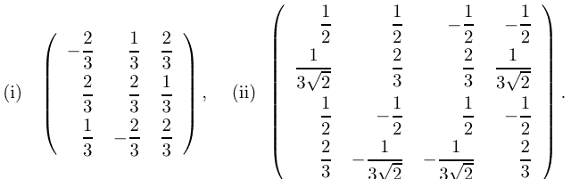

**4.9.** 设 $A$ 是反对称矩阵，且 $I-A$ 非奇异。证明矩阵 $B=(I+A)(I-A)^{-1}$ 是正交的。

**4.10.** 设 $W$ 是 $1\times n$ 矩阵（行向量），满足 $WW^t=1$。$n\times n$ 矩阵 $H=I-2W^tW$ 称为 *Householder矩阵*。证明 $H$ 是对称且正交的。

**4.11.** 设 $A,B$ 是实方阵，矩阵 $P$ 正交且 $B=P^{-1}AP$。证明 $\operatorname{tr}(A^tA)=\operatorname{tr}(B^tB)$。

**4.12.** 对于 (4.2) 和 (4.16) 中给定的矩阵 $A_n(x)$（$x\ge 0$）和 $A_n(y)$（$y\ge 0$），证明：

- (i) $A_n(x)A_n(y)=A_n(y)A_n(x)$

- (ii) $[A_n(x)A_n(y)]^{-1}=\dfrac{1}{x+y}[A_n^{-1}(x)+A_n^{-1}(y)]$, $x+y\ne0$

- (iii) $[A_n(x)A_n(y)]^{-1}=\dfrac{1}{x-y}[A_n^{-1}(y)-A_n^{-1}(x)]$, $x-y\ne0$

- (iv) $[A_n(x)A_n(y)]^{-1}=\dfrac{1}{x-y}[A_n^{-1}(y)-A_n^{-1}(x)]$, $x-y\ne0$.

- (v) 矩阵 $[A_n^2(x)]^{-1}=C=(c_{ij})$ 是对称的，且

\[
c_{ij}=\frac{2}{(x^2-4)D_n^2}\left[D_nD_{n-j}\left(\frac{i+1}{2}D_{i-2}-\frac{i-1}{2}D_i\right)+D_{i-1}\left(\frac{j}{2}D_{2n+1-j}-\frac{2n+2-j}{2}D_{j-1}\right)\right],\quad x\ne2,\ i\le j
\]

\[
=\frac{i(n-j+1)}{6(n+1)}[2j(n+1)-(i^2+j^2)+1],\quad x=2,\ i\le j.
\]

- (vi) 矩阵 $[A_n^2(y)]^{-1}=\Gamma=(\gamma_{ij})$ 是对称的，且 $\gamma_{ij}=(-1)^{i+j}c_{ij}$。

## 4.13. 考虑阶数为 \( n \) 的三对角矩阵，

\( A_n(x, y) = \left( \begin{array}{ c c c c c c }
1 + x & -1 &  &  &  &  \\
-1 & 2 & -1 &  &  &  \\
 & -1 & 2 & -1 &  &  \\
 &  & \cdots & \cdots &  &  \\
 &  &  & -1 & 2 & -1 \\
 &  &  &  & -1 & 1 + y
\end{array} \right), \)

其中 \( x + y + (n - 1)xy \neq 0 \)。证明 \( A_n^{-1}(x, y) = (b_{ij}) \) 是对称的，且

\( b_{ij} = \frac{[1 + (i - 1)x][1 + (n - j)y]}{x + y + (n - 1)xy}, \quad i \leq j. \)

## 4.14. 考虑阶数为 \( n \) 的三对角矩阵，

\( A_n(x, y) = \left( \begin{array}{ c c c c c c }
1 & -y &  &  &  &  \\
-x & 1 & -y &  &  &  \\
 & -x & 1 & -y &  &  \\
 &  & \cdots & \cdots &  &  \\
 &  &  & -x & 1 & -y \\
 &  &  &  & -x & 1
\end{array} \right), \)

其中 \( x \geq 0, y \geq 0 \)。证明

- (i) 其行列式 \( D_n \) 为

\( D_n = \left\{ \begin{array}{ l l }
1, & xy = 0 \\
(xy)^{n/2} \frac{\sinh(n + 1)\theta}{\sinh \theta}, & \cosh \theta = \frac{1}{2\sqrt{xy}}, \quad 0 < xy < \frac{1}{4} \\
\frac{n + 1}{2^n}, & xy = \frac{1}{4} \\
(xy)^{n/2} \frac{\sin(n + 1)\theta}{\sin \theta}, & \cos \theta = \frac{1}{2\sqrt{xy}}, \quad xy > \frac{1}{4}
\end{array} \right. \)

- (ii) 其逆矩阵 \( B \) 的元素 \( b_{ij} \) 为

\( b_{ij} = \frac{1}{D_n} \left\{ \begin{array}{ l l }
y^{j-i}D_{i-1}D_{n-j}, & i \leq j \\
x^{i-j}D_{j-1}D_{n-i}, & i \geq j.
\end{array} \right. \)

## 4.15. 考虑矩阵 \( \mathcal{A}_n(x, y) = A_n(-x, -y) \)，其中 \( A_n(x, y) \) 与问题 4.14 中的相同。证明逆矩阵 \( \mathcal{A}_n^{-1}(x, y) \) 的元素 \( \alpha_{ij} \) 为

\( \alpha_{ij} = \frac{1}{D_n} \left\{ \begin{array}{ l l }
(-1)^{i+j}y^{j-i}D_{i-1}D_{n-j}, & i \leq j \\
(-1)^{i+j}x^{i-j}D_{j-1}D_{n-i}, & i \geq j
\end{array} \right. \)

## 可逆矩阵

其中 \( D_n \) 与问题 4.14 中的相同。

## 4.16.

\( n \times n \) 矩阵 \( A_n = (a_{ij}) \)，其中

\( a_{ij} = \begin{cases} 1, & j - i = 1 \\ 1, & i = j \\ -1, & i - j = 1 \\ 0, & \text{otherwise} \end{cases} \)

称为 _斐波那契矩阵_。令 \( F_n = \det(A_n) \)，证明 _斐波那契数_ \( F_n \) 满足

- (i) \( F_n = F_{n-1} + F_{n-2}, \ n = 1, 2, \cdots \) 其中 \( F_{-1} = 0, \ F_0 = 1 \)

- (ii) \( F_n = \frac{1}{2^{n+1} \sqrt{5}} \left[ (1 + \sqrt{5})^{n+1} - (1 - \sqrt{5})^{n+1} \right] \).

同时，求矩阵 \( A_n \) 的逆。

## 4.17.

如果存在某个正整数 \( k \) 使得 \( A^k = 0 \)，则称 \( n \times n \) 矩阵为 _幂零矩阵_。证明

- (i) 以下矩阵是幂零的

\( A = \begin{pmatrix} 2 & 11 & 3 \\ -2 & -11 & -3 \\ 8 & 35 & 9 \end{pmatrix} \)

- (ii) 每个幂零矩阵都是奇异的

- (iii) 如果 \( A \) 是幂零的，则 \( I - A \) 是非奇异的

- (iv) 如果矩阵 \( A, B \) 是幂零的且 \( AB = BA \)，则 \( AB \) 和 \( A + B \) 是幂零的。

## 4.18.

如果 \( A^2 = A \)，则称 \( n \times n \) 矩阵为 _幂等矩阵_。证明

- (i) 矩阵 \( I \) 和 \( 0 \) 是幂等的

- (ii) 如果 \( A \) 是幂等的，则 \( A^t \) 和 \( I - A \) 是幂等的

- (iii) 除了 \( I \) 之外的每个幂等矩阵都是奇异的

- (iv) 如果 \( A \) 是幂等的，则 \( 2A - I \) 是可逆的，且是其自身的逆

- (v) 如果矩阵 \( A, B \) 是幂等的且 \( AB = BA \)，则 \( AB \) 是幂等的。

## 4.19.

由 \( n \times n \) 单位矩阵的行置换得到的 \( n \times n \) 矩阵称为 _置换矩阵_。因此，每个置换矩阵在每行和每列都有 1，其余元素均为 0。证明

- (i) 每个置换矩阵 \( P \) 都是非奇异的且正交的

- (ii) 两个置换矩阵的乘积是一个置换矩阵。

## 4.20.

证明可逆的 \( n \times n \) 矩阵不构成 \( M^{n \times n} \) 的子空间。

# 答案或提示

**4.1.** \( A \) 是奇异的。\( B \) 是非奇异的，且 \( B^{-1}=\frac{1}{8}\begin{pmatrix}28&-16&4\\-26&22&-6\\6&-6&2\end{pmatrix} \)。\( C \) 是奇异的。

**4.2.** \( \det A=6x^2-9x-x^3 \)，所以 \( x=0,3,3 \)。

**4.3.** \( P^{-1}=\begin{pmatrix}1&-\frac{1}{2}&0\\\frac{\sqrt3}{2}&\frac{1}{2}&0\\0&0&1\end{pmatrix} \)，所以 \( P^{-1}AP=\begin{pmatrix}1&0&0\\0&-1&0\\0&0&0\end{pmatrix} \)。

**4.4.** 如果 \( A \) 是上三角矩阵，则 \( a_{ij}=0 \)，\( i>j \)，因此 \( \alpha_{ij}=0 \)，\( j>i \)。现在使用 (4.1)。

**4.5.** \((B(A+B)^{-1}A)^{-1}=A^{-1}(A+B)B^{-1}=A^{-1}(AB^{-1}+I)=B^{-1}+A^{-1}\)。

**4.6.** \((A+B)^{-1}(A-B)=(A-B)(A+B)^{-1}=\operatorname{tr}(B^{-1}A)=\operatorname{tr}(AB^{-1})\)。

**4.7.** \((A^H)^H=(A^{-1})^H=(A^H)^{-1}\)。现在 \( A^{-1} \) 是酉的，因为 \( A^H=A^{-1} \)。最后，由于 \( A^H=A^{-1} \) 和 \( B^H=B^{-1} \)，我们有 \((AB)(AB)^H=ABB^HA^H=ABB^{-1}A^{-1}=I\)。因此，\((AB)^H=(AB)^{-1}\)，所以 \( AB \) 是酉的。

**4.8.** (i) 对于给定矩阵，其逆为 \(\begin{pmatrix}\frac{2}{3}&\frac{1}{3}&-\frac{1}{3}\\\frac{1}{3}&\frac{1}{3}&-\frac{1}{3}\\\frac{2}{3}&\frac{1}{3}&\frac{2}{3}\end{pmatrix}\)。

(ii) 对于给定矩阵，其逆为 \(\begin{pmatrix}\frac12&\frac{1}{3\sqrt2}&\frac12&\frac23\\-\frac12&\frac23&-\frac12&-\frac{1}{3\sqrt2}\\-\frac12&\frac23&\frac12&-\frac{1}{3\sqrt2}\\-\frac12&\frac{1}{3\sqrt2}&-\frac12&\frac23\end{pmatrix}\)。

**4.9.** 由于 \((I+A)(I-A)=(I-A)(I+A)\)，我们有 \((I-A)=(I+A)^{-1}(I-A)(I+A)\)，因此 \((I-A)(I+A)^{-1}=(I+A)^{-1}(I-A)\)。显然，\((I-A)^t=(I-A^t)\) 和 \((I+A)^t=(I+A^t)\)，因此 \(B^t=((I+A)(I-A)^{-1})^t=((I-A^t)^{-1}(I+A^t))=(I-A^t)^{-1}(I+A^t)=(I+A^t)^{-1}(I-A^t)=B^{-1}\)。

**4.10.** (i) \(H^t=(I-2W^tW)(I-2W^tW)^t=(I-2W^tW)(I-2W^tW)=H\)。

(ii) \(H^tH=H^2=(I-2W^tW)(I-W^tW)=I\)。

**4.11.** 我们使用 \(\operatorname{tr}(AB)=\operatorname{tr}(BA)\)，得到 \(\operatorname{tr}(B^tB)=\operatorname{tr}((P^{-1}AP)^t(P^{-1}AP))=\operatorname{tr}(P^t(A^t(P^{-1})^tP^{-1}A)P)=\cdots=\operatorname{tr}(A^tA)\)。

**4.12.**

- (i) 通过比较两边直接得出。
- (ii) 使用 (4.15)，我们有 \(A_n(x)A_n(y)[A_n^{-1}(x)+A_n^{-1}(y)]=A_n(x)A_n(y)\times A_n^{-1}(x)+A_n(x)A_n(y)A_n^{-1}(y)=-A_n(x)A_n(-y)A_n^{-1}(x)+A_n(x)=-A_n(-y)\times A_n(x)A_n^{-1}(x)+A_n(x)=A_n(x)-A_n(-y)=(x+y)I\)。
- (iii) 遵循 (ii)。
- (iv) 遵循 (ii)。
- (v) 使用 (iii)、(4.14) 和 L’Hôpital 法则。
- (vi) 使用 (iv)、(4.17) 和 L’Hôpital 法则。

**4.13.** 与 (4.2) 类似。

**4.14.** 与 (4.2) 类似。

**4.15.** 与 (4.2) 类似。

**4.16.** 与 (4.2) 类似。

**4.17.**

- (i) \( A^3=0 \)。
- (ii) 由于 \( A^k=0 \)，\( 0=\det(A^k)=(\det(A))^k \)。因此，\( \det(A)=0 \)。
- (iii) \(-I=A^k-I=(A-I)(A^{k-1}+A^{k-2}+\cdots+I)\)，因此 \((A-I)^{-1}=-(A^{k-1}+A^{k-2}+\cdots+I)\)。
- (iv) 如果 \( A^k=B^\ell=0 \)，对于 \( r=\max\{k,\ell\} \)，我们有 \((AB)^r=A^rB^r=0\) 和 \((A+B)^{k+\ell}=A^{k+\ell}+\binom{k+\ell}{1}A^{k+\ell-1}B+\binom{k+\ell}{2}A^{k+\ell-2}B^2+\cdots+\binom{k+\ell}{k+\ell}B^{k+\ell}=0\)。

**4.18.**

- (i) 由定义直接得出。
- (ii) 由于 \( A^2=A \)，\( A^t=(A^2)^t=(AA)^t=A^tA^t=(A^t)^2 \)，\((I-A)^2=I-A-A+A^2=I-A\)。
- (iii) 如果 \( A\ne I \)，则对于某些 \( u\in\mathbb{R}^n \)，\( v=Au \) 其中 \( v\ne u \)。但是，\( Av=A^2u=Au \)，即 \( A(v-u)=0 \)。现在如果 \( A^{-1} \) 存在，则 \( A^{-1}A(v-u)=v-u=0 \)。
- (iv) \((2A-I)(2A-I)=4A^2-2A-2A+I=I\)。
- (v) \((AB)^2=(BA)(AB)=BA^2B=(BA)B=(AB)B=AB^2=AB\)。

**4.19.** (i) 设 \( P \) 为置换矩阵。根据置换矩阵的定义和行列式性质 3（第 3 章），显然 \( \det(P) \) 为 \( 1 \) 或 \(-1\)。因此，\( P \) 和 \( P^t \) 都是非奇异的。显然，存在 \( n! \) 个阶数为 \( n\times n \) 的置换矩阵。现在注意，每个置换矩阵都是对称的，即 \( P^t=P \)。我们还注意到，交换两行是一个自逆操作，因此每个置换矩阵都等于其逆，即 \( P=P^{-1} \)，或 \( P^2=I \)。因此，我们有 \( P^t=P^{-1} \)，这意味着矩阵 \( P \) 是正交的。

(ii) 如果 \( \sigma \) 和 \( \pi \) 是 \( N=\{1,2,\cdots,n\} \) 的两个置换，且 \( P_\sigma \) 和 \( P_\pi \) 是相应的置换矩阵，则根据矩阵乘法可知 \( P_\sigma P_\pi=P_{\sigma\circ\pi} \)，这意味着 \( P_\sigma P_\pi \) 是一个置换矩阵。

**4.20.** 考虑可逆矩阵 \( A=\begin{pmatrix}1&3\\3&5\end{pmatrix} \) 和 \( B=\begin{pmatrix}-1&3\\-3&5\end{pmatrix} \)。

## 第 5 章

## 线性系统

线性代数方程组在许多不同的学科中都有应用，例如生物学、商业、工程学、社会科学和统计学。因此，理解基本理论并寻找求解此类系统的高效方法至关重要。我们将在本章和下一章中专门研究线性系统。

设 $F$ 为给定的无限域。考虑 $n$ 个未知数的 $m$ 个方程的 *非齐次* 线性系统

$$\begin{aligned}
a_{11}x_1+a_{12}x_2+\cdots+a_{1n}x_n&=b_1\\
a_{21}x_1+a_{22}x_2+\cdots+a_{2n}x_n&=b_2\\
&\vdots\\
a_{m1}x_1+a_{m2}x_2+\cdots+a_{mn}x_n&=b_m,
\end{aligned}\tag{5.1}$$

其中 $a_{ij}, b_i\in F$。用矩阵形式，该系统可以写成

$$Ax=b,\tag{5.2}$$

其中矩阵 $A=(a_{ij})_{m\times n}$ 和向量 $x=(x_1,x_2,\cdots,x_n)^t$，以及 $b=(b_1,b_2,\cdots,b_m)^t$。称 (5.1) 的一个解 $x$ 为满足 (5.1) 的 $n$ 元组。若系统 (5.1) 有解，则称其为 *相容*，否则称其为 *不相容*。若 $b=0$，则 (5.2) 简化为 *齐次系统*

$$Ax=0.\tag{5.3}$$

对于齐次系统 (5.3)，零向量 $0=(0,0,\cdots,0)^t$ 总是一个解。此解称为 (5.3) 的 *零解*。显然，系统 (5.3) 除了零解外，还可能有其他解。此类解称为 (5.3) 的 *非零解*。设 $F_n$ 为 (5.3) 的所有解的集合，即 $F_n=\{x:x\in F^n\text{ such that }Ax=0\}$，则可得 $(F_n,F)$ 与示例 1.2 中相同的加法和数乘构成一个向量空间。我们称 $(F_n,F)$ 为齐次系统 (5.3) 的 *解空间*，或矩阵 $A$ 的 *零空间*，或 *核*，并将其记为 $\mathcal{N}(A)$。显然，非齐次系统 (5.2) 的所有解的集合不是向量空间。

1. 交换 \( R_i \) 和 \( R_j \)。
2. 将 \( R_i \) 替换为 \( cR_i \)，其中 \( c \in F \)，\( c \neq 0 \)。
3. 将 \( R_i \) 替换为 \( R_i + cR_j \)。

_初等列运算定义类似。_

设 \( I \) 为 \( m \times m \) 单位矩阵。通过对 \( I \) 进行一次初等行运算得到的新矩阵称为 _初等矩阵_，记为 \( E \)。在接下来的内容中，我们将用 \( E_{ij}, E_i(c), E_{ij}(c) \) 分别表示通过对 \( I \) 进行上述初等行运算得到的初等矩阵。

# 定理 5.2.

对 \( A \) 进行一次初等行运算等价于 \( EA \)，其中 \( E \) 是通过执行相同的初等行运算得到的初等矩阵。

# 证明.

我们仅对初等行运算 3 进行证明。为此，我们注意到 \( E_{ij}(c) = I + c(e^i)^t e^j \)，其中 \( e^i \)，\( i = 1, \cdots, m \) 是 \( m \) 元单位向量。因此，我们有

\( E_{ij}(c)A = (I + c(e^i)^t e^j)A = A + c(e^i)^t e^j A. \)

现在只需注意到 \( e^j A = R_j \)，且 \( (e^i)^t R_j \) 是一个 \( m \times n \) 矩阵，其第 \( i \) 行是 \( R_j \)，其余元素均为零。\(\blacksquare\)

# 定理 5.3.

每个初等矩阵 \( E \) 都是非奇异的，并且

- (i) \( E_{ij}^{-1} = E_{ji} = E_{ij} \)
- (ii) \( E_i^{-1}(c) = E_i(1/c) \)
- (iii) \( E_{ij}^{-1}(c) = E_{ij}(-c) \)。

# 证明.

(i) 只需注意到 \( E_{ji}E_{ij} = I \)。(ii) 显然，我们有 \( E_i(c)E_i(1/c) = I \)。(iii) 如同定理 5.2，我们发现

\(\begin{aligned} E_{ij}(c)E_{ij}(-c) &= (I + c(e^i)^t e^j)(I - c(e^i)^t e^j) \\ &= I + c(e^i)^t e^j - c(e^i)^t e^j - c^2(e^i)^t [e^j(e^i)^t] e^j \\ &= I - c^2(e^i)^t [0] e^j = I. \end{aligned} \blacksquare\)

若矩阵 \( B \) 可以通过对矩阵 \( A \) 进行一系列初等行运算得到，则称 \( B \) 与 \( A \) _行等价_，记作 \( B \sim A \)。显然，~ 是一个等价关系，即 1. \( A \sim A \)。2. 若 \( B \sim A \)，则 \( A \sim B \)。3. 若 \( A \sim B \) 且 \( B \sim C \)，则 \( A \sim C \)。若 \( B \) 是一个阶梯矩阵，则称 \( B \) 为 \( A \) 的一个 _阶梯形_。_列等价_ 矩阵定义类似。

定理 5.2 和 5.3 的结合给出以下结果。

# 定理 5.4.

若 \( B \) 与矩阵 \( A \) 行等价，则存在一个非奇异矩阵 \( C \)，使得 \( B = CA \) 且 \( C^{-1}B = A \)。

从上述考虑可得以下直接结果。

# 定理 5.5.

设 \( A = (a_{ij}) \) 和 \( B = (b_{ij}) \) 是行等价的阶梯矩阵，其主元分别为 \( a_{1j_1}, \cdots, a_{rj_r} \) 和 \( b_{1k_1}, \cdots, b_{sk_s} \)。则 \( r = s \) 且 \( j_i = k_i \)，\( i = 1, \cdots, r \)，即 \( A \) 和 \( B \) 有相同数量的非零行，且主元位于相同的位置。

# 定理 5.6.

每个矩阵 \( A \) 都与一个阶梯矩阵行等价。该矩阵称为 \( A \) 的阶梯形。然而，矩阵 \( A \) 的阶梯形不是唯一的。

一个 \( m \times n \) 矩阵 \( A \) 称为行规范形，如果它是一个阶梯矩阵，每个主元等于 1，且每个主元是其所在列中唯一的非零元素。

# 示例 5.2.

矩阵 0 和 \( I \) 都是行规范形。示例 5.1 中的矩阵 \( A \) 不是行规范形，而下面的矩阵是行规范形

| 0 | 1 | 7 | 0 | 5 | 0 | 0 | 9 | 0 | 0 | 0 | 1 | 3 | 0 | 0 | 1 | 0 | 0 | 0 | 0 | 0 | 0 | 1 | 0 | 5 | 0 | 0 | 0 | 0 | 0 | 0 | 0 | 1 | 8 | 0 | 0 | 0 | 0 | 0 | 0 | 0 |

# 定理 5.7.

每个矩阵 \( A \) 都与一个唯一的行规范形矩阵行等价。该唯一矩阵称为 \( A \) 的行规范形。

若两个 \( n \) 个未知数的 \( m \) 个方程的线性系统具有相同的解，则称它们等价。显然，对增广矩阵 \( (A|b) \) 进行一次初等行运算等价于对线性系统 (5.2) 本身进行相应的运算。此外，对 (5.2) 进行一次初等行运算后得到的新线性系统与线性系统 (5.2) 等价。因此，对增广矩阵 \( (A|b) \) 进行有限次行运算后得到的矩阵所对应的线性系统与线性系统 (5.2) 等价。事实上，我们有以下结果。

# 定理 5.8.

增广矩阵 \( (A|b) \) 的阶梯形（行规范形）所对应的线性系统（称为阶梯线性系统（行规范线性系统））与线性系统 (5.2) 等价。

# 定理 5.9.

线性系统 (5.2) 有解当且仅当增广矩阵 \( (A|b) \) 的阶梯形（行规范形）没有形如 \( (0, \cdots , 0, d) \) 且 \( d \neq 0 \) 的行。

# 定理 5.10.

对于增广矩阵 \( (A|b) \) 的阶梯形（行规范形）所对应的线性系统，以下结论成立：

- 1. 若 \( r = n \)，则线性系统有唯一解。
- 2. 若 \( r < n \)，则线性系统有无穷多解。此外，这些解可以用 \( (n - r) \) 个未知数 \( \{x_1, \cdots, x_n\} \setminus \{x_{j_1}, \cdots, x_{j_r}\} \) 表示。

# 定理 5.11.

若 \( m = n \)，系统 (5.2) 有唯一解当且仅当 \( A^{-1} \) 存在。此外，该解可以写成 \( x = A^{-1}b \)。

# 证明.

若 \( m = n \) 时 (5.2) 有唯一解，则根据定理 5.10(1)，\( A \) 的行规范形为 \( I \)，因此根据定理 5.4，存在非奇异矩阵 \( C \) 使得 \( I = CA \)。这意味着 \( A^{-1} \) 存在。反之，若 \( A^{-1} \) 存在，则 \( A(A^{-1}b) = (AA^{-1})b = b \)，即 \( A^{-1}b \) 是一个解。为证明其唯一性，设 \( Au = b \)，则 \( u = (A^{-1}A)u = A^{-1}(Au) = A^{-1}b \)。

# 推论 5.1.

若 \( m = n \)，齐次系统 (5.3) 只有零解当且仅当 \( \det(A) \neq 0 \)。此外，若 (5.3) 只有零解，则非齐次系统 (5.2) 有唯一解。

# 推论 5.2.

未知数多于方程的齐次系统 (5.3) 有非零解。

矩阵 \( A \) 的 _rank_，记作 \( rank(A) \)，等于 \( A \) 的一个阶梯形中的主元个数 \( r\)；等价地，\( A \) 至少有一个 \( r \) 阶非零子式，且所有高于 \( r \) 阶的子式均为零。根据定理 5.10 和 5.11，以及增广矩阵 \( (A|b) \) 的阶梯形自动给出 \( A \) 的一个阶梯形这一事实，得出以下结果。

# 定理 5.12.

- 1. 系统 (5.2) 有解当且仅当 \( rank(A) = rank(A|b) \)。
- 2. 若 \( m = n \)，系统 (5.2) 有唯一解当且仅当 \( rank(A) = rank(A|b) = n \)。

下面的示例展示了如何利用行运算将矩阵化简为阶梯（行规范）形。

# 示例 5.3.

依次，我们有

\(A = \begin{pmatrix} 1 & -2 & 3 & 1 \\ 1 & -1 & 4 & 3 \\ 2 & 5 & 7 & 4 \end{pmatrix} \begin{matrix} \\ \\ R_3 - R_1 \\ R_3 - 2R_1 \end{matrix} \sim \begin{pmatrix} 1 & -2 & 3 & 1 \\ 0 & 1 & 1 & 2 \\ 0 & 9 & 1 & 2 \end{pmatrix} \begin{matrix} \\ \\ R_3 - 9R_2 \end{matrix}\)

\(\sim \begin{pmatrix} 1 & -2 & 3 & 1 \\ 0 & 1 & 1 & 2 \\ 0 & 0 & -8 & -16 \end{pmatrix} \begin{matrix} \\ \\ R_3 / (-8) \end{matrix}\) (阶梯形)

\[
\sim \begin{pmatrix}1&-2&3&1\\0&1&1&2\\0&0&1&2\end{pmatrix}
\sim \begin{pmatrix}1&-2&0&-5\\0&1&0&0\\0&0&1&2\end{pmatrix}
\quad\text{(行规范形).}
\]
显然，对于这个矩阵，秩为 \(3\)。

## 习题

- **5.1.** 证明定理 4.1。

- **5.2.** 证明：方程组 (5.2) 有解当且仅当 \(b\) 是系数矩阵 \(A\) 的列向量的线性组合，即 \(b\) 位于 \(A\) 的列向量张成的空间中。

- **5.3.** 设 \(u^1,\ldots,u^m\) 和 \(v\) 是 \(\mathbb{R}^n\) 中的向量。证明：\(v\in\operatorname{Span}\{u^1,\ldots,u^m\}\) 当且仅当由增广矩阵 \((u^1,\ldots,u^m\mid v)\) 表示的线性方程组有解。

- **5.4.** 证明：方程组 (5.2) 至少对某一个向量 \(b\) 总是相容的。

- **5.5.** 设 \(m=n+1\) 时的方程组 (5.2) 是相容的。证明：\(\det(A\mid b)=0\)；但反之不成立。特别地，若方程组 (5.3) 有非平凡解，则 \(\det(A)=0\)。

- **5.6.** 设方程组 (5.2) 相容，\(S\) 表示该方程组所有解的集合。则 \(S=u^0+\mathcal{N}(A)\)，其中 \(u^0\) 是 \(S\) 中的一个固定元素。

- **5.7.** 证明：每一个 \(m\times n\) 矩阵 \(A\) 都等价于唯一的如下形式的块矩阵
\[
\begin{pmatrix}I&0\\0&0\end{pmatrix},
\]
其中 \(I\) 是 \(r\) 阶单位矩阵。

- **5.8.** 设 \(A\) 和 \(B\) 是 \(m\times n\) 矩阵。证明：\(A\) 等价于 \(B\) 当且仅当 \(A^t\) 等价于 \(B^t\)。

- **5.9.** 求使得方程组
\[
\begin{aligned}
(\lambda-1)x_1+(3\lambda+1)x_2+2\lambda x_3&=0\\
(\lambda-1)x_1+(4\lambda-2)x_2+(\lambda+3)x_3&=0\\
2x_1+(3\lambda+1)x_2+3(\lambda-1)x_3&=0
\end{aligned}
\]
有非平凡解的 \(\lambda\) 的值，并且当 \(\lambda\) 取这些值中最小的值时，求 \(x_1:x_2:x_3\) 的比值。当 \(\lambda\) 取这些值中最大的值时会发生什么？

- **5.10.** 求 \(\lambda\) 和 \(\mu\) 的值，使得方程组
\[
\begin{aligned}
2x_1+3x_2+5x_3&=9\\
7x_1+3x_2-2x_3&=8\\
2x_1+3x_2+\lambda x_3&=\mu
\end{aligned}
\]
(i) 无解；(ii) 有唯一解；(iii) 有无穷多解。

- **5.11.** 用行运算将下列矩阵化为阶梯形（行规范形），并求它们的秩
  - (i) \(\begin{pmatrix}1&3&2\\1&4&2\\2&6&5\end{pmatrix}\),
  - (ii) \(\begin{pmatrix}0&1&-3&-1\\1&0&1&1\\3&1&0&2\\1&-2&2&0\end{pmatrix}\),
  - (iii) \(\begin{pmatrix}1&-2&1\\-2&5&-3\\3&-6&3\\1&-2&2\end{pmatrix}\).

## 答案或提示

- **5.1.** 假设 \(BA=I\)。若 \(A\) 可逆，则我们可以在该等式右边乘以 \(A^{-1}\)，得到 \(B=A^{-1}\)，由此可得 \(B^{-1}=(A^{-1})^{-1}=A\)。这表明 \(B\) 是可逆的，并且 \(A\) 和 \(B\) 互为逆矩阵。为了证明 \(A\) 可逆，根据推论 5.1，只需证明当 \(m=n\) 时齐次方程组 (5.3) 只有平凡解。为此，若 \(u\) 是 (5.3) 的任意解，则由 \(BA=I\) 可得 \(u=Iu=(BA)u=B(Au)=B0=0\)。当 \(AB=I\) 时同理可证。

- **5.2.** 设 \(C_1,\cdots,C_n\in\mathbb{R}^m\) 是 \(A\) 的列向量。则 (5.2) 等价于 \(C_1x_1+\cdots+C_nx_n=b\)。

- **5.3.** 向量 \(v\) 属于 \(\operatorname{Span}\{u^1,\cdots,u^m\}\) 当且仅当存在标量 \(x_1,\cdots,x_m\) 使得 \(x_1u^1+\cdots+x_mu^m=v\)。

- **5.4.** 当 \(b=0\) 时，方程组 (5.2) 总是相容的。

- **5.5.** 设 \(C_1,\cdots,C_n\in\mathbb{R}^{n+1}\) 是 \(A\) 的列向量。则 \(b-C_1x_1-\cdots-C_nx_n=0\)。因此，\(\det(A|b)=\det(A|0)=0\)。考虑方程组 \(x+y=1,\ 2x+2y=3,\ 3x+3y=7\)。设 \(x_1,\cdots,x_n\) 是 (5.3) 的非平凡解。我们可以假设 \(x_n\ne0\)。则方程组 \(a_{i1}(x_1/x_n)+\cdots+a_{i,n-1}(x_{n-1}/x_n)+a_{i,n}=0\)，\(i=1,\cdots,n\) 是相容的。

- **5.6.** 设 \(v\in\mathcal{N}(A)\)。则 \(A(u^0+v)=Au^0+Av=b+0=b\)。因此 \(u^0+v\) 是 (5.2) 的一个解。现在假设 \(u\) 是 (5.2) 的一个解，则 \(A(u-u^0)=Au-Au^0=b-b=0\)。因此 \(u-u^0\in\mathcal{N}(A)\)。由于 \(u=u^0+(u-u^0)\)，我们发现 (5.2) 的任何解都可以通过在 (5.2) 的一个固定解上加上 (5.3) 的一个解得到。

- **5.7.** 将 \(A\) 化为行规范形，然后如有必要再使用初等列运算。

- **5.8.** 使用矩阵等价和转置的定义。

- **5.9.** 方程组的行列式为 \(6\lambda(\lambda-3)^2\)。当 \(\lambda=0\) 时，\(x_1=x_2=x_3\)。当 \(\lambda=3\) 时，各方程变成相同的方程。

- **5.10.** 方程组增广矩阵的阶梯形为
\[
\left(\begin{array}{ccc|c}
2 & 3 & 5 & 9\\
0 & -15 & -39 & -47\\
0 & 0 & \lambda-5 & \mu-9
\end{array}\right).
\]
(i) \(\lambda=5,\ \mu\ne 9\)。

(ii) \(\lambda\ne 5,\ \mu\) 任意。

(iii) \(\lambda=5,\ \mu=9\)。

- **5.11.**
  - (i) \(\left(\begin{array}{ccc}1&3&2\\0&1&0\\0&0&1\end{array}\right),\quad \left(\begin{array}{ccc}1&0&0\\0&1&0\\0&0&1\end{array}\right),\quad 3.\)
  - (ii) \(\left(\begin{array}{cccc}1&0&1&1\\0&1&-3&-1\\0&0&0&0\\0&0&0&0\end{array}\right),\quad 2.\)
  - (iii) \(\left(\begin{array}{ccc}1&-2&1\\0&1&-1\\0&0&1\\0&0&0\end{array}\right),\quad \left(\begin{array}{ccc}1&0&0\\0&1&0\\0&0&1\\0&0&0\end{array}\right),\quad 3.\)

## 第 6 章

## 线性方程组（续）

我们回顾一下，精确方法是一种具有有限且预定步数的算法，在算法结束时给出问题的解。在本章中，我们将研究一些求解线性方程组 (5.2) 的精确方法。其中一些方法还提供了计算行列式值和给定矩阵的逆矩阵的系统性步骤。

## 克莱默法则

假设 \(m=n\) 且矩阵 \(A\) 非奇异，因此 \(A^{-1}\) 存在。那么，由定理 5.11 和定理 4.5，以及关系式 (3.1)–(3.3)，可得

\[
x=A^{-1}b=\frac{\operatorname{Adj}A}{|A|}b=\frac{(\alpha_{ij})b}{|A|}=\frac{1}{|A|}(|A_1|,|A_2|,\ldots,|A_n|)^t. \tag{6.1}
\]

其中

\[
|A_i|=\sum_{j=1}^{n}\alpha_{ij}b_j=
\left|\begin{array}{cccccc}
a_{11}&\cdots&a_{1,i-1}&b_1&a_{1,i+1}&\cdots&a_{1n}\\
\vdots&&\vdots&\vdots&\vdots&&\vdots\\
a_{n1}&\cdots&a_{n,i-1}&b_n&a_{n,i+1}&\cdots&a_{nn}
\end{array}\right|
\]

是由行列式 \(|A|\) 将其第 \(i\) 列替换为常数列后得到的行列式。由 (6.1) 可得

\[
x_1=\frac{|A_1|}{|A|},\quad x_2=\frac{|A_2|}{|A|},\ldots,\quad x_n=\frac{|A_n|}{|A|}. \tag{6.2}
\]

因此，要用克莱默法则求解 \(m=n\) 时的方程组 (5.2)，我们需要计算 \(n+1\) 个 \(n\) 阶行列式，这是相当繁重的运算，尤其是当 \(n\) 很大时。例如，当 \(n=10\) 时，如果使用通常的按余子式展开行列式的方法，我们需要 359,251,210 次乘法和除法。然而，克莱默法则具有理论意义。

**例 6.1.** 对方程组

\[
Ax=\begin{pmatrix}2&-1&1\\3&2&-5\\1&3&-2\end{pmatrix}\begin{pmatrix}x_1\\x_2\\x_3\end{pmatrix},\qquad
\begin{array}{rcl}
2x_1-x_2+x_3&=&0\\
3x_1+2x_2-5x_3&=&1\\
x_1+3x_2-2x_3&=&4
\end{array} \tag{6.3}
\]

应用克莱默法则，我们需要计算

\[
|A|=\left|\begin{array}{ccc}
2 & -1 & 1\\
3 & 2 & -5\\
1 & 3 & -2
\end{array}\right|=28,\quad
|A_1|=\left|\begin{array}{ccc}
0 & -1 & 1\\
1 & 2 & -5\\
4 & 3 & -2
\end{array}\right|=13
\]

\[
|A_2|=\left|\begin{array}{ccc}
2 & 0 & 1\\
3 & 1 & -5\\
1 & 4 & -2
\end{array}\right|=47,\quad
|A_3|=\left|\begin{array}{ccc}
2 & -1 & 0\\
3 & 2 & 1\\
1 & 3 & 4
\end{array}\right|=21.
\]

现在 (6.2) 给出解

\[
x_1=\frac{13}{28},\quad x_2=\frac{47}{28},\quad x_3=\frac{21}{28}=\frac{3}{4}.
\]

## 高斯消元法

这是一种系统性的步骤（_算法_），只要方程组 (5.1) 的规模不太大，就常常可以在机器上实现。它首先将行向量为 \(R_1,\cdots,R_m\) 的增广矩阵 \((A|b)\) 化为阶梯形，然后建议如何求解与所得阶梯矩阵对应的线性方程组。我们按以下步骤描述该方法：

- 1. 找到 \((A|b)\) 中第一个具有非零元素的列。设该列为 \(j_1\)。

- 2. 如有必要，交换 \((A|b)\) 的行，使得 \(|a_{1j_1}|=\max\{|a_{1j_1}|,|a_{2j_1}|,\cdots,|a_{mj_1}|\}\)。我们再次将重新排列后的 \((A|b)\) 的行记为 \(R_1,\cdots,R_m\)。

- 3. 用主元 \(a_{1j_1}\) 除以第一行 \(R_1\)，并用所得行通过将 \(R_i\)（\(i=2,\cdots,m\)）替换为 \(R_i-(a_{ij_1}/a_{1j_1})R_1\) 来在 \(a_{1j_1}\) 下方得到 0。

- 4. 考虑第 3 步中得到的矩阵（去掉第一行）。对这个子矩阵重复第 1-3 步。这将给出第二个主元 \(a_{2j_2}\)。

- 5. 继续第 1-4 步，直到子矩阵的所有行（如果有的话）都具有 \((0,\cdots,0,d)\) 的形式。

显然，第 1-5 步会将 \((A|b)\) 化为阶梯形，其中主元 \(a_{ij_i}=1\)，\(i=1,\cdots,r\le m\)。

- 6. 若 \((A|b)\) 的阶梯形有一行形如 \((0,\cdots,0,d)\) 且 \(d\ne 0\)，则方程组 (5.2) 无解。否则，与阶梯形对应的线性方程组将具有如下形式

\[
\begin{aligned}
x_{j_1}+\tilde{a}_{1,j_1+1}x_{j_1+1}+\cdots+\tilde{a}_{1n}x_n &= d_{j_1}\\
\cdots\\
x_{j_{r-1}}+\tilde{a}_{r-1,j_{r-1}+1}x_{j_{r-1}+1}+\cdots+\tilde{a}_{r-1,n}x_n &= d_{j_{r-1}}\\
x_{j_r}+\tilde{a}_{r,j_r+1}x_{j_r+1}+\cdots+\tilde{a}_{rn}x_n &= d_{j_r}.
\end{aligned} \tag{6.4}
\]

若 \(r<n\)，我们计算 \(x_{j_i}\)（\(i=1,\cdots,r\)，称为_基本变量_），用

of $(n-r)$ unknowns $\{x_1,\ldots,x_n\}\setminus\{x_{j_1},\ldots,x_{j_r}\}$ (called *free variables*) in the reverse order (*back substitution*) by the formulae

$$x_{j_i}=d_{j_i}-\sum_{j=j_i+1}^{n}\tilde a_{j j_i}x_j,\qquad i=r,r-1,\ldots,1.$$

In particular, if $r=n$, then $j_i=i$, $i=1,\ldots,n$ and the formulae reduce to

$$x_n=d_n,\qquad x_i=d_i-\sum_{j=i+1}^{n}\tilde a_{ij}x_j,\qquad i=n-1,n-2,\ldots,1.$$

**Remark 6.1.** To solve the system (5.2) with $m=n$ by the Gauss elimination method, we need a total number of

$$\frac{n}{3}(n^2+3n-1)=O\left(\frac{n^3}{3}\right)$$

multiplications and divisions. In particular, for $n=10$ this number is 430, which is very tiny compared to what we need by Cramer's rule.

## Example 6.2.

For the system (6.3), we have

$$(A|b)=\begin{pmatrix}2&-1&1&|&0\\3&2&-5&|&1\\1&3&-2&|&4\end{pmatrix}\sim\begin{pmatrix}3&2&-5&|&1\\2&-1&1&|&0\\1&3&-2&|&4\end{pmatrix}$$

$$\sim\begin{pmatrix}1&\frac23&-\frac53&|&\frac13\\0&-\frac73&\frac73&|&-\frac23\\0&\frac73&-\frac13&|&\frac{11}{3}\end{pmatrix}\sim\begin{pmatrix}1&\frac23&-\frac53&|&\frac13\\0&1&-\frac37&|&\frac17\\0&0&4&|&3\end{pmatrix}$$

$$\sim\begin{pmatrix}1&\frac23&-\frac53&|&\frac13\\0&1&-\frac{13}{7}&|&\frac27\\0&0&1&|&\frac34\end{pmatrix}$$

and hence, from (6.6), we find

$$x_3=\frac34,\qquad x_2=\frac27+\frac{13}{7}\times\frac34=\frac{47}{28},\qquad x_1=\frac13-\frac23\times\frac{47}{28}+\frac53\times\frac34=\frac{13}{28}.$$

## Example 6.3.

For the system

$$\begin{aligned}
2x_1+x_2+x_3&=1\\
x_1+2x_2+x_3&=2\\
x_1+x_2+2x_3&=3\\
5x_1+4x_2+3x_3&=8
\end{aligned}$$

we have

$$(A|b)=\left(\begin{array}{ccc|c}2&1&1&1\\1&2&1&2\\1&1&2&3\\5&4&3&8\end{array}\right)\sim\left(\begin{array}{ccc|c}1&\frac12&\frac12&\frac12\\0&1&\frac13&1\\0&0&1&\frac32\\0&0&0&4\end{array}\right)$$

and hence it has no solution.

## Example 6.4.

For the system

$$2x_1+x_2+x_3=1$$
$$x_1+2x_2+x_3=2$$

we have

$$(A|b)=\left(\begin{array}{ccc|c}2&1&1&1\\1&2&1&2\end{array}\right)\sim\left(\begin{array}{ccc|c}1&\frac12&\frac12&\frac12\\0&1&\frac13&1\end{array}\right)$$

and hence it has an infinite number of solutions $x_1=-(1/3)x_3$, $x_2=1-(1/3)x_3$, where $x_3$ is arbitrary.

The Gauss elimination method can be used to compute the determinant of a given $n\times n$ matrix $A$. If all $a_{i1}=0$, $i=1,\cdots,n$ then $\det(A)=0$; otherwise, if necessary we interchange rows of $A$ so that $|a_{11}|=\max\{|a_{11}|,|a_{21}|,\cdots,|a_{n1}|\}$. Now following Step 3 with $j_1=1$, we get

$$|A|=\theta_1a_{11}\left|\begin{array}{cccc}1&\alpha_{12}&\cdots&\alpha_{1n}\\0&\alpha_{22}&\cdots&\alpha_{2n}\\\vdots&\vdots&&\vdots\\0&\alpha_{n2}&\cdots&\alpha_{nn}\end{array}\right|=\theta_1a_{11}\left|\begin{array}{ccc}\alpha_{22}&\cdots&\alpha_{2n}\\\vdots&&\vdots\\\alpha_{n2}&\cdots&\alpha_{nn}\end{array}\right|,$$

where $\theta_1$ is −1 or 1 accordingly as the number of rows interchanged is odd or even, $\alpha_{1j}=a_{1j}/a_{11}$, $2\le j\le n$, $\alpha_{ij}=a_{ij}-\alpha_{1j}a_{i1}$, $2\le i,j\le n$. Thus, we could reduce the order of the determinant from $n$ to $n−1$. We can continue this process $n−1$ times.

## Remark 6.2.

The total number of multiplications and divisions necessary for evaluating the determinant $|A|$ by Gauss elimination technique is

$$\frac{(n-1)}{3}(n^2+n+3)=O\left(\frac{n^3}{3}\right). \tag{6.8}$$

Hence, if we compute all $(n+1)$ required determinants in Cramer’s rule by the Gauss elimination method, we will need

$$\frac{(n-1)}{3}(n^2+n+3)(n+1)=O\left(\frac{n^4}{3}\right) \tag{6.9}$$

as the number of multiplications and divisions.

## Example 6.5.

For computing the determinant of the matrix $A$ in (6.3), successively, we have

$$|A|=(-1)\begin{vmatrix}3&2&-5\\2&-1&1\\1&3&-2\end{vmatrix}=(-1)(3)\begin{vmatrix}1&\frac{2}{3}&-\frac{5}{3}\\2&-1&1\\1&3&-2\end{vmatrix}$$

$$=(-1)(3)\begin{vmatrix}1&\frac{2}{3}&-\frac{5}{3}\\0&-\frac{7}{3}&\frac{13}{3}\\0&\frac{7}{3}&-\frac{1}{3}\end{vmatrix}=(-1)(3)\begin{vmatrix}-\frac{7}{3}&\frac{13}{3}\\\frac{7}{3}&-\frac{1}{3}\end{vmatrix}$$

$$=(-1)(3)\left(-\frac{7}{3}\right)\begin{vmatrix}1&-\frac{13}{7}\\\frac{1}{3}&-\frac{1}{3}\end{vmatrix}=(-1)(3)\left(-\frac{7}{3}\right)\begin{vmatrix}1&-\frac{13}{7}\\0&4\end{vmatrix}$$

$$=(-1)(3)\left(-\frac{7}{3}\right)(4)=28.$$

Systems of the form $AX=B$, where $A=(a_{ij})$ is an $n\times n$ matrix, and $B=(b_{ij})$, $X=(x_{ij})$ are $n\times p$ matrices, can also be solved simultaneously by the Gauss elimination technique. In fact, if we write the augmented matrix of the elements of $A$ and $B$, i.e.,

$$(A|B)=\left(\begin{array}{cccc|cccc}a_{11}&\cdots&a_{1n}& &b_{11}&\cdots&b_{1p}\\a_{21}&\cdots&a_{2n}& &b_{21}&\cdots&b_{2p}\\\vdots&&\vdots& &\vdots&&\vdots\\a_{n1}&\cdots&a_{nn}& &b_{n1}&\cdots&b_{np}\end{array}\right)$$

and assume that $\det(A)\ne0$, then the Gauss elimination process gives

$$\left(\begin{array}{ccccc|cccc}1&c_{12}&\cdots&c_{1,n-1}&c_{1n}&d_{11}&\cdots&d_{1p}\\&1&\cdots&c_{2,n-1}&c_{2n}&d_{21}&\cdots&d_{2p}\\&&\ddots&&&\vdots&&\vdots\\&&&1&c_{n-1,n}&d_{n-1,1}&\cdots&d_{n-1,p}\\&&&&1&d_{n1}&\cdots&d_{np}\end{array}\right).$$

The unknowns $x_{ik}$, $k=1,2,\ldots,p$ are now obtained from

$$x_{nk}=d_{nk},\quad x_{ik}=d_{ik}-\sum_{j=i+1}^{n}c_{ij}x_{jk},\quad i=n-1,n-2,\ldots,1.\tag{6.10}$$

In particular, if we consider the system $AX=I$, where $X=(x_{ij})$ is an $n\times n$ matrix and $I$ is the $n\times n$ identity matrix, then since $X=A^{-1}$, the matrix $(x_{ik})$ formed from (6.10) gives the inverse of the matrix $A$.

## Example 6.6.

For computing the inverse of the matrix _A_ in (6.3), successively, we have

\(\left(\begin{array}{ c c c c c c c }
2 & -1 & 1 & 1 & 0 & 0 & 0 \\
3 & 2 & -5 & 0 & 1 & 0 & 0 \\
1 & 3 & -2 & 0 & 0 & 1 & 0
\end{array}\right)\sim\left(\begin{array}{ c c c c c c c }
3 & 2 & -5 & 0 & 1 & 0 & 0 \\
2 & -1 & 1 & 1 & 0 & 0 & 0 \\
1 & 3 & -2 & 0 & 0 & 1 & 0
\end{array}\right)\)
\(\sim\left(\begin{array}{ c c c c c c c }
1 & \frac{2}{3} & -\frac{5}{3} & 0 & \frac{1}{3} & 0 & 0 \\
2 & -1 & 1 & 1 & 0 & 0 & 0 \\
1 & 3 & -2 & 0 & 0 & 1 & 0
\end{array}\right)\sim\left(\begin{array}{ c c c c c c c }
1 & \frac{2}{3} & -\frac{5}{3} & 0 & \frac{1}{3} & 0 & 0 \\
0 & -\frac{7}{3} & \frac{13}{3} & 1 & -\frac{2}{3} & 0 & 0 \\
0 & \frac{7}{3} & -\frac{1}{3} & 0 & -\frac{1}{3} & 1 & 0
\end{array}\right)\)
(6.11)

\(\sim\left(\begin{array}{ c c c c c c c }
1 & \frac{2}{3} & -\frac{5}{3} & 0 & \frac{1}{3} & 0 & 0 \\
0 & 1 & -\frac{13}{7} & -\frac{3}{7} & \frac{2}{7} & 0 & 0 \\
0 & 0 & 4 & 1 & -1 & 1 & 0
\end{array}\right)\sim\left(\begin{array}{ c c c c c c c }
1 & \frac{2}{3} & -\frac{5}{3} & 0 & \frac{1}{3} & 0 & 0 \\
0 & 1 & -\frac{13}{7} & -\frac{3}{7} & \frac{2}{7} & 0 & 0 \\
0 & 0 & 1 & \frac{1}{4} & -\frac{1}{4} & \frac{1}{4} & 0
\end{array}\right).\)

Now (6.10) gives

\(A^{-1}=\left(\begin{array}{ c c c }
\frac{11}{28} & \frac{1}{28} & \frac{3}{28} \\
\frac{1}{28} & -\frac{5}{28} & \frac{13}{28} \\
\frac{1}{4} & -\frac{1}{4} & \frac{1}{4}
\end{array}\right).\)

## Gauss–Jordan elimination method.

In the Gauss elimination method, 0’s are obtained not only below the pivots \(a_{ij},i=1,2,\cdots,r\) but above them also, so that in the final reduced matrix each pivot element is equal to 1 and each pivot is the only nonzero element in its column. Thus the matrix (_A_|_b_) is reduced to row canonical form. Now the column can be obtained without using the back substitution. However, then, for the case _m_=_n_, the total number of multiplications and divisions required is

\(\frac{n^2}{2}(n+1)=\mathcal{O}\left(\frac{n^3}{2}\right).\) (6.12)

Hence, the Gauss–Jordan elimination method is more expansive than the Gauss elimination method. However, it gives a simpler procedure for computing the inverse of a square matrix _A_. We simply write the augmented matrix of _A_ and _I_, i.e., (_A_|_I_), and when the Gauss–Jordan procedure is complete, we obtain (_I_|_A_-1).

## Example 6.7.

In Example 6.6 we follow up to (6.11), and then we have

\(\sim\left(\begin{array}{ c c c c c c c }
1 & 0 & -\frac{3}{7} & \frac{2}{7} & \frac{1}{7} & 0 & 0 \\
0 & 1 & -\frac{13}{7} & -\frac{3}{7} & \frac{2}{7} & 0 & 0 \\
0 & 0 & 1 & \frac{1}{4} & -\frac{1}{4} & \frac{1}{4} & 0
\end{array}\right)\sim\left(\begin{array}{ c c c c c c c }
1 & 0 & 0 & \frac{11}{28} & \frac{1}{28} & \frac{3}{28} \\
0 & 1 & 0 & \frac{1}{28} & -\frac{5}{28} & \frac{13}{28} \\
0 & 0 & 1 & \frac{1}{4} & -\frac{1}{4} & \frac{1}{4}
\end{array}\right).\)

## 习题

**6.1.** 求给定矩阵 \(A\) 的阶梯形，并求其零空间 \(N(A)\)。

(i) \( A = \begin{pmatrix} 1 & 3 & 3 & 4 \\ 2 & 6 & 9 & 9 \\ 3 & 9 & 12 & 16 \end{pmatrix} \)，  
(ii) \( A = \begin{pmatrix} 2 & 4 & 0 & 2 & 3 \\ 0 & 3 & 3 & 1 & 5 \\ 2 & 7 & 9 & 7 & 2 \\ 0 & 0 & 6 & 5 & 3 \end{pmatrix} \)，  
(iii) \( A = \begin{pmatrix} 0 & 1 & 2 & 0 & 3 & 6 \\ 1 & 2 & 5 & 3 & 4 & 3 \\ 1 & 2 & 5 & 6 & 3 & 4 \end{pmatrix} \)。

**6.2.** 用克莱默法则、高斯消元法和高斯-约当消元法求解方程组(5.2)，其中

(i) \( A = \begin{pmatrix} 2 & 1 & -5 & 1 \\ 1 & -3 & 0 & -6 \\ 0 & 2 & -1 & 2 \\ 1 & 4 & -7 & 6 \end{pmatrix} \), \( b = \begin{pmatrix} 1 \\ -7 \\ 3 \\ 5 \end{pmatrix} \)

(ii) \( A = \begin{pmatrix} 2 & 1 & 3 & 1 \\ 4 & 2 & 2 & -2 \\ -2 & -4 & 4 & -3 \\ -4 & 1 & 0 & -1 \end{pmatrix} \), \( b = \begin{pmatrix} 17 \\ 6 \\ -10 \\ -6 \end{pmatrix} \)

(iii) \( A = \begin{pmatrix} 2 & 1 & 0 & 1 \\ 5 & -4 & 1 & 0 \\ 3 & 0 & 2 & 0 \\ 1 & 1 & -1 & 1 \end{pmatrix} \), \( b = \begin{pmatrix} 2 \\ 1 \\ -2 \\ 1 \end{pmatrix} \)

(iv) \( A = \begin{pmatrix} -4 & 10 & -10 & -4 \\ -3 & -5 & -4 & 9 \\ -3 & -9 & -1 & 6 \\ 8 & 1 & 1 & 2 \end{pmatrix} \), \( b = \begin{pmatrix} 78 \\ -22 \\ -31 \\ -37 \end{pmatrix} \)。

**6.3.** 使用高斯消元法求方程组(5.2)的解（若存在）：

(i) \( A = \begin{pmatrix} 2 & 7 & 4 & 3 \\ 8 & 5 & 3 & 9 \\ 1 & 3 & 6 & 4 \end{pmatrix} \), \( b = \begin{pmatrix} 1 \\ 3 \\ 7 \end{pmatrix} \)

(ii) \( A = \begin{pmatrix} 5 & 3 & 8 & 1 \\ 6 & 3 & 8 & 6 \\ 4 & 8 & 3 & 5 \end{pmatrix} \), \( b = \begin{pmatrix} 3 \\ 5 \\ 7 \end{pmatrix} \)

## 第7章

## 分解

本章将讨论高斯消元法的一种改进但受限的实现。它将给定的 \(m \times n\) 矩阵 \(A\) 分解为两个矩阵 \(L\) 和 \(U\) 的乘积，其中 \(L\) 是 \(m \times m\) 下三角矩阵，\(U\) 是 \(m \times n\) 上三角矩阵。我们还将讨论这种分解的各种变体及应用。

**定理7.1（\(LU\) 分解）。** 设 \(A\) 是一个 \(m \times n\) 矩阵。如果 \(A\) 可以在不交换行的条件下化为阶梯形 \(U\)，则存在一个对角线上全为 1 的 \(m \times m\) 下三角矩阵 \(L\)，使得 \(A = LU\)。

**证明。** 设 \(E_1, E_2, \cdots, E_r\) 是将 \(A\) 化为阶梯形 \(U\) 所需的 \(m \times m\) 初等矩阵，即

\[
(E_r \cdots E_2 E_1)A = U. \tag{7.1}
\]

注意，在将 \(A\) 化为 \(U\) 的过程中，我们只允许将某一行的倍数加到其下方的一行上。这意味着每个行运算 \(E_i\) 对应一个对角线上为 1 的 \(m \times m\) 初等下三角矩阵。由习题2.2和4.4可知，\((E_r \cdots E_2 E_1)\) 和 \((E_r \cdots E_2 E_1)^{-1}\) 都是对角线上为 1 的 \(m \times m\) 下三角矩阵。因此，由(7.1)得 \(A = LU\)，其中

\[
L = (E_r \cdots E_2 E_1)^{-1} = E_1^{-1} E_2^{-1} \cdots E_r^{-1}. \tag{7.2} \blacksquare
\]

**例7.1.** 依次可得

\[
A = \begin{pmatrix} 3 & 2 & 3 & 1 \\ 3 & 1 & 4 & 3 \\ -6 & 4 & 2 & 1 \end{pmatrix}, \quad
L = \begin{pmatrix} 1 & 0 & 0 \\ \bullet & 1 & 0 \\ \bullet & \bullet & 1 \end{pmatrix}
\]

\[
R_2 - R_1,\quad R_3 + 2R_1
\]

\[
A \sim \begin{pmatrix} 3 & 2 & 3 & 1 \\ 0 & -1 & 1 & 2 \\ 0 & 8 & 8 & 3 \end{pmatrix}, \quad
L = \begin{pmatrix} 1 & 0 & 0 \\ 1 & 1 & 0 \\ -2 & \bullet & 1 \end{pmatrix}
\]

\[
R_3 + 8R_2
\]

\[
U = \begin{pmatrix} 3 & 2 & 3 & 1 \\ 0 & -1 & 1 & 2 \\ 0 & 0 & 16 & 19 \end{pmatrix}, \quad
L = \begin{pmatrix} 1 & 0 & 0 \\ 1 & 1 & 0 \\ -2 & -8 & 1 \end{pmatrix}.
\]

**例7.2.** 依次可得

\[
A = \begin{pmatrix} 2 & 1 & 3 \\ 4 & 3 & 5 \\ 8 & 2 & 16 \\ -4 & 1 & -11 \\ -2 & 3 & -5 \end{pmatrix}, \quad
L = \begin{pmatrix} 1 & 0 & 0 & 0 & 0 \\ \bullet & 1 & 0 & 0 & 0 \\ \bullet & \bullet & 1 & 0 & 0 \\ \bullet & \bullet & \bullet & 1 & 0 \\ \bullet & \bullet & \bullet & \bullet & 1 \end{pmatrix}
\]

\[
R_2 - 2R_1,\quad R_3 - 4R_1,\quad R_4 + 2R_1,\quad R_5 + R_1
\]

\[
A \sim \begin{pmatrix} 2 & 1 & 3 \\ 0 & 1 & -1 \\ 0 & -2 & 4 \\ 0 & 3 & -5 \\ 0 & 4 & -2 \end{pmatrix}, \quad
L = \begin{pmatrix} 1 & 0 & 0 & 0 & 0 \\ 2 & 1 & 0 & 0 & 0 \\ 4 & \bullet & 1 & 0 & 0 \\ -2 & \bullet & \bullet & 1 & 0 \\ -1 & \bullet & \bullet & \bullet & 1 \end{pmatrix}
\]

\[
R_3 + 2R_2,\quad R_4 - 3R_2,\quad R_5 - 4R_2
\]

\[
A \sim \begin{pmatrix} 2 & 1 & 3 \\ 0 & 1 & -1 \\ 0 & 0 & 2 \\ 0 & 0 & -2 \\ 0 & 0 & 2 \end{pmatrix}, \quad
L = \begin{pmatrix} 1 & 0 & 0 & 0 & 0 \\ 2 & 1 & 0 & 0 & 0 \\ 4 & -2 & 1 & 0 & 0 \\ -2 & 3 & \bullet & 1 & 0 \\ -1 & 4 & \bullet & \bullet & 1 \end{pmatrix}
\]

\[
R_4 + R_3,\quad R_5 - R_3
\]

\[
U = \begin{pmatrix} 2 & 1 & 3 \\ 0 & 1 & -1 \\ 0 & 0 & 2 \\ 0 & 0 & 0 \\ 0 & 0 & 0 \end{pmatrix}, \quad
L = \begin{pmatrix} 1 & 0 & 0 & 0 & 0 \\ 2 & 1 & 0 & 0 & 0 \\ 4 & -2 & 1 & 0 & 0 \\ -2 & 3 & -1 & 1 & 0 \\ -1 & 4 & 1 & \bullet & 1 \end{pmatrix}.
\]

在 \(L\) 中，剩余的 \(\bullet\) 最终被替换为 0。

**注7.1（\(LD\hat{U}\) 分解）。** 在定理7.1的矩阵 \(U\) 中，我们可以提取出一个 \(m \times m\) 对角矩阵 \(D\)，使得 \(U = D\hat{U}\)，其中 \(U\) 和 \(\hat{U}\) 的非零元素所在位置相同；但在 \(\hat{U}\) 中所有主元均为 1。显然，经过这样的调整，\(A = LD\hat{U}\)。

**例7.3.** 对于例4.2中的矩阵，有

\[
A = \begin{pmatrix} 2 & -1 & 1 \\ 3 & 2 & -5 \\ 1 & 3 & -2 \end{pmatrix}
= \begin{pmatrix} 1 & 0 & 0 \\ \frac{3}{2} & 1 & 0 \\ \frac{1}{2} & 1 & 1 \end{pmatrix}
\begin{pmatrix} 2 & -1 & 1 \\ 0 & \frac{7}{2} & -\frac{13}{2} \\ 0 & 0 & \frac{1}{4} \end{pmatrix}
\]

显然，该方程组可以递推求解（前向代入），得到

\[
y_i = b_i - \sum_{j=1}^{i-1} \ell_{ij} y_j, \quad i = 1, \cdots, m.
\]

**例7.6.**

考虑方程组

\[
A(x_1,x_2,x_3,x_4)^t = (1,2,-9)^t,
\]

其中矩阵 \(A\) 与例7.1中的矩阵相同。对于(7.7)，方程组(7.6)为

\[
\begin{aligned}
y_1 &= 1 \\
y_2 &= 2 - y_1 \\
y_3 &= -9 + 2y_1 + 8y_2
\end{aligned}
\quad\Longrightarrow\quad
\begin{aligned}
y_1 &= 1 \\
y_2 &= 1 \\
y_3 &= 1.
\end{aligned}
\]

现在，方程组(7.4)可写为

\[
\begin{aligned}
3x_1 + 2x_2 + 3x_3 + x_4 &= 1 \\
-x_2 + x_3 + 2x_4 &= 1 \\
16x_3 + 19x_4 &= 1,
\end{aligned}
\]

通过回代得到(7.7)的解为

\[
(x_1,x_2,x_3,x_4)^t = \frac{1}{48}(43,-45,3,0)^t + (15,39,-57,48)^t c.
\]

**例7.7.**

考虑方程组

\[
A(x_1,x_2,x_3)^t = (1,2,5,-3,0)^t,
\]

其中矩阵 \(A\) 与例7.2中的矩阵相同。对于(7.8)，方程组(7.6)为

\[
\begin{aligned}
y_1 &= 1 \\
y_2 &= 2 - 2y_1 \\
y_3 &= 5 - 4y_1 + 2y_2 \\
y_4 &= -3 + 2y_1 - 3y_2 + y_3 \\
y_5 &= y_1 - 4y_2 - y_3
\end{aligned}
\quad\Longrightarrow\quad
\begin{aligned}
y_1 &= 1 \\
y_2 &= 0 \\
y_3 &= 1 \\
y_4 &= 0 \\
y_5 &= 0.
\end{aligned}
\]

现在，方程组(7.4)可写为

\[
\begin{aligned}
2x_1 + x_2 + 3x_3 &= 1 \\
x_2 - x_3 &= 0 \\
2x_3 &= 1,
\end{aligned}
\]

通过回代得到(7.8)的解为

\[
(x_1,x_2,x_3)^t = \frac{1}{2}(-1,1,1)^t.
\]

**7.3.**

(i) \( A_5 = \begin{pmatrix} 1 & 0 & 0 & 0 \\ \frac{3}{7} & 1 & 0 & 0 \\ \frac{2}{7} & -1 & 1 & 0 \\ 2 & 2 & 0 & 1 \end{pmatrix} \begin{pmatrix} 8 & 8 & 5 & -11 \\ 0 & 1 & \frac{3}{2} & -\frac{7}{2} \\ 0 & 0 & 1 & -2 \\ 0 & 0 & 0 & -1 \end{pmatrix} \)

(ii) \( A_5 = \begin{pmatrix} 0 & 1 & 0 & 0 \\ 0 & 0 & 1 & 0 \\ 1 & 0 & 0 & 0 \\ 0 & 0 & 0 & 1 \end{pmatrix} \begin{pmatrix} 1 & 0 & 0 & 0 \\ 2 & 1 & 0 & 0 \\ 3 & 2 & 1 & 0 \\ 4 & 3 & 2 & 1 \end{pmatrix} \begin{pmatrix} 4 & 3 & 2 & -4 \\ 0 & 2 & 1 & -3 \\ 0 & 0 & 1 & -2 \\ 0 & 0 & 0 & -1 \end{pmatrix} \)

(iii) \( \det(A_5) = -8 \)。

**7.4.** 对于上述矩阵 \(A_i,\ i = 1,2,\cdots,5\)，使用 \(LU\) 分解求解方程组 \(A_i x = b_i,\ i = 1,2,\cdots,5\)，其中

\[
b_1 = (3,14,-12)^t,\quad b_2 = (32,118,-42)^t,\quad b_3 = (12,36,0,36)^t,\quad b_4 = (10,26,45,66)^t,\quad b_5 = (7,7,4,5)^t.
\]

## 答案或提示

**7.1.**

(i) \( \begin{pmatrix} 1 & 0 & 0 \\ 2 & 1 & 0 \\ -7 & 1 & 1 \end{pmatrix} \begin{pmatrix} 2 & 0 & 5 \\ 0 & 3 & 2 \\ 0 & 0 & 1 \end{pmatrix} \)。

(ii) \( \begin{pmatrix} 1 & 0 & 0 \\ 3 & 1 & 0 \\ -3 & 2 & 1 \end{pmatrix} \begin{pmatrix} 2 & 3 & 0 & 5 & 7 \\ 0 & 5 & 3 & 2 & 1 \\ 0 & 0 & 4 & 0 & 3 \end{pmatrix} \)。

(iii) \( \begin{pmatrix} 1 & 0 & 0 & 0 \\ 2 & 1 & 0 & 0 \\ -2 & 2 & 1 & 0 \\ 3 & 0 & 0 & 1 \end{pmatrix} \begin{pmatrix} 3 & 2 & 5 \\ 0 & 5 & 2 \\ 0 & 0 & 0 \\ 0 & 0 & 0 \end{pmatrix} \)。

(iv) \( \begin{pmatrix} 1 & 0 & 0 & 0 \\ 2 & 1 & 0 & 0 \\ 3 & 2 & 1 & 0 \\ 4 & 3 & 1 & 1 \end{pmatrix} \begin{pmatrix} 4 & 3 & 2 & 1 \\ 0 & 3 & 2 & 1 \\ 0 & 0 & 2 & 1 \\ 0 & 0 & 0 & 5 \end{pmatrix} \)。

**7.2.**

(i) 6。  
(ii) 120。

**7.3.**

(i) 使用 \(LU\) 分解。  
(ii) 使用 \(PLU\) 分解。  
(iii) 由 (i) 或 (ii) 显然可得。

**7.4.**

(i) \( (-1,2,1)^t \)。  
(ii) \( \frac{1}{20}(233,58,50,0,0)^t + \frac{1}{20}(-38,-8,0,20,0)^t c + \frac{1}{8}(-31,2,-6,0,8)^t d \)。  
(iii) \( \frac{1}{5}(12,12,0)^t + \frac{1}{5}(-7,-2,5)^t c \)。  
(iv) \( (1,1,1,1)^t \)。  
(v) \( (1,2,1,2)^t \)。

## 第 8 章

## 线性相关与线性无关

线性相关与线性无关的概念在线性代数乃至整个数学中起着至关重要的作用。这些概念用于区分两个向量在本质上是相同还是不同。此外，这些术语是向量空间几何维数概念的先决条件。

设 \((V,F)\) 为一个向量空间，且 \(S=\{u^1,\cdots,u^n\}\subset V\) 为一个非空有限集。向量集 \(S\) 被称为 *线性相关*，当且仅当存在 \(n\) 个标量 \(c_1,\cdots,c_n\in F\)，且不全为零，使得

$$c_1u^1+\cdots+c_nu^n=0. \tag{8.1}$$

集合 \(S\) 被称为 *线性无关*，如果 (8.1) 的唯一解是平凡解 \(c_1=\cdots=c_n=0\)。注意，(8.1) 对于 \(c_1=\cdots=c_n=0\) 总是成立，因此，要证明 \(S\) 的线性无关性，必须表明 \(c_1=\cdots=c_n=0\) 是 \(F\) 中唯一使 (8.1) 成立的标量集合。显然，如果 \(S\) 是线性相关的，那么存在无数种标量 \(c_i\) 的选择，且不全为零，使得 (8.1) 成立。然而，要证明 \(S\) 的线性相关性，只需找到一组不全为零的标量 \(c_i\)，使得 (8.1) 成立即可。

向量 \(u^1,\cdots,u^n\) 被称为线性相关或无关，取决于集合 \(S=\{u^1,\cdots,u^n\}\) 是线性相关还是无关。一个 *无限向量集* 被称为 *线性相关*，当且仅当它有一个线性相关的有限子集。因此，一个无限集是 *线性无关*，当且仅当它的每个有限子集都是线性无关的。

**示例 8.1.** 向量集 \(S=\{e^1,\cdots,e^n\}\) 是 \(R^n\) 中的一个线性无关集。确实，\(c_1e^1+\cdots+c_ne^n=0\) 立即意味着 \(c_1=\cdots=c_n=0\)。如果一个 \(m\times n\) 矩阵 \(A\) 处于阶梯形，那么 \(A\) 的非零行集合（视为 \(R^n\) 中的向量）是线性无关的。

**示例 8.2.** 向量 \((11,19,21)^t\)、\((3,6,7)^t\)、\((4,5,8)^t\in R^3\) 是线性无关的。确实，\(c_1(11,19,21)^t+c_2(3,6,7)^t+c_3(4,5,8)^t=0\) 导致方程组

\[
\begin{array}{cccc}
11c_1 &+ 3c_2 &+ 4c_3 &= 0\\
19c_1 &+ 6c_2 &+ 5c_3 &= 0\\
21c_1 &+ 7c_2 &+ 8c_3 &= 0
\end{array}
\]

其唯一解为 \(c_1=c_2=c_3=0\)。现在，任何向量 \((a,b,c)^t\in R^3\) 都可以表示为这些向量的线性组合，即 \((a,b,c)^t=\alpha(11,19,21)^t+\beta(3,6,7)^t+\gamma(4,5,8)^t\)，其中未知数 \(\alpha,\beta,\gamma\) 可以通过求解线性方程组得到

\[
\begin{array}{ccccc}
11\alpha &+ 3\beta &+ 4\gamma &=& a\\
19\alpha &+ 6\beta &+ 5\gamma &=& b\\
21\alpha &+ 7\beta &+ 8\gamma &=& c.
\end{array}
\]

## 定理 8.1

在任意向量空间 \((V,F)\) 中，以下结论成立：

1. 包含 \(0\) 的任何集合都是线性相关的。
2. 集合 \(\{u\}\) 是线性无关的，当且仅当 \(u\neq 0\)。
3. 集合 \(\{u,v\}\) 是线性相关的，当且仅当 \(u=cv\)，其中 \(c\) 是某个标量。
4. 线性无关集合 \(S\) 的每个子集 \(S_0\) 都是线性无关的。
5. 如果 \(S \) 是向量的有限集，且 \(S\) 的某个子集 \(S_0\) 是线性相关的，那么 \(S\) 是线性相关的。
6. 集合 \(S=\{u^1,\cdots,u^n\}\)，其中每个 \(u^k\neq 0\)，是线性相关的，当且仅当至少有一个向量 \(u^j\) 线性相关于前面的向量 \(u^1,\cdots,u^{j-1}\)。

## 证明

1. 如果 \(S=\{0,u^2,\cdots,u^n\}\)，那么我们可以写出 \(1\times0+0\times u^2+\cdots+0\times u^n=0\)。

2. 如果 \(u=0\)，那么根据 1，集合 \(\{u\}\) 是线性相关的。反之，如果 \(\{u\}\) 是线性相关的，那么存在非零标量 \(c\) 使得 \(cu=0\)。但此时 \(0=c^{-1}0=c^{-1}(cu)=u\)，即 \(u=0\)。

3. 如果 \(S=\{u,v\}\) 是线性相关的，那么存在标量 \(c_1,c_2\)，且不全为零，使得 \(c_1u+c_2v=0\)。如果 \(c_1=0\)，那么 \(c_2v=0\)，从而 \(v=0\)，根据 1 这意味着 \(S\) 是线性相关的。如果 \(c_1\) 和 \(c_2\) 都非零，那么显然有 \(u=-c_1^{-1}c_2v\)。反之，在 \(u=cv\) 中，如果 \(c=0\)，则 \(u=0\)；如果 \(c\neq0\)，则 \(u-cv=0\)。

4. 假设向量 \(S_0\) 的线性组合等于零；那么加上所有形式为 \(0\) 乘以 \(S\backslash S_0\) 中向量的项后结果仍为零。这给出了 \(S\) 中向量的一个线性组合，且该组合为零。但由于 \(S\) 是线性无关的，该线性组合中的所有系数都必须为零。因此 \(S_0\) 是线性无关的。

5. 如果 \(S\) 是线性无关的，那么根据 4，\(S_0\) 必须是线性无关的。

6. 假设 \(u^j\) 线性相关于 \(u^1,\cdots,u^{j-1}\)，即
\[
u^j=c_1u^1+\cdots+c_{j-1}u^{j-1},
\]
则有
\[
c_1u^1+\cdots+c_{j-1}u^{j-1}+(-1)u^j+0u^{j+1}+\cdots+0u^n=0,
\]
这意味着 \(S\) 是线性相关的。反之，假设 \(S\) 是线性相关的。我们定义 \(S_j=\{u^1,\cdots,u^j\}\)，\(j=1,\cdots,n\)。根据 2，\(S_1\) 是线性无关的。设 \(S_i\)，\(2\leq i\leq n\)，是第一个线性相关的 \(S_j\)。由于 \(S_n\) 是线性相关的，这样的 \(S_i\) 存在。我们声称 \(u^i\) 线性相关于集合 \(S_{i-1}\) 的向量。为此，我们注意到存在标量 \(c_1,\cdots,c_i\)，且不全为零，使得 \(c_1u^1+\cdots+c_iu^i=0\)。我们注意到 \(c_i\) 不能为零；否则，\(S_{i-1}\) 将是线性相关的。因此得出
\[
u^i=c_i^{-1}(-c_1)u^1+\cdots+c_i^{-1}(-c_{i-1})u^{i-1}.
\]
\(\blacksquare\)

## 定理 8.2

设集合 \(S=\{u^1,\cdots,u^n\}\) 覆盖向量空间 \((V,F)\)。

1. 如果 \(u^j\) 线性相关于 \(U=\{u^1,\cdots,u^{j-1},u^{j+1},\cdots,u^n\}\)，那么集合 \(U\) 也覆盖 \((V,F)\)。
2. 如果 \(S\) 中至少有一个向量非零，那么存在 \(S\) 的一个子集 \(W\)，该子集线性无关且覆盖 \((V,F)\)。

## 证明

1. 见问题 1.2(ii)。

2. 如果 \(S\) 是线性无关的，则无需证明；否则，根据 1，我们可以从集合 \(S\) 中消去一个向量，使得剩余集合仍然覆盖 \(V\)。我们可以继续从集合 \(S\) 中消去向量的过程，直到要么得到 (i) 包含至少两个向量且覆盖 \(V\) 的线性无关子集 \(W\)，要么 (ii) 包含仅一个向量 \(u^i\neq0\) 的子集 \(W\)，该子集覆盖 \(V\)。显然，根据定理 8.1(2)，集合 \(W=\{u^i\}\) 是线性无关的。\(\blacksquare\)

在区间 \(J\) 上定义的 \(n\) 个向量值函数 \(u^1(x),\cdots,u^m(x)\) 被称为在 \(J\) 上 *线性无关*，如果关系 \(c_1u^1(x)+\cdots+c_mu^m(x)=0\) 对 \(J\) 中所有 \(x\) 成立意味着 \(c_1=\cdots=c_m=0\)。反之，这些函数被称为 *线性相关*，如果存在常数 \(c_1,\cdots,c_m\)，且不全为零，使得 \(c_1u^1(x)+\cdots+c_mu^m(x)=0\) 对所有 \(x\in J\) 成立。

设 \(n\) 个向量值函数 \(u^1(x),\cdots,u^m(x)\) 在 \(J\) 上线性相关，且 \(c_k\neq0\)。那么我们有
\[
u^k(x)=-\frac{c_1}{c_k}u^1(x)-\cdots-\frac{c_{k-1}}{c_k}u^{k-1}(x)-\frac{c_{k+1}}{c_k}u^{k+1}(x)-\cdots-\frac{c_m}{c_k}u^m(x),
\]
即，\(u^k(x)\)（以及因此至少一个函数）可以表示为其余 \(m-1\) 个函数的线性组合。另一方面，如果这些函数中的一个，比如 \(u^k(x)\)，是其余 \(m-1\) 个函数的线性组合，使得
\[
u^k(x)=c_1u^1(x)+\cdots+c_{k-1}u^{k-1}(x)+c_{k+1}u^{k+1}(x)+\cdots+c_mu^m(x),
\]
那么显然这些函数是线性相关的。因此，如果两个函数

## 线性相关与线性无关

若在 \(J\) 中线性相关，则这些函数中的每一个都恒等于另一个函数的常数倍，而若两个函数线性无关，则不可能将其中一个函数表示为另一个函数的常数倍。线性无关的概念使我们能够区分给定函数何时在“本质”上不同。

**Example 8.3.** 函数 \(1,x,\ldots,x^{m-1}\) 在每个区间 \(J\) 中线性无关。为此，\(c_1+c_2x+\cdots+c_mx^{m-1}\equiv 0\) 在 \(J\) 中意味着 \(c_1=\cdots=c_m=0\)。若任意 \(c_k\) 不为零，则方程 \(c_1+c_2x+\cdots+c_mx^{m-1}=0\) 最多只能对 \(m-1\) 个 \(x\) 的值成立，而它必须对 \(J\) 中的所有 \(x\) 成立。

**Example 8.4.** 函数

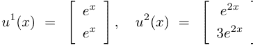

在每个区间 \(J\) 中线性无关。确实，

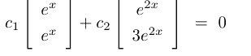

意味着 \(c_1e^x+c_2e^{2x}=0\) 和 \(c_1e^x+2c_2e^{2x}=0\)，这仅在 \(c_1=c_2=0\) 时可能。

**Example 8.5.** 函数

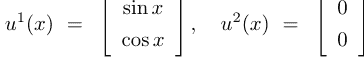

线性相关。

对于给定的 \(n\) 个向量值函数 \(u^1(x),\ldots,u^n(x)\)，行列式 \(W(u^1,\ldots,u^n)(x)\) 或 \(W(x)\)（当无歧义时），由

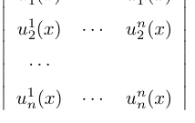

定义，称为这些函数的 *Wronskian*（威尔士基行列式）。该行列式与 \(u^1(x),\ldots,u^n(x)\) 是否线性无关的问题密切相关。事实上，我们有以下结果。

**Theorem 8.3.** 若 \(n\) 个向量值函数 \(u^1(x),\cdots,u^n(x)\) 的 Wronskian \(W(x)\) 在区间 \(J\) 中至少有一点不为零，则这些函数在 \(J\) 中线性无关。

**Proof.** 设 \(u^1(x),\cdots,u^n(x)\) 在 \(J\) 中线性相关，则存在 \(n\) 个常数 \(c_1,\cdots,c_n\) 并非全为零，使得 \(\sum_{i=1}^n c_i u^i(x)=0\) 在 \(J\) 中成立。这等同于说齐次方程组 \(\sum_{i=1}^n u_k^i(x)c_i=0\)，\(1\le k\le n\)，\(x\in J\)，有非零解。然而，根据 Corollary 5.1，对于每个 \(x\in J\)，该齐次系统有非零解当且仅当 \(W(x)=0\)。但是，\(W(x)\neq 0\) 在 \(J\) 中至少有一个 \(x\) 成立，因此 \(u^1(x),\cdots,u^n(x)\) 不可能线性相关。 \(\blacksquare\)

一般来说，该定理的逆命题不成立。例如，对于

\(u^1(x)=\left[\begin{array}{ c }
x \\
1
\end{array}\right],u^2(x)=\left[\begin{array}{ c }
x^2 \\
x
\end{array}\right],\)

它们在任何区间 \(J\) 中线性无关，而 \(W(u^1,u^2)(x)=0\) 在 \(J\) 中成立。这个例子还表明，\(W(u^1,u^2)(x)\neq 0\) 在 \(J\) 中成立不是 \(u^1(x)\) 和 \(u^2(x)\) 在 \(J\) 中线性无关的必要条件，且 \(W(u^1,u^2)(x)=0\) 在 \(J\) 中成立可能不意味着 \(u^1(x)\) 和 \(u^2(x)\) 在 \(J\) 中线性相关。因此，我们唯一能得出的结论是：\(W(x)\neq 0\) 在 \(J\) 中成立意味着 \(u^1(x),\cdots,u^n(x)\) 在 \(J\) 中线性无关，且这些函数在 \(J\) 中线性相关意味着 \(W(x)=0\) 在 \(J\) 中成立。

## 习题

- **8.1.** 判断给定向量是否线性相关，若是，求出它们之间的关系：
  - (i) \(u^1=(1,3,4,2)^t,u^2=(3,-5,2,2)^t,u^3=(2,-1,3,2)^t\)
  - (ii) \(u^1=(1,1,1,3)^t,u^2=(1,2,3,4)^t,u^3=(2,3,4,9)^t\)
  - (iii) \(u^1=(1,2,4)^t,u^2=(2,-1,3)^t,u^3=(0,1,2)^t,u^4=(-3,7,2)^t.\)
- **8.2.** 设集合 \(\{u^1,u^2,u^3\}\) 在 \((V,F)\) 中线性无关。证明集合 \(\{u^1,u^1+u^2,u^1+u^2+u^3\}\) 和 \(\{u^1+u^2,u^2+u^3,u^3+u^1\}\) 也线性无关。
- **8.3.** 证明 \(A\in M^{n\times n}\) 的行（列）线性无关当且仅当 \(\det(A)\neq 0\)，即矩阵 \(A\) 可逆。因此，齐次系统 \(Ax=0\) 只有零解。
- **8.4.** 证明阶梯形矩阵的非零行线性无关。此外，包含主元的列线性无关。
- **8.5.** 假设 \(\{u^1,\cdots,u^n\}\) 是一组线性无关的向量

- **8.10.** 证明以下集合在给定区间内线性无关：
  - (i) \(\{\sin x,\sin 2x,\cdots\},\ [0,\pi]\)
  - (ii) \(\{1,\cos x,\cos 2x,\cdots\},\ [0,\pi]\)
  - (iii) \(\{1,\sin x,\cos x,\sin 2x,\cos 2x,\cdots\},\ [-\pi,\pi]\)。
- **8.11.** 设 \(f(x)\) 和 \(g(x)\) 在区间 \(J\) 中线性无关。证明函数 \(af(x)+bg(x)\) 和 \(cf(x)+dg(x)\) 在 \(J\) 中也线性无关，前提是 \(ad-bc\ne0\)。
- **8.12.** 证明
  - (i) 集合 \(\{1,x,x^2,\cdots\}\) 在所有多项式构成的空间 \(\mathcal P\) 中线性无关
  - (ii) 集合 \(\{u^1,u^2,\cdots\}\)，其中 \(u^i\) 是无穷序列，其第 \(i\) 项为 1 且其余项均为 0，在所有实数序列构成的空间 \(\mathcal S\) 中线性无关。

## 答案或提示

- **8.1.**
  - (i) 线性相关 \(u^1+u^2-2u^3=0\)。
  - (ii) 线性无关。
  - (iii) 线性相关 \(-\frac{9}{5}u^1+\frac{12}{5}u^2-u^3+u^4=0\)。
- **8.2.** \(c_1u^1+c_2(u^1+u^2)+c_3(u^1+u^2+u^3)=0\) 意味着 \(c_1+c_2+c_3=0,\ c_2+c_3=0,\ c_3=0\)。
- **8.3.** 若 \(A\) 的列 \(C_1,\cdots,C_n\) 线性无关，则 \(x_1C_1+\cdots+x_nC_n=0\) 意味着 \(x_1=\cdots=x_n=0\)，即齐次系统 \(Ax=0\) 只有零解。但根据 Corollary 5.1，\(\det(A)\ne0\)。反之，若 \(\det(A)\ne0\)，则齐次系统 \((C_1,\cdots,C_n)(x_1,\cdots,x_n)^t=0\) 只有零解，因此 \(C_1,\cdots,C_n\) 线性无关。
- **8.4.** 回顾在系统 (6.4) 中，\(j_1<\cdots<j_r\)。因此，\(c_1(1,\tilde a_{j_1+1},\cdots,\tilde a_n)+\cdots+c_r(1,\tilde a_{j_r+1},\cdots,\tilde a_n)\) 意味着 \(c_1=\cdots=c_r=0\)。
- **8.5.** \(c_1Au^1+\cdots+c_nAu^n=0\) 当且仅当 \(A(c_1u^1+\cdots+c_nu^n)=0\)。现在，由于 \(A\) 非奇异，这等价于 \(c_1u^1+\cdots+c_nu^n=0\)。
- **8.6.** 使用 Problem 8.3。
- **8.7.**
  - (i) 若 \(y_i(x),\ 1\le i\le n\) 线性相关，则存在非零的 \(c_i,\ 1\le i\le n\)，使得对所有 \(x\in J\) 都有 \(\sum_{i=1}^n c_i y_i(x)=0\)。对其求导，我们得到 \(\sum_{i=1}^n c_i y_i^{(k)}(x)=0,\ k=0,1,\cdots,n-1\) 对所有 \(x\in J\) 成立。但这意味着 \(W(x)=0\)。
  - (ii) 由 (i) 明显可得。
  - (iii) 考虑函数 \(y_1(x)=x^3,\ y_2(x)=x^2|x|\)。
- **8.8.**
  - (i) \(\cos 2x=1-2\sin^2x\)
  - (ii) \(\cos 3x=4\cos^3x-3\cos x\)。
- **8.9.** 使用 Problem 8.7。
- **8.10.**
  - (i) 使用 \(\int_0^\pi\left(\sum_{i=1}^n c_i \sin ix\right)\sin jx\,dx=\pi c_j/2\)
  - (ii) 类似于 (i)
  - (iii) 类似于 (i)。
- **8.11.** 设对所有 \(x \in J\)，\(\alpha(af(x)+bg(x))+\beta(cf(x)+dg(x))=0\)。则 \((a\alpha+c\beta)f(x)+(b\alpha+d\beta)g(x)=0\)。现在，\(f(x),g(x)\) 的线性无关意味着 \(a\alpha+c\beta=0,\ b\alpha+d\beta=0\)，若 \(ad-bc \neq 0\)，则这意味着 \(\alpha=\beta=0\)。
- **8.12.**
  - (i) 对每个 \(n\)，\(\sum_{i=0}^n a_ix^i=0\) 最多有 \(n\) 个根。或者，使用 Problem 8.7(i)，我们有 \(W(1,x,x^2,\cdots,x^n)=1(1!)(2!)\cdots(n!)\)。
  - (ii) \(0=\sum_{i=1}^n c_iu^i=(c_1,c_2,\cdots,c_n)^t\)。

## 第 9 章 基与维

在本章中，对于给定的向量空间，我们首先定义基，然后用基中向量的个数来描述其维数。在此，我们还将引入两个子空间直和的概念。

向量空间 \((V, F)\) 中的向量集 \(S = \{u^1, \cdots, u^n\}\) 被称为构成 \(V\) 在 \(F\) 上的一组 *basis*（基），当且仅当 \(S\) 线性无关且生成空间 \(V\)。因此，每个向量 \(v \in V\) 都可以表示为向量 \(u^1, \cdots, u^n\) 的线性组合，即，

\(v = c_1 u^1 + \cdots + c_n u^n.\)

该表示是唯一的。确实，若 \(v = d_1 u^1 + \cdots + d_n u^n\) 也是一种表示，则 \(0 = v - v = (c_1 - d_1)u^1 + \cdots + (c_n - d_n)u^n\) 立即意味着 \(c_1 - d_1 = 0, \cdots, c_n - d_n = 0\)。

**Example 9.1.** 向量集 \(S = \{e^1, \cdots, e^n\}\) 是 \(R^n\) 的一组基。确实，集合 \(S\) 线性无关（参见 Example 8.1），且任意向量 \(u = (u_1, \cdots, u_n) \in R^n\) 可以表示为 \(u = \sum_{i=1}^n u_i e^i\)。集合 \(\{e^1, e^1 + e^2, \cdots, e^1 + \cdots + e^n\}\) 也是 \(R^n\) 的一组基。

**Theorem 9.1.** 设 \((V, F)\) 为向量空间，\(S = \{u^1, \cdots, u^n\}\) 为 \(V\) 的一组基。设 \(v^1, \cdots, v^m\) 为 \(V\) 中的向量，并假设 \(m > n\)。则 \(v^1, \cdots, v^m\) 线性相关。

**Proof.** 由于 \(S\) 是一组基，存在标量 \(a_{ij}\)，\(i = 1, \cdots, m\)，\(j = 1, \cdots, n\) 在 \(F\) 中，使得

\(v^1 = a_{11}u^1 + \cdots + a_{1n}u^n\)

\(\cdots\)

\(v^m = a_{m1}u^1 + \cdots + a_{mn}u^n.\)

设 \(x_1, \cdots, x_m\) 为标量，则

\(x_1 v^1 + \cdots + x_m v^m\)

\(= (x_1 a_{11} + \cdots + x_m a_{m1})u^1 + \cdots + (x_1 a_{1n} + \cdots + x_m a_{mn})u^n.\)

现在，由于 \(m > n\)，根据 Corollary 5.2，齐次系统

\(x_1 a_{11} + \cdots + x_m a_{m1} = 0\)

\(\cdots\)

\(x_1 a_{1n} + \cdots + x_m a_{mn} = 0\)

## 推论 9.1.

设 \((V, F)\) 是一个向量空间，且设 \(S = \{u^1, \cdots, u^n\}\) 和 \(T = \{v^1, \cdots, v^m\}\) 是 \(V\) 的基。那么，\(m = n\)。

## 证明.

根据定理 9.1，\(m > n\) 是不可能的。既然 \(T\) 也是基，\(n > m\) 也不可能。\(\blacksquare\)

设 \((V, F)\) 是一个向量空间，且设 \(T = \{v^1, \cdots, v^m\} \subset V\)。如果 \(S = \{v^{k_1}, \cdots, v^{k_n}\} \subseteq T\) 是线性无关的，并且若 \(v^i \in T \backslash S\)，则 \(S \cup \{v^i\}\) 是线性相关的，那么我们称 \(S\) 是 \(T\) 的一个*极大线性无关子集*。

## 定理 9.2.

设 \(T = \{v^1, \cdots, v^m\}\) 生成向量空间 \((V, F)\)，且设 \(S = \{v^{k_1}, \cdots, v^{k_n}\}\) 是 \(T\) 的一个极大线性无关子集。那么 \(S\) 是 \(V\) 的一个基。

## 证明.

我们需要证明 \(S = \{v^{k_1}, \cdots, v^{k_n}\}\) 生成 \(V\)。为此，首先我们证明每个 \(v^i \in T \backslash S\) 都是 \(v^{k_1}, \cdots, v^{k_n}\) 的线性组合。由于 \(S \cup \{v^i\}\) 是线性相关的，存在不全为零的标量 \(c_1, \cdots, c_n, x\)，使得

\(c_1 v^{k_1} + \cdots + c_n v^{k_n} + x v^i = 0.\)

显然，\(x \neq 0\)，否则 \(S\) 将是线性相关的。因此，可得

\(v^i = \frac{-c_1}{x} v^{k_1} + \cdots + \frac{-c_n}{x} v^{k_n},\)

这证实了 \(v^i\) 是 \(v^{k_1}, \cdots, v^{k_n}\) 的线性组合。现在设 \(u \in V\)，那么存在标量 \(\alpha_1, \cdots, \alpha_m\)，使得

\(u = \alpha_1 v^1 + \cdots + \alpha_m v^m.\)

在这个关系中，我们用 \(v^{k_1}, \cdots, v^{k_n}\) 的线性组合替换每个 \(v^i \in T \backslash S\)。对各项进行分组后，所得关系将导出 \(u\) 是 \(v^{k_1}, \cdots, v^{k_n}\) 的线性组合。因此 \(S\) 生成 \(V\)。\(\blacksquare\)

设 \((V, F)\) 是一个向量空间，且设 \(S = \{u^1, \cdots, u^n\} \subset V\) 是线性无关的。我们称 \(S\) 是 \(V\) 的一个*极大线性无关组*，当且仅当对任意 \(u \in V \backslash S\)，\(S \cup \{u\}\) 都是线性相关的。

## 定理 9.3.

设 \(S = \{u^1, \cdots, u^n\}\) 是向量空间 \((V, F)\) 的一个极大线性无关组。那么，\(S\) 是 \(V\) 的一个基。

## 证明.

证明与定理 9.2 的第一部分相同。\(\blacksquare\)

域 \(F\) 上的向量空间 \(V\) 被称为具有*有限维数* \(n\)，或 \(n\) 维的，记为 \(\dim V = n\)，当且仅当 \(V\) 有一个由 \(n\) 个向量组成的基。如果 \(V = \{0\}\)，我们说 \(V\) 的维数为 0。如果 \(V\) 不具有有限的

## 例 9.3.

由于根据[问题 6.1 (iii)](Problems 6.1 (iii))，

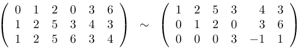

向量 $(0,1,1)^t$、$(1,2,2)^t$、$(0,3,6)^t$ 是线性无关的，并且构成 $R^3$ 的一个基。

## 例 9.4.

向量 $(0,1,1)^t$、$(1,2,2)^t$ 是线性无关的。为了找到第三个线性无关的向量，我们考虑以 $(0,1,1)^t$、$(1,2,2)^t$、$e^1$、$e^2$、$e^3$ 为列的矩阵，并注意到

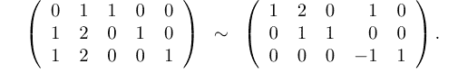

因此，所需的向量是 $e^2=(0,1,0)^t$。

现在设 $U$ 和 $W$ 是向量空间 $V$ 的子空间。回顾在[问题 1.4](Problem 1.4)中，我们将 $U$ 和 $W$ 的和定义为 $U+W=\{z:z=u+w\text{ 其中 }u\in U,\ w\in W\}$。对于这个和，我们将证明以下结果。

## 定理 9.5.

设 $U$ 和 $W$ 是向量空间 $V$ 的子空间。那么，

$$\dim(U+W)=\dim U+\dim W-\dim(U\cap W).$$

## 证明.

根据[问题 1.3](Problem 1.3)，$U\cap W$ 既是 $U$ 的子空间也是 $W$ 的子空间。设 $\dim U=m$，$\dim W=n$，$\dim U\cap W=r$。设 $S_1=\{v^1,\ldots,v^r\}$ 是 $U\cap W$ 的一个基。由[推论 9.3](Corollary 9.3)，我们可以将 $S_1$ 扩展为 $U$ 的一个基，记为 $S_2=\{v^1,\ldots,v^r,u^1,\ldots,u^{m-r}\}$，并扩展为 $W$ 的一个基，记为 $S_3=\{v^1,\ldots,v^r,w^1,\ldots,w^{n-r}\}$。现在设 $S=S_1\cup S_2\cup S_3=\{v^1,\ldots,v^r,u^1,\ldots,u^{m-r},w^1,\ldots,w^{n-r}\}$。显然，$S$ 恰好有 $m+n-r$ 个向量。因此只需证明 $S$ 是 $U+W$ 的一个基。为此，我们注意到 $S_2$ 张成 $U$，$S_3$ 张成 $W$，因此 $S_2\cup S_3=S$ 张成 $U+W$。为了证明 $S$ 的线性无关性，假设

$$a_1v^1+\cdots+a_rv^r+b_1u^1+\cdots+b_{m-r}u^{m-r}+c_1w^1+\cdots+c_{n-r}w^{n-r}=0, \tag{9.1}$$

其中 $a_i,b_j,c_k$ 是标量。设

$$u=a_1v^1+\cdots+a_rv^r+b_1u^1+\cdots+b_{m-r}u^{m-r}. \tag{9.2}$$

那么由 $(9.1)$，我们有

$$u=-c_1w^1-\cdots-c_{n-r}w^{n-r}. \tag{9.3}$$

分别由 $(9.2)$ 和 $(9.3)$ 可得 $u\in U$ 且 $u\in W$。因此，

u ∈ U ∩ W，从而可以写成 u = d₁v¹ + ⋯ + dᵣvʳ，其中 dᵢ 是标量。因此，由 (9.3) 可得

$$d_1v^1+\cdots+d_rv^r+c_1w^1+\cdots+c_{n-r}w^{n-r}=0.$$

但由于 S₃ 是 W 的一个基，上述关系蕴含 c₁ = ⋯ = cₙ₋ᵣ = 0。将其代入 (9.1)，得到

$$a_1v^1+\cdots+a_rv^r+b_1u^1+\cdots+b_{m-r}u^{m-r}=0.$$

最后，由于 S₂ 是 U 的一个基，上述关系蕴含 a₁ = ⋯ = aᵣ = b₁ = ⋯ = bₘ₋ᵣ = 0。

如果对于每个 v ∈ V，存在唯一的向量 u ∈ U 和 w ∈ W 使得 v = u + w，则称向量空间 V 是其子空间 U 和 W 的直和，记为 U ⊕ W。

## 例 9.5.

考虑 V = ℝ³，U = {(a₁, a₂, 0)ᵗ : a₁, a₂ ∈ ℝ}，W = {(0, a₂, a₃)ᵗ : a₂, a₃ ∈ ℝ}。那么，ℝ³ = U + W，但 ℝ³ ≠ U ⊕ W，因为和不一定唯一，例如 (1, 3, 1)ᵗ = (1, 1, 0)ᵗ + (0, 2, 1)ᵗ = (1, 2, 0)ᵗ + (0, 1, 1)ᵗ。然而，如果我们令 U = {(a₁, a₂, 0)ᵗ : a₁, a₂ ∈ ℝ}，W = {(0, 0, a₃)ᵗ : a₃ ∈ ℝ}，那么 ℝ³ = U ⊕ W。

## 定理 9.6.

向量空间 V 是其子空间 U 和 W 的直和，即 V = U ⊕ W，当且仅当 V = U + W 且 U ∩ W = {0}。

## 证明.

假设 V = U ⊕ W。那么任意 v ∈ V 都可以唯一地写成 v = u + w 的形式，其中 u ∈ U，w ∈ W。这特别意味着 V = U + W。现在设 v ∈ U ∩ W，则 v = v + 0，其中 v ∈ U，0 ∈ W；同时，v = 0 + v，其中 0 ∈ U，v ∈ W。但根据唯一性，这意味着 v = 0 + 0 = 0，从而 U ∩ W = {0}。

反之，假设 V = U + W 且 U ∩ W = {0}。如果 v ∈ V，那么存在 u ∈ U 和 w ∈ W 使得 v = u + w。我们需要证明这个和是唯一的。为此，设 v = u′ + w′，其中 u′ ∈ U，w′ ∈ W 也是这样的和。那么，u + w = u′ + w′，因此 u − u′ = w − w′。但 u − u′ ∈ U 且 w − w′ ∈ W；因此根据 U ∩ W = {0}，可得 u − u′ = 0 且 w − w′ = 0，即 u = u′ 且 w = w′。

## 推论 9.4.

设 U 和 W 是向量空间 V 的子空间。那么，dim U ⊕ W = dim U + dim W。

## 习题

+   1. **9.1.** 求下列由所有对象张成的空间的维数：
+      (i) m × n 矩阵，并给出该空间的一个基

+   (ii) $n \times n$ 对角矩阵
+   
+   (iii) $n \times n$ 上三角矩阵
+   
+   (iv) $n \times n$ 对称矩阵
+   
+   (v) 次数为 $n-1$ 的多项式，并给出该空间的一个基。
+   
+   (vi) $n$ 维实向量 $u=(u_1,\cdots,u_n)$，满足 $u_1+\cdots+u_n=0$
+   
+   (vii) $n \times n$ 实矩阵 $A=(a_{ij})$，满足 $\operatorname{tr}(A)=0$。

**9.2.** 假设 $\{u^1,\cdots,u^n\}$ 是 $R^n$ 的一个基，且 $A$ 是一个 $n\times n$ 非奇异矩阵。证明 $\{Au^1,\cdots,Au^n\}$ 也是 $R^n$ 的一个基。

**9.3.** 设 $(V,F)$ 是一个 $n$ 维向量空间，且设 $W\ne\{0\}$ 是一个子空间。证明 $(W,F)$ 有一个基，且其维数 $\le n$。

**9.4.** 设 $U$ 和 $W$ 是向量空间 $V$ 的子空间，且设 $S=\{u^1,\cdots,u^\ell\}$ 张成 $U$，$T=\{w^1,\cdots,w^k\}$ 张成 $W$。证明 $S\cup T$ 张成 $U+W$。

**9.5.** 设 $U$ 和 $W$ 是向量空间 $V$ 的子空间，且设 $V=U\oplus W$。如果 $S=\{u^1,\cdots,u^\ell\}$ 和 $T=\{w^1,\cdots,w^k\}$ 分别是 $U$ 和 $W$ 的线性无关子集，证明

(i) $S\cup T$ 在 $V$ 中线性无关

(ii) 如果 $S$ 和 $T$ 分别是 $U$ 和 $W$ 的基，那么 $S\cup T$ 是 $V$ 的一个基。

**9.6.** 证明有理数域 $Q$ 上的空间 $R$（具有通常的运算）是无限维的。

**9.7.** 求 $\lambda\in R$，使得向量 $u^1=(1,\lambda,1)^t$、$u^2=(1,1,\lambda)^t$、$u^3=(1,-1,1)^t$ 构成 $R^3$ 的一个基。

**9.8.** 设 $V=\{u\in R^5:u_1+2u_2-u_3+u_4=0,\ u_1+u_2+u_3+u_5=0\}$。求 $V$ 的维数，并求 $W$ 使得 $V\oplus W=R^5$。

## 答案或提示

+   **9.1.**
+   
+   (i) $mn$，$\{E_{ij}\}$，其中 $m\times n$ 矩阵 $E_{ij}$ 的元素满足：若 $k=i,\ell=j$，则 $e_{k\ell}=1$；若 $k\ne i,\ell\ne j$，则 $e_{k\ell}=0$。
+   
+   (ii) $n$。
+   
+   (iii) $n(n+1)/2$。
+   
+   (iv) $n(n+1)/2$。
+   
+   (v) $n$，$\{1,x,\cdots,x^{n-1}\}$。该基被称为 $(P_n,R)$ 的自然基或标准基。
+   
+   (vi) $n-1$。
+   
+   (vii) $n^2-1$。

## 第 10 章

## 坐标与同构

在本章中，我们将把向量在 $R^3$ 中的已知几何坐标解释扩展到一般向量空间。我们还将展示如何将向量空间相对于某一基的坐标转换为相对于另一基的坐标。

$n$ 维向量空间 $(V,F)$ 的一个 *有序基* 是线性无关且张成 $V$ 的固定线性无关向量序列。如果 $S=\{u^1,\cdots,u^n\}$ 是一个有序基，那么如我们在第 9 章中所述，每个向量 $u\in V$ 都可以唯一地表示为 $u=y_1u^1+\cdots+y_nu^n$。我们称 $(y_1,\cdots,y_n)^t\in F^n$ 为 $u$ 相对于基 $S$ 的 *坐标*，并将其表示为 $y_S(u)$。显然，$y_S$ 是一个将每个向量 $u\in V$ 映射到其相对于有序基 $S$ 的唯一坐标向量的映射。反之，每个 $n$ 元组 $(y_1,\cdots,y_n)^t\in F^n$ 都对应 $V$ 中唯一的向量 $y_1u^1+\cdots+y_nu^n$。因此，有序基 $S$ 在 $V$ 和 $F^n$ 之间诱导了一个对应关系 $y_S$，该关系是一一对应的（$u\ne v$ 蕴含 $y_S(u)\ne y_S(v)$，等价地，$y_S(u)\ne y_S(v)$ 蕴含 $u\ne v$）且是满射的（对于每个 $(y_1,\cdots,y_n)^t\in F^n$，至少存在一个 $u\in V$）。还可以轻易观察到

- 对于所有 $u,v\in V$，有 $y_S(u+v)=y_S(u)+y_S(v)$
- 对于所有标量 $\alpha$ 和 $u\in V$，有 $y_S(\alpha u)=\alpha y_S(u)$，且
- $y_S(u)=0\in F^n$ 当且仅当 $u=0\in V$。

因此，$V$ 和 $F^n$ 之间的对应关系 $y_S$ 保持了向量加法和标量乘法的向量空间运算。该映射 $y_S:V\to F^n$ 被称为 *同构* 或 *坐标同构*。这一概念的一个主要优点是，$U\subseteq V$ 的线性相关性和线性无关性、基、张成和维数可以等价地讨论像集 $y_S(U)$。

**示例 10.1.** 在 $R^n$ 中，列向量相对于有序基 $\{e^1,\cdots,e^n\}$ 的坐标就是向量的分量。同样，在 $P_n$ 中，多项式 $a_0+a_1x+\cdots+a_{n-1}x^{n-1}$ 相对于有序基 $\{1,x,\cdots,x^{n-1}\}$ 的坐标是 $(a_0,a_1,\cdots,a_{n-1})^t$。

**示例 10.2.** 根据 [示例 6.1]，我们有

$$\frac{13}{28}(2,3,1)^t+\frac{47}{28}(-1,2,3)^t+\frac{21}{28}(1,-5,-2)^t=(0,1,4)^t$$

因此，$(13/28,47/28,21/28)^t$ 是向量 $(0,1,4)^t\in R^3$ 相对于基 $\{(2,3,1)^t,(-1,2,3)^t,(1,-5,-2)^t\}$ 的坐标。

现在设 $S=\{u^1,\cdots,u^n\}$ 和 $T=\{v^1,\cdots,v^n\}$ 是 $n$ 维向量空间 $(V,F)$ 的两个有序基。那么，存在唯一的标量 $a_{ij}$ 使得

$$v^j=\displaystyle\sum_{i=1}^{n}a_{ij}u^i,\quad j=1,\cdots,n.\tag{10.1}$$

设 $(x_1,\cdots,x_n)^t$ 是给定向量 $u\in V$ 相对于有序基 $T$ 的坐标。那么，我们有

$$u=\displaystyle\sum_{j=1}^{n}x_jv^j,$$

因此，由 (10.1) 可得

$$\begin{aligned}u&=\sum_{j=1}^{n}x_j\left(\sum_{i=1}^{n}a_{ij}u^i\right)\\&=\sum_{j=1}^{n}\sum_{i=1}^{n}(a_{ij}x_j)u^i\\&=\sum_{i=1}^{n}\left(\sum_{j=1}^{n}a_{ij}x_j\right)u^i.\end{aligned}$$

现在，由于 $u$ 相对于有序基 $S$ 的坐标 $(y_1,\cdots,y_n)^t$ 是唯一确定的，我们得到

$$y_i=\displaystyle\sum_{j=1}^{n}a_{ij}x_j,\quad i=1,\cdots,n,\tag{10.2}$$

这与 (5.1)（矩阵表示中的 (5.2)）完全相同，其中 $m=n$。由于 $S$ 和 $T$ 是线性无关集，$y=(y_1,\cdots,y_n)^t=0$ 当且仅当 $x=(x_1,\cdots,x_n)^t=0$。因此，由推论 5.1 可知，(10.2) 中的矩阵 $A$ 是可逆的，并且

$$x=A^{-1}y.\tag{10.3}$$

用坐标同构来表示，对于任何 $u\in V$，关系 (10.2) 和 (10.3) 可以写成

$$y_S(u)=Ax_T(u)\quad\text{且}\quad x_T(u)=A^{-1}y_S(u).\tag{10.4}$$

我们将上述讨论总结为以下定理。

**定理 10.1.** 设 $S=\{u^1,\ldots,u^n\}$ 和 $T=\{v^1,\ldots,v^n\}$ 是 $n$ 维向量空间 $(V,F)$ 的两个有序基。那么，存在唯一的非奇异矩阵 $A$，使得对于每个向量 $u\in V$，关系 (10.4) 成立。

(10.4) 中的矩阵 $A$ 被称为 *转换矩阵*。定理 10.1 的逆命题是以下结果。

**定理 10.2.** 设 $S=\{u^1,\ldots,u^n\}$ 是 $n$ 维向量空间 $(V,F)$ 的一个有序基，设 $A\in M^{n\times n}$ 是一个元素在 $F$ 中的非奇异矩阵。那么，存在 $(V,F)$ 的一个有序基 $T=\{v^1,\ldots,v^n\}$，使得对于每个向量 $u\in V$，关系 (10.4) 成立。

**证明.**

只需证明由 (10.1) 中的方程定义的向量 $v^j$，$j=1,\ldots,n$，构成 $(V,F)$ 的一个基。为此，设 $A^{-1}=B=(b_{ij})$，因此根据 (3.1)–(3.3) 和 (4.1)，我们有

$$\begin{aligned}\sum_{j=1}^{n} b_{jk}v^j&=\sum_{j=1}^{n}b_{jk}\left(\sum_{i=1}^{n}a_{ij}u^i\right)\\&=\sum_{j=1}^{n}\left(\sum_{i=1}^{n}a_{ij}b_{jk}\right)u^i\\&=u^k.\end{aligned}$$

因此，集合 $T$ 张成的子空间包含 $S$，因此等于 $V$。所以，$T$ 是 $(V,F)$ 的一个基。从 $T$ 的定义和定理 10.1 可以清楚地看出，$y_S(u)=Ax_T(u)$ 成立。这也意味着 $x_T(u)=A^{-1}y_S(u)$。

方程 (10.1) 与以下方程相同

$$(v_1^j,\ldots,v_n^j)=a_{1j}(u_1^1,\ldots,u_n^1)+\cdots+a_{nj}(u_1^n,\ldots,u_n^n)\tag{10.5}$$

因此，定理 10.1 中矩阵 $A$ 的第 $j$ 列 $(a_{1j},\ldots,a_{nj})^t$ 是线性方程组

$$\begin{aligned}u_1^1a_{1j}+\cdots+u_1^na_{nj}&=v_1^j\\\cdots\\u_n^1a_{1j}+\cdots+u_n^na_{nj}&=v_n^j.\end{aligned}$$

的解。因此，矩阵 $A$ 是矩阵线性方程组

$$UA=V,\tag{10.6}$$

的解，其中 $U=(u_i^j)$，$A=(a_{ij})$，$V=(v_i^j)$。

**示例 10.3.**

在 $R^3$ 中，考虑有序基 $S=\{(2,3,1)^t,(-1,2,3)^t,(1,-5,-2)^t\}$ 和 $T=\{(1,1,0)^t,(0,1,1)^t,(1,0,1)^t\}$。对于这些基，矩阵线性方程组 (10.6) 为

$$\begin{pmatrix}2&-1&1\\3&2&-5\\1&3&-2\end{pmatrix}\begin{pmatrix}a_{11}&a_{12}&a_{13}\\a_{21}&a_{22}&a_{23}\\a_{31}&a_{32}&a_{33}\end{pmatrix}=\begin{pmatrix}1&0&1\\1&1&0\\0&1&1\end{pmatrix}.$$

因此，根据示例 6.6，可得

$$\begin{pmatrix}a_{11}&a_{12}&a_{13}\\a_{21}&a_{22}&a_{23}\\a_{31}&a_{32}&a_{33}\end{pmatrix}=\begin{pmatrix}\frac{11}{28}&\frac{1}{28}&\frac{3}{28}\\\frac{1}{28}&-\frac{5}{28}&\frac{13}{28}\\\frac14&-\frac14&\frac14\end{pmatrix}\begin{pmatrix}1&0&1\\1&1&0\\0&1&1\end{pmatrix}=\begin{pmatrix}\frac{12}{28}&\frac{4}{28}&\frac{14}{28}\\-\frac{4}{28}&\frac{8}{28}&\frac{14}{28}\\0&0&\frac{14}{28}\end{pmatrix}.$$

现在考虑向量 $(0,1,4)^t\in R^3$，其相对于基 $T$ 的坐标 $(x_1,x_2,x_3)^t$ 为 $(-3/2,5/2,3/2)^t$。确实，我们有

$$-\frac32(1,1,0)^t+\frac52(0,1,1)^t+\frac32(1,0,1)^t=(0,1,4)^t.$$

$(0,1,4)^t$ 相对于基 $S$ 的坐标 $(y_1,y_2,y_3)^t$ 现在可以通过 (10.4) 如下得到

$$\begin{pmatrix}y_1\\y_2\\y_3\end{pmatrix}=\begin{pmatrix}\frac{12}{28}&\frac{4}{28}&\frac{14}{28}\\-\frac{4}{28}&\frac{8}{28}&\frac{14}{28}\\0&0&\frac{14}{28}\end{pmatrix}\begin{pmatrix}-\frac32\\\frac52\\\frac32\end{pmatrix}=\begin{pmatrix}\frac{13}{28}\\\frac{47}{28}\\\frac{21}{28}\end{pmatrix},$$

这与示例 10.1 中得到的结果相同。

**示例 10.4.**

在 $(P_3,R)$ 中，考虑有序基 $S=\{1,x,x^2\}$ 和 $T=\{1,1+x,1+x+x^2\}$。对于这些基，(10.5) 当 $j=1,2,3$ 时给出方程组

$$\begin{aligned}1&=a_{11}(1)+a_{21}(x)+a_{31}(x^2)=1(1)+0(x)+0(x^2)\\1+x&=a_{12}(1)+a_{22}(x)+a_{32}(x^2)=1(1)+1(x)+0(x^2)\\1+x+x^2&=a_{13}(1)+a_{23}(x)+a_{33}(x^2)=1(1)+1(x)+1(x^2).\end{aligned}$$

因此，对于这些有序基，(10.4) 中的矩阵 $A$ 及其逆矩阵 $A^{-1}$ 为

$$A=\begin{pmatrix}1&1&1\\0&1&1\\0&0&1\end{pmatrix},\qquad A^{-1}=\begin{pmatrix}1&-1&0\\0&1&-1\\0&0&1\end{pmatrix}.$$

特别地，考虑多项式 $P_2(x)=a+bx+cx^2$，其

coordinates \((y_1,y_2,y_3)^t\) 相对于基 \(S\) 为 \((a,b,c)^t\)。现在可以利用 (10.4) 得到 \((a,b,c)^t\) 相对于基 \(T\) 的坐标 \((x_1,x_2,x_3)^t\)，如下所示：

$$
\begin{pmatrix}x_1\\x_2\\x_3\end{pmatrix}
=
\begin{pmatrix}1&-1&0\\0&1&-1\\0&0&1\end{pmatrix}
\begin{pmatrix}a\\b\\c\end{pmatrix}
=
\begin{pmatrix}a-b\\b-c\\c\end{pmatrix}.
$$

因此，相对于基 \(T\) 的多项式 \(P_2(x)=a+bx+cx^2\) 为
\[
P_2(x)=(a-b)+(b-c)(1+x)+c(1+x+x^2).
\]

## 问题

- 10.1. 求向量 \((a,b,c)^t\in R^3\) 相对于下列有序基的坐标：

  (i) \(\{(1,1,5)^t,(1,-1,3)^t,(7,2,1)^t\}\)

  (ii) \(\{(1,-1,3)^t,(1,1,5)^t,(7,2,1)^t\}\)。

- 10.2. 求向量 \((a,b,c,d)^t\in R^4\) 相对于下列有序基的坐标：
  \(\{(1,0,0,4)^t,(0,0,0,3)^t,(0,0,2,5)^t,(5,4,0,0)^t\}\)。

- 10.3. 求矩阵 \(\begin{pmatrix}a&b\\c&d\end{pmatrix}\) 相对于有序基
  \[
  \left\{\begin{pmatrix}1&0\\-1&0\end{pmatrix},\begin{pmatrix}0&1\\1&0\end{pmatrix},\begin{pmatrix}1&-1\\0&0\end{pmatrix},\begin{pmatrix}1&0\\0&-1\end{pmatrix}\right\}
  \]
  的坐标。

- 10.4. 求多项式 \(P_3(x)=a+bx+cx^2+dx^3\in(P_4,R)\) 相对于下列有序基的坐标：

  (i) \(\{1,1+x,1+x+x^2,1+x+x^2+x^3\}\)

  (ii) \(\{1,(1-x),(1-x)^2,(1-x)^3\}\)。

- 10.5. 在 \(R^3\) 中考虑有序基 \(S=\{(1,0,1)^t,(-1,0,0)^t,(0,1,2)^t\}\) 和 \(T=\{(-1,1,0)^t,(1,2,-1)^t,(0,1,0)^t\}\)。对于这些基，计算转换矩阵，并利用它求向量 \((7,3,4)^t\) 相对于每个基的坐标。

- 10.6. 在实轴上所有复值函数构成的向量空间中，考虑有序基 \(S=\{1,e^{ix},e^{-ix}\}\) 和 \(T=\{1,\cos x,\sin x\}\)。对于这些基，计算转换矩阵，并利用它求函数 \(3+5\cos x+7\sin x\) 相对于基 \(S\) 的坐标。

- 10.7. 考虑向量空间 \((P_n,R)\) 及其有序基 \(S=\{1,x,\cdots,x^{n-1}\}\)。证明：

  (i) \(T=\{L_1(x),\ldots,L_n(x)\}\)，其中
  \[
  L_i(x)=\frac{(x-x_1)\cdots(x-x_{i-1})(x-x_{i+1})\cdots(x-x_n)}{(x_i-x_1)\cdots(x_i-x_{i-1})(x_i-x_{i+1})\cdots(x_i-x_n)}
  \]
  且 \(x_1<\cdots<x_n\) 为 \(R\) 中的点，也是 \((P_n,R)\) 的一个基。

  (ii) 将基 \(S\) 转换为基 \(T\) 的转换矩阵是 [示例 3.5](#) 中给出的范德蒙矩阵。

- **10.8.** 在 [定理 10.2](#) 中，令 \(S=\{(5,0,3)^t,(3,5,7)^t,(-1,-4,11)^t\}\) 且
  \[
  A=\begin{pmatrix}11&3&4\\19&6&5\\21&7&8\end{pmatrix}.
  \]
  求有序基 \(T\)。

- **10.9.** 在 [定理 10.2](#) 中，令 \(T=\{(5,0,3)^t,(3,5,7)^t,(-1,-4,11)^t\}\) 且 \(A\) 如 [问题 10.8](#) 所示。求有序基 \(S\)。

## 答案或提示

- **10.1.** (i) \(\frac{1}{58}(-7a+20b+9c,\,9a-34b+5c,\,8a+2b-2c)^t\).

  (ii) \(\frac{1}{58}(9a-34b+5c,\,-7a+20b+9c,\,8a+2b-2c)^t\).

- **10.2.** \((a-\frac45b,-\frac43a+\frac53b-\frac56c+\frac13d,\frac23c,\frac14b)^t\).

- **10.3.** \(\frac12(a+b-c+d,\,a+b+c+d,\,a-b+c+d,\,-2d)^t\).

- **10.4.** (i) \((a-b,b-c,c-d,d)^t\).

  (ii) \((a+b+c+d,-b-2c-3d,c+3d,-d)^t\).

- **10.5.** \(\begin{pmatrix}-2&-5&-2\\-1&-6&-2\\1&2&1\end{pmatrix},\quad(-11,-4,22)^t_T,\quad(-2,-9,3)^t_S\).

- **10.6.** \(\begin{pmatrix}1&0&0\\0&\frac12&-\frac{i}{2}\\0&\frac12&\frac{i}{2}\end{pmatrix},\quad(3,5,7)^t_T,\quad(3,\frac{5-7i}{2},\frac{5+7i}{2})^t_S\).

- **10.7.** (i) 见 [问题 1.5](#).

  (ii) \(x^j=x_1^jL_1(x)+\cdots+x_n^jL_n(x),\quad j=0,1,\ldots,n-1.\)

- **10.8.** \(T=\{(91,11,397)^t,(26,2,128)^t,(27,-7,135)^t\}\).

- **10.9.** \(S=\{\frac1{30}(-83,-263,-213)^t,\frac1{30}(46,76,-114)^t,\frac1{30}(9,69,219)^t\}\).

# 推论 11.1.  $r(A)=r(A^t)=r(A^H)$.

# 定理 11.2.  设 \(A\in\mathbb{C}^{m\times n}\) 且 \(B\in\mathbb{C}^{n\times p}\)。则 \(r(AB)\le \min\{r(A),r(B)\}\)。

# 证明.

设 \(A=(a_{ij})\)，\(B=(b_{ij})\) 且 \(AB=C=(c_{ij})\)。由于 \(c_{ij}=\sum_{k=1}^{n}a_{ik}b_{kj}\)，其中 \(i=1,\cdots,m\)，\(j=1,\cdots,p\)，可得

$\begin{pmatrix}c_{1j}\\\vdots\\c_{mj}\end{pmatrix}=\begin{pmatrix}a_{11}\\\vdots\\a_{m1}\end{pmatrix}b_{1j}+\cdots+\begin{pmatrix}a_{1n}\\\vdots\\c_{mn}\end{pmatrix}b_{nj},\quad j=1,\cdots,p$

因此 \(AB\) 的列向量由 \(A\) 的列向量线性表示；类似地，\(AB\) 的行向量由 \(B\) 的行向量线性表示。故 \(C(AB)\subseteq C(A)\) 且 \(R(AB)\subseteq R(B)\)，这立即推出 \(r(AB)\le r(A)\) 且 \(r(AB)\le r(B)\)。综合以上，得 \(r(AB)\le\min\{r(A),r(B)\}\)。

# 推论 11.2.

- 1. 若乘积 \(AB\) 中的某个矩阵为非奇异矩阵，则 \(AB\) 的秩等于另一个矩阵的秩。
- 2. 若 \(P\) 和 \(Q\) 为非奇异矩阵，则 \(r(PAQ)=r(A)\)。

# 证明.

- 1. 设矩阵 \(A\) 为非奇异矩阵。由定理 11.2 可得 \(r(AB)\le r(B)\)，又因为 \(B=A^{-1}(AB)\)，故 \(r(B)\le r(AB)\)。因此，\(r(AB)=r(B)\)。
- 2. 由于 \(P\) 和 \(Q\) 为非奇异矩阵，故 \(r(PAQ)=r(AQ)=r(A)\)。

# 定理 11.3.  设 \(A,B\in\mathbb{C}^{m\times n}\)。则 \(r(A+B)\le r(A)+r(B)\)。

# 证明.

设 \(A=(a_{ij})\)，\(B=(b_{ij})\)，且 \(\{u^1,\cdots,u^p\}\) 与 \(\{v^1,\cdots,v^q\}\) 分别为 \(C(A)\) 和 \(C(B)\) 的基。则

$\begin{pmatrix}a_{1j}+b_{1j}\\\vdots\\a_{mj}+b_{mj}\end{pmatrix}=\begin{pmatrix}a_{1j}\\\vdots\\a_{mj}\end{pmatrix}+\begin{pmatrix}b_{1j}\\\vdots\\b_{mj}\end{pmatrix}=\sum_{i=1}^{p}\alpha_{ij}u^i+\sum_{i=1}^{q}\beta_{ij}v^i,\quad j=1,\cdots,n.$

因此，\(A+B\) 的第 \(j\) 列可表示为 \(p+q\) 个向量 \(u^1,\cdots,u^p,v^1,\cdots,v^q\) 的线性组合。故 \(A+B\) 的列空间由这些向量的线性组合生成。因此，

$\dim C(A+B)=\dim\left\{\sum_{i=1}^{p}s_i u^i+\sum_{i=1}^{q}t_i v^i\right\}$

## 矩阵的秩

且 \(r(A+B) \leq p+q\)。显然，若列向量集 \(\{u^1, \cdots, u^p, v^1, \cdots, v^q\}\) 线性无关，则 \(r(A+B) = p+q\)。\(\blacksquare\)

# ## 推论 11.3.

\(r(A+B) \geq |r(A) - r(B)|\).

# ## 证明.

显然，\(r(A) = r(A+B-B) \leq r(A+B) + r(-B) = r(A+B) + r(B)\)，故 \(r(A+B) \geq r(A) - r(B)\)。类似地，\(r(A+B) \geq r(B) - r(A)\)。\(\blacksquare\)

现在回顾，对于给定矩阵 \(A \in C^{m \times n}\)，其零空间 \(\mathcal{N}(A) \subseteq C^n\) 是一个向量空间。\(\mathcal{N}(A)\) 的维数称为 \(A\) 的 _零度_，记作 \(n(A)\)。

# ## 定理 11.4.

若 \(A \in C^{m \times n}\)，则 \(r(A) + n(A) = n\)。

# ## 证明.

设 \(B\) 为矩阵 \(A\) 的行最简形。由于矩阵 \(A\) 的秩为 \(r(A)\)，\(B\) 的前 \(r(A)\) 行非零，即 \(B\) 有 \(r(A)\) 个主元。因此，齐次线性方程组 (5.3) 的等价形式 \(Bx = 0\) 将有 \(r(A)\) 个基本变量和 \(n - r(A)\) 个自由变量。故方程组 (5.3) 有一组 \(n - r(A)\) 个线性无关的解，即 \(n(A) = n - r(A)\)。\(\blacksquare\)

# ## 推论 11.4.

\(r(A) + n(A^t) = m\)。

# ## 推论 11.5.

若 \(r(A) = n \leq m\)，则 \(A\) 的 \(n \) 列线性无关，且 \(x = 0\) 是齐次线性方程组 (5.3) 的唯一解。

# ## 示例 11.1.

矩阵

\(A = \left( \begin{array}{ c c c c }
1 & 2 & 1 & 5 \\
1 & 2 & -1 & 1 \\
2 & 4 & -3 & 0
\end{array} \right)\)

的行最简形和列最简形为

\(\left( \begin{array}{ c c c c }
1 & 2 & 1 & 5 \\
0 & 0 & 1 & 2 \\
0 & 0 & 0 & 0
\end{array} \right) \text{ 和 } \left( \begin{array}{ c c c c }
1 & 0 & 0 & 0 \\
1 & 2 & 0 & 0 \\
2 & 5 & 0 & 0
\end{array} \right).\)

因此，\(r(A) = 2\)，集合 \(\{(1,2,1,5), (0,0,1,2)\}\) 生成 \(R(A)\)，集合 \(\{(1,1,2)^t, (0,2,5)^t\}\) 生成 \(C(R)\)。由行最简形还可知，集合 \(\{(-2,1,0,0)^t, (-3,0,-2,1)^t\}\) 生成 \(\mathcal{N}(A)\)，且 \(n(A) = 2\)。

# ## 示例 11.2.

对于问题 6.1(i) 中的矩阵 \(A\)，\(n = 4, r(A) = 3, n(A) = 1\)。对于问题 6.1(ii) 中的矩阵 \(A\)，\(n = 5, r(A) = 4, n(A) = 1\)。对于问题 6.1(iii) 中的矩阵 \(A\)，\(n = 6, r(A) = 3, n(A) = 3\)。

现在，对于给定矩阵 \(A \in M^{m \times n}\)，若存在矩阵 \(L \in M^{n \times m}\)（或 \(R \in M^{n \times m}\)）使得 \(LA = I\)（或 \(AR = I\)），则称 \(L\)（或 \(R\)）为 \(A\) 的 _左逆_（_右逆_）。

## 例 11.3

考虑矩阵

$$A=\begin{pmatrix}1&0&1\\0&1&0\end{pmatrix},\qquad B=\begin{pmatrix}0&1\\0&1\\1&-1\end{pmatrix}.$$

由于 $AB=I$，$B$ 是 $A$ 的一个*右逆*，而 $A$ 是 $B$ 的一个*左逆*。我们还注意到矩阵

$$\begin{pmatrix}1&0\\0&1\\0&0\end{pmatrix}$$

也是 $A$ 的一个右逆。因此，给定矩阵的右逆以及左逆均不唯一。

## 定理 11.5

如果 $x$ 是非齐次方程组 (5.2) 的一个解，且矩阵 $A$ 有左逆 $L$，则 $x=Lb$。如果 $A$ 有右逆，则 (5.2) 有解 $x=Rb$。

**证明。** 注意到 $x=Ix=(LA)x=L(Ax)=Lb$，且 $A(Rb)=(AR)b=Ib=b$。

## 定理 11.6

设 $A\in M^{m\times n}$ 且 $r=r(A)$。则 $A$ 有右逆 $R$ 当且仅当 $r=m$ 且 $m\le n$。

**证明。** 我们注意到，求一个 $n\times m$ 阶右逆矩阵 $R=(r_{ij})$ 等价于求解矩阵线性方程组 $AR=I$，其增广矩阵为 $(A\mid I)$。现在，由**定理 5.12** 可知，$AR=I$ 有解当且仅当 $r(A)=r(A\mid I)$。但由于 $r(A\mid I)=r(I)=m$，矩阵 $A$ 有右逆当且仅当 $r(A)=m$，从而 $m\le n$。

## 定理 11.7

设 $A\in M^{m\times n}$ 且 $r=r(A)$。则 $A$ 有左逆 $L$ 当且仅当 $r=n$ 且 $n\le m$。

**证明。** 证明基于如下事实：$LA=I$ 当且仅当 $A^tL^t=I$。

因此，为了求 $A$ 的左逆，我们可以考虑增广矩阵 $(A^t\mid I)$。

## 例 11.4

为了求矩阵

$$A=\begin{pmatrix}1&2&3&4\\2&3&4&5\\0&4&6&9\end{pmatrix}\tag{11.2}$$

的右逆 $R$，我们考虑增广矩阵

$$(A\mid I)=\left(\begin{array}{cccc|ccc}1&2&3&4&1&0&0\\2&3&4&5&0&1&0\\0&4&6&9&0&0&1\end{array}\right),$$

其行标准形为

$$\left(\begin{array}{cccc|ccc}
1&0&0&-\frac{1}{2}&1&0&-\frac{1}{2}\\
0&1&0&0&-6&3&1\\
0&0&1&\frac{3}{2}&4&-2&-\frac{1}{2}
\end{array}\right).$$

设 $(x_1,x_2,x_3,x_4)^t$ 为 $R$ 的第一列。于是，由 (11.3) 可得

$$x_1-\frac{1}{2}x_4=1,\quad x_2=-6,\quad x_3+\frac{3}{2}x_4=4,$$

这给出 $(1+\frac{1}{2}a,-6,4-\frac{3}{2}a,a)^t$。类似地，$R$ 的第二列和第三列分别为 $(\frac{1}{2}b,3,-2-\frac{3}{2}b,b)^t$ 和 $(-\frac{1}{2}+\frac{1}{2}c,1,-\frac{1}{2}-\frac{3}{2}c,c)^t$。因此，矩阵 $A$ 的右逆 $R$ 为

$$\left(\begin{array}{ccc}
1+\frac{1}{2}a&\frac{1}{2}b&-\frac{1}{2}+\frac{1}{2}c\\
-6&3&1\\
4-\frac{3}{2}a&-2-\frac{3}{2}b&-\frac{1}{2}-\frac{3}{2}c\\
a&b&c
\end{array}\right),$$

其中 $a,b,c\in R$。

## 例 11.5

根据上述讨论，矩阵 $B=A^t$（其中 $A$ 与 (11.2) 中的相同）的左逆 $L$ 就是 (11.4) 中给出的矩阵。

## 习题

**11.1.** 对于下列矩阵，求其秩、行空间的一组基、列空间的一组基和零空间的一组基。

- (i) $\left(\begin{array}{ccccc}
1&2&3&4&7\\
3&4&5&6&9\\
5&7&9&11&13
\end{array}\right)$

  (ii) $\left(\begin{array}{cccccc}
1&3&5&7&2&4\\
2&6&3&5&6&9\\
-1&-3&1&3&5&4
\end{array}\right)$

**11.2.** 设 $A\in R^{m\times n}$。证明 $\mathcal{N}(A^tA)=\mathcal{N}(A)$ 且 $\mathcal{N}(AA^t)=\mathcal{N}(A^t)$。

**11.3.** 设 $A\in R^{m\times n}$。证明 $r(A)=r(A^t)=n$ 当且仅当 $r(A^tA)=n$，$C(A^t)=C(A^tA)$，并且 $r(A)=m$ 当且仅当 $r(AA^t)=m$。

**11.4.** 设 $A\in R^{m\times n}$，$B\in R^{n\times m}$，且 $n<m$。证明矩阵 $AB$ 是奇异的。

**11.5.** 设 $A\in R^{m\times n}$。定义

$$Y=\{y\in R^m:y=Ax\text{ 对至少一个 }x\in R^n\}.$$

证明 $Y=C(A)$。子空间 $Y\subseteq R^m$ 称为矩阵 $A$ 的*值域*。

**11.6.** 设 $A\in R^{m\times n}$。证明：当 $r(A)=m<n$（$r(A)=n<m$）时，$A$ 有无穷多个右逆（左逆）。$A$ 何时恰好有一个右逆（左逆）？

**11.7.** 设 $A\in R^{m\times n}$。证明：$A$ 有右逆当且仅当 $A$ 的列张成 $R^m$。

**11.8.** 设 $A\in R^{m\times n}$。证明：$A$ 有左逆当且仅当 $A^t$ 有右逆。

**11.9.** 设 $A\in R^{m\times n}$。证明：若 $A$ 的右逆 $R$ 存在，则 $R=A^t(AA^t)^{-1}$。

**11.10.** 设 $A\in R^{m\times n}$。证明：若 $A$ 的左逆 $L$ 存在，则 $L=(A^tA)^{-1}A^t$。

**11.11.** 计算下列矩阵的一个右逆。

- (i) $\begin{pmatrix}1&2&3&7\\-1&4&-2&5\\3&7&0&3\end{pmatrix}$
- (ii) $\begin{pmatrix}5&3&2&1\\4&2&1&3\\1&5&3&5\end{pmatrix}$

**11.12.** 计算下列矩阵的一个左逆。

- (i) $\begin{pmatrix}1&1&1\\2&3&4\\3&4&7\\4&5&6\end{pmatrix}$
- (ii) $\begin{pmatrix}1&-3&5\\2&4&-2\\3&5&2\\0&3&7\end{pmatrix}$

## 答案或提示

**11.1.**

- (i) $r(A)=3$,

  $\{(1,0,-1,-2,0),(0,1,2,3,0),(0,0,0,0,1)\}$,

  $\{(1,0,0)^t,(0,1,0)^t,(0,0,1)^t\}$,

  $\{(1,-2,1,0,0)^t,(2,-3,0,1,0)^t\}$.

- (ii) $r(A)=3$,

  $\{(1,3,5,7,2,4),(0,0,7,9,-2,-1),(0,0,0,16,61,62)\}$,

  $\{(1,0,0)^t,(0,1,0)^t,(0,0,1)^t\}$,

  $\{(-3,1,0,0,0,0)^t,(-20,0,83,-61,16,0)^t,(-40,0,82,-62,0,16)^t\}$.

**11.2.** $x\in\mathcal{N}(A)\Rightarrow Ax=0\Rightarrow A^t(Ax)=0\Rightarrow x\in\mathcal{N}(A^tA)\Rightarrow\mathcal{N}(A)\subseteq\mathcal{N}(A^tA)$。接着，$x\in\mathcal{N}(A^tA)\Rightarrow A^tAx=0\Rightarrow x^tA^tAx=0\Rightarrow(Ax)^t(Ax)=0\Rightarrow Ax=0\Rightarrow x\in\mathcal{N}(A)\Rightarrow\mathcal{N}(A^tA)\subseteq\mathcal{N}(A)$。对于第二部分，将 $A$ 换成 $A^t$。

**11.3.** $A\in R^{m\times n}\Rightarrow A^tA\in R^{n\times n}$。由定理 11.4，$r(A)+n(A)=n$ 且 $r(A^tA)+n(A^tA)=n$。由习题 11.2，$n(A)=n(A^tA)$。因此，$r(A)=n$ 当且仅当 $r(A^tA)=n$。$C(A^t)=C(A^tA)$ 等价于 $r(A^t)=r(A^tA)$。第三部分类似。

**11.4.** $AB\in R^{m\times m}$。由定理 11.2，$r(AB)\le n<m$。

**11.5.** 见习题 5.2。

**11.6.** 若对 $A\in R^{m\times n}$ 有 $r(A)=m<n$，则由定理 11.6，$A$ 有一个右逆 $R$。因此，由定理 5.12，$r(A)=r(A\mid R)=m<n$。现在使用定理 5.10。

**11.7.** 由定理 11.6，矩阵 $A$ 有右逆当且仅当 $e^j$（$j=1,\cdots,m$）都在 $C(A)$ 中。

**11.8.** 存在 $L$ 使得 $LA=I$，当且仅当 $A^tL^t=I$；即当且仅当 $L^t=R$ 使得 $A^tR=I$。

**11.9.** 因为 $R$ 存在，由定理 11.6 可知 $r(A)=m$。现在，由习题 11.3 有 $r(AA^t)=m$。由于 $AA^t$ 是 $m\times m$ 矩阵，$(AA^t)^{-1}$ 存在，因此 $(AA^t)(AA^t)^{-1}=I$。

**11.10.** 与习题 11.9 类似。

**11.11.**

- (i)

$$\frac{1}{55}\left(\begin{array}{ccc}
-14+155a&-21+155b&16+155c\\
6-90a&9-90b&1-90c\\
19-120a&1-120b&-6-120c\\
55a&55b&55c
\end{array}\right).$$

- (ii)

$$\frac{1}{8}\left(\begin{array}{cccc}
1+a&1+b&-1+c\\
-11+43a&13+43b&3-43c\\
18+58a&-22+58b&-2+58c\\
8a&8b&8c
\end{array}\right).$$

**11.12.**

- (i)

$$\frac{1}{2}\left(\begin{array}{cccc}
5-4a&-3-2a&1&2a\\
-2-4b&4-2b&-2&2b\\
-1-4c&-1-2c&1&2c
\end{array}\right).$$

- (ii)

$$\frac{1}{38}\left(\begin{array}{cccc}
18+44a&31+137a&-14-106a&38a\\
-10+44b&-13+137b&12-106b&38b\\
-2+44c&-14+137c&10-106c&38c
\end{array}\right).$$

95

## 第 12 章

## 线性映射

在本章中，我们将一些早期的结果推广到两个向量空间之间的一般线性映射。这些映射具有普遍的意义和广泛的适用性，特别是因为它们保持了线性组合的加法结构。此外，通常可以用线性映射来近似任意映射，而线性映射可以相当容易地处理。

在接下来的内容中，除非另有说明，我们将考虑在同一个域 F 上的有限维向量空间 V 和 W。一个映射 \(L: V \rightarrow W\) 称为线性映射（也称为线性变换或线性算子），当且仅当它满足以下两个条件：

- 对于每一对向量 \(u, v \in V\)，\(L(u+v) = L(u) + L(v)\)。
- 对于任何标量 \(c \in F\) 和向量 \(u \in V\)，\(L(cu) = cL(u)\)。

因此，如果映射 L 保持了向量空间的两个基本运算，即向量加法和标量乘法，则它是线性的。特别是，第二个条件意味着 \(L(0) = 0\)。显然，上述两个条件可以统一如下：\(L: V \rightarrow W\) 是线性映射，当且仅当对于任何一对标量 \(\alpha, \beta \in F\) 和任何一对向量 \(u, v \in V\)，\(L(\alpha u + \beta v) = \alpha L(u) + \beta L(v)\)。对该条件的直接推广给出 \(L(c_1u^1 + \cdots + c_nu^n) = c_1L(u^1) + \cdots + c_nL(u^n)\)，对所有 \(c_i \in F\) 和 \(u^i \in V\) 成立。如果 \(W = V\)，则 L 被称为在 V 上的线性映射。

**Example 12.1.** 对于给定的矩阵 \(A \in M^{m \times n}\)，由 \(L_A(u) = Au\) 定义的映射 \(L_A: F^n \rightarrow F^m\) 是线性的。确实，根据矩阵的性质，对于所有 \(u, v \in F^n\) 和 \(c, d \in F\)，我们有

\(L_A(cu + dv) = A(cu + dv) = cAu + dAv = cL_A(u) + dL_A(v).\)

特别是，当

\(A = \begin{pmatrix} \cos \phi & -\sin \phi \\ \sin \phi & \cos \phi \end{pmatrix}\)

时，映射 \(L_A: R^2 \rightarrow R^2\) 将 xy 平面旋转角度 \(\phi\)。

**Example 12.2.** 考虑 V 作为区间 J 上所有实可积函数组成的无穷维空间。那么，\(L = \int_J\) 是一个线性映射。

确实，对于所有 \(\alpha, \beta \in R\) 和 \(u, v \in V\)，我们有

\(L(\alpha u + \beta v) = \int_J (\alpha u(x) + \beta v(x)) dx = \alpha \int_J u(x) dx + \beta \int_J v(x) dx = \alpha L(u) + \beta L(v)\)。

类似地，在区间 J 上所有实可微函数组成的空间 \(V\) 中，映射 \(L = d/dx\) 是线性的。

**Example 12.3.** 由 \(L(x, y, z) = (x, y, 0)^t\) 定义的投影映射 \(L: R^3 \rightarrow R^2\) 是线性的。然而，由 \(L(x, y, z) = (x+1, y+2, z+3)^t\) 定义的平移映射 \(L: R^3 \rightarrow R^3\) 不是线性的（非线性），因为 \(L(0) = L(0, 0, 0) = (1, 2, 3)^t \neq 0\)。由 \(L(x, y, z) = (|x|, yz)^t\) 定义的映射 \(L: R^3 \rightarrow R^2\) 也是非线性的。

线性映射 _zero_（对于每个 \(u \in V\)，\(L(u) = 0\)）和 _identity_（对于每个 \(u \in V\)，\(L(u) = u\)）分别记为 0 和 _I_。

**Theorem 12.1.** 设 \(\{u^1, \cdots, u^n\}\) 是 \(V\) 的一组基。那么，对于任何向量 \(w^1, \cdots, w^n \in W\)，存在唯一的线性映射 \(L: V \rightarrow W\)，使得 \(L(u^i) = w^i\)，\(i = 1, \cdots, n\)。

**Proof.** 设 \(u \in V\)。由于 \(\{u^1, \cdots, u^n\}\) 是 \(V\) 的一组基，存在唯一的标量 \(c_1, \cdots, c_n\) 使得 \(u = c_1 u^1 + \cdots + c_n u^n\)。我们声明 \(L(u) = c_1 w^1 + \cdots + c_n w^n\) 是所需的映射。为此，首先我们注意到 _L_ 是定义良好的，因为 \(c_i\)，\(i = 1, \cdots, n\) 是唯一的，并且由于 \(u^i = 0u^1 + \cdots + 0u^{i-1} + 1u^i + 0u^{i+1} + \cdots + 0u^n\)，我们有 \(L(u^i) = w^i\)，\(i = 1, \cdots, n\)。接下来，为了证明 _L_ 是线性的，设 \(v = b_1 u^1 + \cdots + b_n u^n \in V\) 和 \(k \in F\)，那么由于 \(u+v = (c_1+b_1)u^1 + \cdots + (c_n+b_n)u^n\) 和 \(ku = (kc_1)u^1 + \cdots + (kc_n)u^n\)，我们有 \(L(u+v) = (c_1+b_1)w^1 + \cdots + (c_n+b_n)w^n\) 和 \(L(ku) = (kc_1)w^1 + \cdots + (kc_n)w^n\)，因此得出 \(L(u+v) = L(u) + L(v)\) 和 \(L(ku) = kL(u)\)。最后，为了证明 _L_ 的唯一性，设 \(\tilde{L}: V \rightarrow W\) 是另一个线性映射，使得 \(\tilde{L}(u^i) = w^i\)，\(i = 1, \cdots, n\)。那么，对于每个 \(u \in V\)，我们有 \(\tilde{L}(u) = \tilde{L}(c_1 u^1 + \cdots + c_n u^n) = c_1 \tilde{L}(u^1) + \cdots + c_n \tilde{L}(u^n) = c_1 w^1 + \cdots + c_n w^n = L(u)\)，这意味着 \(L = \tilde{L}\)。

现在我们将第 10 章中给出的同构定义推广到一般向量空间。空间 _V_ 和 _W_ 被称为 _同构_，记作 \(V \simeq W\)，如果存在一个一对一且满射的线性映射 \(L: V \rightarrow W\)。这个映射 _L_ 被称为 _V_ 和 _W_ 之间的 _同构_。显然，\(\simeq\) 是一个等价关系，即，1. \(V \simeq V\)。2. 如果 \(U \simeq V\)，则 \(V \simeq U\)。3. 如果 \(U \simeq V\) 和 \(V \simeq W\)，则 \(U \simeq W\)。

**Theorem 12.2.** \(V \simeq W\) 当且仅当 \(\dim V = \dim W\)。

**Proof.** 设 _V_ 和 _W_ 是 _n_ 维向量空间。那么，根据第 10 章，\(V \simeq F^n\) 和 \(W \simeq F^n\)。现在，\(V \simeq W\) 由 \(\simeq\) 是等价关系这一事实得出。反之，如果 \(V \simeq W\)，则存在一个同构 \(L: V \rightarrow W\)。假设 \(\dim V = n\)，并设 \(S = \{u^1, \cdots, u^n\}\)

exists \(0 \neq u \in V\) such that \(L(u) = 0\). Thus, \(L\) is nonsingular if and only if \(\mathcal{N}(L) = \{0\}\).

**Theorem 12.3.** 设 \(L: V \rightarrow W\) 是一个线性映射。那么，\(L\) 是一对一的当且仅当 \(\mathcal{N}(L) = \{0\}\)，即，\(L\) 是非奇异的。

Proof. 由于 \(L(0) = 0\)，可知 \(0 \in \mathcal{N}(L)\)。如果 \(L\) 是一对一的，那么 \(0 \in V\) 是唯一映射到 \(0 \in W\) 的向量。因此，我们有 \(\mathcal{N}(L) = \{0\}\)。反之，设 \(\mathcal{N}(L) = \{0\}\)。如果对于 \(u, v \in V\) 有 \(L(u) = L(v)\)，那么 \(L(u - v) = 0\)。但这意味着 \(u - v = 0\)，即 \(u = v\)。因此，\(L\) 是一对一的。

**Corollary 12.1.** 方程 \(L(u) = w\) 最多有一个解当且仅当 \(\mathcal{N}(L) = \{0\}\)。

**Corollary 12.2.** 设 \(A\) 是一个 \(m \times n\) 矩阵，并定义 \(T: R^n \rightarrow R^m\) 为 \(Tx = Ax\)。那么，\(T\) 是一对一的当且仅当 \(A\) 的列线性无关。

**Example 12.5.** 由 \(L(x, y) = (2x + y, x + 2y)^t\) 定义的映射 \(L: R^2 \rightarrow R^2\) 是非奇异的，即一对一的。为此，只需证明 \(\mathcal{N}(L) = \{0\}\)，即 \((2x + y, x + 2y)^t = (0, 0)^t\) 的唯一解，这等价于方程组 \(2x + y = 0\)、\(x + 2y = 0\) 的零解。然而，由 \(\tilde{L}(x, y, z, w) = (x + 3y + 4z + 2w, 3x - 5y + 2z + 2w, 2x - y + 3z + 2w)^t\) 定义的映射 \(\tilde{L}: R^4 \rightarrow R^3\) 是奇异的。确实，\((1, \frac{7}{13}, -\frac{15}{13}, 1)^t \in \mathcal{N}(\tilde{L})\)。

**Theorem 12.4.** 设 \(L: V \rightarrow W\) 是一个线性映射。那么，\(\dim V = \dim R(L) + \dim \mathcal{N}(L)\)。

Proof. 假设 \(\dim \mathcal{N}(L) = r\) 且 \(\{u^1, \cdots, u^r\}\) 是 \(\mathcal{N}(L)\) 的一组基。进一步假设 \(\dim R(L) = s\) 且 \(\{w^1, \cdots, w^s\}\) 是 \(R(L)\) 的一组基。由于 \(L\) 是线性映射，对于每个 \(w^j \in R(L)\)，存在 \(v^j \in V\) 使得 \(L(v^j) = w^j\)。只需证明 \(S = \{u^1, \cdots, u^r, v^1, \cdots, v^s\}\) 是 \(V\) 的一组基。为此，设 \(u \in V\)。那么，由于 \(L(u) \in R(L)\)，存在标量 \(c_j\) 使得 \(L(u) = c_1 w^1 + \cdots + c_s w^s\)。设 \(\tilde{u} = c_1 v^1 + \cdots + c_s v^s - u\)。那么，可得

\[
\begin{array}{ c c c }
L(\tilde{u}) & = & L(c_1 v^1 + \cdots + c_s v^s - u) \\
 & = & c_1 L(v^1) + \cdots + c_s L(v^s) - L(u) \\
 & = & c_1 w^1 + \cdots + c_s w^s - L(u) = 0.
\end{array}
\]

但这意味着 \(\tilde{u} \in \mathcal{N}(L)\)，因此存在标量 \(a_i\) 使得

\(\tilde{u} = a_1 u^1 + \cdots + a_r u^r = c_1 v^1 + \cdots + c_s v^s - u,\)

这给出

\(u = c_1 v^1 + \cdots + c_s v^s - a_1 u^1 + \cdots - a_r u^r\)

因此集合 \(S\) 覆盖空间 \(V\)。为了证明 \(S\) 是线性无关的，设

\(x_1 u^1 + \cdots + x_r u^r + y_1 v^1 + \cdots + y_s v^s = 0,\) (12.1)

where \(x_i,y_j\in F\). Then, we have

\[
0=L(0)=L(x_1u^1+\cdots+x_ru^r+y_1v^1+\cdots+y_sv^s)
\]

\[
\phantom{0}=x_1L(u^1)+\cdots+x_rL(u^r)+y_1L(v^1)+\cdots+y_sL(v^s).
\]

However, since \(u^i\in\mathcal N(L)\), \(L(u^i)=0\), and \(L(v^j)=w^j\), from (12.2) it follows that \(y_1w^1+\cdots+y_sw^s=0\). But, since \(w^j\) are linearly independent, each \(y_j=0\). Thus, (12.1) reduces to \(x_1u^1+\cdots+x_ru^r=0\). However, since \(u^i\) are linearly independent, each \(x_i=0\).

For the linear mappings \(L:V\to W\) and \(G:V\to W\), the sum mapping \(L+G:V\to W\), and the scalar product mapping \(cL:V\to W\), \(c\in F\), are respectively defined as \((L+G)(u)=L(u)+G(u)\) and \((cL)(u)=cL(u)\). It is clear that the mappings \(L+G\) and \(cL\) are also linear. The collection of all mappings from \(V\) to \(W\), denoted as \(\operatorname{Hom}(V,W)\) (where Hom stands for homomorphism), with the above operations of addition and scalar multiplication forms a vector space. For this space, the zero element is the zero mapping, denoted as \(0\) from \(V\) to \(W\).

## Theorem 12.5

Suppose that \(\dim V=n\) and \(\dim W=m\). Then, \(\dim\operatorname{Hom}(V,W)=nm\).

## Proof

Let \(S=\{u^1,\ldots,u^n\}\) and \(T=\{w^1,\ldots,w^m\}\) be ordered bases for \(V\) and \(W\), respectively. For each pair of integers \((i,j)\), \(i=1,\ldots,m\), \(j=1,\ldots,n\), we define a linear mapping \(L^{i,j}\) from \(V\) to \(W\) as follows:

\[
L^{i,j}(u^s)=
\begin{cases}
0&\text{if }s\ne j,\\
w^i&\text{if }s=j
\end{cases}
=\delta_{sj}w^i.
\]

In view of Theorem 12.1, such a unique linear mapping exists. Clearly, the set \(\{L^{i,j}\}\) contains exactly \(nm\) elements, and hence it suffices to show that it is a basis for \(\operatorname{Hom}(V,W)\). For this, let \(L\in\operatorname{Hom}(V,W)\) be an arbitrary mapping. Suppose \(L(u^k)=v^k\), \(k=1,\ldots,n\). Since each \(v^k\in W\) is a linear combination of \(w^i\), there exist scalars \(a_{ik}\) such that

\[
v^k=a_{1k}w^1+\cdots+a_{mk}w^m,\qquad k=1,\ldots,n.
\]

Consider the linear mapping

\[
G=\sum_{i=1}^{m}\sum_{j=1}^{n}a_{ij}L^{i,j}.
\]

Clearly, we have

\[
G(u^\tau)=\sum_{i=1}^{m}\sum_{j=1}^{n}a_{ij}L^{i,j}(u^\tau)
=\sum_{i=1}^{m}a_{i\tau}w^i=v^\tau=L(u^\tau),\qquad \tau=1,\ldots,n.
\]

But this, from Theorem 12.1, implies that \(G=L\). Hence, \(L\) is a linear combination of \(L^{i,j}\), and this means that \(\{L^{i,j}\}\) generates \(\operatorname{Hom}(V,W)\). Finally, we need to show that \(\{L^{i,j}\}\) is linearly independent. For this, let \(b_{ij}\) be scalars such that

\[
\sum_{i=1}^m\sum_{j=1}^n b_{ij}L^{i,j}=0.
\]

Then, for \(u^k\), \(k=1,\ldots,n\), we have

\[
0=0(u^k)=\sum_{i=1}^m\sum_{j=1}^n b_{ij}L^{i,j}(u^k)
=\sum_{i=1}^m b_{ik}w^i.
\]

But since \(w^i\) are linearly independent, we find \(b_{ik}=0\), \(i=1,\ldots,m\), \(k=1,\ldots,n\). \(\blacksquare\)

Now suppose that \(V\), \(W\), and \(U\) are vector spaces over the same field \(F\). Let \(L:V\to W\) and \(G:W\to U\) be linear mappings. We define the composition mapping \(G\circ L:V\to U\) by \((G\circ L)(u)=G(L(u))\). Since, for any scalars \(c_1,c_2\in F\) and any vectors \(u,v\in V\),

\[
\begin{aligned}
(G\circ L)(c_1u+c_2v)
&=G(L(c_1u+c_2v))=G(c_1L(u)+c_2L(v))\\
&=c_1G(L(u))+c_2G(L(v))\\
&=c_1(G\circ L)(u)+c_2(G\circ L)(v),
\end{aligned}
\]

the composition mapping \(G\circ L\) is linear.

## Problems

**12.1.** Let \(M\in R^{n\times n}\) be a fixed matrix. Show that the mapping \(L\) defined by \(L(A)=AM+MA\) for all \(A\in R^{n\times n}\) is linear.

**12.2.** Let \(L:V\to W\) be a nonsingular linear mapping. Show that the image of any linearly independent set is linearly independent. Is the converse true?

**12.3.** Determine if the following linear mappings are singular or nonsingular.

- (i) \(L:R^3\to R^3\) defined by
  \[
  L(x,y,z)=(2x+y,\,2y+z,\,2z+x)^t
  \]

- (ii) \(L:R^4\to R^4\) defined by
  \[
  L(x,y,z,w)=(21x+17y+7z+10w,\,
  24x+22y+6z+10w,\,
  6x+8y+2z+3w,\,
  5x+7y+z+2w)^t
  \]

- (iii) \(L:R^4\to R^3\) defined by
  \[
  L(x,y,z,w)=(x+2y+3z+w,\,
  x+3y+5z-2w,\,
  3x+8y+13z-3w)^t.
  \]

**12.4.** Verify Theorem 12.4 for the mappings given in Problem 12.3.

## Linear Mappings

**12.5.** Let \(V\), \(W\), and \(U\) be vector spaces over the same field \(F\), and let \(L:V\to W\), \(\tilde{L}:V\to W\), \(G:W\to U\), and \(\tilde{G}:W\to U\) be linear mappings. Show that

- (i) \(G\circ(L+\tilde{L})=G\circ L+G\circ\tilde{L}\)
- (ii) \((G+\tilde{G})\circ L=G\circ L+\tilde{G}\circ L\)
- (iii) \(c(G\circ L)=(cG)\circ L=G\circ(cL),\quad c\in F.\)

**12.6.** Let \(V\), \(W\), and \(U\) be vector spaces over the same field \(F\), and \(L:V\to W\) and \(G:W\to U\) be linear mappings. Show that
\[
\operatorname{rank}(G\circ L)\leq\min\{\operatorname{rank}(G),\operatorname{rank}(L)\}.
\]

**12.7.** Let \(L:V\to W\) be a linear mapping, and \(\dim V=\dim W\). Show that

- (i) if \(L\) is one-to-one, then it is onto;
- (ii) if \(L\) is onto, then it is one-to-one.

**12.8.** Let \(L:V\to W\) be a linear mapping. Show that

- (i) if \(L\) is onto, then \(\dim V\geq\dim W\);
- (ii) if \(L\) is one-to-one, then \(\dim V\leq\dim W\).

**12.9.** A linear mapping \(L:V\to W\) is called *invertible* if and only if there exists a unique mapping \(L^{-1}:W\to V\) such that \(L\circ L^{-1}=I\) and \(L^{-1}\circ L=I\). Show that \(L:V\to W\) is invertible if and only if \(L\) is one-to-one and onto. Moreover, \(L^{-1}\) is a linear mapping, and \((L^{-1})^{-1}=L\).

**12.10.** Find \(L^{-1}\), if it exists, for mappings \(L\) given in Problem 12.3.

**12.11.** Let \(L\) be a linear mapping on \(V\). Show that the following are equivalent:

- (i) \(\mathcal N=\{0\}\)
- (ii) \(L\) is one-to-one
- (iii) \(L\) is onto
- (iv) \(L\) is invertible.

**12.12.** Let \(V\), \(W\), \(U\) be vector spaces over the same field \(F\), and let \(L:V\to W\) and \(G:W\to U\) be isomorphisms. Show that \(G\circ L\) is invertible, and \((G\circ L)^{-1}=L^{-1}\circ G^{-1}\).

**12.13.** Let \(L\) and \(G\) be linear mappings on \(V\). Give an example to show that \(L\circ G\ne G\circ L\).

**12.14.** The vector space \(\operatorname{Hom}(V,V)\) is usually denoted as \(A(V)\). Clearly, the identity mapping \(I:V\to V\) belongs to \(A(V)\). Show that

- (i) if \(\dim V=n\), then \(\dim A(V)=n^2\);
- (ii) if \(L,G\in A(V)\), then \(LG=G\circ L\in A(V)\);
- (iii) if \(L,G\in A(V)\) and \(LG=I\), then \(L\) is invertible and \(G=L^{-1}\);
- (iv) if \(L\in A(V)\), then \(L^n\in A(V)\), \(n=1,2,\cdots\);
- (v) if \(L,G,H\in A(V)\) and \(c\in F\), then:
  - (a) \(L(G+H)=LG+LH\);
  - (b) \((G+H)L=GL+HL\);
  - (c) \(c(GL)=G(cL)=(cG)L\);
  - (d) \((LG)H=L(GH)\).

**12.15.** Let \(L\) and \(G\) be linear mappings given by

\[
L(x)=
\begin{pmatrix}
ax_1+bx_2\\
cx_1+dx_2
\end{pmatrix}
\quad\text{and}\quad
G(x)=
\begin{pmatrix}
\alpha x_1+\beta x_2\\
\gamma x_1+\delta x_2
\end{pmatrix},
\]

where \(ad-bc=|A|\ne0\). Find the matrix \(A\) such that \(L^{-1}(G(x))=Ax\).

**12.16.** Let \(L:R^2\to R^2\) be a linear mapping. A *line segment* between two vectors \(u\) and \(v\) in \(R^2\) is defined by \(tu+(1-t)v\), \(0\leq t\leq1\). A set \(S\) in \(R^2\) is called *convex* if, for every pair of vectors in \(S\), the line segment between the vectors is in \(S\). Show that

- (i) the image of a line segment under the map \(L\) is another line segment;
- (ii) if \(L\) is an isomorphism and \(S\) is convex, then \(L(S)\) is a convex set.

## Answers or Hints

**12.1.** Verify directly.

**12.2.** Suppose \(u^1,\ldots,u^n\in V\) are linearly independent, and \(c_1L(u^1)+\cdots+c_nL(u^n)=0\). Then,
\[
L(c_1u^1+\cdots+c_nu^n)=0.
\]
But since \(\mathcal N(L)=\{0\}\), we have \(c_1u^1+\cdots+c_nu^n=0\), which implies \(c_1=\cdots=c_n=0\).

**12.3.**

- (i) Nonsingular.
- (ii) Singular.
- (iii) Singular.

**12.4.**

- (i) \(\dim V=3\), \(n(L)=0\), \(\dim R(L)=3\).
- (ii) \(\dim V=4\), \(n(L)=1\), \(\dim R(L)=3\).
- (iii) \(\dim V=4\), \(n(L)=2\), \(\dim R(L)=2\).

**12.5.** Verify directly.

**12.6.** \(L(V)\subseteq W\), and hence \(G(L(V))\subseteq G(W)\). Thus,
\[
\operatorname{rank}(G\circ L)=\dim[G(L(V))]\leq\dim[G(W)]=\operatorname{rank}(G).
\]
We also have
\[
\operatorname{rank}(G\circ L)=\dim[G(L(V))]\leq\dim[L(V)]=\operatorname{rank}(L).
\]

**12.7.**

- (i) One-to-one implies \(\mathcal N(L)=\{0\}\). Thus, \(\dim V=\dim W=\dim R(L)\), and hence \(L\) is onto.
- (ii) Onto implies \(R(L)=W\). Thus, \(\dim V=\dim W=\dim R(L)\), and hence \(\mathcal N(L)=\{0\}\).

**12.8.**

- (i) In Theorem 12.4, \(\dim R(L)=\dim W\) and \(\dim\mathcal N(L)\geq0\).
- (ii) In Theorem 12.4, \(\dim\mathcal N(L)=0\) and \(\dim R(L)\leq\dim W\).

## 第 13 章

## 矩阵表示

在本章中，我们将建立线性映射与矩阵之间的联系。特别是，我们的讨论推广了定理 10.1 和 10.2。我们还将引入相似矩阵的概念，它在后续章节中起着重要作用。

与第 12 章一样，除非另有说明，此处我们也将考虑在同一域 F 上的有限维向量空间 V 和 W。设 $S=\{u^1,\ldots,u^n\}$ 和 $T=\{w^1,\ldots,w^m\}$ 分别为 V 和 W 的有序基，且 $L:V\to W$ 为线性映射。那么，对于每个 $j=1,\ldots,n$，存在唯一的标量 $a_{ij}$，$i=1,\ldots,m$，使得

$$L(u^j)=a_{1j}w^1+\cdots+a_{mj}w^m=\sum_{i=1}^{m}a_{ij}w^i. \tag{13.1}$$

显然，$(a_{1j},\ldots,a_{mj})^t\in F^m$ 是 $L(u^j)$ 在有序基 $T$ 中的坐标。因此，(13.1) 意味着线性映射 $L$ 完全由标量 $a_{ij}$ 确定。这个唯一的 $m\times n$ 矩阵 $A=(a_{ij})$ 称为相对于基 $S$ 和 $T$ 的 $L$ 的转换矩阵。现在设 $u=x_1u^1+\cdots+x_nu^n$ 为 $V$ 中的向量。那么，由 (13.1) 可得

$$L(u)=L\left(\sum_{j=1}^{n}x_ju^j\right)=\sum_{j=1}^{n}x_jL(u^j)$$
$$\phantom{L(u)}=\sum_{j=1}^{n}x_j\left(\sum_{i=1}^{m}a_{ij}w^i\right)=\sum_{i=1}^{m}\left(\sum_{j=1}^{n}a_{ij}x_j\right)w^i.$$

因此，如果
$$w=L(u)=y_1w^1+\cdots+y_mw^m, \tag{13.2}$$
则我们有
$$y_i=\sum_{j=1}^{n}a_{ij}x_j. \tag{13.3}$$

因此，如果 $(x_1,\ldots,x_n)^t_S$ 是 $u\in V$ 的坐标，$(y_1,\ldots,y_m)^t_T$ 是 $w=L(u)\in W$ 的坐标，则
$$y=Ax\quad\text{或}\quad y_T(L(u))=Ax_S(u). \tag{13.4}$$

因此，每个线性映射 \( L: V \to W \) 都可以由相对于基 \( S \) 和 \( T \) 的 \( m \times n \) 转换矩阵 \( A = (a_{ij}) \) 完全表征。通常，我们将此矩阵表示为 \( A_{ST} \)。

# **示例 13.1.** 在 \( (\mathcal{P}_3, \mathbb{R}) \) 和 \( (\mathcal{P}_2, \mathbb{R}) \) 中，分别考虑有序基 \( S = \{1, x, x^2\} \) 和 \( T = \{1, x\} \)。设 \( L: \mathcal{P}_3 \to \mathcal{P}_2 \) 为微分映射，即 \( L(a + bx + cx^2) = b + 2cx \)。对于该映射，我们有

- \( L(1) = 0 = 0(1) + 0(x) \)
- \( L(x) = 1 = 1(1) + 0(x) \)
- \( L(x^2) = 2x = 0(1) + 2(x) \)

因此，相对于给定基 \( S \) 和 \( T \) 的转换矩阵为

- \( A = \begin{pmatrix} 0 & 1 & 0 \\ 0 & 0 & 2 \end{pmatrix} \)。

特别是，对于多项式 \( P_3 = P_3(x) = 4 + 3x + 7x^2 \)，我们有 \( x_S(P_3) = (4, 3, 7)^t \)，因此

- \( y_T(L(P_3)) = \begin{pmatrix} 0 & 1 & 0 \\ 0 & 0 & 2 \end{pmatrix} \begin{pmatrix} 4 \\ 3 \\ 7 \end{pmatrix} = \begin{pmatrix} 3 \\ 14 \end{pmatrix} \)。

这立即给出 \( L(P_3) = 3 + 14x \)。

# **示例 13.2.** 设 \( L: \mathbb{R}^3 \to \mathbb{R}^2 \) 为由 \( L(x, y, z) = (x + y - z, x - y + z)^t \) 定义的线性映射，并设 \( S = \{(1, 1, 1)^t, (1, 1, 0)^t, (1, 0, 0)^t\} \) 和 \( T = \{(1, 2)^t, (2, 1)^t\} \)。由于

- \( (\alpha, \beta)^t = \frac{1}{3}(2\beta - \alpha)(1, 2)^t + \frac{1}{3}(2\alpha - \beta)(2, 1)^t \quad (13.5) \)

我们有

- \( L(u^1) = (1, 1)^t = \frac{1}{3}(1, 2)^t + \frac{1}{3}(2, 1)^t \)
- \( L(u^2) = (2, 0)^t = -\frac{2}{3}(1, 2)^t + \frac{4}{3}(2, 1)^t \)
- \( L(u^3) = (1, 1)^t = \frac{1}{3}(1, 2)^t + \frac{1}{3}(2, 1)^t \)

因此，相对于给定基 \( S \) 和 \( T \) 的转换矩阵为

- \( A = \begin{pmatrix} \frac{1}{3} & -\frac{2}{3} & \frac{1}{3} \\ \frac{1}{3} & \frac{4}{3} & \frac{1}{3} \end{pmatrix} \)。

现在，由于

- \( u = (a, b, c)^t = c(1, 1, 1)^t + (b - c)(1, 1, 0)^t + (a - b)(1, 0, 0)^t \)

由 (13.4) 可得

$$y_T(L(u))=Ax_S(u)=A(c,b-c,a-b)^t=\left(c-b+\frac{1}{3}a,b-c+\frac{1}{3}a\right)^t.$$

根据 (13.5)，我们还有

$$L(u)=(a+b-c,a-b+c)^t=\left(c-b+\frac{1}{3}a\right)(1,2)^t+\left(b-c+\frac{1}{3}a\right)(2,1)^t,$$

这证实了 (13.6)。

反之，假设给定一个 $m\times n$ 矩阵 $A$。那么，由关系 (13.4) 我们可以计算未知映射 $L$ 的坐标 $y_T(L(u))$。但是，(13.2) 唯一确定了映射 $L:V\to W$。可以很容易地验证，该映射是线性的。总之，我们发现，对于给定的两个向量空间 $V$ 和 $W$ 以及固定的有序基 $S$ 和 $T$，所有线性映射 $L:V\to W$ 的集合与所有矩阵 $M^{m\times n}$ 的集合之间存在一一对应关系。

现在设 $S=\{u^1,\ldots,u^n\}$，$\widetilde S=\{\widetilde u^1,\ldots,\widetilde u^n\}$ 为 $V$ 的有序基，且 $T=\{w^1,\ldots,w^m\}$，$\widetilde T=\{\widetilde w^1,\ldots,\widetilde w^m\}$ 为 $W$ 的有序基，且 $L:V\to W$ 为线性映射。由于 $L$ 可以由 $A=A_{ST}=(a_{ij})$ 和 $B=A_{\widetilde S\widetilde T}=(b_{ij})$ 表征，自然想知道这些矩阵之间的关系。为此，设

$$L(w^j)=\sum_{i=1}^{m}a_{ij}w^i,\quad j=1,\ldots,n$$

$$L(\widetilde u^j)=\sum_{k=1}^{m}b_{kj}\widetilde w^k,\quad j=1,\ldots,n$$

$$u^j=\sum_{\mu=1}^{n}p_{\mu j}\widetilde u^\mu,\quad j=1,\ldots,n$$

$$w^j=\sum_{\nu=1}^{m}q_{\nu j}\widetilde w^\nu,\quad j=1,\ldots,m.$$

那么，我们有

$$L(u^j)=L\left(\sum_{\mu=1}^{n}p_{\mu j}\widetilde u^\mu\right)=\sum_{\mu=1}^{n}p_{\mu j}L(\widetilde u^\mu)=\sum_{\mu=1}^{n}\sum_{k=1}^{m}p_{\mu j}b_{k\mu}\widetilde w^k$$

和

$$L(u^j)=\sum_{i=1}^{m}a_{ij}w^i=\sum_{i=1}^{m}a_{ij}\left(\sum_{\nu=1}^{m}q_{\nu i}\widetilde w^\nu\right)=\sum_{i=1}^{m}\sum_{\nu=1}^{m}a_{ij}q_{\nu i}\widetilde w^\nu.$$

通过比较 (13.11) 和 (13.12) 中 \(\tilde{w}^k\) 的系数，我们得到

\(\sum_{s=1}^m q_{ks}a_{sj}=\sum_{s=1}^n b_{ks}p_{sj},j=1,\cdots,n,k=1,\cdots,m.\) (13.13)

因此，如果 \(Q=(q_{ks})_{m\times m}\)、\(A=(a_{sj})_{m\times n}\)、\(B=(b_{ks})_{m\times n}\)、\(P=(p_{sj})_{n\times n}\) 是矩阵，则 (13.13) 等同于

\(QA=BP,\)

并且由于 \(P\) 可逆，我们有所需的关系

\(B=QAP^{-1}.\) (13.14)

在特殊情况下，当 \(V=W\)，且 \(S=T=\{u^1,\cdots,u^n\}\)，\(\tilde{S}=\tilde{T}=\{\tilde{u}^1,\cdots,\tilde{u}^n\}\) 时，我们有 \(P=Q\)，因此关系 (13.14) 简化为

\(B=PAP^{-1},\) (13.15)

这等同于

\(A=P^{-1}BP.\) (13.16)

**示例 13.3.** 除了示例 13.2 中给出的 \(L\)、\(S\)、\(T\) 之外，设 \(\tilde{S}=\{(1,0,0)^t,(0,1,0)^t,(0,0,1)^t\}\) 和 \(\tilde{T}=\{(1,0)^t,(0,1)^t\}\)。那么，我们有

\(A=\left(\begin{array}{ c c c }
\frac{1}{3} & -\frac{2}{3} & \frac{1}{3} \\
\frac{1}{3} & \frac{4}{3} & \frac{1}{3}
\end{array}\right),B=\left(\begin{array}{ c c c }
1 & 1 & -1 \\
1 & -1 & 1
\end{array}\right),Q=\left(\begin{array}{ c c }
1 & 2 \\
2 & 1
\end{array}\right)\)

\(P=\left(\begin{array}{ c c c }
1 & 1 & 1 \\
1 & 1 & 0 \\
1 & 0 & 0
\end{array}\right),P^{-1}=\left(\begin{array}{ c c c }
0 & 0 & 1 \\
0 & 1 & -1 \\
1 & -1 & 0
\end{array}\right).\)

对于这些矩阵，关系 (13.14) 立即成立。

**示例 13.4.** 设 \(L:R^2\rightarrow R^2\) 为由 \(L(x,y)=(2x+y,x+2y)^t\) 定义的线性映射，并设 \(S=\{(1,1)^t,(1,0)^t\}\) 和 \(\tilde{S}=\{(0,1)^t,(1,1)^t\}\)。由于

\(\begin{array}{ c c c }
L(1,1) & = & (3,3)^t=3(1,1)^t+0(1,0)^t \\
L(1,0) & = & (2,1)^t=1(1,1)^t+1(1,0)^t \\
L(0,1) & = & (1,2)^t=1(0,1)^t+1(1,1)^t \\
L(1,1) & = & (3,3)^t=0(0,1)^t+3(1,1)^t \\
(1,1)^t & = & 0(0,1)^t+1(1,1)^t \\
(1,0)^t & = & -1(0,1)^t+1(1,1)^t,
\end{array}\)

我们有

\(A=\left(\begin{array}{ c c }
3 & 1 \\
0 & 1
\end{array}\right),B=\left(\begin{array}{ c c }
1 & 0 \\
1 & 3
\end{array}\right),P=\left(\begin{array}{ c c }
0 & -1 \\
1 & 1
\end{array}\right),P^{-1}=\left(\begin{array}{ c c }
1 & 1 \\
-1 & 0
\end{array}\right).\)

# ## 矩阵表示

对于这些矩阵，关系 (13.15) 立即成立。

最后，设 \( A \) 和 \( B \) 为同阶的两个方阵。如果存在一个非奇异矩阵 \( P \) 使得 (13.16) 成立，则矩阵 \( A \) 和 \( B \) 称为相似，矩阵 \( P \) 称为相似矩阵。显然，示例 13.4 中的矩阵 \( A \) 和 \( B \) 是相似的。从我们上面的讨论可以清楚地看出，矩阵 \( A \) 和 \( B \) 相似当且仅当 \( A \) 和 \( B \) 表示相对于 \( V \) 的两个有序基的同一线性映射 \( L: V \to V \)。很明显，矩阵的相似性是一种等价关系，即自反性、对称性和传递性。

# ## 问题

**13.1.** 在 \( (\mathcal{P}_3, R) \) 和 \( (\mathcal{P}_4, R) \) 中，分别考虑有序基 \( S = \{1, 1+x, 1+x+x^2\} \) 和 \( T = \{x^3+x^2, x^2+x, x+1, 1\} \)。设 \( L: \mathcal{P}_3 \to \mathcal{P}_4 \) 为由 \( L(a+bx+cx^2) = (a+b) + (b+c)x + (c+a)x^2 + (a+b+c)x^3 \) 定义的线性映射。求转换矩阵。

**13.2.** 在 \( R^3 \) 和 \( R^2 \) 中，分别考虑有序基 \( \{(1,1,1)^t, (1,1,0)^t, (1,0,0)^t\} \) 和 \( \{(1,3)^t, (1,2)^t\} \)。设 \( L: R^3 \to R^2 \) 为线性映射 \( L(x,y,z) = (2x+z, 3y-z)^t \)。求转换矩阵。

**13.3.** 在 \( R^3 \) 和 \( R^4 \) 中，分别考虑有序基 \( S = \{(1,1,0)^t, (1,0,1)^t, (0,1,1)^t\} \) 和 \( T = \{(1,1,1,1)^t, (1,1,1,0)^t, (1,1,0,0)^t, (1,0,0,0)^t\} \)。设 \( L: R^3 \to R^4 \) 为线性映射 \( L(x,y,z) = (2x+y+z, x+2y+z, x+y+2z, 2x-y-z)^t \)。求转换矩阵。

**13.4.** 在问题 13.1 中，而不是 \( L \)，设给定的 \( 4 \times 3 \) 矩阵

\( A = \begin{pmatrix} 1 & -1 & 0 \\ 0 & 3 & -2 \\ 3 & 5 & 2 \\ 2 & 1 & 1 \end{pmatrix} \)

求线性映射 \( L: \mathcal{P}_3 \to \mathcal{P}_4 \)。

**13.5.** 在问题 13.2 中，而不是 \( L \)，设给定的 \( 2 \times 3 \) 矩阵

\( A = \begin{pmatrix} 2 & -1 & 3 \\ -3 & 2 & 1 \end{pmatrix} \)

求线性映射 \( L: R^3 \to R^2 \)。

**13.6.** 在问题 13.3 中，而不是 \( L \)，设给定的 \( 4 \times 3 \) 矩阵

\( A = \begin{pmatrix} -1 & 1 & 1 \\ 5 & 3 & -2 \\ 4 & 5 & 2 \\ 2 & 1 & -1 \end{pmatrix} \)

给定。求线性映射 \(L:\mathbb{R}^3\rightarrow\mathbb{R}^4\)。

**13.7.** 除习题13.1中给出的 \(L,S,T\) 外，设 \(\tilde{S}=\{1,1-x,1-x-x^2\}\) 和 \(\tilde{T}=\{x^3-x^2,x^2-x,x-1,1\}\)。验证关系式 (13.14)。

**13.8.** 除习题13.2中给出的 \(L,S,T\) 外，设 \(\tilde{S}=\{(2,1,1)^t,(2,1,0)^t,(2,0,0)^t\}\) 和 \(\tilde{T}=\{(3,1)^t,(2,1)^t\}\)。验证关系式 (13.14)。

**13.9.** 除习题13.3中给出的 \(L,S,T\) 外，设 \(\tilde{S}=\{(0,1,1)^t,(1,0,1)^t,(1,1,0)^t\}\) 和 \(\tilde{T}=\{(1,1,0,0)^t,(0,1,1,0)^t,(0,0,1,1)^t,(0,0,0,1)^t\}\)。验证关系式 (13.14)。

**13.10.** 设 \(A\) 和 \(B\) 是相似矩阵。证明：

- (i) \(\det A=\det B\)
- (ii) \(\operatorname{tr}(A)=\operatorname{tr}(B)\)
- (iii) \(\operatorname{rank}(A)=\operatorname{rank}(B)\)
- (iv) \(\mathcal{N}(A)=\mathcal{N}(B)\)
- (v) 若 \(A\) 或 \(B\) 可逆，则 \(AB\) 与 \(BA\) 相似。

## 答案或提示

- **13.1.** \(\begin{pmatrix}1&2&3\\0&-1&-1\\0&2&3\\1&0&-1\end{pmatrix}\)。

- **13.2.** \(\begin{pmatrix}-4&-1&-4\\7&3&6\end{pmatrix}\)。

- **13.3.** \(\begin{pmatrix}1&1&-2\\1&2&5\\1&-1&0\\0&1&-1\end{pmatrix}\)。

- **13.4.** \(L(a+bx+cx^2)=(5a+b-3c)+(3a+5b-8c)x+(a+b-4c)x^2+(a-2b+c)x^3\)。

- **13.5.** \(L(x,y,z)=(4x-3y-2z,11x-10y-z)^t\)。

- **13.6.** \(L(x,y,z)=\left(10x,8x+z,\frac{9}{2}z-\frac{1}{2}y-\frac{1}{2}z,-\frac{1}{2}x-\frac{1}{2}y+\frac{3}{2}z\right)^t\)。

- **13.7.** \(B=\begin{pmatrix}1&0&-1\\2&1&-1\\2&0&-3\\3&0&-3\end{pmatrix}\), \(Q=\begin{pmatrix}1&0&0&0\\2&1&0&0\\2&2&1&0\\2&2&2&1\end{pmatrix}\)。

- \(A=\begin{pmatrix}1&2&3\\0&-1&-1\\0&2&3\\1&0&-1\end{pmatrix}\), \(P=\begin{pmatrix}1&2&2\\0&-1&0\\0&0&-1\end{pmatrix}\)。

## 矩阵表示

**13.8.** \(B=\begin{pmatrix}1&-2&4\\1&5&-4\end{pmatrix}\), \(Q=\begin{pmatrix}-5&-3\\8&5\end{pmatrix}\), \(A=\begin{pmatrix}-4&-1&-4\\7&3&6\end{pmatrix}\), \(P=\begin{pmatrix}1&0&0\\0&1&0\\-\frac{1}{2}&-\frac{1}{2}&\frac{1}{2}\end{pmatrix}\)。

**13.9.** \(B=\begin{pmatrix}2&3&3\\1&-1&0\\2&4&2\\-4&-3&-1\end{pmatrix}\), \(Q=\begin{pmatrix}1&1&1&1\\0&0&0&-1\\1&1&0&1\\0&-1&0&-1\end{pmatrix}\), \(A=\begin{pmatrix}1&1&-2\\1&2&5\\1&-1&0\\0&1&-1\end{pmatrix}\), \(P=\begin{pmatrix}0&0&1\\0&1&0\\1&0&0\end{pmatrix}\)。

- **13.10.** (i) \(\det A=\det(P^{-1}BP)=\det B\)。
- (ii) 参见习题4.6。
- (iii) 使用推论11.2。
- (iv) 由(iii)直接得出。
- (v) \(AB=B^{-1}(BA)B\)。

# 第14章

## 内积与正交性

在本章中，我们将把二维或三维向量内积的熟悉概念推广到一般向量空间。内积的定义引出了垂直向量概念的推广，称为正交向量。我们还将讨论著名的格拉姆–施密特正交化过程。

\((V,\mathbb{C})\) 上的一个*内积*是一个函数，它将每一对向量 \(u,v\in V\) 赋予一个复数，记为 \((u,v)\) 或简写为 \(u\cdot v\)，它满足以下公理：

- 1. *正定性：* 若 \(u\ne0\)，则 \((u,u)>0\)；且 \((u,u)=0\) 当且仅当 \(u=0\)。
- 2. *共轭对称性：* \((u,v)=\overline{(v,u)}\)。
- 3. *线性性：* 对所有 \(u,v,w\in V\) 和 \(c_1,c_2\in\mathbb{C}\)，有 \((c_1u+c_2v,w)=c_1(u,w)+c_2(v,w)\)。

带有*内积*的向量空间 \((V,\mathbb{C})\) 称为*复内积空间*。由2.可得 \((u,u)=\overline{(u,u)}\)，因此 \((u,u)\) 必为实数；且由2.和3.立即推出
\[
(w,c_1u+c_2v)=\overline{c_1}(w,u)+\overline{c_2}(w,v).
\]

*实内积空间* \((V,\mathbb{R})\) 的定义与上述相同，只是现在对每一对 \(u,v\in V\)，\((u,v)\) 是实数，因此2.中的复共轭可以省略。在 \((V,\mathbb{R})\) 中，向量 \(u,v\) 之间的夹角 \(0\le\theta\le\pi\) 由关系式
\[
\cos\theta=\frac{(u,v)}{(u,u)^{1/2}(v,v)^{1/2}}. \tag{14.1}
\]
定义。

进一步地，\(u\) 在向量 \(v\) 上的投影记为
\[
\operatorname{proj}(u,v)=\operatorname{proj}_v u=\frac{(u,v)}{(v,v)}v. \tag{14.2}
\]

**例14.1.** 设 \(u=(a_1,\ldots,a_n)^t\)，\(v=(b_1,\ldots,b_n)^t\in\mathbb{R}^n\)。\(\mathbb{R}^n\) 中的内积定义为
\[
(u,v)=u^tv=a_1b_1+\cdots+a_nb_n=\sum_{i=1}^{n}a_ib_i=v^tu.
\]

\(\mathbb{R}^n\) 中的内积也称为*点积*，记为 \(u\cdot v\)。带有上述内积或点积的向量空间 \(\mathbb{R}^n\) 简称为内积空间、点积空间或*欧几里得 \(n\) 维空间*。

因此，对于 \(\mathbb{R}^3\) 中的向量 \(u=(2,3,4)^t\)，\(v=(1,0,7)^t\)，我们得到
\[
\cos\theta=\frac{30}{\sqrt{29}\sqrt{50}}
\quad\text{和}\quad
\operatorname{proj}(u,v)=\frac{3}{5}(1,0,7)^t.
\]

设 \(A=(a_{ij})\in\mathbb{R}^{n\times n}\)，则有
\[
(Au,v)=(Au)^tv=u^tA^tv=u^t(A^tv)=(u,A^tv),
\]
因此我们得到关系式
\[
(Au,v)=(u,A^tv). \tag{14.3}
\]

若 \(A\) 是正交矩阵，则由(14.3)立即得到 \((Au,Av)=(u,v)\)。

显然，对于 \(1\times n\) 向量 \(u=(a_1,\cdots,a_n)\)，\(v=(b_1,\cdots,b_n)\)，上述内积定义为
\[
(u,v)=uv^t=\sum_{i=1}^n a_ib_i=vu^t.
\]

**例14.2.** 设 \(u=(a_1,\cdots,a_n)^t\)，\(v=(b_1,\cdots,b_n)^t\in\mathbb{C}^n\)。\(\mathbb{C}^n\) 中的标准内积（点积）定义为
\[
(u,v)=u^t\overline{v}=a_1\overline{b_1}+\cdots+a_n\overline{b_n}
=\sum_{i=1}^n a_i\overline{b_i}=v^Hu.
\]

带有上述内积的向量空间 \(\mathbb{C}^n\) 称为*酉空间*。

显然，对于 \(1\times n\) 向量 \(u=(a_1,\cdots,a_n)\)，\(v=(b_1,\cdots,b_n)\)，上述内积定义为
\[
(u,v)=u\overline{v}^{\,t}=uv^H=\sum_{i=1}^n a_i\overline{b_i}.
\]

**例14.3.** 在向量空间 \((\mathbb{C}^{m\times n},\mathbb{C})\) 中，对每一对 \(m\times n\) 矩阵 \(A=(a_{ij})\)，\(B=(b_{ij})\)，内积定义为
\[
(A,B)=\operatorname{tr}(B^HA)=\sum_{i=1}^m\sum_{j=1}^n\overline{b_{ij}}a_{ij}.
\]

**例14.4.** 在复值连续函数 \(C[a,b]\) 的向量空间中，对每一对函数 \(f,g\)，内积定义为
\[
(f,g)=\int_a^b f(x)\overline{g(x)}\,dx.
\]

设 \(V\) 是一个内积空间。两个向量 \(u,v\in V\) 称为正交的，当且仅当 \((u,v)=0\)。例如，若 \(u,v\in\mathbb{R}^n\)，则向量 \(u-\operatorname{proj}(u,v)\) 与 \(v\) 正交。事实上，我们有
\[
(u-\operatorname{proj}(u,v),v)
=(u,v)-\frac{(u,v)}{(v,v)}(v,v)=0.
\]

\(V\) 的一个子集 \(S\) 称为*正交的*，当且仅当 \(S\) 中每一对向量都正交，即若 \(u,v\in S\)，\(u\ne v\)，则 \((u,v)=0\)。显然，\(0\in V\) 与每个 \(u\in V\) 正交，因为
\[
(0,u)=(0u,u)=0(u,u)=0.
\]
反之，若 \(v\) 与每个 \(u\in V\) 都正交，则特别地 \((v,v)=0\)，因此 \(v=0\)。

子集 \(\hat{S}\) 称为*标准正交的*，如果 \(\hat{S}\) 是正交的，并且对每个 \(\hat{u}\in\hat{S}\)，有 \((\hat{u},\hat{u})=1\)。若 \(S\) 是正交集且 \(u\in S\)，则向量 \(\hat{u}=u/(u,u)^{1/2}\) 组成的集合 \(\hat{S}\) 是标准正交的。事实上，若 \(u,v\in S\)，则对于
\[
\hat{u}=\frac{u}{(u,u)^{1/2}},\qquad
\hat{v}=\frac{v}{(v,v)^{1/2}}\in\hat{S},
\]
我们有
\[
(\hat{u},\hat{v})
=\left(\frac{u}{(u,u)^{1/2}},\frac{v}{(v,v)^{1/2}}\right)
=\frac{1}{(u,u)^{1/2}(v,v)^{1/2}}(u,v)=0
\]
且
\[
(\hat{u},\hat{u})
=\left(\frac{u}{(u,u)^{1/2}},\frac{u}{(u,u)^{1/2}}\right)
=\frac{1}{(u,u)^{1/2}(u,u)^{1/2}}(u,u)=1.
\]

上述将正交集的向量单位化的过程称为*正交归一化*。

**例14.5.** 由(14.1)可知，在内积空间 \(\mathbb{R}^n\) 中，两个向量 \(u=(a_1,\cdots,a_n)^t\)，\(v=(b_1,\cdots,b_n)^t\) 正交当且仅当
\[
(u,v)=\sum_{i=1}^n a_ib_i=0.
\]
\(\mathbb{R}^4\) 的子集
\[
S=\{u,v,w\}
=\{(1,2,0,-1)^t,(5,2,4,9)^t,(-2,2,-3,2)^t\}
\]
是正交的。为此，只需注意到 \(u^tv=v^tw=w^tu=0\)。该集合可以正交归一化得到
\[
\hat{S}
=\left\{\frac{u}{(u,u)^{1/2}},\frac{v}{(v,v)^{1/2}},\frac{w}{(w,w)^{1/2}}\right\}
\]
\[
=\left\{
\left(\frac{1}{\sqrt6},\frac{2}{\sqrt6},0,\frac{-1}{\sqrt6}\right)^t,
\left(\frac{5}{\sqrt{126}},\frac{2}{\sqrt{126}},\frac{4}{\sqrt{126}},\frac{9}{\sqrt{126}}\right)^t,
\left(\frac{-2}{\sqrt{21}},\frac{2}{\sqrt{21}},\frac{-3}{\sqrt{21}},\frac{2}{\sqrt{21}}\right)^t
\right\}.
\]

集合 \(\{e^1,\cdots,e^n\}\) 是标准正交的。

设 \(S\) 是内积空间 \(V\) 的一个子集。\(S\) 的*正交补*，记为 \(S^\perp\)（读作“\(S\) perp”），由 \(V\) 中与每个向量 \(v\in S\) 都正交的那些向量组成，即
\[
S^\perp=\{u\in V:(u,v)=0\text{ 对每个 }v\in S\}.
\]
特别地，对于给定的向量 \(v\in V\)，有
\[
v^\perp=\{u\in V:(u,v)=0\},
\]
即 \(v^\perp\) 由 \(V\) 中所有与 \(v\) 正交的向量组成。

对于内积空间 \(V\) 的给定子集 \(S\)，显然有 \(0\in S^\perp\)。

117

## 注记 14.1.

由 (14.6) 可得

\(u^i=(c_{i1}v^1+\cdots+c_{i,i-1}v^{i-1})+v^i,i=1,\cdots,n\)

因此，若 \(S\) 和 \(T\) 是有序基，则当基从 \(T\) 变换到 \(S\) 时，过渡矩阵是下三角的且非奇异，因为每个对角元素都为 1。于是该矩阵的逆矩阵也是下三角的（见习题 4.4），即存在标量 \(d_{ij},i=1,\cdots,n,j=1,\cdots,i\) 使得

\(v^i=d_{i1}u^1+\cdots+d_{ii}u^i.\)

## 注记 14.2.

设 \((V,C)\) 是一个 \(n\) 维内积空间，令 \(u^1,\cdots,u^r,r<n\) 是 \(V\) 中的正交向量。那么，由推论 9.3 和定理 14.4 可知，在 \(V\) 中存在向量 \(u^{r+1},\cdots,u^n\)，使得 \(S=\{u^1,\cdots,u^n\}\) 是 \(V\) 的一个正交基。

## 定理 14.5.

设 \((V,C)\) 是一个 \(n\) 维内积空间，并设 \(U\) 是 \(V\) 的一个子空间。则 \(V=U\oplus U^\perp\)。

### 证明.

根据定理 14.4，存在 \(U\) 的一个正交基 \(\{u^1,\cdots,u^r\}\)，并且由注记 14.2，我们可以将其扩充为 \(V\) 的一个正交基 \(\{u^1,\cdots,u^n\}\)。显然，\(u^{r+1},\cdots,u^n\in U^\perp\)。现在设 \(u\in V\)，则

\(u=c_1u^1+\cdots+c_ru^r+c_{r+1}u^{r+1}+\cdots+c_nu^n,\)

其中 \(c_1u^1+\cdots+c_ru^r\in U\)，而 \(c_{r+1}u^{r+1}+\cdots+c_nu^n\in U^\perp\)。因此，\(V=U\oplus U^\perp\)。另一方面，若 \(v\in U\cap U^\perp\)，则 \((v,v)=0\)，这意味着 \(v=0\)，从而 \(U\cap U^\perp=\{0\}\)。因此，由定理 9.6，我们得到 \(V=U\oplus U^\perp\)。

## 例 14.8.

对于给定的 \(m\times n\) 矩阵 \(A\)，若 \(\{u^1,\cdots,u^r\}\) 是 \(R(A)\) 的一个基（正交基），且 \(\{u^{r+1},\cdots,u^n\}\) 是 \(\mathcal{N}(A)\) 的一个基（正交基），则从定理 11.4 和定理 14.5 立即得出 \(\{u^1,\cdots,u^n\}\) 是 \(R^n\) 的一个基（正交基）。因此，例 11.1 中得到的向量集合 \(\{(1,2,1,5)^t,(0,0,1,2)^t,(-2,1,0,0)^t,(-3,0,-2,1)^t\}\) 构成 \(R^4\) 的一个基。

## 注记 14.3.

定理 14.5 对无穷维内积空间也成立。

## 注记 14.4.

根据定理 14.5，每个 \(v\in V\) 都可以唯一地写成 \(v=u+u'\)，其中 \(u\in U\)，\(u'\in U^\perp\)。我们称 \(u\) 为 _\(v\) 沿 \(U\) 的正交投影_，并记为 \(\text{proj}(v,U)\) 或 \(\text{proj}_Uv\)。特别地，若 \(U\) 由正交集合 \(S=\{u^1,\cdots,u^r\}\) 张成，则 \(\text{proj}_Sv=\text{proj}_Uv=c_1u^1+\cdots+c_ru^r\)，其中 \(c_i=(v,u^i)/(u^i,u^i),i=1,\cdots,r\)。因此，\(\text{proj}_Uv=\sum_{i=1}^r\text{proj}_{u^i}v\)。当 \(S\) 是有序时，\((c_1,\cdots,c_r)^t\) 是 \(u\) 关于集合 \(S\) 的坐标。

## 习题

**14.1.** 对于向量 \(u=(a_1,a_2,a_3)^t,v=(b_1,b_2,b_3)^t \in R^3\)，_叉积_（仅适用于 \(R^3\)），记为 \(u \times v \in R^3\)，定义为

\(u \times v = (a_2b_3 - a_3b_2, a_3b_1 - a_1b_3, a_1b_2 - a_2b_1)^t.\)

证明对于所有向量 \(u,v,w \in R^3\)，有

- (i) \(u \times v = -(v \times u)\)
- (ii) \(u \times u = 0\)
- (iii) 向量 \(u \times v\) 同时正交于 \(u\) 和 \(v\)
- (iv) \(u \times (v + w) = (u \times v) + (u \times w)\)
- (v) \((u \times v) \times w = (u,w)v - (v,w)u\)
- (vi) \((u \times v)^2 = ((u \times v),(u \times v)) = (u,u)(v,v) - (u,v)^2\)
- (vii) _三重积_ \((u,(v \times w))\) 的绝对值表示由向量 \(u,v,w\) 构成的平行六面体的体积。

**14.2.** 设 \(u=(a_1,\cdots,a_m)^t \in R^m\)，\(v=(b_1,\cdots,b_n)^t \in R^n\)。\(u\) 和 \(v\) 的_外积_定义为 \(uv^t\)，它是一个 \(m \times n\) 矩阵。当 \(m=n\) 时，证明 \(u^tv = \text{tr}(uv^t) = \text{tr}(vu^t)\)。

**14.3.** 设 \((V,R)\) 是一个 \(n\) 维向量空间，并设 \(S = \{u^1,\cdots,u^n\}\) 是 \(V\) 的一个有序基。若 \(u,v \in V\) 使得 \(u = a_1u^1 + \cdots + a_nu^n\) 且 \(v = b_1u^1 + \cdots + b_nu^n\)，则证明 \((u,v) = (y_S(u),y_S(v)) = \sum_{i=1}^n a_ib_i\) 是 \(V\) 上的一个内积。

**14.4.** 设 \((V,R)\) 是一个 \(n\) 维内积空间，并设 \(S = \{u^1,\cdots,u^n\}\) 是 \(V\) 的一个有序基。证明：

- (i) _内积矩阵_ \(C = (c_{ij})\)（其中 \(c_{ij} = (u^i,u^j)\)）是对称的
- (ii) 若 \(a = (a_1,\cdots,a_n)^t\) 和 \(b = (b_1,\cdots,b_n)^t\) 分别是向量 \(u,v \in V\) 的坐标，则 \((u,v) = a^tCb\)，即矩阵 \(C\) 决定了 \(V\) 中任意 \(u\) 和 \(v\) 的 \((u,v)\)

**14.5.** 设 \(V\) 和 \(W\) 是有限维内积空间，其内积分别为 \((\cdot,\cdot)_V\) 和 \((\cdot,\cdot)_W\)，并设 \(T: V \rightarrow W\) 是一个线性映射。若对所有 \(u \in V\) 和 \(w \in W\) 都有 \((T(u),w)_W = (u,T^*(w))_V\)，则映射（若存在）\(T^*: W \rightarrow V\) 称为 \(T\) 的_伴随映射_。证明：

- (i) 若 \(T = A \in R^{m \times n}\)，则 \(T^* = A^t\)
- (ii) 若 \(T = A \in C^{m \times n}\)，则 \(T^* = A^H\)
- (iii) \((T^*)^* = T\).

**14.6.** 求一个非零向量 \(v\)，使其与给定的向量正交

- (i) \((1,3,5)^t\), \((3,5,1)^t\), \(v \in R^3\)
- (ii) \((1,1,2,2)^t, (1,3,3,1)^t, (5,5,1,1)^t, v \in R^4\)。

**14.7.** 求 \(R^3\) 的子空间 \(u^\perp\) 的一个基，其中

- (i) \(u = (1,3,5)^t\)
- (ii) \(u = (-1,0,1)^t\)。

**14.8.** 设 \(U, W\) 是内积空间 \(V\) 的子集。证明：

- (i) \(U \subseteq U^{\perp\perp}\)
- (ii) 若 \(U \subseteq W\)，则 \(W^\perp \subseteq U^\perp\)
- (iii) \(U^\perp = \text{span}(U)^\perp\).

**14.9.** 设 \(U, W\) 是有限维内积空间 \(V\) 的子空间。证明：

- (i) \(U = U^{\perp\perp}\)
- (ii) \((U + W)^\perp = U^\perp \cap W^\perp\)
- (iii) \((U \cap W)^\perp = U^\perp + W^\perp\).

**14.10.** 设 \(\{\tilde{u}^1, \cdots, \tilde{u}^n\}\) 和 \(\{\tilde{v}^1, \cdots, \tilde{v}^n\}\) 是 \(n\) 维实内积空间 \(V\) 的标准正交有序基。证明由 (10.4) 定义的过渡矩阵 \(A\) 是正交的。

**14.11.** 设 \(A\) 是实（复）方阵。证明下列命题等价：

- (i) \(A\) 是正交（酉）矩阵
- (ii) \(A\) 的行构成一个标准正交集合
- (iii) \(A\) 的列构成一个标准正交集合。

**14.12.** 对于习题 11.1 中给出的矩阵，使用例 14.8 的方法求 \(R^5\) 和 \(R^6\) 的基。

**14.13.** 对于给定的 \(R^3\) 的基，使用格拉姆–施密特正交化过程求 \(R^3\) 的一个标准正交基

- (i) \(\{(1,1,1)^t, (-1,1,0)^t, (-1,0,1)^t\}\)
- (ii) \(\{(1,0,1)^t, (0,-1,1)^t, (0,-1,-1)^t\}\)。

**14.14.** 将下列线性无关向量组扩充为 \(R^3\) 和 \(R^4\) 的标准正交基

- (i) \(\{(1,1,1)^t, (1,1,2)^t\}\)
- (ii) \(\{(1,1,1,3)^t, (1,2,3,4)^t, (2,3,4,9)^t\}\)。

## 内积与正交性

**14.15.** 证明集合

\(\left\{\sqrt{\frac{2}{\pi}} \sin nx, \ n = 1, 2, \cdots \right\}\)

在 \(0 < x < \pi\) 上是标准正交的。该集合生成傅里叶正弦级数。

**14.16.** 证明集合

\(\left\{\frac{1}{\sqrt{\pi}}, \sqrt{\frac{2}{\pi}} \cos nx, \ n = 1, 2, \cdots \right\}\)

在 \(0 < x < \pi\) 上是标准正交的。该集合生成傅里叶余弦级数。

**14.17.** 证明集合

\(\left\{\frac{1}{\sqrt{2\pi}}, \frac{1}{\sqrt{\pi}} \cos nx, \frac{1}{\sqrt{\pi}} \sin nx, \ n = 1, 2, \cdots \right\}\)

在 \(-\pi < x < \pi\) 上是标准正交的。该集合生成傅里叶三角级数。

**14.18.** _勒让德多项式_，记为 \(P_n(x)\)，\(n = 0, 1, 2, \cdots\)，可由_罗德里格斯公式_定义

\(P_n(x) = \frac{1}{2^n n!} \frac{d^n}{dx^n}(x^2 - 1)^n, \quad n = 0, 1, 2, \cdots\)  (14.7)

事实上，由 (14.7) 我们容易得到

\(P_0(x) = 1, \quad P_1(x) = x, \quad P_2(x) = \frac{1}{2}(3x^2 - 1), \quad P_3(x) = \frac{1}{2}(5x^3 - 3x),\)

\(P_4(x) = \frac{1}{8}(35x^4 - 30x^2 + 3), \quad P_5(x) = \frac{1}{8}(63x^5 - 70x^3 + 15x), \cdots\)

证明集合 \(\{P_0(x), P_1(x), P_2(x), \cdots \}\) 在区间 \([-1, 1]\) 上是正交的。

**14.19.** 考虑所有满足 \(\sum_{i=1}^\infty a_i^2 < \infty\) 的实数无穷序列 \(u = (a_1, a_2, \cdots)\) 构成的空间 \(V\)。对所有 \(u = (a_1, a_2, \cdots), v = (b_1, b_2, \cdots) \in V\)，\(c \in R\)，加法和数乘定义为 \((u + v) = (a_1 + b_1, a_2 + b_2, \cdots)\)，\(cu = (ca_1, ca_2, \cdots)\)。证明：

- (i) \(V\) 是一个向量空间
- (ii) 内积 \((u, v) = a_1b_1 + a_2b_2 + \cdots\) 是良定义的，即 \(\sum_{i=1}^\infty a_ib_i\) 绝对收敛。

该内积空间称为 \(\ell_2\)-_空间_，是_希尔伯特空间_的一个例子。

## 第 15 章

## 线性泛函

设 $V$ 是域 $F$ 上的向量空间。称线性映射 $\phi: V \to F$ 为 $V$ 上的一个*线性泛函*。由于线性泛函是线性映射的一种特殊类型，因此第 11 章和第 12 章中针对一般映射给出的所有结果同样适用于线性泛函。因此，本章只介绍那些对线性泛函具有特殊意义的结果。我们从下面几个有趣的例子开始。

**例 15.1。** 设 $V=F^n$。那么，对于 $u=(u_1,\cdots,u_n)\in V$，投影映射 $\phi_i(u_1,\cdots,u_n)=u_i$ 是一个线性泛函。

**例 15.2。** 设 $V=C[a,b]$ 是区间 $[a,b]$ 上所有连续实值函数组成的空间。那么，对于 $f\in V$，积分映射 $\phi(f)=\int_a^b f(x)\,dx$ 是一个线性泛函。映射 $\phi(f)=f(x_0)$（其中 $x_0\in[a,b]$ 为固定点）也是一个线性泛函。

**例 15.3。** 设 $V=M^{n\times n}$。那么，对于 $A=(a_{ij})\in V$，迹映射 $\phi(A)=\operatorname{tr}(A)$ 是一个线性泛函。

**例 15.4。** 在内积空间 $(V,\mathbb C)$ 中，设向量 $u^0$ 固定。于是，对于 $u\in V$，映射 $(u,u_0)$ 是一个线性泛函；然而，$(u_0,u)$ 不是线性泛函，因为 $(u_0,\alpha u)=\overline{\alpha}(u_0,u)$。

向量空间 $\operatorname{Hom}(V,F)$ 称为 $V$ 的*对偶空间*，记为 $V^*$。根据定理 12.5，显然有 $\dim V=\dim V^*$。

**定理 15.1。** 设 $S=\{u^1,\cdots,u^n\}$ 是 $V$ 的一个基，且 $\phi_1,\cdots,\phi_n\in V^*$ 是由 $\phi_j(u^i)=\delta_{ij}$ 定义的线性泛函。那么，$S^*=\{\phi_1,\cdots,\phi_n\}$ 是 $V^*$ 的一个基（称为*对偶基*）。

**证明。** 首先证明 $S^*$ 张成 $V^*$。为此，设 $\phi\in V^*$，并假设 $\phi(u^i)=c_i$，$i=1,\cdots,n$。令 $\psi=c_1\phi_1+\cdots+c_n\phi_n$。于是，我们有 $\psi(u^i)=c_1\phi_1(u^i)+\cdots+c_n\phi_n(u^i)=c_i=\phi(u^i)$，$i=1,\cdots,n$。因此，$\psi$ 和 $\phi$ 在基 $S$ 上取值相同，从而它们在 $V$ 上必然相同。因此，$S^*$ 张成 $V^*$。为证明 $S^*$ 线性无关，设 $a_1\phi_1+\cdots+a_n\phi_n=0$。于是，对于 $i=1,\cdots,n$，有 $0=0(u_i)=a_1\phi_1(u^i)+\cdots+a_n\phi_n(u^i)=a_i$，这正是所需证明的结论。

**注 15.1。** 设 $0\ne v\in V$，并将 $\{v\}$ 扩充为 $V$ 的一个基 $\{v,v_2,\cdots,v_n\}$。那么，根据**定理 15.1**，存在唯一的线性映射 $\phi: V \to F$，使得 $\phi(v)=1$ 且 $\phi(v_i)=0$，$i=2,\cdots,n$。

**例 15.5。** 根据**例 6.1**，我们知道 $S=\{u^1=(2,-1,1),\ u^2=(3,2,-5),\ u^3=(1,3,-2)\}$ 是 $\mathbb{R}^3$ 的一个基。我们将求出它的对偶基 $S^*=\{\phi_1,\phi_2,\phi_3\}$。令 $\phi_1(x,y,z)=a_{11}x+a_{12}y+a_{13}z$，$\phi_2(x,y,z)=a_{21}x+a_{22}y+a_{23}z$，$\phi_3(x,y,z)=a_{31}x+a_{32}y+a_{33}z$。由于 $\phi_j(u^i)=\delta_{ij}$，我们需要求解以下方程组：

$$
\begin{aligned}
2a_{11}-a_{12}+a_{13}&=1 & 2a_{21}-a_{22}+a_{23}&=0\\
3a_{11}+2a_{12}-5a_{13}&=0 & 3a_{21}+2a_{22}-5a_{23}&=1\\
a_{11}+3a_{12}-2a_{13}&=0, & a_{21}+3a_{22}-2a_{23}&=0
\end{aligned}
$$

以及

$$
\begin{aligned}
2a_{31}-a_{32}+a_{33}&=0\\
3a_{31}+2a_{32}-5a_{33}&=0\\
a_{31}+3a_{32}-2a_{33}&=1.
\end{aligned}
$$

现在根据**例 6.6**，这些方程组的解可以写成 $(a_{11},a_{12},a_{13})=(11/28,1/28,7/28)$、$(a_{21},a_{22},a_{23})=(1/28,-5/28,-7/28)$ 以及 $(a_{31},a_{32},a_{33})=(3/28,13/28,7/28)$。因此可得

$$
\begin{aligned}
\phi_1(x,y,z)&=\frac{11}{28}x+\frac{1}{28}y+\frac{7}{28}z\\
\phi_2(x,y,z)&=\frac{1}{28}x-\frac{5}{28}y-\frac{7}{28}z\\
\phi_3(x,y,z)&=\frac{3}{28}x+\frac{13}{28}y+\frac{7}{28}z.
\end{aligned}
$$

**定理 15.2。** 设 $S=\{u^1,\cdots,u^n\}$ 和 $T=\{v^1,\cdots,v^n\}$ 是 $V$ 的两个基，且 $S^*=\{\phi_1,\cdots,\phi_n\}$ 和 $T^*=\{\psi_1,\cdots,\psi_n\}$ 是相应的 $V^*$ 的对偶基。另外，设 $A=(a_{ij})$ 是从 $T$ 到 $S$ 的过渡矩阵（基变换矩阵），$B=(b_{ij})$ 是从 $T^*$ 到 $S^*$ 的基变换矩阵。那么，$A^tB=I$，即 $B=(A^{-1})^t$。

**证明。** 根据**(10.1)**，有

$$
v^i=a_{1i}u^1+a_{2i}u^2+\cdots+a_{ni}u^n
$$

以及

$$
\psi_j=b_{1j}\phi_1+b_{2j}\phi_2+\cdots+b_{nj}\phi_n.
$$

因此，

$$
\begin{aligned}
\delta_{ij}=\psi_j(v^i)&=\sum_{k=1}^{n}b_{kj}\phi_k\left(\sum_{\ell=1}^{n}a_{\ell i}u^\ell\right)=\sum_{k=1}^{n}b_{kj}a_{ki}\\
&=(a_{1i},\cdots,a_{ni})(b_{1j},\cdots,b_{nj})^t.
\end{aligned}
$$

这立即给出 $A^tB=I$。$\blacksquare$

由于 \(V^*\) 是一个向量空间，因此它有一个对偶空间，记为 \(V^{**}\)，称为 \(V\) 的_二重对偶空间_。因此，\(V^{**}\) 是 \(V^*\) 上所有线性泛函的集合。由此可知，对每个 \(v \in V\)，都有一个唯一的 \(\hat{v} \in V^{**}\) 与之对应。为证明这一点，对于任意 \(\phi \in V^*\)，定义 \(\hat{v}(\phi) = \phi(v)\)。现在只需证明映射 \(\hat{v}: V^* \to F\) 是线性的。为此注意，对于标量 \(a, b \in F\) 以及线性泛函 \(\phi, \psi \in V^*\)，有

\(\hat{v}(a\phi + b\psi) = (a\phi + b\psi)(v) = a\phi(v) + b\psi(v) = a\hat{v}(\phi) + b\hat{v}(\psi).\)

# **定理 15.3。** 设 \(V\) 是域 \(F\) 上的有限维向量空间，则映射 \(v \mapsto \hat{v}\)（称为_自然映射_）是从 \(V\) 到 \(V^{**}\) 上的一个同构。

# **证明。** 对任意 \(v, w \in V\)、\(a, b \in F\) 以及 \(\phi \in V^*\)，有

\((\widehat{av + bw})(\phi) = \phi(av + bw) = a\phi(v) + bw(b) = a\hat{v}(\phi) + b\hat{w}(\phi) = (a\hat{v} + b\hat{w})(\phi),\)

因此映射 \(v \mapsto \hat{v}\) 是线性的。此外，根据注 15.1，对于每个 \(0 \neq v \in V\)，存在 \(\phi \in V^*\)，使得 \(\phi(v) \neq 0\)。这意味着 \(\hat{v}(\phi) = \phi(v) \neq 0\)，从而 \(\hat{v} \neq 0\)。因此，我们可以得出映射 \(v \mapsto \hat{v}\) 是非奇异的，进而说明它是一个同构。$\blacksquare$

现在设 \(W\) 是域 \(F\) 上向量空间 \(V\) 的一个子集（不一定是子空间）。\(W\) 的_湮灭子_是集合 \(W^0\)，其中包含所有满足对每个 \(w \in W\) 都有 \(\phi(w) = 0\) 的线性泛函 \(\phi \in V^*\)。不难看出，\(W^0 \subseteq V^*\) 是一个子空间；如果 \(\phi \in V^*\) 湮灭 \(W\)，那么 \(\phi\) 也湮灭 \(\text{Span}(W)\)，即 \(W^0 = [\text{Span}(W)]^0\)；如果 \(W = \{0\}\)，那么 \(W^0 = V^*\)；如果 \(W = V\)，则 \(W^0\) 是 \(V^*\) 的零空间。我们还定义 \(W^{00} = \{u \in V : \varphi(u) = 0 \text{ for every } \varphi \in W^0\}\)。

# **定理 15.4。** 设 \(V\) 是域 \(F\) 上的有限维向量空间，且 \(W\) 是 \(V\) 的一个子空间。那么，\(\text{dim } W + \text{dim } W^0 = \text{dim } V\)，并且 \(W^{00} = W\)。

# **证明。** 假设 \(\text{dim } V = n\)，且 \(\text{dim } W = r\)。我们需要证明 \(\text{dim } W^0 = n - r\)。设 \(\{w^1, \cdots, w^r\}\) 是 $W$ 的一个基。将其扩充，使得 \(\{w^1, \cdots, w^r, u^1, \cdots, u^{n-r}\}\) 是 $V$ 的一个基。设 \(\{\phi_1, \cdots, \phi_r, \varphi_1, \cdots, \varphi_{n-r}\}\) 是 $V^*$ 的基，它是 $V$ 的这个基的对偶基。根据对偶基的定义，每个 \(\varphi_j\) 都湮灭每个 \(w^i\)，因此 \(\varphi_1, \cdots, \varphi_{n-r} \in W^0\)。只需证明 \(\Phi = \{\varphi_1, \cdots, \varphi_{n-r}\}\) 是 $W^0$ 的一个基。由于 \(\Phi\) 是 $V^*$ 的一个基的子集，所以它线性无关。为证明 \(\Phi\) 张成 $W^0\)，设 \(\varphi \in W^0\)，则根据问题 15.4，有

$$
\begin{array}{ c c }
\varphi & = \varphi(w^1)\phi_1 + \cdots + \varphi(w^r)\phi_r + \varphi(u^1)\varphi_1 + \cdots + \varphi(u^{n-r})\varphi_{n-r} \\
 & = \varphi(u^1)\varphi_1 + \cdots + \varphi(u^{n-r})\varphi_{n-r}.
\end{array}
$$

# **例 15.6。** 我们将求出子空间 \(W^0\) 的一个基，其中 \(W^0\) 是子空间的湮灭子

W of R4 spanned by w1 = (1, 2, 0, -1) and w2 = (5, 2, 4, 9). Since W0 = [Span(W)]0, it suffices to find a basis of the set of linear functionals φ such that φ(w1) = 0 and φ(w2) = 0, where φ(w1, w2, w3, w4) = aw1 + bw2 + cw3 + dw4. For this, the system

has solutions with c and d as free variables. We fix c = 1 and d = 0, to get a = -1 and b = 1/2. Next, we fix c = 0 and d = 1, to get a = -5/2 and b = 7/4. Hence, the following linear functions

form the basis of W0. Similarly, a basis of the annihilator W0 of the subspace W of R4 spanned by w1 = (1, 2, 0, -1), w2 = (5, 2, 4, 9), and w3 = (-2, 2, -3, 2) is the linear function φ(wi) = -2w1 + w2 + 2w3, i = 1, 2, 3.

Now we shall prove the following important result.

## Theorem 15.5 (Riesz representation theorem)
Let V be a finite dimensional vector space over the field F (F = R, C) on which (., .) is an inner product. Let f : V → F be a linear functional on V. Then, there exists a vector u ∈ V such that f(v) = (v, u) for all v ∈ V.

### Proof
Using the Gram-Schmidt orthogonalization process we can find an orthonormal basis of V, say, {v1, ⋯ , vn}. Now for an arbitrary vector v ∈ V, we have v = (v, v1)v1 + ⋯ + (v, vn)vn. Thus, it follows that f(v) = (v, v1)f(v1) + ⋯ + (v, vn)f(vn) = (v, v1<o>f(v1)</o> + ⋯ + vn<o>f(vn)</o>). Denoting by u = v1<o>f(v1)</o> + ⋯ + vn<o>f(vn)</o>, the result follows. ■

### Remark 15.2
The vector u in Theorem 15.5 is unique. Indeed, if there are two vectors u1, u2 such that f(v) = (v, u1) = (v, u2), then (v, u1 - u2) = 0 for all v ∈ V. But then for v = u1 - u2 ∈ V it follows that 0 = (u1 - u2, u1 - u2) = ||u1 - u2||2 = 0, which implies that u1 = u2.

Let V and W be two vector spaces on which inner products are defined. Let f : V → W be a linear mapping. For each vector w ∈ W, we define a map fw : V → R as fw(v) = (f(v), w). It follows that this map is a linear functional. Indeed, we have fw(v1 + v2) = (f(v1 + v2), w) = (f(v1) + f(v2), w) = (f(v1), w) + (f(v2), w) = fw(v1) + fw(v2), also fw(αv) = (f(αv), w) = (αf(v), w) = αfw(v).

### Example 15.7
Let f : R2 → R3 given by f(v1, v2) = (v1 - 2v2, -7v1, 4v1 - 9v2). Let w = (-3, 1, 2) ∈ R3. Then, we have fw(v) = -3(v1 - 2v2) + 1(-7v1) + 2(4v1 - 9v2) = -2v1 - 12v2.

In view of above notations and Riesz’s Theorem for the linear functional

φ(w1) = φ(1, 2, 0, -1) = a + 2b + 0c - d = 0 φ(w2) = φ(5, 2, 4, 9) = 5a + 2b + 4c + 9d = 0

φ1(w1) = -w1 + 1/2w2 + w3 and φ2(w2) = -5/2w1 + 7/4w2 + w4

Thus, it follows that $(f(v),w)=(v,f^*(w))$ for all $v\in V$ and $w\in W$.

From Remark 15.2, the map $f^*:W\to V$ is well defined and is called the adjoint of the linear mapping $f$.

## Theorem 15.6
If $f:V\to W$ is a linear mapping, then the adjoint map $f^*:W\to V$ is also a linear mapping.

### Proof
For all $v\in V$, we have $(v,f^*(w^1+w^2))=(f(v),w^1+w^2)=(f(v),w^1)+(f(v),w^2)=(v,f^*(w^1))+(v,f^*(w^2))=(v,f^*(w^1)+f^*(w^2))$. But then from Remark 15.2 it follows that $f^*(w^1+w^2)=f^*(w^1)+f^*(w^2)$. Now for $\alpha\in R$ and all $v\in V$, we have $(v,f^*(\alpha w))=(f(v),\alpha w)=\alpha(f(v),w)=\alpha(v,f^*(w))=(v,\alpha f^*(w))$, which implies that $f^*(\alpha w)=\alpha f^*(w)$.

### Example 15.8
We consider the same linear mapping as in Example 15.7, and let $(a,b,c)\in R^3$. Then, from $(f(v_1,v_2),(a,b,c))=((v_1-2v_2,-7v_1,4v_1-9v_2),(a,b,c))=a(v_1-2v_2)+b(-7v_1)+c(4v_1-9v_2)=v_1(a-7b+4c)+v_2(-2a-9c)=((v_1,v_2),(a-7b+4c,-2a-9c))$, we have $f^*(a,b,c)=(a-7b+4c,-2a-9c)$.

## Problems

- 15.1. For the given basis $S=\{(11,19,21),(3,6,7),(4,5,8)\}$ of $R^3$, find its dual basis.

- 15.2. For the given basis $S=\{(1,2,1,5),(0,0,1,2),(-2,1,0,0),(-3,0,-2,1)\}$ of $R^4$, find its dual basis.

- 15.3. For $f\in(P_3,R)$ let the linear functionals $\phi_{-1},\phi_0,\phi_1$ be defined by $\phi_{-1}(f(x))=f(-1)$, $\phi_0(f(x))=f(0)$, $\phi_1(f(x))=f(1)$. Show that $S^*=\{\phi_{-1},\phi_0,\phi_1\}$ is linearly independent, and find the basis $S$ of $(P_3,R)$ so that $S^*$ is its dual.

- 15.4. Repeat Problem 15.3 with $\phi_{-1}(f(x))=\int_{-1}^{0}f(x)dx$, $\phi_0(f(x))=f(0)$, $\phi_1(f(x))=\int_{0}^{1}f(x)dx$.

- 15.5. Let $V$, $S$ and $S^*$ be as in Theorem 15.1. Then, show that for any $u\in V$, $u=\sum_{i=1}^{n}\phi_i(u)u^i$, and for any $\phi\in V^*$, $\phi=\sum_{i=1}^{n}\phi(u^i)\phi_i$.

- 15.6. Let $(V,R)$ be a real inner product space. For each $u\in V$ we define the linear functional as $L_u(v)=(u,v)$ for all $v\in V$. Show that
  - (i) the set of all linear functionals $L_u$, denoted as $\widetilde V$, is a linear space
  - (ii) $L_u=0$ if and only if $u=0$

## Chapter 16

## Eigenvalues and Eigenvectors

Eigenvalues and eigenvectors of a matrix are of great importance in the qualitative as well as quantitative study of many physical problems. For example, stability of an aircraft is determined by the location of the eigenvalues of a certain matrix in the complex plane. Basic solutions of ordinary differential and difference equations with constant coefficients are expressed in terms of eigenvalues and eigenvectors of the coefficient matrices. In this chapter we shall mainly summarize properties of the eigenvalues and eigenvectors of matrices, which are of immense value.

The number \(\lambda\), real or complex, is called an _eigenvalue_ (_characteristic root_, _latent root_, _proper value_) of an \(n \times n\) matrix _A_ if there exists a nonzero real or complex vector _u_ such that \(Au = \lambda u\), i.e., _Au_ is parallel to _u_. The vector _u_ is called an _eigenvector_, corresponding to the eigenvalue \(\lambda\). From Corollary 5.1, \(\lambda\) is an eigenvalue of _A_ if and only if it is a solution of the _characteristic equation_

\(p(\lambda) = \det(A - \lambda I) = 0,\) (16.1)

which in the expanded form, known as _characteristic polynomial_ of _A_, can be written as

\(p(\lambda) = (-1)^n \lambda^n + a_1 \lambda^{n-1} + \cdots + a_{n-1} \lambda + a_n = 0.\) (16.2)

Thus from the _fundamental theorem of algebra_ it follows that _A_ has exactly _n_ eigenvalues counting with their multiplicities, i.e., (16.2) can be rewritten as

\(p(\lambda) = (-1)^n (\lambda - \lambda_1)^{r_1} (\lambda - \lambda_2)^{r_2} \cdots (\lambda - \lambda_m)^{r_m} = 0,\) (16.3)

where \(\lambda_i \neq \lambda_j\), \(r_i \geq 1\), \(r_1 + \cdots + r_m = n\). The positive number _ri_ is called the _algebraic multiplicity_ of the eigenvalue \(\lambda_i\).

Knowing the distinct eigenvalues \(\lambda_i\), \(i = 1, \cdots, m\) (\(\leq n\)) from (16.3), the corresponding eigenvectors can be obtained by computing nontrivial solutions of the homogenous systems \((A - \lambda_i I)u^i = 0\), \(i = 1, \cdots, m\).

### Example 16.1
The characteristic polynomial for the matrix

\(A = \begin{pmatrix} 2 & 1 & 0 \\ 1 & 3 & 1 \\ 0 & 1 & 2 \end{pmatrix}\) (16.4)

可以写成

$p(\lambda)=-\lambda^3+7\lambda^2-14\lambda+8=-(\lambda-1)(\lambda-2)(\lambda-4)=0.$

因此，特征值为 $\lambda_1=1$，$\lambda_2=2$，和 $\lambda_3=4$。要找到对应的特征向量，我们需要求解方程组 $(A-\lambda_i I)u^i=0$ 的非零解，$i=1,2,3$。对于 $\lambda_1=1$，我们需要求解

$$(A-\lambda_1I)u^1=\begin{pmatrix}1&1&0\\1&2&1\\0&1&1\end{pmatrix}\begin{pmatrix}u_1^1\\u_2^1\\u_3^1\end{pmatrix}=\begin{pmatrix}u_1^1+u_2^1\\u_1^1+2u_2^1+u_3^1\\u_2^1+u_3^1\end{pmatrix}=\begin{pmatrix}0\\0\\0\end{pmatrix},$$

这等同于

$$u_1^1+u_2^1=0\\u_1^1+u_3^1=0\\u_2^1+u_3^1=0.$$

在这个方程组中，最后两个方程相同，我们可以取 $u_3^1=1$，从而得到 $u_2^1=-1$，然后第一个方程给出 $u_1^1=1$。因此，$u^1=(1,-1,1)^t$。同样地，我们可以找到 $u^2=(1,0,-1)^t$ 和 $u^3=(1,2,1)^t$。

在特征值 $\lambda_1,\cdots,\lambda_n$ 互不相同的情况下，找到对应的特征向量 $u^1,\cdots,u^n$ 很容易。为此，首先我们注意到，对于矩阵 $A$ 的固定特征值 $\lambda_j$，矩阵 $(A-\lambda_jI)$ 中 $(a_{ii}-\lambda_j)$ 的至少一个余子式非零。否则，根据 (3.6) 可得 $p'(\lambda)=-[\text{cofactor of }(a_{11}-\lambda)]-\cdots-[\text{cofactor of }(a_{nn}-\lambda)]$，从而 $p'(\lambda_j)=0$，即 $\lambda_j$ 是重根，这与我们假设的 $\lambda_j$ 是单根相矛盾。现在设 $(a_{kk}-\lambda_j)$ 的余子式不为零，那么方程组 $(A-\lambda_jI)u^j=0$ 的一个可能的非零解为 $u_i^j=\text{cofactor of }a_{ki}\text{ in }(A-\lambda_jI)$，$1\le i\le n$，$i\ne k$，$u_k^j=\text{cofactor of }(a_{kk}-\lambda_j)\text{ in }(A-\lambda_jI)$。对于这种 $u^j$ 的选择，根据 (3.2)，方程组 $(A-\lambda_jI)u^j=0$ 中除了第 $k$ 个方程外的每个方程都成立，而对于第 $k$ 个方程，根据 (3.1)，我们有

$$\sum_{\substack{i=1\\i\ne k}}^n a_{ki}[\text{cofactor of }a_{ki}]+(a_{kk}-\lambda_j)[\text{cofactor of }(a_{kk}-\lambda_j)]=\det(A-\lambda_jI),$$

这也等于零。综上所述，这个 $u^j$ 是特征值 $\lambda_j$ 对应的特征向量。

## Example 16.2.

再次考虑 (16.4) 中给出的矩阵 $A$。由于在 $(A-\lambda_1I)$ 中 $(a_{11}-\lambda_1)=1\ne0$ 的余子式不为零，我们可以取 $u_1^1=1$，然后 $u_2^1=\text{cofactor of }a_{12}=-1$，$u_3^1=\text{cofactor of }a_{13}=1$，即 $u^1=(1,-1,1)^t$。接下来，对于 $\lambda_2=2$，我们有

$$(A-\lambda_2I)=\begin{pmatrix}0&1&0\\1&1&1\\0&1&0\end{pmatrix}.$$

## 特征值和特征向量

由于 $(a_{22} - \lambda_2) = 0$ 的余子式为零，选择 $u_2^2 = \text{cofactor of } (a_{22} - \lambda_2)$ 是不正确的。然而，$(a_{11} - \lambda_2) = \text{cofactor of } (a_{33} - \lambda_2) = -1 \neq 0$ 的余子式不为零，我们可以取 $u_1^2 = -1$ ($u_3^2 = -1$)，然后 $u_2^2 = \text{cofactor of } a_{12} = 0$，$u_3^2 = \text{cofactor of } a_{13} = 1$ ($u_1^2 = \text{cofactor of } a_{31} = 1$，$u_2^2 = \text{cofactor of } a_{32} = 0$)，即 $u^2 = (-1, 0, 1)^t$ ($ (1, 0, -1)^t$)。同样地，我们可以找到 $u^3 = (1, 2, 1)^t$。

对于给定的 $n \times n$ 矩阵 $A$ 的特征值和特征向量，以下性质是基本的：

P1. 每个不同的特征值 $\lambda$ 至少关联一个特征向量 $u$，如果 $A$ 和 $\lambda$ 都是实数，则 $u$ 可以取为实数：$\det(A - \lambda I) = 0$ 意味着线性齐次方程组 $(A - \lambda I)u = 0$ 至少有一个非零解。如果 $A$ 和 $\lambda$ 都是实数，且特征向量 $u = v + iw$，则 $A(v + iw) = \lambda(v + iw)$，即 $Av = \lambda v$ 和 $Aw = \lambda w$。现在回顾，$v$ 和 $w$ 都不为零。

P2. 如果 $u$ 是特征值 $\lambda$ 对应的特征向量，那么对于所有标量 $c \neq 0$，$cu$ 也是：如果 $Au = \lambda u$，则 $A(cu) = \lambda(cu)$。

P3. 设 $U_\lambda$ 为与给定特征值 $\lambda$ 关联的所有特征向量的集合。那么，$V_\lambda = U_\lambda \cup \{0\} \subseteq R^n$ 是 $A$ 的一个 _不变子空间_，即当 $u \in V_\lambda$ 时，$Au \in V_\lambda$。显然，$0 \in V_\lambda$，如果 $u, v \in V_\lambda$ 且 $\alpha, \beta$ 是标量，则 $A(\alpha u + \beta v) = \alpha(Au) + \beta(Av) = \lambda(\alpha u) + \beta(\lambda v) = \lambda(\alpha u + \beta v)$。空间 $V_\lambda$ 被称为 $A$ 属于 $\lambda$ 的 _特征空间_。

P4. 如果 $\lambda_1, \cdots, \lambda_n$ 是 $A$ 的不同特征值，$u^1, \cdots, u^n$ 是对应的特征向量，那么集合 $S = \{u^1, \cdots, u^n\}$ 是线性无关的，并构成 $R^n$ ($C^n$) 的一组基：如果 $S$ 是线性相关的，根据定理 8.1 第 6 部分，存在第一个 $u^r$ 是前面的 $u^1, \cdots, u^{r-1}$ 的线性组合，即存在标量 $c_1, \cdots, c_{r-1}$ 使得 $u^r = c_1 u^1 + \cdots + c_{r-1} u^{r-1}$。将此关系两边乘以 $\lambda_r$，我们得到

$\lambda_r u^r = c_1 \lambda_r u^1 + \cdots + c_{r-1} \lambda_r u^{r-1},$

而将同一关系两边乘以 $A$ 并使用 $Au^i = \lambda_i u^i$，我们有

$\lambda_r u^r = c_1 \lambda_1 u^1 + \cdots + c_{r-1} \lambda_{r-1} u^{r-1}.$

相减这两个方程，我们得到

$0 = c_1(\lambda_r - \lambda_1)u^1 + \cdots + c_{r-1}(\lambda_r - \lambda_{r-1})u^{r-1};$

然而，由于 $u^1, \cdots, u^{r-1}$ 是线性无关的且 $\lambda_r \neq \lambda_i$，$i = 1, \cdots, r-1$，可得 $c_1 = \cdots = c_{r-1} = 0$。但此时 $u^r = 0$，这是不可能的。集合 $S$ 构成一组基，这由定理 9.4 得出。

P5. 如果 $\lambda_1, \cdots, \lambda_m$ 是 $A$ 的不同特征值，$u^i$ 是特征值 $\lambda_i$ 对应的特征向量，那么集合 $S = \{u^1, \cdots, u^m\}$ 是线性无关的。

P6. 如果 $(\lambda, u)$ 是 $A$ 的特征对且 $A^{-1}$ 存在，那么 $(1/\lambda, u)$ 是 $A^{-1}$ 的特征对：如果 $Au = \lambda u$，则 $A^{-1}(Au) = A^{-1}(\lambda u)$，即 $(1/\lambda)u = A^{-1}u$。

P7. $A$ 和 $A^t$ 的特征值相同；然而，通常特征向量不同：这源于 $\det(A-\lambda I)=\det(A^t-\lambda I)$。现在设 $A$ 为实矩阵且具有不同特征值，并假设特征向量对应于 $\lambda_1,\ldots,\lambda_n$，$u^1,\ldots,u^n$，即 $Au^i=\lambda_i u^i$，$i=1,\ldots,n$。进一步，设 $A^t$ 的特征向量对应于 $\overline{\lambda}_1,\ldots,\overline{\lambda}_n$，$v^1,\ldots,v^n$，即 $A^t v^j=\overline{\lambda}_jv^j$，$j=1,\ldots,n$。由此可得 $(v^j)^H Au^i=\lambda_i(v^j)^H u^i$ 和 $(v^j)^H Au^i=(A^t v^j)^H u^i=(\overline{\lambda}_jv^j)^H u^i=\lambda_j(v^j)^H u^i$。因此，对于 $i\ne j$，$(v^j)^H u^i=(v^j,u^i)=\overline{(u^i,v^j)}=0$。现在由于 $\{v^i\}$ 构成 $\mathbb{R}^n$ ($\mathbb{C}^n$) 的一组基，我们可以将 $u^i$ 分解为

$$u^i=c_1v^1+\cdots+c_iv^i+\cdots+c_nv^n,$$

这给出

$$0<(u^i,u^i)=(u^i)^Hu^i=\sum_{k=1}^{n}c_k(v^i)^Hv^k=\sum_{k=1}^{n}c_k(u^i,v^k)=c_i(u^i,v^i),$$

从而 $(u^i)^Hv^i\ne0$。我们可以归一化向量使得 $(u^i)^Hv^i=1$。综上所述，我们有

$$(v^j)^Hu^i=\begin{cases}0,&j\ne i\\1,&j=i,\end{cases}\tag{16.5}$$

由于这个性质，这些向量集 $\{u^i\}$ 和 $\{v^i\}$ 被称为 *biorthonormal*。

P8. 赫米特矩阵的特征值是实数，而斜赫米特矩阵的特征值是纯虚数。特别是，实对称矩阵的特征值是实数，而实反对称矩阵的特征值是纯虚数：当 $A=A^H$ 时，$Au=\lambda u$ 等同于 $u^HA=\overline{\lambda}u^H$。由此可得 $u^HAu=\lambda u^Hu$ 和 $u^HAu=\overline{\lambda}u^Hu$，从而 $(\lambda-\overline{\lambda})u^Hu=0$，但由于 $u^Hu\ne0$，我们有 $\lambda-\overline{\lambda}=0$，因此 $\lambda$ 是实数。同样地，对于反对称矩阵，可得 $\lambda+\overline{\lambda}=0$，从而 $\lambda$ 是复数。

P9. 实对称矩阵对应于不同特征值的特征向量是正交的：当 $A^t=A$ 时，$Au=\lambda u$ 等同于 $A^tu=\lambda u$。因此，如果 $Av=\mu v$，则由于 $u^tAv=\lambda u^tv$，可得 $\mu u^tv=\lambda u^tv$，即 $(\mu-\lambda)u^tv=0$，因此 $u^tv=(u,v)=0$。

P10. 设 $P$ 为非奇异矩阵。如果 $(\lambda,u)$ 是 $A$ 的特征对，那么 $(\lambda,P^{-1}u)$ 是 $P^{-1}AP$ 的特征对：显然，$\det(A-\lambda I)=\det(P^{-1}(A-\lambda I)P)=\det(P^{-1}AP-\lambda P^{-1}P)=\det(P^{-1}AP-\lambda I)$。进一步，由于 $Au=\lambda u$，我们有 $P^{-1}Au=\lambda P^{-1}u$，这等同于 $(P^{-1}AP)P^{-1}u=\lambda P^{-1}u$。

P11. 如果 $(\lambda,u)$ 是 $A$ 的特征对，那么 $(\lambda^m,u)$ 是 $A^m$ 的特征对。这源于 $A^mu=A^{m-1}(Au)=A^{m-1}(\lambda u)=\lambda A^{m-1}u$。因此，如果 $Q_m(x)$ 是一个多项式，那么 $Q_m(\lambda)$ 是 $Q_m(A)$ 的特征值。特别是，矩阵 $A$ 满足其自身的特征方程，即

$$p(A)=(-1)^nA^n+a_1A^{n-1}+\cdots+a_{n-1}A+a_n=0.\tag{16.6}$$

此结果被称为 *Cayley–Hamilton* 定理。

# **示例 16.3.** 将 (16.6) 乘以 $A^{-1}$，可得

$$A^{-1}=-\frac{1}{a_n}\left[(-1)^nA^{n-1}+a_1A^{n-2}+\cdots+a_{n-1}I\right]. \tag{16.7}$$

因此，若 $A^i$，$i=2,3,\cdots,n-1$ 已知，则矩阵 $A$ 的逆矩阵可被计算。特别是，对于 (16.4) 中的矩阵 $A$，我们有

$$\begin{aligned} A^{-1}&=-\frac{1}{8}[-A^2+7A-14I]\\ &= -\frac{1}{8}\left[-\begin{pmatrix}5&5&1\\5&11&5\\1&5&5\end{pmatrix}+7\begin{pmatrix}2&1&0\\1&3&1\\0&1&2\end{pmatrix}-14\begin{pmatrix}1&0&0\\0&1&0\\0&0&1\end{pmatrix}\right]\\ &=\begin{pmatrix}\frac{5}{8}&-\frac{2}{8}&\frac{1}{8}\\-\frac{2}{8}&\frac{4}{8}&-\frac{2}{8}\\\frac{1}{8}&-\frac{2}{8}&\frac{5}{8}\end{pmatrix}. \end{aligned}$$

P12. 对应于某个特征值的线性无关特征向量的个数称为其 *几何重数*。特征值的几何重数至多为其代数重数。相似矩阵 $A$ 和 $B$ 具有相同的特征值，且这些特征值具有相同的代数重数和几何重数：由于存在一个非奇异矩阵 $P$ 使得 $B=P^{-1}AP$，我们有 $(B-\lambda I)=P^{-1}AP-\lambda P^{-1}P=P^{-1}(A-\lambda I)P$，即，若 $A$ 和 $B$ 相似，则 $(A-\lambda I)$ 和 $(B-\lambda I)$ 也相似。因此，由问题 13.10 可知 $\det(A-\lambda I)=\det(B-\lambda I)$ 且 $\mathcal{N}(A-\lambda I)=\mathcal{N}(B-\lambda I)$，即，$A$ 和 $B$ 具有相同的特征值，且具有相同的代数重数和几何重数。

# **示例 16.4.** 矩阵

$$A=\begin{pmatrix}2&1&-1\\-3&-1&1\\9&3&-4\end{pmatrix}$$

的特征值为 $-1,-1,-1$。此外，对应于该特征值的唯一线性无关特征向量为 $(1,0,3)^t$。因此，特征值 $-1$ 的代数重数为 3，而其几何重数为 1。

# **示例 16.5.** 矩阵

$$A=\begin{pmatrix}-1&0&4\\0&-1&2\\0&0&1\end{pmatrix}$$

的特征值为 $-1,-1,1$。此外，对应于特征值 $-1$ 的线性无关特征向量为 $(1,0,0)^t$ 和 $(0,1,0)^t$。因此，特征值 $-1$ 的代数重数和几何重数均为 2。对应于特征值 1 的特征向量为 $(2,1,1)^t$。

本章讨论的计算特征值和特征向量的方法仅适用于小型矩阵。

# ## 问题

**16.1.** 设 \(\lambda_1, \cdots, \lambda_n\) 为 \(n \times n\) 矩阵 \(A\) 的（不一定互异）特征值。证明

+   (i) 对于任意常数 \(\alpha\)，\(\alpha A\) 的特征值为 \(\alpha\lambda_1, \cdots, \alpha\lambda_n\)

+   (ii) \(\sum_{i=1}^n \lambda_i = \text{Tr } A\)

+   (iii) \(\prod_{i=1}^n \lambda_i = \text{det } A\)

+   (iv) 若 \(A\) 为上（下）三角矩阵，即 \(a_{ij} = 0, i > j (i < j)\)，则 \(A\) 的特征值为 \(A\) 的对角元素

+   (v) 若 \(A\) 为实矩阵且 \(\lambda_1\) 为复数，对应的特征向量为 \(v^1\)，则至少存在一个 \(i, 2 \le i \le n\)，使得 \(\lambda_i = \overline{\lambda_1}\)，且对于这样的 \(i\)，\(\overline{v^1}\) 为对应的特征向量

+   (vi) 若存在某个正整数 \(k\) 使得 \(A^k = 0\)，即 \(A\) 为幂零矩阵，则 0 是 \(A\) 的唯一特征值

+   (vii) 若 \(A\) 为正交矩阵，则 \(|\lambda_i| = 1, i = 1, \cdots, n\)。

**16.2.** 求下列矩阵的特征值和特征向量

+   (i) \(\left(\begin{array}{ c c c }
+   4 & -2 & 1 \\
+   1 & 3 & 0 \\
+   2 & 8 & -1
+   \end{array}\right)\) (ii) \(\left(\begin{array}{ c c c }
+   3 & 0 & 0 \\
+   -4 & 6 & 2 \\
+   16 & -15 & -5
+   \end{array}\right)\) (iii) \(\left(\begin{array}{ c c c }
+   8 & -6 & 2 \\
+   -6 & 7 & -4 \\
+   2 & -4 & 3
+   \end{array}\right)\)。

**16.3.** 求下列矩阵的特征值和特征向量

+   (i) \(\left(\begin{array}{ c c }
+   4 & -2 \\
+   5 & 2
+   \end{array}\right)\) (ii) \(\left(\begin{array}{ c c c }
+   1 & 0 & 0 \\
+   2 & 1 & -2 \\
+   3 & 2 & 1
+   \end{array}\right)\) (iii) \(\left(\begin{array}{ c c c }
+   2 & 1 & -2 \\
+   -1 & 0 & 0 \\
+   1 & 1 & -1
+   \end{array}\right)\)。

**16.4.** 对问题 16.2 中给出的矩阵验证 Cayley–Hamilton 定理。

**16.5.** 使用 (16.7) 求问题 16.2 中给出矩阵的逆矩阵。

**16.6.** 求下列矩阵各特征值的代数重数和几何重数：

# # 16.15.

设 \( A \) 为 \( n \times n \) 矩阵，具有线性无关特征向量 \( u^1, \cdots, u^n \) 及其对应的特征值 \( \lambda_1, \cdots, \lambda_n \)，其中 \( |\lambda_1| > |\lambda_2| \ge |\lambda_3| \ge \cdots \ge |\lambda_n| \)，即，\(\lambda_1\) 为 *主特征值*)。进一步，设 \( \hat{u} = c_1 u^1 + \cdots + c_n u^n \)，其中 \( c_1 \neq 0 \)。证明 \( \lim_{m \to \infty} (1/\lambda_1^m) A^m \hat{u} = c_1 u^1 \)。特别是，对于 (16.4) 中的矩阵 \( A \) 证明

\(\frac{1}{4^8} A^8 \left( \begin{array}{ c } 1 \\ 1 \\ 1 \end{array} \right) = \frac{1}{4^8} \left( \begin{array}{ c c c } 11051 & 21845 & 10795 \\ 21845 & 43691 & 21845 \\ 10795 & 21845 & 11051 \end{array} \right) \left( \begin{array}{ c } 1 \\ 1 \\ 1 \end{array} \right) \simeq \left( \begin{array}{ c } 0.666672 \\ 1.333328 \\ 0.666672 \end{array} \right) \simeq k \left( \begin{array}{ c } 1 \\ 2 \\ 1 \end{array} \right),\)

其中 \( k \) 为常数。

# # 答案或提示

# ## 16.1.

(i) \( (\alpha A)x = (\alpha \lambda)x \)。

# (ii)

\( \det(A - \lambda I) = (a_{11} - \lambda) \cdot \text{cofactor}(a_{11} - \lambda) + \sum_{j=2}^n a_{1j} \cdot \text{cofactor } a_{1j} \)，且由于每一项 \( a_{1j} \cdot \text{cofactor } a_{1j} \) 都是次数至多为 \( n - 2 \) 的多项式，比较 \( \lambda^{n-1} \) 的系数，可得 \( (-1)^{n+1} \sum_{i=1}^n \lambda_i = \text{coefficient of } \lambda^{n-1} \text{ in } (a_{11} - \lambda) \cdot \text{cofactor}(a_{11} - \lambda) \)。因此，易于归纳可得 \( (-1)^{n+1} \sum_{i=1}^n \lambda_i = \text{coefficient of } \lambda^{n-1} \text{ in } (a_{11} - \lambda) \cdots (a_{nn} - \lambda) = (-1)^{n-1} \sum_{i=1}^n a_{ii} \)。

# (iii)

在 \( \det(A - \lambda I) = (-1)^n (\lambda - \lambda_1) \cdots (\lambda - \lambda_n) \) 中代入 \( \lambda = 0 \)。

# (iv)

由行列式展开即可得出。

# (v)

对于实系数多项式，复根仅以共轭对出现。因此 \(\lambda_1 = \mu + i\nu\) 和 \(\overline{\lambda_1} = \mu - i\nu\) 均为特征值。现若 \( u = v + iw \) 为对应于 \(\lambda_1\) 的特征向量，即 \( Au = \lambda_1 u \)，则由于 \( A \) 为实矩阵，\( A\overline{u} = \overline{\lambda_1} \overline{u} \)。

# (vi)

使用 P11。

# (vii)

若 \( A^{-1} = A^t \)，则由 P6 和 P7 可知 \( 1/\lambda = \lambda \)，即 \( \lambda^2 = 1 \)。

# ## 16.2.

(i) \( 4, (1,1,2)^t; 3, (0,1,2)^t; -1, (-4,1,22)^t \)。

# (ii)

\( 0, (0,1,-3)^t; 1, (0,-2,5)^t; 3, (1,0,2)^t \)。

# (iii)

\( 0, (1,2,2)^t; 3, (2,1,-2)^t; 15, (2,-2,1)^t \)。

# ## 16.3.

(i) \( 3 \pm 3i, (2,1 \mp 3i)^t \)。

# (ii)

\( 1, (-2,3,-2)^t; 1 \pm 2i, (0, \pm i, 1)^t \)。

# (iii)

\( 1, (1,-1,0)^t; \pm i, (1, \pm i, 1) \)。

# ## 16.4.

直接验证。

# ## 16.5.

(i) \( \frac{1}{12} \left( \begin{array}{ c c c } 3 & -6 & 3 \\ -1 & 6 & -1 \\ -2 & 36 & -14 \end{array} \right) \)。

# (ii)

奇异矩阵。

# (iii)

奇异矩阵。

# 16.6. (i) 对于 \(\lambda_1 = -1\)，代数重数为 2，几何重数为 1。对于 \(\lambda_2 = 3\)，代数重数和几何重数均为 1。
(ii) 对于 \(\lambda = 1\)，代数重数为 3，几何重数为 2。
(iii) 对于 \(\lambda_1 = 2\)，代数重数为 2，几何重数为 1。对于 \(\lambda_2 = 3\)，代数重数和几何重数均为 1。
16.7. \(C_1 + \lambda C_2 + \cdots + \lambda^{n-1}C_n\)。
16.8. (i) 直接验证。
(ii) \(P\) 的特征多项式为 \((-1)^n(\lambda^n - 1)\)。使用性质 P12。
16.9. 将 (4.6) 中的 \(x\) 替换为 \(x - \lambda\)。直接验证。
16.10. \(\lambda_i = a - 2\sqrt{bc} \cos\frac{i\pi}{n+1}\)，\(i = 1, \cdots, n\)。
16.11. 对应的矩阵为循环矩阵，其中 \(a_1 = x\)，\(a_2 = 1\)，\(a_3 = \cdots = a_{n-1} = 0\)，\(a_n = 1\)。因此，由问题 16.7 可知，其特征值为 \(\lambda_k = x + \omega_k + \omega_k^{n-1}\)。现由于 \(\omega_k = e^{2k\pi i/n}\)，可得 \(\lambda_k = x + 2\cos(2\pi k/n)\)。现使用问题 16.1(iii)。
16.12. 对应的矩阵为循环矩阵，其特征值为 \(\lambda_k = x + 2a\omega_k + \omega_k^2 + \omega_k^{n-2} + 2a\omega_k^{n-1}\)。
16.13. (i) 类似于 P4。
(ii) 类似于定理 12.3。
16.14. (i) 特征值和特征向量分别为 1、2、3、5 以及 \((4, -11, -4, 0)^t\)、\((0, 10, 3, 0)^t\)、\((0, 0, 0, 1)^t\)、\((0, 1, 0, 0)^t\)。
(ii) \(-x'' = \lambda x\)，\(x(0) = x(1) = 0\)，\(\lambda_n = n^2\pi^2\)，\(x_n(t) = \sin n\pi t\)，\(n = 1, 2, \cdots\)。
(iii) 特征值和特征向量分别为 1、2 以及 \((1, 0)^t\)、\((1, 1)^t\)。
16.15. \(A^m\hat{u} = A^m(c_1u^1 + \cdots + c_nu^n) = c_1\lambda_1^m u^1 + \cdots + c_n\lambda_n^m u^n\)，因此
\(\frac{1}{\lambda_1^m}A^m\hat{u} = c_1u^1 + \left(\frac{\lambda_2}{\lambda_1}\right)^m u^2 + \cdots + \left(\frac{\lambda_n}{\lambda_1}\right)^m u^n\)。

## Chapter 17

## 范数线性空间

向量与零向量之间的距离是向量长度的一种度量。这一推广概念在整个分析学中起着核心作用，被称为范数。本章首先定义向量的范数，然后将其扩展到矩阵。接着我们将推导给定矩阵特征值的一些估计。还将证明一些非常有用的收敛结果。

向量空间 _V_ 上的范数（或长度）是一个函数，它为每个向量 \(u \in V\) 分配一个非负实数，记作 \(\|u\|\)，并满足以下公理：

- 1. 正定性：\(\|u\| \ge 0\)，且 \(\|u\| = 0\) 当且仅当 _u_ = 0，
- 2. 齐次性：对每个标量 _c_，\(\|cu\| = |c|\|u\|\)，
- 3. 三角不等式：对所有 _u_、\(v \in V\)，\(\|u + v\| \le \|u\| + \|v\|\) 。

带有范数 \(\| \cdot \|\) 的向量空间 _V_ 称为 _范数线性空间_，记作 \((V, \| \cdot \|)\)。在向量空间 _Rn_ (_Cn_) 中，以下三种范数常用：

绝对范数 \(\|u\|_1 = \sum_{i=1}^n |u_i|\)，

欧几里得范数 \(\|u\|_2 = \left(\sum_{i=1}^n |u_i|^2\right)^{1/2} = \sqrt{(u, u)}\)，

以及

最大范数 \(\|u\|_\infty = \max_{1 \le i \le n} |u_i|\)。

例如，对于向量 _u_ = (1, 2, -3, 5)_t_，有 \(\|u\|_1 = 11\)，\(\|u\|_2 = \sqrt{39}\)，\(\|u\|_\infty = 5\)；而对于向量 _u_ = (1 + _i_, 2 - 3_i_, 4)，\(\|u\|_1 = \sqrt{2} + \sqrt{13} + 4\)，\(\|u\|_2 = \sqrt{31}\)，\(\|u\|_\infty = 4\)。

记号 \(\| \cdot \|_1\)、\(\| \cdot \|_2\) 和 \(\| \cdot \|_\infty\) 是合理的，因为所有这些范数都是一般 \(\ell_p\)-范数的特例

\(\|u\|_p = \left(\sum_{i=1}^n |u_i|^p\right)^{1/p}, \quad p \ge 1.\)

### Example 17.1.

对于向量 \(u = (a_1, \cdots, a_n), v = (b_1, \cdots, b_n) \in C^n\)，
不等式 (17.1) 归约为

\((a_1\overline{b_1} + \cdots + a_n\overline{b_n}) \leq (|a_1|^2 + \cdots + |a_n|^2)^{1/2}(|b_1|^2 + \cdots + |b_n|^2)^{1/2}. \quad (17.3)\)

### Example 17.2.

对于函数 \(f,g \in C[a,b]\)，不等式 (17.1) 归约为

\(\int_a^b f(x)\overline{g(x)}dx \leq \left(\int_a^b |f(x)|^2 dx\right)^{1/2} \left(\int_a^b |g(x)|^2\right)^{1/2}. \quad (17.4)\)

集合 \(C^{n \times n}\) 可以被视为与向量空间 \(C^{n^2}\) 等价，并向其中添加了一个特殊的乘法运算。因此，矩阵范数应满足向量范数的通常三个要求，此外，我们还要求：

- 4. 对所有 \(n \times n\) 矩阵 \(A, B\)，\(\|AB\| \leq \|A\|\|B\|\)（因此，特别是，对于每个正整数 \(p\)，\(\|A^p\| \leq \|A\|^p\)），
- 5. 与向量范数兼容，即，如果 \(\|\cdot\|_*\) 是 \(C^n\) 中的范数，那么对于所有 \(u \in C^n\) 和任何 \(n \times n\) 矩阵 \(A\)，\(\|Au\|_* \leq \|A\|\|u\|_*\)。

一旦在 \(C^n\) 中固定了一个范数 \(\|\cdot\|_*\)，则通常定义一个相关的矩阵范数为

\(\|A\| = \sup_{u \neq 0} \frac{\|Au\|_*}{\|u\|_*} = \sup_{\|u\|_*=1} \|Av\|_*. \quad (17.5)\)

由 (17.5) 可立即满足条件 5。要证明 4，我们两次使用 5，得到

\(\|ABu\|_* = \|A(Bu)\|_* \leq \|A\|\|Bu\|_* \leq \|A\|\|B\|\|u\|_*\)

因此，对于所有 \(u \neq 0\)，有

\(\frac{\|ABu\|_*}{\|u\|_*} \leq \|A\|\|B\|,\)

或

\(\|AB\| = \sup_{u \neq 0} \frac{\|ABu\|_*}{\|u\|_*} \leq \|A\|\|B\|.\)

由向量范数 \(\|u\|_*\) 诱导的矩阵 \(A\) 的范数将记作 \(\|A\|_*\)。对于三种范数 \(\|u\|_1\)、\(\|u\|_2\) 和 \(\|u\|_\infty\)，相应的矩阵范数为

\(\|A\|_1 = \max_{1 \leq j \leq n} \sum_{i=1}^n |a_{ij}|, \quad \|A\|_2 = \sqrt{\rho(A^tA)}, \quad \text{和} \quad \|A\|_\infty = \max_{1 \leq i \leq n} \sum_{j=1}^n |a_{ij}|,\)

其中，对于给定的 \(n \times n\) 矩阵 \(A\) 及其特征值 \(\lambda_1, \cdots, \lambda_n\)（不一定互异），\(\rho(A)\) 称为 \(A\) 的 *谱半径*，定义为

\(\rho(A) = \max\{|\lambda_i|, \ 1 \leq i \leq n\}.\)

intersection of \(|z| \leq 5\) and \(|z-3| \leq 2\) is \(|z-3| \leq 2\)，所有 \(A\) 的特征值都位于圆 \(|z-3| \leq 2\) 内或圆上。

### Remark 17.2.

如果 \(A\) 的所有元素都是正数，那么数值上最大的特征值也是正数，且相应的特征向量的坐标为正数。这一结果归功于 Perron。对于 (16.4) 中的矩阵 \(A\)，最大特征值为 4，相应的特征向量为 \((1,2,1)^t\)。

### Remark 17.3.

设 \(A\) 为具有（实）特征值 \(\lambda_1, \cdots, \lambda_n\) 的 Hermitian 矩阵。定义 \(\lambda = \min\{\lambda_1, \cdots, \lambda_n\}\) 和 \(\Lambda = \max\{\lambda_1, \cdots, \lambda_n\}\)。那么，对于任何非零向量 \(u \in C^m\)，以下不等式成立：

\(\lambda \leq \frac{(Au, u)}{(u, u)} \leq \Lambda.\) \(\text{(17.10)}\)

此外，\(\lambda = \min_{\|u\|=1}(Au, u)\) 和 \(\Lambda = \max_{\|u\|=1}(Au, u)\)。表达式 \((Au, u)/(u, u)\) 称为 _Rayleigh 商_。

在范数线性空间 \(V\) 中，向量序列 \(\{u^m\}\) 被认为收敛于 \(u \in V\)，当且仅当 \(m \rightarrow \infty\) 时 \(\|u - u^m\| \rightarrow 0\)。元素为 \((a_{ij}^{(m)})\) 的矩阵序列 \(\{A^{(m)}\}\) 被认为收敛于 \(A = (a_{ij})\)，当且仅当 \(a_{ij} = \lim_{m \rightarrow \infty} a_{ij}^{(m)}\)。此外，级数 \(\sum_{m=1}^\infty A^{(m)}\) 收敛，当且仅当其部分和序列（即 \(\{\sum_{m=1}^k A^{(m)}\}\)）收敛。

在范数线性空间 \(V\) 中，范数 \(\|\cdot\|\) 和 \(\|\cdot\|_*\) 被称为 _等价_，如果存在正常数 \(m\) 和 \(M\)，使得对于所有 \(u \in V\)，\(m\|u\| \leq \|u\|_* \leq M\|u\|\)。众所周知（见 Problem 17.7），在有限维范数线性空间中，所有范数都是等价的。因此，如果序列 \(\{u^m\}\) 在一种范数下收敛，那么它在所有范数下都收敛。

### Theorem 17.4.

对于给定的方阵 \(A\)，如果 \(\|A\| < 1\)，则 \(\lim_{m \rightarrow \infty} A^m = 0\)。

### Proof.

由于 \(\|A^m\| \leq \|A\|^m\) 且范数是连续的（见 Problem 17.2），可得 \(\|\lim_{m \rightarrow \infty} A^m\| \leq \lim_{m \rightarrow \infty} \|A\|^m = 0\)。\(\blacksquare\)

### Theorem 17.5.

对于给定的方阵 \(A\)，如果 \(\|A\| < 1\)，则 \((I - A)^{-1}\) 存在。此外，

\(I + A + A^2 + \cdots = \sum_{m=0}^\infty A^m = (I - A)^{-1}.\) \(\text{(17.11)}\)

### Proof.

由于

\(\|(I - A)x\| = \|x - Ax\| \geq \|x\| - \|Ax\| \geq \|x\| - \|A\|\|x\| = (1 - \|A\|)\|x\|,\)

对于任意 \(x \neq 0\)，\((I - A)x \neq 0\)，这意味着 \((I - A)\) 是一个非奇异矩阵。现在，对恒等式

\((I + A + A^2 + \cdots + A^m)(I - A) = I - A^{m+1},\)

两边乘以 \((I - A)^{-1}\)，得到

\((I + A + A^2 + \cdots + A^m) = (I - A^{m+1})(I - A)^{-1}.\)

在上述等式中，当 \(m \to \infty\) 时，得到 (17.11)。\(\blacksquare\)

### Theorem 17.6 (Banach’s lemma).

对于给定的方阵 \(A\)，
如果 \(\|A\| < 1\)，则

\(\frac{1}{1 + \|A\|} \leq (I \pm A)^{-1} \leq \frac{1}{1 - \|A\|}.\) \(\text{(17.12)}\)

### Proof.

由于

\(I = (I - A)(I - A)^{-1} = (I - A)^{-1} - A(I - A)^{-1},\)

我们有

\(\|A\|\|(I - A)^{-1}\| \geq \|A(I - A)^{-1}\| = \|(I - A)^{-1} - I\| \geq \|(I - A)^{-1}\| - 1,\)

因此 \(\|(I - A)^{-1}\| \leq 1/(1 - \|A\|)\)。类似地，令 \(I = (I + A)(I + A)^{-1}\)，我们得到 \(\|(I + A)^{-1}\| \geq 1/(1 + \|A\|)\)。最后，由于 \(\|-A\| = \|A\|\)，不等式 (17.12) 得证。\(\blacksquare\)

### Problems

### 17.1.

证明对于所有向量 \(u, v \in R^3\)，

- (i) \(Lagrange's \ identity \ \|u \times v\|_2^2 = \|u\|_2^2\|v\|_2^2 - (u \cdot v)^2\)
- (ii) \(\|u \times v\|_2 = \|u\|_2\|v\|_2 \sin \theta\)，其中 \(\theta\) 是 \(u\) 和 \(v\) 之间的夹角。

### 17.2.

证明

\(\|\|u\| - \|v\|\| \leq \|u - v\|.\)

因此，范数是一个 *Lipschitz 函数*，因此，特别是，是一个连续的实值函数。

### 17.3.

对于内积空间 \(V\) 中的任意一对向量 \(u, v\)，证明

- (i) \(\|u + v\|_2^2 + \|u - v\|_2^2 = 2\|u\|_2^2 + 2\|v\|_2^2\)（平行四边形法则）
- (ii) \(\text{Re} (u, v) = \frac{1}{4}\|u + v\|_2^2 - \frac{1}{4}\|u - v\|_2^2\)。

特别是，对于 \(R^4\) 中的向量 \(u = (2, 0, 1, 3)^t\)，\(v = (3, 2, 1, 0)^t\)，验证上述关系。

## 17.4.

设 \(\{u^1,\cdots,u^r\}\) 是内积空间 \(V\) 的一个正交子集。证明 *广义勾股定理*，即，

\[\left\|u^1+\cdots+u^r\right\|_2^2=\left\|u^1\right\|_2^2+\cdots+\left\|u^r\right\|_2^2\]

成立。特别是，验证此定理对于在 [示例 14.7](#) 中得到的正交集合 \(\{(0,1,1)^t,(1,-\frac12,\frac12)^t,(\frac23,\frac23,-\frac23)^t\}\) 成立。

## 17.5.

设 \(S=\{u^1,\cdots,u^r\}\) 是内积空间 \(V\) 的一个正交子集。证明对于任意向量 \(v\in V\)，以下不等式成立：

\[\left\|v-\sum_{i=1}^{r}c_i u^i\right\|_2\leq\left\|v-\sum_{i=1}^{r}d_i u^i\right\|_2,\]

其中 \(c_i=(u^i,v)/(u^i,u^i)\)，\(i=1,\cdots,r\) 为傅里叶系数，而 \(d_i\)，\(i=1,\cdots,r\) 为任意标量。因此，在 \(\ell_2\)-范数下，\(\sum_{i=1}^{r}c_i u^i=\sum_{i=1}^{r}\operatorname{proj}_{u^i}v=\operatorname{proj}_S v\) 是 \(v\) 作为 \(u^1,\cdots,u^r\) 的线性组合的最接近（*最佳逼近*）向量。因此，考虑到 [示例 14.7](#)，从向量 \((2,2,3)^t\) 到集合 \(\operatorname{Span}\{(0,1,1)^t,(1,-1/2,1/2)^t\}\)，最小 \(\ell_2\)-距离为

\[\left\|(2,2,3)^t-\frac52(0,1,1)^t-\frac53\left(1,-\frac12,\frac12\right)^t\right\|_2=\frac1{\sqrt3}.\]

## 17.6.

设 \(\{\tilde u^1,\cdots,\tilde u^r\}\) 是内积空间 \(V\) 的一个标准正交子集。证明对于任意向量 \(v\in V\)，贝塞尔不等式成立：

\[\sum_{i=1}^{r}|c_i|^2\leq\|v\|_2^2,\]

其中 \(c_i=(v,\tilde u^i)\)，\(i=1,\cdots,r\) 为傅里叶系数。验证此不等式对于标准正交集合 \(\left\{\frac1{\sqrt2}(0,1,1)^t,\sqrt{\frac23}\left(1,-\frac12,\frac12\right)^t\right\}\) 和向量 \((2,2,3)^t\) 成立。

## 17.7.

设 \(q\geq p\geq1\)。证明

+   (i) 对于任意 \(x\in\mathbb{R}^n\)，
+   
+   \[\|x\|_q\leq\|x\|_p\leq n^{(q-p)/pq}\|x\|_q\]

+   (ii) 对于任意 \(n\times n\) 矩阵 \(A\)，
+   
+   \[n^{(p-q)/pq}\|A\|_q\leq\|A\|_p\leq n^{(q-p)/pq}\|A\|_q.\]

## 17.8.

设 \(A\) 是一个 \(n\times n\) 实矩阵。证明 \(A^tA\) 具有非负特征值。

## 17.9.

设 \(A\) 和 \(B\) 为 \(n\times n\) 矩阵。矩阵 \(A\) 为非奇异且 \(\|A^{-1}B\|<1\)。证明 \(A+B\) 为非奇异，且

\[\|(A+B)^{-1}-A^{-1}\|\leq \frac{\|A^{-1}B\|}{1-\|A^{-1}B\|}\|A^{-1}\|.\]

## 17.10.

设 \(V\) 为赋范线性空间。两个向量 \(u,v\in V\) 之间的 *距离函数* 定义为 \(d(u,v)=\|u-v\|\)。证明

+   (i) \(d(u,v)\geq 0\)，且 \(d(u,v)=0\) 当且仅当 \(u=v\)  
+   (ii) \(d(u,v)=d(v,u)\)  
+   (iii) 对于每个 \(w\in V\)，\(d(u,v)\leq d(u,w)+d(w,v)\)

对于 \(d(u,v)=\|u-v\|_2\)，上述定义退化为熟悉的欧几里得距离。特别是，对于在 \((R^3,\|\cdot\|_2)\) 中的向量 \(u=(1,2,3)^t\)、\(v=(2,0,1)^t\)、\(w=(1,3,0)^t\)，验证上述性质。

# 答案或提示

**17.1.** (i) \(\|u\times v\|_2^2=\|(u_2v_3-u_3v_2,u_3v_1-u_1v_3,u_1v_2-u_2v_1)\|_2^2=|u_2v_3-u_3v_2|^2+|u_3v_1-u_1v_3|^2+|u_1v_2-u_2v_1|^2=\|u\|_2^2\|v\|_2^2-(u,v)^2\)。  
(ii) \(\|u\times v\|_2^2=\|u\|_2^2\|v\|_2^2-(\|u\|_2\|v\|_2\cos\theta)^2\)。

**17.2.** \(\|u\|=\|u-v+v\|\leq\|u-v\|+\|v\|\)。

**17.3.** (i) \(\|u+v\|_2^2-\|u-v\|_2^2=(u+v,u+v)+(u-v,u-v)=2(u,u)+2(v,v)\)。  
(ii) \(\frac14\|u+v\|_2^2-\frac14\|u-v\|_2^2=\frac12[(u,v)+(v,u)]\)。

**17.4.** \(\left\|\sum_{i=1}^n u^i\right\|_2^2=\left(\sum_{i=1}^n u^i,\sum_{i=1}^n u^i\right)=\sum_{i=1}^n(u^i,u^i)+\sum_{i\ne j}^n(u^i,u^j)\)。

**17.5.** 根据 *定理 14.3*，\(v-\sum_{i=1}^r c_i u^i\) 与每个 \(u^i\) 正交，因此与 \(u^1,\cdots,u^r\) 的任意线性组合正交。因此，由 *问题 17.5* 可得
\[\left\|v-\sum_{i=1}^r d_i u^i\right\|_2^2=\left\|(v-\sum_{i=1}^r c_i u^i)+(\sum_{i=1}^r(c_i-d_i)u^i)\right\|_2^2\]
\[=\left\|v-\sum_{i=1}^r c_i u^i\right\|_2^2+\left\|\sum_{i=1}^r(c_i-d_i)u^i\right\|_2^2\geq\left\|v-\sum_{i=1}^r c_i u^i\right\|_2^2.\]

**17.6.** \(0\leq\left(v-\sum_{i=1}^r c_i\tilde u^i,v-\sum_{i=1}^r c_i\tilde u^i\right)=\|v\|^2-2\operatorname{Re}(v,\sum_{i=1}^r c_i\tilde u^i)+\sum_{i=1}^r|c_i|^2=\|v\|^2-\sum_{i=1}^r|c_i|^2\)。

**17.7.** (i) 首先我们将证明对于 \(0<p<q\)，\(\|x\|_p\geq\|x\|_q\)，\(x\in R^n\)。如果 \(x=0\)，则显然成立。否则，令 \(y_k=|x_k|/\|x\|_q\)。显然，对于所有 \(k=1,\cdots,n\)，\(y_k\leq1\)。因此，\(y_k^p\geq y_k^q\)，从而 \(\|y\|_p\geq1\)，这意味着 \(\|x\|_p\geq\|x\|_q\)。要证明不等式的右侧，我们需要 Hölder 不等式

\[\sum_{i=1}^n|u_iv_i|\leq\left(\sum_{i=1}^n|u_i|^r\right)^{1/r}\left(\sum_{i=1}^n|v_i|^s\right)^{1/s},\qquad r>1,\quad\frac1r+\frac1s=1.\]

在此不等式中，我们令 \(u_i=|x_i|^p\)，\(v_i=1\)，\(r=q/p>1\)，\(s=q/(q-p)\)，以得到

\[\sum_{i=1}^n|x_i|^p\leq\left(\sum_{i=1}^n|x_i|^q\right)^{p/q}(n)^{(q-p)/q}.\]

## 赋范线性空间

(ii) 对于 \(q \ge p \ge 1\)，由 (i) 可得

\(\|A\|_p = \max_{x \neq 0} \frac{\|Ax\|_p}{\|x\|_p} \le \max_{x \neq 0} \frac{\|Ax\|_p}{\|x\|_q} \le \max_{x \neq 0} \frac{n^{\frac{q-p}{pq}} \|Ax\|_q}{\|x\|_q} = n^{\frac{q-p}{pq}} \|A\|_q,\)

\(\|A\|_p = \max_{x \neq 0} \frac{\|Ax\|_p}{\|x\|_p} \ge \max_{x \neq 0} \frac{\|Ax\|_p}{\|x\|_q^{\frac{q-p}{pq}} \|x\|_p} \ge \max_{x \neq 0} \frac{\|Ax\|_q}{\|x\|_q^{\frac{q-p}{pq}} \|x\|_q} = n^{\frac{p-q}{pq}} \|A\|_q.\)

**17.8.** 由于 \(A^t A\) 是实对称矩阵，根据第 16 章中的 P8，\(A^t A\) 的特征值为实数。若 \(\lambda\) 为 \(A^t A\) 的特征值且 \(u\) 为对应的特征向量，则 \(\|Au\|_2^2 = ((Au), (Au)) = (Au)^t(Au) = u^t(A^t A)u = u^t \lambda u = \lambda u^t u = \lambda \|u\|_2^2\)，因此 \(\lambda\) 为非负数。

**17.9.** 由于 \(\|A^{-1}B\| < 1\)，根据定理 17.5，矩阵 \((I + A^{-1}B)\) 非奇异。现在由于 \(A + B = A(I + A^{-1}B)\)，矩阵 \(A + B\) 非奇异，且 \((A + B)^{-1} - A^{-1} = (I + A^{-1}B)^{-1} A^{-1} - A^{-1} = [(I + A^{-1}B)^{-1} - I]A^{-1}\)。现在使用 (17.12)。

**17.10.** (i) 若 \(u \neq v\)，则 \(u - v \neq 0\)。因此 \(d(u, v) = \|u - v\| > 0\)。此外，\(d(u, u) = \|u - u\| = \|0\| = 0\)。

(ii) \(d(u, v) = \|u - v\| = \|-1(v - u)\| = |-1|\|v - u\| = \|v - u\|\)

(iii) \(d(u, v) = \|u - v\| = \|(u - w) + (w - v)\| \le \|u - w\| + \|w - v\| = d(u, w) + d(w, v)\)。

## 第 18 章

## 对角化

若存在非奇异矩阵 \(P\) 和对角矩阵 \(D\) 使得 \(A = PDP^{-1}\)（即 \(D = P^{-1}AP\)），则称 \(n \times n\) 矩阵 \(A\) 为 *可对角化*。对角化的一个直接优势是我们可以立即求出 \(A\) 的幂。事实上，注意到

\(A^2 = (PDP^{-1})(PDP^{-1}) = PD(P^{-1}P)DP^{-1} = PD^2P^{-1},\)

且对于任意正整数 \(m\)，有

\(A^m = PD^mP^{-1}.\)

从第 2 章中，我们还回忆到，若 \(D\) 的对角元素为 \((\lambda_1, \cdots, \lambda_n)\)，则 \(D^m\) 也是对角矩阵，其对角元素为 \((\lambda_1^m, \cdots, \lambda_n^m)\)。

本章的主要结果如下定理所示。

**定理 18.1.** \(n \times n\) 矩阵 \(A\) 可对角化当且仅当 \(A\) 有 \(n\) 个线性无关的特征向量，即每个特征值的代数重数等于其几何重数。此外，若 \(D = P^{-1}AP\)，其中 \(D\) 为对角矩阵，则 \(D\) 的对角元素为 \(A\) 的特征值，\(P\) 的列向量为对应的特征向量。

**证明.** 设 \(\lambda_1, \cdots, \lambda_n\) 为 \(A\) 的特征值（不一定互异），\(u^1, \cdots, u^n\) 为对应的线性无关特征向量。我们定义一个 \(n \times n\) 矩阵 \(P\)，其第 \(i\) 列为向量 \(u^i\)。显然，根据问题 8.3，矩阵 \(P\) 可逆。现在，由于

\(Au^i = \lambda_i u^i,\)

可得

\(AP = A(u^1, \cdots, u^n) = (Au^1, \cdots, Au^n) = (\lambda_1 u^1, \cdots, \lambda_n u^n) = PD,\)

其中 \(D\) 为对角元素为 \(\lambda_1, \cdots, \lambda_n\) 的对角矩阵。因此，\(AP = PD\)，故 \(D = P^{-1}AP\)。

反之，假设 \(A\) 可对角化，即存在对角矩阵 \(D\) 和可逆矩阵 \(P\) 使得 \(D = P^{-1}AP\)。再次假设 \(D\) 的对角元素为 \((\lambda_1, \cdots, \lambda_n)\)，\(P\) 的列向量为

are \((u^1,\ldots,u^n)\). Since \(AP=PD\), it follows that \(Au^i=\lambda_i u^i\), \(i=1,\ldots,n\). Hence, \(u^1,\ldots,u^n\) are eigenvectors of \(A\). Since \(P\) is invertible, from Problem 8.3 it follows that \(u^1,\ldots,u^n\) are linearly independent.

Theorem 18.1 says that the matrices \(A\) and \(D\) are similar, and hence in view of P12 (in Chapter 16) both have the same eigenvalues.

**Corollary 18.1.** If \(A\) is an \(n\times n\) matrix with \(n\) distinct eigenvalues, then \(A\) is diagonalizable.

**Proof.** It follows from P4 (in Chapter 16) and Theorem 18.1.

**Example 18.1.** In view of Example 16.1 for the matrix \(A\) in (16.4), we have

\[D=\begin{pmatrix}1&0&0\\0&2&0\\0&0&4\end{pmatrix}\quad\text{and}\quad P=\begin{pmatrix}1&1&1\\-1&0&2\\1&-1&1\end{pmatrix}.\]

Now, since

\[P^{-1}=\frac{1}{6}\begin{pmatrix}2&-2&2\\3&0&-3\\1&2&1\end{pmatrix}\]

from Theorem 18.1, it follows that

\[\begin{pmatrix}1&0&0\\0&2&0\\0&0&4\end{pmatrix}=\frac{1}{6}\begin{pmatrix}2&-2&2\\3&0&-3\\1&2&1\end{pmatrix}\begin{pmatrix}2&1&0\\1&3&1\\0&1&2\end{pmatrix}\begin{pmatrix}1&1&1\\-1&0&2\\1&-1&1\end{pmatrix}\]

and

\[A=\begin{pmatrix}2&1&0\\1&3&1\\0&1&2\end{pmatrix}=\begin{pmatrix}1&1&1\\-1&0&2\\1&-1&1\end{pmatrix}\begin{pmatrix}1&0&0\\0&2&0\\0&0&4\end{pmatrix}\frac{1}{6}\begin{pmatrix}2&-2&2\\3&0&-3\\1&2&1\end{pmatrix}.\]

For each positive integer \(m\) we also have

\[A^m=\begin{pmatrix}1&1&1\\-1&0&2\\1&-1&1\end{pmatrix}\begin{pmatrix}1&0&0\\0&2^m&0\\0&0&4^m\end{pmatrix}\frac{1}{6}\begin{pmatrix}2&-2&2\\3&0&-3\\1&2&1\end{pmatrix}\]

\[=\begin{pmatrix}\frac{2}{6}+\frac{2}{6}2^m+\frac{1}{6}4^m&-\frac{2}{6}+\frac{2}{6}4^m&\frac{2}{6}-\frac{3}{6}2^m+\frac{1}{6}4^m\\-\frac{2}{6}+\frac{2}{6}4^m&\frac{2}{6}+\frac{4}{6}4^m&-\frac{2}{6}+\frac{2}{6}4^m\\\frac{2}{6}-\frac{3}{6}2^m+\frac{1}{6}4^m&-\frac{2}{6}+\frac{2}{6}4^m&\frac{2}{6}+\frac{3}{6}2^m+\frac{1}{6}4^m\end{pmatrix}.\]

**Example 18.2.** For the matrix \(A\) in Example 16.5, we find

\[D=\begin{pmatrix}-1&0&0\\0&-1&0\\0&0&1\end{pmatrix}\quad\text{and}\quad P=\begin{pmatrix}1&0&2\\0&1&1\\0&0&1\end{pmatrix}.\]

Now, since

\( P^{-1} = \begin{pmatrix} 1 & 0 & -2 \\ 0 & 1 & -1 \\ 0 & 0 & 1 \end{pmatrix} \)

from Theorem 18.1, it follows that

\( A = \begin{pmatrix} -1 & 0 & 4 \\ 0 & -1 & 2 \\ 0 & 0 & 1 \end{pmatrix} = \begin{pmatrix} 1 & 0 & 2 \\ 0 & 1 & 1 \\ 0 & 0 & 1 \end{pmatrix} \begin{pmatrix} -1 & 0 & 0 \\ 0 & -1 & 0 \\ 0 & 0 & 1 \end{pmatrix} \begin{pmatrix} 1 & 0 & -2 \\ 0 & 1 & -1 \\ 0 & 0 & 1 \end{pmatrix} \).

# Example 18.3.

In view of Theorem 18.1, the matrix \( A \) in Example 16.4 cannot be diagonalized.

# Remark 18.1.

The matrix \( P \) that diagonalizes the matrix \( A \) is not unique. For example, if in Example 18.1, we take

\( D = \begin{pmatrix} 2 & 0 & 0 \\ 0 & 4 & 0 \\ 0 & 0 & 1 \end{pmatrix} \text{ and } P = \begin{pmatrix} 1 & 1 & 1 \\ 0 & 2 & -1 \\ -1 & 1 & 1 \end{pmatrix}, \)

then

\( A = \begin{pmatrix} 2 & 1 & 0 \\ 1 & 3 & 1 \\ 0 & 1 & 2 \end{pmatrix} = \begin{pmatrix} 1 & 1 & 1 \\ 0 & 2 & -1 \\ -1 & 1 & 1 \end{pmatrix} \begin{pmatrix} 2 & 0 & 0 \\ 0 & 4 & 0 \\ 0 & 0 & 1 \end{pmatrix} \frac{1}{6} \begin{pmatrix} 3 & 0 & -3 \\ 1 & 2 & 1 \\ 2 & -2 & 2 \end{pmatrix}. \)

Similarly, in Example 18.2, we could have taken

\( D = \begin{pmatrix} -1 & 0 & 0 \\ 0 & 1 & 0 \\ 0 & 0 & -1 \end{pmatrix} \text{ and } P = \begin{pmatrix} 1 & 2 & 0 \\ 0 & 1 & 1 \\ 0 & 1 & 0 \end{pmatrix}. \)

Then,

\( A = \begin{pmatrix} -1 & 0 & 4 \\ 0 & -1 & 2 \\ 0 & 0 & 1 \end{pmatrix} = \begin{pmatrix} 1 & 2 & 0 \\ 0 & 1 & 1 \\ 0 & 1 & 0 \end{pmatrix} \begin{pmatrix} -1 & 0 & 0 \\ 0 & 1 & 0 \\ 0 & 0 & -1 \end{pmatrix} \begin{pmatrix} 1 & 0 & -2 \\ 0 & 0 & 1 \\ 0 & 1 & -1 \end{pmatrix}. \)

A linear mapping \( L: V \to V \) is called \(diagonalizable\) if there is a basis \( S \) for \( V \) such that the transition matrix \( A \) for \( L \) relative to \( S \) is a diagonalizable matrix.

# Remark 18.2.

In the above definition, let \( S \) and \( T \) be two bases of \( V \), and let \( A \) and \( B \) be the corresponding transition matrices. Then, in view of Chapter 13, \( A \) and \( B \) are similar, i.e., there exists an invertible matrix \( Q \) such that \( B = QAQ^{-1} \). Thus, if \( A \) is diagonalizable, i.e., \( A = PDP^{-1} \), then \( B = QPDP^{-1}Q^{-1} = (QP)D(QP)^{-1} \), and hence \( B \) is diagonalizable. Therefore, in the above definition, if \( L \) is diagonalizable with respect to one basis, it is diagonalizable with respect to all bases. However, with respect to different bases, the corresponding transition matrices and their diagonalizations may be different (see Example 18.4 and Problem 18.2).

# Example 18.4.

Consider the linear mapping \(L: R^3 \rightarrow R^3\) as \(L(x,y,z)=(11x-y-4z,-x+11y-4z,-4x-4y+14z)^t\) and the basis \(S_1\) for \(R^3\) as \(S_1=\{e^1,e^2,e^3\}\). For this mapping, the transition matrix \(A\) relative to \(S_1\) is

\(A=\left(\begin{array}{ c c c }
11 & -1 & -4 \\
-1 & 11 & -4 \\
-4 & -4 & 14
\end{array}\right).\) (18.1)

For this matrix \(A\) the eigenvalues and the corresponding eigenvectors are

\(\lambda_1=6,u^1=(1,1,1)^t\lambda_2=12,u^2=(-1,1,0)^t\lambda_3=18,u^3=(-1,-1,2)^t.\)

Thus this mapping is diagonalizable. Further, it follows that

\(A=PDP^{-1}=\left(\begin{array}{ c c c }
1 & -1 & -1 \\
1 & 1 & -1 \\
1 & 0 & 2
\end{array}\right)\left(\begin{array}{ c c c }
6 & 0 & 0 \\
0 & 12 & 0 \\
0 & 0 & 18
\end{array}\right)\frac{1}{6}\left(\begin{array}{ c c c }
2 & 2 & 2 \\
-3 & 3 & 0 \\
-1 & -1 & 2
\end{array}\right).\) (18.2)

# Remark 18.3.

The matrix \(A\) in (18.1) is symmetric, its eigenvalues are real, and its eigenvectors are orthogonal, as they should be in view of P8 and P9 (in Chapter 16). The columns of \(P\) are orthogonal (but not the row vectors) and the row vectors of \(P^{-1}\) are also orthogonal (but not the column vectors). Clearly, we can normalize the above eigenvectors, and then in (18.2) the matrix \(P\) can be replaced by

\(Q=\left(\begin{array}{ c c c }
\frac{1}{\sqrt{3}} & -\frac{1}{\sqrt{2}} & -\frac{1}{\sqrt{6}} \\
\frac{1}{\sqrt{3}} & \frac{1}{\sqrt{2}} & -\frac{1}{\sqrt{6}} \\
\frac{1}{\sqrt{3}} & 0 & \frac{2}{\sqrt{6}}
\end{array}\right).\)

This matrix \(Q\) is orthogonal (rows as well as columns are orthonormal, see Problem 14.11) and hence \(Q^t=Q^{-1}\). Thus, it follows that

\(A=QDQ^t=\left(\begin{array}{ c c c }
\frac{1}{\sqrt{3}} & -\frac{1}{\sqrt{2}} & -\frac{1}{\sqrt{6}} \\
\frac{1}{\sqrt{3}} & \frac{1}{\sqrt{2}} & -\frac{1}{\sqrt{6}} \\
\frac{1}{\sqrt{3}} & 0 & \frac{2}{\sqrt{6}}
\end{array}\right)\left(\begin{array}{ c c c }
6 & 0 & 0 \\
0 & 12 & 0 \\
0 & 0 & 18
\end{array}\right)\left(\begin{array}{ c c c }
\frac{1}{\sqrt{3}} & \frac{1}{\sqrt{3}} & \frac{1}{\sqrt{3}} \\
-\frac{1}{\sqrt{2}} & \frac{1}{\sqrt{2}} & 0 \\
-\frac{1}{\sqrt{6}} & -\frac{1}{\sqrt{6}} & \frac{2}{\sqrt{6}}
\end{array}\right).\)

An \(n \times n\) matrix \(A\) is said to be _orthogonally diagonalizable_ if there exists an orthogonal matrix \(Q\) and a diagonal matrix \(D\) such that \(A=QDQ^{-1}=QDQ^t\). Thus the matrix \(A\) in (18.1), which is real and symmetric, is orthogonally diagonalizable. In fact, we have the following general result.

# Theorem 18.2. A real \( n \times n \) matrix \( A \) is orthogonally diagonalizable if and only if \( A \) is symmetric.

# Proof. If \( A = QDQ^t \), then

\( A^t = (QDQ^t)^t = (Q^t)^t D^t Q^t = QDQ^t = A, \)

i.e., \( A^t = A \), and hence \( A \) is symmetric.

For the converse, we note the following facts: From P8 (in Chapter 16), eigenvalues of a real symmetric matrix are real; from P9 (in Chapter 16), eigenvectors of a real symmetric matrix that correspond to distinct eigenvalues are orthogonal; for a symmetric matrix, algebraic multiplicity and the geometric multiplicity of an eigenvalue are the same; however, if the geometric multiplicity of an eigenvalue is greater than 1, then the corresponding eigenvectors (though linearly independent) may not be mutually orthogonal, but the Gram-Schmidt process can be used to orthogonalize them. All of these vectors can be orthonormalized.

# Example 18.5. For the symmetric matrix

\( A = \begin{pmatrix} 1 & 1 & 1 & 1 \\ 1 & \frac{5}{3} & -\frac{4}{3} & -\frac{4}{3} \\ 1 & -\frac{4}{3} & -\frac{5}{6} & \frac{7}{6} \\ 1 & -\frac{4}{3} & \frac{7}{6} & -\frac{5}{6} \end{pmatrix}, \)

the eigenvalues and the corresponding eigenvectors are

\( \lambda_1 = 2, \quad u^1 = (3, 1, 1, 1)^t \quad \lambda_2 = 3, \quad u^2 = (0, -2, 1, 1)^t \quad \lambda_3 = -2, \quad u^3 = (-1, 1, 2, 0)^t \quad \lambda_4 = -2, \quad u^4 = (0, 0, -1, 1). \)

Clearly, the sets \( S_1 = \{u^1, u^2, u^3\} \) and \( S_2 = \{u^1, u^2, u^4\} \) are orthogonal; however, the vectors \( u^3 \) and \( u^4 \), although linearly independent, are not orthogonal. We use the Gram-Schmidt process to orthogonalize the vectors \( u^3 \) and \( u^4 \), to obtain \( v^3 = (-1, 1, 2, 0)^t \) and \( v^4 = (-1/3, 1/3, -1/3, 1)^t \). The set \( S = \{u^1, u^2, v^3, v^4\} \) is orthogonal. Next, we normalize these vectors, to find

\( Q = \begin{pmatrix} \frac{3}{\sqrt{12}} & 0 & -\frac{1}{\sqrt{6}} & -\frac{1}{\sqrt{12}} \\ \frac{1}{\sqrt{12}} & -\frac{2}{\sqrt{6}} & \frac{1}{\sqrt{6}} & \frac{1}{\sqrt{12}} \\ \frac{1}{\sqrt{12}} & \frac{1}{\sqrt{6}} & \frac{2}{\sqrt{6}} & -\frac{1}{\sqrt{12}} \\ \frac{1}{\sqrt{12}} & \frac{1}{\sqrt{6}} & 0 & \frac{3}{\sqrt{12}} \end{pmatrix}. \)

We further note that in the factorization \( QDQ^t \) of the given matrix \( A \), the

矩阵 \(D\) 为

\[
D=\begin{pmatrix}
2&0&0&0\\
0&3&0&0\\
0&0&-2&0\\
0&0&0&-2
\end{pmatrix}.
\]

最后，在本章中我们证明以下定理，即 \(QR\) 分解。

## 定理 18.3

设 \(A=(a^1,\ldots,a^n)\) 是一个具有线性无关列的 \(m\times n\) 矩阵。那么，\(A\) 可以分解为 \(A=QR\)，其中 \(Q=(q^1,\ldots,q^n)\) 是一个具有标准正交列的 \(m\times n\) 矩阵，而 \(R\) 是一个 \(n\times n\) 上三角矩阵，其对角线元素为正。

## 证明

对 \(A\) 的列应用 Gram–Schmidt 过程，以获得具有标准正交列 \(\{q^1,\ldots,q^n\}\) 的所需矩阵 \(Q\)。对于每个 \(a^j\)，\(1\le j\le n\)，Gram–Schmidt 过程确保 \(a^j\in\operatorname{Span}\{q^1,\ldots,q^j\}\)。因此，根据 (14.5) 可得

$$a^j=(a^j,q^1)q^1+(a^j,q^2)q^2+\cdots+(a^j,q^j)q^j. \tag{18.3}$$

设 \(r_{kj}=(a^j,q^k)\)，\(1\le j\le n\)，\(1\le k\le j\)，并定义矩阵

$$R=\begin{pmatrix}
r_{11}&r_{12}&\cdots&r_{1n}\\
0&r_{22}&\cdots&r_{2n}\\
\vdots&\vdots&\ddots&\vdots\\
0&0&\cdots&r_{nn}
\end{pmatrix}.$$

现在我们声明 \(A=QR\)。为此，只需注意到 \(QR\) 的第 \(j\) 列正好是 (18.3)。显然，\(a^k\notin\operatorname{Span}\{q^1,\ldots,q^{k-1}\}\)，因此 \(r_{kk}=(a^k,q^k)\ne0\)。如果 \(r_{kk}<0\)，在不影响 \(\{q^1,\ldots,q^n\}\) 标准正交性的前提下，我们将 \(q^k\) 替换为 \(-q^k\)，这将使 \(r_{kk}>0\)。因此，\(R\) 的对角元素可以设为正。■

## 注释 18.4

由于 \(A=QR\)，我们有 \(Q^tA=Q^tQR=R\)，因此一旦 \(Q\) 已知，矩阵 \(R\) 即可立即计算。

## 示例 18.6

根据 [问题 14.14(ii)]，对于矩阵

$$A=(a^1,a^2,a^3)=\begin{pmatrix}
1&1&2\\
1&2&3\\
1&3&4\\
3&4&9
\end{pmatrix}$$

## 答案或提示

- **18.1.** 16.2(i)
\[
\left(\begin{array}{ccc}
1&0&-4\\
1&1&1\\
2&2&22
\end{array}\right)
\left(\begin{array}{ccc}
4&0&0\\
0&3&0\\
0&0&-1
\end{array}\right)
\left(\begin{array}{ccc}
1&-\frac{2}{5}&\frac{1}{5}\\
-1&\frac{3}{2}&-\frac{1}{4}\\
0&-\frac{1}{10}&\frac{1}{20}
\end{array}\right).
\]

- 16.2(ii)
\[
\left(\begin{array}{ccc}
0&0&1\\
1&-2&0\\
-3&5&2
\end{array}\right)
\left(\begin{array}{ccc}
0&0&0\\
0&1&0\\
0&0&3
\end{array}\right)
\left(\begin{array}{ccc}
4&-5&-2\\
2&-3&-1\\
1&0&0
\end{array}\right).
\]

- 16.2(iii)
\[
\left(\begin{array}{ccc}
1&2&2\\
2&1&-2\\
2&-2&1
\end{array}\right)
\left(\begin{array}{ccc}
0&0&0\\
0&3&0\\
0&0&15
\end{array}\right)
\left(\begin{array}{ccc}
\frac{1}{9}&\frac{2}{9}&\frac{2}{9}\\
\frac{2}{9}&\frac{1}{9}&-\frac{2}{9}\\
\frac{2}{9}&-\frac{2}{9}&\frac{1}{9}
\end{array}\right).
\]

- 16.3(i)
\[
\left(\begin{array}{cc}
2&2\\
1-3i&1+3i
\end{array}\right)
\left(\begin{array}{cc}
3+3i&0\\
0&3-3i
\end{array}\right)
\left(\begin{array}{cc}
\frac{1}{12}(3-i)&\frac{1}{6}i\\
\frac{1}{12}(3+i)&-\frac{1}{6}i
\end{array}\right).
\]

- 16.3(ii)
\[
\left(\begin{array}{ccc}
-2&0&0\\
3&i&-i\\
-2&1&1
\end{array}\right)
\left(\begin{array}{ccc}
1&0&0\\
0&1+2i&0\\
0&0&1-2i
\end{array}\right)
\left(\begin{array}{ccc}
-\frac{1}{2}&0&0\\
-\frac{1}{2}-\frac{3}{4}i&-\frac{1}{2}i&\frac{1}{2}\\
-\frac{1}{2}+\frac{3}{4}i&\frac{1}{2}i&\frac{1}{2}
\end{array}\right).
\]

- 16.3(iii)
\[
\left(\begin{array}{ccc}
1&1&1\\
-1&i&-i\\
0&1&1
\end{array}\right)
\left(\begin{array}{ccc}
1&0&0\\
0&i&0\\
0&0&-i
\end{array}\right)
\left(\begin{array}{ccc}
1&0&-1\\
-\frac{1}{2}i&-\frac{1}{2}i&\frac{1}{2}+\frac{1}{2}i\\
\frac{1}{2}i&\frac{1}{2}i&\frac{1}{2}-\frac{1}{2}i
\end{array}\right).
\]

- 16.6(i), (ii), (iii): 它们都不可对角化。

- **18.2.** (i)
\[
\left(\begin{array}{ccc}
-1&2&1\\
0&5&1\\
5&0&2
\end{array}\right)
\left(\begin{array}{ccc}
20&0&0\\
0&20&0\\
0&0&10
\end{array}\right)
\left(\begin{array}{ccc}
-\frac{2}{5}&\frac{4}{25}&\frac{3}{25}\\
-\frac{1}{5}&\frac{7}{25}&-\frac{1}{25}\\
1&-\frac{2}{5}&\frac{1}{5}
\end{array}\right).
\]

- (ii)
\[
\left(\begin{array}{cccc}
1&2&-1&-1\\
1&0&1&1\\
0&1&2&0\\
0&1&0&2
\end{array}\right)
\left(\begin{array}{cccc}
4&0&0&0\\
0&4&0&0\\
0&0&8&0\\
0&0&0&8
\end{array}\right)
\frac{1}{8}
\left(\begin{array}{cccc}
2&6&-2&-2\\
2&-2&2&-2\\
-1&1&3&-1\\
-1&1&-1&3
\end{array}\right).
\]

- **18.3.** 大部分为近似值。

  (i)
\[
P^2=\left(\begin{array}{cccc}
1&-0.583333-0.702179i&-0.583333+0.702179i&\\
1&-0.416667+0.702179i&-0.416667-0.702179i&\\
1&&&\\
&1&&1
\end{array}\right)
\]

\[
D^2=\left(\begin{array}{cccc}
6&0&0&\\
0&\frac{3}{2}(-5+i\sqrt{71})&&0\\
0&0&0&\\
&&&-\frac{3}{2}(5+i\sqrt{71})
\end{array}\right).
\]

## 对角化

(ii)
\[
P^3=\left(\begin{array}{ccc}
1&-0.416667+0.702179i&-0.416667-0.702179i\\
1&-0.583333-0.702179i&-0.583333+0.702179i\\
1&1&1
\end{array}\right)
\]

\[
D^3=\left(\begin{array}{ccc}
6&0&0\\
0&\frac{3}{2}(-5+i\sqrt{71})&0\\
0&0&-\frac{3}{2}(5+i\sqrt{71})
\end{array}\right).
\]

(iii)
\[
P^4=\left(\begin{array}{ccc}
1&-1.7374&-0.0959285\\
1&0.737405&-0.904071\\
1&1&1
\end{array}\right)
\]

\[
D^4=\left(\begin{array}{ccc}
6&0&0\\
0&\frac{3}{2}(-1+\sqrt{97})&0\\
0&0&-\frac{3}{2}(1+\sqrt{97})
\end{array}\right).
\]

(iv)
\[
P^5=\left(\begin{array}{ccc}
1&-1&-1\\
1&1&-1\\
1&0&2
\end{array}\right)
\quad
D^5=\left(\begin{array}{ccc}
6&0&0\\
0&-12&0\\
0&0&18
\end{array}\right).
\]

(v)
\[
P^6=\left(\begin{array}{ccc}
0.603423&-1.25509&0.76072\\
-0.760381&-0.168228&1.5603\\
1&1&1
\end{array}\right)
\]

\[
D^6=\left(\begin{array}{ccc}
15.4894&0&0\\
0&-12.8983&0\\
0&0&8.4089
\end{array}\right).
\]

(vi)
\[
P^7=\left(\begin{array}{ccc}
2.50743&-1.00372-0.581853i&-1.00372+0.581853i\\
-1.45332&0.0391602-0.80221i&0.0391602+0.80221i\\
1&1&1
\end{array}\right)
\]

\[
D^7=\left(\begin{array}{ccc}
7.59684&0&0\\
0&9.70158+8.74509i&0\\
0&0&9.70158-8.74509i
\end{array}\right).
\]

- **18.4.** (i)
\[
\left(\begin{array}{ccc}
0&1&0\\
\frac{1}{\sqrt{2}}&0&-\frac{1}{\sqrt{2}}\\
\frac{1}{\sqrt{2}}&0&\frac{1}{\sqrt{2}}
\end{array}\right)
\left(\begin{array}{ccc}
1&0&0\\
0&2&0\\
0&0&2
\end{array}\right)
\left(\begin{array}{ccc}
0&\frac{1}{\sqrt{2}}&\frac{1}{\sqrt{2}}\\
1&0&0\\
0&-\frac{1}{\sqrt{2}}&\frac{1}{\sqrt{2}}
\end{array}\right),
\quad\text{或}
\]

\[
\left(\begin{array}{ccc}
0&\frac{1}{\sqrt{6}}&\frac{1}{\sqrt{3}}\\
\frac{1}{\sqrt{2}}&-\frac{1}{\sqrt{6}}&\frac{1}{\sqrt{3}}\\
\frac{1}{\sqrt{2}}&\frac{1}{\sqrt{6}}&-\frac{1}{\sqrt{3}}
\end{array}\right)
\left(\begin{array}{ccc}
1&0&0\\
0&2&0\\
0&0&2
\end{array}\right)
\left(\begin{array}{ccc}
0&\frac{1}{\sqrt{2}}&\frac{1}{\sqrt{2}}\\
\frac{2}{\sqrt{6}}&-\frac{1}{\sqrt{6}}&\frac{1}{\sqrt{6}}\\
\frac{1}{\sqrt{3}}&\frac{1}{\sqrt{3}}&-\frac{1}{\sqrt{3}}
\end{array}\right).
\]

(ii)
\[
\left(\begin{array}{ccc}
-\frac{2}{3}&\frac{1}{3}&\frac{2}{3}\\
\frac{2}{3}&\frac{2}{3}&\frac{1}{3}\\
\frac{1}{3}&-\frac{2}{3}&\frac{2}{3}
\end{array}\right)
\left(\begin{array}{ccc}
9&0&0\\
0&9&0\\
0&0&18
\end{array}\right)
\left(\begin{array}{ccc}
-\frac{2}{3}&\frac{2}{3}&\frac{1}{3}\\
\frac{1}{3}&\frac{2}{3}&-\frac{2}{3}\\
\frac{2}{3}&\frac{1}{3}&\frac{2}{3}
\end{array}\right),
\quad\text{或}
\]

\[
\left(\begin{array}{ccc}
-\frac{1}{\sqrt{5}}&-\frac{4}{3\sqrt{5}}&\frac{2}{3}\\
\frac{2}{\sqrt{5}}&-\frac{2}{3\sqrt{5}}&\frac{1}{3}\\
0&\frac{5}{3\sqrt{5}}&\frac{2}{3}
\end{array}\right)
\left(\begin{array}{ccc}
9&0&0\\
0&9&0\\
0&0&18
\end{array}\right)
\left(\begin{array}{ccc}
-\frac{1}{\sqrt{5}}&\frac{2}{\sqrt{5}}&0\\
-\frac{4}{3\sqrt{5}}&-\frac{2}{3\sqrt{5}}&\frac{5}{3\sqrt{5}}\\
\frac{2}{3}&\frac{1}{3}&\frac{2}{3}
\end{array}\right).
\]

## 第18章

\((iii)\quad \begin{pmatrix}\frac12&\frac12&-\frac12&-\frac12\\[2pt]\frac{1}{3\sqrt2}&\frac23&\frac23&\frac{1}{3\sqrt2}\\[2pt]\frac12&-\frac12&\frac12&-\frac12\\[2pt]\frac23&-\frac{1}{3\sqrt2}&-\frac{1}{3\sqrt2}&\frac23\end{pmatrix}\begin{pmatrix}2&0&0&0\\0&1&0&0\\0&0&1&0\\0&0&0&2\end{pmatrix}\begin{pmatrix}\frac12&\frac{1}{3\sqrt2}&\frac12&\frac23\\[2pt]\frac12&\frac23&-\frac12&-\frac{1}{3\sqrt2}\\[2pt]-\frac12&\frac23&\frac12&-\frac{1}{3\sqrt2}\\[2pt]-\frac12&\frac{1}{3\sqrt2}&-\frac12&\frac23\end{pmatrix}.\)

\(18.2.\) (ii) \(\begin{pmatrix}\frac{1}{\sqrt2}&\frac12&-\frac{1}{\sqrt6}&-\frac{1}{2\sqrt3}\\[2pt]\frac{1}{\sqrt2}&-\frac12&\frac{1}{\sqrt6}&\frac{1}{2\sqrt3}\\[2pt]0&\frac12&\frac{2}{\sqrt6}&-\frac{1}{2\sqrt3}\\[2pt]0&\frac12&0&\frac{3}{2\sqrt3}\end{pmatrix}\begin{pmatrix}4&0&0&0\\0&4&0&0\\0&0&8&0\\0&0&0&8\end{pmatrix}\begin{pmatrix}\frac{1}{\sqrt2}&\frac{1}{\sqrt2}&0&0\\[2pt]\frac12&-\frac12&\frac12&\frac12\\[2pt]-\frac{1}{\sqrt6}&\frac{1}{\sqrt6}&\frac{2}{\sqrt6}&0\\[2pt]-\frac{1}{2\sqrt3}&\frac{1}{2\sqrt3}&-\frac{1}{2\sqrt3}&\frac{3}{2\sqrt3}\end{pmatrix}.\)

**18.5. (i)** \(\begin{pmatrix}0&\sqrt{\frac23}&\frac{1}{\sqrt3}\\[2pt]\frac{1}{\sqrt2}&-\frac12\sqrt{\frac23}&\frac{1}{\sqrt3}\\[2pt]\frac{1}{\sqrt2}&\frac12\sqrt{\frac23}&-\frac{1}{\sqrt3}\end{pmatrix}\begin{pmatrix}\frac{2}{\sqrt2}&\frac{1}{\sqrt2}&\frac{1}{\sqrt2}\\[2pt]0&\sqrt{\frac32}&\frac12\sqrt{\frac23}\\[2pt]0&0&\frac{2}{\sqrt3}\end{pmatrix}.\)

\((ii)\quad \begin{pmatrix}\frac12&\frac{1}{2\sqrt{51}}\\[2pt]\frac12&\frac{9}{2\sqrt{51}}\\[2pt]\frac12&\frac{1}{2\sqrt{51}}\\[2pt]-\frac12&\frac{11}{2\sqrt{51}}\end{pmatrix}\begin{pmatrix}2&-\frac12\\[2pt]0&\frac{51}{2\sqrt{51}}\end{pmatrix}.\)

\((iii)\quad \simeq\begin{pmatrix}0.500&0.070&-0.530\\0.500&0.630&-0.175\\0.500&0.070&0.822\\-0.500&0.770&0.117\end{pmatrix}\begin{pmatrix}2.000&-0.500&0.000\\0.000&3.571&-0.560\\0.000&0.000&3.699\end{pmatrix}.\)

## 第19章

## 奇异值分解

在本章中，我们将发展另一种分解类型，它是第18章讨论的对角化过程的推广。这种分解适用于任意实 $m \times n$ 矩阵 $A$，在文献中被称为*奇异值分解（SVD）*。除了求解线性方程组外，SVD 在数据压缩、降噪、存储、估计矩阵的秩以及数字化信息传输等众多领域都有广泛的应用。在陈述本章的主要结果之前，让我们回顾以下步骤：

+   S1  对于 $m \times n$ 矩阵 $A$，$m \times m$ 矩阵 $AA^t$ 和 $n \times n$ 矩阵 $A^tA$ 是对称的。
+   
+   S2  根据[问题 17.8]，$A^tA$ 的特征值是实数且非负。我们假设特征值 $\lambda_1,\cdots,\lambda_r$ 非零，并按递减顺序排列，即 $\lambda_1 \geq \lambda_2 \geq \cdots \geq \lambda_r > 0$。
+   
+   S3  根据[定理 18.2]，矩阵 $A^tA$ 有 $n$ 个标准正交特征向量 $v^1,\cdots,v^n$。设 $v^1,\cdots,v^r$ 是对应于 $A^tA$ 的特征值 $\lambda_1,\cdots,\lambda_r$ 的那些特征向量。显然，[问题 11.3] 的直接推广意味着 $r$ 是 $A^tA$ 的秩，这与 $A$ 的秩相同。
+   
+   S4  由于 $AA^tAv^i=A(\lambda_i v^i)=\lambda_iAv^i$，因此 $v^i$ 是 $A^tA$ 的特征向量，这意味着 $Av^i$ 是 $AA^t$ 的特征向量，且具有相同的特征值 $\lambda_i$。
+   
+   S5  由[问题 17.8]可得 $\|Av^i\|_2=\sigma_i\|v^i\|_2$，其中 $\sigma_i=\sqrt{\lambda_i}$，$i=1,\cdots,r$。这些 $\sigma_i$ 被称为 $A$ 的*奇异值*。显然，$\sigma_1\geq\sigma_2\geq\cdots\geq\sigma_r>0$。
+   
+   S6. 定义 $u^i=Av^i/\sigma_i$，$i=1,\cdots,r$。那么显然

$$(u^i,u^i)=\frac{1}{\lambda_i}(Av^i,Av^i)=\frac{\lambda_i}{\lambda_i}(v^i,v^i)=1,$$

即向量 $u^i$（$i=1,\cdots,r$）也是标准化的。进一步，我们有

$$(u^i)^tAv^j=(Av^i/\sigma_i)^tAv^j=\frac{1}{\sigma_i}(v^i)^tA^tAv^j=\frac{1}{\sigma_i}(v^i)^t\lambda_jv^j=\frac{\lambda_j}{\sigma_i}(v^i)^tv^j,$$

这意味着对所有 $1\leq i,j\leq r$，当 $i\neq j$ 时 $(u^i)^tAv^j=0$，当 $i=j$ 时为 $\sigma_i$。这意味着集合 $\{u^1,\cdots,u^r\}$ 是列空间 $A$ 的一组标准正交基。

S7. 矩阵 \(V=(v^1,\cdots,v^r|v^{r+1},\cdots,v^n)\) 正交对角化
\(A^tA\)；我们利用注 14.2 将集合 \(\{u^1,\cdots,u^r\}\) 扩展为 \(\{u^1,\cdots,u^r|u^{r+1},\cdots,u^m\}\)，它构成 \(R^m\) 的一组标准正交基，并构造矩阵
\(U=(u^1,\cdots,u^r|u^{r+1},\cdots,u^m)\)；我们如下定义矩阵 \(\Sigma\)：

\(\Sigma=\left(\begin{array}{ c c c }
D_{rr} & \vdots & 0_{r,n-r} \\
\cdots\cdots\cdots & \vdots & \cdots\cdots\cdots \\
0_{m-r,r} & \vdots & 0_{m-r,n-r}
\end{array}\right);\)

这里，\(D_{rr}\) 是对角矩阵

\(D_{rr}=\left(\begin{array}{ c c c c }
\sigma_1 & 0 & \cdots & 0 \\
0 & \sigma_2 & \cdots & 0 \\
\vdots & \vdots & \ddots & \cdots \\
0 & 0 & \cdots & \sigma_r
\end{array}\right)\)

且 \(0_{k\ell}\) 是 \(k\times\ell\) 零矩阵。

S8. 我们断言 \(U\Sigma=AV\)。事实上，我们有

\(U\Sigma=(\sigma_1u^1,\cdots,\sigma_ru^r|0,\cdots,0)\)
\(=(Av^1,\cdots,Av^r|Av^{r+1},\cdots,Av^n)=AV.\)

S9. 利用 \(V\) 的正交性，可得

\(A=U\Sigma V^t.\) (19.1)

# 定理 19.1. 每个秩为 \(r\) 的 \(m\times n\) 矩阵 \(A\) 都有奇异值分解，即 (19.1) 成立。

# 证明. 步骤 S1–S9 给出了 (19.1) 的构造性证明。 \(\blacksquare\)

显然，对于对称矩阵，只要特征值按递减顺序排列，奇异值分解与正交对角化是相同的。

# 例 19.1. 我们将求矩阵

\(A=\left(\begin{array}{ c c c c }
2 & 2 & 1 & 0 \\
1 & -1 & 0 & 1
\end{array}\right).\)

的奇异值分解。

为此，我们注意到

\(A^tA=\left(\begin{array}{ c c c c }
5 & 3 & 2 & 1 \\
3 & 5 & 2 & -1 \\
2 & 2 & 1 & 0 \\
1 & -1 & 0 & 1
\end{array}\right).\)

对于矩阵 $A^tA$，特征值和相应的特征向量分别为 $\lambda_1=9,\lambda_2=3,\lambda_3=0,\lambda_4=0$ 和 $(2,2,1,0)^t,(1,-1,0,1)^t,(-1-1,4,0)^t,(-1,1,0,2)^t$。因此，$\sigma_1=3,\sigma_2=\sqrt{3}$，

$$\Sigma=\begin{pmatrix}3&0&0&0\\0&\sqrt{3}&0&0\end{pmatrix}\quad\text{and}\quad V=\begin{pmatrix}\frac23&\frac1{\sqrt3}&\frac1{3\sqrt2}&\frac1{\sqrt6}\\\frac23&-\frac1{\sqrt3}&-\frac1{3\sqrt2}&\frac1{\sqrt6}\\\frac13&0&\frac4{3\sqrt2}&0\\0&\frac1{\sqrt3}&0&\frac2{\sqrt6}\end{pmatrix}.$$

我们还要计算

$$u^1=Av^1/\sigma_1=\begin{pmatrix}1\\0\end{pmatrix}\quad\text{and}\quad u^2=Av^2/\sigma_2=\begin{pmatrix}0\\1\end{pmatrix},$$

因此

$$U=\begin{pmatrix}1&0\\0&1\end{pmatrix}.$$

由 (19.1) 现在可得

$$\begin{pmatrix}2&2&1&0\\1&-1&0&1\end{pmatrix}=\begin{pmatrix}1&0\\0&1\end{pmatrix}\begin{pmatrix}3&0&0&0\\0&\sqrt3&0&0\end{pmatrix}\begin{pmatrix}\frac23&\frac23&\frac13&0\\\frac1{\sqrt3}&-\frac1{\sqrt3}&0&\frac1{\sqrt3}\\-\frac1{3\sqrt2}&-\frac1{3\sqrt2}&\frac4{3\sqrt2}&0\\-\frac1{\sqrt6}&\frac1{\sqrt6}&0&\frac2{\sqrt6}\end{pmatrix}.$$

**注 19.1.** 由 (19.1) 可直接得到 $A^t=V\Sigma^tU^t$。因此，根据*例 19.1*，我们有如下分解：

$$\begin{pmatrix}2&1\\2&-1\\1&0\\0&1\end{pmatrix}=\begin{pmatrix}\frac23&\frac1{\sqrt3}&-\frac1{3\sqrt2}&-\frac1{\sqrt6}\\\frac23&-\frac1{\sqrt3}&-\frac1{3\sqrt2}&\frac1{\sqrt6}\\\frac13&0&\frac4{3\sqrt2}&0\\0&\frac1{\sqrt3}&0&\frac2{\sqrt6}\end{pmatrix}\begin{pmatrix}3&0\\0&\sqrt3\\0&0\\0&0\end{pmatrix}\begin{pmatrix}1&0\\0&1\end{pmatrix}.$$

同样的分解也可以直接按照上述步骤 S1=S9 得到。

奇异值分解以自然的方式将 $A$ 的四个基本子空间联系起来。我们在下面的定理中陈述并证明这一结果。

# **定理 19.2.**

设 $m\times n$ 矩阵 $A$ 的秩为 $r$，并且设 $U\Sigma V^t$ 是它的奇异值分解；则以下结论成立：

+   (i) 集合 $\{u^1,\cdots,u^r\}$ 是 $C(A)$ 的一组标准正交基
+   
+   (ii) 集合 $\{u^{r+1},\cdots,u^m\}$ 是 $C(A)^\perp=\mathcal{N}(A^t)$ 的一组标准正交基

(iii) 集合 \(\{v^1,\cdots,v^r\}\) 是 \(R(A)\) 的一组标准正交基
(iv) 集合 \(\{v^{r+1},\cdots,v^n\}\) 是 \(R(A)^\perp=\mathcal{N}(A)\) 的一组标准正交基

**证明.** (i) 在 S6 中已经证明。 (ii) 由于根据 S7，\(\{u^1,\cdots,u^r|u^{r+1},\cdots,u^m\}\) 将 \(\{u^1,\cdots,u^r\}\) 扩展为 \(R^m\) 的一组标准正交基，因此 \(\{u^{r+1},\cdots,u^m\}\) 中的每个向量都与 \(\text{Span}\{u^1,\cdots,u^r\}=C(A)\) 正交。因此，\(\{u^{r+1},\cdots,u^m\}\) 是 \(C(A)^\perp=\mathcal{N}(A^t)\) 中 \(m-r\) 个向量的一组正交集。现在根据推论 11.4，我们有 \(n(A^t)=m-r\)，这意味着 \(\{u^{r+1},\cdots,u^m\}\) 是 \(\mathcal{N}(A^t)\) 的一组标准正交基。 (iii) 和 (iv) \(A^tA\) 的特征向量集 \(\{v^1,\cdots,v^r|v^{r+1},\cdots,v^n\}\) 是一组标准正交集。这些向量按顺序排列，使得前 \(r\) 个特征向量对应于正特征值，其余 \(n-r\) 个对应于零特征值。因此，\(\{v^{r+1},\cdots,v^n\}\) 是 \(A^tA\) 的零空间中 \(n-r\) 个向量的一组标准正交集，根据问题 11.2，该零空间与 \(A\) 的零空间相同。现在根据定理 11.4，我们知道 \(n(A)\) 是 \(n-r\)，因此集合 \(\{v^{r+1},\cdots,v^n\}\) 必须是 \(\mathcal{N}(A)\) 的一组标准正交基。接下来，由于集合 \(\{v^{r+1},\cdots,v^n\}\) 中的每个向量都与集合 \(\{v^1,\cdots,v^r\}\) 中的每个向量正交，因此集合中的每个向量都与 \(\text{Span}\{v^{r+1},\cdots,v^n\}=\mathcal{N}(A)\) 正交。但这表明 \(\{v^1,\cdots,v^r\}\) 是 \(\mathcal{N}(A)^\perp=R(A)\) 中 \(r\) 个向量的一组标准正交集。最后，由于 \(R(A)\) 的维度为 \(r\)，集合 \(\{v^1,\cdots,v^r\}\) 必须是 \(R(A)\) 的一组标准正交基。 \(\blacksquare\)

**注 19.2.** 按照 S7 中所示的矩阵 \(U,\Sigma,\) 和 \(V\) 的模式，我们可以对 \(U\Sigma V^t\) 进行分块乘法，得到矩阵 \(A\) 的 _缩减奇异值分解_ 为

\(A=U_1D_{rr}V_1^t=(u^1,\cdots,u^r)\left(\begin{array}{ c c c c }
\sigma_1 & 0 & \cdots & 0 \\
0 & \sigma_2 & \cdots & 0 \\
\vdots & \vdots & \ddots & \cdots \\
0 & 0 & \cdots & \sigma_r
\end{array}\right)\left(\begin{array}{ c }
(v^1)^t \\
\vdots \\
(v^r)^t
\end{array}\right).\) (19.2)

**注 19.3.** 将 (19.2) 的右侧相乘，我们得到矩阵 \(A\) 的缩减奇异值展开式为

\(A=\sigma_1u^1(v^1)^t+\cdots+\sigma_ru^r(v^r)^t.\) (19.3)

**例 19.2.** 根据例 19.1 和注 19.2 及 19.3，我们有缩减奇异值分解

\(\left(\begin{array}{ c c c c }
2 & 2 & 1 & 0 \\
1 & -1 & 0 & 1
\end{array}\right)=\left(\begin{array}{ c c }
1 & 0 \\
0 & 1
\end{array}\right)\left(\begin{array}{ c c }
3 & 0 \\
0 & \sqrt{3}
\end{array}\right)\left(\begin{array}{ c c c c }
\frac{2}{3} & \frac{2}{3} & \frac{1}{3} & 0 \\
\frac{1}{\sqrt{3}} & -\frac{1}{\sqrt{3}} & 0 & \frac{1}{\sqrt{3}}
\end{array}\right)\)

和缩减奇异值展开式

\(\left(\begin{array}{ c c c c }
2 & 2 & 1 & 0 \\
1 & -1 & 0 & 1
\end{array}\right)=3\left(\begin{array}{ c }
1 \\
0
\end{array}\right)\left(\frac{2}{3},\frac{2}{3},\frac{1}{3},0\right)+\sqrt{3}\left(\begin{array}{ c }
0 \\
1
\end{array}\right)\left(\frac{1}{\sqrt{3}},-\frac{1}{\sqrt{3}},0,\frac{1}{\sqrt{3}}\right).\)

# 例 19.3.

根据注 19.1–19.3，我们有缩减奇异值分解

\(\left(\begin{array}{ c c }
2 & 1 \\
2 & -1 \\
1 & 0 \\
0 & 1
\end{array}\right)=\left(\begin{array}{ c c }
\frac{2}{3} & \frac{1}{\sqrt{3}} \\
\frac{2}{3} & -\frac{1}{\sqrt{3}} \\
\frac{1}{3} & 0 \\
0 & \frac{1}{\sqrt{3}}
\end{array}\right)\left(\begin{array}{ c c }
3 & 0 \\
0 & \sqrt{3}
\end{array}\right)\left(\begin{array}{ c c }
1 & 0 \\
0 & 1
\end{array}\right)\)

和缩减奇异值展开式

\(\left(\begin{array}{ c c }
2 & 1 \\
2 & -1 \\
1 & 0 \\
0 & 1
\end{array}\right)=3\left(\begin{array}{ c }
\frac{2}{3} \\
\frac{2}{3} \\
\frac{1}{3} \\
0
\end{array}\right)(1,0)+\sqrt{3}\left(\begin{array}{ c }
\frac{1}{\sqrt{3}} \\
-\frac{1}{\sqrt{3}} \\
0 \\
\frac{1}{\sqrt{3}}
\end{array}\right)(0,1).\)

# 注 19.4.

当矩阵 _A_ 可逆，即 _r_=_n_ 时，则 \(\sigma_i>0\)，\(i=1,\cdots,n\)，且 _A_ 的奇异值分解形式为

\(A=\left(u^1,\cdots,u^n\right)\left(\begin{array}{ c c c c }
\sigma_1 & 0 & \cdots & 0 \\
0 & \sigma_2 & \cdots & 0 \\
\vdots & \vdots & \ddots & \cdots \\
0 & 0 & \cdots & \sigma_n
\end{array}\right)\left(\begin{array}{ c }
(v^1)^t \\
\vdots \\
(v^n)^t
\end{array}\right).\) (19.4)

# 例 19.4.

在例 18.3 中，我们已经看到例 16.4 中的矩阵 _A_ 不能对角化；然而，它有一个奇异值分解，由

\(\left(\begin{array}{ c c c }
2 & 1 & -1 \\
-3 & -1 & 1 \\
9 & 3 & -4
\end{array}\right)\simeq\left(\begin{array}{ c c c }
-0.2192 & -0.7939 & -0.5671 \\
0.2982 & -0.6079 & 0.7359 \\
-0.9290 & -0.0078 & 0.3700
\end{array}\right)\)
\(\times\left(\begin{array}{ c c c }
11.0821 & 0 & 0 \\
0 & 0.3442 & 0 \\
0 & 0 & 0.2621
\end{array}\right)\left(\begin{array}{ c c c }
-0.8747 & -0.2982 & 0.3820 \\
0.4826 & -0.6079 & 0.6305 \\
-0.0442 & -0.7359 & -0.6757
\end{array}\right).\)

# 问题

# 19.1.

使用步骤 S1–S9 证明

\(\left(\begin{array}{ c c c c }
1 & 2 & 1 & 0 \\
2 & 0 & 1 & 1
\end{array}\right)=\left(\begin{array}{ c c }
\frac{1}{\sqrt{2}} & \frac{-1}{\sqrt{2}} \\
\frac{1}{\sqrt{2}} & \frac{1}{\sqrt{2}}
\end{array}\right)\left(\begin{array}{ c c c c }
3 & 0 & 0 & 0 \\
0 & \sqrt{3} & 0 & 0
\end{array}\right)\left(\begin{array}{ c c c c }
\frac{1}{\sqrt{2}} & \frac{2}{3\sqrt{2}} & \frac{2}{3\sqrt{2}} & \frac{1}{3\sqrt{2}} \\
\frac{1}{\sqrt{6}} & \frac{-1}{3\sqrt{6}} & 0 & \frac{-1}{\sqrt{6}} \\
0 & \frac{-1}{3} & \frac{-2}{3} & \frac{1}{3} \\
\frac{-1}{\sqrt{3}} & 0 & \frac{1}{\sqrt{3}} & \frac{1}{\sqrt{3}}
\end{array}\right)\)

和

$$\begin{pmatrix}1&2\\2&0\\1&1\\0&1\end{pmatrix}=\begin{pmatrix}\frac{1}{\sqrt2}&\frac{1}{\sqrt6}&0&-\frac{1}{\sqrt3}\\\frac{2}{3\sqrt2}&-\frac{2}{\sqrt6}&\frac{1}{3}&0\\\frac{1}{3\sqrt2}&0&-\frac{2}{3}&-\frac{1}{\sqrt3}\\\frac{1}{3\sqrt2}&\frac{1}{\sqrt6}&\frac{2}{3}&\frac{1}{\sqrt3}\end{pmatrix}\begin{pmatrix}3&0\\0&\sqrt3\\0&0\\0&0\end{pmatrix}\begin{pmatrix}\frac{1}{\sqrt2}&\frac{1}{\sqrt2}\\-\frac{1}{\sqrt2}&\frac{1}{\sqrt2}\end{pmatrix}.$$

# 19.2.

使用步骤 S1–S9 证明

$$\begin{pmatrix}1&3\\-3&3\\-3&1\\1&1\end{pmatrix}=\begin{pmatrix}\frac{\sqrt2}{2\sqrt7}&\frac{\sqrt2}{\sqrt3}\\\frac{3\sqrt2}{2\sqrt7}&0\\\frac{\sqrt2}{\sqrt7}&-\frac{\sqrt2}{2\sqrt3}\\0&\frac{\sqrt2}{2\sqrt3}\end{pmatrix}\begin{pmatrix}2\sqrt7&0\\0&2\sqrt3\end{pmatrix}\begin{pmatrix}-\frac{1}{\sqrt2}&\frac{1}{\sqrt2}\\\frac{1}{\sqrt2}&\frac{1}{\sqrt2}\end{pmatrix}$$

和

$$\begin{pmatrix}1&-3&-3&1\\3&3&1&1\end{pmatrix}=\begin{pmatrix}-\frac{1}{\sqrt2}&\frac{1}{\sqrt2}\\\frac{1}{\sqrt2}&\frac{1}{\sqrt2}\end{pmatrix}\begin{pmatrix}2\sqrt7&0\\0&2\sqrt3\end{pmatrix}\times\begin{pmatrix}\frac{\sqrt2}{2\sqrt7}&\frac{3\sqrt2}{2\sqrt7}&\frac{\sqrt2}{\sqrt7}&0\\\frac{\sqrt2}{\sqrt3}&0&-\frac{\sqrt2}{2\sqrt3}&\frac{\sqrt2}{2\sqrt3}\end{pmatrix}.$$

# 19.3.

使用步骤 S1–S9 证明

$$\begin{pmatrix}-1&0&1\\-1&1&2\\0&1&1\end{pmatrix}=\begin{pmatrix}\frac{1}{6}\sqrt6&-\frac{1}{2}\sqrt2\\\frac{1}{3}\sqrt6&0\\\frac{1}{6}\sqrt6&\frac{1}{2}\sqrt2\end{pmatrix}\begin{pmatrix}3&0&0\\0&3&0\end{pmatrix}\begin{pmatrix}-\frac{1}{6}\sqrt6&\frac{1}{6}\sqrt6&\frac{1}{3}\sqrt6\\\frac{1}{2}\sqrt2&\frac{1}{2}\sqrt2&0\\\frac{1}{3}\sqrt3&-\frac{1}{3}\sqrt3&\frac{1}{3}\sqrt3\end{pmatrix}.$$

# 19.4.

使用步骤 S1–S9 证明

$$\begin{pmatrix}1&2&3\\2&1&0\\1&1&2\\0&3&4\end{pmatrix}\simeq\begin{pmatrix}-0.559&-0.132&-0.298\\-0.140&-0.895&0.413\\-0.353&-0.211&-0.710\\-0.738&0.370&0.487\end{pmatrix}$$

$$\times\begin{pmatrix}6.667&0.000&0.000\\0.000&2.249&0.000\\0.000&0.000&0.700\end{pmatrix}\begin{pmatrix}-0.179&-0.573&-0.800\\-0.949&-0.116&0.295\\-0.261&0.811&-0.523\end{pmatrix}.$$

## 第 20 章

## 微分与差分系统

在本章中，我们将说明线性代数（尤其是特征值和特征向量）在寻找具有常系数的齐次微分与差分系统的解中所起的重要作用。这类系统广泛出现在各种实际应用中。

我们回忆一下，具有常系数的线性齐次微分系统具有如下形式

$$u' = Au,$$

其中 $A=(a_{ij})$ 是一个元素为常数的给定 $n\times n$ 矩阵，$u=u(x)=(u_1(x),\cdots,u_n(x))^t$ 是未知函数的列向量。系统 (20.1) 的解 $\phi(x)$ 是一个列向量值函数 $u=\phi(x)=(\phi_1(x),\cdots,\phi_n(x))^t$，其分量为可微函数，并且满足 (20.1)，即 $\phi'(x)=A\phi(x)$。显然，$u=0$ 总是 (20.1) 的一个解。这个解称为平凡解或零解。通常，我们感兴趣的是求满足初始条件的 (20.1) 的解

$$u(x_0)=u^0.$$

微分系统 (20.1) 连同初始条件 (20.2) 称为*初值问题*，它总有唯一解。

### 例 20.1

对于系统

$$u'=Au=\begin{pmatrix}2&1&0\\1&3&1\\0&1&2\end{pmatrix}u$$

下列每个列向量都是其解：

$$\phi^1(x)=\begin{pmatrix}1\\-1\\1\end{pmatrix}e^x,\quad \phi^2(x)=\begin{pmatrix}-1\\0\\1\end{pmatrix}e^{2x},\quad \phi^3(x)=\begin{pmatrix}1\\2\\1\end{pmatrix}e^{4x}.$$

此外，对于带有初始条件 $u(0)=(1,2,3)^t$ 的 (20.3)，唯一解 $\phi(x)$ 为

$$\phi(x)=\frac{2}{3}\begin{pmatrix}1\\-1\\1\end{pmatrix}e^x+\begin{pmatrix}-1\\0\\1\end{pmatrix}e^{2x}+\frac{4}{3}\begin{pmatrix}1\\2\\1\end{pmatrix}e^{4x}.$$

以下结果对于系统 (20.1) 是基本的：

- **T1.** 如果 $\phi^1(x),\cdots,\phi^m(x)$ 是 (20.1) 的解，且 $c_1,\cdots,c_m$ 是任意常数，则线性组合 $\phi(x)=c_1\phi^1(x)+\cdots+c_m\phi^m(x)$ 也是 (20.1) 的解。
- **T2.** (20.1) 存在 $n$ 个线性无关解（参见第 8 章）。
- **T3.** 由 $n$ 个线性无关解组成的集合 $S=\{\phi^1(x),\cdots,\phi^n(x)\}$ 称为 (20.1) 的一个基本解组；由这些解构成的矩阵 $\Phi(x)=(\phi^1(x),\cdots,\phi^n(x))$ 称为 (20.1) 的基本解矩阵，且它满足矩阵微分系统 $\Phi'(x)=A\Phi(x)$。线性组合
  $$\phi(x)=c_1\phi^1(x)+\cdots+c_n\phi^n(x)=\Phi(x)c,$$
  其中 $c=(c_1,\cdots,c_n)^t$，称为 (20.1) 的通解。(20.1) 的任何解都可以唯一地表示为集合 $S$ 中解的线性组合。

对于系统 (20.3)，(20.4) 中给出的解是线性无关的（参见第 8 章，$W(\phi^1,\phi^2,\phi^3)(0)\ne0$）。因此，(20.3) 的通解为

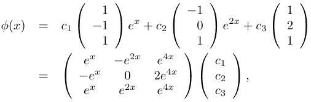

由此可以立即得到初值问题 (20.3)、$u(0)=(1,2,3)^t$ 的解 (20.5)。

## 定理 20.1

设矩阵 $A$ 可对角化（参见定理 18.1）。

则集合

$$\phi^1(x)=u^1e^{\lambda_1x},\cdots,\phi^n(x)=u^ne^{\lambda_nx} \tag{20.6}$$

是 (20.1) 的一个基本解组。这里，$\lambda_1,\cdots,\lambda_n$ 是 $A$ 的特征值（不一定互不相同），$u^1,\cdots,u^n$ 是对应的线性无关特征向量。

### 证明

因为 $u^i$ 是 $A$ 的对应于特征值 $\lambda_i$ 的特征向量，我们得到

$$(\phi^i(x))'=(u^ie^{\lambda_ix})'=\lambda_iu^ie^{\lambda_ix}=Au^ie^{\lambda_ix}=A\phi^i(x)$$

因此 $\phi^i(x)$ 是 (20.1) 的解。为了证明 (20.6) 是一个基本解组，我们注意到 $W(0)=\det(u^1,\cdots,u^n)\ne0$，因为 $u^1,\cdots,u^n$ 线性无关。

### 例 20.2

由例 16.1 和定理 20.1 可以清楚地看出，(20.4) 中给出的列向量 $\phi^1(x),\phi^2(x),\phi^3(x)$ 是系统 (20.3) 的解。类似地，由例 16.5 和定理 20.1 可知，对于系统

$$u'=Au=\begin{pmatrix}-1&0&4\\0&-1&2\\0&0&1\end{pmatrix}u$$

三个线性无关解为

$$\phi^1(x)=\begin{pmatrix}1\\0\\0\end{pmatrix}e^{-x},\quad \phi^2(x)=\begin{pmatrix}0\\1\\0\end{pmatrix}e^{-x},\quad \phi^3(x)=\begin{pmatrix}2\\1\\1\end{pmatrix}e^x.$$

**注 20.1.** (20.1) 的通解可以写成

$$\phi(x)=\sum_{i=1}^{n}c_i e^{\lambda_i x}u^i=(u^1,\cdots,u^n)D(x)(c_1,\cdots,c_n)^t,$$

其中 $D(x)$ 是对角矩阵

$$D(x)=\begin{pmatrix}e^{\lambda_1x}&0&\cdots&0\\0&e^{\lambda_2x}&\cdots&0\\\vdots&\vdots&\ddots&\vdots\\0&0&\cdots&e^{\lambda_nx}\end{pmatrix}.$$

由于矩阵 $P=(u^1,\cdots,u^n)$ 非奇异，$P^{-1}$ 存在，因此我们可以选择向量 $c=(c_1,\cdots,c_n)^t$ 为 $P^{-1}w$，其中 $w$ 是任意列向量。因此，当 $A$ 可对角化时，(20.1) 的矩阵形式的通解为

$$\phi(x)=PD(x)P^{-1}w. \tag{20.7}$$

现在，对于任意的 $n\times n$ 矩阵 $A$，我们按如下方式引入 $n\times n$ 矩阵 $e^A$：

$$e^A=\sum_{k=0}^{\infty}\frac{A^k}{k!}=I+A+\frac{1}{2!}A^2+\frac{1}{3!}A^3+\cdots. \tag{20.8}$$

这个指数级数对任何矩阵 $A$ 都收敛。事实上，根据第 17 章中收敛的定义，我们有

$$\left\|\sum_{k=0}^{m+p}\frac{A^k}{k!}-\sum_{k=0}^{m}\frac{A^k}{k!}\right\|=\left\|\sum_{k=m+1}^{m+p}\frac{A^k}{k!}\right\|\leq\sum_{k=m+1}^{m+p}\frac{\|A^k\|}{k!}\leq\sum_{k=m+1}^{m+p}\frac{\|A\|^k}{k!}\leq e^{\|A\|}.$$

因此，对于任意 $n\times n$ 矩阵 $A$，$e^A$ 是一个定义良好的 $n\times n$ 矩阵。

设 $\lambda$ 是可对角化矩阵 $A$ 的一个特征值，$u$ 是对应的特征向量。那么，由 (20.8) 和第 16 章中的 P11，我们有

$$e^Au=\sum_{k=0}^{\infty}\left(\frac{A^k}{k!}\right)u=\sum_{k=0}^{\infty}\left(\frac{\lambda^k}{k!}\right)u=e^{\lambda}u.$$

这表明 \(e^\lambda\) 是矩阵 \(e^A\) 的一个特征值，并且 \(u\) 是对应的特征向量。因此，由问题 16.1(ii) 和 (iii)，我们得到

\[
\det e^A=\prod_{i=1}^n e^{\lambda_i}
=e^{\lambda_1+\cdots+\lambda_n}
=e^{\operatorname{Tr} A}\ne0
\]

（此恒等式实际上对任何 \(n\times n\) 矩阵都成立），因此矩阵 \(e^A\) 是非奇异的，从而可对角化。

总结以上讨论，我们发现，如果 \(A\) 可对角化，那么 \(e^{Ax}\) 的一个对角化是 \(PD(x)P^{-1}\)，因此 (20.7) 可以写成

\[
\phi(x)=e^{Ax}w. \tag{20.9}
\]

我们还注意到，由于 \(u^0=u(x_0)=e^{Ax_0}w\) 给出 \(w=e^{-Ax_0}u^0\)，因此 (20.1)、(20.2) 的解可以写成

\[
\phi(x)=e^{Ax}e^{-Ax_0}u^0=e^{A(x-x_0)}u^0. \tag{20.10}
\]

现在我们断言，对于任意 \(n\times n\) 矩阵 \(A\)，\(\Phi(x)=e^{Ax}\) 是 (20.1) 的一个基本解矩阵。为此，只需注意

\[
\Phi'(x)=Ae^{Ax}=A\Phi(x)
\quad\text{and}\quad
\Phi(0)=e^{A0}=I.
\]

因此，(20.9) 不仅限于可对角化矩阵，而是对任意 \(n\times n\) 矩阵 \(A\) 都给出了 (20.1) 的通解。然而，当矩阵 \(A\) 不可对角化时，计算 \(e^{Ax}\) 并不直接。在已知的若干种计算 \(e^{Ax}\) 的方法中，以下方法似乎是最简单且最常用的。

## 定理 20.2（Putzer 算法）

设 \(\lambda_1,\cdots,\lambda_n\) 是矩阵 \(A\) 的特征值，按某种任意但确定的顺序排列。则

\[
e^{Ax}=\sum_{j=0}^{n-1}r_{j+1}(x)P_j, \tag{20.11}
\]

其中 \(P_0=I\)，\(P_j=\prod_{k=1}^j(A-\lambda_kI)\)，\(j=1,\cdots,n\)，且 \(r_1(x),\cdots,r_n(x)\) 由下面各式递推给出

\[
r'_1(x)=\lambda_1r_1(x),\qquad r_1(0)=1,
\]

\[
r'_j(x)=\lambda_jr_j(x)+r_{j-1}(x),\qquad r_j(0)=0,\qquad j=2,\cdots,n.
\]

（注意，列表中的每个特征值都按其重数重复出现。此外，由于矩阵 $(A-\lambda_iI)$ 和 $(A-\lambda_jI)$ 可交换，为方便起见，我们可以采用如下约定：当 $i>j$ 时，$(A-\lambda_jI)$ 跟在 $(A-\lambda_iI)$ 后面。）

### 证明

只需证明由下式定义的 \(\Phi(x)\)

\[
\Phi(x)=\sum_{j=0}^{n-1}r_{j+1}(x)P_j.
\]

满足 \(\Phi'(x) = A\Phi(x)\)，\(\Phi(0) = I\)。为此，我们定义 \(r_0(x) \equiv 0\)。于是得到

\[
\Phi'(x) - \lambda_n\Phi(x) = \sum_{j=0}^{n-1}(\lambda_{j+1}r_{j+1}(x) + r_j(x))P_j - \lambda_n\sum_{j=0}^{n-1}r_{j+1}(x)P_j
\]

\[
= \sum_{j=0}^{n-1}(\lambda_{j+1} - \lambda_n)r_{j+1}(x)P_j + \sum_{j=0}^{n-1}r_j(x)P_j
\]

\[
= \sum_{j=0}^{n-2}(\lambda_{j+1} - \lambda_n)r_{j+1}(x)P_j + \sum_{j=0}^{n-2}r_{j+1}(x)P_{j+1}
\]

\[
= \sum_{j=0}^{n-2}\{(\lambda_{j+1} - \lambda_n)P_j + (A - \lambda_{j+1}I)P_j\}r_{j+1}(x) \tag{20.12}
\]

\[
= (A - \lambda_nI)\sum_{j=0}^{n-2}P_jr_{j+1}(x)
\]

\[
= (A - \lambda_nI)(\Phi(x) - r_n(x)P_{n-1})
\]

\[
= (A - \lambda_nI)\Phi(x) - r_n(x)P_n. \tag{20.13}
\]

其中，在得到 (20.12) 和 (20.13) 时，我们分别使用了 \(P_{j+1} = (A - \lambda_{j+1}I)P_j\) 和 \(P_n = (A - \lambda_nI)P_{n-1}\)。现在，根据凯莱-哈密顿定理（第16章），\(P_n = p(A) = 0\)，因此 (20.13) 化简为 \(\Phi'(x) = A\Phi(x)\)。最后，为了完成证明，我们注意到 \(\Phi(0) = \sum_{j=0}^{n-1}r_{j+1}(0)P_j = r_1(0)I = I\)。

## 例 20.3

考虑一个 \(3 \times 3\) 矩阵 \(A\)，其三个特征值都等于 \(\lambda_1\)。为使用定理 20.2，我们注意到 \(r_1(x) = e^{\lambda_1 x}\)，\(r_2(x) = xe^{\lambda_1 x}\)，\(r_3(x) = (1/2)x^2e^{\lambda_1 x}\) 是下列方程组的解集：

\[
r'_1 = \lambda_1 r_1, \quad r_1(0) = 1
\]

\[
r'_2 = \lambda_1 r_2 + r_1, \quad r_2(0) = 0
\]

\[
r'_3 = \lambda_1 r_3 + r_2, \quad r_3(0) = 0.
\]

因此可得

\[
e^{Ax} = e^{\lambda_1 x}\left[I + x(A - \lambda_1 I) + \frac{1}{2}x^2(A - \lambda_1 I)^2\right]. \tag{20.14}
\]

特别地，矩阵

\[
A = \begin{pmatrix}
2 & 1 & -1 \\
-3 & -1 & 1 \\
9 & 3 & -4
\end{pmatrix}
\]

的所有特征值都等于 \(-1\)，因此由 (20.14) 得到

\[
e^{Ax}=\frac{1}{2}e^{-x}
\begin{pmatrix}
2+6x-3x^2 & 2x & -2x+x^2 \\
-6x & 2 & 2x \\
18x-9x^2 & 6x & 2-6x+3x^2
\end{pmatrix}.
\]

## 例 20.4

考虑一个 \(3 \times 3\) 矩阵 \(A\)，其特征值为 \(\lambda_1, \lambda_1, \lambda_2\)。为使用定理 20.2，我们注意到 \(r_1(x) = e^{\lambda_1 x}\)，\(r_2(x) = xe^{\lambda_1 x}\)，

\[
r_3(x) = \frac{xe^{\lambda_1 x}}{(\lambda_1 - \lambda_2)} + \frac{e^{\lambda_2 x} - e^{\lambda_1 x}}{(\lambda_1 - \lambda_2)^2}
\]

因此

\[
e^{Ax} = e^{\lambda_1 x} \left[I + x(A - \lambda_1 I) + \left\{\frac{x}{(\lambda_1 - \lambda_2)} + \frac{e^{(\lambda_2 - \lambda_1)x} - 1}{(\lambda_1 - \lambda_2)^2}\right\}(A - \lambda_1 I)^2\right]. \tag{20.15}
\]

特别地，矩阵

\[
A = \begin{pmatrix}
-1 & 0 & 4 \\
0 & -1 & 2 \\
0 & 0 & 1
\end{pmatrix}
\]

的特征值为 \(-1, -1, 1\)，因此由 (20.15) 得到

\[
e^{Ax} =
\begin{pmatrix}
e^{-x} & 0 & 2(e^x - e^{-x}) \\
0 & e^{-x} & e^x - e^{-x} \\
0 & 0 & e^x
\end{pmatrix}.
\]

接下来，我们考虑差分系统

\[
u(k+1) = Au(k), \quad k \in \mathbb{N} = \{0, 1, 2, \cdots\}. \tag{20.16}
\]

其中 \(A = (a_{ij})\) 仍是元素为常数的给定的 \(n \times n\) 矩阵，\(u = u(k) = (u_1(k), \cdots, u_n(k))^t\) 是定义在所有非负整数上的未知函数列向量。(20.16) 的解 \(\phi(k)\)，\(k \in \mathbb{N}\)，是一个列向量值函数 \(\phi(k) = (\phi_1(k), \cdots, \phi_n(k))^t\)，它满足 (20.16)，即 \(\phi(k+1) = A\phi(k)\)。显然，\(u = 0\) 总是 (20.16) 的一个解。这个解称为_平凡解_或_零解_。通常，我们感兴趣的是求 (20.16) 满足初始条件

\[
u(0) = u^0. \tag{20.17}
\]

的解。差分系统 (20.16) 连同初始条件 (20.17) 称为_初值问题_，它总是有唯一解。显然，(20.16) 的任何（一般）解都可以写成

\[
\phi(k) = A^k c, \quad k \in \mathbb{N}. \tag{20.18}
\]

其中 \(c\) 是任意列向量。由 (20.18) 立即得到，(20.16)、(20.17) 的唯一解为 \(\phi(k)=A^ku^0\)，\(k \in \mathbb{N}\)。现在，当 \(A\) 可对角化时，我们可以给出如下结果，其证明与定理 20.1 的证明类似。

## 定理 20.3

设定理 20.1 的记号与假设成立。则集合

\[
\phi^1(k)=u^1\lambda_1^k,\cdots,\phi^n(k)=u^n\lambda_n^k,\quad k \in \mathbb{N}
\]

是 (20.16) 的一个基本解组。

进一步，我们注意到与 (20.1) 类似，(20.16) 的通解可以写成

\[
\phi(k)=A^kc=\sum_{i=1}^nc_i\lambda_i^ku^i=PD(k)P^{-1}c, \tag{20.19}
\]

其中 \(P=(u^1,\cdots,u^n)\) 仍是非奇异矩阵，\(c=(c_1,\cdots,c_n)^t\) 是常向量，\(D(k)\) 是对角矩阵

\[
D(k)=\begin{pmatrix}
\lambda_1^k & 0 & \cdots & 0 \\
0 & \lambda_2^k & \cdots & 0 \\
\vdots & \vdots & \ddots & \vdots \\
0 & 0 & \cdots & \lambda_n^k
\end{pmatrix}.
\]

由 (20.19) 可知 \(A^k=PD(k)P^{-1}\)，前提是矩阵 \(A\) 可对角化（见第18章）。

## 例 20.5

对于离散系统 (20.16)，若其矩阵与 (20.3) 中的矩阵相同，则基本解组为

\[
\phi^1(k)=
\begin{pmatrix}
1\\
-1\\
1
\end{pmatrix},
\quad
\phi^2(k)=
\begin{pmatrix}
-1\\
0\\
1
\end{pmatrix}2^k,
\quad
\phi^3(k)=
\begin{pmatrix}
1\\
2\\
1
\end{pmatrix}4^k.
\]

## 例 20.6

对于离散系统 (20.16)，若其矩阵与例 20.2 中的矩阵相同，则基本解组为

\[
\phi^1(k)=
\begin{pmatrix}
1\\
0\\
0
\end{pmatrix}(-1)^k,\quad
\phi^2(k)=
\begin{pmatrix}
0\\
1\\
0
\end{pmatrix}(-1)^k,\quad
\phi^3(k)=
\begin{pmatrix}
2\\
1\\
1
\end{pmatrix}.
\]

如果矩阵 \(A\) 不可对角化，我们利用定理 20.2 的离散版本计算 \(A^k\)。

## 定理 20.4（离散 Putzer 算法）

设定理 20.2 的记号与假设成立。则对所有 \(k \in \mathbb{N}\)，

\[
A^k=\sum_{j=0}^{n-1}w_{j+1}(k)P_j. \tag{20.20}
\]

其中

\[
w_1(k+1)=\lambda_1w_1(k),\quad w_1(0)=1,
\]

\[
w_j(k+1)=\lambda_jw_j(k)+w_{j-1}(k),\quad w_j(0)=0,\quad j=2,\cdots,n. \tag{20.21}
\]

**证明.** 将 (20.11) 求导 \(k\) 次并代入 \(x=0\)，即得 (20.20)，其中 \(w_j(k)=r_j^{(k)}(0)\)，\(1\le j\le n\)。\(\blacksquare\)

**注 20.2.** 系统 (20.21) 的解为

\[
w_1(k)=\lambda_1^k,
\]

\[
w_j(k)=\sum_{\ell=0}^{k-1}\lambda_j^{k-1-\ell}w_{j-1}(\ell),\quad j=2,\cdots,n.
\]

## 例 20.7

对于一个 \(3\times 3\) 矩阵 \(A\)，若其三个特征值都等于 \(\lambda_1\)，则由 (20.14) 得

\[
A^k=\lambda_1^kI+k\lambda_1^{k-1}(A-\lambda_1I)+\frac{1}{2}k(k-1)\lambda_1^{k-2}(A-\lambda_1I)^2. \tag{20.22}
\]

特别地，对于例 20.3 中的矩阵 \(A\)，有

\[
A^k=\frac{1}{2}(-1)^k
\begin{pmatrix}
2-3k-3k^2 & -2k & k+k^2 \\
6k & 2 & -2k \\
-9k-9k^2 & -6k & 2+3k+3k^2
\end{pmatrix}.
\]

## 例 20.8

对于一个 \(3\times 3\) 矩阵 \(A\)，若其特征值为 \(\lambda_1,\lambda_1,\lambda_2\)，则由 (20.15) 得

\[
A^k=\lambda_1^kI+k\lambda_1^{k-1}(A-\lambda_1I)+\left\{\frac{k\lambda_1^{k-1}}{(\lambda_1-\lambda_2)}+\frac{\lambda_2^k-\lambda_1^k}{(\lambda_1-\lambda_2)^2}\right\}(A-\lambda_1I)^2. \tag{20.23}
\]

特别地，对于例 20.4 中的矩阵 \(A\)，有

\[
A^k=
\begin{pmatrix}
(-1)^k & 0 & 2(1-(-1)^k) \\
0 & (-1)^k & 1-(-1)^k \\
0 & 0 & 1
\end{pmatrix}.
\]

## 习题

**20.1.**

(i) 若 \(A=\begin{pmatrix}\alpha & \beta\\-\beta & \alpha\end{pmatrix}\)，证明

\[
e^{Ax}=e^{\alpha x}
\begin{pmatrix}
\cos\beta x & \sin\beta x\\
-\sin\beta x & \cos\beta x
\end{pmatrix}.
\]

(ii) 若 \(A=\begin{pmatrix}0 & 1\\-1 & -2\delta\end{pmatrix}\)，证明

\[
e^{Ax}=
\begin{pmatrix}
e^{-\delta x}\left(\cos\omega x+\frac{\delta}{\omega}\sin\omega x\right) &
\frac{1}{\omega}e^{-\delta x}\sin\omega x\\
-\frac{1}{\omega}e^{-\delta x}\sin\omega x &
e^{-\delta x}\left(\cos\omega x-\frac{\delta}{\omega}\sin\omega x\right)
\end{pmatrix},
\]

其中 \(\omega=\sqrt{1-\delta^2}\)。

(iii) 若

\[
A=
\begin{pmatrix}
0 & 1 & 0 & 0\\
3\omega^2 & 0 & 0 & 2\omega\\
0 & 0 & 0 & 1\\
0 & -2\omega & 0 & 0
\end{pmatrix},
\]

证明

\[
e^{Ax}=
\begin{pmatrix}
4-3\cos\omega x & \frac{1}{\omega}\sin\omega x & 0 & \frac{2}{\omega}(1-\cos\omega x)\\
3\omega\sin\omega x & \cos\omega x & 0 & 2\sin\omega x\\
6(-\omega x+\sin\omega x) & -\frac{2}{\omega}(1-\cos\omega x) & 1 & \frac{1}{\omega}(-3\omega x+4\sin\omega x)\\
6\omega(-1+\cos\omega x) & -2\sin\omega x & 0 & -3+4\cos\omega x
\end{pmatrix}.
\]

(iv) 若 \(A^2=\alpha A\)，证明

\[
e^{Ax}=I+\frac{e^{\alpha x}-1}{\alpha}A.
\]

**20.2.** 设 \(A\) 和 \(P\) 是由下式给出的 \(n\times n\) 矩阵：

\[
A=
\begin{pmatrix}
\lambda & 1 & 0 & \cdots & 0\\
0 & \lambda & 1 & \cdots & 0\\
\cdots & \cdots & \cdots & \cdots & \cdots\\
0 & 0 & 0 & \cdots & 1\\
0 & 0 & 0 & \cdots & \lambda
\end{pmatrix},
\quad
P=
\begin{pmatrix}
0 & 1 & 0 & 0 & \cdots & 0\\
0 & 0 & 1 & 0 & \cdots & 0\\
\cdots & \cdots & \cdots & \cdots & \cdots & \cdots\\
0 & 0 & 0 & 0 & \cdots & 1\\
0 & 0 & 0 & 0 & \cdots & 0
\end{pmatrix}.
\]

证明：

(i) \(P^n=0\)。

(ii) \((\lambda I)P=P(\lambda I)\)。

(iii)

\[
e^{Ax}=e^{\lambda x}\left[I+xP+\frac{1}{2!}x^2P^2+\cdots+\frac{1}{(n-1)!}x^{n-1}P^{n-1}\right].
\]

**20.3.** 设 \(A\) 和 \(B\) 是两个 \(n\times n\) 相似矩阵，即 (13.16) 成立。证明：

(i) \(u(x)\) 是 (20.1) 的解当且仅当 \(v(x)=Pu(x)\) 是微分系统 \(v'=Bv\) 的解。

(ii) \(e^{Ax}=P^{-1}e^{Bx}P\)。

179

## 20.4. 求微分系统 (20.1) 的通解，其中矩阵 \( A \) 由下式给出

- (i) \(\begin{pmatrix} 4 & -2 \\ 5 & 2 \end{pmatrix}\)
- (ii) \(\begin{pmatrix} 7 & 6 \\ 2 & 6 \end{pmatrix}\)
- (iii) \(\begin{pmatrix} 0 & 1 & 1 \\ 1 & 0 & 1 \\ 1 & 1 & 0 \end{pmatrix}\)
- (iv) \(\begin{pmatrix} 1 & -1 & 4 \\ 3 & 2 & -1 \\ 2 & 1 & -1 \end{pmatrix}\)
- (v) \(\begin{pmatrix} -1 & 1 & 0 \\ 0 & -1 & 0 \\ 0 & 0 & 3 \end{pmatrix}\)
- (vi) \(\begin{pmatrix} 5 & -3 & -2 \\ 8 & -5 & -4 \\ -4 & 3 & 3 \end{pmatrix}\)

## 20.5. 对 Problem 20.4 中给出的每个矩阵 \( A \)，求差分系统 (20.16) 的通解。

## 答案或提示

20.1. 直接验证。

20.2. (i) 观察可知，在每次乘法中，1 的位置都向右移动一列，因此在 \( P^2 \) 中，第 \( n \) 行和第 \( (n-1) \) 行均为 0。
(ii) 显然。
(iii) 由于 \( A = \lambda I + P \)，我们可以利用 Parts (i) 和 (ii)。

20.3. (i) 直接验证。
(ii) \( e^{Ax} = e^{P^{-1}BxP} \)，现在展开右边。

20.4. (i) \( e^{3x} \begin{pmatrix} 2 \cos 3x & 2 \sin 3x \\ \cos 3x + 3 \sin 3x & \sin 3x - 3 \cos 3x \end{pmatrix} \begin{pmatrix} c_1 \\ c_2 \end{pmatrix} \).

(ii) \(\begin{pmatrix} 2e^{10x} & 3e^{3x} \\ e^{10x} & -2e^{3x} \end{pmatrix} \begin{pmatrix} c_1 \\ c_2 \end{pmatrix} \).

(iii) \(\begin{pmatrix} e^{2x} & e^{-x} & 0 \\ e^{2x} & 0 & e^{-x} \\ e^{2x} & -e^{-x} & -e^{-x} \end{pmatrix} \begin{pmatrix} c_1 \\ c_2 \\ c_3 \end{pmatrix} \).

(iv) \(\begin{pmatrix} -e^x & e^{-2x} & e^{3x} \\ 4e^x & -e^{-2x} & 2e^{3x} \\ e^x & -e^{-2x} & e^{3x} \end{pmatrix} \begin{pmatrix} c_1 \\ c_2 \\ c_3 \end{pmatrix} \).

(v) \(\begin{pmatrix} 0 & -e^{-x} & xe^{-x} \\ 0 & 0 & e^{-x} \\ e^{3x} & 0 & 0 \end{pmatrix} \begin{pmatrix} c_1 \\ c_2 \\ c_3 \end{pmatrix} \).

(vi) \( e^x \begin{pmatrix} 1 & 0 & 2x \\ 0 & 2 & 4x \\ 2 & -3 & -2x - 1 \end{pmatrix} \begin{pmatrix} c_1 \\ c_2 \\ c_3 \end{pmatrix} \).

20.5. (i) \( (3\sqrt{2})^k \begin{pmatrix} \cos \frac{k\pi}{4} + \frac{1}{3} \sin \frac{k\pi}{4} & -\frac{2}{3} \sin \frac{k\pi}{4} \\ \frac{5}{3} \sin \frac{k\pi}{4} & \cos \frac{k\pi}{4} - \frac{1}{3} \sin \frac{k\pi}{4} \end{pmatrix} \begin{pmatrix} c_1 \\ c_2 \end{pmatrix} \).

(ii) \(\frac{1}{7}\begin{pmatrix} 4(10)^k+3(3)^k & 6(10)^k-6(3)^k \\ 2(10)^k-2(3)^k & 3(10)^k+4(3)^k \end{pmatrix}\begin{pmatrix} c_1 \\ c_2 \end{pmatrix}\).

(iii) \(\frac{1}{3}\begin{pmatrix} 2^k+2(-1)^k & 2^k-(-1)^k & 2^k-(-1)^k \\ 2^k-(-1)^k & 2^k+2(-1)^k & 2^k-(-1)^k \\ 2^k-(-1)^k & 2^k-(-1)^k & 2^k+2(-1)^k \end{pmatrix}\begin{pmatrix} c_1 \\ c_2 \\ c_3 \end{pmatrix}\).

(iv) \(\frac{1}{6}\begin{pmatrix} -1 & (-2)^k & 3^k \\ 4 & -(-2)^k & 2(3)^k \\ 1 & -(-2)^k & 3^k \end{pmatrix}\begin{pmatrix} -1 & 2 & -3 \\ 2 & 2 & -6 \\ 3 & 0 & 3 \end{pmatrix}\begin{pmatrix} c_1 \\ c_2 \\ c_3 \end{pmatrix}\).

(v) \(\begin{pmatrix} (-1)^k & k(-1)^{k-1} & 0 \\ 0 & (-1)^k & 0 \\ 0 & 0 & 3^k \end{pmatrix}\begin{pmatrix} c_1 \\ c_2 \\ c_3 \end{pmatrix}\).

(vi) \(\begin{pmatrix} 1+4k & -3k & -2k \\ 8k & 1-6k & -4k \\ -4k & 3k & 1+2k \end{pmatrix}\begin{pmatrix} c_1 \\ c_2 \\ c_3 \end{pmatrix}\).

## 最小二乘逼近

显然，当 \( x \) 是系统

\(Ax=b^1.\) (21.7)

的解时，右边取得最小值。

由于 \( b^1 \) 在 \( S \) 中，该系统是相容的。该系统的任意解记为 \( \hat{x} \) 是 (5.2) 的一个最小二乘解。此外，当 \( A \) 的列线性无关时，该解是唯一的。

现在假设 \( \hat{x} \) 是系统 (21.7) 的一个解。由于 \( b^2 \) 与 \( A \) 的列正交，可得 \( A^t b^2 = 0 \)。因此，我们有

\(A^t A \hat{x} = A^t b^1 = A^t (b - b^2) = A^t b,\)

即，\( \hat{x} \) 是系统 (21.2) 的一个解。反之，假设 \( \hat{x} \) 是 (21.2) 的一个解。那么，我们有

\(A^t (b - A \hat{x}) = 0.\)

这意味着向量 \( (b - A \hat{x}) \) 与 \( A^t \) 的每一行正交，即与 \( A \) 的每一列正交。由于 \( S = C(A) \)，我们得出 \( (b - A \hat{x}) \in S^\perp \)。因此，向量 \( b \) 可以表示为

\(b = A \hat{x} + (b - A \hat{x}),\)

其中 \( A \hat{x} \in S \) 且 \( (b - A \hat{x}) \in S^\perp \)。但根据定理 14.5 和注 14.4，这样的分解是唯一的，因此 \( A \hat{x} = b^1 \)。

## Corollary 21.1

设 \( A \) 是一个 \( m \times n \) 矩阵，且 \( r(A) = n \)，假设 \( A = QR \) 是 \( A \) 的 \( QR \) 分解（见定理 18.3）。那么，上三角系统

\(Rx = Q^t b\) (21.8)

给出了系统 (5.2) 的最小二乘近似解。

## Proof

根据定理 18.3，系统 (21.2) 可以写成 \( R^t Q^t Q R x = R^t Q^t b \)。然而，由于 \( Q^t Q = I \) 且 \( R \) 可逆，该系统与 (21.8) 相同。

## Example 21.1

对于系统

\(\begin{pmatrix} 1 & 1 & 2 \\ 1 & 2 & 3 \\ 1 & 3 & 4 \\ 3 & 4 & 9 \end{pmatrix} \begin{pmatrix} x_1 \\ x_2 \\ x_3 \end{pmatrix} = \begin{pmatrix} 2 \\ 2 \\ h \\ k \end{pmatrix}\) (21.9)

增广矩阵的行阶梯形如下

\(\begin{pmatrix} 1 & 1 & 2 & 2 \\ 0 & 1 & 1 & 0 \\ 0 & 0 & 2 & k-6 \\ 0 & 0 & 0 & h-2 \end{pmatrix}.\)

因此，该系统有解当且仅当 \( h = 2 \)，在这种情况下，解为

\(\left( \frac{1}{2}(10-k), \frac{1}{2}(6-k), -\frac{1}{2}(6-k) \right)^t.\)

由于 (21.9) 中矩阵 \( A \) 的列线性无关，根据 Corollary 21.1 和 Example 18.6，(21.9) 的唯一最小二乘解可以通过求解系统

\(\begin{pmatrix} \frac{6}{\sqrt{3}} & \frac{9}{\sqrt{3}} & \frac{18}{\sqrt{3}} \\ 0 & \frac{3}{\sqrt{3}} & \frac{2}{\sqrt{3}} \\ 0 & 0 & \frac{2}{\sqrt{6}} \end{pmatrix} \begin{pmatrix} \hat{x}_1 \\ \hat{x}_2 \\ \hat{x}_3 \end{pmatrix} = \begin{pmatrix} \frac{1}{2\sqrt{3}} & -\frac{1}{2\sqrt{3}} & -\frac{2}{\sqrt{6}} \\ \frac{1}{2\sqrt{3}} & \frac{1}{2\sqrt{3}} & -\frac{1}{\sqrt{6}} \\ \frac{1}{2\sqrt{3}} & \frac{3}{2\sqrt{3}} & 0 \\ \frac{3}{2\sqrt{3}} & -\frac{1}{2\sqrt{3}} & \frac{1}{\sqrt{6}} \end{pmatrix} \begin{pmatrix} 2 \\ 2 \\ h \\ k \end{pmatrix}\)

\(= \begin{pmatrix} \frac{1}{2\sqrt{3}}(4+h+3k) \\ \frac{1}{2\sqrt{3}}(3h-k) \\ \frac{1}{\sqrt{6}}(k-6) \end{pmatrix}.\)

使用回代法，该系统给出了 (21.9) 的唯一最小二乘近似解为

\(x_3 = -\frac{1}{2}(6-k), \quad x_2 = \frac{1}{2}(h-k+4), \quad x_1 = \frac{1}{6}(38-4h-3k).\)

显然，(21.11) 在 \( h = 2 \) 时与 (21.10) 相同，正如它应该的那样。

对于 (21.9)，系统 (21.2) 为

\(\begin{pmatrix} 12 & 18 & 36 \\ 18 & 30 & 56 \\ 36 & 56 & 110 \end{pmatrix} \begin{pmatrix} x_1 \\ x_2 \\ x_3 \end{pmatrix} = \begin{pmatrix} 4+h+3k \\ 6+3h+4k \\ 10+4h+9k \end{pmatrix},\)

正如预期的那样，它给出与 (21.11) 相同的解。

## Example 21.2

考虑系统

\(\begin{pmatrix} 1 & 3 & 2 \\ 3 & -5 & -1 \\ 4 & 2 & 3 \\ 2 & 2 & 2 \end{pmatrix} \begin{pmatrix} x_1 \\ x_2 \\ x_3 \end{pmatrix} = \begin{pmatrix} 1 \\ 2 \\ 3 \\ 4 \end{pmatrix}.\)

根据 Problem 8.1(i)，在这个系统中，矩阵 \( A \) 的列线性相关。此外，对于这个系统，增广矩阵的行阶梯形如下

\(\begin{pmatrix} 1 & 3 & 2 & \mid & 1 \\ 0 & 1 & \frac{1}{2} & \mid & \frac{1}{14} \\ 0 & 0 & 0 & \mid & -\frac{2}{7} \\ 0 & 0 & 0 & \mid & \frac{16}{7} \end{pmatrix},\)

因此它无解。对于 (21.12)，系统 (21.2) 为

\(\begin{pmatrix} 30 & 0 & 15 \\ 0 & 42 & 21 \\ 15 & 21 & 18 \end{pmatrix} \begin{pmatrix} x_1 \\ x_2 \\ x_3 \end{pmatrix} = \begin{pmatrix} 27 \\ 7 \\ 17 \end{pmatrix}.\)

系统 (21.13) 有无穷多个解

\(\left( \frac{9}{10} - \frac{1}{2}c, \frac{1}{6} - \frac{1}{2}c, c \right)^t.\)

因此，系统 (21.12) 有无穷多个最小二乘解，由 (21.14) 给出。

## Example 21.3

根据 Problem 6.3(i)，我们知道系统

\(\begin{pmatrix} 2 & 7 & 4 & 3 \\ 8 & 5 & 3 & 9 \\ 1 & 3 & 6 & 4 \end{pmatrix} \begin{pmatrix} x_1 \\ x_2 \\ x_3 \\ x_4 \end{pmatrix} = \begin{pmatrix} 1 \\ 3 \\ 7 \end{pmatrix}\)

有无穷多个解。对于 (21.15)，系统 (21.2) 为

\(\begin{pmatrix} 69 & 57 & 38 & 82 \\ 57 & 83 & 61 & 78 \\ 38 & 61 & 61 & 63 \\ 82 & 78 & 63 & 106 \end{pmatrix} \begin{pmatrix} x_1 \\ x_2 \\ x_3 \\ x_4 \end{pmatrix} = \begin{pmatrix} 33 \\ 43 \\ 55 \\ 58 \end{pmatrix}.\)

该系统有无穷多个解：

\(\frac{1}{197}(62, -161, 300, 0)^t + \frac{1}{197}(-203, 41, -118, 198)^t c.\)

因此，系统 (21.15) 有无穷多个最小二乘解，由 (21.16) 给出。这些解与 Problem 6.3(i) 给出的解完全相同，正如它们应该的那样。

## Problems

- **21.1.** 求 Example 6.3 中考虑的系统的最小二乘解。
- **21.2.** 求 Problem 6.3(ii) 中考虑的系统的最小二乘解。
- **21.3.** 求 Problem 6.3(v) 中考虑的系统的最小二乘解。

## 21.4.

证明下列方程组无解：

\[
\begin{pmatrix}
1&2&1&5\\
1&2&-1&1\\
2&4&-3&0
\end{pmatrix}
\begin{pmatrix}
x_1\\x_2\\x_3\\x_4
\end{pmatrix}
=
\begin{pmatrix}
1\\1\\3
\end{pmatrix}.
\]

求其最小二乘解。

## 21.5.

证明下列方程组无解：

\[
\begin{pmatrix}
2&1&3\\
4&3&5\\
8&2&16\\
-4&1&-11\\
-2&3&-5
\end{pmatrix}
\begin{pmatrix}
x_1\\x_2\\x_3
\end{pmatrix}
=
\begin{pmatrix}
1\\2\\4\\2\\2
\end{pmatrix}.
\]

求其最小二乘解。

## 答案或提示

- 21.1. \(\left(\frac{1}{3},\frac{2}{3},1\right)^t\)

- 21.2. \(\left(2,\frac{13}{55},0\right)^t+\left(-5,\frac{48}{55},\frac{147}{55},1\right)^t c\).

- 21.3. \((0,1,1,0)^t+\left(-\frac{13}{30},\frac{9}{10},\frac{16}{15},1,0\right)^t c+\left(\frac{1}{30},\frac{7}{10},\frac{8}{15},0,1\right)^t d\).

- 21.4. 解不存在可由增广矩阵的阶梯形得出
  \[
  \begin{pmatrix}
  1&2&1&5&|&1\\
  0&0&-2&-4&|&0\\
  0&0&0&0&|&1
  \end{pmatrix}.
  \]
  其最小二乘解为
  \[
  \frac{1}{15}(17,0,-3,0)^t+(-2,1,0,0)^t c+(-3,0,-2,1)^t d.
  \]

- 21.5. 解不存在可由增广矩阵的阶梯形得出
  \[
  \begin{pmatrix}
  2&1&3&|&1\\
  0&1&-1&|&0\\
  0&0&2&|&0\\
  0&0&0&|&4\\
  0&0&0&|&3
  \end{pmatrix}.
  \]
  其最小二乘解为
  \[
  \frac{1}{956}(491,680,-173)^t.
  \]

## 第 22 章

## 二次型

二次型在物理学、经济学、工程学（控制理论）和解析几何学（二次曲线和曲面）中自然出现。特别是，回顾平面上中心二次曲线的方程（二次型），在将直角坐标系的原点平移到曲线中心后，表现为

\[
q_2(x,y)=(x,y)
\begin{pmatrix}
a&b\\
b&c
\end{pmatrix}
\binom{x}{y}
=ax^2+2bxy+cy^2=d.
\]

我们也知道，通过旋转坐标轴（使用适当的变换），该方程（二次型）在新坐标系中可以化简为“标准”（对角）形式：

\[
q_2(x',y')=(x',y')
\begin{pmatrix}
a'&0\\
0&c'
\end{pmatrix}
\binom{x'}{y'}
=a'x'^2+c'y'^2=d.
\]

在本章中，我们将研究 \(n\) 个变量 \(x_1,\cdots,x_n\) 的二次型，即，

\[
q_n(x_1,\cdots,x_n)=\sum_{i=1}^{n}b_i x_i^2+2\sum_{i<j}^{n}c_{ij}x_i x_j,\quad b_i,c_{ij}\in R.
\tag{22.1}
\]

显然，在 (22.1) 中，每一项都是二次项。

用矩阵形式，(22.1) 可以写成

\[
q_n(x)=q_n(x_1,\cdots,x_n)=x^tAx,
\tag{22.2}
\]

其中 \(A=(a_{ij})\) 是一个 \(n\times n\) 对称矩阵，且 \(a_{ii}=b_i\)，\(a_{ij}=a_{ji}=c_{ij}\)。在 (22.2) 中，如果令 \(x=Py\)，即变量的线性变换，则可得

\[
q_n(y)=(Py)^tA(Py)=y^t(P^tAP)y,
\tag{22.3}
\]

即，\(P^tAP\) 提供了新变量下 \(q_n\) 的矩阵表示。由于 \(A\) 是对称矩阵，根据定理 18.2，我们总能找到一个正交矩阵 \(Q\) 和一个由 \(A\) 的特征值组成的对角矩阵 \(D\)，使得 \(D=Q^{-1}AQ=Q^tAQ\)。因此，通过适当选择矩阵 \(P\)，(22.3) 在新变量下可以化简为对角形式，

\[
q_n(y)=y^tDy.
\tag{22.4}
\]

我们将上述讨论总结为以下结果。

## 定理 22.1

如果 \(A\) 是对称矩阵，则存在一个正交矩阵 \(Q\)，使得变换 \(y=Q^tx\) 将二次型 (22.2) 转化为对角二次型 (22.4)。

## 例 22.1

考虑二次型

\[
q_3(x_1,x_2,x_3)=11x_1^2+11x_2^2+14x_3^2-2x_1x_2-8x_1x_3-8x_2x_3,
\tag{22.5}
\]

其矩阵形式与 \(q_3(x)=x^tAx\) 相同，其中对称矩阵 \(A\) 如 (18.1) 所示。根据例 18.4，(22.5) 可以化简为对角形式，

\[
q_3(y_1,y_2,y_3)
=(y_1,y_2,y_3)
\begin{pmatrix}
6&0&0\\
0&12&0\\
0&0&18
\end{pmatrix}
\begin{pmatrix}
y_1\\y_2\\y_3
\end{pmatrix}
=6y_1^2+12y_2^2+18y_3^2.
\]

这里，根据注 18.3，新变量向量 \(y\) 为

\[
y=Q^tx=
\begin{pmatrix}
\frac{1}{\sqrt{3}}&\frac{1}{\sqrt{3}}&\frac{1}{\sqrt{3}}\\
-\frac{1}{\sqrt{2}}&\frac{1}{\sqrt{2}}&0\\
-\frac{1}{\sqrt{6}}&-\frac{1}{\sqrt{6}}&\frac{2}{\sqrt{6}}
\end{pmatrix}
\begin{pmatrix}
x_1\\x_2\\x_3
\end{pmatrix}
=
\begin{pmatrix}
\frac{1}{\sqrt{3}}(x_1+x_2+x_3)\\
\frac{1}{\sqrt{2}}(-x_1+x_2)\\
\frac{1}{\sqrt{6}}(-x_1-x_2+2x_3)
\end{pmatrix}.
\]

## 例 22.2

考虑二次型

\[
q_4(x_1,x_2,x_3,x_4)
=x_1^2+\frac{5}{3}x_2^2-\frac{5}{6}x_3^2-\frac{5}{6}x_4^2
+2x_1x_2+2x_1x_3+2x_1x_4
-\frac{8}{3}x_2x_3-\frac{8}{3}x_2x_4+\frac{7}{3}x_3x_4,
\tag{22.6}
\]

其矩阵形式与 \(q_4(x)=x^tAx\) 相同，其中对称矩阵 \(A\) 如例 18.5 所示。根据该例，(22.6) 可以化简为对角形式。

这里新变量向量 \(y\) 为

\[
y=Q^tx=
\begin{pmatrix}
\frac{1}{\sqrt{12}}(3x_1+x_2+x_3+x_4)\\
\frac{1}{\sqrt{6}}(-2x_2+x_3+x_4)\\
\frac{1}{\sqrt{6}}(-x_1+x_2+2x_3)\\
\frac{1}{\sqrt{12}}(-x_1+x_2-x_3+3x_4)
\end{pmatrix}.
\]

现在我们根据二次型 (22.2) 的取值进行分类：二次型 \(q_n(x)\) 称为 *正定*，如果 \(q_n(x)>0\)，\(x\in R^n/\{0\}\)；称为 *正半定*，如果 \(q_n(x)\ge 0\)，\(x\in R^n\)。二次型 \(q_n(x)\) 称为 *负定*，如果 \(q_n(x)<0\)，\(x\in R^n/\{0\}\)；称为 *负半定*，如果 \(q_n(x)\leq 0\)，\(x\in R^n\)。二次型 \(q_n(x)\) 称为 *不定*，如果对于 \(x\in R^n\)，它既取正值也取负值。

## 定理 22.2

如果 \(A\) 是对称矩阵，则二次型 \(q_n(x)=x^tAx\) 当 \(A\) 只有正特征值时为正定，当 \(A\) 只有负特征值时为负定，当 \(A\) 既有正特征值又有负特征值时为不定。

## 证明

如果 \(\lambda_1,\cdots,\lambda_n\) 是 \(A\) 的特征值，则根据 (22.4) 可得

\[
q_n(y)=\lambda_1y_1^2+\cdots+\lambda_ny_n^2,
\]

其中 \(y=Q^{-1}x=Q^tx\)。因此，如果 \(A\) 的所有特征值均为正，则由 \(y=0\) 蕴含 \(x=0\)（\(y\) 与 \(x\) 之间一一对应）可知，对于所有 \(x\in R^n/\{0\}\)，都有 \(q_n(x)>0\)，即 \(q_n(x)\) 为正定。如果 \(\lambda_k\leq 0\)，我们可以选取 \(y=e^k\)，则 \(q_n(y)=\lambda_k\leq 0\)，即 \(q_n(x)\) 不是正定。其他情况可以类似讨论。

## 例 22.3

根据 *定理 22.2*，二次型 (22.5) 为正定，而 (22.6) 为不定。根据 *例 18.1*，可以清楚地看出二次型

\[
q_3(x_1,x_2,x_3)
=-11x_1^2-11x_2^2-14x_3^2+2x_1x_2+8x_1x_3+8x_2x_3
\]

为负定（对应矩阵的特征值为 \(-6,-12,-18\)）。

本章其余结果研究在某些约束条件下二次型 \(q_n(x)\) 的最大值和最小值，因此属于被称为 *约束优化* 的广泛领域。

## 引理 22.1

对于二次型 \(q_n(x)=\sum_{i=1}^n b_i x_i^2\) 且受约束 \(\|x\|_2=1\)，以下结论成立：

- (i) 最大值为 \(b_k=\max\{b_1,\cdots,b_n\}\)，并在 \(x=e^k\) 处取得。
- (ii) 最小值为 \(b_\ell=\min\{b_1,\cdots,b_n\}\)，并在 \(x=e^\ell\) 处取得。

## 证明

显然，

\[
q_n(x)=\sum_{i=1}^n b_ix_i^2\leq b_k\sum_{i=1}^n x_i^2=b_k.
\]

此外，在 \(x=e^k\) 处，\(q_n(e^k)=b_k\)。

## 定理 22.3

设 (22.2) 中的对称矩阵 \(A\) 的特征值为 \(\lambda_1\leq\cdots\leq\lambda_n\)，且 \(x^1,\cdots,x^n\) 为相应的特征向量。那么，对于二次型 \(q_n(x)=x^tAx\) 且受约束 \(\|x\|_2=1\)，以下结论成立：

- (i) 最大值为 \(\lambda_n\)，并在 \(x=x^n/\|x^n\|_2\) 处取得。
- (ii) 最小值为 \(\lambda_1\)，并在 \(x=x^1/\|x^1\|_2\) 处取得。

## 证明

根据定理 22.1，变换 \(x=Qy\) 将 (22.2) 化简为对角形式 (22.7)；这里，\(Q\) 由对特征向量 \(x^1,\cdots,x^n\) 正交正规化后得到的向量组成。由于 \(y=Q^tx\) 且矩阵 \(Q\) 是正交的，我们有

\[
\|y\|_2^2=\|Q^tx\|_2^2=(Q^tx,Q^tx)=(Q^tx)^t(Q^tx)=x^tQQ^tx=x^tx=(x,x)=\|x\|_2^2.
\]

因此，\(\|y\|_2=1\) 当且仅当 \(\|x\|_2=1\)，因此 \(x^tAx\) 和 \(y^tDy\) 在 \(x\) 和 \(y\) 遍历所有单位向量集合时取得相同的值集合。由于根据引理 22.1，\(q_n(y)\) 的最大值（最小值）在 \(e^n\)（\(e^1\)）处取得，因此对于 \(q_n(x)\)，最大值（最小值）在 \(x=Qe^n\)（\(Qe^1\)）\(=x^n/\|x^n\|_2\)（\(x^1/\|x^1\|_2\)）处取得。

## 例 22.4

根据例 22.1 和定理 22.3，可得

\[
6\leq 11x_1^2+11x_2^2+14x_3^2-2x_1x_2-8x_1x_3-8x_2x_3\leq18
\]

前提是 \(x_1^2+x_2^2+x_3^2=1\)。左边等号在 \(x=\left(\frac{1}{\sqrt{3}},\frac{1}{\sqrt{3}},\frac{1}{\sqrt{3}}\right)^t\) 时成立，右边等号在 \(x=\left(-\frac{1}{\sqrt{6}},-\frac{1}{\sqrt{6}},\frac{2}{\sqrt{6}}\right)^t\) 时成立。

## 例 22.5

根据例 22.2 和定理 22.3，可得

\[
-2\leq
\left\{
\begin{aligned}
&x_1^2+\frac{5}{3}x_2^2-\frac{5}{6}x_3^2-\frac{5}{6}x_4^2+2x_1x_2+2x_1x_3\\
&\quad+2x_1x_4-\frac{8}{3}x_2x_3-\frac{8}{3}x_2x_4+\frac{7}{3}x_3x_4
\end{aligned}
\right\}
\leq3
\]

前提是 \(x_1^2+x_2^2+x_3^2+x_4^2=1\)。根据例 18.5，左边等号在

\[
x=\left(-\frac{1}{\sqrt{6}},-\frac{1}{\sqrt{6}},\frac{1}{\sqrt{6}},0\right),
\quad
\left(-\frac{1}{\sqrt{12}},\frac{1}{\sqrt{12}},-\frac{3}{\sqrt{12}},\frac{3}{\sqrt{12}}\right),
\quad
\left(0,0,-\frac{1}{\sqrt{2}},\frac{1}{\sqrt{2}}\right).
\]

处成立。右边等号在

\[
\left(0,-\frac{2}{\sqrt{6}},\frac{1}{\sqrt{6}},\frac{1}{\sqrt{6}}\right).
\]

处成立。

## 注 22.1

通过令 \(x_i=a_iz_i\)，\(1\leq i\leq n\)，我们可以将优化问题 \(q_n(x)=x^tAx\) 且受约束 \(\sum_{i=1}^n x_i^2/a_i^2=1\) 转化为

\[
q_n(z)=(a_1z_1,\cdots,a_nz_n)A(a_1z_1,\cdots,a_nz_n)^t
\]

且受约束 \(\|z\|_2=1\)，对于该问题定理 22.3 适用。特别是，如果 \(a_i=a\)，\(1\leq i\leq n\)，则它简化为 \(q_n(z)=a^2q_n(x)\) 且受约束 \(\|x\|_2=1\)。

## 例 22.6

根据注 22.1 和例 22.4，可得

\[
24\leq11x_1^2+11x_2^2+14x_3^2-2x_1x_2-8x_1x_3-8x_2x_3\leq72
\]

前提是 \(x_1^2+x_2^2+x_3^2=4\)。左边等号在

\[
x=\left(\frac{2}{\sqrt{3}},\frac{2}{\sqrt{3}},\frac{2}{\sqrt{3}}\right)^t,
\]

处成立，右边等号在

\[
x=\left(-\frac{2}{\sqrt{6}},-\frac{2}{\sqrt{6}},\frac{4}{\sqrt{6}}\right)^t.
\]

处成立。

最后，在本章中我们将证明以下结果。

## 定理22.4

设(22.2)中的对称矩阵 $A$ 有特征值 $\lambda_1\leq\cdots\leq\lambda_n$ 及对应的标准正交特征向量 $u^1,\ldots,u^n$。则对于二次型 $q_n(x)=x^tAx$，在约束 $\|x\|_2=1$ 和 $(x,u^n)=0$ 下，以下结论成立：

- (i) 最大值为 $\lambda_{n-1}$，在 $x=u^{n-1}$ 处取得。
- (ii) 最小值为 $\lambda_1$，在 $x=u^1$ 处取得。

## 证明

由(14.5)，对于给定的 $x\in R^n$，有 $x=\sum_{i=1}^n c_i u^i$，其中 $c_i=(x,u^i)$，$1\leq i\leq n$。由于 $c_n=0$，可得 $x=\sum_{i=1}^{n-1}c_i u^i$，从而 $\|x\|_2^2=\sum_{i=1}^{n-1}c_i^2=1$。

现在依次有

$$
\begin{aligned}
q_n(x)&=x^tAx=x^tA\left(\sum_{i=1}^{n-1}c_i u^i\right)=x^t\left(\sum_{i=1}^{n-1}c_iAu^i\right)\\
&=\left(x,\sum_{i=1}^{n-1}\lambda_i c_i u^i\right)=\left(\sum_{i=1}^{n-1}c_i u^i,\sum_{i=1}^{n-1}\lambda_i c_i u^i\right)\\
&=\sum_{i=1}^{n-1}\lambda_i c_i^2\leq\lambda_{n-1}\sum_{i=1}^{n-1}c_i^2=\lambda_{n-1}.
\end{aligned}
$$

其次，我们注意到当 $x=u^{n-1}$ 时，$c_{n-1}=1$，且 $c_i=0$，$1\leq i\leq n-2$。因此 $q_n(u^{n-1})=\lambda_{n-1}$，即 $q_n(x)$ 在 $x=u^{n-1}$ 处达到最大值。在约束 $(x,u^n)=0$ 下，$q_n(x)$ 的最小值不变。

## 例22.7

由例22.1和定理22.4可得

$$
6\leq 11x_1^2+11x_2^2+14x_3^2-2x_1x_2-8x_1x_3-8x_2x_3\leq 12
$$

当 $x_1^2+x_2^2+x_3^2=1$ 且 $-x_1-x_2+2x_3=0$ 时。左端等号在 $x=\left(\frac{1}{\sqrt{3}},\frac{1}{\sqrt{3}},\frac{1}{\sqrt{3}}\right)$ 处取得，右端等号在 $\left(-\frac{1}{\sqrt{2}},\frac{1}{\sqrt{2}},0\right)$ 处取得。

定理22.4的如下推广是显然的。

## 定理22.5

设 $\lambda_i$ 和 $u^i$（$1\leq i\leq n$）如定理22.4中所述。则对于二次型 $q_n(x)=x^tAx$，在约束 $\|x\|_2=1$ 和 $(x,u^n)=\cdots=(x,u^{n-k+1})=0$ 下，最大值（最小值）为 $\lambda_{n-k}$（$\lambda_1$），在 $x=u^{n-k}$（$u^1$）处取得。

## 习题

- 22.1. 求二次型 $q_3(x)=2x_1x_2+x_1x_3-2x_2x_3$ 的规范形。

- 22.2. 求二次型 $q_3(x)=x_1^2+\frac{7}{8}x_2^2-\frac{7}{8}x_3^2+2x_1x_2+2x_1x_3+x_2x_3$ 的规范形。

## 22.3

证明二次型

- (i) $q_3(x)=5x_1^2+x_2^2+5x_3^2+4x_1x_2-8x_1x_3-4x_2x_3$ 是正定的。
- (ii) $q_3(x)=3x_1^2+x_2^2+5x_3^2+4x_1x_2-8x_1x_3-4x_2x_3$ 是不定的。
- (iii) $q_4(x)=2x_1x_2+2x_1x_3-2x_1x_4-2x_2x_3+2x_2x_4+2x_3x_4$ 是不定的。

## 22.4

设 $q_2(x,y)=ax^2+4bxy+cy^2$ 是一个二次型，其中 $a,b,c\in\mathbb{R}$。

- (i) 求 $a,b,c$ 的值，使得 $q_2(x,y)$ 是不定的。
- (ii) 求 $a,b,c$ 的值，使得 $q_2(x,y)$ 是正定的。
- (iii) 求 $a,b,c$ 的值，使得 $q_2(x,y)$ 是负定的。

## 22.5

对于二次型 $q_3(x)=x_1^2+x_2^2+5x_3^2-6x_1x_2+2x_1x_3-2x_2x_3$，在约束 $\|x\|_2=1$ 下求最大值和最小值。

## 22.6

考虑椭圆 $9x^2+16y^2=144$ 内的一个矩形。求 $x$ 和 $y$ 的正值，使得该矩形面积最大。

## 22.7

对于二次型 $q_3(x)=5x_1^2+6x_2^2+7x_3^2-4x_1x_2+4x_2x_3$，在约束 $\|x\|_2=1$ 和 $-x_1+2x_2+2x_3=0$ 下求最大值和最小值。

## 22.8

对于二次型 $q_3(x)=\alpha x_1^2+x_2^2+x_3^2+2x_1x_2+2x_1x_3+6x_2x_3$，求 $\alpha$ 的值，使其为负定的。

## 22.9

对于优化问题 (22.2)，$\|x\|_2=1$，设 $m$ 和 $M$ 分别为最小值和最大值。证明：对区间 $m\le c\le M$ 中的每个数 $c$，存在单位向量 $u_c$，使得 $u_c^tAu_c=c$。

## 答案或提示

## 22.1

令 $x_1=y_1+y_2$，$x_2=y_1-y_2$，$x_3=y_3$，在基 $\{f^1=e^1+e^2=(1,1,0)^t, f^2=e^1-e^2=(1,-1,0)^t, f^3=e^3=(0,0,1)^t\}$ 下得到 $q_3(y)=2y_1^2-2y_2^2-y_1y_3+3y_2y_3$。显然，

$$
q_3(y)=\left(\sqrt{2}y_1-\frac{1}{2\sqrt{2}}y_3\right)^2-\frac18y_3^2-2y_2^2+3y_2y_3.
$$

记 $z_1=\sqrt{2}y_1-\frac{1}{2\sqrt{2}}y_3$，$z_2=y_2$，$z_3=y_3$，在基 $\{g^1=\frac12f^1,g^2=f^2,g^3=\frac14f^1+f^3\}$ 下得到

$$
q_3(z)=z_1^2-\frac18z_2^2-2z_3^2+3z_2z_3.
$$

由此可得

$$
q_3(z)=z_1^2+\left(\sqrt{2}z_2-\frac{3}{2\sqrt{2}}z_3\right)^2+z_3^2.
$$

现在，令 $w_1=z_1$，$w_2=\sqrt{2}z_2-\frac{3}{2\sqrt{2}}z_3$，$w_3=z_3$，得到

$$
q_3(w)=w_1^2+w_2^2+w_3^2,
$$

在基 $\{h^1=g^1,h^2=\frac{1}{\sqrt{2}}g^2,h^3=\frac34g^2+g^3\}$ 下。

## 22.2

$$
q_3(x)=(x_1+x_2+x_3)^2-\frac18(x_2+4x_3)^2+\frac18x_3^2.
$$

## 22.3

- (i) 相应矩阵的特征值为正：$5\pm2\sqrt{6},1$。
- (ii) 相应矩阵的特征值有正有负：$9.097835,-0.384043,0.286208$。

## 定理23.2

若 $A$ 是对称正定矩阵，则 $A$ 是非奇异的；事实上，$\det(A)>0$。

## 证明

由定理23.1和习题16.1(iii)，有 $\det(A)=\prod_{i=1}^{n}\lambda_i>0$。我们也可以用反证法证明 $A$ 的非奇异性：若 $A$ 奇异，则 $Ax=0$ 有非零解，记为 $\tilde{x}$，且 $\tilde{x}^{t}A\tilde{x}=0$。但这与 $A$ 是正定矩阵的事实矛盾。

## 注23.1

定理23.2的逆命题不成立。事实上，对于矩阵 $A=\begin{pmatrix}-2&0\\0&-3\end{pmatrix}$，$\det(A)>0$，但其特征值为 $-2$ 和 $-3$。

## 定义23.1

对于 $n\times n$ 矩阵 $A=(a_{ij})$，*顺序主子矩阵*定义为

$$
A^1=(a_{11}),\quad
A^2=\begin{pmatrix}a_{11}&a_{12}\\a_{21}&a_{22}\end{pmatrix},\quad
A^3=\begin{pmatrix}a_{11}&a_{12}&a_{13}\\a_{21}&a_{22}&a_{23}\\a_{31}&a_{32}&a_{33}\end{pmatrix},\ldots,A^n=A.
$$

称 $\det(A^k)$ 为 $A$ 的 $k$ 阶主子式。

## 定理23.3

若 $A$ 是对称正定矩阵，则其所有顺序主子矩阵也是正定的。

## 证明

设 $0\ne x^k\in R^k$，$1\le k\le n$，并令 $x=(x^k,0,\ldots,0)^t\in R^n$。那么，由于 $A$ 是正定的，有

$$
(x^k)^tA^kx^k=x^tAx>0.
$$

因为 $0\ne x^k\in R^k$ 是任意的，所以 $A^k$ 是正定的。

在定理7.1中，我们证明了：若 $A$ 可在不进行行交换的情况下化为行阶梯形，则矩阵 $A$ 有 $LU$ 分解。下面的结果给出了一类可在不进行行交换的情况下化为行阶梯形的矩阵。

## 定理23.4

若对称矩阵 $A$ 的所有顺序主子式 $\det(A^k)$（$k=1,\ldots,n$）均为正，则 $A$ 可以在不进行行交换的情况下化为行阶梯形。进一步，主元均为正。

## 证明

用归纳法证明。若 $n=1$，则 $A=(a_{11})$ 已是行阶梯形，且 $0<\det(A)=a_{11}$。假设定理对 $(n-1)\times(n-1)$ 对称矩阵成立。

将 $n\times n$ 对称矩阵写成

$$
A =
\left(
\begin{array}{cc}
A^{n-1} &
\begin{array}{c}
a_{1n}\\
\vdots\\
a_{(n-1)n}\\
a_{nn}
\end{array}\\
\begin{array}{cccc}
a_{n1}&\cdots&a_{n(n-1)}&
\end{array}&
\end{array}
\right).
$$

由归纳假设，可将矩阵 $A$ 化为如下形式

$$
A^* =
\left(
\begin{array}{ccccc}
a_{11}^*&a_{12}&\cdots&a_{1,n-1}&a_{1n}\\
0&a_{22}^*&\cdots&\tilde{a}_{2,n-1}&\tilde{a}_{2,n}\\
\vdots&\vdots&\ddots&\vdots&\vdots\\
0&0&\cdots&a_{n-1,n-1}^*&\tilde{a}_{n-1,n}\\
a_{n1}&a_{n2}&\cdots&a_{n,n-1}&a_{nn}
\end{array}
\right),
$$

其中 $a_{ii}^*$（$i=1,\cdots,n-1$）为正。由此立即得到，可以在不进行行交换的情况下将 $A^*$，从而将 $A$，化为行阶梯形：

$$
A^{**} =
\left(
\begin{array}{ccccc}
a_{11}^*&a_{12}&\cdots&a_{1,n-1}&a_{1n}\\
0&a_{22}^*&\cdots&\tilde{a}_{2,n-1}&\tilde{a}_{2,n}\\
\vdots&\vdots&\ddots&\vdots&\vdots\\
0&0&\cdots&a_{n-1,n-1}^*&\tilde{a}_{n-1,n}\\
0&0&\cdots&0&a_{nn}^*
\end{array}
\right).
$$

最后，由于 $\det(A)>0$，$\det(A^{n-1})>0$，且

$$
\det(A)=\det(A^{**})=\det(A^{n-1})a_{nn}^*,
$$

因此 $a_{nn}^*=\det(A)/\det(A^{n-1})>0$。 $\blacksquare$

## 例23.2

对于(18.1)中的矩阵 $A$，其行阶梯形为

$$
\left(
\begin{array}{ccc}
11&-1&-4\\
0&\frac{120}{11}&-\frac{48}{11}\\
0&0&\frac{54}{5}
\end{array}
\right).
$$

对这个矩阵，还直接有

$$
a_{11}^*=\det(A^1)=11,
$$

$$
a_{22}^*=\frac{\det(A^2)}{\det(A^1)}=\frac{120}{11},
$$

$$
a_{33}^*=\frac{\det(A)}{\det(A^2)}=\frac{1296}{120}=\frac{54}{5}.
$$

进一步，该矩阵可作 $LU$ 分解为

$$
A=LU=
\left(
\begin{array}{ccc}
1&0&0\\
-\frac{1}{11}&1&0\\
-\frac{4}{11}&-\frac{2}{5}&1
\end{array}
\right)
\left(
\begin{array}{ccc}
11&-1&-4\\
0&\frac{120}{11}&-\frac{48}{11}\\
0&0&\frac{54}{5}
\end{array}
\right).
$$

将注记 7.1 与定理 23.4 相结合，我们得到以下结果。

## 定理 23.5。

若对称矩阵 \(A\) 的所有主子式 \(\det(A^k)\)，\(k=1,\cdots,n\) 均为正，则 \(A\) 可唯一分解为 \(A=LDL^t\)，其中 \(L\) 是对角元素全为 \(1\) 的下三角矩阵，\(D\) 是所有对角元素均为正的对角矩阵。

### 证明。

根据注记 7.1 和定理 23.4，分解 \(A=LD\hat{U}\) 是唯一的，其中对角矩阵 \(D\) 的所有元素均为正。现在由于 \(A\) 对称，我们有

\[
LD\hat{U}=A=A^t=\hat{U}^tD^tL^t=\hat{U}^tDL^t,
\]

这立即推出 \(\hat{U}=L^t\)。\(\blacksquare\)

## 注记 23.2。

我们将 \(D\) 的对角元素记为 \(0<d_{ii}\)，\(i=1,\cdots,n\)，并定义对角矩阵 \(D^{1/2}\)，其元素为 \(0<\sqrt{d_{ii}}\)，\(i=1,\cdots,n\)。于是，上述分解可写成

\[
A=LDL^t=(LD^{1/2})(D^{1/2}L^t)=(LD^{1/2})(LD^{1/2})^t=L_cL_c^t,
\]

其中 \(L_c=LD^{1/2}\)。分解 \(A=L_cL_c^t\) 称为 *Cholesky 分解*。现在记 \(L_{k-1}\) 为 \(L_c\) 的 \((k-1)\times(k-1)\) 左上角子矩阵，\(a_k\) 为 \(A\) 的第 \(k\) 列前 \(k-1\) 个元素，\(\ell_k\) 为 \(L_c^t\) 的第 \(k\) 列前 \(k-1\) 个元素，\(a_{kk}\) 和 \(\ell_{kk}\) 分别为 \(A\) 和 \(L_c\) 的 \(kk\) 元素。于是，Cholesky 算法如下：

\[
\begin{aligned}
L_1&=\sqrt{a_{11}}=\ell_{11}\\
L_{k-1}\ell_k&=a_k,\quad\text{计算 }\ell_k\\
\ell_{kk}&=\sqrt{a_{kk}-\ell_k^t\ell_k}\\
L_k&=\begin{pmatrix} L_{k-1} & 0 \\ \ell_k^t & \ell_{kk} \end{pmatrix},\quad k=2,\cdots,n.
\end{aligned}
\]

## 例 23.3。

对 (18.1) 中的矩阵 \(A\) 使用 Cholesky 算法，依次得到

\[
\ell_{11}=\sqrt{11},\quad \ell_{21}=-\frac{1}{\sqrt{11}},\quad \ell_{22}=\sqrt{\frac{120}{11}},
\]
\[
\ell_{31}=-\frac{4}{\sqrt{11}},\quad \ell_{32}=-\sqrt{\frac{96}{55}},\quad \ell_{33}=\sqrt{\frac{54}{5}}.
\]

因此，(18.1) 中矩阵 \(A\) 的 Cholesky 分解为

\[
\begin{pmatrix}
\sqrt{11} & 0 & 0 \\
-\frac{1}{\sqrt{11}} & \sqrt{\frac{120}{11}} & 0 \\
-\frac{4}{\sqrt{11}} & -\sqrt{\frac{96}{55}} & \sqrt{\frac{54}{5}}
\end{pmatrix}
\begin{pmatrix}
\sqrt{11} & -\frac{1}{\sqrt{11}} & -\frac{4}{\sqrt{11}} \\
0 & \sqrt{\frac{120}{11}} & -\sqrt{\frac{96}{55}} \\
0 & 0 & \sqrt{\frac{54}{5}}
\end{pmatrix}.
\]

现在我们可以证明本章的主要结果了。

## 定理 23.6（Sylvester 判别法）。

对称矩阵 \(A\) 正定当且仅当所有主子式 \(\det(A^k)\)，\(k=1,\cdots,n\) 均为正。

### 证明。

若 \(A\) 正定，则由定理 23.2 和 23.3 可知，所有主子式均为正。反之，矩阵 \(A\) 具有 Cholesky 分解，即 \(A=L_cL_c^t\)。由于 \(\det(A)>0\)，矩阵 \(L_c^t\) 必为非奇异矩阵，因此对所有 \(x\neq 0\)，有 \(L_c^tx\neq 0\)。由此我们得到

\[
x^tAx=x^tL_cL_c^tx=(L_c^tx)^t(L_c^tx)=\|L_c^tx\|^2>0.
\]

因此，矩阵 \(A\) 正定。

## 例 23.4。

对于 (18.1) 中的矩阵 \(A\)，有 \(\det(A^1)=11>0\)，\(\det(A^2)=120>0\)，\(\det(A^3)=1296>0\)；因此根据定理 23.6，矩阵 \(A\) 正定。这进而蕴含 (22.5) 中的二次型是正定的。

最后，在本章中我们将证明如下结果。

## 定理 23.7（极分解）。

设 \(n\times n\) 矩阵 \(A\) 的秩为 \(r\)。则 \(A\) 可分解为 \(A=PQ\)，其中 \(P\) 是秩为 \(r\) 的对称 \(n\times n\) 半正定矩阵，\(Q\) 是 \(n\times n\) 正交矩阵。若 \(r=n\)，则矩阵 \(P\) 正定。

### 证明。

我们将奇异值分解 (19.1) 改写为

\[
A=U\Sigma V^t=U\Sigma U^tUV^t=(U\Sigma U^t)(UV^t)=PQ. \tag{23.1}
\]

在 (23.1) 中，矩阵 \(Q=UV^t\) 是两个正交矩阵的乘积，因此根据习题 4.7，它是正交矩阵。矩阵 \(P=U\Sigma U^t\) 是对称的，也与 \(\Sigma\) 正交相似，因此根据 P12（第 16 章），\(P\) 与 \(\Sigma\) 有相同的秩和特征值。这意味着 \(P\) 是半正定的。显然，若 \(r=n\)，则 \(\Sigma\) 的所有对角元素均为正，从而 \(P\) 正定。\(\blacksquare\)

## 例 23.5。

对于习题 16.2(ii) 中的矩阵，奇异值分解为 \(U\Sigma V^t\)，其中

\[
U=\begin{pmatrix}
-0.0886 & -0.7979 & -0.5963 \\
0.3080 & -0.5912 & 0.7454 \\
-0.9472 & -0.1176 & 0.2981
\end{pmatrix},
\quad
\Sigma=\begin{pmatrix}
23.7448 & 0.0000 & 0.0000 \\
0.0000 & 2.6801 & 0.0000 \\
0.0000 & 0.0000 & 0.0000
\end{pmatrix},
\]
\[
V^t=\begin{pmatrix}
-0.7014 & 0.6762 & 0.2254 \\
-0.7128 & -0.6654 & -0.2218 \\
0.0000 & 0.3162 & -0.9487
\end{pmatrix}
\]

且极分解为 \(PQ\)，其中

\[
P = U\Sigma U^t = \begin{pmatrix}
1.8927 & 0.6163 & 2.2442 \\
0.6163 & 3.1893 & -6.7409 \\
2.2442 & -6.7409 & 21.3406
\end{pmatrix},
\]
\[
Q = UV^t = \begin{pmatrix}
0.6309 & 0.2825 & 0.7227 \\
0.2054 & 0.8373 & -0.5066 \\
0.7482 & -0.4680 & -0.4702
\end{pmatrix}.
\]

## 习题

- **23.1.** 证明：若对称矩阵 \(A\) 正定，则其对角元素均为正。反之是否成立？
- **23.2.** 设 \(A\) 是对称正定矩阵，\(C\) 是非奇异矩阵。证明矩阵 \(C^tAC\) 也是对称正定的。
- **23.3.** 设 \(A\) 和 \(B\) 是 \(n \times n\) 对称正定矩阵。证明 \(A+B\)、\(A^2\)、\(A^{-1}\) 也是对称正定的。在每种情形下，反之是否成立？关于矩阵 \(BAB\) 和 \(ABA\)，我们能得出什么结论？
- **23.4.** 设 \(A\) 和 \(B\) 是 \(n \times n\) 对称正定矩阵，且 \(AB = BA\)。证明 \(AB\) 正定。反之是否成立？
- **23.5.** 设 \(S\) 是所有 \(n \times n\) 对称正定矩阵的集合。\(S\) 是 \(M^{n \times n}\) 的子空间吗？
- **23.6.** 设 \(A \in R^{n \times n}\) 是对称正定矩阵。证明对列向量而言，函数 \((u, v) = u^tAv\) 是 \(R^n\) 上的一个内积。
- **23.7.** 习题 14.4 中的矩阵 \(C\) 是对称正定矩阵。
- **23.8.** 证明 (4.2) 中给出的矩阵 \(A_n(2)\) 是对称正定矩阵。
- **23.9.** 利用定理 23.5 证明下列对称矩阵是正定的：\(A = \begin{pmatrix} 1 & 2 & 3 \\ 2 & 8 & 12 \\ 3 & 12 & 34 \end{pmatrix}, \quad B = \begin{pmatrix} 16 & 4 & 4 & -4 \\ 4 & 10 & 4 & 2 \\ 4 & 4 & 6 & -2 \\ -4 & 2 & -2 & 4 \end{pmatrix}, \quad C = \begin{pmatrix} 2 & 1 & 1 & 2 \\ 1 & 3 & 2 & 1 \\ 1 & 2 & 4 & 3 \\ 2 & 1 & 3 & 5 \end{pmatrix}.\)
- **23.10.** 利用定理 23.5 证明下列对称矩阵不是正定的：\(D = \begin{pmatrix} 2 & 1 & 1 & 2 & 1 & 2 \\ 1 & 3 & 2 & 1 & 3 & 4 \\ 1 & 2 & 4 & 3 & 1 & 0 \\ 2 & 1 & 3 & 5 & 1 & 2 \\ 1 & 3 & 1 & 1 & 0 & 1 \\ 2 & 4 & 0 & 2 & 1 & 5 \end{pmatrix}.\)
- **23.11.** 求习题 23.9 中给出的对称矩阵 \(A, B\) 和 \(C\) 的 Cholesky 分解。
- **23.12.** 对于二次型 \(q_3(x_1,x_2,x_3)=x_1^2+5x_2^2+2x_3^2+2\alpha x_1x_2+2x_1x_3+6x_2x_3\)，求使得它正定的 \(\alpha\) 的值。

## 答案或提示

- **23.1.** 若 \(A\) 正定，则 \((e^k)^tAe^k=a_{kk}>0,\ k=1,\cdots,n.\) 反之不成立；考虑矩阵 \(\begin{pmatrix} 2 & 5 \\ 5 & 3 \end{pmatrix}.\)
- **23.2.** 对 \(x\in R^n\setminus\{0\}\)，令 \(y=Cx\neq 0\)。则由于 \(A\) 正定，有 \(x^tC^tACx=y^tAy>0.\)
- **23.3.** 若对所有 \(x\in R^n\setminus\{0\}\) 有 \(x^tAx>0\) 和 \(x^tBx>0\)，则 \(x^t(A+B)x>0\)，因此 \(A+B\) 正定。反之不成立。事实上，矩阵 \(A=\begin{pmatrix}-1 & 0 \\ 0 & 2\end{pmatrix}\) 和 \(B=\begin{pmatrix}3 & 0 \\ 0 & -1\end{pmatrix}\) 都不是正定的，但 \(C=A+B=\begin{pmatrix}2 & 0 \\ 0 & 1\end{pmatrix}\) 是正定的。

  由于 \(A\) 正定，由定理 23.2 可知它非奇异。由习题 23.2 可知 \(A^2=A^tIA\) 正定。反之不成立。事实上，矩阵 \(A=\begin{pmatrix}-1 & 0 \\ 0 & 2\end{pmatrix}\) 不是正定的，但 \(A^2=\begin{pmatrix}1 & 0 \\ 0 & 4\end{pmatrix}\) 是正定的。

  设 \(x\in R^n\setminus\{0\}\)，\(y=Ax\neq 0\)。我们有 \(y^tA^{-1}y=x^tA^tA^{-1}Ax=x^tAx>0.\) 反之，将 \(A\) 替换为 \(A^{-1}\) 即可。由于矩阵 \(A\) 和 \(B\) 可逆，由习题 23.2 可知矩阵 \(BAB\) 和 \(ABA\) 是正定的。
- **23.4.** 因为 \(AB=BA\) 且矩阵 \(A\) 和 \(B\) 对称，所以 \(AB\) 对称。设 \(\lambda\) 是矩阵 \(AB\) 的特征值，\(x\neq 0\) 是相应的特征向量。则由 \(ABx=\lambda x\) 可得 \(x^tBABx=\lambda x^tBx\)，又因为 \(x^tBx>0\) 且 \(x^tBABx>0\)，所以 \(\lambda=x^tBABx/x^tBx>0\)。因此 \(AB\) 正定。反之不成立。为此，注意矩阵 \(C=\begin{pmatrix}3 & 0 \\ 0 & 4\end{pmatrix}\) 是正定的，且 \(C=AB=BA\)，其中

## 第 24 章 Moore–Penrose 逆

在第 4 章中，我们讨论了 \(n \times n\) 矩阵的逆。在本章中，我们将介绍伪/广义（Moore–Penrose）逆的概念，它适用于所有 \(m \times n\) 矩阵。作为说明，我们将把 Moore–Penrose 逆应用于线性方程组的最小二乘解。

由注 19.2 可知，每个 \(n \times n\) 可逆矩阵 \(A\) 都有约化奇异值分解

\[
A = U_1 D_{nn} V_1^t;   \tag{24.1}
\]

其中 \(U_1 = (u^1, \cdots, u^n)\)，\(V_1 = (v^1, \cdots, v^n)\) 是 \(n \times n\) 正交矩阵，\(D_{nn}\) 是以元素 \(\sigma_1 \ge \cdots \ge \sigma_n > 0\) 为对角元素的对角矩阵。因此，由 (24.1) 可得

\[
A^{-1} = V_1 D_{nn}^{-1} U_1^t.   \tag{24.2}
\]

由于矩阵的逆是唯一的，(24.2) 的右端提供了 \(A^{-1}\) 的另一种（分解）表示（参见 (4.1)）。

仿照表示 (24.2)，对于秩为 \(r\) 的任意 \(m \times n\) 矩阵 \(A\)，我们定义 Moore–Penrose 逆为

\[
A^+ = V_1 D_{rr}^{-1} U_1^t;   \tag{24.3}
\]

这里，\(V_1, D_{rr}^{-1}, U_1^t\) 分别是 \(n \times r\)、\(r \times r\)、\(r \times m\) 矩阵。

**例 24.1.** 对于例 4.2 中的矩阵 \(A\)，(24.2) 给出

\[
A^{-1} \simeq \begin{pmatrix} -0.4296 & 0.8082 & 0.4028 \\ -0.4667 & -0.5806 & 0.6671 \\ 0.7731 & 0.0986 & 0.6266 \end{pmatrix} \begin{pmatrix} 0.1434 & 0.0000 & 0.0000 \\ 0.0000 & 0.3742 & 0.0000 \\ 0.0000 & 0.0000 & 0.6654 \end{pmatrix}
\]

\[
\times \begin{pmatrix} 0.0546 & -0.8732 & -0.4843 \\ 0.8590 & 0.2883 & -0.4231 \\ 0.5091 & -0.3929 & 0.7658 \end{pmatrix}.
\]

**例 24.2.** 对于例 19.1 中的矩阵 \(A\)，由例 19.2 和 (24.3) 可得

\[
A^+=\left(\begin{array}{ c c }
\frac{2}{3} & \frac{1}{\sqrt{3}} \\
\frac{2}{3} & -\frac{1}{\sqrt{3}} \\
\frac{1}{3} & 0 \\
0 & \frac{1}{\sqrt{3}}
\end{array}\right)\left(\begin{array}{ c c }
\frac{1}{3} & 0 \\
0 & \frac{1}{\sqrt{3}}
\end{array}\right)\left(\begin{array}{ c c }
1 & 0 \\
0 & 1
\end{array}\right).
\]

Moore–Penrose 逆的形式化定义如下：

### 定义 24.1.

对于给定的 \(m \times n\) 矩阵 \(A\)，若 \(n \times m\) 矩阵 \(A^+\) 满足以下条件，则称其为 Moore–Penrose 逆：

- \((a) AA^+A = A,\)
- \((b) A^+AA^+ = A^+,\)
- \((c) (AA^+)^t = AA^+,\)
- \((d) (A^+A)^t = A^+A.\)

(24.4)

通过简单计算可知，(24.3) 中给出的 \(A^+\) 满足 (24.4) 中的所有四个方程，因此每个矩阵 \(A\) 都有 Moore–Penrose 逆 \(A^+\)。事实上，(24.4) 中的方程唯一确定 \(A^+\)。为此，设 \(B^+\) 也是 \(A\) 的 Moore–Penrose 逆，即

- \((\tilde{a}) AB^+A = A,\)
- \((\tilde{b}) B^+AB^+ = B^+,\)
- \((\tilde{c}) (AB^+)^t = AB^+,\)
- \((\tilde{d}) (B^+A)^t = B^+A.\)

(24.5)

现在，由 (24.4) 和 (24.5) 中的八个方程，我们有

\[
\begin{array}{ c c c }
A^+ & =^{(b)} & A^+AA^+ =^{(d)} A^t(A^+)^tA^+ =^{(\tilde{a})} A^t(B^+)^tA^t(A^+)^tA^+ \\
 & =^{(\tilde{d})} & B^+AA^t(A^+)^tA^+ =^{(d)} B^+AA^+AA^+ =^{(a)} B^+AA^+,
\end{array}
\]

类似地

\[
\begin{array}{ c c c }
B^+ & =^{(\tilde{b})} & B^+AB^+ =^{(\tilde{c})} B^+(B^+)^tA^t =^{(a)} B^+(B^+)^tA^t(A^+)^tA^t \\
 & =^{(c)} & B^+(B^+)^tA^tAA^+ =^{(\tilde{c})} B^+AB^+AA^+ =^{(\tilde{a})} B^+AA^+.
\end{array}
\]

我们将上述讨论总结为如下结果。

### 定理 24.1.

对于任意 \(m \times n\) 矩阵 \(A\)，Moore–Penrose 逆 \(A^+\) 唯一存在。

由例 11.4 可以清楚地看到，若一个 \(m \times n\) 矩阵的右逆（类似地左逆）存在，则它可能不唯一。接下来，我们将证明习题 11.9 和 11.10 中给出的右逆和左逆实际上就是 Moore–Penrose 逆，因此是唯一的。为此，我们回顾一下：一个 \(m \times n\) 矩阵被称为具有 _满行（列）秩_ 当且仅当 \(AA^t\)（\(A^tA\)）可逆，这等价于 \(r(A) = m\)（\(r(A) = n\)）。

### 定理 24.2.

对于 \(m \times n\) 矩阵 \(A\)，其 Moore–Penrose 逆为

\[
A^+=\left\{\begin{array}{ c c }
A^t(AA^t)^{-1}, & \text{if } r(A) = m \\
(A^tA)^{-1}A^t, & \text{if } r(A) = n.
\end{array}\right.
\]

(24.6)

**证明.** 假设 \(r(A)=n\)，则由奇异值分解可得

\[
A^tA=(V_1D_{nn}^tU_1^t)(U_1D_{nn}V_1^t)=V_1D_{nn}(U_1^tU_1)D_{nn}V_1^t=V_1D_{nn}^2V_1^t.
\]

由于 \(r(A)=r(A^tA)=n\)，矩阵 \(A^tA\) 可逆，因此我们有

\[
(A^tA)^{-1}A^t=(V_1D_{nn}^{-2}V_1^t)(V_1D_{nn}^tU_1^t)=V_1D_{nn}^{-2}(V_1^tV_1)D_{nn}U_1^t=V_1D_{nn}^{-1}U_1^t=A^+.
\]

**例 24.3.** 对于 (11.2) 中的矩阵 \(A\)，有 \(r(A)=m=3\)，因此 Moore–Penrose 逆唯一存在，简单计算可得

\[
A^+=A^t(AA^t)^{-1}=\left(\begin{array}{ c c c }
\frac{25}{14} & -\frac{3}{7} & -\frac{4}{7} \\
-6 & 3 & 1 \\
\frac{23}{14} & -\frac{5}{7} & -\frac{2}{7} \\
\frac{11}{7} & -\frac{6}{7} & -\frac{1}{7}
\end{array}\right),
\]

这与 (11.4) 在 \(a=11/7,\ b=-6/7,\ c=-1/7\) 时相同。对于 \(a,b,c\) 的其他选择，定义 24.1 中的四个条件中至少有一个不成立；例如，若选择 \(a=b=c=2\)，则条件 (d)，即 \((A^+A)^t=A^+A\)，不成立。

**例 24.4.** 对于例 19.1 中的矩阵 \(A\)，有 \(r(A)=m=2\)，因此 Moore–Penrose 逆唯一存在，简单计算可得

\[
A^+=A^t(AA^t)^{-1}=\left(\begin{array}{ c c }
\frac{2}{9} & \frac{1}{3} \\
\frac{2}{9} & -\frac{1}{3} \\
\frac{1}{9} & 0 \\
0 & \frac{1}{3}
\end{array}\right).
\]

下面的结论给出了 Moore–Penrose 逆的一些基本性质。

### 定理 24.3.

设 \(m\times n\) 矩阵 \(A\) 的秩为 \(r\)，并设 \(A^+\) 为 (24.3) 给出的 Moore–Penrose 逆。则以下结论成立：

- (i) 对任意向量 \(y\in R^m\)，向量 \(A^+y\in R(A)\)
- (ii) 对任意向量 \(y\in\mathcal{N}(A)\)，向量 \(A^+y=0\)
- (iii) \(A^+u^i=v^i/\sigma_i,\ i=1,\cdots,r.\)

**证明.**

(i) 因为 \(A^+y=(V_1D_{rr}^{-1}U_1^t)y=V_1(D_{rr}^{-1}U_1^ty)\)，所以 \(A^+y\) 是 \(V_1\) 的列的线性组合。而根据定理 19.2(iii)，这意味着 \(A^+y\in R(A)\)。

(ii) 若 \(y\in\mathcal{N}(A)\)，则显然 \(y\perp C(A)\)，根据定理 19.2(i)，这意味着 \(y\perp U_1\)。而根据习题 14.11，这意味着 \(U_1^ty=0\)，因此有 \(A^+y=(V_1D_{rr}^{-1}U_1^t)y=0\)。

(iii) 由 (24.3) 可得 \(A^+U_1 = V_1D_{rr}^{-1}\)，比较两端的向量立即可得 \(A^+u^i = v^i/\sigma_i\)，\(i = 1, \cdots, r\)。\(\blacksquare\)

现在我们将 Moore–Penrose 逆应用于 \(m \times n\) 线性方程组 (5.2) 的最小二乘解。为此，我们回顾：定理 21.1 保证了在 \(A\) 为列满秩矩阵（即 \(r(A) = n\)）时，存在唯一的最小二乘解 (21.3)。根据定理 24.2，这个唯一解可以写为

\[
\hat{x} = A^+b.   \tag{24.7}
\]

定理 21.1 还指出，若 \(A\) 的列线性相关，即 \(r(A) \neq n\)，则存在无穷多个最小二乘解。然而，由于对每个 \(m \times n\) 矩阵 \(A\)，Moore–Penrose 逆 \(A^+\) 唯一存在，表示 (24.7) 是有意义的，并且唯一地给出 \(\hat{x}\)。此外，由定理 24.3(i)，\(A^+b \in R(A)\)。在下面的结论中，我们将证明即使当 \(r(A) \neq n\) 时，(24.7) 实际上也是方程组 (5.2) 的唯一最小二乘解。

### 定理 24.4.

对每个 \(m \times n\) 矩阵 \(A\) 和 \(b \in R^m\)，方程组 (5.2) 有唯一的最小二乘解，由 (24.7) 给出。

**证明.** 由上述讨论和定理 21.1，只需证明 \(\hat{x} = A^+b\) 满足正规方程 (21.2)，即 \(A^tA\hat{x} = A^tb\)。为此，由 (19.2) 和 (24.3)，我们有

\[
\begin{aligned} (A^tA)A^+b &= (V_1D_{rr}U_1^tU_1D_{rr}V_1^t)(V_1D_{rr}^{-1}U_1^tb) \\ &= V_1D_{rr}(U_1^tU_1)D_{rr}(V_1^tV_1)D_{rr}^{-1}U_1^tb \\ &= V_1D_{rr}U_1^tb = A^tb,\end{aligned}
\]

即 \(A^+b\) 是正规方程 (21.2) 的一个解。\(\blacksquare\)

**例 24.5.** 考虑方程组

\[
A(x_1, x_2, x_3, x_4)^t = (b_1, b_2, b_3)^t,   \tag{24.8}
\]

它有无限多个解

\[
\begin{pmatrix} x_1 \\ x_2 \\ x_3 \\ x_4 \end{pmatrix} = \begin{pmatrix} b_1 - \frac{1}{2}b_3 \\ -6b_1 + 3b_2 + b_3 \\ 4b_1 - 2b_2 - \frac{1}{2}b_3 \\ 0 \end{pmatrix} + \begin{pmatrix} \frac{1}{2} \\ 0 \\ -\frac{3}{2} \\ 1 \end{pmatrix}c,   \tag{24.9}
\]

其中 \(c\) 是任意常数。我们还注意到，由定理 24.2 和定理 24.4 以及例 24.3，(24.8) 的唯一最小二乘解为

\[
\hat{x} = A^+(b_1, b_2, b_3) = \begin{pmatrix} \frac{25}{14}b_1 - \frac{3}{7}b_2 - \frac{4}{7}b_3 \\ -6b_1 + 3b_2 + b_3 \\ \frac{23}{14}b_1 - \frac{5}{7}b_2 - \frac{2}{7}b_3 \\ \frac{11}{7}b_1 - \frac{6}{7}b_2 - \frac{1}{7}b_3 \end{pmatrix}.   \tag{24.10}
\]

显然，当 \(c = \frac{11}{7}b_1 - \frac{6}{7}b_2 - \frac{1}{7}b_3\) 时，(24.9) 与 (24.10) 相同。

## 例 24.6.

对于例 21.2 中的矩阵 \(A\)，\(r(A) = 2\)。该矩阵的缩减奇异值分解为

\(A = U_1 D_{rr} V_1^t = \left( \begin{array}{ c c } 0.4968 & -0.0293 \\ -0.4692 & 0.8216 \\ 0.5874 & 0.5325 \\ 0.4337 & 0.2013 \end{array} \right) \left( \begin{array}{ c c } 7.5246 & 0.0000 \\ 0.0000 & 5.7776 \end{array} \right)\)
\(\times \left( \begin{array}{ c c c } 0.3065 & 0.7812 & 0.5438 \\ 0.8599 & -0.4722 & 0.1938 \end{array} \right).\)

因此，Moore-Penrose 伪逆为

\(A^+ = V_1 D_{rr}^{-1} U_1^t = \left( \begin{array}{ c c c c } 0.0159 & 0.1032 & 0.1031 & 0.0476 \\ 0.0540 & -0.1158 & 0.0175 & 0.0286 \\ 0.0349 & -0.0064 & 0.0603 & 0.0381 \end{array} \right).\)

由此，我们可以直接计算 (21.12) 的唯一最小二乘解为

\(\hat{x} = A^+ b = \left( \begin{array}{ c } 0.7220 \\ -0.0107 \\ 0.3554 \end{array} \right).\)

这表明在 (21.14) 中，\(c \simeq 0.3554\)。

## 问题

- 24.1. 证明 (i) \((A^t)^+ = (A^+)^t\)，(ii) \(A^{++} = A\)。

- 24.2. 证明如果在定义 24.1 中，\(A^+\) 仅满足方程 (a)，则它不是唯一的。

- 24.3. 给出一个例子说明 \((AB)^+ \neq B^+ A^+\)。

- 24.4. 设 \(m \times n\) 矩阵 \(A\) 的秩为 \(r\)，设 \(A^+\) 为其在 (24.3) 中给出的 Moore-Penrose 伪逆。证明

  - (i) \(AA^+\) 是 \(R^m\) 在 \(C(A)\) 上的正交投影

  - (ii) \(A^+A\) 是 \(R^n\) 在 \(R(A)\) 上的正交投影。

- 24.5. 求问题 4.1 中给出的矩阵的 Moore-Penrose 伪逆。

- 24.6. 求问题 19.1-19.4 中给出的矩阵的 Moore-Penrose 伪逆。

- 24.7. 求问题 21.1-21.5 的唯一最小二乘解。

- **问题 21.1.** \((0.3333, 0.6667, 1.0000)^t\)

- **问题 21.2.** \((0.1759, 0.5548, 0.0114, 0.3648)^t\)

- **问题 21.3.** \((0.1990, 0.3026, 0.2828, -0.4877, -0.3693)^t\)

- **问题 21.4.** \((0.2020, 0.4039, -0.2824, 0.0412)^t\)

- **问题 21.5.** \((0.5136, 0.7113, -0.1810)^t\)

## 第 25 章

## 特殊矩阵

在本章最后，我们将简要讨论不可约矩阵、非负矩阵、对角占优矩阵、单调矩阵和 Toeplitz 矩阵。这些矩阵经常出现在微分方程和积分方程的数值解、样条函数、物理学和统计学中的问题与方法、信号处理、离散傅里叶变换以及用于纠错的循环码研究中。

一个 \(n \times n\) 矩阵 \(A=(a_{ij})\) 被称为 *可约* 的，如果索引集合 \(N=\{1,2,\ldots,n\}\) 可以分为两个非空不相交的集合 \(S\) 和 \(T\)，且 \(N=S\cup T\)，使得对于所有 \(i\in S\) 和 \(j\in T\)，都有 \(a_{ij}=0\)。如果一个方阵不是可约的，则称为 *不可约* 的。

**例 25.1.** 以下矩阵是可约的

$$
A=\begin{pmatrix}5&3&0\\6&4&0\\0&6&9\end{pmatrix},\qquad
B=\begin{pmatrix}3&2&5\\0&7&1\\0&4&3\end{pmatrix}.
$$

显然，对于矩阵 \(A\)，如果取 \(S=\{1,2\}\)，\(T=\{3\}\)，则 \(a_{13}=a_{23}=0\)；而对于矩阵 \(B\)，如果 \(S=\{2,3\}\)，\(T=\{1\}\)，则 \(a_{21}=a_{31}=0\)。以下矩阵是不可约的

$$
C=\begin{pmatrix}5&3&1\\6&4&0\\0&6&9\end{pmatrix},\qquad
D=\begin{pmatrix}3&2&5\\0&7&1\\1&4&3\end{pmatrix}.
$$

为此，我们需要考虑集合 \(\{1,2,3\}\) 的所有六种可能划分，即，

\(P_1:S=\{1\},T=\{2,3\};\ P_2:S=\{2\},T=\{1,3\};\ P_3:S=\{3\},T=\{1,2\};\)

\(P_4:S=\{1,2\},T=\{3\};\ P_5:S=\{2,3\},T=\{1\};\) 以及 \(P_6:S=\{1,3\},T=\{2\}\)。对于矩阵 \(C\)，在每种划分中，我们有 \(a_{12}=3\)，\(a_{21}=6\)，\(a_{32}=6\)，\(a_{13}=1\)，\(a_{21}=6\)，\(a_{12}=3\)。同样，对于矩阵 \(D\)，我们有 \(a_{12}=2\)，\(a_{23}=1\)，\(a_{32}=4\)，\(a_{13}=5\)，\(a_{31}=1\)，\(a_{12}=2\)。

以下结果给出了 \(n\times n\) 矩阵可约的必要充分条件。

**定理 25.1.** 一个 \(n\times n\) 矩阵 \(A\) 是可约的，当且仅当存在一个置换矩阵 \(P\)，使得

$$
P^tAP=\begin{pmatrix}A_{11}&0\\A_{21}&A_{22}\end{pmatrix}.
$$

**推论 25.1.** 一个 \(n\times n\) 三对角矩阵 \(A=(a_{ij})\) 是不可约的，当且仅当 \(a_{i,i+1}\ne 0\)，\(i=1,\cdots,n-1\) 且 \(a_{i,i-1}\ne 0\)，\(i=2,\cdots,n\)。

(4.2) 和 (4.16) 中的矩阵是不可约的。

一个 \(m\times n\) 矩阵 \(A=(a_{ij})\) 被称为 *非负* (*正*)，如果 \(a_{ij}\ge (> )0\)，\(1\le i\le m,1\le j\le n\)。非负不可约 \(n\times n\) 矩阵的特征值和特征向量由以下结果描述。

# 定理 25.3 (Perron–Frobenius).

如果 \(A\) 是一个 \(n\times n\) 非负不可约矩阵，则以下结论成立：

- (i) 其中一个特征值，设为 \(\lambda^*\) 是正的，如果 \(\lambda\) 是任何其他特征值，则 \(|\lambda|\le\lambda^*\)
- (ii) 存在一个对应于特征值 \(\lambda^*\) 的正特征向量 \(v^*\)
- (iii) 模为 \(\lambda^*\) 的特征值是单根
- (iv) 所有模为 \(\lambda^*\) 的特征值均为形式

$$\lambda_k=\lambda^*\exp\left(\frac{2\pi k\sqrt{-1}}{m}\right),\qquad k=0,1,\cdots,m-1.$$

**例 25.4.** 对于例 25.1 中的矩阵 \(C\)，\(\lambda^*\simeq 10.740084\)，\(v^*\simeq (1,0.890197,3.064995)^t\)；对于矩阵 \(D\)，\(\lambda^*\simeq 8.074555\)，\(v^*=(1,0.688283,0.739598)^t\)。

一个 \(n\times n\) 矩阵 \(A=(a_{ij})\) 被称为 *对角占优* 的，如果对于矩阵的每一行，该行对角元素的模大于或等于该行所有其他（非对角）元素的模之和，即，

$$|a_{ii}|\ge\sum_{j=1,j\ne i}^{n}|a_{ij}|\quad\text{对所有 }1\le i\le n.\tag{25.2}$$

如果在 (25.2) 中成立严格不等式，则 \(A\) 被称为 *严格对角占优*。

**例 25.5.** 例 25.1 中的矩阵 \(A,B,C,D\) 都不是对角占优的。矩阵 \(A_n(x)\) 在 (4.2) 中定义，如果 \(|x|=2\) 则是对角占优的，如果 \(|x|>2\) 则是严格对角占优的。考虑矩阵

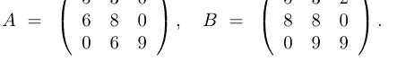

矩阵 \(A\) 是严格对角占优的但不可约，而矩阵 \(B\) 是对角占优且不可约的。根据 *推论 25.1*，如果

以下易于验证的结果为 \(n \times n\) 矩阵 \(A\) 是单调矩阵提供了充分条件。

# 定理 25.7. 设（除了不可约性之外）\(n \times n\) 矩阵 \(A = (a_{ij})\) 满足以下条件：

- (i) \( a_{ij} \leq 0, \ i \neq j, \ 1 \leq i,j \leq n \)
- (ii) \( \sum_{j=1}^n a_{ij} \geq 0, \ 1 \leq i \leq n \) 且至少对一个 \(i\) 成立严格不等式。

那么，矩阵 \(A\) 是单调的。

# 例 25.9. 根据推论 25.1，当 \(x \geq 2\) 时，矩阵 \(A_n(x)\) 满足定理 25.7 的所有条件。考虑矩阵

\( A = \begin{pmatrix} 5 & -3 & -2 \\ -8 & 8 & 0 \\ 0 & -9 & 10 \end{pmatrix}, \quad B = \begin{pmatrix} -5 & 3 & 3 \\ 8 & -8 & 0 \\ 0 & 9 & -9 \end{pmatrix}, \quad C = \begin{pmatrix} 5 & -3 & 0 \\ -6 & 4 & 0 \\ 0 & -6 & 9 \end{pmatrix} \)

及其逆矩阵

\( A^{-1} = \begin{pmatrix} 5 & 3 & 1 \\ 5 & \frac{25}{8} & 1 \\ \frac{9}{2} & \frac{45}{16} & 1 \end{pmatrix}, \quad B^{-1} = \begin{pmatrix} 1 & \frac{3}{4} & \frac{1}{4} \\ 1 & \frac{5}{8} & \frac{1}{8} \\ 1 & \frac{5}{8} & \frac{3}{8} \end{pmatrix}, \quad C^{-1} = \begin{pmatrix} 2 & \frac{3}{2} & 0 \\ 3 & \frac{5}{2} & 0 \\ 2 & \frac{5}{3} & \frac{1}{9} \end{pmatrix} \)

根据定理 25.6，三个矩阵 \(A, B,\) 和 \(C\) 都是单调的，但只有 \(A\) 满足定理 25.7 的所有条件。

# 注释 25.1. 从例 25.9 的矩阵中，我们注意到 \(A + B\) 是奇异矩阵，因此定理 25.5 意味着两个单调矩阵的和不一定是单调的。根据定理 25.6，矩阵 \(A^{-1}\) 不是单调的，因此单调矩阵的逆不一定是单调的。然而，从 \((AB)^{-1} = B^{-1}A^{-1}\) 可以清楚地看出，如果 \(A\) 和 \(B\) 是单调的，那么 \(AB\) 和 \(BA\) 也都是单调的。

# 定理 25.8. 设 \(n \times n\) 矩阵 \(A\) 和 \(C\) 是单调的，且矩阵 \(B\) 满足 \(A \leq B \leq C\)。那么，矩阵 \(B\) 也是单调的。

# 例 25.10. 显然，以下矩阵

\( A = \begin{pmatrix} 1 & -1 & -1 \\ -2 & 3 & 1 \\ -1 & 1 & 2 \end{pmatrix}, \quad B = \begin{pmatrix} 1 & -1 & -1 \\ -2 & 4 & 1 \\ -1 & 1 & 3 \end{pmatrix}, \quad C = \begin{pmatrix} 1 & -1 & -1 \\ -1 & 5 & 1 \\ -1 & 1 & 5 \end{pmatrix} \)

满足 \( A \leq B \leq C \)，并且因为

\( A^{-1} = \begin{pmatrix} 5 & 1 & 2 \\ 3 & 1 & 1 \\ 1 & 0 & 1 \end{pmatrix} \quad \text{和} \quad C^{-1} = \begin{pmatrix} \frac{3}{2} & \frac{1}{4} & \frac{1}{4} \\ \frac{1}{4} & \frac{1}{4} & 0 \\ \frac{1}{4} & 0 & \frac{1}{4} \end{pmatrix} \)

矩阵 $A$ 和 $C$ 为单调矩阵。因此，[定理 25.8](#) 适用，且矩阵 $B$ 必为单调矩阵，事实上我们有

$$B^{-1}=\begin{pmatrix}\frac{11}{4}&\frac{1}{2}&\frac{3}{4}\\\frac{5}{4}&\frac{1}{2}&\frac{1}{4}\\\frac{1}{2}&0&\frac{1}{2}\end{pmatrix}.$$

## 定理 25.9.

设 $n\times n$ 矩阵 $A$ 写作 $A=I-B$，其中 $B=(b_{ij})\geq 0$ 且（在任意范数下）$\|B\|<1$。则矩阵 $A$ 为单调矩阵。

## 例 25.11.

考虑以下矩阵及其逆矩阵

$$A=\begin{pmatrix}1&-\frac{1}{2}&-\frac{1}{4}\\-\frac{1}{4}&\frac{1}{2}&-\frac{1}{6}\\-\frac{1}{6}&-\frac{1}{3}&1\end{pmatrix},\qquad A^{-1}=\begin{pmatrix}\frac{32}{19}&\frac{42}{19}&\frac{15}{19}\\\frac{20}{19}&\frac{19}{19}&\frac{33}{38}\\\frac{12}{19}&\frac{30}{19}&\frac{27}{19}\end{pmatrix}.$$

由 [定理 26.6](#) 可知矩阵 $A$ 为单调矩阵。因为

$$A=I-B=\begin{pmatrix}1&0&0\\0&1&0\\0&0&1\end{pmatrix}-\begin{pmatrix}0&\frac{1}{2}&\frac{1}{4}\\\frac{1}{4}&\frac{1}{2}&\frac{1}{6}\\\frac{1}{6}&\frac{1}{3}&0\end{pmatrix},$$

矩阵 $B$ 满足 [定理 25.9](#) 的所有条件，因此矩阵 $A$ 为单调矩阵。

## 定理 25.10.

设 $n\times n$ 矩阵 $A$ 为对称、正定矩阵，并写作 $A=I-B$，其中 $B=(b_{ij})\geq 0$。则矩阵 $A$ 为单调矩阵。

## 例 25.12.

对于矩阵

$$A=\begin{pmatrix}1&-\frac{1}{3}&0&0\\-\frac{1}{3}&1&-\frac{1}{3}&0\\0&-\frac{1}{3}&1&-\frac{1}{3}\\0&0&-\frac{1}{3}&1\end{pmatrix}$$

其特征值为

$$\frac{5}{6}-\frac{1}{6}\sqrt{5},\quad \frac{1}{6}\sqrt{5}+\frac{5}{6},\quad \frac{7}{6}-\frac{1}{6}\sqrt{5},\quad \frac{1}{6}\sqrt{5}+\frac{7}{6}$$

为正，因此它是正定矩阵。我们可以写 $A=I-B$，其中

$$B=\begin{pmatrix}0&\frac{1}{3}&0&0\\\frac{1}{3}&0&\frac{1}{3}&0\\0&\frac{1}{3}&0&\frac{1}{3}\\0&0&\frac{1}{3}&0\end{pmatrix}.$$

且

\[
u^i=\left(\sin\frac{i\pi}{n+1},\sin\frac{2i\pi}{n+1},\cdots,\sin\frac{ni\pi}{n+1}\right)^t,\qquad 1\le i\le n,
\]

也有

\[
\det(B)=\prod_{i=1}^{n}\left[b_0+2b_1\cos\left(\frac{i\pi}{n+1}\right)\right].
\]

## 例 25.14.

对于 (25.3) 中的矩阵 $B$，当 $n=4$ 时，有

\[
\lambda_1=b_0+\frac{1+\sqrt5}{2}b_1,\quad
\lambda_2=b_0+\frac{1-\sqrt5}{2}b_1,\quad
\lambda_3=b_0-\frac{1-\sqrt5}{2}b_1,\quad
\lambda_4=b_0-\frac{1+\sqrt5}{2}b_1,
\]

\[
u^1=\begin{pmatrix}1\\\frac{1+\sqrt5}{2}\\\frac{1+\sqrt5}{2}\\1\end{pmatrix},\quad
u^2=\begin{pmatrix}1\\\frac{1-\sqrt5}{2}\\\frac{1-\sqrt5}{2}\\1\end{pmatrix},\quad
u^3=\begin{pmatrix}-1\\\frac{1-\sqrt5}{2}\\\frac{-1+\sqrt5}{2}\\1\end{pmatrix},\quad
u^4=\begin{pmatrix}-1\\-\frac{1+\sqrt5}{2}\\-\frac{1+\sqrt5}{2}\\1\end{pmatrix}.
\]

\[
\det(B)=(b_1^2-b_0^2-b_0b_1)(b_0b_1-b_0^2+b_1^2).
\]

在 Toeplitz 矩阵 $A$ 中，若取 $a_i=a_{-(n-i)}$，$1=1,\cdots,n-1$，则其退化为循环矩阵（参见 [问题 16.8](#)）。

\[
A=\operatorname{circ}(a_0,a_1,\cdots,a_{-(n-1)})
\]

\[
=\begin{pmatrix}
a_0&a_{-1}&a_{-2}&\cdots&\cdots&a_{-(n-1)}\\
a_{-(n-1)}&a_0&a_{-1}&\cdots&\cdots&a_{-(n-2)}\\
a_{-(n-2)}&a_{-(n-1)}&a_0&\cdots&\cdots&a_{-(n-3)}\\
\vdots&\vdots&\vdots&\ddots&\vdots&\vdots\\
a_{-2}&\cdots&\cdots&a_{-(n-1)}&a_0&a_{-1}\\
a_{-1}&\cdots&\cdots&a_{-(n-2)}&a_{-(n-1)}&a_0
\end{pmatrix}. \tag{25.4}
\]

## 例 25.15.

当 $n=4$ 时，矩阵 $A$ 在 (25.4) 中的特征值为

\[
\lambda_1=a_0-a_{-1}+a_{-2}-a_{-3},\qquad
\lambda_2=a_0+a_{-1}+a_{-2}+a_{-3},
\]
\[
\lambda_3=a_0-a_{-2}-i(a_{-3}-a_{-1}),\qquad
\lambda_4=a_0-a_{-2}+i(a_{-3}-a_{-1}).
\]

## 定理 25.11.

对于任意两个给定的循环矩阵 $A$ 和 $B$，和 $A+B$ 为循环矩阵，积 $AB$ 为循环矩阵，且 $AB=BA$。

## 例 25.16.

对于矩阵 $A=\operatorname{circ}(2,1,5)$，$B=\operatorname{circ}(4,3,-1)$，有 $A+B=\operatorname{circ}(6,4,4)$ 且 $AB=BA=\operatorname{circ}(22,5,21)$。

## 问题

**25.1.** 利用定理 25.1 证明以下矩阵为可约矩阵：
\(A = \begin{pmatrix} 2 & 3 & 5 & 2 \\ 0 & 5 & 3 & 0 \\ 0 & 3 & 2 & 0 \\ 0 & 4 & 1 & 0 \end{pmatrix}, \quad B = \begin{pmatrix} 0 & 1 & 3 & 2 \\ 0 & 5 & 0 & 7 \\ 2 & 0 & 0 & 1 \\ 0 & 3 & 0 & 2 \end{pmatrix}.\)

**25.2.** 证明定理 25.2。

**25.3.** 利用定理 25.2 判断以下矩阵是可约还是不可约：
\(A = \begin{pmatrix} 0 & 2 \\ 3 & 4 \end{pmatrix}, \quad B = \begin{pmatrix} 3 & 2 \\ 0 & 4 \end{pmatrix}, \quad C = \begin{pmatrix} 4 & 0 & 7 \\ 11 & 8 & 0 \\ 0 & 5 & 8 \end{pmatrix}.\)

**25.4.** 证明定理 25.4。

**25.5.** 利用定理 25.4 证明以下矩阵可逆：
\(A = \begin{pmatrix} 7 & 2 & 3 \\ 1 & 5 & 2 \\ 3 & 4 & 8 \end{pmatrix}, \quad B = \begin{pmatrix} 5 & 4 & 1 \\ 3 & 3 & 0 \\ 0 & 6 & 6 \end{pmatrix}.\)

**25.6.** 证明定理 25.6。

**25.7.** 证明例 25.1 中的矩阵 $C$ 和 $D$ 不是单调矩阵。

**25.8.** 设 $A=(a_{ij})$ 和 $B=(b_{ij})$ 为 $n\times n$ 单调矩阵。证明若 $A\ge B$，即 $a_{ij}\ge b_{ij}$，$1\le i,j\le n$，则 $A^{-1}\le B^{-1}$。

**25.9.** 利用定理 25.6 证明以下矩阵为单调矩阵
\(A = \begin{pmatrix} 2 & 2 & -3 \\ -3 & 2 & 2 \\ 2 & -3 & 2 \end{pmatrix}, \quad B = \begin{pmatrix} 28 & -7 & 1 \\ -42 & -28 & 70 \\ 14 & 35 & -27 \end{pmatrix}.\)

**25.10.** 证明定理 25.9。

**25.11.** 求以下矩阵的特征值和特征向量：
\(A = \begin{pmatrix} 1 & 3 & 0 & 0 \\ 3 & 1 & 3 & 0 \\ 0 & 3 & 1 & 3 \\ 0 & 0 & 3 & 1 \end{pmatrix}, \quad B = \begin{pmatrix} a_0 & 0 & a_{-2} & 0 \\ 0 & a_0 & 0 & a_{-2} \\ a_{-2} & 0 & a_0 & 0 \\ 0 & a_{-2} & 0 & a_0 \end{pmatrix}.\)

**25.12.** 证明 $\operatorname{circ}(1,-1,2,3)\operatorname{circ}(4,1,5,-3)=\operatorname{circ}(20,6,3,6)$。

# 答案或提示

**25.1.** \(\begin{pmatrix}2&3&0&0\\3&5&0&0\\1&4&0&0\\5&3&2&2\end{pmatrix}=\begin{pmatrix}0&0&1&0\\0&1&0&0\\0&0&0&1\\1&0&0&0\end{pmatrix}A\begin{pmatrix}0&0&0&1\\0&1&0&0\\1&0&0&0\\0&0&1&0\end{pmatrix}.\)

\(\begin{pmatrix}5&7&0&0\\3&2&0&0\\1&2&0&3\\0&1&2&0\end{pmatrix}=\begin{pmatrix}0&1&0&0\\0&0&0&1\\1&0&0&0\\0&0&1&0\end{pmatrix}B\begin{pmatrix}0&0&1&0\\1&0&0&0\\0&0&0&1\\0&1&0&0\end{pmatrix}.\)

**25.2.** 设 $A$ 为不可约矩阵，并假设其有向图 $G$ 不是强连通的。假设 $G$ 有 $n$ 条边。则存在顶点 $v_i$ 和 $v_j$，使得它们之间不存在任何路径。我们用 $S$ 表示与 $v_j$ 相连的边的集合，用 $T$ 表示其余边的集合。显然集合 $S$ 和 $T$ 都非空，因为 $v_j\in S$ 且 $v_i\in T$。这意味着没有边 $v\in S$ 与边 $w\in T$ 相连，因为否则 $w\in S$，这与事实不符。如果我们对图 $G$ 中的边进行重新排序，并假设前 $q$ 条边在 $S$ 中，接下来的 $n-q$ 个顶点在 $T$ 中，则对于 $r\in S$、$s\in T$ 有 $a_{rs}=0$。但这与我们假设 $A$ 为不可约矩阵矛盾。逆命题需要类似的论证。

**25.3.** $A$ 不可约，$B$ 可约，$C$ 不可约。

**25.4.** 假设 $A$ 为严格对角占优且不可逆。则 $A$ 的至少一个特征值为零，设为 $\lambda_m=0$。设与 $\lambda_m$ 对应的特征向量为 $u=(u_1,\ldots,u_n)$。由于 $Au=\lambda_m u=0$，可得 $\sum_{j=1}^n a_{ij}u_j=0$，$1\le i\le n$。设 $\|u\|_\infty=\max_{1\le i\le n}|u_i|=|u_k|$。则有 $a_{kk}u_k=-\sum_{j=1,j\ne k}^n a_{kj}u_j$，由此得 $|a_{kk}|\le\sum_{j=1,j\ne k}^n|a_{kj}||u_j/u_k|$，或 $|a_{kk}|\le\sum_{j=1,j\ne k}^n|a_{kj}|$。但这与我们假设 $A$ 为严格对角占优矩阵矛盾。

**25.5.** 矩阵 $A$ 为严格对角占优，其逆矩阵为 $\frac{1}{187}\begin{pmatrix}32&-4&-17\\-2&47&-17\\-17&-34&51\end{pmatrix}$。矩阵 $B$ 为对角占优且不可约，其逆矩阵为 $\frac{1}{12}\begin{pmatrix}6&-6&-1\\-6&10&1\\6&-10&1\end{pmatrix}$。

**25.6.** 设 $A$ 为单调矩阵且 $A^{-1}=(b^1,\ldots,b^n)$。则 $Ab^j=e^j\ge0$，$1\le j\le n$ 蕴含 $b^j\ge0$，$1\le j\le n$。因此，$A^{-1}\ge0$。反之，若 $A^{-1}\ge0$ 且 $Au\ge0$，则 $u=(A^{-1}A)u=A^{-1}(Au)\ge0$。

**25.7.** 根据 [定理 25.6](#)，只需观察

## 参考文献

- [1]. R.P. Agarwal, *差分方程与不等式：第二版，修订扩增版*, Marcel Dekker, New York, 2000.
- [2]. R.P. Agarwal and D. O’Regan, *常微分方程导论*, Springer–Verlag, New York, 2008.
- [3]. A. Albert, *回归与摩尔–彭罗广义逆*, Academic Press, New York, 1972.
- [4]. A. Ben–Israel and T.N.E. Greville, *广义逆：理论与应用*, Wiley, New York, 1974.
- [5]. G. Birkhoff and T.C. Bartee, *现代应用代数*, McGraw–Hill, New York, 1970.
- [6]. G. Birkhoff and S. Mac Lane, *现代代数概论*, Macmillan, New York, 1977.
- [7]. C.T. Chen, *线性系统理论导论*, Holt, Rinehart and Winston, Inc., New York, 1970.
- [8]. F.R. Gantmacher, *矩阵理论及其应用*, Interscience, New York, 1959.
- [9]. P.R. Halmos, *有限维向量空间*, Van Nostrand, New York, 1958.
- [10]. K. Hoffman and R. Kunze, *线性代数*, 第2版, Prentice–Hall, Englewood, N.J., 1971.
- [11]. A.S. Householder, *数值分析中的矩阵理论*, Blaisdell, New York, 1964.
- [12]. P. Lancaster, *矩阵理论*, Academic Press, New York, 1969.
- [13]. C.L. Lawson and R.J. Hanson, *最小二乘问题求解*, Prentice–Hall, Englewood, N.J., 1974.
- [14]. S.J. Leon, *线性代数及其应用*, Macmillan, New York, 1980.
- [15]. M.Z. Nashed, *广义逆及其应用*, Academic Press, New York, 1976.
- [16]. B. Noble, *应用线性代数*, 第2版, Prentice–Hall, Englewood, N.J., 1977.
- [17]. B.N. Parlett, *对称特征值问题*, Prentice–Hall, Englewood, N.J., 1980.
- [18]. G. Strang, *线性代数及其应用*, 第2版, Academic Press, New York, 1976.
- [19]. R.M. Thrall and L. Tornheim, *向量空间与矩阵*, Wiley, New York, 1957.
- [20]. R.A. Usmani, *应用线性代数*, Taylor & Francis, New York, 1986.

## 索引

- Cramer's rule 51
- cross product 121
- determinant 23
- diagonal elements of a matrix 12
- diagonal matrix 12
- diagonalizable 155, 157
- diagonally dominant matrix 215
- direct sum 79
- directed graph 214
- discrete Putzer's algorithm 177
- distance function 152
- dominant eigenvalue 143
- dot product 116
- doubly stochastic matrix 20
- dual basis 127
- dual space 127
- echelon form of a matrix 46, 47
- echelon linear system 46
- echelon matrix 44
- eigenspace 137
- eigenvalue 135
- eigenvector 135, 142
- elementary column operations 45
- elementary matrix 45
- elementary row operations 44
- elements of a matrix 11
- error function 183
- Euclidean n–space 116
- Fibonacci matrix 39
- Fibonacci numbers 39
- field 1
- field of scalars 1
- finite dimension 76
- Fourier coefficients 119
- Fourier expansion 118
- free variables 53
- full row (column) rank 206
- fundamental matrix solution 172
- fundamental set of solutions 172
- Gauss elimination method 52
- Gauss–Jordan elimination method 56
- generalized inverse of a matrix 205
- generalized theorem of Pythagoras ........ 151
- generated subspace ........ 6
- geometric multiplicity ........ 139
- Gram–Schmidt orthogonalization process ........ 119
- Hermitian matrix ........ 19
- Hermitian transpose of a matrix ........ 19
- Hilbert space ........ 123
- homogeneous system ........ 43
- Householder matrix ........ 37
- hyperplane ........ 118
- idempotent matrix ........ 39
- identity map ........ 98
- identity matrix of order *n* ........ 12
- inconsistent system ........ 43
- indefinite matrix ........ 191
- indefinite quadratic form ........ 191
- infinite dimension ........ 77
- initial value problem ........ 171, 176
- inner product ........ 115
- inverse of a matrix ........ 31
- inversion ........ 24
- invertible linear mapping ........ 103
- invertible matrix ........ 31
- irreducible matrix ........ 213
- isomorphic spaces ........ 98
- kernel ........ 43
- kernel of a linear mapping ........ 99
- Lagrange’s identity ........ 150
- Laplace expansion ........ 24
- LDU factorization ........ 62
- leading principal submatrices ........ 198
- least squares approximate solution ........ 183
- left inverse ........ 91
- Legendre polynomials ........ 123
- length ........ 145
- line segment ........ 104
- linear combination ........ 5
- linear functional ........ 127
- linear mapping ........ 97
- linear operator ........ 97
- linear transformation ........ 97
- linearly dependent set of vectors ........ 67, 69
- linearly independent set of vectors — 67, 69
- Lipschitz function — 150
- lower triangular matrix — 13
- LU factorization — 61
- matrices conformable for multiplication — 14
- matrix — 11
- matrix of the inner product — 121
- maximal linearly independent set — 76
- Minkowski inequality — 146
- minor of (n−1)th order — 23
- minor of pth order — 23
- monotone matrix — 216
- Moore–Penrose inverse — 205
- natural mapping — 129
- negative definite matrix — 191
- negative definite quadratic form — 191
- negative semidefinite quadratic form — 191
- nilpotent matrix — 39
- nonhomogeneous linear system — 43
- nonnegative (positive) matrix — 215
- nonsingular linear mapping — 100
- nonsingular matrix — 31
- nontrivial solutions of a system — 43
- norm — 145
- normal equations — 183
- normal matrix — 19
- normed linear space — 145
- null space of a linear mapping — 99
- null space of a matrix — 43
- nullity of a linear mapping — 99
- off-diagonal elements of a matrix — 12
- ordered basis — 83
- orthogonal basis — 118
- orthogonal complement — 117
- orthogonal matrix — 36
- orthogonal projection — 120
- orthogonal subset — 117
- orthogonal vectors — 117
- orthogonally diagonalizable — 158
- orthonormal subset — 117
- orthonormalization — 117
- outer product — 121

