# C++ 编程入门指南


请勿分发


## 前言

本书介绍了使用 C++ 语言进行编程的基础知识。不要求读者具备编程的先验知识，然而本书面向的是已完成约 12 年学校教育、最好是理科方向的读者。

本书对 C++ 语言进行了相当全面的介绍，包括最新标准中的一些令人兴奋的增添内容。然而，本书的目标是教授编程，这与仅仅学习任何编程语言中的不同语句是不同的。编程就像任何技能一样，必须与学习者已有的其他知识和技能相融合。此外，编程是一种解放性的技能，可以改变你的世界观。编程使你能够对所学的数学或物理进行实验/探索。你被告知行星必须围绕太阳运动；但如果你懂得编程，你就可以编写一个程序来检验这一说法是否可能成立。一般来说，编程应该鼓励你对周围的世界建立模型并在计算机上进行实验。显然，这需要一定的经验和对世界的了解。我们认为，理科方向的 12 年学校教育确实可以提供这样的知识。无论如何，本书不仅是为了向目标读者教授编程而写，也是为了挑战和激发他们以令人兴奋的方式使用它。

本书并不强调任何特定的编程方法论。相反，我们尝试按照智力上的简单性以及编程语法的简单性顺序来呈现思想。一般的呈现风格是：“这里有一个我们希望解决但目前用已学到的编程原语无法解决的问题；因此让我们学习这个新的原语”。面向对象编程显然很重要，但我们尝试让它随着编程需求的出现而演化。我们在第 0.3 节中对此进行了更详细的讨论。

本书预期与一个名为 simplecpp 的软件包一起使用，该软件包是为本书使用而开发的。附录 A 包含安装 simplecpp 的说明以及可用于编译使用 simplecpp 的用户程序的脚本。该软件包包含 (a) 一组图形类，可用于在屏幕上绘制和操作简单的几何形状，以及 (b) 一些预处理器宏，有助于在初期平滑地引入 C++。我们认为使用 simplecpp 可以极大地帮助学习 C++。这将在下面更详细地讨论。

我们以建议如何将本书纳入课程的方式结束本前言。

## 0.1 图形

> 我听见，我忘记。我看见，我记住。我做，我理解。

传统上，入门编程使用数字或文本的领域来说明编程问题和编程策略。然而，人类体验的很大一部分涉及图像和运动。对于我们的目标读者来说尤其如此。人类进化出良好的几何和地理感，并且擅长在图像中看到模式以及规划运动。如果这种专长能在学习编程时得到发挥，它可以使与计算机的交互更加成熟。正因如此，simplecpp 才主要被开发出来。

我们的软件包 simplecpp 包含一组图形类，允许在屏幕上绘制和操作简单的几何形状。屏幕上的每个形状都可以被命令按需移动、旋转或缩放。受儿童编程语言 Logo 的启发，每个形状还配有一个画笔，可在形状移动时用于描绘曲线。图形类使得诸如绘制有趣的曲线和图案以及执行动画等计算活动成为可能，同时还能进行诸如碰撞检测等计算。这些活动既具有挑战性又很直观。

图形类从第一章就开始使用。入门章节以绘制多边形的程序开始。程序语句命令一只持笔的小乌龟¹ 描绘多边形的线条。直接的好处是，这个简单的练习使编程的命令式方面以及诸如控制流等概念变得非常明显。更重要的是，即使从这个非常基础的练习中也能认识到在被绘制的图像中识别模式的必要性。图像中的一个模式通常会转化为适当的编程模式，比如迭代或递归。识别和表达模式是编程中的基本活动。这些考虑可以很容易地被提及。

随着你阅读下去，你会看到图形对于解释许多概念非常有用，从变量作用域和参数传递到基于继承的设计。图形设施使许多传统示例（例如拟合点到直线，或模拟）变得非常生动。最后，图形很有趣，这一点不容忽视。毕竟，全球的教育工作者都担心学生注意力下降以及如何吸引学生投身学术。

## 0.2 第一天/第一个月的不适

C++，像许多专业编程语言一样，对初学者来说并不容易引入。

许多入门编程书籍以打印消息“hello world”的简单程序开始。表面上看，这是一个非常自然的开始。然而，即使是这样一个简单的程序在 C++ 中也显得复杂，因为它必须被封装在返回类型为 int 的函数 main 中。返回类型的概念显然不适合在第一天就解释。其他概念如命名空间更是令人望而生畏。唯一的可能性是告诉学生，“不要担心这些，你必须写下这些你稍后才会理解含义的咒语”。这在教学上似乎不令人满意。

学生好不容易熬过了 `int main` 和命名空间之后，通常会有一个漫长的准备期，在此期间必须学习大量基础材料，如数据类型和控制结构，直到可以编写任何有趣的程序为止。在心理上和后勤上，这个“缓慢”时期是个问题。心理上，没有太多智力挑战的准备期可能被学生视为无聊，这对该学科来说是一个糟糕的初始印象。其次，在大多数课程安排中，学生每周有讲座时间和每周编程实践时间。在最初几周，学生精力充沛、跃跃欲试。如果没有令人兴奋的事情可做，他们会感到失望，更不用说时间的浪费了。

为了解决这些问题，simplecpp 中包含了以下特性。

与其在返回 int 的函数 main 中指定主程序，不如定义一个预处理器宏 main_program（它展开为 int main()）。主程序可以写成

```
main_program{
  body
}
```

此外，一旦学生使用 #include <simplecpp> 加载 simplecpp 包，就无需加载任何其他内容，也无需给出 using 指令。simplecpp 包本身会加载其他头文件如 iostream 并发出 using 指令。这些“辅助轮”在解释函数等内容时会被拆除（第 9 章）。

第二个“语言扩展”是包含一个“repeat”语句。该语句的形式为

```
repeat(count){body}
```

它会导致 body 被执行 count 表达式值那么多次。这也是使用预处理器宏实现的，并展开为 for 语句。

我们相信 repeat 语句很容易学习，只要有一个好的上下文。事实上，它在第 1 章中就被引入了，在那里，与其使用单独的语句绘制多边形的每条边，不如在 repeat 语句内部使用单条绘图语句就足够了。事实上，基于海龟的图形绘制示例足够引人注目，学生也不会对嵌套 repeat 语句有任何困难。

在第二和第三章中，对计算机硬件、数据表示和数据类型进行了讨论。这些主题很重要，但不适合进行良好的编程练习。对于这一时期，repeat 语句与第一章中引入的概念结合使用，可以非常有效地生成相关且有趣的编程练习。

此外，simplecpp 包含一些杂项设施，一个在范围内生成随机数的函数，以及用于管理事件驱动模拟的类。所有这些代码都已提供，学生可以在准备好时查看代码。


## 0.3 面向对象编程

在现代编程实践中，占主导地位的范式显然是面向对象范式。因此，出现了一些教育方法，试图从“第一天”就引入类和对象。但即使是这些方法的倡导者也指出，出于多种原因，类和对象很难从第一天就开始教授。例如，对于非常简单的程序，将程序组织成类可能非常 artificial 且冗长。期望学生在很早阶段就能实际开发类，需要在理解控制结构之前就理解函数抽象（用于开发成员函数/方法）。这可能显得缺乏动机且令人不知所措。

我们对面向对象编程的讨论可以被认为始于第 5 章：在屏幕上创建图形形状需要创建图形类的对象。然而，在最初的章节中，只需要使用类，而不需要构建新类。因此可以创建形状，并在其上调用成员函数以移动它们等。

类被呈现为 C 语言中 `struct` 概念的演进。关于类的主要讨论，包括现代动机，发生在第 16 章，然而成员函数在第 15.5 节中引入。继承在第 23 章中介绍。第 24 章介绍基于继承的设计。它包含一个详细的示例，其中一个先前开发的程序在没有继承的情况下被重新开发，但这次使用继承。这生动地展示了继承如何帮助编写可重用、可扩展的代码。还给出了 simplecpp 图形系统的简单设计描述，以及对 *composite* 对象的扩展。

## 0.4 将本书纳入课程

本书可用于一学期课程或两学期序列。

对于一学期课程，建议的教学大纲是第 1 章至第 16 章、第 19 章、第 23 章。这些章节中的许多包含同一概念的多个示例，并非所有这些都需要“在课堂上讲授”。此外，第 20 章应至少在高层次上讨论。

两学期序列可在第一学期涵盖第 1 章至第 16 章，仔细研读并深入考虑诸如证明程序正确性等方面。第二学期可以涵盖剩余章节。在两学期课程中，引入一些现代思想，如引用计数指针（附录 B）是合适的。

# 第 1 章 引言

计算机是人类发明的最 remarkable 的机器之一。其他大多数机器都有非常狭窄的目的。手表显示时间，相机拍照，卡车将货物从一个点运到另一个点，电子显微镜显示非常小物体的放大视图。其中一些机器比计算机大得多，许多也贵得多，但计算机在可以被使用的用途种类方面要复杂得多，也有趣得多。事实上，从手表到电子显微镜的许多这些机器通常内部都包含一台计算机，执行每台机器最重要的功能。本书的目标是解释计算机如何可能被用于如此多的目的，以及更多。

从一种观点来看，计算机只是一个电气电路；一个巨大的、复杂的电气电路，但仍然是一个电路。原则上，可以在不使用电力的情况下制造计算机——事实上，曾有过基于使用机械齿轮或流体装置的计算机设计。¹ 但这大多只是历史意义上的。对于实际目的，今天，将计算机视为电气电路是可以的。该电路的某些部分能够从外部世界接收数据，记住它以便稍后重现，处理它，并将结果发送回外部世界。通过数据我们可以指不同的东西。例如，它可能意味着你从计算机键盘输入的一些数字。或者它可能意味着计算机可以从传感器接收的电信号，该传感器感知温度、压力、光强度等等。处理可能意味着像计算你从键盘输入的数字序列的平均值这样简单的事情。它也可能意味着更复杂的事情：例如，确定从光传感器接收到的信号是否表明传感器附近存在某种运动。最后，通过“将数据发送到外部世界”，我们可能指的是像将计算出的平均值打印在计算机屏幕上以便你阅读这样简单的事情。或者我们可能指的是如果检测到的运动被认为可疑，则激活连接到计算机的蜂鸣器。电路中在何时激活哪些部分是由提供给计算机的程序决定的。

正是程序将计算机与大多数其他机器区分开来；通过安装不同的程序，同一台计算机可以表现出截然不同的行为。如何开发这些程序是本书的主题。在本章中，我们将开始。

首先我们会告诉你程序为什么会做它所做的一切，这将帮助你修改程序以使其做你想要的其他事情（如果愿意的话）。

第一行 `#include <simplecpp>` 声明程序除了 C++ 编程语言提供的功能外，还使用了名为 simplecpp 的一些设施。

下一行 `main_program {`, 表示其后内容为主程序。³ 主程序本身包含在 `main_program` 文本之后的括号 `{ }` 中。

其后的行 `turtleSim()` 导致屏幕上打开一个以三角形为中心的窗口。三角形代表我们的海龟，屏幕是它可以移动的地面。最初，海龟指向东方向。海龟配备有一支笔，可以抬起或放下以触及地面。如果笔放下，则海龟移动时会在地面上绘制。最初，海龟的笔是放下的，并且准备好绘制。

下一行 `forward(100)` 导致海龟向前移动括号 `()` 中给出的量。量应以像素为单位。正如你可能知道的，你的屏幕实际上是一个由小点组成的数组，每个点可以是任何颜色。典型的屏幕大约有 1000 × 1000 个点的数组。每个点称为一个像素。因此命令 `forward(100)` 导致海龟沿其当前指向的方向向前移动约屏幕大小的十分之一。由于笔是放下的，这导致绘制了一条线。

命令 `left(90)` 导致海龟向左转 90 度。也可以指定 90 以外的其他数字。之后，下一个命令是 `forward(100)`，这导致海龟向前移动 100 像素。由于海龟这时面向北方，线条向北绘制。这完成了正方形的第二条边。下一个 `left(90)` 命令导致海龟再次转弯。随后的 `forward(100)` 绘制第三条边。然后海龟因第三个 `left(90)` 命令而再次转弯，第四个 `forward(100)` 最终绘制第四条边并完成正方形。

之后，行 `wait(5)` 导致程序什么都不做 5 秒钟。这就是你欣赏海龟作品的时间！执行此行后，程序停止。

也许你对命令 `turtleSim` 后面的 `()` 感到困惑。解释很简单。C++ 中的命令通常需要额外的信息来完成其工作，例如对于 `forward` 命令，你需要指定一个表示移动距离的数字。碰巧的是，`turtleSim` 可以在没有额外信息的情况下完成其工作。因此我们只需写 `()`。稍后你会看到可能有需要不止一个信息片段的命令，在这种情况下我们只需将这些片段放在 `()` 内并用逗号分隔。

### 1.1.1 执行程序

要执行此程序，我们必须首先将其放在计算机上的一个文件中。习惯上使用 `.cpp` 后缀来表示包含 C++ 程序的文件。假设你已将程序输入到名为 `square.cpp` 的文件中——你也可以从 CD 或书籍网页获取该文件。

接下来，我们必须编译该文件，即将其翻译成计算机更直接理解并可以执行的格式。翻译由命令 `s++` 完成，该命令在安装 simplecpp 包时已安装。命令 `s++` 只是调用


GNU C++ 编译器，必须安装在你的电脑上（参见 A 节）。在 UNIX shell 中，你可以通过输入 `g++` 后跟文件名来编译一个文件。在本例中你会输入 `g++ square.cpp`。作为结果会产生另一个文件，其中包含准备好执行的程序形式。在 UNIX 上，该文件通常称为 `a.out`。可以通过向 shell 输入其名称来执行该文件

```
% a.out
```

由于 UNIX 的某些怪癖，你可能需要输入 `./a.out`。或者你也可以通过双击其图标来执行。当程序这样执行时，你应该会看到一个窗口弹出，其中有海龟然后绘制正方形。

## 1.2 备注

C++ 程序在许多方面与用英语写的段落相似。段落由句号分隔的句子组成；C++ 程序包含必须由分号分隔的命令。请注意，虽然大多数人类能够容忍漏掉句号的写法，但计算机非常挑剔，每个命令都必须跟随一个分号。然而，计算机对空格和换行符的使用更为宽容。只要不拆分或合并单词或数字，就可以在几乎任何地方插入空格和换行符。因此，写成如下形式是完全合法的（尽管不推荐！）

```
turtleSim();forward(100) ;
left (90
);
```

如果你愿意的话。这种灵活性是为了让你能够写出易于理解的程序。事实上，我们在程序中加入了空行，以便在阅读时帮助自己。因此，实际绘制正方形的命令与打开和关闭窗口的命令被分开了。另一个重要思想是缩进，即在属于 main_program 的行前加上前导空格。这也是为了使视觉上更清楚哪些是 main_program 的一部分，哪些不是。正如你可能观察到的那样，缩进在英语的正常书写中也被使用。

### 1.2.1 执行顺序

程序与用英语等自然语言写成的文本之间还有另一个重要的相似之处。段落预期从左到右、从上到下阅读。程序也是如此。默认情况下，计算机按从左到右、从上到下的顺序执行命令。但正如杂志或报纸上会有“请从第 13 页第 4 栏继续”等指示一样，程序命令的执行顺序可以被改变。我们接下来会看到一个例子。

## 1.3 重复一组命令

到目前为止，你应该能够编写一个程序来绘制任意正多边形，比如十边形。你需要知道每一步要转多少。转动的量等于多边形的 exterior angle。但我们从欧几里得几何知道，多边形的 exterior angles 之和为 360 度。十边形有 10 个 exterior angles，因此在绘制每条边后你必须转 360/10 = 36 度。所以要绘制边长为 100 的十边形，我们重复 `forward(100)` 和 `right(36)` 命令 10 次。这可行，但你可能会厌倦多次写下相同的命令。事实上，你不需要那样做。下面是你要写的内容。

```cpp
#include <simplecpp>
main_program{
    turtleSim();
    repeat(10){
        forward(100);
        left(36);
    }
    wait(5);
}
```

该程序执行时将绘制一个十边形。其中新的语句是 `repeat`。其一般形式为

```cpp
repeat(count){
    statements
}
```

其中 `count` 可以是任意数字。`statements` 可以是任意将按给定顺序执行 `count` 次的语句序列。这些语句被称为 `repeat` 语句的主体。主体的每次执行被称为一次迭代。只有在主体执行了与 `count` 值相同次数后，我们才会执行 `repeat` 语句之后的语句。

因此，在本例中，序列 `forward(100); left(36);` 被执行 10 次，绘制十边形的全部 10 条边。只有在那之后我们才会执行到语句 `wait(5);`

### 1.3.1 绘制任意正多边形

我们下一个程序执行时，会要求用户输入多边形的边数，然后绘制所需的多边形。

```cpp
#include <simplecpp>
main_program{
    int nsides;
    cout << "Type in the number of sides: ";
    cin >> nsides;

    turtleSim();

    repeat(nsides){
        forward(50);
        left(360.0/nsides);
    }
    wait(5);
}
```

该程序有许多新思想。main program 中的第一个语句是 `int nsides;`，它做了几件事。第一个词 `int` 是 “integer” 的缩写，它要求在内存中保留一个区域，在执行期间存储整数值。其次，它也给这个区域命名：`nsides`。最后它声明从现在开始，每当程序员使用名称 `nsides` 时，都应将其视为引用该区域。通常说 `nsides` 是一个变量，其值存储在关联的内存区域中。该语句被称为定义变量 `nsides`。可以定义任意多个变量，要么通过给出单独的定义语句，要么通过用逗号分隔名称写出。例如，`int nsides, length;` 将定义两个变量，一个叫 `nsides`，另一个叫 `length`。我们将在第 3 章学习更多关于名称和变量的内容。

下一个新语句相对简单。`cout` 是一个引用计算机屏幕的名称。通常 `cout` 中的 `c` 和下一语句中的 `cin` 发音为 “see”。字符序列 `<<` 表示在屏幕上写出某物的操作。要写的内容需在 `<<` 之后指定。因此，我们程序中的语句将显示消息

Type in the number of sides:

在屏幕上。当然，你可以在程序中放入不同的消息，它将被显示。

其后的语句中，`cin >> nsides;` 中的名称 `cin` 引用键盘。它要求计算机等待用户从键盘输入内容，并且输入的内容将被放入变量 `nsides` 关联的区域。用户必须输入一个整数值然后按回车键。输入的值将被放入 `nsides`。

在 `cin >> nsides;` 语句执行后，计算机执行 `repeat` 语句。执行 `repeat` 语句无非是按指定次数执行其主体。在本例中，计算机被要求执行主体 `nsides` 次。因此如果用户响应要求输入边数的消息时输入了 15，那么变量 `nsides` 将得到值 15，循环体将被执行 15 次。循环体由两个语句 `forward(50)` 和 `left(360.0/nsides)` 组成。请注意，我们没有直接给出要转的度数，而是给出了一个表达式。这是可以的！计算机将计算表达式并使用该值。因此，在本例中计算机将 360.0 除以变量 `nsides` 的值，结果即为转角。因此，如果 `nsides` 为 15，转角将为 24。所以应该清楚，在这种情况下将绘制一个 15 边形。

### 1.3.2 重复中的重复

你认为下面的程序做什么？

```cpp
#include <simplecpp>
main_program{
    int nsides;

    turtleSim();

    repeat(10){
        cout << "Type in the number of sides: ";
        cin >> nsides;
        repeat(nsides){
            forward(50);
            left(360.0/nsides);
        }
    }
    wait(5);
}
```

该程序的关键新思想是 `repeat` 语句出现在另一个 `repeat` 语句内部。计算机如何执行它？其规则很简单：要执行一个 `repeat` 语句，它只需按指定次数执行主体。在外层 `repeat` 语句的每次迭代中都会执行一次内层 `repeat` 语句。但内层 `repeat` 的一次执行可能包含多次迭代。因此，在本例中，外层 `repeat` 的一次迭代将导致用户被要求输入边数，在用户输入数字后，内层 `repeat` 语句将绘制所需数量的边。之后，外层 `repeat` 的下一次迭代将开始，共进行 10 次迭代。因此总共将绘制 10 个多边形，一个叠在另一个之上。

### 1.4 一些有用的海龟命令

以下命令也可以使用。

- `penUp()`: 这会导致笔抬起。因此执行该命令后，海龟移动时不会画线，直到笔被放下为止。`()` 内没有内容，因为不需要指定数字，就像 `forward` 的情况，例如 `forward(10)`。
- `penDown()`: 这会导致笔放下。因此执行该命令后，只要笔未再次抬起，海龟移动时就会画线。

因此如果你写 `repeat(10){forward(10); penUp(); forward(5); penDown();}` 将会画出一条虚线。

### 1.5 数值函数

到目前为止你所看到的控制海龟的命令将使你能够绘制一些有趣的图形。然而你会注意到绘制一些简单的


figures. 例如，如果你想画一个等腰直角三角形，那么你就需要开平方——而我们还没有说如何做。假设你想画一个简单的直角三角形，其边长比例为 3:4:5。要指定角度就需要三角函数计算。我们现在提供这些命令以及你可能需要的一些常见运算。你可能会想，计算机如何计算一个角度的正弦值，或一个数的平方根？这些问题的答案稍后会给出。现在你只需使用以下命令，而不必担心计算实际是如何发生的。

让我们从平方根开始。如果你想求一个数 x 的平方根，那么对应的命令是 sqrt。你只需在程序中写 sqrt(x)，在执行期间，x 的平方根将被计算出来，并用在命令的位置。例如，这里是如何画一个等腰直角三角形的。

```
```text
forward(100);
left(90);
forward(100);
left(135);
forward(100*sqrt(2));
```
```

计算三角比的命令是 sine、cosine 和 tangent。这些每个都接受一个参数：以度为单位的角度。所以例如，写 tangent(45) 与写 1 是一样的。

反三角比的命令是 arcsine、arccosine 和 arctan。这些将接受一个数字作为参数并返回一个角度（以度为单位）。例如，arccosine(0.5) 将为 60，如预期。这些命令返回范围在 -90 到 +90 的角度。一个重要的额外命令是 arctan2。它需要两个参数，分别是 y 和 x。写 arctan2(y,x) 将返回 y/x 的反正切值，范围为 -180 到 +180。这可以通过观察 y 和 x 的符号来实现，如果只是简单地用 y/x，就丢失了这些信息。因此 arctan2(1,-1) 将为 135，而 arctan2(-1,1) 将为 -45，而 arctan(-1/1)=arctan(1/-1)=arctan(-1) 也将为 -45。

现在要画一个边长为 75、100、125 的三角形，你只需执行以下操作。

```
```text
forward(75);
left(90);
forward(100);
left(arctan2(75,-100));
forward(124);
```
```

正如你可能猜到的，我们可以将表达式放入命令的参数中，并将命令本身放入其他表达式中，等等。

还提供了一些其他有用的命令：

- 1. **exp, log, log10**：这些分别对参数 *x* 返回 *eˣ* 的值（其中 *e* 是欧拉数，自然对数的底），自然对数和以 10 为底的对数。
-   
- 2. **pow**：它接受 2 个参数，pow(x,y) 返回 *xʸ*。

- 3. **sin**、**cos**、**tan** 分别返回一个角度的正弦、余弦和正切值，但必须以弧度指定。
- 4. **asin**、**acos**、**atan2** 分别返回反正弦、反余弦和反正切值，以弧度为单位。命令 **atan2** 与上面讨论的命令 **arctangent2** 一样接受 2 个参数。

C++ 也有命令 **sin**、**cos**、**tan**，它们返回以弧度给出的角度的三角比。对于反三角比，我们有命令 **asin**、**acos**、**atan**、**atan2**，它们返回以弧度为单位的角度。
名称 **PI** 可在你的程序中使用，表示 π，即圆的周长与其直径之比。

## 1.6 注释

程序的主要功能是被执行。显然，它应该正确执行并完成预期的工作。

然而，程序应该写得易于理解，以便程序员阅读它。原因很简单。一个程序员可能会写一个程序，而另一个程序员可能需要修改它。在这种情况下，第二位程序员必须能够理解程序为何以这种方式编写。原始程序员编写额外的注释来解释程序中的棘手思想可以[content]
figures. 例如，如果你想画一个等腰直角三角形，那么你就需要开平方——而我们还没有说如何做。假设你想画一个简单的直角三角形，其边长比例为 3:4:5。要指定角度就需要三角函数计算。我们现在提供这些命令以及你可能需要的一些常见运算。你可能会想，计算机如何计算一个角度的正弦值，或一个数的平方根？这些问题的答案稍后会给出。现在你只需使用以下命令，而不必担心计算实际是如何发生的。

让我们从平方根开始。如果你想求一个数 x 的平方根，那么对应的命令是 sqrt。你只需在程序中写 sqrt(x)，在执行期间，x 的平方根将被计算出来，并用在命令的位置。例如，这里是如何画一个等腰直角三角形的。

```
```text
forward(100);
left(90);
forward(100);
left(135);
forward(100*sqrt(2));
```
```

计算三角比的命令是 sine、cosine 和 tangent。这些每个都接受一个参数：以度为单位的角度。所以例如，写 tangent(45) 与写 1 是一样的。

反三角比的命令是 arcsine、arccosine 和 arctan。这些将接受一个数字作为参数并返回一个角度（以度为单位）。例如，arccosine(0.5) 将为 60，如预期。这些命令返回范围在 -90 到 +90 的角度。一个重要的额外命令是 arctan2。它需要两个参数，分别是 y 和 x。写 arctan2(y,x) 将返回 y/x 的反正切值，范围为 -180 到 +180。这可以通过观察 y 和 x 的符号来实现，如果只是简单地用 y/x，就丢失了这些信息。因此 arctan2(1,-1) 将为 135，而 arctan2(-1,1) 将为 -45，而 arctan(-1/1)=arctan(1/-1)=arctan(-1) 也将为 -45。

现在要画一个边长为 75、100、125 的三角形，你只需执行以下操作。

```
```text
forward(75);
left(90);
forward(100);
left(arctan2(75,-100));
forward(124);
```
```

正如你可能猜到的，我们可以将表达式放入命令的参数中，并将命令本身放入其他表达式中，等等。

还提供了一些其他有用的命令：

- 1. **exp, log, log10**：这些分别对参数 *x* 返回 *eˣ* 的值（其中 *e* 是欧拉数，自然对数的底），自然对数和以 10 为底的对数。
-   
- 2. **pow**：它接受 2 个参数，pow(x,y) 返回 *xʸ*。

- 3. **sin**、**cos**、**tan** 分别返回一个角度的正弦、余弦和正切值，但必须以弧度指定。
- 4. **asin**、**acos**、**atan2** 分别返回反正弦、反余弦和反正切值，以弧度为单位。命令 **atan2** 与上面讨论的命令 **arctangent2** 一样接受 2 个参数。

C++ 也有命令 **sin**、**cos**、**tan**，它们返回以弧度给出的角度的三角比。对于反三角比，我们有命令 **asin**、**acos**、**atan**、**atan2**，它们返回以弧度为单位的角度。
名称 **PI** 可在你的程序中使用，表示 π，即圆的周长与其直径之比。

## 1.7 注释

程序的主要功能是被执行。显然，它应该正确执行并完成预期的工作。

然而，程序应该写得易于理解，以便程序员阅读它。原因很简单。一个程序员可能会写一个程序，而另一个程序员可能需要修改它。在这种情况下，第二位程序员必须能够理解程序为何以这种方式编写。原始程序员编写额外的注释来解释程序中的棘手思想可以有所帮助。为此目的，C++ 允许你在程序中插入 *注释*。注释是文本，不会被执行，而是专门为可能阅读程序的人准备的。

注释可以用两种方式编写。在行的任意位置，你可以放置两个斜杠字符 //，然后 // 之后到行尾的文本就成为注释。或者，/* 字符之后的所有内容都成为注释，这个注释可以跨越多行，直到出现 */ 字符为止。

通常在开头放置注释，提及程序的作者并说明程序的作用。随后，在程序中进行任何不明显的操作时，礼貌的做法是用注释进行解释。

下面是我们应该写成的多边形绘制程序。

```
#include <simplecpp>
/* Program to draw a regular polygon with as many sides as the user wants.
    Author: Abhiram Ranade
    Date:  18 Feb 2013.
*/
main_program{
    int nsides;
    cout << "Type in the number of sides: ";
    cin >> nsides;

    turtleSim();
```

```
repeat(nsides){
    forward(50);      // Each side will have length 50 pixels.
    left(360.0/nsides); // Because sum(exterior angles of a polygon) = 360.
}
wait(5);
}
```

## 1.7 无图形的计算

虽然我们以绘图程序开始了介绍，但你编写的每个程序都不必包含任何绘图。这里有一个程序不绘制任何东西，只是从键盘读取一个数字，并打印出它的立方。

```
main_program{
int n;
cout <<"Type the number you want cubed: ";
cin >> n;
cout << n*n*n << endl;
}
```

计算 n³ 与你之前看到的类似。事实上，一般规则是，你想要执行的任何数学运算都可以通过像平时一样写出来来表达。我们在第 3.2 节中讨论确切的规则。

## 1.8 结论性 备注

虽然可能看起来不像，但在本章中你已经学到了很多。

首先，你对计算机程序是什么以及如何执行有了一定的了解：从顶部开始，一次一条语句向底部移动。如果有 repeat 语句，程序会多次执行循环体；程序被认为在需要迭代的次数内遍历循环体。

你已经学习了变量的概念，即可以存储一个值并在以后进行计算时使用的内存区域。

你还学习了几个命令，可以用来绘图、做计算（例如开平方根）。稍后我们将看到如何自己构建新命令。

最后，一个非常重要的一点是观察你在做的事情中的模式。当我们画一个多边形时，我们重复相同的动作多次。这是一个模式，我们可以在程序中通过使用 repeat 语句来镜像它。通过使用 repeat 语句，我们可以使程序紧凑；事实上，我们可能正在画一个有 100 条边的多边形，但我们的程序只有几条语句。你以后会看到在程序中捕捉模式的其他方法。一般来说，这是一个非常重要的思想。

此时你也应该明白为什么用来写程序的记法被称为语言。口语非常灵活和通用。它有语法结构，例如有主语、动词和宾语；或者可以有从句，从句本身可以包含主语、动词、宾语和其他从句。只要结构得到尊重，你就可以有许多、许多、事实上无限多的句子。同样，计算机程序也有结构，例如 repeat 语句必须后跟计数和主体；在主体内部可以有其他语句，包括 repeat 语句。事实上，我们对 C++ 编程语言的处理方式与你学习马拉地语或法语的方式有些相似。就像阅读有趣的文学作品会让语言学习更有趣一样，我们将在尝试解决越来越有趣的计算问题时介绍 C++ 语言。希望你会觉得这很有趣。

### 1.8.1 图形

计算机从事的主要活动当然是使用数字进行计算。然而，我们以绘图开始介绍是有很多原因的，而且绘图将是一个贯穿全书的重要平行主题。

程序不仅仅是一系列你想要完成的计算；正如你将看到的，理解计算中的模式并在程序中表示它们是很重要的。这两个活动：理解模式并在程序中表示它们，在绘图时也是需要的。一般来说，这两个活动都相当困难。但在图片的情况下，模式通常非常明显。因此，你可以将注意力集中在将它们表示在程序中的任务上。我们以后会看到很多例子。

还要注意，绘制有趣的图片需要大量的仔细计算，使用你之前学过的几何和三角学。⁴ 因此，绘图将提供另一个可以练习计算技能的领域。

⁴如果有些内容你忘了，不要担心；需要时我们会刷新你的记忆。


也请记住这句谚语：“一图胜千言。” 的确，如果你能通过一幅图展示计算的结果，那将非常有用。此外，在许多应用中，如果你能通过绘制图片或在屏幕上点击来向程序提供输入，而不是通过输入数字，这也是很有用的。总的来说，尤其是对于手机和平板电脑上的计算，*数据可视化* 和 *图形用户界面* 领域变得非常重要，而我们的绘图练习将让你领略到这些领域。

最后，画图很有趣。

## 1.8.2 关于练习的说明

编程不是一种旁观的运动。要真正理解编程，你必须自己编写许多、许多程序。只有这样你才会发现自己是否真正理解了书中所说的内容。为此，我们在每一章末尾提供了许多练习，你应该勤奋地解决它们。

另一个重要的建议：在阅读时，你可能会多次问自己，“如果我们用另一种方式编写这个程序会怎样”。作者不会在场来回答你的问题，但有一个简单的方法可以找出答案——用不同的方式编写并在你的电脑上运行！这是最好的学习方法。

## 1.9 练习

在所有与绘图相关的题目中，你需要识别出所要求内容中的模式/重复，并使用 **repeat** 语句编写尽可能简洁的程序。你还应避免海龟的过度移动和对已绘制内容的重复描绘。

- 1. 修改书中给出的程序，使其在询问边数之外，还询问要绘制的多边形的边长。
- 2. 绘制一连串 10 个正方形，一个挨着一个地向左排列。
- 3. 画一个棋盘，即边长约为 80 的正方形，分为 64 个边长为 10 的小正方形。
- 4. 如果你画一个边数很多的多边形，比如 100 边，那么它看起来基本上就像一个圆。事实上，圆就是这样绘制的：作为多边形。用这个想法画出数字 8——两个圆在上方和下方相切放置。
- 5. 五角星是一个五角星形，不抬笔绘制。具体来说，设 A、B、C、D、E 为圆上 5 个等距点，那么这个图形就是 A–C–E–B–D–A。画出它。
- 6. 以同样的精神画一个七角星。注意，这里有不止一种可能的星形。一种简单的方法来确定转角：海龟在绘制时自身转了多少圈？
7. 我们在程序中写了“360.0”而不是仅仅“360”。这有其原因，我们稍后会讨论。但你可以试着自己弄明白。重写程序只使用“360”看看会发生什么。更直接的方法是输入语句 cout << 360/11; cout << 360.0/11; 并看看屏幕上打印了什么。这是一个重要的思想：如果好奇“如果我写...而不是...会发生什么？”——你应该直接试试看！

8. 输入三角形的各边长度并绘制三角形。你需要知道并使用三角学来解决这个问题。

9. 当你手持一副牌时，你通常会把它们扇形展开。假设你从一叠牌开始，牌一叠在另一张上面。然后你将从上往下数第 i 张牌绕左下角旋转一个与 i 成比例的角度（比如向左 10i 度）。现在，我们可以看到最上面的那张牌完全，但其他牌只能部分看到。特别是，每张牌只能看到一个三角形部分，其左上角是每个三角形的顶点。你要画的就是这个图形。(a) 假设牌是透明的来画它。(b) 假设牌是不透明的来画它。对于后者需要一些三角计算。在两种情况下，都使用 repeat 语句使你的程序尽可能简短。

10. 画一个由 7 个相等半径的圆组成的图案：一个在中心，6 个围绕它，每个外圆都与中心圆和另外两个圆相切。尽量写一个使海龟移动最少的程序。你的程序语句应选择以利用图案中的对称性。

11. 画出图 1.1 所示的图片。如你所见，图片由 36 个基本图案的重复组成。你的程序应能够接受一个数字 n 作为输入，并绘制具有 n 次重复的图片。确保图案中的线条和弧线平滑连接。

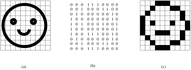

图 2.1：一个图片、其表示、以及重建

使用数字表示？我们接下来讨论这些问题。

下面是如何使用数字表示图片的一种方法。首先考虑黑白图片。我们首先通过在图片上放置一个细网格将其划分为小方块，如图 2.1(a) 所示。然后对于每个小方块，我们确定它是更白还是更黑。如果方块更白，我们将其赋值为数字 0，如果更黑，我们将其赋值为数字 1。所以如果我们将图片划分为 m × n 个小方块（像素），高度为 m，宽度为 n，我们就得到一个由 mn 个数字组成的序列，每个数字都是 1 或 0，用来表示该图片。图 2.1 显示了我们分配给每个方块的数字。给定 mn 个数字的表示，我们可以按如下方式重建图片：每当出现 0 时，我们将对应方块保持白色，每当出现 1 时，我们将对应方块涂黑。利用图 2.1(b) 中的数字进行重建，结果如图 2.1(c) 所示。如你所见，重建的图片与原始图片并不完全相同，但相当相似。通过选择更细的网格，我们本可以得到原始图片的更好近似。事实证明，约 0.1 毫米大小的像素就足够了，即重建的图片与原始图片难以区分，因为我们的眼睛无法单独看到如此细小的方块。处理图片意味着对这些数字进行计算。例如，将每个零改为一，反之亦然，就会使图片从“正片”变为“负片”！当我们希望在计算机显示器上显示图片时也会使用类似的想法，这将在第 2.7.2 节中讨论。

应该指出，将网格放置在感兴趣的对象上这一思想非常强大。假设我们想表示全球天气。所以我们将地球表面划分为小区域。对于每个区域，我们考虑当前状态，即与天气相关的参数，如环境温度、气压、湿度。当然，区域内的所有点温度都不会完全相同，但如果区域足够小，我们仍然可以选择一个近似的代表温度。同样适用于气压或湿度。所有区域的状态信息集合就是当前全球天气的一种表示。给定一个区域的当前状态和物理定律，我们只能通过查看附近区域的状态来计算下一个状态。这是对天气预测的一种非常粗略的简化，但其本质是正确的。¹

> ¹ 这并不意味着与天气相关的所有物理现象都已被很好地理解。事实上，许多简单的事情尚不被理解，例如雨滴是如何精确形成的。然而，我们通过几位科学家的艰苦工作了解了足够多的内容，可以做出一定的预测。当然，这一切都超出了本书的范围。

文本使用数字表示如下。本质上，我们设计一个合适的编码。最常见的编码是所谓的 ASCII（美国信息交换标准代码）。在其中，字母“a”表示为数字 97，“b”表示为 98，以此类推。标准符号和 *空格* 字符也都有各自的代码。因此单词“computer”由数字序列 99,111,109,112,117,116,101,114 表示。一旦我们能用数字表达文本，我们就有了表达句子、段落以及所有语言的基础！段落也表示为一个序列，可能是一个非常长的序列。判断一个给定单词是否出现在给定段落中，仅仅是检查一个数字序列是否另一个数字序列的子序列！注意，ASCII 代码用于表示使用罗马字母书写的所有文本，包括你将要编写的 C++ 程序。*Unicode 联盟* 提供了用于表示其他字母表（如天城文）文本的代码。

在本书的剩余部分，我们将看到更多现实生活中的对象（以及数学对象，如集合、函数）以及如何表示它们。

## 2.1.1 算法和程序

问题用数字表示后，下一步就是求解。为此，我们需要决定执行哪些操作以及执行顺序。这样的操作序列，描述得精确，被称为 *算法*。

确定算法时，假装你在纸上用笔计算是可以的。算法可以有“将这两个数相乘，然后将结果加到另外这两个数的比值上”之类的步骤等等。你也可以有“如果这个数是零则执行此操作”之类的步骤。或者也有“一直做这个直到...”之类的步骤。关键要求是算法在任何一点上都应没有歧义。一旦你确定了算法，即精确的动作序列，你就可以考虑用 C++ 表达它。这将给出程序。当然，为了完成最后一步，你需要知道 C++。这将在本书的剩余部分学习。

我们应该指出，虽然 *算法* 这个词对你来说可能是新的，但你实际上从小学开始就学习了许多算法。例如，你知道如何判断一个给定的正整数 n 是否为质数。可能你会这样做：从整数 2 开始，尝试所有整数直到 n − 1 并检查它们是否整除 n（没有余数）。如果你找到一个整除 n 的整数，则判定 n 为合数。如果你找不到这样的整数，则判定 n 为质数。这确实是一个判断数 n 是否为质数的算法！我们很快就会看到（第 6.7.2 节）它如何被转换为 C++ 程序。你甚至更早地学习了算法。例如，你学会了如何把数字加起来，或减去、乘以或除以它们。这些程序也是算法！你可能通过例子或通过图示（如图 2.2 所示）学习了这些程序，其中首先要求你为给定的除数（本例中为 23）制作乘法表，然后在右边实际执行除法。甚至这些基本算法也很有价值。事实上，当你想对非常大的数字进行算术运算时，它们会派上用场，就像第 13 章练习 21 中那样。

当然，这一切都超出了本书的范围。


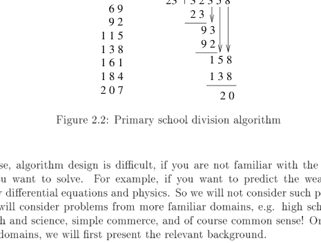

### 图 2.2：小学除法算法

当然，算法设计是困难的，如果你对想要解决的问题的领域不熟悉的话。例如，如果你想预测天气，你最好了解微分方程和物理学。因此，我们在本书中不会考虑此类问题。我们将考虑来自更熟悉领域的的问题，例如高中和大专数学和科学、简单的商业，当然还有常识！或者如果我们考虑不熟悉的领域，我们会先介绍相关的背景。

## 2.2 数字电路的基本原理

这里有一个关键事实：计算机中的电路是这样设计的，对于实际目的，我们可以假装数字在电路的导线中流动，或存储在电路的器件中。这种电路称为数字电路。我们在本章中只讨论数字电路。在数字电路中，在任何瞬间，我们可以认为每根导线都携带一个数字，或者更精确地说，是数字 0 或数字 1。同样，还有能够执行存储功能的器件，最常见的是电容器，每个这样的单个器件在任何时候也可以存储数字 0 或数字 1。

我们简要解释这种幻觉是如何产生的。但如果你愿意，可以忽略这一段，它对于理解本书的其余部分不是必需的。如你可能知道，电流在电气电路的导线中流动（就像水在管道中流动一样），并且导线与电压相关联（电的等价物是水压）。在电路中表示数字的想法很简单：如果一根导线处于某个指定的高电压（比如高于 1 伏），那么我们就说数字 1 在其上传输。如果导线处于某个指定的低电压（比如小于 0.2 伏），那么我们就说导线携带数字 0。进一步注意，电路是这样设计的，使得导线永远不会携带 0.2 伏到 1 伏范围内的电压，因此永远不会有歧义。因此我们可以假装电路中的导线在传递数字。进一步注意，如果你在电容器上存储电荷，电荷不会很快消散；从这个意义上说，电容器记住该电荷。为了让电容器记住 0，我们只需将其上的电荷排空。这会发生如果我们将电容器连接到我们指定的低电压。如果另一方面，我们将电容器连接到高电压，大量电荷

会储存在其上；这代表数字 1。对于本书的其余部分，我们将不担心电荷和电压。相反，我们只会谈论电容器和导线保存和携带数字 0 或 1。

当然，我们希望存储或通信除 0 和 1 之外的数字。我们将在第 2.3 节中看到如何做到这一点。一旦我们有了数字的表示，就有可能设计出可以对其进行算术运算的电路。这在第 2.6 节中讨论。

## 2.3 数字表示格式

术语位用于表示数字 0 或 1，因此我们将说计算机中的每根导线可以携带单个位，或每个电容器可以存储单个位。如果我们想表示其他数字，我们可以通过将它们与一系列位关联来做到这一点。作为一个例子，假设我们决定将位序列 11001 与数字 25 关联。那么每当我们想存储 25 时，我们就需要使用 5 个电容器，并在其中存储该序列的相应位，即 1、1、0、0、1。同样，如果我们想将数字 25 从一个设备发送到另一个设备，我们必须使用 5 根导线，并在其上分别发送 1、1、0、0、1。那么问题是，我们应该为每个数字关联什么位序列？

最简单的想法如下：我们使用其二进制表示给出的位序列来表示数字。例如，假设我们想表示数字 25。它的二进制表示为 11001。因此它将被位序列 11001 表示，如上所述。如果我们只想表示非负整数，这个想法是可以的。它被广泛使用，如我们在第 2.3.1 节中讨论的那样。

但我们的程序可能处理可以是正数也可以是负数的整数，例如四舍五入到最接近度的温度。因此我们需要一个更复杂的方案来表示此类数字。这在第 2.3.2 节中讨论。

更一般地，我们可能必须表示质量、力和速度等量，它们通常是实数，可能为正也可能为负。表示实数的方案在第 2.3.3 节中讨论。

还有一个问题需要考虑。在上面的例子中，我们说数字 25 可以用 5 位序列表示。在大多数计算机上，标准表示方案要求你选择序列的长度为 8、16、32 或 64 位。这是因为将位序列的大小限制为这些值使得设计计算机中的电路变得容易。请注意，习惯上使用术语字节、半字、字和双字分别表示 8、16、32 和 64 位。

### 2.3.1 无符号整数表示

假设我们知道程序中处理的某个量将始终是非负整数，例如电话号码。在这种情况下，如上所述，我们可以使用其二进制表示给出的位序列来表示它。如上所述，表示的长度必须选择为 8、16、32、64 之一。因此如果我们要表示的数字的二进制表示比我们选择的长度短，那么我们只需将更显著的位设为 0，例如如果我们想用 32 位表示 25，表示将是位串

000000000000000000000000011001

请注意，如果我们决定使用 n 位长的二进制表示，可以表示的最大值是 2^n − 1（n 个 1 的序列）。因此我们必须确保我们要表示的数字不大。作为一个例子，由于我们知道电话号码（在印度）最多为 8 位长，并且由于最大可能的 8 位数字 99999999 < 2^32 − 1，我们可以使用 n = 32 来表示电话号码。

### 2.3.2 有符号整数

整数可以是负数或正数。所以这带来了一个挑战：我们如何表示负数？

最简单的表示是所谓的符号-幅度表示。在这种表示中，如果我们有 n 位用于表示数字，其中之一被指定为符号位。我们将此位设为 0 如果数字为正，设为 1 如果数字为负。剩余的 n − 1 位将用于表示数字的绝对值。我们可能会使用最高有效位位置的位作为符号位，因此使用 32 个电容器表示 -25 的位串为：

1000000000000000000000000011001

请注意，由于我们决定使用 n−1 位来表示幅度，幅度最多可以为 2^{n−1} − 1（所有 n − 1 位都必须为 1）。由于数字可以为正也可以为负，使用总共 n 位我们可以表示从 −2^{n−1} + 1 到 2^{n−1} − 1 的数字，两者都包含。

更常用的表示是所谓的 2 的补码表示。n 位 2 的补码表示定义如下。在此，整数 x 由数字 x 的 n 位二进制表示表示，如果 0 ≤ x ≤ 2^{n−1} − 1，并且由数字 2^n − x 的 n 位二进制表示表示，如果 −2^{n−1} ≤ x < 0。范围之外的数字无法表示。

下面是如何在 32 位 2 的补码表示中表示 -25。由于 -25 为负，我们必须用二进制数 2^32 − 25 = 4294967296 − 25 = 4294967271 来表示它。然后我们取其二进制表示，即：

1111111111111111111111111100111

因此，如果你想存储 -25 或在某些导线上发送它，上述位模式必须被存储或发送。

### 2.3.3 浮点表示

需要用实数进行大量计算。例如，粒子的速度、电压、温度等通常不需要只取整数值。实数

2 这仅意味着没有标准、内置的机制来表示范围之外的数字。然而，你将能够自行设计机制，如果你愿意的话，如第 13 章练习 21 中要求的那样。

3 你可能发现先将 2^32 和 25 转换为二进制，然后再相减很方便。


现代计算机硬件和 C++ 中实数表示的确切格式是 IEEE 浮点标准。它更为复杂，但具有更多功能，其中一些我们将在后面讨论。

## 2.4 计算机的组织结构

我们可以将计算机视为由以下主要部分组成。实际的计算机将包含更多部件，但在这一高层次概述中，并非所有部件都与我们相关。

- 1. 主存储器。在此我们存储正在进行计算的数字。如我们稍后将看到的，存储器还将保存程序。
- 2. 算术单元。它能够执行算术运算。我们向其提供操作数，告诉它我们想要执行的操作，它就会执行。我们可以提取结果并将其存储回内存中。
- 3. 输入输出设备。可以有很多，但我们考虑键盘、显示器，通常称为监视器或屏幕，以及磁盘。
- 4. 控制单元。正如名称所示，它控制其他单元。
- 5. 网络。这对于在各部分之间移动数据很有用。

通常使用中央处理单元这一术语来表示控制单元与算术单元的组合。

你可以将每个部分视为一个内部有电路的盒子。每个部分都有端口（导线组），数据可以从该部分出来或进入该部分。可以将数据从一个部分取出并通过网络发送到另一个部分。数据流的确切方式由控制单元决定。这种组织结构在图 2.3 中进行了概述。控制单元与每个其他单元都有连接，我们在图中没有显示它们以避免杂乱。

## 2.5 主存储器

现代计算机的存储器可能包含大量基本存储元件，例如 2^35。这些通常是前面讨论过的电容器。每个基本存储元件能够存储 1 位。可以存储的位数定义为存储器的容量或大小。更常见的是，存储器大小以字节为单位进行测量，其中字节只是 8 位。因此，具有 2^35 个电容器的存储器大小为 2^35 位或 2^32 字节，即 4 千兆字节。

### 2.5.1 地址

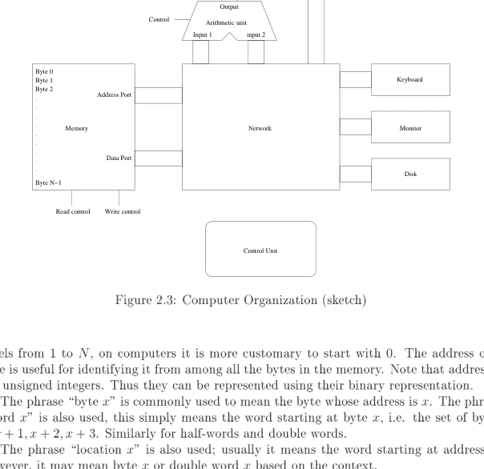

### 图 2.3：计算机组织结构（草图）

从 1 到 N 的标签，在计算机中更通常从 0 开始。字节的地址对于从存储器中的所有字节中识别它很有用。请注意，地址是无符号整数。因此它们可以使用二进制表示来表示。

短语“字节 x”通常用于表示地址为 x 的字节。短语“字 x”也使用，这只是意味着从字节 x 开始的字，即字节 x、x + 1、x + 2、x + 3 的集合。半字和双字也是如此。

短语“位置 x”也使用；通常它意味着从地址 x 开始的字。然而，根据上下文，它可能意味着字节 x 或双字 x。

### 2.5.2 端口和操作

存储器使用 2 组导线或端口与外部世界通信。第一个是地址端口，第二个是数据端口。还有两根连接到存储器的额外导线：我们将第一个称为读控制端口，第二个称为写控制端口。使用这些我们可以访问存储器的内容如下。以下我们使用短语“放置一个量”来表示“放置该量的表示”。

- 1. 将数据存储到字节 x：为此，有必要将地址 x 放在地址端口上，并将你想要存储的数据，例如数字 y，放在数据端口上。然后你在写控制端口上放置数字 1。这会指示存储器将数据端口上的数据存储到地址端口上存在的地址的字节中。

因此数字 y 将存储在字节 x 中。字节 x 将继续保存数字 y，直到对字节 x 执行另一次写操作为止。

- 2. 从字节 x 读取数据：为此，你将地址 x 放在地址端口上。然后你在读控制端口上放置一个 1。读控制端口上的 1 会指示存储器感知存储器中字节 x 存储的数据并将其放在数据端口上。一旦数据出现在数据端口上，它就可以从那里移动到需要的地方。

我们上面描述的是一个字节定向存储器。更常见的是字定向存储器。在这些存储器中，当我们提供一个地址时，从给定地址开始的字会被发送回或写入。在字节定向存储器中，数据端口将由 8 根导线组成，因为需要通信 8 位。在字定向存储器中，数据端口同样必须有 32 根导线。半字和双字定向存储器也是如此。

地址端口需要多少根导线？让我们以我们的 2^32 字节存储器为例。在该存储器中，地址范围从 0 到 2^32 − 1。因此最大的地址由 32 个连续的 1 组成。因此地址端口必须有 32 根导线，以便我们可以指定任何可能的地址。一般来说，如果存储器有 N 个字节，那么我们需要在地址端口上使用 log2 N 根导线。

## 2.6 算术单元

算术单元具有电路，可以使用它执行基本算术运算，即加法、减法、乘法、除法，适用于前面描述的所有格式的数字，无符号和有符号整数，以及浮点数。它通过名为 Input1 和 Input2 的两个端口接收操作数，操作的结果放在名为 Output 的端口上，见图 2.3。执行什么操作取决于在 Control 端口上提供的值。算术单元还可以将数字从一种表示转换为另一种表示，例如，给定一个作为整数表示的数字，其在浮点格式（指数和尾数）中的表示可以产生在输出端口上。

你可能会认为算术单元必须由许多非常复杂的电路组成。那确实是真的。然而，对于编程目的，我们不需要知道电路是如何设计的，知道它们能做什么就足够了。

## 2.7 输入输出设备

输入输出设备被视为外设，而计算机的其余部分为“主计算机”。

### 2.7.1 键盘

最简单的输入设备是键盘。键盘上的每个键都分配有一个代码号。当按下某个键时，对应的代码号会被发送到主

然而，基本思想应该被注意：（a）主计算机与外设设备之间的通信是通过发送数字进行的，（2）信息以位的形式存储，通过指定某种物理属性来确定存储 0 还是 1（3）如果存储多个位，将会有*地址*的概念，我们可以使用它来引用某些选定的位或位组。

## 2.8 控制单元

正如名称所示，控制单元控制计算机的其他部分。控制单元包含复杂的电路。但可以在高层次上理解其功能。

当你想解决一个问题时，你希望计算机执行某个操作序列，这取决于你为该问题决定的算法。以一个简单的例子来说，假设你想计算一个数的立方。那么你希望该数字从键盘读取并放入内存中的某个位置，例如地址 100 处的字。之后你希望算术单元将该位置的数字乘以自身两次，然后将结果放在另一个位置，例如位置 104。最后，你希望将位置 104 处的数字显示在屏幕上。如果你想解决其他问题，则必须执行不同的操作序列。

控制单元可以让计算机的其他部分执行你可能想要的任何操作，包括上面提到的操作。然而，你必须以某种方式告诉控制单元你想要什么。你如何做到这一点？

以下是答案的大纲：你将想要执行的动作序列存储在计算机的内存中，然后要求控制单元按你存储的顺序执行这些动作。需要解释许多细节：（a）我们如何在内存中存储动作序列，（b）我们能否设计电路，使控制单元能够“理解”内存中存储的内容并执行所需的操作。答案（b）是肯定的，控制单元确实包含所需的电路，但这些电路的任何解释都不在本教材的范围之内。

对（a）部分的高层次回答如下。它遵循计算机上的基本思想，即一切都用数字表示，包括你希望计算机执行的操作！计算机设计者为你提供了一种称为*机器语言*的数字编码系统，你可以使用它来告诉控制单元你想要什么。例如，计算机设计者可能会决定（a）形式为 53、*x*（对于任何 *x*）的数字序列意味着控制单元应执行从键盘读取实数并将其放入内存位置 *x* 所需的操作，（b）形式为 57、*x, y, z* 的序列意味着控制单元应执行将位置 *x、y* 中的实数相乘并将结果存储在位置 *z* 所需的操作，（c）形式为 63、*x* 的序列意味着控制单元应执行将位置 *x* 中的实数显示在屏幕上所需的操作，以及（d）仅由数字 99 组成的序列意味着控制单元应关闭计算机。每个这样的数字序列称为机器指令，而机器指令的序列称为机器语言程序。因此，数字序列 53、100、57、100、100、104、57、100、104、104、63、104、99 将代表一个机器语言程序，由以下指令组成：


+   - 53, 100。 这将从键盘读取一个实数。
+   - 57, 100, 100, 104。 这会将内存位置 100 中的数与自身相乘并把结果放入位置 104。 这样该数的平方将被置于位置 104。 注意执行此指令后，我们将在位置 100 和 104 分别得到原始数及其平方。
+   - 57, 100, 104, 104。 这会将内存位置 100 和 104 中的数相乘并把结果放入位置 104。 这样该数与其平方相乘，结果即立方，将被置于位置 104。
+   - 63,104。 这会将立方打印到屏幕上。
+   - 99。 程序将停止。

将提供机制以便你能将这组指令存储在内存中，例如从位置 0 开始，然后要求控制单元从位置 0 开始执行程序。

我们编造了指令的格式来创建上面给出的示例程序。 没有真正的计算机具有给定的指令。 进一步注意，我们选择模式 57, x, y, z 来表示乘法指令并无特殊理由。 设计者本可以选用 57 以外的其他数字。 关键在于设计者必须创建一组指令，而你想要的计算必须使用这些指令来表达。 需要非常多不同的指令，才能表达计算机能执行的所有不同基本功能。 这里举一个例子。 假设你希望在位置 x、y 中有整数，并希望将其乘积置于位置 z，那么指令 57, x, y, z 就不会起作用，因为它会将位置 x、y 中的位模式解释为实数（第 2.3.3 节），计算乘积并将所得实数存储在位置 z。 因此设计者必须提供另一种类型的指令，例如 58, x, y, z 用于整数相乘，以及例如 59, x, y, z 用于无符号整数相乘。

再举一个例子。 我们上面规定控制单元执行我们程序中的第一条指令，然后是下一条，然后是下一条，依此类推。 但如果我们想多次执行某些指令，比如因为有一个重复语句呢？ 为了方便做到这一点，设计者通常会提供一个方便的机器指令。 因此我们的设计者可能规定某个其他序列，例如 73, x 意味着控制单元应从位置 x 开始执行指令。 那么考虑程序 53, 100, 57, 100, 100, 104, 57, 100, 104, 104, 63, 104, 73, 0, 99。 假设程序从位置 0 开始存储。 现在执行 73, 0 之后，控制不会像通常那样执行内存中的下一条指令 99。 而是 73,0 要求它从位置 0 开始执行下一条指令。 因此，它会使指令 53, 100 再次被执行，依此类推。 于是会读取另一个数，并显示其立方。 并且这会再次、再次发生，无穷无尽。 更常见的是，你希望一组指令重复有限次数，机器语言也会为此目的包含指令。 我们省略其细节。

## 2.8.1 控制流

假设控制单元当前正在执行从内存地址 *x* 取出的指令。 那么通常说 *控制*（单元）位于该指令，或位于地址 *x*。 控制单元从中取出指令并执行的内存位置序列被称为构成 *控制流的路径*。 或者，我们可以说 *控制* 流经该指令序列或内存位置。 注意类似的短语也用于 C++ 程序的上下文中：我们会说控制位于程序的某个给定语句处，等等。

## 2.9 高级编程语言

最早的计算机建成时，只能通过编写机器语言程序来使用。 确实，你必须决定在内存的何处存储数据，查阅计算机手册并确定执行你想要的操作的指令，然后写出构成机器语言程序的数字序列。 然后机器语言程序必须被载入计算机内存，然后你才能执行程序。 如你所猜，这整个过程非常费力且容易出错。

幸运的是，今天，程序可以用第 1 章中看到的风格编写，也将在本书其余部分讨论。 我们不必考虑使用什么指令，也不用考虑在内存的哪个地址存储我们希望绘制的多边形的边数。 相反，我们使用熟悉的数学表达式来表示我们希望执行的操作。 我们给内存区域命名，并通过引用这些名称来在其中存储数据。 计算机当然实际上只“理解”指令代码和内存地址，而不理解数学符号或我们给内存各部分起的名字。 那么我们漂亮的程序是如何在计算机上实际执行的呢？

显然，我们编写的漂亮程序必须首先被翻译成计算机能够理解的机器语言指令。 这是由一个名为 *编译器* 的程序完成的，幸运的是它已经由别人编写好了！ 你在上一章中使用的程序 *g++* 就是一个 C++ 编译器，它接收一个 C++ 程序（例如第 1.7 节中的程序）并生成文件（例如 a.out），该文件包含我们像第 2.8 节中讨论的那样的机器语言程序。 当你从命令行输入

```
`a.out`
```

或点击程序图标时，文件 a.out 的内容会被载入内存，然后载入的内容开始被执行。

## 2.10 结论性 备注

本章提出的第一个重要观点是，为了解决任何问题，你首先需要将其表达为关于数字的问题。 在某些情况下这很容易，而在其他一些情况下，我们不得不设计某种编码方案。 我们还定义了算法的概念，并给出了在小学学习到的算法示例。

第二个重要观点是，数字可以用适当设计的电路来处理。 我们可以将数字视为占用空间的物理商品，它们在存储时和移动时都会占用空间。 你甚至可以（比喻地说！）认为数字具有质量，因为在计算机中移动它们需要能量！ 我们随后在高层次上看到了计算机各部分的功能。 我们还看到了如何使用程序控制这些电路，并且这些程序是指令序列，每条指令也用数字表示！ 最后，我们讨论了地址的概念以及机器语言与 C++ 之间的对应关系。

我们最后指出，本章中对计算机硬件的描述非常简单，而实际硬件要复杂得多。

## 2.11 练习

下面的所有练习都只是纸笔练习。

- 1. 你将如何表示国际象棋游戏中的一个位置？ 或者你可以对你熟悉的任何棋盘游戏回答这个问题。

- 2. 确保你能够在十进制和二进制之间转换数字。 你可能不熟悉转换分数。 为此只需注意，二进制点后第 i 位的 1，其位值为 2⁻ⁱ。 因此二进制中的 0.1 只是二分之一，0.01 只是四分之一。 所以现在你应该能够通过将小数部分与二分之一比较来决定小数点后的第一位是否应为 1。 剩余的位可以通过扩展这一思想来决定。 你在本书中不需要转换分数，然而，能够熟练地转换整数将很有用。 所以请用不同的例子练习。

- 3. 在 n = 3 位的符号幅度表示法中表示了多少个不同的数字？ 制作一个表格，显示哪个位模式表示哪个数字。

- 4. 在 n 位二进制补码表示法中表示了多少个不同的数字？ 制作一个表格，显示哪个位模式表示哪个数字。

- 5. 假设你想在 1024 × 1024 显示器的中心绘制一个“+”符号。 假设显示器会在你将 1 存储在对应内存位置时显示该像素为白色。 假设“+”高 100 像素、宽 100 像素，且厚 2 像素。 你会在哪些屏幕内存位置存储 1？


# 第3章 数字

在本章中，我们将看到用于处理数字的C++语句。所谓“处理数字”，是指诸如从键盘读取数字、将其存储在内存中、对它们执行算术或其他操作以及将其写到屏幕上等操作。我们在第1章中已经看到了一些示例。在本章中，我们将在此基础上进一步，更正式、更一般地阐述所有内容。

如第2章所述，文本数据在计算机上也是以数字形式表示的：每个字符由其数值ASCII码表示。文本处理实际上是数字处理的一个小变体。逻辑数据也是以数字形式表示的。我们简要讨论这些主题；它们分别在14.1节和6.7节中详细讨论。

使用repeat语句以及我们在本章中学到的内容，我们将能够编写一些有趣的程序。我们将在结尾看到其中一些。

### 3.1 变量与数据类型

为保存单条数据（目前是单个数字）而分配的内存区域称为*变量*。C++允许你创建变量，即分配内存，并为其命名。该名称将用于在程序其余部分中引用该变量。可以通过在程序中编写以下内容来创建变量。

```
data-type variable-name;
```

其中，data-type必须是选自表3.1第一列的数据类型，variable-name是按照3.1.1节所述选择的名称。术语data-type用于表示预期存储在变量中的值类型（第2列），以及分配的内存大小（第3列）。

你已经看到了一些示例，例如在1.3.1节中我们编写了：

```
int nsides;
```

我们当时说这将创建一个能够存储整数的变量。现在从表3.1中你还可以知道，通常该变量将使用4字节内存，并存储正数和负数。如2.3.2节所讨论的，这类数字通常以二进制补码表示，如果是这样，则可以存储范围在-2147483648到2147483647之间的数字。

| 数据类型 | 可能的值（参考） | 分配字节数（参考） | 用途 |
|---|---|---|---|
| `signed char` | −128 到 127 | 1 | 字符或小整数。 |
| `unsigned char` | 0 到 255 | 1 | 字符或小整数。 |
| `short int` | −32768 到 32767 | 2 | 中等大小整数。 |
| `unsigned short int` | 0 到 65535 | 2 | 中等大小整数。 |
| `int` | −2147483648 到 2147483647 | 4 | 标准大小整数。 |
| `unsigned int` | 0 到 4294967295 | 4 | 标准大小整数。 |
| `long int` | −2147483648 到 2147483647 | 4 | 存储较长整数。 |
| `unsigned long int` | 0 到 4294967295 | 4 | 存储较长整数。 |
| `long long int` | −9223372036854775808 到 9223372036854775807 | 8 | 存储更长整数。 |
| `unsigned long long int` | 0 到 18446744073709551615 | 8 | 存储更长整数。 |
| `bool` | `false`（0）或 `true`（1） | 1 | 逻辑值。 |
| `float` | 正数或负数。约7位精度。数量级范围1.17549 × 10⁻³⁸ 到 3.4028 × 10³⁸ | 4 | 实数。 |
| `double` | 正数或负数。约15位精度。数量级范围2.22507 × 10⁻³⁰⁸ 到 1.7977 × 10³⁰⁸ | 8 | 高精度和宽范围实数。 |
| `long double` | 正数或负数。约18位精度。数量级范围3.3621 × 10⁻⁴⁹³² 到 1.18973 × 10⁴⁹³² | 12 | 高精度和超宽范围实数。 |

表3.1：C++的基本数据类型

C++提供了signed char、short int、long int和long long int类型，用于存储（正或负）整数。这些相应类型的变量将使用表3.1中给出的内存量，并且能够存储相应较大或较小范围内的值。在所有这些情况下，很可能都使用2.3.2节的二进制补码表示。

如果你知道某个变量中只会存储非负整数，则可以选择unsigned类型之一。例如，你可以编写：

```
unsigned int telephoneNumber;
```

这将创建一个名为telephoneNumber的变量，使用4字节，并且值将按照2.3.1节所讨论的二进制表示存储。unsigned char、unsigned short、unsigned long和unsigned long long类型也用于存储非负整数。它们将分别使用不同数量的内存，并允许相应较小或较大的范围。

以下将创建一个名为temperature的变量，用于存储实数。

```
double temperature;
```

创建的变量长度为8字节。它通常使用2.3.3节所讨论的IEEE浮点标准。类型名double是“双精度”的简称，而float类型使用4字节，被认为是“单精度”。

表3.1中的前11种类型被称为整型类型，后3种为浮点类型。

应注意，每种数据类型所示的大小仅供参考。C++语言标准仅要求char、short、int、long、long long的大小按非递减顺序排列。同样，float、double、long double的大小也预期为非递减的。确切大小可能因编译器而异，但可以按照3.1.6节所讨论的方法确定。

char类型最常用于存储文本，我们稍后将看到。在这种使用中，习惯上省略signed或unsigned限定符，直接编写：

```
char firstLetterOfName;
```

这将创建一个1字节变量，类型为unsigned char或signed char。编译器将选择其中一种类型。注意，如果你使用char存储文本，具体选择无关紧要，因为ASCII码只使用0到127的范围，无论signed还是unsigned版本都存在该范围。如果你使用char类型存储整数（恰好在一个小范围内），那么最好指定是要signed还是unsigned类型。

bool类型主要用于存储逻辑值，将在6.7节中看到。

短语“变量的值”用于指代存储在变量中的值。因此，存储的电话号码（在存储之后，我们将说明如何存储）将是变量telephoneNumber的值。

最后注意，如果几个变量具有相同类型，你可以在一条语句中定义多个变量，通过编写：

```
data-type variable-name1, variable-name2, ... variable-namek;
```

### 3.1.1 标识符

C++中名称的术语是标识符。标识符可用于命名变量，也可用于命名其他实体，我们稍后将看到。

标识符可以由字母、数字和下划线“_”组成。标识符不能以数字开头，因此你不能使用像3rdcousin这样的标识符。使用下划线开头的标识符来命名普通变量也被认为不是好习惯。最后，有些单词是C++为自身使用保留的，不能用作变量名。例如，int是保留字；不允许将其用作变量名，因为这会造成混淆。完整保留字列表见附录D。

习惯上，变量命名应指示变量的预期用途。例如，如果我们想在变量中存储速度，那么应该给变量命名为velocity。

一个重要的点是，名称中大小写是重要的；因此mathmarks被认为与MathMarks是不同的名称。注意后者更易读。这种形成名称的方式，即几个单词连接在一起，并且每个单词的首字母大写，被称为使用驼峰式命名法，或CamelCase。正如你可能猜到的，大写字母类似骆驼背上的驼峰。有两种驼峰式命名法：UpperCamelCase（所有单词首字母大写）和lowerCamelCase（除第一个单词外其余单词首字母大写）。对于普通变量，更习惯使用lowerCamelCase；因此建议你使用mathMarks而不是MathMarks。

如果变量在程序中很重要，你应该给它一个描述性名称，以表达其用途。通常最好使用完整的单词，不要缩写。因此，如果你有一个包含温度的变量，最好给它命名为temperature而不是t或temp或tmprtre。有时你想关联到变量名的描述很长，或者有读者应该注意的澄清。在这种情况下，最好在定义后立即添加注释解释你想要什么，例如：

```
double temperature;    // in degrees centigrade.
```

### 3.1.2 字面量与变量初始化

可以在定义时可选地包含初始值。所以我们可以写：

```
int p=10239, q;
```

该语句定义了两个变量，其中第一个p被初始化为10239。没有为q指定初始值，这意味着其中将存在某个未知值。上面代码中出现的数字“10239”被称为整数常量（integer literal），即按其给出的字面意思解释。任何带或不带符号的整数都构成整数常量。单词false和true是字面量，代表值0和1。因此对于bool变量，建议你使用这些来写初始化，例如：

```
bool penIsDown = true;
```


与其写成 `bool penIsDown = 1;`——虽然含义相同，但表意不够明确。为了方便处理字符数据，任何用一对单引号括起来的字符都是一个整数常量，表示该字符的 ASCII 值。因此你可以这样写：

```
char letter_a = 'a';
```

这会将字母 `'a'` 的编码 97 存储到变量 `letter_a` 中。你当然也可以写成 `char letter_a = 97;`，但写成 `'a'` 更好，因为它更容易理解。一般来说，我们可以把一个字符写在单引号之间，这表示该字符的 ASCII 值。像换行符（按下“回车”键时产生）或制表符这类字符，可以用特殊记号分别表示为 `'\n'` 和 `'\t'`。注意，`'\n'` 和 `'a'` 这样的字面量实际上表示的是一个整数值。所以我们实际上可以写：

```
int q = 'a';
```

这会把 97 存储到 int 变量 `q` 中。

要初始化浮点变量，我们需要有表示实数常量的方式。我们可以把实数常量写成十进制小数形式，也可以使用类似“科学计数法”的形式。只需在尾数和指数之间写一个大写或小写的 E，不留空格即可。因此，阿伏伽德罗常数¹，6.022 × 10²³，可以写成 `6.022E23`。当然，如果需要，尾数和指数都可以加上负号。例如，电子的质量 9.10938188 × 10⁻³¹ kg 可以写成 `9.10938188E-31`。于是我们可以这样写：

```
float w, y=1.5, avogadro = 6.022E23, eMass = 9.10938188E-31;
```

这条语句定义了 4 个变量，其中第二个、第三个和第四个分别初始化为 1.5、6.022 × 10²³ 和 9.10938188 × 10⁻³¹。变量 `w` 没有被初始化。

> ¹一摩尔任何物质所含的分子数，例如 12 克碳中所含的碳原子数。

## 3.1.3 const 关键字

有时我们希望定义一些标识符，其值不希望改变。例如，程序中可能需要用到阿伏伽德罗常数，用名字 `Avogadro` 来引用它，可能比每次都输入数值更方便。在 C++ 中，可以在类型前使用关键字 `const` 来表示这种命名常量。因此你可以写：

```
const float Avogadro = 6.022E23;
```

一旦某个名字被声明为 `const`，你就不能再修改它。如果你试图修改，编译器会发出警告。

## 3.1.4 将数据读入变量

要把一个值读入变量 `pqr`，我们写：

```
cin >> pqr;
```

简单来说：当这条语句执行时，计算机会等待我们输入一个与 `pqr` 类型一致的值，然后该值会被放入 `pqr` 中。

这条语句的精确执行过程有点复杂。首先，该语句会忽略你在输入与 `pqr` 类型一致的值之前可能输入的任何*空白*字符。“空白”一词统指若干字符，包括空格字符（‘ ’）、制表符（`'\t'`）和换行符（`'\n'`）。此外，垂直制表符（`'\v'`）、换页符（`'\f'`）和回车符（`'\r'`）也被视为空白。这三个字符现在只有历史意义了。

你输入的第一个非空白字符被当作你希望赋给 `pqr` 的值的开始。如果合适，你可以输入多个非空白字符作为该值。输入完所需的值后，你必须输入一个空白字符（通常是换行符）来表示你已经输入完了想要的值。让我们看一个例子。假设 `pqr` 的类型是 `int`，那么如果你执行上面的语句，并输入：

```
123 56
```

你输入的起始空格会被忽略，值 123 会被存储到 `pqr` 中。这是因为 123 后面的空格起到分隔符的作用。如果有后续的读取语句，56 将用于下一次读取。还要注意，只有在你输入完值后按下换行键，你输入的值才会被程序接收。因此，对于上面的语句，要把 123 放入 `pqr`，你必须在 123 之后或 56 之后立即输入一个换行符。

如果 `pqr` 是任何浮点类型，那么期望输入的是该类型的字面量。因此我们可以输入 `6.022e23` 或 `1.5`。如果 `pqr` 是 `bool` 类型，你只能输入 0 或 1。

### 读入 char 变量

执行以下代码时发生的情况，你可能预料不到：

```
char xyz;
cin >> xyz;
```

在这种情况下，你输入的前导空白字符（如果有）会被忽略，如上所述。任何非空白字符都被视为适合 `char` 类型的值，因此第一个这样的值就会被接受。你输入的第一个非空白字符的 ASCII 值会被放入 `xyz` 中。注意，如果你输入的是 1，那么 `xyz` 将变成 49，这是因为字符 `'1'` 的 ASCII 值是 49。如果你输入字母 `a`，那么 `xyz` 会得到值 97。

### 读取多个值

如果你想同时读取多个变量的值，可以用一条语句来表示：

```
cin >> pqr >> xyz;
```

这等价于写 `cin >> pqr; cin >> xyz;`。

## 3.1.5 打印

如果要打印类型为 `bool`、`short`、`int` 或 `long` 的变量 `rst`，写：

```
cout << rst << endl;
```

它的值就会被打印出来。如果值为负，会打印一个负号。最后的 `endl` 会使输出换行。

如果打印浮点类型变量，C++ 会以它认为最合适的形式打印：十进制小数形式或科学计数法形式。

### 打印 char 变量

考虑以下代码：

```
char xyz=97;
cout << xyz << endl;
```

这会打印 ASCII 值存储在 `xyz` 中的那个字符。因此在这个例子中，会打印字母 `a`。之后会打印一个换行符，因为语句末尾有 `endl`。

### 打印多个值

如果你愿意，可以把上面的两条语句合并成一条：

```
cout << rst << endl << xyz << endl;
```

## 3.1.6 精确的表示参数

表 3.1 列出了不同数据类型的典型大小。你可以在程序中使用 `sizeof` 命令来查看编译器实际使用的字节数：

```
cout << sizeof(int) << endl;
```

或者按需使用 `sizeof(double)` 等等。你也可以写 `sizeof(变量名)` 来获得变量 `变量名` 所占用的字节数。

你还可以确定不同类型中可表示的最大或最小（绝对值）数值。例如，对于 `float`，表达式 `numeric_limits<float>::max()` 给出可表示的最大浮点数。请不要担心这个表达式的复杂语法。通过用其他类型替换 `float`，或用 `min` 替换 `max`，你可以获得所有类型的最小值/最大值。要使用这一功能，你需要在文件顶部（其他 `#include` 语句之前或之后）加上下面这一行：

```
#include <limits>
```

我们稍后会看到这一行的确切作用。

## 3.2 算术与赋值

我们可以很直观地对存储在变量中的值进行算术运算，几乎就像写代数表达式一样。计算算术表达式所得的值可以通过赋值语句存储到变量中。

表达式的概念与代数中的类似。如果你有一个代数表达式 x·y + p·q，它的值是通过考虑变量 x、y、p、q 的值，并按照通常的优先级规则执行运算得到的。类似地，你可以写出包含 C++ 变量的表达式，表达式的值也通过类似方式获得：考虑各变量的值并对它们执行运算，遵循相同的运算符优先级规则。一个区别是，在代数中乘法运算符通常是隐式的，即 xy 表示 x 乘以 y。在 C++ 表达式中，我们需要显式写出乘法运算符，即 `*`。所有算术运算符 `+`、`-`、`*`、`/` 都是允许的。乘法和除法的优先级相同，高于加法和减法（加法和减法优先级相同）。还允许一些其他运算符，稍后将讨论。在同一优先级的运算中，左边的先执行，例如 `5-3+9` 的结果是 11。我们可以使用括号来强制执行想要的顺序，例如写 `5-(3+9)` 表示希望这个表达式求值为 -7。如果我们有 C++ 变量 x、y、p、q，那么对应于上述代数表达式的表达式必须写成 `x*y+p*q`。请注意，当你在表达式中使用一个变量时，你有责任确保该变量之前已经被赋值。

表达式会导致执行一系列算术操作并计算出一个值。但是，如果不对此值做些什么，它就会丢失。一种可能做法是将计算出的值存储到某个变量中，这可以通过赋值语句完成。赋值语句的一般形式是：

```
variable = expression;
```

其中 variable 是变量的名字，expression 是如前所述的表达式。下面是一个例子：

```
int x=2,y=3,p=4,q=5,r;
r = x*y + p*q;
```

这会使 `r` 获得指定表达式的值。根据其他变量的给定值，该表达式就是 `2*3+4*5`，即 26。因此 `r` 将得到值 26。

我们还可以通过写来打印表达式的值：

```
cout << x*y+p*q << endl;
```

注意，当你在表达式中使用一个变量时，必须已经给它赋过值，例如在定义时初始化，或从键盘读入一个值给它，或通过之前的赋值语句。如果没有这样做，变量将


仍然包含一些值，只是你不知道其值是多少。如果一个未知值用于计算，结果通常是不可预测的。

请注意，运算符 = 在 C++ 中的用法与数学中有所不同。在数学中，语句 r = x*y + p*q; 断言左边和右边相等。在 C++ 中 however，它是命令计算右边表达式并将结果值放入左边命名的变量中。赋值后，如果我们把左边的 r 视为一个平凡表达式，那么 = 运算符两侧表达式的值确实相等。

请注意，我们不能写 x*y + p*q = r; 因为我们要求左边是一个变量，以便将右边表达式的值存储进去。

上面描述的规则使得写如下语句变得非常自然：

```
p = p + 1;
```

这在数学中毫无意义；在 C++ 中 however 它只是说：计算右边表达式并将结果值放入左边命名的变量中。假设 p 如前面代码片段中所述，其值为 4。因此在这种情况下值 4+1=5 将被放入 p。请注意像 p + 1 = p; 这样的语句是非法的——左边 p + 1 并不是一个变量。

## 3.2.1 整数除法和取模运算符 %

在 C++ 中，当一个整数值除以另一个整数值时，结果被定义为也不大于商的最大整数。因此如果你写

```
int m=100, n=7, p, q;
 p = m/n;
 q = 35/200;
```

变量 p 和 q 将分别得到值 14 和 0。换句话说，我们只得到商的整数部分。

如果你想得到一个整数除以另一个整数时的余数，你可以使用 % 运算符。因此表达式 m % n 计算出 m 除以 n 的余数，其中 m,n 必须具有整型。运算符 % 与 *, / 具有相同的优先级。

这里有一个代码片段读取以秒为单位给出的持续时间并打印出等效的小时、分钟和秒持续时间。

```
cout <<"Give the duration in seconds: ";
int duration; cin >> duration;
int hours, minutes, seconds;
hours = duration/3600;
minutes = (duration - hours*3600)/60;
seconds = duration % 60;
cout <<"Hours: "<< hours <<", Minutes: "
<< minutes <<", Seconds: "<< seconds << endl;
```

如果你运行此代码，并在询问时输入 5000，你将得到如下预期输出：

```
Hours: 1, Minutes: 23, Seconds: 20
```

## 3.2.2 细微之处

赋值语句有些棘手。第一个点涉及浮点表示。float 和 double 都是不精确的表示，其中有效数字仅正确到固定位数。因此如果算术运算影响的是较不显著的位，则运算将没有效果。例如，考虑以下代码。

```
float w, y=1.5, avogadro=6.022E23 ;
w = avogadro + y;
```

w 的值是多少？假设我们精确计算和 avogadro + y。求和将是

60220000000000000000001.5

我们将遇到问题当我们尝试将其存储到 float 类型变量中时。这是因为 float 类型变量只能存储 24 位的有效数字，或约 7 位数字。因此为了存储，我们会把最显著的 7 位数字之后的所有内容视为 0。如果这样我们将得到

602200000000000000000000

这种数字的丢失称为舍入误差。舍入后，这现在可以放入 float，因为它可以精确写成 6.022E23。加法的净效应：什么都没有！变量 w 得到值 avogadro 尽管你将它赋值为 avogadro + 1.5。此示例显示了将一个非常小的浮点值加到一个非常大的浮点值时的固有问题。

当我们执行操作数具有不同类型或甚至只是将一种类型的数字存储到另一种类型的变量中的算术运算时，会出现一些细微之处。C++ 允许此类操作，可以说执行得相当合理。然而，了解到底发生了什么是有价值的。

当你将一个值从 double（53 位精度）存储到 float（24 位精度）时可能会丢失精度。溢出也是可能的，如后面所述。

当我们在相同类型的操作数上执行算术运算时，结果也计算为相同类型。如果你的程序要求对不同类型的操作数执行算术运算，则 C++ 会先将操作数转换使其具有相同类型。这些规则相当自然。C++ 总是将表达能力较弱的类型转换为表达能力更强的类型，其中无符号整型被认为比有符号整型表达能力弱，而有符号整型又被认为比浮点类型表达能力弱。如果两种类型大小不同，则较小的将被转换为较大。举例来说，假设我们有一个算术表达式 var1 op var2，其中 var1 是 int 而 var2 是 float。那么 var1 将被转换为 float，结果也将是 float。如果 var1、var2 是 long、int，则 var2 将被转换为 long。如果操作数类型为 float、long long，则两者都将被转换为 double，等等。表达式求值后，它可能本身构成更大表达式的操作数，或可能必须存储到变量中。在这两种情况下，都可能需要进一步的类型转换。

文字也与其关联的类型相关。像 35 这样的整数文字被认为是 int 类型，而像 100.0 这样的浮点文字默认被认为是 double 类型。你可以通过附加后缀 L、F、U 来指定特定类型的文字，它们分别代表 long、float、unsigned。因此如果你写 100LU，它将被解释为类型为 long unsigned 的文字，其值为 100。

需要注意的是除法。

```
int x=100, w;
float y,z;
y = 360/x;
z = 360.0/x;
w = 360.0/x;
```

根据所述规则，360/x 将被计算为整数值，因为两个操作数都是整数。因此精确商 3.6 将被截断为 3。此值将被存储（在转换为浮点格式后）到 y 中。在下一个语句中，360.0/x 第一个操作数是 double，因此结果将作为 double 计算，即 3.6。此值将存储在 z 中。在最后一条语句中，表达式的值确实为 3.6，然而因为 w 是 int 类型，必须进行类型转换，结果存储在 w 中的值只是 3。

最后请注意，如果被除数和除数都是整型，并且除数为 0，则在执行期间发生此类操作时将报告错误，程序将停止并显示消息。对于浮点类型会发生不同的情况，如第 3.2.4 节所述。

## 3.2.3 溢出和算术错误

对于每个数值数据类型，我们提到了可以表示的某个最大可能值和最小可能值。在执行计算时，结果可能超出此允许范围。在这种情况下，到底会发生什么对于不同类型是不同处理的。

```
```cpp
int x,y,z;
x = y = z = 1;
```
```

这将最终为所有变量分配 1。这有如下系统性解释。任何赋值，例如 `z = 1`，在 C++ 中也是一个表达式。不仅进行了赋值，而且表达式代表被赋的值。此外，`=` 的 *结合性* 是从右到左，即给定表达式 `x = y = z = 1`，最右边的赋值运算符首先被求值。这与迄今为止看到的其他运算符不同，例如算术运算符，其求值顺序是从左到右。因此，我们的语句 `x = y = z = 1;` 真正应读作

```
```cpp
x = (y = (z = 1));
```
```

现在最内层括号中的表达式 `z = 1` 需要首先求值。这不仅将值 1 放入 z，而且本身求值为 1。现在语句有效地变为

```
```cpp
x = (y = 1);
```
```

执行继续将 y 设置为 1，然后将 x 设置为 1。

## 3.3 示例

我们考虑使用数据类型和赋值语句的简单示例。这些不包括第 6.7 节中考虑的 `bool` 类型。这里有一个程序读取摄氏温度并打印出等效的华氏温度。

```
```cpp
main_program{
  double centigrade, fahrenheit;

  cout << "Give temperature in Centigrade: ";
  cin >> centigrade;

  fahrenheit = 32.0 + centigrade * 9.0/5.0;
  cout << "Temperature in Fahrenheit: " << fahrenheit << endl;
}
```
```

请注意运算符 `+` 最后执行，因为它比 `*` 和 `/` 的优先级低。运算符 `*` 在 `/` 之前执行，因为它出现在左边。请注意我们本可以写 9 而不是 9.0。这是因为在乘以 centigrade 时，它无论如何都会被转换为 double 值，因为 centigrade 是 double。同样我们本可以写 5 和 32 而不是 5.0 和 32.0。但我们写的内容更可取，因为它非常清楚地表明我们正在进行浮点算术。在下一个程序中，你需要输入任何小写字母，它会打印出同一字母的大写形式。


```text
main_program{
    char small, capital;

    cout << "Type in any lower case letter: ";
    cin >> small;

    capital = small + 'A' - 'a';

    cout << capital << endl;
}
```

当语句 `cin >> small;` 执行时，用户输入的字母的 ASCII 值会被放入 `small` 中。假设例如用户输入了字母 `q`。那么它的 ASCII 值 `'q'` 就会被放入 `small` 中。这个值恰好是 113。为了理解下一条语句，我们需要注意到 ASCII 码的一个重要属性。

小写字母 `a-z` 具有连续的 ASCII 码。大写字母 `A-Z` 也具有连续的 ASCII 码。由此可知，对于所有字母，大写版本与小写版本的 ASCII 码之差是相同的。此外，由于 `'A'` 和 `'a'` 表示各自字母的 ASCII 码所代表的整数，`'A'-'a'` 仅仅给出了字母 a 的大写和小写 ASCII 码之间的数值差。但这个差值对于所有字母都相同。因此，给定任意小写字母的 ASCII 码值，我们可以加上 `'A' - 'a'`，这样就能得到对应大写字母的 ASCII 码。所以这个值会被放入 `capital` 中，打印出来时显示的是实际的大写字母。

为了完成这个例子，注意 `'A'` 的 ASCII 码是 65。因此 `'A'-'a'` 为 -32。由于 `small` 包含 113，`capital` 将得到 113 - 32，即 81。这确实是 `Q` 所需的 ASCII 码。

请注意数字 `'0', '1', '2', ..., '9'` 也具有连续的 ASCII 码。

## 3.4 带有重复的赋值

你认为执行以下代码片段时会发生什么？

```text
main_program{
    turtleSim();
    int i = 1;
    repeat(10){
        forward(i*10); right(90);
        forward(i*10); right(90);
        i = i + 1;
    }
    wait(5);
}
```

想象你就是计算机，并逐条语句执行代码。记录变量值的变化，并绘制乌龟移动时所描绘的线条。你可能通过执行 2-3 次迭代就能弄明白。强烈建议你在阅读接下来给出的解释之前先这样做。

在 `repeat` 的第一次迭代中，`i` 的值将为 1，并且在每次迭代结束时该值会增加 1。乌龟向前移动 `10*i`，即在每次迭代中移动更远的距离。正如你将看到的，乌龟将描绘出由直线构成的“螺旋”。

我们接下来看到赋值语句与 `repeat` 语句的另一种常见但重要的交互。考虑以下问题。我们想要从键盘读取一些数字并打印它们的平均值。为此，我们首先需要找到它们的和。这可以按如下方式完成。

```text
main_program{
    int count;
    cout << "How many numbers: ";
    cin >> count;

    float num,sum=0;
    repeat(count){
        cout << "Give the next number: ";
        cin >> num;
        sum = sum + num;
    }

    cout << "Average is: ";
    cout << sum/count;
    cout << endl;
}
```

语句 `sum = sum + num;` 在每次迭代中都会执行，而在执行它之前，下一个数字已被读入 `num`。因此在每次迭代中，读取的数字都会加到 `sum` 中。因此最后 `sum` 确实包含了用户提供的所有数字之和。

### 3.4.1 编程惯用法

上一节程序中使用了两种重要的编程惯用法。

第一个惯用法我们可以称之为序列生成惯用法。注意第一个程序中变量 `i` 的值。它最初为 1，然后变为 2，然后是 3，等等。正如你所见，通过改变 `i` 的起始值并在循环内部将不同的数字加到 `i` 上而不是 1，我们可以使 `i` 取任意等差数列的值（练习 7）。通过将运算符改为 `*` 而不是 `+`，如果我们愿意，也可以使值形成等比数列。

第二个惯用法我们可以称之为累积惯用法。这在第二个程序中看到。变量 `sum` 被初始化为零，然后在每次迭代中读取的数字被加到变量 `sum` 上。变量 `sum` 因此被用来累积每次迭代中读取的值。换句话说，假设读取的数字个数

```text
cout << "Give the next number: ";
    cin >> num;
    maximum = max(maximum,num);
}
cout << "Maximum is: " << maximum << endl;
}
```

该程序的行为并不完全与之前草拟的程序相同，即通过将 `maximum` 初始化为 `-numeric_limits<float>::max()` 得到。练习要求你说明程序可能在何时不同，以及在何种情况下你更偏好哪一个。

### 3.4.2 结合序列生成和累积

通常我们需要结合序列生成和累积惯用法。

假设我们想计算 n 的阶乘，记作 n!，它只是 n × (n − 1) × (n − 2) × ⋯ × 2 × 1 的简写。我们如何做到这一点？

需要注意的关键点是，我们只需要取数字序列 1, 2, …, n−1, n 的乘积，而这是一个我们可以生成的序列。但如果我们可以生成一个序列，那么我们就可以很容易地取其乘积，即使用乘法运算符对其进行累积。

```text
main_program{
    int n, fac=1, i=1;
    cin >> n;

    repeat(n){
        fac = fac * i;      // sequence accumulation
        i = i + 1;          // sequence generation
    }
    cout << fac << endl;
}
```

在上面的程序中，如果忽略语句 `fac = fac * i;`，那么我们就只剩下序列生成程序，其中序列 1 到 n 由变量 `i` 取的值生成。然而，每次迭代中生成的值会被乘入变量 `fac`，而 `fac` 被初始化为 1。因此最后变量 `fac` 包含从 1 到 n 的数字的乘积，即我们想要的 n!。请注意该程序对于 n=0 也有效，因为 0! 定义为 1。

累积和序列生成的惯用法非常有用，而且使用频率极高。它们使用得如此频繁，以至于很快就会成为第二天性。我们在第 4 章中看到一个更复杂的例子。

## 3.5 受惯用法启发的某些运算符

由于序列生成和累积在代码中常见，C++ 包含可用于更简洁地表达这些惯用法的运算符。

### 3.5.1 自增和自减运算符

序列生成惯用法中的一个关键语句是 `i=i+1;`。这在 C++ 程序中经常出现。因此提供了一个简写形式。一般来说你可以写

```text
C++;
```

这仅仅意味着 `C = C + 1;`，其中 C 是任意变量。这种用法非常有用。为完整起见，我们描述 `++` 运算符的一些额外、可能令人困惑的特性。事实证明，对于变量 C，`C++` 也是一个表达式。它代表在 1 加到它上面之前 C 的值。因此如果你写了

```text
int x = 2, y;
y = x++;
```

执行后 y 将为 2 而 x 将为 3。我们建议你避免写 `y = x++;` 这样的语句，而改写为更清晰的 `y = x; x++;`。值得注意的是，在现代时代，编程通常由团队完成，因此你的代码会被他人阅读。所以以易于快速理解的方式书写是好的。写在变量之后的运算符 `++` 称为（单目）*后自增*运算符。你也可以写 `++C`，它是作用于变量 C 的单目 *前自增*运算符。这也会使 C 增加 1。`++C` 作为表达式也有值：只是 C 的新值。因此如果你写了

```text
int x = 2, y;
y = ++x;
```

x 和 y 都将得到值 3。同样，这通常最好写成 `++x; y = x;`（或者就此而言写成 `x++; y = x;`）因为它更清晰。同样，`C--` 意味着 `C = C - 1;`。这也是一个非常有用的运算符，称为后自减运算符。作为表达式 `C--` 具有递减前 C 的值。类似地，你有具有所有相似属性的前自减运算符。同样，建议你谨慎使用表达式形式。

### 3.5.2 复合赋值运算符

累积惯用法通常需要语句 `vname = vname + expr;`，其中 vname 是变量名，expr 是一个表达式。这可以简写为：

```text
vname += expr;
```

短语 `vname += expr` 本身也是一个表达式，其值是被赋的值。类似地，C++ 有运算符 `*=`, `-=`, 和 `/=`。这些运算符统称为复合赋值运算符。运算符 `+=` 及其它运算符的表达式形式也相当晦涩且令人困惑。建议你谨慎使用这些表达式形式。


# 3.6 块和变量定义

事实证明，大多数 C++ 程序员会将第 3.4 节中的平均值计算程序稍作改动，如下所示。

```
main_program{
    int count;
    cout << "How many numbers: ";
    cin >> count;

    float sum=0;
    repeat(count){
        cout << "Give the next number: ";
        float num;                // defined inside the loop
        cin >> num;
        sum = sum + num;
    }

    cout << "Average is: ";
    cout << sum/count;
    cout << endl;
}
```

正如你所见，唯一的区别是变量 num 是在循环内部定义而不是在循环外部定义。我们首先解释新程序中变量定义是如何执行的。正如你可能猜到的那样，变量确实会在控制到达定义语句时被创建。从创建时起，变量对程序可用，直到控制到达当前迭代中循环体的末尾。换句话说，变量会在控制到达主体末尾时被销毁！因此，在循环的每次迭代中，变量都会被创建和销毁。当然，销毁变量只是名义上的，计算机只是假定分配的内存现在可供使用。还应注意，变量不能在 repeat 循环之外使用，或在循环内部在其定义之前使用。

经验丰富的程序员更喜欢以这种新风格编写平均值计算代码，因为在这种写法中，num 的定义与其使用位置靠得很近。将定义放在使用附近可以使程序更易于阅读，尤其是在变量很多且循环体很大的情况下。

接下来我们将陈述所有这些的一般规则。首先我们需要块的概念。

## 3.6.1 块

从左大括号 { 开始到对应的右大括号 } 结束的程序区域称为块。因此整个程序构成一个块，repeat 的主体也构成一个块，它包含在由整个程序构成的块内部。如果一个 repeat 内部还有另一个 repeat，那么前者主体对应的块包含在后者对应的块内部。正如你所见，两个块必须

完全不相交，或者其中一个必须完全包含在另一个内部。还很有用的是定义变量定义的父块：它是变量被定义的最小块。

## 3.6.2 一般原则 1

现在，我们可以更正式地重述我们之前所说的内容。当控制到达变量定义时，对应的变量会被创建。变量会在控制离开定义的父块时被销毁。变量潜在可用于程序中从其定义点开始到其父块末尾的区域。该程序区域称为定义的范围。

我们已经讨论了该原则如何适用于上面给出的程序中的变量 num。

该原则也适用于程序中的变量 sum。其父块是 main program 本身，事实上，从其定义点到程序末尾的整个程序部分都可以引用变量 sum。

## 3.6.3 一般原则 2

给变量命名和使用名称的原则在某种程度上类似于我们给人类起名字的方式。

让我们先讨论我们如何给人类命名。理想情况下，你可能会认为我们应该坚持让所有人类都有不同的名字。但当然，这不会发生。完全可能存在孟买的两个家庭都给他们的儿子取名 Raju。在这种情况下，无论在哪个家庭提到“Raju”，都被认为是指该家庭的儿子。不会有混淆。请注意，通常不会在同一个家庭中给两个孩子起相同的名字。

另一个例子，考虑名字 Manmohan。在印度的大多数家庭中，这个名字会被认为是印度总理。假设现在某个家庭决定给他们的儿子取名“Manmohan”。在这个家庭中，在儿子出生后，如果有人提到 Manmohan，很可能被认为是 referring to the son。你可以说儿子在这个家庭中“遮蔽”了总理。

C++ 中的变量命名几乎和人类命名一样灵活，包括遮蔽的概念。程序块的类比是家庭。

name Q 将不会引用第一个变量。它将改为引用第二个变量——除非当然被第三个 Q 定义所遮蔽。

这里有一些例子。

```
main_program{
    int sum=0;
    repeat(5){
        int num;                // statement 1
        cin >> num;
        sum += num;
    }
    cout << sum << endl;
    int prod=1;
    repeat(5){
        int num;                // statement 2
        cin >> num;
        prod *= num;
    }
    cout << prod << endl;
}
```

在这种情况下，第一个循环中对 num 的引用在语句 1 中定义的范围内（且没有其他定义），因此引用的是在语句 1 中创建的变量。类似地，第二个循环中对 num 的引用在语句 2 中定义的范围内（且没有其他定义），因此引用的是在语句 2 中创建的变量。这正是你直觉上期望的，事实上程序将计算它读取的前 5 个数字之和，以及接下来的 5 个数字之积。

这里有一个程序存在遮蔽的例子。

```
main_program{
    int p=10;                   // statement 3
    repeat(3){
        cout << p << endl;      // statement 4
        int p=5;                // statement 5
        cout << p << endl;      // statement 6
    }
    cout << p << endl;          // statement 7
}
```

在这个程序中，语句 6 中 p 的出现在语句 3 和 5 的定义范围内，后者遮蔽了前者。因此语句 6 中的名字 p 引用的是在语句 5 中创建的变量。然而，请注意语句 4 和 7 仅在语句 3 的定义范围内。因此这些语句中的名字 p 引用的是语句 3 中的定义。

因此当控制到达语句 3 时，会创建一个变量 p。当控制到达语句 4 时，这个 p 的值 10 被打印。当控制到达语句 5 时，一个同名的新变量 p 也会被创建，并开始遮蔽语句 3 的定义。在循环结束时，语句 5 中创建的变量将被销毁。因此当控制到达语句 7 时，语句 6 中创建的变量已被销毁，语句仅在语句 3 的定义范围内。因此语句 7 中对 p 的引用将被视为对语句 3 中定义的变量 p 的引用。因此语句 7 将导致打印 10。因此整个代码执行时将导致数字序列 10, 5, 10, 5, 10, 5, 10 被打印。

## 3.7 结论性 备注

大多数程序的初始部分由为存储数据而预留内存的语句组成。这样的语句称为变量定义语句。定义会预留空间并为其命名。预留的空间连同其名字被称为构成一个变量，而存储在变量中的数据被称为变量的值。当然，存储在内存中的始终是位序列。位序列所代表的值取决于我们如何解释这些位，这由变量的类型指定。如第 2 章所述，相同的 32 位模式对于类型为 unsigned int 的变量可能意味着一个值，对于类型为 (signed) int 的变量可能意味着另一个值，对于类型为 float 的变量可能意味着又一个值。

当我们定义一个变量时，总是出于某种特定目的。因此强烈建议为变量选择的名字反映该目的。此外，在定义时，写下额外的注释来更详细地解释其目的也是有用的。

当我们在程序中引用变量的名字时，我们几乎总是引用存储在变量中的值，除非名字出现在赋值语句的左侧，在这种情况下它指的是与变量关联的内存，即右侧的值将被存储到此内存中。也许这个观察有助于防止被诸如 p = p + 1; 这样的语句所困惑，这些语句在数学上是错误的，但在计算机程序中是有意义的。我们还注意到赋值语句是有些微妙的，因为存在诸如舍入和在不同数字类型之间转换等问题。

赋值语句也在两个重要的编程惯用语中发挥核心作用：序列生成和累积。我们看到了一些可以认为受这些惯用语启发的运算符。

我们注意到如果变量定义靠近程序中使用它的位置会很方便。这导致了变量作用域的概念，即程序中可以引用变量的区域，以及遮蔽的概念。

## 3.8 练习

1. 执行以下语句后 x 的值是多少？ (a) x=22/7; (b) x=22.0/7; (c) x=6.022E23 + 1 - 6.022E23 (d) x=6.022E23 - 6.022E23 + 1 (e) x=6.022E23 * 6.022E23. 对三种情况给出答案，当 x 定义为类型 int、float、double 时。将这些语句放入程序中，执行并检查你的结论。


2. 对于 a, b, c 的哪些值，表达式 a+(b+c) 和 (a+b)+c 的计算结果会不同？

3. 我想计算 (100 choose 6) = 100×99×98×97×96×95 / 1×2×3×4×5×6 的值。我在执行此计算时有很多选择。我可以选择乘法和除法的执行顺序，并且我可以选择用于表示最终结果和中间结果的数据类型。这里有一个程序以几种方式执行它。猜测其中哪些可能给出正确答案，近似正确答案，或错误答案。然后运行程序并检查你的猜测是否正确。

```
main_program{
int x = 100 * 99 * 98 * 97 * 96 * 95/ (1 * 2 * 3 * 4 * 5 * 6);
int y = 100/1 * 99/2 * 98/3 * 97/4 * 96/5 * 95/6;
int z = 100/6 * 99/5 * 98/4 * 97/3 * 96/2 * 95/1;

int u = 100.0 * 99 * 98 * 97 * 96 * 95/ (1 * 2 * 3 * 4 * 5 * 6);
int v = 100.0/1 * 99/2 * 98/3 * 97/4 * 96/5 * 95/6;
int w = 100.0/6 * 99/5 * 98/4 * 97/3 * 96/2 * 95/1;

cout << x << " " << y << " " << z << endl;
cout << u << " " << v << " " << w << endl;
}
```

4. 执行以下代码片段会有什么效果？

```
float f1, f2, centigrade=100;
f1 = centigrade*9/5 + 32;
f2 = 32 + 9/5*centigrade;
cout << f1 << ' ' << f2 << endl;

char x = 'a', y;
y = x + 1;
cout << y << ' ' << x + 1 << endl;
```

5. 编写一个程序，读取以英寸为单位的距离 d，并将其输出为 v 英里、w 弗隆、x 码、y 英尺、z 英寸。记住 1 英里等于 8 弗隆，1 弗隆等于 220 码，1 码为 3 英尺，1 英尺为 12 英寸。因此你的答案应满足 d = (((8v + w) · 220 + x) · 3 + y) · 12 + z，并且进一步 w < 8，x < 220，y < 3，z < 12。

6. 在第 3.4 节的螺旋绘制程序的循环迭代 4 次后，计算机的状态如何，即不同变量的值是什么以及屏幕上显示什么？在不运行程序的情况下写下你的答案。然后修改程序使其在每次迭代后打印值并等待几秒钟，以便你可以看到它在该点绘制的内容。运行修改后的程序并检查你之前写下的内容是否正确。

7. 编写一个程序，打印等差数列 a, a + d, a + 2d, ..., a + nd。将 a, d, n 作为输入。

8. 编写一个程序，打印等比数列 a, ar, ar², ..., arⁿ，将 a, r, n 作为输入。

9. 编写一个程序，读取 side, nsquares, q。它应绘制 nsquares 个正方形，所有正方形中心相同。边长应从 side 开始每次增加 q。重复修改，边长应按因子 q 增加。

10. 编写一个程序，打印出 11 到 99 的数的平方。

11. 以下程序绘制什么：

```
main_program{
    turtlesim();
    int i=0;

    repeat(30){
        left(90);
        forward(200*sine(i*10));
        forward(-200*sine(i*10));
        right(90);
        forward(10);
        i++;
    }
    wait(5);
}
```

12. 数字 0 到 9 的 ASCII 码为 48 到 57。假设在下面的第三条语句中，用户输入了两个数字。数字的 ASCII 码将被放置在 p, q 中。你需要填补代码中的空白，使得 dig1 得到 p 中数字的值（而不是其 ASCII 码的值），并且 dig2 应得到 q 中数字的值。最后，整数 n 应包含 p 在十位、q 在个位上的数字值。

```
char p,q;
int dig1,dig2,n;
cin >> p >> q;  // equivalent to cin >> p; cin >> q;
dig1 = ...
dig2 = ...
n = ...
```

例如，如果用户输入 '1','2'，则 p,q 将包含值 49,50。最后我们希望 dig1,dig2,n 分别为 1,2,12。

13. 编写一个程序，输入平面上两点的坐标并打印出它们之间的距离。

14. 编写计算数字最大值的程序，如第 3.4.1 节最初建议的那样，即将 maximum 初始化为值 (-numeric_limits<float>::max()) 的那个。 这个程序的行为是否与第 3.4.1 节末尾给出的程序完全相同（即对相同的输入给出相同的结果）？如果你认为程序的行为不同，请说明程序行为会不同的输入。

15. 以下程序计算什么？

```
```cpp
double x;
int n;
cin >> x >> n;
repeat(n){
    x = x * x;
}
```
```

16. 绘制一条平滑的螺旋线。螺旋线应以平行方式围绕自身缠绕，即应有一个称为“中心”的点，如果你从它画出一条线，螺旋线应以等距相交于它，因为它缠绕。

# 第 4 章

## 一个程序设计示例

在本章中，我们将利用所学知识编写一个小型程序。该程序将比迄今为止看到的所有程序都更复杂。事实上，编写它的过程将说明程序设计中的一些重要思想。

我们考虑的问题是求 e 的值，e 为自然对数的底数。数 e 可以写成以下无穷级数。

e = limₙ→∞ 1/0! + 1/1! + 1/2! + 1/3! + ⋯ + 1/n!

事实证明，级数的项下降得非常快，因此通过计算级数的前几项即可得到一个很好的近似值。

编写程序的第一步是写下规范，我们指的是对问题的输入和输出进行精确描述，以及程序生成的输出何时被认为是正确的。接下来是程序本身的设计步骤。之后，你通常会测试程序，即在某些输入上编译并运行它以查看它是否正确工作。可能发生程序出现错误的情况，在这种情况下你需要回去尝试找出出了什么问题。这个步骤通常被称为调试，其中 bug 是编程错误的常用委婉说法。除了测试程序之外，你可能还会为自己正式证明程序是正确的。

我们接下来考虑这些步骤。

### 4.1 规范

如上所述，程序的规范清楚地说明了程序的输入和输出。对于我们计算 e 的程序，输入应该是什么？一个自然的可能性是让用户说明级数应求和多少项。

e 计算程序的输入：整数 n，其中 n ≥ 0。

e 计算程序的输出：1/0! + 1/1! + ... + 1/n!。

你可能认为我们程序的规范是“显而易见的”。然而，注意输入 n 可以被解释为级数求和的项数，在这种情况下输出必须为 1/0! + 1/1! + ... + 1/(n − 1)!。因此似乎有两种“显而易见”的输入指定方式。这种情况经常发生。在这种情况下，只要我们清楚地说明我们选择的内容，选择哪一种并不重要。需要注意的第二点是我们对输入必须为非负数做了说明。在专业程序中，你期望首先检查用户是否指定了有效输入。在这个小例子中我们将忽略这个问题，但这是你应该注意的一点。最好告诉程序用户什么是有效输入，什么不是。

#### 4.1.1 示例

> *“等一下”，我会说。“这个一般问题的特定例子是否存在？”*  
> **理查德·费曼，《别闹了，费曼先生》**

最好写下规范的一些例子，即对于某些特定的输入值，输出值应该是什么。对于我们的程序，你可以写：对于输入 0，输出应为 1。对于输入 1，输出应为 2，对于输入 2，输出应为 2.5。写下例子会迫使你检查自己在编写规范时是否保持警惕。事实上，你可能按上述方式写下规范，但在脑海中仍认为 n 表示要相加的项数。当你举例时，你的困惑就会消失。

此外，当你的程序编写完成后，这些例子可以用来测试它。

### 4.2 程序设计

程序设计中的第一个、极其重要的思想是思考你将如何使用纸和笔在没有计算机的情况下解决这个问题。一旦你清楚地知道如何用纸和笔解决一个问题，通常只需在计算机上模仿该解决方案即可。

很可能你已经尝试过用纸和笔解决这个问题，如果你尝试过按照第 4.1.1 节建议构造例子的话。你可能已经计算了级数的项，并在计算过程中将它们相加。想象一下你为较大的 n 值，例如 n = 10 进行计算时可能是一个好主意。在这个过程中，你也许会看到一个一般模式，并且你也可能会看到如何高效地进行计算。特别是，假设你刚刚计算了项 1/3! 的值，然后你转到下一项 1/4!。计算 1/4! 涉及将 1 除以 1 到 4 的数，但其中从 1 到 3 的除法你在计算 1/3! 时刚刚做过。所以你可以简单地将 1/3! 再除以 4 得到项 1/4! 的值。所以要计算任意项 1/t!，你只需做一次额外的除法：你取之前计算的项 1/(t − 1)!，然后再除以 t。

接下来你需要弄清楚你的计算中是否存在重复模式。如果你发现自己反复执行类似的步骤，你也许可以将这些步骤放在 repeat 语句中。确实存在一种模式。计算项 1/t! 的过程与计算 1/(t − 1)! 的过程非常相似。所以看起来你确实应该


## 4.2.1 测试

下一步是运行程序并测试它是否真的有效。我编译并运行了此程序，输入 n 的值为 1,2,3,4，它确实打印出了答案 2, 2.5, 2.667, 2.70833。如果你像前面建议的那样手工计算，你会意识到这些值确实是正确的。你也可以尝试一个较大的 n 值，比如 10。当我这样做时，我得到的结果是 2.71828。由于 e 是一个著名的数字，你应该能够从教科书中得到它的值，你会看到 2.71828 是经常引用的值。

## 4.2.2 正确性证明

测试是一种检查程序是否正确的方法。然而，测试并不能真正给你一个完整的正确性保证。你知道程序对你检查的输入值做了什么；但你如何确定程序在其他值上不会给出错误答案？

一种确定方法是证明程序是正确的。对于大型程序来说，这通常不切实际。然而，我们可以为计算 e 的小型程序写出一个证明。我们接下来就做这件事。它在一般情况下也有一些重要的教训。

你现在可能在想，“但我们的程序显然是正确的，毕竟我们不是设计成变量 result 有期望的值吗？”不幸的是，并不那么简单：错误可能在任何阶段渗入。让我坦白一下，当我第一次写图 4.1 的程序时，我忘记初始化变量 i。结果，我得到了非常奇怪的答案。忘记初始化变量是一个“愚蠢”的错误，但犯愚蠢错误很容易！这是编程教会你的一个重要的谦卑教训。请注意，如果我们的程序在做一些严肃的事情，比如控制飞行中的飞机，任何错误都可能导致坠毁。所以我们必须学会避免甚至愚蠢的错误。

因此，作为交叉检查，我们将在完成编写程序后尝试证明其正确性。在这个证明中，我们基本上会检查我们的程序是否遵循我们的计划，即我们确认变量是否确实取我们期望它们取的值。证明基于数学归纳法。归纳假设就是我们陈述的计划。

### 归纳假设：i、term、result 在第 t 次进入循环时的值分别为：

t, 1/(t−1)!, 1/0! + … + 1/(t−1)!

对于基础情况，我们考虑 t = 1，即第一次进入时的值。将 t = 1 代入归纳假设中的值，我们看到我们希望 i、term、result 都是 1。但循环前的代码确实将所有这些变量初始化为 1。因此我们建立了基础情况。请注意，当你做证明的这部分时，你会发现如果你确实忘记初始化任何变量。

接下来我们假设归纳假设在第 t 次进入时成立，并证明它在第 t + 1 次进入时也必须成立。因此我们需要证明：

### 归纳步骤：i、term、result 在第 t + 1 次进入循环时的值分别为：

t + 1,    1/t!,    1/0! + … + 1/t!

为了证明这一点，让我们检查在第 t 次迭代中发生了什么。首先我们执行 result = result + term/i;。在第 t 次迭代开始时，根据假设我们知道 result 的值是 1/0! + … + 1/(t − 1)!，而 term 的值是 1/(t − 1)!，i 的值是 t。因此该语句会先将 1/(t − 1)! 除以 t，然后再相加。因此 result 将得到值 1/0! + … + 1/(t − 1)! + 1/t!。这个值在迭代的其余部分不会改变，因此它将在第 t + 1 次迭代进入循环时保持不变。因此我们证明了归纳步骤的最后一部分。在第 t 次迭代中我们接下来执行 term = term/i;。在第 t 次进入时的 term 和 i 的值分别为 1/(t − 1)! 和 t。因此该语句会使 term 变成 1/t!。这个值在迭代的其余部分不会改变，因此我们证明了归纳步骤的第二部分。循环中执行的最后一个语句是 i=i+1;。这将使 i 增加到 t + 1。这也是第 t + 1 次迭代所需的数值。因此我们证明了归纳步骤。归纳完成。

一旦我们证明了归纳假设，我们就知道程序会打印什么。程序将执行 n 次迭代，其中 n 是我们响应语句 cin >> n; 时输入的值。因此程序将在 n 次迭代结束时打印变量 result 的值。我们上面已经论证，这个值将是 1/0! + … + 1/n!。因此我们实际上证明了程序对所有 n 都能正确工作。

## 4.2.3 不变量

我们可以用以下方式描述变量 i、term、result 取的值

在 repeat 循环的任何一次迭代开始或结束时，设 i、term、result 为变量 i、term、result 的值。则这些值满足以下关系。

term = 1/(i − 1)!,    result = 1/0 + 1/1! + ⋯ + 1/(i − 1)!

请注意，该陈述与考虑的是哪一次迭代无关。这样的陈述称为循环不变量，在其他上下文中更为自然（第 7.8.1 节）。

## 4.3 调试

除非你是少数幸运/聪明的几个人之一，否则你编写的程序第一次就不能正常工作是不可避免的。你很可能会忘记一个分号或犯其他错误，导致编译器抱怨。编译器通常会说明错误所在的[content]

## 4.2.1 测试

下一步是运行程序并测试它是否真的有效。我编译并运行了此程序，输入 n 的值为 1,2,3,4，它确实打印出了答案 2, 2.5, 2.667, 2.70833。如果你像前面建议的那样手工计算，你会意识到这些值确实是正确的。你也可以尝试一个较大的 n 值，比如 10。当我这样做时，我得到的结果是 2.71828。由于 e 是一个著名的数字，你应该能够从教科书中得到它的值，你会看到 2.71828 是经常引用的值。

## 4.2.2 正确性证明

测试是一种检查程序是否正确的方法。然而，测试并不能真正给你一个完整的正确性保证。你知道程序对你检查的输入值做了什么；但你如何确定程序在其他值上不会给出错误答案？

一种确定方法是证明程序是正确的。对于大型程序来说，这通常不切实际。然而，我们可以为计算 e 的小型程序写出一个证明。我们接下来就做这件事。它在一般情况下也有一些重要的教训。

你现在可能在想，“但我们的程序显然是正确的，毕竟我们不是设计成变量 result 有期望的值吗？”不幸的是，并不那么简单：错误可能在任何阶段渗入。让我坦白一下，当我第一次写图 4.1 的程序时，我忘记初始化变量 i。结果，我得到了非常奇怪的答案。忘记初始化变量是一个“愚蠢”的错误，但犯愚蠢错误很容易！这是编程教会你的一个重要的谦卑教训。请注意，如果我们的程序在做一些严肃的事情，比如控制飞行中的飞机，任何错误都可能导致坠毁。所以我们必须学会避免甚至愚蠢的错误。

因此，作为交叉检查，我们将在完成编写程序后尝试证明其正确性。在这个证明中，我们基本上会检查我们的程序是否遵循我们的计划，即我们确认变量是否确实取我们期望它们取的值。证明基于数学归纳法。归纳假设就是我们陈述的计划。

### 归纳假设：i、term、result 在第 t 次进入循环时的值分别为：

t, 1/(t−1)!, 1/0! + … + 1/(t−1)!

对于基础情况，我们考虑 t = 1，即第一次进入时的值。将 t = 1 代入归纳假设中的值，我们看到我们希望 i、term、result 都是 1。但循环前的代码确实将所有这些变量初始化为 1。因此我们建立了基础情况。请注意，当你做证明的这部分时，你会发现如果你确实忘记初始化任何变量。

接下来我们假设归纳假设在第 t 次进入时成立，并证明它在第 t + 1 次进入时也必须成立。因此我们需要证明：

### 归纳步骤：i、term、result 在第 t + 1 次进入循环时的值分别为：

t + 1,    1/t!,    1/0! + … + 1/t!

为了证明这一点，让我们检查在第 t 次迭代中发生了什么。首先我们执行 result = result + term/i;。在第 t 次迭代开始时，根据假设我们知道 result 的值是 1/0! + … + 1/(t − 1)!，而 term 的值是 1/(t − 1)!，i 的值是 t。因此该语句会先将 1/(t − 1)! 除以 t，然后再相加。因此 result 将得到值 1/0! + … + 1/(t − 1)! + 1/t!。这个值在迭代的其余部分不会改变，因此它将在第 t + 1 次迭代进入循环时保持不变。因此我们证明了归纳步骤的最后一部分。在第 t 次迭代中我们接下来执行 term = term/i;。在第 t 次进入时的 term 和 i 的值分别为 1/(t − 1)! 和 t。因此该语句会使 term 变成 1/t!。这个值在迭代的其余部分不会改变，因此我们证明了归纳步骤的第二部分。循环中执行的最后一个语句是 i=i+1;。这将使 i 增加到 t + 1。这也是第 t + 1 次迭代所需的数值。因此我们证明了归纳步骤。归纳完成。

一旦我们证明了归纳假设，我们就知道程序会打印什么。程序将执行 n 次迭代，其中 n 是我们响应语句 cin >> n; 时输入的值。因此程序将在 n 次迭代结束时打印变量 result 的值。我们上面已经论证，这个值将是 1/0! + … + 1/n!。因此我们实际上证明了程序对所有 n 都能正确工作。

## 4.2.3 不变量

我们可以用以下方式描述变量 i、term、result 取的值

在 repeat 循环的任何一次迭代开始或结束时，设 i、term、result 为变量 i、term、result 的值。则这些值满足以下关系。

term = 1/(i − 1)!,    result = 1/0 + 1/1! + ⋯ + 1/(i − 1)!

请注意，该陈述与考虑的是哪一次迭代无关。这样的陈述称为循环不变量，在其他上下文中更为自然（第 7.8.1 节）。

## 4.3 调试

除非你是少数幸运/聪明的几个人之一，否则你编写的程序第一次就不能正常工作是不可避免的。你很可能会忘记一个分号或犯其他错误，因为编译器会抱怨。编译器通常会说明错误所在的


```
repeat(8){
    t1.forward(100);
    t2.forward(100);
    t3.forward(100);

    t1.left(360.0/8);
    t2.left(360.0/8);
    t3.left(360.0/8);
}
wait(5);
}
```

## 5.3 除海龟之外的其他形状

除了海龟之外，还允许使用另外三种形状：圆形、与坐标轴平行的矩形，以及直线线段。文本也被视为一种形状。在第 14.2.4 节中，我们将定义多边形形状。

### 5.3.1 圆形

可以通过以下方式创建圆形：

```
Circle c1(cx,cy,r);
```

这里，cx、cy、r 必须是数值表达式，分别表示圆心的 x、y 坐标以及圆的半径。创建的圆形名称为 c1。

### 5.3.2 矩形

与坐标轴平行的矩形定义如下：

```
Rectangle r1(cx,cy,Lx,Ly);
```

其中，cx、cy 应给出矩形中心的坐标，Lx、Ly 分别表示矩形的宽度和高度。创建的矩形名称为 r1。

### 5.3.3 直线

直线线段可以定义为：

```
Line line1(x1,y1,x2,y2);
```

这会创建一条名为 line1 的直线，其中 x1、y1 是一个端点的坐标，x2、y2 是另一个端点的坐标。

### 5.3.4 文本

如果我们想在屏幕上书写文本，文本也会被视为一种形状。命令

```
Text t1(x,y,message);
```

中，x、y 是数字，message 是文本字符串。该命令可用于在屏幕上书写消息。因此，你可以使用命令 `Text txt(100,200,"C++");`，将文本 C++ 写在屏幕上以 (100,200) 为中心的位置。另一种形式是：

```
Text t2(x,y,number);
```

这里的 number 可以是数值表达式。执行该语句时表达式的值将构成文本，并且文本会以坐标 (x,y) 为中心。

可以使用命令 textWidth 查找给定文本的像素宽度。例如，textWidth("C++") 返回在画布上绘制文本 "C++" 时的宽度。命令 textHeight() 返回像素高度。因此，可以使用以下代码来写入文本，并在文本周围放置一个紧密贴合的方框。

```
Text t(100,100,"C++ g++");
Rectangle R(100,100,textWidth("C++ g++"),textHeight());
```

如果出于某种原因，你想知道 "g" 的下半部分向下超出文本书写基线多少，可以使用命令 textDescent() 得到该信息。

## 5.4 允许用于形状的命令

上述每种形状都可以向前移动和旋转，但 Text 形状不能旋转。每种形状的中心还具有一支画笔，画笔可以抬起或落下。

此外，对于任意形状 s，都有以下命令：

```
s.moveTo(x,y);
s.move(dx,dy);
```

前一个命令将形状移动到屏幕上的坐标 (x,y)，后一个命令则使形状从当前位置沿 (dx,dy) 方向移动。

你还可以改变形状的大小（文本除外）。每个对象都会维护一个缩放因子，该因子初始设置为 1，并依据它显示对象的大小。

```
s.scale(relfactor);
s.setScale(factor);
```

这里的 relfactor 和 factor 应为 double 类型。第一种形式会将当前缩放因子乘以指定的 relfactor，第二种形式会将缩放因子设置为 factor。

你还可以决定形状 s 是以轮廓形式显示，还是用某种颜色填充。对于前者，请使用命令

在此之后，形状可能会移动到其他位置，但图像会永久保留。你可以根据需要打印同一个形状的任意多幅图像。如果存在较早的图像，新图像会覆盖它们。该命令适用于所有形状 s。

如果你只是想出于某种原因在屏幕上绘制线条（例如第 18.3 节），还可以使用另一个命令。

```
imprintLine(x1,y1,x2,y2,color)
```

或者

```
imprintLine(x1,y1,x2,y2)
```

该命令会在点 (x1,y1) 和 (x2,y2) 之间绘制一条颜色为 color 的线。如果没有提供 color，则线条将为黑色。你本可以通过创建一条直线，然后对它调用 imprint 来获得相同的效果；不过，命令 imprintLine 的速度要快得多。在某些情况下，速度非常重要，例如第 18.3 节中的应用。

### 5.4.4 重置形状

除了 Turtle 之外，每种形状都提供了一个 reset 命令。该命令接受创建形状时所需的相同参数，并使用新值重新创建形状。例如，你可以这样写：

```
Circle c(100,100,15);
wait(1);
c.reset(100,100,20);
```

这会使圆形扩大。

## 5.5 在画布上单击

可以使用命令 getClick() 等待用户在画布上单击。该命令会使程序一直等待，直到用户完成单击。假设用户在屏幕上的点 (x,y) 处单击，那么命令返回的值为 v = 65536 × x + y。注意，单击被认为发生在某个像素上，也就是说，单击位置的坐标 x、y 是整数。getClick() 返回的值类型也是 int。

```
initCanvas();

clickPos = getClick();

cout << "Click position: (" 
    << clickPos/65536 <<", "   // integer division: truncates.
    << clickPos % 65536 <<")\n";
}
```

顺便说一下，65536 = 2^16；因此，在计算 v = 65536 × x + y 时，实际上是将 x 坐标放入 v 的最高 16 位，将 y 坐标放入最低 16 位。

## 5.6 抛体运动

现在我们将编写一个模拟抛体运动的程序。假设抛体在 x 方向上的初速度为每步 1 个像素，在 y 方向上的初速度为每步 -5 个像素（注意，y 坐标向下增长，因此这是向上的速度）。我们任意将重力加速度设为 0.1 像素/步²。为简单起见，假设速度只在每一步结束时发生变化：每一步结束时，y 分量的速度增加 0.1。

```
#include <simplecpp>

main_program{
    initCanvas("Projectile motion", 500,500);

    int start = getClick();

    Circle projectile(start /65536, start % 65536, 5);
    projectile.penDown();

    double vx=1,vy=-5, gravity=0.1;

    repeat(100){
        projectile.move(vx,vy);
        vy += gravity;
        wait(0.1);
    }
    wait(10);
}
```

程序会等待用户单击。随后，它会在单击位置放置一个抛体，即一个 Circle。然后，根据抛体的速度移动它。抛体的画笔被放下，因此也可以看到它描绘出的路径。抛体会移动 100 步。

## 5.7 最佳拟合直线

假设给定了一组点 $(x_1, y_1), (x_2, y_2), ..., (x_n, y_n)$。你的目标是找到一条直线 $y = mx + c$，使其尽可能接近这些点。我们将采用“最接近”的一种特定定义来实现这一目标。

点到直线距离的一种自然定义是垂直距离。不过，我们将考虑“竖直”距离 $y_i - mx_i - c$。我们将尝试最小化所有点到直线的总距离；实际上，由于量 $y_i - mx_i - c$ 可能为正或为负，因此我们将改为最小化这些量的平方和，即：

```
$$\min \sum_{i=1}^{n} (y_i - mx_i - c)^2$$
```

基本上，我们必须选择 $m、c$，使上述量最小。在选定的 $m$ 值处，上述和必须最小，也就是说，该和的导数必须为 0。

```
$$0 = \frac{\partial}{\partial m} \sum_{i=1}^{n} (y_i - mx_i - c)^2 = -2 \sum_{i=1}^{n} x_i (y_i - mx_i - c)$$
```

其中的各项可以重新整理为关于 $m$ 和 $c$ 的方程：

```
$$\sum_i x_i^2 + c \sum_i x_i = \sum_i x_i y_i \tag{5.1}$$
```

通过断言：对于选定的 $c$ 值，要最小化的量达到尽可能小的值，或者说在该值处导数必须为 0，我们可以得到另一个方程：

```
$$0 = \frac{\partial}{\partial c} \sum_{i=1}^{n} (y_i - mx_i - c)^2 = -2 \sum_{i=1}^{n} (y_i - mx_i - c)$$
```

这同样可以改写为一个方程：

```
$$m \sum_i x_i + n c = \sum_i y_i \tag{5.2}$$
```

定义 $p = \sum_i x_i^2$、$q = \sum_i x_i$、$r = \sum_i x_i y_i$，以及 $s = \sum_i y_i$。那么，方程 5.1 变为 $pm + qc = r$，方程 5.2 变为 $qm + nc = s$。这些方程很容易通过符号运算求解，得到：

```
$$m = \frac{nr - qs}{np - q^2} \quad c = \frac{ps - qr}{np - q^2}$$
```

下面给出了相应的程序。程序中的变量名与上述讨论一致。

```
main_program{ // Fit line to set of points clicked by the user.
cout << "Number of points: ";
int n; cin >> n; // number of points to which the line is to be fit.

initCanvas("Fitting a line to data",500,500);
```


```
double p=0, q=0, r=0, s=0;
Circle pt(0,0,0);  // Will be used to show point clicked by user
repeat(n){
    int cPos = getClick();
    double x = cPos/65536;
    double y = cPos % 65536;
    pt.reset(x,y,5); // Centered at the click position
    pt.imprint();    // Because we will move pt for subsequent points.

    p += x*x;
    q += x;
    r += x*y;
    s += y;
}
double m = (n*r - q*s)/(n*p - q*q);
double c = (p*s - q*r)/(n*p - q*q);
Line l(0,c, 500, 500*m+c);
wait(10);
}
```

## 5.8 结语

如果你觉得定义形状就像定义变量一样，那你是对的！事实上，像这样的语句：

```
Circle c1(100,100,10), c2(300,200,15);
```

确实定义了 c1 和 c2 两个变量。前面讨论的命令是在这些变量上调用，因此它们会使屏幕上的图像发生变化。但从 C++ 编译器的角度来看，c1、c2 实际上就是变量。

正如普通变量可以在 repeat 循环内定义一样，这些形状也可以。但正如普通变量一旦到达父代码块的末尾就会被销毁一样，这些形状也会如此。

此外，这些形状的名称——Circle、Rectangle、Line、Turtle——实际上就是相应变量的数据类型。这些是为 simplecpp 创建的特殊数据类型。C++ 允许创建诸如此类的数据类型。我们将在第 15 章学习这部分内容。目前，你尽管使用它们即可。

## 5.9 练习

- 1. 绘制一个由红色和蓝色方格组成的 8 × 8 棋盘。提示：使用 imprint 命令。恰当使用 repeat 语句，使你的程序简洁紧凑。
- 2. 绘制 y = sin(x) 在 x 从 0 到 4π 区间上的图形。画出坐标轴，并在适当的位置标注刻度，例如 x 轴标注 π/2 的倍数，y 轴标注 0.25 的倍数。
- 3. 修改抛体运动程序，使速度由第二次点击给出。抛体应从第一次点击的位置出发，其初速度方向应为第二次点击相对于第一次点击的方向。同时，速度大小应与两次点击之间的距离成正比。
- 4. 另一种思路是将第二次点击视作抛体运动过程中到达的最高点。为此你可能会注意到，如果 $u_x, u_y$ 是抛体在 $x$、$y$ 方向上的初速度，$g$ 是重力加速度，那么到达的最大高度为 $\frac{u_y^2}{2g}$。到达最大高度时水平方向经过的距离为 $\frac{u_x u_y}{g}$。
- 5. 修改抛体运动程序，使它在同一初速度、不同角度下追踪抛体的轨迹。你可能知道，对于固定的速度，抛体以与水平方向成 45 度角发射时射得最远。你应该能用你的程序验证这一说法。
- 6. 编写一个程序产生以下效果：首先屏幕上出现一个正方形，然后一个极小的圆出现在中心。圆慢慢变大，直到触及正方形的四条边。然后圆和正方形都开始缩小，直至消失。
- 7. 假设你得到了一个抛体的一些观测位置，每个位置是一个 $(x, y)$ 坐标对。进一步告诉你，已知该抛体必定经过原点 $(0,0)$。请为给定的这些点推导出一条经过 $(0,0)$ 的最佳拟合轨迹。为此，你需要调整我们拟合直线时所采用的方法。
- 8. 编写一个程序，接收画布上的 3 个点（通过点击给出），然后绘制一个经过这 3 个点的圆。
- 9. 编写一个程序，接收 3 个点，设为 $p, q, r$。然后程序绘制连接 $p, q$ 的直线。接着让这条直线绕点 $r$ 缓慢旋转整整一圈。这里的关键问题是：如何让一条直线绕一个不是其中心的点旋转。这可以通过两种方式完成。你可以计算直线的下一个位置，然后将直线重置到该位置。或者，你可以注意到，绕某外部点（如 $r$）的旋转可以表示为绕中心的旋转加上一次平移，即移动。这要求你计算出平移量。
- 10. 在这个问题中，你要确定光如何被一个完美反射的球面反射。假设球的半径为 $r$，球心位于某个点 $(x, y)$。假设在点 $(x', y)$ 处有一个光源。光线从光源发出，并在球面上弹射。你可能知道，反射光线在接触点处与半径所成的角度，等于入射光线与半径所成的角度。编写一个程序来追踪许多这样的光线。程序应以 $r, x, y, x'$ 作为输入。当然，在平面中球体表现为一个圆。
- 11. 这是上一个问题的扩展。将反射光线向后延长，直到它们与连接圆心和光源的直线相交。这些光线与该直线相交的点可以说是光源在镜中的像；你会看到，这个像并不是一个单独的点，而是弥散的。这就是所谓的圆形镜面中的球面像差。

# 第 6 章

### 条件执行

假设我们要计算某个人的所得税。实际所得税的计算规则相当复杂。让我们考虑如下非常简化的规则：

对于男性，如果收入不超过 1,80,000 卢比，则无需纳税。如果收入在 180,000 卢比到 500,000 卢比之间，则需要缴纳超出 180,000 卢比部分的 10%。如果收入在 500,000 卢比到 800,000 卢比之间，则需要缴纳 32,000 卢比，再加上超出 500,000 卢比部分的 20%。如果收入超过 800,000 卢比，则需要缴纳 92,000 卢比，再加上超出 800,000 卢比部分的 30%。

在迄今为止我们编写的程序中，每条语句要么被执行一次，要么作为 repeat 块的一部分被执行一定次数。我们目前所学的语句还无法表达诸如“如果某个条件成立，则执行某条语句，否则执行另一条语句”这样的逻辑。而上面的税收计算恰恰需要这种条件执行。

实现条件执行的主要语句是 if 语句。我们还将讨论有时更方便的 switch 语句。我们还会讨论逻辑数据，以及如何用 bool 类型存储它。

### 6.1 if 语句

我们先给出计算税收的程序，然后逐条解释每个语句。

```
main_program{
    float income; // in rupees.
    float tax;    // in rupees.

    cout << "What is your income in rupees? ";
    cin >> income;

    if(income <= 180000) tax = 0;                // first if statement
    if((income > 180000) && (income <= 500000))  // second if statement
        tax = (income - 180000)* 0.1;
```

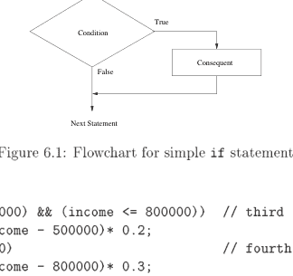

图 6.1：简单 if 语句的流程图

```
if((income > 50000) && (income <= 80000)) // third if statement
    tax = 32000+(income - 50000)* 0.2;
if(income > 80000)                    // fourth if statement
    tax = 92000+(income - 80000)* 0.3;

    cout << "Tax is: " << tax << endl;
}
```

该程序使用了 if 语句的简单形式，如下所示。

```
if (condition) consequent
```

其中，condition（条件）必须是一个求值为 true 或 false 的表达式。我们很快就会说明如何编写这样的表达式。无论如何，if 语句的执行都始于对条件表达式的求值。如果求值为 true，则执行 consequent（后续语句）——它可以是任何 C++ 语句。如果条件求值为 false，则 consequent 被忽略。此时 if 语句的执行结束，控制权传递到程序中的下一条语句。图示上，这通常以流程图的形式表示，如图 6.1 所示。在该图中，矩形框用于容纳要执行的语句或要执行的动作；习惯上把条件写在菱形框中。线条连接矩形框和菱形框，表示控制流的走向。如你所见，在求值条件之后，要么走 true 分支，此时执行 consequent；要么走 false 分支，此时控制权直接转到下一条语句。

条件的最简单形式如下。

```
exp1 relop exp2
```

其中 exp1 和 exp2 是数值表达式，relop 是关系运算符，例如 <、>、<=、>=、==、!=，它们分别表示小于、大于、小于或等于、大于或等于、等于和不等于。因此，在程序的第一个 if 语句中，income <= 180000 就是一个条件。如果在执行过程中，变量 income 的值最多为 180000，则条件求值为 true，此时称条件成立。若条件成立，则执行 consequent。于是 tax 被设为 0。如果 income 大于 180000，

该条件求值为 false，称为条件失败。此时，then 分支（consequent）不会执行，即 tax 保持不变。类似地，在最后一个 if 语句中，条件是 income > 800000。这里的 then 分支，即 tax = 92000 + (income - 800000) * 0.3，当且仅当 income 的值大于 800000 时执行。

在 if 语句中可以指定更复杂的条件。例如，你可能希望仅当某两个条件都为 true 时才执行某个操作。换句话说，你希望 condition1 为 true 且 condition2 为 true。因此，我们的条件可以是两个或更多条件的合取（且）。写法如下。

```
condition1 && condition2 && ... && conditionn
```

字符 && 应读作“且”（and）。在我们的第二个 if 语句中就有这样的例子。这里，仅当两个子条件 income > 180000 和 income <= 500000 都为 true 时，复合条件才为 true。换句话说，仅当 income 位于 180000（不含）和 500000（含）之间时，复合条件才为 true。只有在这种情况下，tax 才会被设置为 (income - 180000)* 0.1，即 income 超过 180000 部分的 10%。

注意，我们还可以有这样的复合条件：只要一组条件中至少有一个成立，它就成立。这样的条件称为若干（子）条件的析取，表示如下：

```
condition1 || condition2 || ... || conditionn
```

字符 || 构成逻辑或运算符。也就是说，如果 condition1 为 true，或 condition2 为 true，等等，复合条件就为 true。最后，一个条件可以是另一个条件的否定，写法如下：

```
!condition
```

其中，条件 !condition 被称为 condition 的否定。当 condition 本身为 false 时，!condition 为 true；当 condition 为 true 时，!condition 为 false。我们注意到，第二个 if 语句也可以写成：

```
if(!((income <= 180000) || (income > 500000)))
    tax = (income - 180000)* 0.1;
```

请注意，如果 income 小于等于 180000 或大于 500000，即 income 不在 180000（不含）到 500000（含）的范围内，那么 (income <= 180000) || (income > 500000) 为 true。但开头的 ! 否定了这一条件，因此只有当 income 确实位于 180000（不含）到 500000（含）的范围内时，整个条件才为 true。这与程序中第二个 if 语句测试的条件完全相同！

清楚地理解上述程序的执行方式非常重要。执行过程一如既往，自上而下。在输出消息并读取 income 的值之后，程序执行第一个 if 语句。为此，程序会检查其中的条件；如果条件为 true，则执行 then 分支。接着执行第二个 if 语句。因此每个 if 语句都会被执行；这些条件被设计成

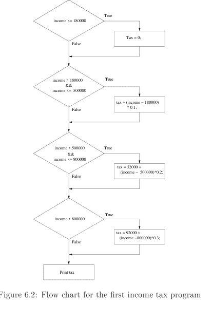

图 6.2：第一个所得税程序的流程图

使得只有一个 if 语句中的条件会求值为 true，因此只会执行一条 then 分支语句。也许整个程序的流程图（图 6.2）能更清楚地展示控制流的走向。注意，一旦我们发现某个条件为 true，例如 income 至多为 180000，我们就知道其他条件不可能为 true。因此自然会提出一个问题：为什么我们还要检查它们呢？

下一节将要讨论的更一般的 if 语句可以让你避免这些不必要的检查。但在讨论它之前，我们先讨论块的概念。

## 6.2 块

在上面讨论的 if 语句中，then 分支应是一条单独的语句。一般来说，如果某个条件成立，我们可能想执行多条语句，而不仅仅是一条。块结构在这种情况下可以帮到我们。

如前所述，块就是用花括号 { 和 } 组合在一起的一组语句。通过把语句放入块中，我们将它们变成了一条复合语句。块可以放在任何需要单条 C++ 语句的位置，例如作为 if 语句的 then 分支（consequent）部分。例如，假设我们希望当 income 超过 80 万时打印消息 “This person is in the highest tax bracket.”，同时还要计算税额，那么我们可以将程序中的第四个 if 语句替换为下面的代码。

```
if (income > 800000){
    tax = 92000+(income - 800000)* 0.3;
    cout << "This person is in the highest tax bracket." << endl;
}
```

你已经在 repeat 语句中使用过块。现在请注意，repeat 语句的一般形式是：

```
repeat (count) action
```

其中 action 可以是任何语句，包括块。因此我们可以写

```
repeat (10) cout << "Test." << endl;
```

这将导致消息 “Test.” 被打印 10 次。

## 6.3 if 语句的其他形式

if-else 语句具有以下形式。

```
if (condition) consequent
else alternate
```

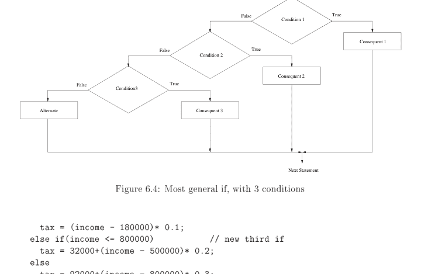

图 6.4：最一般的 if，包含 3 个条件

```
tax = (income - 180000)* 0.1;
else if(income <= 800000)        // new third if
tax = 32000+(income - 500000)* 0.2;
else
tax = 92000+(income - 800000)* 0.3;

cout << "Tax is: " << tax << endl;
}
```

请记住，char 数据实际上是数值，因此使用运算符 == 来对它进行比较是完全可行的。这个程序会执行 100 条用户命令来移动海龟，然后停止。试试吧！

### 6.4.1 画布上的“按钮”

我们可以使用第 5.3 节的 Rectangle 形状在画布上构建“按钮”。通过点击这些按钮可以控制海龟。这又提供了一种海龟控制方式。

```
main_program{
    initCanvas();

    const float bFx=150,bFy=100, bLx=400,bLy=100, bWidth=150,bHeight=50;
    Rectangle buttonF(bFx,bFy,bWidth,bHeight), buttonL(bLx,bLy,bWidth,bHeight);

    Text tF(bFx,bFy,"Forward"), tL(bLx,bLy,"Left Turn");
    Turtle t;

    repeat(100){
        int clickPos = getClick();
        int cx = clickPos/65536;
        int cy = clickPos % 65536;

        if(bFx-bWidth/2<= cx && cx<= bFx+bWidth/2 &&
            bFy-bHeight/2 <= cy && cy <= bFy+bHeight/2) t.forward(100);

        if(bLx-bWidth/2<= cx && cx<= bLx+bWidth/2 &&
            bLy-bHeight/2 <= cy && cy <= bLy+bHeight/2) t.left(10);
    }
}
```

程序首先在屏幕上绘制矩形。请注意，我们没有直接写数字来给出按钮的坐标信息，而是先创建了 bFx、bFy 等具有特定值的名称，然后在创建按钮时使用这些名称。使用这样的名称很方便：如果以后想调整按钮布局，只需改变某个名称的值。如果没有名称，你就需要在数字出现的每个地方都进行修改。在当前例子中，如果想改变矩形的宽度，只需给 bWidth 赋一个不同的值，而不必操心宽度值需要在哪些地方修改。

接下来，将文本放入矩形中。然后进入一个循环。在循环内，我们等待用户点击。我们要检查点击是否位于这两个矩形之一内部。这是通过循环中的两个 if 语句完成的。每次检查包含两个部分：我们必须检查点击的 x 坐标是否位于矩形的左边缘和右边缘之间，即左边缘


坐标必须小于或等于，右侧边缘坐标必须大于或等于。并且我们也必须相应地检查 y 坐标。

该程序只允许 100 次点击；我们稍后会看到如何使循环无限运行或在满足某些条件时停止。

## 6.5 switch 语句

在海龟控制程序中，有一个单一变量 command，根据它我们采取不同的动作。类似的情况在许多程序中都会出现。因此 C++ 提供了 switch 语句，以便我们可以简洁地表达我们的代码。switch 语句的一般形式为：

```
switch (expression){
    case constant1:
        group(1) of statements usually ending with break;
    case constant2:
        group(2) of statements usually ending with break;
    ...
    default:
        default-group of statements
}
```

由 `default:` 及其后的一组语句构成的部分是可选的。表达式 `expression` 必须是 int 类型。此外，上面的每个 `constant_i` 都必须是整数常量。

语句的执行方式如下。首先计算表达式。如果该值与某个 i 的 `constant_i` 完全相同，则我们开始执行 group(i) 语句。我们执行 group(i) 语句，然后执行 group(i+1) 语句，依此类推，包括 default-group 语句，除非我们遇到 `break;` 语句。如果我们遇到 `break`，则 switch 的执行完成，即我们不执行 break 之后的语句，而是直接进入 switch 语句之后程序中的语句。如果表达式的值与提到的任何常量值不同，则执行 default-group 语句。

如果某个 group(i) 没有以 break 结束，则执行会“贯穿”到下一个组。贯穿的情况被认为很少见。

使用 switch，我们的海龟控制程序可以写成如下形式。

```
main_program{
    char command;
    turtleSim();

    repeat(100){
        cin >> command;
        switch(command){
            case 'f': forward(100);
                break;
            case 'r': right(90);
                break;
            case 'l': left(90);
                break;
            default: cout << "Not a proper command, " << command << endl;
        }
    }
}
```

正如你所见，新程序更易于阅读。

下面是一个有贯穿的例子。假设我们想打印一年中第 n 个月的天数，将 n 作为输入。这里是程序。

```
main_program{
    int month;
    cin >> month;
    switch(month){
        case 1: // January
        case 3: // March
        case 5: // May
        case 7: // July
        case 8: // August
        case 10: // October
        case 12: // December
            cout << "This month has 31 days.\n";
            break;
        case 2: // February
            cout << "This month has 28 or 29 days.\n";
            break;
        case 4: // April
        case 6: // June
        case 9: // September
        case 11: // November
            cout << "This month has 30 days.\n";
            break;
        default: cout << "Invalid input.\n";
    }
}
```

假设输入为 5。那么执行将从标记为 `case 5:` 的点之后开始。它将贯穿 case 5、7、8、10 到 case 12。在这种情况下，天数将被打印为 31，然后遇到 break。这将完成 switch 的执行。

switch 语句被认为有点容易出错，因为你可能会忘记写 `break;`。所以要小心。

## 6.6 条件表达式

C++ 有一种 *条件表达式* 的概念，具有以下形式。

```
condition ? consequent-expression : alternate-expression
```

其求值过程如下。首先计算条件。如果为真，则计算 consequent-expression，并且该值就是整个表达式的值。alternate-expression 被忽略。另一方面，如果条件求值为假，则 consequent-expression 被忽略，alternate-expression 被计算，其结果值就是整个表达式的值。

这里有一些简单的例子。

```
int marks; cin >> marks;
int actualmarks = (marks > 100) ? 100 : marks;
char grade = (marks >= 35) ? 'p' : 'f';
```

在此，如果读取的 marks 大于 100，则 actualmarks 将被限制为 100，否则 actualmarks 将被设为等于 marks。此外，如果 marks 至少为 35，则 grade 被设为 'p'（通过），否则为 'f'（失败）。

条件表达式可以嵌套，即 consequent 或 alternate 表达式本身也可以是条件表达式。这使我们能够编写一个非常紧凑但难以阅读的税收计算程序。

```
main_program{
    float income; cin >> income;

    cout << (
        income <= 180000 ? 0 :
        income <= 500000 ? (income - 180000) * 0.1 :
        income <= 800000 ? 32000 + (income - 500000) * 0.2 :
        92000 + (income - 800000) * 0.3
    )
    << endl;
}
```

我们只是读取收入，然后将税作为表达式计算并直接打印出来，而不将其存储到变量中。在上面，标记为 `**` 的括号是必要的。这是因为运算符 `<<` 的优先级高于运算符 `<=`，即默认情况下 C++ 尝试先执行 `<<` 再执行 `<=`。

上面的程序非常紧凑，但不推荐。大多数程序员会认为它难以阅读。然而，不带嵌套的条件表达式被认为是有用的构造。

## 6.7 逻辑数据

if 语句的一个重要部分是条件。我们已经看到条件要么为真要么为假，即我们可以将值 true 或值 false 与每个条件关联。我们还看到条件可以以不同的方式组合。 resulting 组合也将为真或为假。我们还看到用相同的条件可以有几种等价的写法（正如我们在第一个程序的第二个 if 语句中所看到的）。从这个意义上说，条件类似于数值表达式，数值表达式有一个值，数值表达式可以组合成更大的数值表达式，我们可以有等价的数值表达式。在这种情况下，为什么不把条件当作另一种类型的数据呢？这被证明是一个非常好的想法，并且由 George Boole 在 1840 年开发了一种用于操作条件的代数，或我们此后将称之为逻辑表达式的代数。C++ 支持逻辑数据的操作和存储，并且为了纪念 Boole，用于存储逻辑数据的数据类型命名为 bool。你已经在第 3 章中看到过这种数据类型，现在我们将用它做更有趣的事情。

首先我们注意到我们可以将逻辑表达式的值赋给 bool 变量。考虑以下代码。

```
float income; cin >> income;
bool lowIncome, midIncome, highIncome;
lowIncome = (income <= 180000);
midIncome = (income > 180000) && (income <= 800000);
highIncome = (income > 800000);
```

假设在执行期间为 income 给出值 200000。那么在执行后续语句之后，变量 lowIncome、midIncome、highIncome 将分别具有值 false、true、false。

正如你所见，上述赋值语句的右手边是条件，并且这些条件所具有的任何值都将被放入相应的左手边变量中。

作为另一个例子，让我们定义一个 bool 变量，如果从 cin 读取的字符恰好是小写字符，则为真。请注意，这将发生在字符的 ASCII 值至少为 'a' 且最多为 'z' 时。因此此代码可以为

```
char in_ch;
bool lowerCase;
cin >> in_ch;
lowerCase = (in_ch >= 'a') && (in_ch <= 'z');
```

我们接下来将考虑一个更复杂的程序，该程序确定给定的数字 num 是否为质数或合数。在此程序中，能够存储逻辑值将很有用。为了理解该程序，我们需要对包含逻辑数据的表达式进行推理。因此我们首先讨论这一点。

### 6.7.1 关于逻辑数据的推理

正如我们之前讨论的，相同的条件可以用多种方式表达。理解哪些表达式是等价的非常重要。

首先，让我们做一些简单的观察。对于任何逻辑值 v，我们有 `v || false` 与 v 具有相同的值。检查此的最简单方法是尝试所有可能性：


如果 v 为真，那么 true || false 显然为真。如果 v 为假，那么 false || false 显然为假。因此 false 相对于 || 所起的作用与 0 相对于数值加法所起的作用相同。更正式地说，false 被称为 || 的单位元。同样，true && v 的值对任意 v 都是 v。或者说，true 是 && 的单位元。

另一个规则是 && 对 || 的所谓的分配律。因此，如果 x、y、z 是布尔变量（或等价地，条件），那么 (x && y) || z 与 (x && z) || (y && z) 相同。类似地，可以看出 || 也对 && 分配。

另一个重要规则是 x || !x 总是为真，因此我们可以将此类表达式替换为 true。类似地，x && !x 可以替换为 false。

最后，一个重要规则是 DeMorgan 定律。这说明 !x && !y 与 !(x || y) 相同。类似地 !x || !y 与 !(x && y) 相同。

首先考虑 income <= 180000 这样的条件。收入最多为 180000 与其不大于 180000 相同。因此我们也可以将此条件写为 !(income > 180000)。

虽然能够直观地理解条件

```
(income > 180000) && (income <= 500000)
```

和

```
!( (income <= 180000) || (income > 500000) )
```

是相同的，但你也应该能够根据本节给出的规则推导出这一点。

## 6.7.2 判断一个数是否为素数

判断一个数是否为素数是一个重要问题，已知有非常复杂、非常快的算法。我们在本书中只考虑最简单（因此比已知最快算法慢得多）的算法。

这里是最明显的做法。我们按定义进行。数 n 是素数当且仅当它除了自身和 1 之外没有其他因子。因此只需检查 1 和自身之间（两者均不包括）的任何数 i 是否整除它即可。如果我们找到这样的 i，则宣布 x 为合数；否则它是素数。

这要求我们生成从 2 到 x − 1（这次两者都包含）的所有数，以便检查它们是否整除 x。这实际上是序列生成模式（第 3.4.1 节），我们在例如第 3.4 节的螺旋绘制程序中见过。那里我们让 i 取从 1 开始的 10 个值。现在我们希望 i 取从 2 到 x − 1 的 x − 2 个值。所以我们应该使用的代码片段如下：

```
i=2;
repeat(x-2){
    /*
    Here i takes values from 2 to x-1.
    */
    i = i + 1;
}
```

在循环的每次迭代中，我们可以检查 i 是否整除 x。这实际上是条件 (x % i) == 0。我们想知道是否有任何这样的条件成立。但这无非是每次迭代中出现的条件的逻辑或。换句话说，这本身就是第 3.4.1 节中提到的累加器模式。但我们知道如何实现它！我们在第 3.4 节的平均值计算程序中见过如何做到这一点。我们必须维护一个累加器变量，我们将其设置为所涉及运算符的单位元，并在每一步更新它。假设我们将累加器变量命名为 found（因为它将指示是否找到因子）。那么我们将其初始化为 false，即 OR 操作的单位元。然后在循环的每一步中，我们只需更新 found，正如我们在平均值计算程序中更新 sum 一样。因此我们的代码片段变为：

```
i=2;
found = false;
repeat(x-2){
    found = found || (x % i) == 0;
    i = i+1;
}
```

在此之后 found 确实为真，如果 (x % i) == 0 对任何 i 的值成立。于是在此代码之后，我们只需根据 found 为假/真打印素数/合数。并且在开始时我们需要读取 x 等。完整的程序如下。

```
main_program{ //Decide if x is prime.
    int x; cin >> x;

    int i=2;
    bool found = false;
    repeat(x-2){
        found = found || (x % i) == 0;
        i = i+1;
    }

    if (found) cout << x << " is composite." << endl;
    else cout << x << " is prime." << endl;
}
```

这个程序以后会在几个方面得到改进。一旦我们找到 x 的因子，即如果在某次迭代中 x % i == 0 变为真，我们将 found 设置为真，并且无论我们之后做什么，它都不能变为假。那么为什么还要做剩余的迭代呢？这确实是正确的：如果我们测试 102 是否为素数，我们将在第一次迭代本身就发现 102 可被 2 整除，即 2 是因子且 102 是合数。所以我们应该提前停止循环而不做剩余的迭代。在下一章我们将看到如何做到这一点。

顺便说一下，found = found || (x % i) == 0; 的效果也可以通过写 if(x % i == 0) found = true; 来实现。这看起来不像累加，但效果相同。

## 6.8 备注

使用运算符 = 和 == 时存在潜在的陷阱。在数学中，运算符 = 用于表示比较，由于我们大多数人在编程之前就学习了数学，我们很可能倾向于在 C++ 中也用 = 表示比较，而不是 ==。这会导致错误。情况比乍看之下更严重。如果你写代码如下

```cpp
if (p = 25) q = 37;
```

而你的意思是 if (p == 25) q = 37; 编译器不会将其视为错误。这是因为赋值也是一个表达式，在这种情况下，p = 25 的值是 25。编译器会自行尝试将此值转换为布尔值。对于此转换，规则有点不直观：任何非零值都变为真，只有 0 变为假。因此在上述语句的执行中，赋值 q=37 将始终发生。

许多编译器可以被要求在遇到此类语句时发出警告，这些语句很可能是程序员犯下的愚蠢错误。事实上 GNU C++ 编译器会在你的程序中看到此类语句时发出警告，前提是你使用 −Wparentheses 选项调用它。事实上，s++ 你用 simplecpp 使用的确实调用了 GNU C++ 编译器并带有此选项，所以如果你用 s++ 编译，你已经会得到这些警告。如果你确实打算让语句表示赋值表达式（并且没有错误地写了 = 而不是 ==），那么你只需将表达式放在一对括号内并写 if ((p = 25)) q = 37;。这有效地声明了你坚定地意味着 p = 25 是一个赋值表达式。因此在这种情况下，即使使用 −Wparentheses 选项也不会发出警告。

另一个陷阱涉及 if 语句的嵌套，例如如果一个 if 的后继本身又是另一个 if 语句。

```cpp
if (a > 0) if (b > 0) c = 5; else c = 6;
```

编译器将其处理为

```cpp
if (a > 0) {if (b > 0) c = 5; else c = 6;}
```

换句话说，else 与最内层的 if 结合，而外层的 if 没有 else 子句。跟踪此类规则相当繁琐，因此最好自己插入大括号。当然，如果你打算让 else 与外层 if 关联，你可以写

```cpp
if (a > 0) {if (b > 0) c = 5;} else c = 6;
```

如果你省略大括号，那么编译器在你使用 −Wparentheses 选项时仍会警告你。注意编译器会按照 C++ 的规则编译你的程序，即使它发出警告。然而，你应该将编译器警告视为改进代码可读性的建议。事实上，如果你如上所述使用括号或大括号，你也会使代码对其他程序员更具可读性。

- 编写一个程序读取 3 个字符。如果这三个字符由两个数字和中间的 '.' 组成，则你的程序应打印由这些字符表示的小数值的平方。否则你的程序应打印一条消息，说明给定的输入无效。
- 制作一个球在矩形盒子内弹跳的动画。假设盒子固定在地面上，球在其中水平移动，无摩擦。进一步假设为简单起见，球与盒子壁的碰撞是弹性碰撞，即球平行于壁的速度分量不变，但垂直于壁的速度分量取反。将球的笔放下，使其在移动时描绘出其路径。你可以从键盘读取球的位置和速度，也可以从画布上的点击获取。缓慢地沿其路径移动球，使动画看起来不错。
- 修改动画，假设盒子的质量等于球的质量，并且盒子可在 x 方向自由移动，例如它安装在平行于 x 方向的无摩擦导轨上。注意现在每次碰撞时盒子的速度也会改变。如果碰撞时盒子的速度为 v，球在 x 轴方向的速度为 u，则这些速度在碰撞中会交换，即分别变为 u 和 v。展示此系统的动画。你可能希望从总 x 方向动量为零的系统开始，从而确保盒子不会移出屏幕。
- 在球在盒子问题的最难版本中，盒子放在无摩擦表面上，并且可以自由转动。现在碰撞后，盒子通常会开始旋转和平移。假设为简单起见，盒子的质量均匀分布在其 4 条边上，即底座无质量。
- 数字电路以表示二进制值的电信号作为输入，并对其进行处理以生成一些所需的值，同样以电信号表示。如第 2.2 节所述，一个常见约定是使用高电压值（例如 0.7 伏）表示 1，低值（例如 0 伏）表示 0。数字电路由通常称为门的组件构成。AND 门有两个输入和一个输出。AND 门中的电路使得当两个输入都为 1 时输出为 1（即电压至少为 0.7 伏）。如果任何输入为 0（即电压为 0 伏或更低），则输出为 0。同样，OR 门也有 2 个输入和一个输出。输出为 0 当且仅当两个输入都为 0，如果任一输入为 1 则为 1。XOR 门有两个输入和一个输出，输出为 0 当且仅当输入为相同值。最后，NOT 门有一个输入和一个输出，输出为 1 如果输入为 0，输出为 0 如果输入为 1。

图 6.6 显示了 NOT 门、AND 门和 OR 门的符号，从上到左到右，以及底部使用这些门构建的电路。

数字电路的输入画在左侧，输出画在右侧。门放在中间。门的输入必须连接到电路输入或其左侧某个门的输出。门输入取与之连接的电路输入或输出的相同值。在图中，a、b、c 是电路


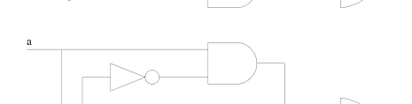

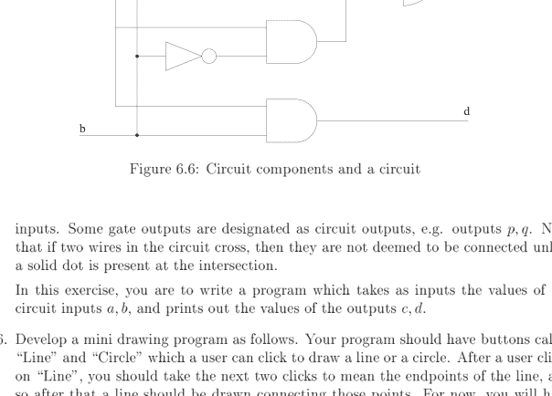

图 6.6：电路元件和电路输入。某些门输出被指定为电路输出，例如输出 p、q。请注意，如果电路中两根导线交叉，则除非交叉点处存在实心点，否则它们不被视为连接。

在本练习中，你需要编写一个程序，以电路输入 a、b 的值为输入，并打印出输出 c、d 的值。

## 16.

按如下方式开发一个迷你绘图程序。你的程序应具有名为“Line”和“Circle”的按钮，用户可以点击它们来绘制直线或圆。用户点击“Line”后，你应将接下来的两次点击视为直线的端点，之后应绘制连接这些点的直线。现在，你必须将该直线印在画布上。类似地，点击“Circle”后，下一个点应被视为圆心，下一个点为圆周上的点。你还可以设置颜色按钮，可在点击“Line”或“Circle”之前选择颜色。

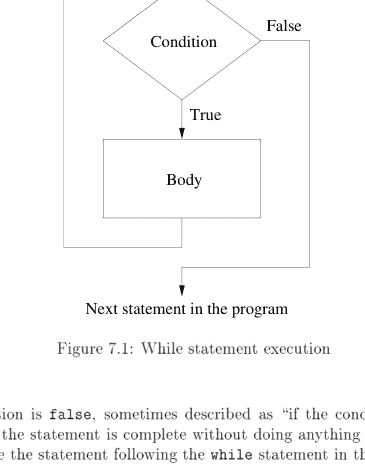

图 7.1：While 语句执行

- 2. 如果条件为假，有时描述为“如果条件不成立”，则语句的执行在不做任何额外操作的情况下完成。然后我们继续执行 while 语句之后程序中的语句。
- 3. 如果条件为真，则执行循环体。
- 4. 然后我们从上面的步骤 1 重新开始。

这在图 7.1 中以流程图的形式显示。

每次循环体的执行称为一次迭代，就像 repeat 一样。每次迭代可能会改变某些变量的值，从而最终使条件变为假。当这种情况发生时，它将在步骤 1 的下一次执行中被检测到，然后步骤 2 将导致语句的执行终止。

正如你也许已经看到的，这个语句对于我们的成绩平均问题很有用。但在我们查看那个问题之前，让我们先看几个简单的例子。

首先我们注意到，使用 while，可以做任何使用 repeat 可以做的事情。为了说明这一点，这里有一个打印从 1 到 100 的数的立方表的程序。显然你也可以使用 repeat 来编写它。

```
main_program{
int i=1;
```

让我们看看程序运行时会发生什么。假设在要求输入数字的提示下，我们输入了 27。然后我们将 d 设为 1，ten_power_d 设为 10。然后我们来到 while 循环。我们会发现 n，其值等于 27，确实大于或等于 ten_power_d，其值等于 10。所以我们进入循环。在循环内部，我们将 d 加 1，使其变为 2，并将 ten_power_d 乘以 10，使其变为 100。然后我们回到循环开始处检查条件。这次我们会发现 n 的值 27 小于 ten_power_d 的值 100。所以我们不进入循环，而是转到循环之后的语句。因此我们会打印 d 的当前值，即 2，作为位数。这就是正确答案：27 的位数确实是 2。

### 7.1.2 成绩平均

这个问题，就像你以后会看到的许多问题一样，我们可以称之为数据流问题。也就是说，计算机接收到一个值流（序列），我们期望在流终止时产生一些输出。有时，我们也可能被期望打印出一个值流，但在当前问题中，我们只需要打印出它们的平均值。处理此类问题的一般策略是问自己：在执行过程中读取了 n 个流值时，我需要记住什么信息？这个问题的答案通常会提示需要哪些变量，以及它们应如何更新。

对于成绩平均问题，我们知道最终想要什么：我们要打印出平均值。要计算平均值，我们需要知道我们读取的所有值的总和，以及我们读取了多少个值。所以在程序的中间点，当读取了某些 n 个值时，我们应同时跟踪 n 及其总和。我们不需要记住迄今为止读取的各个值！因此看起来我们应该保留一个变量 sum，在其中维护到任何时间点为止读取的值的总和。我们还应维护一个变量 count，其中包含我们读取的值的数量。两个变量都应从 0 开始。我们将有一个重复的部分，在其中读取一个值，为此我们将有一个名为 nextmark 的变量。利用这些，看起来我们需要重复执行以下步骤：

- 1. 将一个值读入 nextmark。
- 2. 如果 nextmark 为负，则我们已完成读取，因此继续计算和打印平均值。
- 3. 如果 nextmark 为非负，则将 nextmark 加到 sum 上，并将 count 增加 1。
- 4. 我们从步骤 1 重复整个过程。

在此我们没有写下计算平均值等的过程。但那只是将 sum 除以 count。图 7.2(a) 将其显示为流程图。

我们能否使用 while 语句表达这个流程图？为此，你需要将图 7.1 和图 7.2(a) 的流程图模式进行匹配。似乎自然地将前者的条件与后者的测试 nextmark >= 0 进行匹配。但这两个流程图的结构存在一个重要区别。在图 7.1 中，条件测试是每次迭代的第一个语句，而在图 7.2(a) 中，第一个语句是读取数据，第二个语句才是条件检查。

(a)

(b)

图 7.2：平均值的流程图

关键问题 then 是：我们能否以某种方式修改图 7.2(a) 的流程图，使执行保持不变，但新的流程图与图 7.1 的模式相匹配？假设我们决定将标记为 A 的框向上移动到点 P 上方，在两条分支合并的位置。我们不想改变进入 P 的每个分支发生的事情，所以这就意味着我们必须在进入 P 的两个分支上各放置一个 A 的副本。这给出了图 7.2(b) 的流程图。正如你所见，这两个流程图是等价的，因为无论从键盘提供什么输入，它们都会导致相同的语句被执行。

现在请注意，图 7.2(b) 中的框 B 和左侧的 A 副本是连续执行的，因此我们甚至可以将它们合并为一个包含 3 个语句的单个框。这个新框可以成为 while 语句的循环体，而框 C 为条件。因此我们可以按如下方式编写代码。

```
main_program{
    float nextmark, sum=0;
    int count=0;

    cin >> nextmark;        // right copy of box A

    while(nextmark >= 0){   // box C
        sum = sum + nextmark;   // Box B
        count = count + 1;      // Box B

        cin >> nextmark;        // left copy of box A
    }

    cout << "The average is: " << sum/count << endl;
}
```

上面的程序假设至少会有一个有效成绩，因此 count 在结束时不会为零。

请仔细注意这个一般思想：我们表达程序的自然方式可能涉及在我们希望重复的代码中间进行测试。在这种情况下，我们可以通过移动一些代码并复制它，使测试位于顶部。很快你就会自动开始这样做。

## 7.2 The break statement

C++ 允许在 while 语句（两种形式）的循环体内部使用 `break;` 语句。`break` 语句会立即终止包含它的 while 语句的执行。如果发生这种情况，则称执行已跳出循环。以下是使用 `break` 语句编写我们的成绩平均程序的另一种方法：

```
float nextmark, sum=0;
```


```
int count=0;

while(true){
    cin >> nextmark;
    if(nextmark < 0) break;
    sum = sum + nextmark;
    count = count + 1;
}
cout << sum/count << endl;
```

这里首先要注意的一点是，条件被写成了 true。这意味着该语句可能永远不会终止！但实际上，由于循环体中的 break 语句，该语句确实会终止。读入 nextmark 后，我们检查它是否为负数——如果是，则语句立即终止，并退出循环；如果 nextmark 非负，我们就把 nextmark 加到 sum 中，依此类推。这次执行的结果与之前相同。请注意，这类似于图 7.2(a) 的流程图。

新程序比旧程序更好吗？从某种意义上说确实更好：`cin >> nextmark;` 语句只写了一次。一般来说，不重复代码是个好主意。首先，这样能使程序保持短小；但更重要的是，它可以避免以后可能出现的错误。例如，假设你后来决定，在读取成绩的同时还想把读到的内容打印出来。如果读取代码分散在多个地方，你可能会忘记在所有地方都做修改。你也可能会认为，这个问题中基本的重复工作单元是“读取-处理”，而不是旧代码中出现的“处理-读取”。因此从这个意义上说，新代码更自然。

旧代码的优点是循环终止的条件一开始就明确给出，在循环顶部。而在新代码中，读者需要稍微寻找一下才能明白为什么循环不会无限执行。如果循环体很大，这可能很麻烦。因此，我们不能说新代码一定更好。

最后请注意，在嵌套循环的情况下，break 语句只允许我们跳出包含它的最内层循环语句。

## 7.3 continue 语句

如果有人为 nextmark 输入了一个大于 100 的数会怎样？由于我们假设成绩最多为 100，我们或许可以把超过 100 的数视为错误输入而忽略掉。使用 continue 语句可以很方便地表达这一点。

执行过程中遇到 continue 语句时，循环体中剩余的部分会被忽略。控制流转到循环顶部，检查条件；如果检查结果为 true，则开始下一次迭代，依此类推。

```
while(true){
    cin >> nextmark;
    if(nextmark > 100){
        cout << "Larger than 100, ignoring." << endl;
```
```
continue;
}
if(nextmark < 0) break;
sum = sum + nextmark;
count = count + 1;
}
```

如果 nextmark 大于 100，则先打印消息，然后跳过循环体的其余部分。下一次迭代开始，从条件检查开始，而在本例中条件检查始终为 true。

最后请注意，在嵌套循环的情况下，continue 语句会使执行跳过包含它的最内层循环语句的循环体剩余部分。

## 7.4 do-while 语句

while 语句有一种变体，它在迭代结束时而不是开始时测试条件。它的写法略有不同。形式如下：

```
do body while (condition);
```

其执行方式如下。

- 1. 执行循环体。
- 2. 对条件求值。如果求值为 true，则从第 1 步重新开始；如果求值为 false，则语句的执行结束。

换句话说，在 do-while 形式中，循环体至少执行一次。你会注意到，上面的 do-while 形式等价于下面仅使用 while 的代码：

```
body
while (condition) body
```

所以你可能会想：为什么我们还需要这种额外的形式呢？正如你所看到的，如果你不希望第一次迭代就检查条件，新形式更加紧凑。下面是一个典型的例子。

```
main_program{
float x;
char response;

do{
cout << 'Type the number whose square root you want: ';
cin >> x;
cout << 'The square root is: ' << sqrt(x) << endl;

cout << 'Type y to repeat: ';
cin >> response;
```

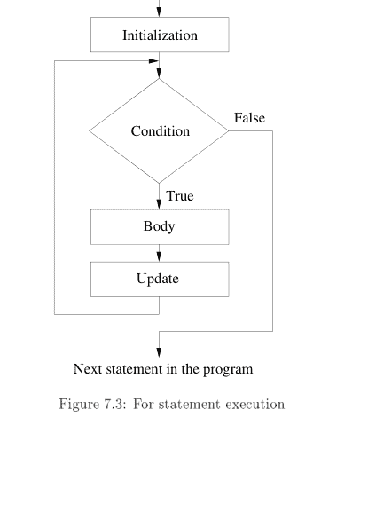

程序中的上一条语句

初始化

条件

假

真

循环体

更新

程序中的下一条语句

图 7.3：for 语句的执行

在 `initialization` 和 `update` 中出现的变量通常被称为循环的*控制变量*。正如你可能预料的，`initialization` 为控制变量赋初值，而 update（更新）说明变量在相邻两次迭代之间必须如何变化。正如你所见，在我们的立方表示例中，更新确实会把控制变量加 1。

你大概也明白为什么这个语句被称为 `for` 语句了。这是因为我们会针对控制变量的不同值多次执行循环体，也就是 *for* 不同的值。

### 7.5.1 在初始化中定义的变量

如前所述，`initialization` 可以包含变量定义，就像我们的立方表程序那样。这个变量在 `initialization` 期间创建，并且在整个 `for` 语句执行期间（也就是所有迭代期间）都是可用的。只有当 `for` 语句执行结束时它才被销毁。因此，这样的变量不能在 `for` 之外被引用。如果变量的值在 `for` 执行结束后还有用，那么就应该在 `for` 语句之前定义该变量，并在 `initialization` 中只对其进行初始化。

如果我在 `initialization` 中定义了一个变量 `i`，但之前已经定义过一个 `i` 了，会怎样？请看下面的代码。

```
int i=10;

for(int i=1; i<=100; i = i + 1) cout << i*i*i << endl;

cout << i << endl;
```

在这种情况下，就会出现第 3.6.3 节讨论过的遮蔽（shadowing）现象。具体来说，第一条语句中定义的 `i` 与 `for` 语句中定义的 `i` 是不同的，但它与最后一条语句中的 `i` 是同一个！因此，`for` 语句仍会像之前一样打印一张立方表。最后一条语句将打印 10，因为其中引用的变量 `i` 是第 1 条语句中定义的变量。

### 7.5.2 break 与 continue

如果在循环体执行期间遇到 `break` 语句，则 `for` 语句的执行结束。这与 `while` 语句中的情形完全一样。

如果遇到 `continue` 语句，当前迭代的执行就会终止，这与 `while` 语句中的情形一样。不过，在进入下一次迭代之前，会先执行更新（update）。之后控制流继续下一次迭代，从检查条件开始，依此类推。

### 7.5.3 风格问题

你可能会问：如果 `for` 语句并不是必需的，我们为什么还要学习它呢？事实上，任何使用 `for` 语句的程序都可以用 `while` 重写，只需要增加几个变量和赋值而已。

原因在于风格。这很类似于为什么我们在某些场合大声说话、在另一些场合轻声细语：除了话语本身，声音的高低轻响还能帮助听者理解我们的意图。同样，当我写一个 for 语句时，读者能很清楚地看到我使用的是某种常见的编程惯用法：有一个控制变量，在开始时被初始化，在每次迭代结束时递增。如果我使用 `while` 语句或 `repeat` 语句，读者就无法立刻看出这些信息。

### 7.5.4 判断一个数是否为素数

在第 6.7.2 节中，我们编写了一个判断一个数是否为素数的程序。当时我们指出，这个程序可以更高效：一旦我们为给定数找到了一个因子，就可以停止检查其他因子，并立即报告该数为合数。我们可以用 `for` 语句来实现这个想法，如下所示。

在第 6.7.2 节的程序中，我们检查待判断素性的数 x 是否能被 i 整除，其中 i 从 2 取到 x-1。显然，i 非常适合作为控制变量。此外，一旦检测到 x 能被 i 整除，我们就可以跳出循环。

```
main_program{
    int x; cin >> x;

    bool found = false;
    for(int i=2; i < x; i++){
        // x is not divisible by 2...i-1
        if(x % i == 0){ found = true; break;}
    }

    if(found) cout << "Composite.\n";
    else cout << "Prime.\n";
}
```

注意我们添加到代码中的注释。它表达了随着程序在循环中推进，我们关于 x 是否为素数的认识是如何演变的。无论处于哪一次迭代，无论 i 取什么值，我们都知道 x 不能被 2 到 i-1 范围内的数整除。这里，如果 i 是 2，这个范围是空的，所以我们的断言应视为成立。诸如此类的注释对阅读代码的人很有用，有助于理解程序的运行过程。

## 7.6 for 的不常见用法

大多数情况下，`for` 语句中的初始化和更新各自都是对单个变量的赋值。不过，也有其他可能性，我们将在本节中看到。


## 7.6.1 逗号分隔的赋值

下面是使用 for 语句解决第 7.1.1 节的数字计数问题的方法。

```
main_program{
    int n; cin >> n;

    int d, ten_power_d;
    for(d=1, ten_power_d = 10; ten_power_d <= n; d++, ten_power_d *= 10);

    cout << "The number has " << d << " digits." << endl;
}
```

上面代码中 for 语句有两个值得注意的特征。首先，初始化和更新都由逗号分隔的两个赋值组成。这是允许的。事实证明在 C++ 中，在这种上下文中逗号被视为一个运算符，它只是将两个赋值连接起来！

第二个值得注意的方面是上面的 for 语句没有主体。这是可以接受的。

上面的代码非常紧凑，但可能被一些人认为很 tricky。需要指出的是，逗号分隔的赋值通常可以用作 for 语句的初始化和更新。

## 7.6.2 初始化和更新中的输入

下面是使用 for 语句编写平均成绩代码的方法。

```
main_program{
    float nextmark,sum=0;
    float count=0;

    for(cin >> nextmark; nextmark >= 0; cin >> nextmark){
        count++;
        sum += nextmark;
    }
    cout << sum/count;
}
```

我们说过 for 语句中的初始化和更新必须是表达式；但事实证明 cin >> nextmark 是一个表达式！我们将在第 12.6.3 节讨论它返回什么值。但现在值与我们无关；因此你可以继续在初始化和更新中使用此类输入表达式。

我怀疑有些程序员会喜欢这种写法。它有点不常规，然而，将 nextmark 视为该程序的控制变量是有意义的。

## 7.7 最大公约数

我们现在将讨论有史以来最优雅、最古老和最有用的算法之一：由欧几里得在公元前 300 年左右提出的求最大公约数 (GCD) 的算法。正如你所知，该问题的输入是正整数 m、n。我们需要计算它们的 GCD，它被定义为同时整除 m、n 的最大整数。它可以用一个单一的 while 循环来编写。

正如在小学教授的那样，这个算法是分解两个数的质因数，然后最大公约数 (GCD) 就是公共因子的乘积。另一种可能是按照规范进行：检查 2 到 min(m, n) 之间的数字，并找到同时整除两者的最大数。这可行，但比小学方法慢。

欧几里得算法比这两种方法都快得多。它的起点是一个相对简单的观察：如果 d 是正整数 m、n 的公约数，那么它也是 m − n、n 的公约数，假设 m > n。证明很简单：由于 d 整除 m、n，我们有 m = pd，n = qd，其中 p、q 为整数。因此 m − n = (p − q)d，因此 d 也整除 m − n。通过类似的论证，你也可以证明逆命题，即如果 d 是 m − n、n 的公约数，则 d 也是 m、n 的公约数。

因此我们证明了 m、n 的每一个公约数也是 m − n、n 的公约数，反之亦然。但这意味着 m、n 的公约数集合与 m − n、n 的公约数集合相同。因此第一个集合中的最大数必须是第二个集合中的最大数，即 GCD(m, n) = GCD(m − n, n)。

最后一个陈述具有深远的后果。它应被理解为：如果要得到 m、n 的 GCD，你可以改为求 m − n、n 的 GCD，假设 m > n。这可以被认为是进步，因为直观上，你会认为求较小数的 GCD 比求较大数的 GCD 更容易。

让我们举一个例子。假设我们想求 3977、943 的 GCD。因此我们有 GCD(3977, 943) = GCD(3977 − 943, 943) = GCD(3034, 943)。但没有理由我们只使用一次这个想法：我们可以多次使用它。因此我们得到 GCD(3034, 943) = GCD(2091, 943) = GCD(1148, 943) = GCD(205, 943)。在这一点上，你可能会意识到我们可以一次性减去所有倍数，结果只是将原始数 3977 除以 943 的余数。因此我们可以更直接地写出 GCD(3977, 943) = GCD(3977%943, 943) = GCD(205, 943)。

由于 GCD 是一个对称函数，我们可以减去 m 的倍数，就像减去 n 一样。因此 GCD(205, 943) = GCD(205, 943%205) = GCD(205, 123)。这进一步简化：GCD(205, 123) = GCD(205%123, 123) = GCD(82, 123) = GCD(82, 123%82) = GCD(82, 41)。在这一点上，如果我们尝试应用我们的规则，我们得到 82%41 = 0，即较小的数整除较大的数，因此它必须是 GCD。因此我们总共得到 GCD(3977,943)=41。

我们可以将上述思想总结为一个简单的定理。

### 定理 1 (欧几里得) 假设 m、n 是正整数。如果 m%n = 0，则 GCD(m, n) = n。否则 GCD(m, n) = GCD(m%n, n)。

这足以编写一个程序。程序首先将数字读入变量 m、n。然后在每次迭代中，我们将使用欧几里得定理来获得新的值

m,n 使得新值的 GCD 与旧值的 GCD 相同。新值会不断变小，但我们知道这不可能无限持续下去。因此必须有某个时刻我们无法使用欧几里得定理来减小 m,n 的值。但这只能发生在 n 整除 m 时，此时我们可以输出 n 作为 GCD。

```
main_program{ // Compute GCD of m,n, where m > n >0.
    int m,n;
    cout << "Enter the larger number (must be > 0): "; cin >> m;
    cout << "Enter the smaller number (must be > 0): "; cin >> n;

    while(m % n != 0){
        int Remainder = m % n;
        m = n;
        n = Remainder;
    }
    cout << "The GCD is: " << n << endl;
}
```

## 7.8 循环程序的正确性

本章讨论的程序在直觉上应该是正确的。然而，直觉可能是欺骗性的，正如我们之前讨论的那样，最好进行交叉检查。在本节中，我们讨论如何更正式地论证程序的正确性。

在论证基于 repeat 循环的程序的正确性时，我们通常可以说明每次迭代中我们期望发生的进展，这可以在我们编写并证明的计划中表达（第 4.2.2 节）。证明使用 while/for 循环的程序的正确性的论证比基于 repeat 的程序的论证更复杂（第 4.2.2 节）。这是因为我们通常不知道 while/for 循环会执行多少次。因此论证还必须证明循环最终会终止。

while/for 循环的证明论证通常有两个部分：循环不变量和势。我们接下来将解释这些概念，并结合解释证明上面给出的 GCD 程序的正确性。

### 7.8.1 循环不变量

循环不变量是关于程序中变量取值的一个断言，该断言必须在循环的每次迭代之前和之后都为真。术语不变量应理解为类似于物理学的守恒原理，例如系统的总能量在实验后与实验前相同。循环不变量在精神上与第 4.2.2 节中讨论的计划类似。

我们接下来描述证明 GCD 程序正确性所需的 不变量。假设 m0、n0 是作为输入给变量 m、n 的值。我们将证明以下不变量。

不变量 1：(在循环的每次迭代之前和之后) m、n 的 GCD 保持不变，即等于 m0、n0 的 GCD。

### 不变量 2：(在循环的每次迭代之前和之后) 我们有 m > n > 0。

不变量 2 也将有助于证明程序终止并且过程中没有错误。不变量 1 将证明产生正确的答案。

不变量是使用数学归纳法证明的，如你所料。我们先证明第二个不变量。当控制到达循环时，对于第一次迭代，变量 m、n 将具有值 m0、n0。我们将假设用户遵循了我们的说明，因此有 m0 > n0 > 0。因此归纳法的基例成立。现在假设在某个第 t 次迭代开始时，m>n>0。我们将证明在第 t 次迭代结束时如果有的话，即在第 t + 1 次迭代开始时，我们将继续有 m>n>0。让我们考虑循环的执行。循环测试计算 m%n。此操作只有在 n>0 时才有效。但我们假设在迭代开始时 m>n>0。因此余数 m%n 将是良定义的并且可以正确计算，不会出现除以 0 的可能性。如果 m%n 为 0，则循环体将不会被进入；将没有第 t + 1 次迭代，因此没有需要证明的内容。假设余数为正。在这种情况下循环体被进入。体中的第一个语句将 Remainder 设置为余数。现在注意 Remainder 必须具有小于除数 n 的值。循环的最后两个语句分别将 n 和 Remainder 的值赋给 m 和 n。因此在循环结束时 m 将具有大于 n 的值，如所需。

第一个不变量，即新值的 GCD 与旧值的 GCD 相同，是欧几里得定理的直接结果。然而，我们将更正式地陈述证明。如前所述，证明使用数学归纳法。当控制到达循环进行第一次迭代时，变量 m、n 具有值 m0、n0。因此 m、n 的 GCD 显然与 m0、n0 的 GCD 相同。所以基例成立。现在考虑经过 t 次迭代后发生的情况。我们执行循环测试。循环测试要求我们将 m 除以 n。如果循环测试失败，则没有第 t + 1 次迭代，因此没有需要证明的内容。但是如果循环测试成功，则我们进入循环。在循环中，我们按照欧几里得定理精确地为 m、n 分配值。因此 m、n 的 GCD 在赋值后保持不变，尽管 m、n 的值本身已经改变。

### 7.8.2 势

直觉上，m、n 的值会不断减小，因此循环测试最终必须成功。我们现在正式观察到这一点。下一迭代中 m 的值是当前 n 的值，已知它小于当前 m 的值。因此在每次迭代中，m 的值至少减少 1。但由于 n 保证始终为正，我们知道 m 将始终为正，即永远不会降到 0 或变为负。因此，迭代次数不能超过用户在程序开始时输入的值 m0。因此循环必须在某个时候终止！

该论证的关键思想是观察到某个量必须至少减少一个固定的量，但循环体的性质是该量不能减少到某个阈值以下。这就证明了迭代次数必须是有限的，否则该量将减少到阈值以下。在 GCD 的情况下，选择 m 的值作为势很方便。但在其他程序中，会有其他选择，有时需要创造力来定义合适的势。


这个量被比喻性地称为“势”（Potential），其灵感来源于物理学中关于势能概念的论证。

## 7.8.3 正确性

在给定适当的不变式和合适的势之后，正确性证明几乎就完成了。通常只剩下一些收尾工作。

当 GCD 程序终止时，我们从不变式得知，当前 m、n 值的 GCD 必定与 m₀、n₀ 的 GCD 相同。由于循环测试在终止前必然失败，我们知道 Remainder == 0，即 m % n == 0。但这样一来，GCD 必然是 n，而这正是我们打印的内容。因此，我们确立了正确性。

## 7.8.4 关于 GCD 程序的额外观察

我们注意到，上述论证可以进一步精确化，从而得到 GCD 程序所需迭代次数的更强上界。设 mᵢ、nᵢ 分别表示第 i 次迭代开始时 m 和 n 的值，Rᵢ 表示第 i 次迭代中计算出的 Remainder 值。那么我们知道：

- 1. mᵢ = qnᵢ + Rᵢ ≥ nᵢ + Rᵢ，因为在第 i 次迭代中用 m 除以 n 所得的商 q 至少为 1。
- 2. mᵢ₊₁ = nᵢ，nᵢ₊₁ = Rᵢ。这可以通过考虑我们在循环末尾所做的赋值得出。

因此有 mᵢ ≥ nᵢ + Rᵢ = mᵢ₊₁ + nᵢ₊₁ ≥ 2mᵢ₊₂。于是我们确认，m 的值在 2 次迭代内至少减少一个因子 2。因此，迭代次数至多为 2 log₂ m₀，其中 m₀ 是用户输入的 m 值。

最后我们注意到，即使用户无视我们的说明，先输入较小的数、再输入较大的数，我们的程序仍然能正确运行。这会略微改变不变式和分析方式，相关内容将在练习中请你完成。

## 7.8.5 其他程序的正确性

其他程序，例如素性检测程序，也可以用类似的方式证明其正确性。

## 7.9 备注

循环是编程中非常重要的操作。在本章中，我们看到了如何使用 while 循环和 for 循环解决各种问题，而之前我们还看到了 repeat 循环。对于 while 和 for 循环，根据是否使用 break 或复制代码，还有更多的变体。在本书后面，我们还将看到表达本章某些程序的更多方式。

正如我们所说，每种编写循环的方式都有一些优点和缺点。有的可能可读性更高或更低，有的可以避免代码重复，还有的可能效率较低，因为它做了不必要的工作。另一个考虑因素是自然性：某种代码编写方式是否与你思考问题的方式更一致？因此，最终如何表达一个程序是一种主观选择。在这方面，你应该培养自己的品味。

while 和 for 循环比 repeat 循环更棘手。这是因为有可能出现编程错误，写出不会终止的 while/for 循环。因此，与 repeat 循环相比，我们在使用这些循环时必须更加小心。这种复杂性也反映在我们论证正确性的方式上。你可能已经注意到，对 repeat 循环的正确性论证并不需要类似“势”的东西，因为 repeat 循环无论如何都保证会终止。

我们之前已经指出，对大型程序进行证明可能会很繁琐。然而，我们要强调的是，即使你不做完整的证明，也应该为你编写的每个非平凡程序写下不变式和势。

## 练习

- 1. 编写一个程序，打印从摄氏度到华氏度的换算表，例如 0° C 到 100° C。分别使用 while 和 for 编写。
- 2. 假设给定平面上的 n 个点：(x₁,y₁),..., (xₙ,yₙ)。假设这些点是一个多边形的顶点，并且按逆时针方向围绕多边形给出。编写一个使用 while 循环的程序来计算该多边形的周长。同时使用 for 循环完成同样的事情。
- 3. 编写一个程序，返回非负整数的近似平方根。对于本练习，将近似平方根定义为小于精确平方根的最大整数。当然，你不应使用内置的 sqrt 或 pow 命令。你的程序应完成简单的工作，例如按 1,2,3,... 的顺序检查整数，看它是否符合近似平方根的条件。
- 4. 假设某些代码包含一些 while 语句。说明如何在保持代码输出不变的情况下，将 while 语句替换为 for 语句。
- 5. 为第 6.4.1 节的海龟控制器添加一个“停止”按钮。修改程序，使其一直运行，直到用户点击停止按钮。同时，用户执行的命令数量不应有限制（第 6.4.1 节中是 100 条）。
- 6. 编写一个程序，从最低有效位开始，依次打印一个数字的各位数字，直到最高有效位。注意，数字 n 的最低有效位就是 n % 10。
- 7. 编写一个程序，输入一个数字 n，输出一个数字 m，它与 n 具有相同的数字，但顺序相反。
- 8. 如果一个自然数的数字序列从左到右读和从右到左读相同，则该自然数称为回文数。编写一个程序，判断给定的数字是否为回文数。
- 9. 编写一个程序，输入一个自然数 x，返回大于 x 的最小回文数。
- 10. 为 GCD 代码添加检查，确保用户输入的数字是正数。对于每个输入值，你都应不断提示用户，直到她给出正数。
- 11. 假设在运行第 7.7 节的 GCD 程序时，用户先输入较小的数，再输入较大的数。证明程序仍然会给出正确答案，并说明不变式和迭代次数分析将如何变化。
- 12. 编写一个程序，输入一个自然数并打印出它的质因数。
- 13. * 编写一个程序，一次读取一个字符序列，一旦读到连续的字符序列 ‘a’, ‘b’, ‘r’, ‘a’, ‘c’, ‘a’, ‘d’, ‘a’, ‘b’, ‘r’, ‘a’，即字符串 “abracadabra”，就立即停止。提示：在你读取了一定数量的字符之后，你到底需要记住什么？你不需要记住整个前面的字符序列，甚至也不需要显式记住最后几个字符。弄清楚需要记住什么，并在程序中只记住这些。
- 14. * 设 x1, …, xn 是一个整数序列（可能为负数）。对于每个可能的子序列 xi, …, xj，考虑其和 Sij。编写一个程序，按顺序读入该序列，n 在开头给出，并打印出所有可能子序列中和的最大值 Sij。

提示：这是一个困难的问题。但是，通过一般策略可以解决：弄清楚在读完前 k 个数后，我们需要记住哪一组值 V(k)。当你读取第 k+1 个数时，必须使用读入的这个数和先前计算出的 V(k) 来计算 V(k+1)。

## 第 8 章

## 计算常见数学函数

在本章中，我们将看到计算一些常见数学函数的方法，例如三角函数、平方根、指数和对数。我们还将看到如何使用欧几里得算法计算两个数的最大公约数。这是最古老的且有趣的算法之一，早在计算机被构想出来之前就已发明。

本章所有程序中的主要语句将是循环语句。你可以将本章视为上一章的延伸，提供更多使用循环语句的方式。

本章的某些内容需要较深的数学知识。我们将陈述相关定理，并尝试直观地解释它们为什么可能成立。精确的证明不在本书的讨论范围内。

### 8.1 泰勒级数

假设我们希望计算某个函数 f 在 x 处的值 f(x)，例如 f(x) = sin(x)。假设我们知道如何计算 f 在某个固定点 x0 处的值 f(x0)。假设 f 的导数 f'、f' 的导数 f'' 等在 x0 处存在，并且我们可以计算它们。那么，如果 x 与 x0 足够接近，f(x) 就等于 f 在 x0 处的泰勒级数之和。泰勒级数的第 i 项是 f^i(x0)(x - x0)^i / i!，其中 f^i 是对 f 求导 i 次得到的函数。于是我们有：

f(x) = f(x0) + f'(x0)(x - x0) + f''(x0)(x - x0)^2 / 2! + f^m(x0)(x - x0)^3 / 3! + ⋯

在典型情况下，我们只计算并求和该级数的前几项，这就能得到 f(x) 的足够好的估计。这方面的一般理论在标准数学教材中有讨论，不在我们的范围内。然而，你可能已经认出前两项来自曲线的切线近似，如图 8.1 所示。f(x) 的值等于（线段）FD 的长度。我们将其近似为 FC，而 FC 又等于 FB + BC = EA + (BC/AB)AB = f(x0) + f'(x0)·(x - x0)。


Figure 8.1: f 在 A, (x₀, f(x₀)) 处的切线近似

### 8.1.1 角的正弦

作为一个例子，考虑 f(x) = sin(x)，其中 x 以弧度为单位。则选择 x₀ = 0 我们知道 f(x₀) = 0。我们知道 f′(x) = cos(x)，f″(x) = −sin(x)，f‴(x) = −cos(x) 等等。由于 cos(0) = 1，我们知道每个导数的精确值；它要么是 0，要么是 1，要么是 −1。因此我们得到

sin(x) = x − x³/3! + x⁵/5! − x⁷/7! + x⁹/9! − …

这里角 x 以弧度为单位。当一个级数具有交替的正负项，并且对于任何固定的 x，项越来越接近 0 时，那么只取前 k 项的误差最多为第 (k + 1) 项（绝对值）。我们级数的第 k 项是 (−1)^{k+1} x^{2k−1}/(2k−1)!。因此如果我们希望误差为 ε，那么我们应确保 x^{2k+1}/(2k+1)! ≤ ε。

我们已经见过如何求和级数（第 4 节）。显然我们需要一个循环，在第 k 次迭代中我们将级数计算到 k 项。我们必须在最后添加的项小于目标 ε 时终止循环。我们可以在第 k 次迭代中从头开始计算第 k 项 t_k，但注意到以下关系是有用的：

t_k = (−1)^{k+1} x^{2k−1}/(2k−1)! = t_{k−1} · ( (−1) x² / ((2k−2)(2k−1)) )

前提是 k > 1。如果 k = 1 则 t_k = 1，当然，我们不使用上述关系。因此在循环中我们只按需计算 k = 2, 3, … 的项。因此我们的代码变为：

```cpp
main_program{
    double x; cin >> x;

    double epsilon = 1.0E-20, sum = x, term = x;

    for(int k=2; abs(term) > epsilon; k++){
        // Plan: term = t_{k-1}, sum = sum of k-1 terms
        term *= -x * x / ((2*k-2)*(2*k-1));
        sum += term;
    }

    cout << sum << endl;
}
```

命令 abs 代表绝对值，并返回其参数的绝对值。

### 8.1.2 自然对数

考虑 f(x) = ln x，x 的自然对数。定义它的一种方法是

ln x = ∫₁ˣ 1/u du

因此从这里，我们可以找到它的泰勒级数。显然 f′(x) = 1/x。f″(x) = −1/x² 等等。方便使用 x₀ = 1。因此我们得到：

ln(1 + h) = h − h²/2 + h³/3 − h⁴/4 + …

对于这个级数需要注意的一个非常重要的点是，级数仅在 −1 < h ≤ 1 时有效。我们之前注意到泰勒级数仅在 x 足够接近 x₀ 时有效，或者等价地 x − x₀ = h 很小。对于 ln 函数，我们对“足够接近”有一个精确的描述：距离 x₀ 一个单位之内。

即便如此，请注意你确实可以使用该级数来计算任意值 x 的 ln x。只需观察 ln x = 1 + ln(x/e)。因此通过分解 e 的幂，我们只需要对小于 1 的数使用级数。

### 8.1.3 一些一般性说明

注意泰勒级数通常写成

f(x₀ + h) = f(x₀) + f′(x₀)h + f″(x₀) h²/2! + f‴(x₀) h³/3! + …

如果我们选择 x₀ = 0，我们得到麦克劳林级数，即

f(x) = f(0) + f′(0)x + f″(0) x²/2! + f‴(0) x³/3! + …

一般来说，泰勒级数的项随 x 增大。因此，最好尽可能保持 x 很小。例如，假设我们希望计算 sin(100.0)。一种可能是使用前面的程序指定 100.0 作为输入。更好的方法是减去尽可能多的 2π 的倍数，因为我们知道 sin(x + 2nπ) = sin(x) 对任何整数 n 都成立。事实上，像 sin(x) = sin(π − x) 这样的恒等式可以进一步减少程序主循环中使用的值。事实上，注意到 cos(x) 的泰勒级数为：

cos(x) = 1 − x²/2! + x⁴/4! − x⁶/6! + …

我们实际上可以使用 sin(x) = cos(π/2 − x) 来计算正弦，如果 π/2 − x 的绝对值比 x 小的话。

泰勒级数展开的证明远远超出了本书的范围。然而，我们通过考虑切线来近似函数曲线，图 8.1，对前两项提供了一些直观的解释。¹

> ¹ 你可能熟悉公式 s(t) = ut + ½ a t²，其中 s(t) 是在时间 t 内以恒定加速度 a、初始速度 u 运动的粒子所走的距离。注意 u = s′(0)，a = s″(0)，用此代换公式可写为 s(t) = s(0) + s′(0)t + s″(0) t²/2，这与泰勒级数的前 3 项相似。

## 8.2 数值积分

我们考虑另一种计算给定 x 的 ln x 的方法。回顾定义：

ln x = ∫₁ˣ 1/u du

换句话说，ln x 是曲线 y = 1/u 在 u = 1 到 u = x 之间的面积下的面积。所以如果我们能找到面积，我们就能找到 ln x！

好吧，我们不能精确计算面积，但我们可以近似它。一般来说，假设我们希望近似曲线 f(u) = 1/u 从 p 到 q 下的面积。然后我们可以通过考虑覆盖它的最小轴平行矩形的面积来得到该面积的 overestimate。该矩形的高度为 f(p)（因为 f 是非递增的），宽度为 q − p。因此我们的所需近似值（overestimate）为 (q − p)f(p)。这就是我们将使用的方法，在将所需面积分成 n 个垂直条后。由于曲线从 1 到 x 每个条的宽度为 w = (x − 1)/n。第 i 个条从 u = 1 + i w 延伸到 u = 1 + (i + 1) w，其中我们将 i 视为在 0 到 n − 1 之间变化，如惯例，而非 1 到 n。覆盖该条的矩形的高度为 f(1 + i w)，因此面积为 w f(1 + i w)。因此矩形的总面积为：

∑_{i=0}^{n−1} w f(1 + i w) = ∑_{i=0}^{n−1} w / (1 + i w)

但该公式的求值很容易转化为程序！事实上 i 将自然地作为我们 for 循环的控制变量。我们将每次迭代的项相继取出来并加到我们先设为 0 的变量 area 中。以下是完整的程序。

```cpp
main_program{
    float x; cin >> x;        // will calculate ln(x)
    int n; cin >> n;          // number of rectangles to use
    float w = (x-1)/n;        // width of each rectangle
    float area = 0;           // will contain ln(x) at the end.
    for(int i=0; i < n; i++)
        area = area + w /(1+i*w);
    cout << "Natural log, from integral: "<< area << endl;
}
```

我们注意到 C++ 已经为你提供了一个单一命令 log，可以作为 log(x) 调用，它返回自然对数的值。该命令可能使用了比我们上面编写的代码更复杂的代码，并且它保证返回的答案将正确到你的表示的位数。因此我们可以使用命令 log 来检查我们的答案有多好。为此只需在上面给出的程序末尾前添加行

```cpp
cout << "Natural log, from built-in function: "<< log(x) << endl;
```

这将导致我们的答案以及真实答案都被打印出来，因此我们可以进行比较。

## 8.3 二分法

Figure 8.2: 二分法。接下来我们将有 $x_L = x_M$。

我们必须重复此过程直到 x_R − x_L 变小于 ε。然后我们就会知道它们都距离根部最多为 ε，因为根在区间 [x_L, x_R] 内。

代码于是显而易见。我们在下面为求 2 的平方根编写，即对于 f(x) = x² − 2。

```cpp
main_program{    // find root of f(x) = x*x - 2.
    float xL=0,xR=2; // invariant: f(xL),f(xR) have different signs.
    float xM,epsilon;
    cin >> epsilon;
    bool xL_is_positive, xM_is_positive;
    xL_is_positive = (xL*xL - 2) > 0;
    // Invariant: xL_is_positive gives the sign of f(x_L).

    while (xR-xL >= epsilon){
        xM = (xL+xR)/2;
        xM_is_positive = (xM*xM -2) > 0;
        if(xL_is_positive == xM_is_positive)
            xL = xM; // does not upset any invariant!
        else
            xR = xM; // does not upset any invariant!
    }
    cout << xL << endl;
}
```

## 8.4 牛顿-拉夫森方法

如果我们有一种方法可以对任意 x 评估 f(x) 及其导数 f′(x)，我们就可以得到一种更快的方法来寻找函数 f 的根。为了开始这种方法，我们还需要根的初始猜测，我们称之为 x₀。通常，找到初始猜测并不困难；事实上，在我们将要举的例子中，几乎任何 x 都可以用作初始猜测。

一般来说，牛顿-拉夫森方法以当前根的猜测 x_i 作为输入。它以（希望）更好的猜测 x_{i+1} 作为输出。然后我们计算 f(x_{i+1})；如果它足够接近 0，则我们报告 x_{i+1} 为根。否则，我们重复该方法，使用 x_{i+1} 得到，希望是更好的猜测 x_{i+2}。

计算给定 x_i 的 x_{i+1} 的过程非常直观。我们从第 8.1 节知道 f(x) ≈ f(x_i) + f′(x_i)·(x − x_i)，假设 x − x_i 很小。在这个等式中我们可以选择 x 为任意点，包括根。所以让我们选择 x 为根。然后 f(x) = 0。因此我们有 0 ≈ f(x_i) + f′(x_i)·(x − x_i)。或者换句话说，x ≈ x_i − f(x_i)/f′(x_i)。注意该等式的右边可以求值。因此我们可以得到根的近似值！我们将此近似值作为下一个候选。

x_{i+1} = x_i − f(x_i)/f′(x_i)    (8.1)

就这么简单！图 8.3 显示了图形上发生的情况。点 A 坐标为 (x_i, 0) 代表我们当前对根的估计。我们从 A 向上画一条垂直线到


### 图 8.3：牛顿-拉弗森法的一步

函数曲线将我们带到坐标为 \((x_i, f(x_i))\) 的点 B。在 B 处，我们作函数 \(f\) 的切线，切线与 x 轴交于点 C。如果我们把切线视为 \(f\) 的良好近似，那么根必定是点 C。实际上，我们取 C 的 x 坐标作为下一个估计值 \(x_{i+1}\)。因此有

```
x_{i+1} = x_i - AC = x_i - AB / (AB/AC) = x_i - f(x_i)/f'(x_i)
```

这正是我们之前通过代数论证得到的式子。至少在图中，你可以看到新的估计值更好；事实上，与点 A 相比，点 C 已经向根移动得更近了。可以正式论证：如果 \(x_i\) 一开始就与根足够接近，那么 \(x_{i+1}\) 会更为接近。事实上，在许多情况下，可以证明，从 \(x_i\) 到 \(x_{i+1}\)，\(x_i\) 中正确的位数基本上会翻倍。这样，很快就能得到对根的一个非常好的近似。所有这些的证明并不太难，至少对特殊情形是这样，但已超出本书范围。

现在我们展示如何用牛顿-拉弗森法求任意数 \(y\) 的平方根。² 与二分法一样，我们必须将问题表述为求方程 \(f(x)=x^2-y\) 的根。我们还需要导数，即 \(f'(x)=2x\)。更新规则 \(x_{i+1}=x_i-f(x_i)/f'(x_i)\) 在这种情况下变为

```
x_{i+1} = x_i - (x_i² - y)/(2x_i) = ½(x_i + y/x_i)
```

> ² 巴比伦人早在公元前 2000 年就用同样的方法求平方根。但他们很可能不是将其作为一般求根过程的一个特例推导出来的。

接下来我们需要一个初始猜测值。标准的做法是先画出函数的大致图像，然后选择一个看起来靠近根的点。在这种情况下，几乎任何初始猜测值都可以，除了 0，因为在 0 处 \(y/x_i\) 这一项没有定义。所以为简单起见，我们选择 \(x_0=1\)。现在我们准备编写程序。基本思想是维护一个表示当前猜测值的变量 \(x_i\)。我们将使用上述规则在每次迭代中更新 \(x_i\)，并将其初始化为 1。

```
main_program{
    double xi=1, y;  cin >> y;
    repeat(10){
        xi = (xi + y/xi)/2;
    }
    cout << xi << endl;
}
```

这个程序将固定运行 10 次迭代，从 \(x_0=1\) 开始计算估计值 \(x_1, x_2, \ldots, x_{10}\)。但我们也可以根据希望容忍的误差大小来决定迭代次数。

这有点棘手。如果实际根是 \(x^*\)，那么当前估计值 \(x_i\) 的误差就是 \(|x_i-x^*|\)。事实上，如果我们确切知道误差，即值 \(v=|x_i-x^*|\)，我们就可以通过 \(x^*=x_i\pm v\) 直接算出根。因此我们需要对误差作出估计。一个常见的估计是 \(f(x_i)\)。确实，\(f(x_i)\) 是点 \((x_i,0)\) 到曲线 \(f\) 的垂直距离，而精确误差 \(x_i-x^*\) 是点 \((x_i,0)\) 到曲线的水平距离。事实上，当垂直距离变为 0 时，水平距离也会变为 0。因此，当误差估计 \(f(x_i)=x_i^2-y\) 变得很小，即当 \(x_i*x_i-y\) 小于某个阈值时，我们的程序就可以终止。

```
main_program{
    float y; cin >> y;
    float xi=1;
    while(abs(xi*xi - y) > 0.001){
        xi = (xi + y/xi)/2;
        cout << xi << endl;
    }
}
```

在上述代码中，我们使用了内置函数 `abs`，它返回其参数的绝对值。

## 8.5 小结

本章介绍了几个新的思想，虽然没有涉及新的编程语言特性。

### 8.5.1 数学思想

我们看到了一些用于计算数学函数的一般技术。我们了解到，如果函数及其导数在某些参数值处易于求值，那么通常可以利用该函数的泰勒级数给出一个对参数的所有值都适用的求值算法。

我们还看到，计算函数 \(f\) 可以表述为求另一个函数 \(g\) 的根的问题。根通常可以借助多种方法求得。这些方法要求我们能在任意点计算 \(g\) 的值，并可能还要计算其导数。

### 8.5.2 编程思想

第一个思想是，循环每次迭代所需的值不必重新计算；它们可以由前面几次迭代中计算出的值推导出来。我们在计算 \(\sin x\) 时看到了这一思想的应用。

第二个重要思想是，某些变量的某些属性在循环的迭代过程中可能保持不变。例如，我们看到 \(\operatorname{GCD}(m,n)\) 在我们程序的每次循环迭代开始时保持不变。这种在循环中某个给定点保持不变的属性通常称为循环不变量。不变量的概念在程序推理中很重要。

最后一个重要思想是势函数。我们认为 GCD 程序必定终止，因为 `Large` 的值在每次循环迭代中都必须减小，而且该值永远不会降到零以下。习惯上把这样的量称为循环的势函数。如果我们能论证这个势函数值必须持续下降，但又不能降到某个极限以下，那么唯一可能的情况就是循环在有限次迭代后停止。这个名称源于物理学，在物理学中，粒子（或系统）通常倾向于从高势（能）运动到低势（能）。

## 习题

1. 编写一个程序，使用泰勒级数求任意 \(x\) 的 \(\ln x\)。使用内置的 `log` 命令检查你的答案。

2. 写出 \(f(x)=e^x\) 的泰勒级数，注意 \(f^{(\nu)}(x)=e^x\)。在 \(x_0=0\) 附近展开比较方便，即考虑麦克劳林级数。这个级数对所有 \(x\) 的值都成立；不过，最好在尽可能小的 \(x\) 值上使用它。编写一个程序计算 \(e^x\)，并与内置命令 `exp` 进行核对。

3. 运行计算自然对数的程序，选择不同的 \(n\)，观察结果如何变化。当 \(n\) 取什么值时，你得到的结果最接近 C++ 的 `log` 函数？

4. 一种更精确的曲线下面积估计方法是使用梯形而不是矩形。因此，区间 \([p,q]\) 上曲线 \(f(u)\) 下的面积可以近似为顶点为 \((p,0)\)、\((p,f(p))\)、\((q,f(q))\)、\((q,0)\) 的梯形面积。这个面积就是 \((f(p)+f(q))(q-p)/2\)。用这种方法计算自然对数。

5. 辛普森法则给出了函数 \(f\) 曲线下面积的如下近似：

\[
\int_a^b f(x)\,dx \approx \frac{b-a}{6}\left(f(a)+4f\left(\frac{a+b}{2}\right)+f(b)\right)
\]

对每个窄条使用该法则，得到另一种求自然对数的方法。

6. 假设平面上给定 \(n\) 个点：\((x_1,y_1),\ldots,(x_n,y_n)\)。假设这些点是某个多边形的顶点，并且按绕多边形的逆时针方向给出。编写一个程序计算该多边形的面积。提示 1：将面积分解成若干坐标已知的小三角形。然后计算三角形各边的长度，再用海伦公式求出这些三角形的面积，最后相加。提示 2：将多边形的边界分成两部分：一条向上朝向的边界和一条向下朝向的边界。将面积表示为这些边界下方的面积，每条边界都看作函数 \(f(u)\)。

7. 孩子们经常玩一种猜数游戏，规则如下。一个孩子卡希纳特在 1 到 1000 之间选一个数，但不告诉另一个孩子阿沙拉塔。阿沙拉塔可以问形如“你的数在 \(x\) 和 \(y\) 之间吗？”的问题，其中 \(x,y\) 可以随意选择。阿沙拉塔的目标是尽可能少地问问题，并确定卡希纳特选的数。证明阿沙拉塔最多用 10 个问题就能正确猜出这个数。提示：运用二分法的思想。

8. 编写一个程序，给定 \(x\) 求 \(\arcsin(x)\)。

9. 考虑一个电路，其中 \(V_{CC}=1.5\) 伏的电压源加在串联的二极管和 \(R=1\) 欧姆的电阻上，如图 8.4 所示。流过两端电压降为 \(V\) 的二极管的电流 \(I\) 为

\[
I=I_S\left(e^{V/(nV_T)}-1\right)
\]

其中 \(I_S\) 是二极管的反向饱和电流，\(V_T\) 是热电压，在室温（300 开尔文）下约为 25 mV，\(n\) 是理想因子。假设我们使用的二极管 \(n=1\)，\(I_S=30\) mA。编写一个程序求该电流。并用你的程序求电压源反接时的电流。

10. 考虑求 \(f(x)=x^3-x/2+1/4\) 的根的问题。看看使用牛顿-拉弗森法时，对初始值进行不同猜测会发生什么。特别地，尝试 \(x_0=1\) 和 \(x_0=0.5\)。你能用二分法解决这个问题吗？


## 第9章
### 函数

在前几章中，我们已经看到了用于执行许多任务的程序，从绘制多边形和各种图形，到计算所得税和求最大公约数（GCD）以及求根。可以设想，我们将希望编写越来越复杂的程序，其中某些操作，例如求 GCD，在许多地方都需要。一种可能性是将该操作的代码复制到所需的所有地方。这似乎不太优雅，而且容易出错。如果对于每个经常使用的操作，都能以某种方式构造一个“命令”，然后在程序中任何需要的地方使用它，那不是很好吗？正如我们有 sqrt 命令来计算平方根，或用于计算三角比的命令（第1.5节），我们能否构建一个 gcd 命令，当需要时计算两个数的 GCD？这可以做到，而如何构建此类命令正是本章的主题。

在 C++ 中，术语函数用于表示我们迄今为止非正式称为命令的东西。在某些语言中也使用过程或子程序等术语。在下文中，我们将使用术语函数。

### 9.1 定义函数

假设我们确实需要频繁计算 GCD，因此希望有一个计算它的函数。选择名称 gcd 作为此函数是很自然的。它可以接受两个数字作为参数，并返回它们的 GCD，然后可以使用它。作为示例，假设你想求 24 和 36 的 GCD，以及 99 和 47 的 GCD。如果我们有如上所述的 gcd 函数，那么我们可以编写一个非常简单的 main 程序如下。

```
main_program{
    int a=36,b=24,c=99,d=47;
    cout << gcd(a,b) << endl;
    cout << gcd(c,d) << endl;
}
```

由于我们还没有这样的 gcd 函数，我们必须定义它。我们接下来讨论如何做到这一点。

```
int gcd        // return-type function-name
(int m, int n)  // parameter list: (parameter-type parameter-name ...)
{
// beginning of function body
    while(m % n != 0){
        int Remainder = m % n;
        m = n;
        n = Remainder;
    }
    return n;
}
// end of function body
```

图 9.1：定义用于计算 GCD 的函数

基本上，在定义中，我们必须指定当函数在执行期间被调用时需要发生什么，例如对于上面 main 程序中的调用 gcd(a,b)。本质上，想法是让一个小型程序运行，某种程度上在后台，计算 GCD。我们将此程序称为子程序，必须为其提供输入（在当前情况下，是要计算 GCD 的数字的值），并且必须建立一种机制，以便将计算结果（在当前情况下为计算出的 GCD）返回给主程序。在子程序运行时，主程序必须简单地等待。

图 9.1 显示了定义 gcd 的代码。使用定义的最简单方法是将其放在与上面给出的 main 程序相同的<|message|> 中，并在 main 程序之前。如果编译并运行该文件，那么它确实会打印 12 和 1，分别是 24、36 和 99、47 的 GCD，正如你所期望的那样。函数定义必须放在 main 程序之前的要求与变量必须在使用前定义的要求类似。我们可以在第 11.2.7 节中看到，可以稍微放宽这一要求。

一般来说，函数定义具有以下形式：

```
type-of-return-value function-name (parameter1-type parameter1-name,
parameter2-type parameter2-name, ...){
body
}
```

定义以 type-of-return-value 开始，它表示函数返回的值的类型。在 GCD 示例中，函数计算并求值 GCD，其类型为 int，因此我们的定义（图 9.1）提到了这一点。

接下来是 function-name，即正在定义的函数的名称。在我们的示例中，我们选择将函数称为 gcd，所以代码就是这样写的。任何有效的标识符（第 3.1.1 节）都可以作为函数名选择。

that can be present in a main program. However, there are two additional features. The code in the body can refer to the parameters, as if they are variables. Further, the the body must contain a return statement, which we explain shortly. We note that the body of the definition in Figure 9.1 is taken substantially from the program developed in Section 7.7.

### 9.1.1 执行：传值调用

考虑我们的 gcd 函数和 main 程序。在执行 main 程序时，假设控制到达调用 gcd(a,b)。我们描述确定会发生什么的一般规则，并提及在我们特定情况下会发生什么。

- 1. 对调用的参数进行求值。在我们的例子中，这只是获取变量 a,b 的值，即 36,24。但一般来说，参数可以是任意表达式，需要对其进行求值。
- 2. 调用子程序，即包含调用的子程序，在本例中为 main_program 的执行被挂起。调用子程序稍后将被恢复。恢复后，执行将从被挂起的地方继续。
- 3. 准备开始运行子程序。子程序将执行函数体中给出的代码。子程序必须被分配单独的内存区域，以便它可以拥有自己的变量。通常将此区域称为函数调用的激活帧。立即在激活帧中为存储函数参数对应的变量分配空间。
  
  因此在我们的例子中，对 gcd(a,b) 的调用创建了一个激活帧。gcd 函数有两个参数，L，S。所以变量 L 和 S 将在激活帧中创建。
- 4. 第一个参数的值被复制到与第一个参数关联的内存中。第二个参数的值复制到第二个参数，依此类推。
  
  因此，在我们的例子中，36 将被复制到变量 L 中，24 被复制到变量 S 中，在为调用 gcd(a,b) 创建的激活帧中。图 9.2(a) 显示了此时内存的状态。我们将 main_program 使用的内存区域称为其激活帧。这是惯例。
- 5. 现在执行被调用函数的函数体。函数体只能引用调用的激活帧中存储的变量或参数。1 如果需要为变量等保留空间，则仅在调用的激活帧内部完成。
  
  因此在我们的程序中，代码可以引用参数 L，S。代码不能引用变量 a,b,c,d，因为它们不在 gcd(a,b) 的激活帧中。当函数体的第一个语句被执行时，它会导致变量 Remainder 的创建。为此分配的空间在调用的激活帧中分配。这样的变量被称为对调用是局部的。

1 我们稍后会对此进行一点修改。

6. 函数体的执行一直进行到遇到 return 语句。return 之后表达式称为 return-expression，其值被发送回调用程序。在调用程序中，发送回的值被认为是调用本身的值。

在我们的例子中，函数的执行如下进行。在循环的第一次迭代中，L，S 的值分别为 36,24。在本次迭代结束时，值变为 24,12。此时内存的状态如图 9.2(b) 所示。在下一次迭代中，Remainder 变为 0，因此执行了 break 语句。因此控制退出循环，并到达 return。return-expression 是 S，其值为 12。此值被发送回调用程序。

7. 为调用创建的激活帧不再需要，并被销毁，即该区域被标记为可供一般使用。

8. 调用程序从其挂起的地方恢复执行。返回的值被用作调用本身的值。

在我们的例子中，调用是 gcd(a,b)，其值需要被打印。因此返回的值 12 将被打印。之后将执行下一个 cout 语句（其中我们将遇到对 gcd 的第二次调用）。这将再次导致激活帧的创建等。

在此函数调用执行模型中，只有参数的值从调用程序发送到被调用函数。因此，这个模型通常被称为传值调用。我们稍后会看到另一个模型。

值得考虑在对 gcd 的第二次调用，即代码中的调用 gcd(c,d) 时会发生什么。相同的一组操作会重复。会为此调用创建一个新的激活帧，很可能它会使用与前一次调用的激活帧相同的内存。需要注意的是，每个调用都需要一些额外的内存，但仅在调用执行期间需要。

### 9.1.2 参数和局部变量的名称

我们已经说过，当函数调用执行时，它只能访问其激活帧中的变量（包括参数）。特别是，不能访问调用程序中的变量（在本例中为 main_program）。因此，如果调用程序和被调用函数中的变量具有相同的名称是完全可以的！此外，当调用程序正在执行时，被调用函数的激活帧甚至不存在，因此不存在任何混淆的问题。

### 9.2 嵌套函数调用：LCM

现在假设你希望开发一个程序来计算两个数的最小公倍数（LCM）。这很容易使用两个数 m，n 的 LCM，L 与 GCD，G 之间的以下关系完成：

L = (m × n) / G


| main_program 的激活帧 | gcd(a,b) 的激活帧 |
|---|---|
| a : 36
b : 24
c : 99
d : 47 | L : 36
S : 24 |

(a) 复制参数后。

| main_program 的激活帧 | gcd(a,b) 的激活帧 |
|---|---|
| a : 36
b : 24
c : 99
d : 47 | L : 24
S : 12
Remainder : 12 |

(a) gcd 中循环的第一次迭代结束时。

图 9.2：gcd(a,b) 执行过程中的一些快照

当然，最好为 LCM 编写一个函数，这样我们就可以在需要时调用它，而不必复制代码。我们可以使用上述关系，但这需要我们自己计算 GCD。这是否意味着我们需要在计算 LCM 的函数内部重写计算 GCD 的代码？完全不是。我们可以直接调用 gcd 函数，因为我们已经写过它了！因此，我们可以按如下方式定义一个计算 LCM 的函数。

```
int lcm(int m, int n){
    return m*n/gcd(m,n);
}
```

lcm 的执行与我们之前对 gcd 的讨论遵循相同的思路。假设 lcm 由主程序按如下方式调用。

```
main_program{
    cout << lcm(36,24) << endl;
}
```

当我们执行主程序时，我们需要运行 lcm 的子程序，这涉及为此次调用创建激活帧。随着该子程序的执行，我们会遇到表达式 gcd(m,n)，其中 m,n 取值为 36,24。为了处理此次调用，我们需要启动 gcd 的子程序。此时，内存中将有 3 个激活帧，一个用于 main_program，一个用于 lcm(36,24)，另一个用于 gcd(36,24)。这完全没问题！当 gcd(36,24) 的子程序结束时，结果 12 将传回 lcm(36,24) 的子程序。结果 12 将被用作调用 gcd(m,n) 的值。因此表达式 m*n/gcd(m,n) 现在可以求值为 36*24/12=72。这实际上将是 lcm(36,24) 子程序返回给 main_program 的值。此时，main_program 的计算将带着接收到的值继续。

## 9.3 函数执行的契约视图

了解函数调用如何执行很重要，但在思考函数时，另一种隐喻性的观点很有用。

其思想是将函数调用视为完成一项工作的契约。我们把主程序想象成按照其程序描述执行工作的代理。突然间，该代理遇到诸如 lcm(36,24) 这样的语句。与其自己完成计算 lcm(36,24) 所需的工作，主程序代理会委托另一个代理。这个代理就是调用 lcm(36,24) 的子程序。主程序代理将输入数据发送给子程序代理，并等待结果返回。这与聘请裁缝、把布料和尺寸交给裁缝，然后等待裁缝送回衬衫的做法类似。

相似之处还延伸得更远。裁缝完全可以把工作进一步外包给他人。碰巧的是，缝制衬衫领子是一项专业工作，大多数裁缝实际上会把它外包给领子专家。因此，我们可能正在等待裁缝把衬衫送回给我们，而裁缝可能正在等待领子专家把领子送回。注意，这与 main_program 等待 lcm(36,24)，而 lcm(36,24) 又在等待 gcd(36,24) 的情况非常相似。

### 9.3.1 函数规范

从上面的裁缝例子可以看出一个关键点：当我们要求缝制一件衬衫时，我们通常不会关心裁缝会怎么做。裁缝可能会做全部工作，也可能进一步外包给一个或多个工匠——这与我们无关。我们只关注裁缝对我们做出的承诺——一件衬衫将被交付给我们。我们不关心裁缝怎么做，但我们要求裁缝交付一件好的衬衫（并且在约定的时间和价格下交付）。如果我们试图担心我们的裁缝应该做什么，我们的会计应该做什么，我们的医生应该做什么，等等，我们可能会发疯！

同样，当我们在程序中调用一个函数时，我们不会思考它究竟如何执行。我们只问：在此函数执行中到底承诺了什么？承诺是双向的，像一份契约，通常称为函数的规范。gcd 的规范可以如下：

调用 gcd(m,n) 返回 m,n 的最大公约数，其中 m,n 必须是正整数。

你会注意到，规范列出了调用程序和被调用程序双方的责任。

- 1. 调用程序的责任：只提供正整数作为参数。注意 C++ 已经通过将 L、S 的类型声明为 int 来阻止你提供分数值。然而，没有什么能阻止调用程序提供负值或 0。规范说明，如果你提供 0 或负值，编写 gcd 函数的程序员不做任何保证。输入值需要满足的条件通常称为函数的先决条件。此外，调用程序可能还需要处理后置条件，这将在第 9.4 节中讨论。

- 2. 被调用程序的责任：如果调用程序履行了其责任（即参数满足先决条件），并且只有在调用程序履行了其责任时，被调用程序才有义务履行所承诺的内容。如果先决条件不满足，会发生什么情况就无从知晓。因此对于 gcd 来说，如果提供负值或零：可能会返回无意义的值，或者程序可能永远不终止，或者以错误终止。

明确写下函数的规范非常重要。你有时可能会避免这样做，认为规范是显而易见的。但它可能并非如此！例如，GCD 的更一般定义可能允许其中一个数为零，在这种情况下，另一个数被定义为 GCD。如果用户熟悉这种定义，他/她可能会把 0 作为第二个参数 n 的值提供。这肯定会导致程序在我们代码的第一步就因除零而终止。为了防止此类误解，最好完整地写下规范。

写下规范的自然位置是在函数定义之前。因此，你的 gcd 函数实际上应该看起来如下。

```
int gcd(int L, int S)
// Function for computing the greatest common divisor of integers L, S.
// PRE-CONDITION: L, S > 0
{
...
}
```

请养成为你编写的所有函数写规范的习惯。注意在规范中重要的是不要写函数如何做它所做的事情，而只写函数做了什么，以及在什么先决条件下。

对函数如何做它所做的事情的描述，通常称为函数实现的描述，也是重要的。但这应与规范分开。如何做的描述可以放在单独的文档中，也可以作为函数代码体内的注释写出。例如，以下注释可能有助于解释 gcd 函数的工作原理。

```
// Note the theorem: If n divides m, then GCD(m,n) = n.
//                 If n does not divide m, then GCD(m,n) = GCD(n, m mod n)
```

此注释可以放在循环的开头。

## 9.4 不返回值 的函数

并非每个函数（或命令）都需要返回值。你已经见过这样的函数，例如 forward，它使海龟向前移动，但本身不代表任何值。`forward` 命令是为你预定义的，但你也可以定义新的函数或命令来做某事但不返回值。
例如，你可能希望构建一个函数，用给定的边数和一定的边长绘制多边形。显然，它必须接受两个参数，一个整数表示边数，一个 double 表示边长。假设我们将其命名为 polygon。该函数不返回值，因此我们要求在定义中指定返回类型为 void。此外，由于没有返回值，我们只需写 `return` 而不跟随任何值。

```
void polygon(int nsides, double sidelength)
// draws polygon with specified sides and specified sidelength.
// PRE-CONDITION: The pen must be down, and the turtle must be
// positioned at a vertex of the polygon, pointing in the clockwise
// direction along an edge.
// POST-CONDITION: At the end the turtle is in the same position and
// orientation as at the start. The pen is down.
{
    for(int i=0; i<nsides; i++){
        forward(sidelength);
        right(360.0/nsides);
    }
    return;
}
```

注意先决条件：它说明多边形相对于海龟指向的位置在哪里绘制。同样，我们应该提到函数结束时海龟的位置，这对于知道如何绘制后续内容是必要的。像这样在函数执行后为真的条件被称为函数的后置条件。后置条件也是规范的一部分。

## 9.5 一个文本绘图程序

我们希望开发一个程序，使用我们的海龟在屏幕上书写。例如，我们可能想写“IIT MUMBAI”。我们应该如何组织这样的程序？
一种自然的（但不一定是最好的，见练习）组织方式是为每个字母提供一个单独的函数。例如，我们将有一个函数 drawI 用于绘制字母‘I’。假设我们决定以简单的方式书写，因此字母‘I’只是一条线，没有衬线（顶部和底部的水平线），即为 I。
drawI 的规范是什么？显然它必须按需绘制线条。但线条应该画在哪里？这必须在规范中提到。诱人地说线条将在海龟当前位置、在海龟指向的方向绘制。我们真的想要这样吗？请记住，你不仅仅想绘制一个字母，而是一串字母。因此，将海龟带到绘制后续字母的方便位置很重要。而那个方便的位置是什么？


假设我们把每个字母都看作包含在一个矩形内。习惯上我们称这个矩形为该字母的边界框。然后我们将约定乌龟必须被带到边界框的左下角，并指向书写方向。我们希望在写完一个字符后乌龟处于什么位置，以便可以轻松地写下一个字符？显然，最方便的最终位置是背离右下角，指向书写方向。我们还必须明确说明在前置条件中我们期望笔是抬起还是放下。还有字符间距是否属于边界框的一部分。如果间距属于边界框的一部分，一个自然的问题就出现了：它是在字符的两侧还是仅在一侧（哪一侧）？我们不仅要回答这些问题，还必须将答案包含在规范中。

基于上述考虑，drawI 可以定义如下。

```
void drawI(double ht, double sp){
/*Draws the letter I of height ht, leaving sp/2 units of space on both sides. Bounding box includes space.
PRECONDITION: The turtle must be at the left bottom of the bounding-box in which the character is to be drawn, facing in the direction of writing. Pen must be up.
POSTCONDITION: The turtle is at the bottom right corner of the bounding-box, facing the writing direction, with pen up. */

forward(sp/2);
penDown();
left(90);
forward(ht);
penUp();
left(180);
forward(ht);
left(90);
forward(sp/2);
return;
}
```

其他字母的函数留给你作为练习。所以假设你已经写好了它们。然后要写我们的信息，我们的主程序可以如下。

```
main_program{
int ht=100, sp=10;
turtleSim();
left(90);  // turtle is pointing East at the beginning.
drawI(ht,sp);
drawI(ht,sp);
drawT(ht,sp);
forward(sp);
drawM(ht,sp);
```

```
drawU(ht,sp);
drawM(ht,sp);
drawB(ht,sp);
drawA(ht,sp);
drawI(ht,sp);
closeTurtleSim();
}
```

需要说明一下。你会看到主程序中存在名为 ht 和 sp 的局部变量，而函数也有名为 ht 和 sp 的参数。这是可以接受的。当函数正在执行时，执行仅引用其激活帧，因此主程序中的变量不可见。当主程序正在执行时，函数的激活帧甚至不存在，因此不可能产生混淆。

## 9.6 一些困难

使用我们当前对函数的概念，有一些看似简单的事情我们做不到。例如，我们可能想写一个函数，它以笛卡尔坐标点的坐标作为参数并返回极坐标。这并不立即可能，因为一个函数只能返回一个值，而不是两个。另一个例子是：假设我们想写一个名为 swap 的函数，它交换两个整数变量的值。假设我们定义如下。

```
void swap(int a, int b){ // will it work?
    int temp;
    temp = a;
    a = b;
    b = temp;
}
```

如果我们通过在主程序中写 swap(p,q) 来调用它，我们会发现它不会改变主程序中 p,q 的值。原因在于 swap 执行时，它确实交换了 a,b 的值，但 a,b 在 swap 的激活帧中，它们的交换对主程序激活帧中 p,q 的值没有任何影响。

作为第三个例子，考虑第 7 章中的成绩平均程序。该程序中的一个重要步骤是从键盘读取成绩并检查成绩是否等于 200。如果成绩等于 200，则循环需要终止。这里有一个有吸引力的写法。

```
int main(){
    double nextmark, sum=0;
    int count=0;

    while(read_marks_into(nextmark)){ // will this work?
        sum = sum + nextmark;
```

```
count = count + 1;
}
```

```
cout << 'The average is: ' << sum/count << endl;
}
```

我们的希望是我们可以写一个函数 read_marks_into，它将按以下方式行为。它将读取下一个成绩到作为参数给出的变量中，并且还返回一个 true 或 false，取决于读取是否成功，即如果读取的值不是 200 则为 true，如果是则为 false。但我们迄今为止学到的内容并不允许我们写这个函数：参数 nextmark 的值将被复制到函数的参数中，但不会被复制回来。

事实证明，以上 3 个问题在 C++ 中都有一个很好的解决方案。这个解决方案基于另一种传递参数给函数的方式，称为按引用调用。我们将在下一节看到这一点。

随后我们将看到该问题在 C 语言中是如何解决的。正如你可能知道的，C++ 被认为是对 C 的增强版本。讨论 C 解决方案有若干原因。首先，知道 C 解决方案是好的，因为 C 仍然被大量使用。其次，你可能会在别人写的 C++ 程序中看到我们所谓的 C 解决方案，因为本质上所有 C 程序也是 C++ 程序。第三，C 解决方案使用了指针的概念，而指针在 C++ 中也是需要的。最后，C 解决方案实际上是 C++ 中按引用调用解决方案的较少魔法的版本。所以如果你关心的话，C 解决方案可以帮助你理解“幕后发生了什么”按引用调用。

## 9.7 按引用调用

按引用调用的想法很简单：当你在执行期间对函数参数进行更改时，你希望更改反映在相应的参数中？只需说明即可！“说明”的方式是在参数名前加上 &，将你希望其值被反映的参数声明为引用参数。所以这里是我们如何编写从笛卡尔到极坐标转换的函数。

```
void Cartesian_To_Polar(double x, double y, double &r, double &theta){
    r = sqrt(x*x + y*y);
    theta = atan2(y,x);
}
```

在这个函数中，r 和 theta 被声明为引用参数。在函数的激活帧中不会为引用参数分配存储，也不会复制相应参数的值。相反，在函数的执行期间，引用参数直接引用相应的参数。因此，函数似乎对引用参数所做的任何更改实际上都是直接对相应的参数所做的。

```
```cpp
double x1=1.0, y1=1.0, r1, theta1;
Cartesian_To_Polar(x1,y1,r1,theta1);
cout << r1 << ", " << theta1 << endl;
}
```
```

调用 `CartesianToPolar(x1,y1,r1,theta1)` 的执行方式如下。x1,y1 的值被复制到相应的参数 x1,y1。然而，正如提到的，r1, theta1 的值不会被复制。相反，函数中对 r, theta 的所有引用都被视为对变量 r1,theta1 的引用！因此，随着 CartesianToPolar 的执行，语句 `r=...` 和 `theta=...` 中的赋值直接对 r1 和 theta1 进行。所以确实，当函数返回时，变量 r1 将包含 √(1+1) = √2 ≈ 1.4142，theta1 将包含 tan⁻¹1 = π/4 ≈ 0.785，并且这些将被打印出来。

交换两个变量的函数也可以以类似的方式编写。

```
```cpp
void swap2(int &a, int &b){
    int temp;
    temp = a;
    a = b;
    b = temp;
}
```
```

可以按如下方式调用。

```
```cpp
int main{
    int x=5, y=6;
    swap2(x,y);
    cout << x << " " << y << endl;
}
```
```

`swap2` 的两个参数都是引用，因此没有任何内容被复制到 swap2 的激活区域。参数 a,b 直接引用 x,y，即我们有效地执行

```
```cpp
temp = x;
x = y;
b = temp;
```
```

这显然会交换 x,y 的值，所以最后会打印出 “6 5”。

我们最后一个例子是第 9.6 节中讨论的 `read_marks_into` 函数。

```
```cpp
bool read_marks_into(int &var){
    cin >> var;
    return var != 200;
}
```
```

这个定义将与第 9.6 节中给出的主程序按预期工作。当函数执行时，第一行将读取一个值到 var 中。但 var 是对应参数 nextmark 的引用，因此值实际上将被读入 nextmark。表达式 var != 200 如果 var 不是 200 则为真，如果是 200 则为假。所以主程序中的 while 循环确实会在读取到 200 时立即终止。继续第 7.2 节末尾的讨论，我们注意到也许这是编写成绩平均程序的最优雅的方式：我们没有重复任何代码，而且循环终止是通过在顶部检查条件，而不是在主体中使用 break 语句。


### 9.7.1  remarks

按引用调用非常方便。然而需要注意两点。

我们指定函数调用中函数参数的方式是相同的，无论我们是按值调用还是按引用调用参数。这使得代码难以阅读和理解。当我们看到一个函数调用时，我们需要查找函数定义或声明（第 11.2.1 节）来知道哪些参数，如果有的话，对应于引用参数，并且在函数返回时可能会发生变化。下一节讨论的 C 语言解决方案使用指针，不存在这种缺点。另一方面它也有其他缺点，你将会看到。

如果函数中的某个参数是引用参数，则相应的参数必须是变量。例如，我们不能写 swap2(1,z)。这会使 a,b 分别引用 1,z，然后函数中的语句如 a = b; 就必须意味着类似 1 = z;，这是毫无意义的。所以如果对应的参数是引用参数，提供除变量之外的任何东西都是错误。然而，另请参阅第 15.2.1 节关于 const 引用参数的讨论。

### 9.7.2 引用变量

在上面的讨论中我们注意到，引用参数应被视为只是名称，它所指的内容仅在我们进行调用时才固定。类似地，我们也可以有引用变量。

```
int x = 10;
int &r = x;
cout << r << endl;
r = 20;
cout << x << endl;
```

第一个语句定义变量 x 并将其赋值为 10。第二个语句声明引用 r，因此名称前有 &。在声明本身中，我们有义务说明名称 r 引用什么。这是在 = 之后指定的。因此第二个语句声明整数引用 r，它是 x 的引用，或变量 x 的另一个名称。在第三个语句中，我们打印 r，由于这是变量 x 的名称，值 10 被打印出来。在第四个语句中，我们将 20 赋给 r，但由于 r 只是 x 的名称，它实际上改变了 x 的值。最后，这个改变后的值 20 在最后一个语句中被打印出来。

引用变量的实用性将在第 25.3.3 节中变得清晰。

## 9.8 指针

我们首先一般性地讨论指针，然后说明它们如何帮助解决第 9.6 节的问题。

我们从第 2.5.1 节知道内存被组织为字节序列，第 i 个字节 supposed to have address i，或位于地址 i。当内存分配给一个变量时，它会得到一组连续的字节。分配给变量的第一个字节的地址也被认为是变量的地址。

### 9.8.1 “取地址”运算符 &

C++ 提供了 unary 运算符 &（读作“取地址”），可用于查找变量的地址。它被称为 unary 因为它只能应用于单个表达式，如你所见。是的，这就是我们用来标记参数为引用参数的同一个字符，并且还有一个 binary 运算符 &（第 E 节）。但你将能够根据上下文区分所有这些。以下是 unary & 的可能用法。

```
int p;
cout << &p; // In this operator & is applied to p.
```

这将打印出 p 的地址。注意 C++ 的惯例是以十六进制打印地址，所以你会看到以 0x 开头的内容，这表示后面跟着一个十六进制数。注意在十六进制中每个数字取值在 0 到 15 之间。因此需要一种方法来表示值 10、11、12、13、14、15，并且为这些值分别使用字母 a,b,c,d,e,f。

### 9.8.2 指针变量

如果我们愿意，可以将地址存储到变量中。但为此我们需要定义适当类型的变量。例如，我们可以写：

```
int p=15;
int *r;               // not ‘int multiplied by r’! See below.
r = &p;
cout << &p << " " << r << endl;
```

第一个语句像往常一样声明变量 p，类型为 int。下一个语句应读作 `(int*) r;`，即 `int*` 是类型，`r` 是声明变量的名称。类型 `int*` 用于预期包含 int 变量地址的变量。这就是第三个语句所做的，它将 int 类型变量 p 的地址存储到 r 中。如果你执行这段代码，你会看到最后一个语句确实会打印出相同的十六进制数字。

图 9.3 示意性地显示了存储 p 的地址到 r 中后内存的快照。在此我们假设 p 被分配了 104 到 107 字节，r 被分配了 108 到 111 字节。p 的地址 104 作为 `r = &p;` 执行的结果出现在 108 到 111 字节中。

| Address | Content | Remarks |
|---|---|---|
| 104 |  |  |
| 105 | 15 | Allocated to p |
| 106 |  |  |
| 107 |  |  |
| 108 |  |  |
| 109 | 104 | Allocated to r |
| 110 |  |  |
| 111 |  |  |

Figure 9.3: Picture after executing r = &p;

同样我们也可以写：

```
double q;
double* s = &q;
```

这里我们在同一个语句中声明并初始化了 s。注意 `double*` 和 `int*` 是不同的类型，你不能写 `s = &p;` 或 `r = &q;`。

变量 r,s 被称为指向 p,q 的指针。一般来说，类型为 `T*` 的变量，其中 T 是一个类型，被称为指针变量。

最后，即使我们使用整数来编号内存位置，在 C++ 程序中也永远不需要显式地将某个特定常量，例如 104，存储到指针变量中。如果你 somehow 得知 104 是某个变量 v 的地址，并且因此想要将 104 存储在某个指针变量 w 中，那么你可以通过写 `w = &v;` 来做到，而不使用数字 104 本身。事实上，在 C++ 中写诸如 `w=104` 这样的东西是编译错误，其中 w 是一个指针，例如类型为 `int*`。因为你不需要写这个，如果你确实写了，更可能是一个打字错误。所以编译器将其标记为错误。

最后应注意 C++ 的声明有点令人困惑。下面的

```
int* p, q;    // both pointers?
```

声明 p 为指向 int 的指针，而 q 只是 int。即使你在上面的语句中在 int 和 * 之间不放空格，*  somehow “更关联”到 p 而不是 int。

### 9.8.3 解引用运算符 *

如果我们知道一个变量的地址，我们就可以通过使用解引用运算符 * 来获得该变量。非常简单地说，unary * 可以被认为是 & 的逆运算。字符 * 也表示乘法运算符，并在指针变量的声明中使用，但从上下文中可以清楚哪个运算符是 meant。

形式上，假设 xyz 的类型为 `T*` 且其值为 v。那么我们认为地址 v 处的内存是类型为 T 的变量的起始地址，*xyz 表示该变量。unary * 应读作“内容 of”，例如上面的表达式 *xyz 应读作“xyz 的内容”。

例如，考虑上面给出的 p,r 的定义。然后要找到 *r 的含义，我们注意到 r 的类型为 `int*` 且其值为 &p。因此 *r 表示存储在地址 &p 处的类型为 int 的变量。但 p 正是这样的变量。因此 *r 表示变量 p 本身。因此，如果 *r 出现在赋值语句的左侧，我们实际上会将一个值存储到 p 中。如果 *r 出现在赋值语句的右侧，或在表达式中，我们会用 *r 的表达式替换 p 的值。因此我们可以写（在代码 `int p=15; int *r; r = &p;` 之后）：

```
*r = 22;
int m;
m = *r;
```

在第一个语句中，我们会将 22 存储到 p 中。在第三个语句中，我们会将 p 的值，在本例中为 22，存储到 m 中。

### 9.8.4 在函数中的使用

我们首先注意到函数可以接受任何类型的数据作为参数，包括 `int*` 或 `double*` 这样的类型。因此我们可以编写一个函数来计算给定笛卡尔坐标的极坐标，如下所示：

```
void CartesianToPolar(double x, double y, double* pr, double* ptheta){
    *pr = sqrt(x*x + y*y);
    *ptheta = atan2(y,x);
}
```

这可以按如下方式调用。

```
int main(){
    double r,theta;
    CartesianToPolar(1.0, 1.0, &r, &theta);
    cout << r << ' ' << theta << endl;
}
```

让我们首先确保调用中的参数类型和函数定义中的参数类型匹配。第一个和第二个参数 x、y 需要是 double 类型，确实第一个和第二个参数都是 1.0，类型为 double。第三个参数 pr 的类型为 `double*`。第三个参数是表达式 &r，这意味着 r 的地址。由于 r 的类型为 double，&r 的类型确实为 `double*`，因此第三个参数的类型与第三个参数的类型匹配。同样，第四个参数 &theta 的类型也与第四个参数的类型 `double*` 匹配。因此我们的程序显然应该能够在没有错误的情况下编译。

让我们看看它将如何执行。当函数 CartesianToPolar 被调用时，没有参数是引用参数，因此所有参数都必须先复制。所以 1.0 被复制到 CartesianToPolar 的激活帧中的参数 x。第二个参数 1.0 被复制到 y。第三个参数 &r 被复制到 pr，最后第四个参数 &theta 被复制到 ptheta。

然后执行函数体。第一个语句是 `*pr = sqrt(x*x + y*y);`。右边求值为 √2，因为 x 和 y 都是 1。这个值要放在左侧表示的变量中。现在 *pr 正如第 9.8.3 节所述进行解释。鉴于 pr 的类型为 `double*`，表达式 *pr 表示其地址出现在 pr 中的那个 double 变量。但我们将主程序中 r 的地址放在了 pr 中。因此 *pr 表示主程序的变量 r。因此语句 `*pr=sqrt(x*x + y*y)`，即使它出现在 CartesianToPolar 的代码中，也会将 √2 存储到 main 的变量 r 中。


main。在此之后，调用将终止。当 main 恢复执行时，main 中的最后一条语句将打印出 √2 和 0.785。

接下来我们考虑 swap 函数。现在你应该清楚该怎么做了：我们不应把变量本身作为实参，而应使用它们的地址。下面是这个函数。

```cpp
void swap(int* pa, int* pb){
    int temp;
    temp = *pa;
    *pa = *pb;
    *pb = temp;
}
```

它可以在 main 程序中如下调用。

```cpp
int main(){
    int x=5, y=6;
    swap(&x,&y);
    cout << x << ' ' << y << endl;
}
```

调用中的实参是 `&x`、`&y`，类型为 `int*`，因为 `x`、`y` 的类型是 `int`。因此它们与函数参数的类型匹配。这样，我们的程序将能被正确编译。

下面来看看执行过程。`x` 的地址会被复制到 `pa`，`y` 的地址会被复制到 `pb`。因此我们可以注意到，`swap` 中的 `*pa` 实际上引用的是 main 程序中的变量 `x`，而 `swap` 中的 `*pb` 引用的是 main 程序中的变量 `y`。语句 `temp = *pa;` 会把 `x` 的值复制到 `temp`。下一条语句把 `y` 的值复制到 `x`。最后一条语句把 `temp` 中的值，也就是开始时 `x` 中的值，复制到 `y`（即 `*pb` 所表示的变量）。函数调用到此结束。随后 main 程序恢复执行，并打印交换后的值 6 和 5。

对平均分计算以及 `read_marks_into` 函数所需的 main 程序改动，留作练习。

### 9.8.5 引用与指针

你已经看到，编写函数 `Cartesian_To_Polar`、`swap` 和 `read_marks_into` 有两种方式。哪一种更好？

显然，使用按引用调用编写这些函数更容易。因此，在 C++ 程序中，这显然是值得推荐的。²

> ²你可能会想：当一个函数执行时，如果某个参数是引用参数，计算机怎么知道该参数引用的是哪个变量？一个简单的回答是：在调用时，C++ 会自动把引用参数所引用的变量的地址发送到函数的激活帧中。同时，在函数执行期间，C++ 本身会解引用这些引用变量的地址，并在需要时访问这些变量。所以换句话说，在 C 中必须手动编写的那些发送地址和解引用的操作，由 C++ 在“幕后”执行。

## 9.9 返回引用与指针

函数可以返回引用和指针，但必须谨慎为之。我们将解释这一思想，但其有趣的用途需要等到第 16.4 节、第 19.3.3 节或第 19.3.4 节。

首先，为了返回对类型 `T` 的引用，函数的返回类型必须写为 `T&`，正如你可能预料的那样。下面是一个例子。

```cpp
int &f(int &x, int &y){
    if(x > y) return x;
    else return y;
}
int main(){
    int p=5, q=4;
    f(p,q) = 2;      // function call appears on the left!
    cout << p << ' ' << q << endl;
    cout << f(p,q) << endl;
}
```

这个 main 程序包含一个位于表达式左侧的函数调用！通常，函数返回一个值，并不存在把一个值赋给另一个值的概念！然而，我们当然可以把值赋给一个引用，因此返回引用的函数确实可以出现在赋值语句的左侧。因此，该语句执行时会先计算右侧的值，然后将其放入左侧所引用的变量中。

那么来看上面代码中 `f(p,q)=2;` 的执行。注意到 `p`、`q` 是按引用传递的，所以引用 `x`、`y` 将分别引用 main 程序中的变量 `p`、`q`。因此表达式 `x>y` 与 `p>q` 完全相同，其中 `p`、`q` 是 main 程序中的变量。于是 `x>y` 的结果为真。于是将执行语句 `return x;`。由于函数的返回类型是 `int` 的引用（`int&`），所以返回的不是 `x` 的值（也就是它所引用的变量的值），而是引用本身。由于 `x` 是 `p` 的引用，该调用返回对 `p` 的引用。但这样一来，main 程序中的语句 `f(p,q) = 2;` 就等价于 `p = 2;`。因此该语句会使 `p` 变成 2。于是打印语句将输出 `"2 4"`。

注意，对返回引用的函数的调用不一定要位于赋值的左侧。事实上，在最后一行，我们打印了 `f(p,q)`。当这个调用执行时，`x`、`y` 引用 `p`、`q`，正如你所预料的那样。此时比较 `x>y` 为假，因为 `p` 现在的值是 2。因此按引用返回 `y`，即返回对 `q` 的引用。于是最后一条语句 `cout << f(p,q) << endl;` 等价于 `cout << q << endl;`，因此会输出值 4。

应当注意，返回引用可能是危险的。

```cpp
double &h(){
    double x = 5;
    return x;
}
int main(){
    h() = 7;
}
```

函数调用 `h()` 将返回对函数局部变量 `x` 的引用。不幸的是，函数返回后，该局部变量将不再存在！因此在 main 程序中，无论是修改 `h()` 还是获取它的值，都是不正确的。注意，大多数 C++ 编译器不会对上述代码给出任何错误。然而，这段代码绝对是错误的。

类似的思想同样适用于返回指针。上面第一个例子的对等写法如下。

```cpp
int *f(int *x, int *y){
    if(*x > *y) return x;
    else return y;
}
int main(){
    int p=5, q=4;
    *f(&p,&q) = 2;
    cout << p << ',' << q << endl;
    cout << *f(&p,&q) << endl;
}
```

在这个例子中，调用 `f(&p,&q)` 返回一个变量的地址，因此可以解引用它，然后我们既可以修改该变量，也可以获取它的值。因此第一条打印语句将输出 `"2,4"`，第二条将和之前一样输出 4。

类似地，返回某个变量的地址，而该地址在可以使用之前变量就被释放，这也是不正确的。

```cpp
double *h(){
    double x = 5;
    return &x;
}
int main(){
    *h() = 7;
}
```

函数调用 `h()` 返回的是该函数调用中的局部变量 `x` 的地址。函数调用返回时，该变量即被销毁。因此，在 main 中以任何方式使用 `h()` 都是不正确的。

## 9.10 参数的默认值

可以给函数的参数指定默认值。如果某个参数有默认值，那么在调用时相应的实参可以省略。默认值通过以下方式指定：在函数定义的参数列表中把它写成对该参数的赋值。下面是一个 polygon 函数，它的两个参数都有默认值。

```cpp
void polygon(int nsides=4, double sidelength=100)
{
    for(int i=0; i<nsides; i++){
        forward(sidelength);
        right(360.0/nsides);
    }
    return;
}
```

根据这个定义，我们可以省略最后一个实参来调用该函数，此时 `sidelength` 参数的值为 100；也可以省略两个实参，此时 `nsides` 参数的值为 4，`sidelength` 的值为 100。换句话说，我们可以调用 `polygon(5)`，这将绘制一个边长为 100 的五边形。我们也可以调用 `polygon()`，此时将绘制一个边长为 100 的正方形。我们仍然可以像之前一样提供两个实参，因此可以调用 `polygon(8,120)`，这将绘制一个边长为 120 的八边形。

一般来说，我们可以给参数列表中任意一个后缀的参数指定默认值。也就是说，如果我们想给第 *i* 个参数指定默认值，那么也必须给第 *i + 1* 个、第 *i + 2* 个以及后续的参数指定默认值。

此外，调用时我们必须为所有没有默认值的参数提供值，并且还要为有默认值的参数中处于前缀位置的那些参数提供值。换句话说，如果一个函数的前 *k* 个参数没有默认值，其余参数有默认值，那么任何调用都必须为前 *j* 个参数提供值，其中 *j ≥ k*。

## 9.11 函数重载

C++ 允许你定义多个同名函数，前提是这些函数具有不同的参数类型列表。当你希望为多种类型的数据提供类似的功能时，这会很方便。例如，你可能想要一个函数，它不仅能计算 2 个数的 gcd，还能计算多个数（如 3 个或 4 个数）的 gcd。下面是在我们之前定义的 gcd 函数之外，如何定义能同时处理这两种情况的函数。

```cpp
int gcd(int p, int q, int r){
    return gcd(gcd(p,q),r);
}
```

```cpp
int gcd(int p, int q, int r, int s){
    return gcd(gcd(p,q),gcd(r,s));
}
```

上面的函数实际上都假定之前的 gcd 函数已经存在。这里还有另一个用途。你可能想要一个同时适用于 `double` 数据和 `int` 数据的绝对值函数。C++ 允许你把两个函数都命名为 `Abs`。

```cpp
int Abs(int x){
    if (x>0) return x;
```


```
else return -x;
}
```

```
double Abs(double x){
    if (x>0) return x;
    else return -x;
}
```

虽然在两种情况下使用相同的名称很方便，但你可能会想知道编译器如何知道对你的调用使用哪个函数。答案很简单：如果你的调用是 abs(y) 且 y 是 int，则使用第一个函数，如果类型是 double 则使用第二个函数。同样，正确的 gcd 函数会根据你提供的参数个数来选择。

## 9.12 函数模板

你可能会看一下我们在前一节中定义的两个 abs 函数并想：确实这些函数作用于不同的类型，但函数体其实完全相同，我们是否可以只给出一次函数体，然后让编译器为不同的类型生成副本？事实证明，这也可以使用函数模板的概念来实现，如下所示。

函数模板并不定义单个函数，而是定义了一个模板，或一个方案，用于定义函数。模板具有一定数量的变量：如果固定变量的值，就能得到一个函数！这里有一个例子。

```
template<typename T>
T Abs(T x){
    if (x>0) return x;
    else return -x;
}
```

名称 T 是模板变量。你可以放入想要的任何值，它就会定义一个函数。事实上 C++ 会在需要时自行填入值！所以如果你有以下主程序

```
int main(){
    int x=3;
    float y=-4.6;

    cout << Abs(x) << endl;
    cout << Abs(y) << endl;
}
```

那么 C++ 会为你创建两个 Abs 函数。在看到第一个 cout 语句时，C++ 会意识到它可以通过将 T 设为 int 来创建一个接受单个 int 参数的 Abs 函数。同样，T 会被设为 float 并为最后一条语句生成另一个函数。

更复杂的例子在练习中给出。

## Exercises

- 1. 编写一个函数来打印两个数的最大公约数。
- 2. 修改函数 polygon，使其返回所绘制多边形的周长（除了绘制多边形之外）。
- 3. 编写一个函数，使用牛顿法求一个数的立方根。将迭代次数作为参数接受。
- 4. 编写一个函数来判断一个数是否为质数。它应返回 true 或 false，即类型为 bool。
- 5. 编写函数 read_marks_into 以及使用指针进行成绩平均的主程序。
- 6. 赋值语句中的一条关键规则是，被赋值的类型必须与被赋值的变量类型匹配。考虑以下代码：

```
int *x,*y, z=3, b[3];

x = &b;
y = &x;
z = y;
y = *x;
y = *b;
```

每个赋值都是错误的。你能猜出为什么吗？如果不能，将代码写入程序中进行编译，编译器会告诉你！
- 7. 编写一个函数，使用牛顿法求函数 f 的根。它应将指向 f 的指针以及指向 f 的导数的指针作为参数。
- 8. 向量 (x, y, z) 的 k-范数定义为 ⁴√(x^k + y^k + z^k)。注意 2-范数实际上就是欧几里得长度。事实上，最常用的范数恰好是 2 范数。编写一个函数来计算范数，使其可以接受 k 以及向量分量作为参数。你还应允许调用时省略 k，在这种情况下应返回 2 范数。

2. 最终我们必须有一种方法直接解决某些问题——我们不能无限地将问题不断化简。我们期望直接求解的问题称为基本情况。再次考虑微分，假设我们希望计算：

\(\frac{d}{dx}(x \sin x + x)\)

那么使用第一条规则我们需要计算

\(\frac{d}{dx}x \sin x + \frac{d}{dx}x\)

现在，\(\frac{d}{dx}x\) 的计算不是通过进一步化简来完成的，即这对该过程来说是一个基本情况。所以在这种情况下我们直接写出 \(\frac{d}{dx}x = 1\)。要计算 \(\frac{d}{dx}x \sin x\) 我们可以使用上面给出的乘积法则，并且我们需要知道基本情况 \(\frac{d}{dx}\sin x = \cos x\)。

即使在计算机上，递归也证明是极其有用的。在本章中我们将看到该思想的几个例子。

## 10.1 欧几里得算法求 GCD

欧几里得算法求 GCD 自然地以递归形式表达。以下是为方便起见重述的欧几里得定理。

Theorem 2 (Euclid) 设 m,n 为正整数。如果 m%n = 0 则 GCD(m,n) = n。如果 m%n ≠ 0 则 GCD(m,n) = GCD(n,m%n)。

该定理本质上说 m,n 的最大公约数要么是 n，要么是 n,m%n 的最大公约数。但这正好类似于说一个表达式的导数可以直接写出，或者是某个更简单表达式的导数。遵循这一类比，似乎很有诱惑力地从自身内部调用 gcd。

```
int gcd(int m, int n)
// finds GCD(m,n) for positive integers m,n
{
    if(m % n == 0) return n;
    else return gcd(n,m % n);
}
```

最有趣的是它有效！在上一章我们概述了执行函数的机制，结果证明同样的机制也能正确地使用上面的代码计算 GCD。我们很快会看到一个例子和一个一般性证明。

如上定义的函数 gcd 调用自身。这样的函数被称为递归函数。

### 10.1.1 递归 gcd 的执行

| Function call | main | gcd(36,24) | gcd(24,12) |
|---|---|---|---|
| Activation Frame contents |  | m : 36<br>n : 24 | m : 24<br>n : 12 |
| State of call | Suspended | Suspended | Executing |
| Code with ▷ showing next statement to be executed | cout <<<br>▷ gcd(36,24)<br><< endl; | if(m % n == 0)<br>    return n;<br>else return<br>▷ gcd(n, m % n); | ▷ if(m % n == 0)<br>    return n;<br>else return<br>gcd(n, m % n); |

Figure 10.1: A snapshot of the execution of recursive gcd

假设就目前而言，我们的主程序除了上面的 gcd 定义之外还有：

```
int main(){ cout << gcd(36,24) << endl; }
```

假设主程序开始执行。立即它遇到调用 gcd(36,24)。正如我们所知，这会导致为该调用构造一个激活记录，并且在此激活记录中参数 m,n 分别被赋值为 36,24。

现在在新的激活记录中开始执行。第一个检查 m % n == 0 失败，因为 36 % 24 是 12 而不是 0。因此我们执行 else 部分。但这包含调用 gcd(n, m % n)，即 gcd(24,12)。我们的函数调用执行机制必须再次使用。因此又创建了一个激活记录，这次是为 gcd(24,12)，并且该记录中的 m,n 分别设为 24,12。此外，当前调用 gcd(36,24) 的执行被挂起。图 10.1 显示了此时执行的世界状态。

在新的激活记录中开始执行。我们执行第一条语句，这要求我们检查 m % n == 0，即 24 % 12 == 0。这确实为真。所以我们执行语句 return n。这导致 12 被返回。这个值去哪里了？它返回到当前递归调用被发出的地方。由于当前调用是在处理第二个激活记录时发出的，该值 12 在那里返回。第二个激活随后继续其执行。然而，在此激活中已没有太多剩余内容。此代码是要返回 gcd(24,12) 的值——现在该值已知为 12，它被返回回去。所以值 12 也从第二个激活中返回。这会返回到第一个激活。第一个激活从被挂起的地方恢复。按照其代码，它打印出收到的值 12，然后 main 终止。

所以正如你所见，正确的值被计算并打印出来。

函数被调用的次数称为递归的深度。在本例中，深度为 2。对于第 7.7 节中考虑的例子 GCD(3977,943)，你可以检查深度将为 5，等于第 7.7 节程序所需的迭代次数。请手工算出。你还会观察到递归程序中连续激活记录中赋给 m,n 的值事实上与第 7.7 节中非递归程序的连续迭代中 m,n 接收到的值相同。


## 10.1.2 递归程序的解释

在某些方面，似乎没有什么更多需要对递归程序说——上一节已经说完了。我们在上一章提到，函数调用应该被视为雇佣一个代理来完成你想要的工作，而你则等待（被挂起）。如果代理承担的工作过于复杂，那么代理可能会进一步将其分包给另一个（子代理）。当这种情况发生时，你在等待代理完成，代理本身也在等待子代理完成，并且链条可能非常长。但这有什么关系呢？

当然，自然的直觉是你会外包你自己无法完成的工作。因此，让函数 lcm 外包 gcd 的工作是有意义的，就像在上一章中所做的那样。但谁听说过外包你自己可以完成的工作呢？事实上似乎就是这种情况：递归函数 gcd 显然应该知道如何计算最大公约数，但它似乎在分包工作！

假设你有一个制作俄罗斯套娃的任务，这是一种儿童玩具，看起来像一个娃娃，但你可以打开娃娃看到里面有一个娃娃，其中包含另一个娃娃，依此类推，直到达到一个相当小的娃娃，无法再打开。假设我们进一步定义 k 层娃娃为包含 k − 1 个娃娃在内的娃娃。所以让我们说你的任务是制作一个 k 层娃娃。你会如何递归地完成它？

你会把它承包给某个工匠。想象工匠制作外层娃娃，但不处理内层娃娃。相反，制作内层 k − 1 个娃娃的任务，即实际上是一个 k − 1 层娃娃，被分包给另一个工匠。这样继续下去。这将一直持续到工匠被要求制作一个 0 层娃娃，即一个普通的娃娃。这不会被分包而是直接制作。因此这个娃娃被送回给之前的工匠，他加上一个娃娃使其成为 1 层娃娃并送回，依此类推，直到你最终收到你订购的 k 层娃娃！

这显然是一种奇怪的制作娃娃的方式——但你现在应该理解的是，它在原则上是可行的。为了证明该过程正确工作，你将使用归纳法。首先建立某个工匠可以在不进一步分包的情况下制作 0 层娃娃，即所谓的基例。接下来，你必须证明工匠可以在给定一个 i 层娃娃的情况下组装一个 i + 1 层娃娃。这是归纳步骤。

我们接下来看看 GCD 是如何工作的。

## 10.1.3 递归程序的正确性

证明递归程序正确性的关键是使用数学归纳法。我们首先需要对所解决问题的大小有一个概念。归纳假设通常说明程序能正确解决特定大小的问题。

作为一个例子，我们将看到如何论证我们的代码将正确计算 GCD。论证实际上与第 7.7 节中的非常相似，但这次我们将更直接地陈述它。

在我们的例子中，选择第二个参数的值作为问题的大小是很自然的。我们的归纳假设 IH(j) 是：gcd(i, j) 正确计算 i, j 的最大公约数，对所有 i 成立。

基例是 j = 1。但在 gcd(i, 1) 的第一步中，我们会发现 i%1 为零，并报告 1 作为答案。这显然是正确的。

绘制过程如下。显然，如果 h = 0，我们不绘制任何内容并返回。否则，图形按以下 7 个步骤绘制。

- 1. 绘制左分支。在开始时，由于前置条件，我们知道海龟指向向上，所以它必须转半个分支之间所要的角度。然后向前移动分支的长度。
- 2. 绘制左子树。我们首先转动使海龟面向顶部方向，因为这是绘制树的先决条件。然后递归。我们需要用高度 h − 1 调用，并且分支长度和角度按给定的收缩值缩小。
- 3. 返回根。绘制左子树后，其后置条件保证海龟将直接向上。回到根我们必须转身并向后移动，这可以通过给 forward 命令一个负参数来实现。
- 4. 绘制右分支。由于海龟指向左分支的方向，我们必须向右转动它，然后向前。
- 5. 绘制右子树。这与我们对左侧的处理完全相同。
- 6. 回到根，就像绘制左子树后所做的那样。
- 7. 确保后置条件。最后，我们希望遵守后置条件，所以我们转动海龟使其直接向上。

这表达为以下程序，其中我们放置了注释以指示与上述步骤的对应关系。

```
void tree(int height, float length, float angle, float shrinkage)
    // precondition: turtle is at root, pointing up.
    // post condition: same
{
    if(height == 0) return;
                    // 1.  draw the left branch
    left(angle/2);
    forward(length);
                    // 2.  draw the left (sub)tree.
    right(angle/2);
    tree(height-1, length*shrinkage, angle*shrinkage, shrinkage);
                    // 3.  go back to the root
    left(angle/2);
    forward(-length);
                    // 4.  draw the right branch
    right(angle);
    forward(length);
```

```
// 5. draw right (sub)tree.
left(angle/2);
tree(height-1,length*shrinkage, angle*shrinkage, shrinkage);
    // 6. go back to root
right(angle/2);
forward(-length);
    // 7. ensure post condition
left(angle/2);
}
```

要调用该函数，我们必须提供参数，但也必须确保前置条件。由于我们知道开始时海龟面向右侧，我们必须向左转 90 度使其指向向上。所以我们的主程序可以如下。

```
int main(){
    turtlesim();
    left(90);

    tree(5,120,120,0.68);

    wait(5);
}
```

## 10.2.1 不使用海龟的树

正如我们接下来要展示的那样，不使用海龟绘制树更容易。然而，使用海龟有一些优点，我们在最后提到。

基本思想是使用第 5 章中的 Line 形状。我们使用它来绘制分支，然后递归绘制子树。请注意，我们现在必须传递根的坐标以及每次调用。对于多样性，我们还将绘制一个布局略有不同的树。具体来说，我们将绘制一棵树，使其占据给定的矩形框，根出现在其底部的中心。如果根的坐标给定，则框由其高度 Hb 和宽度 Wb 指定。我们还假设为了简单起见，对于高度为 H 的树，分支分叉的点位于高度 Hb/H、2Hb/H、3Hb/H、.... 同样，当一棵树有两个子树时，每个子树都容纳在一个宽度为原框一半的框中。代码现在可以很容易地写出来。

```
void tree(int height, float H_b, float W_b,
    float rx, float ry) // coordinates of the root.
{
if(height > 0){
    float LSRx = rx-W_b/4; // x coordinate of root of Left subtree.
    float RSRx = rx+W_b/4; // x coordinate of root of Right subtree.
    float SRy = ry-H_b/height; // y coordinate of roots of subtrees.
```

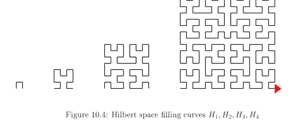

Figure 10.4: Hilbert space filling curves H₁, H₂, H₃, H₄

```
Line Lbranch(rx, ry, LSRx, SRy); Lbranch.imprint();
Line Rbranch(rx, ry, RSRx, SRy); Rbranch.imprint();

tree(height-1, H_b-H_b/height, W_b/2, LSRx, SRy); // Left Subtree.
tree(height-1, H_b-H_b/height, W_b/2, RSRx, SRy); // Right Subtree.
}
```

这段代码更紧凑，因为我们不必担心管理海龟的后置条件。

然而应该注意的是，这段代码仅用于垂直生长树。假设你想将树相对于垂直方向以 60 度的角度定向，那么这段代码就无用了。然而，海龟代码可以使用，我们只需在海龟定向到所需角度后调用它。此功能对于绘制许多真实的树似乎很有用，即许多树的子树似乎以相对于垂直的方向生长。因此，为了绘制逼真（植物学）外观的树，使用基于海龟的代码可能更方便。参见练习 13。

## 10.2.2 Hilbert 填充空间曲线

图 10.4 显示了曲线 H₁、H₂、H₃ 和 H₄，从左到右。练习要求你理解曲线的递归结构，即你能否通过组合一些 Hᵢ₋₁ 曲线和一些连接线来得到 Hᵢ。这将有助于编写一个递归函数来绘制任意曲线 Hₙ。这些曲线由数学家 David Hilbert 发明，是所谓的填充空间曲线的例子。


## 10.3 维拉汉卡数

假设你有无限供应的、高度分别为 1 和 2 的砖块。你想建造一座高度为 n 的塔。你可以用多少种方法完成？例如，假设 n = 4。一种可能是堆叠 4 块高度为 1 的砖，即从上到下考虑的高度顺序为 1,1,1,1。其他顺序为 1,1,2，或 1,2,1，或 2,1,1，或 2,2。你可以通过反复试验来检查，没有其他顺序是可能的。因此，如果你将 Vₙ 定义为建造高度为 n 的塔的方法数，我们已经证明了 V₄ = 5。我们想编写一个程序，在给定 n 时计算 Vₙ。

这个问题由维拉汉卡（Virahanka）解决，他是生活在 7 世纪的印度诗律学家。维拉汉卡（或者很可能是更早的诗律学家，关于他们没有确切信息）使用以下方法解决了这个问题，这一方法被归功于生活在公元前 3 世纪左右的宾伽罗（Pingala）。第一个观察是，最底下的砖块要么高度为 1，要么高度为 2。你可能认为这相当明显，但由此可以得出：

Vₙ = 建造高度为 n 的塔的方法数 = 建造高度为 n 且最底砖高度为 1 的塔的方法数 + 建造高度为 n 且最底砖高度为 2 的塔的方法数。

维拉汉卡观察到，如果你选择最底下的砖高度为 1，那么建造塔的其余部分的问题就只是建造高度为 n − 1 的塔的问题。因此我们有

建造高度为 n 且最底砖尺寸为 1 的塔的方法数 = 建造高度为 n − 1 的塔的方法数 = Vₙ₋₁

同样地，还可以得出

建造高度为 n 且最底砖高度为 2 的塔的方法数 = 建造高度为 n − 2 的塔的方法数 = Vₙ₋₂

所以我们有 Vₙ = Vₙ₋₁ + Vₙ₋₂

我们上面写的是递归关系的一个例子，这种方程递归地定义了一个数列，在我们的例子中就是 V₁, V₂, ...。

现在我们准备编写一个递归程序。显然，为了解决规模为 n 的问题，我们需要分别得到规模为 n − 1 和 n − 2 的问题的解。所以我们有

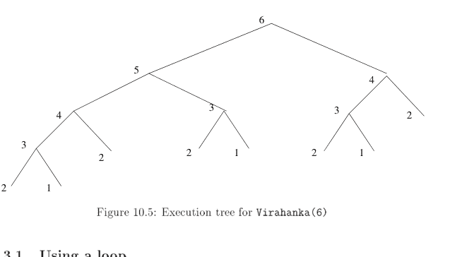

图 10.5：Virahanka(6) 的执行树

### 10.3.1 使用循环

这是计算 Vₙ 的另一种方法。我们知道 V₁ = 1，V₂ = 2，且 V₃ = V₁ + V₂。因此，我们可以计算 V₃ = V₂ + V₁ = 2 + 1 = 3。之后我们可以计算 V₄ = V₃ + V₂ = 3 + 2 = 5。之后我们可以计算 V₅，这个过程可以继续下去。显然，这里存在一些重复性的操作。所以大概使用循环来编程会很有用。大概我们可以在每次迭代中计算一个维拉汉卡数，并且需要 n − 2 次迭代，因为 V₁、V₂ 在进入循环之前已经计算过了。

为了在当前迭代中计算一个数，我们需要将上一次迭代和上上次迭代中计算出的数相加，如图 10.6 所示。然而，关键点在于，在某次迭代中被称为“上一次”的项（例如图 10.6(a)）在下一次迭代中被称为“上上次”（图 10.6(b)）。类似地，图 10.6(a) 中的“当前”变成了图 10.6(b) 中的“上一次”。在编写代码时我们必须牢记这一点。

在代码中，我们将有变量 secondlast、last，我们假设它们已经有值，并将它们相加产生一个值，放入变量 current 中。为了进入下一次迭代，如图 10.6 所示，我们对什么是“上一次”和“上上次”的认识必须改变。因此我们相应地改变它们的值。这就是循环体，它必须被执行 n − 2 次。下面是这个函数。

```
int VirahankaByLooping(int n){  // Program to compute Virahanka number V_n
    int v1=1,v2=2;                // v1 = V_1,  v2 = V_2
    if(n == 1) return v1;
    else if(n == 2) return v2;
    else {
        int secondlast=v1, last=v2, current;
        repeat(n-2){
            current = secondlast + last;
            
            secondlast = last; // prepare for next iteration
            last = current;
        }
```

选择哪一步才能确保获胜？我们将留给你去观察：白方实际上可以通过第一步只从第一堆中取 2 颗石头来赢得这场游戏。

因此，本节的核心问题是：给定游戏局面，即每堆石头的数量，判断当前轮到行动的玩家是否无论对手如何行动都能获胜。如果该局面是必胜的，我们还希望确定一个必胜的走法。顺便注意，当我们说必胜/必败局面时，我们指的是对当前轮到行动的玩家而言的必胜/必败。

在尝试解决任何问题时，先尝试一些例子是个好主意。考虑最简单的可能局面：没有任何一堆有石头，因为所有石头之前都被拿走了。按照上面的定义，在这种局面下，轮到行动的玩家显然是输家。下一个更难一点的例子是：假设只有一堆，且只有一颗石头。显然，这是一个必胜局面（对于轮到行动的玩家而言），因为他可以拿走那颗石头。事实上，如果只有一堆，无论有多少颗石头，都是必胜局面，因为轮到行动的玩家会拿走整堆。

接下来让我们考虑更复杂的情况，比如说有 2 堆，每堆有 1 颗石头。只有两个（相似的）走法：要么拿走第一堆的石头，要么拿走第二堆的石头。无论哪种情况，我们都会留下一个有 1 颗石头的堆，这对我们的对手来说是一个必胜局面。因此，从这个例子中得出一个重要原则：

> 观察 1：如果从某个局面 P 出发，假设我们每走一步都会进入一个必胜局面，那么 P 是一个必败局面。

这确实是一个重要的观察。让我们继续，考虑更复杂的情况，比如说有两堆，第一堆有 2 颗石头，第二堆只有 1 颗。现在我们有以下 3 种走法可供选择：

- 1. 从第一堆取 1 颗石头。在这种情况下，每堆各剩 1 颗石头。正如我们讨论过的，这对我们的对手来说是一个必败局面。所以对我们有利！
- 2. 从第一堆取 2 颗石头。在这种情况下，我们只留下 1 颗石头。这对我们的对手来说是一个必胜局面。因此对我们不利。
- 3. 取走第二堆唯一的那颗石头。这留下一个有 2 颗石头的堆。如上所述，这对我们的对手来说也是一个必胜局面。因此这也不利。

所以在这个局面中，第一种走法会让我们赢，而另外两种会让我们输。那么我们如何看待这个局面呢？记住我们可以选择走哪一步，因此我们当然会选择第一种走法！所以这个局面对我们来说是一个必胜局面。这似乎可以推广为另一个观察。

> 观察 2：如果在某个局面 P 中存在一步走后我们能到达一个必败局面，那么 P 是一个必胜局面。

注意，这个观察很好地补充了第一个观察。如果我们发现某一步会通向必败局面，那么第二个观察适用。如果我们发现不存在这样的走法，即所有走法都通向必胜局面，那么第一个观察适用。

上述观察给了我们一个递归算法，用于判断给定局面 P 是必胜还是必败。我们确定 P 中所有可能的走法 m_i，以及它们导致的局面 P_i。然后我们（递归地！）判断 P_i 是必胜还是必败。如果我们找到某个 P_i 是必败的，就宣布 P 是必胜的。否则，如果所有 P_i 都是必胜的，就宣布 P 是必败的。我们知道，为了使递归算法有效，必须确保两件事：

- 1. 我们需要解决的每个子问题都比原问题更简单。在我们的例子中，这是成立的，因为每个 P_i 的石头数必然比 P 至少少一颗，因此更简单。
- 2. 我们可以论证，最终我们会达到一些（“最简单的”）可以直接解决的问题。显然，随着游戏的进行，我们会到达没有石头剩下的局面。如前所述，这是一个必败局面。

因此，我们可以编写一个程序来判断一个 Nim 局面是必胜还是必败。我们给出 3 堆情况下的程序，但你可以看到它可以很容易地扩展到更多堆。下面给出的 winning 函数接收一个游戏局面，如果该局面是必胜的则返回 true，如果是必败的则返回 false。

```
bool winning(int x, int y, int z)
// x,y,z = number of stones in the 3 piles.
// returns true if this is a winning position.
{
    if(x==0 && y==0 && z==0) return false; // base case

    for(int i=1; i<=x; ++i)            // Pick i stones from pile 1
        if (!winning(x-i,y,z)) return true; // if a losing next state is found

    for(int i=1; i<=y; ++i)            // Pick i stones from pile 2
        if (!winning(x,y-i,z)) return true; // if a losing next state is found

    for(int i=1; i<=z; ++i)            // Pick i stones from pile 3
        if (!winning(x,y,z-i)) return true; // if a losing next state is found

    return false;                      // if all next states are winning
}
```

可以使用像下面这样的主程序来调用该函数。

```
int main(){
    int x,y,z;
    cout << 'Give the number of stones in the 3 piles: ';
    cin >> x >> y >> z;
    if (winning(x,y,z)) cout << 'Wins.' << endl;
    else cout << 'Loses.'<<endl;
}
```


我们的函数只说明给定的位置是获胜还是失败，它并不会说明如果是一个获胜位置应该走哪一步。你可以很容易地修改程序来实现这一点，正如练习中所要求的。

我们函数的逻辑应该很清楚。在给定的位置中，我们可以选择从第一堆、第二堆或第三堆取石子。函数中的第一个循环依次考虑从第一堆取走 i 个石子的情况。这会留下新的位置，其中石子数为 x-i, y, z。我们递归地检查这是否是一个失败位置。如果是，那么原始位置，即分别有 x, y, z 个石子的位置，根据观察 2 必须是获胜位置。随后的循环考虑从第二堆和第三堆取石子的情况。如果在检查所有走法后找不到失败位置，那么根据观察 1，原始位置确实必须是失败的。所以我们在函数的最后一条语句中返回 false。

## 10.4.1  remarks

事实证明，有一种更直接的方法来判断给定的位置是获胜还是失败。这很巧妙，涉及将堆中的石子数写成二进制，并对位进行模 2 的加法等等。我们不会涉及这一点，但你应该能在互联网上找到相关讨论。

我们的程序尽管如此仍然很有趣，因为程序的总体结构适用于许多双人游戏。事实上，递归是编写游戏程序时的重要工具。

## 10.5 结论性 remarks

需要指出若干点。

本章最重要的思想涉及算法设计。假设你想解决某个问题的实例。那么假设你能以某种方式解决较小的实例是有帮助的，并问：较小实例的解能否帮助我解决较大实例。欧几里得可能就是以这种方式思考而发现了他的 GCD 算法。Virahanka 可能也是以这种方式思考而发现了他的问题的解。

除了有递归算法，我们还有递归结构。树是具有递归结构的对象的一个很好的例子。我们可以利用递归结构来设计绘制树的递归算法。但正如你以后会看到的，树将被用来表示许多熟悉的对象，事实上，为这些对象设计算法将需要利用递归结构。

递推式的概念也很重要。

Virahanka 数的例子也展示了一个有趣的点。很可能 Virahanka 也是通过递归思考来解决他的问题的，事实上，为了解决问题而递归思考是一个好主意。但我们必须记住，有时递归地编写程序可能不是最好的选择。

最后，关于 Virahanka 数的计算应注意一个技术点。正如你在练习中会证明的，V_n 至少为 2^{n/2}，因此即使对于适中的 n 值，它也装不进一个 int。如果你使用 long long，你可以处理稍大的值。

如果你使用 double，你可以处理 n 的更大值，但它们可能只有 15 位左右是正确的。

## Exercises

- 1. 数的阶乘 n! 用 n! 表示，可以用递推式定义为 n! = (n − 1)! 当 n > 0 且 0! = 1。编写一个递归函数来计算 n!。
- 2. 二项式系数 (n choose r) 可以递归定义为 (n choose r) = (n−1 choose r) + (n−1 choose r−1)，当 n, r > 0 且 (n choose 0) = (n choose n) = 1 对所有 n ≥ 0。编写一个函数来计算 (n choose r)。
- 3. 考虑方程 ax + by = c，其中 a, b, c 是整数，未知数 x, y 要求为整数。这类方程称为丢番图方程。如果 GCD(a, b) 不能整除 c，则方程没有解。然而，如果 GCD(a, b) 能整除 c，则方程将有无穷多个解。编写一个程序，将 a, b, c 作为输入，如果 GCD(a, b) 整除 c 则打印一个解。
  - 提示 1：假设 a = 1。证明在这种情况下整数解很容易得到。
  - 提示 2：假设方程是 17x + 10y = 4。假设你用 y = z − x 代替。则你得到新的方程 7x + 10z = 4。观察到新方程的系数更小，并且给定新方程的一个解，你可以得到旧方程的一个解。
- 4. 通过观察图 10.4 推导出 Hilbert 空间填充曲线的一般结构。画一张图（在纸上）显示 Hₙ 如何由一个或多个 Hₙ₋₁ 曲线组成。这应与图 10.3 的风格相同。编写一个基于 turtle 的程序来绘制给定 n 的 Hilbert 空间填充曲线 Hₙ。
  - 遵循我们在第 10.2 节中使用的一般方案，即首先说明绘制 Hₙ 时 turtle 的前置和后置条件。尽量在不抬笔或重绘的情况下绘制曲线。
  - 你可能会发现以下事实有用。假设某个函数 f 绘制某个图形 F。那么如果我们用 −θ 替换 f 中的每个转角 θ，那么我们将得到 F 的镜像。
- 5. 考虑递推式 Wₙ = Wₙ₋₁ + Wₙ₋₂ + Wₙ₋₃，其中 W₀ = W₁ = W₂ = 1。编写一个递归程序来打印 Wₙ。另写一个基于循环的程序。
- 6. 设 Bₙ 表示 Vₙ 的递归树的分支数。因此 B₆ = 14，见图 10.5。注意每个分支都以对 Virahanka 的调用结束，因此 Bₙ 给出了计算 Vₙ 所需操作数的一个很好的估计。 (a) 写出 Bₙ 的递推式并用它编写一个计算 Bₙ 的程序。这个基例是什么？确保你的答案与图 10.5 中的树的分支相匹配。 (b) 用归纳法论证 Bₙ ≥ 2^{n/2} 对 n ≥ 3 成立。
- 7. 用归纳法证明 2^{⌊n/2⌋} ≤ Vₙ ≤ 2ⁿ。基于此，你会为计算 V₅₀ 使用什么数据类型？如果有帮助，你可以注意到更强的结果 Vₙ ≤ 1.62ⁿ ≤ 2^{n/1.43}。
- 8. 假设你对连续的 Virahanka 数 V_n, V_{n+1} 调用函数 gcd。关于对后续递归调用的参数，有一些有趣的事情。是什么？递归的深度定义为连续进行的递归调用的次数，每个调用都嵌套在前一个调用中。调用 gcd(V_{n+1}, V_n) 的递归深度是多少？基于此，论证当 gcd 被调用在 n 位数上时，所花费的时间可能大到 n/2。
- 9. 考虑本章中开发的 gcd 函数。假设初始调用的参数为 m0, n0，随后的调用参数为 m1, n1，然后是 m2, n2，然后是 m3, n3 等等。证明 m_{i+2} ≤ n_i。基于此论证，对 n 位数的 gcd 调用将具有递归深度最多为 2n。换句话说，计算 gcd 的时间最多与数中的位数成比例。
- 10. 考虑一个高度为 h 的完全二叉树。如你所见，这样的树有 2^{h+1} − 1 个顶点。我们的目标现在是编写一个程序，不仅绘制这样的树，而且为每个顶点分配一个唯一的编号，范围为 1 到 2^{h+1} − 1。并且编号应打印在图片中，略微在顶点本身的右侧。最简单的编号是中序编号。在这种编号中，顶点按从左到右的顺序编号为 1 到 2^{h+1} − 1。因此最左边的叶节点将得到编号 1，整棵树的根将得到编号 2^h，最右边的叶节点将得到编号 2^{h+1} − 1。你需要修改我们的不使用 turtle 绘制树的程序，以便也打印此编号。提示：让 tree 函数有一个引用参数可能很有用，该参数可以用来决定一个节点的编号。
- 11. 树的节点另一种有趣的编号是前序编号。节点的先序时间仅仅是根在该节点处的子树开始被绘制的时间。基于此，节点的先序编号定义为 i，如果其先序时间是第 i 小的。修改我们的树绘制程序（不使用 turtle），使其打印树的同时打印先序编号。作为例子，注意根的先序编号为 1，最左边的叶节点的编号为 h + 1，最右边的叶节点的编号为 2^{h+1} − 1。
- 12. 树的节点另一种有趣的编号是后序编号。节点的后序时间仅仅是根在该节点处的子树绘制完成的时间。基于此，节点的后序编号定义为 i，如果其后序时间是第 i 小的。修改我们的树绘制程序（不使用 turtle），使其打印树的同时打印后序编号。作为例子，注意最左边的叶节点后序编号为 1，根的编号为 2^{h+1} − 1，最右边的叶节点的编号为 2^{h+1} − h − 1。
- 13. 更常见的是，（植物学的）树有一个垂直上升的单一主干，然后分成分支。所以你可以认为一棵树是“一个垂直分支，上面以一定角度长出两棵树”。以递归程序的形式绘制表达这一想法的树。使用 turtle 会很方便。尝试变化，找出哪些树看起来逼真。


14. 编写一个函数 `draw_Hem`，它绘制调用 Virahanka 时的递归树，即 `draw_Hem(6)` 应能构造出图 10.5 所示的树。

15. 图 10.2 中绘制的树称为完全二叉树。称为“二叉树”，是因为在每个分支点处恰好有 2 个分支，或者在最顶部根本没有分支。称为“完全”，是因为所有分支都延伸到相同高度。你也可以有一棵不完全二叉树，比如你只在一边有一个分支，而另一边是整棵树。

编写一个程序，接收用户输入并绘制任意二叉树。假设对任何询问，用户都只回答 0（假）或 1（真）。设计一套问题系统，利用它确定如何移动海龟。确保你提出的问题尽可能少。

16. 考虑点 (i, j)，其中 0 ≤ i, j < n，n 为某个常数，比如 n = 10。我们想从 (0,0) 走到 (n − 1, n − 1)，其中恰好有 n − 1 步沿 x 正方向、n − 1 步沿 y 正方向。我们可以按任意顺序安排 x 和 y 方向的步数，即可以交替进行，也可以先走完所有 x 方向的步，等等。我们必须总共走 2n − 2 步，其中 n − 1 步必须沿 x 方向。因此，可以选择的总方式数，也就是我们可以遵循的不同路径数，是 C(2n−2, n−1)。每条路径可以关联一个 2n − 2 位二进制数，若路径上第 j 步沿 x 方向，则其第 j 个最低有效位为 0；若第 j 步沿 y 方向，则为 1。

编写一个程序，输入整数 n、p，并打印出所有路径集合中的第 p 大的数。提示：有多少条路径的最高有效位为 0？

17. 假设你想用下面这个非常简单的代码发送消息。假设你的消息只由字母 'a' 到 'z' 组成，在这套代码中，你只是把第 i 个字母替换为 i。因此 'a' 被编码为 1，'b' 编码为 2，依此类推，直到 'z' 编码为 26。此外，每个字母对应的数字之间没有分隔符。因此，单词“bat”将被编码为字符串 2120。显然，有些字符串会有多于一种解释，即字符串 2120 也可能来自“ut”。假设给你一个数字字符串，比如每行一个数字（因此 2120 会分 4 行给出）。你要编写一个程序，接收这样一个数字序列，并打印出它可以被解释的方式数。如果你愿意，也可以要求输入从最后一位数字开始给出。

18. 如上所述的尼姆游戏（Nim）有许多可能的变体。其中一个变体是：最后移动的玩家输。对于这个新游戏，你如何判断一个局面是必胜还是必败？

19. 在另一个变体中，你可以选择从某一堆中取任意非零数量的石头，或者从两堆中取相同数量的石头。编写一个函数，判断一个局面在此游戏中是否为必胜局面。

20. 编写一个函数，如果给定局面是必败的，则返回 0；但如果局面是必胜的，则返回一个能以某种方式指示应如何走棋的值。为此确定一种合适的编码。例如，要指示从第 p 堆中取走 s 个石头，可返回数字 $p \times 10^m + s$，其中 $10^m$ 是一个大于 $x$、$y$、$z$（各堆中的石头数）以及图中位置的 10 的幂。使用这种编码时，最后 $m$ 位数字给出要取走的石头数，而更高位数字则指示堆号。有些人可能想知道，我们是否能从函数中返回一对数字（而不必像上面那样进行编码）——我们将在本书后面看到如何做到这一点。

21. 编写一个递归函数来求 $x^n$，其中 n 是整数。试着得到一种算法，其所需的乘法次数远少于自然算法中把 x 与自身相乘 n−1 次。提示：证明如果 n = 2^k（k 为某个整数），则 k 次乘法就够了。然后在此基础上进行扩展。

## 第 11 章

## 程序组织与函数

我们先前讨论了函数，将其作为封装常用代码的一种方式，这样代码只需编写一次，之后需要时即可调用。然而，函数在 C++ 程序中还扮演着另一个角色。正如细胞是生命的基本生理和结构单位一样，函数可以被视为 C++ 程序的组织单位。一个 C++ 程序本质上是一个函数的集合¹。正如我们很快将看到的，即使是你一直在编写的 main_program，也会被 simplecpp 转换成一个函数，其结构与我们一直在编写的其他函数类似。管理构成程序的函数，尤其是大型程序，需要系统化的方法。由于大型程序通常由程序员团队开发，每个程序员可能负责编写其中一部分函数，问题就变得更加复杂。显然，如果一个程序所需的各个不同函数位于不同的文件中，会方便得多。在本章中，我们将看到将程序拆分为多个函数（可能分布在多个文件中）时的一些问题，以及如何让这些函数仍然能够相互调用并作为一个单一程序协同工作。

¹ 我们稍后会修正这一说法。

一个重要的挑战是名称管理。如果一个名称所指的内容存在任何歧义，那么这个名称就没有用处。另一方面，如果程序是合作编写的，那么不同程序员可能使用相同的名称来定义各自编写的函数。或者，你可能借用别人编写的软件包（例如 simplecpp）并在自己的程序中使用它。这实际上也带来了名称冲突的可能性：你如何确保自己不会使用所借用软件包中已经使用的相同名称？或者，如果你确实使用了，会不会造成歧义？这些是本章讨论的一些问题。

我们首先展示 simplecpp 如何将你编写的 main_program 转换为 C++ 所要求的函数。之后，我们将看到将一个程序拆分成多个文件的规则，或者反过来，在给定分布在多个文件中的一组函数时，如何组装一个程序。如上所述，名称管理将是一个重要问题。声明的概念将对此有所帮助。另一个有用的概念是命名空间（namespace），我们也将学习它。

我们在引言中提到，simplecpp 隐藏了 C++ 的一些技术性较强的高级特性，以便初学者更容易触及我们学科的核心：如何编写程序。但本章将向你介绍 simplecpp 所隐藏的所有技术特性。因此到本章结束时，如果你愿意，你可以直接使用 C++，而不必在程序中包含 simplecpp。我们将在 11.6 节讨论这一点。

最后，我们将就如何将程序拆分为函数提出一些哲学性的看法。

### 11.1 主程序也是一个函数！

实际上，C++ 要求主程序必须写成名为 main 的函数体，该函数不接受参数，并返回一个整数值。在本书开头我们没有告诉你这些，因为那时你还不知道函数，一下子了解这些可能会让你不知所措。因此，我们要求你将主程序写在名为 main_program 的块中。我们的 simplecpp 包使用 C++ 的预处理功能（附录 G）将你写的 main_program 名称更改为 int main()。因此，你指定的主程序就成为名为 main 的函数体，正如 C++ 所要求的那样。

当 C++ 程序被编译并运行时，操作系统期望其中有一个名为 main 的函数。运行一个程序实际上就是调用 main 函数。main 函数的返回类型是 int，这是出于某些历史原因，不值得深究。你可能还想知道，如果 main 函数确实应该返回 int，为什么我们在 main 中没有写 return 语句呢？那是因为我们一直使用的 C++ 编译器 GNU C++ 编译器忽略了这一违规行为，这就是原因！

既然你知道主程序只是另一个函数，从现在开始我们将不再使用 main_program 这个名称，而是把主程序写成名为 main 的函数。你也应该这样做。

### 11.2 将函数组织到文件中

如果我们愿意，可以将主程序和其他函数放在不同的文件中。如果程序很大，把它拆分成多个文件会更容易管理。只要遵守以下规则，一个程序就可以被划分成一组文件。

规则 1：如果文件 F 中的代码调用了某个函数 f，那么函数 f 必须在 F 内、在文本上位于对 f 的调用之前进行声明。注意，函数定义是一种声明，但反之则不然。我们很快就会看到什么是声明。

规则 2：每个被调用的函数必须在该组文件中的某个文件中恰好定义一次。


```
int lcm(int m, int n);
int gcd(int m, int n);
```

参数的名称可以从声明中省略，例如你可以在声明中只写 int lcm(int,int);。声明也称为原型，甚至称为签名。

假设编译器正在处理包含语句 cout << lcm(24,36); 的文件。当它到达此语句时，它需要确定 lcm 确实是一个函数，而不是某种输入错误。它还需要知道 lcm 返回值的类型——根据类型，打印方式会有所不同。这两种需求都由声明来满足。函数 f 的声明提供了 (a) 保证 f 在程序中后续使用时确实是一个函数，并且如果到目前为止尚未定义它，它将在本文件本身或某些其他文件中稍后定义，(b) 函数参数的类型描述以及函数返回值的类型。给定声明后，文件可以被编译，除了函数本身的执行代码之外，该代码可以稍后提供（第 11.2.3 节）。请注意，函数定义也提供了上面提到的 (a)、(b) 中的信息，因此也被视为一种声明。

## 11.2.2 将程序拆分为多个文件

利用声明的概念，我们可以将程序拆分为多个文件。作为示例，考虑第 9.2 节中调用我们的函数 lcm 来求 36 和 24 的最小公倍数的主程序。因此，我们的程序总共有 3 个函数：函数 main、函数 lcm 和函数 gcd。图 11.1 显示了我们如何为该程序形成 3 个文件。

首先考虑文件 gcd.cpp，其中包含函数 gcd。它不调用任何其他函数，因此不需要任何额外的声明。接下来考虑文件 lcm.cpp。它包含函数 lcm，其中包含对 gcd 的调用。因此该文件在开头有 gcd 的声明。最后文件 main.cpp 包含主程序。它调用函数 lcm，因此在开头包含 lcm 的声明。请注意，主程序使用标识符 cout 将内容写入控制台。为此它需要包含 simplecpp。其他文件不包含需要 simplecpp 服务的内容，因此顶部没有 #include <simplecpp> 行。

我们可以通过多种方式编译此程序。最简单的方法是发出命令

```
s++ main.cpp lcm.cpp gcd.cpp
```

这将生成一个可执行文件，运行后确实会找到 36,24 的最小公倍数。

## 11.2.3 分离编译和对象模块

但编译的方式还有其他。 我们可以分别编译每个文件。由于每个文件本身都不包含完整的程序，因此无法生成可执行文件。编译器将生成的内容称为对象模块，可以通过发出命令生成

```
//--------------------------------------------------------------------------------
int gcd(int m, int n){
    int mdash, ndash;

    while(m % n != 0){
        mdash = n;
        ndash = m % n;
        m = mdash;
        n = ndash;
    }
    return n;
}
//--------------------------------------------------------------------------------
```

(a) 文件 gcd.cpp

```
//--------------------------------------------------------------------------------
int gcd(int, int);        // declaration of function gcd.

int lcm(int m, int n){
    return m*n/gcd(m,n);
}
//--------------------------------------------------------------------------------
```

(b) 文件 lcm.cpp

```
//--------------------------------------------------------------------------------
#include <simplecpp>
int lcm(int m, int n);    // declaration of function lcm.

int main(){
    cout << lcm(36,24) << endl;
}
//--------------------------------------------------------------------------------
```

(c) 文件 main.cpp

图 11.1：求最小公倍数的程序中的文件

```
s++ -c filename
```

选项 -c 告诉编译器生成对象模块而不是可执行文件。这里 filename 应该是某个文件的文件名，例如 main.cpp。在这种情况下，会生成名为 main.o 的对象模块。如果不同的程序员正在处理不同的文件，他们可以分别编译自己的文件并使用 -c 选项，这样至少可以知道是否存在编译错误。

我们可以通过发出命令 s++ 后跟对象模块的名称来形成可执行文件。因此对于我们的示例，我们可以写：

```
s++ main.o gcd.o lcm.o
```

这种对 s++ 的使用被称为将对象模块链接在一起。链接过程将检查在链接的模块中声明的每个函数是否在同一模块中定义或在其他正在链接的模块之一中定义。经过此检查后，不同模块中的代码将被缝合起来形成可执行文件。

将 .cpp 文件和 .o 文件混合作为 s++ 的参数是可以接受的，例如我们本可以发出命令

```
s++ main.cpp gcd.o lcm.o
```

这将编译 main.cpp 然后将其与其它文件链接。编译 main.cpp 的结果 main.o 通常不会被看到，因为编译器在用于生成可执行文件后会将其删除。

## 11.2.4 头文件

假设程序员 M、G、L 分别开发函数 main、gcd、lcm。那么 G 必须告诉 L 如何在文件 lcm.cpp 中声明函数 gcd。传达此信息最自然的方式是将其写在所谓的头文件中。头文件具有 .h 后缀，或 .hpp 后缀或根本没有后缀，就像我们的文件 simplecpp，它也是一个头文件。一个简单的策略是为每个程序文件 F.cpp 创建一个头文件 F.h，其中包含在其他文件中有用的函数。文件 F.h 仅包含 F.cpp 中对其他文件有用的所有函数的声明。因此我们可能有文件 gcd.h 只包含一行 int gcd(int,int)，以及 lcm.h 包含一行 int lcm(int,int)。现在编写函数 lcm 的程序员 L 可以读取文件 gcd.h 并将该行放入 lcm.cpp 中。然而，更不容易出错且更常见的是 M 只是在他的文件中放置包含指令

```
#include "lcm.h"
```

而不是声明。此指令会导致提及的文件的内容，（本例中为 lcm.h）被放置在包含指令出现的位置。提及的文件必须存在于当前目录中（或可以给出路径）。

> 2 文件名通常必须用引号括起来，如果文件存在于当前目录或使用显式路径给出的位置。如果文件存在于编译器被要求使用其他机制查找的某个目录中，则使用尖括号，例如 #include <simplecpp>。要获得确切的细节，你需要查阅你的编译器/链接器的文档。

因此，除了将文件 `lcm.h` 也放在包含 `main.cpp` 的目录中之外，没有其他需要。同样，M 将在 `main.cpp` 中放置行 `#include "lcm.h"`，作为结果，lcm 的声明将被插入到 `main.cpp` 文件中以满足需要。

请注意，我们本可以使用单个头文件，例如 `gcdlcm.h` 包含两个声明。

```
int gcd(int,int);
int lcm(int,int);
```

我们可以将此单个文件包含在 `main.cpp` 和 `lcm.cpp` 中。这将导致两个声明都被插入到每个文件中，而其中只有一个是需要的。拥有额外的声明是可以接受的。

## 11.2.5 头文件保护

头文件可能会变得相当复杂。如果有多个头文件，那么你可以将包含指令本身放在另一个头文件中。包含后者文件将导致前者文件被包含。如果我们有头文件相互包含，就会产生以下可能性：我们包含某个文件 `a.h`，它又包含文件 `b.h` 和 `c.h`，两者都包含文件 `d.h`。这可能会导致问题，因为根据我们当前对头文件的定义，`d.h` 中的内容将被包含，并且因此被定义两次。当然再次声明相同的名称是一个错误。

所以我们需要一种方法来说，“仅在尚未包含之前才包含以下内容”。

这就是头文件保护提供的功能。事实上，更常见的是以以下形式编写头文件 `gcdlcm.h`。

```
#ifndef GCDLCM_H
#define GCDLCM_H
int gcd(int,int);
int lcm(int,int);
#endif
```

第一行检查所谓的预处理器（附录 G）变量 `GCDLCM_H` 是否已被定义。只有在它*未*被定义时，从该行到 `#endif` 行之间的其余文件才会被处理。请注意，第二行如果被处理，将会定义 `GCDLCM_H`。这将确保后续对文件 `gcdlcm.h` 的包含将没有任何效果。

请注意，与 C++ 变量不同，预处理器变量可以在不被赋值的情況下定义，如上面的代码所示。还请注意，变量的名称可以是你选择的任何名称；使用文件的大写名称并加上后缀 `_H` 只是一种约定。

## 11.2.6 打包软件

上面的讨论展示了你如何开发函数并将其提供给他人。你创建 F.cpp 文件和包含 F.cpp 中定义的函数声明的 F.h 文件。接下来你使用 -c 选项编译 F.cpp 文件。然后你将生成的 F.o 文件和 F.h 文件提供给想要使用你的函数的人。他们必须放置该文件


F.h 在包含其源文件（即包含其 C++ 程序的文件）的目录中，并将行 #include "F.h" 放在需要 F.h 中声明的函数的文件中。接下来，在编译时他们必须提及文件 F.o，如果它不在当前目录中，则给出路径名。请注意，如果你不希望向他们展示，你的其他程序员不需要看到你的源文件 F.cpp。

## 11.2.7 前向声明

让我们回到所有函数都在单个文件中的情况。我们在第 9.1 节中建议函数必须在其使用（即对其的调用）之前在文件中定义。然而，正如我们在 11.2 节开头讨论的那样，在使用之前有一个声明就足够了。因此，如果我们希望将函数定义放在后面，我们必须另外在前面放置一个声明。

当在一个文件中编写包含多个函数的程序时，许多人喜欢先放置主程序，也许因为它能很好地概述整个程序的内容。我们可以这样做；将你的文件内容按以下顺序组织是可以的。

```
declarations of functions in any order.
definition of main
definitions of other functions in any order.
```

当然，其他顺序也是可能的。

## 11.2.8 函数模板和头文件

函数模板必须存在于需要从模板创建函数的每个源文件中。因此模板最好写在头文件中。请注意，模板本身不能被编译；只有从模板生成的函数才会被编译。因此对于模板函数 f，我们通常会有头文件 f.h，但没有文件 f.cpp。

## 11.3 命名空间

接下来我们考虑一个重要问题，当程序使用由不同人开发的函数时通常会出现这个问题，可能是在不同的时间开发的。问题是：如果从两个程序员那里借用代码，两人都定义了同名且签名相同的函数会发生什么？请注意，你可能得不到函数的源代码，因此可能没有办法更改任何函数的名字。

此类冲突通常使用命名空间的概念来解决。命名空间就像一个目录。当你将一个名字 name 放在命名空间目录中时，你实际定义的名字不是 name，而是 catalog::name。即使名字被放在命名空间中，也可以使用简短版本 name 而不是总是需要使用完整版本 catalog::name。C++ 确实为你提供了这样做的机制。然而，完整的名字 catalog::name 在需要时始终可以使用。

如果为公共使用创建函数，预计你会将它们放在一个合适命名的命名空间中。因此，如果你从两个程序员那里借用代码，那么很可能他们会使用不同的函数名或不同的命名空间。因此，即使函数名碰巧相同，通过使用完整名称你也可以明确地引用每个函数。

接下来我们看看如何创建和使用命名空间。我们只考虑主要思想并省略许多细节。

### 11.3.1 定义

你可以通过编写以下内容来定义一个名为 name-of-namespace 的命名空间及其内部的名字：

```
namespace name-of-namespace{
    declarations of definitions of names
}
```

在 name-of-namespace 之后的块内，你可以声明或定义任意多的名字。例如，你可能会写：

```
namespace mySpace{
    int gcd(int,int);
    int lcm(int m,int n){return m*n/gcd(m,n);}
}
```

写完之后，命名空间 mySpace 将包含名字 gcd 和 lcm。可以只给出声明（如我们对 gcd 所做的）或完整的定义（如我们对 lcm 所做的）。在命名空间块内，你可以直接引用其中的名字。因此，lcm 的定义直接引用了 gcd。然而，在命名空间块之外，默认情况下你必须使用完整的名字。例如，在上面定义 mySpace 之后，你可以通过编写以下内容来定义 gcd。

```
int mySpace::gcd(int m, int n){
    if(n == 0) return m;
    else return gcd(n, m % n);
}
```

你会注意到上面定义的最后一行使用了名字 gcd 而没有加上命名空间的名字作为前缀。这是可以的；属于命名空间的函数的定义被视为该命名空间的扩展，因此可以由其简短名字直接引用该命名空间中的其他函数。

最后，我们可以按如下方式使用命名空间中的函数。

```
int main(){
    cout << mySpace::lcm(36,24) << endl;
}
```

这必须跟在命名空间定义和 mySpace::gcd 的定义之后，当然在 main 中必须使用完整的名字 mySpace::lcm。

### 11.3.2 using 声明和指令

不断写出函数的完整名字变得很乏味。然而，我们可以通过包含所谓的 *using 声明* 来使用较短的形式：

```
using ns::n;
```

这里 ns 是命名空间的名字，n 是在其中定义的名字。在 using 声明之后的代码中，对名字 n 的所有引用都将被视为引用 ns::n。因此我们可能会写

```
using mySpace::lcm;
```

如果我们将此行放在主程序之前，那么在主程序中我们可以使用 lcm 而不必写 mySpace::lcm。

另一个变体是仅仅声明

```
using namespace ns;
```

这称为命名空间指令。有了它，命名空间 ns 中的所有名字都可以在其后的代码中使用简短形式。

### 11.3.3 全局命名空间

当你定义函数而不将它们放在命名空间中时，它们隐式进入一个无处不在、无名的 *全局命名空间*。当你使用没有命名空间限定符的名字时，预计它存在于全局命名空间中或存在于已给出适当 using 声明或指令的命名空间中。

假设我们有如上定义的命名空间 mySpace，并且我们在主程序中还放置了一个 using namespace mySpace; 指令。

```
using namespace mySpace;

int lcm(int m,int n){return m*n;}  // not really computing the lcm!

int main(){
    cout << lcm(36,24) << endl;
}
```

在这种情况下，编译器会标记错误，说明主程序中的引用 lcm 是模棱两可的，它可能指的是全局命名空间中的 lcm 函数，或通过 using 指令使之可用的 mySpace 中的 lcm 函数。在这种情况下，你必须给出函数的完整名字并在其中选择一个。

要专门引用全局命名空间中的函数 lcm，你可以写 ::lcm。因此在上面的主程序中，你必须将 lcm 改为 ::lcm 或 mySpace::lcm。请注意，如果两个 lcm 定义具有不同的签名，则不会出现此问题。

### 11.3.4 无名命名空间

我们讨论一个有点技术性的问题，可以忽略它。

如果你在文件 `F1.cpp` 的全局命名空间中定义函数 `f`，它在编译文件时可能可供其他文件使用，例如 `F2.cpp`，前提是你一起编译文件，即通过发出命令

```
s++ F1.cpp F2.cpp
```

进行编译。

有时你可能打算函数 `f` 仅在文件 `F1.cpp` 内使用，而不暴露在外部。为此，你可以在无名命名空间中定义它，方法是写

```
namespace{               // notice that no name is given
  declaration of f
}
```

有了它，你可以在声明出现的内部直接按其名字使用 `f`，但不能在文件外部使用。你可以认为显式创建的无名命名空间是仅对声明出现的那个文件中的函数可用的全局命名空间。

### 11.3.5 命名空间和头文件

通常，命名空间定义是在头文件内部进行的，并且在这些定义中只放置声明。函数定义放在实现文件中，其中必须包含包含命名空间定义的头文件。
使用命名空间中函数的那些文件也必须包含包含命名空间定义的文件，并且可以使用命名空间中的函数，要么给出完整的名字，要么给出 using 指令和简短的名字。
图 11.3.5 显示了一个示例。

## 11.4 全局变量

到目前为止，本书中我们一直有在函数内部定义的变量。然而，虽然不推荐，但可以在所有函数之外定义变量。在这种情况下，变量成为全局变量，即可以被任何函数访问。请注意，编译器通常会有单独的内存区域为全局变量分配；全局变量不会在任何函数的激活帧中分配。
这里有一个例子。

```
int i=5;                 // global variable definition

void f(){ i = i * i; }    // refers to global variable

int main(){
  cout << i << endl;       // refers to global variable
  f();
}
```


```
namespace mySpace{
    int gcd(int,int);
    int lcm(int,int);
}
```

(a) 文件 mySpace.h

```
#include "mySpace.h"

int mySpace::lcm(int m,int n){
    return m*n/gcd(m,n);
}
int mySpace::gcd(int m, int n){
    if(n == 0) return m;
    else return gcd(n, m % n);
}
```

(b) 文件 impl.cpp

```
#include <simplecpp>
#include "mySpace.h"

using namespace mySpace;
int main(){
    cout << lcm(36,24) << endl;
}
```

(c) 文件 main.cpp

图 11.2：使用命名空间的多文件程序

```
cout << i << endl;       // refers to global variable
}
```

如果执行这段代码，第一条语句将打印 5，即全局变量 i 的当前值。然后 main 程序中对 f() 的调用会将 i 改为 25，这将被第三条语句打印出来。

不鼓励使用全局变量，因为全局变量使代码难以理解。潜在地，任何函数调用都可能修改该变量，因此很难断言在执行的任何点变量所取的值。然而，全局变量在若干（尤其是较旧的）程序中被使用，因此有此讨论。

我们注意到在一个文件中定义的全局变量也可以在另一个文件中使用。但是，它必须在该文件中声明为 `extern`。因此，要在另一个文件中使用上面定义的全局变量 `i`，该文件需要有声明

```
extern int i;                 // declaration, not definition
```

请注意，这并不为 `i` 定义空间，它仅仅声明 `i` 为一个 `int`，将在其他某个文件中定义。

你也可以将全局变量放在命名空间中。最简单的方法是将声明（它只是前面加上 `extern` 的定义）放在命名空间块内，该块可以位于头文件中。然后其中一个实现文件应包含该变量的定义。

我们最后注意到，单个函数可能包含与全局变量同名的局部变量的定义。在这种情况下，局部变量将 *shadow* 全局变量（第 3.6.3 节）。

## 11.5 两个重要的命名空间

C++ 程序员需要了解的最重要的命名空间是命名空间 `std`。

命名空间 `std` 包含许多名称，你可能到目前为止一直认为它们是语言的一部分的保留字。事实上，单词 `cin`、`cout`、`endl`，以及单词 `string` 和你很快会看到的其他单词都在这个命名空间中。但如果 `cin` 在 `std` 中，你可能会想知道为什么到目前为止你没有被迫写 `std::cin` 而不是仅仅 `cin`。答案正如你可能猜到的，是你编写时包含的文件 `simplecpp`

```
#include <simplecpp>
```

包含指令 `using namespace std;`。

对本书（但对 C++ 一般而言不是）也很重要的另一个命名空间是命名空间 `simplecpp`。所有名称如 `initCanvas`、`Circle`、`Line`、`forward`、`left` 都在这个命名空间中。正如你可能猜到的，你可以直接使用这些名称，因为文件 `simplecpp` 也包含指令 `using namespace simplecpp;`。

```
#include <iostream>
#include <cmath>
using namespace std;

int main(){
    cout << "Give area of square: ";
    double area;
    cin >> area;
    cout << "Sidelength is: " << sqrt(area) << endl;
}
```

图 11.3：文件 sidelength.cpp 的内容

## 11.6 没有 simplecpp 的 C++

我们现在考虑如何在不使用 simplecpp 的情况下编写和编译 C++ 程序。我们在图 11.3 中展示了一个示例文件。

该文件 sidelength.cpp 可以使用任何 C++ 编译器编译，例如 GCC 编译器。最常用的是通过如下命令调用 GCC 编译器。

```
g++ sidelength.cpp
```

文件中的所有内容看起来都应该很熟悉，除了前两行。文件 iostream 是一个头文件，包含执行输入输出所需函数的声明。文件 cmath 是一个头文件，包含数学函数如 sqrt 的声明，以及其他函数包括三角函数。你可能会想知道为什么到目前为止我们不需要包含这些文件——答案当然是我们包含了文件 simplecpp，而它又包含了这两个文件。

如果你的程序不包含图形，那么如果你愿意，可以放弃 simplecpp，如上文 sidelength.cpp 所示。你需要做的只是不包含 simplecpp，而是包含文件 iostream 和 cmath，并且也放入 using 指令。此外你也不能使用 repeat 命令；但我们已经建议你开始使用其他循环命令（第 7 章）代替。最后，你不应将主程序定义为 main_program，而应将其定义为名为 main 的函数。simplecpp 中还有一些其他次要特性你不能使用——我们在遇到时将讨论这些。

## 11.7 函数指针

在第 8.3 节我们讨论了用于寻找数学函数 f(x) 根的二分法。理想情况下，我们应该将二分法本身写成 C++ 函数，向其传递数学函数 f(x) 作为参数。这不是我们当时编写方法的方式。相反，我们展示了该方法的代码，其中用于计算 f(x) 的代码（不是对它的调用）按需插入。但现在我们可以做得更好。

首先，有如何表示数学函数 f(x) 的问题。最简单的方法是作为 C++ 函数，例如 f，它接受一个 double 参数并返回一个 double！但然后，我们需要一种方法将 C++ 函数（f）作为参数传递给另一个 C++ 函数，我们可以称之为 bisection。
图 11.4 显示了如何做到这一点。该代码包含两个数学函数的 C++ 等价物，f(x) = x² − 2，以及 g(x) = sin(x) − 0.3。单个函数 bisection 用于寻找这两个函数的根。我们将很快解释 bisection 的工作原理，但首先考虑主程序。正如你所见，main 调用 bisection 来寻找每个根。考虑第一次调用。对调用的前两个参数是函数变号的区间左右端点。我们使用了与第 8.3 节中 xL、xR 相同的端点值，即 0、2。下一个参数是 epsilon，它给出函数值可接受的误差。对于此我们选择了值 0.0001，而不是从键盘读取。最后一个参数以某种方式提供函数 f，其根将被计算。为什么我们需要写 &f 将很快变得清楚。第二次调用类似。我们要求在区间 0 到 π/2 中寻找一个根，在此我们知道 g(0) < 0 而 g(1) > 0。因此二分法可以应用。所以我们调用它，将 epsilon 指定为 0.0001。最后两行只是打印出答案并检查第一个答案的平方是否接近 2，以及第二个答案的正弦是否接近 0.3

首先，关键思想。正如你从第 2.8 节所知，代码和数据都放在内存中。就像我们可以通过其起始地址识别一个变量一样，我们也可以通过其代码开始的地址识别一个函数。因此 C++ 有函数指针的概念，你可以将其视为对应于函数的代码的起始地址。一旦我们有了指向函数的指针，我们只需对其解引用并使用它！因此，表达式 &f 和 &g 只是指向我们函数 f、g 的指针。所以剩下的要解释的只是函数 bisection 如何解引用并使用它们。

bisection 的最后一个参数的名称是 pf。我们很快会解释它看起来复杂的声明。在函数体中，该参数 pf 确实出现了被解引用的形式。在第一行它以 (*pf)(xL) 的形式出现，其中括号是必要的，因为仅写 *pf(xL) 将被解释为 *(pf(xL))，这不是我们想要的。注意到解引用按我们期望的方式工作，表达式 (*pf)(xL) 当 pf 的值为 &f 时确实会计算为 f(xL)。类似地，表达式 (*pf)(xM) 将计算 f(xM)。因此这段代码将与第 8.3 节中第一次调用的代码完全一样地工作。

所以现在唯一需要解释的是 bisection 的最后一个参数的神秘声明。基本上我们需要一种方法来说明某物是一个函数指针。请注意 bisection 只能用于寻找一个实变量函数的根，即传递诸如 gcd（它接受 2 个 int 参数并返回一个 int）的函数是没有意义的。只有某些类型的函数的指针才可接受作为 bisection 的参数：具体是指向接受单个 double 参数并返回 double 结果的函数的指针。

首先，让我们考虑如何声明一个接受 double 作为参数并返回 double 结果的函数。如果函数的名称是 pf，那么我们从第 11.2.1 节知道它可以声明为：

```
double pf(double); // pf is a function taking double and returning double
```


```
double f(double x){
    return x*x -2;
}

double g(double x){
    return sin(x) - 0.3;
}

double bisection(double xL, double xR, double epsilon, double (*pf)(double x))
// precondition: f(xL),f(xR) have different signs. ( >0 and <=0).
{
    bool xL_is_positive = (*pf)(xL) > 0;
    // Invariant: x_L_is_positive gives the sign of f(x_L).
    // Invariant: f(xL),f(xR) have different signs.

    while(xR-xL >= epsilon){
        double xM = (xL+xR)/2;
        bool xM_is_positive = (*pf)(xM) > 0;
        if(xL_is_positive == xM_is_positive)
            xL = xM; // maintains both invariants
        else
            xR = xM; // maintains both invariants
    }
    return xL;
}

int main(){
    double y = bisection(1,2,0.0001,&f);
    cout << "Sqrt(2): " << y << " check square: " << y*y << endl;

    double z = bisection(0,PI/2,0.0001,&g);
    cout << "Sin inverse of 0.3: " << z << " check sin: " << sin(z) << endl;
}
```

图 11.4：以函数形式实现的二分法

但现在我们只需注意声明指针的一般策略：如果某个声明将名称 v 声明为类型 T，那么将 v 替换为 \*v，新声明就会将 v 声明为指向 T 的指针。这样做，我们就得到了想要的结果。

```
double (*pf)(double); // *pf is function taking double and returning double
// pf is pointer to function taking double and returning double
```

这里加上括号是为了避免将 \* 与 double 结合。

声明指针有些棘手且令人费解。写出这样的声明甚至读懂它们都需要一些练习。再举一个例子，下面就是如何声明 ph 为一个指向函数的指针，该函数接受一个 double 和一个 int 作为参数，并返回一个 double。

```
double (*ph)(double,int);
```

也许最好的阅读方式是我们上面所做操作的逆过程。将 \*ph 替换为 h，观察 h 一定是一个接受 double、int 参数并返回 double 的函数。因此，\*ph 一定是指向这样一个函数的指针。

### 11.7.1 一些简化

C++ 标准允许你在传递函数时省略运算符 &，在调用函数时也允许省略解引用运算符 \*。不幸的是，这并不能帮助解决最棘手的部分：函数指针参数的声明。

### 11.8 结束语

本章详细讨论了使用函数的许多技术层面。然而，还有一个重要的哲学层面，我们将在下面进行探讨。

我们还讨论了函数指针的概念。然而，在 C++ 中，为了提供类似的功能，还引入了一些额外的机制。这些将在第 16.4 节和附录 H 中讨论。

### 11.8.1 函数的大小与可读性

本章开始时，我们提出函数是避免代码重复的一种机制。这确实是函数的一个非常重要的用途。然而，函数也可以用来让其他程序员更容易理解你的代码。易于理解非常重要，尤其是在程序员团队协作时。

提高任何内容可理解性的一种方法是将它分成小块呈现。当你写一本书时，把它分成章节是有用的。章节构成书的一个组织单位。以类似的方式，函数构成程序的一个组织单位。对于将长文本分成章节或小节，有一些经验法则。一个经验法则的例子：每个重要的想法都应该有自己的章节，或自己的小节。将大型程序拆分为函数也有类似的经验法则。函数的长度应在 40 到 50 行之间。基本上，你应该能够一眼看到函数的整个逻辑：这样更容易理解什么依赖于什么，或者发现错误。我们如何将程序分解成更小的片段？到目前为止，你还没有机会编写超过 40 行的程序，所以这个讨论也许有点难以体会。然而，你稍后会看到，大多数程序可以被认为是分阶段工作的。那么你应该考虑将每个阶段编写为一个单独的函数，并给它一个描述其功能的名称。这些函数可以放在与主程序相同的文件中，但你会发现这样做会使程序更容易理解。另一个想法是，将你可能需要执行的任何稍微复杂的操作封装成一个函数。举个例子，考虑从键盘读入一个值这个看似简单的操作。如第 7.3 节所述，用户可能输入无效值，或者该值可能不代表自身，而实际上可能表示值流已经结束。一种方法是将处理所有这些的逻辑放在一个由主程序调用的函数中。这个想法在第 9.7 节的 read_marks_into 函数中得到了部分探讨。

### 11.9 练习

- 1. 假设图 11.1 中的 LCM 计算程序是使用单个文件编写的，并且注意到只有函数 lcm 被声明了同时也被定义了，所有其他函数都被定义了但没有声明。请展示该程序在文件中可能的样子。

- 2. 传递给二分函数的函数接受一个 float 并返回一个 float。然而，我们很可能需要找到一个接受 double 并返回 double 的函数的根。此外，如果其他参数的类型也改为 double，那将会很好。将 bisection 变成一个模板函数，使其同时适用于 double 和 float 类型。当然，你也可以通过重载 bisection 这个名字来实现。

## 第 12 章：编程实践：一些技巧和工具

> *理论上，理论与实践是相同的。在实践中，它们并不相同。*
> 阿尔伯特·爱因斯坦

如果你一直在阅读本书而没有解决任何练习，你也许会认为开发程序的过程干净整洁，通常一帆风顺。另一方面，如果你一直在解决练习，你的经历可能会不同。编写程序后，你编译并运行程序，然后通过提供不同的输入来测试它。你可能会发现，对于某个输入，我们称之为 x，程序没有产生正确的输出。经过一番调查，你弄清了为什么程序没有为 x 产生正确答案；于是你修改程序（通常称为“调试”）并重新运行。然后你发现现在程序在 x 上正确运行，但它在输入 y 上却不能正确运行，而旧程序对 y 是正确的！所以你不得不做更多的调查工作。这个循环可能会持续一段时间。

在本章中，我们将讨论整个编程过程，并提出建议，旨在（a）增强对程序正在完成其应有功能的信心，以及（b）使这个过程不那么累人。

程序开发过程始于清楚地理解要做什么，即程序的规格说明。在抽象理解规格说明的同时，构造输入和所需输出的示例是有用的。这些有助于确保规格说明是正确的，并且还可以在程序编写完成后用于测试程序。在讨论规格说明之后，我们将简要评论程序设计。最后，我们还将对调试过程做若干评论。在此过程中，我们还将评论一些通用机制，比如输入输出重定向和断言，它们可用于简化上述步骤。在某种程度上，本章是第 4 章的扩展版本。

本章中提出的一些建议可能会让你觉得过于谨慎，你可能会想：“我可以比这快得多。”如果你恰好是少数幸运儿之一，能够凭直觉、无需明显仔细规划就能正确编写大型程序，那你真是了不起！但如果你发现自己花在调试程序上的时间比一开始设计程序的时间还多，那么鼓励你尝试本章给出的建议。


## 12.1 规范的清晰性

编写一个正确的程序的第一步是清楚地知道你希望程序做什么。这听起来很明显，但通常，程序之所以不工作，是因为程序员没有清楚地考虑对于某些棘手的输入实例需要发生什么。你如何确定自己完全了解程序预期要做什么，并且已经考虑了所有可能性？做到这一点的最好方法是把规范写得非常清楚，如果可能的话，用精确的数学术语来写。

通常，在规范中你会说明输入由数字 x、y、z、... 组成，而输出由数字 p、q、r、... 组成。然后你会给出这些数字必须满足的条件。规范并不期望指出输出应如何实际生成，这由你的程序决定，有时被称为实现。如果你的实现产生的输出对于每个输入都满足规范中描述的条件，那么也只有在这种情况下，你的实现才能被认证为正确。最好将规范作为程序中的注释写下来，并且在规范中使用与程序中相同的变量名。

让我们举一个例子。计算一个数字的位数程序的规范是什么？我们认为我们理解十进制数字，而我们确实理解。但这种直觉上的理解并不构成规范。直觉上的理解必须用更精确的术语来解释。这里是我们之前使用的规范。

Input: A non negative integer n.

Output: Smallest positive integer d such that 10^d > n.

这是一个很好的规范，因为它给出了我们希望输出满足的精确条件，不多也不少。

在编写规范时，通常以“最小/最大...满足...”的形式陈述条件。以这种方式制定规范需要一定的练习。也需要很多谨慎。条件应该是 10^d > n 还是 10^d ≥ n？你可能会认为这些问题很乏味，但如果你在编写规范时无法正确回答它们，你就不太可能正确地编写程序！你可能在程序中犯了同样的错误！

让我们考虑另一个问题。假设你在平面上有 n 个点 p1, ..., pn。找到包含所有点的最小圆。重写问题陈述中的内容可能很诱人：

Input: n points p1, ..., pn in the plane.

Output: Smallest circle that contains all points.

在这里，我们没有说明如何用数字表示一个圆。这是可以接受的，如果我们的读者知道如何用数字表示圆并将诸如“最小圆”和“包含所有点”之类的短语转化为数字上的条件。对于现在，我们更喜欢以下对输出的描述。

Output: Real numbers x, y, R such that the distance between each point p_i and the point (x, y) is at most R, and R is smallest possible.

在这里，我们没有定义“距离”是什么意思。如果这不被期望是常识，那么我们也应该把它写出来。

再考虑一个例子。

Input: n points p1, …, pn in the plane specifying the vertices of a polygon in clockwise or counterclockwise order.

Output: Area of the polygon.

这看起来像是一个很好的规范。虽然我们没有给出计算面积的公式，但面积的概念是常识。还是吗？当你更深入地思考这个问题时，你会意识到如果线段相交，即如果多边形不是简单的，就没有面积的标准概念。如果我们允许非简单多边形作为输入，问题陈述需要定义非简单多边形的面积是什么意思。假设用户期望只提供简单多边形作为输入。在这种情况下，输入必须被描述为这样。

Input: n points p1, …, pn in the plane specifying the vertices of a simple polygon in clockwise or counterclockwise order.

该规范没有说明如果执行期间指定的输入无效会发生什么，比如作为输入给出的多边形实际上不是简单的。事实上，这并不是程序实现者和用户之间的契约的一部分。如果输入多边形是非简单的，程序可能会给出垃圾值，甚至可能不终止。如果期望其他行为，则应将其作为规范的一部分。

需要注意的要点如下。首先，尽可能精确地写下规范，如果合理明显，使用数学符号。其次，你可能会收到看起来不错但实际上没有正确定义的规范。在这种情况下，你应该修改它。最后，可能提供不遵守规范的输入，例如用户可以提供非简单程序作为输入。如果发生这种情况，实现者无需保证任何特定的输出。

## 12.2 输入-输出示例和测试

在编写规范的同时，你应该构造示例输入实例，并计算出你希望的输出。正如第 4.1.1 节所讨论的，对于你所做的任何抽象陈述，在脑海中拥有示例是很好的。另一个原因是，你所计算的输入-输出示例稍后将作为你程序的测试用例。

对于位数计算程序，很容易计算出示例。例如，你可能会决定让你的第一个输入实例为数字 34，对于该数字输出必须是 2，因为 34 的位数是 2。这可能看起来太容易了，但即便如此也应该

写下来。你还应检查输入 (34) 和输出 (2) 是否与你在规范中写下的内容一致：2 是否确实是满足 10² > 34 的最小数字？这些听起来像是微不足道的检查，但你的程序可能因微不足道的错误而出错，因此此类检查是有用的。对于圆覆盖问题，计算示例更困难，因为手工找到最小覆盖圆可能需要相当多的计算。在这种情况下，你至少可以构造几个简单的情况，例如只有两个点，比如 (0,0) 和 (1,0)，对于它们，最佳覆盖圆的半径必须是 0.5，并且必须以 (0.5,1) 为中心。

如果你想设计稍后用作测试用例的示例，你应该思考哪些示例是“好的”。为此有几种策略。一个想法是生成你认为可能是“通常”的实例，你认为在实践中可能是“常见的”。例如，对于覆盖圆问题，所有点随机放置在平面上的实例可能比它们全部共线的实例更常见。对于某些其他问题（比如计算位数）可能没有“实践中常见”的概念。即使在这种情况下，你也可以考虑使用随机输入值。你可能会想知道如何将随机数字输入到计算机中。我们将在第 12.7 节讨论这个问题。

另一种可能性是考虑某些输入实例是否比其他实例“更难”，因此可能更好地测试程序？困难的概念当然是非正式的。但这里是如何你可能会认为某些输入更有趣，比如对于位数计算问题。如果你将位数 d 看作输入 n 的函数，你会看到 d 在 10 的幂处发生变化。在 9 时输出值为 1，但在 10 时增加到 2。值在 999 时为 3，但在 1000 时增加到 4。所以你可能希望更关注这些输入值：也许程序必须“高度注意”并区分 999 和 1000（即使它们是连续的），但不必区分 578 和 579（它们也是连续的）。因此检查输入 999、1000 等更可能暴露错误，而不是检查 578 或 579。另一个情况当然是检查允许的最小和最大输入值。对于位数计算，0 是允许的最小值，而无论在你的计算机上表示 n 的最大允许值是多少。最小值、最大值以及输出发生变化的值非正式地称为“边界情况”，你 certainly 应该在这些值附近进行测试。

对于多边形面积问题，最简单的输入实例可以是矩形，对于矩形，手工计算面积应该是容易的。你也可以问，哪些输入实例容易，哪些困难？多边形必须是简单的，但当然不必是凸的。所以如果你计划允许非凸多边形作为输入，那么它们 certainly 应该是你的测试实例的一部分。如果你决定不允许非凸实例，那么你应该修改规范以声明这一点。请注意，让你的程序正确实现一个较弱的规范，比错误地实现一个更强的规范要好。

多边形面积问题的输入长度不是固定的。很可能程序首先读取 n 个顶点数，然后是点的坐标。一个重要的问题是要回答你的程序将如何处理边界情况，例如 n = 2 或 n = 1 甚至 n = 0。要么你返回 0，要么你在规范中明确说明这些情况将不会被你的程序处理。


## 12.3 输入/输出重定向

当你以专业方式编写程序时，需要记录所进行的测试。通过使用一种称为输入重定向的功能，可以很好地实现这一点。大多数操作系统都支持输入重定向。

在第1章中，我们告诉你`cin`代表键盘，每当你的程序执行形如`cin >> ...`的语句时，你需要输入一个合适的值。这是一种过度简化。实际上，`cin`代表一个抽象的、标准输入设备，默认情况下是键盘，但这个默认值是可以更改的。如果你愿意，你可以让标准输入设备成为一个文件，比如命名为`file1`。因此，程序在执行`cin >> ...`语句时，不再是等待你输入，而是从文件`file1`中获取输入。这被称为输入重定向。要重定向输入，你需要在命令行中指定文件名，并在可执行文件名之后以字符`<`作为前缀。因此，要将输入重定向为来自`file1`，你需要在命令行中输入以下内容。

```
% a.out <file1
```

正如你所看到的，输入重定向非常方便。甚至在你编写程序之前，你就可以将上面讨论的每个测试实例放入一个文件中。当程序准备好后，你只需重定向输入，使数据来自你选择的文件即可。

因此，我们可以提出以下创建和使用测试用例的流程。甚至在你编写程序之前，就创建测试用例，将输入放入文件中，每个实例一个文件。这样，你将创建几个文件，例如`input1.txt`、`input2.txt`...。还要创建文件`output1.txt`、`output2.txt`...，其中包含你期望的对应输入实例的输出。程序准备好后，只需重定向输入，例如从`input3.txt`重定向，以在第三个实例上测试程序。检查你得到的输出是否确实与`output3.txt`中记录的一致。

顺便注意，如果你的程序在第一次运行时没有正确运行，输入重定向也很有用。如果你已将数据放入文件中，那么你可以从该文件重定向输入，从而不必一次又一次地输入数据。这节省了打字功夫，对于输入量大的程序尤其有用。

最后注意，标准输出流`cout`也可以被重定向。为此，你可以通过输入以下内容来执行程序。

```
% a.out >file2
```

如果这样做，你的程序中通过执行`cout << ...`打印的任何内容都将放入文件`file2`中，而不是显示在屏幕上。

这对于输出量大的程序很有用。如果将输出放入文件中，你可以从容地检查它。而且，这样创建的文件可以作为你测试活动的记录。

## 12.4 算法设计

在开发规格说明和测试用例之后的下一步是算法设计。所谓算法，我们指的是解决问题所需的抽象思想。例如，如何找到覆盖一组点的最小圆？这个问题有点像谜题，似乎需要一些创造性思维。你甚至可能会想，创造力是否能被教授。但确实存在设计算法的策略。正如我们经常提到的，递归是一种策略。然而，算法设计实际上超出了本书的范围。

在大多数情况下，为了编写文本和练习中描述的程序而需要知道的任何算法，我们要么直接告诉你，要么它们是你已经知道的算法的微小修改。并且要意识到你已经知道很多算法了。事实上，从童年起你就学习了很多算法，如何将两个数相乘，如何烹饪，如何骑自行车，等等。你需要用C++来表达其中一些算法。这不一定容易，你可能在潜意识中、出于习惯地执行这些算法，但你将不得不对自己的行为进行内省，识别其中的模式，并用C++表达出来。这对于某些问题可能是可能的，例如将一个多位数与另一个数相乘，但对其他问题则非常困难，例如骑自行车。无论如何，在大多数情况下，你不应该需要严肃的算法设计，但你当然应该能够内省你从小就学习的技能，将其语言化并用C++表达。除此之外，还有一定量的

如何产生这样的想法在本书其他地方讨论。² 我们现在关心的是，假设你理解规格说明、已创建测试用例，并且知道所有相关的数学/算法思想，如何组织你的程序。这就是我们所说的程序设计。

我们在11.8.1节中指出，任何大型程序最好通过将其划分为小函数来编写。稍后我们将看到将程序划分为片段的其他方法，但关键点是某种这样的划分是必要的。一旦你决定将大型程序划分为片段，我们真的需要对每个片段应用程序设计过程（递归地!!）。我们必须为每个片段（函数）写出规格说明，并为每个函数设计测试用例。很容易倾向于不去测试各个函数，而是将整个程序组合起来，看看整体行为是否正确。但如果整体行为不正确，要找出哪个函数不能正常工作就很棘手了。因此，首先分别测试每个函数是有用的。这仅仅意味着，如果你的程序需要频繁计算GCD，那么一定要编写一个GCD函数，然后在将其与程序其余部分组合之前测试它。很可能会在以后的调试中节省时间。

编写规格说明的想法甚至适用于实现函数本身。比如说，当你设计一个循环时，你应该清楚该循环旨在完成什么（规格说明），并能够通过编写不变量和势函数来推理它。将这些作为注释写下来也是一个好主意。基本上，这些都是“防御性编程策略”，旨在最大限度地减少出错的可能性。

另一个重要的程序策略如下。假设你正在编写一个解决某种复杂问题的程序。自然的计划可能是在第一次尝试时就编写一个解决整个问题的程序。另一个想法是：首先考虑一个较弱的规格说明。编写程序解决较弱的规格说明，并完全测试它。然后再尝试原始规格说明。这种“弱规格说明优先”策略背后的想法如下。你可能认为你理解了大的规格说明。但通常你可能并未理解，特别是如果你经验不足。当你尝试实现较简单的规格说明时，你可能会意识到这个问题需要更多思考。因此，最好尽快开始编写代码——这种经验将帮助你理解难点。另一种选择是先制定完整的规格说明，然后才开始编写程序，并在整个程序准备好后才开始测试。这样，你就剥夺了从一些测试中获得反馈（更不用说满足感了！）。由于早期的反馈，弱规格说明优先的方法最终可能会节省时间和精力。

作为例子，考虑多边形面积问题。你可能知道已知三角形三边长度的海伦公式：

面积 = √(s(s − a)(s − b)(s − c))

其中a、b、c是三角形边的长度，s = (a+b+c)/2。使用这个公式，你可能认为计算凸多边形的面积比计算非凸多边形的面积更容易。因此，在这种情况下，弱规格说明优先策略会鼓励你先为凸多边形的情况编写程序。然而，关键点是无论你做什么，你都应该按照规格说明（无论是弱的还是强的）工作。换句话说，必须有真实的承诺！

### 12.4.1 在脑海中执行程序

本章中给出的很多建议可能被认为是“显而易见的”，确实如此。然而，经验表明，人们并不总是采取显而易见的预防措施（例如在车内系安全带）。因此，值得重申即使明显的预防措施并列出检查清单。

这里有一个值得培养的简单习惯。在编写完程序并实际执行之前，如果有的话，拿一个简单的输入实例，并尽可能在脑海中执行你的程序。这对于大型程序可能很难，但在你学习时会大有帮助。例如，考虑数字计数程序，你应该在一些小输入上在脑海中执行你的程序，并确信它是正确的。心理执行通常会提醒你一些错误。

### 12.4.2 用于代码覆盖率的测试用例

我们已经讨论了在编写程序之前设计测试用例。然而，在程序开发完成后，可能还有用的一些额外测试用例。基本思想是：你运行代码的测试用例必须覆盖你编写的每一段代码。如果你的代码有许多`if`语句，比如说嵌套在一起，这一点很重要。

我们将在后面的练习中考虑这个问题，例如第??节的练习9。

## 12.5 断言

前面讨论的要点是：你应该很好地了解你的程序。


你对程序的认识往往是这样的：“在程序的这个点上，我期望这个变量的值至少为 0”。为什么不在执行过程中实际检查这些期望呢？如果你的程序运行不正确，很可能是因为某个你确信无疑的事情实际上并没有发生。

C++ 包含一种机制，可以方便地检查你的期望，并在期望不正确时产生错误消息。假设你想在程序中的某一点表达某个条件成立，只需放置如下语句：

```
assert(condition);
```

这里的 condition 必须是一个布尔表达式。当控制流到达这条语句时，会计算 condition；如果它为假，程序将停止并显示一条消息，通常显示“断言失败”，同时还会给出包含该断言的程序文件的行号和文件名。如果表达式 condition 为真（正如你所期望的），那么什么也不会发生，控制流只会转到下一条语句。

要使用 assert，你必须在文件顶部包含以下行：

```
#include <cassert>
```

例如，在图 9.1 的 gcd 函数中，你期望参数 n 为正数。因此，你可以将下面这一行

```
assert(n>0);
```

作为函数体的第一行。如果在执行过程中以第二个参数 0 调用 gcd，你会得到一条错误消息，说明该断言失败。

这里有另一个例子。假设你知道某个变量 v 只会取值 1 或 2。那么你可能原本会这样写：

```
...
if(v == 1) ...
else if(v == 2) ...
...
```

你可能不会在 if-else 后面编写 else 语句，而是为了找出程序什么时候开始表现得与预期不同。为此，你可以在某个方便的中间位置打印出重要变量的值，并检查这些值是否如你所料。如果这些语句打印出的值与你的预期一致（或不一致），那么错误一定发生在更后（或更早）的位置，于是你在程序中更后（或更早）的位置添加打印语句。通过这种方式检查变量值，你试图逐步定位到某条语句：在这条语句之前，变量值都符合预期，而在这条语句之后，变量值就不同了。到了这一步，你通常就能判断出哪里出了问题。如果使用称为调试器或 IDE 的程序，检查变量在执行过程中取值的过程会变得容易得多。我们稍后会讨论它们。

我们确实注意到一个重要的错误来源：你的程序运行不正常，可能不是因为逻辑缺陷，而是因为没有得到正确的数据。如果输入来自一个你重定向过来的设计不佳的输入文件，这种情况尤其可能发生。我们稍后讨论如何处理这个问题。

### 12.6.1 调试器与 IDE

有一些专门的程序，称为调试器或 IDE（集成开发环境），它们是调试器的现代版本，可以在调试过程中提供很大帮助。

调试器或 IDE 提供了多种执行程序的方式。例如，你可以让程序逐步执行，即一次运行一条语句。你可以看到所执行语句结束后控制流的位置，也可以检查各个变量的值。你还可以让程序一直执行到某条特定语句，在此之前自由执行。一旦到达该语句，如果你愿意，可以再次检查变量值。本质上，这使你可以调查程序的执行过程，而无需在其中插入打印语句。

遗憾的是，大多数 IDE 相当复杂，仅仅理解如何使用它们就需要大量工作。这就是我们在本书中不讨论 IDE 的原因。但如果你打算编写数千行的程序，你应该学会使用 IDE。

### 12.6.2 文件结束与数据输入错误

C++ 在数据输入方面的行为有些不符合直觉。假设你执行 cin >> x;，其中 x 是 int 类型。假设响应此输入而输入的值（或者从 cin 重定向的文件中读到的值）恰好是字符 'a'。如果发生这种情况，你可能会期望程序停止并显示错误消息。然而程序并不停止！相反，系统会给你一个垃圾值，程序继续愉快地运行。

发生错误的唯一迹象是 cin 的值变为 0 或 NULL。因此，理想情况下，在读取每个值之后，你都应该检查 cin 是否为非 NULL。为此，你可以编写一个断言：

```
assert(cin != NULL);
```

或者你甚至可以简写为：

```
assert(cin);
```

这是因为 NULL 或 0 也代表逻辑值 false。

需要注意的要点如下。假设你的程序不能正常工作，这可能是因为数据输入错误。你可能给它喂了一个非法值。如果你确实是在键盘上根据程序的提示输入值，这种情况不太可能发生。然而，如果程序正在从文件读取数据（由于重定向或其他原因），这种情况就很可能发生。因此，最好通过断言 cin 来检查输入错误。

### 12.6.3 附注：输入输出表达式

最后，我们注意到在 C++ 中，短语 cin >> value 会将一个值读入变量 value，此外它本身也是一个有值的表达式：该表达式的值就是变量 cin 的值。这应该不会让你感到惊讶，事实上，这正是你可以编写诸如 cin >> a >> b; 这样的语句的原因。你应该将其理解为 (cin >> a) >> b;，其中第一个表达式将一个值读入 a，然后该表达式求值为 cin，再从 cin 中读入另一个值到 b。

这一事实允许我们编写一些相当紧凑的循环。假设你想要计算存储在文件中的一系列数字的总和。你可以让 cin 从该文件重定向输入，然后执行下面的程序来完成。

```
int main(){
    int val, sum=0
    while(cin >> val){    // file read in the loop test
        sum += val;
```


```
}
    cout << sum << endl;
}
```

读取发生在循环测试中，如果出现错误或文件结束，读取表达式返回 false，循环结束。因此上面的循环将在文件结束时结束，之后 sum 将被打印。

请注意，你也可以使用上面的程序来求和从键盘输入的值。只需输入值，然后用 ctrl-d 结束（按住控制键输入 ’d’），这表示文件结束。

## 12.7 随机数

C++ 为你提供了函数 rand，它不带参数并返回一个随机数。这一说法应该会让你感到困惑——计算机是一种有序的确定性机器，事实上我们在讨论计算机硬件时（第 2 章）并没有提到随机性。那么计算机如何生成随机数呢？

事实上，计算机并不生成真正随机的数。相反，计算机只是生成一个完全确定性可计算序列的连续数字，其元素看起来像是随机生成的序列。这样的序列及其元素被称为伪随机。确实，一个简单的例子就是所谓的线性同余序列，由 $x_i = a \cdot x_{i-1} + b \bmod M$ 给出，其中 $a$、$b$、$M$ 是适当选择的整数。假设我们仅为讨论目的选择 $a = 37$、$b = 43$、$M = 101$。那么从 $x_0 = 10$ 开始，接下来的几个项为：9、73、17、66、61、78、0、43、18、2、16。也许你会不正式地同意这个序列看起来是随机的，或者至少比序列 0、1、2、3、4 等等更随机。可以形式化伪随机意味着什么，但这超出了本书的范围。所以我们将只是假设伪随机只是兼顾了两者的优点：它是可以由计算机生成的序列，但对于实际目的可以认为是随机的。

诸如 rand 返回（伪）随机数的函数确实使用了上面描述的一般思想：要返回的下一个数字是作为前一个数字的精心选择函数的计算。因此我们在对 rand 的连续调用中得到的数字序列的确切顺序取决于我们如何开始序列，即我们在上面的例子中选择的 $x_0$。这个序列的第一个数字通常被称为种子。C++ 允许你通过调用另一个函数 srand 将 $x_0$ 设置为你想要的任何值 $v$，该函数接受一个你必须指定为 $v$ 的单个整数参数。要使用 rand 和 srand，你通常需要包含行

```
#include <stdlib.h>
```

但如果包含 `<simplecpp>` 则不需要。

对 `rand()` 的调用返回一个 int，范围在 0 到 RAND_MAX 之间。这个名称在包含 `<stdlib.h>` 时为你定义。你可以认为返回的值是均匀分布的，即该值在指定限制之间的任何整数上出现的可能性相等。

最后，关于伪随机序列的一个重要点。固定种子时得到的序列总是相同的。如果要将其用于生成输入数据，这是一个理想的属性。这出于以下原因。假设你的程序对于某些（随机生成的）数据不能正确工作。假设你修改了程序并希望检查它现在是否正确。如果数据是真正随机的，那么在执行期间不太可能生成相同的序列。然而，由于你使用的是伪随机序列，只要你设置相同的种子，就保证会得到相同的序列！

当然，你可能也希望程序每次运行都不同。在这种情况下，你可以使用命令 time 来设置种子，即写

```
srand(time());
```

time 命令返回自 1970 年 1 月 1 日某个午夜以来经过的当前时间（以秒为单位），或类似的时刻。显然，你可以期望它在每次运行中都不同。

### 12.7.1 simplecpp 中的 `randu` 函数

在 simplecpp 中我们提供了函数 randu，它接受两个 double 参数 u,v 并返回一个在 u 到 v 范围内的随机 double。我们的命令调用 C++ 提供的函数 rand，并返回以下值：

```
u + (v-u)*rand()/(1.0 + RAND_MAX)
```

正如你所见，这个值将在 u 和 v 之间，并且在 rand 均匀分布的程度上均匀分布。
如果你想要整数 i,j 之间的随机数，你必须调用 randu(i,j+1) 并将其转换为整数。这将给出 i 和 j 之间的均匀分布整数。你可以像以前一样使用 srand 来设置种子。

## 12.8 结论性 remarks

我们以强调清楚理解规范的需要开始本章；事实上许多错误发生是因为程序员没有正确理解规范。我们还讨论了一些开发测试用例的策略。

我们讨论了一些帮助程序开发过程的工具：输入/输出重定向，以及断言。

关于调试，建议的主要思想是插入打印语句以查看程序是否按你的预期执行。我们还指出了数据输入错误的可能性，以及如何处理它们。作为旁注，我们讨论了输入表达式的概念，使用它你可以读取到文件末尾，而无需知道文件中存在多少个值。

我们还讨论了（伪）随机数生成，这对于生成随机输入实例很有用。但（伪）随机数在一般情况下也有用，例如第 25 章。

你可能会发现本章中的许多建议非常谨慎，如果不是偏执的话。但就严肃的编程而言，从长远来看，谦虚和偏执更好。

## 12.9 练习

- 1. 对于数字计数问题，条件 $10^d > n$ 能否改为 $10^d \ge n$？如果我们不要求 $d$ 是正整数会怎样？给出简洁的答案，即给出新规范需要与旧规范不同的（错误！）答案的输入。

- 2. 这是关于数字计数问题的“巧妙”观察。假设一个数 $n$ 有 $d$ 位数字。那么 $\lfloor n/10\rfloor$ 有 $d-1$ 位数字。因此我们只需计算我们可以将 $n$ 除以 10 直到得到零的次数，这就是该数字的位数。所以程序是：

```
main_program{
    int n, d=0;
    cin >> n;

    while(n>0){
        n = n/10;
        ++d;
    }

    cout << "There are "<<d<<" digits.\n";
}
```

这个程序正确吗？如果你遵循本章建议的过程，你会写出这个程序吗？对于哪些输入值你会测试该程序？

- 3. 编写一个程序，找出覆盖给定点集的最小圆。允许用户通过在屏幕上点击来提供点，并在屏幕上显示最小圆。提示：论证最小覆盖圆必须么以某些两个输入点为直径，要么是某些三个输入点的外接圆。现在只需考虑所有可能的候选圆，并选择实际覆盖所有点的那个。

- 4. 最小覆盖圆问题的良好测试用例是什么？

- 5. 设计输入实例以测试第 6 章的所得税计算问题。

## 第 13 章

### 数组

这里有一些我们可能想用计算机解决的现实生活问题。

- 给定一个班级学生的成绩，按非递减顺序打印成绩，即最小的成绩先打印。
- 给定印度的道路地图，找出从 Buldhana 到 Jhumri Talaiya 的最短路径。
- 给定恒星的位置、速度和质量，确定它们在今天 100 万年后的状态。

原则上，我们可以用迄今为止学到的知识编写程序来解决这些问题；然而由于规模庞大，会有一些困难：我们的程序可能需要处理数千颗恒星或数百名学生或道路。甚至为存储每个实体的每个数据写出不同的变量名也会很累人。

大多数编程语言提供了方便的机制，我们可以用它简洁地处理大量对象。在 C++ 中有两种这样的机制。

- 1. 数组：这是一种较旧的机制，它也存在于 C 语言中，因此也可以在 C++ 中使用。在本章中我们将详细讨论数组。
- 2. 向量：这是一种较新的机制，它只存在于 C++ 中。在 C++ 程序中，我们建议你使用向量而不是数组。我们在第 20 章讨论向量。

即使我们希望你最终使用向量，我们仍将详细研究数组，原因有两个。首先，向量的基本特性也存在于数组中。所以你在本章中学到的内容以后也会有用。此外，数组的工作原理更容易理解。向量，另一方面，包含一些“隐藏部分”所以说。最后，数组至今仍被大量使用，因此了解数组是有用的。

### 13.1 数组：变量集合

C++ 允许我们写这样的语句：

```
int abc[1000];
```


这条单一语句定义了 1000 个变量！其中第一个被称为 abc[0]，下一个被称为 abc[1]，依此类推直到 abc[999]。这 1000 个变量的集合被称为构成名为 abc 的数组，而 abc[0]、abc[1]、...、abc[999] 则被称为该数组的元素。任何标识符（第 3.1.1 节）都可用于命名数组。方括号 [ ] 中的内容被称为相应元素的索引。下标一词也常被用来代替索引。需要特别注意的是，索引是从 0 开始的，而不是你可能倾向于假设的从 1 开始。最大的索引同样比元素总数少一。元素总数（上面示例中为 1000）被称为数组的长度或大小。正如我们所知，一个 int 变量需要一个字的空间，因此上面的语句一次性为其预留了 1000 个字的空间。

数组的空间在计算机内存中是连续分配的，按索引顺序排列，即 abc[1] 存储在 abc[0] 之后，abc[2] 存储在 abc[1] 之后，依此类推。

你也可以定义其他类型的数组，例如

```
float b[500]; // array of 500 float elements.
```

你可以混合定义普通变量和数组，也可以在一行语句中定义多个数组。

```
double c, x[10], y[20], z;
```

该语句定义了类型为 double 的变量 c、z，以及两个同样为 double 类型的数组 x、y，其长度分别为 10、20。请注意，一个 double 类型变量需要 2 个字的空间，因此该语句为 c、z 各预留 2 个字，为 x、y 分别预留 2 × 10、2 × 20 个字。

你可以在主程序或函数内部按需定义数组。但请注意，函数内部定义的变量在函数返回后会被销毁。这同样适用于在函数中定义的数组。

根据 C++ 标准，数组的长度应在定义时使用常量指定。然而，另请参阅第 13.7 节。

### 13.1.1 数组元素操作

对变量可以做的所有操作，对同一类型的数组元素也可以做。

```
int a[1000];
cin >> a[0]; // reads from keyboard into a[0]
```

```
a[7] = 2; // stores 2 in a[7].
```

```
int b = 5*a[7]; // b gets the value 10.
```

```
int d = gcd(a[0],a[7]); // gcd is a function as defined earlier.
```

```
a[b*2] = 234; // index: arithmetic expression OK
```

在 a 的定义之后的第一条语句中，我们正在读取 a 的第零个元素 a[0]，就像我们可能读取任何普通变量一样。你也可以通过赋值来设置数组元素的值，如语句 a[7]=2; 所示。其后的语句 b=5*a[7]; 使用元素 a[7] 在表达式中，就像你可能使用普通变量一样。这也是完全可以的。请注意，就像普通变量一样，在表达式中使用元素之前它必须有一个值。换句话说，在上面的代码中写 int b = 5*a[8]; 是不合适的，因为 a[8] 尚未被赋予值。

数组的元素表现得像同一类型的普通或标量变量；因此它们可以像标量变量一样传递给函数。因此，如果我们愿意，可以写 gcd(a[0],a[7]);，假设 gcd 是一个接受两个 int 参数的函数。

代码中最后一行，索引不是直接给出数字，而是提供了一个表达式。这是可以接受的。当代码执行时，表达式的值将被计算并用作索引。在本例中，通过查看前面的代码我们知道 b 的值将为 10，因此 a[b*2] 只是 a[20]。因此 234 将被存储在 a[20] 中。

### 13.1.2 索引的可接受范围

在使用程序中的数组时，必须始终牢记数组索引必须在 0（包含）和数组大小（不包含）之间。例如，对于上面定义的数组 a，对 a[1000] 的引用是不正确的，因为它不在 0 到 999 的范围内。同样，对 a[b*200] 的引用也是不正确的，因为鉴于代码中 b 的值为 10，它实际上是对 a[2000] 的引用。

如果程序中存在此类引用，其行为无法预测。程序可能会产生错误值、无法终止，或以错误消息终止。任何一种结果都有可能，而 C++ 并未说明会发生哪一种。

简单来说，作为程序员，你必须确保数组索引在所需范围内。这是一个极其重要的要求。

### 13.1.3 初始化数组

可以结合定义和初始化。假设我们希望创建一个包含 5 个元素的 float 数组 pqr，其值分别为 15、30、12、40、17。我们可以这样做。

```
float pqr[5] = {15.0, 30.0, 12.0, 40.0, 17.0};
```

事实上，也允许使用另一种形式，你可以写：

```
float pqr[] = {15.0, 30.0, 12.0, 40.0, 17.0};
```

其中数组的大小未明确指定，而是由编译器根据初始化列表中给出的值数量来设置。你当然可以混合定义带或不带初始化的数组，以及变量的定义。

```
int x, squares[5] = {0, 1, 4, 9, 16}, cubes[] = {0, 1, 8, 27};
```

这将创建一个 int 变量 x，以及两个已初始化的数组，squares 长度为 5，cubes 长度为 4。

当然，如果数组很大，将初始化与定义分开可能更方便。因此，如果我们想要一个大的平方数表，可能更方便地写：

```
int squares[100];
for (int i=0; i<100; i++)
    squares[i] = i * i;
```

## 13.2 使用示例

数组的常见用途是存储相同类型的值，例如粒子的速度、学生的成绩、道路的长度、火车出发的时间等等。你也可以说数组非常适合存储任何序列 x1, x2, ..., xn。当然，由于 C++ 中数组索引从 0 开始，更方便地将序列称为 x0, x1, ..., xn-1，然后将 xi 存储在长度为 n 的数组的第 i 个元素中。如第 14.1 节所述，数组可用于存储文本。数组也可用于存储机器语言程序：数组的第 i 个元素存储程序的第 i 个字（第 2.8 节）。在本书的本章及后续章节中我们将看到许多这样的用途。

在本节中，我们给出一些使用数组的典型程序示例。你将看到处理数组的一些标准编程惯用法。

### 13.2.1 子数组的记法

为了表示数组的子数组，方便地使用记法 A[i...j] 来表示数组 A 中满足 i ≤ k 且 k ≤ j 的元素 A[k]。请注意，如果 i > j，则子数组为空。

这种记法仅为讨论方便；C++ 不支持它，也不能在程序中使用。

### 13.2.2 一个成绩显示程序

假设一位老师想公布班级学生的成绩。一种方法是把名单贴在学校公告栏上。另一种可能性如下。老师将成绩输入计算机。然后任何想知道自己成绩的学生输入自己的学号，计算机就会显示成绩。我们能写一个程序来实现这一点吗？

为了简化，假设班级有 100 名学生，他们的学号在 1 到 100 之间。我们还规定程序必须打印出输入的每个学生的成绩，直到输入 -1 作为学号。此时程序必须停止。

显然我们应该使用数组来存储成绩。自然地，将学号为 1 的学生的成绩存储在数组的第 0 个元素中，将学号为 2 的学生的成绩存储在第一个元素中，一般地，将学号为 i 的学生的成绩存储在索引为 i − 1 的元素中。因此我们可以按如下方式定义数组。

```
float marks[100]; // marks[i] stores the marks of roll number i+1.
```

你可能在想，如果学生人数不同，我们是否需要更改程序。先放一放，我们将在第 13.7 节讨论这个问题。

接下来我们将成绩读入相应的数组元素。

```
for(int i=0; i<100; i++){
    cout << "Marks for roll number " << i+1 << ": ";
    cin >> marks[i];
}
```

请记住，当语句 cin >> marks[i]; 执行时，将使用 i 的当前值来决定哪个元素接收读取的值。因此在循环的第一次迭代中 i 的值为 0，因此读取的内容将被存储在 marks[0] 中。在第二次迭代中 i 的值为 1，因此新读取的值将被存储在 marks[1] 中，依此类推。因此我们确实会将学号为 i+1 的学生的成绩存储在 marks[i] 中，正如我们所希望的。

在程序的最后一部分，学生输入他们的学号，我们需要打印出对应学号的成绩。由于这要一直进行到输入 -1 为止，我们显然需要一个 while 循环。有多种实现方式，我们选择一种带 break 的方式，类似于第 7.2 节。

```
while(true){
    cout << "Roll number: ";
    int rollNo;
    cin >> rollNo;

    if(rollNo == -1) break;

    cout << "Marks: " << marks[rollNo-1] << endl;
}
```

显然，如果你对“Roll number: ”的提示输入 35，那么你希望得到学号 35 的成绩，而这些成绩存储在 marks[34] 中。但这正是打印的元素，marks[rollNo-1]。

上面的程序只要输入的学号是 -1 或在 1 到 100 范围内就会正常工作。如果给出其他数字，例如 1000，程序将尝试读取 marks[999]。正如我们所说，这可能导致读取一些无关数据，更糟糕的是程序可能实际以错误消息终止。终止在这种情况下是不可接受的，因为后面的学生将无法得知自己的成绩。幸运的是我们可以很容易地防止这种情况。如果学号不在给定范围内，我们可以说明这一点而不打印任何成绩。因此代码实际上应该是如下。


```cpp
while(true){
    cout << "Roll number: ";
    int rollNo;
    cin >> rollNo;

    if(rollNo == -1) break;

    if(rollNo < 1 || rollNo > 100)
        cout << "Invalid roll number." << endl;
    else
        cout << "Marks: " << marks[rollNo-1] << endl;
}
```

## 13.2.3 谁得了最高分？

在如上读取成绩后，假设我们希望打印出获得最高成绩的学生学号，而不是回答学生成绩查询。

我们想要的功能可以分为 2 步完成。第一步确定获得的最高成绩。第二步，打印出所有获得最高成绩的学生的学号。

在第 3.4.1 节中我们已经讨论过如何找到从键盘读入的数字的最大值。现在成绩不是从键盘获取，而是需要从数组中读取。基本上，与从键盘读取不同，第一个元素将从 marks[0] 中获取，后续元素通过查看 marks[i] 得到，其中 i 从 1 到 100。代码如下。

```cpp
float maxSoFar = marks[0];
for(int i=1; i<100; i++)    // i 从 1 开始，因为我们已经取了 marks[0]
    if(maxSoFar < marks[i])
        maxSoFar = marks[i];
}
```

下一步是打印出成绩等于 maxSoFar 的那些学生的学号。这很容易做到，我们检查每个 marks[i]，对所有 i 从 0 到 99 进行遍历，每当我们发现 marks[i] 等于 maxSoFar 时，我们打印出 i+1，因为我们将学号为 i+1 的学生的成绩存储在索引 i 处。

```cpp
for(int i=0; i<100; i++)
    if (marks[i] == maxSoFar)
        cout << "Roll number " << i << " got maximum marks." << endl;
```

## 13.2.4 通用的学号

在上面的代码中，我们利用了学号是连续的这一事实。一般情况下可能并非如此。经常情况下，分配给每个学生的学号可能编码了不同种类的信息，例如前两位数字是入学年份，另一位数字表示学生所属的系，等等。有时学号中也可能包含字母，不过为了简单起见我们忽略这种可能性。

我们在此新的设定下考虑成绩显示问题。我们将使用一个额外的数组 rollno 来存储学号，除了上面使用的数组 marks 之外。老师首先输入 100 对数字，每对由一个学号和该学号学生的成绩组成。我们的程序必须读取学号和成绩并将它们存储在数组 rollno 和 marks 中。在第二阶段，当学生输入一个学号时，我们必须先在数组 rollno 中查找它。如果找到，则打印出对应的成绩。

```
int rollno[100];
double marks[100];

for(int i=0; i<100; i++) cin >> rollno[i] >> marks[i];

while(true){
    int r; cin >> r; // 请求成绩的学号
    if(r == -1) break;
    for(int i=0; i<100; i++)
        if(rollno[i] == r) cout << marks[i] << endl;
}
```

这种想法，即从数组开头扫描到结尾以确定某个元素是否存储在数组中，有时被称为线性搜索。

上面的代码在两个方面不令人满意。首先，如果给定的值 r 不在数组中，有礼貌的做法是打印出相应的消息。其次，一旦我们在某个索引找到 r，就没有必要扫描剩余的元素。这两个目标都可以通过用以下内容替换上面的 for 循环来实现。

```
int i;
for(i = 0; i<100; i++){
    if(rollno[i] == r){ cout << marks[i] << endl; break;}
}
if(i >= 100) cout << "Invalid roll number.\n";
```

请注意，我们在找到匹配项后会跳出循环。因此，如果找到匹配项，变量 i（现在已在循环外部定义）将具有小于 100 的值。最后的检查只有在执行全部 100 次迭代而未找到匹配项时才会成功，即学号 r 无效时。

## 13.2.5 直方图

我们的下一个例子更棘手，它说明了数组的一个重要强大特性。

同样，我们的输入是班级学生的成绩。假设为了简单起见，成绩在 0 到 99 范围内。我们需要报告有多少学生成绩在 0 到 9 之间，有多少在 10 到 19 之间，有多少在 20 到 29 之间，等等。正如你可能知道的，我们被要求报告的内容在统计学中通常被称为直方图²。

我们需要报告 10 个数字。因此似乎自然地使用一个包含 10 个元素的数组。数组的第 0 个元素可用于计数 0-9 范围内的成绩数量，第 1 个元素用于 10-19 范围，依此类推。所以一般来说我们可以说数组的第 i 个元素应对应范围 i*10 到 (i+1)*10-1（都包含）。因此我们称该数组为 count 并定义为：

```
int count[10]; // count[i] 将存储范围为
// i*10 到 (i+1)*10 -1 的成绩数量。
```

显然，我们应该在开始时将计数设为 0，并在读取成绩时更改它们。

```
for(int i=0; i<10; i++)
    count[i]=0;
```

当我们读取下一个成绩时，如何决定增加哪个计数？自然地写出如下内容。

```
for(int i=0; i< 100; i++){
    float marks;
    cin >> marks;
    if(marks <= 9) count[0]++;
    else if(marks <= 19) count[1]++;
    else if(marks <= 29) count[2]++;
    else if(marks <= 39) count[3]++;
    else if(marks <= 49) count[4]++;
    else if(marks <= 59) count[5]++;
    else if(marks <= 69) count[6]++;
    else if(marks <= 79) count[7]++;
    else if(marks <= 89) count[8]++;
    else if(marks <= 99) count[9]++;
    else cout << "Marks are out of range." << endl;
}
```

这可行，但有更好的方法！假设我们读取一个成绩 m，应该增加哪个计数？为此我们只需要知道 m 的十位数字。正如你可能观察到的，这就是 ⌊m/10⌋，即 m/10 的整数部分。但我们可以通过存储到一个整数变量来得到整数部分！以下代码就是这样做的。

```
for(int i=0; i< 100; i++){
    float marks;
    cin >> marks;
    int index = marks/10;
```

²一般来说，直方图是落在各种取值范围内的观测值（在本例中为成绩）的计数（在本例中为区间 0-9、10-19 等）。计数通常以条形图的形式描绘，其中条形的高度与计数成正比，宽度与范围的大小成正比。

```
if(index >= 0 && index <= 9) count[index]++;
else cout << "Marks are out of range." << endl;
}
```

请注意，这仅在所有范围大小相同的情况下才有效。但在计算直方图时这种情况非常常见。

## 13.2.6 出租车调度程序

假设你是孟买-浦那出租车服务的孟买调度员。你的工作如下。愿意搭载乘客前往浦那的出租车司机向你报告并提供他们的司机 ID 号，然后等待。想要出租车的乘客也会向你报告。当乘客报告时，你检查是否有等待的出租车。如果有，你就分配最早向你报告的司机的出租车。显然，一旦出租车分配给乘客，就不需要在你的名单上保留对应的 ID 号。如果没有出租车可用，你就通知乘客。你不需要跟踪等待的乘客，尽管练习要求你精确地做到这一点。你可以假设在任何给定时间等待的出租车不会超过 100 辆。你需要编写一个程序来帮助你按要求调度出租车。

让我们更具体一些。假设调度员在司机到达时会输入 'd'，后跟 driverID。同样，当客户到达时，调度员会输入 'c'，并期望程序打印出分配的司机 ID。最后，为了终止程序，我们让调度员输入 'x'（常用作 eXit 的缩写）。

接下来我们决定可能需要哪些变量以及如何使用它们。

显然，我们需要存储等待司机的 ID。似乎自然地使用一个数组，例如 driverID，来存储这些。假设为了简单起见，ID 是整数且位数不超过 9，即它们适合 int。数组的大小可以是一个大于我们预期在任何时候等待的司机数量的数字。大多数时候，我们等待的司机数量少于数组大小，因此我们可能需要一个变量 nWaiting 来表示等待司机的数量。

我们还需要以某种方式记录司机到达的顺序，因为我们希望将下一个客户分配给最早在我们这里注册的司机。一种自然的方法是把最早等待的司机存储在索引 0，接下来最早的存储在索引 1，依此类推。最后到达的司机的 ID 将位于索引 nWaiting - 1。

如果有新司机到达，我们可以将他的 ID 存储在索引 nWaiting 处，并增加 nWaiting。如果客户到达，我们可以分配 driverID[0] 处的司机。然而，一旦我们分配了司机，我们必须将数组中的其他所有条目向上移动，因为我们决定等待的司机必须从索引 0 开始存储。这在以下代码中表达。

```
const int n = 100; // 等待司机最大数量的估计。
int driverID[n], nWaiting = 0;

while(true){ /* 不变量：nWaiting 表示等待司机的数量。
    0 <= nWaiting <= n。等待司机的 ID 在 driverID 中，
    从 driverID[0] 到 driverID[nWaiting - 1] */
```


```
char command; cin >> command;
if(command == 'd'){
    // driver arrives
    if(nWaiting >= n) cout << "Queue full.\n";
    else{
        cin >> driverID[nWaiting];
        nWaiting++;
    }
}
else if(command == 'c'){
    // customer arrives
    if(nWaiting == 0) cout << "Nothing available. Try later.\n";
    else{
        cout << "Assigning " << driverID[0] << endl;
        for(int i=1; i < nWaiting; i++) // shift up waiting drivers
            driverID[i-1] = driverID[i];
        nWaiting--;
    }
}
else if(command == 'x') break;
else cout << "Illegal command.\n";
}
```

注意，我们添加了检查以查看当司机要进入时数组 driverID 是否已满，以及当顾客到达时其中是否至少有一个元素。

你可能会认为也许有一种方法可以编写程序，而不必在我们分配索引为 0 的司机时向上移动 driverID 中的条目。不是在数组中向上移动司机，我们能否不调整我们对队列前端位置的看法？确实这可行。但这需要更细致的注意。要正确地做到这一点，也许值得考虑我们如何在没有计算机的情况下调度出租车。

## 没有计算机的调度

思考任何问题，包括出租车调度，如何在没有计算机的情况下解决，这总是值得的。假设调度员在黑板上自上而下地写下司机 ID 号码，随着司机的报告。当司机到达时，我们在列表底部放下号码。当乘客进来时，列表顶部的号码交给乘客，然后该号码被擦除。

为了简单起见，假设我们的黑板只能容纳 100 个电话号码。管理黑板上的这个空间结果证明有点棘手。假设有 60 名司机报告，你从顶部开始写下他们的号码。假设接下来有 50 名乘客，所以你将他们与前 50 个号码匹配，然后擦除它们。此时你只有 10 个号码在板上，然而，它们不在板顶，而是在板中间开始。假设现在又有 60 名司机报告。你会将其中 40 个号码放在你板上已有的 10 个号码下方，这会带你到板底。剩下的 20 个应该放在哪里？自然是从顶部再次开始写号码，就好像板的底部与顶部相连一样。把黑板想象成形成圆柱体的曲面！因此此时，你有 70

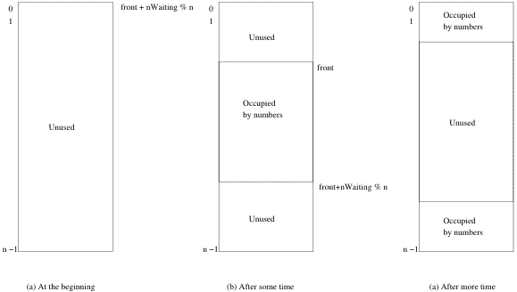

板上的号码。它们从位置 50 开始（最上面的位置为 0），一直到最后一个位置 99。然后它们“环绕”，因此最后的 20 个号码占据位置 0 到 19。位置 20–49 然后未使用。这不应该使我们困惑；说我们在第一个等待司机旁边做一个标记。当我们分配司机时，我们从板上擦除号码，并将标记向下移动一位。这只要在任何时候等待的出租车司机数量不超过 100 就能很好地工作。

## 在计算机上模拟黑板

我们的程序将镜像上面给出的动作。我们在分配司机时不向上移动司机，而是有一个变量 `front`，它将始终包含包含最早等待未分配司机的 driverID 元素的索引。这执行了调度员在板上放置的标记的功能。

如果有 `nWaiting` 名司机在等待客户，他们的 ID 将出现在从 `front` 开始的位置。我们在说这件事时需要稍微小心：当板填满底部并且调度员被迫从顶部再次开始写号码时会发生什么？我们希望以某种方式说在最后一个索引 n−1（即板的“底部”）之后的“下一个”索引是索引 0（即板的“顶部”）。所以不是说 `front` 之后的下一个索引是 `front+1`，我们将说它是 `(front+1) % n`。如果 `front` 有某个值 `i<n−1`，那么 `(front+1) % n` 只是 `i+1`。然而，如果 `front` 等于 `n−1`，那么 `(front+1) % n` 确实会变成我们希望的 0。因此我们将简单地要求如果有 `nWaiting` 名司机在等待，他们的 ID 将位于索引 `front`、`(front + 1) % n`、…、`(front + nWaiting − 1) % n`。

接下来我们考虑司机到达时要执行的操作。如前所述，我们仅在 driverID 未满时才接受 ID。到达司机的 ID 必须添加到该位置

words, circle i and circle j intersect if and only if:

√(x_i − x_j)² + (y_i − y_j)² ≤ r_i + r_j

Or equivalently (x_i − x_j)² + (y_i − y_j)² ≤ (r_i + r_j)². Thus, in our program we must effectively check whether this condition holds for any possible i, j, where of course i ≠ j.

Here is how we can do this. We will use arrays x, y, r in which we will store the x, y coordinates of the center and the radius of the circles. Specifically, the x coordinate of the center of the ith circle will be stored in x[i], the y coordinate in y[i], and the radius in r[i]. We will then check whether each circle i intersects with a circle j where j>i.

```
int n=5;                 // number of circles. 5 chosen arbitrarily.
float x[n], y[n];        // coordinates of center of each circle.
float r[n];             // radius of each circle.

for(int i=0;i<n;i++)     // read in all data.
    cin >> x[i] >> y[i] >> r[i];

for(int i=0; i<n; i++){  // Find intersections if any.
    for(int j=i+1; j<n; j++){ 
        if(pow(x[i]-x[j],2)+pow(y[i]-y[j],2) <= pow(r[i]+r[j],2))
            // built in function pow(x,y) = x raised to y.
            cout << "Circles " << i << " and " << j << " intersect." <<endl;
    }
}
```

Thus in the first iteration of the outer for loop, we check for intersections between circle 0 and 1,2,3,...,n−1. In the second iteration, we check for intersections between circle 1 and circles 2,3,...,n−1, and so on. Is this clear that we check all pairs of circles in this process? Consider the kth circle and the lth circle, k ≠ l. Can we be sure that the intersection between them is checked? Clearly, if k < l, then in the iteration of the outer for loop in which i takes the value k, we will check intersections with circles k + 1, k + 2,...,n − 1. This sequence will contain l because k < l. Alternatively, suppose l < k. Then consider the iteration of the outer for loop in which i = l. In this iteration we will check the intersection of circle l with circles l + 1,...,n − 1. Clearly k will be in this sequence because l < k. Thus in either case we will check the intersection between circle k and circle l, for every k,l.

### 13.3 The inside story

We now discuss some details regarding arrays and array accesses. This will specially be useful for understanding how we define functions for operating on arrays. To make the discussion more concrete, suppose we have the following definitions.

```
int p=5, q[5]={11,12,13,14,15}, r=9;
float s[10];
```

Say each variable of type int is most commonly given 4 bytes of memory, and so is a float. Thus we know the above definitions will cause 4 bytes of memory to be reserved for p, 4 × 5 = 20 bytes for q, 4 for r, and 4 × 10 = 40 bytes for s. We have also said that the memory given for an array is contiguous. Thus, the memory for q will start at a certain address, say Q, and go on to address Q + 19. The notion of addresses is as per our discussion in Chapter 2 and Section 9.8. Consistent with this description, Figure 13.3 shows how space might have been allocated for these variables.

Next we consider what happens when during execution we encounter a reference to an array element, e.g. q[expression]. How does the computer know where this element is stored? Of course, first the expression must be evaluated. Suppose its value is some v. Then we know that we want the element of q of index v. But because the elements are stored in order, we also know that the element with index v is stored at Q + 4v, where Q is the starting address for q. Thus if v = 3 then we would want q[3], which is stored from Q + 12. In general, the vth element of an array which is stored starting at address A would be at A + kv, where k is the number of bytes needed to store a single element.

So the important point is, that to get to an array element, the computer must evaluate the index expression, and even after the expression is evaluated it must perform the multiplication and addition to get the address A + kv. This is in contrast to how the computer gets the address for an ordinary variable such as p. In this case, the computer already knows where it stored p, and so it can get to it directly. Do note however that the extra work needed to figure out where the element is stored is independent of the length of the array.

### 13.3.1 Out of range array indices

Suppose now that our program has a statement q[5]=17;. Using the formula A + kv given above, the computer would try to store 17 in the int beginning at the address Q + 4 × 5 = Q + 20. Notice that this is outside the range of memory allocated for q. In fact, it is quite possible, as shown in our layout of Figure 13.3, that r is given the memory Q + 20 through Q + 23. Then the statement q[5]=17 might end up changing r! Likewise it is conceivable that a statement like q[-1]=30; might end up changing p.

Suppose on the other hand, we wrote q[10000]=18;. This would require us to access address Q + 40000. It is conceivable that there isnt any memory at this address. Many computers have some circuits to sense if an access is made to a non-existent address or even some forbidden addresses. The details of this are outside the scope of this book, but if this happens, then the program might halt with an error message. In any case, it is most important to ensure that array indices are within the required range.

### 13.3.2 The array name by itself

So far we have not said whether the name of an array can be used in the program by itself, i.e. without specifying the index. It turns out that C++ allows this.

In C++, the name of an array by itself is defined to have the value equal to the starting address from where the array is stored. This is an important place where arrays work differently from vectors, as we will see in Chapter 20.

Continuing our example of Figure 13.3, since the array q is stored starting at address Q,


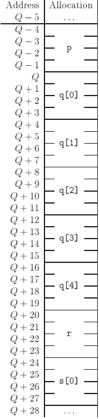

Figure 13.2: Possible layout

名称 q 本身的值因此为 Q，而 s 的值为 Q + 24。由于地址为 Q 的变量是 q[0]，其类型为 int，因此很自然地将 q 的类型定义为指向 int 的指针，或 int 的地址，或 int*。一般而言，如果一个数组包含类型为 T 的元素，则其名称的类型为 T* 或 T 的地址或指向 T 的指针。

因此 s 的类型为 float 的地址或指向 float 的指针或 float*，并且其值是 Q + 24。

看起来数组的名称仅与起始地址相关联，而数组的长度与名称无关，这似乎很奇怪。这只是一个方便的问题，其实用性将在第 13.4 节中变得清晰。

需要指出的一点是，与数组名称相关联的值，例如 q，不能更改；它始终表示 q[0] 的地址。换句话说，你不能写出诸如

```
q = ...; // incorrect if q is the name of an array
```

这样的表达式。编译器会将此类表达式标记为错误。

## 13.3.3 [] 作为运算符

另一个棘手的地方是，C++ 将对数组元素的引用，例如 X[Y] 视为一个表达式，其中 X、Y 为操作数，[] 为运算符。3 该操作仅在 X 的类型为“某种类型 T 的地址”，且 Y 是求值为 int 类型值的表达式时才定义。假设 X 的类型为类型 T 的地址，且 Y 确实求值为 int。那么表达式 X[Y] 表示存储在地址 A + k v 处的类型为 T 的变量，其中 A 是 X 的值，v 是 Y 的值，k 是存储类型 T 的单个元素所需的字节数。

你会意识到，我们只是重新表述了如何根据数组名称和索引找到元素。但这种重新表述更具一般性：X 不必是数组的名称，它可以是任何类型为“某种类型 T 的地址”的名称。这种推广将在第 13.4 节中派上用场。

为了强调这一点，请考虑以下代码。

```
double speed[]={1.25, 3.75, 4.3, 9.2};
double *s;
s = speed;
cout << s[0] << endl;
s[1] = 3.9;
cout << speed[1] << endl;
```

首先要注意的是，赋值 s = speed 是完全合法的，因为 speed 的类型为 double*，与 s 相同。因此赋值后，s 将具有与 speed 相同的值。但随后，表达式 s[j] 将与 speed[j] 相同。

换句话说，表达式 s[0] 表示存储在地址 s + k*i 处的 double 值，其中 k 是 double 的大小，i 是索引的值，它们分别是 8 和 0。

> 3 是的，这是一种不寻常的二元表达式写法。但请注意，还有其他运算不是以 操作数1 运算符 操作数2 的顺序书写的。例如，我们经常写 a/b 而不是 a ÷ b。

换句话说，s[0] 表示存储在地址 s 处的 double，而 s 与 speed 相同，因此与存储在地址 speed 处的 double 相同，也就是 speed[0]。因此第一个打印语句将打印 1.25。语句 s[1] 同样等价于 speed[1]，即 3.9，这就是第二个打印语句将打印的内容。

## 13.4 涉及数组的函数调用

函数对于普通或标量变量很方便，我们也可以想象它们对数组也很方便。假设我们定义了一个 float 数组 float a[5];，并且在程序的某个地方需要计算其元素的总和。计算数组元素总和的代码并不难写，然而，如果在代码中需要对多个这样的数组求和，则必须多次复制代码。因此，编写一个函数以数组作为参数并返回总和将非常方便。

碰巧的是，我们已经告诉你编写该函数所需的一切！你可以这样写。

```
float sum(float* v, int n){  // function to sum the elements of an array
float s = 0;
for(int i=0; i<n; i++)
    s += v[i];

return s;
}
```

我们稍后会解释这一点。首先我们展示该函数如何从主程序中调用。

```
int main(){
    float a[10] = {0.0, 1.0, 2.0, 3.0, 4.0, 5.0}, asum;
    asum = sum(a, 5);  // second argument should be array length
}
```

让我们首先检查函数调用是否合法，即调用参数的类型是否与函数 sum 定义中参数的类型匹配。函数调用的第一个参数是数组名 a。我们说与数组名相关联的类型是 T*，如果数组中的元素类型为 T。因此 a 的类型为 float*。这确实与函数定义中第一个参数 v 的类型匹配。第二个参数 5 显然具有 int 类型，与第二个参数 n 的类型匹配。因此调用是合法的，我们现在思考其执行方式。

当遇到调用 length(a, 5) 时，与往常一样，为执行函数 sum 创建一个区域。非引用参数的值会被复制。在本例中，参数都不是引用参数，因此两个参数的值都会被复制。第一个参数 a 的值是数组 a 在内存中的起始地址，设为 A。因此 v 得到值 A。第二个参数的值为 5。因此 n 得到值 5。这里非常重要的一点是，并未复制数组存储的所有位置的内容，而只复制了起始地址。

然后执行函数的代码。唯一的新部分是表达式 v[i]。它基本上按照前面给出的规则处理。我们知道 v 的类型为 float 的地址，其值为 A。因此现在表达式 v[i] 按上一节讨论的方式求值，将 [] 视为运算符等等。无需再次进行精确计算，我们只需指出在 sum 中求值的 v[i] 的值必须与在主程序中求值的 a[i] 的值相同，因为 v 与 a 具有相同的值和类型。因此，v[i] 确实表示 a 的第 i 个元素。由于 n 的值为 5，循环中 i 将取 0 到 4 的值。因此 a[0] 到 a[4] 将被相加，正如我们所期望的那样。

需要说明几点。

- 1. 也可以使用另一种语法来声明参数为数组，在本例中为 float 变量的数组：`float v[]` —— 这直接表明 v 像一个数组，只是我们不知道其长度。
- 2. 函数 sum 实际上并不知道它在操作整个数组。例如调用 `sum(a,3)` 也是允许的。这将返回 a 的前 3 个元素的总和，因为函数中的循环将从 0 执行到 2。
- 3. 修改传递的数组也是可能的。如果你的函数在末尾有一行诸如 `v[0]=5.0;`，那确实会改变 `a[0]`。这与我们讨论的涉及 `[]` 的表达式求值机制一致。

### 13.4.1 Examples

下面展示了两个关于数组的简单函数示例。下一节给出更复杂的示例。

我们的第一个函数只是打印 `float` 数组元素的数值。

```
void print(float *a, int n){
    for(int i=0; i< n; i++)
        cout << a[i] << endl;
}
```

这将打印数组的前 n 个元素。请注意，确保传递的是一个数组，并且数组的长度至少与第二个参数一样长，是调用程序的责任。

接下来，我们给出一个返回元素索引的函数，该元素的值是数组中所有元素的最大值。请注意最后一句话的措辞：当我们说“一个元素”时，我们承认可能存在多个这样的元素，而我们只返回其中一个的索引。

该函数的思路与我们在第 13.2.3 节中从 marks 数组中查找最大分数的做法非常相似。我们有一个变量 maxIndex，它将返回具有最大值的元素的位置。我们首先将其初始化为 0，这相当于猜测最大值出现在位置 0。接下来，我们检查如果


后续的数组元素都更大，如果我们找到一个更大的元素，那么我们将其索引赋给 maxIndex。

```
int argmax(float marks[], int L)
// marks = array containing the values
// L = length of marks array. required > 0.
// returns maxIndex such that marks[maxIndex] is largest in marks[0..L-1]
{
    int maxIndex = 0;
    for(j = 1; j<L; j++)
        if( marks[maxIndex] > marks[j]) // bigger element found?
            maxIndex = j;                // update maxIndex.
    return maxIndex;
}
```

我们给出了名称 marks 只是为了让你很容易看出这段代码与第 13.2.3 节中的代码之间的相似性。但它本身与成绩无关。所以如果你独立编写它，使用更合适的名称如 datavalues 会比使用名称 marks 更好。

## 13.4.2 总结

需要注意的最重要点如下。

要将数组传递给函数，我们通常必须传递 2 个参数，数组的名称和数组的长度。这是可以预期的，名称只给出数组的起始地址，它并不会说明数组有多长。所以需要数组长度。

被调用的函数可以读取或写入其名称被发送给它的数组。这就像把朋友 A 的地址发送给另一个朋友 B，当然 B 就能够写给 A 或拜访 A 就像你能做的那样！

最后，值得注意一个重要点。当我们对数组编写函数时，允许它以长度指定为 0 的方式被调用可能是方便的。当面对长度为零的数组时，像 sum 这样的函数应该返回什么？看起来自然地返回元素的和为 0。这就是我们的 sum 函数所做的。另一方面，我们的 argmax 函数要求长度至少为 1。参数可接受值的此类（预）条件应在注释中明确说明。

## 13.5 选择排序

我们将考虑本章开头讨论的一个问题：给定成绩列表，按从低到高的顺序打印出来。我们可以要求连同成绩一起打印出学号，然而，这留给练习。

我们可以在两个阶段完成任务。在第一阶段，我们重新排列元素值，使其按非递减顺序排列，即较低索引处出现的值不大于较大索引处出现的值。此操作通常称为排序。这是与数组相关联的最重要操作之一。我们将为此介绍一个称为选择排序的简单算法。更好的算法将在后面给出。一旦元素按非递减顺序排列，我们就可以简单地按索引打印出数组元素，即元素 0，然后是元素 1，依此类推。这将确保成绩按非递减顺序打印。为此，我们可以简单地使用前面定义的 print 函数。

我们使用一个相当自然的排序思路。我们首先在数组中寻找最大值，并将其移动到最后一个位置，即索引 n − 1，其中 n 是数组的长度。当然，位置 n − 1 本身包含一个值，我们不能破坏它。所以我们改为交换两者：最大值移动到第 n − 1 个位置，第 n − 1 个位置的值移动到最大值之前所在的位置。接下来，我们在位置 0 到 n − 2 中的元素中寻找最大值。此最大值与位置 n − 2 中的元素交换。于是我们将最大值和第二大值放在位置 n − 1 和 n − 2。一般来说，我们以这种方式进行，在一次典型的迭代中，我们将从前 i 个值中找到最大值，然后将其与第 i−1 个索引处的值交换。我们将让 i 从值 n 开始，并在连续的迭代中递减，直到达到 2。

为了找到最大值，使用第 13.4.1 节中定义的 argmax 函数很方便。如果我们想要前 i 个元素的最大值，我们只需使用 i 作为第二个参数调用它。正如我们在那里所指出的，argmax 不必传递数组的实际长度；如果传递较小的 i 值，它只会在前几个元素中寻找最大值并返回其索引。因此代码相当明显。

```
void SelSort(float data[], int n)
// will sort in NON-DECREASING order. different from above.
{
    for(int i=n; i>1; i--){
        int maxIndex = argmax(data,i);  // Find index of max in data[0..i-1]
        float maxVal = data[maxIndex];  // Exchange elements at
        data[maxIndex] = data[i-1];     //   index maxindex
        data[i-1] = maxVal;             //   and index i-1.
    }
}
```

应该很清楚上面的代码正在做我们所描述的事情。写一个循环不变式也很说明问题：在迭代开始时，子数组 data[i..n-1] 包含最大的值。在开始时 i=n，因此不变式是空真成立的。

假设不变式在某次迭代开始时为真，我们将证明它在下一次迭代时也成立。循环的第一条语句在前 i 个元素中，即元素 0 到 i-1 中找到最大值。最后 3 条语句将其与索引 i-1 处的元素交换。因此在迭代结束时，子数组 data[i-1..n-1] 将包含最大的值。这为下一次迭代的开始建立了不变式。

### 13.5.1 时间估计

我们将尝试粗略估计选择排序所需的时间。通过粗略估计我们仅指时间是否与 n 成正比，即被排序元素的数量，或它们的平方等等。这样的估计不能用来决定程序执行需要多少秒。然而，如果我们知道一个程序的排序时间与 n 成正比，另一个与 n² 成正比，那么对于大的 n，第一种算法会更好。通常，我们只关心当问题规模 n 在本例中很大时所花费的时间。因此，我们的定性分析，时间是否与 n 或 n² 成正比是非常有用的。

要分析 SelSort 的时间，我们必须先分析 argmax 的时间。函数 argmax 只是遍历它被调用的子数组并找到最大值。它检查每个元素，因此其时间可以认为与 L 成正比，即第二个参数。在选择排序中，我们只是多次调用 argmax，第二个参数的值为 n, n−1, n−2 等等直到 2。因此我们可以看出时间与

n + (n − 1) + (n − 2) + … + 2 = Σ_{i=2}^{n} i ≈ n²/2

成正比

因此我们估计选择排序所花费的时间与 n² 成正比，其中 n 是被排序数组的长度。

## 13.6 表示多项式

程序将处理现实生活中的对象，如恒星、道路或圆的集合。它也可能处理数学对象，如多项式。因此，如何在计算机上表示多项式并对其进行操作是很重要的问题。

一个多项式 A(x) = Σ_{i=0}^{n−1} a_i x^i 如果我们指定系数 a0, …, a_{n−1} 就会完全确定。因此为了表示上述多项式，我们需要存储这些系数。这最方便地在数组中完成。⁴ 我们使用长度为 n 的数组 a 并将 a_i 存储在 a[i] 中。

接下来是关于如何在多项式上操作的问题。自然会问；假设我们有两个数组表示两个多项式 A(x), B(x)。我们能否构造出由 A(x), B(x) 相加和相乘得到的多项式 C(x), D(x) 的表示？

首先我们知道和的次数为 n − 1，因为加数 A(x), B(x) 的次数为 n − 1。因此我们可以用作多项式 C(x) 表示的数组 c 必须定义为 float c[n]。我们还知道 c_i = a_i + b_i。因此我们也知道如何设置数组 c 的元素。

```
for(int i=0; i<n; i++)  c[i] = a[i] + b[i];
```

我们能否将其写成一个函数 addp 来相加两个多项式？要相加的多项式将作为参数传递。结果多项式呢？我们可以在函数 addp 内部分配一个新数组，但这个数组无法返回——它会被销毁

⁴这里有一个简单的规则——如果一个对象的集合是用一个下标描述的，使用一维数组，这就是我们迄今为止所研究的。如果一个数学对象的集合是用两个下标描述的，比如矩阵的条目，那么我们就需要二维数组，我们将在后面看到。


一旦 `addp` 执行完毕。正确的编写此过程的方式是同时传入结果数组。下面是一个包含函数 `addp` 的程序。

```
void addp(float a[], float b[], float c[], int n){
// 加数、结果、数组长度。
  for(int i=0; i<n; i++) c[i] = a[i] + b[i];
}
```

在上面的程序中，我们假设两个加数多项式具有相同的次数。一般来说，情况未必如此。但你应该能够修改代码以处理一般情况。

接下来我们考虑计算多项式 $A(x)$、$B(x)$ 的乘积多项式 $D(x)$ 的问题。和之前一样，我们假设 $A(x)$、$B(x)$ 的次数都为 $n-1$，并分别存储在长度为 $n$ 的数组 `a`、`b` 中。乘积的次数为 $2n-2$，因此必须存储在长度至少为 $2n-1$ 的数组 `d` 中。

为了确定 $D(x)$，请考虑其系数与 $A(x)$、$B(x)$ 的系数之间的关系。当 $A(x)$ 和 $B(x)$ 相乘时，前者中的每一项 $a_jx^j$ 都会与后者中的 $b_kx^k$ 相乘，产生项 $a_jb_kx^{j+k}$。因此，这将把 $a_jb_k$ 贡献给 $d_{j+k}$。所以我们先将 $D$ 的每个系数设为 0，然后对于所有 $j,k$，计算 $a_jb_k$ 并将其加到系数 $d_{j+k}$ 上。这样就得到了函数：

```
void prodp(float a[], float b[], float d[], int n){
// a、b 必须有 n 个元素，乘积 d 必须有 2n-1 个元素。
  for(int i=0; i<2*n-1; i++) d[i] = 0;
  for(int j=0; j<n; j++)
    for(int k=0; k<n; k++) d[j+k] += a[j]*b[k];
}
```

为了完善示例，下面是一个调用这些函数的主程序。

```
int main(){
  float a[5], b[5], c[5], d[9];
  for(int i=0; i<5; i++) cin >> a[i] >> b[i];

  addp(a,b,c,5);
  prodp(a,b,d,5);

  for(int i=0; i<5; i++) cout << c[i] << ' ';
  cout << endl;
  for(int i=0; i<9; i++) cout << d[i] << ' ';
  cout << endl;
}
```

## 13.7 数组长度与 const 值

在上述示例中，我们显式地写出了 500、1000 等数字来指定数组长度。数组在程序中常用于存储一组数值，而程序员往往并不知道这组数值的总个数。因此，你可能会觉得如果允许我们这样写会更方便：

```
int n;
cin >> n;
int a[n]; // C++ 标准不允许。但请继续往下读！
```

这段代码不符合 C++ 标准。C++ 标准要求数组长度由一个其值为编译时常量的表达式来指定。编译时常量要么是显式给出的数字；要么是仅涉及被定义为 const 的变量的表达式，例如：

```
const int n = 1000;
```

前缀 const 用于表示 n 看起来像一个变量，可以在所有变量可以使用的场合使用，但实际上它的值不能被修改。因此，使用 const 名称，数组可以如下定义：

```
const int NMAX = 1000; // 约定：常量名大写。
int a[NMAX], b[NMAX];
```

那么在实践中我们如何使用它呢？假设我们要定义一个数组来存储学生的成绩。在这种情况下，C++ 标准将要求我们猜测可能拥有的最大学生数，定义一个该大小的数组，并且只使用其中的一部分。所以我们可能会这样写：

```
const int NMAX = 1000;
int a[NMAX], b[NMAX], nactual;
cin >> nactual;
assert(nactual <= NMAX);
```

在代码的其余部分，我们记住 a 和 b 只使用前 nactual 个位置，并在编写循环时牢记这一点。请注意，用户可能会输入一个大于 NMAX 的 nactual 值。这种情况下，程序无法运行。如果发生这种情况，assert 语句将导致程序停止，你需要修改 NMAX，重新编译并重新运行。

### 13.7.1 为什么要使用 const 声明？

上面的代码也可以直接定义 `int a[1000],b[1000];`，而不使用 const 定义。然而，如果我们需要改变所需的大小（例如我们想要大小为 2000 的数组而不是 1000），那么给出的代码就更可取。如果我们没有使用 NMAX，就必须将多处出现的 1000 改为 2000；而使用给出的代码，只需将第一行改为 `const int NMAX = 2000;` 即可。

### 13.7.2 本书中使用的做法

当你使用 `g++` 命令调用 GNU C++ 编译器时，该编译器允许在数组定义中使用任意表达式作为长度。

如你所见，这使代码更紧凑，乍一看更容易理解。因此，为了避免杂乱，在本书的其余部分，我们将使用任意表达式来指定数组的长度。我们给出的代码将适用于 g++。如果它不适用于其他编译器，上面的讨论会告诉您如何修改。

## 13.8 结语

数组提供了一种存储同类型对象集合的简便方法。

值得思考的是元素索引是如何被使用的。有时元素存储的索引没有意义，例如在圆相交问题中。有时我们可以让数据的一部分充当索引，就像我们在成绩显示问题中对学号所做的那样。直方图问题也是类似的情况。在出租车调度问题中，我们使用索引来隐式记录出租车的到达顺序。

假设我们要查找满足特定属性的元素。一种方法是逐个扫描数组，检查每个元素是否具有所需属性。我们在打印最高分学生的学号问题中就是这么做的。这是一种常见用法。

从索引 0 开始一直扫描到最大索引的数组遍历思想，在我们希望对每个元素执行相同操作（例如打印）时也很有用。在圆相交问题中，我们使用了这种思想的一个较为复杂的版本：我们希望针对每对圆而不是每个圆执行某个操作。

最后，在出租车调度问题中，我们构建了一个所谓的队列，使得元素按照它们到达的顺序离开数组。为此，我们维护了两个索引：下一个元素将存储的位置，以及下一个将离开的元素。这是一种非常常见的用法，例如，你将在练习 14 中看到它。

最后，请记住，数组使用的索引应在范围内，即介于 0（含）和数组长度（不含）之间。索引超出范围是涉及数组的程序中常见的错误来源。因此，你应该确保索引在范围内。你也可以考虑使用断言来检查这一点。例如，如果你有一个长度为 200 的数组 x，并且即将使用索引 i 对其进行索引，你可以考虑在写入 `x[i]` 之前放置一个断言：

```
assert((i >= 0) && (i < 200));
```

## 13.9 练习

- 1. 假设班级中的学号不是从 1 到最大学生数，而是基本上任意的数字（因为学号可能标识学生入学的年份或所属的专业等）。请针对这种情况编写成绩显示程序。假设先输入每个学生的学号，然后输入成绩，并且假设在开始时给出了学生人数。
- 2. 针对上述情况（即学号为任意整数）编写程序，显示谁获得了最高分。
- 3. 假设我们希望绘制直方图，但其中我们需要计数的区间宽度不均匀。假设每个值都是 0（含）到 1（不含）之间的实数。在 0 到 0.25 之间，区间宽度为 0.05，即我们想知道有多少个值位于 0 到 0.05 之间，然后是 0.05 到 0.1，依此类推。在 0.25 到 0.75 之间，区间宽度为 0.025，即我们想知道有多少个值位于 0.25 到 0.275 之间，然后是 0.275 到 0.3，依此类推。最后，在 0.75 到 1 之间，区间宽度为 0.05。编写一个程序，为这些范围提供直方图。
- 4. 编写一个程序，输入一个正整数序列。事先不会给出序列的长度，但在所有数字输入完毕后，会给出一个 -1，这样你就知道序列已终止。需要输出序列中最大的 10 个数。提示：使用长度为 10 的数组来跟踪可能是前 10 名的候选数字。
- 5. 假设在上一题中，要求你报告序列中最高的 10 个值是什么，以及它们出现的频率。编写一个程序完成此任务。
- 6. 假设给定平面中 n 个点的 x、y 坐标。我们希望知道其中是否有任意 3 个点共线。编写一个程序来确定这一点。确保你考虑了所有可能的 3 个点来测试，并且每个三点组只测试一次。坐标应用浮点数表示。在计算线段的斜率时，由于浮点格式的原因，会出现舍入误差。因此，不要使用运算符 `==` 来询问两个斜率是否相等，而应检查它们是否近似相等，即它们的绝对差是否较小，例如 `10^-5`。这是在比较浮点数时需要采取的预防措施。事实上，你还应该自问：斜率是否是检查共线性的好方法，还是应该考虑角度（即斜率的反正切）。
- 7. 编写一个程序，以两个向量（按数学/物理中定义）作为输入——使用数组表示它们——并输出它们的点积。将其封装成一个函数。
- 8. 假设已知一个班级的学生人数 n，以及他们两门科目的成绩。你的目标是计算相关系数。设 x_i、y_i 表示两门科目的成绩。则相关系数定义为：

n Σ x_i y_i − Σ x_i Σ y_i / √[ n Σ x_i² − (Σ x_i)² ] √[ n Σ y_i² − (Σ y_i)² ]


编写一个计算此值的程序。注意，正相关表示 $x$ 随 $y$（大致）增加——而负相关表示 $x$ 随 $y$ 减少而大致增加。相关系数接近 0 在此情况下（以及通常情况下）表示两个变量相互独立。你可以使用为上一练习编写的点积函数。

- 9. 假设你得到了过去 100 年中每年 3 月 21 日孟买记录的最高温度。你想知道孟买是否在逐年变暖，正如普遍认为的那样。你想从数据中知道这是否是一个合理的结论。如果你仅仅绘制数据，你会看到温度从一年到一年似乎无规律地波动。天气预计会表现出某种随机性；你想知道的是，如果你能以某种方式剔除随机性，是否存在任何上升趋势。
- 
- 减少随机性的一种方法是取所谓的 *移动平均值* 来平滑数据。给定一个数列 $x_1,\ldots,x_n$，一个 $2k+1$-窗口大小的移动平均值是一个数列 $y_{k+1},\ldots,y_{n-k}$，其中 $y_i$ 是 $x_{i-k},\ldots,x_{i+k}$ 的平均值。编写一个程序，该程序以一个数列和一个整数 $k$ 作为输入，并输出 $2k+1$ 窗口大小的移动平均值。并绘制原始数列和移动平均值。

- 10. 一个数列 $x_0,\ldots,x_{n-1}$ 如果对所有 $i$ 都有 $x_i=x_{n-1-i}$，则称其为回文。编写一个程序，该程序以长度先给出的数列作为输入，并判断该数列是否为回文。

- 11. *埃拉托斯特尼筛法* 用于判断一个数 $n$ 是否为素数的方法如下。我们首先在纸上写下数字 $2,\ldots,n$。⁵ 我们然后从第一个未划掉的数字开始，划掉它的所有真倍数。然后我们寻找下一个未划掉的数字并划掉它的所有真倍数，依此类推。如果 $n$ 在此过程中未被划掉，则它必须是素数。编写一个基于此想法的程序。课程早期我们有一个素性测试算法，该算法检查 2 到 $n-1$ 之间的某个数是否整除 $n$。

- 12. 假设我们有一个数组 `marks`，其中 `marks[i]` 给出学号为 $i$ 的学生的成绩。我们需要按非递增顺序打印出成绩，并附上获得该成绩的学生学号。修改本章中开发的排序算法以实现此功能。提示：使用一个额外的数组 `rollNo`，使得 `rollNo[i]` 最初等于 $i$。在选择排序算法过程中交换成绩时，同时移动学号。

- 13. 假设我们有一个数字序列，其前面给出序列的长度。你需要对它们进行排序。在本练习中，你将使用所谓的 *插入排序* 算法来完成此操作。该算法的思路是将数字读入数组，但在读取过程中保持数组有序。换句话说，在读取前 $i$ 个数字后，你必须确保它们按排序（例如非递增）顺序出现在数组的前 $i$ 个元素中。因此，当你读取第 $i+1$ 个数字时，你必须找到它应该插入的位置。假设你发现它需要在当前位于第 $j$ 个和第 $j+1$ 个位置的数字之间，则应将位置 $j+1$ 到 $i-1$ 的数字在数组中向前移动 1 步（注意索引或位置从 0 开始）。然后可以将新读取的数字放在第 $j+1$ 个位置。编写执行此操作的程序。

⁵ 嗯，埃拉托斯特尼使用的是粘土板！

14. 假设我们有两个数组 A、B，其长度分别为 m、n。进一步假设数组按非递减顺序排序。你需要填充一个长度为 m+n 的数组 C，使其包含 A、B 中出现的完全相同的数字，但在 C 中它们必须按非递减顺序出现。换句话说，如果 A 包含序列 1,2,3,3,5 而 B 包含 2,4,6,7，则 C 应包含 1,2,2,3,3,4,5,6,7。提示：显然，元素必须从 A 和 B 移动到 C。你能论证出对于这种移动，所有数组都像队列一样表现，即元素总是从 A、B 的前端移出，并移动到 C 的后端吗？

15. 一位朋友（“魔术师”）向你展示一副牌。他拿起顶牌，翻开面朝上，它是 A。他把牌收好。然后他拿起下一张牌并将其放在牌堆底部而不给你看。然后他向你展示现在位于牌堆顶部的牌，它是 2。他重复以下过程直到牌堆没有牌。结果（神奇地！）你看到的牌是按面值递增的，即首先暴露的牌是 A，然后是 2，然后是 3，然后是 4，等等直到 K。当然，“魔术”全部在于牌在开始时放置的顺序。编写一个程序来解释魔术，即找出牌的初始顺序并打印出来。提示：反向进行该过程。

16. 编写一个函数，给定多项式 P(x)、Q(x)，返回它们的复合 R(x) = P(Q(x))。设 P(x) = x² + 3x + 5 且 Q(x) = 3x² + 5x + 9。则 R(x) = (3x² + 5x + 9)² + 3(3x² + 5x + 9) + 5。

17. 编写不使用递归的二分搜索代码。

18. 考虑一条长铁路轨道被分成若干个长度可能不等的 n 段。对于每个第 i 段，你给出其长度 Li 和列车可以在其上运行的最大速度 si。你还给出了一台特定机车的资料：其最大速度 s 和其能够达到的最大加速度 a（为简单起见，假设这与速度无关），其最大减速度 d（同样与速度无关）。假设列车从轨道一端静止开始，必须在另一端静止。列车能多快完成这段旅程？确保你的代码适用于所有可能的参数值。

19. 排列只是一个对象的排序，例如某个 n 的 0 到 n − 1 之间的数字。通常希望为给定的 n 生成所有可能的排列。例如，对于 n = 3，我们希望生成如下序列 012 021 102

120
201
210

上述序列按 *字典序*，即如果你将每个元素视为基数 $n$ 中的一位数字，并将数字连接起来并考虑

设 $p$ 为从 0 到 $n − 1$ 的整数的排列。定义 $V(p)$ 为通过连接序列 $p$ 得到整数。我们将说排列 $p$ *字典序小于* 另一个排列 $q$，如果 $V(p) < V(q)$。修改它以实现此目的。

- 20. 编写一个程序，接受 0 到 $n − 1$ 的整数的排列 $p$，并返回字典序下一个排列。提示：尝试几个排列以推导出排列与其字典序下一个排列之间的关系。

- 21. 编写一个程序，接受两个各有 100 位的数字，并打印出它们的乘积。改编文本中讨论的多项式乘法算法。

## 第 14 章

## 关于数组的更多内容

我们首先考虑表示文本数据的问题。在第 3 章中我们讨论了用于存储字符的 char 数据类型。然而，我们很少处理单个字符。更常见的是，我们需要处理完整的单词，或字符串/字符序列。字符字符串通常在 C 中表示为字符数组。这种表示在 C++ 中并不完全推荐，正如我们在第 20.1 节中将看到的那样。但了解这种表示是有价值的，因为你会因为历史原因遇到它（例如第 14.3.1 节），并且 C++ 推荐的表示建立在此基础上。

接下来，我们讨论多维数组。普通的（一维）数组可以被视为值的序列。二维数组可以被视为值的矩阵或表格（行和列）。二维数组非常有用，尤其是在科学计算中。我们将讨论二维数组的一个重要用途：表示和求解线性方程组。C++ 允许我们构建自己的二维数组表示，它们具有本章讨论的所有特性，以及一些额外的特性。这在第 20.2.6 节中讨论。

到目前为止，我们一直通过编写 a.out 或 ./a.out 来执行 C++ 程序。然而，可以在命令行本身向程序提供输入，例如通过编写 a.out input-text。这需要使用多维数组，并在第 14.3.1 节中讨论。

最后，我们讨论递归在涉及数组的问题中的使用。假设你被给出一个涉及长度为 n 的数组中存储的数据的问题。你可以使用递归来解决它，如果以下条件成立。

- 1. 如果 n 很小，例如 n = 1，则你有一种解决该问题的方法。
- 2. 如果 n 不小，例如 n > 1，你有一种构造相同类型但在更小数组上的问题的方法，使得从较小问题的解可以构造出原始问题的解。

如果你能完成这些步骤，那么你就有一个递归算法。通常，这样的递归算法非常简单易述和编码，并且速度很快。我们将看到两种这样的算法，一种是所谓的二分搜索算法，另一种是归并排序算法，这是一种排序算法。


## 14.1 字符字符串

字符数组的定义方式与定义 double 或 int 数组一样。

```
char name[20], residence[50];
```

上面定义了两个数组 name 和 residence，长度分别为 20 和 50，显然用于存储姓名和住址。由于我们通常不知道姓名或地址的确切字符数，因此习惯上定义我们猜测可能的最大长度的数组。这看起来很浪费，确实如此，我们将在后面的章节看到更好的替代方案。

因此，如果我们想在数组中存储字符字符串 “Shivaji”，我们将把 ‘S’ 存储在 name[0] 中，‘h’ 存储在 name[1] 中，以此类推。该字符串长 7 个字符，你可能会认为我们应该在某处存储这个长度。例如在打印字符串时，我们显然不希望打印 name[7] 到 name[19]。C 语言中使用的约定，并被 C++ 从中继承，是不是显式存储长度，而是我们在实际字符串末尾存储一个特殊字符。使用的特殊字符是 ASCII 值为 0 的字符，可以写成 ‘\0’。请注意 ‘\0’ 是不可打印的，并且不期望成为任何真实文本字符串的一部分。因此它无歧义地标记了字符串的结束。

提供了用于初始化字符数组的特殊构造。因此我们确实可以写

```
char name[20] = "Shivaji";
char residence[50] = "Main Palace, Raigad";
```

字符字符串 “Shivaji” 有 7 个字符。因此它们将被放置在 name 的前 7 个元素中。第 8 个元素 name[7] 将被设为 ‘\0’。类似地，residence 的前 20 个元素将被初始化，包括最后的 ‘\0’。顺便说一下，大写和小写字母有不同的代码。

这里是另一种形式。

```
char name[] = "Shivaji";
char residence[] = "Main Palace, Raigad";
```

在这种情况下，C++ 将计算 name 和 residence 的长度。按照之前的讨论，这些长度将分别设为 8 和 20。

我们可以通过在 for 循环中遍历元素来操作存储在 char 数组中的字符串，例如。

### 14.1.1 输出

打印字符数组的内容很简单。假设 name 是一个字符数组，如前所述，

```
cout << name;
```

将导致从开头到 '\0' 字符的 name 内容打印到屏幕上。

上述语句的一般形式为：

```
cout << charptr;
```

其中 charptr 是一个表达式，计算结果为指向 char 类型的指针。如果 name 是一个字符数组，那么 name 确实是 char 指针类型。该语句会导致从地址 charptr 开始的字符被打印，直到遇到 '\0' 字符。因此传递给函数的字符数组可以按预期方式打印。

### 14.1.2 输入

要将字符串读入 char 数组，可以使用类似的形式：

```
cin >> charptr;
```

这里 charptr 可以是 char 数组的名称，或更一般地，是 char 指针类型的表达式。该语句将导致用户键入的以空白分隔的字符串被读入 charptr 所表示的地址开始的内存中。存储字符串后将存储 '\0' 字符。下面是一个例子。

```
char name[20];
cout << "Please type your name: ";
cin >> name;
```

第二个语句要求你输入姓名，第三个语句 cin >> name; 将你输入的内容读入数组 name。值得注意的几点如下：

- 1. 从你输入的内容中，初始的空白字符将被忽略。从第一个非空白字符开始，到下一个空白字符之前的字符字符串将被取出并放入 name。因此如果我输入
Abhiram Ranade
带一些前导空白，前导空白将被丢弃，只有 "Abhiram" 会进入 name。接下来，在 "Abhiram" 之后，一个空字符，即 '\0' 将被存储。因此字母 'A' 到 'm' 将进入 name[0] 到 name[6]，name[7] 将被设为 '\0'。请注意所有这一切都很方便，因为单个语句读取所有字符，并且 '\0' 也会自动放置在最后读取的字符之后。
- 2. 这种读取文本的方式如果文本包含空格则不适用。因此在上面的例子中，"Ranade" 不会被读入 name。为此需要使用下面讨论的 getline 命令。
- 3. 这个语句可能不安全。在上面的例子中，如果用户在不带空白的情况下输入超过 20 个字符，所有这些都将从 name[0] 开始存储。因此读取的字符将被存储在指定数组 name 的末尾之后，可能写入可能已分配给其他变量的内存。

对此的安全替代方法是使用以下命令。

```
cin.getline(x,n);
```

其中 x 必须是 char 数组的名称，或更一般地是指向 char 的指针，n 是一个整数。这将导致用户输入的内容，包括空白字符，从地址 x 开始放置，直到发生以下情况之一

- 用户键入了换行字符¹。在这种情况下，直到换行符的所有字符都复制到从地址 x 开始的内存中。换行字符不被复制。它被丢弃。
- 在没有换行的情况下键入了 n-1 个字符。在这种情况下，所有字符都放置到从地址 x 开始的内存中，后跟一个 '\0' 字符。

正如你可能猜到的，习惯上使用 x 的长度作为参数 n。因此例如我们可以写：

```
char name[20];
 cin.getline(name,20);
```

在这种情况下，用户输入的最多 19 个字符将被复制，我们将不会有溢出数组限制的危险。

### 14.1.3 字符数组处理

字符数组的行为与普通整数数组类似，除了读取和打印之外，并且它们包含一个 '\0' 字符来标记数组有用部分的结束。因此处理它们相当直接。请注意字符是整数的子类型，因此我们可以对字符进行算术运算，并像对整数一样比较它们。

我们的第一个例子是一个用于确定存储在 char 数组中的文本长度的函数。

```
int length(char *txt){
    //precondition: txt points to sequence of '\0' terminated characters.
    int L=0;
    while(txt[L] != '\0') L++;
    return L;
}
```

该函数接受单个参数，例如数组 name（或数组的零号元素的指针）。请注意不需要实际数组的长度。这是因为我们只访问到空字符为止的元素。事实上，该函数只是遍历数组的元素，并返回找到空字符 '\0' 的索引。由于起始索引为 0，空字符将位于等于文本字符串长度的索引处。

我们的第二个例子是一个用于将存储在数组 source 中的字符串复制到另一个数组 destination 的函数。这与复制其他数组类似，只是我们只关心源数组的有用部分，即到 '\0' 字符出现为止。该函数完全不关心两个数组定义的<|message|>长度，假设调用已确保索引不会超出数组边界。

```
```c
void scopy(char destination[], char source[])
// precondition: '\0' must occur in source.  destination must be long
// enough to hold the entire source string + '\0'.
{
    int i;
    for(i=0; source[i] != '\0'; i++)
        destination[i]=source[i];
    destination[i]=source[i];    // copy the '\0' itself
}
```
```

作为使用此函数的例子，请注意字符串常量可以在任何需要指向 char 的指针的地方使用。因此我们可以写 scopy(name,"Einstein")，这将简单地将 name 设为 “Einstein”。

这里有一个更有趣的函数：它接受两个字符串并返回哪一个在字典上更小，即在字典中先出现。该函数只是从第 0 个字符开始比较两个字符串的对应字符。如果在没有找到不相等字符的情况下到达字符串的末尾，则意味着两个字符串相同，在这种情况下我们必须返回 ‘=’。如果在某次比较中我们发现一个字符串中的字符小于另一个字符串中的字符，则该字符串被声明为更小。如果一个字符串在前面的字符相同的情况下更早结束，则结束的字符串更小。

这种逻辑在下面的代码中实现。我们维护循环不变量：两个数组的字符 0 到 i-1 必须是非空且相同。因此如果我们发现 a[i] 和 b[i] 都是空，显然字符串相同，因此我们返回 '='。如果 a[i] 为空但 b[i] 不为空，则 a 是 b 的前缀。因为前缀在字典中出现在更长的字符串之前，所以我们返回 '<'。如果 b[i] 为空但 a[i] 不为空，则处理方式类似。如果 a[i]>b[i] 我们返回 '>'，如果 a[i]<b[i] 我们返回 '<'。如果这些条件都不适用，则两个字符串中的第 i 个字符必须是非空且相同。因此下一轮迭代的不变量得到满足。所以我们递增 i 并进入下一轮迭代。

```
```c
char compare(char a[], char b[])
// returns '<' if a is smaller, '=' if equal, '>' if b is smaller.
{
    int i = 0;
    while(true){                    // Invariant: a[0..i-1] == b[0..i-1]
        if(a[i] == '\0' && b[i] == '\0') return '=';
        if(a[i] == '\0') return '<';
        if(b[i] == '\0') return '>';
        if(a[i]<b[i]) return '<';
        if(a[i]>b[i]) return '>';
        i++;
    }
}
```
```


这可能通过以下主程序调用。

```
main(){
    char a[40], b[40];
    cin.getline(a,40);
    cin.getline(b,40);
    cout << a << " " << compare(a,b) << " " << b << endl;
}
```

如果执行此程序，它会期望你输入两行。假设你输入了：

```
Mathematics
Biology
```

那么它会打印出 > 并停止，因为“Mathematics”在字典顺序中出现在“Biology”之后。

## 14.1.4 地址运算

处理 char 数组的 C++ 程序经常使用地址运算。

假设 x 是某种类型 T 的数组名。我们已经说过 x 的值等于数组的第零个元素的地址。假设进一步 i 是一个整数表达式。那么表达式

```
x+i
```

在 C++ 程序中是有效的，其值等于 x[i] 的地址。请注意，一般来说，类型 T 的单个元素可能需要 s 个字节。因此虽然 x+i 看起来是在地址 x 上加上 i，实际加上的值是 i*s，因为 x[0] 和 x[i] 的地址相差 i*s 而不是仅仅 i。事实上，一般来说，如果 x 是类型 T*，那么 x+i 是通过向 x 所表示的地址加上 i*s 而得到的地址。由于这可能有些令人困惑，我们到目前为止尚未讨论这种地址运算。

然而，如果 x 是类型 char*，那么 s 等于 1。在这种情况下，当我们写 x+i 时，我们确实指的是通过加上 i 而得到的地址。因此也许正因如此，地址运算在字符处理中相当常见。因此 scopy 函数更常见地写成：

```
void scopy(char *destination, char *source){
    while(*source != '\0'){
        *destination = *source;
        destination++;
        source++;
    }
}
```

## 14.2 二维数组

数字序列自然地表示为数组。然而，我们会遇到像矩阵这样的对象，它们是使用两个索引描述的元素集合。对于这种情况，C++ 提供了二维数组。

下面是一个二维数组如何定义的示例：

```
double a[m][n];
```

这会为 m*n 个 double 类型变量分配空间。这些变量被访问为 a[i][j]，其中我们要求 0 ≤ i < m，且 0 ≤ j < n。变量在内存中按所谓的 行优先顺序 存储，即按顺序 a[0][0], a[0][1], ... a[0][n-1], a[1][0], ... a[1][n-1], ... a[m-1][n-1]。数字 m,n 被称为数组的第一和第二维。我们也将分别称它们为行数和列数。

操作二维数组与一维类似——我们通常使用循环遍历每个维度。作为示例，考虑矩阵相乘的问题。记住如果 A 是一个 m × n 矩阵，B 是一个 n × p 矩阵，那么它们的乘积是一个 m × p 矩阵 C，其中

c_ij = Σ_{k=1}^{n} a_ik b_kj

其中我们让数组索引从 1 开始，正如数学中惯用的那样。下面代码当然从 0 开始索引。代码还展示了如果需要，可以在定义本身中初始化二维数组。每行的值必须出现在大括号中，而这些大括号又在外层一对大括号中。

```
double a[3][2]={{1,2},{3,4},{5,6}}, b[2][4]={{1,2,3,4},{5,6,7,8}}, c[3][4];
```

```
for(int i=0; i<3; i++)        // compute c = a * b.
    for(int j=0; j<4; j++){
        c[i][j] = 0;
        for(int k=0; k<2; k++)
            c[i][j] += a[i][k]*b[k][j];
    }
```

```
for(int i=0; i<3; i++) {        // print out c.
    for(int j=0; j<4; j++) cout << c[i][j] << " ";
    cout << endl;
}
```

### 14.2.1 线性联立方程

矩阵和二维数组最重要用途之一是表示线性联立方程。假设我们给出联立方程：

3x₂ + 5x₃ = 10
2x₁ + 6x₂ + 8x₃ = 38
7x₁ + 4x₂ + 9x₃ = 22

那么它们可以方便地用矩阵方程表示

[ 0 3 5 ]   [ x₁ ]   [ 10 ]
[ 2 6 8 ] × [ x₂ ] = [ 38 ]
[ 7 4 9 ]   [ x₃ ]   [ 22 ]

用 A 表示矩阵，未知数向量用 x 表示，右端向量用 b 表示，我们有矩阵方程 Ax = b，其中我们要求在给定 A、b 的情况下求解 x。

求解方程组直接的方法是通过一种称为高斯消元的过程，实际上是其一种形式称为高斯-约旦消元。

首先观察，如果矩阵 A 是单位矩阵，即 aᵢᵢ = 1 且对所有 i, j ≠ i 有 aᵢⱼ = 0，那么问题非常容易。展开后我们得到 x = b。因此对于此 b 本身就是解。这提示了一种策略。我们将对 A、b 进行修改，使得修改不改变 Ax = b 的解。如果在修改序列结束时我们的矩阵 A 变成单位矩阵，那么此时 b 的值本身就是解。

事实证明，对方程组进行的若干操作（从而对 A、b）确实不会改变系统的解。其中一种操作是将任一方程乘以一个常数。这相当于将矩阵 A 的一行和向量 b 的对应元素乘以相同的常数。另一种操作是将一个方程加到另一个方程上，并用结果替换后者方程。在我们的例子中，假设我们将第一个方程加到第二个方程上。因此我们得到方程 2x₁ + 9x₂ + 13x₃ = 48。我们用此方程替换第二个方程。这在矩阵表示中简洁地完成：我们只需将 A 的第一行加到第二行，并将 b 的第一个元素加到第二个元素。因此 A 的第二行将变为 [2 9 13]，b 的第二个元素将变为 48，而其他元素保持不变。

我们现在展示如何改变 A、b，而不改变解，使得 A 的第一列变为 1,0,0（从上到下读），即与单位矩阵的第一列相同。相同过程随后可适用于其他列。

- 1. 如果第一个方程中 x₁ 的系数为零，选择任一具有 x₁ 非零系数的方程。假设第 i 个方程对 x₁ 有非零系数。那么交换方程 1 和方程 i。这对应于交换 A 的第 1 行和第 i 行，以及 b 的第 1 个元素和第 i 个元素。对我们的例子这样做我们得到：

[ 2 6 8 ]   [ x₁ ]   [ 38 ]
[ 0 3 5 ] × [ x₂ ] = [ 10 ]
[ 7 4 9 ]   [ x₃ ]   [ 22 ]

2. 将第一个方程除以 a11 的系数。我们于是得到

[ 1 3 4 ] [ x1 ]   [ 19 ]
[ 0 3 5 ] [ x2 ] = [ 10 ]
[ 7 4 9 ] [ x3 ]   [ 22 ]

3. 对每个 i，将 -a1i 倍的第一个方程加到方程 i 上。假设我们对第 2 行这样做。因此我们必须加上 -a21 = 0 倍的第一行。所以无需做任何事。然后我们考虑第 3 行。由于 a31 = 7，我们将 -7 倍的第一个方程加到方程 3 上。因此我们现在有：

[ 1   3    4 ] [ x1 ]   [ 19 ]
[ 0   3    5 ] [ x2 ] = [ 10 ]
[ 0 -17 -19 ] [ x3 ]   [ -111 ]

应该很清楚上述过程确实会使第一列与单位矩阵的第一列相同。以类似方式，你应该能够使其他列与单位矩阵匹配。

上述描述中的第一步需要更多解释。假设你已经设法使 A 的前 j-1 列与单位矩阵的前 j-1 列相似。现在上述第一步指示你找到系数为 xj 非零的方程。对于此，你应该只查看方程 j 到 n，而不考虑前 j-1 个方程。此步骤可能成功也可能不成功。它将不成功如果 akj = 0 对所有 k = j … n。在这种情况下，方程组没有唯一解；它可能有许多解或根本没有解。在这种情况下你应报告失败。

执行所有这些的代码留作练习。

### 14.2.2 二维 char 数组

我们可以定义带初始化的二维 char 数组，初始化当然是可选的。例如我们可以写：

```
char countries[6][20] = {"India","China","Sri Lanka","Nepal",
"Bangladesh","Pakistan"};
```

这里第一个字符串 "India" 被视为初始化第零行，以此类推六个字符串。

仅对二维数组名应用一个索引会返回对应行的第零个元素的地址。对于字符数组，这是引用存储的一个字符串的方式。因此 countries[i] 将返回存储在数组中第 i 个字符串的第零个字符的地址，换句话说，第 i 个字符串的地址。所以如果我们写 compare(countries[0], countries[1])，其中 compare 如第 14.1.3 节所定义，它将返回 '<' 作为结果，因为 India 在字典顺序中先于 Sri Lanka。

下面是一个程序，它有两个数组，countries 列出国家，capitals 列出对应的首都。它从键盘输入一个字符串。如果该字符串在 countries 存储的国家列表中，它会打印出对应的首都名称。此检查使用我们的 compare 函数完成。


```
int main(){
    const int wordLength = 20;
    char countries[6][wordLength] = {"India","China","Sri Lanka","Nepal",
        "Bangladesh","Pakistan"};
    char capitals[6][wordLength] = {"New Delhi","Beijing","Colombo","Kathmandu",
        "Dhaka","Islamabad"};
    char country[wordLength];
    cout << "Country: ";
    cin.getline(country,wordLength);
    int i;
    for(i=0; i<6; i++){
        if(compare(country,countries[i]) == '='){
            cout << capitals[i] << endl;
            break;
        }
    }
    if(i == 6) cout << "Dont know the capital \n";
}
```

当循环终止时，我们知道如果国家在 countries 中找到，i 必须严格小于 6；如果未找到，则等于 6。因此，只有在最后 i 等于 6 时，我们才打印“不知道首都”的消息。

## 14.2.3 向函数传递二维数组

可以向函数传递二维数组。然而，在被调用的函数中，数组参数的第二个维度必须作为编译时常量给出。因此我们可以这样写：

```
void print(char countries[][20], int noOfCountries){
    for(int i=0; i<noOfCountries; i++) cout << countries[i] << endl;
}
```

这可以通过 print(countries,6) 调用，其中第二个参数是 countries 数组的第一个维度。它将把每个国家名分别打印在不同的行上。

这不太有用，因为任何这样的函数只能用于第二个维度为 20 的数组。例如，这使得无法为任意大小的矩阵编写通用的矩阵乘法函数。这是 C 语言中关于二维数组的一个基本问题，这个问题也被继承到了 C++ 语言中。在 20.2.6 节中，我们将看到如何利用 C++ 的灵活性优雅地克服这个问题。

但如果我们确实知道第二个维度，那么标准的二维数组就很有用。下面介绍如何在 simplecpp 图形中利用它们来绘制多边形。

## 14.2.4 在 simplecpp 中绘制多边形

simplecpp 包含以下用于绘制多边形的命令：

```
Polygon pName(cx,cy,Vertices,n);
```

这将创建一个名为 pName 的多边形。参数 cx,cy 给出多边形的旋转中心。参数 n 是一个整数，表示顶点的数量，Vertices 是一个 n 行 2 列的二维 double 数组，其中每一行给出相对于中心 (cx,cy) 的顶点的 x,y 坐标。多边形是第 5 章意义上的形状，因此我们可以在多边形上使用所有用于形状的命令。

多边形的边界从顶点 0 开始描绘，然后到顶点 1，依此类推，直到顶点 n-1，然后回到顶点 0。注意，边界可能自相交。

这里有一个例子。我们创建一个正五边形和一个五角星。然后旋转它们。

```
int main(){
    initCanvas("Pentagon and Star");
    double pentaV[5][2], starV[5][2];

    for(int i=0; i<5; i++){
        pentaV[i][0] = 100 * cos(2*PI/5*i);
        pentaV[i][1] = 100 * sin(2*PI/5*i);
        starV[i][0] = 100 * cos(4*PI/5*i);
        starV[i][1] = 100 * sin(4*PI/5*i);
    }

    Polygon penta(200,200,pentaV,5);
    Polygon star(200,400,starV,5);

    for(int i=0; i<100; i++){
        penta.left(5);
        star.right(5);
        wait(0.1);
    }

    getClick();
}
```

注意，还有更自然的指定星形的方法：将其视为一个 10 个顶点的（凹）多边形。因此，我们可以按顺序给出这 10 个顶点的坐标。不过，计算“内部”顶点的坐标有点麻烦。

## 14.3 指针数组

数组实际上是内存中一组相同类型变量的序列。我们见过 int、double、char 数组，但我们可以有任意类型变量的数组。所以你可能会问，我们可以有指针数组吗？这当然是可能的，而且事实证明它也很有用。

我们可以通过编写以下代码创建一个包含 10 个变量的数组，每个变量的类型都是指向 int 的指针。

```
int *y[10];
```

这个语句无疑令人困惑。理解它的方法是将其与通常的数组定义进行比较。

```
int x[10];
```

你可以将这个语句理解为“对于 i=0 到 i=9，x[i] 是一个 int。”类似地，你应该将语句 int *y[10]; 理解为“对于 i=0 到 i=9，y[i] 是一个 int。”但如果 y[i] 的内容是 int，那么 y[i] 必须是一个 int 指针。

一旦定义了指针数组，就可以在数组的每个元素中存储相应变量的地址。例如，你可以编写如下代码：

```
int *y[10];
int z = 100;
y[0] = &z;
cout << *y[0] << endl;
```

这将打印 100，因为 y[0] 包含 z 的地址，因此 *y[0] 就是 z，所以 z 的值 100 将被打印出来。

接下来我们讨论指针数组的一个重要用途。

### 14.3.1 main 的命令行参数

到目前为止，我们都是通过在命令行中指定可执行文件的名称（通常是 a.out）来执行 C++ 程序。具体来说，通过在 shell 命令行中输入 a.out 或 ./a.out 来执行程序。这会调用程序中的 main 函数。但你可以用不同的方式执行程序。C++ 确实允许你在 a.out 后面提供额外的文本，并且你的程序可以处理这些文本。例如，你可以编写：

```
./a.out Mathematics Biology
```

在这种情况下，你的程序可以知道你在 a.out 后面输入了单词 Mathematics 和 Biology。这可以通过为 main 提供的另一种（重载的）声明来实现。

```
int main(int argc, char *argv[]);
```

因此 main 可以接受两个参数。第一个是整数参数 argc。第二个参数是一个数组（因为它以 [] 结尾），名为 argv，每个元素都是 char* 类型。换句话说，argv 是一个指向 char 的指针数组。

假设你使用这种形式的 main。那么当你执行程序时，操作系统会调用 main 函数，但也会传递一些参数。具体来说，以下是传递给参数的值：

- 参数 `argc` 给出命令行上输入的单词数量，包括可执行程序的名称（a.out 或其他）。注意，这里所说的“单词”仅指由空白字符分隔的字符序列。
- 参数 `argv` 是一个包含 `argc` 个元素的数组，其中第 i 个元素 `argv[i]` 是第 i 个命令行单词的地址（通常称为第 i 个命令行参数）。

因此，如果你通过编写 `./a.out Mathematics Biology` 调用主程序，那么 `argc` 的值将为 3。参数 `argv` 将有 3 个 `char*` 类型的元素，它们将分别是文本字符串（以空字符结尾）"./a.out"、"Mathematics" 和 "Biology" 的地址。

下面是一个简单的程序，它只打印出其所有命令行参数的值。

```
int main(int argc, char *argv[]){
    for(int i=0; i<argc; i++) cout << argv[i] << endl;
}
```

这个程序在作为 a.out Mathematics Biology 调用时将打印出

```
a.out
Mathematics
Biology
```

当然，你可以对命令行参数进行更有趣的处理。参见附录 F。

## 14.4 二分查找

我们经常对数据进行排序，因为这样打印出来看起来很好。然而，还有另一个重要的动机。如果数据已排序，某些操作可以非常快地执行。

假设我们有一个存储了数字的数组。假设随后我们得到一个数字 x，需要确定 x 是否存在于数组中。自然的策略是遍历数组中的每个元素并检查它是否等于 x。在最坏的情况下，我们可能需要检查每个数组元素。

如果数组已排序，我们可以采用更聪明的策略。假设我们的数组是 A，包含 size 个元素。假设 A 按非递减顺序排序，即 A 可以包含具有相同值的元素，但它们不会出现在连续的索引处。

基本思想是：不是从数组开头检查元素，而是在第一步检查大致位于数组中间的元素。因此，在第一步中我们检查 x < A[size/2]。这里当我们写 size/2 时，我们指的是整数除法，即 size/2 向下取整的值。需要考虑两种情况。

检查成功，即 x 小于 A[size/2]。现在因为数组已排序，我们知道子数组 A[size/2+1..size-1] 中的所有元素也将大于 x。因此，如果 x 存在于数组中，它将在 A[0..size/2-1] 部分中。这样，仅用 1 次比较，我们就将搜索范围缩小到数组的前半部分。


**检查失败**，即 x 大于或等于 `A[size/2]`。在这种情况下，我们知道如果 x 存在于 A 中，可能多次出现，那么它至少会在 `A[size/2..size-1]` 中出现一次。因此，后续的查找只需在 `A[size/2..size-1]` 中进行。

因此，在两种情况下，经过一次比较之后，我们就确保了后续只需要在数组的某一半中进行查找。但我们可以对这两个半段进行递归！

关键问题是：递归何时结束？显然，如果数组只有一个元素，那么我们就不应该试图将它一分为二！在这种情况下，我们只需检查该元素是否等于 x，并返回比较的结果。

这就得到了下面的递归函数。

```
bool Bsearch(int x, int A[], int start, int size){
// x : target value to search
// range to search: A[start..start+size-1]
// precondition: size > 0;

  if(size == 1) return (A[start] == x);
  int half = size/2;                 // 0 < half < size, because size>1.
  if(x < A[start+half])
    return Bsearch(x, A, start, half);              // recurse on first half
  else
    return Bsearch(x, A, start+half, size-half);    // recurse on second half.
}
```

这里有一个额外的参数 `start`，它表示子数组从哪里开始。因此我们查找的区域是 `A[start...start+size-1]`。现在的“中间”元素是 `A[start+size/2]`，它与代码中的 `A[start+half]` 相同。“前半部分”从 `A[start]` 开始，大小为 `half`。“后半部分”从 `A[start+half]` 开始，大小为 `size - half`。这样，函数中就有了这些递归调用。

我们的代码看起来可能“显然正确”，但这具有欺骗性。据说即使是经验丰富的程序员在编写二分查找时也会出错。因此，最好检查一下我们的函数确实能正确工作。

正确工作有两个方面：函数必须终止，并且终止时返回正确答案。我们首先检查函数确实会终止。显然，当 `size` 变为 1 时，函数将返回。但请注意，如果 `size > 1`，那么 `half = size/2`（整数除法）严格介于 0 和 `size` 之间。因此我们可以得出结论：`half` 和 `size - half` 都小于 `size`。因而我们证明了 `Bsearch` 的第二个参数一直在减小，最终必然会变成 1，这时函数将返回。至于返回正确的值，则按照我们上面的论证方式成立。

下面是一个测试我们函数的主程序。

```
int main(){
  const int size=10;
  int A[size]={-1, 2, 2, 3, 10, 15, 15, 25, 28, 30};
  for(int i=0; i<size; i++) cout << A[i] << " ";
  cout << endl;

  for(int x=-10; x<=40; x++)
    cout << x << ": " << Bsearch(x, A, 0, size) <<endl;
}
```

我们在数组中查找 -10 到 40 之间的每个整数是否存在。你会看到，只有那些存在的整数才会返回 1。

注意，该数组是有序的，但包含重复的值。

## 14.4.1 所用时间的估算

让我们分析一个更大的例子。假设我们要检查一个大小为 1024 的数组中是否存在某个数字。在这个过程中我们要比较多少个数组元素？

函数 `Bsearch` 首先将以 size 参数等于 1024 被调用。当我们递归时，无论比较结果如何，下一步都会以 size 512 调用 `Bsearch`。随后我们以 size 256 调用 `Bsearch`，依此类推。因此总共会进行 10 次调用：在最后一次调用中，size 将变为 1，我们返回答案。每次调用我们只进行一次比较 `x < A[start+half]`，因此只会进行 10 次比较！

与数组未排序的情况相比：那样我们可能需要多达 1024 次比较！即使我们承认调用函数要花稍长一点时间，调用 `Bsearch` 10 次（包括递归）也会比可能需要将 x 与 1024 个元素逐一比较快得多。[^3] 实际上，我们的二分查找可以写成循环形式，不需要递归；练习题要求你完成这个任务。

一般来说，你可以看到，对于这个递归算法，所需的比较次数不过是你需要将数组大小不断除以 2 直到得到 1 的次数。如果 n 表示数组大小，那么这个数就是 log2 n。换句话说，当我们进行二分查找时，时间与 log2 n 成正比。

相比之下，如果数组未排序，我们只能进行线性查找，这时我们可能需要将 x 与数组中的所有元素进行比较，也就是说最多可能有 n 次比较。

二分查找是一个简单但重要的思想。你会看到它出现在很多地方，也许稍微改头换面，就像第 8.3 节中用于求根的二分算法那样。

[^3]: 如果 x 不在数组中，我们必须将它与全部 1024 个元素比较之后才能知道这一点。如果 x 存在，我们在找到它之后就会停止。因此在这种情况下，可以说“平均而言”我们将把 x 与一半的元素进行比较，也就是做 512 次比较。

## 14.5 归并排序

在第 13.5 节中，我们看到了用于对数组排序的选择排序算法。在最坏情况下，选择排序需要 O(n²) 的时间。在本节中，我们将看到归并排序算法，它将需要 O(n log2 n) 的时间。如你所见，log2 n 远小于 n，因此 n log2 n 远小于 n²。事实上，如果你把这两种算法编码实现，你会发现归并排序运行得快得多。

归并排序是一种递归算法。如果我们要对序列 S 进行排序，我们将其分成两个大小大致相等的序列 U 和 V。我们对 U、V 分别排序，然后合并结果得到一个单一的有序序列。这就是我们的最终结果，也就是对 S 排序的结果。这种算法也常被称为 *分治* 算法，因为我们将 S 分成更小的序列，然后分别进行排序（征服！）。

将 S 分为 U、V 很简单：我们只需将 S 的前半部分放入 U，后半部分放入 V。当然，关键问题是如何组合或 *合并* U 和 V 的排序结果。我们将先讨论这个问题，然后再讨论整个算法。

### 14.5.1 合并算法

假设我们有两行学生，每行中的学生都按照身高非递减顺序排列。我们能否将他们排成一行，使得学生仍然按照非递减顺序排列？这个问题也许更容易想象，但如你所见，它与合并两个有序序列是同一个问题。

下面是将两行学生 u、v 合并为一行 s 的过程。s 中的第一个学生应该是所有学生中最矮的。u 中最矮的是 u 最前面的学生，v 中最矮的是 v 最前面的学生。因此，总体上最矮的学生必然是 u 最前面和 v 最前面两个学生中较矮的那个。于是我们可以让两人中较矮的那位离开他/她的行，加入 s 行。接下来，我们需要找出第二矮的学生。由于最矮的学生已经去了 s，第二矮的必然是剩余学生中最矮的。因此我们再次选择 u、v 两行最前面的学生中较矮的那位，并让他/她站到 s 行的末尾。对于第三矮的学生，我们只需重复这个过程！最终，可能会出现 u、v 其中一行的所有学生都已去了 s 的情况。一旦发生这种情况，我们让剩余那一行的学生按照他们站在自己行中的顺序加入 s。

与有序序列 U、V 的类比应当很清楚了。实际上，我们将序列 S、U、V 中的每一个都看作一个队列，就像出租车调度问题（第 13.2.6 节）中的司机队列一样。司机们从队列末尾加入，正如学生/键将从尾部加入 S 一样。司机们从队列前端离开，类似地，在本例中学生/键将从 U、V 的前端离开。因此，该算法可以按图 14.1 所示编码实现。代码中的注释完整地解释了该算法。此外，你应该能够证明所给不变量的正确性。

函数 Merge 执行 uLength + vLength 次迭代，也就是键的总数那么多次。每次迭代执行固定数量的指令。因此我们可以说，总时间至多是某个常数乘以键的数量，也就是与键的总数成正比。

### 14.5.2 归并排序算法

有了合并算法，归并排序算法就简单了。要对长度为 n 的序列 S 排序，我们按以下步骤进行。

1. 创建两个大小约为原数组一半的较小数组。设数组 U 的大小为 n/2，数组 V 的大小为 n − n/2。


```c
void merge(int U[], int uLength, int V[], int vLength, int S[]){
  // arrays U, V of length uLength and vLength respectively contain the
  // sequences that are sorted. The result of merging is to be placed
  // in the array S. The length of S is not specified explicitly, but
  // it is assumed (precondition) to be uLength + vLength.

  for(int uFront=0, vFront=0, sBack=0; sBack<uLength+vLength; sBack++){
    // INVARIANT: sBack = uFront + vFront. Keys U[0..uFront-1] will
    // have been moved to S, and also keys V[0..vFront-1]. S will
    // contain these keys in S[0..sBack-1] in non-decreasing order.

    if(uFront<uLength && vFront<vLength){  // if both queues non-empty
      if(U[uFront] < V[vFront]){           // if U has smaller
        S[sBack] = U[uFront];              // move to S
        uFront++;                          // advance U
      }
      else{                                // if V has smaller
        S[sBack] = V[vFront];              // move to S
        vFront++;                          // advance V
      }
    }
    else if(uFront < uLength) {             // else if only U is not empty
      S[sBack] = U[uFront];                 // move to S
      uFront++;                             // advance U
    }
    else {                                  // else if only V is not empty
      S[sBack] = V[vFront];                 // move to S
      vFront++;                             // advance V
    }
  }
}
```

Figure 14.1: The Merging algorithm

+   2. Copy n/2 elements of S to U and the remaining n−n/2 elements to V.
+   3. Get the arrays U and V sorted. This requires a recursive call for each.
+   4. Merge the arrays U and V back and put the result into the array S.

The code for mergesort follows this outline exactly.

```c
void mergesort(int S[], int n){
    if(n>1){
        int U[n/2], V[n-n/2];
        for(int i=0; i<n/2; i++) U[i] = S[i];
        for(int i=n/2; i<n; i++) V[i-n/2] = S[i];

        mergesort(U, n/2);
        mergesort(V, n - n/2);
        merge(U, n/2, V, n-n/2, S);
    }
}
```

Note that we wrote the number of elements to be copied to U as n − n/2 and not n/2 in order to account for the possibility that n might be odd.

We will now estimate the time T(n) taken by mergesort to sort a sequence of length n. Initially, we copy the elements of S to U,V. As discussed above this takes total time proportional to at most n. After that we call mergesort recursively. This takes time T(n/2) and T(n − n/2). Finally we call merge. The time taken by merge, we said is at most proportional to n the total number of keys. Thus we have

T(n) ≤ (Time proportional to n) + T(n/2) + T(n − n/2)

where we have clubbed together the time to copy and time to merge as a single entry, proportional to n. Suppose the constant of proportionality is c. Then we have

T(n) ≤ cn + 2T(n/2)

Here we have assumed for simplicity that n is a power of 2, and hence n − n/2 = n/2.

Note that our inequality for T(n) is also valid if we substitute n/2 instead of n. Thus we have T(n/2) ≤ c(n/2) + 2T(n/4), which we can substitute into itself! Thus we get

T(n) ≤ cn + 2T(n/2) ≤ cn + 2(c(n/2) + 2T(n/4)) = 2cn + 4T(n/4)

But we can continue in this manner till for k steps, where n = 2^k. Thus we will get

T(n) ≤ kcn + 2^k T(n/2^k)

Since n/2^k = 1 and k = log₂ n, we have

T(n) ≤ cn log₂ n + n T(1)

Noting that and T(1) ≤ c′ for some c′, we get T(n) ≤ cn log₂ n + c′n ≤ c″n log₂ n for some constant c″. Thus we have shown that T(n) is at most proportional to n log₂ n.

## 14.6 Exercises

-   1. Write a program that reads in an integer from the keyboard and prints it out in words. For example, on reading in 368, the program should print “three hundred and sixty eight”.

-   2. For this exercise it is important to know that the codes for the digits are consecutive, starting at 0. Further ’8’ - ’0’ is valid expression and evaluates to the difference in the code used to represent the characters, and is thus 8. To clarify, if we execute
   
   ```cpp
   char text[10] = "1729";
   int d = text[1] - '0';
   ```
   
   Then d will have the value 7. Use this to write a function that takes a char array containing a number and return an integer of the corresponding magnitude.

-   3. Suppose destination and source are of type char*. What do you think the following statement does?
   
   ```cpp
   while(*destination++ = *source++);
   ```
   
   Note: it uses several programming idioms you have been warned not to use. The point of this exercise is not to encourage the use of these idioms but to warn you how dense C++ code can be.

-   4. Extend the marks display program of Section 13.2.2 to use names rather than roll numbers. At the beginning, the teacher enters the number of students. Then the program must prompt the teacher to enter the name of the student, followed by the marks. After all names and marks have been entered, the program then gets ready to answer student queries. Students enter their name and the program prints out the marks they have obtained.

-   5. Write a function which takes a sequence of parentheses, open and closed, of all types, and says whether it is a valid parenthesisation. Specifically, parentheses should be in matching pairs, with the opening parentheses before the closing, and if a pair of parentheses contains one parenthesis from another pair, then it must also contain the other parenthesis from that pair.

-   6. Write a “calculator” program that takes 3 command line arguments in addition to the name of the executable: the first and third being double values and the second being a single char. The second argument must be specified as an arithmetic operator, i.e. +, −, * or /. The program must perform the required operation on the two numbers and print the result.

-   7. Write a program that solves a system of n linear equations in n unknowns, based on the discussion of Section 14.2.1. You should write
   
   ```cpp
   const int n = 4;
   ```
   
   in your program and then subsequently define the arrays using n as defined above. This way it should be possible to use your program to solve systems of different size simply by changing the value of n.

-   8. Write a program that reads in a square matrix and prints its determinant. As above, make the dimension of the matrix a const int. You should NOT use the recursive definition of determinant, but instead use the following properties:
    - Adding a multiple of one row to another leaves the determinant unchanged.
    - Exchanging a pair of rows causes the determinant to be multiplied by -1.
    - The determinant of an upper triangular matrix (all zeros below the diagonal) is simply the product of the elements on the diagonal.

If the first element of the first row is a zero, then exchange rows so that it becomes non zero. Then add suitable multiples of the first row to the other rows so that the first column is all zeros except the first row. Similarly produce zeros below the diagonal in the second column, and so on.

-   9. Design an input instance for the mergesort algorithm such that every line of code in the merge algorithm of Section 14.5.1 will execute in one of the calls to merge.

-   10. Suppose you are given two sorted sequences S,T of lengths m,n. Write a program that finds the median of their union. You may find it easier to write a program that finds the i th smallest in the union, for general i. Hint: Compare the medians of the sequences S,T. What does the comparison tell you about the position of the i th smallest?

-   11. A very popular and elegant algorithm for sorting is the so called Quicksort. If A is the sequence to be sorted, this works as follows.
    - (a) Pick a random element r of A.
    - (b) Construct a sequence S consisting of all elements smaller than r.
    - (c) Construct a sequence L consisting of the remaining elements.
    - (d) Sort the sequences S, L (recursively!) to produce sequences S', L'.
    - (e) Return the concatenation of sequences S', L'.

Write the program for Quicksort. By and large, Quicksort works very fast. More precisely, it is possible to show that the expected time taken by Quicksort (expectation calculated over all random choices of r in all calls) is O(n log₂ n). The proof of this is outside the scope of this book.

-   12. An interesting trick is employed to make Quicksort run fast. If the original sequence A is stored in the array A, then it is possible to ensure that steps 2,3 above will construct S, L in A itself, with S preceding L. This will ensure that the sorting step will also produce the result in-place, i.e. S', L' will be produced in the same (sub)arrays as were occupied by S, L. Thus the last step, concatenation, does not have to be done explicitly. Here is how we can create S, L inside A itself. Start scanning from A[0]


向更高索引方向移动。当找到某个大于或等于 r 的数 A[i] 时停止。然后从末尾 A[n-1] 开始反向扫描。当找到某个小于 r 的 A[j] 时停止。交换元素 A[i]、A[j]。显然，A[0..i] 和 A[j..n-1] 可以被视为 S、L 的一部分。我们可以通过对子数组 A[i+1..j-1] 重复该过程来扩展这些部分。将这一想法编写为代码。写出清晰的循环不变式来指导你的代码。这里很容易犯愚蠢的错误！

## 13. 你可能已经注意到，大多数物理对象在设计时采用平滑的圆角而非尖锐的棱角。

平滑棱角的一种方法是在局部内切一段与构成棱角的边相切的圆弧。不过，其他曲线也常常被使用。其中一族曲线就是贝塞尔曲线（Bézier curves），例如已用于汽车车身设计。n 阶贝塞尔曲线是由 n 个控制点 p1,...,pn 定义的参数曲线。你会看到，曲线起始于 p1，终止于 pn，并且是光滑的。其他控制点会将曲线“吸引”向它们，但曲线并不需要穿过它们。

曲线上的点由参数 t 定义，t 在 0 和 1 之间变化，对于每个 t 值，我们得到曲线上的一个点 Bp1...pn(t)。该点可以按如下方式递归确定。首先，基本情况：

Bp(t) = p

为了计算 Bp1...pn(t)，我们先确定点 q1,...,qn-1，其中

qi = t qi + (1 − t) qi+1

即 qi 是将线段 pi pi+1 按 t : 1 − t 的比例分割的点。现在我们有：

Bp1...pn(t) = Bq1...qn-1(t)

编写一个程序，接收图形画布上的点 p1,...,pn，并绘制由它们定义的贝塞尔曲线。在区间 [0,1] 内以小的步长（比如 Δ = 0.01）变化 t，并将 Bp1...pn(t) 连接到 Bp1...pn(t + Δ) 以得到曲线。尝试不同的 n 值和 pi 的位置。

## 第 15 章

## 结构

编程中的一个重要问题是如何表示程序中感兴趣的对象。例如，在管理图书馆的程序中，重要的对象可能是图书和图书馆用户。在天文计算程序中，重要的对象可能是恒星和行星。当然，你原则上知道这些对象应该如何表示。每个对象都有某些属性，例如图书有书名和作者，恒星有大小、位置、光度以及其他可能的属性。你只需要定义变量来保存所有这些属性即可。然而，对于大型程序来说，会有非常多的变量，管理它们可能令人厌烦。像归档系统这样的东西可能会很有用。大概我们希望将相关的变量组织成组，也许再将相关的组组织成更大的组，等等。这样就能控制程序中的杂乱。这确实是非常可取的。在本章中，我们将看到如何实现这一点。

我们想要的这种设施表面上类似于数组；数组名确实可以集体引用大量元素；不过现在我们希望一个名字来引用一组可能具有不同类型的元素。例如，对于一本书，我们可能希望这个集合包含书名、作者姓名、价格、登录号（即它在图书馆中的编目编号）、关于谁借阅了它的信息等等。本章将要讨论的结构（structure）正是我们所需要的：它允许我们将不同种类的数据组合到单个集合中，并可以通过单个名称集体引用。在许多应用中，使用结构将是非常自然的。

我们首先讨论结构的基本思想。我们将展示几个示例，然后详细讨论一种结构，用它可以在程序中很好地表示三维向量并进行优雅的操作。我们还将重新审视 13.2.6 节的出租车调度问题，并展示如何使用一种表示队列的结构来改进其程序。

### 15.1 结构基础

在 C++ 中，单词 structure 用来表示一组变量。这组变量中的变量被称为结构的成员（members）。你可以根据需要定义不同类型的结构。例如，为了存储书籍信息，你可以定义一种结构类型 Book；你可以指定每个 Book 类型的结构都应包含成员来存储其名称、书名、价格等等。

结构类型可以使用 struct 语句定义，如下所示：

```
struct structure-type {
    member1-type member1-name;
    member2-type member2-name;
    ...
}
```

该语句表示，名称 structure-type 将表示一个变量或成员的集合，其名称和类型如所列。为结构类型或成员选择名称的规则与普通数值变量相同，但通常习惯将结构名称的首字母大写，这也是我们将遵循的约定。

例如，下面是我们如何定义一个结构来存储书籍信息。

```
struct Book{
char title[50];
char author[50];
double price;
int accessionNo;
bool borrowed;
int borrowerNo;
};
```

请注意，结构定义本身并不会创建变量或预留空间。但我们可以使用它来定义变量（有时称为实例或对象），如下所示。

```
Book pqr, xyz;
```

该语句与诸如 int m,n; 这样的语句非常相似。语句 int m,n; 创建类型为 int 的变量 m、n。同样，语句 Book pqr, xyz; 也创建类型为 Book 的变量 pqr、xyz。正如你可能预料到的，这些变量中的每一个都用于存储相关的成员集合。因此，每个这样的变量都会分配足以存储该集合所需的空间。假设使用 4 个字节存储 int，8 个字节存储 double，那么我们需要 16 个字节存储成员 accessionNo、borrowerNo 和 price，以及 50+50 个字节存储成员 title 和 author。bool 数据类型通常占用 1 个字节。因此，pqr 和 xyz 各需要保留总共 117 个字节。实际使用的字节数可能更多，因为可能存在一些限制，例如在许多计算机上，变量的起始地址必须是 4 的倍数。

单词 structure（或其缩写 struct）常常用来表示：(a) 具体结构类型的某个特定变量，例如上面的变量 xyz；(b) 某个特定的结构类型，例如上面定义的 Book；(c) 任何结构类型的变量的整个类别。这类似于我们在日常对话中使用“花”这个词的方式。它可能指你刚刚摘下的那朵特定的莲花，也可能指某一种特定的花，正如“莲花是一种”

```c
Circle c2;
c2 = c1;
```

这会将 c1 的每个成员复制到 c2 的对应成员。类似地，我们也可以编写：

```c
Point p = c1.center;
c2.center = p;
```

第一个语句将 c1.center 的每个成员复制到 p 的对应成员。第二个语句将 p 的每个成员复制到 c2.center 的对应成员。

最后我们注意到，变量可以与结构定义在同一语句中定义。例如，我们可以编写

```c
struct Circle{
    Point center;
    double radius;
} c1;
```

这将定义结构 Circle 以及一个实例 c1。

### 15.1.1 结构类型和结构变量的可见性

如果一种结构类型将要被多个函数使用，它必须在这些函数之外定义。该定义实际上必须出现在文件中的函数之前。

访问结构变量的规则与访问基本数据类型变量的规则相同（见 3.6 节）。因此，在定义变量的块中，该变量可以在其定义之后的任何位置使用。此外，在块 B 中定义的名字可能会遮蔽包含 B 的块中定义的名字，或者该名字反过来又可能被包含在块 B 中的块里定义的名字所遮蔽。

### 15.1.2 结构数组

请注意，我们可以创建任何数据类型的数组。例如，如果我们愿意，可以创建一个圆或书籍的数组。

```c
Circle c[10];
Book library[100];
```

我们可以以自然的方式引用数组元素的成员。例如，c[5].center.x 指的是 c 中第五个圆的圆心的 x 坐标。类似地，library[96].title[0] 将引用 library 中第 96 本书标题的首字母。


## 15.1.3  指向结构体的指针与 ->

第 9.8.1 节中定义的“取地址”运算符 & 和第 9.8.3 节中定义的“解引用”运算符 * 在结构体上的工作方式与你预期的一致。下面是一个示例。假设 Circle 的定义如前所述，我们可以编写：

```
Circle c1={{1,2},3}, *cptr;
cptr = &c1;
(*cptr).radius = 5;
```

第一条语句声明 cptr 为 `Circle*` 类型，即指向 Circle 的指针。第二条语句将 c1 的地址存入 cptr，我们通常称之为“令 cptr 指向 c1”。第三条语句对它进行解引用，因此 *cptr 实际上就是 c1，然后将这个结构体的 radius 成员设置为 5。

C++ 提供了运算符 ->，其中 x->y 表示 (*x).y。因此，(*cptr).radius 也可以写成 cptr->radius，你也会同意这样更容易阅读。

## 15.1.4  指针作为结构体成员

结构体中的成员可以是指针。例如，我们可以用另一种方式来表示结构体，如下所示。

```
struct Circle2{
    double radius;
    Point *cptr;
};
```

其中 Point 与前面相同。因此我们可以编写：

```
Point p1 = {10.0,20.0};
Circle2 cc1, cc2;
cc1.radius = 5;
cc2.radius = 6;
cc1.cptr = &p1;
cc2.cptr = &p1;
```

这样我们就创建了 cc1 和 cc2，它们分别是半径为 5 和 6 的圆，且都以点 p1 为圆心。假设我们想获取圆心的 x 坐标。为此我们可以编写 cc1.cptr->x，它会按预期求值为 10.0。进一步注意，如果你编写：

```
cc2.cptr->y = 25;
```

它会改变 p1 的 y 坐标，从而改变两个圆的圆心的 y 坐标。

## 15.1.5  链式结构体

下面是一个更复杂的例子。

```cpp
struct Student{
    int rollno;
    Student* bestFriend;
};
```

这个定义的目的应该很清楚：在每个学生结构体中，我们希望存储一个指向该学生最好朋友的指针。但为此，我们不得不在 Student 自身的定义中使用 Student 这个名字！不过这并不会引起问题。无论结构体内部是什么，指向结构体的指针所需的内存量都是相同的。因此，使用这个新定义，我们可以轻松地为 Student 对象分配内存：我们只需要为一个 int 和一个指针分配所需的内存。¹

我们可以使用它来将学生与其最好的朋友链接起来，如下面的程序所示。

```cpp
int main(){
    Student s1, s2, s3;
    s1.rollno = 1;
    s2.rollno = 2;
    s3.rollno = 3;
    s1.bestFriend = &s2;
    s2.bestFriend = &s3;
    s3.bestFriend = &s2;

    cout << s1.bestFriend->rollno << endl;
    cout << s1.bestFriend->bestFriend->rollno << endl;
}
```

因此，在创建实例 s1、s2、s3 之后，我们分别将它们的学号设置为 1、2、3。然后我们将 s1 的最好朋友设为 s2，s2 的最好朋友设为 s3，s3 的最好朋友也设为 s2。因此，第一条打印语句将打印 2，而第二条将打印 3。

我们稍后会看到这类链式结构体的详细示例。

## 15.2  结构体与函数

可以将结构体变量传递给函数。需要注意的关键点是，结构体变量的名字表示关联内存的内容，这与普通数值变量名一样，而与数组名不同——数组名表示关联内存的地址。因此，在传递给函数以及从函数返回方面，结构体的行为与普通变量一致。

> ¹ 当然，下面的定义是不允许的：
>
> ```cpp
> struct Student{ int rollno; Student friend; };
> ```
>
> 这将要求一个 Student 对象包含一个内部 Student 对象，而该内部 Student 对象又包含一个 Student 对象，如此往复。换句话说，我们定义了一个无限对象！这是不允许的。

我们首先考虑一个针对前面定义的 Point 结构体的示例。下面的函数返回连接两个给定点的线段的中点。它后面是一个使用该函数的主程序。

```
// Point as defined earlier
Point midpoint(Point a, Point b){
    Point mp;
    mp.x = (a.x+b.x)/2;
    mp.y = (a.y+b.y)/2;
    return mp;
}
```

```
int main(){
    Point p1 = {0.0, 0.0}, p2 = {100.0, 200.0}, p3;
    p3 = midpoint(p1, p2);
    cout << midpoint(midpoint(p1,p2), p2).x << endl;
}
```

上面的函数调用基本上按照第 9.1 节的描述执行。以调用 midpoint(p1,p2) 为例。首先，创建一个活动帧。然后，实参 p1、p2 的值被复制到活动帧中对应的形参 a、b。接着，创建局部变量 mp。然后，它的成员 x、y 分别被设置为 a、b 对应成员的平均值。因此 mp.x、mp.y 将分别获得值 50 和 100。然后，返回 mp。请注意，返回结构体意味着将其值复制给主程序。为了接收这个值，主程序中会创建一个 Point 类型的临时变量。在返回值被放入临时变量之后，我们就可以随意使用它了。在主程序的第二条语句中，我们只是将临时变量的值复制给变量 p3。然而，我们可以对这个临时变量做任何对普通变量能做的事情。这一点我们可以在最后一条语句中看到。调用 midpoint(p1,p2) 将返回点 (50,100)。保存这个点的临时变量随后作为实参传递给另一次 midpoint 调用。这次调用将返回点 (50,100) 和 (100,200) 的中点。因此它将返回点 (75,150)。这个点将被存储在一个临时结构体中，最后我们取其 x 成员并打印出来。因此将打印出 75。²

我们也可以使用按引用调用（第 9.7 节）。假设我们想将给定点分别在 x、y 方向上移动 dx、dy 的量，那么很自然地会编写下面的函数。

```
void move(Point &p, double dx, double dy){
    p.x += dx;
    p.y += dy;
}
```

注意，第一个参数（即点）是按引用传递的。因此，函数体中的点 p 将被视为引用调用程序中作为第一个参数传入的那个变量。因此，该变量的 x、y 成员将被修改。

> ²请注意，临时变量在普通数值变量中也会创建。例如，当你编写 a = z + sin(x)*y 时，会创建临时变量来保存 sin(x) 的值。

## 15.2.1  const 引用参数

即使我们不希望结构体被修改，也最好通过引用将结构体传递给函数。这是因为按值传递时，必须复制整个结构体。复制需要时间。对于像上面定义的 Book 这样的大型结构体来说，这可能是一个相当大的开销。³ 然而，按引用传递参数时会出现一些微妙的问题。例如，假设我们按如下方式将参数传递给 midpoint 函数：

```
Point midpoint(Point const &a, Point const &b){
    Point mp;
    mp.x = (a.x+b.x)/2;  mp.y = (a.y+b.y)/2;
    return mp;
}
```

我们不仅将参数设为引用参数，而且还将它们声明为 const，也就是说，断言它们在执行过程中不会被修改。由于 midpoint 函数不会修改点 a、b，因此明确声明我们的意图并将参数标记为 const 显然是一个好主意。实际上，如果参数被标记为 const，可读性会更好，因为读者一眼就能看出它不会被修改。

然而，const 关键字还有另一个重要的用途。假设我们没有将参数标记为 const。那么上面主程序中的第一次调用 midpoint(p1,p2) 可以顺利编译，但对于调用 midpoint(midpoint(p1,p2),p2)，编译器会报错！如果参数是非 const 引用参数，编译器会认为你希望修改它。但如果你希望修改它，那么对应的实参就不能是编译器生成的临时结构体，因为临时结构体被视为常量。因此，如果你确实传递了像 midpoint(p1,p2) 这样的临时结构体，编译器会怀疑你可能犯了编程错误（也许是过度多疑了），并会告诉你。但如果参数被标记为 const，编译器就会知道你按引用传递参数只是为了避免复制。

## 15.2.2  将指针传递给结构体

最后请注意，你可以使用指针将结构体传递给函数，然后在函数体内解引用指针以访问结构体的成员。但通常认为使用引用更好（如果合适的话使用 const）。

## 15.3  表示物理学中的向量

在第 17 章中，我们将看到一个处理三维空间运动的程序。这个程序将大量处理三维向量量，例如位置、速度和加速度。因此，我们将设计一个方便表示这些量的结构体。

三维向量可以用多种方式表示。例如，我们可以在笛卡尔坐标、所谓的球坐标或柱坐标中考虑它

> ³此外，被调用结构体的活动帧也必须分配内存来存储该结构体。这会增加程序的总内存需求。


```
int item = q.driverID[q.front];
q.front = (q.front + 1) % QUEUESIZE;
q.nWaiting--;
return item;
}
```

注意我们是通过引用传递队列 q，因此对其所做的修改在主程序中可见。给定这些函数，主程序可以写得比第 13.2.6 节更优雅。

```
int main(){
    Queue q;
    q.front = 0;
    q.nWaiting = 0;
    while(true){
        char command; cin >> command;
        if(command == 'd'){
            int driver; cin >> driver;
            if(!insert(q, driver)) cout << "Cannot register.\n";
        }
        else if(command == 'c'){
            int driver = remove(q);
            if (driver == -1) cout << "No taxi available.\n";
            else cout << "Assigning: " << driver << endl;
        }
    }
}
```

与第 13.2.6 节的主程序相比，此主程序更容易理解。这是因为它不包含太多关于等待 ID 如何存储在队列中的细节。这一细节被移到了 insert 和 remove 函数中。这些函数另一方面并不关心队列如何被使用。这两个函数共同保证，只要队列仅通过这些函数访问，我们就会得到预期的行为：(a) 我们插入队列中的任何内容都将按先进先出顺序交还给我们，(b) 当队列已满时我们不会插入任何内容，(c) 我们对数组 q.driverID 的访问不会超出范围。因此，尽管我们的代码变得有点长，但我们可以看到每个部分比第 13.2.6 节的紧凑主程序更容易理解。

## 15.5 成员函数

我们可以将结构体仅仅视为管理数据的机制；我们将数据组织成一个集合，而不是让大量变量散落各处。然而，一旦你定义了一个结构体，编写操作结构体中包含数据的函数就变得很自然。你可能会说，一旦我们定义了 V3，几乎不可避免地我们会编写函数来执行向量运算并计算欧几里得长度。一旦我们定义了

```
double t;
cin >> u.x >> u.y >> u.z >> a.x >> a.y >> a.z >> t;
s = u.scale(t).sum(a.scale(t*t/2));
cout << s.length() << endl;
}
```

我们接下来解释这段代码的工作原理，即成员函数如何定义和使用。一般而言，成员函数的成员描述具有以下形式。

```
return-type function-name (parameter1-type parameter1, parameter2-type
  parameter2, ...) {body}
```

正如你所见，sum、scale 和 length 的定义都符合此形式。

成员函数预期使用用于访问数据成员的相同“.”记法在给定结构体类型的对象上调用。我们将调用成员函数的对象称为接收者。成员函数调用的一个简单例子是上面主程序中的表达式 u.scale(t)，其中 u 是接收者。调用的一般形式为

```
receiver.function-name(argument1, argument2, ...)
```

调用的执行过程如下。

- 1. 表达式 `receiver`、`argument1`、`argument2`、... 被求值。
- 2. 为执行创建一个激活帧。
- 3. `argument1, ...` 中非引用参数对应的参数值被复制到对应的参数中。
- 4. 执行函数体。在函数体内，数据成员的名称本身被视为引用接收者的相应成员。因此，在函数体内，我们可以读取接收者的成员值，也可以根据需要修改其值。还要注意，我们也可以通过像普通函数一样调用它们来在接收者上调用成员函数。

我们很快会讨论主程序如何执行。然而，首先我们考虑一个简短的例子。

```
V3 p = {1.0, 2.0, 3.0};
cout << p.length() << endl;
p.joker(5);
cout << p.x << endl;
```

当调用 p.length() 执行时，首先会创建一个激活帧。由于没有参数，无需复制任何内容。因此函数体开始执行。在函数体内，名称 x、y、z 将引用接收者 p 的相应成员。因此，语句 return sqrt(x*x + y*y + z*z); 将返回 sqrt(1.0*1.0 + 2.0*2.0 + 3.0*3.0)，即 √14。这将被打印出来。

当调用 `p.joker(5)` 执行时，又会创建一个激活帧。然后参数的值 5 会被复制到成员函数 `joker` 体中对应的参数 q 中。然后赋值 `x=q` 会导致接收者的成员 `x`，即 p，被设置为 5。然后会调用 `length`。由于函数名单独出现，即不是作为 `r.length` 对任何 r 出现，它被视为引用接收者本身。因此会计算 p 的长度。请注意 p.x 的值已更改为 5，因此计算并打印的长度将为 `√(5 × 5 + 2 × 2 + 3 × 3) = √38`。之后 `p.joker` 的执行结束。

最后，在最后一个语句中，我们将打印 `p.x` 的值。请注意 5 将被打印，因为这是我们在调用 `p.joker(5)` 中设置的值。

我们给出的主程序开头代码现在应该可以理解了，除了表达式 `u.scale(t).sum(a.scale(t*t/2))`。该表达式应真正读作

```text
(u.scale(t))  .sum(  (a.scale(t*t/2))  )
```

由于 `u.scale(t)` 返回一个 V3 对象，我们可以在其上调用成员函数 `sum`，将由 `a.scale(t*t/2)` 返回的 V3 对象作为参数传递。

### 15.5.1 引用参数和 const

可以使成员函数的参数成为引用参数。事实上，尤其是在传递的结构体较大时，建议这样做。通过按引用传递结构体，我们避免了复制它的开销。

在可能的情况下添加 const 限定符也是好的。首先，如果函数的任何参数未被修改，则对应的参数也应声明为 const。其次，如果接收者在函数中未被修改，我们可以在参数列表之后、函数体之前添加关键字 const 来表明这一点。上面的函数 sum 既不修改其参数，也不修改其接收者。因此最好写成：

```cpp
V3 sum (V3 const &b) const{        // 注意两个 const 关键字
    V3 v;
    v.x = x + b.x;  v.y = y + b.y;  v.z = z + b.z;
    return v;
}
```

我们应类似地修改成员函数 `scale` 和 `length`。

## 15.6 杂项特性

### 15.6.1 静态数据成员

假设你希望在程序中保持一个计数，记录你创建了多少个 Point 对象。从算法上讲，这一点并不困难；我们只需在某处保留一个初始化为 0 的整数，然后在创建对象时递增它。问题是：该如何组织这段代码。

非静态成员函数被调用时存在接收者。然而，对于静态成员函数，没有接收者。因此，在静态成员函数的函数体中通过自身引用非静态成员是错误的。

### 15.6.3  this 指针

在任何普通成员函数的定义内部，关键字 this 是指向接收者的指针。通常，我们不需要使用 this 指针，因为我们可以通过直接使用成员名称来访问接收者的成员。然而，应该注意的是，我们也可以使用 this。因此，我们可以把 V3 中的 length 成员函数写成

```
double length(){
return sqrt(this->x*this->x + this->y*this->y + this->z*this->z);
}
```

但当然这并不是对 this 的良好使用！

假设我们想在 Circle 中有一个成员函数 bigger，它接受另一个 Circle 并返回两个圆中较大的那个。该函数只需要比较半径，然后返回半径较大的圆。以下成员函数代码可以添加到上面 Circle 的定义中。

```
Circle bigger(Circle c){
return (radius > c.radius) ? *this : c;
}
```

我们必须在接收者的半径大于参数圆的半径时返回接收者。因此我们返回 *this。

### 15.6.4 参数的默认值

默认值可以像普通函数一样给出，通过在对应参数后指定 = value。

## 15.7 练习

- 1. 定义一个用于存储复数的结构体。定义复数运算的函数。
- 2. 定义一个用于存储日期的结构体。定义一个函数来检查给定日期是否有效，即月份在 1 到 12 范围内，且日期是根据月份和年份的有效数字。
- 3. 编写一个函数，返回以两个给定点为直径端点的圆。假设第 15.1 节给出的圆结构定义。
- 4. 为类 V3 定义运算符 >>。这将使你能够写 cin >> v; 其中 v 为 V3 类型。当执行此操作时，用户将输入 3 个浮点数，这些数将被放入 v 中。


5. 定义一个表示复数的结构体。除了有一个以实部和虚部为参数的构造函数外，再编写一个构造函数，它接受参数 r、θ，并返回复数 re^{iθ} = r cos θ + i sin θ。请注意，这个构造函数不能只包含两个实数参数——这会与接受实部和虚部作为参数的构造函数冲突。添加一个可选参数，例如 bool 类型，若指定了该参数，则说明前两个参数应解释为实部和虚部，还是 r、θ。

6. 定义一个表示轴平行矩形的结构体，即各边与坐标轴平行的矩形。一个轴平行矩形可以用对角线上一对相对点的坐标来表示。编写一个函数，其第一个参数为矩形（轴平行），第二个参数为一个点，并判断该点是否位于矩形内部。再编写一个函数，它接受一个矩形和两个 double 值 dx、dy，并返回一个在 x 和 y 方向上分别平移了 dx、dy 后的矩形。

7. 定义一个存储图书信息的类，用于处理图书馆相关问题的程序中。该类应存储书名、作者、价格、图书的图书馆登录号，以及借出该图书的图书馆读者（如果有的话）的识别号。这个读者识别号字段可以设为 0，表示该书未被借出。

从文件中读取图书信息，存入一个图书对象数组。然后，你应该允许读者借书和还书。当读者借书/还书时，该图书的读者识别号应相应改变。编写实现这些功能的函数。函数应检查操作是否有效，例如，一本已被记录为借出的书，在未归还之前不能再次被借出。

8. 编写一个程序来回答关于祖先关系的查询。程序应读取一个文件，其中包含一些行，每行给出一个人的名字（单个单词），后跟其父亲的名字（单个单词）。假设最多有 100 行，即 200 个名字。之后，程序应从键盘接收一个名字，并按已知顺序输出此人的所有祖先，顺序为父亲、祖父、曾祖父，以此类推。借鉴第 15.1.5 节的思想。

## 第 16 章

## 类：具有个性的结构体

当我们设计一个结构体类型时，我们通常对实例结构体将如何使用有清晰的想法。例如，考虑上一章讨论的 Queue 结构体类型。我们期望一个 Queue 对象被创建时，我们会将数据成员 nWaiting、front 设为 0。随后，成员函数 insert 和 remove 会被调用来按需插入和删除元素。我们还期望数据成员不会被独立修改，即如果 q 是 Queue 类型的对象，你不会写类似 q.nWaiting = 50; 的代码。成员 q.nWaiting 会改变，但这只会作为成员函数 insert 或 remove 执行的一部分而发生。作为结构体的设计者，如果我们清楚说明我们期望结构体如何使用，并且也许还禁止不适当的使用，那将是可取的。如果我们能做到这一点，或许可以减少编程错误。

这种情况实际上与电气设备的设计非常相似。例如，电视机配有一个前面板（或遥控器）来控制它。如果你想换频道或增大音量，你可以按下为此目的提供的相应按钮。你不需要打开后盖直接操作任何电气元件！类似地，Queue 结构体的用户应该得到一个接口（如控制面板），该接口告诉它们可以使用哪些函数来操作这个结构体。任何其他事情，都不应允许它们去做。Queue 的用户只需关心接口，就像电视机的用户只需知道如何使用控制面板一样。电视机的用户不需要知道盒子里有什么；同样，Queue 的用户不需要精确知道所提供的函数如何完成工作，只要它们兑现承诺即可。我们在设计函数的契约模型中讨论过类似的想法（第 9.3 节）。

C++ 确实允许设计者构建结构体，用户只能通过一组精心选择的函数（接口）来访问这些结构体，而其内部细节如数据成员则是隐藏的。事实上，C++ 允许结构体设计者对结构体变量的整个生命周期进行极好的控制。设计者可以精确控制其结构体变量将如何（a）被创建，（b）在赋值中使用，（c）与不同运算符一起使用，（d）传递给函数，（e）从函数返回，（f）最后在需要时被销毁。正如我们在上一章看到的，C++ 已经为（a）、（b）、（d）、（e）、（f）提供了默认机制。但事实证明，我们可以更改这些机制以满足我们的需要。

从技术上讲，*类*一词本质上与*结构体*是同义词，我们将在第 16.8 节看到这一点。然而在更常见的说法中，结构体一词通常用来表示我们在第 15.1 节中定义的内容。这就是结构体在 C 语言中的起源。这一概念在 C++ 中被扩展为包含成员函数，如第 15.5 节所讨论的，并将在本章中进一步扩展。在通常的说法中，类一词用来表示扩展后的现代概念。

### 16.1 构造函数

构造函数是一种特殊的成员函数，你可以编写它来简化初始化，甚至自动完成结构体的初始化。在讨论构造函数通常如何工作之前，我们将展示两个示例。

```
struct Queue{
int nWaiting, front, elements[QUEUESIZE];
Queue(){
    // 构造函数开始
    front = nWaiting = 0;
}
    // 构造函数结束
}
```

上述代码定义了结构体 Queue 及其一个构造函数成员函数。有了这个定义，假设我们在主程序中写：

```
Queue q1, q2;
```

结果发现，这个语句不仅会为 q 分配内存，而且还会将 q1.front、q1.nWaiting、q2.front 和 q2.nWaiting 全部初始化为 0！正如你所看到的，这非常方便，因为我们绝不会在未先将成员 front 和 nWaiting 设为 0 的情况下使用 Queue。有了上述构造函数，我们就不必担心忘记初始化成员了。

在我们解释构造函数如何工作之前，应该注意构造函数背后的另一个基本动机：在结构体定义之外，我们应该尽可能只访问成员函数，而不是直接引用数据成员。这是因为设计者仔细定义了函数，考虑了操作结构体的正确方式。因此最好不要直接访问数据成员。另请参阅第 16.7.1 节。如果数据成员不能在定义之外被访问，那么它们被初始化的唯一方式就是使用函数。构造函数就是这样一个函数。

在我们的下一个示例中，我们为类 V3 展示两个构造函数及其使用。

```
struct V3{
double x,y,z;
V3(double p, double q, double r){    // 构造函数 1
    x = p;
    y = q;
    z = r;
}
V3(){
    // 构造函数 2
    x = y = z = 0;
}
// 其他成员函数的描述省略。
};

int main(){
    V3 vec1(1.0,2.0,3.0);
    V3 vec2;
}
```

主程序中的第一条语句将创建一个 V3 类型的变量 vec1，其 x、y、z 成员分别被设为 1.0、2.0、3.0。第二条语句将创建一个 V3 类型的变量 vec2，其成员被设为 0、0、0。你可能已经猜到，这两个变量的初始化是通过我们的两个构造函数分别完成的。接下来我们讨论这一切的具体机制。

一般来说，构造函数被指定为与结构体类型同名的成员函数。此外，它没有返回类型。其一般形式如下：

```
结构体类型(参数1类型 参数1, 参数2类型 参数2,
                ...){ 函数体 }
```

只要每个构造函数的参数类型列表不同，你就可以指定任意多个构造函数。

每当程序中定义一个结构体类型的变量时，都会为该变量分配内存，然后在该已创建的变量上调用一个合适的构造函数来初始化它。调用哪个构造函数取决于定义中变量名后面是否跟有参数列表。如果有参数列表，则选择参数列表匹配的构造函数。因此，对于上面 vec1 的定义，有一个包含 3 个 double 实参的列表，所以选择构造函数 1。如果变量名后面没有给出参数列表，则将进行无实参的构造函数调用，因此会选择可以在无实参情况下调用的构造函数。在上面 q1、q2 和 vec2 的定义中，没有参数列表，因此选择不接收实参的构造函数（就 vec2 而言是构造函数 2）进行初始化。

接下来，在要初始化的变量上调用选定的构造函数，并使用适当的实参。换句话说，要初始化的变量作为该调用的接收者。此调用的执行方式与任何成员函数调用一样，如第 15.5 节所述。具体来说，会创建激活帧，将实参值复制到形参。然后执行构造函数体，接收者即为要初始化的变量。

现在让我们看看我们的程序中语句 V3 vec1(1.0,2.0,3.0); 会发生什么。正如我们所说，这将导致在 vec1 上使用实参 1.0、2.0、3.0 调用构造函数 1。因此，在执行过程中会创建一个激活帧，并将实参值 1.0、2.0、3.0 复制到相应的形式参数 p、q、r。然后构造函数 1 的函数体开始执行。函数体的第一条语句 x = p; 将接收者 vec1 的 x 成员设置为参数 p 的值。类似地，成员 y 和 z 分别被设置为 q 和 r 的值。之后构造函数调用结束。因此，在结束时，vec1 的成员 x、y、z 将分别被设置为 1.0、2.0、3.0。语句 V3 vec2; 的执行方式类似。它会导致在 vec2 上调用第二个构造函数。正如你所看到的，它会将全部 3 个成员设置为 0。对于 q1、q2 的初始化也是如此。


注意，如果你想调用无参数的构造函数，就必须不提供任何参数列表；提供一个空的参数列表是不正确的。这是因为 `V3 vec2();` 与 `V3 vec2;` 不同。前者意味着完全不同的东西：它声明 `vec2` 是一个不带参数并返回 `V3` 类型结果的函数，正如我们在第 11.2.1 节中所讨论的那样。

如果一个结构嵌套在另一个结构内部，那么构造函数执行的略有不同。这种和其他细微差别在第 16.1.4 节中讨论。

### 16.1.1 显式调用构造函数

如果通过提供必需的参数显式调用构造函数，就会创建临时结构。随后在处理中可以使用这些结构，如第 15.2 节所述。

```
V3 vec3, vec4;
vec3 = V3(1.0, 2.0, 3.0);
vec4 = V3();
```

在这种情况下，调用 `V3(1.0, 2.0, 3.0)` 将按如下方式执行。首先创建一个类型为 `V3` 的临时（无名）变量。然后使用给定的参数对其调用构造函数。结果我们得到一个临时 `V3` 结构，其成员分别设置为 1.0、2.0、3.0。这个临时结构可以按我们所愿使用；在上面的代码中，其值被复制到变量 `vec3`。下一个语句同样创建一个所有成员均为 0 的临时结构。这被复制到 `vec4`。因此，在执行完上面的代码后，变量 `vec3` 和 `vec4` 将分别具有与之前 `vec1` 和 `vec2` 相同的值。

使用显式构造函数调用，我们可以按如下方式更简洁地编写第 15.5 节中的 `sum` 成员函数。

```
struct V3{
...members and constructors 1 and 2...
V3 sum (V3 b){
return V3(x+b.x, y+b.y, z+b.z);
}
}
```

### 16.1.2 参数的默认值

构造函数的参数也可以赋予默认值。例如，我们可以通过编写将 `V3` 的两个构造函数合并为一个单一构造函数

```
V3(double p=0, double q=0, double r=0){
x = p;
y = q;
z = r;
}
```

现在你可以调用构造函数时不带参数，或带最多 3 个参数——对应于未给出的参数的参数将获得默认值，在此例中为 0。请注意，如果你在定义中包含我们新的构造函数，就不能包含我们之前给出的任何构造函数。假设你指定了新的合并构造函数，同时也指定了构造函数 2。那么调用 `V3()` 将是二义性的；不清楚是执行构造函数 2 的主体，还是执行所有 3 个参数都初始化为其指定默认值的新的构造函数的体。

### 16.1.3 “默认”构造函数

我们说过，如果在结构定义中没有给出构造函数，C++ 会提供一个构造函数。该构造函数不带参数，其主体为空。这种构造函数称为默认构造函数，然而该术语实际上被更广泛地使用：它已成为指代可以用零个参数调用的构造函数的含义，即使该构造函数是由程序员显式定义的。因此对于 `V3`，我们的构造函数 2 是一个默认构造函数。同样，上面定义的合并构造函数也将是一个默认构造函数。

如果要定义结构数组，则需要默认构造函数，因为数组的每个元素都将仅使用默认构造函数构造。

请注意，如果你给出任何构造函数，C++ 都不会提供默认构造函数。因此，如果你定义了一个非默认构造函数（即必须至少接受一个参数的构造函数），则该结构将没有默认构造函数。因此你将无法创建该结构的数组。

默认构造函数在嵌套结构时也很重要。我们接下来讨论这个问题。

### 16.1.4 嵌套结构的构造函数

假设结构 `X` 具有其他结构 `Y,Z,...` 作为成员。那么在调用 `X` 的构造函数时，`Y,Z,...` 的构造函数会在 `X` 的构造函数体执行之前被调用。这会递归发生，即如果 `Y` 本身又有结构成员。

这个规则听起来合理，但在应用时有时会很棘手。考虑如下的 `Point` 和 `Circle` 类。

```
struct Point{
    double x,y;
    Point(double p, double q){x=p; y=q;}
};
struct Circle{
    Point center;
    double radius;
};
```

考虑执行以下操作时会发生什么

```
Circle c;
```

如上所述，将调用 `Circle` 的默认构造函数。由于我们没有提供构造函数，C++ 会为我们创建一个。请注意，这个构造函数必须首先构造 `Circle` 的所有成员。为此，C++ 创建的构造函数也会调用所有成员的默认构造函数。因此在我们的例子中，C++ 为 `Circle` 构造的构造函数将调用 `Point` 的默认构造函数。但我们类 `Point` 的构造函数接受两个参数，因此不是默认构造函数。此外，由于为 `Point` 给出了构造函数，C++ 不会为 `Point` 创建任何构造函数。因此如上所述编写 `Circle c;` 将是一个编译器错误！

这个问题可以使用 *初始化列表* 来解决。

### 16.1.5 初始化列表

当在构造 `Circle` 对象时创建 `Point` 成员时，我们必须以某种方式指示必须使用两个参数的构造函数。我们可以通过为 `Circle` 编写构造函数来做到这一点。这里有一个可能的方式。

```
struct Circle{
  Point center;
  double radius;
  Circle(double x, double y, double r) : center(Point(x,y)), radius(r)
  {
  // empty body
  }
};
```

上面代码中构造函数行末尾 `:` 之后到行尾的文本是一个 *初始化列表*。构造函数的初始化列表说明在构造函数本身执行开始之前，接收者中的数据成员应如何构造。

因此在此例中代码说 `center` 应使用构造函数调用 `Point(x,y)` 构造，其中 x,y 来自 `Circle` 构造函数的参数列表。类似地，被构造的 `Circle` 的成员 `radius` 被赋值为 `r`。一般来说，初始化列表由以下形式的以逗号分隔的项组成

```
member-name(initializing-value)
```

这将导致成员 `member-name` 直接使用 `initializing-value` 初始化。如果初始化值调用构造函数，则不必写出调用，只需给出以逗号分隔的参数即可。在我们的 `Circle` 构造函数中，`center` 的初始化是通过调用构造函数 `Point` 完成的。因此初始化列表可以缩短为：

```
center(x,y), radius(r)
```

请注意，在我们的示例中，所有工作都通过使用初始化列表完成，因此主体为空。请注意，如果我们愿意，可以选择仅使用初始化列表初始化部分成员，并在主体中初始化其余成员。¹

> ¹ 只要可能，你应该通过初始化列表执行初始化，因为它可能更快。

### 16.1.6 常量成员

有时我们希望创建在初始化时设置成员但随后不再更改的结构。这种一次写入的编程策略非常舒适：如果知道一旦给出的值不会改变，则更容易推理程序。

如果我们希望我们的 `Point` 结构具有此属性，则应按如下方式编写。

```
struct Point{
    const double x,y;
    Point(double x1, double y1) : x(x1), y(y1)
    {} // empty body
};
```

请注意，我们已使用初始化列表为成员 `x,y` 给出值。因此成员将在结构创建时被赋予值。之后，值不能被更改；事实上，如果你写下诸如 `p.x = 5.0;` 这样的语句，其中 `p` 是 `Point` 类型，编译器会标记错误。

## 16.2 拷贝构造函数

C++ 允许你指定结构按值传递给函数的方式，以及从函数返回的方式。其模型如下。对于每个结构，C++ 默认定义一个所谓的拷贝构造函数。拷贝构造函数用于复制按值传递给函数作为参数的结构的值，以及在函数返回结构时复制回值。拷贝构造函数接受单个参数，但该参数必须是引用参数，否则我们将需要（递归地！）使用拷贝构造函数来复制该参数。

默认拷贝构造函数只是将源结构的每个数据成员复制到目标的对应成员。

正如你可能猜到的，你可以自己重新定义拷贝构造函数以执行你希望的操作。接受单个参数的类型为结构类型的引用，或结构类型的常量引用的构造函数，被视为拷贝构造函数。如果你定义了这样的构造函数，它将被用于按值传递参数和返回值，而不是自动生成的拷贝构造函数。

下面我们展示了我们 `Queue` 结构的拷贝构造函数。

```
struct Queue{
    int front, nWaiting, elements[QUEUESIZE];
    Queue(){
        front = nWaiting = 0;
    }
    Queue(const Queue &other):
        front(other.front), nWaiting(other.nWaiting){
        // copy constructor
        for(int i=front, j = 0; j<nWaiting; j++){
            elements[i] = other.elements[i];

```


```
i = (i + 1) % QUEUESIZE;
}
}
... members insert and remove...
};
```

正如你所看到的，上述构造函数的实现并没有复制全部成员元素，而只复制了其中的相关部分。显然，这比复制整个结构体更加高效。

拷贝构造函数的主要用途将出现在与动态内存分配相关的情境中。我们将在19.3.2节看到这一点。另请参阅16.11.1节。

## 16.3 析构函数

我们知道，当控制流离开变量定义所在的花括号块时，该变量就会被销毁。默认情况下，变量的销毁仅仅意味着释放该变量所占用的内存。然而，我们可能希望在释放内存之外还执行其他操作。为此，我们可以指定一个析构成员函数。如果某个类型为T的变量正在被销毁，那么T的析构函数会在该变量上被调用，然后该变量的内存才会被释放。结构体T的析构函数记作~T，它是一个特殊的成员函数，不接受任何参数，也没有返回类型。下面是一个例子。

```
struct Queue{
... other member definitions as before ..
~Queue(){
    if(nWaiting > 0)
        cout <<"Warning: Non-empty Queue being destroyed.\n";
    }
};
```

```
int main(){
    Queue q;
    {
        Queue q2;
        q2.insert(5);
    }
}
```

每当Queue类型的变量被销毁时，~Queue函数都会被自动调用。如果销毁的队列中仍包含元素，该函数将打印一条警告信息——你可能期望队列只有在其中所有元素都被处理完之后才应被销毁。

在上述主程序中，当控制流退出内层花括号块时，变量q2将被销毁。这将导致析构函数在q2上被自动调用。由于此时q2并非空队列，因此会打印警告信息。就在程序终止之前，变量q将被销毁。这同样会导致析构函数在q上被调用。由于此时q是空的，因此不会打印任何信息。

请注意，通常显式调用析构函数是一种错误。每当一个变量即将被销毁时，析构函数会被自动调用。就目前而言，我们知道变量被销毁只有一种方式：当控制流离开某个块时。在19.1节中，我们还将看到变量被销毁的另一种方式，这也会导致析构函数被调用。

在19.3.1节中，我们描述了析构函数更常见的用途。另请参阅16.11.1节。

## 16.4 运算符重载

考虑我们在15.3节中定义的结构体V3，它用于表示三维向量。在数学中，两个向量相加是很自然的操作，其结果是一个新的向量，其分量为前两个向量各自对应分量之和。为了得到两个向量的和，我们在15.3节中定义了成员函数sum。然而，直接用加法运算符来求向量之和可能更自然。换句话说，假设v和w是向量，即V3类型的变量。如果我们能写出v+w，并且其效果与sum(v,w)相同，那岂不是很棒？

这确实是可行的。在本节中，我们将看到如何实现这一点。为此，我们首先需要理解C++是如何解释包含+等运算符的表达式的。

如果⊙是一个中缀运算符，即它写在操作数之间，形如

```
x ⊙ y
```

那么C++会将上述表达式视为等价于

```
x . operator⊙ ( y )
```

这不过是对名为operator⊙的成员函数的一次调用，该函数在对象x上被调用，以y作为参数。如果存在这样的成员函数，那么该表达式将被相应地求值。注意，operator⊙是一个保留字。

下面是你如何为结构体V3定义运算符+和*的方法。

```
struct V3{
    // members and constructors as defined earlier
    V3 operator+ (const V3 &b) const{
        return V3(x + b.x, y+b.y, z+b.z);
    }
    V3 operator* (double t) const{
        return V3(x*t, y*t, z*t);
    }
};
```

由于第一个定义，我们可以将两个V3对象相加，产生一个新的V3对象，其结果与我们成员函数sum所产生的结果完全相同。第二个定义允许我们用一个double乘以一个V3对象，精确模拟成员函数scale的行为。因此，使用这些定义，我们可以编写一个看起来更漂亮的主程序：

```
int main(){
    V3 u,a;
    double t;
    cin >> u.x >> u.y >> u.z >> a.x >> a.y >> a.z >> t;
    cout << u*t + a*t*t*0.5 << endl;
}
```

我们注意到，这种为结构体定义运算符行为的能力应当谨慎使用。由于我们对数学的熟悉，对不同运算符的解读在我们的脑海中是非常固定的。如果我们轻率地定义运算符，与我们的直觉不一致，很可能会产生令人困惑的代码。事实上，建议只对数学量重新定义算术运算符，因为这些运算符在数学中就是以类似方式使用的。我们对+和*的定义与此一致，因为数学向量的加法以及用数值乘以数学向量的概念都是非常标准的。

当我们为某个结构体定义运算符行为时，我们称之为重载运算符。以下二元运算符可以被重载。

```
+ - * / % ^ & | < > == != <= >= << >> && ||
+= -= *= /= %= ^= &= |= <<= >>= []
```

我们将在16.6节和19.3.4节中看到运算符=的示例，在19.3.3节中看到运算符[]的示例。

在C++中，函数调用也可以被视为运算符！实际上，C++将函数调用

```
f(a1,a2,...an)
```

视为等价于

```
f . operator() (a1, a2, ..., an)
```

因此，如果f恰好是一个结构体，并且为其定义了成员函数operator()，那么它就会被调用！换句话说，你可以将结构体实例像函数一样对待，并在需要时“调用”它们。可以被调用的结构体实例通常被称为函数对象。我们将在第??节看到一个例子。

关于一元运算符的重载，请参阅附录E.3。

## 16.5 另一种重载机制

我们也可以通过在合适的操作数类型上定义operator@作为一个普通的（非成员）函数来重载运算符@。这有时会很有用。

我们将给出两个例子。我们在上面讨论了如何定义V3对象与double之间的乘法。假设为了方便，我们还希望允许double作为左操作数，V3对象作为右操作数。换句话说，我们希望既能写3*v也能写v*3。这可以通过定义以下（非成员）函数来实现。

```
V3 operator* (double factor, const V3 & v){
    return v*factor;
}
```

这里我们假设成员函数operator*已经在类V3中定义了。

再举一个例子，假设我们希望能够像打印基本数据类型一样，将V3对象打印到标准输出流。这可以通过如下方式实现。

```
ostream & operator<< (ostream & ost, V3 &v){
    ost << v.x << ' ' << v.y << ' ' << v.z << ' ';
    return ost;
}
```

这将为左操作数为ostream类型（cout正是这种类型）、右操作数为V3类型的运算符<<提供定义。

正如你所看到的，这个函数只是将x、y、z成员打印出来，并以单个空格字符分隔。该函数返回ost，以便你可以链式使用输出操作，即你可以写出cout << v1 << v2;（12.6.3节）。请注意，我们全程都是通过引用传递ostream对象，因为ostream对象不允许复制（16.7.2节）。

并非所有运算符都可以重载为普通函数。特别是，赋值运算符和各种复合赋值运算符、索引运算符[]、函数调用运算符()以及箭头运算符->只能通过成员函数进行重载。

## 16.6 重载赋值

结构体的赋值运算符已经定义好了：右侧结构体的每个成员都会被复制到左侧结构体的对应成员中。但如果你愿意，可以改变这一行为。

下面是你如何为我们的Queue结构体重写=的默认定义。

```
struct Queue{
    .. other members as before ..
    Queue & operator=(const Queue& rhs){
        front = rhs.front;
        nWaiting = rhs.nWaiting;

        for(int i = front, j=0; j<nWaiting; j++){
            elements[i] = rhs.elements[j];
            i = (i + 1) % QUEUESIZE;
        }
        return *this;
    }
};
```


我们进行逐成员复制，只是不复制整个 `elements` 数组，而是只复制正在使用的那部分。就像我们为 `Queue` 的复制构造函数所做的那样。最后，该函数返回一个对调用赋值的当前对象的引用，即赋值左侧对象作为赋值表达式的值（参见 3.2.6 节）。因此，如果需要，我们可以在同一条语句中写入多个赋值，例如 `q1 = q2 = q3;`。

与复制构造函数类似，当我们考虑动态内存分配时（见 19.2.4 节），重载赋值的主要动机将变得清晰。

## 16.7 访问控制

最后，我们考虑设计产品的最后一步：将其打包，使得只有控制面板露在外面，内部电路被隐藏。

C++ 提供了一种隐藏成员的简单方法。结构的设计者可以将结构的每个成员指定为 `private`、`public` 或 `protected`。私有成员只能在类的方法内部访问，不能在类定义外部访问（但也请参见 16.7.3 节）。另一方面，公有成员被认为可以被所有人访问。换句话说，它们可以在类定义内部（如果需要）以及外部使用。我们稍后将解释受保护成员。

为了指定访问权限，我们将类中的成员分为若干组，并在每组之前放置我们需要的标签 `public:`、`private:` 或 `protected:`，以便组内成员被视为对应的访问级别。可以使用任意数量的组。例如，我们可以将结构 `queue` 定义为：

```
struct Queue{
private:
    int front;
    int nWaiting;
    int elements[QUEUESIZE];
public:
    Queue(){...}
    bool insert(int value){...}
    int remove(){...}
};
```

在这里，我们将数据成员设为私有，将函数成员设为公有。因此，在这种情况下，如果在定义外部（例如在主程序中）编写 `q.nWaiting = 7`，编译器会将其标记为错误。因为构造函数以及 `insert` 和 `remove` 函数是公有的，所以在 `Queue` 定义之外我们只能使用这些。

将数据成员设为私有是一种非常常见的做法。通常，会精心选择一组函数成员设为公有。

### 16.7.1 访问器与修改器函数

有时某些数据成员在对象外部直接有用。在这种情况下，通常合适的做法是将它们设为私有，并通过定义访问器（accessor）来允许访问它们。

C++ 允许你克服这一困难。你可以按照自己的意愿定义 `operator<<` 函数，同时也可以访问私有成员。为了允许 `operator<<` 函数访问私有成员，你需要在结构定义中放入一行将函数声明为 *friend*（友元）的语句。

```
struct V3{
    ...
    friend ostream & operator<< (ostream &ost, const V3 &v);
    ...
}
```

这将把 `operator<<` 声明为友元，这意味着它被允许访问 `V3` 的私有成员。通常，该行写作 `friend function-declaration`（友元函数声明）。

注意，你也可以通过将所有成员声明为公有来达到同样的效果。然而，那将允许所有函数访问；通过将某个函数设为友元，你提供了选择性访问。

同一个函数可以是多个结构的友元，多个函数也可以是同一个结构的友元。事实上，你可以让一个结构 `A` 成为另一个结构 `B` 的友元。这样，结构 `B` 的私有成员就可以在结构 `A` 的定义内部使用。要做到这一点，只需在结构 `B` 的定义中插入 `friend A;` 一行。

## 16.8 类

一个*结构*，正如我们所定义的，除了一个很小的区别，在 C++ 中更常被称为*类*。

两者之间的细微差别如下。在结构中，默认所有成员都被视为公有，即不属于任何带有访问说明符的组的成员被视为公有。在类中，默认所有成员都被视为私有。要获得后一种行为，只需在定义中使用关键字 `class` 而不是 `struct`。

```
class Queue{
...
};
```

更常见的是使用*对象*一词来表示类的实例。

除了本章讨论的特性外，类/结构中还有许多其他特性，其中最著名的是*继承*，我们将在后续章节中讨论。

## 16.9 头文件和实现文件

很多时候，类（或结构）的开发独立于使用它的程序，可能由不同的程序员完成。因此，我们需要一种协议，使定义类的代码可以被其他文件中的代码访问。按照我们对函数的讨论，习惯上将每个类 `C` 组织成两个文件：`C.h` 和 `C.cpp`。

首先，一些重要术语。习惯上说，每个成员函数的函数体提供了该成员函数的*实现*。事实上，所有成员函数的函数体共同构成了类本身的实现。当实现作为类定义的一部分给出时，称其为*内联*给出。然而，当类较大且独立开发时，更常见的做法是将类 `C` 的定义（不含实现）放入文件 `C.h` 中，即所谓的头文件。实现则使用一些特殊语法放入文件 `C.cpp` 中。如果有任何友元函数，它们的声明也可以放在 `C.h` 中，实现放在 `C.cpp` 中。我们通过一个例子来说明。

考虑我们一直在讨论的结构 `V3`。我们将展示它的示例文件 `V3.h` 和 `V3.cpp`。我们将使 `V3` 成为一个类，并按照惯例将数据成员 `x`、`y`、`z` 声明为私有。文件 `V3.h` 可能如下所示。

```
class V3{
private:
    double x, y, z;
public:
    V3(double p=0, double q=0, double r=0);
    V3 operator+(V3 const &w) const;
    V3 operator*(double t) const;
    double length() const;
    friend ostream & operator<<(ostream & ost, V3 v);
};

ostream & operator<<(ostream & ost, V3 v);
```

接下来我们展示实现文件 `V3.cpp`，它定义了这些成员函数。出现在类 `C` 声明之外的成员函数 `f` 的定义，与内联出现的定义相同，只是函数名被指定为 `C::f`。当然，类 `C` 的构造函数将显示为 `C::C`。

```
#include <simplecpp>
#include "V3.h"

V3::V3(double p, double q, double r){  // constructor
    x = p;    y = q;    z = r;
}

                                      // member functions
V3 V3::operator+(V3 const &w) const { return V3(x+w.x, y+w.y, z+w.z); }

V3 V3::operator*(double t) const { return V3(x*t, y*t, z*t); }

double V3::length() const { return sqrt(x*x+y*y+z*z); }

                                      // other functions
ostream & operator<<(ostream & ost, V3 v){
```

```
ost << "(" << v.x << ", " << v.y << ", " << v.z << ")";
return ost;
}
```

文件中的最后一个函数是友元函数 `operator<<`。
如果某些实现放在头文件中的内联位置也是可以的。通常，小的成员函数保留在头文件中的内联位置，而大的成员函数则移到实现文件中。
如果类包含静态数据成员，则该成员在头文件中声明（参见 15.6.1 节），并在实现文件中定义。

### 16.9.1 分离编译

我们现在可以单独编译实现文件，并为类 `V3` 生成目标模块 `V3.o`。该模块和头文件必须提供给任何使用类 `V3` 的程序员。假设使用 `V3` 的程序包含在文件 `user.cpp` 中，那么它必须包含文件 `V3.h`。现在可以通过指定以下命令来编译程序：

```
s++ user.cpp V3.o
```

当然，程序所需的其他源文件/目标文件也必须出现在命令行中。

### 16.9.2 备注

将类拆分为头文件和实现文件背后的一般思想和动机与函数相同。在使用该类的任何文件中，都必须包含头文件，因为类必须被定义。生成可执行文件需要实现文件或其目标模块。
如果头文件发生变化，但类的公有部分没有改变，则用户程序需要重新编译。如果类的公有部分发生改变，那么用户程序很可能也必须更改，以使用更改后的类声明。

## 16.10 模板类

与函数一样，我们也可以将类模板化。定义类模板的过程非常相似。下面是我们 `V3` 类的模板版本。

```
template<T>
class V3{
private:
  T x, y, z;
public:
  V3(T p=0, T q=0, T r=0){ x = p;  y = q;  z = r;}
  V3 operator+(V3 w);
}
```


```cpp
template<T>
V3 V3::operator+(V3 w) { return V3(x+w.x, y+w.y, z+w.z); }
```

模板变量 T 决定了每个分量 x,y,z 的类型，并且期望指定为 float 或 double。我们仅出于简洁考虑展示了 2 个成员函数。其中一个在类内定义，另一个在类定义之外定义。请注意，你也必须在类外定义的成员函数前加上 `template<T>` 行。

请注意，模板定义并没有创建一个类，而是一个创建类的方案。要创建一个类，你必须为模板变量指定一个值并将其以尖括号的形式附加到类名上。要创建一个 T 为 float 的模板类，你只需写：

```cpp
V3<float> a,b,c;
```

这将从模板创建类 V3<float>，并同时定义 a,b,c 为类型为 V3<float> 的变量。在你的程序中，你可以将 V3<float> 用作类名。

请注意，类的定义必须存在于每个需要使用它的源文件中。因此，通常将其放在适当的头文件中。请注意，类仅在实例被创建时才生成，如上面的行 V3<float> a,b,c;。因此不存在单独编译模板的概念。

## 16.11 你已经使用过的一些类，几乎

我们应该指出，你在不知情的情况下已经使用过类。

### 16.11.1 图形

到现在为止，你可能已经意识到我们的图形命令（第 5 章及其他地方）是使用类构建的。的确，名称 Turtle、Rectangle、Polygon、Line、Point 都是类的名称。创建画布上相应对象的命令只是对应的构造函数。我们对图形对象描述的各种操作是成员函数。

你也许可以猜到，编写我们自己的构造函数等的能力如何有助于开发图形库。当我们执行如下语句时

```cpp
Turtle t;
```

我们不仅必须创建一个变量，还必须在屏幕上绘制乌龟。这种绘制操作可以在 Turtle 构造函数内部完成！同样，当图形对象被销毁时，屏幕必须重绘以将该对象从视图中移除。这是在析构函数中完成的！一般来说，处理图形对象时需要进行一些簿记操作，这些代码可以方便地放在构造函数、析构函数和其他适当的成员函数中。

### 16.11.2 标准输入和输出

是的，cin 和 cout 分别是类 istream 和 ostream 的对象。但你也可以有这些类的其他对象，如下所述。

### 16.11.3 文件 I/O

你可以在程序中使用文件进行 I/O，即输入和输出。要读取文件，你首先需要在文件开头插入以下行

```
#include <fstream>
```

以及你可能已有的其他行，例如 #include <simplecpp>。有了它之后，你就可以通过编写以下内容来创建一个所谓的输入流：

```
ifstream myinfile("input.txt");
```

这将在你的程序中创建一个名为 myinfile 的变量，其类为 ifstream，它是 istream 的子类。括号内的引号名称告诉流从何处获取数据：在本例中，该语句表示值将来自文件 input.txt，该文件必须存在于当前工作目录中。此后，你可以像对待 cin 一样对待名称 myinfile，并且可以编写诸如 myinfile >> n; 这样的语句，这将导致从与 myinfile 关联的文件中读取一个空白分隔的值到变量 n 中。

请注意，正如你可以编写 assert(cin) 来检查读取时是否出错或流是否已结束一样，你也可以编写 assert(myinfile)。在两种情况下，如果出现错误或流结束，变量将变为 NULL，因此断言将失败。

以类似的方式你可以写

```
ofstream myoutstream("output.txt");
```

这将创建变量 myoutstream，其类为 ofstream，ostream 的子类，并与文件 output.txt 关联。你可以像对待 cout 一样对待 myoutstream，即你可以使用诸如 myoutstream << n; 这样的语句向其写入值。值将被写入关联的文件，在本例中为 output.txt，该文件将在当前工作目录中创建。

```
int val;
repeat(10){
    infile >> val;
    outfile << val << endl;
    cout << val << endl;
}
```

值也会打印到 cout，这意味着它们也会出现在屏幕上（除非你在执行期间重定向标准输出）。请注意，我们选择在打印到 outfile 以及 cout 时在每个值后输入一个换行符。

## 16.12  remarks

本章为你提供了开发良好封装的数据结构的工具。你通常会将数据成员设为 private；并将一部分成员函数设为 public。当然，封装需要一定的仔细编程工作。因此，封装多少由你决定，这取决于你期望他人如何使用你的代码。如果你的代码仅用于你自己的、一次性的使用，也许无需封装就足够了：使用 struct 而不是 class 并保持所有内容可见。然而，好的程序往往会演进。如果你的程序运行良好，你不可避免地会希望它做更多的事情。因此，一般来说，从一开始就很好地封装你的数据结构是个好主意。从长远来看，这将节省精力。

## 16.13 练习

- 1. 定义一个用于存储多项式的类。假设你的所有多项式的次数最多为 100。编写一个成员函数 value，它接受一个多项式和一个实数作为参数，并在给定的实数处求值多项式。重载 +,*,− 运算符，使其返回多项式的和、积和差。还定义一个成员函数 read，用于从键盘读取多项式。它应询问多项式的次数 d，检查 d ≤ 100，然后继续从键盘读取前 d + 1 个系数。定义一个 print 成员函数，使多项式被打印。确保只有在实际次数为 d 时才打印 d + 1 个系数。仔细决定哪些成员为 private，哪些为 public。重载 >>、<< 运算符，以便可以使用它们读取或打印多项式。

- 2. 定义一个用于存储复数的类。提供 0、1、2 个参数的构造函数，分别构造复数 0、虚部为 0 且实部由参数指定的复数，以及实部和虚部由参数指定的复数。重载算术运算符以实现复数运算。

- 3. 有时我们不知道某些量的确切值，但只知道该值位于某个区间，例如在某些数 L 和 H 之间。在这种情况下，我们

## 第 17 章

### 一个项目：宇宙学模拟

或许可以说，科学的最终目标是预测未来。科学家寻求发现科学定律，以便在完全了解此刻世界的状况时，定律将使你能够说出每个物体在下一瞬间会做什么。以及之后的下一瞬间。等等。预测整个世界会发生什么仍然非常困难，部分原因是我们尚未了解支配世界上所有物体的所有定律。即使我们知道所有定律，预测大型系统的行为也很困难，因为涉及的计算数量巨大。然而，对于许多感兴趣的系统，我们完全可以预测它们在不同情况下的行为。例如，我们足够了解汽车碰撞的物理学和所用材料，可以预测如果汽车以一定速度撞击一定强度的障碍物，汽车会被损坏到什么程度。术语 *simulation* 通常用于表示这种预测性活动。的确，今天许多产品在建造之前仅在计算机上模拟其设计，以查看它们在不同条件下的表现如何。

在本章以及第 25 章和第 26 章中，我们将构建多个模拟。本章的模拟是宇宙学的。假设我们知道此刻星系中恒星的状态。我们能否说出它们在百万年后会在哪里？天文学家经常进行模拟来回答此类问题。我们将研究一种进行此类模拟的自然想法，然后研究该想法的缺陷。然后我们将看到一个改进的想法，它与专业程序中使用的想法相比仍然相当天真。我们将对这个想法进行编码。我们将使用我们的图形机制在屏幕上显示模拟。

### 17.1 宇宙学模拟的数学

从某种意义上说，模拟一个星系是相当简单的。在很大程度上，天体之间仅使用牛顿运动定律和万有引力相互作用。¹ 如你可能回忆的那样，引力定律指出，两个质量为 mₐ、m_b 且相距 d 的物体相互吸引，力的大小为

G mₐ m_b / d²


其中 G 是引力常数。其矢量形式也很重要。若 r_a、r_b 是表示质量位置的矢量，则质量之间的距离为 d = |r_b − r_a|。作用在质量 m_a 上的力指向 r_b − r_a 的方向，因此我们可以将作用在质量 m_a 上的力写成如下矢量形式：

$$\frac{G m_a m_b (r_b - r_a)}{|r_b - r_a|^3}$$ (17.1)

如果行星发生碰撞，那么恐怕需要引入更复杂的定律，这些定律可能必须处理其化学成分如何反应。但模拟的很大一部分只涉及天体在引力作用下如何运动。值得注意的是，这类模拟对我们理解宇宙可能如何形成以及一般的宇宙学现象做出了巨大贡献。此外，模拟中使用的思想非常通用，也适用于模拟其他（更“世俗”的！）物理现象，如流体流动、应力与应变、电路等等。

那么，我们的系统由一组天体组成，为简单起见，我们将其称为恒星。系统的状态仅由恒星的位置和速度（大小和方向）组成。假设我们知道初始状态，即对于每颗恒星 i，我们知道其初始位置 r_i 和速度 v_i（均为矢量）。假设我们想知道经过一段时间 Δ 后的值。令 r_i'、v_i' 为时间 Δ 后的值，我们可以写出：

$$r_i' = r_i + \bar{v}_i \cdot \Delta$$

$$v_i' = v_i + \bar{a}_i \cdot \Delta$$

其中 \bar{v}_i 是第 i 个粒子在区间 [t_0, t_0 + Δ] 内的平均速度（矢量），\bar{a}_i 是区间内的平均加速度。我们不知道平均速度和加速度，事实上，计算这些量并不容易。然而，归功于欧拉的关键观察是：如果区间大小 Δ 很小，那么在计算区间末的位置时，我们可以以很小的误差假设平均速度在该区间内保持不变。欧拉的观察类似于我们在 8.2 节中用来对 f(x) = 1/x 进行积分的思想；f 的值在每个区间内并不真正恒定，但只要我们假设区间足够小，就认为它是恒定的。假设平均速度就是区间开始时的速度，我们可以写出：

$$r_i' = r_i + v_i \Delta$$ (17.2)

现在，因为知道 r_i、v_i，我们可以很容易地计算出每个粒子的新位置 r_i'。欧拉的观察同样适用于加速度：如果区间很小，那么加速度在区间内变化不大。因此，可以假设平均加速度就是区间开始时的加速度，我们可以写出：

$$v_i' = v_i + a_i \Delta$$ (17.3)

我们没有被显式给出 a_i，但我们有全部数据来计算它。第 i 颗恒星的加速度就是它所受的净力除以它的质量 m_i。净力由所有其他恒星 j ≠ i 对恒星 i 的引力相加得到。但我们已知如何计算一颗恒星对另一颗恒星施加的力。因此我们可以写出：

$$a_i=\frac{F_i}{m_i}=\sum_{j\ne i}\frac{Gm_j(r_j-r_i)}{|r_j-r_i|^3} \tag{17.4}$$

上面我们描述了一个过程，通过它可以在给定 t 时刻所有粒子状态的条件下，得到 t+Δt 时刻所有粒子的状态。我们的答案是近似的，但如果 Δ 很小，近似值很可能不错。选择一个好的 Δ 很棘手；我们假设可以通过某种方式获得一个给定值。假设现在我们知道了系统在 t=0 时刻的状态，并且我们想要 t=T 时刻的状态。为此，我们只需运行基本过程的 T/Δ 步！具体来说，我们使用基本过程根据 0 时刻的状态计算 Δ 时刻的状态。然后我们使用为 Δ 时刻计算出的状态作为基本过程的输入，得到 2Δ 时刻的状态，依此类推。这可以写成：

- 1. 读取 0 时刻的状态，即所有 i 的 r_i、v_i、m_i 值。
- 2. 读取 Δ、T。
- 3. 对步骤 s = 1 到 T/Δ：
- (a) 对所有 i 根据方程 (17.2) 计算 r_i'。
- (b) 对所有 i 根据方程 (17.4) 计算 a_i。
- (c) 对所有 i 根据方程 (17.3) 计算 v_i'。
- (d) 对所有 i，令 r_i = r_i'，v_i = v_i'。
- 4. 结束循环
- 5. 打印所有 i 的 r_i、v_i。

我们不会给出该算法的代码，但你应该能够很容易地编写出来。

事实证明，这种方法可能极其缓慢，因为必须取得很小的步长 Δ 才能确保误差很小。然而，该方法有许多变体，具有更好的运行时间和较高的精度。其中一种变体采用以下规则计算 r_i'：

$$r_i'=r_i+v_i\Delta+a_i\Delta^2/2 \tag{17.5}$$

其中 a_i 按之前的方式计算。你可能会认出这个形式。也许你在运动学中学过匀加速情况下粒子的公式：s=ut+at^2/2，其中 s 是走过的距离，u 是初速度，a 是加速度，t 是时间。我们的公式实际上是相同的，只是加速度、初速度和时间分别为 a_i、v_i、Δ。

计算 v_i' 的规则也可以改进如下：

$$v_i'=v_i+\frac{a_i+a_i'}{2}\Delta \tag{17.6}$$

- 1. 读取 0 时刻的状态，即所有 \(i\) 的 \(r_i, v_i, m_i\) 值。
- 2. 读取 \(\Delta, T\)。
- 3. 对步骤 \(s = 1\) 到 \(T/\Delta\)：
- (a) 对所有 \(i\) 使用方程 (17.4) 计算 \(a_i\)。
- (b) 对所有 \(i\) 使用方程 (17.5) 计算 \(r'_i\)。对所有 \(i\) 更新 \(r_i = r'_i\)。
- (c) 对所有 \(i\) 使用方程 (17.4) 计算 \(a'_i\)。
- (d) 对所有 \(i\) 使用方程 (17.6) 计算 \(v'_i\)。对所有 \(i\) 更新 \(v_i = v'_i\)。
- 4. 结束循环
- 5. 打印所有 \(i\) 的 \(r_i, v_i\)。

图 17.1：基本蛙跳

其中 \(a'_i\) 是在恒星的新位置计算的加速度，即使用方程 17.4 但将 \(r_i\) 替换为 \(r'_i\)。理解这个公式背后的直觉并不难。区间开始时的加速度是 \(a_i\)，结束时的加速度是 \(a'_i\)。这两者的平均值 \(\frac{a_i+a'_i}{2}\) 很可能比单纯用 \(a_i\) 更好地估计区间内的加速度。上述规则正是使用了这一点。方程 17.5 和 17.6 构成了计算新状态的*蛙跳*（Leapfrog）方法。图 17.1 中的算法就是基于此的。

你会注意到图 17.1 中的算法效率不高：在循环迭代结束时计算的值 \(a'_i\) 会在下一次迭代开始时被重新计算。我们稍后描述的代码将避免这一点。

事实证明，与方程 (17.2,17.3) 中较简单的规则相比，对于相同的 Δ 值，蛙跳方法确实能给出更准确的结果。当然，故事并没有到此结束。用于绘制恒星演化过程的最先进程序使用了更精细的方法。这些超出了本书的范围。

## 17.2 程序概述

让我们首先明确写出规格说明。我们的输入将是某组恒星在 0 时刻的位置和速度。我们还将获得一个数 T。我们的目标是找出恒星在 T 时刻的位置和速度。我们还被要求显示恒星在 0 到 T 时刻之间画出的轨迹。

编写程序的第一个问题当然是如何在程序中表示不同的实体。程序中的主要实体当然是*恒星*。一颗恒星有几个属性：速度和位置，以及质量。质量只是一个浮点数。然而，速度和位置都有 3 个分量，分别对应每个空间维度。显然，我们可以使用第 16.9 节的 V3 类来表示位置、速度和加速度。恒星的轨迹也要显示在屏幕上。


+   1. 读取时间0时的状态，即所有星体的 r_i, v_i, m_i 值。
+   2. 读取 Δ, T。
+   3. 对所有 i，使用公式(17.4)计算 a_i。
+   4. 对所有 i，使用公式(17.5)计算 r_i'。对所有 i 更新 r_i = r_i'。
+   5. 对于步 s = 2 到 T/Δ：
+      (a) 对所有 i，使用公式(17.4)计算 a_i'。
+      (b) 对所有 i，使用公式(17.6)计算 v_i'。更新 v_i = v_i'。
+      (c) 对所有 i，更新 a_i = a_i'。
+      (d) 对所有 i，使用公式(17.5)计算 r_i'。更新 r_i = r_i'。
+   6. 结束循环
+   7. 打印所有 i 的 r_i, v_i。

图17.2：最终的蛙跳算法

因此，我们或许应该为每颗星关联一个图形对象，比如一个 Point。当我们计算出一颗星的新位置时，应该移动与该星关联的 Point。Star 类需要构造函数和一些方法，以便按照公式(17.5)、(17.6)进行位置和速度更新。

如我们在上一节所提到的，第 s 次迭代结束时计算出的 a_i' 与第 s+1 次迭代开始时计算的 a_i 相同。然而，当 s = 1 时，我们确实需要计算 a_i，因为之前没有迭代。因此我们对代码稍作调整，如图17.2所示。

图17.2实际上是对图17.1中的代码稍作重排，方式与图7.2相同。我们将语句3(a)、3(b)从图17.1的循环中提取出来，它们变成了图17.2中的语句3、4，同时又被添加到循环末尾，即成为语句5(c)、5(d)。注意，下一次迭代的 a_i 就是上一次的 a_i'，因此在语句5(c)中我们没有重新计算 a_i，而只是令 a_i = a_i'。注意，新循环少运行一步，因为我们实际上提取出了一步。

## 17.2.1 主程序

主程序将创建这些星体。它将维护一个变量来跟踪已用时间，并以小步长推进该变量，直到达到给定的时间长度 T。在时间推进过程中，它将计算力，并调用星体上适当的方法来更新它们的位置和速度。

```cpp
int main(int argc, char* argv[]){
    initCanvas("Star satellite system",800,800);

ifstream simDatafile(argv[1]);
int n; simDatafile >> n;
Star stars[n];
const float star_radius_for_graphics = 15;

float T, delta; simDatafile >> T >> delta;
setup_star_data(simDatafile, stars, n, star_radius_for_graphics);

arstep(n,stars, delta);

for(float t=0; t<T; t+=delta){
    avrstep(n,stars, delta);
}
wait(5);
}
```

程序创建用于显示轨道的画布，然后打开包含模拟数据的文件。它期望文件名作为命令行参数指定。从指定文件中，它读取星体数量 n、模拟时间长度 T 和时间步长 delta，即值 Δ。接下来，函数 setup_star_data 将有关星体的数据读入 Star 类的数组 stars 中，并将读取的数据放入每个星体对象中。

```cpp
void setup_star_data(ifstream & file, Star stars[], int n, float radius){
    float mass, x, y, z, vx, vy, vz;
    for(int i=0; i<n; i++){
        file >> mass >> x >> y >> z >> vx >> vy >> vz;
        stars[i].init(mass, V3(x,y,z), V3(vx,vy,vz), radius);
    }
    assert(file); // quick check that input was valid
}
```

接下来，程序调用对应于图17.2中步骤3、4的函数 arstep。然后，在循环内调用函数 avrstep，对应于步骤5(a)–5(d)。函数 arstep 如下。

```cpp
void arstep(int n, Star stars[], float delta){
    V3 forces[n];
    calculate_net_force(n, stars, forces);
    for(int i=0; i<n; i++)
        stars[i].arStep(delta, forces[i]);
}
```

如你所见，它使用函数 calculate_net_force 计算每颗星受到的其他星体的力，并将每颗星所受的力作为参数传递给该星的 arstep 方法。avrstep 函数完全相同，只是它为每颗星调用 avrstep 方法。

计算力的任务相当简单，正如你所预期的那样。

```cpp
void calculate_net_force(int n, Star stars[], V3 forces[]){
    for(int i=0; i<n; i++) forces[i]=V3(0,0);

    for(int i=0; i<n-1; i++){
        for(int j=i+1; j<n; j++){
            V3 distvec = stars[j].getr() - stars[i].getr();
            double dist = distvec.length();
            double fmag = stars[i].getMass()*stars[j].getMass()/(dist*dist);

            V3 f(distvec*(fmag/dist));  // force on star i
            forces[i] = forces[i] + f;
            forces[j] = forces[j] - f;
        }
    }
}
```

由于星 i 对星 j 的力与星 j 对星 i 的力大小相等、方向相反，我们只需计算一次力，然后将其加到星 i 的总力上，并从星 j 的总力中减去。注意 V3 类如何使这个函数的编写变得简单。

这些函数可以放在文件 main.cpp 中。

## 17.3 Star 类

头文件 `star.h` 如下。

```cpp
class Star {
private:
    Circle image;
    float mass;
    V3 r,v,a;  // position, velocity and previous acceleration values.
public:
    Star(){};
    V3 getr(){return r;}
    void init(float m, V3 position, V3 velocity, float radius);
    void arStep(float dT, V3 f);
    void avrStep(float dT, V3 f);
    float getMass(){ return mass;}
};
```

数据成员 image（属于 Point 类）将用于生成图形动画。位置（存储在成员 r 中）的 x、y 坐标将用作每个星体在屏幕上的位置；你可以认为我们是从 z 方向观察宇宙系统，因此只有 x、y 坐标是重要的。成员 image 将被设置为落笔状态，这样轨道就会在屏幕上被描绘出来，正如你将在下面的实现文件 star.cpp 中的成员函数 init 中看到的那样。

```cpp
#include "V3.h"
#include "star.h"
void Star::init(float m, V3 r1, V3 v1, float radius){
    mass = m;
    r = r1;
    v=v1;
    image.init(radius,Position(0,0),Position(r.getx(),r.gety()));
    image.setFillColor(COLOR("red"));
    image.setFill(true);
    image.show();
    image.penDown();
}
```

```cpp
void Star::arStep(float dT, V3 f){    // first step, outside loop
    a = f*(1/mass);
    V3 d = v*dT + a*dT*(dT/2);
    image.move(d.getx(),d.gety());    // update canvas
    r = r + d;
}
```

```cpp
void Star::avrStep(float dT, V3 f){    // basic loop step
    V3 adash = f*(1/mass);
    v = v+(a+adash)*(dT/2);
    a = adash;
    V3 d = v*dT + a*dT*(dT/2);
    image.move(d.getx(),d.gety());    // update canvas
    r = r + d;
}
```

这应该是不言自明的。

## 17.4 编译与执行

可以通过以下命令编译这些文件：

```bash
s++ main.cpp star.cpp V3.o
```

这里我们假设第16.9节中的 V3.h 和 V3.o 与 main.cpp 和 star.cpp 位于同一目录。

要执行该程序，我们需要一个包含星体数据的文件。示例文件 3stars.txt 如下。

```text
3
3000
10
100 497.00436 375.691247 0 0.466203685 0.43236573 0
```

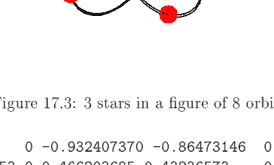

图17.3：三颗星在8字形轨道上

```text
100 400 400          0 -0.932407370 -0.86473146  0
100 302.99564 424.308753 0 0.466203685 0.43236573  0
```

这旨在模拟一个三星系统，运行1000步，Δ = 10。星的初始位置和速度如上所示。注意这些值都是经过精心计算的。

你可以通过键入以下命令来模拟该系统：

```bash
./a.out 3stars.txt
```

这些星将描绘出一条有趣的8字形轨道，并在轨道上互相追逐。图17.3给出了一个快照。这些星都处于落笔状态，因此所描绘的轨道也是可见的。

## 17.5 结束语

本章提出了若干值得注意的思想。

对感兴趣的系统进行模拟的一般概念非常重要。给定一个系统的初始状态和支配定律，我们原则上可以确定后续状态。然而，正如我们所看到的，支配定律可以以不同程度的复杂方式应用，从而导致结果中出现或大或小的误差。数值分析方面的教材会说明如何估计误差，并会给出比我们介绍的更复杂的思想。

我们的程序还说明了两个重要的程序设计思想。首先是构建类来表示程序中重要实体的思想。显然，我们程序中的重要实体是星体，因此我们构建了一个类来表示它们。但正如我们所注意到的，问题中有许多类似向量的实体，所以构建 V3 类也是有用的。最后，注意我们并没有编写一个冗长的 main 程序：我们识别了 main 程序中的重要步骤，并用函数实现了这些步骤。这些函数即使只使用一次，也能更清楚地表明算法的计算结构。

最后，还有一个小技术点需要指出。我们需要创建一个 Star 对象数组。正如我们在第16.1.3节中指出的，当创建对象数组时，每个对象只能使用不带参数的构造函数来初始化，因此我们有一个 Star() 构造函数。但这留下了一个问题：如何将数据放入每个对象中？为此，一种常见做法是提供一个 init 成员函数，就像我们所做的那样。我们对数组中的每个对象调用 init 函数并设置其内容。每当你的程序中需要对象数组时，这种惯用法都会很有用。


## 17.6 习题

- 1. 运行课文中给出的宇宙学模拟。用它来模拟一个由绕恒星运行的行星组成的系统。修改给定的代码，使其使用本章讨论的第一种（较简单的）方法。比较这两种方法。对于足够小的速度，两种方法下行星都会绕恒星运行。然而，你会观察到，对于欧拉方法，无论步长如何，轨道都会不断发散，这显然是错误的。对于相同的步长，你应该能够观察到蛙跳轨道不会发散，或者发散程度小得多。
- 2. 考虑一根长度为 L 的两端固定的弹性弦。假设它由 n 个等重物组成，这些重物通过长度为 L/n + 1 的弹簧连接在一起。假设每个弹簧的胡克常数为 k，即如果弦被拉伸距离 x，则产生张力 −kx。假设其中一个重物被移动到某个新位置。假设此后弦处于静止状态。显然，如果忽略重力，重物两侧的弹簧会均匀拉伸。现在假设释放该重物。在无重力的情况下模拟其运动。
- 3. 考虑一列在单车道公路上行驶的汽车。在一个简化模型中，假设所有汽车具有相同的最大速度 V、加速度 a 和减速度 d。假设每辆汽车都试图确保即使前车瞬间停下（例如由于事故），它也能停下来。进一步假设驾驶员知道这个距离，并且当前方距离减小时会减速，距离增大时会加速，但只有速度达到 V 时才停止加速。构建一个车队沿设有信号灯的道路行驶的模拟。当信号灯变红时，车队中的领头汽车刹车，使其停在信号灯处。当然，驾驶员不会立即反应，而是有一定的反应时间。不过要注意，通常很容易看到前车是否在减速，因为尾部的红灯会亮起。将这些细节纳入你的模拟中。使用我们的图形命令显示模拟的动画。

## 第18章

### 图形事件

你已经知道，函数 getClick 会使程序等待用户在图形画布上点击，然后返回点击位置坐标的表示。然而，还可以与图形画布进行更丰富的交互。你的程序可以等待鼠标拖拽、按键按下或类似的事件。事件发生后，你可以决定采取什么行动。使用我们将在本章讨论的功能，你应该能够编写非常交互且易于使用的程序，甚至游戏。

我们首先描述如何等待事件，并确切地找出发生了什么事件。之后，我们将简要介绍两个应用。

### 18.1 事件

我们所说的*事件*是指以下情况之一：

- 1. 按下鼠标上的某个按钮。
- 2. 释放鼠标上的某个按钮。该按钮必须先前已被按下。
- 3. 拖拽鼠标。这指的是在按下某个按钮的情况下移动鼠标。
- 4. 按下键盘上的某个键。

如果用户在图形画布处于活动状态（通常称为“具有焦点”）时执行这些操作中的任何一个，则被视为一个事件。请注意，如果将鼠标移动到画布上并按下任意鼠标键，图形画布将变为活动状态，并且只要鼠标保持在画布内，它就一直处于活动状态。

#### 18.1.1 事件对象

类 XEvent 的对象用于保存事件信息。它们（按引用）传递给将已发生事件的信息放入其中的函数，或传递给提取先前放入其中信息的函数。

我们不会完整描述 XEvent 类，而只会在下面根据需要讨论相关细节。

#### 18.1.2 等待事件

函数 nextEvent 具有以下签名：

```
void nextEvent(XEvent &event);
```

调用 nextEvent 会使程序等待事件发生。在这方面，它类似于语句 cin >> ...，程序会等待输入。当函数返回时，参数 event 将包含已发生事件的信息。程序可以提取这些信息并据此采取行动。

### 18.2 检查事件

函数 checkEvent 具有以下签名

```
bool checkEvent(XEvent &event);
```

如果自上次调用 nextEvent 或 checkEvent 以来发生了事件，则对 checkEvent 的调用返回 true。如果自上次调用 nextEvent 或 checkEvent 以来没有发生任何事件，则该函数只返回 false。

值得强调的是，与 nextEvent 不同，checkEvent 函数不会等待。

#### 18.2.1 鼠标按钮按下事件

函数 mouseButtonPressEvent 在事件上调用时，当且仅当事件类型为鼠标按钮按下时返回 true。一旦你知道事件是鼠标按钮按下类型，就可以使用成员 event.xbutton.button 获取关于它的附加信息，该成员返回一个整数，表示按下了哪个按钮；event.xbutton.x 和 event.xbutton.y 给出按下按钮时鼠标的坐标。下面是一个示例。

```
XEvent event;
nextEvent(event);
if(mouseButtonPressEvent(event)){
    cout <<"Mouse button "<< event.xbutton.button
    <<" pressed, at position ("<< event.xbutton.x <<
    ", "<< event.xbutton.y << endl;
}
```

这段代码将使程序等待某个事件发生，然后如果事件是按下某个鼠标按钮，它将打印按下了哪个按钮（即 1、2 或 3）以及画布坐标位置。

#### 18.2.2 鼠标拖拽事件

函数 mouseDragEvent 在事件上调用时，当且仅当事件是鼠标拖拽（即用户按下鼠标按钮后拖拽鼠标）时返回 true。成员 event.xmotion.x 和 event.xmotion.y 给出拖拽位置的坐标。

#### 18.2.3 按键按下事件

函数 keyPressEvent 在事件上调用时，当且仅当事件是按下键盘上的某个键时返回 true。将函数 charFromEvent 应用于该事件会返回表示所按下键的 char。成员 event.xkey.x 和 event.xkey.y 分别给出按键位置处的坐标。

### 18.3 一个绘图程序

下面是一个简单的程序，使你能够在画布上绘图。

```
int main(){
    initCanvas("Draw using the mouse", 800,500);
    const char escapekey = '\33';
    XEvent event;
    short lastx=0, lasty=0;
    while(1){
        nextEvent(event);
        if(mouseButtonPressEvent(event)){
            lastx = event.xmotion.x; lasty = event.xmotion.y;
        }
        if(mouseDragEvent(event)){
            imprintLine(lastx, lasty, event.xbutton.x, event.xbutton.y);
            lastx = event.xbutton.x; lasty = event.xbutton.y;
        }
        if(keyPressEvent(event)){
            if(charFromEvent(event) == escapekey) break;
        }
    }
}
```

在这里我们使用了 imprintLine 函数，而不是创建一条线并在其上调用 imprint。根据我们的经验，后一种方法太慢——线条绘制会滞后于光标移动。

### 18.4 一个基本的贪吃蛇游戏

也许你们中许多人都熟悉一款名为贪吃蛇的游戏，其各种版本在许多计算机甚至手机上都有。

游戏的本质是控制一条在屏幕上不断移动的蛇。玩家可能有目标，例如引导蛇朝向食物/奖品，或防止它撞到障碍物。在一些变体中，蛇的尾巴会随着吃食物而增长。通常，蛇被表示为一系列段（椎骨！）。头部（即第 0 段）有一个移动方向：北、东、南或西，并且每个时间步沿该方向移动一步。后续段跟随，即第 i 段


移动到第 *i − 1* 段的位置，其中 *i ≥ 1*。玩家可以通过输入 'n'、'e'、's'、'w' 等字符来改变头部移动的方向。

这里我们将开发游戏的核心逻辑，即在屏幕上显示蛇，并让玩家能够改变其方向。添加奖品等内容留作练习。

### 18.4.1 规格说明

我们在上面已经或多或少地描述了规格。也许只需要澄清一点：蛇的各段将在一个二维网格上移动，网格间距为 `gridsep`。

### 18.4.2 类

正如我们已经提到的，我们应该为程序中包含的所有重要实体建立一个类。因此很明显，我们必须有一个 Snake 类。

蛇的身体由若干段组成。所以很自然地考虑一个由 `Circles` 组成的名为 `body` 的数组，这里我们任意决定这些段是圆形的。我们将使用一个常量长度来表示身体中的段数。每一段都会维护自己的位置，因此我们不需要为蛇额外设置位置属性。然而，保留一个表示当前移动方向的数据成员是有用的。由于移动只沿四个方向进行，我们为该成员选择了 char 类型，并期望它取值为 'n'、'e'、's'、'w'。

当蛇移动时，第 1 段到第 `length−1` 段移动到第 0 段到第 `length−2` 段的位置。因此实际上，由于这些段在外观上是相同的，看起来好像第 1 段到第 `length−2` 段保持不动，而第 `length−1` 段移动到了第 0 段应该移动到的位置。我们的代码实际上就是这么做的。注意，这意味着原来的第 *i* 段变成了第 *i − 1 % length* 段。因此，我们不需要在数组 body 中复制这些段，而只需保留一个数据成员 `headindex`，它给出了蛇头所在段的索引。

原先的尾段如何变成新的头段，可以用多种方式处理。我们按如下方式处理：让原来的尾段成为原来头段的副本。此时，我们将原来的尾段沿运动方向移动。

Snake 类的代码如图 18.1 所示。

```
const int gridsep = 20, xinit = 30, yinit = 20, length = 10, npts = 40;

struct Snake{
Circle body[length];
int headindex;  // 哪个 body 元素是蛇头
char dir;       // 当前运动方向
Snake(){
// 头部位于粗网格中的 (xinit,yinit)
headindex = 0;
for(int i=0; i<length; i++)
body[i].reset((xinit+0.5+i)*gridsep, (yinit+0.5)*gridsep, gridsep*0.5);
dir = 'w';
}
void move(){
move(dir);    // 继续沿原方向移动
}
void move(char command){
if(command != 'w' && command != 'n' &&
command != 'e' && command != 's') command = dir;
// 如果用户输入了非法字符，则继续沿原方向移动

int newhead = (headindex +length - 1) % length; // 原来的尾段
body[newhead] = body[headindex];  // 原尾段现在覆盖到原头段上
headindex = newhead;              // 原尾段元素成为新的头段

// 将新的头段沿运动方向移动
if(command == 'w')      body[headindex].move(-gridsep, 0);
else if (command == 'n') body[headindex].move(0, -gridsep);
else if (command == 'e') body[headindex].move(+gridsep, 0);
else if (command == 's') body[headindex].move(0, +gridsep);

dir = command;              // 保存新的运动方向
}
};
```

图 18.1：Snake 类

### 18.4.3 用户交互

这个示例的重点当然是用户如何与蛇交互。这发生在下面给出的主程序中。

主程序设置画布和蛇。然后进入一个无限循环，每 0.1 秒程序检查用户是否输入了任何内容以改变蛇的方向。这是通过函数 `checkEvent` 完成的。如果用户确实输入了一个键，那么使用 `charFromEvent` 函数提取其值。然后这个键被用作蛇的成员函数 `move` 的参数，以便移动发生在所需的方向上。如果用户没有输入任何内容，则调用无参数形式的 `move` 成员函数，这将使蛇继续沿原先移动的方向前进。

```
int main(){
    initCanvas("Snake", gridsep*npts, gridsep*npts);
    Snake s;
    while(true){
        XEvent event;
        if(checkEvent(event)){
            if(keyPressEvent(event)){
                char c = charFromEvent(event);
                s.move(c);                    // 新方向？
            }
        }
        else s.move();                        // 继续像以前一样移动
        wait(0.1);
    }
}
```

### 18.5 练习

- 1. 修改本章讨论的绘图程序，使其“美化”用户绘制的内容。具体来说，如果用户绘制的东西看起来几乎是一条直线，你应该把它画成一条直线。或者画成圆弧。尝试提出一些协议，使用户能够不费太多力气就画出美丽的图画。
- 2. “拖拽”的另一个用途，除了绘图之外，是在屏幕上拖动对象。特别地，用户可以将光标移动到某个对象上，然后点击按钮，拖动鼠标，最后释放按钮（放下）。这应该导致对象被选中、移动并放到新位置。这个想法在构建图形编辑器时会很有用，你肯定见过。修改前一练习中的绘图程序，使它不在画布上留下线条，而只是创建相应的直线和圆对象来显示它们。将这些对象保存在合适的数组中。允许它们被拖放。
- 3. 向贪吃蛇游戏中添加奖品/食物/墙壁。同时让蛇每次吃到食物时长度增加一节。另外，根据蛇吃了多少食物/奖品，甚至蛇存活了多长时间，给玩家分配一个分数。适当地显示分数。

## 第 19 章：表示可变长度的实体

我们继续讨论构建类来表示程序中可能需要的实体。在许多情况下，我们希望表示的实体没有标准长度，例如一段文本，比如一个人的名字。事实上，人类的名字可以很短，也可以很长。我们可能还想表示多边形（顶点数量可能不同）、多项式（系数数量可能不同）等实体。我们也可能被要求表示图（例如道路网络）或不同班级中学生集合的集合；一般来说，我们可能希望表示每个此类集合的多个实例，而这些实例通常具有不同的长度。

一种自然的策略是分配最大可能的长度来表示所讨论的实体。我们在第 14.1 节中使用了这个想法来表示文本字符串：如果我们想存储人名，我们分配了我们认为最大可能长度的 char 数组。这显然会低效地使用内存。人的名字长度差异很大，例如演员 Om Puri 和自由斗士/学者 Chakravarti Rajagopalachari。因此，一般来说，我们将被迫分配很长的数组，但大多数时候我们只使用其中的一小部分。

在本章中，我们将看到如何设计一种用于存储文本字符串的数据类型，使其不浪费内存。我们不能直接使用迄今描述的结构/类/数组。这是因为类/结构/数组的大小必须一次确定，通常不知道要存储在其中的文本字符串的大小。在编写程序时，表示大小未知的实体的最方便方式是使用所谓的堆内存分配。这也称为动态内存分配。利用这个堆内存，我们将构建一个 String 类，使用它你可以高效方便地存储和处理文本字符串。

一般来说，堆内存在构建表示那些编写程序时大小未知、甚至可能随时间变化的实体时会很有用。我们将在练习中看到此类表示的示例。

C++ 标准库中包含几个使用堆内存来容纳可变大小实体的类。事实上，库中的类之一就是一个字符串类，它可以被视为我们在本章中讨论的 String 类的高级版本。我们将在第 20 章中研究包括 string 类在内的标准库。第 20 章不会讨论这些类是如何实现的；然而，本章中 String 类的实现将提供一些线索。


## 19.1 堆内存

到目前为止，我们在很大程度上考虑的是分配在某个函数或另一个函数的激活帧中的变量。 这样的变量仅在对应的函数执行期间存在。

然而，C++ 程序也可以在激活帧之外获得内存。 为此目的保留了一定区域的内存。 该区域称为堆内存，或简称为堆。 你可以使用 new 运算符从堆中请求内存。 假设 T 是一个数据类型，使得每个 T 类型的变量需要 s 字节的存储。 那么表达式

```
new T
```

会在堆中分配一个 T 类型的变量，或者说 s 字节的内存，并且该表达式本身会计算为已分配变量的地址。 要使用此已分配的变量，你必须保存地址——通常你可以通过将其存储在指向 T 的指针类型的变量中来做到这一点。 更一般地，我们可以写

```
new call-to-a-constructor-for-T
```

这不仅会创建一个 T 类型的变量，而且还会使用给定的构造函数对其进行初始化。

因此，对于第 15.1 节中定义的 Book 类型，我们可以写：

```
Book *p;
p = new Book;
```

第一个语句声明 p 为指向 Book 的指针类型。 第二个语句请求从堆中分配内存以存储一个 Book 变量。 已分配内存的地址被放置在 p 中。 我们当然也可以在一个语句中完成此操作，如果我们愿意，可以写 Book *p = new Book;。 分配的内存可以通过取消引用指针 p 来使用，即我们可以写

```
p->price = 335.00;
p->accessionno = 12345;
```

分别设置价格和登录号。

new 运算符的第二种形式允许我们在堆中分配数组。 同样，如果 T 是一个类型，那么我们可以写

```
T *q = new T[n];
```

这将在堆中分配内存以存储 n 个 T 类型元素的数组，并且已分配数组的地址将被放置在 q 中。 我们可以通过第 13.3.3 节中讨论的 [] 运算符来访问从 q 开始的数组元素。 因此我们可以写 q[i]，其中 i 必须在 0 和 n（不包括）之间。 请注意，T 可以是基本数据类型，也可以是类。 如果它是类，则每个对象 T[i] 将通过调用

不带任何参数的构造函数来构造。 你必须确保此类构造函数可用。

请注意，以这种方式分配内存是一个相当复杂的操作。 需要做一些簿记工作，以便随后在我们显式释放内存之前不会将同一内存分配给另一个请求。 我们可以使用 delete 运算符释放内存，即将其返回到堆。 因此，我们可能会写：

```
delete p;
```

假设 p 指向如上所述分配的内存，delete p; 将导致内存被返回，即在某处会记录从 p 开始的内存现在是空闲的，可以为未来的请求分配。 如果分配的是数组，则使用 delete[] 运算符。 因此，对于前面定义的 q，我们可以写：

```
delete[] q;
```

请注意，一旦我们执行 delete（或 delete[]），访问相应的地址是不正确的； 这几乎相当于因为我们知道它的地址并且可能拥有它的钥匙而进入我们已出售的房子。 它不属于我们！ 其他人可能已经搬进去，即分配器可能已将该内存分配给另一个请求。 访问此类指针被称为导致悬空指针错误。

我们上面使用了术语分配器。 通过此我们指的是 C++ 维护的一组（内部）函数和相关数据，用于管理堆内存。 这些是在你使用 new 运算符请求内存和使用 delete 运算符释放内存时（在幕后，换句话说）被调用的函数。

### 19.1.1 一个详细的例子

我们举一个详细的例子说明堆内存如何在执行期间被分配。

考虑图 19.1(a) 的程序。 我们假设为了确定性，堆从地址 24000 开始。 当执行开始时，堆中的所有内存都可用。

当第一个语句 int* intptr = new int; 执行时，从堆的开头提供存储单个 int 的内存。 由于 int 需要 4 个字节，地址为 24000 到 24003 的 4 个字节被保留，并且这些字节中的第一个的地址 24000 被返回并存储在 intptr 中。 接下来，请求一个包含 3 个字符的数组的内存。 为此，从 24004 开始保留接下来的 3 个字节。 因此 cptr 得到值 24004。

以下语句 *intptr = 279; 将数字 279 存储到 intptr 指向的已分配内存中，即地址 24000。 接下来的 3 个语句将字符字符串常量 "ab" 存储到 cptr 指向的数组中。 在执行此阶段，程序关联的内存分为两部分：包含变量 intptr 和 cptr 的激活帧，以及已在堆中分配的内存。 图 19.1(b) 显示了激活帧。 堆在图 19.1(c) 中显示。

```
```cpp
int main(){
    String a,b;
    a = "pqrr";
    b = a;
    String c = a + b;   // should concatenate a, b.
    c.print();          // should print on screen

    String d[2];        // array of 2 strings
    d[0] = "xzy";
    d[1] = d[0] + c;
    d[1].print();
}
```
```

对于此类可能还有其他期望的操作，我们稍后讨论。

## 19.2.1 基本存储思想

下面是类 `String` 的声明，它将使我们能够编写上面的主程序。

```
```cpp
class String{
    char* ptr; // will point to address in heap where actual text is stored.
public:
    String();
    void print();
    void operator=(char* rhs);
    void operator=(String rhs);
    String operator+(String rhs);
};
```
```

该类仅包含一个数据成员 ptr，它意味着指向堆内存中存储与该变量关联的文本的起始地址。 具体来说，我们将在堆内存中存储以空字符（即 '\0'）结尾的文本。 这样，我们就不需要显式存储实际区域的长度。 此外，如果 String 变量包含空字符串，我们将将其成员 ptr 设置为 NULL。

原则上，如果两个 String 变量具有相同的值，即包含相同的文本，那么我们可能可以在堆中存储该文本的单个副本，并使两个变量的 ptr 成员都指向该副本。 虽然这种共享可能会节省内存，但它也会使我们需要用于请求和释放堆内存的逻辑变得复杂。 因此我们将采用更简单的想法：与每个变量关联的文本将存储在堆内存中的不同区域。

### 19.2.2 构造函数

最初，当我们创建一个字符串变量时，我们希望它保存空字符串。 因此构造函数如下。

```
String::String(){
    ptr = NULL;
}
```

### 19.2.3 print 成员函数

我们接下来讨论成员函数 print。 这非常简单。

```
void String::print(){
    if(ptr != NULL) cout << ptr << endl;
    else cout << "NULL" << endl;
}
```

由于 ptr 给出了字符串存储的地址，写 cout << ptr << endl; 就足够了。 然而，如果 ptr 为 NULL，则我们不能打印它，而必须显式打印出 "NULL"。

### 19.2.4 赋值

我们在第 15 章中讨论了对于结构类型，赋值已经定义，前提是赋值的右侧也是与左侧相同类型的结构。 这样的语句通过将右侧的每个数据成员复制到左侧的对应成员来执行。 我们将看到这对于我们的目的是不够的。 此外，我们的 String 数据类型允许右侧为 char* 类型。 这我们必须重新定义。 这是我们首先考虑的内容。

如第 16.6 节所述，我们可以定义成员函数 operator= 来指定赋值应如何工作。 由于右侧应为 char* 类型，此成员函数必须具有 char* 参数。 在函数体中我们描述希望执行赋值时发生的情况。 我们可以将其定义如下。

```
void String::operator=(char *rhs){
    delete [] ptr;
    ptr = new char[length(rhs) + 1];
    strcpy(ptr,rhs);
}
```

我们举一个例子来看看它是如何工作的。 假设 z 是 String 类型并且我们有一个语句

```
z = "mno";
```

此语句将导致成员函数 operator= 执行，其中变量 z 为接收者，参数 rhs 为文本字符串 "mno" 的地址。

请注意，在控制到达赋值语句之前，变量 z 可能已经包含某个值，例如变量 z 包含文本 "pqr"。 在这种情况下，在我们的赋值语句之前，z.ptr 已经指向存储 "pqr" 的堆区域。 当我们将 z.ptr 设置为指向存储 "mno" 的区域时，包含 "pqr" 的区域将不再


所需的空间已经存在，因此可以删除。这正是函数中第一条语句所做的。之后，我们从堆中请求足够的内存来存储新值，即 `rhs` 中字符数加上一个额外的字节用于存储空字符。为此，我们使用了第 14.1.3 节中的 `length` 函数。然后，我们将 `rhs` 所指向的文本复制到新区域中。这里我们使用了第 14.1.3 节中的 `strcpy` 函数。

接下来，我们考虑执行 `b = a;` 这样的字符串赋值语句。要执行它，我们需要做的事情与上面类似。唯一的区别是赋值语句的右侧是一个 `String` 对象，而不是 `char*`。需要复制的文本现在来自右侧对象的 `ptr` 成员，而不是直接取右侧对象本身。

```
void String::operator=(String rhs){
    delete [] ptr;
    ptr = new char[length(rhs.ptr) + 1];
    strcpy(ptr,rhs.ptr);
}
```

### 19.2.5 定义 operator +

接下来我们考虑如何在 `String` 变量上执行 `a + b` 操作。我们可以将其编写为一个普通的 `operator+` 函数，接受两个 `String` 参数；也可以将其编写为一个成员函数，在左侧的 `String` 上调用，右侧的 `String` 作为参数传入。该函数需要返回一个 `String` 变量，其中包含操作数文本的拼接结果。

```
String String::operator+(String rhs){
    String res;
    res.ptr = new char[length(ptr) + length(rhs.ptr) + 1];
    strcpy(res.ptr, ptr);
    strcpy(res.ptr, rhs.ptr, length(ptr));
    return res;
}
```

结果将作为 `String` 变量 `res` 计算得出。它需要保存的文本长度等于左侧文本的长度（即隐式参数中的文本，长度为 `length(ptr)`）与右侧参数 `rhs` 中文本的长度（`length(rhs.ptr)`）之和，再加上一个额外的字节用于存储空字符。因此，第二条语句在堆中请求了这么大尺寸的内存。然后，使用 `strcpy` 函数将隐式参数中的文本复制到 `res.ptr` 中。上面的第二个 `strcpy` 调用假设存在一个接受 3 个参数的 `strcpy` 函数，如下所示。

```
void strcpy(char destination[], char source[], int dstart=0){
    int i;
    for(i=0; source[i] != '\0'; i++)
        destination[dstart+i]=source[i];
    destination[dstart+i]=source[i];    // copy the '\0' itself
}
```

如你所见，这个函数会将源字符串复制到目标字符串中，起始位置为索引 `dstart`。这样就完成了 `String` 类的定义。有了这个定义，开头给出的主程序就可以执行了。

## 19.3 高级主题

前一节中定义的 `String` 类对于本节（第 19.2 节）开头给出的主程序来说已经足够了。然而，这个定义不允许我们执行许多其他可能需要的操作，例如按值将 `String` 对象作为参数传递给函数，或者将 `String` 对象作为结果返回。如何启用这些操作正是本节的主题。

我们首先修复现有 `String` 定义的一个缺点。事实证明，如果我们在一个块内部分配一个 `String` 变量，将会导致内存泄漏：

```
{
    String s;
    s = "pqr";
}
```

这是因为当块结束时，对象 `s` 会从当前活动帧中释放。结果，我们将无法再使用 `s.ptr` 所指向的内存。因此，理想情况下，我们应该在每个块的末尾 `delete[]` 那块内存。我们可以通过在块结束前编写语句 `delete[] s.ptr;` 来实现这一点。但必须为每个这样的变量和每个这样的块自己编写这一语句，既不方便又容易出错（我们可能会忘记）。此外，注意 `ptr` 是一个私有成员，因此要从类定义外部删除它，我们需要对类定义进行进一步的修改。这正是析构函数的用武之地。

### 19.3.1 析构函数

当控制流退出定义 `String` 对象的块时，该对象将被释放。这没有问题，但我们希望当对象被释放时，成员 `ptr` 所指向的内存也能归还给堆。我们可以通过为 `String` 定义一个析构函数来实现这一点。

```
String::~String(){
    delete[] ptr;
}
```

C++ 会对任何即将被释放的变量调用析构函数，并且只有在析构函数执行完毕后才会真正释放该变量。当上面的析构函数被调用时，它会将 `ptr` 所指向的内存归还给堆，正如我们所希望的那样。

请记住，析构函数的调用是隐式发生的。因此，你绝不应该显式调用析构函数，因为那样会导致它被调用两次，`ptr` 被删除两次，这是错误的。

注意，如果我们不提供析构函数，C++ 本身会定义一个什么都不做的析构函数。在这种情况下，`ptr` 所指向的内存不会归还给堆，从而导致内存泄漏。

### 19.3.2 复制构造函数

复制构造函数是一种构造函数，它将正在创建的对象初始化为参数所提供的同类现有对象的副本。它有一些我们将要讨论的特殊用途；但我们首先注意到，它可以以自然的方式编写。

```
String::String(const String &rhs){
    ptr = new char[length(rhs.ptr)+1];
    strcpy(ptr,rhs.ptr);
}
```

复制构造函数本质上类似于赋值运算符；然而，由于左侧对象刚刚被构造，它可以比赋值运算符更简单。当将 `String x` 赋给 `String y` 时，即执行 `y = x` 时，我们需要对 `y` 执行 `delete[]`，因为它所指向的内容将不再需要。但是，如果 `y` 刚刚被构造，那么我们知道它的 `ptr` 成员尚不指向任何内容。因此，不需要执行删除操作。所以上面的代码不包含 `delete[] ptr` 操作，而第 19.2.4 节的赋值运算符包含该操作。

注意，复制构造函数的参数必须按引用传递，其原因稍后就会清楚。另一个重要的一点是，当你复制一个现有对象来构造一个新对象时，很可能不会修改现有对象。因此，将构造函数参数设置为 `const` 是合适的。

复制构造函数可以由用户显式调用；然而，编译器会在 3 种情况下使用它。

- 1. 当你定义一个对象并在定义时为其赋值另一个对象时，例如，如果你编写：

  ```
  String s = "abc";
  String t = s;
  ```

  那么将 `s` 复制到 `t` 时使用的是复制构造函数，而不是赋值运算符（即成员函数 `operator=`）。

- 2. 当一个对象按值传递给函数时。

- 3. 当一个对象从函数返回时。

因此，通过自己定义复制构造函数，你可以控制上述三种操作的发生方式！如果你不定义复制构造函数，C++ 会为你提供一个，而它仅仅复制成员。显然，这种默认的复制构造函数不适用于 `String`。

你现在会明白，按值传递参数给复制构造函数是不合适的。如果你确实按值传递它，那么它必须首先被复制，但要做到这一点，你必须调用复制构造函数，如此循环往复。这样就会导致无限递归。事实上，如果你编写了一个按值接受参数的复制构造函数，C++ 会将其标记为错误。

### 19.3.3 [] 运算符

我们还希望通过指定索引来访问字符串中的单个字符。你已经从第 13.3.3 节知道 `[]` 是一个运算符。我们只需要为 `String` 类重载它！

```
char& String::operator[](int i){ // returning a reference.
    return ptr[i];
}
```

注意，我们返回的是对 `ptr[i]` 的引用，而不是 `ptr[i]` 的值。因此，我们也可以将它用在赋值语句的左侧。

### 19.3.4 改进的赋值运算符

我们可以稍微改进赋值运算符，以允许在同一语句中进行多重赋值，即允许我们编写类似下面的代码：

```
String s,t,u;
s = t = u = "abc";
```

为了实现这一点，我们只需返回对左侧对象的引用。因此，赋值运算符的一个更好的定义如下。

```
String& String::operator=(const String &rhs){
    delete [] ptr;
    ptr = new char[length(rhs.ptr) + 1];
    strcpy(ptr,rhs.ptr);
    return *this;
}
```

我们还将 `rhs` 参数改为按引用传递。

### 19.3.5 使用

图 19.2 显示了新的定义汇总。我们还加入了成员函数 `size`，它返回字符串中的字符数，以及索引运算符 `[]`。

利用这些定义，现在可以编写以下函数以及调用它的主程序。

```
String lcase(const String &arg){
    String res = arg;
    for(int i=0; i<res.size(); i++)
        if(res[i] >= 'A' && res[i] <= 'Z') res[i] += 'a' - 'A';
    return res;
}
```

```
int main(){
    String a,b;
```


```
a = "PQR";
b = a;
String c = a + b;    // should concatenate a, b.
c.print();            // should print on screen

String d[2];          // array of 2 strings
d[0] = "Xyz";
d[1] = tolower(d[0] + c);
d[1].print();
d[1][2] = d[0][1];
d[1].print();
}
```

这将首先打印 c，其值将为 "PQR PQR"。第二个打印语句将连接 "Xyz" 和 "PQR PQR"，然后将其全部转换为小写。因此 "xyzpqrpqr" 将被打印出来。之后我们将把 d[1] 的索引 2 处的字符设置为 d[0] 的索引 1 处的字符。因此最后一个打印语句将打印 "xyypqrpqr"。

## 19.4  remarks

我们展示了如何定义一个数据类型 String 来存储字符字符串。我们展示了该定义足够好，可以创建字符串，对其进行索引、连接、对字符串赋值、将字符串传递给函数以及从函数返回它们。有效地，使用我们的定义，我们有一种 String 是基本数据类型的错觉。我们的实现保证了我们创建的对象将高效地使用内存。

然而，有一个操作我们不应该对 String 类执行。这是在堆内存中分配 String 对象本身的操作。因此我们不应该写类似

```
Poly *ptr = new String;    // !!! DO NOT DO THIS !!!
```

如果这在块内部，则在退出块时变量 ptr 将被释放。作为结果，它指向的内存区域会泄漏。

关键点是 String 类的定义方式，你将不需要担心分配内存。事实上，你可以在不知道堆的情况下使用 String 类。你不需要担心管理堆；内存会在需要时为你分配，也会在需要时为你释放。所有这些都将在幕后发生。你需要做的就是坐下来享受便利，而不要干预内存管理。

### 19.4.1 类不变式

在设计 String 时，我们在早期做出了一些重要决定。特别是我们说每个 String 中存储的值在堆内存中会有单独的副本

```
class String{
    char* ptr; // will point to address in heap where actual text is stored.
public:
    String(){ ptr = NULL; }
    String(const String &rhs){
        ptr = new char[length(rhs.ptr)+1];
        strcpy(ptr,rhs.ptr);
    }
    String& operator=(const char* rhs){
        delete [] ptr;
        ptr = new char[length(rhs) + 1];
        strcpy(ptr,rhs);
        return *this;
    }
    String& operator=(const String &rhs){
        delete [] ptr;
        ptr = new char[length(rhs.ptr) + 1];
        strcpy(ptr,rhs.ptr);
        return *this;
    }
    String operator+(String rhs){
        String res;
        res.ptr = new char[length(ptr) + length(rhs.ptr) + 1];
        strcpy(res.ptr, ptr);
        strcpy(res.ptr, rhs.ptr, length(ptr));
        return res;
    }
    void print(){
        if(ptr != NULL) cout << ptr << endl;
        else cout << "NULL" << endl;
    }
    int size(){return length(ptr);}
    char& operator[](int i){return ptr[i];}
};
```

图 19.2：完整的 String 类

对象。类成员在其生命周期内始终拥有的这种属性，有时被称为类不变式。清楚地写下此类不变式是有用的，正如你所见，它们指导类的实现。

## 19.5 练习

- 1. 考虑以下代码。找出其中的所有错误。

```
int *ptr1, *ptr2, *ptr3, *ptr4;
ptr1 = new int;
ptr3 = new int;
ptr4 = new int;
ptr2 = ptr1;
ptr3 = ptr1;
*ptr2 = 5;
cout << *ptr2 << *ptr1 << endl;
delete ptr1;
cout << *ptr3 << *ptr4 << endl;
```

可能的错误是：内存泄漏、悬空指针（访问先前分配给我们的但已 since 被释放的内存），以及引用未初始化变量。

- 2. 假设你有一个文件，其中包含一些未知数量的数字。你想将其读入内存并按排序顺序打印出来。开发一个可扩展的数组数据类型，可以读入值。基本上，真正的数组应该在堆上，由你的结构的一个成员指向。如果数组已满，你应该分配一个更大的数组。确保将旧的未使用部分返回到堆。编写拷贝构造函数等，以便数组不会出现泄漏等。

- 3. 定义一个表示多项式的类。包含用于多项式加法、减法和乘法的成员函数。确保你的实现遵循第 ?? 节中所述的类不变式风格。

- 4. 为多项式定义取模运算符 %。假设 S(x)、T(x) 是多项式，那么在最简单的定义中，余数 S(x) mod T(x) 是次数小于 T(x) 的多项式 R(x)，使得 S(x) = T(x)Q(x) + R(x)，其中 Q(x) 是某个多项式。

编写取模运算符的主要动机是稍后用于 GCD 计算。因此，必须确保没有由于除法而发生的舍入误差。一种解决方法是将余数 S(x) mod T(x) 定义为 kR(x)，其中 k 是任意数，R(x) 如上定义。假设多项式的系数最初是整数，你现在应该能够在不进行除法的情况下计算余数多项式。因此也不会有舍入。当然这也有缺点，即系数会变得越来越大。为简单起见忽略此缺点。

- 5.

在此作业中，你需要编写一个类，使用它可以表示和操作非负整数的集合。具体来说，你应该具有成员函数，可以 (a) 从键盘读取集合，(b) 构造两个集合的并集，(c) 构造两个集合的交集，(d) 判断给定整数是否在给定集合中，(e) 打印给定集合。使用数组存储集合中的元素。不要重复存储同一个数字两次。使用你的函数应该能够运行以下主程序。

```
main(){
    Set a,b;
    a.read();
    b.read();

    set c = union(a,b);
    set d = intersection(a,b);

    int x;
    cin >> x;

    bool both = belongs(x,d);
    bool none = !belongs(x,c);

    if( both ) {
        cout << x << " is in the intersection ";
        c.print();
    }
    else if (none) cout << x << " is in neither set." << endl;
    else cout << x << " is in one of the sets." << endl;
}
```

函数 Set::read 将非常类似于/与 Poly::read 相同。对于其余部分，确保你通过先确定并集/交集的大小来分配大小恰当的数组。

- 6.

欧几里得 GCD 算法也适用于寻找多项式的 GCD。编写此代码的代码，使用迭代表达式以及递归表达式。两个版本是否会导致相同数量的堆内存分配？如果有，哪一个会更好？

- 7.

考虑以下类 Poly 的新成员函数：

```
void move(Poly &dest);
```

当作为 source.move(dest) 调用时，它应该将 source 中包含的多项式移动到 dest，并将 source 设置为未定义。有效地，这意味着赋值，其中值不是复制而是移动。是否需要在实现 move 时分配新内存以确保类不变式成立？
看看带有新 move 函数的 Poly 类是否会改善之前考虑的 GCD 程序。

- 8.

将 gcd 函数模板化，使其既可用于普通数字也可用于多项式。你将不得不定义一些额外的成员函数以及一个构造函数。请注意 int 是 int 类型的构造函数，即 int(1234) 返回整数 1234。

- 9.

考虑以下定义的类。

```
const int QUEUESIZE = 10;

class Queue{
    int front;
    int nWaiting;
    int elements[QUEUESIZE];
    Queue(){front = nWaiting = 0;}
    Queue(Queue &q){
    Queue & operator= (Queue & other){ return *this; }
public:
    static Queue* create(){ return new Queue(); }
    bool insert(int value){
        if(nWaiting == QUEUESIZE) return false; // queue is full
        elements[(front + nWaiting) % QUEUESIZE] = value;
        nWaiting++;
        return true;
    }
    int remove(){
        if(nWaiting == 0) return -1; // queue is empty
        int item = elements[front];
        front = (front + 1) % QUEUESIZE;
        nWaiting--;
        return item;
    }
    ~Queue(){if (nWaiting > 0) cout << "Non empty queue destroyed.\n";}
};
```

Queue 的此定义旨在以一些不寻常的方式使用。说明它允许什么操作，以及它不允许什么操作。讨论这些不寻常特性的原因。使用它重写出租车调度程序。


## 第20章
## 标准库

编程中的一个重要原则是不要重复代码：如果某个想法被反复使用，就把它写成函数或类，然后调用函数或实例化类对象，而不是重复编写代码。但我们还可以做得更好：如果某些想法极其频繁地被使用，或许语言本身就应该直接提供这些函数/类！这正是标准库背后的开发动机，标准库是任何 C++ 发行版的一部分。理解这个库是值得的，因为熟悉它就能避免编写大量你可能本需要自己编写的代码。此外，库中的函数和类使用了最优算法，在需要时能做好内存管理，并且经过了广泛测试。因此，强烈建议你尽可能使用标准库，而不是自己开发相关代码。

标准库相当庞大，因此我们只略窥一二，以感受其风格。我们从 `string` 类开始，它对于存储文本数据非常方便。这个类是第19章中 `String` 类的进阶版本。它极其方便，你应当默认使用它，而不是使用字符数组。

接下来我们将研究模板类 `vector` 和 `map`，它们属于库中所支持的所谓容器类。它们可以用来保存对象的集合，就像数组那样。实际上，你可以把这些类看作是数组的更灵活、更强大的扩展。我们不会讨论这些类是如何实现的，不过你可以从第19章和第22.2节的讨论中得到一些线索。当然，作为使用者，你只需要知道这些类的规范，而不必担心它们如何实现。

作为标准库使用示例，我们对第13.2.2节的成绩显示程序进行了多种变体编程。你已经掌握了足够的 C++ 知识来解决所有这些变体，并且其中一些你已经解决过了。然而，你会看到，使用标准库，你可以用更少的编程工作量解决它们。

在本章末尾，我们将简要概述标准库中的其他类。其中，我们将在第25章使用 `priority_queue` 类。

### 20.1 string 类

`string` 类是处理 `char` 数据的一个非常方便的类。它非常方便，因此我们鼓励你尽可能使用 `string` 类，而不是 `char` 数组。

要使用 `string` 类，你需要包含头文件 `<string>`，但请注意，如果你使用了 `<simplecpp>`，它会被自动包含。我们可以非常简单地创建字符串对象 `p`、`q`、`r`。

```
#include <string>  // 如果包含了 simplecpp，则不需要此句。

string p = "abc", q ="defg", r;
r = p;
```

第一条语句将定义变量 `p`、`q`、`r`，并将它们分别初始化为 `"abc"`、`"defg"` 和空字符串。第二条语句将字符串 `p` 复制到字符串 `r`。当你进行赋值时，旧值会被覆盖。注意，你不需要担心字符串的长度，也不需要显式分配内存。你可以按预期的方式打印字符串。

```
cout << p << "," << q << "," << r << endl;  // 打印 ‘abc,defg,abc’
```

这将打印出用逗号分隔的字符串。读取也很简单，`cin >> p;` 会将一串以空白字符结尾的键入字符读入 `p`。要将一整行读入字符串变量 `p`，可以使用：

```
getline(cin, p);
```

注意，你不能像使用 `char*` 变量时那样写 `cin.getline(p)`。另外，参见第20.5.1节中描述和使用的一个变体。加法运算符在字符串中被定义为拼接。因此，根据前面 `p`、`q`、`r` 的定义，你可以写：

```
r = p + q;
string s = p + "123";
```

这将分别把 `r`、`s` 设置为 `"abcdefg"` 和 `"abc123"`。可以使用 `+=` 运算符进行追加。你可以写 `s[i]` 来表示字符串 `s` 的第 `i` 个字符。成员函数 `size` 和 `length` 都返回字符串中的字符数。还定义了许多其他有用的成员函数。下面是一些例子。

```
string t; getline(cin, t);
int i = p.find(t);
if(i == string::npos)
    cout << "String: "<< p << " does not contain "<< t << endl;
else
    cout << "String: "<< p << " contains "<< t << " from position "<< i << endl;
```

最后，我们应该注意，字符串上定义了一种次序：字典序，即字符串在字典中出现的顺序。如果一个字符串在字典序中更早出现，则认为它 `<` 另一个字符串。因此，对于字符串 `p`、`q`，我们可以写比较表达式 `p == q` 或 `p < q` 或 `p >= q` 等，并赋予自然语义。

#### 20.1.1 向函数传递字符串

由于 `string` 是一个类，我们可以按值传递它给函数，此时会传递一个新的副本；也可以按引用传递，此时被调用的函数直接操作实参本身。

#### 20.1.2 一个详细示例

在第20.5.1节中，我们将看到一个字符串处理的详细示例。

### 20.2 模板类 vector

模板类 `vector` 旨在成为一维数组的更友好、更通用的变体。要使用模板类 `vector`，你需要包含一个头文件：

```
#include <vector>
```

可以通过提供一个模板参数（元素类型）来创建 `vector`。例如，我们可以通过编写以下代码来创建一个 `int` 类型的 `vector` 和一个 `float` 类型的 `vector`。

```
vector<int> v1;
vector<float> v2;
```

这些 `vector` 在创建时是空的，即它们不包含任何元素。但还有其他构造函数可用于创建具有给定长度的 `vector`，并且还可以指定给定值。例如，你可以写：

```
vector<short> v3(10);    // 包含10个元素的 vector，每个元素类型为 short。
vector<char> v4(5,'a');  // 包含5个元素的 vector，每个元素都设为 'a'。
vector<short> v5(v3);    // v3 的副本。
```

`vector` 会跟踪自身的大小，要知道大小，只需使用成员函数 `size`。因此

```
v3.size()
```

在之前的定义下，其值将为 10。你可以像使用数组下标那样访问 `vector` 的第 `i` 个元素。例如，你可以写：

```
v3[6] = 34;
v4[0] = v4[0] + 1;
```

通常的规则适用：下标必须在 0（含）和 `vector` 大小（不含）之间。你也可以通过编写以下代码来扩展 `vector`：

```
v1.push_back(37);
v3.push_back(22);
```

这些语句将分别把 `v1` 的长度增加到 1，把 `v3` 的长度增加到 11。方法 `push_back` 的参数将构成最后一个元素。

可以对 `vector` 执行一系列操作。例如，与数组不同，你可以将一个 `vector` 赋值给另一个 `vector`。因此，如果 `v` 和 `w` 是相同类型的 `vector`，我们可以写：

```
v = w;
```

这将使 `v` 成为 `vector w` 的副本。`v` 中原先包含的旧值会被丢弃。即使 `v` 和 `w` 原本长度不同，也是如此。你应该意识到，虽然这条语句看起来非常短小简单，但所有元素都会被复制，因此所花费的时间大致与 `w` 的长度成正比。

你可以通过写 `v.pop_back()` 将 `vector` 缩小一个元素。但你也可以任意设置大小：

```
v.resize(newSize);
w.resize(newSize,newValue);
```

第一条语句仅仅改变大小。第二条语句会改变大小，并且如果新大小更大，那么新元素会被赋予给定值。

#### 20.2.1 插入和删除元素

可以在 `vector` 的中间插入和删除元素。这将在第20.6.2节讨论。

#### 20.2.2 索引边界检查

除了使用下标 `[]` 访问元素外，你还可以使用成员函数 `at`。它会首先检查索引是否在 0（含）到数组大小（不含）的范围内。如果索引超出范围，程序将停止并显示错误消息。注意，`at` 函数可以在赋值的左侧和右侧使用。

```
vector<int> v;
for(int i=0; i<10; i++) v.push_back(i*10);

v.at(0) = v.at(1);
```

这将导致第一个元素被复制到第零个位置，即最终 `v` 将包含 10, 10, 20, 30, 40, 50, 60, 70, 80, 90。


# 20.2.3 向量上的函数

向量可以通过值或引用传递给函数。因为向量是一个类，如果按值传递，整个向量会被逐元素复制。因此被调用的函数会得到一个新副本，被调用的函数只能修改副本而不能修改原数据。然而，当按引用传递时，被调用的函数可以访问原始数据，并且原始数据中的值可以被读取或修改。

下面是读取值到向量并打印向量中值的函数。我们在此示例中考虑了 `int` 类型的向量。

```
void print(vector<int> v){
    for(unsigned int i=0; i<v.size(); i++) cout << v[i] << ' ';
    cout << endl;
}
void read(vector<int> &v){
    for(unsigned int i=0; i<v.size(); i++) cin >> v[i];
}
```

```
int main(){vector<int> v(5); read(v); print(v);}
```

我们当然也可以将函数模板化，例如

```
template<class T>
void print(vector<T> v){
    for(unsigned int i=0; i<v.size(); i++) cout << v[i] << ' ';
    cout << endl;
}
```

# 20.2.4 用户自定义数据类型的向量

只要类 T 定义了赋值运算符、拷贝构造函数和析构函数，我们就可以创建类 T 对象的向量。这是因为 vector 类会在内部调用这些成员函数。因此例如，你可以写

```
vector<V3> v3vec;
vector<Circle> circles;
```

其中 V3 是第 15 章中的类，Circle 来自第 5 章。你也可以创建指针的向量。

```
vector<Circle*> circlevec; // allowed.
```

# 20.2.5 多维向量

由于 vector 中的模板参数命名了一个类型，通过将其指定为一个向量，我们可以得到一个向量的向量，即相当于二维数组。

```
vector<vector<int> > v;
```

这只是定义 v 为一个零长度的零长度向量的向量。注意两个 > 字符之间的空格。如果没有这个空格，两个 > 字符将被解释为输入提取运算符 >>。

下面是我们如何定义一个长度为 10 的长度为 20 的向量的向量，即 10 × 20 矩阵。

```
vector<vector<int> > w(10, vector<int>(20));
```

在此我们使用了向量的双参数构造函数，第一个参数 10 指定长度，第二个元素 vector<int>(20) 给出每个元素的值。但该值本身是一个长度为 20 的向量。因此我们得到一个 10 行 20 列的矩阵表示。

我们可以用通常的方式访问矩阵的元素，即写 w[i][j]。然而，我们也可以在需要时修改整行。因此对于上面定义的 w，我们写：

```
w[0] = vector<int>(5);
```

我们将改变 w 使其成为一个奇特的结构：它将有 10 行；第一行有 5 个元素，其余行仍有 20 个元素。

这种灵活性非常有用。在科学计算中，我们经常遇到特定形状的矩阵，例如下三角矩阵。在下三角矩阵中，主对角线上方所有元素均为 0。因此我们甚至不需要存储它们。所以我们可以创建一个向量的向量，其中第 i 个向量（i 从 0 开始）长度为 i+1。这是一个简单的练习。

一方面，以上描述的灵活性是有用的，但另一方面，按上述讨论创建矩阵也有些冗长。此外，如果有人在程序中使用向量的向量，总是会怀疑他们可能会像上面描述的那样改变行的大小。如果我们能保证某个名字始终引用一个 10 × 20 矩阵，并且某个函数不会突然将其变为 5 × 5 三角矩阵，那么理解程序会更容易。换句话说，我们希望向读者表明我们实际上只使用通常的矩阵运算，而不是使用所有向量函数。为此，我们可以创建一个矩阵类。

# 20.2.6 一个矩阵类

下面定义了一个安全的矩阵类。它不允许在创建后更改单个行的大小，并且只允许读取和写入元素的访问。

```
class matrix{
vector<vector<double> > elements;
public:
matrix(int m, int n) : elements(m, vector<double>(n)) {}
double &operator()(int i, int j){return elements[i][j];}
int nrows(){return elements.size();}
int ncols(){return elements[0].size();}
};
```

它可以在如下的主程序中使用。

```
int main(){
    matrix D(10,10);        // 10 x 10 matrix

    for(int i=0; i<D.nrows(); i++){
        for(int j=0; j<D.ncols(); j++)
            D(i,j) = (i==j);    // access i,j th element
    }

    for(int i=0; i<D.nrows(); i++){
        for(int j=0; j<D.ncols(); j++)
            cout << D(i,j) << ' ';
        cout << endl;
    }
}
```

正如你所见，我们重载了函数调用运算符来访问元素。这是因为我们需要提供两个索引，而索引运算符 [] 只能接受一个索引。因此函数调用运算符更方便。另请注意，按定义，默认赋值运算符对该类可用。如果你愿意，可以通过将其设为私有来禁用它。

该类可以被模板化，以便形成任意类型 T 的矩阵而不是 double 类型的矩阵。

# 20.3 对向量排序

标准模板库包含许多有用的函数，你可以通过包含另一个头文件来访问它们。

```
#include <algorithm>
```

如果你包含此文件，对向量 v 进行排序很容易，你只需写：

```
sort(v.begin(), v.end());
```

就这样！此函数将就地对向量 v 进行排序，即 v 中的元素将被重新排列，使其按非递减顺序出现。sort 函数的参数指示要排序的数组的哪一部分。通过写 v.begin() 你表示要排序的部分从 v 的开头开始，而 v.end() 表示要排序的部分在向量的末尾结束。换句话说，整个数组将被排序。表达式 v.begin() 求值为一个迭代器。迭代器，我们将在 20.6 节中讨论，是指针的泛化。表达式 v.end() 也是一个迭代器。

sort 函数可用于对任意类的数组进行排序。为此我们必须以某种方式指定一个比较函数，即一个接受两个对象并判断第一个对象是否小于第二个对象的函数。如果我们提供这样的函数，那么数组就可以按照比较函数指定的升序进行排序。比较函数可以指定 3 种方式。

首先，我们可以为该类定义二元运算符 <（第 16.4 节）。因此 sort 函数将调用成员函数 operator< 来决定一个对象是否小于另一个对象。我们将在 20.4.2 节中看到一个例子。
其次，我们可以定义一个非成员比较函数。此函数必须作为 sort 函数的额外参数传递。¹ 我们将在 20.4.3 节中看到一个例子。
第三，我们可以定义一个函数对象（第 16.4 节）来按要求执行比较。然后可以将此函数对象作为 sort 函数的额外参数传递。20.4.3 节也给出了一个例子。

# 20.4 示例

我们考虑第 13.2.2 节中成绩显示程序的变体。
我们的第一个变体非常简单：老师输入成绩，程序必须按排序顺序打印出来。这里最有趣的特征是程序事先不知道成绩的数量，因此需要一个灵活的数据结构来存储成绩。

# 20.4.1 成绩显示变体 1

我们只是将成绩读入一个向量，使用 sort 函数进行排序，最后打印。

```
int main(){
    vector<float> marks;

    int nextVal;
    while(cin >> nextVal)            // read into the vector marks
        marks.push_back(nextVal);

    sort(marks.begin(), marks.end());  // sort the vector

    for(int i=0; i<marks.size(); i++)  // output. Note the use of
        cout << marks[i] << endl;      // standard array syntax.
}
```

假设在执行期间，成绩文件被重定向到标准输入。

# 20.4.2 成绩显示变体 2

现在假设我们的成绩文件包含如下形式的行：获得成绩的学生学号，后跟成绩。同样，我们没有明确给出条目数，目标是按学号的排序顺序打印出列表。


编写此程序的自然方式是使用一个结构体来读取学号和分数。然后我们会使用一个结构体向量。为了能够对结构体向量进行排序，我们只需定义一个成员函数 `operator<`，它决定在给定两个结构体时哪个结构体应被视为更小。由于我们希望按学号排序，我们必须将包含较小数值的结构体视为较小的结构体。这正是下面代码中 `operator<` 的定义所做的事情。请注意一个重要之处：`sort` 函数要求定义 `operator<` 函数，并且接收者和参数都必须是 `const`。

```
struct student{
    int rollno;
    float marks;
    bool operator<(const student& rhs) const{ // used by the sort function
        return rollno < rhs.rollno;             // note the two const keywords
    }
};

int main(){
    vector<student> svec;

    student s;
    while(cin >> s.rollno){
        cin >> s.marks;
        svec.push_back(s);
    }

    sort(svec.begin(), svec.end());             // will use operator< internally

    for(int i=0; i<svec.size(); i++)
        cout << svec[i].rollno << " " << svec[i].marks << endl;
}
```

## 20.4.3 成绩显示变体 3

假设现在的输入与第 20.4.2 节相同，但我们想要两种打印输出：一种按学号排序，另一种按分数排序。现在在 `student` 类中定义 `operator<` 已经不够了，我们可以定义它按学号排序，或按分数排序，但不能同时按两者排序。

因此在这种情况下，我们首先定义一个比较函数。例如我们可以定义：

```
bool compareMarksFunction(const student &a, const student &b){
    return a.marks < b.marks;
}
```

稍后我们将看到如何利用它按分数排序。请注意，我们本可以使用函数对象而不是普通函数。为了有所变化，我们将使用函数对象来按学号排序。因此，我们首先定义一个结构体，从中创建函数对象。

```
struct compareRollnoStruct{
    bool operator() (const student& a, const student& b){
        return a.rollno < b.rollno;
    }
};
```

现在可以编写主程序了。

```
int main(){
    // code to define svec and read into it as before
    sort(svec.begin(), svec.end(), compareMarksFunction);    // by marks
    for(unsigned i=0; i<svec.size(); i++)
        cout << svec[i].rollno << " " << svec[i].marks << endl;
    sort(svec.begin(), svec.end(), compareRollnoStruct());    // by roll no
    for(unsigned i=0; i<svec.size(); i++)
        cout << svec[i].rollno << " " << svec[i].marks << endl;
}
```

在这段代码中，两次对 `sort` 的调用都传入了一个额外参数，以指定排序必须如何进行。第一次调用中的参数实际上是一个函数指针，但 `&` 运算符没有写出，因为它可以省略（见第 11.7.1 节）。第二次调用中，最后一个参数是 `compareRollnoStruct()`。这是对构造函数的调用，因此传入的是 `compareRollnoStruct` 类的一个对象。它用于决定排序顺序。

如你所见，向 `sort` 传递函数或函数对象比在类中定义 `operator<` 更灵活——你可以通过传递不同的函数或函数对象，按照不同的顺序进行排序。

## 20.5 map 模板类

理解 `map` 类最简单的方式，是把它看作是数组或向量的泛化。在数组或向量中，如果数组长度为 n，则索引必须是 0 到 n − 1 之间的整数。而在 `map` 中，这一条件被大大放宽：你可以使用任何值作为索引，甚至不必是数值！与数组一样，索引的值决定了所引用的是 `map` 中的哪个元素。

要使用 `map` 模板类，你需要包含头文件 `<map>`。接下来，声明你想要的 `map`。

```
map<indexType,valueType> mapname;
```

这将创建一个名为 `mapname` 的 `map`。它存储 `valueType` 类型的元素，可以通过提供 `indexType` 类型的索引来访问。要求为 `indexType` 类型定义 `operator<`。当然，如果该运算符原本没有定义，你可以定义它。不过，该定义应具备比较运算符通常应有的性质，即它应当是传递的和非对称的。

让我们看一个简单的例子。假设我们要存储不同国家的人口。那么我们可以创建一个名为 `Population` 的 `map`，它将存储人口数值（数字）。假设我们以十亿为单位存储人口，因此我们的 `valueType` 是 `double`。我们希望使用国家名称来访问每个国家对应的元素，因此我们的 `indexType` 可以是 `string`。于是我们可以如下定义我们的 `map`。

```
map<string,double> Population;
```

接下来，我们将想要的信息插入 `map` 中，即指定不同国家的人口。

```
Population["India"] = 1.21; // population of India is 1.21 billion
Population["China"] = 1.35;
Population["United States"] = 0.31;
Population["Indonesia"] = 0.24;
Population["Brazil"] = 0.19;
```

例如，第一行创建了一个值为 `1.21`、索引为 `"India"` 的元素。你也可以使用类似数组访问的语法来引用已创建的元素。例如，下面的代码

```
cout << Population["Indonesia"] << endl;
```

将打印 `0.24`，也就是索引为 `"Indonesia"` 的元素中存储的值。

你必须认识到，虽然这些语句表面上看起来像数组访问，但它们的实现当然会非常不同。实际上，当你编写 `Population["India"] = 1.21;` 时，实际存储的是 `("India",1.21)` 这个对。名称 `Population` 实际上指的是这样一系列对的集合。随后，当我们编写 `Population["India"]` 时，我们实际上是在说：引用第一个元素为 `"India"` 的那个对的第二个元素。因此，需要执行一些代码来找到这个元素（见第 20.5.2 节）。所以当你使用 `map` 时，幕后发生了很多事情。

如果你对同一个索引写两次赋值，例如

```
Population["India"] = 1.21;
Population["India"] = 1.22;
```

这将产生你所期望的效果：第一次创建的元素将被修改，使其存储的值从 `1.21` 变为 `1.22`。

你可能希望对 `map` 执行的一个重要操作是检查该 `map` 是否包含具有给定索引的元素。假设你已将某个国家的名称读入字符串变量 `country`。假设你想打印该国的人口（如果它存在于 `map` 中）；否则，你想打印一条消息，说明该国家的人口不为程序所知。你可以如下编写：

```
cout << "Give the name of the country: ";
string country;
cin >> country;
if (Population.count(country)>0)
    cout << Population[country] << endl;
else cout << country << " not found.\n";
```

这段代码应紧跟在上面定义 `map Population` 并指定各国人口的代码之后。

在这段代码中，成员函数 `count` 以索引值为参数；如果给定 `map` 中存在具有该索引的元素，则返回 1。因此，假设用户在我们要求给出国家名称后键入了 `"India"`，那么 `Population.count(country)` 将返回 1，因为我们之前确实将 `"India"` 的人口输入到了 `map` 中。所以在这种情况下，最终输入的值 `1.22` 将被打印出来。另一方面，如果键入的国家是 `"Britain"`，那么 `Population.count(country)` 将返回 0，因此将打印消息 `"Britain not found."`。另一种确定 `map` 是否包含某个条目的方法将在第 20.6.1 节讨论。

你可能会好奇，如果我们无论如何都要执行下面的语句，会发生什么

```
cout << Population["Britain"] << endl;
```

而在代码中之前没有为 `Population["Britain"]` 赋值。这条语句的执行在某种程度上有些违反直觉。通常，假设我们已经定义了一个 `map`

```
map<X,Y> m;
```

并假设 `x` 是类型 `X` 的一个值。那么，如果我们访问 `m[x]` 而没有先为其赋值，这会隐式地导致首先执行语句 `m[x]=Y();`，即为索引 x 创建一个元素，该元素存储调用类 `Y` 的默认构造函数所获得的值 `Y()`。之后返回 `m[x]` 的值。因此，对于语句 `cout << Population["Britain"] << endl;`，会首先执行语句 `Population["Britain"]=double();`。遗憾的是，类型 `double` 的构造函数不会初始化该值。所以该 `map` 现在将包含一个值未知但索引为 `"Britain"` 的元素。因此，这个未知值将被打印出来。

## 20.5.1 成绩显示变体 4

在本节中，我们将让教师输入学生的姓名而不是学号。我们将考虑最初的问题，即学生走到计算机前想知道自己的分数。但这一次，他们输入的是姓名而不是学号。显然，我们可以使用字符串来表示学生姓名，并使用 `map` 来存储学生的分数。

为了使问题更有趣，我们假设每个学生都有数学、物理和梵文三门课程的成绩。进一步假设姓名在文件中按如下形式给出：

```
A. A. Fair, 85, 95, 80
Vibhavari Shirurkar, 80, 90, 90
Nicolas Bourbaki, 95, 99, 75
```


也就是说，文件中每位学生占一行，姓名出现在最前面，后面跟一个逗号，之后是三个数字，分别代表不同科目的分数。数字之间也用逗号分隔。这种文件每行包含逗号分隔值的格式通常称为CSV格式，即“逗号分隔值”格式。

我们将使用字符串来存储学生姓名，用结构体来存储分数。

```
struct marks{
    double science, math, sanskrit;
};
```

分数将存储在一个映射（map）中，其索引为以字符串形式给出的学生姓名。

```
map<string,marks> mark_map;
```

假设包含分数的文件名为marks.txt。那么我们可以在程序中这样声明：

```
ifstream infile("marks.txt");  // 需要 #include <fstream>
```

接下来我们讨论如何从CSV格式的文件中读取值。为此，我们可以使用一种允许指定分隔符的getline函数形式。其函数签名为：

```
istream& getline(istream& instream, string stringname, char delim)
```

其中，instream是正在读取数据的输入流的名称。参数stringname是字符串的名称，delim是分隔读取的字符。这样，数据从流instream中读取，直到找到字符delim为止。字符delim被丢弃，而在此之前读取的数据存储到字符串stringname中。因此，我们可以通过执行类似下面的语句来读取学生姓名：

```
string name;
getline(infile,name,',');
```

结合上面的文件使用此语句时，name将获得值“A. A. Fair”，包括其中的空格。随后如果我们再次执行

```
getline(infile,name,',');
```

字符串name将保存字符串“85”。当然，我们希望将其转换为double类型，因此可以使用stringstream（附录F）。

```
double mmath;
stringstream (name) >> mmath;    // 需要 #include <sstream>
```

```
#include <simplecpp>
#include <fstream>
#include <sstream>
#include <map>

struct marks{
    double science, math, sanskrit;
};

int main(){
    ifstream infile("students.txt");
    map<string,marks> mark_map;

    marks m;
    string name;

    while(getline(infile,name,',')){
        string s;
        getline(infile,s,',');
        stringstream (s) >> m.math;
        getline(infile,s,',');
        stringstream (s) >> m.science;
        infile >> m.sanskrit;    // 直接读取，不以逗号结束
        getline(infile,s);       // 丢弃行尾字符

        mark_map[name] = m;      // 将结构体存入映射
    }

    while(getline(cin,name)){
        if(mark_map.count(name)>0)
            cout << mark_map[name].math << " " << mark_map[name].science
                 << " " << mark_map[name].sanskrit  << endl;
        else
            cout << "Invalid name.\n";
    }
}
```

图20.1：成绩显示变体4的程序

## 20.6 迭代器

```
map<X,Y> m;
map<X,Y>::iterator mi;
```

这里mi是迭代器，其类型为map<X,Y>::iterator。接下来我们需要说明如何将它设置为“指向”映射中的第一个元素，以及如何使它遍历各个元素。为此，我们首先需要确定容器中元素的排列顺序。对于向量和映射，元素按索引顺序排列，即第一个元素是索引最小的元素。容器的成员函数begin返回一个迭代器值，它抽象地指向这第一个元素。因此，我们可以这样初始化迭代器：

```
mi = m.begin();
```

迭代器支持两种操作：通过解引用可以访问迭代器抽象指向的元素；通过使用运算符++，可以使迭代器按顺序指向下一个元素。最后，要确定迭代何时停止，我们需要知道迭代器何时已递增到顺序中最后一个元素之后。为此，容器的成员函数end被定义为抽象地指向最后一个元素之后，就像上面例子中的地址A+10指向数组最后一个元素之后一样。

假设我们只想打印容器中的所有元素。下面展示如何使用迭代器完成此操作，首先针对20.4.1节的marks容器。

```
for(vector<float>::iterator mi = marks.begin();
    mi != marks.end();
    ++mi)
    cout << *mi << endl;
```

用于映射容器的代码类似。当我们解引用映射迭代器时，得到的是映射中的一个元素，它是一个（索引，值）对。我们得到的对是一个（模板）结构体，其数据成员first和second分别保存索引和值。由于我们将迭代器视为指针，因此可以使用运算符->访问结构体成员。下面是我们如何打印20.5节中Population映射的方法。

```
for(map<string,double>::iterator Pi = Population.begin();
    Pi != Population.end();
    ++Pi)
    cout << Pi->first << ": " << Pi->second << endl;
```

类似的代码也可以用于字符串类。注意，解引用运算符*或递增运算符++不应按字面理解，这些运算符已经为你适当地重载了。但你无需担心这些；在使用时，你可以将迭代器视为指针的抽象。

### 20.6.1 查找和删除映射元素

迭代器对于映射类特别重要。我们可以在迭代器上使用find操作来获得一个（抽象）指针，指向具有给定索引值的元素。因此，要查看“Britain”是否存储在映射Population中，我们可以写：

```
map<string,int>::iterator Pi = Population.find("Britain");
```

如果“Britain”不存在，则Pi将取值Population.end()。所以，要查看“Britain”是否存在并打印其人口数，我们可以写：

```
map<string,int>::iterator Pi = Population.find("Britain");
if(Pi != Population.end())
    cout << Pi->first << " has population "<<Pi->second << endl;
```

你可以使用erase函数删除迭代器指向的元素，如下所示。

```
map<string,double>::iterator Pi = Population.find("Indonesia");
Population.erase(Pi);
```

这将删除印度尼西亚的条目。

### 20.6.2 插入和删除向量元素

迭代器可以与向量一起用于插入和删除元素。例如，我们可以写

```
vector<int> v;
for(int i=0; i<10; i++) v.push_back(i*10);
```

```
vector<int>::iterator vi = v.begin()+7;
v.insert(vi,100);                // 向向量中插入
```

```
vi = v.begin() + 5;
v.erase(vi);                     // 删除一个元素
```

前两条语句分别声明了一个向量v并将其设置为包含元素0, 10, 20, 30, 40, 50, 60, 70, 80, 90。第三条语句使vi指向v的第七个元素，即包含70的元素。然后在那个位置插入100，从第七个位置开始的元素都向后移动一个位置。向量的大小当然增加1。之后我们将vi设置为指向第五个元素。然后删除该元素。这会导致后续元素向上移动一个位置。因此，最后向量v将包含元素0, 10, 20, 30, 40, 60, 100, 70, 80, 90。

## 20.7 标准库中的其他容器

标准库中还有几个非常有用的其他容器。

例如，容器deque是一个双端队列，你可以从前面和后面插入或移除元素。容器queue允许在尾部插入并从头部移除，而容器stack要求插入和移除都从同一端进行。

一个重要的容器是优先队列（priority queue）。你可以任意插入元素，但是在移除元素时，你总是得到迄今为止插入的最小元素。我们将在第25章讨论并使用优先队列。

一个有趣的容器是集合（set）。它支持插入元素以及随后查找它们的操作。元素要求在其上定义了operator<，并且这个顺序用于将元素存储在二叉搜索树中，就像映射存储在二叉搜索树中一样。元素根据它们上定义的operator<顺序排列，如果使用如20.6节中的迭代器打印，它们将按此顺序输出。因此，如果我们将元素存储在集合中，实际上无需显式排序它们。

这个描述当然非常简略。你应该查阅网上的各种标准库参考资料以获取详细信息。

## 20.8 typedef语句

typedef语句可以用于为现有类型创建一个新名称。

```
typedef existingType newName;
```

例如，你可以写

```
typedef map<string,double> popType;
typedef vector<vector<double> > matrix;
```

有了这些定义，你可以使用popType和matrix来代替更长的名称，从而节省输入，并可能使程序更易读。

当然，typedef语句绝不限于与标准库中的容器类型一起使用。它也可以用于普通类型。

```
typedef double mynum;
```

有了这个，你可以将mynum用作double的同义词。这在某天你决定真的想用long double来表示程序中的数字时会很有用。如果你已将数字声明为mynum类型，那么你只需要在mynum的定义中进行更改，而不是更改程序中每个数值变量的定义。

### 20.8.1 更一般的形式

上述类型定义只能算是方便，并没有提供新的能力。这是因为你可以在文本上把existingType替换为newTypename。然而，有一种更一般的形式实际上提供了新的能力。其形式为：

```
typedef existingType newTypeExpression;
```

这定义了existingType和newTypeExpression之间的等价关系。下面是一个例子。

```
typedef double (*fptrtype)(double,int);
```


这说明 double 与你对类型为 fptrtype 的对象进行解引用后得到的类型相同，然后再将该类型应用于 double 和 int 类型的参数。换句话说，fptrtype 的类型是指向函数的指针，该函数接受一个 double 和一个 int 作为参数并返回一个 double。正如你所见，没有其他方法可以定义类型 fptrtype。利用 fptrtype 的这个定义，你可以按如下方式定义第 11.7 节末尾的 ph。

```
fptrtype ph;
```

## 20.9 备注

你现在可能已经猜到了，本章讨论的类必须以第 19 章讨论的 String 类的风格实现。的确如此。它们将使用堆内存来存储数据，并在需要时分配和释放堆内存。

然而需要注意的重要一点是，为了使用这些类，你不必担心其实现。的确，这些类的构造函数、析构函数、拷贝构造函数、赋值运算符都已经编写好了，因此不会出现内存泄漏、悬空指针等情况。你不需要担心内存分配；事实上，你应该能够在不使用 new 运算符的情况下完成所有想要的操作。

## 20.10 练习

- 1. 解释以下代码片段的每条语句的作用。

```
vector<int> a(5,33);
vector<char*> countries(4);
vector<vector<double> > v(3,vector<double>(5, 3.14));
```

- 2. 编写一段代码，创建一个存储为双精度向量组成的向量的 10 × 10 矩阵，并将其初始化为单位矩阵。

- 3. 编写一个程序来乘以两个任意大小的矩阵，这些矩阵表示为向量组成的向量。

- 4. 编写一个函数，使用向量组成的向量返回一个下三角矩阵。具体来说，你应该只分配存储元素 a_ij 的空间，其中 j ≤ i。

- 5. 定义一个类 LTM 用于存储下三角矩阵，其签名如下。

```
class LTM{
    vector<vector<double> > data;
public:
    LTM(int n);
    double getElem(int i, int j);
    void setElem(int i, int j, double v);
}
```

正如你可能猜到的，构造函数构造一个具有给定行数和列数的 LTM 矩阵。成员函数分别返回索引 i,j 处的元素，并将值 v 赋给索引 i,j 处的元素。注意如果 j>i 则 getElem 必须返回 0。如果 j>i 则 setElem 必须不执行任何操作并打印一条消息。给出所有成员函数的实现。当然，使用数组索引而不是 getElem 和 setElem 会更优雅。自然的索引运算符是 [] ——但它只能接受一个索引。因此改用重载 () 运算符，以便函数参数可以是索引。返回一个引用，以便你既可以对数组元素进行赋值也可以读取数组元素。

- 6. 编写一个程序，该程序将接收印度各邦及其首府的信息，并在被询问时回答有关这些信息的问题。具体来说，它应处理 3 种命令。第一种是：

Learn state capital

例如，用户可能输入 Learn Maharashtra Mumbai。在这种情况下，该信息必须被程序记住。第二种命令是

Tell capital-or-state-name

例如，用户可能输入 Tell Gandhinagar，此时程序必须回应它是古吉拉特邦的首府。同样，如果给出邦，则必须给出其首府作为回应。第三种命令只是

Exit

此时程序必须退出。

- 7. 编写一个程序，打印出一个字符串模式在另一个字符串文本中出现的所有位置。使用 string 类的适当函数。

- 8. 设计一个类来高效存储稀疏多项式，即即使次数为 n，多项式中可能只有很少的项，即许多幂的系数可能为 0。在这种情况下，为存储多项式而分配大小为 n + 1 的数组或向量可能是浪费的。相反，更有效的方法是只存储非零系数，即如果 x^i 的系数 a_i 非零，则存储对 (i, a_i)。使用 map 来存储这样的对。编写用于加法和乘法多项式的函数。注意，map 上的迭代器会按字典顺序遍历存储的对。利用这种顺序来实现高效的实现。

- 9. 假设对于每个学生，我们都知道他们在若干科目的成绩。科目的总数可能非常大，其中每个学生可能只学习并获得了其中一些科目的成绩。编写一个程序，读取学生在不同科目中获得的成绩，然后根据学生的姓名和所请求的科目的名称打印出获得的成绩。

你预计使用一个 map 来存储所有学生的数据，以及每个学生的 map 来存储该学生所学不同科目的成绩。

10. 标准库中的算法集合还包含一个用于在已排序的容器如向量上执行二分查找的 binary_search 函数。该函数的签名为

```
bool binary_search(ForwardIterator first, forwardIterator last,
    const T& value_to_search);
```

这里在容器中 first（包含）和 last（不包含）之间的区域被搜索以查找等于 value_to_search 的元素。容器中存储的元素的类型必须是 T。还允许一个额外的参数，即函数对象。函数对象必须为类型 T 的对象实现 < 运算符（第 20.3 节）。使用它来实现成绩显示程序的变体 4，使用向量而不是 map。

binary_search 函数在使用向量容器时保证以对数时间执行。

11. 编写一个程序，实现英语词典。自然的表示方式是一个 map，单词作为索引，含义作为值。这将适合精确查找。然而，假设我们也希望找到近似匹配。这是因为我们通常只在词典中存储词根，例如单词 “dictionary”，但不存储通过屈折从词根得到的单词，例如单词 “dictionaries”。在这种情况下，当你查找 “dictionaries” 时，你希望得到具有最长前缀匹配的单词，在本例中很可能是 “dictionary”。之后你的程序可以判断你找到的单词是否确实可以通过屈折得到你要查找的单词。对于这种处理，也许简单的（已排序的）向量可能比 map 更合适的表示。在任何情况下，编写一个程序，该程序不仅告诉你给定的单词是否在词典中，还告诉它是否可能是词典中某个单词的屈折形式。

## 第 21 章

## 表示实体网络

许多现实生活系统可以被视为由某种方式链接成网络的实体集合。例如，电路由导线连接在一起的元件组成。道路连接城市。当你在互联网上浏览时，你可以通过点击链接从一个页面跳转到另一个页面，页面中的链接因此将该页面连接到其他页面。或者实体可能是人，如果他们是朋友，则个体之间相互链接。本章将介绍与此类网络相关的计算的入门，我们将网络松散地定义为实体集合以及它们之间的连接。

关于此类网络，我们可能会问几个问题。对于电路，我们可能想知道不同元件中的电流和电压。在道路地图中，我们可能想知道从一个城市到另一个城市的最短路径。我们可能想确定互联网上每个页面的重要性。搜索引擎在显示网络搜索结果时必须常规回答这个问题——更重要的页面必须排在较不重要的页面之前。在朋友网络中，你可能想知道谁的朋友最多，或者两个个体是否有共同朋友。有些问题需要超出本书范围的实质性数学和计算机科学思想。

然而，完全有可能获得关于如何在计算机上表示此类网络以及回答其中一些简单问题的感觉。这就是本章希望实现的目标。我们的讨论将基于示例，但希望你能对如何一般地表示网络以及如何对其进行一些基本处理获得一些理解。

用于表示网络的基本数学模型是图。我们首先讨论用于表示图的常用表示方法。然后我们讨论特定的网络及其上的操作。在第 22 章中，我们将看到链接结构的额外示例，以及如何处理它们。

### 21.1 图

图，如你可能知道的，由两个集合组成，V，一个顶点集合，和 E，一个边集合。每条边都是一个对 (u, v)，其中 u, v ∈ E。边 (u, v) 称为连接顶点 u, v。边可以是有向的或无向的，对应地，我们可以考虑对 (u, v)


可以是有序的，也可以是无序的。人们通常也会说一条边 (u, v) 与顶点 u、v 相连。使用术语节点来代替术语顶点也很常见。

正如你可能猜到的，顶点对应于我们网络中的实体，而边则对应于它们之间的连接。顶点和边可能与额外的属性相关联，例如顶点可能具有与实体名称相对应的名称，边可能具有权重，反映例如实体之间连接的强度。无向边用于表示对称关系，例如友谊。有向边表示非对称关系，例如 X 是 Y 的关注者。

最常见的是，顶点由 C++ 中的对象表示。通常，网络只包含单一类型的实体，在这种情况下，对应的顶点将由单一类的对象表示。但也可以有不同类型的实体。例如，你可能有一个网络，其实体是作者和书籍，书籍与其作者之间存在链接。对于这种情况，你的图中将有类为 author 的顶点，也有类为 book 的顶点。

边也可以由对象表示，也可以更简单地表示。

### 21.1.1 邻接表

在最简单的情况下，边使用指针表示。因此如果从顶点 u 到顶点 v 存在一条有向边，则对应于 u 的对象将包含指向对应于 v 的对象的指针。如果边 (u, v) 是无向的，则我们在对象 u 中会有指向 v 的指针，以及在对象 v 中指向 u 的指针。一般来说，每个顶点会有许多边。在这种情况下，相关的指针将存储在一个列表中，因此得名邻接表。在 C++ 中，使用向量来构建列表是最自然的。

作为示例，我们展示朋友网络是如何表示的。

```
struct Person{
    string name;
    vector<Person*> friends;
};
```

实体/顶点将是 Person 类的对象。我们可以通过编写以下代码创建人员：

```
Person persons[5];
```

他们的名字可以按如下方式填写。

```
persons[0].name = "Harry";
persons[1].name = "Hermione";
persons[2].name = "Ron";
persons[3].name = "Draco";
persons[4].name = "Crabbe";
```

现在要使 Harry 和 Hermione 成为彼此的朋友，我们只需添加一条无向边。正如我们所说，无向边对应于相应实体之间的指针。因此我们必须在 persons[0].friends 中添加指向 persons[1] 的指针，反之亦然。为此我们将编写一个函数。

```
void makefriends(Person &p, Person &q){ // add an undirected edge in the graph
    p.friends.push_back(&q);
    q.friends.push_back(&p);
}
```

这可以被调用来添加所需的友谊边，以及其他边。

```
makefriends(persons[0], persons[1]);
makefriends(persons[2], persons[1]);
makefriends(persons[0], persons[2]);
makefriends(persons[3], persons[4]);
```

现在如果我们想打印 Hermione 的朋友（存储在 persons[1] 中），我们只需写：

```
for(unsigned i=0; i<persons[1].friends.size(); i++)
    cout << persons[1].friends[i]->name << endl;
```

### 21.1.2 扩展

每个人的链接不必仅限于他的/她的朋友。假设我们还想有指向敌人的链接。在这种情况下，我们只需在 Person 类中再添加一个名为 enemies 的数据成员，其类型为 vector<Person*>。假设某些人有一个最喜欢的朋友。表示这一点甚至更简单。由于我们知道最多只有一个最喜欢的人，我们只需添加一个名为 favourite 的数据成员，其类型为 Person*。因此我们的定义现在变为：

```
struct Person{
    string name;
    vector<Person*> friends, enemies;
    Person* favourite;
};
```

根据我们之前的定义，我们可以通过编写以下代码使 Ron 成为 Harry 的最喜欢的朋友

```
persons[0].favourite = &persons[2];
```

另一方面，如果我们想表示 Harry 没有最喜欢的人，我们写

```
persons[0].favourite = NULL;
```

正如你可能记得的，NULL 是一个特殊值，表示没有真正的指针意图。

### 21.1.3 使用数组索引而非指针

如果我们知道网络中的所有实体都将属于单个数组，例如上面的 persons 数组，那么另一种表示是可能的。不是存储指向对象的指针，我们可以存储对象在数组中的索引。因此我们对 person 的定义将改为：

```
struct Person{
    string name;
    vector<int> friends;
};
```

在 Harry 和 Hermione 之间添加一条边必须这样做：

```
persons[0].friends.push_back(1);    persons[1].friends.push_back(0);
```

并且 persons[1] 的朋友的名字可以打印为

```
for(unsigned i=0; i<persons[1].friends.size(); i++)
    cout << persons[persons[1].friends[i]].name << endl;
```

你可能记得我们在第 ?? 节中使用过类似的想法。

### 21.1.4 边显式表示

假设我们希望表示一个国家城市之间的道路网络。城市将是该网络中的顶点，而道路本身将是边。由于城市间的道路通常是双向的，我们将为每条道路使用两条边，各一条方向。我们可以使道路成为从一个交叉口到另一个交叉口的指针；但我们可能还想存储道路的名称和长度。所以方便也有对象来表示道路。

表示交叉口的类可以定义如下。

```
struct Road; // forward declaration so that we can write Road* below.
struct City{
    vector<Road*> roads;
};
```

道路对象必须存储它通向的交叉口；可选地还存储它起始的交叉口，以及例如其名称和长度。

```
struct Road{
    string name;
    City* from, to;
    double length;
};
```

我们将在第 25.4 节看到这一思想的进一步发展。

## 21.2 邻接矩阵表示

图也可以使用所谓的邻接矩阵表示。如果图有 n 个顶点，则使用 n × n 矩阵 A，其中条目 Aij 给出从顶点 i 到顶点 j 的边的信息（如果有）。例如，我们可能会设置 Aij = 1 来表示存在一条边，而 A_ij = 0 表示没有边。其他值也可以使用，具体取决于上下文，如我们稍后将看到的。

邻接矩阵表示的主要缺点是所需的内存很大。邻接矩阵有 n² 个元素，因此无论实际有多少条边，都需要为它们分配内存。如果我们使用邻接表表示法，则在每个顶点对象中我们只使用表示与该顶点关联的边的内存。因此用于边表示的总内存与边的数量成比例。如果图只有很少的边，则邻接表表示法可以节省内存。

然而，邻接矩阵也有优点。最明显的好处是我们很容易检查从顶点 i 到顶点 j 的边是否存在：我们只需检查 A_ij 的值。此外，正如我们很快就会看到的，在许多应用中，邻接矩阵可以直接用于矩阵乘法、求解方程组等操作。因此在这种应用中，邻接矩阵表示法非常方便。

在练习中，你被要求开发稀疏矩阵表示：一个像矩阵一样行为的类，但使用更少的存储空间。有了它，你有时可以兼得两者之长。

在下面的各节中，我们将看到邻接矩阵表示的示例。

## 21.3 在互联网上冲浪

我们考虑以下场景。假设我从某个网页开始冲浪。过了一会儿，我感到无聊，我点击了该页面上的一个链接；比如我随机选择一个链接。然后我去到那个页面并阅读随机一段时间。然后我再次点击该页面上的随机链接。我以这种方式继续下去。问题是，经过足够长的时间后，我正在阅读网络上某个页面的概率是多少？

这个问题看起来可能有些牵强或表述不当，但事实证明它非常重要！这是因为有几个原因。首先，虽然网页浏览并非完全以随机方式进行，但事实证明上面描述的随机模型是对实际网页浏览如何发生的良好近似。其次，事实证明在合理条件下（比如如果可以通过点击几次从任何页面到达任何页面），在 n 次点击后处于某个页面的概率确实趋向于一个固定值，随着 n 趋向于无穷大。因此以这种解释，寻找概率的问题确实是 well defined 的。第三，也是最重要的原因是：

Page rank：处于给定页面的概率是该页面重要性/“排名”的指标。

这是一个相当深刻的观察，归功于搜索引擎 Google 的创始人。一个非正式的解释是：如果处于某个页面的概率很高，那么它 presumably 有很多入链，并且它可能有很多链接是因为很多人认为它


很重要。¹ 如前所述，在展示搜索结果时，被认为合适的做法是先展示重要的页面，因此估计页面的重要性对搜索引擎公司具有极大的价值。

最自然的方法是使用邻接矩阵 T，通常称为转移矩阵，来表示页面网络。计算页面排名时的基本操作是使用合适的向量对该矩阵进行乘法。我们很快会描述 T 的确切内容，但在那之前我们需要使我们的冲浪模型更加精确。

假设在某个时刻 t，冲浪者位于某个页面 p。通常假设时间被划分为步长。在每一步，冲浪者决定是否继续浏览该页面或点击链接前往其他页面。通常假设冲浪者以概率 0.5 会在时间 t + 1 停留在与时间 t 相同的页面上。以概率 0.5 冲浪者会点击该页面的一个链接，链接是随机选择的。因此如果 d_p 表示页面发出的外链数量，则冲浪者使用特定链接离开页面的概率为 0.5/d_p。矩阵构造使得 T_ij 表示冲浪者在步骤 t 位于页面 i 时，在步骤 t + 1 前往页面 j 的概率。显然我们有：

T_ii = 0.5 (21.1)
T_ij = 0.5/d_i 如果页面 i 有链接到页面 j。 (21.2)
T_ij = 0 如果页面 i 没有链接到页面 j。 (21.3)

因此对于如图 21.1 所示的页面集合及其之间的链接，转移矩阵为：

T = ( 0.5 0.5 0 0 0
0 0.5 0.25 0.25 0
0.17 0 0.5 0.17 0.17
0.5 0 0 0.5 0
0.5 0 0 0 0.5 )

举例来说，从页面 2 我们有 3 个外链，指向页面 0、3 和 4。因此我们有 T_20 = T_23 = T_24 = 0.5/3 ≈ 0.17。并且由于没有链接到页面 1，我们有 T_21 = 0，当然 T_22 = 0.5。

假设我们给出了行向量 x，其中 x_i 表示冲浪者在某个步骤 t 位于页面 i 的概率。从页面 i 冲浪者以概率 T_ij 移动到页面 j。因此在时间 t 冲浪者位于页面 i 且在时间 t + 1 冲浪者位于页面 j 的概率为 x_i T_ij。因此要找到冲浪者在时间 t + 1 位于页面 j 的概率 y_j，我们只需对所有 i 的项 x_i T_ij 求和。因此我们有

y_j = Σ_i x_i T_ij

换句话说，如果 y 表示具有分量 y_j 的向量，则我们有

y = x T

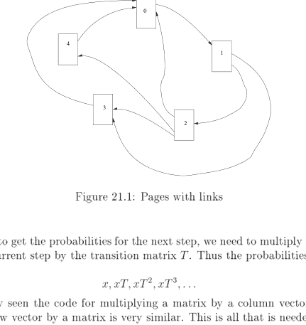

图 21.1：带链接的页面

换句话说，要得到下一步的概率，我们需要将当前步骤的概率向量乘以转移矩阵 T。因此 t、t + 1、t + 2、… 时的概率只是

x, xT, xT², xT³, …

我们已经见过矩阵与列向量相乘的代码；行向量与矩阵相乘的代码非常相似。这就是全部所需！

所以假设现在我们位于页面 0。这对应于 x 为向量 (1, 0, 0, 0, 0)。我们可以使用上述方法找到随着时间增加访问不同页面的概率。确实，如果你计算 xT¹⁰，我们得到

x ≈ (0.3, 0.3, 0.15, 0.225, 0.025)

你会看到向量在随后的乘法中变化不大。因此从这个计算来看，似乎页面 0、1 最重要，页面 4 最不重要。

## 21.4 电路

我们将考虑求解由电阻和电流源组成的电路中不同点的电流和电压的问题，如图 21.2 所示。你可能不熟悉电流源，指定的电流无论连接到什么都会流出。包含电压源的电路也可以进行分析，但代数稍复杂。我们稍后会讨论这个问题。

首先我们将此电路视为图，即识别其中的顶点和边。电阻和电流源可以被视为边，这些边相互连接的点可以被视为顶点。图 21.2 中有 6 个节点，编号为 0 到 5，显示为实心圆。有 9 条边，其中一条由电压源组成，8 条由电阻组成。电路中可能存在具有多个电气连接的器件，例如晶体管。此类图的模型是不同的。

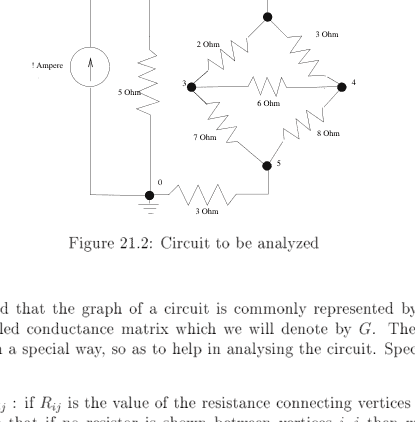

### 图 21.2：待分析的电路

可以说，电路的图通常由其邻接矩阵表示，所谓的电导矩阵，我们用 G 表示。矩阵的条目以特殊方式填充，以便于分析电路。具体来说我们将有

- 1. G_ij = -1/R_ij : 如果 R_ij 是连接顶点 i 和 j 的电阻值，其中 i ≠ j。注意如果顶点 i、j 之间没有显示电阻，则我们认为它们之间的电阻为 ∞，此时 G_ij = 0。你可能知道电阻值为 R 等同于电导值为 1/R。因此 G_ij 可以被视为连接节点 i、j 之间的电导的负值。
- 2. G_ii = Σ_j 1/R_ij : G_ii 的值因此被设为连接到顶点 i 的电导之和。

注意电流源值并不参与电导矩阵值的设定。

你可以看到电导矩阵大致可以被视为电路的邻接矩阵：当没有连接时条目为 0，当两个顶点之间电导很高时条目很大（尽管为负）。但设置条目的真正动机是它有助于电路分析。

带完整矩阵和向量的矩阵方程变为

注意在我们的例子中，S₀ = 1 因为单位电流必须从顶点 0 流出进入电流源。同样，S₁ = −1 因为单位电流必须从电流源流入顶点 1。其他顶点没有关联的电流源，因此相应的 Sᵢ 为 0。让我们先写下我们电路的方程，之后我们将解释方程为何正确。

矩阵方程实际上包含与行数一样多的普通方程。例如，考虑乘积的第一行，我们将得到：

V₀(1/5 + 1/3) + V₁(−1/5) + V₅(−1/3) = −1

这个方程实际上是在说进入顶点 0 的总电流，通过电压源和电阻，必须等于 0，因为电荷不能被创建也不能被破坏。这可以通过稍微重写方程来看到。

(V₀ − V₁) · 1/5 + (V₀ − V₅) · 1/3 + 1 = 0

在这里你可以看到第一项 (V₀ − V₁) · 1/5 是通过 5 欧姆电阻进入顶点 0 的电流，(V₀ − V₅) · 1/3 是通过 3 欧姆电阻进入的电流，1 是通过电流源进入的电流。确实你会看到矩阵方程的第 i 行只是断言离开和进入顶点 i 的总电流必须为 0。因此矩阵方程是有效的。

因此，分析此电路只是求解这组方程！我们知道如何从第 14.2.1 节做到这一点！有一个细微的差别。你可能知道电路中的电压是相对的，即我们可以任意指定其中一个电压为 0。例如，我们可以将 V₀ 代入矩阵。我们将得到 n 个方程但只有 n − 1 个未知数！然而这不是问题：其中一个方程是多余的，它不包含新信息，实际上可以通过将剩余方程相加得到！因此，我们也可以去掉其中一个方程。通常我们去掉为其设定电压值为 0 的相同节点的方程。这等价于从矩阵和两个向量中删除第 0 行，并删除矩阵的第 0 列。因此我们将得到 n − 1 个变量的方程组，我们可以按第 14.2.1 节所述求解。

我们可以通过乘以电阻两端的电压降来计算不同电阻中的电流。因此从顶点 1 到顶点 2 方向通过 4 欧姆电阻的电流为 (V₂ − V₁) · 1/4，可以根据 V₁、V₂ 的值计算得出。

最后我们考虑如何处理电压源。假设我们有一个连接顶点 i、j 的电压源。那么我们将需要一个额外的变量 Iᵢⱼ 来表示该电压源中的电流。但我们也将有一个方程，即 Vᵢ − Vⱼ 必须等于指定的电压源值。因此我们又将有与未知数一样多的方程，我们可以求解该系统。


## 21.5 边列表表示

## 21.6 辅助数据结构

在表示网络时，维护额外的数据结构通常很有用。例如，给定一个人的名字，我们可能希望快速找到表示该人的对象。一种自然的方式是使用从名字到表示该人的对象的映射。

## 21.7 备注

我们已经概述了表示网络的一些方法。不过，还可以有其他的方法。特别是如果网络具有某种特殊结构，那么我们或许可以给不同的顶点分配编号，使得从某个节点的编号就能清楚地看出它连接了哪些其他节点。我们将在第26章看到这样一个例子，在那里我们将适当地给跑道和滑行道编号，以便从编号中清楚地看出给定跑道连接到哪些其他跑道/滑行道。

我们还应该注意，在本章中，我们将所有类都定义为结构体（struct），即所有成员默认是公有的。这只是为了保持代码简短。在实际编程中，你应该遵循通常的规则：数据成员应为私有，选定的函数成员为公有。事实上，在完成练习时就应该这样做。

## 21.8 练习

- 1. 编写一个程序，构建第21.1.1节所讨论的友谊和敌对关系的表示。它应接受一个文件作为输入，其中包含以下信息：一共有多少人，每个人的朋友是谁，他们的敌人是谁，以及每个人如果有最爱朋友的话，最爱朋友是谁。

  编写函数来 (a) 判断两个给定的人是否有共同的朋友，(b) 找出最受欢迎的人，即被最多人称为最爱的人。

- 2. 编写代码实现 PageRank 计算，并检查无论从哪个初始节点开始，最终概率是否确实趋于相同的极限。

- 3. 我们已经注意到，在许多自然矩阵中（例如转移矩阵或电导矩阵），很多元素为 0。为了节省内存，我们希望采用一种只存储非零元素的表示方式。当然，该表示方式在需要时应能列出矩阵的所有元素（无论零还是非零），但不应显式存储值为 0 的元素。相反，如果一个元素没有被显式存储，则应视为 0。设计这样的表示。提示：它实际上就是矩阵的邻接表表示。

编写矩阵类的成员函数，以便可以使用该矩阵执行矩阵向量乘法。

- 4. 假设在图21.2中，我们在顶点3和4之间有一个值为1伏特的电压源（顶点3连接到电压源的正端）。将相关方程添加到你的程序中，并求出所得电流。

一般情况下，扩展你的程序以处理电压源。

- 5. 设计图形化编辑器来输入本章讨论的每种网络。例如，要创建友谊网络，你的编辑器将有一个创建人物的按钮。然后有额外的按钮来创建友谊链接等等。编辑器还应该有按钮，点击后能适当处理给定的网络。在相关的地方，设计在图形画布上显示结果的方法。

# 第22章

## 结构递归

考虑以下数学公式：

π = 4 / (1 + 1² / (3 + 2² / (5 + 3² / (7 + 4² / (9 + ⋯)))))

和

∑_{i=1}^{n} i² = n(n+1)(2n+1)/6

这两个公式都是正确的，而且第一个相当优雅。然而，我们在本章关心的并不是这些公式的正确性或优雅性。我们的问题要平凡得多：如何在纸上排版这些公式。我们把分子和分母放在哪里，表示除法的横线要画多长？如果分母本身是一个复杂的表达式，就像 π 的连分数展开式那样，该怎么办？我们能否让计算机程序为我们完成所有这些计算？虽然这有点棘手，但确实有很多程序可以做到这一点，其中最重要的或许是唐纳德·克努特（Donald Knuth）开发的 TeX 程序。TeX 程序有一种用于指定数学公式的语言，在这种语言中，上述两个公式可以指定为：

```
\pi = \cfrac{4}{1+\cfrac{1^2}{3+\cfrac{2^2}{5+\cfrac{3^2}{7+\cfrac{4^2}{9+\ddots}}}}
```

以及

```
\sum_{i=1}^n i^2=\frac{n(n+1)(2n+1)}{6}
```

给定这种文本描述，TeX 可以生成类似所示的排版。虽然这种文本描述相当难懂，但你大概能理解一些。你或许可以猜到，符号 `^` 被 TeX 用来表示幂运算。或者 `\frac` 和 `\cfrac` 以某种方式表示分数。即使不完全理解 TeX 语言，你也能看出该描述不包含任何几何信息。例如，描述中并没有说明不同分数中的横线需要画多长。事实上，所有这些都由 TeX 决定，它是科学与艺术的巧妙结合。

如何排版数学公式是我们在本章看到的第一个问题。这将是结构递归的一个相当有趣的应用。然后我们将继续讨论另一个重要但更经典的应用：使用树在内存中维护有序集合。

## 22.1 数学公式的排版

从某种意义上说，我们的目标是编写一个能完成 TeX 所做工作的程序。当然，这是极其雄心勃勃的！相反，我们将考虑公式排版问题的一个非常小的版本。具体来说，我们只考虑仅使用 + 和 / 这两个算术运算符的公式。我们的程序必须接受任何这样的公式，以类似 TeX 语言的语言编写，并为其生成排版。然后必须将这个排版显示在图形画布上。正如你将在练习中发现的，一旦你掌握了加法和除法，实现其他运算符以及更复杂的运算（例如使用 ∑ 符号的求和）并不难很多。当然，所有这些距离 TeX 所完成的工作仍然很远。

### 22.1.1 输入格式

第一个问题当然是：我们应该如何向程序指定公式。一种可能性是直接使用 TeX 语言，因为它广为人知。但这似乎过于复杂，毕竟我们只有两个运算符。另一种可能性是以 C++ 中指定数学公式的风格来指定公式，例如，要得到 `a/b`，我们输入 `a/b` 即可，诸如此类。这行得通，但正如你稍后将会看到的，它会使我们的程序编写起来稍微困难一些。因此，为了让事情简单，我们对 C++ 风格稍作变通。

我们要求公式以 C++ 中使用的风格指定，并且 + 运算符和 / 运算符的操作数都放在括号中。

举个简单的例子，在 C++ 中你可以写 `a/b`，但要向我们的程序指定这一点，你必须写 `(a/b)`，因为规则规定每个运算符的操作数都必须放在括号内。图22.1给出了更多例子。正如你所看到的，我们的程序所需的输入与在 C++ 中指定公式所需的输入相比更加冗长。在练习中，我们将探讨允许更简洁输入的相关问题。

我们应该注意输入格式的一个有趣特性。你会注意到，任何按照上述风格编写的公式都具有以下形式之一：

x：其中 x 是一个原始公式，即一个标识符或数字。

(f+g)：其中 f 和 g 本身是公式。例如，在 `((( (x+1)/(x+3) )+(x/5))+6)` 中，f = `(((x+1)/(x+3))+(x/5))`，g = 6。

(f/g)：其中 f 和 g 本身是公式。例如，在 `(a/(b+c))` 中，f = `a`，g = `(b+c)`。

换句话说，公式要么由原始公式（“基本情况”）构建，要么由其他公式构建。因此，公式被认为具有递归结构。这种递归结构将非常有用。

| | 期望输出 | 我们的程序所需的输入 |
|---|---|---|
| 1. | $\frac{a}{b+c}$ | (a/(b+c)) |
| 2. | $a + \frac{b}{c}$ | (a+(b/c)) |
| 3. | $a + b + c + d$ | (((a+b)+c)+d) |
| 4. | $\frac{x+1}{x+3} + \frac{x}{5} + 6$ | ((( (x+1)/(x+3) )+(x/5))+6) |

图22.1：输出和输入的示例

### 22.1.2 “手工”排版

在深入讨论如何在计算机上进行排版之前，值得思考一下我们会如何用纸和笔进行排版。实际上，这次我们还会用到剪刀和胶水！

在继续阅读之前，请你思考一下你会如何进行排版。毕竟，你从高中就开始书写公式了！你可能会发现这个问题有点棘手。

以递归的方式来考虑这个问题会比较方便。首先是基本情况。假设你想要排版的公式是一个原始公式。在这种情况下，要求很简单：你只需在所希望的位置打印出数字或标识符。

接下来考虑非原始公式，即 f/g 或 f + g，为了简洁起见，我们省略了括号。为此，我们假设已经有了两张矩形纸片，分别带有 f 和 g 的排版。这些矩形是排版的边界框（bounding box），即包含这些排版的最小的水平和垂直边矩形。我们的目标是把它们贴到一张更大的纸上，并适当地画上水平线或 + 号，以产生所需的 f/g 或 f + g 的排版。我们最初是如何得到 f 和 g 的排版的呢？你大概能猜到，答案是：递归！

首先考虑我们如何生成 f/g 的排版。显然，公式 f 必须在顶部，其下必须有一条表示除法的水平线，再往下必须是公式 g。横线的长度必须等于宽度的最大值

1 TeX 是一个完整的文档处理器。此外，即使仅仅为了排版数学公式，它也非常精密。例如，它会调整文字的大小，而我们的程序不会。


of the formulae f, g. Further, f, g must be centered with respect to the horizontal bar. Here is an example.

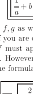

We have shown the bounding boxes for f, g as well as f/g. The gap between the bounding boxes has been put in for readability; if you are cutting paper, there will be no gap.

Next consider f + g. In this case f must appear to the left, then the symbol + must appear, and g must appear to the right. However, how do we align f, g with the + symbol? This will depend upon what is inside the formulae, as the following example will illustrate.

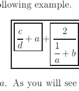

Here we have shown the layout of f + g where f = a and g = 2/(1/a + b). As you can see, how the + symbol aligns with f, g depends upon what is in f, g. Both f, g appear to have a certain operator level which must align with the horizontal bar of the intervening +. For f, which is a primitive formula, the operator level seems to be just the level of its center, which as you see is aligned with the horizontal bar of the +. However, for g which is itself a ratio of 2 and 1/a + b, the operator level seems to be the horizontal bar between the numerator 2 and the denominator 1/a + b.

So if we wish to layout f + g we will need to know the operator levels of f, g. In the discussion above we have seen how to determine the operator level a formula which is either primitive, or which is a ratio. We will now discuss how to find the operator level of a sum. To understand this, consider the following example.

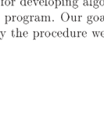

In this, f is itself a sum of c/d and a. As you will see the sum inside f must align with the sum outside. Thus the operator level of f is the level of the + inside it. In other words, the operator level of a sum v + w is the level of the + between the summands v, w.

Using what we have stated above, you should indeed be able to layout any formula using paper, pencil, scissors and glue. You are requested to think this over carefully, actually trying out some examples if necessary. This kind of introspection over what you might consider "obvious" and "routine" is crucial for developing algorithms.

Next we turn to developing the program. Our goal will be to produce a layout identical to the one as would be produced by the procedure we described above.

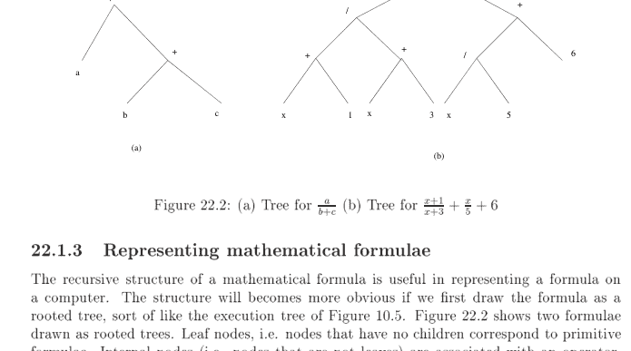

## Figure 22.2: (a) Tree for a/(b+c) (b) Tree for (x+1)/(x+3) + x/5 + 6

## 22.1.3 Representing mathematical formulae

The recursive structure of a mathematical formula is useful in representing a formula on a computer. The structure will becomes more obvious if we first draw the formula as a rooted tree, sort of like the execution tree of Figure 10.5. Figure 22.2 shows two formulae drawn as rooted trees. Leaf nodes, i.e. nodes that have no children correspond to primitive formulae. Internal nodes (i.e. nodes that are not leaves) are associated with an operator. A subtree, i.e. any node and all the nodes below it, represents a subformula used to build up the original formula. For example, in Figure 22.2(a), the subtree including and beneath the node labelled + corresponds to the subformula b + c. Similarly, in Figure 22.2(b), the node labelled / on the left side and the nodes below it correspond to the subformula (x+1)/(x+3), whereas the node labelled / on the right and the nodes below it together correspond to the subformula x/5.

Figure 22.2, suggests that to represent a formula, we should first represent the nodes of the tree, and then represent the connections between the nodes, and then we should be done! It seems natural to use a structure to represent tree nodes. The structure should contain the information associated with a node, e.g. whether the node is associated with an operator, and if so which one, or if the node is associated with a primitive formula, and if so which one. The natural way to represent connections between the nodes is to use pointers. So we define a structure Node as follows.

```
struct Node{
    // we give member functions later
    string value;
    char op;
    Node* lhs;
    Node* rhs;
};
```

This structure can be used to express primitive as well as non primitive formulae. If a formula is primitive, i.e. consists of an identifier or a number, we will store that symbol or number in the member value as a character string. Otherwise, the formula must be a binary

composition of two smaller formulae. In this case, we store the operator in the op member, and we store pointers to the roots of the subformulae in the members lhs, rhs.

It is useful to have constructors for both ways of constructing formulae.

```
Node::Node(string v){
    // primitive constructor
    value = v;
    op = 'P'; // convention: 'P' in op denotes primitive formula.
    lhs = NULL;
    rhs = NULL;
}
```

```
Node::Node(char op1, Node* lhs1, Node* rhs1){ // recursive constructor
    value = "";
    op = op1;
    lhs = lhs1;
    rhs = rhs1;
}
```

Here is the first way we can construct the representation for the formula a/(b+c) in our program.

```
Node aexp("a");
Node bexp("b");
Node cexp("c");
Node bplusc('+', &aexp, &bexp);
Node f1('/', &aexp, &bplusc);
```

Thus f1 will be the root of the tree for the formula a/(b+c). Thus we can say that f1 represents the formula. Or alternatively we can also construct a representation more directly:

```
Node f2('/', new Node("a"),
    new Node('+', new Node("b"), new Node("c"))
);
```

An important point to note here is that the operator new when used on a constructor call returns a pointer to the constructed object, which is exactly what we want as an argument to our recursive constructor. Thus f2 will also be a root of the tree for the formula a/(b+c), and can thus be said to represent the formula.

There is a difference between the two constructions, however. In the first construction, all memory for the formula comes from the current activation frame. In the second construction, all memory except for the node f2 comes from the heap, the memory for f2 comes from the current activation frame.

Once we have a representation for formulae, our task splits into two parts:

- 1. Read the formula from the input in the format specified in Section 22.1 and build a representation for it using the Node class.
- 2. Generate the layout for the constructed representation. It is natural to define member functions on Node which will generate the layout.

We consider these steps in turn.

## 22.1.4 Reading in a formula

We now show how to read in the formula and build a representation. It is easiest to write our code as a constructor.

For simplicity, we will make two assumptions: (a) Each number or identifier is exactly one character long, (b) there are no spaces inside the formula. In the exercises you are asked to write code which allows longer primitive formulae and also spaces.

We read the formula character by character and build a representation as we go along. To read a character from a stream infile, we can use the operation infile.get() which returns the next character as an integer value.

If the very first character read is a number or a letter, then we have indeed read a primitive formula and we can stop.

If what is read is the character ‘(’, then we know that the user is supplying us a non-primitive formula. In that case we know that we must next see in succession (a) the left hand side formula, (b) an operator, and (c) the right hand side formula. To read in the left hand side formula as per (a), we merely recurse! After the formula has been read in step (b), we read a single character, and it had better be an operator, as per (b). After that we recurse again, in order to get the right hand side formula, as per (c)! And after that we must see a ‘)’ to match the initial open parenthesis. So our code to read in a formulae is extremely simple, even though the formulae themselves can be very complicated.

```
Node::Node(istream &infile){
    char c=infile.get();
    if((c >= '0' && c <= '9') ||
       (c >= 'a' && c <= 'z') ||
       (c >= 'A' && c <= 'Z')){
        lhs=rhs=NULL; op='P'; value = c;
    }
    else if(c == '('){            // does it start a non-primitive formula?
        lhs = new Node(infile);   // recursively get the lhs formula
        op = infile.get();        // get the operator
        rhs = new Node(infile);   // recursively get the rhs formula
        if(infile.get() != ')')
            cout << "No matching parenthesis.\n";
    }
    else cout << "Error in input.\n";
}
```

Now we can write a part of the main program.

```
int main(){
    Node f(cin);
}
```

This will call our latest constructor with the parameter infile being cin, i.e. the formula will be read from the keyboard. You may type in something like
(a/(b+c))
and it will create f, just as we created f2 earlier.


# 22.1.5 绘制公式：概述

绘制步骤的输入是一个公式，以及在画布上绘制的位置指示。自然地，公式以节点 f 的形式呈现给我们，f 是表示待绘制公式的树的根。我们滥用术语，让 f 同时表示公式。至于绘制位置， presumably 用户会告诉我们类似“在点 (x, y) 的下方和右侧绘制公式”。值 x、y 将由用户给出。然后我们的目标是绘制给定的公式 f，使得其边界框的左上角位于画布上的点 (x, y)。

我们如何执行任务？似乎自然地考虑递归。 presumably 原始公式是基本情况，显然我们可以将所需文本写在任何需要的地方。所以让我们考虑一个非原始公式 f / g。也许我们应该递归地绘制 f，然后绘制表示除法的水平条，然后递归地绘制 g。然而，为了绘制 f，我们需要知道 g 的宽度，以便相对于水平条居中它们（第 22.1.2 节）。为了绘制 g，我们需要知道 f 的宽度，以及 f 的高度。

因此在绘制任何内容之前进行计算阶段是自然的。在此阶段，我们计算公式中不同子公式布局的宽度和高度。我们还确定运算符级别。更具体地说，我们为每个子公式确定一个称为下降的参数，它是运算符级别与公式底部之间的距离。同样，我们定义上升为运算符级别与公式顶部之间的距离。一旦我们知道宽度、高度、上升和下降，我们就开始实际绘制。注意高度只是上升和下降之和，所以在下面我们忽略高度。如果 f 是一个公式，我们将使用 w_f、a_f、d_f 表示 f 布局的宽度、上升和下降。

我们确定这些参数的算法是递归的。假设 f 是某个标识符 x。那么 x 的宽度可以使用调用 textWidth(x) 确定。x 的高度不依赖于 x，可以通过调用 textHeight() 确定。我们将假设 + 符号必须与 x 的中心对齐。因此我们将上升和下降都设为 textWidth(x)/2。

接下来考虑形如 (f+g) 的公式。这在图 22.3(a) 中显示。虚线是 f、g 以及 f + g 的运算符级别。从图中我们有：

$$a_{f+g}=\max(a_f,a_g)$$

$$d_{f+g}=\max(d_f,d_g)$$

$$w_{f+g}=w_f+w_\circ+w_g$$

其中 w_\circ 是 + 符号的宽度。在图中我们还标记了布局 f、g、f + g 的左上角。这将在第 ?? 节中使用。

在图 22.3(b) 中我们考虑形如 f/g 的公式。我们首先注意到

$$w_{f/g}=\max(w_f,w_g)$$

我们之前提到 f / g 的运算符级别位于水平条的位置。条上方我们有整个公式 f 和容纳水平条所需高度的一半。同样下方我们有公式 g 和容纳水平条所需高度的一半。因此我们得到

d_{f/g} = d_g + a_g + h_o/2

a_{f/g} = d_f + a_f + h_o/2

这里 h_o 表示容纳水平条所需的高度。

正如你所见，知道 f、g 的宽度、上升、下降，我们可以计算 f + g 以及 f/g 的宽度、上升、下降。我们将此计算写为递归函数 setSizes。我们将在每个 Node 中具有成员 width、ascent、descent，setSizes 将在其中存储值。所以我们的结构变为：

```
struct Node{
Node *lhs, *rhs;
char op;
string value;
double width, height, descent;
Node(string v);
Node(char op1, Node* lhs1, Node* rhs1);
Node(istream& infile);
void setSizes();
void draw(float clx, float y); // to actually draw
}
```

我们已经给出了构造函数的实现。setSizes 的实现遵循上面描述的思路。注意 f 对应 lhs，g 对应 rhs。

```
const double h_o = 20; // space for horizontal bar

void Node::setSizes(){
switch (op){
case 'p':            // Primitive formula
    width = textWidth(value);
    ascent = textHeight()/2; descent = textHeight()/2;
    break;
case '+':            // case f+g
    lhs->setSizes();
    rhs->setSizes();
    descent = max(lhs->descent, rhs->descent);
    width = lhs->width + textWidth(op) + rhs->width;
    ascent = max(lhs->ascent, rhs->ascent);
    break;
case '/':            // case f/g
    lhs->setSizes();
    rhs->setSizes();
    width = max(lhs->width, rhs->width);
    ascent = h_o/2 + lhs->ascent + lhs->descent;
```

```
descent = h_o/2 + rhs->ascent + rhs->descent;
break;
default: cout << "Invalid input.\n";
}
```

# (a) Layout of f + g

# (b) Layout of f / g

Figure 22.3: Composing layouts

```
descent = h_o/2 + rhs->ascent + rhs->descent;
break;
default: cout << "Invalid input.\n";
}
```

接下来我们考虑如何实际绘制布局。我们将定义一个 draw 成员函数，将所需边界框左上角的坐标 x、y 作为参数。实现当然是递归的。

如果正在绘制的公式是原始的，那么我们只需写入相应的文本。为此我们创建一个文本对象并将其印出。在创建文本时必须指定中心；因此如果我们希望左上角为 (x, y)，文本必须以 (x+width/2, y + ascent) 为中心。

如果正在绘制的公式形如 f + g，则我们可以通过查阅图 22.3(a) 来确定绘制位置。如图所示，f 的左上角的 x 坐标与 f + g 相同，即

x_f = x_{f+g} (22.7)

g 的框向右偏移 w_f + w_o 的量。所以我们有

x_g = x_{f+g} + w_f + w_o (22.8)

至于 y 坐标，注意 f + g、f、g 的左上角在运算符级别上方 a_{f+g}、a_f、a_g。因此可得

y_f = y_{f+g} + a_{f+g} - a_f (22.9)
y_g = y_{f+g} + a_{f+g} - a_g (22.10)

最后，+ 符号必须在运算符级别绘制，该级别在 f + g 的左上角左侧 w_f + w_o/2 且下方 a_{f+g}。这在下面的代码中使用。注意 f 对应成员 lhs，g 对应成员 rhs。

```
void Node::draw(double x, double y){
switch(op){
case 'P':
Text(x + width/2, y + ascent, value).imprint();
break;
case '+':
lhs->draw(x, y + ascent - lhs->ascent);
rhs->draw(x + lhs->width + textWidth(op), y + ascent - rhs->ascent);
Text(x + lhs->width + textWidth(op)/2, y + ascent, string(1,op)).imprint(); // draw the '+' symbol
break;
case '/':
Line(x, y + ascent, x + width, y + ascent).imprint(); // horizontal bar
lhs->draw(x + width/2 - lhs->width/2, y);
```

```
rhs->draw(x + width/2 - rhs->width/2, y + h_o/2 + ascent);
break;
default: cout << "Invalid input.\n";
}
```

最后一种情况是绘制形如 f/g 的表达式。如何定位 f、g 以及如何绘制水平条可以从图 22.3(b) 中推导出来。我们省略细节。

## 22.1.6 完整的 main 程序

以下是 main 程序。

```
int main(){
initCanvas("Formula drawing");
Node f(cin);
f.setSizes();
f.draw(0,0); // top left of formula must align with top left of canvas.

wait(5);
}
```

## 22.1.7  remarks

递归结构出现在许多现实生活情况中。例如，组织的行政层级是递归的，例如有董事/总裁/总理，向其汇报副手，向其汇报进一步的副手。

自然地，我们可以将一棵树与递归结构关联。子结构表示为子树，连接子树的元素，例如董事将对应根。在数学表达式的情况下，运算符对应根，子表达式对应子树。

你可能想知道为什么我们要求待布局的公式以我们冗长的格式指定；为什么不直接以 C++ 中的形式指定？事实证明，让程序读取 C++ 风格的公式是一个经典的计算机科学问题，在其最一般设置中。如果你在计算机科学方面继续深造，你也许会在编译器构造或自动机理论课程中学习它。现在就说，读取 C++ 风格表达式是一个困难的问题。然而，在练习中鼓励你思考这个问题。

## 22.2 维护有序集合

我们考虑以下抽象问题：如何维护一个可以包含整数的元素集合。随着程序执行，整数可以被添加到集合中。此外，程序必须响应成员查询，即给定某个整数 x，程序必须确定 x 是否存在于集合中。为简单起见，我们只考虑这两个操作，

insertion, and membership. But you can see that other operations might also be useful, e.g. removing an element from a set, or finding the number of elements smaller than a given number z. Even more generally, you could let the elements of the set be complex objects, e.g. a structure containing the roll number and marks of a student. Then you might merely want to know if a student belongs to a class (membership), or you might want to know the number of students who got fewer marks than some number z. The ideas we discuss for our simple problem will be of use in these more complicated situations as well, as you will discover in the exercises.

The simplest way to store a set is to use an array, or a vector (Chapter 20). To add an element, we simply use the push_back function. To determine if an element is present, we can scan through the vector. The scanning operation, however, is rather time consuming: we need to examine every element stored in the vector. A slight improvement is to keep the elements sorted in the vector. Then we will be able to perform membership queries using binary search, which would go very fast. However, when a new element is to be inserted, we will need to find its position, and shift down the elements larger than it. This operation will on the average require us to shift half the elements, and thus is quite time consuming. So again this is unsatisfactory.

## 22.2.1 A search tree

There is a way to organize the elements of the set so that insertions as well as membership queries can be done very fast: we store them in a so-called search tree. First we discuss the correspondence between a set and a search tree considered abstractly. Then we discuss how the tree can be represented on a computer.

A search tree is a rooted tree in which elements of the set are associated with each tree node. Each node has up to two outgoing branches, denoted left and right. The left branch (if any) connects the root to the left subtree, and the right branch (if any) to the right subtree. A subtree is likewise a root with up to two branches. A subtree with no branches is called a leaf. Here is the key property that we require for a tree storing elements to be a search tree:

Values of elements in the left subtree of node v ≤ value of element at node v ≤ values of elements in the right subtree of node v

Figure 22.4 shows examples of search trees (parts (a) and (b)) and a non-search tree (part (c)). In each case, we have shown the value of the element stored at each node. Thus the tree in (a) would represent the set {18,34,40,56,70}, while the one in (b) would represent {10,12,18,30,30,35,36,50,51,60,65,77,78,86,93}. In (c), the subtrees beneath the node with element 34 do not satisfy the search tree property: the right subtree is required to contain elements larger than 34 but it actually contains the element 30. So the tree in (c) will not represent any set, as per our scheme.

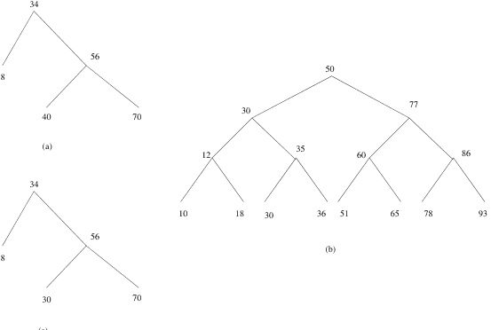

Figure 22.4: Examples (a),(b) and non-example (c) of search trees

It should be clear how to represent search trees. The structure needed is almost the same as what we had for storing mathematical expressions.

```
struct Node{
    Node *lhs, *rhs;
    int value;
};
```

This is identical to what we had in Section 22.1.3, except that we do not have the member op, which is not needed here. We do have a member value which will hold the set element stored at the node. As before the members lhs and rhs will point to the root nodes of the left and right subtrees.

## 22.2.2 The general idea

We explain with an example why search trees are useful for storing sets. Suppose we have somehow constructed the search tree in memory. Suppose now the user presents us a membership query, say determine whether some number x is present in the tree. How do we do this? Remember that when we build the tree, we will only be able to refer to the root directly. To get to the other nodes, we need to follow the left or right pointers. So our problem is: we know the root of the tree that contains the elements, and we are given x, and we wish to determine if x is present at any node of the tree.

Since we only know the root of the tree, we can only compare x with the number stored at the root. If the number happens to be x, then we can immediately respond with a true response. If the number at the root is not x, then we need to do more work. So we ask whether x is smaller or larger than the number at the root. If x is smaller, then we know that it can only be in the left subtree. This is because of the search tree property: the numbers in the right subtree can only be larger than the number at the root, so there is no need for us to compare x to them. Thus now we can recurse on the left subtree! Similarly, if x is larger than the number at the root, then we recurse on the right subtree, i.e. try to determine if x is present in the right subtree. The recursion stops if we are forced to search an empty subtree – if that happens we know that the number is not present and we return false.

As an example, suppose we have in memory the tree in Figure 22.4(b). Suppose we want to know if x = 63 is in the tree. Then we would compare x to the number at the root, 50. Finding that x is bigger, we would decide that we only need to search the right subtree. The root node contains a pointer to the root of the right subtree, so we use that to get to the root of the right subtree. So next we compare x with the number stored there, which is 77. This time we realize that x which we are looking for is smaller. So we know we must search the left subtree beneath 77. So we follow the left pointer this time and get to the node containing the key 60. This time we check and realize that x is in fact larger. So we follow the right branch out of the node containing number 60. So we get to the node containing the number 65. Since x is smaller than 65, we know we must go to the left subtree. But there is no left subtree for the node containing 65! So in this case we have determined that our number x is not present in the set. So we return false as the answer.

Notice that we have been able to get to an answer by examining a very few nodes: those nodes containing 50, 77, 60, and 65. We did not examine the other nodes, yet we deduced that the number x = 63 could not have been present in the other nodes: because we know that the tree obeys the search tree property. So this is how we can give a fast response.

If at this point you feel that our argument is too slick, you would be right. The argument given above depends very much upon the shape of the tree in which the set was stored. The tree of Figure 22.4(b) was balanced, i.e. both subtrees under each node had exactly the same number of nodes. If the tree is unbalanced, then the efficiency can become much worse. We take up this aspect in Section 22.2.5. For now, we will assume that somehow the trees that we encounter will be balanced, or nearly balanced. This assumption can be justified, as you will see in Section 22.2.5.

Next we consider the operation of inserting elements into the set. For this, we do something similar to checking if a number is present. Suppose we wish to insert the number x. Then we first check the number at the root. If x is smaller, then we know that it must be inserted in the left subtree, or else the search tree property will be violated. So we recursively try to insert in the left subtree. Similarly if x is larger than the number at the root, we recursively try to insert in the right subtree. The precise details will become clear when we give the code.

## 22.2.3 The implementation

We will indeed represent a set as a tree. In the last section, we used the root node of the tree as the representative of the tree, i.e. the point from which we can get access to the rest of the tree. This does not quite work in the present case.

There is a slight technicality that we need to consider. How do we represent an empty set? If the representation contains any Node object whatsoever, then that object will store a value, and hence will not represent an empty set. So clearly we cannot represent a set by the node denoting the root of the tree. Instead, we represent a set by a pointer to the node


表示根。现在如果我们想表示空集，只需将该指针设为 NULL。

为了方便，我们将根的指针放在一个类 Set 中，该类将包含一个我们称之为 root 的数据成员，它将指向树的根节点。

```cpp
struct Set{
    Node* proot;        // pointer to tree root.
    Set(){proot = NULL;}
    // more to come.
};
```

该类将有更多成员函数，但我们已放入一个构造函数，它将成员 proot 设为 NULL，表示集合为空。给定此定义，我们可以写

```cpp
Set mySet;    // automatically initialized to NULL, by the constructor.
```

并且我们在程序中声明了一个集合。这比说 Node* mySet; 更优雅。

我们还将稍微改变 Node 结构。不是按之前给出的那样使用它，我们将按如下方式定义它。

```cpp
struct Node{
    Set lhs, rhs;
    int value;
};
```

请注意，此定义实际上与旧的相同，毕竟 Set 中除了 proot 之外的其他数据成员没有，proot 的类型为 Node*。但将成员 lhs、rhs 的类型设为 Set 会使代码更易读。许多程序员可能会坚持使用旧定义，因此练习要求你也这样做。

我们将把成员查询实现为一个 bool 函数 find，其参数为要查找的元素。函数的代码直接源于我们之前讨论的内容。

```cpp
bool Set::find(int elt){
    if(proot == NULL) return false;
    else{
        if(elt == proot->value) return true;
        else if(elt < proot->value) return proot->left.find(elt);
        else return proot->right.find(elt);
    }
}
```

正如我们所说，如果到达空树，则元素不存在，因此第一个语句返回 false。否则我们将要搜索的元素 elt 与集合根处的值进行比较。请注意 Set 仅包含指向根的指针 proot，因此根处存储的值为 proot->value。如果 elt 等于 proot->value，我们就发现 elt 确实在集合中，因此返回 true。否则如果 elt 小于 proot->value，我们必须搜索左子树 proot->left。同样适用于右子树。

在讨论插入之前，有用的是先看一下 Node 的构造函数。

```cpp
Node::Node(int v){
    value = v;
}
```

这会将 value 成员设为给定值，但不会对其他成员 lhs、rhs 做任何操作。这可以吗？如果未指定，则这些成员将由其默认构造函数初始化。但 Set 的默认构造函数会将成员 proot 设为 NULL。因此成员 lhs、rhs 确实会被正确初始化。

现在我们来讨论插入。我们将通过一个函数 insert 来实现插入，其参数为要插入的元素。代码是递归的，遵循我们的讨论。

```cpp
void Set::insert(int elt){
    if(proot == NULL){proot = new Node(elt);}
    else{
        if(elt == proot->value) return;    // no need to insert again.
        if(elt < proot->value) proot->left.insert(elt);
        else proot->right.insert(elt);
    }
}
```

如果我们的集合为空，则 proot 将为 NULL。因此在这种情况下，我们将插入一个包含新元素的节点。这就是第一个语句所做的。如果集合不为空，则 proot 必须非 NULL，在这种情况下我们将进入函数的第二行。我们将检查根处的值是否等于要插入的元素，如果相等，我们什么也不做，没有必要再次插入相同的元素。但如果要插入的值更小，则我们将插入到左子树。右子树同理。

练习要求你定义其他操作，例如打印集合。正如你可能猜到的那样，树上的大多数操作都可以使用递归自然地处理。

### 22.2.4 关于组织程序的说明

请注意，我们对 Node 的定义引用了 Set 的定义，反之亦然。哪一个必须先于另一个？Set 的定义仅引用了指向 Node 的指针。因此我们可以在对 Node 进行前向引用后定义 Set。Node 的定义却提到了类型为 Set 的成员。因此它必须在 Set 的定义之后。Set 中成员函数的实现可以在 Set 的定义之后任意位置。

### 22.2.5 关于搜索树的效率

我们首先观察到，可以有许多二叉搜索树包含给定的数字集合。图 22.5 给出了另外两棵树，它们包含与图 22.4(a) 相同的数字。

也可以有其他树，事实上你应该能够证明，包含 5 个元素的集合可以用 42 棵树表示。显然，回答成员查询所需的时间将取决于在执行过程中出现了这 42 棵树中的哪一棵。

### 图 22.5：表示与图 22.4(a) 相同集合的其他树

其中最差的是图 22.5(b) 中的那棵。在此，最小值位于根。次小值位于根的右子。第三小值位于其右子，依此类推。我们的程序将在数字按升序插入时构建此“树”。假设用户要求搜索 100。那么搜索将从根开始，向右移动，检查树中的每个节点。相比之下，如果集合存储为图 22.5(a) 所示，则我们首先将 100 与值 56 比较，然后与值 70 比较，并得出 100 不在集合中。因此图 22.5(b) 的树显然不适合检查 100 是否在集合中。事实上，我们会观察到在图 22.5(b) 的树中搜索基本上就像在排序的向量中搜索一样。

所以也许我们可以做出一个一般性观察：我们的 find 函数将检查从根开始到叶结束的某条路径上存储的值。因此如果我们希望程序运行得快，那么我们希望所有这样的路径都很短。习惯上将树的高度定义为树中从根到叶的最长路径的长度。因此我们的希望是，随着程序的执行，我们得到的树的高度很小。

**定理 3** 假设来自某个集合 |S| 的数字使用我们的 insert 函数插入到搜索树中。那么如果插入顺序是随机选择的，则树的期望高度小于 2 ln |S|，即集合中元素数量的自然对数的两倍。

定理的证明超出了本书的范围，但练习要求你通过实验验证它。

让我们用一个例子来尝试理解定理所说的内容。假设我们有一个大小为 1000 的集合，其元素按随机顺序插入到我们的树中。那么平均而言我们期望看到高度最多为 2 ln 1000 ≤ 14。因此当我们执行成员查询（或进一步插入）时，我们期望将给定的数字与树中最多 15 个节点中的数字进行比较。

你也可以问 1000 个节点的最差和最好高度分别是多少。显然，如果数字按递增顺序出现，则我们将得到一条长度为 1000 的单一路径——那就是高度。另一个极端是我们在尽可能靠近根的位置插入节点的一棵树。因此我们将首先插入两个直接连接到根的节点，然后插入连接到其中每个节点的两个节点，依此类推，直到插入 1000 个节点。因此我们将在距离 0 处有 1 个节点（根本身），在距离 1 处有 2 个节点，在距离 2 处有 4 个节点，依此类推，直到在距离 8 处有 256 个节点，剩余的 1000 − 256 − 128 − ⋯ − 1 = 489 个节点在第 9 层。因此这棵树的高度为 9。

因此很高兴知道平均而言我们更可能接近最好高度而不是最差高度。或者换句话说，平均而言我们的 find 和 insert 函数运行得很快。

### 22.2.6 平衡搜索树

你可能会担心上面的程序“平均而言”运行得快，但在运气不好时可能会花费很长时间。如果集合中的数字按升序或某种糟糕的顺序插入会怎样？

在这种情况下，有高级算法试图在树构建时平衡树。这是通过修改已构建的树来实现的，例如改变根。通过这种重新平衡，确实可以确保树的高度保持较小。此外，已经开发出重新平衡算法，它们运行也非常快。但这超出了本书的范围。

### 22.2.7 搜索树和映射

C++ 标准库中映射的 (index,value) 对是使用二叉搜索树存储的。排序规则是左子树中的所有对的索引都小于根处的索引，而根处的索引又小于右子树中元素的索引。此外，树会像上面讨论的那样保持平衡。因此像 value[index] 这样的访问相当快，即时间与 log₂ n 成正比，其中 n 是映射中存储的对的数量。

### 22.3 练习

- 1. 扩展公式绘制程序，使其允许运算符 '∗'、'+' 和 '−'。这并不完全 trivial：确保你的程序对输入 ((x+3)*(x−2)) 正确工作。你会看到你可能需要在输出中添加括号化。为了简单起见，如果有疑问，你可以对每个表达式都加上括号。
- 2. 在公式绘制程序中添加运算符 '^' 以表示指数运算。换句话说，Node('^',Node("x"), Node("y")) 将打印为 x^y。
- 3. 允许隐式乘法运算符，即应该能够绘制 x^(n)/(v)。
- 4. 假设用户给出公式边界框左上角的位置。展示如何做到这一点。同样如果用户要求公式居中于某个给定点。
- 5. 编写一个构造函数函数，其输入为单个引用参数 infile&，它是对 istream 的引用，并基于其中读取的内容构造一个表达式。关联的文件应包含有效表达式但以前缀形式书写。请注意在前缀形式中，运算符在前，并且每个运算符是


parenthesized. Thus \(\frac{a}{b+c}\) will be written as \((/\ a\ (+\ b\ c)\). Observe that this way of writing expressions also has a recursive structure. Thus your constructor will also be recursive. For simplicity assume that each primitive expression is a single character. Further assume for simplicity that there are no spaces in the input. Thus the above expression would appear in the file as \((/a(+bc))\). Note that get is a member function on istreams that can be used to read single characters. Thus `infile.get()` reads the next character from `infile` and returns its value.

+   6. 修改上面的代码，使其允许包含空格。

+   7. 表达式 `infile.peek();` 返回文件中的下一个字符，但并不真正读取它。利用这一点修改上面的代码，以便允许基本表达式的长度超过一个字符。假设连续的基本表达式将用空格分隔。

+   8. 你将如何表示带有下限和上限的积分以及被积函数？换句话说，你应该能够绘制诸如

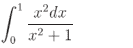

的公式

提示：最好的做法是使用三元运算符，例如用字母 I 表示，它接受 3 个公式作为参数：下限 L、上限 U 以及要积分的表达式 E。你可以要求将其指定为 `(I L U E)`。

+   9. 按我们定义的方式，我们的公式不能包含括号。将我们的程序扩展以允许这一点。你可以认为括号是一个一元运算符，例如 B。由于我们约定运算符放在第二位，你可以要求如果公式 F 要加括号，则写成 `(F B)`。确保你绘制的括号大小正确。

+   10. 你可能想考虑如果要排版的公式以标准 C++ 风格指定，程序会如何改变，即如果输入是 `a+b/c` 而不是我们一直要求的那样 `(+a(/bc))` 来绘制 \(a+\frac{b}{c}\)。正如你可能意识到的，关键问题是，在读取输入的初始部分 `a+b` 之后，你不确定运算符 + 是否作用于 a、b。这在后续运算符（如果有）与 + 的优先级相同的情况下成立。然而，如果后续运算符的优先级更高，如本例所示，则除法的结果必须加到 a 上。因此你需要向前看一点来决定要构造的结构。这是一个有点困难的问题，但鼓励你思考它。请注意，你的工作不仅是编写程序，还要论证它能够正确处理可能给出的所有有效表达式。

+   11. 添加一个 `deriv` 成员函数，它应返回公式关于变量 x 的导数。对此使用微分的标准规则，即

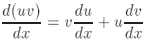

这当然是递归的。你应该能够在画布上绘制导数，当然。

12. 你会注意到 `deriv` 返回的结果经常包含一个操作数为 1 的乘积子表达式和一个操作数为 0 的和子表达式。这样的表达式可以简化。添加一个 `simplify` 成员函数来执行此操作。这也将是递归的。

13. 假设你只想使用第 22.2.1 节中的 Node 定义来表示集合。那么要创建一个初始为空的集合 mySet，我会写：

```
Node* mySet = NULL;
```

为了实现成员关系和插入查询，我们可以仅仅改编第 22.2.3 节中的 `insert` 和 `find` 函数。请注意，那些是 Set 的成员函数，而 Set 实际上是 Node* 类型，因此它们不能成为 Node 的成员函数。因此它们必须成为普通函数。以下是 `insert` 的一个建议改编：

```
void insert(node* set, int elt){
    if(set == NULL){set = new node(elt,NULL,NULL);}
    else{
        if(elt < set->value) insert(set->left, elt);
        else insert(set->right, elt);
    }
}
```

你认为这是一个忠实的改编吗？它能工作吗？提示：请仔细考虑是否应该使用传引用还是传值。

以下是 `find` 方法的改编。

```
bool find(node* set, int elt){
    if(set == NULL) return false;
    else{
        if(elt == set->value) return true;
        else if(elt <  set->value) return find(set->left, elt);
        else return find(set->right, elt);
    }
}
```

同样，这是一个忠实的改编吗，它会工作吗？

14. 为 Set 添加一个 `print` 成员函数。提示使用递归：首先打印左子树中的成员，然后打印当前节点存储的值，然后打印右子树中的值。

## 目录

- 1. 简介
  - 1.1 目的
  - 1.2 读者对象
- 2. 系统要求
  - 2.1 硬件要求
  - 2.2 软件要求
- 3. 安装指南
  - 3.1 安装步骤
  - 3.2 配置
- 4. 使用说明
  - 4.1 登录
  - 4.2 主界面
- 5. 常见问题

# Chapter 23

## Inheritance

*Inheritance* 是面向对象编程中最重要的概念之一。关键思想是：你可以通过指定它派生自另一个类 A 来创建一个类 B。这样创建的类 B 会获得（“继承”）A 的所有数据成员和普通函数成员。除了继承的内容之外，还可以在 B 中包含额外的数据和函数成员。也可以重新定义一些继承的函数成员。这样创建的类 B 被称为类 A 的 *subclass*。正如你可能猜到的，这是一种创建新类的便捷方式。

继承最常见和自然的用途是在以下情况下。假设一个程序处理对象类别，这些类别分为子类别。例如，一个程序可能关注银行账户，而这些账户可分为不同类型的账户，例如 *savings* 账户和 *current* 账户。或者一个程序可能关注在屏幕上绘制几何形状，而形状类别，如我们所见，可能细分为圆、线、多边形等子类别。在这种情况下，将类别（例如账户或几何形状）用类表示，而子类别（储蓄账户和活期账户，或线和圆）用子类表示被证明是有用的。正如你会注意到的，与类别相关联的属性（例如账户余额或屏幕位置）存在于子类别中。因此自然地，这些属性将在对应类别的类中定义。当我们定义对应子类别的子类时，这些属性将被继承。在每个子类中，我们还需要额外定义特定于对应子类别的属性。例如，在圆子类中我们可以定义中心和半径属性，而多边形类将具有顶点作为属性。类别和子类别在现实生活中很常见，因此继承可以在复杂程序的设计中发挥核心作用。

先介绍一些术语。假设我们使用继承从类 A 派生出类 B。习惯上说类 B 是类 A 的 *subclass*，是从 A *derived* 的，或通过 *extending* 类 A 获得的。当然，B 被说成是从 A *inherit*。同样习惯上说 A 是 B 的 *superclass*，或 B 的 *base* 类，有时是 B 的 *parent* 类。我们可以有多个类例如 B、C、D 从 A 继承。反过来我们可能有类 E、F 从 B 继承。在这种情况下，类 A、B、C、D、E、F 被说成构成一个 *inheritance hierarchy*。

在本章中我们主要考虑继承的机制。我们首先考虑一个简单的例子，然后讨论如何一般地使用继承。继承的一个重要方面是我们对一个对象可以有多种视图；有时我们可能将其视为子类别的实例（例如一个圆），其他时候我们可能将其视为属于一个类别（例如一个形状）。为了能够平滑地转换视图，我们需要多态性和虚函数的概念。我们讨论这些概念。在下一章中我们将考虑如何使用继承设计程序。

### 23.1 Turtles with an odometer

假设我们希望设计一个类 mTurtle（meter turtle 的缩写），它与类 Turtle 完全相同，只是乌龟会记录它所覆盖的距离。因此 mTurtle 能够像 Turtle 一样向前移动、转向、改变颜色等，但此外它还将有一个额外的成员函数 distanceCovered，它将返回到目前为止覆盖的总距离。

下面是一个我们希望编写的主程序示例。

```
int main(){
initCanvas();
mTurtle m;
m.forward(100);
m.right(90);
m.forward(50);
cout << m.distanceCovered() << endl;
}
```

此程序应打印 150。

### 23.1.1 Implementation using Composition

我们首先考虑如何不使用继承，仅使用你已知的知识来实现 mTurtle。一个简单的想法是通过将 Turtle 对象作为成员来组合一个 mTurtle 对象。我们将这个类称为 mTurtleC。

```
class mTurtleC{        // Solution using composition. (no inheritance).
    Turtle t;
    double distance;
public:
    mTurtleC(){
        distance = 0;
    }
    forward(double d){
        distance += abs(d);  // because d may be negative.
        t.forward(d);
    }
    double distanceCovered(){
        return distance;
    }
}
```


```cpp
void right(double angle){
    t.right(angle);
}
void left(double angle){
    t.left(angle);
}
// similar forwarding code for other functions allowed on Turtle.
```

正如你所见，在 mTurtleC 中我们有一个 Turtle 对象，你将在屏幕上看到它，还有一个成员 distance 用于跟踪乌龟移动了多少距离。显然，当创建 mTurtleC 时，我们应该将 distance 设置为 0，这正是上面的构造函数所做的。构造函数似乎对成员 t 没有做太多事情。但你知道成员 t 也会被创建，使用默认的 Turtle 构造函数。因此乌龟会出现在屏幕上。mTurtleC 中的成员函数 forward 会更新 distance，并使乌龟移动。最后，成员函数 distanceCovered 会按预期打印 distance。

right 的代码很简单，我们只需在成员 t 上调用函数 right，并使用相同的参数。我们将不得不为其他函数如 left、hide 等编写这样的转发函数。

显然，这将使我们能够编写前面给出的主程序；我们只需要在其中使用 mTurtleC 代替 mTurtle 即可。解决方案相当令人满意，主要缺点是需要编写转发函数。

## 23.1.2 使用继承的实现

使用继承，我们可以更紧凑地定义一个计量乌龟，如下所示。我们将这个类称为 mTurtleI。

```cpp
class mTurtleI : public Turtle{ // solution with inheritance
    float distance;
public:
    mTurtleI(){
        distance = 0;
    }
    void forward(float d){
        distance += abs(d);
        Turtle::forward(d);
    }
    float distanceCovered(){
        return distance;
    }
};
```

我们很快会解释每一行做了什么。现在我们只指出，这基本上会做第 23.1.1 节代码所做的事情。有了它，我们将能够运行第 23.1 节开头给出的主程序，当然我们需要在主程序中使用 mTurtleI 代替 mTurtle。

注意我们没有定义诸如 right 的函数。我们也没有显式定义类型为 Turtle 的成员 t。正如我们接下来将看到的，这些都是继承而来的！

## 23.2 一般原则

一般来说，我们可以通过编写以下内容将类 B 定义为现有类 A 的子类：

```cpp
class B : type-of-inheritance A {
    // body describes how B is different from A
};
```

其中，type-of-inheritance 可以是 public、private 或 protected。我们从 public 继承开始讨论，这是我们在上一节的类 mTurtleI 中使用的方式。我们将在第 23.7 节讨论其他类型的继承。

注意，名称 A 必须在我们定义 B 时已经定义。这通常通过包含 A 的头文件来实现。

上面的定义将创建一个类 B，它首先拥有 A 的所有数据成员和函数成员，除了构造函数和析构函数。如果我们希望 B 具有一些额外的数据或函数成员，我们可以在正文中定义它们。我们也可以重新定义 A 中已有的一些函数——对于类 B 的对象将使用新的定义。我们接下来讨论细节。

正如我们所说，A 中存在的数据成员也将出现在 B 的对象中。它们会单独出现，即我们可以按照我们很快讨论的一些规则直接访问它们。然而，我们也可以认为继承的成员共同构成了一个类 A 的继承对象，位于每个类 B 的对象内部。此外，我们可以通过在类 B 的定义正文中定义它们来拥有新的数据成员。

因此，对于第 23.1.2 节的类 mTurtleI，我们将得到继承的对象和新的数据成员 distance。正如你可能猜到的，一个 Turtle 对象将包含许多数据成员，例如一个成员 color（类型为 Color）保存乌龟颜色的信息。这些都包含在 mTurtleI 中。图 23.1(a) 显示了为类 mTurtleI 生成的对象的 contents。为了比较，在图 23.1(b) 中，我们也显示了一个类型为 mTurtleC 的对象的 contents。类 mTurtleC 的一个对象有两个数据成员，一个是 double 类型的成员 distance，一个是 Turtle 类型的成员 t。因此图 23.1 中的两个对象实际上包含相同的信息。主要区别在于，在 mTurtleC 中，被包含的乌龟对象 t 的成员如 color 不能直接访问，而在 mTurtleI 中，这些成员可以直接访问。

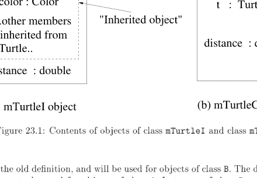

(a) mTurtleI 对象

(b) mTurtleC 对象

图 23.1：类 mTurtleI 和类 mTurtleC 对象的 contents

新的定义被称为覆盖旧的定义，并将用于类 B 的对象。A 中的 f 的定义将继续用于类 A 的对象。类 B 的实例如果必要也可以使用来自 A 的旧定义。只是，为此需要一种稍微复杂的语法。不要只使用函数 f 的名称，我们必须写 A::f。

我们在第 23.1.2 节中对 mTurtleI 的定义中看到了所有这些的例子。我们定义了一个新的成员函数 distanceCovered，它不存在于超类 Turtle 中，但对类 mTurtleI 来说是特殊的。我们还重新定义了 Turtle 中存在的成员函数 forward。新的函数适当地更改 distance 成员，并使用语法 Turtle::forward 调用类 Turtle 中的函数 forward。你可以将此函数视为在 mTurtleI 内部的继承 Turtle 对象上调用。

注意，虽然类 B 的对象继承了 A 的所有数据成员，但它们的访问性是有限的。事实上，继承的函数成员的访问性也是有限的。我们接下来讨论其精确规则。

### 23.2.1 访问规则和 protected 成员

假设 m 是 A 的数据或函数成员，b 是 B 的一个实例，B 是 A 的子类。那么实例 b 的成员 m 的访问方式由以下规则决定。

- **情况 1：m 是 A 的 public 成员：** 在这种情况下，我们可以认为 m 也是 B 的 public 成员。换句话说，m 可以在 B 的定义内部访问，也可以在 B 的定义外部访问。

- **情况 2：m 是 A 的 private 成员：** 那么 m 不能在我们编写的 B 的定义内部的代码中访问。当然它也不能在外部访问。换句话说，private 成员只能在成员被定义的类（及其友元类）的定义内部访问。子类实例不能直接访问超类的 private 成员。这并不意味着超类的 private 成员是无用的。A 中可能有一个 public 或 protected（见下文）成员函数 f 引用了 m。现在，B 中的代码可以引用 f，从而间接引用 m。

- **情况 3：m 是 A 的“protected”成员：** protected 的概念如下。如果类 A 的一个成员被指定为 protected，那么它只能在 A 的定义或其子类的定义内部访问。换句话说，protected 成员比 public 成员（可在任何地方访问）访问性更低，比 private 成员（只能在 A 的定义中访问）访问性更高。注意 m 也应被视为 B 的 protected 成员。

我们用以下代码片段说明上述规则。

```cpp
class A{
private:
    int p;
protected:
    int q;
    int getp(){return p;}
public:
    int r;
    void init(){p=1; q=2; r=3;}
};

class B: public A{
    double s;
public:
    void print(){
        cout << p << endl;  // compiler error 1.  p is private.
        cout << q << ", "
             << r << ", "
             << getp() << endl;
    }
};

int main(){
    B b;
    b.init();
    cout << b.p        // compiler error 2.  p is private
         << b.q        // compiler error 3.  q is protected
         << b.r
         << b.getp()   // compiler error 4.  getp is protected.
         << endl;
    b.print();
}
```

如果你编译这段代码，你会得到标记的 4 个编译错误。编译错误 1 和 2 是因为 p 在 A 中是 private，因此不能在 B 的定义中访问，


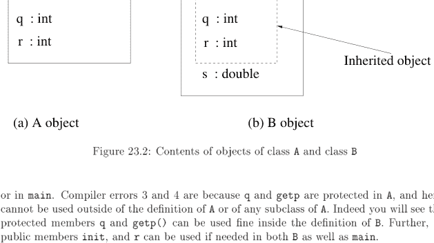

或者在 main 中。编译器错误 3 和 4 是因为 q 和 getp 在 A 中是 protected 的，因此不能在 A 的定义或 A 的任何子类的定义之外使用。实际上，你会看到 protected 成员 q 和 getp() 可以在 B 的定义内部正常使用。此外，公共成员 int 和 r 在 B 以及 main 中如果需要都可以使用。

一旦删除了有问题的部分，代码就能顺利编译。执行时，main 中的 print 语句将打印 3，而 b.print() 语句将打印 2,3,1。

图 23.2 展示了 A 类和 B 类对象的内容。请注意，A 中的所有数据成员都存在于 B 类对象中，即使它们可能无法直接访问。

### 23.2.2 构造函数

假设 B 类是 A 类的子类。B 的构造函数可以使用以下一般形式定义：

```
B(constructor-arguments) : call-to-constructor-of-A, initialization-list
{
    body
}
```

当你调用 B 的构造函数时，会首先调用 call-to-constructor-of-A，这将构造正在创建的 B 实例内部所包含的继承对象（属于 A 类）。初始化列表的形式与第 16.1.5 节相同，用于初始化 B 的新成员。之后，执行 body。这部分

: call-to-constructor-of-A

是可选的。如果省略，则会调用 A 的默认构造函数。初始化列表也是可选的，或者也可以将新成员在 body 内部进行初始化。

在第 23.1 节中，你看到了一个使用 Turtle 默认构造函数创建 mTurtle1e1 的示例。假设现在我们为 Turtle 提供了一个替代构造函数，它接受参数 x，y 来给出乌龟的初始位置。那么我们可以为 mTurtle1e1 编写一个替代构造函数，如下所示：

```
mTurtle1e1(double x, double y) : Turtle(x,y), distance() {}
```

使用这个构造函数，计米乌龟将被创建在屏幕上的 (x,y) 位置，并且新成员 distance 将使用初始化列表初始化为 0。构造函数的 body 则留空。

### 23.2.3 析构函数

和之前一样，假设我们有一个继承自 A 类的 B 类。那么，B 类的析构函数应该用于销毁在 B 中引入的、A 中不存在的新数据成员。从 A 继承的数据成员呢？它们会在 B 的析构函数调用执行结束时，通过隐式调用 A 的析构函数来销毁。你不应该在 B 的析构函数内部显式调用 A 的析构函数！

一般规则是：销毁会自动进行，按照创建的逆序执行。在练习中，你将通过代码实验来验证这些概念。

### 23.2.4 子类对象的基本操作

子类也是一个类，因此所有允许对类对象执行的操作都允许对子类对象执行，并且工作方式类似。例如，对象可以被复制、传递给函数等等，如第 15 章所讨论的。

### 23.2.5 子类对象的类型

我们说过，类是一种类型，即 A 类的对象具有类型 A。假设 B 是 A 类的子类。那么继承中的一个关键思想是：B 类的对象可以被认为既具有类型 B，也具有类型 A。这一思想非常有用。

以下类比可能有助于理解这一点。考虑花这一类别，其中我们有玫瑰、莲花等子类别。因此，如果某人要求提供花，我们可以给出玫瑰。换句话说，一个特定的玫瑰对象既可以作为玫瑰使用，也可以作为花使用。

### 23.2.6 混合超类与子类对象的赋值

如果一个对象可以被视为其超类的类型，那么我们应该允许将子类的对象赋值给超类的变量。这确实是可行的。但请注意，子类可能有一些额外的数据成员。在这种情况下，额外的成员在赋值过程中会被丢弃，或被“切片”掉。

你还可以将子类对象的地址赋值给超类的指针变量。

图 23.3 展示了一些示例。首先是赋值 `a = b`。由于 b 有额外的属性 y，在赋值过程中该属性将被切片掉，只有属性 x 会被复制。因此，第一条 print 语句将打印 2，即被复制的值。

接下来是 `aptr = &b`，它将 B 类对象 b 的地址存储到类型为 A* 的指针变量 aptr 中。正如我们所说，这是允许的，因为 A 是 B 的超类。接下来的语句使用 aptr。第一条语句中，我们使用标准语法 aptr->x 访问成员 x，这将按预期打印 2。在接下来的语句 aptr->f() 中，我们调用了成员函数 f。这里可能存在一些混淆：这到底意味着调用 A 中定义的 f 还是 B 中定义的 f？默认答案是，由于 aptr 是指向 A 的指针类型，因此将使用 A 中的成员。所以，这将打印消息“Calling f of A.”。如果你对这个默认行为不满意，请等到第 23.3 节。

请注意，在上述代码中，我们不能将超类的对象赋值给子类的变量，即不能编写 `b = a;`。这背后的直觉，回到我们的花的例子，如下：在任何需要花的地方，你可以提供玫瑰；然而，如果需要的是玫瑰，你不能提供任意一种花。同样，编写 `bptr = &a` 也是错误的。

最后，我们可以创建超类类型的引用来引用子类对象。这在图 23.3 末尾展示。实际上，即使在这种情况下，调用的也将是 A 中的函数 f。

### 23.3 多态与虚函数

考虑图 23.3 中的代码。正如我们上面所讨论的，调用 aptr->f() 将导致使用类 A 中的函数 f。但你可能会说：aptr 实际指向的是一个 B 类型的对象，如果使用 B 中的 f，不是更有用吗？你可以通过将 f 声明为虚函数来实现这一点。为此，你只需在 A 中 f 的定义前添加关键字 virtual。因此，A 的定义将变为：

```
class A{
public:
    int x;
    A(){ x = 1; }
    virtual void f(){cout <<"Calling f of A.\n";}
};
```

关键字 virtual 表示 f 的定义不应被视为唯一的、最终的版本。f 有可能在子类中被覆盖，如果是这样，则应该考虑对调用所针对的对象最合适的（最派生的！）f 定义。当我们调用 aptr->f() 时，最合适的 f 定义是 B 中的那个，因为 aptr 实际上指向一个 B 类型的对象。因此将使用该定义，我们的代码现在确实会打印“Calling f of B.”。

进一步注意，如果 f 是虚函数，那么即便通过引用调用它，也会使用其最派生的版本。因此，图 23.3 的最后一条语句也将导致调用 B 中的 f。

下面是一个关于同一思想的更微妙的示例。

```
class Flower{
public:
    void whoAmI(){ cout << name() << endl; }
    virtual string name(){ return "Flower"; }
};
class Rose: public Flower{
public:
    string name(){ return "Rose"; }
};

int main(){
    Flower a;
    Rose b;
    a.whoAmI();
    b.whoAmI();
}
```

执行 a.whoAmI() 显然会打印出“Flower”。更有趣的是执行 b.whoAmI()。它会打印什么？调用 b.whoAmI() 调用的是超类 Flower 中继承的成员函数 whoAmI。该函数 whoAmI 调用了 name，但问题是哪个 name。是 Flower 中的 name 还是 Rose 中的 name？答案是 Rose 中的 name，因为 (a) 调用 whoAmI 的对象是 Rose 类型，并且 (b) name 是虚函数。因此，将使用适合调用该函数的对象的最派生 name 定义。由于调用它的对象是 Rose 类型，因此将使用该类中的 name。所以最后一条语句将打印“Rose”。请注意，如果我们没有使用 virtual，那么两条语句都会打印“Flower”。

在这个示例中，成员函数 whoAmI 内部对 name() 的调用被称为多态调用，因为同样的调用要么导致调用 Flower 中的函数，要么导致调用 Rose 中的函数，这取决于调用它的对象的实际类型。注意，实际类型只有在执行期间才能知道。

同样，图 23.3 中的调用 aptr->f() 和 aref.f() 如果 f 被声明为虚函数，也将是多态的。

### 23.3.1 虚析构函数

假设 aptr 的类型是 A*，并指向某个对象。假设我们希望释放内存。因此我们编写 `delete aptr;`。这将调用析构函数，但问题还是：哪个析构函数？默认情况下，将调用 A 的析构函数。然而，如果 aptr 指向的对象是 B 类型，而 B 是 A 的子类，那么显然我们应该调用 B 的析构函数。我们可以通过将 A 的析构函数声明为 virtual 来强制实现这一点。实际上，每当我们预期一个类会被扩展时，将其析构函数声明为 virtual 是一个好主意。

下面是一个示例。

```
class A{
public:
    virtual ~A(){cout <<"A.\n";}
};
class B: public A{
    int *z;
public:
```


```
B(){z = new int;}
~B(){
    cout << "~B.\n";
    delete z;
}
};
```

如果我们不将 A 的析构函数声明为 virtual，那么在主程序中执行 `delete aptr;` 操作后，为 `z` 分配的内存将不会被释放。然而，由于我们已将 A 的析构函数声明为 virtual，当执行 `delete aptr;` 时会被调用 B 的析构函数，而不是 A 的析构函数。因此 `delete z;` 操作会执行。当然，和往常一样，A 的析构函数也会被调用，因为我们的规则是子类析构函数执行后才会调用超类析构函数。编译并执行这段代码，你会从消息中看到调用了什么。去掉关键字 `virtual` 再次执行，你会看到只有 A 的析构函数被调用。

## 23.4 打印过去式的程序

假设你想写一个程序，输入英语中的一个动词，并打印出它的过去式。因此，给定 "play"，程序必须打印 "played"，给定 "write"，程序必须打印 "wrote"，以此类推。一种简单的实现方法是将每个动词及其过去式作为字符串存储在内存中。给定动词后，我们就可以打印出对应的过去式。

但你也许会注意到，对于大多数动词，过去式只需添加后缀 "ed" 即可，就像动词 "play"、"walk"、"look" 的情况。我们可以将这些动词视为规则动词。而像 "be"、"speak"、"eat" 这样不遵循此规则的动词可以被视为不规则动词。因此，只对不规则动词显式存储过去式形式是有意义的；对于规则动词，我们在需要时只需附加 "ed"。这可以很好地使用继承来实现。

我们定义一个类 verb 代表所有动词；它由子类 regular 和 irregular 组成。verb 的定义包含所有动词共有的信息。regular 的定义增加了规则动词所需的信息，irregular 的定义类似。

```
class verb{
protected:
    string root;
public:
    string getRoot(){return root;}
    virtual string past_tense(){return "";}
};
```

成员 root 将存储动词本身。我们已将成员函数 past_tense 定义为 virtual。目前它返回空字符串。但这并不重要，因为我们期望在子类中重写它。

子类 regular 和 irregular 如你所料。

```
class regular : public verb{
public:
    regular(string rt){
        root = rt;
    }
    string past_tense(){return root + "ed";}
};
```

```
class irregular : public verb{
    string pt; // past tense of the verb
public:
    irregular(string rt, string p){
        root = rt;
        pt = p;
    }
    string past_tense(){return pt;}
};
```

因此，要创建一个代表动词 "play" 的实例 v1，我们只需写

```
regular v1("play");
```

之后如果我们写 v1.past_tense()，我们将得到字符串 "played" 作为结果。类似地

```
irregular v2("be","was");
```

将创建一个实例 v2 来表示动词 "be"。当然 v2.past_tense() 将返回 "was"。

我们现在看到上述定义如何用于编写返回动词过去式的主程序。显然，我们需要以某种方式存储动词的信息。为此，我们使用 vector。我们不能有一个单一的 vector 同时存储 regular 和 irregular 动词。然而，我们可以定义一个指向 verb 的指针 vector，在其中存储指向 irregular 以及 regular 对象的指针。因此程序如下。

```
int main(){
    vector<verb*> V;
    V.push_back(new regular("watch"));
    V.push_back(new regular("play"));
    V.push_back(new irregular("go","went"));
    V.push_back(new irregular("be","was"));

    string query;
    while(cin >> query){
        size_t i;
        for(i=0; i<V.size(); i++)
            if ((V[i])->getRoot() == query){
                cout << V[i]->past_tense() << endl;
                break;
            }
        if(i == V.size()) cout << "Not found.\n";
    }
}
```

我们首先创建 vector V。然后在堆上创建 regular 和 irregular 动词的实例，并将指向它们的指针存储在 V 的连续元素中。最后，我们进入一个循环，从用户读取查询，检查它是否在我们的 vector V 中。如果存在，我们打印其过去式。请注意，如果 for 循环以 i 取值为 V.size() 结束，则必须没有 V 中的条目其 root 等于查询。在这种情况下我们打印 "Not found." 如你所知，while 循环将在 cin 结束时终止，例如如果用户输入 control-d。

关于在此示例中使用继承，有几点需要注意。

- 我们的需求是表示动词这一类别，它由互不相交的子类别不规则动词和规则动词组成。这是可以使用继承的非常标准的情况。
- vector V 是多态的：它可以包含指向 irregular 类型对象以及 regular 类型对象的指针。我们可以对 V 元素指向的对象调用操作 past_tense，而不必担心对象是 regular 类型还是 irregular 类型。因为 past_tense 是 virtual，所以会执行正确的代码。

## 23.5 抽象类

你会注意到我们在 verb 中的 past_tense 函数返回空字符串。返回空字符串没有意义，但我们这样做是因为我们期望 verb 类永远不会被直接使用；只有它的子类会被使用，在其中该函数会被重写。这个想法可行，但从美学上讲，我们需要为 verb 提供 past_tense 的实现，而我们完全知道它不会被使用，这并不令人愉快。

一种可能性是只在 verb 中声明成员函数 past_tense，而完全不提供实现。不幸的是，每当没有提供实现时，编译器期望在某个地方找到它，也许在另一个文件中。如果没有提供这样的实现，编译器或链接器会产生错误消息。

我们需要一种方法告诉编译器我们根本不打算为 verb 类提供 past_tense 的实现。这是通过在声明后加上 "= 0" 来完成的。因此我们将写

```
class verb{
...
public:
    virtual string past_tense() = 0;
...
};
```

在成员函数的声明后写 "= 0" 告诉编译器我们不打算为该函数提供任何实现。你可以将 0 视为表示 NULL 指针，从而有效地表示没有实现。

将函数赋值为 0 有一个重要后果。假设类 A 包含一个被赋值为 0 的成员函数 f。那么我们就不能创建 A 的实例！这是因为对于该实例我们不知道如何应用函数 f。在 C++ 中，不能实例化的类被称为抽象类。事实上，使类成为抽象的唯一方法就是将其一个成员函数赋值为 0。

因此，在我们的例子中，如果我们在 verb 中将 past_tense 赋值为 0，那么 verb 类将成为抽象类。我们将无法创建它的实例。但这很好，我们确实不希望用户实例化 verb，而是期望他们实例化 regular 或 irregular。

## 23.6 多重继承

有时，一个对象可以被视为不是一个，而是两个其他对象的特化。例如，我们可能有一个 Automobile 类和一个 SolarPoweredDevice 类。

```
class Automobile{
    double mileage;
};
class SolarPoweredDevice{
    double cellEfficiency;
};
```

假设我们还需要表示太阳能汽车，它们需要同时具有 Automobile 类以及 SolarPoweredDevice 类的特征。我们可以通过构造一个同时继承自两者的类 SolarPoweredAutomobile 来实现这一点！

```
class SolarPoweredAutomobile : public Automobile,
                               public SolarPoweredDevice {};
```

> 1 如果我们使类的构造函数为 private 并且没有成员函数使用该构造函数，那么我们实际上确保了该类不能被实例化。但从技术上讲，这样的类不被认为是抽象的。


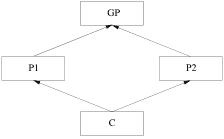

图23.4：菱形继承。箭头从子类指向父类。

现在，`SolarPoweredAutomobile`（太阳能汽车）类的实例将拥有成员 `mileage`（里程数）和 `cellEfficiency`（电池效率），正如你所期望的那样。函数成员也会从所有父类继承，无论有多少个父类。

这里存在一些明显的问题：如果类 C 的父类 P1、P2 都有一个同名的成员 m，会发生什么？在这种情况下，子类会得到该成员的两份拷贝，你需要分别使用 `P1::m` 和 `P2::m` 来引用它们。

## 23.6.1 菱形继承

假设某个类 C 的父类 P1、P2 本身都继承自一个共同的基类 GP，如图23.4所示。在这种情况下，类 C 实际上会得到继承对象 GP 的两份拷贝，分别对应于 P1 和 P2。

这种通过继承父类 P1、P2 来派生类 C，而 P1、P2 又继承自同一个类 GP 的情形，被称为*菱形继承*。这是因为这种继承关系的图示呈现出菱形，如图23.4所示。

然而，在某些菱形继承的场景下，我们可能希望只保留一个继承对象的拷贝，而不是每个父类各提供一份。在C++中，可以通过将 P1、P2 对 GP 的继承指定为虚继承来实现这一点。因此我们可以这样写：

```cpp
class GP{ double x; };
class P1: virtual public GP{};
class P2: virtual public GP{};
class C: public P1, public P2{};
```

这样，类 C 将只包含继承对象 GP 的一份拷贝。请注意，这个继承对象将直接通过调用其构造函数进行初始化。因此，如果 P1 或 P2 的初始化列表中包含对 GP 构造函数的调用，这些调用将被忽略。

## 23.7 继承的类型

到目前为止，我们只讨论了公有继承。C++还允许其他类型的继承，即保护继承和私有继承。

如果类 B 使用保护继承从类 A 继承，那么 A 的公有成员和保护成员将成为 B 的保护成员。

如果类 B 使用私有继承从类 A 继承，那么 A 的公有成员和保护成员将成为 B 的私有成员。

正如你所看到的，保护继承和私有继承逐步限制继承到派生类中的成员的可访问性。这些继承类型在实践中似乎使用得少得多。因此我们不再进一步讨论它们。

## 23.8 备注

继承是一个强大的思想。然而，像任何强大的思想一样，它需要小心使用。

一个非正式的经验法则如下。假设 A、B 是你希望用类 A、B 来表示的实体。如果类型 B 的实体是类型 A 的特化版本，那么让类 B 从类 A 继承。非正式地，你可以问：实体 B 和 A 之间是否存在“是一个”的关系？显然，玫瑰是一种花，所以实体玫瑰和花之间具有“是一个”的关系。在这种情况下，就使用继承。如果两个实体之间存在“有一个”的关系，那么最好使用组合。例如，花有花瓣，所以实体花和花瓣之间具有“有一个”的关系。最好通过组合来建模这种关系，即将花瓣作为花内部的一个成员。

继承的一个重要优势是多态性。正如我们在23.4节中看到的，我们可能有基类的几个子类。我们可以方便地将子类的实例存储在向量（或其他集合）中，为此我们可以将它们视为基类的成员。但我们可以在这些对象上调用函数，如果这些函数是虚函数，我们还可以将它们视为子类的成员并从中受益。这在编写显示动词过去式的程序时非常有用。我们将在下一章中看到更多这样的例子。

## 23.9 练习

- 1. 假设你有一个类 V，定义如下：

```cpp
class V{
protected:
    double x,y,z;
public:
    V3(double p, double q, double r){ x=p; y=q; z=r; }
}
```

定义一个继承自 V 的类 W，它有一个成员函数 dot，用于计算两个向量的点积。因此，给定 V 类型的对象 v、w，点积为 v.x * w.x + v.y * w.y + v.z * w.z。注意你只能使用 V 中提供的构造函数。

- 2. 定义一个类 realTurtle，使得 realTurtle 对象在移动时以某个可指定的速度移动。它们还应该缓慢转身。

3. 你认为执行下面给出的程序时会有什么结果？运行它并检查你是否正确。

```cpp
class A{
public:
    A(){cout << "Constructor(A) .\n";}
    ~A(){cout << "Destructor(A) .\n";}
};

class B: public A{
public:
    B(){cout << "Constructor(B) .\n";}
    ~B(){cout << "Destructor(B) .\n";}
};

class C: public B{
public:
    C(){cout << "Constructor(C) .\n";}
    ~C(){cout << "Destructor(C) .\n";}
};

int main(){
    C c;
}
```

4. 下面的代码将输出什么？

```cpp
struct A{
    virtual int f(){return 1;}
    int g(){return 2;}
};

struct B : public A{
    int f(){return 3;}
    int g(){return 4;}
}

A* aptr;
aptr = new B;
cout << aptr->f() << ' ' << aptr->g() << endl;
```

5. 仅使用两个类，一个动词类和一个不规则类，编写过去时生成程序。规则动词应创建为 verb 的实例，不规则动词应创建为 irregular 的实例。

6. 你可能注意到，几个以“e”结尾的动词的过去式是通过加“d”得到的，例如 recite、advise。向 verb 类添加一个额外的子类，以便紧凑地存储此类动词的过去式。

## 第24章

### 基于继承的设计

继承在设计大型复杂程序时往往非常有用。它的第一个优点我们已经讨论过：继承在表示类别和子类别方面很方便。但还有一些相关的优点，与程序开发过程的管理有关。我们接着讨论这些，然后在本章的其余部分看一些例子。

设计大型程序有很多方法。一种经典的方法要求我们首先对程序需求进行完整的研究，然后才开始编写程序。更现代的方法则承认/允许这样一种可能性：除非你已经构建了程序的几个版本，否则需求可能无法被理解。此外，如果一个程序运行良好，用户不可避免地会要求增加更多功能来增强它。无论如何，程序都会有很长的生命周期，在此期间需求会不断演变。因此，现代方法强调设计易于更改的程序的需求。正如我们讨论过的，继承的全部意义就在于从旧类构建新类，当需求变化时这个想法肯定会派上用场。

即使需求被很好地理解并且是固定的（至少在那时的程序开发过程中），设计大型程序也是棘手的。如果程序可以被设计为一组大多独立的函数或类的集合，它们以有限的、清晰定义的方式相互作用，这会非常有帮助。这种划分有助于理解程序的行为并检查其正确性：例如，我们可以考虑分别测试各个部分。但它还有另一个优点：不同的程序员可以同时处理不同的部分。正如我们将看到的，基于继承的设计在这方面也有很多可提供的。

另一个现代编程趋势是*组件*的使用。很可能，要编写专业的程序，你不会使用裸 C++（或任何其他编程语言），而是从一组他人已经构建的函数和类开始（用于其他类似项目中）。你将调整这些类以供自己使用，正如我们已经看到的，这种调整通过继承是很自然的。

在本章的其余部分，我们将看到两个案例研究。首先我们重新审视我们的公式绘制程序。我们将使用继承重写它。结果将表明，这种编写方式使其更易于维护和扩展。接下来我们将讨论 *simplecpp* 中图形的设计。继承在其设计中扮演着重要的角色。最后，我们将看到 *composite* 类，它将使你能够定义由


## 24.1 公式绘制再探

回顾第 22.1 节中的公式绘制问题：给定一个数学公式，在图形画布上以美观的方式绘制它。在第 22.1 节中，我们的具体目标是绘制公式，使得和、差和积中的运算对象水平从左到右绘制，而被除数和除数分别绘制在水平线的上方和下方。在本节中，我们将看到如何使用继承编写该程序。这样做的好处是，很容易将程序扩展以包含新的运算符。为了说明这一点，我们将实现幂运算符，该运算符要求指数写在底数的上方和右侧。

为简单起见，我们忽略了从键盘接受输入的问题：我们假设要绘制的公式作为程序的一部分给出，即要绘制 $\frac{a}{b+c}$，我们将首先在程序中构造它，写成类似：

```
Node f2('/', new Node("a"),
         new Node('+', new Node("b"), new Node("c"))
     );
```

然后我们可以调用 f2.setSize() 等。

### 24.1.1 基本设计

如果我们想要表示的实体构成一个类别及其子类别，则使用继承是自然的。在本例中，我们希望表示数学公式。这些公式可以根据顶层运算符进一步分类：例如在公式 $\frac{a}{b+c}$ 中，最后执行的运算是除法，因此我们将其指定为子类别 DIV。在公式 $a + \frac{b}{c}$ 中，最后执行的运算是加法，因此我们将其指定为子类别 SUM。因此我们有数学公式的一般类别，以及基于执行公式的最后运算的子类别 SUM、DIFF、DIV、PROD。

我们将使用类 Formula 来表示所有数学公式。这将类似于第 22.1.3 节的类 Node。该类将有一个子类 Formula2，用于表示顶层运算符为二元的所有数学公式。该类将有子类 Sum、Diff、Prod 和 Div，分别表示顶层运算符为 +、-、× 和 ÷ 的公式。记住，在第 22 章的练习中我们指出，考虑一元和三元公式是有帮助的——你可以认为类 Formula2 严格包含于 Formula。

绘制公式的算法是相同的；因此我们将在所有类中都有方法 setSize 和 draw。这些将根据运算符类型不同而不同定义。

以下是类 Formula 的定义。

```
class Formula{
protected:
double width, height, descent;
public:
    virtual void setSize()=0;
    virtual void draw(float clx, float cly)=0;
    double getWidth(){return width;}
    double getHeight(){return height;}
    double getDescent(){return descent;}
};
```

我们不期望实例化 Formula，因此我们将其中一些方法声明为纯虚函数。另请注意，在第 22.1.3 节中，我们使用结构而不是类。因此一切都是公开的。现在我们更注意使成员可见，因此我们为 width、height 和 descent 定义了访问函数。

我们接下来定义顶层有两个运算对象的公式类。

```
class Formula2 : public Formula{
protected:
    Formula* lhs;
    Formula* rhs;
    virtual string op()=0;
};
```

我们没有显式存储运算符，而是使用函数 op，它将返回运算符。该函数仅在运算符已知的类中定义。

接下来我们定义需要水平布局的表达式的子类 Formula2h。

```
class Formula2h : public Formula2{
public:
    void setSize(){
        lhs->setSize();
        rhs->setSize();
        descent = max(lhs->getDescent(), rhs->getDescent());
        width = lhs->getWidth() + textWidth(op()) + rhs->getWidth();
        height = descent + max(lhs->getHeight() - lhs->getDescent(),
                            rhs->getHeight() - rhs->getDescent());
    }
    void draw(float clx, float cly){
        lhs->draw(clx,cly);
        rhs->draw(clx+lhs->getWidth()+textWidth(op()), cly);
        Text(clx+lhs->getWidth()+textWidth(op()))/2,cly, op()).imprint();
    }
};
```

这些函数实现与 Node 上的对应函数（第 ?? 节）中情况 ‘+’ 类似。唯一的区别是我们使用访问函数而不是成员 height、width、descent，并且 op 不是数据成员而是函数成员。

我们现在可以创建类来表示和、差和积。

```
class Sum : public Formula2h{
public:
    Sum(Formula* lhs1, Formula* rhs1){ lhs = lhs1; rhs = rhs1; }
    string op(){ return "+";}
};
```

```
class Diff : public Formula2h{
public:
    Diff(Formula* lhs1, Formula* rhs1){ lhs = lhs1; rhs = rhs1; }
    string op(){ return "-";}
};
```

```
class Prod : public Formula2h{
public:
    Prod(Formula* lhs1, Formula* rhs1){ lhs = lhs1; rhs = rhs1; }
    string op(){ return "*";}
};
```

这些类仅提供构造函数和运算符。请注意，布局方面已在类 Formula2h 中处理。

我们可以类似地定义一个 Formula2v 类，对其运算对象进行垂直布局。然而，需要带分隔水平线的垂直布局的运算符可能很少。因此我们直接定义 Div 类。

```
class Div : public Formula2{
static const float Bheight = 20;  //space for horizontal bar.
public:
    Div(Formula* lhs1, Formula* rhs1){ lhs = lhs1; rhs = rhs1; }
    string op(){return "/";}
    void draw(float clx, float cly){
        Line(clx,cly,clx+width,cly).imprint();
        lhs->draw(clx+width/2-lhs->getWidth()/2,cly-Bheight/2-lhs->getDescent());
        rhs->draw(clx+width/2-rhs->getWidth()/2,cly+
            Bheight/2+rhs->getHeight()-rhs->getDescent());
    }
    void setSize(){
        lhs->setSize(); rhs->setSize();
        width = max(lhs->getWidth(), rhs->getWidth());
        height = lhs->getHeight() + Bheight + rhs->getHeight();
        descent = rhs->getHeight() + Bheight/2;
    }
};
```

这对应于 Node 上对应函数（第 ?? 节）中情况 '/' 的代码。它还定义了构造函数和函数 op。

最后，我们需要一个类来表示公式中的文字，即数字或变量。

```
```cpp
class Literal : public Formula{
  string value;
public:
  Literal(string v){value=v;}
  void setSize(){
    width = textWidth(value);
    height = textHeight(); descent = height/2;
  }
  void draw(float clx, float cly){
    Text(clx+width/2,cly,value).imprint();
  }
};
```
```

这对应于 Node 上对应函数（第 ?? 节）中情况 ’P’ 的代码。

我们现在可以给出一个简单的 main 程序，使用上述定义来渲染公式 $1 + \frac{1}{\frac{451}{5}+35}$。

```
```cpp
int main(){
  initCanvas("Formula drawing");

  Sum e(new Literal("1"),
        new Div(new Literal("2"),
                new Sum(new Div(new Literal("451"),new Literal("5")),
                        new Literal("35"))));

  e.setSize();
  e.draw(200,200+e.getHeight()-e.getDescent());

  getClick();
}
```
```

### 24.1.2 两种方法的比较

乍一看，似乎基于继承的方法比第 22.1 节的方法更冗长。这是真的，但这种冗长为我们带来了许多好处。

一个关键的改进是我们将程序划分为可管理的部分。第 22.1 节的代码只有一个类。所有复杂性都放在了该类中。相比之下，在新代码中，不同的关注点被分离到不同的类中。例如，类 Formula2a 仅模拟公式可以有两个运算对象这一事实，仅此而已。类 Formula2h 显示了如何布局需要水平布局的公式。我们可以将每个类放在其头文件和实现文件中，如果愿意的话，将主程序放在单独的文件中。这样，如果我们希望更改某个特定问题（例如水平布局）的某些内容，我们就知道我们可能只会修改一个小文件。这是新方法的一个巨大好处。


另一个重要的好处在我们考虑向程序添加新功能时就会显现出来。假设我们想要实现指数表达式的布局。正如你将看到的，我们可以在不触及任何旧文件的情况下做到这一点（如果我们希望使用指数表达式，当然主程序文件除外）。这种策略的关键好处是：我们可以确信，当我们添加指数表达式时，损坏旧工作代码的可能性甚至为零。程序员（理所当然地）倾向于对自己的代码感到偏执，这种保证是有用的。请注意，如果旧代码由一位程序员编写，而新代码由另一位程序员编写，那么如果一位程序员的代码不被另一位程序员触及，就会非常方便。这样就能清楚地知道谁对什么负责。

## 24.1.3 添加指数表达式

我们将添加一个类 Pow，它将表示指数表达式。这将是 Formula2 的子类，因为它有两个操作数。

```
class Pow : public Formula2{
public:
    Pow(Formula* lhs1, Formula* rhs1){ lhs = lhs1; rhs = rhs1; }
    string op(){return "^";}
    void draw(float clx, float cly){
        lhs->draw(clx, cly);
        rhs->draw(clx+lhs->getWidth(),
                  cly - (lhs->getHeight() - lhs->getDescent())
                  - rhs->getDescent()
                  );
    }
    void setSize(){
        lhs->setSize(); rhs->setSize();
        width = lhs->getWidth() + rhs->getWidth();
        height = lhs->getHeight() + rhs->getHeight();
        descent = lhs->getDescent();
    }
};
```

基本思路是将指数布局在底数的上方和右侧。决定如何放置的详细表达式以第 ?? 节的方式获得，留给你自行推断。使用此类很简单，要表示 X + Y^Z，我们只需写 Sum(new Literal("X"), new Pow(new Literal("Y"), new Literal("Z")))。

需要理解的关键点是，这段新代码可以独立开发，在一个新文件中进行，而无需其余代码，只需要类头文件即可。如果我们使用了第 22.1 节的编码方法，我们就需要拥有并修改旧代码。

## 24.2 simplecpp 图形系统

我们将讨论继承在 simplecpp 图形系统设计中扮演的角色。尽管按真实图形系统的标准来看该系统相当小，但我们不会在这里讨论整个系统，而只讨论其中一些相关部分。

简而言之，系统的核心规范是：允许用户在屏幕上创建和操作图形对象。当然，这个说法非常模糊。操作对象意味着什么？正如你所知，在 simplecpp 中，操作仅仅意味着移动、旋转、缩放。还有其他问题：用户应获得何种原语？用户是否需要指定每个对象在每一帧中的外观（像电影中的画面）还是只需说明增量变化，例如移动对象 x，这意味着其他对象保持不变？正如你所知，我们选择了后者。当然还有一个问题，即我们可以拥有哪些类型的对象。正如你所知，simplecpp 支持以下类型的图形对象：圆、线、矩形、多边形、海龟和文本。

因此，在本节的其余部分，我们考虑在上述方式下创建和操作上述对象的问题。我们不会讨论诸如与每个对象关联的画笔，或 getClick 命令中的图形输入等问题。

显然，这样的系统必须具备以下能力：

- 1. 它必须能够跟踪用户迄今为止创建的对象。
- 2. 它应该能够在屏幕上显示对象。
- 3. 它应该能够按要求操作对象，例如移动一个对象。

让我们先从第 2 项开始。simplecpp 建立在 X Windows 系统之上，该系统提供了可在屏幕上所需位置绘制线条、弧线、多边形、圆（填充和非填充）的函数。因此我们调用这些函数。第 3 项也相对容易。与每个对象我们关联了一些配置数据，说明它应以多大尺寸绘制、以何种方向、以及在何处。请注意，此数据与形状数据不同。第 1 项在原则上也不困难：我们只需保留某种列表或集合，将每个对象放入其中。为了完成这一非常高层次的描述，我们还需要回答一个问题：何时应显示对象？最简单的答案是：每当用户更改任何对象的状态时，清除整个显示并再次显示所有对象。继承有助于促进此处描述的许多操作。

很明显，我们有所有图形对象的类别，然后有对应于不同类型对象的子类别，例如圆。因此很明显，这些对应于表示所有对象的类别 ALL 的类的子类。我们的类别确实形成了一个层次结构，相关的类也是如此，如图 24.1 所示。与所有对象的类别相关联的类称为 Sprite，以纪念 Scratch 编程环境（scratch.mit.edu），在该环境中，该名称用于类似的概念。

该层次结构有助于存储信息如下。在 Sprite 类中我们保留所有图形对象共有的属性。乍一看，你可能会认为对于看起来非常不同的对象：圆、线、多边形等等，可能几乎没有什么共同之处。但如前所述，当图形对象要在屏幕上显示时，它将具有位置、方向、比例以及形状。此外它还将具有诸如颜色之类的属性。所有对象都将具有这些属性。因此这些属性成为 Sprite 类的数据成员。

Circle、Line、Polygon 等类将包含形状相关的属性（除了从 Sprite 继承的所有属性）。例如，Circle 包含一个名为 radius 的数据成员，用于保存正在绘制的圆的半径。Polygon 类包含一个数组，用于保存多边形顶点的坐标。如前所述，这些坐标是在专门创建的坐标系中给出的；在绘制时，它们将相对于多边形的位置绘制（记录在对象的 Sprite 部分中）。图 24.2 显示了 Circle 和 Sprite 类内容的可能方式。实际实现不同，你可以在提供的代码中看到它们。

此外，我们还必须考虑函数成员。假设我们希望移动一个对象。这需要两个动作：（a）记录对象确实已被移动，并相应更新其位置，（b）在屏幕上重绘对象。显然，动作（a）可以独立于对象的形状执行，而（b）需要形状信息。因此在我们的实现中，动作（b）由每个形状类中的 paint 方法实现。move 成员函数在 Sprite 类中定义。它使用 Sprite 类中可用的属性执行动作（a）。然后它发出所有对象需要重绘的信号。

重绘的工作方式如下。基本上 simplecpp 维护一个向量，其中保存当前时刻所有活动对象的指针。假设该向量名为 ActiveSprites，则其声明将为

```
vector<Sprite*> ActiveSprites;
```

由于 ActiveSprites 的元素类型为 Sprite*，它们可以保存指向任何图形对象的指针。当对象需要绘制时，我们只需遍历队列并执行对象的 paint 方法。

```
for(int i=0; i < ActiveSprites.size(); i++){
    ActiveSprites[i]->paint();
}
```

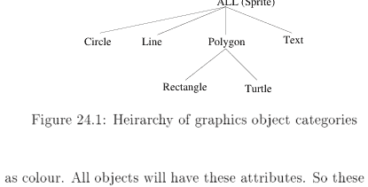

图 24.1：图形对象类别的层次结构

```
class Sprite{
protected:
    double x,y;            // position on the canvas
    double orientation;    // angle in radians made with the x axis
    double scale;          // scaling factor
    Color fill_color;      // Color is a data type in the X windows Xlib package.
    bool fill;             // whether to fill or not
    ...
public:
    Sprite();
    Sprite(double x, double y);
    ...
    void forward(double dist);
    ...
    virtual void paint()=0;
    ...
}

class Circle : public Sprite{
private:
    double radius;
public:
    Circle();
    Circle(double x, double y, double radius=10);
    void init(double x, double y, double radius=10);
    virtual void paint()
};
```

图 24.2：Sprite 和 Circle 的可能定义


存储形状相关的数据。此外，由于多态性和虚函数，我们可以将指向不同类型的图形对象（但仅限于 Sprite 的子类型）的指针存储在单个向量中，并遍历该向量。最后，我们可以轻松添加新形状：我们只需定义一个继承自 Sprite 的新形状类，而无需修改任何现有代码。
我们对 simplecpp 图形的描述做了一些简化，以便解释继承的使用。实际系统更为复杂。我们将在接下来看到一个例子。

## 24.3 复合图形对象

我们讨论如何定义一个类，其实例是复合的，即单个实例可以包含多个简单对象。构建完成后，你可以在程序中使用该类来创建实例。在定义复合对象时需要继承，正如我们将看到的那样。

假设你想在屏幕上绘制许多汽车。如果能设计一个 Car 类，然后实例化它来制作许多汽车，那就太好了。一辆汽车是一个复杂的对象：它不能仅用一个多边形或一个圆来很好地绘制。它将需要 simplecpp 提供的多个简单对象。这些简单对象必须被组合在一起，并且经常一起操作，例如，如果我们想让汽车移动，我们实际上是指移动它的所有组成部分。我们接下来讨论的 Composite 类将允许你组合对象。然后我们可以通过继承 Composite 类来定义 Car 类。

我们的 Composite 类主要充当一个“容器”，用于容纳其他图形对象。它有一个参考框架，包含的对象相对于该框架指定。Composite 类被定义为 Sprite 类的子类。因此它继承了 move、forward、rotate 等成员函数。Composite 类的设计使得成员函数会使包含的对象做出适当的响应，即当你移动一个 Composite 时，其内部的一切都会被移动。然而，如果你愿意，也可以重写这些方法。例如，假设你的复合对象由汽车车身和车轮组成。当你在此对象上调用 forward 时，默认情况下所有东西都会向前移动。你可能希望车轮在向前移动的同时旋转。这可以通过重写来实现。你还可以额外定义自己的新成员函数来实现新功能。例如，汽车顶部可能有一个灯，可以有一个成员函数使灯的颜色从白色变为黄色（暗示它已打开）。这可以通过新的成员函数实现。

使用 Composite 类相当容易。只有三个重要概念需要理解：所有权的概念，以及 Composite 类的构造函数。

### 24.3.1 所有权

到目前为止我们隐藏的一个细节是：每个图形对象都有一个“所有者”。当我们说对象 X 拥有对象 Y 时，我们只是意味着对象 Y 是相对于对象 X 的坐标系指定的。对于你迄今为止创建的对象，所有者是画布：对象在画布的坐标系中绘制。当一个对象作为复合对象的一部分创建时，它必须相对于复合对象的框架绘制，因此必须由复合对象拥有。因此定义复合对象的一个重要步骤是声明它为包含对象的拥有者。

为此，每个图形对象的构造函数都提供了一个可选参数，名为 owner。该参数默认为 NULL，simplecpp 将其解释为表示画布。因此到目前为止我们没有告诉你这个参数，你也没有指定值，因此 simplecpp 使画布成为你创建的所有对象的拥有者。如果你想指定不同的拥有者，你只需传递指向该拥有者的指针。由于我们在复合对象的体内创建包含对象，我们必须传递指向复合对象本身的指针。正如你所知，在对象的定义内部，关键字 this 表示指向该对象的指针。因此额外参数的值必须是 this。

### 24.3.2 Composite 类构造函数

Composite 类构造函数具有以下签名。

```
Composite(double x, double y, Composite* owner=NULL)
```

这里最后一个参数 owner 给出正在定义的复合对象的拥有者，而 x,y 给出复合对象在其拥有者框架中的坐标。如前所述，如果你不指定此参数，则取为 NULL，表示画布是拥有者。如果此复合对象本身是另一个复合对象的一部分，则必须指定 owner 参数。这种包含是允许的，我们很快会看到一个例子。

### 24.3.3 Car 类

我们现在构造一个 Car 类。我们的汽车将由一个多边形车身和两个车轮组成。我们将通过添加辐条来为车轮增添一些个性。因此我们将汽车建模为一个复合对象，由车身和车轮组成。但请注意，车轮本身包含表示轮辋的圆和表示辐条的线。因此车轮本身也必须表示为复合对象。请注意，我们允许一个复合对象（例如汽车）包含其他普通对象（例如车身）或其他复合对象（例如车轮）。

我们首先定义一个车轮类。

```
class Wheel : public Composite{
    Circle *rim;
    Line *spoke[10];
public:
    Wheel(double x, double y, Composite* owner=NULL) : Composite(x,y,owner) {
        rim = new Circle(0,0,50,this);
        for(int i=0; i<10; i++){
            spoke[i] = new Line(0, 0, 50*cos(i*PI/5), 50*sin(i*PI/5), this);
        }
    }
};
```

有两个私有数据成员。成员 rim 定义为指向表示车轮轮辋的 Circle 对象的指针。同样 spoke 是指向车轮每根辐条的指针数组。对象本身在构造函数中创建。这是定义复合图形对象的非常常见的惯用法。

构造函数通常以指向复合对象本身的拥有者的指针和复合对象在其拥有者框架中的位置作为参数。按照惯例，owner 参数被赋予默认值 NULL，如前所述。初始化列表 Composite(x,y,owner) 只是转发这些参数，以便在所需坐标处创建核心复合对象并获得指定的拥有者。在构造函数内部，我们创建子对象。因此我们创建表示轮辋的圆，如你所见我们为其提供了额外的参数 this，因此 Wheel 对象成为轮辋的拥有者。同样我们创建不同倾斜度的线来表示辐条，这里额外的参数 this 也使线由 Wheel 对象拥有。

Car 类可以通过使用 Wheel 实例作为部件来组合。

```
class Car : public Composite{
    Polygon* body;
    Wheel* w1;
    Wheel* w2;
public:
    Car(double x, double y, Color c, Composite* owner=NULL)
    : Composite(x,y,owner){
        double bodyV[9][2]={{-150,0}, {-150,-100}, {-100,-100}, {-75,-200},
                            {50,-200}, {100,-100}, {150,-100}, {150,0}, {-150,0}};
        body = new Polygon(0,0, bodyV, 9, this);
        body->setColor(c);
        body->setFill();
        w1 = new Wheel(-90,0,this);
        w2 = new Wheel(90,0,this);
    }
    void forward(double dx, bool repaintP=true){
        Composite::forward(dx,false); // superclass forward function
        w1->rotate(dx/50,false); // angle = dx/radius
        w2->rotate(dx/50,false);
        if(repaintP) repaint();
    }
};
```

如图所示，私有成员是指向车身和两个车轮的指针。在构造函数中，车身被创建为多边形。我们在构造函数中提供了一个参数，可用于为车身指定颜色。最后，创建车轮。对于全部 3 个部件，最后一个参数都设置为 this，因此部件成为 Car 对象的拥有对象，正如我们希望的那样。

该定义还展示了 forward 函数被重写。如讨论所述，我们希望汽车向前移动，这通过调用超类的 forward 函数实现

类。但我们也希望车轮转动；这通过让它们旋转来实现。显然，如果汽车向前移动 dx，那么车轮必须旋转 dx/r 弧度，其中 r 是车轮的半径。但为什么调用 rotate 函数时要额外传一个 false 参数？为什么还要调用 repaint 函数？我们接下来解释这些。

## 24.3.4 帧

simplecpp 图形中还有另一个我们一直向你隐瞒的细节：所有配置更改命令，即 forward、move、rotate 等，都有一个额外的参数 repaintP，其默认值为 true。如果 repaintP 为 true，则在每次配置更改后按第 24.2 节所述重绘画布。如果 repaintP 为 false，则不进行重绘，只记录配置更改。

这个特性在组合对象的子对象上调用配置更改命令时尤其有用。我们不希望在移动每个子对象后都发生重绘。那样效率低下，而且视觉上也很烦人。我们更愿意在记录完所有子对象的配置更改后，只重绘一次。这就是上述代码实现的效果：在 Composite::forward 以及两次 w...->rotate 操作之后，不会发生重绘。除非调用 Car::forward 的调用者禁用了重绘，否则只在最后进行重绘。

## 24.3.5 主程序

最后，这里是一个可能使用上述定义的主程序。

```
int main(){
    initCanvas("Car",0,0,800,800);

    Car c(300,300,COLOR("blue"));
    Car d(300,600,COLOR("red"));
    d.scale(0.5);
    getClick();

    for(int i=0; i<100; i++){
        c.forward(3.0,false);
        d.forward(1.5,false);
        repaint();
    }
    getClick();
}
```

主程序创建了两辆汽车，一辆蓝色，一辆红色。然后红色汽车被缩放为原来的一半大小。这会导致汽车的所有部件都缩小——这由 Composite 类中的代码自动处理。

最后，我们让汽车向前移动。当你执行这个程序时，汽车的车轮应该看起来在地面上滚动。此外，较小的汽车的车轮应该看起来每单位时间的转数是较大汽车的两倍，因为较小的车轮半径只有一半，但行驶的距离与较大的车轮相同。

## 练习

- 1. 为第 24.1 节的程序添加绘制求和公式的能力，即公式
-   
  \[\sum_{A}^{B} C\]
-   
  其中 A、B、C 本身也可以是公式。

- 2. 定义一个组合对象来建模一张脸。定义表达情绪的方法，例如微笑。发挥你的想象力。

- 3. Scratch 编程系统中一个吸引人的想法是精灵的造型（costume）。造型只是对精灵外观的一种描述。例如，一个鸟精灵可能有两个造型：一个是翅膀合拢，另一个是翅膀展开。当鸟移动时，在这两个造型之间交替切换，就可以创造出鸟飞翔的效果。设计这个精灵。

- 4. 你认为是否可能设计一个 CostumedObject 类，使定义多个造型更容易？如果可能，就实现它。

- 5. 你要编写一个程序，让非程序员也能编写简单的动画。程序的输入可以是如下所示的命令序列。

```
Circle 100 200 5
Rectangle 200 300 40 50
Circle 100 200 15
Move 0 50 50
Left 1 30
Move 2 70 -70
Wait 0.5
...
```

其中，前 3 行定义了 3 个对象。你可能已经猜到，形状名称后面的数字是对应构造函数的参数。对于其余的序列，构造出的对象分别编号为 0、1、2（或一直到我们定义的对象数量）。在命令序列的其余部分中，图形对象将由其编号来引用。因此，命令 Move 0 50 50 使对象 0（第一个圆）在 x 和 y 方向上分别移动 50、50。类似地，Left 1 30 使矩形向左旋转 30 度。你还可以定义命令来等待指定的时间。

编写这个程序。请注意，Sprite 对象不能存储在 vector 中。但是，你可以在堆上创建 Sprite，并将指向它的指针存储在 vector 中。

## 第 25 章

### 离散事件模拟

我们已经讨论过模拟的一般概念：给定一个系统的当前状态和演化规律，预测该系统在稍后某个时刻的状态。在第 17 章中，我们考虑了天文学中可能需要的天体模拟。然而，模拟对于更普通、更贴近日常的系统也非常有用。模拟的一个非常常见的用途是了解一个设施（如餐厅、火车站或机场）是否有足够的资源（如桌子、站台或跑道）来令人满意地服务可能到达的顾客或旅客。

作为一个具体例子，假设我们想决定餐厅里应该放多少张餐桌。如果放的桌子太少，我们将无法容纳所有可能想来餐厅就餐的顾客。另一方面，我们放的每张桌子都有成本。因此，我们可能想针对每个 T（其中 T 是我们放的桌子数量）确定我们的收入可能是多少。知道了收入和放置桌子的成本，我们应该能够选择合适的 T 值。要做这个分析，我们当然需要知道有多少顾客想在什么时候来我们餐厅就餐。这只能统计性地预测。我们将假设我们已知 p，即在餐厅“繁忙时段”（比如晚上 7 点到 10 点）的任意一分钟内，有顾客到达的概率。理想情况下，我们不应只考虑单个顾客，而应考虑由几位顾客组成的一群顾客，并且一群顾客可能需要不止一张桌子。然而，为简单起见，我们将假设顾客单独到达，并单独坐在各自的桌子旁。顾客到达后，占用一张桌子一段时间，在此期间就餐，然后离开。假设我们还已知一个函数 e(t)，它给出顾客就餐 t 分钟的概率。为简单起见，假设收入与顾客总数成正比。我们能否确定对于任意值 T（我们拥有的桌子数量）的总收入？注意，如果所有桌子都被占用，到达的顾客将离开。

诸如此类的问题有时可以用解析方法解决，即我们可以将期望收入写成不同参数的相当简单、易于计算的函数。但如果概率模型复杂，这往往是不可能的。例如，在上述描述中，我们暗示就餐时间概率分布 e(t) 只是 t 的函数。但如果餐厅里有很多人，服务可能会更慢，每位顾客占用桌子的时间会更长。因此，也许该分布也应该是当前顾客数量的函数。在这种情况下，写出解析解会困难得多。在这种情况下，一种常见策略是模拟该系统。我们的意思如下。我们从适当的分布中挑选随机数，以决定顾客何时到达、他们要等多久。利用这些信息，我们计算每个时刻有多少张桌子被占用，哪些顾客因餐厅已满而需要被拒之门外，等等。

在本章中，我们将看到如何执行这种模拟。这种模拟与第 17 章的宇宙学模拟有着非常不同的特点。我们将看到，它是离散事件模拟的一个例子，我们将在 25.1 节详细讨论。我们将开发一些机制来执行离散事件模拟，并利用这些机制进行餐厅模拟。我们还将考虑一个变体，称之为咖啡店模拟。本章的最后一个主题是图的最短路径问题。通过将这个问题视为某个自然系统的模拟，我们可以为这个抽象问题得到一个快速算法。在第 26 章中，我们将开发一个机场模拟，它将使用我们在本章中开发的机制。

### 25.1 离散事件模拟概述

在宇宙学系统中，每颗恒星在每个时刻都吸引并因此影响其他每颗恒星。相比之下，在许多其他现实生活系统中，实体之间的交互相对不那么频繁。例如，在餐厅中，顾客的交互包括获得桌子、点餐、被服务、付账和离开。这些交互之间通常间隔很长时间，在此期间顾客通常既不受打扰，也不需要任何关注。因此，习惯上把后一种系统称为离散时间系统，而前一种系统称为连续时间系统。

#### 25.1.1 离散时间系统

一般来说，离散时间系统由一定数量的实体组成，这些实体可能具有随时间变化的状态。此外，还有一个已启用/即将发生的事件列表，即已知将要发生的事件，每个事件都会在未来的某个指定时间发生。当一个事件实际发生时，它可能导致 (a) 某些实体的状态发生变化，以及 (b) 创建更多事件。新状态取决于发生的事件以及旧状态。同样，新创建的事件也取决于发生的事件和旧状态，即事件发生前一刻实体的状态。还需要进一步指出，离散系统的状态只能在某个事件发生期间改变，或者只能在某个事件发生期间创建新事件。

许多现实生活系统都可以视为离散时间系统。例如，考虑我们前面描述的餐厅系统。我们有一个非常简单的模型：顾客走近餐厅，如果有空桌就入座，然后在某个随机选择的时间长度后离开。如果没有空桌，那么我们可以认为他们甚至不会进入餐厅。在这种情况下，很自然地将餐厅中的桌子视为实体，这些桌子可以处于占用或未占用状态。我们可以考虑两类事件：顾客到达（customer approach）和顾客离开（customer Exit）。以下是这些事件发生时的情况：


S : 系统中实体的状态。初始化为当前时间的状态。

L : 事件列表。初始化为包含已知将在当前时间之后发生的事件。

+   1. 设 e 为发生时间最小的事件。
+   2. 从 L 中移除 e。
+   3. 处理 e。这将导致 S 发生变化。新的事件也可能被添加到 L 中。
+   4. 如果 L 不为空，则从步骤 1 重复。

Figure 25.1: 离散事件仿真算法

Approach: 如果所有桌子都被占用，则什么也不会发生。如果有空闲桌子，则被占用桌子的数量增加一，并且创建一个 Exit 事件，发生时间为当前时间 + E，其中 E 表示顾客用餐的持续时间。

Exit: 被占用桌子的数量减少一。不会为任何未来时间创建事件。

正如你所见，事件发生时发生的事情确实取决于事件发生时世界的状态。但这正是我们在上面对离散时间系统的定义中所陈述的。

我们还将注意到，通常认为离散时间系统中事件的发生是瞬时的。这并不意味着诸如进食之类的动作被认为是瞬时的。事实上，正如你在上面看到的，进食从 approach 事件开始，并在 exit 事件结束。

我们很快会看到其他例子。

## 25.1.2 离散时间系统的演化

需要强调的一个关键点是，如果我们知道离散时间系统在给定时间的状态以及所有即将发生的事件，即先前创建但尚未发生的事件，我们就可以精确地确定系统的演化。

为此，请注意系统的当前状态必须保持不变，直到某个事件发生。因此，特别是，当前状态必须保持不变，直到最早的即将发生的事件发生。但我们知道在此最早事件发生时的状态——它只是当前状态——因此我们可以精确地确定最早即将发生的事件的影响。换句话说，我们将知道它如何改变状态以及会创建哪些新事件。但随后我们可以以相同的方式继续，即考虑下一个最早的事件并确定其影响。这一算法在图 25.1 中以抽象形式给出。

## 25.1.3 实现离散时间系统

重要的问题是我们如何在计算机上表示系统状态和事件。通常，系统的状态有一个自然的表示。例如，在我们的餐厅问题中，我们只需要一个变量来跟踪被占用桌子的数量。如何表示事件更有趣。

当我们说一个事件发生时，我们通常会想到一组发生的动作。因此，自然的做法是将事件与执行所需动作的函数关联起来。该函数必须能够访问系统的状态，并且只有当关联的事件成为最早的待处理事件时才会被调用，即在先前的事件被处理之后。因此，事实证明用 lambda 表达式表示每个事件是很自然的，特别是一个不带参数也不返回结果的函数。当事件发生的时间到来时，我们只需调用 lambda 表达式即可！下面的讨论将大量使用 lambda 表达式，因此建议读者熟悉附录 H。

如附录 H 所述，表示不带参数且不返回值函数的 lambda 表达式的类型为 std::function<void()>。为了方便，我们将为此类型指定一个名称。

```
typedef std::function<void()> Event;
```

lambda 表达式中的变量捕获机制将使函数能够访问系统状态，正如我们将看到的那样。

其次，为了方便，我们将图 25.1 中的事件列表 L 设为包含形式为 (e, t) 的对，其中 e 是事件，t 是其发生的时间。我们需要的 (e, t) 对将使用 STL 中的 pair 类表示（在头文件 <util> 中找到）。我们使用类型 double 表示时间，因此我们需要 Event 和 double 的对。为了简化后续讨论，方便定义：

```
typedef pair<Event,double> ETpair;
```

请记住，由对 (e, t) 组成的事件列表以非常特殊的方式被访问。如图 25.1 所示，我们不会从列表中移除任意对，而是只移除 t 最小的对，尽管我们可以按任意顺序插入对。

STL 中的 priority_queue 模板类（在头文件 <queue> 中找到）支持几乎这种操作模式。它具有返回队列中“最大”元素的操作，其中我们可以定义什么是最大。以下是 priority_queue 的原型。

```
template<class T,
    class C = vector<T>,                // argument 1
    class cmp = less<typename C::value_type> // argument 2
    > priority_queue;
```

模板的原型类似于函数原型：两者都给出参数及其类型，以及可能的默认值。在这种情况下，priority_queue 模板接受 3 个参数。第二个参数 C 指定用于存储优先级队列中元素的容器类。默认选项是使用 vector，我们不希望更改它。第三个参数 cmp 用于决定返回什么。它默认为

less，这只是运算符 <。因此，存储在其中的所有元素中，优先级队列返回元素 x，使得不存在 y 使得 x < y。因此返回最大元素。要获取最小值，我们必须使第三个参数等同于 > 运算符。这是通过类 compareETpair 完成的，如图 25.2 所示。

图 25.2 中显示的类 sim 是主要的仿真类。其中的成员 pq 持有事件列表。除了事件列表外，该类还具有一个成员 time，旨在保存系统已仿真到的时间。我们从将 time 初始化为 0 开始。

这个类 sim 有点不寻常。它并不是要被实例化的！成员 time 和 pq 被定义为静态元素。因此 pq 和 time 只有一个副本，但这正是我们想要的。功能通过四个静态成员函数提供。请注意，静态成员函数可以在类定义之外作为 class-name::function-name 访问。

成员函数 post 允许发布事件，即创建并插入到优先级队列中。第一个参数 latency 是事件相对于系统当前时间发生的时间间隔。第二个参数 e 是事件本身。该函数因此将对 (e, time + latency) 插入到优先级队列中。

成员函数 getTime 仅返回当前时间，即系统已仿真到的时间。

成员函数 processAll 处理已发布的事件，直到没有事件可处理为止。为此，它反复选取优先级队列中时间 t 最小的对 (e, t) 并调用事件 e。请注意，当我们选取时间 t 最小的元素时，我们知道系统时间可以推进到 t。因此成员 time 被更新为 t。请注意，队列中的最小元素可以通过使用 pop 方法移除，或者我们也可以使用 top 方法仅检查它。

最后一个方法 log 是为了报告方便。它用于向屏幕打印消息，但每条消息都以当前时间为前缀。请注意，返回了对控制台输出 cout 的引用，以便可以使用 << 运算符附加剩余的消息。

## 25.1.4 简单的使用示例

通常，要使用 sim 等任何类，你必须连同你的程序一起编译它，或包含合适的头文件等。然而，为了简化你的操作，我们已将 sim 包含在 simplecpp 本身中。因此你只需包含 simplecpp 即可。

我们从一些简单的仿真示例开始。下面给出了一个程序，它只是创建 2 个事件，例如 A、B，然后要求仿真器处理它们。

```
int main(){
    sim::post(15, [](){sim::log() << "Event A.\n";});   // event A
    sim::post(5, [](){sim::log() << "Event B.\n";});   // event B

    sim::processAll();                  // process all events.
}
```

与每个事件关联的动作很简单：打印一条消息，并附带当前仿真时间。


```cpp
class sim{
    typedef std::function<void()> Event;
    typedef pair<Event,double> ETpair;
    struct compareETpair{
        bool operator()(ETpair p, ETpair q){return p.second > q.second;}
    };
    static double time;    // time to which the system has been simulated
    static priority_queue< ETpair, vector<ETpair>, compareETpair> pq;

public:
    static void post(double latency, Event e){
        pq.push(make_pair(e, time + latency));
    }

    static double getTime(){return time;}

    static void processAll(double tmax=1000){
        while(!pq.empty() && time < tmax){
            ETpair ETp = pq.top();
            time = ETp.second;
            pq.pop();
            ETp.first();
        }
    }

    static ostream & log(){
        cout << time << ") ";
        return cout;
    }
};

// Initialization of the static elements.

double sim::time = 0;
priority_queue< sim::ETpair, vector<sim::ETpair>, sim::compareETpair> sim::pq;
```

图 25.2：主要的仿真类

当你执行时，前两条语句会使事件 A、B 被发布，分别在当前时间后 15 和 5 个时间单位发生。仿真从时间 0 开始，因此这些事件将分别在时间 15 和 5 发生。程序中的第三条语句将导致系统被演进，即队列中的所有事件都将被处理，按它们预期发生的时间顺序处理。因此，安排在时间 5 的事件 B 将首先被处理，即其 lambda 表达式将被调用。这将导致消息 "Event B." 被打印，并在前面加上仿真时间，这是由于对 sim::log 的调用。之后事件 A 将被处理。因此你会得到以下输出。

5) Event B.
15) Event A.

需要注意的是，在程序中事件 A 的创建发生在事件 B 的创建之前。然而，A 的时间 15 大于 B 的时间 5。因此在执行期间 B 先于 A 发生。

正如我们在第 25.1.1 节中所讨论的，在离散时间系统中，事件通常会导致某些实体的状态发生变化，并导致新事件的创建（发布）。我们现在将考虑一个事件同时执行这两项操作的例子。这个例子将包含所有未来仿真中使用的核心惯用法。

在下面的程序中，我们有 4 个事件 A、B、C、D。我们还有一个变量 count。我们将看到事件会访问这个变量（“仿真状态”），事实上事件 D 将在事件 C 发生期间被发布。

```
int main(){
    int count=0;
    sim::post(15, [&](){sim::log() << "A. count: "<< count++ <<endl;}); //A
    sim::post(5, [&](){sim::log() << "B. count: "<< count++ <<endl;});   //B
    sim::post(10, [&](){
        sim::log() << "C. count "<< count++ <<endl;
        sim::post(100, [&](){sim::log() << "D. count: " <<
                            count++ << endl;});
    });
    sim::processAll();
}
```

程序首先将 count 设置为 0，然后为时间 15、5、10 分别发布事件 A、B、C。然后 sim::processAll 导致已发布的事件被处理。

发布的最早时间是事件 B，因此它首先被处理。这将导致打印 B 的发生时间以及 count 的值。请注意 count 是通过引用捕获到事件中的，因此在事件发生时该值将被打印。因此我们将看到以下输出。

5) B. count: 0

请注意在打印时，count 也被递增。由于 count 是通过引用捕获的，递增将影响程序第一行中定义的变量 count。因此它将变为 1。

发布下一个最早时间 10 的事件是事件 C，随后被处理。处理首先通过打印消息和 count 的值开始。请注意在事件 C 中变量 count 也是通过引用捕获的。因此以下消息将被打印

```
10) C. count: 1
```

并且 count 将被递增。但是事件 C 的处理在打印消息后并未停止。打印后，调用 sim::post 被执行，这导致事件 D 作为事件 C 发生的一部分而被创建。事件 D 应在当前时间之后 100 步发生，即 10。因此事件 D 被发布到时间 110。因此当 C 的处理结束时，队列中有两个事件 A、D，并且 count 的值为 2。

再次，最早的事件将被处理，即事件 A。这将打印一条消息：

```
15) A. count: 2
```

并将 count 递增到 3。

之后事件 D 将被处理。这将打印一条消息：

```
110) D. count: 3
```

并导致 count 递增到 4。请注意消息中的时间——sim::log 确实会打印 110，即我们期望事件发生的时间。

## 25.2 餐厅仿真

我们现在展示如何编程餐厅仿真。它由若干参数表征，餐厅容量（即桌子数量）、餐厅开放的持续时间（以分钟计）、下一分钟顾客到达的概率，以及顾客用餐时间的最小值和最大值。餐厅状态由被占用的桌子数量组成。

在餐厅开放的每一分钟，顾客可能以指定概率到达。我们将每次到达建模为一个事件。到达时，顾客会检查是否有空闲桌子，如果没有，顾客就会离开，我们应该打印一条相应消息。如果有空闲桌子，则顾客占用一张桌子并坐下用餐。然后随机选择一个用餐时长，顾客必须在该时长后离开餐厅。我们也将离开建模为一个事件。因此顾客的到达事件必须执行上述操作，包括创建离开事件。所有这些都进入到达事件的 lambda 表达式中。在离开时，只需要减少被占用桌子的数量。因此递减代码必须放在离开事件的 lambda 表达式中。

因此代码如下。

```
int main(){
const int capacity=5;                // number of tables
const int duration=180;              // minutes open
double arrivalP=0.1, eatMin=21, eatMax=40;

int nOccupied = 0 ;
int id = 0;

for(int t=0; t<duration; t++){
    if(randuv(0,1) <= arrivalP){        // with probability arrivalP
        id++;
        sim::post(t, [=,&nOccupied](){
            if(nOccupied >= capacity)        // if no table available
                sim::log()<< " Customer " << id << " disappointed.\n";
            else{                            // if a table is available
                ++nOccupied;
                int eatTime = randuv(eatMin, eatMax);
                sim::log()<<" Customer " << id << " will eat for "<<eatTime<<"\n";
                sim::post(eatTime, [=,&nOccupied](){
                    sim::log()<< " Customer " << id << " finishes.\n";
                    --nOccupied;
                });
            }
        });
    }
}
sim::processAll();
}
```

## 25.3 资源

许多现实生活系统包含稀缺的资源。例如，同一台机器可能需要处理多个作业，而它在任何瞬间只能处理其中一个。在这种情况下，作业必须等待以获得对机器的独占访问。

作为一个例子，考虑一个由单个服务员管理的路边咖啡店。假设商店提供饮料和食物，所有这些都需要服务员付出一定的努力和时间。如果顾客到达时服务员正忙于之前的顾客，那么新顾客必须等待。因此在受欢迎的咖啡店可能会形成等待顾客的队伍。给定顾客到达的概率和服务时间的概率分布，我们能否预测商店的业务量以及队伍有多长？

我们将开发一个 Resource 类，这将使编写此类仿真变得容易。

### 25.3.1 一个 Resource 类

到目前为止，我们已经说过事件可以被创建并发布以在未来的某个时间发生。我们将扩展这一概念，允许事件被发布以在某个资源可用时发生。如果资源立即可用，则事件将立即发生。否则，它将被放入与该资源关联的队列中。当资源因其他事件释放而变得可用时，等待的事件将被取出队列并发布以立即执行。


这些思想实现在一个 Resource 类中。

```
class Resource{
typedef std::function<void()> Event;
queue<Event> q;
bool inUse;
public:
Resource(){inUse = false;};
int size(){ return q.size(); }
bool reserve(){
if(inUse) return false;
else{ inUse = true; return true;}
}
void acquire(Event pS){
if (!inUse){
inUse = true;
sim::post(0,pS);
}
else
q.push(pS);
}
void release(){
if(!q.empty()){
Event x = q.front();
q.pop();
sim::post(0,x);
}
else inUse = false;
}
};
```

我们可以创建 Resource 类的实例来模拟必须独占使用的资源。Resource 中的数据成员 inUse 如果为 true 表示资源（由该实例表示）被认为正在使用中，如果为 false 表示资源可用。此外，资源类有一个数据成员 q，它是来自标准模板库的队列。你可以通过调用成员函数 push 将元素添加到队列（的末尾），通过调用成员函数 front 检查队列前端的元素，并通过调用成员函数 pop 移除前端的元素。

成员函数 acquire 可用于获取对资源的独占访问。它以需要独占访问的事件 e 作为参数，即当资源变得可用时将被执行的 lambda 表达式。如果资源立即可用，则通过调用 sim::post(0,e) 将事件发布为立即执行。资源已被获取这一点通过设置 inUse = true 来表示。如果资源不可用，则事件会被放入与资源关联的队列中。

成员函数 release 可用于释放资源并使其对其他事件可用。如果有事件 e 在正在释放的资源的队列（前端）中等待，则通过调用 sim::post(0,e) 将 e 发布为立即执行。注意，在这种情况下我们不需要更改 inUse：它之前为 true 并且必须保持为 true，因为我们已将资源分配给等待的事件。如果队列中没有等待的事件，则必须将 inUse 设置为 false，以便未来的 acquire 请求可以立即成功。

最后，还有一个成员函数 reserve，它将资源标记为正在使用，并当且仅当资源此前未被使用时返回 true。我们将在第 26.6 节看到其用法。

## 25.3.2 简单示例

Resource 类也是 simplecpp 的一部分，因此可立即使用。下面是一个简单示例。

```
int main(){
    Resource r;

    sim::post(15, [&](){
        r.acquire([](){sim::log() << "Got it! \n";});
    });

    r.acquire([&](){
        sim::post(20, [&](){
            r.release();
        });
    });
    sim::processAll();
}
```

第一个语句为时间 10 发布一个事件，在其中寻求获取资源 r。获取后将打印一条消息，说明获取成功的时间。第二个语句在时间 0 立即寻求获取 r，并在获取后 20 步释放它。

正如你所见，第二个语句中的获取会成功，因为在时间 0 资源可用。因此资源将在 20 步后被释放，即在时间 20。因此第一个语句中的获取将在时间 20 成功。因此消息 "Got it!" 将在此时打印。因此程序的输出将为：

20) Got it!

注意 r 需要在第二个语句中被捕获。由于 r 在语句之间共享，它按引用捕获。

## 25.3.3 咖啡店仿真

使用 Resource 类，仿真很容易编写。模拟 180 分钟持续时间的主程序如下。

```
int main(){
    const int duration=180;                 // minutes open
    double arrivalP = 0.1;
    int id = 0;
    Resource server;

    for(int t=0; t<duration; t++){
        if(randuv(0,1) <= arrivalP){          // with probability arrivalP
            id++;
            int serviceT = randuv(3,9);
            sim::post(t, [=,&server](){
                sim::log() << " " << id << " arrives, service time " << serviceT << endl;
                server.acquire([=,&server](){
                    sim::log() << " Customer: " << id << " being served.\n";
                    sim::post(serviceT, [=,&server](){
                        sim::log() << " Customer: " << id << " finishes.\n";
                        server.release();
                    });
                });
            });
        }
    }
    sim::processAll();
}
```

总体轮廓与餐厅仿真类似。我们需要一个 Resource 来模拟服务员，在代码中称为 server。然后我们对每分钟模拟顾客到达，以到达概率 arrivalP。如果判定有顾客到达，则为该顾客生成一个随机的服务时间。然后我们必须执行以下操作。

- 1. 打印一条消息说明顾客到达，以及服务时间。
- 2. 请求对服务员的独占访问。
- 3. 在获得独占访问后，我们持有服务员进行服务时间。
- 4. 在服务时间过去后，我们释放服务员。

正如你所见，上面的代码恰好执行这些步骤。然而，步骤看起来是嵌套的。这是因为事件的代码需要放在前一个事件的参数列表中。

我们注意变量捕获的几点重要事项。首先，server 在迭代之间共享，因此必须按引用捕获。然而，我们希望 id 变量的值来自顾客到达被发布的时间。因此 id 必须按值捕获。最后 serviceT 是循环内的局部变量，因此必须按值捕获。因此我们要求除 server 必须按引用捕获外，所有变量都按值捕获。

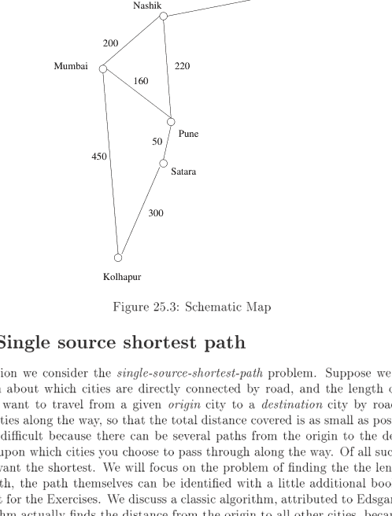

## 图 25.3：示意地图

## 25.4 单源最短路径

在本节中我们考虑单源最短路径问题。假设我们已知哪些城市通过道路直接相连，以及所有此类道路的长度。我们希望从给定的起点城市出发，通过道路前往目的地城市，途经任意城市，使得覆盖的总距离尽可能小。问题困难的原因在于从起点到目的地的路径可能有若干条，取决于途中选择经过哪些城市。在所有这些可能路径中，我们希望最短的路径。我们将重点关注寻找最短路径的长度，路径本身可以用少量额外记账来识别，留作练习。我们讨论一种经典算法，归功于 Edsgar Dijkstra。该算法实际上会找到起点到所有其他城市的距离，因为这样更方便。

Dijkstra 算法可以看作是对以下物理实验的计算机类比，你可以进行该实验来找到距离。为实验我们需要许多可以以恒定速度骑行的自行车手，例如 1 公里/分钟。具体来说，我们需要在每个城市中拥有与从该城市出发的道路数量一样多的自行车手。如果我们有这样的自行车手，他们可以合作找到最短路径的长度。

起初，所有自行车手都聚集在各自的城市中。每位自行车手被分配一条从城市出发的道路，自行车手的任务是在被要求时仅在那条道路上行驶。当自行车手以某种方式被发令出发后，她开始踩踏并到达道路另一端的城市。在那里她必须检查自己是否是第一个到达的人。

如果她不是第一个，即有人更早到达，那么她什么也不做并停止。如果她确实是第一个到达的人，则她发令所有等待的自行车手开始踩踏。之后她的任务就结束了。

实验的开始方式如下。在时间 0，一个虚构的自行车手到达起点城市，并发令该城市的自行车手。他们然后按上述描述发令其他自行车手。实验在所有自行车手完成旅程时结束。

例如，假设我们的图是图 25.3 的地图，我们想要从 Nashik 出发的距离。因此在时间 0，一个虚构的自行车手到达 Nashik 并发令那里的自行车手。因此自行车手从 Nashik 分别出发前往 Nagpur、Mumbai 和 Pune。以分钟为单位测量时间，从开始算起，自行车手从 Nashik 到达 Mumbai 的时间是 200。她是第一个到达那里的人，所以她发令 3 名 Mumbai 自行车手开始前往 Kolhapur、Pune 和 Nashik 分别。3 人中前往 Pune 的自行车手将在 160 分钟后到达，即在时间 360。然而，当她到达 Pune 时，她会发现自行车手从 Nashik 已经在时间 220 到达。因此从 Mumbai 到达 Pune 的自行车手无需做任何事。以这种方式过程继续。

我们将证明：(a) 起点到任意城市的最短路径长度恰好是第一个自行车手到达该城市的时间（以分钟计）！(b) 我们可以使用离散事件仿真来模拟该系统。

我们先解释 (a)。设 S 表示起点城市，C 为任意城市。设 t 为第一个自行车手到达 C 的时间。我们论证必须存在一条从 S 到 C 长度恰好为此的路径。为此，考虑到达 C 的自行车手。我们沿时间向后追溯这名自行车手到他出发的城市。在那里，他被另一名自行车手发令出发，我们沿时间向后追溯该自行车手，等等。最终，我们必须在时间 0 到达城市 S。在此过程中，注意我们不仅在时间上向后移动，而且也在以 1 公里/分钟的速度持续向后行驶。因此，我们向后覆盖的距离恰好等于所花费的时间。因此我们证明了存在一条从 S 到 C 的路径，其长度等于第一个自行车手到达 C 的时间。我们现在证明它是最小的。

考虑从 S 到 C 的一条最短路径 P，其上的城市按顺序为 c0, c1, …, ck，其中 c0 = S，且 ck = C。设 di 为路径上 ci 到 ci+1 的距离。我们将证明第一个（虚构或真实的）自行车手到达 ci 的时间不晚于 di，对所有 i 成立。显然这对 i = 0 成立：确实有自行车手在 0 = d0 时到达 c0。因此假设归纳地，自行车手在时间 di 或更早到达 ci。因此自行车手必须在时间 di 或更早离开 ci 前往城市 ci+1。但该自行车手以 1 公里/分钟行驶，因此也用时间 di+1 − di 覆盖距离 di+1 − di。因此他将在时间至多为 di + di+1 − di = di+1 到达 ci+1。因此归纳完成。因此我们知道一些自行车手必须在至多等于最短路径 P 长度的时间到达 ck = C。但我们之前证明到达时间必须等于某条路径的长度。因此可得出第一个自行车手到达的时间恰好等于最短路径的长度。

我们接下来展示我们的算法可以作为离散事件仿真来编程。


### 25.4.1 Dijkstra 算法作为仿真

首先要解决的问题，当然是如何表示我们的道路网络。网络是一个图，其中城市是顶点，道路是边。因此我们使用第 21.1.4 节中给出的表示方法。这在图 25.4 中显示。

整个道路网络都保存在类 `RoadNetwork` 中。它包含一个向量 `cities`，其第 i 个元素是类 `City` 的对象，其中包含关于第 i 个城市的信息。因此我们必须为地图上的每个城市分配一个数字。对于图 25.3 的地图，我们将数字 0 到 5 分别分配给城市 Kolhapur、Mumbai、Pune、Nashik、Nagpur、Satara。每个 `City` 对象中的成员 `arrivalT` 用于存储第一个骑自行车的人到达该城市的时间。每个 `City` 对象还包含一个向量 `roads`，用于存储离开该城市的道路的信息。假设 `G` 是一个 `RoadNetwork`。那么 `G.cities[i].roads[j]` 是类型为 `Road` 的对象，它存储关于从城市 i 出发的第 j 条道路的信息。具体来说，该对象存储以下信息：(a) 一个指针 `toPtr` 指向该道路通向的城市，(b) 一个 `double` `length` 给出该道路的长度。

类 `RoadNetwork` 的构造函数从作为参数给出的文件名称中读取道路网络。图 25.5 显示了一个示例输入文件。该文件表示图 25.3 的道路网络。文件中的第一个数字给出城市的数量。读取后，构造函数将向量 `cities` 调整为该数量。这将导致向量 `cities` 的元素被创建。因此为网络中的每个城市创建一个 `City` 对象。注意 `City` 的构造函数：它将 `arrivalT` 设置为 `HUGE_VAL`，它表示 ∞。我们用它来表示目前还没有骑自行车的人到达该城市。接下来，`RoadNetwork` 的构造函数读取图中的道路信息。这由三元组 c1, c2, dist 组成，其中 c1, c2 给出道路两端的城市，dist 给出道路的长度。我们必须将此道路的信息存储在存储与城市 c1 相关的信息的结构 `cities[c1]` 中，以及存储与城市 c2 相关的信息的 `cities[c2]` 中。这在循环中的两个语句中完成。当循环结束时，道路网络将被构建。

类 `City` 还包含 `arrive` 成员函数，我们稍后会讨论。

主程序创建图，并开始骑自行车者移动的仿真，如下所示。

```cpp
int main(int argc, char** argv){
    RoadNetwork G(argv[1]);            // create road network from file
    int origin;                        // city from which distances are needed
    stringstream(argv[2]) >> origin;

    // cause the fictitious cyclist to arrive.
    sim::post(0, [&G,origin](){G.cities[origin].arrive();});
    sim::processAll();

    for(unsigned i=0; i<G.cities.size(); i++)
        cout << G.cities[i].arrivalT << " "; // arrivalT = distance from origin
    cout << endl;
}
```

```cpp
struct City;      // forward declaration, not definition.

struct Road{
    City* toPtr;    // Where the road leads to
    double length;
    Road(City* ptr, double d){toPtr = ptr; length = d;}
};

struct City{
    vector<Road> roads;
    double arrivalT;                // arrival time of first cyclist
    City(){arrivalT = HUGE_VAL;}    // not arrived yet.
    void arrive(){
        if(arrivalT > sim::getTime()){
            arrivalT = sim::getTime();
            for(unsigned int i=0; i<roads.size(); i++){
                sim::post(roads[i].length, [this,i](){roads[i].toPtr->arrive();});
            }
        }
    }
};

struct RoadNetwork{
    vector<City> cities;
    RoadNetwork(char* infilename) {
        ifstream infile(infilename);
        int n;
        infile >> n;
        cities.resize(n);
        double dist;
        int end1, end2;
        while(infile >> end1){
            infile >> end2 >> dist;
            cities[end1].roads.push_back(Road(&cities[end2],dist));
            cities[end2].roads.push_back(Road(&cities[end1],dist));
        }
    }
};
```

| File content | Explanation |
|---|---|
| 6 | Number of cities |
| 0 1 450 | Kolhapur Mumbai distance |
| 0 5 300 | Kolhapur Satara distance |
| 1 2 160 | Mumbai Pune distance |
| 1 3 200 | Mumbai Nashik distance |
| 2 3 220 | Pune Nashik distance |
| 3 4 500 | Nashik Nagpur distance |
| 5 2 50 | Satara Pune distance |

*Figure 25.5: Input file for graph of Figure 25.3*

程序使用命令行参数。第一个命令行参数 `argv[1]` 给出包含用于构建道路网络的数据的文件的名称。我们将此文件名提供给类 `RoadNetwork` 的构造函数，该构造函数为我们构建对象 `G`。第二个命令行参数 `argv[2]` 预期为一个整数，它给出原点城市的索引。对于此，我们首先将字符串 `argv[2]` 转换为 `stringstream`（附录 F），然后从中读取。然后我们开始仿真。

仿真中只有一种类型的事件：骑自行车的人到达一个城市。事件期间要采取的行动放在成员函数 `arrive` 中。为了检查到达的骑自行车的人是否是第一个到达该城市的骑自行车的人，我们检查 `City` 中的成员 `arrivalT`。如果 `arrivalT` 不是 `HUGE_VAL`，则它自城市创建以来已发生变化，即骑自行车的人不是第一个到达。在这种情况下，我们什么也不做。另一方面，如果 `arrivalT` 仍然是 `HUGE_VAL`，则该骑自行车的人是第一个到达的人，必须执行以下操作。

- 1. 将正确的到达时间记录到 `arrivalT` 中。注意此时它将不再是 `HUGE_VAL`。
- 2. 必须标记骑自行车的人从城市的每条外向道路离开。骑自行车的人将在覆盖距离 `roads[i].length` 后到达由 `roads[i].toPtr` 指向的相应城市，即在经过这么多时间后。因此，我们以该延迟发布该城市的到达事件。

所以这就是函数 `arrive` 所做的。

为了启动仿真，我们必须标记原点城市中的骑自行车的人。为此，我们在时间 0 为原点城市发布一个到达事件。此后，`main` 只是等待所有事件被处理，即所有骑自行车的人完成他们的旅程。最后，从城市 origin 到每个城市 i 的最早到达时间可以在 `G.cities[i].arrivalT` 中找到。但那也是距离，因此会被打印出来。

## 25.5 结论性 remarks

离散事件仿真是一个强大的范式。使用本章开发的类，您应该能够轻松构建一些中等规模的仿真。我们将在下一章看到这样的一个例子。

离散事件仿真的基本思想如下。您希望仿真的任何系统首先必须被视为一组相互作用的实体。交互构成事件。每个事件都可能导致实体的状态发生变化，或导致发布额外的未来事件。我们将每个事件表示为 lambda 表达式。当事件发生时，关联的 lambda 表达式执行，在此执行中我们必须更改系统实体的状态或发布额外的事件。请注意，用于执行所有这些操作的的代码可以文本上放置在 lambda 表达式内部，就像在餐厅和咖啡店仿真中一样。或者在 lambda 表达式内部我们只需放置对导致状态更改或发布额外事件的函数的调用，就像在最短路径算法仿真中一样。

发布事件和获取资源的编码风格有点棘手。通常，当我们希望按顺序执行一个动作后执行另一个动作时，我们在第一个动作之后编写第二个动作。然而，如果事件 A 导致事件 B，而事件 B 又导致事件 C，那么我们将在 B 的 lambda 表达式内部编写 C 的 lambda 表达式，而 B 的 lambda 表达式又可能在 A 的 lambda 表达式内部。因此，尽管事件按顺序发生，但在代码中它们会以嵌套形式出现。这需要一些适应。

请注意，lambda 表达式使表达事件发布和资源获取变得方便。您应该确保您很好地理解 lambda 表达式，尤其是变量捕获。

## Exercises

- 1. 修改餐厅仿真以报告有多少顾客失望离开、顾客在关门时间后逗留了多长时间、餐厅中顾客的平均数量。
- 2. 将咖啡店问题推广为有多个服务员的情况。这也类似于在餐厅中添加一个等候室。您需要修改 `resource`。将该类推广为最多有 k 个客户端可以同时使用资源。您可能会发现，如果不跟踪哪些客户端正在使用资源，而只是跟踪有多少客户端正在使用资源，则更容易做到这一点。
- 3. 假设每分钟以概率 p 有一个顾客进入商店。假设平均每个顾客在商店里花费 t 分钟。那么平均而言，您预计在商店里会看到多少顾客？排队论中的 Little 定律说这个数字将是 pt。修改咖啡店仿真并通过实验验证 Little 定律。该定律要求没有顾客被拒之门外，并且平均值是在很长（实际上是无限）的时间上取的。因此您应该删除容量检查，并运行仿真相当长的时间以进行检查。还需要更多的代码来完成所有测量。
- 4. 编写一个餐厅仿真，其中顾客可以成群到达，而不是单独到达。假设一个群体最多可有 5 名成员，所有大小同等可能。假设餐厅中的桌子可容纳 4 名顾客，因此如果有 5 人组成的团体到达，则必须分配两个相邻的桌子。因此，如果没有两个相邻的空桌可用，该团体必须等待。编写这样一个仿真


餐厅。假设餐桌排成一条直线，因此餐桌i与i+1是相邻的。当有多张餐桌空闲时，你需要决定如何分配餐桌：这将影响你为5人团体服务的速度。

5. 为最短路径程序增加一个命令行参数，用于给出目标城市的索引。修改程序，使其输出从源城市到目标城市的最短路径，以沿途城市编号序列的形式呈现。基本上，在每个City中，你必须存储第一个骑行者从何处到达的信息。这将使你能够递归地找出最短路径是如何到达某个City的。

6. 修改最短路径算法，使输入文件中使用城市名称而不是城市编号。

7. 构建一个使用逻辑门搭建的电路的模拟器。考虑第6章练习15中描述的门。你应该允许用户在图形窗口中构建电路。你还应该允许为每个门输入一个延迟δ。门的输入值为1或0，并根据其功能产生输出值。然而，输出值只有在延迟结束后才可靠可用。具体来说，假设某个输入值在时间t发生变化，并且这将导致输出值发生变化。那么新的正确值将在时间t + δ时才出现在输出端。在从t到t + δ的期间内，输出端的值将是未定义的。为此，你应该使用头文件`<cmath>`中支持的NAN值。NAN表示"未定义的值"，实际上这个名字是"Not A Number"（非数字）的缩写。这个值的行为正如你所期望的那样：对它进行任何算术运算，结果都是NAN。

## 第26章
### 机场模拟

假设有人对你所在城市的机场效率提出投诉：比如说航班经常严重延误。能否找出原因？能否进一步给出解决问题的最佳方案：是需要修建一条额外的跑道，还是增加一些额外的登机口，或者干脆建造一个全新的、更大的机场？对机场及其如何处理飞机交通的模拟可以极大地帮助做出此类决策。

模拟将机场的跑道和其他设施的信息，以及从世界各地抵达机场的飞机信息作为输入。然后，它将确定飞机在机场内移动时会经历什么，在不同地点面临什么延误。这些延误的平均值或许是衡量机场效率的一个指标。为了回答诸如"增加一个登机口（或跑道或其他设施）会有多大帮助"这样的问题，你只需构建另一个包含该额外登机口的模拟，并计算新配置下的平均延误即可。除了以文本形式描述每架飞机在机场内的行进过程外，最好还能显示图形动画，让我们能看到飞机降落、滑行或在登机口等待。动画可能更容易理解——也许看着飞机移动就能直接揭示瓶颈所在。

构建模拟的第一步是为被模拟系统的相关方面建立计算机模型。当你为任何实体建立计算机模型或数学模型时，无疑必须舍弃许多细节。一个简单的例子：机场建筑物的颜色与其处理交通的能力无关，因此可以在模拟中忽略。另一方面，机场跑道的数量至关重要，因此不能忽略。其他可能无法忽略的因素包括飞机可以停靠上下乘客的登机口数量，以及连接跑道和航站楼的滑行道的布局。其他可能不太重要的因素包括辅助服务（例如飞机机库）的布置，以及这些服务相关的交通及其可能对飞机移动造成的干扰。一般来说，模型中纳入的细节越多，就越可能准确。然而，如果细节选择得当，细节相对较少的模型也可能是有用的。

在本章中，我们将构建一个简单机场的模拟。该模拟非常简化，但确实解决了此类模拟中出现的一些关键问题。

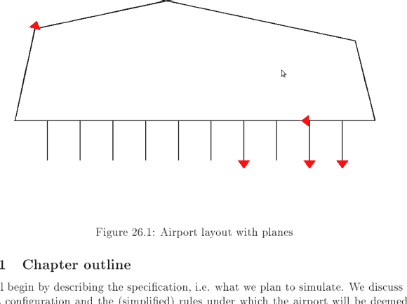

图26.1：带有飞机的机场布局图

### 26.0.1 本章概要

我们将首先描述规范，即我们计划模拟什么。我们讨论机场配置以及机场据以运行的（简化）规则。然后我们给出实现。在模拟机场等复杂系统时，一个重要的问题是死锁。我们将讨论如何在现实生活和程序中处理死锁。

该模拟的代码在simplecpp发行版中提供，位于simplecpp/demos/airport。图26.1是其执行时的快照。

### 26.1 模拟模型

编写一个能够模拟具有任意数量跑道、滑行道、登机口等的机场的模拟器是可能的。然而，为简单起见，我们将考虑图26.1所示的特定机场配置。

在图中，顶部两条交叉的线是跑道。其他线是滑行道。靠近底部的长水平线是主滑行道，两侧接近垂直的线段我们将分别称为左侧滑行道和右侧滑行道。主滑行道有通往登机口的分支。我们没有显示登机口，但它们应该存在于这些短分支的末端。因此，在这个机场中应该有10个登机口，我们将它们从右到左编号为0到9。小三角形代表飞机。如你所见，有三架飞机在登机口0、1和3处等待，另外三架在跑道和滑行道上。如果忽略分支滑行道，跑道和其他滑行道构成一条单一的长路径，从左上角开始，顺时针绕过后在右上角结束。我们将这称为主路径。事实上，为简单起见，我们将要求主路径按顺时针方向使用。因此，从顶部开始的跑道是降落跑道，在右上角结束的跑道是起飞跑道。通往登机口的分支滑行道则预期在两个方向上使用。

我们的配置相当简单，除了交叉的跑道之外。顺便说一下，交叉跑道并不罕见——事实上，孟买机场就有交叉跑道，这也是我们将其纳入模拟的灵感来源。当然，孟买的两条跑道都可以用于起飞和降落，而且其滑行道和登机口布局也更加复杂。

### 26.1.1 整体运行

在高层次上，机场的运作可以描述如下：每架飞机降落并滑行到登机口，然后在登机口等待一定的服务时间，之后滑行到跑道并起飞。整个过程必须由机场当局控制，以确保安全和效率。

### 26.1.2 安全运行与半跑道互斥

安全要求的要旨是：应规划飞机的移动，以确保飞机在任何时候都彼此保持足够的间距。即使在滑行时也需要一定的最小间距。当飞机以高速行驶时（例如在起飞和降落时），飞机之间的间距必须更大。间距可能取决于飞机的类型/尺寸。为简单起见，我们将假设只有一种类型的飞机，并忽略这个问题。

更正式地说，我们将安全要求建模如下：我们将跑道和滑行道分成若干段，并要求每段上在任何时候最多只有一架飞机。因此，通过选择足够长的段，我们可以使飞机之间保持良好的间距。以下是我们将使用的分段方式：两条跑道各自作为独立的段，左侧和右侧滑行道也是如此。主滑行道在其分支滑行道离开的位置处被分成若干段。由于有10个登机口，主水平滑行道将被分成11段。分支滑行道本身构成独立的段。

由于我们的两条跑道重叠，因此还有一个额外的复杂性。确保安全运行的最简单方法是规定在任何时候只能使用两条跑道中的一条。然而，为了使问题更有趣且更贴近现实，我们将注意到交叉点位于跑道的初始部分，因此我们将要求跑道的初始半段不应同时使用。换句话说，我们将要求：如果起飞跑道的初始半段上有飞机，那么降落跑道的初始半段上就不能有飞机，反之亦然。我们将此称为半跑道互斥。


## 26.1.3 调度策略

飞机在机场降落、起飞乃至在地面滑行的确切调度时间由机场空中交通管制员决定。他们必须遵守安全运行规则，并解决冲突请求。例如，如果两架飞机同时请求使用跑道（无论是起飞还是降落），则只能批准一架。这个决定必须由空中交通管制员做出。这些决定将为实现某些目标而制定，例如，尽量减少平均延误，或某种加权平均延误，其中权重是不同飞机的优先级。

我们将假设空中交通管制员采用一种非常简单的先到先服务调度策略。基本上，每架飞机在准备好执行某项操作时，便立即向管制员请求执行该操作的许可。如果多架飞机请求执行需要共用资源（例如跑道）的操作，则允许最早请求的飞机执行，其他飞机必须等待。当然，许多其他策略也是可能的。例如，我们可能决定给予降落比起飞更高的优先级，因为飞机在地面等待比在空中等待更容易！¹这一点将在练习中探讨。

## 26.1.4 停机位分配

飞机到达后，必须为其分配一个停机位以供其等待。通常，每架飞机可能有自己偏好的停机位。为简化起见，我们将假设所有飞机都可以在任意停机位等待，并分配编号最小的空闲停机位。

停机位可以在飞机进入机场后的任何时间分配。为了明确起见，我们将假设停机位分配必须在飞机即将从右侧滑行道转入主滑行道时完成。

## 26.1.5 模拟器输入与输出

模拟器的输入包含每架到达飞机的两个数字：到达时间和服务时间，即飞机需要在停机位等待的时间长度。模拟需要知道飞机穿越跑道和滑行道所需时间的信息，但我们将这部分视为程序的一部分。

模拟器的主要输出为：(a) 飞机进入机场、滑行至停机位、按要求时间停留、然后起飞离开的动画；(b) 这些事件发生时间的文本记录。在设计动画时，我们需要决定展示机场状态的频率。是每秒展示一次、每分钟展示一次，还是只在发生有趣事件（例如飞机到达、离开或停在停机位）时展示？为简化起见，我们将假设每隔一个单位时间间隔展示一次状态，无论我们在程序中定义的单位时间是什么。

¹ 飞机必须在其降落时间之前很久就开始下降，一旦开始下降，在正常情况下不能推迟降落。然而，我们的先到先服务策略可能需要延误航班到达。这是我们模拟的一个缺点。

此外，我们可能需要一些派生输出。让我们将飞机的延误定义为：在机场完全空置的情况下，飞机本可以起飞的时间与实际花费的额外时间。因此我们可能需要计算平均延误。此类分析和扩展留待练习中完成。

## 26.2 实现概述

我们将使用第25章开发的`sim`类构建一个离散事件模拟。该章开发的`Resource`类也将有用。

机场系统的状态可以用不同飞机在不同滑行道（或停机位）上的位置来描述。因此，这些实体似乎必须以某种方式在我们的模拟中表示。所以我们将有一个`taxiway`类和一个`plane`类。此外，我们还将有一个`ATC`类来表示空中交通管制员。空中交通管制员执行诸如为飞机分配停机位，甚至允许飞机从一个航段移动到另一个航段等操作。这些控制操作将在`ATC`类的成员函数中实现。`plane`类基本上包含在需要时使飞机前进的代码。

### 26.2.1 安全操作和半跑道互斥

我们需要确保在任何时刻，任何滑行道航段上至多有一架飞机。因此，自然要使用第25章的`Resource`类。我们将使每个滑行道航段成为一个资源，飞机在进入该航段之前必须先获取它。这将确保每个航段上至多有一架飞机。

为了实现半跑道互斥，我们将使用以下技巧。每当飞机需要降落或起飞时，我们要求它除了分别保留降落或起飞跑道外，还必须保留一个虚构的`halfRW`滑行道。飞机降落后并滑行过半条跑道时，我们希望允许另一架飞机开始起飞。为此，我们只要在飞机到达降落跑道中间时就释放`halfRW`！起飞中的飞机也是如此——当它到达起飞跑道中间时，也会释放`halfRW`。

### 26.2.2 停机位表示与分配

我们用分支滑行道G隐式表示停机位G。事实上，当飞机需要在停机位G等待时，它就停在分支滑行道G的底端。此外，当我们想将停机位G分配给一架飞机时，只需保留分支滑行道G。这样我们可以确保任何时刻一个停机位只被一架飞机使用。

要分配停机位，我们只需检查所有分支滑行道，确定是否有空闲的，如果有就将其保留。然后飞机滑行到该分支滑行道的末端并等待。在为该飞机设定的服务时间结束后，飞机掉头返回主滑行道。就在飞机即将转入主滑行道时，它释放对分支滑行道的保留。之后，其他飞机就可以使用这个停机位了。

## 26.3 主程序与数据结构

第一个主要数据结构是所有滑行道航段和用于实现半互斥规则的虚构滑行道`halfRW`的向量。虽然我们模拟一个有10个停机位的机场，但用参数`nGates = 10`来表达创建过程更方便。你会看到我们需要`3*nGates + 6`个滑行道航段，包括`halfRW`。此外，我们将使用类型为`ATC`的空中交通管制员对象`atc`。代表飞机的对象在飞机到达机场时动态创建。主程序如下。

```
const int nGates = 10, nSegments = 6+3*nGates;

int main(int argc, char** argv){
initCanvas("Airport Simulator",1000,1000);
vector<taxiway*> taxiways(nSegments);      // including halfRW

configure_taxiways_and_runways(taxiways);   // creates all taxiways
ATC atc(taxiways);
ifstream planeDataFile(argv[1]);
post_plane_arrivals(atc, planeDataFile);

sim::processAll();
getClick();
}
```

函数`configure_taxiways_and_runways`用滑行道航段填充数组`taxiways`。我们将在下一节讨论这个函数，该节也会详细讨论`taxiway`类。之后，主程序创建一个对象`atc`来表示空中交通管制员。最后，函数`post_plane_arrivals`创建飞机到达事件。之后调用`sim::processAll`，模拟便展开了。

函数`post_plane_arrivals`从文件中获取飞机数据，该文件需要作为主程序的第一个命令行参数提供。创建的事件将调用`atc`的`processArrival`成员函数。该调用将创建飞机对象。`plane`类将在后面讨论。

```
void post_plane_arrivals(ATC &atc, ifstream &planeDataFile){
int arrivalT, serviceT;
while(planeDataFile >> arrivalT){
planeDataFile >> serviceT;
sim::post(arrivalT, [&, &atc](){atc.processArrival(arrivalT, serviceT);});
}
}
```

## 26.4 滑行道类

`taxiway`类的实例必须服务于两个目的：它们必须在屏幕上作为线条可见，并且飞机必须能够保留它们。因此，从上一章的`Line`类和`Resource`类派生出`taxiway`类是很自然的。


```cpp
class taxiway : public Line, public Resource{
public:
  int traversalT;        // time needed to traverse the taxiway
  double stepsize;       // distance covered per time step
  taxiway(float xa, float ya, float xb, float yb, int trT)
    : Line(xa,ya,xb,yb), traversalT(trT),
      stepsize(sqrt(pow(xa-xb,2)+pow(ya-yb,2))/traversalT) {}
};
```

taxiway构造函数首先在屏幕上创建代表滑行道的Line对象。理想情况下，我们应该将屏幕上的线与真实的滑行道区分开，并单独提供真实滑行道的详细信息。为了简单起见，我们假设屏幕上的滑行道和真实的滑行道在屏幕和地面上具有相同的坐标（比如单位已被方便地选定）。在构造滑行道时，我们还需要提供以某种假设时间单位穿越它所需的时间。由于我们知道滑行道的长度，因此可以计算出飞机在该滑行道上每（假设的）时间步前进多少距离——执行动画需要此信息。

注意，Resource构造函数没有被显式调用，因此编译器将插入一个无参数调用。这会将滑行道的成员inUse（派生自Resource，第25.3节）设置为NULL，表明最初该滑行道是未被预留的。

函数configure_taxiways_and_runways将实例化滑行道以创建主路径和分支滑行道。如前所述，构造过程使用常量nGates = 10来表示登机口的数量。数组gates的前nGates+5个元素分别表示着陆跑道、右侧滑行道、主滑行道的nGates+1个航段、左侧滑行道和起飞跑道（图26.2）。接下来的nGates个元素将表示通往登机口的分支滑行道，再接下来的nGates个元素将表示从登机口返回的分支滑行道。然后我们还有一个航段，表示虚构的滑行道halfRW。

```cpp
void configure_taxiways_and_runways(vector<taxiway*>& taxiways){
  taxiways[0] = new taxiway(RW1X1,RW1Y1,RW1X2,RW1Y2,tRW); // landing runway
  taxiways[1] = new taxiway(RW1X2,RW1Y2,TWX1,TWY1,tWT);   // right taxiway

  float twXdisp = ((float)TWX2-TWX1)/(nGates+1);
  float twYdisp = ((float)TWY2-TWY1)/(nGates+1);

  for(int i=0; i<=nGates; ++i){                 // main taxiway: 11 segments
    taxiways[2+i] = new taxiway(int(TWX1+i*twXdisp), int(TWY1+i*twYdisp),
                                int(TWX1+(i+1)*twXdisp),
                                int(TWY1+(i+1)*twYdisp), tMT);
  }
}
```

```
taxiways[3+nGates] = new taxiway(TWX2,TWY2,RW2X1,RW2Y1,tVT); // left taxiway
taxiways[4+nGates] = new taxiway(RW2X1,RW2Y1,RW2X2,RW2Y2,tRW); // takeoff runway
```

```
for(int i=0; i<nGates; ++i){ // branch to gate
    taxiways[5+nGates+i] = new taxiway(int(TWX1+(i+1)*twXdisp),
        int(TWY1+(i+1)*twYdisp),
        int(TWX1+(i+1)*twXdisp), TWYT, tBT);
}
```

```
for(int i=0; i<nGates; ++i){ // branch from gate
    taxiways[5+2*nGates+i] = new taxiway(int(TWX1+(i+1)*twXdisp), TWYT,
        int(TWX1+(i+1)*twXdisp),
        int(TWY1+(i+1)*twYdisp), tBT);
}
```

```
taxiways[5+3*nGates] = new taxiway(0,0,0,0,0); // halfRW
}
```

为了方便，定义以下常量。

```
const int toGates = 5+nGates, fromGates = 5+2*nGates, halfRW = 5 + 3*nGates;
    landing = 0, rightTaxiway = 1,
    leftTaxiway = toGates-2, takeOff = toGates-1;
```

滑行道的编号与登机口的编号关系如图26.2所示。我们将通往登机口的滑行道和从登机口返回的滑行道画成不同的线，这仅仅是为了绘图方便；实际上它们是重合的。

## 26.5 ATC类

ATC类的实例atc代表空中交通管制员。atc控制飞机的移动，从处理飞机到达（在此过程中创建飞机对象）开始。该类包含成员函数processArrival、grantClearance和allocateGate来执行这些操作。

```cpp
class ATC{
vector<taxiway*> &taxiways;
int planeId; // to number planes as they get generated
public:
ATC(vector<taxiway*> &tw) : taxiways(tw), planeId(0) {}
void processArrival(int arrivalT, int serviceT);
void grantClearance(plane *p, int segment, int &gate);
void allocateGate(plane* p, int segment, int &gate);
};
```

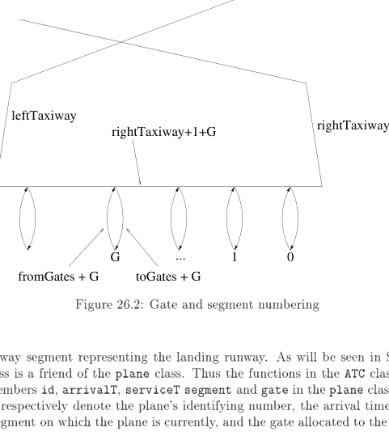

图26.2：登机口和航段编号

在代表着陆跑道的滑行道航段上。正如将在26.6节中看到的，ATC类是plane类的友元。因此，ATC类中的函数可以访问plane类中的数据成员id、arrivalT、serviceT、segment和gate。稍后可以看到，这些分别表示飞机的标识号、到达时间、服务时间、飞机当前所在的航段，以及分配给飞机的登机口（如果有的话）。

```cpp
void ATC::processArrival(int arrivalT, int serviceT){
    plane *p = new plane(++planeId, arrivalT, serviceT, taxiways, *this);
    taxiways[landing]->acquire([=](){
        taxiways[halfRW]->acquire([=](){
            sim::log() << "Plane " << p->id << " lands. scheduled arrival " << p->arrivalT << ", Service time " << p->serviceT << endl;
            p->show();  // make the plane visible on the screen
            p->prepareToMove(landing);
        });
    });
}
```

飞机在单个滑行道航段上的移动由plane类中的函数prepareToMove和moveOnSegment实现。在移动过程中，当飞机到达滑行道航段的末端时，它需要从atc那里知道下一步要移动到哪个航段（例如，是否转入分支滑行道），并请求预留该航段。为此，飞机将调用ATC的grantClearance成员函数。grantClearance完成工作后，飞机就准备好移动，因此可以再次调用plane::prepareToMove。

函数grantClearance根据飞机的位置（即飞机当前所在的航段）以及飞机被分配到的登机口，决定下一步将飞机引导到何处，以及为其预留哪些资源。

```cpp
void ATC::grantClearance(plane *p){
    if(p->segment == rightTaxiway)
        allocateGate(p);
    else if(p->segment == rightTaxiway + 1 + p->gate){
        taxiways[p->segment]->release();
        p->prepareToMove(toGates + p->gate);
    }
    else if(p->segment == toGates + p->gate){
        sim::log() << " Plane " << p->id << " at gate " << p->gate << " will wait for " << p->serviceT << endl;
        sim::post(p->serviceT, [=](){
            // wait for service
            p->prepareToMove(fromGates + p->gate);
        });
    }
    else if(p->segment == fromGates + p->gate){
        taxiways[rightTaxiway + 2 + p->gate]->acquire([=](){
            taxiways[toGates + p->gate]->release();
            p->prepareToMove(rightTaxiway + 2 + p->gate);
        });
    }
    else if(p->segment == leftTaxiway){
        taxiways[takeOff]->acquire([=](){
            taxiways[halfRW]->acquire([=](){
                taxiways[leftTaxiway]->release();
                p->prepareToMove(takeOff);
            });
        });
    }
    else if(p->segment == takeOff){
        taxiways[takeOff]->release();
        p->hide();
        sim::log() << " plane " << p->id << " left." << endl;
        delete p;
    }
    else {
        // default case
        taxiways[p->segment+1]->acquire([=](){
            taxiways[p->segment]->release();
            p->prepareToMove(p->segment+1);
        });
    }
}
```

如果p->segment等于rightTaxiway，则飞机位于右侧滑行道的末端。因此必须为其预留一个登机口。如前所述，预留登机口G相当于预留通往登机口G的分支滑行道，即滑行道toGate + G（第26.2.2节，另见图26.2）。这由函数allocateGate完成，我们稍后将讨论该函数。登机口分配完成后，allocateGate将通知飞机向前移动。

如果p->segment等于rightTaxiway + 1 + p->gate，则我们知道飞机已经过了主滑行道的1 + p->gate个航段，因此正处于转向分配给它的登机口的正确位置（图26.2）。此外，滑行道航段toGate + p->gate已经为其预留。因此，它可以释放当前所在的航段，并开始在航段toGate + p->gate上移动。

如果p->segment等于toGate + p->gate，则我们知道飞机位于分支滑行道的末端。在这里，它必须等待规定的服务时间，即p->serviceT。之后，它可以开始在返回滑行道的航段（即fromGate + p->gate航段）上移动。

如果p->segment等于fromGate + p->gate，则我们知道飞机在登机口等待后已返回主滑行道。因此，现在我们必须获取主滑行道的下一个航段，即rightTaxiway + 2 + p->gate航段。之后，我们必须释放登机口，即toGate + p->gate航段，以便其他飞机可以使用该登机口。然后，我们可以开始在rightTaxiway + 2 + p->gate航段上移动。

如果p->segment等于leftTaxiway，则飞机即将起飞。因此我们必须预留起飞跑道和halfRW。之后，我们释放左侧滑行道，然后可以开始在起飞跑道上移动。

如果p->segment等于takeOff，则飞机已完成起飞。因此，我们现在必须将其隐藏，并回收分配给它的内存。

如果p->segment不等于上述任何值，则无需特殊操作。飞机只需要移动到下一个航段，该航段必须为其预留。然后，飞机当前所在的航段必须被释放。接着，飞机被要求移动到已预留的航段。这就是grantClearance底部的默认情况。

最后，我们讨论函数allocateGate。

```cpp
void ATC::allocateGate(plane* p){
    p->gate = -1;                         // means not allocated.
    for(int i=0;i<nGates;++i){
        if (taxiways[toGates + i]->reserve()){
            p->gate = i;
            break;
        }
    }
    if(p->gate >= 0)                      // if gate allocation succeeded
        taxiways[p->segment+1]->acquire([=](){
            taxiways[p->segment]->release();
            p->prepareToMove(p->segment+1);
        });
    else
        sim::post(1,[=](){allocateGate(p);});  // else try again
}
```


The gate allocation procedure as discussed earlier is simple: we reserve the smallest numbered unreserved gate. If reservation is successful, then we try to move forward. For this, we acquire the next segment. When that is acquired, we release the current segment, and then try to move on the new segment. If gate reservation is not successful, then we try reservation again after one step.

## 26.6 The plane class

The aircraft are implemented using a plane class. An aircraft must appear on the screen as a part of the animation. So we inherit from the Turtle class. Indeed, our aircraft appear on the screen as turtles. We could have defined a more aircraft like visual appearance by using the polygon class, but that is left for the exercises. To keep track of which taxiway segment the plane is on at any time instant we will have a data member segment. We will have another data member timeToSegmentEnd, in which we keep track of the number of steps we need to move forward in order to reach the end of the current segment. In addition, we need to note the gate allocated for the aircraft. For this we use an integer data member gate. Finally, the plane will need to know about the taxiways and the atc, so we have data members to hold those references.

```
class plane : public Turtle {
public:
    int id;                 // identifying number for plane
    int arrivalT;           // arrival time
    int serviceT;           // how long the aircraft waits at the gate
    int segment;            // index of taxiway segment the aircraft is on
    int timeToSegmentEnd;   // how far from the end of the segment
    int gate;               // id of allocated gate
    vector<taxiway*> &taxiways;
    ATC &atc;
public:
    plane(int i, int at, int st, vector<taxiway*> &tw, ATC &atc0)
        : id(i), arrivalT(at), serviceT(st), taxiways(tw), atc(atc0) {
        hide();
        penUp();
        gate = -1;          // indicates gate not allocated
    }
    void prepareToMove(int newsegment);
    void moveOnSegment();
    friend class ATC;
};
```

Note that we have made the ATC class a friend because it needs to know where a plane is etc. A plane is created in the ATC class as discussed earlier.

The basic action performed by a plane is moving on a taxiway. When the atc determines that a plane must move on certain segment of the taxiway, it calls the prepareToMove

member function of the plane class. This does minor housekeeping and aligns the plane with the direction of the taxiway. The data member timeToSegmentEnd is also set to the number of steps in which the current segment is to be traversed. After that the plane is ready to move.

```
void plane::prepareToMove(int newSegment){
    segment = newSegment;
    Position linestart = taxiways[segment]->getStart();
    moveTo(linestart.getX(), linestart.getY());
    Position lineend = taxiways[segment]->getEnd();
    face(lineend.getX(), lineend.getY());
    timeToSegmentEnd = taxiways[segment]->traversalT;
    sim::post(0, [=](){this->moveOnSegment();});
}
```

At the end, the moveOnSegment member function is called. This causes the plane to take one step on the segment taxiway. To traverse the entire segment, the function is called repeatedly, for each value of timeToSegmentEnd as it is decremented down to 0. At the end, the plane has reached the end of the segment, and so clearance must be sought from the air traffic controllers for future action. So atc.grantClearance is called.

There is one slight complication to be handled: when the plane is taking off or landing, then the taxiway halfRW must be released when the plane has reached the middle of the segment.

```
void plane::moveOnSegment(){
    if(timeToSegmentEnd != 0){
        if((segment == landing || segment == takeOff)
           && timeToSegmentEnd == taxiways[segment]->traversalT/2){
            taxiways[halfRW]->release();
        }
        forward(taxiways[segment]->stepsize);
        --timeToSegmentEnd;
        sim::post(1, [=](){moveOnSegment();});
    }
    else
        atc.grantClearance(this);
}
```

## 26.7 Deadlocks

A deadlock is a technical term used to describe a system in which one entity e₁ is waiting to reserve a resource held by entity e₂ which in turn is waiting to reserve a resource held by and entity e₃ and so on, till some entity eₙ in this sequence is waiting to reserve a resource held by e₁. Notice that in this case no entity can make progress, because all are waiting for each other. As an example, Figure 26.7 shows cars deadlocked on roads in a city. Note that the roads are one ways, as shown. The cars in the top road are waiting for the space ahead

of them to become empty. This will happen if the cars in the right road can move down. But these can move down if the cars in the bottom road can move left. These in turn will move left only if the cars in the left road can move. But these are blocked because of the cars in the top row. The net result: no one can move. Deadlock.

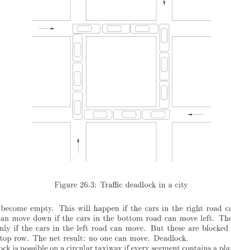

Figure 26.3: Traffic deadlock in a city

A deadlock is possible on a circular taxiway if every segment contains a plane which wants to move forward. In our airport it would seem that the taxiways do not form a circular path. However we have to be careful in implementing the half-runway-exclusion rule.

It turns out that deadlocks will not arise because we observe the following discipline in reserving halfRW. A landing aircraft must first reserve the landing runway and only then halfRW. Similarly a plane taking off must first reserve the takeoff runway and only then halfRW. You can see that this is a good strategy: halfRW being a precious resource must be reserved last. If a plane reserves halfRW and cannot reserve the landing runway, then it prevents take offs unnecessarily until such time as it reserves the landing runway. More formally, as the exercise asks you, you should be able to prove that if this policy is used there can be no deadlock. On the other hand, if landing planes as well as planes taking off reserve halfRW first, then it is possible to create a deadlock by carefully constructing the arrival sequence of the planes. The exercises invite you to explore this possibility.

## 26.8 Concluding remarks

There are many ways in which we could have designed this program. For example, note that the class ATC does not contain any interesting data members. Thus you might choose not

to have this class at all and instead include the member functions from this class into the plane class itself. This would simplify the code a bit; you could directly access the members in plane in writing functions such as ATC::processArrival. However, we have preferred to have two classes because we felt it is better to put air traffic control actions in an ATC class.

Another possibility is to not use the sim and Resource classes at all. Write the code from the point of view of the air traffic controllers who examine the planes at each step and advance them as needed. You are asked to do this in an exercise.

## Exercises

- 1. Modify the simulation program to print out the average aircraft delay.
- 2. Define a better plane class in which the on screen image looks like an aircraft rather than a triangle.
- 3. Suppose we wish to ensure that as much as possible, an aircraft must land at its arrival time. Thus, while granting halfRW to a departing plane, we must check whether no plane will want to land during the interval in which the departing plane will use halfRW. Device a good mechanism to do this. Hint: perhaps you can reserve the landing runway and halfRW a bit earlier than needed?
- 4. The program given in the text uses so called busy waiting to allocate gates, i.e. if a gate is not currently available, the plane retries after 1 step. It will be more efficient if the plane can await the release of any gate. Develop a class to represent such a resource group. A resource group models a sequence of objects, each of which can be either reserved or unreserved. On a reserve request, one of the unreserved objects must be allocated, i.e. the requesting entity should be set as its owner. If all objects are currenly reserved, then the reserve request is deemed to fail and should thus return false. In that case the entity may await its release. When any of the objects becomes available, that should get reserved for the waiting entity. Use this in the simulation code.
- 5. Show that our strategy of reserving resources ensures that there is no deadlock. Specifically, show that at every step some aircraft will make progress, and that there will not exist entities e0,...,en−1 where ei is waiting for a resource currently held by entity ei+1 mod n.
- 6. Suppose we reserve halfRW first and then the take off or landing runways. Construct an input sequence (the file arrivals.txt) such that there is a deadlock.
- 7. Perform the airport simulation without using the sim and Resource classes, as described in Section 26.8. Do you think this will run faster than the simulation we have presented, or slower? What if there is no need to produce a graphical output, i.e. only a textual record is required?
- 8. Suppose we do not want to divide the taxiway into segments. Instead, suppose we will allow a plane to move a certain stepsize at each step while keeping a certain safe


distance behind the plane ahead, if any. Implement this. The other rules must still be followed, i.e. the half-runway-exclusion rule and the rule that there can be at most one aircraft on each runway at any instant. Also, there can be only one aircraft on any branch taxiway.

9. Simulate an airport with 2 runways that do not intersect. Assume the same traffic as that for an airport with intersecting runways. Define the delay of an aircraft as the actual time it spends on the airport less the time it would spend if no other aircraft was present in the airport. Compute the total delay for all aircraft in both models. Increase the traffic i.e. arrivals per unit time and see how the total delay changes for the intersecting and non-intersecting runways.

10. If an aircraft is not allowed to land when it arrives at the airport, it must fly in a circular path of total duration some T and then try again. This is a more realistic model than what we have in the text. Simulate this model.

11. Consider the shortest path algorithm of Section 25.4. Suppose that we are also given the geometric coordinates for each vertex of the graph. Show a visual simulation of the algorithm, i.e. a turtle should move along each edge as if it were a cyclist.

## Chapter 27

## Non-linear simultaneous equations

Suppose you want to construct a parallelepiped box of volume 1010 cm³, surface area 700 cm² and having a base whose diagonal is 22 cm. What are the lengths of the sides of the box? If u₁, u₂, u₃ denote the side lengths in cm, clearly we have u₁u₂u₃ = 1010, 2(u₁u₂ + u₂u₃ + u₃u₁) = 700 and u₁² + u₂² = 22². We have 3 equations in 3 unknowns, but unfortunately these equations are non-linear! In Section ?? we saw how to solve linear simultaneous equations, but this problem is much more difficult. Indeed it is fair to say that solving non-linear simultaneous equations is bit of an art. While, there is no single guaranteed method for solving non-linear equations in many variables, there are some strategies which seem to often work. Once such strategy is the Newton-Raphson method (NRM). We have already studied NRM in Section 8.4 for the one dimensional case. Its generalization to multiple dimensions is precisely what we need and we will study it in this chapter.

After studying NRM for multiple dimensions, we will consider a more elaborate problem: given a chain of links of different lengths, compute the configuration in which it hangs if suspended from some fixed pegs. We will see that NRM solves this problem nicely.

The exercises give more applications of NRM in multiple dimensions.

### 27.1 Newton-Raphson method in many dimensions

In one dimension, NRM is used to find the root of a function f of one variable, i.e. find u such that f(u) = 0. The higher dimensional case is a natural generalization. We are now given n functions f₁, ..., fₙ each of n variables, and we want to find their common root, i.e. a set values u₁, ..., uₙ such that fᵢ(u₁, ..., uₙ) = 0 for all i.

As you might see, this is really the same as solving simultaneous, possibly non-linear equations. Any equation in n unknowns can be written so that the right hand side is 0, but then we can treat what is on the left hand side as a function of the unknowns. Indeed, our equations for the box problem can be stated in this form as follows:

f₁(u₁, u₂, u₃) = u₁u₂u₃ − 1010 = 0  (27.1)
f₂(u₁, u₂, u₃) = 2(u₁u₂ + u₂u₃ + u₃u₁) − 700 = 0  (27.2)
f₃(u₁, u₂, u₃) = u₁² + u₂² − 484 = 0  (27.3)

Indeed the common root u = (u₁, u₂, u₃), of f₁, f₂, f₃ will precisely give us the side lengths of the box we want to construct.

An important point to be noted is that each function f_i can be thought of as the error for the corresponding equation. Our goal in solving the equations is to make the error zero. Note that in this interpretation the errors can be positive or negative.

As in one dimension, NRM in many dimensions proceeds iteratively. In each iteration, we have our current guess for the values of the unknowns. We then try to find by how much each unknown should change, so that we (hopefully) get closer to the root. We then make the required change in the unknowns, and that becomes our next guess. We check if we our new values are close enough to the (common) root. If so, we stop. Otherwise we repeat. We will use u1, ..., un to denote the unknowns. Let their current values be u1cur, ..., uncur. Our goal is to determine what increments Δu1, ..., Δun to add to these values so as to get our next guess u1next, ..., unnext.

We will use our box problem as a running example for explaining the method. Suppose for this problem we have guessed u1cur = 20, u2cur = 10 and u3cur = 5. Then we have f1(u1cur, u2cur, u3cur) = −10, f2(u1cur, u2cur, u3cur) = −0, f3(u1cur, u2cur, u3cur) = 16.

For a minute consider that we only want to make f1 become 0, and we only can change u1. Now this is simply the one dimensional case. If we make a small increment Δu1 in u1, we know that f1 will change in proportion to Δu1 and the derivative of f1 with respect to u1. Actually, since f1 is a function of many variables, all of which we are keeping fixed except for u1, we should really say, "the partial derivative of f1 with respect to u1". Thus the (additive) change Δf1 in f1 will be approximately ∂f1/∂u1 Δu1. Further, the partial derivative must be evaluated at the current values, so we will write:

Δf1 ≈ ∂f1/∂u1|cur Δu1 (27.4)

But we want f1next = f1cur + Δf1 to become zero, so perhaps we should choose Δf1 = −f1cur = 10. Further, we know that ∂f1/∂u1|cur = u2u3|cur = 50. Thus we have:

10 ≈ 50Δu1

So we indeed choose Δu1 = 10/50 = 0.2. The new value of u1 becomes 20+0.2=20.2, and the new value of f1 becomes 20.2 × 10 × 5 − 1010 = 0. In this case, the error in the first equation has completely vanished. Things will not be this good in general, but as you might remember from Section 8.4 that we can expect f1 to get closer to 0 than it was.

But of course, nothing really forces us to only change u1. Thus, if we were allowed to vary all the variables, then equation 27.4 generalizes as.1

> 1 Think about changing u1 first, and then u2 and so on. Initially we are at (u1cur, u2cur, u3cur). After changing u1 by getting to the point which we will call (u1cur', u2cur', u3cur'). In this movement, we have changed f1 by about ∂f1/∂u1|cur Δu1. From the new point we change u2 by Δu2. The change that this causes in f1 is about ∂f1/∂u2|cur' Δu2 total change in f1 is approximately ∂f1/∂u1|cur Δu1 + ∂f1/∂u2|cur' Δu2 But the values at cur and cur' are nearly the same, assuming Δu1, Δu2 are small.

Δf₁ ≈ ∂f₁/∂u₁|_cur Δu₁ + ∂f₁/∂u₂|_cur Δu₂ + ∂f₁/∂u₃|_cur Δu₃ (27.5)

Again, we want Δf₁ = −f₁cur, and try to pick Δu₁, Δu₂, Δu₃ to satisfy

−f₁cur = ∂f₁/∂u₁|_cur Δu₁ + ∂f₁/∂u₂|_cur Δu₂ + ∂f₁/∂u₃|_cur Δu₃ (27.6)

In a similar manner we will require the following as well.

−f₂cur = ∂f₂/∂u₁|_cur Δu₁ + ∂f₂/∂u₂|_cur Δu₂ + ∂f₂/∂u₃|_cur Δu₃ (27.7)

and

−f₃cur = ∂f₃/∂u₁|_cur Δu₁ + ∂f₃/∂u₂|_cur Δu₂ + ∂f₃/∂u₃|_cur Δu₃ (27.8)

Notice now that Δu₁, Δu₂, Δu₃ are the only unknowns in Equations (27.6,27.7,27.8), and in these variables the equations are linear! Thus we can solve them. Evaluating the current values of the functions and the partial derivatives we get:

10 = 50Δu₁ + 100Δu₂ + 200Δu₃ (27.9)

0 = 30Δu₁ + 50Δu₂ + 60Δu₃ (27.10)

16 = 40Δu₁ + 20Δu₂ (27.11)

Solving this we get (Δu₁, Δu₂, Δu₃) = (−0.52, 0.24, 0.06). So we have (u₁next, u₂next, u₃next = (19.48, 10.24, 5.06). For these values we see that (f₁, f₂, f₃) = (0.655554, 0.283244, −0.327963), which taken together are much closer to zero than (10, 0, 16).

### 27.1.1 The general case

In general we will have n equations:

−fᵢ(u₁cur, …, uₙcur) = Σⱼ ∂fᵢ/∂uⱼ|_cur Δuⱼ (27.12)

We solve these to get (Δu₁, …, Δuₙ), and from these we can calculate uⱼnext = uⱼcur + Δuⱼ, for all j.

It is customary to consider the above equations in matrix form. Define an n × n matrix A in which aᵢⱼ = ∂fᵢ/∂uⱼ|_cur Δuⱼ. Define an n element vector b where bᵢ = −fᵢ(u₁cur, …, uₙcur). Let Δu denote the vector of unknowns (Δu₁, …, Δuₙ). Then the above expressions can be written in the form

A(Δu) = b

in which A, b are known and we solve for Δu. The matrix A is said to be the Jacobian matrix for the problem. Further, it is customary to define vectors u_cur = (u₁cur, …, uₙcur) and u_next = (u₁next, …, uₙnext). Then our next guess computation is simply:

u_next = u_cur + Δu

Next we comment on when we should terminate the procedure, and how to make the first guess.


### 27.1.2 终止

当所有 f_i 都接近零时，我们应该终止算法。一种标准做法是要求 √(f_1² + ⋯ + f_n²) 小于我们选取的某个 ε，例如如果我们使用 `float`，则取 ε = 10⁻⁷；如果使用 `double` 表示数字，则取更小的值。按照我们把 f_i 解释为误差的观点，(f_1, …, f_n) 是误差向量，而 √(f_1² + ⋯ + f_n²) 是误差向量的 2-范数，即欧几里得长度。

### 27.1.3 初始猜测

为算法找到一个好的起始猜测是棘手的。在一维情形下，我们可以粗略地画出函数图像，并寻找一个离根足够近的点。在多维情形下，这就困难得多。

如果我们已经接近根，牛顿方法的表现会非常好。这是因为在非常接近根的地方，像方程 (27.6) 这样的等式会变得非常精确。一个思路是尝试近似地满足这些方程。通常只满足其中一部分方程就够了。例如，我们发现对于箱子问题，起始猜测 (u_1, u_2, u_3) = (9, 10, 11) 效果很好。注意，这些数非常接近地满足方程 27.1。

另一方面，初始猜测 (1, 2, 3) 的效果很糟糕：它产生了“答案”(2.2659, -21.883, -20.3692)。注意，这个答案也紧密满足方程，但显然边长不可能是负数！这指出了非线性方程的另一个特点：可能存在多个根。你的迭代过程不一定能把你带到正确的那个根。

在下一节中，我们还会进一步讨论这一点。

## 27.2 项链如何悬挂

假设有一条由 n 个链环组成的链子，其中第 i 个链环的长度为 L_i，i = 0, …, n − 1。已知链子挂在点 (x_0, y_0) 和 (x_n, y_n) 的钉子上。当链子以这种方式悬挂并静止时，它会呈现什么形状？链环的长度不必相等。

### 27.2.1 公式化

如果一个物体对另一个物体施加力 F，那么后者会对前者施加力 −F。因此，每个链环 i 的左端点受到力 F_i，右端点受到力 −F_{i+1}。此外，还有它的重量 W_i，也是一个向量，作用在其中心。当链子静止时，每个链环上的总力必须为零，总力矩也必须为零。

因此对每个链环有 F_i − F_{i+1} + W_i = 0。假设 F_i = (h_i, v_i)，即 h_i 和 v_i 是 F_i 的水平分量和垂直分量。因为 W_i 只有垂直方向，我们可以写成 W_i = (0, w_i)。重量向下作用，所以也许我们应该把 y 分量写成 −w_i。但请注意，在图形屏幕的坐标系中，y 是向下增大的。因此我们不需要负号。进一步，我们假设重量与长度成正比，因此写成 w_i = L_i。现在平衡水平分量，得到 h_i − h_{i+1} = 0，也就是说所有这些变量都相同！因此我们可以用一个公共变量 h 来代替它们。平衡垂直分量，对所有 i 有：

v_i − v_{i+1} + L_i = 0   (27.14)

最后我们还需要平衡力矩。为此，我们需要把右端点视为中心。记住，力 F 产生的力矩等于力的大小乘以从中心到力的作用线的垂直距离。F_i 的水平分量产生的力矩就是水平分量乘以水平分量作用线的垂直距离。因此它是 h(y_{i+1} − y_i)。这个力矩是顺时针方向的。垂直分量产生的力矩类似，为 v_i(x_{i+1} − x_i)，但是逆时针方向。重力作用线的距离为 (x_{i+1} − x_i)/2，因此它产生的力矩为 L_i(x_{i+1} − x_i)/2，也是逆时针方向。但总力矩，例如按顺时针方向考虑，必须为零。于是我们得到：

h(y_{i+1} − y_i) − v_i(x_{i+1} − x_i) − L_i(x_{i+1} − x_i)/2 = 0   (27.15)

方程 (27.13)、(27.14) 和 (27.15) 适用于每个链环，因此总共有 3n 个方程。未知量是 x_1, …, x_{n−1}（注意 x_0, x_n 已知），同样还有 y_1, …, y_{n−1}，以及 h 和 v_0, …, v_n。因此总共有 (n − 1) + (n − 1) + 1 + (n + 1) = 3n 个未知量。这样未知量和方程数量匹配；然而，方程 (27.13) 和 (27.15) 不是线性的。所以我们需要使用牛顿–拉弗森方法。

### 27.2.2 初始猜测

对于这个问题，做出一个好的初始猜测至关重要。

要做出好的猜测，我们必须利用我们对解可能是什么样子的“常识”预期。对于项链问题，我们可以预期项链会以“U”形悬挂。因此，大概可以把 (x_i, y_i) 放在一个从钉子间悬挂下来的半圆上。我们还可以安排力的值，使每个链环上的总垂直力为 0。一种做法是计算总重量，并令 v_0 和 v_n 各承担一半。一旦设定好，其他 v_i 的值就可以按方程 (27.14) 设置。水平力 h 一开始可以设为 0。试图平衡力矩则要棘手得多。但事实证明，我们这里概述的初始值足以产生好的答案。

### 27.2.3 经验

我们编写了算法代码，并按照上述猜测策略设置初始值。然后运行算法。每次迭代后，我们都在图形屏幕上绘制项链的形态。如你所见，形态似乎很快达到一个稳定点。事实上，我们还打印了平方误差，它很快就接近零了。

## 27.3 备注

当你试验牛顿–拉弗森方法（NRM）时，可能会注意到误差范数（如 27.1.1 节所定义）不一定在每次迭代中都减小。这是可以理解的：只有当 (27.6) 这样的方程精确成立时，误差范数才保证减小。

不过可以证明，向量 Δu 确实给出了从 u_cur 出发移动的精确方向，沿该方向移动时误差范数的减小速率是最大的。因此存在一个 α，使得在 u_cur + αΔu 处的误差范数严格小于在 u_cur 处的误差范数。我们可以尝试从 α = 1 开始（这相当于走完整的一步，即基本 NRM），然后不断将其减半，直到找到误差范数低于 u_cur 处的点 u_cur + αΔu，从而粗略地找到这个 α。

## 27.4 练习

- 1. 编写程序求解箱子问题。
- 2. 编写程序求解链环问题。在 NRM 每次迭代后，在屏幕上显示链的形态。
- 3. 实现寻找 α 的想法，利用它确保误差在每次迭代中减小。对于链环问题，你会看到这会使得向最终解的移动更加平滑。
- 4. 关于化学方程式的某个练习？

## 附录 A 安装 Simplecpp

应该可以在任何安装了 X Window（X11）的系统上安装 simplecpp。我们已经在 Ubuntu、Mac OS X 以及运行 Cygwin/X 的 Microsoft Windows 上安装了 simplecpp。要安装，请下载

```
www.cse.iitb.ac.in/~ranade/simplecpp.tar
```

解压并按照 simplecpp/README.txt 中的说明操作。

你需要 GNU C++ 编译器，上述所有系统上都有。

## 附录 B 管理堆内存

在第 19.1 节中，我们讨论了堆内存。我们提到管理堆内存是棘手的。使用堆内存最简单的方法是使用 STL 类，如 vector、map、queue、string。这些对象对用户隐藏了内存管理，并提供了通常足够方便的接口。

然而，如果你需要自己管理内存，你就需要弄清楚你希望允许什么样的共享。在第 ?? 节中，我们给出了一个解决方案，其中我们确保每个分配的对象恰好被一个指针指向。这样一来，我们就能比较轻松地判断分配的对象何时不再需要，并可以返还给堆（第 ?? 节）。这实际上就是 STL 中使用的内存管理思想，只是它在幕后执行。

然而，要求每个对象最多被一个指针指向并不总是高效或方便的。假设我们有一棵大树 T。设 L 是其中的一棵子树。假设我们希望构造另一棵树 D，它也包含 L。那么很自然地会共享这棵子树：我们应该让 D 中相应的指针指向 L，而不必再复制一份 L 作为 D 的一部分。这将需要更少的内存，并可能节省复制所需的时间。在计算表达式符号导数的程序中，实际上会出现类似的例子。考虑乘积的求导法则：

$$\frac{d(uv)}{dx} = v \frac{du}{dx} + u \frac{dv}{dx}$$

当我们把符号表达式表示为树时（第 22.1.3 节和第 24.1 节），乘积 uv 将由一棵树表示，u、v 分别是其左、右子树；显然，u、v 也会作为子树出现在导数的公式中，具体地是右子树的左子树和左子树的左子树，见图 B.1 (a) 和 (b)。因此自然会问：这两棵树——原始表达式的树和导数的树——能否共享子树，如图 B.1(c) 所示？

共享资源的困难在于更难判断资源何时不再需要。如果我们决定不再需要表示原始表达式的树，我们不能释放它所占用的内存，因为这些内存可能仍然保存着导数的一部分，而我们可能仍然需要它。解决这个问题的一种方法是使用引用计数。


(a) u*v

(b) d(u*v)/dx

(c) Desired sharing of subtrees

Figure B.1: A function and its derivative

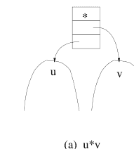

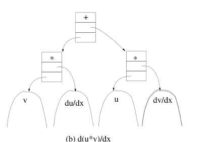

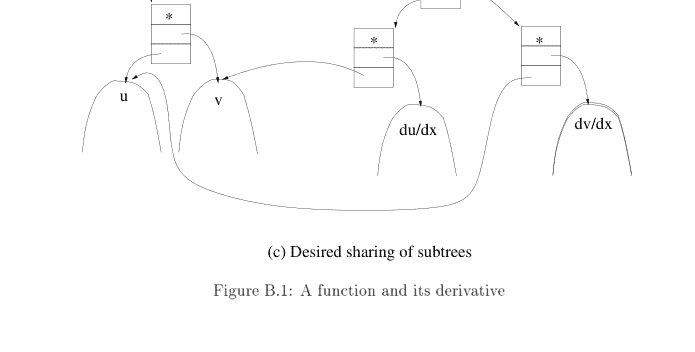

## B.1 Reference Counting

基本思想是为每个对象关联一个引用计数，在本例中为树的每个节点。对象的引用计数仅仅是指向该对象的指针数量，表示该对象有多有用。确保引用计数正确维护是棘手的，但我们首先抽象地描述我们希望发生的情况。如果我们向一个对象添加一个新的指针，我们希望将其引用计数加一。如果我们移除一个指针，则希望减一。当对象 X 的计数降为零时，我们决定 X 不再有用，因此将 X 的内存归还给堆。注意 X 本身可能指向对象 Y。在这种情况下，我们知道 X 中指向 Y 的指针将不再有用。因此 Y 的引用计数应被递减。如果 Y 的引用计数因此降为零，我们也可以将 Y 归还给堆，依此类推。

回到我们的导数示例，假设最初我们只有乘积树。假设该树由变量 T 指向。那么每个节点，包括根节点，都被 1 个指针指向。因此此时我们希望所有节点的引用计数都为 1。注意，如果变量如 T 在激活记录中而不是在堆中，我们不会为其关联引用计数。为简单起见，我们假设 T 确实在激活记录中。

接下来假设我们创建导数。假设导数树的节点全部在堆上，但其根由激活记录中的变量 D 指向。假设我们确实创建了导数树，使其与原始乘积树共享节点，如图 B.1(c) 所示。在这幅图中，子树 u、v 的根各有 2 个指针指向。因此创建后我们希望这两个节点的根的引用计数各为 2。

现在假设我们写 T=NULL。这将使原始表达式的根失去其唯一的指针。因此我们将递减原始表达式根的引用计数。我们会发现原始表达式的根的引用计数为 0。因此我们可以将根的内存释放回堆。这将导致原始表达式根发出的指针变得无用。因此我们希望它们所指向的对象的引用计数被递减。因此此时 u、v 树的引用计数都将变为 1。如果在此之后我们设置 D=NULL，那么如果我们的引用计数机制正常工作，所有引用计数都将变为 0，一切都将被归还给堆。

手动实现引用计数并不太困难。对每个节点添加一个引用计数数据成员，并列出必须递增或递减的条件。然而代码很繁琐，除非设计良好，否则其使用也会很繁琐。

## B.2 The template class shared_ptr

该类为引用计数提供了一个标准解决方案。该类和 weak_ptr 类被称为智能指针，可在 Boost Smart Ptr 库中使用，该库可从 www.boost.org 获取。这些指针也是 C++11 的一部分，可以通过向 GNU C++ 编译器 g++ 提供选项 -std=gnu++0x 来访问。由于我们的编译器命令 s++ 实际上调用 g++，该选项也可以提供给 s++ 以获得该功能。此外，在你的程序中你需要包含头文件 <memory>。

一个 shared_ptr 实际上是一个小型结构，包含真正的指针，当然还有操作引用计数所需的数据。shared_ptrs 的解引用和赋值（以及其他）运算符被重载，以便它们引用内部包含的真实指针，并执行引用计数所需的簿记。因此在许多方面 shared_ptr 就像一个普通指针，可以几乎同样方便地使用。

每个共享指针都有一个成员函数 use_count，它返回共享指针所指向内容的引用计数。注意在 shared_ptr 的上下文中，我们定义对象的引用计数为指向它的共享指针的数量。你无需关心引用计数存储的确切位置；只需依赖提供的保证即可。

### B.2.1 Synthetic example

图 B.2(a) 显示了 shared pointers 的使用示例，以及程序运行时产生的输出。

第一组语句创建并初始化两个 shared pointers s1、s2，指向堆上分配的两个 A 实例。每个实例创建时，A 的构造函数会打印实例的地址。在我们的执行中，这些地址恰好分别为 0x804c008 和 0x804c030。每个对象 A 包含一个指向另一个 A 对象的 shared_ptr。组的最后一条语句将 s1->aptr 设置为 s2。这使得 s1->aptr 现在指向 s2 指向的内容。之后我们打印引用计数。正如你所见 s1 指向 0x804c008，没有其他东西指向它。然而 s2 以及 s1->aptr 都指向同一个实例 0x804c030。因此 s1 的引用计数为 1，而另外两个的引用计数均为 2。

在第二组语句中，我们将 s2 设置为指向堆上的新实例。创建时会打印其地址 0x804c058。注意 s2 之前指向 0x804c030，因此我们应期望其引用计数减少 1。这确实发生了。现在三个指针 s1、s2、s1->aptr 都指向唯一的 objects，并且为它们打印的引用计数 1 1 1。

在第三组中我们将 s1=NULL。因为 s1 之前指向 0x804c008，其引用计数为 1 应降为 0。这应导致该对象被删除并归还给堆。这确实发生了，析构函数打印了一条消息说明这一点。进一步注意，当 0x804c008 被归还时，所包含的指针 s1->aptr 不再有效。因此由它指向的对象 0x804c030 的引用计数也应变为 0，并且应被销毁。这也发生了，如析构函数打印的语句所示。该组结束时我们仅打印 s1 和 s2 的引用计数，因为 s1->aptr 现在无效。这些确实输出为 0 1，这正确，因为 s1 为 NULL 而 s2 确实指向 0x804c008，并且是唯一指向它的指针。

最后的打印语句表明 0x804c008 也会被删除。这发生在程序退出作用域时，对当前激活帧的所有局部变量发出 delete 命令。因此会对 s1、s2 发出 delete 命令。只要共享指针非 NULL，对共享指针的 delete 会导致指向对象的引用计数递减，如果递减到 0 则也会删除该对象。这正是发生的情况！

### B.2.2 General strategy

前面的讨论可能暗示了使用 shared_ptr 管理内存的以下策略：

- 1. 首先在不考虑内存管理的情况下编写程序，即使用普通指针并分配内存但不担心归还。
- 2. 用 shared_ptr 替换每一个可能指向堆分配内存的指针。
- 3. 仅通过新对象、另一个 shared_ptr 的值或 NULL 对 shared_ptr 进行初始化/赋值。注意正如前面的程序中，你不能写 shared_ptr<A> s1 = new A;，而必须显式地将指针转换为 shared_ptr。

该策略有时效果很好。例如，对于求导程序，它效果很好。我们在第 B.2.3 节讨论这一点。

该策略可能因多种原因而无法工作。一个可能是你可能有指针，上述规则 3 无法应用于它们，因为最初它们既用于保存新地址，也用于保存激活帧中变量的地址。在这种情况下你需要重新组织程序。

然而，任何引用计数实现（包括 shared_ptr 提供的实现）都有一个根本限制：如果你的指针形成环，则即使使用 shared_ptrs 也会出现内存泄漏。我们将在第 B.2.4 节看到这一点。

### B.2.3 Shared pointer in derivative finding

我们首先开发不考虑归还动态内存的代码。为此我们使用第 22.1.3 节中开发的树的表示。代码如图所示 B.3。

首先我们有一个用于构造终端或字面量节点的构造函数。然后我们有非叶节点的构造函数。这些沿着第 22.1.3 节的思路进行。接下来我们有包含 new 运算符从而在堆上创建节点的 Sum、Prod 和 Lit 函数。这些使用起来很方便，程序末尾的主程序使用了它们。然后我们有一个 str 函数，它将节点下方的子树表示的表达式转换为字符串。

最后，我们有 deriv 函数。它使用定义：和的导数是导数的和，积的导数按上述规则进行，而字面量的导数当且仅当字面量为 x 时为 1。

我们可以将添加 shared_ptrs 的配方应用于此代码。我们在此代码中只有一种指针：Exp*。正如你所见，它始终用于指向堆分配的对象。此外，此程序中创建的指针结构不会有环。因此我们做如下操作：

- 1. 用 shared_ptr<Exp> 替换每一个 Exp*。为此最好定义 typedef shared_ptr<Exp> spE;，然后用 spE 替换 Exp*。


```
#include <simplecpp>
#include <memory>

struct A{
    shared_ptr<A> aptr;
    A(){cout << "Creating A: "<< this << endl;}
    ~A(){cout << "Deleting A: "<< this << endl;}
};

int main(){
    shared_ptr<A> s1(new A), s2(new A);                // Group 1
    s1->aptr = s2;
    cout << s1.use_count() << " " << s2.use_count() << " "
         << s1->aptr.use_count() << endl << endl;

    s2 = shared_ptr<A>(new A);                         // Group 2
    cout << s1.use_count() << " " << s2.use_count() << " "
         << s1->aptr.use_count() << endl << endl;

    s1 = NULL;                                         // Group 3
    cout << s1.use_count() << " " << s2.use_count() << endl << endl;
}
```

--------------------- Output produced ------------------------

Creating A: 0x804c008
Creating A: 0x804c030
1 2 2

Creating A: 0x804c058
1 1 1

Deleting A: 0x804c008
Deleting A: 0x804c030
0 1

Deleting A: 0x804c058

Figure B.2: Program to test shared pointers and its output

```
#include <simplecpp>

struct Exp{
    Exp* lhs;
    Exp* rhs;
    char op;
    string value;
    Exp(string v) : value(v) {lhs=rhs=NULL; op='A';}
    Exp(char o, Exp* l, Exp* r) : lhs(l), rhs(r), op(o) { value="";}
    static Exp* Sum(Exp* l, Exp* r){ return new Exp('+', l, r);}
    static Exp* Prod(Exp* l, Exp* r){ return new Exp('*', l, r);}
    static Exp* Lit(string v){return new Exp(v);}
    string str(){
        if (op == 'A') return value;
        else return "(" + lhs->str() + op + rhs->str() + ")";
    }
    Exp* deriv(){
        if(op == '+') return Sum(lhs->deriv(), rhs->deriv());
        else if(op == '*') return Sum(Prod(lhs->deriv(), rhs),
        Prod(rhs->deriv(), lhs));
        else return Lit(value == "x" ? "1" : "0");
    }
};

int main(){
    Exp* e = Exp::Sum(Exp::Lit("x"), Exp::Prod(Exp::Lit("x"), Exp::Lit("x")));
    cout << e->str() << endl;
    Exp* f = e->deriv();
    cout << f->str() << endl;
}
```

Figure B.3: Mini symbolic differentiation program

2. Check assignments to Exp* variables. If other Exp* variables were being assigned, then therefore there should be no problem because both are converted to spE. However, there can be new expressions that were assigned to Exp* variables. These now have to be explicitly converted to spE type. So you will have to do this.

With these two steps, your program should work. Add code to the constructors to observe when they are called, and add destructors so that you know when they are called as well. You should observe that while taking the derivative of a product uv the expressions for u and v are not copied. So they must be shared. You can also see that the nodes are destroyed when the program terminates. So there is no memory leak either.

# B.2.4 Weak pointers

Consider a program fragment that uses the struct A from Figure B.2:

```
int main(){
shared_ptr<A> s1(new A), s2(new A);
s1->aptr = s2;
s2->aptr = s1;
s1 = NULL;
s2 = NULL;
}
```

At this point s1 If you execute this, you will merely get:

```
Creating A: 0x804c008
Creating A: 0x804c030
```

Even when the program finishes, you will not get any deallocations to happen, as you did in the last line of the output of Figure B.2. Let us trace the execution to see why. Clearly, the creation of s1,s2 caused the messages about creating A to be printed. After that, the instruction s1->aptr = s2; s2->aptr = s1; causes s1,s2->aptr to point to 0x804c008, and s2,s1->aptr to point to 0x804c030. Thus the reference counts of all 4 shared pointers are 2. Now consider what happens when we set s1 = NULL; – one reference to 0x804c008 goes away. But it still has 1 reference, and hence no delete happens. When we set s2 = NULL; next, – one reference to 0x804c030 goes away. But this also has one reference. Thus even after we set s1, s2 to NULL, the objects at 0x804c008 and 0x804c030 continue to have reference count 1, the pointer inside the first contributes the count to the other and vice versa. But our program cannot access these objects, and they havent been returned to a heap: so we have a memory leak.

# B.2.5 Solution idea

This problem can only be solved using so called the class weak_ptr in conjunction with shared_ptr.

The basic idea is to break every pointer cycle by putting one weak_ptr in it. A weak_ptr is a pointer which does not increment the reference count. However, if the object pointed to

by the weak pointer is deleted, then the weak pointer becomes NULL. So whenever you wish to traverse a weak pointer W, you can first check if *W is not NULL and only then traverse. If you are working in a setting in which there are multiple threads, then you might need to lock the pointer first.

# B.3 Concluding remarks

Managing heap memory in C++ is an evolving field. As a novice programmer, your needs will probably be met by the classes in STL. If for some reason you need to go beyond that, ideas such as shared_ptr (and also weak_ptr if necessary) will likely be adequate. There is work on so called garbage collection strategies, but that is beyond the scope of this book.

# Appendix C

# Libraries

The term library is used to refer to a single file which collects together several object modules. Suppose you have constructed object modules gcd.o, lcm.o. Then you can put them into a single library file. On unix, this can be done using the program ar, and it is customary use the suffix .a for library (archive) files, and so you might choose to call your library gcdlcm.a. This can be done by executing

```
ar rcs gcdlcm.a gcd.o lcm.o
```

Here the string rcs indicates some options that need to be specified, which we will not discuss here. This command will cause gcdlcm.a to be created.

When compiling, you can mention the library file on the command line, prefixing it with a -L; modules from it will get linked as needed. In fact you could send the file to your friends who wish to use your gcd and lcm functions, along with an header file, say gcdlcm.h, which contains the declarations of gcd and lcm (but not the definitions). This is the preferred mechanism for sharing code. Note that your friends will not be able to easily know how your functions work, because you need not send them the corresponding .cpp files.

# C.0.1 Linking built-in functions

You can now guess how built-in functions such as sqrt or are linked to your program. They are in libraries, which s++ supplies when needed! Commands such as sqrt are contained in the cmath library that is supplied as a part of C++. Our compiler s++ automatically includes the corresponding library while it compiles your programs. Of course, this is not the entire story – you need to have the prototype for sqrt and other functions at the beginning of your program.

These prototypes are present in a file called math.h, which you can insert into your program by putting the following line at the beginning of your program:

```
#include <cmath>
```

Our compiler knows where to find this file and places it in your program.

But did you remember to include this file? You might remember that you did put in a similar line in your file:

```
#include <graphicsim.h>
```

Because of this the file `graphicsim.h` is picked up from some place known to `s++` and is placed in your file in place of this line. This file contains the line `#include <cmath.h>` which causes the file `cmath.h` to be included!

# Appendix D

# Reserved words in C++

The following words cannot be used as identifiers.

# Appendix E

# Operators and operator overloading

We will discuss some of the less frequently used operators, and then consider operator overloading.

# E.1 Bitwise Logical operators

C++ allows bitwise logical operations to be performed on variables of integer types. For simplicity we will only consider operations on the unsigned types.

# E.1.1 Or

The operator | is the bitwise OR operator, i.e. p | q returns a number that is obtained by taking the binary representations of p, q, and computing the OR of the corresponding bits. Note that the logical OR of two bits is a 1 if and only if at least one of the bits is 1. Here is an example.

```
unsigned int p=10, q=6, r;
r = p | q;
```

This would cause the bit pattern

00000000000000000000000000001010

for 10 (decimal) to be OR'ed with the bit pattern

00000000000000000000000000000110

for 6, to get the result

00000000000000000000000000001110

which is the bit pattern for 14. Thus at the end r would be 14.


## E.1.2 And

运算符 & 执行按位逻辑与。请注意，两个位逻辑与的结果为 1 当且仅当两个位都为 1。因此对于上面定义的 p、q，如果我们写下：

```
unsigned int s = p & q;
```

s 将得到位模式 0000000000000000000000000010，这就是 2 的位模式。因此执行完毕后 s 将等于 2。

## E.1.3 Exclusive or

运算符 ^ 是按位异或运算符。请注意，两个位逻辑异或的结果为 1 当且仅当恰好一个位为 1。因此如果我们写下

```
unsigned int t = p ^ q;
```

变量 t 将得到位模式 0000000000000000000000001100，这就是 12 的位模式。因此该语句执行后 t 将为 12。

## E.1.4 Complement

最后运算符 ~ 是（单目）按位取反运算符。某一位的补码为 1 当且仅当该位为 0。因此如果我们写下

```
unsigned int u = ~p;
```

u 的位模式将在 p 有 1 的位置上为 0，反之亦然。因此我们将在除位值 2 和 8 的位置之外的所有位置上都有 1。因此语句执行后 u 的值为 (∑ᵢ₌₀³¹ 2ⁱ) − 2 − 8 = 4294967285。

## E.1.5 Left shift

运算符 << 用于将位模式左移。因此 x << y 会使 x 的位模式向左移动 y 的值。我们所指的操作如下。我们首先丢弃最高位的 y 位，然后在右侧追加 y 个零。 resulting 位模式即为操作结果。请注意，如果 x 的最高位为零，则 x << y 只是 x2ʸ，其中 x、y 分别为 x 和 y 的值。

对于我们上面定义的 p、q，即值分别为 10 和 6，如果我们写下

```
unsigned int v = p << q;
```

变量 v 将得到位模式 00000000000000000000101000000。这具有数值 10 × 2⁶ = 640。

## E.1.6 Right shift

运算符 >> 用于将位模式右移。因此 x >> y 会使 x 的位模式向右移动 y 的值。我们所指的操作如下。我们首先丢弃最低位的 y 位，然后在左侧追加 y 个零。 resulting 位模式即为操作结果。请注意，x >> y 只是 x/2^y（整数除法），其中 x、y 分别为 x 和 y 的值。

对于我们上面定义的 v，即值分别为 640，如果我们写下

```
unsigned int w = v >> 2;
```

变量 w 将得到位模式 000000000000000000000010100000。这具有数值 160。

## E.2 Comma operator

逗号表达式的形式为

```
lhs, rhs
```

其中 lhs 和 rhs 都是表达式。该运算符会求值两个表达式，并使用 rhs 的值作为逗号表达式的结果。

逗号运算符可用于在语法上只期望一个表达式的设置中强制求值多个表达式。

一个常见用途是在 for 语句中进行多个自增和自减操作。

```
for (int y = 10, x=0; y>0; y--, x++)
    cout << x << endl;
```

这将打印数字 0 到 9。

作为另一个例子，使用逗号运算符，我们第 7.1.2 节的成绩平均程序可以写得更紧凑如下。

```
main_program{
    float nextmark, sum=0;
    int count=0;

    while(cin >> nextmark, nextmark >= 0){
        sum = sum + nextmark;
        count = count + 1;
    }

    cout << "The average is: " << sum/count << endl;
}
```

然而像上面这样的用法并不常见，因此不推荐。

还请注意，逗号运算符不应与逗号在声明中用作分隔符的用法混淆，例如上面 float nextmark, sum=0;，或函数调用中，例如 f(a,b)。

## E.3 Operator overloading

我们在第 16.4 节和第 16.5 节中讨论了运算符重载的基本思想。这里我们讨论一些细节。

以下前缀单目运算符可以被重载

```
+ - * & ! ~ ++ --
```

对于上述列表中的任意运算符 @，重载可以通过在操作数所属的类中定义不带参数的成员函数 operator@ 来完成，也可以通过定义接受操作数类型单个参数的函数 operator@ 来完成。

后缀单目运算符 ++、-- 也可以被重载。你同样定义成员或普通函数 operator@ 如前缀版本那样。然而为了与前缀版本区分，你还有一个额外的 int 参数，你会忽略它。这看起来似乎是任意的，确实可以被认为是一种 hack。

## Appendix F

## The stringstream class

类 iostream 用于定义诸如 cin 和 cout 的对象，我们可以在其上分别使用提取运算符 >> 和 << 来读写数据。这些对象称为流，因为数据在其进出。

stringstream 是一个流对象，但它是由一个字符串构造的。要使用它，你需要包含头文件 <sstream>。这在从字符串中提取数字或将数字转换为字符串时特别有用。

作为示例，这里有一个程序，它接受两个 double 数字作为命令行参数并打印它们的乘积。

```
#include <sstream>
int main(int argc, char *argv[]){
    double x,y;
    stringstream(argv[1]) >> x;
    stringstream(argv[2]) >> y;
    cout << x*y << endl;
}
```

在这里我们使用了 C++ 中提供的 stringstream 功能，通过包含 <sstream>。函数 stringstream 接受单个参数 s，即一个字符字符串，并将其转换为输入流（例如 cin）。现在我们可以使用 >> 运算符来提取元素。因此 stringstream(argv[1]) >> x; 将从命令行输入的第二个单词中提取一个 double 值。类似地，一个 double 值将从第三个单词中提取到 y。因此如果你输入

```
a.out 4 5e3
```

答案 20000 确实会被打印出来。

这里是另一个例子。

```
int main(int argc, char *argv[]){
    string s="1 2 3";
    int x,y,z;
    stringstream(s) >> x >> y >> z;
```

```
stringstream t;
 t << x*y << ' ' << y*z;
 cout << t.str() << endl;
}
```

正如你所见，在这里我们对同一个 stringstream 进行了多次提取。这是可以的。基本上你可以用流做的一切都可以用在 stringstream 上。stringstream t 用于输出，我们向其中放入了多个值。最后，成员函数 str 允许我们从 stringstream 中提取字符串，如果需要可以将其打印出来。

## Appendix G

## The C++ Preprocessor

## Appendix H

## Lambda expressions

lambda 表达式是一个无名函数，可以在代码的几乎任何地方构造并随后使用。以下表达式，例如，表示一个按绝对值比较整数的函数：

```
[](int a, int b){return abs(a) < abs(b)}
```

你可以直接使用它，通过提供参数：

```
[](int a, int b){return abs(a) < abs(b)}{3,-5}
```

这将求值为 true，因为 |3| < |−5|。但更有用的是，这种表达式可以在任何需要函数的地方使用，例如作为排序的比较函数。因此以下代码片段是合法的。

```
#include <algorithm> // so that sort can be used
int a[100];
...code to initialize a...
sort(a,a+100, [](int a, int b){return abs(a) < abs(b)});
```

这确实会按绝对值非递减的顺序对数组 a 进行排序。正如你所见，这比定义一个命名函数，或定义一个类并重载函数调用运算符（第 20.4.2 节、20.4.3 节）更紧凑。例如，第 20.4.3 节中的 sort 调用可以写成

```
sort(svec.begin(), svec.end(), [](const student& a, const student& b){
    return a.rollno < b.rollno;});
```

而无需像那里那样定义 compareRollnoStruct。

2011 年采用的 C++ 标准支持 lambda 表达式。这些有许多用途，例如参见第 25 章和第 26 章。lambda 表达式最初是在诸如 LISP 之类的语言中提出的。


## H.1 一般形式

Lambda 表达式可以通过多种方式指定。我们首先讨论上面使用的形式。

```
[](parameter-list){body}
```

其中，parameter-list 给出函数所需的参数列表，body 给出要执行的代码。你已经在上面看到过相关示例。

请注意，我们并没有显式声明函数的返回类型。C++ 会根据 body 中的 return 语句来推断该类型。有时，C++ 可能无法正确推断，这时你可以按如下方式指定返回类型。

```
[](parameter-list) -> return-type {body}
```

因此你可以这样写：

```
[]() -> int {return 1;}
```

由于 1 可以具有多种类型，上面的写法明确了我们指的是一个返回 int 的函数。

### H.1.1 Lambda 表达式的类型

可以将 Lambda 表达式视为具有如下类型：

```
std::function<return-type(parameter-types)>
```

其中 return-type 是 Lambda 表达式的返回类型，parameter-types 是参数的类型（以逗号分隔）。要使用它，你必须包含头文件 <functional>。

有关其用途，请参见第 25.1.3 节。

### H.1.2 变量捕获

Lambda 表达式的主体可以访问在 Lambda 表达式外部定义、但在定义该 Lambda 表达式的作用域内可见的名称。此类名称有时被称为 Lambda 表达式的自由名称（与在 Lambda 表达式内部定义或绑定的变量名相对）。自由名称既可以表示在定义 Lambda 表达式时对应变量的值，也可以表示对应变量的引用。前者称为“按值捕获自由名称”，后者称为“按引用捕获自由名称”。要表示按值捕获，我们只需在初始的 [] 中给出名称；要表示按引用捕获，我们在名称前加上 &。下面是一个示例。

```
int main(){
    int m=10;
    std::function<void()> f = [m](){cout << m << endl;};
    std::function<void()> g = [&m](){cout << m << endl;};
```

```
m++;

f();
g();
}
```

在此例中，f 和 g 分别按值和按引用捕获 m。因此，调用 f() 将打印 10，这是 f 被定义时 m 的值。另一方面，调用 g() 将打印 11，因为 g 按引用捕获了 m，所以这是 m 的当前值。

如果你希望按引用捕获 a、按值捕获 b，可以将捕获列表指定为 [&a,b]。如果你希望所有变量都按值（或按引用）捕获，可以将捕获列表指定为 [=]（或 [&]）。如果你希望除 a、b 之外的所有变量都按值捕获，可以写成 [=,&a,&b]，其他情况以此类推。

请注意，将捕获列表写为 [] 表示不捕获任何变量。

有关变量捕获的更多示例，请参见第 25 章。

### H.1.3 悬空引用

如果你按引用捕获了一个变量，而该变量在捕获之后、使用之前被释放，就会产生悬空引用的问题。因此，按引用捕获必须谨慎使用。

### H.1.4 捕获 this

this 指针，即指向正在执行其成员函数的对象的指针，应该按值捕获；毕竟，我们需要的是指针的内容。此外，一旦捕获了 this，你就可以直接通过名称引用对象的成员，而无需在其前面加上 this->。

