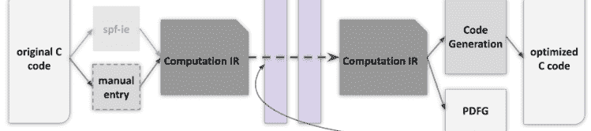
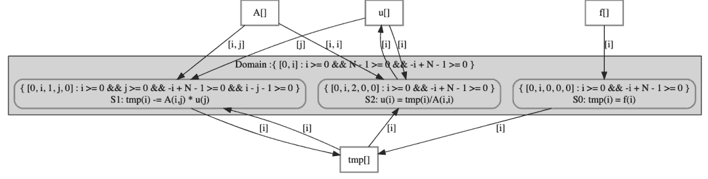
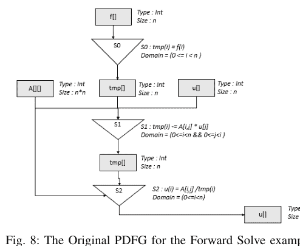

# 稀疏多面体库面向对象接口

Tobi Popoola¹ Ravi Shankar² Anna Rift³ Shivani Singh⁴ Eddie C. Davis⁵  
Michelle Mills Strout⁶ 和 Catherine Olechanowski⁷  
Email: {tobipopoola¹|ravishankar²|shivanishingh⁴@u.boisestate.edu, catherineolechanowski@biosestate.edu}  
⁵Vulcan Inc., Seattle, USA  
⁶博西州大学计算机科学系, Boise USA  
⁷mtros@cs.urtison.edu

**摘要** — 许多应用（包括学习、分子动力学和流体动力学）使用稀疏数据，其中非线性循环边界阻碍了使用多面模型进行代码变换。稀疏多面体框架 (SPF) 通过在关系和函数表示非线性约束，解决了多面体建模的局限性。我们贡献了一个 API，用于封装 SPF 中间表示 (IR) 和检查/执行器多面体库，并用于预处理，从而使用 SPF 生成对完整计算的良好定义。

是符号构造结构，用于表示稀疏数据中的索引数组等结构。SPF 提供了许多传统多面体工具的功能：基于 Omega[2] 构建的 CodeGen[1] 代码生成，以及在存在未解释函数时带有 EigenLib[3] 的预设和集合关系。这些工具之间没有紧密集成，并且有自己的低级 API，使得单独使用变得困难。

*术语：* 中间表示，稀疏多面体框架，多面体数据流

本文的贡献是计算 API。该 API 提供了关于如何结合 SPF 的各个函数来创建中间表示的精确规范。它可以直接生成多面体数据流图 (PDFGs)[4]，并为 PDF 生成用于 EigenLib 执行变换的 PDF 关系中的选项。在这项工作中，我们扩展了 PDFG 以处理具有完美嵌套和携带依赖的非线性循环。

许多包括机器学习、分子动力学和计算流体力学在内的应用使用稀疏数据。为了节省内存，稀疏数据通过仅存储非零值进行压缩。使用数组来将非零值坐标映射到稠密空间。这些数组在迭代迭代空间时用于循环边界。这些非线性循环边界增加了使用编译器变换进行性能优化的复杂度。

图 1 显示了我们迭代过程的概述，其中计算 API 符合该过程。图中高亮的区域是将变换翻译到我们 API 的部分，目前正在开发中。在这项工作中，我们专注于将原始源代码映射到计算 API。IR 本身通过稀疏多面体框架支持变换。PDFG 上的图操作生成变换并现在 IR 中。

多面体模型对于具有线性循环边界的应用是一种有效优化。迭代表示为集合，数据依赖使用关系表示。这种迭代空间和数据的结合为目标计算提供了一个偏序。在偏序中，可以通过将关系应用到迭代空间上来改变执行顺序。这些关系被称为变换。多面体模型的局限性是迭代空间内的约束必须是线性的。

我们的工作通过 CodeGen、Omega 和 EigenLib 之间的紧密集成解决了以往方法的局限性。CHILL [5] 为 SPF 提供了脚本接口，并通过集成支持非线性变换。Omega 侧于涉及未解释函数的操作精度，以及对它们表达方式的限制。我们的计算 API 依赖 EigenLib[3] 进行集合和关系操作，这克服了精度的局限。

多面体框架通过使用未解释函数支持非线性迭代空间和变换，扩展了多面体模型。未解释函数

本文的贡献包括：

- 用于在 SPF 中指定计算的统一接口
- 与 PDFGs 的集成
- 扩展 PDF 以支持非线性循环边界、完美嵌套循环和循环依赖
- PDFG 操作与 SPF 关系之间的翻译
- CodeGen 与 IGenLib 之间的集成
- 对内内的支持
- 对生成代码的辅助支持

所有陈述都与一个迭代相关。该迭代域包含语句的每个实例且没有特定顺序。它通常被表示为语句运行的迭代器，受其迭代（循环边界）约束的影响。以下代码显示了如何使用编译 API 创建语句。语句被写为字符串，数据名称用 `$` 符号识别，例如 `$D$` 和 `$S$` 分别代表稠密和稀疏。迭代域使用 IGenLib 语法设置，并对所有带有 `$S` 的数据进行释放，该释放操作位于第 3 行和第 6 行。

SPF 的接口在 IGenLib 中以 C++ 类的形式实现。编译类包含创建一个或多个计算所需的所有信息。这包括：数据空间、语句、数据依赖和执行调度。本节描述这些元素元素的设计和接口。矩阵乘法在本文其余部分将作为示例。图 2 和 3 显示了稠密和稀疏

数据空间表示唯一内存地址的集合。每个地址由数据空间名称和索引的标量选择定义。例如，对于每个唯一的元组 `$i$`，`$D(i)$`。对于每个唯一的元组，将有一个唯一的位置，且在 `$D$` 的生命周期内，其位置不会与任何其他数据空间重叠。默认情况下，所有数据空间都是稠密的。如果我们使用稀疏 `$S$`，数据空间只能写入一次，但可以读取多次。此规则的例外是累加操作，此时单个空间内的位置可以被写入多次（`$+ = x, \dots, max$`）。矩阵乘以 `$x, y$` 和 `$z$`。在稀疏版本中属性 `$row$` 和 `$col$` 也被视为数据空间。尽管它们在循环边界内使用，但在计算期间必须是常量。因此，它们不是计算定义的一部分。

```
// Stmt ds = new Stmt(
  $($i=0; i < $S; i++) $S($i);
  $($j=0; j < $N && j < $M); j)
```

```
// Stmt ss = new Stmt(
  $($i,k,j) <= i < $N && rowptr(i) <= k < rowptr(i+1) && j < $M); j,k
)
```

语句之间存在数据依赖。它们使用迭代域和数据向量之间的关系编码。计算闭提供了语句之间的依赖关系以及对它们的偏序。在我们的示例中，数据结果可以如下所示：

```cpp
// dense
Computation* dsComp = new Computation();
dsComp->addDataSpace($Y);
dsComp->addDataSpace($X);
dsComp->addDataSpace($Z);
```

```cpp
// sparse
// reads
$($i,k,j) -> [$($i);
$($i,k,j) -> [$($k);
$($i,k,j) -> [$($j);
```

```cpp
// writes
$($i,k,j) -> [$($j);
```

执行调度由需要遵守数据依赖关系的调度函数决定。调度函数将当前语句的迭代器作为输入，并输出一个整数元组，可以与其他与其他进行字典序排序以确定语句的执行顺序。迭代器通常用于表示影响语句顺序的迭代器值。例如，在调度函数

语句在数据空间上执行读写操作。我们将语句的定义限制为块。每个代码块只有一个入口和一个出口。



图 1：优化流水线概述

```
for (int i = 0; i < N; i++) {
  for (int j = 0; j < M; j++) {
    y[i] += A[i][j] * x[j];
  }
}
```

不可解释函数不能以表达式作为参数。代码生成通过将 IEGenLib 中的不可解释函数限制为符合 Omega 标准来解决这一问题，同时存储从不可解释函数到修改后的不可解释函数的映射。变换与代码生成之间表示的分离，使得在变换过程中进行精确的操作，同时仍利用了 CodeGen+ 进行多面扫描的灵活性。

图 2：稠密矩阵向量乘法

```
for (int i = 0; i < N; i++) {
  for (int k = rowptr[i]; k < rowptr[i+1]; k++) {
    int j = col[k];
    y[i] += A[k] * x[j];
  }
}
```

图 5 显示了图 4 中定义的稀疏矩阵向量乘法计算的代码生成。图 5 的第 2 行定义了语句 `i0` 的映射。第 9-13 行将符合 Omega 的不可解释函数映射回其原始形式。第 15-20 行是 CodeGen+ 多面扫描的直接结果。计算实现为完整功能代码提供了所有的支持定义。

图 3：CSR 矩阵向量乘法

`{i, j} -> [0, i, j, 0]`，`i` 在 `j` 之前的位置表示相应的语句位于对 `j` 的循环中，而该循环又位于对 `i` 的循环中。在字典序排序中，无论 `j` 的值如何，所有 `i = 1` 的语句实例都将位于 `i = 2` 的实例之前。

```
// 3rd parameter float to the Stmt counter /
// dense
// [[i,j]] -> [0, i, j, 0]
// sparse
// [[i,k,j]] -> [0, i, k, j, 0]
```

数据流可视化为专家提供了一个合适的视角，用于对优化机会进行变换推理。这种差异 PDFG 通过结合多面模型和数据图确保了计算的规则性。图表示每个循环体，不表示循环依赖，且不支持不完整的循环。本节描述了变换是如何实现的，使用 SPIR IR 创建 PDFG 的过程已与 Computation API 集成。在构建了像图 4 样的计算后，函数可以将 PDFG 输出为文件。

图 4 显示了稠密矩阵和后续稀疏矩阵向量乘法的两个计算的完整规范。

在原始顺序中，矩形表示数据空间，倒三角形表示语句。在扩展的 PDFG 中，矩形表示数据空间，圆矩形表示语句。边表示原始和扩展 PDFG 中的读和写操作。扩展的 PDFG 目前不表示计算中数据空间的类型和大小。

计算通过 CodeGen+ 接口进行代码生成。CodeGen 使用集合和关系进行多面扫描。Omega 在存在不可解释函数时使用集合和关系。不可解释函数受前缀规则限制。该规则规定不可解释函数必须是声明的一部分。

循环依赖和不完整的循环在决定应用哪些优化时非常重要。循环携带依赖指的是循环模式，其中循环的某迭代由同一循环的另一次迭代写入数据。一个不完整的

```
// dense mvm
Computation += dsComp Computation();

// add data spaces
dsComp->addDataSpace("$ys");
dsComp->addDataSpace("$sas");
dsComp->addDataSpace("$xs");

// Stmt ds0 = Stmt(0);
// source code
*Si(i) = SAS(i,j) + Sxs(j);
// iter domain
for (int i = 0; i < N && j < M; j++) {
  // scheduling function
  for ([i,j] = {0,0}; i,j < {N,M}; i,j++) {
    for ([y,x] = {[i,j]-1}; [y,x] >= {0,0}; y,x--) {
      *Sy(y,x) = Si([i,j]-1);
    }
  }
}
// add data writes
for ([y,x] = {[i,j]-1}; ...) {
}
dsComp->addStmt(ds0);

// sparse mvm
ppsComp = new Computation();

// add data spaces
ppsComp->addDataSpace("$ys");
ppsComp->addDataSpace("$sas");
ppsComp->addDataSpace("$xs");
```

```
## dense s0(x0, i2, k, x4, j)
## (I + A) * k(j)
```

```
## dense col_0(t0, tv1, tv2, tv3)
## undefined rowptr_1(t0, tv1)
## dense rowptr_2(t0, tv2)
## dense col(t0)
## dense col_0(t0, tv1, tv2, tv3)
## undefined rowptr(t0)
## dense rowptr_1(t0, tv1)
# dense rowptr_2(t0, tv2) +
```

for (int t2 = 0; t2 <= N-1; t2++) {

  for (int t4 = rowptr_1(t1,t2); t4 <= rowptr_2(t1,t2); t4++) {

    col_t0(t1,t2,t3,t4);

    s0(0,0,t2,t4,t6,t0);

  }

}

```
```

## undefined col(t0)

## dense col_0(t0, tv1, tv2, tv3)

## dense rowptr_1(t0, tv1)

## dense rowptr_2(t0, tv2)

```
图 5：SPMV  dense

```

// Stmt ds0 = new Stmt(0);

*Si(i,j) = C * i + N * rowptr(i) <= j (rowptr(i) <= j < rowptr(i+1) && j < M)

for ([i,j] = {0,0}; i,j < {N,M}; i,j++) {

  for ([y,x] = {[i,j]-1}; [y,x] >= {0,0}; y,x--) {

    *Sy(y,x) = Si([i,j]-1);

    *Ay(y,x) = Aj([i,j]-1);

    *Mx(y,x) = Sj([i,j]-1);

  }

}

spspComp->addStmt(ds0);

```

## 前向求解示例

```

for (int i = 0; i < N; i++) {

  S0: tmp(i) = f(i);

  for (int j = 0; j < i; j++) {

    S1: tmp(i) -= A(i,j) * u(j);

  }

  S2: u(i) = tmp(i)/A(i,i);

}
```


## 图 6：前向求解

## 图 4：用于稠密和稀疏矩阵向量的 Computation API

图 7 显示了扩展的 PDFG。从数据节点 `i` 到 `j` 循环。来自语句节点 `S1` 的入边显示了从语句节点 `S2` 到数据节点 `u` 的读访问，并显示了 `i` 循环中的写访问。这是跨越 `i` 的循环携带依赖。

如图 6 所示，循环嵌套具有多个级别的语句。

现有的表示无法可视化循环携带依赖。图 8 显示了前向求解示例的 PDFG。在示例中，代码显示了语句 `S1` 和 `S2` 中数据空间 `u` 的循环携带依赖。然而，图 8 中的原始 PDFG 未可视化该循环携带依赖。

前向求解示例还展示了不完整的循环嵌套模式：语句 `S0` 和 `S2` 在外层循环中，而语句 `S1` 在内部 `j` 循环中。图 8 中的原始 PDFG 没有显示这种模式。图 7 中扩展 PDFG 的更新设计可视化了这种不完整的循环模式。




计算 API 用于生成扩展 PDFG 作为有向图。循环嵌套使用修改后的 polyhedron 进行调度。Polly 是一种用于生成集合代码的自顶递归算法。我们的修改版本使用相同的方法，但生成的是语句内部的簇。

计算由 IEGen 集合和关系组成。使用 IEGen 的功能直接管理计算。IEGenLib 执行的核心操作包括反、组合以及相关的支持函数。通过这些操作，我们可以在 `Computation` 类中执行内联和循环变换。

适配。迭代域、执行调度和数据访问关系已更新，以反映插入其周围的上下文语句。如果函数在循环内部被调用，且调用者的循环也包含一个融合操作，则最内层的语句将被调整，以反映它们现在嵌套在循环之下。

调度规范，从而允许优化工程师编写不同的调度方案以获得最佳性能。他们的工作使用自动调优，通过执行随机搜索为算法寻找良好的调度来生成高效代码。

在这项工作中，我们对图建模了融合（`fuse`）和重调度（`reschedule`）操作。图翻译了接口 API 管理 SPF 组件所执行的变换。

1. 融合（Fusion）：这是一种将循环中的语句合并到单个循环的变换。融合有许多类别，包括归约融合和生产者-消费者融合。归约融合合并从同一内存位置读取的循环，而生产者-消费者融合合并一个变量被第二个循环读取的循环。

在图的特定层上融合语句的图操作表示为`fuse(S1,S2)`。在我们的 IR 中，`S1` 和 `S2` 是要融合的语句，`fuse` 表示融合的深度。融合允许融合操作具有更大的灵活性。融合后，`S2` 将紧随在 `S1` 之后。

2. 重调度（Reschedule）：重调度操作涉及将语句移动到图中的新位置并改变其执行调度。`reschedule` 并不是最优的，但它暴露了机会。重调度操作在我们的 IR 中表示为`reschedule(S1,S2)`。这将调用语句 `S1` 在 `S2` 之前进行重调度。

Plato [9] 是一种全自动的源码转换工具，可针对并行性和局部性进行优化。Pluto 使用线性规划，将并行性和局部性作为其成本函数的一部分来确定最优代码。Loop 是一个允许程序员在高层描述变换并验证其正确性的工具。Loop 实现在 LLVM 中。`isL` [13] 是一个用于在多面体模型中映射集合和关系的工具。该工具是本文中讨论的所有工具 [12], [9], [101] 中用到的变换的基础。

程序依赖图（PDGs）基于 Ferrante [14] 关于程序依赖图的研究工作。多面体优化在数据流表示（DFGR） [16] 中执行。我们的工作与此密切相关，但多面体图是多面体表示的视图而非分离。

这项工作采取的方法与 CHILL [18]略有不同。在 CHILL 中，执行者编写从代码派生出的表示。脚本可以包括若干操作，或者是抽象语法和多面体变换的编译。我们的工作提供了

我们的工作与其它使用多面体模型的工作不同，因为其缺乏对不规则应用程序的支持。我们展示了 Omega [1], [6] 和多面体框架 [7] 的视图。该接口提供了一种利用多面体框架优化应用程序并在科学应用中增量地生成完整代码的机制。计算 API 的结构为未来映射数据空间（包括内存布局）奠定了基础。

这项工作提供了一个对象 API 来为多面体库服务。该 API 提供了一个标准接口，从单个入口点完全指定多面体框架中的计算。该入口点通过与 IGenLib、CodeGen 等集成构建构建。PDGs 已经针对仿射循环边界、内层循环嵌套和嵌套依赖进行了探索。目前 API 不支持退出（即循环被限制在循环嵌套内部）以及如 `while` 等这样无边界的循环。未来我们将探索诸如 [19] 中的技术来克服无界循环和谓词的局限性。

工具如 Pluto [9], Loopy [10], Polyage [11] 使用多面体模型变换旧代码。Poly 自动检测并变换 LLVM IR 中的输入代码部分，打破了大多数局限于单一源语言工具的限制。Polyage 是一个多面体库，能够生成图像处理管道的高效实现。Halide [12] 是另一个用于生成图像代码的编译器。Halide 分离了算法和

我们通过内联（`inlining`）提供了组合变换的支持。这增加了可用性和可靠性。由编译语句生成的代码包含了语句标记，并在需要时包含变量声明。这意味着在未来，临时存储的内存布局选择完全可以在 SPF 内部完成。

未来的工具将使用此 API 生成 SPF IR，对其进行操作，并从旧应用程序以及高层或领域特定语言生成优化代码。此外，此 API 将在迭代计算时被使用；每一步都会显示 PDFG 以指导性能专家。

## 参考文献
- [1] Chun Chen, Polyhedral reclaiming. Proceedings of the ACM PLAN Conference on Programming Language Design and Implantation (PLDI), pages 489–496, 2020.
- [2] Pugh W E Steen, M T Duncan Kelly, D W Mueller, Y S, The Omega library interface. University of Maryland at College Park, 2002.
- [3] Michelle Strout, Georg Goer, and Catherine Olschaninek. We and relaxation mapping for the polyhedral framework. Lecture Notes in Computer Science (including Lecture Notes in Artificial Intelligence and Lecture Notes in Bioinformatics), 7760 LNCS:6-71–75, 2012.
- [4] Eddie Davis, Michelle Strout, and Catherine Olschaninek. Transforming loops via chain algorithms for Code Generation and Optimization, CGO 2018, page 26527, New York, USA, 2018.
- [5] Mohammad Asif, Jaweek Shin, Chun Chen, Gabe Raby, and Miltika Khan. Loop transformations for code generation and autotuning. In Proceedings of the Languages and Parallel Computation (UAPC), 2009.
- [6] Nicholas Mitchell, Larry Carter, and Jeanne Ferrante. Localizing affine arrays. In Proceedings of the International Conference on Program Languages and Compilation Techniques (PACT), pages 192–202, Los Alamitos, CA, 2009. IEEE Computer Society.
- [7] Michelle Strout, Alan LaMielle, Larry Carter, Jeanne Ferrante, Barbara Kreauss, and Catherine Olschaninek. An approach for code generation in the polyhedral framework. Parall. Comp., 53(4):533–543, 2010.
- [8] Tobias Hoober, Gregor Zheng, Alexei Andrew, Sunshine, and Louis-Noah Pouchet. Polyhedral optimization. In Proceedings of the First International Workshop on Polyhedral Compilation (IMPACT ’11), page 11, 2011.
- [9] Justin Li, J. Ramakrishnan, and P. Stachel: FLOPS: A Practical and Fully Automatic Polyhedral Optimization. 27th ACM SIGPLAN-Programming Language and Implementation, pages 1–5, 2008.
- [10] Kadar S, Nitish Singh. Polyhedral optimization and verified loop transformations. Lecture Notes in Computer Science, 9837 LNCS(July):383–402, 2016.
- [11] Ravi Teja Majumder, Vinay Vashta, and Ajay D. Polyhedral model is more scalable than C. ACM, 61(3):928–935, mar 2018.
- [12] Jonathan Kahan-Kelly, David Adams, Sylvain Prady, Cornely Byrne, and Saran Amar. Halle: A Language for Optimizing Parallel Programs, Localization, and Image Processing. Proceedings of the 34th ACM SIGPLAN-Programming Language Design and Implementation, pages 519–530, 2013.
- [13] Sven Verdenold: An integer library for the polyhedral model. In Kotji Jans, Jan der Heves, Michael Polishuk, and Tobias Takayama, editors. Lecture Notes in Computer Science, pages 299–302. Spring, 2015.
- [14] Jean-Philippe Robert and I. Weinstein, and Doe J Warren. The program dependence graph and use in optimization. ACM Transactions on Programming Languages and Systems, 9(3):719–787, July 1987.
- [15] Alina Schwenner, Louis-Noah Pouchet, and Vivek Sarkar. DEGFR in Intermediate Graph Representation for Data-Flow Optimization. In Extreme Scale Computing, pages 38–45, Edinburgh, Scotland, Canada, 2014.
- [16] Tai Ren, John Johnston, and Mary Jane Li: A framework for high-level loop transformations. Technical Report-UCS 88-987, University of California, Berkeley, June 1997.
- [17] Mohamed-Ben Abdrahim, Louis-Noah Pouchet, Albert Chen, and Catherine Olschaninek. The polyhedral model is more scalable than C. In Constructor Languages, LNCS 6011, Berlin, Berlin, 2010.
