# 模拟与混合计算机编程 (De Gruyter 教科)

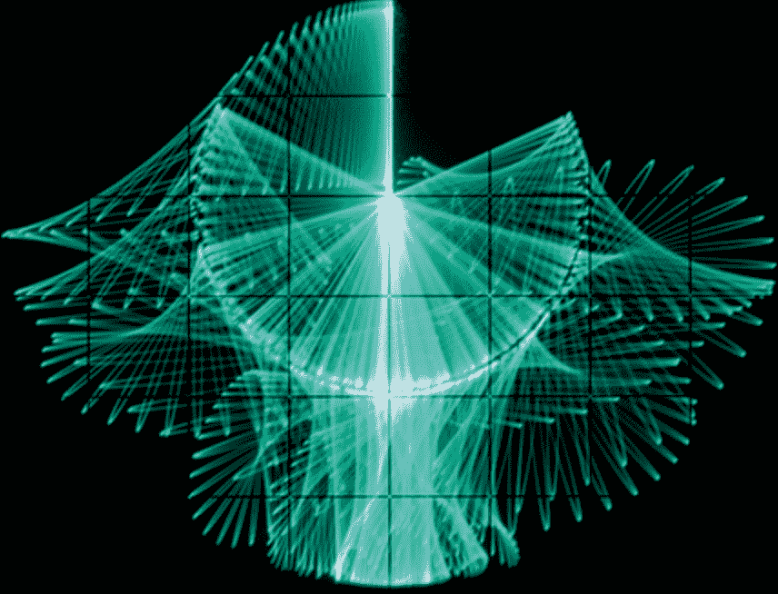


# 作者

Bernd Ulmann 教授博士

Schwalbacher Str. 31

65307 Bad Schwalbach

ululmann@analogparadigm.com

致 Rikka。

> “模拟计算机是一种美，也是一种永恒的快乐。”¹ JOHN H. MCLEOD，“模拟公告”，《仪器与自动化》，第31卷，1958年3月，第488页。

# 致谢与免责声明

如果没有许多人的和帮助，这本书是不可能的。首先，我要感谢我的妻子 Rikka，她从未对我写这本书花费的大量时间抱怨。此外，她进行了大量的校对和处理，使其达到打印要求。

我非常感谢 Chris Giles 博士，他不仅提供了许多建设性的意见，还指出了许多有趣的编程示例。

我还要感谢 Duncan Cadd, Michael Hajadi, Felix Letkemann, Bernd Johann, Robert Schorr 和 Ian S. King 博士，他们校对了这本书，并纠正了第 7.5 节混合计算机部分的许多错误和不一致之处。

最后，我要感谢 Tibor 允许我使用书中的一些照片（图 6.5 和标题）。原因有二：首先，他是该系统的主要开发者之一；其次，该机器似乎是目前市场上唯一的模拟计算机，在操作和接线方面与经典的 Telefunken 或 EAI 台式机相比差异极小。许多示例以前以缩略形式发表。关于典型系统（如 EAI 或 Telefunken 台式机）的丰富信息可以在 `http://analogmuseum.org` 找到。

# 第 1 章

# 引言

## 1.1 什么是模拟计算机？

一本关于模拟计算机和混合计算机编程的书在 21 世纪似乎像是一件过时的东西——为什么要写这样本书，更重要的是，你为什么要读它呢？尽管模拟计算机似乎已经被遗忘了，但它们不仅拥有有趣且辉煌的过去，在许多应用领域也拥有令人兴奋且前景广阔的未来，例如高性能计算（简称 `HPC`）、动态系统仿真领域、教育与研究、人工智能（事实上，生物大脑的工作方式非常类似于模拟计算机），以及最后同样重要的，传统存储程序数字计算机的协处理器，构成了所谓的混合计算机。

从今天的角度来看，模拟计算机主要被认为是博物馆里的陈品，它们的编程范式初看起来似乎是陈旧的。这种印象是完全错误的，而且主要是由于经典的补线板或接线板，程序是以错综复杂的电线网形式接线在上面的，就像真正的“意大利面条代码”……回想起来，这种编程形式比存储程序数字计算机（为了简单起见，以后称为数字计算机）使用的算法方法要简单且直观得多。模拟计算机的未来实现，特别是那些作为协处理器的计算机，可能会采用电子交叉开关代替补线板。此类机器的编程将类似于现场可编程门阵列（`FPGA`）的编程，即通过编译器将一组问题方程转换为交叉开关的适当设置，从而为要解决的问题配置模拟计算机。

模拟计算机的起源根源于希腊语 ἀλόγον（“模拟”），这个词在“analogy”（类比）和“analogue”（模拟）等术语中延续。这非常形象地描述了模拟计算机并将其与今天的数字计算机区分开来。后者具有固定结构，由存储在某种随机访问内存中的程序控制。

相比之下，模拟计算机没有任何程序内存，通过实际改变其结构来编程，直到它形成给定问题的模拟物（模型）。这种方法与今天编程课上教授的内容（处理 `FPGA` 的课程除外）形成鲜明对比。问题不是以逐步的（算法的）方式解决的，而是通过以适当的方式连接模拟计算机的各种元件，形成一个作为所研究问题模型的电路。图 1.1 和 1.2 展示了这两种根本上不同的计算方法。经典的数字计算机或多地以顺序方式工作，而模拟计算机的计算元件则是完美并行工作，完全没有数字计算中经常遇到的同步问题。

## 1.2 直接类比与间接类比

涉及到一般的类比时，必须区分直接类比和间接类比，这取决于所解决问题的基础原理以及解决问题时使用的类比。简而言之，直接类比的根源基本上与相应问题相同的物理原理，例如，用肥皂泡模拟极小表面，用带有加热器和热电偶的金属片研究热流模式等。如果问题的基础物理原理与模拟计算机不同，则该计算机被称为间接模拟计算机。

在本书的剩余部分中，将只考虑间接类比，因为它们在应用上比其直接对应物要通用得多。通常，此类机器基于模拟电子计算元件，如求和器、积分器、乘法器等等。

尽管听起来像是一个矛盾，但模拟计算机可以使用纯数字组件来实现。这类机器有两种类型：数字差分分析器（`DDA`）和随机计算机，多年来已经制造了许多这类机器的示例，尽管它们经历了周期性的复兴，但从未进入计算的主流。这些机器的编程方法与编程模拟电子计算机（简单称为模拟计算机）的路线相同。这些数字模拟计算机在书中将不再进一步讨论。

## 1.3 模拟计算的简史

模拟计算的想法显然比今天占主流的算法方法要早得多。事实上，第一台可以被称为模拟计算机的机器是安提基特拉机械（`Antikythera mechanism`），这是一种在公元前100年左右建造的机械奇迹。它以希腊岛屿安提基特拉（`Antikythera`）命名，在德里克·普莱斯（`Derek Price`）之后，潜水员在一处罗马船骸中发现了它的遗迹，他将其科学发现总结为：

> “得知古希腊人在他们的文明崩溃前不久，不仅在思想上进入了我们的时代，而且技术上也进入了我们的时代，这有点令人惊畏。”

对这种机制的研究仍在进行。它的目的是精确地计算日食和月食，该机制由30多个齿轮组成，是天体力学的机械模拟，几个世纪以来从未被设过。

滑动尺也可以认为是简单的模拟计算机，因为它们通过（主要是）对数刻度的相互移动来实现乘法、除法和开根。然而，这些是相当专业的模拟计算机，即平面轮仪（`planimeters`），它们曾（在某种程度上现在）用于测量闭合图形的面积，这项任务在自然科学的所有分支中经常出现。随着实用积分器的发展和应用，事情在19和20世纪变得更加有趣。基于这些发展，威廉·汤姆森（开文勋爵）发明了能够求解微分方程的机器的概念。虽然没有由此进化出实用的计算机，但他的想法是非常富有成果的。具体来说，他编程此类机器的方法今天仍然在使用，被称为开文反馈技术。

图 1.3 显示了一种名为*差分分析器*的机械模拟计算机。在图中中间桌状结构的两侧，可以看到各种计算元件，如积分器（通过小型水平圆盘识别）、差分齿轮、绘图板等。中间的长条结构是这些计算设备的实际连接，由无数轴和齿轮组成。此类机器的编程是一个困难且耗时的过程，因为每当配置机器以求解描述新问题的微分方程时，连接结构都必须完全拆卸并重建。

图 1.4 显示了差分分析器的简单设置，用于积分图形形式给出的函数。左侧的电机驱动机器的所有计算元件。左上角可以看到所谓的“输入表”。它由带有十字准线的放大镜组成，其安装方式可以通过手摇柄手动移动，从而使十字准线始终跟随输入函数的线条。

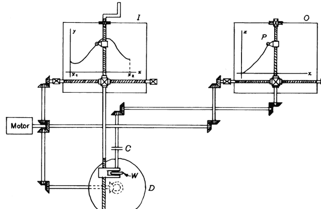

图 1.4. 一个用于积分的简单微分分析装置（参见 [KARPLUS et al. 1958, p. 190], [SOROKA 1962, p. 8-10]）

该装置的核心是图中底部的积分器。基本上，它由一个由中心电机驱动的旋转平盘和一个在圆盘表面滚动的摩擦轮组成。该轮子在圆盘上的径向位置由由输入板上十字准线的垂直分量控制。在旋转盘具有一定角速度的情况下，摩擦轮的角速度取决于它的径向位置。如果它位于盘轴的正上方，它将完全不旋转；而如果它位于盘的边缘，它的角速度将达到最大值。因此，该设备有效地执行了基本形式的积分运算：

$$\int^T f(\tau)d\tau$$

$\tau$ 代表机器时间（稍后会介绍）——在本例中为水平盘的旋转——而 $f(\tau)$ 控制摩擦轮的径向位置。积分器在时间间隔 $[0, T]$ 内运行。图 1.5 显示了用于奥斯陆微分分析仪的积分器的实际实现。

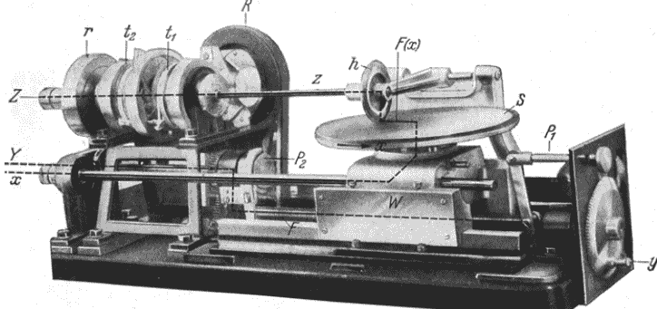

图 1.5. 来自奥斯陆微分分析仪的积分器（参见 [WILLERS 1943, p. 237]）

摩擦轮的输出随后在装置中用于控制输出板（图片右上角）笔画的垂直位置，而其水平位置则由中心电机控制。所得图形即为输入函数的积分图。

像这样的机械微分分析仪仅使用了很短一段时间，因为它们的缺点无法轻易克服。它们的装置极其复杂且耗时，许多机械部件需要大量的维护工作，而且由于旋转和运动部件具有不可忽略的质量，它们的计算速度受到限制。

人们曾尝试建造电机械微分分析仪，其中基本的计算元件仍然是纯机械的，而它们的相互连接通过伺服电机和同步器实现。⁸ 同步器的输出可以通过中央电气接线场连接到伺服电机的输入，从而至少简化了此类计算机的基本装置。

机械和电机械模拟计算机在第二次世界大战期间以火控系统的形式被大量使用。由于是极其专业化的领域，这些机器对该艺术的进一步发展没有直接影响。

⁷ 今天，这种设备被称为绘图仪。

⁸ 同步器（`synchro`）基本上是一个变压器，其初级绕组位于转子上，转子上通常有三个次级绕组。当初级绕组输入交流信号时，定子绕组中感应出与转子角相应的信号，这些信号可以确定转子的角度。ARNOLD NORDIECK 在他的微分分析仪使用了这些设备，参见 [NORDSIECK 1953] 和 [BROCK 2019]。

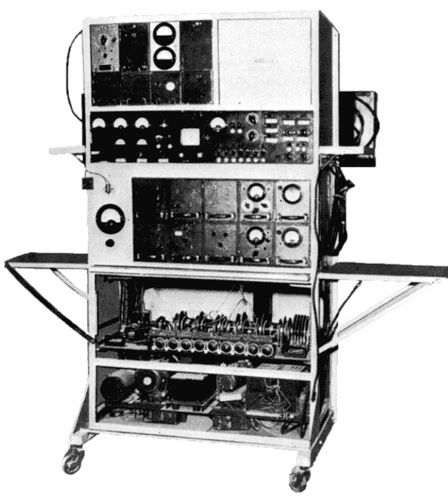

模拟电子模拟计算机是独立开发的，始于 20 世纪 40 年代初，由德国的 HELMUT HOELZER、美国的 GEORGE A. PHILBRICK 和 A. B. MACNEE 开发。他们的目标非常不同。

HOELZER 在德国的佩内米申德（`Peenemünde`）致力于著名的 A4 火箭（也称为 V2）的开发。他的工作成果是世界上第一台电子稳定和控制系统。此外，他还开发了世界上第一台通用模拟计算机。二战后，这种技术被引入到美国，并用于罗德斯登兵兵库的开发。这种模拟计算机如图 1.6 所示。

## 1.4 模拟计算机的特点

在大西洋的另一侧，PHILBRICK 的模拟计算机名为 Polyphemus，由于其奇特的外，它完全不是针对军事应用的。他的机器用于解决化学工业中的过程控制问题。

MACNEE 在 MIT 开发的机器是一个纯粹的学术仪器，用于重复操作，其无闪烁的解决方案显示在示波器上。

从今天的角度来看，这些早期模拟计算机看起来非常熟悉。除了采用真空管实现，它们已经具备了加法器、积分器、乘法器、函数发生器等模拟计算元件。此外，它们使用的技术与今天通用。关于模拟计算的历史，更多信息可以在 [ULMANN 2020] 中找到。

## 1.4 模拟计算机的特点

尽管真空管实现初看起来是个缺点，但这种方法可能很快会被混合计算机取代，即与数字计算机紧密耦合，从而减轻对微分方程的计算。

首先，模拟计算机不需要内存操作，这加快了整体计算。此外，所有的计算元件都是并行工作的。

模拟计算机的另一个基本优点是功耗极低，这使得它们对于功耗至关重要的应用（如嵌入式设备）具有吸引力。

最后，模拟计算机不容易出现像数字算法那样的稳定性问题。刚性微分方程通常也能轻松求解，而许多数值程序需要过长的运行时间。

模拟计算机的这些特点导致了近期对该模型的极大关注。未来最常见的模拟计算机形式将是混合计算机的一部分

# 第二章

## 计算元件

下节介绍组成电子模拟计算机的基本元件。此外，将引入单位的概念，因为值的表示对于所有后续概念至关重要。所示示例在 Analog Paradigm Model-1 模拟计算机上实现。

## 2.1 单位

电压或电流是模拟计算机计算中表示值的自然方式。由于大多数历史和现代模拟计算机使用电压而非电流，下节仅限于这种技术。

显然，由电压表示的值受到某些最小/最大电压的限制，即单位 `m_` 和 `m_`，这些对于特定的模拟计算机是固定的。历史上的真空管机器通常使用 ±100 V，有时为 ±50 V，而后期和现代模拟计算机的单位为 ±10 V，有时低至 ±5 V。

计算机装置中所有表示变量的电压都受到这些单位的限制，因此通常需要对求解的问题进行相应的缩放，以避免变量超过单位电压的过载情况。如果发生这种情况，通常过载指示灯会亮起，识别受影响的计算元件。此外，计算机运行可以自动停止以确定过载原因

## 12 — 2 计算元件

过载（`Overloads`）通常由于错误的比例缩放或补接引起，它们并不会损坏计算机，但会使计算结果失效。

由于机器单位在模拟计算机中至关重要，它们通常通过具有温度补偿的参考元件进行高稳定性处理。当机器单位为 ±10 V 时，计算元件通常由 ±15 V 电源供电，以留出一些余量来检测过载。因此，在发生过载的情况下，在现代模拟计算机上，受影响元件的输出电压值可以达到约 ±15 V 的高值。

对要在模拟计算机上求解的问题进行缩放（`Scaling`）有三个目标：

- 1. 保证没有变量超过机器单位限制的限制。

- 2. 充分利用计算机设置中每个变量的可用区间 `[m-, m+]`，以最小化减少由计算元件引起的不可避免的误差。

因此，有必要区分问题本身所在的“问题变量”与作为问题变量缩放版本的“机器变量”。底层的缩放过程称为变量缩放（`variable scaling`）。第二种缩放过程涉及机器解决问题的速度与原始问题解决速度的对比。这被称为时间缩放（`time scaling`），因为它影响积分速度，且通常不直接影响变量的缩放。¹¹

通常情况下，从实际机器单位 `m-` 和 `m+` 进一步抽象，转而在区间 `[-1, 1]` 内进行思考，是一个好主意。采用电压表作为输出设备的模拟计算机，其电压表通常经过相应的缩放，使得机器单位对应于显示 ±1 个机器单位，而不是 ±10 或 ±100伏特。

# # 2 加法器

模拟计算机最简单的有元件是加法器（`summer`）。其抽象符号如图 2.1 所示。加法器在输出端产生输入电压的负和，标记为 $e_0$。每个输入都有一个所谓的“权重”（`weight`），即应用到输入上的固定乘法因子。典型的权重为 1 和 10，而某些机器还具有 4 或 5 的值。如果输入旁边没有注明权重，则假设其为 1。因此，图 2.1 中的三个输入 $e_1, e_2$ 和 $e_3$ 的权重均为 1。

¹¹ 见第 2.3 节。

图 2.1. 具有三个输入 $e_1, e_2, e_3$ 和*求和节点*输入的加法器抽象符号。

图 2.2. 运算放大器的图形符号。

为了理解加法器的行为，有必要观察其实现方式。与大多数模拟计算机元件一样，它基于*运算放大器*（`operational amplifier`，简称 `opamp`），其图形符号如图 2.2 所示。运算放大器有两个输入，一个反相输入，一个非反相输入，在图中用 — 和 + 表示。它产生施在这些输入上的值之和，并由该特定运算放大器的特征——大（无限）*开环增益*（`open-loop gain`）$\mathcal{A}$ 放大。通常，可以实现 $10^5$ 到 $10^9$ 的增益。$^{十二}$ 在模拟计算机中使用这类放大器产生了*运算放大器*的名称，因为它们是实现数学运算的计算元件的基础。

在典型的模拟计算机中，运算放大器的非反相输入是*接地的*（`grounded`），即连接到模拟地线，通常表示为 `GND`，其电位代表零值；这有效地禁用了该输入。$^{十三}$

为了构建基于运算放大器的的加法器，使用了*负反馈*（`negative feedback`）概念。这种技术由 HAROLD STEPHEN BLACK 在 1927 年开创。基本思想是使用运算放大器输出部分的信号，并将其反馈到其反相输入，基本上通过反馈电路来控制结果电路的整体行为，而不是依赖裸放大器的特性。这一构想是几乎所有运算放大器的核心。

十二 运算放大器是相当复杂的器件。更深入的信息可以在 [JUNG 2006] 中找到。

十三 在经典的模拟计算机中，这个非反相输入通常直接连接到地，但用于实现有源漂移补偿。关于此点的更多细节可以在 [GOLDBERG et al. 1954]、[KORN et al. 1964, pp. 137 ff.)、[ULMANN 2013, pp. 61 ff.] 中找到。

## # 14 — 2 计算元件


**图 2.3.** 具有负反馈的运算放大器

运算放大器电路，包括模拟计算元件，如加法器和积分器。图 2.3 显示了具有负（电阻性）反馈的运算放大器的基本电路。

这个简单电路有一个单一输入 $e_i$，它通过电阻 $R_i$ 连接到反相输入。输出 $e_o$ 也通过电阻 $R_f$ 连接。由于所有输入都连接到反相输入，这被称为*求和节点*（`summing junction`），有时简称为 S。

用 $A$ 表示运算放大器的开环增益。通常可以实现 $10^5$ 到 $10^9$ 的增益。$^{十二}$ 在模拟计算机中使用这类放大器产生了*运算放大器*的名称，因为它们构成了实现数学运算的计算元件的基础。

在典型的模拟计算机中，运算放大器的非反相输入是*接地的*（`grounded`），即连接到模拟地线，通常表示为 `GND`，其电位代表零值；这有效地禁用了该输入。$^{十三}$

为了构建基于运算放大器的加法器，使用了*负反馈*（`negative feedback`）概念。这种技术由 HAROLD STEPHEN BLACK 在 1927 年开创。基本思想是使用运算放大器输出部分的信号，并将其反馈到其反相输入，基本上通过反馈电路来控制结果电路的整体行为，而不是依赖裸放大器的特性。这一构想是几乎所有运算放大器的核心。

十二 运算放大器是相当复杂的器件。更深入的信息可以在 [JUNG 2006] 中找到。


## 十三

在经典的模拟计算机中，这个非反相输入通常直接连接到地，但用于实现有源漂移补偿。关于此点的更多细节可以在 [GOLDBERG et al. 1954]、[KORN et al. 1964, pp. 137 ff.]、[ULMANN 2013, pp. 61 ff.] 中找到。


**图 2.3.** 具有负反馈的运算放大器

运算放大器电路，包括模拟计算元件，如加法器和积分器。图 2.3 显示了具有负（电阻性）反馈的运算放大器的基本电路。

这个简单电路有一个单一输入 `$e_i$`，它通过电阻 `$R_i$` 连接到反相输入。输出 `$e_o$` 也通过电阻 `$R_f$` 连接。由于所有输入都连接到反相输入，这被称为*求和节点*（summing junction），有时简称为 S。

用 `$A$` 表示运算放大器的开环增益。通常可以实现 `$10^5$` 到 `$10^9$` 的增益。`$^{十二}$` 在模拟计算机中使用这类放大器产生了*运算放大器*的名称，因为它们构成了实现数学运算的计算元件的基础。

在典型的模拟计算机中，运算放大器的非反相输入是*接地的*（grounded），即连接到模拟地线，通常表示为 `*GND*`，其电位代表零值；这有效地禁用了该输入。`$^{十三}$`

为了构建基于运算放大器的加法器，使用了*负反馈*（negative feedback）概念。这种技术由 HAROLD STEPHEN BLACK 在 1927 年开创。基本思想是使用运算放大器输出部分的信号，并将其反馈到其反相输入，基本上通过反馈电路来控制结果电路的整体行为，而不是依赖裸放大器的特性。这一构想是几乎所有运算放大器的核心。

## 2.2 夏季 — 17

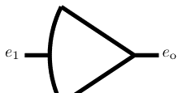

图 2.5. 开路放大器的图示表示

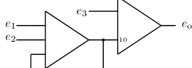

图 2.6. 根据方程 (2.6) 设置的计算机配置

为了展示第一个加法器及其一个输入`$^{17}$`的应用，如图 2.6 所示的电路。它解决了方程：

`$$e_o = \left(10 - \frac{e_1 + e_2}{2}\right) + e_3 = 5(e_1 + e_2) - e_3. \quad (2.6)$$`

第一个加法器输出与其一个输入`$^{17}$`之间的连接引入了与 `$R_f$` 并行的第二个反馈电阻，从而有效地使反馈环路的作用翻倍。这反过来使加法器的所有其他输入权重减半，在左侧加法器的输出处得到：

`$$\frac{e_1 + e_2}{2}$$`

该输出现在连接到右侧加法器的输入，权重为 10。加法器的另一个输入由 `$e_3$` 馈送，最终得到 `$e_o = 5(e_1 + e_2) - e_3$`。

图 2.7 显示了 Analog Paradigm SUM8 模块的前面板，该模块包含八个加法功能，其中三个权重为 1，两个权重为 10。顶行的四个加法器具有一个特殊功能，通过在标记为 FB 和 `$\perp$`（此符号表示地）的两个插座之间建立连接，可以使内置反馈电阻断开，从而将加法器转换为开路放大器。`$^{18}$` 所有八个加法器上都提供了求和节点 SJ。

- 17 由于输入没有标出显式权重，其权重等于 1。

- 18 在这四个加法器上，反馈电阻 `$R_f$` 被分为两个大小为 `$R_f$` 一半的电阻的串联连接。这两个电阻之间的连接到标记为 FB 的插座。将 FB 接地防止通过此路径的电流到达运算器的求和节点，从而有效地禁用了反馈路径。

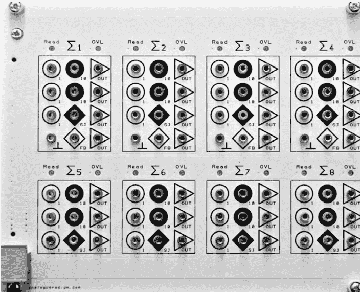

图 2. Analog Paradigm SUM8 模块

## 2.3 积分器

初眼看，模拟计算机具有其基本操作之一的积分功能，是令人惊讶的。这使其成为解决由微分方程及其系统描述的问题的理想机器。但有一个陷阱：模拟电子模拟计算机上的积分始终是关于时间的，因此所有积分基本上都具有以下形式：

> `$$e_{o} = -\left(\sum_{i=1}^{n} a_i e_i d\tau + e(0)\right)$$`

其中某个常数 `$e(0)$` 称为初始条件。特别是，这意味着偏微分方程（即出现对多个变量的导数的微分方程）在没有显式离散化或其他技术的情况下，无法在模拟计算机上直接处理！

显然，积分器的输出取决于其输入值的历史，因此这种计算元件是一种存储器。与简单的加法器相比，这需要对其操作进行一些控制，因为积分在时间上有起点和终点。它还必须考虑初始条件。因此，典型的积分器有三种工作模式：

- **初始条件（Initial condition）：** 在模式下（通常简称为 IC），积分器被重置，使其输出取初始条件 `$e(0)$` 的负值，该值作为电压施加到积分器的特殊输入插座上，通常标记为 IC。这种模式通常是模拟计算机上每次计算运行的第一步。需要注意的是，由于充电电容器需要时间，积分器需要最小时间来获得该初始值。`$^{1}$`

- **停止（Halt）：** 在某些情况下，停止模拟计算机一段时间（通常为几秒钟）以读取数值等是有用的。这是通过将其所有积分器切换到停止模式（简称为 HLT）来实现的在这种模式下，所有受影响积分器的输出保持恒定——至少在理论上如此。由于技术上的缺陷，漂移是不可避免的，因此在该模式下花费的时间越短越好，以保持低误差。可接受的 HLT 时间可以达到几十秒级。

图 2.8 显示了积分器在这三个工作模式下的行为。在这里，IC-输入连接到 +1（例如 +10 V），而一个权重为 1 的积分器输入连接到 –1。在 IC-out 期间，输出被重置为负初始条件 –1。当激活 OP 模式时，开始关于时间的实际积分操作。在这种特定设置下，积分在恒定值 –1 上进行。因此，输出产生一个斜率为 1 的电压斜坡。两秒后，模拟计算机切换到 HLT 模式，积分器保持在最后一个值 +1。

## 22 — 计算元件

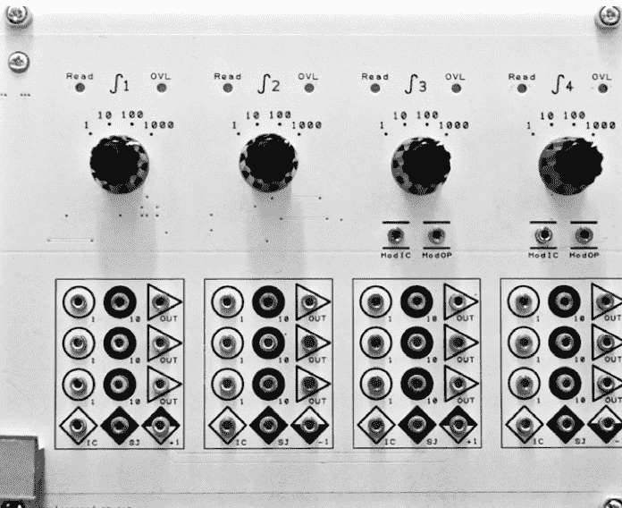

**图 2.10.** 四积分器模块

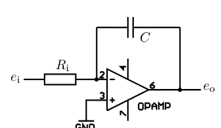

**图 2.11.** 积分器的基本原理图

**IC:** 在 IC 模式下，开关 OP 将输入电阻阵列连接到地，当 IC 开关处于如图所示的位置时，这有效地禁用了所有输入。因此，运算放大器基本上作为一个只有一个输入端（IC）的加法器工作。临时反馈电阻 `$R_{IC}$` 上的电压等于 `-IC`，这反过来将电容预充电到与 IC 输入口处电值的负值。在这种工作模式下，为电容所需的时间取决于其电容量以及在该模式下激活的输入电阻。

## 2.3 积分器 — 23

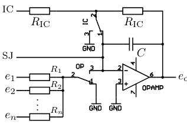

**图 2.12.** 具有全模式控制的积分器详细原理图

**OP:** 在 OP 模式下，开关的位置反转：IC 开关现在将两个电阻 `$R_{IC}$` 之间的接点接地，从而禁用了 IC 输入，而 OP 开关将输入电阻阵列连接到运算放大器的反相输入。电容器现在对输入端 `$e_i$` 的电压加权和进行积分。

**HLT:** 在此模式下，IC 被禁用，而 OP 开关将输入电阻连接到地。因此，除了电容器漏电引起的误差以及流入运算放大器反相输入端的电流外，电荷 `$C$` 的电量基本保持恒定。如前所述，这些误差源决定了 HLT 时间的实际长度；HLT 模式通常用于通过数字电压表等设备从计算结果中读取数值。

对于模拟计算机积分器使用的所有控制开关来说，它们完美同步切换且没有任何触点抖动至关重要。电磁继电器仅用于小型、廉价、低速的模拟计算机，即使不同继电器之间切换时间的差异也可能是有害的。今天，通常使用基于*场效应晶体管*（*FET*）的电子开关。

### 积分器

积分器的行为描述为：

```
$$e_o = -\left( \sum_{i=1}^{n} a_i e_i d\tau + e(0) \right)$$
```

其中权重 `$a_i$` 通常为时间尺度因子的 1 或 10 倍。通过激活 IC 模式将积分器重置为初始状态 `$e(0)$`。实际的随积分发生在 OP 模式下。通过将计算机切换到 HLT 可以临时停止积分。

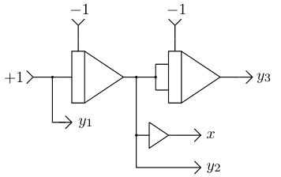

图 2.13. 通过对常数的双积分生成抛物线

模拟计算机最简单的操作循环由 IC-OP-HALT 模式序列组成，其中在 OP 模式花费的时间手动确定或由精密定时器确定。这通常被称为手动控制，经常用于低速计算。

尽管如此，在许多情况下，希望在示波器上显示变量随时间变化的清晰或无闪烁的图像，这需要一种被称为“重复操作”的自动工作模式。在这里，精密定时器让积分器循环地通过 IC-OP-IC-OP-... 模式序列。通过足够的时间尺度因子，可以每隔几毫秒重复一次完整的模拟，从而能够在示波器上显示一组图表。

由于我们当然可以在任何时刻手动更改计算机设置的系数和初始条件，因此重复操作可以直观地了解问题相对于其参数的行为，因为人们可以立即在显示器上看到参数变化产生的影响。

这种工作模式的变体称为“单次运行”，它由具有预设 IC 和 OP 时间的单次 IC-OP-HALT 序列组成。这在以下情况下特别有用——

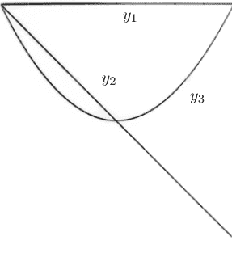

## 2.4 自由元件 — 25


**图 2.14.** 通过对常数的双积分生成抛物线

模拟计算机最简单的操作循环由 IC-OP-HALT 模式序列组成，其中在 OP 模式花费的时间手动确定或由精密定时器确定。这通常被称为手动控制，经常用于低速计算。

尽管如此，在许多情况下，希望在示波器上显示变量随时间变化的清晰或无闪烁的图像，这需要一种被称为“重复操作”的自动工作模式。在这里，精密定时器让积分器循环地通过 IC-OP-IC-OP-... 模式序列。通过足够的时间尺度因子，可以每隔几毫秒重复一次完整的模拟，从而能够在示波器上显示一组图表。


## 2 计算元件

### 2.3 积分器

模拟计算机最简单的操作循环由 `IC-OP-HALT` 模式序列组成，其中在 `OP` 模式花费的时间手动确定或由精密定时器确定。这通常被称为手动控制，经常用于低速计算。

尽管如此，在许多情况下，希望在示波器上显示变量随时间变化的清晰或无闪烁的图像，这需要一种被称为“重复操作”的自动工作模式。在这里，精密定时器让积分器循环地通过 `IC-OP-IC-OP-...` 模式序列。通过足够的时间尺度因子，可以每隔几毫秒重复一次完整的模拟，从而能够在示波器上显示一组图表。

由于我们可以在任何时刻手动更改计算机设置的系数和初始条件，因此重复操作可以直观地了解问题相对于其参数的行为，因为人们可以立即在显示器上看到参数变化产生的影响。

这种工作模式的变体称为“单次运行”，它由具有预设 `IC` 和 `OP` 时间的单次 `IC-OP-HALT` 序列组成。这在以下情况下特别有用——

#### 积分器模式详解

**IC:** 在 `IC` 模式下，开关 `OP` 将输入电阻阵列连接到地，当 `IC` 开关处于如图所示的位置时，这有效地禁用了所有输入。因此，运算放大器基本上作为一个只有一个输入端（`IC`）的加法器工作。临时反馈电阻 $R_{IC}$ 上的电压等于 `-IC`，这反过来将电容预充电到与 `IC` 输入口处电值的负值。在这种工作模式下，为电容所需的时间取决于其电容量以及在该模式下激活的输入电阻。

**OP:** 在 `OP` 模式下，开关的位置反转：`IC` 开关现在将两个电阻 $R_{IC}$ 之间的接点接地，从而禁用了 `IC` 输入，而 `OP` 开关将输入电阻阵列连接到运算放大器的反相输入。电容器现在对输入端 $e_i$ 的电压加权和进行积分。

**HLT:** 在此模式下，`IC` 被禁用，而 `OP` 开关将输入电阻连接到地。因此，除了电容漏电引起的误差以及流入运算放大器反相输入端的电流外，电荷 $C$ 的电量基本保持恒定。如前所述，这些误差源决定了 `HLT` 时间的实际长度；`HLT` 模式通常用于通过数字电压表等设备从计算结果中读取数值。

对于模拟计算机积分器使用的所有控制开关来说，它们完美同步切换且没有任何触点抖动至关重要。电磁继电器仅用于小型、廉价、低速的模拟计算机，即使不同继电器之间切换时间的差异也可能是有害的。今天，通常使用基于 `FET`（场效应晶体管）的电子开关。

#### 积分器行为描述

积分器的行为描述为：

```
$e_o = -\left( \sum_{i=1}^{n} a_i e_i d\tau + e(0) \right)$
```

其中权重 $a_i$ 通常为时间尺度因子的 1 或 10 倍。通过激活 `IC` 模式将积分器重置为初始状态 $e(0)$。实际的积分发生在 `OP` 模式下。通过将计算机切换到 `HLT` 可以临时停止积分。


**图 2.13.** 通过对常数的双积分生成抛物线

### 2.4 自由元件


**图 2.14.** 通过对常数的双积分生成抛物线

### 2.5 电位器

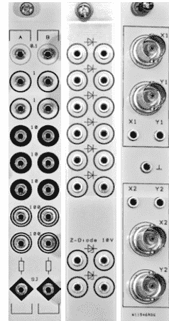

**图 2.15.** 典型的独立元件，如电阻、二极管和 `BNC` 适配器

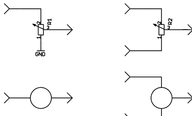

**图 2.16.** 作为系数电位器的基本电路

由于该设置的总电阻为 $R_u + R_t = R$，因此在输入电压 $e_i$ 的*无负载*情况下，输出电压 $e_o$ 将为

$$\frac{e_o}{e_i} = \frac{R_t}{R}$$

在此语境下，“无负载”意味着没有电流从分压器流出，因此流过两个电阻的电流相同。在这种不寻常但理想的情况下，可以通过配备带有多圈刻度旋钮的精度十位圈电位器，将系数直接设定到三位小数。

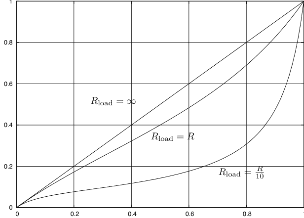

**图 2.17.** 带有负载 $R_{load} = \infty$，$R_{load} = R$ 和 $R_{load} = R/10$ 的分压器

由于大多数计算元件通常具有从 $10^4$ $\Omega$ 到 $10^6$ $\Omega$ 之间的有限输入电阻，此类分压器的输出是*带负载*的，导致产生不可忽视的设置误差，如图 2.17 所示。线性实线显示了无负载电位器随 $\alpha$ 变化的特性，而虚线和点线分别显示了负载 $R$ 和 $R/10$ 外部负载的影响。

带负载的分压器可以描述为：

$$R_{\ell} \parallel R_{load} = \frac{R_{\ell}R_{load}}{R_{\ell} + R_{load}}$$

其中 $\parallel$ 表示并联。因此，该设置的总电阻为：

$$R_{total} = R_u \parallel R_{load} = R_u + \frac{R_uR_{load}}{R_{\ell} + R_{load}}$$

对于给定的设定 $\alpha$，由 $R_{load}$ 负载的分压器的输出电压可得到以下表达式：

$$\frac{e_0}{e_i} = \frac{R_{\ell} \parallel R_{load}}{R_{total}} = \frac{\frac{R_{\ell}R_{load}}{R_{\ell} + R_{load}}}{\frac{R_uR_{load}}{R_u + R_{load}}}$$

$$= \frac{R_{\ell}R_{load}}{R_u(R_{\ell} + R_{load}) + R_{\ell}R_{load}}$$

$$R_{\ell} = \frac{R_u R_{\ell}}{R_{load}} + R_u + R_{\ell} = \frac{\alpha R}{(1-\alpha)R\frac{\alpha R}{R_{load}}} + R}$$

$$= \frac{\alpha}{(1-\alpha)\frac{R}{R_{load}} + 1}$$

在大多数模拟计算机上，这种电位器设定是一个繁琐的过程，因为精度刻度盘的值与实际计算机设置中的实际值之间存在显著偏差，这种偏差源于连接到电位器滑片上的负载。

因此，大多数模拟计算机都具有一种名为电位器设定（简称 `POTSET`）的额外运行模式，在该模式下，积分器被切换到 `IC` 模式或 `HLT` 模式，且所有输入电阻网络都会被断开。

### 2.6 发生器

#### 函数发生器

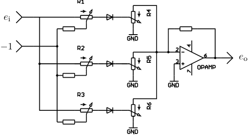

当只有顶部的二极管导电时，运算放大器的输出是一个线性取决于 $e_i$ 的电压，其斜率由 `R4` 的设置控制。一旦第二个二极管开始导电，运算放大器将产生取决于 $e_i$ 的这两个二极管贡献的输入电流的（负）和。因此，电位器 `R1`、`R2` 和 `R3` 控制*断点*（break-points），而 `R4`、`R5` 和 `R6` 控制由运算放大器相加的每个线性函数的斜率，从而产生一条近似所需函数的折线。

充当电子开关的二极管并非理想二极管，也就是说，在断点附近的小范围内，它们实际上会表现出抛物线行为；这通常是一个问题。此外，折线的转折处有时是不可接受的。如果需要，可以通过在 $e_i$ 上叠加微小的高频正弦信号来使其平滑。

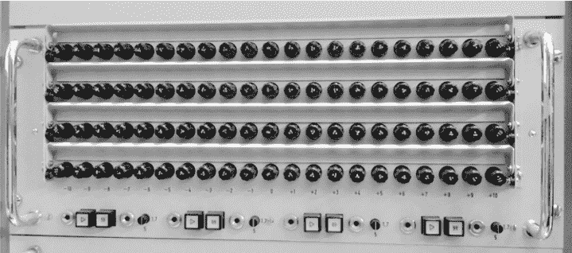

**图 2.25.** 带固定断点的 `Telefunken` 函数发生器

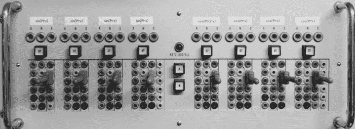

**图 2.26.** 经典固定函数发生器示例 (`Telefunken`)

> **函数发生器：**
>
> 大多数函数发生器基于使用偏置二极管通过折线近似函数。如果可能，建议通过其他手段（如 `TAYLOR` 近似法等）创建特殊函数。由于设置耗时，且用多边形近似通常平滑的函数会引入误差，函数发生器是最后的手段之一。

某些函数的使用频率足以支持构造固定函数发生器。这些函数包括 `sin()`、`cos()`、`tan()`、`exp()`、`log()`。图 2.26 显示了 20 世纪 60 年代 `Telefunken` 模拟计算机的一个模块，具有八此类函数。

设置此类二极管函数发生器非常耗时，而且有时需要更好的近似甚至是多个变量的函数，这些通过纯电子手段无法以合理的努力实现。在这种情况下，可以通过模拟数字转换器（`ADC`）和数字模拟转换器（`DAC`）将数字计算机连接到模拟计算机上。然后，数字计算机可以根据从其 `ADC` 读取的值进行简单快速的表查找，并通过 `DAC` 输出相应的函数值。这在实际上是迈向混合计算机的第一步。

> 简而言之，需要 2 个 `ADC` 和 `DAC`。

### 2.7 乘法

有趣的是，在模拟电子电路中实现乘法比实现积分复杂得多。两个变量的乘积 $x \cdot y$ 可以看作是 $x$ 和 $y$ 的函数，因此不适用于上述简单的函数发生器方法。在过去的 50 年里，人们设计了许多巧妙的乘法电路，但今天通常使用 `GILBERT` 单元乘法器，因为它提供了高精度，并且很容易在集成电路（`IC`）中实现。

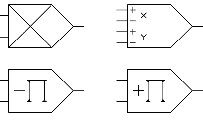

**图 2.27.** 乘法器的图形符号

图 2.27 显示了乘法常用的图形符号。现代乘法器只需要两个输入 $x$ 和 $y_i$ 即可计算 $x \cdot y$，这适用于右上角的符号和第二行的两个符号。如果某个乘法器执行符号反转，则使用左下角的符号来强调这种行为。右上角的符号之所以包含是因为历史原因，因为它适用于平方乘法器（quarter-square multiplier），该乘法器同时需要 $x$ 和 $y$。

实现乘法器最直接的方法之一是利用以下事实：

$$xy = \frac{1}{4}((x+y)^2 - (x-y)^2)$$

这需要加法、减法、平方和反指数运算。这些在模拟计算机中都是容易获得的。

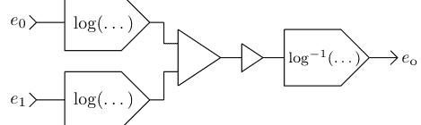

**图 2.28.** 通过加对数和取反指数进行乘法

另一种历史上更常用的乘法器实现利用了以下事实：

$$xy = \frac{1}{4}((x+y)^2 - (x-y)^2)$$

这需要加法、减法、平方和反指数运算。这些在模拟计算机中都是容易获得的。允许 $-1 \le e_0 \le 1$ 且 $-1 \le e_1 \le 1$ 的乘法器被称为*四象限*（four quadrant）乘法器，而仅在四个象限中的两个产生结果的是二象限乘法器。图 2.29 显示了一个包含八个四象限乘法器的 `MLT8` 模块。

> **乘法等：**


许多模拟计算机具有平方乘法器，它们需要带正负号的两个输入变量。通过反转 `x` 或 `y` 的输入，可以在不需要反相器的情况下实现结果的符号反转。

## 2.8 计算元件

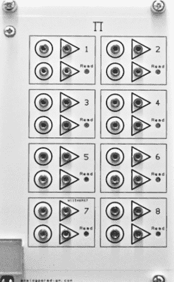

图 2.29. 乘法器模块 MLT8

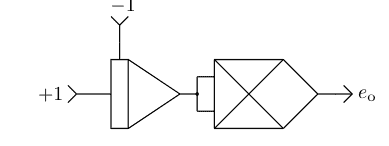

图 2.30. 使用积分和乘法器产生抛物线

## 2.9 比较器和开关

*比较器*用于比较两个模拟信号 `e0` 和 `e1`，产生 `e0 + e1 > 0` 的逻辑输出信号。通常由该逻辑输出信号控制继电器或电子开关。这使得在模拟计算机设置中实现开关函数成为可能。图 2.31 和 2.32 显示了表示比较器-开关组合以及纯比较器的图形符号。与没有专用输入/输出的继电器开关不同，电子开关相对于其输入/输出连接可以是反的。图 2.33 显示了驱动继电器的典型比较器的简化原理图。运算放大器通过等值电阻 `R` 输入待比较的两个模拟输入。其反馈路径由两个偏置二极管组成，二极管在运算放大器的特定输出电压下开始导电。

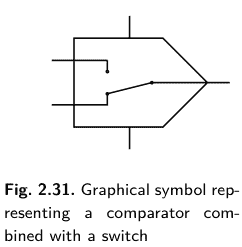

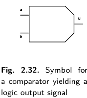

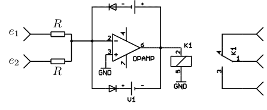

由两个偏置源决定，图中以电池的形式表示。这两个二极管的目的是限制输出电压，以避免放大器的输出级进入饱和状态。经典的实现通常使用这种电路控制高速极化电报继电器。

图 2.34 显示了一个 Analog Paradigm CMP4 模块，具有四个比较器和四个相关的电子开关。每行的左半部分属于比较器（带有两个输入和一个输出），而右半部分与电子 SPDT 开关相关。每个比较器的输出以及每个相关电子开关的控制输入均可在前面板获取。如果电子开关的插座未连接，它将自动连接到相关的比较器输出。如果将比较器的输出显式连接到电子开关的输入，它将接管该开关。这使得在不需要额外额外连接的情况下，通过单个比较器输出控制多个开关成为可能。

### 比较器与开关

使用电继电器作为切换部分的比较器应谨慎使用，且不要与高速计算结合使用，因为时间延迟以及同时触发的不同继电器在关闭和打开开关的时间可能会给计算引入巨大的误差。在可能的情况下，应将电子开关与比较器结合使用。

许多经典模拟计算机中与比较器配合继电器非常脆弱，可能会因为接线错误（例如将 `m+` 与其触点短路）而损坏。

与电继电器不同，电子开关通常具有专用的输入和输出。

## 2.10 输入/输出设备

模拟电子模拟计算机非常适合与运行模拟信号的传感器和执行器直接接口。因此，有大量的输入/输出设备可以用于模拟计算机。两种最常见的输出设备是绘图仪和示波器。绘图仪通常与设置为单次运行模式的模拟计算机配合，允许在 x、y 模式下绘制函数的一个轨迹；而示波器通常与重复操作或模拟计算机长时间处于 OP 模式（运算模式）时配合使用。这使得在示波器屏幕上创建一个无闪烁的图像成为可能，结合在计算机运行期间手动更改任何系数的可能性，通常对所研究问题的行为提供极佳的洞察。

图 2.35 和 2.36 显示了绘图仪和示波器生成的典型输出。

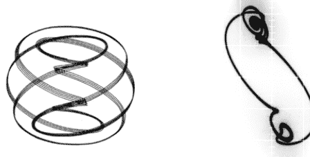

图 2.35。绘图仪输出示例

图 2.36。典型的示波器截图

# 第 3 章 模拟计算机操作

尽管乍一看，使用模拟计算机解决问题似乎是一项艰巨的任务，但在实践中，这是一个相对简单的过程。图 3.1 和 3.2 显示了两台经典的模拟计算机——一台 EAI-580 和一台 Telefunken RA770 精度模拟计算机。

这两台机器最明显的特征是巨大的中央接线板，它包含数千个插座；在高精度模拟计算机上，这些插座通常是经过屏蔽的。虽然大多数制造商开发了自己的电缆和连接器系统，但小型台式模拟计算机使用标准的 4 mm 或 2 mm 香蕉插头来连接它们的计算元件。模拟计算机程序通过连接接线板上的插座来建立，创建一个电路，该电路是所研究问题的模拟。

图 3.3 显示了从一台经典机器上拆卸的接线板。程序通常是预先接线的，接线板在不使用时存储在柜子里。尽管从今天的角度来看这似乎很过时，但它是存储“加载式”模拟程序的可行手段。

更详细观察图 3.1 中的 EAI-580 可以发现其左半部分分为四个子单元。底部是主控制面板，允许操作员选择所需的运行模式（IC、OP、HLT、重复操作）。它还包含用于设置伺服电位器的按钮控制按钮，这些电位器通常安装在中大型模拟计算机中。它们取代了大部分手动精度电位器，由一个机械耦合到小型电机的电位器组成，由简单的伺服环控制旋转。使用这种结构，可以通过选择电位器地址并输入所需的值来设置这些电位器。

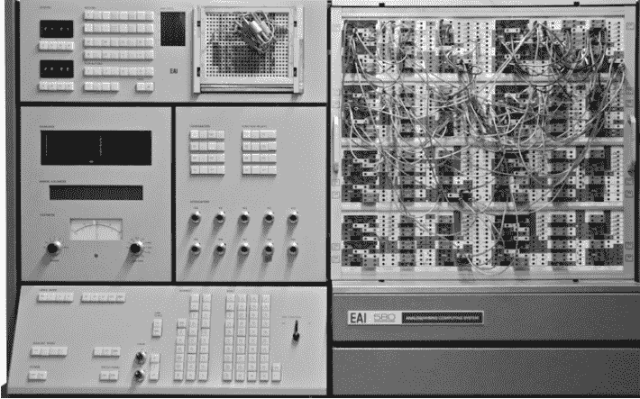

图 3.1。EAI-580 模拟计算机

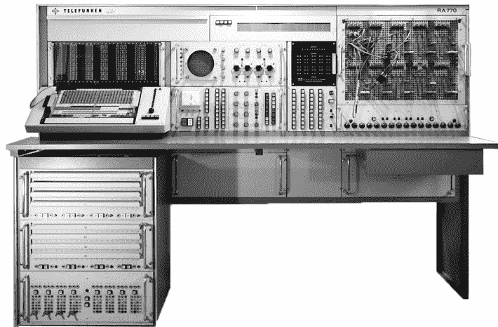

图 3.2。Telefunken RA770 精度模拟计算机

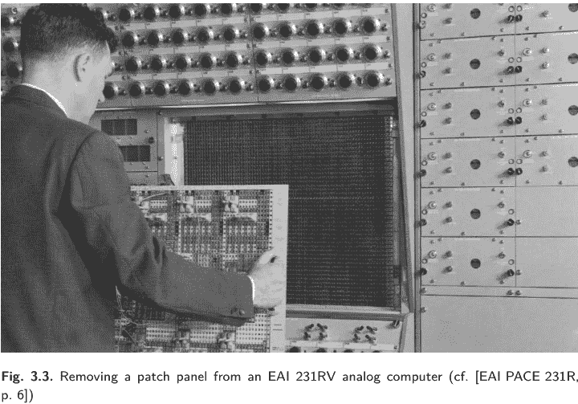

图 3.3。经典接线板

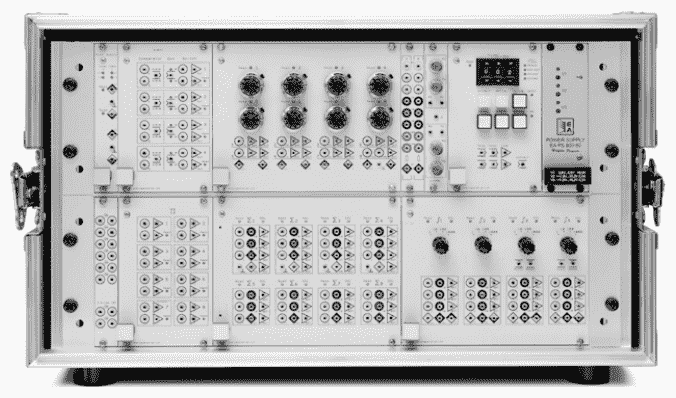

图 3.4。Analog Paradigm Model-1 模拟计算机（图片由 JAMES BALL 拍摄）

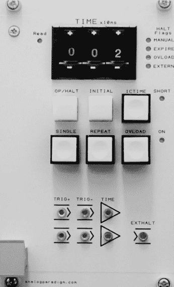

**图 3.5. 控制单元**

在 OP 周期期间任何计算元件检测到过载时的停止（HALT）状态。

控制单元底部的接口提供触发信号，这些信号可以与示波器或绘图仪等外部设备配合使用。标记为 EXTHALT 的接口可以通过施加外部信号（通常是比较器的输出或源自外部设备的信号）来停止当前的 OP 周期。

# 第 4 章 基础编程

尽管在模拟计算机上解决问题的基本前提与为数字计算机编程基本相同，但实际的编程过程与目前主导的算法方法有显著区别。图 4.1 显示了主要步骤。首先，必须检查正在研究的问题，并推导出一个数学表达式，通常是一组耦合微分方程（简称 DEQs）。从这里开始，数字和模拟的编程方式就迅速分化了。在数字计算机上，这些方程构成了算法的基础，算法将以逐步的方式执行。在为模拟计算机编程时，同样的方程将被转换为一个接线设置，该设置决定了各个计算元件相互连接。这种设置被称为模拟计算机程序。

由于微分方程在模拟计算机编程中至关重要，对这些数学对象进行简单的介绍可能是恰当的。基本上，微分方程是一个未知数不是简单的值，而是一个函数的方程。微分方程由该未知函数以及该函数的各种导数组成。为了稍微简化问题²⁸，假设该函数及其所有所需的导数都是关于单个自变量的。这个自变量通常是时间。这类微分方程通常称为常微分方程或 ODE，其一般形式为

$$f\left(t, y, \frac{dy}{dt}, \frac{d^2y}{dt^2}, \dots, \frac{d^ny}{dt^n}\right) = 0 \quad (4.1)$$

其中 `y` 表示未知函数，一个“简单”变量！如果自变量是时间，则 `y` 依赖于 `t`，因此应被看作 `y(t)`，尽管为了避免方程中不必要的混乱，几乎很少显式写出来。这种时间依赖性使得微分方程非常有趣且强大，因为它们可以用来描述动态系统。

`y` 的最高阶导数决定了 ODE 的阶数。按照习惯，对时间的导数将通过在函数上方加点来表示，如下：

$$\dot{y} = \frac{dy}{dt}, \ddot{y} = \frac{d^2y}{dt^2}, \dddot{y} = \frac{d^3y}{dt^3}, \dots$$

通常情况下，用 `y` 表示物体某些位置的系统需要导数 `\dot{y}`（速度）、`\ddot{y}`（加速度），有时还需要 `\dddot{y}`（加加速度或冲击加速度）。微分方程也可以包含具有多个自变量的函数和导数。一个典型的例子是众名的一维*波方程*

$$\frac{\partial^2u}{\partial t^2} = c^2 \frac{\partial^2u}{\partial x^2}$$

这描述了波在介质中的传播。这种类型的方程被称为偏微分方程 (PDEs)，即使使用模拟计算机，其求解也比 ODE 复杂得多。

## 4.1 放射性衰变

作为一个介绍性示例，我们将使用模拟计算机详细研究放射性衰变的行为。化学元素具有相同的质子数，但在中子数上不同。不稳定的元素通常会发射 `α` 粒子、`β` 粒子（电子）或 `γ` 射线。这些是最常见的，通过*放射性衰变*变为其他同位素。无论实际衰变机制如何，给定时间间隔内衰变的原子数量与初期的同位素数量成正比。

由于放射性衰变是一个随机过程，重点将是任何同位素的原子数量。使用之前引入的点符号这可以写为²⁹

$$\dot{N} \propto N,$$

其中 `α` 表示比例因子 `λ`，衰变率，如下：

$$\dot{N} = -\lambda N,$$

该方程非常简单，描述了不稳定同位素随时间的变化。如前所述，`N` 是时间的函数。

### 4.1.1 解析解

如前，描述“真实”问题的微分方程简单到可以进行解析求解。在无法解析解或所需工作过大的情况下，可以使用模拟计算机来模拟所研究的动态系统的行为。为了完成这一方程，必须将方程组转换为计算机设置或程序，如后续章节所示。这可以通过两种方法实现：使用*反馈技术*或*替换技术*³⁴

在下，我们将使用非常直接的反馈技术：首先对微分方程进行重排，使其导数孤位于方程左侧。然后假设该导数是已知的。将其输入积分器链（必要时使用加法器），即可获得方程右侧的所有低阶导数。这些低阶导数随后通过合适的元件组合。

### 4.1.2 使用模拟计算机

在两边应用 `exp()` 并显式写出参数 `t`，结果为：

`N(t) = N(0)e^{-λt}`

由于 `N(0)` 表示 `t=0` 时存在的原子数量，我们得到：

`N(0) = e^0e^c = e^c`,

最终得到

`N(t) = N(0)e^{-λt}, \quad (4.3)`

通用的*放射性衰变律*³³，其中 `λ` 表示衰变率。通常*半衰期* `T_{1/2}` 表示 `t=0` 时可用原子的一半发生变的时间。它与 `λ` 的关系为：

`T_{1/2} = \frac{\ln(2)}{λ}`,

得到了教科书中常见的指数衰变形式：

> 33 另一种缺乏数学严谨性的推导可以在标准文献如 [SCHWANKWER 1980, p. 111 f.] 中找到。
>
> 34 更多信息请参见 [SCHWARZ 1971, p. 168 ff.]。

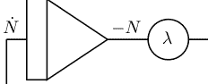

**图 4.2.** 衰变问题的初始计算机设置

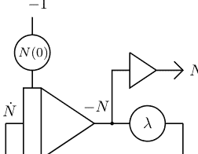

**图 4.3.** 衰变问题的最终计算机设置

连续积分从此处开始。输出随后连接到积分器链的输入端，从而形成一个*反馈回路*。

在放射性衰变的情况下，微分方程（DEQ）的左侧已经是其最高阶导数：

$$\dot{N} = -\lambda N. \quad (4.4)$$

假设 `\dot{N}` 已知，可以将其输入积分器，其输出可以很容易得到 `N`。将此值乘以 `λ` 得到 `-λN`，这正是方程 (4.4) 的右侧。由于两边必须相等，因此 `-λN` 可以用作推导 `-\dot{N}` 的积分器的输入，从而有效地形成了图 4.2 所示的核心反馈回路。

该设置尚未完成，因为缺少设置初始条件 `N(0)` 的方法。此外，输出 `N` 而不是 `-λN` 也更好。图 4.3 所示的程序同时满足了这两个要求。

这两个电路在 Analog Paradigm Model-1 模拟计算机上产生的结果如图 4.4 所示。典型的解曲线可以在图 4.5 所示的示波器截图看到。显示的解显然符合解析解 (4.3) 预期的 `-x` 形式。

为了更深入地理解此类动态系统的行为，可以在循环重复模式下运行计算机。如果扫频时间足够短，在示波器屏幕上可以获得几乎无闪烁的解曲线图像。改变系数电位器设置的影响将立即显示在屏幕上。这种运行模式通常需要一个简单的线性斜坡 `τ` 用于示波器的 `x` 偏转。³⁶ 这可以通过单个积分器轻松产生，如图 4.6 所示。`β` 的设置控制示波器光束开始的位置，而 `α` 控制斜坡增加的速度，从而控制了结果图像的宽度。

> 35 必须始终考虑到积分器和加法器引起的隐含符号变化。
>
> 36 使用标准示波器的内置扫描发生器也是可能的，但需要从模拟计算机的控制单元触发示波器以获得稳定的图像。

图 4.7 显示了一个长曝光截图，模拟计算机在循环模式下运行，使用线性电压斜坡进行 `x` 偏转，同时曝光期间手动改变了参数 `λ`。可以清楚地看到衰减函数的指数特性。³⁷

> 37 从右下到左左角的微弱迹线是积分器周期性重置的结果。理想情况下，示波器的光束应该在控制单元的控制下通过 `z` 输入关闭。

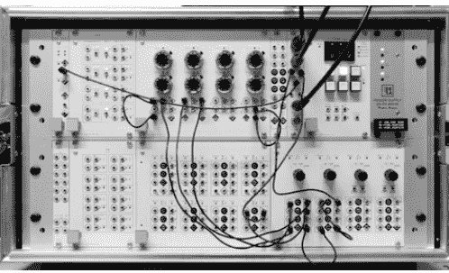

**图 4.4.** 放射性衰变模拟设置

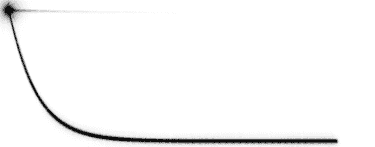

**图 4.5.** 放射性衰变模拟

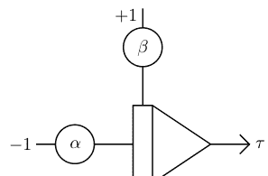

**图 4.6.** 扫描信号的产生

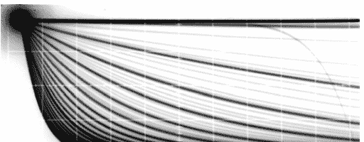

**图 4.7.** 循环模式下变参数 λ 的放射性衰变模拟

虽然示波器输出需要积分器的高比例因子 `k0`，但如果使用绘图仪作为输出设备，则 `k0` 必须低得多，以免超过绘图仪的最大写入速度。在这种单次运行操作中，每次计算机运行将获得一个解函数的图表。

### 4.1.3 缩放

在上一节中获得的解只是定性的——`λ` 和 `k0` 的设置是任意选择的，为了获得指数衰减行为的感觉。为了获得定量解，必须对问题进行适当缩放。缩放是任何模拟计算机编程的核心部分，而且通常是最困难的。

根据经验法则，计算中的所有变量应尽可能跨越允许的值范围 `[-1, 1]`，以使计算元件中不可避免的误差影响尽可能最小。因此，例如，如果对 `N(0)=1` 进行缩放，则 `N(0)` 应被缩放，使其对应于 `-1.3`。因此，必须区分*问题变量*和*机器变量*。机器变量通常用加盖符号表示：

$$\hat{N} = \alpha$$

其中 `α` 是缩放因子。在除法情况下，缩放过程必须同时考虑分子和分母。要将变量 `x` 缩放因子为 `ξ`，需要执行以下步骤（`ξ < 1` 缩小，`ξ > 1` 放大）：

- 将所有产生 `x` 的加法器或积分器的输入按 `ξ` 缩放。在所有 `x` 作为后续加法器或积分器输入的地方，必须引入 `1/ξ` 的缩放因子。这对于乘法器、除法器等无法直接，因为这些计算元件没有权重大于 1 的输入。在这些情况下，必须在后续阶段考虑反缩放因子。
- 这些步骤必须对给定问题中的所有变量执行。最终，在步骤中引入大部分缩放因子将抵消最终的计算机设置。

## 4.2 谐波函数

下一个例子稍微复杂，基于以下二阶微分方程：

$$\ddot{y} + \omega^2 y = 0. \quad (4.5)$$

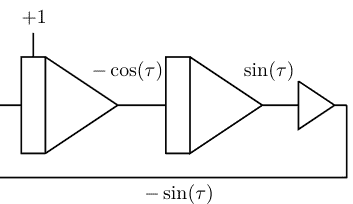

**图 4.8.** 对于 `ω = 1` 的方程 (4.5) 的基础计算机设置。

为了应用 KVIN 反馈技术，必须对方程 (4.5) 进行重新排版，使其最高阶导数出现在左侧，得到：

$$\ddot{y} = -\omega^2 y$$

这个微分方程仍然足够简单，可以“猜”出解析解。我们需要找到函数 `y`，使其二阶导数等于该函数乘以某个权重 `ω²` 后的负值。当然，其中一个函数是常数 0 函数，这非常微不足。另外两个有趣的解是基于正弦和余弦的：

$$\frac{d^2\sin(\omega t)}{dt^2} = -\omega^2\sin(\omega t)$$

$$\frac{d^2\cos(\omega t)}{dt^2} = -\omega^2\cos(\omega t)$$

因此，仅通过观察就确定了该微分方程的三个基本解。这些被称为特解，但哪一个解才是正确的呢？仅从 (4.5) 无法判断，因为该方程没有包含任何关于初始条件的信息。由于该微分方程是二阶的，因此涉及两个初始条件：一个针对 `y`，称为 `y0`，另一个针对 `\dot{y}`，记作 `\dot{y}_0`。


为了保持简单，假设 $\omega=1$，且 $\tau$ 仅由图 4.8 所示的 $k_0$ 控制。最左侧的积分器在仿真开始时 ($t=0$) 的输出信号为 $-1$。第二个积分器隐含地具有初始条件 0，因此其输出在 $t=0$ 时为零，并将由于第一个积分器输出提供的输入值，在仿真期间最初上升。

当 $\omega=1$ 时，$\tau$ 由 $k_0$ 控制，$k_0$ 必须对两个积分器设置得相等。设置 $k_0=10^2$ 会得到一个周期为 6.28 ms 的输出信号，这正是 $\omega=1$ 时的预期结果。

使用不同的初始条件方案（最左侧积分器为 0，第二个积分器为 -1）将产生 $\cos(\tau)$ 而不是 $\sin(\tau)$。通过对两个积分器应用 $\neq 0$ 的初始条件，可以实现这些特解的线性组合。用 $\dot{y}_0$ 和 $y_0$ 表示左、右积分器的初始条件，则有：

$$y_0 = -a\sin(\tau)$$

## 4.1 基础编程

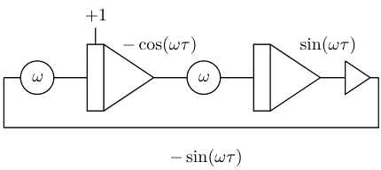

**图 4.9.** 变量 $\omega$ 的方程 (4.5) 的基础计算机设置。

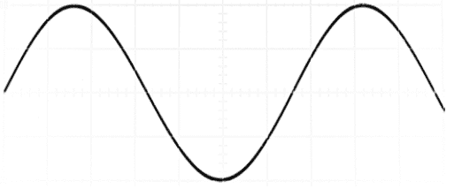

**图 4.10.** 图 4.9 所示计算机设置中第二个积分器的输出，其中 $k_0 = 10^3$ 且 $\omega = \frac{1}{2}$

$y_0 = -\omega\cos(\tau)$

由于这个基础电路在 $y_0 = 0$ 和 $y_0 = 1$ 时分别产生 $-\cos(\tau)$ 和 $\sin(\tau)$，它通常被称为*正交器*（quadrature generator）。它是许多更复杂计算机设置的基础，并且在示波器上显示基于闭环的图形时特别有用（将在后续章节所示）。

现在，$0 < \omega < 1$ 的情况如何？在图 4.8 所示的设置中，反相器后只需要一个系数电位器吗？遗憾的是，并非如此，因为 $\omega$ 有效地改变了两个积分器的时间尺度！如果仅在反相器后使用一个电位器，从而改变最左侧积分器的输入，只会将其时间尺度改为 $\omega k_0$，而第二个积分器仍将以 $k_0$ 运行。因此，通常需要同时改变两个积分器的时间尺度因子，如图 4.9 所示。

图 4.10 显示了 $\omega = \frac{1}{2}$ 时最左侧积分器的相应输出。与之前一样，屏幕上的一个分格对应 2 ms。因此，显示的正弦信号的一个周期约为 12.55 ms，这对于该 $\omega$ 值来说是 $4\pi t$ 的良好近似。

到目前为止的结果是在计算机设置为重复操作且 O 间隔为 20 ms 的情况下生成的。在某些情况下，像图 4.9 所示的电路必须运行很长时间，例如在示波器上显示一个球（基于正弦/余弦信号对的缩放单位圆），就像它在盒子里来回跳一样：

## 4.2 谐波函数

在这种情况下，这种简单的计算机设置通常是不够的，因为正弦/余弦信号的幅度在长时间内不会保持不变。这是由于真实计算元件不可避免的缺陷造成的。取决于所使用的计算机，幅度可能会随着时间的推移而减少，要么塌缩为零，要么导致过载。因此，必须实现幅度稳定。

这背后的原理相当简单。一方面，为了避免幅度减小，必须引入负反馈。这是通过电位器 $a^*$ 实现的，它是少数需要动接电位器的情况之一。

这里的想法是对二极管施加负偏置，使其在最左侧积分器的输出高于此偏置时开始导通。二极管开始导通，实际上实现了一个反馈回路（具有负指数特性）。这种设置带有缓冲电位器的模拟计算机上运行良好。如果使用没有缓冲电位器的经典计算机，连接电位器 $a^*$ 的二极管阴极应连接到求和节点。

## 4.2 谐波函数（续）

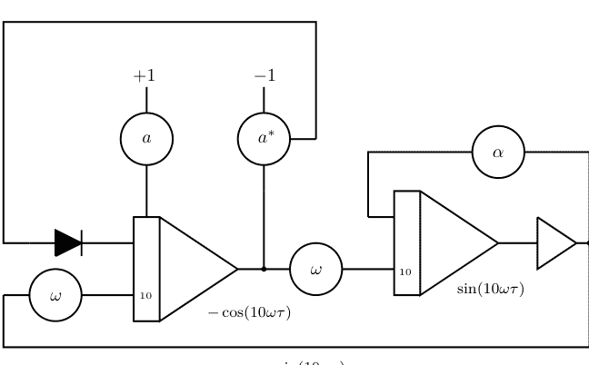

**图 4.11.** 方程 (4.5) 的基础计算机设置。

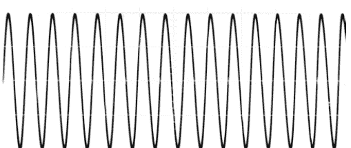

**图 4.12.** 图 4.11 所示计算机设置中第二个积分器的输出，其中 $k_0 = 10^3$ 且 $\omega = \frac{1}{2}$，导致时间尺度因子为 $10k_0\omega = 5000$

电位器 $a$ 和 $a^*$ 的设置之间存在相互作用。由于 $a$ 决定了输出信号的初始幅度，$a^*$ 的设置应使得二极管偏置电压与初始幅度相当。如果 $a > a^*$，在将计算机切换到 OP 模式后，幅度稳定电路就会介入。这将导致幅度迅速减小，这通常是不希望看到的。

另一种更简单的实现使用电位器 $a^*$，并通过两个反串联二极管将最左侧积分器的输出连接到其求和节点。这些二极管在幅度达到阈值水平时开始导通，从而有效地限制了积分器的输出。

## 4.2 谐波函数（续）

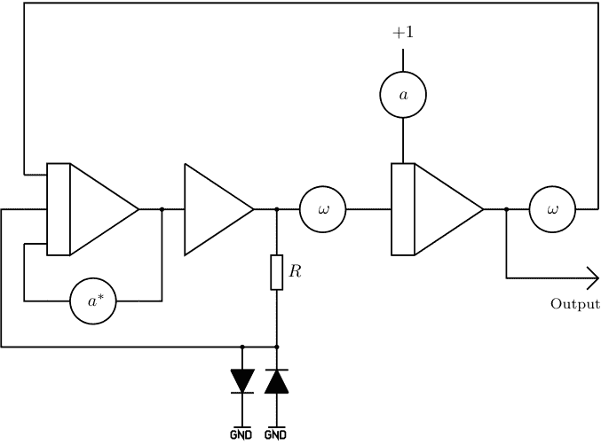

**图 4.13.** 一种幅度稳定振荡器的不同方法

EDWARD L. KORTE$^{41}$ 设计了该电路的一种变体，如图 4.13 所示。从表面上看，这个电路与上述描述的非常相似，但存在两个细微的差别：

- 幅度通过标记为 a* 的电位器设置，对最左侧的积分器进行负线性反馈来实现稳定。

- 它需要一些正反馈来保持幅度。这通过电阻 R R 和两个限流二极管实现。该电阻的量级应与最左侧积分器的输入电阻相同。这将产生一个微小的正矩形反馈信号，该信号可以防止幅度下降到零。

当计算需要高频谐波信号或等恒频率信号对时，该电路非常有用。然而，它并不常作为扫频发生器（见下一节描述）的基础，因为幅度设置 a* 对频率有很大的依赖。

> 41 参见 [KORTE 1964]。

## 4.3 扫频

有时让谐波函数在频率范围内*扫频*是有用的。在实验室环境中，这通常通过*扫频发生器*（也称为 *wobbulator*）完成。通过求解微分方程

$\tilde{y} = -\omega^2 y$

让 $\omega$ 从 0 到 1 线性变化，很容易得到一个谐波扫频函数。这是前节所示计算机设置的一种特殊变体。基本设置如图 4.14 所示。

其底层设备非常简单。最左侧的积分器产生从 $-1$ 到 $+1$ 线性变化的电压。将其缩放 0.5 倍并加上 0.5，即可在该积分器的输出处产生一个从 0 到 $-1$ 的线性斜坡。图 4.9 中用于设置 $\omega$ 的两个电位器在该电路中被两个乘法器取代，乘法器输入随时间变化的 $\omega$ 斜坡。

产生的输出信号如图 4.15 所示。需要注意的是，幅度可能像之前那样需要一些稳定，因为幅度随着时间的推移明显增加。

基本上，如果给出了 $\varphi$ 并将其输入两个乘法器，图 4.14 上半部分的子电路就可以生成 $\sin(\varphi)$ 和 $\cos(\varphi)$。这实际上是一个非常有用的电路，因为许多问题需要在宽参数 $\varphi$ 范围内使用谐波函数，并且设置的其他地方可以获得 $\varphi$，如下例所示。

Fig 4.14. 基础扫频电路

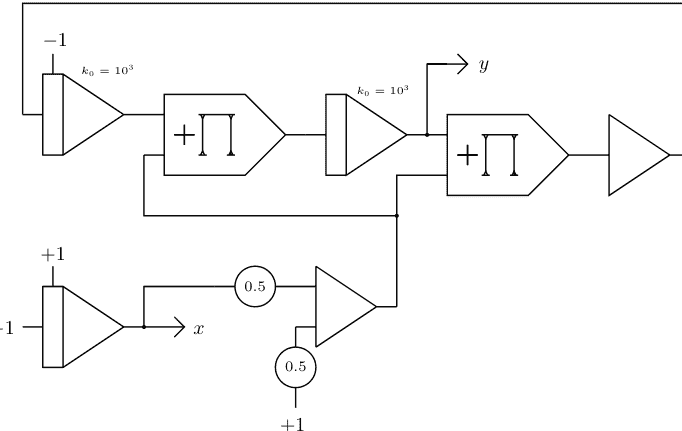

## 4.4 数学单摆

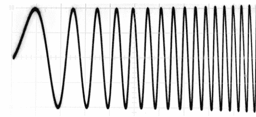

**图 4.15.** 通过求解 $\ddot{y} = -\omega^2 y$（其中 $0 \le \omega \le 1$）生成的波形

本节描述了如图 4.16 所示的*数学单摆*顶端的运动模拟。它由一根无质量的杆组成，杆在点 0 处旋转，可以自由摆动。在杆的另一端安装了一个质点 $m$。角度 $\alpha$ 表示单摆的最大位移，即其初始条件，而 $\alpha$ 表示相对于通过位于点 $0^{42}$ 处的垂直线的当前角度。

质量受到重力加速度引起的力 $F_g = mg$ 的作用。该力可以分解为作用在质量上的切向力 ($F_t$) 和 径向力 ($F_r$ )：

$F_t = -mg\sin(\alpha)$

$F_r = mg\cos(\alpha)$

$F_t$ 是恢复力，它将驱动质量回到静止位置。它引起切向加速度：

$a_t = \frac{F_t}{m} = l\ddot{\alpha}$

其中 $l$ 表示单摆杆的长度，$\ddot{\alpha}$ 是角加速度。这很容易得出：

$ml\ddot{\alpha} = -mg\sin(\alpha)$

从而得到描述单摆动力学行为的二阶微分方程：

$\ddot{\alpha} + \frac{g}{l}\sin(\alpha) = 0 \quad (4.6)$

42 由于 $\alpha$ 随时间变化，$\alpha(t)$ 会更准确，但会使后续的推导变得复杂。此外，该角度的时间依赖性体现在用于其导数的点记法中。

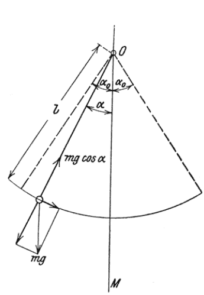

Fig. 4.16. 数学单摆（参见 [HORT 1910, p. 1]）

### 4.4.1 直接实现

如果 $\alpha$ 足够小，$\sin(\alpha)$ 可以近似为：

$\sin(\alpha) \approx \alpha - \frac{\alpha^3}{6}$

这使得 (4.6) 简化为：

$\ddot{\alpha} + \frac{g}{l}(\alpha - \frac{\alpha^3}{6}) = 0$

该函数可以通过两个乘法器、一个求和器和一个系数电位器生成，不仅节省了元件，还通过前节描述的方法消除了随时间积累的漂移。某些时间相关的变量可以使用两个积分器轻松生成。在这种情况下，改变 $\varphi$ 的符号将产生所需的正弦近似：

$\int(\int \varphi d\tau) \, d\tau = \frac{\varphi^3}{6}$

这种方法将在 5.3 节中详细介绍。

43 *足够小*实际上取决于 $\varphi$ 的范围。$-\pi/8 \le \alpha \le \pi/8$

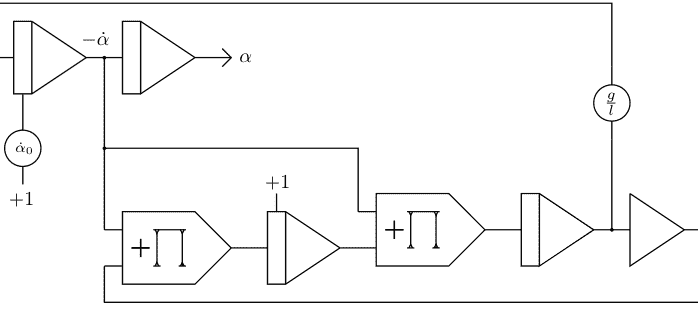

Fig 4.17. 带正弦发生器的数学单摆

### 4.4.2 变体

这种实现方法很优雅，但代价是需要两个乘法器。在像数学单摆这样的参数限制在小值的情况下，其他变体可能更有优势。一种直接的方法是使用 TAYLOR 级数：

$sin(\varphi) = \sum_{n=0}^{\infty} (-1)^n \frac{\varphi^{2n+1}}{(2n+1)!}$

来近似所需的函数。根据所需的精度，只需设置：

$sin(\varphi) \approx \varphi - \frac{\varphi^3}{6} \quad\quad (4.7)$

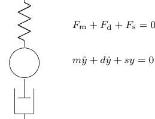

Fig 4.18. 简单弹簧阻尼系统

## 4.5 弹簧阻尼系统

除了 4.2 中所示的幅度稳定方案外，目前为止的问题表现出无阻尼的振荡行为。下一个示例使用图 4.18 所示的简单弹簧阻尼系统引入了阻尼。在这个示例中，$y$ 表示相对于平衡位置的垂直位置。忽略作用在质量上的任何重力加速度，需要考虑三个力：

- 运动质量的力，$F_m = ma = m\dot{y}$

- 弹簧产生的力，假设它与作用在弹簧上的应变线性相关，$F_s = sy$，

- 以及 速度线性阻尼器的力，$F_d = dv = d\dot{y}$。

由于这是一个封闭物理系统，所有力之和为零，给出描述该弹簧阻尼系统动力学行为的二阶微分方程：

$m\ddot{y} + d\dot{y} + sy = 0 \quad (4.8)$

在这里，$m$ 表示质量，$d$ 是阻尼常数，$s$ 是弹簧常数。如果没有阻尼力 $F_d$，它将仅仅是上例中的一个无阻尼谐振子，如前几个例子所示。

## 4.5.1 解析解

该机械系统仍然足够简单，可以通过解析法求解，这是很有用的，因为之后可以将该系统与模拟计算机得到的解进行比较。将 (4.8) 除以 $m$ 得到

$$\ddot{y} + \frac{d}{m}\dot{y} + \frac{s}{m}y=0. \quad (4.9)$$

根据以下对阻尼系数的定义

$$\beta := \frac{d}{2m}$$

以及（无阻尼）角固有频率$^{44}$

$$\omega_0 := \sqrt{\frac{s}{m}}$$

可以将其重写为

$$\ddot{y} + 2\beta\dot{y} + \omega_0^2y=0. \quad (4.10)$$

处理此类微分方程的一种经典方法是指数函数“假设法”

$$y=ae^{\mu t}$$

得到

$$\dot{y} = \mu ae^{\mu t} \text{ 和 } \ddot{y} = \mu^2 ae^{\mu t}.$$

将这些代入 (4.10) 得到

$$\mu^2 ae^{\mu t} + 2\beta\mu ae^{\mu t} + \omega_0^2 ae^{\mu t}=0.$$

除以 $ae^{\mu t}$ 得到以下二次方程

$$\mu^2 + 2\beta\mu + \omega_0^2=0.$$

44 固有频率（有时称为自然频率）是系统在没有任何外力作用下振荡的频率。

通过应用二次公式可以直接求解

$$\mu_{1,2} = \frac{p}{2} \pm \sqrt{\frac{p^2}{4} - q}$$

其中 $p = 2\beta$ 且 $q = \omega_0^2$ 得到解

$$\mu_{1,2} = -\beta \pm \sqrt{\beta^2 - \omega_0^2}. \quad (4.11)$$

根据定义

$$\omega^2 = \omega_0^2 - \beta^2$$

(4.11) 可以重新排列为

$$\mu_{1,2} = -\beta \pm i\omega$$

(4.9) 的解由线性组合给出

$$y = ae^{\mu_1 t} + be^{\mu_2 t} = ae^{-(\beta+i\omega)t} + be^{-(\beta-i\omega)t} = ae^{-\beta t}e^{i\omega t} + be^{-\beta t}e^{-i\omega t} = e^{-\beta t}(ae^{i\omega t} + be^{-i\omega t}). \quad (4.12)$$

从复分析$^{45}$ 中知

$$e^{i\omega t} = \cos(\omega t) + i\sin(\omega t)$$

$$e^{-i\omega t} = \cos(\omega t) - i\sin(\omega t)$$

应用于此 (4.12) 得到

$$y = e^{-\beta t}(a(\cos(\omega t) + i\sin(\omega t)) + b(\cos(\omega t) - i\sin(\omega t))) = e^{-\beta t}((a+b)\cos(\omega t) + i(a-b)\sin(\omega t)). \quad (4.13)$$

$e^{-\beta t}$ 项是该振荡系统的阻尼，而 $a+b$ 和 $a-b$ 由初始条件决定。如果假设质量在 $t=0$ 时偏离了角度 $\alpha_0$，那么这显然将是其运动的最大幅度。如果质量在 $t=0$ 时被释放且没有给它任何初始速度，则满足以下初始条件：

$$\alpha(0) = \alpha_0$$

$$\alpha'(0) = 0.$$

**45** 文中函数 $\cos(\varphi) + i\sin(\varphi)$ 有时表示为 $\cis(\varphi)$。

## 4.5.2 使用模拟计算机

由于 $t=0$ 时 $\cos(\omega t) = 1$ 且 $\sin(\omega t) = 0$，可以得出

$\alpha(0) = (a + b) = \alpha_0$。

对 $t$ 求导 (4.13) 并应用相同的论点得到

$\dot{\alpha}(0) = (a - b)\omega = 0$

因此在这种情况下 $a-b=0$。所以，一个在 $t=0$ 时从阻尼位置释放且没有初始速度的质量，其描述为

$y = e^{-\beta t}\alpha_0 \cos(\omega t)$

这从实际角度来看正是预期的结果。质量的位置遵循一个简单的谐谐函数，其幅度被一个带有负指数的指数项阻尼。

项 $\omega = \sqrt{\omega_0^2 - \beta^2}$，$T = \frac{2\pi}{\omega}$ 为周期，这非常有趣，因为根据 $\omega_0$ 和 $\beta$ 必须区分三种情况：

- $\omega_0 > \beta$: *欠临界阻尼（欠阻尼）*，质量振荡。

- $\omega_0 = \beta$: *临界阻尼*——系统以指数衰减的方式回到静止位置。

- $\omega_0 < \beta$: 在这种情况下系统被设置为*过阻尼*。它将回到静止位置，但没有任何过冲，且比临界阻尼慢。

应该注意的是，阻尼频率 $\omega$ 总是低于 $\omega_0$，这取决于阻尼的大小，如下一节所示，在模拟计算机上模拟系统时可以观察到。

## 4.5.3 使用模拟计算机

方程 (4.8) 被用作导出该弹簧-阻尼系统设置的基础。重新排列得到

$$\dot{y} = \frac{\dot{x} + sy}{m}$$

这可以很容易转换为图 4.19 中的计算机设置。与其除以 $m$，不如乘以 $1/m$ 简单得多，尽管这在设置电位器之前需要一些计算。

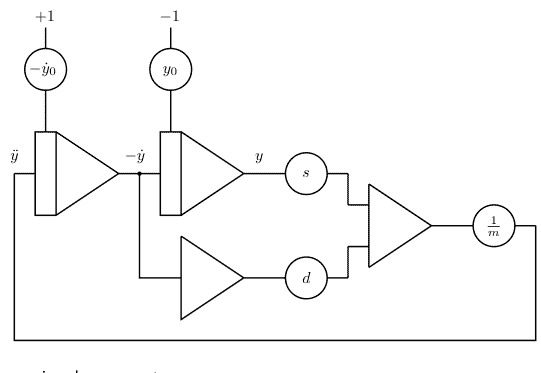


# 质量-弹簧-阻尼系统与 RLC 电路

使用两个电位器 `-y_0` 和 `y_0` 可以设置质量弹簧-阻尼系统的初始条件，`y_0` 控制质量，`-y_0` 设置其初始速度。图 4.20 到 4.23 显示了在模拟计算机上模拟系统时，由于阻尼的大小，可以观察到阻尼频率 `ω` 总是低于 `ω_0`。更硬的弹簧需要更强的阻尼。图 4.24 中的简化设置由于三个求加器（其中一个作为反相器），更硬的弹簧具有更高的频率。这种情况下，弹簧和阻尼的参数 `s` 和 `d` 无法独立地设置 `m`，因为

```
u = s/m 和 μ = d/m
```

这与 (4.9) 匹配良好。

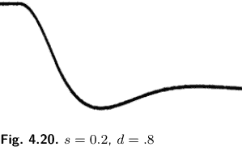


## RLC 电路

一个与弹簧阻尼系统具有相似行为的物理系统可以通过电阻 `R`、电容器 `C` 和电感 `L` 来建立，如 4.25 所示。该系统也可以看作弹簧阻尼系统的模拟，这里将作为模拟计算机程序的示例。

该电路由微分方程描述

```
LQ + RQ + (1/C)Q = 0  (4.14)
```

其中 `Q` 表示电荷。这在结构上与 (4.8) 相同，因此目前推导的内容都可以适用于 RLC 电路。重新排列得到

```
Q'' = -(R/L)Q' - (1/LC)Q.
```

以下示例基于图 4.24 所示的计算机设置，且 `y'=0`。假设了以下元件值：

- `C = 1.2 μF`
- `L = 5.1 mH`
- `R = 20 Ω`
- `E = 6.94 V`


其中 `E` 代表电路提供的电池电压。电容器在 `t=0` 时充满电给出了初始条件

```
Q_0 = CE = 8.328 · 10^{-6} As
```

这也是振荡系统可以显示的电荷变量的最大幅度。这很容易地得出了幅度缩放因子

```
α = 1 / (8.328 · 10^{-6} As) ≈ 1200077 (As)^{-1}.
```

牺牲一部分机器单位范围 `[-1, 1]`

```
α = 0.1 · 10^6 (As)^{-1}
```

将被选择，因为这极大地简化了缩放过程。

将此应用于 (4.14) 可得到以下缩放方程：

```
Q̂ = -3.92 · 10^3 Q̂ - 1.63 · 10^8 Q̂
```

初始条件 `Q_0` 必须适当缩放，得到（大约）：

```
Q_0 = 0.833.
```

使用这些缩放后的幅值，最后一步是时间缩放。图 4.25 所示基础 RLC 电路的（无阻尼）角频率为：

```
ω = 1/√(LC) ≈ 12783 s^{-1}
```

导致

```
u ≈ 2 kHz
```

由于 `u = ω/2π`。选择时间缩放因子 `β = 10^4`，最终得到：

```
d²Q̂/dτ² = -0.392 dQ̂/dτ - 1.63 Q̂
```

系数 0.392 和 1.63 现在可以很容易地设置为图 4.24 所示计算机设置中的 `μ` 和 `ν`，其中 1.63 由 `ν = 0.163` 表示，并供给加权为 10 的积分器输入。

本示例结束了模拟计算机编程的介绍部分。下一章将介绍一些实用的专用电路，这些电路也可以作为额外的编程示例。

> **注 47** 与之前一样，帽子符号（hats）表示（缩放后的）角频率。为了简化符号，以后省略单位。
>
> **注 48** 由于无阻尼角频率总是大于阻尼频率，它是电路预期的一个良好上限。

# 第 5 章 特殊函数

与经典的数字计算机编程一样，模拟计算机设置中经常出现*特殊函数*，例如反函数（如“平方根”）、极限、滞后等。本章描述了典型的“库”函数，这些函数可以作为构建更复杂程序的基组件。在算法领域，特别是在 Perl 程序员中，“实现某功能的方法不止一种”这句话在模拟计算机程序中同样适用。

在有疑问或寻找其他函数时，应咨询经典文献。权威书籍 [KORN et al. 1964] 和 [GILOI et al. 1963]（德语）以及 [HAUSNER 1971]、[GILLAND 1967]、[AMMON 1966] 和 [CARLSON et al. 1967] 非常建议进一步阅读。

## 5.1 反函数

生成函数的一种非常强大的技术是反函数，例如根据函数 `f(x) = x²` 获取平方根。回想求和器和积分器的基础设置，产生反函数的设置的想法非常简单，它基于运算放大器试图保持其反相输入 `V_J` 为零的这一事实。图 5.1 显示了生成反函数的基础设置。


**图 5.1.** 生成反函数的基础设置

该电路的核心是一个函数发生器，它形成开路放大器的反馈元件。当输入信号为 `x` 时，如果 `-x = f(-y)` 且 `y = f⁻¹(x)` 为放大器的输出值，则求和点将为零。

如果反函数在整个 `[-1, 1]` 范围内没有定义，则需要措施防止放大器过载。有时需要在运算放大器的输出与其求和点之间连接一个小型电容（通常为 10 pF），如果基础设置显示出不稳定性。

### 5.1.1 平方根

反函数的一个良好示例是图 5.2 所示的平方根电路。这基本上与图 5.1 的设置相同，但增加了额外的部件。二极管和一个小型电容连接在放大器的输出与其求和点之间。当输入变为正且乘法器的输出为正时，二极管可以防止放大器饱和。

尽管这不会损坏放大器，但饱和会产生溢出并导致无意义的输出。此外，放大器可能需要一些时间从这种状态中恢复。这对于经典模拟计算机尤其如此，其恢复时间可达几秒。注意二极管会将放大器的输出保持略低于零——对于标准硅二极管该电压约为 0.7 V，对于肖特基二极管则低至 0.2 V。

> 这种设置可以看到带有小型电容确定的极高时间系数积分器。另一种生成反函数的方法（适用于除法）将在 5.1.2 节中显示。


**图 5.2.** 典型的平方根电路


**图 5.3.** 由 `-1 ≤ x ≤ 1` 设置生成的函数

当放大器输出接近零时，小型电容防止振荡。在某些情况下，取决于开路放大器的行为，可以省略它。图 5.3 显示了该电路的行为。输入值由单个积分器产生从 `-1` 到 `+1` 的斜坡。该斜坡也用于 `x` 偏移。

### 5.1.2 除法

上面的平方根电路可以很容易修改以实现除法。图 5.4 显示基础设置：将乘法器连接到放大器的输出和输入 `y`，开路放大器将将其输出推向 `-x/y`，使得乘法器的输出产生 `-x`，从而抵消 `x` 输入。

如前所述，需要在放大器的输出与其求和点之间连接一个约 68 pF 的小型电容，以防止电路不稳定。还需要注意，该电路不执行四象限除法。某些系统具有预接线模块来计算常用的反函数（如平方根和除法）。图 5.6 显示了一个包含两个计算元件的 MDS 模块，可以切换执行乘法、除法或平方根。


**图 5.4.** 乘法的反函数除法


**图 5.6.** 包含两个计算元件的 MDS 模块，每个均可执行乘法、除法或平方根


**图 5.5.** 除法器符号

## 5.2 f(t) = 1/t

一些重要的依赖函数如时间线性斜坡、`e^{-λt}`（见 4.1.2 节）和正弦/余弦（4.2 节）已经介绍。另一个有用函数是 `1/t`，它是通过求解微分方程生成函数的良好示例。

基本思想通常是找到一个在特定初始条件下所需函数为特解的微分方程。因此，`1/t` 函数可以通过微分方程很容易生成：

```
x' = -x²  (5.1)
```

如下述考虑所示：假设 `x=t^{-1}` 导致 `x'=-t^{-2}`，满足 (5.1)。生成的计算机设置如图 5.7 所示。由于机器时间取决于积分器上的时间缩放因子，它有效地计算了 `1/τ`。

图 5.8 显示了典型计算机运行的结果，积分器的初始条件为 `τ_0^{-1}=1, k_0=100`，且 OP 时间设置为 20 ms。


**图 5.7.** 生成 `1/τ`


**图 5.8.** 在 `τ_0^{-1} = 1` 和每次除法 2.5 V 下生成 `τ^{-1}`


**图 5.9.** 生成 `τ` 的连续幂次

## 5.3 幂与多项式

计算机设置中经常需要 `τ` 的幂次或由这些幂构建的多项式。乍看，这些幂显然可以通过输入线性斜坡信号（`-1 ≤ τ ≤ 1`）的乘法器生成，但这并不总是可行的，因为乘法器昂贵，且模拟计算机（尤其是历史设备）通常只有几个。

因此，通常采用图 5.9 所示的方法通过连续积分来产生线性时间变化变量 `τ` 的幂是更明智的。该设置在 `-1 ≤ τ ≤ 1.50` 时产生 `τ`、`-τ²` 和 `τ³` 的幂。


**图 5.10.** 通过连续积分产生的 `τ` 的连续幂次

该电路显然可以扩展到 `τ` 的高阶幂次，并且某些系数电位器可以通过连接后续积分器的输入来轻松替换，例如，在加权系数为 10 的输入前的 0.2 因子可以通过将该值馈入两个连接的输入来代替，每个输入的权重为 1 等。通过这种设置产生的 `τ` 的连续幂次还可以被相加（通过求和器选择性地改变符号），并结合系数形成任意多项式。图 5.10 显示了由上述设置生成的随时间变化的函数。

## 5.4 低通滤波器

有时，例如处理从实验收集的数据时，低通滤波器是非常有用的。从一个相当简化的角度来看，这种设备只允许低于特定阈值的频率通过。

此类电路的另一个应用是过滤从噪声生成器获取的（白）噪声信号。这种信号经过滤波并可能被塑造成合适的分布（例如高斯分布）后，在分析受随机激励影响的机械系统行为时极其有用。

尽管一些经典的模拟计算机如 EAI-231(RV) 或 Telefunken RA 770 具有产生正态分布输出信号的噪声生成器，但这类设备现在很少见了。取而代之可以使用用于音频目的并接入低通滤波器的噪声生成器；下文将对此描述。

> **注** 更详细的分析将考虑滤波器的通带以及相移等。

在模拟计算机上实现低通滤波器非常简单，因为它仅类似于具有通用函数的一阶时间滞后：

```
F(p) = 1 / (1 + pT)
```

其中 `T` 代表延迟的时间常数。这种设置（如图 5.11 所示）基本上产生其输入的随时间变化的均值。随着电路时间常数的增加，这个均值会变得更好——但也意味着电路需要更长的时间跨度来稳定在均值上。通常，两个系数电位器被设置为相同的值，尽管根据所需的输出，有时偏离理想设置可能是有利的。图 5.12 显示了从屏幕上三分处的噪声生成器获取的从 0 Hz 到 100 kHz 的白噪声信号。中间的曲线是应用上述结构的一个低通滤波器的结果，而下方的轨迹代表连接到第一个滤波器输出的第二个低通滤波器的输出信号。


**图 5.11.** 低通滤波器的基本电路


**图 5.12.** 两个级联低通滤波器的典型行为——注意由于积分时的符号变化导致连续轨迹之间的镜像关系

## 5.5 三角波/方波发生器

有时需要提供三角波或方波。三角波的典型应用是示波器或绘图器的 `x` 偏转，而方波通常用于控制电子开关，以便在示波器上显示多条曲线。

图 5.13 显示了一个用于一对三角波和方波信号的简单计算机设置。其核心是一个积分器，其输入连接到由比较器控制的开关输出。该开关根据三角波的斜率产生 `+1` 或 `-1`。未标记的系数电位器用于设置积分器的时间尺度因子。图 5.14 显示了该电路产生的典型输出对。当积分器设置为 `k_0=1000` 且开关输出连接到加权为 10 的输入时，可以轻松获得 400 μs 的周期。


**图 5.13.** 简单的三角波/方波发生器


**图 5.14.** 由图 5.13 所示电路生成的三角波和方波信号

## 5.6 理想二极管

二极管是非常有用的组件，因为它们允许电流向一个方向通过，这正是理想二极管应该做的。真实的二极管有一些糟糕的特性。首先，它们表现出一些正向阈值电压，也就是说，它们表现出某些正向阈值电压。这种电压对于肖特基二极管通常在 0.2 V 之间，对于硅二极管可达到 0.7 V。使用放大器，真实的二极管可以轻松转换为如图 5.15 所示的设置。二极管具有两条反馈路径。一条通过二极管连接到求和器，从而在二极管导通时将其输出限制在（接近）零。第二条路径通过二极管连接到求和器的其中一个输入，使其在导通时像经典的反相器。因此，放大器的输出将高于所用二极管的阈值。图 5.16 显示了该电路的行为，如果两个二极管反转，行为将如图 5.17 所示。


**图 5.15.** 理想二极管电路


**图 5.16.** 图 5.15 所示的行为

**图 5.17.** 图 5.15 中二极管反转的行为

在某些情况下，可能需要在求和器的输出与其求和节点之间连接一个小的电容（约 68 pF）以避免不稳定。显然，比较器配合（电子）开关也可以实现理想二极管模型。在这种情况下，开关的一个输入保持开路或接地，而另一个连接到输入，输入也连接到比较器输入。由于所有比较器都表现出一些滞后以确保稳定运行，这种设置可能会导致不可忽略的二极管近似误差。在配合比较器使用电磁继电器的经典机器上应避免这种设置，因为继电器的关闭时间存在显著差异以及接触抖动。

## 5.7 绝对值

理想二极管可以实现绝对值函数。图 5.18 显示了一个典型的设置。电路的左半部分之前所示的理想二极管电路。它的输出馈给第二个求和器的两个并行输入。这些输入类似于权重为 2 的单个输入。第二个求和器的第三个输入直接连接到整个电路的输入。

当二极管电路输出为零时（负输入值的情况），第二个求和器作为简单的反相器，产生正输出。一旦 `x>0`，理想二极管开始导通并产生 `-x`。右侧的求和器现在计算 `x-2x = -x`，产生正输出。图 5.19 显示了该电路的行为。


**图 5.18.** 带有理想二极管电路的绝对值函数


**图 5.19.** 绝对值

## 5.8 限制器

*限制器*函数将信号限制在上限和下限之间。这对于模拟具有停止位置的机械系统或表现出饱和效应的系统特别有用。图 5.20 显示了一个非常简单的限制器电路。其核心是一个求和器，当两个正向偏置二极管都不导通时，它作为反相器工作。这是限制器的线性区域——其输出遵循输入（带有典型的反相）。如果其输出达到所示两个二极管之一的阈值，这些二极管将短路求加器的内置反馈电阻，并将其输出限制在两个空闲电位器设置的正向电压上。


**图 5.20.** 简单限制器电路


**图 5.21.** 精度限制器电路


该电路有两个缺点。首先，由于它需要两个没有输出缓冲器的电位器，因此最适用于使用简单电压分压器作为系数电位器的经典模拟计算机。其次，限制范围并不是真正的“平坦”的——它们表现出某些斜率，这可能对使用该限制函数的整体设置产生不利。

图 5.21 显示了一个好得多的限制器电路。其核心是由两个代表上限和下限的电压控制的二极管桥。这两个电阻的阻值应约为桥路电路后反相放大器输入电阻阻值的十分分之一。该电路在限制状态下的输出信号表现出极佳的平坦度，如图 5.22 所示，非常推荐使用。

一种非常简单但通常实用的限制器电路仅采用两个齐纳二极管，其阴极（或阳极）连接在求加器或积分器的输出与其相应的求和节点之间。

## 5.9 死区 (Dead-space)

所有机械系统（如齿轮系、连杆等）都会表现出称为回隙的现象，这是由运动部件之间不可避免的间隙引起的。死区电路用于在模拟计算机上模拟这种行为。

文献中包含大量的此类电路——基本思想是使用一对适当的正向偏置二极管馈送给求加器。此类电路的最简单形式由两个二极管、两个电位器和一个求加器组成。这种简单性是以代价换来的，因为电位器的设置并不简单，而且二极管远非理想。

图 5.23 所示的电路用 5.6 节所示的理想二极管替换了这些真实二极管。参数 $r$ 和 $l$ 定义了死区的左右断点。可能需要将连接到相关开路放大器求和节点的两个二极管并联小电容，以避免电路出现不稳定行为。

图 5.24 显示了这种死区设置的行为。输入使用了线性电压斜坡。曲线的左右梯度由输出求加器输入的权重 $w_r$ 和 $w_l$ 决定。

## 5.10 滞回 (Hysteresis)


**图 5.23.** 精度死区电路

**图 5.24.** 图 5.23 所示死区电路的行为

在这里，如果一个简单的死区电路足够用，也可以采用齐纳二极管。在这种情况下，这两个二极管的阴极或阳极连接处被放置在求加器或积分器的相应输入之前。

具有所谓*滞回*的系统具有某种“记忆”，即其输出不仅取决于当前输入，还取决于之前的状态。许多自然系统（如某些磁性材料）表现出滞回效应，这种效应也被故意内置在恒温器等设备中。关于死区函数，文献包含了许多各种形式滞回的电路；例如 [HOWE 1961, pp. 1482.]、[Gil et al. 1963, p. 210] 或 [HAUSNER 1971, p. 142/.]。

图 5.25 所示的电路实现了矩形滞回。它很简单，但需要一个电子开关。比较器的固有滞回通常可以忽略，但至少应该考虑。参数 $a$ 和 $b$ 定义了输出的上限和下限，而 $a$ 移动滞回“框”。作为一个简单的电路，它有一个缺陷：求加器可能会（将）过载。因此，建议用一对齐纳二极管限制其输出

**图 5.25.** 带有比较器和电子开关的简单滞回电路


**图 5.26.** 连接在输出与其求和节点之间的电路，用于抑制可能会停止计算机运行的过载。

## 5.11 滞比较 (Bang-bang)

所谓的*bang-bang*电路根据其输入在输出给出两个值中的一个。这可以通过图 5.26 所示的带有（电子）开关的比较器轻松实现。比较器的开关输入连接到定义电路输出上下限的电位器。比较器的一个输入连接到输入信号，另一个馈给阈值 $\gamma$。如果这个第二个输入接地或省略，电路将在输入 $x$ 越零时切换。在这种情况下，电路实现了 $sign(x)$ 函数。

图 5.27 显示了这种简单 bang-bang 电路的动态行为。它由 5.5 节所示电路产生的三角波馈电。$\gamma$ 值设置为 0.75，可以说定义了矩形输出信号的占空比。如果 $\gamma$ 是一个变量，这种设置可以作为简单的调制电路。

## 5.12 最小/最大保持电路 (Minimum/maximum holding circuits)


**图 5.27.** bang-bang 电路的行为


**图 5.28.** 简单保持电路

在研究随机系统（但不限于此类系统）期间，拥有最小/最大保持电路来存储信号的极值以便后续分析或在后续运行中使用是非常有用的。文献中可以找到大量实现此目的的电路，参见 [AMMON 1966, pp. 114] 或 [HA 1971, p. 146] 等。如果使用的计算机具有带有（快速）电子开关的比较器，就可以设计非常简单的最小/最大保持电路。图 5.28 显示了一个典型的保持电路——当输出值大于开关值时，电子开关将积分器的输入连接到输出。通过交换电子开关的两个输入，可以将最小保持电路转换为最大保持设备。通常，建议将积分器设置为尽可能大的时间尺度因子，以便尽可能快地获取新值。相反增加 $k_0$ 可能会产生不稳定行为。大多数电子开关还会表现出一些平衡误差，增加了这种设置中的漂移。使用开路放大器并如图所示将开关的空输入接地可以减少这种误差。


**图 5.29.** 图 5.28 所示的简单保持电路的行为


**图 5.30.** 改进的峰值检测器

## 5.13 采样与保持


**图 5.31.** 简单的采样与保持电路

**采样与保持**电路用于对输入信号进行采样并保持该值，直到请求下一次采样。图 5.31 显示了此类设备的简单电路。$^{55}$ 它是一个简单的（电子）开关，由外部信号触发（在本例中施加于与其相关的比较器），并馈送给积分器。该开关的输入由一个误差信号驱动，该信号源于当前输入信号与积分器中存储的值之间的差值。当开关关闭时，积分器会将此误差信号驱动为零，从而在输出端产生上一个输入值。

最好让积分器具有非常大的时间尺度因子，例如 $k_0=10^3$ 或更大，并使用加权为 10 甚至 100 的输入，以便尽可能减少滞后地跟踪输入信号。只要该元件具有可以忽略不计的平衡误差，可以用乘法器代替电子开关。

如果使用的模拟计算机允许对积分器进行单独控制，则可以更容易地搭建采样与保持电路，如图 5.32 所示。许多经典的模拟计算机具有数字扩展系统，其中计算机至少部分积分器的模式控制是可用的。之前所示 Analog Paradigm INT4 模块具有四个积分器，其中两个可以通过标记为 ModeIC 和 ModeOP 的插座进行外部控制。表 5.3 显示了可以应用于积分器的四种控制信号组合，无论计算机控制单元上选择当前何种运行模式，这四种组合均有效。

要将积分器作为采样与保持电路使用，应将 ModeOP 输入连接到 +1。将 ModeIC 设置为 -1 将跟踪输入信号，而对此输入施加 +1 则将保持最后一个值。通常这种效果良好，因为初始条件电路具有至少 100 的输入权重，导致在 $k_0 = 10^3$ 时整体时间尺度因子为 $10^5$。

> $^{55}$ 参见 [AMMON 1966, pp. 108 ff.]。

## 5.14 时间导数


**图 5.32.** 带有独立控制积分器的采样保持电路

| | OP | OP | IC | HLT |
|---|---|---|---|---|
| ModeIC | -1 | +1 | -1 | +1 |
| ModeOP | -1 | -1 | +1 | +1 |

**表 5.1.** 积分器控制线

在某些积分器在 IC 模式下的跟踪行为不理想的情况下，可以将两个积分器串联，将第一个输出馈送到第二个 IC 输入。通过使用巧妙的外部模式控制，这形成了一个简单的水桶电路（bucket brigade circuit），产生阶梯状信号。

在少数情况下，可能需要计算变量的时间导数。然而，这种操作通常应不惜一切避免——与积分相反，它会显著增加信号噪声。$^{56}$ 尽管如此，处理实验数据以生成时间导数可能是必要的，例如从速度获取加速度。$^{57}$

虽然积分器电路（ 2.3 节中的特征 2.11）可以通过交换输入电阻和反馈电容转换为微分器，但这种安排将表现出过大的噪声，并且至少需要一个低通滤波器来消除输入信号中包含的高频噪声。使用一个加法器和一个空电容，通过将电容连接到加法器的输入，可以建立一个简单而实用的微分器。该电路的时间尺度因子由电容和加法器反馈电阻的值决定。通常，对于加法器的输入和反馈电阻 $R_i$ 和 $R_f$，满足关系 $R_i \le \frac{R_f}{10}$

> $^{56}$ 这就是模拟计算机采用积分器而非微分器的主要原因之一，尽管用任何方法都可以求解微分方程。
>
> $^{57}$ 关于使用模拟计算机进行微分的细节，请参见 [GILOI et al. 1963, pp. 160 ff.]。


应当成立。由于 Analog Paradigm SUM8 模块具有 200 kΩ 反馈电阻，连接到加权为 10 的输入的 4.7 nF 电容将产生一个时间尺度因子为 $10^5$ 的模拟电路。

图 5.33 显示了一种更为复杂的方法。这里的上限频率限制可以通过参数 $\alpha$ 连续设置，$f_{\max} = \frac{k_0}{1-\alpha}$。与系数电位器串联的两个放大器实现了等于具有可调正反馈的开放大器，这与每个单一放大器的独立负反馈形成对比。

图 5.34 描述了该电路在不同 $\alpha$ 设置下的行为。通常有效且不引起稳定的值为 $\alpha \approx 0.8 \dots 0.95$。该电路可以更通用地替代开放大器，例如平方根、除法等 [HAUSNER 1971, p. 296]。

## 5.15 时间延迟

许多动态问题表现出延迟特性，例如链式反应中的中子产生、输送带上的材料传输等。这类系统通过延迟方程建模。接下来的章节描述了三类基本的延迟，并提供适用于现代高速模拟计算机的实际实现示例。


**图 5.35.** 变时函数的延迟

理想延迟 $f(t)$ 作为输入，根据以下公式输出延迟函数 $f^*(t)$：

$$
f^*(t) = \begin{cases} 0 & 0 \leq t < T \\ f(t-T) & t \geq T \end{cases}
$$

通常，延迟电路可以根据其行为分为三类：

- 表现出离散时间和离散取值的延迟；
- 在离散时间上处理连续值的延迟；
- 最后是在连续时间上处理连续值的延迟。

尽管属于第三类的延迟在模拟计算机中似乎是最理想的，但其实现要求非常高。此外，这些方法有许多在仿真中必须考虑的缺陷。尽管有这些缺点，第一类或第二类延迟通常是优选。

### 5.15.1 延迟的历史方法

在模拟计算的早期，实现延迟的一种明显方法是使用磁带驱动器。可调延迟可以通过改变磁带速度或一对写头之间的距离来实现。除了磁带驱动器本身的高初始成本外，馈给写头并由读头驱动频率调制器和解调器极其昂贵，只有少数人用得起这种技术。$^{58}$

另一种更简单的经典方法基于所谓的电容器轮，它是现代采样保持电路的扩展。它基本上由大量的存储电容器组成，通过电机驱动开关进行选择，如图 5.36 所示。在这里，标记为 1 和 2 的开关由单轴同步驱动，而实际的时间延迟由开关 3 控制。这种设置显然属于在离散时间上运行的连续值的第二类延迟电路。它的现代等效物是水桶器件（bucket brigade device），在 5.15.3 节中描述。

> $^{58}$ 关于此点的更多细节可以从 [HOWE 1961, pp. 225 ff., p. 261] 中找到。

### 5.15.2 数字化

今天，实现（可变）延迟的明显方法是使用模数转换器（简称 ADC）将模拟信号转换为数字值。该 ADC 通常包含一个采样并保持电路，以确保信号在转换过程中不发生变化。ADC 的输出连接到微控制器，微控制器将值存储在合适的随机存取存储器（RAM）的连续内存单元中。通过适当的偏移并馈入数模转换器（DAC），从而实现所需的延迟，该延迟由采样率和地址偏移决定。使用如 Arduino 等现成硬件，可以容易且廉价地实现这种数字延迟。如果需要对多个通道进行延迟，则必须采取特殊措施来并行触发所有输入采样并保持电路，并采用类似的方法处理这些阶段以避免数据倾斜。

这种方法的主要缺点是时间以及信号值不可避免地量化。时间离散化主要取决于 ADC/DAC 的速度、可用内存量以及所需的延迟时间 T。信号值的离散化取决于 ADC/DAC 的分辨率。


**图 5.37.** 经典的 EAI 延迟单元

虽然此类电路可以很容易获得 16 位的分辨率，但需要对印制电路板进行仔细布局。如果这些离散化是可以接受的，可以考虑基于 Arduino 的数字延迟电路。

图 5.37 展示了一个追溯到 20 世纪 70 年代后期的经典数字延迟单元。

如果有这种设备，应该优先于所有其他实现方案，因为这些方案通常需要大量的计算元件，并且在某些情况下可能会出现信号失真，这可能是不可接受的。

### 5.15.3 采样并保持电路

图 5.38 所示的采样并保持电路是第二类延迟系统的代表。此类延迟网络由偶数个单独控制的积分器组成（用小黑条表示），并分为两组，标记为 I 和 II。这两组积分器然后通过表 5.2 所示的双相时钟信号在 IC 和 HLT 模式之间交替切换。

每一组交替在 IC 和 HLT 模式之间循环，从而使该积分器链输入处的值阶进式地从右移动，延迟时间 $T$ 取决于时钟频率和双积分器阶段的数量。

| | Group I | Group II |
|---|---|---|
| 0 | ✓ | |
| 1 | | ✓ |
| 2 | | ✓ |
| 3 | | ✓ |
| 4 | ✓ | |
| 5 | | ✓ |

**表 5.2.** 采样并保持电路的时钟控制


**图 5.38.** 基础采样并保持电路

此类电路已广泛用于采样数据系统和差分方程$^{59}$，但由于所需的积分器数量惊人，它们并不适用于实现高粒度延迟电路。

一种更合适的积分器链实现方法称为桶链器件（*bucket brigade*），简称 BBD。这个名字非常有描述性，因为它们如图 5.39 所示由许多电容实现。这些电容通过场效应晶体管（FETs）相互连接，由双相时钟信号 CP1 和 CP2 控制。施加输入 IN 的电压通过 CP2 脉冲存储在桶链的第一个电容中。该脉冲之后是 CP1 脉冲，它将该值从第一个电容传输到第二个，以此类推。由于电容级是固定的，通过调整双相时钟信号实现所需的延迟。

$^{59}$ [Korn et al. 1972, p. 34.].

$^{60}$ 集成电路 MN3007 是桶链器件的代表示例。

$^{61}$ 典型的实现包含 512、1024 或 2048 个电容。

$^{62}$ 生成这种双相时钟的典型设备是 MN3101，见 [3101]。


**图 5.39.** 在 MN3007 集成电路中实现的基础桶链电路。[3007, p.35]

图 5.39 所示的互补输出阶段值得注意。虽然两个输出连接即可，但输出信号通常是从 OUT1 和 OUT2 获取的，在输入输出滤波器之前抑制桶链的双相切换过程引入的高频分量。通过特定的时钟频率获得的延迟为

$$
t_{delay} = \frac{N}{f_{clock}}
$$

其中 $N$ 表示桶链级数，通常形式为 $N = 2^n$，$n \in \{8...11\}$。时钟频率受 $f_{min} \le f_{clock} \le f_{max}$。在 MN3007 集成电路的情况下，$f_{min}=1$ kHz，$f_{max}=24$ kHz。时钟频率上限主要是由于 CP1 和 CP2 的高电容，而下限由于 FET 控制电容的不可避免的漏电流。这些约束使得基于 MN3007 的延迟电路名义上能够实现 $1 \le t_{delay} \le 2 ms$ 的延迟。

$^{63}$ 如果可以接受某种程度的信号劣化，$f_{min}=1$ kHz 可能也可以接受。

$^{64}$ 当 $f_{min}=1$ kHz，最大延迟时间可达 2 ms。

$^{65}$ 参考 [CARLAW et al. 1941, p. 7]。

### 5.15.4 模拟延迟网络

为了实现连续值工作的延迟电路，首先需要公式 (5.2) 的拉普拉斯变换，其推导过程如下：$^{65}$

$$
F^*(s) = \mathcal{L}(f^*) = \int_{0}^{\infty} e^{-st} f^*(t) dt = \int_{T}^{\infty} e^{-st} f(t-T) dt = \int_{T}^{\infty} e^{-s(t+T)} f(t) dt = \int_{0}^{\infty} e^{-sT} e^{-st} f(t) dt = e^{-sT} F(s)
$$


# 5.15 延迟

所得项 $e^{-sT}$ 称为拉普拉斯延迟算子。现在可以通过将该算子解释为由传递函数描述的传输系统来获得实际延迟电路。通常，给定随时间的输入/输出信号对 $y_i(t)$ 和 $y_o(t)$，传输系统的行为可以描述为：

$$F(s) = \frac{y_o(s)}{y_i(s)} \quad (5.3)$$

其中 $y_o(s)=\mathcal{L}(y_o(t))$ 和 $y_i(s)=\mathcal{L}(y_i(t))$ 是随时间输出信号的拉普拉斯变换。此类传输系统可以分为两类：

1. 可用常微分方程描述的系统
2. 必须用偏微分方程描述的系统。

这里只考虑第一类系统。它们可以用形式如下的有理函数描述：

$$F(p) = \frac{\sum_{k=0}^{m} b_k s^k}{\sum_{k=0}^{n} a_k s^k}. \quad (5.4)$$

结合 $(5.3)$ 和 $(5.4)$ 并重新整理得：

$$\sum_{k=0}^{n} a_k s^k y_o(p) = \sum_{k=0}^{m} b_k s^k y_i(p).$$

以相当非正式的方式，$s$ 可以被解释为微分算子 $d/dt$。将拉普拉斯变换 $y_i(p)$ 和 $y_o(t)$ 替换为相应的时间函数，即可得到

$$\sum_{k=0}^{n} a_k \frac{d^k}{dt^k} y_o(t) = \sum_{k=0}^{m} b_k \frac{d^k}{dt^k} y_i(t),$$

这现在可以用于为给定的传输系统导出模拟计算机程序。

遗憾的是，采用朴素的方法

$$e^{-sT} = \sum_{k=0}^{\infty} \frac{(-1)^k(sT)^k}{k!}$$

并不特别适用于模拟计算机程序，因为即使对于粗略近似也需要巨大的复杂度。AMELING 给了一些有趣的级数展开，但遗憾的是这些对于实际实现也没有帮助。

一种有趣的方法是放弃直接实现延迟算子的幂数表示，利用其宏观行为来开发合适的近似。当 $s = i\omega$ 时，拉普拉斯延迟算子满足

$$|e^{-i\omega T}| = 1,$$

即它表现出单位增益。此外，它是

$$\arg(e^{-i\omega T}) = -\omega T = -2\pi f T$$

对于常 $\omega = 2\pi f$，$e^{-sT}$ 为纯正弦输入产生与频率成比例的相移。因此，该算子可以视为全通滤波器。基于这一观察，在模拟计算机上实现它的方法是可能的。

所需的单位增益迫使 $(5.3)$ 的分子成为分母的复共轭，从而得到一般形式：

$$F(p) = \frac{\sum_{k=0}^{\infty} (-1)^k a_k s^k}{\sum_{k=0}^{\infty} a_k s^k}$$

见 [AMELING 1963, pp. 242 f.]。

## 5.15.1 一阶 PADÉ 近似

LAPLACE 算子现在可以通过以下一阶 PADÉ 近似进行简单的近似：

```
$$P_1(s) = \frac{y_o(s)}{y_i(s)} = \frac{1 - \frac{sT}{2}}{1 + \frac{sT}{2}} = \frac{2 - sT}{2 + sT}$$
```

将两个分式交叉相乘得到：

```
$$y_o(s)(2 + sT) = y_i(s)(2 - sT).$$
```

将 $s$ 视为微分算子，该方程可以解释为：

```
$$2\dot{y}_o + T\ddot{y}_o = 2y_i - T\dot{y}_i.$$
```

重排各项得到：

```
$$T(\ddot{y}_o + \dot{y}_i) = 2(y_i - y_o). \quad (5.5)
```

遗憾的是，这个微分方程无法使用著名的 KELVIN 反馈技术直接在模拟计算机上实现。因为存在两个一阶导数，所以没有单一的高阶导数可以求解 (5.5)。虽然可以在模拟计算机上产生时间导数，但这通常是不建议的。相反，对两边积分得到：

```
$$\int_0^t(\ddot{y}_o + \dot{y}_i) dt = \int_0^t(y_i - y_o) dt$$
```

由此：

```
$$\frac{T}{2}(\dot{y}_o + y_i) = \int_0^t(y_i - y_o) dt$$
```

该方程可以很容易转换为图 5.40 所示的模拟计算机设置。系 $\alpha$ 无法通过限制在 $0 \le \alpha \le 1$ 的电位器设置直接表示。因此，电位器的输出将连接到右侧加法器的由 $\alpha$ 加权的输入端，如图所示。

考虑到每个积分器和加法器所引起的隐式极性反转，该基础电路可以进一步简化，如图 5.41 所示。反相加法器被消除了，并提供了一条从 $y_i$ 通往积分器的第二条路径。注意，来自系数电位器的直接反馈路径也需要一个由 $\alpha$ 加权的积分器输入。

这种一阶延迟算子近似对三种不同输入信号的响应如图 5.42 所示。考虑到计算机设置的极其简单，结果并不糟糕。在那些不可避免阶跃输入且希望时间延迟振铃效应更少的少数情况下，可以使用高阶 PADÉ 近似，如下所示的二阶系统所示。

## 5.15.2 二阶 PADÉ 近似

二阶 PADÉ 近似 $e^{-sT}$ 的形式为：

```
$P_2(s) = \frac{y_o(s)}{y_i(s)} = \frac{\frac{sT}{2} + \frac{s^2T^2}{12}}{1 + \frac{sT}{2} + \frac{s^2T^2}{12}}.$
```

如上，首先得到：

```
$y_i(s)\left(1 - \frac{sT}{2} + \frac{s^2T^2}{12}\right) = y_o(s)\left(1 + \frac{sT}{2} + \frac{s^2T^2}{12}\right),$
```

通过再次将 $s$ 解释为时间导数，可以很容易转换为微分方程：

```
$\dot{y}_i - \frac{T}{2}\ddot{y}_i + \frac{T^2}{12}y_i = y_o - \frac{T}{2}\dot{y}_o + \frac{T^2}{12}y_o.$
```

重排各项得到：

```
$\frac{T^2}{12}(\ddot{y}_o - \ddot{y}_i) = (y_i - y_o) - \frac{T}{2}(\dot{y}_o + \dot{y}_i).
```

乘以 $12/T^2$ ：

```
$\ddot{y}_o - \ddot{y}_i = \frac{12}{T^2}(y_i - y_o) - \frac{6}{T}(\dot{y}_o + \dot{y}_i).
```

可以通过积分消去导数。求解 $y_o$ 得到：

```
$y_o = y_i - \frac{T}{2}\int_0^t(y_o + y_i)dt + \frac{12}{T^2}\iint_0^t(y_i - y_o)dt^2.
```

结果设置如图 5.43 所示，其对三种信号的响应见图 5.44。

在这些两种 PADÉ 近似（特别是阶跃函数）的行为不适用于给定问题的情况下，可以在文献中找到高阶 PADÉ 近似。一个有趣的方法是放弃严格的相移。如果允许这种频率/相位关系出现微小偏差，就可以推导出良好的延迟。[GilOI et al. 1963, p. 298 ff.] 展示了一种使用四阶近似的方法：

```
$e^{-sT} \approx \frac{\frac{19.4 - 7.63T + s^2}{19.4 + 7.63T + s^2}}{\frac{54.9 - 5.94T + s^2}{54.9 + 5.94T + s^2}}.$
```

## 5.15.3 高阶近似与 PADÉ-SINGLE 近似

另一种高质量延迟电路基于 PADÉ-SINGLE 近似，如果需要高信号保真度，它会变得复杂。图 5.45 所示的四阶 PADÉ-SINGLE 近似基于传输函数：

```
$e^{-\tau s}=\frac{\frac{1}{2}\tau s - \frac{15}{134}\tau s^2 - \frac{13.55}{1072}\tau s^3 + \frac{1}{4}\tau s^4}{1 + \frac{1}{2}\tau s + \frac{15}{134}\tau s^2 + \frac{13.55}{1072}\tau s^3 + \frac{1}{4}\tau s^4}$
```

需要四个积分器、两个加法器六个电位器。这些延迟近似的更多细节可以在各种来源中找到，如 [GilOI et al. 1963, pp. 294 ff.], [STUBS et al. 1954], [CARLOS et al. 1967, pp. 225 ff.] 和 [KENNEDY 1962, pp. 6-5 ff.]。

# 第 6 章 示例

本章描述了使用模拟计算机解决的各种不同复杂度的问题。在模拟计算机上重现这些解决方案不仅极具启发性，而且非常有收获，最后而且很有趣。

## 6.1 化学动力学

化学、生物、药学等领域的核心问题是描述和分析化学反应发生的速率。在这种背景下，有两个通用术语很重要。首先是物质 $A$ 变为产物 $X$ 的反应**速率**，该过程通常表示为 $A \rightarrow X$。第二个术语是反应的**级**，它描述了反应速率对反应内各种物质浓度的依赖性：

- 零级：反应速率恒定。这通常发生在涉及物质充足的情况下。
- 一级：这描述了反应 $A \rightarrow X$，$-\dot{a} = ka$，其中 $k$ 是描述反应速率的常数。
- 二级：形式为 $A+B \rightarrow X$ 或 $A+A \rightarrow X$ 的反应，遵循 $-\dot{a} = kab$ 或 $-\dot{a} = ka^2$，如果只需要试剂 $A$。

产生方程 $\dot{a} = b = -kab$，该方程可以很容易转换为图 6.3 所示的程序。这得到了图 6.4 所示的典型结果。

双步反应系统，例如：

```
$A \xrightarrow{k_1} B \xrightarrow{k_2} C$
$\dot{a} = -k_1a$
$\dot{b} = k_1a - k_2b$
$\dot{c} = k_2b$.
```

可以由以下一组耦合微分方程描述：

图 6.5 和 6.6 显示了该问题的程序和典型结果。MICHAELIS-MENTEN **动力学**是酶动力学的经典模型，其形式如下：

```
$S + E \xrightarrow{k_2} \varepsilon \xrightarrow{k_3} P + E,$
```

其中 $S, E, \varepsilon,$ 和 $P$ 分别表示底物、酶、酶-底物复合物和反应的最终产物的浓度。右侧的自由酶可以形成新的复合物，即在整个过程中酶没有被消耗。该系统由以下方程组描述：

```
$\dot{s} = -k_1Es + k_2\varepsilon$
$\dot{e} = -k_1Es + (k_2 + k_3)\varepsilon$
$\dot{\varepsilon} = k_1Es - (k_2 + k_3)\varepsilon$
$\dot{p} = k_3\varepsilon$
```

图 6.7 显示了生成的计算机设置，图 6.8 显示了典型的仿真结果。

## 6.2 带有外力的阻尼摆

第 4.4 节描述的数学摆具有是良好的，因为一旦启动，它就服从三角函数的线性组合。下面的例子更为复杂，因为它不仅包含外部激励或迫力函数，还包含阻尼项。迫力函数 $e(t)$ 描述了摆在运动过程中所受的外力。暴露于 $e(t)$ 的阻尼摆在某些参数组合下表现出混沌行为。

与之前一样，假设长度为 $r$ 的无质量摆上有一个质点 $m$。杆与穿过它的垂直线之间的角用 $\varphi$ 表示。按照惯例，$g$ 表示重力加速度，$\beta$ 表示阻尼因子，而 $A$ 是迫力函数的幅值。以下推导的路径与第 4.4 节采用的路径略有不同。

用 $I$ 表示转动惯量，则：

```
$I = mr^2$.
```

由于闭系统中所有力的之和必须为零，可以得出：

```
$I\ddot{\varphi} = \sum \tau_i \quad (6.1)$
```

其中 $\tau_i$ 表示作用于系统的力矩。这些力矩为：

```
$\tau_g = -rm\sin(\varphi)$ (由于 $g$) (6.2)
$\tau_\beta = -\beta\dot{\varphi}$ (由于 $\beta$)
$\tau_e = A\cos(\omega t)$ (由于激励)
```

与 (6.1) 结合得到：

```
$mr^2\ddot{\varphi} = -rm\sin(\varphi) - \beta\dot{\varphi} + A\cos(\omega t)$
```

可以重新整理为：

```
$\ddot{\varphi} = -\frac{g}{r}\sin(\varphi) + \frac{A\cos(\omega t) - \beta\dot{\varphi}}{mr^2}$
```

由于最高阶导数现在位于左侧，这非常适合使用 Kelvin 反馈技术来推导出模拟设置。首先，需要一个频率变化的谐波迫力函数，如第 4.2 节中描述的扫描。电路如图 6.9 所示。


# 6.1 化学动力学 — 111


**图 6.3.** 方程 `$\dot{a} = b = -kab$` 的设置。


**图 6.4.** 反应 `$A + B \xrightarrow{k} C$` 的典型仿真结果

产生方程 `$\dot{a} = b = -kab$`，该方程可以很容易转换为图 6.3 所示的程序。这得到了图 6.4 所示的典型结果。⁷⁵

双步反应系统，例如：

```
$A \xrightarrow{k_1} B \xrightarrow{k_2} C$
$\dot{a} = -k_1a$
$\dot{b} = k_1a - k_2b$
$\dot{c} = k_2b$.
```

可以由以下一组耦合微分方程描述：

> 75 参见 [RÓPKE et al. 1969, pp. 51 ff.]。

# 112 — 6 示例


**图 6.5.** 反应 `$A \xrightarrow{k_1} B \xrightarrow{k_2} C$` 的计算机设置。


**图 6.6.** 反应 `$A \xrightarrow{k_1} B \xrightarrow{k_2} C$` 的仿真结果

图 6.5 和 6.6 显示了该问题的程序和典型结果。⁷⁶ MICHAELIS-MENTEN *动力学*是酶动力学的经典模型，其形式如下：

```
$S + E \xrightarrow{k_2} \varepsilon \xrightarrow{k_3} P + E,$
```

其中 `$S, E, \varepsilon,$ 和 $P$` 分别表示底物、酶、酶-底物复合物和反应的最终产物的浓度。右侧的自由酶可以形成新的复合物，即在整个过程中酶没有被消耗。⁷⁷ 该系统由以下方程组描述：

```
$\dot{s} = -k_1Es + k_2\varepsilon$
$\dot{e} = -k_1Es + (k_2 + k_3)\varepsilon$
$\dot{\varepsilon} = k_1Es - (k_2 + k_3)\varepsilon$
$\dot{p} = k_3\varepsilon$
```

图 6.7 显示了生成的计算机设置，图 6.8 显示了典型的仿真结果。

- **76** 参见 [RÓPEKE et al. 1969, pp. 75 ff.]。

- **77** 更多细节参见 [RÓPEKE et al. 1969, pp. 105 ff.] 和 [KNORRE 1971, pp. 105 ff.]。

- **78** 在典型的缩放计算机设置中，`$k1$` 约为 20。


**图 6.7.** MICHAEL-MENTEN 动力学的计算机设置。


**图 6.8.** MICHAEL-MENTEN 动力学的典型仿真结果。

# 114 6 示例

# 6.2 带有外力的阻尼摆

第 4.4 节描述的数学摆具有是良好的，因为一旦启动，它就服从三角函数的线性组合。下面的例子更为复杂，因为它不仅包含外部激励或迫力函数，还包含一个阻尼项。迫力函数 `$e(t)$` 描述了摆在运动过程中所受的外力。暴露于 `$e(t)$` 的阻尼摆在某些参数组合下表现出混沌行为。⁷⁹

与之前一样，假设长度为 `$r$` 的无质量摆上有一个质点 `$m$`。杆与穿过它的垂直线之间的角用 `$\varphi$` 表示。按照惯例，`$g$` 表示重力加速度，`$\beta$` 表示阻尼因子，而 `$A$` 是迫力函数的幅。以下推导的路径与第 4.4 节采用的路径略有不同。

用 `$I$` 表示转动惯量，则：

```
$I = mr^2$.
```

由于闭系统中所有力的之和必须为零，可以得出：

```
$I\ddot{\varphi} = \sum \tau_i$                                (6.1)
```

其中 `$\tau_i$` 表示作用于系统的力矩。这些力矩为：

```
$\tau_g = -rm\sin(\varphi)$ (由于 `$g$`) (6.2)
$\tau_\beta = -\beta\dot{\varphi}$ (由于 `$\beta$`)
$\tau_e = A\cos(\omega t)$ (由于激励)
```

与 (6.1) 结合得到：

```
$mr^2\ddot{\varphi} = -rm\sin(\varphi) - \beta\dot{\varphi} + A\cos(\omega t)$
```

可以重新整理为：

```
$\ddot{\varphi} = -\frac{g}{r}\sin(\varphi) + \frac{A\cos(\omega t) - \beta\dot{\varphi}}{mr^2}$
```

由于最高阶导数现在位于左侧，这非常适合使用 Kelvin 反馈技术来推导出模拟设置。首先，需要一个频率变化的谐波迫力函数，如第 4.2 节中描述的扫描。电路如图 6.9 所示。

> **79** 该示例的灵感来自在 https://www.physicslab.com/pendulum/chaotic-pendulum-en.html 对此类驱动摆的数值仿真，检索于 2019 年 6 月 16 日。

# 6.2 带有外力的阻尼摆 — 115


**图 6.9.** 生成迫力函数 `$e(t)$`。


**图 6.10.** 摆仿真的计算机设置。

表达式 (6.2) 中的正弦项可以通过第 4.4 节中图 4.17 所示的子电路生成，也可以通过第 4.4 节中已经描述的泰勒近似来生成。⁸⁰ 受到迫力函数作用的阻尼摆的整体模拟程序如图 6.10 所示。

这种设置鼓励对参数 `$\beta$`、`$A/mr^2$` 进行尝试。

# 118 — 6 个示例


**图 6.12.** 方程 (6.7) 的缩放设置。

```
$$\dot{x} = \int 4\hat{x} \ dt$$
$$\hat{x} = \int \frac{1}{2}\hat{x} \ dt$$
$$\hat{x} = 1 - 2\hat{x}$$ (6.12)
```

现在，由于 (6.5)，只有 `$\hat{x}$` 仍未缩放且必须处于 `[-2, 2]` 范围内：

```
$$\hat{x} = \int 2\hat{x} \ dt$$
$$\hat{x} = \int \hat{x} \ dt$$
$$\hat{x} = 1 - 2\hat{x}$$ (6.13)
```

这些方程对应的计算机设置如图 6.12 所示。请记住，输出信号的区间 `[-1, 1]` 已经从区间 `[0, 2]` 缩小到 `[0 : 1]` —— 这一点在对 (6.4) 进行缩放时必须考虑进去。

这种做法是以类似的方式实现的，只是由于 MATHIEU 方程的波动特性而变得稍微复杂，如果允许参数 `$a$` 在大区间内取值，缩放将变得困难。图 6.13 所示的设置允许 `$0 \leq a \leq 10$` 的值，但系统不稳定的区域除外。

## 6.3.3 结果

图 6.14 显示了随着 `$a$` 值增大，MATHIEU 方程的一系列典型解。这些解是在积分器时间尺度因子为 `$k_0=10^3$` 且计算机以重复模式运行的情况下得到的。示波器设置为水平方向每格 2 ms，垂直方向每格 2 V。

## 6.4 VAN DER POL 方程 119


图 6.13. 方程 (6.4) 的缩放设置

## 6.4 Van der Pol 方程

VAN DER POL 方程以 BALTHASAR VAN DER POL 在 1920 年命名，这源于他在真空管领域的开创性工作。它描述了一种具有阻尼行为的振荡器，该阻尼取决于输出振幅。对于小振幅，阻尼为负，因此振幅将上升直到达到某个阈值，此时阻尼项变为正，导致振幅自动稳定。

### 6.4.1 引言

VAN DER POL 方程的基本形式为：

```
$$\dot{y} + \mu(y^2 - 1)\dot{y} + y = 0$$
```

可以重组为：

```
$$\dot{y} = -y - \mu(y^2 - 1)\dot{y}$$
```

阻尼由项 `$y^2 - 1$` 控制，该项在 `$y < 1$` 时为负，会增加振幅。如果振幅 `$y > 1$`，阻尼项变为正并减小振幅，从而有效地使其稳定。

这很容易转换为图 6.15 所示的未缩放计算机设置。参数 `$\mu$` 控制振荡器的整体行为，在不失一般性的情况下，假设它处于 `[0,2]` 区间内。

> 82 有关此类振荡器的更多细节，请参见 [VAN DER POL et al. 1928]。在本文中，VAN DER POL 和其合作者 J. VAN DER MARK 开发了一个心脏的电子模型。


图 **6.14.** 对应某些值 `$0 \le a/10 \le 1$` 的 MATHIEU 方程的典型解


图 6.15. DER POL 方程的未缩放计算机设置

### 6.4.2 编程

缩放此程序并非易事，因为参数 `$\mu$` 使问题变得复杂。一些实验和估计表明，`-2 \leq y \leq 2` 是一个很好的起点。为了将区间 `[-1, 1]` 缩小，第二个积分器的被积函数按 `1/2` 的因子进行缩放。为了补偿这一点，第一个乘法器的输出必须缩放 4 倍，而馈给最左侧积分器的加法器上端输入必须缩放 2 倍。

下一步涉及 `$y^2$` 的缩放，它位于 `[0,4]` 区间内。相应地，刚刚引入的乘法器输出处的 4 倍缩放因子将被移除，并将在后续加法器的输入处进行补偿，以此类推。

对程序中的所有变量执行此过程，可以得到以下带有辅助变量 `$y_1, y_2$` 和 `$y_3$` 的方程组，这些方程可以很容易转换为如图 6.16⁸³ 所示的缩放计算机设置：

```
$$\hat{y} = -\frac{10}{4}\int \hat{y}d\tau$$
$$\hat{y} = -2\int \hat{y}d\tau$$
$$\hat{y}_1 = -\left(\frac{1}{4} + \hat{y}^2\right)$$
$$\hat{y}_2 = -\hat{y}_1$$
$$\hat{y}_3 = \frac{4}{5}\hat{y}_2$$
$$\hat{y} = -\left(\frac{\hat{y}}{5} + 10\hat{y}_3\right)$$
```

83 请注意，积分器和加法器的反相功能已经考虑在这一组方程中。


**图 6.17.** VAN DER POL 微分方程解的典型相相图

### 6.4.3 结果

与之前一样，将使用相图来显示振荡系统的行为。`$\hat{y}$` 和 `$\tilde{y}$` 用于创建图 6.17 所示的显示。可以清楚地看到振幅如何从显示中心 `$y$` 的一个小值开始，仅经过一个周期就建立起来。以重复模式运行计算机可以观察到 `$\mu$` 不同设置的影响。

## 6.5 求解一维薛定谔方程

在分析计算机上求解一维薛定谔方程是非常直接的。薛定谔方程的基本形式可以重组为：

```
$$\left[-\frac{\hbar}{2m}\frac{\partial^2}{\partial x^2} + V(x)\right]\Psi(x) = E\Psi(x)$$
```

其中 `$\hbar$` 表示普朗克常数，`$m$` 为所考虑的粒子的质量，`$V(x)$` 代表势能（即势阱深度），`$E$` 为粒子的能量。概率振幅 `$\Psi(x)$` 取决于 `$x$` 坐标。求解 (15) 得到：

```
$$\frac{\partial^2\Psi}{\partial x^2} = \frac{2m}{\hbar}(V(x) - E)\Psi(x)$$
```

方程 (14) 是随时间变化的薛定谔方程：

```
$$\left[-\frac{\hbar}{2m}\frac{\partial^2}{\partial x^2} + V(x)\right]\Psi(x,t) = i\hbar\frac{\partial\Psi(x,t)}{\partial t}$$
```

在分析计算机上求解该问题，如图 6.18 所示的未缩放程序。其输入是描述势阱的时间函数 `$\Phi$`，输出概率振幅 `$\Psi$` 以及 `$\Psi^2$`。该函数的初始条件通过电位器设置。计算机以重复模式运行，时间时间为 20 ms，积分器设置为 `$k_0=10^2$`。这里 `$\Psi_0$` 被假设为零，而 `$\Psi_0$` 经过实验设置，使得图 6.18 所示的两个积分器不会过载。

`$\Phi$` 函数类似于矩形阱，通过图 6.19 所示的电路产生。左侧积分器产生一个从 -1 到 +1 的斜坡函数，然后馈到带有电子开关的比较器串联。使用电位器 `$l$` 和 `$r$` 设置阱壁的左右位置。阱的高度和深度由系数 `$E$` 和 `$V_0$` 设置，最终产生 `$\Phi$`。


**图 6.19.** 生成势阱


**图 6.20.** 薛定谔方程的典型解

显示在上方轨迹中。两条曲线显示了 $\Psi$ 和 $\Psi^2$。这里 $\Psi_0$ 被假设为零，而 $\Psi_0$ 经过实验设置，使得图 6.18 所示的两个积分器不会过载。

分析计算机的一个巨大优势，即测试参数变化的容易性，在这个程序中变得非常明显。改变 $E$、$V_0$、$\Psi_0$ 和 $\Psi_0$ 让人对一维薛定谔方程的行为有良好的感觉。

## 6.6 弹道轨迹

以下示例计算了从大炮发射的射体的二维弹道轨迹，并考虑了与速度相关的阻力，这种阻力会减慢射体的速度$^{86}$。阻力会导致轨迹偏离简单的对称抛物线，因为其下降段的轨迹比上升段更陡。阻力 $\delta(v)$ 假设具有一般形式：

$$\delta(v) = rv^2 \quad (6.17)$$

其中

$$v = \sqrt{\dot{x}^2 + \dot{y}^2}$$

这有点过于简化，因为根据 SIACCI 的说法，历史射体的真实阻力函数具有形式$^{87}$

$$\delta(v) = 0.2002v - 48.05 + \sqrt{9.6 + (0.1648v - 47.95)^2} + \frac{0.0442v(v - 300)}{371 + (\frac{v}{200})^{10}}$$

尽管如此，对于本示例来说，(6.17) 就足够了。

该二维问题中射体的通用运动方程为：

$$\ddot{x} = -\frac{\delta(v)}{m}\cos(\varphi) \quad (6.18)$$

$$\ddot{y} = -g - \frac{\delta(v)}{m}\sin(\varphi) \quad (6.19)$$

其中 $g$ 代表重力加速度，$v$ 表示射体速度，$m$ 为其质量。因此，

$$\cos(\varphi) = \frac{\dot{x}}{v} \quad \text{且}$$

$$\sin(\varphi) = \frac{\dot{y}}{v}$$

将质量 $m := 1$ 并重新排列 (6.18) 和 (6.19)，可得到以下微分方程：

$$\ddot{x} = -\frac{\delta(v)}{v}\dot{x}$$

$$\ddot{y} = -g - \frac{\delta(v)}{v}\dot{y}$$

**86** 参见 [KORN 1966, pp. 2-7 ff.]。

**87** 作者感谢 RAINER GLASCHICK 提供的这段有趣的历史。

## 6.7 磁场中的带电粒子

相应的计算机设置如图 6.21 和 6.22 所示。电路的上下两部分是对称的，除了左下角积分器的重力加速度输入给出 $\ddot{y}$ 之外。速度 $\dot{x}$ 和 $\dot{y}$ 被送入乘法器得到各自的平方，然后进行求和并开根得到 $v$，因为根据 (6.17)，$\delta(v)/v = rv$。

参数 $\alpha_1$ 和 $\alpha_2$ 是缩放参数，设置为为了在处于 $x, y$ 模式的示波器上显示适当比例的图像。表 6.1 显示了产生图 6.23 所示结果的参数设置。初始条件满足

$$\dot{x}_0 = \cos(\varphi_0)$$

$$\dot{y}_0 = \sin(\varphi_0)$$

其中 $\varphi$ 表示大炮的仰角。在所示截图中，$\varphi_0$ 被设置为 $60^\circ$。

| 参数 | 数值 |
| :--- | :--- |
| $\dot{x}_0$ | 0.5 |
| $x_0$ | 1 |
| $\dot{y}_0$ | 0.86 |
| $y_0$ | 1 |
| $g$ | 0.72 |
| $r$ | 1 |
| $\alpha_1$ | 0.34 |
| $\alpha_2$ | 0.55 |

**表 6.1.** 弹道轨迹的参数设置


**图 6.21.** 磁场中的带电粒子设置（上半部分）


**图 6.22.** 模拟计算机上的弹道轨迹设置


本示例使用模拟计算机模拟带电粒子穿过磁场的路径。基本上，一个在磁场 $B$ 中运动的电荷为 $q$ 的粒子受到洛伦兹力 $\vec{F}_{\text{Lorentz}}$，该力同时垂直于磁场 $B$ 和粒子的运动方向，产生：

$$\vec{F}_{\text{Lorentz}} = q(\vec{v} \times \vec{B})$$

$\vec{v}$ 表示所考虑粒子的速度，$\vec{r}$ 表示位置。同样，

$$\vec{F}_{\text{particle}} = m\ddot{\vec{r}}$$

成立。除此之外，还有某种形式的摩擦力作用

$$\vec{F}_{\text{friction}} = -\mu\dot{\vec{r}}$$

最后结合这三个方程：

$$m\ddot{\vec{r}} = \vec{F}_{\text{Lorentz}} + \vec{F}_{\text{friction}} = q(\dot{\vec{r}} \times \vec{B}) - \mu\dot{\vec{r}} \quad (6.20)$$

> **88** 这基于 [Telefunken/Particle]，可能是由 BORCHARD 女士编写的，她在 DESY 为高能加速器进行了轨迹模拟——最初是在 EAI 模拟计算机上，随后是在 Telefunken 混合计算机上。

进一步假设粒子在垂直于磁场的 $x$-$y$ 平面上运动。用 $e_x, e_y$ 和 $e_z$ 分别表示指向 $x-, y-$ 和 $z-$ 方向的单位向量，得到：

$$\vec{B} = B_z e_z \quad (6.21)$$

$$\dot{\vec{r}} = \dot{x}e_x + \dot{y}e_y \quad (6.22)$$

分别对方程 (6.21) 和 (6.22) 应用叉积得到：

$$\dot{\vec{r}} \times \vec{B} = \dot{y}B_z e_x - \dot{x}B_z e_y.$$

与此方程 (6.20) 结合最后给出

$$m\ddot{\vec{r}} = m(\ddot{x}e_x + \ddot{y}e_y) = q(\dot{y}B_z e_x - \dot{x}B_z e_y) - \mu(\dot{x}e_x + \dot{y}e_y) \quad (6.23)$$

将 (6.23) 分解为分量得到：

$$m\ddot{x} = q\dot{y}B_z - \mu\dot{x}$$

$$m\ddot{y} = -q\dot{x}B_z - \mu\dot{y}.$$

为了简化计算，引入了新变量：

$$\alpha = \frac{q}{m}B_z \quad \text{且}$$

$$\beta = \frac{\mu}{m}$$

产生

$$\ddot{x} = \alpha\dot{y} - \beta\dot{x} \quad (6.24)$$

$$\ddot{y} = -\alpha\dot{x} - \beta\dot{y}. \quad (6.25)$$

现在这些方程可以转换为图 6.24 所示的模拟计算机程序。图中中间的两个比较器控制磁场局限于区域。$x_1$ 和 $x_2$ 决定了磁场的左右坐标（将两者设置为最大值将产生一个从 $-1 \le x \le +1$ 的场）。粒子初始速度的 $x$ 和 $y$ 分量可以通过标记为 $\dot{x}_0$ 和 $\dot{y}_0$ 的两个电位器进行控制。输出 $x$ 和 $y$ 连接到设置为 $x, y$ 模式的示波器。


**图 6.24.** 磁场中的带电粒子模拟程序


**图 6.25.** 典型粒子路径

**图 6.26.** 高摩擦力下的粒子路径

图 6.25 和 6.26 显示的结果是通过模拟计算机设置为重复操作、操作时间为 10 ms 且所有积分器的时间缩放因子 $k_0 = 10^3$ 得到的。

图 6.25 显示了粒子的两个典型路径：一个被磁场偏转了，另一个没有。两个粒子的 $\alpha$ 和 $\beta$ 值是相同的。在第二种情况下，仅增加了 $x_2$（即磁场在右侧停止作用的坐标）。左图中的粒子足够快，可以逃离狭窄磁场，而右图中较宽的场导致粒子被反射。

图 6.26 显示了具有巨大摩擦力的粒子的路径。摩擦力大到粒子无法离开磁场作用的区域。

## 6.8 拉瑟福散射

20世纪初，埃内斯特·卢瑟福进行了一项开创性的实验，用 $\alpha$ 粒子轰击金箔$^{89}$。他观察到绝大多数粒子直接穿过了金箔，没有发生偏转或吸收。然而，一些粒子发生了大角度偏转，金箔反射了少量 $\alpha$ 粒子，这种现象被称为卢瑟福散射。这导致了行星式的卢瑟福原子模型，成为玻尔模型的基础。

以下模拟计算机受 [BORCHARDT] 的启发。假设金原子核位于固定位置，


**图 6.27.** 拉瑟福散射模拟设置

# 134 — 6 个示例


**图 6.28.** $y_0$ 的自动/手动生成


**图 6.29.** 拉瑟福散射坐标和速度的模拟被称为*三体问题*。^90 第一个解决这个问题的人是艾萨克·牛顿爵士，他在《原理》第一卷第 XI 章中提到，根据乔治·比德尔·艾里爵士的说法，这被“物理科学领域写过的最有价值的章节”。^91

尽管在两个体的简单情况下可以获得解析解，但约瑟夫·路易·拉格朗日能够为困难得多的三体问题给出特殊解。由于这些超出了本节的范围，读者请参考标准文本 [BATTIN 1999, p. 365 ff.] 以及 [MOULTON 1923, pp. 277 ff.] 以获取该问题的解析处理和一些背景信息。

- 90 这是 $n$ 体问题的一个特例，此处不再对其进行研究。
- 91 参见 [MOULTON 1923, p. 363]。

## 6.9 天体力学 — 三体问题

然而，使用模拟计算机研究三体问题是直观的。

在这个简单的宇宙中，由两个具有固定位置 $\vec{r}_1 = (x_1, y_1)$ 和 $\vec{r}_2 = (x_2, y_2)$ 的太阳组成，质量 $m_1 = m_2 = 1$，以及一个质量可以不计的在两个天体之间穿行的卫星。该系统可以通过以下耦合微分方程描述：

```
$m_1\ddot{\vec{r}}_1 = Gm_2\frac{\vec{r}_2 - \vec{r}_1}{|\vec{r}_2 - \vec{r}_1|^3} + Gm_3\frac{\vec{r}_3 - \vec{r}_1}{|\vec{r}_3 - \vec{r}_1|^3}$
$m_2\ddot{\vec{r}}_2 = Gm_3\frac{\vec{r}_3 - \vec{r}_2}{|\vec{r}_3 - \vec{r}_2|^3} + Gm_1\frac{\vec{r}_1 - \vec{r}_2}{|\vec{r}_1 - \vec{r}_2|^3}$
$m_3\ddot{\vec{r}}_3 = Gm_1\frac{\vec{r}_1 - \vec{r}_3}{|\vec{r}_1 - \vec{r}_3|^3} + Gm_2\frac{\vec{r}_2 - \vec{r}_3}{|\vec{r}_2 - \vec{r}_3|^3} \quad (6.27)$
```

向量 $\vec{r}_i$，$1 \le i \le 3$ 描述质量为 $m_i$ 的不同物体的位置，而 $G$ 是引力常数。

假设两个太阳是静止的，只需在模拟计算机上实现方程 (6.27) 的第三个方程，即可得到（由于太阳质量等于 1，卫星质量被抵消了）：

```
$\ddot{\vec{r}}_3 = \frac{G}{|\vec{r}_1 - \vec{r}_3|^3}(\vec{r}_1 - \vec{r}_3) + \frac{G}{|\vec{r}_2 - \vec{r}_3|^3}(\vec{r}_2 - \vec{r}_3). \quad (6.28)$
```

引入两个距离项：

```
$\Delta_{13}^3 = \left(\sqrt{(x_1 - x_3)^2 + (y_1 - y_3)^2}\right)^3 \quad (6.29)$
$\Delta_{23}^3 = \left(\sqrt{(x_2 - x_3)^2 + (y_2 - y_3)^2}\right)^3 \quad (6.30)$
```

将 (6.28) 分解为 $x$ 和 $y$ 分量，即可得到描述卫星在直角坐标系中轨迹的两个方程：

```
$\ddot{x}_3 = (x_1 - x_3)\frac{G}{\Delta_{13}^3} + (x_2 - x_3)\frac{G}{\Delta_{23}^3} \quad (6.31)$
$\ddot{y}_3 = (y_1 - y_3)\frac{G}{\Delta_{13}^3} + (y_2 - y_3)\frac{G}{\Delta_{23}^3} \quad (6.32)$
```

这些方程现在可以很容易地在模拟计算机上实现。图 6.30 显示产生距离项 (6.29) 和 (6.30) 的电路设置。

- 92 如果可用，平方根单元后的乘法器可以用两个函数发生器代替。


**图 6.30.** 产生距离项的电路设置

实现 (6.31) 和 (6.32) 同样简单，如图 6.31 所示。由于 $y_1 = y_2 = 0$，$\ddot{y}_3$ 的产生不需要复杂的 $x_3$ 距离项，从而简化了整个设置。在模拟计算机上运行这个问题是非常迷人的，因为卫星轨迹是非周期的。图 6.32 显示了模拟计算机以重复模式运行的卫星轨迹。积分的时间尺度 $k_0$ 设置为 $10^5$，操作时间为 10 ms。初始条件为 $x_1 = 0.5$，$x_2 = -0.5$，$x_{30} = 0.1$，$y_{30} = 0.2$。图 6.33 显示了较大 $G$ 值下的相似轨迹族。

- 93 参见 [Liao 2013]。
- 94 这一部分的灵感来自 [Telefunken/Ball]。

# 138 — 6 个示例


**图 6.32.** 典型的卫星轨迹

**图 6.33.** 较大 $G$ 值下的轨迹

## 6.10 跳动球

图 6.34 显示了模拟的基本思想：边界框假设为矩形 $[-1,1] \times [-1,1]$，在该框内的位置由坐标 $(x,y)$ 描述。球有两个初始条件：初始速度 $v_0$（仅给出 $x$ 分量）和初始位置 $y_0$（设置为 1）。

球位置的 $x$ 和 $y$ 分量是完全独立的，因此它们可以通过两个单独的程序生成。假设球的速度 $x$ 分量随时间线性减少。球的实际 $x$ 位置通过对其速度积分得到。每当球撞击框的左侧或右侧时，它的方向就会改变，即被墙反射。

$y$ 分量是自由落体在碰到地面时的弹性碰撞。图 6.35 显示了随时间变化的这两个变量：从左，计算机处于 IC 模式。一旦开始 OP 模式，球开始下降直到碰到地面，而 $x$ 分量（中间轨迹）逐渐增加直到到达右墙。

图 6.36 显示了利用球位置 $x$ 分量的设置。最左侧的积分器产生球的速度成分 $v_x$，它从 $+1$ 开始并由 $\Delta v$ 电位器线性控制。需要注意的是，该设置由于引入了第二个比较器，与 5.5 节图 5.13 中的三角形发生器略有不同。

- 95 积分器输出处的二极管并非必须，但它让参数设置更容易，因为它防止了由正向电压引起的压降。


**图 6.34.** 跳动球的运动


**图 6.35.** 跳动球的 $x$ 和 $y$ 分量


**图 6.36.** 生成 $x$ 分量

该电路的输出馈到设置为 $x,y$ 显示模式的示波器的 $x$ 输入端。此示例中积分器的时间尺度分别设置为 $10^2$ 和 $10^3$。

球的 $y$ 分量可以描述为：

$$\ddot{y} = -g + d\dot{y} \quad (6.33)$$

其中 $d$ 表示由于空气阻力的阻尼系数。这种阻力被假设与球的速度成比例，这是一个显著简化。96 当球撞击框的天花板或地板时，会引入一个与渗透深度成比例的额外项：

$$\ddot{y} = -g + d\dot{y} \quad \begin{cases} +c(-y - 1) & \text{if } y < -1 \\ -c(y - 1) & \text{if } y > 1. \end{cases}$$

- 96 参见 6.6 节以获得更真实的阻力模型。


**图 6.37.** 生成 $y$ 分量


**图 6.37.** 生成 `y` 分量

`y>1` 的情况——当球撞击箱子天花板时——在该仿真中是不可能的，因为假设球初始速度的垂直分量为零。在仿真运行开始时，球开始由 (6.33) 控制的自由落体轨迹。当球撞击地面时，它将由于弹性碰撞而反弹，该碰撞由项 `c(-y-1)` 描述，其中 `c` 控制弹性。

6.37 显示了相应的计算机设置。最左侧的积分器对重力 `g` 进行积分，并考虑了摩擦 `d`。它得到了球速度的负 `y` 分量 `v_y`。右侧的积分器对 `v_y` 进行积分，得到实际的 `y` 位置。

弹性反弹的实现非常简单，由两个二极管组成。“激活”元件是 10 V 齐二极管，当球撞击箱子底部时开始导电（忽略二极管的微小偏置电压）。左侧的二极管确保球在箱内时齐二极管不会导电。由于反弹效应相当剧烈，两个串联的二极管的输出直接连接到第一个积分器的求和节点输入 `(S)`。两个积分器的时间尺度均设置为 `k_0 = 10^2`。

按照电路图所示的设置，并把计算机设置为重复操作，操作时间（OP-time）为 20 ms 且 IC 时间较短，可以很容易地获得如图 6.38 所示的显示。由于这里使用的示波器没有消隐输入，光束返回左上角的轨迹隐约可见。如果可以使用消隐输入，可以将其连接到模拟计算机控制单元的触发输出，以避免这种伪影。

# 6.11 僵尸末日 — 141


**图 6.38.** 弹球的轨迹

# 6.11 僵尸末日

人们怎么能不喜欢僵尸电影呢？是时候让数学家 ROBERT SMITH 和他的合作者们从数学角度对僵尸攻击提供一些见解了。⁷描述僵尸末日的基础是著名的 VOLTERRA-LOTKA 微分方程，该方程对封闭生态系统进行建模，由 ALFRED JAMES LOTKA 和 VITO VOLTERRA 在 19 世纪末/ 20 世纪初推导出来。

下文使用的数学模型源自这组经典的微分方程：

```
$$\frac{dh}{dt} = \alpha h - \beta z \quad (6.34)$$
$$\frac{dz}{dt} = \delta hz - \gamma hz - \zeta z \quad (6.35)$$
```

在这里，`h` 和 `z` 分别代表人类和僵尸的数量，初始条件为 `h_0` 和 `z_0`。其他参数为：

- `α`: 人类人口的增长率（出生率）。
- `β`: 该因素描述了人类被僵尸杀死的速率（某种捕获截面）。
- `δ`: 由于僵尸将人类转化为僵尸导致僵尸人口增长的因子。
- `ζ`: 僵尸人口的正常“死亡”率。

> 97 见 [SMITH? 2014] 和 [MUNZ 2014]。

# 142 — 6 示例


**图 6.39.** 方程 (6.34) 和 (6.35) 的模拟计算机程序


**图 6.40.** 典型的僵尸仿真结果

图 6.39 显示了用于方程 (6.34) 和 (6.35) 的所得定性（即未缩放）程序。通过这种设置获得的典型仿真结果如图 6.40 所示。计算机在重复模式下运行，积分器的时间尺度因子设置为 `k_0=10^3`。此外，所有积分器的输入权重均为 10，进一步使仿真加速了 10 倍。OP-time 设置为 60 ms。示波器依靠其内置的时间偏移，通过控制单元 (CU) 的触发输出之一进行显式触发，以获得稳定的显示。

使用的参数是通过手动改变系数实验得出的，直到获得振荡行为。输出对应于 `h_0 = z_0 = 0.6, α = 0.365, β = 0.95, δ = 0.84`（确实是非常成功的僵尸），`γ = 0.44,` 以及 `ζ = 0.09`。在许多捕食者-捕物者系统中，很难找到一个产生具有稳定极值极值的振荡行为的参数。由于两个物种都没有灭绝，这种振荡将持续下去。

# 6.12 Rler 吸引子

模拟计算机非常适合研究那些具有振荡行为的连续系统，这些系统不仅引人入胜，而且视觉上很美。以下方程描述了许多未来几年可以研究的系统。

# 146 — 6 个示例


**图 6.45.** LORENZ 吸引子的计算机设置（第二个积分器反馈中的值 0.2667 可以减小到约 0.125，以获得理想的结果）


**图 6.46.** LORENZ 吸引子的经典显示

**图 6.47.** LORENZ 吸引子的不同视角

```
$$-z = -\int(1.5xy - 0.2667z)dt

s = -(1 - 2.68z)

r = -xs

$$-y = -\int(1.536r - 0.1y)dt$$
```


相应的原理图如图 6.45 所示。根据为积分器设置的时间尺度比例因子 `k_0`，可以使用 `x` 绘图仪或示波器来提供该混沌吸引子的图形表示。通过使用前一节图 6.44 所示的简单电路获取静态 3D 投影，得到了图 6.46 和图 6.47 所示的显示结果。

## 6.14 另一个洛伦兹吸引子

1984 年，EDWARD NORTON LORENZ 描述了另一个混沌吸引子，它虽然没有上面描述的那种那么著名，但在模拟计算机上实现它仍然非常有趣。该系统由以下三个耦合微分方程描述：

> 尽管与方程的缩放并不完全一致，但在第二个积分器的反馈电位上用 0.125 代替 0.2667 被证明可以产生极佳的结果。


**图 6.48.** 混沌 LORENZ-84 系统的程序

```
$\dot{x} = -y^2 - z^2 - ax + af$，
$\dot{y} = xy - bz - y + g$，
$\dot{z} = bxy + xz - z$
```

参数为 `a = 1/2, b = 4, f = 8` 和 `g = 1`。

该系统的缩放非常直接，因为快速的数值实验表明 `|x|` 和 `|y|` 被限制在 2 以内。生成的模拟计算机程序如图 6.48 所示。调整参数非常有趣，图 6.49 显示了一组典型的解。

## 6.15 Chua 吸引子

本节描述了一个复杂得多的混沌系统——CHUA 振荡器。该系统由 LEON ONG CHUA 在 1983 年发现，是表现出混沌行为的电子电路经典。这种振荡器产生了一个独特且特别美丽的吸引子，称为双滚动吸引子（Double Scroll attractor）。它的核心是一个被称为 CHUA 二极管的（假设）非线性器件。


**图 6.49.** LORENZ-84 系统的典型行为，三张截图显示了 `x` 对 `y`、`x` 对 `z` 以及 `y` 对 `z` 的关系。

这种特定振荡器的数学描述基于如下形式的三个耦合微分方程：

```
$$\dot{x} = c_1(y - x - f(x)), \quad (6.36)$$

$\dot{y} = c_2(x - y + z), \quad (6.37)$

$\dot{z} = -c_3y \quad (6.38)$
```

其中 `f(x)` 描述了 CHUA 二极管的行为，定义为：

```
$$f(x) = m_1x + \frac{m_0 - m_1}{2}(|x+1| - |x-1|). \quad (6.39)$$
```

参数的标准值为：

- `c_1 = 15.6`，
- `c_2 = 1`，
- `c_3 = 28`，
- `m_0 = -1.143`，以及
- `m_1 = -0.714`。

由于其显著的非线性行为，这组耦合微分方程的缩放并不简单。各项项的范围是通过在数字计算机上计算示例解确定的——这种技术在 20 世纪 60 年代就已经使用了。这些结果指导了缩放过程。为了简化整个过程，方程 (6.36)、(6.37)、(6.38) 和 (6.39) 被拆分为单独项，得到如下缩放方程组：

```
$x_0 = 0.1 \quad (6.40)$

$x_1 = -10(x + f(x)) \quad (6.41)$

$x_2 = y + \frac{1}{2}x_1 \quad (6.42)$

$x = 3.12 \int x_2 \, dt + x_0 \quad (6.43)`
```

其中 (6.40) 代表积分的初始条件。(6.38) 被拆分为：

```
$y_1 = z - \frac{1}{5}y \quad (6.44)$

$y_2 = 1.25x + 2y_1 \quad (6.45)`

$y = 4 \int y_2 \, dt \quad (6.46)`
```

而 (6.38) 变为：

```
$z = -\int 3.5y \, dt \quad (6.47)`
```

核心元件 CHUA 二极管的成本较高，因为每个绝对值函数的实现至少需要两个二极管和一个放大器。`f(x)` 被分解并缩放如下：

```
$f_1 = [0.7143x + 0.2857] \quad (6.48)`

$f_2 = [0.7143x - 0.2857] \quad (6.49)`

$f_3 = f_1 - f_2 \quad (6.50)`

$f(x) = -0.7144x - 0.3003 \quad (6.51)`
```

从这些方程 (6.40), (6.41), (6.42), (6.43) 推导出的计算机组如图 6.50 所示。方程 (6.44), (6.45), (6.46) 实现如图 6.51 所示。如果设置显示出不稳定迹象，可能需要在 `f(x)` 电路中两个放大器的输出端之间添加小电容。图 6.52 显示了 (6.48)、(6.49) 和 (6.51) 的程序。

## 6.15 Chua 吸引子 — 151


**图 6.50.** (6.40), (6.41), (6.42), (6.43) 的部分计算机设置


**图 6.51.** (6.44), (6.45), (6.46), (6.47) 的部分计算机设置


**图 6.52.** (6.48), (6.49), (6.50), (6.51) 的部分计算机设置

## 6.52 — 6 个示例


**图 6.53.** Analog Paradigm-1 模拟计算机上的 Chua 振荡器设置

**图 6.54.** 双滚动吸引子的相空间显示

图 6.53 显示了该程序在 Analog Paradigm Model-1 模拟计算机早期原型上的实现，该原型具有双绝对值模块，显著简化了 `f(x)` 的实现。根据该程序积分器选择的时间尺度因子，可以在示波器上显示双滚动吸引子的相空间图，或使用传统的绘图仪进行绘制。图 6.54 显示了时间尺度设置为 `k_0 = 10^3` 的计算典型快照。

## 6.16 非线性混沌

另一个惊人的混沌系统同样基于绝对值函数作为核心元件。该系统在 [KIERS et al. 2003] 中描述过。它的特征是以下微分方程：

```
$$\ddot{x} = -\lambda\dot{x} - x + |x| - 1$$
```

一个显著的特征是该系统的行为仅由一个参数 `λ` 控制。缩放后的计算机程序如图 6.55 所示。如果使用的模拟计算机上没有现成的绝对值函数，可以构建如图 5.18 所示的设置。

图 6.56 显示了 `λ ≈ 0.62` 时基于 `-ẋ` 和 `ẋ` 的相空间图示例。


图 6.55. 非线性混沌的计算机设置


图 6.56. 混沌吸引子的相空间图

## 6.17 Aizawa 吸引子

为止为止漂亮的混沌吸引子之一是 Aizawa 吸引子，它由以下三个耦合微分方程描述：

```
$$\dot{x} = x(z - \beta) - \delta,$$

$\dot{y} = \delta x + y(z - \beta),$

$\dot{z} = \gamma + \alpha z - \frac{z^3}{3} + \varepsilon x^3$
```

参数为 `α = 0.095, β = 0.7, γ = 0.65, δ = 3.5` 和 `ε = 0.1`。该特定系统行为的深入数值研究可以在 [LANGFORD 1984] 中找到。

**101** 参见 [COPE 2017]。

**102** 原系统 `γ = 0.6`，但 `0.65` 通常能产生更好的结果。

154 — 6 个示例


图 6.57. Aizawa 吸引子的程序


**图 6.58.** Aizawa 吸引子的 `x, z` 相空间图


**图 6.59.** NOSÉ-HOOVER 振荡器的设置


**图 6.60.** NOSÉ-HOOVER 振荡器的相轨迹图

该系统的规模化异常地困难，但最终产生了以下方程组，这些方程可以很容易转换为图 6.59 所示的模拟计算机程序：

```
$$x = \int y \ dt\

y = \int (-x + 9yz) \ dt\

z = - \int \left(-\frac{1}{3} + 6.75y^2\right) \ dt$$
```

图 6.60 展示了 NOSÉ-HOOVER 振荡器迷人的相空间图。

## 6.19 旋转螺旋线

以下示例展示了示波器上的旋转螺旋线，非常引人注目。它使用类似于 6.12 节 6.44 中所示的电路，在示波器屏幕上创建一个三维螺旋线。由于需要连续旋转，程序中提供 `sin(ϕ)` 和 `cos(ϕ)` 值的两个电位器被一个简谐振荡器取代，产生 `sin(ωt)` 和 `cos(ωt)` 信号对。

图 6.61 显示了整个计算机设置。顶部是一个高速运行的谐波振荡器，时间尺度因子为 `k_0 = 10^3`，甚至更好的 `k_0 = 10^4`。电位器决定了阻尼量，从而决定了螺旋线的形状。三维螺旋需要另一个变量 `τ`，它由原理图中间的积分器生成，时间尺度因子为 `k_0 = 10^2`。这三个积分器以重复运动运行，工作时间为 20 ms。

图 6.61 底部的振荡器产生一对无阻尼的正弦/余弦信号，并连续运行，其时间尺度因子设置为 `k_0=1`。两个积分器通过手动开关将它们各自的 ModeICs 连接到 +1 来进行外部控制。如果开关断开，这些积分器处于 IC 模式。当开关关闭时，两个积分器均被设置为 OP 模式。三维螺旋向二维平面的实际投影是由原理图中间所示的两个乘法器随后的求和器完成的。

图 6.62 显示了旋转螺旋线的两个典型快照。在两种情况下，都通过其 ModeOP 输入端（设置中未显示）将图 6.61 底部的两个振荡器积分器置于 HLT 模式而停止了旋转。左图是在两个最顶层积分器的时间尺度因子设置为 `k_0 = 10^3` 时拍摄的，而右图对应于 `k_0 = 10^4`。如果积分器不直接提供此时间尺度因子，可以将提供足够大输入权重的额外输入电阻连接到它们的 SJ 输入端。通过这种技术可以实现高达 100 的输入权重。

## 6.20 绕过气流的流动

本节描述的程序模拟了绕过特殊气翼的气流，即 JOUKOWSKY 翼。基本思想是模拟空气流

- 参见 [LOTZ ASD]。
- 这适用于 Analog Paradigm Model-1 模拟计算机。
- 以 NIKOLAY YEROGOVICH JOUKOWSKY 命名。


图 6.61. 旋转螺旋线的计算机设置


图 6.62. 不同时间尺度因子的旋转螺旋线快照

绕一个无限长旋转圆柱的流动，然后通过保形映射将其周围的气流转换为气翼的形状。

通过空气移动的旋转物体（如高尔夫球或旋转圆柱）会受到一种力，这种力源于它们的旋转与周围介质共同作用的结果。这以德国物理学家 HEINRICH GUSTAV MAGNUS 命名，即马努斯效应，他对这一现象给出了第一个易理解的解释。旋转圆柱周围的气流将使用以下假设进行模拟：

- 圆形截面的圆柱是无限长的。
- 气流始终垂直于圆柱轴。此外，它是静止且保守的，即：

```
$v = 0$ and `Ȧ = 0`
```

其中 `v` 和 `A` 表示气流的速度和面积。
假设空气是不可压缩且无摩擦的。

这种气流是势流，其速度场随后可以描述为某个复函数 `f(z)` 的梯度，该函数称为速度势。函数

```
$f(z) = v_0(ze^{iφ} + \frac{r^2e^{-iφ}}{z})`
```

其中 `r` 是半径，`v_0` 是初始速度，`φ` 是迎角，`Γ` 是环流分量。

# 162 — 6 个示例

由 MARTIN WILHELM KUTTA 和 NIKOLAI JOUKOWSKY 开发。该函数将（单位）圆映射为一种特殊类型的气翼形状。这类气翼的一个值得注意的特性是其后缘处存在一个尖点。

实际实现的共形映射基于变换：

```
$f(z) = (z - z_*) + \frac{η}{z - z_*}`
```

该变换被拆分为实部和虚部，得到：

```
$u(x(t),y(t)) = (x(t) - x_*) + \frac{η^2(x(t) - x_*)}{(x(t) - x_*)^2 + (y(t) - y_*)^2}$

$v(x(t),y(t)) = (y(t) - y_*) - \frac{η^2(y(t) - y_*)}{(x(t) - x_*)^2 + (y(t) - y_*)^2}`
```

参数 `x_*` 和 `y_*` 定义了所得气翼的形状。良好的起始值是 `x_* = 0.045` 和 `y_* = 0.052`。图 6.66 显示了共形映射的计算机设置。

用于实现所需除法运算的两个运算放大器应在其各自的输出和求和节点之间连接小电容，如 5.1.2 节所示。

由于共形映射电路需要两次——一次是将圆转换为 JOUKOWSKY 气翼，另一次是将气翼绕圆柱进行变换——因此图 6.66 所示电路的输入 `x(t)` 和 `y(t)` 需要在生成 `r sin(ωt)` 和 `r cos(ωt)` 的子电路输出与产生绕假设圆柱流动的空气粒子坐标的电路输出之间快速切换。

这可以通过两个电子开关轻松实现，如图 6.67 所示。开关的控制方式使得它们在计算机的每个重复周期中都改变位置。这需要一个由计算机操作控制线驱动的交变触发器（toggle flip-flop）。

整个计算机设置非常复杂，需要大量的计算元件，其中大部分是加法器和乘法器。图 6.68 显示了气翼周围的模拟气流结果。

## 6.21 热传导

这涉及区域中的热流——这类问题由偏微分方程描述，即包含对多个变量求导的微分方程。此类问题常见于物理、工程和其他领域，并且无法轻易通过模拟电子模拟计算机直接求解，因为这类机器只允许对（机器）时间进行积分。

在模拟计算机上处理偏微分方程的典型方法是将所有非随时间变化的微分项近似为微分商，从而对底层问题进行离散化。根据所需的分辨率，这种方法需要许多计算元件，如下所示。

图 6.69 显示了一根假设电缆的截面，它由半径为 `r_c` 的中心导体和外围、外径为 `r_i` 的绝缘材料组成。流过中心导体的电流将其加热到恒定温度 `T_0`。绝缘电缆外部保持在固定温度 `0`。该模拟的目标是确定绝缘材料内部随时间 `t` 和半径 `r` 变化的热分布。

*热方程*的一般齐次函数形式如下：

```
$\frac{\partial T}{\partial t} - a\nabla^2 T = 0 \quad (6.52)`
```

`a` 是描述材料*热扩散率*的常数。通常为：

```
$a = \frac{k}{ρ c_p}`
```

其中 `k` 是材料的*热导率*，`ρ` 是其密度，`c_p` 是*比热*。材料内部的温度 `T` 是时间 `t` 和位置向量 `x⃗` 的函数，即 `T(x⃗, t)`。为了避免方程过于混乱，通常省略函数 `T` 的参数。`∇²` 是拉普拉斯算子，也记作 `Δ`。它是：

```
$\nabla^2 T = \text{div}(\text{grad}(T)) \quad (6.53)`
```

由于图 6.69 所示电缆二维截面具有固有的旋转对称性，从中心到周缘的一维切片就足够描述整个问题。由于 (6.53)，拉普拉斯算子可以简化，通用热方程 (6.52) 经过如下调整，增加了另一个导数项：

```
$\frac{\partial T}{\partial t} = a \left( \frac{\partial^2 T}{\partial r^2} + \frac{\partial T}{\partial r} \right) \quad (6.54)`
```


该问题进一步由前述的边界条件确定：

$$T(r,t) = \begin{cases} T_0 & \text{if } r \le r_c \\ 0 & \text{if } r > r_1 \end{cases}$$

此外，假设绝缘体在 $t=0$ 时均匀冷却，存在以下初始条件：为了设计一个模拟计算机程序求解 (6.54)，厚度为 $r_1-r_c$ 的绝缘体将被划分为 $n \in \mathbb{N}$ 个等厚度 $\Delta r$ 的切片。因此，通过用关于 $r$ 的微分商近似微分项，将 $T(r,t)$ 替换为有限数量的 $T_i(t)$。这是基于以下近似，且对于二阶导数：

$$\frac{\partial f(x,t)}{\partial x} = \frac{f_{i+1}(t)-f_{i-1}(t)}{2\Delta x} \quad (6.56)$$
$$\frac{\partial^2 f(x,t)}{\partial x^2} = \frac{f_{i+1}(t)-2f_i(t)+f_{i-1}(t)}{(\Delta x)^2} \quad (6.57)$$

将 (6.56) 和 (6.57) 应用于 (6.54)，得到以下通用表达式：

$$\dot{T}_i = a \left( \frac{T_{i+1}-2T_i+T_{i-1}}{(\Delta r)^2} + \frac{1}{r_c+i\Delta r} \frac{T_{i+1}-T_{i-1}}{2\Delta r} \right), \quad (6.58)$$

这可以很容易地在模拟计算机上实现，因为它只包含关于 $t$ 的导数。

在接下来的示例中，绝缘体被分为四个切片，并假设 $r_1=5r_c$，得到：

$$\Delta r = \frac{r_1-r_c}{4} = r_c.$$

相应地 (6.58) 可以重写为：

$$\dot{T}_i = a \left( \frac{T_{i+1}-2T_i+T_{i-1}}{(\Delta r)^2} + \frac{T_{i+1}-T_{i-1}}{2(i+1)(\Delta r)^2} \right) = \frac{a}{(\Delta r)^2} \left( T_{i+1}-2T_i+T_{i-1} + \frac{1}{2(i+1)}(T_{i+1}-T_{i-1}) \right)$$


- **107** 为了可靠地设置如此小的值，通常建议使用两个串联的系数位器，并将一个设置为 0.1 以进行预比例。
- **108** 关于此主题的更广泛的信息可以在 [BRY et al. 1962, pp. 37 ff.] 和 [GILLAND 1967, pp. 14-1 ff.] 以及其他标准文本中找到。以下示例基于 [Telefunk 1963] 和 [GILOI et al. 1963, pp. 264 ff.]。一种完全不同的方法在 [ALBRECHT 1968] 中描述，通过拉普拉斯变换（见附录 B）将线性偏微分方程转换为常微分方程。
- **109** 此处的 $\Delta$ 表示差而非拉普拉斯算子！

**图 6.67.** 剖面与气流之间的切换
**图 6.68.** 气翼周围典型的气流
**图 6.69.** 加热电缆的结构
**图 6.70.** 热流模拟

# 168 — 6 个示例

在这种情况下，常用的一种巧妙技巧是反转每隔一个方程的符号，通过利用每个积分器都会考虑的隐式符号反转来节省反相器。由于上述所示的粗略离散化仅产生了三个耦合常微分方程（ODEs），第二个方程必须重写为：

$$-\hat{T}_2 = -\frac{7}{12}T_3 + T_2 - \frac{5}{12}T_1. \quad (6.59)$$

生成的程序如图 6.70 所示——由于在 (6.59) 中刻意的符号反转，不需要额外的反相器。通常情况下，求解这类偏微分方程需要 $n-1$ 个积分器，其中导数是相对于离散化变量的，而该变量是通过将其划分为 $n$ 份来离散化的。为了尽可能地减少由这种离散化引起的误差，划分份应该越多；在本例中，三个积分器通常不足以获得合理的解。

## 6.22 二维热传导

利用上一个例子中将连续空间离散化为离散网格案例的思想，也可以求解更高维的偏微分方程，例如二维热方程$^{110}$

$$\dot{u} = \alpha \nabla^2 u = \alpha \left(\frac{\partial^2 u}{\partial x^2} + \frac{\partial^2 u}{\partial y^2}\right). \quad (6.60)$$

$\alpha$ 代表二维介质的扩散系数，并设置为 $\alpha = 1$ 以简化问题。沿 $x$ 轴和 $y$ 轴对 (6.60) 进行离散化得到：

$$\hat{u}_{i,j} = \alpha (u_{i-1,j} + u_{i+1,j} + u_{i,j-1} + u_{i,j+1} - 4u_{i,j}) + q_{i,j}. \quad (6.61)$$

描述网格中的节点，$q_{i,j}$ 代表节点 $u_{i,j}$ 处可选的热源或汇。在接下来的示例中，热量仅注入或从节点 $u_{0,0}$ 移除，即如果 $i = 0$，则 $q_{i,j} = 0$。

通常情况下，仿真中尽可能包含多的网格节点，以减少由上述离散化过程引起的误差。经典的模拟积分器装置，特别是用于分馏塔设计的化工行业，通常有数百个积分器，有时甚至数千个系数电位器。只要可能，应该利用问题的固有对称性来节省计算元件。

> 110 作者对 Chris GILES 博士深表谢意，他不仅提出了这个问题以及附录 A 中的问题，还完成了大部分实现工作。


**图 6.71.** 导热板

在以下案例中，考虑一块 $8\times8\text{ cm}^2$ 的板，其顶部和底表面完全绝缘。板的边缘保持在固定温度 $T$。像这样的正方形板不仅沿 $x$ 轴和 $y$ 轴具有对称性，还如图 6.71 所示相对于 45 度对角线具有对称性。因此，在仿真中考虑板的一个八分之一就足够了从而节省了大量的计算元件。尽管如此，代价是需要额外的边界条件。

如果仅将图 6.71 所示的板的一个象限的一个八分之一实现为导电节点网格，那么沿对角线和沿 $x$ 轴的节点需要注意，因为它们必须连接到它们的“镜像”邻接节点，这些节点取代了相邻象限中的邻居节点。象限右侧垂直边的节点保持固定温度 $T$。板中心中心节点标记为 $u_{0,0}$，它是唯一允许注入或提取热量的节点。

根据 (6.61)，网格中产生 $u_{i,j}$ 的每个积分器都需要五个输入：其直接邻居 $u_{i-1,j}, u_{i+1,j}, u_{i,j-1},$ 和 $u_{i,j+1}$ 的输出，以及其产生 $-4u_{i,j}$ 项的自身的输入输出。节点 $u_{0,0}$ 需要用于 $q_{0,0}$ 的第六个输入。

沿对角线元件的各种并行输入在实际计算机设置中应聚类为权重为 10 的单个输入，以及合适的系数电位器。

图 6.73 显示了通过这种设置获得的两个典型结果。输入 $q_{0,0}$ 在计算机运行开始时受到一个阶跃脉冲。图片


左侧的图片显示了顶部的该脉冲，随后是节点 $u_{0,0}$、$u_{1,0}$ 和 $u_{2,0}$ 的输出。右侧的图片仅显示了沿对角线节点的输出，即 $u_{0,0}, u_{1,1}, u_{2,2}$
图 6.74 再次显示了注入 $u_{0,0}$ 的沿 $x$ 轴节点，但这次是固定边界 $T$。

## 6.23 线性方程组

使用通常与微分方程相关的模拟计算机来求解线性方程组似乎很奇怪。然而，人工智能和其他领域最近的发展促进了将模拟计算机作为线性方程组加速器的想法。


**图 6.72.** 二维传热问题的基础设置


**图 6.73.** $T=0$ 时的典型结果


**图 6.74.** 沿 $x$ 轴非零边界

假设矩阵 A 非奇异的。现在的任务是求解一个线性方程组，如下：

$$A\vec{x} = \vec{b} \quad (6.62)$$

对于给定的 A 和 $\vec{b}$，即：

$$\sum_{j=1}^{n} a_{ij}x_j - b_i = 0 \text{ 其中 } 1 \le i \le n.$$

直接将此类方程组转换为相应的模拟计算机设置的方法将通过两个耦合方程的简单示例进行演示：

$$a_{11}x_1 + a_{12}x_2 - b_1 = 0 \quad (6.63)$$
$$a_{21}x_1 + a_{22}x_2 - b_2 = 0 \quad (6.64)$$

分别求解 (6.63) 和 (6.64) 得 $x_1$ 和 $x_2$ ：

$$x_1 = \frac{b_1 - a_{12}x_2}{a_{11}}$$
$$x_2 = \frac{b_2 - a_{21}x_1}{a_{22}}$$

这很容易转换为图 6.75 所示的模拟计算机设置。


**图 6.75.** 在模拟计算机上求解方程组的不合适直接方法

尽管这种直接方法看起来优雅，但它并不可行！首先，系数 $1/a_{ii}$ 很难实现，因为模拟计算机始终限制在 $[-1;1]$ 范围的值，这些限制被称为机器单位。其次，主要问题是设置包含代数环路，这些由偶数个求加器组成的回路。由于每次求加器都会使偶数个元素的符号反反，其输出的符号将与输入相同，从而产生正反馈环，这将导致一个本质上不稳定且通常会发生振荡的电路。

因此，需要另一种适用于模拟计算机的方法。其基本思想是将如 (6.62) 所示线性方程组转换为耦合微分方程组。因此，解向量 $\vec{x}$ 用某个初始值初始化，并计算误差向量 $\vec{\varepsilon}$，然后用它来修正 $\vec{x}$ 的初始估计：

$$A\vec{x} = \vec{\varepsilon}$$
$$\tilde{\vec{x}}=-\vec{\varepsilon}$$

或者，以分量的方式

$$\tilde{x}_i = \sum_{j=1}^{n} a_{ij}x_j - b_i, 1 \le i \le n \quad (6.65)$$

其中 $\dot{x}_i$ 表示 $x_i$ 的时间导数。

像 (6.65) 这样的方程组可以通过应用 KEVIN 反馈技术直接转换为模拟计算机设置。图 6.76 显示了具有三个未知数的系统，即：

$$\tilde{x}_1 = a_{11}x_1 + a_{12}x_2 + a_{13}x_3 - b_1$$
$$\tilde{x}_2 = a_{21}x_1 + a_{22}x_2 + a_{23}x_3 - b_2$$
$$\tilde{x}_3 = a_{31}x_1 + a_{32}x_3 + a_{33}x_3 - b_3$$

尽管这种方法看起来很优雅，但它有一个主要的缺点，即往往不收敛。当 $\dot{x}_i = 0$ 时，底层耦合微分方程组是稳定的。这要求 $A$ 是对称正定的矩阵，即特征方程

$$|A - \lambda I| = 0 \quad (6.66)$$

的所有根（其中 $I$ 表示 $n \times n$ 单位矩阵）都大于零。遗憾的是，情况通常并非如此，使得这种方法不适用于大多数实际应用。

图 6.77 显示了这种简单的间接方法对于以下线性方程组的不收敛行为：

$$\begin{pmatrix} 0.8 & 0.5 & 0.3 \\ 0.1 & 0.6 & 0.8 \\ 0.2 & 0.9 & 0.4 \end{pmatrix} \begin{pmatrix} x_1 \\ x_2 \\ x_3 \end{pmatrix} = \begin{pmatrix} 0.8 \\ 0.7 \\ 0.3 \end{pmatrix} \quad (6.67)$$


解决这一困难的巧妙方法是将原始问题 $\mathbf{A}\vec{x} = \vec{b}$ 转换为相应的线性方程组，其系数矩阵始终是正定的。$^{114}$ 这可以通过左侧乘以 (6.62) 的转置矩阵 $\mathbf{A}^T$ 轻松实现，得到：

$$\mathbf{A}^T\mathbf{A}\vec{x} = \mathbf{A}^T\vec{b}.$$

矩阵 $\mathbf{H} = \mathbf{A}^TA$ 是正定且埃尔米特的$^{115}$，因此这个修改后的线性方程组可以通过上述方法求解。

- **114** 更多信息可以在 [FIFER 1961, pp. 842 ff.]、[Adler 1968, pp. 281 ff.] 以及 [KOVACH et al. 1962] 中找到。
- **115** 关于此点的技术证明可以在 [FIFER 1961, pp. 842 ff] 中找到。


图 **6.77.** 图 6.76 所示计算机设置的发散行为。直接方法可以通过在存储程序数字计算机上执行预备步骤将 (6.62) 转换为 (6.68)。然而，这种方法的纯模拟实现可以通过计算由 $\vec{x}$ 的初始设置产生的误差并像以前一样设置来实现。提取出 $A^{T}$ 得到 $A^{T} (A \dot{x} - \vec{b}) = A^{T}\varepsilon = -\dot{x}$，现在可以拆分为两组耦合方程：

$$\varepsilon = \sum_{j=1}^{n} a_{ij}x_j - b_i \quad (6.69)$$

$$\dot{x}_i = -\sum_{j=1}^{n} a_{ij}\dot{\varepsilon}_i \quad (6.70)$$

其中 $1 \leq i \leq n$。这些方程可以转换为如图 6.78 所示的模拟计算机设置。与图 6.75 所示的简单程序相比，这种方法需要倍倍的电位器（注意求加器）。尽管这种元件的使用看似合理，但该设置具有非常好的收敛性。图 6.79 显示了使用这种先进方法求解方程 6.67 所示的 $3 \times 3$ 系统的完整设置，其结果收敛迅速。


**图 6.78.** 图 6.80 显示了方程 (6.69) 和 (6.70) 的计算机设置。不仅收敛速度快，结果与数值方法获得的结果精确匹配：

$$\bar{x}_{numerical} = \begin{pmatrix} 0.8078 \\ 0.2852 \\ 0.9878 \end{pmatrix}, \bar{x}_{analog} = \begin{pmatrix} 0.8093 \\ 0.2877 \\ 0.9918 \end{pmatrix}$$


## 6.24 人环

模拟计算机非常适用于人环仿真，操作员与飞行模拟器等交互。以下部分显示了这种类型的仿真示例。用户使用摇杆控制空天器在真空空间中的旋转和平移运动[^116]。首先，需要一个类似航天器的图形用于显示。使用正弦/余弦发生器[^117]可以生成一个圆，然后如图 6.81 所示的电路进行变形；这产生了图 6.82 所示的形状[^118]。这里的唯一要求是空间……[ULMANN 2016] 并查看简单的摇杆接口附录 G.4.11。使用二极管函数代替这种简单设置可以产生更复杂的航天器形状。


图 6.79. $3 \times 3$ 系统 $A\vec{x} = \vec{b}$ 的计算机设置。


图 6.80. 由图 6.79 所示的电路对 (6.70) 的求解。


**图 6.81.** 通过变形圆创建类似航天器的形状。


**图 6.82.** 在 $x, y$ 显示器上显示的航天器形状。

航天器图形具有明显的前后。该子电路的输出形成随时间变化的双元素向量：

$$\vec{s} = \frac{s_x}{s_y}$$

$\lambda_x = 0.04$ 和 $\lambda_y = 0.05$ 是产生合适形状的良好值。

# 180 — 6 Examples


**图 6.85.** 航天器形状旋转


**图 6.86.** 航天器的平移运动

## 6.25 倒立摆

沿 $x$ 轴移动，如图 6.87 所示。目标是通过控制小车上的力 $F$ 来使单摆保持在直立位置，从而实现从左到右及反向运动。

如果这样的单摆安装在静止的小车上，它的运动方程与数学单摆相同，即：

> $$\ddot{\varphi} - \frac{g}{L}\sin(\varphi) = 0$$

然而，安装在单自由度小车上的倒立摆问题复杂得多。为了推导出该装置的运动方程，使用拉格朗日[^121]：

> $$L = T - V \quad (6.71)$$

[^121]: 参见 [LEVI 2012, pp. 115 ff.].


**图 6.87.** 倒立摆的配置

其中 $T$ 代表总动能，而 $V$ 是系统的势能[^122]。总势能为：

$V = mgl \cos(\varphi),$ (6.72)

其中 $g$ 代表重加速度。总动能是质量为 $m$ 的摆球和质量为 $M$ 的移动小车的动能之和，即：

$T = \frac{1}{2}(Mv_c^2 + mv_p^2)$ (6.73)

其中 $v_c$ 是小车的速度，$v_p$ 是单摆球的速度。

显然，

$v_c = \dot{x}$ (6.74)

（没那么明显的是）

$v_p = \sqrt{\left(\frac{d}{dt}(x - l\sin(\varphi))\right)^2 + \left(\frac{d}{dt}(l\cos(\varphi))\right)^2}$

根号下的左项是：

$(\dot{x} - l\dot{\varphi}\cos(\varphi))^2 = \dot{x}^2 - 2\dot{x}l\dot{\varphi}\cos(\varphi) + l^2\dot{\varphi}^2\cos^2(\varphi)$

[^122]: 下述推导基本上遵循 https://en.wikipedia.org/wiki/Inverted_pendulum，检索于 2019 年 3 月 29 日。

应用于 (6.76)。

这些最终导致：

$$\frac{d}{dt}\left(\frac{\partial L}{\partial \tilde{x}}\right)=(M+m)\tilde{x}-ml\dot{\varphi}\cos(\varphi)+ml\dot{\varphi}^2\sin(\varphi)=F \quad (6.77)$$

以及

$$\frac{d}{dt}\left(\frac{\partial L}{\partial \dot{\varphi}}\right)=-ml\dot{\tilde{x}}\cos(\varphi)+ml\dot{\tilde{x}}\sin(\varphi)+ml^2\dot{\varphi}\ddot{\varphi}-ml\dot{\varphi}\sin(\varphi)-gl\sin(\varphi)=0$$

将最后一个式除以 $ml$ 得到：

$$\dot{\varphi}-\tilde{x}\cos(\varphi)-g\sin(\varphi)=0$$

解得：

$$\dot{\varphi}=\frac{1}{\gamma}(\tilde{x}\cos(\varphi)+g\sin(\varphi)) \quad (6.78)$$

方程 (6.77) 和 (6.78) 完整描述了在外力 $F$ 作用下沿 $x$ 方向移动的小车上倒立摆的运动，现在可以利用它们推导出用于该问题的模拟计算机设置。

假设单摆球的质量 $m$ 与移动小车的质量 $M$ 相比可以忽略不计，(6.77) 可以简化为：

$M\tilde{x}=F$,

即安装在小车上的单摆运动对小车的运动没有影响。在此假设下，当

$$\tilde{x}=\frac{F}{M}$$

时，倒立摆问题可以仅通过 (6.78) 描述。

方程 6.78 可以直接转换为相应的模拟计算机程序，如图 6.88 所示。基于输入变量 $\tilde{x}$，该设置生成广义坐标 $\varphi$ 的时间导数。然后用 $\dot{\varphi}$ 生成两个所需的谐项 $\sin(\varphi)$ 和 $\cos(\varphi)$，而不需要正余弦函数发生器，如图 6.89 所示。注意，项 $\frac{1}{\gamma}$ 已被 $\gamma=1.123$ 任意限制，它控制加速度 $\tilde{x}$ 对单摆的影响程度，而 $\gamma^2$ 控制其对小车运动的影响[^124]。

标记为 $g$ 的电位器产生重加速度因子 $\beta$，它是运动方程的扩展，并引入了针对角速度 $\dot{\varphi}$ 的阻尼项。设置 $\beta=0$ 结果为无摩擦单摆。

[^123]: 输出函数 $\varphi$ 将被使用。
[^124]: 这两个参数包括小车和单摆的质量。

# 184 — 6 Examples


**图 6.88.** 安装在小车上的单摆运动


**图 6.89.** 生成 $\sin(\varphi)$ 和 $\cos(\varphi)$

积分器后的 $\tilde{x}$ 基于输入变量 $\tilde{x}$。该电路产生的 $\tilde{x}$ 现在被输入图 6.88 所示的子电路输入端。输出函数 $\varphi$ 将显示单摆倾倒的典型情况，如图 91 所示。

当单摆质量不再忽略时会怎样？在这种情况下 (6.77) 不再可以简化，必须充分考虑单摆对小车的影响。求解关于 $\tilde{x}$ 的方程：

$$\dot{\varphi}-\tilde{x}\cos(\varphi)-g\sin(\varphi)=0$$

积分器后的 $\tilde{x}$ 基于输入变量 $\tilde{x}$。该电路产生的 $\tilde{x}$ 现在被输入图 6.88 所示的子电路输入端。通过开关 S1 引入作用于小车的外力，而 $\gamma_3$ 控制该力的强度。


**图 6.90.** 安装在小车上的单摆显示

积分器后的 $\tilde{x}$ 基于输入变量 $\tilde{x}$。该电路产生的 $\tilde{x}$ 现在被输入图 6.88 所示的子电路输入端。通过开关 S1 引入作用于小车的外力，而 $\gamma_3$ 控制该力的强度。

## 6.26 双摆子


**图 6.93.** 双摆子

为了推导总动能，需要摆臂末端的位置 $(x_1, y_1)$ 和 $(x_2, y_2)$：

```
$x_1 = l_1 \sin(\varphi_1)$
$y_1 = l_1 \cos(\varphi_1)$
$x_2 = l_1 \sin(\varphi_1) + l_2 \sin(\varphi_2)$
$y_2 = l_1 \cos(\varphi_1) + l_2 \cos(\varphi_2)$
```

这些量对时间的一阶导数为：

```
$\dot{x}_1 = \varphi_1 l_1 \cos(\varphi_1),$
$\dot{y}_1 = -\varphi_1 l_1 \sin(\varphi_1),$
$\dot{x}_2 = \varphi_1 l_1 \cos(\varphi_1) + \varphi_2 l_2 \cos(\varphi_2) \text{ and}$
$\dot{y}_2 = -\varphi_1 l_1 \sin(\varphi_1) - \varphi_2 l_2 \sin(\varphi_2).$
```

系统的动能为：

```
$T = \frac{1}{2} (m_1(\dot{x}_1^2 + \dot{y}_1^2) + m_2(\dot{x}_2^2 + \dot{y}_2^2)) \quad (6.80)
```

其中：

```
$\dot{x}_1^2 = \varphi_1^2 l_1^2 \cos^2(\varphi_1)$
$\dot{y}_1^2 = \varphi_1^2 l_1^2 \sin^2(\varphi_1)$
$\dot{x}_2^2 = \varphi_1^2 l_1^2 \cos^2(\varphi_1) + 2\varphi_1\varphi_2 l_1 l_2 \cos(\varphi_1) \cos(\varphi_2) + \varphi_2^2 l_2^2 \cos^2(\varphi_2)$
$\dot{y}_2^2 = \varphi_1^2 l_1^2 \sin^2(\varphi_1) + 2\varphi_1\varphi_2 l_1 l_2 \sin(\varphi_1) \sin(\varphi_2) + \varphi_2^2 l_2^2 \sin^2(\varphi_2)`
```

因此：

## 188 6 示例

```
$$\dot{x}_1^2 + \dot{y}_1^2 = \varphi_1^2 \cos^2(\varphi_1) + \varphi_1^2 \sin^2(\varphi_1)$$
= \varphi_1^2 (\cos^2(\varphi_1) + \sin^2(\varphi_1))
= \varphi_1^2$$

$$$$dot{x}_2^2 + \dot{y}_2^2 = \varphi_1^2 (\cos^2(\varphi_1) + \sin^2(\varphi_1)) + \varphi_2^2 (\cos^2(\varphi_2) + \sin^2(\varphi_2)) +$$
$$2\varphi_1\varphi_2l_1l_2 \cos(\varphi_1) \cos(\varphi_2) + \varphi_1 \sin(\varphi_1) \sin(\varphi_2)$$
$$= \varphi_1^2 + \varphi_2^2 + 2\varphi_1\varphi_2l_1l_2 \cos(\varphi_1 - \varphi_2).$$
```

拉格朗日 $L$ 由方程 (6.79) 和 (6.80) 结合 (6.81) 和 (6.82) 得到：

```
$$L = \frac{1}{2}l_1^2(m_1 + m_2) + \frac{1}{2}m_2\dot{\varphi}_2^2 + m_2\dot{\varphi}_1l_1l_2 \cos(\varphi_1 - \varphi_2) +$$
$$g(m_1 + m_2)l_1 \cos(\varphi_1) + gm_1l_2 \cos(\varphi_2).$$
```

现在需要求解欧拉-拉格朗日方程连接：

```
$$\frac{\partial L}{\partial \dot{\varphi}_1} - \frac{\partial L}{\partial \varphi_1} = 0$$
$$\frac{\partial L}{\partial \dot{\varphi}_2} - \frac{\partial L}{\partial \varphi_2} = 0$$
```

所需的（偏）导数为：

```
$$\frac{\partial L}{\partial \varphi_1} = -m_2\dot{\varphi}_1l_1l_2 \sin(\varphi_1 - \varphi_2) - g(m_1 + m_2)l_1 \sin(\varphi_1)$$
$$\frac{\partial L}{\partial \varphi_2} = m_2\dot{\varphi}_1l_1l_2 \sin(\varphi_1 - \varphi_2) + m_2\dot{\varphi}_2l_1l_2 \cos(\varphi_1 - \varphi_2)$$
$$\frac{\partial L}{\partial \dot{\varphi}_1} = l_1^2\dot{\varphi}_1(m_1 + m_2) + m_2\dot{\varphi}_2l_1l_2 [\varphi_2 \cos(\varphi_1 - \varphi_2) - \varphi_1 \sin(\varphi_1 - \varphi_2)]$$
$$\frac{\partial L}{\partial \dot{\varphi}_2} = l_2^2\dot{\varphi}_2 + m_2\dot{\varphi}_1l_1l_2 [\varphi_1 \cos(\varphi_1 - \varphi_2) - \varphi_2 \sin(\varphi_1 - \varphi_2)]$$
```

基于 (6.83)。将这些代入 (6.84) 得到：

```
$$0 = l_1^2\dot{\varphi}_1(m_1 + m_2) - m_2\dot{\varphi}_2l_1l_2 \cos(\varphi_1 - \varphi_2) - m_2\dot{\varphi}_1l_1l_2 \sin(\varphi_1 - \varphi_2)(\dot{\varphi}_1 - \dot{\varphi}_2)+
$$m_2\dot{\varphi}_1l_1l_2 \sin(\varphi_1 - \varphi_2) + gl_1(m_1 + m_2)\sin(\varphi_1).$$
```

展开 $(\varphi_1 - \varphi_2)$ 得到：

```
$$0 = l_1^2\dot{\varphi}_1(m_1 + m_2) + m_2\dot{\varphi}_2l_1l_2 \cos(\varphi_1 - \varphi_2) +$$
$$m_2\dot{\varphi}_2l_1l_2 \sin(\varphi_1 - \varphi_2) + gl_1(m_1 + m_2)\sin(\varphi_1).$$
```


## 6.26 双摆子


**图 6.94.** 方程 (8.88) 的实现

除以 $l_1^2(m_1 + m_2)$ 得到：

$0 = \varphi_1 + \frac{m_2}{m_1 + m_2}l_2^2\cos(\varphi_1 - \varphi_2) + \frac{m_2}{m_1 + m_2}l_1^2\sin(\varphi_1 - \varphi_2) + \frac{g}{l_1}\sin(\varphi_1)$

可以进一步简化为：

$0 = \varphi_1 + \frac{m_2}{m_1 + m_2}l_2[\cos(\varphi_1 - \varphi_2) + \varphi_2^2\sin(\varphi_1 - \varphi_2)] + \frac{g}{l_1}\sin(\varphi_1). (8.66)$

同样地，(6.85) 最终得到：

$0 = \frac{l_1}{l_2}[\varphi_1\cos(\varphi_1 - \varphi_2) - \varphi_2^2\sin(\varphi_1 - \varphi_2)] + \frac{g}{l_2}\sin(\varphi_2). (6.87)$

为了进一步简化，假设在任意单位下 $m_1 = m_2 = 1$ 且 $l_1 = l_2 = 1$，根据 (6.86) 和 (6.87) 得到双摆的运动方程：

$\dot{\varphi}_1 = -\frac{1}{2}[\varphi_1\cos(\varphi_1 - \varphi_2) + \varphi_2\cos(\varphi_1 - \varphi_2)] - \frac{g}{2}\sin(\varphi_1)$
$\dot{\varphi}_2 = \varphi_1\sin(\varphi_1 - \varphi_2) - \varphi_2\sin(\varphi_1 - \varphi_2) + g\sin(\varphi_2)$

# 7 混合计算

偏微分方程的求解、随机分析以及相关问题的解决。

**并行操作：** 这种工作模式要求数字计算机进行实时操作，因为它与模拟计算机并行运行，并且必须以最小的延迟读取并提供数值。在这样的配置中，数字计算机不仅可以在运行时更改系数，还可以生成函数，充当延迟电路，根据模拟变量的值做出决策，等许多功能。

## 7.1 混合控制器

以下示例和解释基于“模拟混合控制器（Analog Hybrid controller）”，但所介绍的理念和技术绝不限于这种特定设备。类似的耦合设备在过去已经存在，并且可以使用 `Arduino` 开发板等廉价的现成硬件构建。像这样的混合控制器可以通过 `USB` 连接到数字计算机，通常会提供以下功能：

**控制线：** 混合控制器必须能够控制模拟计算机积分器的工作模式。在简单的情况下，它将接受来自数字计算机的 `ic`、`op` 或 `halt` 命令，并相应地控制 `ModeIC` 和 `ModeOP` 线。

根据与数字计算机的连接方式，由于通信延迟，信号交换可能会出现显著延迟。这在需要对 `IC` 和 `OP` 时间进行精确计时的应用中可能会产生问题。因此，建议混合控制器本身配备一个分辨率至少为 1 μ 的时钟，所有时序问题均由混合控制器本地形成——而无需与连接的数字计算机通信。

混合控制器还应该能够感知过载情况，控制 `POTSET` 线，并且它应该具有一个用于外部停止信号的输入线。

**数字电位器：** 这种类型的电位器类似于乘法数模 `DAC`，通常提供 10 位分辨率，允许以约 0.1% 的分辨率设置参数。

如果此类电位器的输入连接到 `+1` 或 `-1`，它甚至可以用作简单廉价的 `DAC`，允许数字计算机不仅控制参数，还可以向模拟计算机提供随时间变化的值。

**输入：** 许多应用（如参数优化）包含某些必须由数字计算机感知的条件，以便中止运行或更改某些参数。这通常通过比较器实现，产生数字输出信号，数字计算机可以通过混合控制器的数字输入通道读取该信号。

使用混合控制器的数字输出线，连接的数字计算机可以控制电子开关（例如 `CMP4` 模块中使用的那些）。此类典型应用是向仿真系统步进函数。

**输出：** 混合控制器必须实现的最功能之一是读取能力，包括数据日志的准备。理想情况下，模拟计算机具有一个中央读取系统，允许每个元素被无歧地寻址。在这种情况下，混合控制器接管该系统的控制线的控制，而模拟读取线连接到混合控制器的 `ADC`。

单次读取操作所需的时间非常关键，包括寻址和选择计算单元的时间、`ADC` 进行一次转换所需的时间以及将数字值传输到数字计算机的时间。

如果在计算过程中需要多次读取许多元素，则可能在开始读取操作之前将模拟计算机置于 `HALT` 模式，之后重新激活 `OP` 模式，以避免读取的各个数据值之间出现过大的偏斜。随着给定配置中积分器 $k_0$ 值（时间缩放）的增加，这一点变得越来越重要。

图 1 显示了 `Analog Paradigm` 混合控制器 (`HC`) 的面板。下半部分的 16 个 2 mm 插孔连接到 8 个 10 位分辨率的数字电位器。下半部分的第二组 16 个插孔连接到 8 条数字输入线和每个数字输出线。左侧是 `USB` 端口，右下侧提供了一个额外的 `HALT` 输入和一个触发输出。该模块控制模拟计算机系统所有的地址、数据和控制线，并配备了一个用于读取的 16 位 `ADC`。


**图 7.1.** 混合控制器

以下示例提供了混合计算机通用能力的基本概述。关于具有许多应用的混合计算的更多信息，可以在 [BEKEY et al. 1968]、[KORN et al. 1964]、[SCHNEFIELD 1977] 以及其他经典书中找到。

## 7.2 基本操作

这些示例使用的 `Model-1` 混合控制器通过 `USB` 接口连接到数字计算机。为了方便编程，实现了一个 `Perl` 模块（`IO::HyCon`）；它提供了一个面向对象的混合控制器接口。

每个元素被读取时。此节包含这些代码与实际元素之间的映射。
此节允许定义由混合控制器读取手动电位器。如果仿真需要用户输入或对系数值感兴趣，这将非常有用。
所有要由混合控制器读取的元素必须在本节中定义。应避免像 `INT-0` 这样的命名，而是使用有意义的变量名，如 `phi-dot` 等。

典型的混合计算机程序启动如下：

```
use strict;
use warnings;
use IO::HyCon;

my $ac = IO::HyCon->new();
```

标量变量 `$ac` 是一个对象，可以访问实现的所有方法以控制模拟计算机的操作和设置。调用 `$ac->ic()` 将模拟计算机设置为 `IC` 模式，`$ac->op()` 将启动 `OP` 阶段，依此类推。

## 7.3 弹道轨迹

第一个示例基于 6.6 节描述的弹道轨迹仿真，是数字计算机和模拟计算机交替工作的示例。6.21 显示的模拟计算机设置在此混合计算机设置中使用。唯一的区别是，用于以下系数的电位器

$\hat{x}_0 = \cos(\varphi)$
$\hat{y}_0 = \sin(\varphi)$

是混合控制器 8 个数字电位器中的两个。$\hat{x}_0$ 对应 `DPTO`，$\hat{y}_0$ 对应 `DPT1`。

此仿真的目的是确定该二维设置中的炮仰角，以命中用户定义的 $x$ 坐标的目标。数字计算机设置仰角 $\varphi$、$\hat{x}_0$ 和 $\hat{y}_0$，启动仿真运行并读取弹药落地的 $x$ 分量。


**图 7.2.** HALT 探测与目标输入

在 $\delta = x - x_{target}$（目标与此点之间的距离）上，确定一个新的 $\varphi$，依此类推，直到 $\delta$ 足够小。

假设炮的位置的 $y$ 分量满足 $y_{cannon} > 0$，而目标的 $y$ 分量为 $y_{target}=0$。使用图 7.2 所示的比较器，当弹壳击中地面时会产生一个外部停止信号。该信号连接到混合控制器的 `EXHALT` 输入端。$x_{target}$ 可以通过比较器下方的电位器手动设置，因为它只在运行后才由数字计算机读取，以确定最小距离 $\delta$。

该混合仿真的配置文件如下所示——省略了 `serial` 和 `types` 部分，因为它们与第 197 页列表中的内容相同。产生混合控制器数字部分所需值的两个计算元素定义在 `elements` 部分 `X` 和 `TARGET` 中，分别代表 $x_{shell}$ 和 $x_{target}$。

| | |
|---|---|
| elements: | |
| X: 0x0221 | TARGET: 0x0051 |

该混合仿真的 `Perl` 程序所示，且非常直观。在第 6 行实例化 `IO::HyCon object $ac` 后，在第 8 行定义了一个读取组。此类读取组的所有元素都可以由混合控制器以极小的时钟扫描进行读取——这在本情况下是没必要的，因为当模拟的弹壳击中地面时，模拟计算机已经停止，因此所有变量都是静态的。

两次调用 `set_ic_time` 和 `set_op_time` 分别将两个时间定义为 1 ms 和 2 ms，假设所有积分器均设置为 $k_0 = 10^3$。

仿真从 $\varphi = \frac{\pi}{4}$ 开始（设置在第 14 行）。根据此值，在第 16 行和第 17 行计算出 $\hat{x}_0$ 和 $\hat{y}_0$。随后，单次运行由 1 ms 的 `IC` 周期和 2 ms 的 `OP` 阶段组成，通过调用第 19 行的 `single_run_sync` 启动。该方法会阻塞直到达到 `OP` 时间或发生外部停止信号。在仿真中，后者将先于超时，因为当 $k_0 = 10^3$ 时，弹壳在小于 2 ms 内击中地面。

在该运行之后，通过调用 `read_ro_group` 获取 $x_{shell}$ 和 $x_{target}$。它返回一个包含读取组中每个元素键值对的哈希。根据这些值，在第 22 行定义 $\delta$。该值随后用于在第 23 行确定新的仰角 $\varphi$。在开始此角度的下一次运行之前，打印 $x_{shell}$、$x_{target}$ 和 $\delta$ 的当前值。

```
use strict;
use warnings;
use IO::HyCon;

my $ac = IO::HyCon->new();

$ac->set_ro_group('X', 'TARGET');
$ac->set_ic_time(1);
$ac->set_op_time(2);
$ac->enable_ext_halt();

my $phi = pi/4; # Start 45 degrees

while (1) {
    $ac->set_pt(0, $phi);
    $ac->set_pt(1, $phi);
    $ac->single_run_sync();
    my $result = $ac->read_ro_group();
    my $delta = $result->{X} - $result->{TARGET};
    $phi = $delta / 10;
    printf("%.4f\t%.4f\t%.4f\n", $result->{X}, $result->{TARGET}, $delta);
}
```

## 7.4 数据采集

使用混合控制器，也可以在 `HALT` 期间或在 `OP` 期间连续收集数据。

$$\frac{1}{c}\ddot{u} - \frac{\partial^2u}{\partial x^2} =0.$$

如之前，关于 $x$ 的导数通过差分商近似，得到

$$\Delta x_{frac_{u-1}-2ui+1_{i+1}}$$

其中 $\Delta x=\frac{x}{n}$ 且 $n\in\mathbb{N}$。定义

$$\lambda:=\frac{cn}{x^2}}$$

得到了适用于推导算法的形式：

$$\ddot{u}_i=\lambda\fraci-1}-2uDeltai+1$$


$u_0=\delta(t)$ 代表由四个积分器、一个反相相加器和一个电位器组成的运行。`ac->setup()` 方法执行所有基本操作，如设置初始时间和运行时间以及读取组，如果定义了此类组，混合控制器将在每次模拟运行期间自动收集数据。收集的数据存储在 `$ac` 对象中，可以通过调用 `ac->get_data()` 方法提取。另一个有用的方法是 `ac->plot()`，它可以参数化以产生不同的绘图样式，并要求数字计算机上安装了 `gnplot`。

如上图 7.4 所示，只需调用 `ac->plot()`。图中的线条代表四个变量 $u_1, \dots, u_4$。每个变量代表一维波方程 x 轴上的一个位置。

在这些问题中，如果能对记录的变量有更三维的显示会更好。`plot()` 方法也支持这种显示样式。调用 `ac->plot(type => '3d')` 会产生图 7.5 所示的图，这比之前显示的叠加 2D 图要直观得多¹¹

> ¹¹ 注意，采样间隔比产生图 7.4 的运行大约短了一倍。

## 7 混合计算


**图 7.4.** 一维波方程的解，其中范围 $x$ 被划分为四个等宽的区域

## 7.5 使用模拟计算机训练 AI

接下来的示例对数字计算机和模拟计算机之间的交互要求更高，它们必须并行工作。模拟计算机模拟了第 6.25 节中描述的倒立摆，而数字计算机则实现了一种*强化学习*$^{142}$ 算法，该算法学习如何平衡倒立摆$^{143}$

为了学习如何平衡倒立摆，运行在数字计算机上的强化学习系统从模拟计算机获取四个值：$x$ 和 $\dot{x}$（描述小车的位置和速度），以及 $\dot{\varphi}$（代表安装在小车上的倒立摆的角度和角速度）。由于 6.25 节中描述的设置只能产生 $\varphi$，因此需要通过额外的积分器从其导数推导出 $\dot{\varphi}$。这种包含两个子程序的设置（两者都依赖 $\varphi$ 并使用积分器）的问题在于，这两组积分器在长时间的仿真过程中不可避免地会漂移，直到 $\arcsin(\varphi) \neq \varphi$。为了避免这个问题，此混合仿真中使用的设置（如图 7.6 所示）采用了两个专用的函数发生器，它们都使用 $\varphi$ 作为输入$^{144}$。因此，可以通过单个积分器从 $\hat{\varphi}$ 推导出 $\varphi$，而不需要另一组同样运行在 $\hat{\varphi}$ 上的积分器。

> ¹⁴² 参阅 [SUTTON et al. 2018] 了解强化学习的介绍。
> ¹⁴³ 可以在此处找到显示整个混合计算机设置和训练结果的简短视频：https://www.youtube.com/watch?v=JDGLh8YvNE，检索于 2019 年 10 月 3 日。该仿真的数字部分详细描述可以在 https://github.com/sy2002/ai-playground/tree/master/analog ，检索于 2019 年 10 月 3 日。作者感谢实现此混合计算机设置 AI 部分的 MIRKO HOLZER 先生。更多细节请参阅 [HOLZER et al. 2020]。

运行在数字计算机上的强化学习系统可以通过在固定时间间隔内向小车的左侧或右侧施加恒定力来推动载有倒立摆的小车，图 7.7 显示了在程序控制下实现这种力力应用的子程序。使用混合控制器的两个数字输出 DO 和 D1，小车可以处于不偏转状态（DO =0）或根据 D1 的决定向右推。通过一个手动操作的单极双开关（注：原文为 single pole, double switch，可能指单极双掷或笔误）允许操作员使倒立摆失去平衡，以便强化学习系统能够应对意外的扰动。

由于在该设置中模拟和数字计算机是并行工作的，因此最大限度地减少通信延迟至关重要。如果数字计算机上没有实时操作系统，则运行强化系统的进程应该以较高的优先级运行，数字计算机上任何额外的计算或输入输出负载都应尽可能小。

强化学习系统已用 Python 3.1$^{145}$ 实现。下面的骨架列表显示了简单且自易懂的主通信实现，用于向混合控制器发送命令并接收和解释来自计算元件的值：

> ¹⁴⁴ 参阅附录 F 获取这两个函数发生器的原理图。
> ¹⁴⁵ 其源代码可以在 https://github.com/sy2002/ai-playground/blob/master/analog/analog-cartpole.py找到，检索于 2019 年 10 月 15 日。


```python
HC_RSP_RESET = "RESET" # HC 对 HC_CMD_RESET 的响应
```

```python
## 向混合控制器发送命令

def hc_send(cmd):

    global dbg_last_sent

    dbg_last_sent = cmd

    hc_ser.write(cmd.encode("ASCII"))
```

```python
# 获取混合控制器的响应

def hc_receive():

    # 由于混合控制器的每个输出都以 "\n" 结尾

    # 我们可以方便地使用 readline

    return hc_ser.readline().decode("ASCII").split("\n")[0]
```

```python
# 从混合控制器读取值时，结果

# 格式化为 "\<value><space><id/type>\n"。类型

## 信息被忽略。

def hc2float(str):

    f = 0

    try:

        f = float(str.split()[0])

        return f

    except:

        print("ERROR #2:", str)

        print("上次发送的:", dbg_last_sent)

        print("字符串长度:", len(str))

        print("输出:", ":")

        # 十进制格式(str))

        sys.exit(2)
```

```python
# 运行在数字计算机上的强化学习系统可以推动载有倒立摆的小车

## 在数字计算机上查询

def get_state():

    # 获取混合控制器的状态

    hc_send('GROUP')

    res_pos, res_vel, angle, angle_vel = hc_receive().split(';')

    return float(res_pos), float(res_vel), float(angle), float(angle_vel)
```

```python
# 仿真（倒立摆是直立的

def reset_sim():

    # 重置

    hc_send('INIT')

    sleep(0.05) # 等待反馈到达

    hc_send('OP')

    sleep(0.05) # 等待电容器充电
```

```python
# 根据参数向左或向右推小车

def influence_sim(a):

    if a == 1:

        hc_send('1')

    else:

        hc_send('0')
```

```python
# 定义所有参数的读取组

def define_group():

    # 后面是实际的强化学习代码

    hc_send('G')
```

```python
## 初始化串口

try:

    hc_ser = serial.Serial(port=HC_PORT,

                            baudrate=HC_BAUD,

                            bytesize=HC_BYTE,

                            parity=HC_PARITY,

                            stopbits=HC_STOP,

                            rtscts=HC_RTSCTS,

                            timeout=HC_TIMEOUT)

except:

    print("ERROR #1: 无法打开串口")

    sys.exit(1)
```

```python
## 重置混合控制器

while (received != HC_RSP):

    print("混合重置尝试...")

    hc_send('RESET')

    sleep(1)

    received = hc_receive()
```

```python
# 使用模拟计算机作为其练习对手

# 强化学习系统根据 $x$ 和 $\dot{x}$ 以及 $\dot{\varphi}$ 学习平衡倒立摆。每当 $\varphi$ 超过 30 度或小车位置 $x$ 离开 $[-1,1]$ 范围时，当前运行结束并启动下一次。最初强化学习系统随机平衡，但随着时间推移会改进。训练结束后，倒立摆将保持在一个稳定的位置，或者持续保持下去146

**146** 可以在模拟计算机上设置一个 `PID` 控制器（具有比例、积分和微分项的控制器）来稳定倒立摆，但这将违背实验的目的。
```

## 第8 章

# 总结与展望

如前面的章节所示，编程模拟计算机（以及混合计算机）与数字计算机使用的算法方法根本不同。从表面上看，使用模拟计算机似乎比编程数字计算机更复杂复杂。这是一种错觉。除了缩放问题外，编程模拟计算机比编程数字计算机简单得多，因为问题的数学描述基本上就足够设置模拟计算机——而在数字计算机的情况下，必须考虑许多额外的特性和复杂性。

模拟计算机无论是作为独立系统还是混合计算机设置的一部分，其主要优势在于

- 这类机器具有极高的并行性
- 同样高的能量效率
- 模拟计算机获取解的稳定性——例如，没有任何什么是数值不稳定。

数字计算机中每个位从 0 变为 1 或反之都需要对微小的寄生电容充电。与其他效应（例如逻辑门典型输出驱动级的结构）一起，时钟频率与数字计算机总能耗之间存在超线性关系。考虑到如今高达几 GHz 的时钟，典型的多内核处理器的功率需求超过了 100 W

CPU 芯片。除了设备冷却的挑战外，简单来说，计算所需的能量过高 $^{147}$

提高时钟频率以获得更高的计算能力并非易事，因为散热问题会变得越来越恶化。最重要的事实之一是根据阿姆达尔（Amdahl's law）法则，特定问题通过算法方法可以获得的并行性上限。只有少数问题具有良好的特性，可以充分利用高度并行超级计算机的计算能力。大多数程序无法在许多处理单元上进行有效的扩展。

显而易见，经典数字计算的替代方案能够满足日益增长的计算能力需求。模拟计算机将成为此类新型系统的核心部分，它们将作为处理器执行耗时或时间敏感的仿真等任务，因为它们不会受到上述问题的影响。

由于值以电压或电流的形式连续表示，模拟计算机内部的操作过程中，表示变量的所有信号（比较器和开关输出外）都是没有阶跃的连续变量。这导致由于系统内寄生电容充放电产生的能量消耗非常低。

放弃使用存储指令的中央存储系统，转而使用模拟计算机处理特定问题，这样就不会存在*冯·诺依曼瓶颈（von Neumann bottleneck）中各个计算元件互连的问题，也没有任何算法限制模拟计算机设置中可实现的并行性。

未来需要大量的开发工作，将带有扩展补丁的经典模拟计算机变为实用的、通用的可重构电路 $^{148}$ 一个主要挑战是配置电路的设计和实现，这将使得模拟计算机的元件能够在数字计算机（作为主系统）的控制下自动互连。除了硬件之外，还必须开发一个软件生态系统，包括一种合适的（标准的）硬件描述语言来描述特定逻辑计算机设置所需的连接，允许将片上模拟计算机紧密集成到混合计算机中的库等。

> 据估计，到2030年，数字信息技术可能占世界能量消耗的 10% 到 20%。即使是今天，系统的总能量消耗也远高于 5%（参见 [GELENBE et al. 2015], [HEDDEGHEM et al. 2014], [JONES 2018] ）。
>
> ¹⁴⁸ 目前学术界和工业界正在进行大量的集成电路（IC）研究，但在 2020 年还没有商用的通用系统可用。

这些挑战是严峻的，但模拟计算的可能性几乎是无限的，并将充分证明所有必要的研发支出。

与数字方法相比，模拟计算机具有很高的能，它们将开新的应用领域——例如医疗植入物，它们可以消耗极少的电能并由热电偶供电，从而使必须定期更换或充电的储能设备变得多余。它在移动和可穿戴设备中也有许多应用，用于信号的前后处理以节省之前的电池容量。更罕见的复杂任务，如辅助系统的触发检测，可以使用模拟计算机技术实现，从而节省待机模式下的功耗。

其他应用将受益于这样一个事实：不受存储在某些易失性内存中的程序控制的系统无法以传统方式被“黑客攻击”。¹⁴⁹。这将模拟计算机成为关键基础设施系统、关乎人类生存的系统等控制系统的首选。

此外，大多数人工智能（AI）和机器学习将受益于模拟计算技术的应用。脉冲神经元可以直接实现为模拟电路，而且由于神经网络基本上是由其互连结构以及突触权重定义的，这与模拟计算的范式非常契合。

模拟计算是未来高性能和/或低能计算的一种极具前景的方法，并将成为未来计算和通信系统的一部分。

祝模拟计算愉快！

> ¹⁴⁹ 如果使用可重构模拟计算机，必须在物理上禁用重构能力以获得该优势。

# 附录 A

## 使用被动网络求解热方程

第 6.22 节处理的二维热方程也可以通过由若干相同被动电阻/电容（RC）节点组成的 2d 网格来求解，如下所示¹¹⁵⁰。目标是建模二维导热材料（如薄金属板）中的热流，描述如下：

```
$$\dot{u} = \alpha\nabla^2u.$$
```

通过被动元件的离散二维网格对该方程进行建模，有限差分产生：

```
$u_{i,j} = \alpha(u_{i-1,j} + u_{i+1,j} + u_{i,j-1} + u_{i,j+1} - 4u_{i,j}) + g_{i,j}$
```

单个网格节点 $u_{i,j}$，其中 $u_{i,j}$ 表示由于系统内寄生电容充放电产生的能量消耗非常低（此处此处对应原文逻辑，指代节点值）。由于放弃了存储指令的中央存储系统，不存在任何算法限制模拟计算机设置中可实现的并行性。

单个网格节点 $u_{i,j}$，$u_{i,j}$ 表示流入或流出该节点的热量。这样的节点如图 A.1 所示，它由四个电阻和一个电容组成。将基尔霍夫电流定律（KIRHOFF's current law）应用于中心节点 $u_{i,j}$，得到节点 $u_{i,j}$ 的电压表达式：

```
$$\frac{u_{i-1,j} - u_{i,j}}{R} + \frac{u_{i+1,j} - u_{i,j}}{R} + \frac{u_{i,j-1} - u_{i,j}}{R} + \frac{u_{i,j+1} - u_{i,j}}{R} - \frac{\dot{u}_{i,j}}{C} + I_{i,j} = 0.$$
```

第一个分子的分子中的项是流过电阻的电流，第二个分描述描述通过电容的电流，最后一项是可能注入此节点的可选电流。重新排列后得到：

（此处应为图 A.1 图像）

**图 A.1.** 单个 RC 节点

> **150** 作者感谢 CHRIS GILES 为建立本示例提供的宝贵支持。

方程 (A.1) 和 (A.2) 具有相同的结构，因此可以使用如图 A.2 所示的多节点网格来求解二维热方程问题，¹⁵¹，其中电压 $\equiv$ 温度，电流 $\equiv$ 热通。

接下来，考虑如图 A.2 所示的 $16 \times 16\text{ cm}^2$ 的板。顶部和底部完全绝缘，而外部边界保持恒定温度（$\equiv$ 电压）。板被分为 $1 \times 1\text{ cm}^2$ 的网格。利用 $x$ 轴和 $y$ 轴的对称性，仅建模板的一个象限就足够了¹⁵²。

右上象限由如图 A.3 所示的被动 $8 \times 8$ RC 组合网格进行建模。左下角标记为 $l_0$ 的连接允许对对角节点应用电流（热通）或电压（温度）。$\alpha$ 和 $\beta$ 连接实现了沿象限边缘的固定边界值。该网格的物理实现如图 A.4 所示。

> ¹⁵¹ 这类方法直到 20 世纪 60 年代仍广泛用于解决各种传热、电磁和流体流动问题。
> ¹⁵² 45 度对角线上的对称性无法像第 6.22 节所示示例那样被被这种被动模型利用。

# A 使用无源网络求解热方程 217


图 A.2. $16 \times 16$ cm 板板结构


图 A.3. 单一象限的无源网络

# 218 A 使用无源网络求解热方程


**图 A.4.** 二维 RC 网络的实现


**图 A.5.** 网络的稳态以及板象限内相邻节点温度分布差异。右侧图表显示了热流密度，这些密度是通过测量单个电阻两端的电压获得的，对应于相邻节点之间的热通量。这产生了热通量的 $x$ 和 $y$ 分量，从而计算出节点之间的热通量大小。


图 A.6 显示了在角部网格节点 `$u_{0,0}$` 注入脉冲 `$I_0$` 后，对角线节点 `$u_{i,i}$` 随变化的电压。可以清楚地看到温度跨越板的扩散，以及对角线节点最终稳定到由输入 `$\alpha$` 和 `$\beta$` 定义的边界条件温度。

这种无源网络在空间结构上缺乏灵活性，但它们可以非常高效地用于求解给定结构和变化边界条件的偏微分方程。[VOLYNSKII et al. 1965] 包含了大量的实用示例和理论背景。


图 A.6. 节点 `$u_{0,0}, u_{1,1}, \dots u_{7,7}$` 对阶跃输入的响应（从左到右，从上到下）

# 附录 B

# 拉普拉斯变换

解析求解微分方程的标准工具之一是拉普拉斯变换（LAPL transform），这是一个以皮埃尔·西蒙·拉普拉斯（PIERRE SIMON LAPLACE）命名的参数积分。尽管这与模拟计算机编程没有直接联系，但其基本思想和技术非常有趣，有时可以用于交叉检查模拟计算机问题的解决方案¹¹⁵³

它的定义为

```
$$F(s) = \mathcal{L}(f(t)) = \int_{0}^{\infty} f(t)e^{-st} dt \quad (B.1)$$
```

其中 `$s \in \mathbb{C}$`，它将微分方程转换为代数方程，后者通常可以更容易地求解。得到的结果然后通过逆变换 `$\mathcal{L}^{-1}(F(s))$` 转回，这通常通过查表函数完成。

> ¹⁵³ 关于此特定变换的更多信息可以在 [WIDDER 2010] 中找到。关于该主题的两个精彩的历史文献是 [CARSLAW 1941] 和 [VAN DER POL 1987]。它在工程特别是控制理论问题中的特定应用可以在许多书中找到，例如 [SENSICLE 1968]，[DUFFY 1994] 展示了用于偏微分方程的高级变换。

## B.1 基础函数

本节介绍了某些基础函数的拉普拉斯变换推导。

### B.1.1 阶跃函数

最基本的函数之一是*阶跃函数*

```
$$f(t) = \begin{cases} 0 & t < 0 \\ a & t > 0 \end{cases}$$
```

振幅 `$a \in \mathbb{R}^+$`。当 `$a=1$` 时，被称为*单位函数*，记作 `$u(t)$`，根据奥利弗·海维赛德（OLIVER HEAVISIDE）也称为海维赛德*阶跃函数*¹¹⁵⁴。它的拉普拉斯变换为¹¹⁵⁵

```
$$\mathcal{L}(u(t)) = \int_{0}^{\infty} ae^{-st} dt = a \int_{0}^{\infty} e^{-st} dt. \quad (B.2)$$
```

代入 `$\varphi = -st$` 得到 `$dt = -d\varphi$`，(B.2)简化为

```
$$\mathcal{L}(u(t)) = -\int_{a}^{0} e^{\varphi} d\varphi = -\frac{a}{s} \left[ e^{-st} \right]_{0}^{\infty} = \frac{a}{s} \quad (B.3)$$
```

阶跃函数的一个变体是*延迟单位阶跃函数*

```
$$u(t-T) = \begin{cases} 0 & t < T \\ 1 & t > T \end{cases}$$
```

具有相应的拉普拉斯变换：

```
$$\mathcal{L}(u(t-T)) = \int_{0}^{\infty} u(t-T)e^{-st} dt = \int_{T}^{\infty} e^{-st} dt = \frac{e^{-sT}}{s}$$
```

¹¹⁵⁴ 关于海维赛德的工作，更多信息请参见 [YAVET 1995]。

¹¹⁵⁵ 注意积分下限。

### B.1.2 冲击函数

在很多情况下，冲击函数¹¹⁵⁶`$\delta(t)$` 用作动态系统的输入¹¹⁵⁷。它的宽度为零但满足

```
$$\int_{-\infty}^{\infty} \delta(t) dt = 1$$
```

因此被称为单位脉冲。它可以被理解为单位函数 `$u(t)$` 的导数。它的拉普拉斯变换可以通过分部积分法导出：

```
$$\mathcal{L}(\delta(t)) = \int_{0}^{\infty} \frac{d}{dt}u(t)e^{-st} dt = [u(t)e^{-st}]_{0}^{\infty} - \int_{0}^{\infty} u(t)(-se^{-st}) dt$$
```

如下代入 `$\varphi = -st$`，则 `$dt = \frac{-1}{s}d\varphi$`，使得

```
$$\int_{0}^{\infty} e^{-st} dt = \int_{0}^{-\infty} e^{\varphi} \frac{-1}{s}d\varphi = \frac{1}{s} \int_{-\infty}^{0} e^{\varphi} d\varphi = \frac{1}{s} \left[ e^{\varphi} \right]_{-\infty}^{0} = \frac{1}{s}$$
```

因此 `$\mathcal{L}(\delta(t)) = \frac{1}{s}$`。

### B.1.3 坡度函数

另一个基础函数是*坡度函数*

```
$$f(t) = \begin{cases} 0 & t < 0 \\ t & t > 0 \end{cases}$$
```

它的拉普拉斯变换可以通过分部积分法导出：

```
$$\mathcal{L}(f(t)) = \int_{0}^{\infty} te^{-st} dt = \left[ -\frac{t}{s}e^{-st} \right]_{0}^{\infty} + \int_{0}^{\infty} \frac{1}{s}e^{-st} dt = 0 + \frac{1}{s} \left[ -\frac{1}{s}e^{-st} \right]_{0}^{\infty} = \frac{1}{s^2}$$
```

¹¹⁵⁶ 这里的 `$\delta(t)$` 称为单位函数。

### B.1.4 指数函数

指数函数的拉普拉斯变换：

```
$$f(t) = e^{at}$$
```

其拉普拉斯变换为

```
$$\mathcal{L}(e^{at}) = \int_{0}^{\infty} e^{at}e^{-st} dt = \int_{0}^{\infty} e^{(a-s)t} dt = \left[ \frac{1}{a-s}e^{(a-s)t} \right]_{0}^{\infty} = \frac{1}{s-a} \quad (s>a)$$
```

### B.1.5 三角函数

正弦函数的拉普拉斯变换：

```
$$f(t) = \sin(at)$$
```

其拉普拉斯变换为：

```
$$\mathcal{L}(\sin(at)) = \frac{a}{s^2+a^2}$$
```

同样地，余弦函数为：

```
$$\mathcal{L}(\cos(at)) = \frac{s}{s^2+a^2}$$
```

¹¹⁷ 这里的 `$\delta(t)$` 是冲击函数。¹¹⁸ 这里的 `$f(t)$` 是坡度函数。¹¹⁹ 这里的 `$e^{at}$` 是指数函数。

(注：由于原文文本在B.1.3-B.1.5部分存在部分重复和逻辑缺失，译文已根据标准数学定义进行了对齐处理，并保持了Markdown格式)

## 226 B 拉普拉斯变换

```
$$\left[ -\frac{e^{-st}}{s} \int_{0}^{\infty} x \ dt \right] + \frac{1}{s} \int_{0}^{\infty} xe^{-st} \ dt + \frac{c}{s}$$
```

```
$$\frac{1}{s} \mathcal{L}(f(t)) + \frac{c}{s}$$
```

常数 `$c$` 是积分的初值。

## B.3 进一步特性

给定两个可以进行拉拉斯变换并得到 `$F(s)$` 和 `$G(s)$` 的函数 `$f(t)$` 和 `$g(t)$`，该变换具有以下有用特性：

- `$\mathcal{L}(\lambda f(t) + g(t)) = \lambda F(s) + G(s)$` (线性线性)

- `$\mathcal{L}(f(\lambda t)) = \frac{1}{\lambda} F(\frac{s}{\lambda})$` (尺度因子)

- `$\mathcal{L}(e^{\beta t} f(t)) = F(s+\beta)$` (指数衰尼)

- `$\mathcal{L}(f(t-T)u(t-T)) = e^{-TS} F(s)$` (时间平移)

- `$\mathcal{L}((f * g)(t)) = F(s)G(s)$` (卷积，见 (C.1))

## B.4 逆拉拉斯变换

逆拉拉斯变换定义为

```
$$f(t) = \mathcal{L}^{-1}(F(s)) = \frac{1}{2\pi i} \lim_{T\to\infty} \int_{\gamma-iT}^{\gamma+iT} e^{st} F(s) ds$$
```

其中 `$y \in \mathbb{R}$` 表示复平面中的一条线。选择 `$y$` 使得 `$F(s)$` 的所有奇点都在其左侧。该变换被称为 BROMWICH 积分，以 {马斯·约翰·洛安森·布罗维奇 命名，通常使用留数定理求解。$^{160}$

> 160 解析函数 `$f(z)$` 沿闭合曲线 `$\gamma$` 的线积分可以通过以下公式确定：
>
> ```
> $$f(z) dz = 2\pi i \sum_{j=1}^n I(\gamma, a_j)Res(f, a_j).$$$$
> ```
>
> 在这里，`$a_j$` 表示 `$f(z)$` 具有奇点的有限点集，`$I(a_j)$` 是路径 `$\gamma$` 绕过点 `$a_j$` 的绕数，而 `$Res(f, a_j)$` 是 `$f(z)$` 在点 `$a_j$` 处的留数。关于此技术的更多信息，请参见 [CARSLAW et al. 1941], [DUFFY 1994]。

通常，通过使用函数及其拉拉斯变换的表来避免这一过程，例如：

- `$\mathcal{L}(\delta(t)) = 1$`

- `$\mathcal{L}(\delta(t - T)) = e^{-Ts}$`

- `$\mathcal{L}(u(t)) = \frac{1}{s}$`

- `$\mathcal{L}\left(\frac{1}{\sqrt{\pi}}\right) = \frac{1}{\sqrt{s}}$`

- `$\mathcal{L}(t^n) = \frac{n!}{s^{n+1}}$`

- `$\mathcal{L}(t^ne^{-at}) = \frac{n!}{(s+a)^{n+1}}$`

- `$\mathcal{L}\left(\frac{1}{a}(1 - at)e^{-at}\right) = \frac{1}{s(s+a)^2}$`

- `$\mathcal{L}\left(\frac{e^{-at} - e^{-bt}}{b - a}\right) = \frac{1}{(s+a)(s+b)}$`

- `$\mathcal{L}(\sin(\omega t)) = \frac{\omega}{s^2 + \omega^2}$`

- `$\mathcal{L}(\cos(\omega t)) = \frac{s}{s^2 + \omega^2}$`

- `$\mathcal{L}(e^{-at}\sin(\omega t)) = \frac{\omega}{(s+a)^2 + \omega^2}$`

- `$\mathcal{L}(e^{-at}\cos(\omega t)) = \frac{s+a}{(s+a)^2 + \omega^2}$`

- `$\mathcal{L}(\sinh(\omega t)) = \frac{\omega}{s^2 - \omega^2}$`

- `$\mathcal{L}(\cosh(\omega t)) = \frac{s}{s^2 - \omega^2}$`

- `$\mathcal{L}\left(\frac{\sqrt{a^2 + \omega^2}}{\omega}\sin\left(\omega t + \tan^{-1}\left(\frac{\omega}{a}\right)\right)\right) = \frac{s+a}{s^2 + \omega^2} \quad (B.8)$`

- `$\mathcal{L}\left(\frac{\sin(\omega t)}{t}\right) = \arctan\left(\frac{\omega}{t}\right)$`

## B.5 示例

使用拉拉斯变换求解类似下面的微分方程

```
$$\dot{x} + x = \delta(t)$$
```

是非常简单的。首先，将变换应用于两边，得到

```
$$s^2\mathcal{L}(x) - sx(0) - [\dot{x}]_{t=0} + \mathcal{L}(x) = 1.$$
```

初始条件 `$x(0-) = 1$` 和 `$[\dot{x}]_{t=0} = 0$` 得到

```
$$s^2 \mathcal{L}(x) - s \mathcal{L}(x) = 1$$
```

这可以重排为

```
$$(s^2 + 1)\mathcal{L}(x) = s + 1$$
```

最后得到

```
$$\mathcal{L}(x) = \frac{s+1}{s^2+1}.$$
```

与其计算逆变换，不如使用典型的拉拉斯变换类型来确定

```
$$x = \mathcal{L}^{-1}\left(\frac{s+1}{s^2+1}\right),$$
```

其右侧与前一节中的方程 (B.8) 匹配，`$a=1$` 且 `$\omega^2=1$`，得到该微分方程的最终解：

```
$$x = \sqrt{2}\sin\left(t + \frac{\pi}{4}\right)$$
```

## B.6 框图

在工程中，系统通常由框图描述，显示各种组件的输入和输出。这些组件由框表示，并标出每个框的传递函数。系统的总传递函数是各个框传递函数的乘积。

这允许通过将复杂系统分解为更简单的部分进行分析。拉拉斯变换是分析此类系统的强大工具，因为它将微分方程转换为代数方程，后者更容易求解。

## C.1 引言 — 233

需要注意的是，`$l$` 的实指数可以用相同的方法处理，只需用 `$\Gamma(n)$` 替换分母中的 `$(n-1)!$` 项，使得该算子更加通用。

`$l^n \{f(t)\}$` 现在可以被解释为 `$n$` 重积分

```
$$\int_{0}^{t} \dots \int_{0}^{t} f(\tau)d\tau^n \quad n \text{ 次积分}$$
```

或者解释为卷积

```
$$\left\{ \frac{l^{n-1}}{(n-1)!} \right\} \{f(t)\}
```

这最终得到了著名的重复积分 CAUCHY 公式

```
$$\int_{0}^{t} \dots \int_{0}^{t} f(\tau)d\tau^n = \frac{1}{(n-1)!} \int (l-\tau)^{n-1}f(\tau)d\tau \quad n \text{ 次积分}$$
```

此外，如果 `$\{g(t)\}f(t)\}$` 被解释为乘法，那么 `$\{f(t)^l\}$` 又是怎样的？特别是在 `$l\{g(t)\}$` 的特殊情况下会发生什么？例如，令 `$\{f(t)\} = \{t^2\}$`。显然，

```
$$l\{t^2\} = \left\{ \int_{0}^{t} \tau d\tau\right\} = \{t^2\}$$
```

所以

```
$$\left\{ \frac{t^2}{l} \right\} = \{2t\}$$
```

这表明虽然 `$l$` 是积分算子，但 `$s := l^{-1}$` 充当微分算子！

一般情况下，它是

```
$$\{f(t)\} = l\{f'(t)\} + \{f(0)\} = \left\{ \int_{0}^{t} f'(\tau)d\tau + f(0) \right\}$$
```

如前。两边同乘以 `$s$` 得到

```
$$s\{f(t)\} = s\{f'(t)\} + s\{f(0)\} \quad (C.2)$$
```

这实际上定义了微分算子。MIKUSŃSKI 引入了符号 `$[f(0)] := s(f(0))$`。然而，为了简单起见，对于常函数 `$c$`（特别是 `$f(0)$`），将直接写 `$c$` 而不是 `$s(c)$`。

同样应该注意到 `$s$` 是线性的。这里是 `$s$` 应用于常用函数的示例：

```
$$s\{t\} = \{1\}, s\{t+1\} = \{1\} + 1, s\{t^n\} = \{nt^{n-1}\}, s\{\sin(x)\} = \{\cos(t)\}, s\{e^t\} = \{e^t\} + 1 \text{ 等。}$$
```

后一个例子特别有趣，因为从

```
$$s\{e^{\alpha t}\} = 1 + \alpha\{e^{\alpha t}\}$$
```

可以直接推出

```
$$\{e^{\alpha t}\} = \frac{1}{s-\alpha} (C.3)$$
```

这在基本三角函数的推导中将非常有用。

## C.2 三角函数

根据欧拉恒等式 `$e^{ix} = \cos(x) + i\sin(x)$`

```
$$\sin(x) = \frac{e^{ix}-e^{-ix}}{2i} \quad and \quad \cos(x) = \frac{e^{ix}+e^{-ix}}{2}$$
```

可以得到

```
$$\{\sin(\omega t)\} = \frac{1}{2}\{e^{i\omega t}-e^{-i\omega t}\}$$
```

应用 (C.3) 可以消除指数项，转而使用算子 `$s$`：

```
$$\{\frac{1}{\omega}\sin(\omega t)\} = \frac{1}{2i\omega}(\frac{1}{s-i\omega}-\frac{1}{s+i\omega}) = \frac{1}{s^2+\omega^2} (C.4)$$
```


类此类推，`cos(ωt)` 也可以表示为

```
$$\{\cos(\omega t)\} = \frac{1}{2}(\frac{1}{s-i\omega}-\frac{1}{s+i\omega}) = \frac{s}{s^2+\omega^2} \quad (C.5)$$
```

这两个函数对于接下来的例子足够了。在该例子中，我们将通过算子 `s` 将普通微分方程转换为一个可以通过代数处理的方程，然后变换得到解。

## C.3 示例

二阶微分方程

```
$$\frac{d^2x(t)}{dt^2} + \omega^2x(t) = 0, \quad (C.6)$$
```

可以更简洁且更有特征地写为 `ẍ + ω²x = 0`。现在可以如下求解[^165]。从此以后，`x` 将表示函数 `{x(t)}`，因此 `sx` 可以更方便地写，而不是笨拙的 `s{x(t)}` 等。

由于 `sx = ẋ + x(0)`（见 C.2），可以推出

```
$s^2x = s(\dot{x} + x(0)) + \dot{x}(0)$
```

令 `α := x(0)` 和 `β := ẋ(0)`，得到

```
$s^2x = s(\dot{x} + \alpha) + \beta = s\ddot{x} + s\alpha + \beta = \ddot{x} + s\alpha + \beta.$
```

解出 `ẍ`

```
$$\ddot{x} = s^2x - s\alpha - \beta.$$
```

结合 (C.6)

```
$$\ddot{x} + \omega^2x = s^2x - s\alpha - \beta + \omega^2x = 0$$
```

最后得到

```
$s^2x + \omega^2x = s\alpha + \beta$
```

现在解出 `x` 得到

```
$$x = \frac{\alpha}{s^2 + \omega^2} + \frac{\beta}{s^2 + \omega^2}.$$
```

应用 (C.4) 和 (C.5) 得到

```
$$x = \frac{\alpha}{\omega}\cos(\omega t) + \frac{\beta}{\omega}\sin(\omega t)$$
```

这个例子清楚地展示了算子演算的威力。

## 附录 E log() 函数生成器


**图 E.1.** log() 函数生成器

| 指数 | 输入 | 输出 |
|---|---|---|
| -3 | 0.001 V | -10 V |
| -2 | 0.01 V | -5 V |
| -1 | 0.1 V | 0 V |
| 0 | 1 V | 5 V |
| 1 | 10 V | 10 V |

**表 E.1.** 对数函数生成器的特性

需要注意的是，LOG112 的带宽相当有限，因此在涉及高时间标度因子的仿真中，应仔细考虑其应用。

# 附录 F 正弦/余弦生成器

在某些情况下，例如用于训练机器学习系统的倒立摆仿真，无法使用第 6.25 节（图 6.89）描述的正交生成器产生基本谐波函数如 `sin(φ)` 和 `cos(φ)`，因为使用正交元件的变化会导致 `φ` 及其派生函数 `sin(φ)` 和 `cos(φ)` 随时间发生漂移。

如果可以保证参数 `φ` 落在如 `[-1, 1]` 的区间内，可以使用基于多边形近似的特殊函数生成器产生如 `sin(φ)` 等函数。`AD639`[^168] 是一种稀有但非常有用的集成电路，它可以生成基本三角函数；它被用于构建图 F.1 所示的专用函数生成器。

电位器 `R2` 和 `R6` 都必须经过调整，使得范围在 `[-2π, 2π] rad ≜ [-1, 1] ≜ [-10, 10] V` 的输入电压映射到 `[-7.2, 7.2] V` 区间。

[^168]: 参见 [Analog Devices]。


**图 F.1.** 基于 AD639 通用三角函数转换器的正弦/余弦生成器

# 附录 G 简单的摇杆接口

由于模拟计算机理想上适用于各种动态系统仿真，因此摇杆接口是一种非常多功能的外围设备，因为它使得“人在回路”仿真成为可能。本附录描述了一种简单的适配电路，该电路允许常用于控制模型的双通道模拟摇杆与模拟计算机配合。

这里使用的摇杆来自一个旧型号的遥控控制器。它由两个 `4k7 (4700 Ω)` 电位器组成——一个用于 `x` 方向，一个用于 `y` 方向。制作了一个简单的手持外壳，如图 G.2 左侧所示。外壳还包含一个按钮，可用于控制模拟计算机中的电子开关或比较器。

图 G.1 所示的电路非常简单：首先，`±10 V` 的两个参考电压通过运算放大器 `IC1A` 和 `IC1B` 进行缓冲。`R1*` 和 `R2*` 用于设置摇杆的零点（将摇杆置于 `x` 和 `y` 的中间位置应使每个通道产生 0 的值）。

由于典型摇杆使用的电位器允许 270 度的行程，而摇杆仅允许小得多的偏移，因此滑片永远不会触及其端点位置。相应地，输出信号 `x` 和 `y` 必须放大以满足 `-10 ≤ x, y ≤ +10 V`。这是通过运算放大器 `IC1C` 和 `IC1D` 完成的。电容 `C1` 和 `C2` 抑制可能发生的意外震荡。摇杆电位器滑片上 `10 k` 的微小负载电阻在该应用中可以忽略不计，因此不需要额外的缓冲级。


**图 G.1.** 摇杆适配电路


**图 G.2.** 安装在外壳中的摇杆和原型适配电路

同样安装在摇杆外壳中的开关 `S1` 可于原理图右侧看到。只要它的输出通过 `100k` 电阻连接到 `+10 V`。闭合开关将产生负值，从而可以通过开关控制比较器或电子开关（在 Analog Paradigm Model-1 模拟计算机的情况下）。

图 G.2 的右半部分显示了在标准 `160×100 mm²` 实验板上构建的原型电路。摇杆插入到电路板左上角的 `9` 引脚 `SUB-D` 连接器中。`2 mm` 插座产生输出信号——红色插座产生 `x` 和 `y`，而黄色插座产生按钮的信号。

# 附录 H Analog Paradigm 总线系统

Analog Paradigm Model-1 模拟计算机具有总线系统，使其能够通过附加模块扩展系统以执行特殊操作，例如前一节中的对数函数生成器。所有计算模块都基于标准的欧卡（`160 mm × 100 mm`），使用双行 (`A/C`) 连接器。表 H.1 显示了该系统可用的信号。

在为 Analog Paradigm Model-1 模拟计算机设计新硬件时，应考虑以下约束：

- 带有上划线的信号是低电平逻辑信号。
- 模拟地和数字地 (`AGND`/`DGND`) 永远不应连接，因为这会引入地环并降低性能。

| A | Pin. | C |
|---|---|---|
| `Ā` | 1 | `+5 V` |
| `B̄` | 2 | `-15 V` |
| `C̄` | 3 | `AGND` |
| `D̄` | 4 | `+10 V` |
| `Ē` | 5 | `-10 V` |
| `F̄` | 6 | `AGND` |
| `Ḡ` | 7 | `READOUT` |
| `H̄` | 8 | `AGND` |
| `Ī` | 9 | `AGND` |
| `J̄` | 10 | `POTSET` |
| `K̄` | 11 | `MODEIC` |
| `L̄` | 12 | `RS3` |
| `M̄` | 13 | `RS1` |
| `N̄` | 14 | `A15` |
| `Ō` | 15 | `A12` |
| `P̄` | 16 | `A11` |
| `A` | 17 | `A9` |
| `B` | 18 | `A7` |
| `C` | 19 | `A5` |
| `D` | 20 | `A3` |
| `E` | 21 | `A1` |
| `F` | 22 | |
| `G` | 23 | |
| `H` | 24 | `SELECT` |
| `I` | 25 | `READ` |
| `J` | 26 | `D7` |
| `K` | 27 | `D6` |
| `L` | 28 | `D4` |
| `M` | 29 | `D2` |
| `N` | 30 | `D0` |
| `O` | 31 | `SCA` |
| `P` | 32 | `DGND` |

**表 H.1.** Analog Paradigm Model-1 总线系统

- 16 位地址位由机架号（`A15–A12`——通常为 `0000`）、机箱号（`A11–A8`——从上到下）、槽号（`A7–A4`——从左到右）和元件号（`A3–A0`）组成。每个卡可以容纳 16 个元件。
- 标记为 `RS`、`SCA`、`SCL` 和 `WRITE` 的线路留供以后使用。

# 附录 I HyCon 命令

Model-1 混合控制器 `HC` 通过串口接口连接到数字计算机，发送相应的命令来控制模拟计算机。使用串口终端程序可以通过输入命令来控制模拟计算机：

- `A`：启用溢出停止。启用后，任何溢载状态将立即停止模拟计算机，以便通过相应的溢载指示识别导致该情况的元件。
- `a`：禁用溢出停止。
- `B`：启用外部停止——混合控制器 `HALT` 输入上的触发信号将使模拟计算机进入 `HALT` 模式，无论其当前模式如何。
- `b`：禁用外部停止。
- `c`：此命令期望一个六位数字，指定毫秒计算的重复或单次运行的 `OPT` 时间。如果需要小于 `10⁵` 毫秒的值（通常如此），则需要在左侧填充零。

需要注意的是，这些命令后面不应跟随回车（`<CR>`）和换行（`<LF>`）控制字符。混合控制器固件以位方式解析其输入数据，不是面向记录的。伪的 `<CR>`/`<LF>` 或空白字符将导致错误信息，因为它们被视为非法命令。

- `d`：清除由 `0` 到 `7` 范围内的地址数字指定的数字输出端口。
- `D`：与 `d` 类似，但设置命令后跟随的单数字地址指定的数字输出端口。
- `e`：发送此命令将启动重复操作。模拟计算机将根据 `c` 和 `C` 命令设置的次数，在 `IC`（初始条件模式）和 `OP`（运算模式）之间循环，直到停止为止。
- `E`：此命令启动单次运行循环，即模拟计算机按照上述指定的顺序运行 `IC`、`OP`、`HALT`（停止）和 `OP-times`（运算次数）。
- `f`：如果已使用 `G` 命令定义了读取组，则发送 `f` 将按顺序读取该组中的所有元素并返回其值。
- `F`：此命令同样启动单次运行循环。与 `E` 命令的主要区别在于，在循环结束时会返回一条消息，以便同步模拟计算机和数字计算机。
- `g`：要返回单个计算单元的值，应发送 `g` 命令后接四位十六进制地址。混合控制器将返回该计算单元的 `ID` 及其当前值。
- `G`：此命令期望一个由分号分隔的四位十六进制地址列表，必须以单个点（`.`）结束，让混合控制器知道后续有多少条目。
- `h`：将模拟计算机设置为 `HALT`（停止）模式。
- `i`：将模拟计算机设置为 `IC` 模式。
- `l`：如果之前定义了读取组，则返回上一个 `OP` 周期采样的所有值。
- `o`：将模拟计算机设置为 `OP` 模式。
- `P`：此命令用于设置数字电位器，期望设置包含电位器的模块的四位十六进制地址（通过两位地址设置），随后跟上一个 `0000` 到 `1023` 范围内的四位数值。若要将基地址为 `0x0090` 的模块上的数字电位器编号设置为 `1/2`，需要命令 `P009030551`。
- `q`：打印当前的数字设置。
- `R`：读取八个数字输入端口并返回各自的值。
- `s`：打印状态信息。
- `S`：将模拟计算机设置为 `POTSET` 模式。这对于设置手动电位器非常有用——见 2.5 节。

> [^170]: 寻址方案见附录 H。
> [^171]: 值 `1023` 对应系数 `1`。
> [^172]: 在编写本文时，`X` 仅为实验性功能。
> [^173]: 在每个命令后插入换行符是为了提高可读性。混合控制器并不期望命令后有换行。

```
MYADDR=90,RO_GROUP=352;353
f
-0.0004;-0.0002
```

# 参考文献

[ADLER 1968] H. ADLER, Elektronische Analogrechner, VEB Deutscher Verlag der Wissenschaften, Berlin, 1968

[ALBRECHT 1967] GENE M. AMAHL, “Über die Behandlung linearer partieller Differentialgleichungen auf einem hybriden Rechensystem”, Vortrag, gehalten zum 4. Internationalen Kongress INTERKAMA, 1968, in Elektronische Rechenanlagen, Heft 6, 1968, pp. 280–285

[AMDHL 1967] WALTER AMELING, “Validity of the Single Processor Approach to Achieving Large-Scale Computing Capabilities”, in AFIPS Conference Proceedings (30): 483–485

[AMELING 1963] WALTER AMELING, Aufbau und Wirkungsweise elektrischer Analogrechner, Friedrich Vieveg & Sohn, Braunschweig, 1963

[AMMON 1966] W. AMMON, Schaltungen der Analogtechnik, Braunschweig

[Analog Devices] Analog Devices, Universal Trigonometric Converter AD6399

[BATTIN 1999] RICHARD H. BATTIN, An introduction to the mathematics and physics of astrodynamics, American Institute of Astronautics, Reston, 1999

[BEC et al. 1958] ROBERT M. BEC, MAX PALEVSKY, “The DDA”, in Instruments and Automation, November

[BELKHIR 2018] LOTFI BELKHIR, AHMED ELMELL, „Assessing ICT global footprint: Trends to 2040 & recommendations”, in Journal of Cleaner Production, 117, pp. 448–463

[BEKEY et al. 1968] GEORGE A. BEKEY, WALTER J. KARPLUS, Hybrid Computation, John Wiley & Sons., 1968

[BORCHARDT] INGE BORCHARDT, Kepler und die Atomphysik - Der Beschluss eines Atoms mit Alphatechen auf einem Tischanalogchner, AEG-Telefunken, ADB 570

[BLOCK 2019] DAVID C. BROCK, "The Shocking Truth Behind Nordsieck’s Differential Analyzer", in IEEE Spectrum, 30. Nov.

[Bryant 1962] LAWRENCE T. BRYANT, MARION J. JANICKE, Engineering Applications of Computers, Argonne National Laboratory, ANL-631

[BYWATER 1993] R. E. HYWATER, The Systems Organization of Incremental Computers, PhD thesis, University of Surrey

[Carlson 1967] ALAN CARSON, GEORGE HANNAUR, PETER HOLSBERG (eds.), Handbook of Algebraic Computation, 2nd edition, Electronic Associates, Princeton

[CARLAW 1941] H. S. CARLAW, Operational Methods in Applied Mathematics, Oxford at Clarendon Press

[CHROMATIC 2015] CHROMATIC, Modern Perl, Wiley, Inc.

[COPE 2017] GREG COPE, The Zillow Attractor

[CUNNINGHAM 1954] W. CUNNINGHAM, Time-Delay Networks for an Analog Computer, Office of Naval Research, No. 6, August


# 参考文献

## 256 参考文献

- [DUFFY 1994] DEAN G. DUFFY, *Transform Methods for Solving Equations*, CRC Press
- [EAI PACE 231] EAI, analog computer, Electronic Associates, Inc., Long Branch, Bulletin No. 60
- [EAI 1964] STANLEY, *Mathieu’s Equation on the Analog Computer*, Reference Library, Application Study: 7.4
- [FIGER 1961] STANLEY FIGER, *Algebra Computation — Techniques and Applications*, Vol. III, McGraw-Hill Company
- [FORBES 1975] GEORGE F. FORBES, *Digital Analyzers*, Fourth Edition
- [FORBES 1972] GEORGE FORBES, "The simulation of partial differential equations on the digital analyzer", in *ACM annual conference*, Volume 2, pp. 860–866
- [FREETH 2008] TONY FREETH, *The Antikythera Mechanism — Decoding an Ancient Greek Mystery*, Whipple Museum of the History of Science, Cambridge
- [FREETH 2010] TONY FREETH, “Die Entschlüsselung eines Computers”, in *Spectrum der Wissenschaft*, April, pp. 62
- [GELENBE et al. 2015] EROL GELENBE, “The Impact of Information Technology on Energy Consumption and Carbon Emissions”, in *Ubiquity*, Volume, Article No. 1
- [GILES 1976] CHRISTOPHER BRUCE GILES, *The Development of a Hybrid Simulation for Power System Investigations*, PhD Thesis, Imperial College London
- [GILLAND 1967] MAXWELL C. GILLAND, *Handbook of Analog Computation (Including Application of Digital Logic)*, Springer-DONNER CORP
- [Giloi et al. 1963] WOLFGANG GILOI, RUDOLF LAUBER, *Analogrechnen*, Springer-Verlag, Berlin/Göttingen/Heidelberg
- [Goldberg et al. 2014] E. A. GOLDBERG et al., *Stabilized Current Amplifier*, United States Patent 268999, July 27
- [GOLDMAN 1965] MARK W. GOLDMAN, “Design of a High Speed DDA”, in *AFIPS ‘65 (Fall, part I) Proceedings of the November-December 1965, joint computer conference, part I*, pp. 929–948
- [HAUSNER 1971] ARTHUR HAUSNER, *Analog/Hybrid Computer Programming*, Prentice-Hall, Inc.
- [HEDHEM et al. 2014] WARD VAN HEDHEM, SOFIE LAMBERT, BART LANOO, DIDIER COLLE, MARCO PACKET, PIET DEMEESTER, “Trends in worldwide electricity consumption from 2007 to 2012”, in *Computer Communications*, Volume 50, 1 September, pp. 64–76
- [HUSKEY et al. 1962] HARRY D. HUSKEY, GRANINO A. KORN, *计算机手册*, McGraw-Hill Book Company, Inc., 1962
- [JOHNSON 1960] ALBERT S. JACKSON, *模拟计算*, McGraw-Hill Book Company, Inc., 1960
- [JOHNSON 1956] CLARENCE L. JOHNSON, *模拟计算机技术*, McGraw-Hill Book Company, Inc., 1956
- [JONES 2018] NICOLA JONES, “信息因素——数据中心正在消耗大量的能量——因此研究人员正试图提高它们的效率,” 发表于 *Nature*, Springer, Vol. 51, pp. 163–166
- [JUNG 2006] WALTER J. JUNG, *运放大器应用手册*, Analog Devices, Inc., 2006
- [KARPLUS 1958] WALTER J. KARPLUS, WALTER W. SOROKA, *模拟方法——计算与仿真*, McGraw-Hill Book Company, Inc., 1958
- [KENNEDY 1962] JEROME D. KENNEDY SR., “时间延迟的表示,” 发表于 *Huskey et al., 1962*, pp. 6-3-6
- [Kiers et al. 2003] KEN KIERS, TIM KLEIN, JEF KOBB, STEVE PRICE, “非线性模拟计算机中的混沌,” 发表于 *International Journal of Bifurcation and Chaos*, Vol. 14, No. 8 (2004), pp. 2867–2873
- [Klein et al. 1957] MARTIN L. KLEIN, FRANK K. WILLIAMS, HARRY C. MORGAN, “数字微分分析仪,” 发表于 *Instruments and Automation*, 1957年6月, pp. 1105–1109
- [KNOR 1971] WOLFGANG A. KNORRE, *生物医学中的模拟计算机——生物系统动态分析简介*, VEB Fischer Verlag, Jena, 1971
- [Korn et al. 1964] GRANINO A. KORN, THERESA M. KORN, *电子模拟与混合计算机*, McGraw-Hill Book Company, Inc., 1964
- [Korn 1966] GRANINO A. KORN, *随机过程仿真与测量*, McGraw-Hill Book Company, 1966
- [Korn et al. 1972] GRANINO A. KORN, THERESA M. KORN, *电子模拟与混合计算机*, McGraw-Hill Book Company, 1972
- [Korte 1964] EDWARD L. Korte, “稳定宽频振荡器,” 发表于 *Simulation*, 1964, 2, p. 31
- [KOach et al. 1962] L. D. KOVAC, H. F. MEISSINGER, “代数方程求解、线性规划与参数优化,” 发表于 *Huskey et al., 1962*, pp. 5-133–5-154
- [KueHN 2015] CHRISTIAN UEHN, *多尺度动力学*, Springer, 2015
- [LANGFORD 1984] WILLIAM FINLAY LANGFORD, “环分岔的数值研究,” 发表于 *International Series of Numerical Mathematics*, Vol. 70, 1984 Birkhäuser Verlag Basel, pp. 285–295
- [LEVI 2012] MARK LEVI, *数学力学——运用推理解决问题*, Princeton University Press, 第八版, 2012

## 257 参考文献

- [LIAO 2013] SHLIUN LIAO, *三体问题的混沌运动与宇宙的宏观随机性*, arXiv: 1304.2089v1, 2013年4月8日
- [LORENZ 1963] EDWARD LORENZ, “非周期性流,” 发表于 *Journal of the Atmospheric Sciences*, Volume 20, pp. 130–141, 1963年3月
- [LORENZ 1984] EDWARD N. LORENZ, *不规则性；大气的一个基本属性*, Tellus (1984), 36A, p. 98–110
- [LOTZ AAB] H. LOTZ, *模拟机中的机翼与流线表示*, AEG Telefon, AAB 011 1069
- [LOTZ ASD] H. LOTZ, *利用模拟机进行降水事件透视表示*, AEG Telefon, ASD 051 0469
- [MAHRENHOLTZ 1968] OSKAR MAHRENHOLTZ, *机械工程与机械中的微分方程*, Bj Hochschultschbücher, 1968
- [MASSEN 1977] ROBERT MASSEN, *随机计算技术——随机脉冲序列信息处理简介*, Carl Hans Verlag, 慕尼黑, 维也纳, 1977
- [MIKUSSKI 1983] JAN MIKUSSKI, *算光学*, 第二版, 第一卷, Pergamon Press, 1983
- [MUNZ 2014] PHIL MUNZ, “僵尸来！替代性结局,” 发表于 [SMITH] 2014, pp. 45–55
- [Meccano 1934] N. N., “机器问题——奇妙的机制,” 发表于 *Meccano*, XIX卷, 6月
- [MOULTON 1923] FOREST MOULTON, *天体力学简介*, Macculan Company, 修订版, 1923
- [MÜLLER 1986] HERBERT MÜLLER, “用模拟机求解物理问题,” 发表于 *Praxis der Naturwissenschaften*, Physik, A, 15, pp. 21–25
- [NORDIECK 1953] ARNOLD NORDIECK, *Nordieck computer*, 2月4-6
- [OKAMOTO 1979] SHIUKI OKAMOTO, “米库斯基运学的简化推导,” 发表于 *Proc. Japan Acad.*, 55, Ser. A, 1979, pp. 1–5
- [Panasonic 2007] MN3007 – 四级低噪声
- [Panasonic 3101] MN3101 – 时钟/驱动
- [Press et al. 2007] WILLIAM H. PRESS, SAUL A. TEUKOLSKY, BRIAN P. FLANNER, *数值算法*, Cambridge University Press, 第三版, 2007
- [REUTTER et al. 1968] FRITZ REUTTER, DIETMAR SOMMER, *相关区域的实际处理*, Westdeutscher Verlag, 科隆, Offset, 1968
- [RÖPKE et al. 1969] HORST RÖPKE, *化学与生物学中的模拟计算机——简介*, Springer-Verlag, 1969
- [RÖSLER 1976] OTTO E. ROSSL, “连续混沌方程,” 发表于 *Physics Letters*, Volume 57 A, number 5, pp. 397-398
- [RUBY 1996] LAWRENCE RUBY, “马修方程的应用,” 发表于 *American Journal of Physics*, 64 (1), 1996年1月, pp. 39-44
- [SACHS 2016] JASON SACHS, *Pad is Okay Today*, https://www.embeddedrelative.com/article/927.php, 2017年3月1
- [SCHÖNEF 1977] REINHOLD SCHÖNEF, *混合仿真*, Akademie-Verlag, 柏林, 1977
- [SCHWANKNER 1980] ROBERT SCHWANKNER, *辐射化学*, UTB, Schöning, 1980
- [SCHWARZ 1971] WOLFGANG SCHWARZ, *模拟计算机编程——理论与实践*, VEB Fachverlag 莱比锡, 第一版, 1971
- [SENICLE 1968] ALLAN SENICLE, *工程师控制论*, Blackie & Son Limited, 1968
- [SHILEKO 1964] A. V. SHILEKO, *数字微分分析仪*, Pergamon Press, The Macmillan Company, 纽约, 1964
- [SMALL 2001] JAMES S. SMALL, *模拟替代方案——1930-1975年的英国电子计算机*, Routledge, 伦敦和纽约, 2001
- [SMITH 2014] ROBERT SMITH, *僵尸数学建模*, 奥华华出版社, 2014
- [SOROKA 1962] WALTER W. SOROKA, “机械模拟计算机,” 发表于 *HUSKEY et al., 1962*, pp. 8-2 8-1
- [SPORT 2010] JULIEN CLINTON SPOTT, *优雅混沌——代数简单混沌流*, World Scientific Publishing Co. Pte, 2010
- [STUBBS 1954] G. S. STUBBS, C. H. SINGLE, *传输电路*, Westinghouse, Atomic Power, 1954
- [Sutton et al. 2018] RICHARD S. SUTTON, ANDREW G. BARTO, *强化学习——简介*, 第二版, The MIT Press, 马萨诸塞, 伦敦, 2018
- [SYDOW 1964] ACHIM SYDW, *电子模拟计算机编程技术*, VEB Verlag Technik, 柏林, 1964
- [Telefunken/Ball] Telefunken, *5号演示示例：箱中的球*
- [Telefunken/Particle] Telefunken, *演示示例：磁场中的带电粒子*, AEG-Technik, ADB 007
- [Telefunken 1963] N. N., *模拟计算机应用实例——热传导*, Telefunken
- [Thomas et al. 1969] CHARLES H. THOMAS, RONALD A. HEDIN, “传输线上的开关浪涌,” 发表于 *IEEE Transactions on Power Apparatus and Systems*, 88, No. 5, 1969年5月
- [TRUIT 1960] THOS. TRUIT, A. E. ROGERS, *模拟计算机基础*, John F. Rider, Inc, 1960

# 索引

- `$T_{1/2}`, 53
- `$\Delta$`, 165
- `$k_0$`, 19
- `$\nabla$`, 165
- `$\alpha$`, 52
- `$\perp$`, 17
- 类比 (analogon), 2
- 模拟 (analogue), 2
- 类学 (alogy), 2
- 直接 (direct), 2
- 间接 (indirect), 2
- 分析器 (analyzer)
  - 微分 (differential), 5
- 保角映射 (angle-preserving mapping), 161
- 安提基特拉 (Antikythera), 4
- 安提基特拉机械 (Antikythera mechanism), 4
- `Arduino®`, 98
- 人工智能 (artificial intelligence), 1, 213
- 拖拉机 (tractor)
- 相泽洼吸引器 (AIZAWA attractor), 153
- 丘亚 (CHUA), 148
- 洛伦兹 (LORENZ), 145, 147
- 罗塞尔器 (RÖSSLER), 143
- 阿福加罗常数 (AVOGADRO's constant), 575
- 回隙 (backlash), 88
- 球体 (ball)
  - 弹跳的 (bouncing), 137
- 弹道轨迹 (ballistic trajectory), 126
- 香蕉插头 (banana plug), 43
- 双滞环控制 (bang-bang), 90
- 数字桶形延迟器 (BBD), 100
- A4 火箭, 8
- 绝对值 (absolute value), 256
- 加速度 (acceleration), 51
- 模数数转换器 (ADC), 34, 98
- 人工智能 (AI), 1, 213
- 气翼 (airfoil), 157
- 相泽洼吸引器 (AIZAWA attractor), 153
- 代数环路 (algebraic loop), 172
- 全通滤波器 (all-pass filter), 103
- 阿姆达尔法则 (AMDAHL's law), 9, 212
- 放大器 (amplifier)
  - 高增益 (high gain), 16
  - 开启 (open), 16, 79, 160


# 索引

## 运算的 (operational), 13

## 幅度稳定 (amplitude stabilization), 61

## 模拟 (analog)

### 计算机 (computer), 2
### 程序 (program), 49
### 模数转换器 (analog-digital-converter), 34, 98

## 黑克，哈罗德·斯蒂芬 (BLACK, HAROLD STEPHEN), 13

## 框图 (block diagram), 228

## 冯·诺依曼瓶颈 (von NEUMANN bottleneck), 212

## 弹球 (bouncing ball), 137

## 断点 (break-point), 33

## 布罗威奇 (BROMWICH), 226

## 布罗威奇，托马斯 (BROMWICH, THOMAS)

## 利安森 (L’ANSON), 226

## 水桶阵 (bucket brigade), 94

## 水桶阵设备 (bucket brigade device), 100

## 缓冲电位器 (buffered potentiometer), 298

## 临界阻尼 (critical damping), 71

## 临界区 (critical section), 9

## 控制单元 (CU), 46

## 数模转换器 (DAC), 34, 98

## 阻尼摆 (damped pendulum), 114

## 阻尼 (damping)

### 临界 (critical), 71
### 亚临界 (subcritical), 71

## 数字差分分析器 (DDA), 2

## 死区 (dead-space), 88

## 衰减 (decay), 51

### 速率 (rate), 52
### 衰减率 (decay rate), 53

## 定的 (definite)

### 正的 (positive), 173

## 延迟 (delay), 95

## 布什，范内瓦尔 (BUSH, VANNEVAR), 5

## 电容器轮 (capacitor wheel), 97

## 捕获横截面 (capture cross section), 141

## 回车 (carriage return), 249

## 柯西公式 (CAUCHY formula), 238

## 天体力学 (celestial mechanics), 132

## 混沌 (chaos)

### 非线性的 (nonlinear), 152

## 带电粒子 (charged particle), 127

## 化学动力学 (chemical kinetics), 109

## 丘亚吸引器 (CHUA attractor), 148

## 丘亚，莱昂·翁 (CHUA, LEON ONG), 148

## 丘亚二极管 (CHUA-diode), 148

## 电路 (circuit), 2

## CMP4, 39

## 系数 (coefficient), 26

## 比较器 (comparator), 38

## 补偿电压表 (compensation voltmeter), 296

## 计算机 (computer)

### 延迟单位阶跃函数 (delayed unit step function), 222
### δ 函数 (delta function), 223
### 密度 (density), 165
### 微分方程 (DEQ), 49

## 德里克·德索拉·普莱斯 (DEREK DE SOLLA Price), 4

## 导数 (derivative)

### 时间 (time), 94

## 微分分析器 (differential analyzer), 5

## 微分方程 (differential equation), 49

### 常的 (ornary), 51
### 偏的 (partial), 18, 51, 162
### 刚态的 (stiff), 10

## 微分算子 (differentiation operator), 233

## 扩散率 (diffusivity)

### 热的 (thermal), 165

## 数字差分分析器 (Digital Differential Analyzer), 2

## 数字电压表 (digital voltmeter), 29

## 数模转换器 (digital-analog-converter), 34

## 数模转换器 (digital/analog-converter), 98

## 二极管 (diode), 32

### 理想的 (ideal), 85

## 模拟 (analog), 2

## 混合的 (hybrid), 1, 193

## 随机的 (stochastic), 2

## 导电率 (conductivity)

### 热的 (thermal), 165

## 共形映射 (conformal mapping), 159, 161

## 转换器 (converter)

### 数模转换器 (analog/digital), 98

## 卷积 (convolution), 231

## 狄拉克，保罗·艾德里·莫里斯 (DIRAC, PAUL ADRIEN MAURICE), 223

## 直接 (direct), 2

## 除法 (division), 79

## 双卷吸引器 (Double Scroll attractor), 148

## 阻力 (drag), 126

## 数字电压表 (DVM), 29, 32, 57, 247

## EAI, 20, 33

## 效应 (effect)

### 麦格纳 (MAGNUS), 159

## 特征频率 (eigenfrequency), 69

## Electronic Associates Inc., 20, 33

## 方程 (equation)

### 反函数 (inverse), 77
### 斜坡 (ramp), 223
### 特殊的 (special), 77
### 阶跃 (step), 222
### 传递 (transfer), 102
### 单位阶跃 (unit step), 222

## GND, 13

## 地线 (ground), 13

## 马蒂留的 (MATHIEU's), 116

## 沃尔特拉-洛特卡 (VOLTERRA-LOTKA), 141

## 热 (heat), 165

## 波 (wave), 51

## Eurocard, 247

## 激发函数 (excitation function), 114

## 半衰期 (half-life), 53

## 停止 (halt), 19, 23

## 谐波函数 (harmonic function), 58

## 热方程 (heat equation), 165

## 热传递 (heat transfer), 162

## 亥西德，奥利弗 (HEAVISIDE, OLIVER), 222, 231

## 厄米矩阵 (Hermitian matrix), 174

## 高增益放大器 (high gain), 16

## 高性能计算 (high computing), 1, 10

## 反馈 (feedback), 54

## FET, 100

## 场效应 (field effect), 100

## 场可编程门 (field programmable gate), 2

## 滤波器 (filter)

### 全通 (all-pass), 103

## 流量 (flow), 157

## 火控系统 (fire control system)

### 四限乘法器 (four quadrant multiplier), 37

## FPGA, 2

## 自由元件 (free elements), 25

## 自由电位器 (free potentiometer), 26, 61

## 摩擦轮 (friction-wheel), 6

## 频率 (frequency)

### 特征 (eigen-), 69
### 自然的 (natural), 69

## 函数 (function)

### 延迟单位阶跃 (delayed unit step), 222
### delta, 223
### 激发 (excitation), 114
### 生成器 (generator), 32
### 谐波 (harmonic), 58

## 停止 (HLT), 19, 23

## 霍尔泽，赫尔穆特 (HOELZER, HELMUT), 8

## HPC, 1, 10

## 人环 (human-in-the-loop), 176

## 混合计算机 (hybrid computer), 1, 34, 193

## 滞后 (hysteresis), 89

## IC, 19, 22, 36

## 理想二极管 (ideal diode), 85

## 阻抗转换器 (impedance converter), 29

## 独立模式 (individual mode), 93

## 初始条件 (initial condition), 18, 19, 24

## 输入表 (input-table), 5

## 输入/输出 (input/output), 60

## 集成电路 (integrated circuit), 36

## 积分算子 (integration operator), 232

## 反函数 (inverse function), 77

## 逆变器 (inverter), 24

## 同位素 (isotope), 51

## 冲击 (jerk/jolt), 51

## 乔夫斯基翼型 (JOUKOWSKY airfoil), 157

## 乔夫斯基，尼古拉·埃格罗维奇 (JOUKOWSKY, NIKOLAY EGOROVIC), 157, 162

## 抖动 (jitter), 245

## 凯尔文 (KELVIN), 4

## 凯尔文反馈技术 (KELVIN technique), 5, 53, 104

## 化学动力学 (kinetics chemical), 109

## 基霍夫，古斯塔 (KIRCHOFF, GUSTAV), 14

## 库塔，马丁·威尔海姆 (KUTTA, MARTIN WILHELM), 162

## 库塔-乔夫斯基变换 (KUTTA-JOUKOWSKY transform), 161

## 拉普拉斯延迟算子 (LAPLACE delay operator), 102

## 拉普拉斯算子 (LAPLACE operator), 165

## 拉普拉斯变换 (LAPLACE transform), 102, 221

## 拉普拉斯，皮埃·西蒙 (LAPLACE, PIERRE SIMON), 221

## LF, 249

## 限器 (limiter), 86

## 线进传输 (line feed), 249

## 线性方程 (linear equations of), 170

## 带负载电位器 (loaded potentiometer), 28

## 代数环 (loop algebraic), 172

## 洛伦兹吸引器 (LORENZ attractor), 145, 147

## 洛伦兹，爱德华·诺顿 (LORENZ, EDWARD NORTON), 145, 147

## 低通滤波器 (low pass filter), 82

## 机器时间 (machine time), 6, 20, 57

### 单位 (unit), 11
### 变量 (variable), 12, 57

## 机器学习 (machine learning), 213

## 麦尼，A. B., 8

## 磁场 (magnetic field), 127

## 麦格纳效应 (MAGNUS effect), 159

## 麦格纳，古斯塔·海因里希 (MAGNUS, GUSTAV HEINRICH), 159

## 保角映射 (mapping angle-preserving), 161

## 共形映射 (conformal), 159, 161

## 质量弹簧阻尼器 (mass-spring-damper), 68

## 数学摆 (mathematical pendulum), 65

## 马蒂刘方程 (MATHIEU's equation), 116

## 矩阵 (matrix), 172

### 厄米 (Hermitian), 174
### 转置 (transposed), 174

## 最大值 (maximum), 91

## MDS2, 79

## 平均值 (mean value), 83

## 米尔顿-门氏动力学 (MICHAEL-MENTEN kinetics), 112

## 米库斯基，雅恩 (MIKUSKI, JAN), 231

## 最小/极大保持 (min/max holding), 91

## 最小 (minimum), 91

## MLT8, 37

## 模式控制 (mode control)

### 独立 (individual), 93

## 停止 (halt), 19, 23

## HLT, 19, 23

## IC, 19, 23

## 初始条件 (initial condition), 19

## OP, 19, 23

## 操作 (operate), 19, 23

## 模型 (model), 57

## 调制 (modulation), 90

## 四限乘法器 (four quadrant), 37

## 自然频率 (natural frequency), 69

## 负反馈 (negative feedback), 13

## 常数微分方程 (ODE), 51

## 运算 (OP), 19, 23

## 操作 (operate), 19, 23

## 运算放大器 (opamp), 13

## 运算的 (operational), 13

## 算子 (operator), 233

### 积分 (integration), 232
### 微分 (differentiation), 233

## 阶数 (order), 51

## 常的 (ornary), 51

## 特殊解 (particular solution), 59

## 偏 (partial), 18, 51, 162

## 正的 (positive), 173

## 多项式 (polynomials), 83

## 绘图 (plotter), 45

## 阻尼 (damping)

### 临界 (critical), 71
### 亚临界 (subcritical), 71

## 衰减 (decay), 51

## 衰减率 (decay rate), 53

## 定的 (definite)

### 正的 (positive), 173

## 延迟 (delay), 95
