# 模拟与混合计算机编程


## 作者

Prof. Dr. Bernd Ulmann
Schwalbacher Str. 31
65307 Bad Schwalbach
ulmann@analogparadigm.com

> “模拟计算机是一种美与永恒喜悦之物。”¹

## 致谢与免责声明

本书能够出版离不开许多人的支持与帮助。首先，我要感谢我的妻子 Rikka Mitsam，她从未抱怨我花费在撰写本书上的诸多时光。此外，她做了大量校对工作，并对所有示波器截图和各种图片进行了后期处理，使其可用于印刷。

我还要深深感谢 Dr. Chris Giles，他不仅提出了许多建设性批评，还指出了大量有趣的额外文献和编程示例。在校对和完善本书的过程中，他还把奥卡姆剃刀延伸成了奥卡姆电锯。:-)

此外，我谨向 Dr. Duncan Cadd、Maikel Hajjabadi、Felix Letkemann、Bernd Johann、Nicolé Matje、Oliver Bach、Jens Flemmer、Dr. Christian Kaminski、Dr. Robert Schore 和 Ian S. King 表示衷心感谢，他们校对了本书并提供了宝贵建议。与 Jens Breitenbach 的讨论极大地完善了附录 C，对此我非常感激。他还发现了大量错误和不一致之处，已相应予以修正。

我还要感谢 Mr. Mirko Holzer，他编写了第 7.5 节所述混合计算机装置的数字部分。

最后但同样重要的是，我要感谢 Tibor Florestan Pluto 允许我在本书中使用他拍摄的部分照片（图 6.53 和封面图片）。

本书中的所有工作示例均已在 Analog Paradigm Model-1 模拟计算机上实现，原因有二。首先，作者是该系统的主要开发者之一，其次，该机器似乎是目前商业上唯一可用的模拟计算机。所有示例都可以（并且在很大程度上已经）在其他机器上编程，例如经典的 Telefunken 或 EAI 台式计算机，如果相对较小的差异

将一组问题方程设置到交叉开关的合适配置中，从而为待求解的问题配置模拟计算机。

*模拟计算机* 的概念源于希腊词 ανάλογον（“*类比物*”），该词在“*类比*”和“*类似物*”等术语中得以延续。这非常贴切地描述了模拟计算机，并将其与当今的数字计算机区分开来。后者具有固定的内部结构，并由存储在某种随机存取存储器中的程序控制。

相比之下，模拟计算机根本没有程序存储器，其编程是通过实际改变其结构，直到它形成给定问题的类似物、一个 *模型*。这种方法与当今编程课程中所教授的内容大相径庭（除 FPGA 相关课程外）。问题不是以逐步（算法）的方式解决，而是通过以合适的方式连接模拟计算机的各种计算元件，形成一个作为所研究问题模型的 *电路*。图 1.1 和 1.2 说明了这两种根本不同的计算方法。虽然经典数字计算机或多或少以顺序方式工作，但模拟计算机的计算元件以完美的并行方式工作，没有数字计算中经常遇到的同步问题。

## 1.2 直接与间接类比

就类比而言，有必要区分 *直接* 和 *间接* 类比，它们取决于所解决问题的底层原理以及用于解决它们的类比。简而言之，直接类比基本上植根于与相应问题相同的物理原理，例如用肥皂泡模拟最小曲面、用带加热器和热电偶的金属板研究热流模式等。如果问题和模拟计算机的底层物理原理不同，则该计算机称为间接模拟计算机。

在本书记述的其余部分中，仅考虑间接类比，因为它们在应用上比其直接对应物更具通用性。通常，这类机器基于模拟电子计算元件，如求和器、积分器、乘法器等。

尽管听起来矛盾，模拟计算机可以使用纯数字元件实现。两种此类机器是 *数字微分分析器* (*DDAs*) 和 *随机计算机*，多年来已建造了此类机器的示例，虽然它们会周期性复兴，但从未进入计算主流。对这些机器的编程基本上遵循与对模拟电子模拟计算机编程相同的思路（简单

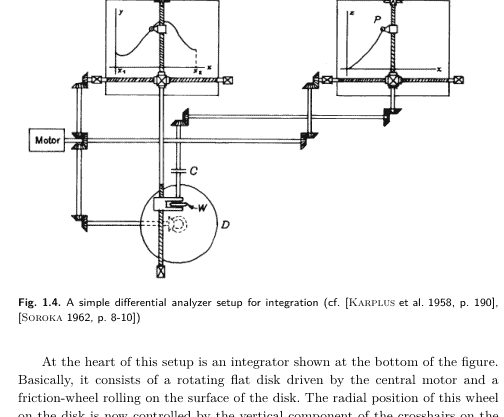

图 1.4. 用于积分的简单微分分析仪设置（参见 [KARPLUS et al. 1958, p. 190]. [SOROKA 1962, p. 8-10]）

该装置的核心是图底部所示的积分器。基本上，它由中央电机驱动的旋转平板盘和在盘表面滚动的摩擦轮组成。该轮在盘上的径向位置现在由输入台上十字线的垂直分量控制。在旋转盘具有一定的角速度时，摩擦轮的角速度取决于其径向位置。如果它位于盘轴正上方，则完全不会旋转，而如果它位于盘边缘，则其角速度将达到最大值。因此，该装置有效地执行了基本形式为 $\int_{0}^{T} f(\tau) d\tau$ 的积分运算

其中 $\tau$ 表示 *machine time*（稍后会详细介绍）——在本例中为水平盘的旋转——而 $f(\tau)$ 控制摩擦轮的径向位置。积分器在时间区间 $[0, T]$ 内运行。图 1.5 显示了在 *Oslo differential analyzer.* 中使用的积分器的实际实现。

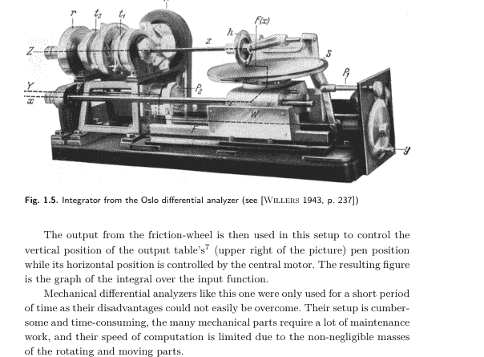

图 1.5. 来自奥斯陆微分分析仪的积分器（参见 [WILLERS 1943, p. 237]）

摩擦轮的输出随后在该装置中用于控制输出台的⁷（图片右上方）笔的垂直位置，而其水平位置由中央电机控制。所得图形是输入函数积分的图像。

像这样机械微分分析仪仅使用了很短一段时间，因为其缺点难以克服。其设置繁琐耗时，许多机械部件需要大量维护工作，且由于旋转和移动部件不可忽略的质量，其计算速度有限。

曾有一些尝试构建机电微分分析仪，其中基本计算元件仍然是纯机械的，而其互连则通过伺服电机和同步电机实现。⁸ 同步电机的输出可以通过中央电配线场连接到伺服电机的输入，从而至少简化了此类计算机的基本设置。

在第二次世界大战期间，机械和机电模拟计算机以火控系统的形式被大量使用。作为非常专业的模拟计算机，这些机器对该领域进一步的发展没有直接影响。

在大西洋彼岸，PHILBRICK 的电子模拟计算机名为 *Polyphemus*，因其奇特的外观——机架顶部位置安装了单个示波器——而得名，完全不是面向军事应用的。他的机器被设计并用于解决化学工业过程控制中通常出现的问题。

在 MIT 开发的 MACNEE 的机器是一台纯粹的学术研究仪器，很可能是第一台能够进行 *repetitive operation* 的高速电子模拟计算机，在这种操作中，问题以如此高的速度反复求解，以至于解的（几乎）无闪烁图像可以在示波器屏幕上显示。

从今天的角度来看，这些早期的模拟计算机看起来相当熟悉。除了使用真空管的特定实现外，它们已经具备了所有典型的模拟计算元件，如求和器、积分器、乘法器、函数发生器等。此外，它们采用的编程技术与今天仍在使用的方法相同。有关模拟计算历史的更多信息可在 [ULMANN 2013]⁹ 和 [SMALL 2001] 中找到。

## 1.4 模拟计算机的特性

尽管通过无数互连电线搭建间接模拟计算机进行计算乍一看像是缺点，但这种编程方法很可能会很快被精细且高度集成的交叉开关所取代，这些开关由随附的数字计算机控制。但即使使用传统的配线面板互连各种计算元件，而不是将算法存储在某种存储器中，也具有巨大的优势。

首先，模拟计算机完全不需要内存查找操作，从而大大加快了整体计算速度。此外，由于没有内存，就不存在类似 *critical section* 的概念，无需同步事物，无通信开销，也没有困扰传统并行数字计算机的诸多琐事。在模拟计算领域不存在 *AMDAHL's law*¹⁰ 的等价物。所有计算元件都以完美的并行方式工作。

模拟计算机的另一个基本优势是其极低的功耗，这很容易超过经典数字计算机。这使得模拟计算对于低功耗至关重要的应用具有吸引力，例如医疗应用、由能量收集供电的嵌入式设备等。此外，模拟计算机非常适合高性能计算（HPC），在那里电力充足且需要纯粹的计算能力。

最后，模拟计算机不易出现诸如稳定性差等问题，而经典数字计算机在浮点数上运行的数值算法有时会出现此类问题。即使是 *stiff* 微分方程通常也能由模拟计算机轻松求解，而许多数值方法对于此类问题至少需要过长的运行时间。

模拟计算机的这些特性导致了人们对这种特定计算模型的兴趣最近显著增加。在不久的将来，模拟计算机最常见的形式将作为混合计算机系统的一部分，即与数字计算机紧密耦合，从而使其免于涉及微分方程等的计算。

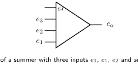

图 2.1. 具有三个输入 e3、e2、e1 和求和节点输入 s1 的求和器的抽象符号

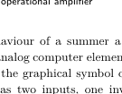

图 2.2. 运算放大器的图形符号

要理解求和器的行为，有必要对其实现进行考察。与大多数其他模拟计算机元件一样，它基于运算放大器，简称为 opamp，其图形符号如图 2.2 所示。运算放大器有两个输入，一个反相输入和一个同相输入，在图中分别用 − 和 + 表示。它输出施加到这些输入的值之和，并由其大（理想情况下无限）的开环增益 A 放大，该增益是特定运算放大器的特征。通常可以实现 10^5 到 10^9 的增益。12 这种放大器在模拟计算机中的使用催生了运算放大器这一名称，因为它们构成了实现某些数学运算的计算元件的基础。

在典型的模拟计算机电路中，运算放大器的同相输入被接地，即连接到模拟地线，通常用 GND 表示，其电位代表零值；这有效地禁用了该输入。13

构建基于运算放大器的求和器时，反馈概念至关重要。该技术由 HAROLD STEPHEN BLACK 于 1927 年开创。基本思想是使用运算放大器输出信号的一部分并将其反馈到其反相输入，从而基本上通过反馈电路控制 resulting 电路的整体行为，而不是依赖裸放大器的特性。这一思想是几乎所有运算-

由于典型运算放大器的输入电流 $i_i$ 最大也只有几纳安，因此可以忽略不计，于是 (2.2) 可简化为

$$\frac{e_i-e_{SJ}}{R_i}=-\frac{e_o-e_{SJ}}{R_f}.$$

将 (2.1) 代入上式得

$$\frac{e_i+\frac{e_o}{\mathcal{A}}}{R_i}=-\frac{e_o+\frac{e_o}{\mathcal{A}}}{R_f}.$$

经过整理可得

$$e_o\left(\frac{1}{\mathcal{A}R_i}+\frac{1}{R_f}+\frac{1}{\mathcal{A}R_f}\right)=-\frac{e_i}{R_i}$$

然后可以解出 $e_o$：

$$e_o=\frac{-\frac{e_i}{R_i}}{\frac{R_f+\mathcal{A}R_i+R_i}{\mathcal{A}R_iR_f}}$$

$$=\frac{-\frac{e_i}{R_i}\mathcal{A}R_iR_f}{R_f+\mathcal{A}R_i+R_i}$$

$$=\frac{-\frac{R_f}{R_i}e_i}{1+\frac{1}{\mathcal{A}}\left(\frac{R_f}{R_i}+1\right)}.\tag{2.3}$$

由于 $\mathcal{A}$ 通常非常大$^{15}$，且 $R_f/R_i$ 通常 $\leq 10$，因此 (2.3) 的分母通常可以忽略，从而得到简化形式

$$e_o=-\frac{R_f}{R_i}e_i.\tag{2.4}$$

它描述了图 2.3 所示反馈电路的输出电压。$^{16}$

$^{15}$ 事实上，用于模拟计算机的经典高精度运算放大器，其增益可达 $\mathcal{A}=10^9$。

$^{16}$ 对这种电路行为的一种更非正式的处理方式是假设运算放大器的开环增益极大，因此求和节点处的电压近似为零。由于放大器的输入电流可忽略，将基尔霍夫定律应用于求和节点处的电流，可得出流过反馈元件的电流等于流过各输入电阻的电流之和的负值。再应用欧姆定律，即可方便地得到计算元件的输出电压。

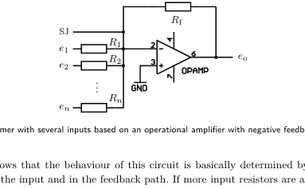

图 2.4. 基于负反馈运算放大器的多输入加法器

这表明，该电路的行为基本上由输入电阻和反馈路径中的电阻决定。如果再增加输入电阻，如图 2.4 所示，就得到了一个有用的求和电路，其整体行为可方便地描述为

$\sum_{i=1}^{n} \frac{e_i}{R_i} = - \frac{e_o}{R_f}$ (2.5)

因此，该电路输出端的电压等于各输入端电压之和的负值。比值

$a_i = \frac{R_f}{R_i}$

定义了各输入的权重。$a_i$ 的典型值为 1 和 10。如果某个特定设置需要不寻常的值，可以将所需的电阻连接到求和节点 SJ，从而有效扩展加法器的输入数量。

### 加法器基础：

（理想）加法器的行为由 $e_o = - \sum_{i=1}^{n} a_i e_i$ 描述，权重 $a_i$ 通常为 1 或 10。它产生施加到其输入端的加权电压之和的负值。典型的加法器约有六个输入，其中三个输入权重为 1，其余三个输入权重为 10。

在某些情况下，需要断开加法器的电阻反馈回路，以引入外部反馈电路。这种情况由图 2.5 所示的符号表示。该元件不再称为加法器，而称为 *开路放大器* 或 *高增益放大器*。该元件为了稳定，始终需要一些外部反馈。

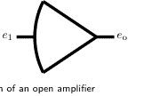

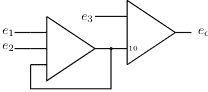

图 2.6. 根据方程 (2.6) 的计算机设置

为了展示加法器在典型模拟计算机设置中的应用，请考虑图 2.6 所示的电路。它求解方程

$$e_o=-\left(10\left(-\frac{e_1+e_2}{2}\right)+e_3\right)=5(e_1+e_2)-e_3. \tag{2.6}$$

第一个加法器的输出与其一个输入之间的连接[^17]引入了一个与 $R_f$ 并联的第二个反馈电阻，从而有效加倍了反馈回路的作用。这反过来又将加法器的所有其他输入权重减半，从而在左侧加法器的输出端得到

$$\frac{e_1+e_2}{2}$$

现在，该输出连接到右侧加法器的一个输入，权重为 10。该加法器的另一个输入馈入 $e_3$，最终得到 $e_o=5(e_1+e_2)-e_3$。

图 2.7 显示了 Analog Paradigm SUM8 的前面板。该模块包含八个加法器，每个加法器有五个输入，其中三个权重为 1，两个权重为 10。顶行的四个加法器有一个特殊功能，即通过在标记为 FB 和 ⊥（此符号表示接地）的两个插孔之间插接连线，可以断开其自反馈电阻路径，从而将加法器变为开路放大器。[^18] 所有八个加法器也都提供求和节点 SJ。

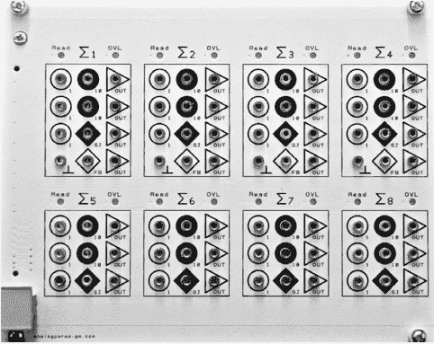

图 2.7. Analog Paradigm SUM8 模块

## 2.3 积分器

乍一看，模拟计算机将积分作为其基本运算之一，这令人惊讶。这使它成为解决可用微分方程及其方程组描述的问题的理想机器。但有一个问题：在模拟电子模拟计算机上，积分总是相对于时间的，因此所有积分基本上都具有以下形式

$$e_o=-\left(\int_0^t\sum_{i=1}^{n}a_i e_i\,d\tau+e(0)\right) \tag{2.7}$$

其中某个常数 $e(0)$ 称为 *初始条件*。特别是，这意味着 *偏微分方程*，即包含对多个变量求导的微分方程，如果没有显式离散化或其他技术，就无法在模拟计算机上直接处理！

显然，积分器的输出取决于其输入值的历史，因此这种计算元件是一种存储器。与简单的加法器相比，这需要对其操作进行一些控制，因为积分具有

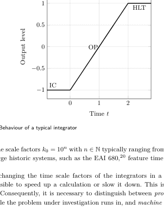

图 2.8. 典型积分器的行为

时间缩放因子 k_q = 10^n，其中 n ∈ ℕ 通常从 0 到 3，尽管一些大型历史系统，如 EAI 680,20，具有高达 10^5 的时间缩放因子。

通过改变计算机设置中积分器的时间缩放因子，可以加速或减慢计算。这称为时间缩放。因此，有必要区分问题时间 t（所研究问题运行的时间尺度）和机器时间 τ（计算机运行的时间尺度，由积分器上设置的时间缩放因子决定）。

图 2.9 显示了模拟计算机编程中所用积分器的图形表示。它与加法器符号的区别在于左侧增加了一个矩形，其顶部有一个垂直条，初始条件值 e(0) 连接到该垂直条（该输入始终垂直绘制）。与加法器一样，它有许多输入，相关权重通常为 1 和 10。

图 2.10 显示了 Analog Paradigm INT4 四积分器模块的前面板。它的每个积分器都可以通过旋转开关设置为 1、10、100 或 1000 的时间缩放因子，并具有三个权重为 1 的输入以及三个权重为 10 的输入。此外，每个积分器都有一个标记为 IC 的初始条件输入，以及一个在其附近产生 +1 或 -1 的插孔，因为这些值通常用作初始条件。

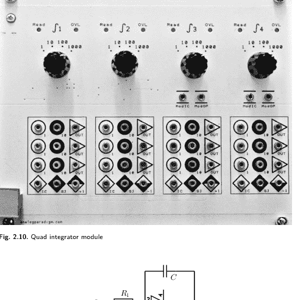

图 2.10. 四积分器模块

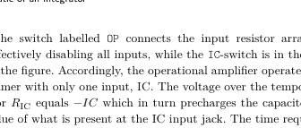

图 2.11. 积分器的基本原理图

IC：在 IC 模式下，标记为 OP 的开关将输入电阻阵列连接到地，从而有效禁用所有输入，而 IC 开关处于图中所示位置。因此，运算放大器基本上作为一个只有 IC 一个输入的加法器工作。临时反馈电阻 R_IC 两端的电压等于 −IC，这反过来将电容器预充电到 IC 输入插孔处所存在电压的负值。在这种操作模式下，给电容器充电所需的时间取决于其电容以及在此模式下激活的输入电阻。


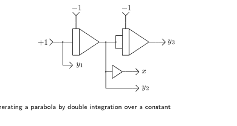

图 2.13. 通过对常数进行双重积分生成抛物线

模拟计算机最简单的运算周期由 IC-OP-HALT 模式序列组成，在 OP 模式下所花费的时间要么手动决定，要么由精密定时器决定。这通常称为手动控制，常用于低速计算。

然而，在许多情况下，希望在示波器上显示变量随时间变化的、无闪烁或基本无闪烁的图像，这需要一种称为重复运算的自动运行方式。在这种方式下，精密定时器使积分器按照 IC-OP-IC-OP-... 的模式序列重复循环。若时间比例因子足够高，就可以每隔几毫秒重复一次完整的模拟运行，从而能够在示波器上显示一组图形。

当然，由于可以在任意时刻手动更改计算机设置的系数和初始条件，因此重复运算可以让人立即了解问题相对于其参数化的行为方式，因为可以在显示器上即时看到参数变化的效果。

这种运行方式的一种变体称为单次运行，由预设 IC 时间和 OP 时间的单个 IC-OP-HLT 序列组成。当使用笔式绘图仪作为输出设备时，这尤其有用，因为单次运行可以绘制出问题的特定解。

图 2.13 所示的计算机设置演示了重复运算。它由两个串联的积分器组成，最左侧的积分器输入常数 +1。一个只有单输入的加法器用于反转第一个积分器输出的符号。

将两个积分器设置为相同的时间比例因子 k0 = 10^n，并将 OP 时间设置为 2·10^3−n 毫秒（例如 k0 = 100，OP 时间为 20 ms），会得到一个线性

这些计算元件的输入能力。此外，它们还可以用于建立专门的反馈路径，以构建能够产生绝对值、迟滞、符号函数等功能的计算机电路，稍后将予以展示。

图 2.15 展示了三个典型的 Analog Paradigm 自由元件模块的前面板。

最左侧的模块称为 XIR，因为它包含两个自由电阻网络，可以连接到任何加法器或积分器的求和点，以扩展可用输入的数量。除了权重为 1 和 10 的标准输入外，该模块还具有权重为 0.1 和 100 的输入电阻。

中间的模块 XID 包含六个肖特基二极管以及两个 10 V 齐纳二极管，有时也称为 Z 二极管，常用于实现限幅器等。

右侧的模块 XIBNC 拥有四个 BNC 插孔，可用于将示波器、函数发生器等外围设备连接到模拟计算机系统。

## 2.5 电位器

如果一台机器在设置中无法设定系数，那么一旦问题比上面所示的简单抛物线稍微复杂一点，它就会变得相当无用。在模拟电子模拟计算机中，所谓的系数电位器，或简称电位器，口语中也称“pots”，被用作可调衰减器来引入系数。这种设备最简单的形式就是用作分压器的电位器。

图 2.16 顶部显示了系数电位器的两种基本电路，以及模拟计算机编程中使用的图形表示。左侧所示的简单分压器允许设置 0 到 1 范围内的系数。在某些情况下，使用图中右半部分所示的所谓自由电位器，在两个输入值之间连续交叉渐变。

分压器基本上可以看作由一个上电阻 Ru 和一个下电阻 Rl 串联在输入信号与地之间组成。输出端连接到两个电阻的连接点。两个电阻之间的比例由电位器旋钮的角度位置 α 决定：

Ru = (1 − α)R

Rl = αR

显然，α = 0 时完全没有输出信号，因为此时输出端实际上接地。

## Arch Linux 安装教程

本文将详细介绍如何从零开始安装 Arch Linux，包括分区、安装基础系统、配置网络和引导程序等步骤。

- 安装前准备
- 磁盘分区
- 安装基础系统
- 配置系统
- 安装引导程序
- 完成安装

> 注意：本教程适用于 UEFI 启动模式。如果你使用 BIOS/MBR，请参考相关文档。

```bash
# 验证启动模式
ls /sys/firmware/efi/efivars
```

| 分区 | 挂载点 | 大小 |
|------|--------|------|
| /dev/sda1 | /boot/efi | 512M |
| /dev/sda2 | / | 剩余空间 |

分区完成后，使用 mkfs 命令格式化分区，然后挂载到 `/mnt`。接下来使用 `pacstrap` 安装基础系统。

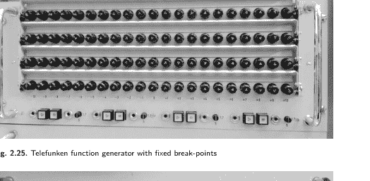

图 2.25. 具有固定断点的 Telefunken 函数发生器

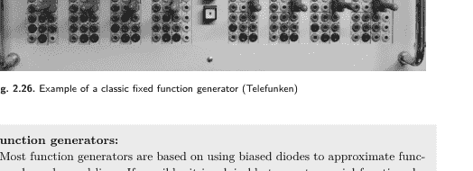

图 2.26. 经典固定函数发生器示例（Telefunken）

## 函数发生器：

大多数函数发生器基于使用偏置二极管，通过折线来逼近函数。如有可能，建议采用其他方法（如泰勒逼近等）来生成特殊函数。由于函数发生器设置耗时，并且用多边形逼近通常光滑的函数会引入误差，因此它们是最后的手段。

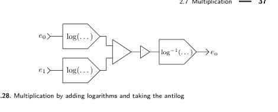

图 2.28. 通过将对数相加并取反对数实现乘法

另一种在历史上更广泛采用的乘法器实现方式利用了一个事实：

xy = 1/4 ((x + y)^2 - (x - y)^2)。

这种方式只需要两个函数发生器，而不是上述对数技术所需的三个。同样，自变量不再局限于正区间。由于它使用两个平方函数并乘以 1/4 因子，这类乘法器被称为四分之一平方乘法器（quarter square multiplier）。它的实现通常需要其两个自变量 e0 和 e1 的正负版本。通常这些值在周围的计算机设置中已经现成可用。如果没有，则使用专用反相器（只有单输入的加法器）。

允许自变量 -1 ≤ e0 ≤ +1 和 -1 ≤ e1 ≤ +1 的乘法器通常称为四象限乘法器，与之相对的是两象限乘法器，后者仅在笛卡尔坐标系的四个象限中的两个象限产生结果。

图 2.29 展示了一个现代的 Analog Paradigm MLT8 乘法器模块，其中包含八个独立的四象限吉尔伯特单元乘法器。

图 2.30 显示了一个简单应用，其中乘法器与积分器配合使用来生成抛物线。积分器产生从 +1 到 -1 的线性电压斜坡，该斜坡被馈入乘法器的两个输入端，乘法器再在其输出端产生抛物线函数。

> **乘法等：**
> 许多传统模拟计算机采用四分之一平方乘法器，这种乘法器需要同时具备正号和负号的两个输入变量。通过交换 x 或 y 的两个输入，即可实现结果符号的反转，而无需额外的反相器。

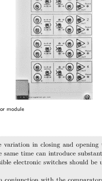

图 2.34. 四路比较器模块

时间延迟以及同一时刻触发的不同继电器开关闭合和断开的时间变化，可能会给计算带来相当大的误差。只要可能，就应使用电子开关与比较器配合。

许多经典模拟计算机中与比较器配合使用的继电器相当脆弱，可能会因插接错误而损坏，例如通过其触点将 m− 与 m+ 短路。

与机电继电器不同，电子开关通常具有专用输入和输出。

## 2.9 输入/输出设备

模拟电子模拟计算机非常适合直接与使用模拟信号的传感器和执行器接口。因此，可用于模拟计算机的输入/输出设备种类繁多。两种最常见的输出设备是笔式绘图仪和示波器。笔式绘图仪通常用于将模拟计算机设置为单次运行模式，允许在 x、y 模式下绘制一条函数曲线；而示波器通常与重复运算配合使用，或者与长时间处于 OP 模式的模拟计算机配合使用。这


# 第3章
### 模拟计算机操作

虽然乍一看，使用模拟计算机求解一个问题似乎令人望而生畏，但实际上这是一个相对直接的过程。图3.1和图3.2展示了两台经典的模拟计算机——一台EAI-580和一台Telefunken RA770精密模拟计算机。

两台机器最明显的特点是大型中央配线面板，其中包含数千个插孔；这些插孔在高精度模拟计算机上通常是屏蔽的。虽然大多数制造商开发了自己的电缆和连接器系统，但小型台式模拟计算机使用标准的4毫米或2毫米香蕉插头来互连其计算元件。模拟计算机程序是通过用配线导线连接配线面板上的插孔来设置的，从而创建一个*电路*，它是所研究问题的模拟。

图3.3显示了从此类经典机器上取下的配线面板。程序通常是预先配线的，而配线面板在不使用时存放在柜子中。尽管从今天的角度来看这似乎很古老，但它是一种可行的存储和“加载”模拟程序的方式。

对图3.1中EAI-580的更详细观察显示，其左半部分分为四个子单元。底部是主控制面板，允许操作员选择所需的工作模式（IC、OP、HLT、重复操作）。它还包含用于设置伺服电位器的按钮控制，这些伺服电位器通常安装在中型到大型模拟计算机上。它们取代了大多数手动精密电位器，由一个电位器机械耦合到一个小型电机组成，而该电机又由一个简单的伺服环路控制。使用这种装置，可以通过选择电位器地址并在此控制面板上输入所需值来设置这些电位器。如果没有伺服设定电位器，必须设置的众多手动电位器和可变函数发生器会使程序更改变得耗时且繁琐。

中间部分的左侧面板包含中央过载指示面板，其中为系统中的每个运算放大器配备一个白炽灯泡，以及一个四位数字电压表和一个传统的动圈仪器。右侧面板包含十个手动电位器和一些开关以及显示灯，显示计算机比较器和继电器的各自状态。

顶部是一个数字扩展单元，由若干逻辑门、触发器和延迟元件组成，可以通过一个小型专用可拆卸配线面板相互连接。使用这些数字元件，可以通过控制各个积分器等的模式来扩展简单的重复工作模式。这种功能对于解决诸如过程优化之类的复杂问题很有用。

图3.2所示的Telefunken RA770计算机基本上包含相同的元件。操作员控制和示波器位于计算机的中间部分。左侧有一个大型数字扩展组，类似于EAI-580系统。左下方的扩展机箱包含可变和固定函数发生器。

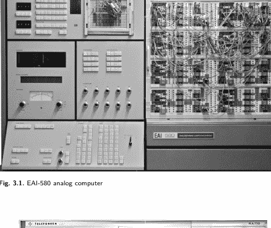

Fig. 3.1. EAI-580模拟计算机

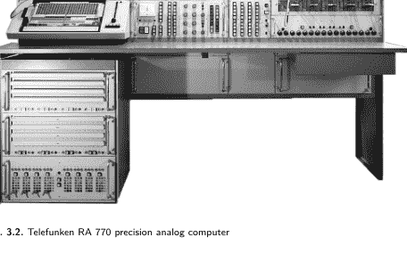

Fig. 3.2. Telefunken RA 770精密模拟计算机

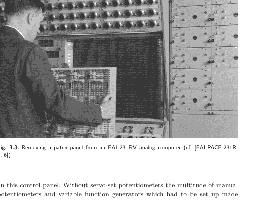

Fig. 3.3. 从EAI 231RV模拟计算机上取下配线面板（参见[EAI PACE 231R, 第6页]）

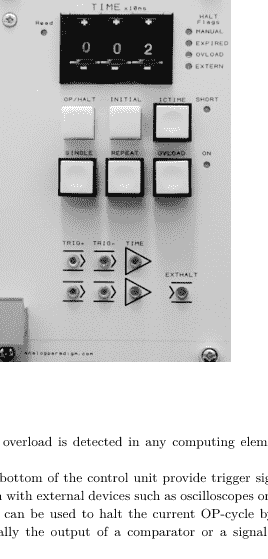

Fig. 3.5. 控制单元

当在OP周期期间任何计算元件检测到过载时进入HALT状态。

控制单元底部的插孔提供可与示波器或绘图仪等外部设备一起使用的触发信号。标记为EXTHALT的插孔可通过施加外部信号来停止当前OP周期，通常是比较器的输出或来自外部设备的信号。

# 第4章
### 基础编程

虽然在模拟计算机上求解问题的先决条件基本上与编程数字计算机相同，但实际的编程过程与现在占主导地位的算法方法有显著不同。图4.1显示了涉及的主要步骤。首先，必须检查所研究的问题并导出数学表示，通常是耦合微分方程组，简称为DEQs。从这里开始，数字和模拟编程方式迅速分歧。在数字计算机上，这些方程构成了算法的基础，该算法将以逐步方式执行。在编程模拟计算机时，完全相同的方程将被转换为配线设置，该设置决定了各种计算元件如何相互连接。这种设置称为模拟计算机程序。

由于微分方程在模拟计算机编程中至关重要，关于这些数学对象的几句话可能是合适的。基本上，微分方程是一个方程，其中未知数不是简单的值而是一个函数。微分方程由该未知函数以及该函数的各种导数组成。为了简化问题28，将假设该函数及其所有所需导数都相对于单个自变量。这个自变量通常是

一个物理系统
可以被模拟为
一个模拟计算机

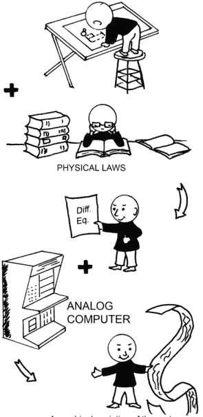

物理定律

微分方程

模拟
计算机

系统的图形描述：
动态性能

Fig. 4.1. 如何编程模拟计算机（参见[TRUITT et al. 1960, 第1-108页]）

时间。此类微分方程通常称为*常微分方程*或*ODEs*，其一般形式为

```
$$f\left(t, y, \frac{dy}{dt}, \frac{d^2 y}{dt^2}, \dots, \frac{d^n y}{dt^n}\right)=0\tag{4.1}$$
```

其中*y*表示未知函数，而不是“简单”变量！如果自变量是时间，*y*取决于*t*，因此应始终将其视为*y*(*t*)，尽管为了避免方程中不必要的混乱，这几乎从未明确写出。这种时间依赖性使微分方程非常有趣且强大，因为它们可用于描述动态系统。

*y*的最高导数决定了ODE的*阶*。按照惯例，关于时间的导数将通过在函数上方简单地放置一个点来表示，如下所示：

```
$$\dot{y}=\frac{dy}{dt},\ \ddot{y}=\frac{d^2 y}{dt^2},\ \dddot{y}=\frac{d^3 y}{dt^3},\ \dots$$
```

通常，具有*y*表示物体某位置的物理系统需要导数$\dot{y}$（*速度*）、$\ddot{y}$（*加速度*），有时还需$\dddot{y}$（*加加速度*或*冲击*）。

微分方程也可以包含具有一个以上自变量的函数及其导数。这一类的典型例子是众所周知的单维*波动方程*

```
$$\frac{\partial^2 u}{\partial t^2}=c_v^2\frac{\partial^2 u}{\partial x^2}$$
```

它描述了波在介质中的传播方式。此类微分方程称为*偏微分方程*（*PDEs*），即使使用模拟计算机求解，也通常比ODEs复杂得多。

## 4.1 放射性衰变

作为入门示例，将使用模拟计算机详细研究放射性衰变的行为。大多数化学元素以不同的*同位素*形式出现，它们在原子核中具有相同数量的质子，但在中子数量上有所不同。并非所有这些同位素都是稳定的。有些是不稳定的，它们通常会发射诸如α或β粒子（分别为氦核和电子）或电磁γ辐射的粒子。这些是最常见的方式，但绝不是不稳定同位素通过*放射性衰变*转变成其他同位素的唯一方式。

无论衰变的实际机制如何，在给定时间间隔内衰变的原子数量始终与该间隔开始时同位素的数量成正比。由于放射性衰变是一个随机过程，重点


### 4.1.2 使用模拟计算机

对两边应用 exp() 并显式写出自变量 \(t\)，可得

\[
N(t) = e^{-\lambda t + c} = e^{-\lambda t} e^{c}.
\]

设 \(N(0)\) 表示在 \(t = 0\) 时存在的原子数，则得到

\[
N(0) = e^{0} e^{c} = e^{c},
\]

最终得到

\[
N(t) = N(0) e^{-\lambda t}, \quad (4.3)
\]

即*放射性衰变的普适定律*，其中 \(\lambda\) 表示*衰变率*。

通常，同位素表中给出的并不是 \(\lambda\)，而是*半衰期* \(T_{1/2}\)。\(T_{1/2}\) 表示在 \(t = 0\) 时存在的原子中有一半发生衰变所需的时间。它与 \(\lambda\) 的关系为

\[
T_{1/2} = \frac{\ln(2)}{\lambda},
\]

由此得到教科书中常见的指数衰变形式：

\[
N(t) = N(0) e^{-\frac{\ln(2)}{T_{1/2}} t}.
\]

如前所述，描述“真实”问题的微分方程如此简单、可以轻易解析求解的情况并不常见。当不存在解析解，或者求解所需工作量过大时，可以使用模拟计算机来模拟所研究微分方程描述的动态系统的行为。为此，需要将方程或方程组转换为计算机上的设置（setup）或程序，后续小节将展示这一点。这主要有两种方式：KELVIN *反馈技术（feedback technique）*或*替换技术（substitution technique）*。

在下面的示例中，将使用比较简单直接的 KELVIN 反馈技术：首先重新整理微分方程，将最高阶导数单独放在方程左侧；然后假设该导数是已知的。将它送入一系列积分器（必要时配合加法器以反转符号等），即可得到方程右侧的所有低阶导数。随后，利用适当的计算元件组合这些低阶导数，得到最初开始逐次积分的那个最高阶导数。再将此输出连接到积分器链的输入端，从而形成*反馈回路*。

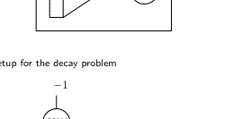

图 4.2 衰变问题的初始计算机设置

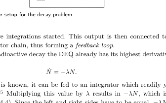

图 4.3 衰变问题的最终计算机设置

在放射性衰变中，微分方程的最高阶导数已经在左侧：

\[
\dot{N} = -\lambda N. \quad (4.4)
\]

假设 \(\dot{N}\) 已知，可将其送入积分器，积分器输出端即可得到 \(-N\)。用 \(\lambda\) 乘以该值，得到 \(-\lambda N\)，这正是(4.4)的右侧。由于左右两侧必须相等，现在可将 \(-\lambda N\) 作为推导 \(-N\) 所用积分器的输入，从而有效形成图 4.2 中的中央反馈回路。

这个设置还不完整，因为它缺少设置初始条件 \(N(0)\) 的方式。同时，最好将 \(N\) 而不是 \(-N\) 作为输出值。图 4.3 所示的程序同时满足这两个要求。

这两个子电路在 Analog Paradigm Model-1 模拟计算机上的最终设置如图 4.4 所示。典型的解曲线可见于图 4.5 的示波器截图。所显示的解明显具有 \(\exp(-x)\) 的形式，这与解析解(4.3)的预期一致。

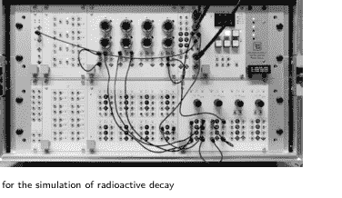

图 4.4 放射性衰变模拟的设置

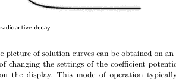

图 4.5 放射性衰变模拟

为了更深入地了解此类动态系统的行为，可以让计算机以重复模式（repetitive mode）运行。如果运算时间足够短，就能在示波器屏幕上得到（几乎）无闪烁的解曲线图像。改变系数电位器设置所产生的影响会立即显示在屏幕上。这种运行模式通常需要一个简单的线性斜坡 \(\tau\) 作为示波器的 x 偏转。<sup>26</sup> 这可以仅由一个积分器轻松生成，如图 4.6 所示。\(\beta\) 的设置控制示波器光束起始的位置，而 \(\alpha\) 控制斜坡增加的速度，从而控制所得到图像的宽度。

图 4.7 是在模拟计算机以重复模式运行、使用线性电压斜坡进行 x 偏转，并在曝光过程中手动改变参数 \(\lambda\) 时拍摄的长时间曝光截图。可以清楚地看到衰变函数的指数特征。<sup>37</sup>

\(N(0)\) 可能被缩放到对应 \(-1.3\)。<sup>8</sup> 例如，如果给定 0.12 摩尔<sup>39</sup>的 \(^{234}_{90}\mathrm{Th}\)，在图 4.3 所示计算机设置中就可以表示为 \(N(0) = 1\)。如果一段时间后反相器输出 \(N\) 读数为 0.4，则对应 \(0.4 \cdot 0.12 = 0.048\) 摩尔。

因此，有必要区分所谓*问题变量*和*机器变量*：前者是问题数学表示中出现的变量，后者是对应变量在给定缩放后的计算机设置中的形式。机器变量常带帽子记号：

\[
\hat{N} = \alpha N \quad \text{with} \quad \alpha = \frac{1}{\max(N)}
\]

其中 \(\alpha\) 是该变量的比例因子。在上面的例子中，

\[
\alpha = \frac{1}{0.12} \approx 8.333.
\]

这种变量幅度缩放只是问题的一个方面。还需要区分*问题时间*，即实际问题运行的时间，和*机器时间*，即当前模拟运行的时间。将问题时间转换为机器时间的过程称为*时间缩放*。为了区分这两个时间，常用符号 \(t\) 和 \(\tau\) 分别代表问题时间和机器时间；它们通过比例因子 \(\beta\) 联系，且有 \(\tau = \beta t\)。\(\beta\) 由给定设置中积分器的 \(k_0\) 与它们各自输入权重的乘积确定。

如果 \(\beta > 1\)，机器时间比问题时间快。这适合模拟随时间变化太慢、无法直接观察的过程。某些长寿命同位素的放射性衰变就是这类过程的典型例子。在其他情况下，如果问题时间太短，无法获得有用的观察结果，适当选取 \(\beta < 1\) 会相应减慢机器时间。

对于半衰期为 \(T_{1/2} = 24.1\) 天的 \(^{234}_{90}\mathrm{Th}\)，相对于问题时间大幅加快机器时间是可取的。为了在示波器上获得无闪烁显示，机器时间将被缩放，使得 2.41 ms 对应于半衰期 \(T_{1/2} = 24.1\) 天，且 \(0 \le \tau \le 20\) ms。于是有

\[
\lambda = \frac{\ln(2)}{2.41} \approx 0.287
\]

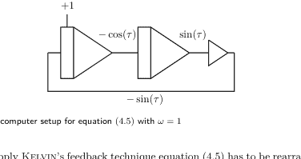

图 4.8 方程(4.5)在 \(\omega = 1\) 时的基本计算机设置

为了应用 KELVIN 反馈技术，需要重新整理方程(4.5)，使最高阶导数出现在左侧，得到

\[
\ddot{y} = -\omega^2 y.
\]

这个微分方程仍然足够简单，可以“猜出”解析解。需要找到这样的函数 \(y\)：其二阶导数等于函数本身的负值乘以某个权重 \(\omega^2\)。当然，常数 0 函数就是其中一个解，但它相当平凡。另外两个更有意义的解基于正弦和余弦：

\[
\frac{d^2}{dt^2}\sin(\omega t) = -\omega^2 \sin(\omega t) \quad \text{and} \quad
\frac{d^2}{dt^2}\cos(\omega t) = -\omega^2 \cos(\omega t).
\]

因此，仅通过观察就能确定这个微分方程的三个基本解。这些解称为特解，但哪一个是正确解？仅凭(4.5)无法判断，因为该方程不包含任何关于初始条件的信息。由于该微分方程是二阶的，涉及两个初始条件：一个针对 \(y\)，记为 \(y_0\)；另一个针对 \(\dot{y}\)，记为 \(\dot{y}_0\)。

为简单起见，假设 \(\omega = 1\)。这得到图 4.8 所示的基本计算机设置。最左边的积分器在模拟运行开始 \(t = 0\) 时输出信号为 \(-1\)。第二个积分器隐式具有 0 的初始条件，因此其在 \(t = 0\) 时输出为 0，并会随着模拟进行，在第一个积分器输出所提供的输入值作用下开始上升。

当 \(\omega = 1\) 时，\(\tau\) 仅由 \(k_0\) 控制，并且两个积分器的 \(k_0\) 必须设置为相等。将 \(k_0 = 10^3\) 会得到周期为 6.28 ms 的输出信号，这正是 \(\omega = 1\) 时的预期结果。

如果改用不同的初始条件方案，例如最左侧积分器为 0、第二个积分器为 \(-1\)，则得到 \(\cos(\tau)\) 而非 \(\sin(\tau)\)。若对两个积分器都施加非零初始条件，即可得到这两个特解的线性组合。设 \(\dot{y}_0\) 和 \(y_0\) 分别表示左、右积分器的初始条件，则有

\[
y_0 = -a \sin(\tau)
\]

且


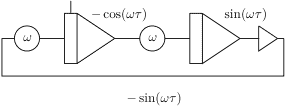

**图 4.9.** 方程 (4.5) 的基本计算机设置，变量为 $\omega$

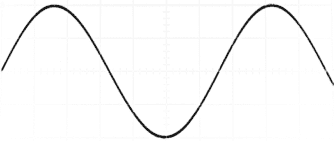

**图 4.10.** 图 4.9 所示计算机设置中第二积分器的输出，其中 $k_0 = 10^3$ 且 $\omega = \frac{1}{2}$

$\dot{y}_0 = -a\omega\cos(\tau).$

因为该基本电路在 $y_0 = 0$ 且 $\dot{y}_0 = 1$ 时产生 $-\cos(\tau)$ 以及 $\sin(\tau)$，它通常被称为 *正交发生器*。它是许多更复杂计算机设置的基础，并且在需要将基于闭合回路的图形显示在示波器上时尤其有用，如后面各节所示。

现在，$0 < \omega < 1$ 怎么办？一个简单的解决方案难道不需要在图 4.8 所示设置中的反相器之后仅使用一个系数电位器吗？不幸的是，情况并非如此，因为 $\omega$ 实际上会影响两个积分器的时间缩放！仅使用反相器之后的一个电位器，从而位于最左侧积分器输入之前，只会将其时间比例因子更改为 $\omega k_0$，而第二积分器仍以 $k_0$ 运行。因此，通常有必要同时改变两个积分器的时间比例因子，如图 4.9 所示。

图 4.10 显示了 $\omega = \frac{1}{2}$ 时最左侧积分器的输出信号。屏幕上一个 x 分格对应 2 ms，如前所述。因此，所显示正弦信号的一个周期约为 12.55 ms，这对于该特定 $\omega$ 值来说是对 $4\pi$ 的良好近似。

到目前为止显示的结果是在计算机设置为重复操作且 OP 间隔为 20 ms 时生成的。在某些情况下，像图 4.9 所示那样的电路必须长时间运行，例如要在示波器上显示一个球（基于正弦/余弦信号对的缩小单位圆），当它在盒子中弹跳时。在这种情况下，像这样简单的计算机设置通常是不够的，因为所产生的正弦/余弦信号对的幅度在长时间内不会保持恒定。这源于真实计算元件不可避免的缺陷。根据所用计算机的不同，幅度可能随时间减小或增大，要么坍缩为零，要么导致积分器和反相器的过载条件。

因此，需要一些额外的电路用于 *幅度稳定*。其背后的思想相当简单。一方面，为了避免幅度减小，必须引入一些正反馈。这就使得限幅电路成为必要，以避免否则必然会出现的不断增加的幅度。这两种措施当然会引起一些，但通常可以忽略的波形失真，尤其是在正弦/余弦信号用于驱动某种显示时。

图 4.11 显示了一个带幅度稳定的正交发生器的典型设置：其核心是之前所示的电路，不同之处在于中心反馈环路使用加权为 10 的积分器输入，使得整体时间比例因子为 10ω₀。标记为 α 的电位器向环路引入一些正反馈，从而稳步增加输出信号的幅度。根据所用模拟计算机的不同，这种正反馈可能是不必要的。如果没有它幅度减小，将 α 设置为一个很小的值（通常小于 10⁻²）就足够了。为了避免过载，需要一些负反馈来保持整体幅度稳定。这是通过电位器 α* 实现的，这是需要自由电位器的罕见情况之一。该电位器的输出（电刷）连接到二极管，而二极管又连接到加权为 1 的积分器输入。

这里的想法是对二极管施加负偏置，使其仅在最左侧积分器的输出高于该偏置电压时开始导通。然后二极管开始导通，本质上实现了负反馈环路（具有负指数特性）。重要的是，与二极管相连的输入的权重至少比主反馈环路的输入小 10 倍。

该设置在具有缓冲系数电位器的模拟计算机上工作良好，例如本文使用的 Analog Paradigm Model-1。如果使用没有缓冲电位器的经典模拟计算机，则应将连接到电位器 α* 的二极管的阴极连接到最左侧积分器的求和节点。⁴⁰

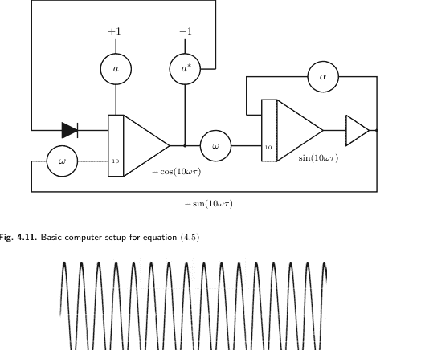

图 4.11. 方程 (4.5) 的基本计算机设置

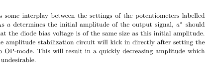

图 4.12. 图 4.11 所示计算机设置中第二积分器的输出，其中 k0 = 10³ 且 ω = ½，导致时间比例因子为 10k0ω = 5000

标记为 α 和 α* 的电位器的设置之间存在一定的相互作用。由于 α 决定输出信号的初始幅度，因此应设置 α* 使二极管偏置电压与该初始幅度大小相同。如果 α > α*，幅度稳定电路将在将计算机设置为 OP 模式后立即启动。这会导致幅度迅速减小，这通常是不期望的。

图 4.12 显示了在模拟计算机设置为连续操作、ω = ½ 且 k0 = 10³ 时该电路的输出。示波器的 x 偏转仍如前设置为每格 2 ms。

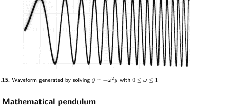

图 4.15. 通过求解 ÿ = -ω² y 生成的波形，其中 0 ≤ ω ≤ 1

## 4.4 数学摆

本节描述了如图 4.16 所示数学摆尖端的运动仿真。它由一根无重杆组成，该杆在点 0 处铰接，可在无摩擦的情况下绕其摆动。在杆的另一端安装了一个点质量 m。角 α₀ 表示摆的最大位移，即其初始条件，而 α 表示相对于通过位于 0 处的支点的垂直线的当前角度。

该质量受到由重力加速度引起的力 F_g = mg 的作用。这可以分解为作用在质量上的两个力：切向力 (F_t) 和径向力 (F_r)：

F_t = -mg sin(α)
F_r = mg cos(α)

F_t 是恢复力，它将把质量驱动回其静止位置。它引起切向加速度

a_t = F_t / m = l α̈

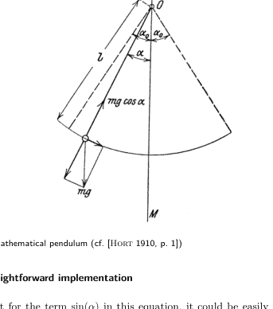

图 4.16. 数学摆（参见 [HORT 1910, p. 1]）

### 4.4.1 直接实现

如果不是这个方程中的 sin(α) 项，它可以用模拟计算机很容易求解，只需使用求和器、积分器和系数电位器。这个正弦项使事情变得稍微复杂一些。如果有正弦函数发生器可用，可以用它来实现该方程。否则必须采用以下两种方法之一：

如果 α 足够小⁴³ sin(α) 可以近似为

$\sin(\alpha) \approx \alpha$

这将 (4.6) 简化为

$\ddot{\alpha} = -\frac{g}{l}\,\alpha$

这只是 (4.5)，其中 $\omega^2 = g/l$，因此摆可以用之前已显示在图 4.9 中的计算机设置来仿真。

如果 α 不足够小，则需要正弦函数发生器，或者可以采用上面描述的扫描电路来生成正弦函数

43 什么算足够小实际上取决于该问题解所需的精度。通常，−π/8 ≤ α ≤ π/8 可以认为足够小，因为误差将保持在 1% 以下。

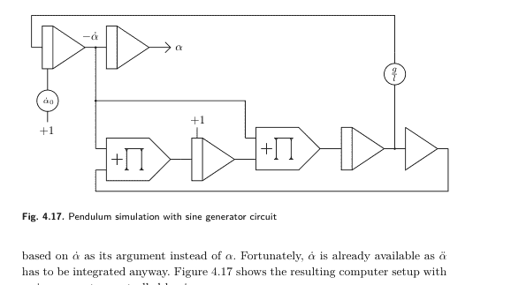

图 4.17. 带正弦发生器电路的摆仿真

其参数基于 α̇ 而不是 α。幸运的是，α̇ 已经可用，因为 α̈ 必须进行积分。图 4.17 显示了由 α̇ 控制的正弦发生器的计算机设置。

需注意：尽管这种正弦/余弦发生器子电路很有用，但它会受到漂移和乘法器平衡误差的影响。通常不应将其用于长时间仿真，最好在计算机设置为重复操作且 OP 时间较短时使用。

### 4.4.2 变体

尽管这种实现相当优雅，但它需要付出代价，因为仅用于生成正弦函数就需要两个乘法器、两个积分器和一个求和器。在像这种数学摆的情况下，其中三角函数的参数是受限的（只要摆不翻转就是这种情况），其他实现变体可能更有优势。

一个直接的方法是使用泰勒级数

$$\sin(\varphi) = \sum_{n=0}^{\infty} (-1)^n \frac{\varphi^{2n+1}}{(2n+1)!}$$

来近似所需的谐波函数。根据所需的精度，而精度又取决于参数 φ 的范围，通常足以设定

$$\sin(\varphi) \approx \varphi - \frac{\varphi^3}{6}\tag{4.7}$$

对于限制在 $-\pi/4 \le \varphi \le \pi/4$ 的参数。

该函数可以用两个乘法器、一个求和器和一个系数电位器轻松生成，从而不仅节省了一些额外的计算电-


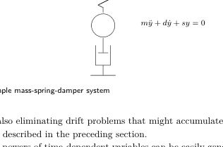

图 4.18. 简单的质量-弹簧-阻尼系统

ments 但也消除使用前一节所述方法随时间累积可能出现的漂移问题。

某些时变变量的幂可以很容易地使用两个具有适当时间比例因子的积分器串联生成，而完全不需要任何乘法器。在这种情况下，可以从 $\int\left(\int \varphi \,d\tau\right) d\tau = \frac{1}{6}\varphi^3$ 开始，从而得到 (4.7) 的第二项。改变该解的符号并加上 $\varphi$ 即可得到所需的正弦近似，这种方法将在第 5.3 节中详细说明。

## 4.5 质量-弹簧-阻尼系统

除第 4.2 节所示的振幅稳定方案外，到目前为止所展示的问题都表现出无阻尼的振荡行为。下一个示例使用图 4.18 所示的简单质量-弹簧-阻尼系统引入阻尼。在本例中，$y$ 表示质量相对于其静止位置的垂直位置。忽略作用在质量上的任何重力加速度，需要考虑三个力：

- 由于运动质量产生的力，$F_m = ma = m\ddot{y}$。
- 由弹簧引起的力，假设其与施加在弹簧上的应变呈线性关系，$F_s = s y$，以及
- 由速度线性阻尼器引起的力，$F_d = d v = d \dot{y}$。

由于这是一个封闭的物理系统，所有力之和为零，从而得到以下二阶微分方程，该方程描述了该质量-弹簧-阻尼系统的动态行为：

$$m\ddot{y} + d\dot{y} + s y = 0 \tag{4.8}$$

这里，$m$ 表示质量，$d$ 是阻尼常数，$s$ 是弹簧常数。如果没有阻尼力 $F_d$，这只是一个无阻尼谐振子，如前例所示。

### 4.5.1 解析解

该机械系统仍然足够简单，可以解析求解，这很有用，因为该解以后可以与通过模拟计算机获得的解进行比较。将 (4.8) 除以 $m$ 得到

$$\ddot{y} + \frac{d}{m}\dot{y} + \frac{s}{m} y = 0. \tag{4.9}$$

采用以下阻尼系数的定义

$$\beta := \frac{d}{2m}$$

以及（无阻尼）角固有频率[44]

$$\omega_0 = \sqrt{\frac{s}{m}}$$

这可以改写为

$$\ddot{y} + 2\beta\dot{y} + \omega_0^2 y = 0. \tag{4.10}$$

处理此类微分方程的经典方法是使用指数函数。

“猜测”

$$y = a e^{\mu t}$$

得到

$$\dot{y} = \mu a e^{\mu t} \quad \text{and} \quad \ddot{y} = \mu^2 a e^{\mu t}.$$

将这些代入 (4.10) 得到

$$\mu^2 a e^{\mu t} + 2\beta\mu a e^{\mu t} + \omega_0^2 a e^{\mu t} = 0.$$

除以 $a e^{\mu t}$ 得到以下二次方程

$$\mu^2 + 2\beta\mu + \omega_0^2 = 0$$

该方程可通过应用二次公式轻松求解

$$\mu_{1,2} = -\frac{p}{2} \pm \sqrt{\frac{p^2}{4} - q}$$

其中 $p = 2\beta$ 且 $q = \omega_0^2$，解为

$$\mu_{1,2} = -\beta \pm \sqrt{\beta^2 - \omega_0^2} \tag{4.11}$$

采用定义

$$\omega^2 = \omega_0^2 - \beta^2$$

(4.11) 可整理为

$$\mu_{1,2} = -\beta \pm i \omega.$$

因此 (4.9) 的解由线性组合给出

$$y = a e^{\mu_1 t} + b e^{\mu_2 t} = a e^{-(\beta + i \omega)t} + b e^{-(\beta - i \omega)t} = a e^{-\beta t} e^{i \omega t} + b e^{-\beta t} e^{-i \omega t} = e^{-\beta t} (a e^{i \omega t} + b e^{-i \omega t}) \tag{4.12}$$

如复分析[45]所知

$$e^{i \omega t} = \cos(\omega t) + i \sin(\omega t) \quad \text{and} \quad e^{-i \omega t} = \cos(\omega t) - i \sin(\omega t).$$

将其应用于 (4.12) 得到

$$y = e^{-\beta t} \left( a (\cos(\omega t) + i \sin(\omega t)) + b (\cos(\omega t) - i \sin(\omega t)) \right) = e^{-\beta t} \left( (a + b) \cos(\omega t) + i (a - b) \sin(\omega t) \right) \tag{4.13}$$

$e^{-\beta t}$ 项是该振荡系统的阻尼项，而 $a + b$ 和 $a - b$ 由初始条件决定。如果假设质量在 $t = 0$ 时被偏离了 $y_0$ 的量，这显然是其运动的最大振幅。如果质量随后在 $t = 0$ 时被释放且未赋予任何初始速度，则以下初始条件成立：

$$y(0) = y_0 \quad \text{and} \quad \dot{y}(0) = 0.$$

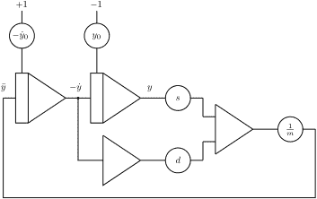

图 4.19. 质量-弹簧-阻尼系统

使用标有 $-\dot{y}_0$ 和 $y_0$ 的两个电位器可以设置质量-弹簧-阻尼系统的初始条件。$y_0$ 控制质量的初始偏转，而 $-\dot{y}_0$ 在模拟运行开始时设置其初始速度。图 4.20 至 4.23 显示了四次模拟运行的定性结果，其中质量设为 1（即完全省略最右侧求和器的后继电位器），并且弹簧和阻尼常数 $s$ 和 $d$ 的设置不同。显然，更硬的弹簧需要更强的阻尼器才能迅速降低振荡。此外，更硬的弹簧会导致振荡系统的共振频率更高。

图 4.19 所示的设置具有所有三个参数可以相互独立设置的优点。然而，这需要付出代价，因为需要两个求和器，其中一个作为反相器。考虑到积分器通常具有多个输入，并且积分器和求和器都执行隐式的符号反转，图 4.24 所示的简化计算机设置节省了一个求和器。

然而，这也有一个缺点。参数 $s$ 和 $d$ 不再能独立于 $m$ 设置，因为

$$\nu = \frac{s}{m} \quad\text{and}\quad \mu = \frac{d}{m}.$$

这与上面的 (4.9) 非常吻合。

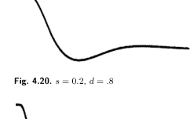

图 4.20. s = 0.2, d = .8

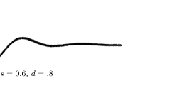

图 4.21. s = 0.6, d = .8

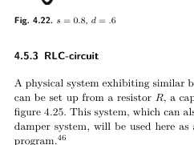

图 4.22. s = 0.8, d = .6

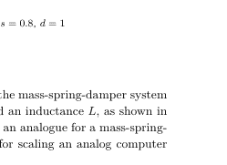

图 4.23. s = 0.8, d = 1

### 4.5.3 RLC 电路

可以由电阻 R、电容器 C 和电感 L 组成一个表现出与质量-弹簧-阻尼系统相似行为的物理系统，如图 4.25 所示。该系统也可以被视为质量-弹簧-阻尼系统的类比，在这里将作为模拟计算机程序缩放的示例。

该电路由微分方程描述

$$L\ddot{Q} + R\dot{Q} + \frac{1}{C}Q = 0 \quad (4.14)$$

其中 Q 表示电荷。这在结构上与 (4.8) 相同，因此迄今为止推导出的所有内容同样适用于此 RLC 电路。整理后得到

$$\ddot{Q} = -\frac{R}{L}\dot{Q} - \frac{1}{LC}Q.$$

以下示例基于图 4.24 所示的计算机设置，其中 $-\dot{y} = 0$。将假设以下元件值：

- C = 1.2 µF
- L = 5.1 mH
- R = 20 Ω
- E = 6.94 V

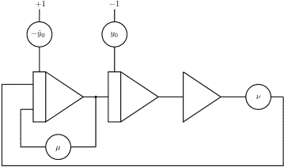

图 4.24. 简化的质量-弹簧-阻尼设置

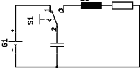

图 4.25. 简单的 RLC 电路

其中 E 表示电路中电池提供的电压。在 $t = 0$ 时完全充电的电容器产生初始条件

$$Q_0 = CE = 8.328 \cdot 10^{-6}\,\mathrm{As}$$

这也是振荡系统所能表现的电荷变量的最大振幅。

这很容易得出以下振幅缩放因子

$$\alpha = \frac{1}{8.328 \cdot 10^{-6}\,\mathrm{As}} \approx 120077\,(\mathrm{As})^{-1}$$

牺牲机器单位范围 [−1, 1] 的一部分

$$\alpha = 0.1 \cdot 10^6\,(\mathrm{As})^{-1}$$

将选择 $\alpha = 0.1 \cdot 10^6\,(\mathrm{As})^{-1}$，因为这大大简化了缩放过程。

将其应用于 (4.14) 得到以下缩放方程。[47]

$$\widehat{Q}'' = -3.92 \cdot 10^3 \widehat{Q}' - 1.63 \cdot 10^8 \widehat{Q}$$

初始条件 $Q_0$ 必须相应缩放，得到（近似）

$$\widehat{Q}_0 = 0.833.$$

在这些缩放振幅下，剩余步骤是时间缩放。图 4.25 所示基本 RLC 电路的（无阻尼）角频率[48]为

$$\omega = \frac{1}{\sqrt{LC}} \approx 12783\ \text{s}^{-1}$$

得到

$$\nu \approx 2\ \text{kHz}$$

因为 $\nu = \omega/2\pi$。选择时间缩放因子 $\beta = 10^4$，最终得到

$$\frac{d^2 \widehat{Q}}{d\tau^2} = -0.392 \frac{d\widehat{Q}}{d\tau} - 1.63\widehat{Q}.$$

系数 0.392 和 1.63 现在可以很容易地在图 4.24 所示的计算机设置中设置为 $\mu$ 和 $\nu$，其中 1.63 由 $\nu = 0.163$ 表示，并馈入加权为 10 的积分器输入。

本例结束了模拟计算机编程的介绍部分。下一章介绍了许多有用的专用电路，它们也作为额外的编程示例。


# 第5章 特殊函数

与经典的数字计算机编程一样，在模拟计算机设置中经常会出现一些*特殊函数*，例如反函数（如（平方）根）、极限、迟滞等。本章描述了典型的“库”函数，它们可以用作更复杂程序的构建模块。正如在算法领域，尤其是在 Perl 程序员中，“不止一种方法”这句话对于模拟计算机程序同样适用。这里描述的函数通常既不是唯一的实现方式，也不一定是最佳的。

如有疑问或需要寻找其他函数时，应查阅大量经典文献。强烈推荐进一步阅读以下权威书籍：[KORN et al. 1964]、[GILOI et al. 1963]（德语），以及 [HAUSNER 1971]、[GILLILAND 1967]、[AMMON 1966] 和 [CARLSON et al. 1967]。

## 5.1 反函数

函数生成的一种非常强大的技术是反函数，例如基于函数 $f(x)=x^2$ 得到平方根。回顾加法器和积分器的基本设置，产生反函数的设置思想很简单，它依赖于运算放大器试图将其反相输入端 SJ 保持为零这一事实。图 5.1 显示了生成反函数的基本设置。

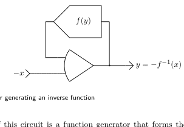

图 5.1. 生成反函数的基本设置

该电路的核心是一个函数发生器，它构成开环放大器的反馈元件。当输入信号为 x 时，如果 −x = f(−y)，且 y = f^{−1}(x) 是放大器输出端的值，则求和结将为零。

如果反函数未在 [−1, 1] 的整个范围内定义，则需要采取一些预防措施以防止放大器过载。如果基本设置显示出不稳定迹象，有时也有必要在运算放大器的输出与其求和结之间连接一个小电容，通常为几十 pF。<sup>49</sup>

### 5.1.1 平方根

反函数的一个很好的例子是图 5.2 所示的平方根电路。这基本上与图 5.1 所示的设置相同，但增加了两个部分。一个二极管和一个小电容连接在开环放大器的输出端与其求和结之间。当输入变为正时，二极管可防止放大器饱和，因为在这种情况下，放大器的输入和乘法器的输出都将为正，从而将放大器的输出驱动到其最大负电平。

虽然这不会损坏放大器，但使其进入饱和状态将产生溢出，并给出无意义的输出值。此外，放大器可能需要一些时间才能从这种状态中恢复。对于经典模拟计算机尤其如此，它们的恢复时间可能长达数秒。请注意，由于二极管的正向阈值电压——标准硅二极管约为 0.7 V，肖特基二极管低至 0.2 V——二极管将使放大器的输出略微低于零。

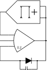

**图 5.2.** 典型平方根电路


**图 5.3.** 由图 5.2 所示计算机设置生成的函数，其中 −1 ≤ x ≤ 1

小电容可防止放大器输出接近零时产生振铃。在某些情况下，根据所使用的开环放大器的行为，可以省略它。图 5.3 显示了该电路的行为。输入值由单个积分器生成，产生从 −1 到 +1 的斜坡。该斜坡也用于示波器的 x 偏转。

### 5.1.2 除法

上述平方根电路可以很容易地修改为实现除法运算。图 5.4 显示了基本设置：乘法器连接到放大器的输出端和输入变量 $y$，开环放大器将使其输出趋向 −x/y，这样乘法器的输出产生 −x，从而抵消通过 x 输入及其相关输入电阻传递到放大器反相输入的电流。

如前所述，应在放大器的输出与其求和结之间连接一个约 68 pF 的小电容，以防止电路的不稳定行为。还应注意，该电路不执行四象限除法运算。

有些系统配备了预接线模块，用于计算常见的反函数，如平方根和除法。图 5.6 显示了一个 Analog Paradigm MDS2 模块，其中包含两个计算元件，可通过开关选择执行乘法、除法或平方根运算。

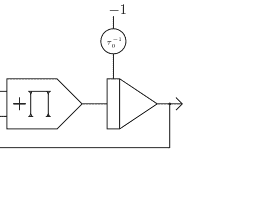

图 5.7. 生成 1/τ

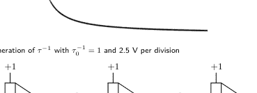

图 5.8. 生成 τ⁻¹，其中 τ₀⁻¹ = 1，每格 2.5 V

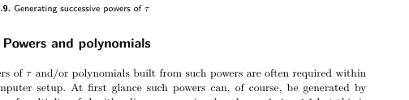

图 5.9. 生成 τ 的连续幂

## 5.3 幂与多项式

在计算机设置中，通常需要 τ 的幂和/或由这些幂构成的多项式。乍一看，这些幂当然可以通过向乘法器馈送线性斜坡信号（例如 −1 ≤ τ ≤ 1）来生成，但这并不总是现实的，因为乘法器很昂贵，而且模拟计算机（尤其是老式计算机）通常只有少数几个乘法器。此外，许多乘法器（如四分之一平方乘法器）在输入值接近零时会出现不可忽略的误差。

因此，通常更可取的做法是通过连续积分来生成线性时变变量 τ 的幂，如图 5.9 所示。该设置对 −1 ≤ τ ≤ 1 生成 τ、−τ² 和 τ³ 的幂。<sup>50</sup>

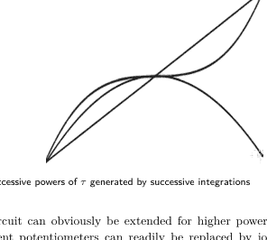

图 5.10. 通过连续积分生成 τ 的连续幂

该电路显然可以扩展到 τ 的更高次幂，并且一些系数电位器可以很容易地通过连接下一个积分器的输入端来替换，例如，加权为 10 的输入前面的因子 0.2 可以通过将该值馈送到两个相连的输入端（每个权重为 1）来代替，等等。通过这种设置生成的 τ 的连续幂也可以加在一起（通过加法器可选地改变符号）以及添加系数来形成任意多项式。图 5.10 显示了上述设置生成的随时间变化的函数。

## 5.4 低通滤波器

有时，例如在处理实验收集的数据时，低通滤波器是很有用的。从一个相当简化的角度来看，这种设备只允许低于某一阈值的频率通过。

这种电路的另一个应用是对由噪声发生器产生的（白）噪声信号进行滤波。这些信号经过滤波并可能整形为合适的分布（例如高斯分布），在分析受随机激励的机械系统的行为时非常有用。

尽管一些经典模拟计算机（如 EAI-231(RV) 或 Telefunken RA 770）具有产生正态分布输出信号的噪声发生器，但这种设备如今已很少见。可以改用用于音频目的、馈入低通滤波器的噪声发生器；下文对此进行描述。如果需要输出信号的正态分布，可以通过使用合适的函数发生器轻松获得。

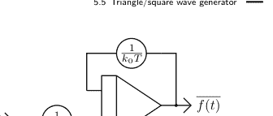

图 5.11. 低通滤波器基本电路

在模拟计算机上实现低通滤波器非常简单，因为它类似于一阶时间滞后，其一般传递函数为

$F(p) = \frac{1}{1 + pT}$

其中 $T$ 表示延迟线的时间常数。<sup>52</sup> 该设置如图 5.11 所示，基本上产生其输入信号的时变平均值。随着电路时间常数的增加，该平均值变得“更好”——但这也意味着电路需要更长的时间来稳定到平均值。

通常，两个系数电位器设置为相同的值，但有时根据期望的输出信号，与“理想”设置有一定偏差可能是有利的。

图 5.12 显示了从专业噪声发生器获得的白噪声信号，频率范围从 0 Hz 到 100 kHz，位于屏幕的上三分之一处。中间的曲线是应用一个上述结构的低通滤波器的结果，而下面的迹线表示连接到第一个滤波器输出的第二个低通滤波器的输出信号。

## 5.5 三角波/方波发生器

有时需要提供三角波或方波信号。三角波的典型应用是示波器或绘图仪的 x 偏转，而方波通常便于控制电子开关，以在示波器上显示多个曲线或图形。<sup>53</sup>

<sup>52</sup> 参见 [GILOI et al. 1963, p. 308] 和附录 B 了解更多细节。p 是实现时间导数的算子。

<sup>53</sup> 参见 [KORN et al. 1964, ch. 9-5]。


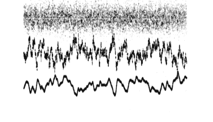

图5.12. 两个串联低通滤波器的典型行为——注意由于积分时符号变化，连续轨迹之间存在镜像关系。

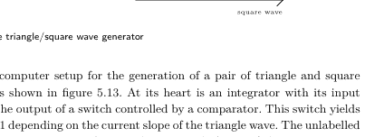

图5.13. 简单的三角波/方波发生器

图5.13展示了一个用于产生一对三角波和方波信号的简单计算机设置。其核心是一个积分器，其输入连接到由比较器控制的开关的输出端。该开关根据三角波当前的斜率产生 +1 或 −1。未标注的系数电位器用于设置积分器的时间比例因子。

图5.14展示了该电路产生的一对典型输出信号。将积分器设置为 k₀ = 1000，并将开关输出连接到权重为10的输入端，即可轻松获得400 µs的周期。


图5.14. 由图5.13所示电路产生的三角波和方波信号


图5.15. 理想化二极管电路

## 5.6 理想二极管

二极管是非常有用的元件，因为它们只允许电流沿一个方向通过——至少理想二极管应当如此。实际二极管有一些令人讨厌的特性。首先，它们存在一定的正向阈值电压，也就是说，当输入过零时它们并不会立即开始导通，而是只有当输入超过这个微小电压时才会导通，该电压是每只二极管固有的特性。这些阈值电压通常在肖特基二极管的0.2 V到经典硅二极管的0.7 V之间。

利用图5.15所示的设置，使用一个运算放大器，可以将实际二极管轻松转换为近似理想的二极管。该放大器有两条反馈路径。一条路径通过一个二极管将其输出连接到求和节点，从而在该二极管开始导通时将其输出限制为（接近）零。第二条路径通过第二个二极管连接到加法器的一个输入端，使该二极管开始导通时，加法器表现为经典反相器。因此，放大器的输出将比整个电路的输出高出一个所用二极管的阈值电压。


图5.16. 图5.15所示电路的行为


图5.17. 图5.15所示电路在两只二极管均反向连接时的行为

在某些情况下，可能需要在加法器的输出端与其求和节点之间连接一个小电容（约68 pF），以避免不稳定。

显然，带有关联（电子）开关的比较器也可用于实现类似理想二极管的功能。在这种情况下，开关的一个输入悬空或接地，而另一个输入连接到输入信号，该输入信号同时也连接到比较器输入端。由于所有比较器都表现出一定的迟滞以确保稳定运行，这种设置可能会导致二极管近似的不可忽略误差。在经典模拟计算机上应避免使用这种设置，因为这类机器将机电继电器与比较器配合使用，而继电器在闭合时间以及触点弹跳方面表现出显著变化。

## 5.7 绝对值

现在可以用理想化二极管来实现绝对值函数。图5.18展示了一个典型设置。电路的左半部分是前面展示过的理想二极管电路。其输出馈入第二个加法器的两个并联输入端。这两个输入端的行为相当于一个权重为2的输入端。第二个加法器的第三个输入端直接连接到整个电路的输入端。

当二极管电路的输出为零（即输入为负值的情况）时，第二个加法器充当简单的反相器，产生正输出。一旦 x > 0，理想化二极管开始导通并产生 −x。右侧的加法器现在计算 x − 2x = −x，再次产生正输出。图5.19展示了该电路的行为。和之前一样，可能需要添加一两个小电容来提高电路的稳定性。

## 5.8 限幅器

限幅功能将信号限制在上下边界之内。这对于模拟带限位挡块的机械系统或表现出饱和效应的系统特别有用。图5.20展示了一个非常简单的限幅电路。其核心是一个加法器，只要两只正向偏置二极管均不导通，它就充当反相器。这是限幅器的线性区域——其输出跟随输入（具有典型的符号反转）。如果其输出达到所示两只二极管中任意一只的阈值，它就会短路加法器内置的反馈电阻，从而将其输出限制在两只自由电位器上设定的正向偏置电压。

该电路有两个缺点。首先，由于它需要两个不带输出缓冲器的自由电位器，因此最适合使用简单分压器作为系数电位器的经典模拟计算机。其次，限幅并非真正“平坦”——它们表现出一定的斜率，这可能对使用该限幅功能的整体设置不利。

图5.21展示了一个好得多的限幅电路。其核心是一个由代表上限和下限的两个电压控制的二极管桥。两个电阻的阻值应约为桥电路之后反相器输入电阻的十分之一。如图5.22所示，该电路在限幅状态下输出信号具有极佳的平坦度，因此强烈推荐使用。

一个非常简单但往往很实用的限幅电路，只需使用两只合适的齐纳二极管，将其阴极（或阳极）相连，接在加法器或积分器的输出端与其相应的求和节点之间。


图5.18. 带理想二极管电路的绝对值函数


图5.19. 绝对值


图5.20. 简单限幅电路


图5.21. 精密限幅电路


图5.22. 精密限幅电路的行为

## 5.9 死区

许多机械系统，如齿轮系、连杆机构等，都会表现出一种称为回差（backlash）的现象，这是由运动部件之间不可避免的间隙引起的。在模拟计算机上，死区电路用于对这种现象进行建模。

文献中包含大量此类电路——基本思想是使用一对适当正向偏置的二极管馈入加法器。这种电路最简单的形式只包含两只二极管、两个自由电位器和一个加法器。这种简单性是有代价的，因为电位器的设置并不直接，而且二极管远非理想。

图5.23所示的电路用第5.6节所示的理想化二极管替代了这两只实际二极管。参数 r 和 l 定义死区的右、左断点。可能需要在连接到相关运算放大器求和节点的两只二极管上并联小电容，以避免电路出现不稳定行为。

图5.24展示了该死区设置的行为。输入使用了线性电压斜坡。曲线的左右斜率由输出加法器输入的权重 w_r 和 w_l 决定。


图5.23. 精密死区电路


图5.24. 图5.23所示死区电路的行为

同样，如果非常简单的死区电路就足够，也可以使用齐纳二极管。在这种情况下，将两只此类二极管的阴极或阳极相连，放置在加法器或积分器的某个合适输入端之前即可。

## 5.10 迟滞

表现出所谓迟滞的系统具有某种“记忆”，即其输出不仅取决于当前输入，还取决于其先前的状态。许多自然系统，例如某些磁性材料，表现出迟滞效应，这种效应也被有意地设计到简单恒温器等设备中。关于死区函数，文献中包含大量实现各种迟滞形式的电路；例如参见 [HOWE 1961, pp. 1482 ff.]、[GILOI et al. 1963, p. 210] 或 [HAUSNER 1971, p. 142/145 ff.]。

图5.25所示的电路实现矩形迟滞。它很简单，但需要一个电子开关。比较器固有的迟滞通常可以忽略，但至少应考虑。参数 a 和 b 定义输出的上下限，而 α 使迟滞“方框”绕原点移动。尽管这个电路很简单，但它有一个缺陷。加法器可能（而且一定会）进入过载状态。因此，建议通过一对


Fig. 5.25. 使用比较器和电子开关的简单滞回


Fig. 5.26. Bang-bang 电路

齐纳二极管连接在其输出端和求和节点之间，以抑制可能导致计算机操作停止的过载情况，具体取决于运行模式。

## 5.11 Bang-bang

所谓的 bang-bang 电路根据其输入电压在其输出端给出两个值之一。 这可以通过图 5.26 所示的比较器及其关联的（电子）开关方便地实现。 比较器开关的输入连接到电位器，它们定义了电路输出的上限和下限。 比较器的一个输入连接到输入信号，而另一个输入馈入阈值值 γ。 如果该第二个输入接地或省略，电路将在输入 x 穿过零时切换。 在这种情况下，电路有效地实现了 sign(x) 函数。

图 5.27 显示了该简单 bang-bang 电路的动态行为。 它由第 5.5 节所示电路产生的三角波驱动。 值 γ 设置为 0.75，并定义了矩形输出信号的占空比，换句话说。 如果 γ 是变量，此设置可用作简单的调制电路。


Fig. 5.29. 图 5.28 所示简单最小值保持电路的行为


Fig. 5.30. 改进的峰值检测器

图 5.29 显示了该设置产生的典型输出。 上部波形是随机输入信号，中间波形显示最小值保持电路的输出，而下部波形显示控制电子开关的信号。

然而，如果计算以高速进行，任何比较器电路中微小但不可避免的滞回将使该简单电路几乎无用，因为积分器倾向于超调。 图 5.30 显示了一个更好但更复杂的电路。 其核心是一个理想化的二极管。54 通常将 k0 保持尽可能低是个好主意，k0 = 10² 是一个典型值，并使用具有尽可能大输入权重的输入（或多个输入的并联电路）。 相反增加 k0 可能会导致不稳定行为。


Fig. 5.31. 简单的采样保持电路

## 5.13 Sample & Hold

*采样与保持* 电路用于采样输入信号并保持该值，直到请求另一个采样。 这种装置的简单电路如图 5.31 所示。55 它依赖于一个由外部信号触发的（电子）开关（在本例中施加到其关联的比较器），该开关驱动积分器。 该开关的输入由误差信号驱动，该误差信号是当前输入信号与积分器中存储的值之间的差值产生的。 当开关闭合时，积分器将使该误差信号归零，从而在其输出端得到最后一个输入值。

希望将积分器设置为非常大的时间比例因子，例如 k0 = 10³ 或更大，使用加权为 10 甚至 100 的输入，以便尽可能少的时间滞后跟随输入信号。 只要该元件的平衡误差可忽略不计，电子开关可以用乘法器代替。

如果使用的模拟计算机允许对积分器进行单独模式控制，则可以更轻松地设置采样保持电路，如图 5.32 所示。 许多经典模拟计算机具有数字扩展系统，其中至少可以访问计算机某些积分器的模式控制线。 先前所示的 Analog Paradigm INT4 模块有四个积分器，其中两个可以通过标记为 ModeIC 和 ModeOP 的插孔进行外部控制。 表 5.33 显示了可以应用于积分器的四种控制信号组合，而与计算机控制单元上选择的当前操作模式无关。

要将积分器用作采样保持电路，ModeOP 输入应连接到 +1。 将 ModeIC 设置为 −1 时将跟踪输入信号，而将 +1 施加到该输入时将保持最后一个值。 通常效果很好，因为初始条件电路具有至少 100 的输入权重，导致在 k0 = 10⁵ 时整体时间比例因子为 10⁵。

55 Cf. [AMMON 1966, pp. 108 ff.].


Fig. 5.33. 精密时间微分电路

should hold. 由于 Analog Paradigm SUM8 模块的求和器使用 200 kΩ 反馈电阻，连接到加权为 10 的输入的 4.7 nF 电容器将产生一个时间比例因子约为 10³ 的可用电路。

图 5.33 显示了一种更复杂的方法。 在这里，上限频率可以通过参数 α 连续设置，根据

$$f_{\max}=\frac{k_0}{1-\alpha}$$

与系数电位器 α 提供反馈串联的两个放大器实现了具有可调正反馈的开环放大器的等效，而与每个单放大器的单独负反馈相反。

图 5.34 描述了该电路在不同 α 设置下的行为。 通常，α 应尽可能接近 1。 通常能良好工作而不引起不稳定性的值是 α ≈ 0.85…0.95。 该设置的变体可在 [HAUSNER 1971, pp. 296 f.] 中找到。

该电路可更普遍地用于在创建诸如开方、除法等逆函数时替代开环放大器。 使用这种方法进行除法的设置在 [GILOI et al. 1963, p. 168] 中有描述。

## 5.15 Time delay

许多动态问题表现出延迟特性，例如核链反应中的延迟中子产生、生物系统中的传输延迟以及传送带上材料的运输等。 这些系统由时滞微分方程或其系统建模。 在模拟计算机上解决此类问题需要在计算机设置中引入延迟的手段。 以下各节描述了实现延迟函数的三种基本方法，并讨论了其实用实现的某些设计考虑。

图 5.35 显示了理想延迟电路的行为。 一个时变函数（粗线）被延迟时间 T > 0（细线）。 一个理想的延迟具有


Fig. 5.34. 由图 5.13 所示设置产生的三角信号的时间导数，上限频率设置正确（从上数第二个）、过低（从下数第二个）和过高（底部）

输入为函数 f(t) 时，其输出为延迟函数 f*(t)，根据以下定义：

f*(t) = { 0      0 ≤ t < T
          f(t − T)  t ≥ T } (5.2)

通常，延迟电路可以根据其实际实现产生的行为分为三类：

- 1. 表现出离散时间和离散值的延迟，
- 2. 在离散时间上工作且在连续值上工作的，以及最后
- 3. 在连续时间和连续值上操作的延迟。

尽管第三类延迟似乎在模拟计算机设置中最为理想，但其实现相当 demanding。 此外，这些方法表现出一些缺陷（将在


Fig. 5.35. 延迟时变函数

下面讨论）必须在实际仿真设置中考虑。 尽管存在缺点，第一类或第二类的延迟通常更受青睐。

### 5.15.1 Historic approaches to delay

在模拟计算的早期，实现延迟的一种明显方法是用磁带驱动器。 可调时间延迟可以通过改变磁带速度或一对写/读磁头之间的距离来实现。 除了磁带驱动器本身的高初始成本外，为写磁头供电并由读磁头驱动所需的频率调制器和解调器极其昂贵，因此只有少数安装能够负担得起这种技术。58

另一种更简单的经典方法基于所谓的电容器轮，它是当今采样保持电路的扩展。 它基本上由大量存储电容器组成，这些电容器由电机驱动的开关选择，如图 5.36 所示。 这里标记为 1 和 2 的开关由单个轴同步驱动，而实际时间延迟由标记为 3 的开关控制。 该设置显然属于第二类延迟电路，具有连续值表示但在离散时间运行。 其现代等价物是桶 brigade 装置，在第 5.15.3 节中描述。

以下各节将讨论延迟电路的三个基本类别，并提供适用于现代高速模拟计算机的一些实用实现示例。


图 5.36 根据 [THOMAS et al. 1969, p. 638] 的时间延迟电路

### 5.15.2 数字化

如今，实现（可变）延迟的显而易见的方法是将待延迟的模拟信号通过*模数转换器*（简称 *ADC*）转换为数字值。该 ADC 通常包含一个*采样保持电路*，以确保信号在转换期间不会发生变化。ADC 输出连接到微控制器，微控制器将这些值存储到合适的*随机存取存储器（RAM）*的连续存储单元中。然后以适当的地址偏移读出这些值，并馈送到*数模转换器*（*DAC*），从而实现所需的延迟，该延迟由采样率和地址偏移决定。使用现成的硬件（如 Arduino®），可以轻松且廉价地实现这种数字延迟。如果需要对多个通道进行延迟，则必须采取特殊措施，以并行触发所有输入采样保持电路，并在 DAC 之后采用类似的级联，以避免数据偏移。

这种方法的主要缺点是时间和信号值必然被量化。时间离散化主要取决于 ADC/DAC 的速度、可用内存量以及所需的最大延迟时间 *T*。信号值离散化取决于 ADC/DAC 的分辨率。尽管此类电路很容易获得 16 位分辨率，但需要仔细布局印刷电路板。如果这些离散化是可接受的，则可以考虑基于 Arduino® 的数字延迟电路。


图 5.37 经典的 EAI 时间延迟单元

图 5.37 展示了这种可追溯到 20 世纪 70 年代末的数字延迟单元的经典示例。

如果此类设备现成可用，则应优先于所有其他实现变体使用，因为其他变体通常需要大量计算元件，并且还会产生信号失真，在某些情况下可能不可接受。

### 5.15.3 采样保持电路

图 5.38 所示的采样保持电路代表了第二类延迟系统。这种延迟网络由偶数个单独控制的积分器（以小黑条表示）组成，分为两组，标记为 I 和 II。这两个积分器组通过一个两相时钟信号（如表 5.2 所示）在 IC 和 HLT 模式之间交替切换。

每组交替循环经过 IC 和 HLT 模式，从而以步进方式将该积分器链输入端的值从左向右移动，延迟时间 T 取决于时钟频率和双积分器级的数量。

表 5.2 采样保持电路的时钟控制

| 周期 | 第一组 IC | 第一组 HLT | 第二组 IC | 第二组 HLT |
|-------|------------|-------------|-------------|--------------|
| 0 | ✓ |  |  |  |
| 1 |  | ✓ |  |  |
| 2 |  |  | ✓ |  |
| 3 |  |  |  | ✓ |
| 4 | ✓ |  |  |  |
| 5 |  | ✓ |  |  |
| ... | ... | ... | ... | ... |

图 5.38 基本采样保持电路


此类电路已被广泛用于实现采样数据系统和差分方程⁵⁹，但由于所需积分器数量惊人，它们并不直接适用于实现高粒度延迟电路。

这种积分器链的一种更合适的实现称为斗链器件，简称 BBD。这个名称颇具描述性，因为它们由多个电容器实现，如图 5.39 所示。⁶⁰ 这些电容器通过场效应晶体管（FET）互连，FET 由两相时钟信号 CP1 和 CP2 控制，分别控制奇数号和偶数号 FET。施加到输入端 IN 的电压通过 CP2 上的一个时钟脉冲存储在斗链的第一个电容器中。该脉冲之后是 CP1 上的一个脉冲，将该值从第一个电容器转移到第二个电容器，依此类推。由于电容器级数是固定的⁶¹，所需的延迟通过调节两相时钟信号的频率来实现。⁶²

$$
\begin{aligned}
&= \int_{T}^{\infty} e^{-s t} f(t - T) \, dt\\
&= \int_{0}^{\infty} e^{-s(t+T)} f(t) \, dt\\
&= \int_{0}^{\infty} e^{-s T} e^{-s t} f(t) \, dt\\
&= e^{-s T} F(s)
\end{aligned}
$$

由此得到的项 $e^{-sT}$ 称为拉普拉斯延迟算子。现在可以通过将该算子解释为一个由其传递函数描述的传递系统来获得实际的延迟电路。通常，给定一个与时间相关的输入/输出信号对 $y_i(t)$ 和 $y_o(t)$，传递系统的行为可以用下式描述：

$$F(s) = \frac{y_o(s)}{y_i(s)}\tag{5.3}$$

其中

$$y_o(s) = \mathcal{L}\{y_o(t)\} \text{ 且 } 
y_i(s) = \mathcal{L}\{y_i(t)\}$$

是时变输入和输出信号的拉普拉斯变换。此类传递系统可分为两类：

1. 可以用常微分方程描述的系统；
2. 必须用偏微分方程描述的系统。

这里只考虑第一类系统。这类系统可以用如下形式的有理函数描述：

$$F(p) = \frac{\sum_{k=0}^{m} b_k s^k}{\sum_{k=0}^{n} a_k s^k}.\tag{5.4}$$

结合（5.3）和（5.4）并重新整理，得到：

$$\sum_{k=0}^{n} a_k s^k y_o(p) = \sum_{k=0}^{m} b_k s^k y_i(p).$$

以一种不太正式的方式继续，s 可以被解释为微分算子 d/dt。将拉普拉斯变换 $y_i(p)$ 和 $y_o(t)$ 替换为它们对应的时域函数，则得到：

$$\sum_{k=0}^{n} a_k \frac{d^k}{dt^k} y_o(t) = \sum_{k=0}^{m} b_k \frac{d^k}{dt^k} y_i(t),$$

现在可以用它为给定的传递系统（如延迟函数）推导出一个模拟计算机程序。

不幸的是，朴素的方法

$$e^{-sT} = \sum_{k=0}^{\infty} \frac{(-1)^k (sT)^k}{k!}$$

对于模拟计算机程序来说并不是特别合适，因为即使是一个粗略的近似，也需要数量惊人的电路。AMELING$^{67}$ 给出了一些有趣的额外级数展开，但不幸的是，这些展开对于实际实现也不是很有用。

一种有趣的方法是放弃直接实现延迟算子的幂级数表示，而是利用其宏观行为来推导合适的近似。设 s = iω，拉普拉斯延迟算子满足

$$|e^{-i\omega T}| = 1,$$

即它表现出恒定的单位增益。此外，

$$\arg \left(e^{-i\omega T}\right) = -\omega T = -2\pi f T$$

其中 ω = 2πf 如常，因此 $e^{-sT}$ 对纯正弦输入产生与频率成比例的相移。因此，该算子可以看作是一个全通滤波器。基于这一观察，可以采取另一种方法在模拟计算机上实现它。

所需的单位增益迫使（5.3）的分子成为其分母的复共轭，从而得到如下一般形式的传递函数：

$$F(p) = \frac{\sum_{k=0}^{\infty} (-1)^k a_k s^k T^k}{\sum_{k=0}^{\infty} a_k s^k T^k}.$$

现在，拉普拉斯延迟算子可以相当简单地用以下一阶 Padé 近似来逼近。⁶⁸

$$P_1(s)=\frac{y_o(s)}{y_i(s)}=\frac{1-\frac{sT}{2}}{1+\frac{sT}{2}}=\frac{2-sT}{2+sT}$$

交叉相乘两个分数，得到：

$$y_o(s)(2+sT)=y_i(s)(2-sT).$$

像之前一样将 $s$ 视为微分算子，该方程可以解释如下：⁶⁹

$$2y_o+T\dot{y}_o=2y_i-T\dot{y}_i.$$

重新整理各项，得到：

$$T(\dot{y}_o+\dot{y}_i)=2(y_i-y_o).\tag{5.5}$$

不幸的是，这个微分方程不能使用众所周知的 KELVIN 反馈技术直接实现为模拟计算机程序。因为有两个一阶导数，没有单一的最高阶导数可供求解（5.5）。虽然可以在模拟计算机上生成时间导数，⁷⁰ 但通常不建议这样做。相反，对两边进行积分，得到：

$$T\int_{0}^{t}(\dot{y}_o+\dot{y}_i)\,dt=2\int_{0}^{t}(y_i-y_o)\,dt$$

由此得出：

$$\frac{T}{2}(y_o+y_i)=\int_{0}^{t}(y_i-y_o)\,dt$$

这个方程可以很容易地转换为模拟计算机设置，如图 5.40 所示。⁷¹ 系数 $\frac{T}{2}$ 显然不能直接通过限制在 $0\leq\alpha\leq1$ 的电位器设置来表示。因此，电位器的输出将连接到右侧加法器的一个适当加权⁷² 的输入（按 $\alpha$），如图所示。

⁶⁸ 从数值角度对 Padé 近似的深入处理可参见 [Sachs 2016] 和 [Press et al. 2007, pp. 245 ff.]。

⁶⁹ 此处省略参数 $(t)$，以避免方程中不必要的杂乱。

⁷⁰ 典型电路见第 5.14 节。

⁷¹ 关于在模拟计算机上实现传递系统的全面论述可参见 [Gillo et al. 1963, pp. 288 ff.]。

⁷² 通常，10、20 或 100 的因子会比较合适。


图 5.43. 延迟算子的二阶 PADÉ 近似 – α 和 β 的典型值分别为 20 和 100


图 5.44. 二阶 PADÉ 近似对三种不同输入信号的响应，sin(ωt)、1 − e^{−λt} 和阶跃函数（从左到右，实际测量值）

另一种高质量的模拟延迟电路基于 STUBBS-SINGLE 近似，如果要实现高信号保真度，则该近似往往变得相当复杂。图 5.45 所示的四阶 STUBBS-SINGLE 近似基于传递函数

$$
e^{-\tau s} = \frac{1 - \frac{1}{2} \tau s + \frac{15}{134} \tau^2 s^2 - \frac{13.55}{1072} \tau^3 s^3 + \frac{1}{1072} \tau^4 s^4}{1 + \frac{1}{2} \tau s + \frac{15}{134} \tau^2 s^2 + \frac{13.55}{1072} \tau^3 s^3 + \frac{1}{1072} \tau^4 s^4}
$$

并需要四个积分器、两个求和器和六个电位器。

有关时延近似的进一步细节可在以下各种来源中找到，例如 [GILOI et al. 1963, pp. 294 ff.]、[STUBBS et al. 1954]、[CARLSON et al. 1967, pp. 225 ff.] 和 [KENNEDY 1962, pp. 6-5 ff.]。


图 5.45 四阶 Stubs-Single 近似

# 第6章

## 示例

以下章节描述了使用模拟计算机求解的各种不同复杂度的难题。在模拟计算机上重现这些解法不仅极具启发性，而且非常有收获，最后但并非最不重要的是，很有趣。

## 6.1 化学动力学

化学、生物学、药学等领域的一个核心问题是描述和分析化学反应发生的速率。在此背景下有两个重要的通用术语。首先是物质 A 转化为产物 X 的反应速度，该过程通常表示为 $A \rightarrow X$。第二个术语是反应级数，它描述了反应速度对反应中各种物质浓度依赖性的情况：

- **0 级：** 反应速度恒定。当参与反应的物质充足时通常如此。
- **1 级：** 这描述了反应 $A \rightarrow X$，遵循方程 $-\dot{a}=ka$，其中 $k$ 是描述反应速度的常数。
- **2 级：** 形式为 $A+B \rightarrow X$ 或 $A+A \rightarrow X$ 的反应，遵循 $-\dot{a}=kab$ 或 $-\dot{a}=ka^2$，如果仅需要试剂 A。


**图 6.3.** 方程 $\dot{a}=\dot{b}=-kab$ 的设置


**图 6.4.** 反应 $A+B\xrightarrow{k}C$ 的典型仿真结果

得到方程 $\dot{a}=\dot{b}=-kab$，该方程可轻松转换为图 6.3 所示的程序。这给出了图 6.4 所示的典型结果。

像这样的两步反应系统

$$
A \xrightarrow{k_1} B \xrightarrow{k_2} C
$$

可以由以下一组耦合微分方程描述

$$
\begin{aligned}
\dot{a} &= -k_1a \\
\dot{b} &= k_1a-k_2b \text{ and} \\
\dot{c} &= k_2b.
\end{aligned}
$$


图 6.5. 反应 $A \xrightarrow{k_1} B \xrightarrow{k_2} C$ 的计算机设置


图 6.6. 反应 $A \xrightarrow{k_1} B \xrightarrow{k_2} C$ 的仿真结果

图 6.5 和 6.6 显示了该问题的程序和典型结果。⁷⁶

MICHAELIS-MENTEN 动力学是酶动力学的一个经典模型，其形式为

$$
S + E \underset{k_1}{\stackrel{k_2}{\rightleftharpoons}} \varepsilon \xrightarrow{k_3} P + E,
$$

其中 $S$、$E$、$\varepsilon$ 和 $P$ 分别表示底物、酶、酶-底物复合物和反应的最终产物的浓度。右侧的游离酶可用于新的酶-底物复合物，即酶在整个过程中不会被消耗。⁷⁷ 该系统由以下一组方程描述：⁷⁸

$$
\begin{aligned}
\dot{s} &= -k_1 e s + k_2 \varepsilon \\
\dot{e} &= -k_1 e s + (k_2 + k_3) \varepsilon \\
\dot{\varepsilon} &= k_1 e s - (k_2 + k_3) \varepsilon \\
\dot{p} &= k_3 \varepsilon
\end{aligned}
$$

图 6.7 显示了由此产生的计算机设置，而图 6.8 显示了典型的仿真结果。


图 6.11. 显示混沌行为的典型仿真结果

## 6.3 马修方程

以下章节基于另一个由著名的 MATHIEU 方程描述的振荡系统——一个具有许多应用的线性齐次二阶微分方程。它可用于描述椭圆鼓的振动、倒立摆的行为等等。81

### 6.3.1 引言

MATHIEU 方程的一般形式为

$$
\ddot{y} + (a - 2q \cos(2t)) y = 0
$$

初始条件为

$y_0 = 1$ and
$\dot{y}_0 = 0$.

根据 [EAI 1964]，通过令 $a := 2q$ 去掉参数 $a$。定义一个函数

$$
x(t) = 1 - \cos(2t) \tag{6.3}
$$

显著简化了方程，得出

$$
\ddot{y} + a x y = 0. \tag{6.4}
$$


图 6.14. MATHIEU 方程在某些值 0 ≤ a/10 ≤ 1 下的典型解


图 6.16. VAN DER POL 方程的最终计算机设置


图 6.19. 生成势阱


图 6.20. SCHRÖDINGER 方程的典型解

这显示在上部波形中。接下来的两条曲线显示 $\Psi$ 和 $\Psi^2$。这里假设 $\Psi_0$ 为零，而 $\dot{\Psi}_0$ 在实验中设定，使得图 6.18 中的两个积分器不会过载。

模拟计算机的一个巨大优势，即参数变化易于测试，在此程序中变得非常清晰。改变 $E$、$V_0$、$\Psi_0$ 和 $\dot{\Psi}_0$ 可以很好地体会一维 SCHRÖDINGER 方程的行为。

## 6.6 弹道轨迹

以下示例计算从大炮发射的弹丸的二维弹道轨迹，同时考虑随速度变化的阻力，该阻力会减慢弹丸速度。这种阻力会导致轨迹偏离简单的对称抛物线，因为其后段路径比前段更陡。阻力 $\delta(v)$ 假定为一般形式

$$\delta(v) = r v^2 \tag{6.17}$$

其中 $v = \sqrt{\dot{x}^2 + \dot{y}^2}$。

这有点过于简化，因为根据 Siacci 例如，历史弹丸的真实阻力函数形式为

$$\delta(v) = 0.2002v - 48.05 + \sqrt{9.6 + (0.1648v - 47.95)^2} + \frac{0.0442v(v - 300)}{371 + (v/200)^{10}}.$$

然而，(6.17) 对于以下示例已足够。

该二维问题中弹丸的一般运动方程为

$$\ddot{x} = -\frac{\delta(v)}{m} \cos(\phi) \quad (6.18) \qquad \ddot{y} = -g - \frac{\delta(v)}{m} \sin(\phi) \quad (6.19)$$

其中 $g$ 表示重力加速度，$v$ 表示弹丸速度，$m$ 为其质量。因此，$\cos(\phi) = \dot{x} / v$ 且 $\sin(\phi) = \dot{y} / v$。

设质量 $m := 1$ 并重新排列 (6.18) 和 (6.19) 得到以下一组微分方程：

$$
\ddot{x} = -\frac{\delta(v)}{v} \dot{x}, \qquad \ddot{y} = -g - \frac{\delta(v)}{v} \dot{y}.
$$


对应的计算机设置如图 6.21 和 6.22 所示。电路的上半部分和下半部分是对称的，除了向左下积分器输入的重力加速度，该输入给出 \(\dot{y}\)。速度 \(\dot{x}\) 和 \(\dot{y}\) 被送入乘法器以得到各自的平方，然后求和并开方得到 \(v\)，因为根据 (6.17) 有 \(D(v)/v = r v\)。

参数 \(\alpha_1\) 和 \(\alpha_2\) 是缩放参数，设置为在设置为 \(x,y\) 模式的示波器上给出合适比例的图像。表 6.23 显示了产生图 6.23 所示结果的参数集。初始条件满足 \(\dot{x}_0 = \cos(\varphi_0)\) 且 \(\dot{y}_0 = \sin(\varphi_0)\)，其中 \(\varphi\) 表示大炮的仰角。在所示的屏幕截图中，\(\varphi_0\) 被设置为 \(60^\circ\)。

## 6.7 磁场中的带电粒子

本示例使用模拟计算机模拟带电粒子穿过磁场的路径。[88] 基本上，电荷为 \(q\) 的粒子在磁场 \(\vec{B}\) 中运动时，会受到一个力 \(\vec{F}_{\mathrm{Lorentz}}\)，该力垂直于磁场 \(\vec{B}\) 和粒子运动的方向，由此得到
\[
\vec{F}_{\mathrm{Lorentz}} = q\left(\vec{v} \times \vec{B}\right) = q\left(\dot{\vec{r}} \times \vec{B}\right).
\]

\(\vec{v}\) 表示速度，\(\vec{r}\) 表示所考虑粒子的位置。另外，\(\vec{F}_{\mathrm{particle}} = m\ddot{\vec{r}}\) 成立。此外，假设有某种形式的摩擦力作用于粒子，施加的力为 \(\vec{F}_{\mathrm{friction}} = -\mu\dot{\vec{r}}\)。

将这三个方程结合起来最终得到
\[
m\ddot{\vec{r}} = \vec{F}_{\mathrm{Lorentz}} + \vec{F}_{\mathrm{friction}} = q\left(\dot{\vec{r}} \times \vec{B}\right) - \mu\dot{\vec{r}}. \tag{6.20}
\]

88. 这基于 [Telefunken/Particle]，该文可能由 Inge Borchardt 女士撰写，她在 DESY 为高能粒子加速器进行了轨迹模拟——最初使用 EAI 231RV 模拟计算机，随后使用 Telefunken RA770 混合计算机。


图 6.24. 模拟带电粒子在磁场中路径的模拟计算机设置

得到
\[
\dot{x} = \alpha \dot{y} - \beta x \quad\text{and} \tag{6.24}
\]
\[
\dot{y} = -\alpha \dot{x} - \beta y. \tag{6.25}
\]

这些方程现在可以转换为图 6.24 所示的模拟计算机程序。

图中中间的两个比较器控制磁场所限定的区域。\(x_1\) 和 \(x_2\) 确定包围磁场的左右坐标（将两者都设置为最大值会得到一个从 \(-1 \le x \le +1\) 延伸的磁场）。粒子初始速度的 \(x\) 分量和 \(y\) 分量可以通过标记为 \(\dot{x}_0\) 和 \(\dot{y}_0\) 的两个电位器进行控制。输出 \(x\) 和 \(y\) 连接到设置为 \(x,y\) 模式的示波器。


图 6.25. 未被磁场捕获的粒子的路径

图 6.26. 被磁场捕获的粒子

图 6.25 和 6.26 所示的结果是在模拟计算机设置为重复操作、OP 时间为 10 ms 且所有四个积分器上的时间比例因子 \(k_0 = 10^3\) 的情况下获得的。

图 6.25 显示了两个典型的粒子路径，该粒子被磁场偏转但未被捕获。两幅图中的 \(\alpha\) 和 \(\beta\) 值相同。仅在第二种情况下，\(x_2\)（磁场在右侧停止作用的坐标）被增大。左图中粒子速度足够快，可以逃离狭窄的磁场，而右图中的更宽磁场导致粒子被反射。

图 6.26 显示了具有较大摩擦力的粒子的路径。摩擦力如此之大，以至于粒子无法逃离磁场作用的区域。

## 6.8 卢瑟福散射

20 世纪早期，欧内斯特·卢瑟福进行了一项开创性的实验，他用 \(\alpha\) 粒子轰击薄金箔。[89] 他观察到绝大多数粒子只是穿过金箔而不被偏转或吸收。然而，其中一些粒子被偏转了很大角度，甚至有更少的 \(\alpha\) 粒子被金箔反射，这一现象称为卢瑟福散射。这导致了行星状卢瑟福原子模型，随后成为玻尔模型的基础。

以下模拟计算机模拟的动机来自 [BORCHARDT]。假设金原子的核处于固定位置——具体来说是底层坐标系的原点，以便简化 \(\alpha\) 粒子的距离计算。当 \(\alpha\) 粒子的位置为 \((x, y)\) 时，它到金核的距离为
\[
r^2 = x^2 + y^2.
\]

89. 这些是氦核，因此相当大。

作用在 \(\alpha\) 粒子上的力由库仑定律描述
\[
F = k_e \frac{q_1 q_2}{r^2} \tag{6.26}
\]
其中 \(k_e = 8.9875 \cdot 10^9\ \mathrm{N\,m^2\,C^{-2}}\) 是库仑常数，\(q_1, q_2\) 是所涉及电荷的量值。由于以下模拟将是定性的，所有这些常数，包括质量，都可以合并到一个新的变量 \(\gamma\) 中。

力 \(F\) 作用于 \(x\) 和 \(y\) 上，与 \(\cos(\varphi)\) 和 \(\sin(\varphi)\) 成比例，其中
\[
\cos(\varphi) = \frac{x}{r} \quad\text{and}\quad \sin(\varphi) = \frac{y}{r}.
\]

与 (6.26) 和 \(\gamma\) 结合，这给出了控制 \(\alpha\) 粒子路径的以下两个耦合微分方程：
\[
\ddot{x} = \gamma \frac{x}{r^3},\qquad
\ddot{y} = \gamma \frac{y}{r^3}.
\]

这个问题的设置相当直接，如图 6.27 所示。需要注意的是，存在一个显式的额外反馈路径用于求和器，将 \(x^2\) 和 \(y^2\) 相加，这给出了 \(1/2\) 的缩放因子。因此，结果和满足 \(0 \le r_s \le 1\)，因此此处不会发生过载条件。如上所述，所有常数，包括此 \(1/2\) 因子，都被收集到参数 \(\gamma_s\) 中。该参数的典型值——产生良好的散射行为——约为 \(\approx 0.01\)。

唯一其他自由参数是 \(\alpha\) 粒子轨迹的初始高度 \(y_0\)。这可以通过连接到 \(+1\) 和 \(-1\) 的自由电位器手动设置，也可以通过图 6.28 所示的三角形波发生器自动设置，该发生器由一个与两个比较器协同工作的积分器组成。

要运行此程序，模拟计算机设置为重复操作，操作时间为 \(t_{\mathrm{OP}} = 30\ \mathrm{ms}\)。三角波发生器的积分器必须通过将其 Mode C 输入连接到 \(+1\) 来与中央定时控制断开（只有 INT4 模块的第三或第四个积分器可用于此目的），以便在两次连续计算运行之间不会被复位。

图 6.29 所示的图像是在图 6.27 中的四个积分器上使用时间常数 \(k_I = 100\) 且三角形波发生器中 \(k_0 = 1\) 的情况下获得的。相机设置为 ISO 100，曝光时间为 8 秒。


图 6.28. \(y_0\) 的自动/手动生成


图 6.29. 卢瑟福散射的模拟

## 6.9 天体力学

模拟（或确定）具有给定参数的三个（天体）物体的运动，例如质量、引力常数、物体坐标和速度的初始条件，被称为 *三体问题*。[90] 首先解决这个问题的是艾萨克·牛顿爵士，在他的 *Principia* 第一卷第 XI 节中，据乔治·比德尔·艾里爵士称，该章节被认为是“有史以来写过的关于物理科学的最有价值的章节”。[91]

尽管在更简单的两体情况下存在解析解，约瑟夫-路易·拉格朗日能够为更困难的三体问题给出一些特定解。由于这些内容超出了本节范围，读者可参考标准文献 [BATTIN 1999, pp. 365 ff.] 和 [MOULTON 1923, p. 363]。

90. 这是 *n* 体问题的特例，这里将不再进一步研究。

91. 参见 [MOULTON 1923, p. 363]。


[Moulton 1923, pp. 277 ff.] 提供了该问题的解析处理和一些背景信息。然而，使用模拟计算机，研究三体问题是相当直接的。

在本节中，将模拟一个简单的宇宙，其中包含两个恒星，其位置固定为 \(\vec{r}_1 = (x_1, y_1)\) 和 \(\vec{r}_2 = (x_2, y_2)\)，质量 \(m_1 = m_2 = 1\)，以及一颗质量可忽略的卫星在两个天体之间穿梭。该系统可以用以下一组耦合微分方程方便地描述：

$$m_1 \ddot{\vec{r}}_1 = G m_1 m_2 \frac{\vec{r}_2 - \vec{r}_1}{|\vec{r}_2 - \vec{r}_1|^3} + G m_1 m_3 \frac{\vec{r}_3 - \vec{r}_1}{|\vec{r}_3 - \vec{r}_1|^3}$$

$$m_2 \ddot{\vec{r}}_2 = G m_2 m_3 \frac{\vec{r}_3 - \vec{r}_2}{|\vec{r}_3 - \vec{r}_2|^3} + G m_2 m_1 \frac{\vec{r}_1 - \vec{r}_2}{|\vec{r}_1 - \vec{r}_2|^3}$$

$$m_3 \ddot{\vec{r}}_3 = G m_3 m_1 \frac{\vec{r}_1 - \vec{r}_3}{|\vec{r}_1 - \vec{r}_3|^3} + G m_3 m_2 \frac{\vec{r}_2 - \vec{r}_3}{|\vec{r}_2 - \vec{r}_3|^3} \qquad (6.27)$$

向量 \(\vec{r}_i\)，\(1 \le i \le 3\) 描述了具有质量 \(m_i\) 的不同天体的位置，而 \(G\) 为万有引力常数。

假设两颗恒星静止不动，则在模拟计算机上只需实现方程 (6.27)。由于恒星的质量等于 1，卫星的质量被约去，得到

$$\ddot{\vec{r}}_3 = G \frac{\vec{r}_1 - \vec{r}_3}{|\vec{r}_1 - \vec{r}_3|^3} + G \frac{\vec{r}_2 - \vec{r}_3}{|\vec{r}_2 - \vec{r}_3|^3}. \qquad (6.28)$$

引入两个距离项

$$\Delta r_{13}^3 = \left(\sqrt{(x_1 - x_3)^2 + y_3^2}\right)^3 \qquad (6.29)$$

$$\Delta r_{23}^3 = \left(\sqrt{(x_2 - x_3)^2 + y_3^2}\right)^3 \qquad (6.30)$$

并将 (6.28) 分解为其 \(x\) 和 \(y\) 分量，得到以下两个方程，它们描述了卫星在笛卡尔坐标系中的轨迹：

$$\ddot{x}_3 = (x_1 - x_3) \frac{G}{\Delta r_{13}^3} + (x_2 - x_3) \frac{G}{\Delta r_{23}^3} \qquad (6.31)$$

$$\ddot{y}_3 = -y_3 \left( \frac{G}{\Delta r_{13}^3} + \frac{G}{\Delta r_{23}^3} \right). \qquad (6.32)$$

这些方程现在可以很容易地在模拟计算机上实现。图 6.30 显示了产生距离项 (6.29) 和 (6.30) 的部分计算机设置。


图 6.30 距离项


图 6.32. G 取较小值时的典型卫星轨迹


图 6.33. G 取较大值时的轨迹

图 6.34 显示了模拟的基本思想：边界框假设为矩形 \([−1,1]\times[−1,1]\)，球在此框内的位置由坐标 \((x,y)\) 描述。模拟运行开始时，球有两个初始条件：初始速度 \(v_0\)（其中仅给出 \(x\) 分量）和初始 \(y\) 位置 \(y_0\)，设为 1。

球位置的 \(x\) 和 \(y\) 分量完全独立，因此可以用两个独立的子程序生成。球速度的 \(x\) 分量假设随时间线性减小。球的实际 \(x\) 位置通过对其速度积分得到。每当球撞击盒子的左壁或右壁时，它会改变方向，即被墙壁反射。

\(y\) 分量为自由下落球的分量，撞击地面时弹性反弹。图 6.35 显示了这两个变量随时间的变化，如示波器上所示：从左侧开始，计算机首先处于 IC 模式。一旦 OP 模式开始，球开始下落直到撞击地面，而 \(x\) 分量（中间的轨迹）以减小的速度增加，直到到达右壁等。

图 6.36 显示了产生球位置 \(x\) 分量的计算机设置。最左边的积分器产生球的速度分量 \(v_x\)，其从 +1 开始并在 Δv 电位器的控制下线性减小。⁹⁵ 需要注意的是，与第 5.5 节图 5.13 中所示的三角波发生器相比，该设置通过引入一个带关联电子开关的第二比较器而略有不同。这使得第一个比较器具有稳定的比较值 ±1，因为其关联的开关在其输出端不再产生 ±1，因为它在该设置中由最左边的积分器驱动。


图 6.34. 反弹球的运动


图 6.35. 反弹球的 x 和 y 分量


图 6.36. 生成 x 分量

该电路的输出馈送到设置为 \(x,y\) 显示模式的示波器的 \(x\) 输入端。本例中积分器的时间比例因子分别设置为 \(10^2\) 和 \(10^3\)。

飞行中球的 \(y\) 分量可以用以下式子描述

$$\ddot{y} = -g + d\dot{y} \qquad (6.33)$$

其中 \(d\) 表示由于空气摩擦引起的阻尼系数。这种摩擦假设与球的速度成正比，这是一个很大的简化。当球撞击盒子的天花板或地板时，引入一个与穿透深度成正比的附加项：

$$\ddot{y} = -g + d\dot{y} + \begin{cases} +c(-y - 1) & \text{if } y < -1 \\ -c(y - 1) & \text{if } y > 1. \end{cases}$$


图 6.39. 方程 (6.34) 和 (6.35) 的模拟计算机程序


图 6.40. 典型僵尸模拟的结果

图 6.39 显示了方程 (6.34) 和 (6.35) 的定性（即未缩放）程序。使用该设置获得的典型模拟结果如图 6.40 所示。计算机以重复模式运行，积分器的时间比例因子设置为 \(k_0 = 10^3\)。此外，所有积分器输入的权重均为 10，进一步将模拟速度提高 10 倍。OP 时间设置为 60 ms。示波器依靠其内置的时间偏转，由 CU 的一个触发输出显式触发以获得稳定的显示。

所使用的参数是通过手动改变系数直到获得振荡行为而实验得出的。所示输出对应于 \(h_0 = z_0 = 0.6\)，\(\alpha = 0.365\)，\(\beta = 0.95\)，\(\delta = 0.84\)（非常成功的僵尸，确实），\(\gamma = 0.44\)，以及 \(\zeta = 0.09\)。与大多数捕食者-猎物系统一样，很难找到一个参数设置，使其产生具有稳定最小值和最大值振幅的振荡行为。由于在此特定参数集中没有任何物种灭绝，未来几年有很多僵尸电影的创作空间。

## 6.12 Rössler 吸引子

电子模拟计算机非常适合研究连续时间动态系统，其中表现出混沌行为的系统不仅令人着迷，而且还能产生美观的相空间图。以下各节描述了若干此类系统；其中第一个系统由 Otto Rössler 于 1976 年开发并研究。⁹⁸ 该系统由三个耦合微分方程描述

$$\dot{x}=-(y+z),$$

$$\dot{y}=x+ay,$$

$$\dot{z}=b+z(x-c)$$

其中 \(a = 1/5\)，\(b = 1/5\)，且 \(c = 5.7\)。该系统的显著特性是其中只有一个方程是非线性的。

由于这些方程中的变量会超出机器单位的有效范围 \([-1,1]\)，因此在设置计算机之前必须对方程进行缩放。由于问题的非线性性质，该缩放过程相当繁琐，最好以多步方式进行。该问题的最终缩放耦合微分方程组如下所示：

$$\dot{x}=-0.8y-2.3z$$

$$\dot{y}=1.25x+a^*y$$

$$\dot{z}=b^*+15z(x-c^*)$$

其中 \(a^* = 0.2\)，\(b^* = 0.005\)，且 \(c^* = 0.3796\)。所得的计算机设置如图 6.41 所示，而图 6.42 显示了吸引子的 \(x\)-\(y\) 图，用 ISO 100 拍摄，所有三个积分器的时间比例因子 \(k_0\) 均设置为 \(10^3\)。

通过对吸引子进行简单的（静态）三维投影，可以获得特别美丽的图像。示波器的一个输入端设置为 \(x,y\) 模式，直接由 \(x\) 馈送，而另一个输入端由一个求和器馈送，得到

$$y^* = -(y\sin(\varphi)+z\cos(\varphi)),$$


图 6.41. 罗斯勒吸引子的接线图


图 6.42. 罗斯勒吸引子的 x–y 图


图 6.43. 罗斯勒吸引子的投影


图 6.44. 投影电路

其中正弦/余弦项直接由系数电位器设定，如图 6.44 所示。通过这两个系数电位器，视角可以自由调节。图 6.43 显示了用该装置获得的吸引子的典型投影。

## 6.13 洛伦兹吸引子

另一个更为著名的混沌系统是引人入胜的洛伦兹吸引子（LORENZ-attractor），它由爱德华·诺顿·洛伦兹于 1963 年提出，作为大气对流的简化模型，最初在 [LORENZ 1963] 中描述。尽管这项开创性工作是在数字计算机（Royal McBee LGP-30）上完成的，但洛伦兹吸引子当然也特别适合在模拟计算机上实现，如下所示。

这个动态混沌吸引子由以下三个耦合微分方程组描述：

```
\dot{x} = \sigma(y - x)
\dot{y} = x(\rho - z) - y
\dot{z} = xy - \beta z
```

参数为 σ = 10、β = 8/3 和 ρ = 28。显然，这组微分方程必须进行缩放才能在模拟计算机上实现。得到的缩放后方程如下：

```
x = \int (1.8y - x) dt + C
s = 1 - 2.678z
y = \int (1.5556xs - 0.1y) dt
z = \int (1.5xy - 0.2667z) dt
```

C 表示生成 x 的积分器的初始条件，并不关键。考虑到模拟计算机的每个加法器和积分器都会隐式地改变符号，并且注意到 xy = -x(-y)，这些方程可以进一步简化，从而在最终的计算机接线图中节省两个反相器：

```
-x = - \int (1.8y - x) dt + C
```


图 6.45. 洛伦兹吸引子的计算机接线图（第二个积分器反馈回路中的 0.2667 可以减小到约 0.125，以获得更好的结果）


图 6.48. 混沌 LORENZ-84 系统的程序

```
\dot{x} = -y^2 - z^2 - a x + a f,
\dot{y} = x y - b x z - y + g, and
\dot{z} = b x y + x z - z
```

参数为 $a = \frac{1}{4}$，$b = 4$，$f = 8$，$g = 1$。

对该系统进行缩放非常直接，因为快速的数值实验表明 $|x|$、$|y|$、$|z|$ 都以 2 为界。由此得到的模拟计算机程序如图 6.48 所示。调整参数相当有趣，一组典型的解如图 6.49 所示。

## 6.15 蔡氏吸引子

本节描述一个更为复杂的混沌系统——蔡氏振荡器（CHUA-oscillator）。该系统由蔡少棠（LEON ONG CHUA）于 1983 年发现，是展现混沌行为的电子线路的经典范例。该振荡器产生一个独特且特别美丽的吸引子，称为双涡卷吸引子。其核心是一个（假设的）非线性器件，称为蔡氏二极管。


图 6.40. LORENZ-84 系统的典型行为，三个屏幕截图分别显示 x 对 y、z 对 x、以及 y 对 z

这个特定振荡器的数学描述基于三个耦合微分方程，形式如下

```
\dot{x} = c_1 (y - x - f(x)),    (6.36)
\dot{y} = c_2 (x - y + z), and    (6.37)
\dot{z} = -c_3 y                 (6.38)
```

其中 f(x) 描述蔡氏二极管的行为，定义为

```
f(x) = m_1 x + (m_0 - m_1)/2 (|x + 1| - |x - 1|).    (6.39)
```

参数的标准值为
- c₁ = 15.6，
- c₂ = 1，
- c₃ = 28，
- m₀ = −1.143，
- m₁ = −0.714。

由于该耦合微分方程组具有显著的非线性行为，其缩放并不简单。各个项的范围是通过在数字计算机上计算示例解来确定的——这种技术早在 1960 年代就已使用。随后用这些结果来指导缩放过程。为简化整个过程，将方程 (6.37)、(6.38) 和 (6.39) 拆分为单独各项，得到如下一组缩放后的方程。(6.36) 替换为

$$\begin{aligned}
x_0 &= 0.1 && (6.40)\\
x_1 &= -10(x+f(x)) && (6.41)\\
x_2 &= y+\frac{1}{2}x_1 && (6.42)\\
x &= 3.12\int x_2\,dt+x_0 && (6.43)
\end{aligned}$$

其中 (6.40) 表示积分的初始条件。

(6.37) 拆分为

$$\begin{aligned}
y_1 &= z-\frac{1}{8}y && (6.44)\\
y_2 &= 1.25x+2y_1 && (6.45)\\
y &= 4\int y_2\,dt && (6.46)
\end{aligned}$$

而 (6.38) 变为

$$z=-\int 3.5y\,dt. \qquad (6.47)$$

核心元件蔡氏二极管的实现相当昂贵，因为每个绝对值函数的实现至少需要两个二极管和一个运算放大器。$f(x)$ 被分解并按如下方式缩放：

$$\begin{aligned}
f_1 &= |0.7143x+0.2857| && (6.48)\\
f_2 &= |0.7143x-0.2857| && (6.49)\\
f_3 &= f_1-f_2 && (6.50)\\
f(x) &= -0.714x-0.3003f_3 && (6.51)
\end{aligned}$$

从这些方程推导计算机接线图十分直接。第一组方程 (6.40, 6.41, 6.42, 6.43) 的实现如图 6.50 所示。第二组方程 (6.44, 6.45, 6.46, 6.47) 的实现如图 6.51 所示。

如果接线图出现不稳定迹象，可能需要在 $f(x)$ 电路中两个运算放大器各自的求和节点与输出之间添加小电容。图 6.52 显示了方程 (6.48)、(6.49)、(6.50) 和 (6.51) 的程序。


**图 6.53.** 蔡氏振荡器在 Analog Paradigm Model-1 模拟计算机原型上的接线图

**图 6.54.** 双涡卷吸引子的相空间显示

图 6.53 显示了该程序在 Analog Paradigm Model-1 模拟计算机早期原型上的实现，该原型配备专用的双绝对值函数模块，大大简化了 $f(x)$ 的实现。

根据此程序中积分器所选择的时间比例因子，既可以在示波器上显示双涡卷吸引子的相空间图，也可以使用传统笔式绘图仪将其绘制出来。图 6.54 显示了时间比例因子设为 $k_0 = 10^3$ 时运行计算的典型屏幕截图。

## 6.16 非线性混沌

另一个出奇简单的混沌系统也将绝对值函数作为核心非线性元件。该系统在 [Kiers et al. 2003] 中有所描述。其特征由以下微分方程给出：

$\ddot{x} = -\lambda\dot{x} - \dot{x} + |x| - 1$

一个显著的特点是，该系统的行为仅由一个参数 $\lambda$ 控制。缩放后的计算机程序如图 6.55 所示。如果所用的模拟计算机上没有现成的绝对值函数，可以按图 5.18 所示搭建一个。

图 6.56 显示了 $\lambda \approx 0.62$ 时基于 $-\ddot{x}$ 和 $\dot{x}$ 的相空间图示例。


图 6.55. 非线性混沌的计算机接线图


图 6.56. 混沌吸引子的相空间图

## 6.17 相泽吸引子

到目前为止最漂亮的混沌吸引子之一是相泽吸引子（AIZAWA attractor）¹⁰¹，它由以下三个耦合微分方程描述

˙x = x(z − β) − δy，
˙y = δx + y(z − β)，以及
˙z = γ + αz − z³/3 + εzx³

参数为 α = 0.095、β = 0.7、γ = 0.65、δ = 3.5 和 ε = 0.1。关于该特定系统行为的详尽数值研究可参见 [LANGFORD 1984]。

101 参见 [COPE 2017]。

102 原系统的 γ = 0.6，但通常取 0.65 会得到更好的结果。


图 6.58. AIZAWA 吸引子的 x、z 相空间图

缩放这些方程以确保没有任何变量超过 ±1 的机器单位是直接的：x、y 和 z 对应的缩放因子分别为 λₓ = 1/3、λᵧ = 1/4 和 λ_z = 1/2。值 z − β 按 2/5 缩放。由此得到的计算机设置相当复杂，如图 6.57 所示。总共需要三个积分器、四个求和器、七个乘法器和十一个系数电位计来实现此程序。图 6.58 显示了 AIZAWA 吸引子的 x、z 相空间图——一个异常美丽的结构。为了实现这一点，图 6.57 中用 * 和 ** 标记的两个缩放得到的参数被略微改变以获得“更美观”的图像。通过缩放得到的这些值分别为 0.95 和 0.27。

## 6.18 Nosé-Hoover 振子

另一个美丽的混沌系统是 Nosé-Hoover 振子，其描述见 [SPROTT 2010, pp. 95 ff.]。该系统由以下一组耦合微分方程描述：

```
\dot{x} = y
\dot{y} = y z - x
\dot{z} = 1 - y^2
```

## 6.19 旋转螺旋

以下示例在示波器上显示一个旋转螺旋，极具吸引力。它使用类似于第 6.12 节图 6.44 所示的电路，在示波器屏幕上产生一个三维螺旋。由于需要连续旋转，该程序中给出 sin(φ) 和 cos(φ) 值的两个电位计被一个简单的谐振荡器取代，后者产生一个 sin(ωt) 和 cos(ωt) 信号对。103

图 6.61 显示了整体计算机设置。顶部是一个高速运行的谐振荡器，其时间尺度因子为 k0 = 10³ 或，更好的是 k0 = 10⁴。电位计 α 决定阻尼量，从而决定螺旋的形状。三维螺旋还需要另一个时间相关变量 τ，它由原理图中间的积分器产生，其时间尺度因子为 k0 = 10²。这三个积分器以重复模式运行，工作时间为 20 ms。

图 6.61 底部的振荡器产生一个无阻尼的正弦/余弦信号对，并以其时间尺度因子设置为 k0 = 1 的连续模式运行。两个振荡器积分器通过使用手动开关将其各自的 ModeIC 输入连接到 +1 来进行外部控制。如果开关打开，104 这些积分器处于 IC 模式。开关闭合时，两个积分器均设置为 OP 模式。三维螺旋到二维的实际投影由原理图中间所示的两个乘法器后接一个求和器完成。

图 6.62 显示了旋转螺旋的两个典型快照。在这两种情况下，旋转都已通过利用其 ModeOP 输入将图 6.61 底部的两个振荡器积分器置于 HLT 模式而停止（设置中未显示）。左图是在将两个最上方积分器的时间尺度因子设置为 k0 = 10³ 的情况下拍摄的，而右图对应于 k0 = 10⁴。如果所用积分器不直接提供此时间尺度因子，则可以在其 SJ 输入端连接提供足够大输入权重的附加输入电阻。通过这种技术可以实现高达 100 的输入权重。


图 6.61. 旋转螺旋的计算机设置


图 6.62. 不同时间尺度因子的旋转螺旋快照

## 6.20 机翼周围的流动

本节描述的程序模拟空气在一种特殊类型的机翼、JOUKOWSKY 机翼 105 周围的流动。基本思想是模拟空气在无限长旋转圆柱体周围的流动，然后通过保角映射将其连同周围气流一起变换成机翼形状。106

在空气中运动的旋转物体，如高尔夫球或旋转圆柱体，会受到一种力的作用，该力源于其旋转与周围介质的共同作用。这被称为 MAGNUS 效应，以德国物理学家 HEINRICH GUSTAV MAGNUS 命名，他首次对这一现象给出了可理解的解释。下面将使用以下假设来模拟旋转圆柱体周围的气流：

- 圆柱体具有圆形截面，是无限长的。
- 气流始终垂直于圆柱体轴线。此外，它是静止且保守的，即

  v dot = 0 and A dot = 0

  其中 v 和 A 分别表示气流的速度和面积。
- 空气被假定为不可压缩且无摩擦。

这种气流是势流，其速度场因此可以描述为某个复函数 f(z) 的梯度，该函数称为速度势。函数

f(z) = v0 ( z e^{i varphi} + r^2 e^{-i varphi} / z ) - i Gamma / (2 pi) log(z)

将在本例中使用。这里 r 表示空气流动的圆柱体半径。v0 是气流的初始速度，varphi 是攻角，Gamma 是环量分量。

首先需要一个电路来产生旋转圆柱体的周长，即一个圆。这与之前一样通过求解经典微分方程 y double dot = -y 实现，如第 4.2 节图 4.11 所示。半径通过控制负反馈的参数 alpha* 以及第一个积分器的初始条件 a 设置约为 0.4。这两者必须匹配，以避免模拟运行开始时的伪影。如前所述，系数 alpha 提供一个非常小的正反馈。如果半径在长时间运行中不减小，则可以省略它。如果需要，应将其设置为约 0.005，否则正弦/余弦信号将被失真。两个积分器的时间尺度因子应至少设置为 k0 = 10^3。

复速度势的程序更为复杂，如图 6.63 所示。该电路期望三个参数/输入值：


图 6.64. 生成 ±τ 的电路


图 6.65. 旋转圆柱体周围的流动

of 20 ms, the integrator used to generate this signal must be controlled externally. On an Analog Paradigm Model-1 this can be achieved by patching the IC-input of one of the two rightmost integrators of an INT4 module to +1. The actual range of y can be controlled by an additional coefficient potentiometer at the output of the triangle signal generator.

将所有这些组合起来并使用具有两个独立 (x,y) 输入的显示器，可以可视化旋转圆柱体周围的气流，如图 6.65 所示。

使用保角或保角映射，现在可以将圆柱体截面变换成机翼形状。将相同的映射应用于圆柱体周围的流线，可得到该特定机翼周围的相应流线。

保角映射通常定义在复平面上 f : ℂ → ℂ 的函数，它们局部保持角度。这里将使用的一种特别具有示范性的函数是 Kutta-Joukowsky 变换

z = ζ + 1/ζ


图 6.67. 在轮廓和气流之间切换


图 6.68. 机翼周围的典型气流

with respect to more than one variable. Such problems are frequently found in physics, engineering, and other areas and cannot easily be solved directly by an analog-electronic analog computer because such a machine only allows integration with respect to (machine) time.

在模拟计算机上处理偏微分方程的典型方法是把所有不是关于时间的微分近似为微分商，从而离散化底层问题。根据所需的分辨率，这种方法需要许多计算元件，如下所示。108

图 6.69 显示了一个假设电缆的横截面，该电缆由半径为 r_c 的中心导体组成，周围环绕着绝缘材料，其外半径为

108 有关该主题的更一般信息可在 [BRYANT et al. 1962, pp. 37 ff.] 和 [GILLILAND 1967, pp. 14-1 ff.] 以及其他标准文献中找到。以下示例基于 [Telefunken 1963] 和 [GILOI et al. 1963, pp. 264 ff.]。一种截然不同的方法描述于 [ALBRECHT 1968]，其中线性偏微分方程通过 LAPLACE 变换（见附录 B）转化为常微分方程。


图 6.69. 加热电缆的结构

r_i. 流经中心导体的电流将其加热至恒定温度 T0。绝缘电缆外部保持在固定温度 0。本模拟的目的是确定绝缘材料内部相对于时间 t 和半径 r 的热分布。

热方程的一般齐次形式为

∂T/∂t − a∇²T = 0   (6.52)

其中 a 是描述材料热扩散率的常数项。一般而言，它为

α = k / (ρ c_p)

其中 k 为材料的热导率，ρ 为其密度，c_p 为比热容。

温度 T 为时间 t 和位置向量 x 的函数，即 T(x,t)。为避免方程中不必要的冗余，函数 T 的参数通常被省略。

∇² 是拉普拉斯算子，常也记为 Δ。它为

∇²T = ΔT = div(grad(T)).   (6.53)

由于图 6.69 所示电缆二维截面的固有旋转对称性，从中心到圆周的一维平面切片足以描述整体问题。根据 (6.53)，拉普拉斯算子可简化为

∇²T = T''.

由于所讨论的电缆包含热源，通用热方程 (6.52) 必须通过添加另一项导数项进行如下调整：

∂T/∂t = a ( ∂²T/∂r² + (1/r) ∂T/∂r )   (6.54)

本问题进一步由以下边界条件确定，如前所述：

$T(r,t)=\begin{cases}T_0=\text{const.}&\text{if }r\le r_c\\0&\text{if }r>r_i\end{cases}$

此外，假设在 $t=0$ 时绝缘体均匀冷却至 0，则有以下初始条件成立：

$T(r,0)=\begin{cases}T_0=\text{const.}&\text{if }r\le r_c\\0&\text{else}\end{cases}\quad(6.55)$

为了设计求解 (6.54) 的模拟计算机程序，厚度为 $r_i-r_c$ 的绝缘体将被细分为 $n\in\mathbb N$ 个厚度相等、为 $\Delta r$ 的切片。因此，$T(r,t)$ 被有限数量的 $T_i(t)$ 所替代，通过用关于 r 的微分商近似微分，从而得到一组可由模拟计算机易于求解的耦合常微分方程。这基于对一阶和二阶导数的以下近似

$\left.\frac{\partial f(x,t)}{\partial x}\right|_{x_i}\approx\frac{f_{i+1}(t)-f_{i-1}(t)}{2\Delta x}\quad\text{and}\quad(6.56)$
$\left.\frac{\partial^2 f(x,t)}{\partial x^2}\right|_{x_i}\approx\frac{f_{i+1}(t)-2f_i(t)+f_{i-1}(t)}{(\Delta x)^2}.\quad(6.57)$

将 (6.56) 和 (6.57) 应用于 (6.54) 得到以下一般表达式

$\dot T_i = a\left(\frac{T_{i+1}-2T_i+T_{i-1}}{(\Delta r)^2}+\frac{1}{r_c+i\Delta r}\frac{T_{i+1}-T_{i-1}}{2\Delta r}\right).\quad(6.58)$
该式可直接在模拟计算机上实现，因为它仅包含关于 $t$ 的导数。

在以下示例中，绝缘体将被分为四个等宽切片，并假设 $r_i=5r_c$，从而得到 $\Delta r=\frac{r_i-r_c}{4}=r_c$。相应地，(6.58) 可重写如下：
$\dot T_i = a\left(\frac{T_{i+1}-2T_i+T_{i-1}}{(\Delta r)^2}+\frac{T_{i+1}-T_{i-1}}{2(i+1)(\Delta r)^2}\right)$
$=\frac{a}{(\Delta r)^2}\left(T_{i+1}-2T_i+T_{i-1}+\frac{1}{2(i+1)}(T_{i+1}-T_{i-1})\right)$


## 图 6.70. 热流仿真

= \frac{a}{(\Delta r)^2} \left( \left(1 + \frac{1}{2(i+1)}\right) T_{i+1} - 2 T_i + \left(1 - \frac{1}{2(i+1)}\right) T_{i-1} \right)

项 $1 + \frac{1}{2(i+1)}$ 当然会超过 1，因此需要进行粗略的缩放。引入一个比例因子 $\lambda$ 使得

\frac{a}{\lambda (\Delta r)^2} = \frac{1}{2}

解决了此问题并得到以下一组耦合常微分方程：

T0 := 1

\dot T_1 = \frac{1}{2} \left( \frac{5}{4} T_2 - 2 T_1 + \frac{3}{4} T_0 \right) = \frac{5}{8} T_2 - T_1 + \frac{3}{8} T_0

\dot T_2 = \frac{1}{2} \left( \frac{7}{6} T_3 - 2 T_2 + \frac{5}{6} T_1 \right) = \frac{7}{12} T_3 - T_2 + \frac{5}{12} T_1

\dot T_3 = \frac{1}{2} \left( \frac{9}{8} T_4 - 2 T_3 + \frac{7}{8} T_2 \right) = \frac{9}{16} T_4 - T_3 + \frac{7}{16} T_2

T4 := 0


图 6.71. 导热板

在以下情况中，考虑一块 8 × 8 cm² 的板，其顶部和底部表面完全绝缘。板的边缘保持在固定温度 T。此类正方形板不仅沿其 x 轴和 y 轴具有对称性，而且相对于 45 度对角线也具有对称性，如图 6.71 所示。因此，在仿真中只需考虑板的八分之一即可，从而节省大量计算元件。尽管如此，这需要付出额外的边界条件作为代价。

如果仅将图 6.71 所示板的八分之一而不是四分之一作为计算节点网格实现，则沿对角线和沿 x 轴的节点需要特别注意，因为它们必须连接到其“镜像”邻居节点，这些节点取代了相邻八分之一中缺失的邻居节点。八分之一的右侧垂直边上的节点保持在固定温度 T。板中心的节点记为 u0,0，是唯一允许热量注入或抽取的节点。

根据方程 (6.61)，网格中产生 ui,j 的每个积分器需要五个输入：其直接邻居 ui−1,j、ui+1,j、ui,j−1 和 ui,j+1 的输出，以及自身反相输出产生 −4ui,j 项。节点 u0,0 需要第六个输入用于 q0,0。

沿对角线的元件的各种并联输入应聚合成具有权重 10 的单个输入，并在实际计算机设置中使用适当设置的系数电位计。

图 6.73 显示了该设置获得的两个典型结果。输入 q0,0 在计算机运行开始时受到阶跃脉冲。左侧图片最上方显示该脉冲，随后是节点 \(u_{0,0}\)、\(u_{1,0}\) 和 \(u_{2,0}\) 的输出。右侧图片仅显示沿对角线的节点的输出，即 \(u_{0,0}\)、\(u_{1,1}\)、\(u_{2,2}\) 和 \(u_{3,3}\)。


图 6.74 再次显示了馈入节点 \(u_{0,0}\) 的脉冲以及沿 \(x\) 轴的随后三个节点的输出，但这次边界温度固定为 \(T = 1\)。可以清楚地看到，节点被边界“加热”，而热尖峰 \(q_{0,0}\) 最初加速了加热。

## 6.23 线性方程组

使用模拟计算机求解线性方程组似乎很奇怪，因为模拟计算机通常与微分方程的求解相关联。这样的方程


图 6.75. 求解线性方程组的模拟计算机上不合适的直接方法

假设矩阵 **A** 是非奇异的。现在的任务是求解如下线性方程组

$$\mathbf{A}\vec{x}=\vec{b}\tag{6.62}$$

对于给定的 **A** 和 $\vec{b}$，即

$$\sum_{j=1}^{n} a_{ij}x_j - b_i = 0 \text{ with } 1 \le i \le n.$$

直接方法会将此类线性方程组转换为相应的模拟计算机设置，这将通过两个耦合方程的简单示例来演示：

$$a_{11}x_1 + a_{12}x_2 - b_1 = 0\tag{6.63}$$ $$a_{21}x_1 + a_{22}x_2 - b_2 = 0\tag{6.64}$$

分别求解 (6.63) 和 (6.64) 得到 $x_1$ 和 $x_2$：

这些是由偶数个求和器组成的环。由于每个求和器执行符号反转，偶数个此类元件会在其输出端产生与输入端相同的符号，从而形成正反馈环，导致固有的不稳定且通常振荡的电路。

因此，需要另一种适合模拟计算机的方法。基本思想是将 (6.62) 这样的线性方程组转换为一组耦合微分方程。因此，解向量 $\vec{x}$ 用某个初始值初始化，并计算误差向量 $\vec{\varepsilon}$，然后用它来修正 $\vec{x}$ 的初始猜测：

$$A\vec{x}=\vec{\varepsilon}\ \text{and}$$

$$\dot{\vec{x}}=-\vec{\varepsilon}$$

或以分量形式

$$-\dot{x}_i=\sum_{j=1}^{n}a_{ij}x_j-b_i,\quad 1\leq i\leq n \tag{6.65}$$

其中 $\dot{x}_i$ 表示 $x_i$ 的时间导数。

像 (6.65) 这样的方程组可以通过应用 KELVIN 反馈技术直接转换为模拟计算机设置。图 6.76 显示了具有三个未知数的系统的情况，即

$$\begin{aligned}
-\dot{x}_1 &= a_{11}x_1+a_{12}x_2+a_{13}x_3-b_1\\
-\dot{x}_2 &= a_{21}x_1+a_{22}x_2+a_{23}x_3-b_2\\
-\dot{x}_3 &= a_{31}x_1+a_{32}x_2+a_{33}x_3-b_3.
\end{aligned}$$

尽管这种方法看起来很优雅，但它有一个主要缺点，即经常不收敛。基本上，当 $\dot{x}_i=0\ \forall i$ 时，底层耦合微分方程组是稳定的。这要求 $A$ 为对称正定，即特征方程

$$|A-\lambda I|=0 \tag{6.66}$$

的所有根都大于零，其中 $I$ 表示 $n\times n$ 单位矩阵。不幸的是，这通常并非如此，使得这种方法不适合大多数实际应用。

图 6.77 显示了该简单间接方法在以下线性方程组上的非收敛行为：

$$\begin{pmatrix}
0.8 & 0.5 & 0.3\\
0.1 & 0.6 & 0.8\\
0.2 & 0.9 & 0.4
\end{pmatrix}
\begin{pmatrix}x_1\\x_2\\x_3\end{pmatrix}
=
\begin{pmatrix}0.8\\0.7\\0.3\end{pmatrix}
\tag{6.67}$$


*图 6.76. 在模拟计算机上求解线性方程组的间接方法*

一个巧妙的解决方案是把原始问题 \(\mathbf{A}\mathbf{x} = \mathbf{b}\) 变换为系数矩阵始终为正定的相应线性方程组。[114] 这可以通过用转置矩阵 \(\mathbf{A}^T\) 从左侧乘以 (6.62) 很容易实现，从而得到

\[
\mathbf{A}^T \mathbf{A}\mathbf{x} = \mathbf{A}^T \mathbf{b}. \tag{6.68}
\]

矩阵 \(\mathbf{H} = \mathbf{A}^T \mathbf{A}\) 是正定且厄米的[115]，因此该修正的线性方程组可以用上面所示的方法求解。直接方法可能通过在存储程序数字计算机上执行的一个预备步骤将 (6.62) 转换为 (6.68)。


*图 6.77. 图 6.76 所示计算机设置的发散行为*

然而，通过计算由 \(\mathbf{x}\) 的初始设置产生的误差，可以实现该方法的纯模拟实现

\[
\mathbf{A}^T \mathbf{A}\tilde{\mathbf{x}} - \mathbf{A}^T \mathbf{b} = \tilde{\zeta}
\]

并设置

\[
\dot{\tilde{\mathbf{x}}} = -\tilde{\zeta}
\]

如前所述。提取 \(\mathbf{A}^T\) 得到

\[
\mathbf{A}^T(\mathbf{A}\tilde{\mathbf{x}} - \mathbf{b}) = \tilde{\zeta} = -\dot{\tilde{\mathbf{x}}}.
\]

这现在可以拆分为两组耦合方程：

\[
\varepsilon_i = \sum_{j=1}^{n} a_{ij}x_j - b_i \qquad (6.69)
\]

\[
\dot{x}_i = - \sum_{j=1}^{n} a_{ji}\varepsilon_i \qquad (6.70)
\]

其中 \(1 \le i \le n\)。这些方程现在可以转换为如图 6.78 所示的模拟计算机设置。与图 6.75 所示的简单程序相比，这一个需要两倍的系数电位器（注意转置的下标！）和两倍的求和器。这种看似铺张的计算元件使用在该设置非常好的收敛行为下仍然是合理的。

图 6.79 显示了使用这种先进的间接方法求解方程 6.67 中所示的 \(3 \times 3\) 系统的完整设置；快速收敛的结果如图 6.80 所示。


*图 6.79. \(3 \times 3\) 系统 \(\mathbf{A}\bar{\mathbf{x}} = \bar{\mathbf{b}}\) 的计算机设置*


*图 6.80. 由图 6.79 所示电路求解 (6.70)*


*图 6.83. 从摇杆接口推导 \(\dot{\varphi}\) 和 \(a\)*


*图 6.84. 生成 \(\pm \sin(\varphi)\) 和 \(\pm \cos(\varphi)\)*

如图 6.85 所示。如果计算机具有分解器单元，则可以使用其中一个来实现旋转，而不用使用四个乘法器和两个求和器。[120]

> [120] 基本上，分压器结合了所需的函数发生器、乘法器和求和器，这些是像极坐标到直角坐标的变换及其反向或坐标系旋转等操作所需的。

这个旋转的航天器形状现在必须能够在显示屏上移动，受其平移推进器的“点火”控制，假设其仅沿纵向工作。因此来自摇杆控制器的加速度 \(a\) 必须以分量方式积分两次，同时考虑当前的旋转角度 \(\varphi\)。图 6.86 显示了此平移运动的子程序。

总体上，整个程序需要八个求和器、九个积分器、六个系数电位器、九个乘法器、若干个自由二极管、一个 \(x,y\) 显示器和一个模拟摇杆。

## 6.25 倒立摆

本节描述倒立摆的仿真，即质量位于其支点上方并安装在能够水平移动的小车上的摆。图 6.87 显示了配置。


*图 6.87. 倒立摆的配置*

使用拉格朗日量 \(L = T - V\)，其中 \(T\) 如常表示总动能，而 \(V\) 是系统的势能。[122] 总势能为

\[
V = mgl\cos(\varphi), \tag{6.72}
\]

其中 \(g\) 表示重力加速度。总动能是摆锤质量为 \(m\) 的动能和移动小车质量为 \(M\) 的动能之和，即

\[
T = \frac{1}{2}\left(Mv_c^2 + mv_p^2\right). \tag{6.73}
\]

其中 \(v_c\) 是小车的速度，\(v_p\) 是摆锤的速度。显然，

\[
v_c = \dot{x} \tag{6.74}
\]

而（稍微不那么显然）

\[
v_p = \sqrt{\left(\frac{d}{dt}(x-l\sin(\varphi))\right)^2 + \left(\frac{d}{dt}(l\cos(\varphi))\right)^2}
\]

平方根下的左边项为

\[
(\dot{x}-l\dot{\varphi}\cos(\varphi))^2 = \dot{x}^{\,2} - 2\dot{x}l\dot{\varphi}\cos(\varphi) + l^2\dot{\varphi}^{\,2}\cos^2(\varphi)
\]

> [122] 以下推导基本遵循 https://en.wikipedia.org/wiki/Inverted_pendulum，检索于 2019 年 3 月 29 日。


*图 6.90. 安装在其小车上的摆的显示*

为了生成无闪烁的显示，需要一些 kHz 的幅度稳定正交信号对 \(\sin(\omega t)\) 和 \(\cos(\omega t)\)；这可以从第 4.2 节中图 4.11 或 4.13 所示的计算机设置中导出。该信号用于绘制圆形或椭圆形小车以及安装在小车上的旋转摆杆。

杆的长度由标记为 \(l\) 的电位器设定。由于摆杆的一端固定在小车图形的中心，\(\sin(\omega t)\) 信号必须偏移 \(r\) 量。实际旋转通过与 \(\sin(\varphi)\) 和 \(\cos(\varphi)\) 相乘完成。该电路产生两对输出信号：\(P_x\) 和 \(P_y\) 用于绘制摆杆，而 \(C_x\) 和 \(C_y\) 显示移动的小车。因此，如果要同时显示小车和摆，则该仿真需要一台具有两个独立（多路复用）\(x,y\) 输入的示波器。摆刚好倾倒时的典型结果显示的屏幕截图如图 6.91 所示。

当摆锤的质量不再可忽略时会发生什么？在这种情况下，方程 (6.77) 不再能像以前那样简化，但必须完全考虑以实现摆动摆对小车的影响。求解该方程得到 \(\ddot{x}\)

\[
\ddot{x} = \frac{1}{M + m} \left( F + m l \ddot{\varphi} \cos(\varphi) - m l \dot{\varphi}^2 \sin(\varphi) \right)
\]

这可以很容易地转换为如图 6.92 所示的计算机设置。


*图 6.91. 安装在其小车上的摆的显示*


*图 6.92. 重质量摆对移动小车的影响*

此电路生成的函数 \(\ddot{x}\) 现在馈入图 6.88 所示子电路的关联输入。作用于小车的外部力可以通过开关 \(S_1\) 引入，而 \(\gamma_3\) 控制该力的强度。

## 6.26 双摆

更复杂但也更迷人的是对如图 6.93 所示双摆装置在模拟计算机上的仿真。[125]

运动方程将像以前一样通过确定拉格朗日量 \(L = T - V\) 来推导，其中有两个广义坐标 \(\varphi_1\) 和 \(\varphi_2\)。\(T\) 表示总动能，而 \(V\) 是系统的势能。该势能为

\[
V=-g\left((m_1+m_2)l_1\cos(\varphi_1)+m_2l_2\cos(\varphi_2)\right) \tag{6.79}
\]

其中 \(m_1\) 和 \(m_2\) 表示安装在两个摆杆末端的两个摆锤的质量（假设为无重）。如常，\(g\) 表示重力加速度。

> [125] 这也由 [Mahrenholtz 1968, 第 159–165 页] 完成，它为本应用说明提供了灵感，尤其是显示电路。


图 6.93. 双摆

为推导总动能，需要求得摆臂端点 (x₁, y₁) 和 (x₂, y₂) 的位置：

x₁ = l₁ sin(φ₁)  
y₁ = l₁ cos(φ₁)  
x₂ = l₁ sin(φ₁) + l₂ sin(φ₂)  
y₂ = l₁ cos(φ₁) + l₂ cos(φ₂)

这些量对时间的一阶导数为

ẋ₁ = φ̇₁ l₁ cos(φ₁)，  
ẏ₁ = -φ̇₁ l₁ sin(φ₁)，  
ẋ₂ = φ̇₁ l₁ cos(φ₁) + φ̇₂ l₂ cos(φ₂)，以及  
ẏ₂ = -φ̇₁ l₁ sin(φ₁) - φ̇₂ l₂ sin φ₂。

系统的动能则为

T = ½ (m₁(ẋ₁² + ẏ₁²) + m₂(ẋ₂² + ẏ₂²))  (6.80)

其中

ẋ₁² = φ̇₁² l₁² cos²(φ₁)  
ẏ₁² = φ̇₁² l₁² sin²(φ₁)  
ẋ₂² = φ̇₁² l₁² cos²(φ₁) + 2 φ̇₁ φ̇₂ l₁ l₂ cos(φ₁) cos(φ₂) + φ̇₂² l₂² cos²(φ₂)  
ẏ₂² = φ̇₁² l₁² sin²(φ₁) + 2 φ̇₁ φ̇₂ l₁ l₂ sin(φ₁) sin(φ₂) + φ̇₂² l₂² sin²(φ₂)

因此得


图 6.94. 方程 (6.88) 的实现

除以 $l_1^2(m_1+m_2)$ 可得

$0 = \ddot{\varphi}_1 + \frac{m_2}{m_1+m_2}\frac{l_2}{l_1}\ddot{\varphi}_2\cos(\varphi_1-\varphi_2) + \frac{m_2}{m_1+m_2}\frac{l_2}{l_1}\dot{\varphi}_2^2\sin(\varphi_1-\varphi_2) + \frac{g}{l_1}\sin(\varphi_1)$

可进一步简化为

$0 = \ddot{\varphi}_1 + \frac{m_2}{m_1+m_2}\frac{l_2}{l_1}\big[\ddot{\varphi}_2\cos(\varphi_1-\varphi_2)+\dot{\varphi}_2^2\sin(\varphi_1-\varphi_2)\big]+\frac{g}{l_1}\sin(\varphi_1). \quad (6.86)$

类似地，由 (6.85) 最终可得

$0 = \ddot{\varphi}_2 + \frac{l_1}{l_2}\big[\ddot{\varphi}_1\cos(\varphi_1-\varphi_2)-\dot{\varphi}_1^2\sin(\varphi_1-\varphi_2)\big]+\frac{g}{l_2}\sin(\varphi_2). \quad (6.87)$

为进一步简化，假设 $m_1=m_2=1$ 且 $l_1=l_2=1$（采用任意单位），则基于 (6.86) 和 (6.87) 可得双摆的如下两个运动方程：

$\ddot{\varphi}_1 = -\frac{1}{2}\big[\ddot{\varphi}_2\cos(\varphi_1-\varphi_2)+\dot{\varphi}_2^2\sin(\varphi_1-\varphi_2)+2g\sin(\varphi_1)\big] \quad (6.88)$

$\ddot{\varphi}_2 = -\big[\ddot{\varphi}_1\cos(\varphi_1-\varphi_2)-\dot{\varphi}_1^2\sin(\varphi_1-\varphi_2)+g\sin(\varphi_2)\big] \quad (6.89)$

方程 (6.88) 和 (6.89) 的实现很直接，如图 6.94 和图 6.95 所示。两个电路都需要函数 $\sin(\varphi_1-\varphi_2)$、$\cos(\varphi_1-\varphi_2)$、$\sin(\varphi_1)$ 和 $\sin(\varphi_2)$，这些函数由三个不同的子电路生成，其中一个如图 6.96 所示。这些电路基于角度的首阶时间导数来产生角度的正弦和余弦值，因此仿真不限于两个角度 $\varphi_1$ 和 $\varphi_2$ 的有限范围。

需要指出的是，这三个谐波函数发生器中的每一个，其两个积分器都各有一个电位器连接到各自的初始值输入端。当要开始一次给定初始值 $\varphi_1(0)$ 和 $\varphi_2(0)$ 的仿真运行时，这些电位器必须分别设置为 $\cos(\varphi_1(0))$、$\sin(\varphi_1(0))$ 和 $\cos(\varphi_2(0))$、$\sin(\varphi_2(0))$。


图 6.98. 双摆的显示电路


图 6.99. 双摆仿真运行的长时间曝光

# 第7章

## 混合计算

虽然模拟计算机本身极其强大，但模拟计算机与数字计算机结合形成的*混合计算机*则更为强大。

这一想法绝非新事——早在 1956 年，*太空技术实验室*就开发了 *ADDAVERTER*，这是一个能够通过 15 个 ADC 和 10 个 DAC¹²⁶ 将模拟计算机与数字计算机耦合的系统，每个转换器的精度为 ±0.1%。这种设置的根本原因在于，数字计算机擅长模拟计算机存在缺陷的领域，反之亦然。由于其计算能力和能源效率，它们的组合应用非常广泛。

混合计算机通常以两种基本模式之一运行：

- **交替运行：** 在这种运行模式下，数字计算机通常控制模拟计算机设置的参数。模拟计算机基于这样的参数集执行一次运算，并通过 ADC 将其计算结果返回给数字计算机。基于这些结果，数字计算机可以推导出新的参数集，依此类推。由于数字计算机和模拟计算机的运行不重叠，这种模式在通信延迟、ADC 转换时间等方面没有时间紧迫性。交替运行通常用于求解优化问题、多维参数搜索、偏微分方程求解、随机分析及相关问题。

- **并行运行：** 这种运行模式要求数字计算机实时运行，因为它与模拟计算机并行工作，并且必须尽可能低延迟地读取和提供数值。在这种设置下，数字计算机不仅可以在运行时更改系数，还可以生成函数、充当延迟电路、基于模拟变量的值做出决策等。

## 7.1 混合控制器

以下示例和解释基于 Analog Paradigm 混合控制器，但所介绍的思想和技术绝不限于此特定设备。过去已有类似的耦合设备，并且可以使用廉价的现成硬件（如 Arduino® 板等）来构建。这样的混合控制器可以通过 USB 连接到数字计算机，通常提供以下功能：

- **控制线：** 混合控制器必须能够控制模拟计算机积分器的运行模式。在最简单的情况下，它将接受来自数字计算机的命令，如 `ic`、`op` 或 `halt`，并相应地设置 ModeIC 和 ModeOP 控制线。

  根据其与数字计算机的连接方式，由于通信延迟，信号交换可能存在相当大的延迟。在需要精确控制 IC 和 OP 时间的应用中，这可能是个问题。因此，建议混合控制器本身应配备一个至少具有 1 μs 分辨率的时钟，所有定时问题均由混合控制器本地处理——无需与所连接的数字计算机通信。

  混合控制器还应能够检测过载状况，控制 POTSET 线，并应具有用于外部暂停信号的输入线。

- **数字电位器：** 这种类型的电位器，类似于*乘法 DAC*，通常提供 10 位分辨率，允许以约 0.1% 的分辨率设置参数。如果这种电位器的输入端连接到 +1 或 −1，它甚至可以用作简单廉价的 DAC，使数字计算机不仅能控制参数，还能向模拟计算机馈送时变值。

- **数字输入：** 许多应用（例如参数优化）包含一些必须由数字计算机感测的条件，以便中止计算机运行或更改某些参数。这通常通过比较器实现，比较器产生数字输出信号，数字计算机可以使用混合控制器的数字输入通道读取该信号。

- **数字输出：** 使用混合控制器的数字输出线，所连接的数字计算机可以控制诸如 CMP4 模块中使用的电子开关。一个典型的应用是向仿真系统施加阶跃函数。

- **读出：** 混合控制器必须实现的最重要功能之一是读出能力，包括数据记录功能。理想情况下，模拟计算机具有中央读出系统，允许无歧义地寻址每个计算元件。在这种情况下，混合控制器接管该系统地址线的控制，而模拟读出线连接到混合控制器的 ADC。单次读出操作所需的时间非常关键，包括寻址和选择计算元件的时间、ADC 完成一次转换所需的时间，以及将数字值传输到数字计算机的时间。如果在计算过程中需要反复读取许多元件，则可能有必要在开始读出操作之前将模拟计算机置于 HALT 模式，并在之后重新激活 OP 模式，以避免所读取的各个数据值之间出现过大偏差。随着给定设置中积分器 k₀ 值（时间缩放）的增加，这一点变得越来越重要。

图 7.1 显示了 Analog Paradigm 混合控制器（HC）的前面板。上半部分的 16 个 2 mm 插孔组连接到八个数字电位器，每个具有 10 位分辨率。下半部分的第二组 16 个插孔连接到八条数字输入线和八条数字输出线。左侧是 USB 端口，而右下侧提供了额外的 HALT 输入和触发输出。该模块控制所有地址、数据和控制


图7.1 混合控制器

模拟计算机系统总线¹³¹的控制线，并具有用于读出的16位ADC。

以下示例概述了混合计算机的一般功能。关于混合计算及其许多应用的更多信息，可参见[BEKEY et al. 1968]、[KORN et al. 1964]、[SCHÖNEFELD 1977]以及其他经典教科书。

## 7.2 基本操作

这些示例中使用的Model-1混合控制器通过模拟串行线的USB接口连接到数字计算机。¹³² 为了方便对数字计算机进行编程，实现了一个Perl¹³³模块（IO::HyCon）；它为混合控制器提供了一个面向对象的接口。¹³⁴

IO::HyCon需要一个YAML格式¹³⁵的配置文件，该文件描述了模拟计算机的实际设置，即各种计算元件的地址、串行线路参数等。下面是一个典型的极简示例：¹³⁶

```yaml
serial:
  port: /dev/cu.usbserial-DN05OL10
  bits: 8
  baud: 115200
  parity: none
  stopbits: 1
  poll_interval: 10
  poll_attempts: 20000
types:
  0: PS
  1: SUM8
  2: INT4
  3: PT8
  4: CU
  5: MLT8
  6: MDS2
  7: CMP4
  8: HC
manual_potentiometers:
elements:
  INT-0: 0x0030
  INT-1: 0x0031
  INT-2: 0x0032
  INT-3: 0x0033
```

它由以下部分组成：

**serial：** 本节描述通信设置。port定义串行设备。其名称取决于操作系统和所使用的USB串行适配器。其余参数为默认值，在大多数情况下可以保持不变。

135 关于YAML的详细描述，参见https://yaml.org/spec/1.2/spec.html （2019年10月3日访问）。

136 还有更多的可选节和设置，将在需要时介绍。

**types：** Analog Paradigm Model-1中的每个计算元件在被选择进行读出时，会在数据总线上返回一个8位值。本节包含这些代码与实际计算元件类型之间的映射。

**manual_potentiometers：** 本节允许定义可由混合控制器读取的手动电位器。如果仿真需要通过系数电位器进行用户输入，并且这些电位器的值在模拟计算机运行期间或之后需要被读取，那么这一节将非常有用。

**elements：** 所有需要由混合控制器读出的元件都必须在本节中定义。应避免使用像INT-0这样的名称，而应使用有意义的变量名，如phi-dot等。

一个典型的混合计算机程序如下所示：

```perl
use strict;
use warnings;
use IO::HyCon;

my $ac = IO::HyCon->new();
```

标量变量`$ac`是一个对象，可以访问`IO::HyCon`中实现的所有方法，以控制模拟计算机的操作和设置。调用`$ac->ic()`会将模拟计算机设置为IC模式，`$ac->op()`将启动OP阶段，等等。

## 7.3 弹丸轨迹

第一个示例基于第6.6节中描述的弹道轨迹仿真，是数字计算机和模拟计算机交替工作的一个例子。此混合计算机设置使用了图6.21所示的模拟计算机设置。这里唯一的区别是，用于以下方程的系数电位器

$\dot{x}_0 = \cos(\varphi)$

$\dot{y}_0 = \sin(\varphi)$

是混合控制器八个数字电位器中的两个。$\dot{x}_0$对应DPT0，$\dot{y}_0$对应DPT1。

该仿真的目的是确定此二维设置中大炮的仰角，以便命中用户自定义$x$坐标处的目标。数字计算机设置一个仰角$\varphi$，从而设置$\dot{x}_0$和$\dot{y}_0$，然后开始一次仿真运行，并读取弹丸着地时的$x$分量。根据δ = x − x_target（目标点与着地点之间的距离），确定新的φ，依此类推，直到δ足够小。


图7.2 HALT检测与目标输入

假设大炮位置的y分量满足 y_cannon > 0，而目标的y分量为 y_target = 0。如图7.2所示，使用比较器，当弹丸击中地面时会产生外部停止信号。该信号连接到混合控制器的EXTHALT输入端。x_target可以通过比较器下方所示的电位器手动设置。其输出不连接到任何东西，因为它只在一次运行后由数字计算机读出，以确定脱靶距离δ。

此混合仿真的配置文件如下所示——省略了serial和types节，因为它们与第197页所列的相同。产生混合计算机设置的数字部分所需值的两个计算元件在elements节中定义，并标记为X和TARGET，分别代表x_shell和x_target。

```yaml
elements:
  X:     0x0221
  TARGET: 0x0051
```

相应的此混合仿真的Perl程序如下所示，并且很直观。

```perl
use strict;
use warnings;
use IO::HyCon;

my $ac = IO::HyCon->new();

$ac->set_ro_group('X', 'TARGET');

$ac->set_ic_time(1);

$ac->enable_ext_halt();

my $phi = 3.1415 / 4;  # Start with 45 degrees of elevation
while (1) {
    $ac->set_pt(0, cos($phi));
    $ac->set_pt(1, sin($phi));

    $ac->single_run_sync();
    my $result = $ac->read_ro_group();
    my $delta = $result->{X} - $result->{TARGET};
    $phi -= $delta / 10;
    printf("%0.4f\t%0.4f\t%0.4f\n",
        $result->{X}, $result->{TARGET}, $delta);
}
```

在第6行实例化IO::HyCon对象$ac之后，在第8行定义了读出组。混合控制器可以以最小的时钟偏差读取该读出组的所有元件——在这种特定情况下，这并不是必需的，因为当模拟弹丸击中地面时，模拟计算机已经停止，因此所有变量都是静态的。通过在第19行调用single_run_sync启动单次运行，包括1 ms的IC周期和2 ms的OP阶段。此方法会阻塞，直到达到定义的OP时间或出现外部停止信号。在此仿真中，后一事件总是先于超时发生，因为当k0 = 10³时，弹丸会在不到2 ms的时间内击中地面。

在这样一次单次运行之后，通过调用read_ro_group读取x_shell和x_target。这会返回一个哈希，其中包含为读出组中定义的每个元件提供的一个键值对。基于这些值，在第22行确定δ。然后使用该值在第23行确定新的仰角φ。¹³⁸ 在开始下一次使用此角度的单次运行之前，当前x_shell、x_target和δ的值会打印在屏幕上。

## 7.4 数据采集

使用混合控制器，还可以在较长的计算机运行期间的HALT阶段或OP阶段中连续采集数据，如下例所示。¹³⁹ 目标是求解一维波动方程

$\frac{1}{c}\ddot{u} - \frac{\partial^2 u}{\partial x^2}=0.$

和之前一样，对$x$的导数用差商近似，得到

$\frac{1}{c}\ddot{u} - \frac{u_{i-1}-2u_i+u_{i+1}}{(\Delta x)^2}=0$

其中 $\Delta x = \frac{x}{n}$，$n \in \mathbb{N}$。定义

$\lambda := \frac{c}{(\Delta x)^2} = \frac{c n^2}{x^2}$

得到适合推导模拟计算机设置的形式：

$\ddot{u}_i = \lambda (u_{i-1}-2u_i+u_{i+1})$

为了进一步简化，假设 $n=4$ 且 $\lambda=1$，最终得到以下耦合常微分方程组：

- $\ddot{u}_0 = \delta(t)$
- $\ddot{u}_1 = u_0 -2u_1 + u_2$
- $\ddot{u}_2 = u_1 -2u_2 + u_3$
- $\ddot{u}_3 = u_2 -2u_3 + u_4$
- $\ddot{u}_4 = u_3 -2u_4 + u_5$
- $u_5 = 0$

$\delta(t)$表示仿真运行开始时（即$t=0$时）出现的冲激。图7.3显示了最终的计算设置，由四个基本相同的单元组成，每个单元包含两个积分器、一个反相加法器和一个系数电位器。使用混合控制器作为数据记录器，现在可以在仿真运行期间采集变量$u_1,\dots,u_4$。¹⁴⁰


### Fig. 7.3. 求解一维波动方程的计算机程序

对应混合控制器的配置文件基本上与第197页所示的最小示例相同，只是做了以下更改和补充：

```yaml
wave_equation.yml
elements:
  U1: O260
  U2: O261
  U3: O262
  U4: O263
problem:
  times:
    ic: 10
    op: 200
  ro-group:
    - U1
    - U2
    - U3
    - U4
```

问题部分已添加。它包含各种计时设置、读出组（ro-group）的定义以及此处不需要的其他可选子部分。读出组定义了在模拟的 OP 阶段以等间隔读取的计算元素列表。在本例中，读出组由标记为 U1、U2、U3 和 U4 的元素组成。

使用此配置文件的相应 Perl 程序如下所示：

```perl
use strict;
use warnings;
use IO::HyCon;

my $ac = IO::HyCon->new();  # Create a new hybrid controller object.
$ac->setup();               # Setup the analog computer
$ac->single_run_sync();     # Start a single run.
$ac->get_data();            # Get the data gathered
$ac->plot();                # and generate a plot.
```

方法调用 $ac->setup() 执行所有基本设置操作，例如设置初始和运行时间，以及在配置文件中指定时定义读出组。如果定义了这样的组，混合控制器将在每次模拟计算机运行期间自动收集数据。收集到的数据存储在 $ac 对象中，可以通过调用方法 $ac->get_data() 提取，该方法返回一个数组引用。另一个有用的方法是 $ac->plot()，它可以参数化以产生不同的绘图样式，并且要求在数字计算机上安装 gnuplot。

仅调用 $ac->plot() 如上例所示，会得到图 7.4 所示的结果。图中四条线代表四个变量 u1,...,u4。每个变量代表一维波动方程问题中 x 轴上的一个位置。

对于这类问题，更希望对记录的变量有一个更 3d-ish 的显示。plot() 方法也支持这种显示样式。调用 $ac->plot(type => '3d') 会得到图 7.5 所示的图，它比之前显示的叠加 2d 图更直观。


### Fig. 7.6. 反向摆的修改设置


### Fig. 7.7. 受控倒立摆的控制电路

```python
import serial

from readchar import readchar
from time import sleep

# Hybrid Controller serial setup
HC_PORT = "/dev/cu.usbserial-DN050L10"
HC_BAUD = 250000
HC_BYTE = 8
HC_PARITY = serial.PARITY_NONE
HC_STOP = serial.STOPBITS_ONE
HC_RTSCTS = False
HC_TIMEOUT = 2

# Addresses of the computing elements to be read
HC_SIM_X_POS = "0223" # Position of the cart
HC_SIM_X_VEL = "0222" # Velocity of the cart
HC_SIM_ANGLE = "0161" # Angle of the pendulum
HC_SIM_ANGULAR_VEL = "0160" # Angular velocity of pendulum

HC_SIM_DIRECTION_1 = "D0" # Digital out 0=1: push right
HC_SIM_DIRECTION_0 = "d0" # Digital out 0=0: push left
HC_SIM_IMPULSE_1 = "D1" # Digital out 1=1: apply force
HC_SIM_IMPULSE_0 = "d1" # Digital out 1=0: stop applying force

# Model-1 Hybrid Controller: commands and responses
HC_CMD_RESET = "z" # Reset hybrid controller
HC_CMD_INIT = "i" # Initial condition
HC_CMD_OP = "o" # Start simulation run
HC_CMD_ROGROUP = "f" # Define a readout group

HC_RSP_RESET      = "RESET" # HC response to HC_CMD_RESET

# Send a command to the hybrid controller
def hc_send(cmd):
    global dbg_last_sent
    dbg_last_sent = cmd
    hc_ser.write(cmd.encode("ASCII"))

# Get a response from the hybrid controller
def hc_receive():
    # As the hybrid controller ends each output with
    # "\n", we can conveniently use readline
    return hc_ser.readline().decode("ASCII").split("\n")[0]

# When reading values from the hybrid controller, the result
# is formatted as "<value><space><id/type>\n". The type
# information is ignored in the following.
def hc_res2float(str):
    f = 0
    try:
        f = float(str.split(" ")[0])
        return f
    except:
        print("ERROR #2: FLOAT CONVERSION:", str)
        print("Last command sent:", dbg_last_sent)
        print("Length of received string:", len(str))
        print("Hex output of received string:","".join("{:02x}".format(ord(c)) for c in str))
        sys.exit(2)

# Query the current state of the simulation, which consists of
# the position and the velocity of the cart, and the angle and
# angular velocity of the pendulum
def hc_get_sim_state():
    hc_send(HC_CMD_ROGROUP)
    (res_x_pos, res_x_vel, res_angle, res_angle_vel) =
        hc_receive().split(',')
    return (hc_res2float(res_x_pos), hc_res2float(res_x_vel),
            hc_res2float(res_angle), hc_res2float(res_angle_vel))

# Reset the simulation (pendulum is in its upright position,
# cart is at x = 0)
def hc_reset_sim():
    hc_send(HC_CMD_INIT)
    sleep(0.05)        #time for condensators to recharge
    hc_send(HC_CMD_OP)
    sleep(0.05)        #time for the feedback string to arrive
    hc_ser.flushInput()

# Push the cart to the left or right, depending on the parameter a
def hc_influence_sim(a):
    if (a == 1):
        hc_send(HC_SIM_DIRECTION_1)
    else:
        hc_send(HC_SIM_DIRECTION_0)

    hc_send(HC_SIM_IMPULSE_1)
    sleep(HC_IMPULSE_DURATION / 1000.0)
    hc_send(HC_SIM_IMPULSE_0)

# Initialize the serial line
try:
    hc_ser = serial.Serial(port=HC_PORT,
                           baudrate=HC_BAUD,
                           bytesize=HC_BYTE,
                           parity=HC_PARITY,
                           stopbits=HC_STOP,
                           rtscts=HC_RTSCTS,
                           dsrdtr=False,
                           timeout=HC_TIMEOUT)

    sleep(1.5)
    dbg_last_sent = ""
except:
    print("ERROR #1: SERIAL PORT CANNOT BE OPENED.")
    sys.exit(1)

# Reset the hybrid controller
received = ""
while (received != HC_RSP_RESET):
    print("Hybrid Controller reset attempt...")
    hc_send(HC_CMD_RESET)
    sleep(1)
    received = hc_receive()
    if received != "":
        print("  received:", received)

# Define the readout group for all four parameters
hc_send('G' + HC_SIM_X_POS + ',' + HC_SIM_X_VEL + ',' + HC_SIM_ANGLE + ',' + HC_SIM_ANGLE_VEL + '.')
# Here follows the actual reinforcement learning code...
...
r1.py
```

使用模拟计算机作为陪练，强化学习系统根据值 x、ẋ、φ 和 φ̇ 学习平衡倒立摆。每当 φ 超过约 30 度或小车位置 x 离开区间 [−1,1] 时，当前模拟运行将被终止并开始下一次运行。起初，强化学习系统相当随机地平衡，但随着时间的推移会迅速改进。在训练结束时，摆在很大程度上无限期地保持在稳定位置。¹⁴⁶

# 第8章 总结与展望

编程模拟计算机，因此混合计算机，从根本上不同于数字计算机中使用的算法方法，正如前几章所示。乍一看，使用模拟计算机似乎比编程数字计算机更复杂、更麻烦。这是误导的。除了缩放问题之外，编程模拟计算机比编程数字计算机更直接，因为问题的数学描述基本上足以设置模拟计算机——而在数字计算机的情况下，必须考虑大量额外的怪癖和复杂性。

模拟计算机的主要优点，无论是作为独立系统还是作为混合计算机设置的一部分，都是

- 该类机器所表现出的极高的并行度，
- 同样高的能源效率，以及
- 模拟计算机获得的解的稳定性——例如，没有类似数值不稳定的情况。

在数字计算机中，位从 0 变为 1 或反之的每次变化都需要给一个小的寄生电容充电或放电。结合其他效应，例如逻辑门典型输出驱动级结构，这导致时钟频率与数字计算机整体能耗之间存在超线性关系。鉴于今天高达数 GHz 的时钟频率，这导致典型多核

CPU 芯片。除了冷却此类设备的挑战外，这纯粹是计算所需的过量能量。147

进一步提高时钟频率以实现更高的计算能力并不容易，因为散热问题会变得越来越严重。

数字计算机还存在其他问题——其中最重要的影响之一是可通过算法方法获得的并行度的上限，正如 Amdahl 定律所述。只有少数问题表现得足够良好，才能利用高度并行超级计算机的计算能力。大多数程序无法在多个处理单元上有效扩展。

很明显，需要采用经典数字计算的替代方法来满足日益增长的计算能力需求。模拟计算机将成为此类新系统的核心部分，它们将作为协处理器加速耗时或时间关键的模拟等，因为它们不会受到上述问题的困扰。

由于模拟计算机内部以电压或电流的连续表示值以及连续的工作时间，所有表示变量的信号（比较器和开关输出除外）都是没有阶跃的连续变量。这导致由于系统内部寄生电容的充放电而产生的能量消耗非常小。

放弃中央存储系统存储待处理指令和数据的想法，转而互连单个计算元件以针对特定问题设置模拟计算机，就不存在冯·诺依曼瓶颈，也没有任何算法会限制模拟计算机设置中可实现的并行度。

未来需要大量开发工作，将具有外露配线面板的经典模拟计算机转变为有用的、通用、可重配置的集成电路。148 主要挑战将是配置电路的设计和实现，该电路可在数字计算机的控制下自动互连此类模拟计算机的元件，而数字计算机将作为主机系统。除硬件外，还必须开发软件生态系统，包括合适的（标准化）硬件描述语言来描述特定模拟计算机设置所需的互连、允许模拟计算机芯片紧密集成到混合计算机中的库等。

这些挑战是巨大的，但模拟计算的可能性几乎无穷无尽，将远远证明所有必要的研发费用是合理的。

鉴于模拟计算机与数字方法相比具有很高的能源效率，它们将创造新的应用领域——例如医疗植入物，其消耗的电能可能少到足以由热电偶供电，从而使必须定期更换或充电的储能设备变得多余。它还将在移动和可穿戴设备中用于信号预处理和后处理以节省宝贵的电池容量方面找到众多应用。甚至像辅助系统的触发词检测这样相对复杂的任务也可以使用模拟计算机技术实现，从而在待机模式下节省功率。

其他应用将受益于这样一个事实：不受存储在某种易失性存储器中的程序控制的系统不能以传统方式被“黑客攻击”。149。这将使模拟计算机成为关键基础设施系统中的控制系统、人命攸关的系统等的首选系统。

此外，人工智能（AI）、机器学习的大多数分支都将受益于模拟计算技术应用。脉冲神经元可以直接实现为模拟电路，而神经网络基本上由其互连结构以及突触权重定义这一事实与模拟计算范式非常吻合。

模拟计算是未来高性能和/或低能耗计算的非常有前景的方法，将成为未来计算和通信系统的一部分。

祝模拟计算愉快！

# 附录 A
### 用无源网络求解热方程

第 6.22 节中处理的二维热方程也可以通过由若干个相同的无源电阻/电容（RC）节点组成的二维网格来求解，如下所示。¹⁵⁰ 其目的是模拟二维导电材料薄片（如薄金属板）中的热流，如下所述

$$\dot{u} = \alpha \nabla^2 u.$$ (A.1)

为了通过离散的二维无源元件网格来模拟该方程的行为，它被有限差分近似，得到

$$\dot{u}_{i,j} = \alpha (u_{i-1,j} + u_{i+1,j} + u_{i,j-1} + u_{i,j+1} - 4u_{i,j}) + q_{i,j}$$

单个网格节点 $u_{i,j}$，其中 $q_{i,j}$ 表示该节点的热流入或流出。这样的节点如图 A.1 所示，由四个电阻和一个电容组成，共用一个节点。将基尔霍夫电流定律应用于中心节点 $u_{i,j}$ 可得到该节点电压的以下表达式：

$$\frac{(u_{i,j-1} - u_{i,j}) + (u_{i,j+1} - u_{i,j}) + (u_{i-1,j} - u_{i,j}) + (u_{i+1,j} - u_{i,j})}{R} - \frac{\dot{u}_{i,j}}{C} + I_{i,j} = 0.$$

第一分数分子中的项是流经电阻的电流，第二分数描述了流经电容的电流，以及


对称轴

等电位边界

待求解象限

板

图 A.2. 16 × 16 cm 板结构


α

u7,0

u7,7

β

I0,0

u0,0

u0,7

图 A.3. 一个象限的无源网络


图 A.4. 二维 RC 网络的实现


图 A.5. 网络的稳态以及相邻节点之间的差异

板象限的温度分布。右侧的图表显示了通过测量各个电阻两端的电压获得的热通量密度，这些电压对应于相邻节点之间的热通量。这给出了热通量的 x 和 y 分量，从而可以计算节点之间的热通量大小。

图 A.6 显示了在角网格节点 u_{0,0} 注入脉冲 I_{0,0} 后，对角节点 u_{i,i} 处随时间变化的电压。可以清楚地看到温度在板象限中的扩散，以及沿对角线的节点最终稳定到由输入 α 和 β_i 定义的边界条件温度。

尽管这类无源网络在空间结构方面如此不灵活，但它们可以非常有效地用于求解具有不同边界条件的给定结构的偏微分方程。[VOLYNSKII et al. 1965] 包含大量实践示例和理论背景。


图 A.6. 对节点 u0,0、u1,1、... u7,7 的阶跃输入响应（从左到右和上/下）

## B.1 基本函数

本节介绍一些基本函数的拉普拉斯变换的推导。

### B.1.1 阶跃函数

最基本函数之一是 *阶跃函数*

$$f(t)=\begin{cases}0 & t<0\\a & t>0\end{cases}$$

幅值为 $a\in\mathbb{R}^+$。当 $a=1$ 时，它被称为 *单位阶跃函数*，记为 $u(t)$，也称为 OLIVER HEAVISIDE 之后的 *HEAVISIDE 阶跃函数*。[^154] 它的拉普拉斯变换是[^155]

$$\mathcal{L}\{u(t)\}=\int_0^\infty ae^{-st}\,dt=a\int_0^\infty e^{-st}\,dt.$$  \tag{B.2}

令 $\varphi=-st$，则 $dt=-\frac{1}{s}\,d\varphi$，因此 (B.2) 简化为

$$\mathcal{L}\{u(t)\}=\frac{a}{s}\int_0^\infty e^{\varphi}\,d\varphi=\frac{a}{s}\left[e^{-st}\right]_0^\infty=\frac{a}{s}.$$  \tag{B.3}

阶跃函数的一个变体是 *延迟单位阶跃函数*

$$u(t-T)=\begin{cases}0 & t<T\\1 & t>T\end{cases}$$

其拉普拉斯变换如下

$$\begin{aligned}\mathcal{L}\{u(t-T)\}&=\int_0^\infty u(t-T)e^{-st}\,dt\\&=\int_0^T u(t-T)e^{-st}\,dt+\int_T^\infty u(t-T)e^{-st}\,dt\\&=\int_T^\infty e^{-st}\,dt=-\frac{1}{s}\left[e^{-st}\right]_T^\infty=\frac{e^{-sT}}{s}.\end{aligned}$$

[^154]: 有关 Heaviside 工作更多信息，请参阅 [Yavetz 1995]。

[^155]: 注意积分的下限。


### B.1.2 德尔塔函数
在许多情况下，DIRAC德尔塔函数¹⁵⁶ δ(t) 被用作动态系统的输入。¹⁵⁷ 它的宽度为零，但满足

∫_{-∞}^{∞} δ(t) dt = 1

因此通常被称为单位脉冲。它可以理解为单位阶跃函数 u(t) 的导数。因此，其拉普拉斯变换可以通过分部积分推导如下：

ℒ{δ(t)} = ∫_{0-}^{∞} (d/dt u(t)) e^{-st} dt = [u(t)e^{-st}]_{0-}^{∞} - ∫_{0-}^{∞} u(t)(-s e^{-st}) dt = 0 + s ∫_{0-}^{∞} e^{-st} dt

如前所述，代入 φ = -st 可得 dt = -1/s dφ，因此

s ∫_{0-}^{∞} e^{-st} dt = - ∫_{0-}^{∞} e^{φ} dφ = [e^{-st}]_{0-}^{∞} = 1。

因此，ℒ{δ(t)} = 1。

### B.1.3 斜坡函数
另一个基本函数是斜坡函数

f(t) = { 0  t < 0 ; a t  t > 0 }

其拉普拉斯变换可以如下利用分部积分推导：

ℒ{f(t)} = a ∫_{0-}^{∞} t e^{-st} dt = a ( [ - t e^{-st} / s ]_{0-}^{∞} - ∫_{0-}^{∞} e^{-st} / s dt ) (B.4)

再次代入 \(\varphi=-st\) 可得

\[
-\int_{0}^{\infty}\frac{e^{-st}}{s}\,dt=\frac{1}{s^{2}}\int_{0}^{\infty}e^{-\varphi}\,d\varphi=\left[\frac{e^{-st}}{s^{2}}\right]_{0}^{\infty}. \tag{B.5}
\]

结合 (B.4) 和 (B.5) 得到

\[
\mathcal{L}(f(t))=a\left[\frac{te^{-st}}{s}-\frac{e^{-st}}{s^{2}}\right]_{0}^{\infty}-a\left[\frac{(st+1)e^{-st}}{s^{2}}\right]_{0}^{\infty}=\frac{a}{s^{2}}.
\]

### B.1.4 指数函数和三角函数
指数函数的拉普拉斯变换具有如下形式

\[
\mathcal{L}(e^{-at})=\int_{0}^{\infty}e^{-at}e^{-st}\,dt=\left[\frac{e^{-(s+a)t}}{-(s+a)}\right]_{0}^{\infty}=\frac{1}{s+a}.
\]

基本的三角函数也可以利用以下恒等式直接进行变换

\[
\sin(\varphi)=\frac{e^{i\varphi}-e^{-i\varphi}}{2i}
\] 以及

\[
\cos(\varphi)=\frac{e^{i\varphi}+e^{-i\varphi}}{2}.
\]

利用 (B.6) 得到

\[
\begin{aligned}
\mathcal{L}(\sin(\omega t))&=\int_{0}^{\infty}\sin(\omega t)e^{-st}\,dt
=\int_{0}^{\infty}\left(\frac{e^{i\omega t}-e^{-i\omega t}}{2i}\right)e^{-st}\,dt\\
&=\frac{1}{2i}\int_{0}^{\infty}\left(e^{(i\omega-s)t}-e^{-(i\omega+s)t}\right)dt
=\left[\frac{e^{(i\omega-s)t}}{i\omega-s}\right]_{0}^{\infty}-\left[\frac{e^{-(i\omega+s)t}}{-i\omega-s}\right]_{0}^{\infty}\\
&=\frac{1}{2i}\left(\frac{1}{-s+i\omega}-\frac{1}{-s-i\omega}\right)=\frac{\omega}{s^{2}+\omega^{2}}.
\end{aligned}
\]

利用 (B.7) 可以类似地推导出关系式

\[
\mathcal{L}(\cos(\omega t))=\frac{s}{s^{2}+\omega^{2}}
\]

158\quad 可以证明 \(\mathcal{L}(t^n)=\frac{n!}{s^{n+1}}\)。

## B.2 基本运算的拉普拉斯变换
当计算的是运算而非简单函数的拉普拉斯变换时，情况才真正变得有趣。下面针对函数的时间导数和时间积分进行说明。设

$f(t)=\frac{dx}{dt}$

则使用分部积分得到

$\mathcal{L}\{f(t)\}=\int_{0^-}^{\infty}\frac{dx}{dt}e^{-st}\,dt$
$=\left[xe^{-st}\right]_{0^-}^{\infty}-\int_{0^-}^{\infty}-sxe^{-st}\,dt$
$=s\mathcal{L}\{x\}-x(0^-).$

这里 $x(0^-)$ 表示 $x$ 在 $t=0^-$ 处的初值。有趣的事实是，函数 $f(t)$ 的时间导数可以转化为该函数拉普拉斯变换与 $s$ 相乘这一简单得多的运算。这也可以推广到更高阶导数。由

$f(t)=\frac{d^2x}{dt^2}$

可得

$\mathcal{L}\{f(t)\}=\int_{0^-}^{\infty}\frac{d^2x}{dt^2}e^{-st}\,dt=s^2\mathcal{L}\{f(t)\}-sx(0^-)-\left[\frac{dx}{dt}\right]_{t=0}$

依此类推。

如果乘以 $s$ 是时间导数的变换，那么自然会猜测积分将变换为除以 $s$。事实正是如此。设

$f(t)=\int_{0^-}^{t}x\,dt+c$

其中 $c$ 为实常数。其拉普拉斯变换为

$\mathcal{L}\{f(t)\}=\int_{0^-}^{\infty}\left(\int_{0^-}^{t}x\,dt\right)e^{-st}\,dt+\frac{c}{s}$

= \left[ -\frac{1}{s} e^{-st} \int_{0-}^{t} x \,dt \right]_{0-}^{\infty} + \frac{1}{s} \int_{0-}^{\infty} x e^{-st} \,dt + \frac{c}{s}

= \frac{1}{s} \mathcal{L}(f(t)) + \frac{c}{s}.

常数 $\frac{c}{s}$ 是积分的初值。

## B.3 进一步的性质
给定两个函数 $f(t)$ 和 $g(t)$，它们的拉普拉斯变换分别为 $F(s)$ 和 $G(s)$，该变换具有以下有用性质：

$\mathcal{L}(\lambda f(t) + g(t)) = \lambda F(s) + G(s)$ \quad\quad (线性)
$\mathcal{L}(f(\lambda t)) = \frac{1}{\lambda} F\left(\frac{s}{\lambda}\right)$ \quad\quad (尺度因子)
$\mathcal{L}(e^{-\beta t} f(t)) = F(s + \beta)$ \quad\quad (指数衰减)
$\mathcal{L}(f(t - T) u(t - T)) = e^{-T s} F(s)$ \quad\quad (时移)
$\mathcal{L}((f * g)(t)) = F(s) G(s)$ \quad\quad (卷积，参见 (C.1))

## B.4 拉普拉斯逆变换
拉普拉斯逆变换定义为

$f(t) = \mathcal{L}^{-1}(F(s)) = \frac{1}{2\pi i} \lim_{T \to \infty} \int_{\gamma - iT}^{\gamma + iT} e^{st} F(s) \, ds$

其中 $\gamma \in \mathbb{R}$ 表示复数平面中的一条垂直线。选择 $\gamma$ 使得 $F(s)$ 的所有奇点都位于其左侧。此变换称为 Bromwich 积分，以 THOMAS JOHN L'ANSON BROMWICH 的名字命名，通常使用留数定理求解。$^{160}$

通常，为了避免这一过程，会使用函数及其拉普拉斯变换的表格，例如：

$\mathcal{L}\{\delta(t)\}=1$
$\mathcal{L}\{\delta(t-T)\}=e^{-Ts}$
$\mathcal{L}\{u(t)\}=\frac{1}{s}$
$\mathcal{L}\{\frac{1}{\sqrt{\pi t}}\}=\frac{1}{\sqrt{s}}$
$\mathcal{L}\{t^n\}=\frac{n!}{s^{n+1}}$
$\mathcal{L}\{t^n e^{-at}\}=\frac{n!}{(s+a)^{n+1}}$
$\mathcal{L}\{\frac{1}{a}(1-(1+at)e^{-at})\}=\frac{1}{s(s+a)^2}$
$\mathcal{L}\{\frac{e^{-at}-e^{-bt}}{b-a}\}=\frac{1}{(s+a)(s+b)}$
$\mathcal{L}\{\sin(\omega t)\}=\frac{\omega}{s^2+\omega^2}$
$\mathcal{L}\{\cos(\omega t)\}=\frac{s}{s^2+\omega^2}$
$\mathcal{L}\{e^{-at}\sin(\omega t)\}=\frac{\omega}{(s+a)^2+\omega^2}$
$\mathcal{L}\{e^{-at}\cos(\omega t)\}=\frac{s+a}{(s+a)^2+\omega^2}$
$\mathcal{L}\{\sinh(\omega t)\}=\frac{\omega}{s^2-\omega^2}$
$\mathcal{L}\{\cosh(\omega t)\}=\frac{s}{s^2-\omega^2}$
$\mathcal{L}\{\frac{\sqrt{a^2+\omega^2}}{\omega}\sin(\omega t+\tan^{-1}(\frac{\omega}{a}))\}=\frac{s+a}{s^2+\omega^2}\quad\text{(B.8)}$
$\mathcal{L}\{\frac{\sin(\omega t)}{t}\}=\arctan\left(\frac{\omega}{s}\right)$

## B.5 示例
使用拉普拉斯变换求解如下微分方程

$\ddot{x}+x=\delta(t)$

相当直接。首先，对方程两边同时进行变换得到

$s^2\mathcal{L}\{x\}-s x(0-)-[\dot{x}]_{t=0}+\mathcal{L}\{x\}=1.$

利用模拟计算元件，可以方便地建立由方框图及相应传递函数描述的复杂系统的仿真。

关于这一超出本书范围的技术的细节，可在 [SENSICLE 1968]、[JOHNSON 1956, pp. 45 ff.]、[GILOI et al. 1963, pp. 288 ff.]、[CARLSON et al. 1967, pp. 191 ff.]、[SYDOW 1964, pp. 128] 及其他经典教材中找到。很好的应用实例描述于 [WEEDY et al. 1998] 和 [GILES 1976]。

# 附录 C
### MIKUSIŃSKI 运算微积分
本附录简要介绍一种可替代拉普拉斯变换的技术，可用于解析地求解某些微分方程。

## C.1 引言
波兰数学家 JAN MIKUSIŃSKI 发展了一种*运算微积分*，即*MIKUSIŃSKI 微积分*[^162]，本节将对此进行探讨。他的工作为 OLIVER HEAVISIDE 发展和使用的经验算子微积分提供了理论依据，该算子微积分用于解决海底电缆信号传输问题。[^163]

MIKUSIŃSKI 的工作始于两个可积函数 $f,g: [0,\infty) \to \mathbb{R}$ 的*卷积*，

$(g * f)(t) = \int_0^t g(t - \tau) f(\tau) d\tau$, \quad (C.1)

这基本上是对两个函数 $f$ 和 $g$ 进行的一种运算，并产生第三个函数。所涉及的两个函数之一，如上面的 $g$，可以被解释为


权重函数在积分过程中与第二个函数逐点相乘。应注意，$\int_0^t g(t - \tau)f(\tau)d\tau = \int_0^t f(t - \tau)g(\tau)d\tau$，因此左侧或右侧函数都可以解释为权重函数。就本讨论而言，假定左侧函数为权重函数。

为了消除略显笨拙的卷积符号，MIKUSIŃSKI引入了记号$\{f(t)\}$表示函数$t \mapsto f(t)$，而$f(t)$表示该函数在$t$处所取的值。使用这一记号，(C.1)可简化为$\{g(t)\}\{f(t)\}$。这看起来很像乘法运算，并为下一步铺平了道路。$^{164}$

在$g(t) \equiv 1$的特殊情况下，立即得到$\{1\}\{f(t)\} = \left\{\int_0^t f(\tau)d\tau\right\}$，这表明可以将$l := \{1\}$解释为积分算子。现在可以如下使用$l$，例如：$l\{\sin(t)\} = \left\{\int_0^t \sin(\tau)d\tau\right\} = -\cos(\tau)\Big|_0^t = 1 - \cos(t)$

值得注意的是，$l$作为一个算子，允许像对待数字或函数一样对它进行“计算”。一个自然而然的问题涉及$l$的幂——它们是什么样子的？$l^2 = l\{1\} = \left\{\int_0^t 1 d\tau\right\} = \{t\}$ $l^3 = l\{t\} = \left\{\int_0^t \tau d\tau\right\} = \left\{\frac{1}{2}t^2\right\}$ $l^4 = l\left\{\frac{1}{2}t^2\right\} = \left\{\frac{1}{2}\int_0^t \tau^2 d\tau\right\} = \left\{\frac{1}{6}t^3\right\}$等等。这可以推广到$l^n = \left\{\frac{t^{\,n-1}}{(n-1)!}\right\}$，其中$n \in \mathbb{N}.$

# 附录 D
### 示波器多路复用器

大多数示波器至少提供两个Y通道，允许在屏幕上同时显示两条曲线。虽然这对于模拟计算机的工作通常已足够，但有时不仅需要两个Y输入，而是需要几对X和Y输入。这样可以显示多个图形，每个图形由相应的X、Y信号对定义。由于大多数标准示波器无法做到这一点，因此产生了对X、Y示波器多路复用器的需求。166

图D.1示出了一个简单而强大的四通道X、Y示波器多路复用器的原理图。它具有四个Y输入和四个X输入，并向示波器产生单个Y和X输出。此外，还生成一个Z信号，如果示波器支持外部电子束控制输入，该信号可用于自动电子束消隐。

图的下三分之一部分包含时钟电路，根据开关S1的位置，它可以以两种模式之一运行。在上方位置，多路复用器由基于NE555（IC1）的简单无稳态多谐振荡器自由运行控制。如果S1设置在下方位置，则每次模拟计算机处于OP模式时，时钟信号被激活。当选择重复操作时，这尤其有用，因为示波器将随操作周期从一个输入对切换到下一个输入对。该电路还生成Z信号，当模拟计算机不处于OP模式时以及从一个输入通道切换到另一个输入通道时，该信号将关闭电子束。

运算放大器IC3与电位器R5配合，用于将消隐信号电平调整到+15 V和−15 V之间，以适应特定示波器。

原理图的中间部分显示两位计数器，它从四对输入信号中选择一对。计数器本身由两个JK触发器（IC6）构成。使用开关S2，可以从一到四选择显示的通道数。两个地址位馈入一个二到四解复用器（IC4B），它产生四个低电平有效的逻辑信号，控制两个电子四路开关IC7和IC9。至示波器的两个输出均由简单的阻抗变换器（IC8和IC10）缓冲。

# 附录 E
### log() 函数发生器

对数是一个特别有用的函数，正如在第6.20节中需要该函数来模拟气流时所见。文献中有大量电子对数函数发生器——要么基于多边形近似（见第2.6节），要么在运算放大器的反馈路径中使用合适的PN结。由于所需二极管和晶体管的温度系数不可忽略，这两种方法实现起来都很棘手。幸运的是，有一种集成电路LOG112，它实现了一个高精度对数函数发生器，并且可以轻松地与模拟计算机接口。

V_out = 1/2 log₁₀ ( I_in / I_ref ) ( 1 + (R3 + R4) / R2 )

其中 I_in 和 I_ref 分别表示输入电流和参考电流。

图E.1显示了整个运算元件的电路：参考电流 I_ref 由R5定义，R5的精度应至少为0.05%。输入电流 I_in 由R1定义，R1应具有相同的精度。

该电路的输入/输出电压关系如表E.1所示。小于0.001 V的输入值将导致过载，可以通过模拟计算机比较器或基于LM339或类似器件的专用检测电路来检测。应使用表中的值，通过相应设置电位器R4来校准电路。

# 附录 F
### 正弦/余弦发生器

在某些情况下，例如用于训练机器学习系统的倒立摆仿真，无法使用第6.25节图6.89中描述的正交发生器来生成诸如 sin(φ) 和 cos(φ) 的基本谐波函数，因为运算元件的变化会导致 φ 以及导出的函数 sin(φ) 和 cos(φ) 随时间逐渐偏离。

如果参数 φ 可以保证在 [−1,1] 这样的区间内，则可以使用基于多边形近似的特殊函数发生器来生成 sin(φ) 等函数。AD639¹⁶⁸ 是一种罕见但有用的集成电路，可以生成基本三角函数；它被用来构建图F.1所示的专用函数发生器。

两个电位器R2和R6都必须调整，以便将 [−2π,2π] rad ≡ [−1,1] ≡ [−10,10] V 范围内的输入电压映射到区间 [−7.2,7.2] V。


图F.1. 基于AD639通用三角函数转换器的正弦/余弦发生器

# 附录 G
### 简单的操纵杆接口

由于模拟计算机非常适合各种动态系统仿真，操纵杆接口是一种非常多用途的外围设备，因为它使“人在回路”仿真成为可能。本附录描述了一个简单的适配器电路，允许将通常用于控制模型的二通道模拟操纵杆与模拟计算机一起使用。

这里使用的操纵杆是一个旧模型遥控器上的二通道操纵杆。它由两个4k7（4700 Ω）电位器组成——一个用于X方向，一个用于Y方向。制作了一个简单的手持外壳，如图G.2左侧所示。该外壳还装有一个按钮，可用于控制模拟计算机中的电子开关或比较器。

图G.1所示电路非常简单明了：首先，±10 V的两个参考电压由运算放大器IC1A和IC1B缓冲。R1和R2是操纵杆的电位器，而R1\*和R2\*用于设置操纵杆的零点（将操纵杆置于相对于x和y的中间位置时，每个通道应产生0值）。

由于典型操纵杆中使用的电位器允许270度的行程，而操纵杆仅允许小得多的偏转，因此滑臂永远不会到达其端点位置。因此，输出信号x和y必须放大以满足 -10 V ≤ x,y ≤ +10 V。这由两个运算放大器IC1C和IC1D完成。电容器C1和C2抑制了否则可能出现的任何不期望的振荡。由操纵杆电位器滑臂上的10 k负载电阻引起的轻微非线性在本应用中可忽略不计，因此不需要额外的缓冲级。


图 G.1：操纵杆适配器电路


图 G.2：安装在机箱中的操纵杆和原型适配器电路

开关S1也安装在操纵杆的机箱中，可以在原理图的右侧看到。只要它处于断开状态，输出便通过一个100k电阻连接到+10 V。闭合开关将产生一个负值，因此可以通过该开关控制比较器或电子开关（对于Analog Paradigm Model-1模拟计算机而言）。

图G.2的右半部分展示了搭建在标准160 × 100 mm²面包板上的原型电路。操纵杆插入电路板左上角可见的9针SUB-D连接器中。2 mm插座提供输出信号——红色插座提供x和y，而黄色插座提供来自按钮开关的信号。

# 附录 H

### Analog Paradigm 总线系统

Analog Paradigm Model-1 模拟计算机具有一个总线系统，可以方便地通过附加模块扩展系统，以执行特殊操作，例如前面章节所述的对数函数发生器。所有计算模块均基于标准的*欧规卡*（160 mm × 100 mm），使用两排（A/C）DIN 41612连接器。表H.1显示了该总线系统上可用的信号。

| A | 引脚号 | C |
|---|---|---|
| +15 V | 1 | +15 V |
| −15 V | 2 | −15 V |
| AGND | 3 | AGND |
| +10 V | 4 | +10 V |
| −10 V | 5 | −10 V |
| AGND | 6 | AGND |
| READOUT | 7 | READOUT |
| AGND | 8 | AGND |
| AGND | 9 | AGND |
| POTSET | 10 | OVERLOAD |
| MODEOP | 11 | MODEIC |
| RS4 | 12 | RS3 |
| RS2 | 13 | RS1 |
| A15 | 14 | A14 |
| A13 | 15 | A12 |
| A11 | 16 | A10 |
| A9 | 17 | A8 |
| A7 | 18 | A6 |
| A5 | 19 | A4 |
| A3 | 20 | A2 |
| A1 | 21 | A0 |
|  | 22 |  |
|  | 23 |  |
| RS0 | 24 | CSELECT |
| WRITE | 25 | READ |
| D7 | 26 | D6 |
| D5 | 27 | D4 |
| D3 | 28 | D2 |
| D1 | 29 | D0 |
| SCL | 30 | SCA |
| +5 V | 31 | +5 V |
| DGND | 32 | DGND |

表H.1：Analog Paradigm Model-1 总线系统

在为 Analog Paradigm Model-1 模拟计算机设计新硬件时，应考虑以下约束：

- 带顶线的信号是低电平有效逻辑信号。
- 在模块上，模拟地和数字地（AGND/DGND）绝不应相互连接，因为这会引入接地回路并降低系统性能。
- 当POTSET有效（即低电平）时，计算机被设置为电位计设置模式。积分器停止，所有电位计的输入连接到正参考电压。使用下文所述的读出功能，每个电位计上设置的值随后可以显示在DVM上。
- OVERLOAD线可由计算模块驱动，以向控制单元发出过载状态信号。驱动器必须是集电极开路类型。（可以使用标准TTL驱动器，但必须通过二极管去耦。）
- 信号MODEIC和MODEOP控制整个系统中积分器的操作。
- 要读取计算元件的输出值，必须将其地址放到地址线A15–A0上，并且READ线必须置低。以这种方式选中的元件将通过电子开关（或继电器）将其输出连接到READOUT线。此外，每个计算元件可以驱动数据线（D7–D0）来显示其模块类型，然后可以在读出单元上显示。
- 16位地址由机架号（A15–A12——通常为0000）、机箱号（A11–A8——在机架中从下到上）、插槽号（A7–A4——从左到右）和元件号（A3–A0）组成。每个卡最多可容纳16个计算元件。
- 标有RS、SCA、SCL和WRITE的线保留供将来使用。

## HyCon 命令

Model-1 混合控制器（HC）通过串行线路USB接口连接到数字计算机，数字计算机发送相应的命令来控制模拟计算机的操作。使用串行线路终端程序，可以通过输入以下命令来控制模拟计算机：¹⁶⁹

- 4：启用过载暂停。启用后，任何过载情况都会立即HALT模拟计算机，以便可以通过各自的过载指示器识别导致此情况的元件。
- a：禁用过载暂停。
- B：启用外部暂停——混合控制器HALT输入上的触发信号将使模拟计算机进入HALT模式，无论其当前操作模式如何。
- b：禁用外部暂停。
- c：此命令需要一个六位十进制数，指定重复或单次运行操作的OP时间（以毫秒为单位）。如果需要小于10⁵毫秒的值（通常如此），则必须在左侧用零填充该数字。
- C：此命令同样需要一个六位十进制数，指定设置初始条件的时间（以毫秒为单位）。
- d：清除由0到7范围内的地址数字指定的数字输出端口。
- D：与d类似，但设置由命令后跟随的一位地址所指定的数字输出端口。
- e：发出此命令开始重复操作。模拟计算机将在IC和OP模式之间循环，分别使用c和C命令设置的时间，直到其暂停。
- E：此命令启动单次运行循环，即模拟计算机按上述IC和OP时间运行IC、OP、HALT序列。
- f：如果已使用G命令定义了读出组，发出f将顺序读取该组中的所有元件并返回它们各自的值。
- F：此命令也启动单次运行循环。与E命令的主要区别在于，循环结束时将返回一条消息，以便同步模拟和数字计算机。
- g：要读取单个计算元件的值，发出g命令，后跟一个四位十六进制地址。¹⁷⁰ 混合控制器将返回计算元件的ID及其当前值。
- G：此命令需要一个分号分隔的四位十六进制地址列表，该列表必须以单个点结尾，以让混合控制器知道后面没有更多条目。
- h：将模拟计算机设置为HALT模式。
- i：将模拟计算机设置为IC模式。
- l：如果之前定义了读出组，返回上次OP循环期间采样的所有值。
- o：将模拟计算机设置为OP模式。
- P：此命令用于设置数字电位计，需要后跟包含要设置的电位计的模块的四位十六进制地址，然后是电位计的两位地址，然后是0000到1023范围内的四位十进制（！）值。¹⁷¹ 要将基地址为0x0090的模块上的数字电位计三设置为1/2，需要命令P0090030511。
- q：打印当前的数字电位计设置。
- R：读取所有八个数字输入端口并返回它们各自的值。
- s：打印状态信息。
- S：将模拟计算机设置为POTSET模式。这对于设置手动电位计很有用——参见第2.5节。
- t：在OP阶段，此命令将打印自OP模式开始以来经过的时间。
- x：重置混合控制器。
- X：配置交叉开关模块。¹⁷²
- ?：打印帮助。

169 应注意这些命令后面不应跟回车（<CR>）和/或换行（<LF>）控制字符。混合控制器固件以字节方式解析其输入数据，而不是面向记录的。多余的<CR>/<LF>或空白字符将被视为非法命令，导致错误消息。

以下示例展示了如何通过手动发出相应命令来控制混合控制器。¹⁷³ 首先，OP和IC时间分别设置为500和100毫秒，控制器回显如下（第1至4行）。然后通过发出e命令开始重复运行，最终通过强制模拟计算机进入HALT模式（第6行）来终止。然后将地址为0的数字输出设置为高电平，再开始另一次重复运行，稍后通过h命令终止。

第10行的命令从十六进制地址为0160的计算元件读取值。混合控制器返回0.0061 1，第一部分是读取的值，第二个数字是被读取计算元件的标识号。

第12行定义了一个由两个计算元件组成的读出组，其十六进制地址分别为0160和0161。发出s命令返回混合控制器的完整状态信息，其中也包含读出组中所有元件的地址。第16行的f命令读取该组的所有元件并返回它们的值：-0.0004;-0.0002。

```
example.yml
1 c000500
2 T_OP=500
3 C000100
4 T_IC=100
5 e
6 h
7 DO
8 e
9 h
10 g0160
11 0.0061 1
12 G0160;0161.
13 s
14 STATE=NORM,MODE=IC,EXTH=DIS,OVLH=DIS,IC-time=100,OP-time=500,
```

MYADDR=90,RO-GROUP=352;353
f
~0.0004; -0.0002

# 参考文献

[ADLER 1968] H. ADLER, *电子模拟计算机*, VEB 德意志科学出版社，柏林，1968年

[ALBRECHT 1968] PETER ALBRECHT，“关于在混合计算系统上处理线性偏微分方程”，1968年在第四届国际INTERKAMA大会上发表的演讲，载于《电子计算机》杂志第6期，1968年，第280–285页

[AMDAHL 1967] GENE M. AMDAHL，“单处理器方法实现大规模计算能力的有效性”，载于《AFIPS会议论文集》(30)：483–485，1967年

[AMELING 1963] WALTER AMELING, *电子模拟计算机的结构与工作原理*, Friedrich Vieweg & Sohn出版社，布伦瑞克，1963年

[AMMON 1966] W. AMMON, *模拟计算技术电路*, R. Oldenbourg出版社，1966年

[Analog Devices] Analog Devices, *通用三角函数转换器AD639*

[BATTIN 1999] RICHARD H. BATTIN, *航天动力学数学与方法导论*, 美国航空航天学会，雷斯顿，弗吉尼亚州，1999年

[BECK et al. 1958] ROBERT M. BECK, MAX PALEFSKY，“DDA”，载于《仪器与自动化》1958年11月刊，第1836–1837页

[BELKHIR et al. 2018] LOTFI BELKHIR, AHMED ELMELIGI，“评估信息通信技术全球碳排放足迹：2040年趋势与建议”，载于《清洁生产杂志》117卷，爱思唯尔，2018年，第448–463页

[BEKEY et al. 1968] GEORGE A. BEKEY, WALTER J. KARPLUS, *混合计算*, 约翰·威利父子公司，1968年

[Freeth 2010] Tony Freeth，“古代计算机的破解”，载于《科学光谱》2010年4月刊，第62页及下页

[Gelenbe et al. 2015] Erol Gelenbe, Yves Caseau，“信息技术对能源消耗和碳排放的影响”，载于《Ubiquity》杂志2015卷，2015年6月，第1篇文章

[Giles 1976] Christopher Bruce Giles, *用于电力系统控制研究的混合模拟器的开发*, 博士论文，伦敦帝国理工学院，1976年

[Gilliland 1967] Maxwell C. Gilliland, *模拟计算手册（含数字控制逻辑应用）*, SYSTRON-DONNER公司，1967年

[Giloi et al. 1963] Wolfgang Giloi, Rudolf Lauber, *模拟计算*, Springer-Verlag出版社，柏林/哥廷根/海德堡，1963年

[Goldberg et al. 1954] E. A. Goldberg等人，*稳定直流放大器*, 美国专利2684999号，1954年7月27日

[Goldman 1965] Mark W. Goldman，“高速数字微分分析仪的设计”，载于AFIPS '65（秋季，第一部分）1965年11月20日至12月1日秋季联合计算机会议论文集，第一部分，第929–949页

[Hausner 1971] Arthur Hausner, *模拟及模拟/混合计算机编程*, Prentice-Hall出版社，1971年

[Heddegh et al. 2014] Ward Van Heddegh…, Sophie Lambert, Bart Lanoo, Didier Colle, Mario Pickavet, Piet Demeester，“2007年至2012年全球信息通信技术电力消耗趋势”，载于《计算机通信》第50卷，2014年9月1日，第64–76页

[Heaviside 1893] Oliver Heaviside, *电磁理论*, D. van Nostrand公司，伦敦，1893年

[Höltgen et al. 2016] Stefan Höltgen, Jan Claas van Treeck（编），*Time to Play – 时间与电脑游戏*, Werner Hülsbusch出版社，2016年

[Holzer et al. 2020] Mirko Holzer, Bernd Ulmann，“用于训练机器学习系统的混合计算机方法”，载于《替代计算》，世界科学出版社，2020年即将出版

[Hort 1910] Wilhelm Hort, *技术振动学*, Julius Springer出版社，柏林，1910年

[Howe 1961] R. M. Howe, *模拟计算机组件设计基础*, D. van Nostrand公司，1961年

[Howe 1961] Robert Howe，“模拟技术”，载于《仪器与控制系统》第34卷，1961年，第1482页及下页

[Huang et al. 2017] Yipeng Huang, Ning Guo, Mingoo Seok, Yannis Tsividis, Simha Sethumadhavan，“现代背景下的模拟计算：线性代数加速器案例研究”，载于《IEEE MICRO》2017年5/6月，第30–38页

[HUSKEY et al. 1962] HARRY D. HUSKEY, GRANINO A. KORN, *计算机手册*, 麦格劳-希尔图书公司，1962年

[JACKSON 1960] ALBERT S. JACKSON, *模拟计算*, 麦格劳-希尔图书公司，1960年

[JOHNSON 1956] CLARENCE L. JOHNSON, *模拟计算机技术*, 麦格劳-希尔图书公司，1956年

[JONES 2018] NICOLA JONES，“信息工厂——数据中心消耗大量能源——因此研究人员正努力提高其效率”，载于《自然》杂志，Springer出版社，第561卷，第163–166页

[JUNG 2006] WALTER G. JUNG, *运算放大器应用手册*, Analog Devices公司，2006年

[KARPLUS et al. 1958] WALTER J. KARPLUS, WALTER W. SOROKA, *模拟方法——计算与仿真*, 麦格劳-希尔图书公司，1958年

[KENNEDY 1962] JEROME D. KENNEDY Sr.,“时间延迟的表示”，载于[HUSKEY et al. 1962, pp. 6–3–6–16]

[KIERS et al. 2003] KEN KIERS, TIM KLEIN, JEFF KOLB, STEVE PRICE，“非线性模拟计算机中的混沌”，载于《国际分岔与混沌杂志》第14卷第8期（2004年），第2867–2873页

[KLEIN et al. 1957] MARTIN L. KLEIN, FRANK K. WILLIAMS, HARRY C. MORGAN，“数字微分分析仪”，载于《仪器与自动化》1957年6月刊，第1105–1109页

[KNORRE 1971] WOLFGANG A. KNORRE, *模拟计算机在生物学和医学中的应用——生物系统动态分析导论*, VEB Gustav Fischer出版社，耶拿，1971年

[KORN et al. 1964] GRANINO A. KORN, THERESA M. KORN, *电子模拟与混合计算机*, 麦格劳-希尔图书公司，1964年

[KORN 1966] GRANINO A. KORN, *随机过程仿真与测量*, 麦格劳-希尔图书公司，1966年

[KORN et al. 1972] GRANINO A. KORN, THERESA M. KORN, *电子模拟与混合计算机*, 麦格劳-希尔图书公司，1972年

[KORTE 1964] EDWARD L. KORTE，“稳定的宽频振荡器”，载于《仿真》杂志，1964年，第2期，第31页

[KOVACH et al. 1962] L. D. KOVACH, H. F. MEISSINGER，“代数方程、线性规划和参数优化的求解”，载于[HUSKEY et al. 1962, pp. 5–133–5–154]

[KUEHN 2015] CHRISTIAN KUEHN, *多时间尺度动力学*, Springer出版社，2015年

[LANGFORD 1984] WILLIAM FINLAY LANGFORD，“环面分岔的数值研究”，载于《国际数值数学丛书》第70卷，1984年，巴塞尔Birkhäuser出版社，第285–295页

[LEVI 2012] MARK LEVI, *数学机械师——用物理推理解决问题*, 普林斯顿大学出版社，第八次印刷，2012年

[LIAO 2013] SHIJUN LIAO, *三体问题的混沌运动——宇宙宏观随机性的起源*, arXiv: 1304.2089v1, 2013年4月8日

[LORENZ 1963] EDWARD NORTON LORENZ，“确定性非周期流”，载于《大气科学杂志》第20卷，第130–141页，1963年3月

[LORENZ 1984] EDWARD N. LORENZ, *不规则性：大气的基本属性*, Tellus（1984），36A，第98–110页

[LOTZ AAB] H. LOTZ, *用模拟计算机表示机翼及其流线*, AEG Telefunken公司，AAB 011 1069

[LOTZ ASD] H. LOTZ, *借助模拟计算机对计算结果进行透视图示*, AEG Telefunken公司，ASD 051 0469

[MAHRENHOLTZ 1968] OSKAR MAHRENHOLTZ, *机械工程与力学中的模拟计算*, BI大学袖珍丛书，1968年

[MASSEN 1977] ROBERT MASSEN, *随机计算技术——随机脉冲序列信息处理导论*, Carl Hanser出版社，慕尼黑，维也纳，1977年

[MIKUSIŃSKI 1983] JAN MIKUSIŃSKI, *运算微积分*, 第2版，第一卷，Pergamon出版社，1983年

[MUNZ 2014] PHIL MUNZ，“当僵尸来袭！备选结局”，载于[SMITH? 2014] PHIL?，第45–55页

[Meccano 1934] N.N.,“Meccano解决数学问题——一种奇妙的Meccano机制”，载于《Meccano杂志》第XIX卷第6期，1934年6月，第442–444页

[MOULTON 1923] FOREST RAY MOULTON, *天体力学导论*, 麦克米伦公司，第二修订版，1923年

[MÜLLER 1986] HERBERT MÜLLER，“用模拟计算机模拟和解决物理问题”，载于《自然科学实践，物理分册》，Aulis出版社，第3/35期，1986年4月15日，第21–25页

[Nordsieck 1953] ARNOLD NORDSIECK, *诺德西克计算机*, AIEE-IRE '53（西部）1953年2月4-6日西部计算机会议论文集，第227–231页

[OKAMOTO 1979] SHŪICHI OKAMOTO，“Mikusiński运算微积分的简化推导”，《日本科学院院刊》55卷A辑，1979年，第1–5页

[Panasonic 3007] Panasonic, *MN3007 – 1024级低噪声BBD*

[Panasonic 3101] Panasonic, *MN3101 – 用于BBD的时钟发生器/驱动器CMOS大规模集成电路*

[PRESS et al. 2007] WILLIAM H. PRESS, SAUL A. TEUKOLSKY, WILLIAM T. VETTERLING, BRIAN P. FLANNERY, *数值方法*, 剑桥大学出版社，第三版，2007年

[REUTTER et al. 1968] FRITZ REUTTER, JOSEF NEUKIRCHEN, DIETMAR SOMMER, *借助模拟计算机生成共形映射——二连通域绕流的实践处理*, 西德出版社，科隆和奥普拉登，1968年


- [RÖPKE et al. 1969] HORST RÖPKE, JÜRGEN RIEMANN, 化学与生物学中的模拟计算机——导论, Springer-Verlag, 1969
- [RÖSSLER 1976] OTTO E. RÖSSLER, “连续混沌的一个方程”, 刊于 Physics Letters, 第 57 A 卷, 第 5 期, 第 397–398 页
- [RUBY 1996] LAWRENCE RUBY, “Mathieu 方程的应用”, 刊于 American Journal of Physics, 64 (1), 1996 年 1 月, 第 39–44 页
- [SACHS 2016] JASON SACHS, Padé 延迟今天没问题, https://www.embeddedrelated.com/showarticle/927.php, 2017 年 3 月 1 日, 检索于 2018 年 4 月 13 日
- [SCHÖNEFELD 1977] REINHOLD SCHÖNEFELD, 混合仿真, Akademie-Verlag Berlin, 1977
- [SCHWANKNER 1980] ROBERT SCHWANKNER, 放射化学实习, UTB, Schöningh, 1980
- [SCHWARZ 1971] WOLFGANG SCHWARZ, 模拟编程——模拟计算机编程的理论与实践, VEB Fachbuchverlag Leipzig, 第 1 版, 1971
- [SENSICLE 1968] ALLAN SENSICLE, 工程控制理论导论, Blackie & Son Limited, 1968
- [SHILEIKO 1964] A. V. SHILEIKO, 数字微分分析仪, Pergamon Press, The Macmillan Company, New York, 1964
- [SMALL 2001] JAMES S. SMALL, 模拟替代方案——1930–1975 年英国和美国的电子模拟计算机, Routledge, London and New York, 2001
- [SMITH? 2014] ROBERT SMITH?, 僵尸的数学建模, University of Ottawa Press, 2014
- [SOROKA 1962] WALTER W. SOROKA, “机械模拟计算机”, 刊于 [HUSKEY et al. 1962, 第 8.2–8.16 页]
- [SPROTT 2010] JULIEN CLINTON SPROTT, 精致混沌——代数上简单的混沌流, World Scientific Publishing Co. Pte. Ltd., 2010
- [STUBBS et al. 1954] G. S. STUBBS, C. H. SINGLE, 传输延迟模拟电路, Westinghouse, Atomic Power Division, 1954
- [SUTTON et al. 2018] RICHARD S. SUTTON, ANDREW G. BARTO, 强化学习——导论, 第二版, The MIT Press, Cambridge, Massachusetts, London, England, 2018
- [SYDOW 1964] ACHIM SYDOW, 电子模拟计算机编程技术, VEB Verlag Technik, Berlin, 1964
- [Telefunken/Ball] Telefunken, 演示示例第 5 号：盒子里的球,
- [Telefunken/Particle] Telefunken, 演示示例：磁场中的带电粒子, AEG-Telefunken, ADB 007
- [Telefunken 1963] N.N., 模拟计算机的应用示例——热传导, Telefunken, 1963 年 10 月 15 日

# 索引

- T1/2, 53
- Δ, 165
- k0, 19
- ∇, 165
- ∞, 52
- ⊥, 17
- A4 火箭, 8
- 绝对值, 86
- 加速度, 51
- ADC, 34, 98
- AI, 1, 213
- 翼型, 157
- AIZAWA 吸引子, 153
- 代数环, 172
- 全通滤波器, 103
- 放大器
  - 高增益, 16
  - 开放, 16, 79, 160
  - 运算, 13
- 振幅稳定, 61
- 模拟
  - 计算机, 2
  - 程序, 49
- 模数转换器, 34, 98
- 类比物, 2
- 模拟, 2
- 类比, 2
  - 直接, 2
  - 间接, 2
- 分析仪
  - 微分, 5
- 保角映射, 161
- Antikythera, 4
- Antikythera 机制, 4
- Arduino®, 98
- 人工智能, 1, 213
- 吸引子
  - AIZAWA, 153
  - CHUA, 148
  - LORENZ, 145, 147
  - RÖSSLER, 143
- 阿伏伽德罗常数, 57
- 反向间隙, 88
- 球
  - 弹跳, 137
- 弹道轨迹, 126
- 香蕉插头, 43
- Bang-Bang, 90
- BBD, 100
- 双滚动吸引子, 148
- 阻力, 126
- DVM, 29, 32, 57, 247
- EAI, 20, 33
- 效应
  - MAGNUS, 159
- 固有频率, 69
- Electronic Associates Inc., 20, 33
- 方程
  - MATHIEU, 116
  - VOLTERRA-LOTKA-, 141
  - 热, 165
  - 波, 51
- Eurocard, 247
- 激励函数, 114
- 反馈, 54
- FET, 100
- 场效应晶体管, 100
- 现场可编程门阵列, 2
- 滤波器
  - 全通, 103
  - 低通, 82
- 火控系统, 7
- 流动, 157
- 强迫函数, 114
- 四象限乘法器, 37
- FPGA, 2
- 自由元件, 25
- 自由电位器, 26, 61
- 频率
  - 固有-, 69
  - 自然, 69
- 摩擦轮, 6
- 函数
  - 延迟单位阶跃, 222
  - delta, 223
  - 激励, 114
  - 强迫, 114
  - 生成器, 32
  - 谐波, 58
  - 逆, 77
  - 斜坡, 223
  - 特殊, 77
  - 阶跃, 222
  - 传递, 102
  - 单位阶跃, 222
- GND, 13
- 地, 13
- 半衰期, 53
- 停止, 19, 23
- 谐波函数, 58
- 热方程, 165
- 热传递, 162
- HEAVISIDE, OLIVER, 222, 231
- Hermitian 矩阵, 174
- 高增益放大器, 16
- 高性能计算, 1, 10
- HLT, 19, 23
- HOLZER, HELMUT, 8
- HPC, 1, 10
- 人在回路, 176
- 混合计算机, 1, 34, 193
- 滞后, 89
- IC, 19, 22, 36
- 理想二极管, 85
- 阻抗转换器, 29
- 间接类比, 2
- 单独模式控制, 93
- 初始条件, 18, 19, 22
- 输入
  - 表, 5
  - 权重, 12
- 输入/输出, 40
- INT4, 20
- 集成电路, 36
- 积分算子, 232
- 积分器, 18
- 逆函数, 77
- 反相器, 24
- 开放放大器, 16, 79, 160
- 开环增益, 13
- 操作, 19, 23
- 运算放大器, 13
- 运算演算, 231
- 算子
  - 微分, 233
  - 积分, 232
- 阶, 51
  - 反应, 109
- 常微分方程, 51
- Oslo 微分分析仪, 6
- 过阻尼, 71
- 过载, 11
- PADÉ 近似, 104
- 偏微分方程, 18, 51, 162
- 粒子
  - 带电, 127
- 特解, 59, 80
- 通带, 82
- 补丁场, 1
- 插孔面板, 1
- PDE, 51
- 摆, 65
  - 阻尼, 114
- 相
  - 图, 115
  - 空间图, 115, 123
- PHILBRICK, George A., 8
- PID 控制器, 210
- 测图仪, 4
- 绘图
  - 相空间, 115, 123
- 绘图仪, 7, 24, 40
- 插头
  - 香蕉, 43
- 多项式, 81
- Polyphemus, 9
- 正定, 173
- 势流, 159
- 电位器, 26
  - 缓冲, 29
  - 自由, 26, 61
  - 载荷, 28
  - 伺服, 43
  - 设置, 29
  - 未加载, 27
- POTSET, 29
- 幂, 81
- 捕食者-猎物系统, 143
- 问题时间, 20, 57
- 问题变量, 12, 57
- 程序
  - 模拟, 49
- PT8, 30
- Python, 205
- 正交生成器, 60
- 四分之一平方乘法器, 36, 37
- RÖSSLER 吸引子, 143
- 放射性衰变, 51
- RAM, 98
- 斜坡函数, 223
- 随机存取存储器, 98
- RC, 215
- 反应速度, 109
- 强化学习, 204
- 重复操作, 9, 24, 40
- 复位, 19
- 残数定理, 226
- 解析器, 179
- RLC 电路, 73
- RÖSSLER, Otto, 143
- 旋转螺旋, 157
- RUTHERFORD 散射, 131
- S, 14
- 采样保持, 93
- 采样保持电路, 99
- 采样保持电路, 98
- 缩放, 11, 56, 58
  - 时间, 12, 20, 57
  - 变量, 12
- 伺服电位器, 43
- 单次运行, 24, 40
- SJ, 14
- 计算尺, 4
- 解
  - 特解, 59, 80
- Space Technology Laboratories, 193
- 特殊函数, 77
- 比热容, 165
- 速度
  - 反应, 109
- 螺旋
  - 旋转, 157
- 平方
  - 根, 78
  - 波, 83
- 稳定
  - 振幅, 61
- 阶跃函数, 222
- 刚性微分方程, 10
- 随机计算机, 2
- STUBBS-SINGLE 近似, 107
- 亚临界阻尼, 71
- 代换技术, 53
- SUM8, 17
- 求和器, 12
- 求和节点, 14
- 扫描, 64
- 开关, 38
- 同步电机, 7
- 系统
  - 捕食者-猎物-, 143
- 线性方程组, 170
- TAYLOR 级数, 32, 67
- Telefunken, 33
- 热
  - 导率, 165
  - 扩散率, 165
- THOMSON, WILLIAM, 4
- 时间
  - 延迟, 95
  - 机器, 6, 20, 57
  - 问题, 20, 57
  - 比例因子, 19
  - 缩放, 12, 20, 57
- 时间导数, 94
- 轨迹, 126
- 传递函数, 102, 228
- 传递系统, 102
- 晶体管
  - 场效应, 100
- 转置矩阵, 174
- 三角
  - 信号, 83
  - 波, 83
- 双象限乘法器, 37
- 欠阻尼, 71
- 单位脉冲, 223
- 单位阶跃函数, 222
- 未加载电位器, 27
- V2 火箭, 8
- VAN DER POL, 119
- 变量
  - 机器, 12, 57
  - 问题, 12, 57
  - 缩放, 12
- 速度, 51
  - 势, 159
- 分压器, 26
- VOLTERRA-LOTKA 方程, 141
- 电压表
  - 补偿, 29
  - 数字, 29
- von NEUMANN 瓶颈, 212
- 波
  - 方程, 51
  - 方波, 83
  - 三角波, 83


- 重量, 12
- 沃布勒, 64
- X1BNC, 26
- X1D, 26
- X1R, 26
- Z二极管, 26
- 齐纳二极管, 26
- 僵尸末日, 141
