# 基于 SAS 的临床试验分析：实用指南，第二版

编辑：

Alex Dmitrienko

Gary G.Koch

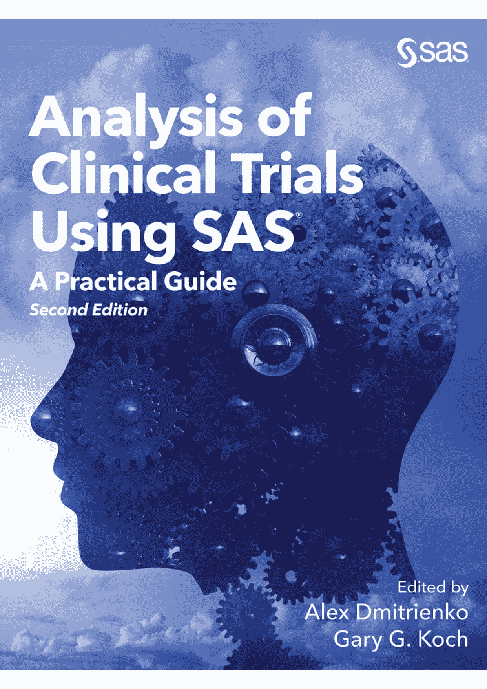


编辑：

Alex Dmitrienko

Gary G. Koch

由 Alex Dmitrienko 和 Gary G. Koch 编写

- 7.7 加权估计方程

# 前言

# 引言

书中介绍的方法。

## 书籍大纲

本书根据第一版大量读者的反馈进行了重新组织。第二版涵盖的主题分为三个部分。第一部分（第 1 章和第 2 章）详细介绍了药物开发各阶段使用的通用统计方法。此外，第二部分（第 3 和第 4 章）和第三部分（第 5、6 和第 7 章）分别关注早期和晚期临床试验的特定主题。

第一版的章节已经过扩展，以涵盖解决原书中提出的统计问题的新方法。书中进行了多次修订，以改进对关键概念的解释，并增加了更多示例和案例研究。书中还对 SAS 过程的新功能进行了详细讨论。在某些情况下，引入了第一版发布时尚不存在的新过程。

下方提供了每个章节的简要大纲。对新主题进行了仔细的描述，并强调了对第一版材料内容的扩展范围。

## 第一部分：通用主题

如上所述，本书首先回顾了用于临床试验数据分析的一类通用统计方法。这包括了基于模型和非参数的方法，用于检验对连续、分类、计数和生存时间终点的治疗效应。第 1 章大部分基于第一版的一个章节。新增了第 2 章，介绍了通用的基于随机化的方法，用于估计协变量调整治疗效应。

### 第 1 章（基于模型和随机化调整）

重要的协变量（如患者基线特征）在临床试验数据分析中起着关键作用。调整分析的目标是在存在影响感兴趣的终点变量的预后因素的情况下，对治疗效应进行整体检验。本章介绍了在具有连续、分类和生存时间终点的临床试验中常用的基于模型和非参数的随机化方法。假设感兴趣的协变量是名义或序数的。因此，它们可以被用于定义分层，从而对相关终点进行分层分析。这些统计方法的 SAS 实现依赖于 `PROC GLIMMIX`、`PROC FREQ`、`PROC GENMOD` 等其他过程。此外，本章介绍了用于研究治疗与分层交互作用性质的统计方法。交互作用通常在亚组评估的背景下进行。使用自定义宏实现了一种常用的治疗与分层交互作用检验。

### 第 2 章（高级随机化方法）

本章介绍了用于临床终点分析的高级随机化方法。该类统计方法补充了传统的基于模型的方法。事实上，鼓励临床试验人员同时考虑这两类方法，因为每类方法在特定设定下都有用，且每一类的优点可以抵消另一类的局限性。基于随机化的方法依赖于极少假设，并具有许多吸引人的特征，例如，它可以轻松适应分层，并支持本质精确的 p 值和置信区间。书中介绍了高级随机化方法在连续、分类、计数和生存时间终点临床试验中的应用。基于随机化的方法通过强大的 SAS 宏（`%NParCov4`）实现，该宏适用于多种临床结局。

## 第二部分：早期临床试验

第 3 章和第 4 章重点关注 I 期和 II 期试验中常见的统计方法。这些章节是第二版新增的，并详细讨论了用于剂量探索试验、剂量反应反应建模以及目标剂量识别的设计。

### 第 3 章（剂量递增方法）

剂量范围试验和剂量探索试验在所有药物开发项目的早期进行，以评估实验性治疗的安全性，通常还有有效性。本章概述了剂量递增试验中使用的剂量探索方法，重点关注了肿瘤试验。它回顾了基本的剂量递增设计，并重点介绍了强大的基于模型的方法，例如单剂连续重新评估法及其在联合用试验中的扩展（部分序连续重新评估法）。书中讨论了与基于模型实现相关的实际问题，并利用 I 期肿瘤试验的示例进行了说明。本章还介绍了用于剂量递增试验中常用的剂量探索方法的自定义宏。

### 第 4 章（剂量探索方法）

确定在后续 III 期试验中要检查的目标剂量在 II 期试验中起着核心作用。这一新章节引入了一类旨在检查实验性治疗剂量与临床反应之间关系的统计方法。文中介绍了测试剂量反应趋势、估计底层剂量反应函数以及为确认性试验确定剂量范围的常用方法。用于检测剂量反应信号的强效对比法评估了跨试验组的治疗获益证据。这些方法强调假设检验。但它们也可以可以扩展到混合方法，将剂量反应测试和剂量反应建模相结合，为剂量反应分析提供一种全面的方法（MCP-Mod 过程）。书中还讨论了剂量反应建模中出现的重要问题，如协变量调整和缺失观测处理。书中讨论的剂量探索方法通过 SAS 过程和自定义宏实现。

## 第三部分：晚期临床试验

后续章节关注常用于晚期临床试验（包括确认性 III 期试验）的统计方法。这些章节包含在本书的第一版中，但经过大幅修订，以引入最近开发的统计方法并描述新的 SAS 过程。

### 第 5 章（多重比较方法）

多重性出现在几乎所有的晚期临床试验中——特别是为了研究新型治疗多种剂量对多个终点或多个患者人群的影响而进行的确认性试验。当试验中追求多个临床目标时，评估特定目标决策规则对整体 I 类错误率的影响至关重要。为了解决临床试验中的多重性问题，已经开发了许多被称为多重比较程序的调整方法。修订后的章节引入了一种分类分类，有助于在特定的多重比较问题中比较候选程序。书中提供了对常用多重比较程序的全面回顾。讨论了基于 SAS 过程和自定义宏的 SAS 实现相关的实际考虑因素和问题。修订后的章节增加了过去 10 年开发的先进多重比较方法的详细描述，包括门控程序（gatekeeping procedures）。引入了一个新宏（`%MixGate`）以支持在确认性临床试验中大量应用的门控程序。

### 第 6 章（中期数据监测）

具有数据驱动决策规则的临床试验（称为自适应试验）这一性主题在过去 15-20 年中引起了临床试验界的广泛关注。本章采用教学式的方法介绍了最常用的自适应试验设计，即组序设计。它从回顾重复显著性检验开始，这种性方法被广泛应用于定义具有中期观察的试验中的决策规则。通过多个案例研究描述了设计组序试验的过程和监测临床试验数据的灵活程序。此外，本章提供了在具有中期评估的临床试验中设置失败检验的常用方法的综述。这些方法基于频率派（条件功效）、混合贝叶斯-频率派（预测功效）和全贝叶斯派（预测概率）方法。更新后的章节利用了强大的 SAS 过程（`PROC SEQDESIGN` 和 `PROC SEQTEST`），这些过程支持临床试验中使用的广泛组序设计。

### 第 7 章（不完整数据分析）

大量的实证研究容易出现不完整性。在过去的几十年里，已经开发了许多处理不完整数据的方法。许多方法相对简单，但它们的性能和有效性尚不清楚。随着计算能力的增加以及现有的软件工具，更灵活的方法已触手可及。本章开头概述了处理临床试验中不完整数据的简单方法。随后，重点讨论了可忽略似然性（ignorable likelihood）和贝叶斯分析，以及加权广义估计方程（GEE）。本章详细考虑了敏感性分析工具，以探索关于缺失数据机制的、无法完全证实的假设对后续推断产生的影响。原始章节得到了扩展，增加了对 `PROC GEE` 的详细讨论，并重点强调了如何使用其进行各种形式的加权广义估计方程分析。对于敏感性分析，书中详细考虑了 `PROC MI` 中 MNAR（非随机缺失）陈述的使用。它提醒临床试验统计学家要根据情况变化，考虑不同的缺失数据假设，而脱离传统的 MAR（随机缺失）假设。

# 贡献者

本书是来自制药行业和学术界 16 位统计学专家合作的成果：

- **Thomas Brechenmacher**，统计科学家，生物统计学专家，QuintilesIMS。

- **Yunro Chung**，博士后研究员，公共健康科学分部，弗雷德·哈斯奇森癌症研究中心。

- **Alex Dmitrienko**，主席，Mediana Inc.。

- **Anastasia Ivanova**，生物统计学副教授，北卡罗莱纳大学教堂希尔分校。

- **Michael G. Kenward**，生物统计学教授，英国卢顿。

- **Gary G. Koch**，生物统计学教授，北卡罗莱纳大学教堂希尔分校生物计量学咨询实验室主任。

- **Ilya Lipkovich**，首席科学顾问，Advisory Analytics，QuintilesIMS。

- **Olga Marchenko**，副总裁，Advisory Analytics，QuintilesIMS。

- **Geert Molenberghs**，生物统计教授，I-BioStat，哈塞特大学和鲁汶大学，比利时。

- **Srinad Nandakumar**，生物统计学经理，全球产品开发部，辉瑞。

- **Guochen Song**，生物统计学副总监，Biogen。

- **Nolan Wages**，助理教授，弗吉尼亚大学公共健康科学系转化研究与应用统计学部门。

- **Laura Elizabeth Wiener**，研究生，北卡罗莱纳大学教堂希尔分校。

- **Yang Yuan**，卓越研究统计开发人员，SAS Institute Inc.。

- **Zoe Zhang**，统计科学家，生物计量学专家，Genentech。

- **Richard C. Zink**，首席研究统计开发人员，JMP Life Sciences, SAS Institute Inc.，北卡罗莱纳大学教堂希尔分校兼席助理。

# 致谢

我们感谢以下个人对本书各章节的仔细评审以及所提供的宝贵意见（按字母顺序排列）：Brian Barkley（北卡罗莱纳大学教堂希尔分校）、Emily V. Dressler（肯塔基大学）、Ilya Lipkov（QuintilesIMS）、Gautier Paux（Servier 国际研究所）和 Richard C. Zink（JMP Life Sciences, SAS）。

我们感谢 SAS Press 的编辑 Brenna Leath 在本书准备过程中提供的支持与帮助。

# 关于本书

## 本书涵盖了什么？

本书的主要目标是介绍用于临床试验的统计方法，并讨论其在药物开发中的应用。书中涵盖的内容分为三个部分：第一部分提供了适用于药物开发各个阶段的通用统计方法的详细介绍；第二部分部分分别侧重于早期和后期临床试验的特定主题。

## 本书适合谁？

虽然本书主要为生物统计学家编写，但书中包含的入门材料对于临床科学家、医学科学家以及监管科学家也很有帮助。

## 阅读本书需要哪些背景知识？

具有临床试验和药物开发的通用经验，以及对 SAS/STAT 程序的经验是理想的。

## 第二版有哪些更新？

本书第二版根据第一版读者的反馈进行了全面修订。第一版的章节得到了扩展，以涵盖书中引入的统计问题。对 SAS 程序的新功能进行了详细说明，并在某些情况下引入了第一版出版时尚未提供的程序。

## 关于书中的示例您需要了解什么？

书中的每个章节包含了教程材料以及多个示例，帮助读者获得用于分析临床试验终点的 SAS/STAT 程序经验。

## 开发本书使用的软件

书中介绍的统计方法使用了多种 SAS/STAT 程序演示，包括 `PROC GLM`、`PROC FREQ`、`PROC LOGISTIC`、`PROC GENMOD`、`PROC LIFETEST` 和 `PROC PHREG`（用于分析不同类型的临床终点）；`PROC MIXED`、`PROC NLMIXED` 和 `PROC GENMOD`（用于剂量发现试验）；`PROC MULTTEST`（用于具有多个目标的临床试验）；`PROC SEQDESIGN` 和 `PROC SEQTEST`（用于序贯试验）；`PROC MIXED`、`PROC GLIMMIX`、`PROC GEE`、`PROC MI` 和 `PROC MIANALYZE`（用于含有缺失数据的临床试验）。这些程序由作者编写的多个 SAS 宏作为支持统计方法的补充。

## 示例代码和数据

可以通过访问作者页面获取书中使用的示例代码、SAS 宏和数据集：`http://support.sas.com/publishing/authors/dmitrienko.html`。

## SAS University Edition

本书兼容 SAS University Edition。如果您正在使用 SAS University Edition，请访问：`https://support.sas.com/ue-data`。

## 我们希望听取您的反馈

SAS Press 的书籍由 SAS 用户为 SAS 用户编写。我们欢迎您参与书籍开发并对您使用的 SAS Press 书籍提供反馈。请访问 `sas.com/books` 执行以下操作：

- 申请评审书籍

- 推荐主题

- 请求作者信息

- 对书籍提供反馈

您对正在阅读的 SAS Press 书籍有任何疑问吗？可以通过 `saspress@sas.com` 或 `https://support.sas.com/author_feedback` 联系作者。SAS 有许多资源可以帮助您找到答案并扩展知识。如果您需要额外的帮助，请参阅我们的资源列表：`sas.com/books`。

# 关于这些作者


Alex Dmitrienko 博士是 Mediana Inc. 的创始人兼总裁。他积极参与生物统计学研究，重点关注临床试验中的多重比较性问题、亚组分析、创新试验设计以及临床试验优化。Dmitrienko 博士合著了《Analysis of Clinical Trials Using SAS®: A Practical Guide》第一版，并共同编了《Pharmaceutical Statistics Using SAS®: A Practical Guide》。


Gary G. Koch 博士是北卡罗来纳大学教堂希尔分校的生物统计学教授兼生物测量咨询实验室主任。他在分类数据分析领域已活跃了五十年。Koch 教授教授分类数据分析课程和研讨会，在统计实践领域提供咨询，进行研究并培训了许多生物统计学学生。他是 *Categorical Data Analysis Using SAS®* 第三版的合著者。

通过访问作者页面了解更多这些作者的信息，您可以在那里下载免费的书籍摘要、访问示例代码和数据、阅读最新评论、获取更新等更多内容：

`http://support.sas.com/dmitrienko`

`http://support.sas.com/koch`

Alex Dmitrienko (Mediana)

Gary G. Koch (北卡罗来纳大学教堂希尔分校)

本章讨论了在存在影响性协变量（如试验中心或患者基线特征）的情况下对临床终点的分析。书中详细回顾了用于连续、分类和事件时间终点的常用方法，包括基于模型和基于简单随机化的方法。本章描述了基于固定效应和随机效应方法的参数方法，以及用于连续终点分层分析的非参数方法。文中介绍了用于分层分类结果的基本基于随机化的方法以及精确法和基于模型的方法。使用基于随机化的检验和 Cox 比例风险模型对分层事件时间终点进行分析。本章还介绍了用于评估临床试验中“治疗-分层”交互作用的统计方法。

## 1.1 引言

第 1 章和第 2 章侧重于用于临床试验终点分析的通用统计方法。人们广泛认同，在评估治疗对终点的效应时，对患者基线特征等重要协变量进行适当的调整是非常重要的。调整分析的目标是在存在对感兴趣的结果变量有显著影响的因素的情况下，提供治疗效应的总体检验。临床试验中常见的两种类型的因素：预后因素和非预后因素，它们已知会以系统的方式影响结果变量。例如，对生存终点的分析通常会对预后因素（如患者年龄和疾病严重程度）进行调整，因为这些患者特征与死亡率强相关。相比之下，非预后因素可能影响试验结果，但它们的效应并未表现出可预测的模式。众所周知，在多中心临床试验中，不同中心之间的治疗存在差异，有时甚至是巨大的。然而，中心间的变异性与患者年龄或疾病严重程度相关的变异性不同。特定中心的治疗差异取决于许多因素，例如地理位置、医疗总体质量等。因此，各个中心以相当随机的方式影响整体治疗差异，将中心归类为非预后因素是自然的。

与忽略预后和非预后因素影响的简单池化分析方法相比，调整分析具有两个重要优势。首先，进行调整分析是为了提高统计推断的效力（Beach and Meier, 1989; Robinson and Jewell, 1991; Ford, and Norrie, and Ahmadi, 1995）。众所周知，通过在线性模型中调整协变量可以获得精度，这种精度与协变量与结果变量之间的相关性成正比。对于分类和事件时间终点（例如生存终点）也是如此。Lagakos 和 Schoenfeld (1984) 证明，省略一个具有大风险比的重要协变量会显著降低 Cox 比例风险模型中得分检验的效率。

此外，未能调整重要协变量可能会引入偏差。根据 Cochran (1983) 的工作，Lachin (2000) 证明了在二分类终点分析中使用边际未调整方法会导致估计值偏倚。偏差的幅度与每个分层内治疗组的不平衡程度以及分层间事件率的差异成正比。同样地，Gail、Wieand 和 Piantadosi (1984) 以及 Gail、Tan 和 Piantadosi (1988) 显示，当从回归中省略相关协变量时，许多广义线性模型和生存模型中的参数估计会变得偏倚。


对于随机临床试验，关于治疗比较的推断有两种统计立场。一种是相对于患者随机分配到治疗的方法的**基于随机化**，另一种是相对于针对随机分配的治疗和基线特征及测量值的患者反应和协变量的假设分布的**基于结构模型**的方法（Koch and Gillings, 1983）。重要的是，这两种立场在治疗比较方面是互补的，尽管它们以不同的方式，且对适用人群有不同的解释。在这方面，基于随机化的方法为随机研究总体提供推断。由于患者对治疗的随机化以及在随机化前后数据的有效观测，它们相对较少的假设是有效的。基于模型的方法可以将推断推广到基线因素可能不同的普通总体，然而，对于关于反应分布及其与治疗、基线特征和测量值之间关系的假设，其适用性可能存在不确定性或争议。当偏离此类假设会损害治疗比较推断的有效性时，这一点尤为真实。

对于治疗间无差异的零假设，基于随机化的方法可以通过随机化分布（完全或抽样）实现精确统计检验，而无需任何其他假设。在这方面，其范围包括用于二分类终点的 Fisher 精确检验、用于序数终点的 Wilcoxon 秩和检验、用于连续终点的 T 检验以及用于事件时间终点的 logrank 检验。此类方法还包括这些方法的扩展，以调整分层随机化中的分层，即用于二分类终点的 Mantel-Haenszel 检验以及用于事件时间终点的分层 logrank 检验。更广泛地说，某些基于随机化的方法需要足够的样本量，使得与治疗比较相关的估计量通过中心极限定理近似多元正态分布，并具有本质上协方差矩阵（通过一致估计）。在此基础上，它们为指定的零假设提供了统计量和/或置信区间。此外，这些统计量和置信区间通过本章讨论的方法，对基线特征和测量进行了基于随机化的调整。

基于模型的方法类包括二分类终点设置的逻辑回归模型、序数终点的比例优势模型、连续终点的多元线性回归模型，以及用于事件时间终点的 Cox 比例风险模型。此类模型通常假设治疗与基线特征和测量值的解释变量之间不存在交互作用。此外，比例优势模型具有比例优势假设。

...且等比例风险模型具有等比例风险假设。多元线性回归模型依赖于方差齐性假设，且该模型适用于响应本身或响应的转换（如对数）。基于模型的方法已扩展适用于多次访视临床试验的重复测量结构。这些方法包括用于连续终点的重复测量混合模型、用于二分类和序数终点的逻辑回归模型的广义估计方程，以及用于时间到事件终点的泊松回归方法。对于这些扩展，假设的范围涉及响应的协方差结构、缺失数据的性质，以及访视与治疗及基线解释变量之间相互作用的程度。

关于这些问题的讨论，请参阅第 7 章。

在临床终点分析中，基于随机化的方法和基于模型的方法所得结果的主要相似之处在于它们用于治疗比较的 p 值的统计显著性程度。从这个意义上说，这两类方法通常支持关于治疗间存在非零差异的相似结论，而随机化方法的优势在于其为此目的所做的假设最少。然而，基于随机化方法对描述治疗间差异的估计值是以群体平均的方式针对随机化总体。而基于模型方法的估计值则是在受者特定的意义上针对具有相同基线协变量值的亚群体。对于线性模型、非线性模型（如逻辑回归模型、比例优势模型或等比例风险模型），它们可能会有显著不同。除了这一考虑外，基于模型方法的优势是，它们对于评估跨患者亚组的基线协变量和/或模型中测量值的治疗效应同质性具有直接的结构（关于协变量与亚组的交互作用）。基于模型的方法还提供了模型中协变量和测量效应的估计。总结来说，基于随机化方法和基于模型的方法的作用是互补的，因为每种方法对于其解决的目标都是有效的，且每种方法的优势都抵消了另一种方法的局限性。

本章重点关注临床试验中常用的基于模型的方法和简单的基于随机化的方法。这些方法将用于在存在预后协变量的情况下评估治疗对临床终点的影响幅度。假设协变量是名名的或序数的，因此可以用于定义分层，从而对相关终点进行分层分析。第 2 章提供了对更高级基于随机化方法的详细回顾，包括非参数基于随机化的协方差分析方法。

### 概述

第 1.2 节回顾了流行的 ANOVA 模型，及其在分层临床试验分析中的应用。连续情况下的参数分层分析可以使用 PROC GLM 或 PROC MIXED 轻松实现。该节还考虑了一种用于非正态设置下分层数据分析的流行非参数检验。线性回归模型一直是许多著作和研究论文的焦点。Rao (1973) 和 Searle (1971) 的经典著作对线性模型的一般理论提供了良好的讨论。Milliken 和 Johnson (1984, 第 10 章)、Goldberg 和 Koury (1990) 以及 Littell, Freund 和 Spector (1991, 第 7 章) 讨论了不 ANOVA 设置下的分层数据分析及其在 SAS 中的实现。

第 1.3 节回顾了用于分类终点分析的基于随机化（Cochran-Mantel-Haenszel 及相关方法）和基于模型的方法。涵盖了 PROC FREQ、PROC LOGISTIC 和 PROC GENMOD 中实现的渐近推断和精确推断。关于具有临床试验应用的分类分析方法的彻底概述，请参阅 Breslow 和 Day (1980); Koch 和 Edwards (1988); Lachin (2000); Stokes, Davis 和 Koch (2000) 以及 Agresti (2002)。

第 1.4 节讨论了用于分层时间到事件数据分析的统计方法。该节涵盖了 PROC LIFETEST 中提供的基于随机化的检验以及基于 PROC PHREG 实现的 Cox 等比例风险回归的模型检验。Prentice (1980); Cox 和 Oakes (1984) 以及 Collett (1994) 对经典的生存分析方法进行了详细回顾。Allison (1995)、Cantor (1997) 和 Lachin (2000, 第 9 章) 提供了带有临床应用的生存分析介绍和 SAS 代码示例。

最后，第 1.5 节介绍了用于定性交互的流行检验。定性交互检验有助于理解治疗与分层交互的性质，并识别出从实验疗法中受益最大的患者群体。它们也经常用于敏感性分析背景。

本章包含的 SAS 代码和数据集可以在作者的 SAS Press 页面获取。请访问 http://support.sas.com/publishing/authors/dmitrienko.html。

## 1.2 连续终点的分析

本节回顾了参数和非参数分析方法，其应用于临床试验，在试验中主要分析针对重要协变量进行了调整，例如多中心临床试验。在参数框架内，我们将重点关注频率主义设置下的固定效应模型和随机效应模型。对基于传统和经验贝叶斯方法的备选方法感兴趣的读者，请参阅 Gould (1998)。

现在得出中心 101 代表一个真正的离群值还为过早（Senn, 1997, 第 14 章）。我们将在 1.5 节讨论分层定性交互作用检验的问题。

### 1.2.1 固定效应模型

为了引入用于分层数据分析的固定效应模型，考虑一项具有连续终点的研究，其在 $m$ 个分层中比较实验药物与安慰剂（见表 1.1）。假设在第 $i$ 治疗组第 $j$ 层中第 $k$ 个患者观测到的正态分布结果 $Y_{ijk}$ 服从双向均均模型：

```
$Y_{ijk} = \mu_{ij} + \epsilon_{ijk}. \quad (1.1)$
```

在案例研究 1 中，$y_{ij}$ 表示个体患者 HAMD17 评分的减少，$\mu_{ij}$ 表示由治疗水平和分层水平唯一组合定义的 10 个单元格的平均减少量。

| 分层 1 | | 分层 m | | | | |
| --- | --- | --- | --- | --- | --- |
| | 数量 | | 数量 | | | |
| 治疗 | 患者 | 平均值 | ... | 治疗 | 患者 | 平均值 |
| 药物 | $n_{11}$ | $\mu_{11}$ | | 药物 | $n_{1m}$ | $\mu_{1m}$ |
| 安慰剂 | $n_{21}$ | $\mu_{21}$ | | 安慰剂 | $n_{2m}$ | $\mu_{2m}$ |

单元格均模型追溯到 Scheffe (1959)，并在许多出版物讨论过，包括 Speed, Hocking and Hackney (1978) 以及 Milliken and Johnson (1984)。让 $n_{1j}$ 和 $n_{2j}$ 分别表示实验组和安慰剂组第 $j$ 层的大小。由于在临床试验环境中遇到空分层并不常见，我们假设没有空单元格，即 $n_{ij} > 0$。让 $n_1, n_2$ 和 $n$ 分别表示实验组、安慰剂组的患者以及总样本量，即：

```
$n_1 = \sum_{j=1}^{m} n_{1j}, \quad n_2 = \sum_{j=1}^{m} n_{2j}, \quad n = n_1 + n_2.$
```

单元格均模型 (1.1) 的特殊情况是常见的带有交互作用的主效应模型：

```
$y_{ijk} = \mu + \alpha_i + \beta_j + (\alpha\beta)_{ij} + \varepsilon_{ijk},\quad (1.2)
```

在这里，$\mu$ 表示总平均值；$\alpha$ 参数代表治疗效应；$\beta$ 参数代表分层效应；引入 $(\alpha\beta)$ 参数是为了捕捉治疗与分层的变异性。

分层数据可以使用几个 SAS 过程进行分析，包括 PROC ANOVA、PROC GLM 和 PROC MIXED。由于 PROC ANOVA 支持平衡设计，我们在本节将重点关注另外两个过程。PROC GLM 和 PROC MIXED 为用户提供了多种分析选项，用于检验主效应模型 (1.2) 中关于治疗效应最重要的假设类型。

本节回顾了由 I 类、II 类和 III 类分析方法检验的最重要的假设类型。这里不会讨论 IV 类分析，因为它只在空单元格的罕见情况下与 III 类分析不同。读者可以在 Milliken and Johnson (1984) 以及 Littell, Freund, and Spector (1991) 中找到关于 IV 类分析的更多信息。

I 类分析通常使用 Searle (1971, 第 6 章) 提出的所谓 R() 表示法引入。具体来说，让 $R(\mu)$ 表示通过拟合均值 $\mu$ 使误差和减少的量，即拟合简化的 $y_{ijk} = \mu + \varepsilon_{ijk}$。

同样，$R(\mu, a)$ 是与具有均值 $\mu$ 和治疗效应 $a$ 的模型相关的误差和减少量，即：

$y_{ijk} = \mu + \alpha_i + \varepsilon_{ijk}$。

差异 $R(\mu, a) - R(\mu)$ 记为 $R(a|\mu)$，表示在拟合均值后拟合治疗效应带来的额外减少。

$R(a|\mu)$ 表示在考虑均值 $\mu$ 的情况下由治疗解释的变异量。这种表示法很容易扩展到其他量，如 $R(\beta|\mu)$。要注意，$R(a|\mu)$ 和 $R(\beta|\mu)$ 从正规方程计算时对参数的限制是独立的。因此，$R(a|\mu)$、$R(\beta|\mu)$ 在任何双向分类模型中都是唯一定义的。

I 类分析基于顺序检验主效应模型 (1.2) 中的 $a$、$\beta$ 和 $a\beta$ 因子，分别使用 $R(a|\mu)$、$R(\beta|\mu)$ 和 $R(a\beta|\mu)$。**程序 1.2** 计算了案例1中实验药物与安慰剂之间差异的 $F$ 统计量和相关的 $p$ 值。

```
proc glm data=hamd17;
class drug center;
model change=drug|center/ss1;
run;
```

| 来源 | 自由度 | I 类 SS | 均方 | F 值 |
|---|---|---|---|---|
| drug | 1 | 888.040000 | 888.040000 | 40.00 |
| center | 4 | 888.040000 | 222.010000 | 19.78 |
| drug*center | 4 | 507.445000 | 126.8612500 | 5.69 |

输出 1.2 列出了药物中心效应以及它们的交互作用。由于 I 类分析取决于项的顺序，因此确保药物项首先拟合是重要的。药物比较的 $F$ 统计量很大（F = 40.00），这意味着与安慰剂相比，药物显著降低了 HAMD17 评分。注意这种未调整的分析忽略了分层效应。然而，正如 Searle (1971, 第 7 章)所示，R() 表示法可能会令人困惑，用 95% 置信区间来补充 I 类分析会很有帮助。从输出 1.1 中很容易验证“平均治疗差异”等同于药物项。

```
model change=drug|center/ssl;
estimate "Trt diff"
drug 1 -l
center -0.04 0 0.04 -0.02 0.02
drug*center 0.22 0.14 0.32 0.18 0.14 -0.26 -0.14 -0
```

| 参数 | 标准误差 | t 值 |
|---|---|---|
| Trt diff | 5.9600000 | 0.94148228 |

输出 1.3 显示了平均治疗差异的估计值及其标准差，该标准差可用于构建与所得估计值相关的 95% 置信区间。该差异是否等于 0 的 t 检验与输出 1.2 中 DRUG 项的 F 检验是相同的。我们可以检查输出 1.3 中的 t 统计量等于输出 1.2 中对应 F 统计量的平方根。同样很容易验证，平均治疗差异是观察到的 HAMD17 评分中实验组和安慰剂组平均变化之间的差异，且未对中心效应进行调整。

在 II 类分析中，主效应模型 (1.2) 中的每个项都对所有其他项进行了调整，但包含该问题项的高阶项除外。使用 R() 符号，在 II 类框架下分别使用 R(α|μ, β)、R(β|μ) 和 R(αβ|μ, α, β) 对 α、β 和 (αβ) 因子的显著性进行检验。

程序 1.4 计算了 II 类 F 统计量，以检验治疗效应对 HAMD17 评分变化的显著性。

```
proc glm data=hamd17;
class drug center;
model change=drug|center/ss2;
run;
```

| 源 | DF | II 类 SS | 平方 | F |
|---|---|---|---|---|
| drug | 1 | 889.7756912 | 889.7756912 | 40 |
| center | 4 | 87.1392433 | 21.7848108 | 0 |
| drug*center | 4 | 507.4457539 | 126.8614385 | 5 |

我们从输出 1.4 看到，对应 DRUG 项的 F 统计量非常显著（F = 40.15），这表明在调整中心效应后，实验药物显著降低了 HAMD17 评分。请注意，根据 II 类分析的定义，模型中是否存在交互项或项包含在模型中的顺序都不会影响关于治疗效应的推断。因此，从模型中删除 DRUG*CENTER 项通常对治疗效应的 F 统计量影响很小。（准确地说，从模型中排除 DRUG*CENTER 项对分子没有影响，但由于误差平方和的变化，会影响其分母。）Searle (1971, 第 7 章) 证明在 II 类框架下检验的无治疗效应假设具有以下形式：

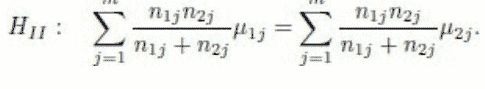

同样，与 I 类分析一样，II 类无治疗效应假设取决于每个分层中的患者人数。有趣的是，第 j 层中估计的治疗差异的方差，即 Var$(\bar{Y}_{1ij}-\bar{Y}_{2j})$，与 $n_{1ij}n_{2j}/(n_{1ij}+n_{2j})$ 成反比。这意味着 II 类方法通过与估计精密度成正比的权重，对特定分层的治疗差异估计值进行平均处理。

平均治疗差异的 II 类估计给出：

```
$$\left(\sum_{m} \frac{n_{1ij}n_{2j}}{n_{1ij}+n_{2j}}\right)^{-1} \sum_{m} \frac{n_{1ij}n_{2j}}{n_{1ij}+n_{2j}}(\bar{Y}_{1ij}-\bar{Y}_{2j})\quad(1.3)$$
```

例如，我们可以从输出 1.1 和模型 (1.2) 看到案例 1 中平均治疗差异的 II 类估计等于：


## 数学公式与统计分析

### 公式推导

$$
\hat{\delta} = \hat{\alpha}_1 - \hat{\alpha}_2 + \frac{11\times 13}{11+13}\frac{7\times 7}{7+7}\frac{16\times 14}{16+14}\frac{9\times 10}{9+10}\frac{7\times 6}{7+6}^{-1} \times (\frac{11\times 13}{11+13}(\alpha\beta)_{11})
$$

$$
\frac{7\times 7}{7+7}(\alpha\beta)_{12},\frac{16\times 14}{16+14}(\alpha\beta)_{13},\frac{9\times 10}{9+10}(\alpha\beta)_{14},\frac{7\times 6}{7+6}(\alpha\beta)_{15}-\frac{11\times 13}{11+13}(\alpha\beta)_{21}-
$$

$$
\frac{7\times 7}{7+7}(\alpha\beta)_{23},\frac{16\times 14}{16+14}(\alpha\beta)_{24},\frac{9\times 10}{9+10}(\alpha\beta)_{24},\frac{7\times 6}{7+6}(\alpha\beta)_{25}-
$$

$$
= -\hat{\alpha}_1 - \hat{\alpha}_2 + 0.23936(\alpha\beta)_{11}+0.14060(\alpha\beta)_{12}+0.29996(\alpha\beta)_{13}+0.19029(\alpha\beta)_{14}
$$

$$
+0.12979(\alpha\beta)_{21}-0.14060(\alpha\beta)_{22}-0.29996(\alpha\beta)_{23}-
$$

$$
-0.19029(\alpha\beta)_{24}-0.12979(\alpha\beta)_{25}.
$$

### 程序 1.5：使用 PROC GLM 中的 ESTIMATE 语句计算 II 类估计及其标准误差

```sas
proc glm data=hamdl1;
  class drug center;
  model change=drug|center/ss2;
  estimate "Trt diff"
  drug -1 -1
  drug*center 0.2 0.2 0.2 0.2 0.2 -0.2 -0.2 -0.2 -0.2 -0.2;
run;
```

| 参数 | 估计 | t 值 |
|---|---|---|
| Trt diff | 5.97871695 | 0.94351091 |

输出 1.5 显示了平均治疗差异的 II 类估计及其标准误差。与 I 类分析一样，输出 1.5 中的 t 统计量等于输出 1.4 中对应 F 统计量的平方根。请注意，根据 II 类分析的定义，模型中是否存在交互项或项包含在模型中的顺序都不会影响关于治疗效应的推断。因此，从模型中删除 `DRUG*CENTER` 项通常对治疗效应的 F 统计量影响很小。（准确地说，从模型中排除 `DRUG*CENTER` 项对分子没有影响，但由于误差平方和的变化，会影响其分母。）同样，与 I 类分析一样，II 类无治疗效应假设取决于每个分层中的患者人数。有趣的是，第 j 层中估计的治疗差异的方差，即 `Var(\bar{Y}_{1ij}-\bar{Y}_{2j})`，与 `n_{1ij}n_{2j}/(n_{1ij}+n_{2j})` 成反比。这意味着 II 类方法通过与估计精密度成正比的权重，对特定分层的治疗差异估计值进行平均处理。

### III 类分析

III 类分析基于对 I 类和 II 类分析概念的推广。与这两种分析方法不同，III 类方法依赖于对主效应模型 (1.2) 进行重参数化。重参数化通过对 (1.2) 中的参数施加某些限制来实现全秩模型。例如，通常假设：

$$
\alpha_{i}^{2} = 0, \quad \beta_{j}^{2} = 0,
$$
$$
(\alpha\beta)_{ij} = 0, \quad j = 1,\dots,m, \quad (\alpha\beta)_{ij} = 0, \quad i = 1,2. \quad \quad (1.4)
$$

施加这些限制后，可以对与重参数化模型相关的 $\alpha$、$\beta$ 和 $\alpha\beta$ 因子进行检验。（这些量通常用 $R^*$ 表示）。

引入的分析方法比 I 类和 II 类分析更灵活，使我们能够检验使用原始 $R$ 量无法检验的假设（Searle, 1976; Speed and Hocking, 1976）。例如，正如 Searle (1971, 第 7 章)所示，当从主效应模型 (1.2) 计算时，$R(\mu, \beta, \alpha\beta)$ 和 $R(\beta, \mu, \alpha, \beta)$ 是没有意义的，因为它们恒等于 0。

施加在模型参数上。因此，1.2 中的每一项都可以在 Type III 框架下通过模型中所有其他项进行调整进行测试。

PROC GLM 和 PROC MIXED 中的 Type III 分析通过 $R^*(\alpha|\mu, \beta, \alpha\beta)$、$R^*(\beta|\mu, \alpha\beta)$ 和 $R^*(\alpha\beta|\mu, \alpha\beta)$ 评估 $\alpha$、$\beta$ 和 $\alpha\beta$ 因素的显著性，并使用了 1.4 给出的参数限制。作为一个示例，程序 1.6 使用 Type III 方法检验了治疗效应对 HAMD17 变化的显著性。

#### 程序 1.6

```sas
proc glm data=hamd17;
class drug center;
model change=drug|center/ss3;
run;
```

| 来源 | DF | Type III SS | 均方 | F |
|---|---|---|---|---|
| drug | 1 | 709.819519 | 709.819519 | 32 |
| center | 4 | 91.458063 | 22.864506 | 1 |
| drug*center | 4 | 507.445739 | 126.86148 | 5 |

输出 1.6 表明 Type III 分析的结果与 Type I 和 II 推断一致。在对中心效应和治疗-中心交互进行调整后（$F = 32.03$），治疗效应非常显著。

从重参数化满模型进行推断的优势在于，无治疗效应的 Type III 假设具有以下简单形式（Speed, Hocking, 1978）：

Type III 假设认为两个治疗组之间真实的分层 HAMD17 变化的简单平均值是相同的。治疗差异相应的 Type III 估计等于

$$
\frac{1}{m}\sum_{j=1}^{m}(\bar{y}_{1j} - \bar{y}_{2j}).
$$

将此估计与治疗差异的 Type I 估计进行对比是有意义的。如前所述，Type I 方法的理念是观测值等权重的。相比之下，Type III 方法根据每个分层的大小对观测值进行加权。结果，Type III 假设涉及分层均值的直接比较，不受每个分层中患者人数的影响。为了类比，Type I 分析对应于美国众院，其中每个州的议员人数是州人口的函数；Type III 分析可以被视为美国参议院的统计等效，其中每个州派遣两个议员。

由于案例研究 1 中治疗差异的 Type III 估计由给出

$$
\hat{\delta} = \bar{\alpha}_1 - \bar{\alpha}_2 + \frac{1}{5}[(\alpha)_{11} + (\alpha)_{12} + (\alpha)_{13} + (\alpha)_{14} + (\alpha)_{15} - (\alpha)_{21} - (\alpha)_{22} - (\alpha)_{23} - (\alpha)_{24} - (\alpha)_{25}],
$$

我们使用 PROC GLM 中的 ESTIMATE 语句计算该估计及其标准误。

#### 程序 1.7

```sas
proc glm data=hamd17;
class drug center;
model change=drug|center/ss3;
estimate "Trt diff"
drug 1 -1
drug*center 0.2 0.2 0.2 0.2 0.2 -0.2 -0.2 -0.2 -0.2;
run;
```

| 参数 | 估计 | t | V |
|---|---|---|---|
| Trt diff | 5.60912865 | 0.99106828 | |

输出 1.7 列出了治疗差异的 Type III 估计及其标准误。同样可以使用输出 1.7 显示的 $t$ 统计量评估治疗效应的显著性，因为相关的检验与输出 1.6 中 drug 项的 $F$ 检验等效。

本节介绍的三种分析方法在任何平衡数据集中产生相同的结果。然而，在不平衡的情况下，情况会变得更加复杂和困惑。我们需要仔细检查可用选项以选择最合适的分析方法。以下对 PROC GLM 和 PROC MIXED 中 Type I、II 和 III 分析的比较将帮助读者在临床试验应用中做出明智的选择。

#### Type I 分析

Type I 分析方法对分层特定的治疗差异取平均，每个观测值具有相同的权重。因此，Type I 方法忽略了单个分层对结果变量的影响。显然，只有对分层效应感兴趣时才能使用这种方法。

#### Type II 分析

Type II 方法相当于比较治疗组之间分层内估计的加权平均值。权重与分层特定治疗估计的方差成反比。这意味着当不存在治疗与分层交互时，Type II 分析是基于最佳加权的。当治疗差异跨分层变化时，Type II 统计量可以被视为分层特定治疗差异的加权平均值，权重为某些总体参数的样本估计。由于这个原因，人们通常接受 Type II 方法是分析经预后因素调整的连续结果变量的首选方法（Fleiss, 1986; Mehrotra, 2001）。

尝试将 Type II 方法应用于基于非预后因素（例如中心）的分层方案在临床试验文献中引发了争议。Type II 方法的支持者认为中心的作用与预后因素相同，因此在如程序 1.4 所示的按中心分层的试验中进行 Type II 检验是合适的（Senn, 1998; Lin, 1999）。注意，Type II 分析的结果不受交互项显著性的影响。交互分析作为常规敏感性分析的一部分单独运行，例如在不同子集中评估治疗效应以及识别离群值（Kallen, 1997; Phillips et al., 2000）。

Type II 方法的反对者认为中心与预后因素有本质区别。由于研究机构主动招募患者，任何中心的人数都是相当任意的数字，基于中心大小的推断很难解释（Fleiss, 1986）。作为一种替代方案，我们可以遵循 Yates (1934) 和 Cochran (1954a) 的建议，在存在显著交互的情况下，基于中心特定估计的简单平均进行分析。这种无加权分析等于带有交互项的 Type III 分析（参见程序 1.6）。

值得读者注意的是，基于 Type III 分析的替代方法具有若干局限性：

- 对大小不同的分层等加权与我们通常对观察到的分层结果进行元分析的方式完全不同（Senn, 2000）。
- 最后，正如几篇出版物指出的，样本量计算几乎总是在 Type II 框架内进行的，即假设患者而非中心是等权重的。因此，使用 Type III 分析会导致样本量计算方法失效。关于加权方法和无加权方法的详细效力比较，请参见 Jones 等人 (1998) 和 Gallo (2000)。

### 带有预测试的 III 型分析

上述的加权和未加权分析方法通常结合使用以增加治疗比较的效力。正如 Fleiss (1986) 所提的，首先评估交互项的显著性，如果预测试产生了显著结果，则进行 III 型分析；否则，从模型中移除交互项，从而使用 II 型方法分析治疗效应。这种序贯检验程序利用了当治疗与中心之间的交互（`treatment-by-center`）似乎可以忽略时，加权分析的效力优势。

最常用的方法是使用输出 1.6 中 `DRUG*CENTER` 项的 F 检验来评估治疗与中心的变异。该检验通常在 0.1 显著性水平下进行（Fleiss, 1986）。文献中提出了几种替代方法。Bancroft (1968) 建议在将交互项纳入模型之前，在 0.25 水平对其进行检验。Chinchilli 和 Bortey (1991) 描述了一种基于 F 分布非中心参数的跨分层治疗差异一致性检验。Ciminera 等人（1993）强调，基于交互均方的检验旨在检测可能由各种因素（如测量比例的伪影）引起的定量交互作用。

在应用预测试策略时，我们需要意识到预测试会导致更频繁的假阳性结果，这在关键性临床试验中可能会成为问题。为了强调这一点，Jones 等人（1998）将描述的预测试方法与一种争议性做法进行了对比：在交叉试验中对交叉效应（`carryover effect`）的显著性进行预测试，这种做法已知会膨大部分假阳性率。

### 随机效应建模

第 1.2.1 节描述的固定效应建模方法的流行替代方案是在分析中显式地纳入分层间的随机变异。尽管在 ICH 指南文件《临床试验统计学原则》（ICH E9）中，关于中心效应的大多数讨论都将中心视为固定效应，但该指南也鼓励试验者使用混合模型探索跨中心治疗效应的异质性。后者可以通过使用带有随机分层和治疗与分层交互项的模型来实现。虽然我们可以认为中心的选择不是一个随机过程，但将中心视为随机效应有时可以帮助统计学家更好地考虑中心间的变异。

随机效应建模基于以下混合模型，用于第 $i$ 治疗组第 $j$ 个分层中第 $k$ 个患者观测到的连续结果 $y_{ijk}$：

$$
y_{ijk} = \mu + \alpha_i + b_j + g_{ij} + \varepsilon_{ijk},
$$

$\mu$ 表示总平均；$\alpha_i$ 是第 $i$ 次治疗的固定效应；$b_j$ 和 $g_{ij}$ 表示随机分层和治疗与分层的交互效应；$\varepsilon_{ijk}$ 是残差项。假设随机项和残差呈正态分布且相互独立。从模型 (1.5) 可以看出与固定效应模型不同，随机效应模型在判断治疗效应显著性时考虑了分层间的变异。

混合模型在临床试验背景下分层分析的应用由多位作者描述，包括 Fleiss (1986)、Senn (1998) 和 Gallo (2000)。Chakrabort 和 Grizzle (1975) 利用随机区框架以及 Hartley 和 Rao (1967) 的工作，为分层试验中的随机效应建模提供了理论基础。关于混合效应模型分析问题的详细概述，请参见 Searle (1992, 第 3 章)。Littell、Milliken、Stroup 和 Wolfinger (1996, 第 2 章) 展示了如何使用 `PROC MIXED` 在多中心试验中拟合随机效应模型。

#### 程序 1.8

```sas
proc mixed data=hamd17;
class drug center;
model change=drug/ddfm=satterth;
random center drug*center;
estimate "Trt eff" drug 1 -1;
run;
```

**固定效应的第3型检验**

| Effect | Num (DF) | Den (DF) | F Value | Pr |
|---|---|---|---|---|
| drug | 1 | 6.77 | 9.30 | 0.0194 |

**估计值**

| Label | Estimate | Error | DF | t Value | Pr |
|---|---|---|---|---|---|
| Trt eff | 5.7072 | 1.8718 | 6.77 | 3.05 | 0.0 |

输出 1.8 显示了随机效应模型中与 `DRUG` 项相关的 F 统计量 (F = 9.30) 和 p 值 (p = 0.0194)，以及平均治疗差异的估计值。估计的治疗差异等于 5.7072，接近估计值。与固定效应模型获得的估计值相比，估计值的标准误差（1.8718）要大得多（见输出 1.6）。注意，`Center` 会使标准误差降低到 1.0442。同样，移除 `DRUG*CENTER` 项会导致治疗效应的估计更精确（1.0280）。

通常，如 Senn (2020) 所示，将均视为随机会导致更小的标准误差。然而，假设交互项会增加治疗差异估计的标准误差。基于随机分层和治疗与分层交互效应的分层分析相比固定效应分析效力较低（Gould, 1998）。

### van Elteren 非参数检验

本节简要描述了 van Elteren (1960) 用于分层连续数据的非参数检验。为了引入 van Elteren 检验，考虑一个具有 $m$ 分层的连续终点的临床试验。令 $w_j$ 表示检验第 $j$ 分层无治疗效应假设的 Wilcoxon 秩和（Hollander 和 Wolfe, 1999, 第 4 章）。van Elteren (1960) 提议用与分层大小反比的权重合并分层的 Wilcoxon 和。van Elteren 统计量由公式给出：

$$
u = \sum_{j=1}^{m} \frac{w_j}{n_{1j} + n_{2j} + 1}
$$

其中 $n_{1j} + n_{2j}$ 是第 $j$ 分层中的总人数。为了证明这种权重方案，van Elteren 证明了所得检验在一系列备择假设下具有渐近最大效力。van Elteren 还研究了检验程序的渐近性质，并证明在 $m$ 分层无治疗效应的原假设下，检验统计量渐近正态分布。


如 Koch 等人（1982，2.3节）所示，`van Elteren` 检验是 `Mantel-Haenszel` 均值评分检验家族的一员。该家族还包括 1.3.1节讨论的用于分类结果的 `Cochran-Haenszel` 检验。与该家族的其他检验程序一样，`van Elteren` 检验具有一个有趣且实用的性质：其渐近分布不受个体大小的影响。因此，在稀疏分层中也可以依赖渐近 p 值。关于 van El 检验和相关程序的更多信息，请参见 Lehmann (1975)、Koch 等 (1990) 以及 Hosmane、Shu 和 Morris (1994)。

### 示例：案例2（尿路失禁试验）

当由于无法依赖标准的 ANOVA 技术时（因为基础正态性假设不成立），`van Elteren` 检验是分析分层连续数据的另一种方法。作为说明，考虑一个为期 8 周的比较实验药物与安慰剂的尿路失禁试验收集的数据集。试验的主要终点是从基线到研究结束每周失禁次数的百分比变化。患者根据基线失禁频率进行分配¹。

程序 1.9 显示了在尿路失禁试验案例2 中收集的数据集，并绘制了三个主要终点的概率分布图

```sas
data urininc;
input therapy $ stratum         ;
do i=1 to 10;
  input change                 ;
  if (change = .) then output;
end;
drop i;
datalines;
Placebo 1 -86 -38 43 -100 289 0 -78 38 -80 -2
Placebo 1 -100 -100 -50 25 -100 -67 0 400 -0
Placebo 1 -63 -70 -83 -67 -33 0 -13 -100 0
Placebo 1 -62 -29 -50 -100 0 -100 -60 -40 -44 -1
Placebo 2 -36 -77 -6 -85 29 -17 -53 18 -62 -9
Placebo 2 64 -29 100 31 -6-100 -30 11 -52 -5
Placebo 2 -100 -82 -85 -36 -75 -8-75 -42 12 -2
Placebo 2 -100 -200 -5 - - - - - - - - -00000000
```

风险差异通过 $\hat{d}_j = p_{1ij} - p_{2j}$ 进行估计。

- **相对风险**。与安慰剂组相比，第 $j$ 层中实验组观察到事件的相对风险等于 $r_j = \pi_{1j} /\pi_{2j}$。该相对风险通过 $\hat{r}_j = p_{1ij} /p_{2j}$ 进行估计（假设 $p_{2j} > 0$）。

```
$o_j = \frac{\pi_{ij}/(1-\pi_{ij})}{\pi_{2j}/(1-\pi_{2j})}$
```

并通过下式进行估计：

```
$\hat{o}_j = \frac{p_{1ij}/(1-p_{1ij})}{p_{2j}/(1-p_{2j})}$
```

我们在此假设 $p_{1ij} < 1$ 且 $p_{2j} > 0$。

由于结果及其解释可能会受分析中所用关联测度的影响，因此明确说明推断是基于风险差异、相对风险还是比值比是非常重要的。

将使用二分类终点和以下数据说明分层临床试验分析的统计方法。进行了一项涉及1690名患者的安慰剂对照临床试验，以检查实验药物对重症脓血症患者28天全因死亡率的影响。患者在随机化时被分配到四个层之一，取决于根据 APACHE II 评分计算的预测死亡风险（Knaus 等人，1985）。APACHE II 评分范围从 0 到 71，分数越高，死亡风险越高。在四个层中观察到的结果汇总在表 1.3 中。

| 层 | 实验药物 | | | 安慰剂 | | | | |
|---|---|---|---|---|---|---|---|
| | 死亡 | 存活 | 总计 | 死亡 | 存活 | 总 |
| 1 | 33 | 185 | 218 | 26 | 189 | 21 |
| 2 | 49 | 169 | 218 | 57 | 165 | 22 |
| 3 | 48 | 156 | 204 | 58 | 104 | 16 |
| 4 | 80 | 130 | 210 | 118 | 123 | 24 |

下面的程序 1.11 和 1.12 汇总了案例 3 中收集的生存和死亡数据。程序 1.11 使用 `PROC FREQ` 计算高风险患者（第 4 层）的风险差异、相对风险和比值比。

```sas
data sepsis;
  input stratum therapy $ outcome $ count;
  if outcome="Dead" then survival=0; else survival=1;
  datalines;
  1 Placebo Alive 189 1 Placebo Dead 26
  1 Drug Alive 185 1 Drug Dead 33
  2 Placebo Alive 165 2 Placebo Dead 57
  2 Drug Alive 169 2 Drug Dead 49
  3 Placebo Alive 104 3 Placebo Dead 58
  3 Drug Alive 156 3 Drug Dead 48
  4 Placebo Alive 123 4 Placebo Dead 118
  4 Drug Alive 130 4 Drug Dead 80;
proc freq data=sepsis;
  where stratum=4;
  table therapy*survival/riskdiff relrisk;
  weight count;
run;
```

列 1 风险估计

| 风险 | ASE | (渐近) 95% 置信限 | | | |
|---|---|---|---|---|---|
| 行 1 | 0.3810 | 0.0335 | 0.3153 | 0.4466 |
| 行 2 | 0.4896 | 0.0322 | 0.4265 | 0.5527 |
| 总计 | 0.4390 | 0.0234 | 0.3932 | 0.4848 |
| 差异 | -0.1087 | 0.0465 | -0.1998 | -0.0176 |

差异为 (行 1 - 行 2)

### 相对风险估计 (Row1/Row2)

| 研究类型 | 数值 | 95% 置信 |
|---|---|---|
| 病例对照 (比值比) | 0.6415 | 0.4404 |
| 队列 (Col1 风险) | 0.7780 | 0.6274 |
| 队列 (Col2 风险) | 1.2129 | 1.0306 |

输出 1.11 中的“列 1 估计”风险统计代表实验组（行 1）和安慰剂组（行 2）的 28 天死亡率。同样，“列 2 估计”下的风险统计是指两个治疗组的生存率。`PROC FREQ` 计算了渐近和精确置信限。估计的风险差异为 -0.1087。因此，在预后不良的患者中，接受实验药物的患者比接受安慰剂的患者生存概率高 11%。注意风险差异的精确置信限很难构建（见 Tamhane, 1993 更多细节），并且生存率或死亡率的计算风险差异没有精确置信限。死亡几率的估计以及生存和死亡相对风险位于“相对风险估计 (Row1/Row2)”下。比值比等于 0.6415，表明实验组的死亡几率比人群低 36%。相应的生存和死亡相对风险分别为 1.2129 和 0.7780。显示的 95% 置信限基于正态近似。可以使用 `EXACT` 语句请求比值比的精确置信限。程序 1.12 展示了如何使用输出系统 (`ODS`) 与 `PROC FREQ` 计算所有 4 层风险差异、相对风险和死亡比例。

```sas
proc freq data=sepsis noprint;
by stratum;
table therapy*survival/riskdiff;
ods output riskdiff=riskdiff coll=riskdiff relisks=relrisk;
run;
```

程序 1.12 生成的案例 3 死亡数据汇总如图 1.2 所示。该图显示 28 天死亡率在各层之间存在显著差异。实验组与安慰剂组的死亡绝对减少从层 1 的 -3.0% 到层 3 的 12.3%。治疗效果在入组时预后不良的患者中最为明显，即第 3 和第 4 层患者。


风险差异 [risk(treatment)-risk(placebo)]

img/a288eb7c9916273808465406c23fcf64_1.png
相对风险 [risk(treatment)/risk(placebo)]

Fleiss (1981, 第10章) 描述了一种用于分层分析的通用方法，追溯到 Cochran (1954)。Fleiss 将其应用于二分类结果。让 $a_j$ 和 $s_j^2$ 分别表示第 $j$ 层中治疗与二分类结果之间某种关联测量的估计值及其样本方差。假设关联测量的选择方式使其在治疗差异为 0 时等于 0。此外，$w_j$ 将表示样本方差的倒数，即 $w_j = 1/s_j^2$。总卡方统计量

```
$$\chi_T^2 = \sum_{j=1}^{m} w_j a_j^2$$
```

可以分解为层间的卡方统计量 $\chi_H^2$ 和用于检验整体关联显著性的卡方统计量 $\chi_A^2$，如下：

```
$$\chi_H^2 = \sum_{j=1}^{m} w_j(a_j - \bar{a})^2$， (1.6)
```

```
$$\chi_A^2 = \left(\sum_{j=1}^{m} w_j\right)^{-1} \left(\sum_{j=1}^{m} w_j a_j\right)^2$， (1.7)
```

其中

```
$$\tilde{a} = \left(\sum_{j=1}^{m} w_j\right)^{-1} \sum_{j=1}^{m} w_j a_j$， (1.8)
```

描述的分层设置中检验同性和关联假设的方法可以构建许多有用的检验。例如，如果 $a_j$ 等于第 $j$ 层中的标准化治疗差异

```
$a_j = \frac{\hat{d}_j}{\bar{p}_j(1-\bar{p}_j)}$, 其中 $\bar{p}_j = n_{j1}/n_j$ 且 $\hat{d}_j = p_{j1} - p_{j2}$， (1.9)
```

然后

$w_j = \bar{p}_j(1 - \bar{p}_j) \frac{n_{1j+}+n_{2j+}}{n_{1j+}+n_{2j+}}$


以及基于 $\chi^2_\lambda$ 的相关总体关联卡方检验，等同于 Cochran (1954b) 提出的分层二分类数据检验，并在渐近上与 Mantel 和 Haenszel (1959) 开发的检验等同。由于二者具有相似性，通常将这两种检验统称为 Cochran-Mantel-Haenszel (CMH) 过程。由于 (1.9) 中的 $a_j$ 涉及估计的风险差 $\hat{d}_j$，CMH 过程检验的是在 $m$ 个分层中风险差 $d_1, \dots, d_m$ 之间的关联程度。CMH 检验对应的平均风险差估计由：

```
$\hat{a} = \sum_{j=1}^m \bar{p}_j(1 - \bar{p}_j) \frac{n_{1j+}+n_{2j+}}{n_{1j+}+n_{2j+}} \sum_{j=1}^m \frac{n_{1j+}+n_{2j+}}{n_{1j+}+n_{2j+}} \hat{d}_j. \quad (1.10)$
```

将此估计与连续情况下平均治疗效应的 II 类估计（第 1.2.1 节）进行比较是非常有趣的。分层特异性治疗差 $\hat{d}_1, \dots, \hat{d}_m$ 在 CMH 估计中的平均权重与 II 类估计相同。因此，我们可以 CMH 过程看作是 II 类检验方法在二分类结果试验中的扩展。虽然文献中提到过对应于 III 方法的未加权估计，但它们在具有分类结果的分层试验分析中很少使用，且未在 SAS 中实现。

我们可以使用 Fleiss (1981, 第 10 章) 的通用方法，构建基于相对风险和优势比的总体治疗效应的估计及相关检验。在应用无治疗效应之前，需要对相对风险和优势比进行转换，因为它们在未转换时等于 1。最常用的是使用对数转换，以确保当分层特异性治疗差等于 0 时，$a_j = 0, j = 1, \dots, m$。

平均对数相对风险和对数优势比的最小方差估计基于公式 (1.8)，其中

```
$a_j = \log \hat{r}_j, \quad w_j = \left[ \frac{1}{n_{1j1}} - \frac{1}{n_{1j+}} \right] + \left[ \frac{1}{n_{2j1}} - \frac{1}{n_{2j+}} \right]^{-1} \quad \text{(log relative risk)},\
(1.11)$
```

```
$a_j = \log \hat{o}_j, \quad w_j = \left[ \frac{1}{n_{1j1}} + \frac{1}{n_{1j2}} \right] + \left[ \frac{1}{n_{2j1}} + \frac{1}{n_{2j2}} \right]^{-1} \quad \text{(log odds ratio).\n(1.12)}$
```

平均相对风险和优势比的相应估计通过指数化计算。采用 PROC FREQ 的术语，我们将这些估计称为 `logit-adjusted` 估计，并将其记为 $\hat{r}_L$ 和 $\hat{o}_L$。

将 logit 调整的估计 $\hat{r}_L$ 和 $\hat{o}_L$ 与 Mantel 和 Haenszel (1959) 提出的平均相对风险和优势比估计进行比较很有意义。Mantel-Haenszel 估计记为 $\hat{r}_{MH}$ 和 $\hat{o}_{MH}$，也可以表示为分层特异性相对风险和优势比的加权平均：

```
$\hat{r}_{MH} = \frac{\sum_{j=1}^{m} w_j \hat{r}_j}{\sum_{j=1}^{m} 1}, \quad \text{where } w_j = \frac{n_{2j1}n_{1j+}}{n_j}$
```

```
$\hat{o}_{MH} = \frac{\sum_{j=1}^{m} w_j \hat{o}_j}{\sum_{j=1}^{m} 1}, \quad \text{where } w_j = \frac{n_{2j1}n_{1j2}}{n_j}$
```

$\hat{r}_{MH}$ 和 $\hat{o}_{MH}$ 中的权重与分层特异估计的样本方差成反比。因此，$\hat{r}_{MH}$ 和 $\hat{o}_{MH}$ 并不是最小方差估计。尽管具有此属性，Mantel-Haenszel 估计在精确性上与 logit 调整估计 $\hat{r}_L$ 和 $\hat{o}_L$ 具有可比性。同样，正如 Breslow (1981) 所示，$\hat{r}_{MH}$ 和 $\hat{o}_{MH}$ 在应用中非常有吸引，因为它们的均方误差始终小于 logit 调整估计 $\hat{r}_L$ 和 $\hat{o}_L$。

需要注意的是，Breslow-Day 检验专门为比较分层特定的优势比而设计。相对差异或相对风险的同质性可以使用其他检验程序进行评估——例如，基于 Fleiss (1981, 第10章) 描述框架的同质性检验，或 Mehrotra (2001) 提出的简单交互检验。我们还可以利用 Gail 和 Simon (1985) 以及 Cimentera 等 (1993) 提出的定性相互作用检验。详见第 1.5 节。注意，定性相互作用检验通常比 Breslow-Day 检验保守得多。

## 1.3.2 基于精确随机化的检验

在分类数据分析文献中，考察分层检验在以下两种场景下的渐近行为是常见的做法：

- 大分层渐近。假设总样本量 $n$ 逐渐增加，而分层数 $m$ 保持不变。
- 稀疏数据渐近。假设总样本量随分层数的增加而增长。

在分层分类数据分析中使用的的大多数估计和假设检验程序仅在大分层渐近设置下表现良好。例如，相对风险和优势比的 logit 调整估计以及 Breslow-Day 检验都要求所有分层包含足够数量的数据点。

Birch (1964) 证明，CMH 检验的渐近理论在稀疏数据渐近下是有效的。换句话说，即使存在大量小分层的情况下，CMH 统计量也遵循卡方分布。Mantel 和 Fleiss (1980) 研究了卡方近似的准确性，并设计了一种简单的规则来在实践中确认这种近似的适用性。如果同时满足以下条件：

$\sum_{i=1}^m \left( \frac{n_{i+1}+n_{i}}{n_i} - \max(0, n_{i+1}-n_{2(i+)}) \right) \text{ 和 } \sum_{i=1}^m \left( \min(n_{i+1},n_{i}) - \frac{n_{i+1}+n_{i}}{n_i} \right)$

均超过 5，则可以从 1 自由度的卡方分布计算 CMH p 值。更多细节请参阅 Breslow and Day (1980, Section 4.4) 以及 Koch and Edwards (1988)。

在所有足够大的研究中，Mantel-Fleiss 标准都能很容易满足，但当大多数分层的患者计数较低时，就需要进行检查。作为说明，考虑案例 3 试验数据库的一个子集，包含了三个中心收集的数据（见表 1.4）。

### 表 1.4 案例 3 中三个选定中心的 28 天死亡数据

| 中心 | 实验药物 | | | 安慰剂 | | | |
| :--- | :--- | :--- | :--- | :--- | :--- | :--- | :--- |
| | 存活 | 死亡 | 总计 | 存活 | 死亡 | 总计 | |
| 1 | 4 | 0 | 4 | 2 | 2 | 4 | |
| 2 | 3 | 1 | 4 | 1 | 2 | 3 | |
| 3 | 3 | 0 | 3 | 3 | 2 | 5 | |

很容易验证，该子集并不满足 Mantel-Fleiss 标准。

当 Mantel-Fleiss 标准不满足时，我们可以求助于精确分层检验。尽管 PROC FREQ 支持简单二元设置下的精确推断，但目前尚未针对文献描述的分层二元数据实现精确检验或计算精确置信区间 (Agresti, 2001)。正如 Westfall 等 (1999, 第12章) 所示，可以通过执行 PROC MULTTEST 中提供的 Cochran-Armitage 置换检验来对二元结果进行精确推断。Cochran-Armitage 检验通常用于评估二元响应变量与连续变量之间线性关系的强度。已知在两个治疗组的情况下，Cochran-Armitage 置换检验简化为 Fisher 精确检验。因此，我们可以使用 PROC MULTTEST 中 Cochran-Armitage 置换检验的分层版本，来对表 1.4 中治疗与生存之间的平均关联进行精确检验。

程序 1.14 使用 PROC FREQ 执行 CMH 检验，并使用 PROC MULTTEST 通过 Cochran-Armitage 置换检验计算精确 p 值。PROC MULTTEST 的 CA TEST 语句请求 Cochran-Armitage 检验。TEST 语句中的 PERMUTATION 选项告诉 PROC MULTTEST 在小分层中（分层大小小于或等于指定的 PERMUTATION 参数）使用多变量超几何分布对所有排列进行穷举，否则使用连续性修正的正态近似。

### 程序 1.14 案例 3 中三个选定中心治疗与生存的平均关联

```sas
data sepsis;
  input center therapy $ outcome $ count ;
  if outcome="Dead" then survival=0; else survival=1;
  datalines;
  1 Placebo Alive 2 1 Placebo Dead 2
  1 Drug Alive 4 1 Drug Dead 0
  2 Placebo Alive 1 2 Placebo Dead 2
  2 Drug Alive 3 2 Drug Dead 1
  3 Placebo Alive 3 3 Placebo Dead 0
  3 Drug Alive 3 3 Drug Dead 0
  ;
  proc freq data=sepsis;
    table center*therapy*survival/cmh;
    weight count;
  proc multttest data=sepsis;
```

PROC MULTTEST 中的 Armitage 测试可以通过在 `PERMUTATION = 500` 之后添加 `LOWERTAILED` 选项轻松地请求单侧 p 值。

## 1.3.3 最小风险检验

CMH 检验的性质在文献中已得到广泛研究。Radhakrishna (1965) 对分层检验进行了详细分析，并证明了当所关注事件的优势比在不同分层之间保持恒同时，CMH 程序中使用的加权策略（在检测治疗差异的效能方面）效果最好。当不满足该假设时，这种权重策略（被称为 SSIZE 策略）可能不再有效。例如，当观察到恒定的乘法效应或恒定的加法效应时（换说，各层在相对风险或风险差异方面是同质的）。然而，正如 Radhakrishna (1965) 所示，我们可以在其他假设下通过使用不同的层特异权重轻松地建立一个渐近最优检验（参见 Lachin, 2000, 第 4.7 节）。例如，针对恒定风险差异情况（称为 INVAR 检验）的最优检验是基于与层特异性治疗效应估计（以风险差异表示）的方差成反比的。

尽管有这些最优检验，但我们很少能确定预指定的检验是最有效的，因为在收集到数据之前，无法判断治疗差异在乘法、加法或任何其他尺度上是否是恒定的。为了缓解上述问题，多位作者讨论了最小化层特异参数在最差配置下可能发生的效能损失的方法。Gastirth (1985) 展示了如何构建极大极效能稳健检验，这类检验可以在广泛的分层检验程序类中最大化最小效能。Mehrotra 和 Railkar (2000) 引入了一类最小风险检验，用于最小化整体治疗差异相关估计的均方误差。最小风险程序依赖于数据驱动的层特异权重 $w_1, \dots, w_m$，

$$\left[\begin{array}{ccc} w_1 \\ w_2 \\ \vdots \\ w_m \end{array}\right] = \left[\begin{array}{cccc} \beta_1+\alpha_1\tilde{d}_1 & \alpha_1\tilde{d}_2 & \dots & \frac{\alpha_1\tilde{d}_m}{-1} & 1+\alpha_1\gamma/n \\ \alpha_2\tilde{d}_2 & \beta_2+\alpha_2\tilde{d}_2 & \dots & 1+\alpha_2\gamma/n \\ \vdots & \vdots & \ddots & \vdots \\ \alpha_m\tilde{d}_1 & \alpha_m\tilde{d}_2 & \dots & \beta_m+\alpha_m\tilde{d}_m \end{array}\right]$$

其中

$$\tilde{d}_j=p_{1j}-p_{2j}, \alpha_i=\sum_{j=1}^m V_j^{-1}-\sum_{j=1}^m\tilde{d}_jV_j^{-1}, \gamma=\sum_{j=1}^m n_j\tilde{d}_j,$$

$$\beta_i=V_i\sum_{j=1}^m V_j^{-1}, V_i=\frac{p_{1j}(1-p_{1j})+p_{2j}(1-p_{2j})}{n_{1j}+n_{2j}}$$

一旦计算出权重，即可计算平均治疗差异的最小风险估计，

$$\tilde{d}_{MR}=\sum_{j=1}^m w_j\tilde{d}_j,$$

并根据以下检验统计量进行跨 $m$ 层的关联最小风险检验：

$$z_{MR}=\left(\sum_{j=1}^m w_j^2V_j^*\right)^{-1/2}=\left|\tilde{d}_{MR}|-\frac{3}{16}\sum_{j=1}^m\frac{n_{1j}+n_{2j}}{n_{1j}+n_{2j}}\right|$$

其中

$$V_j^*=\bar{p}_j(1-\bar{p}_j)\frac{n_{1j}+n_{2j}}{n_{1j}+n_{2j}}$$

是零假设下第 $j$ 层治疗差异估计的样本方差。假设无治疗差异的零假设成立，检验统计量 $z_{MR}$ 渐渐从正态分布。Mehrotra 和 Railkar (2000) 通过仿真表明，即使在层样本量较小（即 $n_j \ge 10$）的情况下也可以使用正态近似。

在分层二元设置中，针对平均关联强度的最小风险检验的主要优势是，它比在同质优势比或风险差异假设构建的最优检验更稳健。与 INVAR 和 SSIZE 程序对层特异性治疗差异偏离某些最优配置非常敏感不同，最小风险程序对这些配置的敏感性低得多。正如 Mehrotra 和 Railkar (2000) 指出的，这是一种“最小遗憾”程序，最小化了在最坏情况下可能发生的潜在效能损失。为了说明这一事实，Mehrotra 和 Railkar 展示了最小风险检验比 INVAR 和 SSIZE 程序具有更高的效能。

本节描述了基于逻辑回归模型的渐近极大似然推断，而第 1.3.5 节讨论了基于置换的精确推断。与之前一样，我们将集中在二分类结果变量的情况下。有关带有 SAS 示例的逻辑回归模型极大似然方法的详细概述，请参考 Stokes, Davis, and Koch (2002, 第 8 和第 9 章)，Lachin (2000, 第 7 章) 以及 Agresti (2002, 第 5 和第 7 章)。

分层分类数据中基于基于的推断可以使用多个 SAS 过程实现，包括 PROC LOGISTIC、PROC GENMOD、PROC PROBIT、PROC CATMOD 和 PROC NLMIXED。这些过程中的某些更具通用性，为用户提供了多种统计建模工具。例如，PROC GENMOD 的引入是为了支持正态、二项、泊松及其他广义线性模型。而 PROC NLMIXED 允许用户拟合大量的非线性混合模型。其他过程（例如 PROC LOGISTIC 和 PROC PROBIT）处理的是相当窄的模型类。然而，正如许多专门的过程那样，它们支持更多实用的功能。本节将主要关注这些过程中广泛用于分析二分类数据的一个（PROC LOGISTIC），并简要描述另一个流行过程（PROC GENMOD）的一些有趣特性。

程序 1.17 使用 PROC LOGISTIC 分析案例研究 3 中治疗与生存之间的平均关联，并控制了死亡的基线风险。

### 程序 1.17 使用 PROC LOGISTIC 对案例研究 3 中治疗与生存之间的平均关联进行极大似然分析

```sas
proc logistic data=sepsis;
class therapy stratum;
model survival=therapy stratum/clodds=pl;
freq count;
run;
```

### 程序 1.17 的输出

#### 效应 III 类分析 (Type III Analysis of Effects)

| 效应 | DF | 卡方 | Pr | ChiSq |
|---|---|---|---|---|
| therapy | 1 | 6.9635 | | 0.0083 |
| stratum | 3 | 97.1282 | | 0.0001 |

#### 极大似然估计分析 (Analysis of Maximum Likelihood Estimates)

| 参数 | DF | 估计值 | 标准误差 | 卡方 | Pr | ChiS |
|---|---|---|---|---|---|---|
| Intercept | 1 | -1.0375 | 0.0585 | 314.8468 | .000 | |
| therapy Drug | 1 | -0.1489 | 0.0564 | 6.9635 | .008 | |
| stratum | 1 | -0.8162 | 0.1151 | 50.2692 | .000 | |
| stratum | 2 | -0.1173 | 0.0982 | 1.4259 | .232 | |
| stratum | 3 | 0.1528 | 0.1006 | 2.3064 | .128 | |


# 比值比估计 (Odds Ratio Estimates)

| 效应 | 点估计值 | 95% Wald 置信限 |
|---|---|---|
| therapy Drug vs Placebo | 0.743 | 0.595 | 0.926 |
| stratum 1 vs 4 | 0.203 | 0.145 | 0.281 |
| stratum 2 vs 4 | 0.407 | 0.306 | 0.542 |
| stratum 3 vs 4 | 0.534 | 0.398 | 0.715 |

## 调整后比值比的剖似然置信区间 (Profile Likelihood Confidence Interval for Adjusted Odds Ratio) 95% 置信限

| 下限 | 上限 |
|---|---|
| 0.595 | 0.926 |
| 0.144 | 0.281 |
| 0.305 | 0.542 |
| 0.397 | 0.715 |

输出 1.17 列出了 `THERAPY` 和 `STRATUM` 变量的 Wald 卡方统计量、模型参数的极大似然估计、相关的比值比以及置信区间。治疗效应的 Wald 统计值为 6.9635，在 5% 水平上显著（p = 0.0083）。该统计量的量级与输出 1.13 中的 CMH 统计量接近。正如 Day 和 Byar (1979) 所示，CMH 在逻辑回归模型中等同于得分检验，并且在数据稀疏且大多数分层只有少数观测值的情况下，通常与 Wald 统计量保持良好一致。此外，生存比值比总体的极大似然估计等于 0.743，相关的 95% Wald 置信区间为 (0.595, 0.926)。该估计值和置信限与输出 1.13 中显示的 Mantel-Haenszel 和 logit 调整估计及其置信限一致。

输出 1.17 的底部面板显示，平均比值比的 95% 剖似然置信区间等于 (0.595, 0.926)。该置信区间是由 `MODEL` 语句中的 `CLODDS=PL` 选项要求的。注意，在本例中，剖似然置信限与 Wald 限相同。使用剖似置信区间的优势在于，在分析极小或极大的比值比时，它们比 Wald 置信区间更稳定。参见 Agresti (2002, 第 3.1 节)。

程序 1.18 使用 `PROC GENMOD` 分析上述相同的数据集。`PROC GENMOD` 是一个非常灵活的过程，用于拟合各种类型的广义线性模型，包括逻辑回归。逻辑回归模型通过 `DIST=BIN` 和 `LINK=LOGIT` 选项请求。或者，我们可以通过设置 `DIST=BIN` 和 `LINK=PROBIT` 或任何与响应变量分布及参数估计所需解释保持一致的任意连接函数（link function，在 `FWDLINK` 语句中定义）来拟合一个具有 probit 连接函数的模型。

## PROGRAM 1.18 使用 PROC GENMOD 对案例研究 3 中治疗与生存之间的平均关联进行极大似然分析

```sas
proc genmod data=sepsis;
class therapy stratum;
model survival=therapy stratum/dist=bin link=logit;
freq count;
run;
```

## 程序 1.18 的输出

### 参数估计分析 (Analysis Of Parameter Estimates)

| 参数 | DF | 估计值 | 标准误差 | Wald 卡方 | Pr > ChiSq |
|---|---|---|---|---|---|
| Intercept | 1 | -1.0375 | 0.0585 | 314.8468 | <.0001 |
| therapy Drug | 1 | -0.1489 | 0.0564 | 6.9635 | 0.0083 |
| stratum 1 | 1 | -0.8162 | 0.1151 | 50.2692 | <.0001 |
| stratum 2 | 1 | -0.1173 | 0.0982 | 1.4259 | 0.2324 |
| stratum 3 | 1 | 0.1528 | 0.1006 | 2.3064 | 0.1288 |

（注：由于原始文本中 OCR 结果存在混乱和重复，以上为对提供文本片段的逻辑重构。）

估计和统计数据），并在 `CLASS` 语句中添加了 `PARAM=REFERENCE` 选项，以便计算总体优势值比的精确置信区间。（仅当使用参考参数化方法对分类变量进行编码时，才会计算这些区间。）

## 程序 1.19 案例研究 3 中三个选定中心治疗与生存率之间平均关联的精确条件检验

```sas
data sepsis1;
  input center therapy $ outcome $ count ;
  if outcome="Dead" then survival=0; else survival=1;
  datalines;
  1 Placebo Alive 2
  1 Placebo Dead 2
  1 Drug Alive 4
  1 Drug Dead 0
  2 Placebo Alive 1
  2 Placebo Dead 2
  2 Drug Alive 3
  2 Drug Dead 1
  3 Placebo Alive 3
  3 Placebo Dead 2
  3 Drug Alive 3
  3 Drug Dead 0
;
proc logistic data=sepsis1 exactonly;
  class therapy center/param=reference;
  model survival(event="0")=therapy center;
  exact therapy/estimate=odds;
  freq count;
run;
```

## 程序 1.19 输出

### 精确条件分析

#### 条件精确检验

| 效应 | 检验 | 统计量 | 精确 p 值 | 中位数 p 值 |
|---|---|---|---|---|
| therapy | Score | 4.6000 | 0.0721 | 0.0544 |
| | Probability | 0.0353 | 0.0721 | 0.0544 |

#### 精确优势值比

| 参数 | 估计值 | 95% 置信区间 | p 值 |
|---|---|---|---|
| therapy Drug | 0.097 | 0.002 - 1.168 | 0.0751 |

**输出 1.19** 显示了 `PROC LOGISTIC` 计算的精确 *p* 值和置信区间。与条件评分法和概率法相关的精确 *p* 值与 `PROC MULTTEST` 中 Cochran-Mantel 置换检验产生的 *p* 值相等（请参见**输出 1.14**）。实验组与安慰剂组相比的死亡率平均优势值估计值为 0.097，介于**输出 1.14** 中所示 Mantel-Haenszel 和对数调整估计值之间（$\theta_{MH}=0.0548$ 和 $\hat{\theta}_L=0.1552$）。**输出 1.19** 底部的精确 95% 置信区间远大于与 $\hat{\theta}_{MH}$ 或 $\hat{\theta}_L$ 相关的渐近 95% 置信区间。

需要注意的是，在 SAS 系统 8.2 版本之前，`PROC LOGISTIC` 中用于精确计算的算法相当缓慢。对于包含一千个观测值的数据集，计算 *p* 值可能需要几分钟。在较大的数据集中，`PROC LIFETEST` 会生成以下警告信息：

> WARNING: 置换分布中浮点数溢出；未计算精确统计量。

从 9.0 版本开始，`PROC LOGISTIC` 提供了更高效的算法来执行精确推断，在大规模临床试验中对二分类结果进行精确条件分析变得成为可能。例如，计算案例 3 试验数据中的精确置信区间和 p 值仅需几秒钟（参见下文**程序 1.20**）。

## 程序 1.20 案例研究 3 中治疗与生存率之间平均关联的精确条件检验

```sas
proc logistic data=sepsis exactonly;
class therapy stratum/param=reference;
model survival(event="0")=therapy stratum;
exact therapy/estimate=odds;
freq count;
run;
```

## 程序 1.20 输出

### 精确条件分析

| 效应 | 检验 | 统计量 | 精确 p 值 | 中位数 p 值 |
|---|---|---|---|---|
| therapy | Score | 6.9677 | 0.0097 | 0.0090 |
| | Probability | | 0.00138 | 0.0097 | 0.0090 |

### 精确优势值比

| 参数 | 估计值 | 95% 置信区间 | p 值 |
|---|---|---|---|
| therapy Drug | 0.743 | 0.592 - 0.932 | 0.0097 |

输出 1.20 显示了死亡优势比的 95% 置信区间 (0.592, 0.932) 以及相关的精确 p 值 (0.0097)。精确置信区间与输出 1.13 中对应的 Mantel-Haenszel 和 logit 调整置信区间非常接近。同样，精确 p 值与治疗与生存率之间平均关联的 CMH p 值一致良好（p = 0.0083）。

此外，9.0 版本的 `PROC LOGISTIC` 支持 Gail、Lubin 和 Rubinstein (1981) 提出的分层条件推断。这些推断基于具有分层特定截距的逻辑回归模型，以更好地考虑层间变异性。要在 `PROC LOGISTIC` 中请求数据进行分层条件分析，我们需要添加 `STRATA` 语句并指定分层变量的名称，例如：

```sas
proc logistic data=sepsis exactly;
class therapy/param=reference;
model survival (event="0")=therapy;
strata stratum;
exact therapy/estimate=odds;
freq count;
run;
```

| 分层 | 实验组 | 安慰组 |
| :--- | :--- | :--- |
| 1 | $b_{11} = 13000$ | $b_{21} = 25000$ |
| 2 | $b_{12} = 13000$ | $b_{22} = 10000$ |
| 3 | $b_{13} = 5500$ | $b_{23} = 3000$ |
| 4 | $b_{14} = 2500$ | $b_{24} = 12000$ |

规定了在生存到时间 $t$ 的条件下，$t$ 时刻瞬时死亡风险的风险函数等于 $h_{ej}(t) = at^{a-1}/b_{ej}^a$。由于 $a$ 等于 0.5，风险函数在所有四个层中均呈单调下降。

## 程序 1.21 针对基准死亡风险调整的 Kaplan-Meier 生存曲线

```sas
data sepsurv;
  call streaminit(9544);
  do stratum=1 to 4;
    do patient=1 to 400;
      if patient <= 200 then treat=0; else treat=1;
      if stratum=1 and treat=0 then b=25;
      if stratum=1 and treat=1 then b=13;
      if stratum=2 and treat=0 then b=10;
      if stratum=2 and treat=1 then b=13;
      if stratum=3 and treat=0 then b=3;
      if stratum=3 and treat=1 then b=5.5;
      if stratum=4 and treat=0 then b=1.2;
      if stratum=4 and treat=1 then b=2.5;
      survive=rand("weibull",0.5,1000*b);
      censor=(survive >= 672);
      survive=min(survive, 672);
      output;
    end;
  end;
run;

proc lifetest data=sepsurv notable outsurv=surv;
  by stratum;
  time survive*censor(0);
  strata treat;
run;
```

图 1.3 显示了代表死亡风险水平增加的各层中，实验组和安慰剂组的 Kaplan-Meier 生存曲线。显然，与实验治疗相比，层 3 和层 4 患者的安慰剂生存率显著降低。实验性药物的益处在高死亡风险患者中最为明显，且治疗效应在层 1 中发生了反转。

### 图 1.3 案例研究 3

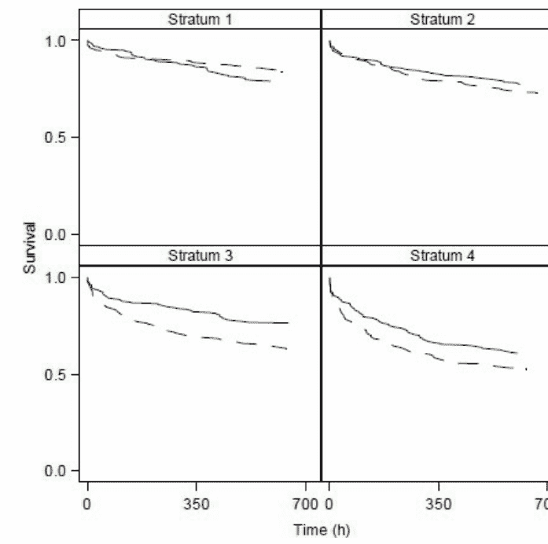

实验组（实线）和安慰剂组（虚线）针对基准死亡风险调整的生存曲线。

## 4.4.1 基于随机化的检验

为了评估输出 1.21 中治疗差异的显著性，并检验 4 个层中“治疗对生存没有影响”的零假设，我们可以利用 `PROC LIFETEST` 提供的三种基于随机化的方法：对秩检验（logrank）、威尔科克逊检验（Wilcoxon）和似然比检验（likelihood ratio tests）。

对秩检验由 Mantel (1966) 开发，他将通用的 Mantel-Haenszel 方法（Mantel and Haenszel, 1959）改进用于分析右截删的时间到事件数据。Peto 和 Peto (1972) 提出了原始 Mantel 检验的更通用版本，用于比较多个生存分布。（Peto 和 Peto 还创造了“对秩检验”这一术语）。双样本场景下的 Wilcoxon 检验由 Gehan (1965) 开发。该检验后来被 Breslow (1970) 扩展到多样本情况。对秩检验和 Wilcoxon 过程均基于非参数思想。似然比检验是比较生存函数的参数方法示例。该检验在事件遵循指数分布的假设下计算。或者，我们可以通过执行 Hájek 和 Šidák (1967) 描述的线性秩检验的广义版本来比较底层生存分布。示例包括 Tarone 和 Ware (1977)、Prentice (1978) 以及 Harrington 和 Fleming (1982) 提出的检验程序。Tarone-Ware 和 Harrington-Fleming 检验与对秩检验及 Wilcoxon 检验密切相关。事实上，这四种检验程序使用四种不同的权重策略对生存分布进行相同的比较。更多细节请参见 Collett (1994, 第 2.5 节) 和 Lachin (2000, 第 9.3 节)。

作为说明，考虑一个以时间到事件为终点的临床试验，比较实验疗法与安慰剂。令 $t_{(1)} < \dots < t_{(r)}$ 表示合并样本中的排序事件时间。对秩检验使用以下统计量衡量两个生存函数之间的距离值：

$$d_L = \sum_{k=1}^{r} (d_{1k} - e_{1k}),$$

其中 $d_{1k}$ 是 $t_{(k)}$ 时刻实验组观察到的事件数，$e_{1k}$ 是生存无影响零假设下 $t_{(k)}$ 时刻的预期事件数。从 $d_L$ 的定义可以看出，$d_{1k} - e_{1k}$ ($k=1, \dots, r$) 在对秩检验中的权重是相等的。

Wilcoxon 检验基于以下观点：早期事件比存活人数少且生存曲线估计精度低的事件更具信息量。两个生存函数之间的 Wilcoxon 距离给出：

$$d_w = \sum_{k=1}^{r} n_k(d_{1k} - e_{1k}),$$

其中 $n_k$ 是 $t_{(k)}$ 之前的风险集人数。同样，Tarone-Ware 和 Harrington-Fleming 检验分别基于以下统计量：

$$d_{RW} = \sum_{k=1}^{r} n_k^{1/2}(d_{1k} - e_{1k}),$$
$$d_{HF} = \sum_{k=1}^{r} S_k^{\rho}(d_{1k} - e_{1k}),$$

其中 $S_k$ 表示 $t_{(k)}$ 时治疗组合并生存的 Kaplan-Meier 估计，$\rho$ 是一个决定分配给事件时间的权重参数（$0 \le \rho \le 1$）。在 Harrington-Fleming 程序中令 $\rho=0$ 可产生对秩检验，而令 $\rho=1$ 则产生一个对早期事件分配更大权重的检验。

## LIFETEST 过程

### 分层间的等性检验 (stratum=1)

| 检验 | 卡方 | DF | Pr > ChiSq |
|---|---|---|---|
| 对数秩 (Log-Rank) | 1.4797 | 1 | 0.2238 |
| 威尔科克森 (Wilcoxon) | 1.2748 | 1 | 0.2589 |
| -2Log(LR) | 1.6271 | 1 | 0.2021 |

### 分层间的等性检验 (stratum=2)

| 检验 | 卡方 | DF | Pr > ChiSq |
|---|---|---|---|
| 对数秩 (Log-Rank) | 0.9934 | 1 | 0.3189 |
| 威尔科克森 (Wilcoxon) | 0.8690 | 1 | 0.3512 |
| -2Log(LR) | 1.1345 | 1 | 0.2868 |

### 分层间的等性检验 (stratum=3)

| 检验 | 卡方 | DF | Pr > ChiSq |
|---|---|---|---|
| 对数秩 (Log-Rank) | | | |
| 威尔科克森 (Wilcoxon) | | | |
| -2Log(LR) | | | |


| 对数秩 (Log-Rank) | 8.8176 | 1 | 0.0030 |
| 威尔科克森 (Wilcoxon) | 8.7611 | 1 | 0.0031 |
| -2Log(LR) | 10.3130 | 1 | 0.0013 |

stratum=4

LIFETEST 过程

### 分层间的等性检验

| 检验 | 卡方 | DF | Pr Chi-Square |
|---|---|---|---|
| 对数秩 (Log-Rank) | 3.5259 | 1 | 0.0604 |
| 威尔科克森 (Wilcoxon) | 3.9377 | 1 | 0.0472 |
| -2Log(LR) | 4.4858 | 1 | 0.0342 |

在 `STRATA` 语句中包含 `TREAT` 变量会导致基于对数秩、威尔科克森和似然比检验对分层特定的生存分布进行比较。输出 1.24 列出了对数秩、威尔科克森和似然比统计量以及相应的渐近 p 值。注意，已使用 `ODS` 语句 (`ods select HomTests`) 删除了输出中的冗余信息。从输出 1.24 可以看到，治疗差异在分层 1 和分层 2 中并不显著，在分层 3 中高度显著，而在分层 4 中边缘显著。三种检验在每个分层中产生相似的结果，其中似然比统计量始终大于其他两种。由于似然比检验是一种高度依赖于底层指数分布假设的参数过程，除非我们确定符合指数分布假设，否则需要谨慎使用。

### 使用 PROC LIFETEST 中的 TEST 语句比较生存分布

检验治疗效应对生存影响显著性的另一种方法是基于 PROC LIFETEST 中的 `TEST` 语句。如果将治疗组变量包含在 `TEST` 语句中，PROC LIFETEST 将执行两种检验（对数秩检验和威尔科克森检验）来比较不同治疗组之间的生存函数。生成的对数秩和威尔科克森统计量与输出 1.24 中显示的有所不同。作为示例，程序 1.23 在 `TEST` 语句中包含 `TREAT` 变量时，计算了分层特定的对数秩和威尔科克森统计量以及相关的 p 值。

### 程序 1.23 使用 TEST 语句在 4 个分层中比较生存分布

```sas
proc lifetest data=sepsurv notable;
  ods select LogChiSquare ChiSq;
  by stratum;
  time surv*census(0);
  test treat;
run;
```

### 程序 1.23 的输出

stratum=1

威尔科克森检验的单变量卡方

| 变量 | 检验统计量 | 标准差 | 卡方 | Pr |
|---|---|---|---|---|
| treat | -4.4090 | 3.9030 | 1.2761 | 0.258 |

对数秩检验的单变量卡方

| 变量 | 检验统计量 | 标准差 | 卡方 | Pr |
|---|---|---|---|---|
| treat | -5.2282 | 4.3003 | 1.4781 | 0.224 |

stratum=2

威尔科克森检验的单变量卡方

| 变量 | 检验统计量 | 标准差 | 卡方 | Pr |
|---|---|---|---|---|
| treat | -4.0723 | 4.3683 | 0.8691 | 0.351 |

对数秩检验的单变量卡方

| 变量 | 检验统计量 | 标准差 | 卡方 | Pr |
|---|---|---|---|---|
| treat | -4.9539 | 4.9743 | 0.9918 | 0.319 |

stratum=3

威尔科克森检验的单变量卡方

| 变量 | 检验统计量 | 标准差 | 卡方 | Pr |
|---|---|---|---|---|
| treat | -13.8579 | 4.6821 | 8.7602 | 0.003 |

对数秩检验的单变量卡方

| 变量 | 检验统计量 | 标准差 | 卡方 | Pr |
|---|---|---|---|---|
| treat | -16.2909 | 5.4914 | 8.8007 | 0.003 |

stratum=4

威尔科克森检验的单变量卡方

| 变量 | 检验统计量 | 标准差 | 卡方 | Pr |
|---|---|---|---|---|
| treat | -10.3367 | 5.2107 | 3.9352 | 0.047 |

对数秩检验的单变量卡方

| 变量 | 检验统计量 | 标准差 | 卡方 | Pr |
|---|---|---|---|---|
| treat | -12.3095 | 6.5680 | 3.5125 | 0.060 |

输出 1.23 显示了程序 1.23 产生的威尔科克森和对数秩统计量及 p 值。注意，常规输出包含另一组威尔科克森和对数秩统计量（在“对数秩检验的前向卡方序列”和“威尔科克森检验的前向卡方序列”标题下）。这些步进程序与上述所示的程序相同，因为 `TEST` 语句中只包含了一个变量。冗余的检验统计量和 p 值已通过 `ODS` 语句 (`ods select LogChiSquare ChiSq`) 抑制。很容易检查出，分层特定的对数秩和威尔科克森统计量与输出 1.24 的不同。这种差异很小，但会随着统计值的增加而增大。为了理解这两组统计量的差异，我们需要记住 `TEST` 语句添加到 LIFETEST 是为了让用户研究协变量对生存分布的影响。对数秩和威尔科克森检验用于跨组的同质性。参见 Kalisch 和 Prentice (1980)。当分类变量包含在 `TEST` 语句中，更通用的对数秩和威尔科克森检验并不总是简化。如果 `SEPSURV` 数据中没有相同的生存时间，输出 1.23 中的对数秩统计量将与输出 1.24 一致。并非如此，LIFETEST 中的对数秩检验是为了调整相同观测值。

另一种观察差异的方法是在 `STRATA` 或 `TEST` 语句中包含治疗组变量时所进行的推断。大致来说，输出 1.24（使用 `STRATA` 语句）代表基于随机化的检验方法，而输出 1.23（使用 `TEST` 语句）则是基于模型的方法。例如，将在第 1.4.2 节显示 Cox 比例风险模型。

### 使用 Tarone-Ware 和 Harrington-Fleming 检验比较生存分布

因此，我们关注了 LIFETEST 中实现的对数秩、威尔科克森和似然比检验过程。将这些过程与 Tarone 和 Ware (1977) 以及 Harrington 和 Fleming (1982) 描述的检验进行比较很有意义。后者可以使用 PROC LIFETEST 执行。例如，可以使用以下代码在 SEPSURV 数据集中使用 Tarone-Ware 和 Harrington-Fleming (ρ = 0.5) 检验比较生存分布。

分层特定的 Tarone-Ware 和 Harrington-Fleming 统计量及 p 值由 `%LinkRank` 宏汇总。为了与程序 1.24 计算的对数秩和威尔科克森检验进行比较，输出 1.24 的相关统计量显示在表格的底部。

### 表格 1.6 Tarone-Ware、Harrington-Fleming、对数秩和威尔科克森检验的比较

| 检验 | 分层 1 | 分层 2 | 分层 3 | 分层 4 |
|---|---|---|---|---|
| Tarone-Ware 检验 | 1.3790 | 0.9331 | 8.8171 | 3.75 |
| Harrington-Fleming (ρ = 0.1) | 1.4599 | 0.9817 | 8.8220 | 3.57 |
| Harrington-Fleming (ρ = 0.5) | - | - | - | - |
| Harrington-Fleming (ρ = 1) | 1.2748 | 0.8690 | 8.7611 | 3.93 |
| 对数秩检验 | 1.4797 | 0.9934 | 8.8176 | 3.52 |
| 威尔科克森检验 | 1.2748 | 0.8690 | 8.7611 | 3.93 |

在程序 1.24 中计算的 log-rank 和 Wilcoxon p 值。根据 Tarone-Ware 程序的定义，分配给单个事件时间的权重大于且也小于 Wilcoxon 权重。因此，Tarone-Ware 统计量介于成对的 log-rank 统计量和 Wilcoxon 统计量之间，且 Tarone-Ware 过程始终优于这两种程序中效力最低的一种。当 $\rho = 0.1$ 时，Harrington-Fleming 权重几乎与事件时间无关。因此，特定分层的 Harrington-Fleming 统计量的数量级通常接近 log-rank 统计量。另一方面，当 $\rho = 1$ 时，Harrington-Fleming 权重接近 Wilcoxon 权重，这导致两组检验统计量非常接近。

### 事件生存时间数据的分层分析

在本节的第一部分中，我们关注于特定分层的推断。然而，我们通常对对控制了重要协变量的治疗效应进行整体分析感兴趣。通过结合不同分层之间治疗差异的信息，可以评估实验药物对生存时间结果变量的调整效应。PROC LIFETEST 支持分层的 Wilcoxon 和 log-rank 检验。为了执行分层检验，我们需要将治疗组变量（例如死亡基准风险）包含在 `STRATA` 语句中。

从数学角度讲，PROC LIFETEST 的分层推断等同于在 $m$ 个分层中等权重合并 Wilcoxon 和 log-rank 距离统计量。具体而言，令 $d_{Lj}$ 表示第 $j$ 个分层中生存函数之间 log-rank 距离的值，令 $s^2_{Lj}$ 为 $d_{Lj}$ 的样本差。分层 log-rank 统计量等于：

```math
$u_L = \sqrt{\frac{\sum_{j=1}^{m} d_{Lj}^2}{\sum_{j=1}^{m} s_{Lj}^2}}$
```

在底层生存分布没有差异的原假设下，分层统计量渐近服从 1 自由度的卡方分布。分层 Wilcoxon 统计量以类似的方式定义。

**程序 1.25** 执行了两个分层检验，以评估案例 3 中经死亡基准风险调整后生存治疗效应的显著性。

### 程序 1.25 案例 3 中使用 Wilcoxon 和 log-rank 检验对 4 个分层生存分布的分层比较

```sas
proc lifetest data=sepsurv notable;
  ods select LogUniChisq WilUniChiSq;
  time surv*censor(0);
  strata stratum;
  test treat;
run;
```

### 程序 1.25 输出

| 变量 | 统计量 | 离差 | 卡方 | Pr |
| :--- | :--- | :--- | :--- | :--- |
| treat | 23.8579 | 9.1317 | 6.8259 | 0.009 |

| 变量 | 统计量 | 离差 | 卡方 | Pr |
| :--- | :--- | :--- | :--- | :--- |
| treat | 28.3261 | 10.7949 | 6.8855 | 0.008 |

**输出 1.25** 显示了程序 1.25 生成的分层 Wilcoxon 和 log-rank 统计量及 p 值。与程序 1.23 一样，使用了 `ODS` 语句（`ods select LogUniChisq WilUniChisq`）来显示 PROC LIFETEST 输出的相关部分。分层 Wilcoxon 和 log-rank p 值分别为 0.0090 和 0.0087。这两个 p 值几乎完全相同，表明实验药物对生存的调整效应非常强。值得注意的是，分层 Wilcoxon 和 log-rank 统计量远大于在分层 1、2 和 4 中计算的相应统计量（见输出 1.23）。正如预期的，分层增加了检验程序的效力。

我们还可以将分层 Wilcoxon 和 log-rank p 值与分层 Tarone-Ware 和 Harrington-Fleming 检验产生的数值进行比较。如果 $\rho = 0.1$，分层 Tarone-Ware 统计量为 6.8975 (p = 0.0086)，分层 Harrington-Fleming 统计量等于 6.9071 (p = 0.0086)；如果 $\rho = 1$，则为 6.8260 (p = 0.0090)。获得的结果与基于 Wilcoxon 和 log-rank 检验的分层分析结果高度一致。

### 1.4.2 基于模型的检验

与第 1.3 节中考虑的分类结果一样，针对事件生存时间数据的基于随机化的检验通常仅适用于简单的统计问题，例如检验生存函数的相等性。因此，如果我们有兴趣研究混合（连续和分类）协变量对生存分布的影响，或研究多个因素的预后能力，我们需要依赖于使用事件生存时间数据回归模型的更灵活的方法。事件生存时间结果变量使用显式指定底层生存分布的参数模型或半参数模型（如比例风险模型）进行分析。参数回归模型在临床试验设置中应用较少，因此本节侧重于与比例风险回归相关的检验程序。请参阅 Allison (1995, 第 4 章) 和 Cantor (1997, 第 5 章) 关于基于 PROC LIFEREG 的参数回归推断的综述。

为了定义 Cox (1972) 在著名论文中引入的比例风险模型，考虑一个具有生存时间终点的双臂临床试验。第 $i$ 治疗组中第 $k$ 个患者的风险函数 $h_{ik}(t)$ 假设为：

```math
$h_{ik}(t) = h_0(t)\exp\{X_{ik}\beta_i\}$
```

$h_0(t)$ 表示未指定的基准风险函数，$X_{ik}$ 是协变量向量，$\beta_i$ 是未知回归参数向量。该模型被称为比例风险模型是因为两个治疗组之间的风险函数比值随时间保持为常数。Cox (1972) 建议通过极大化部分似然来估计回归参数，部分似然不涉及未知的基准风险函数 $h_0(t)$。虽然部分似然在概念上不同于普通或条件似然（例如，它缺乏概率解释），但得到的 $\beta_i$ 估计值具有与普通似然估计相同的渐近性质。正如 Tsiatis (1981) 所示，极大部分似然估计是渐近一致的。关于比例风险模型的深入讨论，请参阅 Kalbfisch 和 Prentice (1980, 第 4 和 5 章)、Cox 和 Oakes (1984) 以及 Collett (1994, 第 3 章)。

比例风险模型在 `PROC PHREG` 中实现，它支持多种建模特征（例如，分层模型、离散时间模型和时间依赖协变量模型）。在这里，我们将关注时间无关协变量的比例风险模型，因为临床结果变量通常对基准值进行了调整。请参阅 Allison (1995, 第 5 章) 在 `PROC PHREG` 中拟合时间依赖协变量模型的示例。

为了在 `PROC PHREG` 中对生存时间数据进行分层分析，需要在 `STRATA` 语句中指定分层变量。`STRATA` 语句允许我们在两个治疗组内部的风险函数平行的范围内拟合比例风险模型。程序 1.26 对案例 3 收集的生存数据拟合分层比例风险模型并绘制估计的生存函数。注意，SAS 系统第 8 版本的 `PROC PHREG` 没有 `CLASS` 语句，需要创建类似于 `SEPSURV` 数据集中 `TREAT` 变量的指示变量以在模型中包含分类协变量和交互项。为了消除这一繁琐的预处理步骤，第 9 版本引入了带有 `CLASS` 语句的实验性 `PROC TPHREG`。

### 程序 1.26 案例 3 中使用比例风险回归对 4 个分层生存分布的分层比较

```sas
proc lifetest data=sepsurv notable;
  ods select LogUniChisq WilUniChiSq;
  time surv*censor(0);
  strata stratum;
  test treat;
run;

data cov;
  treat=0; output;
  treat=1; output;
run;

proc phreg data=sepsurv;
  model survtime*censor(0)=treat / risklimits;
  strata stratum;
  baseline out=curve survival=est covariates=cov / rowid=stratum;
run;

%macro PlotPH(stratum);
  axis1 label=(angle=90 "Survival") order=(0 to 1 by 0.2);
  axis2 label=("Time h") order=(0 to 700 by 100);
  symbol1 value=none color=black i=j line=1;
  symbol2 value=none color=black i=j line=20;
  data annotate;
    xsys="1"; ysys="1"; hsys="4"; x=50; y=20; position="5";
    size=1; text="Stratum &stratum"; function="label";
  run;
  proc gplot data=curve annotate=annotate;
    where stratum=&stratum;
    plot est*survtime=treat / frame haxis=axis2 vaxis=axis1;
  run;
%mend PlotPH;

%PlotPH(1);
%PlotPH(2);
%PlotPH(3);
%PlotPH(4);
```


### 程序 1.26 的输出

| 测试 | 卡方 | DF | Pr | ChiSq |
|---|---|---|---|---|
| 似然比 | 6.8861 | 1 | 0.0087 | |
| Score | 6.8855 | 1 | 0.0087 | |
| Wald | 6.8332 | 1 | 0.0089 | |

最大似然估计分析

| 变量 | DF | 标准估计 | 误差 | 卡方 | Pr | ChiSq |
|---|---|---|---|---|---|---|
| treat | 1 | -0.24308 | 0.09299 | 6.8332 | 0.0087 | |

最大似然估计分析

| 变量 | 比率 | 95% 风险比置信区间 |
|---|---|---|
| treat | 0.784 | 0.654 | 0.941 |

输出 1.26 显示了用于检验“无治疗效应”零假设的似然比、Score 与 Wald 统计量。这三个测试统计量的数值都很大，表明实验药物对生存的调整影响非常显著。Score 测试等同于 1.4.1 节中之前描述的比较生存分布的对秩检验（log-rank test）。在没有并结事件时间的情况下（即没有两个生存时间完全相同），这两种检验产生相同的 p 值。在存在并结观察时，log-rank 等同于 `PROC PHREG` 中的 Score 测试，该方法对并结有默认调整（Collet, 1994, 第 3.9 节）。为了看到这一点，请注意输出 1.25 中的调整后 log-rank 统计量等于输出 1.26 中的 Score 统计量。

输出 1.26 提供了类似于 `LIFETEST` 生成的定性信息，但下表用定量术语描述了治疗差异。具体而言，它显示了针对死亡基线进行调整的整体风险比的最大部分似然估计，以及相关的 95% 置信区间。风险比估计值为 0.784，这意味着实验药物将死亡风险降低了 21.6%。真实风险比的渐近 95% 置信区间 (0.654, 0.941)。该置信区间是由 `MODEL` 语句中的 `RISKLIMITS` 选项请求。

图 1.3 显示了由 `BASELINE` 语句生成的 `CURVE` 数据中 4 个层的估计生存曲线。为了计算两个治疗组中每组的生存曲线，需要创建一个包含两条记录 `TREAT=0` 和 `TREAT=1` 的数据集，并将该数据集的名称传递给 `BASELINE` 语句中的 `COVARIATES` 选项。由于程序 1.26 对生存数据进行了分层分析，估计生存曲线的形状随分层而异，但治疗差异保持恒定，从意义上说风险函数在所有 4 个层中都是相同的。

在 `PROC PHREG` 中拟合比例风险模型时，检查是否满足比例风险假设是明智的，即任何两个治疗组之间的风险比随时间大致保持恒定。Lagakos 和 Schoenfeld (1984) 研究了当违反比例风险假设时 Score 测试的效力。他们证明，Score 测试对于偏离比例假设的小幅偏差具有相当好的稳健性，但如果风险函数发生交叉，其效率会剧减。Allison (1995, 第 5 章) 讨论了 `PROC PHREG` 中比例风险假设的简单图形化检查。

### 带有并结的事件时间数据分析

通常，在存在并结（即在完全相同时间发生的事件）的情况下，任何类型的离散事件分析都会变得非常复杂。通过对 `SURVTIME` 变量进行频率计数，很容易检查出 `SEPSUR` 数据集中存在相当数量并结。例如，4 名患者在开始给予研究药物后 10 小时死亡，5 名患者在开始给予研究药物后 15 小时死亡。请注意，同时发生的删失观察值不计为并结。

并结事件时间的存在极大地增加了部分似然函数推导及后续推断的复杂性。为了简化带有并结数据集的推断，几位作者建议忽略精确部分似然函数，并基于近似部分似然函数构建参数估计和显著性检验。Cox (1972) 描述了一种部分似然函数的近似，该方法假设底层时间尺度是离散的。Breslow (1974) 为连续时间情况提出了一种简单的近似。Breslow 方法背后的思想是将并结事件时间视为它们之间存在顺序排列，并对所有可能的排序对似然函数取平均。Efron (1977) 改进了 Breslow 方法，开发了对精确部分似然函数的更准确的近似。关于并结事件时间存在部分似然推断的良好讨论，请参阅 Collett (1994, 第 3.3.2 节）。

显然，处理并结观察的方法将产生不同的结果，并可能导致不同的结论。由于程序 1.26 未明确说明处理并结的方法，`PROC PHREG` 调用了 Breslow (1974) 开发的默认处理并结方法。当并结数量很大时，Breslow 方法会导致比例风险模型中的参数估计产生偏差。由于参数估计偏向 0，我们更容易漏掉显著性。

- 在比例风险假设下，对数秩检验（log-rank test）优于其他检验，但在不满足该假设时，容易丢失效力。
- Wilcox 检验对研究结束时存活患者人数较少时发生的事件的敏感性较低。
- Tarone-Ware 过程和 Harrington-Fleming 过程作为 log-rank 和 Wilcox 过程的稳健替代方案，并且在广泛的备选假设下，它们比这两种过程能更好地地保持效力。

总而言，鉴于时间-事件数据的复杂性，通过模拟估计候选检验相对于理想备选假设的效力可能是一个好主意。

本节描述的用于时间-事件数据的基于模型的检验依赖于带有部分似然推断的 Cox 比例风险回归。在 `PROC PHREG` 中实现的比例风险模型具有几个在应用中非常有用的特征：

- 基准风险函数从推断中被完全移除。因此，统计学家不需要为了估计模型参数而指定底层的生存分布。
- 比例风险模型中的估计是非参数化方式进行的（推断基于事件时间的排序），这使得该方法显著稳健。
- `PROC PHREG` 支持广泛的有用功能，如分层、时间依赖协变量以及对比例风险模型中并结事件时间的高效调整。

比例风险模型中的推断对于比例性假设的微小偏通常是相当稳健的。然而，当底层风险函数互不平行时，可能会发生效力损失。当这种情况发生时，我们可以使用 `PROC PHREG` 中的 `STRATA` 语句在每个分层内拟合单独的比例风险模型。

## 1.5 定性交互检验

多项出版物和监管指南已强调了对感兴趣的亚组间治疗效应异质性进行准确评估的重要性。例如，ICH 指南文件《临床试验的统计学原则》（ICH E9）的第 3.2 节指出：

> “如果在一个每个中心具有相当数量的受试者的试验中发现了正向治疗效应，则通常应对跨中心中心治疗效应的异质性进行探索，因为这可能会影响结论的推广性。通过对单个中心的结果进行图形化展示或分析方法（如治疗与中心交互的显著性检验），可以识别出显著的异质性。”

某些分层中治疗差异的反向出现并不总是意味着所选分层之间结果变量存在真实差异，而可能是由于随机波动引起的。事实上，我们几乎肯定会在不同分层间的治疗效应中遇到不同程度的不一致性。Senn（1997, 第14章）证明了通过偶然观察到至少一次效应反转的概率随着分层数量的增加而迅速增加。当分层数为 10 时，该概率超过 80%。

以下两个定义有助于区分真实和可能的随机的“治疗-分层”交互情况：

- 跨分层的治疗效应幅度发生变化但不影响治疗差异的方向，这被称为**定量交互**（quantitative interaction）。定量交互在临床试验中非常常见。事实上，很少看到治疗差异在所有重要患者亚组中保持恒定的试验。定量交互通常代表结果变量的自然变异，并需要与涉及定性交互的极端情况进行对比。
- 如果真实治疗差异的方向在不同分层之间变化，则将治疗-分层交互称为**定性交互**（qualitative interaction）。值得注意的是，定性交互有时被称为交叉交互（crossover interactions）。

统计文献对定性交互的分析受到了相当关注（Peto, 1982; Azzalini and Cox, 1984; Gail and Simon, 1985; 以及 Ciminera et al., 1993）。定性交互的存在影响对整个试验结果的解释，并影响对治疗效应的分析。包括 Ciminera 等人（1993）在内的某些作者建议不要使用定量交互检验来判断治疗效应的异质性，并强调只有在出现显著定性交互的罕见情况下，才需要在模型中包含治疗-分层交互。

在本节中，我们将回顾由 Gail 和 Simon（1985）提出的用于检验定性存在的流行方法，并简要提及 Ciminera 等人（1993）开发的其他方法。

#### 1.5.1 Gail-Simon 检验

Gail 和 Simon (1985) 提出了一种用于检验定性交互是否存在的方法，并展示了如何通过卡方分布的加权和来表达无交互的零假设。设 $\delta_i$ 表示真实治疗差异，$s_i$ 表示估计的标准误。当真实治疗差异位于正交区域 $O^+ = \{\delta_1 \ge 0, \dots, \delta_m \ge 0\}$ 时，存在定性交互；当位于负交区域 $O^- = \{\delta_1 \le 0, \dots, \delta_m \le 0\}$ 时，则存在定性交互。Gail 和 Simon 描述了用于检验无交互假设的似然比检验，其为 $Q = \min(Q^+, Q^-)$，其中 $Q^+$ 和 $Q^-$ 分别总结了正负交互的贡献。这种分布可以用于计算似然比 $p$ 值的公式：

$p = \sum_{i=1}^m (1 - F_i(Q))$

其中 $F_i(x)$ 是具有 $i$ 个自由度的卡方分布的累积分布函数，而 $Bin_{i-1}(0.5)$ 是成功概率为 0.5 的二项分布。描述的检验是双向的，因为当 $Q^+$ 和 $Q^-$ 都足够大时，拒绝无交互假设。Gail-Simon 方法很容易扩展到单向设置，以检验 (i) 治疗差异是否都为正或 (ii) 治疗差异是否都为负。与 (i) 相关的似然比检验 $p$ 值等于：

$p = \sum_{i=1}^m (1 - F_i(Q^-))Bin_{i,m}(0.5)$

同样，检验 (ii) 的似然比 $p$ 值由：

$p = \sum_{i=1}^m (1 - F_i(Q^+))Bin_{i,m}(0.5)$ 给出。

### 案例1中的 Gail-Simon 检验

我们将首先应用引入的方法对具有连续终点的临床试验进行定性交互检验。程序 1.28 执行引入的 Gail-Simon 检验以检查案例 1 中的治疗-分层交互。该程序调用 `%GailSimon` 宏来计算单向和双向的似然比 $p$ 值。宏具有以下参数：

- `Dataset`：带有每个分层统计量和相关标准误的数据集。
- `Est`：指定统计量的变量名。
- `StdErr`：指定标准误的变量名。
- `TestType`：执行的检验类型：针对正差异的单向 Gail-Simon 检验 ("P")、针对负差异的单向 Gail-Simon 检验 ("N")，或双向 Gail-Simon 检验 ("T")。

### 程序 1.28 使用 Gail-Simon 检验分析案例1中的定性交互

```sas
proc sort data=hamd17;
  by drug center;
proc means data=hamd17 noprint;
  where drug="P";
  by center;
  var change;
  output out=plac mean=mp var=vp n=np;
proc means data=hamd17 noprint;
  where drug="D";
  by center;
  var change;
  output out=drug mean=md var=vd n=nd;
data comb;
  merge plac drug;
  by center;
  d=-mp;
  np=nd;
  stderr=sqrt((1/np + 1/nd)*((np-1)*vp + (nd-1)*vd)/(n-2));
  %GailSimon(dataset=comb, est=d, stderr=stderr, testtype="P");
  %GailSimon(dataset=comb, est=d, stderr=stderr, testtype="N");
  %GailSimon(dataset=comb, est=d, stderr=stderr, testtype="T");
```

### 程序 1.28 的输出

针对正差异的单侧 Gail-Simon 检验

| 统计量 | P 值 |
| :--- | :--- |
| 7.647 | 0.0465 |

针对负差异的单侧 Gail-Simon 检验

| 统计量 | P 值 |
| :--- | :--- |
| 57.750 | 0.0000 |

双侧 Gail-Simon 检验

| 统计量 | P 值 |
| :--- | :--- |
| 7.647 | 0.0297 |

我们从输出 1.28 中看出，所有三个似然比 P 值在 5% 的水平上都是显著的。负差异的单侧 P 值（$Q^- = 57.750, p < 0.0001$）的显著性并不意外，因为这表明真实的治疗差异极不可能全为负。另外两个检验提供了更多的信息，并传达了相同的信息——即零假设（正向治疗效应在 5 个选定中心是一致的）是可以被拒绝的。这意味着 101 号中心的负治疗差异幅度过大，无法通过随机性解释，并表明存在定性交互作用。由于 101 号中心似乎是一个离群值，审慎的做法是仔细研究在该机构入组患者的人口统计学和临床特征，以及 HAMD17 评估的一致性，以更好地理解观察到的差异。

### 案例 3 中的 Gail-Simon 检验

程序 1.29 阐述了 Gail-Simon 检验在分层分类数据分析中的应用。考虑 1.3 节介绍的严重脓血症患者临床试验。如图 1.2 所示，治疗差异在代表不同基线死亡风险水平的 4 个层之间存在显著差异。在分层 2、3 和 4 中，接受实验药物治疗的患者生存率更高。然而，在分层 1 中，治疗差异似乎发生了反转。因此，询问分层 1 是否与其他层存在定性上的差异是合理的。下面的程序使用 `%GailSimon` 宏来测试跨层级 28 天死亡率治疗差异的一致性。

### 程序 1.29 使用 Gail-Simon 检验对案例 3 中定性交互作用的分析

```sas
proc sort data=sepsis;
  by stratum;
data est;
  set sepsis;
  by stratum;
  retain ad dd ap dp;
  if therapy="Drug" and outcome="Alive" then ad=count;
  if therapy="Drug" and outcome="Dead" then dd=count;
  if therapy="Placebo" and outcome="Alive" then ap=count;
  if therapy="Placebo" and outcome="Dead" then dp=count;
  survd=ad/(ad+dd);
  survp=ap/(ap+dp);
  d=survd-survp;
  stderr=sqrt(survd*(1-survd) / (ad+dd) + survp*(1-survp) / (ap+dp));
  if last.stratum=1;
  %GailSimon(dataset=est, est=d, stderr=stderr, testype="P");
  %GailSimon(dataset=est, est=d, stderr=stderr, testype="N");
  %GailSimon(dataset=est, est=d, stderr=stderr, testype="T");
```


### 程序 1.29 的输出

#### 针对正差异的单侧 Gail-Simon 检验

| 统计量 | P 值 |
| :--- | :--- |
| 0.8555 | 0.6005 |

#### 针对负差异的单侧 Gail-Simon 检验

| 统计量 | P 值 |
| :--- | :--- |
| 12.631 | 0.00030 |

#### 双侧 Gail-Simon 检验

| 统计量 | P 值 |
| :--- | :--- |
| | |

输出 1.29 中的正差异单侧统计量（$Q^+ = 0.855$）和双侧统计量（$Q = 0.855$）均表明数据中没有证据拒绝无定性交互作用的零假设。尽管分层 1 中的治疗差异发生了反转，但 Gail-Simon 统计量不足以在 5% 的显著性水平上得出该层与其他层存在定性差异的结论。Gail-Simon 检验产生的极不显著 P 值与输出 1.13 显示的 Breslow-Day P 值进行对比。在同一临床试验中，对 4 个层级的优势比定量同质性应用 Breslow-Day 检验得到的 P 值为 0.0899，这显然比保守的 Gail-Simon P 值更接近显著。

最后，在输出 1.28 中，负差异的单侧 Gail-Simon 统计量（$Q^- = 12.631$）表明分层治疗差异极可能全为负。

### 1.5.2 其他定性交互检验

Ciminera 等人 (1993) 描述了一种作为本节早期介绍的 Gail-Simon 检验替代方案的交互作用检验。这种被称为 pushback 的检验基于以下思想：为了确定特定层的观察治疗差异是否与其他数据一致，我们可以对标准化治疗差异进行排序，并与从定义的统计分布计算的值进行比较。这种比较将显示哪些层超出了预期。Ciminera 等人 (1993) 简要比较了 pushback 和 Gail-Simon 检验的性能，指出在他们的一个案例中，pushback 程序的效能较低。

### 1.5.3 总结

本节讨论了临床试验中的定性交互作用检验，包括流行的 Gail-Simon 检验。该检验依赖于分层汇总统计。因此，它们适用于具有连续、分类或生存事件终点的临床试验。

如引言所述，定性交互作用检验在临床试验中有许多应用。这些检验有助于分析治疗与分层之间的交互，帮助识别获益最显著的患者亚群，并在敏感性分析中发挥重要作用。例如，试验赞助商可以进行 Gail-Simon 或其他交互检验，以寻找多中心试验中与其他人群存在定性不同的中心。尽管在目前的监管环境下，将这些中心从最终分析中排除可能是困难的，但获得的知识为信息丰富的敏感性分析提供了依据，并最终有助于更好地理解试验结果。

### 1.6 参考文献

- Agresti, A. (2001). Exact inference for categorical data: recent advances and continuing controversies. *Statistics in Medicine* 20, 2709-2722.
- Agresti, A. (2002). Categorical Data Analysis (Second Edition). New York: John Wiley and Sons.
- Agresti, A., Hartzel, J. (2000). Strategies for... *Statistics in Medicine* 19, 1115-1139.
- Cochran, W.G. (1983). 观察性研究的规划与分析. 新纽约: Wiley.
- Coe, P.R., Tamhane, A.C. (1993). 两个成功概率差异、比率和优势比率的小样本置信区间. Communications in Statistics (Simulation and Computation) 22, 925-938.
- Collett, D. (1994). 医学研究中的生存数据建模. 伦敦: Chapman and Hall.
- Cox, D.R. (1972). 回归模型与生存表. Journal of the Royal Statistical Society, Series B 34, 187-220.
- Cox, D.R., Oakes, D.O. (1984). 生存数据分析. 伦敦: Chapman and Hall.
- Day, N.E., Byar, D.P. (1979). 病例研究中的假设检验：Mantel-Henszel 统计量与对数得分检验的等效性。 Biometrics 35, 623-630.
- Efron, B. (1977). 删失数据 Cox 似然函数的效率. Journal of the American Statistical Association 72, 557-565.
- Fleiss, J.L. (1981). 发生率与比例的统计方法（第二版）. 新纽约: Wiley.
- Fleiss, J.L. (1986). 多中心临床试验数据的分析. Controlled Clinical Trials 7, 267-275.
- Ford, I., Norris, J., Ahmadi, S. (1995). Cox 比例风险模型所说明的模型不一致性. Medicine 14, 735-746.
- Gail, M.H., Rubin, J.H., Rubinstein, L.V. (1981). 匹配病例研究与存在结数据的生存研究的似然计算. Biometrika 68, 703-707.
- Gail, M., Simon, R. (1985). 治疗效应与患者亚组之间定性交互的检验. Biometrics, 41, 361-372.
- Gail, M.H., Tan, W.Y., Piantados, S. (1988). 随机临床试验中无治疗效应的检验. Biometrika 75, 57-64.
- Gail, M.H., Wieand, S., Piantados, S. (1984). 非线性回归和省略协变量的随机实验中治疗效应的偏估计. Biometrika 71, 431-444.
- Gallo, P.P. (2000). 多中心临床试验中的中心权重问题. Journal of Biopharmaceutical Statistics 10, 145-163.
- Gastwirth, J.L. (1985). 在合并列联表和生存分析中使用极大极效率稳健检验. Journal of the American Statistical Association 80, 380-384.
- Gehan, E.A. (1965). 用于比较任意精细删失样本的广义 Wilcox 检验. Biometrika 52, 203-223.
- Goldberg, J.D., Koury, K.J. (1990). 多中心试验的设计与分析. 药物科学中的统计方法论. Berry, D.A. (编辑). 新纽约: Marcel Dekker.
- Gould, A.L. (1998). 多中心试验分析的重新回顾. Statistics in Medicine 17, 1779-1797.
- Greenland, S., Robins, J.M. (1985). 从稀疏随访数据估计共同效应参数. Biometrics 41, 55-68.
- Hájek, J., Šidák, Z. (1967). 秩检验理论. 新纽约: Academic Press.
- Hamilton, M. (1967). 原发性抑郁性评分表的开发. British Journal of Clinical Psychology 6, 278-296.
- Harrington, D.P., Fleming, T.R. (1982). 一类用于删失生存数据的秩检验程序. Biometrika 69, 553-566.
- Hartley, H.O., Rao, J.N.K. (1967). 混合方差分析模型的极大似然估计. Biometrika 54, 93-108.
- Holander, M., Wolfe, D.A. (1999). 非参数统计方法（第二版）. 新纽约: Wiley.
- Hosmane, B., Shu, V., Morris, D. (1994). van Elteren 检验的有限样本性质. ASA Proceedings of the Biopharmaceutical Section 430-434.
- Jones, B., Teather, D., Wang, J., Lewis, J.A. (1998). 多中心临床试验中治疗差异各种估计量的比较. Statistics in Medicine 17, 1767-1777.
- Kalbfleisch, J.D., Prentice, R.L. (1973). 基于 Cox 回归和寿命模型的边际似然. Biometrika 60, 267-278.
- Kalbfleisch, J.D., Prentice, R.L. (1980). 故障时间数据的统计分析. 新纽约: Wiley.
- Kallen, A.A. (1997). 治疗与中心的交互作用：问题所在？ Drug Information Journal 31, 927-936.
- Knaus, W.A., Draper, E.A., Wagner, D.P., Zimmerman, J.E. (1985). APACHE II 疾病严重分类系统. Critical Care Medicine 13, 818-829.
- Koch, G.G., Amara, I.A., Davis, G.W., Gillings, D.B. (1982). 分类数据协方差分析统计方法综述. Biometrics 38, 563-595.
- Koch, G.G., Gillings, D.B. (1983). 推断，基于设计 vs. 基于模型. 统计科学百科全. Kotz, S., Johnson, N.L., Read, C.B. (编辑). 新纽约: Wiley.
- Koch, G.G., Carr, G.J., Amara, I.A., Stokes, M.E., Uryniak, T.J. (1990). 分类数据的分析. Statistical Methodology of the Pharmaceutical Sciences. Berry, D.A. (编辑).
- Koch, G.G., Edwards, S. (1988). 具有分类数据的功效. Biopharmaceutical Statistics for Development. Peace, K.K. (编辑). 新纽约: Marcel Dekker.
- Lachin, J.M. (2000). 相对风险的评估. Biostatistical Methods. New纽约: Wiley.
- Lagakos, S.W., Schoenfeld, D.A. (1984). 误设定回归模型下的比例风险得分检验. Biometrics 40, 1037-1048.
- Lee, E.T., Desu, M.M., Gehan, E.A. (1975). 某些样本检验的功效. Biometrika 62, 425-432.
- Lehmann, E.L. (1975). 非参数统计：基于秩的方法. San Francisco, CA: Holden-Day.
- Lin, Z. (1999). 多中心研究中的分析问题：我们该如何权重？Statistics in Medicine 18, 365-373.
- Littell, R.C., Freund, R.J., Spector, P.C. (1991). 线性模型系统（第三版）. Cary, NC: SAS Institute.
- Littell, R.C., Milliken, G.A., Stroup, W.W., Wolfinger, R.D. (1996). 混合模型系统. Cary, NC: SAS Institute.
- Mantel, N. (1966). 生存数据的评估及其新出现的秩统计量. Cancermo Reports 50, 163-170.
- Mantel, N., Fleiss, J.L. (1980). Mantel-Henszel 自由度卡方检验的最小样本. Statistics in Medicine 17, 176-187.
- Speed, F.M., Hocking, R.R., Hackney, O.P. (1978). Methods of analysis of linear models with unbalanced data. Journal of the American Statistical Association 73, 105-112.
- Stokes, M.E., Davis, C.S., Koch, G.G. (2000). Categorical Data Using the SAS System (Second edition). Cary, NC: SAS Institute.
- Tarone, R.E., Ware, J (1977). On distribution-free tests for equality of distribution. Biometrika 64, 156-160.
- Tsiatis, A.A. (1981). A large sample study of Cox's regression model. Annals of Statistics 9, 93-108.
- van Elteren, P.H. (1960). On the combination of independent two-sample tests Wilcoxon. Bulletin of the International Statistical Institute 37, 351-361.
- Westfall, P.H., Tobias, R.D., Rom, D., Wolfinger, R.D., Hochberg, Y. (1999). Multiple Comparisons and Multiple Tests Using the SAS System. Cary, NC: SAS Institute, Inc.
- Yamaguchi, T., Ohashi, Y (1999). Investigating centre effects in a multi-center clinical trial of superficial bladder cancer. Statistics in Medicine 18:1961-1971.
- Yates, F (1934). The analysis of multiple classifications with unequal numbers in the different classes. Journal of the American Statistical Association 29, 51-66.

> ¹本临床试验将用于说明在存在分类分层变量的情况下，对非正态分布终点进行分析的方法。我们可以考虑其他分析尿禁失数据的方法，这些方法在特定情境下可能是恰当的。例如，可以考虑重新定义主要结局变量，因为基于基线百分比变化的变量对数据的利用是无效的。此外，将连续数据分类化会导致效力损失，因此上述分析优于使用尿禁失发生的基线频率作为连续协变量的分析。另一种方法是基于拟合一个考虑尿禁失发生离散性质的模型，例如用于计数的泊松回归模型。

> ²本示例的目标是介绍按分类变量分层的二分类结局的统计检验。通常，这种类型的分析无法最有效地利用数据，试验赞助者可能需要考虑替代方法，将预测死亡风险建模为连续变量。

## 第 2 章 高级基于随机化的方法

Richard C. Zink (JMP 生命科学, SAS 协会)
Gary G. Koch (北卡罗来纳大学教堂山分校)
Yunro Chung (弗雷德·霍金森癌症研究中心)
Laura Elizabeth Wiener (北卡罗来纳大学教堂山分校)

- 2.1 引言
- 2.2 案例研究
- 2.3 %NParCov4 宏
- 2.4 使用线性模型分析序数终点
- 2.5 二分类终点的分析
- 2.6 使用比例优势模型分析序数终点
- 2.7 使用两均值的对数比分析连续终点
- 2.8 使用对数发病密度比分析计数终点
- 2.9 事件时间终点的分析
- 2.10 总结

本章介绍了用于临床终点分析的高级基于随机化的方法。介绍了一种非参数、基于随机化的协方差分析方法，这是一种多功能方法，它使用加权最小二乘法在最小假设下生成协变量调整的治疗效应。这些方法通过一个强大的 SAS 宏（`%NParCov4`）实现，该宏适用于多种临床结局，并能够计算本质精确的 p 值和置信区间。文中展示了大量的临床试验示例以说明该方法论和软件。

### 2.1 引言

如第 1 章所述，在临床终点分析中，对重要协变量的调整可以使用基于随机化和基于模型的方法。这两类方法在意义上起着互补的作用，即每种方法在特定范围内都是有用的，且每种方法的优点抵消了另一种方法的局限性。第 1 章涉及了应用于临床试验的基于模型和基础基于随机化的方法。本章侧重于一类高级基于随机化的方法，这些方法对不同类型终点的试验具有广泛应用。

关于基于模型方法的详细描述可以在第 1 章开头找到。这包括例如用于二分类终点分析的逻辑回归模型，以及在事件时间终点情境下的 Cox 比例风险模型。基于模型的方法的一个重要特征是它们依赖于特定假设，并且对这些假设的违反非常敏感。例如，考虑比例风险模型时，偏离比例风险假设在基线特征和测量值上通常比在治疗上明显。此外，比例风险在治疗效应相等的零假设下适用于治疗。由于基线特征和/或测量值偏离比例风险假设导致的治疗比较中的偏差问题，可以通过基于随机化的方法解决，该方法对基线特征和/或测量值调用基于随机化的协方差调整，以来自仅包含治疗的比例风险模型的估计风险比；参见 Saville and Koch (2013)。类似的考虑也适用于比例优势模型，关于如何处理基线特征和/或测量值偏离比例优势假设的问题。参见 Tangen and Koch (1999a)。此外，序数响应的基于随机化方法的范围还包括 Mann-Whitney 秩关联测量。参见 Kawaguchi and Koch (2011, 2015)。

#### 非参数基于随机化的协方差分析

第 1 章指出，协方差分析在随机临床试验中具有两个重要目的。首先，它减少了治疗估计的方差，从而提供了更高效的统计检验和更精确的区间。其次，协方差分析提供了治疗效应的估计，该估计对治疗组之间协变量的随机不平衡进行了调整。此外，协方差分析模型提供了对结局的影响（经治疗调整）的估计，并可以测试协变量定义的亚组内治疗效应的同质性。Koch 等人 (1998) 的非参数基于随机化的协方差分析方法定义了一种多功能方法，该方法使用加权最小二乘法在最小假设下生成协变量调整的治疗效应。该方法在适用于各种结局方面具有通用性，无论是连续的、二分类的、序数的、发病密度还是事件时间的。（参见 Koch et al., 1998; Tangen and Koch, 1999a, 1999b, 2000; LaVange and Koch, 2008; Moodie et al., 2010; Saville, Herring, and Koch, 2010; Saville, LaVange, and Koch, 2010; Saville and Koch 2013; 以及 Zhao et al. 2016。）此外，其用法在许多临床试验设置中得到了说明，例如多中心、剂量反应和非劣效试验（Koch and Tangen, 1999; LaVange, Durham and Koch, 2005; 以及 Tangen and Koch, 2001）。类似的协变量调整已应用于序数结局的多元 Mann-Whitney 估计（Kawaguchi, Koch, and Wang, 2011; 以及 Kawaguchi and Koch, 2015）。

该方法具有若干优点：

1. 适用于各种结局，无论是连续的、二分类的、序数的、发病密度还是事件时间的（参见附录 A.1 至 A.5）。
2. 假设最小：
   (a) 随机化是假设检验的主要结构。
   (b) 治疗估计的置信区间需要额外的假设，试验中的受试者是更大总体的简单随机样本。
   (c) 生存分析具有非信息删失假设。
3. 方便地处理分层并生成本质精确的 p 值和置信区间（分别在附录 A.6 和 A.7 中描述）。
4. 调整后的治疗效应相对于未调整的具有更大的效力。

然而，也存在一些缺点：

1. 无法获得协变量或分层的效应估计。
2. 没有直接的方法测试由协变量定义的亚组内治疗效应的同质性。
3. 结果无法直接推广到协变量分布与试验中不同的受试者。
4. 当无法假设协变量的相同多变量分布适用于两个治疗组时，该方法并不适用。

需要注意的是，非参数、基于随机化的协方差分析并非用于替代基于似然的方法（如广义线性模型，见第 1 章）。相反，只要患者被随机分配到治疗组，预计该方法将与基于模型的方法以补充的方式使用（例如参见 Tangen and Koch, 1999a, 2000；以及 Saville and Koch, 2013）。在监管设置中，基于随机化的协方差分析可以在最少统计假设下确定是否存在治疗效应。一旦确定了治疗效应，可以在某些额外的合理假设下，使用更传统的模型探索其他科学问题。本章的示例侧重于使用非参数、基于随机化的协方差分析对数据进行分析和解释。未显示解决其他科学问题的额外分析。（感兴趣的读者可能会选择使用第 1 章介绍的基于模型的方法与此处呈现的结果进行比较。）

例如，如 Tangen and Koch (1999a) 所述，在研究数据揭盲之前，通常需要在方案或分析计划中指定统计学方法。建议将基于随机化的协方差分析指定为主要分析，因为其假设最少且能够获得本质上精确的 p 值。基于模型的方法（例如二元结局情况下的逻辑回归模型）可以作为支持性，用于评估协变量的影响、治疗与协变量的潜在相互作用，以及发现对当前研究受试者未代表的人群的推广性。最后一点尤为重要。对于非线性模型（如逻辑回归），估计的治疗效应特定于具有特定组协变量值的患者群体。基于随机化的非参数协方差分析则对随机化患者群体在调整协变量的情况下进行估计和检验治疗效应。

本章详细描述了非参数、基于随机化的协方差分析方法。第 2.1 节提供了高级基于随机化框架的关键特征描述。本章全文使用的案例研究见第 2.2 节。第 2.3 节介绍了 `%NParCov4` 宏，该宏可以执行这些分析，并能够计算本质上精确的 p 值和置信区间。我们讨论了基于随机化的方法的优缺点，并利用第 2.4 节至 2.9 节的案例研究提供了补充分析策略。如上述，附录 A 总结了这些方法的理论细节，附录 B 记录了 `%NParCov4` 宏。

本章包含的 SAS 代码和数据集可在书籍网站获取：`http://support.sas.com/publishing/authors/dmitrienko/html`。

### 2.2 案例研究

以下四个基于真实临床试验的案例研究将在本章中使用，以说明临床终点分析的高级基于随机化的方法。

#### 2.2.1 案例研究 1（呼吸系统疾病试验）

该随机临床试验的目标是比较两个中心 111 名患有呼吸系统疾病受试者接受活性治疗与安慰剂的效果（Koch et al., 1990；以及 Stokes, Davis, and Koch, 2012）。主要终点是序量的，受试者在四次访视（V1 至 V4）中的每次根据总分分类为 0, 1, 2, 3 或 4 分（极差、差、中、好或优）。协变量包括入组时的基线分、性别和年龄（岁）。治疗编码为 1 代表活性治疗，0 代表安慰剂，而性别编码为 1 代表男性，0 代表女性。除了序量表外，对二元结局也感兴趣，例如（好、优）对比（极差、差、中），值分别为 1 或 0。呼吸系统数据的前几行如表 2.1 所示。

##### 表 2.1 呼吸系统疾病数据

| 中心 | 治疗 | 性别 | 年龄 | 基线 | V1 | V2 | V3 |
|---|---|---|---|---|---|---|---|
| 0 | 0 | 1 | 46 | 2 | 2 | 2 | 2 |
| 0 | 0 | 1 | 28 | 2 | 0 | 0 | 0 |
| 0 | 0 | 1 | 44 | 3 | 4 | 3 | 4 |
| 0 | 0 | 0 | 13 | 4 | 4 | 4 | 4 |
| 0 | 0 | 1 | 43 | 2 | 3 | 2 | 4 |
| 0 | 0 | 1 | 37 | 3 | 2 | 3 | 3 |
| 0 | 0 | 1 | 23 | 3 | 1 | 1 | 1 |
| ... | ... | ... | ... | ... | ... | ... | ... |
| ... | ... | ... | ... | ... | ... | ... | ... |

有几种方法可以分析该临床试验的总分。例如，如果某次访视中总分的分布呈现近似正态分布，则线性模型可能适用于评估调整协变量后的治疗效应（第 2.4 节）。或者，临床团队可能倾向于比较两种治疗方法之间产生好或优反应的患者比例。在这里，可以使用逻辑回归模型来对协变量对治疗反应的影响（第 2.5 节）。最后，如果比例优势假设适用，可以对调整协变量后的总分进行比例优势模型拟合（第 2.6 节）。比例优势假设意味着结果的所有二元拆分（0 vs >0，≤1 vs >1，≤2 vs >2 和 ≤3 vs 4）的模型系数是相同的。

#### 2.2.2 案例研究 2（骨质疏松症试验）

来自两个研究中心的 214 名绝经后骨质疏松症女性的随机临床试验数据用于评估新药（t）对比安慰剂（p）的效果（Stokes et al., 2012）。两个治疗组均可钙补充剂，接受营养咨询，并被鼓励经常锻炼。试验持续期间（三年）记录了每年发生的骨折次数。七名女性在第三年停止治疗，被认为有 6 个月的暴露期。感兴趣的结果是骨折率。表 2.2 包含了骨质疏松数据的几行。第 1 年、第 2 年和第 3 年包含骨折次数。总计是试验期间的骨折总数。将年龄作为协变量进行分层是合适的。可以使用泊松回归分析年度风险，以评估治疗效应（第 2.7 节）。

##### 表 2.2 骨质疏松症数据

| 年龄 | 中心 | 治疗 | 年 1 | 年 2 | 年 3 | 总计 | 暴露 |
|---|---|---|---|---|---|---|---|
| 56 | A | p | 0 | 0 | 0 | 0 | 3 |
| 71 | A | p | 1 | 0 | 0 | 1 | 3 |
| 60 | A | p | 0 | 0 | 1 | 1 | 3 |
| 71 | A | p | 0 | 1 | 0 | 1 | 3 |
| 78 | A | p | 0 | 0 | 0 | 0 | 3 |
| 67 | A | p | 0 | 0 | 0 | 0 | 3 |
| 49 | A | p | 0 | 0 | 0 | 0 | 3 |

#### 2.2.3 案例研究 3（动脉瘤蛛网膜下出血试验）

硝地松口服和静脉制剂均用于治疗高血压和心绞痛。Haley, Kassell 和 Toner (1993) 介绍了一项针对 902 名受试者的高剂量硝地松静脉随机双臂研究的数据。主要终点是根据格拉斯哥预后表评估患者的恢复情况，由于血管痉挛导致的死亡或残疾是重要的次要终点（Jennett and Bond, 1975）。受试者在出血后接受 14 天的药物或安慰剂治疗。在这里，我们比较硝地松（治疗 = 1）与安慰剂（治疗 = 0）之间的治疗事件数量，并考虑了不同的治疗暴露时长。生理年龄和性别是允许的协变量。表 2.3 包含了动脉瘤蛛网膜下出血数据集的前几行。计数是试验暴露期（天数）内发生治疗事件（严重不良事件）的总数。

##### 表 2.3 动脉瘤蛛网膜下出血数据

| 治疗组 | 计数 | 天数 | 年龄 | 男性 |
|---|---|---|---|---|
| 0 | 0 | 13 | 63 | 0 |
| 1 | 0 | 11 | 66 | 1 |
| 0 | 0 | 10 | 31 | 0 |
| 1 | 6 | 1 | 48 | 0 |
| 0 | 1 | 13 | 67 | 0 |
| 0 | 0 | 11 | 32 | 1 |
| 1 | 5 | 3 | 63 | 1 |

#### 2.2.4 案例研究 4（结直肠癌试验）

展示了一项针对 110 名结直肠癌受试者的随机研究数据，用于比较实验性治疗与对照组（表 2.4）。治疗组（Trt）被编码为 1 或 0，分别代表活性治疗或对照组。提供了两个终点的数据：死亡时间和疾病进展时间。疾病进展使用标准的 RECIST 标准（Eisenhauer et al., 2009）定义。未经历死亡或疾病进展的受试者在其参与研究的最后一天被删失。总生存期（OS）和无进展生存期（PFS）分别由两个变量表示。变量 OS Time 是从随机化到死亡的天数。如果患者死亡，则 OS Event 等于 1。否则，值 0 表示该患者在参与研究的最后一天被删失。对于 PFS，变量 PFS Time 是从随机化到疾病进展的天数。如果患者经历了疾病进展，则 PFS Event 等于 1。否则，值 0 表示该患者在参与研究的最后一天被删失。

##### 表 2.4 结直肠癌试验数据

| Trt | OS Time | OS Event | PFS Time | PFS Event | KRAS | 天数 | 长度 |
|---|---|---|---|---|---|---|---|
| 1 | 75 | 1 | 40 | 1 | WT | 805 | 12 |
| 1 | 406 | 0 | 68 | 1 | WT | 3186 | 16 |
| 1 | 225 | 1 | 118 | 1 | M | 2449 | 10 |
| 1 | 89 | 1 | 36 | 1 | M | 457 | 9 |
| 1 | 309 | 1 | 72 | 1 | WT | 1396 | 15 |
| 0 | 123 | 1 | 50 | 1 | WT | 2341 | 12 |
| 1 | 465 | 0 | 48 | 1 | WT | 1513 | 6 |

协变量包括从最初癌症诊断到开始给药的天数（Days），以及基线时最长病变直径的毫米之和（Length）。KRAS 基因是否为野生型（WT）或突变（M）的标记可用作分层变量。对于分析，将定义一个数值变量 mutant，其值为 0 或 1，分别表示野生型或突变。事件时间终点通常使用非参数 Kaplan-Meier 分析进行分析（第 2.9 节）。或者，在需要调整一个或多个协变量时，使用 Cox 比例风险回归。

### 2.3 %NParCov4 宏

基于非参数、基于随机化的方法进行临床终点分析可以使用 `%NParCov4` 宏 轻松完成。这是一个 SAS/IML 宏，支持迄为止描述的许多分析方法的功能，并能够计算实质上精确的 p 值和置信区间。该宏将在 2.4 至 2.9 节中进行调整，以对连续型、分类、计数型和事件时间终点进行调整分析。

## 程序 2.1 通用 NParCov4 宏调用

```
```


%NPARCOV4 (OUTCOMES =, COVARS EXPOSURES =, TRTGRPS =, TRANSFORM =, STRATA =, COMBINE =, C =, ALPHA =, EXACT, NREPS =, SYSIZE =, DETAILS =, DSNIN =, DSNOUT = );

用户可以指定一个或多个数值结果（OUTCOMES）、一个或多个数值型协变量，或者在不需要协变量调整时一个都不指定（COVARS）。对于事件时间结果或发生率密度分析，用户指定一个或多个数值型暴露变量（EXPOSURES）。需要一个双级数值变量来定义治疗分组（TRTGRPS）。

假设（HYPOTH）被指定为 NULL 或 ALT，并影响每个层中响应和协变量的协方差矩阵是在跨治疗组（在原假设下）还是在治疗组内计算（在备择假设下）。默认 HYPOTH = NULL。通常情况下，当治疗组之间没有差异（更正式地说，即无论分配到何种治疗，每个患者都有相同结果的强原假设）时，原假设下的方差是产生原假设下假设检验的 p 值的主要结构。备择假设下的方差将用于计算置信区间。在这里，标准误差针对来自总体的重复样本，而该随机化总体可以被认为是一个随机样本。备择假设下的 p 值可能有用，因为它们将与置信区间一致，至少当两者都基于正态近似时是。在本章中，我们采取 p 值的方法，即至少在两者都基于正态近似时，p 值将与置信区间一致。在整个章节中，我们采用的方法是，在原假设下计算 p 值，同时在备择假设下计算 100(1-α)% 的置信区间。默认情况下，ALPHA = 0.05。可以使用单个数值变量来指示分层（STRATA），并指定 ALPHA 来确定置信水平。默认情况下，不合并（COMBINE = NONE）。当存在分层时，协方差调整通常由 C 决定。参见附录 A 关于 COMBINE 的指导。对于分层的估计，使用 Mantel-Haenszel 权重。当 C = 0 时，各层等权，有效地考虑每个层的大小。C = 1 使用 Mantel-Haenszel 权重。对于计算重采样分析（EXACT，默认），用户可以指定种子（SEED）以生成可重复的数字、分配到模拟空间的数量（SIZE）。关于是否写入 SAS 日志，用户应考虑 DETAILS = NO；并使用 SAS 变量来报告进度。参见程序 2.1。输入数据集名称（DSNIN）指定包含分析的数据集。输出数据集的前缀（DSNOUT）允许用户自定义输出数据集。参见附录 B.1 关于 %ParCov4 宏。关于输出数据集的完整列表。

## 2.4 使用线性模型分析序类终点

本节及接下来的五节通过将其应用于之前定义的临床试验示例，提供了非参数、基于随机化的方法的说明。本节将基于随机化的方法应用于案例 1 中序类终点的分析。假设试验赞助者想比较活性治疗和安慰剂治疗在访问 1 时的平均反应，并调整性别、年龄和基线评分。可以使用中心分层进行分层分析，使用 Mantel-Haenszel 权重对每个中心加权（C = 1）。此外，我们在进行协方差调整之前跨层合并治疗估计，假设每层的样本量较小。此示例的 %NParCov4 调用见程序 2.2。

### 程序 2.2 访问 1 的协变量调整线性模型

```
%NPARCOV4(OUTCOMES = V1, COVARS = gender age baseline, C=1,
HYPOTH = NULL, STRATA = center, TRGRPS = treatment, TRANSF
COMBINE = FIRST, EXACT = YES, NREPS = 5000, SEED = 36, DSNI
DSNOUT = OUTDAT);
```

在程序 2.2 中，HYPOTH = NULL，以便我们首先获得分析的 p 值。选项 DSNUT OUTDAT 将 OUTDAT 设置为输出集的前缀。在本章中，我们假设 DSNUT = OUTDAT 且 C = 1。除非值发生变化，我们在下面的程序不再重复这些选项。对于此特定示例，创建了以下集合：

- OUTDAT BETASAMP，包含观测和 NREPS = 5000 基于排列的治疗效应估计。
- OUTDAT COVETA，包含协变量调整后的治疗效应的协方差矩阵。
- OUTDAT COVTEST，包含用于用于协变量不平衡。
- OUTDAT DEPEST，包含治疗估计值、其标准误以及双侧渐近 $p$ 值。
- OUTDAT EXACT，包含在使用 SEED = 36 的 NREPS = 5000 次置换样本进行本质精确（essentially-exact）分析的单侧和双侧 $p$ 值。

数据集 OUTDAT COVEST 包含协变量不平衡准则 $Q=6.46$，在样本量的情况下，该准则的 $p$ 值为 0.0911。虽然基于 5000 次置换样本的 $p$ 值为 0.0920，但这与两种治疗之间协变量分布的随机不平衡并不矛盾。换句话说，随机化在各分层之间提供了统计学相似的协变量分布。

该准则不应被视为非参数、基于随机化的协方差分析的有效性检验，而仅作为治疗间不平衡程度的衡量。由于该方法具有随机化要求，检测到的协变量间的显著不平衡应被解释为偶然发现。在分析中调整协变量可以消除这种不平衡；未调整的分析结果将受到协变量间不平衡的干扰。协变量不平衡准则的小 $p$ 值更恰当地被称为相对于“随机”的“非典型”，而非“显著”。

数据集 OUTDAT DEPEST 汇总了表 2.5 中提供的治疗差异结果。结局、治疗效应、标准误、检验统计量和 $p$ 值分别由 OUTDAT DEPEST 变量 OUTCOMES、BETA、SEBETA、Q_J 和 PVALUE 表示。

#### 表 2.5 针对访问 1 经过协变量调整的线性模型

| 访问次数 | 治疗效应 | 标准误 | 检验统计量 | $p$ 值 |
| --- | --- | --- | --- | --- |
| Visit 1 | 0.4008 | 0.1714 | 5.4690 | 0.01 |

基于 5000 个置换数据集的 $p$ 值为 0.0162。如果对置信区间感兴趣，我们可以在程序 2.2 中指定 `HYPOTH = ALT`。另一个额外数据集 OUTDAT CI 包含了渐近的 95% 置信区间。OUTDAT EXACT 数据集中包含了精确的 95% 偏偏加速 (BCα) 区间和分位数区间。治疗估计值的渐近 95% 置信区间为 (0.1001, 0.7531)。相应的自助 BCα 为 (0.0974, 0.7749)，基于 5000 个自助数据集的分位数区间为 (0.0901, 0.7644)。

表 2.5 中的治疗效应代表了活性治疗与安慰剂相比，在访问 1 时总得分的增加情况。根据我们上述对访问 1 的分析，我们看到在按中心进行分层并对性别、年龄和基线评分进行调整时，存在显著的治疗效应。治疗估计值为正，表明活性药物的效果比安慰剂平均高出约 0.40 的积极影响。约 0.40 的治疗估计也可以解释为：对于得分至少 1 分、至少 2 分、至少 3 分和至少 4 分的累积概率的平均值，治疗之间的差异为 0.40/4 = 0.10。相比之下，未调整协变量的模型（程序 2.3）提供了表 2.6 中的结果。

### 程序 2.3 针对访问 1 未经过协变量调整的线性模型

```
%NParCov4 (OUTCOMES = V1, COVARS =, HYPOTH = NULL, STRATA =
TRGPS = treatment, TRANSFORM = NONE, COMBINE = FIRST, EXA
NREPS = 5000, SEED = 36, DSNIN = RESP) ;
```

#### 表 2.6 未经过协变量调整的线性模型

| 结局 | 治疗效应 | 标准误 | 检验统计量 | $p$ 值 |
| --- | --- | --- | --- | --- |
| Visit 1 | 0.3935 | 0.2032 | 3.7497 | 0.05 |

基于 5000 个置换数据集的 $p$ 值为 0.0542。对于置信区间，我们可以在上述程序 2.3 中指定 `HYPOTH-ALT`。治疗估计值的渐近 95% 置信区间为 (0.0024, 0.7846)。这里，基于 5000 个自助数据集，$BC_\alpha$ 和分位数区间分别为 (0.0197, 0.7906) 和 (0.0131, 0.7799)。

注意，对于这个特定的示例，$p$ 值和置信区间的解释并不一致。这种现象会偶尔发生。这是因为 $p$ 值基于总体的重随机化，而置信区间是基于重复随机抽样。这种现象也出现在 $2 \times 2$ 列联中，此时费舍尔精确检验的 $p$ 值超过 0.05，但风险差异的置信区间不包含 0。在这种情况下，费舍尔精确检验是一种基于总体重随机化的随机化方法。风险差异的置信区间是基于来自二项分布的重复随机抽样。好消息是，在指示是否存在治疗效应方面，$p$ 值和置信区间的结果在大多数时候是一致的。否则，当 $p$ 值和置信区间提供冲突信息时，随机化检验的 $p$ 值基于更现实且更小的假设，应具有优先性。

从表 2.5 和表 2.6 的结果可以看出，调整协变量为两种治疗之间提供了更敏感的比较。为了进一步说明协变量调整的重要性以及非参数、基于随机化的协方差分析方法的功效，表 2.7 展示了未分层分析的渐近 95% 置信区间和区间宽度（类似于在程序 2.2 和 2.3 中所示的），同时附带有使用 PROC MIXED（程序 2.4）生成的对比参数分析。这两种方法的区间在未调整或调整后的分析中分别为不显著或显著。此外，在已调整和未调整的情况下，非参数、基于随机化的协方差分析都提供了比基于模型的分析更窄的置信区间，且在调整协变量时观察到更高的精度。

#### 表 2.7 估计治疗效应和渐近 95% 置信区间

| 方法 | 估计值 | 下限 | 上限 | CI 宽度 |
| --- | --- | --- | --- | --- |
| Regression: 未调整 | 0.3996 | -0.0129 | 0.8122 | 0.83 |
| NParCov: 未调整 | 0.3935 | 0.0024 | 0.7846 | 0.78 |
| Regression: 调整 | 0.4456 | 0.0995 | 0.7918 | 0.69 |
| NParCov: 调整 | 0.4266 | 0.1001 | 0.7531 | 0.65 |

### 程序 2.4 针对访问 1 经过和未经过协变量调整的参数分析

```
proc mixed data = resp;
ods output estimates = mixedc;
model vl1 = gender baseline treatment;
estimate "Adjusted效应" treatment 1;
run;

proc mixed data = resp;
ods output estimates = mixedc;
model vl1 = treatment;
estimate "Unadjusted治疗效应" treatment 1;
run;
```

假设感兴趣在调整协变量并考虑分层的情况下检查所有 4 次访问的治疗效应（程序 2.5）。

```
%NParCov4(OUTCOMES = V1 V2 V3 V4, HYPOTH = NULL,
COVARS = age baseline, STRATA = center, TRANSFORM =,
TRGPS = treatment, COMBINE = FIRST, DSNIN = RESP);
```

输出见表 2.8。

#### 表 2.8 经过协变量调整的所有访问的线性模型

| 访问次数 | 治疗效应 | 标准误 | 检验统计量 | $p$ 值 |
| --- | --- | --- | --- | --- |
| Visit 1 | 0.4008 | 0.1714 | 5.4690 | 0.019 |
| Visit 2 | 0.9516 | 0.2213 | 18.4901 | 0.000 |
| Visit 3 | 0.8160 | 0.2386 | 11.6984 | 0.000 |
| Visit 4 | 0.6175 | 0.2377 | 6.7513 | 0.009 |

来自 OUTDAT DEPEST 的治疗估计和来自数据集 OUTDAT COVETA 的协差矩阵可用于检验更复杂的假设。我们可以检验 4 次访问的全局假设：

> $H_0 : f_1 = 1, f_2 = 0, f_3 = 0, f_4 = 0,$

其中 $f_i$ 是第 $i$ 次访问的治疗效应。检验统计量

```
$Q_{Global} = \hat{\beta}^T C (CV_{\hat{\beta}})^{-1} C \hat{\beta}$
```

服 $\chi_{(4)}^2$ 分布，其中 $C = I_4$（四阶单位矩阵），$\mathbf{V}_{\beta}$ 是总体响应第 1 至 4 次随访调整后治疗后的协方差矩阵。程序 2.6 中的 SAS/IML 代码执行了该分析。

### 程序 2.6 跨随访治疗反应的全局检验

```
proc iml;
  use _OUTDAT_DEPTEST;
  read all var(beta) into B;
  close;
  use _OUTDAT_COVBETA;
  read all var(V1 V2 V3 V4) into V;
  close;
  C = I(4);
  Q = t(B) * t(C) * inv(C) * V * t(C) * C * B;
  p = 1 - probchi(Q, nrow(C));
  print Q p;
quit;
```

当 $QGlobal=19.44$ 且 $p = 0.0006$ 时，分析表明至少一次随访存在非空治疗效应。注意，4 自由度检验 $QGlobal$ 的效能往往远低于使用跨随访平均治疗差异的 1 自由度检验；这也可以视为跨 4 次随访的治疗效应的全局检验。

额外的分析可以检验原假设，即治疗效应在不同研究随访之间没有：

> $H_0 : f_1 = f_2 = f_3 = f_4$。

此处，治疗 $\times$ 随访的统计量和 $p$ 值应基于备择假设下的方差，而非原假设下的方差，因为治疗效应已知是非空的。在这种情况下，统计量

$Q_{visit} = \hat{\beta}^T C^T (CV_{\beta} C^T)^{-1} C \beta$

服 $\chi^2_{(3)}$ 分布，其中

$$\begin{bmatrix} 1 & 0 & 0 & -1 \\ 0 & 1 & 0 & -1 \\ 0 & 0 & 1 & -1 \end{bmatrix}$$

在程序 2.5 中更改 HYPOTH ALT 并设置
C = {1 0 0 -1, 0 1 0 -1, 0 0 1 -1};

在程序 2.6 中提供了 $Q_{Treatment} \times V$ $isit= 12.57$ 且 $p = 0.0057$。这表明治疗效应在随访之间存在差异。在第 2.16 节中，我们将演示如何为具有多个响应的分析生成本质精确的结果。

### 2.5 二分类终点的分析

将使用案例研究 1 来说明带有适当协变量调整的二分类终点的分析。具体而言，在本节中，我们将分析第 1 次随访时（良好，优秀）对比（糟糕，差，一般）的二分类响应。如果主要关注点是治疗效应的检验，最合适的协方差矩阵是适用于无治疗差异原假设的矩阵。可以获得精确 $p$ 值；在原假设下，所有重采样数据集具有相同的协方差矩阵。为了说明，我们在协方差调整之前获得了跨分层的加权估计。此示例的 %NParCov4 调用在程序 2.7 中。

### 程序 2.7 第 1 次随访的协变量调整的比例差异

```
data RESP;
set RESP;
vlgoodex = (V1 in (3,4));
run;

%NParCov4(OUTCOMES) = vlgoodex, COVARS = gender age baseline
HYPOTH = NULL, STRATA = center, TRTGRPS = treatment, TRANSF
COMBINE = FIRST, EXACT = YES, NREPS = 5000, SEED = 78, DSNI
```

协变量不平衡标准 Q = 6.46 分布情况如下。该标准的渐近 $p$ 值为 0.0911，OUTDAT CVTEST 中基于 5000 个置换样本提供的精确 $p$ 值为 0.0922。看起来随机化在各分层之间提供了合理的协变量分布。当设置 TRANSFORM = NONE 时，模型在表 2.9 中提供了比例差异的治疗估计。

#### 表 2.9 第 1 次随访的协变量调整的线性模型

| 结局 治疗效应 | 标准误 | 统计量 | P值 |
| :--- | :--- | :--- | :--- |
| 随访 1 | 0.1839 | 0.0781 | 5.5455 | 0.01 |

OUTDAT EXACT 中基于 5000 个置换样本提供的治疗效应精确 $p$ 值为 0.0164。因此，在调整性别、年龄和基线评分后，积极治疗提供了更高比例的良好或优秀响应。如果对优势比的置信区间感兴趣，我们可以在上述宏调用中指定 HYPOTH = ALT 和 TRANSFORM = LOGISTIC。然而，此分析导致 %NParCov4 出现错误！哪里出问题了？结局足够稀有，以至于某些重采样数据集在分层内的至少一个治疗组中没有成功病例，这导致估计失败。如果预期结局是稀缺的，在指定分析时应格外小心。例如，以下调整中心为协变量的分析结果（程序 2.8）。

### 程序 2.8 第 1 次随访增加中心作为协变量的逻辑模型

```
%NParCov4(OUTCOMES) = v1, COVARS = center
```


服 $\chi_{(4)}^2$ 分布，其中 $C = I_4$（四阶单位矩阵），$\mathbf{V}_{\beta}$ 是总体响应第 1 至 4 次随访调整后治疗后的协方差矩阵。程序 2.6 中的 SAS/IML 代码执行了该分析。

## 程序 2.6 跨随访治疗响应的全局检验

```
proc iml;

  use _OUTDAT_DEPTEST;

  read all var(beta) into B;

  close;

  use _OUTDAT_COVBETA;

  read all var(V1 V2 V3 V4) into V;

  close;

  C = I(4);

  Q = t(B) * t(C) * inv(C) * V * t(C) * C * B;

  p = 1 - probchi(Q, nrow(C));

  print Q p;

quit;
```

当 $QGlobal=19.44$ 且 $p = 0.0006$ 时，分析表明至少一次随访存在非空治疗效应。注意，4 自由度检验 $QGlobal$ 的效能往往远低于使用跨随访平均治疗差异的 1 自由度检验；这也可以视为跨 4 次随访的治疗效应的全局检验。
额外的分析可以检验原假设，即治疗效应在不同研究随访之间没有差异，

> $H_0 : f_1 = f_2 = f_3 = f_4$。

此处，治疗 $\times$ 随访的统计量和 $p$ 值应基于备择假设下的方差，而非原假设下的方差，因为治疗效应已知是非空的。在这种情况下，

统计量

$Q_{visit} = \hat{\beta}^T C^T (CV_{\beta} C^T)^{-1} C \beta$

服 $\chi^2_{(3)}$ 分布，其中

$$\begin{bmatrix} 1 & 0 & 0 & -1 \\ 0 & 1 & 0 & -1 \\ 0 & 0 & 1 & -1 \end{bmatrix}$$

在程序 2.5 中更改 `HYPOTH ALT` 并设置
`C = {1 0 0 -1, 0 1 0 -1, 0 0 1 -1};`

在程序 2.6 中提供了 $Q_{Treatment \times Visit}= 12.57$ 且 $p = 0.0057$。这表明治疗效应在随访之间存在差异。在第 2.16 节中，我们将演示如何为具有多个响应的分析生成本质精确的结果。

### 2.5 二分类终点的分析

将使用案例研究 1 来说明带有适当协变量调整的二分类终点的分析。具体而言，在本节中，我们将分析第 1 次随访时（良好，优秀）对比（糟糕，差，一般）的二分类响应。如果主要关注点是治疗效应的检验，最合适的协方差矩阵是适用于无治疗差异原假设的矩阵。可以获得精确 $p$ 值；在原假设下，所有重采样数据集具有相同的协方差矩阵。为了说明，我们在协方差调整之前获得了跨分层的加权估计。此示例的 `%NParCov4` 调用在程序 2.7 中。

### 程序 2.7 第 1 次随访的协变量调整的比例差异

```
data RESP;

set RESP;

vlgoodex = (V1 in (3,4));
run;

%NParCov4(OUTCOMES) = vlgoodex, COVARS = gender age baseline
HYPOTH = NULL, STRATA = center, TRTGRPS = treatment, TRANSF
COMBINE = FIRST, EXACT = YES, NREPS = 5000, SEED = 78, DSNI
```

协变量不平衡标准 Q = 6.46 分布情况如下。该标准的渐近 $p$ 值为 0.0911，`OUTDAT CVTEST` 中基于 5000 个置换样本提供的精确 $p$ 值为 0.0922。看起来随机化在各分层之间提供了合理的协变量分布。当设置 `TRANSFORM = NONE` 时，模型在表 2.9 中提供了比例差异的治疗估计。

### 表 2.9 第 1 次随访的协变量调整的线性模型

| 结局 治疗效应 | 标准误 | 统计量 | P值 |
| :--- | :--- | :--- | :--- |
| 随访 1 | 0.1839 | 0.0781 | 5.5455 | 0.01 |

`OUTDAT EXACT` 中基于 5000 个置换样本提供的治疗效应精确 $p$ 值为 0.0164。因此，在调整性别、年龄和基线评分后，积极治疗提供了更高比例的良好或优秀响应。如果对优势比的置信区间感兴趣，我们可以在上述宏调用中指定 `HYPOTH = ALT` 和 `TRANSFORM = LOGISTIC`。然而，此分析导致 `%NParCov4` 出现错误！哪里出问题了？结局足够稀有，以至于某些重采样数据集在分层内的至少一个治疗组中没有成功病例，这导致估计失败。如果预期结局是稀缺的，在指定分析时应格外小心。例如，以下调整中心为协变量的分析结果（程序 2.8）。

### 程序 2.8 第 1 次随访增加中心作为协变量的逻辑模型

```
data RESP;

set RESP;

vlgoodex = (V1 in (3,4));
run;

%NParCov4(OUTCOMES) = vlgoodex, COVARS = gender age baseline
HYPOTH = NULL, STRATA = center, TRTGRPS = treatment, TRANSF
COMBINE = FIRST, EXACT = YES, NREPS = 5000, SEED = 78, DSNI
```

协变量不平衡标准 Q = 6.46 分布情况如下。（此处重复了之前的内容）该标准的渐近 $p$ 值为 0.0911，`OUTDAT CVTEST` 中基于 5000 个置换样本提供的精确 $p$ 值为 0.0922。看起来随机化在各分层之间提供了合理的协变量分布。当设置 `TRANSFORM = NONE` 时，模型在表 2.9 中提供了比例差异的治疗估计。


vlgoodex = (V1 in (3,4));
run;

%NParCov4(OUTCOMES) = vlgoodex, COVARS = gender age baseline HYPOTH = NULL, STRATA = center, TRTGRPS = treatment, TRANSF COMBINE = FIRST, EXACT = YES, NREPS = 5000, SEED = 78, DSNI

协变量不平衡标准 Q = 6.46 分布情况如下。该标准的渐近 $p$ 值为 0.0911，OUTDAT CVTEST 中基于 5000 个置换样本提供的精确 $p$ 值为 0.0922。看起来随机化在各分层之间提供了合理的协变量分布。当设置 `TRANSFORM = NONE` 时，模型在表 2.9 中提供了比例差异的治疗估计。

### 表 2.9 第 1 次随访的协变量调整的线性模型

| 结局 治疗效应 | 标准误 | 统计量 | P值 |
| :--- | :--- | :--- | :--- |
| 随访 1 | 0.1839 | 0.0781 | 5.5455 | 0.01 |

OUTDAT EXACT 中基于 5000 个置换样本提供的治疗效应精确 $p$ 值为 0.0164。因此，在调整性别、年龄和基线评分后，积极治疗提供了更高比例的良好或优秀响应。如果对优势比的置信区间感兴趣，我们可以在上述宏调用中指定 `HYPOTH = ALT` 和 `TRANSFORM = LOGISTIC`。然而，此分析导致 `%NParCov4` 出现错误！哪里出问题了？结局足够稀有，以至于某些重采样数据集在分层内的至少一个治疗组中没有成功病例，这导致估计失败。如果预期结局是稀缺的，在指定分析时应格外小心。例如，以下调整中心为协变量的分析结果（程序 2.8）。

### 程序 2.8 第 1 次随访增加中心作为协变量的逻辑模型

```
data RESP;
set RESP;
```

vlgoodex = (V1 in (3,4));
run;

%NParCov4(OUTCOMES) = vlgoodex, COVARS = gender age baseline HYPOTH = NULL, STRATA = center, TRTGRPS = treatment, TRANSF COMBINE = FIRST, EXACT = YES, NREPS = 5000, SEED = 78, DSNI

协变量不平衡标准 Q = 6.46 分布情况如下。（此处重复了之前的内容）

### 程序 2.12 调整协变量后的双均值对数比

```
%NParCov4(OUTCOMES) = YEARLYRISK, COVARS = age, HYPOTH = NUL STRATA = center, TRTRGPS = treatment, TRANSFORM = LOGRATIO, COMBINE = PRETRANSFORM, EXACT = YES, NREPS = 5000, SEED = 2 DSIN = FRACTURE;
```

该示例的协方差不标准为 $\chi^2$，$p = 0.8170$。精确 $p$ 值为 0.8286。看起来随机化在治疗组之间提供了相当均衡的年龄分布。该模型生成了两个均值对数比的治疗估计值。结果见表 2.11。

### 表 2.11 调整协变量后的双均值对数比

| 治疗组 | 标准 | 检验 | P值 |
|---|---|---|---|
| 结果 | 效应 | 误差 | 统计量 | val |
| 年度风险 | -0.5803 | 0.3006 | 3.7259 | 0.05 |

基于 5000 个样本的精确 $p$ 值为 0.0626。如果对均值对数比的置信区间感兴趣，可以在上述宏调用指定 `HYPOTH = ALT`。对治疗估计值取指数得到比率 0.5600，其 95% 置信区间为 (0.3068, 1.2222)。尽管安慰剂组与活性药物组相比，每年发生骨折概率高出 (1/0.56 - 1) × 100% = 79%，但在调整年龄后，这种差异处于临界显著水平。基于 5000 个样本，风险率的 $BC_a$ 区间和分位数区间分别为 (0.2823, 0.9999) 和 (0.2882, 1.0209)。在这里，$BC_a$ 区间意味着安慰剂和活性药物之间存在显著差异，这与渐近和分位数区间相冲突。将自助样本数量增加倍可以提供一个包含 1 的 $BC_\alpha$ 区间。注意，如果每个受试者的暴露持续变异性更大，可以使用后续节中的方法进行分析。

### 2.8 使用对数发生密度比对计数终点的分析

案例 3 动脉瘤下网膜出血试验的 40 个临床中心中有几个入组人数较低，某些情况下每个治疗组少于两人。为了在备择假设下进行分析，我们将忽略中心分层变量。对于每种治疗，发生密度将是受试者经历的治疗相关严重不良事件数量，除以其处于试验的天数进行归一化。发生密度之比（尼卡地平对比安慰剂）将作为试验的事要终点。治疗估计在程序 2.13 的宏调用中根据年龄和性别进行了调整。

### 程序 2.13 调整协变量后的对数发生密度比

```
%NParCov4 (OUTCOMES = count, COVARS = age male, EXPOSURES = HYPOTH = NULL, TRTRGPS = treatment, TRANSFORM = INCENDENS, EXACT = YES, NREPS = 5000, SEED = 77, DSNIN = nic);
```

该示例的协方差标准为 Q = 0.81，服 $X^2$ 分布，$p$ 值为 0.666。精确 $p$ 值为 0.6810。看起来随机化在治疗组之间提供了相当均衡的年龄和性别分布。对数发生密度比的治疗估计见表 2.12。

### 表 2.12 调整协变量后的对数发生密度比

| 治疗组 | 标准 | 检验 | P |
|---|---|---|---|
| 结果效应 | 误差 | 统计量 | val |
| 发生密度 | -0.0718 | 0.1428 | 0.2526 | 0.61 |

基于 5000 个样本的精确 $p$ 值为 0.6104。当程序 2.13 中的 `HYPOTH` 改为 `ALT` 时，数据集包含发生密度 0.9307，其 95% 置信区间为 (0.7007, 1.2363)。与尼卡地平相比，安慰剂组每天发生治疗相关严重不良事件的概率高出 (1/0.9307 - 1) × 7.4%。在调整协变量后，该差异不具有统计学意义。基于 5000 个样本，发生密度率的 $BC_a$ 区间和分位数区间分别为 (0.6973, 1.2228) 和 (0.7009, 1.2303)。

### 2.9 事件时间终点的分析

本节关注案例研究 4 中的结直肠癌试验。首先，我们使用对数秩检验对试验中的主要事件时间终点（死亡时间）进行分析，并调整了从最初癌症确诊到开始给药药物的天数，以及基线时最大病变直径之和（单位为毫米）。我们根据 KRAS 基因对总生存期进行分层分析。使用 Mantel-Haenszel 权重对分层生存期进行分析。我们在分层中合并了治疗估计。注意，对于事件时间结局，在事件发生或患者截组的情况下见程序 2.14。

### 程序 2.14 调整协变量后的总生存对数秩检验

```
%NParCov4(OUTCOMES) = os_event, COVARS = days length STRATA = mutant, HYPOTH = NULL, TRTRGPS = treatment, TRANSFORM LOGRANK, COMBINE = FIRST, EXACT = YES, NREPS = 5000, SEED = DSOS);
```

Q = 1.19 服 $X^2$ 分布。渐近 $p$ 值为 0.5514，基于 5000 个样本的精确 $p$ 值为 0.5484。看起来随机化在治疗组之间提供了相当均衡的年龄分布。总生存期的对数秩检验治疗估计值见表 2.13。

### 表 2.13 总生存期对数秩检验

| 治疗组 | 标准 | 检验 | P |
|---|---|---|---|
| 结果效应 | 误差 | 统计量 | val |
| 总生存期 | 0.0299 | 0.1749 | 0.0292 | 0.80 |

基于 5000 个样本的精确 $p$ 值为 0.8712。治疗估计值意味着活性药物缩短了结直肠癌的总生存期。然而，这一结果并不显著，因此我们认为在调整协变量后治疗方案之间没有差异。结直肠试验中另一个事件终点（疾病时间）的类似分析在程序 2.15 中进行。

### 程序 2.15 调整协变量后的无进展生存对数秩检验

```
%NParCov4 (OUTCOMES) = pfs_event
```

在这种情况下，协方差标准为 Q = 1.19，服 $\chi_{(2)}$ 分布。渐近 $p$ 值为 0.5514，基于 5000 个样本的精确 $p$ 值为 0.562。看起来随机化在治疗组之间提供了相当均衡的年龄分布。生存期平均对数秩的治疗估计值见表 2.14。

### 表 2.14 调整协变量后的无进展生存对数秩检验

| 结果 | 标准 | 检验 | P值 |
|---|---|---|---|
| 治疗效应 | 误差 | 统计量 | val |
| PFS | 0.0090 | 0.1750 | 0.0026 | 0.95 |

基于 5000 个样本的精确 $p$ 值为 0.9600。治疗估计值意味着活性药物缩短了结直肠癌的无进展生存期。然而，这一结果并不显著，因此我们认为在调整协变量后治疗方案之间没有差异。可以通过多次调用 `%NParCov4` 对总生存和无进展生存进行联合检验，以验证假设：

> $H_0 : f_{os} = 0, f_{pfs} = 0$，

其中 $f_{os}$ 和 $f_{pfs}$ 分别代表总生存期和无进展生存期的治疗效应。

无进展生存期可以使用程序 2.16 进行。

### 程序 2.16 使用 Log-rank 评分对总生存和无进展生存进行联合分析，并调整协变量

```sas
%NParCov4 (OUTCOMES) = logrank_os_event logrank_pfs_event, CO EXPOSURES =, STRATA = mutant, HYPOTH = NULL, TRTRGRPS = trea TRANSFORM = NONE, COMBINE = FIRST, EXACT = YES, NREPS = 500 DSNIN = PROSTATE;
```

注意，除非这些值已在 `LOGRANK OS EVENT` 和 `LOGRANK PFS EVENT` 中考虑过，否则 `EXPOSURES` 将保持未指定状态。此外，不需要任何转换，因此 `TRANSFORM = NONE`。通过定义 $C = I2$（一个二阶单位矩阵），并使用与程序 2.6 类似的方法和代码，在程序 2.17 中计算出两个自由度二的双变量检验。

### 程序 2.17 总生存与无进展生存的双变量检验

```sas
proc iml;
  use _OUTDAT_DEPTEST;
  read all var(beta) into B;
  close;
  use _OUTDAT_COVBETA;
  read all var(logrank_os_event logrank_pfs_event) into
  close;
  C = I(2);
  Q = t(B) * t(C) * inv(C * V * t(C)) * C * B;
  p = 1 - probchi(Q, nrow(C));
  print Q;
quit;
```

在这里，$QBivariate = 0.0295$，渐近 $p = 0.9854$。人们自然会询问此示例是否有精确的 $p$ 值。如附录 B 所示，

```
%NParCov4 的精确方法仅限于单个结局变量。然而，可以编写额外的代码来重复调用 %NParCov4。虽然重复调用 %NParCov4 在程序上可能不是最高效的方法，但它确实允许分析人员为更一般的问题计算精确结果。在程序 2.18 中，为每个置换样本计算 $QBivariate$ 统计量，这些 $QBivariate$ 统计量大于或等于从观测样本计算出的 $QBivariate$ 统计量的比例构成了 $p$ 值。
```

### 程序 2.18 总生存与无进展生存的精确双变量检验

```sas
%let nreps = 5000;
%let seed = 50;
options nonnotes;
proc sort data = both;
  by treatment patient;
run;
proc multtest permutation nocenter noprint seed=&seed nsamp noutsamp=samp_null1(drop_obs_) data=both;
  class treatment;
  strata mutant;
  test mean(logrank_os_event logrank_pfs_event days length
run;
data samp_null2;
  set samp_null1;
  *** 将处理转回数值 ***
  treatment = _class_0;
  *** 将层转回数值 ***
  mutant = _stratum_0;
  drop _class_;
run;
```

```sas
*** 样本 0 是观测样本 ***
data samp_null3;
set both(in=a) samp_null2;
if a then _sample_=0;
run;
```

```sas
%macro BIVARIATE;
%do rep = 0 %to &nreps
data temp;
  set samp_null3;
  where _sample_ = &rep;
run;
```

```sas
%put PROGRESS = &rep;
%NPARCOV4(outcomes) = logrank_os_event logrank_pfs_eve
  covars = days length,
  trgrps = treatment,
  strata = mutant,
  hypoth = NULL,
  transform = NONE,
  combine = FIRST,
  c = 1,
  dsnin = temp,
  dsnout = outdat,
  exact = NO,
  details = NO);
```

```sas
%if &rep = 0 then %do;
data allbetas;
  set _outdat_deptest(keep = outcomes beta);
  _sample_ = &rep;
run;
```

```sas
data allcovs;
  set _outdat_covbeta;
  _sample_ = &rep;
run;
```

```sas
%end;
%else allbetas;
    data allbetas;
        set allbetas _outdat_deptest(keep = outcomes
        if forb then _sample_ = &rep;
run;
    data allcovs;
        set allcovs _outdat_covbeta(in = inb);
        if forb then _sample_ = &rep;
run;
%end;
proc datasets nolist;
    delete temp;
quit;
%end;
%mend BIVARIATE;
```

%BIVARIATE;

```sas
proc iml;
    use allbetas;
    read all var(beta) into B;
close;
    use allcovs;
    read all var(logrank_os_event logrank_pfs_event) into
close;
    C = I(2);
    Q0 = t(B 1 2) * C * inv(C * V 1 2) * t(C) * C * B 1 2
    twisted = 0;
    do i = 2 to &nreps;
        Btemp = B 1 (i-1)*ncol(V) i*ncol(V);
        Vtemp = V 1 (i-1)*ncol(V) i*ncol(V);
        Q = t(Btemp) * t(C) * inv(C * Vtemp) * t(C) * C * Bte
        twisted = twisted (Q = Q0);
    end;
twisted = twisted / &nreps;
```
```;

quit;
options notes;
```

程序 2.18 生成了 5000 个置换样本以计算本质精确的 $p = 0.9836$。使用 `DETAILS = NO` 和 `OPTIONS NONOTES`是为了减少保存到 SAS 日志的信息量。注意，在实践，当渐近 $p$ 值超过 0.15 时，精确 $p$ 值通常没有用。在这里计算精确 $p$ 值更多是为了说明。

这整个分析可以使用 Wilcoxon 评分进行。另一种可能感兴趣的替代分析是使用 Wilcoxon 评分和 log-rank 评分进行联合分析。例如，在上述描述中，使用 `TRANSFORM = WILCOXON` 对生存进行额外的分析，$H_0: f_{Wilcoxon} = 0, f_{logrank} = 0$，这两种处理之间的比例风险假设可能不成立。在肿瘤学中，log-rank 检验通常有效。

### 总结

作者诚挚感谢 Elaine Kearney、Todd Schwartz 和 Heng Sun 对本章节的审阅。


### 参考文献

- Collet D. (2015). *Survival Data in Medical Research*. Boca Raton: CRC Press.
- Davison A.C., Hinkley D.V. (1997). *The Bootstrap*. Cambridge, UK.
- Efron B., Tibshirani R. (1993). *An Introduction to the Bootstrap*. Boca Raton: Chapman.
- Kalbfisch J.D., Prentice R.L. (1980). *The Statistical Analysis of Failure*. New York: Wiley.
- Koch G.G., Carr G.J., Amara I.A., Stokes M.E., Uryniak T.J. (1990). Categorical data analysis. In: Berry D.A., ed. *Statistical Methodology in the Pharmaceutical Sciences*. New York: Dekker.
- Koch G.G., Gillings D.B. (1983). Inference, design-based versus model-based. In: Kotz S., Johnson N.L., Read C.B., eds. *Encyclopedia of Statistical Sciences*. New York: Wiley.
- Koch G.G., Tangen C.M. (1999). Nonparametric analysis of covariance and its role in non-inferiority trials.
- Koch G.G., Tangen C.M., Jung J.W., Amara I.A. (1998). Issues for covariance analysis of dichotomous and ordered categorical data from randomized clinical trials and nonparametric strategies for addressing them.
- Kawaguchi A., Koch G.G., Wang X. (2011). Stratified Mann-Whitney estimators for the comparison of two treatments with randomization based adjustment.
- Kawaguchi A., Koch G.G. (2015). sanon: An R package for stratified analysis with nonparametric covariable adjustment. *Journal of Statistical Software* 67:9, 1-37.
- Lacombe D., Verweij J. (2009). New response criteria for solid tumors: Revised RECIST (version 1.1). *European Journal of Cancer* 45, 228-247.
- Haley E.C., Kassell N., Torner J. (1993). Randomized controlled trial of high-dose nicardipine in aneurysoid hemorrhage.
- Jennett B., Bond M. (1975). Assessment of outcome after severe damage. *Lancet* 1, 480-484.
- 用于多中心试验分析的基于非参数的方法。*Statistical Methods in Medical Research* 14, 281-301.
- LaVange L.M., Koch G.G. (2008). 基于随机化的非参数协方差分析 (ANCOVA). 于：D'Agostino R.B., Sullivan, L., Massaro J., 编. *Encyclopedia of Clinical Trials, First Edition*. Hoboken, NJ: Wiley.
- Moodie P.F., Saville B.R., Koch G.G., Tangen C.M. (2011). 使用非参数随机化 ANCOVA 估计临床试验中多个时间段的协变量调整对数风险比。*Statistics in Biopharmaceutical Research* 3, 232-241.
- Saville B.R., Herring A.H., Koch G.G. (2010). 一种通过结合纵向数据和生存事件数据的多元生存事件方法比较确认性临床试验中两种治疗方案的稳健方法。*Statistics in Medicine* 29, 75-85.
- Saville B.R., Koch G.G. (2013). 使用 Cox 比例风险模型和基于非参数随机化的协方差分析估计随机临床试验中协变量调整的对数风险比。*Journal of Biopharmaceutical Statistics* 23, 477-490.
- Saville B.R., LaVange L.M., Koch G.G. (2011). 使用基于非参数的 ANCOVA 估计临床试验中多个区间的协变量调整发生密度比。*Statistics in Biopharmaceutical Research* 3, 242-252.
- Stokes M.E., Davis C.S., Koch G.G. (2012). *使用 SAS 系统进行分类数据分析, 第三版*. Cary, NY: SAS Institute Inc. 数据可用：`http://support.sas.com/rnd/app/cat/edition3/samples/in`
- Tangen C.M., Koch G.G. (1999a). 随机临床试验设置下逻辑回归的互补非参数协方差分析。*Journal of Biopharmaceutical Statistics* 9, 45-66.
- Tangen C.M., Koch G.G. (1999b). 随机临床试验中用于 logrank 和 Wilcoxon 评分假设检验及生存率估计的非参数协方差分析。*Journal of Biopharmaceutical Statistics* 9, 307-338.
- Tangen C.M., Koch G.G. (2000). 用于随机临床试验生存事件数据发生密度分析的非参数协方差方法及其与比例风险回归的互补作用。*Statistics in Medicine* 19, 1039-1058.
- Tangen C.M., Koch G.G. (2001). 用于评估剂量效应关系的确认性随机临床试验非参数协方差分析。*Statistics in Medicine* 22, 2585-2607.
- Zhao Y., Saville B.R., Zhou H., Koch G.G. (2016). 协变量调整后生存事件数据中缺失结果的敏感性分析。*Journal of Biopharmaceutical Statistics*

# 附录

## A 理论细节

## A.1 基于随机化的非参数协方差分析

假设有两个随机治疗组，并希望在单层内调整 `t` 个协变量，对 `r` 个结果进行非参数的、基于随机化的比较。令 `n_i` 为来自 `N_i >> n_i` 个患者总体的样本量，`\bar{y}_i` 为 `r` 结果均值向量，`\bar{x}_i` 为第 `i` 个治疗组的 `t` 协变量均值向量，`i = 1, 2`。

令

```
$f_i = \left[ \frac{g(\bar{y}_i)}{\bar{x}_i} \right]$
```

其中 `g(\cdot)` 是一个二阶可导函数。进一步定义 `cov(f_i) = V_{\bar{yi}}D_iD_i`，其中：

`V_i = \text{cov}\left(\left[\frac{y_i}{x_i}\right]\right)`

且 `D_l` 是一个对角矩阵，其对角线前 `r` 个单元对应一阶导数 `g'(\bar{y}_i)`，剩余的 `t` 个单元为 1。

定义 `f = f_2 - f_1` 且 `V_f = V_{f1} + V_{f2}`，令 `I_r` 为维度为 `r` 的单位矩阵，`0_{(t \times r)}` 为 `t \times r` 的零矩阵，并拟合模型：

```
$E[f] \cong \left[\frac{I_r}{0_{(t \times r)}}\right] \hat{\beta} = X\hat{\beta}$
```

使用基于 `V_f^{-1}` 权重的加权二乘法，`\equiv` 表示“由...估计”。`\beta` 是一个 `r \times 1` 的协变量调整治疗效应向量。加权二乘法估计量：

`\hat{\beta} = (X^T V_f^{-1} X)^{-1} X^T V_f^{-1} f`

以及 `cov(\beta)` 的一致估计量为 `(X^T V_f^{-1} X)^{-1}`。估计 `V^{-1}_f` 有两种方法。在无治疗差异的原假设下：

```
$V_i = \frac{1}{n_i(n_i + n_2 - 1)} \left\{ \sum_{l=1}^{n_i} \sum_{m=1}^{n_2} \left[ \frac{(y_l - \bar{y}_l)(y_m - \bar{y}_m)^T}{(x_l - \bar{x}_l)(x_m - \bar{x}_m)^T} \frac{(y_l - \bar{y}_l)(x_m - \bar{x}_m)^T}{(x_l - \bar{x}_l)(x_m - \bar{x}_m)^T} \right] \right\}$
```

`Q_j = \frac{\bar{\beta}_j}{\hat{\beta}_j}` 分别是两个治疗组结果和协变量的均值。在备择假设下：

```
$V_i = \frac{1}{n_i(n_i + n_2 - 1)} \left\{ \sum_{l=1}^{n_i} \sum_{m=1}^{n_2} \left[ \frac{(y_l - \bar{y}_l)(y_m - \bar{y}_m)^T}{(x_l - \bar{x}_l)(x_m - \bar{x}_m)^T} \right] \right\}$
```

如果适用同质性，可以使用简化模型

$$E[f] = \left[\frac{1_r}{0_t}\right]\hat{\beta}_R = X_R\hat{\beta}_R.$$

对于序次结果，`\hat{\beta}_R` 将是比例优势模型中跨累积结果的共同优势比。该简化模型的随机不平衡标准将是随机不平衡与比例优势的联合检验，其近似分布为 `\chi^2_{(t+r-1)}`。这些方法对应于 `TRANSFORM = PODDS AND COMBINE = NONE`。`%NParCov4` 计算同质性检验并选择了约化模型 `PODDS`。如果 `Q_c` 的 `p` 值满足 `\le \alpha`，则违反了比例优势假设，这意味着全模型更为合适（通过 `TRANSFORM = LOGISTIC` 获得）。

## A.3 两个结果向量的对数比

假设在调整协变量效应的同时，我们对均值比的分析感兴趣。令 `g(\hat{y}_i) = \log_e(\hat{y}_i)`，其中 `\log_e(\cdot)` 将 `\hat{y}_i` 的每个元素 `\hat{y}_{ij}` 变换为 `\log_e(\hat{y}_{ij})`。`f` 的前 `r` 个元素对应于

$$log_e(\hat{y}_{j2}) - \log_e(\hat{y}_{j1}) = \log_e\left(\frac{\hat{y}_{j2}}{\hat{y}_{j1}}\right)$$

这是第 `j` 个结果的 `\log_e`-比。在原假设下，`D_i` 对角线的前 `r` 个元素为 `\hat{y}_j^{-1}`，其中 `\hat{y}_j` 是两个治疗组结果 `Y_j` 的均值。在备择假设下，`D_i` 对角线的前 `r` 个元素为 `\hat{\beta}_j^{-1}`。`\hat{\beta}_j` 和相关的置信区间可以通过指数化来获得均值比的估计值和置信区间。这些方法对应于 `TRANSFORM = LOGRATIO AND COMBINE = NONE`。

### A.4 对数发生密度比

假设 `r` 个结果中的每一个都有关联的暴露，使得 `\hat{e}_i` 是平均暴露的 `r` 向量。令

```
$$$f_i = \left[ \frac{\log_e(\hat{y}_i)}{\log_e(\hat{e}_i)}}{\hat{x}_i} \right]$$
```

其中 `\log_e(\cdot)` 将 `\hat{y}_i` 的每个元素 `\hat{y}_{ij}` 变换为 `\log_e(\hat{y}_{ij})`，并将 `\hat{e}_i` 的每个元素 `\hat{e}_{ij}` 变换为 `\log_e(\hat{e}_{ij})`，并令

```
$$$M_0 = \left[ \begin{array}{ccc} I_r & -I_r & 0_{(r \times t)} \\ 0_{(t \times r)} & 0_{(tr)} & I_t \end{array} \right]$$
```

其中 `O_{(r \times t)}` 是 `r \times t` 零矩阵，`I_r` 和 `I_t` 分别是维度为 `r` 和 `t` 的单位矩阵。定义

```
$$$g_i = M_0 f_i = \left[ \frac{\log_e(\hat{y}_i) - \log_e(\hat{e}_i)}{\hat{x}_i} \right]$$
```

使得 `cov(g_i) = V_{g_i} = M_i V_i M_i^T`，其中

```
$$$V_i = \text{cov} \left( \begin{array}{c} \hat{y}_i \\ \hat{e}_i \\ \hat{x}_i \end{array} \right)$$$
```

以及

```
$$$M_i = \left[ \begin{array}{ccc} D_{\hat{y}_i} & -D_{\hat{e}_i} & 0_{(r \times t)} \\ 0_{(t \times r)} & 0_{(tr)} & I_t \end{array} \right]$$
```

`g_i` 的前 `r` 个元素是 `\log_e`-发生密度，因此如果 `\mathbf{g} = \mathbf{g}_2 - \mathbf{g}_1`，`\mathbf{g}` 的前 `r` 个元素对应于

```
$$$\log_e \left( \frac{\hat{y}_{2j}}{\hat{e}_{2j}} \right) - \log_e \left( \frac{\hat{y}_{1j}}{\hat{e}_{1j}} \right) = \log_e \left( \frac{\begin{smallmatrix} \hat{y}_{2j} \\ \hat{y}_{1j} \end{smallmatrix}}{\hat{e}_{2j} / \hat{e}_{1j}} \right)$$$
```

这是第 `j` 个结果的 `\log_e`-发生密度比。在原假设下，`D_{\hat{y}_j}` 是对角线元素为 `\hat{y}_j^{-1}` 的对角矩阵，`D_{\hat{e}_j}` 是对角线元素为 `\hat{e}_j^{-1}` 的对角矩阵，其中 `\hat{y}_j` 和 `\hat{e}_j` 分别是两个治疗组结果 `Y_j` 的均值。在备择假设下，`D_y` 是对角线元素为 `d_{yy}` 的对角矩阵，`D_e` 是对角线元素为 `d_{ee}` 的对角矩阵。`\hat{\beta}_j` 和相关的置信区间可以通过指数化来获得密度比的估计值和置信区间。这些方法对应于 `TRANSFORM = INCENS AND COMBINE = NONE`。

## A.5 时间事件结果的 Wilcox 和 Log-Rank 评分

与 A.2、A.3 和 A.4 不同（后者是对一个或多个结果的均值应用变换），`%NParCov4` 可以受试者事件标记和时间转换为 Wilcoxon 或 log-rank 评分，以对时间事件结果进行分析。得分基于二值结果标记（`OUTCOMES`），该标记定义了事件是否发生（= 1）或未发生（= 0），以及事件发生暴露时间（`EXPOSURES`）或个体被删失的最后可用时间。定义源自 Tang 和 Koch (1999)。Wilcoxon 评分与 Kalbfisch 和 Prentice (1980) 中提出的评分密切相关。假设有 `L` 个唯一的失败事件，使得 `Y_{(1)} < Y_{(2)} < \dots < Y_{(L)}`。假设 `g` 是在 `y` 发生的失败数量，并且在 `[Y_{(j)}, Y_{(j+1)})` 中的取值为 `y_1, y_2, \dots, y`，其中 `j` 是区间 `1, 2, \dots, L` 中的删失受试者数量。进一步假设 `Y_{(0)} = 0, Y_{(L+1)} = 1`， 且 `g = 0`。

Log-rank 评分表示为

```
$$$c_{\zeta} = 1 - \sum_{\zeta'=1}^{\zeta} \frac{g_{\zeta'}}{N_{\zeta'}}, \quad C_{\zeta} = -\sum_{\zeta'=1}^{\zeta} \frac{g_{\zeta'}}{N_{\zeta'}}$$
```


且 $C_0 = 0$，其中 $c$ 和 $C$ 分别是区间 $[Y_{(j)}, Y_{(j+1)})$ 中未删失和删失受试者的评分，对于 $c=1, 2, \dots, L$，$N_{\ell} = n - \sum_{\ell'=0}^{\ell}(v_{\ell'})$ 是 $t - 0$ 时的风险人数，$n = n_1 + n_2$ 是样本量。若要进行非联合 log-rank 评分分析，设置 `TRANSFORM = LOGRANK AND COMBINE = NONE`。

Wilcox 评分表示为

$$c_{\zeta} = 2 \left(\frac{N_{\zeta}-g_{\zeta}}{N_{\zeta}}\right) - 1 \text{ 和 } C_{\zeta} = \left(\frac{N_{\zeta}-g_{\zeta}}{N_{\zeta}}\right) - 1$$

且 $C_0 = 0$，其中 $c$ 和 $C$ 分别是区间 $[Y(c), Y(c+1))$ 中未删失和删失受试者的评分，对于 $c=1, 2, \dots, L$，$N$ 是 $t - 0$ 时的风险人数。若要进行非联合 Wilcox 评分分析，设置 `TRANSFORM = WILCOXON AND COMBINE = NONE`。%NParCov4 计算评分，汇总为 $\beta_h$ 并按 A.1 进行分析。

### A.6 分层

分层可以通过以下三种方式之一处理：

1. 为每个分层 $h=1, 2, \dots, H$ 估计 $\hat{\beta}_h$，并合并分层以获得

$$\beta = \frac{\sum_h w_h \beta_h}{\sum_h w_h}$$

其中

$$w_h = \left(\frac{n_{h1}n_{h2}}{n_{h1}+n_{h2}}\right)^c$$

$0 \le c \le 1$，其中 $c=1$ 对应 Mantel-Haenszel 权重，$c=0$ 对应等权重。每个分层内进行随机不平衡检验，然后求和以给出所有分层的整体不平衡检验。这种方法适用于每层大样本量（$n_{hi} \ge 30$，且最好为 $n_{hi} \ge 60$）。对应于 `COMBINE = LAST`。

2. 首先形成

$$f_w = \frac{\sum_h w_h f_h}{\sum_h w_h}$$

并拟合协方调整模型以确定 $\beta_w$。这种方法适用于每层小中等样本量。对应于 `COMBINE = FIRST`。

3. 对于 A.2、A.3 和 A.4 中的变换，定义

$$[\frac{y_{w_h}}{x_{w_h}}] = (\sum_h w_h^{-1}) \times \sum_h (w_h [\frac{\hat{y}_{hi}}{\hat{x}_{hi}} ])$$

首先进行，然后进行变换，最后应用协方调整。这种方法适用于每层小样本量，对应于 `COMBINE = PRETRANSFORM`。

当 `EXACT = YES` 且 `HYPOTH = NULL` 时，将获得精确 p 值。针对两个治疗组之间协变量随机不平衡的精确标准，会对 $B$ 个重采样数据集中的每一个计算 $Q_m$，$m = 1, 2, \dots, B$。p 值的计算方法为 $\#(Q_m \ge Q_0)/B$，其中 $Q_0$ 是观测数据集的随机不平衡准则。在原假设下，会为每个重采样数据集计算治疗参数 $\beta_m = 1, 2, \dots, B$，并将其与观测数据集的治疗参数（$-\beta_0$）进行比较以计算 p 值：

- 双侧：$\#(|\beta_m| \ge |\beta_0|)/B$
- 单侧下侧：$\#(\beta_m \le \beta_0)/B$
- 单侧上侧：$\#(\beta_m \ge \beta_0)/B$。

当 `EXACT = YES` 且 `HYPOTH = ALT` 时，使用 $B$ 个自助剪刀法样本（Efron and Tibshirani, 1993）计算偏差修正和加速区间（$BC_a$）。$100(1-\gamma)\%$ $BC_a$ 区间是所有自助估计值的 1% 和 2% 分位数，定义为 $BC_a = \Phi(\beta(\alpha_1), \beta(\alpha_2))$，其中

```
$$\alpha_1 = \Phi\left(b+\frac{\hat{b}+\Phi^{-1}(\alpha/2)}{1-(\hat{b}+\Phi^{-1}(\alpha/2))}\right),\quad\ \alpha_2 = \Phi\left(b+\frac{\hat{b}+\Phi^{-1}(1-\alpha/2)}{1-(\hat{b}+\Phi^{-1}(1-\alpha/2))}\right)$$
```

```
$$\tilde{b} = \Phi^{-1}\left(\frac{\hat{b}_{<\beta_0}}{B}\right) \text{ 是偏差修正，}$$
```

```
$$\hat{a} = \frac{\sum_{h=1}^{H}n_h^{-3}(\hat{b}_h^*-\hat{b}_h)^3}{\left(\sum_{h=1}^{H}n_h^{-2}(\hat{b}_h^*-\hat{b}_h)^2\right)^{3/2}}$$
```

是加速因子（Davis and Hinkley 1997）；$\hat{b}_{hi}$ 是第 $h$ 层中第 $i$ 个剪刀法样本的估计值；$b$ 是第 $h$ 层中 $n_h$ 个剪刀法估计值的均值；$\Phi(\cdot)$ 是标准正态分布的累积分布函数（CDF），$\Phi^{-1}(\cdot)$ 是逆 CDF，$\alpha$ 是第一类错误。

还会计算 $100(1-\alpha)\%$ 分位数置信区间，其中 $(\beta_{(\alpha/2)}, \beta_{(1-\alpha/2)})$ 是 $B$ 个估计值的 $\alpha/2$ 和 $1-\alpha/2$ 分位数。当 `COMBINE = PRETRANSFORM` 或 `COMBINE = FIRST` 时，加速因子的计算类似于在单层中使用 $\beta_w$ 计算。协变量不平衡的双侧 p 值准则（COVXACT）计算方法为 $\#(|Q_m| \ge |Q_0|)/B$。虽然在 %NParCov4 中精确分析限于单一结局，但 2.9 节中的程序 2.18 说明了如何重复调用宏以为更一般的问题生成精确结果。

## B SAS 宏 %NParCov4

### B.1 一般用法和选项

可以通过包含以下行在你的程序中访问 %NParCov4：

```sas
filename nparcov4 "path";
%include nparcov4 (NParCov4) / nosource;
```

或

```sas
%include "&path./nparcov4.sas".
```

数据必须设置为每个实验单元一行，且不能有任何缺失数据。缺失数据的记录应在分析前删除或使用插补值填全。该程序不会自动将输出写入 SAS 列表。单个数据集的结果可以在 SAS 日志末尾使用 %NParCov4 生成的数据集显示。%NParCov4 具有以下选项：

1. **OUTCOMES**：分析的结局变量列表。所有结局变量均为数值型，且至少需要一个结局。使用 `TRANSFORM = LOGISTIC, PODDS, LOGRANK, 或 WILCOXON` 的二元或生存事件结局只能有 (0,1) 值。在这里，1 应表示事件发生，而 0 表示事件未发生（或在生存终点的情况下，表示个体被删失）。

2. **COVARS**：分析的协变量列表。所有协变量必须是数值型；分类变量必须使用一个或多个指示变量进行重新表述。对于分层、未调整的结果，COVARS 可以留空（空白）。

3. **EXPOSURES**：当 `TRANSFORM = LOGRANK, WILCOXON 或 INCENS` 时必需的数值型暴露变量。暴露变量的数量与 OUTCOMES 相同，且 EXPOSURES 中变量的顺序应与 OUTCOMES 中的变量对应。

4. **TRTRGPS**：这是一个必需的单水平数值变量，用于定义两个随机治疗组或感兴趣的组。差异基于较高者（TRT2）减去较低者（TRT1）。

5. **STRATA**：定义分层的单数值变量。注意，每个分层必须至少有一个观测值。

6. **C**：用于权重计算。$0 \le C \le 1$（默认 = 1）。

7. **COMBINE**：定义分析如何进行。选择其：
   - (a) `NONE`（默认）按单层方式进行分析。
   - (b) `LAST` 在层内进行分析。
   - (c) `FIRST` 对较大的分层进行分析。
   - (d) `PRETRANSFORM`（适用于较小的分层）。

8. **HYPOTH**：决定矩阵如何计算。

9. **TRANSFORM**：应用于结局变量。选择其一。

10. **ALPHA**：置信限限（默认 = 0.05）。

11. **EXACT**：提供精确分析。选择其一：
    - (a) `NO`（默认）不执行重采样；
    - (b) `YES` 执行重采样。

12. **NREPS**：`EXACT = YES` 时的随机数据集数量（默认 = 1000）。

13. **SEED**：`EXACT = YES` 时的随机种子（默认 = 0）。

14. **DSNIN**：输入数据集。必需。

15. **DSNOUT**：输出数据集的前缀。必需。例如，如果 DSNOUT 设置为 OUTDAT，将创建以下数据集：
    - (a) `_OUTDAT_COVEST` 包含协变量不平衡准则。当 `EXACT = YES` 且 `HYPOTH = NULL` 时，计算精确协变量不平衡准则（COVAXT）。
    - (b) `_OUTDAT_DEPTH` 包含结局的检验、治疗估计和比率（针对 `TRANSFORM = LOGISTIC, PODDS, LOGRATIO 或 INCDENS`）。
    - (c) `_OUTDAT_CI` 在 `HYPOTH = ALT` 时包含结局的区间。
    - (d) `_OUTDAT_RATI` 在 `HYPOTH = ALT` 时包含比例（`TRANSFORM = PODDS`）、对数比率（`TRANSFORM = LOGRATIO`）或发病率密度（`TRANSFORM = INCDENS`）的置信区间。
    - (e) `_OUTDAT_EXACT` 在 `EXACT = YES` 时提供
      i. 当 `HYPOTH = NULL` 时，该数据集包含结局的精确、单侧和双侧 p 值。
      ii. 当 `HYPOTH = ALT` 时，该数据集包含分位数、偏差修正和加速区间。对于 `TRANSFORM = LOGISTIC, PODDS, LOGRATIO 或 INCDENS`，还会提供比例的精确分位数、偏差修正和加速区间。
    - (f) `_OUTDAT_HOMOGEN` 包含 `TRANSFORM = PODDS` 的比率同质性检验。
    - (g) `_OUTDAT_BETASAMP` 包含治疗参数的重采样值（BETASAMP）。还会提供针对 `TRANSFORM = LOGISTIC, PODDS, LOGRATIO 或 INCDENS` 的比例（EXPBETASAMP）。提供观测治疗参数（标记为 OBSERVED），以及对于以下情况：
      i. `HYPOTH = NULL`，对置换数据集进行标记；
      ii. `HYPOTH = ALT`，对自助数据集进行标记为 BOOTSTRAP，对剪刀法数据集进行标记为 JACKKNIFE。
    - (h) `_OUTDAT_SURV` 包含 `TRANSFORM = LOGRANK 或 WILCOX` 的生存评分。通过多次调用 %NParCov4 来自此数据集的评分结合 `TRANSFORM = NONE` 同时分析 log-rank 和 Wilcoxon 评分，或结合非生存结局分析生存结局。
    - (i) `_OUTDAT_COVBETA` 包含 $\beta$ 的协方差矩阵。来自数据集 `_OUTDAT_DEPTEST_` 的估计值。且协方差矩阵可用于检验 $\beta$ 的线性组合假设。
    - (j) `_OUTDAT_STRATABETA` 包含了当 `COMBINE = LAST` 时 $\beta$ 的分层特定估计值。在处理更通用的问题并反复调用 %NParCov4 时，这些估计值可用于计算 $BC_{\alpha}$ 区间的加速因子（附录 A.7）。

16. **SYMSIZE**：为 SAS/IML 定义空间需求。对于较大的数据集或较大的 NREPS，应增加此值（默认值 = 20000）。

17. **DETAILS**：将基本分析信息和分析结果的 PROC DATASETS 打印到 SAS 日志中（默认值 = YES）。

### B.2 输出数据集的内容

输出数据集包含以下变量：

#### 1. _OUTDAT_COVTEST

- (a) TYPE = COVTEST。
- (b) TRT1 是控制组的值（数值较小值）。
- (c) TRT2 是治疗组的值（数值较大值）。
- (d) STRATA 包含分层变量。
- (e) COVARIATES 包含协变量列表。
- (f) OUTCOMES 包含结局列表。
- (g) EXPOSURES 包含时间事件事件点的暴露列表。
- (h) HYPOTHESIS 为 NULL 或 ALT。
- (i) H 是分层层数。
- (j) DF 是自由度。
- (k) Q 是检验统计量。
- (l) PVALUE 是 p 值。
- (m) CVTACT 是当 `EXACT = YES` 且 `HYPOTH = NULL` 时的精确 p 值。

#### 2. _OUTDAT_DEPTH

- (a) TYPE = DEPTH。
- (b) TRT1 是控制组的值（数值较小值）。
- (c) TRT2 是治疗组的值（数值较大值）。
- (d) STRATA 包含分层变量。
- (e) COVARIATES 包含协变量列表。
- (f) OUTCOMES 包含结局列表。
- (g) EXPOSURES 包含时间事件终点的暴露列表。
- (h) HYPOTHESIS 为 NULL 或 ALT。
- (i) H 是分层层数。
- (j) BETA 是治疗估计值。
- (k) SEBETA 是治疗估计值的标准误。
- (l) LOWER 是治疗估计值 100(1 — $\alpha$)% 置信区间的下限。
- (m) UPPER 是治疗估计值 100(1 — $\alpha$)% 置信区间的上限。
- (n) ALPHA 是 $\alpha$ 的值。

#### 3. _OUTDAT_RATIOCI

- (a) TYPE = RATIOCI。
- (b) TRT1 是控制组的值（数值较小值）。
- (c) TRT2 是治疗组的值（数值较大值）。
- (d) STRATA 包含分层变量。
- (e) COVARIATES 包含协变量列表。
- (f) OUTCOMES 包含时间事件终点的暴露列表。
- (h) HYPOTHESIS 为 NULL 或 ALT。
- (i) H 是分层层数。
- (j) RATIO 是指数化治疗估计值。
- (k) RATIO LOWER 是指数化治疗估计值 100(1 — $\alpha$)% 置信区间的下限。
- (l) RATIO UPPER 是指数化治疗估计值 100(1 — $\alpha$)% 置信区间的上限。
- (m) ALPHA 是 $\alpha$ 的值。

#### 4. _OUTDAT_EXACT

- (a) TYPE = EXACT。
- (b) TRT1 是控制组的值（数值较小值）。
- (c) TRT2 是治疗组的值（数值较大值）。
- (d) STRATA 包含分层变量。
- (e) COVARIATES 包含协变量列表。
- (f) OUTCOMES 包含结局列表。
- (g) HYPOTHESIS 为 NULL 或 ALT。
- (h) H 是分层层数。
- (i) TWOSIDED 是检验治疗效应的双侧精确 p 值。
- (j) ONE_LOWER 是检验治疗效应的单侧下精确 p 值。
- (k) ONE_UPPER 是检验治疗效应的单侧精确 p 值。
- (l) ALPHA 是 $\alpha$ 的值。
- (m) NREPS 是重采样次数。
- (n) SEED 是种子值。
- (o) BIAS 是 $\hat{b}$，计算 $BC_a$ 区间时使用的偏差。
- (p) ACCEL 是 $\hat{a}$，计算 $BC_a$ 区间时使用的加速因子。
- (q) ALPHA 是计算 $BC_a$ 区间时使用的 $\alpha_1$。
- (r) ALPHA_HI 是计算 $BC_a$ 区间时使用的 $\alpha_2$。
- (s) BC_LOWER 是治疗效应的 $BC_a$ 区间的下限。
- (t) BCA_UPPER 是治疗效应的 $BC_a$ 区间的上限。
- (u) PCT_LOWER 是治疗效应的百分位数区间的下限。
- (v) PCT_UPPER 是治疗效应的百分位数区间的上限。
- (w) BCA_RATIO_LOWER 是当 `TRANSFORM = LOGISTIC, PODDS, LOGRATIO, INCDENS` 时，指数化治疗效应的 $BC_a$ 区间的下限。
- (x) BCA_RATIO_UPPER 是当 `TRANSFORM = LOGISTIC, PODDS, LOGRATIO, INCDENS` 时，指数化治疗效应的 $BC_a$ 区间的上限。
- (y) PCT_RATIO_LOWER 是当 `TRANSFORM = LOGISTIC, PODDS, LOGRATIO, INCDENS` 时，指数化治疗效应的百分位数区间的下限。
- (z) PCT_RATIO_UPPER 是当 `TRANSFORM = LOGISTIC, PODDS, LOGRATIO, INCDENS` 时，指数化治疗效应的百分位数区间的上限。

#### 5. _OUTDAT_HOMOGEN

- (a) TYPE = HOMOGEN。
- (b) TRT1 是控制组的值（数值较小值）。
- (c) TRT2 是治疗组的值（数值较大值）。
- (d) STRATA 包含分层变量。
- (e) COVARIATES 包含协变量列表。
- (f) OUTCOMES 包含结局列表。
- (g) DF 是自由度。
- (h) BETA 是治疗估计值。
- (i) Q_C 是检验统计量。
- (l) PVALUE 是 p 值。

#### 6. _OUTDAT_BETASAMP

- (a) FLAG = OBSERVED, PERMUTATION, BOOTSTRAP, JACKKNIFE 表示重采样估计值的类型。
- (b) BETASAMP 是治疗估计值。
- (c) EXPBETASAMP 是当 `TRANSFORM = LOGISTIC, PODDS, LOGRATIO, INCDENS` 时的指数化治疗估计值。

#### 7. _OUTDAT_SURV


(a) 与输入数据集相同，但根据 `TRANSFORM` 添加生存评分。例如，名为 `VAR` 的变量将添加 `LOGRANK VAR` 或 `WILCOXON VAR`。

- 9. `_OUTDAT_COVBETA`。

(a) `TYPE = COVBETA`。

(b) 其他变量对应结局和协变量，用于识别协方差矩阵的行和列。

- 10. `_OUTDAT_STRATABETA`。

(a) `STRATA_H` 包含分层层的值。

(b) `BETA_H` 包含分层特定的治疗估计值。

(c) `N_H` 是分层层的样本量。

# 第3章

# 剂量递增方法

Guochen Song (Biogen)

Zoe Zhang (Genentech)

Nolan Wages (Virginia大学)

Anastasia Ivanova (北卡罗来纳大学分校)

Olga Marchenko (QuintilesIMS)

Alex Dmitrienko (Mediana)

- 3.1 引言
- 3.2 基于规则的方法
- 3.3 连续评估方法
- 3.4 偏序连续评估方法
- 3.5 总结
- 3.6 参考文献

本章概述了早期剂量递增试验中使用的剂量发现方法，重点关注肿瘤试验。它回顾了使用基于规则的基本剂量递增设计。特别关注了基于模型的方法，例如连续评估方法。

新疗法。其他目标是研究药代动力学（即人体对治疗的影响）和药效动力学（即治疗对人体的影响）。

采用开放顺序剂量递增方案的 I 期临床试验。I 期试验的主要目标是确定剂量限制性毒性（DLT），这通常根据美国国家癌症研究所的不良事件通用术语标准（CTCAE）定义。该文档可以在癌症治疗评估计划网站上获取：`http://ctep.cancer.gov/protocolDevelopment/`。

CTCAE 引入的分类方案将实验室范围、症状和体征定义为毒性或不良事件（AE），并对每种毒性分配如下分级：

- 1 级：轻度 AE。
- 2 级：中度 AE。
- 3 级：严重 AE。
- 4 级：危及生命 AE。
- 5 级：死亡 AE。

DLT 通常定义为与研究药物相关的 3 级或以上非血液学毒性，或与研究药物相关的 4 级或以上血液学毒性。假设 DLT 的发生概率是剂量的非递减函数。最大耐受剂量（MTD）定义为具有特定 DLT 概率的剂量，通常在 20-25% 的范围内。MTD 用于确定 II 期试验的推荐剂量。根据 DLT 的定义，目标范围可以低至 10%，高至 50%。由于需要学习新疗法的毒性特征，因此剂量递增从最低剂量开始，并采用自适应剂量分配策略，其目标是尽可能减少分配到低剂量（因此无效）和具有高 DLT 概率剂量水平上的患者人数。有关肿瘤学剂量递增试验中使用的方法，可以在 Rosenberg 和 Haines (2002) 以及最近的 Sverdlov 等人 (2014) 中找到。

肿瘤学环境中的剂量寻找方法通常分类为基于模型的方法和非基于模型的方法（也称为基于规则的方法）。基于规则的方法依赖于简单的假设。它们仅假设剂量-毒性曲线随剂量的增加而非递减。频率主义的基于规则的设计包括组升降设计（Wetherill, 1963）、累积队列设计（Ivanova 等, 2007）和 t 统计量设计（Ivanova and Kim, 2009）。诸如 Ji 等人 (2010) 的改进毒性概率区间（mTPI）和快速入组法（Ivanova 等, 2016）等设计是贝叶斯基于规则方法的示例，包括 3+3 设计、组升降设计和 mTPI 方法将在 3.2 节中进行讨论。

在基于模型的框架内，假设剂量-毒性曲线遵循一个精简模型（估计参数的数量应少于试验选择的剂量数量）。例如，O’Quigley 等人 (1990) 引入的连续重评估方法（CRM）基于单参数或双参数模型，而带有过度剂量控制的递增法（Babb, Rogatko and Zacks, 1998）使用双参数模型。CRM 及其扩展在文献中引起了广泛关注，将在 3.3 节对 CRM 进行详细讨论。此外，3.4 节将介绍偏序连续重评估方法（POCRM）。

本章包含的 SAS 代码和数据集可以在书籍网站 `http://support.sas.com/publishing/authors/dmitrienko.html` 获取。

## 3.2 基于规则的方法

基于规则的方法的关键特征是根据简单的预定义规则将患者分配到不同的剂量水平。除了单调性和剂量选择决策由当前患者队列中观察到的 DLT 数量外，对剂量-毒性曲线不作任何假设。由于这些决策涉及剂量递增或递减，基于规则的方法通常被称为升降法。3.2.1 节介绍了一类简单的升降算法，包括流行的 3+3 算法。升降法的贝叶斯版本（称为毒性概率区间法）将在 3.2.2 节中进行描述。

### 3.2.1 简单的升降法

I 期试验中最频繁使用的升降算法是 3+3 算法（Storer, 1989）。使用这种剂量分配算法，患者按三人的一个队列进行分配，从研究药物的最低剂量开始，规定如下：

- 如果队列中没有发生 DLT，则将剂量增加到方案中指定的下一个水平。
- 如果发生 1/3 的 DLT（意味着三名患者中有一人发生了 DLT），则在六人的扩大队列中重复相同的剂量，增加三名患者接受该药物。
- 如果发生 1/6 的 DLT，则增加下一个队列的剂量。
- 如果发生 2/6 的 DLT，则停止试验。
- 如果发生 2/3 的 DLT（意味着三名患者中有两名或更多患者发生了 DLT），则停止试验；如果该队列中只有三名患者，则再分配三名患者接受较低剂量。

估计的 MTD 是 0/3 或 1/6 患者发生 DLT 的剂量。

### 3.2.2 改进毒性概率区间（mTPI）设计

mTPI 设计（Ji 等人, 2010）是一种基于贝叶斯的升降法。它将目标毒性概率 $p^*$ 附近的区间划分为三个毒性区间：

- 剂量不足区间，$[0, p^* - \varepsilon_1)$。
- 等效区间，$[p^* - \varepsilon_1, p^* + \varepsilon_2]$。
- 剂量过度区间，$(p^* + \varepsilon_2, 1]$。

这里，$\varepsilon_1$ 和 $\varepsilon_2$ 是预指定的正常数，用于定义等效区间并帮助量化所选值 $p^*$ 周围的不确定性。通常将 $\varepsilon_1$ 和 $\varepsilon_2$ 设置为 0.05。

利用当前队列中观察到的剂量毒性反应（DLT）数量，试验赞助者可以轻松计算毒性区间的后验概率以及每个区间的单位概率质量（UPM）。一个区间的单位概率质量等于其后验概率除以区间的长度，因此剂量不足、等效和剂量过度区间的单位概率质量分别为：

```
$UPM_U = \frac{P(p_i \le p^* - \varepsilon_1 | D)}{p^* - \varepsilon_1},$
$UPM_E = \frac{P(p^* - \varepsilon_1 \le p_i \le p^* + \varepsilon_2 | D)}{\varepsilon_1 + \varepsilon_2},$
$UPM_O = \frac{P(p_i > p^* + \varepsilon_2 | D)}{1 - p^* - \varepsilon_2}$
```

其中，$D$ 表示观察到的数据，$p_i$ 表示当前队列中的真实毒性概率。假设 $p_i$ 服从均匀先验分布，很容易证明 $p_i$ 的后验分布是 beta 分布，其形状参数由 $1 + m_i$ 和 $1 + n_i - m_i$ 给出。因此，单位概率质量等于：

```
$UPM_U = \frac{F(p^* - \varepsilon_1|1+m_{i}, 1+n_{i}-m_{i})}{p^* - \varepsilon_1}$
$UPM_E = \frac{F(p^* + \varepsilon_2|1+m_{i}, 1+n_{i}-m_{i})-F(p^* - \varepsilon_1|1+m_{i}, 1+n_{i}-m_{i})}{\varepsilon_1 + \varepsilon_2}$
$UPM_O = \frac{1 - F(p^* + \varepsilon_2|1+m_{i}, 1+n_{i}-m_{i})}{1 - p^* - \varepsilon_2}$
```

其中，$F(x|\alpha, \beta)$ 是形状参数为 $\alpha$ 和 $\beta$ 的 beta 分布的累积分布函数。

所得剂量分配规则为下一个患者队列选择对应最高单位概率质量的剂量。例如，如果最高的 UPM 对应于剂量过度区间，最合理的决策将减少剂量。同样，如果最高的 UPM 对应于剂量不足区间，则做出增加剂量的决策。最后，如果根据 UPM，等效区间是最可能的区间，则下一队列的患者将以相同的水平给药。这一决策在概念上与在 3+3 算法中，如果三名患者中恰好有一人发生 DLT，则扩大当前队列的决策相似。

除了这些剂量分配规则外，试验赞助者可能希望考虑一种基于过高毒性概率的排除剂量的规则。令 $\zeta$ 表示不可接受的高毒性后验概率的预定义阈值，例如 0.95。将做出降剂的决策，并将当前剂量从候选剂量集中排除：

```
$P(p_i > p^* | D) \ge \zeta$.
```

简要提到，mTPI 方法本质上依赖于基础的贝叶斯层次模型，不同剂量水平的毒性概率具有独立的先验分布，即 $p_1, \dots, p_k$。由于这个原因，毒性区间的后验概率仅使用当前队列的数据进行计算。它们忽略了试验早期观察到的毒性信息。标准的 mTPI 算法可以扩展到依赖先验的情况。然而，Ji 等人 (2010) 认为在小规模 I 期试验中，独立先验更为合适。

最后，为了确定最大耐受剂量（MTD），Ji 等人（2010）建议对每个队列毒性概率的后验均值应用保序变换。所得特定队列概率调整估计值是单调不减的。MTD 定义为调整后的毒性概率最接近目标概率 $p^*$ 的剂量。

为了说明 mTPI 算法，程序 3.1 执行贝叶斯计算，以推导出五人队列的剂量分配规则。试验的毒性目标概率设定为 $p = 0.3$，等效区间根据 $\varepsilon_1 = \varepsilon_2 = 0.05$ 定义。不可接受的高毒性后验概率使用 $\zeta = 0.95$ 计算。给定队列中观察到的 DLT 数量（用 $m$ 表示），程序计算剂量不足、等效和剂量过度区间的单位概率质量（`upmu`, `upme`, `upmo`），以及过量毒性的后验概率（`stopprob`）。

# 程序 3.1 基于 mTPI 的五人队列决策规则

```sas
data mtpi;
length decision $2;
n = 5;

protox = 0.3;
epsilon1 = 0.05;
epsilon2 = 0.05;

do m = 0 to n; 
    prob1 = 1 - cdf('beta', protox + epsilon2, 1 + m, 1 + n - m);
    prob2 = 1 - cdf('beta', protox - epsilon1, 1 + m, 1 + n - m);
    stopprob = 1 - cdf('beta', protox, 1 + m, 1 + n - m);
    upmu = prob2 / (protox - epsilon1);
    upmo = prob1 / (1 - protox - epsilon2);
    upme = (1 - prob1 - prob2) / (epsilon1 + epsilon2);
    
    * 降剂量;
    if upmo > upme then do;
        if stopprob > 0.95 then decision = "D";
        * 降剂量并排除此剂量;
        else decision = "R";
    end;
    * 增加剂量;
    else if upmu > upme then decision = "E";
    * 保持相同剂量;
    else if upme > upmu then decision = "S";
    end;
end;

keep m upmu upme upmo decision;
run;

proc print data = mtpi;
var m upmu upme upmo decision;
run;
```

# 输出 3.1 来自五人队列的 mTPI 决策

| m | upmu | upme | upmo | stopprob | decision |
|---|---|---|---|---|---|
| 0 | 3.28809 | 0.02560 | 0.11603 | 0.11765 | E |
| 1 | 1.86426 | 2.14856 | 0.49089 | 0.42018 | S |
| 2 | 0.67773 | 1.83481 | 0.99552 | 0.74431 | D |
| 3 | 0.15039 | 0.79826 | 1.35781 | 0.92953 | D |
| 4 | 0.01855 | 0.17683 | 1.50412 | 0.98907 | R |
| 5 | 0.00098 | 0.01594 | 1.53563 | 0.99927 | R |

## 3.3 连续重评估方法

本节简要概述连续重评估方法（CRM），并以一项单药研究为启发的试验，说明其在 SAS 中的实现。CRM 是早期癌症试验中高效的剂量发现方法，因为它利用了所有可用信息，而不仅仅是当前剂量的信息。CRM 的另一个优势是它可以修改以用于更复杂的剂量发现问题。例如，TITE-CRM (Cheung and Chappell, 2000) 是针对毒性随访较长的试验的 CRM 修改。偏序连续重评估方法（POCRM）由 Wages, Conway 和 O'Quigley (2011) 提出，是将 CRM 扩展到药物组合剂量扩大试验，目标是识别产生特定 DLT 概率的药物组合或组合。

CRM 需要指定工作模型并对模型参数设定先验。它还需要计算机程序来实现。其决策过程没有在 3.2 节介绍的基于规则的方法那样透明。这些是早期肿瘤试验中广泛采用 CRM 的障碍。在本节中，我们将对如何在实践中实施 CRM 和 POCRM 提供建议，并提供实现这些方法的 SAS 代码。读者可以在关于 CRM 及其变体的文献找到更多信息，例如：BMA-CRM (Yin and Yuan, 2009)、TITE-CRM (Cheung and Chappell, 2000) 以及 Zink and Menon (2016)。

### 示例：案例研究 1（高级 HER2 表达实体瘤患者的 I 期试验）

本节将使用以下案例研究来激励并说明基于 CRM 的剂量寻找方法。考虑一项针对高级 HER2 表达实体瘤患者的 I 期试验。目标是估计每 3 周给药一次的研究药物的最大耐受剂量（MTD）。试验选择了 6 个剂量水平。DLT（剂量限制毒性）评估期为首次给药后 3 周。MTD 被定义为毒性概率为 25% 的剂量水平。计划以每组 3 人的规模分配 21 名患者。如果 MTD 在试验选定的剂量范围内，在不同假设下的模拟显示，在 21 名患者的情况下，正确剂量或相邻正确剂量的剂量最有可能被选中。

#### 3.3.1 建模框架

考虑一项具有 $k$ 个剂量水平的 I 期试验，记为 $x_i, i = 1, \dots, k$，令 $D = \{(y_i, n_i), i = 1, \dots, k\}$ 表示研究数据，其中 $y_i$ 是在分配到剂量 $x_i$ 的 $n_i$ 名患者中观察到的毒性数量。该试验的目的是确定毒性概率 $\pi(x_i)$ 最接近目标概率的剂量水平 $x_i$。

分配到剂量水平 $x_i$ 的患者的二元毒性反应假设为毒性概率为 $\pi(x_i)$ 的伯努利变量，其中 $\pi(x_i)$ 是 $x_i$ 的非减函数。观测数据的似然性是参数为 $(n_i, y_i)$ 的二项似然的乘积。

在基于模型的框架内，假设存在剂量-毒性模型，即：

$$\pi(x, \beta) = F(x, \beta),$$

其中 $\beta$ 是要从累积数据中顺序估计的模型参数，$x$ 是名义剂量水平。

##### CRM 模型

CRM 文献中最常使用的两个模型是幂模型

$$F(x, \beta) = x^\beta \text{ 对于 } 0 < x < 1$$

以及单参数逻辑模型

$$F(x, \beta) = \frac{\exp(a_0 + \beta x)}{1 + \exp(a_0 + \beta x)} \text{ 对于 } -\infty < x < \infty$$

其中截距 $a_0$ 是固定的且需要估计的。具有固定截距的幂模型和单参数逻辑模型的示例如图 3.1 和图 3.2 所示。


通过上述参数化，这些模型中的参数被限制为正值，以确保剂量水平 $x$ 处的剂量-毒性函数是递增的。对 $\beta$ 的这种正性约束在剂量递增试验中常见的小样本情况下，可能会给估计带来一些困难。或者，如果在两个模型中使用以下参数化，则参数 $\beta$ 不再限制于 $(0, \beta)$：

```
$F(x; \beta) = x^{\exp(\beta)}, 0 < x < 1; \quad (3.1)$
```

```
$F(x, \beta) = \frac{\exp(a_0 + \exp(\beta)x)}{1 + \exp(a_0 + \exp(\beta)x)}, -\infty < x < \infty; \quad (3.2)$
```

其中 $\beta \in (-\infty, \infty)$。值得提到，CRM 不需要 $F$ 是 $\pi$ 的正确模型。它只要求 $F(x, \beta)$ 在剂量水平 $x$ 上是严格递增的。单参数 CRM 参数不足，可能在整个剂量范围内产生正确的剂量-毒性曲线拟合。然而，只要提议的模型在目标剂量附近合理地近似该关系，就能使我们对 MTD 做出决策。

## 图 3.1 幂模型

 $\beta = 0.2; 0.5; 1, 2, x = 0.01; 0.05; 0.15; 0.30; 0.45, 0.65$ 的幂模型。

## 图 3.2 逻辑模型

 固定截距 $a_0 = 3$ 且 $\beta = 0.5, 0.8, 1, 1.5, x = 0.01, 0.05, 0.15, 0.30, 0.45, 0.65$ 的单参数逻辑模型。

## 贝叶斯 CRM

CRM 的 Formula (O'Quigley et al., 1990) 使用贝叶斯方法。模型参数 $\beta$ 被假设是随机的，所选剂量-毒性模型中的不确定性通过模型的先验分布 $g(\beta)$ 表示。使用方程 (3.1) 和 (3.2) 中定义的参数化，通常使用均值为 0 的正态分布作为 $g(\beta)$。如果限制 $\beta$ 为正，则 $\beta$ 的先验为指数分布。如果 $D$ 表示入组 $j$ 名患者后观测的数据，似然由下式给出：

```
$L(D|\beta) \propto \prod_{i=1}^k {F(x_i, \beta)}^{y_i} {1 - F(x_i, \beta)}^{n_i-y_i}; \quad (3.3)$
```

其中 $F(x, \beta)$ 是剂量-毒性模型。$\beta$ 后验分布的密度函数通过以下贝叶斯计算更新：

```
$f(\beta|D) = \frac{L(D|\beta)g(\beta)}{\int L(D|\beta)g(\beta)d\beta} \quad (3.4)$
```

$\beta$ 的后验均通过以下贝叶斯计算更新：

```
$\tilde{\beta} = \int \beta f(\beta|D)d\beta \quad (3.5)$
```

该毒性概率的另一种估计（有时称为“代入法”估计）为：

```
$\hat{\Pi}(x_i) = F(x_i, \tilde{\beta}) \quad (3.6)$
```

其中 $\tilde{\beta}$ 是基于前 $j$ 名患者数据的 $\beta$ 后验均值。值得提到，CRM 不需要 $F$ 是 $\pi$ 的正确模型。它只要求 $F(x, \beta)$ 在剂量水平 $x$ 上是严格递增的。单参数 CRM 参数不足，可能在整个剂量范围内产生正确的剂量-毒性曲线拟合。然而，只要提议的模型在目标剂量附近合理地近似该关系，就能使我们对 MTD 做出正确的决策。

## CRM 工作模型

值得注意的是，常量 $x_i$ 通常被称为 CRM 的骨架，并不对应实际药物量（例如 mg/m²）。相反，它是为了产生 Lee 和 Cheung (2009) 描述的良好运行特性。为了实现这一点，需要指定以下值：

- 差异区间半宽 ($\delta$)。
- 目标概率 ($\theta$)。
- MTL 位置的先验信念 ($v_0$)。
- 剂量数量 ($k$)。
- 剂量-毒性函数 ($F$)。

### CRM 的实施

在大多数 I 期试验中，CRM 采用 Faries (1994)、Goodman (1995) 和 Piantosi 等 (1998) 提出的改进。改进后的 CRM 算法如下：

- 从最低剂量开始。
- 在剂量过程中避免跳跃剂量水平。
- 以组为单位分配患者，而不是一个一个。

在实践中实施贝叶斯 CRM 应采取以下步骤：

1. 选择剂量-毒性模型 $F(x_i, \beta)$，其中 $x_i = 1, \dots, k$ 是预定的剂量水平，$\beta$ 是模型参数。
2. 为 $\beta$ 选择先验分布。
3. 选择毒性目标概率 $\theta$（例如 $\theta = 0.25$）。
4. 使用下文引入的 `%GetPrior` 宏选择工作模型（CRM 骨架）。
5. 选择组大小。
6. 将第一组患者分配到剂量水平 $x_1$。一旦观测到二元反应 $Y_j$，则使用方程 3.4 更新 $\beta$ 的后验分布。然后使用方程 3.5 更新每个剂量水平 $x_i$ 的毒性概率 $\Pi(x_i)$。
7. 将下一组患者分配到 $\Pi(x_i)$ 具有目标概率 $\theta$ 的剂量水平 $x_i$，限制剂量递增过程中不允许跳跃剂量水平。
8. 重复该过程直到分配了预定数量的患者。

CRM 提出了多种指导试验总入组人数的规则。例如，除非停止试验可能是合适的特定数量的患者被分配到估计的 MTD（最大耐受剂量），或者有高概率认为，例如再增加三名患者将导致推荐不同的剂量（O'Quigley and Reiner, 1998）。另一种，如果后续入组几组新患者后推荐的剂量不会发生变化，则可以提前终止试验。然而，应该记住，当几组患者被分配到该剂量时，推荐剂量没有变化，并不意味着找到了真实的 MTD。这是因为每个结果都是底层随机变量的观测值，而真实的 MTD 只能被估计。

### 案例研究 1 中的 CRM

将使用案例研究 1 中的 I 期临床试验来说明实践中的 CRM 方法。让我们假设剂量-毒性模型的幂函数给如下：

```
$F(x_i, \beta) = x_i^{\exp(\beta)}$
```

其中 $x_b = 1, \dots, 6$ 是预定义的骨架值，$\beta$ 是模型参数。$\beta$ 的先验分布假设为 $N(0, 1.34)$。

`%GetPrior` 根据特定试验参数计算骨架。该宏具有以下参数：

- `delta` 是不区别区间的半宽。
- `target` 是目标毒性概率。
- `mdt0` 指定 MTD 位置的先验信念。
- `nlevel` 是剂量的总数。
- `model` 是选定的剂量-毒性模型，即幂模型（POWER）或逻辑模型（LOGISTIC）。

根据 Lee 和 Cheung (2009) 的结果，Cheung (2013) 建议使用 $\delta = 0.25 \times \theta$，并在无可用信息的情况下将预期的 MTD 设置在中间剂量。如果预期的 MTD 在最低剂量，则剂量升级将缓慢——也就是说，在升级之前，需要将许多没有 DLT（剂量限制毒）的患者分配到每个剂量。

可以使用程序 3.2 所示的 `%GetPrior` 宏在案例研究 1 中确定 CRM 的骨架。

## 程序 3.2 CRM 的骨架

```
%GetPrior(delta=0.1, target=0.25, mdt0=3, nlevel=6, model=POWER)
```

输出 3.2 列出了生成的骨架。

### 程序 3.2 的输出

```
0.0108127 0.0818663 0.25 0.4643377 0.6540842 0.7906349
```

为了在 I 期试验中实现 CRM，我们将第一组三名患者分配到剂量水平 x1 并观察毒性反应。根据先验分布和观测到的数据，更新模型，并获得每个水平的平均毒性概率。这一步的实现依赖于 `%CRM` 宏，该宏实现了通用 CRM 算法。以下是宏参数列表：

- `sim` 是模拟模式下运行的次数（默认值为 1,000）。如果 `realdata=TRUE`，则忽略此参数。
- `seed` 是模拟运行的种子值。
- `truetox` 是用于生成数据的每个水平的毒性率。
- `startdose` 是模拟模式下的起始剂量（默认值为 1）。如果 `realdata=TRUE`，则忽略此参数。
- `curdose` 是数据分析模式下的当前剂量。如果 `realdata=FALSE`，则忽略此参数。
- `cohortsize` 是每个患者组的大小（默认值为 3）。
- `maxcohort` 是组的最大数量。注意，`maxcohort` 和 `cohortsize` 的乘积是患者总数（默认值为 10）。
- `outf` 是输出文件（默认值为 OUTF）。
- `postdirect` 决定是否使用插件入法（默认值为 TRUE）。
- `target` 是目标毒性（默认值为 0.25）。
- `model` 是选定的剂量-毒性模型，即幂模型（POWER）或逻辑模型（LOGISTIC）。默认值为 POWER。
- `priors2` 是正态先验的方差（默认值为 1.34）。
- `alpha0` 是逻辑模型的截距（默认值为 3）。
- `prior` 是先验分布，即单位指数分布（UNITEXP）、正态分布（NORMAL）或平坦分布（FL）。默认值是 NORMAL。
- `restrict` 决定是否允许跳跃剂量（默认值为 FALSE）。
- `best` 指定剂量选择策略。如果 `best=BEST`，则选定的剂量在绝对值上最接近目标；如果 `best=SAFE`，则选定的剂量不超过目标值。
- `nstop` 指定试验停止的样本量（默认值为 31）。
- `realdata` 决定宏的模式（数据分析模式或模拟模式）。如果 `realdata=TRUE`，宏运行一次并分析 `trialdata` 集合真实临床数据。注意，在这种情况下模拟设置将被忽略。

在此特定示例中，如程序 3.3 所示调用了 `%CRM` 宏。

## 程序 3.3 CRM 实现

```
%CRM(realdata=TRUE, trialdata=dinput, curdose=1, postdirect=TRUE)
```

作为示例，程序 3.3 的输出如表 3.1 所示。该表列出了第一组未观察到 DLT 时，具有平均后验毒性概率（postdirect=FALSE）的结果。如果毒性概率接近 25% 的目标，则下一组患者的推荐剂量水平为剂量 3。然而，由于不允许跳跃剂量，下一组的剂量水平为 2。

### 表 3.1 程序 3.3 的输出

| 入组人数 | 观测毒性 | 先验概率 | 毒性概率 | 估计剂量水平 |
| :--- | :--- | :--- | :--- | :--- |
| 3 | 0 | 0.011 | 0.04 | 1.440 | 3 |
| 0 | 0 | 0.082 | 0.105 | - |
| 0 | 0 | 0.25 | 0.215 | - |
| 0 | 0 | 0.464 | 0.361 | - |
| 0 | 0 | 0.654 | 0.518 | - |
| 0 | 0 | 0.791 | 0.662 | - |

我们继续，直到第七组在推荐剂量水平 5 接受治疗，总人数达到 21。随后试验停止。

### 表 3.2 CRM 算法推荐的平均毒性概率和剂量水平

| 组别 剂量/毒性 | 平均 P(毒性) |
| :--- | :--- | :--- |
| 先验 | 1 | 2 | 3 | 4 | 5 | 6 | 0.011 | 0.082 | 0.25 | 0.464 | 0.654 | 0.7 |
| 1/3 | 0.002 | 0.027 | 0.136 | 0.331 | 0.542 | 0.7 |
| 2/3 | 0.000 | 0.008 | 0.068 | 0.226 | 0.440 | 0.6 |
| 3/3 | 0.000 | 0.001 | 0.025 | 0.129 | 0.322 | 0.5 |
| 4/3 | 0.000 | 0.000 | 0.005 | 0.054 | 0.198 | 0.4 |
| 5/3 | 0.000 | 0.000 | 0.000 | 0.013 | 0.091 | 0.2 |
| 6/3 | 0.000 | 0.000 | 0.001 | 0.024 | 0.127 | 0.3 |
| 7/3 | 0.000 | 0.000 | 0.015 | 0.097 | 0.275 | 0.4 |
| 8/3 | 0.000 | 0.000 | 0.007 | 0.063 | 0.216 | 0.4 |
| 9/3 | 0.000 | 0.000 | 0.009 | 0.075 | 0.239 | 0.4 |
| 10/3 | 0.000 | 0.000 | 0.005 | 0.055 | 0.202 | 0.4 |

注：选定剂量是下一组的剂量水平。估计的 MTD 定义为本应分配给下一个患者的剂量水平。使用模拟模式下的 `%CRM` 宏，程序 3.4 为该总共 30 名患者的设计并使用插件法（postdirect=TRUE）生成了十种场景。

### 程序 3.4 CRM 模拟

```
%CRM(sim=10, model=POWER, postdirect=FALSE, maxcohort=10);
```

表 3.2 了程序 3.4 为每组产生的信息，并展示了模拟中的一种可能场景。组 8-10 显示，如果试验计划为 30 人而不是 21 人，它将治疗 MTD 剂量水平为 5 的三组。

上述 SAS 代码允许我们从幂模型、单参数逻辑模型以及参数 $\beta$ 的先验分布进行选择。插件法和依赖于后验平均毒性概率的方法都是通过 PROC IML 中的 QUAD 子程序进行数值积分实现的。为了实现此函数，有时需要提供峰值和缩放参数。我们使用非线性优化器（PROC IML 中的 NLP 子程序）来寻找后验边缘分布的峰值。

单位指数分布在大多数发表的示例中已用作幂模型 $F(x, \beta) = x^{\beta}$ 的先验分布，并被选为 SAS 代码中实现的选项之一。均值为 0、标准差为 $\sigma_{\beta}$ 的正态先验也用于模型 $F(x, \beta) = x^{\exp(\beta)}$。$\sigma_{\beta}$ 的常用选择是 1.34，但可以对其进行校准以获得信息最的正态先验。例如，参见 Cheung (2011) 第 9 章。

```
monitor=(pp1 pp2 pp3 pp4 pp5 pp6);
parm a;
ray sk(6) 0.011 0.082 0.250 0.464 0.654 0.791;
ray pp(6);
prior a normal(0, var=1.34);
beta=exp(a);
do i=1 to 6
pp i =sk i **beta;
end;
p=p0k**beta;
model y binomial(n,p);
run;
```

# 程序 3.5 的输出

后验概率汇总

| 参数 | N | 平均值 | 离差 | 25% |
|---|---|---|---|---|
| pp1 | 50000 | 0.0382 | 0.0797 | 0.000001 0 |
| pp2 | 50000 | 0.1029 | 0.1432 | 0.00133 0 |
| pp3 | 50000 | 0.2128 | 0.2076 | 0.0254 0 |
| pp4 | 50000 | 0.3585 | 0.2494 | 0.1309 0 |
| pp5 | 50000 | 0.5165 | 0.2554 | 0.3248 0 |
| pp6 | 50000 | 0.6619 | 0.2286 | 0.5375 0 |

输出 3.5 显示第三种剂量的后验平均值为 0.2128，这与输出 3.3 中所示的值（0.215）非常接近。程序 3.5 中的代码可以更新，通过在计算后验概率时将幂函数替换为逻辑函数，来支持单参数逻辑模型。双参数模型以及 EWOC 模型也可以实现，因为该过程使用 MONITOR 选项为任何感兴趣的变量创建后验样本。

# 贝叶斯双参数逻辑模型的实现

Storer (1989) 使用拟合到试验毒性数据的双参数逻辑回归模型研究了最大耐受（MTD）的估计。Storer (1989) 注意到，尽管双参数逻辑模型在概念上是合理的，但对于小样本可能会导致计算困难，产生小于或等于 0 或无穷大的斜率估计值。对于一组假设的剂量-毒性曲线，基于 3+3 算法数据估计的逻辑曲线斜率“在有意义的时间比例内无法提供收敛的估计” (Storer, 1989)。虽然这不是他研究的重点，但他的结果显示，样本量、真实的剂量-毒性曲线和设计等因素可能会给双参数逻辑模型中的极大似然估计带来计算困难。在考虑使用贝叶斯方法通过双参数逻辑模型设计 I 期临床试验时，Gatsonis 和 Greenhouse (1992) 指出，在观察到第一个剂量毒性反应（DLT）之前，MTD 的先验概率需要具有信息量以便获得后验分布。

在使用双参数逻辑模型时需要注意一些问题。Cheung (2011) 证明了双参数逻辑模型可能是“僵化”的，因为双参数模型的额外灵活性将估计限制在了次优剂量。他通过一个例子说明了这种僵化性：在剂量水平 $x_1$ 上 $n_1$ 名患者中没有 DLT，而在剂量水平 $x_2$ 上 3 名患者中有 1 例 DLT。在目标 $\theta=0.10$ 的情况下，双参数逻辑模型的极大似然估计将始终导致推荐 $x_1$，无论在 $x_1$ 处观察到什么结果。这种僵化可以通过在贝叶斯框架中适当选择先验来克服，这正如 Gatsonis 和 Greenhouse (1992) 所指出的，强调了双参数逻辑设置中先验的重要性。

尽管该模型存在固有问题，最近的论文仍建议使用双参数模型。


Neuschwander, Branson, 和 Gponder (2008) 报告了一项 I 期试验，在该试验中，当规模为 2 的队列中两名患者都发生 DLT 后，单参数 CRM 要求增加剂量。作者推测这种行为归因于单参数幂模型。但有人指出，这种行为更有可能是由于骨架模型（`skeleton`）选择不当（Ianosos 和 O'Quigley, 2014）；一个信息量丰富的先验对高剂量水平成为 MTD 赋予了过多的先验概率（Ianosos 和 O'Quigley, 2012）；或者允许研究者跳过两个剂量的偏离原始设计。关于 CRM 中过度参数化的进一步讨论，请读者参考 Ianosos 等 (2016)。

# 3.4 偏序重评估方法

最近，人们对研究药物组合的潜力产生了增长的兴趣。治疗药物组合的动机源于改善反应。在本节中，将讨论偏序重评估方法（POCRM）。

如前所述，I 期试验的一个关键挑战是识别顺序的组合。例如，考虑概率的偏序。可以假设 $x_5$ 比 $x_6$ 毒性。可能是 $\pi(x_5) < \pi(x_6)$ 或 $\pi(x_6) < \pi(x_5)$。

考虑表 3.3 定义的剂量水平，从 $x_1$ 移动到 $x_5$：

| 治疗 | $x_1$ | $x_2$ | $x_3$ | $x_4$ | $x_5$ |
|---|---|---|---|---|---|
| BMS-2162 | 80 | 80 | 120 | 160 | 160 |
| 聚紫醇 | 135 | 175 | 175 | 175 | 225 |

考虑到这些组合之间已知和未知的关系，我们可以制定两种可能的排序，索引为 $m$：

$m = 1 : \pi(x_1) < \pi(x_2) < \pi(x_3) < \pi(x_4) < \pi(x_5) < \pi(x_6)$，

$m = 2 : \pi(x_1) < \pi(x_2) < \pi(x_3) < \pi(x_4) < \pi(x_6) < \pi(x_5)$。

利用这种方法的方法是 Wages、Conaway 和 O'Quigley (2011) 最初提出的偏序重评估方法。

偏序 CRM 是基于使用一组对应于可能排序的工作模型类。具体来说，假设我们正在考虑 $M$ 种可能的排序。对于特定的排序 $m$，我们通过一组单参数工作模型 $F_m(x_i, m)$ 来对组合 $x_i$ 的真实毒性概率，例如幂模型

```
$F_m(x_i, \beta_m) = x_{mi}^{exp(\beta_m)}, \quad (3.7)$
```

工作模型 $m$。研究已经探索了 CRM 类常用的其他单参数工作模型，例如双曲正切函数或单参数逻辑模型，发现各种模型选择之间的运行特征差异不大。

## 贝叶斯框架

与 CRM 类似，POCRM 的原始公式采用了贝叶斯方法。在这种设定下，我们首先为每个模型的参数 $\beta_m$ 分配先验分布 $g_m(\beta_m)$。我们用一组先验概率来描述所考虑排序的合理性：

$\tau = \{\tau(1), \dots, \tau(M)\}$

其中 $\tau(m) > 0$ 且 $\tau(1) + \dots + \tau(M) = 1$。

假设在试验的某一点，在接受 $x_i$ 治疗的 $n_i$ 名患者中，有 $y_i$ 名患者经历了剂量毒性（DLT）。使用数据 $D=\{(y_i, n_i)\}; i = 1, \dots, k$，在第 $m$ 种排序下的似然函数给出：

$$\mathcal{L}_m(D|\beta_m) \propto \prod_{i=1}^k (F_m(x_i, \beta_m))^{y_i} (1 - F_m(x_i, \beta_m))^{n_i-y_i}. \quad (3.8)$$

其后验密度给出为：

$f_m(\beta_m|D) = \frac{\mathcal{L}_m(D|\beta_m)g_m(\beta_m)}{\int \mathcal{L}_m(D|\beta_m)g_m(\beta_m)d\beta_m}$

这些信息可以用于建立给定数据下的模型后验概率：

$P(m|D) = \frac{\int_M \mathcal{L}_m(D|\beta_m)g_m(\beta_m)d\beta_m}{\sum_{m=1}^M \int \mathcal{L}_m(D|\beta_m)g_m(\beta_m)d\beta_m}$

POCRM 建议选择具有最大后验模型概率的单一排序（模型）$h$，使得

$h = \arg\max_{m} P(m|\mathcal{D})$

并应用 CRM 的贝叶斯形式。给定排序 $h$ 和工作模型 $F_h(x_p, \beta_h)$，我们在每个组合生成 DLT 概率，使得：

$$\tilde{\pi}(x_i) = F_h(x_i, \beta_h)$$

其中

$$\tilde{\beta}_h = \int f_h(\beta_h|\mathcal{D})d\beta_h$$

分配给试验中下一个患者的组合是其估计 DLT 概率最接近目标 DLT 概率的组合。

## 案例 2 中的 POCRM

回到案例 2，设计了一个剂量递增试验以确定标记为 $x_1, \dots, x_5$ 的治疗的最大耐剂量（MTD）组合（见表 3.3）。PCRRM 的先验设定根据组合的部分序来选择可能的剂量-毒性排序子集。对于每种排序，可能性上述两种排序。我们需要指定一组骨架值 $x_{mi}$。我们只需指定一组间距合理的值，或使用 Lee 和 Cheung (2009) 的算法生成这些值。然后对这些值进行调整以对应每个可能的排序。例如，对于上述定义的 $m = 1$，我们指定 $x_{1i}$ 为：

$m = 1 : 0.05\ 0.15\ 0.25\ 0.35\ 0.45\ 0.55,$

而对于上述定义的 $m = 2$，我们指定 $x_{2i}$ 为：

$m = 2 : 0.05\ 0.15\ 0.25\ 0.35\ 0.55\ 0.45.$

我们先验假设这两种排序的概率相等，并令 $\tau(1) = \tau(2) = 0.5$。对于每种排序，$\beta$ 的先验分布假设为 $g_m(\beta_m) = N(0, 1.34)$。

DLT 概率通过方程 3.7 中定义的幂模型进行建模。

所得基于 POCRM 的算法定义如下：

1. 给第一个患者分配“最低”组合 $x_1$。在试验的任何时候，根据迄为止包含在试验中的患者累计数据，根据上述涉及贝叶斯模型选择的程序，获得所有测试组合的估计毒性概率 $\pi(x_i)$。

2. 将下一个入患者分配到估计毒性概率最接近目标率的剂量组合，使得 $|\pi(x_i) - \theta|$ 最小化，并带有以下限制：在递增时，不允许试验“跳过”未尝试过的组合。如果所有组合都已尝试，允许研究移动到方法推荐的任何组合。

3. MTD 组合定义为总样本量为 $n$ 名患者后使 $|\pi(x_i) - \theta|$ 最小的组合。

在试验 DLT 结果的模拟中，每个患者的耐受性可以被视为区间 $[0, 1]$ 上的均匀分布随机变量。该值被称为患者的潜在毒性耐受性，对于第 $j$ 个患者用 $u_j$ 表示（O’Quigley, Paolaletti, and Maccario, 2002）。在分配给患者 $j$ 的组合 $(x_j)$ 上，如果耐受性小于或等于其真实的 DLT 概率（即 $u_j \le \pi(x_j)$），则患者 $j$ 具有 DLT。否则患者为非 DLT 结果。当然，在真实试验中无法观测患者的潜在耐受性。但它是模拟中非常有用的工具，可用于评估单个试验内剂量寻找方法的运行特征。

在进行此练习时，我们使用程序 3.6 为 $n=30$ 名患者生成了表 3.4 中的潜在耐受性序列。

### 程序 3.6 30 名患者的潜在结果生成

```sas
data latent;
do i = 1 to 30;
  u = rand("Uniform");
  output;
end;
run;

proc print data=latent;
run;
```

## 程序 3.6 的输出

| Obs | i | u |
| :--- | :--- | :--- |
| 1 | 1 | 0.978 |
| 2 | 2 | 0.595 |
| 3 | 3 | 0.340 |
| 4 | 4 | 0.055 |
| 5 | 5 | 0.043 |
| 6 | 6 | 0.869 |
| 7 | 7 | 0.478 |
| 8 | 8 | 0.649 |
| 9 | 9 | 0.873 |
| 10 | 10 | 0.539 |
| 11 | 11 | 0.738 |
| 12 | 12 | 0.129 |
| 13 | 13 | 0.495 |
| 14 | 14 | 0.690 |
| 15 | 15 | 0.413 |
| 16 | 16 | 0.787 |
| 17 | 17 | 0.285 |
| 18 | 18 | 0.847 |
| 19 | 19 | 0.905 |
| 20 | 20 | 0.963 |
| 21 | 21 | 0.779 |
| 22 | 22 | 0.223 |
| 23 | 23 | 0.248 |
| 24 | 24 | 0.862 |
| 25 | 25 | 0.534 |
| 26 | 26 | 0.286 |
| 27 | 27 | 0.440 |
| 28 | 28 | 0.237 |
| 29 | 29 | 0.803 |
| 30 | 30 | 0.321 |

* `nsim` 是模拟模式下模拟运行的次数（默认值为 1,000）。如果 `redata=TRUE`，则忽略此参数。
* `seed` 是模拟运行的种子。
* `ncohort` 是每个模拟试验中入组患者队列（`patient cohort`）的数量。
* `startdose` 是模拟模式下的起始剂量（默认值为 1）以及数据分析模式下的当前剂量。
* `cs` 是确定试验是否应因安全原因终止的安全阈值。
* `nstop` 指定了为了停止试验在剂量组合（`combination`）中需要入组的患者人数。
* `csize` 是每个患者队列的大小（默认值为 1）。
* `target` 是目标毒性率（默认值为 0.25）。
* `pl` 是用于生成数据的每个剂量组合的真实毒性率。
* `pskel` 是对应 DLT 概率可能排序的工作模型骨架。
* `redata` 决定宏的运行模式（数据分析模式或模拟模式）。如果 `redata=TRUE`，宏将运行一次并分析 `trialdata` 数据集中的真实临床数据。请注意，在这种情况下，模拟设置将被忽略。

程序 3.7 展示了 `%POCRM` 宏的应用。

## 程序 3.7 POCRM 实现

```sas
* y 是 DLT 的数量，n 是患者数量；
data fdata;
input y n;
cards;
0 1
0 1
0 1
1 1
0 0
0 0
run;

* 在实现 realdata 后（设置 realdata=TRUE），将起始剂量更改为当前组合。如果是模拟，则 realdata=%POCRM(nsim=1000, seed=580, ncohort=30, startdose=4, cs=0.9, csize=1, target=0.25,
pl=%bquote((0.02 0.05 0.08 0.25 0.45 0.55)),
pskel=%bquote((0.05 0.15 0.25 0.35 0.45 0.55),
0.05 0.15 0.25 0.35 0.55 0.45));nrealdata=TRUE, trialdata=fdata);
```

## 程序 3.7 的输出

`mtox_sel`

1

`ptox_hat`

0.1074933 0.2082244 0.296629 0.3826772 0.4692604 0.5577856

`pstop`

0

`pry`

0 0 0 1 0

`prn`

1 1 1 1 0

`pselect`

0 1 0 0 0 0

对于 `fdata` 数据集中包含的示例数据，输出 3.7 提供了估计的排序 (`mtox sel`)、每个剂量组合的估计 DLT 概率 (`ptox hat`)、试验是否应终止 (`pstop`)、每个剂量组合的观察到的 DLT 数量 (`pry`)、每个剂量组合接受治疗的患者人数 (`prn`) 以及基于累积数据推荐的组合 (`pselect`)。

**程序 3.8** 通过模拟十次试验展示了 POCRM 算法：

## 程序 3.8 POCRM 模拟

```sas
%POCRM(nsim=10, seed=580, ncohort=30, startdose=1, cs=0.90,
csize=1, target=0.25,
pl=%bquote({0.02 0.05 0.08 0.25 0.45 0.55}),
pskel=%bquote({0.05 0.15 0.25 0.35 0.45 0.55,
0.05 0.15 0.25 0.35 0.55 0.45});
```

## 程序 3.8 的输出

`pstop`

0

`pry`

0 0.3 0.5 3 1.8 1.1

`prn`

1.6 2.4 7.8 11.8 4.4 2

`pselect`

0 0 0.2 0.6 0.1 0.1

基于十次模拟试验，**输出 3.8** 提供了提前终止的试验百分比 (`pstop`)、每个剂量组合观察到的平均 DLT 数量 (`pry`)、每个剂量组合接受治疗的平均患者人数 (`prn`) 以及每个组合被推荐为最大耐量剂量 MTD 的试验百分比 (`pselect`)。

### 3.5 总结

本章概述了早期剂量爬增试验中的剂量寻找设计，重点讨论了肿瘤学试验。首先对定义剂量分配方法（基于规则的方法）较为直接的方法进行了高级总结。这包括基础算法（如 3+3 算法）以及更灵活的算法（如组上下降设计（`group up-and-down design`）和 mTPI 方法）。本章还详细描述了基于连续重新评估法（CRM）的基于剂量爬增方法。回顾了 CRM 在单药和药物联合剂量爬增试验中的应用。CRM 是传统基于规则方法（如基础 3+3 算法）的替代方法。它已被许多研究人员广泛研究，并证明在确定 MTD 方面更多功能且高效。这类基于模型的方法使用累积数据和灵活的队列大小，允许更好的决策。我们提供了关于如何在 SAS 中实现标准 CRM 算法及其在药物联合试验中扩展（POCRM）的建议。我们希望 SAS 代码的可用性将鼓励这些方法在实践中的广泛使用。

### 3.6 参考文献

Babb, J., Rogatko, A., Zacks, S. (1998). Cancer Phase I clinical trials: efficient dose escalation with overdose control. Statistics in Medicine 17, 1103-1120.

Cheung, Y. K., Chappell, R. (2000). Sequential designs for Phase I clinical trials with late-onset toxicities. Biometrics 56, 1177-1182.

Cheung, Y.K., Chappell, R. (2002). A simple technique to evaluate model sensitivity in the continual reassessment method. Biometrics 58, 671-674.

Cheung, Y.K. (2013). Sample size formulae for the Bayesian continual reassessment method. Clinical Trials 10, 852-861.

Cheung, Y.K. (2011). Dose finding by the Continual Reassessment Method. New York: Chapman and Hall Biostatistics.

Chevret, S. (1993). The continual reassessment method in cancer I trials. Statistics in Medicine 12, 1093-1108.

Dy, G.K., Bruzek, L.M., Croghan, G., et al. (2005). A Phase I trial of the novel farnesyl protein transferase inhibitor, BMS214662 in combination with paclitaxel and carbobatin in patients with advanced cancer. Clinical Cancer Research 11, 1877-1883.

Faries, D. (1984). Practical modifications of the continual reassessment method for phase I trials. Journal of Biopharmaceutical Statistics 4, 147-164.

Gatson, C., Greenhouse, J.B. (1992). Bayesian methods for phase I clinical trials. Statistics in Medicine 11, 1377-1389.

Goodman, S.N., Zahurak, M.L., Piantados, S. (1995). Some practical improvements in the continual reassessment method for phase I studies. Statistics in Medicine 14, 1149-1161.

Guo, W., Wang, S.J., Yang, S., Lin, S., Ji, Y. (2017). A Bayesian interval dose-finding design addressing Ockham’s razor: mTPI-2. In press.


# 参考文献

Iasonos, A., O'Quigley, J. (2012). Interplay of priors and skeletons in two-stage continual reassessment method. *Statistics in Medicine* 31, 4321-4336.

Iasonos, A., O'Quigley, J. (2014). Adaptive dose-finding studies: a review of model-guided phase I clinical trials. *Journal of Oncology* 32, 429-436.

Rosenberger, W., Haines, L. (2002). Competing designs for phase I clinical trials: a review. *Statistics in Medicine* 21, 2757-2770.

Storer, B. E. (1989). Design and analysis of phase I clinical trials. *Biometrics* 45, 795-798.

Sverdlov, O., Wong, W.K., Ryeznik, Y. (2014). Adaptive clinical trial designs for Phase I cancer studies. *Statistics Surveys* 8, 2-44.

Wages, N.A., Conway, M.R., O'Quigley, J. (2011). Continual reassessment method for partial ordering. *Biometrics* 67, 1555-1563.

Wetherill, G. B. (1963). Sequential estimation of quantal response curves. *Journal of the Royal Statistical Society B* 25, 1-48.

Yin, G., Yuan, Y. (2009). Bayesian model averaging continual reassessment method in Phase I clinical trials. *Journal of the American Statistical Association* 104, 954-968.

Zink, R., Menon, S. (2016). *Clinical Trials Using SAS: Classical, Adaptive and Bayesian Methods*. SAS Press: Cary, NC.

# 第 4 章 剂量发现方法

**Srinand Nandakumar** (Pfizer)  
**Alex Dmitrienko** (Mediana)  
**Ilya Lipkovich** (QuintilesIMS)

- 4.1 引言
- 4.2 案例研究
- 4.3 剂量-反应评估与剂量发现方法
- 4.4 案例研究1中的剂量发现
- 4.5 案例研究2中的剂量发现
- 4.6 参考文献

本章介绍了一类用于 II 期试验的统计方法，旨在研究实验性治疗剂量与临床反应之间的关系。这包括旨在测试剂量-反应趋势的方法；估计底层的剂量-反应函数；以及确定在后续确证性试验中考察的剂量或一组剂量。检测剂量-反应信号的强效方法使用一个或多个对比，以评估跨试验组的治疗获益证据。这些方法强调了带有适当多重性调整的假设检验。但它们也可以扩展到混合方法，将剂量-反应测试与剂量-反应建模相结合，以为剂量-反应分析提供综合方法（MCP-Mod 流程）。本章通过具有正态分布和二分类终点的 II 期试验，说明了常用的剂量-反应测试和剂量发现策略。本章还讨论了剂量-反应建模中出现的多个实际问题，包括重要协变量的调整和缺失观测值的处理。

## 4.1 引言

确证性 III 期试验由于入组患者人数众多，往往非常昂贵。第 3 章已解释过，为这些晚期临床试验确定合适的剂量范围是早期试验的主要目标之一。适当的剂量可以描述为具有可接受的毒性谱，且与理想的疗效谱相关的剂量。虽然第 3 章侧重于 I 期试验中使用的剂量递增设计的剂量发现方法，但本章提供了在采用平行组设计的 II 期试验中用于剂量反应分析的统计方法的综述。这些试验通过将实验治疗的几种剂量与对照（最常见的是安慰剂）进行比较，以表征剂量与临床反应之间的关系。

在开发计划早期阶段正确识别有效且可耐受剂量范围的重要性不言而喻。由于上市后数据中发现的安全问题而调整在 III 期确定的剂量范围的情况出乎意料地常见（Cross et al., 2002）。因此，在剂量发现试验中对剂量-反应关系进行全面评估至关重要。这种评估包括几个部分，如剂量相关趋势的检测以及剂量-反应曲线函数形式的确定。这些练习支持旨在识别最佳剂量（例如，最小有效剂量 `MED`）的剂量发现策略。

剂量-反应分析这一主题在文献中受到了广泛关注，包括大量的临床试验出版物甚至近期的监管文件。例如，欧洲药品管理局（`EMA`）对一种基于模型的剂量发现统计学方法发布了鉴定声明（`EMA`, 2014）。Ruberg (1995a, 1995b) 提供了剂量发现试验中统计考虑的总体概述，Chuang-Stein 和 Agresti (1997) 也提供了类似的概述。关于剂量-反应分析各个方面的详细讨论可以在 Ting (2006) 中找到。以 `SAS` 实现为重点的剂量发现试验中使用的统计方法在 Dmitrienko 等人 (2007) 以及 Menon 和 Zink (2016) 中给出介绍。

本章提供了平行组 II 期临床试验中常用的评估剂量-反应和执行剂量发现的方法概述。来自第 4.2 节中定义的剂量发现临床试验案例，用于激励并说明本章介绍的方法。第 4.3 节定义了一个基于成对检验和剂量-反应对比的通用假设检验框架。它还描述了一类基于多重比较建模（`MCP-Mod`）流程的算法，该流程将基于对比的测试与剂量-反应建模技术相结合，这些方法将在 4.4 和 4.5 节中进行说明。

本章包含的 `SAS` 代码和数据集可以在书籍的网站 `http://support.sas.com/publishing/authors/dmitrienko.html` 获取。

## 4.2 案例研究

### 4.2.1 案例研究 1（具有连续终点的精神分裂症）

考虑一项针对精神分裂症的 II 期试验。采用平衡设计，共有 240 名患者。患者被随机分配到四个组：

- 安慰剂
- 低剂量（40 mg）
- 中剂量（80 mg）
- 高剂量（120 mg）

主要终点是基线到第 4 周阳性阴性量表（`PANSS`）总分的变化。该终点遵循正态分布，该试验的单侧错误率设置为 0.025。

精神分裂症试验的数据包含在 `cs` 数据集中。共有 240 行（每个患者一条记录），变量如下：

- `Subjid`: 患者 ID
- `Dose`: 实验治疗剂量（0、40、80 或 120）
- `Improvement`: 从基线到第 4 周的减少
- `Baseline`: 基线 `PANSS` 总分
- `Gender`: 患者性别

试验中有许多观测值。为了简单起见，主要终点的缺失值使用了观测结转法（`LOCF`）进行填充。处理缺失数据的先进方法将在案例研究 2 中讨论。

四个组从基线到 `PANSS` 总分的改善图示如图 4.1 所示。各组平均改善的模式表明，试验中的剂量-反应关系可能是单调的。平均治疗差异在 80 mg 剂量处达到最大，而在 120 mg 剂量处观察到效应减小。这类剂量-反应函数通常被称为伞形函数。重要的是，真实的剂量-反应关系实际上可能是线性的，观察到的模式可能是由于这项小型 II 期试验中的高变异性。剂量-反应关系的建模过程将在本章中说明，并将有助于表征该剂量发现试验的底层剂量-反应。

### 图 4.1 案例研究 1

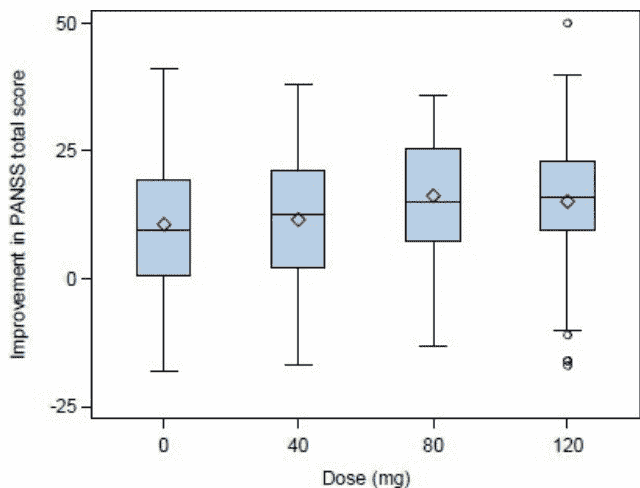

四个试验组基线 `PANSS` 总分的改善。每个试验组的平均改善用菱形表示。

### 4.2.2 案例研究 2 (具有二分类终点的荨麻疹临床试验)

该案例研究基于一项荨麻疹（风疹）治疗的 II 期剂量发现试验。荨麻疹患者被随机分配到安慰剂或四种活性治疗剂量之一：

- 安慰剂
- 剂量 1 (0.5 mg)
- 剂量 2 (0.75 mg)
- 剂量 3 (0.9 mg)
- 剂量 4 (1 mg)

试验采用了平衡设计，每个治疗组有 30 名患者。试验中共有三次基线后随访（访视分别标记为访视 1、访视 2 和访视 3）。试验的主要分析基于荨麻疹严重程度（`HS`）评分，该评分定义为每个患者在电子日记（`eDiary`）中记录的风疹数量。根据 `HS` 评分，患者在每次基线后随访中被分类为响应者或非响应者。

该临床试验的数据包含在 `cs2` 数据集中。数据集中共有 450 条观测值（每个患者、每次基线后随访一条记录）。数据中的六个变量定义如下：

- `Subjid`：患者 ID。
- `Dose`：实验治疗剂量（0, 0.5, 0.75, 0.9, 1）。
- `Visit`：基线后随访（`V1`, `V2`, `V3`）。
- `Time`：基线后随访的数值值（1, 2, 3）。
- `Response`：基于 `HS` 评分的结果（0，无响应；1，有响应；缺失）。
- `Gender`：患者性别。

需要注意的是，某些患者错过了其中一次基线后随访，因此他们的响应状态在那些随访中无法确定。表 4.1 展示了荨麻疹试验中响应情况和错过访视的总结。从表中可以看出，有一名患者错过了访视 1，两名患者错过了访视 2，五名患者错过了最后一次访视。

### 表 4.1 案例研究 2 按试验组和访视划分的结果摘要

| 试验组 | 结果 | 访视 1 | 访视 2 | 访视 3 |
| :--- | :--- | :--- | :--- | :--- |
| 安慰剂 | 缺失 | 1 | 0 | 2 |
| | 无响应 | 12 | 18 | 14 |
| | 有响应 | 17 | 12 | 14 |
| 0.5 mg | 缺失 | 0 | 0 | 2 |
| | 无响应 | 12 | 7 | 13 |
| | 有响应 | 18 | 23 | 15 |
| 0.75 mg | 无响应 | 13 | 15 | 14 |
| | 有响应 | 17 | 15 | 16 |
| 0.9 mg | 缺失 | 0 | 2 | 0 |
| | 无响应 | 10 | 7 | 11 |
| | 有响应 | 20 | 21 | 19 |
| 1 mg | 缺失 | 0 | 0 | 1 |
| | 无响应 | 9 | 11 | 10 |
| | 有响应 | 21 | 19 | 19 |

试验结束时（即访视 3）的响应率总结见图 4.2。该总结是使用简单方法处理缺失观测值创建的，即将错过了最后一次访视的五名患者从分析中移除。如图所示，`HS` 评分的响应率随剂量增加而单调增加。治疗效果在 0.5 mg 和 0.75 mg 时非常小，但在两个最高剂量下显著提高。整体剂量-反应关系遵循逻辑（`logistic`）或 `sigmoid` 曲线，在 0.75 mg 和 0.9 mg 之间有剧增趋势。

### 图 4.2 案例研究 2


访视 3 的响应率随剂量的变化函数。

该数据集的一个重要特征是入组的男性多于女性（女性仅占患者的 40%）。在这种背景下，性别可能具有预测属性，用于预测响应。图 4.3 显示了按性别划分的响应率。图中证明，在男性患者子集中，剂量-反应关系随剂量变化相当单调。相比之下，在女性亚组中，剂量-反应呈现出异常形状。同样，鉴于试验中女性人数较少，得出实验治疗对男性有效的结论可能为时过早。然而，如果赞助者理由相信治疗效果会受性别影响，则该因素需要纳入分析模型中。本案例研究将用于说明具有重复测量和缺失观测试验中的剂量发现方法。第 4.5.1 节将介绍一种基于二分类重复测量模型的寻找合适剂量策略。此外，第 4.5.2 节将讨论存在缺失数据时的剂量发现方法。

### 图 4.3 案例研究 2


按性别的访视 3 响应率随剂量的函数。

## 4.3 剂量-反应评估和剂量发现方法

剂量-反应评估。II 期试验的设计与 III 期试验的设计相似（例如，比较多个剂量与安慰剂）。II 期试验的主要目标是基于剂量相关趋势发现有前景的剂量。由于此原因，全局检验（例如基于对比的检验）在 II 期试验中被广泛用于，以评估剂量范围内的治疗效果。在 II 期试验中，每个剂量与安慰剂的比较可能是不充分的。在 III 期试验中进行分析时，每个剂量被判定为有效或无效。在第 4.3.1 节中，我们将简要讨论剂量发现试验中的成对检验。这些节在 4.3.2 和 4.3.3 节中描述了两种不同的方法：第一种依赖于一组对比系数的对比检验，第二种则对多个对比进行推断。多重检验的讨论将为 4.3.4 节中介绍的基于 `MCP` 程序的更高级剂量发现算法提供基础，并在 4.4 和 4.5 节中进一步阐述。

### 4.3.1 成对检验

我们对 II 期试验中检测剂量相关趋势的统计检验讨论从一种依赖成对比较的简单方法开始。在 4.3.2 和 4.3.3 节中，将与基于对比的检验进行比较。这些节将使用具有 $m+1$ 组（$m$ 个治疗剂量对比安慰剂）的剂量发现试验进行定义，每组 $n$ 名患者。假设主要终点呈正态分布，终点值越大表示改善越好。考虑简单的 `ANOVA` 模型：

$$y_{ij} = \mu_i + \varepsilon_{ij}$$

$y_{ij}$ 是第 $i$ 组第 $j$ 名患者的结果，$i = 0, \dots, m$，$j = 1, \dots, n$。误差项 $\varepsilon_{ij}$ 服从均值为 0、方差为 $\sigma^2$ 的正态分布。

可以在 II 期试验中执行剂量检验以检验零假设：

$$H_i: \mu_0 = \mu_i, \quad i = 1, \dots, m,$$

反对假设为 $m$ 个剂量具有正向治疗效应。

案例 1 中的精神分裂症临床试验可用于说明 $m=3$ 个剂量组的情况（见第 4.2 节）。使用 `SAS/STAT` 中的 `PROC GLM`、`PROC MIXED` 和 `PROC GENMOD` 很容易在该试验中执行剂量-安慰剂比较。程序 4.1 使用 `PROC MIXED` 以基线到第 4 周 `PANSS` 评分改善作为主要终点执行三次剂量-安慰剂检验。每个剂量-安慰剂比较的显著性使用上述简单 `ANOVA` 模型进行评估。此外，使用 `ADJUST` 语句请求来自 `Dunnett` 检验的多重调整。这种调整产生了一组多重调整后的 p 值，基于调整后的 p 值的推断控制了试验的整体 I 类错误率。`Dunnett` 检验是考虑了剂量发现试验中统计量之间正相关性的有效参数检验示例。例如，在平衡设计的剂量发现试验中，已知统计量与共同相关系数 $\rho = 0.5$ 等相关。参见第 5 章关于临床试验中保护整体 I 类错误率常用的多重检验详细讨论。

### 程序 4.1 案例研究 1 中的剂量-安慰剂检验

```
proc mixed data=cs1;
class dose;
model improvement=dose;
lsmeans dose/pdiff adjust=dunnett;
run;
```

程序 4.1 的输出汇总于表 4.2 中。该表列出了各个剂量-安慰剂比较的检验统计量，以及根据中心 t 分布计算的相关双侧 p 值（原始 p 值）。使用双侧 $\alpha = 0.05$ 作为定义统计学显著性的阈值，显然治疗差异仅在 80 mg 处显著（p = 0.0242）。在 120 mg 处检测到统计学显著性的趋势（p = 0.0742）。

### 表 4.2 程序 4.1 输出

| 剂量 | 治疗差异 | 标准误 | 检验 | p 值 |
| --- | --- | --- | --- | --- |
| 40 mg | 0.9167 | 2.5279 | 0.36 | 原始 0.7172 / 调整 0.9683 |
| 80 mg | 5.7333 | 2.5279 | 2.27 | 原始 0.0242 / 调整 0.0633 |
| 120 mg | 4.5333 | 2.5279 | 1.79 | 原始 0.0742 / 调整 0.1800 |

必须记住，对三个剂量-安慰剂比较进行同时分析会导致多重性问题。如果不进行多重性调整，由于 I 类错误率膨胀，推断将不再可靠。为了保持错误率，必须使用表中列出的多重性调整后 p 值进行推断。要使用调整后的 p 值分析治疗效应，需要将每个调整后的 p 值与之前相同的阈值进行比较，即 $\alpha = 0.05$。没有任何一个 `Dunnett` 调整后的 p 值超过该阈值，这意味着在考虑了多重性后，不再有证据表明存在显著治疗效应。

如果该精神分裂症临床试验是一项确认性 III 期试验，表 4.2 所示的结果将导致该试验未能达到其主要终点的结论。然而，如上述强调，剂量发现试验的效能通常不足以支持两两比较。在这种情况下，更合理的方法是建立评估结果变量中剂量相关趋势的检验。这可以通过 4.3.2 节和 4.3.3 节讨论的基于对比的检验来实现。

### 4.3.2 基于对比的检验

第 4.3.1 节中考虑的剂量-安慰剂检验是广义对比检验族的一个特例。两两比较在 II 期试验中往往具有效能的主要原因是，它们关注于个别剂量-安慰剂比较，因此没有利用所有可用信息。通用的基于对比检验通过汇总多个剂量组之间治疗获益的证据来获得效能。这些检验是检测剂量相关趋势的高效工具，并在剂量发现试验中得到了广泛应用。

在具有 $m+1$ 组的临床试验中，剂量-反应对比通过指定一个特定组系数向量（记为 $c_0, \dots, c_m$）来构建。系数的选择使其和为 0，即：

$$\sum_{i=0}^{m} c_i = 0,$$

并且它们通常被标准化以确保：

$$\sum_{i=0}^{m} c_i^2 = 1.$$

给定一组对比系数，对比定义为：

$$c = \sum_{i=0}^{m} c_i \hat{\mu}_i,$$


其中 $\hat{\mu}_0, \dots, \hat{\mu}_m$ 表示 $m+1$ 个试验组的样本平均值。例如，评估第 $i$ 剂量与安慰剂相比效果的检验对应于 $c_0 = -1, c_i = 1$ 且当 $i \neq j$ 时 $c_j = 0$ 的对比。

在基于对比的检验的背景下，所检验的原假设是 $m$ 个试验组间无治疗效应的零假设：

$$H: \sum_{i=0}^{m} c_i \hat{\mu}_i = 0.$$

基于对比的检验被设置为单侧检验，这意味着当对比值很大时，拒绝零假设并支持定义为备择假设：

$$K: \sum_{i=0}^{m} c_i \hat{\mu}_i > 0$$

拒绝零假设提供了试验中存在显著剂量-反应关系的证据。

为了使用所选对比来评估剂量-反应趋势的显著性，通过将对比除以其标准误计算以下 $t$ 统计量，即：

$$t = \frac{\sum_{i=0}^{m} c_i \hat{\mu}_i}{\sqrt{\sum_{i=0}^{m} c_i^2 / n}}$$

该检验统计量遵循 $t$ 分布，例如，在每组 $n$ 个患者的平衡设置下，它具有 $(m+1-1)$ 个自由度的 $t$ 分布。显著的检验统计量解释为治疗疗效的证明。

在简单的 ANOVA 设置下比较广义的对比检验族是有帮助的。对三个剂量-安慰剂比较进行同时分析会导致多重性问题。如果不进行多重性调整，由于 I 类错误率膨胀，推断将不再可靠。为了保持错误率，必须使用表中列出的多重性调整后 p 值进行推断。要使用调整后的 p 值分析治疗效应，需要将每个调整后的 p 值与之前相同的阈值进行比较，即 $\alpha = 0.05$。没有任何一个 Dunnett 调整后的 p 值超过该阈值，这意味着在考虑了多重性后，不再有证据表明存在显著治疗效应。

如果该精神分裂症临床试验是一项确认性 III 期试验，表 4.2 所示的结果将导致该试验未能达到其主要终点的结论。然而，如上述强调，剂量发现试验的效能通常不足以支持两两比较。在这种情况下，更合理的方法是建立评估结果变量中剂量相关趋势的检验。这可以通过 4.3.2 节和 4.3.3 节讨论的基于对比的检验来实现。

| Linear | 5.31 | 0.0221 |
| Modified linear | 4.34 | 0.0384 |

将趋势检验与 F 检验进行比较以检验精神分裂症试验中“无治疗效应”的原假设也是具有启发意义的。在这种情况下，从 ANOVA 模型计算出的 F 统计量等于 2.4。由于分子和分母自由度分别为 3 和 236，双侧 p 值在 0.05 水平上不显著（p=0.0686）。如上述强调的，F 检验是整体检验的一个示例，它没有考虑剂量排序，这导致与基于对比的检验相比其效能有所损失。

## 4.3.3 多对比检验

如 4.3.2 节所示，基于剂量-反应对比的趋势检验在剂量发现试验中优于两两比较。基于对比的检验的一个重要特征是：当剂量-反应函数的形状与对比系数的模式匹配时，它们的效力最大。例如，当底层的剂量-反应函数也是线性的时，上述引入的线性对比趋势检验的效力达到最大。如果违反了线性假设，特别是当剂量-反应是非单调的时，线性对比检验的性能很差。

为了解决基于对比检验的这一局限性，我们可以将依赖单一剂量-反应对比的检验（称为单对比检验）替换为包含多个对比的剂量-反应检验。这些检验被称为多对比检验，如果对剂量-反应函数的形状较少了解，它们会表现出更稳健的性能。

通过多对比检验方法，在剂量发现试验中预定义一组对比。这些对比可以从同一个族（例如 Helmert 对比族）中选择，也可以代表不同族对比的组合。令 $k$ 表示对比的数量，$t_1, \dots, t_k$ 表示特定对比的检验统计量。可以证明检验统计量服从多元 $t$ 分布，重要的是，该分布的相关矩阵在设计阶段是已知的。该矩阵是对比系数和试验各组样本量的简单函数。基于这些统计量可以构建多种检验策略：可以根据第 5 章定义的预设检验序列进行检查，或者备选使用数据驱动的递减检验序列。在这种情况下，检验从最大的统计量开始。如果根据适当的临界值认为显著，则考虑最大的统计量；产生的多重检验实际上是第 5 章将引入的递减 Dunnett 检验的扩展。所得显著对比集为剂量选择决策提供了依据。有关临床应用中多对比检验的更多信息，包括识别有效和安全剂量量的问题，请参见 Julge (1989) 和 Tamhane (2002)。Dmitrienko 等人 (2007) 讨论了 SAS 在剂量发现试验中多对比检验的实现。

## 4.3.4 多重比较建模 (MCP-Mod) 过程

在第 4.3.2 节和 4.3.3 节中引入的基于对比的方法是高效剂量发现算法 MCP-Mod 的基础，MCP-Mod 结合了在早期试验中广泛使用的多重比较程序（MCP）和剂量-反应建模方法。

MCP 过程背后的核心思想是，II 期剂量发现试验的赞助者需要同时考虑剂量-反应模型的不确定性，并保护对剂量-反应得出错误结论的概率（第一类错误率）。在 II 期试验开始时，真实的剂量-反应函数的形状是未知的；剂量发现试验背景下的模型不确定性首次由 Tukey 等人 (1985) 描述。模型不确定性问题在某种程度上可以在基于对比的框架内解决。例如，试验赞助者不必关注一个可能无法代表真实剂量-反应模型的单一对比，而是从一组候选对比开始，并将目标设定为证明至少有一个基于对比的检验产生了显著结果。如 4.3.3 节解释的那样，这种方法已成功用于在 II 期试验中建立多重对比检验。Stewart 和 Julge (2000) 调查了类似的想法，他们研究了双对比程序的性能，以构建一个用于评估剂量-反应趋势的稳健工具。

然而，在基于对比的框架内，强调的是具有适当多重性调整的假设检验方法，但不支持估计方法；例如，无法估计真实剂量-反应模型的函数形式。剂量充其量被视为顺序变量，而不是连续变量。作为这一直接结果，在拒绝了“无治疗”的全局假设并证明实验治疗有效后，并不清楚如何处理估计目标剂量的问题。

为了解决基于对比的检验方法的这一局限性，将估计嵌入建模框架中。通过这种方法，假设检验框架被扩展以提供底层剂量-反应函数和目标剂量的估计。这可以通过利用 4.3.3 节描述的剂量-反应模型与剂量-反应对比之间的关系来实现。从包含历史信息的模型族开始，II 期试验的赞助者可以识别出系数与候选模型形状相同的对比集。执行标准的对比推理，包括评估剂量-反应关系以及通过多重性调整控制错误选择概率选择最相关的对比。在确定了临床相关的对比集后，赞助者可以切换回与所选对比对应的剂量-反应模型，专注于剂量选择问题。这种通用方法最早用于 Bretz, Pinheiro 和 Branson (2005) 定义 MCP-Mod 过程。以来，许多书籍章节和论文都采用了这种方法。引言中提到的 EMA 声明将 MCP-Mod 认为是模型不确定性的 II 期剂量研究设计和分析的合格高效统计方法 (EMA, 2014)。有关通用 MCP-Mod 方法论和相关方法的详细讨论，请参见 Pinheiro, Bretz 和 Branson (2006) 以及 Bretz, Tamhane 和 Pinheiro (2009)。原始程序后来被扩展到多个领域，例如具有二分类终点的剂量发现试验 (Klingenberg, 2009)、通用参数模型 (Pinheiro 等, 2013)、非正态结局变量模型 (Pinheiro, Bretz 和 Bornkamp, 2014)，以及反应自适应设计 (Bornkamp 等, 2011)。

## 基于 MCP-Mod 过程的剂量发现

为了实现上述通用目标，MCP-Mod 过程使用以下剂量发现算法：

- 步骤 1：定义候选剂量-反应模型集。
- 步骤 2：从候选模型导出最优对比。
- 步骤 3：基于最优对比进行剂量-反应检验。
- 步骤 4：选择临床相关的剂量-反应模型。
- 步骤 5：使用最佳剂量-反应模型识别目标剂量或剂量。

我们将首先回顾该算法每一步所采用的统计方法。SAS 工具的详细描述用于剂量确定算法的参数将在本节稍后的部分提供。

考虑一个终点服从正态分布的剂量确定临床试验。使用本节开头介绍的通用设置，假设将 $m$ 种实验性药物与安慰剂进行对比测试。剂量水平用 $d_0, \dots, d_m$ 表示，其中 $d_0$ 对应安慰剂组。为了简单起见，假设该试验采用每组 $n$ 名患者的平衡设计。该设置可以很容易地扩展到具有不平衡设计且结果变量不服从正态分布的临床试验。

## 第 1 步：候选模型

我们首先假设结果变量被建模为剂量的函数，且模型中不包含其他协变量。换句话说，将考虑第 4.3.1 节中引入的单因素方差模型，即：

$Y_{ij} = \mu_i + \varepsilon_{ij}$

其中均值效应 $\mu_i$ 取决于剂量-响应模型 $f(-)$、$d_i$ 以及一个未知参数向量（记为 $\theta$），该向量描述了真实的剂量-响应关系，即：

$\mu_i = f(d_i, \theta)$

与之前一样，$y_{ij}$ 表示第 $i$ 组中第 $j$ 个患者的结果，$i = 0, \dots, m$，$j = 1, \dots, n$，误差项 $\varepsilon_{ij}$ 服从均值为 0、方差为 $\sigma^2$ 的正态分布。具有基线变量项的 ANCOVA 模型一般情况将在第 4.4.2 节中讨论。

将使用一组 $r$ 个候选剂量-响应模型进行剂量确定。通常，候选模型的初始选择是由可用的历史信息驱动的。

候选模型使用假设的剂量-响应函数建立如下：

```
$f(d, \theta) = a + bg(d, \theta_0), (4.1)$
```

其中 $g(\cdot)$ 是剂量-响应函数的标准化形式，$\theta_0$ 表示模型参数的初始值向量或根据剂量-响应关系的预期形状得出的推测值。此外，$a$ 是位置参数，$b$ 是尺度参数。引入标准化形式的原因是，第 2 步中的最优对比仅取决于标准化的剂量-响应模型。

常用的剂量-响应模型列在表 4.4 中所示。很容易看出，当模型被标准化时，模型参数的数量会减少。例如，线性模型的标准化形式中不再剩余任何参数。

## 表 4.4 常用的剂量-响应模型

| 模型 | $f(d, \theta)$ | $g(d, \theta_0)$ |
|---|---|---|
| 线性 | $E_0 + \delta d$ | $d$ |
| 对数线性 | $E_0 + \delta \log(d + c)$ | $\log(d + c)$ |
| Emax | $E_0 + E_{max}d/(ED_{50} + d)$ | $d/(ED_{50} + d)$ |
| 指数 | $E_0 + E_1[\exp(d/\delta)-1]$ | $\exp(d/\delta) - 1$ |
| 逻辑 | $E_0 + E_{max}/(1 + \exp^{ED_{50}/d})$ | $1/(1 + \exp^{ED_{50}/d})$ |
| SigMax | $E_0 + E_{max}d^h/(ED_{50} + d^h)$ | $d^h/(ED_{50} + d^h)$ |
| 二次 | $E_0 + \beta_1 d + \beta_2 d^2$ | $d + \beta_2 d^2/\beta_1$ |
| Beta | $E_0 + E_{max}\beta(\alpha, \beta)(d/D)(1-d/D)^S$ | $\beta(\alpha, \beta)(d/D)(1-d/D)^S$ |

## 第 2 步：最优对比

如本节较早所述，MCP-Mod 程序利用了一个重要的事实：任何剂量-响应模型都对应一个唯一的剂量-响应对比。该对比被定义为在该特定模型下具有最高效能的对比，即拒绝相关的“无效应”零假设概率最高的对比。

为了为模型推导出最优的剂量-响应对比，考虑候选集中的第 $i$ 个模型。找到模型的标准化版本（记为 $g_i(\cdot)$），并在该标准化模型下计算以下预测效应：

$$u_{ij} = g_i(d_j, \theta_0), j = 0, \dots, m.$$

从该公式可知，预测效应是通过使用模型参数的初始值 $(\theta_0)$ 获得的。

使用平衡设计进行说明，通过预测效应向量以非常直接的方法找到最优对比——即对该向量进行中心化处理然后进行归一化。第 $i$ 个模型最优对比的系数定义如下：

$c_{ij} = (u_{ij} - \bar{u}_i) / \sqrt{\sum (u_{il} - \bar{u}_i)^2}, j = 0, \dots, m, \text{ 其中 } \bar{u}_i = \frac{1}{m+1} \sum_{l=0}^m u_{il}$。

一般不平衡设计中寻找最优对比的算法见于 Bretz, Pinheiro and Branson (2005)。

## 第 3 步：剂量-响应测试

如第 2 步所示，为候选集中的 $r$ 个模型中的每一个模型计算最优对比。使用第 4.3.1 节中定义的 $t$ 统计量评估基于特定模型对比的剂量-响应趋势的显著性。这些测试旨在检测是否存在剂量-响应关系，所得测试统计量记为 $t_1, \dots, t_r$。

剂量-响应测试在 MCP-Mod 剂量确定算法中起核心作用，因为有助于识别临床相关的模型集，这些模型随后将用于为确认试验的剂量选择制定建议。该过程的一个重要组成部分是多重性调整，它用于控制错误选择模型的概率。多重性调整在概念上与第 4.3.1 节中使用的 Dunnett 相似，因为它也依赖于参数化的多重比较程序。通过考虑 $r$ 个测试统计量的联合分布，计算出调整后的临界值，从而定义统计学显著性的阈值。

可以证明，在任何模型均无治疗效应的全局零假设下，测试统计量服从自由度 $v$ 和相关矩阵 $R$ 的中心多元 $t$ 分布。这里 $v = N (m + 1)$，$N$ 是试验中的总样本量，$m + 1$ 是试验组数。此外，在候选模型不包含协变量的简单设置中，相关系数在设计阶段已知。假设采用每组 $n$ 名患者的平衡设计，测试统计量 $t_i$ 和 $t_j$ 之间的相关性给出：

$$\rho_{ij} = \frac{\sum_{l=0}^m C_{il}C_{jl}}{\sqrt{\sum_{l=0}^m C_{il}^2 \sum_{l=0}^m C_{jl}^2}}$$

在协变量调整推断一般情况下，多元分布的相关矩阵通过适当方法从通用参数模型中估计，包括极大似然法或广义估计方程（Pinheiro et al., 2013）。

为了推导出多重性调整临界值（记为 $q$），令 $T_1, \dots, T_r$ 表示在全局零假设下具有联合分布的变量。调整后的临界值由下式确定：

$P\{T_1 \ge q \text{ 或 } \dots \text{ 或 } T_r \ge q\} = \alpha.$

注意，左侧项表示在假设没有意义的剂量-响应模型时，错误识别至少一个模型的概率。该错误概率被设置为预定义的的 $\alpha$，例如单侧 $\alpha = 0.025$。由于测试统计量的联合分布已知，可以使用评估多元 $t$ 概率的标准数值程序（例如 Genz 和 Bretz (2002) 的随机蒙特卡洛方法）来计算临界值。

最终的临床相关剂量-响应模型集包含在调整水平下具有显著剂量-响应关系的模型，即 $t_i \ge q, i = 0, \dots, m$。该集合的模型数量记为 $s$。需要强调的是，调整值以及结果模型选择规则取决于候选集中模型参数的初始值。

## 第 4 步：模型选择

使用 $s$ 个临床相关的剂量-响应模型，下一步涉及识别最佳剂量-响应对比。它可以被定义为对应于

- 最大测试统计量
- 最佳信息准则

第一种选择规则仅依赖于反对对比零假设的证据强度，而第二种规则使用每个剂量-响应模型函数形式的信息。该规则可以使用任何流行的信息准则来构建，例如赤池信息准则 (AIC) 或贝叶斯信息准则 (BIC)。对于具有 $p$ 个参数的剂量-响应模型，AIC 和 BIC 定义如下：

```
$AIC = n + n \log 2\pi + n \log(RSS/n) + 2(p + 1)$
```

BIC = n + n \log 2\pi + n \log(RSS/n) + \log(n)(p + 1),

其中 RSS 是残差平方和。值得提到的是修正后的 AIC (AICc)，当样本量较小时，通常推荐使用 AICc，而这在大多数剂量发现试验中都是这种情况。关于这些及相关信息准则的更多信息，可以参考 Claeskens 和 Hjorth (2008)。最佳模型被选择为使预定义信息准则最小化的模型。一旦找到最佳对比，就会估计相应的剂量-响应模型的参数。

尽管基于最大检验统计量或适当的信息准则来关注单一最佳模型是常见做法，但试验的赞助者也可以考虑选择一组两个或多个剂量-响应模型。

## 步骤 5：目标剂量选择

鉴于第 4 步中选出的具有临床相关的剂量-响应模型对数据具有最佳拟合效果，我们可以继续估计目标剂量或感兴趣的剂量。大多数 II 期临床试验的目标是选择最小有效剂量 (MED) 以及待在确证性试验中考察的有效剂量范围。MED 通常定义为确保与安慰剂相比具有临床意义且统计学显著改善的最小剂量（Ruberg, 1995a）。如果 $\Delta$ 表示确定临床相关效应的设定阈值，则真实的 MED 推导为最小剂量 $d$，使得治疗差异（即 $f(d)$ 与 $f(d_0)$ 之间的差异）大于 $\Delta$。这里，$f(d)$ 是剂量 $d$ 处的平均效应，$f(d_0)$ 是所选模型下安慰剂组的平均效应。换句话说，

```
MED = min{d : f(d) > f(d_0) + \Delta}.
```

该推导依赖于真实的剂量-响应函数 $f(d)$，但它很容易扩展到剂量-响应函数未知的情况，以找到估计的最小有效剂量。例如，MED 通常如下进行估计：

$$\text{MED} = \min\{d: \hat{f}(d) > \hat{f}(d_0) + \Delta \text{ and } L(d) > \hat{f}(d_0)\}$$


其中，$\hat{f}(d)$ 是剂量 $\hat{f}(d)$ 处的预测平均响应，$\hat{f}(d_0)$ 是安慰剂组的预测平均响应，$L(d)$ 是在适当覆盖概率下 $f(d)$ 的点置信区间下限。这意味着，在估计的 MED 处，预测的平均治疗差异超过了临床相关阈值，并且，它还具有统计学显著性。此外，可以使用第 4 步识别出的最佳剂量-响应模型来估计对应于最大治疗效应给定比例的剂量，例如，$\text{ED}_{80}$ 剂量是在所选模型下提供 80% 最大效应的剂量。

上述讨论假设在第 4 步结束时确定了一个单一模型来描述试验中的剂量-响应关系。如果选择了多个剂量-响应模型，可以使用模型平均技术来建立一个加权模型，并应用其来估计 MED。用于 MED 估计的模型平均通常通过使用 AIC 或 BIC 等信息准则近似模型权重来完成，如 Pinheiro 等人 (2013) 所建议。假设在第 4 步中确定了 $k$ 个最有前景的剂量-响应模型，并让 $p_1, \dots, p_k$ 表示先验模型概率，这些概率量化了这些模型被认为近似剂量-响应函数的程度。例如，如果在剂量发现试验开始之前认为剂量-响应关系是线性的，则会给线性模型分配较高的先验概率。在没有临床信息可以定义先验模型概率的情况下，假设无信息先验是合理的，即令 $p_1 = \dots = p_k = 1/k$。

令 $\text{IC}_i$ 表示第 $i$ 个模型的适当信息准则的值，$i = 1, \dots, k$。第 $i$ 个模型的权重定义如下：

```
$w_i = \frac{p_i \exp(-IC_i/2)}{\sum_{j=1}^n p_j \exp(-IC_j/2)}$
```

最后，让 MED$_i$ 表示从第 $i$ 个模型计算出的最小有效剂量。从所选剂量-响应模型估计的 MED 是模型特定最小有效剂量的加权和，即：

```
$MED = \sum_{i=1}^k w_i MED_i$
```

值得注意的是，该算法从事后频率主义角度处理模型平均，其中 AIC 或 BIC 准则用于近似模型权重（见 Hoeting 等人，1999）。Raftery (1995) 建议 BIC 是给定所选模型积分似然的简单近似，Buckland 等人 (1997) 则建议从不同角度使用 AIC。此外，Kass 和 Raftery (1995) 讨论了在此背景下 BIC 和 AIC 的相对优势。

## MCP-Mod 程序的实现

MCP-Mod 剂量发现算法的 SAS 实现将在第 4.4 节中使用具有连续终点的案例1 进行说明，并在第 4.5 节中使用具有二分类终点的案例2 进行说明。该实现依赖于以下步骤。从 MCP-Mod 程序的步骤 1 开始，我们需要指定剂量-响应模型。通常情况下，剂量-响应模型可以指定如下：

```
data models;
Linear
LogLinear
Emax
Exponential
Logistic
Quadratic
BetaModel
run;
```

对于每个模型，我们需要指定初始参数。对于线性 和 Log-Linear 模型，这些是截距和斜率。对于 Emax、Exponential 和 Logistic 模型，这些是 $ED_{50}$ 和 $E_{max}$。对于 Quadratic 模型，这些是常数、线性和二次项系数。对于 BetaModel，这些是 $d, p, dMax$ 和 Scal 参数。

指定初始参数后，我们需要将剂量-响应模型拟合到数据。这是使用 SAS 中的广义线性模型 (GLM) 过程完成的对于每个模型，我们计算 AIC 或 BIC 等信息准则。然后使用这些准则计算模型权重。

一旦计算了权重，我们就可以模型特定最小有效剂量的加权和来估计 MED。这是 MCP-Mod 程序的最后一步。

该函数由在区间 [0, S] 上的 beta 分布密度函数的核部分组成。S 参数 (Scal) 的默认值设置为 1.2，这意味着比最大剂量高出 20%。dMax 的初始值（即产生最大效应的剂量）应被定义，以确保 Scal 参数大于 dMax。

只有当相应的模型包含在候选集中时（即在模型数据集中指定了该模型），才需要从候选模型中执行此列表中的某项宏。

为了完成设置，需要调用 `%StartUp` 宏。该宏将创建并填充用于剂量寻找算法的宏变量。

在步骤 2 中，使用以下宏识别最优对比度：

- `RegularOptimalContrasts` 根据不含协变变量的简单候选模型计算最优剂量-反应对比。该宏将通过病例 1 进行演示说明。
- `GeneralizedOptimalContrasts` 根据带有协变变量调整的候选模型计算最优剂量-反应对比。该宏将根据案例研究 2 应用于更复杂的设置。

这两个宏均可用于一般的不平衡设计以及剂量水平间距不均匀的剂量方案。

步骤 3 中的调整值通过调用 `%CriticalValue` 宏计算，该宏支持剂量-反应对比的多重性调整。剩余的两个步骤将使用适当的 SAS 过程执行。详见第 4.4 节和第 4.5 节。

## 4.3.5 总结

本节描述了剂量寻找 II 期试验中常用的几种测试策略。这包括在所有具有多个剂量对照比较的确认性 III 期试验中进行的简单两对比较。两对比较在 II 期试验中往往效能不足，建议改用基于对比的检验。基于对比的检验旨在评估整体的剂量相关趋势。如果其对比系数能够模仿剂量-反应函数的形状，则基于对比的检验表现最好。由于底层的剂量-反应函数未知，因此最合理的方法是考虑多对比检验，该检验依赖于一组预定义的对比，对应一组可能的剂量-反应函数。多对比检验是假设检验框架内剂量-反应分析的稳健工具。

MCP-Mod 程序作为多对比检验的扩展被引入。该程序同时解决了剂量寻找试验中的假设检验和估计两个目标。因此，在该程序中实现的通用方法支持 II 期试验中剂量-反应分析的所有三个组成部分。这包括基于强效对比检验的剂量-反应信号评估；识别估计剂量-反应关系的最佳模型；最后，根据估计的剂量-反应函数确定目标剂量。MCP-Mod 剂量寻找算法将在第 4.4 节和第 4.5 节的案例研究 1 和 2 中说明。这些章节将展示如何在具有多种主要终点和剂量-反应建模策略（包括考虑缺失数据的策略）的临床试验中高效进行剂量-反应分析。

## 4.4 案例研究 1 中的剂量寻找

本案例研究对剂量寻找方法的讨论将依赖于第 4.3.4 节引入的 MCP-Mod 程序。4.4.1 节将侧重于一组不含协变变量的候选模型的简单设置。4.4.2 节将介绍一个考虑包含多个协变变量模型的更具挑战性的案例。

### 4.4.1 基于简单 ANOVA 模型的 MCP-Mod 程序

案例研究 1 中精神症试验的 MCP-Mod 剂量寻找算法的演示将遵循[第 4.3.4 节]定义的五个步骤。

### 步骤 1：候选模型

如[第 4.3.4 节]所述，在 MCP-Mod 框架内探索剂量-反应关系从指定候选剂量-反应模型开始。作为说明，四个模型（线性、对数线性、Emax 和指数）将包含在该临床试验的候选集中。在[第 4.3.4 节]中预期的联合评估是基于一组对应一组可能的剂量-反应函数的预定义对比族。多对比检验是假设检验框架内剂量-反应分析的稳健工具。根据[第 4.3.4 节]结尾定义的规则，4.3 候选集中指定了所研究的剂量水平（0 mg、40 mg、80 mg 和 120 mg）以及每组的患者人数（60 人）。通过调用 `%StartUp` 宏来设置用于后续剂量寻找算法的宏变量。

在将模型参数初始值存储在适当的宏变量后，下一步是推导出最优剂量-反应对比度。程序 4.4 执行 `%RegularOptimalContrasts` 宏，以计算特定模型的对比系数以及相关的相关矩阵。由于候选模型不包含协变变量，因此调用了这一特定的宏。该宏依赖于步骤 1 中创建的宏变量，不需要指定任何参数。

在[第 4.3.4 节]末尾定义的，4.3 候选集中计算模型参数的初始值。如果基于线性或对数线性拟合，不需要初始值，但非线性模型（即 Emax 和指数模型）需要初始值。在[4.3 程序]中，从指数模型开始，$\delta$ 参数控制剂量-反应模型的凸性，$\delta$ 的初始值由 `delta` 宏变量定义，在该程序中设置为 1。最大效应（$E_{max}$）通过 `MaxEff` 宏变量定义在 Emax 模型中。在 Emax 模型中，该变量被设置为 1，或者换句话说，即 100%。为了避免零剂量的问题，需要在对数线性模型中指定偏移量参数 (c)。在本例中，该偏移量参数设置为 0.1，通过调用 `%Emax` 和 `%Exponential` 宏。在两种情况下，相对于安慰剂具有 75% 的改善，这是相对于 PANSS 总分的基线减少。作为结果，两个宏都以 d=100 和 p=0.75 调用。

# 4.3 程序：案例研究 1 中的候选模型

（代码省略）

参数的实际值并不重要，但为了读者的一般信息，Emax 模型中 ED50 参数的估计值为 33.3，而指数模型中的 $\delta$ 参数假设等于 110.4。

### 步骤 2：最优对比

一旦模型参数的初始估计存储在适当的宏变量中，下一步是导出最优剂量-反应对比。程序 4.4 执行 `%RegularOptimalContrasts` 宏，以计算特定模型的对比系数以及相关的系数矩阵。由于候选模型不包含协变变量，因此调用了这一特定的宏。该宏依赖于步骤 1 中创建的宏变量，不需要指定任何参数。

# 4.4 程序：案例研究 1 中的最优对比

（代码省略）

将在 4.4.2 节中展示，在存在基线协变变量的情况下，需要调用 `%GeneralizedOptimalContrasts` 宏来进行剂量寻找。由 `%RegularOptimalContrasts` 宏生成的最优对比系数列于表 4.5 所示。这些系数被保存在 `opcont` 数据集中，以便剂量寻找算法的后续阶段使用。

# 表 4.5 程序 4.4 的输出：特定模型的最优对比系数

| 剂量 | 安慰剂 | 40 mg | 80 mg | 120 mg |
| --- | --- | --- | --- | --- |
| 线性 | -0.671 | -0.224 | 0.224 | 0.671 |
| 对数线性 | -0.807 | -0.005 | 0.307 | 0.505 |
| Emax | -0.831 | 0.061 | 0.323 | 0.448 |
| 指数 | -0.587 | -0.291 | 0.134 | 0.744 |

Program 4.4-all 根据这些对比计算相关矩阵。该矩阵如表 4.6 所示。在 4.3.4 节中提到，该相关矩阵仅依赖于设计参数，例如各个试验组的样本量。由此可以得出，某些对比之间存在强相关性。例如，源于线性模型和 Emax 模型对比之间的相关性超过了 99%。同样，基于线性模型和指数模型的对比之间也存在非常强的相关性。这表明相应的剂量-响应模型形状非常接近，因此，它们可能是冗余的。由 Program 4.4 生成的相关矩阵保存在 `corrmat` 数据集中，将在步骤 3 中使用，为与临床试验中四个最优剂量-响应对比相关的统计量寻找经过多重性调整的临界值。

## 表 4.6 程序 4.4 的输出：最优对比之间的相关性

| | 线性 | 对数线性 | Emax | 指数 |
| --- | --- | --- | --- | --- |
| 线性 | 1.000 | 0.950 | 0.917 | 0.988 |
| 对数线性 | 0.950 | 1.000 | 0.996 | 0.891 |
| Emax | 0.917 | 0.996 | 1.000 | 0.847 |
| 指数 | 0.988 | 0.891 | 0.847 | 1.000 |

值得指出，表 4.5 和表 4.6 中显示的数值保留了三位小数。这种舍入是为了便于展示而是的。然而，在剂量发现算法的后续阶段使用的是原始值。使用舍入后的值代替原始值会对结论产生显著影响，特别是当最优对比存在强相关时。

## 步骤 3：剂量-响应检验

为了评估基于每个最优对比的剂量-响应关系的显著性，Program 4.4 使用 PROC SQL 将每组对比系数保存到宏变量中。例如，`linear_cont` 宏变量代表源自线性模型的一系列最优对比系数。随后，生成的宏变量被传递给 PROC GLM，以对每个剂量-响应对比执行简单的 t 检验。

## 程序 4.5 基于案例研究 1 中最优对比的剂量-响应检验

```
proc sql;
  select Linear into linear_cont separated by ""
from optcont;
  select LogLinear into loglinear_cont separated by ""
from optcont;
  select Emax into emax_cont separated by ""
from optcont;
  select Exponential into exponential_cont separated by ""
from optcont;

proc glm data=csi;
  class dose;
  model improvement=dose;
  Estimate Linear dose &linear_cont;
  Estimate LogLinear dose &loglinear_cont;
  Estimate Emax dose &emax_cont;
  Estimate Exponential dose &exponential_cont;
run;
```

Program 4.5 的输出显示在表 4.7 中。很容易验证此表中列出的检验统计量在单侧 $\alpha = 0.025$ 下均是显著，这是在该案例研究中预定义的。然而，将此解释为真实显著的剂量-响应趋势的证据还时过早了，因为我们还没有考虑到同时研究四个模型所引起的多重性。

## 表 4.7 程序 4.5 的输出

| 模型 | 对比估计 | 标准误差 | 检验满足 |
| --- | --- | --- | --- |
| 线性 | 4.118 | 1.7875 | 2.30 |
| 对数线性 | 4.044 | 1.7875 | 2.26 |
| Emax | 3.938 | 1.7875 | 2.20 |
| 指数 | 3.872 | 1.7875 | 2.17 |

为了选择具有临床意义的剂量-响应模型，即与显著对比相关的模型，需要计算与单侧 $\alpha = 0.025$ 对应的多重性调整临界值。多重性调整后的临界 $t$ 分布通过调用带有以下参数的 `%CriticalValue` 宏来计算：

- `corrmat` 是相关矩阵。
- `nu` 是自由度数量。
- `alpha` 是单侧错误率。

需要注意的是，此宏利用了由 Alan Genz 编写的强大的 `MVT` 函数。该函数使用 Genz 和 Bretz (2002) 开发的方法评估多元 $t$ 概率。在本次临床试验中，多变量 $t$ 分布的相关矩阵通过调用 `%CriticalValue` 宏并带有以下参数进行计算：

- `corrmat` 是相关矩阵。
- `nu` 是自由度数量。
- `alpha` 是单侧错误率。

需要注意的是，此宏利用了 Alan Genz 编写的强大的 `MVT` 函数。该函数使用 Genz 和 Bretz (2002) 开发的方法评估多元 $t$ 概率。在本次临床试验中，多变量 $t$ 分布的相关矩阵通过调用 `%CriticalValue` 宏并带有以下参数进行计算：

- `corrmat` 是相关矩阵。
- `nu` 是自由度数量。
- `alpha` 是单侧错误率。

需要注意的是，此宏利用了 Alan Genz 编写的强大的 `MVT` 函数。该函数使用 Genz 和 Bretz (2002) 开发的方法评估多元 $t$ 概率。在本次临床试验中，多变量 $t$ 分布的相关矩阵通过调用 `%CriticalValue` 宏并带有以下参数进行计算：

- `corrmat` 是相关矩阵。
- `nu` 是自由度数量。
- `alpha` 是单侧错误率。

需要注意的是，此宏利用了 Alan Genz 编写的强大的 `MVT` 函数。该函数使用 Genz 和 Bretz (2002) 开发的方法评估多元 $t$ 概率。在本次临床试验中，多变量 $t$ 分布的相关矩阵通过调用 `%CriticalValue` 宏并带有以下参数进行计算：

- `corrmat` 是相关矩阵。
- `nu` 是自由度数量。
- `alpha` 是单侧错误率。

需要注意的是，此宏利用了 Alan Genz 编写的强大的 `MVT` 函数。该函数使用 Genz 和 Bretz (2002) 开发的方法评估多元 $t$ 概率。在本次临床试验中，多变量 $t$ 分布的相关矩阵通过调用 `%CriticalValue` 宏并带有以下参数进行计算：

- `corrmat` 是相关矩阵。
- `nu` 是自由度数量。
- `alpha` 是单侧错误率。

需要注意的是，此宏利用了 Alan Genz 编写的强大的 `MVT` 函数。该函数使用 Genz 和 Bretz (2002) 开发的方法评估多元 $t$ 概率。在本次临床试验中，多变量 $t$ 分布的相关矩阵通过调用 `%CriticalValue` 宏并带有以下参数进行计算：

- `corrmat` 是相关矩阵。
- `nu` 是自由度数量。
- `alpha` 是单侧错误率。

需要注意的是，此宏利用了 Alan Genz 编写的强大的 `MVT` 函数。该函数使用 Genz 和 Bretz (2002) 开发的方法评估多元 $t$ 概率。在本次临床试验中，多变量 $t$ 分布的相关矩阵通过调用 `%CriticalValue` 宏并带有以下参数进行计算：

- `corrmat` 是相关矩阵。
- `nu` 是自由度数量。
- `alpha` 是单侧错误率。

需要注意的是，此宏利用了 Alan Genz 编写的强大的 `MVT` 函数。该函数使用 Genz 和 Bretz (2002) 开发的方法评估多元 $t$ 概率。在本次临床试验中，多变量 $t$ 分布的相关矩阵通过调用 `%CriticalValue` 宏并带有以下参数进行计算：

- `corrmat` 是相关矩阵。
- `nu` 是自由度数量。
- `alpha` 是单侧错误率。


需要注意的是，此宏利用了 Alan Genz 编写的强大的 `MVT` 函数。该函数使用 Genz 和 Bretz (2002) 开发的方法评估多元 $t$ 概率。在本次临床试验中，多变量 $t$ 分布的相关矩阵通过调用 `%CriticalValue` 宏并带有以下参数进行计算：

- `corrmat` 是相关矩阵。
- `nu` 是自由度数量。
- `alpha` 是单侧错误率。

## 程序 4.6 案例研究 1 中最优对比之间的相关性

| 线性 | 对数线性 | Emax | 指数 |
| --- | --- | --- | --- |
| 线性 | 1.000 | 0.950 | 0.917 | 0.988 |
| 对数线性 | 0.950 | 1.000 | 0.996 | 0.891 |
| Emax | 0.917 | 0.996 | 1.000 | 0.847 |
| 指数 | 0.988 | 0.891 | 0.847 | 1.000 |

值得注意的是，表 4.5 和表 4.6 中显示的数值保留了三位小数。这种舍入是为了便于展示而进行的。然而，在剂量发现算法的后续阶段使用的是原始值。使用舍入后的值代替原始值会对结论产生显著影响，特别是当最优对比存在强相关时。

## 程序 4.6 案例研究 1 中最优对比之间的相关性 (此处省略重复内容)

为了选择具有临床意义的剂量-响应模型，即与显著对比相关的模型，需要计算与单侧 $\alpha = 0.025$ 对应的多重性调整临界值。多重性调整后的临界 $t$ 分布通过调用带有以下参数的 `%CriticalValue` 宏来计算：

- `corrmat` 是相关矩阵。
- `nu` 是自由度数量。
- `alpha` 是单侧错误率。

需要注意的是，此宏利用了 Alan Genz 编写的强大的 `MVT` 函数。该函数使用 Genz 和 Bretz (2002) 开发的方法评估多元 $t$ 概率。在本次临床试验中，多变量 $t$ 分布的相关矩阵通过调用 `%CriticalValue` 宏并带有以下参数进行计算：

（此处省略）

## 程序 4.6 案例研究 1 中具有临床意义的剂量-响应模型

程序 4.6 案例研究 1 中具有临床意义的剂量-响应模型

值。为了实现这一点，将条件

```
where=(Descr='AIC (smaller is better)')
```

需要替换为

```
where=(Descr='BIC (smaller is better)')
```

得到的 AIC 和 BIC 值如表 4.8 所示。该表还显示了在图 4.4 中绘制的剂量-响应模型的参数。

## 表 4.8 基于最优对比的剂量-响应模型

| 模型 | 参数估计 | 统计量 | AIC | BIC |
|---|---|---|---|---|
| 线性 | $E_0 = 10.63, \delta = 0.046$ | 2.30 | 1946.5 | 195 |
| 对数线性 | $E_0 = 4.64, \delta = 2.212$ | 2.26 | 1946.6 | 195 |
| Emax | $E_0 = 10.31, E_{max} = 14.75, ED_{50} = 19.25$ | 2.20 | 1948.2 | 196 |
| 指数 | $E_0 = 10.85, E_1 = 8.3, \delta = 23.89$ | 2.17 | 1948.7 | 196 |

## 图 4.4 案例研究 1


基于最优对比的剂量-响应模型。

如本节开头所示，可以使用基于对比统计量或信息准则的选择规则来确定最佳剂量-响应模型。从依赖最大对比的模型选择规则开始，表 4.8 显示线性对比的统计量（$T_1 = 2.30$）大于其他统计量。这意味着应该选择线性模型作为最佳剂量-响应模型。该选择规则的一个重要局限性是没有考虑到模型参数的数量。例如，如果与 Emax 对比相关的统计量是最显著的，由于 Emax 模型中的参数数量多于线性模型，我们可以认为这可能是过拟合的结果。基于最大对比统计量的简单方法没有包含对参数数量的惩罚。基于信息准则的模型选择规则有助于克服上述方法的局限性。AIC 和 BIC 设计用于考虑模型的复杂度（参数数量），并作为模型选择更可靠的工具。使用任何信息准则，最佳模型对应于准则的最小值。以 AIC 为例，AIC = 1946.5 的线性模型被选为最佳模型。如果考虑 BIC，也会得出相同的结论。然而，通常基于两个准则的规则可能一致，难以判定为数据提供最佳拟合的模型。

## 步骤 5：剂量选择

根据表 4.8 定义的最终剂量-响应模型，我们准备讨论基于数据的剂量选择这一主题。回顾 MCP-Mod 算法的步骤 5，最小有效剂量（MED）定义为与安慰组相比具有临床意义且统计学显著改善的最低剂量。为了估计精神症试验中的这一剂量，我们需要指定由 $\Delta$ 表示的临床相关效应。我们将假设与安慰组相比 PANSS 总分的 5 分是具有意义的，因此 $\Delta = 5$。

程序 4.8 计算了步骤 3 中确定的每个临床相关剂量-响应模型的最小有效剂量。作为一个说明，通过反转函数考虑对数线性模型。由于 MED 与安慰剂之间的治疗差异为 5，我们有：

```
$E_0 + \delta \log(\text{MED} + c) - E_0 + \delta \log(0 + c) = 5.$
```

由该方程得出 $MED = \exp(5/\delta) - c$。类似的方法也适用于其他非线性模型的 MED 估计。此处使用的参数值基于表 4.8 中的估计。

## 程序 4.8 案例研究 1 中从临床相关模型计算的最小有效剂量

```
data LinEstimates_;
  merge LinEstimates(where=(Parameter=))
  MED_Lin=5/Estimate;
  rename AIC=Lin;
run;
proc transpose data=LogEstimates out=LogLin
  var Estimate;
  id Parameter;
run;
data LogEstimates_
  merge LogEstimates_
  MED_LogLin=exp(5/delta)-c;
  rename AIC=LogLin;
run;
proc transpose data=EmaxEstimates out=Emax
  var Estimate;
  id Parameter;
run;
data EmaxEstimates_
  merge EmaxEstimates_
  MED_Emax=5*ED50/(Emax-5);
  rename AIC=Emax;
run;
proc transpose data=ExpEstimates out=Exp
  var Estimate;
  id Parameter;
run;
data ExpEstimates_
  merge ExpEstimates_
  MED_Exp=delta*log(5/delta);
  rename AIC=Exp;
run;
data med;
  merge LinEstimates_ LogEstimates_
  EmaxEstimates_ ExpEstimates_;
  keep AIC_Lin MED_Lin
  AIC_LogLin MED_LogLin
  AIC_Emax MED_Emax
  AIC_Exp MED_Exp;
run;
```

程序 4.8 计算的特定模型最小有效剂量列于表 4.9。如果使用步骤 4 中参数选择线性模型作为最佳剂量-响应模型，则该试验的最终 MED 估计为 108.6 mg。

## 表 4.9 程序 4.8 的输出

| 模型 | MED (mg) |
|---|---|
| 线性 | 108.6 |
| 对数线性 | 103.1 |
| Emax | 100.7 |
| 指数 | 113.1 |

值得注意的是，剂量选择在临床相关模型之间可能是不一致的。例如，如表 4.9 所示，估计 MED 范围从 100.7 mg 到 113.1 mg。为了开发无偏剂量选择策略，建议考虑 MCP-Mod 算法步骤 5 中描述的模型平均方法。该方法通过对适当的信息准则进行平均，获得单一剂量估计。为了实现这一点，需要由 $p_1$ 到 $p_4$ 表示的先验概率来量化支持每个模型的先验信息强度。在这种情况下，将使用无信息先验概率 $p_1 = \dots = p_4 = 0.25$。

此示例将使用 AIC 说明模型平均。首先注意，从计算角度来看，直接应用计算模型权重公式可能不是最优。基于此，线性模型的权重公式为：

```
$w_1 = \frac{p_1 \exp(-IC_1/2)}{\sum_{j=1}^4 p_j \exp(-IC_j/2)}$
```

对于分子，$\exp(-1946.5/2)$ 的值在数学上不为零，但在 SAS 或大多数其他软件包中将被近似为零。解决此问题的简单方法是对公式进行微调，并将第一个模型的权重定义为：

```
$w_1 = \frac{p_1}{\sum_{j=1}^4 p_j \exp(IC_1/2 - IC_j/2)}$
```

使用该公式，基于 AIC 的线性模型权重很容易计算为 $w_1 = 0.379$。其余模型权重以类似的方式计算。程序 4.9 使用程序 4.8 创建的 `med` 数据集基于 AIC 计算特定模型权重。该程序可以很容易修改以使用任何其他信息准则（包括 BIC）。

## 程序 4.9 案例研究 1 中基于 AIC 的特定模型权重

```
data weighted_med;
set med;
p=1/4;
array x(*) AIC_Lin AIC_LogLin AIC_Emax AIC_Exp;
array A(*) A1-A4;
array B(*) B1-B4;
array C(*) C1-C4;
array D(*) D1-D4;
do i=1 to dim(x);
  A(i)=x(i)-x(1);
  B(i)=x(i)-x(2);
  C(i)=x(i)-x(3);
  D(i)=x(i)-x(4);
end;
Wt1=p/(p*(exp(-A1/2) exp(-A2/2) exp(-A3/2) exp(-A4/2)));
Wt2=p/(p*(exp(-B1/2) exp(-B2/2) exp(-B3/2) exp(-B4/2)));
Wt3=p/(p*(exp(-C1/2) exp(-C2/2) exp(-C3/2) exp(-C4/2)));
Wt4=p/(p*(exp(-D1/2) exp(-D2/2) exp(-D3/2) exp(-D4/2)));
weighted_med=Wt1*Wt2*MED_LogLin Wt3*MED_Emax Wt
keep Wt1-Wt4 weighted_med;
run;
```

| 模型 | 模型权重 | |
|---|---|---|
| 线性 (Linear) | AIC 0.379 BIC 0.491 | |
| 对数线性 (LogLinear) | 0.344 0.446 | |
| Emax | 0.154 0.035 | |
| 指数 (Exponential) | 0.123 0.028 | |

程序 4.9 同样基于模型平均法计算了最小有效剂量。该剂量的使用表 4.10 所示的模型特定权重，计算如下：


根据 AIC 计算得出的最小有效剂量（MED）为 106 mg。同样，使用从 BIC 得出的模型权重，MED 也是 106 mg。从加权模型计算出的最优剂量与单一最佳模型（即线性模型）的最优剂量略有不同，后者等于 108.6 mg（见表 4.9）。基于个体剂量-反应模型和加权模型的 MED 信息需要结合临床判断和其他相关信息，用以选择案例研究 1 中实验治疗的 MED。

## 4.4.2 基于 ANCOVA 模型的 MCP-Mod 流程

在第 4.4.1 节中，我们定义了一种基于 MCP-Mod 程序的剂量发现算法，该算法使用了四个单向 ANOVA 模型的简单设置。这些模型不包含任何基线协变量。本节介绍了一个扩展的 MCP-Mod 剂量发现算法，适用于更真实的设置，即预先定义了几个潜在的预后协变量（即可能影响结果变量的协变量）。在一般的临床试验中，考虑能够影响感兴趣的结果变量的协变量是非常重要的。如果忽略这些预后协变量，申办方可能会得出错误的结论。常用的协变量包括结果变量的基线值、性别、疾病严重程度等。在本案例中，我们将考虑一组剂量-反应模型，考虑到两个基线协变量的潜在预后效应：

- 性别
- 基线 PANSS 总分

基于第 4.4.1 节中使用的简单 ANOVA 模型的 MCP-Mod 程序可以很容易扩展到各种更复杂的设置。请参考 Pinheiro 等人 (2013)。下面将展示当候选剂量-反应模型包含协变量时，如何应用剂量发现算法。

## 第 1 步：候选模型

将构建剂量-反应模型，以根据所选协变量调整后 PANSS 总分的改善情况。在这种情况下，应用了广义线性模型方法，并假设主要终点通过参数 $\mu = \mu(d)$ 依赖剂量，即结果变量的分布定义如下：

$y \sim F(x, \nu, \mu(d))$

$x$ 表示协变量向量，$\nu$ 是向量或干扰参数。我们遵循与第 4.4.1 节中定义的 MCP-Mod 剂量发现算法相似的步骤，关注参数 $\mu(d)$、其估计值 $\hat{\mu}(d)$ 以及表示为 $S$ 的 $\mu(d)$ 协方差矩阵。该方法可以基于表 4.4 中列出的任何剂量-反应模型来建立广义的 MCP-Mod 程序。为了说明基于 ANCOVA 模型的剂量发现，本设置中将考虑第 4.4.1 节中使用的四个候选模型（即线性、对数线性、Emax 和指数模型）。

## 第 2 步：最优协变量调整对比

最优协变量调整对比的计算由 `%GeneralizedOptimalContrasts` 宏提供支持。该宏在程序 4.10 中被调用。

### 程序 4.10 案例研究 1 中的最优协变量调整对比

```
proc genmod data=cs1 order=data;
class dose gender subjid;
model improvement=dose gender baseline /link=identity dist
repeated subject=subjid/type=covb;
ods output GEENCOV=S (drop=RowName)
GEEEmpPEst=muHat(where=(Parm= dose)));
run;
* 仅选择参数 2 到 5（剂量效应）
data S(where=(x 5));
set S;
keep x prm2-prm5;
x=_n;
run;
data S;
set S;
drop x;
run;
%GeneralizedOptimalContrasts;
```

程序 4.10 找到了参数 $\mu(d)$ 的估计值（保存在 `muHat` 数据集中）以及其协方差矩阵 `S`。注意，`PROC GENMOD` 计算了带有两个基线协变量的简单线性模型中六个参数的协方差矩阵。这些参数标记为 `Prm2`, `Prm3`, `Prm4`, `Prm5`, `Prm6` 和 `Prm8`，分别对应四个试验组和两个协变量。这个 $6 \times 6$ 的协方差矩阵保存在 `S` 数据集中。由于我们的重点是估计剂量相关效应，通过移除最后两个参数获得协方差矩阵 `S`。所得的协方差矩阵为

$S = \begin{pmatrix} 62.96 & 59.82 & 57.15 & 57.46 \\ 59.82 & 62.85 & 57.09 & 57.41 \\ 57.15 & 57.09 & 57.61 & 54.84 \\ 57.46 & 57.41 & 54.84 & 58.21 \end{pmatrix}$

经过协变量效应调整的最优对比见表 4.11。对比系数可以在由 `%GeneralizedOptimalContrasts` 宏生成的 `optcont` 数据集中找到。

### 表 4.11 程序 4.10 的输出：模型特定的协变量调整最优对比系数

| 剂量 | 安慰剂 | 40 mg | 80 mg | 120 mg |
|---|---|---|---|---|
| 线性 | -0.672 | -0.216 | 0.213 | 0.675 |
| 对数线性 | -0.810 | 0.007 | 0.300 | 0.504 |
| Emax | -0.835 | -0.073 | 0.316 | 0.445 |
| 指数 | -0.585 | -0.285 | 0.121 | 0.749 |

将这些最优对比与不经协变量调整的剂量剂量反应模型的最优对比进行比较很有启发性。比较表 4.5 和表 4.11 中列出的对比系数，我们发现这两个协变量对对比系数的影响很小。

使用协方差矩阵 `S`，程序 4.10 中的 `%GeneralizedOptimalContrasts` 宏计算了协变量调整最优对比的相关矩阵。该矩阵保存在 `corrmat` 数据集中，并在表 4.12 中所示。

### 表 4.12 程序 4.10 的输出：协变量调整对比之间的相关性

| 线性 | 对数线性 | Emax | 指数 |
|---|---|---|---|
| 线性 | 1.000 | 0.947 | 0.913 |
| 对数线性 | 0.947 | 1.000 | 0.996 |
| Emax | 0.913 | 0.996 | 0.987 |
| 指数 | 0.996 | 0.987 | 1.000 |

## 第 3 步：剂量反应检验

为了识别与显著剂量关系相关的对比，使用 GLM 计算了四个最优对比的 t 统计量。在程序 4.5 中，使用了 `PROC SQL` 来创建变量。

### 程序 4.11 案例研究 1 基于最优对比的剂量反应检验


```
proc sql;
select Linear into linear_cont separated by ""
from optcont;
select LogLinear into loglinear_cont separated by ""
from optcont;
select Emax into emax_cont separated by ""
from optcont;
select Exponential into exponential_cont separated by ""
from optcont;

proc glm data=cs1;
class dose gender subjid;
model improvement=dose gender baseline;
Estimate Linear dose &linear_cont;
Estimate LogLinear dose &loglinear_cont;
Estimate Emax dose &emax_cont;
Estimate Exponential dose &exponential_cont;
run;
```

需要指出，基线 PANSS 总分对四周改善的影响非常显著；性别的影响并不显著。正如预期的，初始评分较高的患者在治疗期间可能会获得更大的改善，而基线评分较低的患者通常没有得到改善。程序 4.11 的输出见表 4.13。

### 表 4.13 程序 4.11 的输出

| 模型 | 对比估计 | 标准误差 | 统计量 |
|---|---|---|---|
| 线性 | 5.057 | 1.7767 | 2.85 |
| 对数线性 | 4.908 | 1.7740 | 2.77 |
| Emax | 4.758 | 1.7724 | 2.68 |
| 指数 | 4.768 | 1.7751 | 2.69 |

我们看到表 4.13 中列出的对比检验统计量的量值大于从四个未调整模型计算出的统计量（见表 4.7）。例如，未调整情况中最显著的统计量（2.30）远低于表 4.13 显示的最不显著统计量（2.68）。这种增加是因为候选模型考虑了一个重要预后变量（基线 PANSS 总分）。

程序 4.12 计算多重比较调整后的临界值，从候选集中选择具有临床意义的剂量反应。该临界值通过调用与之前情况相同的宏（`%CriticalValue` 宏）获得。

未调整的剂量效应模型。在程序 4.10 中导出的相关矩阵与另外两个参数一起传递给 `%CriticalValue` 宏。自由度 (`nu`) 的定义如第 4.4.1 节所示，因为它仅取决于试验的总样本量和组数。同样，单侧 I 类错误率 (`alpha`) 再次设置为 0.025。

## 程序 4.12 案例研究 1 中的多重性调整临界值

```sas
%CriticalValue(corr=corrmat, nu=236, alpha=0.0250);
```

调整后的临界值为 2.159。快速回顾表 4.13 中列出的特定模型统计量可以发现，经过多重性调整后，所有统计量都是显著的。因此，所有四个模型都包含在最终的临床相关剂量效应集中。

## 第 4 步：模型选择

在确定了临床相关的剂量效应模型后，需要估计模型参数。如前所述，建议考虑使用拟合所有候选模型（包括线性和非线性模型）的 SAS 过程，以确保使用具有可比性的适当信息准则（例如 `AIC` 或 `BIC`）。我们在程序 4.13 中使用 `PROC NLMIXED` 对基线协变量进行调整，估计了四个选定模型的参数。

## 程序 4.13 案例研究 1 中临床相关协变量调整模型中的参数估计

- 线性模型；

```sas
proc nlmixed data=csl;
eta=e0 delta*dose beta*baseline u;
model improvement normal(eta, s2);
random u normal(0, s2u) subject=subjid;
ods output ParameterEstimates=LinParameterEstimates
FitStatistics=AIC1(rename=(Value=AIC))
where=(Desc= AIC (smaller is better));
```

- 对数线性模型；

```sas
proc nlmixed data=cs1 neta=e0 delta*log(dose12) beta1*baseline;
model improvement normal(eta, s2);
random u normal(0, s2u) subject=subjid;
ods output ParameterEstimates=LogParameterEstimates
FitStatistics=AIC2(rename=(Value=AIC))
where=(Desc= AIC (smaller is better));
```

- Emax 模型；

```sas
proc nlmixed data=cs1;
parms e0=5 emax=15;
y=e0 (emax*dose) / (ED50 dose) beta1*baseline;
model improvement normal(y,exp(s2));
random u normal(0, s2u) subject=subjid;
ods output ParameterEstimates=EmaxParameterEstimates
FitStatistics=AIC3(rename=(Value=AIC))
where=(Desc= AIC (smaller is better));
```

- 指数模型；

```sas
proc nlmixed data=cs1;
parms e0=-15 data=240 e1=10;
y= e0 e1 * (exp(dose/delta)-1) beta1*baseline;
model improvement normal(y,exp(s2));
random u normal(0, s2u) subject=subjid;
ods output ParameterEstimates=ExpParameterEstimates
FitStatistics=AIC4(rename=(Value=AIC))
where=(Desc= AIC (smaller is better));
```

四个模型的估计参数及相关的 `AIC` 值如表 4.14 所示。从表中可以看出，如果选择线性模型来描述精神分裂症临床试验中的剂量效应关系，则信息准则最小。基于最大检验统计量的模型选择规则也确定线性模型为该设定下的最佳模型。

## 表 4.14 基于协变量调整最优对比的剂量效应模型

| 模型 | 参数估计 | 检验统计量 | AIC |
|---|---|---|---|
| 线性模型 | 2.29 $E_0$ 和 $\delta$ | 2.85 | |
| 对数线性模型 | 2.22 $E_0$ 和 $\delta$ | 2.77 | |
| Emax 模型 | 1.11 $E_0$ 和 $E_{max}$ | 2.68 | |
| 指数模型 | 1.69 $E_0$ 和 $\delta$ | 2.69 | |

## 第 5 步：模型选择

多种方法可以基于相关信息准则（例如 `AIC` 或 `BIC`）、最大检验统计量和模型平均来支持剂量选择。这些方法可能会产生一个剂量范围，如果生成的范围太宽，则有助于结合安全因素和其他临床信息以获得所需的剂量。

通过插补法创建了完整数据集，以满足案例研究 1 中的第二个假设。本节将 MCP-Mod 剂量发现算法扩展到具有纵向观测和缺失值的设置。本节将使用 `%GeneralizedOptimalContrasts` 宏来在不平衡设计和剂量间距不均匀的试验中识别最佳剂量-响应对比。

## 4.5.1 基于重复测量模型的 MCP-Mod 流程

作为一个起点，通过忽略缺失的访诊，应用 MCP-Mod 流程在案例研究 2 的荨麻疹临床试验中构建具有纵向观测的剂量-响应模型。在缺失数据的试验中进行剂量发现这一更具挑战性的任务将在第 4.5.2 节中进行考虑。

## Step 1：候选模型

将根据表 4.4 中定义的三个候选模型：线性模型、SigEmax 模型和指数模型，应用 MCP-Mod 流程来表征荨麻疹临床试验中的剂量-响应关系并确定目标剂量。请注意，该试验的主要终点是二分类的（基于荨麻疹严重程度评分的反应），并将应用广义估计方程（GEE）原理来开发广义 MCP-Mod 解决方案。该解决方案使用的核心思想是将剂量-响应模型与预期反应分离，专注于反应分布更具通用性的特征（Pinheiro, Bretz, and Bornkamp, 2014; Mercier et al., 2015）。如下所示，在荨麻疹临床试验中可以使用案例研究 1 中成功使用的相同步骤和通用方法实现 MCP-Mod 剂量发现算法。

本案例研究中剂量发现算法的总体设置由程序 4.14 提供。该程序列出了所选的候选模型以及每个试验组的剂量水平和样本量。为了完成候选模型的规范说明，像以前一样，我们需要讨论模型参数的初始值。基于线性拟合的模型不需要任何起始值，其他两个模型中需要指定初始参数值。对于 SigEmax 模型，剂量和预期概率值对是根据最大治疗效应（即 $E_{max}$）推测的。来自相似临床试验的历史信息表明，0.75 mg 处可能达到 $E_{max}$ 的 60%，0.9 mg 处达到 90%。考虑指数模型时，假设 0.75 mg 剂量预计比安慰剂增加 60% 的率。这些假设被传递给 `%SigEmax` 和 `%Exponential` 宏，以寻找模型参数的初始值。

### PROGRAM 4.14 案例研究 2 中的候选模型


## Step 2：最佳对比

程序 4.15 使用程序 4.14 中 `%StartUp` 宏创建的宏变量中的初始估计和假设，导出与三个候选模型相关的最佳对比。最佳对比系数通过调用 `%GeneralizedOptimalContasts` 宏来计算。

### PROGRAM 4.15 案例研究 2 中的最佳对比

```sas
data models;
input models $20;
datalines;
  Linear
  SigEmax
  Exponential
run;

data dose;
input dose n;
datalines;
  0.00 30
  0.50 30
  0.75 30
  0.90 30
  1.00 30
run;

%let delta=1;
%let offset=0.1;

%let MaxEff=1;
%let scaling_factor=1.2;

%StartUp;

%SigEmax(d1=0.75, p1=0.6, d2=0.9, p2=0.9);
%Exponential(d=0.75, p=0.6);
```

```sas
proc genmod data=cs2 order=data;
  class visit subjid response;
  model response=dose/link=logit dist=bin feint;
  estimate "placebo" dose 1 0 0 0 0 /exp;
  estimate "0.5 mg" dose 0 1 0 0 0 /exp;
  estimate "0.75 mg" dose 0 0 1 0 0 /exp;
  estimate "0.9 mg" dose 0 0 0 1 0 /exp;
  estimate "1 mg" dose 0 0 0 0 1 /exp;
  repeated subject=subjid/type=ind covb;
  ods output GEENCOVs=SmuHat(where=(Parm ne Intercept));
run;
```

```sas
%GeneralizedOptimalContasts;
```

程序 4.15 计算出的最佳对比如表 4.15 所示。此外，最佳对比的相关矩阵如表 4.16 所示。所得三个对比之间存在强相关，所有相关系数均超过 90%。

### TABLE 4.15 模型特定的最佳对比系数

| 剂量 | Placebo | 0.5 mg | 0.75 mg | 0.9 mg | 1 mg |
|---|---|---|---|---|---|
| Linear | -0.802 | -0.144 | 0.175 | 0.320 | 0.4 |
| SigEMax | -0.559 | -0.494 | 0.135 | 0.418 | 0.5 |
| Exponential | -0.709 | -0.264 | 0.085 | 0.330 | 0.5 |

### TABLE 4.16 最佳对比之间的相关性

| | Linear | SigEMax | Exponential |
|---|---|---|---|
| Linear | 1.000 | 0.903 | 0.979 |
| SigEMax | 0.903 | 1.000 | 0.956 |
| Exponential | 0.979 | 0.956 | 1.000 |

## Step 3：剂量-响应检验

为了根据步骤 2 中识别的三个对比评估剂量-响应趋势的强度，程序 4.16 使用 PROC MIXED 拟合重复测量模型并计算每个对比的检验统计量。

### PROGRAM 4.16 案例研究 2 中基于最佳对比的剂量-响应检验

```sas
proc sql;
  select Linear into linear_cont separated by " "
  from optcont;
  select SigEMax into sigemax_cont separated by " "
  from optcont;
  select Exponential into exponential_cont
  from optcont;
quit;

proc mixed data=cs2;
  class visit response;
  model response;
  repeated subject=subjid;
  estimate Linear &linear_cont;
  estimate SigEmax &sigemax_cont;
  estimate Exponential &exponential_cont;
run;
```

程序 4.16 的结果统计量显示在表 4.17 中。在进行多重比较之前，Sig 对比的双侧 p 值大于 0.05，且在任何调整后该模型都是不显著的。显然，该模型在最终的临床模型中将被排除。在调整后趋势是显著的。为了在考虑多重比较背景的情况下确定其他对比是否具有统计学显著性，调用了 `%CriticalValue` 宏。调整后的临界值为 2.130，根据表 4.17，剂量-响应关系是显著的。

### TABLE 4.17 程序 4.16 的输出

| 模型 | 对比估计 | 标准误 | 检验统计量 | p 值 |
|---|---|---|---|---|
| Linear | 0.1224 | 0.051 | 2.35 | 0.019 |
| SigEmax | 0.0978 | 0.051 | 1.89 | 0.060 |
| Exponential | 0.1218 | 0.051 | 2.35 | 0.022 |

## Step 4：模型选择

步骤 3 显示 Linear 和 Exponential 模型都是相关的，程序 4.18 使用 PROC MIXED 拟合这些模型并计算参数信息准则（AIC）。

### PROGRAM 4.18 案例研究 2 中显著模型的参数估计

```sas
* Linear 模型;
proc nlmixed data=cs2;
  parms s2=0.5;
  eta=e0*dose;
  y=(eta + b)*y;
  p = exp(y)/(exp(y));
  model response binomial(1, p);
  random b normal(0,s2) subject=subjid;
  ods output ParameterEstimates=LinEstimates
    FitStatistics=AIC (rename=(Value=AIC))
    where=(Descr = "AIC (smaller is better)");
  predict e0*dose out=LinPrediction;
run;
```

```sas
* Exponential 模型;
proc nlmixed data=cs2;
  bounds e1=e0;
  eta=e0*(exp(dose/delta)-1);
  y=(eta + b) *time;
  p= exp(y)/(1 + exp(y));
  model response binomial(1, p);
  random b normal(0,s2) subject=subjid;
  ods output ParameterEstimates=ExpEstimates
    FitStatistics=AIC (rename=(Value=AIC))
    where=(Descr = "AIC (smaller is better)");
  predict e0*(exp(dose/delta)-1) out=ExpPrediction;
run;
```

自由度为 437。在这种情况下，使用模型平均技术进行 MED 估计可能比关注每个模型导出的 MED 更明智。

### TABLE 4.18 基于最佳对比的剂量-响应模型

| 模型 | 参数估计 | 检验统计量 | AIC |
|---|---|---|---|
| Linear | $E_0 = -0.015, \delta = 0.66$ | 2.35 | 52 |
| Exponential | $E_0 = 0.008, E_1 = 1.0, \delta = 1.91$ | 2.35 | 52 |

## Step 5：目标剂量选择

案例研究 2 中的主要终点是二分类的，作为估计最小有效剂量的关键组成临床相关治疗效应可以定义为以响应率或 logit 尺度表示。假设相对于安慰剂响应率提高 25% 的相对改善是具有临床意义的治疗差异。如果安慰剂组的响应率为 50%，则最小有效剂量（MED）定义为响应率达到 62.5% 的剂量。使用 logit 尺度，安慰剂响应率的 logit 为 `logit(0.5) = 0`，而对应理想效果的响应率 logit 为 `logit(0.625) = 0.5`。通过这两个值之差，logit 尺度上临床接受的改进设置为 $\Delta = 0.5$。

为了说明在该案例研究中基于最终集中两个模型估计 MED 的过程，PROC NMIXED 程序预测了五次试验的响应率及其 logit（结果保存在 `LinPrediction` 和 `ExpPrediction` 数据集中）。预测值见表 4.19。从该表中可以看出，使用剂量-响应模型，在 0.75 mg 和 0.9 mg 之间实现了超过安慰剂 25% 的相对改善。通过简单的逆回归技术找到最小有效剂量，并于表 4.20。

## 表 4.19 预测响应率

| 剂量 (mg) | 线性模型响应率 | 线性模型 Logit 尺度 | 指数模型响应率 | 指数模型 Logit 尺度 |
|---|---|---|---|---|
| 0 | -0.015 | 0.496 | 0.008 | 0.502 |
| 0.5 | 0.315 | 0.578 | 0.308 | 0.576 |
| 0.75 | 0.480 | 0.618 | 0.490 | 0.620 |
| 0.9 | 0.579 | 0.641 | 0.611 | 0.648 |
| 1.0 | 0.645 | 0.656 | 0.697 | 0.668 |

## 表 4.20 模型特定的最小有效剂量

| 模型 | MED (mg) |
|---|---|
| 线性 | 0.76 |
| 指数 | 0.77 |

由于各模型特定的 MED 几乎相同，我们预计基于模型平均的加权目标剂量也将接近 0.77 mg。事实上，在假设 $p_1 = p_2 = 1/2$ 的无信息先验的情况下，通过 AIC 使用表 4.18 所示的准则值计算模型特定权重。很容易检查出 $w_1 = 0.461$ 和 $w_2 = 0.539$。基于两个模型加权平均的最小有效剂量计算如下：

$w_1 \text{MED}_1 + w_2 \text{MED}_2 = 0.77$。

因此，基于 AIC 的模型平均建议 0.77 mg 为案例研究 2 中的最佳剂量。

## 4.5.2 存在缺失观测时的 MCP-Mod 程序

在 4.5.1 节开头已强调，在进行剂量发现时，荨麻疹临床试验中缺失的访访将被简单忽略。然而，忽略缺失观测可能会引入偏差，因为这些观测值可能被归于实验治疗缺乏疗效。在这种情况下，建议在几种相关的插补策略下应用 MCP-Mod 算法进行敏感性评估。在本节中，我们比较了三种不同的插补策略。前两种侧重于通过考虑对缺失观测做出保守和宽松假设的简单插补技术来对算法进行“压力测试”。第三种策略也考虑了“保守插补”的想法，但采用了一种更复杂且符合统计学原理的方法，该方法依赖多重插补来解释缺失数据带来的不确定性。有关临床试验中处理缺失数据的常用方法的更多信息，请参阅第 7 章、O'Kelly 和 Ratitch (2014) 以及 Mallinckrodt 和 Lipovich (2016, Section III)。

### 保守与宽松插补策略

保守插补策略依赖于试验中缺失访访是由疗效引起的假设。为了实施该策略，将荨麻疹试验 `cs2` 数据集中的缺失结果设置为 0，即假设相应患者对治疗无反应（见程序 4.19）。这种插补策略作为无反应者插补，需要一致应用于所有试验以避免偏差。

程序 4.19 执行 `GeneralizedOptimalContrasts` 宏，以从与 4.5.1 节相同的三个候选模型（即线性、SigMax 和指数模型）推导出最佳剂量-响应对比。此分析使用了插补的数据集（`cs2impl` 数据集）。

### 程序 4.19 基于无反应者插补的案例研究 剂量发现

```sas
data cs2impl;
  set cs2;
  if missing(response) then response=0;
run;

proc genmod data=cs2impl order=data;
  class visit dose subjid response;
  model response=dose/link=logit dist=bin point;
  repeated subject=subjid/type=ind covb;
run;
```

执行上述步骤。值得注意的是，虽然我们在实现中使用了仅考虑基线协变量的简单插补模型，但也可以考虑使用每个患者纵向分析所有观测数据的更复杂模型。此外，还可以开发更正式的程序来结合跨样本的与剂量-响应模型相关的对比（contrasts），并构建基于自助法（bootstrap）的最优剂量多重性调整置信区间。

使用第 4.5.1 节开头介绍的通用设置，模式混合模型（pattern-mixture modeling）的执行如下。在应用 MCP-Mod 剂量查找算法之前，需要对 cs2 数据集进行安慰剂插补准备。成功插补程序的关键是确保插补策略能够捕捉数据中所有的内在变异。为了实现这一点，需要多次插补，并且为了确定插补次数，可能需要运行多次直到结果稳定。在这种情况下，为了说明，执行了 100 次插补。

程序 4.21 定义了该插补策略的第一步。回想表4.1，安慰剂组的几个患者错过了随访。如程序所示，首先对结果进行插补。由于主要终点是二元的，因此使用单调逻辑模型（monotone logistic model）来插补缺失的安慰剂结果是合适的。从 cs2 数据集生成的插补数据集由宏变量 `nimpute` 决定，该值设置为 100。结果保存在 `cs2placebo` 数据集中。

### 程序 4.21 案例研究 2 中安慰剂组通过多重插补构建完整数据集

```sas
%global nimpute;
%let nimpute=100;

proc mi data=cs2 out=cs2placebo nimpute=&nimpute seed=123;
  var gender response;
  class gender response;
  where dose=0;
  monotone logistic;
run;
```

程序 4.22 的下一步是复制活性治疗组的结果，并将其与插补的安慰剂结果相结合。假设活性治疗组中的缺失结果不是随机缺失的（MNAR）。建议基于随机缺失（MAR）和完全随机缺失（MCAR）假设进行敏感性分析。然而，选择标准应基于统计学原理。创建插补数据 `cs2imp` 使得活性组中不再有缺失的随访，因为缺失的结果是根据包含重要协变量（性别）的插补模型基于相应的安慰剂结果建模的。注意，PROC 中的 `NIMPUTE` 选项将 100 个副本中的每个插补限制为单次安慰剂插补。因此，程序 4.22 创建了 100 个没有缺失结果 cs2 唯一副本。这些数据集捕捉了活性治疗组中缺失结果的变异，这种变异与安慰剂组的效果一致。

### 程序 4.22 案例研究 2 中使用安慰剂插补的模式混合

```sas
data cs2dose;
  set cs2(where=(dose ne 0));
  do _imputation_=1 to &nimpute;
    output;
  end;
run;
```

```sas
data cs2all;
  set cs2placebo cs2dose;
run;
```

```sas
proc sort data=cs2all;
  by _imputation_ dose subjid visit;
run;
```

```sas
proc mi data=cs2all out=cs2imp3 nimpute=1 seed=123;
  by _imputation;
  var dose gender response;
  class gender response dose;
  mnar model(response/modelobs=(dose="0"));
  monotone logistic(response=gender/descending);
run;
```

程序 4.22 生成的结果存储在 `cs2imp3` 数据集中。表 4.23 提供了 100 个插补数据集的摘要。注意，在任何试验中都没有缺失结果。

通常，PROC MI 之后是 PROC ANALYZE，其中通过对每个插补集应用完全数据分析获得的与协方差矩阵相关的点估计将使用 Rubin 组合规则（Rubin's combination rules）进行汇总。回想每个插补数据集都使用 MCP-Mod 算法进行分析，并根据从所有候选模型中选择的最剂量-响应曲线确定每个数据集中的最佳剂量。然而，在每个插补集中整合模型选择步骤存在一个问题，因为 Rubin 估计量假设每个数据集使用相同模型进行分析，且没有考虑到模型选择步骤。因此，应该在汇总跨插补数据集估计值后进行模型选择。通过平均各个数据集的对比，可以轻松计算出与每个剂量-响应曲线相关的最优对比的汇总点估计。然而，计算相应的“汇总”界值可能具有挑战性。这产生了一个繁杂的问题，即在 100 个插补集的无剂量效应假设下，合并协变量调整检验统计量的相关矩阵，这对于计算候选剂量-响应模型的一组多重性调整界值是必需的。还要注意，Rubin 的汇总推理假设 MAR，而这里的插补实际上是在 MNAR（非随机缺失）下进行的，由于“借用”安慰剂组的插补，我们对 100 个插补集进行了独立评估，正如第 4.5 节所示。

### 表 4.23 100 个插补数据集按活性组划分的结果汇总

| 插补 | 活性组 | 结果 | 随访 1 | 随访 2 | 随访 3 |
|---|---|---|---|---|---|


| 序号 | 处理组 | | | | |
|---|---|---|---|---|---|
| 1 | 安慰剂 | | | | |
| 2 | 安慰剂 | | | | |
| 3 | 安慰剂 | | | | |
| 4 | 安慰剂 | | | | |
| 5 | 安慰剂 | | | | |
| 6 | 安慰剂 | | | | |
| 7 | 安慰剂 | | | | |
| 8 | 安慰剂 | | | | |
| 9 | 安慰剂 | | | | |
| 10 | 安慰剂 | | | | |
| 11 | 安慰剂 | | | | |
| 12 | 安慰剂 | | | | |
| 13 | 安慰剂 | | | | |
| 14 | 安慰剂 | | | | |
| 15 | 安慰剂 | | | | |
| 16 | 安慰剂 | | | | |
| 17 | 安慰剂 | | | | |
| 18 | 安慰剂 | | | | |
| 19 | 安慰剂 | | | | |
| 20 | 安慰剂 | | | | |
| 21 | 安慰剂 | | | | |
| 22 | 安慰剂 | | | | |
| 23 | 安慰剂 | | | | |
| 24 | 安慰剂 | | | | |
| 25 | 安慰剂 | | | | |
| 26 | 安慰剂 | | | | |
| 27 | 安慰剂 | | | | |
| 28 | 安慰剂 | | | | |
| 29 | 安慰剂 | | | | |
| 30 | 安慰剂 | | | | |
| 31 | 安慰剂 | | | | |
| 32 | 安慰剂 | | | | |
| 33 | 安慰剂 | | | | |
| 34 | 安慰剂 | | | | |
| 35 | 安慰剂 | | | | |
| 36 | 安慰剂 | | | | |
| 37 | 安慰剂 | | | | |
| 38 | 安慰剂 | | | | |
| 39 | 安慰剂 | | | | |
| 40 | 安慰剂 | | | | |
| 41 | 安慰剂 | | | | |
| 42 | 安慰剂 | | | | |
| 43 | 安慰剂 | | | | |
| 44 | 安慰剂 | | | | |
| 45 | 安慰剂 | | | | |
| 46 | 安慰剂 | | | | |
| 47 | 安慰剂 | | | | |
| 48 | 安慰剂 | | | | |
| 49 | 安慰剂 | | | | |
| 50 | 安慰剂 | | | | |
| 51 | 安慰剂 | | | | |
| 52 | 安慰剂 | | | | |
| 53 | 安慰剂 | | | | |
| 54 | 安慰剂 | | | | |
| 55 | 安慰剂 | | | | |
| 56 | 安慰剂 | | | | |
| 57 | 安慰剂 | | | | |
| 58 | 安慰剂 | | | | |
| 59 | 安慰剂 | | | | |
| 60 | 安慰剂 | | | | |
| 61 | 安慰剂 | | | | |
| 62 | 安慰剂 | | | | |
| 63 | 安慰剂 | | | | |
| 64 | 安慰剂 | | | | |
| 65 | 安慰剂 | | | | |
| 66 | 安慰剂 | | | | |
| 67 | 安慰剂 | | | | |
| 68 | 安慰剂 | | | | |
| 69 | 安慰剂 | | | | |
| 70 | 安慰剂 | | | | |
| 71 | 安慰剂 | | | | |
| 72 | 安慰剂 | | | | |
| 73 | 安慰剂 | | | | |
| 74 | 安慰剂 | | | | |
| 75 | 安慰剂 | | | | |
| 76 | 安慰剂 | | | | |
| 77 | 安慰剂 | | | | |
| 78 | 安慰剂 | | | | |
| 79 | 安慰剂 | | | | |
| 80 | 安慰剂 | | | | |
| 81 | 安慰剂 | | | | |
| 82 | 安慰剂 | | | | |
| 83 | 安慰剂 | | | | |
| 84 | 安慰剂 | | | | |
| 85 | 安慰剂 | | | | |
| 86 | 安慰剂 | | | | |
| 87 | 安慰剂 | | | | |
| 88 | 安慰剂 | | | | |
| 89 | 安慰剂 | | | | |
| 90 | 安慰剂 | | | | |
| 91 | 安慰剂 | | | | |
| 92 | 安慰剂 | | | | |
| 93 | 安慰剂 | | | | |
| 94 | 安慰剂 | | | | |
| 95 | 安慰剂 | | | | |
| 96 | 安慰剂 | | | | |
| 97 | 安慰剂 | | | | |
| 98 | 安慰剂 | | | | |
| 99 | 安慰剂 | | | | |
| 100 | 安慰剂 | | | | |

## 步骤 1：候选模型

此步骤与第 4.5.1 节中 MCP-Mod 算法的第一步相同，并选择了相同的三个候选模型（线性、SigEmax 和指数模型）。

## 步骤 2：最优对比

初始参数估计存储在适当的宏变量中，并如程序 4.23 所示，为每次插补获取了广义解。这为每个数据集生成了 100 组最优对比及相应的相关矩阵。100 组最优对比存储在 `OptCont` 数据集中，100 组相关矩阵存储在 `CorrelationMat` 数据集中。

```sas
%ImputedGenOptCont (npute=&&npute.);
```

```sas
data OptContr;
  set OptContr_l - OptContr_&npute;
run;
```

```sas
data CorrelationMat;
  set Correlation_Mat_l - Correlation_Mat_&npute;
run;
```

得到的最佳对比结果集如表 4.24 所示。需要注意的是，由于该大型数据集中缺失访视次数较少，特定填补的相关矩阵在四舍五入到第三位小数后均彼此相等。

## 表 4.24 100 个填补数据集中特定模型特定的最佳对比系数

| 填补 | 模型 | 安慰剂 | 0.5 mg | 0.75 mg | 0.9 mg | 1 mg |
|---|---|---|---|---|---|---|
| 1 | 线性 | -0.802 | -0.142 | 0.174 | 0.318 | 0.464 |
| | SigEmax | -0.558 | -0.495 | 0.136 | 0.415 | 0.564 |
| | 指数 | -0.710 | -0.264 | 0.087 | 0.328 | 0.591 |
| 2 | 线性 | -0.802 | -0.142 | 0.171 | 0.326 | 0.464 |
| | SigEmax | -0.560 | -0.492 | 0.131 | 0.425 | 0.564 |
| | 指数 | -0.710 | -0.262 | 0.083 | 0.336 | 0.591 |
| ... | ... | ... | ... | ... | ... | ... |
| 100 | 线性 | -0.803 | -0.141 | 0.172 | 0.322 | 0.464 |
| | SigEmax | -0.561 | -0.492 | 0.133 | 0.420 | 0.564 |
| | 指数 | -0.711 | -0.262 | 0.085 | 0.332 | 0.591 |

## 步骤 3：剂量-响应测试

为了根据填补数据集中的最佳对比进行剂量-响应测试，程序 4.24 使用了 `PROC MIXED` 来拟合候选模型。

## 程序 4.24 案例研究 2 中 100 个填补数据基于最佳对比的剂量-响应测试

```sas
%macro SignificantFit;
%do p=1 %to &impute;
proc sql;
select linear into linear_contr separated by " " 
from optcontr where _imputation_=&p;
select sigemax into sigemax_contr separated by " " 
from optcontr where _imputation_=&p;
select exponential into exponential_contr separated by " " 
from optcontr where _imputation_=&p;

proc mixed data=cs2imp3 order=data method=reml;
where _imputation_=&p;
class dose visit response;
model response=dose;
repeated visit/subject=subjid;
Estimate Linear dose &&Linear_Cont;
Estimate Sigemax dose &&Sigemax_Cont;
Estimate Exponential dose &&Exponential_Cont;
ods output estimates=estimates;
run;

data estimates_&p;
set estimates;
_imputation_=&p;
run;
%end
%mend SignificantFit;

%SignificantFit;
```

```sas
data estimates;
set estimates_1 - estimates_&npute;
run;
```

表 4.25 显示并由程序 4.24 生成的特定对比检验统计量在填补数据集之间显示出一定程度的变异。

## 表 4.25 100 个填补数据集中特定模型测试统计量

| 填补 | 模型 | 对比估计 | 检验统计量 |
|---|---|---|---|
| 1 | 线性 | 0.1278 | 2 |
| | SigEmax | 0.1067 | 2 |
| | 指数 | 0.1274 | 2 |
| 2 | 线性 | 0.1018 | 1 |
| | SigEmax | 0.0806 | 1 |
| | 指数 | 0.1020 | 1 |
| ... | ... | ... | ... |
| 100 | 线性 | 0.1141 | 2 |
| | SigEmax | 0.0912 | 1 |
| | 指数 | 0.1134 | 2 |

但它们往往具有相当的一致性，因为从 SigEmax 模型得出的对比明显不如其他两个对比显著。

每个填补数据集的经多重性调整的临界值在程序 4.25 中得出。该程序调用了 `%CriticalValue` 宏，并将自由度设置为 v = N - m = 450 - 5 = 445。

## 程序 4.25 案例研究 2 中 100 个填补数据中的经多重性调整临界值

```sas
%macro CriticalValue;
%do p=1 %to &impute;
  data correlation_mat(drop= _imputation_);
  set correlationmat;
  where _imputation=&p;
run;

  %CriticalValue(corr=correlation_mat, nu=445, alpha=0.025)

  data critvalue_&p;
  set critvalue;
  _imputation=&p;
run;
%end %mend CriticalValue;

%CriticalValue;

data critvalue;
  set critvalue_1 - critvalue_&impute;
run;

data estimates_cv;
merge estimates critvalue;
by _imputation;
if critvalue then delete;
run;
```

每个经多重性调整的临界值都基于每个填补集的相关矩阵，并且通常预期会有不同的临界值。然而，如上所示，由于矩阵相当相似，在该试验中，调整后的临界值是相同的。通用的调整值为 2.11，基于该值，SigEmax 对比在任何一次填补中均不显著。从线性和指数模型得出的对比在调整水平上是显著的。

## 步骤 4：模型选择

程序 4.26 使用 `MIXED` 拟合剂量-响应模型，并计算每个填补集的模型信息准则 (AIC) 以及参数估计值。

## 程序 4.26 案例研究 2 中 100 个填补数据集中的临床相关模型参数估计

观测结果显示 MED 为 0.77 mg。这些结果具有相当的一致性，为临床决策提供了有用信息，旨在确定在该开发计划的确认性阶段待评估的最小有效剂量。

### 4.5.3 总结

本节介绍了将原始 MCP-Mod 剂量发现算法扩展到具有非正态分布终点的通用设置。该算法可以很容易地扩展到具有二元、计数和事件发生时间终结果的 II 期临床试验。此外，如本节所示，在具有缺失观测值的临床试验中使用的标准敏感性评估，可以应用于剂量发现背景下进行类似的敏感性分析。这包括简单的插补技术（如反应者和非反应者技术）以及更复杂的基于模型的插补方法（例如，模式混合插补）。在系列剂量中应用多种插补方法，这些剂量代表了在对缺失结果的不同假设下可能出的决策。正如全章反复强调的，通过 MCP-Mod 算法在完整数据集设置或缺失观测值设置下识别出的剂量范围，提供了一项有用的指南，需要结合临床判断和其他相关考虑共同使用，为确认性试验的剂量选择决策提供支持。

### 4.6 参考文献

- Abelson, R.P., Tukey, J.W. (1963). Efficient utilization of nonnumerical information in quantitative analysis: General theory and the case of simple order. Annals of Mathematical Statistics 34, 1347-1369.
- Bornkamp, B., Bretz, F., Dmitrienko, A., Enas, G., Gaydos, B., Hsu, C.H., König, F., Krams, Liu, Q., Neuenschwander, B., Parke, T., Pinheiro, J., Roy, A., Sax, R., Shen, F. (2007). Innovative approaches for designing and analyzing adaptive dose-ranging trials. Journal of Biopharmaceutical Statistics 17, 965-995.
- Bornkamp, B., Pinheiro, J., Bretz, F. (2009). MCP-Mod: An R package for the design and analysis of dose-finding studies. Journal of Statistical Software 29, 1-23.
- Bornkamp, B., Bretz, F., Dettete, H., Pinheiro, J. (2011). Response-adaptive dose-finding under model uncertainty. The Annals of Applied Statistics 55, 1611-1631.
- Bretz, F., Pinheiro, J.C., Branson, M. (2005). Combining multiple comparisons and modeling techniques in dose-response studies. Biometrics 61, 738-748.
- Bretz, F., Tamhane, A.C., Pinheiro, J. (2009). Multiple testing in dose response problems. Multiple Testing Problems in Pharmaceutical Statistics. Dmitrienko, A., Tamhane, A.C., Bretz, F. (editors). New York: Chapman and Hall/CRC Press.
- Buckland, S.T., Burnham, K.P., Augustin, N.H. (1997). Model selection: an integral part of inference. Biometrics 53, 275-290.
- Claeskens, G., Hjorth, N.L. (2008). Model Selection and Model Averaging. Cambridge, UK: Cambridge University Press.
- Chuang-Stein, C., Agresti, A. (1997). A review of tests for detecting a monotone dose-response relationship with ordinal response data. Statistics in Medicine 16, 2599-2618.


- Cross, J., Lee, H., Westelinck, A., Nelson, J., Grudzinskas, C., Peck, C. (2002). Postmarketing drug dosage changes of 499 FDA-approved new molecular entities, 1980-1999. *Pharmacoepidemiology and Drug Safety*. 11, 439-446.

- Dmitrienko, A., Fritzsch, K., Hsu, J., Rubberg, S. (2007). Design and analysis of dose-ranging clinical studies. *Pharmaceutical Statistics Using SAS: A Practical Guide*. Dmitrienko, A., Chuang-Stein, C., D’Agostino, R. (editors). Cary, NC: SAS Institute Inc.

- EMA (2014). Qualification opinion of MCP-Mod as an efficient statistical methodology for model-based design and analysis of Phase II finding studies under model uncertainty. Committee for Medicinal Products for Human Use (CHMP). EMA/CHMP/SAWP/75052/2013.

- Genz, A., Bretz, F. (2002). Methods for the computation of multivariate t-probabilities. *Journal of Computational and Graphical Statistics* 11, 950-971.

- Hoeting, J.A., Madigan, D., Raftery, A.E., Volinsky, C.T. (1999). Bayesian model averaging: A tutorial. *Scientific Science* 4, 382-401.

- Kass, R. E., Raftery, A. E. (1995). Bayes factors. *Journal of the American Statistical Association* 90, 773-795.

- Klingenberg, B. (2009). Proof of concept and dose estimation with binary responses under model uncertainty. *Statistics in Medicine* 28, 274-292.

- Mallinckrodt, C., Lipkovich, I. (2016). *Analyzing Longitudinal Clinical Data: A Practical Guide*. New York: Chapman and Hall/CRC.

- Menon, S., Zink, R. (2016). *Clinical Trials Using SAS: Classical, Adaptive and Bayesian Methods*. Cary, NC: SAS Institute Inc.

- Mercier, F., Bornkamp, B., Ohlssen, D., Wallstrom, E. (2015). Characterization of dose-response for count data using a generalized MCP-Mod approach in an adaptive dose-ranging trial. *Pharmaceutical Statistics* 14, 359-367.

- O'Kelly, M., Ratitch, B. (2014). *Clinical Trials with Missing Data: A Guide for Practitioners*. New York: Wiley.

- Pinheiro, J. C., Bornkamp, B., Bretz, F. (2006). Design and analysis of dose finding studies combining multiple comparisons and modeling procedures. *Journal of Biopharmaceutical Statistics* 16, 639-656.

- Pinheiro, J., Bornkamp, B., Bretz, F. (2014). Generalizing the MCP-Mod method beyond normal. *Dose Finding*. Ting, N. (editor). New York: Springer.

- Pinheiro, J., Bornkamp, B., Glimm, E., Bretz, F. (2013). Parametric procedures under model uncertainty. *Statistics in Medicine* 33, 1646-1661.

- Raftery, A.E. (1995). Bayesian model selection in social research. *Sociological Methodology*. Marsden, P. (editor), 111-195. Cambridge, MA: Blackwell.

- Ruberg, S.J. (1989). Contrasts for identifying the minimum dose. *Journal of the American Statistical Association* 84, 816-822.

- Ruberg, S.J. (1995a). Dose response studies. Some design considerations. *Journal of Biopharmaceutical Statistics* 5, 1-14.

- Ruberg, S.J. (1995b). Dose response studies. Analysis and interpretation. *Journal of Biopharmaceutical Statistics* 5, 15-42.

- Scheffe, H. (1959). *The Analysis of Variance*. London, UK: Wiley.

- Stewart, W. H., Ruberg, S. (2000). Detecting dose response with contrasts. *Statistics in Medicine* 19, 913-921.

- Tamhane, A.C., Logan, B.R. (2002). Multiple test procedures identifying the minimum effective and safe doses of a drug. *Journal of the American Statistical Association* 97, 293-301.

- Tukey, J.W., Ciminera, J.L., Heyse, J.F. (1985). Testing the statistical certainty of a response to increasing doses of a drug. *Biometrics* 41, 295-301.

- Williams, D.A. (1971). A test for differences between treatment means when several dose levels are compared with a zero dose control. *Biometrics* 27, 103-117.

- Williams, D.A. (1972). The comparison of several dose levels with a zero dose control. *Biometrics* 28, 519-531.

## 第5章

## 多重调整方法

Thomas Brechenmacher (QuintilesIMS)

Alex Dmitrienko (Mediana)

- 5.1 引言
- 5.2 单步程序
- 5.3 基于数据驱动的假设排序的程序
- 5.4 基于预设假设排序的程序
- 5.5 参数化程序
- 5.6 门控程序
- 5.7 参考文献
- 5.8 附录

本章讨论了处理具有多个临床目标的临床试验中多重性问题的统计策略。它定义了常用的多重调整，包括基础的单步检验方法，以及依赖于数据驱动或预设假设排序的更高级的步进方法。本章还回顾了在高级设置下使用的门控检验策略——例如在支持对新型治疗药物多个剂量下同时评估多个临床终点的试验中。本章介绍的多重调整将通过确认性 III 期临床试验进行说明。

### 5.1 引言

多重性问题在几乎所有后期临床试验中都会出现，因为试验赞助者通常希望基于多个终点的评估来研究多个临床目标，例如，多个剂量-对照比较、在两个或多个患者人群中评估治疗效果等。在这些情况下，试验的总体成功标准是基于多项显著性检验定义的。因此，在名义水平上控制错误地得出新治疗法有效的结论概率（第一类错误率）至关重要，例如，单侧 $\alpha = 0.025$ 或双侧 $\alpha = 0.05$。

以下是临床试验中遇到的多重性问题示例：

1. **多重治疗比较。** 在涉及多个治疗组的临床试验中，经常遇到多重检验。此类情况的示例包括：II 期试验，其目的是评估实验性药物的几个剂量与安慰剂或活性对照组相比的疗效和安全性特征。将实验性药物的不同剂量水平与对照组进行多重比较会导致多重性问题。

2. **多个主要终点。** 多重性也源于用于评估实验性药物有效性或安全性的多个标准。需要这些多个标准来准确描述预期治疗获益的各个方面。例如，心血管药物的疗效特征通常使用多个结局变量进行评估，如全因死亡、非致命性心肌梗死或顽治性心绞痛/紧急血管重建。

3. **多个次要终点。** 公认认为，所有确认性临床试验都必须处理主要分析中的多重性问题。在现代临床试验中，基于关键次要终点做出正式声明越来越理想。因此，还需要对次要统计检验进行适当的多重性调整，以控制总体第一类错误率。例如，在肿瘤临床试验中，通常希望结合无进展生存期和总生存期来描述临床获益。

4. **多个患者人群。** 临床试验的主要分析可以在普通患者人群中进行，也可以在预设的目标亚组中进行。与普通人群患者相比，该亚组中的患者预计可能会获得更大的治疗获益，或更有可能产生反应。这种多人群设计出现在肿瘤临床试验和其他治疗领域。

这些临床试验示例处理的是单一多重性来源或导致第一类错误率膨胀的单一设计特征。在确认性临床试验中，遇到具有多个多重性来源的问题日益常见。这些问题的特征是：考虑了多个导致第一类错误率膨胀的特征。其示例包括在多个剂量或多个患者人群中评估多个终点效果的临床试验。

几份监管指导文件强调了在确认性临床试验中保护第一类错误率的重要性。欧洲药品管理局（EMA）发布了关于临床试验中多重性问题的指南（EMA, 2002）。最近，美国食品药品监督管理局（FDA, 2017）和欧洲药品管理局（EMA, 2017）发布了关于这一通用主题的草案指导文件。这些指南，特别是 FDA 指南，对临床试验中出现的多重性问题以及解决这些问题的统计方法提供了全面的讨论。

### 概述

本章讨论了用于确认性 III 期试验中以解决多重性问题的一大类方法。文献中提出了多种多重性调整方法，以便在具有一个或多个多重性来源的环境中保护第一类错误率。本章描述了常用的多重检验程序（MTPs）及其在 SAS 中的实现。第 5.2 节和 5.3 节讨论了单步 MTP（例如 Bonferroni 程序）以及其改进为数据驱动的步进 MTP（例如 Holm、Hochberg 和 Hommel 程序）。第 5.4 节涵盖了依赖预设假设检验排序的方法，例如固定序列、回退程序和链式程序。第 5.5 节简要回顾了用于多重性调整的参数方法，即 Dunnett 过程及其步进版本。最后，第 5.6 节引入了一类门控程序，这些程序旨在在具有两个或多个多重性来源的临床试验中进行多重性调整，例如在具有多个排序终点和多个剂量-安慰剂比较的试验中。

最近的几篇综述和书籍章节提供了临床试验应用中常用的多重性调整调查。参见 Hochberg and Tamhane (1987)、Hsu (1996)、Dmitrienko et al. (2009)、Bretz et al. (2009)、Westfall and Bretz (2010) 以及 Tamhane (2011)，以获得关于多重比较通用理论和不同类 MTP 的更详细讨论。Westfall et al. (2011) 以及 Dmitrienko and D'Agostino (2013) 提供了带有 SAS 实现示例的 MTP 概述。

本章包含的 SAS 代码和数据集可以在书籍网站获取：`http://support.sas.com/publishing/authors/dmitrienko.html`。

### 族误差率的弱控制和强控制

第一类错误率的概念源于单一假设检验问题。它被定义为假设为真时拒绝该假设的概率。当正在检验多个假设时，第一类错误率的概念可以广义为族误差（FWER），即在所测试假设族中错误地拒绝至少一个真假设的概率。FWER 控制有两种定义：弱控制和强控制。理解意图执行的推断对于选择正确的 FWER 定义和适当的 MTP 至关重要。为了说明，请考虑贯穿第 5.2、5.3 和 5.4 节的以下示例。

### 示例：案例研究 1（高血压剂量试验）

假设进行了一项剂量试验，以比较低剂量、中剂量和高剂量抗高血压药物（标记为 L、M 和 H）与安慰剂（标记为 P）的效果。主要效效变量是收缩压。具有临床意义的收缩压平均下降的剂量将被判定有效。

令 $\mu_P$ 表示安慰剂组收缩压的平均下降。同样，$\mu_L$、$\mu_M$ 和 $\mu_H$ 分别表示低剂量、中剂量和高剂量组收缩压的平均下降。试验中检验以下零假设：

$H_L = {\mu_P - \mu_L \leq \delta\}, H_M = {\mu_P - \mu_M \leq \delta\}, H_H = {\mu_P - \mu_H \leq \delta}$。

其中 $\delta$ 代表相对于安慰剂的临床意义。在优性检验框架下，临床意义设置为 0。

为了测试单个剂量对舒张期血压的影响，我们需要控制无论何种零假设为真、其数量如何，都错误地拒绝任何真实零假设的概率。这被称为族整体错误率（FWER）的**强力控制**。例如，Dunnett (1955) 提出的程序可以用于检验全局零假设，同时提供关于单个剂量与安慰剂比较的信息，即它可以用于检验零假设 $H_L$、$H_M$ 和 $H_H$。Dunnett 过程在预定义的 $\alpha$ 水平下（例如在双侧 $\alpha = 0.05$ 处）从强意义上控制 FWER。假设 $H_L$ 和 $H_M$ 均真实（这意味着 $\mu_P \le \mu_L$ 且 $\mu_P \le \mu_M$），而 $H_H$ 是虚假的（因此 $\mu_P > \mu_H$）。在这种情况下，对 FWER 的强力控制意味着通过 Dunnett 程序错误地拒绝 $H_L$ 或 $H_M$ 的概率将不超过 $\alpha$。

FDA 关于临床试验中多个终点的草案指南（FDA, 2017）强调了 FWER 强力控制在确认性临床试验中的重要性，本章将仅关注在强意义上保持 FWER 的方法。

值得注意的是，文献中还提出了错误决策概率的其他定义。这包括错误发现比例、错误发现率和广义族整体错误率。有关这些定义的更多详尽信息，请参阅 Dmitrienko 等人 (2009)。控制错误发现率或广义族整体错误率的多重检验程序比设计用于保护强意义下 FWER 的程序更具效力，同时也更“宽松”。这些程序仅适用于具有大量零假设的多重性问题，例如大规模遗传学研究。

# 多重检验程序

在过去的 20 到 30 年里，开发了几类多重检验程序（MTPs），它们在临床试验中得到了广泛应用。在特定设定下选择处理多重性的合适方法通常由若干因素驱动，例如可用的临床信息（即关于多重性问题中假设之间的逻辑限制或依赖关系的信息）和统计信息（关于假设检验统计量联合分布的信息）。为了方便审查可用的多重性调整选项，表 5.1 根据临床试验中出现的多重性问题的相关逻辑限制和可用的分布信息，定义了一个基于九类的简单分类方案。

# 表 5.1 常用多重检验程序分类

| 逻辑限制 | 单步法程序 | 数据驱动排序 | 预设排序 |
|---|---|---|---|
| 非参数程序 | Bonferroni | Holm | 固定序列回退 |
| | | | 基于 Bonferroni 的比较 |
| | Simes | Hochberg | NA |
| | Šidák | Hommel | |
| 半参数程序 | | | |
| 参数程序 | Dunnett | 步减式 Dunnett | 参数回退 |

# 逻辑限制

为了提供更多关于临床信息如何在多重性问题中使用的更多信息，表 5.1 显示可以根据逻辑限制定义三类 MTP：依赖于数据驱动排序的单步法程序，以及依赖于预设排序的步进式程序。单步法程序（如 Bonferroni 程序）独立于其他假设检验每个假设。这意味着检验假设的顺序并不重要。相比之下，步进式程序（如 Holm 程序）一次检验一个。结果是，某些假设可能根本不会被检验。步进式程序优于单步法程序的地方在于，它们不会膨胀 FWER。


上述定义的两类步进式程序依赖数据驱动或预设的假设排序来安排感兴趣的零假设。考虑这个例子，申办者可能确定哪种剂量有效可能是挑战性的。在这种情况下，建议考虑基于统计量显著性的数据驱动算法。`Hochberg` 程序是步进式 `MTP` 的示例。另一方面，如果有可靠的信息，考虑固定序列程序等是明智的。

单步法程序将在第 5.2 节中讨论，并通常与数据驱动的假设序列一起使用。注意的是，还有其他类型的 `MTP`，包括基于重抽样的程序。这些程序不对检验统计量的联合分布做任何假设。相反，它们使用自助（`bootstrap`）或置换（`permutation`）方法来估计联合分布。基于重抽样的程序只有在样本量趋于无穷时才能实现 `FWER` 控制。因此，它们不用于确认性临床试验（FDA, 2017）。由于由于原因，本章将不会讨论此类 `MTP`。关于基于重抽样的程序的更多信息，请参阅 `Westfall` 和 `Young` (1993) 以及 `Dmitrienko` 等人 (2009)。

## 5.2 单步法程序

如上述，独立于其他假设检验每个假设的单步法 `MTP` 与依赖顺序检验的步进式 `MTP` 之间存在重要区别。本节关注基础单步法程序，即 `Bonferroni`、`Šidák` 和 `Simes` 调整。需要注意的是，这些程序本身由于缺乏效力（`power`）可能没有太大意义。但正如第 5.3 节和 5.4 节所示，它们为定义更高效的程序提供了基础。

本节及后续章节将使用以下符号。假设我们计划对一组记为 $H_1, \dots, H_m$ 的零假设族进行 $m$ 次显著性检验。全局零假设定义为 $H_1, \dots, H_m$ 的交集，即：

$$H_1 \cap H_2 \cap \dots \cap H_m$$

### 5.2.1 Bonferroni 和 Šidák 方法

`Bonferroni` 和 `Šidák` 过程分别作为基本非参数和半参数多重性调整方法的示例。这些方法存在于大量的 `SAS` 过程中过程中（例如 `PROC GLM`、`PROC MIXED` 和 `PROC MULTTEST`），并使用了简单的规则。`Bonferroni` 过程在 $p_i \le \alpha /m$ 时拒绝 $H_i$，而 `Šidák` 过程在 $p_i \le 1 - (1 - \alpha)^{1/m}$ 时拒绝 $H_i$，其中 $i = 1, \dots, m$。这两种过程的个别调整后 $p$ 值给出的：

```
$\tilde{p}_i = mp_i$ (Bonferroni), $\tilde{p}_i = 1 - (1 - p_i)^m$ (Šidák), $i = 1, \dots, m$.
```

利用 `Bonferroni` 不等式，很容易证明 `Bonferroni` 过程是一种非参数过程，对于任何原始 $p$ 值的联合分布，它在强意义上控制族两错误率（`FWER`）。`Šidák` 过程是一种半参数过程，在额外的分布假设下保持 `FWER`。`Šidák` (1967) 证明了如果假设检验统计量是独立的或服从多元正态分布，则 `FWER` 能够得以保持。`Holland` 和 `Copenhagen` (1987) 描述了 `Šidák` 过程控制 `FWER` 的广泛假设，例如当检验统计量服从多元 $t$ 分布和某些其他分布时。

`Bonferroni` 和 `Šidák` 过程也可用于测试效应的全局零假设。当任何一个个别零假设被拒绝时，全局假设就会被拒绝。这意味着当至少有一个 $i = 1, \dots, m$ 满足 $p_i \le \alpha /m$ 时，`Bonferroni` 全局检验会拒绝全局假设。同样，当至少有一个 $i = 1, \dots, m$ 满足 $p_i \le 1 - (1 - \alpha)^{1/m}$ 时，`Šidák` 全局检验会拒绝全局假设。

与 `Bonferroni` 全局检验和 `Šidák` 全局检验相关的调整后 $p$ 值如下：

```
$\tilde{p}_B = \min(p_1, \dots, p_m)$ (Bonferroni),
$\tilde{p}_S = 1 - (1 - \min(p_1, \dots, p_m))^m$ (Šidák).
```

换句话说，`Bonferroni` 全局检验和 `Šidák` 全局检验分别在 $\bar{p}_B \leq \alpha$ 和 $\bar{p}_S \leq \alpha$ 时拒绝全局零假设。尽管这并不显而易见，但 `Bonferroni` 和 `Šidák` 全局检验比相应的多重比较（`MTPs`）更重要。第 5.3 节将证明，使用这些检验，我们可以构建出一致优于 `Bonferroni` 和 `Šidák` 过程的闭合检验过程。

很容易证明 `Šidák` 校正在性上优于 `Bonferroni` 校正（`Hsu`, 1996, 第 1.3.5 ）。当原始 $p$ 值较小时，这两种校正之间的差异相当。众周知，当个别检验统计量高度相关时，这两个过程是非常保守的。`Bonferroni` 和 `Šidák` 过程生成的调整后 $p$ 值远比维持 `FWER` 在所需水平上所需的数值要大。

为了提供说明，考虑案例 1。回想 $\mu P$ 表示安慰剂组收缩压的平均减少量，而 $\mu L, \mu M$ 和 $\mu H$ 分别表示低剂量、中剂量和高剂量组收缩压的平均减少量。$\mu L, \mu M$ 和 $\mu H$ 的负值表示收缩压的改善。试验中要测试的各剂量与安慰剂之间无差异的三个零假设在第 5.1 节中定义（假设标记为 $H_L, H_M$ 和 $H_H$）。使用双样本 $t$ 检验比较均值。表 5.2 显示了在四种情景三种剂量-安慰剂检验生成的双侧 $p$ 值。

## 表 5.2 案例研究1 中的剂量-安慰剂比较

| 比较 | L vs P | M vs P | H vs P |
|---|---|---|---|
| 情景 1 | $p_L = 0.047$ | $p_M = 0.0167$ | $p_H = 0.01$ |
| 情景 2 | $p_L = 0.047$ | $p_M = 0.027$ | $p_H = 0.01$ |
| 情景 3 | $p_L = 0.053$ | $p_M = 0.026$ | $p_H = 0.01$ |
| 情景 4 | $p_L = 0.022$ | $p_M = 0.026$ | $p_H = 0.01$ |

**程序 5.1** 计算了在情景 1 下由 `Bonferroni` 和 `Šidák` 过程产生的调整后 p 值。通过 `PROC MULTTEST` 中的 `BONFERRONI` 和 `SIDAK` 选项请求这两种过程。

## 程序 5.1 案例研究1 中的 Bonferroni 和 Šidák 过程

```sas
data antihyp;
    input test $ raw_p ;
    datalines;
    L 0.047
    M 0.0167
    H 0.01
run;

proc multtest data=antihyp bonferroni sidak out=adjp;
run;

proc sgplot data=adjp;
    series x=test y=raw_p / marker=dot;
    series x=test y=bonferroni / marker=circle pattern=solid;
    series x=test y=sidak / marker=triangle pattern=solid;
    refline 0.05 / pattern=dashed;
    yaxis="双侧 p 值";
    xaxis="剂量";
run;
```

程序 5.1 的结果如图 5.1 所示。该图显示了由 `Bonferroni` 和 `Šidák` 过程产生的 p 值原始 p 值（点），`Bonferroni` 调整后 p 值（圆圈），以及 `Šidák` 调整后 p 值（三角形）。图显示所有剂量-安慰剂比较在 5% 水平上都是显著的，但只有高剂量是如此。`Šidák` 调整后 p 值始终小于 `Bonferroni`。然而，差异非常小。中剂量的 `Šidák` 调整后 p 值边缘显著（p=0.045），而 `Bonferroni` 调整后 p 值略大于0.05。

尽管 `Bonferroni` 调整具有保守性，但文献表明 `Bonferroni` 方法无法改进（`Hommel`, 1983）。我们可以找到相当特殊的 $p$ 值分布使得 `Bonferroni` 取等式。因此，无法构建一个一致优于 `Bonferroni` 过程的单步 `MTP`。改进 `Bonferroni` 方法唯一的方法是对 $p$ 值的联合分布做出额外假设。本节将给出依赖某些假设的 `MTP` 示例。

### 5.2.2 Simes 方法

与 `Bonferroni` 和 `Šidák` 方法不同，`Simes` 方法可测试全局假设。我们将在第 5.3 节说明 `Simes` 方法可以扩展到对个别零假设进行推断，并演示如何使用宏执行扩展过程。

`Simes` 方法与 `Rüger` (1978) 提出的方法密切相关。`Rüger` 注意到 `Bonferroni` 全局检验可以写成：

如果 $p_{(1)} \le \alpha/m$，则拒绝全局假设 $H_1 \cap H_2 \cap \dots \cap H_m$，

并且利用样本的信息有限。它依赖于最显著的 $p$ 值而忽略了其他 $p$ 值。`Rüger` 描述了一个基于排序 $p$ 值 $p_{(1)}, \dots, p_{(m)}$ 的广义 `Bonferroni` 全局检验族。他证明可以使用以下任意一种测试全局假设：

$p_{(1)} \le \alpha/m, p_{(2)} \le 2\alpha/m, p_{(3)} \le 3\alpha/m, \dots, p_{(m)} \le \alpha$。

例如，只要我们预先指定使用哪些检验，就可以通过比较 $p_{(2)}$ 和 $2\alpha/m$ 来测试全局假设。`Rüger` 的任何一个全局检验在任意依赖结构下都控制 `FWER`。然而，每个检验都面临与 `Bonferroni` 全局检验相同的问题：每个个别检验仅基于单个 p 值。

`Simes` (1986) 开发了一种结合来自 $m$ 个单独检验信息的统计程序。当至少存在一个 $i=1, \dots, m$ 使得 $p_{(i)} \le \alpha/m$ 时，`Simes` 全局检验拒绝全局零假设。

`Simes` 证明了他的全局检验在某种意义上是精确的，即当 $p_1, \dots, p_m$ 独立时，其规模水平等于 $\alpha$。与该检验相关的全局假设的调整 p 值等于：

$$\tilde{pSIM} = m \min(p_{(1)}/1, p_{(2)}/2, \dots, p_{(m)}/m)$$

由于 $\widetilde{B} = mp_{(1)}$，显然 $\tilde{pSIM} \le \widetilde{B}$。因此，`Simes` 全局检验在功效上一致优于 `Bonferroni` 检验。

`Simes` 检验通过假设单个 p 值相互独立来获得更高的功效。自然地，这一假设在临床应用中很少能满足。如果 p 值存在性会怎样？`Sarkar` 和 `Chang` (1997) 以及 `Sarkar` (1998) 最初为具有正相关性和二阶多元全正性特征的多变量分布族建立了对族错误发现错误率（`FWER`）的强控制。最近，`Sarkar` (2008) 证明，如果检验统计量遵循任何两两相关系数非负的多元正态分布，`Simes` 全局检验就能保持 `FWER`。这种情况包括例如，案例研究 1 中的剂量发现高血压试验，其的检验统计量是正相关的，因为它们源于三个治疗组与共同对照组的比较。如果将 `Simes` 全局检验应用于检验统计量负相关的多重性问题，`FWER` 可能会膨胀。

### 5.2.3 总结

本节描述了简单的多重性调整策略，称为单步程序，它独立于其他假设来检验每个感兴趣的零假设。因此，检验零假设的顺序变得不再重要。单步多重检验程序（`MTPs`）非常容易实现，并在临床应用中广受欢迎。

本节讨论了以下三种单步 `MTP`：

- `Bonferroni` 程序控制任何边缘 p 值的联合分布的 `FWER`，但众所周知它是相当保守的。尽管 `Bonferroni` 方法具有保守性，但没有一种单步 `MTP` 在功效上一致优于 `Bonferroni` 程序。只有当我们愿意对感兴趣的零假设相关的 p 值联合分布做出额外假设时，才能构建出功效更高的 `MTP`。

- `Šidák` 程序在功效上一致优于 `Bonferroni` 程序。然而，其规模取决于边缘 p 值的联合分布，并可能超过标称水平。当检验统计量独立或遵循多元正态分布时，`Šidák` 程序控制 `FWER`。在案例研究 1 以及一般的多重性问题中，`Šidák` 程序相比 `Bonferroni` 程序提供了相当微小的改进。`Šidák` 程序及相关的 `MTP` 将不再在本章中进一步讨论。

- `Simes` 检验只能用于检验全局零假设。`Simes` 全局检验的功效比 `Bonferroni` 全局检验高，但并不总是保持 `FWER`。当单个检验统计量遵循任何具有非负系数的多元正态分布时，其规模已知不大于标称水平。正如第 5.3 节所示，`Simes` 全局检验在定义用于解决确认性临床试验中多重性的强基于 `Simes` 的步进程序方面起着核心作用。

基于 `Bonferroni` 和 `Šidák` 程序的多重性调整在 `PROC MULTTEST` 中实现，也适用于其他 `SAS` 程序，例如 `PROC GLM` 和 `PROC MIXED`。

## 5.3 基于数据驱动的假设排序的程序

本节将介绍以步进方式检验零假设的 `MTP`，而不是第 5.2 节介绍的单步方法。检验序列不是*先验*指定的，假设是根据假设检验统计量的显著性（或等价的 p 值）决定的顺序进行检验的。

这些步进程序基于一个基本原理，即*封闭原理*（*closure principle*），该原理由 `Marcus` 等人 (1976) 提出，从那时起许多多重检验方法提供了数学基础。使用该原理构建的 `MTP` 是闭式检验程序（`closed testing procedures`）。毫不夸张地说，几乎所有的 `MTP` 要不是使用该原理推导出来的，就是可以重写为闭式检验程序。事实上，`Liu` (1996) 证明任何基于边缘 p 值的单步或步进 `MTP` 都可以制定为闭式检验程序。这意味着我们总可以构建出一个功效至少不低于任何单步或步进 `MTP` 的闭式检验程序。关于封闭原理的更多信息见下文，也可以参考 `Dmitrienko` 等人 (2009)。

### 5.3.1 封闭原理

封闭原理基于多重性问题的层级表示。为了说明，考虑案例研究 1 中剂量发现高血压试验中的三个零假设 $H_L, H_M$ 和 $H_H$。将封闭原理应用于此多重性问题，我们需要构建所谓的三个原始假设的“封闭族”。在涉及 $m$ 个零假设的一般多重性问题中，封闭族由所有可能的交集组成。在示例中，封闭族将包含 $2^m - 1$ 个交集假设：

- 三个原始假设：$H_L, H_M$ 和 $H_H$。
- 三个包含两个假设的交集假设：$H_L \cap H_M, H_L \cap H_H$ 和 $H_M \cap H_H$。
- 一个包含三个假设的交集假设：$H_L \cap H_M \cap H_H$。

下一步是连接交集假设。这些连接被称为*蕴含关系*（*implication relationships*）。包含另一个的假设被称为蕴含它。例如，$H_L \cap H_M \cap H_H$ 蕴含 $H_L \cap H_M$。通常，蕴含关系使用类似于图 5.2 的图来显示。图中每个框代表封闭族中的一个假设，并与其蕴含的框连接。请注意，$H_{LMH}$ 表示 $H_L \cap H_M \cap H_H$，$H_{LM}$ 表示 $H_L \cap H_M$，以此此类推。顶部的假设是三个原始假设的交集。因此，它蕴含 $H_{LM}, H_{LH}$ 和 $H_{MH}$。同样，第二层的三个框连接到原始假设 $H_L, H_M$ 和 $H_H$。或者，我们可以列出封闭族中所有交集假设的列表（表 5.3）。

## 图 5.2 案例研究 1

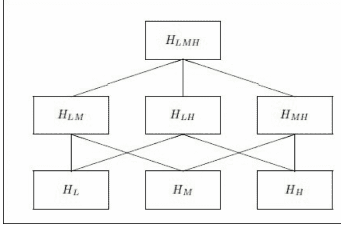

案例研究 1 中高血压试验零假设封闭族的蕴含关系。此图中每个框代表封闭族中的一个假设，并与其蕴含的框连接。

### 表 5.3 蕴含原始假设的交集假设

| 原始假设 | 蕴含该原始假设的交集假设 |
|---|---|
| $H_L$ | $H_L, H_{LM}, H_{LH}, H_{LM}$ |
| $H_M$ | $H_M, H_{MH}, H_{LMH}$ |
| $H_H$ | $H_M, H_{LM}, H_{MH}, H_{LMH}$ |

**封闭原理。** 使用合适的 $\alpha$ 水平显著性检验检验封闭族中的每个假设，并在假设水平上控制错误率。如果一个假设相关的检验以及所有蕴含该假设的假设相关的检验都是的，则拒绝该假设。

根据闭合原理（`closure principle`），为了拒绝表 5.3 左列中的任何一个原始零假设，我们需要检验并拒绝右列所示的所有相关交集假设。如果任何交集假设被接受，则其隐含的所有假设都被接受，无需进行检验。

只要显著性检验的大小不超过假设水平，就可以使用任何有效的显著性检验来检验闭合族中的交集假设。如果检验统计量是独立的，我们可以进行全局 F 检验；如果不是独立的，则进行 `Bonferroni` 全局检验。这些检验中的每一个都将产生不同的闭合检验程序。然而，正如 `Marcus` 等人 (1976) 所示，只要使用 $\alpha$ 水平检验来检验每个假设，任何基于闭合原理的多重检验程序（`MTP`）都能在强意义上控制族性错误率（`FWER`）。

闭合原理为统计学家解决多重性问题提供了一个非常强大的工具。闭合检验程序的主要缺点是，通常很难（甚至不可能）为感兴趣的参数构建相关的置信区间。文献中也还引入了其他用于 `MTP` 的原理，例如划分原理（`Stefansson` et al., 1988; `Finner` and `Strasser`, 2002）。划分原理可以用于定义与 `MTP` 相关的同时置信集（`Hsu` and `Berger`, 1999），并已应用于临床试验中出现的更复杂的多重性问题（`Liu` and 2009）。另一个重要原理是序贯原理（`Goeman` and `Solari`, 2010），它为 `MTP` 提供了不同的理论视角并强调序贯检验算法。


## 5.3.2 决策矩阵算法

在本小节中，我们将介绍用于实现闭合检验程序的决策矩阵算法。该算法简化了决策过程。根据 Bonferroni 不等式，Bonferroni 全局检验的大小不超过 $\alpha$。这意味着我们为闭合族中的每个假设都构建了一个 $\alpha$ 水平的检验族。因此，应用闭合原理为原始假设 $H_L, H_M$ 和 $H_H$ 产生一个 MTP，该程序在强意义上保护了 FWER。

考虑案例 1 中检验的零假设。表 5.4 展示了 Holm 程序的决策矩阵。它总结了计算调整后 $p$ 值的算法，记为 $p_{LM}, p_{LH}, p_{MH}, p_L, p_M, p_H$。表 5.4 有 7 行，每行对应一个单一交集假设。对于这些交集假设中的每一个，表格的右面板识别了隐含的假设，中间面板显示了计算相关 $p$ 值的公式。

### 表 5.4 Holm 程序的决策矩阵

| 交集假设 | p 值 | 隐含假设 | |
| :--- | :--- | :--- | :--- |
| | $H_L$ | $H_M$ | $H_H$ |
| $H_{LMH}$ | $3 \min(p_L, p_M, p_H)$ | $p_{LM}$ | $p_{LM}$ |
| $H_{LM}$ | $2 \min(p_L, p_M)$ | $p_L$ | $p_L$ |
| $H_{LH}$ | $2 \min(p_L, p_H)$ | $LH$ | $0$ |
| $H_L$ | $p_L$ | $p_L$ | $0$ |
| $H_{MH}$ | $2 \min(p_M, p_H)$ | $0$ | $p_{MH}$ |
| $H_M$ | $p_M$ | $0$ | $p_M$ |
| $H_H$ | $p_H$ | $0$ | $0$ |

为了对三个原始假设进行推断，我们首先计算这些 p 值并填充表格的右面板。Westfall 和 Young (1993) 指出，每个原始假设的调整后 p 值等于与其隐含的交集假设相关的最大的 p 值。这意味着我们可以通过计算右面板对应列中最大的 p 值来获得 $H_L, H_M$ 和 $H_H$ 的调整后 p 值。例如，低剂量与对照组的调整后 p 值等于 $\max(p_{LM}, p_{LH}, p_{MH})$。

程序 5.2 基于与表 5.2 中场景 1 对应的双侧原始 p 值，使用决策矩阵算法计算 Holm 调整 p 值。

### 程序 5.2 案例 1 中的 Holm 程序（决策矩阵法）

```sas
proc iml;
  use antihypl;
  read all {raw_p} into p;
  h=j(7,3,0);
  decision_matrix=j(7,3,0);
  adjusted_p=j(1,3,0);
  do i=1 to 3;
    do j=0 to 6;
      k=floor(j/2**(3-i));
      if k/2=floor(k/2) then h[j,i]=1;
    end;
  end;
  do i=1 to 7;
    decision_matrix[i,]=h[i,]*min(p[h[i,]]);
  end;
  do i=1 to 3;
    adjusted_p[i]=max(decision_matrix[i,]);
  end;

  title=("L vs P", "M vs P", "H vs P");
  print decision_matrix colname=title;
  print adjusted_p colname=title;
quit;
```

#### 程序 5.2 的输出

**DECISION_MATRIX**

| L vs P | M vs P | H vs P |
| :--- | :--- | :--- |
| 0.045 | 0.045 | 0.045 |
| 0.0334 | 0.0334 | 0 |
| 0.03 | 0 | 0.03 |
| 0.047 | 0 | 0.03 |
| 0 | 0.03 | 0 |
| 0 | 0.0167 | 0 |
| 0 | 0 | 0.015 |

**ADJUSTED_P**

| L vs P | M vs P | H vs P |
| :--- | :--- | :--- |
| 0.047 | 0.045 | 0.045 |

输出 5.2 中的 `DECISION_MATRIX` 表代表了表 5.4 的右面板，作为可视化闭合检验程序背后决策过程的有用工具。如前所述，$H_L, H_M$ 和 $H_H$ 的调整后 p 值可以通过计算对应列中最大的 p 值获得。计算出的 p 值位于输出 5.2 的底部。

### 5.3.3 序贯程序

在某些情况下，决策矩阵算法可以显著简化。在这些情况下，显著性检验可以以直接的方式进行。根据 Bonferroni 不等式，Bonferroni 全局检验的大小不超过 $\alpha$。因此，应用闭合原理为原始假设 $H_L, H_M$ 和 $H_H$ 产生一个 MTP，该程序在强意义上保护了 FWER。考虑案例 1 中的零假设。表 5.4 展示了 Holm 程序的决策矩阵。它总结了用于后续单个剂量-安慰比较的调整后 $p$ 值算法。

#### Holm 程序：下降算法

Holm 程序之前是通过决策矩阵算法引入的。下面提出了一种更简单决策规则的序贯算法。实际上，使用决策矩阵算法，我们对 $m$ 个原始假设的推断需要 $2^m - 1$ 个步骤（闭合族中的所有交集假设）。定义了下降（step-down）和上升（step-up）两类序贯程序，如下所示：

```sas
lineattrs=(pattern=solid color=black thickness=1
scatter x=test y=bon_p /\nmarkerattrs=(symbol=circle color=black size=2pct
series x=test y=stpbon_p /\nlineattrs=(pattern=solid color=black thickness=1
scatter x=test y=stpbon_p /\nmarkerattrs=(symbol=triangle color=black size=2p
refline 0.05 / lineattrs=(pattern=dot color=black thick
yaxis label="Two-sided p-value" values=(0 to 0.15 by 0.
labelattrs=(family="Arial" size=9pt);
xaxis label="Dose" labelattrs=(family="Arial" size=9pt)
run;
```

程序 5.3 的结果显示在图 5.3 所示。图 5.3 显示三个 p 值均小于 0.05。（注意，低剂量与安慰剂比较的调整 p 值与对应的原始 p 值相等。）这意味着 Holm 逐步程序已拒绝了所有三个零假设，表明实验治疗的所有剂量与安慰剂相比，都能显著降低收缩压。相比之下，根据 Bonferroni 校正，只有高剂量与安慰剂之间显著差异。注意，`PROC MULTTEST` 产生的调整 p 值与程序 5.2 中实现的决策矩阵所得的结果完全相同。

#### 图 5.3 案例研究 1

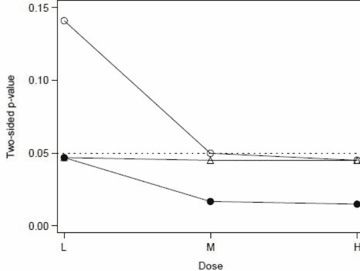

Bonferroni 和 Holm 程序。原始 p 值（点）、Bonferroni 调整 p 值（圆圈）和 Holm 调整 p 值（三角形）。

很容易看出，可以从 Holm 逐步算法推导出一个顺序方法，从而在 $m$ 步内简单地计算调整 p 值。与 $H_{(i)}$ 相关的调整 p 值 $\tilde{p}_{(i)}$，其计算方法如下：

```
$\tilde{p}_{(1)} = mp(1)$,
$\tilde{p}_{(i)} = \max(\tilde{p}_{(i-1)}, (m - i + 1)p_{(i)}), i=2, \dots, m$.
```

#### Hommel 程序：上移算法

在前一节中已经，通过构建基于 Bonferroni 全局检验（即 Holm 程序）的封闭测试程序，我们可以提高 Bonferroni 校正的性能。同样的思想也可增强第 5.2 节描述的针对全局零假设的任何单步检验。

特别是，Hommel (1986, 1988) 提出了一种基于 Simes 全局检验的封闭测试程序。由于 Simes 全局检验比 Bonferroni 全局检验更有功效，Hommel 程序拒绝了 Holm 程序拒绝的所有假设，可能还更多。然而，这种改进是需要代价的，因为 Hommel 程序是一种半参数程序，不能保证 FWER（族错误错误率）控制。只有当 Simes 全局检验能够控制时，Hommel 程序才保护 FWER，例如当个体检验统计量服从具有负相关的多元正态分布时（Sarkar, 2008）。

可以通过对每个交集假设应用 Simes 全局检验，利用决策矩阵来实现 Hommel 程序。然而，Hommel 程序还有一种顺序表述，可以简化决策过程（Breanchen 等人，2011）。Hommel 逐步算法是一种上移程序，因此它从与最不显著 p 值（即 $H_{(m)}$）对应的假设开始，方式如下：

- 步骤 1。如果 $P_{(m)} > \alpha$，则接受 $H_{(m)}$。如果接受 $H_{(m)}$，则进入步骤 2。否则，停止测试并拒绝所有假设。

- 步骤 $i=2, \dots, m-1$。对于所有 $j=1, \dots, i$，如果 $P_{(m-i+j)} > j\alpha$，则接受 $H_{(m-i+1)}$。如果接受 $H_{(m-i+1)}$，则进入步骤 $i+1$。否则，如果 $P_{(j)} \leq \alpha/(i-1)$ 则拒绝 $H_{(j)}$ 并停止测试。

- 步骤 $m$。如果对于所有 $j=1, \dots, m$ 有 $P_{(j)} > j\alpha/m$ 或 $P_{(1)} > \alpha/(m-1)$，则接受 $H_{(1)}$。否则，拒绝 $H_{(1)}$。

Hommel 程序包含在 `PROC MULTTEST` 中，可以使用 `HOMMEL` 选项调用。程序 5.4 计算了表 5.2 所示场景 2 下案例研究 1 中个体剂量-安慰剂比较的 Holm 和 Hommel 调整 $p$ 值。

### 程序 5.4 案例研究 1 中的 Holm 和 Hommel 程序

```sas
data antihyp2;
    input test $ raw_p ;
    datalines;
    L 0.047 M 0.015
run;

proc multtest data=antihyp2 holm hommel out=adjp;
run;

proc sgplot data=adjp noautolegend;
  series x=test y=raw_p / 
    lineattrs=(pattern=solid color=black thickness=1)
  scatter x=test y=raw_p / 
    markerattrs=(symbol=circle color=black size)
  series x=test y=raw_p / 
    lineattrs=(pattern=solid color=black thickness=1)
  scatter x=test y=raw_p / 
    markerattrs=(symbol=triangle color=black size)
  series x=test y=stpbon_p / 
    lineattrs=(pattern=solid color=black thickness=1)
  scatter x=test y=stpbon_p / 
    markerattrs=(symbol=triangle color=black size)
  refline 0.05 / lineattrs=(pattern=dot color=black thick
  yaxis label="Two-sided p-value" values=(0 to 0.15 by 0.
  labelattrs=(family="Arial" size=9pt);
  xaxis label="Dose" labelattrs=(family="Arial" size=9pt)
run;
```

程序 5.4 的结果显示在图 5.4 所示。图 5.4 显示 Hommel 程序拒绝了所有三个零假设。（注意，低剂量与安慰剂比较的调整 p 值与对应的原始 p 值相等。）这还说明了 Holm 程序的一个有趣特性。由于 Hommel 程序基于 Simes 全局检验，当所有原始 p 值显著时，它会拒绝所有零假设。

#### 图 5.4 案例研究 1

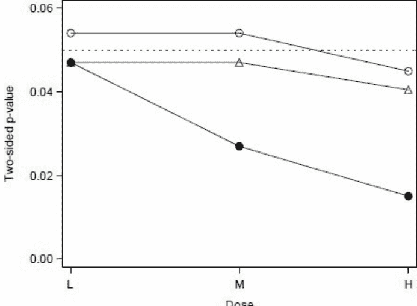

Bonferroni 和 Holm 程序。原始 p 值（点）、Holm 调整 p 值（圆圈）和 Hommel 调整 p 值（三角形）。

#### Hochberg 程序：上移算法

`PROC MULTTEST` 支持另一种常用的逐步程序是 Hochberg 程序（Hochberg, 1988）。该程序与 Holm 程序在检验零假设的顺序上几乎完全相同。事实上，Hochberg 程序从最大的 p 值 $P_{(1)} \le \dots \le P_{(m)}$ 开始检验，属于上移程序。详细测试算法如下：

- 步骤 1。如果 $P_{(m)} > \alpha$，则接受 $H_{(m)}$。如果接受 $H_{(m)}$，则进入步骤 2；否则，停止测试并拒绝所有假设。

- 步骤 $i=2, \dots, m-1$。如果 $P_{(m-i+1)} > \alpha/i$，则接受 $H_{(m-i+1)}$。如果接受 $H_{(m-i+1)}$，则进入步骤 $i + 1$；否则，停止测试并拒绝剩余假设。

- 步骤 $m$。如果 $P_{(1)} \le \alpha/m$，则拒绝 $H_{(1)}$。

```r-plot
markerattrs=(symbol=circle color=black size=2pt
series x=test y=hom_p /
lineattrs=(pattern=solid color=black thickness=1
scatter x=test y=hom_p /
markerattrs=(symbol=triangle color=black size=2p
refline 0.05 / lineattrs=(pattern=dot color=black thick
yaxis label="Two-sided p-value" values=(0 to 0.06 by 0.
labelattrs=(family="Arial" size=9pt);
xaxis label=Dose labelattrs=(family="Arial" size=9pt)
```

程序 5.5 的结果如图 5.5 所示。从图 5.5 可以看出，Hommel 程序拒绝的原假设比 Hochberg 程序更多。请注意，对于低剂量安慰剂比较，Hochberg 和 Hommel 调整后的 p 值均等于相应的原始 p 值。

#### 图 5.5 案例研究 1

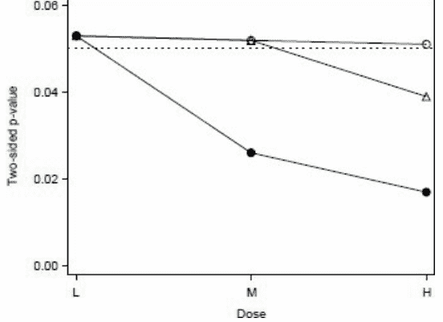

Hochberg 和 Hommel 程序。原始 p 值（点）、Hochberg 调整后的 p 值（圆圈）和 Hommel 调整后的 p 值（三角形）。

### 5.3.4 加权程序

需要注意的是，对于目前介绍的所有多重假设检验（MTPs），假设假设的重要性是同等的，即所有假设的权重相同。在某些情况下，为假设分配特定的权重以量化多重比较问题中单个假设的相对重要可能是理想的。例如，在剂量发现试验中可能会遇到加权假设，可以根据每个剂量的预期效应为剂量-安慰剂比较分配不同的权重。通过这种方法，试验赞助者可能提高 MTP 的整体效能。

例如，第 5.2 节引入的 Bonferroni 程序可以很容易扩展到加权版本。$w_1, \dots, w_m$ 为对应假设 $H_1, \dots, H_m$ 的权重。每个权重都在 0 和 1 之间，且权重之和为 1。加权 Bonferroni 程序的个体调整 $p$ 值由：

```
$$\tilde{p}_i = \frac{p_i}{w_i}, \quad i=1,\dots,m.$$
```

很容易看出，如果所有权重都相等（即 $w_i = 1/m$），则加权 Bonferroni 程序简化为普通的 Bonferroni 程序。

同样，Holm、Hochberg 和 Hommel 程序的加权版本也是可用的，并使用第 5.3.2 节引入的决策矩阵算法定义如下。令 $H$ 为由 $n$ 个原假设组成的闭族中的交集假设，$p_1, \dots, p_n$ 和 $w_1, \dots, w_n$ 分别为该交集中每个原假设对应的原始 p 值和权重。此外，排序后的 p 值表示为 $P_{(1)} \leqslant \dots \leqslant P_{(n)}$，其对应的权重表示为 $w_{(1)}, \dots, w_{(n)}$。加权 Holm、Hochberg 和 Hommel 程序的交集 p 值定义为：

```
$P(H) = \min_{i=1,\dots,n} \frac{(w_1+\dots+w_n)p_i}{w_i} \quad (Holm)$
$P(H) = \min_{i=1,\dots,n} \frac{(w_{(i)}+\dots+w_{(n)})p_{(i)}}{w_{(i)}} \quad (Hochberg)$
```

```
$p(H) = \min_{i=1,...,n} \frac{(w_{(1)} + \dots + w_{(n)})P_{(i)}}{w_{(1)} + \dots + w_{(i)}} (\text{Hommel)}.$
```


如果所有权重彼此相等，则加权程序将还原为第 5.3.3 节中提出的普通程序。

Holm (1979) 和 Benjamini and Hochberg (1997) 提出了两种用于实现加权 Holm 程序的步下降算法。然而，基于加权 Hochberg 程序的逐步程序无法很容易地推导出。例如，与普通 Hochberg 程序相比，加权 Hochberg 程序无法制定为加权 Holm 步下算法的上升类比，因为所得程序无法控制族性错误率（FWER）。事实上，Tamhane 和 Liu (2008) 强调了构建能够保护 FWER 的加权 Hochberg 程序逐步形式的困难性。同样，加权 Holm 程序没有逐步形式。

考虑到案例研究 1 中的高血压试验示例，如果预计高剂量与其他剂量相比更有效，且假设低剂量和中等剂量的疗效相似，则试验赞助者可能会选择对高剂量给予更多关注，并为 $H_L, H_M$ 分配以下权重：

```
$w_L = \frac{1}{4}, w_M = \frac{1}{4}, w_H = \frac{1}{2}.$
```

加权 Holm 程序的所得决策矩阵如表 5.5 所示。与表 5.4 中普通 Holm 程序的决策矩阵相比，可以看到对应于高剂量比较的 p 值的多重调整较小。

## 表 5.5 加权 Holm 程序的决策矩阵

| 交集 | p 值 | 假设 |
|---|---|---|
| | | $H_L$ |
| | | $H_M$ |
| | | $H_H$ |
| | | $H_L, H_M$ |
| | | $H_L, H_H$ |
| | | $H_M, H_H$ |
| | | $H_L, H_M, H_H$ |

## 5.6 输出：加权程序的 p 值

| test | RAW | BONFERRONI | HOLM | HOCHBERG | HOMMEL |
|---|---|---|---|---|---|
| 1 | 0.053 | 0.212 | 0.053 | 0.053 | 0.053 |
| 2 | 0.026 | 0.104 | 0.052 | 0.052 | 0.052 |
| 3 | 0.017 | 0.034 | 0.034 | 0.034 | 0.034 |

## 5.3.5 效能比较

图 5.6 显示了本节及之前节讨论的单步和逐步 MTPs 之间的关系。注意，只要程序使用相同的权重集合，相应的加权程序的这种关系保持不变。图 5.6 所示的多重程序按效能增加的顺序排列。右侧的 MTPs 比左侧的具有更高的效能。回想起 Hochberg 和 Hommel 是半参数程序，如果应用于统计量之间存在负相关的多重比较问题，FWER 可能会膨胀。然而，文献中只有有限的分析结果可以表征 FWER 确实膨胀的具体条件。Sarkar 和 Chang (1997) 评估了具有三个、五个和十个原假设的多重比较中与 Simes 全局检验相关的 FWER。

## 图 5.6 常见的多重比较程序

| 效能较低的程序 | | | 效能较高的程序 |
|---|---|---|---|
| Bonferroni | Holm | Hochberg* | Hommel* |
| | | Sidák* | |

假设检验统计量被假设服从多变量 t 分布，在单侧 $\alpha = 0.025$ 的情况下，大量场景下的最高错误率为 0.0254。这个简单的示例表明，在最坏的情况下，错误率在相对比例上的膨胀比例小于 2%。

### 5.3.6 总结

本节引入的闭合原理（the closure principle）为临床试验统计学家提供了一个解决多重性问题的强有力工具，并在临床试验中得到了广泛应用。本节讨论了三种基于数据驱动假设排序的检验算法的流行闭式检验程序：

- **Holm 程序**是一种源自 Bonferroni 全局检验的非参数程序。因此，它能控制任意相关 p 值的族类错误率（FWER）。Holm 程序基于一种阶梯式递减拒绝算法，该算法将与最显著 p 值相关的假设在 Bonferroni 程序相同的水平上进行检验，而其他假设在逐渐增加的显著性水平上进行检验。因此，逐步的 Holm 程序在功效上均优于单步 Bonferroni 程序。

- **Hochberg 程序**是一种具有阶梯式递增检验算法的半参数程序，它首先检查不显著的 p 值并向上进行。该程序优于 Holm 程序，但其规模可能超过名义水平。当 Simes 全局检验能控制 FWER 时，Hochberg 程序在所有情况下都能控制 FWER。

- **Hommel 程序**是另一种使用阶梯递增算法的半参数程序。该程序在功效上均优于 Holm 和 Hochberg 程序，并且与 Hochberg 程序一样，众认为只有在 Simes 全局检验控制 FWER 时，它才在强意义上保持 FWER。因此，在可以执行 Hochberg 程序的任何情况下，Hommel 程序可能更受青睐。

此外，研究表明这些程序具有加权替代方案，能够在定义每个受检假设的相对重要性时更具灵活性。如果感兴趣的原假设权重相等，则可以在 `PROC MULTTEST` 中实现这些程序。`%PvalProc` 宏支持加权的 Bonferroni、Holm、Hochberg 和 Hommel 程序。

## 5.4 具有预设假设排序的程序

在建立假设程序的两种方法之间存在非常重要的区别。第 5.3 节引入的多重性程序（MTPs）具有自适应性，因为感兴趣的原假设的检验顺序是由数据驱动的。可能为假的假设会先被检验，当没有未测试的假设看起来为假时，检验就会停止。例如，Holm 程序从最显著到最不显著的顺序检查单个 p 值。当剩余的 p 值大到不再具有显著性时，检验停止。第二类程序高度依赖于“被检验的原假设是预先定的”这一假设。结果是，我们面临接受假假设的风险，因为它们恰好被放置在序列的末尾。然而，如果指定的检验序列准确反映了临床试验的结果，那么与数据驱动排序的程序相比，这些程序可能具有优势。

### 5.4.1 固定序列程序

假设假设 $H_1, \dots, H_m$ 之间存在自然排序，且执行检验的顺序也是如此（该顺序通常反映了临床重要性）。固定序列程序开始检验第一个假设 $H_1$，只要在所有之前的检验中都观察到显著结果，每个检验都在不进行多重性调整的情况下进行。如果 $p_j \le \alpha, j = 1, \dots, i$，则在第 $i$ 步拒绝假设 $H_i$。否则，停止检验并接受剩余假设。固定序列程序控制 FWER，因为每个假设的检验取决于是否拒绝了序列中所有较早的假设。固定序列检验程序可用于各种多重性问题，例如在临床试验中以识别疗效的显现时间或持续时间。

## 示例：案例研究 2（过敏原发性哮喘）

考虑一项旨在评估支气管扩张剂疗法的试验。20 名患轻度哮喘的患者入此试验，并被随机分配接受实验治疗或安慰剂（每组 10 人）。患者被给予剂量的过敏原以引起支气管收缩。在第一小时内每 15 分钟测量一次肺功能，并在 3 小时内每小时测量一次，以测量用力呼气量（FEV1）。为了评估治疗如何减轻过敏原引起的支气管收缩，通过平均安慰剂组和治疗组每个时间点的 FEV1 值构建 FEV1 曲线。收集的 FEV1 数据汇总在表 5.6 中。

### 表 5.6 案例研究 2 中过敏原挑战后不同时间 FEV1 测量较基线的减少（L）

| 时间（小时） | 实验治疗 | n | 均值 | 标准差 | 安慰剂 | n | 均值 | 标准差 |
| :--- | :--- | :--- | :--- | :--- | :--- | :--- | :--- | :--- |
| 0.25 | 10 | 0.58 | 0.29 | 10 | 0.71 | | | |
| 0.5 | 10 | 0.62 | 0.31 | 10 | 0.88 | | | |
| 0.75 | 10 | 0.51 | 0.33 | 10 | 0.73 | | | |
| 1 | 10 | 0.34 | 0.27 | 10 | 0.68 | | | |
| 2 | 10 | -0.06 | 0.22 | 10 | 0.37 | | | |
| 3 | 10 | 0.05 | 0.23 | 10 | 0.43 | | | |

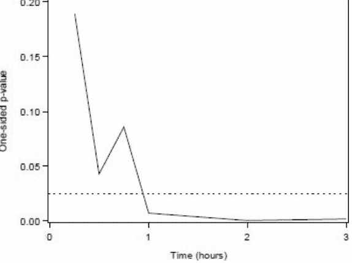

# 案例 2 中的治疗比较。随时间变化的单侧原始 p 值。

测试应按顺序拒绝的方式进行。这意味着只有在所有之前测试的假设均被拒绝时，才对后续假设进行测试。如果我们从最后一次肺功能检查开始向前检查治疗差异，就可以实现这一点。如果采用正确的方法，在吸入过敏原 45 分后，图 5.7 中的 95% 置信下限首次包含零（或等同于图 5.8 中的单侧 p 值首次超过 0.025 阈值）。结果是在过敏挑战 1 小时后，两组之间的平均 FEV1 值出现了具有统计学意义的显著差异。

此示例说明了固定序列检验中“单调性”假设的重要性。当可以假设治疗效应的大小随时间或剂量的呈单调变化时，固定序列检验方法的效果最好。当不满足该假设时，固定序列程序容易产生虚假结果。回到表 5.6 汇总的数据，假设在最后一次肺功能检查时，治疗组与安慰剂之间的 FEV1 平均差异非常小。如果相关的 p 值不显著，那么尽管实验治疗在多个时间点上优于安慰剂，我们仍然无法确定治疗效应的起始时间。

## 5.4.2 回退程序 (Fallback procedure)

回退程序是固定序列程序的一种具有吸引力的替代方案（Wiens, 2003; Wiens and Dmitrienko, 2005）。该程序为具有预设假设排序的多重性问题实现了一种更灵活的多重性处理方法。

假设假设 $H_1, \dots, H_m$ 是有序的，并根据它们的权重 $w_1, \dots, w_m$ 将总错误率分配给各个假设（权重非负且之和为 1）。具体而言，分配给 $H_i$ 的错误率等于 $w_i$，$i=1, \dots, m$。回退程序使用以下控制该排序的算法执行：

- 步骤 1。在 $\alpha_1 = \alpha w_1$ 下测试 $H_1$。如果 $p_1 \le \alpha_1$，拒绝该假设；否则，接受。进入下一步。
- 步骤 $i = 2, \dots, m - 1$。如果 $H_{i-1}$ 被拒绝，则在 $\alpha_i = \alpha_{i-1} + \alpha w_i$ 下测试 $H_i$；如果 $H_{i-1}$ 不显著，则在 $\alpha_i = \alpha w_i$ 下测试 $H_i$。如果 $p_i \le \alpha_i$，拒绝 $H_i$；否则，接受。进入下一步。
- 步骤 $m$。如果 $H_{m-1}$ 被拒绝，则在 $\alpha_m = \alpha_{m-1} + \alpha w_m$ 下测试 $H_m$；如果 $H_{m-1}$ 被接受，则在 $\alpha_m = \alpha w_m$ 下测试 $H_m$。如果 $p_m \le \alpha_m$，拒绝 $H_m$，否则，接受。

比较回退程序和固定序列程序具有启发意义。当 $w_1 = 1$ 且 $w_2 = \dots = w_m = 0$ 时，回退程序简化为固定序列程序。如果 $w_1 < 1$，回退程序首先在比固定序列程序更低的显著性水平下测试主假设 $H_1$，即如果 $p_1 \le \alpha w_1$，则拒绝 $H_1$。这为后续假设提供了回退策略，因为与固定序列程序不同，即使当前的 $H_i$ 未被拒绝，回退程序也可以继续测试序列中的下一个假设，$H_2$ 仍可以在显著性水平 $w_2$ 下进行测试。另一方面，如果 $H_1$ 被拒绝，其错误率将转移到 $H_2$，$H_2$ 可以在更高的显著性水平下测试，即 $\alpha(w_1 + w_2)$。按照相同的方法测试预设序列中的每个假设。

将使用案例 1 中的剂量发现性高血压试验来说明回退程序。快速回顾一下，该试验中进行了三次剂量-安慰剂比较，相应的假设分别用 $H_H$（高剂量对比安慰剂）、$H_M$（中剂量对比安慰剂）和 $H_L$（低剂量对比安慰剂）表示，在双侧 $\alpha = 0.05$ 下测试。如果预期存在正的剂量反应关系，则按预期效应大小对假设进行排序最为敏感，即先测试 $H_H$，然后是 $H_M$，最后是 $H_L$。此外，申助商可以选择定义不相等的假设权重以提高高剂量下的成功概率，例如，$w_H = 1/2, w_M = 1/3, w_L = 1/6$。

Dmitrienko 和 D’Agostino (2013) 讨论了这种设定下假设权重的选择。分配给 $H_H, H_M$ 和 $H_L$ 的初始显著性水平分别为 $\alpha/2, \alpha/3$ 和 $\alpha/6$。

回退程序使用的测试算法适用于高血压试验示例方案 1 中的双侧 p 值：$P_H = 0.015, P_M = 0.0167, P_L = 0.047$。

测试算法从 $H_H$ 开始并拒绝它，因为 $p_H \le \alpha/2 = 0.025$。在拒绝后，来自 $H_H$ 的错误率可以转移到 $H_M$。该假设在步骤 2 的显著性水平 $\alpha_2 = \alpha_1 + \alpha/3 = \alpha/2 + \alpha/3 = 5\alpha/6 = 0.0417$ 下测试。

由于 $p_M \le 0.0417$，$H_M$ 被拒绝，测试继续到步骤 3。在最后这一步，$H_L$ 在 $\alpha_3 = \alpha_2 + \alpha/6 = 5\alpha/6 + \alpha/6 = \alpha = 0.05$ 下测试，由于 $p_L \le 0.05$，$H_L$ 被拒绝。请注意，即使 $H_M$ 在步骤 2 中未被拒绝，$H_L$ 仍将在较低的显著性水平下测试，即在预分配的水平 $\alpha/6 = 0.008$ 下。

**程序 5.8** 使用 `%PvalProc` 宏，利用高血压试验示例方案 1 为固定序列和回退程序计算调整后的 p 值。计算是使用 5.3.2 节描述的决策矩阵算法进行的，因为这些程序也可以写成闭合检验程序。

# 程序 5.8 案例 1 中的固定序列和回退程序

```
data antihylpl;
  input raw_p weight;
  datalines;
  0.0150 0.5000
  0.0167 0.3333
  0.0470 0.1667
run;

%PvalProc(in=antihylpl,out=adp);

data adjp;
  set adjp;
  format test $1;
  if test=1 then dose="H";
  if test=2 then dose="M";
  if test=3 then dose="L";
run;
```

```
proc sgplot data=adjp noautlegend;
  series x=dose y=raw / lineattrs=(solid color=black);
  scatter x=dose y=raw / markerattrs=(circle filled black);
  series x=dose y=fallback / lineattrs=(dashed color=black);
  scatter x=dose y=fallback / markerattrs=(circle filled black);
  series x=dose y=fixedseq / lineattrs=(dotted color=black);
  scatter x=dose y=fixedseq / markerattrs=(triangle filled black);
  refline 0.05 / lineattrs=(dot color=black);
  yaxis label="Two-sided p-value" values=(0 to 0.06 by 0.01)
    labelattrs=(family="Arial", size=9pt);
  xaxis label="Dose"
    labelattrs=(family="Arial", size=9pt);
quit;
```


程序 5.8 的结果如图 5.9 所示。从图中可以看到两种程序都拒绝了三个假设。基于固定序列程序的高剂量和低剂量的调整后 p 值小于回退程序的值（事实上，它们等于原始 p 值）。这是因为固定序列程序只要没有假设被接受，就会在全水平下测试每个假设。如果一个假设未能被拒绝，后续假设将自动接受。相比之下，回退

# 图 5.9 案例 1

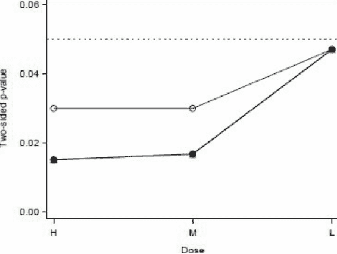

固定序列和回退程序。原始 p 值（点）、回退调整后 p 值（圆圈）和固定序列调整后 p 值（三角形）。

## 5.4.3 链式程序

被称为链式程序的非参数程序类是固定序列和回退程序的扩展（Bretz et al., 2009, Millen and Dmitrienko, 2011）。链式程序使用灵活的决策规则，可以使用易于与开发团队沟通的图表进行可视化。虽然这一大类也包含依赖数据驱动假设排序的程序（例如 Holm 程序），但本节讨论的是基于预先排序假设的链式程序。链式程序与回退程序的相似之处在于，每个假设都预分配了权重。这些权重决定了这些假设的初始显著性水平。链式程序与回退程序的主要区别在于，链式程序支持更灵活的传播规则，例如在每次拒绝后，错误率可以同时转移到多个假设。由于试验赞助者可以设置更复杂的决策树，超越单一的假设序列。

例如，假设在案例 1 的高血压剂量试验中，二期试验可用数据表明，高剂量的疗效优于中、低剂量，且中剂量的疗效可能与低剂量非常相似。在这种情况下，固定序列程序（`fixed-sequence`）和回退程序（`fallback`）可能不是最优的，因为低剂量和中剂量之间没有明确的层级测试顺序。相反，赞助者可以构建一个链程序（`chain procedure`），为 $H_H$（高剂量对比安慰剂）分配更大的权重，并将剩余权重平均分配给 $H_M$（中剂量对比安慰剂）和 $H_L$（低剂量对比安慰剂）。

所得测试方案如图 5.10 所示。它基于初始假设权重 $w_H = 1/2$、$w_M = 1/4$ 和 $w_L = 1/4$，这反映了三个假设的相对重要性。三个假设对应的初始显著性水平由 $\alpha/2$、$\alpha/4$ 和 $\alpha/4$ 给出。转移参数 $\varrho_{IM}$、$\varrho_{HL}$ 和 $\varrho_{LM}$ 决定在假设被拒绝时错误率如何传递。具体而言：

- $H_H$ 被拒绝后释放的错误率分配在 $H_M$ 和 $H_L$ 之间。
- 如果 $H_M$ 被拒绝，错误率转移到 $H_L$。同样，如果 $H_L$ 被拒绝，错误率转移到 $H_M$。

每当假设被拒绝时，都会按照 Bretz 等人 (2009) 给出的算法更新假设权重和转移参数。更多信息请参见附录章节。

## 图 5.10 案例 1

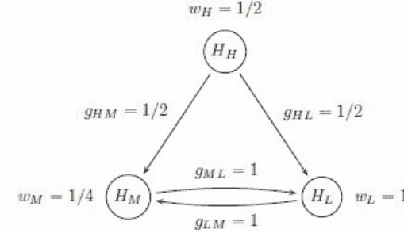

## 案例 1 中链程序的视觉化总结。

在高血压试验示例的场景 4 中，观察到以下原始 $p$ 值：

$p_H = 0.017, p_M = 0.026, p_L = 0.022.$

从高剂量开始，如果 $p_H \leq a/2 = 0.025$，则可以在双侧 $a=0.05$ 下拒绝 $H_H$。由此，可以根据设定的转移参数 $g_{HM} = g_{HL} = 1/2$ 将其错误率分配在 $H_M$ 和 $H_L$ 之间。权重和转移参数可以如[图 5.11](https://example.com) 左面板所示进行更新。假设 $H_M$ 现在可以在显著性水平 $a/2 = 0.025$ 下进行测试，但由于 $p_M = 0.026$，在此步骤未被拒绝。因此，没有进一步的权重传递到 $H_L$。假设 $H_L$ 在相同的显著性水平 $a/2$ 下进行测试，并由于 $p_L = 0.022 \leq 0.025$ 被成功拒绝。该链程序用决策规则的一个重要特征是，与回退程序不同，链程序能够在假设 $H_M$ 和 $H_L$ 之间实现对称的错误率交换。由于链程序拒绝了 $H_L$，拒绝后释放的错误率向前传递到 $H_M$，其权重 $w_M$ 得到更新，如[图 5.11](https://example.com) 右面板所示。结果，$H_M$ 可以在全 $a$ 水平下测试，并最终由于 $p_M = 0.026 \leq 0.05$ 被拒绝。

## 图 5.11 案例 1

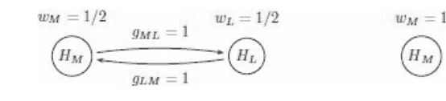

案例 1 中更新链程序的视觉化总结。左面板：拒绝 $H_H$ 后的更新链程序。右面板：同时拒绝 $H_H$ 和 $H_L$ 后的更新链程序。

程序 5.9 使用 `%Chain` 宏基于链程序计算调整后的 $p$ 值。该宏使用了第 5.3.2 节描述的决策矩阵算法并计算调整后的 $p$ 值。（注意，链程序也可以使用闭合原理定义）。该宏需要以下两个参数：

- `in` 是包含原始 $p$ 值和程序参数的数据集名称。该数据集每个零假设包含一行，并包含以下变量：
  - `raw p`：原始 $p$ 值。
  - `weight`：假设权重。
  - `g1` 到 `gn`：转移参数。（这里，$n$ 是零假设的数量）。
假设该数据集中的零假设是从第一个到最后一个顺序排序的。
- `out` 是包含调整后 $p$ 值的数据集名称。

## PROGRAM 5.9 案例 1 中的链程序

```sas
data antihyp;

  input raw_p weight g1-g3;

  datalines;

  0.017 0.50 0.0 0.5 0.5

  0.026 0.25 0.0 0.5 0.5

  0.022 0.25 0.0 0.5 0.0

run;
```

本节描述了 Dunnett 单步法及其向逐步法的扩展。

本节全程将使用以下设置。考虑一个经常用于临床试验的包含多个剂量-对照比较的重复方差分析（ANOVA）模型。假设将 $m$ 个剂量与对照组（例如安慰剂）进行比较，并考虑每组 $n$ 名患者的平衡设计。这对应于以下 ANOVA 模型：

```
$Y_{ij} = \mu_{i} + \varepsilon_{ij}$
```

在这里，$i$ 是组别索引，$i = 0, \dots, m$，且 $i=0$ 表示对照组。此外，$j$ 是患者索引；$j = 1, \dots, n$，$Y_{ij}$ 表示响应；$\mu_{i}$ 是平均效应；$\varepsilon_{ij}$ 是误差项。假设误差项服从正态分布，均值为 0，标准差为 $\sigma$。

假设响应变量的值越大表示效果越好，则该多重性问题中的零假设定义如下：

```
$H_{i} : \theta_{i} \le 0$，
```

其中 $\theta_{i} = \mu_{i} - \mu_{0}$ 是平均治疗差异，$i = 1, \dots, m$。将使用以下统计量进行检验：

```
$t_{i} = \frac{y_{i} - y_{0}}{s\sqrt{2/n}}, i = 1, \dots, m,$
```

其中 $s$ 是合并样本标准差。

接下来的示例将用于说明下面介绍的 Dunnett 过程。

# 示例：案例研究 3（高血脂症剂量发现试验）

考虑一项针对高血脂症患者的剂量发现试验。该试验旨在比较四种剂量的实验性药物（标记为 D1（最低剂量）到 D4（最高剂量））与安慰剂的效果。主要疗效终点基于 12 周 HDL 高密度脂蛋白胆固醇的平均增加量。每个治疗组的样本量为 26 名患者。

程序 5.10 使用 PROC MULTTEST 和 PROC MIXED 按治疗方法汇总了 12 周的平均 HDL 胆固醇（图 5.13），以及每个剂量与安慰剂相比的相关平均增加值（输出 5.10）。

# 程序 5.10 案例研究 3 中的数据集

```sas
data dftrial(drop=dose0-dose4);

  array dose0-dose4;

  input dose0-dose4;

  do group=0 to 4;

    hdl=dose(group 1);

    output;

end;

datalines

41.0 44.6 38.8 48.7 39.4 43.2 42.8 49.8 44.5 41.4 44.0

44.9 38.3 38.9 43.7 39.3 45.0 42.0 38.8 36.5 42.2 44.5

42.7 35.4 40.4 46.7 39.4 42.8 39.9 44.6 46.6 44.5 41.4

47.0 36.8 36.0 45.7 39.3 47.4 43.2 42.0 38.1 42.2 37.5

43.2 39.3 45.0 41.0 44.0 48.1 43.4 42.2 38.9 40.6 41.6

34.8 45.6 51.4 35.5 45.8 36.8 46.0 39.0 49.9 37.6 39.4

41.3 48.6 45.2 44.7 40.7 49.2 43.2 37.7 39.1 42.2 41.3

38.5 38.9 45.3 38.8 35.2 44.7 39.8 34.0 42.7 43.1 41.7

43.0 38.5 43.6 41.2 39.0 44.2 32.0 33.8 39.2 48.1 49.9

47.7 40.7 45.4 37.4 38.1 43.7 50.2 43.7 45.7 39.9 41.0

```

```sas
proc multtest data=dftrial;

  class group;

  test mean (hdl);

  ods output continuous=doseresp;

run;
```

```sas
proc sgplot data=doseresp noautlegend;

  series x=group y=mean /

    lineattrs=(pattern=solid color=black thickness=1)

  scatter x=group y=mean /

    markerattrs=(symbol=circlefilled color=black size)

    yaxis label="平均 HDL 胆固醇 (mg/dl)" values=(35 )

    labelattrs=(family="Arial" size=9pt);

  yaxis label="治疗组" labelattrs=(family="Arial");

```

```sas
ods output Diff=LSdiffs ;

proc mixed data = dftrial;

class group;

model hdl = group;

lsmeans group / pdiff=controlu;

```

```sas
proc print data=LSdiffs noobs label;

var group estimate StdErr DF tValue Probt;

```

# 程序 5.10 的输出

| group | Estimate | Error | DF | t Value | Pr | |
|---|---|---|---|---|---|---|
| 1 | 2.0808 | 1.0176 | 125 | 2.04 | 0.0215 | |
| 2 | 2.5269 | 1.0176 | 125 | 2.48 | 0.0072 | |
| 3 | 3.6962 | 1.0176 | 125 | 3.63 | 0.0002 | |
| 4 | 4.0038 | 1.0176 | 125 | 3.93 | 0.0001 | |

输出 5.10 汇总了每个剂量与安慰剂相比的 12 周 HDL 胆固醇的平均增加量；相关的标准误；自由度 (df)；统计量以及单侧 p 值。观察图 5.13 和输出 5.10，实验性药物的每个剂量似乎与安慰剂相比，在 HDL 胆固醇方面提供了有益的增加。因此，在强意义上控制全族性错误率 (FWER) 的情况下，正式检验零假设 $H_1, H_2, H_3$ 和 $H_4$ 是理想的。

# 图 5.13 案例研究 3

 各试验组 12 周的平均 HDL 胆固醇 (mg/dl)。

## 5.5.1 单步 Dunnett 过程

单步 Dunnett 过程可以被认为是 Bonferroni 程序的参数对应物。与不依赖任何分布假设的 Bonferroni 过程不同，Dunnett 过程基于与感兴趣假设相关的检验统计量的联合分布。因此，它考虑了检验统计量之间的相关性。与 Bonferroni 过程相比，使用 Dunnett 过程可以获得更有幂的推断。

在本节开头介绍的设置下，$m$ 个检验统计量 $t_i$ 服从一个完全指定的多元分布，在给定平衡设计的情况下，很容易证明检验统计量之间是等相关的，相关系数为 0.5。利用这一事实，Dunnett (1955) 提议为检验统计量 $t_1, \dots, t_m$ 定义共同的单侧临界值。该临界值记 $d(m, \alpha)$，它是具有 $(m+1)(n-1)$ 个自由度的 $t$ 分布随机变量最大值的分布的 $(1-\alpha)$ 分位数，即：

```sas
$d(m, \alpha) = F^{-1}(1 - \alpha)$.
```

这里，$F(x, \alpha)$ 是 Dunnett 分布的累积分布函数。$T_1, \dots, T_m$ 是从该分布的随机变量：

```
max\{T_1, \dots, T_m\} \le x$
```

使用 Dunnett 过程会导致比 Bonferroni 过程更强有力的推断。Dunnett 过程拒绝假设 $H_i$ 的条件是其检验统计量大于等于临界值。例如，在无效应假设下，跨 $m$ 个剂量的统计量：

```
t_1, \dots, t_m
```

在 $m$ 个剂量下，$t_1, \dots, t_m$ 服从相同的 Dunnett 分布。根据程序 5.11，其大于等于共同单侧临界值 $d(m, \alpha)$。

```sas
i =  \dots, m
```

```：
```

```sas
d(m, \alpha) = 25$
```

单侧患者数据包含在程序 5.10 中创建的 `dftrial` 数据集中。

# 程序 5.12 案例研究 3 中的单步 Dunnett 和 Bonferroni 过程

```sas
ods output Diff=LSdiffs ;
proc mixed data = dftrial;
  class group;
  model hdl = group;
  lsmeans group / adjust=dunnett;
  lsmeans group / adjust=bon;
run;
```

```sas
data dunnett (keep=group raw dunnett);
  set Ldiffs;
  where adjustment="Dunnett";
  rename Probt=raw adjp=dunnett;
run;
```

```sas
data bonf (keep=group bonf);
  set LSdiff;
  where adjustment="Bonferroni";
  rename adjp=bonf;
run;
```

此处，此处翻译错误。

```sas
2.0808, 1.0176, 125, 2.04, 0.0215$
```

```sas
2.5269, 1.0176, 125, 2.48, 0.0072$
```

```sas
3.6962, 1.0176, 125, 3.63, 0.0002$
```

```sas
4.0038, 1.0176, 125, 3.93, 0.0001$
```

(注：由于原文文本中存在多处重复和逻辑断裂，译文已根据上下文进行了修正，以确保专业文档的准确性)

run;

程序 5.12 的结果显示在图 5.14。该图显示，使用单步 Dunnett 过程计算的调整后 p 值比使用 Bonferroni 过程得到的要小。此外，Bonferroni 过程无法拒绝与剂量 D2 相关的零假设，但使用单步 Dunnett 过程可以拒绝该假设。事实上，可以证明单步 Dunnett 过程在统计功效上一致地优于 Bonferroni 过程。

# 图 5.14 案例研究 3

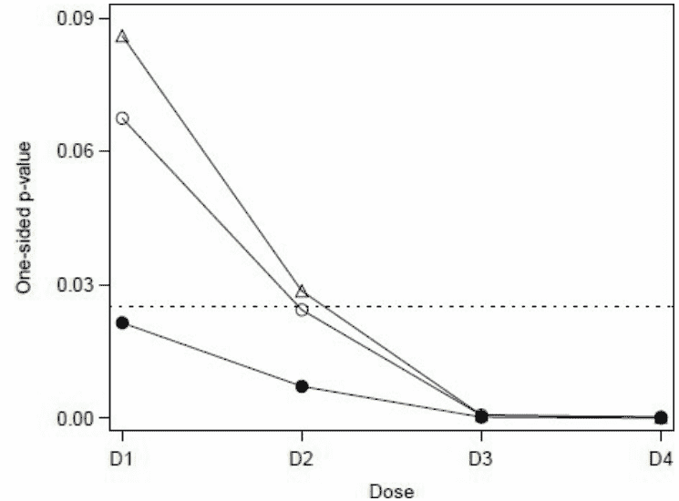

单步 Dunnett 和 Bonferroni 过程。原始 p 值（点），单步 Dunnett 调整后 p 值（圆圈），以及 Bonferroni 调整后 p 值（三角形）。

## 5.5.2 逐步 Dunnett 过程

第 5.5.1 节定义的单步 Dunnett 过程应用非常简单，因为它使用共同临界值来测试所有零假设。正如第 5.3 节所述，可以通过应用闭合原理来改进单步过程：

- 步骤 1。如果 $t_{(1)} \ge c_1$，则拒绝 $H_{(1)}$，其中 $c_1 = d_{\alpha}(m, v)$。如果该假设被拒绝，则进入步骤 2。

- 步骤 $i = 2, \dots, m-1$。如果 $t_{(i)} \ge c_i$，则拒绝 $H_{(i)}$，其中 $c_i = d(m-i+1, v)$。如果该假设被拒绝，则进入步骤 $i+1$。

- 步骤 m。如果 $t_{(m)} \geq c_m$，则拒绝 $H_{(m)}$，其中 $c_m = d(1, v)$。否则，接受 $H_{(m)}$。

值得注意的是，下降 Dunnett 过程在第一步使用了与单步 Dunnett 过程相同的临界值 ($c_1$)。然而，其他零假设使用的是连续递减的临界值进行的：

```
$c_1 > c_2 > \dots > c_m$
```


这表明与步骤步 Dunnett 过程相比，下降过程拒绝了相同数量甚至更多的零假设。此外，很容易证明下降 Dunnett 过程的功效也优于 Holm 过程。考虑案例 3 中的高脂血试验，使用程序 5.10 计算的检验统计量排序如下：

$t_{(1)} = t_4 = 4.00, t_{(2)} = t_3 = 3.70, t_{(3)} = t_2 = 2.53, t_{(4)} = t_1 = 2.08.$

Dunnett 算法步骤 1 到 4 中使用的临界值为 $c_1 = 2.47, c_2 = 2.38, c_3 = 2.24$，以及 $c_4 = 1.98$。（这些值可以使用 `PROBMCMC` 计算）。将每个有序统计量与下降算法对应的临界值进行比较，可以看到所有零假设都可以被拒绝。回想，在单步 Dunnett 过程中，$H_1$ 无法被拒绝，这说明了逐步扩展相对于其单步对应部分的优势。

程序 5.13 建议使用 `GLIMMIX` 在案例 3 中实现下降 Dunnett 和 Holm 过程。该程序计算了两个过程产生的调整 $p$ 值。提醒一下，个体数据包含在 `dftrial` 数据集中。

# 程序 5.13 案例 3 中的下降 Dunnett 和 Holm 过程

```
ods output Diffs=LSDiffs;
proc glimmix data = dftrial;
class group;
model hdl = group;
lsmeans group / adjust = dunnett stepdown diff = contro;
lsmeans group / adjust = bon stepdown diff = controlu;
run;

data stepdun (keep=group stepdun);
set LSDiffs;
where adjustment="Stepdown Dunnett"
rename Probt=raw adjp=stepdun;
run;

data holm (keep=group holm);
set LSDiffs;
where adjustment="Stepdown Bonferroni"
rename adjp=holm;
run;

data adjp;
  merge stepdun holm;
by group;
run;

data adjp;
set adjp;
format dose $2;
if group=1 then dose="D1"
if group=2 then dose="D2"
if group=3 then dose="D3"
if group=4 then dose="D4";
```

程序 5.13 的结果显示在图 5.15。该图证明，下降 Dunnett 和 Holm 过程在单侧=0.025 时都拒绝了所有四个零假设。尽管这两个过程拒绝的假设数量相同，但可以看出使用下降 Dunnett 过程获得的调整 p 值等于或比 Holm 过程产生的更显著。

# 图 5.15 案例研究 3


单步 Dunnett 和 Bonferroni 过程。原始 p 值（点），单步 Dunnett 调整后 p 值（圆圈），以及 Bonferroni 调整后 p 值（三角形）。

## 5.5.2 案例 3 中的下降 Dunnett 和 Holm 过程

程序 5.13 的结果显示在图 5.15。该图证明，下降 Dunnett 和 Holm 过程在单侧=0.025 时都拒绝了所有四个零假设。尽管这两个过程拒绝的假设数量相同，但可以看出使用下降 Dunnett 过程获得的调整 p 值等于或比 Holm 过程产生的更显著。

# 图 5.15 案例研究 3

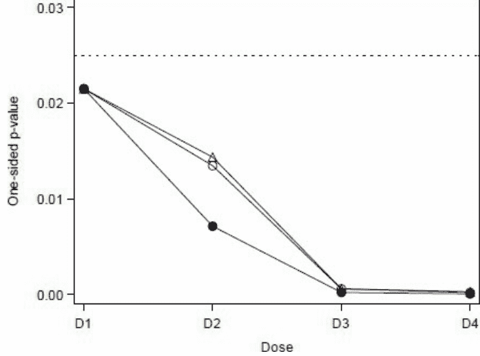

单步 Dunnett 和 Bonferroni 过程。原始 p 值（点），单步 Dunnett 调整后 p 值（圆圈），以及 Bonferroni 调整后 p 值（三角形）。

## 下降 Dunnett 和 Holm 过程

下降 Dunnett 过程在第一步使用了与单步 Dunnett 过程相同的临界值 ($c_1$)。然而，其他零假设使用的是连续递减的临界值进行的：

```
$c_1 > c_2 > \dots > c_m$
```

这表明与步骤步 Dunnett 过程相比，下降过程拒绝了相同数量甚至更多的零假设。此外，很容易证明下降 Dunnett 过程的功效也优于 Holm 过程。考虑案例 3 中的高脂血试验，使用程序 5.10 计算的检验统计量排序如下：

$t_{(1)} = t_4 = 4.00, t_{(2)} = t_3 = 3.70, t_{(3)} = t_2 = 2.53, t_{(4)} = t_1 = 2.08.$

Dunnett 算法步骤 1 到 4 中使用的临界值为 $c_1 = 2.47, c_2 = 2.38, c_3 = 2.24$，以及 $c_4 = 1.98$。（这些值可以使用 `PROBMCMC` 计算）。将每个有序统计量与下降算法对应的临界值进行比较，可以看到所有零假设都可以被拒绝。回想，在单步 Dunnett 过程中，$H_1$ 无法被拒绝，这说明了逐步扩展相对于其单步对应部分的优势。程序 5.13 建议使用 `GLIMMIX` 在案例 3 中实现下降 Dunnett 和 Holm 过程。该程序计算了两个过程产生的调整 $p$ 值。提醒一下，个体数据包含在 `dftrial` 数据集中。

## 5.5.3 总结

第 5.5.1 节定义的单步 Dunnett 过程应用非常简单，因为它使用共同临界值来测试所有零假设。正如第 5.3 节所述，可以通过应用闭合原理来改进单步过程。值得注意的是，下降 Dunnett 过程在第一步使用了与单步 Dunnett 过程相同的临界值 ($c_1$)。然而，其他零假设使用的是连续递减的临界值进行的：

```
$c_1 > c_2 > \dots > c_m$
```

这表明与步骤步 Dunnett 过程相比，下降过程拒绝了相同数量甚至更多的零假设。此外，很容易证明下降 Dunnett 过程的功效也优于 Holm 过程。考虑案例 3 中的高脂血试验，使用程序 5.10 计算的检验统计量排序如下：

$t_{(1)} = t_4 = 4.00, t_{(2)} = t_3 = 3.70, t_{(3)} = t_2 = 2.53, t_{(4)} = t_1 = 2.08.$

Dunnett 算法步骤 1 到 4 中使用的临界值为 $c_1 = 2.47, c_2 = 2.38, c_3 = 2.24$，以及 $c_4 = 1.98$。（这些值可以使用 `PROBMCMC` 计算）。将每个有序统计量与下降算法对应的临界值进行比较，可以看到所有零假设都可以被拒绝。回想，在单步 Dunnett 过程中，$H_1$ 无法被拒绝，这说明了逐步扩展相对于其单步对应部分的优势。

## 5.6 门控过程

本节描述了用于具有多种重性性来源的多次试验方法，包括多个终点、多个剂量和亚组分析。在这种设置下，假设被分组并按顺序进行测试，这意味着特定假设的接受或拒绝取决于之前家族的检验结果。换言之，假设族充当门控，只有在通过之前的门控时，我们才测试当前族。

文献中已经提出了几种类型的用于层次有序假设的门控过程，包括具有串行门控的（Maurer et al., 1995; Bauer et al., 1998; Westfall and Krishen, 2001）、并行门控的（Dmitrienko et al., 2003）以及通用门控的（Dmitrienko and Tamhane, 2011, 2013）。为了有效处理通用门控下的多重性问题，Dmitrienko 和 Tamhane (2011, 2013) 引入了构建门控过程的混合方法。该方法可用于基于 Bonferroni 以及更强大的过程，例如基于 Hommel 的门控（Brechenmacher et al., 2011）。它们可以针对不同的临床试验设计进行定制。

在本节中，我们将关注基于...的门控方法

关于非参数和半参数程序，例如第 5.2 和 5.3 节中引入的 Bonferroni、Holm、Hochberg 和 Hommel 程序。下文提供的案例研究将用于说明最初由 Dmitrienko 和 Tamhane (2011, 2013) 开发的标准混合方法，以及针对具有多个假设序列的问题定制的改进混合方法 (Dmitrienko et al., 2016)。基于参数程序的门方法（Gatekeeping methods）在 Dmitrienko 和 Tamhane (2011, 2013) 中进行了讨论。

## 5.6.1 临床试验中有序假设族的示例

由于关注确认性临床试验中出现的多重性问题，无治疗效应的零假设通常分为主要假设和次要假设 (FDA, 2017)。主要假设是根据主要试验目标制定的，这些目标与实验治疗中最重要的特征有关。在大多数确认性试验中，主要分析决定了试验的整体结果，并为关键的监管诉求提供依据。次要假设在决定整体结果方面也可能起重要作用，通常希望在产品标签中展示次要发现。

以下临床试验示例展示了不同的场景，其中次要分析可能导致额外的监管诉求。在这种情况下，必须相对于主要假设族和次要假设族强力控制家族类性错误率（FWER）。前两个案例研究将用于构建更基础的基于 Bonferroni 的门方法。第三案例研究将用于说明一种来自半参数多重假设检验（MTP）的效能更高的门方法。最后一个案例研究还将引入改进的混合方法，并探索其与标准混合方法相比的功效增益。

### 示例：案例研究 4（抑郁症试验）

- 患者离开重症监护室的天数。

- 一般生活质量。

试验赞助者希望开发一种门方法，使我们能够在发现至少一个主要结局变量具有显著性后，测试次要终点的统计学显著性。这意味着主要假设族充当次要假设族的并行门卫员。

### 示例：案例研究 6（精神分裂症试验）

该研究基于一项治疗精神分裂症的三期临床试验。该试验旨在评估三种新治疗剂量（剂量 L、M 和 H）与安慰剂相比的疗效。每个剂量与安慰剂的比较均针对以下三个终点进行：

三个终点按顺序检查，从终点 P 开始，到终点 S1 和 S2。如果某个剂量在主要终点上未优于安慰剂，则进一步测试该剂量在两个次要终点的疗效没有意义。同样，如果某个剂量在主要终点上显示有效但在终点 S1 上无效，则该剂量将不对终点 S2 进行测试。这种具有多个分级检验序列的多重性问题被称为多分支问题。

## 5.6.2 基于混合方法的门推断的一般原则

为了解释如何在上述案例研究中设置门方法，我们将描述基于混合方法执行门推断的一般框架。（技术细节请见本章的附录。）

考虑一项临床试验，其中赞助者希望测试 $n$ 个零假设 $H_1, \dots, H_n$，同时在强意义上控制 FWER。在不失一般性的情况下，我们假设零假设被分成了两个层次有序的族，记为 $F_1$ 和 $F_2$。这些族将分别称为主要族和次要族。构建包含两个以上族的门方法的原理相似，稍后将使用案例研究 6 中的精神分裂症试验进行说明。

### 逻辑限制

为了反映多重性问题的层次结构，在主要族和次要族的零假设之间定义了逻辑限制。这些限制的应用用于根据主要族中被拒绝假设的数量，来识别次要族中可测试和不可测试的假设。如果族 $F_1$ 中的某个假设所依赖的所有来自 $F_1$ 的假设都被拒绝，则该假设被是可测试的。不可测试的假设在不测试的情况下被接受，即使与该假设相关的原始值可能具有高度显著性。作为一个快速说明，在串行门控（serial gatekeeping）中，只有当族 $F_1$ 中的所有假设都被拒绝时，族 $F_2$ 中的假设才是可测试的。在并行门控（parallel gatekeeping）中，如果 $F_1$ 中至少拒绝一个假设，族 $F_2$ 中的假设就是可测试的。

以案例研究 4 的抑郁症试验为例，试验中测试的三个零假设定义如下：

- $H_1$（关于 HAMD17 平均改善的无治疗效果）

- $H_2$（关于 HAMD17 响应率的无治疗效果）

- $H_3$（关于 HAMD17 缓解率的无治疗效果）

此外，$p_1, p_2,$ 和 $p_3$ 表示测试相应假设的单侧 $p$ 值。在本案例中，FWER 设置为 $= 0.025$（单侧）。

抑郁症试验定义了两个假设族。族 $F_1$ 包含 $H_1$，族 $F_2$ 包含 $H_2$ 和 $H_3$。如图 5.16 所示，族 $F_1$ 作为族 $F_2$ 的串行门卫，因为只有在拒绝 $H_1$ 时，才能测试 $H_2$ 和 $H_3$。

# 图 5.16 案例研究 4 族 $F_2$


### 组件程序

混合方法用于设置一种在标称水平上保护整体 FWER 的门方法。通常，通过为每个族指定组件程序来定义基于混合的门方法。可以考虑任何提供局部率控制的程序，包括 Bonferroni、Holm、Hochberg、Hommel 或程序。例如，将将用于：

- 族 $F_1$：单变量检验（因为该族中只有一个假设，不需要多重性调整）。

- 族 $F_2$：Holm 程序。

另一个重要条件是组件程序需要是可分离的（separable）。可分离程序可以被认为允许在当前族接受某些假设的情况下转移错误率的过程。注意，序列中的最后一个族不需要可分离，因为错误率不需要进一步转移到任何后续族。Bonferroni 程序是可分离的，但流行的步进程序（例如 Holm、Hochberg 和 Hommel）不是。然而，可以对不可分离程序进行修改使其变为*可分离*。这些修改后的程序被称为*截断程序*（truncated procedures）（Dmitrienko et al., 2008)。我们将使用案例研究 6 来说明不可分离程序的截断过程。

### 交叉 *p 值*

混合方法基于封闭原理（见第 5.3 节）。考虑交叉假设

$$H(I) = \bigcap_{i \in I} H_i$$

其中 $I \subseteq \{1, \dots, n\}$ 是此多重性问题所有假设的索引集。令 $I_1$ 和 $I_2$ 为 $I$ 中属于族 $F_1$ 和 $F_2$ 的子集。此外，令 $I_2^B$ 为从 $I_2$ 中移除基于逻辑限制的不可测试假设索引定义的限制索引集。

$H(I)$ 的交叉 *p 值*记为 $p(I)$，通过族特定组件程序的混合来计算：

其中 $p_1(I_1)$ 和 $p_2(I_2')$ 是使用族分量程序计算的分量 $p$ 值。此外，$c_1(I)$ 和 $c_2(I)$ 分别定义了应用于族 $F_1$ 和 $F_2$ 的整体 FWER 比例。这些数量考虑了该多重性问题的分层结构。在具有两个假设族（主假设和次要假设）的一般多重性问题中，$c_1(I)$ 始终设为 1，这意味着在测试主假设时使用了完整的 $\alpha=0.025$。然而，$c_2(I)$ 可能小于 1。也就是说，取决于主假设的结果，族 $F_2$ 中的错误率可能会较小。

回到案例 4，下面通过两个示例说明交集 $p$ 值的计算过程。从交集假设 $H_1 \cap H_2$ 开始，我们有 $I = \{1, 2\}$且 $I_1 = \{1\}, I_2 = \{2\}$。

交集假设的决策规则设定如下：包含在交集中的主假设被处理为未被拒绝。在这种特定情况下，由于交集包含 $H_1$，根据串行逻辑限制，零假设 $H_2$ 不可测试并被自动接受。结果是，该次要假设从交集中移除，生成的受限索引集 $I_2'$ 为空。所得的 $p$ 值简单等于 $H_1$ 的原始 $p$ 值，即：

$p(I) = p(\{2\}) = \frac{p_1(I_1)}{c_1(I)} = p_1$

因为如上所述，$c_1(I)$ 始终等于 1，且 $p_2(I_2')$ 被排除在计算之外。

现在考虑交集假设 $H_2 \cap H_3$。很容易看出 $I = \{2, 3\}$，$I_1$ 为空，且 $I_2 = \{2, 3\}$。由于 $H_1$ 不在此交集中，它被处理为已拒绝的假设。因此，根据逻辑限制，$H_2$ 和 $H_3$ 都是可测试的，且它们的索引被保留。受限索引集由给出：

$$\hat{p}_2 \leq \alpha$$

因此，交集 $p$ 值等于：

$p(I) = p(\{2,3\}) = \frac{p_2(I_2)}{c_2(I)} = p_2(I_2)$

其中 $c_2(I) = 1$，因为串行门控（族 $F_1$）已成功通过，且完整水平可用于族 $F_2$ 中的假设。回想起族 $F_2$ 中的分量程序是 Holm 程序，我们有：

$p(I) = p(\{2,3\}) = 2 \min(p_2, p_3)$

## 调整后的 $p$ 值

在为封闭族中所有交集假设的交集 $p$ 值后，为每个零假设计算多重性调整后的 $p$ 值。根据封闭原理，零假设 $H_i$ 的调整后 $p$ 值给出：

$$\hat{p}_i = \max p(I)$$

其中最大值是在所有满足 $i \in I$ 的索引集 $I$ 上计算的。混合门控程序在当且仅当 $\hat{p}_i \leq \alpha, i = 1, \dots, n$ 时拒绝 $H_i$。

案例 4 的族中有 $2^3 - 1 = 7$ 个交集假设。相应的交集 $p$ 值见表 5.7。零假设 $H_i$ 的调整后 $p$ 值通过在该表表中查找所有满足 $i \in I$ 的索引集 $I$ 中寻找最大的交集 $p$ 值来计算，即：

$\bar{p}_1 = \max(p(\{123\}), p(\{12\}), p(\{13\}), p(\{1\})) = p_1,$

$\bar{p}_2 = \max(p(\{123\}), p(\{12\}), p(\{23\}), p(\{2\})) = \max(p_1, 2 \min(p_2, p_3), p_2),$

$\bar{p}_3 = \max(p(\{123\}), p(\{13\}), p(\{23\}), p(\{3\})) = \max(p_1, 2 \min(p_2, p_3), p_3).$


这意味着，如果 $\bar{p}_1 = p_1 \leq \alpha$，则门控程序拒绝假设 $H_1$。同样地，如果 $\bar{p}_2 \leq \alpha$，或者等价于如果 $p_1 \leq \alpha$ 且 $\min(p_2, p_3) \leq \alpha/2$ 且 $p_2 \leq \alpha$，则拒绝假设 $H_2$。

所得推断保证了在单侧 $\alpha = 0.025$ 时两个假设族的强控制。

### 表 5.7 案例 4 索引集 $I^*$ 中的交集 $p$ 值

| 索引集 $I$ | 受限索引集 $I^*$ | 交集 $p$ 值 |
| :--- | :--- | :--- |
| {123} | {1} | $p_1$ |
| {12} | {1} | $p_1$ |
| {13} | {1} | $p_1$ |
| {1} | {1} | $p_1$ |
| {23} | {23} | $2 \min(p_2, p_3)$ |
| {2} | {2} | $p_2$ |
| {3} | {3} | $p_3$ |

## 5.6.3 基于混合的门控程序的实现

在本节中，我们将介绍使用混合方法构建的门控程序。`%MixGate` 宏将用于说明混合方法在案例 4 和 5 中的 SAS 实现。

### `%MixGate` 宏

**`%MixGate`** 宏实现了常用的基于 $p$ 值的门控程序，计算调整后的 $p$ 值并执行功效计算。该宏支持以下门控程序：

- Bonferroni
- Holm
- Hochberg
- Hommel

如前，门控程序的一个重要特征是逻辑限制考虑了感兴趣的零假设之间的关系。`%MixGate` 宏实现了以串集和并行集的形式形式逻辑限制（Dmitrienko 等，2007；Brechenmacher 等，2011）。宏的参数列如下（括号内为可能的值）：

- `Indata` [dataset name]: 指定定义多重性问题的数据集，即单个假设、族和逻辑限制。下方提供了所需变量的信息。
- `Method` [Standard, Modified]: 指定使用标准还是修改混合方法来构建门控程序。修改混合方法在 5.6.4 节介绍。
- `Test` [Bonf, Holm, Hochberg, Hommel]: 定义族内的分量程序。如果 `Test=Bonf`，则在最后一个族之外使用 Bonferroni 程序；如果 `Test=Holm`、`Test=Hochberg` 或 `Test=Hommel`，则在最后一个族之外使用截断版的分量程序。在最后一个族中使用更强大的程序（见 5.6.2）。
- `Gamma` [0 < 1, _NULL]: 每个族的截断参数（最后一个族自动设为 1）。值用 `#` 分隔。例如，在具有 3 个族的多重性问题可以使用 `gamma=0.5#0.9`，表示 $Y_1=0.5$ 且 $Y_2=0.9$（$Y_3$ 自动设为 1）。注意，对于基于 Bonferroni 的门控程序不需要指定此参数，因为 Bonferroni 程序是可分的。
- `adjust` [dataset name, Adj]: 指定包含每个假设调整后 $p$ 值的数据集名称。
- `pout` [dataset name, Indpow]: 指定包含每个假设边缘功效的数据集名称（仅用于功效计算）。
- `Alpha` [0 < 1, 0.025]: 全 FWER（仅用于功效计算）。在此设置下，FWER 通常是单侧的。
- `raw` [dataset name, _NULL]: 指定包含计算功效所需的原始 $p$ 值的数据集名称（仅用于功效计算）。在此设置下，原始 $p$ 值通常是单侧的。
- `pvalout` [dataset name, _NULL]: 指定包含调整后 $p$ 值的数据集名称（仅用于功效计算）。

在调用 `%MixGate` 宏之前，必须在数据集中（由宏参数 `Indata` 指定）指定测试策略。该数据集每个假设包含一行，以及以下变量：

- `Hyp`: 每个单个假设使用的标签，例如 $H_1$。
- `Family`: 族的索引。
- `Parallel`: 一组布尔指示符，定义包含在当前假设并行中的零假设索引。布尔指示符根据相应假设在 `Indata` 中的位置排序。例如，考虑具有三个零假设 $H_1, H_2$ 和 $H_3$ 的问题，假设 $H_1$ 和 $H_2$ 都在 $H_3$ 的并行集中。在这种情况下，$H_3$ 的 `parallel` 变量设为 110。
- `Serial`: 设置与 `parallel` 类似，定义包含在当前假设串集中的零假设索引。
- `Rawp`: 每个零假设相关的 $p$ 值（功效计算不需要）。

## 案例 4 基于 Bonferroni 的门控程序

本节之前使用了案例 4 中的抑郁症试验示例来说明基于混合方法的门控推断的一般原理。有三个零假设；$H_1$ 作为两个假设的串行门控。因此，只有在 $H_1$ 被拒绝时，$H_2$ 和 $H_3$ 变为可测试。如前所述，使用以下分量程序应用混合方法：

- 族 $F_1$: 单变量检验。
- 族 $F_2$: Holm 程序。

程序 5.14 展示了如何使用 `%MixGate` 宏计算案例 4 中此门控程序的调整后 $p$ 值。研究数据集（将在参数 `Indata` 中引用）包含三条记录（对于三个零假设中的每一个），它们通过 `hyp` 变量进行标识。由于族 $F_1$ 包含一个假设，而族 $F_2$ 包含两个假设：第一条记录中 `family=1`，第二和第三条记录中 `family=2`。在本例中，主要族是一个顺序门员（serial gatekeeper）。因此，没有并行逻辑限制，`parallel` 变量中的所有指标都设置为 0。`serial` 变量的第一个指标在第二和第三条记录中设置为 1，表示 $H_2$ 和 $H_3$ 都受到 $H_1$ 的顺序逻辑限制。`rawp` 变量定义了双侧 $p$ 值。主要分析的双侧 $p$ 值为 $p_1 = 0.046$，而与 HAMD17 响应和缓解率相关的双侧原始 $p$ 值分别为 $p_2 = 0.048$ 和 $p_3 = 0.021$。

## 程序 5.14 案例研究 4 中基于 Bonferroni 的门控程序

```sas
/* Testing strategy */
data study;
input hyp $ family parallel $ serial $ rawp;
datalines;
H1 1 000 000 0.046
H2 2 000 100 0.048
H3 2 000 100 0.021;
run;
```

```sas
/* Bonferroni-based gatekeeping procedure */
%MixGate(Indata=study,method=Standard,test=Bonf,adpout=adj);

title "Bonferroni-based gatekeeping Adjusted p-values";
proc print data=adjp noobs label;
var adj_p1-adj_p3;
run;
```

## 程序 5.14 的输出

| 基于 Bonferroni 的门控 | 调整后的 p 值 |
| :--- | :--- |
| 调整 | 调整 | 调整 |
| p-value | p-value | p-value |
| H1 | H2 | H3 |
| 0.0460 | 0.0480 | 0.0460 |

宏计算的调整后 p 值如输出 5.14 所示。三个调整后的 p 值在双侧 5% 水平上显著，这表明在根据此门控程序进行多重性调整后，实验治疗对主要终点和两个次要终点均显示显著效应。

有趣的是，具有顺序门员的多重性问题中，Bonferroni 门控程序有一个简单的逐步版本，其得结论与上述相同：

- 步骤 1。如果 $p_1 \leq a$，拒绝 $H_1$ 并进入步骤 2。否则，停止并接受所有零假设。
- 步骤 2。使用 Holm 程序在 $a$ 水平下测试 $H_2$ 和 $H_3$。（见第 5.3.3 节。）

## 案例研究 5 中基于 Bonferroni 的门控程序

本例使用混合方法为案例研究 5 中的 ARDS 试验设置门控策略，该试验涉及两个假设族和一个并行门员。令 $H_1$ 和 $H_2$ 表示关于无呼吸机天数（VFD）和 28 天全因死亡率无治疗效应的零假设。同样，用 $H_3$ 和 $H_4$ 表示与次要终点假设。最后，相关的双侧原始 $p$ 值用 $p_1, p_2, p_3$ 和 $p_4$ 表示。

案例研究 5 中的门控策略如图 5.17 所示。族 $F_1$ 包含假设 $H_1$ 和 $H_2$，族 $F_2$ 包含 $H_3$ 和 $H_4$。设置逻辑限制使得族 $F_1$ 作为族 $F_2$ 的并行门员，只有在拒绝至少一个主要假设时，才能对次要假设进行测试。

## 图 5.17 案例研究 5

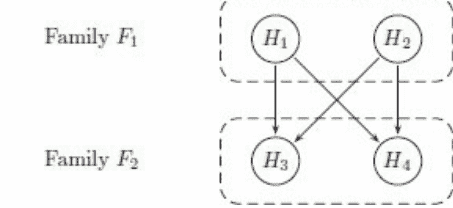

案例研究 5 中 ARDS 试验的两个零假设族。族 $F_1$ 是并行门员，只有在拒绝至少一个主要假设时，才对次要终点进行分析。

构建基于混合的门控程序的下一步是为每个族定义一个组件程序。作为示例，案例研究 5 将使用以下组件程序：

- 族 $F_1$：Bonferroni 程序。
- 族 $F_2$：Holm 程序。

表 5.8 展示了使用混合方法为闭合族中的 $2^4 - 1 = 15$ 个交假设计算的交集 $p$ 值。交假设 $H_2 \setminus H_3 \backslash H_4$ 将用于说明使用 5.6.2 节描述的混合方法通用原理计算交集 $p$ 值的过程。对于该交假设，我们有 $I = \{2, 3, 4\}, I_1 = \{2\}, I_2 = \{3, 4\}$。

如第 5.6.2 节所示，如果交集中包含一个主要假设，则该假设被视为已接受。在这种情况下，$I_1 = \{2\}$，意味着在主要中 $H_1$ 被拒绝而 $H_2$ 被接受。基于并行限制，由于拒绝了至少一个主要假设，$H_3$ 和 $H_4$ 是可测试的。这意味着次要族中的限制索引集等于原始索引集，即 $I^r$。

### 表 5.8 案例研究 5 中的交集 $p$ 值

| 索引集 $I$ | 受限索引集 $I^r$ | 交集 $p$ 值 $p(I)$ |
| :--- | :--- | :--- |
| {1234} | {12} | $\min(p_1/5, p_2/5)$ |
| {123} | {12} | $\min(p_1/5, p_2/5)$ |
| {124} | {12} | $\min(p_1/5, p_2/5)$ |
| {12} | {12} | $\min(p_1/5, p_2/5)$ |
| {134} | {134} | $\min(p_1/5, p_3/25, p_4/25)$ |
| {13} | {13} | $\min(p_1/5, p_3/5)$ |
| {14} | {14} | $\min(p_1/5, p_4/5)$ |
| {1} | {1} | $p_1/5$ |
| {234} | {234} | $\min(p_2/5, p_3/25, p_4/25)$ |
| {23} | {23} | $\min(p_2/5, p_3/5)$ |
| {24} | {24} | $\min(p_2/5, p_4/5)$ |
| {2} | {2} | $p_2/5$ |
| {34} | {34} | $\min(p_3/5, p_4/5)$ |
| {3} | {3} | $p_3/5$ |
| {4} | {4} | $p_4/5$ |

方法，交集 $p$ 值等于：

$p(I) = \min \frac{p_1(I_1)p_2(I_2)}{c_1(I)c_2(I)}$

如 5.6.2 节解释所示，$c_1(I)$ 等于 1，$c_2(I)$ 对应于测试族 $F_1$ 中的假设后剩余的 $\alpha$。在这个交集中，只有 $H_1$ 被拒绝，其 $\alpha$ 水平（根据 Bonferroni 测试为 $\alpha/2$）可以转移到 $F_2$，这意味着 $c_2(I) = 1/2$。由于 $p_1(I_1)$ 和 $p_2(I_2)$ 是应用于 $I_1$ 和 $I_2^*$ 的调整后 $p$ 值，我们有：

$p_1(I_1) = 2p_2$ 且 $p_2(I_2^*) = 2\min(p_3, p_4)$

结果为：

$p(I) = \min(p_2/0.5, p_3/0.25, p_4/0.25)$

**程序 5.15** 使用 `%MixGate` 宏应用此门控程序对 ARDS 试验进行多重性调整，如下述两种场景：

- 场景 1 假设实验治疗在主要终点方面具有统计学显著改善。双侧原始 $p$ 值为 $p_1 = 0.002, p_2 = 0.024, p_3 = 0.010, p_4 = 0.005$。
- 在场景 2 下，VFD 终点的分析得出显著结果，但与 28 天全因死亡率的治疗差异仅为边缘显著。双侧原始 $p$ 值为 $p_1 = 0.002, p_2 = 0.030, p_3 = 0.010, p_4 = 0.005$。

假设在两种情况下，次要分析均产生高度显著的结果。

## 程序 5.15 案例研究 5 中基于 Bonferroni 的门控程序

```sas
/* Testing strategy under Scenario 1 */
data study;
input hyp $ family parallel $ serial $ rawp;
datalines;
H1 1 0000 0000 0.002
H2 1 0000 0000 0.024
H3 2 1100 0000 0.010
H4 2 1100 0000 0.005
run;
```

```sas
/* Bonferroni-based gatekeeping procedure */
%MixGate(Indata=study,method=Standard,test=Bonf,adpout=adj);

title "Bonferroni-based gatekeeping - Scenario 1 Adjusted
proc print data=adjp noobs label;
var adj_p1-adj_p4;
run;
```

```sas
var adj_p1-adj_p4;
run;
```

# 程序 5.15 的输出

## 基于 Bonferroni 的门控程序 - 场景 1 调整后 p 值

| 调整后 | 调整后 | 调整后 | 调整后 |
| :--- | :--- | :--- | :--- |
| p-value | p-value | p-value | p-value |
| H1 | H2 | H3 | H4 |
| 0.0040 | 0.0480 | 0.0200 | 0.0200 |

## 基于 Bonferroni 的门控程序 - 场景 2 调整后 p 值

| 调整后 | 调整后 | 调整后 | 调整后 |
| :--- | :--- | :--- | :--- |
| p-value | p-value | p-value | p-value |
| H1 | H2 | H3 | H4 |
| 0.0040 | 0.0600 | 0.0200 | 0.0200 |

输出 5.15 列出了每种治疗效应场景下的调整后 p 值。在场景 1 中，主要假设的调整后 p 值在双侧 5% 水平下均显著。由于两个主要假设均被拒绝，基于 Bonferroni 的门控程序继续对次要假设进行测试，这两个假设在该场景下也被拒绝了。场景 2 展示了一个更有趣的情况。与 $H_1$ 相关的调整后 p 值小于 0.05，而 $H_2$ 的调整后 p 值大于 0.05。这意味着在场景 2 中，在经过多重性调整后，只有一种主要比较在 5% 水平下显著（即与 VFD 终点的比较）。由于主要假设是以并行方式测试的，Bonferroni 门控程序只需要一个显著的主要比较即可进入第二阶段并测试次要假设。与次要假设相关的原始 p 值非常显著，因此基于 Bonferroni 的门控程序在场景 2 中成功拒绝了 $H_3$ 和 $H_4$。

与案例 4 中的串行门控程序类似，很容易证明案例 5 中使用的并行门控程序也有简单的分步版本，这使得试验赞助者无需检查闭合族中的所有交假设即可测试假设：

- 步骤 1。在 $\alpha = 0.05$ 下使用 Bonferroni 程序测试 $H_1$ 和 $H_2$。如果至少拒绝一个假设，进入步骤 2。否则，接受所有假设并停止。
- 步骤 2。令 $k$ 为步骤 1 中拒绝的假设数量（$k = 1, 2$）。使用 Holm 程序在 $ka/2$ 下测试 $H_3$ 和 $H_4$。

# 案例 6 中基于 Hommel 的门控程序

在案例 4 和 5 中，使用了基本的 Bonferroni 门控程序，并仅使用一个串行或并行门控定义了逻辑限制。案例 6 的精神分裂症试验提供了一个更复杂的设置，将用于演示从 Hommel 程序推导出的更强大的门控程序的构建。在这个例子中，有三个剂量的实验治疗（剂量 L、M 和 H）需要与安慰剂进行比较，涉及主要终点（终点 P）和两个关键次要终点（终点 S1 和 S2）。产生的九个无效应零假设记为 $H_1, \dots, H_9$。零假设被分为三个对应于三个终点的族，并从第一个开始顺序测试族：

- $F_1 = \{H_1, H_2, H_3\}$ (终点 P)
- $F_2 = \{H_4, H_5, H_6\}$ (终点 S1)
- $F_3 = \{H_7, H_8, H_9\}$ (终点 S2)

这里，零假设 $H_1, H_4$ 和 $H_7$ 对应于剂量 L 与安慰剂的比较；$H_2, H_5$ 和 $H_8$ 对应于剂量 M 与安慰剂的比较；最后，$H_3, H_6$ 和 $H_9$ 对应于剂量 H 与安慰剂的比较。


如图 5.18 所示，该试验中的逻辑限制是通过三个独立的序列定义的。只有当序列中所有之前的假设都被拒绝时，零假设才是可测试的，而不可测试的假设会自动取消而无需测试。如果假设 `H_1` 未被拒绝，则没有证据表明剂量 L 下的主要终点具有显著的治疗效果，此时评估相同剂量下次要终点的治疗效果就不再具有临床意义。这意味着该序列中的另外两个假设（`H_4` 和 `H_7`）是不可测试的。

# 图 5.18 案例 6

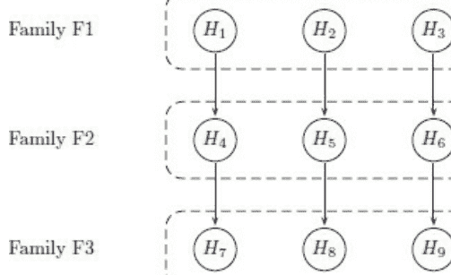

案例 6 精神分裂症试验中的三个假设族。九个假设组织成三个对应于每个剂量-安慰剂比较的测试序列。每个序列内部都实施了串行逻辑限制，以考虑具有临床意义的关系。

三个族的组成程序基于 Hommel 程序，因为它与 Bonferroni、Holm 或 Hochberg 等程序相比具有更高的效能（见第 5.3 节）。在本例中，截断 Hommel 程序由截断参数 $\gamma$ 定义。注意 Hommel(1) 等同于常规 Hommel 程序。

案例 6 中基于 Hommel 的门控程序使用了：

- 族 $F_1$：截断 Hommel 程序：Hommel($\gamma_1$)。
- 族 $F_2$：截断 Hommel 程序：Hommel($\gamma_2$)。
- 族 $F_3$：常规 Hommel 程序。

为了定义此多重问题中单个假设的决策规则，建立了由 $H_1, \dots, H_9$ 组成的闭合族。没有简单的算法可用，需要计算 $2^9 - 1 = 511$ 个交 p 值，这凸显了高效软件实现基于 Hommel 的门控程序的重要性。门控程序遵循混合方法的原则。构建 $H_I$ 表示闭合族中的任意交。使用第 5.6 节引入的符号，与 $H_I$ 相关的 p 值计算公式从两个族扩展到三个族为：

```
p(I) = \min \left[ \frac{p_1(I)}{c_1(I)}, \frac{p_2(I)}{c_2(I)}, \frac{p_3(I)}{c_3(I)} \right]
```

基于 Hommel 的门控程序使用的 $p$ 值（即 $p_1(I), p_2(I)$ 和 $p_3(I)$）以及 $c_i(I), i = 1, 2, 3$ 的推导过程见附录。为了使用 `%MixGate` 宏演示基于 Hommel 的门控程序，为了简单起见，将截断参数设置为 $\gamma_1=0.5$ 和 $\gamma_2=0.5$。程序 5.16 显示了如何在示例中设置多个假设序列的测试策略，并比较了使用基于 Hommel 和基于 Bonferroni 的门控程序计算的调整后 p 值，对应的单侧原始 p 值如下：

- 族 $F_1$（终点 P）：$p_1=0.1430, p_2=0.0095, p_3=0.0088$。
- 族 $F_2$（终点 S1）：$p_4=0.0559, p_5=0.0051, p_6=0.0021$。
- 族 $F_3$（终点 S2）：$p_7=0.1781, p_8=0.0015, p_9=0.0008$。

```sas
/* Testing strategy */
data study;
input hyp $ family parallel $ serial $ rawp;
datalines;
H1 1 00000000 00000000 0.1403
H2 1 00000000 00000000 0.0095
H3 1 00000000 00000000 0.0088
H4 2 00000000 100000000 0.0559
H5 2 00000000 010000000 0.0051
H6 2 00000000 010100000 0.0021
H7 3 00000000 101000000 0.1781
H8 3 00000000 010100000 0.0015
H9 3 00000000 010100100 0.0008
run;
```

```sas
/*Bonferroni-based gatekeeping procedure */
%MixGate(Indata=study,method=Standard,test=Bonf,
adjpout=adjp1);
```

```sas
/*Hommel-based gatekeeping procedure */
%MixGate(Indata=study,method=Standard,test=Hommel,
gamma=0.5#0.5,adjp2=adjp2);
```

```sas
proc transpose data=adjp1 out=t_adjp1 prefix=bonf;
var adj_p1-adj_p9;
run;
```

```sas
proc transpose data=adjp2 out=t_adjp2 prefix=hommel;
var adj_p1-adj_p9;
run;
```

```sas
data adjap (drop=_NAME_);
merge t_adjp1 t_adjp2;
by _NAME_;
label _LABEL="Null hypotheses" bonf="Bonferroni-based"
hommel="Hommel-based";
run;

proc print data=adjap label;
title "Bonferroni and Hommel-based gatekeeping Adjusted p-values";
```

# 程序 5.16 输出

| Bonferroni and Hommel-based gatekeeping Adjusted p-values | | |
|---|---|---|
| Null hypotheses | Bonferroni-based | Hommel-based |
| Adjusted p-value H1 | 0.4209 | 0.2105 |
| Adjusted p-value H2 | 0.0285 | 0.0228 |
| Adjusted p-value H3 | 0.0264 | 0.0211 |
| Adjusted p-value H4 | 0.4209 | 0.2105 |
| Adjusted p-value H5 | 0.0285 | 0.0230 |
| Adjusted p-value H6 | 0.0264 | 0.0211 |
| Adjusted p-value H7 | 0.4209 | 0.2105 |
| Adjusted p-value H8 | 0.0285 | 0.0230 |
| Adjusted p-value H9 | 0.0264 | 0.0228 |

输出 5.16 显示了使用基于 Bonferroni 和基于 Hommel 的门控程序得到的调整 p 值。单个假设检验在单侧 $\alpha = 0.025$ 下进行。可以看出，使用基于 Hommel 的门控程序计算的所有调整 p 值在数值上都比基于 Bonferroni 方法的小。结果显示，基于 Hommel 的门控程序成功地拒绝了大量的假设，并在中等和高剂量下建立了显著的治疗效应（`H_2, H_3, H_5, H_6` 均被拒绝）。基于 Bonferroni 的门控程序没有拒绝任何假设，因为调整 p 值大于 0.025。在本例中，基于 Hommel 的门控程序相比基于 Bonferroni 的方法具有明显的优势。截断参数 $\gamma_1$ 和 $\gamma_2$ 被设置为 0.5，以说明程序 5.16 的实现。重要的是，这些参数有助于控制三个假设族之间的功效水平。以 $\gamma_1$ 为例，当该参数设置为接近 1 的值时，$F_1$ 中使用的程序非常接近 Hommel 程序，这增加了主要终点的功效，但可能降低次要终点的功效。另一方面，当 $\gamma_1 = 0$ 时，截断 Hommel 程序简化为 Bonferroni 程序，导致 $F_1$ 的功效较低，但可能会提高后续族的功效。为了确保三个族之间的概率平衡，需要对截断参数进行优化选择，这可以通过临床试验模拟来实现（Brechenmacher et al., 2011; Dmitrienko et al., 2011）。关于具有复杂目标的临床试验优化的通用方法，请参见 Dmitrienko 和 Pulkstenis (2017)。

## 5.6.4 混合法 (Modified mixture method)

Dmitrienko 等人 (2016) 开发了一种用于构建针对多个分支零假设的门控程序的新混合法公式。这类多重性问题由 Dmitrienko 等人 (2009) 定义，并适用于有序终点的 III 期试验中的常见情况，例如案例 6。Dmitrienko 等人 (2016) 显示，对于这类多重性问题，混合法相比标准混合法具有均匀的功效提升。

混合法在概念上与标准方法相似，因为它们都依赖于闭合原理。区别在于在闭族中定义交 p 值的规则。事实上，与标准方法相比，试验特定的限制在混合法中起着更重要的作用。标准与混合方法之间的数学细节和主要差异在本章的附录中。可以通过分别设置 `method=Standard` 和 `method=Modif` 使用 `%MixGate` 宏来实现标准方法和混合法。

在本节中，将使用 `%MixGate` 宏来量化案例 6 精神分裂症试验中基于 Hommel 的门控程序时，混合法相对于标准方法的功效提升。多目标临床试验的功效计算过程遵循单主要目标试验的相同通用原则。多个假设设置下的样本量和功效计算的通用考虑因素已在文献中讨论。参见 Senn 和 Bretz (2007)、Bretz 等人 (2011b)、Dmitrienko 等人 (2011)、Dmitrienko 和 D'Agostino (2013) 以及 Dmitrienko 等人 (2015)。重要的是，在多目标临床试验中，通常没有计算功效的直接公式，通常使用基于模拟的方法。使用案例 6 的精神分裂症试验，将在单侧 $\alpha =0.025$ 下进行模拟。假设三个终点之间的两对相关性值为：$\rho (P, S1) = 0.8$，$\rho (P, S2) = 0.4$，$\rho (S1, S2) = 0.3$。基于这些假设，程序 5.17 调用 `%MultiSequl` 宏创建一组 10,000 个模拟单侧 p 值，将用于功效计算。该宏创建的可用于临床试验模拟的数据集。它需要以下参数：

- `ntest`: 每个族中的检验数量。
- `n_fam`: 族的数量。
- `n_subj`: 每个试验组的患者数（假设平衡设计）。
- `out`: 带有模拟 p 值的输出数据集名称。
- `n_sim`: 模拟运行次数。
- `seed`: 模拟中使用的种子。
- `eff_size`: 效应量向量（族由 # 分隔）。
- `sigma`: 相关系数矩阵（族由 # 分隔）。

该宏在程序 5.17 中使用，背景是具有 6 个分支和三个假设族的案例 6，但一般情况下，`%MultiSequl` 宏可以用于任意数量的零假设序列或族。该程序创建的 `rawp` 数据集包含 10,000 行，每行对应一次模拟运行，九个变量分别对应假设。

# 程序 5.17 案例 6 中的模拟数据集

```sas
%MultiSequl(nHest=3,n_fam=3,n_subj=120,n_sim=10000,
out=rawp,seed=12234,
eff_size=0 0.37 0.37#0 0.37 0.37#0 0.37
sigma=1 0.8 0.4#0.8 1 0.3#0.4 0.3 1);
```

现在可以调用 `%MixGate` 宏，使用 `rawp` 数据集计算单个零假设的边际功效。注意，此宏创建一个数据集，即名称在宏参数 `pvalout` 中指定，该参数包含了基于 10,000 次模拟的特定门控程序调整后的 p 值。这使用户能够根据任何自定义成功准则计算功效。

程序 5.18 调用 `%MixGate`，使用标准方法和修正方法比较了当 $\gamma_1 = \gamma_2 = 0.5$ 时，基于 Hommel 的门控程序的运行特性。关注的特征包括每个单独零假设的边缘功效，以及在单侧全局族性错误率（FWER）为 $\alpha=0.025$ 时的以下自定义成功准则。

- 成功准则：在族 $F_1$ 类中至少拒绝一个假设，在族 $F_2$ 类中至少拒绝一个假设，且在族 $F_3$ 类中至少拒绝一个假设的概率。

自定义成功准则使用程序 5.18 中定义的 `%Custom` 宏进行评估。该成功准则反映了具有多个终点的临床试验中典型的目标集。参见 Brebacher 等人 (2011)。关于在复杂临床目标试验中定义成功准则的其他流行方法在 Dmitrienko 和 Pulkstein (2017) 中进行了讨论。

## 程序 5.18 标准方法与修正方法的功效比较

```sas
/* Testing strategy */
data study;
input hyp $ family parallel $ serial $;
datalines;
H1 1 000000000 000000000
H2 1 000000000 000000000
H3 1 000000000 000000000
H4 2 000000000 1000000000
H5 2 000000000 0100000000
H6 2 000000000 001000000
H7 3 000000000 101000000
H8 3 000000000 010100000
H9 3 000000000 001010000
run;
/* Hommel-based gatekeeping procedure */
/* Marginal power of the 9 null hypothesis tests */
%MixGate(Indata=study,method=Standard,test=Hommel,
gamma=0.5#0.5, rawp=rawp,powout=indpow,
pvalue=adjp1);
%MixGate(Indata=study,method=Modify,test=Hommel,
gamma=0.5#0.5, rawp=rawp,powout=indpow2,
pvalue=adjp2);

proc transpose data=indpow out=t_pow prefix=standard;
var hyp1-hyp9;
run;

proc transpose data=indpow2 out=t_pow2 prefix=modified;
var hyp1-hyp9;
run;

data indpow (drop=_NAME_);
merge t_pow t_pow2;
by _name_;
label _label="Null hypotheses" standard1="Standard method"
modified1="Modified method";
run;

title "Standard and modified mixture methods Marginal power";
proc print data=indpow noobs label;
run;
```

```sas
/* Power for the custom success criterion */
%macro Custom(method=,label=);
data critpow&method (keep=_label_ critpow&method);
set adjp&method;
_label_="Success criterion";
crit=((adj_p1<=0.025) | (adj_p2<=0.025)
| (adj_p3<=0.025))=1
& ((adj_p4<=0.025) | (adj_p5<=0.025)
| (adj_p6<=0.025))=1
& ((adj_p7<=0.025) | (adj_p8<=0.025)
| (adj_p9<=0.025))=1);
if crit=1 then critpow&method=1;
if _n_=10000;
critpow&method=sum(critpow&method)*100/10000;
label critpow&method="&label method" _label_="Power";
run;
%mend;

%Custom(method=1,label=Standard);
%Custom(method=2,label=Modified);

data critpow;
merge critpow1 critpow2;
by _label_;
run;

title "Standard and modified mixture methods Power (%) for the custom success criterion";
proc print data=critpow label;
run;
```


## 程序 5.18 输出：标准与修正的混合方法边缘功效 (%)

| 零假设 | 标准方法 | 修正方法 |
| :--- | :--- | :--- |
| Individual power H1 | 1.60 | 1.60 |
| Individual power H2 | 70.58 | 70.58 |
| Individual power H3 | 69.67 | 69.67 |
| Individual power H4 | 0.64 | 0.64 |
| Individual power H5 | 54.50 | 56.52 |
| Individual power H6 | 53.84 | 55.76 |
| Individual power H7 | 0.14 | 0.14 |
| Individual power H8 | 32.15 | 40.54 |
| Individual power H9 | 31.21 | 40.26 |

## 标准与修正混合方法：自定义成功准则的功效 (%)

| 标准 | 修正方法 |
| :--- | :--- |
| 43.29 | 52.9 |

名称在宏参数 `pvalout` 中指定，该参数包含了 10,000 次模拟的特定门控程序（gatekeeping procedure）调整后的 p 值。这使用户能够根据任何自定义成功准则计算功效。

程序 5.18 调用 `%MixGate()`，使用标准方法和修正方法比较了当 $\gamma_1 = \gamma_2 = 0.5$ 时，基于 Hommel 的门控程序的运行特性。关注的特征包括每个单独零假设（null hypothesis）的边缘功效，以及在单侧全局族性错误率（FWER）为 $\alpha=0.025$ 时的以下自定义成功准则。

- 成功准则：在族 $F_1$ 类中至少拒绝一个假设，在族 $F_2$ 类中至少拒绝一个假设，且在族 $F_3$ 类中至少拒绝一个假设的概率。

自定义成功准则使用程序 5.18 中定义的 `%Custom()` 宏进行评估。该成功准则反映了具有多个终点的临床试验中典型的目标集。参见 Brebacher 等人 (2011)。关于在复杂临床目标试验中定义成功准则的其他流行方法在 Dmitrienko 和 Pulkstein (2017) 中进行了讨论。

## PROGRAM 5.18：标准方法与修正方法的功效比较

```sas
/* Testing strategy */
data study;
input hyp $ family parallel $ serial $;
datalines;
H1 1 000000000 000000000
H2 1 000000000 000000000
H3 1 000000000 000000000
H4 2 000000000 1000000000
H5 2 000000000 0100000000
H6 2 000000000 001000000
H7 3 000000000 101000000
H8 3 000000000 010100000
H9 3 000000000 001010000
run;

/* Hommel-based gatekeeping procedure */
/* Marginal power of the 9 null hypothesis tests */
%MixGate(Indata=study, method=Standard, test=Hommel,
         gamma=0.5#0.5, rawp=rawp, powout=indpow,
         pvalue=adjp1);
%MixGate(Indata=study, method=Modify, test=Hommel,
         gamma=0.5#0.5, rawp=rawp, powout=indpow2,
         pvalue=adjp2);

proc transpose data=indpow out=t_pow prefix=standard;
var hyp1-hyp9;
run;

proc transpose data=indpow2 out=t_pow2 prefix=modified;
var hyp1-hyp9;
run;

data indpow (drop=_NAME_);
merge t_pow t_pow2;
by _name_;
label _label="Null hypotheses" standard1="Standard method"
      modified1="Modified method";
run;

title "Standard and modified mixture methods Marginal power";
proc print data=indpow noobs label;
run;

/* Power for the custom success criterion */
%macro Custom(method=, label=);
data critpow&method (keep=_label_ critpow&method);
set adjp&method;
_label_="Success criterion";
crit=((adj_p1<=0.025) and (adj_p2<=0.025)
      and (adj_p3<=0.025))
     * ((adj_p4<=0.025) and (adj_p5<=0.025)
        and (adj_p6<=0.025))
     * ((adj_p7<=0.025) and (adj_p8<=0.025)
        and (adj_p9<=0.025));
if crit=1 then critpow&method=1;
if simnum=10000;
critpow&method=(critpow*100)/10000;
label critpow&method="&label method" _label_="Power";
run;
%mend;

%Custom(method=1, label=Standard);
%Custom(method=2, label=Modified);

data critpow;
merge critpow1 critpow2;
by _label_;
run;

title "Standard and modified mixture methods
Power (%) for the custom success criterion";
proc print data=critpow label;
run;
```


```
/* Power for the custom success criterion */
%macro Custom(method=,label=)
data critpow&method (keep=_label_ critpow&method);
set adjp&method;
_label_="Success criterion";
crit=((adj_p1<=0.025) (adj_p2<=0.025)
(adj_p3<=0.025))&&62=1
*((adj_p4<=0.025) (adj_p5<=0.025)
(adj_p6<=0.025))=1
*((adj_p7<=0.025) (adj_p8<=0.025)
(adj_p9<=0.025))=1);
if crit=1 then critpow&method 1;
if simnum=10000;
critpow&method={critpow*100}/10000;
label critpow&method="&label method" _label_="P
run;
%mend;

%Custom(method=1,label=Standard);
%Custom(method=2,label=Modified);

data critpow;
merge critpow critpow2;
by _label_;
run;

title "Standard and modified mixture methods
Power (%) for the custom success criterion";
proc print data=critpow label;
run;
```

## 5.7 References

Alosh, M., Huque, M.F. (2009). A flexible strategy for testing subgroups and overall population. *Statistics in Medicine 28, 3-23.*

Alosh, M., Bretz, F., Huque, M.F. (2014). Advanced multiplicity methods in clinical trials. *Statistics in Medicine 33, 693-713.*

Bauer, P., Röhmel, J., Maurer, W., Hothorn, L. (1998). Testing strategies in multi-dose experiments including active control. *Statistics in Medicine 17, 2133-2146.*

Benjamini, Y., Hochberg, Y. (1995). Controlling the false discovery rate: a new and powerful approach to multiple testing. *Journal of Royal Statistical Society B 57, 1289-1300.*

Benjamini, Y., Hochberg, Y. (1997). Multiple hypothesis testing with weights. *Scandinavian Journal of Statistics 24, 407-418.*

Brechenmarker, T., Tu, J., Dmitrienko, A., Tamhane, A.C. (2011). A mixture gatekeeping procedure based on the Hommel test for clinical trial applications. *Journal of Biopharmaceutical Statistics 21, 748-767.*

Bretz, F., Maurer, W., Brannath, W., Posch, M. (2009). A graphical approach to sequentially rejective multiple test procedures. *Statistics in Medicine 28, 586-604.*

Bretz, F., Posch, M., Glimm, E., Klinglmueller, F., Maurer, W., Rohmeyer, K. (2011a). 使用加权 Bonferroni、Simes 或参数检验的多重比较程序的图形化方法。生物测量学杂志 53(6), 894-913.

Bretz, F., Maurer, W., Hommel, G. (2011b). 使用序列图形程序进行多终点分析的检验与效能考量。医学统计学 30(13), 1489-1501.

Dmitrienko, A., Off, W., Westfall, P.H. (2003). 无需所有主要效应均显著的临床试验中的门控控制策略。医学统计学 22, 2387-2400.

Dmitrienko, A., Wiens, B.L. Tamhane, A.C., Wang, X. (2007). 具有分级顺序多目标临床试验中的树结构门控控制策略。医学统计学 26, 2465-2478.

Dmitrienko, A., Tamhane, A.C., Wiens, B.L. (2008). 通用多阶段门控程序。生物测量学杂志 50, 667-678.

Dmitrienko, A., Bretz, F., Westfall, P.H., Troendle, J., Wiens, B.L., Tamhane, A.C., Hsu, J.C. (2009). 多重检验方法论。药物统计学中的多重检验问题。Dmitrienko, A., Tamhane, A.C., Bretz, F. (编)。纽约：Chapman and Hall/CRC Press.

Dmitrienko, A., Tamhane, A.C. (2011). 临床试验中门控应用的多重检验程序混合。医学统计学 31(13), 1473-1488.

Dmitrienko, A., Millen B., Brechenmacher T., Pux G. (2011). 确认性临床试验中门控策略的开发。生物测量学杂志 53, 875-893.

Dmitrienko, A., D'Agostino, R.B. (2013). 生物统计学教程：临床试验中的传统多重性调整方法。医学统计学 32, 5172-5218.

Dmitrienko, A., D'Agostino, R.B., Huque, M.F. (2013). 临床药物开发中的关键多重性问题。医学统计学 32, 1079-1111.

Dmitrienko, A., Tamhane, A.C. (2013). 门控混合程序的通用理论。生物测量学杂志 55, 402-419.

Dmitrienko, A., Paux, G., Brechenmacher, T. (2015). 具有复杂临床目标的临床试验效能计算。日本计算统计学会杂志 28, 15-50.

Dmitrienko, A., Kordakhia, G., Brechenmacher, T. (2016). 具有多个假设序列的多重性问题的基于混合的门控程序。生物药统计学杂志 26, 758-780.

Dmitrienko, A., Pulkstis, E (2017) (编)。使用 R 优化临床试验。纽约：Chapman and Hall/CRC Press.

Dunnett, C.W. (1955). 用于与对照组比较多种处理的多重比较程序。美国统计协会杂志 50, 1096-1121.

Dunnett, C.W., Tamhane, A.C. (1991). 不平衡单向设计中与对照组比较处理的递减式多重检验。医学统计学 10, 939-947.

Dunnett, C.W., Tamhane, A.C. (1992). 一种上升式多重检验程序。美国统计协会杂志 87, 162-170.

EMA. (2002)。 临床试验中多重性问题的考虑点。欧洲药品管理局/人体药品使用委员会.

EMA. (2017)。 临床试验中多重性问题的指南（草案）。欧洲药品管理局/人体药品使用委员会.

FDA (2017)。 行业指导草案：临床试验中的多终点。美国食品食品药品管理局.

Finner, H., Strassburger, K. (2002)。 划分原理：多重决策理论中的有力工具。统计学年鉴 30, 1194-1213.

Goeman, J.J., Solari, A. (2010)。 全族误差控制的序列拒绝原理。统计学年鉴 38, 3782-3810.

Hochberg, Y., Tamhane, A.C. (1987)。 多重比较程序。纽约：John Wiley.

Hochberg, Y. (1988)。 用于多重显著性检验的更精确的 Bonferroni 程序。生物测量学 75, 800-802.

Holm, S. (1979)。 一种简单的序列检验。斯堪的纳维亚统计杂志 6, 65-70.

Hommel, G. (1983)。 任意依赖下的总假设检验。生物测量学杂志 25, 423-430.

Hommel, G. (1986)。 任意依赖下的多重检验程序。生物测量学 33, 321-336.

Hommel, G. (1988)。 基于修正 Bonferroni 检验的阶段性多重程序。生物测量学 75, 383-386.

Hommel, G. (1989)。 两种修正 Bonferroni 程序的比较。生物测量学 76, 624-625.

Holland, B.S., West, M.D. (1987)。 一种上升式多重检验“Lehne ab, wenn n unter gegebenen Tests”。生物测量学 43, 737-743.

Hsu, J.C. (1996)。 多重比较：理论与方法。伦敦：Chapman and Hall.

Hsu, J.C., Berger, R.L. (1999)。 针对剂量反应的递进式多重检验。美国统计学杂志 94, 468.

Step.

Liu, W. (1996)。 针对从族假设的多重性调整。统计学杂志 58, 455-482.

Liu, Y. (2009)。 针对主要终点的多重检验。美国统计学杂志 104, 1661-1670.

Marcus, R., Peritz, E., Gabriel, K. (1976)。 针对方差的 Simes 方法。统计学年鉴 25, 555-660.

Millen, B., Dmitrienko, A. (2011)。 确认性临床试验中门控策略的开发。生物测量学杂志 53, 875-893.

Naik, U. (1975)。 针对临床试验的筛选规则.

Tamhane, A.C. (2008)。 修正 Hochberg 程序。生物测量学 95, 279-294.

Sidák, Z. (1967)。 多变量正态分布的置信区域。美国统计学杂志 62, 626-633.

Simes, R. (1986)。 用于多重检验的改进 Bonferroni 程序。生物测量学 63, 655-660.

Senn, G., Bretz, F. (2007)。 针对多终点的 Simes 方法。药物统计学 6, 161-170.

Sarkar, S.K. (1998)。 关于随机变量 Simes 不等式。统计学年鉴 26, 494-504.

Sarkar, S.K. (2001)。 序列检验。统计规划与推理 99, 25-40.

# 5.8 附录

# 门控程序：通用算法

考虑使用门控程序检验 `H_1, ..., H_m`。FWER 必须针对预定义的 `α` 进行强保护，例如单侧 `α = 0.025`。通用门控程序基于序列算法（Bretz 等，2009），该算法依赖于假设重置的预定义排序。为了设置检验算法，令 `w_i` 为分配给 `H_b` 的权重，令 `a_i = w_iα` 表示假设 `H_b` 的初始显著水平，`i = 1, ..., m`，其中

```
$w_i \ge 0, i = 1, \dots, m,
\sum_{i=1}^m w_i = 1$.
```

定义转换参数的初始矩阵

传播过程由下式给出

```
$$\begin{pmatrix} g_{11} & \dots & g_{1m} \\ \vdots & \ddots & \vdots \\ g_{m1} & \dots & g_{mm} \end{pmatrix}$$
```

转移参数定义了每次拒绝后更新未拒绝假设显著性水平的规则，并假设它们满足以下条件：

```
$g_{ii} = 0, \sum_{j=i}^m g_{ij} = 1, i = 1, \dots, m.$
```

最后，令 `M` 表示未拒绝假设的索引集。注意在算法开始时，`M = {1, ..., m}`。串行检验算法定义如下：

- 步骤 1。如果 `p_1 ≤ α_1`，则拒绝 `H_1`。如果该假设被拒绝，则从索引集 `M` 中移除其索引，并按如下方式更新未拒绝假设的显著性水平和转移参数：

```
$$\alpha_j = \alpha_j + \alpha_1g_{1j}, j \in M,$
```

```
$g_{jk} = \frac{g_{jk} + g_{ij}g_{ik}}{1 - g_{ij}g_{jk}}, j, k \in M; g_{jk} = 0 \text{ otherwise}.$
```

如果存在任何未拒绝的假设，继续进行步骤 2；否则停止检验。

- 步骤 `i = 2, ..., m`。如果 `p_i ≤ α_i`，则拒绝 `H_i`。如果该假设被拒绝，则从索引集 `M` 中移除其索引，并按如下方式更新未拒绝假设的显著性水平和转移参数：

```
$$\alpha_j = \alpha_j + \alpha_ig_{ij}, j \in M,$
```

```
$g_{jk} = \frac{g_{jk} + g_{ij}g_{ik}}{1 - g_{ij}g_{jk}}, j, k \in M; g_{jk} = 0 \text{ otherwise}.$
```

如果存在任何未拒绝的假设，继续执行步骤 `i + 1`；否则停止检验。

- 步骤 `m`。如果 `p_m ≤ α_m`，则拒绝 `H_m`。如果该假设被拒绝，则从索引集 `M` 中移除其索引，并按如下方式更新未拒绝假设的显著性水平和转移参数：

```
$\alpha_j = \alpha_j + \alpha_{mj}, j \in M$
$g_{jk} = \frac{g_{jk} + g_{jmk}}{1 - g_{mj}}, j, k \in M; g_{jk} = 0 \text{ otherwise}.$
```

如果仍存在未拒绝的假设，返回步骤 1 并重新测试这些假设；否则停止检验。

## 截断 Hommel 程序 (Truncated Hommel procedure)

截断 Hommel 程序在第 5.6.3 节中引入，可以写成步进检验算法的形式。为了定义该算法，考虑一组零假设 `H_1, ..., H_m`，其中 `P_1, ..., P_m` 表示对应的原始 `p` 值。排序后的假设分别记为 `P_{(1)} < ... < P_{(m)}` 和 `H_{(1)}, ..., H_{(m)}`。此外，令 `γ (0 ≤ γ ≤ 1)` 为截断 Hommel 程序的截断参数，令 `a` 为预指定的 FWER。

截断 Hommel 程序可以使用以下步进检验算法实现，算法从 `H_{(m)}` 开始：

- 步骤 `i = 1`。如果 `P_{(m)} > [γ + (1 - γ)/m]a`，则接受 `H_{(m)}`。如果接受 `H_{(m)}`，则进入步骤 2。否则停止检验并拒绝所有零假设。

- 步骤 `i = 2, ..., m - 1`。如果对于所有 `j = 1, ..., i`，都有 `P_{(m-i+j)} > [γ/i + (1 - γ)/m]a`，则接受 `H_{(m-i+1)}` 并进入步骤 `i+1`。否则停止检验并拒绝所有的所有零假设 `H_{(j)}, j = 1, ..., m - i + 1`，前提是 `P_{(j)} ≤ [γ/(i - 1) + (1 - γ)/m]α`。

- 步骤 `i = m`。如果对于所有 `j = 1, ..., m`，都有 `H_{(j)} > [γ/m + (1 - γ)/m]α` 或 `p_{(1)} > [γ/(m - 1) + (1 - γ)/m]α`，否则拒绝 `H_{(1)}`。

如果截断参数 `γ` 严格小于 1，则截断 Hommel 程序是可分的 (Dmitrien et al., 2008)。如果 `γ = 1`，截断 Hommel 程序简化为常规 Hommel 程序。

## 使用标准混合方法的基于 Hommel 的门控程序

使用第 5.6.2 节引入的符号，将标准混合方法应用于案例研究 6 的设置中建立基于 Hommel 的门控程序，所示。令 `H_I, I = {1, ..., 9}` 为闭族中的任意交集。`H(I)` 的交集 `p` 值由给出：

```
$p(I) = \min \left[ \frac{p_1(I_1^*)}{c_1(I_1*)}, \frac{p_2(I_2^*)}{c_2(I_2*)}, \frac{p_3(I_3^*)}{c_3(I_3^*)} \right]$
```


其中 $I_i^*, i=1, 2, 3$ 是受限交集，$I_i^* = I_i, p(I_i^*), i=1, 2, 3$ 是分量 $p$ 值，$c_i(I), i=1, 2, 3$ 是定义整体 FWER 比例的族权重。分量 $p$ 值使用截断 Hommel（用于族 $F_1$ 和 $F_2$）或常规 Hommel（用于族 $F_3$）程序计算。令 $p_{(1)} < \dots < p_{(k)}$ 表示索引集 $I_i$ 内排序的 $p$ 值，其中 $k_i$ 表示 $I_i$ 中的索引数量。此外，令 $n_i$ 为族 $F_i$ 中假设的数量，$i=1, 2, 3$。分量 $p$ 值定义如下：

```
$p_i(I_i^*) = \min_{j=1,\dots,k_i} \frac{p_{(j)}}{\gamma + (1-\gamma)/n_i}$
```

如果受限索引集 $I_i^*$ 为空，则分量 $p$ 值简单设置为 1。族权重定义如下：

```
$c_1(I)=1, \frac{2(1-\gamma_1)}{3}, c_2(I)=\frac{2(1-\gamma_2)}{3}, c_3(I)=\frac{2(1-\gamma_3)}{3}$
```

其中 $k_i$ 是 $I_i$ 中的索引数量，$f_i(k_i, n|\gamma)$ 是截断 Hommel 程序的函数。该函数给出：

```
$f_i(k_i, n_i|\gamma)=\gamma_i+\frac{(1-\gamma)k_i}{n_i}$
```

如果 $I_i$ 非空 ($k_i>0$)，否则 $f_i(k_i, n_i|\gamma)=0$。容易看出族权重给出：

```
$c_2(I)=\frac{(1-\gamma_1)(n_1-k_1)}{n_1} \text{ 若 } k_1>0, \text{ 否则 } c_2(I)=1,$
```

```
$c_3(I)=c_2(I)\frac{(1-\gamma_2)(n_2-k_2)}{n_2} \text{ 若 } k_2>0, \text{ 否则 } c_3(I)=c_2(I)$。
```

为了说明基于 Hommel 的门控程序中定义交集 $p$ 值的过程，我们将使用交集假设 $H_2 \cap H_4 \cap H_5 \cap H_9$。容易验证 $I=\{2, 4, 5, 9\}$，$I_1=\{2\}$，$I_2=\{4, 5\}$ 以及 $I_3=\{9\}$。根据串行逻辑限制，如果接受零假设 $H_2$，则零假设 $H_5$ 不可测试。因此，应从 $I^*$ 中移除 $H_5$。当考虑索引 $I_3$ 时，不需要进行更改，因为如果 $H_2, H_4$ 和 $H_5$ 都被接受，零假设 $H_9$ 是可测试的。这意味着 $I_1^*=\{2\}$，$I_2^*=\{4\}$，$I_3^*=\{9\}$。$I^*=\{2, 4, 9\}$。因此，$k_1=1, k_2=2, k_3=1$，且 $k_1^*=k_2^*=k_3^*=1$。由于 $k_i^*=1$ 且 $n_1=3$，用于族 $F_1$ 的分量程序的 $p$ 值为：

```
$p_1(I_1^*) = \frac{p_2}{\gamma_1 + (1-\gamma_1)/3} = \frac{3p_2}{1+2\gamma_1}$
```

同样，

```
$p_2(I_2^*) = \frac{p_4}{\gamma_2 + (1-\gamma_2)/3} = \frac{3p_4}{1+2\gamma_2}$
```

为了定义第三族中的分量 $p$ 值，注意常规 Hommel 程序中的截断参数等于 1，这意味着：

```
$p_3(I_3^*) = \frac{p_9}{1} = p_9$
```

所选交集的族权重为：

```
$c_1(I)=1, c_2(I)=\frac{2(1-\gamma_1)}{3}, c_3(I)=\frac{2(1-\gamma_3)}{3}, \frac{1-\gamma_2}{3}=\frac{2(1-\gamma_1)(1-\gamma_2)}{9}$
```

因为 $k_1=1, k_2=2$ 且 $n_1=n_2=3$。

结果，$H_2 \cap H_4 \cap H_5 \cap H_9$ 的交集 $p$ 值等于：

```
$p(I) = \min\left(\frac{3p_2}{1+2\gamma_1}, \frac{9p_4}{(2-\gamma_1)(1+2\gamma_2)}, \frac{9p_9}{(2-\gamma_1)(1-\gamma_2)}\right)$
```

## 使用修正混合方法的基于 Hommel 的门控程序

修正混合方法下文使用案例研究 6 中的基于 Hommel 的门控程序进行定义。与上述符号相同，令 $N_i$ 为族 $F_i$ 中包含的零假设的索引集，$i=1, 2, 3$。考虑任意交集假设 $H(I), I \subseteq N = \{1, \dots, 9\}$。在改进的混合方法中，$H(I)$ 的交集 $p$ 值定义为：

```
$p^M(I) = \min \left[ \frac{p_1(I|N_1^*)}{\lambda_1^{(I^*)}, \frac{p_2(I|N_2^*)}{\lambda_2^{(I^*)}, \frac{p_3(I|N_3^*)}{\lambda_3^{(I^*)}} \right]$
```

上标 $M$ 用于表示改进族权重，即 $\lambda_1^M(I^*)$、$\lambda_2^M(I^*)$ 和 $\lambda_3^M(I^*)$，并将与标准方法使用的族权重区分开来。

定义交集 $p$值的受限索引集 $L$ 和 $U$ 定义见第 5.6.2 节。也就是说，它们考虑了改进的混合方法的临床相关逻辑限制，即该方法还将逻辑限制纳入了族索引集的定义中。这是通过定义受限索引集 $N_i^*, i = 1, 2, 3$ 实现的。在计算每个组件 $p$ 值 $p_i(I|N_i^*), i = 1, 2, 3$ 时，相应的程序仅应用于测试零假设。

构建受限族索引集，首先注意 $N_i^* = N_i$，因为在第一个族中没有实施逻辑限制。接下来，$N_i^*$ 是 $N_i$ 的子集，仅包含当所有零假设 $H_j \in I \cup \dots \cup U_{i-1}$ 被接受时可测试的零假设（$i = 2, 3$）。令 $n_i^*$ 表示 $N_i^*$ 中的索引数量，$i = 1, 2, 3$。

给定受限族索引集，基于 Hommel 的门控程序中，交集假设 $H(I)$ 的组件 $p$ 值定义为：

```
$p_i(I|N_i^*) = \min_{j=1,\dots,k} \frac{p_{(j)}}{\gamma_j^*/k_j^* + (1-\gamma_j^*)/n_i^*}, i = 1, 2, 3,$
```

其中，与标准混合方法一样，$p_{(1)}\dots p_{(k)}$ 是索引集 $L^*$ 内有序的 $p$ 值，$k_j^*$ 表示 $L^*$ 中的索引数量。改进方法与标准混合方法的一个重要区别在于，在计算组件 $p$ 值 $p_i(I_i|N_i^*)$ 时，用于族 $F_i$ 的零假设总数 $F_i$ 被定义为可测试假设的数量（即 $n_i^*$），而不是族中假设的数量（即 $n_i$）。当假设之间存在逻辑关系时，这种方法更为相关。

另一个关键区别是，改进的族权重基于受限索引集 $I^*$ 而非原始索引集 $I$，因此直接考虑了逻辑限制。特别是，$c_I^M(I^*) = 1$

```
$c_I^M(I^*) = 1 - f_1(k_1, n_1^*), c_I^M(I^*) = c_I^M(I^*)[1 - f_2(k_2, n_2^*)]$.
```

族 $F_2$ 和 $F_3$ 中使用的权重给出：

```
$c_I^M(I^*) = \frac{(1-\gamma_i)(n_i^*-k_i^*)}{n_i^*} \text{ 如果 } k_i > 0 \text{ 否则 } c_I^M(I^*) = 1$
```

```
$c_I^M(I^*) = c_I^M(I^*) \frac{(1-\gamma_j)(n_j^*-k_j^*)}{n_j^*} \text{ 如果 } k_j > 0 \text{ 否则 } c_I^M(I^*) = c_I^M(I^*)$。
```

为了演示改进混合方法的关键特征，将为上述交集假设计算交集 $p$ 值，即对于 $H(I)=\{2, 4, 5, 9\}$。受限索引集为 $I_1^*=\{2\}, I_2^*=\{4\}$ 且 $I_3^*=\{9\}$，这意味着 $k_1=1, k_2=2, k_3=1$，且 $k_i^*=k_i^*=1$。正如所述，改进混合方法将逻辑限制应用于族索引集。考虑 $F_1$，$N_1^*=\{1, 2, 3\}$，因为对该族没有实施逻辑限制。此外，索引集 $N_2^*$ 的定义方式为：当 $I_1$ 中的唯一零假设被接受时，排除零假设直到不稳定。这意味着零假设 $H_5$ 从索引集 $N_2$ 中移除。因此，$N_2^*=\{4, 6\}$。在最后一个族中，零假设 $H_7$ 和 $H_8$ 取决于 $I_1 \cup I_2=\{2, 4, 5\}$。因此，它们需要从索引集 $N_3$ 中移除，这意味着 $n_i^*=3$，$n_j^*=2$，且 $n_k^*=1$。所选交集的交集 $p$ 值计算如下。由于第一个族中的索引集未修改，$N_1^* = \{9\}$。因此，族 $F_1$ 中的组件 $p$ 值通过标准方法找到：

```
$p_1(I_1^*|N_1^*) = \frac{p_2}{\gamma_1 + (1-\gamma_1)/3} \cdot \frac{3p_2}{1+2\gamma_1}$
```

为了获得第二个族的组件 $p$ 值，记住在该族中只有零假设是测试的，$n_2^* = 2$，因此：

```
$p_2(I_2^*|N_2^*) = \frac{p_4}{\gamma_2 + (1-\gamma_2)/2} \cdot \frac{2p_4}{1+\gamma_2}$
```

考虑到族中应用常规 Hommel 程序，很容易验证该族的组件 $p$ 值与标准方法相同，即：

```
$p_3(I_3^*|N_3^*) = p_9$
```

由于 $k_1^* = 1, n_1^* = 3$， 且 $n_2^* = 2$，基于受限索引 $I^* = \{2, 4, 9\}$ 的族权重定义如下：

```
$C_2^M(I^*) = \frac{2(1-\gamma_1)}{3}, C_3^M(I^*) = \frac{2(1-\gamma_1)}{3} \cdot \frac{(1-\gamma_1)(1-\gamma_2)}{3}$
```

所选交集的改进交集 $p$ 值等于：

```
$p^M(I) = \min\left(\frac{3p_2}{1+2\gamma_1}, \frac{3p_4}{(1-\gamma_1)(1+\gamma_2)}, \frac{3p_9}{(1-\gamma_1)(1-\gamma_2)}\right)
```

可以证明，所选交集的改进 $p$ 值至少与标准方法产生的交集 $p$ 值显著，提高了提高了测试的效能。如前，原始零假设 $H_1, H_0, \dots$ 的调整 $p$ 值由 $\bar{p}^M = \max p^M(I), i = 1, \dots, 9$ 给出，其中对所有满足 $i \in I$ 的索引集 $I \subseteq N$ 计算最大值。

# 第6章 中期监测

**Alex Dmitrienko** (Mediana)

**Yang Yuan** (SAS Institute)

- 6.1 引言
- 6.2 重复检验
- 6.3 随机终止试验
- 6.4 参考文献

本章回顾了临床试验中的序贯监测策略。介绍了一类组序检验（称为重复性检验），它们被广泛应用于后期试验的中期评估。本书的第一部分详细回顾了组序试验的设计过程，并讨论了监测试验数据的灵活程序。本书的第二部分回顾了临床试验中无性性程序的常用方法。这些方法基于频率主义（条件功效）、混合贝叶斯-频率主义（预测功效）和完全贝叶斯（预测概率）方法。

### 6.1 引言

安全性和有效数据的序贯监测已成为现代临床试验不可或缺的一部分。尽管在理论上我们可以考虑连续监测策略，但实际考虑要求以组序的方式进行中期监测，即在患者组完成试验后进行中期观察。在序贯检验框架内，每次中期观察都会应用数据驱动的决策规则，一旦积累了足够的信息以对新治疗方法的属性得出结论（例如，实验治疗优于或劣于对照），临床试验即可停止。

通常，临床试验有效性和数据的中期评估受以下因素驱动（Enas et al., 1989; Jennison and Turnbull, 1990; Ellenberg, Fleming, and DeMets, 2002）：

- **伦理要求**。确保患者不暴露于有害疗法至关重要。因此，一旦发现会导致严重的副作用，必须停止临床试验。在具有不可逆结果的临床试验中（例如死亡率试验），通常强制进行中期安全性评估。
- **财务考虑**。为了最优化利用研发资金，临床试验赞助者通常在早期概念研究（以及较大的 II 期和 III 期试验）中引入有效性终点的中期分析，以帮助预测如果研究可能在计划结束时无法实现其目标的结果（例如，几乎没有证据表明治疗将改善患者状况）。
- **管理问题**。临床研究人员通常依赖中期数据来判断数据的整体质量并促进行政或业务决策。例如，早期的有效性证据可能会触发增加制造支出的决定，以支持实验治疗的持续开发。试验可能会继续，以更好地表征治疗的有效性和安全性特征。

基于数据驱动决策规则的临床试验通用主题，被称为**自适应试验**（adaptive trials），在过去的 15-20 年中引起了临床试验界的广泛关注。用于确认性 III 期临床试验的自适应设计可能可能会使用一种或多种复杂的决策规则，旨在增加试验的总样本量或选择最有前景的治疗方案。美国和欧洲监管机构已发布了多份涉及自适应试验的指导文件：

- 关于计划采用自适应设计的确认性临床试验方法论问题的反映报告（EMA, 2007）。
- 行业指南草案：药物和生物剂的自适应设计临床试验（FDA, 2010）。
- 行业及美国食品药品管理局人员指南：医疗器械临床研究的自适应设计（FDA, 2016）。

已有数十篇研究论文定义了设计、实施和分析自适应试验的统计方法，并有数十篇临床试验论文总结了采用自适应设计的试验结果。有关过去 25 年自适应设计经验的富信息性回顾，可参阅 Bauer 等人 (2016)。

尽管自适应试验设计方法广受欢迎，但具有相当简单的有效性和终点监测规则的组序设计（group sequential designs）仍然是最常见的自适应设计类型。本章将对确认性设定下组序试验中出现的统计问题提供高层总结。我们将关注使用 SAS 软件实施组序试验，以及与有效性和终点监测相关的实际考虑因素。有关相关统计理论的详细概述，读者请参考 Jennison 和 Turnbull (2000)；Proschan, Lan 和 Wittes (2006) 以及 Wassmer 和 Brannath (2016)。

### 概述

第 6.2 节详细回顾了旨在在一次或中期观察中评估临床早期有效性证据的组序设计，包括流行的 O'Brien-Fleming 和 Pocock 设计。我们将展示如何基于强大的效能消耗法（Lan and Mets, 1983）在组序试验中计算样本量和停止边界。将讨论组序试验结束时的推断，并演示如何计算每次中期观察时治疗差异的重复置信区间，以及在最后一次分析时经过偏倚调整的点估计和置信区间。将使用 `PROC SEQDESIGN` 和 `PROC SEQTEST` 来设计和分析组序试验。

第 6.3 节引入了一种临床试验中期监测的替代方法，称为随机截断法（stochastic curtailment approach）。随机截断方法将用于开发效用停止规则，以确定继续试验到计划结束是否有意义的。该节引入了三类随机截断检验：

- 条件效能检验（频率派方法）。
- 预测效能检验（混合贝叶斯-频率派方法）。
- 预测概率检验（贝叶斯方法）。

并将其应用于具有正态分布和二值分布主要终点的临床试验。我们将展示如何使用 `PROC SEQDESIGN`、`PROC SEQTEST` 以及作者编写的 SAS 宏来实现常用的随机截断检验。

最后，重要的是提醒读者，本章涉及的是在组序临床试验中检查有效性和终点的统计规则。在决策过程中起着重要作用的许多操作考虑因素无法在统计框架内得到完全解决。人们广泛认同，数据监测委员会（DMC）有权根据各种原因终止临床试验或修改其设计，例如：安全性考虑、次要发现、亚组间结果的一致性以及来自相似设计研究的可靠发现。更多细节请参阅 Ellenberg, Fleming 和 DeMets (2002)。正如 DeMets 和 Lan (1984) 所述，“正如良好的统计推断不仅仅是计算 p 值，终止临床试验的决策亦然如此。”对于具有数据驱动决策的临床试验中出现的实施和操作问题的详细讨论，以及关于数据监测委员会的更多信息，请参阅 Gallo, DeMets 和 LaVange (2014) 以及 Danielson 等 (2014)。

本章包含的 SAS 代码和数据集可以在书籍网站获取：http://support.sas.com/publishing/authors/dmitrienko.html。

### 6.2 重复显著性检验

文献中已经提出了多种设计组序试验的方法，以帮助早期发现具有压倒性治疗效效或缺乏治疗益处的早期证据。最流行的方法是重复显著性检验法和边界法：

- 重复显著性检验追溯到具有预先指定的等间距观察的组序程序（Pocock, 1977; O’Brien and Fleming, 1979），随后被推广为允许使用 Lan 和 DeMets (1983) 提出的效能消耗法进行灵活的序贯监测。
- 边界法（三角形及相关检验）代表了连续数据监测序贯程序的扩展（例如 Wald 序贯概率比率检验），这些程序经过适当修改以以组序的方式使用。

重复显著性检验是目前应用最广泛的方法，并将是本节的重点。有关边界法的全面回顾，请参阅 Whitehead (1997) 以及 John Whitehead 及其同事的其他出版物（例如 Whitehead and Stratton (1983) 和 Whitehead (1999)）。

### 6.2.1 组序试验设计


为了说明基于重复显著性检验的组序设计，考虑一项平衡设计的临床试验，该试验使用正态分布的主要终点比较实验性治疗与对照组的有效性特征。如既常，正态分布结果变量的情况通常适用于检验统计量的分析。假设采用以下具有 $m$ 次中期分析的组序设计。令 $N$ 表示每个试验的最大样本量。此外，$X_{i1}, \dots, X_{iN}$ 将表示第 $i$ 组的独立测量值。将在 $k$ 次中期观察时使用以下统计量检验治疗假设：

$$Z_k = \sqrt{\frac{kn}{2s^2} \sum_{j=1}^{kn} X_{ij}}$$

其中 $s$ 表示合并标准差。试验的目标是检验原假设 $H_0: \delta = \delta_0 = 0$，对应单侧对择假设 $H_1: \delta = \delta_1 > 0$。这里 $\delta_1$ 表示具有临床意义的治疗差异。

我们现在考虑用于评估优越有效性证据的组序设计问题。这通常通过单侧检验或边界来实现。值得注意的是，下文介绍组序检验很容易推广到双侧设定。这通过添加对称边界来实现。同样，双侧假设的有效性/效用同时检验需要两组对称边界。

此外，第 6.2 节的主要重点是评估早期有效性证据的标准组序设计。具有终点停止规则的临床试验将在 6.3 节中结合替代监测方法（随机截断检验）进行讨论。

# 检测优越有效性的组序设计

通过顺序比较检验统计量 $Z_{i_1}, \dots, Z_m$ 与调整后的临界值 $u_1(a), \dots, u_m(a)$ 来检验原假设，后者形成了一个上停止边界。

调整后的临界值 $u_1(a), \dots, u_m(a)$ 的选择是为了保持总一类错误率 $\alpha$。在 $k$ 次中期观察使用以下决策规则：

1. 如果 $Z_k > u_k(a)$，则停止试验并得出实验治疗优于安慰剂；
2. 如果 $Z_k \le u_k(a)$，则继续试验。

换句话说，研究新疗设计的临床试验在统计量跨越上停止边界时终止。例如，图 6.1 显示了一项假设临床试验的观察结果，该试验由于具有压倒性的治疗益处证据而在第三次中期观察时停止。

## 图 6.1 用于检测优效能的群序设计

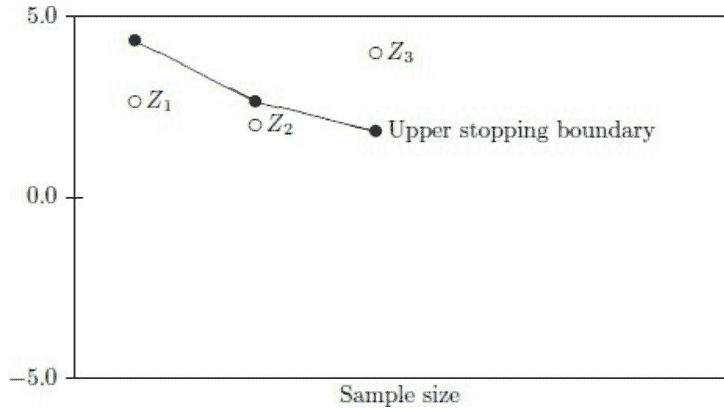

### 用于检测无效性的群序设计

尽管在实践中很少这样做，但通用的群序检验方法可以用于定义检测无效性的检验。在这种情况下，无效性检验将依赖于统计量 $Z_1, \dots, Z_m$ 与形成下止边界的临界值 $l_1(\beta), \dots, l_m(\beta)$。（临界值的选择是为了维持指定的 II 类错误率。）如果在第 $k$ 次中期分析时，累积证据表明备择假设不成立，则判定实验治疗无效，即：

$$Z_k < l_k(\beta),$$

否则继续试验。为了说明这一决策规则，图 6.2 展示了一个临床试验在第三次中期观察时因无效性而终止的情景。

## 图 6.2 用于检测无效性的群序设计

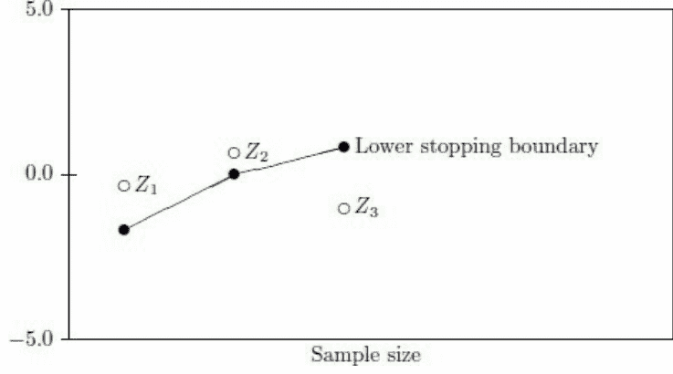

### 用于有效性与无效性同时检验的群序设计

此外，群序检验方法还可以用于定义旨在同时评估实验治疗有效性和无效性特征的试验设计。具有这种设计的试验将在检验统计量越过下边界或上边界时停止。

## 图 6.3 用于有效性与无效性同时检验的群序设计

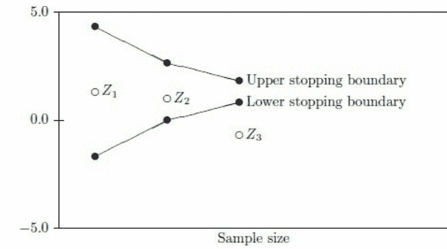

在第 $k$ 次中期分析时的决策规则如下：

1. 如果 $Z_k > u_k(\alpha, \beta)$，则因有效性停止试验；
2. 如果 $l_k(\alpha, \beta) \le Z_k \le u_k(\alpha, \beta)$，则继续试验；
3. 如果 $Z_k < l_k(\alpha, \beta)$，则因无效性停止试验。

图 6.3 提供了一个临床试验的示例，该试验因统计量越过下止边界而在第三次中期观察时终止。

需要注意的是，在同时进行有效性和无效性检验的试验设计中，停止边界的选择必须能够保护 I 类和 II 类错误概率 $\alpha$ 和 $\beta$，这在临床试验中并不常见。在第 6.3 节中，无效性停止规则通常以 `non-binding` 的方式应用，这意味着试验赞助者保留了覆盖因明显缺乏有效性而终止试验决策的权利。为了在非强制无效性停止规则下维持 $\alpha$ 控制，首先计算上止边界以保护 I 类错误率，并根据此有效性停止边界另行构建适当无效性停止规则。所得决策规则集不再控制 II 类错误率。

### 6.2.2 案例研究

将使用两个基于正态分布或二分类性终点的临床试验的案例研究，来说明支持因优效性而提早停止的群序试验的设计与分析。

#### 示例：案例研究 1（临床抑郁症患者试验）

进行了一项双臂临床试验，以测试一种治疗中枢神经系统疾病的新型药物单剂量。试验的主要目标是证明对于符合大性抑郁症标准的受试者，所选剂量的急性治疗效果优于安慰剂。实验治疗的有效性通过评估从基线到 8 周研究期结束时 17 项汉密尔顿抑郁评分量表（HAMD17）总分的平均变化来评价。HAMD17 分数越低，表示疗效越好。

为了确定试验规模，赞助者希望具有足够的效能，以便在 HAMD17 总分减少量的平均值为 3 且标准差为 8 时检测出差异。在传统设计中，每个试验臂 150 名患者量提供 90% 的效能，在双侧 0.05 水平上检测统计学显著的差异。

该临床试验采用了两次中期分析和一次最终分析。计划在 50% 和 75% 的患者完成研究后进行分析。如果在任何分析中出现压倒性的有效性，则停止患者招募。试验中收集的数据汇总于表 6.1。请注意，HAMD17 分数从基线的平均变化（负值）呈现为平均改善（正值）。

#### 表 6.1 抑郁症试验中收集的 HAMD17 数据汇总

| 分析 | 治疗组 | 安慰剂组 |
| :--- | :--- | :--- |
|  | n | HAMD17 总分平均改善 (SD) | n | HAMD17 总分平均改善 (SD) |
| 中期 | 78 | 8.3 (6.2) | 78 | 5.9 (6.5) |
| 中期 | 122 | 8.0 (6.3) | 120 | 6.3 (5.9) |
| 最终 | 150 | 8.2 (6.2) | 152 | 6.1 (5.8) |

#### 示例：案例研究 2（临床抑郁症患者试验）

设计了一项 III 期临床试验，研究某种治疗对脓血症患者 28 天死亡率的影响。目标是评估该治疗是否优于安慰剂。使用固定样本量、显著性水平为 0.05 的传统设计，需要入组 318 名患者以达到 80% 的效能。

试验在约 20% 和 66% 的患者完成研究后进行了两次中期分析。如果出现压倒性的有效性，则提前终止试验。分析数据见表 6.2。

#### 表 6.2 试验中收集的 28 天生存数据

| 分析 | 治疗组 | 安慰剂组 |
| :--- | :--- | :--- |
|  | n | 存活人数 | n | 存活人数 |
| 中期 1 |  | 220 (74.5%) |  | 216 (70.4%) |
| 中期 2 |  | 538 (75.2%) |  | 526 (73.6%) |
| 最终 |  | 715 (75.0%) |  | 715 (74.0%) |

### 6.2.3 设计与监测阶段

在考虑可用群序设计时，在设计和分析（监测）阶段之间划分界限是有益的。SAS 使用 `SEQDESIGN` 和 `PROCTEST` 支持群序试验的两个组件。以下是我们需要的中期监测步骤简要描述。

#### 设计阶段 (PROC SEQDESIGN)

- 基于消耗函数实施灵活的数据监测方案。使用消耗函数计算每次中期分析的调整后临界值和 p 值截点，见 6.2.8。

#### 监测阶段 (PROCTEST)

- 计算每次中期观察的真实差异重复置信限（见 6.2.9 节）以及最后一次分析的偏估计（见 6.2.10 节）。

### 6.2.4 固定与灵活的数据监测策略

设计和进行数据监测的临床试验有两种主要方法。第一种依赖于一组预设的数据审查时间。Pocock 和 O’Brien-Fleming 边界（Pocock, 1977; O’Brien and Fleming, 1979）最初是为此类设计的。

#### 固定策略

Pocock 和 O’Brien-Fleming 有效性停止边界见表 6.3。调整后的临界值（边界值）是基于假设的直接计算得出的期中分析是等间隔的。具体而言，表中所示常数 $c_P (\alpha, m)$ 和 $c_{OF} (\alpha, m)$ 的选择是为了保护整体 I 类错误率，而 $m$ 表示试验中决策点（期中分析和最终分析）的总数。

#### 表 6.3 等间隔期中观察下，临床试验效能检验构建停止边界的常用方法

| 方法 | 调整后的临界值 |
| --- | --- |
| Pocock | $u_k (\alpha) = c_P (\alpha, m), k = 1, \dots, m$ |
| O'Brien-Fleming | $u_k (\alpha) = c_{OF} (\alpha, m)k^{-1/2}, k = 1, \dots, m$ |

为了快速说明，考虑一个具有单次期中分析（$m = 2$）的临床试验，假设单侧 I 类错误率为 $\alpha = 0.025$。假设该期中观察时的信息比例为 $t_1 = 0.5$。在这种情况下，$c_P (0.025, 2) = 2.18$，这意味着用于两个决策点的常量 Pocock 调整后临界值为：

$$u_1(0.025) = u_2(0.025) = c_P (0.025, 2) = 2.18$$

考虑到使用 O'Brien-Fleming 方法定义停止边界，$c_{OF}(0.025, 2) = 2.80$。因此，期中分析和最终分析对应的调整后临界值为：

$$u_1(0.025) = c_{OF}(0.025, 2) = 2.80, u_2(0.025) = c_{OF}(0.025, 2)/\sqrt{2} = 1.98$$

#### 灵活策略

误差消耗法（error spending approach）是固定监测计划的组序设计的灵活替代方案。为什么赞助者在分析的时间和频率方面需要灵活性呢？有时将期中观察与*日历时间*而非与样本量相关的*信息时间*挂钩更为方便。非药物类研究通常采用在定期间隔进行的期中分析，例如每 3 或 6 个月一次。（参见例如 Van Den Berghe 等人，2001。）在无效性监测中，灵活策略也是优选的。从后勤角度来看，按月或按季度进行无效性分析，比在试验中入组预设数量的患者后进行分析更为方便。在这种情况下，患者人数在各观察之间的变化是不可预测的，我们需要找到一种方法来处理数据分析中随机增量的信息。

本节提供了对误差消耗方法的高层面的回顾。关于该方法的进一步讨论，请参阅 Jennison 和 Turnbull (2000, 第 7 章）或 Proschan, Lan 和 Wittes (2006, 第 5 章)。

为了介绍误差消耗法，考虑一个具有平衡设计（每个试验臂 $n$ 名患者）的双臂试验。试验赞助者希望实现组序设计，以便尽早发现治疗获益的早期迹。I 类错误消耗函数 $\alpha(t)$ 是总样本量比例 $t$（$0 \le t \le 1$）的非递减函数，被称为*信息比例*，且

$$\alpha(0) = 0 \text{ 且 } \alpha(1) = \alpha$$

其中 $\alpha$ 是指定的 I 类错误率，例如单侧 $\alpha = 0.025$。假设在每臂入组了 $n_1, \dots, n_m$ 名患者后进行分析（$n_m = n$ 是每臂的患者总数）。需要强调的是期中观察可以发生在任意时间点。因此，$n_1, \dots, n_m$ 既不是预设的也不是等间隔的。令 $T_k = n_k/n$ 和 $Z_k$ 分别表示第 $k$ 次观察的信息比例和检验统计量。假设检验统计量的联合分布服从多元正态分布。最后，用 $\delta$ 表示真实的治疗差异。

简单来说，所选的误差消耗函数决定了试验期间整体 I 类错误概率的消耗速率。为了了解其工作原理，假设当每个治疗组的样本量等于 $n_1$ 名患者时进行第一次期中观察。确定一个上侧单侧临界值（记为 $u_1$），其方式使得 I 类错误消耗为 $\alpha(n_1/n)$，这等于 $\alpha(t_1)$。换句话说，选择 $u_1$ 以满足以下标准

$$P \{Z_1 > u_1 \text{ if } \delta = 0\} = \alpha(t_1)$$

如果 $Z_1$ 大于 $u_1$，则在第一次期中分析时停止试验，否则决定继续试验。由于我们在第一次分析时已经消耗了一部分整体 I 类错误，留给第二次分析的量为：

$$\alpha(n_2/n) - \alpha(n_1/n) = \alpha(t_2) - \alpha(t_1)$$

因此，在第二次期中观察时，通过求解以下方程得到临界值 $u_2$：

$$P \{Z_1, Z_2 > u_2 \text{ if } \delta = 0\} = \alpha(t_2) - \alpha(t_1)$$

（注：此处原文存在部分逻辑重复性描述，翻译已根据误差消耗逻辑进行整合处理）

#### 误差消耗函数

文献中引入了多种 $\alpha$ 消耗族。参见例如 Lan 和 Deets (1983)、Jennison 和 Turnbull (1990, 2000) 以及 Hwang, Shih 和 Deani (1990)。这些族被 `SEQDESIGN` 和 `PROCTEST` 支持。Lan-Deets 误差消耗族定义如下。

Lan 和 Deets (1983) 引入了与 O'Brien-Fleming 和 Pocock 等间隔组序设计相关的 $\alpha$ 消耗函数。对于任何预设的整体错误概率 $a$，例如单侧 $a = 0.025$，这些函数给出：

$$\alpha(t) = 2[1 - \Phi(\Phi^{-1}(a)/\sqrt{t})]$$

其中 $t$ 是信息比例 $\Phi(x)$ 是标准正态分布的累积概率函数。

这两个函数如图 6.4 所示。可以看出，基于 O'Brien-Fleming 方法的 $\alpha$ 消耗函数，I 类错误率在试验早期消耗非常缓慢。这将导致期中观察时的调整后临界值远大于固定样本量设计中使用的临界值。相比之下，如果考虑 Pocock 方法，I 类错误率将以线性速率消耗，导致期中分析时的调整后临界值不那么极端。

我们关注的是用于错误的误差消耗函数（$\alpha$ 消耗函数）。正如 Pampallona 和 Tsiatis (1994) 以及 Pampallona, Tsiatis 和 Kim (2001) 所示，概述的方法很容易扩展到用于无效性监测的组序试验，此时会引入 II 类错误消耗函数；或者同时进行效能和无效性监测，这需要指定 I 类和 II 类错误消耗函数。

## 图 6.4 假设试验示例

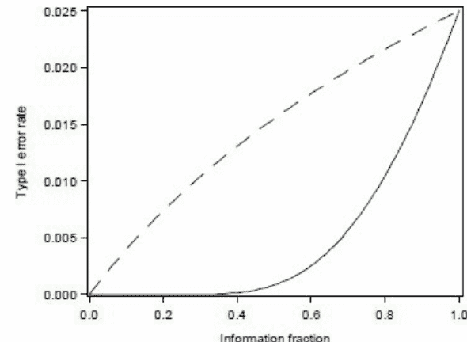

基于 O'Brien-Fleming 方法（实线）和 Pocock 方法（虚线）的 $a$ 消耗函数。

## 组序设计的比较

第 6.2.5 和 6.2.6 节将提供对组序试验中 Pocock 和 O'Brien-Fleming 停止界限以及相关 $\alpha$ 消耗函数的详细比较。结果将表明，如所述，如果采用 Pocock 方法，在计划结束远早停止试验的概率非常高。相比之下，O'Brien-Fleming 设计在早期中期观察时“消耗”的 $\alpha$ 极少，因此早期停止的概率倾向于较低水平。

为了对设计组序试验的 Pocock 和 O'Brien-Fleming 方法进行快速比较，请考虑以下假设性示例。设计了一个具有连续性主要终点的双臂临床试验，用于比较实验性治疗法与安慰剂的效果。在平均治疗差异等于 0.2 且标准差为 1 的假设下，试验样本量设定为双侧 0.05 显著性水平下达到 80% 的效力。图 6.5 和 6.6 显示了基于这两种停止界限的试验设计我们预计在患者总数上可以节省多少。这些图表绘制了采用 Pocock 和 O'Brien-Fleming 组序设计（分别一次和四次中期观察）的试验平均入组人数相对于使用预定义样本量的传统设计的样本量。平均治疗差异绘制在横轴上，相对于 0.2 的参考差异。

## 图 6.5 假设性试验示例

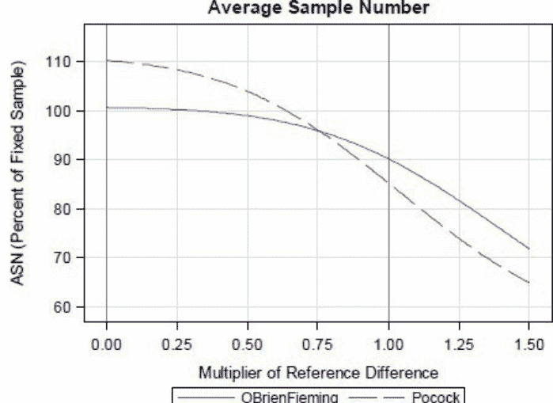

与传统设计相比，具有单次中期分析的 O’Brien-Fleming（曲线）和 Pocock（虚线）组序设计的平均样本量。

图 6.5 显示，在仅于试验过半进行一次中期分析时，当平均治疗差异真实等于 0.2（对应于横轴上的值 1）时，O’Brien-Fleming 设计所需的平均人数比传统设计少 10%。在假设平均差异相同的情况下，应用 Pocock 设计可节省 15%。平均样本量的减少随真实平均差异的增加而增加。例如，当真实平均差异为 0.3 时，减少量分别为 28%（O’Brien-Fleming 设计）和 35%（Pocock 设计）。另一方面，序贯检验可能会增加平均样本量。例如，从图 6.5 可以看出，当治疗差异接近 0 时，Pocock 设计所需的平均人数大于传统设计。

我们预计随着中期观察频率的增加，平均样本量会进一步减少。图 6.6 显示，当真实平均差异等于 0.2 时，具有四次等距中期观察的 O’Brien-Fleming 和 Pocock 设计与传统设计相比，人数分别减少了 18% 和 20%。

## 图 6.6 假设性试验示例

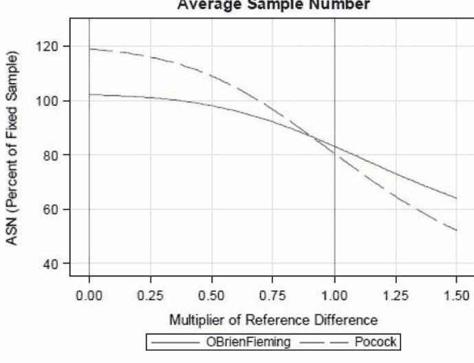

与传统设计相比，具有四次等距中期分析的 O'Brien-Fleming（实线）和 Pocock（虚线）组序设计的平均样本量。

### 6.2.5 设计阶段：案例中的 O'Brien-Fleming 方法

为了说明为检测早期优效证据建立组序计划的过程，请考虑第 6.2.2 节介绍的抑郁症患者临床试验。该试验有三个决策点：

- 50% 患者完成试验后进行第一次中期分析。
- 75% 患者完成试验后进行第二次中期分析。
- 最终分析。


这些决策点的信息分量由 $t_1 = 0.5, t_2 = 0.75$ 和 $t_3 = 1$ 给出。两次中期分析都侧重于检验实验治疗相对于安慰剂的优效性。

程序 6.1 和 6.2 展示了如何设置 `PROC SEQGDESIGN` 以使用 O'Brien-Fleming 方法为该设置建立组序设计。首先，在程序 6.1 中将使用不依赖于 $\alpha$ 消耗函数的固定数据监测策略来计算 O'Brien-Fleming 停止界限。程序 6.2 中将使用 Lan 和 DeMeets (1983) 引入的 O'Brien-Fleming 型 $\alpha$ 消耗函数作为替代方法。固定和灵活的数据监测策略在第 6.2.4 节中进行了描述。

从固定数据监测策略开始，程序 6.1 使用 `method=obf` 设置了一个具有 O'Brien-Fleming 停止界限的组序设计。试验中的决策点总数（两次中期观察和最终分析）通过 `nstages=3` 指定。三个决策点的信息分量由 `info=cum(0.5 0.75 1)` 给出。如果检验统计量越过上界（即 `alt=upper`），则在抑郁症试验中拒绝无治疗效应的原假设。试验中的 I 类和 II 类错误率等于 `alpha=0.05` 且 `beta=0.1`。

对于 300 名患者的固定样本量，传统设置由单个圆圈表示。如图 6.7 所示，在 O’Brien-Fleming 方案下，早期分析以非常保守的方式进行。因此，最终分析的显著性水平接近传统设置使用的水平。前两次分析的调整临界值远高于对应于未调整临界值 1.959 的空心圆。然而，最终分析时调整后与未调整的临界值之间的差异相当较小。

利用表 6.4 中提供的信息，很容易用 O’Brien-Fleming 决策规则表示为两次期中分析和最终分析中观察到的平均治疗差异。后者可以包含在数据监测委员会的期中分析指南（也称为数据监测委员会章程）中。以下是此类指南的示例：

- 第一次期中分析将在每个试验组中约 77 名患者完成研究后进行。如果治疗效应统计量大于 2.863（即单侧 p 值小于 0.0021），则将因有效性而停止试验。假设 HAMD17 总分变化的标准差为 8，如果平均治疗差异超过 3.69 分，则将在第一次期中分析终止试验。

## 图 6.7 案例研究 1

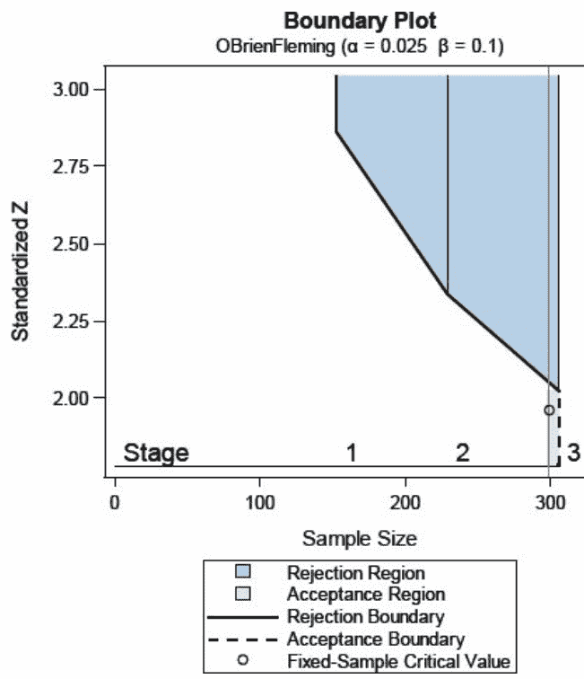

在统计量尺度上，O'Brien-Fleming 设计的停止边界和传统设计的临界值。

- 第二次期中分析将在每个组中约 115 名患者完成研究后发生。如果治疗效应统计量大于 2.337，或者等同于单侧 p 值小于 0.0097，则将因有效性而停止试验。如果平均治疗差异大于 2.47 分，则将在第二次期中分析终止试验（假设 HAMD17 变化的标准差为 8）。

- 在最终分析时，如果治疗效应统计量大于 2.024，或者等同于单侧 p 值在 0.0215 处显著，则宣布实验治疗优于安慰剂。如果平均治疗差异超过 1.85（假设 HAMD17 变化的标准差为 8），将观察到显著 p 值。

该总结再次提醒我们，使用 O'Brien-Fleming 连续方案，最终分析时的调整临界值仅略大于固定样本量传统试验中使用的临界值，即 1.959。

表 6.5 提供了组序设计和样本量计算的一般信息。回顾第 6.2.2 节，对于在最终分析时具有单一决策点的传统设计，如果总样本量设定为 300 名患者，则该试验的效能为 90%。研究组序试验中预计入组以达到决策点的患者人数并将其与相应传统设计中的样本量进行比较是非常重要的。从表 6.5 可以得出，基于 O'Brien-Fleming 方法的组序设计，最大总样本量为 305.5。尽管这个最大样本量略大于固定样本量传统设置下的样本量，但在备择假设（Alt Ref）下，预计组序试验中将入组 230 名患者。如果平均治疗差异确实等于 3，我们平均将看到样本量减少 23%。此外，如果治疗没有提供益处（Null Ref），组序试验中的预期总样本量为 304.5 名患者，这再次接近传统设计中 300 名患者的总样本量。

## 表 6.5 程序 6.1 的输出：设计信息和样本量总结

| 设计信息 | Normal |
| --- | --- |
| 边界尺度 | Standardize |
| 备择假设 | Up |
| 早期停止 | Reject Null |
| 方法 | O'Brien-Fleming |
| 边界键 | B |
| 备择参考 | |
| 阶段数 | |
| Alpha | 0.0 |
| Beta | |
| Power | |
| 最大信息量（固定样本量的百分比） | 10 |
| 最大信息量 | 1.1 |
| Null Ref ASN（固定样本量的百分比） | 10 |
| Alt Ref ASN（固定样本量的百分比） | 7 |

| 样本量总结 | | |
| --- | --- | --- |
| 检验双样本均值 | | |
| 平均差异 | | |
| 标准差 | | |
| 最大样本量 | 30 |
| 预期样本量 (Null Ref) | 30 |
| 预期样本量 (Alt Ref) | 23 |

任何组序设计都由一组停止概率唯一定义，这些概率也称为退出概率。它们被定义为在原假设或备择假设下，每次期中跨越停止边界（或边界）的概率。表 6.6 提供了由程序 6.1 设置的组序设计中停止概率的信息。检查原假设（CRef=0）下的停止概率有助于我们理解该组序方案如何在整个试验过程中“消耗”总的 I 类错误率 alpha，重点关注备择假设（CRef=1）。具体来说，在备择假设下，只有 29.3% 的概率试验将在第一次期中分析时由于优越效应而终止（阶段 1）。第二次期中分析因有效性终止试验的概率为 69.6%。

## 表 6.6 程序 6.1 的输出：停止概率

| 预期累计概率 = CRef (备择参考) | | |
| --- | --- | --- |
| CRef | 预期停止阶段 1 | 阶段 2 | 阶段 3 |
| 0.00 | 拒绝原假设 | 2.987 | 0.0105 | 0.025 |
| 1.00 | 拒绝原假设 | 0.2928 | 0.6960 | 0.901 |

研究所得组序设计的效能和平均样本量也是启发性的。图 6.8 和 6.9 描述了功率和平均样本量随治疗差异变化的函数。注意，这种治疗差异是相对于参考定义的，即备择假设假设的平均差异。这意味着水平轴上的值 1 对应于 HAMD17 上的 3 分。图 6.8 显示了组序设计的功率函数，其与每组 150 名患者的传统设计几乎相同。如果真实差异超过 2.7 分，O'Brien-Fleming 设计的效能将保持在 80% 以上。

## 图 6.8 案例研究 1

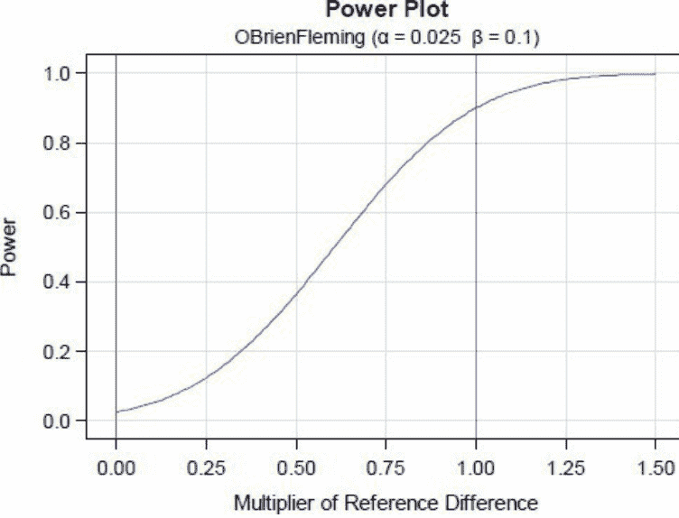

O'Brien-Fleming 设计的效能随真实治疗差异的变化。（水平轴上的值 1 对应于 3 分的平均差异。）

图 6.9 表明，组序设计的平均样本量小于传统设计中每组 150 名患者的样本量，除了原假设的一个小邻域内的治疗效应（对应水平轴上的值 0）。如果治疗效应很大，使用 O'Brien-Fleming 方案可以在预期入组的人数方面带来相当观的节省。例如，在真实平均差异为 4.5 分的极端情况下（对应水平轴上的值 1.5），组序设计中的平均样本量将比传统设计使用的样本量少 42%。

## 图 6.9 案例研究 1

### 平均样本量

OBrien-Fleming (α = 0.025 β = 0.1)

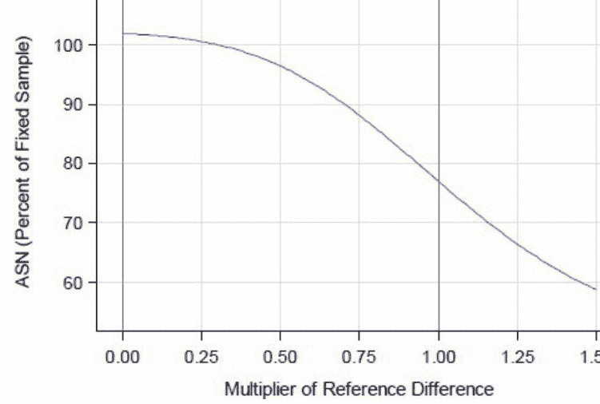

O'Brien-Fleming 设计的平均样本量是真实治疗均差的函数（水平轴上的值 1 对应 3 个点的治疗均差）。

上述指出程序 6.1 依赖于固定的数据监测策略来计算 O'Brien-Fleming 停止边界。这是通过使用 `method=obf` 实现的。如果 `method` 设置为 `errfunc`，则将使用基于 Lan 和 DeMets (1983) 的 O'Brien-Fleming 类型消耗函数（见第 6.2.4 节）的灵活数据监测策略。该 $\alpha$ 消耗函数提供了 O'Brien 和 Fleming (1979) 引入的原始停止边界的良好近似。因此，生成的组序设计将与上述介绍的相似。

# 程序 6.2 案例 1 中带有 O'Brien-Fleming 消耗函数的组序设计

```sas
proc seqdesign stopprob(cref=0 1)
   plots=(boundary(hscale=samplesize) power asn
OBrienFleming design method=errbf
   stages=3
   info=cum(0.5 0.75 1)
alt=upper
   stop-reject
alpha=0.025
beta=0.1;
samplesize model=twosamplemeans (meandiff=3 stddev=8);
run;
```

对基于固定和灵活数据监测策略的组序设计的关键特征进行快速比较是有帮助的。为了方便这种比较，表 6.7 汇总了总体设计信息并提供了样本量摘要。表中显示的信息与表 6.5 显示的内容一致，后者包含了程序 6.1 的输出。程序 6.2 生成的组序设计的主要特征（包括零假设和备择假设下的预期样本量）与表 6.5 中呈现的几乎相同。

# 表 6.7 程序 6.2 的输出：设计信息和样本量摘要

| 设计信息 | |
| :--- | :--- |
| 统计量分布 | 正态分布 |
| 边界尺度 | 标准化 |
| 备择假设 | 向上 |
| 早期停止 | 拒绝 N |
| 方法 | 误差消耗 |
| 边界键 | B |
| 备择参考 | |
| 阶段数 | |
| Alpha | 0.0 |
| Beta | |
| 最大信息量（固定样本的百分比） | 10 |
| 最大信息量 | 1.1 |
| 零参考 ASN（固定样本的百分比） | 10 |
| 备择参考 ASN（固定样本的百分比） | 7 |

| 样本量摘要 | 双样本均值 |
| :--- | :--- |
| 差异 | \ |
| 标准差 | |
| 最大样本量 | 30 |
| 预期样本量（零参考） | 30 |
| 预期样本量（备择参考） | 23 |

此外，表 6.8 包含了来自 Lan-Demets $\alpha$ 消耗函数的停止边界信息。该停止边界与程序 6.1 中实现的固定数据监测策略计算的结果相当相似。从表 6.8 可以得出，根据 Lan-Demets $\alpha$ 消耗函数计算出的三个决策点的调整临界值为：

$u_1(0.025) = 2.963, u_2(0.025) = 2.360, u_3(0.025) = 2.014.$

将这些边界值与表 6.4 中显示的值进行比较，我们基于 $\alpha$ 消耗函数的方法在第一次中期分析时产生了更高的调整临界值。然而，固定和灵活数据监测策略之间的差异在最终分析时变得非常微不足道。

# 表 6.8 程序 6.2 的输出：边界信息

| 阶段 | 信息水平 | 备择 | 边界上限 |
| :--- | :--- | :--- | :--- |
| 1 | 0.50 0.594 152.2 | 2.313 | 2.963 |
| 2 | 0.75 0.892 228.3 | 2.833 | 2.360 |
| 3 | 1.00 1.189 304.3 | 3.271 | 2.014 |

### 6.2.6 设计阶段：案例 1 中的 Pocock 组方法

在第 6.2.5 节设置的 O’Brien-Fleming 设计代表了进行组序试验的一种相当保守的方法。另一个极端对应于 Pocock 设计。基于通用 Pocock 计划的组序设计使得 I 类错误率在试验中消耗得很快。因此，与 O’Brien-Fleming 计划相比，该试验更有可能在期分析时由于疗效优异而提前终止。

程序 6.3 使用 `PROC SEQDESIGN` 在案例 1 中构建一个具有固定 Pocock 停止边界的组序设计。该程序中 `PROC SEQDESIGN` 的所有参数与程序 6.1 中使用的相同，边界的指定除外。基于 Pocock 类型消耗函数的更灵活的监测策略可以通过设置 `method=poc` 来应用。正如程序 6.2 一样，生成的组序设计将与上述的相似。

# 程序 6.3 案例 1 中带有 Pocock 停止边界的组序设计

```sas
proc seqdesign stopprob(cref=0 1)
   plots=(boundary(hscale=samplesize) power asn
OBrienFleming design method=errbf
   stages=3
   info=cum(0.5 0.75 1)
alt=upper
   stop-reject
alpha=0.025
beta=0.1;
samplesize model=twosamplemeans (meandiff=3 stddev=8);
run;
```

对基于固定和灵活数据监测策略的组序设计的关键特征进行快速比较是有帮助的。为了方便这种比较，表 6.7 汇总了总体设计信息并提供了样本量摘要。表中显示的信息与表 6.5 显示的内容一致，后者包含了程序 6.1 的输出。程序 6.2 生成的组序设计的主要特征（包括零假设和备择假设下的预期样本量）与表 6.5 中呈现的几乎相同。

第 6.2.5 节设置的 O'Brien-Fleming 设计代表了进行组序试验的一种相当保守的方法。另一个极端对应于 Pocock 设计。基于通用 Pocock 计划的组序设计使得 I 类错误率在试验中消耗得很快。因此，与 O'Brien-Fleming 计划相比，该试验更有可能在期分析时由于疗效优异而提前终止。

程序 6.3 使用 `PROC SEQDESIGN` 在案例 1 中构建一个具有固定 Pocock 停止边界的组序设计。该程序中 `PROC SEQDESIGN` 的所有参数与程序 6.1 中使用的相同，边界的指定除外。基于 Pocock 类型消耗函数的更灵活的监测策略可以通过设置 `method=poc` 来应用。正如程序 6.2 一样，生成的组序设计将与上述的相似。

| 效能 (Power) | |
| :--- | --- |
| 最大信息量（固定样本百分比） | 11 |
| 最大信息量 | 13 |
| 无假设 ASN（固定样本百分比） | 11 |
| 备择假设 ASN（固定样本百分比） | 7 |

| 双样本均值检验 (Test Two-Sample Mean) | |
| :--- | --- |
| 均值差异 | |
| 标准差 | |
| 最大样本量 | 33 |
| 期望样本量（无假设） | 33 |
| 期望样本量（备择假设） | 22 |

在备择假设下中期分析时早期停止的概率。事实上，通过关注表 6.11 中由于备择假设下的优效性（CRef=1）而停止的概率，很容易看出，在第一次中期分析（阶段 1）停止的概率为 56.9%。因此，这几乎是 O'Brien-Fleming 停止边界概率的两倍（见表 6.6）。结果，如果实验治疗具有很强的疗效特征，采用 Pocock 边界的组序试验持续时间可能会更短。

## 表 6.11 程序 6.3 的输出：停止概率

| 期望累积停止概率 参考 = CRef (备择假设参考) | CRef 期望停止 源 停止概率 阶段 | 阶段 | 阶段统计量 |
| :--- | --- | 1 | 2 | 3 |
| 0.00 | 2.968 | 拒绝无假设 | 0.0122 | 0.0194 | 0.02 |
| 1.00 | 1.645 | 拒绝无假设 | 0.5687 | 0.7861 | 0.90 |

图 6.11 和图 6.12 绘制了程序 6.3 导出的 Pocock 组序设计的效能函数和平均样本量。很容易验证，Pocock 设计的效能函数与 O'Brien-Fleming 设计几乎完全相同（见图 6.8）。此外，考虑到图 6.12，要记住，当治疗差异为零时，与 O'Brien-Fleming 设计相比，Pocock 设计需要更多患者，样本量优势略为 3 个点。图 6.9 和图 6.12 的比较表明，这种优势的幅度非常小，我们可以认为，当真实的治疗效应小于其假设值时，在平均样本量方面，Pocock 设计通常优于 O'Brien-Fleming 设计。

## 图 6.11 案例研究 1

### 效能图 (Power Plot)

Pocock (α = 0.025 β = 0.1)

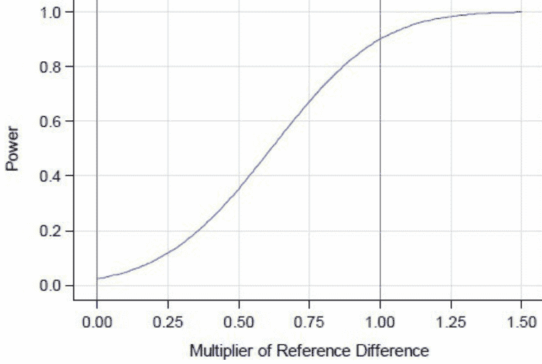

Pocock 设计的效能是真实均值治疗差异的函数（横轴上的值 1 对应于 3 个点的均值治疗差异）。

## 图 6.12 案例研究 1

### 平均样本量 (Average Sample Number)

Pocock (α = 0.025 β = 0.1)

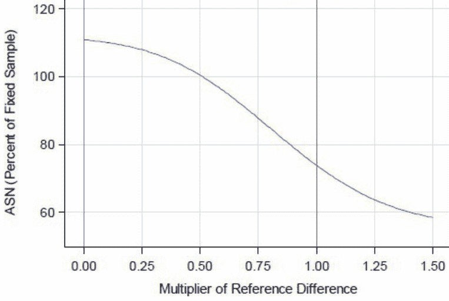

Pocock 设计的平均样本量是真实均值治疗差异的函数（横轴上的值 1 对应于 3 个点的均值治疗差异）。

## Pocock 和 O'Brien-Fleming 组序设计

在回顾了具有 Pocock 和 O'Brien-Fleming 停止边界的组序设计后，询问如何为特定的临床试验选择一组停止边界的建议或经验法则是自然的。实际上并没有硬性规定，这个问题的答案在很大程度上取决于每个单独试验的目标。以下是一组通用指南，可以帮助在大多数临床试验中选择合适的停止边界。

- **临床考量 (Clinical considerations)。** 临床试验中观察到的治疗效应幅度需要与估计该效应的样本量进行平衡。只有绝对的治疗差异才能证明在入组四分之一或三分之一患者后终止临床试验。此外，正如引言部分，试验的早期停止会使对药物安全性特征的全面表征变得复杂。当人们希望在足够大的研究中检查实验疗法对多个安全性和次要疗效变量的影响时，过早终止试验的决定显然是不利的。为了强调这一点，Emerson 和 Fleming (1989) 指出：

> 只有在存在对于某种治疗优于另一种治疗的极端证据时才建议早期终止的设计，将允许最大的灵活性来检查其他反应变量或长期效应，同时对临床试验中的伦理问题进行充分处理。

沿着同样的思路，O'Brien (1990) 指出：


早期终止的缺点之一是它可能会无法获得有关药物安全有效性的次要（尽管很重要）问题的满意答案。

考虑到这些因素，停止边界通常被选择为最小化试验早期终止的可能性，这并不奇怪。因此，在临床试验中，使用 `O'Brien-Fleming` 边界的序计划比使用 `Pocock` 边界的计划更频繁。

- **样本量考量 (Sample size considerations)。** 组序环境中另一个重要考量是入组患者的平均和最大人数。已知，基于 `Pocock` 的计划在真实差异较大时平均规模较小。使用 `O'Brien-Fleming` 边界在差异较小时会导致最大规模较小。例如，`Wang` 和 `Tsiatis` (1987) 研究了在备择假设下最小化期望样本量的组序检验。然而，通常情况下，数学考量（如组序程序中样本量的优化）没有临床考量重要。

- **数据管理考量 (Data management considerations)。** 经常，第一次中期分析的目的是测试数据管理过程、检查方案违背情况并确保数据质量。一旦验证中期数据是可靠，数据监测委员会将更有信心。为了避免在第一次中期分析时早期停止，我们可以使用 `O'Brien-Fleming` 边界。随后的中期分析可以设计为检测早期疗效证据，在这种情况下，`O'Brien-Fleming` 边界再次是优的。

可能还有其他因素决定了序计划的选择。例如，在具有徒劳性边界（`futility boundary`）的临床试验中，试验赞助者通常会对具有新作用机制的药物进行“早期杀死”犹豫不，因为“早期杀死”会对同类的所有药物产生负面影响。因此，赞助者最可能会投票支持 `O'Brien-Fleming` 类型的停止边界。另一方面，说服临床研究人员停止开发一种机制良好的治疗方法所需的证据较少。

### 6.2.7 设计阶段：案例研究 2 中的疗效和徒劳性检验

到为止，我们考虑了用于检测早期优效早期信号的组序设计。快速回顾支持由于实验疗法明显徒劳而在计划结束前终止试验的选项的组序设计也是有帮助的。正如第 6.2.1 节所示，在 III 期试验中使用基于徒劳和疗效评估的决策规则的重复显著性检验方法是非常少见的，因为这导致了无法覆盖的绑定停止规则。大多数试验赞助者更倾向于以非绑定（`non-binding`）的方式设置徒劳停止规则，这意味着即使满足了预定义的徒劳停止规则，赞助者也保留继续试验的权利。为了建立具有非绑定徒劳停止规则的组序设计，采用重复显著性检验方法来定义保持第一类错误率的疗效评估停止边界。之后，在每次中期分析中独立于疗效停止边界设置徒劳停止规则。这导致一组第一类错误率和第二类错误率膨胀的决策规则。

为了说明构建具有预设第一类和第二类错误率的具有疗效和徒劳停止边界的组序计划的过程，III 期试验中的严重败血症患者将采用第 6.2.2 节中介绍的方案。本次试验考虑了三个决策点（两次期中检查和一次最终分析）。首次分析主要拟用于无效性检验（`futility testing`）。试验仅在存在压倒性的治疗差异时才会因疗效优越而停止。第二次分析将涉及有效性和无效性评估。

通过使用 `O'Brien-Fleming` 停止边界测试实验性治疗的有效性，并使用 `Pocock` 边界进行无效性分析，可以建立一个同时满足这两个目标的群组序贯计划（`group sequential plan`）。正如我们在 6.2.5 节中所示的，在试验早期超过 `O'Brien-Fleming` 临界值是非常困难的。因此，使用 `O'Brien-Fleming` 边界将最大限度地减少在第一次期中检查时确立优性的概率。此外，该边界将提高第二次期中检查和最终分析时治疗比较的效力（`power`）。另一方面，使用 `Pocock` 停止边界进行无效性评估可确保在观察到的治疗差异为负或太小时，试验可以提前终止。所述的分组序贯设计符合 `DeMets` 和 `Ware` (1980) 概述的无效性检验原则：

> 当早期证据表明新疗法可能无效时，在统计量达到足以拒绝[原假设]以支持[备择假设]的极端值之前，可能指示终止研究并接受[原假设]。换句话说，我们愿意在比声称治疗获益所需的证据更少的情况下，就此终止研究并接受[原假设]。

程序 6.4 使用程序 6.1 和 6.3 计算了所述序贯设计的关键特征，该设计的主要组件需要在此程序中定义。首先，以下语句

```
method(alpha)=obf method(beta)=poc
```

表明有效性 `Fleming` 停止边界将使用 `O'Brien-Fleming` 方法推导，而使用 `Pocock` 方法设置无效性停止边界。决策点的数量通过 `nstages=3` 指定。由于两次期中分析计划在 20% 和 66% 的患者完成为期 28 天的研究后进行，因此三个决策点的信息分值（`information fractions`）被设置为 `info=cum(0.2 0.66 1)`。上限停止边界将用于有效性评估，这意味着 `alt=upper` 和 `stop=both` 表示如果越过任何一个边界，试验将终止。最后，严重败血症试验中的单侧 Type I 类错误率等于 0.025，试验效力为 80%。这意味着 `alpha=0.025` 且 `beta=0.2`。

## PROGRAM 6.4 案例 2 中有效性和无效性检验的群组序贯计划

```
proc seqdesign stopprob(ref=0 1)
plots=(boundary(scale=samplesize) power
method(alpha)=obf method(beta)=poc
stages=3
info=cum(0.2 0.66 1)
alt=upper stop=both=0.025
samplesize=twosamplefreq (test=prop)
nullprop=0.7 prop=0.76
ref=avgprop);
run;
```

效力计算将由 `PROC SEQDESIGN` 根据第 6.2.2 节中定义的治疗效应假设进行。切换到 28 天存活率，安慰组和治疗组的假设存活率分别为 70% 和 76%。两组的存活率将使用双样本比例检验进行比较。因此，效力计算将基于以下规范运行：

```
samplesize=twosamplefreq (test=prop nullprop=0.7 prop=0.76 ref=avgprop);
```

注意 `ref=avgprop` 指定在计算中应使用平均比例。

表 6.12 显示了严重败血症试验中群组序贯设计的主要特征。首先，让我们检查效用边界（`utility boundary`）对原假设和备择假设下预期样本量（`expected sample size`）的影响。回想表 6.5，我们知道，当实验性治疗确实有效时，具有 `O'Brien-Fleming` 边界的分组序贯设计比具有固定样本量的传统设计平均需要的患者更少。然而，这种优势在原假设下会消失。表 6.12 表明，添加停止边界完全改变了 `O'Brien-Fleming` 群组序贯计划的行为。由于可能因无效性而提前终止，在无治疗效应的原假设（`Null Ref`）下，群组序贯设计的平均样本量为 92.1 名患者。该样本量远小于第 6.2.2 节中得出的传统总样本量，即 1718 名患者。群组序贯设计在备择假设（`Alt Ref`）下也优于传统设计。同时进行有效性/无效性检验策略的缺点是最大规模增加。我们从表 6.12 中看到，序贯计划可能比传统设计多 25% 的患者（2155.7 名患者对比 1718 名患者）。

## TABLE 6.12 程序 6.4 输出：设计信息和样本量总结

| 设计信息 | |
| :--- | :--- |
| 统计量分布 | 原假设 |
| 边界尺度 | 标准 |
| 备择假设 | 上 |
| 早期停止 | 接受/拒绝 |
| 方法 | 统一 |
| 边界键 | B |
| 备择参考 | 0 |
| 阶段数 | |
| Alpha | 0.0 |
| Beta 效力 | 最大信息（固定样本的百分比） |
| 最大信息 | 273 |
| 原假设 ASN（固定样本的百分比） | 5 |
| 备择假设 ASN（固定样本的百分比） | 8 |
| 样本量总结 | |
| :--- | :--- |
| 检验 | 双样本比例 |
| 原假设比例 (组 A) | 统计量 Z (比例) |
| 备择参考比例 (平均) 最大样本量 | 215 |
| 预期样本量 (原假设) | 92 |
| 预期样本量 (备择假设) | 150 |

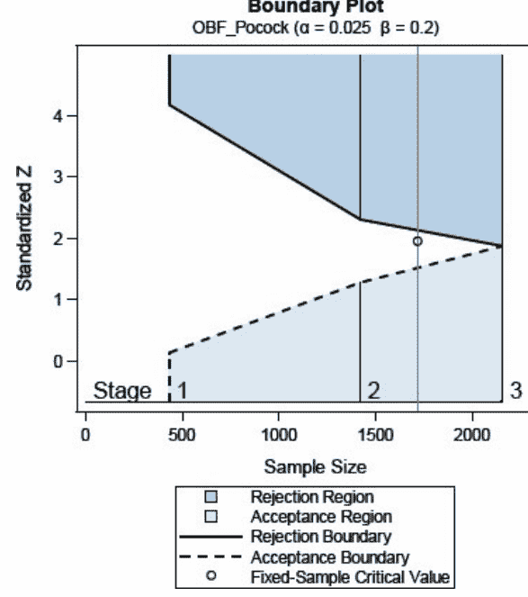

序贯设计中的效用与无效性停止边界，以及传统设计在检验统计量尺度上的临界值。

上界与调整后临界值之间的间隔在第一次中期观察时非常宽。这表明只有当观察到的效用信号非常强或非常弱时，试验才在此观察点终止。在第二次中期分析时，继续区域收缩到一个较窄的区间，两个停止边界在最终分析时收敛。

三个决策点的停止概率见表 6.14。与之前一样，在无治疗获益的零假设下评估的概率对应于 `CRef=0`。假设实验治疗不能提高患者的生存率，根据该表可知，有 55.3% 的概率在第一次中期观察（阶段 1）时做出因无效性而停止试验的决策。到第二次中期观察（阶段 2），由于缺乏性而提前停止的概率增加到 91.7%，这几乎保证了如果治疗确实无效，试验将被终止。当考虑最终分析（阶段 3）时，拒绝零假设的概率简单地等于试验中的 I 类错误率。

考虑备择假设为真的情况（`CRef=1`），表 6.14 显示，如预期那样，在第一次中期分析时声称具有统计学显著效应的概率极小，即 0.2%。事实上，由于效用极高而停止试验的概率远低于由于无效性而停止试验的概率（10.2%）。由于在第二次观察时继续区域非常窄，试验很有可能以实验治疗有效的结论而停止。这一结果的概率为 57.8%。相比之下，由于缺乏效用而提前停止的概率增长较慢，在第二次中期观察时达到 16.8%。最后，在最终分析时接受零假设的概率是组序设计的 II 类错误率。

# 表 6.14 程序 6.4 的输出：停止概率

| 期望累积概率 参考 = CRef (备择参考) | | | |
|---|---|---|---|
| | 停止概率 | | |
| | 期望停止阶段 阶段 1 2 3 | | |
| | CRef 源 | | |
| | 拒绝零假设 | | |
| | 0.00 1.501 | 0.00001 0.0101 0.02 | | |
| | 接受零假设 | | |
| | 0.00 1.501 | 0.5531 0.9165 0.97 | | |
| | 0.00 1.501 | 总计 0.5531 0.9266 1.00 | | |
| | 停止 | | |
| 1.00 | 2.113 | 零假设 | 0.0028 0.5776 0.8 | | |
| | 接受 | | |
| 1.00 | 2.113 | 零假设 | 0.1021 0.1676 0.20 | | |
| 1.00 | 2.113 | 总计 | 0.1049 0.7452 1.00 | | |

### 6.2.8 监控阶段：案例研究 1 中的 O’Brien-Fleming 和 Pocock 消耗函数

错误消耗方法在第 6.2.4 节设计组序试验的背景下被引入。相同的方法也可以应用于试验的监控阶段。第 6.2.4 节强调了，根据构造，错误消耗方法支持灵活的中期观察，不需要在设计阶段预先指定。

然而，重要的是，错误消耗方法的理论特性是在以下假设下成立的：即未来观察的时间与过去观察到的内容无关。在理论上，如果我们由于某次中期观察的突破性发现而修改序贯检验方案，整体 I 类错误的概率可能不再能保持。多位作者研究了违反此假设的序贯计划的整体 I 类错误率。例如，`Lan` 和 `DeMets` (1989) 描述了一个真实的场景，其中中期观察中一个巨大但显著的检验统计量会导致数据监测委员会要求额外查看数据。`Lan` 和 `DeMets` 通过仿真表明，依赖于数据的中期分析频率变化对整体 `α` 水平的影响通常很小。此外，正如 `Proschan`、`Fullman` 和 `Waclawiw` (1992) 指出的，错误消耗方法对频繁查看数据提供了一定程度的保护。每次分析中可以消耗的 I 类错误率大致与自上一次观察以来积累的信息量成正比。即使统计量在当前观察时接近当前边界，但如果在当前观察后立即进行下一次观察，它很有可能在下一次观察时不会跨越边界。

基于错误消耗方法的组序设置数据监控如下，使用案例研究 1 中的抑郁症试验进行说明（见第 6.2.8 节）。效用监控方法将使用 `PROC SEQTEST` 实现。相关的重要主题，如每次中期分析中治疗差异的置信区间的计算，以及试验最后一次分析中治疗差异的偏点估计值的推导，将在后续的第 6.2.9 和 6.2.10 节中描述。

## 案例研究 1 中基于 O’Brien-Fleming 方法的中期监控

基于预定义的 `α` 消耗函数的组序监控策略的实施将使用基于第 6.2.5 节和 6.2.6 节介绍的流行消耗函数（`O’Brien-Fleming` 和 `Pocock` 消耗函数）的设计。

为了讨论抑郁症试验的中期监控做准备，回想停止边界可以定义在统计量尺度或 `p` 值尺度上。因此，从开始计算试验中每个决策点（中期分析或最终分析）的从正态分布统计量和相关的 `p` 值是有帮助的。

考虑以下用于测试抑郁症试验三个决策点之一的治疗与安慰剂之间无差异假设的 `z` 统计量：

```
$Z_k = \frac{X_{1k} - X_{2k}}{\sqrt{\frac{s_{1k}^2}{n_{1k}} + \frac{s_{2k}^2}{n_{2k}}}}}$
```

这里 `n_{1k}` 和 `X_{1k}` 分别表示治疗组的患者人数和均值，而 `n_{2k}` 和 `X_{2k}` 表示安慰剂组的患者人数和均值。由于 `Z_k` 服从正态分布，`p` 值由下给出：

```
$p_k = 1 - \Phi(Z_k)$
```

重要的是，我们限制使用 `z` 统计量。以下代码可用于任何正态分布的 `z` 统计量：

# 程序 6.5 案例研究 1 中的统计量及相关 p 值

```
data DepData;
  input _Stage_ n1 mean1 sd1 n2 mean2 sd2;
  datelines;
    1 78 8.3 6.2 78 5.9
    2 122 8.0 6.3 120 6.3
    3 150 8.2 5.9 152 6.1
  ;
run;
```

```
data obf_teststat;
  set DepData;
  _Scale = StdZ;
  maxinfo=1.193;
  maxn=305;
  _info= maxinfo*(n1+n2)/maxn;
  s= sqrt((n1-1)*sd1^2+(n2-1)*sd2^2);
  StdErr= s * sqrt(1/n1+1/n2);
  ZStat= (mean1-mean2)/StdErr;
  keep _Scale_ _Info_ ZStat;
run;

proc print data=obf_teststat;
run;

# 程序 6.5 的输出

| _Scale | _Info_ | ZStat |
|---|---|---|
| 1 | 0.6092 | 2.3597 |
| 2 | 0.9453 | 2.1659 |
| 3 | 1.1797 | 3.1192 |

### 6.2.9 重复置信区间

之前已经指出，以顺序的方式分析临床试验数据可能会大幅增加整体 I 类错误率。因此，我们需要在每次中间分析时上调临界值。出于相同的原因，我们应该避免在组序贯试验中使用原始的（未调整的）置信区间。从数学角度来说，未调整的置信区间太窄，无法达到标称覆盖率在多次中间分析中的概率。为了缓解这一问题，`Jennison` 和 `Turnbull` (1989) 提出了一种简单的方法来调整置信区宽度，以增加任何序贯监测方案下的联合覆盖概率。由此得到的置信区间被称为重复置信区间（`repeated confidence intervals`）。

为了定义重复置信区间，考虑一个具有 `m` 次观察的组序贯试验。假设进行一项研究以检验双侧假设，即真实的治疗差异 `δ` 等于 0（双侧假设中的治疗差异可以定义为均值差或比例差）。让 `δ_k` 和 `s_k` 分别表示第 `k` 次观察时治疗差异的估计值及其标准误。在重复显著性检验框架下，将统计量

```
$Z_k = \delta_k/s_k$
```

与调整后的下界和上界值 `l_k` 和 `u_k` 进行比较，这些界值的选取使得在无治疗效应的零假设下，越边界的概率不超过 `α`：

`P(Z_k < l_k 或 Z_k > u_k 对于任何 k = 1, ..., 若 δ = 0) = α.`

`Jennison` 和 `Turnbull` (1989) 证明了很容易反转这一检验程序，以计算每次中间分析中未知治疗差异的置信区间。对于 `δ` 的双侧重复置信区间由：

```
$CI_k = (\delta_k - u_ks_k, \delta_k - l_ks_k), \quad k = 1, \dots, m,$
```

并具有以下重要性质。根据调整界值的定义，重复置信区间的联合覆盖概率大于或等于 `1-α`，即：

```
$P\{\delta_k - u_ks_k \le \delta \le \delta_k - l_ks_k \text{ 对于所有 } k = 1, \dots, m\} \ge 1 - \alpha.$
```

无论选择停止边界或序贯监测方案的任何方面。正如 `Jennison` 和 `Turnbull` (2000, 第9章) 所指出的，这立即意味着构建的置信区间在任何组序贯计划下都是有效的。事实上，对于任何随机停止时间 `τ`，覆盖概率始终维持在同一水平：

```
$P(\delta_{\tau}-u_{s_{\tau}} \le \delta \le \delta_{\tau}-l_{s_{\tau}}) \ge 1-\alpha.$
```

具有单一上边界的组序贯试验中的重复置信区间以类似的方式定义。这些区间被设置为单侧区间，并选择以满足以下性质：


$P(\delta_{k}-u_{s_{k}} \le \delta \text{ 对于所有 } k=1,...,m) \ge 1-\alpha.$

重复置信区间可以用于任何具有预设和灵活中间分析的组序贯设计。与只能在研究停止后使用的其他类型置信区间（见第 6.2.10 节）不同，重复置信区间可以在每次中间观察时计算，并极大地有助于对中间结果的解释。

引入重复置信间的目的是在组序贯试验中维持名义覆盖概率。因此，它们比普通置信区间宽。重复置信区间的宽度取决于所选的序贯监测策略。Jennison 和 Turnbull (1989) 显示，在具有五次观察的临床试验中，与 Pocock 停止边界相关的 90% 重复置信区间比具有相同覆盖概率的朴素置信区间宽 29%。宽度比例在五次观察中是恒定的，因为 Pocock 调整后的界值都是相同的。使用 O’Brien-Fleming 边界时，早期观察计算出的重复置信区间比普通置信区间宽得多。然而，宽度比例下降非常快。在一次五次分析的研究中，在最后一次观察时计算的 90% 重复置信区间仅比未调整的 90% 置信区间宽 7%。

使用 `PROC SEQTEST` 进行重复试验。以案例 1 中的抑郁症试验为例，可以运行 `PROC SEQTEST` 以推导试验中单个决策点处真实治疗差异 $\delta$ 的单侧置信区间（包括两次中间观察和最终分析）。

程序 6.9 计算了案例 1 中实验治疗与与安慰剂之间真实差异的单侧 97.5% 置信区间的下限。为了实现这一点，需要重新定义程序 6.5 中创建的 `obf teststat` 数据。具体而言，我们需要从使用 `Scale = 'StDZ'` 请求的统计量尺度切换到均值差尺度（`Scale = 'MLE'`）。与之前一样，界限使用程序 6.1 生成的停止边界推导出，并将 `obf boundary` 数据集传递给 `PROC SEQTEST`。该程序通过 `RCI` 语句请求了重复置信区间。

### 程序 6.9 案例 1 中基于 O'Brien-Fleming 方法的重复置信区间

```
data obf_teststat;

  set DepTrialData;

  _Scale = MLE ;

  NObs= n1 n2;

  MeanDiff= mean1-mean2;

  keep _Scale_Stage_NObs;

run;

proc seqtest boundary=obf_boundary

  data(testvar=meandiff)=obf_teststat

  nstages=3

  rci

  order=stagewise

  plots=rci;

run;
```

表 6.19 列出了案例 1 中实验治疗与安慰剂之间真实差异的单侧 97.5% 置信区间的下限。为了实现这一点，需要重新定义程序 6.5 中创建的 `obf teststat` 数据。具体而言，我们需要从使用 `Scale = 'StDZ'` 请求的统计量尺度切换到均值差尺度（`Scale = 'MLE'`）。与之前一样，界限使用程序 6.1 生成的停止边界推导出，并将 `obf boundary` 数据集传递给 `PROC SEQTEST`。该程序通过 `RCI` 语句请求了重复置信区间。

#### 表 6.19 程序 6.9 的输出：

| 阶段 | 参数估计值 | 拒绝边界 | 97.5% |
|---|---|---|---|
| 1 | 2.4 | -1.2031 |
| 2 | 1.7 | -0.6204 |
| 3 | 2.1 | |

#### 图 6.14 案例 1


决策点处真实治疗差异的单侧重复置信区间。

表 6.19 展示了重复置信区间的一个重要特征。从表中可以看出，重复边界与 O'Brien-Fleming 检验一致（在第一次和第二次分析时如此），并在 O'Brien-Fleming 检验拒绝零假设时排除零。这传达了试验应提前结束的印象。

## 6.2.10 序贯检验后的估计

在前节中，我们讨论了每次中间观察以及最终分析计算的重复置信区间。本节重点转向试验结束时的推理，并涵盖治疗效应估计值的调整。

参数极大似然估计（例如正态情况下的样本均值或二分类情况下的样本比例）的一个有趣特点是对其底层数据收集过程不敏感。已经证明，序贯设置下的极大似然估计与固定样本计算的普通似然估计具有相同的渐近性质（例如一致性和渐近正态性，参见 Dmitrienko 和 Govindarajulu, 2000）。然而，非渐近情况则完全不同。组序贯试验中极大似然估计的分布呈现明显的非正态性，且估计值本身并不围绕总体参数中心。为了理解为什么发生这种情况，请记住序贯设置下的治疗效应估计只有在试验停止后才计算。此时，统计量要么大于要么小于预设的阈值，因此得到的估计值偏向于极端值。如果越了上边界，估计值将高估治疗差异；如果越了下边界，则具有负偏。文献中已经证明，偏差幅度可能很大，且组序贯设置下的传统治疗估计变得非常不可靠。Tsiatis、Rosner 和 Mehta (1984) 通过模拟显示，组序贯检验后计算的置信区间的覆盖概率取决于

Tsiatis-Rosner-Mehta 点估计和置信限的推导相当复杂，此处不再进行讨论。简而言之，该推导要求将组顺序检验中所有可能的观测结果按照某种有意义的方式进行排序。Tsiatis, Rosner 和 Mehta (1984) 考虑了正态均值的序贯估计问题，并建议采用 Siegmund (1978) 早期考虑的结果空间排序方法。一旦确定了排序，就会选择一个偏倚调整估计值（称为中位数无偏估计），其选择方式使得它在 50% 的时间内小于真实治疗差异，在 50% 的时间内大于该差异。换句话说，真实治疗差异 $\delta$ 的中位数无偏估计等于满足以下要求的 $\hat{\delta}$：

```
$P\{More extreme outcome than the observed outcome when $\delta = \hat{\delta}$\} = 1/2.
```

偏倚调整置信限是利用置信区间与显著性检验之间著名的对偶性推导出的。100(1 - $a$)% 置信区间的上限定义为值 $\delta_U$，使得：

```
$P \{More extreme outcome than the observed outcome when $\delta = \delta_U$\} = 1 - a/2.
```

同样，下限是值 $\delta_L$，使得：

```
$P \{More extreme outcome than the observed outcome when $\delta = \delta_L$\} = a/2.
```


引入的偏倚调整置信区间与第 6.2.9 节讨论的重复置信区间在本质上不同。正如本节所述，重复置信区间可以在任何数据视视（包括最后一次）计算。然而，通常情况下，重复置信区间最适用于评估中间视视时治疗效应的大小，而且往往不如基于试验终结时构建的偏倚调整区间。记住，重复置信区间是以治疗效应的未调整估计值为中心构建的。因此，它隐含地假设未调整的估计值与真实总体参数足够接近，且其样本分布是对称的。当组顺序试验提前终止时，这两个假设都不成立。因此，重复置信区间的可靠性低于在最后一次视视计算的偏倚调整区间。

当在试验非常早期就做出停止决策时，重复置信区间与偏倚调整区间之间的差异变得最显著。根据定义，重复置信区间的范围足够宽，以确保所有中间视视都能以指定的概率包含真实治疗差异。如果临床试验在第一次中间分析时终止，相关的重复置信区间通常往往比为单次分析设计的偏倚调整置信区间宽得多。为了强调这一点，Jennison 和 Turnbull (1990) 指到，在终结时使用最终的重复区间作为置信区间似乎是不必要的保守，因为这允许了任何形式的停止规则。

`PROC SEQTEST` 支持最后一次分析的偏倚调整推断，并在组顺序试验结束时计算治疗效应的中位数无偏估计和调整后的单侧置信区间。需要提到，只有在拒绝零假设（即发现实验治疗法是有效的）的情况下，才会计算该估计值和置信区间。在重复置信区间的情况下，理论上可以在越过无效性停止边界后进行调整后的推断。然而，在临床试验背景下，这些推断可能没有实际意义。

第 6.2.9 节引入的程序 6.9 也计算了案例 1 中最后一次分析时真实治疗差异的偏倚调整点估计和双侧 95% 置信区间的下限。推断是使用程序 6.1 早期生成的 `O'Brien-Fleming` 停止边界进行的。所得的中位数无偏估计以及下置信限见表 6.20。将得出的中位数无偏估计与最终分析时计算的常规（观测）平均治疗差异进行比较是有意义的。如表所示，最后分析时的观测平均治疗差异（`MLE`）为 2.1，它比偏倚调整估计（中位数估计）更极端，即 2.0027。正如预期，消除序贯抽样引起的偏倚使治疗效应的估计值向零偏移。此外，表 6.20 显示的偏倚调整下置信限（0.4405）与表 6.19 给出的最终分析时的重复置信区间下限（0.2235）不同。如上述解释，在这种情况下，偏倚调整限可能比其对应项更可靠，因为它更好地考虑了最后一次视视时治疗差异可能的非正态分布。

## TABLE 6.20 程序 6.9 的输出

| Parameter | Stopping Stage | MLE | p-value for H0:Parm = 0 | Median Estimate | Low 95% |
| :--- | :--- | :--- | :--- | :--- | :--- |
| meandiff | 3 | 2.1 | 0.0178 | 2.0027 | 0.440 |

## 6.2.11 总结

序贯设计长期以来一直是临床试验中标准统计工具箱的一部分。本节回顾了一种用于组顺序试验设计和监测的流行方法，称为重复显著性检验法。

首先，我们回顾了流行的组顺序计划（`O'Brien-Fleming` 和 `Pocock` 计划），并演示了如何设计组顺序试验以测试有效性或同时测试实验治疗的有效性和无效性。`PROC SEQDESIGN` 可用于建立这些和其他组顺序设计。

本节还讨论了基于灵活错误消耗方法的中间监测。该方法的主要优点是允许进行无计划的中间视视。因此，它成为临床试验数据序贯分析的主要工具并不令人意外。在临床试验背景下应用错误消耗方法时，记住以下两点很重要：

- 在第一次中间分析之前必须指定最大样本量。
- 监测计划不能受试验中观测结果的影响。尽管已经证明错误消耗方法对中间分析频率的数据依赖变化具有很强的稳健性，但临床研究人员需要避免此类做法。在观察到接近显著的 `p` 值后请求额外查看数据或做出其他数据驱动决策会增加整体 I 类错误率。

错误消耗方法在 `PROC SEQTEST` 中实现，并支持检测早期有效性数据的监测。在进行有效性监测时，适当调整组顺序试验中计算的点估计值和置信区间至关重要。本节回顾了两种类型的调整方法：

- 重复置信区间为每个中间循环中估计治疗差异的变异性提供了有效的总结。重复置信区间的定义确保所有置信区间以指定的概率包含真实治疗差异。如果临床试验提前终止，最后一次分析计算的重复置信区间将比专门为组顺序试验结束设计的置信区间宽（且往往宽得多）。
- 终结时的点估计和置信区间。传统设计中使用的治疗效应朴素估计和相关置信区间在采用序贯设计的试验中是误导性的，因为这些估计往往倾向于极端值。治疗差异的值。为了缓解这个问题，在终止后的点估计和置信限是通过消除由顺序抽样引起的偏差来构建的。例如，如果治疗差异的估计向上偏高，则将使用合适的偏差调整程序将其向零收缩。

使用 `PROC SEQTEST` 可以很容易计算重复置信区间以及终止时的调整点估计和置信限。

## 6.3 随机缩减检验 (Stochastic curtailment tests)

我们在整个章节中指出，关键临床试验通常会被监测，以检测获益或有害影响的早期证据。第 6.2 节介绍了一种基于重复显著性检验的分组试验的设计和分析方法。本节介绍了在略有不同背景下的序贯检验程序。具体而言，它回顾了随机缩减领域的最新进展，重点关注无效性监测的程序。

为了帮助理解重复显著性检验与随机缩减检验之间的区别，请记住重复显著性检验围绕着误差消耗（`error spending`）的概念。选定的误差消耗策略决定了序贯试验的特征（例如停止边界的形状），并最终驱动决策过程。在随机缩减框架下，决策与最终试验结果直接挂钩。在每次中间观察时继续试验或缩减样本的决策，是基于如果试验持续到计划结束时，观察到积极或负面治疗效果的概率。另一个重要的区别是，随机缩减方法针对预测推断，而重复显著性检验关注的是当前可用的数据。

随机缩减程序（尤其是无效性停止规则）经常用于具有传统设计的临床试验，而这些设计没有对重复统计分析进行显式调整。以事后（`post hoc`）方式使用随机缩减检验并不罕见，例如，在第一次访访后可能会采用一种无效性规则。

本节回顾了三种流行的随机缩减检验类型，这些检验采用不同的预测成功概率定义来构建临床试验中的无效性停止规则。第 6.3.1 节介绍了通常被称为**条件功效法**（`conditional power methods`）的频率派方法。我们将讨论最初由 Lan, Simon (1982) 和 Halperin 等 (1982) 定义的条件功效检验，以及 Pepe 和 Anderson (1992) 和 Betensky (1997) 提出的扩展。本节还讨论了贝叶斯-频率派方法（Herson, 1979; Spiegelgehalter, Freedman, and Blackburn, 1986）。第 6.3.2 节介绍了全贝叶斯方法，这些方法被 Geisser (1992)、Geisser and Johnson (1994)、Johns and Anderson (1999) 以及 Dmitrienko and Wang (2006) 等。另见 Lee and Liu (2008)。最后，第 6.3.3 节简要描述了随机缩减检验在临床试验中的其他应用，包括根据中间分析观察到的结果修改试验样本量或选择患者亚群的**数据驱动决策规则**。

## 案例研究

接下来的两个案例研究将用于说明本节回顾的流行随机缩减检验。在两个临床试验示例中，我们都感兴趣的是建立一种无效性规则，以根据每次中间观察到的结果帮助评估试验获得积极结果的概率。

### 示例：案例研究 3（具有二分类终点的严重脓毒症试验）

考虑一项针对严重脓毒症患者的 II 期临床试验，旨在比较实验性治疗对 28 天全因死亡率的影响与安慰剂相比。该试验设计包含一个基于每月分析生存治疗效果的无效性监测组件。总样本量计算为 424 名患者，以便在单侧 0.1 的显著性水平下检测出 28 天生存率绝对提高 9% 的 80% 功效。该计算是基于安慰剂生存率为 70% 的假设。

在预计患者人数的 75% 完成 28 天研究期后，试验停止，因为认为实验性治疗在预定终止点不太可能优于安慰剂。表 6.21 汇总了试验终止前进行的六次中间分析的死亡率数据。

#### 表 6.21 严重脓毒症组的存活数据

| 中间分析 | 治疗组存活人数 | 存活率 | 安慰剂组存活人数 | 存活率 |
| :--- | :--- | :--- | :--- | :--- |
| 1 | 55 | 33 | 60.0% | 45 | 29 | 64.4 |
| 2 | 79 | 51 | 64.6% | 74 | 49 | 66.2 |
| 3 | 101 | 65 | 64.4% | 95 | 62 | 65.3 |
| 4 | 117 | 75 | 64.1% | 115 | 77 | 67.0 |
| 5 | 136 | 88 | 64.7% | 134 | 88 | 65.7 |
| 6 | 155 | 99 | 63.9% | 151 | 99 | 65.6 |

### 示例：案例研究 4（具有连续终点的广泛性焦虑症试验）

一项广泛性焦虑症患者的小型概念验证试验将作为具有连续结果变量试验的示例。在该试验中，患者被随机分配接受为期 6 周的实验性治疗或安慰剂。（注：原文此处存在大量文本重复和乱码，已根据逻辑进行清理）。

#### 表 6.22 广泛性焦虑试验的 HAMA 评分数据

| 中间分析 | 治疗组 | 安慰剂组 |
| :--- | :--- | :--- |
| 1 | 10 | 9.2 (7.3) | 11 | 8.4 (6.7) |
| 2 | 20 | 9.4 (6.4) | 20 | 8.1 (6.9) |
| 3 | 31 | 8.9 (7.4) | 30 | 9.1 (7.7) |

## 6.3.1 基于条件功效和预测功效的实用规则

本节讨论了随机缩减检验在临床试验无效性监测中的应用。正如第 6.2 节所述，无效性监测在临床试验中扮演着非常重要的角色。简而言之，无效性检验一旦确定负面结果不可避免且继续进行试验不再有意义，就会停止临床试验。Ware、Muller 和 Braunwald (1985) 指出，无效的提前终止可以减少在这些最终对医疗创新价值给出否定答案的试验中投入的巨大资源支出（人力和财务）。

尺寸调整和复杂的选择规则将在 6.3.3 节中介绍。

### 条件功效 (Conditional power)

条件功效提供了定义具有多个决策点的临床试验中预测成功概率的基本方法。为了引入条件功效的概念，考虑一个双臂临床试验（实验治疗组对比对照组），其主要终点呈正态分布。假设对照组和治疗组的入组人数相同，采用平衡设计。每个试验组在最终决策点的计划样本量为 `N` 例。假设在每组有 `n` 名患者完成试验后将进行中期数据分析。令 `t` 表示中期分析时的信息比例，即 `t = n/N`。最后，`δ` 和 `σ` 分别表示主要终点的真实治疗差异和共同标准差，而 `θ = δ/σ` 是真实效应量（标准化治疗差异）。

令 `Z_t` 表示在期分析时计算的检验统计量，即：

```
Z_t = \frac{\hat{\delta}_t}{\hat{\sigma}_t\sqrt{2/n}}
```

其中 `\hat{\delta}_t` 是中期分析时的估计均值治疗差异，`\hat{\sigma}_t` 是中期分析时的合并样本标准差。同样，`Z_1` 表示试验计划结束时的检验统计量，其对应的信息比例 `t = 1`，即：

```
Z_1 = \frac{\hat{\delta}_1}{\hat{\sigma}_1\sqrt{2/N}}
```

Lan、Simon 和 Halperin (1982) 提出的条件功效检验基于一个直观上很有吸引力的想法：根据试验中已观察到的数据预测最终结果的分布。如果中期预测表明试验结果不太可能为积极，从伦理和财务角度考虑，将建议提前终止试验。在数学上，决策规则可以用具有统计学意义结果的概率来表示，即在给定中期检验统计量 `Z_t` 的条件下，`Z_1 > z_{1-\alpha}`。这种条件概率被称为*条件功效*。一旦条件功效低于指定的值 `1 - \gamma`，试验即刻停止，其中 `\gamma` 被称为*无效性指数*（`futility index`）（Waer, Muller and Braunwald, 1985）。`\gamma` 的值越小，提前终止的可能性越高，通常 `\gamma` 设置在 0.8 到 1 之间。

Lan、Simon 和 Halperin (1982) 证明了上述的无效性停止规则依赖于简单的闭式表达式。首先假设真实效应量 `\theta` 是已知的。很容易验证检验统计量 `Z_t` 和 `Z_1` 服从二元正态分布，因此，在给定 `Z_t` 的条件下，`Z_1` 的条件分布为正态分布，具有以下参数：

均值 = `\sqrt{Z_t + \theta(1-t)\sqrt{\frac{N}{2}}}` 且方差 `= 1 - t`

因此，中期分析时的条件功效函数记为 `P_t(\theta)`，给出：

```
P_t(\theta) = P(Z_1 > z_{1-\alpha}|Z_t) = \Phi\left(\sqrt{\frac{t}{1-t}}Z_t + \theta\frac{(1-t)N}{2} - \frac{z_{1-\alpha}}{\sqrt{1-t}}\right)
```

其中，如前，`z_{1-\alpha}` 表示标准正态分布的 `100(1-\alpha)` 分位数，而 `\Phi(x)` 是标准正态分布的累积概率函数。

现在可以根据计算出的条件功效制定停止规则，即：

首次 `P_t(\theta) < 1 - \gamma` 时，因无效而终止试验；或用中期分析计算的检验统计量 `Z_t` 表示：

首次 `Z_t < l_t` 时，因无效而终止试验

其中调整后的临界值 `l_t` 为：

```
l_t = \sqrt{z_{1-\alpha}} + \sqrt{\frac{1-t}{t}}z_{1-\gamma} - \theta(1-t)\sqrt{\frac{N}{2t}}
```

上述方法很容易扩展到具有二分类主要终点的临床试验。具体而言，令 `p_1` 和 `p_2` 分别表示治疗组和对照组的真实事件率，并假设较高率表示有益效果。在这种情况下，条件功效 `P_t(\theta)` 的计算方法如上所示，效应量给出：

```
\theta = \frac{p_1 - p_2}{\sqrt{\tilde{p}(1-\tilde{p})}}
```

其中 `\tilde{p}` 是两个试验组的平均反应率，即 `\tilde{p} = (p_1 + p_2)/2`。

在具有时间-事件主要终点的试验（例如生存终点）中，需要使用略有不同的公式来计算条件功效（更多细节请参见 Jennison and Turnbull, 1990）。在此类设置下，条件功效给出：

```
P_t(\theta) = \Phi\left(\sqrt{\frac{t}{1-t}}Z_t + \theta\frac{(1-t)N}{2} - \frac{z_{1-\alpha}}{\sqrt{1-t}}\right)
```

### 效应量的选择

Lan、Simon 和 Halperin (1982) 证明了上述的无效性停止规则依赖于简单的闭式表达式。首先假设真实效应量 `\theta` 是已知的。很容易验证检验统计量 `Z_t` 和 `Z_1` 服从二元正态分布，因此，在给定 `Z_t` 的条件下，`Z_1` 的条件分布为正态分布，具有以下参数：

均值 = `\sqrt{Z_t + \theta(1-t)\sqrt{\frac{N}{2}}}` 且方差 `= 1 - t`

因此，中期分析时的条件功效函数记为 `P_t(\theta)`，给出：

```
P_t(\theta) = P(Z_1 > z_{1-\alpha}|Z_t) = \Phi\left(\sqrt{\frac{t}{1-t}}Z_t + \theta\frac{(1-t)N}{2} - \frac{z_{1-\alpha}}{\sqrt{1-t}}\right)
```

其中，如前，`z_{1-\alpha}` 表示标准正态分布的 `100(1-\alpha)` 分位数，而 `\Phi(x)` 是标准正态分布的累积概率函数。

现在可以根据计算出的条件功效制定停止规则，即：

首次 `P_t(\theta) < 1 - \gamma` 时，因无效而终止试验；或用中期分析计算的检验统计量 `Z_t` 表示：

首次 `Z_t < l_t` 时，因无效而终止试验

其中调整后的临界值 `l_t` 为：

```
l_t = \sqrt{z_{1-\alpha}} + \sqrt{\frac{1-t}{t}}z_{1-\gamma} - \theta(1-t)\sqrt{\frac{N}{2t}}
```

上述方法很容易扩展到具有二分类主要终点的临床试验。具体而言，令 `p_1` 和 `p_2` 分别表示治疗组和对照组的真实事件率，并假设较高率表示有益效果。在这种情况下，条件功效 `P_t(\theta)` 的计算方法如上所示，效应量给出：

```
\theta = \frac{p_1 - p_2}{\sqrt{\tilde{p}(1-\tilde{p})}}
```

其中 `\tilde{p}` 是两个试验组的平均反应率，即 `\tilde{p} = (p_1 + p_2)/2`。

在具有时间-事件主要终点的试验（例如生存终点）中，需要使用略有不同的公式来计算条件功效（更多细节请参见 Jennison and Turnbull, 1990）。在此类设置下，条件功效给出：

```
P_t(\theta) = \Phi\left(\sqrt{\frac{t}{1-t}}Z_t + \theta\frac{(1-t)N}{2} - \frac{z_{1-\alpha}}{\sqrt{1-t}}\right)
```

### 重复显著性检验与条件功效检验的关系

值得注意的是，基于条件功效的检验与 6.2 节讨论的组序试验中的重复显著性检验密切。Jennison 和 Turnbull (1990) 指出 Lan-Simon-Halperin 检验的一个特例是 `O'Brien-Fleming` 序列检验的连续时间等。Davis 和 Hardy (1990) 证明了 `\gamma=0.5` 的停止边界与 `O'Brien-Fleming` 检验几乎等同。

将介绍如何使用 `SEQTEST` 根据 Lan、Simon 和 Halperin (1982) 的原始提议以及 Betensky (1997) 开发的其他方法进行条件功效计算。

这意味着，基于 `O'Brien-Fleming` 方法（以及其他显著性检验方法）的无效性检验，与 Lan-Simon-Halperin 测试相比，更容易由于缺乏疗效而提前停止。

### 预测能力

基于条件功效（`conditional power`）的方法的一个重要特征是，它们依赖于纯粹的频率主义框架，因为用于生成未来数据的估计效应量被视为固定值。观察到的治疗差异及其变异性支持期中分析后的预测。然而，模型并未进行任何调整来考虑相关的预测误差。相比之下，下文的预测能力检验采用了更多的贝叶斯方法来计算预测的成功概率。预测能力方法涉及根据给定观测数据的治疗效应后验分布（贝叶斯概念），对条件功效函数（频率主义概念）进行加平均。由于由于原因，这种方法通常被称为混合贝叶斯-频率主义方法。通过使用后验分布，我们可以提高量化未来数据不确定性的能力，例如，能够更好地考虑到当前趋势可能反转的可能性。

为了定义预测能力方法，再次考虑一个每组 `N` 名患者的双臂临床试验。在每组有 `n` 名患者完成试验后进行期中分析。令 `Z_t` 和 `Z_1` 分别表示期中分析和最终分析计算的检验统计量。与之前，`t` 表示在此期中观察的信息分值，即 `t = n/N`。为了说明，假设试验中的主要终点呈正态分布。令 `\delta` 表示未知的真实治疗差异，`\sigma` 表示两个试验臂中已知共同标准差。无效性规则用以下数值表示：


$P_t = \int P_t(\delta)f(\delta|Z_t)d\delta$

将用于严重脓血症治疗的 II 期试验用于说明计算条件功效和预测能力的过程，以及临床试验中无效性停止规则的应用。程序 6.10 计算了严重脓血症试验首次观察时的条件功效（如表 6.21 所示），这对应于 0.24 的信息分值。第一步使用 `PROC SEQDESIGN` 建立计算条件功效的整体框架。程序所示，该试验的主要终点是二分类的，并将使用双样本比例检验评估治疗效应。在无效应的零假设下，事件率（28 天存活率）使用 `nullprop=0.70` 定义。在备择假设下，治疗差异（即两个试验臂存活率的差异）使用 `altref=0.09` 定义。此外，指定了决策点的数量（`nstages=2`）以及这些决策点的信息分值（`info=cum(0.24 1)`）。注意 `PROC SEQDESIGN` 中的 `ceiladj=include` 选项使得序贯设计在期中观察时具有整数而非分数的大小。

### PROGRAM 6.10 Case 3 中首次期中观察的条件功效检验

```
proc seqdesign altref=0.09;
  method=errfunc stages=2
    info=cum(0.24 1)
    alt=upper stop-reject alpha=0.1
    beta=0.2;
  samplesize(ceiladj=include)
    test=propfreq(nullprop=0.70)
    ods output boundary=obf_boundary;
run;
```

```
data sevs;
  input _stage nobs nsurv;
  datalines;
1 1 55 33
1 0 45 29
run;
```

```
proc genmod data=sevs;
  model nsurv=nobs / dist=bin link=identity;
  ods output nobs=ntotal parameterestimate=parmest;
run;
```

```
data ntotal;
  set ntotal;
  nobs=n;
  if (label=Number of Trials );
  keep nobs;
run;
```

```
data parms;
  set parmest;
  if parameter=treatment;
  _scale=MLE;
  keep _scale estimate;
run;
```

```
data parms;
  _stage=1;
  merge ntotal parms;
run;
```

```
proc seqtest boundary=obf_boundary
  parms(testvar=treatment infovar=nobs)=parms
  boundaryadj=errfunc
  boundary=alpha
  nstages=2
  order=stagewise
  condpower(type=finalstage);
run;
```

此外，表 6.21 中两个臂的患者人数及其存活结果在 `sevpl` 数据集中定义，并使用 `PROC GENMOD` 执行双样本比例检验。第一次期中分析时的治疗差异为 $\delta = -0.044$，标准误由 $SE(\delta) = 0.097$ 给出（注意治疗差异为负，因为实验结果显示死亡率增加）。所得估计值保存在 `parms` 数据集中，并传递给 `PROC SEQTEST` 以计算条件功效。值得注意的是，条件概率定义为最终分析时具有统计学意义的治疗效应。因此，条件功效检验的参数设置为 `type=finalstage`。

表 6.23 列出了由 `PROC SEQTEST` 计算的多个条件功效值。该表的第一行（Ref=MLE）对应于在观察到的治疗差异（即 $\delta = -0.044$）下评估的条件功效。由于使用后验分布，我们可以提高量化未来数据不确定性的能力...（此处此处重复）

## 表 6.23 程序 6.10 的输出

| 停止阶段 | 参考 | CRef | 条件 | 功效 |
|---|---|---|---|---|
| 1 | -0.0444 | MLE | -0.4938 | 0.0038 |
| 1 | -0.0444 | Null | 0 | 0.0400 |
| 1 | -0.0444 | | 0.50 | 0.2057 |
| 1 | -0.0444 | Alternative | 1.00 | 0.5428 |
| 1 | -0.0444 | | 1.50 | 0.8501 |

总结表 6.23 所示的结果，在观察到的治疗差异（Ref=MLE）或无效应的零假设（Ref=Null）下评估的条件功效低于在备择假设（Ref=Alternative）下评估的条件功效。这一观察结果有一个简单的解释。由于假设未来观测的真实治疗差异绝对值较小，负治疗差异在试验结束时发生反转的概率较低，因此正面试验结果的条件功效也会较低。我们从表 6.23 可以看到，对治疗效应的大小做出过于乐观的假设会延迟停止试验的决策，并可能导致更多患者暴露在无效疗法下。因此，在缺乏强有先验证据的情况下，在条件功效计算中使用备择假设来生成未来数据可能是不恰的。

$$\delta + cSE(\delta),$$

其中 $c$ 是一个预定义的常数。随着该常数的增加，对期中分析后观测到的数据的真实治疗效应将做出越来越乐观的假设。Pepe 和 Anderson (1992) 建议设置 $c=1$。为了说明这种定义条件功效的方法，回想第一次期中分析时观测到的治疗差异及其标准误如下：

$$\delta = -0.0444, SE(\delta) = 0.0972$$

在 `PROC SEQTEST` 中计算 $\delta = \delta+0.0528$ 的条件功效时，需要相对于备择假设下假设的治疗差异计算一个参考值，即相对于 0.09。这意味着参考值需要设置为 0.5867，即 `cref=0.5867`。执行此计算的 `PROC SEQTEST` 代码如**程序 6.11**所示。

## 程序 6.11 案例研究 3 中第一次期中分析基于 Pepe-Anderson 方法的条件功效检验

```
proc seqtest boundary=obf_boundary
  parms (testvar=treatment infovadj=nobs)=parms
  boundaryadj=errfuncob
  boundarykey=alpha
  nstages=2
  order=stagewise
  condpower(cref=0.5867 type=finalstage);
```

**表 6.24** 显示了严重脓血症试验中第一次期中分析基于 Pepe-Anderson 方法的条件功效值。尽管此计算使用的基础假设比“期中数据与期中前观测数据完全一致”的假设（即 Ref=MLE）更为乐观，但试验结束时的预测成功概率仍然非常低（25.5%）。这再次表明，建议在第一次期中分析时由于无效（futility）而终止该 II 期试验。

程序 6.12 在程序 6.10 的基础上，在案例研究 3 的所有六次期中分析中执行条件功效和预测功效计算。这些计算将帮助我们理解预测成功概率的不同方法如何利用多次观察中的治疗效应趋势信息。程序 6.12 使用以下方法计算条件功效：

- 在具有获益效应的备择假设下评估条件功效。
- 使用期中分析时治疗差异的观测值评估条件功效。
- 在无治疗效应的零假设下评估条件功效。

## 程序 6.12 案例研究 3 中六次期中分析的条件功效和预测功效检验

```
data sevsep;
  input _stage_ treatment nobs nsurv;
  datalines;
1 1 55 33
1 0 45 29
2 1 79 51
2 0 74 49
3 1 101 65
3 0 95 62
4 1 117 75
4 0 115 77
5 1 136 88
5 0 134 88
6 1 155 99
6 0 151 99;
;
```

```
%SeqPower(data=sevsep, analysis=1, fraction=0.24, out=power
%SeqPower(data=sevsep, analysis=2, fraction=0.36, out=power
%SeqPower(data=sevsep, analysis=3, fraction=0.46, out=power
%SeqPower(data=sevsep, analysis=4, fraction=0.55, out=power
%SeqPower(data=sevsep, analysis=5, fraction=0.64, out=power
%SeqPower(data=sevsep, analysis=6, fraction=0.72, out=power
```

```
proc data power;
  set power1-6;
run;
```

```
proc proc print data=power noobs;
  var analysis mle cmle cnull calt ppower;
run;
```


此外，在严重脓血症试验的六次期中分析中的每一次都评估了预测功效。为了高效评估条件功效和预测功效，程序 6.12 依赖于 `%SeqPower` 宏，该宏使用与程序 6.10 相同的步骤在单次期中分析中执行条件功效和预测功效计算。该宏具有以下参数：

- `Data` 是输入数据集的名称。
- `Analysis` 是当前期中分析的次数。
- `Fraction` 是当前期中分析的信息比例。
- `Out` 是存储条件功效和预测功效值的数据集名称。

每次观察时期中分析数据集中的患者人数以及每个试验组的存活人数都包含在 `sevsep` 数据集中。这些数据传递给 `%SeqPower`，以在试验的每次期中分析中执行条件功效和预测检验。表 6.25 提供了程序 6.12 执行的六次条件功效和预测功效计算的总结。为了方便审查，我们应用基于预测成功概率 20% 阈值的停止规则。换句话说，一旦预测成功概率低于 20%，试验将因缺乏疗效而终止。

## 表 6.25 程序 6.12 的输出

| 期中观察 | MLE | 条件功效 | 预测功效 |
|---|---|---|---|
| | Ref = MLE | Ref = Null | Ref = Alternative |
| 1 | -0.0444 | 0.0038 | 0.0400 | 0.5428 | 0.0945 |
| 2 | -0.0166 | 0.0176 | 0.0367 | 0.4662 | 0.1055 |
| 3 | -0.0091 | 0.0195 | 0.0283 | 0.3720 | 0.0811 |
| 4 | -0.0285 | 0.0016 | 0.0067 | 0.1568 | 0.0158 |
| 5 | -0.0097 | 0.0053 | 0.0079 | 0.1398 | 0.0235 |
| 6 | -0.0169 | 0.0006 | 0.0013 | 0.0340 | 0.0112 |

（注：原文后续部分存在大量重复段落，已根据要求“不要重复输出原文”进行去重，保留核心逻辑。）

## II 类率控制

本节的最后一条备注关注期中分析对 II 类率或功效的影响。之前已强调，由于可能为了有利于零假设而提前终止，任何无效性监测都会导致功效的损失，因此评估 II 类错误的膨胀程度是重要的。为此，Lan、Simon 和 Halperin (1982) 推导了功效的精确下界。他们证明备择假设下的功效不会低于 $1 - \beta/\gamma$。例如，对于采用 Lan-Simon-Halperin 无效规则且 $\beta=0.2$ 的严重脓血症试验，当 $\gamma=0.9$ 时始终超过 77.8%，$\gamma=0.7$ 时始终超过 71.4%。

尽管这样做并不常见，但理论上我们可以利用得到的下界重新计算样本量，并将功效恢复到期望水平。例如，为了将 II 类率保持在 0.2 水平，严重脓血症试验的功效需要设置为 $1 - \beta\gamma$，这在 $\gamma=0.9$ 和 $\gamma=0.7$ 时等于 82%。为了查看这如何影响试验规模，回想原始单侧 $a=0.1$ 且功效为 80% 的传统设计需要 424 名患者。为了实现 82% 的功效，患者人数必须增加到 454 人（增加了 7%）。同样，如果 $\gamma=0.7$，则需要在试验中入募 524 名患者（增加了 24%）以保护 II 类错误概率。

总体功效相当保守，且仅在具有大量中间观察次数的临床试验中实现（特别是当 $\gamma$ 小于 0.7 时）。如果重新计算样本量看起来可行，我们也可以考虑使用 Davis 和 Hardy (1990) 开发的 Lan-Simon-Halperin 检验功效函数的近似值。（另参见 Betensky, 1997）。

## 6.3.2 基于预测概率的无用性规则

正如我们在 6.3.1 节中所解释的那样，预测效能检验是通过根据已观测数据，治疗差异的后验分布对条件功效函数进行平均而得出的。多位作者指出，预测效能检验基于贝叶斯和频率派方法的混合，因此：

- 无论是贝叶斯派还是频率派统计学家可能都不会对[这些方法]感到满意（Jennison and Turnbull, 1990）
- 其结果没有可接受的频率派解释，而且，这并不是贝叶斯人士会使用的测试类型（Geisser and Johnson, 1994）

本节介绍了一种另一种贝叶斯无用性监测方法，被称为预测概率方法。粗俗来说，预测概率检验是通过将预测效能检验中的频率派部分（条件功效函数）替换为贝叶斯部分（试验阳性结果的后验概率）来构建的。下面将使用案例 3 和案例 4 中具有正态分布和二元分布响应变量的模拟临床试验来说明预测概率方法。

### 正态分布终点

在贝叶斯预测概率框架内，阳性试验结果定义为具有临床意义的治疗效应的后验概率，而非统计学意义。为了观察这种变化如何影响临床应用中的无用性检验，考虑一个比较实验性治疗与安慰剂的两臂试验，并假设其主要终点是一个连续的正态分布变量。试验在信息分数为 $t$ ($0 < t < 1$) 处进行单次中间分析。

如果我们证明具有临床意义的改善的后验概率大于预设的置信水平 $\eta$，则试验被宣布为阳性，即：

$$P (\mu_1 - \mu_2 > \delta|\text{observed data}) > \eta$$

其中 $\mu_1$ 和 $\mu_2$ 表示两个试验臂的平均治疗效应，$0 < \eta < 1$。注意，$\eta$ 通常大于 0.8，选择较大的置信水平值会降低试验阳性结果的可能性。治疗差异 $\delta$ 既可以是常数，也可以用标准差表示。在这种情况下，引入的准则变为效应量 $(\mu_1 - \mu_2)/\sigma$ 的函数（其中 $\sigma$ 表示两个臂的共同标准差）。

为了根据中间分析时的可用数据预测试验阳性结果的概率，需要将中间之前收集的数据与观测数据相结合以预测未来数据，从而估计具有临床意义治疗差异的后验概率。假设平均治疗效应 $\mu_1$ 和 $\mu_2$ 服从正态先验，Dmitrien 和 Wang (2006) 推导了给定中间检验统计量 $Z_t$ 时，试验结束时观察到临床显著治疗差异的预测概率的闭式表达式。有趣的是，在均匀先验且 $\delta = 0$ 时，当 $\eta = 1-\alpha$，预测概率方法和预测效能方法变得完全相同。例如，具有 90% 置信水平（$\eta = 0.9$）的预测概率检验与单侧 0.1 水平（$\alpha = 0.1$）的预测效能检验是相同的。

观察 $\mu_1$ 和 $\mu_2$ 先验分布方差小的情况，很容易证明预测概率检验在渐近上独立于检验统计量 $Z_t$。因此，它变成了一个确定性规则。令 $\mu_1^u$ 和 $\mu_2^u$ 表示平均治疗效应 $\mu_1$ 和 $\mu_2$ 的先验均值。如果 $\mu_1^u - \mu_2^u > \delta$，预测概率收敛于 1，否则收敛于 0。这意味着只要所选的先验分布满足 $\mu_1^u - \mu_2^u \leq \delta$ 条件，无论治疗差异的大小，预测概率检验都会触发试验提前终止。由于这一特性，在基于预测概率方法设置效用规则时，建议避免使用强先验分布。

在具有连续正态分布终点的临床试验中，预测概率方法可以使用 `%BayesFutilityCont` 宏实现。该宏还支持 6.3.1 节中讨论的预测效能计算，并可用于使用信息先验计算预测效能。`%BayesFutilityCont` 宏具有以下参数：

- `Data` 是数据集的输入，每个中间观察对应一条记录。数据集必须包含以下变量：
    - `N1` 和 `N2` 是当前中间观察时包含在分析数据集中的治疗臂和安慰剂臂的人数。
    - `Mean1` 和 `Mean2` 是当前中间观察时治疗臂和安慰剂臂平均治疗效应的估计值。
    - `SD1` 和 `SD2` 是当前中间观察时治疗臂和安慰剂臂的样本标准差。

- `Par` 是单记录输入数据集的名称，具有以下变量：
    - `NN1` 和 `NN2` 是治疗臂和安慰剂臂的预计患者人数。
    - `Mu1`、`Mu2` 和 `Sigma` 是治疗臂和安慰剂臂平均治疗效应的先验分布的均值和共同标准差。

- `Delta` 是试验臂之间的临床显著差异。贝叶斯预测概率法要求此参数。

- `Eta` 是临床试验的置信水平。贝叶斯预测概率法要求此参数。

- `Alpha` 是试验结束时进行的单侧 I 类错误。贝叶斯预测概率法要求此参数。

- `Prob` 是包含预测效能和预测概率的数据集名称。该数据集由宏生成，包含以下变量：
    - `Analysis` 是分析次数。
    - `Fraction` 是样本量比例。
    - `PredPower` 是计算的预测效能（预测效能法）。
    - `PredProb` 是计算的预测概率（预测概率法）。

### 案例 4 基于预测概率的无用性停止规则

基于预测概率的正态分布终点的无用性停止规则将使用案例 4 进行说明。回顾 6.3 节，HAMA 总分的较小值表示有益效应。由于上述预测概率是在假设治疗差异是理想的情况下引入的，主要终点将定义为基线减少量，这是一个正值。

## 表 6.26 案例 4 中 HAMA 评分均值变化的正态先验参数

| 正态先验分布 | 治疗组 | 安慰剂组 |
|---|---|---|
| | 均值 | SD | 均值 | SD |
| “低置信”先验 | 12 | 10 | 8 | 1 |
| “高置信”先验 | 12 | | 8 | |

**程序 6.13** 调用 `%BayesFutilityCont` 宏在广泛性焦虑症试验的三个中期观察中进行预测概率检验。中期分析数据包含在 `genax` 数据集中，而 `lowconf` 数据集定义了治疗组和安慰剂组假设均值先验分布的参数。

### 程序 6.13 案例 4 中的预测概率

```sas
data genax;
    input nn1 sd1 nn2 sd2;
    datalines;
    10 9.2 7.3 11 8.4 6.4
    20 9.4 6.7 20 8.1 6.9
    31 8.9 7.4 30 9.1 7.7
run;

data lowconf;
  input nn1 nn2 mu2 sigma;
  datalines;
  41 41 12 8 10
run;

%BayesFutilityCont(data=genax, par=lowconf, delta=1, eta=0.9,
  alpha=0.1, prob=delta1);

%BayesFutilityCont(data=genax, par=lowconf, delta=2, eta=0.9,
  alpha=0.1, prob=delta2);

%BayesFutilityCont(data=genax, par=lowconf, delta=3, eta=0.9,
  alpha=0.1, prob=delta3);

data delta;
  set delta;
  predprob=predprob;
  keep analysis predprob;
run;

data delta2;
  set delta2;
  predprob2=predprob;
  keep analysis predprob2;
run;

data delta3;
  set delta3;
  predprob3=predprob;
  keep analysis predprob3;
run;

data predprob;
  merge delta2 delta3;
run;

proc print data=predprob noobs;
var analysis predprob1 predprob2 predprob3;
run;
```

程序 6.13 的输出总结在表 6.27 中。结果将帮助我们检查具有临床意义的治疗差异 $\delta$ 的幅度与广泛性焦虑症试验中最终阳性结果预测概率之间的关系。表格显示了在每次中期观察中，与安慰剂相比，HAMA 均值变化观察到 1 分、2 分和 3 分改进的预测概率。如预期的，预测概率随着 $\delta$ 的增加而迅速下降。例如，考虑中期分析。试验结束时观察到 1 分均值差异的预测概率为 21.4%，而 2 分和 3 分差异的预测概率分别为 11.6% 和 5.6%。这些成功概率非常低，如果试验赞助者对检测出相对于安慰剂的大幅改进感兴趣，那么继续进行试验到计划结束将不再具有意义。

## 表 6.27 程序 6.13 的输出

| 中期观察 | 预测概率 | | |
|---|---|---|---|
| | $\delta = 1$ | $\delta = 2$ | $\delta = 3$ |
| 1 | 0.2135 | 0.1164 | 0.0556 |
| 2 | 0.1523 | 0.0458 | 0.0094 |
| 3 | 0.0004 | 0.0000 | 0.0000 |

程序 6.13 调用 `%BayesFutilityCont` 宏在广泛性焦虑症试验的三个中期观察中进行预测概率检验。中期分析数据包含在 `genax` 数据集中，而 `lowconf` 数据集定义了治疗组和安慰剂组假设均值先验分布的参数。这包括两个先验分布的均值（`mul` 和 `mu2`）和共同标准差（`sigma`）。这些参数对应于表 6.2 中定义的“低置信”先验。`lowconf` 数据集还包含了最终分析时每组 41 名患者的项目样本 `nn1` 和 `nn2`。预测概率计算可以很容易针对表 6.2 中的高置信先验或任何其他先验分布集进行重复。这两组数据通过三组参数传递给 `%BayesFutilityCont`。具体而言，`delta` 被设置为 1、2 和 3，`eta` 被设置为 0.9。所选的置信水平 $\eta$ 值对应于预测框架下 0.1 的单侧显著性水平。注意，`alpha` 参数在预测计算中将被忽略。

### 二元终点

上述引入的预测概率框架很容易扩展到二元结局变量的情况。考虑案例研究 3 中的严重败血症试验，让 $p_1$ 和 $p_2$ 表示治疗组和安慰剂组的 28 天存活率。如果试验在最终分析时具有临床意义的差异超过了指定的置信水平，则宣布试验成功：

$$P(p_1 - p_2) > \delta$$

其中 $\delta$ 表示临床意义差异。

正如正态情况一样，Dmitrienko 和 Wang (2006) 提出了根据临床意义差异 $\delta$、置信水平 $\eta$ 计算预测概率的公式。`%BayesUtilityBin` 宏实现了基于预测概率的二元终点方法。值得注意的是，该宏也支持混合贝叶-频率方法。`%BayesUtilityBin` 宏具有以下参数：

- `data`: 数据集名称
- `nn1`: 治疗组的项目样本
- `nn2`: 安慰剂组的项目样本
- `mul`: 治疗组的先验均值
- `mu2`: 安慰剂组的先验均值
- `sigma`: 先验分布的共同标准差
- `delta`: 临床意义差异
- `eta`: 置信水平
- `alpha`: 显著性水平（忽略）

### 基于预测概率的无效终止规则

将使用案例 3 中的败血症试验来说明二元终点的预测概率方法。必须定义感兴趣的先验分布（即 28 天存活率）。此前所述，Herson (1979) 提出了一种简单的规则以便于选择均值先验：

- “低置信”先验：均值等于预期率（例如 28 天存活率）且变异系数为 0.5 的 Beta 分布。
- “中置信”先验：均值等于预期率且变异系数为 0.25 的 Beta 分布。
- “高置信”先验：均值等于预期率且变异系数为 0.1 的 Beta 分布。

一旦指定了 Beta 分布的均值 $m$ 和变异系数 $c$，其参数为：

$$\alpha = (1 - m)/c^2 - m, \beta = \alpha(1 - m)/m.$$

实践中，我们通常需要稍微修改该规则。首先，Herson 规则适用于 0.3 到 0.7 的范围。在该范围之外，可能无法通过钟形 Beta 分布实现所需的变异系数，且 U 形先验在实践中显然是不理想的。因此，我们在两个试验组中均选择了 $\alpha = \beta = 1$ 的均匀先验来代表严重败血症试验中的低置信方案。此外，即使是变异系数在 0.1 的先验分布也相当弱，在大规模试验中会被数据完全主导。为了在败血症试验中指定高置信先验，我们将变异系数设置为 0.025。

“高置信”先验 335 89 479 20

程序 6.14 使用 `%BayesFutilityBin` 宏在重症脓血症试验的六次中期观察中执行预测概率计算。中期分析数据定义在 `sevsep` 数据集中。表 6.28 中对应“低置信”场景的 beta 分布参数包含在 `lowconf` 数据集中。除了先验分布参数外，该数据还定义了在最终分析时每项试验的预期样本量。此外，假设我们感兴趣的是计算试验结束时观察到 28 天存活率任何改善的预测概率，以及观察到 28 天存活率绝对增加 5% 和 10% 的预测概率。在这种情况下，`delta` 参数被设置为 0、0.05 和 0.1。贝叶斯预测概率检验的置信水平（`Eta` 参数）等于 0.9。计算针对表 6.28 所示的一组低置信先验进行。最后，与程序 6.13 一样，`alpha` 参数将在预测概率计算中被忽略。

## 程序 6.14 案例研究 3 中的预测概率检验

```sas
data sevsep;
input n1 count1 n2 count2;
datalines;
55 33 45 29
79 51 74 49
101 65 95 62
117 75 115 77
136 88 134 88
155 99 151 99
run;

data lowconf;
input nn1 nn2 alpha1 alpha2 beta1 beta2;
datalines;
212 212 1 1 1
run;

%BayesFutilityBin(data=sevsep,par=lowconf,delta=0,eta=0.9,
alpha=0.1,prob=delta1);
```


```sas
%BayesFutilityBin(data=sevsep,par=lowconf,delta=0.05,eta=0.0,alpha=0.1,prob=delta2);
%BayesFutilityBin(data=sevsep,par=lowconf,delta=0.1,eta=0.9,alpha=0.1,prob=delta3);
```

```sas
data delta1;
  set delta1;
  predprob=predprob;
  keep analysis predprob;
run;

data delta2;
  set delta2;
  predprob2=predprob;
  keep analysis predprob2;
run;

data delta3;
  set delta3;
  predprob3=predprob;
  keep analysis predprob3;
run;

data predprob;
  merge delta1 delta2 delta3;
run;
```

```sas
proc print data=predprob noobs;
  var analysis predprob1 predprob2 predprob3;
run;
```


重症脓血症试验六次中期观察的预测概率计算结果如表 6.29 所示。该表列出了三种临床显著意义的治疗差异 `δ`（`δ = 0, 0.05 和 0.1`）选择下的预测概率值。回顾本节开头，对于正态分布结果，当 `η = 1 - α` 且在二分类情况下也观察到具有临床意义的治疗差异 `δ` 时，预测概率检验与效力检验密切相关。如果 `δ = 0`，预测概率检验大致对应于单侧显著性水平为 0.1 的效力检验。

表 6.29 表明正如预期，`δ` 的值越大，试验结果良好的预测概率越低。例如，如果试验赞助者希望以 90% 的置信度证明实验治疗改善了病情，那么在试验结束时观察到 28 天存活率绝对增加 5% 或 10% 的预测概率分别为 4.8% 和 1.3%。由于在第一次中期观察时不太可能改变试验结论，因此在第一次观察时停止试验是谨慎的。

## 表 6.29 程序 6.14 的输出

| 中期观察 | 预测概率 | |
| :--- | :--- | :--- |
| | `δ = 0` | `δ = 0.05` | `δ = 0.1` |
| 1 | 0.1264 | 0.0481 | 0.0131 |
| 2 | 0.1059 | 0.0279 | 0.0040 |
| 3 | 0.0809 | 0.0144 | 0.0010 |
| 4 | 0.0204 | 0.0013 | 0.0000 |
| 5 | 0.0188 | 0.0007 | 0.0000 |
| 6 | 0.0087 | 0.0001 | 0.0000 |

## 6.3.3 截断方法的其他应用

6.3.1 和 6.3.2 节引入了三类截断方法，在下文中我们将简要描述截断方法在临床试验中的其他应用。截断检验在适应性试验中已有许多应用，可以根据多次中期分析的结果修改试验设计。常用的规则包括：

- 样本量调整规则：支持在分析时增加总样本量。
- 人群选择规则：用于具有两个或多个预定义人群的适应性试验，根据基线变量在中期分析时修改试验设计。
- 治疗选择规则：概念上与人群选择规则相似，根据中期分析时的可用数据停止某些治疗组。

样本量调整规则在适应性试验中比治疗选择规则更常用。样本量调整的目标是，如果中期分析计算出的治疗差异低于预期，则通过截断方法预测达到最终分析所需水平的患者人数。如果预测样本量大于预定义的样本量，则增加入组人数，直到达到合理的上限。这种通用方法追溯到 Proschen 和 Hunsberger (1995)，并已用于许多试验。虽然样本量调整规则通常使用条件效力，但也可以使用贝叶斯方法进行数据驱动的设计，参见 Wang (2007)。

具有人群选择规则的适应性临床试验日益流行，主要是由于对精准医疗和定制治疗的关注。Barnatt 等 (2009) 发表的一个肿瘤 III 期试验是此类人群选择试验的案例。该试验旨在评估新型治疗对预定义的标志物阳性患者人群相对于对照组无进展生存率的影响。选择该人群是因为预计标志物阳性患者与标志物阴性患者相比将获得更好的治疗获益。应用贝叶斯截断方法计算了中期分析时总体人群和标志物阳性人群的成功概率。这些计算是为了支持在观察后继续招募所有合格患者，或者如果新型治疗在补充的标志物阴性人群中看起来无效，则停止该人群的招募。

最后，如所述，适应性规则旨在在中期观察时选择最佳剂量或剂量。最早适应性剂量选择试验之一是慢性阻塞性肺患者的试验（Barnes 等, 2010）。该试验采用了两阶段设计，在第一阶段研究了四种剂量的吲达特罗，以及阳性和阴性对照。在第一阶段结束时进行了中期分析以评估初步疗效结果。该试验使用的剂量选择规则依赖于观察到的治疗差异，截断方法在类似的设置中经常被用于预测试验计划结束时每个剂量组的成功概率。这些信息可以用于选择在试验第二阶段待研究的有效剂量，并且对于预测成功概率较低的剂量组可以剔除。

上述自适应设计的一个关键组成是确保整体 I 类错误率（`Type I error rate`）保护在所需的水平。众所周知，数据驱动的设计调整会影响 I 类错误率，目前已开发出几种方法来在自适应设计中提供 I 类错误率控制。这包括组合函数和条件拒绝概率法。关于这些方法的更多信息，请参见 Wassmer and Bannath (2016)。

随机截断方法（`stochastic curtailment methods`）的另一个重要应用是根据在相同人群中进行的一次或多次 II 期临床试验结果，预测 III 期开发计划的成功概率。这些预测通常在贝叶斯框架内进行，依赖于预测功效和预测概率计算。例如参见 Chuang-Stein (2006), Chuang-Stein 等人 (2011), Wang 等人 (2013) 以及 Wang (2015)。具体而言，III 期计划的赞助者可以将 II 期开发的结束视为一次中期分析，并使用预测功效或预测方法评估 III 期试验的成功概率。通过利用这些贝叶斯策略，赞助者可以有效考虑到从 II 期试验中估计的治疗效应的变异性。这将产生更可靠的预测，最终支持赞助者的与组合相关的决策。有关该通用领域的最新进展的总结，请参见 Patra 等人 (2017)。

## 6.3.4 总结

本节回顾了在临床试验中建立随机截断检验的三种方法：频率派条件功效法、基于预测功效的混合贝叶斯-频率派方法，以及贝叶斯预测概率法。正如其名称所暗示的，随机截断检验依赖于随机论依据来决定何时进行采样。具体而言，如果从中期分析数据预测的试验结束时的成功概率不可接受地低，则临床试验在中期分析时终止。

这三类检验的区别在于它们如何定义试验预定结束时的预测成功概率：

- **条件功效检验（`Conditional power tests`）**：评估在给定中期数据的情况下，在试验计划结束时观察到具有统计学意义的治疗差异的概率。条件功效检验包括 Lan-Simon-Halperin 检验，它高度依赖于治疗效应的假设值，以及其他基于治疗差异样本估计来预测未来数据的检验。后者在临床试验应用中通常比与治疗差异假设值绑定的检验更具吸引力。条件功效方法可以使用 `PROC SEQTEST` 实现。
- **预测功效检验（`Predictive power tests`）**：在决策规则中纳入了更多数据驱动的元素。这是通过根据治疗差异的后验分布对条件功效函数取平均来实现。一旦平均条件功效（称为*预测功效*，`predictive power`）低于某一阈值，临床试验立即终止。治疗效应的假设先验分布对产生的无效性规则（`futility rule`）具有巨大影响。例如，选择一个被数据迅速支配的无信息先验会增加因无效而早终止的机会。`PROC SEQTEST` 目前支持具有无信息先验的预测功效检验。如果有信息先验，可以分别使用 `%BayesFutilityCont` 和 `%BayesUtilityBin` 宏对具有正态分布终点和二元终点的临床试验进行预测功效计算。
- **预测概率检验（`Predictive probability tests`）**：为无效性检验问题提供了一个完全贝叶斯的解决方案。在预测概率框架内，试验阳性结果是基于临床重要治疗效应的后验概率，而非统计学显著性。在无信息先验下，预测概率检验产生的结果与预测功效检验产生的结果相似，并在先验分布的方差较小时转变为确定性规则。因此，在基于预测概率方法建立无效性规则时，建议避免使用强先验。基于贝叶斯预测概率的无效停止规则可以使用作者编写的 `%BayesFutilityCont` 和 `%BayesFutilityBin` 宏实现。

尽管带有效用监控的试验设计的 II 类错误率会增加，导致功效损失，但在实践中很少对这种潜在的膨胀进行调整。这主要是因为与第 6.2 节描述的重复显著性检验相比，随机截断检验最大限度地减少了早终止的概率。

最后，由于其简单性，本节回顾的无效性检验在实践中可能比基于误差消耗函数（`error spending functions`）的计算复杂的效用监控策略更具吸引力。此外，组序设计的效用边界很大程度上取决于对治疗差异的假设值，而该值可能不再受到数据支持。因此，重复显著性方法往往比随机截断方法（例如本节描述的贝叶斯方法）健壮性。

## 6.4 参考文献

Armitage, P., McPherson, C.K., Rowe, B.C. (1969). Repeated significance tests on accumulating data. Journal of the Royal Statistical Society. Series A 132, 235-244.

Barnes, P.J., Pocock, S.J., Magnussen, H., Iqbal, A., Kramer, B., Higgins, M., Lawrence, D. (2010). Integrating indacaterol dose selection in a clinical study in COPD using an adaptive seamless design. Pulmonary Pharmacology and Therapeutics, 23, 165-171.

Bauer, P., Bretz, F., Dragalin, V., König, F., Wassmer, G. (2016). 25 years of confirmatory adaptive designs: Opportunities and pitfalls. Statistics in Medicine 35, 325-347.

Betensky, R.A. (1997). Early stopping to accept H_0 based on conditional power: approximations and comparisons. Biometrics 53.

Chuang-Stein (2006), Chuang-Stein et al. (2011), Wang et al., (2013) and Wang (2015).

Patra et al. (2017).

Gallo, P., DeMets, D., LaVange, L. (2014). 适应性试验中中期分析的考虑以及对 DMC 的观点。《适应性试验设计与实现的实用考虑》。He, W., Pinheiro, J., Kuznetsova, O. (编辑). Springer, New York.

Geisser, S. (1992). 采样截断。*Canadian Journal of Statistics* 20, 297-309.

Geisser, S., Johnson, W. (1994). 正态分布对象的中间分析。*Multivariate analysis and Its Applications*. IMS Lecture Notes 263-279.

Halperin, M., Lan, K.K.G., J.H., Johnson, N.J., DeMets, D.L. (1982). 长期临床试验数据监测的辅助。*Controlled Trials* 3, 311-323.

Herson, J. (1979). 二期临床试验预测概率早期终止计划。*Biometrics* 35, 775-783.

Hwang, I.K., Shih, W.J., DeCani, J.S. (1990). 使用 I 类错误消耗函数族的组序贯设计。*Statistics in Medicine* 9, 1439-1445.

Jennison, C., Turnbull, B.W. (1989). 中间分析：重复置信区间法。*Journal of the Royal Statistical Society. Series B* 51, 305-361.

Jennison, C., Turnbull, B.W. (1990). 医学试验中间监测的统计方法：综述与评论。*Statistical Science* 5, 299-317.

Jennison, C., Turnbull, B.W. (2000). 《应用于临床试验的组序贯方法》。Boca Raton, FL: Chapman and Hall/CRC Press.

Johns, D., Anderson, J.S. (1999). 二期和三期临床试验中预测概率的使用。*Journal of Biopharmaceutical Statistics* 9, 67-79.

Kim, K., DeMets, D.L. (1987). 基于类型错误消耗率函数的组序贯检验的设计与分析。*Biometrika* 74, 149-154.

Lan, K.K.G., Simon, R., Halperin, M. (1982). 长期临床试验中的随机截断试验。*Communications in Statistics. Sequential Analysis* 1, 207-219.

Lan, K.K.G., DeMets, D.L. (1983). 临床试验的离散序贯边界。*Biometrika* 70, 659-663.

Lan, K.K.G., DeMets, D.L. (1989). 序贯监测中中间分析频率的改变。*Biometrics* 45, 1017-1020.

Lan, K.K.G., Witte, J. (1988). B 值：一种数据监测工具。*Biometrics* 44, 579-585.

Lan, K.K.G., Lachin, J.M., Bautista, O.M. (2003). 越权组序贯边界——停止规则还是指南。*Statistics in Medicine* 22, 3347-3355.

Lee, J.J., Liu, D.D. (2008). 二期癌症试验的预测概率设计。*Clinical Trials* 5, 93-106.

O'Brien, P.C., Fleming, T.R. (1979). 一种临床试验的多重检验程序。*Biometrics* 35, 549-556.

O'Brien, P.C. (1990). 临床试验中的组序贯方法。*Statistical Methodology in the Pharmaceutical Sciences* 291-311.

Pampallona, S., Tsiatis, A.A. (1994). 考虑到有利于原假设早期停止的单侧和双侧假设检验组序贯设计。*Journal of Statistical Planning and Inference* 42, 19-35.

Pampallona, S., Tsiatis, A.A., Kim, K. (2001). 使用 I 类和 II 类错误边界函数的组序贯试验的中间监测。*Drug Information* 35, 1113-1121.

Patra, K., Wang, M.D., Zhang, J., Dane, A., Metcalfe, P., Frewer, P., Pukstenkis, E. (2017). 《使用 R 进行临床试验优化》。Dmitrienko, A., Pukstenkis, E. (编辑). Boca Raton, FL: Chapman and Hall/CRC Press.

Pepe, M.S., Anderson, G.L. (1992). 两阶段实验设计：负结果的早期停止。*Applied Statistics* 41, 181-190.

Pockock, S.J. (1977). 临床试验设计与分析中的组序贯方法。*Biometrika* 64, 191-199.

Proscan, M.A., Follman, D.A., Waclawij, M.A. (1992). 组序贯监测中假设违背对 I 类错误率的影响。*Biometrics* 48, 1131-1143.

Prochan, M., Hunsberger, S.A. (1995). 基于条件功效的设计的扩展。*Biometrics* 51, 1315-1324.

Prochan, M.A., Lan, K.K.G., Witte, J. (2006). 《临床试验的统计监测：统一方法》。New York: Springer.

Siegmund, D. (1978). 序贯检验后的估计。*Biometrics* 65, 341-349.

Spiegelhalter, D.J., Freedman, L.S., Blackburn, P.R. (1986). 临床试验监测：条件功效还是预测功效？*Controlled Trials* 7, 8-17.

Tsiatis, A.A., Rosner, G.L., Mehta, C.R. (1984). 序贯检验后的精确置信区间。*Biometrics* 40, 797-803.

Van Berghe, G., Wouters, P., Weekers, F., Verwaest, C., Bruyninckx, F., Schetz, I., Vlasselaars, D., Ferdinand, D., Lauwers, P., Bouillon, R. (2001). 危重症患者的强化胰岛素治疗。*The New England Journal of Medicine* 345, 1359-1367.

Wang, M.D. (2007). 基于贝叶斯预测的样本量重新估计。*Biometrics* 49, 365-377.

Wang, M.D. (2015). 药物开发中成功概率的应用。《Applied Statistics in Biomedicine and Clinical Trials Design》。Chen, Z., Liu, A., Qu, Y., Tang, L., Ting, N., Tsong, Y. (编辑). Springer, New York.

Wang, S.K., Tsiatis, A.A. (1987). 组序贯试验的近似最优边界。*Biometrics* 43, 193-1999.

# 第 7 章
# 不完整数据分析

Geert Molenberghs (Hasselt 大学与 Leuven 大学)
Michael G. Kenward

- 7.1 引言
- 7.2 案例研究
- 7.3 数据设置与方法论
- 7.4 简单方法与 MCAR（完全随机缺失）
- 7.5 可忽略似然性（直接似然性）
- 7.6 直接贝叶斯分析（可忽略贝叶斯分析）
- 7.7 加权广义方程
- 7.8 多重插补
- 7.9 敏感性分析概述
- 7.10 使用局部影响的敏感性分析
- 7.11 基于多重插补和模式混合模型的敏感性分析
- 7.12 结语
- 7.13 参考文献

通常情况下，实证研究容易出现不完整性。半世纪以来，人们开发了许多方法来解决这个问题。旧方法使用相对简单，但其有效性受到了质疑。随着计算能力的提高和软件工具的增加，更灵活的方法应运而生……

触手可及。本章概述了一个通用的分类法（Rubin, 1976），可以将不完全数据方法纳入其中。随后，本文将重点介绍可以在 SAS 环境中实现的广泛有效的方法，并对其相对优缺点进行评价。所有方法都使用真实数据进行说明，并提供了充分的 SAS 代码。文中对高斯结果和非高斯结果均进行了处理。除了标准的分析工具外，还讨论了通过敏感性分析来检查不可验证的模型假设对结果产生的影响。

### 7.1 引言

在纵向研究中，每个单位会在多次测量接受测量。在实践中，某些测量序列因研究人员无法控制的因素而提前终止并不罕见，任何受此类影响的单位被称为脱落（`dropout`）。因此，在建模过程中可能需要考虑脱落的情况。

早期关于缺失值的工作主要关注解决由平衡性缺失或偏离预定研究设计引起的算法和计算解决方案（Afifi and Elashoff, 1966; Hartley and Hocking, 1971）。随后发展了许多通用算法，如期望最大化（`EM`）（Dempster, Laird, and Rubin, 1977），以及数据插补和增强程序（Rubin 1987）。这些方法结合当代强大的计算资源以及 SAS 系统中先进方法的逐步实现，以重要的方式解决了这一问题。此外，还存在一个困难且重要的问题：评估缺失数据对后续统计推断的影响。这在临床试验背景下尤为突出，且该问题特别引起了关注（Little et al., 2010）。几位作者就使用不完全数据方法提供了实用的建议（Mallinckroddt, 2013; O’Kelly and Ratitch, 2014），而另一些人则聚焦于广泛的方法论基础（Molenberghs and Kenward, 2007），或特定方法，如多重插补（`MI`）（van Buuren, 2012; Carpenter and Kenward, 2013）。Fitzmaurice 等人（2009）和 Molenberghs 等人（2015）编选的著作分别展示了纵向数据和不完全数据研究的现状。

在提到缺失值过程（或无无响应过程）时，我们将使用 Little 和 Rubin（2014，第 6 章）的术语。如果缺失性与未观测数据和观测数据均独立，则称无响应过程为完全随机缺失（`MCAR`）；如果在给定观测数据的条件下，缺失性与未观测测量值独立，则称其为随机缺失（`MAR`）。既不是 `MCAR` 也非随机的过程被称为非随机缺失（`MNAR`）。在似然或贝叶斯推断的背景下，当描述测量过程的参数与描述缺失过程的参数在函数上独立，且满足某些轻微的正则条件时，`MCAR` 和 `MAR` 是可忽略的（`ignorable`），而非随机过程是不可忽略的。同样，`MI` 在 `MAR` 下是有效的。该方法为直接进行似然和贝叶斯推断提供了一种具吸引力的基于蒙特卡洛的替代方案。对于频率派推断，只有强性的 `MCAR` 假设是可忽略性的充分条件。这在讨论广义估计方程（`GEE`）等方法时具有相关性（Liang and Zeger, 1998）。

我们将特别关注这些方法，因为它们具有相关性，并且得益于一系列 SAS 过程可用，它们在 SAS 中很容易实现。这意味着，根据 Little 等人（2010）的观点，病例分析（`CC`）和最后观测结结法（`LOCF`）等历史方法将被淡化。事实上，可以通过基于似然的分析、贝叶斯分析或多重插补获得有效的推断，而无需对脱落或缺失过程进行建模。使用 SAS 过程 `MIXED`、`GLIMMIX`、`NLMIXED` 以及相关过程（Verbeke and Molenberghs, 2000），可以很容易地在无需额外数据处理的情况下进行纵向数据的似然分析——

首先，在 `MAR` 条件下，如果我们完全确定机制的 `MAR` 特性，将遵循标准分析。然而，这种假设很少被证明是成立（Murray and Finley, 1988）。尽管如此，当 `MAR` 假设被违反时，可忽略的分析可能提供相当稳定的结果，这是因为此类分析将未观测数据的行为限制为与观测数据相似（Mallinckrod et al., 2001ab）。在调查背景下对这一现象的讨论可以在 Rubin, Stern 和 Vehovar (1995) 的中找到。这些作者认为，在执行良好的实验中（某些调查和许多确认性临床试验），`MAR` 假设通常被认为是现实的。其次，对于确认性试验非常重要，`MAR` 分析可以在不需要相对于完整数据情况进行额外工作的情况下预先（*a priori*设定。第三，虽然 `MNAR` 模型更通用并显式地纳入了脱落机制，但它们产生的推断通常高度依赖于关于给定观测数据的情况下未观测测量值分布所构建的、不可测试且往往是隐性的假设。对观测数据的拟合质量完全不需要反映所隐含的控制未观测数据的结构的恰性。这一点不取决于采取了何种 `MNAR` 路线，无论是选择 Diggle 和 Kenward (1994) 类型的参数模型，还是像 Robins, Rotnitzky 和 Scharfstein (1998) 那样的半参数方法。因此，在任何不完全数据的设置中，都不存在所谓的定论分析。

因此，可以认为，在存在 `MNAR` 的情况下，完全满意的分析是不可行的。事实上，为了探索偏离 `MAR` 假设对结论的影响，我们理想情况下应该进行敏感性分析，其中 `MNAR` 模型可以发挥主要作用。这在执行良好的实验中（某些调查和许多确认性临床试验）通常被认为是现实的。其次，对于确认性试验非常重要，`MAR` 分析可以在不需要相对于完整数据情况进行额外工作的情况下预先设定。第三，虽然 `MNAR` 模型更通用并显式地纳入了脱落机制，但它们产生的推断通常高度依赖于关于给定观测数据的情况下未观测测量值分布所构建的、不可测试且往往是隐性的假设。对观测数据的拟合质量完全不需要反映所隐含的控制未观测数据的结构的恰性。这一点不取决于采取了何种 `MNAR` 路线，无论是选择 Diggle 和 Kenward (1994) 类型的参数模型，还是像 Robins, Rotnitzky 和 Scharfstein (1998) 那样的半参数方法。因此，在任何不完全数据的设置中，都不存在所谓的定论分析。

最近，大量的注意力被投入到模式混合模型的使用，作为敏感性分析的一种可行途径（Carpenter and Kenward, 2013）。总而言，为了探索偏离 `MAR` 假设对结论的影响，我们理想情况下应该进行敏感性分析，其中 `MNAR` 模型可以发挥主要作用。

本章其余部分的组织如下。贯穿本章的临床试验将在第 7.2 节介绍。通用数据集将在第 7.3 节介绍，以及关于不完全数据的正式框架。关于简单方法相关问题的概述将在第 7.4 节给出。在后续章节中，将检查关键方法：可忽略的似然（第 7.5 节）；可忽略的贝叶斯分析（第 7.6 节）；广义估计方程（第 7.7 节）；以及多重插补（第 7.8 节）。7.9 节将要介绍敏感性分析。7.10 节将讨论讨论敏感性分析工具，我们关注使用多重插补的敏感性分析工具。

## 案例研究

**示例：年龄相关性黄斑变试验**

这些数据源于一项随机多中心临床试验，该试验将实验治疗（干扰素-α）与相应的安慰剂对比，治疗年龄相关性黄斑变。在本书中，我们关注安慰剂与最高剂量（每日 600 万单位）之间的比较。该试验的完整结果已在其他报道（Pharmacological Therapy for Macular Degeneration Study Group 1997）。黄斑变患者的视力会逐渐下降。在试验中，通过患者阅读标准视力表上字母的能力，在不同时间点（4 周、12 周、24 周和 52 周）对他们的视力进行评估。这些视力表显示了尺寸逐渐减小的字母行，患者必须从上（最大的字母）到下（最小的字母）阅读。

（字母）。患者的原始视力是正确读取的字母总数。此外，我们通常将正确读取至少 4 个字母的每行称为“视力行”。该试验的主要终点是 1 年时与基线表现相比，视力丢失至少 3 行（二分类终点）。试验的次要终点是 1 年时的视力（被视为连续终点）。Buyse 和 Molenbergs (1998) 检查了患者 6 个月时的表现是否可以作为干扰素-α 效应下 1 年表现的替代指标。他们观察了 6 个月丢失 2 行视力是否可以作为 1 年时丢失至少 3 行视力的替代指标（表 7.1）。他们还观察了 6 个月的视力是否可以作为 1 年时视力的替代指标。

表 7.1 年龄性黄斑变变性试验。根据 6 个月丢失至少 2 行视力以及随机治疗组（安慰剂对比干扰素-α），1 年时丢失至少 3 行视力的情况。

| | | 12 个月 | | |
| :--- | :--- | :--- | :--- | :--- |
| 6 个月 | 安慰剂 | 活性 | 安慰剂 | 活性 |
| 无事件 (0) | 56 | 9 | 31 | 9 |
| 事件 (1) | 8 | 30 | 9 | 38 |

表 7.2 显示了各治疗组在基线、6 个月和 1 年时的视力（均值和标准误）。

表 7.2 年龄性黄斑变性试验。基线时视力的均值（标准误）

| 时间点 | 安慰剂 | 活性 | 总计 |
| :--- | :--- | :--- | :--- |
| 基线 | 55.3 (1.4) | 54.6 (1.3) | 55.0 (1.0) |
| 6 个月 | 49.3 (1.8) | 45.5 (1.8) | 47.5 (1.3) |
| 1 年 | 44.4 (1.8) | 39.1 (1.9) | 42.0 (1.3) |

视力可以通过多种方式测量。首先，我们可以记录读取的字母数量。或者，也可以使用二分类版本（丢失至少 3 行视力）。因此，这些数据将有助于说明连续和二分类结果联合建模的方法，无论是否考虑其纵向性。此外，有 190 名受试者同时具有 6 个月和 12 个月的测量数据，纵向剖面的总数为 240 个，但其中只有 188 人完成了四次随访测量。

因此，50 名不完整的受试者也可以被纳入分析。间歇性缺失和脱落均存在。表 7.3 给出了概述。

表 7.3 年龄性黄斑变性试验。缺失模式及其发生频率的概述。“O”表示已观测，“M”表示缺失。

| 测量观测机会 | 4 周 | 12 周 | 52 周 | 数量 | % |
| :--- | :--- | :--- | :--- | :--- | :--- |
| 完成者 | O | O | O | 188 | 78.3 |
| 脱落 | | | | | |
| O | O | O | M | 24 | 10.0 |
| O | O | M | M | 8 | 3.3 |
| O | M | M | M | 6 | 2.5 |
| M | M | M | M | 6 | 2.5 |
| 非单调缺失 | | | | | |
| O | O | M | O | 4 | 1.6 |
| O | M | M | O | 1 | 0.4 |
| M | O | O | O | 2 | 0.8 |
| M | O | M | M | 1 | 0.4 |

因此，78.33% 的剖面是完整的，18.33% 表现出单调缺失。在后一组中，有 2.5%（即 6 人）没有随访。剩余的 3.33%（代表 8 人）为间歇性缺失。因此，正如已经看到的例子一样，脱落是缺失数据来源中中间模式的主导因素。龄性黄斑变性试验。部分

| CRF | TRT | VISUAL0 | VISUAL4 | VISUAL12 | VISUAL24 |
| :--- | :--- | :--- | :--- | :--- | :--- |
| 1002 | | 59 | 45 | | |
| 1003 | | 65 | 70 | 65 | |
| 1006 | | 40 | 37 | 17 | |
| 1007 | | 67 | 64 | 64 | |
| 1010 | | 70 | | | |
| 1110 | | 59 | 53 | 53 | |
| 1111 | | 64 | 68 | 74 | |
| 1112 | | 39 | 37 | 43 | 37 |
| 1115 | | 59 | 58 | 49 | 54 |
| 1803 | | 49 | 51 | 71 | 71 |
| 1805 | | 58 | 50 | | |

原始结果（视力正确读取的字母数）或二分类结果（读取字母数量，与基线相比）也将被考虑。52 名随访不完整的受试者呈现非单调模式。虽然这不会阻碍似然分析、贝叶斯分析或多重插补，但对于加权 GEE 将需要处理。

### 7.3 数据设置与方法

假设对于研究序列中的受试者 `i = 1, ..., N`，`Y_{ij}` 设计在观测 `j = 1, ..., n_i` 时测量。结果组为随机变量向量 `Y_i = (Y_{i1}, ..., Y_{in}^*)`。此外，定义脱落发生的观测指示 `D_i`，并对于完整序列约定 `D_i = n_i + 1`。通常将向量 `Y_i` 分为观测部分 `(Y_i^*)` 和缺失部分 `(Y_i)`。脱落是单调缺失的一种特殊情况。对于所有 `i`，必须存在 `Y_i` 组件的排列方式，使得如果某个组件缺失，则后续组件也缺失。例如，考虑长度为四的向量 `Y_i = (Y_{i1}, Y_{i2}, Y_{i3}, Y_{i4})`，除第二个组件 `Y_{i2}` 外均完全观测。排序 `(Y_{i1}, Y_{i3}, Y_{i4}, Y_{i2})` 满足单调缺失的定义。反例是，对于每个 `i`，`Y_{i1}` 或 `Y_{i2}` 被观测。为了使该定义有意义，需要在所有研究受试者之间具有一个平衡的设计。其他模式被称为非单调或间歇性缺失。原则上，我们希望考虑密度 `f(Y_i, d_i)`，其中参数向量 `θ` 和 `Ψ` 分别描述测量和缺失过程。协变量假设是测量的，但为了符号简洁，予以省略。由 Rubin (1976) 构建的分类法，在 Little 和 Rubin (1987，以及2002 和 2014 年的版本）中进一步发展，并在 7.1 节中非正式概述，基于分解：

```
f(y_i)
```

其中第一个因子是测量过程的边缘密度，第二个是给定结果的缺失过程密度。分解 (7.3.1) 形成了**选择模型**（`selection modeling`）的基础，因为第二个因子对应于个体进入“观测”组或“缺失”组的选择性。另一种分类法可以基于所谓的**模式混合模型**（`pattern-mixture models`，Little, 1993, 1994）。这些模型基于分解：

```
f(y_i, d_{iθ}, ψ) = f(y_i|d_{iθ})f(d_{i|y_i})
```

事实上，7.3.2) 可以被视为由观测缺失模式特征的不同人群混合。在选择模型框架下，让我们分别描述测量模型和缺失模型，最后引入并讨论忽略性（`ignorability`）。

### 7.3.1 线性混合模型

假设我们想对连续结果进行纵向分析。我们通常假设一个线性混合模型，有时带有额外的序列相关性：

```
Y_i = X_iβ + Z_ib_i + ε(1)_i + ε(2)_i (7.3.3)
```

(Verbeke and Molenberg, 2000) 其中 `Y_i` 是受试者 `i` 的 `n` 维响应向量，`1 ≤ i ≤ N`；`N` 是受试者数量；`X_i` 和 `Z_i` 是已知矩阵 `(n × p)` 和 `(n × q)`；`β` 是包含固定效应的 `p` 维向量；`b_i ~ N(0, G)` 是随机效应。`ε_i` 分解为 `ε_i = ε_{(1)i} + ε_{(2)i}`其中`ε_{(2)i}` 是序列相关成分 `ε_{(1)i}` 遵循高斯过程 `N(0, τ^2 H_i)`。序列协方差矩阵 `H_i` 仅通过观测数量 `n` 以及测量的时间点 `t_{ij}` 依赖于 `i`。`H_i` 的结构通过自相关函数 `ρ(t_{ij}-t_{ik})` 决定。该函数满足 `ρ(0) = 1` 且 `ρ(+I) = 0`。此外，`G` 是通用的 `(q × q)` 协方差矩阵，其 `(i, j)` 元素为 `d_{ji}`。最后，假设 `b_1, ..., b_{n_b}, ε_{(1)1}, ..., ε_{(1)l}, ε_{(2)1, ..., ε_{(2)n'}` 是独立的。推理基于响应 `Y_i` 的边缘分布，该分布在对随机效应积分后可以表示为：

```
Y_i ~ N(X_i, Z_i G_i Z_i' + Σ_i)
```

### 7.3.2 广义线性混合模型

对于任意结果数据类型，最常见的受试者特异（或随机效应）模型是广义线性混合模型 (`GLMM`)。混合效应模型的通用框架可以表示如下。

假设在 `q` 维随机效应 `b_i` 独立地从 `N(0, G)` 中抽取的条件下，结果 `Y_{ij}` 是相互独立的，其概率密度函数为：

```
f_{ij}(Y_{ij}|b_i, φ) = exp φ^{-1}[Y_{ij}] - ψ ([u_{ij}]) + c(Y_{ij}, φ)
```

其中 `η ( μ)` 为已知的连接函数 `η (-)`，`x_{ij}` 和 `z_{ij}` 为 `p` 维和 `q` 维的协变量值向量；`p` 维未知固定回归系数向量；`φ` 为尺度参数；`θ_{ij}` 为自然（或规范）参数。此外，令 `f(b_i|G)` 为随机效应 `b_i` 从 `N(0, G)` 分布的密度。

由于上述独立性假设，该模型通常被称为条件独立模型。该假设是 `NLMIXED` 过程中实现的基础。与线性混合模型的情况一样，该模型除了随机效应引起的相关性外，还可以扩展残差相关性。这种扩展可以通过 SAS 的 `GLIMMIX` 程序及其前身 `GLIMMIX` 宏来实现。需要注意的是，`GLIMMIX` 也可以在没有随机效应的情况下使用，有效地产生边缘模型，其估计值和标准误差与通过 `GEE` 相似（见第 7.3.4 节）。

通常，除非采用全贝叶斯方法，否则推断是基于 `Y_i` 的边缘模型，该模型是通过积分消除随机效应得到的。此时 `i` 的似然贡献变为：

```
f_i(y_i|β, G, φ) = ∫ ∏_{j=1}^{n_i} f_{ij}(y_{ij}|b_i, β, φ) f(b_i|G) db_i
```

由此推导出 `β, D` 和 `φ` 的似然函数为：

```
L(β, G, φ) = ∏_{i=1}^N f_i(y_i|b_i, G, φ) = ∏_{i=1}^N ∫_{j=1}^{n_i} f_{ij}(y_{ij}|b_i, β, φ) f(b_i|G) db_i. (7.3.5)
```

最大化所得似然函数的关键问题是存在针对 `q` 维随机效应的积分。在某些特殊情况下，这些积分可以通过解析法求解。然而，由于这些积分没有解析表达式，因此需要数值近似。在这里，我们将关注执行此类操作的最常用方法。通常，数值近似可以分为：基于被积函数近似的方法；基于数据近似的方法；以及基于积分本身近似的方法。关于许多可用应用的广泛概述可以参见 Tuerlinckx et al. (2004), Pinheiro and Bates (2000) 以及 Skrondal and Rabe-Hesketh (2004)。最后，为了简化符号，我们假设使用了自然连接函数，但也可以应用直接的扩展。

当对积分进行近似时，目标是获得一个易处理的积分以便获得闭式表达式，从而使近似似然函数的数值最大化可行。目前已经提出了几种方法，但基本上所有方法都可以归结为待积函数的 Laplace 型近似（Tierney and Kadane 1986）。

第二类方法是将数据分解为均值和适当的误差项，并对均值进行泰勒数展开，均值是线性预测器的非线性函数。此类中所有方法的区别在于泰勒近似的阶数和/或展开点。更具体而言，我们考虑如下分解：

```
Y_{ij} = μ_{ij} + ε_{ij} = h(x_{ij} + z_{ij}b_i) + ε_{ij} (7.3.6)
```

其中 `h()` 等于逆连接函数 `η^{-1}(·)`，误差项具有适当的分布，其方差等于 `Var(Y_{ij}|b_i) = φ v(μ_{ij})`，其中 `v(.)` 是指数族中常用的方差函数。注意，在采用自然连接函数时：

```
v(μ_{ij}) = ∂h/∂η (x_{ij}β + z_{ij}b_i)
```

可以考虑 (7.3.6) 中均值 `μ_{ij}` 的几种近似方法。一种可能是分别围绕固定效应 `β` 和随机效应 `b_i` 的当前估计值，对 (7.3.6) 进行线性泰勒展开。这将导致表达式：

```
Y_i^* = Ŵ_i^{-1}(Y_i - μ̂_i) + X_iβ + Z_ib_i ≈ Z_ib_i + ε_i^*; (7.3.7)
```

其中 `Ŵ_i` 等于对角元素为 `v(μ_{ij})` 的对角矩阵。注意，在采用自然连接函数时，`v(μ_{ij}) = ∂h/∂η (x_{ij}β + z_{ij}b_i)`。

由于相关结构，可以进行纯基于模型的推断，因此，当缺失数据为 `MAR`（偶然随机缺失）时，这些方法是有效的。

第三种数值近似方法是基于对积分本身的近似。特别在上述两种近似方法失效的情况下，这种数值积分被证明是非常有用的。当然，可以应用从优化文献中获取的宽泛数值积分工具箱。其中若干种工具已实现在各种广义线性混合模型的软件工具中。一类通用的求积规则选择一组横坐标，并构造在这些点上对函数值的加权和。在随机效应模型的特定语境下，可以使用所谓的自适应求积规则（Pinheiro and Bates, 1995, 2000），其中数值积分围绕随机效应的 EB 估计（期望贝叶斯）展开。求积点的数量根据所需的精度来选择。

为了说明主要思想，我们考虑了高斯求积和自适应求积，它们被设计用于近似形式为 `∫ f(z)dz` 的积分，其中 `f(z)` 是已知函数，`φ(z)` 是（多变量）标准正态分布的密度。我们将首先对随机效应进行标准化，使其获得单位协方差矩阵。令 `δ_i` 等于 `δ_i G^{-1/2}b_i`。我们有 `δ_i` 服从均值为 `0`，协方差为 `I` 的正态分布。线性预测变为 `β_{ij} = x_{ij}'β + z_{ij}'G^{1/2}δ_i`，因此 `G` 中的方差分量已移动到线性预测中。个体 `i` 的似然贡献用原始参数表示为：

```
f_i(y_i|β, G, φ) = ∫_{j=1}^{Π} f_i(y_i|b_i, β, φ) f(b_i|G) db_i. (7.3.8)
```

显然，(7.3.8) 的形式为 `f(z)φ(z)dz`，符合应用（自适应）高斯求积的要求。

在高斯求积中，`∫ f(z)φ(z)dz` 被加权和近似：

```
∫ f(z)φ(z)dz ≈ ∑_{q=1}^Q w_q f(z_q)
```

`Q` 是近似的阶数。`Q` 越高，近似越精确。此外，所谓的节点（或求积点）`z_q` 是 `Q` 阶埃米特多项式的解，而 `w_q` 是经过恰当选择的权重。节点 `z_q` 和权重 `w_q` 在表中给出。或者，有一种算法可以计算任意值 `Q` 下的所有 `z_q` 和 `w_q`（Press et al., 1992）。在单变量积分的情况下，近似包括将积分区域划分为若干区间，并通过这些所得近似矩形的面积之和来近似积分函数下方的面积。图 7.1 的左侧窗口给出了例子，对应 `Q = 10` 个求积点的情况。对于多变量积分的近似也可以有类似的解释。注意，该图立即凸显了（非自适应）高斯求积的主要缺点之一，即求积点 `z_q` 是基于 `φ(z)` 选择的，与 `f(z)` 的支撑集无关。

**图 7.1** 高斯求积（左窗口）和自适应高斯求积（右窗口）阶数 `Q = 10` 的图形说明。黑色三角形表示求积点的位置，而矩形表示每个点对积分的贡献。

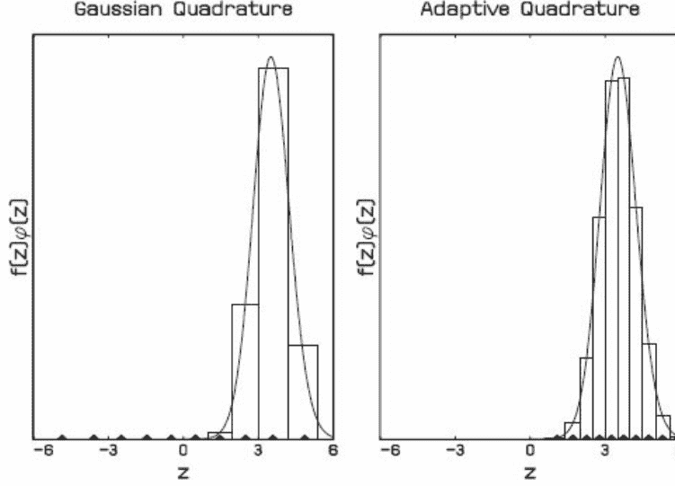

`z_q` 是否位于感兴趣的区域。事实上，选择求积点是为了在 `f(z)φ(z)` 近似表现为 `φ(z)`（即类似于标准正态密度函数）时获得良好的效果。例如，如果 `f(z)` 是足够低阶的多项式，情况就会如此。但在我们的应用中，函数 `f(z)` 将采取来自指数函数的密度的形式——因此是一个指数函数。此时，重新缩放和移动求积点可能会有所帮助，使得更多的求积点位于感兴趣的区域。这如图 7.1 的右窗口所示，被称为自适应高斯求积。

通常情况下，阶数 `Q` 越高，对似然中 `N` 个积分的近似越好。通常，自适应高斯求积需要的求积点比经典高斯求积少（许多）。另一方面，自适应高斯求积需要对每个单位进行 `∫ f(z)φ(z)dz ≈ ∑ w_q f(z_q)` 的数值最大化。

为了计算 `ln(f(z)Φ(z))`。这意味着自适应高斯求积要耗时得多。

由于 `GLMM` 的拟合基于极大似然原理，参数的推断可以很容易从经典极大似然理论中获得。

拉普拉斯方法（Tierny and Kadane, 1986）被设计用于近似形式形式积分：

```
I = ∫ e^{Q(b)}db. (7.3.9)
```

其中 `Q(b)` 是已知的、单峰的且有界的函数 `b`。令 `b̂` 为使 `Q` 最大的 `b` 值。我们随后有 `Q` 在 `b̂` 处的二阶泰勒展开为：

```
Q(b) ≈ Q(b̂) + 1/2(b-b̂)'Q''(b̂)(b-b̂). (7.3.10)
```

其中 `Q''(b̂)` 是海森矩阵。使用拉普拉斯近似 (7.3.9)，我们得到：

```
I ≈ (2π)^{q/2}|Q''(b̂)|^{-1/2}e^{Q(b̂)}.
```

显然，`b̂` 依赖于未知参数 `β, φ` 和 `D`，并且在每次迭代中，`b̂` 将根据这些估计重新计算。

当 `Q(b)` 是 `b` 的二次函数时，拉普拉斯近似是精确的，即如果 (7.3.5) 中的积分等于正态核。将这些积分解释为随机效应 `b` 的未归一化后验，从贝叶斯文献（Gelman et al., 1995）可知，在非常特殊的例子（线性模型，或者只要个体的重复测量次数 `n_i` 足够大，情况将会如此。

为了拟合 `GLMM`，SAS 过程 `GLIMMIX` 和 `NLMIXED` 是明显的选择。虽然两种过程都可以拟合各种 `GLMM`，但它们之间存在根本差异。`GLIMMIX` 限于广义线性模型，而 `NLMIXED` 允许全非线性（混合）模型。因此，`GLIMMIX` 模型以传统的符号方式指定（例如使用 `Y=X1 X2 X1*X2` 的语法），而在 `NLMIXED` 中，用户编写均值函数和（在适当）方差函数。`GLIMMIX` 允许使用 `REPEATED` 语句处理序列相关。两种过程都允许多个 `RANDOM` 语句。`GLIMMIX` 的积分选项包括 `PQL`、`MQL`、拉普拉斯近似和自适应高斯求积。`NLMIXED` 的对应选项是自适应和非自适应高斯求积。两者都允许多种更新算法和调优参数。由于 `GLIMMIX` 能够能够有效地利用广义线性模型特征（指数族结果、线性预测器的使用等），当两种方法均可使用时，它通常更快且更稳定。

使用 `NLMIXED` 时，给定随机效应的数据条件分布在 `MODEL` 语句中指定。有效的分布有：

- `normal(m)`

`general` 结构在拟合非传统模型时特别方便。`RANDOM` 语句定义了随机效应及其分布。该过程要求按主题进行排序的数据。

`GLIMMIX` 程序的有效分布包括：`beta`、二元、二项、指数、`gamma`、高斯（正态）、几何、逆高斯、对数正态、多项、负二项、泊松和中心 `t` 分布。每种分布都关联有一个默认的链接函数。用户可以偏离这些限制，但应该检查备选方案是否与结果类型的自然范围一致。例如，对于二元结果，使用 `probit` 链接代替 `logit` 链接也是合理的选择，而对于区间类型数据，使用 `log` 链接通常会有问题。

### 7.3.3 基于似然的方法

为了论证，考虑一个连续的纵向结果。假设不完全性仅由脱落（`dropout`）引起，且每个人都能获得第一次测量 `Y_{il}`。退出过程的模型可以基于例如逻辑回归，用于在受试者仍在研究中的情况下，第 `j` 次机会退出的概率。我们将该概率表示为 `g(h_{ij}, y_{ij})`，其中 `h_{ij}` 是一个向量，包含了截至第 `j` 次（但不包括 `j` 次）观测的所有响应以及相关的协变量。我们假设 `g(h_{ij}, y_{ij})` 满足：


logit[g(h_{ij}, y_{ij})] = logit [pr(D_i = j|D_i \geqslant j, y_{ij})] = h_{ij} \psi + \omega y_{ij} \(7.3.11)

$i = 1, \dots, N$。当 $\omega$ 等于零时，假设的脱落模型为 MAR（随机缺失），所有参数都可以使用 SAS 轻松估计，因为我们用于线性混合模型的测量模型以及假设服从逻辑回归的脱落模型可以被分别拟合。如果 $\omega \neq 0$，则假设的脱落过程为 MNAR（非随机缺失）。模型 (7.3.11) 为脱落过程 $f(d_{il}|y_{ip}, \psi)$ 提供了构建模块。作为一个告示，我们不应忽视事实：脱落机制的真实性质无法仅根据观测数据来确定（Molenbergh et al., 2008），这表明需要进行敏感性分析。

Rubin (1976) 以及 Little and Rubin (2014) 证明，在 MAR 和温和的正则条件下（参数 $\theta$ 和 $\Psi$ 在功能上独立），当忽略缺失数据机制时，基于似然和贝叶斯的推断是有效的（参见 Verbecke and Molenberghs, 2000）。从实践上说，感兴趣的似然基于因子 $f(Y|O)$。这被称为可忽略性（ignorability）。我们将在 7.5 节和 7.6 节中详细讨论这一点。

实际意义是，具有似然估计功能和处理不完全观测受试者能力的软件模块可以处理正确的似然函数，提供有效的参数估计和似然比值。这里有几点提示。首先，当科学关注的某部分指向无响应过程时，显然两个过程都需要被考虑。尽管如此，在 MAR 下，两个过程可以分别建模并估计参数。其次，似然推断通常与采样分布的引用相关（例如，用于精密度估计量和统计假设检验；Kenwood and Molenberghs, 1998）。然而，实际意义是，当基于观测信息而非期望信息矩阵，且在参数假设正确的情况下，标准误差和相关检验是有效的。第三，可能很难完全排除 MNAR 机制的作用。这一点在引言中已经提到，将在 7.9–10 节中进一步讨论。第四，当即使存在谎言（例如在最后一次机会两个治疗组之间的比较中）时，完整的纵向分析也是必要的。在后一种情况下，拟合模型可以作为最后一次机会推断的依据。一种常见的批评是需要考虑一个模型。然而，需要注意的是，在许多临床试验设置中，重复测量是平衡的，即对所有受试者考虑了一组共同的（通常是有限的）测量时间，这允许先验指定一个饱和模型（例如，针对固定效应的全组别与时间交互作用模型，以及非结构化的协方差矩阵）。这种可忽略的线性混合模型规格说明由 Mallinckcrodt et al. (2001ab) 给出。

## 7.3.4 广义估计方程

概述 有时被提到的全似然方法的两个问题是它们涉及的计算复杂性以及对模型假设的敏感性。当我们主要感兴趣一阶边缘均值参数和两对关联参数（即二阶矩）时，全似然程序可以用准似然方法代替（McCullagh and Nelder, 1989）。在准似然中，均值响应被表示为协变量的参数函数；方差被假设为均值的函数，可能取决于未知的尺度参数。Wedderburn (1974) 首次指出似然理论和准似然理论对于指数族是一致的，并为任何广义线性模型提供回归参数的一致估计，即使链接函数和方差函数的选择不对应指数族。

对于聚类和重复数据，Liang and Zeger (1986) 提出了所谓的广义估计方程（GEE 或 GEE1），它们只需要对我们愿意采用的单变量边缘分布进行正确的指定，而对关联结构仅做出“工作”假设。它们估计与个人二元响应向量期望值相关的参数，并对关联结构表述工作性假设。该方法将回归参数的估计方程与基于矩的相关性参数估计相结合。

Prentice (1988) 将其结果扩展到允许对概率和两对相关性进行联合估计。Lipschitz, Laird and Harrington (1991) 修改了 Prentice (1988) 的估计方程，允许通过几率而非边缘相关性对关联建模。采用 GEE1 时，我们不使用关联结构的信息估计主效应参数。结果显示，即使关联结构误设定，GEE1 也能产生一致的主效应估计量。然而，严重的误设定会严重影响 GEE1 估计量的效率。此外，当科学兴趣放在关联参数上，应避免使用 GEE1。

包含边缘关联的这些估计方程的二阶扩展（GEE2）已由 Liang, Zeger and Taqish (1992) 研究。他们指出，GEE2 几乎是完全有效的，尽管在关联结构误设定时，主效应参数的估计可能会出现偏差。

Carey, Zeger and Diggle (1993) 提出了所谓的交替逻辑回归（ALR），适用于对数链接的重复二元数据，并使用几率对关联建模。虽然 Molenberghs and Verbeke (2005) 也允许关联建模，但它们的计算比 GEE2 更简单。

## 方法论细节

在对 GEE 方法进行简要概述后，现在将进一步解释 GEE 方法论。我们首先回顾在对边缘正态模型 $Y_i \sim N(X_i, V_i)$ 下计算极大似然估计时使用的得分方程：

```
$\sum_{i=1}^N X_i(A_i^{1/2} R_i A_i^{1/2})^{-1}(y_i - X_i\beta) = 0\quad (7.3.12)
```

其中边缘协方差矩阵 $V_i$ 被分解为形式 $V_i = A_i^{1/2} R_i A_i^{1/2}$，$A_i$ 是对角矩阵；主对角线元素为边缘方差；$R_i$ 等于边缘相关矩阵。其次，

在边际广义线性模型（marginal generalized linear model）计算极大似然估计时，假设单位内的响应是相互独立的（即忽略重复测量结构），其得分方程如下：

```
$$\sum_{i=1}^N \frac{\partial \mu_i}{\partial \beta}(A_i^{1/2}R_{ii}^{1/2})^{-1}(y_i - \mu_i) = 0. \quad (7.3.13)$$
```

注意，(7.3.12)的形式与(7.3.13)相同，但考虑了重复测量之间的相关性。对(7.3.13)进行考虑相关结构的直接扩展为：

```
$S(\beta) = \sum_{i=1}^N \frac{\partial \mu_i}{\partial \beta}(A_i^{1/2}R_{ii}^{1/2})^{-1}(y_i - \mu_i) = 0, \quad (7.3.14)$
```

该方程通过将单位矩阵 $I_{ni}$ 替换为相关矩阵 $R_i = R_i(\alpha)$ 得到，通常被称为*工作相关矩阵*（working correlation matrix）。通常，边际协方差矩阵 $V_i = A_i^{1/2}R_iA_i^{1/2}$ 包含一个未知参数向量 $\alpha$——导致 $V_i(\beta, \alpha) = A_i^{1/2}(\beta)R_i(\alpha)A_i^{1/2}(\beta)$——在实践中用一个一致估计量进行替换。

假设边际均值 $\mu_i$ 已正确设定为 $h(\mu_i) = X_i$，可以证明在较的正则条件下，通过求解(7.3.14)得到的估计量 $\hat{\beta}$ 渐近从正态分布，均值为 $\beta$，协方差矩阵为：

```
$I_0^{-1}I_1^{-1}, \quad (7.3.15)$
```

其中

```
$I_0 = (\sum_{t=1}^N \frac{\partial \mu_t}{\partial \beta}\frac{\partial \mu_t}{\partial \beta}^T), \quad I_1 = (\sum_{t=1}^N \frac{\partial \mu_t}{\partial \beta}^T V_t^{-1}Var(y_t)V_t^{-1}\frac{\partial \mu_t}{\partial \beta})$
```

在实践中，(7.3.15)中的 $Var(y_i)$ 被替换为 $(y_i - \mu_i)(y_i - \mu_i)^T$，在均值再次被正确设定的唯一条件下，它是无偏的。

注意，现在只要假设关于一阶矩的模型假设是正确的，就可以对均值结构获得有效的推断。同样注意，尽管源于似然法，但(7.3.14)中的GEE方程不能解释为对应于数据向量 $y_i$ 的某个全似然的得分方程。

Liang 和 Zeger (1986) 针对工作相关提出了基于矩的估计。为此，首先定义离差：

```
$e_{ij} = \frac{y_{ij} - \mu_{ij}}{\sqrt{v(\mu_{ij})}}$
```

并按上述方式稍显复杂地分解方差：

```
$V_i = \phi A_i^{1/2} R_i^{1/2},$
```

其中 $\phi$ 是过度离散参数。

工作相关的一些常用选择包括：Corr($Y_{ip}$ $Y_{ik}$) = $0, j \neq k$；可交换性（Corr($Y_{ip}$ $Y_{ik}$) = $\alpha, j \neq k$）；AR(1)（Corr($Y_{ip}$ $Y_{it+t}$) = $\gamma, t=0,1,...,n_i-j$）；以及无结构性（Corr($Y_{ip}$ $Y_{ik}$) = $\alpha_{jk}, j \neq k$）。通常使用基于矩的估计方法来估计这些参数，作为集成迭代估计程序的一部分（Aerts, Geiger, Molberghs, and Ryan, 2002）。过度离散参数也以类似的方法获得。基于 Liang 和 Zeger (1986) 拟合 GEE 的标准迭代程序如下：

(1) 使用单变量 GLM（即假设独立性）计算 $\beta$ 的初始估计；
(2) 计算估计方程所需的量，如均值和方差；
(3) 计算 Pearson 离差 $e_{ij}$；
(4) 计算 $\alpha$ 的估计；
(5) 计算 $R_i(\alpha)$；
(6) 计算 $\phi$ 的估计；
(7) 计算 $V_i(\beta, \alpha) = \phi A_i^{1/2} R_i(\alpha) A_i^{1/2}$；
(8) 更新 $\beta$ 的估计：

```
$\beta^{(t+1)} = \beta^{(t)} - \left[ \sum_{i=1}^N \frac{\partial \mu_i}{\partial \beta} V_i^{-1} \frac{\partial \mu_i}{\partial \beta} \right] \left[ \sum_{i=1}^N \frac{\partial \mu_i}{\partial \beta} V_i^{-1} (y_i - \mu_i) \right].
```

步骤 (2)–(8) 迭代直到收敛。

在 SAS 中，有三个过程可以用于 GEE。首先是 `GENMOD` 过程。在基本形式下，它对单变量数据拟合广义线性。添加 `REPEATED` 语句，可以分析重复测量，可以使用相关结构。从 SAS 9.4 开始，可以使用 `GEE`。它与 `GENMOD` 基本等同，但其主要吸引在于加权 GEE，参见 7.7 节。如前所述，也可以使用 `GLIMMIX` 过程，提供了随机效应。

## 7.4 简单方法与 MCAR

我们将简要回顾一些仍在广泛使用的相对简单的方法。对于许多方法，需要 MCAR，而对于像 LOCF（最后观测终结）的方法，条件则不同。

### 7.4.1 完整案例分析

完整案例分析仅包含所有计划观测值的样本。这种方法有明显的缺点。首先，总是丢失大量信息。此外，当缺失机制为 MAR 而非 MCAR 时，可能会产生偏差。

### 完整案例分析与 SAS

执行完整案例分析的唯一步骤是删除未获得所有测量样本。当数据按“水平”组织时（即每个样本一条记录），这异常容易。对于“垂直”组织的数据需要稍多数据处理，可以使用下文讨论的 SAS 宏。

例如，对于年龄相关退行性试验，运行下一个语句产生完整案例数据集，用于连续结果（diff 是正确读取的字母与基线之间的差）：

# 程序 7.1 为完整案例分析准备数据（连续结果）

```
cc(data=armd155,id=subject,time=time,response=diff,out=arm)
```

以及用于二元结果（bindif 是 diff 的离散化，非负值为 1，否则为 0）。参见程序 7.2。

# 程序 7.2 为完整案例分析准备数据（离散结果）

```
cc(data=armd111,id=subject,time=time,response=bindif,out=a)
```

显然，`cc` 宏需要四个参数。`data` 是待分析的数据。如果没有指定，则使用最近的数据集。`id` 指定数据集中包含标识变量的名称，`time=` 指定样本内部的顺序。结果变量通过 `response=` 参数传递，`out` 定义宏创建的输出数据集名称。

## 程序 7.3 完整案例分析（连续性结局）

```sas
proc mixed data=armdcc2 method=ml;

title CC - 连续 ;

class time treat subject;

model diff = time*time / noint solution ddfm=kr;

repeated time time / subject=subject type=un;

run;
```

相比之下，如果将形式如 (7.7.28) 的 GEE 应用于完成完成者（completers），则可以使用以下代码进行标准 GEE。
请参见程序 7.4。

## 程序 7.4 完整案例分析（二分类结局，GEE, PROC GENMOD）

```sas
proc genmod data=armdcc;

title CC - GEE ;

class time treat subject;

model bindiiff = time*time / noint dist=binomial;

repeated subject=subject / withinsubject=time type=exch

run;
```

或者参见程序 7.5。

## 程序 7.5 完整案例分析（二分类结局，GEE, PROC GEE）

```sas
proc gee data=armdcc;

title CC - GEE ;

class time treat subject;

model bindiiff = time*time / noint dist=binomial;

repeated subject=subject / withinsubject=time type=exch

run;
```

此外，对于基于线性化的 GEE 版本，并带有经验修正的标准标准误，我们可以使用程序

## 7.6.

## 程序 7.6 完整案例分析（二分类结局，GEE, 线性化版本，PROC GLIMMIX）

```sas
proc glimmix data=armdcc empirical;

title CC - GEE - 线性化版本 - 经验 ;

loptions maxaxiter=50 technique=newrap;

class time treat subject;

model bindiif = time treat*time / noint solution dist=binary

random _residual_ / subject=subject type=cs;

run;
```

对于广义线性混合模型 (7.5.17)，使用数值积分时，以下代码非常有用。程序 7.7。

## 程序 7.7 完整案例分析（二分类结局，GLMM, PROC GLIMMIX）

```sas
proc glimmix data=armdcc method=gauss(q=20);

title CC - 混合 - 积分 ;

loptions maxaxiter=50 technique=newrap;

class time treat subject;

model bindiif = time treat*time / noint solution dist=binary

random intercept / subject=subject type=un gcororr;

run;
```

使用 NLMIXED，我们可以使用程序 7.8。

## 程序 7.8 完整案例分析（二分类结局，GLMM, PROC NLMIXED）

```sas
data help;

set armdcc;

time1=0; if time=1 then time1=1;

time2=0; if time=2 then time2=1;

time3=0; if time=3 then time3=1;

time4=0; if time=4 then time4=1;

run;

proc nlmixed data=help qpoints=20 maxiter=100 technique=new

title CC - 混合 - 数值积分 ;

eta = betall*timel beta2*time2 beta3*time3 beta4*time4

b (beta21*timel beta22*time2 beta23*time3 beta24*time4)

*(2-treat);

p = exp(tau)/(1 exp(tau));

model bindif binary(p);

rand b normal(0,tau) subject=subject;

estimate tau 2 tau*tau;

run;
```


注意，程序 7.8 中的 DATA 步骤仅为四个测量时间点中的每一个创建了虚拟变量。`ESTIMATE` 语句允许方便地估计随机效应方差及其标准误，因为模型参数 `τ` 是对应的标准差。
上述任何内容都并非 CC 特有的。只有使用 `%cc(...)` 宏进行数据预处理才将其定义为 CC。

## 7.4.2 简单插补方法

获取可以使用完整数据数据集的另一种替代方法是填充缺失值，而不是删除序列不完整的受试者。插补的原理非常简单：使用观测值来对缺失观测进行插值。使用观测信息有几种方法：首先，我们可以使用同一受试者的信息（例如，最后观察值结法）。其次，可以从其他受试者借用信息（例如，均值插补）。最后，可以同时使用受试者内和受试者的信息（例如，条件均值插补、热卡插补）。标准参考文献是 Little 和 Rubin (2014)，插补策略在样本调查方法中历史上一直非常流行。

然而，在用插补策略时必须非常小心。Dempster 和 Rubin (1983) 写道：

> 插补的思想既诱人又是危险的。它之所以诱人，是因为它可以让用户陷入一种认为“数据终究是完整的”的愉悦状态；它之所以危险，是因为它将两种情况混合在了一起：一种是问题远超这种方法合法处理的范围，另一种是应用于真实数据和插补数据的标准估计器具有显著偏差的情况。

例如，Little 和 Rubin (2014) 显示，该方法对于具有一个固定效应和一个误差项的线性模型可能有效，但通常对于分层模型、分裂曲设计、重复测量（具有复杂的误差结构）、随机效应模型和混合效应模型，它通常并不有效。至少，需要对不同的效应进行不同的插补。

插补策略的使用者面临着几种危险。首先，插补模型可能是错误的。其次，即使插补模型是正确的，不完整性带来的不确定性也被掩盖了。

### 最后观察值结法（Last Observation Carried Forward）

在这种情况下，当数据缺失时，使用最后一个观测值进行替换。为了确保该方法的有效性，必须做出非常强且往往不现实的假设。首先，当我们考虑纵向分析或当数据缺失是由于流失时，我们必须假设从患者退出开始的轨迹保持不变（这种假设甚至更强）。其次，这种假设通常被认为是 LOCF 的真实动机。

### 最后观测值结法与 SAS

当目标是 LOCF 时，需要执行与完整案例分析类似的步骤。对于垂直组织的数据集，可以使用由 Beunckens 编写的宏。参见程序 7.9。

```sas
%locf(data=arm,id=subject,time=time,response=diff,out=
```

或者对于二分类情况：

```sas
%locf(data=arm,id=subject,time=time,response=bindif,out=
```

参数完全相同，注意现在创建了一个名为 `locf` 的新变量，应在分析程序中使用。因此，之前所有的 SAS 程序 `MIXED`、`GENMOD`、`GEE`、`GLIMMIX` 和 `NLIMED` 代码仍然有效，只需替换响应变量。

## 7.5 可忽略似然（直接似然）

正如第 7.3 节所述，只要缺失机制是 MAR（完全随机缺失），基于似然的推断就是有效的，前提是满足描述非响应机制的参数与测量模型是不同的技术条件（Little and Rubin, 2014）。换句话说，缺失数据过程在似然推断意义上应该是忽略的，因为此时似然函数分解为两个功能独立的部分。因此，可以使用似然估计软件模块，只要它能够处理不完整的受试者。换句话说，它应该能够处理长度不同的受试者（或区块），几乎所有的纵向程序都能做到。由此得到的估计、标准误、似然比值等都是有效的。

总之，基于似然的可忽略分析（简称忽略似然或直接似然）更好，因为它使用了所有可用信息，而无需删除或插补测量或整个受试者。当缺失机制为 MAR 时，这种方法在理论上是合理的。由于没有移除观测（如完整案例分析）或添加观测（如单次插补），因此不存在统计信息的扭真。在 `MIXED`、`GLIMMIX` 或 `NLMIXED` 程序中实施忽略似然分析不需要额外的编程，只要正确指定了测量的顺序。这可以通过在输入数据集中提供缺失记录，或者在 `REPEATED` 和/或 `RANDOM` 语句中正确指示顺序来实现。

## 7.5.1 正态分布结局

示例：年龄相关性黄斑变性临床试验

我们首先考虑一个简单的多变量正态模型，其在安慰剂下具有无约束的时间趋势、特定场合的治疗效应以及 $4 \times 4$ 的非结构化方方差矩阵。如下：

```
$Y_{ij} = \beta_{j1} + \beta_{j2}T_i + \epsilon_{ij} \quad (7.5.16)
```

其中，对于安慰剂，$T_i = 0$，对于干扰素-$\alpha$，$T_1 = 1$。将直接似然分析与完全病例终结法（CC）和最后观察结结（LOCF）进行对比，八个均值参数的参数估计（标准误）如表 7.4 所示。

**表 7.4 相关黄斑变性性试验。** 拟合于连续结局“阅读字母数量与基线的混合值”的线性模型参数估计（标准误）。包括 CC、LOCF 和直接似然法。分别给出四个时间点治疗效应的 $p$ 值，以及四个时间点的联合 $p$ 值。

| 效应 | 参数 | CC | LOCF | 直接似然 |
|---|---|---|---|---|
| 参数估计 (标准误) | | | | |
| 截距 4 | $\beta_{11}$ | -3.24(0.77) | -3.48(0.77) | -3.48(0.77) |
| 截距 12 | $\beta_{21}$ | -4.66(1.14) | -5.72(1.09) | -5.85(1.1) |
| 截距 24 | $\beta_{31}$ | -8.33(1.39) | -8.34(1.30) | -9.05(1.3) |
| 截距 52 | $\beta_{41}$ | -15.13(1.73) | -14.16(1.53) | -16.21(1.0) |
| 治疗效应 4 | $\beta_{12}$ | 2.32(1.05) | 2.20(1.08) | 2.20(1.0) |
| 治疗效应 12 | $\beta_{22}$ | 2.35(1.55) | 3.38(1.53) | 3.51(1.5) |
| 治疗效应 24 | $\beta_{32}$ | 2.73(1.88) | 2.41(1.83) | 3.03(1.8) |
| 治疗效应 52 | $\beta_{42}$ | 4.17(2.35) | 3.43(2.15) | 4.86(2.3) |
| 治疗效应 4 | $\beta_{12}$ | 0.0282 | 0.0432 | 0.0435 |
| 治疗效应 12 | $\beta_{22}$ | 0.1312 | 0.0287 | 0.0246 |
| 治疗效应 24 | $\beta_{32}$ | 0.1491 | 0.1891 | 0.1096 |
| 治疗效应 52 | $\beta_{42}$ | 0.0772 | 0.1119 | 0.0366 |
| 治疗效应（总体） | | 0.1914 | 0.1699 | 0.1234 |

虽然没有整体治疗效应，且三种方法之间的 $p$ 值变异不大，但对于特定场合的治疗效应，情况大不相同。在第 4 周，所有三个 $p$ 值均显示具有显著性。虽然在分析完成者者时这是唯一的显著效应，但在使用 LOCF 时又多出一个显著效应（第 12 周），而在采用直接似然法时则又多出两个显著效应（第 12 周和第 52 周）。再次，CC 和 LOCF 错过了重要的治疗差异，其中最重要的是研究结束时第 52 周的差异。

## 7.5.2 非高斯结局

**示例：** 年龄相关黄斑变性试验

让我们现在转向随机截距逻辑模型，其精神与 (7.7.28) 相似：

```
logit[P (Y_{ij} = 1|T_i, t_j, b_i)] = \beta_{j1} + b_i + \beta_{j2}T_i \quad (7.5.17)
```

符号同前，且 $b_i \sim N(0, \tau^2)$。PQL 和数值积分均用于模型拟合。该模型的结果见表 7.5。我们观察到 PQL 与数值积分分析之间存在通常的向下偏差，且边际参数与其对应的随机效应之间也存在这种关系。在这种情况下，这种方法人为增加了同一受试者测量值之间的关联性。CC 和 LOCF 实际上高估了某些时间点的治疗效应，程度从微小到重要（第 4 周和 24 周）。**表 7.5 年龄相关黄斑变性试验。** 随机截距模型的参数估计（标准误）；基于 CC 和 LOCF 总体，以及基于观测数据。

| 效应 | 参数 | CC | LOCF | 直接似然 |
|---|---|---|---|---|
| Int.4 | $\beta_{11}$ | -1.19(0.31) | -1.05(0.28) | -1.00(0.2) |
| Int.12 | $\beta_{21}$ | -1.05(0.31) | -1.18(0.28) | -1.19(0.2) |
| Int.24 | $\beta_{31}$ | -1.35(0.32) | -1.30(0.28) | -1.26(0.2) |
| Int.52 | $\beta_{41}$ | -1.97(0.36) | -1.89(0.31) | -2.02(0.3) |
| Trt.4 | $\beta_{12}$ | 0.45(0.42) | 0.24(0.39) | 0.22(0.2) |
| Trt.12 | $\beta_{22}$ | 0.58(0.41) | 0.68(0.38) | 0.71(0.2) |
| Trt.24 | $\beta_{32}$ | 0.55(0.42) | 0.50(0.39) | 0.49(0.2) |
| Trt.52 | $\beta_{42}$ | 0.44(0.47) | 0.39(0.42) | 0.46(0.4) |
| R.I. s.d. | $\tau$ | 1.42(0.14) | 1.53(0.13) | 1.40(0.1) |
| R.I. var. | $\tau_2$ | 2.03(0.39) | 2.34(0.39) | 1.95(0.39) |

数值积分

| 效应 | | | | |
|---|---|---|---|---|
| Int.4 | $\beta_{11}$ | -1.73(0.42) | -1.63(0.39) | -1.50(0.3) |
| Int.12 | $\beta_{21}$ | -1.53(0.41) | -1.80(0.39) | -1.73(0.3) |
| Int.24 | $\beta_{31}$ | -1.93(0.43) | -1.96(0.40) | -1.83(0.3) |
| Int.52 | $\beta_{41}$ | -2.74(0.48) | -2.76(0.44) | -2.85(0.4) |
| Trt.4 | $\beta_{12}$ | 0.64(0.54) | 0.38(0.52) | 0.34(0.4) |
| Trt.12 | $\beta_{22}$ | 0.81(0.53) | 0.98(0.52) | 1.00(0.4) |
| Trt.24 | $\beta_{32}$ | 0.77(0.55) | 0.74(0.52) | 0.69(0.5) |
| Trt.52 | $\beta_{42}$ | 0.60(0.59) | 0.57(0.56) | 0.64(0.5) |
| R.I. s.d. | $\tau$ | 2.19(0.27) | 2.47(0.27) | 2.20(0.2) |
| R.I. var. | $\tau_2$ | 4.80(1.17) | 6.08(1.32) | 4.83(1.1) |

**表 7.6 年龄相关黄斑变性试验。** 参数估计（模型标准误）；对于边际模型：经验修正标准误；基于 CC 和 LOCF 总体，以及观测数据。在后者，也使用了 GEE。所有分析均基于 PROC GENMOD。

| 效应 | CC | LOCF | 非加权 |
|---|---|---|---|---|
| 标准 GEE | | | | |
| Int.4 | $\beta_{11}$ | -1.01(0.24;0.24) | -0.87(0.21;0.21) | -0.87(0.21;0.21) |
| Int.12 | $\beta_{21}$ | -0.89(0.24;0.24) | -0.97(0.21;0.21) | -1.01(0.22;0.22) |
| Int.24 | $\beta_{31}$ | -1.13(0.25;0.25) | -1.05(0.21;0.21) | -1.07(0.23;0.22) |
| Int.52 | $\beta_{41}$ | -1.64(0.29;0.29) | -1.51(0.24;0.24) | -1.71(0.29;0.29) |
| Trt.4 | $\beta_{12}$ | 0.40(0.32;0.32) | 0.22(0.28;0.28) | 0.22(0.29;0.29) |
| Trt.12 | $\beta_{22}$ | 0.49(0.31;0.31) | 0.55(0.28;0.28) | 0.61(0.28;0.29) |
| Trt.24 | $\beta_{32}$ | 0.48(0.33;0.33) | 0.42(0.29;0.29) | 0.44(0.30;0.30) |
| Trt.52 | $\beta_{42}$ | 0.40(0.38;0.38) | 0.34(0.32;0.32) | 0.44(0.37;0.37) |
| | $\sigma_2$ | 0.62 | 0.57 | 0.62 |
| | $\tau_2$ | 0.39 | 0.44 | 0.39 |
| Corr. | $\rho$ | 0.39 | 0.44 | 0.39 |

线性化化的 GEE

| Int.4 | $\beta_{11}$ | -1.01(0.24;0.24) | -0.87(0.21;0.21) | -0.87(0.21;0.21) |
| Int.12 | $\beta_{21}$ | -0.89(0.24;0.24) | -0.97(0.21;0.21) | -1.01(0.22;0.22) |
| Int.24 | $\beta_{31}$ | -1.13(0.25;0.25) | -1.05(0.21;0.21) | -1.07(0.23;0.22) |
| Int.52 | $\beta_{41}$ | -1.64(0.29;0.29) | -1.51(0.24;0.24) | -1.71(0.29;0.29) |
| Trt.4 | $\beta_{12}$ | 0.40(0.32;0.32) | 0.22(0.28;0.28) | 0.22(0.29;0.29) |
| Trt.12 | $\beta_{22}$ | 0.49(0.31;0.31) | 0.55(0.28;0.28) | 0.61(0.28;0.29) |
| Trt.24 | $\beta_{32}$ | 0.48(0.33;0.33) | 0.42(0.29;0.29) | 0.44(0.30;0.30) |
| Trt.52 | $\beta_{42}$ | 0.40(0.38;0.38) | 0.34(0.32;0.32) | 0.44(0.37;0.37) |

## 7.5.3 使用 SAS 进行直接似然

与 CC 和 LOCF 不同，当计划进行直接似然分析时，不需要额外的数据处理，只要用于分析的软件工具可以处理不等长度的测量序列。几乎所有的纵向数据分析工具都是如此，包括 SAS 过程 `MIXED`、`NLMIXED` 和 `GLIMMIX`。

然而，需要注意一点。对于对序列内测量顺序重要的残差相关结构（如非结构化和 AR(1)，但简单结构或复合对称除外），当出现间歇性缺失时，必须确保传递的是设计顺序而非表观顺序。在 SAS `MIXED` 过程中，如下语句

```
repeated / subject=subject type=;
```

在每个受试者都有四次设计测量的情况下是可行的。但是，当某个受试者的第二次测量缺失时，存在将剩余测量被视为第一、第二和第三，而不是第一、第三和第四的风险。因此，将上述语句替换为：

```
repeated time / subject=subject type=;
```

因此，总之，第 7.4.1 节列出的所有基于似然分析的代码均可以使用，只要传递的是原始数据集（`armd155.sasbdat` 和 `armd111.sasbdat`）而非派生数据集。

我们得出结论：只需极少的关注，直接似然分析的复杂性与在无缺失数据集上进行相应的分析相当。

## 7.6 直接贝叶斯分析（可忽略贝叶斯分析）

如前所述，在 MAR（随机缺失）和适当的正则性条件下，不仅是似然分析，贝叶斯分析也是可忽略的。这意味着，就像可忽略的似然分析一样，可忽略的贝叶斯分析使用完整数据或不完整数据同样容易进行。为了说明这一点，考虑以下针对差异结果的简单线性混合模型：

> $Y_{ij} \sim N((\beta_1 + \beta_{b1i}) + (\beta_2 + \beta_{b2i})t_{ij} + (\beta_3 + \beta_{b3i})T_i + (\beta_4 + \beta_{b4i})T_{ij}, \sigma^2)) \qquad (7.6.18)$
>
> $$\begin{pmatrix} b_{b1i} \\ b_{b2i} \\ b_{b3i} \\ b_{b4i} \end{pmatrix} \sim N(0, G) \qquad (7.6.19)$$

为了方便可忽略似然分析与可忽略贝叶斯分析之间的比较，我们首先提供可忽略似然代码。

### 程序 7.10 直接似然

```sas
proc mixed data=m.armd13k method=ml nobound covtest;
title direct likelihood ;
class subject;
model diff = time treat treat*time / solution ddfm=kr;
random intercept time treat treat*time / subject=subject type
run;
```


### 相关输出为：

#### 选定的直接似然输出

##### 固定效应解

| Effect | 估计 | 误差 | DF | t 值 | Pr |
|---|---|---|---|---|---|
| Intercept | 4.5954 | 2.0798 | 316 | 2.21 | |
| time | -2.5089 | 1.0527 | 286 | -2.38 | |
| treat | -1.5121 | 1.3584 | 383 | -1.11 | |
| time*treat | -0.7952 | 0.6731 | 350 | -1.18 | |

##### 协方差参数估计

| Standard Cov Parm | Subject | 估计 | 误差 | 值 |
|---|---|---|---|---||
| Intercept | subject | 12.3563 | 12.9356 | 0.96 |
| time | subject | 14.3486 | 3.3803 | 4.24 |
| treat | subject | 5.1696 | 4.8308 | 1.07 |
| time*treat | subject | -0.2543 | 1.1974 | -0.21 |
| Residual | | 50.7478 | 3.3151 | 15.31 |

注意，与时间处理交互作用相关的方差分值为负，尽管与零没有显著差异。换句话说，我们拥有的是一个允许边缘解释但不允许分层解释的模型。这在随后的贝叶斯分析中将有所不同，因为分层解释是模型中固有的。

为了贝叶斯分析之目的，我们将 (7.6.18)-(7.6.19) 重写为：

```
$Y_{ij} \sim N(\beta_{1i} + \beta_{2ij}t_{j} + \beta_{3i}T_{i} + \beta_{4ij}T_{i}t_{j}, \sigma^{2}), \quad (7.6.20)$
```

```
$$\beta_i = \begin{pmatrix} \beta_{11} \\ \beta_{21} \\ \beta_{31} \\ \beta_{41} \end{pmatrix} \sim N(\beta, G), \quad (7.6.21)$$
```

```
$$\beta \sim N(\beta_0, \Sigma_0), \quad (7.6.22)$$
```

```
$G \sim \text{IWishart}(\rho, S), \quad (7.6.23)$
```

```
$$\tau^2 \sim \text{IGamma}(\alpha, \gamma). \quad (7.6.24)$$
```

相应的程序（包含了超先验参数的选择）是程序 7.11。

#### 程序 7.11 直接贝叶斯分析

```
proc mcmc data=m.armd13k nmc=10000 outpost=m.armd131 seed=2
title Direct Bayes ;
array theta 4 beta1 beta2 beta3 beta4;
array theta_c 4, 4;
array dmat 4,4;
array beta0 4 (0 0 0 0);
array Sig0 4,4 (1000 0 0 0 0 1000 0 0 0 1000 0 0 0);
array S 4,4 (100 0 0 0 100 0 0 0 100 0 0);
parms theta_c dmat 10 0 0 10 0 0
prior theta_c mvn(beta0,Sig0);
prior dmat iwishart(4,S);
prior var_y iguamma(0.01,scale=0.01);
random(theta_c,dmat) subject=subject;
mu=beta2*treat;
model diff normal(mu,var_y);
run;
```

对应的输出如下。选定的后验摘要和区间

| 参数 | N | 均值 | 95% HPD |
|---|---|---|---|
| theta_c1 | 10000 | 4.3933 | 2.9525 | -1.8276 |
| theta_c2 | 10000 | -1.4268 | 1.9469 | -4.4090 |
| theta_c3 | 10000 | -2.2187 | 1.2372 | -4.5489 |
| theta_c4 | 10000 | -0.9799 | 0.8187 | -2.5887 |
| dmat1 | 10000 | 43.8501 | 25.5374 | 8.7026 |
| dmat2 | 10000 | -14.0943 | 16.7127 | -53.0171 |
| dmat3 | 10000 | -13.0795 | 17.2618 | -52.0841 |
| dmat4 | 10000 | 5.1822 | 9.6912 | -8.5062 |
| dmat5 | 10000 | -14.0943 | 16.7127 | -53.0171 |
| dmat6 | 10000 | 21.8172 | 12.0049 | 5.2413 |
| dmat7 | 10000 | 0.7602 | 11.0049 | -15.7870 |
| dmat8 | 10000 | -4.1026 | 5.9895 | -18.0130 |
| dmat9 | 10000 | -13.0795 | 17.2618 | -52.0841 |
| dmat10 | 10000 | 0.7602 | 11.0049 | -15.7870 |
| dmat11 | 10000 | 36.4025 | 19.3862 | 9.0475 |
| dmat12 | 10000 | -14.9697 | 11.7158 | -39.6488 |
| dmat13 | 10000 | 5.1822 | 9.6912 | -8.5062 |
| dmat14 | 10000 | -4.1026 | 5.9895 | -18.0130 |
| dmat15 | 10000 | -14.9697 | 11.7158 | -39.6488 |
| dmat16 | 10000 | 12.6873 | 6.8567 | 3.9227 |
| var_y | 10000 | 46.2681 | 3.0475 | 40.4443 |

我们观察到结果与直接似然分析的结果相似，但也存在差异。这是由于先验分布的影响。另一个差异来源是，基于似然的模型没有对 `G` 的分量设定边界，而贝叶斯模型本质上是分层的。

## 7.7 加权广义估计方程

### 7.7.1 概念

广义估计方程 (`GEE`)，如第 7.3.4 节所述，当研究问题以边缘均值函数表述时，`GEE` 在建模重复测量方面非常有吸引力，尤其是当结果为非高斯类型时。

然而，正如 Liang 和 Zeger (1986) 指出的，基于不数据的 `GEE` 推断仅在数据完全随机缺失 (`MCAR`) 的强假设下有效。为了允许数据随机缺失 (`MAR`)，Robins、Rotnitz 和 Zhao (1995) 提出了加权估计方程 (`WGEE`)。在第 7.8 节中，我们还将讨论插补。其思想是根据完全观测的逆概率对每个受试者对 `GEE` 的贡献进行加权。Molenbergh 等 (2011) 令 $\pi_i$ 为在特定时刻退出概率。这可以写为：

```
$$\pi_i = \prod_{\ell=2}^{d_i-1} (1-\pi_{\ell}), \quad (7.7.25)$$
```

其中 `R_i = 1` 如果受试者被观测，否则为 0。此时我们将忽略间歇缺失。我们在第 7.8 节回到这一点。重要的协变量是治疗分配、基线病变水平（一个四分分类变量，需要三个指示变量）以及退出发生的时间。对于后者协变量，有三个水平，因为退出可能发生在时间 2、3 或 4。因此，包含了两个指示变量。最后，先前的结果没有显著影响，但仍将其保留在模型中。

#### 表 7.7 年龄性黄斑变性试验。用于描述脱落的逻辑回归模型的参数估计（标准误）。

| 效应 | 参数 | GENMOD | GEE |
|---|---|---|---|
| 截距 | $\psi_0$ | 0.14 (0.49) | 0.17 (0.56) |
| 前期结果 | $\psi_1$ | 0.04 (0.38) | -0.05 (0.38) |
| 治疗因素 | $\psi_2$ | -0.86 (0.37) | -0.87 (0.37) |
| 损变级别 1 | $\psi_{31}$ | -1.85 (0.49) | -1.82 (0.47) |
| 损变级别 2 | $\psi_{32}$ | -1.91 (0.52) | -1.88 (0.51) |
| 损变级别 3 | $\psi_{33}$ | -2.80 (0.72) | -2.79 (0.73) |
| 时间 2 | $\psi_{41}$ | -1.75 (0.49) | -1.73 (0.49) |

注：在调用 `%dropout` 宏后会调用 `GENMOD`。`GEE` 参数源于过程中的 `MISSMODEL` 语句。

从表 7.6 中，可以清楚地看到，标准 `GEE` 结果与基于线性化的 `GEE` 结果之间的差异非常小。这对于观测数据上的 `CC`、`LOCF` 和未加权的 `GEE` 来说无疑是如此的。对于这三种情况，由于完整时间与治疗均值结构具有无结构化性质，基于模型的标准误和经验修正的标准误吻合得非常好。然而，我们确实在 `WGE` 分析中观察到了差异。不仅两个 `GEE` 版本的参数估计之间存在细微差异，而且模型标准误与经验修正标准误之间也存在巨大差异。这完全归因于加权方案。权重没有经过校准以加和等于总样本量，这反映在基于模型的标准误中。在基于线性化的情况下，部分效应被捕获为过度离散。这可以通过添加参数 $\sigma^2$ 和 $\tau$ 看出。在所有其他分析中，其和接近于一，这在没有残差过度离散时应该是这样的；但在最后一列中，这些和为 3.14。尽管如此，两组经验修正的标准误非常接近，这令人宽慰。

尽管没有 `MAR`（完全随机缺失）的强有力证据，但 `GEE` 和 `WGEE` 之间的结果存在非平凡差异。即在 12 周时，使用 `WGEE` 观察到了治疗效应，而使用其他边缘分析时未检测到。这一发现通过下一节中受试者特定随机截距模型在一定程度上得到了证实（当数据被作为观测值使用时）。

在比较 `CC`、`LOCF` 和观测数据分析的参数估计时，显而易见 `LOCF` 具有人为增加测量值之间相关性的作用。在这种情况下，该效应是微弱的。观测数据 `GEE` 的参数估计在早期时间点接近 `LOCF` 结果，在后期时间点接近 `CC`。这是预料之中的，因为在研究开始时，`LOCF` 和观测群体非常相似，且在研究结束时 `CC` 与观测群体之间也保持相同。注意，`LOCF` 下的治疗效应（特别是 12 周和 1 年后）与 `GEE` 分析相比存在向下的偏差。

### 7.7.2 WGEE 和 SAS，使用 PROC GENMOD

我们将首先讨论在使用旧版 SAS 过程 `GENMOD` 时应采取的步骤。之后，我们将切换到更近期且更易用的 `GEE` 过程。

用于标准 `GEE` 分析的 `GENMOD` 程序是程序 7.12。

#### 程序 7.12 标准 GEE

```
proc genmod data=armdwgee;
class time treat subject;
model bindiif = time treat*time / noint dist=binomial;
repeated subject=subject / withininsubject=time type=exch mem
run;
```

同样，可以无任何问题地使用程序 7.13 使用基于线性化的版本：

#### 程序 7.13 基于线性化的 GEE

```
proc glimmix data=armdwgee empirical;
maxiter=50 technique=new;
class treat subject;
model bindif = treat*time / noint dist=binomial;
random residual / subject=subject type=cs;
run;
```

注意，由于模型选项，`PROC GENMOD` 会同时产生经验误差和基于模型的误差。在 `GLIMMIX` 代码中，我们仅获得经验修正的误差。在省略此选项后，将获得基于模型的标准误。

我们现在勾勒出进行加权 `GEE` 分析时应采取的步骤。为了计算权重，我们必须首先使用示例中的逻辑回归来拟合脱落模型。脱落结果是二元的，并指示是否发生了脱落。

被采用。换句话说，这种更精细的权重克服了 `WGEE` 主要问题之一，即精度降低的问题。为了强调这一点，

#### 表 7.8 年龄相关黄斑变性性试验。使用 PROC GEE 进行 WGEE 的参数估计（经验修正后的标准误），同时使用了观测值级权重和受者级权重。

| 效应 | 参数 | 观测值 | 受者 |
|---|---|---|---|
| Int.4 | $\beta_{11}$ | -0.95 (0.20) | -0.98 (0.35) |
| Int.12 | $\beta_{21}$ | -1.03 (0.22) | -1.77 (0.30) |
| Int.24 | $\beta_{31}$ | -1.03 (0.23) | -1.11 (0.29) |
| Int.52 | $\beta_{41}$ | -1.52 (0.30) | -1.72 (0.37) |
| Tr.4 | $\beta_{12}$ | 0.32 (0.28) | 0.78 (0.56) |
| Tr.12 | $\beta_{22}$ | 0.65 (0.29) | 1.83 (0.47) |
| Tr.24 | $\beta_{32}$ | 0.39 (0.30) | 0.71 (0.49) |
| Tr.52 | $\beta_{42}$ | 0.30 (0.39) | 0.72 (0.47) |
| Corr. | $\rho$ | 0.38 | 0.33 |

观测值级分析产生的标准误与未加权的 `GEE` 在同一数量级（表 7.8）。

### 7.7.4 双重稳健性

我们通过引用 Robins 同事的最新进展来结束 `GEE` 章节，这些进展旨在提高 `WGEE` 的效率，更广义地称为逆概率加权 (`IPW`)。概述请参见 Carpenter、Kenward 和 Vansteelandt (2006)；Molenberghs 和 Kenward (2007) 以及 Molenberghs 等人 (2015)。本质上，标准 `WGEE` 增加了一个第二项，该项在给定观测数据的情况下期望为零，且通常以给定观测结果的情况下对未观测结果的预测分布的形式写出。该方法被称为双重稳健，是因为当权重模型或预测模型中任意一个被正确设定时，它都能产生一致且渐近正态的估计量，但并不要求两者都正确。目前，该方法论尚未在标准程序中可用，尽管存在用户定义的实现。例如（在 www.missingdata.org.uk 上），Mallinckrodt 和 Lipnikov (2016, 第 17 章)，其中提供了用于双重稳健估计的 SAS 代码。

## 7.8 多重插补

除了已经讨论的方法，多重插补 (`MI`) 是建模者工具箱中一种非常有吸引力的工具。在 `MAR`（随机缺失）下，该方法是可以忽略的。对于 `MNAR`（非随机缺失）机制存在扩展。这些方法非常适用于敏感性分析，将在第 7.11 节中讨论。


# 多重插补（MI）

多重插补（MI）由 Rubin (1978) 正式引入。Rubin (1987) 提供了全面的早期处理。其他几个来源，如 Rubin 和 Schenker (1986)；Little 和 Rubin (2014)；Tanner 和 Wong (1987)；Schafer (1997)；van Buuren (2012)；Carpenter 和 Kenward (2013) 以及 O'Kelly 和 Ratitch (2014)，提供了该技术的易于阅读的描述。

核心思想是将每个缺失值替换为一组 M 个可能的值，即从我们数据的分布中“提取”的值，这些值代表了对正确插补值的不确定性。然后使用完整数据的标准程序对插补数据集进行分析，并合并这些分析的结果。绘制插补可以通过多种方式进行，我们将讨论最常用的方法。

一个明显的问题是何时使用多重插补。这个问题之所以相关，是因为鉴于 `MIXED`、`GLIMMIX`、`NLMIXED`、`MCMC` 以及相关软件工具可用，直接似然分析和直接贝叶斯分析触手可及。此外，得益于 `WGEE` 程序，`WGEE` 已变得相对容易使用。

尽管如此，我们广泛认为至少有六种 MI 可以派上用场的设置，而不限于其他用户。

1. 当缺失协变量和缺失结果并存时，多重插补可以方便地处理不完整的协变量，或组合的不完整结果。在前一种情况下，可以在带有补全协变量的不完整结果数据上使用标准的缺失数据技术。在后一种，可以使用任何完整数据技术。
2. 当对同一组不完整数据计划进行若干分析时，可以使用 MI 处理缺失值，然后可以进行各种分析。一个简单的例子是，对同一组不完整数据同时使用 `GEE` 和 `GLMM` 进行建模。
3. 当某种技术要求缺失数据模式是单调的，MI 可以作为预见技术的替代方案（例如，不使用直接似然或 `WGEE`，而是通过 MI 之后使用完整数据技术），或者为了使该技术单调化。
4. 当难以实施时，MI 很有吸引力，特别是当结果是二值时。
5. 当考虑 `MNAR` 时，某些扩展是有效的。
6. 当结果是连续型时，MI 是有用的。

技术上，MI 涉及三个不同的步骤：

- **插补步骤**：填充 M 次缺失值。
- **分析步骤**：对 M 个数据集进行分析。
- **推断步骤**：合并这些分析的结果。

## 7.8.1 理论证明

假设我们有一组 $n$ 个同分布样本 $Y_t$，$\theta$ 是一个变量。在贝叶斯框架下，我们将 $\theta$ 定义为 $Y_t$ 的均值。如果我们知道 $Y_t$ 的分布，就可以从 $f(y^m|y^o, \theta)$ 插补 $Y^m$。插补的目标是从真实分布中采样。由于我们不知道 $\theta$，因此必须从数据中估计它。频率主义者有时采用自助法纳入 $\theta$ 的不确定性。然而，在贝叶斯中，$\theta$ 是随机变量，其后验分布是数据的函数，因此我们必须考虑其不确定性。贝叶斯方法通过积分 $\theta$ 为考虑不确定性提供了一个更自然、统一的框架。因此，$\theta$ 是均值等于估计值 $\theta$ 的随机变量。

插补算法如下：

1. 从 $f(y^m|y^o, \theta^*)$ 提取 $\theta^*$。这可以通过多种方式，包括多元正态模型、对数线性模型及其组合、蒙特卡洛马尔夫链方法、所谓的全条件规范（`FCS`）等（van Buuren, 2012；Carpenter and Kenward, 2013）。
2. 使用完成的数据 $(Y^o, Y^{m^*})$ 计算感兴趣参数的估计及其估计方差：
   $$\bar{\{\beta\}} = \beta(Y) = \bar{\{\beta}}(Y^o, Y^{m^*}),$$
   以及插内方差 $U = \text{Var}(\bar{\{\beta}})$。
3. 重复步骤 1、2、3 M 次 $\hat{\beta}^m$ 和 $U^m$，对于 $\mathbf{m = 1, \dots, M}$。

步骤 1 和 2 构成了*插补任务*。步骤 3 是*分析任务*。

## 7.8.2 信息合并

当然，我们希望将这 M 个推断合并为一个单一推断（*推断任务*）。在本节中，我们将讨论参数和精度估计。在没有缺失数据的情况下，假设参数的推断满足：

$(\beta - \hat{\beta}) \sim N(0, U),$

对 $M$ 个插补内估计进行合并，得到多重插补估计：

$$\hat{\beta}^* = \frac{\sum_{m=1}^{M} \hat{\beta}^m}{M},$$

此外，我们可以基于以下公式进行正态推断：

$(\beta - \hat{\beta}^*) \sim N(0, V),$

其中

$V = W + \frac{M+1}{M} B,$

$W = \frac{\sum_{m=1}^{M} U^m}{M},$

是插补内方差，且

$B = \frac{\sum_{m=1}^{M} (\hat{\beta}^m - \hat{\beta}^*)(\hat{\beta}^m - \hat{\beta}^*)^t}{M - 1}.$

是**插补间**方差（Rubin, 1987）。

## 7.8.3 假设检验

使用多重插补（MI）时，渐近结果以及相应的 $X^2$ 参考分布不仅取决于样本量 $N$，还取决于插补次数 $M$。因此，Li, Raghununathan 和 Rubin (1991) 建议使用具有适当自由度的 $F$ 参考分布。为了检验假设 $H_0: \theta_0$，他们建议采用以下方法计算 $p$ 值：

$p = P(F_{k,w} > F),$

其中 $k$ 是参数向量 $\theta$ 的长度，$F_{k,w}$ 是分子自由度为 $k$ 分母自由度为 $w$ 的 $F$ 随机变量，且

$$F = \frac{(\theta^*-\theta_0)'W^{-1}(\theta^*-\theta_0)}{k(1+r)}$$

$$w = 4+(r-4)\left[1+\frac{(1-2r^{-1})}{r}\right]\right]$$

$$r = \frac{1}{k}\left(1+\frac{1}{M}\right)tr(BW^{-1})$$

$$t=k(M-1).$$

在这里，$r$ 是由于无响应导致 $\theta$ 各分量方差平均相对增加。该 $F$ 变量的极限行为是：如果 $M \rightarrow 1$，$F$ 的参考分布接近 $F_{k,\infty}=\chi^2/k$ 分布。

显然，该程序不仅适用于全向量 $\theta$，也适用于将某一个分量、子向量或一组线性对比作为假设检验的对象。在处理子向量（或作为单个分量的特殊情况）时，我们在公式中使用 $B$ 和 $W$ 对应的子矩阵。对于一组线性对比 $L\beta$，我们应该使用经过适当转换的协方差矩阵：$\hat{W}=LWL'$，$\hat{B}=LBL'$ 以及 $\hat{V}=LV'$。

## 7.8.4 效率

多重插补之所以具有吸引力，是因为在 $M$ 值较小时具有非常高的效率。历史上，人们经常建议小至 $M=5$ 的值（Rubin, 1987, p. 114）。当然，效率取决于多种因素，例如缺失量、数据类型以及推断目标是估计还是假设检验。使用稍高的数值是稳妥的。目前的 SAS 默认值为 $M=25$（截至 SAS/STAT 14.1；以前默认值为 $M=5$）。鼓励用户进行简单的数值灵敏性分析，通过在一定范围内改变插补次数，直到达到所需的精度水平。Carpenter 和 Kenward (2013) 在这方面提供了指南。

## 7.8.5 插补机制

创建插补数据集的方法取决于缺失数据模式和结果变量的类型。Carpenter 和 Kenward (2013) 描述了单变量和多变量结果最常用的方法，以及针对特定情况（如生存事件数据、非线性关系数据、多层模型等）开发的若干方法。

如果 $Y_{ij}$ 缺失，则该数据集具有单调数据模式。单调数据拥有最广泛的方法。在 SAS 中，可以使用 `MCMC` 语句。

不断迭代步骤，直到分布达到平稳。这意味着在迭代过程中，均值向量和协方差矩阵保持不变。

5. 最后，我们使用最后一次迭代的插值来形成一个没有缺失值的数据集。

`MCMC` 方法通过 SAS 过程 `MI` 过程中的 `MCMC` 语句实现。虽然在原理上该方法适用于任意数据类型，但其 SAS 实现仅限于多变量正态数据。如果需要，可以使用 `TRANSFORM` 语句将明显的非正态结果转换为（近乎）正态分布。`MCMC` 语句的一个重要特性是，它可以用于填充所有缺失值，或仅填充足够使非单调缺失数据模式变为单调的值。在后者情况下，必须使用 `impute=monotone` 选项。需要注意的是，该选项在语法和语义上与之前讨论的 `MONOTONE` 语句完全不同：

- `MONOTONE` 语句将单调模式作为输入并返回完整数据。
- 带有 `impute=monotone` 选项的 `MCMC` 语句同样接受非单调模式的数据作为输入，并返回单调化后的数据。

`MI` 过程最近新增的是 `FCS`，通过 `FCS` 语句实现（van Buuren et al., 1999; van Buuren, 2007, 2012 以及 Carpenter and Kenward, 2013, Sec. 3.3）。单调回归方法很容易，因为单调序列中的每个缺失值都可以通过其前置值进行预测。它的灵活性在于可以处理连续和分类结果的组合。另一方面，许多应用数据集具有非单调模式，尽管这些模式可能不是大多数。该方法最好被视为单调方法的改进。首先对结果进行排序，使模式尽可能接近单调。作为初始步骤，通过从每个变量的观测值放回抽样来填充缺失值。然后运行若干循环，每个循环包含两个步骤：

- 对第 $j$ 个变量 $Y_j$ 的观测部分对剩余变量进行回归。在该回归中，缺失值被当前的插值取代。
- 根据这些回归的结果，并使用与回归插值相同的算法对 $Y_j$ 中的缺失值进行新的插值。为了考虑到参数的不确定性，不仅对结果还对参数进行了采样。

在获得一组预热（burn-in）序列后，获得第一次插值。之后，再次运行一组循环以获得第二次插值，依此类推。除了回归法外，`FCS` 语句还允许逻辑回归、判别和预测均值匹配（predictive mean matching）方法。

## 示例：年龄相关黄斑变性试验

在第 7.7 节中使用 `WGEE` 分析数据时，出现的一个复杂问题是仅允许单调缺失。因此，我们删除了非单调序列。为了克服这个问题，MI 是一个极具吸引力的替代方案。我们可以对数据进行完全单调化并应用 `WGEE`，或者对不完整数据进行完全插值然后标准的 `GEE`。我们将后者称为 `MI-GEE`。

MI 的一个吸引特征是，在结果二值化之前，插值可以基于连续结果（在本例中为视力）。另见 Mallinckrod 和 Lipovich (2016, Sec. 15.4)。换句话说，在分析数据时，可以在插过程中可以使用信息。在这里，这表现为二值化之前的结果。此外，插值过程中还可以使用辅助协变量。我们在分析中同时采取了这两项措施。创建了十个多插值数据集。插值模型除了四个连续结果变量外，还包含了四分类分类变量“病变”（lesions）。为了简单起见，后者被视为连续变量。

对两个治疗组分别进行了插值。这些选择意味着插值值取决于病变和治疗分配，因此，包含其中一个或两个这些效应的分析模型在 Rubin (1987) 的意义上是正确的。广义地说，这意味着用于插值的模型应该包含稍后分析和推理步骤中将考虑的所有关系。在插值模型中包含“病变”的额外优势是，即使是那些四个随访测量值均缺失的个体，仍然会进行插值，从而被保留在分析中。使用 SAS `MI` 过程，使用了 `MCMC` 方法，以 `EM` 作为初始值，并对所有插值使用单一链。

插值后，拟合了一个边缘模型（使用第 7.7 节中的 `GEE`），以及如第 7.5 节那样的广义线性模型。通过对 Rubin 组合规则建立模型得到的最终结果如表 7.9 所示。参数估计和标准误与表 7.6 和 7.5 中的对应项非常相似。在 `GEE` 情况下，参数估计与通过观测级权重获得的表 7.8 中的结果相似。此外，直接似然法（表 7.5 右下角列）之间的相似性是明显的，仅在一年后治疗效应的估计略有偏差。

| Effect | Par. | GEE | GLMM |
|---|---|---|---|
| Int.4 | $\beta_{11}$ | -0.84(0.20) | -1.46(0.36) |
| Int.12 | $\beta_{21}$ | -1.02(0.22) | -1.75(0.38) |
| Int.24 | $\beta_{31}$ | -1.07(0.23) | -1.83 |
| Int.52 | $\beta_{41}$ | -1.61(0.27) | -2.69 |
| Effect | Par. | GEE | GLMM |
|---|---|---|---|
| Trt.4 | $\beta_{12}$ | -0.21(0.28) | -0.32 |
| Trt.12 | $\beta_{22}$ | -0.60(0.29) | -0.49 |
| Trt.24 | $\beta_{32}$ | -0.43(0.35) | -0.52 |
| Trt.52 | $\beta_{42}$ | -0.37 | -0.56 |

建模选项与 `MONOTONE` 语句相似（`reg`, `logistic`, `discrim`, 和 `regpmm`），但倾向性（propensity）除外。使用 `nbiter` 可以指定热身（burn-in）迭代次数。

`CLASS` 语句用于指定分类变量。此类分类变量被用作插补变量的协变量，或作为具有单调缺失模式的数据集的插补变量。当包含 `CLASS` 语句时，必须使用 `MONOTONE` 或 `FCS`。

值得注意的是 `EM` 语句。它根据多变量正态样本计算基于期望-最大化（`EM`）算法的参数估计（Dempster, Laird, and Rubin, 1977）。当迭代次数设置为零 0 并调用 `EM` 语句时，`PROC MI` 实际上计算的是基于 `EM` 而非基于 `MI` 的估计。`EM` 估计值也可以作为各种 `MI` 技术的初始值使用。

当假设某个变量服从正态分布，但其实际分布偏离了该分布时，可以使用 `TRANSFORM` 语句使用预定义的转换之一转换该变量，例如 `Box-Cox`、对数、`logistic` 等。

当使用 `MI` 处理纵向数据或其他层次结构数据时，在调用 `PROC MI` 之前和之后需要进行某些数据分析。在许多层次结构数据集中，每个测量值都留有一个单独的数据行。这意味着受试者（块）跨越了几行。我们将其称为垂直（计数过程）布局。然而，`PROC MI` 假设每一行都是一个独立的块，即水平（多变量）布局。因此，在调用 `PROC MI` 之前，必须将层次数据集从垂直格式转换为水平格式。之后，输出数据集需要再次转换为垂直格式，以便调用层次过程，例如 `GENMOD`, `GEE`, `MIXED`, `GLIMMIX`, `NLMIXED`。

关于 `MI` 过程中另一个可用语句 `MNAR` 语句的讨论推迟到第 7.11 节。

## 数据分析

接下来，使用标准程序对插补数据集进行分析。确保使用 `BY _imputation_` 语法以强制对每个插补数据集分别进行分析非常重要。适当的输出（估计值及其精度）存储在输出数据集中，通常使用通用的 `ODS` 语句。在大多数情况下，建议同时保存参数名称及其值，以便于参数向量分量与对应协方差矩阵分量之间的正确匹配。

## PROC MIANALYZE

最后，`PROC MIANALYZE` 利用第 7.8.2 节中的理论将 M 次推断合并为一个。由分析程序生成的、包含参数估计、精度估计和参数名称的适当输出数据集被用作 `PROC MIANALYZE` 的输入数据集。根据输入过程，通过使用以下一个或多个选项传递信息：`parms`, `data`, `parinfo`, `covb`, `and/or xpi=`。

要分析的参数通过 `MODELEFFECT` 语句传递。如果某些效应对应分类变量，则应使用 `CLASS` 语句。除非使用专门的数据结构来传递参数估计和相应的协方差矩阵，否则需要通过 `STDERR` 语句传递相应的标准误。在这种情况下，估计值和标准误均来自普通的 SAS 数据集。

`TEST` 语句允许对参数的线性组合进行检验。该语句基于 Rubin (1987)，并使用 t 分布，这是 7.8.3 节描述的 Li, Raghunathan, and Rubin (1991) 研究的单变量版本。可以组合多个检验；每个假设检验可以是简单或复合的。

## 7.8.7 年龄性黄斑变性试验 SAS 代码

本节早些讨论的与 MI 相关的三个步骤将通过[第 7.8.5 节](#)报告的 ARMD 分析进行说明。

## 插补任务的 MI 过程

`PROC MI` 用于生成插补值。它从输入数据集创建 M 个插补数据集，物理上存储在单个数据集中，该数据集由程序创建的指示变量 `imputation` 区分不同的插补副本。

对于来自多变量高斯插补模型的插补，可以使用以下 `MI` 程序：

### 程序 7.18 使用 MCMC 用于插补任务的 PROC MI

```
proc mi data=armd13 seed=486048 out=armd13a simple nimpute=
var diff4 diff12 diff24 diff52;
by treat;
run;
```

我们选择生成 M = 10 个插补数据集，而不是默认的 25 个。插补值被四舍五入到一位小数（包括 `round=` 选项）。由于包含了 `simple` 选项，输出中显示了简单统计。如之前所述，我们允许插补模型依赖病变（视为连续变量）和治疗（通过将其包含在 `BY` 语句中视为分类变量）。

`seed=` 选项在特定的数据分析需要可重复性时非常有用，因为每次对相同的输入数据和相同的插补模型（因此是相同的程序）使用相同的种子，就会产生相同的随机值。

### 7.18 用于插补任务的 PROC MI，使用 MCMC

```
proc mi data=armd13 seed=486048 out=armd13a simple nimpute=
var diff4 diff12 diff24 diff52;
by treat;
run;
```


我们选择生成 `M = 10` 个插补数据集，而不是默认的 25 个。插补值被四舍五入到一位小数（包括 `round=` 选项）。由于包含了 `simple` 选项，输出中显示了简单统计。如之前所述，我们允许插补模型依赖病变（视为连续变量）和治疗（通过将其包含在 `BY` 语句中视为分类变量）。

`seed=` 选项在特定的数据分析需要可重复性时非常有用，因为每次对相同的输入数据和相同的插补模型（因此是相同的程序）使用相同的种子，就会产生相同的随机值。

### 7.19 用于插补任务的 PROC MI，使用 FCS

```
proc mi data=armd13 seed=486048 out=armd13a simple nimpute=
var diff4 diff12 diff24 diff52;
by treat;
run;
```

### 7.20 数据的二值化

```
proc sort data=armd13a;
  by imputation;
run;

data armdl3a;
set armd13a;
bind4=0; if diff4 then 1;
bind12=0; if diff12 then 1;
bind24=0; if diff24 then 1;
bind52=0; if diff52 then 1;
run;
```

### 7.21 将水平数据集转换为垂直集

```
data armdl3b;
set armdl3a;
array x (4) bind4 bind12 bind24 bind52;
array y (4) diff4 diff12 diff24 diff52;
do j=1 to 4;
bindif=x(j);
diff=y(j);
time=j;
output;
end;
run;
```

### 7.22 创建哑变量

```
data armdl3c;
set armdl3b;
time1=0;
time2=0;
time3=0;
time4=0;
trtime1=0;
trtime2=0;
trtime3=0;
trtime4=0;
if time=1 then time1=1;
if time=2 then time2=1;
if time=3 then time3=1;
if time=4 then time4=1;
if (time=1 & treat=1) then rrtime1=1;
if (time=2 & treat=1) then rrtime2=1;
if (time=3 & treat=1) then rrtime3=1;
if (time=4 & treat=1) then rrtime4=1;
run;
```

### 7.23 多重插补后的 GEE

```
proc gee data=armdl3c;
class time subject;
by _imputation_ time time2 time3 time4 rrtime1 rrtime2 rrtime3 rrtime4
/ noint=binomial;
repeated subject=subject / withinsubject=time=time type=exch mod
ods output GEEEmpEst=gmparms parmino=gmpinfo GEERCov=gmco
run;
```

差异。添加了 `BY` 语句以及 `ODS` 语句，用于存储参数估计和协方差参数。对于后者，在 `covb=` 选项旁边使用了 `parminfo=` 选项，以确保变量效应的正确名称映射到 `Prml` 等类型的缩写。参数估计是默认生成的。GEE 过程的输出将是每个插补数据集的 GEE 分析。因此，它们代表了完整多重插补分析中的中间步骤，没有直接的科学意义。正式推理需要仅使用推理步骤的结果进行。

由于包含了 `noint` 选项，当使用 `PROC GENMOD` 时效应 `Prml` 在形式上存在（当使用 `PROC GEE` 时不存在），但作为参数估计不可用。因此，必要像程序 7.24 所示从参数信息中将其删除：

### PROGRAM 7.24 删除冗余的截距名称

```sas
data gmpinfo;
set gmpinfo;
if parameter= Prml then delete;
run;
```

上述程序不应与 `PROC GEE` 使用。

类地，可以在多重插补数据集上进行 GLMM 分析。显然，`GLIMMIX` 和 `NMIMIXED` 过程都可以使用。说明编程类型过程（如 `NLMIXED`）结合多重插补的使用是非常有趣的。

### PROGRAM 7.25 多重插补后的 GLMM

```sas
proc nmicked data=armd13c qpoints=20 maxiter=100 technique=
by _imputation_;
eta = beta1*time1 beta2*time2 beta3*time3 beta4*time4 b
beta21*trttime1 beta22*trttime2 beta23*trttime3 beta2
```

```sas
p = exp(eta)/(1 exp(eta));
model bindif binary(p);
random b normal(0,tau*tau) subject=subject;
estimate tau2 tau*tau;
ods output ParameterEstimates=nlparms
CovMatParmEst=nlcovb
AdditionalEstimates=nlparms
CovMatAddEst=nlcovba;
```

除了 `BY` 语句外，我们现在还使用 `ODS` 语句生成四个输出数据集。对于标准模型参数，我们只需要 `parameterestimates-` 和 `covmatparmest=` 选项。如果额外对额外估计请求多重插补推理，也可以使用 `additionalestimates=` 和 `covmataddest=` 选项保存它们。然而，也可以直接从推理步骤的结果中计算额外估计，即先进行多重插补推理，然后计算额外估计，而不是反过来。为了生成两个协方差矩阵，需要分别在 `PROC NLMIXED` 语句中包含 `cov` 和 `ecov` 选项。

对于 GEE 和 GLMM 模型，我们现在可以按照 Rubin 的合并规则进行多重插补推理。

## 推理任务

可以使用程序 7.26 中的代码对 7.8.7 节介绍的 ARMD 数据的 GEE 分析应用 `MIANZE` 过程。

### PROGRAM 7.26 GEE 后推理步骤

```sas
proc mianalyze parms=gmparms covb=gmcovb parminfo=gmmpinfo w
modeffects timel time2 time3 time4 trttimal trttime2 trtt
```

```sas
run;
```

通过程序 7.27 对 7.8.7 节介绍的 NLMIXED 分析进行多重插补推理。

### PROGRAM 7.27 GLMM 后推理步骤

```sas
proc mianlyze parms=nlparms covb=nl1covb wcov wcov tcov;
modeleffects betall beta1 beta13 beta14 beta21 beta22 beta
run;
```

## 7.8.8 创建单调缺失

当缺失是非单调的时，我们可能会考虑到同时运行的几种机制：例如，针对中间缺失值的简单 (MCAR) 机制，以及针对失落时刻之后缺失数据的更复杂的 (MNAR) 机制。然而，分析此类数据由于许多模型策略变得复杂，特别是在假设 MNAR 的情况下，这些策略仅针对失落开发。因此，一种解决方案可能是使用程序 7.28 生成使所有模式都变为单调的多重插补。

### PROGRAM 7.28 创建单调缺失

```sas
mcmc impute=monotone;
```

完成后，我们可以对这些完成的多组数据应用所选的方法。请注意，这与 `PROC MI` 中的单调方法不同，后者旨在完全完成已经单调的数据集。

## 7.9 敏感性分析概述

到目前为止的所有方法在 MAR 下都是有效的，然后显然在 MCAR 下也是如此。唯一的例外是未加权的 GEE，它通常需要 MCAR。

我们不应忽视这样一个事实：MNAR 机制可能正在运行，而仅根据观测数据，在形式上无法区分 MAR 和 MNAR 机制（Molenbergh et al., 2008）。因此，虽然形式上可以在 MNAR 假设下拟合模型（Diggle and Kenward, 1994; Verbeke and Molenberghs, 2000, 2000），但我们必须谨慎。

Molenberghs 等人 (2001) 承认了由于（有限）随机采样导致的不精确性状态，以及由于不完整导致的无知性。此外，这两者都可以合并为不确定性（Kenward, Molenberghs, 和 Goethebour, 2001）。

### 7.10 使用局部影响进行敏感性分析

我们首先基于 (7.3.11)，引入了 Diggle 和 Kenward (1994) 模型，将线性混合模型与基于逻辑回归的脱落模型相结合。随后，描述了如何使用局部影响来检查敏感性。

#### 7.10.1 Diggle 和 Kenward 模型 (DK; 1994)

与第 7.3 节引入的符号一致，我们假设结果向量 $Y_i$ 是设计用于测量的。如果发生了脱落，$Y_i$ 仅被部分观测。我们将发生脱落时刻标记为 $D_i > 1$，并将 $Y_i$ 分为 $(D_i - 1)$ 维观测部分 $Y_i^o$ 和 $(n_i - D_i + 1)$ 维缺失部分 $Y_i^m$。在脱落的情况下，令 $D_i = n_i + 1$，且 $Y_i$ 等于 $Y_i^o$。基于观测数据 $(y_i^o, d_i)$，第 $it$ 个受试者的似然贡献正比于边缘密度函数

$f(y_i^o, d_i|\theta, \psi) = \int f(y_i, d_i|\theta, \psi) \ dy_i^m = \int f(y_i|\theta, \psi) \ dy_i^m, \quad (7.10.30)$

其中，$Y_i$ 的主要模型与基于响应的脱落过程模型相结合，$\theta$ 和 $\psi$ 分别是测量模型和脱落模型中的未知参数向量。

令 $h_{ij} = (y_{i1}, ..., y_{i,j-1})$ 表示受试者 $i$ 直到时间 $t_{ij}-1$ 的观测历史。脱落过程的 Diggle-Kenward 模型允许：在受试者在前一时刻仍被观测到的条件下，$j$ 时刻脱落的条件概率依赖于历史 $h_{ij}$ 和可能未观测的当前结果 $y_{ij}$，但不依赖于未来的结果 $y_{ik}$ ($k > j$)。这些条件概率 $P(D_i=j|D_i \geq j, h_{ij}, y_{ij}, \psi)$ 现在可以用于计算每个时刻脱落的概率：

$P(D_i=j|y_i, \psi) = P(D_i=j|h_{ij}, y_{ij}, \psi) / P(D_i=j|D_i \geq j, h_{ij}, y_{ij}, \psi) = j = 2,$

$P(D_i=j|D_i \geq j, h_{ij}, y_{ij}, \psi) \prod_{k=2}^{j-1} [1-P(D_i=k|D_i \geq k, h_{ik}, y_{ik}, \psi)] = j = 3, \dots, n_i,$

$\prod_{k=j}^{n_i} [1-P(D_i=k|D_i \geq k, h_{ik}, y_{ik}, \psi)] = j = n_i + 1.$

Diggle 和 Kenward (1994) 将测量过程的多变量正态模型与脱落过程结合。具体而言，测量模型假设第 $i$ 个受试者的重复测量向量 $V_i$ 满足线性回归模型 $Y_i \sim N(X_i\beta, V_i)$ $(i = 1, \dots, N)$。矩阵 $V_i$ 可以是非结构的，也可以具有特定形式，例如来自线性混合模型、因子分析结构或空间协差结构（Verbeke 和 Molenberghs, 2000）。在假设线性混合模型的情况下，我们写道：

$Y_i = X_i\beta + Z_ib_i + \varepsilon_i, \quad (7.10.31)$

(Verbeke and Molenberghs, 2000) 其中 $Y_i$ 是受试者 $i$ 的 $n$ 维响应向量，$1 \leq N$；$N$ 是受试者数量；$X_i$ 和 $Z_i$ 是 $(n \times p)$ 和 $(n \times q)$ 维的设计矩阵；$\beta$ 是包含固定效应的 $p$ 维向量；$b_i \sim N(0, G)$；$G$ 是 $q$ 维矩阵；$\varepsilon_i$ 包含随机效应。残差分 $\varepsilon_i \sim N(0, \Sigma_i)$。逻辑脱落模型可以采取形式：

$logit[P(D_i = j \mid D_i \geq j, h_{ij}, y_{ij}, \Psi)] = \psi_0 + \psi_{1,i-1} + 2\psi_{2ij}.$

通过包含完整历史 $\mathbf{h}_{ij} = (Y_{i1}, ..., Y_{ij-1})$ 以及外部协变量，可以很容易构建更通用的模型。注意，严格来说，还可以允许特定时刻的脱落与所有未来响应相关。然而在许多情况下这并不符合直觉。此外，包含未来结果会严重使计算复杂化，因为计算 (7.10.30) 需要评估高维积分。此外，模型 (7.10.32) 的特殊情况通过设置 $\psi_2 = 0$ 或 $\psi_1 = 0$ 得到。在前一种情况下，允许脱落依赖当前测量，意味着 MAR；在后者，脱落独立于结果，对应 MCAR。

Diggle 和 Kenward (1994) 通过极大似然获得了估计。似然涉及对未观测结果 $Y_i^m$ 的边缘化。坦率地说，这涉及到非常繁琐且对计算要求很高的积分。结合平坦的似然面，该模型难以使用。这些问题与下文有关。

#### 7.10.2 局部影响

Cook (1986) 提出的局部影响方法可以用于研究 MNAR 方向扩展 MAR 模型的影响（Verbeke 等人, 2001）。我们从 7.10.1 中引入的 DK 模型开始。由于无法观测数据，我们假设研究中每个受试者的第一次测量 $Y_{i1}$。我们将给定受试者直到 $k$ 时刻仍在研究中的脱落概率标记为 $g(h_{ik}, y_{ik})$。对于脱落过程，我们现在考虑模型 (7.10.32) 的扩展，可以写为：

$logit[g(h_{ik}, y_{ik})] = logit[P(D_i = k|D_i \geq k, y_i)] = h_{ik}\psi + \omega y_{ik}. \quad (7.10.33)$

当 $\omega$ 等于零且模型假设正确时，假设脱落模型为 MAR，由于测量和脱落模型可以分别拟合，可以使用标准软件估计所有参数。如果 $\omega \neq 0$，则假设脱落过程为 MNAR。现在，脱落模型可能仅仅是因为具有影响力的受试者。为了研究治疗效应、增长参数或脱落模型参数等感兴趣数量的估计敏感性，我们考虑 (7.10.30) 的如下扰动版本：

$logit[g(h_{ik}, y_{ik})] = logit[P(D_i = k|D_i \geq k, y_i)] = h_{ik}\psi + \omega y_{ik} \quad i = 1, \dots, N. \quad (7.10.34)$

与模型 (7.10.33) 有一个根本区别，因为 $\omega_i$ 不应视为参数：它们是围绕零模型的局部特定扰动。在我们的案例中，零模型将对应于 (7.10.33) 中设置 $\omega = 0$。因此，$\omega_i$ 仅用于导出影响指标（Cook, 1986）。

这种方案能够研究 MNAR 方向的微小扰动对模型关键特征产生巨大影响。坦率地说，这样做的方法之一是构建影响指标（Cook, 1986）。显然，通过这种方法无法找到对脱落假设敏感的所有影响形式，此处提出的方法应被视为敏感性分析的一个组件（例如 Molenberghaugh, Kenward, 和 Goethebur, 2001）。

当微小扰动 $\omega_i$ 导致模型参数出现较大差异时，表明受试者可能驱动了结论。Cook (1986) 建议对在微调下相对稳定的模型可以产生更多的信心。众知的扰动方案基于删除法（Cook and Weisberg, 1982），其中研究了从分析中完全移除案例的影响。完全不同的范式是局部影响方法，我们在其中研究分析结果如何随模型的微扰而变化。在线混合模型的框架下，Beckman, Nachtheim 和 Cook (1987) 使用局部影响评估扰动误差方差、随机效应方差和响应向量的影响。在相同背景下，Lesaffre 和 Verbeke (1998) 证明局部影响方法对于纵向数据分析中具有影响力的受试者也有用。此外，由于产生的影响诊断可以用解析式表示，它们通常可以分解为可解释的组件，从而为为什么某些受试者比其他人更有影响力提供额外的见解。

我们对 MNAR 脱落对感兴趣参数的影响。通过将 (7.10.34) 视为脱落模型，可以用有意义的方式来实现。事实上，对于所有 $i$，$\omega_i = 0$ 对应于 MAR 过程，无法影响测量模型参数。当特定 $\omega_i$ 的微小扰动导致模型参数出现较大差异时，这表明这些受试者可能对最终分析产生巨大影响。坦率地说，尽管我们可能想得出此类受试者随机脱落的结论，但这个结论是错误的，因为我们的目标不是检测随机脱落的受试者（组），而是对脱落和测量模型参数有相当影响的受试者。事实上，驱动结论走向 MNAR 的关键受试者不仅是因为其真实数据生成机制是 MNAR 类型，还可能是由于许多其他原因。早期的分析显示


这种情况确实可能是真的。同样，由于某些对象是在非随机缺失（MNAR）下产生的，它们偏离了大部分数据，因此可能无法被该技术检测到。

现在让我们引入局部影响的核心概念。我们将与模型 (7.10.34) 对应的对数似然函数表示为

```
$$\ell(\gamma|\omega) = \sum_{i=1}^{n} \ell_i(\gamma|\omega_i)
```

其中 $l(Y|\omega)$ 是第 $i$ 个个体对对数似然的贡献，$\gamma = (\gamma, \psi)$ 是 $s$ 维向量，它将测量模型参数和丢落模型参数分组在一起，但不包括定义 MAR 模型扰动的 $N \times 1$ 权重向量 $\omega = (\omega_1, \omega_2, \dots, \omega_N)$。假设 $\omega$ 属于 $\mathbb{R}^N$ 的一个开子集 $\Omega$。当 $\omega$ 等于 $\omega_0 = (0, 0, \dots, 0)$ 时，$l(\gamma|\omega_0)$ 是对应于 MAR 丢落模型的对数似然函数。

令 $\gamma^*$ 为通过极大化 $l(\gamma|\omega)$ 得到的 $\gamma$ 的极大似然估计量，令 $\hat{\gamma}$ 表示在 $l(\gamma|\omega)$ 下 $\gamma$ 的极大似然估计量。局部影响法现在比较 $\gamma^*$ 与 $\hat{\gamma}$。相似的估计表明，参数估计对于沿非随机丢落方向的 MAR 模型扰动具有稳健性。差异显著的估计值则表明估计过程对此类扰动非常敏感，反之，这表明在 MAR 模型和非随机丢落模型之间的选择会极大影响分析结果。Cook (1986) 提出通过所谓的似然位移（likelihood displacement）来衡量 $\gamma^*$ 与 $\hat{\gamma}$ 之间的距离，

```
$LD(\omega) = 2|\ell(\gamma|\omega) - \ell(\gamma|\omega_0)|$
```

这考虑了 $\hat{\gamma}$ 的变异性。事实上，如果 $l(\gamma|\omega \ 0)$ 在 $\hat{\gamma}$ 处非常陡峭，则 $LD(\omega)$ 将很大，这意味着 $\gamma$ 的估计精度很高；反之则小。

因此，$LD(\omega)$ 随 $\omega$ 的图包含了关于扰动影响的重要信息。将此图视为由 $N+1$ 维向量 $\xi(\omega) = (\omega^t, LD(\omega))^t$ 随 $\omega$ 在整个 $\Omega$ 内变化而形成的几何表面是有用的。

由于这种影响图只有在 $N=2$ 时才能绘制，Cook (1986) 建议观察局部影响，即 $\xi(\omega)$ 在 $\omega_0$ 处沿某个单位长度 $N$ 维向量 $\mathbf{h}$ 方向的法曲率 $\mathbf{Ch}$。令 $\Delta_l$ 为定义的 $s$ 维向量：

$$\Delta_l = \frac{\partial^2 l_i(\gamma|\omega)}{\partial \omega_i \partial \omega_j}|_{\gamma=\omega_0}$$

并定义 $\Delta$ 为以 $\Delta_l$ 为列的 $(s \times N)$ 矩阵。进一步，令 $L$ 表示 $l(\gamma|\omega_0)$ 对 $\gamma$ 的二阶导数矩阵，同样在 $\gamma=\gamma$ 处求值。Cook (1986) 证明 $\mathbf{Ch}$ 可以通过下式于计算：

$$\mathbf{Ch}_h = 2|\mathbf{h}^t \Delta^t L^{-1} \Delta \mathbf{h}|$$

显然，$\mathbf{Ch}$ 可以针对任何方向 $\mathbf{h}$ 计算。一个明显的选择是向量 $\mathbf{h}_i$，它在第 $i$ 个位置上为 1，其他位置为 0，对应于仅允许第 $i$ 个权重的影响。该对象以非随机方式丢落，而其他对象只能随机丢落。相应的局部影响度量记为 $C_{it}$，变为 $C_{it} = 2|\Delta^t L^{-1} \Delta_i|$。另一个重要方向是最大曲率 $C_{max}$ 的方向 $\mathbf{h}_{max}$。它展示了如何扰动 MAR 模型以获得似然位移最大的局部变化。显而易见，$C_{max}$ 是 $-2 \Delta^t L^{-1} \Delta$ 的最大特征值，而 $\mathbf{h}_{max}$ 是对应的特征向量。

## 示例：年龄相关黄斑变性试验

在本节中，根据 Beunkens 等人 (2007) 以及 Molenberghs 和 Kenward (2007)，首先使用 DK 模型分析了 ARMD 试验中的视力。通过显式地对三种缺失数据机制 MCAR、MAR 和 MNAR 进行建模，还进行了可忽略分析。对于测量模型，再次使用了线性混合模型，假设四个时间点具有不同的截距和处理效应，并使用无结构协方差矩阵，如 (7.5.16) 所示。在全选择模型中，丢落按照 (7.10.32) 进行建模。测量模型固定效应和丢落模型参数的估计值及相应的标准误见表 7.10。

如预期的那样，除了一些数值噪声外，可忽略似然分析与 MCAR 和 MAR 下的选择模型的参数估计值和标准误是一致的。

**表 7.10 年龄相关黄斑变性试验。。在假设可忽略的情况下，对 MCAR、MAR 和 MNAR 缺失数据机制的参数估计值（标准误）。**

| 效应 | 参数 | 可忽略 | MCAR | MNAR |
| :--- | :--- | :--- | :--- | :--- |
| 测量模型 | | | | |
| | 4 | $\beta_1$ | 54.00 (1.47) | 54.00 (1.46) | 54.00 (1.47) |
| | 12 | $\beta_2$ | 53.01 (1.60) | 53.01 (1.59) | 53.01 (1.60) |
| | 24 | $\beta_3$ | 49.20 (1.74) | 49.20 (1.73) | 49.19 (1.74) |
| | 52 | $\beta_4$ | 43.99 (1.79) | 43.99 (1.78) | 43.99 (1.79) |
| 丢落模型 | | | | |
| | 4 | $\beta_{12}$ | -3.11 (2.10) | -3.11 (2.07) | -3.11 (2.09) |
| | 12 | $\beta_{22}$ | -4.54 (2.29) | -4.54 (2.25) | -4.54 (2.29) |
| | 24 | $\beta_{32}$ | -3.60 (2.49) | -3.60 (2.46) | -3.60 (2.50) |
| | 52 | $\beta_{42}$ | -5.18 (2.59) | -5.18 (2.57) | -5.18 (2.62) |
| | | $\psi_0$ | -1.86 (2.19) | -1.81 (2.46) | -1.81 (2.47) |
| 上期 | $\psi_1$ | -0.020 (0.009) | -0.016 (0.022) | -0.020 ( ) |
| 当前 | $\psi_2$ | | | -0.043 (0.023) |
| -2 对数似然 | | 6488.7 | 6782.7 | 6778.4 | 6775.7 |
| 一年后处理效应 (p 值) | | 0.046 | 0.044 | 0.048 | 0.030 |

考虑到主要关注点是一后的处理效应，相应的 $p$ 值显示在表 7.10 中。在所有情况下，处理效应都是显著的。注意对于 MNAR 分析，$\psi_1$ 和 $\psi_2$ 参数的估计值大小相似，但符号相反。这与 Molenbergh 等人 (2001) 的观点一致，即丢落通常取决于增量 $y_{ij} - Y_{ij} - 1$。通过将拟合的丢落模型重写为增量

```
logit[pr(D_i=j|D_i \ge j, y_i)] = -1.81 - 0.026y_{i,j-1} - 0.042(y_{ij}-y_{i,j-1}),
```

我们发现丢落概率随负增量的增大而增加；也就是说，那些视力较上次访问时下降更大的患者更容易丢落。

转向局部影响。图 7.2 显示了整体 $C_i$ 以及子向量 $\theta, \beta, \varepsilon$ 和 $\psi$ 的影响。此外，给出了对应最大局部影响的方向 $h_{max}$。重点应放在相对大小上。我们观察到 #10、#27、#28、#114、#139 和 #154 的 $C_i$ 值大于其他患者，这意味着它们被认为是具有影响力的。$C_i(\psi)$ 的情况几乎相同。

现在转向测量模型的影响，我们看到对于 $C_i(\beta)$ 没有显著的高峰，而 $C_i(\alpha)$ 在患者 #68 和 #185 处显示出明显的峰值。注意这两个患者在整体 $C_i$ 上没有高峰，这是由于 $C_i(\alpha)$ 的尺度相对于整体 $C_i$ 较小。尽管如此，这些患者仍然可以认为是具有影响力的。最后，最大曲率方向显示了与整体 $C_i$ 相同的六个影响患者。

**图 7.2 年龄相关黄斑变性试验。(a) $C_i(\theta)$、(b) $C_i(\theta)$、(c) $C_i(\alpha)$、(d) $C_i(\beta)$、(e) $C_i(\psi)$ 以及 (f) 最大曲率方向 $h_{max}, i$ 的分量索引图。**

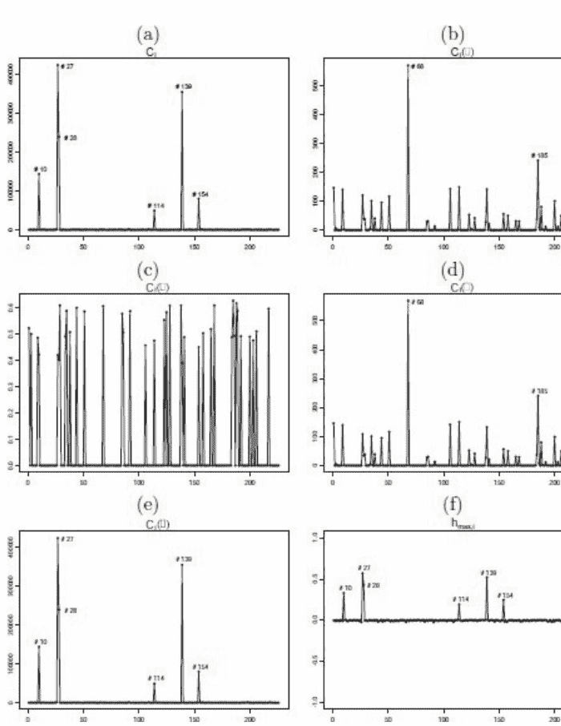

图 7.3 突出显示了影响性观测值的个体轨迹。让我们仔细观察一下这些案例。对退出模型参数产生强烈影响的 6 名患者是在第 4 周进行首次测量后退出的患者。除了 #27 号患者外，所有患者都处于活性治疗组。另一方面，对测量模型参数有强影响的 2 名患者持续到了第 24 周，然后在 1 年时的最后一次观测中没有数据。#68 号患者接受了活性治疗，其/她的视力在第 4 周后大幅下降，随后基本保持平稳。相反，#185 号患者入组安慰剂治疗组，其/她的视力在第 4 周后增加，然后在第 12 周后略有下降。

## 图 7.3 年龄性黄斑斑变性试验。

两个治疗组的个体轨迹，突出显示了影响性受试者。

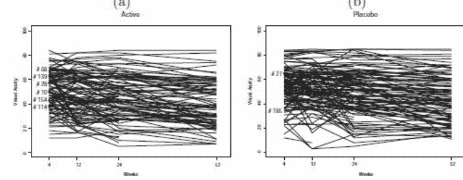

考虑不包含这些影响性观测值的分析是有意义的。因此，我们数据的三个子集应用了选择模型。第一个子集是通过移除之前提到的所有 8 名影响患者获得的。在数据的第二个子集中，删除了 #10、#27、#28、#114、#139 和 #154 号患者，因为它们总体上是影响最大的。最后，删除了似乎对测量模型影响最大的 #68 和 #185 号患者，从而得出了第三个子集。这些分析的结果如表 7.11 和表 7.12 所示。我们比较了 MAR 和 MNAR 分析的结果。

## 表 7.11 年龄性黄斑斑变性试验。在 MAR 假设下显式对缺失数据机制进行参数估计（标准误差），在移除以下受试者子集后：集合 1：(10, 27, 28, 114, 139, 154, 68, 185);集合 2：(10, 27, 28, 114, 139, 154);以及集合 3：(68, 185)。

| Effect | Parameter | Set 1 | Set 2 | Set 3 |
| --- | --- | --- | --- | --- |
| | | MAR | MAR | MAR |
| | Measurement model | | | |
| Int. 4 | $\beta_{11}$ | 54.14(1.51) | 54.30(1.47) | 53.84(1.4) |
| Int.12 | $\beta_{21}$ | 53.09(1.64) | 53.16(1.59) | 52.94(1.6) |
| Int.24 | $\beta_{31}$ | 49.56(1.77) | 49.31(1.74) | 49.44(1.7) |
| Int.52 | $\beta_{41}$ | 44.40(1.82) | 44.00(1.79) | 44.38(1.7) |
| Trt. 4 | $\beta_{12}$ | -3.13(2.17) | -3.28(2.08) | -2.95(2.0) |
| Trt.12 | $\beta_{22}$ | -4.48(2.36) | -4.55(2.26) | -4.47(2.2) |
| Trt.24 | $\beta_{32}$ | -3.80(2.56) | -3.55(2.48) | -3.85(2.4) |
| Trt.52 | $\beta_{42}$ | -5.45(2.66) | -5.06(2.59) | -5.56(2.5) |

## Dropout model

| | | Set 1 | Set 2 | Set 3 |
| --- | --- | --- | --- | --- |
| Intercept | $\phi_0$ | -1.90(0.47) | -1.90(0.47) | -1.85(0.4) |
| Previous | $\phi_1$ | -0.019(0.010) | -0.019(0.010) | -0.020(0.0) |
| -2 log-likelihood | | 6533.3 | 6606.9 | 6706.4 |
| Treatm. eff. at 1 | | 0.040 | 0.051 | 0.029 |
| (p-value) | | | | |

## 表 7.12 年龄性黄斑斑变性试验。显式对缺失数据进行参数估计（标准误差）

| Effect | Parameter | Set 1 | Set 2 | Set 3 |
| --- | --- | --- | --- | --- |
| | | MNAR | MNAR | MNAR |
| | Measurement model | | | |
| Int. 4 | $\beta_{11}$ | 54.15(1.49) | 54.30(1.46) | 53.84(1.4) |
| Int.12 | $\beta_{21}$ | 53.06(1.62) | 53.13(1.59) | 52.91(1.5) |
| Int.24 | $\beta_{31}$ | 49.46(1.75) | 49.20(1.72) | 49.31(1.7) |
| Int.52 | $\beta_{41}$ | 43.97(1.84) | 43.58(1.82) | 43.90(1.8) |
| Trt. 4 | $\beta_{12}$ | -3.13(2.11) | -3.28(2.06) | -2.95(2.0) |
| Trt.12 | $\beta_{22}$ | -4.63(2.29) | -4.69(2.24) | -4.60(2.2) |
| Trt.24 | $\beta_{32}$ | -4.04(2.49) | -3.79(2.44) | -4.04(2.4) |
| Trt.52 | $\beta_{42}$ | -6.12(2.66) | -5.72(2.61) | -6.09(2.5) |

## Dropout model

| | | Set 1 | Set 2 | Set 3 |
| --- | --- | --- | --- | --- |
| Intercept | $\phi_0$ | -1.85(0.49) | -1.85(0.49) | -1.81(0.4) |
| Previous | $\phi_1$ | 0.018(0.022) | 0.017(0.022) | 0.017(0.0) |
| Current | $\phi_2$ | -0.044(0.024) | -0.043(0.024) | -0.043(0.0) |
| -2 log-likelihood | | 6532.7 | 6604.4 | 6703.8 |
| Treatm. eff. at 1 year | | 0.021 | 0.028 | 0.018 |
| (p-value) | | | | |

移除具有较大 $C_i$ 和 $C_i(\phi)$ 值的患者后，退出模型参数 1 和 2 的估计值大致相同，而 0 的估计值在 MAR 下从 $-1.86$ 减少到 $-1.90$，在 MNAR 下从 $-1.81$ 减少到 $-1.85$。移除所有患者后也可以看到这一点。考虑 1 年时的治疗效应，其在 MAR 分析下的估计值从 $-5.18$ 增加到 $-5.06$，导致 p 值略微增加，而在 MNAR 分析下则减少了 0.01。结合标准误差的减少，这导致了 p 值的微下降。

MAR 与 MNAR 的似然比检验没有影响：无论是移除 #10、#27、#28、#114、#139 和 #154 号患者，还是移除所有影响患者，$G^2$ 均保持为 2.5。如果该似然比检验遵循标准的 $\chi^2_1$ 分布，我们将拒绝零假设，这引导我们接受 MAR 假设。然而，MAR 与 MNAR 的检验是非标准的，传统的卡方近似不能用于其分布（Rotnitzky 等人，2000；Jansen 等人，2006）。

最后，我们在删除了 #68 和 #185 号患者的第三个子集上执行了相同的分析。对于 MAR 和 MNAR 分析，1 年时的治疗效应估计值都大幅下降，分别从 –5.18 减少到 –5.56，从 –5.71 减少到 –6.09。因此，p 值在 MAR 下也从 0.048 变为 0.029，在 MNAR 分析下从 0.030 变为 0.018。MAR 与 MNAR 似然比检验的偏差仅从 2.5 稍微变为 2.6。

### 7.11 基于多重填充和混合模型的敏感性分析


## 7.11.1 混合策略

在 7.11.1 节中，回顾了 Molenberghs 和 Kenward（2007, 第17 章）描述的拟混合模型策略并应用于 ARMD 数据。在 7.11.2 节中，描述了结合混合模型 (PMM) 和多重填充的敏感性分析方法，并讨论了它们的 SAS 实现。

考虑不包含这些影响性观测值的分析是有意义的。因此，我们数据的三个子集应用了选择模型。第一个子集是通过移除之前提到的所有 8 名影响患者获得的。在数据的第二个子集中，删除了 #10、#27、#28、#114、#139 和 #154 号患者，因为它们总体上是影响最大的。最后，删除了对测量模型影响最大的 #68 和 #185 号患者，从而得出了第三个子集。这些分析的结果如表 7.11 和表 7.12 所示。我们比较了 MAR 和 MNAR 分析的结果。

允许对包含至少两次测量的所有模式进行估计。然而，脱落机制的精确性质并不而易见。Kenward、Molenberghs 和 Thijs (2003) 在具有脱落的纵向数据数据背景下，研究了需要施加哪些限制条件，以确保在给定过去和当前值的情况下，脱落概率不依赖于未来的测量。策略 2 不符合这一要求，但 CCMV 和 NCMV 也是如此。

一个适用于两种策略的最终观察是，模式混合模型并不总是自动提供感兴趣的边际量的估计值和标准误，例如总体治疗效应或总体时间趋势。Hogan 和 Laird (1997) 提供了一种从模式混合模型推导出选择模型数量的方法。这是 PMM 背景下首次多重插补派上用场。多位作者遵循了这一想法，正式比较了从模式混合模型推导出的选择模型参数的结论（Verbeke, Lesaffre, and Spiessens, 1998; Michiels, Molenberghs, and Lipsitz, 1999）。

为了更好地了解这种方法的工作原理，我们简要概述一下需要遵循的步骤序列。

1. 对模式 $t$ 特定的识别密度 $f_t(Y_1, \dots, Y_t)$ 拟合一个模型。这将得到一个参数估计 $\hat{\varphi}$。
2. 选择一种所需的识别方法。
3. 使用这种识别方法，在给定观测节点的情况下，确定未观测结果的条件分布：
4. 使用标准的 MI 方法论，在给定观测结果和正确的模式特定密度的情况下，对未观测部分进行多次插补 (7.11.35)。
5. 使用所选方法分析多重插补的数据集。这可以是另一个模式混合模型，也可以是选择模型或任何所需的模型。

```
f_t(Y_{t+1}, \dots, Y_r | Y_1, \dots, Y_t). \quad (7.11.35)
```

6. 使用标准的组合规则进行推断。

### 示例：年龄相关黄斑变性试验

我们现在考虑对这些数据使用模式混合模型。在这里，我们将应用第一种策略，并使用 CCMV、NCMV 和 ACMV 识别限制。

三种类型限制的结果如表 7.13 所示。在应用三种限制中的每一种后，都会拟合与之前相同的选择模型。从估计值和相关的标准误可以看出，这些策略之间的结论差异很小。

### 表 7.13 年龄相关黄斑变性试验。使用识别限制 ACMV、CCMV 和 NCMV 的模式混合模型得到的参数估计值（标准误）。

| 效应 | 参数 | ACMV | CCMV | NCMV |
| :--- | :--- | :--- | :--- | :--- |
| | | 参数估计（标准误） | | | |
| 截距 4 | $\beta_{11}$ | 54.00(1.47) | 54.00(1.47) | 54.00(1.47) |
| 截距 12 | $\beta_{21}$ | 52.87(1.68) | 52.92(1.61) | 52.86(1.60) |
| 截距 24 | $\beta_{31}$ | 48.65(2.00) | 49.16(1.87) | 48.77(1.93) |
| 截距 52 | $\beta_{41}$ | 44.19(2.14) | 44.69(2.54) | 44.00(2.18) |
| 治疗 4 | $\beta_{12}$ | -3.11(2.10) | -3.11(2.10) | -3.11(2.10) |
| 治疗 12 | $\beta_{22}$ | -4.18(2.48) | -4.07(2.30) | -4.40(2.46) |
| 治疗 24 | $\beta_{32}$ | -4.36(3.83) | -5.14(3.61) | -4.19(2.65) |
| 治疗 52 | $\beta_{42}$ | -5.04(3.86) | -2.33(4.93) | -4.89(2.77) |
| | | p 值 | | | |
| 截距 4 | $\beta_{11}$ | --- | --- | --- |
| 截距 12 | $\beta_{21}$ | < .0001 | < .0001 | < .000 |
| 截距 24 | $\beta_{31}$ | < .0001 | < .0001 | < .000 |
| 截距 52 | $\beta_{41}$ | < .0001 | < .0001 | < .000 |
| 治疗 4 | $\beta_{12}$ | --- | --- | --- |
| 治疗 12 | $\beta_{22}$ | 0.092 | 0.077 | |
| 治疗 24 | $\beta_{32}$ | 0.271 | 0.110 | |
| 治疗 52 | $\beta_{42}$ | 0.211 | 0.647 | |

在给定观测结果和正确的模式特定密度的情况下，使用标准的 MI 方法对未观测部分进行多次插补 (7.11.35)。使用所选方法分析多重插补的数据集。这可以是另一个模式混合模型，也可以是选择模型或任何所需的模型。

实质性考量。

### 示例：年龄相关性黄斑变性试验

为了通过多重插补过程中的 MNAR（非随机缺失）调整来演示敏感性分析，我们对治疗组中的缺失值进行了平移处理，幅度分别为 0、10、15 和 20，分别对应 4、12、24 和 52 周。表 7.14 显示了未进行此类调整和经过此调整后的 GEE 和 GLMM 结果。我们预计标准（MAR，即观测值随机缺失）分析得到的估计值将与表 7.9 中获得的结果相同。然而，两者之间存在细微差异，因为表 7.9 的结果是基于 MCMC 插补方法的，而此处我们使用了 FCS。原因在于，MNAR 陈述要求使用单调（MONOTONE）或 FCS。鉴于数据略微非单调性，FCS 是显而易见的选择。

### 表 7.14 GEE 和 GLMM 的参数估计（标准误），比较 MAR 版本与基于平移的 MNAR 分析、仅使用安慰剂组的识别以及 NCMV。

| 效应 | 参数 | MAR | shift (平移) | placebo (安慰剂组) | NCMV |
| :--- | :--- | :--- | :--- | :--- | :--- |
| | | 广义估计方程 | | | |
| Int.4 | $\beta_{11}$ | -0.82(0.20) | -0.73(0.20) | -0.81(0.20) | -0.83(0.21) |
| Int.12 | $\beta_{21}$ | -0.97(0.22) | -0.71(0.19) | -0.98(0.22) | -1.06(0.22) |
| Int.24 | $\beta_{31}$ | -1.07(0.23) | -0.56(0.19) | -1.05(0.22) | -1.00(0.23) |
| Int.52 | $\beta_{41}$ | -1.66(0.27) | -0.82(0.20) | -1.58(0.29) | -1.59(0.27) |
| Trt.4 | $\beta_{12}$ | 0.17(0.29) | 0.07(0.28) | 0.17(0.28) | 0.17(0.25) |
| Trt.12 | $\beta_{22}$ | 0.56(0.29) | 0.29(0.27) | 0.56(0.29) | 0.67(0.32) |
| Trt.24 | $\beta_{32}$ | 0.41(0.30) | -0.10(0.27) | 0.39(0.29) | 0.34(0.32) |
| Trt.52 | $\beta_{42}$ | 0.41(0.35) | -0.43(0.30) | 0.32(0.35) | 0.32(0.38) |

#### 广义线性混合模型

| 效应 | 参数 | MAR | shift (平移) | placebo (安慰剂组) | NCMV |
| :--- | :--- | :--- | :--- | :--- | :--- |
| Int.4 | $\beta_{11}$ | -1.46(0.36) | -1.32(0.36) | -1.39(0.35) | -1.42(0.36) |
| Int.12 | $\beta_{21}$ | -1.75(0.38) | -1.27(0.35) | -1.67(0.37) | -1.80(0.36) |
| Int.24 | $\beta_{31}$ | -1.83(0.38) | -1.01(0.34) | -1.78(0.38) | -1.70(0.36) |
| Int.52 | $\beta_{41}$ | -2.71(0.45) | -1.47(0.36) | -2.62(0.46) | -2.64(0.45) |
| Trt.4 | $\beta_{12}$ | 0.32(0.40) | 0.12(0.50) | 0.25(0.48) | 0.24(0.44) |
| Trt.12 | $\beta_{22}$ | 0.99(0.49) | 0.50(0.48) | 0.91(0.48) | 1.09(0.94) |
| Trt.24 | $\beta_{32}$ | 0.67(0.51) | -0.19(0.48) | 0.62(0.48) | 0.53(0.44) |
| Trt.52 | $\beta_{42}$ | 0.53(0.57) | -0.74(0.51) | 0.45(0.56) | 0.45(0.52) |
| R.I. s.d. | $\tau$ | 2.21(0.26) | 2.28(0.25) | 2.17(0.25) | 2.16(0.24) |
| R.I. var. | $\tau_2$ | 4.90(1.14) | 5.21(1.15) | 4.72(1.09) | 4.66(1.08) |

转向 MAR 分析与应用平移后分析之间的差异，我们观察到相当的变化，包括 24 周和 52 周治疗效应的符号变化。在 MAR 条件下，只有一个治疗效应具有边际显著性（在 12 周），尽管它是有利于安慰剂的。在应用平移后，几乎没有结果是显著的。值得注意的是，负号指向倾向于活性治疗的效应。这并不意外，因为通过应用平移，我们逐渐使治疗变得更有益处。

又进行了两项基于 MNAR 的分析。由于 MNAR 陈述要求使用单调（MONOTONE）或 FCS。鉴于数据略微非单调性，FCS 是显而易见的选择。

敏感性分析。该领域仍在充分开发中，但得益于 `PROC MI` 中的 MNAR（非随机缺失）语句，在标准 SAS 过程中现在也提供了一系列敏感性分析工具。

## 7.13 参考文献

- Aerts, M., Geys, H., Molenberghs, G., and Ryan, L.M. (2002). Topics in Modelling of Clustered Data. London: Chapman and Hall.
- Afifi, A. and Elashoff, R. (1966). Missing observations in multivariate statistics I: Review of the literature. Journal of the American Statistical Association, 61, 595–604.
- Baker, S.G., Rosenberger, W.F., and DerSimimonian, R. (1992). Closed-form estimates for missing counts in two-way contingency tables. Statistics in Medicine, 11, 643–657.
- Beckman, R.J., Nachtsheim, C.J., and Cook, R.D. (1987). Diagnostics for mixed-model analysis of variance. Technometrics, 29, 413–426.
- Beunckens, C., Molenberghs, G., Thijs, H., and Verbeke, G. (2007). Implement hierarchical data. Statistical Methods in Medical Research, 16, 1–36.
- Breslow, N.E. and Clayton, D.G. (1993). Approximate inference in generalized linear mixed models. Journal of the American Statistical Association, 88, 9–25.
- Buyse, M. and Molenberghs, G. (1998). The validation of surrogate endpoints in randomized experiments. Biometrics, 54, 1014–1029.
- Carey, V.C., Zeger, S.L., and Dighe, P.J. (1993). Modelling multivariate binary data with alternating logistic regressions. Biometrika, 80, 517–526.
- Carpenter, J.R. and Kenward, M.G. (2013). Multiple Imputation and Its Applications. Chichester: John Wiley & Sons.
- Carpenter, J.R., Kenward, M.G., and Vansteelandt, S. (2006). A comparison of multiple imputation and doubly robust estimation for analyses with missing data. Journal of the Royal Statistical Society, Series A, 169, 571–584.
- Carpenter, J.R., Roger, J.H., and Kenward, M.G. (2013). Analysis of longitudinal trials with protocol deviation: A framework for relevant, accessible assumptions, and inference via multiple imputation. Journal of Biopharmaceutical Statistics, 23, 1352–1371.
- Cook, R.D. (1986). Assessment of local influence. Journal of the Royal Statistical Society, Series B, 48, 133–169.
- Cook, R.D. and Weisberg, S. (1982). Residuals and Influence in Regression. London: Chapman & Hall.
- DeGruttola, V. and Tu, X.M. (1994). Modelling of CD4 lymphocyte count and its relationship to survival time. Biometrics, 50, 1003–1014.
- Dempster, A.P., Laird, N.M., and Rubin, D. B. (1977). Maximum likelihood from incomplete data via the EM algorithm (with discussion). Journal of the Royal Statistical Society, Series B, 39, 1–38.


## 参考文献

- Dempster, A.P. and Rubin, D.B. (1983). Overview Incomplete Data in Sample Surveys, Vol. II: Theory and Annotated Bibliography, W.G. Madow, I. Olkin, and D.B. Rubin (Eds.). New York: Academic Press, p. 3–10.

- Diggle, P.J. and Kenward, M.G. (1994). Informative drop-out in longitudinal data analysis (with discussion). *Applied Statistics*, 43, 49–93.

- Fitzmaurice, G.M., Davidian, M., Verbeeke, G., and Molenbergh, G. (2009). *Advances in Longitudinal Data Analysis*. London: CRC/Chapman Hall.

- Gelman, A., Carlin, J.B., Stern, H.S., and Rubin, D.B. (1995). *Bayesian Data Analysis*, Texts in Statistical Science. London: Chapman & Hall.

- Glynn, R.J., Laird, N.M., and Rubin, D.B. (1986). Selection modelling versus mixture modelling with non-ignorable nonresponse. In: *Drawing Inferences from Self Selected Samples*, H. Wainer (Ed.). New York: Springer-Verlag, p. 115–142.

- Hartley, H.O. and Hocking, R. (1971). The analysis of incomplete data. *Biometrics*, 27, 7783–808.

- Heitjan, F. and Little, R.J.A. (1991). Multiple imputation for the fatal accident reporting system. *Applied Statistics*, 40, 13–29.

- Hogan, J.W. and Laird, N.M. (1997). Mixture models for the joint distribution of repeated measures and event times. *Statistics in Medicine*, 16, 239–258.

- Jansen, I., Molenbergh, G., Aerts, M., Thijs, H., and Van Steen, C. (2003). A local influence approach applied to binary data from a psychiatric study. *Biometrics*, 50, 409–418.

- Jansen, I., Hens, N., Molenbergh, G., Verbeke, G., and Kenward, M.G. (2006). The nature of sensitivity to miss at random. *Computational Statistics and Data Analysis*, 50, 830–858.

- Kenward, M.G and Molenbergh, G. (1998). Likelihood based frequentist inference when data are missing at random. *Statistical Science*, 12, 236–247.

- Kenward, M.G., Molenbergh, G., and Goetghe, E. (2001). Sensitivity analysis for incomplete data. Pattern-mixture models with proper time dependence. *Biometrika*, 90, 31–48.

- Lesaffre, E. and Verbeke, G. (1998). Local influence in linear mixed models. *Biometrics*, 54, 570–582.

- Li, K.H., Ragunathan, T., and Rubin, D.B. (1991). Large-sample significance levels from imputed data using moment-based statistics. *Journal of the American Statistical Association*, 86, 1065–1073.

- Liang, K.Y. and Zeger, S.L. (1986). Longitudinal data using generalized linear models. *Biometrika*, 73, 13–22.

- Liang, K.Y., Zeger, S.L., and Qi, B. (1992). Multivariate analyses for categorical data. *Journal of the Royal Statistical Society, Series B*, 54, 3–40.

- Lipsitz, S.R., Laird, N.M., and Harrington, D.P. (1991). Generalized estimating equations for correlated binary data: the odds ratio as a measure of association. *Biometrics*, 78, 153–160.

- Little, R.J.A. (1993). Pattern-mixture models for multivariate incomplete data. *Journal of the American Statistical Association*, 88, 125–134.

- Little, R.J.A. (1994). A class of pattern-mixture models for normal data. *Biometrika*, 81, 471–483.

- Little, R.J.A., D'Agostino, R., Emerson, S.S., Farrar, J.T., Frangakis, C., Hogan, J.W., Molenbergh, G., Murphy, S.A., Neaton, J.D., Rotnitzky, A., Scharfstein, D., Shih, W., Siegel, J.P., and Stern, H. National Research Council (2010). *The Prevention and Treatment of Missing Data in Clinical Trials*. Panel on Handling Missing Data in Clinical Trials. Committee on National Statistics, Division of Behavioral and Social Sciences and Education. Washington, D.C.: The National Academies Press.

- Little, R.J.A. and Kang, S. (2015). Intention-to-treat analysis with treatment discontinuation and missing data in clinical trials. *Statistics in Medicine*, 34, 2381–2390.

- Little, R.J.A. and Rubin, D.B. (2014). *Statistical Analysis with Missing Data* (3rd ed.). New York: John Wiley & Sons. [The first edition appeared in 1987; the second edition in 2002.]

- Lu, K. (2014). An analytic method for the placebo-pattern-mixture model. *Statistics in Medicine*, 33, 1134–1145.

- Mallinckroth, C.H. (2013). *Preventing and Treating Missing Data in Longitudinal Clinical Trials: A Practical Guide*. New York: Cambridge University Press.

- Mallinckroth, C.H., Clark, W.S., and Stacy, R.D. (2001a). Type I error rates from mixed-effects repeated measures versus fixed effects analysis of variance with missing values imputed via last observation carried forward. *Drug Information Journal*, 35, 4, 1215–1225.

- Mallinckroth, C.H. and Lipovich, I. (2016). *Analyzing Longitudinal Clinical Trial Data. A Practical Guide*. Boca Raton: Chapman & Hall/CRC.

- McCullagh, P. and Nelder, J.A. (1989). *Generalized Linear Models*. London: Chapman & Hall.

- Michiels, B., Molenberghs, G., Bijnens, L., Wangeneugden, T., and Thijs, H. (2002). Selection models and pattern-mixture models to analyze longitudinal quality of data subject to dropout. *Statistics in Medicine*, 21, 1023–1041.

- Michiels, B., Molenberghs, G., and Lipsitz, S.R. (1999). Selection models and pattern-mixture models for incomplete categorical data with covariates. *Biometrics*, 55, 978–983.

- Molenberghs, G., Beunckens, C., Sotto, C., and Kenward, M.G. (2008). Every missing not at random has a random counterpart. *Journal of the Royal Statistical Society, Series B*, 70, 371–388.

- Molenberghs, G., Thijs, H., Jansen, I., Beunckens, C., Kenward, M.G., Mallinckcrodt, C., and Carroll, R.J. (2003). Analyzing incomplete clinical data. Submitted for publication.

- Molenberghs, G. and Kenward, M.G. (2007). *Missing Data in Clinical Studies*. Chichester: Wiley & Sons.

- Molenberghs, G., Kenward, M.G., and Lesaffre, E. (1997). The analysis of longitudinal ordinal data with nonrandom dropout. *Biometrika*, 84, 33–44.

- Molenberghs, G., Kenward, M.G., and Goethegheur, E. (2001). Sensitivity analysis for incomplete tables: the Slovenian plebiscite case. *Journal of the Royal Statistical Society, Series C: Applied Statistics*, 50, 15–29.

- Molenberghs, G, Kenward, Verbeke, G., and Teshome Aele, B. (2011). Pseudo-likelihood estimation for incomplete data. *Statistica Sinica*, 21, 187–206.

- Molenberghs, G., Michiels, B., Kenward, M.G., and Diggle, P.J. (1998). Missing data mechanisms and pattern-mixture models. *Statistica Neerlandica*, 52, 153–161.

- Molenberghs, G. and Verbeke, G. (2005). *Models for Discrete Longitudinal Data*. New York: Springer.

- Molenberghs, G., Verbeke, G., Thijs, H., Lesaffre, E., and Kenward, M.G. (2001). 奶牛乳腺炎：评估脱落过程敏感性的影响分析。《计算统计与数据分析》, 37, 93–113.

- Murray G.D. and Findlay J.G. (1988). 纠正高血压试验中脱落导致的偏倚。《医学统计学》（*Statistics in Medicine*）, 7, 941–946.

- O'Kelly, M. and Ratitch, B. (2014). 《缺失数据的临床试验：从业者指南》。纽约：John Wiley & Sons. 黄斑变性性药物治疗小组 (1997). 干扰素 α–IIA 对年龄相关性黄斑变性继发性脉络膜血管新生患者无效。一项前瞻性随机安慰控制临床试验的结果。《眼科档案馆》（*Archives of Ophthalmology*）, 115, 865–872.

- Pinheiro, J.C. and Bates, D.M. (1995). 非线性混合效应模型中对似然函数的近似。《计算与图形统计学杂志》, 4, 12–35.

- Pinheiro, J. and Bates, D. M. (2000). 《S 和 S-plus 中的混合效应模型》。纽约：Springer-Verlag.

- Prentice, R.L. (1988). 具有特定于每个二元观测相关的相关的二元回归。《生物统计学》（*Biometrics*）, 44, 1033–1048.

- Press, W., Teukolsky, S., Vetterling, W., and Flannery, B. (1992). 《C语言数值算法：科学计算的艺术》，第10章。剑桥大学出版社，纽约，第二版。

- Robins, J.M., Rotnitzky, A., and Scharfstein, D.O. (1998). 针对不可忽略非响应的重复结局的半参数回归。《美国统计协会杂志》, 93, 1321–1339.

- Robins, J.M., Rotnitzky, A., and Zhao, L.P. (1995). 缺失数据存在时重复结局的半参数回归模型分析。《美国统计协会杂志》, 90, 106–121.

- Rosenbaum, P.R. and Rubin, D.B. (1983). 倾向评分法在因果效应观察性研究中的核心作用。《生物统计学》（*Biometrika*）, 70, 41–55.

- Rotnitzky, A., Cox, D.R., Bottai, M., and Robins, J. (2000). 奇异信息矩阵的基于似然的推断。《伯努利》（*Bernoulli*）, 6, 243–284.

- Rubin, D.B. (1976). 推断与缺失数据。《生物统计学》（*Biometrika*）, 63, 581–592.

- Rubin, D.B. (1978). 样本调查中的多重插补——一种针对非响应的现象学贝叶斯方法。见：《错误或缺失调查数据的插补与编辑》。华盛顿特：美国商务部，第1–23页。

- Rubin, D.B. (1997). 《调查中非响应的多重插补》。纽约：John Wiley & Sons.

- Rubin, D.B. and Schenker, N. (1996). 具有忽略非响应的简单随机样本区间估计的多重插补。《美国统计协会杂志》, 81, 366–374.

- Rubin, D.B., Stern H.S., and Vehovar V. (1995). 处理“不知道”调查响应：斯洛文尼亚公投投票的案例。《美国统计协会杂志》, 90, 822–828.

- Schafer J.L. (1997). 《不完整多变量数据分析》。伦敦：Chapman & Hall.


Sarfstein, D.O., Rotnitzky, A., and Robins, J.M. (1999). 使用半参数非响应模型调整不可忽略的脱落（含讨论）。《美国统计协会杂志》, 94, 1096–1120.

Sheiner, L.B., Beal, S.L., and Dunne, A. (1997). 镇痛试验非随机截断有序类别纵向数据分析。《统计协会杂志》, 92, 1235–1244.

Skrondal, A. and Rabe-Hesketh, S. (2004). 《广义潜变量模型：多层、纵向和结构方程模型》。伦敦：Chapman & Hall.

Tanner, M.A. and Wong, W.H. (1987). 通过数据增强计算后验分布。《美国统计协会杂志》, 82, 528–550.

Thijs, H., Molenberghs, G., Michiels, B., Verbeke, G., and Curran, D. (2002). 拟模式混合模型的策略。《生物统计学》（Biostatistics）, 3, 245–265.

Thijs, H., Molenberghs, G., and Verbeke, G. (2000). 奶蛋白试验：脱落过程的影响分析。《生物几何杂志》（Biometrical Journal）, 42, 617–646.

Tierney, L. and Kadane, J.B. (1986). 后验矩量和边缘密度的精确近似。《美国统计协会杂志》, 81, 82–86.

Tuerlinckx, F., Rijmen, F., Molenberghs, G., Verbeke, G., Briggs, D., Van den Noortgate, W., Meuders, M., and De Boeck, P. (2004). 估计与软件。见 P. De Boeck & M. Wilson（编），《探索性项目反应模型：广义线性与非线性方法》（第343–373页）。纽约：Springer.

van Buuren, S. (2007). 通过全条件规范对离散和连续数据进行多重插补。《医学研究统计方法》（Statistical Methods in Medical Research）, 16, 219–242.

van Buuren, S. (2012). 《缺失数据的灵活插补》。博卡顿：Chapman & Hall/CRC.

van Buuren, S., Boshuisen, H.C., and Knook, D.L. (1999). 生存分析中缺失血压变量的多重插补。《医学统计学》（Statistics in Medicine）, 18, 681–694.

van Steen, K., Molenberghs, G., Verbeke, G., and Thijs, H. (2001). 不完整纵向数据的局部影响敏感性分析。《建模》（Statistical Modelling: An International Journal）1, 125–142.

Verbeke, G., Lesaffre, E., and Brant L.J. (1998). 线性混合模型中剩余相关性的检测。《医学统计学》（Statistics in Medicine）, 17, 1391–1402.

Verbeke, G., Lesaffre, E. and Spiessens, B. (2001). 处理纵向研究中脱落的不同策略。《药物信息杂志》（Drug Information Journal）, 35, 419–434.

Verbeke, G. and Molenberghs, G. (1997). 《实践中的线性混合模型：基于SAS的方法》。统计讲义笔记126。纽约：Springer.

Verbeke, G., Molenberghs, G., Thijs, H., Lesaffre, E., and Kenward, M.G. (2001). 非忽略脱落的影响敏感性分析。《生物统计学》（Biometrics）, 57, 7–14.

Wedderburn, R.W. (1974). 拟似然函数、广义线性模型与高斯-牛顿法。《生物统计学》（Biometrika）, 61, 439–447.

White, I.R., Daniel, R., and Royston, P. (2010). 避免由于变量多重插补中完美预测导致的偏倚。《计算统计与数据分析》, 54, 226–275.

Wolfinger, R. and O'Connell, M. (1993). 广义线性混合模型：一种伪似然方法。《计算与模拟杂志》（Journal of Computation and Simulation）, 48, 233–243.

Wu, M.C. and Carroll, R.J. (1988). 通过建模截断过程估计和比较信息性右截断存在下的变化。《生物统计学》（Biometrics）, 44, 175–188.

on 155–159

Andersen, P.K. 42

Anderson, G.L. 293, 297, 301

Anderson, J.S. 293, 307

ANOVA 模型，基于 145–155 的多重比较建模 (`MCP-Mod`) 过程

ANOVA 过程 6

关联，测定 21

基于渐近分布的检验 35–38

基于渐近的随机化的检验 25–28

# B

Baker, S.G. 321, 363

Bancroft, T.A. 15

`BASELINE` 语句 53

Bates, D.M. 326

Bauer, P.J. 252

`%BayesFutilityBin` 宏 310

`%BayesFutilityCont` 宏 305–407

Bayesian CRM 110

贝叶斯框架 118

贝叶斯信息准则 (`BIC`) 141

贝叶斯二参数逻辑模型，实现 115–176

Beal, S.L. 372

Beckman, R.J. 366

Benjamini, Y. 199

`%BetaModel` 宏 144

Betensky, R.A. 293, 297, 301

Beunckens, (贝叶斯信息准则) 141

二分类终点 78–79, 309–310

Birch, M.W. 29

Blackburn, P.R. 306–307

Bonferroni 方法 184–187

基于 Bonferroni 的门控过程 228–233

Bortey, E.B. 15

Brannath, W. 252, 313

Branson, M. 116, 138, 140

Brechenmacher, T. 238

Breslow, N.E. 26–27, 29, 44, 54, 327

Breslow-Day 检验 28, 61

`%Chain` 宏 210

链过程 208–211, 244–259

Chakravorti, S.R. 15

Chang, C.K. 188, 201

Cheung, Y.K. 111, 114, 116, 119

inchilli, V.M. 15

Chuang-Stein, C. 128, 313

Cimerena, J.L. 15, 28, 57, 61

Claeskens, G. 141

`CLASS` 语句 37–38, 52, 357

Clayton, D.G. 327

临床信息 182

闭合假设族 189

闭合原理 189–191

CMH (`Cochran-Mantel-Haenszel`) 过程 25–28

Cochran, W.G. 2, 25

Cochran-Armitage 换检验 29–30, 31

Cochran-Mantel-Haenszel (`CMH`) 过程 25–28, 29

Collet, D. A, 44, 51

`COMBINE` 选项, `%NParCov` 宏 94–95

完整病例分析 (`CC`) 320

Conaway, M.R. 107, 117

条件独立模型 325

条件效能 294–312

连续重新评估方法 (`CRM`)

- 关于 107–108
- 实现 111–116
- 建模框架 108–115

连续终点

- 分析 4–20, 80–81
- 使用两均值对数比的分析 80–81
- 案例研究 17
- 固定效应模型 6–15
- 非参数检验 16–19
- 随机效应模型 15–16

`CONTRAST` 语句 135–136

基于对比的检验 134–136

Cook, R.D. 365–367

复制引用 377

计数终点，使用对数发病率比的分析 81

协方差，基于非参数的分析 68–60

`COVAS` 选项, `%NParCov` 宏 94

Cox, D.R. 4, 51, 54

Cox 比例风险模型 2, 3

`%CriticalValue` 宏 148–149, 158, 163, 156

CRM

- 参见连续重新评估方法 (`CRM`)

累计队列方法 104

`%Custom` 宏 238

双稳健性 349

`%dropout` 宏 346

`%dropoutwgt` 宏 346

`DSNIN` 选项, `%NParCov` 宏 95

`DSNOUT` 选项, `%NParCov` 宏 95–96

Dunne, A. 372

Dunnett, C.W. 215

Dunnett 检验 133–134, 140

# E

Edwards, S. 29

稳健检验 32

Efron, B. 54

Ellenberg, S.S. 253

`%Emax` 宏 143, 146

Emerson, S.S. 275, 289

终点

- 参见分类终点
- 参见连续终点
- 二分类 78–79, 309–310
- 计数 81
- 正态分布的 305–306, 338–539
- 序数的 74–80
- 主要 180
- 次要 180
- 事件时间 41–55, 43–51, 52–86, 91–92
- 错误消耗 261–262
- `ESTIMATE` 语句 10, 336
- 估计，顺序检验 289–577
- `EXACT` 方法 54
- 基于模型的 38–40
- `EXACT` 选项, `%NParCov` 宏 95
- 基于随机化的检验 28–32
- `EXACT` 语句 23
- `EXACTONLY`, `LOGISTIC` 过程 38
- 退出 267
- `%Exponential` 宏 143, 146, 161–202
- `EXPOSURES` 选项, `%NParCov` 宏 94
- F 统计量 14
- 备选过程 206–208

族错误率 (`FWER`) 181–182

Faries, D. 111

Fisher 精确检验用于二分类 2

Fitzmaurice, G.M. 320

固定数据监测 258–259

固定效应过程 6–15

固定序列过程 203

Fleiss, J.L. 14–15, 25–28

Fleming, T.R. 44, 253, 259, 275, 289

灵活数据监测 258–266

Follman, D.A. 281

贝叶斯 118

- 108–111

Freeman, L.S. 306–357

`FREQ` 过程

- 关于 4
- 二分类数据 29
- 获取统计量 27
- 输出系统 (`ODS`) 24–25
- 相对风险 22–23
- 风险差异 19

Freund, J.L. 4, 7

性效性停止规则 294

FWER (`族错误率`) 181–182

# G

Gail, M.H. 2, 28, 57–61

Gail-Simon 检验 57–61

Gallo, P.P. 14, 15, 253

Gastwirth, J.L. 32

门控过程

- 关于 221–222
- 基于混合的过程 227–236
- 基于混合方法的推断 223–236
- 修改混合方法 236–240
- 临床试验中的有序假设族 222–223

Gason, C. 116

GEE

参见 广义估计方程 (`GEE`)

`GEE` 过程

- 数据分析 320, 341, 348–349, 357, 360, 361

Gehan, E.A. 44

Geisser, S. 293

广义估计方程 (`GEE`)

- 关于 320, 327, 331–332
- 方法细节 332–333

加权 (`WGEE`) 344–349

广义线性混合模型 (`GLMM`) 225–330

`GENMOD` 过程

- 关于 4
- 协方差矩阵 156
- 数据分析 320
- 剂量安慰检验 133
- 不完整数据分析 333, 341, 350, 357, 360, 361

期中数据监测 300

- 基于模型的推断和 35, 37–38

`GLIMMIX` 过程

- 广义线性混合模型 229–330
- 不完整数据分析 333, 341, 350, 357, 360, 361
- LOCF 和 338
- 参数过程 215

`GLM` 过程

- 关于 4, 6, 8–9
- Bonferroni 方法 184
- 剂量安慰检验 133
- 剂量-反应检验 148, 157
- `ESTIMATE` 语句 10
- 参数过程 215
- Šidák 方法 184
- 在 II 型、II 和 III 型分析中 13–15
- III 型分析和 12

GLMM (`广义线性混合模型`) 225–330

全局零假设 181

Glynn, R.J. 321

Goldberg, J.D. 4

Goodman, S.N. 111

Gould, A.L. 4

Govaraj, Z. 289

Greenhouse, J.B. 116

Greenland, S. 26, 27

Grizzle, J.E. 34

组设计

- 关于 251
- 比较 262
- 发现无效性 251–55
- 发现效能 254–255
- 同时发现效能和无效性检验 255–256

Gsponder, T. 15

Guo, W. 105

# H

Hackey, O.P.

Haenszel, W. 25, 26

Halperin, M. 312

Hardy, R.J. 293, 297, 301

Harrington, D.P. 44, 49, 51

Harrington-Fleming 检验 133–134, 140

Hartley, N.O.

Hartz, J. 293

Herson, D.S. 307

Hives, J.L. 141

Hochberg, Y. 199

Hocking, R.R. 4, 7

Hogan, S. 291

Holm, G. 25, 26

Hunsberger, S.A. 313

Hwang, I. 15

# J

Ji, Y. 104

Jansen, I. 321, 363

Jennison, C.M. 252, 253, 258, 264, 292, 295, 296, 297

Johns, D.S. 307

Johnson, D.E. 4, 6, 8–9

Johnson, W. 293

Jones, B. 144

# K

Kalbfisch, J.D. 2, 4, 20, 35, 44

Kaplan-Meier 估计 42–43

Kass, R.E. 142

Kawaguchi, A. 68

Kenward, M.G. 321, 334, 349, 353, 363, 365, 367, 371, 372, 374, 375

Kim, K. 289

Klein, J.P. 42

Koch, G.G. 17, 29, 68–69

Koury, K.J. 4

# L

Lachin, J.M. 2, 4, 20, 35, 44

Lagakos, S.W. 2

Laird, N.M. 321, 332, 371, 372

Lan, K.K.G. 252, 253, 258, 264, 281, 292, 295, 296, 297

大分层渐近 28–29

最后观测结结法 (`LOCF`) 320, 337–338

LaVange, L.J. 253

Lee, J.J. 293

Lee, S.M. 111, 114, 116, 119

Lehmann, E.L. 17

Lesaffre, E. 321, 366

Li, K.H. 352

Liang, K.-Y. 331, 333, 344

`LIFEREG` 过程 51

`LIFETEST` 过程

- 关于 4
- 执行的推断 50–51
- 来自定性信息 53
- `STRATA` 语句 45–46
- `TEST` 语句 46–48
- 警告信息和 39
- 似然比检验、随机化的检验和 43–51

基于似然的方法 330–331

线性混合模型 324–325

线性模型，用于序数终点的分析使用 74–78

线性秩检验 44

`%LinRank` 宏 49, 51

Lipkovich, I. 166, 350, 355

Lipsitz, S.R. 332

Littell, R.C. 4, 7, 15

Little, R.J.A. 320, 324, 331, 337, 349, 371

Liu, D.D. 293

Liu, W. 189

LOCF (`末次结结法`) 320

Logan, B.R. 137

逻辑限制 182, 183

对数发生密度比 81, 90–91

`%Logistic` 宏 143–144

## `LOGISTIC` 过程

- 关于 4
- 精确推断和 38–40
- 基于模型的推断和 35, 37–38
- 逻辑回归模型 3
- 逻辑转换 89–90
- logit 调整估计 26
- 对数线性模型 (`LogLinear`) 149–156
- 对数秩评分，用于事件时间结果 91–92
- 对数秩检验
  - 基于随机化的检验和 43–51
  - 针对事件时间点 2
- 两个均值的对数比，用于连续终点的分析使用 80–81
- 两个结果向量的对数比 90

Lu, K. 375

## M


Mallinckrodt, C.H. 166, 350, 355

Mantel, N. 25, 26, 29

- Mantel-Fleisser 准则 29
- Mantel-Haenszel 检验 3, 17, 26, 28, 44
- MAR (随机缺失) 320
- 边缘准似然估计 (MQL) 327
- MCAR (完全随机缺失) 320
- MCAR，简单方法和 334–338

MCMC 过程 350, 354, 355

## MCP-Mod

参见 多重比较建模 (MCP-Mod) 过程

MED (最小有效剂量) 128, 141–142, 152–156

中位数无偏估计 290

## MI

参见 多重插补 (MI)

## MI 过程

- 不完全数据分析 356–359
- NIMPUT 选项 168–169
- MIANALYZE 过程 169, 350, 356, 359, 362

Milliken, G. A. 4, 6, 15

- 最小有效剂量 (MED) 128, 141–142, 152–156
- “最小遗憾”过程 33
- 最小风险检验 32–34
- %MinRisk 宏 33
- 随机缺失 (MAR) 320
- 完全随机缺失 (MCAR) 320
- 非随机缺失 (MNAR) 168
- 存在缺失观测值时的多重比较建模 (MCP-Mod) 过程 165–176
- MISSMODEL 语句 348

## MIXED 过程

- 关于 4, 6
- 使用线性模型对序数终点的分析 76
- Bonferroni 方法 184
- 基于对比的检验 135
- 数据分析 320
- 剂量-安慰剂检验 133
- 剂量-反应检验 163, 172
- 不完全数据分析 341, 350, 357, 360
- LOCF 和 338
- 参数化过程 215
- 随机效应模型和 15–16
- Šidák 方法 184
- 在 II 型、II 型和 III 型分析中 13–15
- III 型分析和 12
- %MixGate 宏 227–229, 236–338
- 混合方法，基于 223–226 的门控的一般原理
- 基于混合的门控程序，实现 227–236
- MNAR (非随机缺失) 168
- MNAR 语句 376
- 多重比较建模 (MCP-Mod) 过程中的模型选择 141
- MODEL 语句 53, 325, 330
- 基于模型的检验 1–4, 51–55
- 建模框架 108–111
- 修改的混合概率 236–240, 247–249
- 修改的毒性区间方法 (mTPI) 104–107
- MTPs (多重检验) 180–184
- 多对比检验 136–137

## 多重比较建模 (MCP-Mod)

- 关于 128, 137–138
- 基于 ANCOVA 模型 155–159
- 基于重复测量模型 161–165
- 基于简单 ANOVA 模型 145–155
- 候选模型 138–139
- 剂量发现 138
- 剂量-反应检验 140–141
- 实现 143–144
- 模型选择 141
- 最优对比 139–140
- 存在缺失观测值 165–176
- 目标剂量选择 141–142
- 多重插补 (MI)
- 关于 349–353
- 效率 352–353
- 假设检验 352
- 插补机制 353–356
- 合并信息 351–352
- SAS 代码 358–362
- 基于模式混合模型 371–378
- 理论合理性 350–351
- 多重检验程序 (MTPs) 180–184
- 多重性调整方法 179–181
- 族误差率控制 181–182
- 门控程序 221–241
- 多重检验程序 182–184
- 参数化过程 212–221
- 数据驱动的假设排序 189–202
- 预设假设排序 202–212
- 单步程序 184–188
- 多变量建模 354
- %MultSeqSimul 宏 230

## MULTTEST 过程

- Bonferroni 方法 184, 193
- Cochran-Armitage 置换 39
- Fisher 检验 29–30
- Hochberg 过程 197–198
- Holm 过程 193
- Hommel 过程 196
- 置换 31–32
- 基于重采样的精确方法 93
- Šidák 方法 184
- Simes 方法 187
- 加权程序 200

## N

- Nachtheim, C.J. 366
- Nelder, J.A. 14
- Neuenschwander, B. 116
- NIMPUT 选项，MI 过程 168–169

## NLMIXED 过程

- 数据分析 320
- 广义混合模型 325, 329–330
- 不完全数据分析 341, 350, 356, 357, 360, 361
- LOCF 和 338
- 模型选择 149, 158–159, 164, 173–174
- 基于模型的推断和 35
- 目标剂量选择 165
- 非高斯结果 339–340
- 基于非参数随机化的协方差分析 88–89
- 非参数检验 16–19
- 基于非参数的协方差分析 68–70
- 非预后因素 1–2
- 非随机缺失 (MNAR) 320
- 非响应者插补 166–167
- 不可测试的假设 224
- 正态分布的终点/结果 305–306, 338–339

## %NParCov4 宏

- 关于 73–74
- 输出数据集的内容 96–99
- 通用用法和选项 94–96
- NPS 选项，%NParCov4 宏 95

## O

- Oakes, D.O. 4, 51
- O'Brien, P.C. 259, 263, 270, 275–276, 280–284, 287–288
- O'Connell, M. 327
- 优势比 21
- ODS (输出交付系统)，FREQ 过程 24–25
- ODS 语句 358, 361
- Ohishi, Y. 42
- O'Kelly, M. 166, 267, 349
- 单参数逻辑模型 108–110
- 多重比较建模 (MCP-Mod) 过程中的步骤 141
- 最优对比 139–140
- 使用线性模型对序数终点的分析 74–78
- 使用对数转换模型 79–80
- OUTCOMES，%NParCov4 宏 94

## P

- Pama, S. 261
- Positive and Negative Scale (PANSS) 128–169
- 参数化过程
  - 关于 212–221
  - 单步程序 184–188
  - 多变量建模 354
- 似然匹配 (PMM) 353
- 预测能力 294–312
- 预测均值 304–309
- 预测概率 251–52
- 随机化检验 2
- Patra, K. 32
- 模式混合插补 167–176
- 模式混合模型 (PMM) 320–371
- 重复显著性检验 关于 253
- 案例研究 257–258
- 设计与监测阶段 258
- 设计阶段 263–280
- 序贯检验后的估计 289–291
- 固定与灵活的数据监测策略 258–266
- 组序贯试验设计 254–256
- 监测阶段 280–285
- 与条件幂检验的关系 297–298
- 重复置信区间 286–288
- REPEATED 语句 325, 330, 333, 347
- 重复测量，基于多重比较建模 (MCP-Mod) 的程序 161–165
- 基于重抽样的的精确方法 93
- 响应者填补 167
- 受限极大似然 (REML) 估计 327
- 风险差 21
- Robins, J.M. 26–27, 321, 344, 363
- Rodriguez, R. 14
- Roger, J.H. 363, 374


Rosenberger, W.F. 321, 363

Rosner, G.L. 289–290

Rotnitzky, A. 321, 344, 363

Royston, P. 353

Ruberg, S.J. 128, 137

Rubin, D.B. 320–321, 324, 331, 337, 349, 352, 355, 361

strüger, B. 187

基于规则的方法

关于 103

修正的毒性概率区间法 (`mTPI`) 104–107

升降法 103–104

# S

Sarkar, S.K. 188, 201

Saville, B.R. 68

schaefer, J.L. 349, 354

Scharfstein, D.O. 321, 363

Scheffe, H. 6, 135

Schenker, N. 349

schoenfeld, D.A. 2

Searle, S.R. 4, 7, 15

次要终点，多重 180

`SEED` 选项，`%NParCov4` 宏 95

选择建模 320

Senn, S. 15, 16, 57, 237

敏感性分析

关于 362–363

基于多重填补和模式混合模型 371–789

使用局部影响 363–371

分离程序 225

`SEQDESIGN` 程序，中间数据监测 252–253, 258, 261, 264, 271, 277, 299

`%SeqPower` 宏 302–303

`SEQTEST` 程序，中间数据监测 252–253, 258, 261, 271, 281–285, 287, 290–292, 297, 298, 301

序贯拒绝原理 191

序贯检验，序贯检验后的估计 289–291

Sheiner, L.B. 372

Shih, W.J. 261

Shu, V. 17

Šidák, Z. 44

Šidák 方法 184–187

Siegmund, D. 289–290

`%SigEmax` 宏 144, 161–162

Simes 方法 187–188

Simon, R. 28, 57–61, 292, 295–296

简单顺序 116

单对比检验 136

单步 Dunnett 程序 214–217

单步程序

关于 184

Bonferroni 方法 184–187

Šidák 方法 184–187

Simes 方法 187–188

Skrondal, A. 326

稀疏数据渐近 28–29

Spector, P.C. 4, 7

Speed, F.M. 6, 11

Spiegelhalter, D.J. 306–307

`SQL` 程序，剂量反应检验 147–148

`SSSIZE` 程序 33, 34

标准混合法，基于 Hommel 的门控使用 246–247

`%Start` 宏 144, 145, 162

统计信息 182

`STDERR` 语句 358

下阶算法 193–195

下阶 Dunnett 程序 217–220

上阶 Dunnett 程序 220

逐步 Dunnett 程序 217–220

逐步程序 193–198

Stern, H.S. 321

Stewart, W.H. 137

随机截断 292–293

应用 312–313

案例研究 293–294

条件功效的效用 294–312

停止概率 267

Storer, B.E. 115–116

`STRATA` 选项，`%NParCov4` 宏 94

`STRATA` 语句 39, 45–46, 52

分层 92

分层分析，事件数据 50–51

分层秩秩检验 3

强控制 182

Stroup, W.W. 15

`SYMSIZE` 选项，`%NParCov4` 宏 96

# T

`TABLE` 语句 19

Tamhane, A.C. 137, 138, 181, 222

Tan, W.Y. 2

Tangen, C.M. 68, 69

Tanner, M.A. 349

目标剂量选择，多重比较建模 (`MCP-Mod`) 程序 141–142

Tarone, R.E. 44, 45, 49

Tarone-Ware 检验 44–49, 51

`TEST` 语句，`LIFEST` 程序 46–48, 358

可检验假设 224

Thijs, H. 321, 372

带结的事件数据分析 53–55

分层分析 50–51

事件终点/结局分析 41–55, 82–86

秩秩分 91–92

基于模型的检验 51–55

基于随机化的检验 43–51

Wilcoxon 秩和，用于事件结局 91–92

Ting, N. 128

临界点分析 375

Tobias, R.D. 14

`TRANSFORM` 选项，`%NParCov4` 宏 95

`TRANSFORM` 语句 357

多重治疗比较 179–180

`BGRPS` 选项，`%NParCov4` 宏 90

截断 Hommel 程序 225

Tsiatis, A.A. 261, 275, 289–290

`t-统计量` 104

Tuerlinckx, F. 326

Tukey, J.W. 135, 137

Turnbull, B.W. 252, 254, 260–261, 286–287, 290, 297

I 类分析 7–9, 13–15

II 类分析 9–11, 13–15

II 类错误控制 303

III 类分析

关于 11–13

与 I 类和 III 类比较 13–15

预检验 14–15

# U

单位概率质量 (`UPM`) 105–107

升降法 103–104

`UPM` (单位概率质量) 105–107

# V

van Buuren, S. 349

Van Den Berg, G. 289

van Elteren, P.H. 16–17

Van Elteren 检验 3

Van Steen, K. 321

Vansteelandt, S. 349

Vehovar, V. 321

Verbeke, G. 321, 325, 332, 334, 366

# W

Waclawiw, M.A. 281

Wages, N.A. 107, 117

Wald 卡方统计量 36

Wang, M.D. 293, 298, 309, 313

Wang, S.J. 105

Wang, S.K. 275

Wang, Y. 313

Ware, J. 44, 49

Wassmer, G. 252, 313

Wedderburn, R.W. 331

加权广义估计方程 (`WGEE`) 344–349

加权程序 199–201

Westfall, P.H. 29, 181, 192

White, I.R. 353

Whitehead, J. 253, 289

Wei, S. 2

Wilcoxon 秩和检验，2, 17, 43–51

Wilcoxon 秩分，用于事件结局 91–92

Witt, J. 252, 297

Wolfinger, R.D. 14, 15, 327

Wong, W.H. 349

工作相关矩阵 332

# Y

Yamaguchi, T. 42

Young, S.S. 184, 192

# Z

Zeger, S.L. 331–333, 344

Zhang, M. 42

Zhao, L. 42

# 目录

1. 前言

2. 关于本书

3. 关于作者

4. 1 基于模型的检验，基于方法的检验，Alex Dmitko

- 1.1 引言

- 1.2 连续终点分析

- 1.3 分类终点分析

- 1.4 事件终点分析

- 1.5 定性交互

- 6 参考文献

5. 2 基于随机化的方法，Van Elteren, Gary G. Koch, Yunro

- 2.1 引言

- 2.2 案例研究

- 2.3 `%NParCov4` 宏

- 2.4 序数终点分析

- 2.5 二元终点分析

- 2.6 使用比例优势模型的序数终点分析

- 2.7 使用均值比的连续终点分析

- 2.8 使用事件发生率的计数终点分析

- 2.9 事件分析

- 2.10 总结

6. 3 剂量爬坡方法，Srinand Nandakumar, Alex Dmitrien, Song Zhang, Wages, Ivanova

- 3.1 引言

- 3.2 基于规则的方法

- 3.3 连续重评估方法

- 3.4 部分顺序连续重评估方法

- 3.5 总结

- 6 参考文献

7. 4 剂量发现方法，Alex Dmitko, Ilya Lipkov

- 4.1 引言

- 4.2 案例研究

- 4.3 剂量反应评估与剂量发现方法

- 4.4 案例研究 1

- 4.5 案例研究 2

- 6 参考文献

8. 5 多重性调整方法，Thomas Brechenmacher, Alex Dmitko

- 5.1 引言

- 5.2 单步程序

- 5.3 数据驱动的假设顺序

- 5.4 预设的假设顺序

- 5.5 参数化程序

- 5.6 门控程序

- 7 参考文献

- 8 附录

9. 6 中间期数据监测，Alex Dmitko, Yang Yuan

- 6.1 引言

- 6.2 重复显著性检验

- 6.3 随机截断检验

- 4 参考文献

- 7.9 敏感性分析概述

- 7.10 使用局部影响的敏感性分析

- 7.11 基于多重插补和模式混合模型的敏感性分析

- 7.12 结语

- 参考文献

# 11. 索引

# 目录

- 前言 9

- 关于本书 19

- 关于作者 23

## 1 基于模型和基于随机化的方法 作者：Alex Dmitrienko 和 Gary G. Koch 25

- 1.1 引言 26

- 1.2 连续终点分析 31

- 1.3 分类变量终点分析 58

- 1.4 事件时间终点分析 94

- 1.5 定性交互检验 120

- 参考文献 128

## 2 进阶基于随机化的方法 作者：C. Zink, Gary G. Koch, Yunro Chung 和 Elizabeth Wiener 136

- 2.1 引言 137

- 2.2 案例研究 141

- 2.3 `%NParCov4` 宏 146

- 2.4 使用线性模型分析序数变量终点 148

- 2.5 二分类变量终点分析 156

- 2.6 使用比例优势模型分析序数变量终点 158

- 2.7 使用均值对数比分析连续变量终点 160

- 2.8 使用对数发生率密度比分析计数终点 162

- 2.9 事件时间终点分析 163

- 2.10 总结 171

## 3 剂量递增方法 作者：Guochen Song, Zoe Zhang, Nolan Wages, Anastasia Ivanova, Olga Marchenko 和 Alex Dmitrienko 195

- 3.1 引言 196

- 3.2 基于规则的方法 198

- 3.3 连续重新评估法 206

- 3.4 序连续重新评估法 221

- 3.5 总结 233

- 参考文献 233

## 4 剂量发现方法 作者：Srinand Nandakumar, Alex Dmitrienko 和 Ilya Lipkovich 237

- 4.1 引言 238

- 4.2 案例研究 239

- 4.3 剂量反应评估与剂量发现方法 245

- 4.4 案例研究 1 中的剂量发现 268

- 4.5 案例研究 2 中的剂量发现 295

- 参考文献 323

## 5 多重性调整方法 作者：Thomas Brechmacher 和 Alex Dmitrienko 327

- 5.1 引言 328

- 5.2 单步法程序 336

- 5.3 数据驱动的假设排序程序 344

- 5.4 预设假设排序程序 367

- 5.5 参数化程序 383

- 5.6 门控程序 397

- 参考文献 432

- 附录 437

## 6 中期数据监测 作者：Alex Dmitrienko 和 Yang Yuan 446

- 6.1 引言 446

- 6.2 重复显著性检验 450

- 6.3 随机终止检验 519

- 参考文献 559

## 7 不完全数据分析 作者：Geert Molenberghs 和 Michael G. Kenward 566

- 7.1 引言 567

- 7.2 案例研究 571

- 7.3 设定与方法论 575

- 7.4 简单方法与 MCAR（完全随机缺失） 593

- 7.5 可忽略似然（直接似然） 601

- 7.6 直接贝叶斯分析（可忽略贝叶斯分析） 608

- 7.7 加权广义估计方程 611

- 7.8 多重插补 621

- 7.9 敏感性分析概述 643

- 7.10 使用局部影响的敏感性分析 646

- 7.11 基于多重插补和模式混合模型的敏感性分析 660

- 7.12 结语 672
