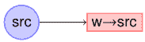
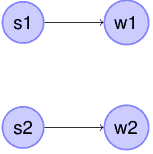

# C 库内存所有权模式分析

## Abstract

Programs written in multiple languages are known as polyglot programs. In part due to the proliferation of new and productive high-level programming languages, these programs are becoming more common in environments that must interoperate with existing systems. Polyglot programs must manage resource lifetimes across language boundaries. Resource lifetime management bugs can lead to leaks and crashes, which are more difficult to debug in polyglot programs than monoglot programs.

We present analyses to automatically infer the ownership semantics of C libraries. The results of these analyses can be used to generate bindings to C libraries that intelligently manage resources, to check the correctness of polyglot programs, and to document the interfaces of C libraries. While these analyses are unsound and incomplete, we demonstrate that they significantly reduce the manual annotation burden for a suite of fifteen open source libraries.

Categories and Subject Descriptors D.2.11 [Software Engineering]: Software Architectures—Languages; D.2.12 [Software Engineering]: Interoperability; D.2.13 [Software Engineering]: Reusable Software—Reusable libraries; D.3.2 [Programming Languages]: Language Classifications—C, Python; D.3.3 [Programming Languages]: Language Constructs and Features—Dynamic storage management, Procedures, functions, and subroutines; D.3.4 [Programming Languages]: Processors—Code generation, Memory management; E.1 [Data Structures]: Arrays, Records; F.3.2 [Logics and Meanings of Programs]: Semantics of Programming Languages—Program analysis

Keywords resource lifetime management; memory allocation; allocators; finalizers; ownership transfer; escape analysis; sharing; reference counting; foreign function interfaces (FFIs); bindings; libraries; dataflow analysis; interprocedural static program analysis; polyglot programming; interoperability

```c
char *strdup(const char *s);
char *asctime(const struct tm *tm);
```

Figure 1. C function signatures

## 1. Introduction

High-level programming languages have been gaining acceptance in many application domains where unsafe low-level languages like C and C++ were once the only option. For example, Python and JavaScript have a significant presence in the desktop application space. Additionally, Python has gained acceptance in the scientific computing community [14]. Unfortunately, these high-level languages do not exist in a vacuum. They depend on code written in unsafe lower-level languages for, among other reasons, performance and interoperability. Some performance-sensitive pieces of code simply cannot be rewritten in the desired high-level language. In other cases, it is possible but not economically feasible to rewrite working and tested code, so the original implementation must be used from the high-level language.

Production-quality high-level languages support calling functions from libraries written in other languages through foreign function interfaces (FFIs). High-level language programs using FFIs execute code from more than one language, making them polyglot programs. A critical challenge in writing correct polyglot programs lies in managing the flow of resources across language boundaries. Programs lacking a precise cross-language ownership semantics are vulnerable to resource leaks, threatening reliability. Unclear ownership semantics can also lead to crashes induced by use-after-free or double-free errors. Both of these types of errors are more difficult to debug in polyglot programs, as common debugging tools target programs written in a single language.

Most low-level languages like C do not provide any means for describing, much less checking, object ownership semantics. Instead, this critical information must be conveyed through documentation or recovered through static analysis. Library interfaces defined in C typically refer to dynamically-allocated resources by their address (a pointer). Unfortunately one cannot simply call `free` on all pointers obtained from a low-level language to release the associated resources, or finalize them. This approach fails because, while C functions expose most resources through pointers, they use pointers for many other purposes as well.

Consider the two C function declarations in figure 1. Each returns a `char*`. The value returned by `strdup` must be freed to prevent memory leaks, but freeing the value returned by `asctime` will cause a crash. The caller owns the result of `strdup` but not the result of `asctime`. Furthermore, some dynamically-allocated resources may require specialized finalizer functions instead of generic `free`. Consider `fopen` and `fclose`: calling `free` on the result of `fopen` is a partial resource leak. Thus, functions returning managed resources must be identified along with their associated resource finalizers.

```c
typedef struct pvl_elem_t{
  void *data;
  struct pvl_elem_t *next;
} pvl_elem;

typedef struct pvl_list_t{
  pvl_elem *head;
} pvl_list;

typedef struct icalcomponent {
  pvl_list *components;
  struct icalcomponent* parent;
} icalcomponent;

void pvl_push(pvl_list *lst, void *d) {
  pvl_elem *e = calloc(1, sizeof(pvl_elem));
  e->next = lst->head;
  lst->head = e;
  e->data = d;
}

void* pvl_pop(pvl_list *lst) {
  if(lst->head == NULL) return NULL;
  pvl_elem *e = lst->head;
  void *ret = e->data;
  lst->head = e->next;
  free(e);
  return ret;
}
```

Figure 2. Definitions for figure 3

```c
struct icalcomponent* icalcomponent_new() {
  icalcomponent* comp = malloc(sizeof(icalcomponent));
  if (!comp) return NULL;
  comp->components = newlist();
  comp->parent = NULL;
  return comp;
}

void icalcomponent_free(icalcomponent* c) {
  icalcomponent* comp;
  if (!c) return;
  while ((comp=pvl_pop(c->components)) != NULL) {
    icalcomponent_remove_component(c,comp);
    icalcomponent_free(comp);
  }
  pvl_free(c->components);
  free(c);
}

void icalcomponent_remove_component(
  icalcomponent *component, icalcomponent *child);

void icalcomponent_add_component(icalcomponent *c,
  icalcomponent *child) {
  pvl_push(c->components, child);
}

void icalcomponent_set_parent(icalcomponent *c,
  icalcomponent* parent) {
  c->parent = parent;
}
```

Figure 3. Example from ical

Resource management semantics are unclear in C even without the additional complexities of polyglot programming. We describe our ownership model for C resources and present algorithms to infer the ownership semantics of C libraries. These semantics are presented to users and tools through inferred annotations on library functions. While these analyses are unsound and incomplete, they are nonetheless useful. As discussed in section 8, our algorithms significantly reduce the manual annotation burden required to create library bindings. With review by a programmer familiar with the library being analyzed, these inferred annotations are sufficient to generate idiomatic FFI library bindings for high-level languages. The resulting bindings will be idiomatic in that they automatically manage the flow of resources between languages and clean them up when they become garbage. They also serve as an aid in program understanding and can augment documentation. Our primary contributions over prior work are: (1) two methods for identifying the ownership transfers of objects in C libraries (sections 4 and 5), (2) a method for inferring contracts that must be obeyed for function pointers (section 6), and (3) an algorithm for identifying reference-counted resources (section 7).

## 2. Resource Ownership Model


We adopt the ownership model of Heine and Lam [6] whereby each object is pointed to by exactly one owning reference. The object must eventually either be finalized through the owning reference, or ownership must be transferred to another owning reference. When a pointer is finalized, the resources held by the object it points to are safely released. Non-owning references to any object can be created at any time and are valid until the object is finalized. In the Heine and Lam model, pointer-typed members of C++ objects are either always owning references or are never owning references (at public interface boundaries). We extend this model to pointer-typed fields of some C structures for all functions.

### 2.1 Memory Ownership in C

A memory allocator is an abstraction over the most prevalent resource in most programs: dynamically allocated memory. The standard C library’s allocator and finalizer functions are `malloc` and `free`, respectively. When the memory allocator owns a piece of memory (i.e., the memory is unallocated), it is an error for any other part of the program to use it. When the allocator function is called, it completely transfers ownership of the memory to the caller via the returned owning reference.

Complex resources may own other resources through owned pointer fields. Finalizers for these complex resources must finalize their owned resources to obey the ownership model and to avoid leaks, as in figures 2 and 3. The `icalcomponent` type is a resource allocated with `icalcomponent_new`. It owns a component list, along with each of the components in the list of children. The finalizer for this type, `icalcomponent_free`, finalizes the list of children as well as the child components before finalizing the component itself with a call to `free` on line 23.

Ownership extends beyond just allocators and finalizers. For example, the function `icalcomponent_remove_component` removes a child component from a component without finalizing it.

导致所有情况下的转移。例如，C 中常见的容器类数据结构（例如列表、树或哈希表）通常存储指向数据对象的指针。显然，将对象存储在这些容器之一中会使其逃逸。然而，这些容器中的大多数并不拥有其元素：调用方仍需管理其内存。Ma 和 Foster [10] 指出，库接口中的所有权转移相对罕见；我们注意到逃逸参数却绝非罕见。因此我们建议逃逸分析与所有权转移分析是不同的。在本节中，我们提出一种转移分析，以更准确地识别 C 库函数中的所有权转移。我们在第 5 节重新审视逃逸分析。

我们所有权转移分析的核心源于第 2 节中的资源所有权模型。我们认为结构字段是被拥有的，如果该字段将在终结器函数上下文中被终结。因此，对象的所有权在调用方转移出去，当另一个对象承担对其进行终结的责任时（即它被存储到将被终结的字段中）。在其他上下文中终结的字段有时用于存储临时分配，但这些字段不能保证与对象其余部分一起被终结，并且单独管理。分析分为两个阶段。首先它识别库中所有被拥有的字段。然后它识别可能被存储到被拥有字段中的所有函数参数。我们用符号访问路径来描述字段。请注意，我们假设任何给定字段要么始终被拥有，要么从不被拥有。我们不尝试推理有时才被拥有的字段。此外，我们假设，如果容器类字段（即数组或链接数据结构）中保存的一个元素被拥有，则该字段中的所有元素都被拥有。

### 4.1 符号访问路径

该分析基于符号访问路径 [2, 7]；我们遵循 Matosevic 和 Abdelrahman [11] 的表述。访问路径描述了可从基值通过（可能为空的）路径组件序列访问的内存位置。虽然本文仅讨论字段访问，但指针解引用、数组访问和联合访问也是有效的路径组件。我们将单个数组中的所有数组元素视为相同；更精确的分析可以区分它们。当结构体类型的指针被强制转换为不相关类型时 [15]，这种对字段访问的处理是不健全的，这可能导致分析识别出无效的所有权转移。

令 `ap(v)` 表示源表达式 `v` 的访问路径。例如，第 3 图第 18 行的赋值将值赋给 `lst→head`。对应的访问路径 `ap(lst→head)` 为对 `(lst, {head})`。在此对中，`lst` 是基值，`{head}` 是到达受影响内存位置的一个字段访问序列。我们有时在抽象上以基类型而不是基值来引用位置。这里，`lst` 类型为 `pvl_list`，因此该字段访问的抽象访问路径为 `(pvl_list, {head})`。

遵循 Matosevic 和 Abdelrahman，我们通过自底向上遍历调用图构造符号访问路径，其中强连通分量会迭代重新分析直到达到不动点。我们将假设函数已规范化，使得返回值是形式参数列表中的第一个参数（始终索引为零）。函数通过向其返回参数写入来返回值。`void` 函数在参数零处有一个占位符。对于每个被分析的库，我们构造两个映射，每个都以函数和形式参数编号为键：

- 设 `f` 为一个函数，`i` 为该函数形式参数的零基索引。则 `finalizePaths[f, i]` 是函数 `f` 在其第 `i` 个参数中终结的访问路径集合。
- 设 `f` 为一个函数，`i` 为该函数形式参数的零基索引。则 `writePaths[f, i]` 是形如 `(p, j, q)` 的三元组集合，其中函数 `f` 读取其第 `j` 个参数的访问路径 `q` 处的值，并最终将此值存储到其第 `i` 个参数的访问路径 `p` 中。

令 `argno(v)` 返回封闭函数形式参数列表中形式参数 `v` 的索引。令 `base(p)` 返回访问路径 `p` 的基，`components(p)` 返回 `p` 的路径组件。访问路径扩展操作 `p₁ ⊕ p₂` 以自然方式扩展 `p₁` 到 `p₂`； resulting 路径具有与 `p₁` 相同的基值，并且 `p₂` 的路径组件追加到 `p₁` 的路径组件之后。集合值操作 `nr(p)` 如果 `components(p)` 中的每个路径组件在 `p` 中唯一，则返回包含 `p` 的单例集合；否则返回空集合。同样，`nr((p, j, q))` 如果 `p` 或 `q` 都没有重复路径组件，则返回包含三元组的单例集合。此条件排除了可能无限增长的循环路径；此类路径在存在归纳数据结构时很常见。

我们对循环访问路径的处理和表示与 Matosevic 和 Abdelrahman [11] 不同。他们使用带重复运算符的类似正则表达式的语言来表示路径。我们的分析不需要关于路径中循环的信息，因此我们使用上面讨论的更简单的表示；这需要无重复条件（通过 `nr()` 操作符）来防止循环路径无界增长。这种对路径的较少表达性处理是 unsound 的潜在来源，尽管在实践中尚未成为问题。

我们分析的代码表示为 LLVM bitcode：静态单赋值 (SSA) 形式 [8] 的三地址代码。两种类型的语句会向 `finalizePaths` 或 `writePaths` 添加元素：函数调用和存储指令。该分析是流不敏感的，并且为可能执行的任何相关存储或函数调用创建或扩展路径。我们首先考虑函数调用。假设函数 `f` 包含形如 `g(value)` 的函数调用。令 `p = ap(value)` 为 `value` 的访问路径。如果 `g` 是终结器并且 `base(p)` 在 `f` 的形式参数中，则：`finalizePaths[f, argno(base(p))] ⊇ nr(p)`

现在考虑函数 `f` 中形如 `*location = value` 的存储。令 `lp = ap(location)` 且 `p = ap(value)`。如果 `base(lp)` 和 `base(p)` 都在 `f` 的形式参数中，则：`writePaths[f, argno(base(lp))] ⊇ nr((lp, argno(base(p)), p))`

对非终结器函数的调用通过扩展 `finalizePaths` 和 `writePaths` 中的访问路径来生成新路径。在高层，路径通过将被调用者的访问路径映射到其调用者的参数来扩展。对于函数 `f` 中形如 `callee(..., aᵢ, ...)` 的每次调用，其中 `a` 是 `callee` 的第 `i` 个参数且 `p ∈ finalizePaths[callee, i]`，令 `pext = ap(a) ⊕ p`。如果 `base(pext)` 是 `f` 的形式参数，则：`finalizePaths[f, argno(base(pext))] ⊇ nr(pext)`

对于函数 `f` 中形如 `callee(..., aᵢ, ..., bⱼ, ...)` 的每次调用，其中 `a` 和 `b` 分别是 `callee` 的第 `i` 个和第 `j` 个参数，且 `(p, j, q) ∈ writePaths[callee, i]`，令 `qext = ap(b) ⊕ q` 且 `pext = ap(a) ⊕ p`。令 `qextB = base(qext)` 且 `pextB = base(pext)`。如果 `qextB` 和 `pextB` 都是 `f` 的形式参数，则：`writePaths[f, argno(pextB)] ⊇ nr((pext, argno(qextB), qext))`

访问路径。对于第 2 图中的 `pvl_push` 函数，在没有局部 points-to 信息的情况下，分析只能得出 `d` 被写入路径 `(e, ⟨data⟩)` 的结论。由于 `e` 不是 `pvl_push` 的形式参数，此事实未记录在 `writePaths` 中。有了局部 points-to 信息，分析可以构造最大路径 `(lst, ⟨head,data⟩)`。该最大路径的基是 `lst`，它是 `pvl_push` 的形式参数。因此，`writePaths` 可以更新以反映 `d` 被写入此路径。

### 4.2 识别被拥有的字段

在构造库中所有符号访问路径之后，我们接下来识别库中的被拥有字段。根据第 2 节的资源所有权模型，类型的被拥有字段是当该类型对象被终结时将被终结的字段。我们的分析通过分析每个函数的终结访问路径来确定这一点：如果终结器函数的参数的字段被终结，则该字段是被拥有的。也就是说，如果某个函数 `f` 是其第 `i` 个形式参数的终结器，则 `finalizePaths[f, i]` 中的所有字段都是被拥有字段。

在第 3 图中，函数 `icalcomponent_free` 是终结器，因为 `c` 参数（类型为 `icalcomponent*`）在所有路径上都被终结（或为 NULL）。`pvl_free` 和 `icalcomponent_free` 函数也是终结器（实现未显示）。我们看到 `icalcomponent_free` 将 `pvl_pop` 的返回值传递给终结器。`pvl_pop` 通过访问路径 `(lst, ⟨head,data⟩)` 返回其列表参数的头的数据。因此，传递给终结器的值是 `(icalcomponent, ⟨components,head,data⟩)`；我们得出结论，`icalcomponent` 的此字段是被拥有的。

### 4.3 转移的所有权

所有权转移分析的关键洞见是，存储到被拥有字段中的任何函数参数的所有权都从调用方转移。假设函数 `f` 具有形式参数 `a` 和 `b`，分别位于形式参数列表中的位置 `i` 和 `j`。如果 `(p, j, q) ∈ writePaths[f, i]` 其中 `ap(b)` 是 `q`（`q` 只是形式参数 `b` 的退化访问路径）并且 `p` 的最后一个组件是根据第 4.2 节被拥有的字段，则 `f` 将 `b` 的所有权转移给 `a`。

回到第 3 图，函数 `pvl_push` 将其 `d` 参数存储到 `lst` 的一个字段中，由访问路径 `(lst, ⟨head,data⟩)` 概括。`icalcomponent_add_component` 使用 `c` 的一个字段 `components` 作为参数调用 `pvl_push`，将写入访问路径扩展为 `(c, ⟨components,head,data⟩)`。分析的第一阶段识别出此路径的最后一个组件为被拥有字段，因此 `icalcomponent_add_component` 的 `c` 参数承担了 `child` 的所有权。请注意，`icalcomponent_set_parent` 不承担其 `parent` 参数的所有权：对应的字段从未被终结，因此不是被拥有的。

我们的访问路径构造从地址向后进行，跨越指针解引用、字段访问、联合访问和数组访问。我们在 SSA φ-节点处停止构造，以避免生成访问路径的潜在指数爆炸。虽然这是不健全的，但我们在实践中没有观察到任何遗漏的所有权转移。

## 5. 改进的逃逸分析

虽然转移分析的结果对于生成自动化资源管理的语言绑定至关重要，但逃逸分析仍提供重要信息。如果指向对象的指针逃逸，但该对象的所有权未被转移，我们仍然了解该对象的生命周期信息。虽然我们不总是能自动管理此生命周期，但用户至少可以被告知需要某种作用域管理。辅助函数可用于将具有作用域生命周期的对象钉住，以防止它们在对 C 库不可见的垃圾收集器中存在引用时被收集。虽然已有工作描述了用于此目的的逃逸分析，但我们提出了一种更精确的分析，消除了先前工作的大量误报。

我们描述了一种自底向上、基于摘要、流不敏感的 C 逃逸分析，具有有限的字段和上下文敏感性。该分析是一种栈逃逸分析 [3, 21] 的形式，而不是线程逃逸分析 [19]。我们的分析基于值流逃逸图，它是值流图 [9] 的带额外注释版本。我们的分析最类似于 Whaley 和 Rinard [21] 的分析，尽管我们的分析是流不敏感的并且每个函数只需要一个图。像 Whaley 和 Rinard [21] 一样，我们独立于其调用者分析函数。我们需要这样做，因为调用者可能用另一种语言编写且在分析时不可用。此外，我们以速度和更简单的被调用者处理为代价牺牲精度。不是在调用点将每个被调用者的 points-to 逃逸图合并到调用者的图中，我们使用摘要信息仅将逃逸参数标记为逃逸。这允许对被调用者进行更紧凑的表示，以牺牲图合并的一些精度为代价。我们保守地假设传递给没有摘要的被调用者值会逃逸。值流图不允许我们回答 points-to 查询，我们不需要，但它可以在一次遍历中构造，而 points-to 逃逸图则不行。

我们的值流图有两种类型的节点：位置节点和 sink 节点。边 `a → b` 表示值从 `a` 流向 `b`。如果存在从它到 sink 的路径，则值会逃逸。分析是保守的并识别可能逃逸的值。这种近似是合适的，因为误报（错误地识别为逃逸的值）会导致泄漏，而不是崩溃。

sink 节点为 (1) 返回聚合或指针值的函数的 return 语句和 (2) 对全局变量、参数、被调用者的返回值及其访问路径的存储而创建。还为每个逃逸的被调用者的实际参数创建 sink。以下语句在值流图中诱导边：

- `*a = b` 添加 `b → a` 或 `bₚ → a`
赋值导致源操作数流向目标操作数。如果赋值右手边是具有具体访问路径 `(b, ⟨p⟩)` 的字段引用，则添加边 `bₚ → a`；如果没有字段访问，则添加更简单的形式 `b → a`。
- `return a` 添加 `a → sink_ret`
返回的值流向特殊的返回 sink 节点。

例如，第 5 图中的函数 `CaseWalkerInit` 的值流逃逸图如第 6 图所示。我们将位置节点表示为圆圈，sink 表示为矩形。参数 `src` 由其位置节点表示，该节点流向 `w` 参数的一个字段。`src` 逃逸，因为存在从它到 sink 的路径。

形如 `f(a1, a2, ..., aN)` 的函数调用充当一系列赋值 `*f₁ = a1, *f₂ = a2, ..., *f_N = aN` 的序列，其中 `fᵢ` 是表示 `f` 的第 `i` 个形式参数的节点。如果 `fᵢ` 允许其参数逃逸，则 `fᵢ` 是 sink 节点。局部值 `v` 从 `f` 逃逸，如果 `v →* s` 对某个 `s ∈ sinkNodes`；即如果有 sink 节点 `s` 可从 `v` 到达。如果 `v` 根据此查询不逃逸，则 `v` 的字段 `p` 从 `f` 逃逸，如果 `vₚ →* s` 对某个 `s ∈ sinkNodes`。

为了引入有限形式的上下文敏感性，我们特别注意逃逸到其他参数字段中的参数。假设有一个函数调用 `f(a, b)`，其中 `f` 的第一个参数逃逸到第二个参数。我们在 `f` 的所有调用者中添加边 `a → b`，以模拟 `f` 对调用者的值流逃逸图的影响。例如，`CmpIgnoreCase` 函数中


```c
void CaseWalkerInit(const char *src, CaseWalker *w) {
    w->src = src;
    w->read = 0;
}

int CmpIgnoreCase(const char *s1, const char *s2) {
    CaseWalker w1, w2;
    Char8 c1, c2;

    if (s1 == s2) return 0;

    CaseWalkerInit(s1, &w1);
    CaseWalkerInit(s2, &w2);

    for (;;) {
        c1 = CaseWalkerNext(&w1);
        c2 = CaseWalkerNext(&w2);
        if (!c1 || (c1 != c2)) break;
    }
    return (int)c1 - (int)c2;
}
```

**Figure 5.** Examples of escaping pointers from fontconfig library



**Figure 6.** Value flow escape graph for `CaseWalkerInit` in figure 5



**Figure 7.** Value flow escape graph for `CmpIgnoreCase` in figure 5


Figure 5 calls `CaseWalkerInit`, which we already established allows its `src` argument to escape into `w`. Thus, the value flow escape graph of `CmpIgnoreCase`, shown in figure 7, has edges from `s1` to `w1` and `s2` to `w2`. Since `w1` and `w2` are local variables that do not otherwise escape, we are able to conclude that `s1` and `s2` do not escape, despite being passed as arguments that could escape if considered only in isolation.

Field sensitivity prevents a single escaping field from causing all other fields of the same object to also escape. We take a field-based approach to field sensitivity that is unsound when pointers to struct types are cast to structurally unrelated types [15] as in section 4.1. This unsoundness could make us label an escaping pointer as non-escaping. It could be made sound by having any casts to structurally unrelated types cause all affected fields to escape. We have not done this because such casts are rare in practice and have not yet caused problems.

## 6. Indirect Calls as Contracts

While analyzing library code, indirect calls (calls through function pointers) pose a problem. Libraries typically have many entry points and context of the call is unavailable. While some indirect call targets can be resolved, most cannot. Thus, whenever one of our analyses encounters an indirect call, it seems that we must conservatively assume that any function at all could be called. Instead of accepting this often overly-conservative conclusion, we note that:

- many indirect function calls are made through function pointers stored in object fields, particularly in the case where they are used to implement polymorphic behavior; and
- libraries initialize many of these fields with default functions defined in the same library.

While callers can technically store the address of any function in one of these function pointers, the library-provided initializers clearly indicate what semantics the library expects the call targets to obey. Violating those semantics is possible, but risks undefined behavior. Library-provided function pointer initializers effectively induce contracts on internally-initialized function pointers. The library obeys these contracts, and inferences based on them hold as long as client code obeys them as well. Recognizing these contracts and incorporating them into the analyses discussed in sections 3 to 7 improves precision.

Consider the example in figure 8.

```c
typedef struct XML_ParserStruct {
    const char *m_encoding;
    XML_MemSuite m_mem;
} *XML_Parser;

XML_Parser parserCreate(const char *encodingName)
{
    XML_Parser parser;
    parser = malloc(sizeof(struct XML_ParserStruct));
    if (parser != NULL) {
        parser->m_encoding = encodingName;
        parser->m_mem.malloc_fcn = malloc;
        parser->m_mem.realloc_fcn = realloc;
        parser->m_mem.free_fcn = free;
    }

    return parser;
}

DTD* dtdCreate(const XML_MemSuite *ms) {
    DTD *p = ms->malloc_fcn(sizeof(DTD));
    if (p == NULL) return p;

    p->scaffLevel = 0;
    p->scaffSize = 0;
    p->scaffCount = 0;
    p->contentStringLen = 0;
    return p;
}
```

**Figure 8.** Contracts in expat library

When parser objects are created in `parserCreate`, the `malloc_fcn` field of their `XML_MemSuite` is initialized with a pointer to the standard `malloc` function on line 12. While this does not mean that every `malloc_fcn` field will refer to `malloc`, it strongly suggests that the library expects the target to be an allocator. Since we consider the assignment on line 12 to create a contract on the `malloc_fcn` field, we conclude that `dtdCreate` is an allocator because of the call-under-contract on line 21.

## 7. Safely Sharing Ownership

Most resources in our model must be exclusively owned in order for them to be automatically managed by a high-level language run-time system. However, we support shared ownership for reference-counted resources. Moreover, ownership can be safely shared between a low-level language and a high-level language run-time system, provided the high-level language run-time safely manipulates the reference count. When the high-level language acquires shared ownership of a resource, it must increment its reference count. When the high-level language is ready to relinquish ownership of the resource, it must decrement the reference count instead of calling a finalizer on it. If the high-level language finalizes the resource directly, later accesses through outstanding shared references in library code could lead to a crash. Note that shared resources may safely escape into library code (cf. section 5) because the reference counts mediate their lifetimes.

### 7.1 Identifying Reference Increment and Decrement Functions

We describe an analysis to identify, for a library with reference-counted resources:

- the set of types that must be reference-counted (to know when references must be managed) and
- the functions to increment and decrement references (`IncRef` and `DecRef`, respectively) for each type (to correctly manipulate the reference counts).

We begin by identifying the `DecRef` function of a resource. Fundamentally, `DecRef`:

- takes a pointer to a resource as an argument,
- decrements an integer field of the resource, and
- if the reference count becomes zero, calls a finalizer on the argument.

A common variant of `DecRef` calls the finalizer directly without decrementing the reference count if there is only a single reference to the resource. Another interesting variant, such as from gobject-2.0, has multiple reference count decrement attempts; these arise because gobject-2.0 supports finalizers that can add references to objects that are in the process of being finalized. Instead of precisely modeling every possible variant of reference counting, we employ an over-approximation that is unsound and incomplete, but nonetheless effective.

Without loss of generality, assume that `DecRef` functions take only single argument: a pointer to a resource. First, identify all *conditional finalizers* in the library. These are functions that finalize their argument on some, but not all, paths. Building on the results of the finalizer analysis described in section 3, this is a linear scan of the instructions in each function. A conditional finalizer is a function that calls at least one finalizer on its argument but is not itself a finalizer. (If it were a finalizer, it would call a finalizer on *all* paths.)

Consider the example in figure 9, which is adapted from code in the dbus-1 library simplified for exposition.

```c
typedef struct {
    int refcount;
    Connection *connection;
} PendingCall;

PendingCall* pending_call_ref(PendingCall *pending) {
    ++pending->refcount;
    return pending;
}

void pending_call_unref(PendingCall *pending) {
    --pending->refcount;
    if (pending->refcount) return;

    Connection *c = pending->connection;
    free(pending);
    connection_unref(c);
}
```


Following the algorithm, we note that `pending_call_unref` takes a single pointer-typed argument. It passes this argument to `finalizer` `free` on line 16. However, `pending_call_unref` may also return early on line 13. Therefore, `pending_call_unref` is not itself a finalizer, but it is a conditional finalizer.

For each conditional finalizer *cf* with argument *a*, *cf* is a *DecRef* function with access path ⟨*a*, ⟨*p*⟩⟩ if it decrements an integer field of *a* via a sequence of field accesses *p*. We do not require that *cf* always decrement the reference count because some variants skip it under certain circumstances; this is a potential source of imprecision. For example, the conditional finalizer `pending_call_unref` in figure 9 always decrements the `refcount` field of its `pending` argument on line 12. Therefore, `pending_call_unref` is a *DecRef* function with access path ⟨`pending`, ⟨`refcount`⟩⟩.

For each *DecRef* function and its associated access path ⟨*a*, ⟨*p*⟩⟩, the corresponding *IncRef* function is the one that takes a single argument of the same type as *a*, the root of the access path, and always increments the location in the resource described by *p*. If there is more than one *IncRef* function for a given *DecRef* function, we do not associate them and an annotation would be required to match the desired pairs. If more than one *DecRef* function could manage a given type, a consumer of the analysis results would need an annotation to prefer one. Returning to figure 9, we find that `pending_call_ref` always increments the `refcount` field of its one argument. Therefore, `pending_call_ref` is the *IncRef* function corresponding to `pending_call_unref`.

Note that we assume that libraries correctly manage reference counts internally. We make no attempt to verify this assumption, for which other analyses already exist [4].

### 7.2 Identifying Reference-Counted Types

So far we have identified the *IncRef* and *DecRef* functions that manipulate reference counts. We must also determine the set of types whose reference counts are managed by these functions. Clearly, this set includes the common argument type between *IncRef* and *DecRef*. Polymorphic reference counting functions, however, manage multiple types. One way to identify the set of managed types is to note that any polymorphic *DecRef* function needs some way to perform type-specific finalization when the reference count reaches zero. The types handled by these type-specific finalization functions are the types managed by the *IncRef* and *DecRef* pair.

More formally, let *c* be a function that has already been identified as a *DecRef* function for some type. Identify all indirect function callees in *c* to which *c* passes its argument. For each such callee *f*, let *τf* be the set of types to which *f* casts its argument. The set of types managed by *c* is the type of the argument of *c* unioned with ⋃_f τ_f.

The example in figure 10 is simplified from the open-source library `glib-2.0`. Our analysis recognizes `g_object_unref` as a *DecRef* function because of the decrements of the `ref_count` field on lines 6 and 9 and the call to `finalizer` `g_type_free_instance` on line 13. Next, we identify the targets of indirect calls in `g_object_unref`. The only indirect call appears on line 12. As initialized in `g_emblem_class_init`, the only known target is `g_emblem_finalize`. Thus, `g_object_unref` and `g_object_ref` are the *DecRef* and *IncRef* functions for `GObject` and `GEmblem`. As in this example, the indirect callees of *DecRef* often represent finalizers for resource-specific data members. This algorithm assumes that *DecRef* functions operate on structural subtypes of the input value. An alternative approach is to

```c
void g_object_unref(GObject *object) {
    gint oref;
    oref = g_atomic_int_get(&object->ref_count);
    if (oref > 1) {
        g_atomic_int_add(&object->ref_count, -1);
    } else {
        oref = g_atomic_int_add(&object->ref_count, -1);
        if (oref == 1) {
            object->klass->finalize(object);
            g_type_free_instance(object);
        }
    }
}

void g_emblem_class_init(GEmblemClass *klass) {
    klass->finalize = g_emblem_finalize;
}

void g_emblem_finalize(GObject *object) {
    GEmblem *emblem = (GEmblem*)object;
    g_object_unref(emblem->icon);
}
```

图10. 来自`glib-2.0`库的托管类型示例

直接利用结构子类型关系，并考虑传递给`DecRef`的输入的所有结构子类型都是受管理的。我们将在8.2节中比较这两种方法。

### 7.3 过程间引用计数操作

并非所有函数都直接增加和减少引用。许多函数使用辅助函数，尤其是那些依赖原子增减操作的函数。我们采用一种简单的分析来总结函数对其指针类型参数的整数字段所产生的影响。该分析还跟踪对`int*`类型参数的影响，以适应那些传递引用计数字段地址而非包含该字段的对象的引用计数函数。

### 7.4 自动化的好处

对于不熟悉某个库的用户，推断出的注解记录了必须维护引用计数的事实。更重要的是，自动发现绝大多数引用计数类型可以减少可能很大的注解负担。

## 8. 评估

我们将第3节到第6节描述的分析应用于一套包含15个开源库的测试集。这些库的规模不等，小到只有几个函数和几百行代码，大到拥有数千个函数和数十万行代码。

我们分别评估所有权转移分析和引用计数分析的有效性。在大多数情况下，使用引用计数规范的库不需要所有权转移分析的结果，因为所有权通过引用计数被显式地共享。因此，对于引用计数的库，生成库绑定通常不需要所有权转移分析的结果。

### 8.1 所有权转移分析

本节评估所有权转移分析的有效性，特别关注与仅依赖逃逸分析结果相比，在减少手动注解负担方面的作用。

表1. 推断出的转移注解和逃逸注解的数量

| 分析的库 | 函数数 | 转移 | 契约 | 间接 | 直接 |
|---|---|---|---|---|---|
| `archive` | 267 | 9 | 33 | 18 | 47 |
| `freenect` | 61 | 2 | 0 | 5 | 13 |
| `fuse` | 188 | 4 | 5 | 106 | 28 |
| `glpk` | 1072 | 0 | 67 | 54 | 149 |
| `gsl` | 3910 | 39 | 68 | 21 | 88 |
| `ical` | 1045 | 10 | 0 | 7 | 142 |

表1显示了六个不同规模库的推断注解数量。所有权转移分析是基于`archive`和`ical`库设计的。其余库可视为测试集。表中第二列记录每个库中的函数数量。“转移”列报告了我们的分析识别出的、从调用方转移所有权的函数参数数量。其余列对逃逸分析的结果进行了细分。

我们将逃逸参数分为三类：契约逃逸、间接逃逸和直接逃逸。契约逃逸是指通过函数指针调用而逃逸的参数，这些调用的一些目标是已知的，并且所有这些目标都认为该参数不会逃逸。我们将这些参数称为契约逃逸，因为只有当传递给函数指针的契约被违反时，即第6节的假设不适用时，它们才会逃逸。间接逃逸是指作为参数传递给通过函数指针进行的调用，而这些函数指针无法识别出任何目标。然而，在实践中，参数真正通过函数指针逃逸的情况很少见，因为这会使代码难以推理。如果这些分析结果的使用者能够做出这一假设，那么这种区别可能会带来显著差异。例如，`fuse`客户端库的间接逃逸数量远多于直接逃逸。表1中的直接逃逸是其余逃逸参数：即简单逃逸，例如逃逸到全局变量，而不是由于通过函数指针的调用。

虽然库显然不期望契约逃逸发生，但凭借库提供的初始化器，它们仍然提供了更多信息。每个导致契约逃逸的间接函数调用都会对为该调用解除引用的函数指针施加一个契约。我们可以说，任何可能被该函数指针指向的函数都应遵守其参数不逃逸的契约。契约逃逸在多态行为的库中最常见，正如`archive`库所示。在这个库中，多态通过存储在每个对象中的函数指针实现。这些函数指针字段在对象创建时使用库中定义的函数进行初始化，从而使我们能够如第6节所建议的那样推断相应的契约。需要注意的是，如果我们仅仅知道某个间接函数调用的一部分目标，我们不会将该调用的参数视为契约逃逸。只有当所有已知调用目标都认为该参数不会逃逸时，我们才将其标记为契约逃逸。

每个转移注解都有一个对应的直接逃逸注解。如果使用所有权转移分析的结果而非逃逸分析的结果来自动化资源管理，那么表1中“直接”和“转移”列之间的差异就是所有权转移分析所节省的手动注解数量。如果没有所有权转移分析，每个额外的逃逸注解都会引入一个必须用手动注解来填补的内存泄漏。这一差异在`glpk`和`ical`中非常显著：所有权转移分析在每个库中节省了超过100个手动注解。此外，`glpk`似乎从不转移所有权。然而，如第5节所讨论的，逃逸注解作为对象生命周期文档对用户仍然有用。

请注意，所有权转移分析需要准确了解给定库中的终结器函数。终结器分析超出了本文的范围，用于本次评估的分析无法识别本次评估所用库中的所有终结器。为了弥补这一点，我们手动注释了`ical`中四个遗漏的终结器和`glpk`中两个遗漏的终结器。`archive`、`freenect`和`fuse`中的终结器是自动识别的。我们已经详尽检查了`glpk`和`gsl`的结果，这些库中可能遗漏了一些终结器；如果确实如此，那么手动注释这些遗漏的终结器后，我们的所有权转移分析将识别出更多被转移的参数。我们注意到，手动注释终结器比手动检查可能的所有权转移要容易得多，因为终结器往往遵循统一的命名约定。

在本小节的其余部分，我们将对评估中的三个库的结果进行更详细的分析。选择这三个库是因为它们具有有趣的所有权转移特性，同时规模足够小，可以手动全面评估。

#### 8.1.1 ical

`ical`库提供了日历数据的表示。它有很多函数，但真正转移对象所有权的函数很少。该库中的主要数据结构形成一棵树；当一个条目被添加到表示某个日历事件的树中时，该树承担新条目的所有权。

这两种分析一致认为有10个参数会导致所有权转移。然而，逃逸分析标记了超过100个额外的参数。其中一些非转移逃逸可以通过存在一个不拥有其元素的容器API来解释：向容器添加条目会导致逃逸，但容器除了自己的内部结构外不拥有任何东西。许多剩余的差异源于父指针。当一个条目作为另一个条目的子节点插入树中时，新插入条目的父字段会被更新为指向其新的父元素。这导致子条目逃逸到父条目中，同时父条目也逃逸到子条目中。类似地，许多函数会导致其一个或多个参数逃逸到它们自身中。这些自逃逸在生成库绑定时可以特殊处理。

有一个函数带有逃逸注解但没有转移注解，特别有趣。该函数向另一个对象添加一个附件；然而，附件是`ical`中唯一进行引用计数的资源。由于附件是引用计数的，它们没有我们的分析可以自动识别的终结器函数。为附件的`unref`函数添加手动注解，使分析能够正确识别该所有权转移。这表明，出于所有权转移分析的目的，将引用计数资源的`unref`函数视为终结器可能是明智的。

#### 8.1.2 freenect

该库提供了Kinect硬件的驱动程序和用户空间控制。我们的分析推断出在两个不同函数`freenect_init`和`fnusb_init`中有两个参数发生所有权转移。这两个推断都是不正确的。根本原因在于`freenect_init`调用的`fnusb_init`函数。所讨论的参数是一个可选的`libusb_context`。如果调用方提供了上下文，库会保留对它的引用，但不会承担所有权。然而，如果调用方没有提供上下文，`fnusb_init`会分配自己的上下文，并对其承担所有权。该所有权与对`libusb_context`的引用一起通过一个标志记录。这违反了我们的所有权转移分析的一个假设：字段要么始终被拥有，要么从未被拥有。这个特定字段有时是被拥有的。虽然这些推断出的转移注解并不正确，但该分析仍然使用户无需提供十一个注解来弥补过于激进的逃逸分析。所有权转移分析还将必须手动检查的代码量减少到两个函数。

我们可以调整分析，对仅有时被终结的字段做特别标记。也许我们可以将其限制为仅基于某个标志而终结的字段。这些有条件拥有的字段可以在诊断信息和生成的文档中报告；有了这些额外信息，用户就可以为自己的场景决定正确的所有权语义。虽然增加用户手动检查的负担是不可取的，但我们的分析可以向用户准确展示歧义产生的位置，将检查范围限制在异常终结器上，而不是可能存在于库中的每一个函数。

#### 8.1.3 fuse

`fuse`库是某些*NIX系统的Filesystem in Userspace项目的用户空间组件。该库只有少数几个所有权转移；四个中有三个是单一类型的转移。在这些情况下，`fuse_session`对象通过构造函数和显式的`fuse_session_add_chan`函数承担通信通道的所有权。

第四个转移所有权的函数`fuse_session_new`更有趣。它使用两个参数创建一个新的`fuse_session`：一个用于任意用户提供数据的`void*`，以及一个包含元数据的`struct`。元数据中包含一个可选的用于终结用户提供数据的函数，如果存在，`fuse_session`对象的终结器会调用它。


该函数与我们关于字段要么始终被拥有、要么从未被拥有的假设产生了意想不到的交互：用户控制着某个字段的所有权，而我们的分析在正在分析的库中找到了该字段可能被拥有的证据。这一案例表明，我们的限制以及我们对终结器的概念，可以从更细微的区分中受益。在这种情况下，我们看到字段是根据用户提供的值有条件地终结的，而`freenect`中的示例是根据库设置的字段来决定是否终结。虽然对于`fuse_session_new`的这个用户数据参数，转移注解的正确性可能取决于库用户的偏好，但所有权转移分析仍然使用户无需提供至少24个注解来防止因逃逸分析导致的泄漏。此外，用户只需检查所有权转移分析推断出的四个注解。在阅读如何调用`fuse_session_new`的文档时，用户数据参数上的转移注解的含义就会变得清晰。

人们可能会倾向于生成从不向C库转移用户数据指针所有权的库绑定。这个例子表明，即使对这种极其常见的C语言惯用法进行特殊处理，也不是完全安全的。在大多数情况下，用户数据不被拥有，但当它被拥有时，类型系统也绝不会给出任何指示。

大多数未转移所有权的逃逸参数是其他用户数据指针。还有一些与`ical`中类似的自逃逸参数实例。第三类逃逸是由于逃逸分析中的不精确性导致的，这种不精确性是可以修复的。`fuse`库使用非逃逸的堆分配；存储到这些堆分配中的参数被报告为逃逸，因为我们的逃逸分析没有利用这样一个事实：即像`malloc`这样的分配器返回的指针不会被任何东西别名化。这可以通过像对待非逃逸栈分配局部变量一样对待堆分配局部变量来修复。

### 8.2 引用计数分析

表2总结了我们的引用计数分析的结果。该分析是基于`dbus-1`、`exif`、`gobject-2.0`和`gio-2.0`库设计的。对于每个库，我们报告（1）库中函数的数量，（2）函数的数量，这些函数是分配器，(3) 作为终结器的函数数量，以及 (4) `IncRef`/`DecRef`函数对的数量。与我们之前的所有权转移分析一样，引用计数分析需要准确了解每个库中存在的分配器和终结器。为了识别全部`allocators`和`finalizers`，`dbus-1`库需要两条手动标注，`exif`需要四条，`gobject`需要一条，`glib`需要七条。其中一些库使用自定义内存分配器，而另一些库的终结器与我们的工具所使用的终结器概念不完全吻合，因为它们包含额外的非`NULL`检查。图 11 展示了一个示例。

### 图 11. exif 库中的终结器

```
void exif_mem_free(ExifMem *mem, void *d)
{
    if (!mem) return;
    if (mem->free_func) {
        mem->free_func(d);
        return;
    }
}
```

在第 4 行，该终结器检查它调用的一个函数指针是否为非`NULL`。扩展分配器和终结器识别分析超出了本工作的范围。

### 表 2. 推断出的引用计数标注数量。

“Ref/Unref”指推断出的`IncRef`和`DecRef`函数对的数量，而非单个函数。

| 分析的库 | 引用计数 | | | |
|---|---|---|---|---|
| 名称 | 函数 | 分配器 | 终结器 | Ref/Unref |
| cairo | 379 | 2 | 2 | 4 |
| dbus-1 | 804 | 36 | 8 | 11 |
| exif | 142 | 16 | 5 | 7 |
| fontconfig | 196 | 51 | 8 | 3 |
| freetype | 289 | 9 | 6 | 3 |
| gio-2.0 | 1772 | 58 | 11 | 9 |
| glib-2.0 | 1529 | 228 | 39 | 16 |
| gobject-2.0 | 394 | 15 | 3 | 1 |
| soup-2.4 | 530 | 46 | 6 | 3 |

该分析在多个方面很有用。首先，它提醒用户其库使用了引用计数。我们的实验在未预期的库中发现了引用计数类型，包括`ical`和`libusb`。引用计数在这两个库中都不是主要的资源管理方式，但仍然很重要，而且仅靠视觉扫描并不明显。更重要的是，即使在引用计数是主要资源管理方式的情况下，我们的引用计数分析也能识别多态的`IncRef`/`DecRef`函数及其操作的类型。例如，在`dbus-1`中，我们识别出`dbus_auth_unref`和`dbus_auth_ref`是三种相关类型（`DBusAuthClient`、`DBusAuthServer`和`DBusAuth`）引用计数的多态管理器。

`gio-2.0`库凸显了在多态引用计数器存在时引用计数分析的重要性。尽管`gio-2.0`有 9 对由分析识别出的`IncRef`/`DecRef`函数对，但它还定义了另外 138 种由`gobject-2.0`库中定义的`g_object_unref`和`g_object_ref`函数管理的类型。请注意，这 9 种具有自己引用计数函数的类型不能使用通用的`gobject-2.0`引用计数函数来管理，尽管这些类型的名称中没有任何信息暗示这一点。第 7.2 节描述了两种算法，用于识别哪些类型由多态引用计数函数管理。第一种依赖于类型特定终结器的存在，第二种仅依赖于结构子类型。第二种算法在实践中更可靠，识别出 23 种由`gobject-2.0`引用计数函数管理的类型，而第一种算法遗漏了这些类型。第一种算法遗漏这些类型是因为它们没有需要终结的类型特定资源，因此没有定义终结器。但是，它们仍然是`GObject`的结构子类型，因此第二种算法能够识别它们。

## 9. 相关工作

Heine 和 Lam [6] 的 C/C++ 泄漏检测器在本质上与我们的工作非常相似。他们提出了一种基于不等式约束的推断算法，为程序中的每个对象分配一个所有者。我们的算法则针对部分程序（库）工作，并使用符号化访问路径表示。我们相对于他们工作的主要贡献是：(1) 通过泛化的分配器和终结器概念（而非 C++）来识别 C 对象的所有权语义；(2) 通过引用计数和库代码中函数指针的推断契约来纳入共享所有权。Rayside 和 Mendel [17] 采取了一种更动态的方法进行所有权分析；他们报告了详细的分层所有权信息，比我们通过静态分析获得的结果更精确。Negara 等人 [13] 描述了一种基于活跃性分析的推断算法，用于识别消息传递应用中的所有权转移语义。在可以通过消息传递证明所有权已转移给另一个进程的情况下，可以跳过消息的副本，接收进程可以直接承担消息的所有权。Boyapati 等人 [1] 从类型层面入手，研究了所有权类型。Müller 和 Rudich [12] 扩展了 Universe Types 以支持所有权转移。他们提出的临时别名概念与我们的瞬态引用非常对应。实际上，我们是在为 C 语言推断所有权类型。Wegiel 和 Krintz [20] 专门关注内存方面，讨论了在不同托管运行时环境之间共享堆分配对象的方法。他们无需为每个堆对象建立所有者，因为这些运行时环境能够协同工作并安全地共享对象。由于我们的运行时环境之一是 C，它没有这种对象共享机制，因此我们必须推断所有权。

如第 7 节所述，我们并不验证所分析库中引用计数处理正确性。Emmi 等人 [4] 提出了一种分析，在 Blast 模型检查器之上执行这一复杂验证。我们的工作是互补的，因为 Emmi 等人需要手动指定引用计数类型的集合，而这可以通过我们的分析自动化完成。

## 10. 结论

我们描述了一种针对 C 资源的所有权模型，以使多语言程序中语言之间的资源共享更加安全。即使对于中等规模的程序，手动记录所有权属性也是困难且劳动密集的。我们用我们的所有权模型描述了 Ravitch 等人的分配器和终结器分析。我们讨论了仅依靠逃逸分析来建模 C 库中对象所有权的困难：由于真正的所有权转移很少发生，而逃逸函数参数却很普遍，因此需要大量手动标注来弥补。我们通过描述一种基于所有权模型的新的所有权转移分析解决了这一困难。我们还论证了逃逸分析的结果对于理解库的语义仍然有用。我们提出了一种可扩展、可组合的逃逸分析，以进一步减少误报逃逸标注的数量。我们描述了这种逃逸分析在情境敏感性和字段敏感性方面的权衡，这些权衡适用于分析一类重要的不完整程序：库代码。我们还提出了一种自动识别引用计数类型及其相关引用计数管理函数的分析。

我们的算法自动推断出数百条标注，描述了十五个重要开源库的资源所有权语义，显著减少了那些希望生成库绑定的人所需的手动标注负担。虽然这些推断出的标注显然可用于多语言编程，但它们在理解和记录复杂 C 库的行为方面也很有用。

## 参考文献

- [1] C. Boyapati, B. Liskov, and L. Shrira. Ownership types for object encapsulation. In A. Aiken and G. Morrisett, editors, POPL, pages 213–223. ACM, 2003. ISBN 1-58113-628-5.

- [2] B.-C. Cheng and W. W. Hwu. Modular interprocedural pointer analysis using access paths: design, implementation, and evaluation. In M. S. Lam, editor, PLDI, pages 57–69. ACM, 2000. ISBN 1-58113-199-2.

- [3] J.-D. Choi, M. Gupta, M. J. Serrano, V. C. Sreedhar, and S. P. Midkiff. Stack allocation and synchronization optimizations for Java using escape analysis. ACM Trans. Program. Lang. Syst., 25(6):876–910, 2003.

- [4] M. Emmi, R. Jhala, E. Kohler, and R. Majumdar. Verifying reference counting implementations. In S. Kowalewski and A. Philippou, editors, TACAS, volume 5505 of Lecture Notes in Computer Science, pages 352–367. Springer, 2009. ISBN 978-3-642-00767-5.

- [5] R. P. Gabriel, D. F. Bacon, C. V. Lopes, and G. L. S. Jr., editors. Proceedings of the 22nd Annual ACM SIGPLAN Conference on Object-Oriented Programming, Systems, Languages, and Applications, OOPSLA 2007, October 21-25, 2007, Montreal, Quebec, Canada, 2007. ACM. ISBN 978-1-59593-786-5.

- [6] D. L. Heine and M. S. Lam. A practical flow-sensitive and context-sensitive C and C++ memory leak detector. In PLDI, pages 168–181. ACM, 2003. ISBN 1-58113-662-5.

- [7] U. P. Khedker, A. Sanyal, and A. Karkare. Heap reference analysis using access graphs. ACM Trans. Program. Lang. Syst., 30(1), 2007.

- [8] C. Lattner and V. S. Adve. LLVM: A compilation framework for lifelong program analysis & transformation. In CGO, pages 75–88. IEEE Computer Society, 2004. ISBN 0-7695-2102-9.

- [9] L. Li, C. Cifuentes, and N. Keynes. Boosting the performance of flow-sensitive points-to analysis using value flow. In T. Gyimóthy and A. Zeller, editors, SIGSOFT FSE, pages 343–353. ACM, 2011. ISBN 978-1-4503-0443-6.

- [10] K.-K. Ma and J. S. Foster. Inferring aliasing and encapsulation properties for Java. In Gabriel et al. [5], pages 423–440. ISBN 978-1-59593-786-5.

- [11] I. Matosevic and T. S. Abdelrahman. Efficient bottom-up heap analysis for symbolic path-based data access summaries. In C. Eidt, A. M. Holler, U. Srinivasan, and S. P. Amarasinghe, editors, CGO, pages 252–263. ACM, 2012. ISBN 978-1-4503-1206-6.

- [12] P. Müller and A. Rudich. Ownership transfer in universe types. In Gabriel et al. [5], pages 461–478. ISBN 978-1-59593-786-5.

- [13] S. Negara, R. K. Karmani, and G. A. Agha. Inferring ownership transfer for efficient message passing. In C. Cascaval and P.-C. Yew, editors, PPOPP, pages 81–90. ACM, 2011. ISBN 978-1-4503-0119-0.

- [14] T. E. Oliphant. Python for scientific computing. Computing in Science and Engineering, 9(3):10–20, 2007.

- [15] D. J. Pearce, P. H. J. Kelly, and C. Hankin. Efficient field-sensitive pointer analysis of C. ACM Trans. Program. Lang. Syst., 30(1), 2007.

- [16] T. Ravitch, S. Jackson, E. Aderhold, and B. Liblit. Automatic Generation of Library Bindings using Static Analysis. In M. Hind and A. Diwan, editors, PLDI, pages 352–362. ACM, 2009. ISBN 978-1-60558-392-1.

- [17] D. Rayside and L. Mendel. Object ownership profiling: a technique for finding and fixing memory leaks. In R. E. K. Stirewalt, A. Egyed, and B. Fischer, editors, ASE, pages 194–203. ACM, 2007. ISBN 978-1-59593-882-4.

- [18] S. Sagiv, T. W. Reps, and R. Wilhelm. Parametric shape analysis via 3-valued logic. ACM Trans. Program. Lang. Syst., 24(3):217–298, 2002.

- [19] A. Salcianu and M. C. Rinard. Pointer and escape analysis for multithreaded programs. In M. T. Heath and A. Lumsdaine, editors, PPOPP, pages 12–23. ACM, 2001. ISBN 1-58113-346-4.

- [20] M. Wegiel and C. Krintz. Cross-language, Type-safe, and Transparent Object Sharing for co-Located Managed Runtimes. In W. R. Cook, S. Clarke, and M. C. Rinard, editors, OOPSLA, pages 223–240. ACM, 2010. ISBN 978-1-4503-0203-6.

- [21] J. Whaley and M. C. Rinard. Compositional pointer and escape analysis for Java programs. In B. Hailpern, L. M. Northrop, and A. M. Berman, editors, OOPSLA, pages 187–206. ACM, 1999. ISBN 1-58113-238-7.
