# ANGULARJS：编程，初学者指南，快速学习编程！

Angular JS 语言快速课程，快速启动指南，带实战项目的教程书，简单易上手！终极初学者指南！

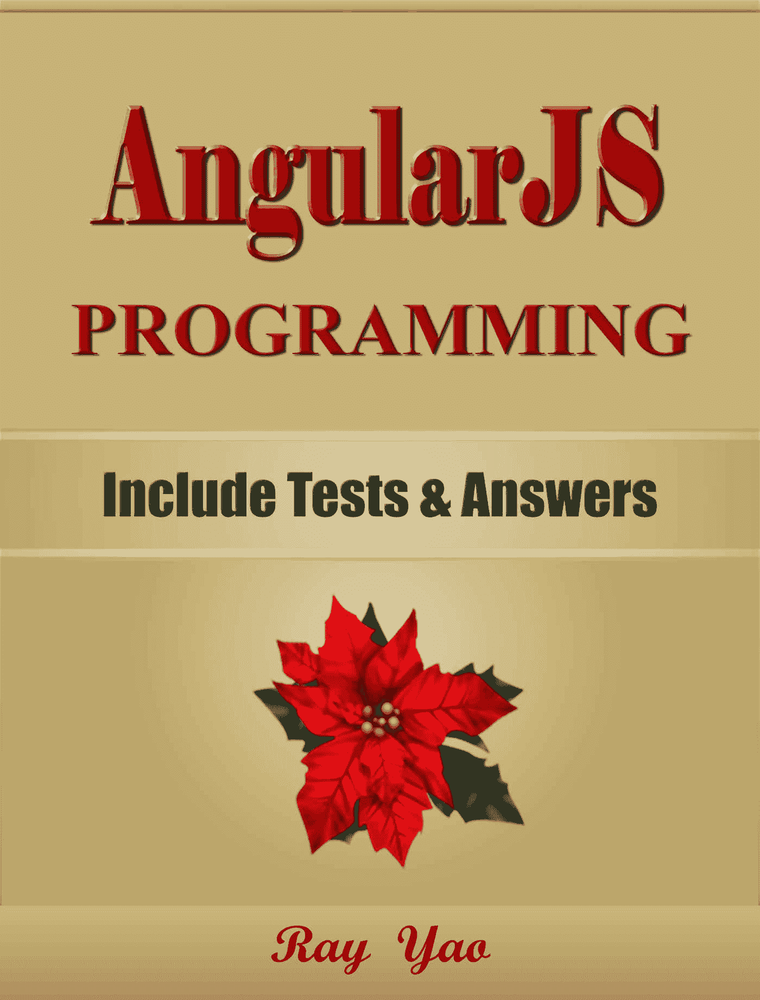

版权所有 © 2015 Ray Yao

保留所有权利

未经作者事先书面许可，本书的任何部分或全部均得以任何形式或通过任何电子、摄影或机械手段（包括复印、录制或任何信息存储或检索系统）进行复制或传输。保留所有权利！

## 关于作者

Ray Yao

- 美国 Zend 认证 PHP 工程师
- 美国 Sun 认证 JAVA 程序员
- 美国 Oracle 认证 SCWCD 开发者
- 美国 CompTIA 认证 A+ 专业人士
- 美国 Microsoft 认证 ASP. NET 专家
- 美国 Microsoft 认证 MCP 专业人士
- 美国 Microsoft 认证 TECHNOLOGY 专家
- 美国 CompTIA 认证 NETWORK+ 专业人士

[强烈推荐亚马逊上的计算机类书籍：](http://www.amazon.com/Ray-Yao/e/B00RG5FG6K/ref=ntt_dp_epwbk_0)

- [Linux 命令行](https://www.amazon.com/Ray-Yao/e/B00RG5FG6K/ref=dp_byline_cont_ebooks_1)
- [JAVA 编程](https://www.amazon.com/Ray-Yao/e/B00RG5FG6K/ref=dp_byline_cont_ebooks_1)
- [PHP 编程](https://www.amazon.com/Ray-Yao/e/B00RG5FG6K/ref=dp_byline_cont_ebooks_1)
- [JavaScript 编程](https://www.amazon.com/Ray-Yao/e/B00RG5FG6K/ref=dp_byline_cont_ebooks_1)
- [C++ 编程](https://www.amazon.com/Ray-Yao/e/B00RG5FG6K/ref=dp_byline_cont_ebooks_1)
- [AngularJS 编程](https://www.amazon.com/Ray-Yao/e/B00RG5FG6K/ref=dp_byline_cont_ebooks_1)
- [JQuery 编程](https://www.amazon.com/Ray-Yao/e/B00RG5FG6K/ref=dp_byline_cont_ebooks_1)
- [Python 编程](https://www.amazon.com/Ray-Yao/e/B00RG5FG6K/ref=dp_byline_cont_ebooks_1)
- [HTML CSS 编程](https://www.amazon.com/Ray-Yao/e/B00RG5FG6K/ref=dp_byline_cont_ebooks_1)
- [C# 编程](https://www.amazon.com/Ray-Yao/e/B00RG5FG6K/ref=dp_byline_cont_ebooks_1)
- [Visual Basic 编程](https://www.amazon.com/Ray-Yao/e/B00RG5FG6K/ref=dp_byline_cont_ebooks_1)
- [JavaScript 50 个实用程序](https://www.amazon.com/Ray-Yao/e/B00RG5FG6K/ref=dp_byline_cont_ebooks_1)

## 前言

“AngularJS 编程”涵盖了所有核心 AngularJS 知识。你可以快速轻松地学习 AngularJS 的完整基础技能。

本书包含了许多实战项目。你可以通过实战项目来学习 AngularJS 编码。

## 源代码下载

本书提供了源代码下载；你可以下载源代码以便更好地学习，或将源代码复制到你喜欢的编辑器中测试程序。源代码下载链接位于书末页。

从今天开始编码吧！

## 目录

### 第 1 小时：AngularJS 简介

- 什么是 AngularJS？
- 学习 AngularJS 的前提
- 下载 Angular JS
- AngularJS 的优势
- 第一个 AngularJS 脚本
- Hello World!
- data-ng-app
- 实战项目

### 第 2 小时：指令 (Directives)

- AngularJS 的指令
- App 指令
- Model 指令
- Bind 指令
- ng-model & ng-bind
- Init 指令
- Repeat 指令
- Valid 指令
- 检查地址
- 实战项目

### 第 3 小时：过滤器 (Filters)

- 什么是过滤器？
- 大写过滤器 (Uppercase)
- 小写过滤器 (Lowercase)
- 排序 (OrderBy)
- 货币过滤器 (Currency)
- 数组过滤器 (Array)
- 实战项目

### 第 4 小时：DOM 中的指令

- Show 指令
- Hide 指令
- Disable 指令
- Click 指令
- If 指令
- 实战项目

### 第 5 小时：事件 (Events)

- 事件
- 点击事件 (Click)
- 双击事件 (Double Click)
- 鼠标移动事件 (Mouse Move)
- 鼠标悬停事件 (Mouse Over)
- 鼠标离开事件 (Mouse Leave)
- 键释放事件 (Key Up)
- 键按下事件 (Key Down)
- 复制与剪切事件 (Copy & Cut)
- 实战项目

### 第 6 小时：表达式 (Expression)

- `{{ Expression }}`
- 字符串表达式
- 数字表达式
- 对象表达式
- 数组表达式
- 使用
- 实战项目

### 第 7 小时：控制器 (Controller) 与 作用域 (Scope)

- 什么是控制器？
- 如何定义控制器？
- 什么是作用域？
- MVC
- 实战项目

### 第 8 小时：模块 (Module) 与 API

- 什么是 AngularJS 模块？
- 什么是 AngularJS API？
- `uppercase()`
- `lowercase()`
- `isString()`
- `isNumber()`
- `isDate()`
- `isFunction()`
- `isElement()`
- `isObject()`
- `isDefined()`
- `isUndefined()`
- 实战项目

### 附录 1：Ajax 基础

- 什么是 Ajax？
- 设置服务器
- 如何使用 Ajax？
- 示例 1
- 示例 2
- 示例 3
- Ajax 图表

### 附录 2

[了解 AngularJS]
[Angular Service]
[Angular Http]
[Angular MySql]
[Angular Check]
[Angular Validation]
[Angular Include]

### 附录 3

[AngularJS] [测试题与答案]

#### 测试

#### 答案

## 源代码下载

# 第 1 小时

## AngularJS 简介

### 什么是 AngularJS？

`AngularJS` 是一个 `JavaScript` 框架。它可以使用 HTML 作为模板语言，并扩展 HTML 的句子结构，以清晰且简洁的方式描述应用程序的组件。

`AngularJS` 的语法看起来如下：

```
<div ng-app=" ">…… </div>
```

我们知道 `div` 是一个 html 标签，但 `ng-app` 是 Angular JS 的指令（directive），它像属性一样在 `div` 标签中使用。（稍后我们将讨论指令）

### 学习 AngularJS 的前提条件

在学习 Angular JS 之前，你应该具备 HTML 和 `JAVASCRIPT` 的基础知识，因为 `AngularJS` 是基于 HTML 和 JavaScript 的。你可以在附录 1 或附录 2 中复习 HTML、CSS 和 JavaScript。

（注意：本书的附录包含了“HTML、CSS 和 JavaScript 复习”）

### 下载 Angular JS

下载 `AngularJS` 并不是难事；你只需要访问 AngularJS 网站 [`AngularJS.org`](https://AngularJS.org) 并点击“Download”按钮。下载 AngularJS 文件 `angular.min.js` 后，你可以将其放在 `myFolder\js` 文件夹中（即将 html 文件和 JavaScript 文件放在 `myFolder` 文件夹，并将 `angular.min.js` 放在 `myFolder\js` 文件夹中），然后在 html 页面的 `head` 部分如下所示写入该 `angular.min.js` 文件的路径：

```html
<html
<head>
<script src="js\angular.min.js"></script>
………………………………………………………………………………………………………………………………………….......</head>
```

在上面的示例中，你可以看到 AngularJS 的路径如 `<script src="js\angular.min.js">`。现在 `AngularJS` 框架已添加到我们的应用程序中。因此从现在起我们可以使用 `AngularJS` 框架了。

### AngularJS 的优势

- `AngularJS` 具有与 HTML 绑定数据的能力。
- `AngularJS` 提供单页应用（SAP）。
- `Angular JS` 的 View 完全用 HTML 编写，Controller 用 JavaScript 编写，Model 用 `AngularJS` 编写。它是一个 MVC 框架。
- 你只需要几行代码就能实现更多功能。
- `AngularJS` 为代码和组件提供了重用性。

#### 第一个 AngularJS 脚本

#### 示例 1.1

打开记事本，按照如下所示编写代码。（图 1）

```html
<html
<script src="js\angular.min.js"></script>
<body>
<div ng-app="">
<p>在输入框中输入我的 id:</p>
<p><input type="text" ng-model="id" </p>
<br>
<h1>Welcome! {{id}}</h1>
</div>
</body>
</html>
```

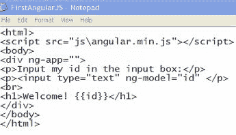

（图 1）

请将文件命名为 `FirstAngularJS.html` 并保存在 `myFolder` 中。注意：确保使用 `.html` 扩展名。

双击 `FirstAngularJS.html` 文件，浏览器将运行 `FirstAngularJS.html` 并显示输出。（图 2）（假设我输入的 id 为“168168”）

#### 输出：

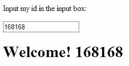

（图 2）

### 解释：

- “`<script src="js\angular.min.js"></script>`”将 AngularJS 框架添加到当前应用程序中。
- “`<div ng-app=""></div>`”表示你可以在这里编写 AngularJS 应用程序。
- “`ng-model="id"`”将来自 HTML 控件（input, select 和 textarea）的数据绑定到应用程序数据 `id`。
- `{{id}}` 与 `ng-model="id"` 中的 `id` 同步。
- `{{id}}`：显示 `id` 的值。

如果你想编辑代码，右键点击文件 `FirstAngularJS.html` > 打开方式 > 记事本。

### Hello World!

```
<html ng-app…></html>
```

`<html ng-app…></html>` 表示在标签内部使用了 AngularJS 脚本。

打开记事本，按照如下所示编写代码。

#### 示例 1.2

```html
<html ng-app>
<script src="js\angular.min.js"></script>
<body><br>
<p>
<label>Name:   </label>
<input type = "text" ng-model = "yourName" placeholder = "Please enter your name."><br>
<h1>Hello {{yourName}}</h1>
</p>
</body>
</html>
```

请将文件命名为 `Hello.html` 并保存在 `myFolder` 中。注意：确保使用 `.html` 扩展名。双击 `Hello.html` 文件，浏览器将运行 `Hello.html`，在文本字段输入“would”并查看输出。

#### 输出：

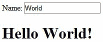

### 解释：

- `<html ng-app…></html>` 表示在标签内部使用了 AngularJS 脚本。
- “`<script src="js\angular.min.js"></script>`”将 AngularJS 框架添加到当前应用程序中。
- “`ng-model="yourName"`”将来自 HTML 控件的数据绑定到应用程序数据。
- `placeholder = "Please enter your name."` 指定了短提示。
- `{{yourName}}` 与 `ng-model="yourName"` 中的 `yourName` 同步。
- `{{yourName}}`：显示 `yourName` 的值。

## App Directive

```
ng-app= “ ”
```

`app` 指令定义了 AngularJS 应用程序的区域。`app` 指令的语法为 `ng-app = “ ”`；`ng` 是 AngularJS 的命名空间，`app` 是 Angular JS 的应用区域。

### 示例 2.1

```html
<!DOCTYPE html>
<html>
<head>
    <title>AngularJS 入门</title>
    <script src="js\angular.min.js"></script>
</head>
<body>
    <div ng-app=" "> 
        The AngularJSapplication has been started.
    </div>
</body>
</html>
```

### 输出:

The AngularJSapplication has been started.

### 解释:

在 `head` 部分（`<script src = "js\angular.min.js"> </script>`），加载了 AngularJS 框架，这意味着我们现在可以使用 AngularJS 框架了。

在 `body` 部分（`<div ng-app=" "> </div>`），可以在这里编写 AngularJS 应用程序。

在最后一个标签中（`</div>`），AngularJS 应用程序结束了。

## Model Directive

```
ng-model = “data”
```

`model` 指令用于将 HTML 控件（输入、复选框和选择等）的输入值绑定到应用程序数据。`ng-model = “data”` 是 `model` 指令的语法。让我们通过例子来更好地理解。

### 示例 2.2

```html
<!DOCTYPE html>
<html>
<head>
    <title>AngularJS 入门</title>
    <script src="js\angular.min.js"></script>
</head>
<body>
<div ng-app="">
<p>User Name: <br>
<input type="text" ng-model = "Username"></p>
</div>
</body>
</html>
```

### 输出:

Username:

### 解释:

`“ng-model = “Username””` 将 HTML 控件的输入值绑定到 `“Username”`。

现在你看不到结果，因为此程序缺少代码 `<p ng-bind="Username"></p>`。

## Bind Directive

```
<p>ng-bind = “data”</p>
```

`bind` 指令用于将数据值绑定到 html 元素 `<p>`；`bind` 指令的语法是 `<p>ng-bind = “data”</p>`。让我们通过例子来更好地理解。

### 示例 2.3

```html
<!DOCTYPE html>
<html>
<head>
    <title>AngularJS 入门</title>
    <script src="js\angular.min.js"></script>
</head>
<body>
<div ng-app="">
<p>User Name: <br>
<input type="text" ng-model = "Username"></p>
<p ng-bind="Username"></p>
</div>
</body>
</html>
```


打开记事本，并将上述代码以`.html`扩展名粘贴，在输入框中输入用户名“Ray Yao”。

### 输出:

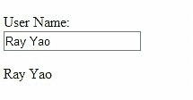

### 解释:

`“<p>ng-bind="Username"</p>”`将`“Username”`的值绑定到`<p></p>`标签，并“显示”它的值。

在上面的示例中（`<p ng-bind="Username"></p>`）可以更新`“Username”`的值并写入`<p></p>`标签中。

`<p>ng-bind="data"</p>`在指定的html元素`<p>`中“输出”`“data”`的值。

### ng-model & ng-bind

它们都使用“bind”。

(1)

`ng-model = “data”`：将来自Html控件（textarea、复选框、选择、input和单选等）的输入值绑定到`“data”`。

#### 例如:

`“ng-model = “Username””`将输入值绑定到`“Username”`。

（就像将输入值赋值给`“Username”`。）

(2)

`<p>ng-bind= “data”</p>`：将`“data”`绑定到html元素`<p></p>`。

#### 例如:

`<p ng-bind="Username"></p>`将数据`“Username”`绑定到`<p></p>`元素并显示其值。

（就像在`<p></p>`中显示`“Username”`的值。）

## Init Directive

| `ng-init = "data = ‘value’”` |

`init`指令用于用值初始化数据。`init`指令的语法为`ng-init = "data = ‘value’”`。让我们通过例子来更好地理解。

### 示例 2.4

```html
<!DOCTYPE html>
<html>
<head>
    <title>AngularJS 入门</title>
    <script src="js\angular.min.js"></script>
</head>
<body>
<div ng-app="" ng-init="Username= 'Andy Smith' ">
  <p>User Name: <input type="text" ng-model = "Username"></p>
</div>
</body>
</html>
```

打开记事本并将上述代码以`.html`扩展名粘贴。

### 输出:


### 解释:

`ng-init=Username= 'Andy Smith'`初始化了数据`“Username”`。

在上面的示例中（`<p ng-bind="Username"></p>`）AngularJS应用程序结束。

## Repeat Directive

| `ng-repeat = “data"` |

`repeat`指令用于遍历数组。`repeat`指令用于显示列表中的项。

### 示例 2.5

```html
<!DOCTYPE html>
<html>
<head>
    <title>AngularJS 入门</title>
    <script src="js\angular.min.js"></script>
</head>
<body>
<div ng-app="" ng-repeat="data">
    <p>{{data}}</p>
</div>
</body>
</html>
```

*(注：根据提供的上下文，示例 2.5 的源码存在碎片)*

## Valid Directive

| `ng-valid` |

`valid`指令用于检查AngularJS中的输入是否有效。

### 示例 2.6

```html
<!DOCTYPE html>
<html>
<head>
    <title>AngularJS 入门</title>
    <script src="js\angular.min.js"></script>
    <style>
        input.ng-valid {
            background-color: yellow;
        }
    </style>
</head>
<body>
<form>
    <p>Please enter number:</p>
    <input type="text" ng-model="psw" required>
</form>
</body>
</html>
```

### 输出:

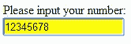

### 解释:

`input.ng-valid`在输入有效时更改背景。

## Check Email Address

| `$error.email` |

`$error.email`用于检查电子邮件格式是否有效。

### 示例 2.7

```html
<!DOCTYPE html>
<html ng-app="">
<head>
    <title>AngularJS 入门</title>
    <script src="js\angular.min.js"></script>
    <meta charset="utf-8">
</head>
<body>
<form name="iForm">
    <p>Please input your email address:</p>
    <input type="email" name="eMailAddr" ng-model="text">
    <div ng-show="iForm.eMailAddr.$error.email"> Invalid email address!</div>
</form>
</body>
</html>
```

### 输出:

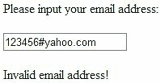

### 解释:

`“iForm.eMailAddr.$error.email”`在电子邮件格式无效时显示错误信息。

```html
<script src="js\angular.min.js"></script>
<body>
<div data-ng-app="" data-ng-init="colors=['Red','Yellow','Green','White','Black']">
  <p>显示颜色:</p>
  <ol type="1">
    <li data-ng-repeat="show in colors">
      {{ show }}
    </li>
  </ol>
</div>
</body>
</html>
```

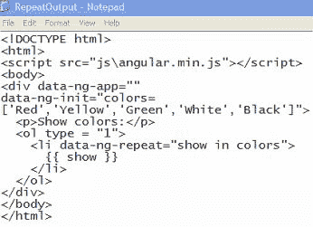

(图 1)

请将文件命名为`RepeatOutput.html`并保存到`myFolder`中。注意：请确保使用`.html`扩展名。

双击`RepeatOutput.html`文件，浏览器将运行`RepeatOutput.html`并查看输出。（图 2）

输出：（图 2）

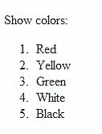

### 解释：

- `data-ng-app`几乎与`ng-app`一，但`data-ng-app`更适合HTML5。

- `<div data-ng-app="" > </div>`表示你可以在这里编写AngularJS。

- `data-ng-init`几乎与`ng-init`一，但`data-ng-init`更适合HTML5。

- `data-ng-init="colors=…"`使用某些值初始化数组`colors`。

- `data-ng-repeat = "show in colors`重复获取数组`colors`的值，并将所有数组值赋值给变量`show`。

- `{{ show }}`显示`show`的值。

# 第 3 小时

## 过滤器 (Filters)

### 什么是过滤器？

过滤器用于格式化数据的值。管道符号（`|`）表示使用了过滤器。正确的语法看起来所示：

| Value | filter |

让我们一个个理解过滤器。

### 大写过滤器 (Uppercase filter)

| Value | uppercase |

大写过滤器将文本转换为大写字母。假设用户写了小写文本（例如ray）或标题大小写（例如Ray）或混合大小写（例如rAy或RaY或rAY等），而你想要大写结果，那么你就必须使用大写过滤器。

#### 示例 3.1

```html
<!DOCTYPE html>
<html
<head>
    <title>AngularJSfor beginners</title>
<script src="js\angular.min.js"></script>
<meta http-equiv="Content-Type" content="text/html; charset=UTF-8" />
</head>
<body>
<h3>使用大写过滤器</h3>
<div ng-app="" ng-init="Username= 'ray' ">
<p>User Name：<input type="text" ng-model = "Username"></p>
<p style="color:red" ng-bind="Username | uppercase"></p>
</div>
</body>
</html>
```

输出：

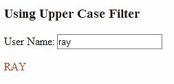

解释：

- `Username | uppercase`将`Username`的值更改为大写。

- 在上面的示例中，我设置了小写的默认值（ray），但结果变为了大写（RAY）。

### 小写过滤器 (Lowercase filter)

| Value | lowercase |

小写过滤器将文本转换为小写字母。假设用户写了大写文本（例如RAY YAO）或标题大小写（例如Ray Yao）或混合大小写（例如rAy或RaY或rAY等），而你想要小写结果，那么你就必须使用小写过滤器。

#### 示例 3.2

```html
<html
<head>
    <title>AngularJSfor beginners</title>
    <script src="js\angular.min.js"></script>
</head>
<body>
<h3>使用小写过滤器</h3>
<div ng-app="" ng-init="Username= 'Ray YAO' ">
<p>User Name：<input type="text" ng-model="Username"></p>
<p style="color:red" ng-bind="Username | lowercase"></p>
</div>
</body>
</html>
```

打开记事本并粘贴上述带有`.html`扩展名的代码。

输出：

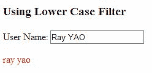

解释：

- `Username | lowercase`: 将`Username`的值更改为小写。

- 在上面的示例中，当我输入大写文本（Ray YAO）时，结果变成了小写（ray yao）。

### 排序过滤器 (OrderBy filter)

OrderBy过滤器用于按升序或降序显示值。`orderBy`的语法所示：

| Value | orderBy: ’value’ //用于升序 | Value | orderBy: ’-value’ //用于降序 |

让我们来看一个例子以便更好地理解。

#### 示例 3.3

```html
<!DOCTYPE html>
<html>
<head>
    <title>AngularJSfor beginners</title>
    <script src="js\angular.min.js"></script>
</head>
<body>
<h1>使用 OrderBy 过滤器</h1>
<div ng-app="" ng-init="StudentsResult=[{name: 'Tienq', marks:81}, {name: 'Svbrf', marks:70},    {name: 'Yaito', marks:90}, {name: 'Pewfn', marks:63}, {name: 'Riet', marks:98}]">
<table border="1" >
<tr><th>Student Name</th><th>Mathematics Result</th></tr>
<tr ng-repeat="x in StudentsResult | orderBy:'-marks' ">
<td ng-bind="x.name"></td>
<td ng-bind="x.marks"></td>
</tr>
</table>
</div>
</body>
</html>
```

输出：

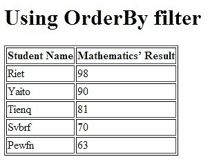

解释：

- `StudentsResult | orderBy:'-marks'`按降序显示`StudentsResult`的值。

- 你可以看到使用`orderBy:'-marks'`时最高分在顶部，最低在底部。

- 如果你想反转顺序，可以移除`-`符号。

#### 示例 3.4

```html
<!DOCTYPE html>
<html>
<head>
    <title>AngularJSfor beginners</title>
    <script src="js\angular.min.js"></script>
</head>
<body>
<h1>使用 OrderBy 过滤器</h1>
<div ng-app="" ng-init="StudentsResult=[{name: 'Tienq', marks:81}, {name: 'Svbrf', marks:70},    {name: 'Yaito', marks:90}, {name: 'Pewfn', marks:63}, {name: 'Riet', marks:98}]">
<table border="1" >
<tr><th>Student Name</th><th>Mathematics Result</th></tr>
<tr ng-repeat="x in StudentsResult | orderBy:'marks' ">
<td ng-bind="x.name"></td>
<td ng-bind="x.marks"></td>
</tr>
</table>
</div>
</body>
</html>
```

输出：

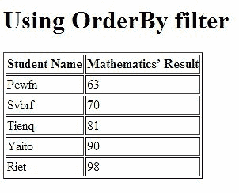

解释：

- `StudentsResult | orderBy: 'marks'`按升序显示`StudentsResult`的值。

### 货币过滤器 (Currency filter)

| Value | currency |

货币过滤器用于以货币格式显示结果。

#### 示例 3.5

```html
<!DOCTYPE html>
<html>
<head>
    <title>AngularJSfor beginners</title>
<script src="js\angular.min.js"></script>
<meta http-equiv="Content-Type" content="text/html; charset=UTF-8" />
</head>
<body>
<h1>使用货币过滤器</h1>
<div ng-app="" ng-init="Employees_Monthly_Salary=[{name: 'Jay', salary:8100}, {name: 'Sdwt', salary:7000},    {name: 'Hao', salary:9000}, {name: 'Luoe', salary:6300}, {name: 'Fin', salary:9800}]">
<table border="1" >
<tr><th>Employee Name</th><th>Employee Salary</th></tr>
<tr ng-repeat="x in Employees_Monthly_Salary ">
<td ng-bind="x.name"></td>
<td ng-bind="x.salary | currency "></td>
</tr>
</table>
</div>
</body>
</html>
```

打开记事本并粘贴上述带有`.html`扩展名的代码。

输出：

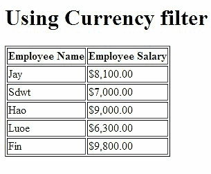

解释：

- `x.salary | currency`将工资转换为货币格式。

- 在上面的示例中，表格中有列，第一列是员工姓名，第二列是员工工资。工资列以货币格式显示工资。

### 数组过滤器 (Array filter)

| Array | filter:input |

`Array | filter:input`可以根据用户输入过滤数组元素。

#### 示例 3.6


```html
<!DOCTYPE html>
<html ng-app="">
<head>
<script src="js\angular.min.js"></script>
<meta charset="utf-8">
</head>
<body>
<div ng-init="students = // 定义一个数组 "students"
[{name:'Andy', age:'19'},
{name:'Rose', age:'18'},
{name:'Jony', age:'17'},
{name:'Judy', age:'16'},
{name:'Tomy', age:'15'},
{name:'Lily', age:'14'}]">
</div>
<table>
  <tr><th>Name</th><th>Age</th></tr>
  <tr ng-repeat="person in students | filter:myList">
 // 根据输入值过滤数组 "students"
    <td>{{person.name}}</td>
    <td>{{person.age}}</td>
  </tr>
</table>
<br><br>
<label>请输入上述姓名或年龄之一
<br><br>
<input ng-model="myList"></label> // 用户输入
</body>
</html>
```

请尝试在文本框中输入数字`18`。

输出：

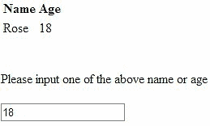

解释：

- `<div ng-init="students =…"` 定义了一个数组`students`。
- `person in students | filter:myList` 根据输入值`myList`过滤数组`students`。
- `<input ng-model="myList">` 接收用户输入并将输入值存储到`myList`。
- 当你在文本框中输入`18`时，输出显示`Rose 18`。

## 总结

在本章中，我们学习了什么是过滤器。以及不同类型的过滤器，如大写转换过滤器、小写过滤器、排序过滤器和货币过滤器。我尝试通过适当的示例、输出和解释来讲解本章的每个主题。

- `Value | uppercase`将值转换为大写字母。
- `Value | lowercase`将值转换为小写字母。
- `Value | orderBy: 'value'`按升序顺序显示值。
- `Value | orderBy: '-value'`按降序顺序显示值。
- `Value | currency`将值转换为货币格式。
- `Array | filter:input`可以根据用户输入过滤数组元素。

## 动手实践项目

### 大写转换过滤器

打开记事本，编写 AngularJS 代码：

```html
<!DOCTYPE html>
<script src="js\angular.min.js"></script>
<body>
<h4>Uppercase Filter</h4>
<div ng-app="">
<p>Book Name: </p>
<p><input type="text" ng-model = "Book"></p>
<h3><p ng-bind="Book|uppercase"></p></h3>
</div>
</body>
</html>
```

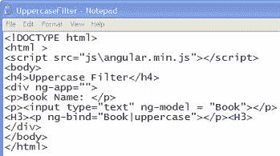

请将该文件保存为`UppercaseFilter.html`并保放在`myFolder`中。注意：确保使用`.html`扩展名。

双击`UppercaseFilter.html`文件，浏览器将运行该文件，在文本框中输入书名"JavaScript in 8 Hours"，查看输出。

输出：

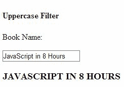

### 解释：

`<p ng-bind="Book|uppercase"></p>`将`Book`的值转换为大写。

# 第 4 小

## DOM 中的指令

### Show 指令

`<p ng-show="true"> visible.</p><p ng-show="false">invisible.</p>`

Show 指令用于显示或隐藏 HTML 中`<p>`元素中的文本。

如果`ng-show`为 true，则将显示文本"visible."。

如果`ng-show`为 false，则将隐藏文本"invisible."。

#### 示例 4.1

```html
<!DOCTYPE html>
<html>
<head>
    <title>AngularJS for beginners</title>
    <script src="js/angular.min.js"></script>
</head>
<body>
<h3>Using Show directive</h3>
<div ng-app="" >
<input type="checkbox" ng-model="showHideDiv">Show Div
<div ng-show="showHideDiv" style="background-color:yellow;height:50px;">
<p>I am a div</p>
<p>I appear when the check box is checked.</p>
</div>
</div>
</body>
</html>
```

输出：

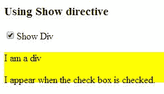

### 解释：

`ng-model="showHideDiv"`将复选框的值与`showHideDiv`绑定。

`ng-show="showHideDiv"`当`showHideDiv`的值为 true 时显示文本。

在上面的示例中，页面首次加载时，div（页面的黄色区域）不显示，但当我勾选复选框（show Div）时，`showHideDiv`的值为 true；div（页面的黄色区域）就出现了。

### Hide 指令

`<p ng-hide="true"> invisible.</p><p ng-hide="false">visible.</p>`

Hide 指令用于隐藏或显示 HTML 中`<p>`元素中的文本。

如果`ng-hide`为 true，则将隐藏文本"invisible."。

如果`ng-hide`为 false，则将显示文本"visible."。

#### 示例 4.2

```html
<!DOCTYPE html>
<html>
<head>
    <title>AngularJSfor beginners</title>
<script src="js\angular.min.js"></script>
<meta http-equiv="Content-Type" content="text/html; charset=UTF-8" />
</head>
<body>
<h3>Using Hide directive</h3>
<div ng-app="" >
<input type="checkbox" ng-model="HideShowDiv">Hide Div
<div ng-hide="HideShowDiv" style="background-color:pink;height:50px;">
<p>I am a div</p>
<p>I will disappeared when the check box is checked.</p>
</div>
</div>
</body>
</html>
```

打开记事本并粘贴上述代码，使用`.html`扩展名。

输出：

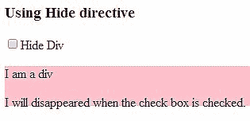

请勾选复选框查看结果。

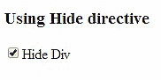

### 解释：

`ng-model="showHideDiv"`将复选框的值与`showHideDiv`绑定。

`ng-hide="showHideDiv"`当`showHideDiv`的值为 true 时隐藏文本。

在上面的示例中，页面首次加载时，div（页面的粉色区域）显示。

但当我点击复选框（Hide Div）时，`showHideDiv`的值为 true；div（页面的粉色区域）消失了。

### Disable 指令

`<input type="button" ng-disabled=true value="myButton"><input type="button" ng-disabled=false value="myButton">`

Disable 指令用于禁用或启用元素。

如果`ng-disabled`为 true，元素将变为禁用。

如果`ng-disabled`为 false，元素将变为启用。

#### 示例 4.3

```html
<!DOCTYPE html>
<html>
<head>
    <title>AngularJS for beginners</title>
    <script src="js/angular.min.js"></script>
</head>
<body>
<h3>Using Show directive</h3>
<div ng-app="" >
<input type="button" ng-disabled=true value="myButton">
<input type="button" ng-disabled=false value="myButton">
</div>
</body>
</html>
```

输出：

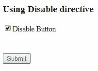

### 解释：

`ng-model="showHideDiv"`将复选框的值与`showHideDiv`绑定。

`ng-show="showHideDiv"`当`showHideDiv`的值为 true 时显示文本。

在上面的示例中，页面首次加载时，div（页面的黄色区域）不显示，但当我勾选复选框（show Div）时，`showHideDiv`的值为 true；div（页面的黄色区域）就出现了。

### Click 指令

`ng-click="expression"`

Click 指令用于定义事件。

`ng-click="expression"`评估表达式。

#### 示例 4.4

```html
<!DOCTYPE html>
<html>
<head>
    <title>AngularJS for beginners</title>
    <script src="js/angular.min.js"></script>
</head>
<body>
<h3>Using Click directive</h3>
<div ng-app="" ng-init="result=0">
<button ng-click="result=result+100">
Click Here!
</button>
<H1><p ng-bind="result"></p></H1>
</div>
</body>
</html>
```

输出：

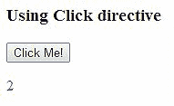

### 解释：

`ng-click="result=result+100"`更新`result`的值。

`ng-bind="result"`显示`result`的值。

### If 指令

`ng-if="condition"`

If 指令用于在 Dom 中添加或移除元素。

如果`ng-if`为 true，元素会被添加。

如果`ng-if`为 false，元素会被移除。

#### 示例 4.5

```html
<!DOCTYPE html>
<html>
<head>
    <title>AngularJS for beginners</title>
    <script src="js/angular.min.js"></script>
</head>
<body ng-app align="center">
<input type="checkbox" ng-model="result">
<div ng-if="result">
<p>当你勾选选框时，
文本将显示。</p>
<p>当你取消勾选框时，
文本将隐藏。</p>
</div>
</body>
</html>
```

输出：

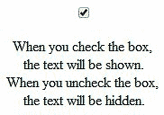

### 解释：

`ng-if="result"`检查`result`的真假值。

## 动手实践项目

### 点击事件

打开记事本，编写 AngularJS 代码：

```html
<!DOCTYPE html>
<html>
<head>
<script src="js\angular.min.js"></script>
</head>
<body>
<br><br>Click Directive<br><br>
<div ng-app="" ng-init="result=0">
<button ng-click="result=result+100">
Click Here!
</button>
<H1><p ng-bind="result"></p></H1>
</div>
</body>
</html>
```

双击`ClickEvent.html`文件，浏览器将运行`ClickEvent.html`，点击按钮`Click Here!`并查看输出。

输出：

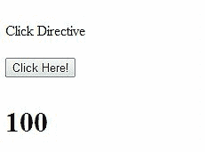

### 解释：

`ng-click="result=result+100"`在点击按钮时评估表达式。

# 第 5 小时：事件

## 事件

事件与不同的 HTML 元素关联。例如，点击事件（click event）与按钮元素关联；同样，按键事件（keypress event）与文本框或文本区域元素关联。AngularJS 多个与 HTML 控制关联的事件。

### 点击事件

`ng-click = "expression"`

`ng-click = "expression"`定义了一个点击事件。当按钮被点击时，会触发事件并评估表达式。点击事件通常作用于按钮。

#### 示例 5.1

```html
<!DOCTYPE html>
<html>
<head>
<title>AngularJS 入门</title>
    <script src="js\angular.min.js"></script>
</head>
<body>
<h3>使用点击事件相加两个数字</h3>
<div ng-app="" ng-init="firstNumber=47; secondNumber=23">
<p>第一个数字：  <input type="number" ng-model = "firstNumber"></p>
<p>第二个数字： <input type="number" ng-model = "secondNumber"></p>
<button ng-click="Result=firstNumber + secondNumber"> Add Numbers </button>
<p>结果:<p style="font-weight:bold; color:blue" ng-bind = "Result"> </p></p>
</div>
</body>
</html>
```

打开记事本，并将上述代码保存为 .html 扩展名的文件。

输出：

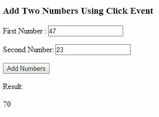

解释：

`<button ng-click="Result=firstNumber + secondNumber"> Add Numbers </button>`：当按钮被点击时，会触发事件。`firstNumber`加上`secondNumber`，并将结果赋值给`Result`。

在上面的示例中，页面首次加载时，第一个文本框显示数字`47`，第二个文本框显示数字`23`，但没有结果。（注意：这些数字是在`ng-init`指令中初始化的，但你也可以在两个文本框中输入自己的数字）。当我点击按钮（Add Numbers）时，Result 区域显示的结果为`70`。

### 双击事件

`ng-dblclick = "expression"`

`ng-click = "expression"`定义了一个双击事件。当按钮被双击时，会触发事件并评估表达式。

双击事件通常作用于按钮。

#### 示例 5.2

```html
<!DOCTYPE html>
<html>
<head>
    <title>AngularJS 入门</title>
    <script src="js/angular.min.js"></script>
</head>
<body>
<h4>使用双击事件相加两个数字</h4>
<div ng-app="" ng-init="firstNumber=26;SecondNumber=89">
<p>第一个数字：  &nbsp;&nbsp;&nbsp; <input type="number" ng-model="firstNumber"></p>
<p>第二个数字： <input type="number" ng-model="SecondNumber"></p>
<button ng-dblclick="Result=firstNumber + SecondNumber">Double Click</button>
<p>结果:<p style="font-weight:bold;color:blue" ng-bind="Result"> </p>
</div>
</body>
</html>
```

打开记事本，并将上述代码保存为 .html 扩展名的文件。

输出：

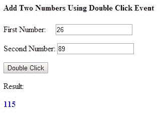

解释：

`<button ng-dblclick="Result=firstNumber + SecondNumber">  Add Numbers  </button>`：当按钮被双击时，会触发事件。`firstNumber`加上`SecondNumber`，并将结果赋值给`Result`。


在上面的示例中，页面首次加载时，第一个文本框显示数字`26`，第二个文本框显示数字`89`，但没有结果。当我双击按钮（`Add Numbers`）时，`Result`区域显示的结果为`115`。

### 鼠标移动事件

| `ng-mousemove = “expression"` |

`ng-mousemove = “expression"`定义了一个鼠标移动事件。当鼠标移动时，会触发事件并评估表达式。

鼠标移动事件通常作用于`div`、`body`以及特定区域或元素。

#### 示例 5.3

```html
<!doctype html>
<html>
<head>
<script src="js\angular.min.js">
</script>
</head>
<body ng-app="">
<br><br>
<textarea ng-mousemove="count = count + 1"
ng-init="count=0">
Here is a textarea
</textarea>
<br><br>
<h2>count: {{count}}</h2>
</body>
</body>
</html>
```

（假设你在文本区域上移动了鼠标`20`次。）

输出：

| Here is a textarea. |

count: 20

解释：

`ng-mousemove="count = count + 1"`：当鼠标在文本区域上移动时，`count`增加`1`。

`ng-init="count=0"`将`count`的值初始化为`0`。

`{{count}}`显示`count`的值。

`count : 20`表示移动了`20`次。

### 鼠标悬入事件

| `ng-mouseover = “expression"` |

`ng-mouseover = “expression"`定义了一个鼠标悬入事件。当鼠标悬停在某处时，会触发事件并评估表达式。

鼠标悬入事件通常作用于`div`、`body`以及特定区域或元素。

#### 示例 5.4

```html
<!doctype html>
<html>
<head>
<script src="js\angular.min.js"></script>
</head>
<body ng-app="">
<br><br>
<textarea ng-mousemove="count = count + 1"
ng-init="count=0">
Here is a textarea
</textarea>
<br><br>
<h2>count: {{count}}</h2>
</body>
</html>
```

（假设你向文本区域上悬停了`2`次鼠标。）

输出：

| Here is a textarea. |

count: 2

解释：

`ng-mousemove="count = count + 1"`：当鼠标在文本区域上移动时，`count`增加`1`。

`ng-init="count=0"`将`count`的值初始化为`0`。

`{{count}}`显示`count`的值。

`count : 2`表示悬停了`2`次。

### 鼠标移出事件

| `ng-mouseleave = “expression"` |

`ng-mouseleave = “expression"`定义了一个鼠标移出事件。当鼠标移出某处时，会触发事件并评估表达式。

鼠标移出事件通常作用于`div`、`body`以及特定区域。

#### 示例 5.5

```html
<!doctype html>
<html>
<head>
<script src="js\angular.min.js"></script>
</head>
<body ng-app="">
<br><br>
<textarea ng-mousemove="count = count + 1"
ng-init="count=0">
Here is a textarea
</textarea>
<br><br>
<h2>count: {{count}}</h2>
</body>
</html>
```

（假设你从文本区域上移出了`10`次鼠标。）

输出：

| Here is a textarea. |

count: 10

解释：

`ng-mousemove="count = count + 1"`：当鼠标在文本区域上移动时，`count`增加`1`。

`ng-init="count=0"`将`count`的值初始化为`0`。

`{{count}}`显示`count`的值。

`count : 10`表示移出了`10`次。

### 按键释放事件

| `ng-keyup = “expression"` |

`ng-keyup = “expression"`定义了一个按键释放事件。当按键释放时，会触发事件并评估表达式。

按键释放事件通常作用于文本框或文本区域。

#### 示例 5.6

```html
<!doctype html>
<html>
<head>
<script src="js\angular.min.js"></script>
</head>
<body ng-app="">
<br><br>
<textarea ng-keyup="count = count + 1"
ng-init="count=0">
Here is a textarea
</textarea>
<br><br>
<h2>count: {{count}}</h2>
</body>
</html>
```

（假设你在文本区域中输入了`123456`。）

输出：

| Here is a textarea.123456 |

count: 6

解释：

`ng-keyup="count = count + 1"`：当在文本区域上释放按键时，`count`增加`1`。

`ng-init="count=0"`将`count`的值初始化为`0`。

`{{count}}`显示`count`的值。

`count : 6`表示释放了`6`次按键。

### 按键按下事件

| `ng-keydown = “expression"` |

`ng-keydown = “expression"`定义了一个按键按下事件。当按键按下时，会触发事件并评估表达式。

按键按下事件通常作用于文本框或文本区域。

#### 示例 5.7

```html
<!doctype html>
<html>
<head>
<script src="js\angular.min.js"></script>
</head>
<body ng-app="">
<br><br>
<textarea ng-keydown="count = count + 1"
ng-init="count=0">
Here is a textarea
</textarea>
<br><br>
<h2>count: {{count}}</h2>
</body>
</html>
```

（假设你在文本区域中输入了`123456`。）

输出：

| Here is a textarea.123456 |

count: 6

解释：

`ng-keydown="count = count + 1"`：当在文本区域上按下按键时，`count`增加`1`。

`ng-init="count=0"`将`count`的值初始化为`0`。

`{{count}}`显示`count`的值。

`count : 6`表示按下了`6`次按键。

### 复制与剪切事件

| `ng-copy = "result1=true"` `ng-cut = "result2=true"` |

当复制指定的文本时，结果`1`将为`true`。

当剪切指定的文本时，结果`2`将为`true`。

#### 示例 5.8

```html
<!doctype html> 
<html ng-app> 
<head> 
<script src="js\angular.min.js"></script> 
<meta charset="utf-8"> 
</head> 
<body>
<br>
<input ng-copy= "result1=true" ng-init= "result1=false; value1='please copy me'" ng-model= "value1" > 
copy status: {{result1}}</br><br>
<input ng-cut= "result2=true" ng-init= "result2=false; value2='please cut me'" ng-model= "value2" > 
cut status: {{result2}} 
</body> 
</html> 
```

#### 输出:

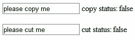

#### 解释:

- `ng-copy= "result1=true"` : 当复制指定的文本时，结果`1`将为`true`。

- `ng-cut= "result2=true"` : 当剪切指定的文本时，结果`2`将为`true`。

- `{{result1}}`将显示`true`或`false`。

- `{{result2}}`将显示`true`或`false`。

## 总结

在本章中，我们学习了不同的事件，如点击事件、双击事件、鼠标移动事件、鼠标悬入事件、鼠标移出事件、按键释放事件和按下事件。

- `ng-click`定义了一个 AngularJS 点击事件。

- `ng-dblclick`定义了一个 AngularJS 双击事件。

- `ng-mousemove`定义了一个 AngularJS 鼠标移动事件。

- `ng-mouseover`定义了一个 AngularJS 鼠标悬入事件。

- `ng-mouseleave`定义了一个 AngularJS 鼠标移出事件。

- `ng-keyup`定义了一个 AngularJS 按键释放事件。

- `ng-keydown`定义了一个 AngularJS 按按下事件。

- `ng-copy= "result1=true"` : 当复制指定的文本时，结果`1`将为`true`。

- `ng-cut= "result2=true"` : 当剪切指定的文本时，结果`2`将为`true`。

## 实操项目

### 鼠标悬入事件

打开记事本，编写 AngularJS 代码：

```html
<!doctype html>
<html <script src="js\angular.min.js"></script>
<body ng-app="">
<br><br>
<textarea ng-mouseover="count = count + 1" ng-init="count=0">
鼠标悬停在这里
</textarea>
<br><br>
<h2>count: {{count}}</h2>
</body>
</html>
```

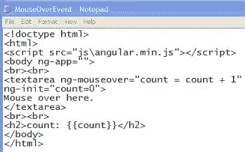

请将文件保存为`MouseOverEvent.html`并存于`myFolder`中，运行`MouseOverEvent.html`文件，将鼠标悬停在文本框上`8`次，并查看输出。

输出:

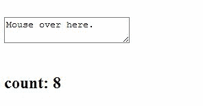

#### 解释:

`ng-mouseover="count = count + 1"`当鼠标移动到文本区域上方时求值表达式。

# 第 6 章

## 表达式

`{{ Expression }}`

`{{Expression}}`用于将值绑定到 HTML 元素并显示该值。它的作用与`ng-bind`指令相同。`{{Expression}}`写在两个大括号内。`{{expression}}`基本上是纯 JavaScript 表达式。表达式有多种，让我们逐来看。

### 字符串表达式

我们知道字符串是字符的集合。在 AngularJS 中，字符串表达式的形式如下。

| `<element> {{First String + Second String}} </element>` |

#### 示例 6.1

```html
<!DOCTYPE html>
<html>
<head>
    <title>初学者 AngularJS 指南</title>
    <script src="js/angular.min.js"></script>
</head>
<body>
<h4>使用字符串表达式组合两个字符串</h4>
<div ng-app="" >
第一个字符串 &nbsp;&nbsp;&nbsp;: <input type="text" ng-model="firstString"/><br><br>
第二个字符串: <input ng-model="secondString"/><br><br>
结果字符串:<p style="color:blue;font-weight:bold;">{{firstString +" "+secondString}}</p>
</div>
</body>
</html>
```

输出:

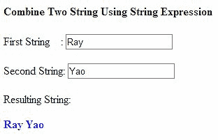

解释:

`{{firstString +" "+secondString}}`将两个字符串连接在一起。

`{{ expression}}`显示表达式的值。

在上面的示例中，第一个文本框中写了`Ray`，第二个文本框中写了`Yao`，但在结果字符串区域，由于使用了字符串表达式`{{ }}`，`Ray`字符串和`Yao`字符串被组合在了一起。注意：`+`号用于字符串拼接。

### 数字表达式

在 AngularJS 中，你可以使用数字表达式执行不同的数学运算。

| `<element> {{First Number + Second Number}} </element>` |

#### 示例 6.2

```html
<!DOCTYPE html>
<html>
<head>
    <title>初学者 AngularJS 指南</title>
    <script src="js/angular.min.js"></script>
</head>
<body>
<h4>使用数字表达式相乘两个数字</h4>
<div ng-app="" ng-init="firstNumber=9;secondNumber=6">
第一个数字 &nbsp;&nbsp;&nbsp;: <input type="text" ng-model="firstNumber"/><br><br>
第二个数字: <input ng-model="secondNumber"/><br><br>
结果字符串:<p style="color:blue;font-weight:bold;">{{firstNumber * secondNumber}}</p>
</div>
</body>
</html>
```

输出:

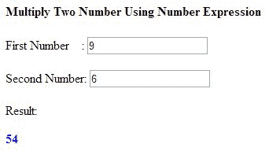

解释:

`{{firstNumber * secondNumber}}`乘以`firstNumber`和`secondNumber`。

`{{ expression}}`显示表达式的值。

在上面的示例中，第一个文本框中写了`9`，第二个文本框中写了`6`，但在结果字符串区域，显示了计算结果。

### 对象表达式

AngularJS 的对象表达式的形式如下。

| `<element> {{First Number + Second Number}} </element>` |

#### 示例 6.3

```html
<!DOCTYPE html>
<html>
<head>
<title>初学者 AngularJS 指南</title>
<script src="js/angular.min.js"></script>
</head>
<body>
<h4>对象表达式</h4>
<div ng-app="" ng-init="name='John'; age=25">
<p>姓名: {{name}}</p>
<p>年龄: {{age}}</p>
<p>信息: {{name + ' is ' + age + ' years old'}}</p>
</div>
</body>
</html>
```

输出:

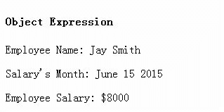

解释:

`{{name + ' is ' + age + ' years old'}}`将字符串和变量连接起来。

`{{ expression}}`显示表达式的值。

### 数组表达式

AngularJS 的数组表达式的形式如下。

| `<element> {{First Number + Second Number}} </element>` |

#### 示例 6.4

```html
<!DOCTYPE html>
<html>
<head>
<title>初学者 AngularJS 指南</title>
<script src="js/angular.min.js"></script>
</head>
<body>
<h4>数组表达式</h4>
<div ng-app="" ng-init="colors=['Red', 'Green', 'Blue']">
<ul>
<li ng-repeat="color in colors">{{color}}</li>
</ul>
</div>
</body>
</html>
```

输出:

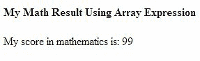

解释:

`ng-repeat`用于遍历数组。

### 示例 6.5


```html
<!doctype html>
<html ng-app>
<head>
<script src="js\angular.min.js"></script>
<meta charset="utf-8">
</head>
<body>
<h3>价格计算器</h3>
价格 1: <input type="number" ng-model="price1"><br>
价格 2: <input type="number" ng-model="price2"><br>
价格 3: <input type="number" ng-model="price3"><br>
<p><b>总和：</b> {{price1+price2+price3}}</p>
</body>
</html>
```

输出：

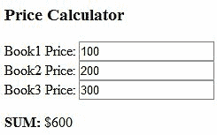

### 解释

`{{expression}}` 可以计算表达式的值。

`{{price1+price2+price3}}` 可以计算用户输入的所有值并显示结果。

将文件保存为 `ExpressionSample.html` 并放在 `myFolder` 中。双击 `ExpressionSample.html` 文件，查看输出。

输出：

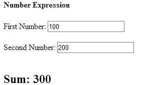

### 解释

`{{firstNumber + secondNumber}}` 显示了 `firstNumber` 和 `secondNumber` 的和。

# 第 7 小节

## Controller & Scope

### 什么是 Controller？

Controller 基本上是一个控制应用程序数据流的 JavaScript 对象。因此，AngularJS 应用是由 `Controller` 控制的。

### 如何定义 Controller？

使用 `ng-controller` 指令来定义 `Controller`。我们知道 `Controller` 是一个包含 JavaScript 函数和属性的 JavaScript 对象。`Controller` 的语法如下：

`<div ng-app="" ng-controller="controllerName">`

### 示例 7.1

```html
<html
<script src="js\angular.min.js"></script>
<body>
<div ng-app="Calculation" ng-controller="myController">
First Number: <input type="number" ng-model="firstNumber"><br>
Second Number: <input type="number" ng-model="secondNumber"><br>
<br>
Sum: {{firstNumber + secondNumber}}
</div>
<script>
var app = angular.module('Calculation', [ ]);
app.controller('myController', function($scope) {
    $scope.firstNumber = 4;
    $scope.secondNumber = 8;
});
</script>
</body>
</html>
```

输出：

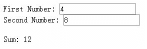

### 解释

- `ng-controller="myController"` 定义了一个控制器。
- `app = angular.module()` 创建了一个新模块。
- `app.controller()` 将控制器的构造函数添加到模块中。
- `function($scope)` 定义了一个构造函数，同时也定义了一个对象 `$scope`。当页面加载时，该函数将运行。
- `$scope.property = value` 将值赋值给 `$scope` 对象的属性。

在上面的示例中，当页面第一次加载时，你会看到两个带有不同数字的框，分别是 4 和 8；结果区域显示结果为 12。

`angular.module()`：AngularJS 模块是应用程序各个部分的集合，例如控制器、服务、过滤器、指令等。一个 AngularJS 模块定义了一个应用程序，这将在后面的章节中详细讨论。

### 什么是 Scope？

Scope 是一个包含模型数据的 JavaScript 对象。

`function ($scope) { }`

`$scope` 是 JavaScript 函数的参数，由控制器调用。让我们通过一个例子来理解。

### 示例 7.2

```javascript
<script>
function ($scope) {
    $scope.firstNumber = 23;
    $scope.secondNumber = 63;
}
</script>
```

### 解释

在上面的示例中，`$scope` 是函数 `function ($scope) { }` 的参数。`$scope` 是 AngularJS 中的一个对象。

`$scope.firstNumber` 和 `$scope.secondNumber` 是 HTML 中使用的模型。模型数据通过 `$scope` 对象访问。我们使用以下公式给模型赋值：`$scope.property = value`。

### 例如

```javascript
$scope.firstNumber = 23;
$scope.secondNumber = 63;
```

## MVC & Scope

### 什么是 MVC？

MVC 代表 Model（模型）、View（视图）和 Controller（控制器）。

- Model（模型）直接管理应用程序的数据、逻辑和规则。
- View（视图）显示数据。
- Controller（控制器）处理输入。

在上面的示例中：

- `$scope.firstNumber` 和 `$scope.secondNumber` 是模型。
- `<p ng-bind = "firstNumber + secondNumber"></p>` 是 HTML 中使用的视图。
- `ng-controller="myController"` 定义了一个控制器。

控制器与视图之间的通信被称为 `Scope`，因此我们可以说 `Scope` 就像连接控制器和视图的桥梁。

### 模块基础

`app = angular.module()`

`app = angular.module()` 创建了一个新模块。

### 示例 7.3

```html
<!DOCTYPE html>
<html>
<head>
<meta charset="utf-8">
<script src="js\angular.min.js"></script>
</head>
<body>
<div ng-app="myFruit" ng-controller="iController">
<p>Please select your favorite fruit.</p>
<select ng-model="choosedFruit" ng-options="obj.fruit for obj in fruits" size = "4">
</select>
<h3>Your favorite fruit is: {{choosedFruit.fruit}}</h3>
<h3>The color is: {{choosedFruit.color}}</h3>
</div>
<script>
var app = angular.module('myFruit', [ ]);
app.controller('iController', function($scope) {
    $scope.fruits = [
    {fruit : "Apple", color : "Red"},
    {fruit : "Orange", color : "Golden"},
    {fruit : "Banana", color : "Green"}
];
});
</script>
</body>
</html>
```

输出：

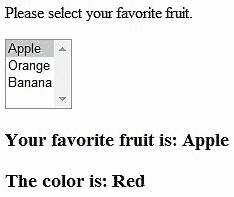

### 解释

- `<div ng-app="myFruit" ng-controller="iController">` 定义了一个控制器 `iController`。
- `<select ng-model="choosedFruit" ng-options="obj.fruit for obj in fruits" size = "4">` 创建了一个选择框。
- `ng-model="choosedFruit"` 绑定选中的水果。
- `ng-options="obj.fruit for obj in fruits"` 遍历水果。
- `{{choosedFruit.fruit}}` 显示选中的水果名称。
- `{{choosedFruit.color}}` 显示颜色。
- `var app = angular.module('myFruit', [ ]);` 创建了一个新模块。
- `app.controller('iController', function($scope)` 定义了控制器函数。
- `$scope.fruits = [...]` 存储数组。

## 总结

在本章中，我们学习了什么是控制器、如何定义控制器以及 MVC 和 Scope。

`ng-controller="myController"` 定义了一个控制器。

`app = angular.module()` 创建了一个新模块。

`app.controller()` 将控制器的构造函数添加到模块中。

`function($scope)` 定义了一个构造函数，同时也定义了一个对象 `$scope`。

`$scope.property = value` 将值赋值给 `$scope` 对象的属性。

`<p ng-bind = "value"></p>` 显示数据。

## 动手项目

控制器示例

打开记事本，编写 AngularJS 代码（图 1）：

```html
<!DOCTYPE html>
<html>
<head>
<meta charset="utf-8">
<script src="js\angular.min.js"></script>
</head>
<body>
<div ng-app="myApplication" ng-controller="myController">
First Text:
<p><textarea ng-model="firstText"></textarea></p>
Second Text:
<p><textarea ng-model="SecondText"></textarea></p>
<br>
Connected Text:
<h4><p>{{firstText + " " + SecondText}}</p></h4>
</div>
<script>
var app = angular.module('myApplication', [ ]);
app.controller('myController', function($scope) {
    $scope.firstText = "JavaScript";
    $scope.SecondText = "in 8 Hours";
});
</script>
</body>
</html>
```

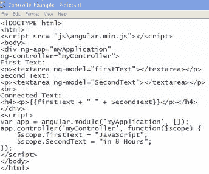

(图 1)

文件夹中的 `ControllerSample.html`。双击 `ControllerSample.html` 文件，输入并查看输出。（图 2）。

输出：（图 2 所示）：

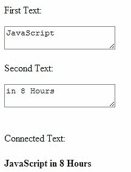

# 第 8 小节

## Module & API

### 什么是 AngularJS 模块？

AngularJS 模块是应用程序各个部分的集合，例如控制器、服务、过滤器、指令等。一个 AngularJS 模块定义了一个应用程序。

创建模块的语法如下：

`var myModule = angular.module("myApplication", [ ]);`

### 示例 8.1

```html
<html>
<script src="js\angular.min.js"></script>
<body>
<div ng-app="myApplication" ng-controller="myController">
{{ firstNum + lastNum }}
</div>
<script>
var myModule = angular.module("myApplication", [ ]);
myModule.controller("myController", function($scope) {
    $scope.firstNum = 100;
});
</script>
</body>
</html>
```

```javascript
$scope.lastNum = 200;
});
```

`</script>`

`</body>`

`</html>`

### 输出: 300

### 解释

`<div ng-app="myApplication" ng-controller="myController">` 表示此应用程序 `myApplication` 有一个控制器 `myController`。

`{{ firstNum + lastNum }}` 显示 `firstNum` 加上 `lastNum` 的结果。

`var myModule = angular.module("myApplication", [ ])` 创建了一个带有 `myApplication` 的新模块 `myModule`。

`[ ]` 参数可以定义依赖模块。

`myModule.controller("myController", function($scope)` 使用 `controller( )` 方法将控制器的构造函数添加到模块中，使 `myController` 属于 `myModule`。

`$scope` 被为一个对象。

`$scope.firstNum` 的值为 100。

`$scope.lastNum` 的值为 200。

因此，`{{ firstNum + lastNum }}` 的结果是 300。

### 什么是 AngularJS API？

API 意味着应用程序编程接口。

API 上有 10 个基础函数：

- `angular.uppercase()`
- `angular.lowercase()`
- `angular.isString()`
- `angular.isNumber()`
- ……

`uppercase( )`

`angular.uppercase( )` 将字符串转换为大写。

### 示例 8.2

```html
<html>
<script src= "js\angular.min.js"></script>
<body>
<div ng-app="myApplication" ng-controller="myController">
<p>{{ text1 }}</p>
<p>{{ text2 }}</p>
</div>
<script>
var myModule = angular.module('myApplication', [ ]);
myModule.controller('myController', function($scope) {
$scope.text1 = "javascript";
$scope.text2 = angular.uppercase($scope.text1);
});
</script>
</body>
</html>
```

### 输出

javascript

JAVASCRIPT

### 解释

`var myModule = angular.module('myApplication', [ ])` 创建了一个带有 `myApplication` 的新模块 `myModule`。

`myModule.controller('myController', function($scope)` 使用 `controller( )` 方法将控制器的构造函数添加到模块中，使 `myController` 属于 `myModule`。

`$scope` 被为一个对象。

`$scope.text2 = angular.uppercase($scope.text1)` 将 `text1` 转换为大写。

`lowercase( )`

`angular.lowercase( )` 将字符串转换为小写。

### 示例 8.3

```html
<html>
<script src= "js\angular.min.js"></script>
<body>
<div ng-app="myApplication" ng-controller="myController">
<p>{{ text1 }}</p>
<p>{{ text2 }}</p>
</div>
<script>
var myModule = angular.module('myApplication', [ ]);
myModule.controller('myController', function($scope) {
$scope.text1 = "JAVASCRIPT";
$scope.text2 = angular.lowercase($scope.text1);
});
</script>
</body>
</html>
```

### 输出

JAVASCRIPT

javascript

### 解释

`var myModule = angular.module('myApplication', [ ])` 创建了一个带有 `myApplication` 的新模块 `myModule`。


`myModule.controller('myController', function($scope)` 使用 `controller()` 方法将控制器的构造函数添加到模块中，使 `myController` 属于 `myModule`。

`$scope` 被为一个对象。

`$scope.text2 = angular.lowercase($scope.text1)` 将 `text1` 转换为小写。

## `isString()`

`isString()` 测试一个值以判断它是否为字符串，如果值是字符串则返回 `true`。

### 示例 8.4

```html
<html>
<script src= "js\angular.min.js"></script>
<body>
<div ng-app="myApplication" ng-controller="myController">
<p>{{ text1 }}</p>
<p>{{ text2 }}</p>
</div>
<script>
var myModule = angular.module('myApplication', [ ]);
myModule.controller('myController', function($scope) {
$scope.text1 = "JAVASCRIPT";
$scope.text2 = angular.isString($scope.text1);
});
</script>
</body>
</html>
```

### 输出

```
JAVASCRIPT
true
```

### 解释

`var myModule = angular.module('myApplication', [ ])` 创建了一个带有 `myApplication` 的新模块 `myModule`。

`myModule.controller('myController', function($scope)` 使用 `controller()` 方法将控制器的构造函数添加到模块中，使 `myController` 属于 `myModule`。

`$scope` 被为一个对象。

`$scope.text2 = angular.isString($scope.text1)` 测试 `text1` 以判断它是否为字符串。

## `isNumber()`

`isNumber()` 测试一个值以判断它是否为数字，如果值是数字则返回 `true`。

### 示例 8.5

```html
<html>
<script src= "js\angular.min.js"></script>
<body>
<div ng-app="myApplication" ng-controller="myController">
<p>{{ text1 }}</p>
<p>{{ text2 }}</p>
</div>
<script>
var myModule = angular.module('myApplication', [ ]);
myModule.controller('myController', function($scope) {
$scope.text1 = "javascript";
$scope.text2 = angular.isString($scope.text1);
});
</script>
</body>
</html>
```

### 输出

```
javascript
CRIPT
true
```

### 解释

`var myModule = angular.module('myApplication', [ ])` 创建了一个带有 `myApplication` 的新模块 `myModule`。

`myModule.controller('myController', function($scope)` 使用 `controller()` 方法将控制器的构造函数添加到模块中，使 `myController` 属于 `myModule`。

`$scope` 被为一个对象。

`$scope.text2 = angular.isString($scope.text1)` 测试 `text1` 以判断它是否为字符串。

## `isNumber()`（重复示例）

`isNumber()` 测试一个值以判断它是否为数字，如果值是数字则返回 `true`。

### 示例 8.6

```html
<html>
<script src= "js\angular.min.js"></script>
<body>
<div ng-app="myApplication" ng-controller="myController">
<p>{{ text1 }}</p>
<p>{{ text2 }}</p>
</div>
<script>
var myModule = angular.module('myApplication', [ ]);
myModule.controller('myController', function($scope) {
$scope.text1 = 200;
$scope.text2 = angular.isNumber($scope.text1);
});
</script>
</body>
</html>
```

### 输出

```
200
true
```

### 解释

`var myModule = angular.module('myApplication', [ ])` 创建了一个带有 `myApplication` 的新模块 `myModule`。

`myModule.controller('myController', function($scope)` 使用 `controller()` 方法将控制器的构造函数添加到模块中，使 `myController` 属于 `myModule`。

`$scope` 被为一个对象。

`$scope.text2 = angular.isNumber($scope.text1)` 测试 `text1` 以判断它是否为数字。

## `isString()`（重复示例）

`isString()` 测试一个值以判断它是否为字符串，如果值是字符串则返回 `true`。

### 示例 8.7

```html
<html>
<script src= "js\angular.min.js"></script>
<body>
<div ng-app="myApplication" ng-controller="myController">
<p>{{ text1 }}</p>
<p>{{ text2 }}</p>
</div>
<script>
var myModule = angular.module('myApplication', [ ]);
myModule.controller('myController', function($scope) {
$scope.text1 = "200";
$scope.text2 = angular.isNumber($scope.text1);
});
</script>
</body>
</html>
```

### 输出

```
200
false
```

### 解释

`var myModule = angular.module('myApplication', [ ])` 创建了一个带有 `myApplication` 的新模块 `myModule`。

`myModule.controller('myController', function($scope)` 使用 `controller()` 方法将控制器的构造函数添加到模块中，使 `myController` 属于 `myModule`。

`$scope` 被为一个对象。

`$scope.text2 = angular.isNumber($scope.text1)` 测试 `text1` 以判断它是否为数字。

## `isString()`（重复示例）

`isString()` 测试一个值以判断它是否为字符串，如果值是字符串则返回 `true`。

### 示例 8.8

```html
<html>
<script src= "js\angular.min.js"></script>
<body>
<div ng-app="myApplication" ng-controller="myController">
<p>{{ text1 }}</p>
<p>{{ text2 }}</p>
</div>
<script>
var myModule = angular.module('myApplication', [ ]);
myModule.controller('myController', function($scope) {
$scope.text1 = "200";
$scope.text2 = angular.isString($scope.text1);
});
</script>
</body>
</html>
```

### 输出

```
200
true
```

### 解释

`var myModule = angular.module('myApplication', [ ])` 创建了一个带有 `myApplication` 的新模块 `myModule`。

`myModule.controller('myController', function($scope)` 使用 `controller()` 方法将控制器的构造函数添加到模块中，使 `myController` 属于 `myModule`。

`$scope` 被为一个对象。

`$scope.text2 = angular.isString($scope.text1)` 测试 `text1` 以判断它是否为字符串。

## `isElement()`

`isElement()` 测试一个值以判断它是否为 DOM 元素，如果值是 DOM 元素则返回 `true`。

### 示例 8.9

```html
<!DOCTYPE html>
<html ng-app="myApplication">
<head>
<title>Check Element</title>
<script src="js\angular.min.js"></script>
</head>
<body>
<script>
document.write(angular.isElement('title'));
var check=angular.isElement(document.querySelector('title'));
document.write(check);
</script>
</body>
</html>
```

### 输出

```
false
true
```

### 解释

`angular.isElement()` 期望访问 DOM 元素而不是 HTML 元素。因此，`angular.isElement('title')` 返回 `false`。

`angular.isElement(document.querySelector('title'))` 可以访问 HTML 元素。因此，返回 `true`。

## `isObject()`

`angular.isObject()` 测试一个值以判断它是否为对象，如果值是对象则返回 `true`。

### 示例 8.10

```html
<html>
<script src= "js\angular.min.js"></script>
<body>
<script>
var myCar = "This is my car!";
var carObject = new Object( );
document.write(angular.isObject(myCar) + " ");
document.write(angular.isObject(carObject) + " ");
</script>
</body>
</html>
```

### 输出

```
false
true
```

### 解释

`myCar` 是一个字符串。因此，`angular.isObject(myCar)` 返回 `false`。

`carObject` 是一个对象。因此，`angular.isObject(carObject)` 返回 `true`。

## `isDefined()`

`angular.isDefined()` 检查一个值是否已定义，如果该值已定义则返回 `true`。

### 示例 8.10（重复编号）

### HTML 结构

```html
<html>
<script src= "js\angular.min.js"></script>
<<body>
<script>
var futureCar;
var existingCar = "Very Good!";
document.write(angular.isDefined(futureCar) + " ");
document.write(angular.isDefined(existingCar) + " ");
</script>
</body>
</html>
```

**输出：**

```
false true
```

### 解释

`futureCar` 未被定义。因此，`isDefined(futureCar)` 返回 `false`。

`existingCar` 已定义。因此，`isDefined(existingCar)` 返回 `true`。

## `isUndefined()`

`angular.isUndefined()` 检查一个值是否未被定义，如果该值未定义则返回 `true`。

### 示例 8.11

```html
<html>
<script src= "js\angular.min.js"></script>
<body>
<script>
var futureCar;
var existingCar = "Very Good!";
document.write(angular.isUndefined(futureCar) + " ");
document.write(angular.isUndefined(existingCar) + " ");
</script>
</body>
</html>
```

**输出：**

```
true false
```

### 解释

`futureCar` 未被定义。因此，`isUndefined(futureCar)` 返回 `true`。

`existingCar` 已定义。因此，`isUndefined(existingCar)` 返回 `false`。

## 总结

- `var myModule = angular.module('myApplication', [ ])` 创建一个带有 `myApplication` 的新模块 `myModule`。
- `myModule.controller('myController', function($scope)` 使用 `controller()` 方法将控制器的构造函数添加到模块，使 `myController` 属于 `myModule`。
- `$scope` 被定义为一个对象。
- `angular.uppercase()` 将字符串转换为大写。
- `angular.lowercase()` 将字符串转换为小写。
- `isString()` 检查一个值是否为字符串，如果是字符串则返回 `true`。
- `isNumber()` 检查一个值是否为数字，如果是数字则返回 `true`。
- `isDate()` 检查一个值是否为 `Date` 对象，如果是 `Date` 对象则返回 `true`。
- `isFunction()` 检查一个值是否为函数，如果是函数则返回 `true`。
- `isElement()` 检查一个值是否为 DOM 元素，如果是 DOM 元素则返回 `true`。
- `isObject()` 检查一个值是否为对象，如果是对象则返回 `true`。
- `isDefined()` 检查一个值是否已定义，如果是定义的则返回 `true`。
- `isUndefined()` 检查一个值是否未被定义，如果是未定义的则返回 `true`。

## 动手项目

### 模块示例

打开记事本，编写 AngularJS 代码：

```html
<!DOCTYPE html>
<html>
<script src= "js\angular.min.js"></script>
<body>
<div ng-app="myApplication" ng-controller="myController">
高度：
<p><input type="number" ng-model="height"></p>
长度：
<p><input type="number" ng-model="length"></p>
<br>
三角形面积：
<h4><p>{{(height * length)/2}}</p></h4>
</div>
<script>
var app = angular.module('myApplication', [ ]);
app.controller('myController', function($scope) {
    $scope.height = 0;
    $scope.length = 0;
});
</script>
</body>
</html>
```

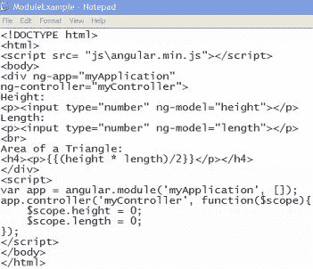

将文件命名为 `ModuleSample.html` 并保存到 `myFolder`。双击 `ModuleSample.html` 文件，输入三角形的高长度，查看输出。

**输出：**


### 解释

- `ng-controller="myController"` 定义控制器。
- `app = angular.module()` 创建一个新的模块。
- `app.controller()` 将控制器的构造函数添加到模块。
- `function($scope)` 定义构造函数，同时也定义了 `$scope` 对象。当页面加载时，该函数会运行。
- `$scope.property = value` 将值赋值给 `$scope` 的属性。

# 附录 1

## Ajax 基础

### 什么是 Ajax？


AJAX 代表“异步 JavaScript 和 XML”。Ajax 是一种用于创建更快、更具交互性的 Web 页面的技术，结合 `XML`、`HTML`、`CSS`、`JavaScript` 和服务器。Ajax 用于更新页面的部分内容而无需重新加载整个页面。通过 Ajax，你可以与服务器通信以刷新信息。通过 jQuery 和 `JavaScript` 可以在页面中轻松实现 Ajax。运行 Ajax 需要一个服务器。以下将介绍如何在你的电脑上设置服务器，以及如何使用 Ajax。

## 设置服务器

如果你想运行 Ajax，需要在你的电脑上设置一个服务器。`AppServ` 是一个用于设置服务器的免费软件；它可以运行 `Apache`、`MySQL`、`PhpMyAdmin`、Ajax、`JavaScript`……

### 步骤 1

下载 `AppServ` 链接：（图 1）[`www.appservnetwork.com/`](http://www.appservnetwork.com/) (图 1)

### 步骤 2

将 AppServ 安装到本地电脑。`C:\AppServ` (图 2)

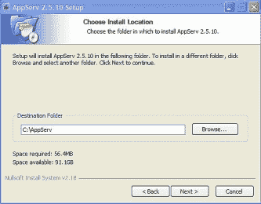 (图 2)

### 步骤 3

勾选所有框进行安装。（图 3）

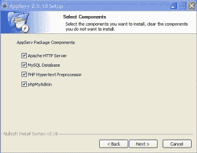 (图 3)

### 步骤 4

服务器名称：`localhost`

邮箱地址：xxxxxx@xxxxx.xxx

Apache 端口：80 (图 4)

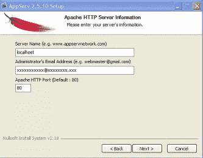 (图 4)

### 步骤 5

输入 root 密码：12345 (图 5）默认用户名：root

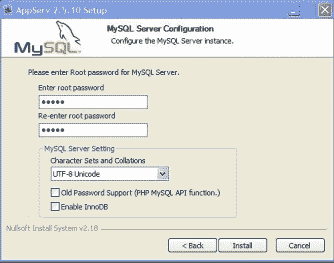 (图 5)

### 步骤 6

勾选启动 Apache、启动 MySQL。点击完成按钮。（图 6）

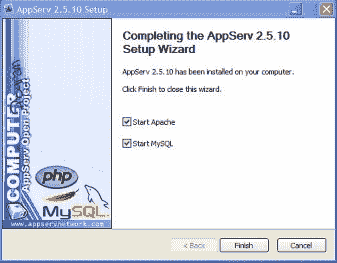 (图 6)

### 步骤 7

测试 AppServ 是否安装成功，运行浏览器并输入地址：`http://localhost`

如果你看到如下页面：（图 7）

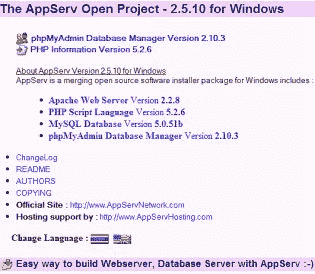 (图 7）恭喜！你的服务器运行成功。

### 步骤 8

如何使用服务器？

打开`C:\AppServ\www`文件夹，创建一个名为`myServer`的文件夹作为工作区。你可以将所有程序文件放入`myServer`文件夹。从现在开始是 `C:\AppServ\www\myServer`。（图 8）

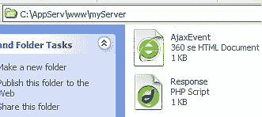 (图 8)

注意：Ajax 需要一个服务器。如果你的电脑可以作为服务器，请准备一个名为`data.txt`的文本文件，内容为“Hello World!”，并将`data.txt`与 Ajax 文件放在同一个文件夹中。

## 示例 1

### 示例 B1

```javascript
1. <script Language="JavaScript">
2. var ajaxObject = new XMLHttpRequest( );
3. ajaxObject.open( "GET", "data.txt", true);
4. ajaxObject.onreadystatechange = function( ) {
5. if (ajaxObject.readyState == 4) {
6. alert(ajaxObject.responseText);
7. }
8. }
9. ajaxObject.send( );
10. </script>
```

将文件保存为`B1.html`并双击它。

**输出：**

Hello Ajax World!

### 解释

第 2 行：`new XMLHttpRequest()` 创建了一个名为`ajaxObject`的 XMLHttpRequest 对象，将用于 Ajax 脚本。

第 3 行：`ajaxObject.open( "GET", "data.txt", true)` 初始化 XMLHttpRequest 对象的请求。`GET` 指定了请求方法。也可以使用`POST`或`PUT`。`data.txt` 是一个提供数据资源的 URL。在这里，`data.txt` 的内容是“Hello Ajax World!”。`true` 表示使用异步技术。

第 4 行：`ajaxObject.onreadystatechange = function( ) { … }` 指定了一个在接收服务器响应时运行的函数。服务器响应的状态为 0 到 4：

| readyState | 解释 |
| :--- | :--- |
| 0 | 未初始化 |
| 1 | 已初始化 |
| 2 | 已发送数据 |
| 3 | 正在接收数据 |
| 4 | 完成。可以使用返回的数据。 |

`ajaxObject.onreadystatechange` 正在等待服务器响应。

第 5 行：`if (ajaxObject.readyState == 4)` 意味着如果服务器响应为 4，则可以使用返回的数据。

第 6 行：`alert(ajaxObject.responseText)` 显示来自`data.txt`的检索文本。

`ajaxObject.send()` 将请求发送到服务器。

## 示例 2

### B2

```html
1. <input type="button" value="try" onClick="ajaxRequest();"/>
2. <script type="text/javascript">
3. function ajaxRequest () {
4. if (window.XMLHttpRequest){
5 ajaxObject = new XMLHttpRequest();
6 }
7. else if (window.ActiveXObject){
8 ajaxObject = new ActiveXObject("Microsoft.XMLHTTP");
9 }
10 ajaxObject.open("POST", "data.txt", true);
11 ajaxObject.onreadystatechange = function() {
12.if (ajaxObject.readyState == 4) {
13.if(ajaxObject.status == 200) {
14.alert(ajaxObject.responseText);
15.}
16.}
17.}
19 ajaxObject.send();
20 }
21. </script>
```

将文件保存为`B2.html`，并双击它。

### 输出

Hello Ajax World!

### 解释

#### 第 1 行

`onClick = "ajaxRequest()"` 在点击按钮时调用函数`ajaxRequest()`。

#### 第 3-9 行

这些代码创建了一个名为`ajaxObject`的`XMLHttpRequest`对象，将用于 Ajax 脚本。

如果浏览器是 `NON-IE`，它使用`new XMLHttpRequest()` 创建`ajaxObject`。

如果浏览器是 `IE`，它使用`new ActiveXObject(...)` 来创建`ajaxObject`。

#### 第 10 行

`ajaxObject.open("POST", "data.txt", true)` 初始化`XMLHttpRequest`对象的请求。

`"POST"` 指定请求方法。也可以使用`"GET"`或`"PUT"`。

`"data.txt"` 是提供数据资源的 URL。

在这里，`data.txt` 的内容是 "Hello Ajax World!"。

`"true"` 表示使用异步技术。

#### 第 11 行

`ajaxObject.onreadystatechange = function() { ... }` 指定了一个在接收到服务器响应后运行的函数。服务器的响应值为 0 到 4：

| readyState | 解释 |
| :--- | :--- |
| 0 | 未初始化 |
| 1 | 已初始化 |
| 2 | 发送数据 |
| 3 | 接收数据 |
| 4 | 完成。返回的数据可用。 |

`ajaxObject.onreadystatechange` 正在等待服务器的响应。

#### 第 12 行

`if (ajaxObject.readyState == 4)` 意味着如果服务器响应为 4，则返回的数据可用。

#### 第 13 行

`if(ajaxObject.status == 200){ }` 意味着如果服务器返回的 http 状态码为 200，则请求成功。

| http status | 解释 |
| :--- | :--- |
| 200 | 请求成功 |
| 401 | 未授权 |
| 403 | 禁止 |
| 404 | 未找到 |

#### 第 14 行

`alert(ajaxObject.responseText)` 显示从`data.txt`获取的文本。

输出: "Hello Ajax World!".

#### 第 15 行

`ajaxObject.send()` 将请求发送到服务器。

### 结果

运行整个脚本，将弹出一个对话框显示 "Hello Ajax World!"。

## 示例 3

示例 3 中的代码与示例 2 几乎相同。

但示例 2 中的代码可以修改并变为如下所示的示例 3：

### B3

```html
14. document.getElementById("display").innerHTML = "A message from server is: " + ajaxObject.responseText;
22. <div id="display"></div
```

`B3.html` 如下：

```html
<input type="button" value="try" onClick="ajaxRequest();"/>
<script type="text/javascript">
function ajaxRequest () {
if (window.XMLHttpRequest){
ajaxObject = new XMLHttpRequest();
}
else if (window.ActiveXObject){
ajaxObject = new ActiveXObject("Microsoft.XMLHTTP");
}
ajaxObject.open("POST", "data.txt", true);
ajaxObject.onreadystatechange = function() {
if (ajaxObject.readyState == 4) {
if(ajaxObject.status == 200) {
document.getElementById("display").innerHTML = "A message from server is: " + ajaxObject.responseText;
}
}
}
ajaxObject.send();
}
</script>
<div id="display"></div>
```

将文件保存为`B3.html`，并双击它。

### 输出

A message from server is: Hello Ajax World!

### 解释

#### 第 14 行

`document.getElementById("display").innerHTML` 显示 ID 为`display`的指定位置的内容。

`ajaxObject.responseText` 从`data.txt`获取数据。

输出: "A message from server is: Hello Ajax World!".

#### 第 22 行

`<div id="display"></div>` 创建了一个 id 为`display`的标签，用于显示内容。

### 结果

运行整个脚本。

输出: "A message from server is: Hello Ajax World!"

## 注意

`"data.txt"` 可以是`data.php`、`data.asp`、`data.jsp`和`data.xml`。

Ajax 需要服务器的支持。

## Ajax 的优势

Ajax 在不重新加载整个页面的情况下更新部分内容。

## Ajax 图表

| 属性 | 描述 |
| :--- | :--- |
| `open()` | 初始化请求 |
| `send()` | 将请求发送到服务器 |
| `onreadystatechange` | 响应事件 |
| `responseText` | 从服务器返回文本 |
| `readyState` | 状态 (0,1,2,3,4) |

## Ajax 服务

Ajax 需要服务器的支持。内置服务包括例如：

- `http`: 用于发送请求。

- `timeout`: 用于延迟操作。

- `interval`: 用于重复执行操作。

| ID | 水果 | 颜色 |
| :--- | :--- | :--- |
| 001 | 苹果 | 红色 |
| 002 | 香蕉 | 绿色 |
| 003 | 橙子 | 金色 |

### 解释

`$http.get("angular_mysql.php").then(function (feedback) { })` 从 mysql 数据库获取数据。

`$scope.title = feedback.records;` 返回 mysql 数据库的每条记录。

`<tr ng-repeat="v in title">` 遍历每个字段名称。

关于 PHP & MySQL，请阅读我的另一《8 小时精通 PHP & MySQL》。

### Angular 检查

| `$dirty` // 检查用户已输入 | `$pristine` // 检查用户未输入 |

## 示例 A4

```html
<head>
<script src="js\angular.min.js"></script>
</head>
<body>
<form ng-app="iCode" ng-controller="iController" name="iForm" novalidate>
<p>请在此输入您的姓名：<br><br>
<input type="text" name="userName" ng-model="userName" required>
<div style="color:red" ng-show="iForm.userName.!$dirty">
<!--检查输入是否为空-->
<div ng-show="iForm.userName.$error.required">
<!--显示错误信息 -->
此字段不能为空！</div>
</div>
</p>
</form>
<script>
var iModule = angular.module('iCode', []);
iModule.controller('iController', function($scope) {
$scope.userName = '';   
});
</script>
</body>
</html>
```

### 输出

请在此输入您的姓名：

此字段不能为空！

### 解释

`iForm.userName.!$dirty` 检查输入字段的空值。你可以使用`$pristine`或`!$dirty`。

`.$error.required` 显示错误信息。

### Angular 验证

| `$valid` // 检查输入的有效性 | `$invalid` // 检查输入的无效性 |

## 示例 A5

```html
<!DOCTYPE html>
<html>
<head>
<script src="js\angular.min.js"></script>
</head>
<body>
<br>
<form ng-app="iCode" ng-controller="iController" name="iForm" novalidate>
<input type="email" name="email" ng-model="email" required>
<div style="color:red" ng-show="iForm.email.$invalid">
<!--检查邮箱地址的无效性--> <br>
<div ng-show="iForm.email.$error.email">
<!--显示错误信息 -->
邮箱地址格式无效！</div>
</div>
</form>
<script>
var iModule = angular.module('iCode', []);
iModule.controller('iController', function($scope) {
$scope.email = 'xxxxx@gmail.com';
});
</script>
</body>
</html>
```

### 输出

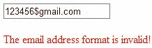

### 解释

`<div style="color:red" ng-show="iForm.email.$invalid">` 检查邮箱地址的有效性。

`<div ng-show="iForm.email.$error.email">` 显示错误信息。

### Angular 包含

| `ng-include="'another.txt'` |

`ng-include="'another.txt'"` 将外部文件包含到当前文件中。

## 示例 A6


```html
/* 注意：以下示例需要服务器支持。
假设服务器上有一个名为 another.txt 的文件，内容为“This is an Include Example.” */
<!DOCTYPE html>
<html ng-app="">
<script src="js\angular.min.js"></script>
<body>
<div ng-include="'another.txt'"></div>
</body>
</html>
```

### 输出

This is an Include Example.

### 解释

`ng-include="'another.txt'"` 将外部文件包含到当前文件中。

# 附录 3

## AngularJS

## 测试与答案

### 测试

请选择正确的答案。

#### (1)

```html
<html>
<script src="js\angular.min.js"></script>
<body>
<div ng-app="">
<p>在输入框中输入我的 id：</p>
<p><input type="text" 在此处输入 </p>
// 将来自 HTML 的输入数据绑定到“id”
<br>
<h1>欢迎！{{id}}</h1>
</div>
</body>
</html>
```

A. `bind = “id"`

B. `ng-bind = “id"`

C. `ng = “id"`

D. `ng-model="id"`

#### (2)

```html
<!doctype html>
<html>
<head>
<script src="js\angular.min.js"></script>
</head>
<body ng-app="">
<br><br>
<textarea ng-keydown="count = count + 1" ng-init="count=0">
Here is a textarea
</textarea>
<br><br>
<h2>count: {{ 在此处填写  }}</h2> // 显示“count”的值
<body>
</html>
```

A. `show`

B. `display`

C. `count`

D. `variable`

#### (3)

```html
<html>
<script src="js\angular.min.js"></script>
<body>
<script>
var myString = "This is a string";
function myFunction() {
return "This is inside a function";
}
document.write(myString) + " ";
document.write(myFunction) + " "; // 测试值是否为函数
</script>
</body>
</html>
```

A. `ng-test`

B. `angular`

C. `AngularJS`

D. `test`

#### (4)

```html
<html>
<script src="js\angular.min.js"></script>
<body>
<div 在此处填写 > 表示你可以在这里编写 AngularJS 应用。
<p>在框中输入 id：</p>
<p><input type="text" ng-model="id" </p>
<br>
<h1>欢迎！{{id}}</h1>
</div>
</body>
</html>
```

A. `ng-app=""`

B. `ng-model=""`

C. `angular`

D. `ng`

#### (5)

```html
<!DOCTYPE html>
<html>
<head>
<title>AngularJSfor beginners</title>
<script src="js\angular.min.js"></script>
<meta http-equiv="Content-Type" content="text/html; charset=UTF-8" />
</head>
<body>
<h3>使用 Click 指令</h3>
<div ng-app="" 在此处填写 ="increaseNumber=0">// 初始化变量的值
<button ng-click="increaseNumber = increaseNumber + 1">点击我！button>
<p ng-bind="increaseNumber" style="color:blue"></p>
</div>
</body>
</html>
```

A. `init`

B. `initialize`

C. `ng-init`

D. `ng-ize`

#### (6)

```html
<html>
<script src="js\angular.min.js"></script>
<body>
<div ng-app="Calculation" ng-controller="myController">
第一个数字：<input type="number" ng-model="firstNumber"><br>
第二个数字：<input type="number" ng-model="secondNumber"><br>
<br>
和：{{firstNumber + secondNumber}}
</div>
<script>
var app = angular.module('Calculation', []);
app.controller('myController', function($scope) {
在此处填写.firstNumber = 4;
在此处填写.secondNumber = 8;
// 将值赋值给 $scope 属性。
});
</script>
</body>
</html>
```

A. `object`

B. `angular`

C. `scope`

D. `$scope`

#### (7)

```html
<html>
<script src="js\angular.min.js"></script>
<body>
<div ng-app="myApplication" ng-controller="myController">
{{ firstNum + lastNum }}
</div>
<script>
var myModule = angular.module("myApplication", []);
在此处填写.controller("myController", function($scope) {
// 让 myController 属于 myModule。
$scope.firstNum = 100;
$scope.lastNum = 200;
});
</script>
</body>
</html>
```

A. `module`

B. `myModule`

C. `$scope`

D. `angular`

#### (8)

```html
<html>
<script src="js\angular.min.js"></script>
<body>
<script>
var myCar = "This is my car!";
var carObject = new Object( );
document.write(angular 在此处填写 Object(myCar) + " ");
document.write(angular 在此处填写 Object(carObject) + " "); // 测试值是否为对象
</script>
</body>
</html>
```

A. `test`

B. `check`

C. `is`

D. `if`

#### (9)

```html
<html>
<head>
<title>AngularJSfor beginners</title>
<script src="js\angular.min.js"></script>
<meta http-equiv="Content-Type" content="text/html; charset=UTF-8" />
</head>
<body>
<div ng-app="" ng-init ="ColorName = ['Pink', 'Red', 'Green', 'Blue', 'Black', 'Yellow', 'Gray']">
<p style="color:green; font-weight:bold">颜色名称：</p>
<ol>
<li 在此处填写 ="x in ColorName">// 重复以获取数组的值
<p ng-bind="x"></p>
</li>
</ol>
</div>
</body>
</html>
```

A. `ng-repeat`

B. `repeat`

C. `foreach`

D. `for`

#### (10)

```html
<html>
<script src= "js\angular.min.js"></script>
<body>
<div ng-app="Calculation" 在此处填写 ="myController">// 定义一个控制器
第一个数字：<input type="number" ng-model="firstNumber"><br>
第二个数字：<input type="number" ng-model="secondNumber"><br>
<br>
和：{{firstNumber + secondNumber}}
</div>
<script>
var app = angular.module('Calculation', []);
app.controller('myController', function($scope) {
$scope.firstNumber = 4;
$scope.secondNumber = 8;
});
</script>
</body>
</html>
```

A. `define`

B. `controller`

C. `new`

D. `ng-controller`

#### (11)

```html
<html>
<script 在此处填写 ="js\angular.min.js"></script>
```

```html
// 将 AngularJS 框架引入当前应用中。

<html>
<body>
<div ng-app="">
  <p>在输入框中输入我的 id：</p>
  <p><input type="text" ng-model="id" </p>
  <br>
  <h1>欢迎！{{id}}</h1>
</div>
</body>
</html>
```

A. `import`

B. `url`

C. `src`

D. `add`

#### (12)

```html
<html>
<body>
<div ng-app="">
  <p>用户名: <br>
  <input type="text" ng-model = "Username"></p>
  <p fill in here ="Username"></p>
</div>
</body>
</html>
```

`// 将 “Username” 绑定到 <p></p> 标签，并“显示”它的值`

A. `bind`

B. `ng-bind`

C. `ng-bound`

D. `ng-show`

#### (13)

```html
<html>
<body>
  <h3>使用大写过滤器</h3>
  <div ng-app="" ng-init="Username= 'ray' ">
    <p>用户名: <input type="text" ng-model = "Username"></p>
    <p style="color:red" ng-bind="Username | fill in here "></p>
  </div>
</body>
</html>
```

`// 将 “Username” 的值更改为大写.`

A. `toUppercase()`

B. `uppercase()`

C. `toUppercase`

D. `uppercase`

#### (14)

```html
<html>
<body>
  <h3>使用 Click 指令</h3>
  <div ng-app="" ng-init="increaseNumber=0">
    <button fill in here ="increaseNumber = increaseNumber + 1">点击我！</button>
    `// 点击按钮时更新 “increaseNumber” 的值。`
    <p ng-bind="increaseNumber" style="color:blue"></p>
  </div>
</body>
</html>
```

A. `ng-click`

B. `ng-press`

C. `onClick`

D. `onPress`

#### (15)

```html
<html>
<script src="js\angular.min.js"></script>
<body ng-app="">
  <br><br>
  <textarea fill in here ="count = count + 1" ng-init="count=0">
    `// 鼠标悬停事件`
    这是一个文本区域。
  </textarea>
  <br><br>
  <h2>count: {{count}}</h2>
</body>
</html>
```

A. `mouseover`

B. `ng-mouseover`

C. `over`

D. `ng-over`

#### (16)

```html
<html>
<head>
  <title>初学者 AngularJS</title>
  <script src="js/angular.min.js"></script>
</head>
<body>
  <h4>使用数组表达式的我的数学结果</h4>
  <div ng-app="" ng-init="MyArray=[98,96,93,90,99]">
    <p>我的数学分数是：{{ fill in here }}</p>
    `// 显示 MyArray 中索引为 4 的值。`
  </div>
</body>
</html>
```

A. `array[4]`

B. `[4]`

C. `MyArray[4]`

D. `MyArray{4}`

#### (17)

MVC 代表 Model（模型）、View（视图）和 Controller（控制器）。

`$scope.firstNumber` 和 `$scope.secondNumber` 是`fill in here`

`<p ng-bind = "firstNumber + secondNumber"> </p>` 是`fill in here`

`"ng-controller="myController""` 定义了一个`fill in here`

`// MVC`

A. `controller` `view` `model`

B. `view` `controller` `model`

C. `model` `controller` `view`

D. `model` `view` `controller`

#### (18)

```html
<html>
<script src= "js\angular.min.js"></script>
<body>
  <script>
    var myDate = "Aug/10/2015";
    var dateObject = new Date();
    document.write(angular. fill in here(myDate) + "  ");
    document.write(angular. fill in here(dateObject) + "  ");
    `// 测试一个值以检查它是否为 Date 对象`
  </script>
</body>
</html>
```

A. `check`

B. `test`

C. `isDate`

D. `isObject`

#### (19)

```html
<html>
<head>
  <script src="js\angular.min.js"></script>
</head>
<body ng-app="">
  <br><br>
  <textarea fill in here ="count = count + 1" ng-init="count=0">
    `// 按键按下事件`
    这是一个文本区域
  </textarea>
  <br><br>
  <h2>count: {{count}}</h2>
</body>
</html>
```

A. `keydown`

B. `ng-keydown`

C. `onkey`

D. `key()`

#### (20)

```html
<html>
<script src= "js\angular.min.js"></script>
<body>
  <script>
    var futureCar;
    var existingCar = "Very Good!";
    document.write(angular. fill in here(futureCar) + " ");
    document.write(angular. fill in here(existingCar) + " ");
    `// 测试一个值以检查它是否已定义`
  </script>
</body>
</html>
```

A. `test`

B. `check`

C. `ng-defined`

D. `isDefined`

#### (21)


(1)

```html
<html>
<head>
  <title>初学者 AngularJS</title>
  <script src="js/angular.min.js"></script>
</head>
<body>
  <div ng-app="" ng-init="StudentsResult=[{name: 'Tien', marks:81}, {name: 'Svf', marks:70}, {name: 'Yvf', marks:90}]">
    <table border="1">
      <tr>
        <th>姓名</th>
        <th>数学成绩</th>
      </tr>
      <tr ng-repeat="x in StudentsResult | orderBy:'-marks'">
        <td>{{x.name}}</td>
        <td>{{x.marks}}</td>
      </tr>
    </table>
  </div>
</body>
</html>
```

A. `order` B. `sort` C. `orderBy` D. `sortBy`

正确答案：C

(22)

```html
<html>
<head>
  <script src="js/angular.min.js"></script>
  <meta http-equiv="Content-Type" content="UTF-8" />
</head>
<body ng-app="">
  <br><br>
  <textarea ng-mouseover="count = count + 1" ng-init="count=0"> 
    // 鼠标悬停事件
    这是一个文本区域
  </textarea>
  <br><br>
  <div ng-mouseover="count = count + 1">
    count: {{count}}
  </div>
</body>
</html>
```

A. `mouseover` B. `ng-mouseover` C. `over` D. `ng-over`

正确答案：B

(23)

```html
<html>
<script>
  function (scope) {
    scope = 23;
  }
</script>
// 声明一个参数

A. `function` B. `scope` C. `object` D. `ng-scope`
```

正确答案：B

(24)

```html
<html>
<head>
  <title>AngularJS for beginners</title>
  <script src="js/angular.min.js"></script>
</head>
<body>
  <div ng-app="">
    <input type="checkbox" ng-model="show">
    <div ng-show="show">
      I am a div
    </div>
    <p>I appear when the box is checked.</p>
  </div>
</body>
</html>
```

A. `show` B. `angular` C. `ng-display` D. `ng-show`

正确答案：D

(25)

```html
<html>
<script src="js/angular.min.js"></script>
<body>
  <h4>Object Expression</h4>
  <div ng-app="" ng-init="employee = {name: 'John Smith', salary: 5000}">
    <p>Employee Name: {{employee.name}}</p>
    <p>Salary: {{employee.salary}}</p>
  </div>
</body>
</html>
```

A. `name` B. `salary` C. `object` D. `property`

正确答案：C

(26)

```html
<html>
<script src="js/angular.min.js"></script>
<body>
  <script>
    var myModule = angular.module('myApplication', []);
    myModule.controller('myController', function($scope) {
      $scope.text1 = "JAVASCRIPT";
      $scope.text2 = angular.isNumber($scope.text1);
    });
  </script>
</body>
</html>
```

A. `isNumber` B. `Number` C. `isDigital` D. `Digital`

正确答案：A

(27)

```html
<script language="JavaScript">
  var ajaxObject = new XMLHttpRequest(); // 创建一个名为“ajaxObject”的XMLHttpRequest对象
  ajaxObject.open("GET", "data.txt", true);
  ajaxObject.onreadystatechange = function() {
    if (ajaxObject.readyState == 4) {
      alert(ajaxObject.responseText);
    }
  }
</script>
```

A. `HttpRequest` B. `XMLHttpRequest` C. `HttpRequest()` D. `XMLHttpRequest()`

正确答案：B

(28)

```html
<input type="button" value="try" onClick="ajaxRequest();"/>
<script type="text/javascript">
  function ajaxRequest() {
    if (window.XMLHttpRequest) {
      ajaxObject = new XMLHttpRequest();
    } else if (window.ActiveXObject) {
      ajaxObject = new ActiveXObject("Microsoft.XMLHTTP");
    }
    ajaxObject.open("POST", "data.txt", true);
    ajaxObject.onreadystatechange = function() {
      if (ajaxObject.readyState == 4) {
        if (ajaxObject.status == 200) { // 如果服务器返回的HTTP状态码为200，则请求成功
          // 请求成功处理
        }
      }
    }
  }
</script>
```

A. `status` B. `code` C. `result` D. `value`

正确答案：A

(29)

```html
<input type="button" value="try" onClick="ajaxRequest();"/>
<script type="text/javascript">
  function ajaxRequest() {
    if (window.XMLHttpRequest) {
      ajaxObject = new XMLHttpRequest();
    } else if (window.ActiveXObject) {
      ajaxObject = new ActiveXObject("Microsoft.XMLHTTP");
    }
    // 后续代码省略
  }
</script>
```

A. `respond` B. `readState` C. `status` D. `return`

正确答案：C


`ajaxObject.open("POST", "data.txt", true);`

`ajaxObject.onreadystatechange = function() {`

```
if (ajaxObject.readyState == 4) {
  if (ajaxObject.status == 200) {
    document.getElementById("display").innerHTML = "A message from server is: " + ajaxObject.responseText; // 在 ID 为“display”的指定位置显示内容
  }
}
```

`ajaxObject.send();`

```
</script>

<div id="display"></div>
```

A. `show` B. `innerHTML` C. `display` D. `text`

## (30)
在 Ajax 中，当 `readyState` 为 4 时，意味着请求过程处于哪个阶段？
A. 未初始化
B. 正在发送数据
C. 已接收数据
D. 返回的数据可用。

## (31)
在 Ajax 中，当 `http status` 为 200 时，意味着请求的结果是 ____？
A. 请求成功。
B. 未授权
C. 禁止访问
D. 未找到。

## (32)
关于 Ajax，下列叙述中正确的是？（多选题）
A. `readyState` 属性是一个从 0 到 4 的请求状态。
B. `Http status` 返回数字 200、401、403 或 404。
C. `onreadystatechange` 属性是一个状态事件。
D. `responseText` 属性返回来自服务器的文本。

### 答案

| 01. | D | 17. | D |
| 02. | C | 18. | C |
| 03. | B | 19. | B |
| 04. | A | 20. | D |
| 05. | C | 21. | C |
| 06. | D | 22. | C |
| 07. | B | 23. | B |
| 08. | C | 24. | D |
| 09. | A | 25. | A |
| 10. | D | 26. | B |
| 11. | C | 27. | D |
| 12. | B | 28. | C |
| 13. | D | 29. | B |
| 14. | A | 30. | D |
| 15. | B | 31. | A |
| 16. | C | 32. | ABCD |

## [亚马逊亚马逊强烈推荐的计算机书籍：](https://www.amazon.com/Ray-Yao/e/B00RG5FG6K/ref=dp_byline_cont_ebooks_1)

|  |  |  |
|  |  |  |
|  |  |  |
|  |  |  |

# 源码下载

请下载本书的源码：

[AngularJS 源码下载](http://www.websprogram.com/www/angularjswangshiruyi/sourcecode.php)

亲爱的朋友：

如果您对本电子书不满意，请在购买日期七天内退书退款。

如果您在书中发现任何错误，可以给我发送电子邮件吗？

`yaowining@yahoo.com`

我会感谢您的邮件。非常感谢！

诚诚地

Ray Yao

我的朋友，再见！
