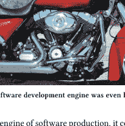
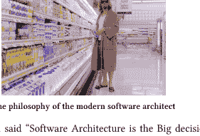
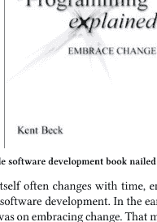
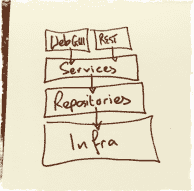
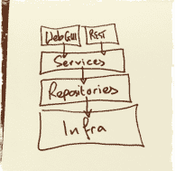
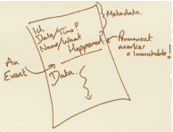
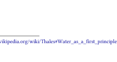
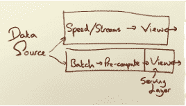

# 反脆弱软件：微服务适应性软件构建指南

## 在 Twitter 上分享这本书！

请通过在 Twitter 上宣传本书来帮助 Russ Miles！

本书建议的标签是 #antifragilesoftware。

点击此链接在 Twitter 上搜索该标签，了解其他人对这本书的评价：https://twitter.com/search?q=#antifragilesoftware

献给 Mali

献给 Ashton

献给 Siobhán

来自 Russ：*愿你的学习之旅永无止境*

## 前言

### 获取代码

本书采用了一种非常独特的代码示例提供方式；这种方式让你能够尽可能轻松地尝试所学概念，同时提供大量机会供你深入钻研、花时间思考并挑战自己的理解。

因此，我们没有提供一个通用或完全不切实际的示例应用，而是尝试采用一种测试驱动的方法，最适合你在阅读本书时使用。你可以把它看作一种“准备、尝试、思考和学习”的方法。每一步我们称之为一个“公案”（Koan），但更多内容将在你第一次在《第一册》“简单性”一章中体验公案时介绍。

本书的示例对你的学习体验至关重要，因此请花时间完成以下说明，在自己开发机器上配置好代码。

你还可以通过几种方式学习本书的代码。

#### 选项1：在 GitHub 上浏览代码

首先，你可以直接在 GitHub¹ 上在线浏览代码。这里有许多示例，展示了本书中的课程和旅程。

每个代码示例都可以通过点击与你正在学习的部分相应的 GitHub 仓库来浏览。

如果你只想浏览代码，那么选项1可能就足够了。如果你希望在阅读本书时在本地实际操作代码，但又不想费心使用 Git² 工具本身，那么选项2可能适合你。

#### 选项2：下载 Zip 格式的代码

如果你想在本地获取代码示例，最简单的方式就是直接下载你想要的。如果你在 GitHub³ 上浏览，会看到一个“下载 ZIP”按钮。

点击该按钮，该公案的完整源代码 Zip 文件将下载到你的桌面，然后你可以将其解压到任意位置，以便在你完成各个公案时使用。

## 关于作者

### 拉斯·迈尔斯

> “专家是那种成功让决策和判断变得更简单的人；他们知道该关注什么，该忽略什么。” —— 爱德华·德·波诺（Edward de Bono），《简单》（Simplicity），1998年

> “复杂性是在正确的时间交付正确的软件或变革的无声杀手；它单凭一己之力扼杀了许多好的想法和公司。专注于简单是答案，但简单并不容易。通过我们的技术和实践，我帮助软件交付组织和团队确保他们的解决方案尽可能简单，同时又不因过度简化而失之偏颇。” —— 拉斯·迈尔斯，2013年

拉斯·迈尔斯是 Russ Miles & Associates⁴ 的首席执行官兼创始人，他与客户合作，帮助交付简单而有价值的软件和变革。

拉斯的经验几乎涵盖软件交付的方方面面，他曾在包括金融服务、出版、国防、保险和搜索在内的多个不同领域工作。

拉斯帮助改变软件交付流程的各个方面，以消除不必要的、代价高昂的复杂性——无论是开发者技能和实践，还是为手头工作应用合适的流程，再到确保交付正确的变革，无论这种变革是通过软件还是其他方式实现。

⁴ http://www.russmiles.com

拉斯热衷于开源软件，在VMware收购SpringSource之前，他曾在那里工作，领导Spring Extensions项目，并帮助国际客户通过有效应用Spring项目组合来简化他们的软件。

拉斯还是“哈雷上的极客”⁵，你可以在网上关注他的旅行。

## 致谢

我真的很想感谢很多人，真的！问题是，这基本上是一位天才头脑的独特作品，是在一座没有互联网的山顶上，经过数十年的沉思独处后完成的……那么我该感谢谁呢？

好吧，也许那种独处并没有那么孤独……

首先要非常感谢我的未婚妻兼搭档，西沃恩·加迪奥特。你不仅是我一切事务中的同事，也是我的缪斯。

感谢我可爱的女儿玛丽和儿子阿什顿。我知道我偏心，但你们俩真的都非常棒*。

致玛丽和阿什顿，我希望你们永远不要失去对书籍的热爱和对世界的好奇；如果真的失去了，那就记住那种感觉，因为那是一种可以在你们人生旅程中带走的珍贵感受。

拉斯和玛丽·迈尔斯

*……还有调皮捣蛋，有时很淘气……而且我确信还会给我带来完全不应有的幸福和心痛！不过不管怎样……

## 引言

福伊尔斯书店，我第二喜欢的书店，这里有许多完全不枯燥的书，但IT领域里有不少书很枯燥。

> “十多年来，我们的工作方式变得越来越敏捷和灵活。不幸的是，我们的软件如今难以跟上现代企业日益要求的创新步伐。是时候解决这个问题了。” —— 拉斯·迈尔斯

市面上关于软件开发的枯燥书籍已经够多了，多到大概能把福伊尔斯书店填满好几次。

这本书**不是**其中一本。

## 本书不涉及的内容

本书不会对软件开发中华而不实的思想、概念和观点夸夸其谈，也不会陷入围绕语言和框架的、令人精疲力竭且最终大多毫无意义的讨论（参见：战争），而是会深入探讨*我发现的对构建软件真正有用的实用工具*，并应对现代软件开发的挑战。

这意味着*以下主题基本上被视作毫无意义，因此被完全避开了。*

## 品牌X流程

流程仅仅是组织工作的方式，目的是力图确保有价值的事情发生。

本书将避免“Scrum比看板好，因为……<在此插入有偏见且愚蠢的论点>”这类讨论，而是专注于你可以用来定制自己流程的实用工具。

正如一位智者曾经说过的：做对你有用的事。我的目标是帮助你找出什么对你有用，而不是向你推销任何特定的品牌X。

## 品牌X方法论

方法论在口语中常被用来指软件开发中的流程。方法论其实是一种误称，通常被那些希望让某些东西听起来更……的人使用。

这些人和组织的问题在于，他们没有***利益攸关***。他们***提供未经实证的建议和信念，仿佛它们是确定无疑的，而按照这些建议采取行动并不会给他们带来直接威胁。***这就是教条盛行。

***当教条盛行时，有价值的成果就会淹没在由意见驱动的、向某种权威趋附的噪音之中。***这在本书中没有立足之地。

在这里，我将准确讲述***我是如何设计系统的，而且我每次设计都真正利益攸关。***

## 哲学基础

避免教条的一种方式是展示你的推理过程，让它做好准备，接受满意或不满意读者（希望是富有成效地）进行的批评和挖掘。另一种方式是只推广那些你自己亲身实践过的东西，从而真正利益攸关。在这里，我们将同时运用这两种方式。

每一本立志真正推动事物发展的书，都有一套哲学基础来支撑其提出的思想和观点，本书也不例外。不同的是，我想通过在这里列出它们，使我的哲学基础比大多数书更明确。

## 公理

> “公理是推理的前提或出发点。” —— 维基百科

公理是不容置疑的主张，我可以在它们之上构建本书其余部分提出的所有其他内容。

我本可以轻松地把一大堆工具、实践和流程直接倒给善解人意的你，而不需要某种共同理解来支撑整个工作。很多书都是这么做的，但那样的话，我往往会在余下的职业生涯中不断解释那些技巧背后的理念——事实上，许多人确实这样做了，并赚得盆满钵满。

我的目标不同。为了先解决几个问题，以下是我的先验公理，我希望你在本书其余部分将其作为我们思考的基础：

- 你的软件的首要角色是有用的
- 最好的软件是根本不需要的软件
- 人的理解力为王
- 机械同理心为后
- 软件是一个研究与开发的过程
- 软件开发是一项极具挑战性的智力追求

### 公理1：软件的首要角色是有用

> *软件的效果和结果，即它对没有软件时就不会存在的理想价值的贡献，是优秀软件的首要责任。*

虽然创建软件所用的流程和工艺技巧当然很重要，但软件作为一种成果，至少必须对人们（无论是企业还是个人）表现出某种有用性。

### 公理2：最好的软件是根本不需要的软件

这条公理更具争议性，尤其是考虑到当代大多数软件开发者所处的孤岛式工作环境。

*软件开发者最应该关注的是促成有价值的变革，而不是仅仅专注于交付软件。*

如果接受这一公理，那么当软件开发者在面对可能适用软件的问题领域时，“促成有价值的变革”就会成为他们思考的准则。

如果认识到这种选择空间的广泛性，软件只是问题领域的一种可能答案，但应将其置于应对该领域挑战的其他公认选项的背景中。

正如这里的其他公理所言，开发软件是一项极具挑战性的智力追求，即使适应性作为促成因素，在可能存在替代解决方案的情况下，也可能最终产生一个复杂的解决方案。

简而言之，这条公理向你表明：在促成有价值的变革时，软件是一种选择，但绝不是唯一的选择。而我们认为，考虑到“软件开发者”这个名字，这也许很讽刺——这正是现代软件开发者的角色。

如果读者能理解你的意图，那么当软件的需求发生变化时，他们在修改代码和测试时就会有更大的信心。

为此，***更简单的架构、设计和代码应专注于通过有效记录意图和最小化认知负担来最大化人类的理解***，让费尽心思去理解你软件的人能够更轻松。

在代码中优先考虑意图的清晰性，并避免任何会引入困惑的东西，比如出乎意料！

### 公理4：机械同理心为王

> “要想让任何一辆车发挥出最佳性能，你必须对它的实际工作原理有同理心，然后才能与之和谐共处。”——杰基·斯图尔特

机械同理心的根源或许可以追溯至一级方程式赛车，那项我们英国人热衷的高速巡游运动，但马丁·汤普森将这一思考维度重新引入了我们所设计和编写的代码中。

机械同理心是一种设计和编写软件的哲学方法，它首要考虑的是*软件的使用者——在这种情况下就是机器*。你清楚理解底层机器的细微之处，并且在努力充分利用机器所要完成的事情时，这些细微之处会对你编写的代码产生巨大影响。这种方法在*低延迟对某款软件的成功至关重要时*尤其重要。

*机械同理心与最大化人类理解力看似彼此矛盾。然而，将两者视为互相竞争的不同力量可能会导致一种虚假的对立。*

*只要人类的理解已经被充分思考和优化，那么在适用的情况下，运用机械同理心的原则来适当妥协某些理解层面，便是一个有用且合适的次要目标。*

### 公理5：软件是一个研究与开发的过程

> *“我们不知道自己在做什么……”，“你不是软件开发人员，你是促成改变的人，软件只是其中一种工具……”*

我们不知道自己在做什么，这没关系！准确地说，或许应该是：在开发软件时，我们并不知道自己*确切*要追求什么，尤其是在拥抱自然发生的变化时。

当我们着手构建一个软件解决方案时，甚至可以说在我们决定是否需要任何软件之前，我们就已经踏上了一场*研究与发现之旅*。我们的研究范围涵盖一切，从我们正在解决的问题空间中所使用的概念和语言，一直到我们可以用来产生解决这些问题所需改变的最佳工具、技术和语言。

*我们是研究者和开发者*，这对我们如何管理工作产生了广泛的影响。认识到研究与发现在软件解决方案开发中的重要性，会让我们的思维从工厂车间（比如：让我们再快速生产一些小部件！）转向变革推动者和问题解决者的定位。软件常常是我们的答案，但我们也负责探索、理解和研究问题空间，因为很多时候，即使是那些自认为知道需要什么的人，对问题空间也理解得很有限。

### 公理6：软件开发是一项极具挑战性的智力追求

这可能会让一些人感到意外，但*软件开发实际上并不是在某人热情地（或不热情地）敲击键盘时发生的*。正如我们这些业内人士所说，那只是“输出”。*最困难的部分已经完成了。*

软件是*在头脑中设计、在对话和白板上协作完成的*，然后才被转化为程序中的文本字符。*软件开发的大部分精力都花在理解可能需要什么，然后将其转化为能够经受时间考验的设计上。*

而正是这种时间的考验——对设计的终极压力——是本书想要帮助你应对的。

*当开发者思考时，他们就是在工作。*当他们打字时，他们是在把辛苦工作的成果转化为可用的东西。不幸的是，思考非常困难，而且就软件和人们对需求理解的多样性而言，这*使软件开发牢牢跻身于 21 世纪最重要、最具智力挑战性的工作之列*。

## 那么，我们究竟在应对什么？

这本书不反对任何事物，也不支持任何事物，唯一的目标就是帮助你在设计和部署更好的软件方面取得成功，并让你的生活更有意义。我相信，并亲身（直接和间接）见证过，在让一群人承担“构建软件”这一令人困惑且转瞬即逝的任务时，本书所讨论的技巧会带来诸多好处。

太多时间被浪费在构建错误的东西上，或者构建一些需要付出极其巨大的努力才能让它像喝醉的相扑选手上坡一样跌跌撞撞前进的东西上。软件开发的关键挑战可以归结为两个方面：

- *如何避免过度生产？* 我们创造的软件太多了，而且我们创造的东西往往没有价值。
- ***如何创造和维护能够像需求变化一样快速适应的软件？*** 我们需要创造出能够满足无处不在且不断加速变化的软件。

对于更习惯用推特的读者来说，这两个挑战可以简化为：

- 挑战 1：构建正确的东西（或者根本不构建任何东西！）
- *挑战 2：正确地构建正确的东西*

本书聚焦于挑战 2，可以看作是一套用来击败那个特定恶霸的武器。

卡米拉书店，伊斯特本。这是我在全世界最喜欢的书店，照片中出色的店主卡米拉也在其中。这家书店就像它收藏的书一样令人兴奋，从不乏味。

## 对过度生产的一点致意

在进入本书的主要挑战之前，我想在“构建正确的东西”这个主题上做一点背景铺垫，因为它与本书其余部分将带你踏上的各个目的地息息相关。

过度生产是一种精益浪费，在整个行业的软件开发中也呈上升趋势。就我们的目的而言，过度生产可以定义为构建了错误的东西。

这包括在错误的时间构建了正确的东西，当然也包括在正确的时间构建了错误的东西。让产品变成错误之物的时间特性，也被包含在构建错误之物的总体定义中。

随着软件开发人员学会使用敏捷流程等工作管理技术来更有效地组织和完成工作，更大的生产力潜力被释放出来。至少在适应快速变化的挑战能够被控制住的情况下，更大的生产力潜力是被释放出来的。

这种生产力的另一面是，它更有可能生产出错误的东西。更高的效率并不会带来所产出的更高有效性。

你恨不得你的软件开发引擎也能有它的半分性感，或半分高效。

如果把它看作一台软件生产引擎，可以说当前软件开发行业中的敏捷和工匠技艺（Craftsmanship）技术正在产生巨大影响，帮助这台引擎全速运转。但进一步打个比方，引擎或许在全速运转，但引擎前进的方向以及它改变路线的能力，则完全是另一回事。

即使你应用本书中的模式和技术来帮助自己“正确地构建正确的东西”，即构建适应性强的软件，那也只是一个重要的*推动因素*，支撑着构建正确的东西的可能性。它并不保证一定会产出有用的软件。想了解更多有助于解决这个问题的技术，请参阅本书末尾的**延伸阅读**章节。

话虽如此，*架构并构建能让你持续构建正确之物的软件绝非易事*，因此我们旅程的第一步，就从 ***阻碍软件适应性的最大障碍……*** 开始。

## *架构以及我们思考软件的方式。*

# 第一卷 - 软件变化之哲学

站会中的大象 -> 哲学与架构 -> 压力源与反脆弱 - 简洁原则 - 微服务 - 自然选择与创新 - 回报

## 站会中的大象寓言

*命运女神 - 变化是必然 - 软件中的常见谎言 - 敌人：大象*

这是你项目的第十个冲刺；*你感觉很好。*

你周围是面带微笑的同事，他们对自己构建的软件感到满意。为即将构建有价值的软件而感到高兴。*生活很美好。*

正是在那些时刻，我们发现生活随时准备向我们投出曲线球；或者如塞涅卡所指出的，*命运女神*带来的不仅有丰饶之角，还有船舵。

在过去的几个冲刺中，丰饶之角一直是你们团队的体验，随着你们逐步完成产品待办列表，*成功不断叠加*。船舵则象征着另一面，当命运女神*以一种无法预料的手腕扭转，扯走你舒适的地毯时*。

船舵时刻就是你的产品负责人说出那句你一直*畏惧的话*的时候……

> “我只想要一个小小的改变……”

### ……内疚……

你迅速进入下一阶段，这个阶段被*内疚*的情绪所主导。为什么会内疚？因为在内心深处，你知道*所要求的变化其实“应该”是那么小，但事实并非如此*。

是时候见见敌人了……

### 站会中的大象

*站会中的大象是导致你的代码与现实冲突的所有假设和决策。*

这头大象是*根据你昨天所知精心设计和架构的*，它在你的会议中是一个沉默的参与者，而现在它可悲地与新的变化相冲突。

当我们遇到大象时，我们会怎么做……？

### 人人都说谎

最流行的三个“谎言”是：

> “这是一个大变化，不，说真的……”
> “重构的‘长假’”，以及
> “提出‘技术债务’的问题……”

#### 谎言二：重构的“长假”

“嗯，我们理解你需要那个变化，但为了适应它，我们确实需要做一些重构，也许需要一两个冲刺。

你听说过敏捷实践中的重构，对吧？很好。

**我们至少要花几天时间做重构，但更可能是几个冲刺，只是为了让我们为你提出的变化做好准备。**

如果将来你改变主意怎么办？嗯，是的，我们可能不得不再次重构，但希望只需几天。

另一种选择，我这么说只是一个建议，就是在我们进入设计和编码之前，也许确保你事先确切知道自己想要什么，否则我们可能还得再来一遍……”

#### 谎言三：抱歉，你欠了技术债务……

> *“对不起，你听说过‘技术债务’这个词吗？听起来熟悉吗？不幸的是，这就是你所累积的，而且，是的，这可能是你的错，因为你逼我们太紧，要在之前的冲刺中完成工作。”*

我们只是*没有时间去充分考虑*我们所构建内容的所有影响，因为我们太忙于让你满意，所以现在是时候*忍气吞声，偿还*一些你根本不知道在累积的债务了。

只需付出几周/几个月的努力，*不交付任何新东西*，就能解决问题。

不，我们不能保证你不会剩下一些债务，并在未来某个未公开的时间点需要偿还……

你说什么？这似乎不公平？*你为什么要哭……*

### 技术债务是真实存在的

技术债务是指你*故意*在设计和代码中偷工减料，以求今天更快，并意识到将来有时间时需要把这些粗糙之处修正回来。

如果真有更多时间的话……

毫无疑问，*随着设计在项目和产品交付压力下偏离，技术债务确实会累积*，但这并不是大象真正的情况。

### 站会中的大象不是技术债务，也不是重构

大象不是你在设计和代码中偷工减料（无论有意与否）的结果，而是*一个为昨天深思熟虑的设计与今天变化的现实相碰撞的必然结果*。

现在你已经见识了这些谎言，是时候认识你不得不使用它们的真正原因了。

*为什么站会中会有大象？我们又如何击败它？！*

为了击败大象，你将*需要换一种方式思考*，这意味着审视*软件架构和设计通常是如何被思考的，以及这需要如何改变*。

## 软件架构是哲学

*在这个语境下什么是哲学 - 完美的幻觉 - 架构师的错觉 - （重新）引入未知的未知以及如何应对它们*

### 什么是软件架构与设计？

关于软件架构与设计到底是什么，有很多定义；几乎和软件架构师或设计师实际做什么的定义一样多。

在这本书中，我想更具体地说明架构是什么，以及它如何影响你构建的软件，所以以下是我正在使用的定义：

- 软件设计是在语境中思考
- 软件*架构*是哲学……

软件设计发生在你思考、交谈或勾画一个具体解决方案的时候。

软件架构则更玄奥一些，因此需要多一些解释……

### 什么是哲学？

用一个宽泛且被误解的术语来解释另一个宽泛且被误解的术语，没有比这更合适的了，但这正是“软件架构是哲学”乍一看可能给人的印象。

我对哲学的工作定义是：

- 对智慧的热爱，按照这个词的定义来说就是如此。这很好，但几乎没什么帮助。
- 一套你应用于解决方案的*思维工具、想法、概念、经验和偏见*。*对我们这里的讨论更有帮助。*

当你最初考虑要构建一段软件、一个解决方案，或让一个系统焕发生机¹⁰时，你会将自己的一套哲学应用于这个情境。*你会带来自己过去的、有时是痛苦的经历和偏见。*

你带来了对 JVM 的偏好，因为它很熟悉。你带来了那些*“以前还行”*的决策，也带来了*对你来说不奏效的痛苦*。你带来了*使用“安全”工具的渴望*，那是你以前见过有效的；还有使用新工具的内疚的渴望，为了让项目对你来说有趣。

你带来了*与供应商和其他专业人士的交情*，因为和他们在一起你有安全感，并且希望与他们一起合作。你带来了*你的信念，以及偶尔的证据，认为某些实践能很好地组织*

### 软件架构长存

现代软件架构师的哲学

一位智者曾说：“软件架构就是那些重大决策”，然后立刻离开房间，留下对究竟哪些决策的误解。我的看法是，这还远远不够。

对我来说，软件架构是对那些对软件演变有巨大影响的决策所涉及的个体的思想、想法和偏见的整理。这就像设定游戏规则，但危险在于这些规则往往受到我们自己隐含偏见的影响。正是这些偏见，我想在这里探讨。

集体应用于“重大决策”的偏见和视角，是做出这些决策的个体的哲学。这听起来可能有点奇怪，但如果你把哲学视为相关人员的集体想法、恐惧、推理和视角，那么哲学就成为了做决策（理性或非理性）的工具箱。

如今，很多人直接将矛头指向问题。

柏拉图的理型和完美与软件和架构有什么关系，更不用说与敏捷有何关系了？问题在于完美，以及完美知识所隐含的意义。

瀑布式思维基于这样一种信念：完美是可以实现的——即问题的完美解决方案。如果没有我们现实世界的本质，这或许行得通。但现实的本质包含了两种对抗完美知识的力量：时间和变化。

这本早期的敏捷软件开发书籍在副标题中一针见血。

问题本身往往随着时间而改变，这时敏捷软件开发的思想便从舞台左侧登场了。在敏捷运动的早期，重点是拥抱变化。这一点或许在认证、教练等种种乱象中迷失了，但从本质上讲，敏捷软件开发是一个巨大的进步，因为它抛弃了完美的理念，更重要的是抛弃了完美知识的理念。

敏捷软件开发同时终结了瀑布式和柏拉图式的完美，我对此求之不得！敏捷软件开发源自一种完全不同的思想流派，这个流派深知适应才是关键，因为我们真的不知道接下来会发生什么。我们从事的是研究与开发，这需要一种完全不同的哲学，一种以斯多葛学派为最佳代表的哲学。

## 敏捷与福尔图娜

有一个学派反对这种完美理念，从根本上拥抱现实。这个哲学流派就是斯多葛学派。斯多葛学派对哲学的目的有着截然不同的看法，其核心问题是：“既然我们不知道接下来会发生什么，我们应该如何最好地度过一生？”

这里没有呼唤完美。事实上，塞内加¹³——一位杰出且非常成功的罗马斯多葛主义者——召唤了一位女神来表达现实的变幻无常和不可预测。这位女神就是福尔图娜。

在斯多葛主义中，我们不是靠足够的规划来实现完美的梦想，而是拥有一种极度务实的观点：在深知我们几乎无法预测什么的情况下，去面对生活并做出重大决策。塞内加因写下以下名言而闻名：

¹³ 维基百科上关于通过塞内加了解斯多葛主义的条目。

> “明天并不向你保证……不，下一个小时也不向你保证！”——小塞内加

换句话说：

> “我们无法预测未来。”

或者，用软件交付的视角来说：

> “我们不知道自己在做什么，也不知道自己想要什么，但这没关系，而且很正常！”

诚然，这从表面上看可能相当令人沮丧。在每一步，福尔图娜都在那里，要么用丰饶之角恩赐我们，要么用船舵打击我们；无论如何，我们都需要应对，抱怨没有用！

在斯多葛主义中，以及在某种程度上属于东方哲学的佛教中，我们学会接受和适应不可避免的变化，而正是这种观点构成了敏捷软件开发的根源。也许敏捷软件开发一个更好的名称应该是“自适应式软件开发”，但不幸的是，这个名称现在已经成为历史了。

在敏捷/自适应式软件开发中，我们做了大量工作来拥抱流程中的变化，在准备应对未知的同时努力交付，因为这就是现实的本质，也是软件开发这一智力探索的本质。

福尔图娜应该是软件开发领域的希腊之神，提醒我们真的不知道接下来会发生什么。这让我们自然而然地回到软件架构和那些重大决策；福尔图娜和斯多葛主义能为我们提供什么呢？

## 软件上的压力源

*压力源——创新——巨大的成功与巨大的失败*

压力源可以被看作*任何推动你的软件超越极限的力量*，它以可预测和不可预测的方式给架构和设计施加压力。

这里最好的比喻来自纳西姆·尼古拉斯·塔勒布的《反脆弱》一书¹，即压力源就像锻炼肌肉的负重。在我们的情境中，肌肉是软件系统，而负重可以有多种形式，包括但不限于随时间不断变化的需求。

在塔勒布的类比中，肌肉会因为遇到来自压力源的一定程度的压力而受益，因为它天生就是要随之改进的。这正是我们希望软件做到的：*不仅要把变化作为压力源来拥抱，还要真正基于变化而蓬勃发展、不断进步*。

当然，如果负重太大，肌肉就会断裂，但要让肌肉能够承受任何重量的代价，对你的身体资源来说是极其高昂的。这一点同样适用于软件系统：*总会有一些压力源，一旦超过某个界限，就可能使你的系统崩溃*。

因此，压力源是作用于你的软件系统上的一种力，在某个水平上可能会改进系统，或者，如果超过某个水平，

- **创新** 出于任何原因的、可取的功能性变化
- **系统大获成功！** 因为系统被大量使用，所以需要扩容。“成功不应杀死你”的精髓。
- **系统几乎无人使用** 由于系统没有被大量使用，所以需要缩减规模。
- **系统故障** 节点上线或下线、硬件故障、瞬时的网络状况。
- **新出现的复用需求** 当你听到这句话时就能理解：“如果我们能复用你系统中的功能 X，那岂不是很好？”

**注意：** 我在这里刻意不强调*开发*与*维护*的区别。我认为，在现代软件开发中，由于发布是持续且频繁的，开发与维护之间的差异微乎其微。这一切都是开发，或者更准确地说是研究与开发，唯一的区别在于涉及的遗留软件和决策的多少。本书的目标是帮助你构建一份尽可能拥抱变化、甚至因变化而繁荣的遗产。

压力源本质上并无*好坏*之分，它们就是现实。这并不是说，一个被推向极端的压力源不应该对你的系统造成破坏性影响——它当然会的。

一个典型例子是，Netflix 遇到了整个 Amazon 云区域宕机的问题。Netflix 在针对某些压力源进行系统架构设计方面做得很好，但正是那种情况压垮了肌肉！

能够承受变化，或者充其量无视变化的软件。这些品质被包装在一种听起来就是你想要的那种软件系统中。一种值得为之奋斗的东西。

*“健壮/弹性系统，TM™”。*

你见过多少次软件框架或平台的广告向你承诺健壮性？似乎去追求它是理所当然的，毕竟谁不想要一个健壮的系统呢？备选方案是什么？一个脆弱的、麻烦透顶的系统，需要一个比伦敦某些区域还要庞大的运维部门才能维持运行？

不，脆弱并不是我们必然在寻找的，但话说回来，健壮性并不是脆弱性的对立面；反脆弱性才是。

## 变化、适应与反脆弱

从上一章可知，变化是软件系统的一个关键压力源，因此它既代表着一个问题，也代表着一种机遇。我们现在已经有很多流程技术旨在帮助我们拥抱变化。

我们面临的新问题是，我们的软件技术被远远抛在了后面。

## 变化压力源与适应反应

*变化是一种作用在你的应用程序结构上，更重要的是，作用在你已经做出的假设上的力量*

用于应对变化并降低您生产力的软件。通过拥抱甚至在软件中茁壮成长，将变化和压力源的挑战转化为机遇。

本书记载了一系列技术，帮助您为自己构建和部署反脆弱软件。

## The Need for Antifragility in Software:
实现创新

> “2000 年的公司中，有 40% 在十年后的 2010 年已不再位列《财富》500 强” -CNN

除了在站立会议中发现大象带来的亲密而个人的尴尬让你陷入困境之外，变化的步伐正像一列失控的蒸汽火车沿着无限高的山坡疾驰般加快。

与此比喻相反，这并不是一件坏事。这仅仅是创新的步伐自然加快，因为 IT 将其许多底层专业关注点移入商品化场景。更多的时间被花费在交付更好、更快的软件上，而不仅仅是能够交付。

如果变化被导向真正的创新需求，它就是一种自然而积极的力量，但前提是你的软件能够跟上快速攀升的交付速度表。

## Love is Antifragile, an interlude
爱是反脆弱的，间奏

爱是反脆弱的；爱是一种关系；反脆弱性存在于关系之中

等等，我们要在技术书里谈论爱情吗？！我们在想什么？请耐心跟我走下去，几段之后一切都会更清晰...

**_爱是反脆弱的._** 当两个人相爱，而这段关系承受压力时，如果这真的是爱，那么 **_这段关系不仅会存活下来，还会变得更好。_**

这并不是说任何压力都能应对，**_会有一些情况会让即使最相爱的情侣也分手。_**

**_爱凭借其自然的反脆弱性得以维系，即使其中涉及的个人本身可能是稳健的、脆弱的或反脆弱的。_**

## Relationships between Parts are the Key
部分之间的关系是关键

反脆弱性的主要关注点在于系统各部分之间的关系，这也是我们可以回到软件的地方。反脆弱性存在于你系统各部分之间的关系中。*它是对连接及其之间交换内容的属性。*

*部分的重要性不如连接。*

因此，当我们开始将系统向反脆弱性演进时，你会看到我们将关注各部分应是什么样的，以及*如何理解和规范化这些部分之间的关系，以便基于系统可能遇到的压力源而蓬勃发展。*

然而在开始这段旅程之前，还有一个关键的技术无关属性我们需要先考虑。

这是反脆弱软件的基础属性。

该属性是*简洁性*。

那些必须阅读和理解它的人。这项工具就是简洁性，它是反脆弱软件系统到微服务的核心。

## Simplicity is Objective
简洁性是*客观的*

你需要知道的关于简洁性的第一件事是它具有客观性。这意味着我们都能识别出某事物是否简单，而且通常无法对此争论太多。

此时，定义我们在查看代码和软件系统时所指的简洁性非常重要。为我们的目的，我将使用 Clojure 语言的创造者 Rich Hickey 善意规范化的简洁性定义。

Rich 解释说，简洁性被定义为给定上下文中*纠缠*的关注点的数量。Simplex 意味着“一股辫子”，因此只有一个关注点存在。Complex，或如 Rich 所说的 complicated，是指一个或多个关注点纠缠在一起，需要一起考虑，从而实质上打开了认知负担的大门。

## The Simplicity Continuum
简洁性连续体

简洁性表现为一个连续体，从过度简化开始，经过某个最佳简洁性点，然后进入过度复杂区域。

### Essential & Accidental Complexity
必要复杂性与偶然复杂性

一些问题天生就很复杂。无论是因为实际问题本身复杂且涉及众多因素，还是因为语言、框架或范式选择带来的限制，都将存在一个无法再进一步组织、简化或隐藏的点。我称之为**必要复杂性**的点。

- **Essential Complexity** is the complexity inherent in the nature of the problem being solved and has to be accepted. This is quite different from its evil cousin, **accidental complexity**.
- **必要复杂性**是被解决问题的本质所固有的复杂性，必须被接受。这与它的邪恶表亲**偶然复杂性**大不相同。
- **Accidental Complexity** is everything we add to a given problem, that could be reduced if we gave the design more thought or if we valued simplicity higher.
- **偶然复杂性**是我们添加到给定问题的所有内容，如果我们对设计多加思考或更重视简洁性，这些都可以被减少。

### Why do we introduce accidental complexity?
我们为何引入偶然复杂性？

关于我们作为开发者为何倾向于增加所构建解决方案的复杂性，有几种理论。有些关注开发者的自负，其他则关注工作保护的需求或只是不知道更好的做法。

我最喜欢的引言归因于 Michael A. Jackson 的一项鲜为人知的研究，即我们倾向于为更简单的问题创建复杂解决方案，因为“我们对业务问题感到厌倦”。

## Microservice-based Architectures for Antifragility & Simplicity
用于反脆弱性与简洁性的微服务架构

*Thriving on Change - Peers & Pipelines - Lego*
*在变化中茁壮成长 - 同行与管道 - 乐高*

如果一切都像这样就好了..

随着简洁性和反脆弱性共同作用于我们的软件开发理念，如何实现这些理念的选项多种多样。其中一种因其良好原因而备受关注的架构风格是基于微服务的架构方法，因此本书将全面探讨这种方法。

这并不是说微服务是生产简洁且反脆弱软件系统的唯一方式。微服务具有某些特性，使其理想地简洁，同时又足够灵活以应对我们可能选择优化的各种压力源的不同需求。同时，微服务鼓励一种精细的粒度，支持系统各部分相对独立地演进，真正提供了在站立会议中击败大象的机会。

我认为微服务是一个过渡性术语，用于区分不优化简洁性和反脆弱性的软件架构与那些优化的架构，因此它是这些品质的有用标签，而非暗示这些品质只能通过这种架构方法实现。

## Embracing Change with Microservices
以微服务拥抱变化

那么微服务是什么？像我们这个疯狂行业中的许多术语一样，它是一个模糊的表述，容易被严重误解。我现在已经在通常被理解为基于微服务的软件系统上工作了大约 4 年，早在该术语进入常用词汇之前。

在压力源的框架内，我们可以开始定义微服务。一个能够拥抱变化的系统的关键在于设计、代码和部署的粒度与模块化。

考虑到这一点，以下是通常被归为微服务范畴的属性：

单一目的、简单（即解耦）、自主且单独部署的服务，根据系统上的变化压力源组织，并且不共享任何内容，尤其是状态！

就是这样。没有提到源代码行数（毕竟不是 80 年代了），也没有提到服务是对象还是函数。没有提到服务是使用 HTTP 还是其他方式同步或异步调用。这些都是详细的設計决策，选择其中一个选项而非另一个将有高度依赖上下文的原因。

基于微服务的架构仅仅是包含微服务的架构，魔鬼在于这些简单微服务如何在仍支持运行时和设计时压力源的同时相互交互。微服务提供了支持变化的合适粒度，但变化需要在微服务之间的链接中得到容纳。

反脆弱性可以在服务之间的链接中得到应用。

## Embracing or even Thriving on Change in the Links between Microservices
在微服务之间的链接中拥抱甚至在变化中茁壮成长

如果你构建一个微服务系统，各种设计和运行时压力源都会得到准备，但挑战随后转移到服务之间的链接上。

例如，如果你要应对狂野成功，那么微服务允许你在单个服务上进行扩展

最让你感到棘手的是成功的形态。取决于你如何设计这些服务的入站和出站连接，你仍然可能会发现扩展是一项挑战。

目前，大多数基于微服务的架构在服务之间的连接上采用简单的选择方法。首选通常是使用 HTTP，可能是 RESTful，也可能是异步的，因为 HTTP 是一种极好的协议，可以支撑施加在这些连接上的许多压力因素。次选通常是某种涉及消息代理的消息传递方法。第三选择通常为低延迟场景而保留，即使用更定制化的方案，这可能需要付出更多努力才能在微服务之间实现足够的解耦，以支撑所施加的压力因素。

拥抱变化及其压力因素是一个极好的起点，也是使用微服务设计系统的目标。终于，我们拥有了一种以自己的方式拥抱变化的架构方法。

你甚至可以更进一步。你可以设计服务之间的连接，使其能够拥抱变化；对大多数基于微服务的系统来说，这就已经足够好了。这肯定比我们过去的情况要好得多。然而，如果你超越这一步，最终会得到一个不仅能拥抱变化，而且实际上能因这些压力因素而蓬勃发展的系统。这样的系统不只是调整，而是会根据所遭遇的压力因素*改进*。这就是微服务为*反脆弱*软件系统奠定基础的地方。

一旦实现这一点，系统就为创新提供了丰饶的土壤，这是单体架构不可能实现的。新的语言

Laurie Miles 是经营成功企业的公认专家。他也是一名汽车销售员，但你可别因此对他有偏见！

Laurie 成功的关键之一在于，他能一次又一次地激发出人们最好的一面。他可以把那些表现充其量还算可以、最坏情况下严重欠佳的个体，给他们一个平台，让他们对业务产生积极影响。

当被问及 Laurie 是如何做到这一点时，答案很简单：通过营造一个对创新开放的环境来促成创新。Laurie 知道，想法和创新不会来自任何特殊的“创新小组”，更不会来自公司真正的董事们。

Laurie 知道，最优秀的创新——那些会对业务产生重大影响的创新——来自于发挥企业中每个人的创造力。方法是清除创造力所面临的障碍，并给予恰到好处的引导，让他们能在安全的环境中试验自己潜在的创新。

正如你在下面看到的，Laurie Miles 用这种简单的方法取得了巨大成功。

成功就是一个好热水浴缸

问题是：一家企业如何实现创新，从而加入成功的“热水浴缸”精英行列？这本书并不是一本关于如何培养员工创造力的书，而是一本旨在使软件能够拥抱变化以及那些对你的系统至关重要的压力因素的书；因此，我们自然会思考当创新受到重视时会出现哪些压力因素，以及我们如何在这些压力因素下茁壮成长。

## 技术创新的压力因素

*技术本身无法点燃创新，但它可以成为支持或抵制创新的力量。*

事实上，创新之所以会受到技术的不利影响，其原因与变革本身可能被抵制的许多原因相同。当你尝试创新时，你希望技术能鼓励你的想法和尝试，然后支持将这些最成功的想法转化为完整的、能提供真正商业价值的创新。

## 利益攸关

*实现方法 - 反脆弱伦理 -*  
*展示与分享 - 诚实与批判的规则*

我坐在伦敦 Pivotal^17 办公室外的长椅上，在授课前享受清晨的阳光。我正思考如何诚实而真实地写一本关于反脆弱软件的书。具体来说，我该如何向本书的读者分享我对这些系统不同特征和模式的知识，而不至于听起来像个*高高在上、象牙塔里的架构师骗子*。

这不仅仅是作者在学术上的自我怀疑，这是一个严肃的问题！我正在写一本以反脆弱为核心主题的书，而纳西姆·尼古拉斯·塔勒布在《反脆弱》^18 一书的伦理随笔中反复强调的一点是，我必须时刻避免成为一个骗子。

我不应只是谈论它，而应*活出它，说到做到*。最重要的是，我应该有*利益攸关*。

***那我到底该怎么做？***

^17 https://pivotal.io

^18 http://www.amazon.co.uk/Antifragile-Things-that-Gain-Disorder/dp/0141038225

**任何我自己没有亲身承担过风险的事情。** 我不希望别人去尝试那些我以权威口吻陈述、但自己并没有真正执行或应用过的想法，然后用他们的**经验和固有的脆弱性来支撑我自己的想法。**

**当我推荐某样东西时，它是真实的，你可以看到它，而且我已经把我自己的项目和职业声誉押在了上面。**

这就是为什么我在本书关于反脆弱软件的架构、设计和实现部分，采取了一种可能不同于你通常预期的方式。我将分享**在和你一起构建一个真实世界商业项目过程中的成功、痛苦和顿悟。**

**在你考虑把自己押上之前，我会先真正去做，以我自己的利益攸关来实践这一切。**

## 关于批判

> “除非你是在冒险，否则永远不要抱怨。”——塔勒布，Facebook²⁰

诚实要求我分享那些有助于这个系统开发的模式、设计和工具。然而，这*并不仅限于那些有帮助的*。我可能会批评那些与反脆弱软件系统目标相冲突的工具、技术和模式，而且我会*冒险在这里公开这些批评。*

正如纳西姆·尼古拉斯·塔勒布也指出的那样：“*如果你看到欺诈却不说出欺诈，那你就是欺诈*”。通过诚实地阐述我如何构建一个真实世界、反脆弱的商业软件产品，并在整个过程中一路分享我的所有丑事，我的目标是让你，亲爱的读者，获得更好的学习旅程，也让我自己忠于反脆弱伦理，保持*利益攸关*。

现在，是时候*开始这段旅程了*。

## 不确定镇中的恐惧、憎恶与承诺

> “只要一直游下去，只要一直游下去……”——多莉，《海底总动员》

我不知道自己在做什么。

这个想法一直困扰着我。

*我真的不知道自己在做什么！*

这不是游戏。我不是在某个沙盒里随便玩玩代码；我要做一个项目，而且它将会公开出去，而我完全没有计划！

这是一种非常真实、发自内心、可触可感的*恐慌*。

## 给朋友打电话，或者和朋友喝一杯

夕阳奋力想要穿透克拉珀姆公地的树林，却遭到“英伦夏日”天气的阻挠，而且现在已是晚上九点，地平线正试图宣告夜晚已经降临。

在风车酒吧的花园里，我一边小心照看着我的摩托车，一边和一位老朋友高文坐在一起，分享我的想法，更重要的是，分享我的担忧。

*我只是不知道从哪里开始。* 当你不知道该构建什么时，你该怎么开始？

我之所以与高文见面，其中一个原因是，坦率地说，这家伙很搞笑。高文的世界里会发生一些我认识的其他人都不会遇到的事，比如在印度被野狗奋力追捕。因此，和高文见面通常是一种甩掉当天烦恼的好方法：只需听他回忆某件往事，这些往事会让你困惑、可能震惊，至少也会让你发笑。

坦率地说，这个人也是个技术天才。他谦逊到甚至不知道自己是个天才，这一点也很有帮助！所以我才向他坦承，我不知道该从哪里开始。

高文的回答堪称完美。他建议我**从我所知道的地方入手**，即问题领域的语言，然后**去探索我可能想知道的关于该领域的内容。**

他建议我从*事件*开始。

分层架构披萨盒

然后我们开始有些紧张，意识到许多其他区域对系统的基础设施存在一些依赖，因此为了继续假装一切井井有条，我们引入了一些虚线（虚线意味着不重要，对吧……？）来表示这一点。

分层架构披萨盒

然后我们开始有些紧张，意识到许多其他区域对系统的基础设施存在一些依赖，因此为了继续假装一切井井有条，我们引入了一些虚线（虚线意味着不重要，对吧……？）来表示这一点。

分层架构披萨盒与虚线（不重要，说真的……）箭头

通用语言的实现并用于设计各层级之间的通信。到目前为止一切都好。

一切都好，直到***它们被用于各层特定且正交的用途。***

仓储层尝试将领域对象转换为可存储的实体，通常使用类似对象关系映射（ORM）的系统。

服务层有自身的压力，希望领域对象能适应这些压力，但仓储层往往会为了在数据库中使用完全不同的关系模式来有效存储对象中的数据，而迫使设计做出妥协。

然后，顶层集成层也会向这一组合中施加自身的压力。

我见过领域对象被硬塞进 Web 层表单的角色，充当表单支持对象（FBO），也被用来表示负载，在 XML、JSON、PDF …… 之间封送和解封，你能想到的都有！

突然间，这些可怜的***领域对象被一切事物使用，甚至滥用！*** 领域对象不再是通用语言实现所应具备的清晰与理解焦点，而是变成了一个可怕的弗兰肯-

## 不是事物，而是发生的事情

是时候回到*高文的智慧*了。

事实证明，在与非技术利益相关者讨论系统时，对话的***重点往往完全不同。*** 他们不讨论特定领域中涉及的部件或事物。非技术利益相关者往往会转而谈论***必须发生什么。***

> ***“发生了这件事，接着发生那件事，然后这就是最终结果。”***

非技术利益相关者谈论的不是对象，甚至不是组件和服务！他们谈论的是***发生的事情及其结果。***

他们谈论的是***事件。***

## 过去，不可改变的事实

事件是**发生在过去的事情**。

**事件被命名为事实。**

例如：用户**已请求登录（Log-in Requested）**，而不是 **UserLoginRequest**。

事件是不可改变的，**不可变（Immutable）**。

事件具有**身份标识，通常是时间/日期**，并且可能带有序列号。

事件是关于某个数据项的最小信息集；**事件是元数据**。

有些事件旨在改变某些东西，这些事件称为**命令（Commands）**。有些事件提出问题，这些事件称为**查询（Queries）**。

**事件是理解系统以及基于微服务的架构的基础构建块。**

## 事件流

我现在正看着英国夏日真正展开；换句话说，*又下雨了。*

当我给摩托车盖上罩子时，我低头看到通往我家小路上形成的水洼和细流，于是想起了另一位哲学家——泰勒斯。

泰勒斯认为*水是万物本原*⁎。万物皆在变化

当事情发生时，它们既在消逝，又不可改变。
*事件需要一种通信媒介。*

*这种媒介就是由有序事件序列组成的流*，它们与事件本身同等重要。

小时候³⁵，在海滩上掌控自然之力是我最喜欢的事。我会开心地在沙地上中世纪城堡周围挖出小溪和水流，看着退潮的海水往回流向正在消退的大海。

在这些溪流上，我会建造护城河、曲流，想建什么就建什么。只要有了合适的溪流，我什么都能做到。

一旦我拥有了一些事件，我就能*创建一些事件流，从而开始获得我所寻找的真正力量*。

聚合（Aggregate）是基于一个或多个流中***观察到的事件而形成的当前图景***。

通常，聚合是对事件流应用某种***处理或投影***的结果。

聚合是***针对更新优化***的；它必须尽可能快地消费它感兴趣的事件流中的事件，以确保其尽可能保持最新。

然而，聚合只是一个中间步骤。***它仍然不能给我一个答案。***

***聚合通常只是产生另一个包含更精细事件的事件流！***

***微服务可以是聚合和投影，*** 特别是当你需要这些聚合和投影按照自己的节奏演进时。

这一切都很好，但我什么时候才能从这股事件流中获得有用的答案呢？

如果你有一个流行的视图，你很可能会对其进行扩展；由于它的*状态只是它所见事件的简单总和，类似于聚合*，你可以*通过重放这些事件来启动一个新的视图实例以处理负载*。

*如果你需要针对问题的新的答案，只需创建一个新视图。*

*如果需要演进，视图就是微服务，*它们按照自己的节奏来去自如，因为新功能在系统中得到测试和接受。

## Lambda 架构！？

Lambda 架构出现在 Nathan Marz 和 James Warren 的杰出著作 [《大数据：可扩展实时数据系统的原理与最佳实践》](http://www.amazon.co.uk/Big-Data-Principles-practices-scalable/dp/1617290343) 中。它的主要目标是提供一个架构，以同时支持流处理和批处理数据应用，但其影响未必止步于此！

其中确定了两个主要区域：一个是批处理或慢数据区域，带有预计算视图，用于生成具有实际查询视图的服务层；另一个是速度或快速数据区域，直接向视图提供数据流。

当我们把这个架构与本章中的模式叠加起来时，我们就可以开始看到两者之间有很多共同点。

26. http://www.amazon.co.uk/Big-Data-Principles-practices-scalable/dp/1617290343

还有更多压力因素需要考虑，但事实上，通常最好是**在系统实际演进时考虑系统上的压力因素。**

这是一件好事，因为如果我们被迫提前列出所有可能的压力因素，就很可能陷入一种奇怪的**分析瘫痪（analysis paralysis）**状态——由于想要探索所有选项，我们什么也不会构建。

相反，现在该开始了。来构建这个想法的一部分：开放云索引（Open Cloud Index）。一旦我们有了真实的东西，我们就可以开始并行审视那些会影响系统的压力因素，并随着进展不断演进我们的想法。

现在，是时候构建一些东西了。那么我们从哪里开始呢？

## 事件驱动架构

人工智能（Artificial Intelligence，简称AI）是计算机科学的一个分支，它企图了解智能的实质，并生产出一种新的能以人类智能相似的方式做出反应的智能机器。

近年来，随着深度学习技术的突破，人工智能在图像识别、语音识别、自然语言处理等领域取得了显著的进展。

### 一、发展历程

- 1956年：达特茅斯会议标志着人工智能学科的诞生
- 1997年：深蓝击败国际象棋世界冠军卡斯帕罗夫
- 2016年：AlphaGo战胜围棋世界冠军李世石
- 2020年：GPT-3展现出强大的自然语言生成能力

### 二、核心技术

| 技术方向 | 应用场景 | 成熟度 |
|---------|---------|-------|
| 深度学习 | 图像识别 | ★★★★★ |
| 强化学习 | 游戏博弈 | ★★★★ |
| 自然语言处理 | 机器翻译 | ★★★★ |
| 计算机视觉 | 自动驾驶 | ★★★ |

## 减少对重大决策的恐惧

时间一分一秒流逝，我意识到我写的软件非常少，这本书的文字就更少了。

我正在考虑的一些选项如下：

- 我应该使用 Java 吗？
- 我应该使用 Go 语言吗（我对这种小语言及其生态系统情有独钟）？
- 我应该使用 Docker 吗？
- 我应该使用 Cloud Foundry 吗？
- Heroku 呢？
- 框架呢？
- 我是否在无意中为某个产品背书？
- 那...... AAAAAAARGH！

所有这些问题都是合理的，但我忘了一些东西。微服务在服务于反脆弱系统构建时所带来的好处之一本应是适应性；在变化面前具有适应性。

包括对技术的改变主意。

马丁·福勒曾著名而精炼地指出，架构关乎 *重大决策*，但在微服务和反脆弱性的情况下，我们正试图让这些决策变得更小且全是利好。

微服务本身往往可以在很短的时间内²⁹被重写。将重大决策减少为更小、更频繁的决策，是微服务方法适应性、从而潜在反脆弱性的关键因素。

此外，基于微服务的系统按定义是多语言的，每个微服务与其协作方松散耦合，并在自己的空间中运行和演进。因此，关于哪种技术曾配得上 *重大决策* 这一称号的问题不应该再存在了。它们被限定在特定的服务范围内。

### 三个团队的故事

如今在软件开发中，真正的科学实验非常少。

总体而言，我们倾向于向其他行业寻求灵感，然后危险地复制那些在表面上合适且迎合我们个人感性的技术。

***软件开发行业因天真教条地采纳其他行业的技术而累积了大量的痛苦和开销。***

## 回到“风险自担”

承担风险，尽力做一个实验。

## 构建系统的正确方法是什么？

三个假设：

先微服务？绿地？只做微服务还是...

像以前一样分层单体...像你一直那样做。

棕地？由我的同事 David Dawson 提出。

做一个更好的单体，然后根据压力因素因为它易于拆分而拆分开。

## 执行 O.R.E.：组织、简化与封装

## 事件中包含什么？

## 事件风暴以引出事件

流程、输出等。

## 思考集成与解耦

## 关注契约优先

组件之间需要知道并达成一致的内容

## 我的组件应如何通信？设计事件

沟通意图。

## 我的事件应如何传输？设计分发

## 我的事件应如何编码？设计负载

讨论 CQRS

## 为什么微服务不仅仅是 SOA

马塞尔·普鲁斯特；以不热爱陈词滥调而闻名。

回顾以终结这一争论。

SOA 的贫乏。陈词滥调和对一个好想法的肤浅表述。

## 建议进一步阅读

软件开发中的没有任何技术是孤立的，简洁性支撑着软件开发技术中许多较新的发展。毫无疑问，随着时间的推移，随着更多关注集中在解决软件开发的实际问题上，下面的列表将会增长。

在此列表中供进一步研究和学习的技术包括：

- **领域驱动设计、CQRS 和事件溯源** - 人类可理解性为王，没有什么比 Eric Evans 和 Greg Young 的工作更能体现这一点，他们分别给我们带来了 [领域驱动设计：应对软件核心的复杂性] 和 [CQRS 和事件溯源]。不幸的是 Greg 仍在撰写他的书，但我们都希望它能尽快出版，因为从 Greg 的演讲和非常受欢迎的课程来看，这将是简化软件并提高适应性的至关重要材料。
- **整洁代码** - 人类可理解性为王，但它与清晰度密不可分。整洁编码技术
