# C++ API 设计指南


# 引言

## 1.1 什么是应用程序编程接口？

应用程序编程接口（API）为问题提供了抽象，并规定了客户端如何与实现该问题解决方案的软件组件交互。组件本身通常以软件库的形式发布，允许它们在多个应用程序中使用。从本质上说，API 定义了重用的构建块，允许模块化的功能部分集成到用户应用程序中。

API 可以为你自己编写，也可以为你组织内的其他工程师编写，或者为整个开发社区编写。它可以小到单个函数，也可以涉及数百个类、方法、函数、数据类型、枚举和常量。它的实现可以是专利的或开源的。底层概念是 API 是一个定义良好的接口，为其他软件部分提供特定的服务。

现代应用程序通常构建在许多 API 之上，其中某些 API 可能依赖于进一步的 API。图 1.1 展示了这一点，显示了一个直接依赖于三个库 API（1–3）的示例，其中两个依赖于另外两个库（4 和 5）的 API。例如，图像查看可能会使用加载 GIF 图像的 API，而该 API 可能是构建在一个用于压缩和解数据的上层 API 之上的。

API 开发在现代软件开发中无处不在。其目的是为组件的功能提供逻辑接口，同时隐藏任何实现细节。例如，我们加载 GIF 图像的 API 可能提供一个 `Load()` 方法，该方法接受文件名并返回一个像素的二维数组。所有的文件格式细节和数据压缩细节都隐藏在这个简单的接口之后。这个概念在图 1.1 中也有体现，客户端仅通过其公共接口（即每个框顶部的深色部分）访问 API。

### 1.1.1 合约与承包商

作为一种类比，考虑建造房屋的任务。如果你完全靠自己盖一栋房子，你将需要对建筑、水暖、电子、木工、石工等许多行业有彻底的理解。你还需要执行每项任务，并跟踪项目每个方面的细节，例如你是否有足够的木材做地板，或者你是否有正确的固件来固定你拥有的螺丝。最后，由于你是项目中唯一工作工作的人，你在任何时候都只能执行单项任务，因此完成项目的总时间可能会非常长。

# 第 1 章 引言

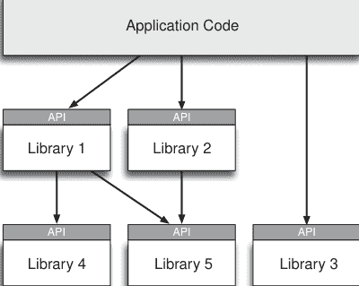

图 1.1

一个从分级 API 调用例程的应用程序。每个框代表一个软件库，深色部分代表该库的公共接口或 API，而白色部分代表该 API 后面的隐藏实现。

另一种策略是聘佣专业的承包商来为你执行关键任务（图 1.2）。你可以聘佣一名建筑师为房屋设计方案，聘佣一名木工处理所有的木工需求，聘佣一名水工为你的房屋安装水管和污水系统，聘佣一名电工建立电力系统。采取这种方法，你与每个承包商进行谈判——告诉他们你需要什么并商定价格——他们随后为你工作。如果你运气好，甚至会有一个提供免费服务的 API。这种策略 的类比显而易见：你正在建造的房子等同于你编写的程序，而承包商提供了实现你任务的 API 抽象。

对 API 的类比也许是显而易见的：API 抽象了任务，这些 API 隐藏了任务的实现细节。你的任务涉及选择合适的 API 并将其集成到软件中。提供免费服务的朋友的类比意味着可以免费使用的开源库，而不是需要许可费的商业库。这种类比可以扩展为某些承包商雇用分包商，这对应于依赖其他 API 的 API。

承包商类比在面向对象的编程中很常见。该领域的早期从业者一直在定义对象提供的服务或行为的合约。对象在被请求时实现这些服务，并将其部分工作外包给其他对象（Meyer, 1987; Snyder, 1986）。

# 1.1 什么是应用程序编程接口？3


图 1.2

使用承包商执行专业任务建造房屋。

### 1.1.2 C++ 中的 API

严格来说，API 只是与组件交互的描述。也就是说，它为组件提供了抽象和功能规范。事实上，许多软件工程师倾向于将 API 扩展为抽象编程接口而不是应用程序接口。

在 C++ 中，这体现为一个或多个头文件（`.h`）以及支持性文档文件。一个给定 API 的实现通常表示为可以链接到终端应用程序的库文件。这既可以是静态库（例如 Windows 上的 `.lib` 文件或 Mac OS X Linux 上的 `.a` 文件），可以是动态库（例如 Windows 上的 `.dll` 文件、Mac 上的 `.dylib` 或 Linux 上的 `.so`）。C++ API 通常包含以下元素：

- 1. 头文件：一组 `.h` 头文件定义了接口并允许客户端代码针对该接口进行编译。开源 API 还包含 API 实现的源代码（`.cpp` 文件）。

- 2. 库：提供 API 实现的一个或多个静态或动态库文件。客户端可以将代码链接到这些库文件，以便为其应用程序添加功能。

- 3. 文档：描述如何使用 API 的概述信息，通常包括对 API 中所有类和函数的自动生成文档。

# 第 1 章 引言

作为一个知名 API 的示例，微软的 Windows API（通常称为 Win32 API）是 C 函数、数据类型和常量的集合，它们使程序员能够编写在 Windows 平台上运行的应用程序。这包含了用于文件处理、进程和线程管理、创建图形用户界面、网络通信等函数。

Win32 API 是 C API 的示例，而不是 C++ API。虽然你可以在 C++ 程序中直接使用 C API，但一个特定 C API 的良好范例是标准模板库（STL）。STL 包含一组容器类、用于遍历这些容器元素的迭代器，以及作用于这些元素的各种算法（Josusitti, 1999）。例如，算法集合处理了如 `std::search()`、`std::reverse()`、`std::sort()` 和 `std::set_intersection()` 等高级操作。因此，STL 为操作元素集合的任务提供了一个逻辑接口，而不暴露每个算法具体如何实现的内部细节。

> 提示

API 是指向软件组件的逻辑接口，它隐藏了实现该组件所需的内部细节。

## 1.2 API 设计有何不同？

接口是开发者编写的最重要的代码。那是因为接口中的问题修复成本远高于相关实现代码中的问题。因此，开发共享 API 的过程比标准应用程序或图形用户界面（GUI）的开发需要更多的关注。当然，两者都应该涉及最佳设计实践；然而，在 API 开发中，这些实践对于其成功至关重要。具体来说，API 开发的一些关键差异化因素包括以下几：

- API 是为开发者设计的接口，就像 GUI 是为用户设计的接口一样。事实上，人们说 API 是面向程序员的用户界面（Arnold, 2005）。因此，你的 API 可能被用于共享世界范围内开发者的所有需求，而且它无疑会以你从未预想过的方式被使用（Tulach, 2008）。一个设计良好的 API 可以成为你机构最大的资产。相反，一个糟糕的 API 可能会导致支持噩梦，并让你的用户转向竞争对手（Bloch, 2005），就像一个充满 Bug 或难以使用的 GUI 可能会强制用户切换到另一个方向。

- 多个应用程序可以共享同一个 API。图 1.1 显示单个应用程序由多个 API 组成。然而，其中任何一个 也可以被重用在其他应用程序中。这意味着，虽然任何给定应用程序的代码只会影响该一个应用程序，但一个 API 可能会影响所有依赖于该功能的应用程序。

- 每当你更改 API 时，你必须努力实现向后兼容。如果你对接口进行了不兼容的更改，你客户端的代码可能会失败，更糟糕的是他们的代码可能会表现异常或无意中崩溃。想象一下如果标准 C 库中 `printf()` 函数的签名在不同编译器或平台上不同，会产生多大的混乱和矛盾。简单的“Hello World”程序可能看起来不再那么简单了：

```
#include <stdio.h>
#ifdef _WIN32
#include <windows.h>
#endif
#ifdef __cplusplus
#include <iostream>
#endif

int main(int, char *argv[]) {
    #if __STRICT_ANSI_
        printf("Hello World\n");
    #elif __defined(WIN32)
        PrintWithFormat("Hello World\n");
    #elif __defined(PRINT_DEPRECATED__)
        printf("Hello World\n");
    #elif __defined(__PRINT_VECTOR__)
        const char *lines[2] = {"Hello World", NULL};
        printf(lines);
    #endif
#if __cplusplus
    std::cout << "Hello World" << std::endl;
#else
    // Error No terminal output API found
#endif
    return 0;
}
```

这看起来像是一个很有创意的例子，但实际上并不极端。看一眼你编译器随附的标准头文件，你会发现那些声明同样复杂且晦懂，甚至更糟。

- 出于对向后兼容性的要求，建立控制流程是至关重要的。在正常开发过程中，开发者可能会为 API 修复 Bug 或添加新功能。这些开发者中一些可能是初级工程师。其中一些也可能是不完全理解 API 的初级工程师。因此，在发布新版本之前审核 API 是至关重要的。

- API 的生命周期通常很长。如果你对接口进行了不兼容的更改，你客户端的代码可能会失败，更糟糕的是他们的代码可能会表现异常或无意中崩溃。然而，如果处理得当，长期成本可以显著降低，你获得了对软件进行激进更改的灵活性。

在编写 API 时，对良好文档的需求至关重要。用户可以查看你的头文件来了解如何使用它，但这并没有定义 API 的行为，例如允许的输入值或错误情况。因此，编写良好、一致且详尽的文档对于任何 API 都是必不可少的。

自动化测试的需求同样非常高。如果你正在对 API 进行更改，如果有一套完善的回归测试验证你客户端的程序没有发生变化，你就会更有信心。

编写良好的 API 是困难的。虽然必要的技能基于通用设计原则，但它们还需要额外的知识和开发流程来解决上述要点。然而，API 设计的原则和技术很少教给工程师。通常，这些都是通过经验获得的——通过犯错并经验性地学习哪些有效、哪些无效（Henning, 2009）。本书试图纠正这种局面，将通过多年软件工程演化出的工业级、面向未来的 API 设计策略提炼为一种全面、实用且易于理解的格式。

> 提示

API 描述了其他工程师构建其应用程序时使用的软件。因此，它必须设计良好、文档完备、经过回归测试并在发布版本之间保持稳定。

## 1.3 为什么要使用 API？

关于为什么在软件项目中应该考虑 API 的问题可以从两个角度解释：(1) 为什么你应该设计并编写自己的 API，或者 (2) 为什么你应该在你的应用程序中使用其他开发者提供的 API？这两个视角将在接下来的章节中进行讨论，我将介绍在项目中使用 API 的各种好处。

### 1.3.1 更健壮的代码

如果你正在编写一个供其他开发者使用的模块，即使是供组织内部的同事或你库的外部客户，创建一个 API 让他们访问功能也是一项明智的投资。这样做将为你带来以下收益：

- 隐藏实现。通过隐藏模块的实现细节，你获得了在未来日期更改实现而不会给用户造成动动的灵活性。如果不这样做，你将要么 (i) 限制自己对代码进行更新的能力，要么 (ii) 强制你的用户重写代码以采用库的新版本。如果你让客户更新的负担太重，他们将根本不会升级，或者去别处寻找维护起来更轻松的 API。

## 1.3 为什么要使用 API？

- **增加寿命。** 随着时间的推移，暴露其实现细节的系统往往会退化为“意大利面代码”，其中系统的每个部分都依赖于系统其他部分的内部细节。结果是，系统变得脆弱、僵化、不可移动且成本高昂（Martin, 2000）。这通常导致组织不得不花费大量精力将代码演进到更好的设计，或者从头开始重写。通过投资于良好的 API 设计，你可以帮助减少维护连贯设计的增量成本，你的软件可以运行得更久，从长远来看维护成本也更少。我将在第 4 章开始深入探讨这一点。

- **促进模块化。** API 通常是为了解决特定的任务或用例而设计的，专注于。在 API 集合之上开发应用程序可以促进松耦合和模块化的架构，其中一个模块的行为不依赖于另一个模块的内部细节。

- **减少重复。** 代码重复是软件工程的罪罪之一，应该尽可能避免。通过将你所有代码的逻辑保持在所有客户端都使用的严格接口之后，你将行为集中在一个地方。这意味着你只需要更新一个地方，就可以更改所有客户端的 API 行为。这有助于减少你创建的实现代码的重复。事实上，许多 API 是在发现重复代码并决定将其合并到单一接口后创建的。这是一好事。

- **消除硬编码假设。** 许多程序可能包含在整个代码中复制的硬编码值，例如，每当数据写入日志文件时都使用 `myprogram.log`。相反，可以使用 API 提供信息的访问，而无需在整个代码库中复制这些常量值。例如，`GetLogFilename()` API 可以用来替换硬编码的字符串 `"myprogram.log"`。

- **更易更改实现。** 如果你将模块的所有实现细节都放在其公共接口中，那么你就可以更改实现细节而不影响任何依赖于 API 的代码。例如，你可能决定更改文件解析例程，使用 `std::string` 容器而不是分配和重新分配你的 `char`缓冲区。

- **更易优化。** 同样，在成功处理实现细节后，你可以优化你的 API 性能，而无需对客户端的代码进行任何更改。例如，你可以为执行某些计算密集型计算的方法添加缓存解决方案。这是可能的，因为所有读写数据的尝试都是通过你的 API 执行的，因此更容易知道何时必须失效缓存并重新计算新值。

### 1.3.2 代码复用

代码复用是使用现有软件来构建新软件。它是现代软件开发中的圣杯之一。API 提供了一种实现代码复用的机制。

在软件开发的早期，公司为他们生产的任何应用程序编写所有代码是很常见的。如果程序需要读取 GIF 图像或解析文本文件，公司必须在内部编写所有这些代码。如今，随着……的普及……

### 1.3.3 并行开发

即使你正在编写内部软件，你的同事也很可能需要编写使用你代码的代码。如果你使用良好的 API 设计技术，你可以简化他们的生活，并扩展到你自己的生活（因为你不需要回答许多关于你的代码如何工作或如何使用它的问题）。如果多个开发者并行工作相互依赖的代码，这一点将变得更加重要。

例如，假设你正在编写一种字符串加密算法，另一个开发者想要将数据写入配置文件中。一种方法是让另一个开发者等待你完成工作，然后在他的文件写入器模块中使用它。然而，更有效的时间利用方式是你们尽早会面并就合适的 API 达成一致。然后你就可以带有占位符功能部署该 API，你的同事可以立即开始调用，例如：

```cpp
#include <string>
class StringEncrypt {
public:
    // 设置用于 Encrypt() 和 Decrypt() 用的密钥
    void SetKey(const std::string& key);

    // 根据当前密钥对输入字符串进行加密
    std::string Encrypt(const std::string& str) const;

    // 使用当前密钥解密字符串 - 对
    // Encrypt() 返回的字符串调用 Decrypt() 将
    // 为相同的密钥返回原始字符串。
    std::string Decrypt(const std::string& str) const;

};
```

然后你可以提供这些函数的简单实现，以便至少模块可以编译和链接。例如，相关的 `.cpp` 文件可能看起来如下：

```cpp
void StringEncryptor::SetKey(const std::string& key)
{
}

std::string StringEncryptor::Encrypt(const std::string& str)
{
    std::string str;
    return str;
}

std::string StringEncryptor::Decrypt(const std::string& str)
{
    return str;
}
```

通过这种方式，你的同事可以使用此 API 并继续他的工作，而不被你的进度阻碍。对于目前，你的 API 将不会实际上加密任何字符串，重要的是有一个稳定的接口——它行为恰当，例如，Decrypt("Hello") == "Hello"。但这可能不是你的部分。

这种方法鼓励测试驱动的、或测试优先的开发。通过在早期对 API 进行 stub，你可以编写单元来验证所需的功能并持续运行。将其扩展到组织级别，你的项目可能有相互分离的团队，即使工作时间表不同。通过定义每个团队的依赖关系，每个团队可以独立工作，尽可能了解其他团队如何在 API 之后实现工作。资源的使用……

## 何时你应该避免 API？

设计和实现 API 通常比普通代码需要更多工作。这是因为 API 的目的是为其他开发者提供一个健壮且稳定的接口。因此，质量、计划、文档、测试、支持和维护水平远高于单个应用程序内的软件。

结果，如果你正在编写一个不需要其他客户端与其通信的内部模块，那么为你的模块创建和支持公共接口的额外开销可能并不值得，这不是编写糟糕代码的理由。花费时间遵循 API 设计原则从长远来看是不会浪费的。

硬另一方面，考虑你是一个想要在应用程序中使用第三方 API 的软件开发人员。前面的部分讨论了你可能想在软件中复用 API 的许多原因。然而，在某些情况下，你可能希望避免特定的 API 并付费自行实现代码或替代解决方案。例如：


进入`/path/to/xxx`目录，找到`xxx.json`。

在表达式`cvar = avar + bvar`中，加法运算符（`+`）将`avar`与`bvar`相加，得到它们的和`cvar`

在`List.of(arg0, arg1, arg2)`中，`List`接口的工厂方法`of()`接受一系列的元素，返回包含它们的只读列表。

之后我们这样调用`cmd`命令：`cmd arg0 arg1 arg2`。

```
if (condVar > someVal) {console.log("xxx")}
```

# 许可限制

API 在功能上可能提供了你需要的一切，但许可限制对于你的需求可能是禁止的。例如，如果你想使用根据 GNU 通用许可证 `GPL` 分发的开源软件包，你被要求根据 `GPL` 发布任何衍生作品。这意味着你程序中的此包将要求你发布应用程序的所有源代码，这种限制对于商业应用程序可能是不可接受的。其他许可证，例如 GNU 通用公共许可证 `LGPL`，更为宽松，并且对于软件库更为常见。许可的另一个方面是商业 API 的成本对于你的项目可能太高了，或者许可条款可能过于严格，例如要求每个开发者甚至每个用户支付许可费。

# 1.5 API 示例

## 功能不匹配

一个 API 似乎可以解决你面临的问题，但其实现方式可能不符合你应用程序的约束或功能需求。例如，你可能正在开发一个图像处理工具，并希望提供傅里叶变换能力。目前有许多快速傅里叶变换 `FFT` 的实现，但其中很大一部分是 1D 算法，而由于你处理的是 2D 图像数据，你需要的是 2D `FFT`。此外，2D `FFT` 算法仅适用于大小为 2 的幂次方的数据集，例如 256 × 256 或 512 × 512 像素。再者，你找到的 API 可能不符合你必须支持的平台，或者不符合你为应用程序指定的性能标准。

## 缺乏源代码

尽管有很多开源 API，但有时对于你的这种情况来说，最好的 API 可能是闭源提供的方案。也就是说，你只能获得接口的头文件，而底层的 C++ 源代码不会随库一起分发。这产生了几个重要的影响。其中之一是如果你在库中遇到 bug，你无法检查源代码来理解可能出现了什么问题。阅读源代码是追踪 bug 并可能发现其规避方案的有效技术。如果无法访问 API 的源码，你就失去了通过修改源码来修复 bug 的能力。这意味着你的软件项目进度可能会受到正在使用的第三方 API 中不可预见问题的影响，并受到等待 API 所有者处理你的 bug 报告并提供修复补丁的时间的限制。

## 缺乏文档

一个 API 似乎可以满足你应用程序中的所有需求，但如果该 API 的文档糟糕或不存在，你可能决定在其他处寻找解决方案。也许如何使用该 API并不显而易见，也许你无法确定 API 在某些情况下的行为，又可能你不信任一个没有花时间解释如何使用其代码的工程师的工作。

# API 示例

API 无处不在。即使你编程的时间还很短，但变化是，你已经写过代码来使用一两个 API，也许你还自己写过一个。

## 1.5.1 API 的分层

API 可以是任何规模，从单个函数到大型类集合。它还可以提供任何架构层的功能访问，从底层的操作系统调用直到整个 GUI 工具包。以下列表列出了各种常见的 API，其中许多你可能已经听说过，这能让你对流行的 API 开发有一个良好的了解。

### 操作系统 OS API

每个操作系统都必须提供一组标准 API，允许程序访问操作系统级的服务。例如，`POSIX` API 定义了如 `fork()`、`getpid()` 和 `kill()` 等用于管理 UNIX 风格进程的函数。微软的 `Win32` API 包含了如 `CreateProcess()`、`GetProcess()` 和 `TerminateProcess()` 等用于管理 Windows 进程的函数。这些是稳定的底层 API，永远应该更改，否则许多程序可能会崩溃！

### 语言 API

C 语言提供了一个标准 API，通过 `libc` 库实现并支持许多页面，包括 `printf()`、`scanf()` 和 `fopen()` 等熟悉的函数。C++ 语言还提供了标准模板库 `STL`，它为各种类，例如 `std::string`、`std::vector`、`std::set` 和 `std::map`、迭代器，例如 `std::vector<double>::iterator` 和通用算法，例如 `std::sort`、`std::for_each` 和 `std::union` 提供了 API。例如，下面的代码段使用 STL API 遍历 vector 中的所有元素并打印它们：

```cpp
#include <vector>
#include <iostream>
void PrintVector(const std::vector<float>& vec) {
    for (const auto& item : vec) {
        std::cout << item << std::endl;
    }
}
```

### 图像 API

开发者需要自己编写图像的时代已经过去。现在有广泛的库用于图像。例如，流行的库提供了 JPEG 解码器和编码器。还有用于格式的 TIFF 库。下面的代码使用 TIFF API 获取维度：

```cpp
TIFF *tif = TIFFOpen("image.tif", "r");
if (tif) {
  uint32 w, h;
  TIFFGetField(tif, TIFF_WIDTH, &w);
  TIFFGetField(tif, TIFF_LENGTH, &h);
  printf("Image size = %dx%d\n", w, h);
  TIFFClose(tif);
}
```

### 三维图形

3D 图形 API 有 `OpenGL` 和 `DirectX`。这些 API 让你定义 3D 对象，如三角形或多边形、指定表面属性，如颜色、法线和纹理 并定义环境，如光照、雾和裁剪平面。得于这些 API，开发者可以编写游戏。下面的经典示例使用 `OpenGL` 渲染一个带色的三角形：

```cpp
glClear(GL_COLOR_BUFFER);
glBegin(GL_TRIANGLES);
glColor3f(0.0, 0.0, 1.0); // 蓝色
glVertex2i(0.0, 0.0);
glColor3f(0.0, 1.0, 0.0); // 绿色
glVertex2i(200, 0.0);
glColor3f(1.0, 0.0, 0.0); // 红色
glVertex2i(0.0, 200);
glEnd();
glFlush();
```

### 图形界面 API

任何想要打开窗口的应用程序都需要使用 GUI 工具包。这是一个提供了创建窗口、文本、字段、对话框、图标和菜单能力的 API。该 API 还提供事件模型以捕捉鼠标和键盘事件。流行的 C++ API 包括 `wxWidgets` 库、诺基亚的 `Qt` API、`GTK+` 和 `Mobile`。如果一家公司想要在多个平台，如 Windows 和 Mac 上发布应用程序，它们将为每个平台使用不同的 GUI API 重写用户界面代码，或者开发自己的内部跨平台 GUI 工具包。然而，这些现代 GUI 工具包适用于多个平台 `Windows`、`Mac` 和 `Linux`，这使得编写跨平台应用程序变得更容易。作为现代跨平台 GUI 的示例，下面的完整程序展示了一个最小的 `Qt` 程序，它会弹出一个带有 Hello world 的窗口：

```cpp
#include <Application>
#include <QPushButton>

int main(int argc, char *argv[])
{
    Application app(argc, argv);
    QPushButton hello("Hello world!");
    hello.resize(100, 30);
    hello.show();
    return app.exec();
}
```

# 第 1 章 引言

> 提示
>
> API 在现代软件开发中无处不在，从操作系统和语言级别的 API 到图像、音频、图形、并发、网络、XML、数学、Web 浏览器或 GUI API。

## 1.5.2 现实案例

上述 API 示例是刻意按架构层次排列的，以展示你在构建应用程序时可能使用的 API 范围。在构建大型软件产品时，你通常会看到来自多个架构层的 API。例如，图 1.3 展示了 Linden Lab 的 Second Life Viewer 架构图。这是一个大型开源项目，允许用户在 3D 虚拟世界中相互交互，并能够在用户之间进行代码和文本消息。该图演示了 API 在大型 C++ 项目项目中的用法和分层。

特别值得注意的是内部 API `Internal APIs` 层，我指的是公司为了特定产品或系列产品而在内部开发的模块集。为了简单起见，图 1.3 仅显示了这一层；内部 API 集合将形成额外的层栈，包括从基础级程序提供的内部字符串、文件 I/O、线程程序等；到提供应用程序核心业务逻辑的 API，以及一直用于使用 GUI API 管理应用程序用户界面的方式。

显然，图 1.3 并没有提供该应用程序使用的所有 API 的完整列表。它只是展示了每个架构层的几个示例。然而，表 1.1 列出了该应用程序的第三方依赖项，让你了解现代软件项目构建在多少开源和闭源依赖项之上。当你将系统和操作系统库也考虑在内时，列表会进一步增长。

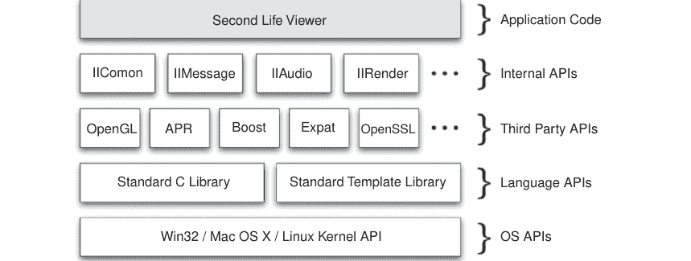

图 1.3
Second Life Viewer 的架构图。

## 1.5 API 示例 15

| 表 1.1 Second Life Viewer 使用的开源和闭源 API 列表 |
|---|---|
| API |  |
| APR | Apache Portable Runtime |
| Boost | 一组可移植 C++ 工具库 |
| c-ares | 异步 DNS 解析库 |
| cURL | 客户端 URL 请求库 |
| Expat | 面向流 XML 解析器 |
| FMOD | 商业音频引擎和 MP3 流解码器 |
| FreeGLUT | OpenGL 实用工具包 GLUT 的开源版本 |
| FreeType | 字体栅化引擎 |
| glh_liner | C++ OpenGL 辅助库 |
| jpeglib | JPEG 解码库 |
| KDU | 商业 Kakadu KDU JPEG-2000 解码库 |
| libpng | PNG 图像库 |
| llqtwebkit | Qt 的嵌入式 WebKit 浏览器 |
| Ogg Vorbis | 压缩音频格式库 |
| OpenGL | 3D 图形渲染引擎 |
| openjpeg | 开源 JPEG-2000 库，KDU 的替代方案 |
| OpenSSL | 安全套接层 SSL 库 |
| Quicktime | 视频播放库 |
| ing | 商业语音聊天库 |
| xmlrpc-epi | XML-RPC 协议库 |
| zlib | 无损数据压缩库 |

## APIs 和 SDK

开发工具包 `SDK` 一术与 API 密切相关。本质上，`SDK` 是一个特定平台的包，你将其安装在计算机上，以便针对一个或多个 API 构建应用程序。至少，一个 `SDK` 将包含用于编译程序的头文件 `.h` 以及提供 API 实现的库文件 `.dylib`、`.so`、`.dll`，以便将你的应用程序与其链接。然而，`SDK` 还可能包含其他帮助你使用 API 的资源，例如文档、示例源码和支持工具。

例如，Apple 发布了各种 API，允许你编写在 iPhone、Touch 和 iPad 设备上运行的应用程序。示例包括 `UIKit` 接口 API、将 Web 浏览器功能嵌入应用程序的 `WebKit` API 以及用于音频服务的 `Core Audio` API。Apple 还提供了 iPhone `SDK`，这是一个可下载的安装包，包含了实现各种 iPhone API 的框架 `头文件和库`。这些文件是你编译并链接的文件，以便你的程序能够访问这些 API 的底层功能。iPhone `SDK` 还包含 API 文档、示例代码以及用于 Apple 集成开发环境 `IDE` `Xcode` 的各种模板。

# 1.6 文件格式和网络协议

存在多种客户端/服务器通信的形式。其中最著名的是 JPEG 交换格式 `JFIF`，它通常用于应用程序。你开始将 UDP 作为系统部分的传输层，但后来切换到 TCP `正如在 Second Life 代码库中发生的那样`。如果所有的网络访问已经通过适当的 API 进行了抽象，那么这种重大的实现变更对……几乎没有影响。

这种建议同样适用于客户端/服务器应用程序，其中定义通用协议和管理该协议的通用 API 可以允许客户端和服务器团队相对独立工作。例如，你可能开始将 UDP 作为系统部分的传输层，但后来切换到 TCP `正如在 Second Life 代码库中发生的那样`。如果所有的网络访问已经通过适当的 API 进行了抽象，那么这种重大的实现变更对系统的其他部分几乎没有影响。

## 1.7 关于本书

> 提示
>
> 当你创建一个文件格式或服务器协议时，你应该为它创建一个 API。这允许规范的细节以及未来的任何更改都集中管理。

例如，如果你为应用程序指定了一种文件格式，还应该编写一个 API 来允许读取和写入该格式的文件。首先，这是一种良好的做法，允许你将来轻松地更改格式而无需重写任何代码。最后，如果你最终有了多个版本的格式，你的 API 可以抽象复杂性，因为它可以读取和写入任何版本格式的数据。从本质上说，磁盘数据的实际格式变成了一个隐藏的实现细节，你的应用程序无需担心它。

| 表 1.2 文件头 |
|---|---|
| 字段 | 字节大小 |
| APP0 标记 | 2 |
| 长度 | 2 |
| 标识符 | 5 |
| 版本 | 2 |
| 密度单位 | 1 |
| X 密度 | 2 |
| Y 密度 | 2 |
| 缩略图宽度 w | 1 |
| 缩略图高度 h | 1 |
| 缩略图数据 | 3 x h |

在我涵盖了什么是 API 以及 API 开发优之后之后，将深入细节，例如如何设计 API、如何在 C++ 中实现它们以及如何在不破坏向下兼容的情况下对其进行版本控制。本书的章节顺序大致遵循 API 的标准演变，从初始设计到实现、版本控制和测试。

第 2 章：特性
我从正文开始的一个章节回答了以下问题：什么是良好的 API？这涵盖了你在设计 API 时应该注意的广泛特性，例如信息隐藏、最小复杂性和松耦合。正如我在书中所做的那样，我将使用许多 C++ 源码示例来说这些概念，展示它们如何与你的项目相关。

第 3 章：模式
接下来的几个章节解决了你如何设计良好的 API 问题。因此，第 3 章查看了某些对 API 设计特别有帮助的设计模式和用法。这些包括 `pimpl` 模式、`单例`、`工厂方法`、`代理`、`适配器`、`外观` 和 `观察者` 模式。

第 4 章：设计
继续如何设计良好 API 的话题，第 4 章讨论了功能性需求收集和用例建模，以驱动清洁且易用接口的设计，以及

## 第1章 引言

一些面向对象分析和面向对象设计的技术。本章还讨论了大型软件项目面临的许多问题。这些观察结果源于真实世界的经验，并为进行大规模 API 开发时出现的问题提供了见解。

## 第5章：风格

接下来的几章将重点介绍如何使用 C++ 创建高质量的 API。由于这是一个深奥且复杂的话题，因此，我将开始描述你可以在项目中采用的各种 C 和 C++ API 风格，例如扁平 C API、面向对象 API、基于模板的 API 以及数据驱动 API。

## 第6章：用法

接下来，我将讨论可以影响良好 API 设计的 C++ 语言特性。这包括一些重要问题，如“神构造函数”和运算符风格、命名空间、指针引用参数、友元 `friends` 的使用，以及如何在动态库中导出符号。

## 第7章：性能

在本章中，我分析了 API 中的性能问题，并展示了如何在 C++ 中构建高性能的 API。这涉及 `const` 引用、前向声明、数据聚类和内联 `inlining`。我还介绍了各种帮助你评估代码性能的工具。

## 第8章：版本控制

在 API 设计的基础上，我将扩展到更复杂的方面，如版本控制和二进制兼容性。这是 API 设计中非常重要且困难的部分，我将定义什么是后兼容性以及如何处理它。

## 第9章：文档

接下来，我将讨论 API 文档。由于良好的 API 文档至关重要，我将介绍如何编写 `Doxygen`，以及如何通过注释来完善你的 API。

## 第10章：测试

在本章中，我将讨论自动化测试，并展示如何对你的 API 进行测试。这涵盖了单元测试、集成测试、模拟测试 `mock` 以及测试驱动开发。

## 第11章：耦合

随后，我将讨论 API 的耦合问题。在 API 设计中，降低耦合是至关重要的。低耦合是 API 设计中一个一个至关重要的方面。因此，我将讨论如何通过解耦来改进你的 API。

## 第12章：扩展性

API 的扩展性是另一个重要话题，它允许 API 能够进行相应的扩展。我将展示如何使用插件来扩展 API。

# 附录 A：库

本书将以库结束，讨论如何创建静态和动态库。在 API 设计中，导出符号是一个必须考虑的问题。因此，我将讨论如何创建库并导出你的 API。

## 2.1 领域建模

`UML` 规范定义了一系列视觉符号来建模面向对象的软件系统 `Booch et al., 2005`。此书通常使用 `UML` 类图来描述类设计，如图 2.1 所示。在这些设计中，一个类被表示为一个分为三个部分的框：

1. 顶部部分包含类名。
2. 中间部分列出属性。
3. 底部部分列出方法。

类框的中间和底部部分的每个条目都可以前缀一个符号来指示其访问级别，或可见性，或成员。这些符号包括：

- `+` 表示公有成员
- `-` 表示私有成员
- `#` 表示受保护成员

类之间的关系通过各种连线和箭头来说明。`UML` 类图中常见的关系有：

**关联 Association。** 两个类之间简单的依赖关系，其中一个类拥有另一个，用实线表示。关联可以是方向性的，用箭头表示。

**聚合 Aggregation。** 一种“拥有”整体/部分的关系，其中一个类拥有另一个，用空心菱形表示。

**组合 Composition。** 一种“拥有”的关系，其中部分的生命周期由整体管理。用实心菱形表示。

**泛化 Generalization。** 类之间的子类关系，用带三角形箭头的线表示。

关系的每一边都可以注释以定义其多重性。这允许指定关系是一一、一对多还是多多。常见的多重性包括：


- `0..1` 零或一个
- `1` 确切的一个
- `1..*` 零或多个

### 2.1.2 关键对象建模

API 还应该为领域建模关键对象。这个过程通常被称为面向对象设计或对象建模。对象建模的目标是识别对象的集合、它们提供的操作以及它们如何相互关联。

再次，对于给定的领域没有正确的对象模型。相反，创建对象模型的任务由 API 的特定需求驱动。API 的不同需求可能需要不同的对象模型来表示这些需求。例如，继续我们的地址录示例，假设收到了以下需求：

1. 每个人可能有多个地址。
2. 每个人可能有多个电话号码。
3. 电话号码可以被验证和格式化。
4. 地址录可能包含多个同名的人。
5. 现有的地址录可能会被修改。

这些需求会对 API 的对象模型产生巨大影响。图 2.1 中的原始设计仅支持每个人一个地址。为了支持多个地址，你可以为 `Person` 对象添加额外的字段，例如 `HomeAddress`, `WorkAddress`，但这将是一个脆弱且缺乏灵活性的解决方案。相反，你可以引入一个 `Address` 对象来表示地址，并允许 `Person` 对象包含多个此类对象。电话号码也是如此：你应该将这些考虑进你的对象，例如创建一个独立的 `PhoneNumber` 对象，以支持诸如 `IsValid()` 的操作，并对电话号码而不是人自然返回格式化后的版本。此外电话号码应该由一等对象 first-class objects 表示。

多个对象同名的要求意味着人的名字无法唯一标识 `Person` 对象的实例。因此，你需要某种方法来唯一标识 `Person` 实例，以便更新地址录中的条目。一种方法是为每个对象生成唯一标识符 `UUID`。将所有这些整合在一起，你可能考虑地址录 API 的关键对象为：

- 地址录 `Address Book`：包含零或多个 `Person` 对象，操作有 `AddPerson()`, `DeletePerson()` 和 `UpdatePerson()`。
- 人 `Person`：完整描述了单个人的细节，包括零或多个地址和电话号码。每个人通过 `UUID` 区分。
- 地址 `Address`：描述单个地址，包括类型为“家庭”或“工作”的字段。
- 电话号码 `Telephone Number`：描述单个电话，包括类型为“家庭”或“手机”的字段。还支持操作 `IsValid()` 和 `GetFormattedNumber()`。

更新后的对象模型可以用 UML 图表示，如图 2.2 所示。

| 地址 `Address` |  |
| :--- | :--- |
| + `address1`: `string`<br>+ `address2`: `string`<br>+ `city`: `string`<br>+ `state`: `string`<br>+ `zipcode`: `string`<br>+ `type`: `string` |  |
| 人 `Person` | + `firstName`: `string`<br>+ `middleName`: `string`<br>+ `lastName`: `string`<br>+ `id`: `UUID` |
| 电话号码 `Telephone Number` | + `number`: `string`<br>+ `type`: `string`<br>+ `IsValid()`: `boolean`<br>+ `GetFormattedNumber()`: `string` |
| 地址录 `Address Book` | + `AddPerson()`: `boolean`<br>+ `DeletePerson()`: `boolean`<br>+ `UpdatePerson()`: `boolean` |

图 2.2 地址录 API 中关键对象的 UML 图。

需要注意的是，API 的对象模型可能随着时间的推移而变化。随着新需求的接收或新功能的添加，满足这些需求的类和方法的最佳划分可能会发生变化。因此，根据需求重新评估你的对象模型总是明智的，以评估你的对象模型是否也能从重新设计中受益。例如，你可能预判到国际地址的需求并决定创建一个更通用的 `Address` 对象来处理这种能力。然而，不要过度，试图创建一个比你需要的更多的对象模型。确保你阅读了关于“最小完整”的后续章节！

## 2.2 隐藏实现细节

API 的对象模型可能随着时间的推移而变化，这一点很重要。当收到新需求或添加新功能时，满足这些需求的类和方法的最佳划分可能会发生变化。因此，根据需求重新评估你的对象模型总是明智的，以评估你的对象模型是否也能从重新设计中受益。例如，你可能预判到国际地址的需求并决定创建一个更通用的 `Address` 对象来处理这种能力。然而，不要过度，试图创建一个比你需要的更多的对象模型。确保你阅读了关于“最小完整”的后续章节！

封装面向对象的目标是为了隐藏那些可能更改的内部细节。David L. Parnas 将这种概念称为信息隐藏 `Parnas, 1975`。实现此目标的方案有两类：物理隐藏和逻辑隐藏。物理隐藏意味着类代码对用户是不可用的。逻辑隐藏允许使用语言特性来限制对象的访问。

### 2.2.1 物理隐藏：声明与定义

在 C 和 C++ 中，声明和定义具有不同的含义。声明引入名称和类型，而定义分配内存。`C` 程序员使用的函数原型等同于这种函数声明。例如，以下都是声明：

```cpp
extern i;
class MyClass;
void MyFunc(int value);
```

相比之下，以下都是定义：

```cpp
int i = 0;
class MyClass {
public:
    float x, y, z;
};
void MyFunc(int value) {
    printf("%d).", value);
}
```

**TIP**

声明引入符号的名称和类型到编译器，而不分配内存。

## 2.2 隐藏实现细节

| 接口 |  |  |
| :--- | :--- | :--- |
| `public:` | `Function1()` |  |
|  | `Function2()` | 所有人可见 |
| `protected:` | `Function3()` |  |
|  | `Function4()` | 派生类成员可见 |
| `private:` | `Function5()` |  |
|  | `Function6()` | 仅本类成员可见 |

图 2.3

C++ 类的三种访问级别。

- **Public** 公开：类/结构外部可见。这是结构体的默认访问级别。
- **Protected** 受保护：成员仅在特定类及其任何派生类内部可见。
- **Private** 私有：成员仅在定义它们的特定类内部可见。这是类的默认访问级别。

#### 其他语言中的封装

虽然 C++ 为类成员提供了 `public`、`protected` 和 `private` 访问控制，但面向对象的语言提供了不同粒度的细粒度控制。在 Smalltalk 语言中，实例变量和所有方法都是公开的，而 Java 语言提供了 `public`、`protected` 和包级 `package-level` 可见性。

Java 中的包私有 `Package-private` 意味着成员仅可以被同一包内的类访问。这是 Java 中的默认可见性。包私有是允许其他类访问内部成员而不将其暴露给客户端的极佳方法。它对于需要验证方法行为的单元测试来说特别有用。

`Cpp` 没有包私有可见性的概念。相反，它使用更宽松的“友元 `friendship`”概念，允许命名的类和函数访问类的保护和私有成员。友元机制可以增强封装，但如果使用不当，也可能向客户端暴露内部细节。

很可能，你的用户并不在意遵守你的 API 边界。如果你提供了内部运行机制的钩子 `hooks` 让他们实现他们想要的功能，他们就会利用它们来完成工作。虽然这对他们来说可能是件好事，因为他们找到了解决眼前问题的方案，但可能会让你在以后更改这些实现细节变得更加困难，从而限制你改进和优化产品的能力。

# 第 2 章 特质

> 提示
>
> 封装是将 API 的公共接口与其底层实现相分离的过程。

这是一个关于用户会付出的巨大代价的例子：多人第一人称射击游戏《反恐精英》 `Counter-Strike` 自 2000 年左右出现以来一直是外挂攻击的热目标。其中最著名的之一是“透视 `wallhack`”。这本质上是一个修改过的 OpenGL 驱动程序，可以将墙壁渲染为部分或完全透明。这让玩家获得了一个明显优势：可以看到墙。虽然你可能没有开发游戏，也没有以玩家为客户，但道理是：无论他们为了得到想要的东西做什么——如果某些用户修改了 OpenGL 图形驱动以在游戏中获得优势，那么就会有用户利用你 API 暴露的内部细节来实现他们请求的功能。

为了用一个更直接相关的例子来说明这一点，Roland Faber 报告了西门子内部发生的困难：一组决定依赖公司内另一组的 API 内部实现。

一个欧洲之外的团队必须为在德国实现的用户界面提供远程控制。由于自动化接口不完整，他们决定在不通知架构师的情况下直接使用内部接口。由于接口更改缺乏协调，系统集成出现了意外问题，昂贵的重构变得不可避免。

接下来的章节将讨论如何使用编程语言的访问控制功能为你的 API 提供最高级别的信息隐藏。关于 C++ 使用的后续章节还指出了某些 C++ 语言特性可能会影响封装的情况，例如友元和外部链接。

> 提示
>
> 逻辑隐藏意味着使用 C++ 语言的 `protected` 和 `private` 特性来限制对内部细节的访问。

### 2.2.3 隐藏成员变量

封装一词也用于描述将数据与操作这些数据的方法捆在一起。这在 C++ 中通过让类既包含变量又包含方法来实现。然而，从良好的 API 设计角度来看，你永远不要将成员变量设为 `public`。如果数据成员是 API 逻辑接口的一部分，你应该提供 `getter/setter` 方法来对成员变量进行间接访问。例如，你应该避免这样写：

```cpp
class Vector3 {
public:
  double x, y, z;
}
```

相反，你应该优于：

```cpp
class Vector3
{
public:
    double GetX() const;
    double GetY() const;
    double GetZ() const;
    void SetX(double val);
    void SetY(double val);
    void SetZ(double val);
private:
    double x, y, z;
};
```

后者的语法显然更冗长且涉及更多输入，但它可以在未来为你节省数小时的时间。通过使用 `getter/setter` 方法，你可以提供更细粒度的控制。例如，你可以通过不提供 `setter` 方法来使该值变为只读。

## 2.2 隐藏实现细节

我已经说明过成员变量永远不应该是公有的 `public`，但它们可以声明为保护的 `protected` 吗？如果你将一个变量设为保护的，那么任何类的子类的客户端都可以访问它，这与公有情况适用完全相同的参数。因此，你应该将成员变量设为保护。正如 Alan Snyder 所说，继承损害了面向对象编程语言中封装的优势 `Snyder, 1986`。

> 提示
>
> 类的数据应该始终声明为私有 `private`，永远不要是公有或保护。

暴露成员变量的唯一半合理理由是出于性能考虑。执行一个 C++ 函数调用会产生将方法的参数和返回地址推入调用栈的开销，还要为例程中的任何局部变量留出空间。当方法完成时，栈必须再次解绑。对于性能关键的代码区域，例如在紧凑循环中对大量对象进行操作，执行这些操作的成本可能是可感知的。访问公共成员变量的代码可能比通过 `getter/setter` 快两到三倍。

然而，在这些情况下，你不应该暴露成员变量。如果非要这样做，方法调用的开销对于几乎所有的 API 调用来说都是微不足道的。即使你正在编写性能关键的 API，内联 `inline` 的谨慎使用结合现代优化编译器通常也会消除方法调用开销，从而让你获得直接暴露成员变量的所有处处。如果你担心带有 `getter/setter` 的 API 计时问题，本书随附的代码包含一个此目的示例程序。请访问 `http://APIBook.com` 下载代码并尝试。我将在性能章节进一步讨论这一点。

### 2.2.4 隐藏方法

除了隐藏所有成员变量，你还应该隐藏所有不需要公开的方法。这是信息隐藏的原则：将类的接口与内部实现分离。早期的大型程序发现，使用隐藏技术的程序比不使用的程序更容易管理四倍之 `Korson and Vaishnavi, 1986`。虽然我们的情况可能有所不同，但隐藏 API 的内部细节将使软件更具可维护性和可扩展性。

记住的关键点是，类应该定义“做什么”，而不是“怎么做”。例如，一个从远程服务器下载文件的类：

```cpp
#include <string>
#include <stdio.h>
#include <sys/socket.h>
#include <unistd.h>

class URLDownloader {
public:
    URLDownloader();
```

```cpp
bool DownloadToFile(const std::string&url, const std::string&localFile);
bool SocketConnect(const std::string&host, int port);
void SocketDisconnect();
bool IsConnected() const;
int GetSocket() const;
bool SocketWrite(char *buffer, size_t bytes);
size_t SocketRead(char *buffer, size_t bytes);
bool WriteToFile(char *buffer, const std::string&filename);

private:
int mSocket;
struct sockaddr_in mAddr;
bool mConnected;
```

所有成员变量都已声明为私有，这是一个良好的开始。然而，几个特定的实现方法被暴露了，例如从 `socket` 读取数据以及将数据写入磁盘的例程。客户端不需要知道这些信息。客户端想要指定 URL 然后魔法般地创建一个文件。

这里有一个特别糟糕的方法：`GetSocket()`。这是一个返回私有变量的公共方法。通过调用此方法，客户端可以获取句柄并直接操作它，无需了解 `URLDownloader`。令人特别不安的是，`GetSocket()` 被声明为 `const` 方法，意味着它不会修改类的状态。尽管事实是如此，但如果你返回成员变量的非 `const` 指针或引用，就会发生内部状态泄漏 `Meyers, 2005`。这样做允许客户端通过你的 API 修改对象的状态。

> 提示
>
> 返回私有成员的非 `const` 指针或引用。这破坏了封装。

显然，下载器类更好的设计是将每个方法都设为私有，除了构造函数和 `DownloadToFile()` 方法。其他都是实现细节。你可以自由地更改实现，而不影响类的任何客户端。

这种情况让人非常不满意。我从编译的角度隐藏了实现细节，但人们仍然可以看到类的所有内部细节。事实上，你必须分发头文件以允许客户端针对你的 API 进行编译。此外，你必须包含类私有成员所需头文件，即使它们不是公共接口的一部分。例如，`URLdownloader` 头文件包含了所有特定的 `socket` 头文件。

这是 C++ 语言的一个遗憾的限制：类的公有、保护和私有成员必须出现在类的声明中。理想情况下，类的头文件应该是这样的：

```cpp
#include <string>
class URLDownloader {
public:
  URLDownloader();
  bool DownloadToFile(const std::string&url, const std::string&localFile);
}
```

然后所有私有成员都可以声明在其他地方，例如 `.cpp` 文件中。然而，这在 C++ 中是不可能的，因为对象的大小在编译时是已知的。尽管如此，仍然有方法可以从公共头文件中隐藏私有成员 `Headington, 1995`。一种流行的技术是 Pimpl 用。这涉及在 `.cpp` 文件内部一个独立的实现类或结构体。`.h` 文件只需要包含指向此实现的透明指针。我将在下一个模式章节中详细讨论这种非常有价值的技术。

我强烈建议你在 API 中采用 Pimpl 用，以便所有实现细节都可以从你的公共头文件中完全隐藏。然而，如果你决定不采用这个方向，至少应该在不需要时从头文件中移除方法，将它们移动到 `.cpp` 文件并转换为静态函数 `Lakos, 1996`。当私有方法只访问类的公共成员，或者不访问类的任何成员时，例如一个接受文件名字符串并返回该文件名扩展名的例程，可以这样做。许多工程师觉得，仅仅因为类使用了私有方法，它必须包含在类声明中。然而，这仅仅暴露了不必要的实现细节。

> 提示
>
> 优于在 `.cpp` 文件中将功能声明为静态函数，而不是在公共头文件中作为私有方法暴露它们。`使用 Pimpl 用会更好。`

### 2.2.5 隐藏实现类

除了隐藏类的内部方法和变量外，你还应该隐藏任何纯属于实现细节的实际类。大多数程序员习惯于隐藏方法和变量，尽管许多人忘记并非所有类都是公有的。事实上，某些类是你的实现所需的，不应该作为 API 公共接口的一部分公开。

例如，一个简单的 `Fireworks` 类：一个允许你指定屏幕上烟花动画位置，并允许你控制火粒的颜色、速度和数量的接口。显然，API 需要跟踪火花效果的每个粒子，以便每帧更新每个粒子的位置。这意味着应该引入一个 `FireParticle` 类来包含单个火粒的状态。然而，API 的客户端永远不需要访问此类；它纯粹是 API 实现所需的。因此，此类可以设为私有，嵌套在 `Fireworks` API 类的私有区域内。


```cpp
#include <vector>
class Fireworks {
public:
    Fireworks();
    void SetOrigin(double x, double y);
    void SetColor(float r, float g, float b);
    void SetGravity(float g);
    void SetSpeed(float s);
    void SetNumberParticles(int num);

    void Start();
    void Stop();
    void NextFrame(float dt);
private:
    class FireParticle {
public:
    double mX, mY;
    double mVelocityX, mVelocityY;
    double mAccelerationX, mAccelerationY;
    double mLifeTime;
    double mOriginX, mOriginY;
    float mRed, mGreen, mBlue;
    float mGravity;
    float mSpeed;
    bool mActive;
std::vector<FireParticle>* mParticles;
};
```

注意，我没有为 `FireParticle` 类使用 getter/setter 方法。如果你愿意，你完全可以这样做，但这并不是绝对必要的，因为该类无法从公共接口访问。某些工程师在此类情况下也倾向于使用 `struct` 替类 `class`，以反映该类是一个纯旧数据（POD）类型。

同样，你也可以隐藏 `FireParticle` 类的内容，使其不出现在头文件中，这样在对头文件进行常规检查时就能隐藏它。我将在下一章讨论如何实现。

## 2.3 最小完备性

一个良好的 API 应该是最小完备的。也就是说，它应该尽可能小，但不能更小。API 应该是完整的，这可能是显而易见的：它应该为客户端提供所需的所有功能，尽管具体的功能是什么可能并不那么显而易见。为了回答这个问题，你应该尽早进行需求收集和用例建模，以便理解 API 预期的行为。你可以断言它确实交付了这些预期。我将在设计章节中更多地讨论需求和用例。

然而，不那么显而易见的是 API 应该是最小的这似乎存在某种矛盾，但这是你可以规划的最重要特性之一，而且对你 API 的长期维护和演进产生巨大影响。从非常现实的意义上，你今天做出的决定将限制你明天能做的事情。它对 API 的使用也有很大影响，因为紧凑的接口可以很容易放入用户的脑海中（Blanchette, 2008）。因此，我将在接下来的章节专门讨论保持 API 最小化的各种技术，以及为什么这是一件好事。

> 提示

记住奥卡姆剃刀：“pluralities non-est ponende sine necessitate”（若无必要，不应假设多样性）。

### 2.3.1 不要过度承诺

你 API 中的每个元素都是一个承诺——一个你将在 API 的整个生命周期内支持该功能的承诺。你可以违反这个承诺，但这样做可能会让你的客户端感到沮丧，并导致他们重写代码。糟糕糟糕，他们可能会决定放弃你的 API，因为他们厌倦了不断修复你的代码，或者可能仅仅因为你删除了支持他们独特用例的功能而无法再继续使用你的 API。

关键点在于，一旦你发布了 API，添加功能很容易的，但移除功能实际上非常困难。最好的建议是：如果不确定，就不要包含（Bloch, 2008; Tulach, 2008）。

这种建议可能与 API 设计师的初衷背道而驰。作为工程师，你希望为你正在解决的问题提供一个灵活且通用的解决方案。你可能会倾向于为你认为未来可能有用的 API 添加额外的抽象层或通用性。由于以下原因，你应该抵抗这种诱惑：

1. 可能永远不会到来你需要额外通用性的那一天。

2. 如果那一天到来，你可能对 API 的使用有更多了解，并且可能会出现一个与你最初设想不同的解决方案。

3. 如果你需要添加额外的功能，将其添加到简单的 API 中会比添加到复杂的 API 中要容易得多。

因此，你应该尝试让你的 API 尽可能简单：尽量减少你暴露的类数量以及这些类中公共成员的数量。作为额外奖励，这将使你的 API 更容易理解，让用户更容易在脑海中建立 API 的心理模型，并让你更容易进行调试。

> 提示

如果不确定，就不要包含！减少你 API 中类和函数的数量。

### 2.3.2 谨慎地添加虚函数

你暴露比预意之外更多功能的一种微妙方法是通过继承，即通过将成员函数设为虚（virtual）。这样做允许客户端派生你的类并实现任何虚方法。虽然这可能非常强大，但你应该意识到这些潜在的陷阱：

- 你可以对基类进行无害的更改，但这些更改会对你的客户端产生负面影响。这发生是因为你在孤立地演进基类，而知道你的客户端已经在此基础上进行了构建。这通常被称为“脆弱的基类问题”（Blanchette, 2008）。

- 客户端可能会以你从未想象过使用你的 API。这可能导致你 API 的调用图执行了你无法控制的操作，并产生意料之外的行为。这可能是一个合理的意图，但如果你没有这样设计它，你的代码将会崩溃。

- 客户端可能会以错误或易错的方式扩展你的 API。例如，你可能有一个线程安全的 API，但根据你的设计，客户端可能会重写虚函数并提供一个没有执行适当锁定的实现，从而留下了难以调试的竞态条件的隐患。

- 被覆盖的函数可能会破坏你类的内部完整性。例如，虚方法的默认实现可能会调用同一类中的其他方法来更新其状态。如果重写的方法没有执行这些调用，对象可能会处于不一致的状态并产生意外的行为。

除了这些 API 层面的行为外，在 C++ 中使用虚函数时你还应该注意以下标准问题：

- 虚函数必须在运行时通过执行虚表查找来解析，而虚调用是在编译时解析的。在现实中，这种开销可能是忽略不计的，特别是如果函数是非虚的，或者如果该函数没有频繁调用。

- 使用虚函数会增加对象的大小，通常是因为一个指向虚表的指针。如果你希望对象尽可能小，那么使用虚函数是有问题的。

- 添加或重新排序虚函数会破坏二进制兼容性。这需要重新编译代码以确保调用正确的函数。

- 虚函数无法被内联（inline）。`inline` 关键字只是对编译器的提示，在某些情况下它可以内联（在某些情况下虚函数是可以内联的）。

- 重载在虚函数中是棘手的。因为派生类中的符号会隐藏基类中的同名符号。因此，在某些情况下可以允许重载（Dewhurst, 2002），但最好是避免虚函数。

最终，如果你明确打算允许这样做，请记住，一个没有虚函数的类比有虚函数的类更健壮且更易维护。作为一条经验法则，如果你的 API 内部没有调用某个方法，那么该方法就不应该是虚的。

事实上，Herbert Sutter 建议你尽量将虚函数设为私有，并仅允许派生类调用虚函数的实现（Sutter, 2001）。结果是，他建议接口是非虚的，并在适当的情况下模板方法模式。这通常被称为非虚接口（NVI）。

如果你决定允许派生，请确保你的 API 可以安全地这样做。请记住以下规则：

1. 如果你的类中有任何虚函数，请务必将析构函数声明为虚。这样子类就可以释放它们可能分配的额外资源。

2. 始终记录类的方法是如何互相调用的。如果客户端想要为虚函数提供替代实现，他们需要知道调用哪些方法以保持代码的完整性。

3. 永远不要在构造函数或析构函数中调用虚函数。这些调用永远指向派生类（Meyers, 2005）。这不会影响你 API 的外观，但这是一个值得记住的规则。

> 提示

在有有效且迫切的需求之前，避免将函数声明为覆盖（virtual）。

### 2.3.3 便利性 API

保持 API 尽可能小可能是一项困难的任务。在减少 API 中的函数数量与让 API 易于各种客户端使用之间，存在着天然的张力。这是大多数 API 设计师都会面临的问题：是保持 API 的纯净且聚焦，还是提供便利封装（通过便利封装，我们指的是封装了多次对简单高层操作调用的例程序）。

一方面，有一种观点认为 API 应该只为一项任务提供一种方法。这确保了 API 是单一聚焦且易于理解的。它还减少了实现的复杂性，并带来了更好的稳定性以及易于调试和维护的优点。Grady Bosch 将此称为原始性（primitiveness），即方法需要类的内部细节以便高效地实现，而非原始方法是在原始方法之上构建的，且无法访问任何内部状态（Bool et al., 2007）。

## 2章 特质

另一方面，也有观点认为，API 应该让简单任务变得易于执行。客户端不应该被要求编写大量代码来完成基础任务。这样做会产生大量的模板代码，这些代码会被复制和粘贴到源代码的其他部分；每当代码块被复制时，就存在产生分歧和 Bug 的潜在风险。此外，你可能希望你的 API 针对一系列客户端，从那些想要控制权和灵活性的用户，到那些希望尽可能简单地完成简单任务的用户。

这两个目标都是同等且值得追求的。幸运的是，它们并不相互斥。你有多种方法可以为你的 API 功能提供高级别的封装器，而不会稀释其首要目的。关键点在于，不要将你的便利性 API 与你的核心 API 混合在同一个类中。相反，请使用辅助类来封装你 API 的功能。这些便利性类应该与你的 API 完全隔离，位于不同的源文件中甚至是独立的库中。这样做的额外好处是确保你的便利性层仅依赖于 API 的公共接口，而不依赖于任何内部方法或类。让我们来看一个真实的例子。

OpenGL API 为编写 2D 和 3D 应用程序提供了平台无关的程序。它在简单原语层上操作——例如点、线和多边形——这些原语被变换、展平并栅格化到帧缓冲区。OpenGL API 极其强大，但它针对的是非常底层次。例如，在 OpenGL 中创建一个球体将涉及将其建模为由平面多边形组成的表面，如下代码所示。

```
for (int i = 0; i <= stacks; ++i)
GLfloat stack0 = ((i - 1.0) / stacks - 0.5) * M_PI;
GLfloat stack1 = ((float)i / stacks - 0.5) * M_PI;
GLfloat z0 = sin(stack0);
GLfloat z1 = sin(stack1);
GLfloat r0 = cos(stack0);
GLfloat r1 = cos(stack1);

Begin(GL_QUAD_STRIP);
for (int j = 0; j <= slices; ++j)
GLfloat slice = (j - 1.0) * 2 * M_PI / slices;
GLfloat x = cos(slice);
GLfloat y = sin(slice);
Normal3f(x* r0, y* r0, z0);
glVertex3f(x* r0, y* r0, z0);
Normal3f(x* r1, y* r1, z1);
glVertex3f(x* r1, y* r1, z1);
End();
```

然而，大多数 OpenGL 实现还包含了 OpenGL 实用库，或 Glu。这是一个构建在 OpenGL API 之上的 API，提供了更高级的函数，例如多级映射生成、坐标转换、多边形细分和简单的相机定位。这些函数定义在与 OpenGL 库独立的库中，且所有函数都以 `glu` 前缀开头，以区分它们与核心 OpenGL API。例如，下面的代码段展示了使用 GL 创建球体是多么简单。

## 2.4 易用性


## 2.4 易用

```cpp
enum SearchDirection {
  FORWARD,
  BACKWARD
};
enum CaseSensitivity {
  CASE_SENSITIVE,
  CASE_INSENSITIVE
};
std::string FindString(const std::string &text,
  SearchDirection direction,
  CaseSensitivity case_sensitivity);
```

这不仅意味着用户不会混淆这两个标志的顺序（因为这会导致编译错误），而且意味着他们必须编写的代码现在是自解释的。对比一下这两者：

```cpp
result = FindString(text, true, false);
```

与

`result = FindString(text, FORWARD, CASE_INSENSITIVE);`

> 提示 优先使用枚举而不是布尔值，以提高代码的可读性。

对于枚举不足以解决的复杂情况，你甚至可以引入新类来确保每个参数都有唯一的类型。例如，Scott 使用一个通过指定三个整数构造的 `Date` 类说明了这种方法（Meyers, 2004, 2005）：

```cpp
class Date {
public:
  Date(int year, int month, int day);
  ...
};
```

Meyers 注意到，在这种设计中，客户端可能会错误的顺序传递年、月、日的值，而且还可以指定非法值，例如月份为 13。为了解决这些问题，他建议引入特定的类来表示年、月、日，例如：

```cpp
class Year {
public:
  explicit Year(int y) : mYear(y) {}
  int GetYear() const { return mYear; }
private:
  int mYear;
};
```

```cpp
class Month {
public:
    explicit Month(int m) : mMonth(m) {}
    int GetMonth() const { return mMonth; }
    static Month Jan() { return Month(1); }
    static Month Feb() { return Month(2); }
    static Month Mar() { return Month(3); }
    static Month Apr() { return Month(4); }
    static Month May() { return Month(5); }
    static Month Jun() { return Month(6); }
    static Month Jul() { return Month(7); }
    static Month Aug() { return Month(8); }
    static Month Sep() { return Month(9); }
    static Month Oct() { return Month(10); }
    static Month Nov() { return Month(11); }
    static Month Dec() { return Month(12); }

private:
    int mMonth;
};
class Day {
public:
    explicit Day(int d) : mDay(d) {}
    int GetDay() const { return mDay; }

private:
    int mDay;
};
```

现在，`Date` 类的构造函数可以用这些新的 `Year`、`Month` 和 `Day` 类来表示：

```cpp
class Date {
public:
    Date(const Year& y, const Month& m, const Day& d);
};
```

使用这种设计，客户端可以使用以下明确且易于的语法创建新的 `Date` 对象。此外，任何以不同顺序指定值的尝试都将导致编译错误。

`Date birthday(Year(1976), Month::Jul(), Day(7));`

> 提示 避免使用具有多个相同参数的函数。

### 2.4.3 一致性

良好的 API 应该采用一致的设计方法，这些这些易于记忆，从而易于采用（Blanchette, 2008）。这适用于 API 设计的所有方面，例如命名约定、参数顺序、标准模式的使用、内存模型语义，以及异常的使用、错误处理等。

在第一点方面，一致的命名约定意味着在整个 API 中对概念复用相同的单词。如果你决定使用 `Begin` 和 `End` 这对动词，你就不应该混用 `Start` 和 `Finish` 术语。另一个例子是 Qt API 在其几个名称中混合使用了缩写，例如 `prevValue()` 和 `previousSibling()`。这是说明为什么应该不惜代价避免使用缩写的另一个例子。

使用一致的方法签名同样是一个至关重要的设计质量。如果你有多个接受相似参数的方法，你应该努力保持参数的数量和顺序一致。作为一个反例，我向你引用标准 C 库中的以下函数：

```c
void bcopy(const void *s1, void *s2, size_t n);
char *strncpy(char *restrict s1, const char *restrict s2, size_t n);
```

这两个函数都从一个区域拷贝 n 字节的数据到另一个区域。然而，`bcopy()` 函数将数据从 `s1` 拷贝到 `s2`，而 `strncpy()` 从 `s2` 拷贝到 `s1`。如果开发者在没有仔细阅读手册的情况下切换这两个函数，可能会导致微妙的内存错误。为了万万无一，函数签名中有一个冲突规范的线索：每个情况下都使用了 `const` 指针。然而，如果源指针没有声明为 `const`，这很容易被忽略且不会被编译器捕捉。

注意 "copy" 和 "copy" 单词的不一致使用。


让我们从标准 C 库中再取一个例子。熟悉的 `malloc()` 函数用于分配内存块，而 `calloc()` 执行相同的操作，额外是它将预留的内存初始化为零。

```c
void *calloc(size_t nm, size_t size);
void *malloc(size_t size);
```

`calloc()` 函数接受元素数量和大小，而 `malloc()` 只需要大小。

> 提示 使用一致的命名和参数顺序。

## 第 2 章 属性

STL 是这方面的绝佳例子。`std::vector`、`std::map`、`std::set` 甚至 `std::string` 类都有一个 `size()` 方法来返回容器中的元素数量。因为它们也支持迭代器，一旦你知道如何遍历 `set`，你就可以将其同样应用于 `map`。你通过自由多态获得了这种一致性：通过将共享功能放在公共基类中。然而，通常没有必要让你所有的类都继承自一个公共基类，这样做会增加复杂性和类的数量。值得注意的是，STL 容器类并没有继承自公共基类。相反，你应该通过识别跨类的共同概念并在每个类中使用相同的约定来显式地设计。这通常被称为静态多态。

你也可以使用 C++ 模板来帮助你定义和应用这种一致性。例如，你可以为二维坐标类创建一个模板，并针对整数、浮点数对其进行特化。通过使用它，你可以确保每个坐标都提供相同的接口。下面的代码示例提供了一个简单的例子：

```cpp
template <typename T>
class Coord2D
{
public:
    Coord2D(T x, T y) : mX(x), mY(y) {}

    T GetX() const { return mX; }
    T GetY() const { return mY; }

    void SetX(T x) { mX = x; }
    void SetY(T y) { mY = y; }

    void Add(T dx, T dy) { mX += dx; mY += dy; }
    void Multiply(T dx, T dy) { mX *= dx; mY *= dy; }

private:
    T mX;
    T mY;
};
```

有了这个模板定义，你可以创建 `Coord2D<int>`、`Coord2D<float>` 和 `Coord2D<double>` 类型的变量，所有这些具有完全相同的接口。

一致性的另一个方面是使用熟悉的模式和平台习惯。当你买一辆新车时，你不需要学习开车。使用加速踏、方向盘和档位（无论是手动还是自动）的概念在全球范围内通用的。如果你会开一辆车，你很有可能也会另一辆类似的车，尽管这两辆车品牌、型号不同或方向盘位于不同侧。

## 2.4 易用

同样，最易用的 API 是那些不需要用户学习过多新知识的 API。例如，大多数 C++ 开发者都熟悉 STL 以及容器类和迭代器的使用。因此，如果你决定使用一个目的相似的 API，那么模仿 STL 的模式将是非常有利的，因为其他开发者会发现你的 API 非常熟悉且易于采用。

### 2.4.4 正交性

在数学中，如果两个向量相互垂直（90度），则称它们为正交，即它们的内积为零。这使得它们是线性无关的，这意味着没有一组标量可以应用于第一个向量来产生第二个向量。用地理类比来来说，东和北这两个垂直方向是相互独立的：无论向东走多远，都不会到达北边。用更计算机化的语言来说，你对东方向的改变不会对你的北向坐标产生影响。

在 API 设计中，正交性意味着方法没有副作用。调用一个设置属性的方法应该只改变该属性，而不应影响其他公共访问的属性。因此，对 API 的某部分实现的更改不应该对 API 的其他部分产生影响（Raymond, 2003）。追求正交性可以产生行为更可预测且更易理解的 API。此外，不产生副作用或不依赖其他代码副作用的代码要更容易开发、测试、调试和更改，因为它的影响更具局部性且受限（Hunt and Thomas, 1999）。

> 提示：正交的 API 意味着函数没有副作用。

让我们来看一个具体的例子。也许你住过一家旅馆，那里的淋浴设备控制非常奇怪。你希望能够设定水的流量和温度，但你却只有一个控制旋钮，它似乎以一种复杂且不直观的方式同时影响这两个属性。这段代码可以使用以下 API 进行建模：

```cpp
class CheapMotelShower
{
public:
    float getTemperature() const; // 单位 = 华度
    float getPower() const; // 单位 = 百分比 0..10
    void setPower(float p);

private:
    float mTemperature;
    float mPower;
};
```

为了进一步说明这一点，让我们考虑该类公共方法的以下实现。

```cpp
float CheapMotelShower::GetTemperature() const
{
    return mTemperature;
}

float CheapMotelShower::GetPower() const
{
    return mPower;
}

void CheapMotelShower::SetPower(float p)
{
    if (p < 0) p = 0;
    if (p > 100) p = 100;
    mTemperature = p * 42.0f + sin(p/38.0f) * 45.0f;
}
```

在这种情况下，你可以看到水流量通过非线性关系影响了水温。因此，无法实现某些温度和流量的组合，自然地，理想的热水加全流量的组合也是无法实现的。此外，如果你更改了 `SetPower()` 方法的实现，它会产生影响 `GetTemperature()` 方法结果的副作用。在更复杂的系统中，这种相互依赖关系可能是我们程序员忘记或未意识到的，而对代码某一个区域的更改可能会对系统其他部分的行为产生深远影响。

相反，让我们考虑一个理想的、正交的淋浴接口，其中温度和流量的控制是独立的：

```cpp
class IdealShower{
public:
    float GetTemperature() const; // 单位 = 华度
    float GetPower() const; // 单位 = 百分比 0..100
    void SetTemperature(float t);
    void SetPower(float p);

private:
    float mTemperature;
    float mPower;
};

float IdealShower::GetTemperature() const
{
    return mTemperature;
}

float IdealShower::GetPower() const
{
    return mPower;
}

void IdealShower::SetTemperature(float t)
{
    if (t < 42) t = 42;
    if (t > 85) t = 85;
    mTemperature = t;
}

void IdealShower::SetPower(float p)
{
    if (p < 0) p = 0;
    if (p > 100) p = 100;
    mPower = p;
}
```

设计正交 API 时需要记住的两个因素如下：

- 1. **减少冗余**：确保相同信息不会以超过一种方式表示。每个知识点应该有一个单一的来源。
- 2. **增加独立性**：确保暴露的概念之间没有重叠。重叠的概念应该分解为其基础组件。

正交设计的另一种流行解释是，不同的操作可以应用于每可用的数据类型。这种定义在编程语言和 CPU 设计领域很常见。对于后者，正交指令集是指指令可以使用任何寻址模式使用任何 CPU 寄存器，而与其正交设计某些指令只能使用某些寄存器。再次，在 API 设计方面，STL 提供了这方面的很好的例子。

### 2.4.5 健壮的资源分配

C++ 最棘手的方面之一是内存管理。对于习惯了 Java 等托管语言的开发者来说更是如此，在 Java 中对象由垃圾回收器自动释放。相比之下，C++ 依赖程序员来确保内存被释放。许多问题源于对指针的误用，例如：

- 1. **共享指针**：这是一种引用计数指针，当部分代码持有指针时，引用计数加 1，使用完毕后减 1。当引用计数为 0 时，所指向的对象会被自动删除。
- 2. **弱指针**：弱指针指向一个对象（通常是共享指针），但对该对象的引用计数没有贡献。如果你有一个共享指针和一个弱指针指向同一个对象，当共享指针被销毁时，弱指针将变为 NULL。通过这种方式，弱指针可以检测所指向的对象是否失效。
- 3. **作用域指针**：这些指针支持对单个对象的所有，并在指针离开作用域时自动释放其对象。它们有时被称为智能指针。作用域指针被定义为拥有单个对象且不可复制。

```cpp
static MyObjectPtr CreateInstance();
~MyObject();

private:
  MyObject(); // 必须使用工厂方法创建实例
```

工厂方法的实现如下：

```cpp
MyObjectPtr MyObject::CreateInstance()
{
  return MyObjectPtr(new MyObject());
}
```

给定此 API，客户端可以如下所示创建 `MyObject` 的实例：

```cpp
int main(int argc, char *argv[])
{
  MyObjectPtr ptr = MyObject::CreateInstance();
  ptr = MyObject::CreateInstance();
  return 0;
}
```

在这个示例中，创建了两个 `MyObject` 实例，这两个实例都会在 `ptr` 超出范围时（在本情况下为程序结束时）被销毁。如果 `CreateInstance()` 方法返回的是 `Object **` 类型，那么在给出的示例中就不会调用析构函数。因此，使用智能指针可以让内存管理变得简单，并让你的 API 更易客户端使用。

通常，如果你有一个函数返回一个客户端应该删除的指针，或者你预计客户端需要指针的时间比你的对象寿命更长，那么你应该使用智能指针（如 `boost::shared_ptr`）返回。然而，如果指针的所有权由你的对象保留，那么你可以返回标准指针。例如：

```cpp
// MyObject* 的所有权转移给调用者
boost::shared_ptr<MyObject> GetObject() const;
```

```cpp
// MyObject* 的所有权由 API 保留
MyObject* GetObject() const;
```

> 如果客户端负责释放内存，请使用智能指针返回动态分配的对象。

值得注意的是，这类内存管理只是更通用的资源管理类的一个特定特例。例如，在处理互斥锁或文件句柄时也会遇到类似的问题。智能指针的概念可以推广到资源管理任务，其依据是以下观察：资源分配是对象构造，资源释放是对象析构。这通常被称为 RAII，全称为“资源获取即初始化”。

作为一个示例，请查看下面的代码，它展示了一个经典的同步漏洞：

```cpp
void SetName(const std::string& name)
{
  mMutex.lock();

  if (name.empty()) {
    return;
  }
  mName = name;

  mMutex.unlock();
}
```

显然，如果向方法传递空字符串，将无法解锁互斥锁。结果是程序在下次尝试调用该方法时将死锁，因为互斥锁仍处于锁定。然而，你可以创建一个 `ScopedMutex` 类，它的构造函数锁定互斥锁，而析构函数再次解锁它。有了这样的类，你可以重写上述方法：

```cpp
void SetName(const std::string& name)
{
  ScopedMutex locker(mMutex);

  if (name.empty()) {
    return;
  }
  mName = name;
}
```

你可以确保，无论方法何时返回，锁都会释放，因为当 `ScopedMutex` 变量超出范围时，互斥锁会被解锁。因此，你不需要仔细地检查每个返回语句以确保它们已经释放了锁。作为额外奖励，代码的可读性也更高。

在 API 设计方面的观点是：如果你的 API 提供了对某些资源分配和释放的访问，你应该考虑提供一个类来管理它，其中资源分配发生在构造函数中，释放发生在析构函数中（并且额外通过公共的 `Release()` 方法进行，以便客户端对资源何时释放有更多控制权）。

> 将资源分配和释放考虑为对象的构造和析构。

### 2.4.6 平台无关

一个良好的 C++ API 应该始终在其公共头文件中避免特定于平台的 `#if/#endif` 行。如果你的 API 为你的问题领域提供了一个高级且逻辑的模型，那么 API 在不同平台之间有所不同的情况就极少。只有在你编写与特定平台资源接口的 API 时，这种做法才是合适的，例如一个在窗口中绘图并需要为原生操作系统传递相应窗口句柄的例程。除了这些情况，你永远不要编写带有平台特定 `#endif` 行的公共头文件。

例如，让我们考虑一个封装了手机功能的 API。大多数手机都有内置 GPS 设备，可以提供手机的地理位置，但并非所有手机都具备这种能力。然而，你不应该通过你的 API 直接暴露这种情况，如例所示：

```cpp
class MobilePhone {
public:
    bool StartCall(const std::string& number);
    bool EndCall();
#if defined TARGET_OS_IPH
    bool GetGPSLocation(double &lat, double &lon);
#endif
}
```

这种糟糕的设计在不同平台上创建了不同的 API。这样做迫使你 API 的客户端在他们的应用程序中引入相同的平台特定性。例如，在上述情况下，你的客户端必须使用相同的 `#if` 条件语句保护对 `GetGPSLocation()` 的调用，否则他们的代码在其他平台上可能会因为符号未而编译失败。

此外，如果你在 API 的后续版本中增加了另一个设备类的支持，你必须更新头文件中的 `#if` 行来扩展它。这是因为你无意中暴露了实现细节。

相反，你应该隐藏该函数仅在某些平台上工作的实，并提供一个方法来确定实现的功能。例如：

```cpp
class MobilePhone {
public:
    bool StartCall(const std::string& number);
    bool EndCall();
    bool HasGPS() const;
    bool GetGPSLocation(double &lat, double &lon);
}
```

现在你的 API 在所有平台上都是一致的，并且没有暴露哪些平台支持坐标的细节。客户端现在可以通过调用 `HasGPS()` 来检查设备是否支持 GPS，如果是，他们就可以调用 `GetGPSLocation()` 方法返回实际值。`HasGPS()` 方法的实现可能如下：

```cpp
bool MobilePhone::HasGPS() const {
  #if defined TARGET_OS_IPH
    return true;
  #else
    return false;
  #endif
}
```

比原始设计更好，因为 `#if` 语句现在隐藏在 .cpp 文件中，而不是暴露在头文件中。

> 永远不要在你的公共 API 中放置特定平台的 `#if` 或 `#ifdef` 语句。这会暴露实现细节，并让你的 API 在不同平台上看起来不同。

## 2.5 松耦合

因此这是一个松耦合系统的示例。想象一下，如果你必须使用多种类型的连接方式（涉及螺丝和电线），或者只有某些汽车可以与其它种类的汽车进行接口交互，那么连接这些汽车将变得多么困难。

考虑耦合的一种方式是：给定两个组件 A 和 B，当 A 发生变化时，B 中必须修改多少代码。可以使用多种度衡量标准来评估组件之间的耦合程度。

- 规模。 与组件之间连接的数量有关，包括类的数量、方法的数量、每个方法的参数等。例如，参数较少的方法与调用它的组件相比，耦合得更松散。
- 可见性。 指组件之间连接的直接程度。例如，通过更改全局变量来间接影响另一个组件的状态是一种糟糕的可见性水平。
- 亲密性。 指组件之间连接的直接程度。如果 A 与 B 耦合，那么 A 就间接与 C 耦合。另一个例子是，继承一个类比作为成员变量（组合）的耦合更紧密，因为继承提供了对该类所有保护成员的访问。
- 灵活性。 与更改组件间连接的难易程度有关。例如，如果需要更改方法签名以便 ObjectB 调用它，那么更改该方法且不产生依赖有多容易。

一种应该避免的特别令人厌恶的紧耦合形式是让两个组件直接或间接地相互依赖，即依赖循环或环形依赖。这使得在不包含所有循环依赖组件的情况下，替换某个组件变得困难或无法实现。这种形式的紧耦合将在第 4 章中进一步讨论。


接下来的章节将介绍减少你的 API 内部类和方法之间耦合（API 间耦合）的各种技术。然而，还存在一个有趣的问题：你的 API 设计决策如何影响你的“客户端”的耦合（API 内耦合）。由于你的 API 是为了解决特定问题设计的，这种目的应该转化为 API 在客户端程序中成为一个高内聚的组件。在耦合方面，你的 API 越大——暴露的类、方法和参数越多——你的 API 被访问和与客户端应用程序耦合的方式就越多。因此，最小完备性的质量也引入了更紧的松耦合。这里存在一个问题是你已经在 API 中设计了多少与其他组件的耦合。例如，`libpng` 库在编译时通过 `png.h` 中的 `zlib.h` 头文件暴露，在链接时也暴露。这要求 `libpng` 的客户端意识到对 `lib` 的依赖，并确保他们也构建并链接了此额外的库。

### 2.5.1 仅通过名称耦合

如果类 `A` 只需要知道类 `B` 的名称，而不需要知道类 `B` 的大小或调用该类中的任何方法，那么类 `A` 就不需要依赖 `B` 的完整声明。

在这种情况下，你可以对类 `B` 使用前向声明，而不是包含整个接口，从而减少两个类之间的耦合（`Lakos, 1996`）。例如，

```cpp
class MyObject; // 只需要知道 MyObject 的名称

class MyObjectHolder {
public:
    MyObjectHolder();

    void SetObject(MyObject *obj);
    MyObject *GetObject() const;

private:
    MyObject *mObj;
}
```

在这种情况下，如果关联的 `.cpp` 文件仅存储并返回 `MyObject` 指针，并将与它的任何交互限制为指针比较，那么它也不需要 `#include "MyObject.h"`。在这种情况下，`MyObjectHolder` 类可以与 `MyObject` 的物理实现解耦。

> 除非你实际上需要 `#include` 其完整定义，否则对类使用前向声明。

### 2.5.2 减少类耦合

`Scott Meyers` 建议，每当你有选择时，应优选将函数声明为非成员友函数而不是成员函数（`Meyers, 2000`）。这样做可以提高封装性，并减少这些函数与类的耦合程度。例如，考虑以下类片段，它提供了一个 `PrintName()` 成员函数来将成员变量的值输出到 `stdout`。该函数使用公共 `getter` 方法 `GetName()` 来获取成员变量的当前值。

```cpp
// myobject.h
class MyObject {
public:
    void PrintName();
    std::string GetName() const;
private:
    std::string name;
};
```

遵循 `Meyers` 的建议，你应该倾向于以下表示：

```cpp
// myobject.h
class MyObject {
public:
    std::string GetName() const;

private:
    std::string name;
    ...
};

void PrintName(const MyObject& obj);
```

这种形式减少了耦合，因为 `PrintName()` 作为一个自由函数，只能访问 `MyObject` 的公共方法。如果 `PrintName()` 是成员函数，它就可以访问私有成员，这使得它与类耦合得更紧密。

> 提示：倾向于使用非成员函数代替成员函数以减少耦合。

### 2.5.3 故意冗余

通常情况下，良好的软件工程实践旨在消除冗余：确保每项重要的知识或行为只被实现一次（`Pierce, 2002`）。然而，代码复用意味着耦合，为了切断糟糕的关系，增加小程度的重复是值得的（`Parnas, 1979`）。这种故意冗余以代码或数据的形式存在。

代码冗余的示例：考虑两个相互依赖的大组件。然而，当你深入调查依赖关系时，发现一个组件依赖于另一个组件的一个简单功能，例如计算最小值或最大值的函数。标准做法是为该功能寻找较低层次的家，以便两个组件依赖较小的功能而不是相互依赖。然而，有时重构成本没有意义，例如，如果该功能不够通用，无法降低到系统的较低层次。因此，在某些情况下，实际上复制代码以避免耦合是有意义的（`Lakos, 1996`）。

在添加数据冗余方面，考虑以下文本聊天系统的 API，它记录用户发送的每条消息：

```cpp
#include "Chat.h"
#include <string>
#include <vector>

class TextChatLog {
public:
    bool AddMessage(const ChatUser& user, const std::string& msg);
    int GetCount() const;
    std::string GetMessage(int index);

private:
    struct ChatEvent {
        ChatUser mUser;
        std::string mMessage;
        size_t mTimestamp;
    };

    std::vector<ChatEvent> mChatEvents;
};
```

这种设计接收单个文本聊天事件，获取一个描述用户及其他们输入的消息的对象。这些信息通过当前时间戳进行增强并添加到内部列表中。

## 2.5 松散耦合

可以使用 `GetCount()` 方法来查找发生了多少次文本聊天事件，而 `GetMessage()` 方法将返回给定聊天事件的格式化版本，例如：

`Joe Blow [09:46]: 怎么了？`

然而，`TextLog` 类显然与 `ChatUser` 类耦合在一起，而这可能是一个非常沉重的类，会引入许多其他依赖项。因此，你可能会决定调查这种情况，并发现 `TextLog` 仅使用了用户名，即保留了 `ChatUser` 对象但仅调用了 `ChatUser::GetName()` 方法。解决这两个类之间耦合的一种方法是直接将用户名传递到 `TextLog` 类中，如下引用的版本所示：

```cpp
#include <string>
#include <vector>

class TextLog
{
public:
    bool AddMessage(const std::string &user, const std::string &msg);
    int GetCount() const;
    std::string GetMessage(int index);

private:
    struct ChatEvent
    {
        std::string mUserName;
        std::string mMessage;
        size_t mTimestamp;
    };

    std::vector<ChatEvent> mChatEvents;
};
```

这创建了用户名的冗余版本（它现在存储在 `TextLog` 中而不是 `ChatUser` 类中），但打破了两个类之间的依赖。如果 `sizeof(std::string) > sizeof(ChatUser)`，它还有减少 `TextLog` 内存开销的处。

尽管如此，即使这是故意的重复，它仍然是重复，并且应该仔细、考虑并带有良好的注释进行更新。例如，如果系统更新以允许用户更改名称，并决定这样做会导致该用户之前的所有消息都更新以显示其新名称，那么你必须回到原始的紧耦合版本（或者通过要求 `ChatUser` 在每次发生名称更改时通知 `TextLog` 来增加更多耦合）。

> 提示

有时为了减少类之间的耦合，数据冗余是合理的。

## 第 2 章 属性

### 2.5.4 管理类

管理器类是拥有并协调多个低级类的类。这可以用来打破一个或多个类对一组低级类的依赖关系。例如，考虑一个结构化的绘图程序，它允许你创建 2D 对象、选择对象并在画布上移动。该程序支持多种输入设备来选择和移动对象，例如鼠标、数位板和摇杆。一个朴素的设计需要 `select` 和 `move` 操作都了解每种输入设备，如 UML 图（图 2.5）所示。

或者，你可以引入一个管理器类来协调对每个特定输入设备的访问。通过这种方式，`SelectObject` 和 `MoveObject` 类只需要依赖于这一个管理器，而不需要依赖于输入设备类。这可能还需要为底层类创建某种形式的抽象。例如，注意 `MouseInput` 和 `JoystickInput` 各都有一个略微不同的接口，它涵盖了特定设备的细节。更松耦合的设计如图 2.6 所示。

请注意，这种设计也具有良好的扩展性。这是因为可以向系统添加更多输入设备，而不会为 `SelectObject` 或 `MoveObject` 引入进一步的依赖。此外，如果你决定添加额外的操作对象，例如 `RotateObject` 和 `ScaleObject`，它们只需要对 `InputManager` 简单依赖，而不是对底层设备类引入进一步的耦合。

| SelectObject | MoveObject |

| :--- | :--- |

| + DoSelect(): void | + DoMove(): void |

| MouseInput | TabletInput | JoystickInput |

| :--- | :--- | :--- |

| + GetXCoord(): integer | + GetXCoord(): integer | + GetXCoord(): integer |

| + GetYCoord(): integer | + GetYCoord(): integer | + GetYCoord(): integer |

| + IsMBDown(): boolean | + IsPenDown(): boolean | + IsTriggerDown(): boolean |

| + IsMMBDown(): boolean | | |

图 2.5

多个高层类每个都耦合到多个低级类。

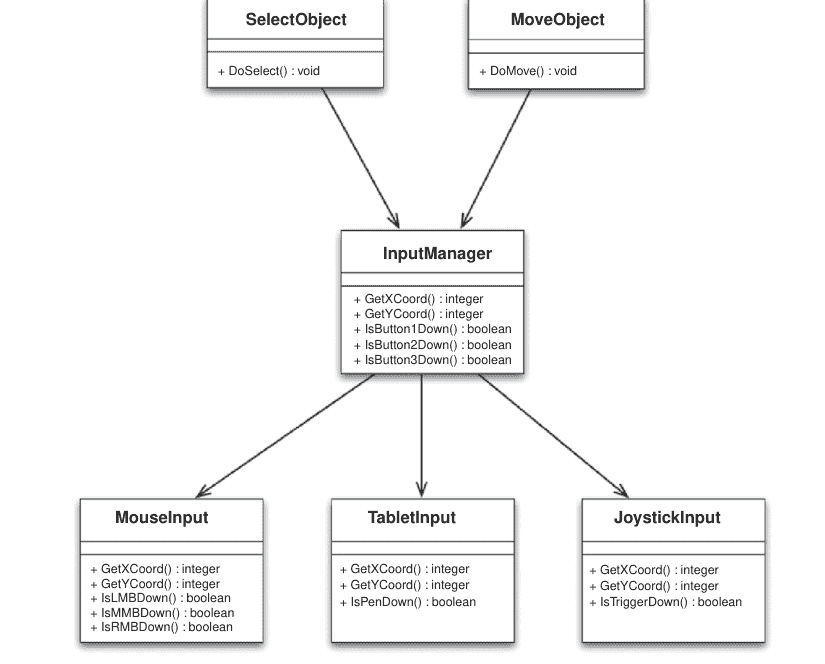

图 2.6

使用管理器类来减少对低级类的耦合。

> 提示

管理器类可以通过封装多个低级类来减少耦合。

### 2.5.5 回调、观察者和通知

我将介绍的减少耦合的最后技术与当某些事件发生时通知其他类的问题有关。

想象一个在线 3D 多人游戏，它允许多个用户相互对战。内部，每个玩家可能用一个唯一标识符或 UUID 表示，例如 `e5b43bab-fbf2-49f1-47f2a12d04847`。然而，用户想看到其他玩家的名称，而不是不可读的 UUID 字符串。因此，系统实现了一个名称缓存 `NameCache`，用于存储 UUID 与可读名称之间的对应关系。现在，假设管理大厅的类 `PreGameobby` 需要显示名称。操作流程如下：

1. `PreGameobby` 类调用 `NameCache::RequestName()`

2. `NameCache` 向服务器请求玩家名称

3. `NameCache` 从服务器接收信息

4. `NameCache` 调用 `PreGameobby::SetName()`

在这种情况下，`PreGameobby` 依赖 `NameCache` 来调用 `RequestName()`，`NameCache` 依赖 `PreGameobby` 来调用 `SetName()`。这是一个脆弱且紧耦合的设计。考虑如果游戏内系统也需要知道名称以显示它会发生什么。你将不得不扩展 `NameCache` 来调用 `InGame::SetName()`，进一步加紧耦合。更好的方法是让 `PreGameobby` 和 `InGame` 类注册 `NameCache` 的更新。这样 `NameCache` 就可以通知任何感兴趣的方，而不需要依赖模块。在使用任何这些方案时，有许多需要注意的通用问题：

- **重入性**：在编写调用未知代码的 API 时，你必须考虑这些代码可能会调回你的 API。事实上客户端可能没有意识到这一点发生。例如，如果你正在处理一个对象队列并在处理每个单独对象时使用回调，回调可能会尝试修改对象的状态（添加或删除对象）。至少，你的 API 应该通过代码错误防止这种行为。然而，更优雅的解决方案是允许这种重入行为，并实现维护一致状态的代码。

- **生命周期管理**：客户端需要一种清晰的方法与你的 API 断开连接，即声明他们不再接收更新。这在客户端对象被删除时尤为重要，因为进一步向其发送消息会导致崩溃。同样，你的 API 应该防止重复注册，以免对同一事件多次调用客户端。

- **事件顺序**：回调或通知的顺序对于 API 用户来说应该是清晰的。例如，Cocoa API 通过使用 `willChange` 和 `didSet` 等名称，很好地说明了在事件之前发送通知。然而，Qt Toolkit 在这方面说明较少：`changed` 信号有时在对象实际更改之前。

这些点强调了一个通用问题：在回调代码中，应该始终向用户明确做什么和不能做什么——他们对你的 API 可以做什么假设。这可以通过你的 API 文档来实现，也可以通过更显式地给回调一个只暴露安全操作子集的限制接口来强制。

# 回调

在 C/C++ 中，回调是模块 A 内部的函数指针，它被传递给模块 B，以便在适当的时间调用 A 中的函数。模块 B 对模块 A 一无所知，且对 A 没有包含或链接依赖关系。这使得回调对于低级-非常有用。

## 2.5 松松耦合

低层代码可以执行无法与其产生行依赖的高层代码。因此，回调函数（`callbacks`）是大型项目中打破循环依赖的一种流行技术。

有时，为回调函数提供一个“闭包”（`closure`）也是很有用的。这是模块 A 传递给模块 B 的数据，模块 B 将其包含在传给 A 的回调函数中。这是模块 A 传递某些对回调函数接收至关重要的状态的方法。

接下来的头文件展示了如何在 C++ 中定义一个简单的回调 API：

```cpp
#include <string>

class ModuleB {
public:
    typedef void (*CallbackType)(const std::string &name, void *data);
    void SetCallback(CallbackType cb, void *data);
    ...

private:
    CallbackType mCallback;
    void *mClosure;
};
```

如果已经设置了回调，该类可以使用如下代码调用回调函数：

```cpp
if (mCallback)
    (*mCallback)("Hello World", mClosure);
```

当然，一个更复杂的示例将支持向 `ModuleB` 添加多个回调，也许将它们存储在 `std::vector` 中，然后轮流调用每个注册的回调。

在面向对象的 C++ 程序中使用回调的一个复杂性问题是，将非静态（实例）方法作为回调并非易事。这是因为需要传递对象的 `this` 指针。随后的源代码展示了实现这一点的一个示例：通过为实例方法创建一个静态包装方法，并通过一个额外的的回调参数传递 `this` 指针。

`Boost` 库还通过 `boost::bind` 功能为这个问题提供了一个更优雅的解决方案。它是通过带有状态的的函数对象实现的，这些函数对象在 C++ 中可以实现为一个类，使用私有成员变量存储状态，并使用重载的 `operator()` 来执行函数。

## 观察者

回调通常是为了特定任务而创建，使用它们的机制通常定义在需要执行实际回调的对象内部。正如前面提到的，如果不使用类似 `boost::bind` 的工具，在面向对象的 C++ 程序中使用它们可能会变得复杂。相反，一种更面向对象的解决方案是使用观察者（`observers`）的概念。

这是一种软件设计模式，对象维护其依赖者（观察者）列表并通过调用它们的其中一个方法来通知它们。这对于减少 API 设计中的耦合性非常重要。事实上，我已经在模式章节中专门为它分配了一个节。因此，我将推迟到那时再详细讨论观察者。

## 第2章 特质

## 通知

回调和观察者通常是为了特定任务而创建，使用它们的机制通常定义在需要执行实际回调的对象中。另一种解决方案是构建一个中心机制，在系统中不连接的部分之间发送通知或事件。发送者不需要事先知道接收者，这减少了发送者和接收者之间的耦合。有几种通知方案，其中特别流行的是信号与槽（`signals and slots`）。

信号与槽的概念是由 `Qt` 库引入的，作为一种通用方法允许任何事件（例如按钮点击或定时器事件）发送到任何感兴趣的方法进行处理。然而，C++ 代码中还有几种信号与槽的替代实现可用，包括 `boost::signals` 和 `boost::signals2` 库。

信号可以被认为是具有多个目标（槽）的回调。当信号被触发或“发射”（`emit`）时，所有的槽都会被调用。给出一个具体的例子，下面的代码段创建了一个不带参数的信号。你将一个简单对象连接到该信号。最后，你发射信号，这导致 `MySlot::operator()` 被调用。

```cpp
class MySlot
{
    void operator() const {
        std::cout << "MySlot called!" << std::endl;
    }
};

// 创建我们的 MySlot 实例
MySlot slot;

// 创建一个没有参数且返回 void 的信号
boost::signal<void()> signal;

// 将我们的槽连接到此信号
signal.connect(slot);

// 发射信号从而调用所有的槽
signal();
```

在实际使用中，低层类可以创建并拥有一个信号。然后它允许任何未连接的类将自己作为槽添加到该信号中。然后低层类可以在任何适当的时间发射它的信号，所有连接的槽都将被调用。

## 2.6 稳定、文档化且经过测试

一个良好的 API 应该是稳定且面向未来的。在这种语境下，稳定并不意味着 API 从不改变，而是意味着接口不应发生不兼容的变化。


一个良好的 API 应该设计成可扩展的，以便它能够演进而不是混乱地改变。API 还应该有良好的文档记录，以便使用户对功能、行为和错误情况有清晰的信息。最后，应该为实现编写大量的测试。这些主题被压缩在末尾的一个章节中，因为我觉得它们在根本上是极其重要的。

# 第3章 模式

上一章讨论了区分良好 API 和糟糕 API 的特质。接下来的几章将重点关注构建高质量 API 的技术和原则。本章涵盖了几个与 C++ API 设计相关的模式和惯用法。

设计模式是对常见软件问题的通用解决方案。该术语由《设计模式：可复用面向对象模式元素》一书发扬，也被称为“四人书”。该书引入了以下通用设计模式列表，分为三大类：

### 创建型模式

| 模式 | 描述 |

| :--- | :--- |

| 抽象工厂 | 封装一组相关的工厂。 |

| 构建器 | 将复杂对象的构建与其表示分离。 |

| 工厂方法 | 让子类推迟实例化。 |

| 原型 | 指定一个类的原型实例，通过克隆来产生新对象。 |

| 单例 | 确保一个类只有一个实例。 |

### 结构型模式

| 模式 | 描述 |

| :--- | :--- |

| 适配器 | 将一个类的接口转换为另一种接口。 |

| 桥接 | 解耦抽象与实现，以便两者都可以独立更改。 |

| 组合 | 将对象组合成树形结构以表示部分与整体的关系。 |

| 装饰器 | 以动态方式向现有对象添加额外行为。 |

| Fac面 | 为子系统中的一组接口提供统一的高层接口。 |

| 权重 | 使用共享来高效地支持大量细粒度对象。 |

| 代理 | 为对象提供代理或占位符以控制对其的访问。 |

### 行为型模式

| 模式 | 描述 |

| :--- | :--- |

| 责任链 | 让多个对象有机会机会处理来自发送者对象的请求。 |

| 命令 | 将请求或操作封装为对象，并支持撤销操作。 |

| 解释器 | 指定如何表示和评估语言中的句子。 |

| 迭代器 | 提供一种顺序访问聚合对象元素的方法。 |

| 中介者 | 定义一个封装了相互作用集合的对象。 |

| 模式 | 说明 |

| --- | --- |

| 备忘录 (Memento) | 保存对象的内部状态，以便以后恢复到相同的状态。 |

| 观察者 (Observer) | 允许对象之间状态变化的一对多通知。 |

| 状态 (State) | 允许对象内部状态改变时似乎改变了其类型。 |

| 策略 (Strategy) | 定义算法族，将每个算法封装起来并在运行时可互替。 |

| 模板方法 (Template Method) | 在操作中定义算法的骨架，将某些步骤延迟给子类。 |

| 访问者 (Visitor) | 代表在对象结构的元素上执行的操作。 |

自1994年设计模式书籍出版以来，该列表中又增加了若干设计模式，包括一整套全新的并发模式分类。原作者最近也建议对核心、创建、外围及其他模式进行更改进的分类（Gamma et al., 2009）。

本 API 书的意图并非涵盖所有这些设计模式。有许多市场重点专门关注该主题的书。相反，我将集中于对高质量 API 设计尤为重要的设计模式，并讨论它们在 C++ 中的实际实现。我还将涵盖一些可能不是通用模式但对 C++ API 设计重要的 C++ 习用法。特别是，我将详细介绍以下技术：

- **Pimpl 习用法。** 这种技术允许你从公共头文件中隐藏内部细节和函数。本质上，它是创建良好隔离 API 的不可或缺的工具。

- **单例和工厂方法（Singleton and Factory Method）。** 这是两个非常常见的设计模式，值得深入理解。当你想要强制只创建一个对象实例时，单例非常有用。它在 C++ 中具有一些棘手的实现方面，包括初始化和多线程。工厂模式提供了一种创建对象实例的通用方法，可以是隐藏类实现细节的极佳方式。

- **代理、适配器和外观（Proxy, Adapter, and Façade）。** 这些结构模式描述了在不兼容或遗留接口之上封装 API 的各种解决方案。这是编写 API 的全部目标：改进某些设计不当的接口。代理和适配器模式提供了类到预存类的一对一映射，而外观则为更大的类集合提供了简化的接口。

- **观察者（Observer）。** 这种行为模式可以减少类之间的直接依赖。它允许不相关的类通过允许一个类（观察者）注册另一个类（主体）的来进行通信。因此，这种模式是设计松耦合 API 的重要方面。

除了这些模式和习用法外，我将在书末尾的第12章讨论访问者行为模式。访问者模式为客户端提供了一种提供自己的算法来操作你 API 中数据结构的方法。它在为客户端设计扩展点时最有用，我将这一点推迟到了扩展性章节。

## 3.1 Pimpl 习用法

“pimp”一词由 Jeff Sumner 首次引入，作为“指向实现的指针”（pointer to implementation）的缩写（Sutter, 1999）。这种技术可以作为避免在头文件中暴露私有细节的方法（见图 3.1）。它是帮助你维护 API 接口与实现之间分离的重要机制（Sutter and Alexandrescu, 2004）。虽然 pimp 严格来说不是设计模式（它是针对 C++ 特定局限性的变通方法），但它是一种可以被视为桥接设计模式特例的习用法。

如果你在读完这本书后改变了一个编程习惯，我希望你会选择对 API 代码使用 pimp。

| 提示 |

| --- |

| 使用 pimpl 习用法将实现细节留在公共头文件之外 |

### 3.1.1 使用 Pimp

Pimp 依赖于这样一个事实：可以在 C++ 类中定义一个数据成员，该成员是指指向前向声明类型的指针。也就是说，该类型仅通过名称引入而尚未完全定义，从而允许我们把该类型的定义隐藏在 `.cpp` 文件中。这通常被称为不透明指针（opaque pointer），因为用户无法看到所指向对象的细节。从本质上说，pimp 是对你的私有数据成员和函数进行逻辑和物理双重隐藏的方法。

| .h 文件 | .cpp 文件 |

| --- | --- |

| 公共接口 | 私有实现 |

| public: | public: |

| Function1() | PrivateFunction1() |

| Function2() | PrivateFunction2() |

| protected: | |

| Function3() | |

| private: | |

| Impl | |

为了说明这一点，让我们来看一个“pimpl”习用法的示例，其中一个公共类有一个指向隐藏实现的指针。pimpl 习用法通过将所有私有成员放在头文件中但在 `.cpp` 文件中定义来实现此点。

```cpp
// autotimer.h
#ifdef _WIN32
#include <windows.h>
#else
#include <time.h>
#endif
#include <string>

class AutoTimer
{
public:
    // 创建一个新的计时器
    explicit AutoTimer(const std::string& name);
    // 销毁时报告它运行了多久
    ~AutoTimer();

    // 返回对象持续多久
    double Elapsed() const;

private:
    class Impl;
    Impl* pimpl;
};
```

现在 API 变得干净多了！让我们通过查看头文件来看类的私有成员。读者看不到其中任何一个。然而，这意味着我们的 `AutoTimer` 构造函数必须分配一个 `Impl` 类型的对象，并在析构函数中销毁它。此外，所有成员必须通过 pimpl 指针进行访问。对于大多数实际情况，提供一个干净的、无实现的 API 的收益大于其成本。为了完整起见，让我们看看与这个 pimpl 类配合的底层实现是什么样子的。生成的 `.cpp` 文件由于平台特定的 `#ifdef` 行而看起来有点杂乱，但重要的是，这些杂乱内容完全包含在 `.cpp` 文件中。

```cpp
// autotimer.cpp
#include "autotimer.h"
#include <iostream>
#if _WIN32
#include <windows.h>
#else
#include <sys/time.h>
#endif

class AutoTimer::Impl
{
public:
    double GetElapsed() const
    {
#ifdef _WIN32
        return (GetTickCount() - mStartTime) / 1e3;
#else
        struct timeval end_time;
        gettimeofday(&end_time, NULL);
        double t1 = mStartTime.tv_usec / 1e6 + mStartTime.tv_sec;
        double t2 = end_time.tv_usec / 1e6 + end_time.tv_sec;
        return t2 - t1;
#endif
    }

    std::string mName;
#ifdef _WIN32
    DWORD mStartTime;
#else
    struct timeval mStartTime;
#endif
};

AutoTimer::AutoTimer(const std::string& name) : pimpl(new Impl())
{
    pimpl->mName = name;
#ifdef _WIN32
    pimpl->mStartTime = GetTickCount();
#else
    gettimeofday(&pimpl->mStartTime, NULL);
#endif
}

AutoTimer::~AutoTimer()
{
    delete pimpl;
}

double AutoTimer::Elapsed() const
{
    return pimpl->GetElapsed();
}
```

```cpp
DWORD mStartTime:
#else
    struct timeval mStartTime;
#endif
);

AutoTimer::AutoTimer(const std::string& name):
    mimpl(new AutoTimer::Impl)
{
    mimpl->mName = name;
    #ifdef _WIN32
        mimpl->mStartTime = GetTickCount();
    #else
        gettimeofday(&mimpl->mStartTime, NULL);
    #endif
}

AutoTimer::~AutoTimer()
{
    std::cout << mimpl->mName << " : took " << mimpl->GetElapsed()
             << " secs" << std::endl;
    delete mimpl;
    mimpl = NULL;
}
```

这里是 `AutoTimer::Impl` 类的定义，它包含了最初在头文件中暴露的所有私有方法和变量。注意，`AutoTimer` 构造函数分配了一个新的 `AutoTimer::Impl` 对象并初始化其成员，而析构函数则释放该对象。

在上述设计中，我将 `Impl` 类声明为 `AutoTimer` 类内部的私有嵌套类。将其声明为嵌套类可以避免用特定实现的细节污染全局命名空间，而将其声明为私有则意味着它不会污染 `AutoTimer` 的公共 API。然而，将其声明为公有将施加一个限制：`AutoTimer` 的方法可以访问 `Impl` 的成员。`.cpp` 文件中的其他类或自由函数将无法访问 `Impl`。作为一种替代方案，如果你认为这个限制太大，可以像下面这样将 `Impl` 类声明为公有嵌套类：

```cpp
// autotimer.h
class AutoTimer{
public:
    explicit AutoTimer(const std::string& name);
    ~AutoTimer();

// 允许从 autotimer.cpp 中的其他类/函数访问
class Impl;
```

```cpp
private:
  Impl *mImpl;
:
```

> 提示：使用 pimpl 模式时，请使用私有嵌套实现类。只有当 `.cpp` 文件中的其他类或自由函数必须访问 `Impl` 成员时，才使用公有嵌套 `Impl` 类（或公有的非嵌套类）。

另一个值得考虑的设计问题是在 `Impl` 类中应该包含多少逻辑。可选方案包括：

- 1. 仅有私有成员变量

- 2. 私有成员变量和方法

- 3. 公共类的所有方法，使得公共方法仅仅是包装器

这些方案在不同情况下都是合理的。但通常情况下，我建议采用方案 2：将成员变量和方法放在 `Impl` 类中。这样可以保持 `AutoTimer` 的公共接口非常简洁。这种方法允许你隐藏 `AutoTimer` 的数据，你可以通过在 `Impl` 类中定义这些来实现。Sutter（1999）对这种方法有几点需要注意：

- 1. 在 `Impl` 类中声明不可拷贝的。

- 2. 在 `Impl` 类中添加指针，只要你希望派生类能够访问它。

- 3. 你可以在 `Impl` 类中定义这些方法。

### 3.1.2 拷贝语义

对于 `AutoTimer` 来说，编译器生成的默认构造函数和赋值运算符会执行浅拷贝。如果 `AutoTimer` 包含一个指向 `Impl` 的指针，那么多个 `AutoTimer` 对象将指向同一个 `Impl` 对象。当一个对象被析构时，它会释放 `Impl` 对象，导致其他对象的指针变成悬空指针。为了避免这种情况，可以在 `AutoTimer` 类中显式地禁用拷贝构造函数和赋值运算符，或者使用智能指针来管理 `Impl` 对象的生命周期。使用智能指针的好处是，当 `AutoTimer` 对象被销毁时，`Impl` 对象会自动释放，你不再需要在析构函数中手动 `delete` 它。使用智能指针后，我们的 API 如下所示：

```cpp
#include <boost/shared_ptr.hpp>
#include <string>

class AutoTimer
{
public:
    explicit AutoTimer(const std::string& name);
    ~AutoTimer();

private:
    class Impl;
    boost::shared_ptr<Impl> m_impl;
};
```

或者，你也可以使用 `boost::shared_ptr`，这允许对象被拷贝而不会产生双重释放的问题。使用 `shared_ptr` 意味着任何拷贝都指向同一个 `Impl` 对象。如果你需要 `Impl` 的拷贝，你仍然需要编写自己的拷贝构造函数和赋值运算符。

> 提示： 考虑使用智能指针来管理初始化和析构。使用 `shared_ptr` 或 `scoped_ptr` 意味着当 `AutoTimer` 对象被销毁时，`Impl` 对象会被释放：你不再需要在析构函数中显式地删除它。在这种情况下，我们的 autotimer.cpp 文件可以简化如下：

```cpp
#include <boost/scoped_ptr.hpp>
#include <string>

class AutoTimer
{
public:
    explicit AutoTimer(const std::string& name);
    ~AutoTimer();

private:
    class Impl;
    boost::scoped_ptr<Impl> m_impl;
};
```

### 3.1.3 智能指针

使用 pimpl 的一个不便之处是需要管理 `Impl` 的分配和释放。你可能会在析构函数中忘记删除它，或者在销毁之后访问了它，导致崩溃。此外，使用智能指针可以让这变得更容易。由于 `scoped_ptr` 在定义上就是不可拷贝的，这让你在类中就避免了拷贝问题。

- 1. 在 `Impl` 类中声明不可拷贝的。

- 2. 在 `Impl` 类中添加指针，只要你希望派生类能够访问它。

- 3. 在 `Impl` 类中定义这些方法。

### 3.1.4 Pimpl 的优势

在类中采用 pimpl 模式有许多优势，包括：

- **信息隐藏**：私有成员现在完全隐藏在你的公共接口之后。这允许你保留实现细节（对于闭源 API 而言也是如此）。这意味着你的公共头文件更加清晰，并且更容易表达真实的接口。结果是，用户可以更容易地阅读和理解它们。信息隐藏的另一个好处是，用户无法那么容易通过脏手段访问你的私有成员，例如：

```cpp
#define private public // 将私有成员变为公有
#include "yourapi.h" // 现在可以访问私有成员
#undef private // 恢复默认的私有语义
```

- **降低耦合。** 正如前面的 AutoTimer 示例所示，如果不使用 pimpl，你的公共头文件必须包含所有私有成员变量的头文件。在我们的示例，这意味着要包含 `windows.h` 或 `sys/time.h`。这增加了你的 API 对系统所有部分的编译时耦合。使用 pimpl，你可以将依赖项移动到 `.cpp` 文件中并移除这些耦合元素。

- **更快的编译。** 将特定实现相关的包含文件移动到 `.cpp` 文件的另一个影响是减少了 API 的层级结构。这对编译时间有非常直接的影响（Lakos, 1996）。我将在性能章节中详细介绍最小化依赖的用处。


### 更好的二进制兼容性
`pimpled` 对象的大小永远不会改变单个指针的大小。你对私有成员变量所做的任何更改（记住成员变量是始终存在的）只会影响隐藏在 `.cpp` 文件内部的实现类的大小。这使得在不改变对象二进制表示的情况下进行重大的实现更改成为可能。

### 懒性分配
`impl` 类可以根据需要进行构造。如果类分配了有限或昂贵的资源（如网络连接），这可能非常有用。

## 3.1.5 Pimpl 的缺点
`pimpl` 对象的主要缺点是，你必须为创建的每个对象分配并释放一个额外的实现对象。这会使你的对象增加一个指针的大小，并可能因为访问所有成员变量所需的额外间接层而引入性能损耗，以及额外调用 `new` 和 `delete` 的成本。如果你担心内存分配器，那么可以考虑使用“Fast Pimpl”`（Sutter, 1999）`，即通过为你的 `Impl` 类重载 `new` 和 `delete` 操作符，以使用更高效的固定大小分配器。

此外，开发者还有额外的不便，即必须为所有成员变量加上 `impl->` 访问前缀。由于额外的抽象层，这使得代码更难以阅读和调试。当 `Impl` 类拥有指向基类的指针时，情况会变得更加复杂。你还必须记住定义拷贝构造函数或禁用类的拷贝。然而，这些不便并不会暴露给 API 的用户，从 API 设计的角度来看它们不需要担心。它们是开发者必须确保所有用户都能获得更简洁、更高效的 API 的负担。对于一位严谨的科学家或他的队长来说：“许多人的需求可能超过少数人的需求。”

最后一个需要注意的问题是，编译器将不再捕获 `const` 方法内部成员变量的更改。因为成员变量现在存在于单独的对象中。你的编译器只会检查你是否在 `const` 方法中更改了 `pimpl` 指向的值，而不会检查你是否更改了被 `pimpl` 指向的任何成员。实际上，`pimpled` 类的每个成员函数都可以定义为 `const`（构造函数或析构函数除外）。下面的方法演示了这一点，它大幅改变 `Impl` 对象中的一个变量：

```cpp
void PimpledObject::ConstMethod() {
    impl->mName = "string changed by a const method";
}
```

## 3.1 Pimpl 用

### 3.1.6 C 中的不透明指针
虽然我到为止一直关注 C++，但你可以在纯 C 中创建不透明指针。原理相同：你创建一个指向仅在 `.c` 文件定义的结构体的指针。以下头文件演示了它可能的样子：

```c
/* autotimer.h */
/* 声明指向 AutoTimer 结构体的不透明指针 */
typedef struct AutoTimer *AutoTimerPtr;

/* 用于创建和销毁 AutoTimer 结构的函数 */
AutoTimer AutoTimerCreate();
void AutoTimerDestroy(AutoTimerPtr ptr);
```

相关的 `.c` 文件可能如下：

```c
#include <autotimer.h>
#include <stdio.h>
#include <string.h>
#include <stdlib.h>

#if _WIN32
#include <windows.h>
#else
#include <sys/time.h>
#endif

struct AutoTimer
{
    char *mName;
#if _WIN32
    DWORD mStartTime;
#else
    struct timeval mStartTime;
#endif
} AutoTimer;

AutoTimerPtr AutoTimerCreate(const char *name)
{
    AutoTimerPtr ptr = malloc(sizeof(AutoTimer));
    if (ptr)
        ptr->mName = strdup(name);
#if _WIN32
        ptr->mStartTime = GetTickCount();
#else
        gettimeofday(&ptr->mStartTime, NULL);
#endif
    }
    return ptr;
}
```

```c
static double GetElapsed(AutoTimerPtr ptr)
{
#if _WIN32
    return (GetTickCount() - ptr->mStartTime) / 1e3;
#else
    struct timeval end_time;
    gettimeofday(&end_time, NULL);
    double t1 = ptr->mStartTime.tv_usec / 1e6;
    double t2 = end_time.tv_usec / 1e6 + end_time.tv_sec;
    return t2 - t1;
#endif
}
```

```c
void AutoTimerDestroy(AutoTimerPtr ptr)
{
    if (ptr)
    {
    printf("%s: took %f secs\n", ptr->mName, GetElapsed(ptr));
        free(ptr);
    }
}
```

## 3.2 单例
单例模式用于建模本质上是唯一的资源。例如，用于访问系统时钟、剪贴板或键盘的类。它也用于创建为多个资源提供单一点的管理类，例如线程管理器或事件管理器。然而，单例仍然向你的系统添加全局变量的方法，尽管是以更易管理的方式。它会在你的 API 中引入难以重构的全局状态和依赖，并使编写单元测试变得困难。

| Singleton |
| --- |
| instance : Singleton |
| + GetInstance() : Singleton |
| Singleton() |

图 3.2 单例模式的 UML 图。（等等，这里文本重复了，正在清理 OCR 错误）

单例模式用于建模本质上是唯一的资源。例如，用于访问系统时钟、剪贴板或键盘的类。它也用于创建为多个资源提供单一点的管理类，例如线程管理器或事件管理器。然而，单例仍然向你的系统添加全局变量的方法，尽管是以更易管理的方式。它会在你的 API 中引入难以重构的全局状态和依赖，并使编写单元测试变得困难。

### 3.2.1 在 C++ 中实现单例
单例模式涉及创建一个类，其中有一个静态方法，每次调用时都返回类的同一个实例。该静态方法通常称为 `GetInstance()` 或类似名称。在设计单例类时，需要考虑几个 C++ 特性：

- 你不希望客户端能够创建新实例。这可以通过将默认构造函数声明为私有来实现，防止编译器自动将其创建为公有。
- 你希望单例是不可拷贝的，以强制无法创建第二个实例。如之前所示，这可以通过将构造函数和赋值运算符声明为私有来实现。
- 你希望防止客户端能够删除单例。这可以通过将析构函数声明为私有来实现。（注意，然而，某些编译器如 Borland 5 和 Visual Studio 6 在你尝试将析构函数声明为私有时会产生错误。）
- `GetInstance()` 方法可以返回单例类的指针或引用。然而，如果你返回指针，客户端可能会删除该对象。你应该倾向于返回引用。

因此，C++ 中单例的一般形式如下`（Alexandrescu, 2001）`：

```cpp
class Singleton {
public:
    static Singleton &GetInstance();
};
```

private:

    Singleton();

    ~Singleton();

    Singleton(const Singleton&);

    const Singleton& operator=(const Singleton&);

};

然后用户可以如下方式通过引用单例实例：

```cpp
Singleton &obj = Singleton::GetInstance();
```

注意，将构造函数和析构函数声明为私有意味着客户端无法创建单例的子类。然而，如果你允许这样做，当然可以将它们声明为保护`protected`。

> TIPS
>
> 将构造函数、析构函数、拷贝构造函数和赋值运算符声明为私有`（或保护）`，以强制单例属性。

在实现方面，需要注意的区域之一是单例实例是如何分配的。Scott Meyers 解释了一个需要留意的重要 C++ 初始化问题：

> 在不同编译单元中非局部静态对象的初始化相对顺序是未定义的 `（Meyers, 2005）`。

这意味着使用非局部变量来初始化我们的单例是危险的。非本地对象是指在函数之外声明的对象。静态对象包括全局对象以及在类、函数或文件内部声明为 `static` 的对象。因此，初始化单例的一种方法是在类的方法内部创建一个静态变量，如下所示：

```cpp
Singleton::GetInstance()
{
    static Singleton instance;
    return instance;
}
```

这种方法的一个优点是，实例只有在第一次调用 `GetInstance()` 方法时才会被分配。这意味着如果从不请求单例，对象就不会被分配。然而，缺点是这种方法不是线程安全的。此外，Alexandres 指出，这种技术依赖于静态变量的后进先出行为，在单例的析构函数中调用其他单例的情况下，可能会导致单例在需要之前就被释放了。考虑两个单例：`Clipboard` 和 `LogFile`。当 `Clipboard` 实例化时，它也会输出一些诊断信息。在程序退出时，`LogFile` 先被销毁，因为 `Clipboard` 是后创建并在随后被销毁的。在他的《Modern C++ Design》书中，Alexandrescu 针对此问题提出了几种解决方案：防止单例在销毁后仍被使用、增加单例的寿命使其比其他单例存得久，以及不释放单例`（即依赖操作系统释放所有内存）`。如果你发现自己需要这些解决方案之一，请参考这本书`（Alexandrescu, 2001）`。

### 3.2.2 使单例线程安全
之前的 `GetInstance()` 实现不是线程安全的，因为 `Singleton` 的初始化中存在竞态条件。如果两个线程同时调用此方法，实例可能会被构造两次，或者在被另一个线程完全初始化之前就被其中一个线程使用。如果你查看编译器为之生成的代码，这种竞态条件会更加明显。这里是编译器可能对 `GetInstance()` 方法展开的示例：

```cpp
Singleton &GetInstance()
{
    // 编译器可能生成的示例代码...
    extern void cleanup();
    static char buffer[sizeof(Singleton)];
    static bool initialized = false;
    if (!initialized) {
        new(buffer) Singleton(); // 定位 new 语法
        atexit(cleanup); // 时销毁实例
        initialized = true;
    }
    return reinterpret_cast<Singleton *>(buffer);
}

void cleanup()
{
    // 为静态缓冲区调用析构函数
}
```

对于大多数非线程安全的代码，你可以通过在显示竞态条件的代码周围添加互斥锁`mutex lock`来使该方法安全：

```cpp
Singleton &GetInstance()
{
    Mutex mutex;
    ScopedLock lock(mutex);
}
```

该解决方案的潜在问题是每次调用该方法时都会获取锁。需要注意的是，这对于你的 API 实际上可能并不是性能问题。在决定优化之前，务必在真实世界中测量性能。例如，如果你的客户端没有调用此方法，那么这个解决方案是完全可以的。对于报告性能问题的客户端，你可以建议他们调用一次此方法`（或每个线程调用一次）`并在自己的代码中缓存结果。然而，如果该方法的性能对你来说确实是一个问题，那么你将面临更复杂的情况。一种优化这种激进锁定行为的常用建议是使用双重检查锁定模式`DCLP`，如下所示：

```cpp
Singleton &GetInstance()
{
    static Singleton *instance = NULL;

    if (!instance) // 检查 #1
    {
        Mutex mutex;
        ScopedLock lock(mutex);

        if (!instance) // 检查 #2
        {
            instance = new Singleton();
        }
    }
    return *instance;
}
```

然而，DCLP 不能保证在所有编译器和所有处理器模型下都能工作。例如，共享内存多处理器通常会提交到内存，这可能导致不同线程的写入被重排序。`volatile` 关键字通常被视为此问题的解决方案，因为它同步了对数据的读写操作`（Meyers and Alexandrescu, 2004）`。你可能可以使用特定于平台的内存屏来绕过这些；如果你使用 POSIX 线程，可以使用 `pthread_once()`，但在此时这可能只是稍微退后了一步，并意识到可能你仅仅是写错了 `GetInstance()` 方法的公式。各种编译器惯用法意味着你的 API 可能对某些客户端有效，但对其他客户端则会以复杂且难以调试的方式失败。最终，这些差异是试图在一种没有对并发固有感知或支持的语言中强制执行线程安全的产。

如果线程安全的 `GetInstance()` 性能对你至关重要，你可能考虑避免之前提出的惰性初始化模型，而是在启动时初始化你的单例，例如在调用 `main()` 之前或通过由互斥锁保护的 API 初始化调用。

这两种方案的共同优点是，你不需要更改单例类的实现即可来支持多线程。

- 1. 静态初始化。静态初始化器在 `main()` 之前被调用，此时你通常可以假设程序仍是线程化的。因此，你可以将单例实例创建为静态初始化器，并避免对任何互斥锁的需求。当然，你需要确保你的构造函数不依赖于其他 `.cpp` 文件中的非局部变量。然而，在考虑到这一点的情况下，你可以将静态初始化调用添加到 `singleton.cpp` 文件中，以确保实例在 `main()` 之前被创建。

```cpp
static Singleton &instance = Singleton::GetInstance();
```

- 2. 显式 API 初始化。如果你还没有初始化程序，可以为你的库添加一个初始化程序。在这种情况下，你可以从 `GetInstance()` 方法中移除互斥锁，并在该库初始化程序的一部分中实例化单例，在此处放置互斥锁。

```cpp
void APIInitialize()
{
    Mutex mutex;
    ScopedLock lock(mutex);
    Singleton::GetInstance();
}
```

这种方法的处是是你可以指定所有单例的初始化顺序，以防出现依赖问题`（希望你不会）`。虽然要求用户初始化你的库有点不好，但请记住，这只有在你需要提供线程安全的 API 时才是必须的。

| TIPS |
| :--- | :--- |
| 在 C++ 中创建线程安全的单例是困难的。考虑使用静态构造函数或 API 初始化函数来初始化它。 |

### 3.2.3 单例与依赖注入
依赖注入是一种技术，将对象传递给类`（注入）`，而不是让类自己创建并存储该对象。Martin Fowler 在 2004 年提出了这个术语，作为控制反转概念的一种更具体的形式。作为一个简单的示例，考虑以下依赖于数据库对象的类：

```cpp
class MyClass
{
    MyClass() :
        mDataBase(new Database("mydb", "localhost", "user", "pass"))
();
```

## 82 第 3 章 模式

private:

    Database *mData;

);

这种方法的问题在于，如果 `Database` 被构造了，或者有人更改了线上数据库中名为“user”账户的密码，那么你就必须修改 `MyClass` 来解决该问题。此外，从效率的角度来看，`MyClass` 的每个实例都会创建一个新的 `Database` 实例。作为替代方案，你可以使用依赖注入`dependency injection`将一个预先配置好的 `Database` 对象传递给 `MyClass`，如下如下所示：

```cpp
class MyClass {
    MyClass(Database *db) : mDatabase(db) {}
};
```

private:

    Database *mData;

);

通过这种方式，`MyClass` 不再需要知道如何创建 `Database` 实例。相反，它获得的是一个已经构造并配置好的 `Database` 对象供其使用。这个示例演示了构造函数注入`constructor injection`，即通过构造函数传递依赖对象；你也可以轻松地通过 setter 成员函数传递依赖，或者定义一个可重用的接口来注入特定类型的对象，并在你的类中继承该接口。

当然，`Database` 对象需要在某个地方被创建。该地方负责创建 `MyClass` 类实例并传递适当的 `Database` 实例。换句话说，依赖容器可以被认为通用的工厂类。两者真正的区别在于，依赖容器会维护状态，例如在我们案例中的单例 `Database` 实例。

| 提示 |
| :--- |
| 依赖注入使得测试这些单例用例变得更容易。 |

因此，依赖注入可以被视为一种避免单例泛滥的方法，它鼓励使用接受单例实例作为输入的接口，而不是在内部通过 `getInstance()` 方法请求它。这使得使得接口更具可测试性，因为对象的依赖可以在单元测试中被替换为存根`stub`或模拟`mock`版本`（这在本章中将进一步讨论）`。

### 3.2.4 单例与单状态`Monostate`


大多数与单例模式相关的问题都源于其设计用于持有和控制对全局状态的访问。然而，如果你不需要控制状态何时初始化，或者不需要在单例对象本身中存储状态，可以使用其他技术，例如单状态模式（Monostate pattern）。

单状态模式允许创建类的多个实例，其中所有这些实例都使用相同的静态数据。例如，这里有一个单状态模式的简单案例：

```cpp
// monostate.h
class Monostate {
public:
    int GetAnswer() const { return sAnswer; }

private:
    static int sAnswer;
};
```

```cpp
// monostate.cpp
int Monostate::sAnswer = 42;
```

在这个示例中，你可以创建 `Monostate` 类的多个实例，但所有对 `GetAnswer()` 方法的都会返回相同的结果，因为所有实例共享同一个静态变量 `sAnswer`。你也可以通过仅在 `monostate.cpp` 中将其声明为文件作用域变量，而不是私有类变量，从而从头文件中隐藏静态变量的声明。由于静态成员不贡献于类每个实例的大小，这样做对 API 不会产生物理影响，除了从头文件中隐藏实现细节之外。单状态模式的某些优点是：

- 允许创建多个实例。
- 由于不需要 `GetInstance()` 方法，它提供了透明的用法。
- 通过使用静态变量展现了定义良好的创建和销毁机制。

正如 Robert C. Martin 所指出的，单例通过只允许创建一个实例来强制单性的**结构**，而单状态通过为所有实例共享相同的数据来强制单性的**行为**（Martin, 2002）。

提示：

如果你不需要全局数据的懒初始化，或者希望类的单一性是透明的，请考虑使用单状态代替单例。

作为一个进一步的现实示例，Second Life 源代码对 `LLWeb` 类使用了单状态模式。这个示例使用了所有成员函数都声明为静态的单状态版本。

```cpp
class LLWeb {
public:
    static void InitClass();

    /// 在用户首选的网络浏览器中加载指定的 url
    static void LoadURL(const std::string& url);

    // 在 Second Life 内部网络浏览器中加载指定的 url
    static void LoadURLInternal(const std::string& url);

    // 在操作系统的浏览器中加载指定的 url
    static void LoadURLEternal(const std::string& url);

    // 返回转义后的 url（将 "*" 转换为 "%20"）
    static std::string EscapeURL(const std::string& url);
};
```

在这种情况下，`LLWeb` 是一个管理类，为打开页面的功能提供了单一访问点。实际的网络浏览器本身在其他类中实现。`LLWeb` 类不持有任何状态，尽管当然，任何静态方法都可以访问静态变量。

这种静态方法版本的单状态的缺点是，你不能对任何静态方法进行子类化，因为静态成员函数不能是虚拟。此外，由于你不再实例化该类，因此你无法编写构造函数或析构函数来执行任何初始化或清理。这在 `LLWeb` 访问动态分配的状态而不是依赖编译器初始化的静态变量的情况下是必要的。`LLWeb` 的创建者通过引入一个 `initClass()` 静态方法绕过了这个限制，该方法要求客户端显式地初始化它。更好的设计可能是从每个公共静态方法中懒性地隐藏此调用。然而，在这种情况下，之前提到的线程安全考量将适用。

### 3.2.5 单例与单状态

作为一个进一步的现实示例，Second Life 源代码对 `LLWeb` 类使用了单状态模式。这个示例使用了所有成员函数都声明为静态的单状态版本。

## 3.3 工厂方法

工厂方法（Factory Method）是一种设计模式，允许你创建对象而无需指定要创建的 C++ 类型。本质上，工厂方法是构造函数的泛化。C++ 中的构造函数有几个局限性，如下：

- **没有返回值。**你不能从构造函数中返回结果。这意味着你不能通过返回一个 `NULL` 指针来在对象初始化期间信号错误（尽管你可以通过抛出异常来信号错误）。
- **命名限制。**构造函数很容易被识别，因为它被限制为与其所属类相同的名称。然而，这同时也限制了它的灵活性。例如，你不能拥有两个接受单个整数的构造函数。
- **静态绑定创建。**在构造对象时，你必须指定在编译时创建的类名，例如，你可能写 `Foo *f = new Foo()`，其中 `Foo` 是必须被编译器已知的特定类型。构造函数在运行时没有动态绑定的概念。
- **没有虚拟构造函数。**你不能在 C++ 中声明虚拟构造函数。正如所提到的，你必须在编译时指定要构造的对象的精确类型。编译器为该特定类型分配内存，然后调用基类的默认构造函数（除非你在初始化列表中指定了非默认构造函数）。这就是为什么你不能从构造函数中调用虚拟方法，然后调用尚未初始化的派生类。

在基础层面上，工厂方法仅仅是一个可以返回类实例的普通方法。然而，它们通常与继承结合使用，派生类可以重写工厂方法并返回该派生类的实例。使用抽象基类（ABC）实现工厂也是非常常见且有效的（DeLaura, 2001）。

在这里，在我进一步深入探讨使用工厂方法之前，让我们先回顾一下这些类。

ABC（抽象基类）是一个包含一个或多个纯虚成员函数的类。这种类不是具体的类，不能通过 `new` 操作符进行实例化。相反，它被用作基类，由派生类提供纯虚拟方法的实现。例如：

```cpp
// renderer.h
#include <string>

class IRenderer {
public:
    virtual ~IRenderer() {}
    virtual bool LoadScene(const std::string&filename, int w, int h) = 0;
    virtual void SetViewport(int w, int h) = 0;
    virtual void SetCameraPosition(double x, double y, double z) = 0;
    virtual void SetLookAt(double x, double y, double z) = 0;
    virtual void Render() = 0;
};
```

这个抽象基类可以描述一个极其简单的 3D 图形渲染器。方法上的 `=0` 意味着它们在派生类中必须被重写才能变成具体的。注意，严格来说说纯虚拟方法没有提供实现是不准确的。例如，你可以在 `renderer.cpp` 文件中为 `SetViewport` 提供默认实现，然后派生类就可以调用 `IRenderer::SetViewport()`，尽管它仍然必须显式地声明该方法。

当然，你可以在抽象基类中提供带有实现的方法：并不是所有方法都必须是虚的。在这方面，抽象基类可以模拟混入（mixins），即带有实现方法的接口。

对于任何带有一个或多个虚方法的类，你应该始终将抽象基类的析构函数声明为虚。以下代码说明了为什么这。

```cpp
class IRenderer {
    // 没有声明虚析构函数
    virtual void Render() = 0;
};
```

```cpp
class RayTracer : public IRenderer
{
    RayTracer();
    ~RayTracer();
    void Render(); // 为 ABC 方法提供实现
}
```

```cpp
int main(int, char **)
{
    IRenderer *r = new RayTracer();
    // delete 调用的是 IRenderer::~IRenderer，而不是 RayTracer::~RayTracer
    delete r;
}
```

### 3.3.2 简单工厂示例

现在我已经回顾了抽象基类，让我们用它来提供一个简单的工厂方法。我将继续之前的 `renderer.h` 示例，并开始为 `IRenderer` 的对象声明工厂。

```cpp
// rendererfactory.h
#include "renderer.h"
#include <string>
```

```cpp
class RendererFactory {
public:
    IRenderer *CreateRenderer(const std::string& type);
};
```

声明工厂方法就这样；它只是一个可以返回对象实例的普通方法。注意，此方法不能返回特定类型 `IRenderer` 的实例，因为它是抽象基类，不能实例化，它可以返回派生类。此外，你可以使用 `CreateRenderer()` 的参数来指定你想要创建的类型。

假设你已经实现了三个派生自 `IRenderer` 的具体类：`OpenGLRenderer`、`DirectXRenderer` 和 `MesaRenderer`。让我们进一步规定，你不希望使用你 API 的用户了解这些类型的存在：它们必须完全隐藏在 API 之后。根据条件，你可以这样提供工厂方法的实现：

```cpp
// rendererfactory.cpp
#include "rendererfactory.h"
#include "openglrenderer.h"
#include "directxrenderer.h"
```

```cpp
#include "mesarenderer.h"

IRenderer *RendererFactory::CreateRenderer(const std::string &type)
{
  if (type == "opengl")
    return new OpenGLRenderer();

  if (type == "directx")
    return new DirectXRenderer();

  if (type == "mesa")
    return new MesaRenderer();

  return NULL;
}
```

因此，该工厂方法可以根据客户端传递的字符串类型返回 `IRenderer` 的三个派生类中的任何一个。这允许用户在运行时决定创建哪个派生类，而不是像新的构造函数所要求的那样在编译时决定（注：此处原文可能指构造对象的方式）。这是一个巨大的优势，因为这意味着你可以根据用户输入或运行时读取的配置文件的内容创建不同的类。

此外，注意各种派生类的头文件仅包含在 `rendererfactory.cpp` 的公共头文件中。实际上，这些是私有头文件，不需要与你的 API 一起分发。因此，用户永远无法看到你不同渲染器的私有细节，他们甚至看不到用于实现这些不同渲染器的特定类型。用户仅通过字符串变量（或者如果你喜欢使用枚举）指定渲染器。

| TIP |

| :--- |

| 使用工厂方法提供强大的类构造方法并隐藏子类。 |

这个示例展示了一个完全可以的工厂方法。然而，一个潜在的缺点是它对派生类的硬编码。如果你向系统中添加一个新的渲染器，你需要编辑 `rendererfactory.cpp`。这并不麻烦，最重要的是它不会影响我们的公共 API。这意味着你不能在运行时添加对新派生类的支持。具体来说，这意味着用户不能向系统添加新的渲染器。这些问题将通过提供一个可扩展的工厂来解决。

### 3.3.3 可扩展工厂示例

为了将派生类与工厂方法解耦并允许在运行时添加新的派生类，你可以更新工厂以维护一个将名称与回调函数关联的 map。这允许工厂模式变得可扩展。为了简单起见，这里是工厂可能后的样子：

```cpp
// rendererfactory.h
#include "renderer.h"
#include <string>
#include <map>

class RendererFactory {
public:
    typedef IRenderer* (*Callback)();
    static IRenderer *CreateRenderer(const std::string& type);
    static void RegisterRenderer(const std::string& type, Callback cb);
    static void unregisterRenderer(const std::string& type);

private:
    static std::map<std::string, Callback> map;
};
```

为了完整性，`.cpp` 文件可能如下：

```cpp
// rendererfactory.cpp
#include "rendererfactory.h"
#include "openglrenderer.h"
#include "directxrenderer.h"
#include "mesarenderer.h"

std::map<std::string, RendererFactory::Callback> RendererFactory::map;

void RendererFactory::RegisterRenderer(const std::string& type, Callback cb) {
    map[type] = cb;
}

void RendererFactory::unregisterRenderer(const std::string& type) {
    map.erase(type);
}

IRenderer *RendererFactory::CreateRenderer(const std::string &type) {
    auto it = map.find(type);
    if (it != map.end()) {
        return it->second();
    }
    return NULL;
}
```

你的 API 用户现在可以向系统注册（取消注册）新的渲染器。编译器将确保用户的新渲染器符合你的 `IRenderer` 抽象接口，即它为所有纯方法都提供了实现。为了说明这一点，以下代码展示了用户如何如何定义自己的渲染器，将其注册到对象工厂，然后要求工厂创建它的实例。

```cpp
class UserRenderer : public IRenderer{
public:
    ~UserRenderer()
    bool LoadScene(const std::string &filename) { return true; };
    void SetViewport(int w, int h) {}
    void SetCameraPosition(double x, double y, double z) {}
    void SetLookAt(double x, double y, double z) {}
    void Render() { std::cout << "User Renderer" << std::endl; }
    static IRenderer* Create(int) { return new UserRenderer(); };
};

int main(int, char **argv) {
    // 注册一个新的渲染器
    RendererFactory::RegisterRenderer("user", UserRenderer::Create);

    // 创建我们新渲染器的实例
    IRenderer *r = RendererFactory::CreateRenderer("user");
    r->Render();
    return 0;
}
```

## 3.4 API 包装模式

最后，我指出，在本文提供的可扩展工厂中，渲染器回调在运行时必须对 `RegisterRenderer()` 函数可见。然而，这并不意味着你必须暴露你 API 的内置渲染器。你仍然可以通过在你的 API 初始化例程中注册它们，或者通过使用简单工厂与可扩展工厂的混合模式来隐藏它们。在这种混合模式下，工厂方法会首先将类型字符串与几个内置名称进行匹配。如果都没有匹配，它会检查由用户注册的名称。这种混合方法具有潜在的理想行为，即用户无法覆盖你的内置类。

## 3.4 API 包装模式（重申）

在另一组类之上编写一个包装接口是一项相对常见的 API 设计任务。例如，你正在处理一个庞大的遗留代码库，与其重构所有代码，你希望设计一个新的全新的 API，以隐藏底层的遗留代码（Feathers, 2004）。或者，你写了一个 C++ API，并需要为客户端暴露一个纯 C 接口。又或者，你写了一个第三方库，希望客户端能够访问它，但你不想直接向他们暴露该库。

创建包装 API 的缺点是可能会遇到性能影响，这是由于额外的间接层以及需要在包装层级存储任何额外状态的开销造成的。然而，为了暴露更高质量或更集中的 API，这种成本通常是值得的，正如前面提到的情况。

几种结构设计模式处理了在一个接口之上包装另一个接口的任务。我将在接下来的章节中描述这三种模式。它们按照包装层与原始接口之间的差异从小到大排列分别是：代理（Proxy）、适配器（Adapter）和外观（Façade）。

### 3.4.1 代理模式

代理设计模式（图 3.3）提供了一个指向另一个类的一对一转发接口：在代理类中调用 `FunctionA()` 将导致在原始类中调用 `FunctionA()`。也就是说，代理类和原始类具有相同的接口。这可以被视为一种单组件器（使用 Lakos (1996) 的术语），即代理 API 中的单个类映射到原始 API 中的单个类。

这种模式通常通过使代理类成为原始类的副本，或者更有可能是一个指向原始类的指针来实现。代理类的方法只是简单地重定向到原始对象中的同名方法。

| 客户端 | 原始对象 |

| --- | --- |


| | + FunctionA(): boolean | FunctionA(): boolean |
| | + FunctionB(): boolean | FunctionB(): boolean |

图 3.3

代理模式的 UML 图。

这种技术的缺点是需要重新暴露原始对象中的函数，这个过程在本质上等同于代码重复。因此，这种方法要求在对原始对象进行更改时，勤谨地维护代理接口的完整性。以下代码提供了这种技术的简单示例。注意，我将拷贝构造函数和赋值运算符声明为私有成员，以防止客户端拷贝对象。你当然可以通过提供这些函数的显式实现来允许拷贝。我将在后面关于 C++ 使用的章节中介绍如何这样做。

```cpp
class Proxy
{
public:
    Proxy() : mOrig(new Original())
{}
    ~Proxy()
    {
        delete mOrig;
    }

    bool DoSomething(int value)
    {
        return mOrig->DoSomething(value);
    }

private:
    Proxy(const Proxy &);
    const Proxy &operator=(const Proxy &);

    Original *mOrig;
};
```

另一种替代方案是使用由代理和原始 API 共享的抽象接口来增强这种方法。这样做是为了尝试保持两个 API 同步，尽管你需要能够修改原始 API。以下代码演示了这种方法：

```cpp
class IOriginal
{
public:
    virtual bool DoSomething(int value) = 0;
};

class Original : public IOriginal
{
public:
    bool DoSomething(int value);
};

class Proxy : public IOriginal
{
public:
    Proxy() : mOrig(new Original())
{}
    ~Proxy()
    {
    delete mOrig;
    }

    bool DoSomething(int value)
    {
    return mOrig->DoSomething(value);
    }

private:
    Proxy(const Proxy&);
const Proxy &operator=(const Proxy&);
    Original *mOrig;
};
```

> 提示：代理提供了一个将调用转发到另一个接口的接口。

代理对于修改原始类的行为非常有用。如果原始类不易修改，这一点尤为有用。代理模式的一些用例包括：

- 实现原始对象的懒加载实例化。只有在需要时才会真正实例化原始对象。如果实例化原始对象是一个重量级操作，这种方法就很有用。
- 对原始对象实现访问控制。你可以插入一个代理层以确保用户只能调用某些方法。
- 支持调试或“干运行”模式。这允许你向代理中插入调试语句，或者你可以将状态切换到干运行模式。
- 使原始类变为线程安全。这可以通过向非线程安全的相关方法添加锁来实现。虽然这可能不是让原始类安全的最有效方法，但如果你无法修改原始类，它是很有用的。
- 资源共享。你可以让多个对象共享相同的数据以最小化内存内存占用。
- **防止原始类的更改。** 在这种情况下，你预见到依赖库未来会发生变化，因此你在该 API 之围创建一个包装器来直接模拟当前行为。当未来库发生变化时，你可以通过代理对象保留接口，并只需将其底层实现改为使用适配器，此时你将不再需要代理对象，这引出了你的下一个模式。

### 3.4.2 适配器模式

适配器设计模式（图 3.4）将一个类的接口转换为兼容的另一个接口。因此，它与代理模式相似，因为它也是一个单组件器。然而，适配器类和原始类的接口可能是不同的。

这种模式用于为现有 API 暴露不同的接口，以便与其他代码协作。与代理模式的情况一样，涉及的两个接口来自不同的库。例如，考虑一个允许你定义一系列原始形状的几何包。某些方法的参数顺序可能与你在 API 中使用的顺序不同，或者它们在不同的坐标系中指定，或者使用不同的约定，例如（中心，尺寸）对比（左下角，右上角），或者方法名可能不符合你 API 的命名规范。你可以使用适配器将此接口转换为兼容 API 的格式。例如：

```cpp
class RectangleAdapter {
  public:
    RectangleAdapter() {
        mRect(new Rectangle())
    }
    ~RectangleAdapter() {
        delete mRect;
    }
    void Set(float x1, float y1, float x2, float y2) {
        float w = x2 - x1;
        float h = y2 - y1;
    }
};
```

| 客户端 | 适配器 | 原始对象 |
| --- | --- | --- |
| | + FunctionA(): boolean | + AnotherFunc1(): integer |
| | | + FunctionB(): boolean | + AnotherFunc2(): integer |

图 3.4

适配器模式的 UML 图。

## 3.4 API 包装模式

```
float cx = w / 2.0f+xl;
float cy = h / 2.0f+yl;
mRect->setDimensions(cx, cy, w, h);
}
```

private:

    RectangleAdapter(const RectangleAdapter &);

    const RectangleAdapter &operator=(const RectangleAdapter &);

    RectangleAdapter *mRect;

在这个示例中，`RectangleAdapter` 使用了与底层 `Rectangle` 类不同的方法名和调用约定来设置矩形的尺寸。这两种情况的功能是相同的。你只是暴露了一个不同的接口，以便让你更方便地与该类进行交互。

> 提示

适配器（Adapter）将一个接口转换为另一个兼容的不同的接口。

需要注意的是，适配器可以使用组合（如上述示例）或继承来实现。这两种方式通常分别称为对象适配器（object adapters）或类适配器（class adapters）。在继承的情况下，`RectangleAdapter` 将派生自 `Rectangle` 基类。如果你想在你的适配器 API 中暴露 `Rectangle` 的接口，可以使用公继承来实现，但更有可能使用的是私有继承，以便使你的新接口是公开的。

该模式在 API 设计中的一些优点包括：

- 1. 强制执行 API 的一致性。正如上一章过的，一致性是良好 API 的一个重要特性。使用适配器模式，你可以整合具有不同接口风格的类，并为它们都提供一个一致的接口。结果是你的 API 更加统一且更容易使用。
- 2. 包装 API 的依赖库。例如，你的 API 可能提供了加载 PNG 图像的能力。你想实现此功能，但不想直接向 API 用户暴露 `libpng` 的调用。这可能是因为你想呈现一个一致统一的 API，或者因为你想防止 `libpng` 潜在的 API 变化。
- 3. 转换数据类型。例如，你有一个名为 `MapPlot` 的 API，允许在 2D 地图上绘制坐标。`MapPlot` 只接受经纬度对（使用 WGS84 数据），并指定为 `double` 参数。然而，你的 API 有一个 `GeoCoordinate` 类型，可以表示多种坐标系中的坐标，例如通用墨卡托投影或兰伯特正圆锥投影。你可以编写一个适配器，接受你的 `GeoCoordinate` 对象作为参数，在必要时将其转换为地理坐标（纬度、经度），然后将两个 `double` 传递给 `MapPlot` API。
- 4. 为你的 API 暴露不同的调用约定。例如，也许你写了一个纯 C 的 API，并想为 C++ 用户提供它的面向对象版本。你可以创建适配器类，将 C 调用封装在 C++ 类中。关于这是否可以严格地视为适配器模式尚存争议，因为设计模式主要关注面向对象的系统，但如果你在对该术语的解释上允许灵活性，你会发现这个概念是相同的。以下代码提供了一个用于纯 C API 的 C++ 适配器示例（将在下一章更详细地讨论 C 和 C++ API 之间的差异）。

```cpp
class CppAdapter {
public:
    CppAdapter() {
        mHandle = create_object();
    }
    ~CppAdapter() {
        destroy_object(mHandle);
        mHandle = NULL;
    }
    void DoSomething(int value) {
        object_do_something(mHandle, value);
    }
private:
    CppAdapter(const CppAdapter&);
    const CppAdapter&operator=(const CppAdapter&);
    void*mHandle;
};
```

### 3.4.3 外观模式（Façade Pattern）

外观设计模式（图 3.5）为一组较大的类提供了一个简化的接口。实际上，它定义了一个更高层的接口，使得底层子系统更容易使用。根据 Lakos 的分类，外观模式是多重包装（multic wrapper）的示例（Lakos, 1996）。外观与适配器不同，因为外观简化了复杂的结构，而适配器维护了类结构。

随着你的 API 增长，使用该接口的复杂性可能会将你的 API 结构化子系统以减少这种复杂性，从而让大多数客户端更容易使用 API。外观可以提供一个改进的接口，同时允许访问底层子系统。这就像上一章描述的便利 API 概念，添加额外的类来提供聚合功能，使简单任务变得容易。或者，外观可能会将底层子系统与公共接口完全解耦，使得它们不再可访问。这通常被称为“封装式外观”（encapsulating façade）。

> 提示

外观为一组其他类提供简化的接口。在封装式外观中，底层类是不可访问的。

让我们来看一个示例来解释这种模式。假设你正在度假并入住了一家酒店。你决定去吃晚饭，然后去看演出。为了这样做，你必须给餐厅打电话订晚餐，给剧院打电话订座位，可能还要安排一辆出租从酒店接你。你可以在 C++ 中将其表示为三个你必须交互的独立对象。

```cpp
class Taxi
{
public:
    bool BookTaxi(int npeople, time_t pickup_time);
};
```

```cpp
class Restaurant {
public:
    bool ReserveTable(int npeople, time_t arrival_time);
};
```

```cpp
class Theater {
public:
    time_t GetShowTime();
    bool ReserveSeats(int npeople, int tier);
};
```

然而，假设你住在一家高档酒店，那里有一位热心的礼宾，他可以协助你处理这一切。事实上，礼宾能够查到演出时间，然后利用他对当地的了解，为你的晚餐安排合适的时间以及预订出租的最佳时间。翻译成我们的 C++ 设计术语，你现在只需要与一个接口简单得多的对象交互。

```cpp
class ConciergeFacade {
public:
    enum Restaurant {
        RESTAURANT_YES,
        RESTAURANT_NO
    };
    enum ETaxi {
        TAXI_YES,
        TAXI_NO
    };
    time_t BookShow(int npeople, Restaurant r, ETaxi t);
};
```

外观在 API 方面有各种实用的应用：

- 1. **隐藏遗留代码。**通过抽象对子系统的访问，在不影响客户端的情况下替换子系统变得成为可能。一旦所有现有客户端都更新到新 API，遗留代码就可以删除。
- 2. **创建便利 API。**正如上一章所述，强大灵活的 API 与易于使用的 API 之间往往存在张力。MVC 通过允许两者共存解决了这种张力。本质上说，它提供了两者。
- 3. **支持备用功能。**通过解耦模型和视图，可以在不影响客户端的情况下切换不同版本的子系统。这可以用于为你的 API 测试版本存根子系统。它还可以允许切换功能，例如在游戏中使用不同的 3D 渲染引擎或不同的图像读取库。

## 3.5 观察者模式

### 3.5.1 模型-视图-控制器

MVC 架构模式要求业务逻辑（模型）与用户界面（视图）隔离，由控制器接收用户输入并协调另外两者。MVC 分离支持应用程序功能的模块化，并提供了许多优点：

- 模型和视图组件分离使得实现多个复用公共逻辑核心的用户界面成为可能。作为一个真实世界的示例，Second Life 查看器可以使用专有的 KDU-2000 解码库构建。然而，开源版本的查看器是针对较慢的 OpenJPEG 库构建的。
- 消除了多个 UI 实现之间低级模型代码的重复。
- 模型和视图的解耦改进了为核心逻辑代码编写单元测试的能力。

# 第3章 模式

MVC 模型最早由 Xerox PARC 的 Steve Burbeck 和 Trygve Reenskaug 在 1987 年描述，时至今天它仍然是应用程序和工具包中流行的架构模式。例如，现代 UI 工具包如诺基亚的 Qt、苹果的 Cocoa、Java Swing 以及微软的 Foundation 类库都受到了 MVC 的启发。以单个复选框按钮为例，按钮的开启/关闭状态存储在 Model（模型）中，View（视图）在屏幕上绘制按钮的当前状态，而当用户点击按钮时，Controller（控制器）更新 Model 状态和 View 显示。

# 提示

MVC 架构模式促进了核心业务逻辑（或 Model）与用户界面（或 View）的分离。它还隔离了影响 Model 变化并更新 View 的 Controller 逻辑。

MVC 分离对代码依赖的影响意味着 View 代码可以调用 Model 代码（以发现最新状态并更新 UI），但反之则不然：Model 代码编译时不应该有任何关于 View 代码的认知（因为这会将 Model 与单个 View 绑定）。图 3.6 Illust了一了这种依赖关系。

在简单的应用程序中，Controller 可以根据用户输入引起 Model 的更改，并将这些更改通信给 View，以便更新 UI。然而，在实际应用中，View 通常需要更新以反映底层 Model 的额外变化。这是必要的，因为更改 Model 的某方面可能会导致它更新其他依赖的 Model 状态。这要求 Model 代码在发生状态变化时通知 View 层。但是，如前，Model 代码永远不能静态绑定并调用 View 代码。这就是观察者（Observers）派上用场。

观察者模式是发布/订阅（Publish/Subscribe，或 pub/sub）范式的一种特定实例。这些技术定义了对象之间一对多的依赖关系，使得发布者可以通知所有订阅对象任何状态变化，而无需直接依赖它们。观察者模式


# 图 3.6

MVC 模型中依赖关系的概述。Controller 和 View 都依赖于 Model，但 Model 代码对 Controller 代码或 View 代码没有依赖。

## 3.5 观察者模式

因此，在 API 设计方面，这是一项重要的技术，因为它可以帮助你减少耦合并增加代码复用。

### 3.5.2 实现观察者模式

实现观察者模式的典型方法是引入两个概念：主题（subject）和观察者（observer，也称为发布者和订阅者）。一个或多个观察者对主题注册感兴趣，然后主题通知所有观察者任何状态变化。这在图 3.7 中所示。

可以使用基类来实现来实现，为这两种情况指定抽象接口，如下：

```cpp
#include <map>
#include <vector>

class IObserver {
public:
    virtual ~IObserver() {}
    virtual void Update(int message) = 0;
```

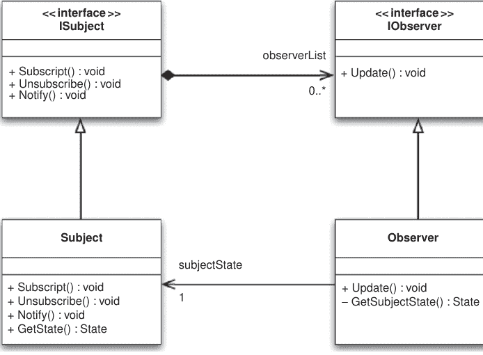

图 3.7

观察者模式的 UML 表示法。

```cpp
class ISubject {
public:
    ISubject();
    virtual ~ISubject();
    virtual void Subscribe(int message, IObserver *observer);
    virtual void Unsubscribe(int message, IObserver *observer);
    virtual void Notify(int message);

private:
    typedef std::vector<IObserver *> ObserverList;
    typedef std::map<int, ObserverList> ObserverMap;
    ObserverMap m_observers;
};
```

在这个设计中，我添加了对主题注册并发布不同消息类型通知的支持。这允许观察者只订阅他们感兴趣的特定消息。例如，一个代表元素栈的主题可能希望在元素从其中添加或移除时分离通知。使用上述接口，你可以如下定义一个最小的具体主题类：

```cpp
#include "observer.h"
```


```cpp
class MySubject : public ISubject {
public:
    enum Messages { ADD, REMOVE };
};
```

最后，你可以通过简单继承 `IObserver` 抽象类并实现 `Update()` 方法来创建观察者对象。以下代码演示了将所有这些概念整合在一起：

```cpp
#include "subject.h"
#include <iostream>
```

```cpp
class MyObserver : public IObserver {
public:
    explicit MyObserver(const std::string &str) :
    mName(str) {}

    void Update(int message) {
    std::cout << mName << " Received message " << message;
    std::cout << message << std::endl;
    }

private:
    std::string mName;
};
```

```cpp
int main(int, char **)
{
    MyObserver observer1("observer1");
    MyObserver observer2("observer2");
    MyObserver observer3("observer3");
    MySubject subject;

    subject.Subscribe(MySubject::ADD, &observer1);
    subject.Subscribe(MySubject::ADD, &observer2);
    subject.Subscribe(MySubject::REMOVE, &observer2);
    subject.Subscribe(MySubject::REMOVE, &observer3);

    subject.Notify(MySubject::ADD);
    subject.Notify(MySubject::REMOVE);

    return 0;
}
```

这演示了创建三个独立的观察者类，并针对 `MySubject` 类定义的两种消息的不同组合创建了订阅。最后，对 `subject.Notify()` 的调用会导致主题遍历其已订阅了给定消息的观察者列表，并为其中的每一个者调用 `Update()` 方法。需要注意的是，`MySubject` 类对 `Observer` 类没有编译时依赖。这两个类之间的关系是在运行时动态创建的。

当然，这种灵活性可能会产生微小的性能代价——在进行（虚）函数调用之前遍历观察者列表的代价。然而，与减少耦合和增加代码复用的收益相比，这种代价通常是微不足道的。此外，正如我在上一章中涵盖过的，你必须在销毁观察者之前对其取消订阅，否则下一次通知可能会导致崩溃。

### 3.5.3 推送与拉取服务器

实现观察者模式有很多种，我刚刚演示的示例只是其中一种方法。然而，我将指出观察者的两大类：基于推送（push-based）和基于拉取（pull-based）。这种分类决定了信息是被推送到观察者，还是观察者必须查询主题以获取当前状态。这种方法对于发送小段数据非常有用，但对于较大的数据（例如每次发生变化时都发送整个文本），可能效率很低。

# 106 第 4 章 设计

| 分析 | 设计 | 实现 |

|---|---|---|

| 需求 | 架构 | 编码 |

| 用例 | 类设计 | 测试 |

| 用户故事 | 方法设计 | 文档编写 |

图 4.1

从分析到设计再到实现的 API 开发阶段。

## 4.1.1 积累技术债务

所有大型成功的公司都是从微小的起点开始成长的。一个经典的例子是惠尔士惠普（Hewlett-Packard），它于1939年在帕罗奥图的一个车库里从两个工程师开始，最终成为世界上第一家营收超过1000亿美元的科技公司。让初创公司成功的特质与维持一家数十亿美元的上市公司的需求非常不同。公司在增长过程中会经历多次重大的组织变革，其软件实践也是如此。

小型初创公司需要尽快推出产品，以避免被资本更雄的竞争对手击败。在这种环境下，软件工程师的任务是快速产大量软件。在这种情况下，设计和实现长期 API 所需的额外努力通常被视为一种负担不起的奢侈。当“快速上市”与“公司生存”之间做出抉择时，这是一个合理的决定。我曾与一位小型初创公司的软件架构师交谈过，他禁止编写任何注释、文档或测试，因为他认为这会严重降低开发速度。

然而，如果某款软件变得成功，压力就会转向提供一个稳定、易用且文档良好的产品。新需求的出现迫使软件以其从未设计过支持的方式进行扩展。这一切都必须建立在一个并非为长期而设计的产品核心之上。正如沃德·坎宁（Ward Cunningham）所说，结果就是技术债务的积累（Cunningham, 1992）：

> 代码的交付时间就像债务。产生一点债务是可以的，只要通过重写及时偿还，…… 危险发生在债务未被偿还的时候。在不正确的代码上花费的每一分钟都算债务的利息。在未巩固实现的债务负担下，整个工程组织可能会陷入停滞。

史蒂夫·麦康奈（Steve McConnell）对这一定义进行了扩展，指出债务有两种类型：无意的和有意的。前者是指由于意图良好而设计的软件在执行时容易出错，当初级工程师编写了低质量代码，或者你的公司购买了另一家软件事实上一团乱糟的公司时。后者是指由于时间、成本、资源限制，做出了意识的战略性决策来走捷径，意图是在截止日期后落实“正确”的解决方案。

当然，问题在于，总会有另一个重要的截止日期，因此人们认为永远没有足够的时间回去进行正确的修复。结果是，技术债务逐渐积累：系统之间的短期代码一直存在并变得越陷越深，最后关头的的临时补丁（hacks）留在代码中并变成客户依赖的功能，编码规范和文档被忽视，原始的整洁设计变得退化和模糊化。罗伯特·C·马丁（Robert C. Martin）定义了代码库达到这一地点的四个警告信号（Martin, 2000）。以下是这些指标的略微修改版本。

- **脆弱性（Fragility）。** 当软件产生意料之外的副作用，或者实现细节暴露到导致系统看似不相关的部分依赖于系统部分内部实现的程度时，软件就是脆弱的。结果是对系统某部分的更改可能会导致代码中看似不相关的部分发生意外故障。因此，工程师害怕触碰代码，它成为了维护的负担。

- **僵化性（Rigidity）。** 一个僵化的软件是抵制更改的。实际上，设计变得脆弱，以至于即使是简单的更改也无法在不投入巨大精力进行大量、耗时且高风险的重构的情况下实现。结果是代码库变得粘稠，做出更改的努力被显著减慢。

- **不可移动性（Immobility）。** 优秀的工程师会发现可以重用代码来提高软件的可维护性和稳定性的情况。可移动代码是指免疫于这些影响的软件，使其难以在其他地方重用。例如，实现可能与其周围的代码纠缠在一起，或者可能硬编码了特定领域的知识。

- **不可传输性（Non-transferability）。** 如果你的组织中只有一名工程师可以处理代码的某些，那么它就可以被描述为不可传输的。所有者将是最初编写代码的开发者，或者是最后那个尝试清理它的倒霉蛋。对于大型代码库，每个工程师都不可能深度理解代码的每一个部分，拥有工程师无法轻易深入并有效工作的区域对你的项目来说是一个糟糕的。

这些问题的结果是组件之间的依赖关系不断增加，导致代码中持续不相关的部分相互依赖其内部实现细节。随着时间的推移，这最终导致大多数程序状态和局部逻辑重复（见图 4.2）。这通常被称为“意大利面代码”（spaghetti code）或“大泥球”（Foote and Yoder, 1997）。

### 4.1.2 偿还债务

最终，公司会达到这样一点：积累了这么多技术债务，以至于花费更多时间在维护和包含遗留代码库的基础上添加新功能。这通常会导致“下一代”项目来修复旧系统的问题。例如，当我遇到几段之前提到的那位软件架构师时，公司已经成长并取得了成功，他的团队正忙于重写他最初设计的所有代码。

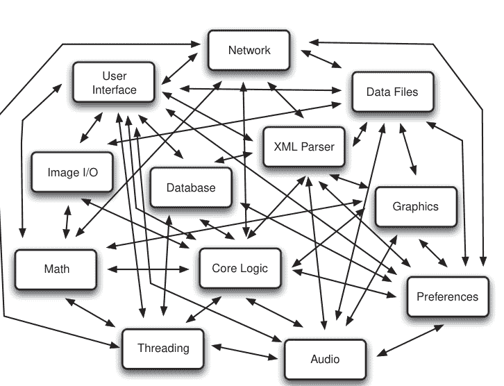

图 4.2

一个退化的紧耦合系统，演变成了一个大泥球。

从策略的角度来看，这种下一代项目有两种极端考虑：

1. **演进（Evolution）** 设计一个包含所有新需求的系统，并迭代重构它直到它达到目标。

2. **革命（Revolution）** 丢弃旧代码，从头开始设计并实现全新的系统。

这两者都有优缺点，而且都是困难的。我听过这种问题被描述为汽车正在以每小时100英里的速度行驶，但你无法停下汽车。

在演进的情况下，你总有一个可以发布的性系统。然而，你仍然要在旧设计的框架内工作，这可能不再是问题的最佳方式。新需求可能从根本上改变了关键案例的工作流。

在革命的情况下，你从旧的束缚中解放出来，并可能设计新功能。但是存在风险，因为新系统可能无法满足业务需求。在情况下，你必须考虑速度与质量之间的权衡。

### 4.1.3 为长期设计

投入大量的下一代努力来替换退化的代码库可能会为公司花费数百万美元。例如，仅仅支付一个由20名开发人员、测试人员、作家和经理组成的团队年的薪水（平均100,000美元），就需要2,000,000美元。然而，采用良好的设计原则可以避免这种剧烈的代价。让我们列举导致这种情况发生的原因。

- 简单的公司最初没有创建良好的软件设计，因为这在早期会花费宝贵的金钱。

- 项目上的工程师由于良好的设计技术，或者认为这些技术不适用于他们。

- 代码从初就不打算存在很长时间，例如，为了演示快速编写的，或者它是打算被丢弃的原型代码。

- 软件项目的开发过程没有使技术债务可见，因此对需要修复的所有部分的知识随着时间的推移而丢失或被忘记。（敏捷流程如 Scrum 尝试使用产品待办事项列表来保持债务可见）。

# 110 第4章 设计

- 1. 系统最初设计得很好，但随着时间的推移，其设计逐渐恶化，变得无节制地增长。例如，如果更改损害了系统的设计，就可以向代码中添加糟糕的。正如弗德·布克斯（Fred Brooks）所说，系统失去了它的概念完整性（Brooks, 1995）。

- 2. 需求的变化通常要求设计随之演进，但公司无论是有意还是无意，不断推迟这种重构工作，转而倾向于短期修复、临时方案（hacks）和胶水代码。

- 3. Bug 被允许存在很长时间。这通常是由于不断增加功能的驱动力，而没有关注最终产品的整体质量。

- 4. 代码没有测试，当工程师修改功能时，回归错误就会侵入系统，代码某些部分最终变成了工程师们畏惧修改的“可怕荒野”。

让我们来解决这些问题中的几个。首先，要纠正那种“良好的设计会让你浪费太多时间”的观念。说实话，编写结构杂乱的软件实际上可能是成本最低的决策，因为你可以更快地将其推向市场，一旦掌控市场后再完全重写代码。编写良好软件的某些方面确实看起来可能更耗时，例如编写额外的代码来隐含你的类，或者编写自动化测试来验证你的 API。然而，良好的设计花费的时间并没有你想的那么长，而且从远来看总是有回报的。在接口和实现之间建立分离对于代码的可维护性带来了回报，即使在短期内也是如此；而编写自动化测试让你有信心快速运行而不破坏现有行为。值得注意的是，迈克尔·费瑟（Michael Feathers）将遗留代码（legacy code）定义为没有测试的代码，指出“遗留”并不意味着“旧”，你今天就可以编写遗留代码（Feathers, 2004）。

API 的美丽之处在于，底层实现可以根据你解决问题的需要，快速粗糙或同样优雅。然而，背后的代码最初可以是简单且低效的。之后你可以添加更多的实现复杂性，而不会破坏遗留设计。通过管理组件之间的依赖关系，你可以限制问题的范围。相反，在面条代码（spaghetti code）中，每个组件都依赖于其他组件的内部实现，行为变得非正交，且一个组件中的 Bug 可能会以非显而的方式影响其他组件。重要的信息是花时间来构建一个良好的高层设计——即处理组件之间的依赖和关系。这是本章的重点。

问题的另一个方面是，如果你不对质量保持高标准，它就会随着代码的演进而退化。为了截止日期而走捷径通常是要付出代价的。记得偿还你的技术债。代码的寿命往往比你想象的要得多。当你唤醒一个 API 时，记住这一点很好，因为你必须在很长一段时间内承担后果。因此，意识到新需求对 API 设计的影响并重构你的代码以保持一致且最新的设计至关重要。对你的 API 实施变更控制同样重要，以确保它不会以无监督或混乱的方式演进。我将在第 8 章讨论 API 版本控制时，讨论实现这些目标的方法。

## 4.2 收集功能需求

为某个软件制作良好的设计的第一步是理解它实际上需要做什么。这同时也决定了工程师在构建错误东西时浪费了多少开发时间。看到两个工程师听到对某项工作的非正式描述，却对其中包含的内容产生完全不同的想法，这非常大开眼界。这并不一定是一件坏事；拥有工作方式不同的头脑来提供替代的视角和解决方案是好的。问题在于工作描述得不够详细，以至于所有参与者形成共同理解并朝着同一个目标努力。这就是需求的用武之地。软件行业有几种不同类型的需求，包括：

- **业务需求**：用业务术语描述软件的价值，即它如何促进组织需求的发展。

- **功能需求**：描述软件的行为，即软件应该完成什么。

- **非功能性需求**：描述软件必须实现的质量标准，即软件如何为用户工作。

在接下来的章节中，我将主要关注功能需求和非功能性需求。然而，确保软件的功能与你的目标一致仍然极其重要。

### 4.2.1 什么是功能需求？

功能需求仅仅是理解 API 应该做什么的一种方式。在 API 方面，功能需求定义了功能。通常的做法是将需求呈现为简洁的要点列表，并将文档组织成主题章节，以便将与系统同一部分的需求放在在一起。

- 他们期望执行哪些任务？

- 预期的输入是什么？

- 预期的输出是什么？

- 必须支持哪些平台？

- 需要哪些协议？

- 他们使用哪些术语？

## 112 第4章 设计

功能需求也可以由非功能性需求支持。这些需求是判断 API 的运行限制，而不是它的行为如何。非功能性需求的示例包括以下方面：

- **性能**：对操作速度是否有限制？

- **平台兼容性**：代码必须在哪些平台上运行？

- **安全性**：是否有数据安全或隐私考量？

- **可扩展性**：系统能处理真实世界的输入吗？

- **灵活性**：系统发布后需要扩展吗？

- **易用性**：用户可以轻松理解、学习和使用 API 吗？

- **并发性**：系统是否需要利用多个处理器？

- **成本**：软件将花费多少？

### 4.2.2 功能需求示例

功能需求通常在需求文档中管理，每个需求都有一个唯一的标识符和一个描述。也可以提供需求的理由说明来解释其必要性。重要的是，它们不要过度详细地规定技术实现：功能需求应该记录 API 应该做什么，而不是如何去做。

为了说明这些点，这里有一个用户与自动取款机（ATM）交互的功能需求示例。

- REQ 1：如果系统缺钱或无法与金融机构通信，系统应防止进一步交互。

- REQ 2：系统应验证插入的卡片是否在该 ATM 上进行金融交易。

- REQ 1.3：系统应验证用户输入的 PIN 码是否正确。

- REQ 1.4：如果金额可用，系统应取出请求的金额，并从用户账户中扣除相同金额。

- REQ 1.5：如果交易无法完成，系统应通知用户。在这种情况下，不应从用户账户中扣除资金。

### 4.2.3 维护需求

没有所谓的稳定需求；你应该始终预期它们会随着时间的推移而变化。这种情况发生有很多原因，但最常见的原因是，用户（以及你）在开始构建系统时，对系统如何运作会有更清晰的认识。你应该确保为需求标记了版本和日期，以便你可以引用特定的文档版本，并知道它有多久了。

平均而言，项目 25% 的功能性需求会在开发过程中发生变化，这占了需要重构代码的70–85% (McConnell, 2004)。虽然与客户不断变化的需求保持同步是好事，但你也应该确保每个人都理解更改需求的成本。增加新需求会导致项目交付时间延长。它可能还需要设计进行重大更改，导致大量的重写成本。

特别是，要警惕陷入需求蔓延（requirement creep）的陷阱。对功能需求的任何重大更改都应该触发项目进度和成本的重新修订。通常，需求中的任何新添加都应该根据其所提供的增量业务价值进行评估。从务实的角度评估新需求时，应该权衡变更带来的收益与实现它的成本。

## 4.3 创建用例

用例（case）描述了基于用户或其他另一个软件交互的 API 行为 (Jacobson, 1992)。用例本质上是功能需求的一种，它专门捕获了对 API 执行什么以及出于什么目的，而不是简单地提供功能、行为或实现说明的列表。关注用例可以帮助你从客户端的角度设计 API。

生成一份功能需求文档以及一组用例并不罕见。例如，用例可以从用户的角度来描述 API，而需求可以用来描述功能列表或算法细节。然而，如果仅集中在这些技术中的一种上可能觉得足够了，在这种情况下，我建议使用用例，因为用例与用户想要与系统交互的方式共鸣最紧密。通过使用这两种方法，你可以从用例中推导出功能性需求，反之亦然，尽管更典型的做法是先与用户一起完成用例，然后从这些用例中推导出功能性需求列表。

| 提示 |

| :--- |

| 用例从用户的角度描述了对你 API 的需求。 |

Ken Arnold 使用开车的类比来说了基于使用而非实现细节来设计接口的重要性。他指出，通过问“用户如何控制汽车？”，而不是“用户如何调整泵入每个活塞的燃料速率”，更有可能为司机提供良好的体验 (Arnold, 2005)。

### 4.3.1 开发用例

每个用例都描述了一个“参与者”（actor）试图实现的目标。另一个参与者是系统外部的实体，负责发起交互，例如人类用户、设备或其他软件。每个参与者在与系统交互时可能扮演不同的角色。例如，数据库的用例可能扮演管理员、开发人员或数据库用户的角色。处理创建用例过程的一种良好方法是识别 (1) 系统所有的参与者以及他们扮演的角色，(2) 识别每个角色需要完成的所有目标，以及 (3) 为每个目标创建用例。

每个用例都应该使用问题领域的词汇用通俗英语编写。它的命名应该描述参与者所获得的价值结果。用例的每一步都应该以角色开头，后跟一个主动动词。例如，继续 ATM 的例子，以下步骤描述了用户如何验证其 PIN 码：

- 步骤 1. 用户插入 ATM 卡。


- 步骤 2. 系统验证 ATM 卡对于 ATM 机器是有效的。
- 步骤 3. 系统提示用户输入 PIN 码。
- 步骤 4. 用户输入 PIN 码。
- 步骤 5. 系统检查 PIN 码是否正确。

### 4.3.2 用例模板

良好的用例代表了单一行为单元的、面向导的叙述性描述。它包含了一系列清晰的步骤，描述了实现用例目标的工作流。它还可以提供清晰的前置条件和后置条件，以指定用例执行前后的系统状态，即显式说明用例之间的依赖关系，以及导致用例启动的触发器。

用例可以用不同程度的形式和详尽程度进行记录。例如，它们可以简单到几句话，也可以像符合特定模板的结构化交叉引用规范一样正式。它们甚至可以以视觉方式描述，例如使用 UML 用例图 (Cockburn, 2000)。

| 提示 |
| :--- |
| 用例可以是简短的目标导向描述的列表，也可以是遵循规定模板的更正式的结构化规范。 |

在许多正式实例中，有许多不同的模板和格式来表示用例文本。这些模板往往是项目特定的，并且可以根据项目的需要非常简短或详尽。不要纠结于模板的细节：为了符合僵化的概念，清晰地传递需求更为重要 (Alexander, 2003)。尽管如此，用例模板的几个共同元素包括以下内容。

- **名称 (Name):** 用例的唯一标识符，通常是“动词–名词”格式，如取款（Withdraw Cash）或购买邮票（Buy Stamps）。
- **版本 (Version):** 用于区分用例不同版本的数字。
- **描述 (Description):** 对用例的简要概述。
- **目标 (Goal):** 参与者想要实现的目标。

## 4.3 创建用例

- **参与者 (Actors):** 想要实现目标的角者。
- **利益干系者/利益相关者 (Stakeholder):** 对用例结果有利益关系的的个人或组织，例如，ATM 用户或银行。
- **基本路径 (Basic Course):** 描述典型事件的步骤序列。
- **扩展 (Extensions):** 当目标失败时采取的替代步骤列表。
- **触发器 (Trigger):** 导致用例启动的事件。
- **前置条件 (Precondition):** 触发器成功执行所需的条件列表。
- **后置条件 (Postcondition):** 用例成功执行后的系统状态。
- **备注 (Notes):** 不属于任何类别的额外信息。

### 4.3.3 编写良好的用例

编写用例是一个直观的过程。它们用通俗英语编写，以捕获用户如何使用 API。然而，即使是直观的用例也可以从通用指南和建议中受益。

- **领域术语 (Domain terminology):** 用例应该用对 API 自然的术语描述。使用的术语应该是用户熟悉的，并且应该来自领域。事实上，用户应该能够阅读用例而不会感到困惑。
- **不要过度规范 (Don't over-specify):** 用例应该描述系统的黑盒功能，即避免实现细节。你也应该避免在用例中包含过多的细节。Alist Cockburn 使用向自动售货机投入硬币的例子。与其指定正确数量的各种组合，如“用户投入三个季度硬币，或者一个硬币后跟十个镍币”，你只需要写“用户投入钱”。

# 第 4 章 设计

用例分析。换句话说，用例本身并不是部分，因为它们没有指定特定的输入和输出值。然而，它们规定了用户期望能够实现的工作流。因此，它们是指导你的 API 自动化测试的来源。编写一组测试来验证这些工作流，将让你有信心认为你已经满足了用户的需求，并且在演进 API 的过程中不会破坏功能。

- **预期的迭代。** 用例本身并不是测试计划，因为它们没有指定特定的输入和输出值。然而，它们规定了用户期望能够实现的工作流。因此，它们是指导你的 API 自动化测试的来源。编写一组测试来验证这些工作流，将让你有信心认为你已经满足了用户的需求，并且在演进 API 的过程中不会破坏功能。
- **预期的迭代。** 不要太担心第一次就让所有的用例都完美。用例分析是一个发现的过程；它帮助你了解更多关于你想要构建的系统。因此，你应该将其视为一个迭代过程，随着你对整个系统知识的扩展，你可以完善现有的用例（Alexander, 2003）。然而众所周知，需求中的错误会对项目产生重大影响，导致重大的重新设计和实现工作。这就是为什么我给出的第一个建议是避免将用例写得过于详细。
- **不要坚持完全覆盖。** 出于用例没有涵盖所有形式的需求，你不应该期望用例表达你 API 的所有方面。然而，你也不需要覆盖一切。系统的某些部分可能已经被很好地理解，或者不需要从用户引导的视角来看。此外逻辑上的考虑，即你没有有限的时间和资源来编写详尽的用例，你应该将精力集中在最重要的以用户为中心的目标和工作流上（Alexander, 2003）。

将所有这些信息汇总，我将通过展示 PIN 码用例来完成我们的 ATM 示例，并使用之前描述的模板来格式化该用例。

**名称：** 输入 PIN

**版本：** 1.0

**描述：** 用户输入 PIN 码以验证其银行账户信息。

**目标：** 系统验证用户的 PIN 码。

**利益相关者：**

1. 用户想要使用 ATM 服务
2. 银行想要验证用户的账户。

**基本流程：**

1. 系统验证 ATM 卡是否适用于 ATM 机。
2. 系统提示用户输入 PIN 码。
3. 用户输入 PIN 码。
4. 系统检查 PIN 码是否正确。

**扩展：**

a. 系统未能识别 ATM 卡：
   a-1. 系统显示错误信息并终止操作。
b. 用户输入无效 PIN：
   b-1. 系统显示错误信息并允许用户重试。

**触发：** 用户将卡插入 ATM。

**后置条件：** 用户的 PIN 码通过金融交易验证。

## 4.3 创建用例

### 4.3.4 需求与敏捷开发

敏捷开发是符合敏捷宣言原则的软件开发方法的通称。示例包括极端编程 (XP)、Scrum 和 DSDM。敏捷宣言 (`http://agilemanifesto.org/`) 由 17 位贡献者于 2001 年 2 月编写，他们希望找到比当时的传统开发流程更轻量、更灵活的替代方案。它指出在开发软件时应重视以下品质：

- 个人和交互优于过程和工具。
- 可运行的软件优于详尽的文档。
- 客户协作优于合同谈判。
- 响应变化优于遵循计划。

敏捷方法强调以文档为中心的过程，而是倾向于对代码进行迭代。然而，这并不意味着它们没有任何形式的需求。这意味着需求是轻量且易于更改的。维护一份大型、冗长的正式需求文档不会被认为是敏捷的。然而，用例的大概念非常是敏捷流程（如 Scrum 和 XP）的一部分，这些流程强调创建用户故事（User Stories）。

用户故事是一个高级需求，包含了足够的信息，让开发者对实现所需的工作量提供合理的估算。它在概念上与用例非常相似，但目标是保持它们非常短，通常只有一句话。因此，简短的非正式用例比正式的模板驱动或 UML 用例更像用户故事。另一个重要的区别是，用户故事不是提前完成的。许多用户故事将随着工作代码的演进增量添加。也就是说，你尽早开始为设计编写代码，以避免在尝试实现它们后发现规格说明变得无效。

> 提示 用户故事是在敏捷开发过程中从用户那里获取最小需求的一种。

用户故事的另一个重要方面是，它们是由项目利益相关者而非开发者编写的，即对正在开发的产品感兴趣的客户、供应商、业务所有者或支持人员。用户故事的短小允许利益相关者在几分钟内完成它们。Mike Cohn 建议使用简单的格式来描述用户故事（Cohn, 2004）：

例如，回到我们的 ATM 示例，这里有与自动现金机交互的五个不同用户故事示例：

- 作为一名客户，我想提取现金，这样我就可以买东西。
- 作为一名客户，我想将钱从储蓄账户转到支票账户，以便我开支票。
- 作为一名客户，我想向我的账户存款，这样我可以增加账户余额。
- 作为一名银行业务所有者，我希望安全地验证客户身份，以便 ATM 能够防止欺诈活动。
- 作为一名 ATM 操作员，我想为 ATM 补充现金，以便 ATM 有现金供客户提取。

给定一组编写良好的用户故事，工程师可以估计涉及的开发工作规模，通常以故事点（story points）等抽象数量衡量，并着实现这些故事。利益相关者还会提供用户故事的优先级指示，以帮助从所有故事的积压（backlog）中确定工作顺序。然后，利益相关者会定期评估软件状态（例如在 Sprint 评审期间），并提供更多的用户故事以关注下一次迭代开发。换句话说，这意味着活跃的用户参与，并倾向于迭代开发风格，而不是创建大型的前期需求文档。

Cohn 提供了一个易记的缩写词来帮助你创建良好的用户故事。该缩写是 INVEST，其中每个字母代表一个编写良好的用户故事的品质（Cohn, 2004）：

- 独立（Independent）
- 可协商（Negotiable）
- 价值（Valuable）
- 可估算（Estimable）
- 短小（Small）
- 可测试（Testable）

此外，之前为编写用例提供的如 Scrum 和 XP 等所有建议都没有告诉你如何设计你的 API，你不能忘记你已经建立了用户故事积压，你仍然需要通过单独的设计过程确定如何实现这些故事。这是我在本剩余部分将关注的主题。

## 4.4 API 设计元素

最后，我们可以谈谈设计了！产生良好的 API 设计的在于对问题领域提出合适的抽象，并设计合适的对象和类层次结构来表示该抽象。

抽象是对某物的合理描述，可以在不知道其如何在程序中实现的情况下理解它。它倾向于强调事物的特征和责任，同时忽略对理解其基本性质不重要的细节。此外，你发现复杂问题表现出层次结构，或抽象（Fleming, 2009）。

例如，你可以用非常高层描述汽车如何工作，包含六个基本组件：燃料系统、引擎、变速箱、传动系统、轴和轮子。燃料系统为引擎提供能量，导致变速箱旋转，而传动系统连接变速箱和轴，使动力到达轮子并最终导致车辆前进。这是一个有助于理解汽车前进最通用原理的抽象级别。然而，你也可以提供另一个抽象级别，为其中一个或多个组件提供更多细节。例如，内部

## 4.5 架构设计

发动机可以被描述为几个相互连接的组件，包括活塞、曲轴、凸轮轴、分配器、飞轮和正时皮带。此外，发动机可以被分为几种不同的类型，例如内燃机、电动机、气电混合发动机或氢燃料电池。

同样，大多数复杂系统的设计在多个细节粒度级别上都表现出结构，这些层级结构可以从不同的角度来看。Grady Bosch 认为，任何复杂系统都有两个重要的层级视图（Bch et al., 2007）。

- 1. **对象层次结构 (Object Hierarchy):** 描述了不同对象在系统中是如何运行的。这代表了基于对象之间“属于（part of）”关系的的结构性分组（例如，活塞是发动机的一部分，发动机又是汽车的一部分）。
- 2. **类层次结构 (Class Hierarchy):** 描述了相关对象之间的共同结构和行为。它处理对象属性的泛化和特化。这可以被认为是对象之间的“是（isa）”层级关系（例如，混合动力是一种汽车发动机）。

在制定软件系统设计时，这两种视图都同等重要。[图 4.3](#) 尝试阐述这两个概念，展示了相关对象的层次结构以及继承行为和属性的类层次结构。

与此相关的是，人们通常认为软件构建的设计阶段由两个主要活动组成（Bourque et al., 2004）：

- 1. **架构设计:** 描述软件的顶层结构和组织形式。
- 2. **详细设计:** 对设计中的单个组件进行描述，使其达到可以实现的足够程度。

因此，作为一种通用方法，我建议定义一个对象层次结构来勾勒系统的顶层概念结构（或架构），并用类层次结构对其进行完善，后者指明了供客户端使用的具体 C++ 类。后者的即 API 类的定义过程涉及到考虑它们提供的单个函数和参数。本章的其余部分将逐一关注这些每个主题：

- 1. 架构设计。
- 2. 类设计。
- 3. 函数设计。

> 提示
> API 设计涉及开发顶层架构和详细的类层次结构。

## 4.5 架构设计

软件架构描述了整个系统的粗粒度结构：API 中的顶层对象以及它们相互的关系。通过开发架构，你可以在抽象层面上理解系统的不同组件，以及它们是如何相互通信和协作的。

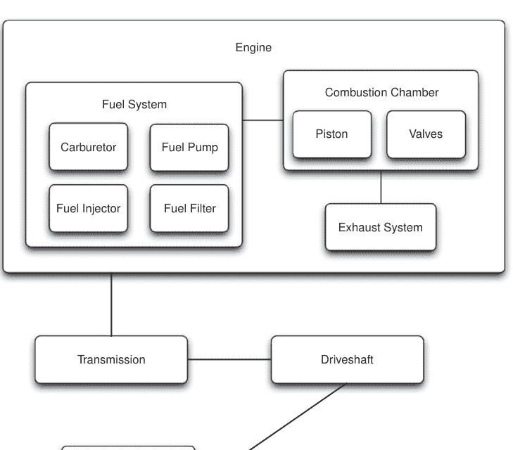

**图 4.3**

汽车设计展示为 (a) “属于”对象层次结构和 

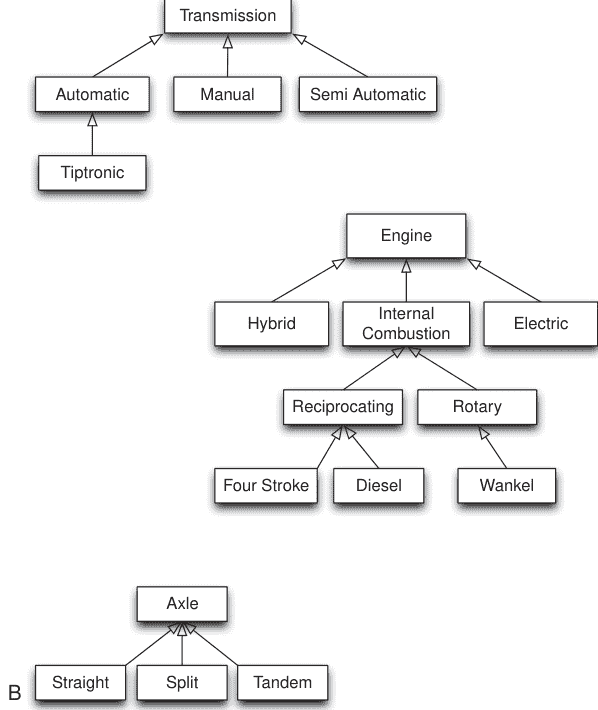

图 4.3——续

(b) 一种“是”类层次结构。箭头从更具体的类指向更通用的类。

花时间考虑你 API 的顶层架构是关重要的，因为架构中的问题可能会对你的系统产生深远且广泛的影响。因此，本节详细介绍了为你的 API 生产架构的过程，并提供了关于如何将问题领域分解为适当的抽象对象集合的见解。

### 4.5.1 开发架构

对于任何特定问题，并没有所谓的正确或错误的架构。如果你给两个架构师相同的一组需求，你无疑会不同的解决方案。重要的方面是产生一个经过深思熟虑的设计为系统提供框架，并解决各种需求和约束之间的权衡（Bass et al., 2003）。在高级层次，为 API 创建架构的过程涉及四个基本步骤：

- 1. 分析功能需求。
- 2. 识别并考虑约束。
- 3. 发明系统中的主要对象及其关系。
- 4. 沟通并记录架构。

这些步骤的第一步源自需求收集阶段（参考图 4.4），即正式的需求文档，或一组非正式的用户故事的集合。第二步涉及捕获并考虑所有对架构产生约束的因素。第三步涉及定义系统的高层对象模型以及它们如何相互关联。最后，架构应该传递给必须实现它的工程师。图 4.4 阐释了每一个步骤。

需要强调的是，上述步骤序列并不是你只需执行一次就能魔术般获得完美架构的配方。正如已经提到的，软件设计是一个迭代过程。你很难第一次就做对每一个步骤。然而，你 API 的首次发布至关重要，因为那个时间点的更改成本更高。因此，在将其发布给那些将在自己的程序中在此基础上构建的客户端之前，尽尝试你的设计并逐步改进它是非常重要的。


图 4.4：开发 API 的步骤：(1) 收集需求，(2) 识别约束，(3) 发明对象，以及 (4) 沟通设计。

### 4.5.2 架构约束

API 不是在真空设计的。总会有影响和限制架构的因素。因此，在设计过程正式进行之前，你必须识别并适应这些因素。Christine Hofmeister 和她的合著者们将这一阶段称为架构分析（Hofmeister et al., 2009）。该术语指的是整体影响系统的因素，这些因素通常相互依赖且冲突，分为三类：

- 1. **组织因素，例如：**
    - 预算
    - 进度
    - 团队规模和专业知识
    - 软件开发流程
    - 自研还是购买
    - 管理关注
- 2. **环境因素，例如：**
    - 硬件（桌面设备或移动设备）
    - 平台（Windows、Mac 和 Linux）
    - 软件约束（使用其他 API）
    - 客户端/服务器约束（构建 Web 服务）
    - 协议约束（邮件客户端 POP 与 IMAP）
    - 文件格式约束（支持 GIF 和 JPEG）
    - 数据库依赖（必须连接远程数据库）
    - 子系统的暴露
- 3. **运行因素，例如：**
    - 性能
    - 内存占用
    - 可靠性
    - 可用性
    - 并发
    - 可定制性
    - 可扩展性
    - 脚本化
    - 安全性
    - 国际化
    - 网络带宽

软件架构师的任务是根据功能需求中的约束对这些因素进行排序，并找到最佳折中方案。为目标受众仔细设计 API 只能提高其可用性和成功率。然而，不存在完美的设计；一切都是针对给定的组织、环境和运行约束的权衡。例如，如果你被迫在紧迫的进度下交付，你可能需要专注于尽可能利用第三方 API 并限制支持平台数量的简单设计。

> 提示
> 架构设计受到许多独特的组织、环境和运行因素的限制。

某些约束是可以协商的。例如，如果客户的一个需求给系统带来了过度的复杂性，客户可能会接受一种成本更高或交付更早的替代方案。

### 4.5.3 识别主要抽象

一旦你分析了系统的需求和约束，就可以开始构建高层对象模型了。基本上，这意味着识别问题中的主要抽象

## 4.5 架构设计

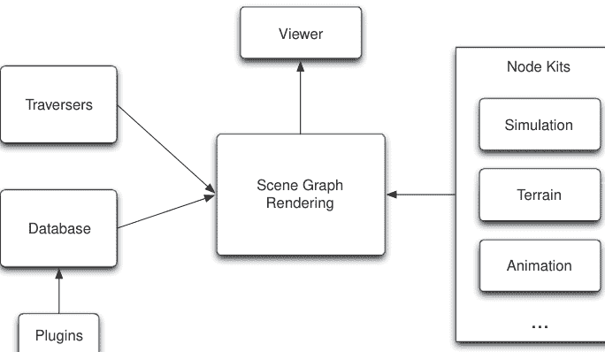

**图 4.5** OpenSceneGraph API 的顶层架构示例。

领域并将其分解为相互连接的对象的层次结构。图 4.5 展示了这一过程的示例。它展示了 OpenSceneGraph API 的顶层架构，这是一个用于视觉仿真应用的开源 3D 图形工具包（`http://www.openscenegraph.org/`）。

通过基于问题领域中的实际概念建立架构，你的设计应该保持通用性，并对未来需求的变更具有健壮性。回想起第 2 章中将其列为第一个 API 属性；一个良好的 API 应该对问题领域进行建模。然而，将问题分解为一组良好的抽象并不是一项易事。对于对于熟悉的问题，例如编写编译器或 Web 服务器，你可以利用许多其他设计人员随时间推提提炼并发表的知识。然而，对于很少或没有先验研究应用的新问题，发明良好的分类的任务并非显而易见。

这并非计算机科学所独有。将地球生物学划分为逻辑分类法自亚里士多德时代以来是一项古老的争论。18 世纪，林奈（Carolus Linnaeus）提出了生命的双界模型，即植物和动物界。这后来在 19 世纪被进一步完善，包含了微生物。电子显微镜的进步将王国数量增加到五个六个。然而，21 世纪的研究挑战了王国的观点，并提出了“超族”（supergroup）。关于应该使用哪些特征来创建分类的话题引起了许多争议。亚里士德根据繁殖方式对动物进行分类，双名法根据形态（相似的结构或外观）对生物进行分组，而受尔文启发的分类法倾向于根据共同祖先分类（生物是否具有共同祖先）。

### 4.5.4 发明关键对象


对于系统中主要抽象分类的困难性，我仍然可以提供一些关于处理该问题的建议。因此，有许多技术可以利用它们将系统分解为一组关键对象，并识别它们相互的关系（Booch et al., 2007）。

- 自然语言。通过类比自然语言，人们观察到（通常情况下）名词倾向于代表对象，各种函数、形容词和所有格名词代表属性（Bourque et al., 2004）。我可以通过回到第 2 章中的地址录 API 来说明这一点。地址录和人的现实世界概念都是名词，并且作为 API 中的关键对象表示是有意义的，而像向地址录中添加人员或为某人添加电话号码等操作，应该表示为对它们所修改的对象的函数调用。人的名字是一个所有格名词，作为 `Person` 对象的属性（Attribute）比其本身作为一个高层对象更合理。

- 属性。这种技术涉及将具有相似属性或特性的对象分组。可以使用离散类别来实现，这些类别可以明确地标识对象是否是某类的成员，例如红色与蓝色；或者创建一种对象的概率分组，这取决于每个对象匹配某些模糊标准或概念的程度，例如一部电影是否被归类为动作片或爱情片。

- 行为。这种方法通过对象共享的行为对对象进行分组。这涉及确定系统中的行为集，并将这些行为分配给系统的部分。然后你可以通过识别这些行为的启动者和参与者来推导出对象集。

- 原型。在这种方法中，你尝试为最初识别的对象发现更通用的原型。例如，豆袋椅、凳子和躺椅都是椅的类型，具有非常不同的形状和外观。你可以根据它们表现出原型椅子功能（affordances）的程度对它们中的每一个进行分类。

- 领域。Shale-Mellor 首先水平地划分系统以生成通用的“领域”，然后通过对每个领域应用单独的分析来垂直地划分（Shlar-Mellor, 1988）。这种分治法的好处之一是，领域可以形成重用的概念，这些概念可以应用于其他设计问题。例如，使用我们的 ATM 示例，领域可以是以下之一：

    - 实体领域，例如 ATM 机或纸币。
    - 角色领域，例如 ATM 用户或银行所有者。
    - 事件领域，例如金融交易。
    - 安全领域，例如身份验证和加密。
    - 交互领域，例如输入 码或取款。
    - 日志领域，供系统记录信息。

- 邻域。Neighbors 加入了领域分析，作为揭示问题领域中所有应用程序共享的类和对象的技术（Neighbors, 1980）。这是通过分析问题领域中的相关系统来发现共同点和独特之处的，例如识别所有 Bug 跟踪系统的共同元素，或所有家谱软件的通用特征。

- 领域（Evans）。与 Neighbors 领域分析相关的术语是“领域驱动设计”（domain-driven design）。这是 Eric Evans 引入的，旨在通过演进的模型为复杂系统产生设计（Evans, 2003）。

> 提示：识别 API 的关键对象是困难的。尝试从不同的角度观察问题，并迭代完善你的模型。

大多数这些技术当你拥有一组组织良好且结构用例时效果最好。例如，用例通常被构建为句子，其中一个事物对另一个事物执行某些动作。你可以将这些作为自然语言分析的输入，通过提取用例的步骤并识别对象来开发初始候选列表。

上述每种技术都可能涉及不同程度的形式化方法。例如，自然语言分析并不是一种非常严谨的技术，被同行们所反对。自然语言本质上是歧义的，可能会隐式地表达领域的重要概念或忽略架构特性。你应该警惕仅仅将用例中的所有名词翻译为关键对象。最好情况下，你应该将这种分析的结果视为从之进行进一步分析和完善的初始列表（Alexander, 2003）。这种完善可能涉及识别模型中的差距，考虑是否可以从列表中提取更通用的概念，并进行分类。

相比之下，有几种形式化技术用于软件设计，包括文本和图形表示法。一种特别流行的技术是通用建模语言（UML）（Booch et al., 2005）。使用一组图形图表，UML 可用于规范和维护软件设计。例如，UML 2.3 包含了 14 种图表来表示设计的各种结构和行为方面（见图 4.6）。

形式化设计也可以用于生成实际代码。这从将用例直接翻译为等效源代码，到更全面的可执行架构概念。后者是对架构的足够详细的描述，可以转换为可执行软件并在目标平台上运行。例如，Shale-Mellor 表示法最终演变为 UML 的一个配置文件，称为执行 UML（Mellor and Balcer, 2002），它本身成为了模型驱动架构的基石。这种方法的基本原理是模型编译器获取多个可执行模型，每个模型定义一个不同的关注点或组合这些模型以产生高级可执行代码。

# 第 4 章 设计

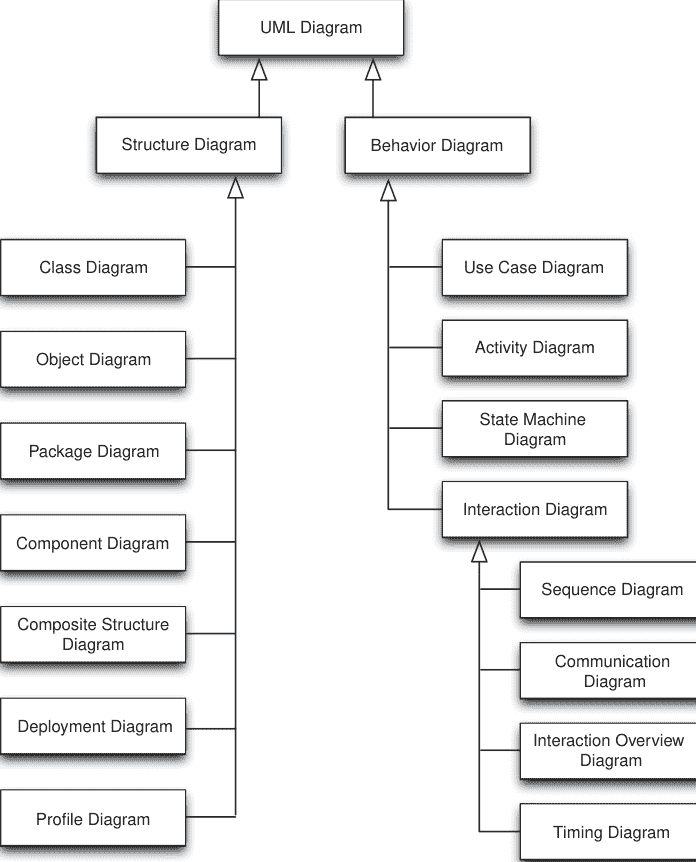

图 4.6

UML 2.3 的 14 种类型。

## 4.5 架构设计

### 4.5.5 架构模式

第 2 章介绍了用于解决软件设计中重复问题的设计模式，例如单例（Singleton）、工厂方法（Factory Method）和观察者（Observer）。这些模式通常提供可以在组件级实现的解决方案。一类被称为架构模式的软件模式描述了系统更大规模的结构和组织。因此，当你构建映射到特定架构模式的 API 时，这些解决方案中的一些对你有所帮助。以下列表分类了许多流行的架构模式（Bourque et al., 2004）。

- 结构模式：分层（Layers）、管道与过滤器（Pipes and Filters）以及黑板（Blackboard）
- 交互式系统：模型-视图-控制器（MVC）、模型-视图-演示者（MVP）以及演示-抽象-控制（PAC）
- 分布式系统：客户端/服务器（Client/Server）、三层架构（Three Tier）、点对点（Peer to Peer）以及代理（Broker）
- 可适应系统：微内核（Micro-kernel）和反射（Reflection）

许多架构模式提供了用于避免系统不同部分之间依赖问题的设计，例如第 2 章详细讨论的 MVC 模式。此时，值得注意的是系统架构的另一个重要视角是库文件及其依赖的物理视图。我在图 1.3 中展示过这个示例，展示了构成复杂端用户应用程序的 API 层。即使在单个 API 内部，你可能也有不同层次的物理架构，如图 4.7 所示。

1. API 中立的低级例程，例如字符串处理例程、数学函数或你的线程模型。
2. 实现你的 API 主要功能的内核业务逻辑。

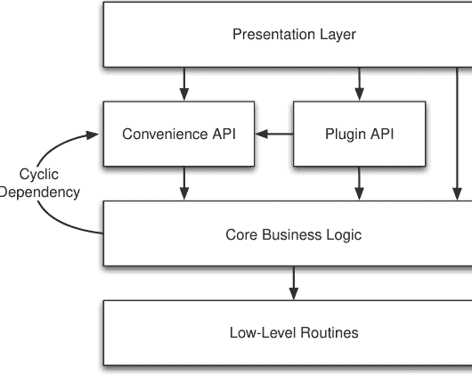

图 4.7

API 架构层示例，显示了两个组件之间的循环依赖。

3. 插件或脚本 API，允许用户扩展 API 的基础功能。
4. 构建在核心 API 功能之上的便利 API。
5. 表现层，用于提供 API 结果的可视化显示。

在这种情况下，在系统的不同架构层之间维护严格的依赖层次结构至关重要，否则你将导致层之间的循环依赖（见图 4.7）。这些层中的单个组件也是如此。通常观察是，低级组件不应该依赖于架构中的高级组件。例如，你的核心业务逻辑不应依赖于便利 API，因为这会在两者之间引入循环（假设你的便利 API 也调用了核心业务逻辑）。参考 MVC 架构模式，你会发现视图（View）依赖于模型（Model），但反之则不然。David L. Parnas 将这一概念称为无环层级结构（Parnas, 1975）。

### MENVSHARED

在 Pixar 的几年里，我们陷入了这样一种局面：核心动画库之间存在大量的循环依赖。随着我们在几周内为了赶紧迫的生产截止日期，这些依赖缓慢地渗透进系统。

为了让系统继续编译，我们被迫将所有这些独立的共享库链接在一起，称为 `libshared.so`（读作 men-vee-shared）。这意味着对其中一个共享库的任何更改都需要重新构建整个库，这个过程至少需要 5-10 分钟。

正如你可以想象的，这为开发团队的速度造成了巨大的瓶颈。事实上，`mensshared` 库的巨大体积甚至在我们将代码移植到另一个平台时导致了链接器崩溃。

幸运的是，最终有几位勇敢的工程师解决了这个问题，在几周时间里，我们逐渐理顺了依赖关系，最终消除了 `mensshared`。

循环依赖出于许多原因都是坏的。例如，这意味着你无法独立地测试每个组件而不必引入其他组件。基本上，为了理解任何一个组件，必须同时理解这两个组件（Lakos, 1996）。如果你被迫将几个组件合并成一个大组件（如随附侧栏描述所示），这也会影响你的开发速度。第 1 章和第 2 章介绍了各种解耦依赖的技术，如回调和通知系统。从根本上说，API 应该是逻辑相关组件的无环层级结构。

| 避免 API 组件之间出现循环依赖 |

### 4.5.6 架构沟通

一旦架构开发完成，就可以以多种方式进行记录。这可以从简单的图表或 wiki 扩展到各种提供架构建模符号的正式方法，例如 UML 或一套架构描述语言集（Medvidovic and Taylor, 2000）。

无论你采用哪种方法，记录架构都是向工程师传达设计的重要因素。这样做可以为他们提供更多信息以根据你的愿景实现系统，并确保未来的更改继续保持架构的意图和完整性。如果开发团队规模大或地理位置分散，这一点尤为重要。

你应该在架构文档中包含的元素之一是对整体设计的依据（Rationale）。即，考虑了哪些替代设计和权衡，以及为什么判断最终结构是更优的。这种设计依据对于设计的长期维护非常重要，并可以防止未来的设计师重复你所犯过的错误。Martin Robillard 在书中指出，如果 API 的用户不理解其高层架构和设计，他们通常会发现很难学习和使用该 API（Robillard, 2009）。

> **提示**
>
> 在随附的工作文档中描述你 API 的高层架构和设计依据。

沟通还允许对设计进行同行评审，并在 API 发布之前接收反馈和改进。事实上，在过程早期实施评审以促进架构师、开发者和客户之间的沟通，将帮助你产出更全面、更耐用的设计。如果架构师也编写一些代码，那么这是一个通过实践性的动手贡献来交流设计原则的极佳方式。

尽管现代敏捷开发不再强调沉重的流程，因为设计经常过时，但仍有必要提供此类系统架构文档，但仅限于此。结合直接沟通可能会更加高效。这允许设计师和架构师之间进行对话，并避免在阅读规范时可能发生的误解。架构师的工作是保持高效、作为一个能够回答工程师问题的沟通者，并确保使用最有效的渠道来保持活跃（Faber, 2010）。

## 讲述你的故事

在 Pixar 的研发部门工作时，软件工程师和经理被迫为具有高度创造力的艺术家创作强大且易用的程序。我们努力使用电影制作熟悉的类比和术语来传达我们的软件计划和设计。

例如，我们的设计被称为“故事”（Story），参考了电影制中初步规划和设计的。我们的软件和系统设计通过标准分镜（Storyboards）展示给我们的生产用户。这些是物理板板，上面钉着 4-6 英宽的手绘卡片网格。这些以“故事推演”（Story pitch）的格式展示给艺术家。使用电影制作术语，使我们能够以会议的形式展示材料，这对我们很熟悉。最后，我们制作了“分镜”，即数字媒体，对拟议应用程序的手绘示例进行动画处理和配音，以展示端用户的工作流。

这种特定方法非常适合我们向内部非技术用户传达软件计划。当然，这种格式并不适用于所有其他软件项目。

# 132 第 4 章 设计

## 4.6 类设计

一旦确定了高层架构，你就可以开始精炼设计，以描述特定的 C++ 类及其与其他类的关系。这被称为详细设计，与顶层架构设计形成对比。它涉及识别将使用的实际类、这些类之间的相互关系，以及它们的主要函数和属性。对于足够大的系统，你还可以描述如何将类组织成子系统。

对于除最微不足的系统以外的任何系统，设计 API 中的每一个类都是大材小用。相反，你应该关注定义了最重要功能的主要类。一个很好的经验性准则是所谓的“80/20 法则”，即你应该集中精力处理定义系统 80% 行为的 20% 的类（McConnell, 2004）。

> 提示
>
> 专注于设计定义了你 API 80% 功能的 20% 的类。

### 4.6.1 面向对象的概念

在我讨论面向对象设计的细节之前，让我们花一点时间回顾一些主要的面向对象原则及其在 C++ 中的表示。你可能对这些概念非常熟悉，但为了完整性起见并确保我们处于同一理解水平，让我们在这里进行一下总结。

- **类 `Class`**：类是对象的抽象描述或规范。它定义了对象的数据成员和成员函数。
- **对象 `Object`**：对象是一个具有状态、行为和身份的实体（Booth et al., 2007）。它是运行时使用 C++ 中的 `new` 运算符创建的类的实例。一个具体的类是可以实例化的，例如，它没有未定义的虚成员函数。
- **封装 `Encapsulation`**：这描述将数据和方法划分成单个对象，并带有诸如 `public`、`protected` 之类的访问控制规范，以支持实现细节的隐藏。
- **继承 `Inheritance`**：继承允许对象从父类继承属性和行为，以这种方式定义的类被称为派生类（或子类）。子类可以重写任何基类方法，通常你只在在该基类方法被声明为虚（virtual）时才需要这样做。纯虚方法（通过附加 `= 0` 表示）是指子类必须提供该方法的具体实现才能成为具体类（即允许创建实例）。C++ 支持多重继承，意味着子类可以继承自多个类。公共继承通常被称为两个对象之间的“is-a”关系，而私有继承代表“was-a”关系（Lakos, 1996）。
- **组合 `Composition`**：这是继承的替代技术，通过组合一个或多个对象来创建更复杂的对象。这是通过将较简单的对象声明为更复杂对象内部的成员变量来实现。“has-a”关系用于描述类持有另一个类型实例的情况。“holds-a”关系描述类持有一个指向其他类型的指针或引用。
- **多态 `Polymorphism`**：这是一种类型表现为另一种类型并像另一种类型一样被使用的能力。这允许不同类型的对象只要符合相同的接口，就可以交替使用。这是可能的，因为 C++ 编译器可以推迟到运行时再检查对象的类型，这种技术被称为晚期绑定或动态绑定。C++ 中模板的使用也可以提供静态（编译时）多态。

### 4.6.2 类设计选项

在考虑创建类时，有很多因素需要考虑。正如 Scott Meyers 指出的，创建一个新类涉及定义一个新类型。因此，你应该将类设计视为类型设计，并以 C++ 设计师对待语言内置类型时的同样的审慎和关注来处理这项任务（Meyers, 2005）。

以下是你开始设计新类时应该问自己的几个主要问题列表。这并不是一个详尽列表，但它应该提供一个很好的起点，并帮助你定义设计的主要约束。

- **继承的使用**：将类添加到现有的继承层次是否合适？你应该使用公共继承还是私有继承？你是否应该支持多重继承？这会影响哪些成员函数应该是虚函数。
- **组合的使用**：将相关的对象作为成员变量更为合适？
- **抽象接口的使用**：它被设计为一个抽象类吗？
- **初始化和析构**：你需要一个虚析构函数吗？
- **拷贝构造函数和赋值**：你需要定义它们吗？
- **模板的使用**：你的类需要泛化吗？
- **const 和 explicit 的使用**：你是否应该使用 `explicit` 关键字来避免意外的转换？
- **定义运算符**：你需要重载运算符吗？
- **友元（friends）的使用**：朋友会破坏类的封装。
- **非功能性约束**：性能和内存使用等问题可能会有所不同。

### 4.6.3 使用继承

在设计类时，你面临的最大决策是何时以及如何使用继承。由于继承是一个如此重要的话题且经常被误用，我将在接下来的章节中重点介绍这一点。让我们从一些通用建议开始：

- **为了继承而设计或禁止继承**。你可以做出的最重要的决定是一个类是否应该支持继承。如果是，你必须声明一个非虚析构函数。
- **仅在适当的地方使用继承**。一个类是否应该继承另一个类是一项艰巨的任务。事实上，这可能是设计中最困难的部分。我将在下一节讨论里斯科替换原则（LSP）时就此主题提供一些指导。
- **避免深层继承树**。深层次结构会增加复杂性，并不可导致难以理解的设计。层次结构的绝对限制是主观的，但超过二三层就已经复杂了（McConnell, 2004）。
- **使用纯虚函数强制子类提供实现**：虚成员函数可以用于定义包含可选实现的的接口，而纯虚函数仅用于定义接口（尽管实际上可以为纯虚方法提供默认实现）。当然，非虚方法用于提供不能被子类更改的行为。
- **不要向现有接口添加新的虚函数**：你完全可以设计纯虚函数来设计抽象接口。但是，请注意，在你将其发布给用户后，如果你向接口添加了新的纯虚函数，你将破坏所有客户端的代码。在定义新纯虚函数的实现之前，继承自该抽象接口的类将不是具体类。
- **不要过度设计**。在第 2 章中，我提到过一个良好的 API 应当是极简的。换句话说，你应该抵制添加不必要的额外抽象层的诱惑。例如，如果你在整个 API 中有一个基类只被一个类继承，这表明你对系统的当前需求过度设计了。

另一个重要的考虑因素是是否利用继承，即设计继承自多个基类的类。Bjarne Stroustrup 为在 C++ 中增加多重继承辩护护，使用了临时秘书（TemporarySecretary）类的例子，该类继承自秘书（Secretary）和临时（Temporary）（Alexanderscu, 2001）。然而，C++ 社区对于多重继承是否是一件好事存在分歧。一方面，它提供了定义复合关系的灵活性，例如临时秘书的例子。另一方面

## 4.6 类设计

另一方面，这可能会带来细微语义和歧义的代价，例如需要使用虚继承来处理“菱问题”（即一个类歧义地继承自两个或多个基类，而这些基类本身又继承自同一个基类）。

大多数只允许从单个基类继承的语言仍然支持从多个受限类型中继承。例如，Java 允许你继承多个接口类，而 Ruby 允许你继承多个混入类（mixins）。这些类允许你继承一个接口（在混入类的情况下为包含实现）；然而，它们本身不能被实例化。

如果使用当，多重继承可以是一个强大的工具（查看 STL it 类的良好示例）。然而，为了接口的健壮和易用性，我通常赞同 Steve McConnell 的观点，他建议你应该避免使用多重继承，除非是为了抽象接口或混合类（McConnell, 2004）。

- **提示** 避免多重继承，接口和混入类除外。


有趣的是，新的 `C++11` 规范包含了许多与继承相关的改进。一个特别的注意是，可以显式指定你重写（`override`）或隐藏（`hide`）基类虚拟方法的意图。这分别通过使用 `[[override]]` 和 `[[hiding]]` 属性来实现。这一功能对于避免诸如在派生类中误写虚拟方法名称等错误非常有帮助。

### 4.6.4 Liskov 替换原则 (LSP)

这一原则由 Barbara Liskov 在 1987 年引入，为类是否应该设计为另一个类的子类提供了指导（Liskov, 1987）。`LSP` 规定，如果 `S` 是 `T` 的子类，那么 `T` 的对象可以被 `S` 的对象替换而不会产生任何行为变化。

一看，这似乎是对“是一个...”（is-a）关系的简单重述，如果 `S` 是 `T` 的一种更具体的类型，那么该类可以被视为 `T` 的子类型。然而，`LSP` 的定义比“是一个...”要严格得多。

```cpp
class Ellipse {
public:
    Ellipse();
    Ellipse(float major, float minor);
    void setMajorRadius(float major);
    void setMinorRadius(float minor);
    float getMajorRadius() const;
    float getMinorRadius() const;
private:
    float mMajor;
    float mMinor;
};
```

你决定为圆类添加支持。从数学角度来看，圆是椭圆的一种更具体的形状，其中两个轴被限制为相等。因此，将 `Circle` 声明为 `Ellipse` 的子类是有吸引力的。例如，

```cpp
class Circle : public Ellipse {
public:
    Circle();
    explicit Circle(float r);

    void SetRadius(float r);
    float GetRadius() const;
};
```

随后，`SetRadius()` 的实现可以通过圆的属性将底层椭圆的长半径和短半径设置为相同的值。

```cpp
void Circle::SetRadius(float r) {
    SetMajorRadius(r);
    SetMinorRadius(r);
}

float Circle::GetRadius() const {
    return GetMajorRadius();
}
```

然而，这导致了许多问题。最明显的是，`Circle` 也会继承并暴露 `Ellipse` 的 `SetMajorRadius()` 和 `SetMinorRadius()` 方法。这些方法可能被用于在不改变另一个属性的情况下改变半径从而破坏我们圆的自洽性。你可以通过重写 `SetMajorRadius()` 和 `SetMinorRadius()` 方法来处理这个问题，让它们同时设置长、短半径。首先，你必须回头将 `Ellipse::SetMajorRadius()` 和 `Ellipse::SetMinorRadius()` 声明为虚函数，以便你可以在 `Circle` 类中重写它们。这本身就应该提醒你你在做错。其次，你创建了一个非正交的 API，它具有改变另一个属性的副作用。第三，你破坏了 Liskov 替换原则，因为你无法在不破坏行为的情况下将 `Ellipse` 的使用替换为 `Circle`，如下代码所示：

```cpp
void TestEllipse(Ellipse& e) {
    e.SetMajorRadius(10.0);
    e.SetMinorRadius(20.0);
    assert(e.GetMajorRadius() == 10.0 && e.GetMinorRadius() == 20.0);
}

Ellipse e;
Circle c;
TestEllipse(e);
TestEllipse(c); // 失败！
```

问题的根在于你改变了继承自基类的函数的行为。因此，你不应该使用公共继承将圆建模为一种椭圆，那么你应该如何表示它呢？有两种主要方法可以让你在 `Ellipse` 类的功能的基础上正确构建 `Circle` 类：私有继承和组合。

> **提示** `LSP` 规定，应该始终能够用基类替换派生类而不会产生任何行为变化。

#### 私有继承

私有继承允许你继承另一个类的功能，而不是它的公共接口。本质上，基类的所有公共成员都变成派生类的私有成员。与公共继承相比，我将此称为“曾是一个...”（was-a）关系。例如，你可以如下所示私有地继承 `Ellipse`：

```cpp
class Circle : private Ellipse {
public:
    Circle();
    explicit Circle(float r);
    void SetRadius(float r);
    float GetRadius() const;
};
```

此时 `Circle` 也会继承并暴露 `Ellipse` 的 `SetMajorRadius()` 和 `SetMinorRadius()` 方法。这些方法可能被用户用于在不改变另一个属性的情况下改变半径从而破坏我们圆的自洽性。你可以通过重写 `SetMajorRadius()` 和 `SetMinorRadius()` 方法让它们同时设置长、短半径来解决这个问题。首先，你必须回头将 `Ellipse::SetMajorRadius()` 和 `Ellipse::SetMinorRadius()` 声明为虚函数，以便你可以在 `Circle` 类中重写它们。这本身就应该提醒你你在做错。其次，你创建了一个非正交的 API，它具有改变另一个属性的副作用。第三，你破坏了 Liskov 替换原则，因为你无法在不破坏行为的情况下将 `Ellipse` 的使用替换为 `Circle`，如下代码所示：

```cpp
void TestEllipse(Ellipse& e) {
    e.SetMajorRadius(10.0);
    e.SetMinorRadius(20.0);
    assert(e.GetMajorRadius() == 10.0 && e.GetMinorRadius() == 20.0);
}

Ellipse e;
Circle c;
TestEllipse(e);
TestEllipse(c); // 失败！
```

问题的根在于你改变了继承自基类的函数的行为。此时 `Circle` 类型无法传递给接受 `Ellipse` 的代码。注意，如果你想在 `Circle` 中暴露 `Ellipse` 的公共或受保护方法，可以如下所示：

```cpp
class Circle : private Ellipse {
public:
    Circle();
    explicit Circle(float r);

    // 暴露 Ellipse 的方法
    using Ellipse::GetMajorRadius;
    using Ellipse::GetMinorRadius;

    void SetRadius(float r);
    float GetRadius() const;
};
```

#### 组合

私有继承是修复违反 `LSP` 接口的快捷方法，但优优解决方案是使用组合。这简单意味着不是让类 `S` 继承自 `T`，而是让 `S` 声明 `T` 的私有成员（有一个...）或者 `S` 声明 `T` 的指针或引用作为成员变量（持有有一个...）。例如，

```cpp
class Circle {
public:
    Circle();
    explicit Circle(float r);

    void setRadius(float r);
    float getRadius() const;

private:
    Ellipse mEllipse;
};
```

那么 `SetRadius()` 和 `GetRadius()` 方法的实现如下：

```cpp
void Circle::setRadius(float r) {
    mEllipse.setMajorRadius(r);
    mEllipse.setMinorRadius(r);
}

float Circle::getRadius() const {
    return mEllipse.getMajorRadius();
}
```

在这种情况下，`Ellipse` 的接口没有暴露在 `Circle` 的接口中。然而，`Circle` 仍然通过创建 `Ellipse` 的私有实例构建 `Ellipse` 的功能。因此，组合提供了私有继承的功能等效性。

## 4.6 类设计

合适的。前面的讨论告诉我们，出于类型继承的考虑，圆不应该被视为椭圆。请注意，可能仍然有一个通用的 `Shape`（形状）类型，所有的形状（包括 `Circle` 和 `Ellipse`）都继承自它。然而，`Circle` 不应该继承自 `Ellipse`，因为它们表现出不同的行为。

### 4.6.5 开闭原则

Bertrand Meyer 引入了“开闭原则”（Open/Closed Principle，简称 `OCP`），认为一个类应该对扩展开放，但对修改关闭（Mayer, 1997）。本质上说，这意味着可以在不更改源代码的情况下修改类的行为。这一原则对于 API 设计具有特别的相关性，因为它侧重于创建可以长期存在的稳定接口。

`OCP` 背后的核心理念是：一旦一个类已经完成并发布给用户，就应该只为了修复 Bug 而对其修改。然而，新功能或更改的功能应该通过创建一个新类来实现。这通常通过继承或组合来扩展原始类来实现，尽管正如本书稍后将提到的，你也可以提供一个插件系统，允许 API 的用户扩展其基本功能。

作为 `OCP` 实际应用的一个示例，第 3 章介绍的简单工厂方法并不是对修改或扩展关闭的。这是因为向系统中添加类型需要更改工厂方法。在此提醒一下，这里是该简单渲染器方法的代码。

```cpp
Renderer::CreateRenderer(const std::string& type)
{
    if (type == "opengl")
        return new OpenGLRenderer();

    if (type == "directx")
        return new DirectXRenderer();

    if (type == "mesa")
        return new MesaRenderer();

    return NULL;
}
```

相比之下，第 3 章稍后介绍的可扩展渲染器工厂允许系统在不修改工厂方法的情况下进行扩展。这是通过允许客户端在运行时注册新类型来实现的。这种种实现方式进一步演示了开闭原则：为了扩展其功能，不需要更改原始代码。

然而，如果严格遵守 `OCP`，在现实项目中可能很难实现，而且它与我们此处介绍的一些良好的 API 设计原则相违背。在类发布后永远不更改其源代码的限制在大型系统中通常是不切实际的，而且任何更改都应触发新类创建的情况可能会导致原始简洁简约的设计被稀释和碎片。在这些情况下，`OCP` 可能被认为是一条指导性的启发式，而不是一条硬性规则。此外，虽然良好的 API 应该尽可能可扩展，但 `OCP` 与书中特定的建议——谨慎且节制地声明成员函数为虚函数之间存在张力。

# 第 4 章 设计

尽管如此，如果强调 `OCP` 的意思是类的接口应对更改关闭的，而不是认为该接口背后的精确实现是不可变的，那么你就拥有了一个与本书重点高度契合的原则。也就是说，维护稳定的接口可以让你具有更改底层实现的活性，而不会过度影响你的客户端代码。此外，使用大量的回归测试可以让你进行代码更改而不影响用户信赖的现有行为。此外，使用合适的插件架构（见第 12 章）可以为你的客户端提供一个多功能的扩展点。

**提示**

你的 API 应该对其接口中的不兼容更改关闭的，但对其功能的扩展开放的。

### 4.6.6 德特律

德特节律（Law of Demeter，简称 `LoD`），也称为最少知识原则，是产生松耦合设计的指导方。该规则由 Ian Holland 根据 20 世纪 80 年代末在东北大学开发 Demeter 项目的经验提出的（Lieberherr and Holland, 1989）。它规定每个组件对其他组件的了解应该是有限的，甚至仅限于密切相关的组件。这可以更简洁地表述为只与你的直接朋友交谈。

当应用于面向对象设计时，`LoD` 意味着一个函数：

- 调用同一类中的函数。
- 调用同一类数据成员的函数。
- 调用它所接受的任何参数的函数。
- 调用它创建的任何局部对象的函数。
- 调用全局对象的函数（但你永远不应该有全局变量）。

根据推论，你不应该在通过另一个调用获取的对象上调用函数。例如，你应该避免像下面这样进行链式函数调用：

```cpp
void MyClass::MyFunction()
{
    mObjectA.GetObject().DoAction();
}
```

避免这种情况的一种方法是重构对象 A，使其提供对对象 B 功能的直接访问，允许你执行以下操作：

```cpp
void MyClass::MyFunction()
{
    mObjectA.DoAction();
}
```

或者，你可以重构代码，使其拥有一个真正的对象 B 来直接调用所需的函数。这可以通过在 `MyClass` 中存储对象 B 的实例或引用，或者通过将对象 B 传递给需要它的函数来实现，例如：

```cpp
void MyClass::MyFunction(const ObjectB &objectB)
{
    objectB.DoAction();
}
```

这种技术的缺点是你在类中引入了许多薄层方法，增加了函数的参数数量，或者增加了对象的大小。然而，其益处是你最终获得了更松耦合的类，其中对其他对象的依赖变得显式。这使得代码更容易进行重构或演进。事实上，后一种显式将对象传递函数的解决方案与现代依赖注入实践（在第 3 章中讨论）有明显的相似之处。此外，`LoD` 的另一种应用是在对象 A 中创建一个单一方法来聚合对象 B 的多个方法，这与外观模式非常契合。

> 德特节律（`LoD`）规定，你应该只调用类自己的函数或直接对象的函数。

### 4.6.7 类命名

虽然在最近的章节中我主要关注面向对象设计的细节，但当你开发了一组合适的类时，同样关键的任务是为这些类开发表达力且一致的名称。因此，这里是类命名的一些指南。

- 简单的类应该是强大的、具描述性的且自解释的。此外，它们在所建模的问题领域中应该是合理的，并根据它们所建模实体命名，例如 `Customer`（客户）、`Bookmark`（书签）或 `Document`（文档）。
- Joshua Bloch 表示好的名字驱动设计。因此，一个类应该只做一件事并并做好，使用 any 的名称是有缺陷的。Kent Beck 提供了一个例子，他曾在图形绘制系统中使用通用的复合词 `DrawingObject` 表示一个对象，但后来通过参考字体学领域将其完善为更具表现力的 `Figure`（Beck, 2007）。
- 有时需要使用名称来传达更大的特定性和精确性，例如 `TextStyle`、`SelectionManager` 或 `LevelEditor`。如果你使用的单词多于两个或三个，这可能表明你的设计过于混乱或复杂。
- 接口（抽象基类）倾向于代表项目模型中的形容词。它们可以以这种方式命名，例如 `Renderable`（可渲染）、`Cloneable`（可克隆）或 `Observable`（可观察）。或者，在接口类名前加上大写字母 "I" 是常见的做法，例如 `IRenderer` 和 `IObserv`。
- 避免晦涩的缩写。良好的类名应该是显而易见且一致的。不要强迫你的用户记住哪些缩写了，哪些没有。我将在稍后讨论函数命名时回到这一点。

# 第 4 章 设计

- 你应该为你的顶层符号（如类和自由函数）包含某种形式的命名空间，以确保你的名称不会与客户端可能使用的其他 API 发生冲突。这可以通过 C++ `namespace` 关键字实现，也可以通过使用短前缀。例如，OpenGL 函数调用以 "gl" 开头，所有 Qt 类都以 "Q" 开头。

## 4.7 函数设计

API 设计的最小粒度是你如何表示单个函数调用。虽然这看起来像是一个显而易见的练习，不值得详细介绍，但实际上有很多函数层级会影响良好的 API 设计。毕竟，函数调用是 API 中最常用的部分：它们是客户端访问 API 行为的方式。

### 4.7.1 函数设计选项

在设计函数调用时，有许多接口选项可以控制（Lakos, 1996）。首先，对于自由函数，你应该考虑以下替代方案：

- 静态与非静态函数。
- 按值、引用或指针传递参数。
- 以 `const` 或非 `const` 传递参数。
- 使用带有默认值的可选参数。
- 通过值、引用或指针返回结果。
- 以 `const` 或非 `const` 返回结果。
- 运算符函数或非运算符函数。
- 异常规范的使用。

对于成员函数，你应该考虑所有这些自由函数选项，以及以下选项：

- 虚函数与非虚成员函数。
- 纯虚与非纯虚成员函数。
- `const` 与非 `const` 成员函数。
- 公有、受保护或私有的成员函数。
- 对非默认构造函数使用 `explicit` 关键字。

除了这些控制函数逻辑接口的选项外，你还可以为函数指定一些组织属性，例如：

- 友函数与非友函数。
- 内联函数与非内联函数。

恰善应用这些选项可以对你的 API 质量产生巨大影响。例如，你应该尽可能将成员函数声明为 `const`，以表明它们不会修改对象（更多细节请参阅 C++ 使用的第 6 章）。以 `const` 引用传递参数可以减少你的 API 引起的内存拷贝量（参见性能的第 7 章）。使用 `explicit` 关键字可以避免非默认构造函数的意外副作用（参见第 6 章）。此外，内联函数有时可以提供性能优势，但代价是暴露实现细节并破坏二进制兼容性（参见第 7 章和第 8 章）。

### 4.7.2 函数命名

函数名倾向于构成你系统的动词，描述要执行的操作或要返回的值。以下是命名你的函数和成员函数的的一些指南。


### 函数命名规范

- 用于设置或返回值的函数应该使用 `Get` 和 `Set` 等标准前缀完整地描述该属性。例如，一个返回 Web 视图缩放因数的函数可以命名为 `GetZoomFactor()`，或者更明确地直接命名为 `ZoomFactor()`。

- 回答是或否的函数应该使用适当的前缀来指示这种行为，如 `Is` 或 `Has`，并返回 `bool` 结果，例如 `IsEnabled()`、`ArePerpendicular()` 或 `HasChild()`。作为替代，STL 倾向于去掉开头的动词，例如使用 `empty()` 而不是 `Empty()`。然而，这种命名虽然简洁，但具有歧义性，因为它也可以被解释为清空容器的操作（除非你敏锐地注意到这是一个 `const` 方法）。STL 的方案在可发现性和难以误用方面表现不佳。

- 用于执行某些操作的函数应该用强有力的动词命名，例如 `Enable()`、`Print()` 或 `Save()`。如果你命名的是一个函数而不是类的方法，那么你应该包含将要应用的对象名称，例如 `FileOpen()`、`FormatString()`。

- 使用正向结构来命名函数，而不是使用否定构式。例如，使用 `IsConnected` 而不是 `IsDisconnected`。这可以帮助避免面对像 `IsConnected` 这样的双重否定时的困惑。

- 函数名应该描述该程序执行的所有工作。例如，如果一个图像处理库对图像进行锐化过滤并保存，该方法应该命名为 `SharpenSaveImage()` 而不是 `SharpenImage()`。如果你的函数名变得太长，这可能意味着它们执行了过多的任务，应该拆分（McConnell, 2004）。

- 你应该避免缩写。名称应该是自解释且易于记忆的，但使用缩写可能会引入混淆或模糊术语。例如，用户必须记住你使用的是 `GetCurrentValue()`、`GetCurValue()`、`GetValue()` 还是 `GetCurVal()`。某些软件项目需要对必须确认的属性进行显式列表，但通常情况下，如果用户不需要这样列出它们，对他们来说更容易。

- 函数不应以下划线字符（`_`）开头。C++ 标准规定，以下划线开头的全局符号保留供内部使用。所有以下划线开头大写字母符号也是如此。虽然你可以找到遵循这些规则的合法开头下划线，但最好在函数名中避免这种做法（某些开发者使用这种约定来包含私有成员）。

- 形成自然配对的函数应该使用正确的互补术语。例如，`OpenWindow()` 应该与 `CloseWindow()`、`DismissWindow()` 配对。使用相反的术语使得清楚一个函数执行了另一个函数的相反操作（McConnell, 2004）。下面的列表提供了一些互补术语。

| Add/Remove | Begin/End | Create/Destroy |
| :--- | :--- | :--- |
| Enable/Disable | Insert/Delete | Lock/Unlock |
| Next/Previous | Open/Close | Push/Pop |
| Send/Receive | Show/Hide | Source/Target |

### 4.7.3 函数参数

使用良好的参数名对你的 API 的可发现性也有很大影响。例如，比较标准函数 `strstr()` 的两个签名，它在另一个字符串中搜索子字符串的首次出现：

```
char *strstr(const char *s1, const char *s2);
```

和

```
char *strstr(const char *haystack, const char *needle);
```

你会同意第二个签名通过使用描述性参数更好地指示如何使用该函数。另一个因素是确保为参数使用正确的数据类型。例如，当你有执行线性代数计算的方法时，应优先使用双精度浮点数，以避免单精度操作固有的精度损失误差。同样，你不永远应该使用浮点数据类型来表示货币值，因为可能会产生舍入误差（Beck, 2002）。对于每个函数指定的参数数量也需要寻求平衡。过多的参数会使调用更难以理解和维护。你可以通过分组参数来重构函数，在任何情况下你都应该尽量减少公共函数的参数数量。在这方面，我们有认知科学领域经常被引用的研究，指出我们在短期记忆中可以保持的项目数量是五加减二（Miller, 1956）。这可能意味着你不应该超过五个到七个参数，否则用户会发现很难记忆。事实上，Joshua Bloch 建议五个或更多参数太多了（Bloch, 2008）。

> 提示
>
> 避免长参数列表

对于接受许多可选参数的函数，你可以考虑改为使用结构体或映射来传递参数。例如：

```
struct OpenWindowParams {
  OpenWindowParams();
  int mX;
  int mY;
};
```

## 4.7 函数设计

```
int mW;
int mHeight;
int mFlags;
std::string mClassName;
std::string mName;
void OpenWindow(const OpenWindowParams&params);
```

这种技术也是处理在 API 生命周期内可能发生变化的参数列表的良好方法。新版本的 API 可以简单地在结构体末尾添加新字段，而无需更改 `OpenWindow()` 函数的签名。你还可以添加一个版本字段（由构造函数设置），以允许对结构体进行二进制兼容的更改：`OpenWindow()` 函数可以检查版本字段来确定结构体中包含了哪些信息。其他选项还包括使用记录结构体字节大小的字段或使用不同的结构体。

### 减少参数列表

早在在 20 世纪 80 年，Commodore Amiga 平台提供了一系列稳定且设计良好的 API 来运行 AmigaOS。在 Amiga 上打开新屏幕的原始程序接受单个参数：一个包含指定该屏幕所需所有信息的结构体。

```c
struct Screen *OpenScreen(struct NewScreen*newscr);
struct NewScreen looks like
```

```c
struct NewScreen {
    WORD LeftEdge, TopEdge, Width, Height, Depth;
    UBYTE DetailPen, BlockPen;
    UWORD ViewModes, Type;
    struct TextAttr *Font;
    UBYTE DefaultTitle;
    struct Gadget *Gadgets;
    struct BitMap *CustomBitMap;
};
```

在 AmigaOS 的 35 版本中，此函数增加了新功能。这是通过引入标签列表（tag lists）的概念实现的，即任意的键/值对列表。为了支持这种新方案，增加了一个函数允许显式指定这些列表：

```c
struct Screen *OpenTagList(struct NewScreen*newscr, struct TagItem *taglist);
```

然而，为了保持向后兼容性，向 `OpenScreen()` 函数传递一个新的 `ExtScreen` 结构体也是可能的。

```c
struct Screen *OpenScreen(struct ExtScreen *newscr);
```

这个扩展结构体如下

```cpp
struct ExtScreen {
    WORD LeftEdge, TopEdge, Width, Height, Depth;
    UBYTE DetailPen, BlockPen;
    UWORD ViewModes, Type;
    struct TextAttr *Font;
    UBYTE DefaultTitle;
    struct Gadget *Gadgets;
    struct BitMap *CustomBitMap;
    struct TagItem *Extension;
};
```

当将此结构体传递给 `OpenScreen()` 时，你必须设置类型字段的 `EXTENDED` 位以指示结构体末尾包含 `Extension` 字段。注意这是一个 C API，它不支持函数重载，因此旧版本的 amiga.lib 会安全地忽略新数据（可能带有警告）。在 C++ 中，这种不匹配会导致编译错误，但在那种情况下，你可以提供两个重载版本的 `OpenScreen()`。

更进一步，你可以隐藏所有公共成员变量，并仅允许通过 getter/setter 函数访问值。Qt API 以基于属性的 API 提供了这种功能。例如：

```cpp
QTimer timer;
timer.setInterval(1000);
timer.setSingleShot(true);
timer.start();
```

这让你能够减少函数所需的参数数量；在这种情况下，`start()` 函数完全不需要参数。使用函数来设置值具有以下优势：

- 值可以按任何顺序指定，因为函数调用是独立的。
- 每个值的目的更加明显，因为你必须使用命名函数来设置值，例如 `setInterval()`。
- 通过简单地不调用函数来支持可选参数。
- 构造函数可以为所有设置定义默认值。
- 添加新成员是向后兼容的；只需添加新函数。

进一步，你可以让每个 setter 方法返回其对象实例的引用（`return *this;`），这样你就可以链式调用这些方法。这被称为命名参数惯用法（NPI）。它在提供相同优势的同时，让客户端编写更少的代码。例如，你可以如下所示使用该 API 重写 `QTimer`：

```cpp
QTimer timer = QTimer().setInterval(1000).setSingleShot(true).start();
```

### 4.7 错误处理

应用程序开发者编写的大量代码完全是为了处理错误情况。实际编写的错误处理代码量很大取决于特定的应用程序。然而，估计应用程序代码中高达 90% 与处理异常或错误情况有关（McConnell, 2004）。因此，这是 API 设计中的一个重要领域，你的客户将频繁使用。事实上，它包含在 Ken Pugh 的接口法则中（Pugh, 2006）：

- 接口的实现应当完成其方法所描述的工作。
- 接口的实现不应造成危害。
- 如果接口的实现无法履行其职责，它应当通知调用者。

相应的，在你的 API 中处理错误情况的三种主要方法是：

- 返回错误代码。
- 抛出异常。
- 终止程序。

最后一种是一种极端行为，应该不惜一切地避免——事实上，它违反了 Pugh 三法则中的第三条——尽管有太多调用 `abort()` 或 `exit()` 的库示例了。对于前两种，不同的工程师对这些技术有不同的偏好。我不会在异常与错误代码的争论中采取任何一方，而是将尝试介绍每个选项的论点和缺点。无论你为 API 选择何种技术，最重要的问题是你使用了一致的错误报告方案，并且有良好的文档。

| 提示 |
| :--- |
| 使用一致且文档良好的错误处理机制。 |

错误代码方法涉及返回一个数值代码来指示函数的成功或失败。通常，此错误代码作为函数的直接结果返回。例如，Win32 函数使用 `HRESULT` 数据类型返回错误。这是一个单一的 32 位值，编码了失败的严重程度。通常，负责错误的子系统会返回实际的错误代码。C 标准库提供了非正交错误报告设计的示例，例如 `read()`、`waitpid()` 和 `ioctl()` 函数，它们设置了 `errno` 全局变量的值。OpenGL 通过名为 `glError()` 的错误检查函数提供了类似的错误报告机制。使用错误代码产生的客户端如下：

```c
if (obj1.Function() == ERROR) {
    HandleError();
}
if (obj2.Function() == ERROR) {
    HandleError();
}
if (obj3.Function() == ERROR) {
    HandleError();
}
```

相反，你可以使用 C++ 的异常能力来信号实现代码中的失败。这是通过抛出一个对象让你的客户端捕获来实现。例如，几个 Boost 库抛出异常来通信错误，如 `boost::iostreams` 和 `boost::program_options` 库。

```cpp
try {
  obj1.Function();
  obj2.Function();
  obj3.Function();
} catch (const std::exception& e) {
  HandleError();
}
```

## 4.7 函数设计

异常包含了一个对失败情况的可读性描述，可以通过 `what()` 方法访问。此外，调试器提供了一种在抛出异常时中断的方法，这使得调试问题变得易于。最后，异常是在构造函数中报告失败的唯一方法。

然而，这种灵活性是带有代价的。由于运行时栈的回溯，抛出异常可能是一个开销较大的操作。未捕获的异常会导致你的客户端程序终止，导致数据丢失并让他们感到沮丧。编写安全代码是很困难，如果处理不当，可能会导致资源泄漏。通常，异常的使用是一个“全有全无”的命题，这意味着如果应用程序的任何部分使用了异常，那么整个应用程序都必须准备好正确处理异常。这意味着在你的 API 中使用异常要求客户端编写异常安全代码。值得注意的是，Google 在其 C++ 规范中禁止使用异常，因为他们现有的代码对异常不具有容忍性。

如果你选择在代码的意外情况下使用异常，则有一些最佳实践需要遵守：

- 让你的异常派自 `std::exception` 并定义一个 `what()` 方法来描述失败。
- 考虑使用 RAII 技术来维护异常安全，即在抛出异常时确保资源被正确清理。
- 确保在注释中列出一个函数可能抛出的所有异常。你可能会受诱惑使用异常规范来记录函数可能抛出的异常。然而，请注意，这些约束会在运行时由编译器执行（如果执行的话），并且它们可能会影响优化（例如内联函数的能力）。因此，C++ 工程师摒弃了如下所示的异常规范：

```cpp
void MyFunction1() throw(): // 不抛出任何异常
void MyFunction2() throw(A, B); // 抛出 A 或 B
```

- 为可能遇到的逻辑错误集合创建异常，而不是为你抛出的每一个每一个独立的物理错误创建一个唯一的异常。
- 如果你在代码中处理异常，那么你应该通过引用来捕获异常（如上例所示），以避免为抛出的对象调用拷贝构造函数。此外，尝试使用 `catch(...)` 语法，因为当发生编程错误（如 `assert` 或段错误）时，某些编译器也会抛出异常。
- 如果你的异常多继承自于一个基类异常类，你应该使用虚继承以避免客户端代码在尝试捕获你的异常时出现歧义和细微错误。

| TIP | 让你的异常派自 `std::exception`。 |

在错误报告的最佳实践方面，你的 API 应该在错误发生时尽快失败，并清理任何中间状态，例如释放在错误发生之前分配的资源。然而，在没有必要的情况下，你也应该尝试返回一个异常值（例如 `NULL`）。这样做会导致客户端编写更多代码来检查这些情况。例如，如果你有一个返回项目列表的函数，考虑在异常情况下返回一个空列表而不是 `NULL`。这要求你的客户端编写更少的代码，并减少了客户端引用 `NULL` 指针的概率。

此外，任何错误代码或异常描述都代表实际的失败。如果现有的不能准确描述错误，请发明一个新的错误代码或异常。如果由于你的错误报告不准确或完全错误，导致用户浪费时间尝试调试错误的问题，你将会激怒他们。你还应该给他们尽可能多的信息来追踪错误。例如，如果无法打开文件，请在错误描述中包含文件名以及失败原因（例如权限不足、文件未找到或磁盘空间不足）。

> **TIP** 使用准确且详尽的诊断细节快速且干净地失败。

## 5 风格

之前的章节讨论了哪些特质有助于高质量的 API，以及如何设计一个体现这些特质的良好 API。虽然我通过特定的 C++ 示例说明了这些概念，但设计 API 的抽象过程与语言无关。然而，在接下来的几章节中，我将开始转向生产 API 的 C++ 特定方面。

本章涵盖了 API 风格主题。在此语境下，风格意味着你如何决定表示你的 API 功能。也就是说，你的 API 可能提供访问内部状态和执行所需功能例程的方法，但调用这些操作的形式是什么？这个问题的答案似乎显而易见：你创建类来表示 API 中的关键对象以及这些类上的方法。然而，你也可以采用其他风格，面向对象的风格可能并不适用于所有情况。本章介绍了四不同的 API 风格。

- 1. **C APIs**: 这些可以被 C 编译器编译的 API。它们仅涉及一组函数以及任何支持的数据结构和常量。这种风格的接口不包含对象或继承，它通常被称为。
- 2. **面向对象的 C APIs**: 作为一个 C++ 程序员，这可能是你最熟悉的风格。它涉及使用与数据方法关联的对象，以及继承、封装和多态等概念的应用。
- 3. **基于模板的 APIs**: C++ 通过其模板功能支持泛型编程和元编程。这允许使用泛型类型编写函数和数据结构，并通过用具体类型实例化来对其特化。
- 4. **数据驱动 APIs**: 这种类型的接口涉及向处理器发送命名命令，参数被封装在灵活的数据结构中，而不是调用特定的方法或自由函数。

现在我将逐一描述这些 API 风格，并讨论在什么一种特定风格可能优于其他。Linux 内核 API。整个 Linux 内核是用纯 C 编写的。这包括 Linux 内核 API，它为底层软件（如设备驱动程序）提供了一个稳定的接口。API 包含了驱动函数、数据类型、基础 C 库函数、内存管理、线程和进程函数以及网络函数等。

## 5 风格

### 5.1 纯 C APIs

API 术语传达了 C 语言不支持对象继承的概念。这是开发应用程序的接口集。C 风格必须确保它们不会被导出且不会与其它发生冲突。

有许多流行的 API 示例，包括以下：

- 标准库。如果你在编写 C 程序，那么你会熟悉标准库。它由一组包含文件（如 `stdio.h`、`stdlib.h` 和 `string.h`）以及用于 I/O、字符串处理、内存管理、数学操作的库组成。大多数 C++ 程序使用此库。


- Windows API。通常称为 `Win32 API`，这是为 Windows 操作系统开发应用程序的接口集。它包括各种类别的基础服务、图形设备接口 (`GDI`)、常用对话框库和网络服务。另一个库称为 Microsoft Foundation Class (`MFC`)，提供了 Windows API 的 C++ 封装。

- Linux 内核 API。整个 Linux 内核是用纯 C 编写的。这包括 Linux 内核 API，它为底层软件（如设备驱动程序）提供了一个稳定的接口。API 包含了驱动函数、数据类型、基础 C 库函数、内存管理、线程和进程函数以及网络函数等。

- GNOME GLib。这是一个通用的开源库，包含许多编写应用程序的有用底层例程。它包括字符串、文件访问、数据结构如树、哈希表和映射抽象。该库为 GNOME 桌面环境提供了基础，最初是 GIMP 工具包 (`GTK+`) 的一部分。

- Netscape 可移植运行时 (`NSPR`)。`NSPR` 库为底层功能提供跨平台 API，例如线程、文件 I/O、网络访问、间隔计时、内存管理和共享库链接。它作为 Mozilla 应用程序（包括 Firefox 浏览器和 Thunderbird 邮件客户端）的核心。

- 库。大多数帮助应用程序支持各种图像格式的开源图像库完全是用 C 编写的。例如，`libjpeg`、`libpng`、`zlib`、`gif` 和 `jpeg` 库都是 C API。

## 5.1 扁 C API

### 5.1.1 ANSI C++ 特性

如果你正在编写 C++ API，那么在编写纯 C API 时，你不得不放弃许多语言特性。例如，C 不支持类、引用、模板、STL、默认参数、访问级别（`public`、`private`、`protected`）或 `bool` 类型。相反，C API 通常由以下部分组成：

- 1. 内置类型，如 `int`, `float`, `double`, `char`，以及指向这些类型的数组和指针。
- 2. 通过 `typedef` 和 `enum` 关键字创建的自定义类型。
- 3. 通过 `struct` 或 `union` 关键字创建的自定义结构。
- 4. 全局自由函数。
- 5. 预处理器指令，如 `@define`。

事实上，C 语言关键字的完整集合非常短。这里列出了完整列表作为参考：

- `auto`：定义局部变量具有局部生命周期。
- `break`：将控制权跳出 `while`、`do`、`for` 或 `switch` 语句。
- `case`：在 `switch` 语句中定义分支点。
- `char`：字符数据类型。
- `const`：声明变量或指针参数为不可修改。
- `continue`：将控制权传递到 `while`、`do` 或 `for` 语句的开头。
- `default`：为 `switch` 语句定义回退分支点。
- `do`：开始一个 `do-while` 循环。
- `double`：双精度浮点数据类型。
- `else`：声明如果语句结果为假时执行的语句。
- `enum`：定义一组 `int` 类型的常量。
- `extern`：引入在别处定义的标识符名称。
- `float`：单精度浮点数据类型。
- `for`：定义一个循环。
- `goto`：将控制权转移到某行代码。
- `if`：提供语句序列的条件执行。
- `int`：整数数据类型。
- `long`：扩展某些内置数据类型的大小。
- `register`：指示编译器将变量存储在 CPU 寄存器中。
- `return`：带有可选返回值并退出函数。
- `short`：减小某些内置数据类型的大小。
- `signed`：声明数据类型可处理负值。
- `sizeof`：返回类型或表达式的大小。
- `static`：在作用域结束后保留变量的值。
- `struct`：允许将多个变量分组到一个类型中。
- `switch`：导致控制权跳转到可能语句列表之一。
- `typedef`：在现有类型中创建新类型。
- `union`：将多个共享相同内存位置的变量分组。
- `unsigned`：声明数据类型仅处理正值。
- `void`：空类型。
- `volatile`：指示变量可以被外部进程更改。
- `while`：定义一个在条件评估为假时退出的循环。

虽然 C 并不是 C++ 的子集，但编写良好的 ANSI C 程序将是合法的 C++ 程序。通常，C++ 编译器比 C 编译器实施更严格的类型检查。当你编写纯 C API 时，尝试用 C++ 编译器编译你的代码，然后修复提出的任何额外警告或错误，是一项非常值得的任务。

### 更强力的类型检查节省脑细胞

我回起职业生涯中的一次经历，当时我在 SRI International 的经理 Yvan Leclerc 在一个 C 程序中遇到了一个崩溃 bug。他花了一天的大部分时间试图追踪这个问题，最后我们两个逐行梳理了他的代码。

经过多次尝试后，我们终于注意到他正在使用 `calloc()` 函数，但只向它传递了一个参数。你可能还记得在第 2 章中，`malloc` 函数接受一个参数，而 `calloc()` 函数接受两个。

他为了从 `malloc` 切换到 `calloc()` 以返回一个初始化的内存块，但忘记更改函数调用中的参数。结果是返回的内存块大小并不是他预期的。这在 C 中不是一个错误（尽管如今大多数编译器至少会给你一个警告），但在 C++ 中这是一个可能的错误。使用 C++ 编译器编译该 C 代码会立即发现问题。

尝试用 C++ 编译器编译你的 C API，以获得更强的类型检查，并确保 C++ 程序可以使用你的 API。

### 5.1.2 ANSI C API 的优势

用 C 编写 API 的原因之一是它必须与完全用 C 编写的现有项目集成。随着项目越来越多从头开始编写，这种情况变得越来越少见。当你编写纯 C API 时，C++ 编译器比 C 编译器施加更严格的类型检查。尝试用 C++ 编译器编译你的 C API，以获得更强的类型检查，并确保 C++ 程序可以使用你的 API。

### 5.1.4 从 C++ 调用函数

C++ 编译器也可以编译 C 代码，尽管你正在编写 C API，你可能也想允许 C++ 客户端使用你的 API。这是一项相对容易的任务，我建议在发布 C API 时务必执行。

第一步是确保你的代码在 C++ 编译器下可以编译。正如前面提到的，C 标准更加宽松，C 编译器允许你编写更松散的代码。

作为此工作的一部分，你希望确保在代码中不使用任何 C++ 保留关键字。例如，以下代码是合法的 C，但 C++ 编译器会报错，因为 `class` 是 C++ 的保留字：

```c
enum class {RED, GREEN, BLUE};
```

C 不支持类，因此我们使用结构体和函数来封装数据。例如，看看 C++ 的写法：

```cpp
class Stack {
public:
    void Push(int val);
    int Pop();
    bool IsEmpty() const;
private:
    int mStack;
    int mSize;
};
```

客户端会这样使用 API：


```cpp
Stack *stack = new Stack();
if (stack) {
    stack->Push(10);
    stack->Push(3);
    while (!stack->IsEmpty())
        stack->Pop();
}
delete stack;
```

而使用 C API 执行相同的操作可能如下：

```c
typedef struct Stack StackPtr;
StackPtr StackCreate();
void StackDestroy(StackPtr stack);
void StackPush(StackPtr stack, int val);
int StackPop(StackPtr stack);
bool IsEmpty(StackPtr stack);

StackPtr stack = StackCreate();
if (stack) {
    StackPush(stack, 10);
    StackPush(stack, 3);
    while (!IsEmpty(stack))
        StackPop(stack);
}
StackDestroy(stack);
```

此外，C 不支持构造函数和析构函数。因此，任何结构体必须由客户端显式地初始化和销毁。

# 5.1 扁平 C API

无法编译使用了某个函数（例如 `DoAction()`）的 C++ 代码，并将其链接到由 C 编译器生成的、该其中定义了 `DoAction()` 函数的库。

为了解决这个问题，你必须将你的 C API 封装在 `extern "C"` 结构中，这会告诉 C++ 编译器包含的函数应该使用 C 风格的链接。C 编译器将无法解析此语句，因此最好仅对 C++ 编译器进行条件编译。以下代码段演示了这一最佳实践：

```
#ifdef __cplusplus
extern "C"
#endif
```

```
// your C API 声明
```

```
#ifdef __cplusplus
}
#endif
```

> **提示** 在你的 C API 头文件中使用 `extern "C"` 作用域，以便 C++ 程序可以编译并链接到你的 API。

## 5.1.5 案例研究：FMOD C API

以下源代码展示了一个使用 FMOD C API 播放单个音频样本的小型程序。提供这段代码目的是为你提供一个使用扁平 C API 的真实示例。注意函数命名规范的使用，用以创建多层命名空间，其中函数以 `FMOD_` 开头，所有系统级调用都以 `FMOD_System_` 开头，等等。注意，出于可读性考虑，此示例没有执行任何错误检查。显然，任何实际程序都会检查每个函数调用是否无错误地完成。

```
#include "fmod.h"
```

```
int main(int argc, char *argv[])
{
    FMOD_SYSTEM *system;
    FMOD_SOUND *sound;
    FMOD_CHANNEL *channel = 0;
    unsigned int version;
```

```
// 初始化 FMOD
FMOD_System_Create(&system);
```

```
FMOD_System_GetVersion(system, &version);
if (version < FMOD_VERSION)
{
    printf("Error! FMOD version %0x required\n", FMOD_VERSION);
    exit(0);
}
```

```
FMOD_System_Init(system, 32, FMOD_INIT_NORMAL, NULL);

// 加载并播放声音样本
FMOD_System_CreateSound(system, "sound.wav", FMOD_SOFTWARE, 0, &sound);
FMOD_System_PlaySound(system, FMOD_CHANNEL_FREE, sound, 0, &channel);
```

```
// 主循环
while (!UserPressedEscKey())
{
    FMOD_System_Update(system);
    NanoSleep(10);
}
```

```
// 关闭
FMOD_Sound_Release(sound);
FMOD_System_Close(system);
FMOD_System_Release(system);
return 0;
```

```

## 5.2 面向对象的 C++ API

当你考虑用 C++ 编写 API 时，你可能会从面向对象设计的角度进行思考。面向对象编程 OOP 是一种编程风格，其中数据和操作这些数据的函数被封装在一起。面向对象编程的起源可以追溯到 20 世纪 60 年代，随着 Simula 和 Smalltalk 语言的发展，以及 C++ 和 Java 等语言的引入。

由于我在之前的章节中涵盖了许多 OOP 的关键技术，特别是，我建议你参考上一节的“类设计”部分，我在那里定义了类、继承、组合、封装和多态等 OOP 术语。

需要注意的是，方法和运算符重载、默认参数、模板、异常和命名空间等特性并不是面向对象的概念，尽管它们是包含在 C++ 语言中的新功能，并且不是原始 C 语言的一部分。C++ 支持 OOP 之外的几种编程模型，例如过程化编程（如上一节所示）、泛型编程（我将在此介绍）甚至是函数式编程。

### 5.2.1 面向对象 API 的优点

使用面向对象 API 的主要优势是可以使用类、继承、封装和多态。这使得代码更具模块化、易于维护和扩展。通过封装，可以隐藏内部实现细节，只暴露必要的接口。继承允许代码的重用，而多态则允许一个接口处理不同的数据类型，从而增加了编程的灵活性。

### 5.2.2 面向对象 API 的缺点

然而，面向对象 API 可能会增加代码的复杂性，学习曲线更加陡峭。对于初学者来说，理解这些概念可能比较困难。此外，在某些对性能敏感的场景中，面向对象的抽象可能会带来额外的开销，例如虚函数调用的性能影响。

### 5.2.3 案例研究：FMOD C++ API

以下源代码展示了前一节描述的程序，只是使用了 FMOD C++。这种命名现在通过 FMOD 命名空间来实现。注意，其包含文件与 C API 相同的名称，只是使用了 `.hpp` 扩展名来表示它是 C++ 头文件。再次，为了使代码更具可读性，省略了错误检查。

```
#include "fmod.hpp"

int main(int argc, char *argv[])

{

    FMOD::System *system;

    FMOD::Sound *sound;

    FMOD::Channel *channel = 0;

    unsigned int version;

    // 初始化 FMOD

    FMOD::System::Create(&system);

    system->getVersion(&version);

    if (version < FMOD_VERSION)

    {

        printf("Error! %0x required\n", FMOD_VERSION);

        exit(0);

    }

    system->init(32, FMOD_INIT_NORMAL, NULL);

    // 加载并播放声音样本

    system->createSound("sound.wav", FMOD_SOFTWARE, 0, &sound);

    system->playSound(FMOD_CHANNEL_FREE, sound, 0, &channel);

    // 主循环

    while (!UserPressedEsc())

    {

        system->update();

        NanoSleep(10);

    }

    // 关闭

    sound->release();

    system->close();

    system->release();

    return 0;

}

```

## 5.3 基于模板的 API

模板是 C++ 的一项功能，允许你根据待指定的通用类型编写函数或类。你可以通过使用特定类型实例化这些模板来特化它们。因此，使用模板编程通常被称为泛型编程。

模板是极其强大且灵活的工具。它们可以用于编写在编译时生成或执行代码的程序（这种技术被称为元编程）。这可以实现令人惊叹的结果，例如循环展开、预计算某些值。

数学级数、在编译时生成查找表，以及展开递归预定义次数的递归函数。因此，模板可以用于在编译时执行工作，从而提高运行时性能。

然而，本书的重点并不是对这些编程方面进行阐述。市上有许多优秀的书籍讨论了这些内容（Alexandrescu, 2001; Vandevoort and Josit, 2002）。相反，我们的书将将侧重于 API 设计中的模板。在这方面，有几个设计良好的基于模板的 API 示例，你可以参考并从中灵感。

- 标准模板库 `STL`。你所熟悉的所有 STL 类，如 `std::set`、`std::map` 和 `std::vector`，都类类模板，这就是为什么你可以使用它们来存储不同类型的数据。
- Boost。这些库提供了一系列强大且实用的功能，其中许多将被包含在 C++ 标准中。大多数 Boost 类都使用模板，例如 `boost::shared_ptr`、`boost::function` 和 `boost::static_pointer_cast`。
- Loki。这是一个由 Andrei Alexandrescu 编写的类模板库，用于支持他的现代 C++ 设计书籍。它提供了各种设计模式的实现，如访问者 `Visitor`、单例 `Singleton` 和抽象工厂 `Abstract Factory`。这段优雅的代码提供了良好的模板 API 示例。

即使 C++ 中的模板通常与面向对象的技术结合使用，但要注意它们是完全正交的概念。模板可以同样地用于自由函数、结构体 `struct` 和联合 `union`（当然，正如你所知，在 C++ 中结构体在功能上等同于类，除了默认访问级别外）。

### 5.3.1 一个基于模板的 API 示例

继续我们的栈示例，让我们看看如何使用模板创建一个泛型栈声明并为整数实例化它。你可以按照如下方式用泛型类型 `T` 定义基于模板的栈类：

```cpp
#include <vector>

template <typename T>
class Stack {
public:
    void Push(T val);
    void Pop();
    bool isEmpty() const;

private:
    std::vector<T> mStack;
};
```

注意，我省略了方法的定义以保持示例清晰。我将在后面关于 C++ 使用的章节中介绍提供模板定义的最佳实践。同样需要注意的是，名称 `T` 没有什么特殊。使用 `T` 作为你的泛型类型名称很常见，但如果你喜欢，将其命名为 `MyGenericType` 也同样可以。

有了这个泛型栈的声明，你可以通过创建一个 `Stack<int>` 类型的对象来为 `int` 类型实例化模板。这将导致编译器为此特定的实例类型生成代码。你也可以定义一个简单的 `typedef` 来方便访问此模板实例，例如：

```cpp
typedef Stack<int> IntStack;
```

然后，这个 `IntStack` 类型就可以像你显式编写该类一样使用。例如：

```cpp
IntStack *stack = new IntStack();
if (stack) {
  stack->Push(10);
  stack->Push(3);
  while (!stack->IsEmpty()) {
    stack->Pop();
  }
  delete stack;
}
```

### 5.3.2 模板与宏

模板方法的另一种替代方案是使用 C 预处理器来定义一段文本，你可以将其多次“盖章”到头文件中，如下所示：

```cpp
#include <vector>

#define DECLARE_STACK(Prefix, T) \
class Prefix##Stack { \
public:
  void Push(T val); \
  T Pop(); \
  bool IsEmpty() const; \
private:
  std::vector<T> mStack; \
};
```

```cpp
DECLARE_STACK(Int, int);
```

除了这段代码的丑陋（例如，每行都必须以反斜杠结尾并使用预处理器连接）外，预处理器没有类型检查或作用域的概念。它是一种简单的文本复制机制。这意味着由于宏的声明并没有被实际编译，宏中的任何错误都将在其展开的单行中报告，而该行并不是它定义的地方。同样，你无法使用调试器步入你的方法，因为整个代码在源文件的单行中展开了。相比之下，模板提供了一种在编译时生成代码的安全方法。你将能够调试到类模板的实际代码行。

总而言之，除非你正在编写 C API 并且无法使用模板，否则你应该避免使用预处理器来模拟模板。

### 5.3.3 基于模板的 API 的优势

模板显而易见的威力在于它们可以从单个根声明创建（实例化）许多不同的类。在前面提供的栈示例中，你只需添加以下声明即可添加基于字符串和浮点数的栈类的支持：

```cpp
typedef Stack<std::string> StringStack;
typedef Stack<double> DoubleStack;
```

因此，模板可以帮助消除重复，因为你不需要复制、粘贴和调整代码（如果没有模板，你需要创建大量相似的代码来支持 `IntStack`、`StringStack` 和 `DoubleStack`）。模板的另一个重要属性是它们提供了静态（编译时）多态，而继承提供了动态（运行时）多态。这是一个巨大的优势，因为它避免了虚函数调用的开销并允许编译器更有效地内联代码。此外，模板允许为不同类型生成专门的代码，确保类型安全和性能。轻松添加新类型使得模板成为 API 设计的强大工具。

### 5.3.4 基于模板的 API 的缺点

在模板使用的缺点方面，最关键的一点是它们通常出现在头文件中，这可能导致编译时间增加和代码膨胀。这是因为编译器必须在使用模板的每个编译单元中处理模板定义。此外，涉及模板的错误信息通常难以阅读，因为它们通常涉及复杂的模板链。

另一个缺点是模板可能会使代码更难以理解和维护，特别是在使用高级模板元编程技术时。这会让初级开发者感到畏惧。

模板另一个被广泛认为的缺点是编译器为模板代码中的错误创建冗长、详细或令人困惑的消息。模板代码产生几十行让你头疼的输出并不罕见。事实上，市上有产品可以简化模板错误并使其更容易理解，例如来自 BD Software 的 STL 工具。这不仅是 API 开发者的考虑，对你的客户也是，因为如果他们错误地使用你的 API，他们也将面临这些不稳定的错误信息。

## 5.4 数据驱动的 API

数据驱动程序可以通过提供不同的输入数据在每次运行时执行不同的操作。这对 API 设计产生了影响，意味着你不再依赖于提供各种方法调用的对象集合，而是提供接受命名命令和命名参数字典的更通用例程。这有时被称为消息传递 API 或事件驱动 API。以下函数调用说明了 API 类型与 C 和 C++ 的区别：

- `func(obj, a, b, c)` = 扁平 C 风格函数
- `obj.func(a, b, c)` = 面向对象的 C++ 函数
- `send("func", a, b, c)` = 带有参数的数据驱动函数
- `send("func", dict(arg1=a,arg2=b,arg2=c))` = 带有命名参数字典的数据驱动函数（伪代码）

为了提供具体的示例，让我们看看如何使用更数据驱动的模型重新设计栈：

```cpp
Class Stack
{
  public:
```

### 5.4 数据驱动的 API

`Stack();`

```cpp
Result Command(const std::string&command, const ArgList&args);
```

这个简单的类随后可以被用于执行多次操作，例如：

```cpp
s = new Stack();
if (s) {
    s->Command("Push", ArgList().Add("value", 10));
    s->Command("Push", ArgList().Add("value", 3));
    Stack::Result r=s->Command("IsEmpty");
    while (r.convertToBool()) {
        s->Command("Pop");
        r = s->Command("IsEmpty");
    }
    delete s;
}
```

这是一个数据驱动的 API，因为各个方法被单一的方法 `Command()` 所代替，该方法支持指定为字符串数据的多种可能的输入。人们可以想象编写一个简单的程序，它可以解析包含各种命令的 ASCII 文本文件的内容，并顺序执行每个命令。输入文件可能如下所示：

```
# 数据驱动 Stack API 的输入文件
Push value:10
Push value:3
Pop
Pop
```

使用数据驱动栈 API 消费此数据文件的程序，只需获取每行中第一个由空格分隔的字符串（为了方便，忽略空行和以 # 开头的行）。程序可以为任何后续由空格分隔的字符串创建 `ArgList` 结构，并将其传递给 `Stack::Command()`，继续处理文件的剩余部分。该程序可以通过提供不同的文本文件来执行完全不同的栈操作，而无需重新编译程序。

### 5.4.1 数据驱动的 Web 服务


并不是所有的接口都适合用数据驱动风格来表示。然而，这种风格特别适用于无状态通信通道，例如客户端/服务器应用程序，在这种应用中，API 允许将命令发送到服务器并可选地将结果返回给客户端。它对于在松耦合组件之间传递消息也有用。

特别是，Web 服务可以使用数据驱动 API 非常自然地表示。Web 服务通常通过发送带有一组查询参数的 URL 来获取 Web 服务，或者通过发送某种结构化格式（如 `JSON` - JavaScript 对象表示法或 `XML`）的消息来访问。

例如，Digg 网站支持一个 API 让户户与 Digg Web 服务交互。作为一个具体示例，Digg API 提供了 `digg.getinfo` 来返回特定故事中特定 dig（点赞）的扩展信息。这是通过发送如下形式的 HTTP 请求调用的：

```
http://services.digg.com/1/endpoint?method=digg.getinfo&digg_id=id
```

这很好地映射到之前提出的数据驱动 API，其中类似这样的 HTTP 请求可以这样调用：

```cpp
d = new DiggWebService();
d->Request("diggInfo").Add("digg_id", ArgList());
```

这与底层协议紧密相关，尽管它提供了对这些细节的抽象。例如，实现仍然可以决定将请求作为 `GET` 还是 `POST` 发送更合适，甚至作为 `JSON` 或 `XML` 描述发送。

### 5.4.2 数据驱动 API 的优势

我已经发布了数据驱动 API 的主要优势之一：程序的业务逻辑可以被抽象到一个人类可编辑的文件。通过这种方式，可以在不需要重新编译可执行文件的情况下修改程序的行为。

你甚至可以选择支持一个单独的设计工具来让数据文件易于编辑。几个商业软件包都使用了这种方法，例如 `FMOD`，它包含了 `FMOD Designer` 程序，允许对声音进行复杂的创作。生成的 `.fev` 文件可以由数据驱动的 `FMOD Event API` 加载。此外，UI 工具包 `Qt Designer` 应用程序允许用户以视觉和交互的方式创建界面。生成的 `.ui` 文件可以在运行时由 `Qt` 的 `Ui` 类加载。

数据驱动 API 的另一个优势是它倾向于对未来的 API 变化具有更强的容错性。也就是说，在许多情况下，添加或删除命令对公共 API 方法的签名没有影响。它仅仅会改变可以传递给命令处理程序的支持的字符串集。换句话说，向处理程序传递不支持或过时的命令不会产生编译时错误。同样，可以根据提供的参数数量和类型支持不同版本的命令，这从本质上最小化了 C++ 的方法重载。

以数据驱动的栈 API 为例，它仅提供一个 `Stack::Command()`，新版本的 API 可能会增加对 `Top` 命令的支持（返回栈顶元素而不弹出它），并扩展 `Push` 命令以接受多个值，这些值会被推入栈中。一个使用这些新特性的示例程序可能如下：

注意，添加此功能完全没有涉及头文件中的函数签名。它仅仅更改了可以传递给 `Command()` 方法的支持的字符串和参数列表。由于这一属性，使用数据驱动模型创建向后兼容的 API 要容易得多，即使在删除现有命令时也是如此。同样，创建二进制兼容的更改也要容易得多，因为你可能不需要更改任何公共方法的签名。

数据驱动 API 的一个用处是它们更容易支持数据驱动测试技术。这是一种自动化测试技术，其中你不是编写单个程序或例程的列表来执行 API，而是只需编写一个数据驱动程序，读取包含一系列命令的文件并执行测试。虽然数据驱动 API 提供了灵活性，但也带来了挑战。

### 5.4.3 数据驱动 API 的劣势

如前所述，数据驱动 API 的一个缺点是性能开销。在运行时解析字符串和查找命令比直接调用函数要慢。此外，类型检查的负担从编译器转移到了开发者。你必须确保传递给 API 的数据是有效的，否则程序可能会运行时失败。

此外，数据驱动 API 可能更难调试。由于逻辑定义在外部文件中，使用标准调试工具追踪执行流可能会很困难。代码与数据之间的关系可能会变得模糊，使得维护随时间的推移变得更加复杂。

### 5.4.4 支持变体列表

到目前为止，我涵盖了 `Result` 和 `ArgList` 类型的使用。这些旨在表示数据值。例如，`ArgList` 可以用于传递零参数、单个参数或两个参数（其中一个是字符串，另一个是浮点）。弱类型语言支持这种形式。然而，C++ 不支持：因此需要引入一种可以存储多种类型的对象的概念。三个代表性的示例包括：

- **Variant.** 为常见的 Qt 类型提供了持有对象，如 `bool`、`double`、`QString`、`QTime` 和 `QDate`。提供了方法检查对象是否包含任何值、确定该值的类型并将其转换为可能的其他类型。

- **boost::.** 允许存储任何类型而不是一组固定支持的类型。你随后可以通过将其转换回目标类型来提取原始值。该类提供 `type()` 方法，以便确定持有对象的类型。

- **LLSD.** 支持各种标量数据类型，包括布尔、整数、实数、UUID、字符串、日期、URI 和二进制数据。单个 LLSD 还可以包含标量值的数组或映射。提供了方法检查对象是否包含任何值、确定该值的类型并将其转换为可能的其他类型。

在实现上，实现变体类型有两种标准方法。一些常用方法如下。

## 5.4 数据驱动 API

**1. 联合体（Union）。** 联合体用于持有每个支持类型的实例，使得结构只占用足够容纳这些类型中最大者的空间。使用一个额外的类型变量来指定联合体中的哪个字段是有效的。这种技术被微软的 Win32 `VARIANT` 类型使用。

**2. 继承（Inheritance）。** 每个类型都由一个派自公共抽象基类的类来表示。该抽象基类指定了返回类型标识符的方法，并可选地将内容转换为另一种类型。这本质上是 `Variant` 所采用的方法。

**3. void。** 这与联合体方法类似，区别在于使用 `void*` 指针来持有对象的指针或对象的副本。使用联合体技术时，需要额外的变量来表示 `void*` 指针指向的变量。这显然是这三种方法中类型安全性最低的。

我在这里展示一个简单变体类型的 API，用以说明此类对象所需的能力。`Variant` 就此简单，并且比 LLSD 的方法更具正交性。`LLSD` 非正交的，因为它在其他对象中重复了数组和函数的功能。有趣的是，基于第二人生（Second Life）对象模型的开放元宇宙 API 开发者选择不重复 `LLSD OSD class` 的这方面。虽然我在这里没有展示实现细节，但随书的源代码提供了一个使用继承方法存储类型值的运行示例。

以下是通用 `Arg` 类的接口：

```cpp
class Arg
public:
    // 构造函数、析构函数、拷贝构造函数和赋值运算符
    Arg();
    ~Arg();
    Arg(const Arg&);
    Arg&operator=( const Arg&);

    // 使用值初始化的构造函数
    explicit Arg(bool value);
    explicit Arg(int value);
    explicit Arg(double value);
    explicit Arg(const std::string& value);

    // 将参数为空/未定义/NULL
    void Clear();

    // 更改当前值
    void Set(bool value);
    void Set(int value);
    void Set(double value);
    void Set(const std::string& value);

    // 测试当前值的类型
    bool IsEmpty() const;
    bool ContainsBool() const;
    bool ContainsInt() const;
    bool ContainsDouble() const;
    bool ContainsString() const;
```

```cpp
// 当前值可以转换为另一种类型返回吗？

bool CanConvertToBool() const;

bool CanConvertToInt() const;

bool CanConvertToDouble() const;

bool CanConvertToString() const;
```

```cpp
// 将当前值作为特定类型返回

bool ToBool() const;

int ToInt() const;

double ToDouble() const;

std::string ToString() const;

private:

: ...
```

使用此声明来定义 `Arg`，你可以将 `ArgList` 定义为字符串到 `Arg` 的映射，例如 `typed std::map<std::string, Arg> ArgList;`。

这将允许你创建一个具有可选数量具命名参数的接口，这些参数可以是 bool、int、double 或 string 类型。例如：

```cpp
s = new Stack();

ArgList args;

args["NumberElements"] = Arg(2);

s->Command("Pop", args);
```

或者，你可以将 `ArgList` 声明为此类类，该类包含一个私有的 `std::map` 并支持便利程序，带有一个 `Add()` 方法向 map 中插入新条目并返回 `ArgList` 的引用。这让你能够使用命名参数惯用法（在前章节中介绍）来提供更紧凑的语法，如下：

```cpp
s = new Stack();

s->Command("Pop", ArgList()).Add("NumberElements", 2);
```

有了这个新类，你现在支持接受单个参数（类型为 `ArgList`）的方法，该参数可以用于传递 bool、int、double 或 `std::string` 参数的任意组合。这样，未来 API 行为的更改（例如向方法支持的参数列表中添加新参数）可以在不更改方法实际签名的情况下完成。

### 5.4.5 案例：FMOD 数据驱动 API

最后，我展示了一个使用 FMOD 数据驱动 API 的程序，为这种 API 风格提供一个真实的示例。请注意，这只是数据驱动接口的一个示例，并没有说明我讨论过的所有概念。然而，它确实说明了大部分逻辑存储在运行时加载的数据文件中的情况。这是 `sound.f` 文件，由 FMOD Designer 工具创建。程序随后展示了如何访问该文件中事件的命名参数并更改该参数的值。

```cpp
#include "fmod_event.hpp"

int main(int argc, char *argv[])

{

    FMOD::System *eventsystem;

    FMOD::Event *event;

    FMOD::EventParameter *param;

    float param_val = 0.0f;

    float param_min, param_max, inc;

    // 初始化 FMOD

    FMOD::System_Create(&eventsystem);

    eventsystem->init(64, FMOD_INIT_NORMAL, 0, FMOD_EVENT_INIT_NORMAL);

    // 加载 FMOD Designer 创建的文件

    eventsystem->load("sound.f");

    // 从事件中获取命名参数

    event->getParameter("Volume", &param);

    // 更改参数值

    param_val = 0.5f;

    param->setValue(param_val);

    // 更新系统

    eventsystem->update();

    // 关闭

    eventsystem->release();

    return 0;

}
```

# 第 5 章 风格

## C++ 使用

本章深入探讨了什么样的品质使得一个 C++ API 是良好的问题。第 2 章涵盖的通用 API 品质适用于任何语言：隐藏细节、易用性、松耦合和完整性。

然而，许多特定的 C++ 风格决策会影响 API 的质量，例如命名空间、友元的使用以及常量性。我将在本章讨论这些问题。

注意，我将一些与性能相关的 C++ 主题（如内联和常量引用）推迟到下一章。

## 6.1 命名空间

命名空间是符号的逻辑分组。它提供了一种避免命名冲突的方法，使得两个 API 可以定义相同的符号。例如，如果两个 API 都定义了 `String` 类，你无法在同一个程序中使用这两个 API，因为任何时候只能存在一个定义。你应该始终在 API 中使用某种形式的命名，以确保它们可以与客户端使用的任何其他 API 操作。

有很多流行的方法可以为 API 添加命名空间。第一种是为所有 API 符号使用唯一的前缀。这是一种常见的方法，其优点是它也适用于原生 C API。这种命名方法的示例有很多：

- OpenGL 使用 `gl` 作为所有公共符号的前缀，例如 `glBegin()`、`glVertex3f()` 和 `GL_BLEND_COLOR` (Shreiner, 2004)。
- Qt API 使用 `Q` 前缀作为所有公共名称，例如 `QWidget`、`QApplication` 和 `Q_FLAGS`。
- libpng 库使用 `png` 前缀作为所有标识符，例如 `png_read_row()`、`png_create_struct()` 和 `png_set_invalid()`。
- GNU GTK+ API 使用 `gtk` 前缀，例如 `gtk_init()`、`gtk_style_new()` 和 `GtkArrow`。
- 第二人生源代码使用 `LL` 前缀（代表 Linden Lab）各种类、枚举、常量，例如 `LLEvent`、`UUID` 和 `LL_ACK_FLAG`。

# 174 第 6 章 C++ 使用

- Netscape Portable Runtime 为所有导出的类型带有“PR”前缀的名称，例如 `PR_WaitCondVar()`、`PR_printf()` 和 `PRFileDesc`。

第二方法是使用 C++ `namespace` 关键字。这本质上定义了一个作用域，该范围内的任何名称都会被赋予额外的前缀标识符。例如：

```cpp
namespace MyAPI

{

    class String

    {

    public:

        String();

        ..;

    };

}
```

此类中的 `String` 现在必须被引用为 `MyAPI::String`。这种风格的用处是，你不需要细致地确保每个类、函数、枚举或常量都具有一致的前缀：编译器会为你完成这一点。在 STL 中，所有的类、迭代器和算法都包含在“std”命名空间内，你也可以创建嵌套命名空间，形成命名空间树。例如，Intel 的 Thread Build Blocks (TBB) API 对所有公共符号使用“tbb”命名空间，对内部代码使用“tbb::detail”。Boost 库也使用了嵌套命名空间，例如在根命名空间“boost”内部，`boost::variant` 包含了 Boost Variant API 的公共符号，而 `boost::detail::variant` 包含了该 API 的内部细节。

使用命名空间功能可能会产生冗长的名称，特别是对于包含在多个嵌套命名空间中的符号。然而，C++ 提供了一种通过使用关键字更方便地在命名空间中使用符号的方法：

```cpp
using namespace std;

string str("Look, no std::");
```

或者，更优的选择（因为这限制了导入到全局命名空间的符号范围）：

```cpp
using std::string;

string str("Look, no std::");
```


但是，你绝对不应该在你的公共 API 头文件的全局作用域中使用该关键字！这样做会导致所引用命名空间中的所有符号在全局命名空间中变得可见。这将违背了最初使用命名空间的初衷（Stroustrup 2000）。如果你想在头文件中引用另一个命名空间中的符号，请使用完全限定名，例如 `std::string`。

> 提示
> 始终始终通过一致的命名前缀或 C++ `namespace` 关键字为你的 API 符号提供命名空间。

## 6.2 构造函数与赋值

如果你正在创建包含状态并可能被客户端程序拷贝或赋值的对象（有时称为值对象），你需要考虑你的构造函数和赋值操作符的正确设计。如果你不定义这些方法，编译器将为你生成这些方法的默认版本。然而，如果你的类有任何动态分配的对象，那么你必须显式地定义这些方法，以确保对象被正确拷贝。具体来说，你的编译器可以为四个特殊方法生成默认版本：

- 默认构造函数。构造函数用于在通过 `new` 调用分配对象后初始化对象。你可以定义多个具有不同参数的构造函数。默认构造函数定义为可以不带参数调用或使用所有指定了默认值的参数调用的构造函数。如果你没有显式定义，你的 C++ 编译器会自动生成一个默认构造函数。
- 析构函数。析构函数响应 `delete` 调用，以释放对象持有的任何资源。一个类只有一个析构函数。如果你不指定析构函数，你的 C++ 编译器会自动生成一个。它还会生成代码自动调用你所有成员的析构函数，顺序与它们在类声明中出现的顺序相反。
- 拷贝构造函数。拷贝构造函数是一种特殊的构造函数，用于从现有对象创建新对象。如果你不定义拷贝构造函数，编译器将为你生成一个，对现有对象的成员变量执行浅拷贝。如果你的对象分配了资源，你可能需要一个拷贝构造函数，以便能够执行深拷贝。拷贝构造函数在以下情况下被调用：
  * 对象按值传递给方法或按值返回
  * 使用语法 `MyClass a = b;` 初始化对象
  * 对象被置于大括号初始化列表 cu中
  * 对象在异常中被抛出
- 赋值操作符。赋值操作符用于将一个对象的值赋值给另一个对象，例如 `a = b`。它与拷贝构造函数的区别在于，被赋值的对象已经存在了。实现赋值操作符的一些准则包括：

- 1. 对右侧赋值使用引用。
- 2. 返回*this* 的引用以允许操作符链。
- 3. 在设置新状态之前销毁任何现有状态。
- 4. 通过比较 `this` 和 `&rhs` 来检查自赋值（`a = a`）。

作为这些点的推论，如果你想创建不应被客户端拷贝的对象（也称为引用对象），你应该将拷贝构造函数和赋值操作符声明为 `private`。这通常被称为“三之法则”（Cline, 1991）。如果你的类有任何动态分配的对象，那么你必须显式地定义这些方法，以确保对象被正确拷贝。

# 178 第6章 C++ 使用

```cpp
Array(const Array &in_array);

// 赋值运算符

Array &operator = (const Array &in_array);
```

```cpp
std::string Get(int index) const;

bool Set(int index, const std::string &str);

int GetSize() const;
```

private:
int mSize;
std::string *mArray;
```

这里是构造函数和赋值运算符的示例定义：

```cpp
#include "array.h"
#include <iostream>
#include <algorithm>
```

```cpp
// 默认构造函数
Array::Array() :
mSize(0),
mArray(NULL)
{}
```

```cpp
// 非默认构造函数
Array::Array(int size) :
mSize(size),
mArray(new std::string[size])
{}
```

```cpp
// 析构函数
Array::~Array() 
{
delete []mArray;
}
```

```cpp
// 拷贝构造函数
Array::Array(const Array &in_array) :
mSize(in_array.mSize),
mArray(new std::string[in_array.mSize])
{
std::copy(in_array.mArray, in_array.mArray + mSize, mArray);
}
```

```cpp
// 赋值运算符
Array &Array::operator = (const Array &in_array)
{
  if (this!=&in_array) // 检查自赋值
{
  delete [] mArray; // 删除当前数组

  mSize = in_array.mSize;
  mArray = new std::string[in_array.mSize];
  std::copy(in_array.mArray, in_array.mArray + mSize, mArray);

  return *this;
}
```

给定上述的 Array 类，以下代码演示了何时会调用各种方法。

```cpp
Array a; // 默认构造函数
Array a(10); // 非默认构造函数
Array b(a); // 拷贝构造函数
Array c = a; // 拷贝构造函数（因为 c 不存在）
b = c; // 赋值运算符
```

注意，在某些情况下，编译器可能会省略对拷贝构造函数的调用，例如，如果它执行了某些返回值优化（Meyers, 1998）。

## 6.2.3 explicit 关键字

你可能已经注意到在我展示的 Array 示例中，非默认构造函数声明之前有一个 `explicit` 关键字。对于任何接受单个参数的构造函数，添加 `explicit` 都是一个良好的做法。它用于防止在构造对象时隐式地调用特定的构造函数。例如，如果没有 `explicit` 关键字，以下 C++ 代码是合法的：

```cpp
Array a = 10;
```

这将调用带有整数参数 10 的 Array 单参数构造函数。然而，这种类型的隐式行为可能会令人困惑、违背预期，并且在很多情况下是非故意的。作为这种非预期的隐式转换的另一个示例，请考虑以下函数签名：

```cpp
void CheckArraySize(const Array&array, int size);
```

如果 Array 的单参数构造函数没有为 `explicit`，你可以这样调用此函数：

```cpp
CheckArraySize(10, 10);
```

这削弱了你 API 的类型安全性，因为现在编译器不会强制要求第一个参数的类型为 Array 对象。结果是，用户可能会获得正确的参数顺序并以错误的顺序传递它们。这就是为什么除非你确定想要支持隐式转换，否则你应该始终对任何单参数构造函数使用 `explicit` 关键字。

你也可以将你的构造函数声明为 `explicit`。这可以防止拷贝构造函数的隐式调用，例如通过按值将对象传递给函数或按值返回对象。然而，你仍然可以使用 `"Array a = b"` 或 `"Array(b)"` 语法显式地调用拷贝构造函数。

# 180 第6章 C++ 使用

> 提示

> 考虑在任何带单个参数的构造函数声明之前使用 `explicit` 关键字。

顺带提，新的 C++0x 规范允许在转换运算符之前使用 `explicit` 关键字。这样做可以防止这些转换函数被用于隐式转换。

## 6.3 const 正确性 (CONST CORRECTNESS)

const 正确性是指使用 C++ `const` 关键字将变量或方法声明为不可变。这是一种可以维护代码正确性的良好做法。在 C++ 中，你可以将变量定义为 `const`，意味着它们不应该被修改；你也可以将方法定义为 `const`，意味着它们不应该修改类的任何成员变量。使用 const 正确性是良好的实践。然而，它还能提供关于方法意图的文档，并使它们更容易使用。

> 提示

> 确保你的 API 是 const 正确的。

### 6.3.1 方法正确性

`const` 方法不能修改类的成员变量。将方法声明为 `const` 有两个主要优点：

1. 表明该方法不会改变状态。正如所讨论的，这对你的 API 用户非常有帮助。

2. 允许在对象的 const 版本上该方法。

Myers 描述了关于 `const` 方法代表什么的两个派别：位 const (bitwise const)，它认为 `const` 方法不应该改变任何变量；另一个是逻辑 const (logical const)，它认为如果一个变化无法被用户检测到，那么 `const` 方法可以更改成员变量（Meyers, 2005）。你的 C++ 符合位方法。但在某些时候，你确实希望它以逻辑方式运行。一个经典的例子是，如果你想缓存类的某个属性，因为计算该属性需要太长时间。例如，结果你可以缓存它的大小并按需懒性地计算此值。给定以下类：

```cpp
class HashTable
{
public:
    void Insert(const std::string&str);
    int Remove(const std::string&str);
    bool Has(const std::string&str) const;
    int GetSize() const;
    ...
private:
    int mCachedSize;
    bool mSizeIsDirty;
    ...
};
```

你可能想这样实现 `GetSize() const` 方法：

```cpp
int HashTable::GetSize() const
{
    if (mSizeIsDirty)
    {
        mCachedSize = CalculateSize();
        mSizeIsDirty = false;
    }
    return mCachedSize;
}
```

遗憾的是，这不是合法的 C++，因为 `GetSize()` 方法实际上修改了变量（`mSizeIsDirty` 和 `mCachedSize`）。然而，这些并不是公共接口的一部分：它们让我们提供更高效 API 的内部状态。这就是逻辑 const 问题出现的原因。C++ 确实通过 `mutable` 关键字提供了解决这个问题的方法。将 `mCachedSize` 和 `mSizeIsDirty` 变量声明为 `mutable` 状态，意味着可以在 `const` 方法中修改它们。使用 `mutable` 是维护 API 逻辑正确性的很好的方法，而不是在一个确实应该声明为 `const` 的成员函数上移除 `const` 关键字。

```cpp
class HashTable
{
public:
    ...
private:
    mutable int mCachedSize;
    mutable bool mSizeIsDirty;
    ...
};
```

> 提示

> 尽早将方法和参数声明为 `const`。在后期为 API 补救 const 正确性是一项耗时且令人沮丧的活动。

# 182 第6章 C++ 使用

## 6.3.2 参数 const 正确性

使用 `const` 关键字也可以指示你打算将参数作为输入参数还是输出参数（即用于将某些值传递到方法的参数，还是用于接收结果的参数）。例如，考虑如下方法：

```cpp
std::string StringToLower(std::string& str);
```

从此函数签名无法看出该方法是否会修改你传递的字符串。显然，它返回一个字符串，但它也更改了参数字符串。如果它想要，完全可以。如果此方法的目的是获取参数并返回一个不影响输入字符串的小写字符串，简单地添加 `const` 就可以让变得非常清晰。

```cpp
std::string StringToLower(const std::string& str);
```

现在，编译器将强制要求 `StringToLower` 函数不会修改用户传递的字符串。结果，通过查看函数签名就可以清晰且无歧地知道该函数的意图用途。

通常你会发现，如果你有一个 `const`，那么任何引用或指针参数也可以声明为 `const`。虽然这不是一条硬性规定，但它逻辑上符合“const 方法不会修改任何状态”的通用承诺。例如，在下面的函数中，`root_node` 参数被声明为 `const`，因为需要修改此对象来计算 `const` 方法的结果：

```cpp
bool Node::IsVisible(const Node& root_node) const;
```

> 提示

> 向 `const` 方法传递引用或指针时，考虑该参数是否可以声明为 `const`。

## 6.3.3 返回值 const 正确性

在返回函数结果时，将该结果声明为 `const` 的主要原因是它引用了对象的内部状态。例如，如果你按值返回一个值，那么将其指定为 `const` 意义不大，因为返回的对象是一个副本，因此更改它不会影响你类的任何内部状态。

或者，如果你返回指向私有数据成员的指针或引用，那么你应该将结果声明为 `const`，否则用户将能够绕过公共 API 修改你的内部状态。在这种情况下，你必须考虑返回的指针或引用是否比你的类存活。如果可能，你可以考虑返回引用计数指针，例如 `boost::shared_ptr`，正如我们在第 2 章讨论的那样。

因此，关于返回值正确性，你最常见的决策是按值还是按 const 引用返回结果，即，

## 6.4 模板

```cpp
// 按值返回
std::string GetName() const
{
    return mName;
}
```

```cpp
// 按 const 引用返回
const std::string &GetName() const
{
    return mName;
}
```

通常情况下，我建议你按值返回结果，因为这样更安全。然而，在性能至关重要的少数情况下，你可能更倾向于使用 const 引用方法。按值返回更安全，因为你不需要担心在对象销毁后客户端仍持有该引用，但返回 const 引用可能会破坏封装性。

| 提示 |

| :--- |

| 优先考虑按值返回函数的结果，而不是使用 const 引用。 |

从表面上看，我们的 const 引用版本的 `GetName()` 方法似乎是可以接受的：该方法被声明为 `const`，表示它不会修改对象的状态，而返回的指向内部状态的引用也被声明为 `const`，因此客户端无法修改它。然而，一个有心的程序员总是可以抛掉引用的 `const` 属性并直接修改底层的私有数据，如下例所示：

```cpp
// 获取一个内部字符串的 const 引用
std::string&const_name = object.GetName();
```

```cpp
// 抛弃 const 属性
std::string&name = const_cast<std::string &>(const_name);
```

```cpp
// 修改对象的内部数据！
name.clear();
```

## 6.4 模板

模板提供了一种在编译时生成代码的多功能且强大的能力。它们对于生成看起来相似但仅类型上不同的代码列表特别有用。然而，如果你决定将模板作为公共 API 的一部分，就应该考虑几个问题，以确保它们提供了一个实现良好、高效且跨平台的接口。接下来的章节将讨论其中的几个因素。

请注意，我将不会涵盖模板编程的所有方面，仅涵盖那些影响良好的 API 设计的特性。关于模板更彻底、更深入的探讨，市上有几本很好的书（Alexandrescu, 2001; Josuttis, 1999; Vandeorde and Josuttis, 2002）。

### 6.4.1 模板术语

模板是 C++ 标准中一个不被很好理解的部分，因此让我们先定义一些术语，以便我们从一个共同的基础上开始。我将使用以下模板声明作为定义的参考：

```cpp
template <typename T>
class Stack {
public:
    void Push(T val);
    T Pop();
    bool IsEmpty() const;

private:
    std::vector<T> mStack;
};
```

这个类描述了一个泛型栈类，你可以在其中指定栈元素的类型 `T`。

-   **模板参数 (Template Parameters)：** 这些名称列在模板声明中 `template` 关键字之后。例如，`T` 就是我们之前提供的 `Stack` 示例中指定的单个模板参数。

-   **模板参数 (Template Arguments)：** 这些实体在特化期间被替换为模板参数。例如，给出一个特化版本 `Stack<int>`，"int" 就是一个模板参数。

-   **实例化 (Instantiation)：** 这是编译器通过将模板的每个参数替换为具体类型，从而生成普通类或方法的过程。这可以在你创建模板对象时隐式地发生，也可以在你想要控制代码生成的发生时显式地发生。例如，以下几行代码创建了两个特定的栈实例，并且通常会导致编译器为这两个不同的类型生成代码。

-   **隐式实例化 (Implicit Instantiation)：** 这是编译器决定为你的模板实例生成代码。编译器的决定意味着它必须找到一个合适的地方插入代码，并且它必须确保类只存在一个实例，以避免重复符号链接。这是一个非平凡的问题，可能会导致你的对象文件额外膨胀，或者增加解决问题的编译或链接时间。对于 API 设计最重要的一点是，**显式实例化 (Explicit Instantiation)**：这是你手动告诉编译器生成特定实例的过程。

## 6.4 模板

```cpp
Stack<T>::Pop()
{
    if (IsEmpty())
        return T();
    T val = mStack.back();
    mStack.pop_back();
    return val;
}
```


```cpp
template <typename T>
bool Stack<T>::IsEmpty() const
{
    return mStack.empty();
}
```

```cpp
#endif
```

这种技术被许多高质量的基于模板的 API 使用，例如各种 Boost 头文件。它的优点是保持公共头文件不被实现细节所堆满，同时将内部细节必要的暴露隔离到单独的、明确标记为包含私有细节的头文件中。（同样的技术也可用于将内联函数与它们的声明分离。）

在头文件中包含模板定义的技术被称为“包含模型”（Inclusion Model，Vannehope and Josstrup, 2002）。值得注意的是，在这种风格之前还存在一种在“分离模型”（Separation Model）之前的更早的替代方案。它允许在 .h 文件中声明模板类之前加上 `export` 关键字。从 API 设计的角度来看，这是一种优越得多的模型，因为它允许你从公共头文件中移除实现细节。然而，C++ 规范的这部分在大多数编译器中的支持都非常差。特别是 GNU C++ 4.3 和 Microsoft Visual C++ 9.0 都不支持 `export` 关键字。因此，你应该在 API 中避免这种技术，以最大化你 API 的可移植性。

### 6.4.3 显式实例化 API 设计

如果你想为你的 API 提供一组预定义的模板特化，并禁止用户创建其他的，那么你确实有完全隐藏私有代码的选择。例如，如果你创建了一个 3D 向量类模板 `Vector3D<T>`，你可能只想为 `int`、`short`、`float` 和 `double` 提供该模板的特化，并认为没有必要让用户创建进一步的特化。

在这种情况下，你可以将模板定义放入 .cpp 文件，并使用模板实例化来实例化你希望作为 API 部分导出的特化。`template` 关键字可以用于创建显式实例化。例如，使用之前提供的 `Stack` 模板示例，你可以通过以下语句为 `int` 类型创建显式实例化：

```cpp
template class Stack<int>;
```

这会导致编译器在代码的此处为 `int` 特化生成代码。结果是，它将不再尝试在代码的其他地方隐式地实例化该特化。因此，使用显式实例化还可以帮助缩短编译时间。让我们看看如何组织代码以利用这一特性。我们的 `stack.h` 头文件看起来与之前完全一样，只是缺少了 `#include "stack.priv.h"` 行：

```cpp
// stack.h
#ifndef STACK_H
#define STACK_H

#include <vector>

template <typename T>
class Stack
{
public:
    void Push(T val);
    T Pop();
    bool IsEmpty() const;

private:
    std::vector<T> mStack;
};
#endif
```

现在，你可以将此模板的所有实现细节包含在相关的 .cpp 文件中：

```cpp
// stack.cpp
#include "stack.h"
#include <string>

template <typename T>
void Stack<T>::Push(T val)
{
    mStack.push_back(val);
}

template <typename T>
void Stack<T>::Pop()
{
    if (IsEmpty())
        return T();
    T val = mStack.back();
    mStack.pop_back();
    return val;
}
```

```cpp
template <typename T>
bool Stack<T>::IsEmpty() const
{
    return mStack.empty();
}
```

```cpp
// 显式模板实例化
template class Stack<int>;
template class Stack<double>;
template class Stack<std::string>;
```

这里的最后三行是关键，它们为 `int`、`double` 和 `std::string` 类型创建了 `Stack` 类的显式实例化。用户将无法创建进一步的特化（因为编译器无法为用户创建隐式实例化），因为实现细节隐藏在我们的 .cpp 文件中。然而，我们的实现细节现在成功地隐藏在 .cpp 文件中了。

为了向用户指示他们可以使用哪些模板特化（即你为他们显式实例化的特化），你可以在你的公共头文件中添加几个 `typedef`，例如：

```cpp
typedef Stack<int> IntStack;
typedef Stack<double> DoubleStack;
typedef Stack<std::string> StringStack;
```

值得注意的是，通过采用这种模板风格，你不仅（你的客户端）由于消除了隐式实例化的开销而获得了更快的构建速度，而且通过从头文件中移除模板定义，减少了 API 的 `#include` 耦合，并减少了客户端程序的额外代码量。

> 偏好显式实例化，如果你只需要一组预定义的特化。

值得注意的是，许多编译器提供了关闭隐式实例化的选项，在 GNU C++ 中被称为 `-fno-implicit-templates`。在新的 C++ 标准（称为 C++03）中，增加了对 `extern` 的支持。可以使用 `extern` 关键字来防止编译器在特定单元中实例化模板。例如：

```cpp
// 在处实例化模板
template class Stack<int>;
```

```cpp
// 不要在此实例化模板
extern class Stack<int>;
```

## 6.5 运算符重载

除了函数，C++ 还允许你为类重载运算符，例如 `+`、`*`。这对于让你的类像内置类型非常有用，并为某些方法提供更简洁直观的语法。例如，与其使用如下语法：

```
add(a,b), mul(c,d)), mul(a,c))
```

你可以创建一个支持以下语法的类：

```
a*b + c*d + a*c
```

当然，你应该只在合理的情况下使用运算符重载，即这样做符合你 API 的本质，且不违反“意外之原则”。这通常意味着你应该保留运算符的自然语义，例如使用 `+` 运算符来实现类似于加法或连接的操作。你还应该避免重载 `&`、`||`（逻辑或）和 `,`（逗号），因为这些会导致会让用户意外的行为，例如短路求值和未定义的顺序（Meyers 1998; Sutter and Alexandrescu, 2004）。

正如本章早期提到的，C++ 编译器会为你的类生成默认的赋值运算符 `=`。如果你想对对象使用任何其他运算符，必须显式定义它们，否则会导致错误。

### 6.5. 可重载运算符

某些运算符在 C++ 中不能重载，例如 `,`、`?:`、`::`、预处理器符号 `#` 和 `##` 以及 `sizeof` 运算符。对于你可以为自己的类重载的剩余运算符，分为两大类：

- 1. 一元运算符：这些运算符作用于单个操作数。一元运算符列表包括：

| 名称 | 示例 | 名称 | 示例 |

|---|---|---|---|

| 一元负号 | `-x` | 一元正号 | `+x` |

| 前置递减 | `--x` | 后置递减 | `x--` |

| 前置递增 | `++x` | 后置递增 | `x++` |

| 解引用 | `*x` | 引用 | `&x` |

| 逻辑非 | `!x` | 按位取反 | `~x` |

## 6.5 运算符重载

2. 二元运算符：这些运算符作用于两个操作数。二元运算符列表包括：

| 名称 | 示例 | 名称 | 示例 |

| --- | --- | --- | --- |

| 加法 | x + y | 减法 | x - y |

| 加法赋值 | x += y | 减法赋值 | x -= y |

| 乘法 | x *= y | 除法 | x / y |

| 乘法赋值 | x *= y | 除法赋值 | x /= y |

| 等于 | x == y | 不等于 | x != y |

| 赋值 | x = y | | x, y |

| 小于 | x < y | 大于 | x > y |

| 小于等于 | x <= y | 大于等于 | x >= y |

| 取模 | x % y | 按位异或 | x ^ y |

| 取模赋值 | x %= y | 按位异或赋值 | x ^= y |

| 按位与 | x & y | 按位或 | x | y |

| 按位与赋值 | x &= y | 按位或赋值 | x |= y |

| 逻辑与 | x && y | 逻辑或 | x || y |

| 按位左移 | x << y | 按位右移 | x >> y |

| 按位左移赋值 | x <<= y | 按位右移赋值 | x >>= y |

| 类成员访问 | x -> | 成员指针选择 | x->* y |

| 数组下标 | x[j] | C风格类型转换 | (y) x |

### 6.5.2 自由运算符与成员运算符

运算符可以定义为类的成员，也可以定义为自由函数。某些运算符必须定义为成员，而其他一些可以以两种方式定义。例如，以下代码说明了定义为类成员的 `+=` 运算符：

```cpp
class Currency {
public:
    explicit Currency(unsigned int value);
    // operator+=的方法形式
    Currency&operator+=(const Currency& other);
    unsigned int GetValue() const;
    ...
};
```

以下代码展示了使用自由函数版本的运算符实现的等效 API：

```cpp
class Currency {
public:
    explicit Currency(unsigned int value);
    unsigned int getValue() const;
    ...
);

// operator+=的自由函数形式
Currency &operator +==(Currency &lhs, const Currency &rhs);
```

本节涵盖了关于是否应该将运算符定义为函数或方法的最佳实践。

首先，C++ 标准要求将以下运算符声明为成员方法，以确保它们接收一个左值（引用对象的表达式）作为其第一个操作数：

- 赋值

- 下标

- -> 成员指针选择

- 函数调用

- (T) 转换，即 C 风格类型转换

- new/delete

其余重载运算符可以定义为自由函数或类方法。从良好的 API 设计角度来看，我建议你优先考虑使用自由函数版本而不是类方法来定义运算符。这里有两个具体的原因。

**1. 运算符对称性。** 如果一个二元运算符被定义为类方法，它必须有一个对象来应用于左侧操作数。以 `*` 运算符为例，这意味着用户可以写诸如 "currency * 2" 的表达式（假设你为 `int` 类型定义了非显式构造函数或 `*` 运算符），但不能写成 "2 * currency"，`operator*(currency)` 是没有意义的。这破坏了用户期望的运算符交换律，即 `x * y` 应该等于 `y * x`。此外，如果将 `*` 运算符声明为自由函数，且不将构造函数声明为显式（explicit），你就可以利用左侧和右侧操作数的类型转换。

**2. 减少耦合。** 自由函数无法访问类的私有细节。因此，它与类是耦合的，因为它只能访问公共方法。这是一个通用的 API 设计原则，在第 2 章中提到过：将一个不需要访问私有或保护成员的方法转换为自由函数，以降低你 API 中的耦合程度（Meyers, 2000; Tulich, 2008）。

在说明了这种对自由函数的通用偏好后，我现在提出这一规则的例外：如果你的运算符必须访问类的私有或保护成员，那么你应该将该运算符定义为类的方法。我之所以提出这个例外，是因为你将不得不将自由运算符声明为该类的友元（friend）。正如本章稍后讨论的，向类中添加友元是一种更大的恶。我在这里提到的一个特定原因是，客户端无法更改你类的友元列表，他们无法以相同的方式添加新的运算符。

> 提示

> 优先将运算符声明为自由函数，除非该运算符必须访问保护或私有成员，或者该运算符是 `=` `[]` `->` `*` `(T)` `new` 或 `delete` 之一。

### 6.5.3 为类添加运算符

让我们进一步完善 `Currency` 类，使上述观点更加具体。`+=` 运算符修改对象的内容，由于我们知道成员变量是私有的，你可能需要将 `+=` 运算符定义为成员方法。然而，`+` 运算符并不修改左侧操作数。因此，它不需要访问私有成员，可以实现为自由函数。你还需要将其实现为自由函数以确保对称性。

```cpp
Currency operator+(const Currency &lhs, const Currency &rhs)
}
```

显然，相同的技术适用于其他运算符，例如 `-=` 和 `/=`。例如，`*=` 可以实现为成员函数，而 `*` 则可以实现为自由函数。对于 `==`、`!=`、`<` 和 `>=` 等关系运算符，它们也必须实现为自由函数以确保对称性。在 `Currency` 类中，你可以使用 `getValue()` 方法。

```cpp
bool operator==(const Currency &lhs, const Currency &rhs)
{
    return lhs.isEqualTo(rhs);
}
bool operator!=(const Currency &lhs, const Currency &rhs)
{
    return !(lhs == rhs);
}
bool operator<(const Currency &lhs, const Currency &rhs)
{
    return lhs.isLessThan(rhs);
}

bool operator>(const Currency &lhs, const Currency &rhs)
{
    return !(lhs <= rhs);
}
bool operator<=(const Currency &lhs, const Currency &rhs)
{
    return rhs < lhs;
}
```

我在这里考虑的最后一个运算符是 `<<` 用于流输出（而不是位移）。流运算符需要声明为自由函数，因为第一个参数是流对象。再次，你可以使用公共的 `GetValue()` 方法访问类的私有成员，然后为 `<<` 运算符创建一个公共的 `toString()` 方法以避免使用友元。

将所有这些建议结合，我们的 `Currency` 类运算符可能是这样的：

```cpp
#include <iostream>
```

```cpp
class Currency{
public:
    explicit Currency(unsigned int value);
    Currency::~Currency();
    Currency(const Currency &obj);
    Currency operator+=(const Currency &rhs);
    Currency operator-=(const Currency &rhs);
    Currency operator*=(const Currency &rhs);
    Currency operator/=(const Currency &rhs);
    Currency operator%=(const Currency &rhs);
    unsigned int GetReal() const;

private:
    class Impl;
    Impl* mImpl;
};
```

```cpp
Currency operator+(const Currency &lhs, const Currency &rhs)
Currency operator-=(const Currency &lhs, const Currency &rhs)
Currency operator*(const Currency &lhs, const Currency &rhs)
Currency operator/(const Currency &lhs, const Currency &rhs)
bool operator==(const Currency &lhs, const Currency &rhs)
bool operator!=(const Currency &lhs, const Currency &rhs)
bool operator<(const Currency &lhs, const Currency &rhs)
bool operator>(const Currency &lhs, const Currency &rhs)
bool operator<=(const Currency &lhs, const Currency &rhs);
```

## 6.5 运算符重载

```cpp
bool operator >==(const Currency &rhs);
std::ostream& operator<<(std::ostream& os, const Currency&obj);
std::istream& operator>>(std::istream& is, Currency&obj);
```

### 6.5.4 运算符语法

表 6.1 提供了 (i) 可以在类中重载的运算符列表以及 (ii) 声明每个运算符的推荐语法，以便它们与内置运算符具有相同的语义。表 6.1 省略了无法重载的运算符，以及之前提到过的你不应重载的运算符（例如 && 和 ||）。当运算符可以定义为自由函数也可以定义为类方法时，两者都会给出，但我会先列自由函数，因为你通常倾向于这种格式，除非该运算符需要访问保护的私有成员。


| 运算符名称 | 语法 | 运算符声明示例 |
| --- | --- | --- |
| 赋值 | x = y | T1::operator=(const T2& y); |
| 解引用 | *x | T1::operator*(T1& x); T1::operator*(); |
| 引用 | &x | T1::operator&(T1& x); T1::operator&(); |
| 类成员访问 | x->y | T2::operator->(const T2&); |
| 成员指针选择 | x->*y | T2::operator->*(T1::); |
| 数组下标 | x[n] | T2::operator[](unsigned int n); T2::operator[] (const std::string& s); |
| 函数调用 | x() | void T1::operator()(const T2& x); T2::operator() const; |
| C 风格类型转换 | (y) x | T1::operator(T2) const; |
| 一元加 | +x | T1::operator+(const T1& x, const T2& y); T1::operator+(const T2& y) const; |
| 加法 | x + y | T1::operator+(const T1& x, const T2& y); T1::operator+=(const T2& y) const; |
| 加法赋值 | x += y | T1::operator+=(const T1& x, const T2& y); T1::operator+=(const T2& y) const; |
| 前置自增 | ++x | T1::operator++(T1& x); T1::operator++() const; |
| 后置自增 | x++ | T1::operator++(T1& x, int); T1::operator++(int); |
| 一元负 | -x | T1::operator-(const T1& x); T1::operator() const; |
| 表 6.1 运算符列表及其在 API 中的声明语法——续 |
| 运算符名称 | 语法 | 运算符声明示例 |
| --- | --- | --- |
| 减法 | x - y | T1 operator -(const T1& x, const T2& y); T1::operator-(const T2& y) const; |
| 减法赋值 | x -= y | T1 operator -==(T1& x, const T2& y); T1::operator::=(const T2& y) const; |
| 前置自减 | --x | T1 operator --(T1& x); T1::operator--(); |
| 后置自减 | x-- | T1 operator --(T1& x, int); T1::operator::(int); |
| 乘法 | x * y | T1 operator *(const T1& x, const T2& y); T1::operator::*(const T2& y) const; |
| 乘法赋值 | x *= y | T1 operator *==(T1& x, const T2& y); T1::operator::*=(const T2& y) const; |
| 除法 | x / y | T1 operator /(const T1& x, const T2& y); T1::operator::/(const T2& y) const; |
| 除法赋值 | x /= y | T1 operator /=(T1& x, const T2& y); T1::operator::/=(const T2& y) const; |
| 取模 | x % y | T1 operator %(const T1& x, const T2& y); T1::operator::%(const T2& y) const; |
| 取模赋值 | x %= y | T1 operator %=(T1& x, const T2& y); T1::operator::%=const T2& y) const; |
| 等于 | x == y | bool operator ==(const T1& x, const T2& y); bool T1::operator==(const T2& y) const; |
| 不等于 | x != y | bool operator !=(const T1& x, const T2& y); bool T1::operator!=(const T2& y) const; |
| 小于 | x < y | bool operator <(const T1& x, const T2& y); bool T1::operator::<(const T2& y) const; |
| 小于等于 | x <= y | bool operator <==(const T1& x, const T2& y); bool T1::operator<=(const T2& y) const; |
| 大于 | x > y | bool operator >(const T1& x, const T2& y); bool T1::operator::>(const T2& y) const; |
| 大于等于 | x >= y | bool operator >=(const T1& x, const T2& y); bool T1::operator::>=(const T2& y) const; |
| 逻辑非 | !x | bool operator !(const T1& x); bool T1::operator!()() const; |
| 按位左移 | x << y | T1 operator <<(const T1& x, const T2& y); stream&operator <<(ostream&, const T1& x); T1::operator::<<(const T2& y) const; |
| 表 6.1 运算符列表及其在 API 中的声明语法——const 版本 |
| 运算符名称 | 语法 | 运算符声明示例 |
| --- | --- | --- |
| 左移赋值 | x <<= | T1 operator <<=(T1 x, const T2&); T1::operator <<=(const T2&); |
| 右移 | x >> | T1 operator >>=(T1 x, const T2&); istream& operator>>(istream&, T1&); T1::operator>>=(const T2&); |
| 右移赋值 | x >>= | T1 operator >>=(T1 x, const T2&); T1::operator>>=(const T2&); |
| 按位取反 | ~ | T1 operator ~=(const T1&); T1::operator~=(const T1&); |
| 按位与 | x & | T1 operator &=(const T1& x, const T2& y); T1::operator&=(const T2&); |
| 按位与赋值 | x &= | T1 operator &=(const T1& x, const T2& y); T1::operator&=(const T2&); |
| 按位或 | x | | T1 operator \|=(const T1& x, const T2& y); T1::operator|=(const T2&); |
| 按位或赋值 | x |= | T1 operator \|=(const T1& x, const T2& y); T1::operator|=(const T2&); |
| 按位异或 | x ^ | T1 operator ^(const T1& x, const T2& y); T1::operator^=(const T2&); |
| 按位异或赋值 | x ^= | T1 operator ^==(T1& x, const T2& y); T1::operator^=(const T2& y); |
| 减法 | x - y | T1 operator -(const T1& x, const T2& y); T1::operator-(const T2& y) const; |
| 减法赋值 | x -= y | T1 operator -==(T1& x, const T2& y); T1::operator::=(const T2& y) const; |
| 前置自减 | --x | T1 operator --(T1& x); T1::operator--(); |
| 后置自减 | x-- | T1 operator --(T1& x, int); T1::operator::(int); |
| 乘法 | x * y | T1 operator *(const T1& x, const T2& y); T1::operator::*(const T2& y) const; |
| 乘法赋值 | x *= y | T1 operator *==(T1& x, const T2& y); T1::operator::*=(const T2& y) const; |
| 除法 | x / y | T1 operator /(const T1& x, const T2& y); T1::operator::/(const T2& y) const; |
| 除法赋值 | x /= y | T1 operator /=(T1& x, const T2& y); T1::operator::/=(const T2& y) const; |
| 取模 | x % y | T1 operator %(const T1& x, const T2& y); T1::operator::%(const T2& y) const; |
| 取模赋值 | x %= y | T1 operator %=(T1& x, const T2& y); T1::operator::%=const T2& y) const; |
| 等于 | x == y | bool operator ==(const T1& x, const T2& y); bool T1::operator==(const T2& y) const; |
| 不等于 | x != y | bool operator !=(const T1& x, const T2& y); bool T1::operator!=(const T2& y) const; |
| 小于 | x < y | bool operator <(const T1& x, const T2& y); bool T1::operator::<(const T2& y) const; |
| 小于等于 | x <= y | bool operator <==(const T1& x, const T2& y); bool T1::operator<=(const T2& y) const; |
| 大于 | x > y | bool operator >(const T1& x, const T2& y); bool T1::operator::>(const T2& y) const; |
| 大于等于 | x >= y | bool operator >=(const T1& x, const T2& y); bool T1::operator::>=(const T2& y) const; |
| 逻辑非 | !x | bool operator !(const T1& x); bool T1::operator!()() const; |
| 按位左移 | x << y | T1 operator <<(const T1& x, const T2& y); stream&operator <<(ostream&, const T1& x); T1::operator::<<(const T2& y) const; |

### 6.5.5 转换运算符

转换运算符提供了一种定义对象如何转换为另一种类型的方法。一个经典的例子是定义一个自定义字符串，可以传递给接受 `const char*` 的函数，如 `strcmp()` 或 `strlen()`。

```cpp
class MyString {
public:
    MyString(const char* string);

    // 将 MyString 转换为 const char
    operator char*() { return mBuffer; };

private:
char *mBuffer;
int mLength;

// MyString 对象自动转换为 const char
MyString mystr="Haggis";
int same = strcmp(mystr,"Edible");
int len = strlen(mystr);
```

注意，转换运算符没有指定返回值。编译器根据运算符名称推断该类型。此外，注意转换运算符没有参数。在 C++ 草案标准中，也可以在转换运算符前加上 `explicit` 关键字，以防止其在隐式转换中使用。

> 提示
>
> 为你的类添加转换运算符，以便它们利用自动类型

## 6.6 函数参数

以下章节讨论了与函数参数使用的一些 C++ 最佳实践。这包括何时应该使用指针而不是引用来传递对象，以及何时应该使用默认参数。

### 6.6.1 指针与引用参数

在为你的函数指定参数时，你可以在值参数、指针或引用之间选择。例如：

```cpp
bool getColor(int r, int g, int b); // 按值传递
bool getColor(int &r, int &g, int &b); // 按引用传递
bool getColor(int *r, int *g, int *b); // 按指针传递
```

当你想要接收实际对象的句柄而不是其副本时，就会以引用或指针的形式传递参数。这样做是为了性能考虑（如第 7 章所述），或者为了能够修改客户端的对象。然而，存在一些实际上的差异，例如：

- 引用的使用方式就像使用值一样，例如使用 `object.Function()` 而不是 `object->Function()`。
- 引用必须初始化为指向一个对象，并且不支持在初始化后更改所引用对象。
- 你不能像指针那样获取引用的地址。在引用上使用 `&` 运算符会返回所引用对象的地址。
- 你不能创建引用地址的数组。

对于参数应该使用指针还是引用，这实际上是一个个人喜好的问题。然而，我建议对于任何输入参数，通常应优先使用引用而非指针。这是因为调用者的语法更简单，而且你不需要担心检查 NULL 值（引用不能为 NULL）。但是，如果你需要支持 NULL 或者你正在编写 C API，那么你显然必须使用指针。

在输出参数（函数可能会修改的参数）方面，工程师们喜欢引用，因为引用不会向调用者指示该参数可能会被更改。例如，给出的 `GetColor()` 函数的指针版本和引用版本可以被客户端如下调用：

```
object.GetColor(red, green, blue);      // 按引用传递
object.GetColor(&red, &green, &blue); // 按指针传递
```

在这两种情况下，`GetColor()` 函数都可以修改 red、green 和 blue 变量的值。但是，由于需要使用 `&` 运算符，指针的使用使得这一事实变得显式化。出于这个原因，像 Qt 框架这样的 API 倾向于使用指针而非引用来表示输出参数。如果你决定也遵循这一惯例（我建议这样做），那么你所有的引用参数都应该是 `const` 引用。

> TIP
>
> 在可行的情况下，输入参数优先使用 `const` 引用。对于输出参数，使用指针而非非 `const` 引用，显式告知客户端它们可能会被修改。

## 6.6.2 默认参数

默认参数是一个非常有用的工具，可以减少 API 中的方法数量，并对其用法提供隐式文档。它们还可以用于以后兼容的方式扩展 API，旧的客户端代码仍然可以编译，但新代码可以选择地提供额外的参数（尽管需要注意的是这将破坏二进制兼容性，因为修饰后的符号名称会发生变化）。例如，考虑以下 `Circle` 类的代码片段：

```
class Circle {
public:
    Circle(double x=0, double y=0, double radius=10.0);

}
```

在这种情况下，用户能够以多种不同的方式构造新的 `Circle` 对象，提供所需的任何细节。例如：

```
Circle c1();
Circle c2(2.3);
Circle c3(2.3, 5.6);
Circle c4(2.3, 5.6, 1.5);
```

然而，这个示例中有两个问题需要注意。首先，它支持逻辑上不合理的参数组合，例如提供了 x 但没有提供 y。此外，默认值会被编译到你的客户端的程序中。这意味着如果你发布了带有默认半径的 API 新版本，你的客户端必须重新编译他们的代码。本质上，当你没有显式指定半径值时，你暴露了 API 的行为。

为了说明为什么这可能是坏的，请考虑这样一种：你以后添加了对不同默认单位的支持，允许用户在米、厘米和毫米指定的数值之间切换。在这种情况下，10.0 的常数默认半径对于所有单位来说都是不恰当的。

替代方法是提供多个重载方法，而不是默认参数。例如：

```
class Circle {
public:
    Circle();
    Circle(double x, double y);
    Circle(double x, double y, double radius);
}
```


使用这种方法，前两个构造函数的实现可以使用默认值来处理未指定的的属性。但重要的是，这些默认值是在`.cpp`文件中指定的，而不是在`.h`文件中暴露。因此，API的后续版本可以更改这些值而不会对公共接口产生任何影响。

| TIP |

| 当默认值会暴露实现常量时，请优先使用默认参数的重载实例。 |

并不是所有默认参数的实例都需要转换为重载方法。特别是，如果默认参数代表一个无效或空值，例如将`NULL`定义为字符串参数的默认值，这种用法不太可能改变API版本。然而，如果你在某些情况下在API中硬编码了特定的值，而这些值可能在未来的发布中发生变化，你应该将这些值转换为重载技术。

## 6.7 避免使用 `#define` 定义常量

`#define`预处理指令本质上用于将一个字符串替换为另一个字符串。然而，由于若干原因，C++社区通常对其使用持反感：

1. **类型。**`#define`不涉及任何类型。

2. **作用域。**`#define`是全局的，不限于特定的作用域。

3. **无访问控制。**你不能标记`#define`为`public`、`protected`或`private`。

4. **无符号。**在给出的示例中，当你尝试调试时，符号名称会从代码中被剥离。

使用`#define`的优替代方案是声明`const`变量。目前，我将简单展示一种`#define`的良好转换方式如下：

```
class Morph {
public:
    static const float InTime;
    static const float InTime;
    static const float OutTime;
}
```

其中这些常量的实际值在相关的`.cpp`文件中指定。（如果你真的想让用户知道这些常量的值，可以在API文档中告诉他们。）注意，这种表示没有受到之前列出的任何问题的影响：常量是有类型的、作用限于类的、被显式标记为可访问的，并且会在符号表中生成条目。

> TIP

> 使用静态数据成员来表示类常量，而不是`#define`。

`#define`的进一步用法是为给定变量提供可能的可能值列表。例如：

#define LEFT_JUSTIFIED 0

#define RIGHT_JUSTIFIED 1

#define CENTER_JUSTIFIED 2

#define FULL_JUSTIFIED 3

这通过`enum`关键字使用枚举值来表示。使用枚举（Enums）可以给你提供类型安全，因为编译器现在会确保你使用符号来设置任何枚举值，而不是直接作为整数（除非你当然将整数强制转换为你的枚举类型）。这使得传递非法值变得要容易得多，例如示例中的 -1 或 23。你可以如下方式将上述`#define`行转换为枚举类型，如下所示：

```
enum Justification {
LEFT_JUSTIFIED,
RIGHT_JUSTIFIED,
CENTER_JUSTIFIED,
FULL_JUSTIFIED
}
```

## 6.8 避免使用友元

在C++中，友元（friendship）是你的类授予另一个类或你的类成员完全访问权限的一种。当你将类拆分为两个或多个部分，但仍然需要每个部分访问另一部分的私有成员时，友元类或函数非常有用。当你需要使用内部访问者或回调技术时，它也有用。也就是说，当实现代码中的某个其他类需要调用你类中的私有方法时。

### 6.8 避免使用友元 (friends)

另一种方案是暴露需要共享的数据成员和函数，将它们从私有（private）转换为公有（public），以便其他类可以访问它们。然而，这意味着你正在向客户端暴露实现细节；而这些细节并不属于你逻辑接口的set。从这个角度来看，友元是一件好事，因为它们允许你只对特定的客户端开放对类的访问权限。然而，友元可能会被你的用户滥用，允许他们获得对你类内部细节的完全访问权限。

例如，考虑以下类，它将`Node`指定为`Graph`层次结构的一部分。`Graph`可能对所有节点执行各种迭代，因此需要跟踪`Node`是否已经被访问过（以处理图循环）。实现这种功能的一种方法是让`Node`对象持有是否被访问的状态，并提供对该状态的访问。由于这是纯粹的实现细节，你不希望在公共接口中暴露此功能。相反，你将其声明为私有，但通过将其声明为友元，显式地赋予`Graph`对象访问`Node`对象的权限。

```cpp
class Node
{
public:
    friend class Graph;

private:
    void ClearVisited();
    void SetVisited();
    bool IsVisited() const;
    ...
}
```

这在表面上看起来可行：你将各种 *Visited()* 方法保持为私有，并仅允许`Graph`类访问我们的内部细节。然而，这个的问题在于，友元的提议仅基于另一个类的名称。客户端可能会创建一个名为`Graph`的自己的类，该类就可以访问`Node`的所有受保护（protected）和私有成员（Lakos, 1996）。下面的客户端程序演示了执行这种访问控制违反是多么简单。

```cpp
#include "node.h"

// 定义你自己的 Graph 类
class Graph
{
public:
    void ViolateAccess(Node *node)
    {
        // 调用 Node 中的私有方法
        // 因为 Graph 是 Node 的友元
        node->SetVisited();
    }
}
```

```cpp
Node node;
Graph local_graph;
local_graph.ViolateAccess(&node);
```

通过使用友元，你会在你的API中留下一个巨大的漏洞，该漏洞可用于绕过你的公共API边界并破坏封装。在这个示例中，避免需要使用友元的更好解决方案是让`Graph`维护它自己已经访问过的节点列表，例如通过维护一个`std::set<Node*>`容器，而不是将访问状态存储在单个节点本身中。这也是一个更好的概念设计，因为关于另一个类是否处理了某个`Node`的信息本质上并不是`Node`自身的属性。

> 提示

> 避免使用友元。它们通常指示着糟糕的设计，并可能允许用户访问你API的所有受保护和私有的成员。

## 6.9 导出符号 (EXPORTING SYMBOLS)

除了语言级别的访问控制功能（public、private 和 protected）之外，还有两个相关的概念，可以让你在物理层面在你的API中暴露符号。这些是：

1. 外部链接（External linkage）。

2. 导出可见性（Exported visibility）。

“外部链接”一术语意味着一个编译单元中的符号可以从其他编译单元访问，而“导出”（exporting）指的是从DLL等库文件可见的符号。只有具有外部链接的符号才能被导出。

让我们考虑外部链接。这是决定客户端是否可以访问其共享库中符号的第一阶段。具体来说，你的`.cpp`文件中的全局（文件作用域）函数和变量将具有外部链接，除非你采取措施来防止这种情况。例如，考虑以下可能出现在你的一个`.cpp`文件中的代码：

```cpp
const int INTERNAL_CONSTANT = 42;
std::string Filename = "file.txt";
void FreeFunction()
{
    std::cout << "Free function called" << std::endl;
}
```

即使你已经将其中一个函数和变量包含在`.cpp`文件中，一个资源丰富的客户端也可以轻松地从他们自己的程序获取这些符号的访问（暂时不考虑符号导出问题）。他们可以直接调用你的全局函数并在不通过你的公共API的情况下修改你的全局状态，从而破坏封装。下面的程序片段演示了如何实现这一点：

```cpp
extern void FreeFunction();
extern const int INTERNAL_CONSTANT;
extern std::string Filename;

// 调用你模块内部的内部函数
FreeFunction();

// 访问你模块内定义的常量
std::cout << "Constant = " << INTERNAL_CONSTANT << std::endl;

// 修改你模块内的全局状态
Filename = "different.txt";
```

对于这种外部链接问题有两种解决方法：

1. **静态声明（Static declaration）。** 在你的函数和变量的声明前加上`static`关键字。这指定了函数或变量具有内部链接，并且不会在它们出现的单元之外被访问。

2. **匿名命名空间（Anonymous namespace）。** 一个更符合C++习惯的是将文件作用域函数和变量封装在匿名命名空间中。这是一个更好的解决方案，因为它避免了污染全局命名空间。如下：

```cpp
namespace {
    const int INTERNAL_CONSTANT = 42;

    std::string Filename = "file.txt";

    void FreeFunction()
    {
        std::cout << "Free function called" << std::endl;
    }
}
```

> 提示

> 使用匿名命名空间来隐藏文件作用域的函数和变量。

## 6.10 编码规范 (Coding conventions)

例如，为了导出类或函数，你可以这样做：

```cpp
DLL_PUBLIC void MyFunction();
DLL_PUBLIC MyClass;
```

许多编译器都允许你提供一个简单的ASCII文件，定义应该由库导出的符号列表，这样你就不需要在代码中装饰宏。未出现在此文件中符号将被隐藏。例如，Windows编译器支持`.def`文件，而GNU编译器支持导出文件。有关这些导出文件的详细信息请参见附录A。

> 提示

> 显式导出公共API符号，以保持对动态库可见的类、函数和变量的直接控制。对于GNU C++，这意味着。

C++是一种非常复杂的语言，具有许多强大的特性。使用良好的编码规范可以通过确保所有代码遵循某些指南来管理这种复杂性。它有助于代码的一致性，我在第二章将其识别为良好API的重要品质之一。

制定编码标准是一个漫长且充满争议的过程，不仅是因为语言的复杂性，还因为它试图规定个人品味和风格。不同的工程师对于括号和空格的位置、采用的注释风格、或者在函数名中使用小写字母还是驼峰命名有不同的偏好。例如，在本书中我始终将代码片段中的指针或引用符号放在变量名上，而不是类型上，即

```
char *a, *b;
```

而不是

```
char * a, *b;
```

我偏于这种风格，因为从语言角度来看，指针实际上与变量关联，而不是类型（在上述两种情况下，a 和 b 都是字符指针）。然而，其他软件工程师偏于后一种风格。

### 第 6 章 C++ 使用

在书中，我不提倡为你的项目采用任何特定的风格，但我强烈建议你为你的API采用一些规范，无论这些规范是什么。重要的点是保持一致性。事实上，业界普遍认同，工程师在编辑源文件时，应该采用该文件中已经存在的规范，而不是将你自己的风格混合进去，产生一个包含多种不一致风格的文件（你可能会因为太反社交而将整个文件重命名为你自己的风格）。

由于许多大型公司已经经历了创建和发布编码规范文档的过程，你始终可以采用这些标准之一来让决策变得更容易。在网上搜索“C++ 编码规范”应该会为你返回大量搜索结果。特别是，C++ 风格指南是一份非常详尽的文档（http://google-styleguide.com/）。还有一些书籍对于应该使用或避免的众多代码结构提供了更深入、更详细的说明（Sutter and Alexandrescu, 2004）。

在不给出具体建议的情况下，我将列举一个良好的编码标准应该涵盖的领域：

- **命名规范。** 是否使用`.cc`、`.c++`还是`.cpp`；文件名的大小写；成员、常量、typedef、枚举、宏、命名空间的使用；命名空间的使用等。

- **头文件。** 如何使用`#include`头文件；`#include`语句的排序；使用`#define`守符；声明的使用；内联策略代码等。

- **注释。** 注释风格；文件、类、函数等的注释模板；文档要求；使用备注或高亮已知的黑科技临时方案（hacks）来注释代码等。

- **格式化。** 行长度限制；空格与制表符（tabs）；大括号的位置；语句之间的间距；如何折长行；构造函数初始化列表的布局等。

- **类。** 构造函数的使用；工厂；继承；多重继承；接口；组合；结构体与类的对立；访问控制等。

- **最佳实践。** 模板的使用；异常的使用；枚举的使用；严格的正确性；使用指针作为输出参数；使用 pimp 技巧；所有成员变量的初始化；类型转换；运算符重载；虚析构函数；全局变量的使用等。

- **可移植性。** 编写针对特定架构的代码；针对平台的预处理器宏；类成员对齐等。

- **流程。** 将警告视为错误编译；单元测试要求；代码审查的使用；用例的使用；SCM 风格检查钩子；使用 `-Wextra` 和 `-Wffc++` 等额外检查进行编译等。

## 性能

本书的重点不是教你如何优化你的实现的性能，甚至不是告诉你这是否有必要。你的实现应该达到它所需的快速：某些API是性能敏感的，必须每秒被调用多次，而另一些API被频繁使用，其速度就不那么重要了。然而，本书的重点在于向你展示某些API设计如何影响性能，从而展示你如何优化你接口的性能。

你的实现可能不需要高性能，但你的接口仍然应该保持最优状态，以至于不会主动损害性能。需求是不断变化的，你可能会发现在API的第一个版本发布后，需要优化你的实现。在这种情况下，你会希望早早考虑过API的性能影响，这样你就不为了提高性能而被迫破坏向后兼容性。

然而，最重要的一点是，你应该努力不要为了性能原因而扭曲你的API。良好的设计通常对应良好的性能（Bloch, 2008; Tulach, 2008）。在你优化了实现后，你的API应该继续对问题提供清晰且逻辑性的表示。在某些情况下，这是不可能的。例如，如果你正在编写一个必须跨越远程过程边界（Remote Procedure Barrier）通信的API，你可能会遇到缓存由于获取多个单个API调用的开销太慢，你会觉得需要引入一个向量化的API，将许多调用批量处理到单个方法中。然而，这类情况是例外。在API后端可以进行很多优化——这正是你编写API的最终意义所在——所以你应该努力限制任何性能改进对你实现的影响，而不要让这些工作改变你的接口。

| 提示 |

| :--- |

| 不要为了实现性能而扭曲你的 API。 |

API性能由几个组成部分组成，我将在接下来的章节中考虑其中的每一个部分。

- 1. 编译速度。你的API对编译客户端程序所需时间的影响。这会影响你的用户的性能。

- 2. 运行速度。调用你的API方法的时间开销。如果你的方法必须被频繁调用，或者随不同的输入规模良好地扩展，则这一点很重要。

C++ 的 API 设计。

© 2011 Elsevier Inc. 保留所有权利。

# 第 7 章性能

- 3. 运行内存开销。调用你的API方法的内存开销。如果你预计会有很多对象被创建并保留在内存中，这一点很重要。它还会影响CPU缓存性能。

- 4. 库大小。客户端必须链接到其应用程序的实现对象代码的大小。这会影响客户端应用程序的总磁盘和内存占用。

- 5. 启动时间。加载和初始化实现你API的动态库的时间。各种因素都会影响这一点，例如模板解析、绑定未绑定的符号、调用静态初始化器以及路径搜索。

除了影响这些性能指标的特定API因素外，你应该考虑研究者的选项，看看是否有任何标志可以开启或关闭以提升性能。例如，如果你不需要使用`dynamic_cast`运算符，可以关闭运行时类型信息（RTTI）（对于GNU C++编译器使用 -fnorti）。

关于性能优化最重要的教训之一是：永远不要相信直觉来判断实现中的哪些部分会慢。你应该始终在实际情况下测量你的API的真实性能，然后将优化精力集中在收益最大的区域上。一个推论是，你不需要从最高效的实现开始：先用简单的方法让一切运行。

在Pixar，我们经常让不同的团队负责某部电影特定功能的组件。例如，《赛车》中的驾驶系统由R&D团队实现通用仿真插件系统，由GUI工程师为动画师开发控制程序，由制作团队将其集成到工作流中。然后，在所有软件都能正常工作并集成后，我们会召开“速度会议”，确定瓶颈在哪里，并将任务分配给相关工程师，以确保整个系统符合性能标准。

重要的点是始终记住阿姆达法则（Amdahl's law）。该法则指出，整体性能的提升受改进部分实际使用的时间比例。你可能会将API的一部分性能提高10倍，但如果客户端程序只有1%的时间在该代码中，那么整体改进将减少到0.1倍（10 * 0.01）。

> 提示
> 要优化API，请对代码进行插桩并收集真实示例的性能数据。然后将你的优化工作针对真正的瓶颈。不要猜测热点在哪里。

## 7.1 通过常量引用传递输入

在第6章中，我建议你优先使用常量引用而非指针来传递输入参数，即不会被函数修改的参数。然而，对于输出参数，你应该优先使用指针而非非常量引用，以便其可变性能向客户端清晰地告知。本节提供了更多优先使用常量引用向函数传递输入的额外理由。

### 7.1 通过常量引用传递输入参数

在C++中，函数参数默认是“按值传递”的。这意味着传入函数的对象会被复制，并且在函数返回时该拷贝会被销毁。结果是传入方法的原始对象无法被修改。然而，这涉及到调用对象的拷贝构造函数和析构函数的开销。相反，你应该传递对象的**常量引用**（const reference）。这样做的效果是只传递了对象的指针，同时也确保了对象不会被方法修改。这对于栈空间有限的嵌入式系统特别重要。


```cpp
void SetValue(std::string str); // 按值传递
void SetValue(std::string& str); // 按引用传递
void SetValue(const std::string& str); // 按常量引用传递
```

提示：始终优先将非可变对象作为常量引用传递，而不是按值传递。这可以避免创建和销毁对象临时副本及其所有成员和继承对象所需的内存和性能开销。

此规则仅适用于对象。对于内置类型（如 `int`、`bool`、`float`、`double` 或 `char`），则没有必要，因为它们足够小，可以放入 CPU 寄存器。此外，STL 迭代器和函数对象的设计是按值传递的。然而，对于所有其他自定义类型，你应该倾向于引用或常量引用。让我们来看一个具体的例子。

```cpp
class MyObject {
public:
    // 构造函数
    MyObject();
    // 析构函数
    ~MyObject();
    // 拷贝构造函数
    MyObject(const MyObject &obj);
    // 赋值运算符
    MyObject &operator= (const MyObject &obj);

private:
    std::string mName;
};

class MyObjectHolder {
public:
    MyObjectHolder();
    ~MyObjectHolder();

    MyObject GetObject() const;
    void SetValue(MyObject obj);
    void SetByConstReference(const MyObject &obj);

private:
    MyObject mObject;
};
```

假设 `SetObjectByValue()` 和 `SetObjectByReference()` 方法都将参数赋值给 `mObject` 成员变量，那么当调用这些方法时，执行的操作序列如下：

- `SetObjectByValue(object)`

    - `std::string` 构造函数

    - `MyObject` 拷贝构造函数

    - `MyObject` 赋值运算符

    - `MyObject` 析构函数

    - `std::string` 析构函数

- `SetObjectByConstReference(object)`

    - `MyObject` 赋值运算符

如果 `MyObject` 派生自某个基类，那么在按值传递的情况下，还必须调用层次结构中每个基类的拷贝构造函数和析构函数，情况会变得糟糕。

避免按值传递参数的另一个原因是“切片问题”（Meyers, 2005）。如果一个方法按值接收一个基类对象，而你传递了一个派生类，那么派生类的额外字段就会被“切掉”。这是因为按值传递的对象的大小在编译时就已经确定为基类的大小。通过常量引用传递参数可以避免按值传递，从而规避了切片问题。

## 7.2 最小化 `#include` 依赖

编译大型项目所需的时间在很大程度上取决于 `#include` 文件的数量和深度。因此，减少构建时间的常用技术之一是尝试减少头文件中 `#include` 语句的数量。

### 7.2.1 避免类似 Winnebega 的头文件

某些 API 提供了一个巨大的头文件，它引入了接口的所有类和通用定义。对于你的调用者来说，这似乎是一个方便的优点；然而，它只是增加了客户端代码与你 API 之间的编译时耦合，这可能意味着最频繁使用你 API 的地方会引入每一个源文件。

标准的 Win32 `windows.h`（在 Visual Studio 9.0 下）引入了 200,000 多行代码。每个包含此头文件的 `.cpp` 文件都会增加从约 90 个独立文件中加载并在每个源文件中编译的 4 MB 以上代码（不，是增加了 4 MB 以上的额外代码）。同样，Mac OS X 的 `Cocoa/Cocoa.h` 扩展到 100,000 多行代码，大小超过 3 MB。

预编译头文件可以通过将这些大型包含文件预处理为更优的格式（例如 `.pch` 或 `.gch` 文件）来缓解这个问题。然而，一种更模块化、更松耦合的解决方案是为每个组件 API 提供一组较小的独立头文件。调用者随后可以选择只 `#include` 它们所需的声明。

### 7.2.2 前向声明

头文件应该声明其所有依赖，要么作为前向声明，要么作为显式的 `#include` 语句。否则，在其他文件中包含该头文件可能会依赖顺序。这与减少 `#include` 语句数量的陈述相矛盾，但为了 API 的健壮性和优雅性，这是一个重要的例外。测试此点的一种良好方法是确保一个只包含你公共头文件的空 `.cpp` 文件可以无错误编译。

一个有趣的点是，如果你向方法传递变量或按值返回，前向声明是足够的（尽管你应该优先使用常量引用而不是按值传递）。你可能认为编译器此时需要知道类的大小，但实际上它只用于实现方法的代码以及任何调用它的客户端代码。因此，以下示例是合法的：

```cpp
class B;

class A
{
public:
    void SetObject(B obj);
    B GetObject() const;
};
```

经验法则是，只有当你在类中使用该类的对象作为数据成员，或者继承自该类时，才需要 `#include` 类的头文件。

注意，对于你自己的代码使用前向声明通常更安全。通过使用前向声明，你嵌入了被省略的头文件中符号定义的知识。例如，如果你对外部头文件使用前向声明，并且你的 API 在具有不同版本头文件的环境中使用，头文件中类的声明可能会被改为 `typedef`，或者类可能被改为模板类，这将破坏你的前向声明。这就是为什么你应该特别尝试前向声明 STL 对象，即始终 `#include <string>`，永远不要前向声明 `std::string`。

只对你 API 的符号进行前向声明。

### 7.2.3 冗余的 `#include` Guards

减少过多包含文件带来的开销的另一种方法是在包含处添加冗余的预处理器指令。例如，如果你有一个名为 `bigfile.h` 的包含文件，其内容如下：

```cpp
#ifndef BIGFILE_H
#define BIGFILE_H

// 大量的大量的代码

#endif
```

那么你可能通过以下方式从另一个头文件中包含此文件：

```cpp
#ifndef BIGFILE_H
#include "bigfile.h"
#endif
```

如果你已经包含了该文件，这可以避免无意义地打开并解析整个文件的开销。这看起来可能像是一个微不足道的优化，实际上对于较小的层级结构确实如此。然而，如果你拥有一个包含许多包含文件的大代码库，这种优化可以产生显著的差异。在 1996 年，John Lakos 进行了几次实验，以证明这种优化对大型项目性能提升的程度。结果是惊人的（Lakos, 1996）。然而，考虑到这些结果来自 20 世纪 90 年代中期，我设计了一个类似的实验来测试这种效果对现代语库的影响，结果与 Lakos 的结果一致。

对于一个数字 $N$，我生成了 $N$ 个包含文件，每个文件都包含了 $N-1$ 个其他文件。每个文件还包含大约 100 行类声明。我还生成了 `cpp` 文件，每个 `.cpp` 文件仅包含 1 个头文件。然后我编译了每一个 `.cpp` 文件。这个实验选择了最坏的 $O(N^2)$ 结构，尽管它包含了运行编译器 $N$ 次的时间。实验针对一组使用冗余 guard 的包含文件和一组不使用的包含文件进行。表 7.1 显示了在运行 OS X 10.6 且具有 2 GB 内存的 Intel Core 2 Duo 处理器上使用 GNU C++ 编译器 4.2.1 版本进行实验的结果。

| 表 7.1 编译时间加速对比... | N | 不使用 Guards (s) | 使用 Guards (s) | 加速倍数 |
|---|---|---|---|---|
| | 2 | 0.07 | 0.07 | 1.00x |
| | 4 | 0.15 | 0.14 | 1.07x |
| | 8 | 0.35 | 0.31 | 1.13x |
| | 16 | 0.98 | 0.76 | 1.29x |
| | 32 | 4.07 | 2.12 | 1.92x |
| | 64 | 25.90 | 6.82 | 3.80x |
| | 128 | 226.83 | 24.70 | 9.18x |

这种行为无疑会随着编译器和平台而变化，因此为了良好的实验技术，我在运行 Windows XP 且具有 3.25 GB 内存的 Intel Core 2 Quad CPU 上使用 Microsoft C++ 编译器 14.0 版本重了了实验。在这种情况下，结果更加明显，在 $N = 128$ 的情况下，速度大约是 18 倍。

> 提示
> 考虑在你的头文件中添加 `#include` 以优化你客户端的编译时间。

相比之下，我发现实验在 Linux 下几乎没有效果（$N = 128$ 时速度仅为 1.03 倍），而 GNU 编译器和 Linux 磁盘缓存的结合产生了一个更高效的环境。然而，你的 API 用户可能在使用广泛的平台，因此这种优化对他们中的许多平台可能产生巨大影响。即使是 1.2 倍的加速，也能在他们等待完成的时间上产生巨大差异。运行实验的代码位于附带网站的完整源码包中，因此你可以在自己的平台上进行尝试。

这种技术在许多大型 API 中被证明是有益的。举一个典型的例子，Commodore Amiga 使用了这种技术来提高 AmigaOS API 的性能。例如，这里是 20 世纪 90 年代初 Amiga 的 `intuition/screens.h` 头文件的顶部：

```cpp
#ifndef INTUITION_SCREENS_H
#define INTUITION_SCREENS_H
/*
** $Filename: intuition/screens.h $
** $Release: 2.04 Includes. $V37.4 $
** $Revision: 36.36 $
** $Date: 91/10/07 $
**
**
** (C) Copyright 1985-1999 Amiga, Inc.
** 所有权利保留
*/
```

Screen 和 NewScreen 结构与属性

(C) Copyright 1985-1999 Amiga, Inc.

## 7.4 初始化列表

根据 C++98 标准，这是不合法的，因为编译器无法获知 `GetTableSize(int elems)` 返回的值是一个编译时常量。然而，在新的 C++ 规范下，它能够告诉编译器确实如此：

```cpp
constexpr int GetTableSize(int elems) { return elems * 2; }
double myTable[GetTableSize(2)]; // C++11 中合法的
```

`constexpr` 关键字也可以应用于变量。然而，由于它可以用于将函数的结果标记为编译时常量，这一事实允许你使用函数来更好地定义常量，而同时允许客户端在编译时使用该常量值。例如：

```cpp
// myAPI.h (C++03)
class MyAPI {
public:
    int GetMaxMaxLength() { return 128; }
    int GetMaxRecords() { return 65525; }
    std::string GetLogFilename(std::string& filename) { return filename + ".log"; }
};
```

### 7.4 初始化列表

C++ 提供了构造函数列表来让你初始化类中的所有成员变量。使用此功能相比于仅仅在构造函数体内初始化每个成员变量，可以获得性能的提升。例如，而不是

```cpp
// avatar.h
class Avatar {
public:
    Avatar(const std::string& first, const std::string& last) {
        mFirstName = first;
        mLastName = last;
    }
private:
    std::string mFirstName;
    std::string mLastName;
};
```

你可以写成：

```cpp
// avatar.h
class Avatar {
public:
    Avatar(const std::string& first, const std::string& last) :
        mFirstName(first),
        mLastName(last)
{
}

private:
    std::string mFirstName;
    std::string mLastName;
};
```

在第一个示例中，将调用默认的 `std::string` 构造函数来初始化 `mFirstName` 成员变量，然后在构造函数内部调用了赋值运算符（DeLoura, 2001）。然而，在第二个示例中，仅调用了赋值运算符。在这里使用初始化列表可以避免为列表中包含的每个成员变量调用默认构造函数的开销。

当然，从良好的 API 设计角度来看，你应该尽可能从头文件中隐藏许多实现细节。因此，最佳方法是在头文件中如下所示定义构造函数：

```cpp
// avatar.h
class Avatar {
public:
    Avatar(const std::string& first, const std::string& last);

private:
    std::string mFirstName;
    std::string mLastName;
};
```

然后在相关的 `.cpp` 文件中提供构造函数和初始化列表：

```cpp
// avatar.cpp
Avatar::Avatar(const std::string& first, const std::string& last)
    : mFirstName(first),
      mLastName(last)
{
```

> 提示 使用构造函数初始化列表来避免为每个数据成员调用构造函数的开销，但在 `.cpp` 文件中声明它们以隐藏实现细节。

在使用初始化列表时，有几点需要注意：

- 1. 初始化列表中变量的顺序必须与变量在类中指定的顺序一致。
- 2. 你不能在初始化列表中指定数组。然而，你可以指定 `std::vector`，这本身可能是一个更好的数据结构选择。
- 3. 如果你正在声明派生类，任何基类的默认构造函数将被隐式调用。你可以使用初始化列表来调用非默认构造函数。如果指定，对基类构造函数的调用必须出现在任何成员变量之前。
- 4. 如果你将任何成员变量声明为引用或 `const`，那么你必须通过初始化列表来初始化它们（以避免构造函数定义它们的初始且唯一的数值）。

此外，新的 C++ 规范包含了与此相关的对象构造改进。在 C++98 中，构造函数不能调用其他构造函数。这一限制在 C++03 中被放宽。具体来说，C++11 将允许构造函数调用同一类中的其他构造函数。这允许你通过将一个构造函数的实现委托给另一个来避免在构造函数之间复制代码，例如所示：

```cpp
class MyClass {
public:
    MyClass(int answer) : mAnswer(answer) {}
    MyClass() : MyClass(42) {} // C++11 中合法的

private:
    int mAnswer;
};
```

虽然可以使用带有默认参数的单个构造函数实现相同的效果，但它会将值硬编码到客户端的代码中。新的 C++ 语法隐藏了此值，因为你可以（并且应该）在 `.cpp` 文件中定义初始化列表。

## 7.5 内存优化

在现代 CPU 上，内存延迟可能是大型应用程序最受关注的问题之一。虽然处理器速度以每年约 55% 的速度在提高，但 DRAM 的访问时间以每年约 7% 的速度在提高（Hennessy and Patterson, 2006）。这导致了所谓的“处理器-内存性能差距”，如图 7.1 所示。

由于此原因，内存开销现在是大多数程序执行时间的主要因素之一。虽然处理器速度以每年约 55% 的速度在提高，但 DRAM 的访问时间以每年约 7% 的速度在提高（Hennessy and Patterson, 2006）。这导致了所谓的“处理器-内存性能差距”，如图 7.1 所示。


在现代 CPU 上，内存延迟可能是大型应用程序最受关注的问题之一。虽然处理器速度以每年约 55% 的速度在提高，但 DRAM 的访问时间以每年约 7% 的速度在提高（Hennessy and Patterson, 2006）。这导致了所谓的“处理器-内存性能差距”，如图 7.1 所示。

实现内存优化时，你通常需要在速度和大小之间进行权衡。记住，当你不确定功能的影响时，请进行测量。 使用联合体。联合体是一种共享数据区域的结构，可以节省内存。联合体的大小取决于最大的类型。例如：

```cpp
union {
    float floatValue;
    int intValue;
} IntVar;
```

- 直到需要时再添加虚方法。我在第 2 章中将其作为保持 API 极化的建议，但这样做也有性能上的原因。一旦向类中添加一个虚方法，该类就需要有一个虚函数表。每个类只需要分配一个虚表副本，但每个对象的实例都会存储一个指向它的指针。这为你的对象增加了一个指针的大小（32 位应用程序通常为 4 字节，64 位为 8 字节）。

- 使用显式大小类型。各种类型的大小根据平台、编译器以及你构建的是 32 位还是 64 位应用程序而不同。如果你想指定成员变量的精确大小，那么你应该使用专门强制执行此点的类型，而不是假设 `bool`、`short` 或 `int` 类型具有特定大小。遗憾的是，对于 Unix 类系统，`stdint.h` 头文件提供了如 `int_t`、`uint32_t` 和 `int64_t` 等类型，分别指定 8 位、32 位无符号整数和 64 位整数。然而，Boost 库在 `boost/cstdint.hpp` 中提供了这些类型的平台无关版本。

以这种方式排序，或者有时通过简单在类末尾添加新变量变得更加随机。对于这个特定示例，在 32 位计算机上的总大小为 48 字节，即 `sizeof(Fireworks_A) == 48`。

如果你按类型对成员变量进行分类并根据每个类型的大小排序（bool、char，然后是 int），那么结构可以缩小到 32 字节，减少了 33%。

```cpp
class Fireworks_B
{
  bool isActive;
  bool varyColor;
  bool mRepeatCycle;
  bool mFadeParticles;
  char mRed;
  char mGreen;
  char mBlue;
  int mRGVariance;
  int mGreenVariance;
  int mBlueVariance;
  int mTotalParticles;
  int mOriginX;
  int mOriginY;
};
```

> 按类型分类成员变量以优化对象大小。

然而，你仍然可以从结构中挤出更多的几个字节。通过使用位域（bit fields），你可以让每个 bool 标志占用一个位，而不是整个字节。这样做可以将结构大小缩小到 28 字节，减少了 42%。

```cpp
class Fireworks_C
{
  bool isActive:1;
  bool varyColor:1;
  bool mRepeatCycle:1;
  bool mFadeParticles:1;
  char mRed;
  char mGreen;
  char mBlue;
  int mRGVariance;
  int mGreenVariance;
  int mBlueVariance;
  int mTotalParticles;
  int mOriginX;
  int mOriginY;
};
```

## 7.6 在非需要时不要内联

提示

考虑使用位域来压缩对象，但要意识到其对性能的影响。

最后，你可以退后一步，考虑每个变量的实际大小需求，而不是简单地对所有整数值使用 `int`。通过这样做，你可能会决定 RGB 差异值只需要 1 字节，而屏幕空间坐标可以是 2 字节。我将使用 `char` 和 `short` 类型来简化后续内容，但实际上你可以使用特定大小的类型，如 `int8_t` 和 `uint16_t`。

```cpp
class Fireworks_D {
    bool mActive:1;
    bool mVaryColor:1;
    bool mFadeCycle:1;
    bool mFadeParticles:1;
    char mRed;
    char mGreen;
    char mBlue;
    char mRedVariance;
    char mGreenVariance;
    char mBlueVariance;
    int mTotalParticles;
    short mOriginX;
    short mOriginY;
};
```

提示

使用特定大小的类型（如 `int32_t` 或 `uint16_t`）指定所需的最大位数以达到 16 字节：从原始未优化的 48 字节减少了 66%。

我们的这个版本的结构占据了 16 字节。通过重新排列成员变量并多思考一下它们需要多大，这是一个非常巨大的内存节省。图 7.2 精确显示了在这四种配置中，你的内存流向了哪里。

## 7.6 非需要时不要内联

在一个关于性能的章节中给出这种建议似乎可能很奇怪：不要内联代码！然而，这首先是一本关于 API 的书，在头文件中内联代码会破坏 API 设计的准则之一：不要暴露实现细节，这并不是说你永远不应该内联代码。有时你的性能需求要求你这样做，但你应该在保持清醒并充分理解其影响的情况下进行，例如如下。

# 第 7 章 性能

| 0 | 8 | 16 | 24 | 32 | 40 | 48 |

|---|---|---|---|---|---|---|

| Fireworks_A | ████████████████████████████████ | | | | | |

| Fireworks_B | ████████████████████████ | | | | |

| Fireworks_C | ████████████████████ | | | | | |

| Fireworks_D | ██████████ | | | | | |

图 7.2

类中成员变量四种不同配置的内存布局。`Fireworks_A` 是原始未优化版本，`Fireworks_B` 采用了类型分类，`Fireworks_C` 使用位域压缩 bool 变量，而 `Fireworks_D` 使用了较小的整数类型。

- 1. **暴露实现细节。** 正如刚刚涵盖的，在公共 API 头文件中避免内联的主要原因为是你直接在头文件中暴露了 API 方法的实现。我在第 2 章中花了一个整个章节详细介绍了为什么你不应该这样做。

- 2. **嵌入在客户端应用程序中的代码。** API 头文件中的内联代码直接编译到你的应用程序中。这意味着当你发布带有任何内联代码更改的 API 新版本时，客户端必须重新编译他们的程序。他们不能简单地将新版本的共享库丢入他们的安装目录并期望程序能够正常工作。换句话说，内联破坏了二进制兼容性。

- 3. **代码膨胀。** 过度的内联会显著增加你的对象文件和生成的二进制文件的大小。这无疑是因为每个对内联方法的调用都被该方法的所有操作取代了。这种更大的代码会对性能产生负面影响。

- 4. **调试困难。** 许多调试器在处理内联代码时存在问题。

正如 Knuth 著名的所言：“过早优化是万恶之源根源”（1974）。

## 7.6 非需要时不要内联

尽管有这些缺点，但可能存在你需要内联的情况。这样做的主要原因如下：

- 1. **性能。** 内联可以通过消除函数调用的开销并允许编译器跨越函数边界进行优化来提高性能。

- 2. **模板。** 内联对于模板来说通常是必要的，因为编译器需要看到模板的实现才能为特定类型生成代码。

- 3. **小函数。** 对于非常小的函数，函数调用的开销可能大于函数本身的执行时间。

## 7.7 写时拷贝 (COPY ON WRITE)

节省内存的最佳方法之一是在真正需要之前不分配任何内存。这是写时拷贝技术的核心目标。它的工作原理是允许所有客户端共享单个资源，直到其中某一个需要修改该资源为止。只有在那个时刻，才会创建一个副本。这就是该命名的由来：写时拷贝。其优势在于，如果资源从不被修改，那么它可以被所有客户端共享。这与享用权重模式（Flyweight design pattern）有关，该模式描述了通过尽可能共享内存来最小化内存消耗的类（Gamma et al., 1994）。

- 提示：使用写时拷贝语义来减少许多对象拷贝的内存成本。

例如，存储相同文本的多个字符串对象可以共享同一个内存缓冲区。当其中一个字符串修改文本时，它会创建一个内存缓冲区的副本，使得修改不会影响其他对象。图 7.3 释了这一概念。大多数使用的 STL 字符串实现都使用了写时拷贝，因此按值传递它们是非常廉价的（Stroustrup, 2000）。

实现写时拷贝有多种方法。一种流行的方法是创建一个类，让你能够像创建共享指针或弱指针模板一样，指向具有写时拷贝语义的对象。该类通常包含一个标准的共享指针（shared pointer），用于跟踪底层对象的引用计数，并提供一个私有的 `Detach()` 方法，用于修改对象的操作，这些操作需要从共享对象中分离并创建一个新副本。以下实现使用了 Boost 共享指针。为了清晰起见，它在类声明中使用内联方法显示。在实际应用中，正如你观察接口声明一样，你应该考虑将这些内联定义隐藏在单独的头文件中。

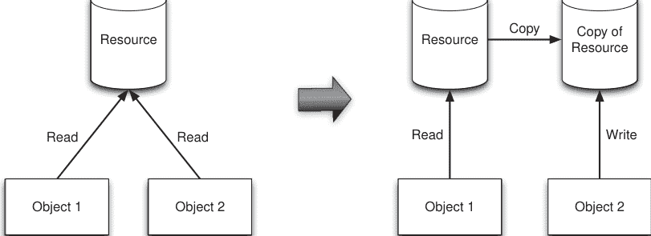

图 7.3 引入写时拷贝：Object1 和 Object2 共享相同的资源，直到 Object2 想要更改它，此时必须创建一个副本，以确保更改不会影响 Object1 的状态。

我以这种方式在随书的源码包类版本中隐藏了实现代码。

```cpp
#include <boost/shared_ptr.hpp>
template <class T> class CowPtr{
public:
    typedef boost::shared_ptr<T> RefPtr;

    inline CowPtr() : mPtr(0()) {}
    inline ~~CowPtr() {}
    inline explicit CowPtr(T* other) : mPtr(other) {}
    inline CowPtr(const CowPtr<T>& other) : mPtr(other.mPtr) {}

    inline T &operator*()
    {
        Detach();
        return *mPtr.get();
    }
    inline const T &operator*() const
    {
        return *mPtr.get();
    }
    inline T *operator->()
    {
        Detach();
        return mPtr.get();
    }
    inline const T *operator->() const
    {
        return mPtr.get();
    }
    inline operator T *() const
    {
        Detach();
        return mPtr.get();
    }
    inline T *data()
    {
        Detach();
        return mPtr.get();
    }
    inline const T *data() const
```

```cpp
{
  return mPtr.get();
}
inline const T *constData() const
{
  return mPtr.get();
}
inline bool operator===(const CowPtr<T> &other) const
{
  return mPtr.get() == other.mPtr.get();
}
inline bool operator!=(const CowPtr<T> &other)
{
  return mPtr.get() != other.mPtr.get();
}
inline bool operator!() const
{
  return !mPtr.get();
}
inline CowPtr<T> &operator=(const CowPtr<T> &other)
{
  if (other.mPtr != mPtr) {
    mPtr = other.mPtr;
  }
  return *this;
}
inline CowPtr &operator=(T *other)
{
  mPtr = RefPtr(other);
  return *this;
}
```

该类可以如下所示使用：

```cpp
CowPtr<std::string> string1(new std::string("Share Me"));
CowPtr<std::string> string2(string1);
```

```cpp
CowPtr<std::string> string3(string1);
string3->append("!");
```

在这个示例中，string2 指向与 string1 相同的对象，而 string3 指向该对象的副本，因为它需要修改它。正如前面提到的，`std::string` 的许多实现已经使用了写时拷贝语义。我只是将其作为一个方便的示例。

在我在这里展示的 `CowPtr` 实现中可能存在一个漏洞。用户可以使用写时拷贝指针并访问底层对象以持有其数据。然后他们可以直接修改数据，从而影响所有共享该数据的 `CowPtr` 变量。例如：

在此代码中，用户获取了 `string1` 底层 `std::string` 中字符的引用。在创建 `string2` 后（它与 `string1` 共享内存），用户更改了共享字符串中的第二个字符，导致 `string1` 和 `string2` 不等于 "Share Me."。避免这种误用的最佳方法就是不要将 `CowPtr` 暴露给你的客户端。在大多数情况下，你不希望客户端意识到你正在使用写时拷贝优化：这是一个实现细节。相反，应该使用 `CowPtr` 声明成员变量，并且以任何方式更改你的公共 API。例如：

```cpp
// myobject.h
class MyObject
{
public:
    MyObject();
    std::string GetValue() const;
    void SetValue(const std::string& value);

private:
    CowPtr<std::string> mData;
};
```


其中 `MyObject` 的实现可能如下：

```cpp
// myobject.cpp
MyObject::MyObject() : mData(0) {}

std::string GetValue() const
{
    return (mData) ? *mData : "";
}
```

```cpp
void MyObject::SetValue(const std::string& value)
{
    mData = std::string(value);
}
```

通过这种方式，你的客户端可以使用你的 `MyObject` API，而完全不知道它使用了写时拷贝，但在底层对象尽可能地提供了内存，并实现了高效的拷贝和赋值操作。

```cpp
MyObject obj1;
obj1.SetValue("Hello");
MyObject obj2 = obj1;
std::string val = obj2.GetValue();
```

## 7.8 遍历元素 (ITERATING OVER ELEMENTS)

迭代器允许客户端遍历容器中的每个元素。然而，你可能在需要随机访问容器中的任何元素时使用它，例如访问数组或向量中的特定元素。

### 7.8.1 迭代器 (Iterators)

遍历元素是一项非常常见的任务。大多数 STL 字符串实现使用了写时拷贝，因此按值传递它们是非常廉价的。

实现迭代器的器有多种方法。迭代器允许客户端遍历所有元素（Gamma et al., 1994）。迭代器通常提供了多种操作，如 `operator*` 获取当前元素、`operator->` 访问成员以及 `operator++` 前进。

```cpp
float sum = 0;
std::vector<float>::iterator it;
for (it = values.begin(); it != values.end(); ++it)
{
    sum += *it;
}
```

在你的 API 设计中，迭代器抽象是可用的，客户端可以随时停止遍历数据。

- 客户端可以同时遍历数据。
- 迭代器在某些情况下可以实现得非常等同于简单的指针。
- 迭代器可以实现得非常高效，事实上大多数工程师倾向于使用前自递增（`++`）而不是后自递增（`++`）。
- 迭代器可以用于可能无法完全放入内存的大数据集。例如，迭代器可以实现为从磁盘分页数据。
- 客户端可以在任何点停止遍历。
- 如果客户端在遍历容器时想要插入或删除元素，有相应的模式可以保持迭代器的完整性。

### 7.8.2 随机访问 (Random Access)

迭代器允许客户端线性遍历容器中的每个元素。然而，你可能在需要随机访问容器中的任何元素时使用它。支持随机访问的 STL 容器类通过两种方式提供支持：

1. `[]` 运算符。这意味着模拟 C/C++ 的数组索引。通常这种实现不进行边界检查，以便使其非常高效。
2. `at()` 方法。该方法检查提供的索引是否超出范围，并在情况下抛出异常。作为结果，这种方法比 `[]` 运算符慢。

为了说明这些概念，考虑以下来自项目、关于 `[]` 运算符的示例：

```cpp
float sum = 0.0f;
const size_t len = values.size();
for (size_t it = 0; it < len; ++it)
{
    sum += values[it];
}
```

在性能方面，这两种方法本质上是等同的。显然，对于特定的平台和编译器，其中一种方法可能比另一种更有效，但通常情况下它们涉及的开销是相当。

如果你计划在你的 API 中添加访问功能，你应该努力采用这种设计，以保持与 STL 的一致性。然而，如果你的 API 不提供随机访问底层数据时，你应该倾向于使用迭代器模型而不是 `[]` 操作符方法，仅因为迭代器能更清晰地表达用户的意图，并且生成的客户端代码更加直观且一致。

### 7.8.3 数组引用

作为迭代器的替代方案，某些 API 使用一种方法：用户通过引用数组数据结构传递请求的元素。然后 API 填充该数组并将其返回给用户。Maya API 广泛使用了这种模式。Autodesk Maya 是一种在电影和游戏行业广泛使用的高端3D 建模和动画系统。该包包含了 C++ 和 Python API，提供了对场景中 2D 和 3D数据的程序化访问。

这种模式的一个示例是 `MFnNode::getAllPaths()` 方法，用于返回 Maya 场景图中节点路径序列。本质上，它是通过引用将一系列连接的节点折叠成 `MPathArray` 对象，然后用 `MPath` 引用填充它。这样做的一些原因（以及为什么你可能在自己的 API 中倾向于使用这种方法）如下：

- 该方法的主要目的是性能。本质上，它是将图数据结构中的一系列连接的节点折叠成顺序数组数据结构的方法。这提供了一个可以高效迭代的数据结构，同时还能定位每个内存单元相邻的元素。结果是一个可以更好地利用 CPU 缓存策略的数据结构，而树结构中的节点可能碎片化地分布在进程的地址空间中。
- 如果客户端保留同一个数组以服务于 `getAllPaths()` 的多次调用，那么这种技术将是高效的。此外，如果保留该数组，填充数组的任何初始性能开销是可以被抵消的，因为迭代器模型支持对其元素进行多次迭代。
- 这种技术还提供了迭代器模型不具备的特定特性：对连续元素的支持。也就是说，传统的迭代器无法处理元素的不同顺序，或忽略序列中的某些元素。而使用数组引用技术，你可以按顺序用任何元素子集填充数组。

这种概念在其他语言中也可以看到，例如 PHP 中的 `iterator_to_array()` 函数，它可以用于在某些情况下将迭代器转换为数组以便更快的遍历。

作为消耗用户提供的数组的替代方案，你也可以返回对象的常量，并依赖编译器的返回值来避免数据拷贝。

**提示**

对于遍历简单的数据结构，采用迭代器模型。如果你有链表或树数据结构，如果迭代性能至关重要，请考虑使用数组引用。

## 7 性能分析

作为本章关于性能的最后一节，我将查看一些工具和技术，帮助你测量系统的性能。其中大多数旨在分析你的实现代码的性能，这与你如何设计 API 并没有直接关系。然而，这仍然是产生高效 API 的重要部分，因此值得关注。

我将考虑性能的几个不同方面：基于时间的分析、内存开销和多线程竞争。此外，应该指出，虽然本章之前的所有节处理的都是 C++ 的稳定特性，但后续文本介绍了可能随时间变化的软件产品。产品会产生、消失、所有权和重点。然而，我努力使此列表（以及相关 URL）更新至发布时。有关产品的最新列表，请参阅随附的网站 `http://APIBook.com/`。

### 7.9.1 基于时间的分析

性能最传统的解释是执行各种操作需要多长时间。如果你正在开发一个图像处理库，在给定图像上运行 `Sharpen()` 或 `RedyeReduction()` 需要多长时间？这里的含义是你必须编写一些使用你 API 的示例或测试，以便在不同的真实场景下对性能进行计时。假设你已经写了程序，有几种形式的性能分析可以使用：

- 1. **内部插桩。** 最高效的分析是你自己编写的那种。因为每种软件都是不同的，你代码中性能关键的部分将特定于你的 API。因此，拥有一个可以插入到代码关键位置的快速计时器对于获取准确的计时信息非常有益的。结果可以输出到文件中进行离线分析，或者你的客户端可以在其用户应用程序中集成计时器的视觉显示。

`Second Life Viewer` 通过其 `LLTimer` 调用你的部分代码提供了这种功能，使用扩展表来识别分析区域，例如 `LLFT(RENDER_WATER)`。`Second Life Viewer` 本身提供了一个调试叠加层，实时显示计时器的累计结果。参见图 7.4 的此类调试视图示例。

- 2. **二进制插桩。** 这种技术涉及通过添加记录每个函数调用细节的代码对程序或共享库进行插桩。运行经过插桩的二进制文件可以确定该特定会话中函数的精确跟踪。处理结果数据可以确定程序花费最多时间的顶端调用栈。

这种方法的缺点是，额外的开销会显著减慢程序执行速度，有时会慢 10-100 倍，尽管相对性能应该会被保留。最后，这种技术显然无法对未以符号形式出现在二进制文件中函数进行计时，例如内联函数。

- 3. **采样。** 这涉及使用单独程序对你的应用程序进行采样以确定你的程序计数器。这是一种低开销的统计技术，意味着它可能不会记录应用程序的每一个函数调用，但只要频率足够高，它可以很好地告诉你应用程序在哪里花费了大部分时间。

采样可以在系统级进行（例如查看你的应用程序是否是 I/O 密集型的），也可以隔离到应用程序中的函数。除了记录时间样本外，这种技术还可以对处理器事件进行采样，例如缓存缺失、分支预测错误和 CPU 统计。

- 4. **计数器监控。** 许多商用操作系统提供了性能计数器，报告各种子系统的性能情况，例如处理器、内存、网络等。例如，Microsoft 提供了 Performance Counters API 来访问 Windows 平台上的计数器数据。通过在应用程序运行时监控这些计数器，你可以确定系统瓶颈，并评估系统资源的不足如何影响你的 API。


图 7.4：Second Viewer 截图，显示其内置的显示嵌入代码中各种计时器结果的视图。

鉴于性能的分类，以下列表：

- **Intel VTune** (`http://software.intel.com/vtune/`): 该商业分析套件适用于 Windows 和 Linux。它包含了硬件和软件计数器，以及易于使用的界面，用于测量应用程序的热点。
- **gprof** (`http://www.gnu.org/software/binutils/`): 它与 GNU 编译器集成，通过 `-pg` 选项创建数据文件。
- **OProfile** (`http://oprofile.sourceforge.net/`): 这是一个针对 Linux 的开源分析器。这种系统级采样技术利用了硬件计数器。
- **AMD CoDeAnalyze** (`http://developer.amd.com/codeanalyst/`): 这种免费工具基于 OProfile 运行在 Windows 上。
- **OpenSpeedShop** (`http://www.openspeed.org/`): 它使用采样技术支持并行和多线程程序，并提供 Python 脚本 API。
- **Sysprof** (`http://www.daimi.dk/sandmann/sysprof/`): 这种针对 Linux 的开源分析器使用系统级采样技术。提供了一个简单的用户界面来浏览数据。
- **CodeProfiler** (`http://www.codeproph.co/`): 这种免费工具使用二进制插桩在应用程序运行时收集信息。它支持 32 位和 64 位 Windows，以及移动 Android。
- **Callgrind** (`http://valgrind.org/`): 这是 Linux 和 Mac OS X 上 valgrind 框架的一部分。它使用二进制插桩技术收集运行图和指令数据。可选的缓存模拟器可分析内存行为。
- **Apple Shark** (`http://developer.apple.com/tools/shark`): 为 Mac 编写的系统级采样分析器，作为开发者工具的一部分免费提供。它可以分析硬件和软件计数器。
- **DTrace** (`http://en.wikipedia.org/wiki/DTrace`): 这种独特且强大的跟踪框架可用于监控应用程序。这是通过编写跟踪程序实现的，定义探针和触发时执行的动作。探针包括打开、启动进程或执行特定代码行；动作可以分析运行时上下文，如调用栈。适用于 Mac OS X 10.5 的 Apple DTrace，配有 GUI 工具。

### 7.9.2 基于内存的分析

正如本章所述，内存性能可能与时间性能同样重要。频繁分配和释放内存的算法，或者其内存分配无法与现代处理器良好映射的算法，可能比预期慢得多。此外，内存错误（如双释放或访问未分配内存）可能会损坏数据

## 7.9 性能分析

崩溃和内存泄漏可能会累积到耗尽所有可用内存，并导致您的客户端应用程序性能下降到极其缓慢，甚至直接崩溃。<br>

可以使用以下工具对您的 API 内存性能进行剖析，并检测内存错误。

- IBM Rational Purify (`http://www.ibm.com/software/adtools/purify/`): 这是一个商业内存调试器，使用二进制插桩来检测 C/C++ 程序中的内存错误。程序运行后，Purify 会输出一个可以通过图形界面查看的报告文件。它还包含一个可以在程序内部调用的 API。Purifiable 支持 Solaris、Linux、AIX 和 Windows。
- Valgrind (`http://valgrind.org/`): Valgrind 是一个用于 Linux 和 Mac OS 的开源框架，是一个内存剖析工具。然而，它已经发展为一个更通用的性能分析工具。通过对您的可执行文件进行二进制插桩，它会在程序结束时返回一份报告。提供了最终的 GUI 来浏览输出文件，例如 Valgrind 和 Alley。
- TotalView Memory (`http://www.totalview.com/`): 这是一个适用于 UNIX 和 Mac OS 平台的商业内存分析工具，无需二进制插桩即可工作。它提供了堆内存的实时图形视图，包括内存使用、分配边界越界和泄漏。它可以处理并行和多线程程序，并整合了脚本语言以执行批量测试。
- Parasoft Ins++ (`http://www.parasoft.com/`): 这是一个适用于 Windows、Linux、Solaris、AIX 和 HP- 的商业调试器。Insure 在源代码级别通过对程序行进行预处理来执行插桩。您可以通过在 `__Insure_trap_error()` 中添加断点，设置调试器在检测到错误时停止。当然，还有一个 GUI 工具可以让您浏览已检测到的错误。
- Coverity (`http://www.coverity.com/`): Coverity 与列出的其他工具不同。它是一个静态分析工具，意味着它在不执行代码的情况下检查源代码。它在数据库中记录所有编码错误，每个错误都有一个唯一 ID，该 ID 在多次分析运行中保持静态。提供 Web 界面来查看静态分析结果。
- `MALLOC_CHECK_`: GNU C/C++ 编译器支持另一种内存分配器，该分配器对简单的内存错误（如双重释放和单字节溢出）更健壮。权衡是这种内存分配器的效率较低，因此您可能不想在发布版本中使用它，尽管它对调试内存问题很有用。您可以通过设置 `MALLOC_CHECK_` 环境变量来开启此特殊分配器。

### 7.9.3 多线程分析

多线程性能关注最后一个方面。编写高效的多线程代码是一项非常困难的任务，但幸运的是有很多工具可以帮助您发现代码中的逻辑错误（如竞态条件或死锁），以及您的线程代码的性能以寻找瓶颈。

- Intel Thread Checker (`http://software.intel.com/en-us/intel-thread-checker/`): 这是一个适用于 32 位和 64 位 Windows 及 Linux 的商业线程分析工具。它可以用于发现逻辑线程错误，例如潜在的死锁。您可以将其作为命令行工具使用并输出文本报告，也可以使用随附的可视化 GUI 将潜在错误映射到源代码行。
- Intel Thread Profiler (`http://software.intel.com/en-us/intel-vtune/`): Thread Profiler 通过显示您的线程正在做什么以及它们如何交互的时间轴，让您直观地看到应用程序的行为。该工具可以确定您是否从代码中获得了最大的并发性。它运行在 Windows 和 Linux 上。Intel 现在将 Thread Profiler 与他们的 VTune 产品一起打包。
- Intel Parallel Studio (`http://software.intel.com/en-us/intel-parallel-studio-home/`): Intel Parallel Studio 提供了一套支持多核系统上并行程序的工具，包括一个识别并行候选对象的实用程序、Intel Threading Blocks (`TBB`) 库、一个检测线程和内存错误的检查工具以及一个用于并行程序的性能分析工具。
- Acumen ThreadSpotter (`http://www.acumem.com/`): 该工具允许您发现 Solaris、Linux 和 Windows 上多线程和 OpenMPI 应用程序中的性能问题。它保留了 Acumen 单线程剖析工具 SlowSpotter 的所有功能（包括内存带宽/延迟和数据局部性的剖析器），并增加了线程通信和交互模式。
- Helgrind and DRD (`http://valgrind.org/`): Helgrind 和 DRD 都是开源 Valgrind 插桩框架的模块。它们可用于检测基于 pthreads 的应用程序中的同步错误，包括线程 API 的误用、死锁和竞态条件。它们可以在 Linux 和 Mac OS X 上使用

## 8 版本控制

到目前为止，我很大程度上将 API 的设计视为一项离散的任务，一旦 API 完全规范化并发布给用户，任务就结束了。当然，在现实中，这只是一个持续且复杂过程的开始。API 发布之后，真正的工作才开始，您的 API 开发过程也将面临考验。

很少（如果有的话）API 在 1.0 产品发布后停止开发。总会有需要修复的漏洞、需要集成的新功能、需要完善的工作流、需要改进的架构、需要支持的其他平台等等。

API 初始发布后所有版本的首要目标必须是对现有客户端产生零影响，或在实践中尽可能接近零影响。在发布之间破坏接口或接口行为是不可接受的。API 初始发布后所有版本的目标必须是对现有客户端产生零影响，或在实践中尽可能接近零。具有良好稳定性和健壮性的 API 是产品成功的巨大因素。

为此，本章涵盖了 API 版本控制的细节，说明不同类型的向后兼容性。

### 8.1 版本号


API 的每次发布都应该附带一个唯一标识符，以便区分最新的 API 实例。实现此点的标准方法是使用版本号。

许多不同的方案为软件产品提供版本信息，通常用 `.` 分隔或使用三个独立的整数，例如 "1.2" 或 "1.2.3"。下面的列表解释了这些整数的含义。

- **主版本 (Major version)**：版本号的第一个整数，例如 `1.0.0`。初始发布时设置为 1，并在发生重大更改时增加。在 API 变更方面，主版本更改可以信号向兼容的功能添加，或者意味着向后兼容性已破坏。通常，API 主版本的增加应提示用户预期重大的 API 变化。

- **次版本 (Minor version)**：复合版本号的第二个整数，例如 `1.0`。在每个主版本后设置为 0，并在添加较小的重大修复时增加。次版本的更改通常不涉及不兼容的 API 更改。用户预计可以升级到新版本而无需修改软件。然而，API 可能会添加新功能，如果使用了，则意味着用户无法回退到之前的版本。

- **补丁版本 (Patch version)**：可选的第三个整数是补丁号，有时也称为修订版本号，例如 `1.0.0`。在每个次版本发布后设置为 0，并在进行重要的错误或安全修复时增加。补丁版本的更改不应意味着 API 接口的更改，即只有行为的更改。换句话说，补丁版本应该是向前和向后兼容的，用户应该回退到早期的补丁版本并切换到较新的补丁版本而无需更改代码。

某些软件产品会采用额外的数字或符号来进一步描述发布版本。例如，可能会使用自动构建号，以便软件的每次构建都能与之前的构建区分开来。

## 8.1 版本号

软件在最终发布之前通常会列出用户，以获取反馈和宝贵的现场测试。在情况下，通常会在版本字符串中添加一个符号，以标识软件所处的开发过程阶段。例如，`1.0.a` 可能指代 alpha 版本，`1.0.b` 可能指 beta 版本，而 `1.0.rc` 可能指发布候选版本（release candidate）。然而，你应该注意，一旦你开始偏离纯数字的标识系统，版本号的比较就会变得更加复杂（有关这种复杂性的示例，请参阅 http://www.python.org/dev/peps/pep-0386/ 上的 PEP 0386）。

> 提示
>
> 在你的库名称中使用你 API 的主版本号是一个良好的习惯，特别是当你进行了不向后兼容的更改时，例如 `libFoo.so`、`libFoo2.so` 和 `libFoo3.so`。

### 8.1.2 晦涩的命名方案

在这一部分中，我决定列出一些软件项目使用过的非标准或富有想象力的版本方案。本节的内容不仅仅是实际的实践建议，尽管每种方案显然在某些情况下都有优势。然而，对于 API 开发，我建议遵循广泛为人知的主、次、补丁（major, minor, patch）方案。

由 Donald Knuth 设计的文档处理系统通过添加值 pi，π 的精度数字来生成新的版本号。第一个版本号是 3，然后是 3.1、3.14 等依此类推。2010 年当前的版本是 3145926。同样，Knuth 相关的 METAFONT 程序的版本号也渐近于值 e，2.71828。

虽然初看起来这可能仅仅是数学家的直觉，但这种命名方案实际上确实传达了关于软件的一个重要特性。尽管 Knuth 意识到不应对系统进行任何根本性更改，任何新版本都应该包含错误修复。因此，使用一种引入日益减小的小数点的版本方案是很有洞察力的。事实上，Knuth 对特性稳定性和向后兼容性重要性的认识，到了将其编码进自己软件的版本方案中的程度，这对于任何 API 设计师来说都是至关重要的。

另一种版本方案使用日期作为版本号。这对于像微软的 Visual Studio 2010 和 EA 的 FIFA 10 这样的大型用户发行版显然是合适的。然而，Linux 系统的 Ubuntu 版本使用了更稳定的系统。它将发布的年份和月份分别作为主版本和次版本号。第一个 Ubuntu 版本 `4.11` 出于 2004 年 10 月，而 `9.04` 则于 2009 年 4 月发布。Ubuntu 版本还分配了一个代码名，由一个形容词和一个动物名称组成，例如“Breezy Badger”（清风鼬）和“Lucid Lynx”（明晰猞猁）。除了前两个版本外，这些代码名每次发布都会按字母顺序增加。这些方案的处处是可以传达一个 Ubuntu 版本有多新。对于一个不断演变的操作系统，这可能是可以的，但对于你的 API，你应该倾向于使用传统的数字方案，以告知用户某个版本中预期 API 变化的程度。

## 第 8 章 版本控制

Linux 内核使用奇偶数编号方案来区分稳定版（偶数）和开发版（奇数）。例如，Linux `2.4` 和 `2.6` 是稳定版，而 `2.3` 和 `2.5` 是开发版。这种编号方案也用于 Second Life 服务器。

### 8.1.3 创建版本 API

你 API 的版本信息应该能够从代码访问，以便你的客户端编写根据你 API 版本号判断条件的程序，例如调用只存在于你 API 最新版本中的新方法，或者绕过某个发布版本实现中的 bug。

为了提供灵活性，用户应该能够在编译时以及运行时查询你 API 的版本。编译时要求是必要的，这样用户可以使用 `#if` 指令条件性地针对较新的类和方法进行编译，而这些方法在链接到你 API 的旧版本时会导致未定义错误。运行时要求允许客户端在不同的 API 之间进行动态选择，或者带有你的 API 版本号提供逻辑日志。这些要求建议创建一个版本 API。我这里展示了一个简单的通用 API。

```cpp
#include <string>
#include <set>

#define API_MAJOR 1
#define API_MINOR 2
#define API_PATCH 0

class Version {
public:
    static int GetMajor();
    static int GetMinor();
    static int GetPatch();
    static std::string GetVersion(int major, int minor, int patch);
    static bool IsLeast(int major, int minor, int patch);
    static bool AtLeast(int major, int minor, int patch);
    static bool HasFeature(const std::string& name);
private:
    static std::set<std::string> features;
};
```

这个 `Version` 有几个值得注意的特性。首先，我提供了访问器来返回主版本、次版本和补丁号。`GetVersion()` 方法以用户友好的字符串返回版本信息，例如 "1.2.0."。对于客户端在“关于”对话框中显示或编写调试日志很有用。

接下来，我提供了一个让用户执行版本比较的方法。显然你可以在这里添加其他版本例程，但 `IsLeast()` 提供了最常用的用例。

| 提示 |
| :--- |
| 为你的 API 提供版本信息。 |

最后，我提供了一个 `HasFeature()` 方法。通常当用户想要比较版本号时，他们并不关心版本本身，而是使用这个标识符来判断特性是否存在。与其让用户感知哪些特性在哪些版本中引入，不如让 `HasFeature()` 方法让他们直接进行测试。例如，在你 API 的 2.0.0 版本中，你使其变得线程安全。这时你可以添加一个特性标签“THREADSAFE”，以便用户可以检查：

```cpp
if (Version::HasFeature("THREADSAFE"))
{
}
```

虽然你可能不需要为 1.0 版本定义任何特性标签，但理想情况下你应该在 API 中包含此方法，以便可以在任何版本中调用它。该方法可以简单地返回 `false` (0)，但对于未来的发布，你可以添加新的特性。这些字符串可以惰性地存储在 `std::set` 中（首次调用时初始化），这样判断是否定义了特性标签是非常高效的。书中附提供了该概念的实现。

## 8.2 软件策略

在我深入讨论 API 版本控制之前，让我们涵盖一下相关主题软件分支策略的基础知识。虽然只有一两个工程师的小型项目通常可以通过单条代码线运行，但较大的软件项目通常涉及某种形式的分支策略，以便对不同的发布版本进行并行开发、稳定性和维护。接下来的几节将涵盖为你的项目选择分支策略和策略时需要考虑的事项。

### 8.2.1 分支策略

每个软件项目都需要一条“主干”（trunk）代码线，它是项目源代码的持久存储库。分支从这条主干代码线上创建，用于单独的发布或需要与下一次发布隔离的开发工作。这种模型支持并行开发，即在向项目添加新功能的同时，让临近到发布的版本能够锁定并稳定现有的功能集。

可以设计许多不同的分支方案。每个工程团队通常会根据自己的特定需求、流程和工作流调整策略。图 8.2提供了

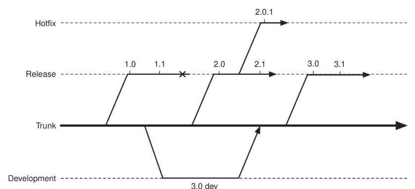

**图 8.2** 软件产品多次发布的分支示例图。

一种常见的分支策略。在这种情况下，主版本发布从主干分支出来，而次要发布则沿着分支线进行。如果在进行下一次发布工作时需要紧急补丁，可以为该特定的“热修复”（hotfix）创建一个新分支。对于由于无法准时准备就而跳过下一次发布的长期开发，通常在自己的分支中进行，并在适当的时间落地。注意图 8.1 和图 8.2 之间的相似之处。这种相似性显然不是偶然的。

### 8.2.2 分支策略

这种基本结构被许多项目用于支持并行开发和发布管理。然而，可以使用许多策略决策来定制实际的工作流，例如：开发者在哪些分支上工作、同时运行多少个开发分支、在流程的何种节点创建发布分支、分支之间合并更改的频率、是否尝试进行分支间的自动合并等。

虽然不同的分支策略对于不同的情况可能有意义，但我将根据我的经验进行评论：持续的开发工作应该在主干代码线线上进行，而只有在需要进行长期工作时才使用分支。QA（质量保证）在特定发布前的准备阶段必然关注特定的发布分支，但他们应该始终关注主干，特别是在发布之间的开发期间。这是你项目的皇明宝所在之处：这些代码将跨越各个版本一直存在。如果没有开发者或 QA 工程师积极进行合并，并允许在无人看的情况下合并到主干，主干很快就会变得不稳定且充满 Bug。

你对版本控制系统的选择也会对分支策略产生影响，因为不同的源码管理（SCM）产品使得某些分支策略比其他策略更容易实现。例如，在 Subversion 中支持和合并分支可能是一项痛苦的尝试，而在 Mercurial 或 git 等 SCM 系统中，分支被设计在系统的核心中。例如，使用如 Mercurial 等 SCM，可以将每天合并分支视为一种简单且低影响的操作。你两个分支之间合并得越频繁，代码分化的可能性就越容易，最终将分支合并回主干的难度也就越小。发布分支在发布完成后通常会“生命终结”，正如图 8.2 中 1.1 版本后的 X 符号所示的那样。另一个与你的 SCM 系统相关的决策因素是你的所有的工程师是否都在现场，如果是这样，像 Perforce 这样基于服务器的解决方案是可以接受的；或者你是否有居家工作的开源工程师，如果是这样，那么像 git 或 Mercurial 这样的分布式解决方案更为合适。

提示

仅在需要时进行分支。倾向于冻结某条代码线。尽且频繁地进行分支间的合并。（自《Perforce 高级最佳实践》论文。）

### 8.2.3 API 与并行分支

一旦 API 发布，对 API 的更改应该（至少从外部来看）遵循一个序列化过程。也就是说，不要发布不兼容的非线性 API 版本：版本 N 的功能应该是版本 N-1 功能的严格超集。虽然这看起来是显而易见的，但大型软件项目往往涉及开发者在代码的并行分支上工作，并且 API 可能存在并发支持的分。对于在不同并行分支上工作的团队来说，不引入不兼容的功能至关重要。有几种策略方法可以处理这一潜在问题。

- **目标开发分支。** 你的项目通常会有开发分支和发布分支。通过强制规定不在发布分支中直接发生 API 更改，你可以最大限度地减少在某次发布中进行了 API 更改由于从未合并回主干而在下一次发布中“丢失”的概率。如果发布分支中需要 API 更改，应将其提交到主干，然后从那里合并向上。这对于发布分支中的任何更改通常都是如此，但接口更改如果在发布之间丢失了，其成本会更高。

- **频繁合并主干。** 对公共 API 的任何更改都应该在公共主干代码线上开发，或尽早合并到主干。这还假设团队会定期将其开发分支同步到主干代码线，这本身就是良好的做法。这避免了当两个团队尝试合并具有冲突 API 的开发分支时出现意外。

- **评审流程。** 单个 API 评审委员会应在公共 API 发布之前监督并审查所有对公共 API 的更改，以确保没有对 API 进行冲突或不向后兼容的更改。他们是守门人，也是最后的防线。

## 8.3 API 的生命周期

6.x 版本（新的高级版）可以读取任何现有格式，这也可以的。

然后，当然，最终还是需要另一次版本更新，引入了 7.x（较新的基础版）和 8.x（较新的高级版）。事情开始变得非常混乱。

从事后看来来看，我们讨论了如何可以避免这种情况。关键的观察结果是，在这种情况下，关于是哪种变体创建了文件的信息与文件格式版本混淆了。一种解决方案是将这两个概念分开，并向文件中同时写入两者：一个是版本号（如“3.2”），另一个变体名称（如“Basic”）。这样，Basic 变体就可以轻松地读取它，或者以空或“Basic”变体名称读取该文件。这本质上创建了两个数字空间，其中两个变体的版本号独立演进。

产品首先检查变体的兼容性，然后版本号兼容性则按照通常的线性方式工作。

从这次经验中吸训，我提供以下建议：在支持产品的不同变体时，除了写入该文件的变体版本号外，在任何应在变体之间共享的文件中都要存储变体的名称。

> 提示
>
> 在创建相同 API 的 Basic 与 Advanced 版本时，在任何生成的文件中，在版本号旁边附带“Basic”或“Advanced”字符串。不要尝试仅使用版本号来判断文件是由 Basic 还是 Advanced API 生成的。

## 8.3 API 的生命周期

本节研究 API 的生命周期以及它从构思到终结所经历的各个阶段。

维护一个 API 并不等同于维护一个普通的软件产品。

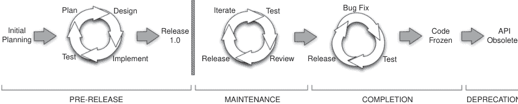

图 8.3

API 的生命周期。在初始发布之前，可以对 API 进行广泛的重新设计。在初始发布之后，只能忍受增量变化。

这是由于 API 开发受到了限制，不能破坏现有的客户端。在普通的终端用户软件产品中，如果你在代码中更改了方法或类的名称，这不会影响应用程序对用户可见的功能。然而，如果你更改了 API 中类

# 第 8 章 版本控制

或方法的名称，你可能会破坏所有现有客户端的代码。API 是一份合同，你必须确保履行合同的终点。

图 8.3 提供了一个典型 API 生命周期的概述，由图 8.3 中的粗垂直线标记。这个关键点，即初始发布，是对设计和接口进行更改。然而，在初始发布之后，一旦你的用户能够使用你的 API 编写代码，你就承诺提供向后兼容性，你所做更改的影响将受到极大。从整个生命周期来看，API 开发有四个通用阶段（Tulach, 2008）。

- 1. **预发布（Prerelease）**：初始发布，API 可以通过标准的软件周期进行，包括需求收集、规划、设计、实现和测试。最值得注意的是，如前所述，接口在此期间可以经历重大的变化和重新设计。你实际上向用户发布这些 API 的早期版本，以获取他们的反馈和建议。你应该对这些预发布版本使用 0.x 版本号，以便向那些用户明确 API 仍在活跃开发中，并且在交付 1.0 之前可能会发生剧变。

- 2. **维护（Maintenance）**：API 在发布后可以进行修改，为了保持向后兼容性，任何更改必须限制在添加新的方法和类，以及修复现有方法实现中的错误。换句话说，在维护阶段，你应该寻求演进 API，而不是产生不兼容的变化。为了确保更改不破坏兼容性，在发布前应进行回归测试。

- 3. **完成（Completion）**：在某个点，项目组认为 API 已经成熟，不再对其进行更改。这可能是因为 API 解决了它旨在解决的问题，或者因为团队成员已经转向其他项目且不再支持该 API。在生命周期中，稳定性是最重要的质量。最终可以考虑 API，如果更改仅限于实现代码而非头文件。

- 4. **废弃（Deprecation）**：某些 API 最终会进入终结状态，被废弃并移除。这意味着 API 不再被使用，或者已经开发了新的、不兼容的 API 来取代其位置。

> 提示
>
> 发布后，你可以演进 API，但不能更改它。

## 8.4 兼容性级别

到目前为止，我只是模糊地谈论兼容性。现在是时候具体化并精确地定义我们的术语了。因此，接下来的几节详细介绍了特定的向后兼容性术语、向前兼容性、功能兼容性、源码（API）兼容性和二进制（ABI）兼容性。

通常你会会对 API 的主版本、小版本和补丁版本提供不同的兼容性承诺。例如，你可能会承诺补丁版本具有向后向前兼容性（Subversion 的承诺），或者你可能只在主版本中破坏二进制兼容性（KDE 的承诺）。

### 8.4.1 向后兼容性（Backward Compatibility）

向后兼容性可以简单定义为提供以前版本 相同功能的 API。换句话说，如果一个 API 可以完全替换之前的版本而不需要用户进行任何更改，那么它就是向后兼容的。

这意味着新的 API 是旧 API 的超集。它可以添加新功能，但不能以不兼容的方式更改旧 API 定义的功能。API 维护的黄金法则是从接口中移除任何内容。

API 兼容性有不同类型，包括

- 1. 功能兼容性

- 2. 源码兼容性

- 3. 二进制兼容性

我将在后续章节中详细定义这些每一项。

此外，还有面向数据的向后兼容性问题，例如

- 1. 客户端/服务器兼容性

- 2. 文件格式兼容性

例如，如果你的 API 涉及网络通信，你还需要考虑使用的客户端/服务器协议的兼容性。这意味着使用旧版本 API 的客户端仍然与新版本的服务器通信。同样，使用新版本 API 的客户端能够与旧版本的服务器通信（Rooney, 2005）。

> 提示
>
> 向后兼容性意味着使用你 API 版本 N 的客户端代码可以升级到版本 N+1 而无需更改。


# 第 8 章 版本控制

## 8.4.2 功能兼容性（Functional Compatibility）

功能兼容性关注实现的运行时行为。如果一个 API 的行为与以前版本的 API 完全相同，那么它就是功能兼容的。然而，正如 Jaroslav Tulach 所提到的，API 在这方面几乎永远不会 100% 向后兼容的。即使一个仅修复实现代码中 bug 的发布会改变 API 的行为，而某些客户端实际上可能依赖于这种行为。

例如，如果你的 API 提供了以下函数：

```
void SetImage(Image *img);
```

该函数在你的 API 的 1.0 版本中可能存在一个 bug，当你传递一个 NULL 指针时它会导致程序崩溃。在 1.1 版本中，我们修复了这个 bug，使得你的代码在这种情况下不再会崩溃。这改变了 API 的行为，因此它并不是严格兼容的。然而，它以一种好的方式改变了行为；修复了一个崩溃的 bug。因此，虽然这个指标作为 API 运行时行为变化的基本衡量很有用，但功能性变化并不一定是坏事。API 更新将无意中破坏功能兼容性。

作为一个功能兼容性有用的示例，考虑一个完全关注性能的 API 新版本。在这种情况下，API 的行为完全没有改变。然而，接口后的算法得到了改进，以便用更短的时间交付完全相同的结果。在这方面，新 API 可以被认为是 100% 功能兼容的。

> 提示
>
> 功能兼容性意味着你的 API 的 N+1 版本的行为与版本 N 相同

## 8.4.3 源码兼容性

源码兼容性是向后兼容的一个更宽松的定义。它基本上表示用户可以在不对代码进行任何更改的情况下，使其程序与更新版本的 API 协调。这对于生成的程序的行为没有说明任何问题，只说明它可以被成功编译和链接。源码兼容性有时也被称为 API 兼容性。

例如，以下两个函数是源码兼容的，尽管它们的函数签名不同：

```
// version 1.0
void SetImage(Image *img);
```

```
// version 1.1
void SetImage(Image *img, bool keep_aspect=true);
```

这是因为你为函数的 1.0 版本编写的代码也可以针对版本 1.1 版本进行编译（新参数是可选的）。相比之下，这两个函数不是源码兼容的，因为用户将被强制遍历他们的代码以找到 `SetImage()` 方法的所有实例，并添加所需的第二个参数。

```
// version 1.0
void SetImage(Image *img);
```

```
// version 1.1
void SetImage(Image *img, bool keep_aspect);
```

任何完全限制在实现代码中的更改，因此不涉及公共头文件的更改，显然是 100% 源码兼容的，因为在两种情况下接口都是完全相同的。

> 提示
>
> 源码兼容性意味着针对你的 API 的第 $N$ 版本编写代码的用户也可以在不更改源代码的情况下将其编译到第 $N+1$ 版本。

## 8.4.4 二进制兼容性

二进制兼容性意味着客户端只需要与新版本的静态库重新链接他们的程序，或者只需将新库放入其终端用户应用程序的安装目录。这与源码兼容性不同，在后者，每当你发布 API 的任何新版本时，用户必须重新编译他们的程序。

这意味着对 API 的任何更改都不能影响库文件中任何类、方法或函数的表示。所有元素的二进制表示必须保持不变，包括结构的类型、大小和对齐，以及所有函数的签名。这通常被称为应用程序二进制接口 `ABI` 兼容性。

使用 C++ 实现二进制兼容性非常困难。C++ 中接口的大多数更改都会导致其二进制表示的变化。例如，这里是两个函数的修饰名（mangled names，即用于在对象或库文件中标识标识的符号名）：

```
// version 1.0
void SetImage(Image *img)
->_ZSetImageP5Image

// version 1.1
void SetImage(Image *img, bool keep_aspect=false)
->_ZSetImageP5Image
```

这些方法是源码兼容的，但它们不是二进制兼容的，正如它们产生的不同修饰名所证明的。针对版本 1.0 编译的代码不能简单使用版本 1.1 ，因为 `_ZSetImageP5Image` 符号不再定义。

如果你使用不同的编译标志，API 的二进制表示也可能发生。它也倾向于特定编译器。C++ 标准委员会决定不规定命名修饰的细节。结果是一个编译器使用的修饰方案可能与其他编译器不同，即使在相同的平台上也是如此。（之前的修饰名是由 GNU C++ 4.3 生成的）。

> 提示
>
> 二进制兼容性意味着针对你的 API 的第 $N$ 版本编写的应用程序可以通过简单替换或重新链接 API 的新动态库来升级到第 $N+1$ 版本。

以下是两个 API 更改列表，详细列出了那些需要用户重新编译代码的更改以及那些可以在不破坏二进制兼容性的情况下安全执行的更改。

二进制不兼容的 API 更改：

- 删除类或函数。
- 添加、删除或重新排顺序类。
- 更改库文件中的任何类、方法或函数的表示。
- 更改所有元素的二进制表示，包括结构的类型、大小和对齐以及所有函数的签名。
- 更改函数签名。
- 更改修饰名。
- 更改符号名。
- 更改虚函数。
- 更改非内联方法。
- 更改 API 的二进制表示（如果使用不同的编译标志）。
- 更改特定编译器的实现。

二进制兼容的 API 更改：

- 仅限制在实现代码中的任何更改。
- 添加、删除或重新排顺序参数。
- 更改现有函数的实现。
- 更改类的类型。
- 更改方法的实现。
- 更改类的内联方法。
- 更改非内联的的实现。
- 添加新的枚举。
- 更改二进制表示。

为了帮助保持二进制兼容性的 API 更改：

添加 针对你的 API 的第 $N$ 版本编写的应用程序可以通过简单替换或重新链接你的 API 的新动态库来升级到第 $N+1$ 版本。

以下是两个 API 更改列表，详细列出了那些需要用户重新编译代码的更改以及那些可以在不破坏二进制兼容性的情况下安全执行的更改。

二进制不兼容的 API 更改：

- 删除类或函数。
- 添加、删除或重新排顺序类。
- 更改库文件中的任何类、方法或函数的表示。
- 更改所有元素的二进制表示，包括结构的类型、大小和对齐以及所有函数的签名。
- 更改函数签名。
- 更改修饰名。
- 更改符号名。
- 更改虚函数。
- 更改非内联方法。
- 更改内联方法。
- 更改非内联的实现。
- 更改 API 的二进制表示（如果使用不同的编译标志）。
- 更改特定编译器的实现。

二进制兼容的 API 更改：

- 仅限制在实现代码中的任何更改。
- 添加、删除或重新排顺序参数。
- 更改现有函数的实现。
- 更改类的类型。
- 更改方法的实现。
- 更改类的内联方法。
- 更改非内联的实现。
- 添加新的枚举。
- 更改二进制表示。

为了帮助保持二进制兼容性的 API 更改：

添加 针对你的 API 的第 $N$ 版本编写的应用程序可以通过简单替换或重新链接你的 API 的新动态库来升级到第 $N+1$ 版本。

## 8.4.5 向前兼容性

如果使用旧版本 API 的代码可以在不进行更改的情况下编译，则 API 是向前兼容的，这意味着用户可以退回到之前的版本而不影响他们的工作。

向 API 中添加新功能会破坏向前兼容性，因为为了利用这些新功能而编写的代码在没有这些更改的旧版本无法编译。

例如，以下两个版本的函数是向前兼容的：

```
// version 1.0
void SetImage(Image *img, bool unused=false);
```

```
// version 1.1
void SetImage(Image *img, bool keep_aspect);
```

因为使用1.1 版本代码（第二个参数是要求的）可以在 1.0 版本中成功编译（第二个参数是可选的）。

然而，这两个版本不是向前兼容的：

```
// version 1.0
void SetImage(Image *img);
```

```
// version 1.1
void SetImage(Image *img, bool keep_aspect=false);
```

这是因为使用 1.1 版本的代码如果指定了第二个第二个参数，将无法在 1.0 版本上编译。

在你的 API 发布 1.0 版本之前，这是你尽力的考虑。事实上，在首次公开发布之前进行这项活动非常好，可以尝试让你的 API 尽可能具有前向兼容性。

这意味着你需要思考 API 未来将如何演进的问题。你的用户可能会请求哪些新功能？性能优化会影响 API 吗？API 可能会被误用吗？未来你是否想要暴露一个更通用的概念？你是否已经意识到某些未来计划实现且会影响 API 的功能？

以下是让 API 具有前向兼容性（forward compatible）的方法。

- 如果你知道未来需要为某个方法添加参数，那么可以使用之前提供的第一个示例中所示的技术，即你可以在实现功能之前添加该参数，并妥善地记录（命名）该参数为未未使用。
- 如果你预计未来会切换到不同的类型，请使用不透明指针（opaque pointer）或 `typedef`，而不是直接使用内置类型。例如，为 `float` 类型创建一个名为 `Real` 的 `typedef`，这样你就可以在 API 的未来版本中将 `typedef` 更改为 `double`，而无需更改 API。
- 在风格章节中描述的数据驱动型 API 设计天生具有前向兼容性。一个仅接受 `Argument` variant 容器的方法本质上允许在运行时向其传递任何参数集合。因此，实现部分可以在不更改函数签名的情况下添加对新具名参数的支持。

> TIP
>
> 前向兼容性意味着使用你 API 版本 N 的客户端代码可以在不进行更改的情况下降级到版本 N-1。

## 8.5 如何维护向后兼容性

现在我已经定义了各种类型的兼容性，我将描述在发布 API 新版本时实际维护向后兼容性（backward compatibility）的某些策略。

### 8.5.1 添加功能

从源码兼容性的角度来说，向 API 添加新功能通常是安全的。添加新的类、方法或新的全局空函数不会更改预存 API 元素的接口，因此不会破坏现有的代码。

作为这一经验法则的例外，向抽象基类添加新的虚成员函数是不符合向后兼容的，也就是说：

```cpp
class ABC
public:
    virtual ~ABC();
    virtual void ExistingCall() = 0;
    virtual void NewCall() = 0; // 在 API 的新版本中添加
;
```

这是因为所有现有客户端现在必须为此新方法定义实现，否则它们的派生类将是不完整的，其代码将无法编译。此问题的解决办法是为你添加到抽象基类的任何新方法提供默认实现，即将它们设为虚函数（virtual）而不是纯虚函数（pure virtual）。例如：

```cpp
class ABC
public:
    virtual ~ABC();
    virtual void ExistingCall() = 0;
    virtual void NewCall(); // 在 API 的新版本中添加
;
```

> TIP
>
> 在 API 初始发布后，不要向抽象基类添加新的虚成员函数。

从二进制（ABI）兼容性的角度来看，可以在不破坏兼容性的情况下向 API 添加的元素要更为严格。例如，向类中添加第一个虚方法会导致类的大小增加（通常增加一个指针的大小），以便包含指向该类虚函数表（vtable）的指针。同样，添加新的基类、添加模板参数或添加新的变量都会破坏二进制兼容性。某些编译器允许你向已经有虚方法的类中添加虚方法而不破坏兼容性，只要你在类中所有其他虚方法之后添加新的虚方法即可。

请参阅“二进制兼容”部分中的列表，以获取关于破坏二进制兼容性的 API 变化的详细说明。

### 8.5.2 更改功能

在不破坏现有客户端的情况下更改功能是一个更棘手的话题。如果你只关心源码兼容性，那么为方法添加新参数是可能的，只要将它们放在所有之前的参数之后并将其声明为可选。这意味着用户不会……

在模板使用方面，向你的 API 增加新的模板实例化化（instantiations）可能会破坏向后兼容性，因为你的客户端可能已经为该类型添加了显式实例化。如果是这种情况，你的客户端在尝试编译代码时将收到重复实例化错误。

在维护二进制兼容性方面，你对现有函数签名进行的任何更改，例如更改参数的顺序、类型、数量或 const 属性，或者更改返回类型。如果你需要标记现有方法的更改并维护二进制兼容性，那么你不得不采取这种方法：为此目的创建一个新方法，可能重载现有函数的名称。这种技术在本章的之前已经展示过：

```cpp
// version 1.0
void SetImage(Image *img)

// version 1.1
void SetImage(Image *img)
void SetImage(Image *img, bool keep_aspect)
```

最后，在不更改任何方法实现或签名的情况下，更改 API 的行为是很常见的。这可能是为了修复实现中的 Bug，或者为了验证方法支持的值或错误。这些更改对于源码和二进制都是兼容的，但它们破坏了你 API 的功能兼容性（functional compatibility）。通常，可能会有所有客户端都认为可以接受的更改。然而，在行为可能对所有客户端都不理想的情况下，你可以让新行为成为可选的（opt-in）。例如，如果你向你的 API 添加了多线程锁，你可以允许客户端通过调用 `SetLocking()` 方法来开启此新行为（Tulach, 2008）。或者，你可以利用早些为 `Version` 类引入的 `HasFeature()` 方法来集成类以开启/关闭功能。在这种能力下，你可以在更改 API 行为的同时保持二进制的兼容性。例如：

```cpp
Version::EnableFeature("LOCKING", true);
```

### 8.5.3 弃用功能

弃用（deprecated）功能是指不建议客户端使用的功能，通常因为它被更新的功能所取代。由于弃用功能仍然存在于 API 中，用户仍然可以使用，尽管它可能会产生警告。预期是弃用功能可能会在未来的 API 版本中被删除。

装饰功能有多种原因，包括安全缺陷、引入更强大的功能、简化 API 或支持 API 重构。例如，标准 C 函数 `tmpnam()` 已经被弃用，转而使用更安全的实现如 `tmpnam_s()` 或其他。

当你弃用一个方法时，你应该在方法的文档中标记它，以及任何建议使用的新功能。除了文档工作外，还有在使用该功能时产生警告信息的方法。大多数编译器都提供了将类、方法或变量标记为弃用的方法。在 Visual Studio C++ 中，使用 `__declspec(deprecated)`，而在 GNU C++ 编译器中使用 `__attribute__((deprecated))`。以下代码定义了一个适用于每个编译器的 `DEPRECATED` 宏：

```cpp
// deprecated.h
#ifdef _GNUC_
#define DEPRECATED __attribute__((deprecated))
#elif defined(_MSC_VER)
#define DEPRECATED __declspec(deprecated)
#else
#define DEPRECATED
#pragma message("DEPRECATED is not defined for this compiler")
#endif
```

使用此定义，你可以按照以下方式标记方法为弃用：

```cpp
#include "deprecated.h"
#include <string>

class MyClass
{
public:
    DEPRECATED std::string GetName();
    std::string GetFullName();
};
```

如果用户尝试调用 `GetName()`，他们的编译器将输出指示该方法已弃用的警告信息。例如，该警告是由 GNU C++ 4.3 编译器发出的：

In function 'int main(int, char**)'

warning: 'GetName' is deprecated (declared at myclass.h:21)

作为提供编译警告的替代，你可以编写代码在运行时发布弃用警告。这样做的一个原因是，你可以在警告消息中提供更多信息，例如对可替代方法的指示。例如，你可以声明一个函数，并在每个想要弃用的函数的第一条语句中调用它，如

```cpp
void Deprecated(const std::string oldfunc, const std::string newfunc="");
```

## 8.6 API 评审

```cpp
std::string MyClass::GetName()
{
  Deprecated("MyClass::GetName","MyClass::GetFullName");
  ....
```

`Deprecated()` 的实现可以维护一个 `std::set`，记录每个函数名称以判断是否已经发布过警告。这允许你只在第一次调用弃用方法时输出警告，从而避免在方法被频繁调用时导致终端刷屏。Noel Lopsis 在 *Game Gem* 中描述了一种类似的技术，不同之处他的解决方案还记录了唯一调用点的数量，并将警告批量处理，在程序执行结束时输出单份报告（DeLoura, 2001）。

### 8.5.4 移除功能

某些功能在经过至少一个版本的“弃用（deprecated）”发布后，最终可能会从 API 中移除。移除功能将破坏所有使用该功能的现有客户端，因此，通过先将其标记为弃用来向用户发出移除该功能的意图警告是至关重要的。

从 API 中移除功能是一个激进的步骤，但在某些情况下，出于安全考虑方法不应再次被调用，或者该功能不再被支持，亦或它限制了 API 的演进能力，这种操作有时是必要的。


移除功能并允许遗留用户访问旧功能的一种方法是增加主版本号并声明新版本不向后兼容。然后，你可以从最新版本的 API 中完全移除该功能，但提供旧版本的 API 供下载，并让人理解这些版本是弃用且不支持的，仅供旧应用程序使用。你甚至可以考虑将 API 头文件存储在不同的目录并重命名库，以使两个 API 不产生冲突。这是一件大事，但并不经常发生。在 API 的生命周期中，这是最好的，没有更好的了。

诺基亚的 Qt 库从版本 3.x 过到 4.x 时使用了这种技术。`Qt 4` 引入了许多新功能，代价是失去了与 `Qt 3` 的源码和二进制兼容性。许多函数和枚举被重命名以保持一致性，某些功能被直接从 API 中移除，而其他特性被引入了新的 `Qt3Support` 库中。此外还提供了一份详尽的迁移指南帮助客户端过渡到新版本。这让 Qt 迈出了突破性的一步，在提高 API 一致性的同时，仍为遗留应用程序提供了某些 Qt 3 功能的支持。

## 8.6 API 评审

向后兼容并非自然形成的。它需要专注且努力的努力，以确保 API 的任何新更改都没有无意破坏现有代码。这通过在开发过程中加入 API 评审来实现。本节将介绍进行 API 评审的理由、如何成功实施它，并描述了一些可以使 API 变更评审工作更易管理的工具。

执行 API 评审有两种不同的模型。一种是召开一次发布前的会议，评审自上次以来的所有更改；另一种模型是强制执行提交请求（precommit request）流程，即 API 在提交之前必须经过请求和批准。你可以选择兼顾。

### 8.6.1 API 评审的目的

你不会在至少通过编译的情况下将源代码发布给用户。同样，你也不会在未检查是否破坏客户端应用程序的情况下向客户端发布 API 更改。对于任何认真对待 API 开发的人来说，API 评审都是关键且本质的步骤。如果你需要进一步的鼓励，这里是在发布给客户端之前强制对 API 进行显式检查的几个理由：

- **维护向后兼容性。** 在发布前评审 API 的首要原因是确保你没有在无意中以破坏向后兼容的方式更改 API。如前所述，如果有许多工程师负责修复 Bug 和添加新功能，可能某些人不会理解保留公共接口的重要性。

- **维护设计一致性。** 你为该版本所痴迷的架构和设计计划在这里涉及了两个问题。第一个问题是，不符合 API 设计的更改应该被捕获并拒绝，否则原始设计将变得稀释和变形，直到你最终得到一个没有凝聚力或一致性的系统。第二个问题是变化是不可避免的；如果 API 的结构必须改变，就需要重新审视架构，以根据新的功能需求和用例进行更新。作为警告，John Lakos 说道，如果你为 10 个客户端实现新功能，那么每个客户端都会得到 9 个他们没有要求但你必须实现的功能，并且你必须支持 10 个你原本没有设计的（Lakos, 1996）。

- **变更控制。** 一个简单的更改可能风险太大。工程师可能需要为 API 添加一个专注于修复 Bug 和稳定性的新功能。更改也可能过于广泛、测试不足，或者在发布过程中太晚了，违反了泄露实现细节的 API 原则，或不符合 API 的编码标准。API 的维护者应该能够拒绝认为对当前 API 不恰的更改。

- **允许演进。** 源代码的单一更改通常可以用不同的方式实现。其中某些可能比其他更好，因为考虑了未来的演进并采用了一种更通用的机制，允许在不破坏 API 的情况下添加未来的改进。API 维护者应该能够证明更改可以用更符合未来趋势的方式重新实现。Tulach 将此称为演进就绪（Tulach, 2008）。

- **重新考虑解决方案。** 一旦你的 API 在真实场景中使用并收到了客户端关于可用性的反馈，你可能会产生更好的解决方案。API 评审也可以作为审视之前决策的地方，以查看它们仍然有效且合适。

如果你的 API 成功到成为了一种标准，那么其他供应商可能会编写替代实现。这使得 API 变更控制的需求变得更加关键。例如，OpenGL 的创建者意识到了这一点，因此组成了 OpenGL 架构评审委员会 (ARB) 来管理标准。ARB 负责 OpenGL API 的更改、推进标准发展以及定义一致性测试。这从 1992 年持续到 2006 年，此时 API 规范的控制权交给了 Khronos Group。

> 提示
>
> 在发布 API 新版本之前，引入 API 评审流程以检查所有更改。

## 8.6.2 发布前 API 评审

发布前的 API 评审是在 API 最终发布正之前召开的会议。这通常是 Alpha 发布阶段之前或期间执行的一项良好活动。对你的组织来说，最好的评审流程显然与其他地方的方法不同。然而，有一些通用的建议可以指导你。首先，你应该识别出此类评审会议的关键参会者。

根据 API 的规模和更改的程度，这些会议可能会很长且令人疲惫。我们通常会安排几次 2 小时的会议来涵盖所有的 API 更改。你不应该赶这些会议，或在大家疲惫时继续。假设这些会议需要几天时间才能完成，并且开发者和技术写作人员在 API 发布之前有时间实现会议提出的任何所需更改。

在 API 评审期间应该执行的活动方面，最重要的是会议应该关注交付的接口，而不是代码的具体细节。换句话说，主要重点应放在文档上，例如自动生成的 API 文档（具体用法请参阅第 9 章关于使用 Doxygen 的说明）。更具体地说，我们最感兴趣的是该文档自上次发布以来发生的变化。这可能涉及使用某种工具来报告当前 API 与以前版本之间的差异。我编写了 `API Diff` 正是为了实现这一功能。你可以免费下载它：`http://www.apidiff/`。对于每一项更改，委员会都应该提出各种问题，例如：

- 此更改是否破坏了向后兼容性？
- 此更改是否破坏了二进制兼容性（如果这是目标之一的话）？
- 此更改是否有充分的文档说明？
- 此更改是否本可以用更具前瞻性的方式实现？
- 此更改是否对性能有负面影响？
- 此更改是否破坏了架构模型？
- 此更改是否符合 API 编码标准？
- 此更改是否向代码中引入了循环依赖？
- API 更改是否应该包含升级项，以帮助客户端更新其代码或数据文件？
- 针对更改的代码是否有现有的自动化测试，以验证功能兼容性未受到影响？
- 该更改是否需要自动化测试，以及是否已经编写了测试？
- 这是我们想要向客户端发布的更改吗？
- 是否存在演示新 API 的示例代码？

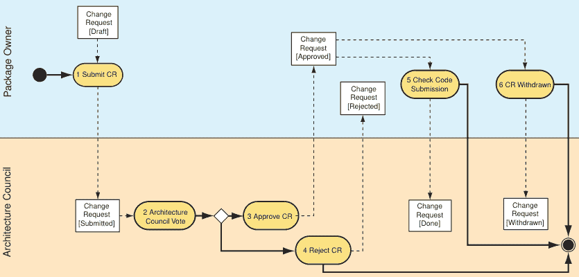

图 8.4

Symbian 平台的公共接口更改请求流程。

(版权 © 2009 Symbian Foundation Limited. 由 Stichbury 根据 Creative Commons 2.0 许可授权。参见 `http://developer.symbian.org/`。)

## 8.6 API 评审

### 8.6.3 提交前 API 评审

当然，你必须等到正式发布时才能捕捉到这些问题。发布前的 API 评审会议是最后一道防线，确保不理想的更改不会发布给用户。如果 API 所有者在开发过程中保持警惕——监控源代码的检查并尽早标记问题，以便在进入 API 评审会议之前解决它们——那么就可以减少 API 评审的工作。

许多组织或项目会建立提交前 API 评审机制。也就是说，希望更改公共 API 的工程师必须向 API 评审委员会正式请求更改许可。不影响 API 的仅实现类更改通常不需要通过这一额外流程。这对于开源软件项目特别有用，因为许多不同背景和技能的工程师都可以提交补丁。

例如，开源 Debian 移动设备操作系统对所有更改实施更改控制。该流程的设定目标是确保 API 以受控的方式演进。该流程通过提交包含以下信息的更改请求（CR）启动：

- 更改的描述以及其必要性。
- 对 API 的任何客户端的影响分析。
- 指向 API 新版本的移植迁移指南。
- 向后兼容性测试用例的更新。

这些由架构委员会进行评审，他们将批准或拒绝请求，并提供决策的理由。一旦获得批准，开发者就可以提交他们的代码、文档和测试更新。图 8.4 提供了该流程的概述。

另一个例子是基于 Java 的 NetBeans 项目定义了 API 评审过程以接受来自人员的补丁。这样做是为了监督 NetBeans IDE 及相关产品的架构。现有 API 的更改或对新 API 的请求在被引入主干代码之前必须经过评审。此过程通过 NetBeans 缺陷跟踪系统管理，请求被标记为关键字 `API_REVIEW` 或 `API_REVIEW_FAST`。评审过程将导致更改被接受或拒绝。在被拒绝的情况下，通常会给开发者关于设计、实现或文档的改进方向，以使更改更易被接受。当然，对于被接受的更改，仍然会提供类似的反馈。有关此过程的详细信息，请参阅 `http://wiki.netbeans.org/APIReviews`。

提交前评审是在开发过程中跟进不断变化的 API 更改流的好方法。然而，安排一次发布前的 API 评审会议也是很有用的。这可以用来捕捉任何遗漏的更改，可能是因为某个工程师不了解该流程，或者没有意识到该流程适用于他的更改。

# 第 8 章 版本控制

# 第 9 章

# 文档

在本书的第一章中，我将 API 定义为一个或多个头文件加上支持性文档。事实上，我声称除非包含随附文档，否则 API 是不完整的。这是因为头文件没有规定 API 的行为，只规定了各种函数和方法的调用约定。David L. Parnas 很好地描述了这一点（Parnas, 1994）：

- 重用是一件说起来比做起来容易得多。它既需要良好的设计，也需要优秀的文档。即使我们看到了良好的设计（尽管这并不常见），如果没有良好的文档，我们也无法看到组件被重用。

因此，编写良好的文档是你的 API 的关键要素。因此，我将专门用一章介绍这个主题。我将首先介绍你应该关注文档的某些原因，然后描述你可以提供的各种类型的文档，并介绍几种可以辅助编写文档任务的工具。

记录 API 最简单的方法之一是使用工具从你的头文件中自动提取注释并为你构建 API 文档。这些工具中最流行且功能最全的可能是 Dimitri van Heesch 开发的 Doxygen。因此，我将花一些时间研究你如何在项目中使用 Doxygen，并为记录 API 元素提供示例模板。

为实现代码编写文档也是良好的做法，但文档是供你内部使用的，而记录 API 头文件的需求比对用户的文档更为至关重要。

我在此不得不承认，书中的源代码示例很少或没有注释或文档。这样做是为了保持这些示例尽可能精简和集中，既为了让你更容易理解，也为了防止书的长度增加到目前大小的两倍。作为折协，我确保了随本书的源代码示例都经过良好的记录，正如你应该编写的任何 API 头文件应当的那样。

## 9.1 编写文档的理由

我希望不需要说服你，为用户提供如何使用你 API 的详情是一件好事。如果你遵循了质量章节中的核心原则，那么你的接口本应该是一致的、可发现的且易于使用的。然而，这并不是良好文档的替代品。专业编写的文档是交付高质量 API 同样重要的部分。事实上，良好的文档可以决定用户是采用你的 API 还是寻找替代方案。

### 9.1.1 定义行为

API 是一份功能规范。也就是说，它应该定义如何使用接口，以及接口应该如何表现。仅仅查看头文件中的方法可以告诉你参数的数量和类型以及返回类型，但它没有说明如何行为。为了说明这一点，考虑以下表示 RGB 颜色的类定义：

```cpp
class RGBColor {
    RGBColor(float, float, float);
    ~RGBColor();

    float Red() const;
    float Green() const;
    float Blue() const;
    void Set(float, float, float);
}
```

因为这个类定义完整规定了每个类和方法的参数和返回类型。然而，关于该类的行为还有许多未知的点。例如：

- 红色、绿色和蓝色浮点值是用 0.0 到 1.0 的范围表示，还是 0 到 100% 的百分比，或者是 0.0 到 255.0 的浮点范围（以便能准确表示中间值 127.5），或者是 0 到 65535？
- 如果向构造函数或 `Set()` 方法传递超出范围的值会发生什么？它是会原样保留、对值取模，还是尝试将其缩放到有效范围内？
- 构造函数和 `Set()` 方法的参数顺序是什么？假设是红色、绿色然后是蓝色，但这尚未被明确记录。

该类的更新版本提供了一些文档，形式为注释（三元注释样式将在本章后面讨论 Doxygen 时解释）。

```cpp
/// 表示单个 RGB（红、绿、蓝）颜色
/// 其中 (0, 0, 0) 代表黑色，(1, 1, 1) 代表白色
class RGBColor {
    public:
        /// 从 ..01 范围内的三个浮点创建 RGB 颜色
        /// 超范围的值将被限制在此范围内
        RGBColor(float red, float green, float blue);
        ~RGBColor();
```

## 9.1 编写文档 true

```cpp
/// 返回颜色的红色分，范围为 0..1
float Red() const;
// 返回颜色的绿色分，范围为 0..1
float Green() const;
// 返回颜色的蓝色分，范围为 0..1
float Blue() const;
// 使用三个 0..1 范围内的浮点数设置 RGB 颜色
// 超出范围的值将被限制在 0..1 之间
void Set(float red, float green, float blue);
```

这些注释非常简练，但尽管如此，它们为客户端指定了 API 的行为，足够客户端使用。不过，文档并不非要长篇大论。你的用户会喜欢更多细节，但极简的文档也比完全没有要好。

- 提示

良好的描述说明如何使用你的 API 以及它在不同输入下的行为。

在编写头文件本身的同时，编写此类注释是一个良好的习惯。一旦 API 更加稳定并趋于发布，你随时可以回来添加更多内容或修改细节。如果你时间不够，需要快速发布 API，至少可以拥有一些基础水平的文档。更好的是，你应该在 API 发布之前显式地安排任务来编写其文档。

你甚至可以考虑为你的版本控制系统创建提交钩子（也称为触发器），以拒绝不包含文档的新公共 API 代码。如果这种策略过于严酷，你仍然可以执行代码检查，但将其视为建议性反馈，而不是提交新代码的障碍。

- 提示

在实现每个组件时编写 API 文档。在 API 完成后对其进行修订。

### 9.1.2 接口契约的文档化

“契约设计”（design by contract）一词由 Bertrand Meyer 提出，作为一种定义软件组件形式化规范的方法（Meyer, 1987）。Meyer 后来在美国注册了该术的商标，因此许多开发者现在将其称为契约编程（contract programming）。核心概念是：软件组件为其将提供的服务提供一份合同或义务，而客户端通过使用它，同意了该合同的条款。这一概念基于 Hoare 逻辑（Hoare logic），这是由 Tony Hoare 开发的一种种用于推理程序正确性的形式化系统（Hoare, 1969）。该模型的主要原则有三点：

- 1. 前置条件（Preconditions）：客户端在调用函数之前有义务满足该函数要求的前置条件。如果不满足前置条件，函数可能无法正常运行。
- 2. 后置条件（Postconditions）：函数保证在完成工作后某些条件将得到满足。如果不满足后置条件，则该函数没有正确完成其工作。
- 3. 类不变性（Class invariant）：类的每个实例都必须满足的约束。这定义了类为了按照其设计运行必须保持 true的状态。

指定契约细节的最佳方式是在你 API 的类和函数文档中进行。换句话说，你的函数应该指定在调用它们之前必须生效的任何预期前置条件，以及在完成后将满足的任何后置条件。此外，你的类文档应该指定在每个类的可观测生命周期内保持有效的任何不变性，即在构造之后、析构之前以及在每个公共方法调用之前。让我们来看几个例子来更具体地演示这一概念。

平方根函数将有一个前置条件，即输入数字必须是正数或零。它将有一个后置条件，即函数结果的平方等于输入数字（在适当的误差范围内）。

```cpp
/// 计算数字的平方根。
/// @param value 输入必须为正数或零
/// @return 结果的平方等于输入值（在适当的误差范围内）
double SquareRoot(double value);
```

一个加法函数将有一个前置条件，即两个操作数必须是有效的。它将有一个后置条件：

```cpp
/// 返回两个数的和。
/// @param a 第一个操作数
/// @param b 第二个操作数
/// @return 两个数的和
int Add(int a, int b);
```

## 9.2 文档类型

- 有效的返回类型是什么？例如，它何时返回 true，何时返回 false？
- 它检查哪些错误条件？例如，它会检查文件是否存在吗？
- 是否有先置条件、后置条件或副作用？
- 是否有未定义行为？例如，`sqrt(-1.0)`？
- 它会抛出异常吗？
- 它是线程安全的吗？
- 单位或参数是什么？
- 空间或时间复杂度是多少？例如 O(log n) 或 O(n^2)？
- 内存所有权模型是什么？例如，调用者是否负责删除返回的对象？
- 虚方法是否调用了类中的其他方法？如果是，这是否是客户端在派生类中重写该方法时应该调用的？
- 是否有应该交叉引用的相关函数？
- 该功能是在哪个版本的 API 中引入的？如果是，其替代方案是什么？
- 该功能是否存在已知的 bug？
- 你是否愿意分享计划中的未来增强功能？
- 是否可以提供任何代码示例？
- 文档是否增加了价值或见解？例如，对于 `SetColor()` 函数，注释“设置颜色”并不能告诉你任何你本就已经知道的信息。

除了这些 API 行为列表外，Diomidis Spinellis 还列了一份所有优秀的代码文档都应该追求的质量列表（Spinellis, 2010）。他建议文档应该：

1. 完整的
2. 一致的
3. 易于获取
4. 不重复

> 提示：
>
> 为你 API 的每一个公共元素编写文档。


让另一个人来审查你的文档也是一种良好的做法。作为编写代码的开发者，你往往离问题空间太近，并假设了普通用户不会具备的知识。正如 Michi Henning 所说，API 的开发者“在心态上被实现细节所污染了”（Henning, 2009）。因此，请让同事开发者、质量保证（QA）工程师或技术撰稿人员审查你的 API 文档，并开放接受他们新鲜视角的反馈。

## 9.2 文档类型

你可以为你的 API 提供多种类型的文档。并非所有这些类型都适用于你的特定项目，但意识到用户会预期的各种选项是值得的。

值得注意的是，许多软件产品提供的文档可以接受用户的贡献。这可以通过使用维基来实现，任何用户实际上都可以创建和编辑文档，例如海量的[魔兽世界维基](http://www.wowwiki.com/)，或者支持内容补充的网页，如 [PHP 手册](http://www.php.net/manual/) 上的 Web 页面。这显然是一项非常强大的能力，可以围绕你的 API 构建社区，并创建出超出你个人所实现的集体文档。即使你没有采用自动系统来收集用户贡献，也应该提供一种让他们发送反馈的方式，以便手动整合到文档中。

大部分文档（或你的用户）会针对特定版本的 API 进行编写。基于维基的解决方案很容易陷入一个问题：维基内容最终会引用 API 的多个版本。为每个主发行版本创建一个完全独立的文档副本是值得的。这将允许客户端查看该特定版本的文档，同时让你能够提供有关当前 API 版本的最新文档。

图 9.1 显示了 Qt 参考文档页的截图。它被作为一个详尽且编写良好的文档示例，展示了我接下将涵盖的所有各种类型。值得注意的是，所有的 Qt 文档都与 API 同步进行版本。

### 9.2 自动化 API 文档

对于 API 来说，最显见的文档类型是根据源代码中的注释自动生成的类型。这允许你将类和方法的文档直接保留在头文件中的声明旁边。结果是，当你更改 API 时，你更有可能保持文档的更新。为新版本生成最新文档也很容易，而且这些文档可以在 API 相关功能之间进行交叉引用。

| 提示 |
| :--- |
| 使用可以从头文件注释中提取 API 文档的自动化文档工具 |

显而易见，任何用户文档注释都应该出现在公共头文件中，而不是 `.cpp` 文件中，以便你的用户更容易发现它们。这对于闭源 API 尤为重要，因为用户无法访问你的 `.cpp` 文件。

这些源代码注释通常由开发者维护。然而，如果你能让专业的撰稿人员对注释进行风格、语法和一致性检查，你的 API 文档的质量将得到极大提升。此外，作为新鲜的观察者，这些撰稿人员通常可以提供良好的反馈，并建议增加需要显示的额外信息或改进要包含在内的示例。某些技术撰稿人员可能习惯于直接修改源代码，但在这些情况下，他们轻松地在文档纸质上做标记，让开发者进行实际的代码更改。

#### Qt 参考文档

| 入门 | API 参考 | 使用 Qt 工作 |
| :--- | :--- | :--- |
| * Qt 的安装与第一步 | * 类和函数文档 | * 使用 Qt 进行跨平台开发 |
| * 教程与示例 | * 框架与技术 | * 单元测试与调试 |
| * 演示与 Qt 4.6 中的新功能 | * 教程与最佳实践 | * 部署应用程序 |

许多工具允许根据源代码中的注释创建 API 文档。这些工具通常可以输出多种格式，例如 HTML、PDF。以下列出了：

- Auto
- CcDoc
- CppDoc
- Doc-O
- Doc++
- Doxygen
- GenHelp
- HeaderDoc
- Help Generator
- KDOC
- RoboDoc
- ROBoc
- Robooc
- TwinText

### 9.2 文档类型

- 常见问题解答（FAQs）。一组针对常见问题的解答可以成为你文档集非常非常有用的补充。它让用户能够快速轻松地发现 API 是否符合他们的需求、如何避免常见陷阱，或者如何解决典型问题。

编写文档的行为迫使你从用户的角度进行思考。因此，它可以帮助你识别 API 的缺陷或可以简化的区域。因此，尽早编写高级文档的骨架和一些初始示例代码是一个良好的习惯，这可以迫使你对库的整体设计和用例进行更深层次思考。

#### 9.2.4 发布说明 (Release Notes)

首次发布后的每次发布都应该包含发布说明。这些说明告诉用户自上次发布以来发生了什么变化。发布说明通常是密集的文档，可以包含：

- 发布概述，描述新功能或本次关注的重点（例如，仅包含 bug 修复）。
- 指向发布所在处的链接。
- 识别与上一个版本相比的源代码或二进制不兼容性。
- 本版本中修复的 bug 列表。
- 已弃用或删除的功能列表。
- 针对 API 任何更改的迁移提示，例如如何使用随发布提供的升级脚本。
- 本版本引入的或从之前的版本留下的任何已知问题。
- 处理已知问题的故障排除提示。
- 关于用户如何发送反馈和 bug 报告的信息。

#### 9.2.5 许可证信息

你应该始终指定分发 API 时所遵循的许可证。这让客户了解你授予了哪些权利以及他们承担什么义务。通常，你将使用以下类别之一的许可证。

1. 专有 (Proprietary)：适用于所有权属于你（发布者）且你禁止其某些用途的软件。这些软件产品通常是闭源的，并且需要许可费用（尽管，作为一个反例，Qt 商业许可包含了源代码）。专有许可可能会限制某些活动，如软件的逆向工程、用户或机器数量、开发者人数或多个用户并发使用软件。

2. 自由和开源 (Free and Open Source)：适用于无限制地使用、研究和修改的软件。它可以在修改或未修改的形式下复制和分发，且不受或仅受限制。“自由（free）”一词指的是软件的使用权利，而不一定指其价格。符合此类别的软件被称为自由 way开源软件，通常缩写为 FOSS 或 FLOSS（Free, Libre, Open Source Software）。

有两个主要机构批准 FLOSS 许可证。由 Richard Stallman 于 1985 年创立的自由软件基金会（FSF）批准符合《自由软件定义》的许可证；由 Bruce Perens 和 Eric S. Raymond 于 1998 年创立的开源倡议组织（OSI）批准符合其《开源定义》的许可证。

| 提示 (TIP) |
| :--- |
| 在显著位置说明你 API 的许可证条款。 |

此外还有两种主要的 FLOSS 许可证类型。

1. **左权 (Copyleft)**：提供分发软件的修改版和未修改版副本的权利，并要求任何此类衍生作品必须以相同的条款发布。还有一个“弱左权（weak copyleft）”子类别，通常应用于软件库，允许客户分发与该库链接的代码，而无需要求这些代码按该库的左权许可证分发。

2. **宽松型 (Permissive)**：提供分发软件的修改版和未修改版副本的权利，并允许衍生在比原始许可证更严格的条款下分发。这意味着你可以提供一个开源库，但客户并不要求将所有分发的衍生品作为开源软件提供。

下表提供了常见 FLOSS 许可证列表以及它们对用户影响的简要概述。所有这些许可证都通过了 FSF 和 OSI 的批准。这显然是不完整的，仅作为粗略指南。如果你可以接触到总法律顾问，你应该就你产品的最佳选择咨询该人员。欲需更多详细信息，请参阅 http://www.fsf.org/ 和 http://www.opensource.org。

| 许可证名称 |  |
| :--- | :--- |
| 无许可证 (No license) | 如果你没有指定许可证，用户没有法律权利使用你的 API，除非他们直接向你请求（因为你是版权所有者）。 |
| GPL | 通用公共许可证 (GPL) 是一种左权许可证，这意味着衍生作品也必须以 GPL 格式分发。开源 GPL 库不能用于专有产品。Linux 内核和 GIMP 图像处理工具都是根据 GPL 的。诺基亚的 Qt 最初按商业许可或 GPL 许可证发布。 |
| LGPL | 较小通用公共许可证 (LGPL) 是一种弱左权许可证，允许受 GPL 许可的库链接到专有代码。衍生作品可以在特定条件下分发，包括提供修改或未修改的 GPL 库的源代码等限制。GTK+ 采用 LGPL 许可。诺基亚在版本 4.5 中加入了 Qt。 |
| BSD | BSD 许可证是一种简单的宽松型许可证，包含了由指定所有者/组织的法律免责声明。通常使用 BSD 的修改版本，不包含“广告条款”。链接 BSD 代码的专有代码可以自由分发。Google 根据 BSD 许可证发布了 Chrome 浏览器。Zend Framework 和 libtiff 也使用 BSD。 |
| MIT/X11 许可证 | 这是一种与 BSD 许可证类似的简单宽松型许可证。链接 MIT 许可代码的代码可以自由分发；MIT 许可软件包括 Expat、Mono。 |
| Mozilla 公共许可证 (MPL) | 这是一种弱左权许可证，允许你的开源库构建在 Apache 许可代码之上。任何修改都应根据 MPL 重新分发。Mozilla 软件 Firefox 和 Thunderbird 是根据 MPL 提供的。 |
| Apache 许可证 | 这是另一种宽松型许可证，允许专有软件分发。Apache Web 服务器在其许多产品（如 Android 和 Web Toolkit）中使用了 Apache。 |

一个备受尊敬的软件项目：Apache HTTP Server。请注意，该文档还针对多种不同的语言进行了本地化。

## 9.3 文档的可用性

有几个研究小组正在调查 API 文档的可用性（Jeong 等人，2009；Robillard, Stylos 和 Myers, 2008）。这些工作涉及进行可用性研究，以观察用户如何浏览文档并完成特定任务。其目标是为 API 设计师提供更好的接口文档方法。以下列表列了这些发现的总结。

- **索引页。** 提供一个整体索引页，作为跳转到各个文档元素的起始点。此外，每个起始点都应该提供关于其涵盖内容以及目标用户群体（开发者、经理、法律人员等）的指示。
- **一致的视觉效果和感受。** API 文档通常由不同的元素组成，有些是自动生成的，有些是手动编写的，有些由用户组合。您应该为所有页面使用一致且独特的风格，让用户在浏览文档或导航到另一个网站时能够识别出这一点。
- **代码示例。** 用户通常需要阅读大量的文档。考虑一下微软开发者网络库（Microsoft Developer Network library）的大小。提供示例代码片段和运行演示可以帮助用户更快地找到他们并在自己的代码中使用 API 所需的信息。
- **图表。** 清晰简洁的阐明高层概念的图表将非常有帮助，特别是对于那些只想快速浏览文档的用户。您应该尽可能使用熟悉的图表格式，例如 UML 或实体关系图。
- **搜索。** 良好的搜索功能对于让用户尽可能快地找到所需信息至关重要。文档的所有部分都应该是可搜索的，包括自动生成的 API 规范以及任何手动编写的文本。
- **面包屑导航。** 使用导航辅助工具让用户能够跟踪自己在文档层次结构中的位置，并轻松地返回上级目录。“面包屑”一词用于描述一种常用技术，即通过带有分隔符的一系列页面来显示当前位置，例如，“索引 > 概览 > 概念”。让用户轻松返回高级页面是非常有用的。
- **术语。** 关键术语应该被定义并保持一致的使用。然而，在没有必要的情况下，应避免使用专业或晦涩的术语，因为这会导致用户感到困惑和沮丧。

与 API 可用性相关的是易学性：一个难以使用的 API 可能也很难学习。为此，Martin Robillard 调查了是什么因素导致 API 难以学习。他发现，学习 API 的最大障碍之一是支持性的文档和资源。例如，他列出了以下阻碍学习 API 的因素（Robillard, 2009）：

## 9.4 使用 doxygen

- 缺乏代码示例：提供的示例不足或不恰当。
- 内容不完整：文档缺失或呈现方式不当。
- 缺乏任务重点：没有提供关于如何完成此类任务的详细信息。
- 缺乏设计原理：关于高层架构和设计原理提供的细节不足或不恰当。
- 数据格式无法访问：文档未以所需的格式提供。

除了这些点之外，许多研究还侧重在开发者往往不愿仔细或彻底地阅读 API 文档这一事实上（Zhong 等人，2009）。这表明提供更多的文档实际上可能适得其反，因为你的用户由于信息被埋得太深而错过了真正重要的要点和注意事项。使用高级别的教程和示例代码可以帮助解决这个问题。此外，相关类和方法之间的交叉引用可以引导用户发现他们之前没有注意到的功能。一些研究人员还建议使用词云或其他可变字体技术来突出重要或复杂的问题（Stylos 等人，2009）。

## 9.4 使用 DOXYGEN

Doxygen 是一种工具，可以根据你在源代码中编写的注释自动生成各种格式的 API 文档。它支持许多语言，包括 C、C++、Java、Python、Fortran、C# 和 PHP，并支持多种输出格式，包括 HTML、LaTeX、PDF、XML 和 RTF。Doxygen 是开源的（遵循 GNU 通用许可协议），自 1997 年以来一直在开发，适用于 Windows、Linux 和 Mac 等多个平台。Doxygen 允许你通过 `mainpage` 注释为整个 API 指定文档。这可以让你提供 API 的高层描述，并对主要类进行细分。Doxygen 网站为 http://www.doxygen.org

### 9.4.1 配置文件

Doxygen 是高度可配置的，最近提供了超过 200 个选项。你可以通过运行命令行参数 `-g` 生成一个默认配置文件。你可能需要编辑此文件以指定 Doxygen 的某些设置如下：

```
PROJECT_NAME = <项目名称>
FULL_PATH_NAMES = NO
TAB_SIZE = 4
FILE_PATTERNS = *.h *.hpp *.doc
```

```
RECURSIVE = YES
HTML_OUTPUT = apidocs
```

```
GENERATE_LATEX = NO
```

通过这种设置，Doxygen 将创建：

### 9.4.2 注释样式

你采用的样式取决于个人喜好；它们都支持三斜杠（///）来区分注释。在注释中，有很多命令可以使用：

- `\file [<文件名>]`
- `\class <名称>`
- `\brief <简短摘要>`
- `\author <作者列表>`
- `\date <日期>`
- `\param <参数名>`
- `\param[in] <输入参数>`
- `\param[out] <输出参数>`
- `\param[in,out] <输入输出参数>`

除了这些，Doxygen 还支持各种更改文本风格的命令。这些包括 `\b` (粗体)、`\c` (等宽字体) 和 `\e` (斜体)。你还可以使用 `\n` 换行，`\\` 输入反斜杠，以及 `\@` 输入符号。

### 9.4.3 API 注释

Doxygen 允许你使用 `mainpage` 注释为整个 API 指定文档。这可以让你提供 API 的高层描述，并对主要类进行分解。该描述将出现在 Doxygen 生成的文档首页。通常将这些注释存储在单独文件中，例如 `overview.dox`（这需要在 Doxygen 配置文件的 `FILE_PATTERNS` 项中包含它）。

你文档中的文本可能长到有必要分成不同的章节。在这种情况下，可以使用 `\section` 和 `\subsection` 命令引入这种结构。你甚至可以创建单独的页面来对 API 的部分进行详细描述。这是通过 `\page` 命令实现的。

此外，你可能发现为 API 定义行为组很有用，这样可以将 API 中的各种类分为不同的类别。例如，你可以为文件处理、容器类、日志、版本控制等类创建组。这是通过 `\defgroup` 声明组，然后使用 `\roup` 将任何特定元素添加到该组实现的。

将这些功能结合起来，以下注释为整个 API 概览文档，它分为三个部分，并交叉引用了两个额外页面以获取更多信息。这些页面包含一个指向所有标记为一组的 API 元素的链接。

```
///
/// \mainpage API 文档
///
/// \section sec_Contents 内容
///
/// \li ref sec_Overview
///
/// \li ref sec_Detail
///
/// \li ref sec_SeeAlso
```

```
/// \
/// \section sec_Overview 概览
///
/// 在此处输入你的概览文本。
/// \n/// \section sec_Detail 详细描述
/// \n/// 在此处输入更详细的描述。
/// \n/// \section sec_SeeAlso 相关属性
/// \n/// \li \ref page_Logging 日志
/// \n/// \li \ref page_Versioning 版本控制
/// \n/// \page page_Logging 日志系统
/// \n/// 日志功能的概述
/// \n/// \link group_Logging 查看所有日志类 \endlink
/// \n/// \page page_Versioning API 版本控制
/// \n/// API 版本控制概述
/// \n/// \link group_Versioning 查看所有版本控制类 \endlink
/// \n/// \defgroup group_Logging 诊断日志功能
/// 详细描述请参阅 \ref page_Logging。
/// \n/// \defgroup group_Versioning 版本控制系统
/// 详细描述请参阅 \ref page_Versioning。
```


该注释生成的 Doxygen HTML 输出（使用默认样式表）如图 9.3 所示。

### 9.4.4 文件注释

你可以在每个头文件的顶部放置注释，为整个模块提供文档。以下是这些按文件注释的示例模板。

```
/// \file <filename>
/// \brief <简要描述>
/// \"
```

## 9.4 使用 Doxygen

| 主页 | 相关页面 | 模块 | 类 | 文件 |

| :--- | :--- | :--- | :--- | :--- |

# API 文档

目录

- 概览

- 详细描述

- 相关属性

### 概览

在此处输入你的概览文本。

### 详细描述

在此处输入更详细的描述。

### 相关属性

- 日志系统

- API 版本控制


图 9.3

\mainpage 示例的 Doxygen HTML 输出。

```
/// \author <作者姓名列表>
/// \date <日期描述>
/// \since <添加时的 API 版本>
/// \/// <模块描述>
///
/// <许可和版权信息>
/// \
```

如果此文件包含你想要添加到已定义组中的功能，你也可以向此注释中添加 `\ingroup` 命令。

### 9.4.5 类注释

你头文件中的每个类也可以有一条注释来描述该类的整体用途。除了这里给出的示例模板外，如果该类属于你定义的组，你可以考虑包含 `\ingroup` 命令；如果该类已废弃，则使用 `\deprecated`；或者如果你想提供一些示例代码，则使用 `\code ... \endcode`。

```
///
/// \class <类名> [头文件] [头文件名]
///
```

```
/// \brief <简要描述>
///
/// <详细描述>
///
/// \author <作者姓名列表>
/// \date <日期描述>
/// \since <添加时的 API 版本>
```

### 9.4.6 方法注释

你可以为单个方法（以及选择性地，如果它们在参数中，或作为输入/输出参数）提供文档，并对返回值进行描述。使用类示例模板，你还可以根据需要考虑添加 `\ingroup` 或 `\deprecated`。

```
/// \brief <简要描述>
///
/// <详细描述>
///
/// \param[in] <输入参数名> <描述>
/// \param[out] <输出参数名> <描述>
/// \return <返回值的描述>
/// \since 添加方法时的 API 版本
/// \see 在“相关属性”部分中列出的方法
/// \note <关于该方法的可选说明>
```

如果你类中的某些方法属于一个或多个逻辑分组，你可以向 Doxygen 指明这一点，它将这些相关方法归类在一个子章节下。这可以用于为类方法提供更合理的排序，而不是使用 Doxygen 的默认行为。下面的代码段演示了如何指定两个此类方法组：

```
class Test
{
public:
/// \name <group1-name>
///@(
void Method1InGroup1();
void Method2InGroup1();
///@)

/// \name <group2-name>
///@(
void Method1InGroup2();
void Method2InGroup2();
///@)
};
```

### 9.4.7 枚举注释

Doxygen 还允许你为枚举提供注释，包括对枚举中单独值的文档。后者可以使用 Doxygen 的语法完成，该语法将注释附加到上一个元素而不是下一个元素。

```
///
/// \brief <描述>
/// <详细描述>
enum MyEnum {
ENUM_1, /// 值 ENUM_1 的描述
ENUM_2, /// 值 ENUM_2 的描述
ENUM_3, /// 值 ENUM_3 的描述
}
```

### 9.4.8 带有文档的示例头

将之前所有的建议整合在一起，这里有一个完整的、使用 Doxygen 的头文件，用于描述文件、类和每个方法。该文件在支持源码中提供，并带有 Doxygen 为该文件生成的 HTML 输出。

```cpp
///
/// \file version.h
/// \brief 访问 API 的版本信息。
///
/// \author Martin Reddy
/// \date 2010-07-07
/// \since 1.0
/// \ingroup
///
/// (c) 2010 Martin Reddy 保留所有权利。
#ifndef VERSION_H
#define VERSION_H

#include <string>

///
/// \class Version
/// \brief 访问 API 的版本信息
///
class Version
{
public:
    /// \name 版本号
    ///@(
    /// \brief 返回主版本号。
    /// \return 整数主版本号。
    /// \since 1.0
    static int GetMajor();
    /// \brief 返回次版本号。
    /// \return 整数次版本号。
    /// \since 1.0
    static int GetMinor();
    /// \brief 返回补丁版本号。
    /// \return 整数补丁版本号。
    /// \since 1.0
    static int GetPatch();
    /// \brief 返回完整的版本字符串。
    /// \return 字符串，例如 "1.0.1"。
    /// \since 1.0
    static std::string GetVersion();
///@)

    /// \name 版本比较
    ///@(
    /// \brief 将当前版本与特定版本进行比较。
    /// 此方法让你检查当前版本是否大于或等于指定的版本。对于需要最小版本的操作，这非常有用。
    /// \param[in] major 要比较的主版本号
    /// \param[in] minor 要比较的次版本号
    /// \param[in] patch 要比较的补丁版本号
    /// \return 如果当前版本 >= 指定版本则返回 true
    /// \since 1.0
    static bool isAtLeast(int major, int minor, int patch);
///@)

    /// \name 功能标记
    ///@(
    /// \brief 测试是否实现了某个功能。
    /// 更改 API 实现的新功能指定为“功能标记”。此方法让你查询 API 以确定给定功能是否可用。
    /// \param[in] name 功能标记名称，例如 "LOCKING"
    /// \return 如果命名功能可用则返回 true
    /// \since 1.0
    static bool hasFeature(const std::string& name);
///@)
};

#endif
```

我们拥有其中三者，但并非三者。例如，在瀑布式开发过程中，功能蔓变（feature creep）和不可预测的问题很容易消除项目末尾预留给测试的任何时间。因此，一个花费时间编写自动化测试的工程师看起来可能比其他人效率更低。相反，如果赋予工程师关注质量的能力，我相信他们会乐于利用这种为自己的代码编写测试的机会。

我在 Pixar 经历过这一点，那里我们决定引入了一项新政策：工程师必须对自己的代码进行单元测试，此外，所有非 GUI 代码必须达到 100% 的代码覆盖率。也就是说，每一行非 GUI 代码都必须通过测试代码执行。我们发现，这并没有引发反抗，开发者认为这是对他们时间的良好利用。关键的促进因素是我们在每次迭代的末尾增加了时间，让所有开发者都可以为自己的代码编写测试。即使在遵循这一政策 2 年后，编写测试的收益仍然超过了成本，而且维持 100% 覆盖率的目标仍然是。

如果你需要一些激励，这里有几个理由说明你应该在项目中使用测试：

- **增加信心。** 大量使用自动化测试可以让你有信心在不破坏功能的情况下更改 API 的行为的行为。测试可以减少对实施更改的恐惧。在遗留系统中，很常见的情况是工程师对更改代码的某些部分感到不安，因为这些部分太复杂且不透明，以至于它们的行为可能会产生不可预料的后果（Feathers, 2004）。此外，相关代码可能由一位已离开组织的工程师编写，这意味着没有人知道代码中埋藏了什么“尸体”。

- **确保向后兼容性。** 重要的是，要确保你没有在新版本的 API 中引入的更改会破坏针对旧版本 API 编写的代码或由旧 API 生成的文件的向后兼容性。自动化测试可用于捕获早期版本的工作流和行为，以便这些内容在库的最新版本中始终得到执行。

- **节省成本。** 一个众周知的事实是，在开发周期后期修复缺陷比早期更贵。这是因为缺陷变得更深地嵌入到代码中，而且执行时可能涉及许多数据文件。例如，Steve 证明了发布后修复 Bug 的成本可以是开发期间的 12-25 倍（McConnell, 2004）。开发一套自动化测试集可以尽早检测到缺陷，以便以更具经济效益修复它们。

- **用例法典化。** API 的用例代表了用户应该能够完成的支持工作流。在实现 API 之前针对这些用例进行开发，可以让你知道何时何时实现了所需的功能。这些相同的测试将被持续使用，以捕获这些高层工作流中的任何回归。

- **合规性保证。** 用于某些安全-安全关键型应用程序的软件可能必须通过监管测试，例如美国联邦航空管理局（FAA）认证。此外，某些组织在允许你的软件以此为品牌之前可能会验证你的软件是否符合其标准。例如，开放地理空间联盟（OGC）是一个针对要标记为“通过 OGC 认证”软件的合规性测试计划。自动化测试可确保你继续符合这些监管和标准要求。

## 10.2 API 测试类型

这些观点可以总结为：自动化测试可以帮助你判断是否正在构建正确的东西（称为验证，validation）以及你是否以正确的方式构建它（称为确认，verification）。

值得注意的是，编写许多测试可能会有副作用。随着测试套规模的增大，这些测试的维护工作也相应增加。这可能导致这样的情况：一个只需花费几分钟即可完成的代码更改可能会破坏数百个测试，并需要花费数小时来更新测试套件。这是一个糟糕的境地，因为更新测试的开销会阻碍工程师进行良好的修复。我将在接下来的章节中讨论避免这种情况的方法。然而，值得注意的是，如果修复性问题更改了公共 API，那么这种额外的障碍可能是一件好事，因为它迫使工程师考虑对现有客户端向后兼容性的潜在影响。

## 未测试代码的代价

多年来发生了许多灾难性的软件失败案例。许多网站维护了这些 Bug 的列表，例如网站上的软件失败列表：http://www.serereferences.com/software-failure-list.php。在许多案例中，更多的测试本可以避免灾难。1998 年 5 月，一个软件漏洞导致银行损失了 924,844,208 美元。美国银行协会将其描述为美国银史上事实上最大的错误。发生这种情况是因为 ATM 交易软件中的银行代码未能对所有 ATM 协议对其进行测试。

作为向后兼容性测试的一个例子，东京证券交易所在 2005 年 11 月由于系统升级后的软件故障，暂停了大部分交易日的交易。

未能满足需求会对你的业务产生巨大影响。例如，在 11 月，未能满足需求对你的业务产生了巨大影响。最后，作为合规测试的重要性的一个例子，2007 年 1 月，由于未能满足需求，某公司起诉了。

## 10.2 API 测试的类型

测试 API 与测试应用程序非常不同。然而，仍然有一些技术适用于两者。例如，软件测试通常是基于代码执行的。通常情况下，我们的重点将是使用代码编写且可以自动化的测试。例如，软件测试的常见分类包括：

- 1. **白盒测试：** 带有代码知识进行开发，用于应用程序。

- 2. **黑盒测试：** 基于规范开发，不需要了解实现。这些测试通常通过代码执行。

- 3. **灰盒测试：** 白盒测试和黑盒测试的结合，其中黑盒测试具有实现细节。

这些术语同样适用于 API 测试和应用程序测试。例如，系统测试通常是对完整的集成系统进行。这被认为是实际系统。

此外，GUI 测试领域对于 API 通常是不适当的，因为没有用户界面可以操作。唯一的例外是当你实际上是一个可以导航和交互的 GUI 工具包。例如，Qt 提供了一个自动化的 GUI 工具。

总来说，手动测试技术不适用于 API。因此，我们的重点将是编写代码且可以自动化的测试。自动化测试是定期程序化执行的，例如在 API 的构建过程中。如果测试不是自动化的，它们可能根本不会运行，这将违背编写的意义。

因此，我将关注的主要功能策略是单元测试和集成测试。单元测试验证软件是否符合程序员的预期，而集成测试满足他们的需求。你还可以编写测试来验证 API 的非功能需求。性能测试是非功能测试的一个例子，我将在本章稍后介绍细节。然而，还有许多其他类型的非功能测试技术。以下列表提供了一些最常见类型的选择：

- **性能测试：** 验证 API 的功能是否符合速度和内存使用要求。

- **负载测试：** 对系统施加需求或压力，并衡量其处理负载的能力。这指的是使用许多并发用户或执行多次 API 请求。这有时也称为压力测试。

- **扩展性测试：** 确保系统能够处理大型复杂的生产数据输入，而不仅仅是测试数据集。这有时也称为容量测试或卷测试。

- **浸泡测试：** 尝试连续运行软件一段时间，以满足客户它是稳健的并能够处理使用（例如，没有严重的内存泄漏、溢出或定时器触发的 Bug）。

- **安全性测试：** 确保代码的任何安全需求得到满足，例如敏感信息的机密性、身份验证、授权、完整性和可用性。

- **并发测试：** 验证代码的多线程行为，以确保其行为正确且不会发生死锁。

## 10.2 API 测试类型

> 提示

> API 测试应该包含单元测试和集成测试的结合。也可以根据情况应用非功能性技术，例如性能、并发和安全测试。

### 10.2.1 单元测试

单元测试用于验证源代码的单个最小单元，例如单独的方法或类。单元测试的目的是隔离 API 的最小部分，并验证它们在孤立状态下是否运行正常。

这类测试运行速度非常快，通常表现为一系列断言的形式，返回 `true` 或 `false` 将导致测试失败。这些测试通常与被测试的代码放在一起（例如在 `tests` 子目录中），并且它们可以在代码本身编译的同时进行编译和运行。单元测试需要由了解实现的开发者编写；因此，单元测试是一种白盒测试技术。

> 提示

> 单元测试是一种白盒技术，用于孤立验证函数和类的行为。

为了创建一个单元测试的示例，让我们考虑一个你想将字符串转换为双精度浮数的函数：

```
bool StringToDouble(const std::string&str, double &result);
```

该函数接受一个字符串参数并返回一个布尔值以指示转换是否成功。如果成功，双精度值将写入 `result` 引用参数。给定此函数，单元测试将执行一系列检查以确保其按预期方式工作。

```
void TestStringToDouble() {
    double value;

    Assert(StringToDouble("*1", +ve test));
    assertEqual(value, 1.0, "1" == 1.0);

    Assert(StringToDouble("-1", -ve test));
    assertEqual(value, -1.0, "-1" == -1.0);

    Assert(StringToDouble("0.0", "zero"));
    assertEqual(value, 0.0, "0.0" == 0.0);

    Assert(StringToDouble("-0", "minus zero"));
    assertEqual(value, -0.0, "-0" == -0.0);
    assertEqual(value, 0.0, "-0" == 0.0);

    Assert(StringToDouble("3.14159265", "pi"));
    assertEqual(value, 3.14159265, "pi value");
```

```
Assert(StringToDouble("2e10", value), "large scientific");
AreEqual(value, 2e10, "");
```

```
Assert(StringToDouble("+4.3e-10", value), "small scientific");
AreEqual(value, 4.3e-10, "");
```

```
std::cout << "SUCCESS!" << std::endl;
```

使用各种辅助函数来测试每个操作的结果：`Assert()`、`AssertFalse()` 和 `AssertEqual()` 是遵循 JUnit 风格的单元测试框架中常见的函数，尽管也使用了其他函数名或大小写。如果这些 JUnit 风格的断言中任何一个失败，整个测试将失败，并带有一个指向失败位置的描述性错误消息。

#### JUnit

JUnit 是一个单元测试框架，最初由 Kent Beck 和 Erich Gamma 为 Java 语言开发。它围绕两个设计模式设计：命令（Command）和组合（Composite）。

每个测试都是一个命令对象，定义了一个或多个（测试*`test*`）方法，例如 `testObject()`，以及可选的 `setup()` 和 `tearDown()` 方法。在一个测试套件（test suite）中可以调用多个测试用例。测试套件是测试用例的组合，会自动调用所有测试方法。


JUnit 提供了许多方法支持基于断言的测试，例如 `assertEquals()`、`assertNull()`、`assertTrue()` 和 `assertSame()`。如果传递给任何一个方法的表达式评估结果为 `false`，测试用例将被标记为失败。

由于 JUnit 的流行，该框架已移植到许多其他语言，并以更通用的统称 xUnit 出名。例如，针对 Python 的 PyUnit，针对 C 的 CUnit，以及针对 C++ 的 CUnit（许多实现）。

给出的示例是有意简单的。然而，在实际软件中，方法或对象的测试取决于系统中的对象或资源，如磁盘上的文件、数据库中的记录或服务器上的软件。这导致了单元测试的两种观点。

### 设置固件（Setup fixture）
单元测试的经典方法是在每个测试之前初始化一个常量环境，以确保依赖项和单例已初始化，将一组文件复制到某个位置，或加载带有一组准备好的初始数据的数据库。这通常在与每个测试相关的 `setUp()` 函数中完成，以区分测试设置步骤和实际测试。相关的 `tearDown()` 函数用于在测试完成后清理环境。这种方法的好处之一是同一个固件可以被多个测试重用。

### 存桩/模拟对象（Stub/mock objects）
在这种方法中，通过创建代表单元外部依赖的存桩或模拟对象，将测试代码与系统的其余部分隔离开来（Mackinnon 等，2001）。例如，如果单元测试需要与数据库通信，可以创建一个存桩数据库对象，它可以接受单元生成的存桩查询并在响应中返回，而无需与数据库建立任何实际连接。结果是完全隔离的测试，不会受到数据库问题、网络问题或文件系统权限的影响。缺点是，创建这些存桩对象可能非常麻烦，且它们通常无法被其他单元测试重用。然而，模拟对象通常更具活性，并且针对单个测试进行自定义。我将在章节的后续部分详细讨论这些选项。

> 提示
> 如果你的代码依赖于不可靠的资源（例如数据库、文件系统或网络），考虑使用存桩或模拟对象来产生健壮的单元测试。

## 10.2.2 集成测试

与单元测试不同，集成测试关注多个组件协作的交互。理想情况下，各个组件已经通过了单元测试。

即使你有很高的单元测试覆盖率，集成测试仍然是必要的，因为孤立的代码单元不能保证它们可以高效地一起使用，或者它们能够满足你的功能需求和用例。例如，一个组件的接口可能与另一个组件不兼容，或者另一个组件所需的信息可能没有恰当暴露供另一个组件使用。因此，集成测试的目标是确保 API 的所有组件都能良好工作、保持一致，并允许用户执行他们需要的任务。

集成测试通常是根据 API 规范（以及任何自动生成的 API 文档）开发的，因此不需要理解实现细节。也就是说，它们是从客户端的角度编写的。

> 提示
> 集成测试是一种黑盒技术。

## 10.2.3 性能测试

通常，用户会要求你的 API 具有合理的性能水平。例如，如果你编写了一个为游戏引擎提供 3D 对象实时碰撞检测的库，那么你的实现在每次运行时速度都必须足够快，不至于会拖慢速度。

## 10.2 API 测试的类型

客户端的游戏。因此，你可以为碰撞检测代码编写性能测试，如果该代码超过了预定义的性能阈值，则测试将失败。

另一个例子是，当 Apple 开发他们的 Safari Web 浏览器时，页面渲染速度是至关重要的。因此，他们添加了性能测试，并为每个测试定义了可接受的速度阈值。他们建立了一套流程，如果检查导致性能测试超过其阈值，则会被拒绝检查。工程师在提交代码之前必须优化他们的代码（如果他们的代码已经是最优的，则优化他人的代码）。

> 提示
> 对你的用例进行性能测试可以帮助你避免无意中引入速度或内存回归。

一个相关的问题是压力测试，通过压力测试你可以验证你的实现是否可以扩展到用户的真实需求，例如一个可以处理许多并发用户的网站，或者一个可以处理数百或数百万个粒子的粒子系统。

这些被归类为非功能测试，因为它们没有测试你的 API 特定功能的正确性，而是关注它们在用户环境中的运行行为。也就是说，它们测试的是你 API 的非功能需求。

编写自动化性能测试的用处在于，你可以确保新更改不会对性能产生不利影响。例如，我工作过的一位高级工程师强制数据加载 API 使用 `std::string` 对象而不是 `char` 缓冲区来存储来自数据文件的字符。当该更改发布时，用户发现系统加载数据文件的时间花费了 10 倍以上。事实证明 `std::string::append()` 方法每次都会重新分配字符串，每次调用只增加一个字节，从而导致了大量的内存分配。这最终通过使用 `std::vector<char>` 修复了，因为该容器的 `append()` 方法行为更优越。一个监控加载大数据文件时间的性能测试可以在发布之前发现这种回归。

> 提示
> 如果性能对你的 API 至关重要，请考虑为你的关键用例编写性能测试，以避免无意中引入性能回归。

然而，性能测试通常比单元测试或集成测试更难编写和维护。原因之一是性能测试的结果是真实的（浮点）数字，它们会随运行而变化。它们不是离散值或假值。因此，建议为每个测试指定一个容差，以处理每个测试的差异。例如，你可能将 10 ms 设定为碰撞检测算法的阈值，但在标记测试失败之前允许 15% 的波动。另一种技术是，仅在连续多个数据点超过该因子后才使测试失败，以排除性能中的异常尖峰值。

此外，最好为运行你的性能测试专门准备硬件，以防机器上的其他进程干扰测试结果。使用专用机器时，你可能需要调查关闭某些系统后台进程，以防它们影响计时。这揭示了为什么性能测试难以维护的另一个原因：它们是针对特定机器的。这意味着你需要为运行测试的每类机器存储不同的阈值值。

性能测试的进一步复杂性源于信息过载问题。你最终可能会在不同的硬件上对每个性能测试产生数百甚至数千种组合，在单日内产生多个数据点。因此，你希望将所有的性能测试结果存储在数据库中。此外，如果你没有准确的测量来突出显示超过性能阈值的测试，你可能永远不会注意到回归。然而，由于测试很多，你会被假阳性结果淹没，并且大部分时间都在更新基准值。在此时，将此问题视为数据挖掘问题可能会更有成功。换句话说，尽可能收集所有数据，并定期进行数据库搜索，选出最严重的 5 或 10 个更改，并标记出来由人类进行调查。

Mozilla 提供了广泛性能测试的极佳示例。他们实现了一个系统，性能测试在一系列硬件的多个产品上运行。结果可以通过交互式 Web 查看，该 Web 显示了（img/170b14e5ba8f4b05aa234f92ebba297_0.png）启动、和加载时间的测试结果。graphics.mozilla.org/。

## 10.3 编写良好的测试

在讨论编写自动化测试的细节之前，我将介绍良好测试的几个高级属性。总体信息是，在构建你的测试套件时应该记住的通用属性。现在我已经涵盖了 API 测试的基本类型，将专注于如何编写高效且彻底的测试，并将讨论如何与 QA 团队共享。

### 10.3.1 良好测试的特征

- 你的测试套件运行应该足够快，以便对测试失败获得快速反馈。单元测试应该总是很快：每个测试在毫秒级。执行实际工作流的集成测试或处理许多输入文件的数据驱动集成测试可能需要更长时间。然而，有几种方法可以处理这个问题，例如倾向于创建许多单元测试但少数集成测试。此外，你可以有不同类的测试：“快速”或“提交”或“持续”测试在每次构建周期中运行，而“慢”或“完整”或“验收”测试仅偶尔运行。

- 测试应该是可重复的、独立的且一致的：每次运行某个测试版本时，都应该得到相同的结果。如果一个测试开始错误或随机失败，你对结果有效性的信任就会降低。你可能会被想要临时关闭测试，但这显然违背了拥有测试的目的。使用 Mock 对象（模拟单元测试的所有依赖项）是产生独立且对环境条件稳定的测试的方法。它是测试日期或时间依赖代码的唯一实际方法。

- 如果你的 API 在多个平台上实现，你的测试应该在相同的平台范围内工作。测试代码中最常见的领域之一是浮点数比较。舍入误差、架构差异和编译器差异会导致数学运算在不同平台上产生略有不同的结果。因此，浮点数比较应该允许一个小的误差（即 epsilon），而不是进行精确比较。需要注意的是，这个 epsilon 应该是相对的

# 第 10 章 测试

取决于涉及数字的大小以及所使用的浮点数的精度。例如，单精度浮点数只能表示六到七位有效数字。因此，在比较诸如 1.234567 的数字时，0.000001 的 epsilon 可能是合适的；而在比较诸如 12345.7 的数字时，0.1 的 epsilon 会更合适。

- **高编码标准。** 测试代码应该遵循与你的 API 其他部分相同的编码标准；你不应该仅仅因为代码不会由用户运行就降低标准。测试应该应该有良好的文档说明，以便清晰说明正在测试什么以及测试失败意味着什么。如果你对 API 代码强制执行代码审查，那么也应该对测试代码执行同样的操作。同样，你不应该仅仅因为正在编写测试代码就放弃你的工程直觉。如果有必要将公共测试代码重构为可重用的测试库，那么你应该这样做。随着测试套件规模的扩大，你可能会拥有数百个或数千个测试。对健壮且可维护的测试代码的需求与对主 API 代码的需求同样紧迫。

- **可复现的失败。** 如果测试失败，应该易于复现该失败。这意味着尽可能获取尽可能关于失败的信息，尽可能准确地 pinpoint到失败的确切点，并让开发者在调试器中轻松找到失败的测试。某些系统采用随机测试（称为 ad hoc 测试），其测试空间巨大，以至于需要选择随机样本。在这些情况下，你应该确保通过简单运行测试直到它选到任何随机值并通过，就能轻松地复现导致失败的特定条件。

### 10.3.2 测试什么

最后，我们到了关于实际编写测试的部分。编写单元测试的方法与编写集成测试的方法不同。这是因为单元测试可以包含对代码内部结构的了解，例如循环和条件。然而，在两种情况下，目标都是有条理地执行 API 方法的功能。为了这一目的，你可以采用一系列标准的 QA（质量保证）技术来测试 API。这里列出了其中最著名的几种技术：

- **条件测试。** 在编写单元测试时，你应该利用对被测试代码的了解，执行单元格内所有 if/else、for、while、switch 表达式的组合。这确保了代码中的所有路径都经过了测试。（我将在查看代码工具的章节中讨论语句覆盖与决策覆盖的细节。）

- **等价类。** 等价类是一组所有具有相同预期行为的测试。等价类划分技术试图找到执行不同差异类行为的测试。例如，考虑一个平方根函数，其文档说明接受 0 到 65535 范围内的值。在这种情况下，有三个等价类：负数、有效范围数字以及大于 65535 的数字。因此，你应该使用来自这三个等价类每个类的值来测试此函数，例如 -10、10、100000。

- **边界条件。** 大多数错误发生在预期值的边界附近。你曾不经意写过多少带有“差一错误”的代码？边界条件分析将测试用例集中在这些边界值周围。例如，如果你正在测试一个向长度为 $n$ 的链表插入元素的例程，你应该测试在位置 0、1、$n-1$ 和 $n$ 处插入。

- **参数测试。** 针对给定 API 用的测试应该改变所有参数以验证完整的功能范围。例如，`stdio.h function fopen()` 接受第二个参数来指定文件。除了每个情况下可选的 "+" 和 "b" 字符外，还可以取 "r"、w" 和 "a" 值。对此函数的彻底测试应该测试模式参数的所有 12 种组合，以验证行为的全范围。

- **返回值断言。** 这种形式的测试确保函数根据输入参数的不同组合返回结果。你的测试可以验证函数的返回值，还可以额外输出作为指针或引用传递的参数。例如，一个简单的整数乘法函数，

```cpp
int multiply(int x, int y)
```

可以通过提供一对 (x, y) 输入并与已知值对进行检查结果来测试它。

```cpp
Assert(obj.GetValue(), 0, "test default");
obj.SetValue(42);
Assert(obj.GetValue(), 42, "test set then get");
```

- **Getter/setter 对。** getter/setter 方法在 C++ API 中非常常见，而且我确实主张你应该优于使用这些函数，而不是直接在类中暴露变量。因此，你应该测试在调用 setter 之前调用 getter 返回适当的默认值，并在调用 setter 之后调用 getter 返回适当的值。

- **操作顺序。** 改变执行任务的操作顺序（在可能的情况下）可以帮助发现任何执行顺序的假设和非局部行为，即，如果 API 调用具有未记录的副作用，而这些副作用被用于实现工作流。

- **回归测试。** 应该尽可能保持与 API 早期版本的向后兼容性。编写验证此点的测试。例如，你可以尝试读取由旧版本 API 生成的数据文件，以确保最新版本仍能正确读取它们。在修改 API 时，确保这些数据文件永远不会更新为新格式是重要的。这意味着你将拥有更新到当前版本的活动数据文件，以及验证 API 向后兼容性的旧数据文件。

## 10.4 编写可测试代码

如前所述，API 测试通常需要编写代码，因为 API 是一种用于构建用户端应用程序的软件。这意味着 QA 工程师（质量保证）必须能够编写代码，以便有效地进行集成测试。与此相关，微软传统上使用两种大趋势对 QA 工程师进行分类：

- 1. 软件测试工程师（STE）编程经验有限，可能不需要深厚的计算机科学背景。STE 本质上执行手动黑盒测试。

- 2. 软件设计测试工程师（SDET）能够编写代码，并能够执行白盒测试、编写工具以及生成自动化测试。

在 API 测试方面，你希望拥有一名 SDET 而非 STE 的 QA 工程师。然而，许多 SDET 也无法使用 C++ 编程，尽管大多数人能够用脚本语言编写代码。为你的 API 提供脚本绑定（Script bindings）可以为 QA 团队贡献自动化集成测试提供更多机会（添加脚本支持的详情请参阅第 11 章）。另一种技术是编写能够数据驱动测试的程序。之前提到的 `pngtest.c` 就是这样一个例子：由开发者编写的单个程序就可以让 QA 工程师生成大量的数据驱动测试。

## 10.4 编写可测试代码

测试 API 不应该是你留到流程末尾才做的事情。在设计和实现 API 的过程中，你所做的决策可以提高你编写健壮且广泛测试的能力。换句话说，你应该在开发早期就考虑如何测试一个类。接下来的章节将介绍各种技术，用于编写更便于单元测试和集成测试的软件。

### 10.4.1 测试驱动开发

测试驱动开发（TDD），或称为测试优先编程，涉及在编写功能代码之前先编写自动化测试以验证预期的状态。这些测试最初会失败。目标是快速编写最少代码以使这些测试通过。然后对代码进行重构，以根据需要优化或清理实现（Beck, 2002）。

TDD 的一个重要方面是按增量、通过小步骤进行更改。你写一个简短的测试，然后编写足够通过该测试的代码，并重复。在每次小改动之后，你都重新编译代码并重新运行测试。以这些小步骤工作意味着，如果测试开始失败，很有可能是由你上一次运行的代码引起的。让我们来看一个例子来证明这一点（Astels, 2003）。

```cpp
void TestMovieRating(){
    MovieRating *nemo = new MovieRating("Finding Nemo");
    AssertAreEqual(nemo->GetRatingCount(), 0, "ratings");
}
```

给定这段初始测试代码，你编写最简单的代码使测试通过。这里是一个满足这一目标的示例。（我将在示例中内联 API 方法的实现，以便更清楚地说明代码在测试下是如何工作的。）

```cpp
class MovieRating{
public:
    MovieRating(const std::string&name) {}
    int GetRatingCount() const { return 0; }
};
```

这个 API 显然没有做什么，但它确实让测试通过了。现在你可以继续下去并添加更多的测试代码。

```cpp
void TestAverageRating(){
    MovieRating *nemo = new MovieRating("Finding Nemo");
    nemo->AddRating(4.0f);
    nemo->AddRating(5.0f);
    AreEqual(nemo->GetAverageRating(), 4.5f, "nemo avg rating");
}
```

现在是时候编写最少的代码使这个测试通过了。

```cpp
class MovieRating{
public:
    MovieRating(const std::string&name) {}
    int GetRatingCount() const { return 0; }
    void AddRating(float r);
    float GetAverageRating() const { return 4.5f; }
};
```

编写另一个测试将迫使我们使实现更通用。

```cpp
void TestRatingAndCount(){
    MovieRating *cars = new MovieRating("Cars");
    cars->AddRating(3.0f);
    cars->AddRating(4.0f);
    cars->AddRating(5.0f);
    AreEqual(cars->GetRatingCount(), 3, "three ratings");
    AreEqual(cars->GetAverageRating(), 4.0f, "cars avg rating");
}
```

现在你应该扩展实现以返回添加的评分数量以及这些评分的平均值。实现此点的最简单方法是记录所有评分的总和和添加评分的数量。例如，

```cpp
class MovieRating{
}
```


```cpp
public:
    MovieRating(const std::string&name) :
    mNumRatings(0),
    mRatingsSum(0.0f)
{
}
int GetRatingCount() const {
    return mNumRatings;
}
void AddRating(float r) {
    mRatingsSum += r;
    mNumRatings++;
}
float GetAverageRating() const {
    return (mRatingsSum / mNumRatings);
}
private:
```

显然，你可以通过添加更多测试来继续这种策略，以验证在零评分的情况下调用 `GetRating()` 不会崩溃，并检查添加范围外的评分值是否得到了适当处理，但我认为你已经理解了通用原理。

测试驱动开发的好处之一是它迫使你在开始之前思考 API。TDD 的另一个效果是它能帮助你关注 API。

> 提示
>
> 测试驱动开发意味着你先写测试。这可以帮助你避免过度优化。它还确保你的代码从开始就是可测试的。

## 10.4.2 存桩对象（Stub）和模拟对象（Mock）

使测试更稳定的的一种流行技术是创建模拟不可预测资源的替替对象。例如文件系统、数据库和网络。这些替替对象显然将与真实对象呈现相同的接口。然而，有许多类型：

- 伪对象（Fake object）：一个具有简单实现以辅助测试的对象，例如模拟磁盘的内存文件系统。
- 存桩对象（Stub object）：一个返回预设响应的对象。例如，`FileStub` 可能会返回一个硬编码字符串而不是读取文件。
- 模拟对象（Mock object）：一个具有预编程行为并对调用序列进行验证的对象。例如，模拟对象可以指定 `Get()` 函数在最初 10 次调用时返回 10，之后返回 20。它还可以验证函数是否只被调用了三次或至少调用了五次。

由于 stub 和 mock 之间的区别通常不被理解，让我们通过一个例子来演示。我将以儿童游戏“战争”（War）为例。这是一种简单的游戏，一副牌被平均分配给两个玩家。每个玩家出自己的顶牌，牌值最大的玩家拿走两张牌。如果牌值相等，每个玩家向下翻三张牌，然后将第四张朝上。值最高者赢得桌上所有的牌。玩家通过收集所有的牌赢得游戏。

我将用三个类对这个游戏进行建模：

- 1. `Card`（牌）：代表一张牌，具有与另一张牌比较其值的能力。
- 2. `Deck`（牌组）：持有一副牌，具有洗牌和发牌的功能。
- 3. `WarGame`（战争游戏）：管理游戏逻辑，具有玩整个游戏和返回游戏胜利者的函数。

在实际游戏期间，`Deck` 对象将返回随机的牌。然而，为了测试目的，你可以创建一个按预定义顺序返回牌的存桩牌。这个 `StubDeck` 将继承真实的 `Deck` 类，这意味着你必须将 `Deck` 设计为基类，即将析构函数以及任何需要为了测试而重写的方法声明为虚。以下是 `Deck` 类的示例声明。

```cpp
class Deck {
public:
  virtual ~Deck();
  Deck();
```

## 10.4 编写可测试代码

```cpp
virtual ~Deck();
virtual void Shuffle();
virtual int RemainingCards();
virtual Card DealCard();
```

`StubDeck` 类继承自 `Deck` 并重写 `StubDeck` 的构造函数，使其什么都不做，因为你不希望随机化牌牌。构造函数应该创建一个特定顺序的牌牌。然而，这意味着 stub 类被硬编码为单一顺序。更通用的解决方案是扩展类添加一个 `AddCard()` 方法。你可以使用 `StubDeck` 编写多个测试，并简单地多次调用 `AddCard()` 来准备特定顺序的牌牌，然后将其传递给 `WarGame`。实现这一点的一种方法是在基类 `Deck` 中添加一个受保护的 `AddCard()` 方法（因为它修改了状态），然后在 `StubDeck` 类中将其公开。你可以创建：

```cpp
#include "wargame.h"
void TestWarGame() {
  StubDeck deck;
  deck.AddCard("9C");
  deck.AddCard("2H");
  deck.AddCard("JS");
  WarGame game(deck);
  game.Play();
  AssertEqual(game.GetWinner(), WarGame::PLAYER_ONE);
}
```

那么，stub 对象看起来是什么样的呢（事实上，这甚至可以被视为伪对象 fake object，它提供了完整的功能但不包含随机性元素）。让我们看看如何使用这样的 mock 对象进行测试。

mock 对象和 stub 对象之间的主要区别之一是 mock 对象强制执行行为验证。mock 对象经过了，可以记录对象的所有函数调用，并会根据函数被调用的次数、传递给函数的参数以及多个函数调用的顺序来验证行为。手动编写代码执行这些操作可能是繁琐且容易出错的。最好依赖 mock 框架来为你完成这项工作。我将使用 Google Mock 框架 (`http://code.google.com/googmock/`) 来演示如何使用 mock 来测试我们的 `WarGame` 类。你需要做的第一件事是使用 Google Mock 提供的方便宏定义 mock 对象。

```cpp
#include "gmock.h"
#include <gmock.h>
#include <gtest/gtest.h>
```

```cpp
using namespace testing;
class MockDeck : public Deck {

public:
  MOCK_METHOD(Shuffle, void());
  MOCK_METHOD(RemainingCards, int());
  MOCK_METHOD(DealCard, Card());
};
```

`MOCK_METHOD` 宏用于为零参数函数插桩，`Deck` 基类中的所有方法都是此类情况。如果你有一个带有一个参数的方法，你将使用 `MOCK_METHOD1`，以此此类推。现在，让我们写一个使用这个 mock 的单元测试。我正在使用 Google Mock 创建我们的 mock，我也将使用 Google Test 作为测试框架。看起来像这样：

```cpp
TEST(WarGame, Test1)
{
  MockDeck deck;

  EXPECT_CALL(deck, Shuffle())
    .Times(AtLeast(1));
  EXPECT_CALL(deck, DealCard())
    .Times(52)
    .WillOnce(Return("*JS"))
    .WillOnce(Return("*2H"))
    .WillOnce(Return("*9C"));

  WarGame game(deck);
  game.Play();

  ASSERT_EQ(game.GetWinner(), WarGame::PLAYER_ONE);
}
```

聪明之处在于那两行 `EXPECT_CALL`。第一行声明我们的 mock 对象的 `Shuffle` 方法应该至少被调用一次，第二行声明 `DealCard` 方法应该恰好被调用 52 次，第一次调用将返回 `Card("*JS")`，第二次调用将返回 `Card("*2H")`，以此此类推。这种方法意味着你不需要为你的 mock 对象暴露 `AddCard()` 方法。mock 将作为析构函数的一部分隐式地验证所有预期，如果任何一个预期未满足，测试将失败。

> 提示
>
> Stub 对象 和 mock 对象都可以返回被调用的响应，但 mock 对象还会执行调用行为验证。

在 API 设计的这些事务中，一个影响是，你可能希望考虑一种模型，将对不可预测结果的访问嵌入到基类中，并将其传递到你的工作类中，就像之前我们在工作类中使用 `Deck` 对象的情况一样。

## 10.4 编写可测试代码

然而，有时使用继承并不实际。这是因为你可能想要测试一个类的私有方法，而继承不允许你访问它们。在这些情况下，你可以使用 stub 或 mock 对象来实现这一点。

## 10.4 编写可测试代码 313

> 提示
>
> 使用 `SelfTest()` 成员函数来测试类的私有成员。

值得注意的是，如果你想为 C API 提供自测试函数，那么这个命题要简单得多。例如，你可以在 `.c` 文件中定义一个外部链接的 `SelfTest()` 函数（在 Windows 上是带有 `__declspec(dllexport)` 装饰的非静态函数），但在 `.h` 文件中不为该函数提供原型。你可以在测试代码中声明该原型，这样你就可以作为单元测试的一部分调用它。通过这种方式，该函数不会出现在你的头文件或任何 API 文档中。事实上，客户端发现它的唯一方法是他们其共享库中列出所有公共符号。

## 10.4.4 使用断言 (Assertions)

断言是验证代码是否正常工作的一种方法。你通过在对 `assert` 函数或宏的调用中编码断言来实现这一点。如果表达式的值为 `true`，则一切正常，什么都不会发生。如果表达式的值为 `false`，则代码中的断言无效，你的程序将带有适当的错误终止（McConnell, 2004）。

```cpp
#include <cassert>
#include <iostream>

MyClass::MyClass():
    mStrPtr(new std::string("Hello"))
{
}

MyClass::PrintString()
{
    // mStrPtr 应该已经在构造函数中分配
    assert(mStrPtr != NULL);
    std::cout << *mStrPtr << std::endl;
}
```

在生产代码中，关闭 `assert()` 调用是很常见的，这样用户端应用程序在用户运行时就不会无谓地终止。这通常通过在发布模式下编译时使 `assert` 调用不执行任何操作来实现。（出于这个原因，你永远不应该将必须始终执行的代码放在断言中。）这是一个简单的断言定义示例，它仅在调试构建中激活。

```cpp
#ifdef DEBUG
#include <assert.h>
#else
#define assert(func)
#endif
```

断言应该用于记录**永远不应该发生**的情况。它们适用于可能合法 way运行时错误情况。如果你可以从错误中优雅地恢复，那么你应该有一个行动方案，而不是导致客户端程序崩溃。因为，如果你有一个接受客户端指针的 API，你永远不应该假设它是非 `NULL` 的。你应该检查指针是否为 `NULL`，如果是，则优雅地返回，并可能发出错误消息。你不应该在这种情况下使用断言。然而，如果你的 API 强制要求你的成员变量之一始终非 `NULL`，那么它为 `NULL` 就是一个编程错误。这是一个使用断言的合适情况。总之，使用断言来检查编程错误；使用普通的错误检查来测试错误并在该情况下优雅地恢复。

提示 | 使用断言来记录和验证不应该发生的错误。

断言在商业产品中被广泛用作诊断错误的方法。例如，几年前据报道，微软套件包含超过 250,000 个断言（Hoare, 2003）。这些断言通常与其他自动化测试技术结合使用，例如在开启断言的调试代码上运行大型单元和集成测试用例集。如果任何测试代码触发了失败的断言，该测试将失败，允许开发者在错误导致客户端代码崩溃之前跟进并调查失败的原因。

展望未来，C++ 草案标准提出了一种新的编译时断言 `static_assert()`。这并不是 C++98 标准的一部分，但可能会包含在下版本的 C++ 规范中。某些 C 编译器已经提供了该特性的早期支持，例如 Visual Studio 2010 和 GNU C++ 4.3。使用 `static_assert()`，如果常量表达式在编译时求值失败，编译器将提供错误信息并失败；否则，该语句没有影响。例如，

## 10.4.5 契约编程 (Contract Programming)

Bertrand Meyer 创造了“契约设计”术语，作为一种规定接口与其客户端之间义务的方法（Meyer）。

## 10.4 编写可测试代码 315

上一章节向你展示了如何通过 API 文档向用户传递这些条件和限制。在这里，我将说明你如何使用断言来实现它们。例如，对于之前引入的 `SquareRoot()` 函数，下面显示了如何实现先置和后置条件。

```cpp
double SquareRoot(double value)
{
    // 断言先置条件
    require(value >= 0);

    double result = 0.0;
    // ... 计算平方根

    // 断言后置条件
    ensure(fabs(result) < 0.0001);
    return result;
}
```

有趣的是，当 Meyer 最初构思契约编程时，Eiffel 语言为这种技术增加了显式支持。他也使用了断言模型来实现支持，正如我在这里做的那样。然而，在 Eiffel 中，这些断言会自动原生集成到类的文档中。由于 C++ 没有这种能力，你必须手动确保实现中的断言与接口的文档匹配。

尽管如此，采用这种契约编程的用处之一是错误被标记在更接近问题源的地方。这在调试复杂程序时可能会产生巨大影响，因为错误的源头和导致问题的点往往相隔很远。这当然使用断言的通用优势。

| TIP | 通过系统地使用断言（如 `require()`、`ensure()` 和 `check_invariants()`）来强制执行接口的契约。 |

采用这种编程风格时，要记住的一个特别重要的建议是测试接口，而不是实现。也就是说，你的先置和后置条件检查在 API 的抽象级别上应该是合理的。它们不应该依赖于你的特定实现细节，否则你会发现每次更改实现时都必须更改契约。

| TIP | 接口进行契约检查，而不是实现。 |

# 10.4 编写可测试代码

## 10.4.6 录制与回放功能

对于测试（以及许多其他任务）来说，非常有价值的功能是可以记录对 API 的调用序列，并在测试时再次播放。录制和回放工具在应用程序或 GUI 测试领域非常常见，在这些领域，按钮点击和击键等用户交互会被捕捉并回放，以重复用户的操作。然而，同样的原理也可以适用于 API 测试。这涉及到对你 API 中的每个函数进行插桩，使其能够记录其名称、参数和返回值。然后可以编写一个回放模块，按顺序接受这些日志、记录和文件调用，检查实际值是否与之前记录的结果匹配。

通常情况下，由于日志文件的开销会影响 API 的性能，此功能将被关闭。但在生产环境中，可以开启它以捕获实际用户的实际活动。这些日志文件可以作为数据驱动的集成测试添加到你的测试套件中，或者在调试器中回放以隔离问题。你还可以利用这些信息根据真实的使用情况来完善你的 API 行为，例如检测常见的无效输入并针对这些情况添加错误处理。你的客户端可以在应用程序中暴露此功能，允许终端用户录制他们的操作并自行回放，即自动化应用程序中的重复任务。这在终端用户应用程序中也称为宏功能。

有几种不同的方法可以用这种方式对你的 API 进行插桩。最干净的方法之一是引入一个代理 API，它本质上直接转发到你的主 API，但管理所有的函数调用日志。这样，你就不需要用这些细节污染实际的 API 调用，并且始终拥有提供不带日志功能的原生 API 的选项。下面的示例演示了这一点：

```cpp
bool PlaySound(const std::string& filename)
{
  LOG_FUNCTION("PlaySound");
  LOG_PARAMETER(filename);

  bool result = detail::PlaySound(filename);

  LOG_RESULT(result);
  return result;
}
```

当然，如果你已经有了一个封装 API（例如脚本绑定或便利 API），你只需简单地替换接口层即可。正如上一节描述的，这也是执行 API 合约测试的好地方。

Gerard Meszaros 指出，单看来看，录制和回放技术可能与敏捷方法论（如测试先行）相悖。他指出，只要日志存储在 XML 等人类可读的文件格式中（Meszaros, 2003），就可以将录制和回放与测试先行方法相结合。在这种情况下，可以尽构建录制和回放基础设施，并将测试写入数据文件而不是代码。它的额外好处是更多的 QA 工程师也可以为测试套件贡献数据驱动的集成测试。

为你的 API 添加健的录制和回放功能是一项巨大的工程，但考虑到更快的测试自动化以及让客户轻松捕获错误报告重现案例的优势，这些成本通常是值得的。

## 10.4.7 支持国际化

国际化（i18n）是使软件产品支持不同语言和区域差异的过程。相关的术语本地化（l10n）是指利用底层的国际化支持为特定语言提供应用程序文本的翻译，并为特定区域定义区域设置，例如日期格式或货币符号。

国际化测试可确保产品完全支持某个本地区域或语言。这通常是限于用户应用程序测试的活动，即测试应用程序的消息和界面是否以用户的语言语言出现。然而，你在开发 API 期间做的设计决策可能会影响客户端在应用程序中提供本地化的难易程度。

例如，你可能倾向于返回整数错误代码而不是单一语言的错误消息。如果你返回错误消息，在客户端可以访问适当头文件中定义所有可能的错误消息将帮助，这样它们就可以进行适当的本地化。你还应该避免将日期或格式化数字作为字符串返回，因为这些在不同区域的解释方式不同。例如，“100,000.00”在美国和英国使用的数值，但在法国，同一个数字会被格式化为“100 000,00”或“100.000.00.”

几个库提供了国际化和本地化功能。你可以使用这些库之一为客户端本地化字符串，并让他们指定 API 返回的字符串的首选本地区域。这些库通常非常易用。例如，GNU gettext 库提供了一个 `gettext()` 函数来查找字符串的翻译并按区域的语言返回它（假设已提供翻译）。通常，这个 `gettext()` 函数会被别名，以便你可以编写简单的代码，如


```cpp
std::cout << __("Please enter your username:");
```

同样，使用 `Q_OBJECT` 宏的 Qt 库具有出色的国际化和本地化功能。所有 `QObject` 都有一个 `tr()` 成员函数，其行为与 GNU 的 `gettext()` 函数类似，例如，

```cpp
button = new QPushButton(tr("Quit"));
```

# 10.5 自动化测试工具

本节将查看一些可以支持你的自动化测试工作的一些工具。我将其分为四类：

- 1. **测试脚架（Test harnesses）。** 能够更容易维护、运行和报告自动化测试结果的软件库和程序。
- 2. **代码覆盖率（Code coverage）。** 对你的代码进行插桩以跟踪测试执行的实际语句或分支的工具。
- 3. **缺陷跟踪（Bug tracking）。** 基于数据库的应用程序，允许为你的软件提交、排序、分配和解决缺陷报告和功能请求。
- 4. **持续构建系统（Continuous build systems）。** 每当添加新更改时都会重新构建软件并重新运行自动化测试的系统。

## 10.5.1 测试脚架

C 和 C++ 有许多单元测试框架可用。其中大多数框架遵循与经典 JUnit 框架相似的设计，并支持基于断言的测试、固件设置（fixture setup）、多个测试的固件分组以及模拟对象（mock objects）。除了能够定义单个测试外，良好的测试框架还应该提供一种一次运行整个测试套件并报告总失败数的方法。

我不会尝试描述所有可用的测试脚架；如果你有需要，在 Web 上搜索“C++ test frameworks”可以使用许多工具供你研究。然而，我将提供一些更流行或有趣的框架的细节。

- **CppUnit** (http://cppunit.sourceforge.net/): JUnit 的 C++ 移植，最初由 Michael Feathers 创建。该框架支持各种辅助宏来简化测试声明、捕捉异常以及一系列输出格式，包括 XML 格式和用于集成 IDE 的编译器类输出。CppUnit 还提供了许多不同的测试运行器，包括基于 Qt 和 MFC 的 GUI 运行器。CppUnit 第 1 版本已达到稳定状态，未来的开发正转向 CppUnit 2。Michael Feathers 还创建了一个极轻量的 CppUnit 版本，称为 CppUnitLite。这里是一个使用 CppUnit 编写的测试用例，基于 CppUnit 教程中的示例。

```cpp
class ComplexNumberTest : public CppUnit::TestFixture
{
public:
    void setUp()
{
        m_10_1 = new Complex(10, 1);
        m_1_1 = new Complex(1, 1);
        m_11_2 = new Complex(11, 2);
    }
    void tearDown()
{
        delete m_10_1;
        delete m_1_1;
        delete m_11_2;
    }
    void testEquality()
{
        CPPUNIT_ASSERT(*m_10_1 == *m_10_1);
        CPPUNIT_ASSERT(*m_1_1 != *m_11_2);
    }
    void testAddition()
{
        CPPUNIT_ASSERT(*m_10_1 + *m_1_1 == *m_11_2);
    }
};
```

# 320 第 10 章 测试

```cpp
private:
Complex *m_10_1;
Complex *m_1_1;
Complex *m_11_2;
;
```

- *Boost Test* (http://www.boost.org/): Boost 包含一个测试库，用于编写测试程序、将测试组织成简单的用例和测试套件，并控制它们的运行时执行。该库的核心价值之一是可移植性。它使用了 C++ 特性的保守子集，并尽可能地减少了对其他 API 的依赖。这使得该库能够用于其他 Boost 库的移植和测试。Boost Test 提供了一个执行监控，可以捕获测试代码中的异常，以及一个程序执行监控，可以检查用户应用程序的异常和非零返回码。下面的示例演示了如何使用该库编写简单的单元测试。

```cpp
#define BOOST_TEST_MODULE MyTest
#include <boost/test/unit_test.hpp>
```

```cpp
int add(int i, int j)
{
    return i+j;
}
```

```cpp
BOOST_AUTO_TEST_CASE(my_test)
{
    // #1 错误时继续
    BOOST_CHECK(add(2, 2) == 4);
    // #2 错误时抛出异常
    BOOST_REQUIRE(add(2, 2) == 4);
    // #3 错误时继续
    if (add(2, 2) != 4)
        BOOST_ERROR("Ouch...");
    // #4 错误时抛出异常
    if (add(2, 2) != 4)
        BOOST_FAIL("Ouch...");
    // #5 错误时抛出异常
    if (add(2, 2) != 4)
        throw("Ouch...");
    // #6 错误时继续
    BOOST_CHECK_MESSAGE(add(2,2) == 4, "add result: " << add(2,2));
    // #7 错误时继续
    BOOST_CHECK_EQUAL(add(2, 2), 4);
}
```

## 10.5 自动化测试工具

- **Google Test** (http://code.google.com/p/googest/): Google C++ 测试框架为 C++ 提供了 JUnit 风格的单元测试框架。它是一个跨平台系统，支持自动发现（即你不需要手动列出测试中的所有测试）以及丰富的断言集，包括致命断言（`ASSERT_*` 宏）、非致命断言（`EXPECT_*` 宏）以及所谓的死亡测试（检查程序是否意外终止的测试）。Google Test 还提供了运行测试的选项，并提供文本和 XML 报告的生成。如前所述，Google 还提供了一个 mock 对象测试框架——Google Mock，它与 Google Test 集成得很好。下面的代码演示了如何使用 Google Test 创建单元测试。

```cpp
#include <gtest/gtest.h>
bool isPrime(int n);
TEST(IsPrimeTest, NegativeNumbers)
{
    EXPECT_FALSE(IsPrime(-1));
    EXPECT_FALSE(IsPrime(-100));
    EXPECT_FALSE(IsPrime(INT_MIN));
}
```

```cpp
TEST(IsPrimeTest, TrivialCases)
{
    EXPECT_FALSE(IsPrime(0));
    EXPECT_FALSE(IsPrime(1));
    EXPECT_TRUE(IsPrime(2));
    EXPECT_TRUE(IsPrime(3));
}
```

```cpp
TEST(IsPrimeTest, PositiveNumbers)
{
    EXPECT_FALSE(IsPrime(4));
    EXPECT_TRUE(IsPrime(5));
    EXPECT_FALSE(IsPrime(9));
    EXPECT_TRUE(IsPrime(17));
}
```

```cpp
int main(int argc, char** argv)
{
    ::testing::InitGoogleTest(&argc, argv);
    return RUN_ALL_TESTS();
}
```

- **TUT** (http://tut-framework.sourceforge.net/): Template Unit Test (TUT) 框架是一个小型可移植的 tut 单元测试框架。因为它仅包含头文件，因此不需要链接库或部署。测试被组织成命名的测试组，该框架支持自动发现你定义的所有测试。它提供了许多测试报告器，

```cpp
#include <tut/framework.hpp>
bool isPrime(int n);
TUT_SUITE(IsPrimeTest, NegativeNumbers)
{
    TUT_EXPECT_FALSE(IsPrime(-1));
    TUT_EXPECT_FALSE(IsPrime(-100));
    TUT_EXPECT_FALSE(IsPrime(INT_MIN));
}
TUT_SUITE(IsPrimeTest, TrivialCases)
{
    TUT_EXPECT_FALSE(IsPrime(0));
    TUT_EXPECT_FALSE(IsPrime(1));
    TUT_EXPECT_TRUE(IsPrime(2));
    TUT_EXPECT_TRUE(IsPrime(3));
}
TUT_SUITE(IsPrimeTest, PositiveNumbers)
{
    TUT_EXPECT_FALSE(IsPrime(4));
    TUT_EXPECT_TRUE(IsPrime(5));
    TUT_EXPECT_FALSE(IsPrime(9));
    TUT_EXPECT_TRUE(IsPrime(17));
}
int main(int argc, char** argv)
{
    TUT::init(argc, argv);
    return TUT::run();
}
```


# 第 10 章 测试

- [Rational PureCoverage](http://www.rational.com/)。这种代码覆盖率分析工具作为 IBM PurePlus 包的一部分出售。它可以报告可执行文件、库、文件、函数、块和行的覆盖率。`PureCoverage` 可以累积多次运行的覆盖率，并合并来自相同源代码的程序数据。它提供图形化和文本化的输出供您查看结果。

- [Intel Code-Coverage Tool](http://www.intel.com/)。该工具包含在 Intel 编译器中，并在这些编译器生成的插桩文件上运行。它提供函数和块覆盖率，并将分析限制为仅感兴趣的模块。它还支持通过比较一次运行与另一次运行的输出来实现差异覆盖。适用于 Windows 或 Linux 下的 Intel 处理器上的 Code-Coverage Tool。

- [Gcov](http://gcc.gnu/onlinedocs/gcov.html)。该测试覆盖率程序是开源 GNU Gcov 集合的一部分。它在通过 `g++` 使用 `-profile-arcs` 和 `-ftest-coverage` 选项时生成的代码上运行。`Gcov` 提供函数、行和分支覆盖率。它以文本格式输出结果；但是，配套的 `lcov` 脚本可将结果输出为 HTML 报告（见图 10.3）。

一旦你建立起代码覆盖率构建，并能够参考 API 的覆盖率报告，就可以开始为你的项目制定代码覆盖率目标。例如，你可能指定所有代码必须达到特定的阈值，例如覆盖率。你选择的特定目标很大程度上取决于你所采用的覆盖率指标：达到 100% 的函数覆盖相对容易，而 100% 的条件/决策覆盖将要困难得多。根据经验，高且非常体面的覆盖率水平应是 100% 函数覆盖、90% 行覆盖或 75% 条件覆盖。

同样值得提到代码覆盖率与遗留代码（legacy code）的问题。有时你的 API 可能依赖于大量没有任何测试覆盖的旧代码。回想 Michael Feathers 定义没有测试的代码为遗留代码（Feathers, 2004）。在这些情况下，对遗留代码强制执行与新代码相同的代码覆盖率目标是不切行的。但是，你至少可以建立一些基础规则，然后强制要求提交的代码不能低于当前的覆盖率水平。这意味着对遗留代码的任何新更改都应该伴随测试。

| LCOV - 代码覆盖率报告 |
| 命中 (Hit) | 总计 (Total) | 覆盖率 (Coverage) |
| :--- | :--- | :--- |
| 测试：基本示例（查看描述） | 20 | 22 | 90.9% |
| 日期：2010-01-29 | 3 | 3 | 100.0% |
| 图例：低 < 75% | 中 >= 75% | 高 >= 90% | 80.0% |

| 目录 | 行覆盖率 | 函数 | 分支 | |
| :--- | :--- | :--- | :--- | :--- |
| example | 90.0% | 9/10 | 100.0% | 75.0% | 3/4 |
| example/methods | 91.7% | 11/12 | 100.0% | 2/2 | 83.3% | 5/6 |

生成者：LCOV 版本 1.8

图 10.3
由 `lcov` 生成的 HTML `gcov` 代码覆盖报告示例。

## 10.5 自动化工具

基于提交（checkin）的检查有时很困难（因为你必须带有更改构建软件并运行所有测试以判断是否应该被接受），另一种使此工作可行的方法是记录库上一版本的遗留代码覆盖率，并确保新版本在发布时超过了这一阈值。这种方法为处理遗留代码提供了一种务实的方法，并让你随着时间的推移将代码覆盖率提高到可接受的水平。

本质上，你 API 中的不同模块或库可能有不同的代码覆盖率目标。在过去，我通过更新代码报告来显示你的模块的目标，并使用颜色方案来指示每个情况下是否达到了目标，这明确了这一点。然后你可以扫一眼报告，就知道你的测试水平是否达标。

## 10.5.3 缺陷跟踪

缺陷跟踪系统是一种应用程序，它让你在数据库中跟踪软件项目中的缺陷（通常还包括建议）。一个可以映射到你的开发和质量流程的高效缺陷跟踪系统是一项无价之宝。相反，一个难以使用且不能充分显示软件状态的缺陷跟踪系统可能会成为脖子上的沉枷。

大多数缺陷跟踪系统支持对传入的缺陷进行分检（triage），即设置缺陷的优先级（和严重性）并将其分配给特定的开发者。在缺陷系统中定义过滤器也是标准做法，以便创建各种列表，例如崩溃缺陷列表或分配给特定开发者的缺陷列表。与此相关，某些缺陷跟踪系统还会提供报告生成，通常具有显示图表和饼图的能力。与代码覆盖率结果一起使用，可以更有效地指导进一步的工作。

值得注意的是缺陷跟踪系统**不是**什么。例如，它不是工单（ticket）或问题（issue）跟踪系统。这些是用于接收用户反馈的客户支持系统，其中许多反馈可能与软件问题无关。由客户支持发现的有效软件将随后输入缺陷跟踪系统并分配给人员。

市场上有几十种跟踪系统，最适合你项目的将取决于几个因素，例如：

- 你可能倾向于开源解决方案，这样你就有自定义的选项。例如，许多大型项目使用 Bugzilla、Apache 和 Linux。
- 或者，你可能决定采用提供版本控制功能、磁盘存储、讨论论坛和集成跟踪的通用托管解决方案。Google Hosting 是此类别的流行选项之一。`http://code.google.com/hosting/`

## 10.5.4 持续构建系统

持续构建系统是一个自动化过程，当新更改提交到你的版本控制系统时，它会重新构建你的软件。对于拥有多个工程师的大型项目，持续构建系统应该是你投入的技术之一。它可以让你了解构建的当前状态并在故障发生时立即识别。对于跨平台开发它也是无价的，即使针对一个平台测试最充分的更改也破坏另一个平台的构建。有几种选项，包括以下：

- Tinderbox (`https://developer.mozilla.org/en/Tinderbox`)：来自 Mozilla 团队的开源解决方案，用于运行构建和测试。见图 10.4 的 Tinderbox 界面示例。
- Parabuild (`http://www.viewtier.com/`)：来自 Viewtier 的企业级软件构建和发布管理系统。
- TeamCity (`http://www.jetbrains.com/teamcity`)：来自 JetBrains 的分布式构建管理和持续集成服务器。
- Electric Cloud (`http://www.electric-cloud.com/`)：一套用于构建/测试/部署自动化的工具套件，支持构建并行化。

然而，我们的重点是自动化测试。持续构建系统对测试的益处在于它提供了一种定期运行自动化测试的机制，从而发现测试故障。自动化构建的结果可以是四个阶段之一：进行中、通过、构建失败或测试失败。

随着测试套件的增长，运行所有测试所需的时间也会增加。如果你的测试运行需要几个小时才能完成，那么你获得的构建反馈就会很慢，因此你应该考虑一些测试优化工作。一种方法是将测试划分为不同的类别，并仅在持续构建中运行快速类别的测试。另一种解决方案是拥有多个自动化构建：一个构建软件，另一个构建软件并运行所有测试。

## 10.5 自动化测试工具 327

| 构建时间 | 责任人 | Mac Debug Clibr | Mac Opt Clibr | Mac Opt Dep | Win32 Clibr | Win32 Dep | Linux Opt Clibr | Linux Opt Dep | SunOS Dep |
|---|---|---|---|---|---|---|---|---|---|
| 点击查看自该时间以来的变化 | 点击名称查看具体操作 | | | | | | | | | |
| 03:07:59 | | | | | | | | | | | |
| 09:54 | | | | | | | | | | | |
| 09:51 | | | | | | | | | | | |
| 09:50 | | | | | | | | | | | |
| 09:46 | | | | | | | | | | | | |
| 09:36 | | | | | | | | | | | | |
| 09:35 | | | | | | | | | | | | |
| 09:31 | | | | | | | | | | | | |
| 09:28 | | | | | | | | | | | | | |
| 09:27 | | | | | | | | | | | | | |
| 09:25 | | | | | | | | | | | | | |
| 09:22 | | | | | | | | | | | | | |
| 09:21 | | | | | | | | | | | | | |
| 09:19 | | | | | | | | | | | | | |
| 09:15 | | | | | | | | | | | | | |
| 09:07 | | | | | | | | | | | | | |
| 09:06 | | | | | | | | | | | | | |
| 03:07:59 | | | | | | | | | | | | |
| 08:49 | | | | | | | | | | | | |
| 08:46 | | | | | | | | | | | | | |
| 08:44 | fred | | | | | | | | | | | |
| 08:41 | | | | | | | | | | | | | |
| 08:38 | | | | | | | | | | | | | |
| 08:32 | | | | | | | | | | | | | |
| 08:26 | | | | | | | | | | | | | |
| 08:21 | | | | | | | | | | | | | |
| 08:11 | | | | | | | | | | | | | |
| 08:10 | | | | | | | | | | | | | |
| 08:09 | bill | | | | | | | | | | | | |
| 08:04 | | | | | | | | | | | | | |
| 08:02 | | | | | | | | | | | | |


图 10.4

Tinderbox 持续构建系统界面显示了八次构建（列）。纵轴为时间，最近的构建位于顶部。这显示 `bill` 提交了一次代码并随后导致了 Mac Opt 构建的测试失败，而 `fred` 提交的代码则修复了 SunOS 的构建失败。

# 第 11 章

# 脚本编程

在本章之前，我一直关注的是适用于任何 C++ 项目的 API 设计的通用方面。在涵盖了标准的 API 设计流水线后，本书的剩余章节将处理脚本和扩展性等更具专业性的主题。虽然并不是所有的 API 都需要这些主题，但它们正成为现代应用开发中越来越受欢迎的话题。因此，我认为一本关于 C++ API 设计的综合书籍应该包含这些高级主题的内容。

此外，本章将处理脚本主题，允许通过脚本语言（如 Python、Ruby、Lua、Tcl 或 Perl）访问 C++ API。我将解释为什么你可能想这样做，以及你需要注意的一些问题，并回顾一些让你为这些语言创建绑定（bindings）的主要技术。

为了使这些内容更具实践性和指导意义，我将详细查看两种不同的脚本绑定技术，并展示如何使用它们为不同的脚本语言创建绑定。具体而言，我将深入探讨如何使用 Boost Python 为你的 C++ API 创建 Python 绑定，然后彻底分析如何使用简化封装器和接口生成器（SWIG）创建 Ruby 绑定。我选择重点关注 Python 和 Ruby，是因为它们是目前使用中最受欢迎的两种脚本语言；在绑定技术方面，Boost Python 和 SWIG 都是免费提供的开源解决方案，可以对生成的绑定提供广泛的控制。

## 11.1 添加脚本绑定

### 11.1.1 扩展（Extending）与嵌入（Embedding）

脚本绑定提供了一种从脚本语言访问 C++ API 的方法。这通常涉及为 C++ 类和函数创建封装器，允许使用脚本语言原生的模块加载功能将它们导入，例如 Python 中的使用 `import` 关键字、Ruby 中的 `require` 或 Perl 中的 `use`。

将 C++ 与脚本语言集成主要有两种策略：

- 1. 扩展语言。在这种模型中，脚本作为模块提供，提供了脚本语言的功能。
- 2. 嵌入语言。在这种模型中，脚本语言被嵌入 C++ 应用程序中，允许脚本调用 C++ 函数。

## 11.2 脚本的优势

通过脚本语言暴露 C++ API 有许多优势：

- **跨平台**。脚本语言是解释型的，意味着它们无需重新编译即可在多个平台运行。
- **开发快速**。使用脚本语言可以快速原型并编写更少的代码。
- **支持专家用户**。添加脚本允许高级用户通过宏自定义应用程序。这意味着开发者不再负责解决每个用户的问题。
- **扩展性**。除了为专家用户提供功能外，脚本界面还允许他们添加全新的插件。

**脚本的可测试性**。能够用脚本语言编写代码的一个非常有价值的副作用是可以编写自动化测试。这是一个优势，因为它让 QA 团队能够在更低级别编写测试并提供更大的覆盖率。

**表达能力**。语言学将语言现实原则（也称为萨丕尔沃尔夫假说）定义为人们的思想和行为受到语言的影响。应用于计算机科学领域，这意味着编程语言的表达能力、灵活性和易用性可能会影响你可以构想的解决方案。这是因为你不需要被内存管理或静态类型数据表示等低级问题分散注意力。

### 11.1.3 语言兼容性问题

在脚本语言中暴露 C++ API 时需要注意的是，C++ 的模式和习惯无法直接映射到脚本语言。因此，将 C++ API 直接翻译成脚本语言可能会产生一个在脚本语言中感觉不自然的脚本模块。

- **命名规范**。C++ 函数通常使用大写或小写字母，例如 `GetName()` 或 `getName()`。然而，Python 的规范（由 PEP 8 定义）是方法名使用蛇形命名（snake case），例如 `get_name()`。同样，Ruby 规定方法名也应该使用蛇形命名。

# 第11章 脚本语言

- *Getters/setters。* 在本书中，我主张你不应该直接暴露类中的数据成员。相反，你应该提供 getter/setter 方法来访问这些成员。然而，许多脚本语言允许你使用访问成员变量的语法，同时仍强制要求通过 getter/setter 方法进行访问。事实上，在 Ruby 中，这是从类外部访问成员变量的唯一方法。结果是，你不需要编写这样的 C++ 代码：

```cpp
object.setName("Hello");
std::string name = object.GetName();
```

而是简单地编写以下代码，这仍然涉及到对底层 getter/setter 方法的使用：

```
object.name = "Hello"
name = object.name
```

- *迭代器。* 大多数脚本语言都支持迭代器的通用概念，用于遍历序列中的元素。然而，该概念的实现方式通常不会与 STL 的实现保持一致。例如，C++ 有五种类型的迭代器（前向、双向、随机访问、输入、输出），而 Python 只有一个迭代器类型（前向）。一个 C++ 的可迭代对象需要特殊处理以适应脚本语言的语义，例如在 Python 的情况下添加 `iter()` 方法。

- *运算符。* 你已经知道 C++ 有若干种运算符，例如 `operator+`、`operator=`。这些运算符通常可以直接翻译为脚本语言的等效操作，例如在 Ruby 中使用 `<<`（它会返回对象的字符串表示）。目标语言可能支持 C++ 不支持的额外运算符，例如 Ruby 的幂运算符 (`*`) 以及其返回商和余数的运算符 (`divmod`)。

- *容器。* STL 包含了诸许多类，如：`vector`、`set` 和 `map`。这些是静态类型类模板，只能包含相同类型的对象。相比之下，脚本语言是动态类型的，并支持包含不同类型元素的容器。在脚本语言中使用这些灵活类型常见得多。例如，一个接受非常引用参数的 C++ 方法在脚本语言中可能通过返回元组更好地表示：

```cpp
float width;
GetDimensions(&width, &height); // C++
```

```python
width, height = get_dimensions() # Python
```


所有创建良好的脚本绑定都是需要某种程度手动调整的过程。尝试创建绑定的技术通常产生的 API 在脚本语言中听起来并不自然。例如，PyObjC 提供了用于 Python 中 Objective-C 对象的工具，这在 Python 中像 `setValue()` 这样的方法可能会很繁琐。

## 11.1.4 跨越语言屏垒

语言屏垒是指 C++ 与脚本语言相交边界。脚本绑定将处理从脚本语言到 C++ 的方法调用，这通常不会自动发生，除非专门设计为与脚本语言互操作而设计的 C++ API。

例如，考虑一个在 Python 中重写了虚拟方法的 C++ 类。这种做法是合理的，因为 C++ 变量是在编译时创建的，无法适应 Python 的动态能力。某些绑定技术提供了额外的功能来实现跨语言的多态性。

另一个问题是 C++ 代码是否使用内部事件或通知系统。如果是这样，则需要额外的机制来处理跨语言边界的 C++ 触发事件。例如，Qt 或 Boost 槽系统可以在 C++ 对象状态改变时发送通知，允许脚本编写代码来拦截 C++ 事件并将其跨越边界发送到脚本语言。

最后，异常是另一种 C++ 代码需要与脚本代码通信的情况。例如，未捕获的 C++ 异常必须在语言屏垒处被捕获，然后翻译成脚本语言的异常类型。

## 11.2 绑定技术

各种技术可用于生成封装器，允许脚本语言调用 C++ 代码。每种技术都有其优缺点。有些是支持许多脚本语言的语言无关技术（如 COM 或 CORBA），有些是特定于 C++ 但提供许多语言绑定的支持（如 SWIG），有些提供单一语言的绑定（如 Boost Python），而另一些专注于特定 API 的 C++ 绑定（如 Open Inventor 的 Python 绑定）。

我在这里列出其中几种，并在章的剩余部分详细介绍两种。我选择关注可移植的 C++ 解决方案，而不是考虑 COM 或 CORBA 等重量级通信模型。为了提供更大的实用性，我将查看一种通过编程定义脚本绑定的技术，另一种使用接口文件生成绑定代码的技术（SWIG）。

任何脚本绑定技术本质都基于适配器（Adapter）模式，即提供一个 API 到另一个 API 的一对一映射，同时将数据类型转换为相应的原生形式，并可能使用惯用命名法。认识这一事实意味着意识到代理（Proxy）和适配器等 API 封装模式所面临的问题。主要关注的是随着时间推移保持两个 API 同步的需求。正如你所看到的，Boost Python 和 SWIG 都要求你保留冗余文件：Boost 为 C++ 文件，SWIG 为独立的接口文件。事实是支持脚本 API 时最大的维护成本。

### 11.2.1 Boost Python

Boost Python（也称为 `boost::python` 或 Boost.Python）是一个让 C++ API 与 Python 互操作的 C++ 库。它是优秀的 Boost 库的一部分，可在 http://www.boost.org/ 获取。你可以在 C++ 代码中编程创建绑定，并链接 Python 与 Boost Python 之间的绑定。这产生了一个可以直接导入到 Python 的动态库。

Boost Python 在封装 C++ API 方面支持以下能力和功能：

- C++ 引用和指针
- C++ 异常到 Python
- C++ 默认参数和关键字参数
- 在 C++ 中操作 Python 对象
- 将 C++ 迭代器导出为 Python 迭代器
- Python 文档字符串
- 全局注册类型转换

### 11.2.2 SWIG

SWIG 是一个开源工具，可为各种高级语言创建 C 或 C++ 接口的绑定。支持的语言包括脚本语言如 Perl、PHP、Tcl 和 Ruby，以及非脚本语言如 C#、Common Lisp、Java、Lua、Mozilla-3、OCAML、Octave 和 R。

SWIG 的核心设计是接口文件，通常带有 `.i` 扩展名。此文件使用 C/C++ 语法为模块指定通用绑定。SWIG 接口文件的通用格式为：

```
// example.i

%module <module-name>

(

  // 编译生成的 C++ 绑定代码所需的声明

)

// 待封装的类、函数等的声明
```

SWIG 程序可以读取此接口文件并为特定语言生成绑定。这些绑定被编译为共享库，可以由脚本语言加载。。有关 SWIG 的更多信息，请参阅 http://www.swig.org/。

### 11.2.3 Python-SIP

SIP 是一个让你为 Python 创建 C 和 C++ 绑定的工具。它最初为 PyQt 包创建的，该包为 Nokia 的 Qt 工具包提供了 Python 绑定。因此，Python-SIP 有对 Qt 信号槽机制提供了特定支持。然而，该工具也可用于为任何 C++ API 创建绑定。

SIP 的工作方式与 SWIG 非常相似，尽管它不支持像 SWIG 那样广泛的语言。SIP 在其接口规范文件中支持大部分 C/C++ 语法，并在命令中使用了与 SWIG 相似的语法（即带有 `%` 符号的标记），尽管它支持一套不同的语言集和风格来定制绑定。这里是一个简单的 Python-SIP 接口规范文件示例。

```cpp
// 为示例库定义 SIP 包装器。

// 定义 Python 模块名称和生成版本号

%Module example 0

class Example {
// 在 SIP 生成的包装器中包含 example.h
%TypeHeader
#include <example.h>
%End
public:
    Example(const char *name);
    char *GetName() const;
;
```
### 11.2.4 COM 自动化

组件对象模型（COM）是一种二进制接口标准，允许对象通过连接进行相互作用。COM 对象指定了定义良好的接口，允许软件组件链接在一起以构建用户端应用程序。该技术由微软于 1993 年开发，至今仍在使用，主要用于 Windows 平台，尽管微软鼓励使用 .NET 和 SOAP。

COM 包含了一系列大型技术，但我将重点关注这里的 COM 自动化（COM Automation），也称为 OLE 自动化。这允许脚本语言中的自动化对象（也称为 ActiveX）执行重复任务或通过脚本控制应用程序。它支持大量的目标语言，例如 Visual Basic、JavaScript、Perl、Python、Ruby 以及一系列 Microsoft .NET 语言。

COM 对象通过全局唯一标识符（UUID）识别，并通过同样由 UUID 标识的接口暴露其功能。所有 COM 对象都支持 `AddRef()`、`Release()` 和 `QueryInterface()` 未方法。自动化对象额外实现了 `IDispatch` 接口，其中包含了对象中的 `Invoke()` 方法。

所暴露的接口模型使用接口描述语言（IDL）进行描述。IDL 是组件接口的与语言无关描述，通常存储在以 `.idl` 扩展名的文件中。这种 IDL 描述可以使用 Windows 上的 `MIDLEXE` 编译器翻译成各种形式。生成的文件包括 COM 对象的代理 DLL 代码和描述对象模型的类型库。以下示例显示了 Microsoft IDL 语法的示例：

```idl
// Example.idl

import "mydefs.h", "unknown.idl"

[
  object, uuid(d1420a03-d0ec-11b1-c04f-008c3ac31d2f),
]

interface ISomething : IUnknown
{
  HRESULT MethodA([in] Short Param1, [out] BFAST *pParam2);
  HRESULT MethodB([in], [out] BFAST *pParam1);
}

[
  object, uuid(1e1423d1-ba0c-d110-043a-00fc8cc31d2f),
  pointer_default(unique)
]

interface ISomethingElse : IUnknown
{
  HRESULT Method([in] long Max,
  [in, max_is(Max)] Param1;
  [out] long *pSize;
  [out, size_is(, *pSize)] BFAST **pParam2);
}
```

还有一个名为跨平台组件对象模型（或 XPCOM）的框架。这是一个由 Mozilla 开发的开源项目，用于它们的许多应用程序，包括 Firefox 浏览器。XPCOM 遵循与 COM 非常相似的设计，尽管它的组件不是可交互的或可交换的。

### 11.2.5 CORBA

通用对象请求架构 CORBA 是一种行业标准，允许软件组件独立于其位置和供应商进行相互通信。在这方面，它与 COM 非常相似；两种技术都解决了不同来源对象之间的通信问题，并且都使用语言无关的 IDL 格式来描述每个对象的接口。

CORBA 是跨平台的，具有多个开源实现，并对 UNIX 平台提供了强大的支持。它由对象管理组于 1991 年定义（即管理 UML 建模语言的组）。CORBA 提供了广泛的语言绑定，包括 Python、Perl、Smalltalk、JavaScript 和 CORBA 脚本语言（IDL-script）。与 COM 的单接口不同，它还支持多继承接口。

在脚本方面，CORBA 不需要 COM 那样的自动化接口。所有 CORBA 对象默认都可以通过动态调用接口（Dynamic Invocation Interface）进行脚本化，这允许语言动态确定对象的接口。一个从脚本语言访问 CORBA 对象的示例，这里是简单的 IDL 描述以及它如何映射到 Ruby 语言。

## 11.3 使用 Boost Python 添加 Python 绑定

```idl
// example.idl

interface myInterface
{
    struct MyStruct { short value; };
};
```

```ruby
// example.rb

require 'myinterface'

s = MyInterface::MyStruct.new

s.value = 42
```

本章的其余部分将致力于让你具体理解如何为你的 C++ API 创建脚本绑定。我将开始展示如何使用 Boost Python 库创建 Python 绑定。

Python 是一种由 Guido Rossum 设计的开源动态类型语言，首次出现于 1991 年。它带有一个庞且丰富的库，包括 os、sys、re、difflib、codecs、datetime、math、zip、socket、json 和 xml。Python 的一个较不寻常的方面是是使用缩进来定义作用域，而不是 C++ 中的大括号。有关 Python 的更多详细信息，请参考 http://www.python.org。

如前所述，Boost Python 用于通过编程方式定义 Python 程序。图 11.1 展示了这一基本工作流。


图 11.1：使用 Boost Python 创建 Python 绑定的工作流。白色框表示文件；阴影框表示命令。

### 11.3.1 构建 Boost Python

许多 Boost 包仅通过头文件实现（使用模板和内联函数），你只需要将 Boost 目录添加到编译包含路径。然而，Boost Python 需要你下载并链接 `boost_python` 库，因此你需要了解如何构建。

构建 Boost 的推荐使用 bjam，它是 Jam 构建系统的后代。大多数平台都可以从 http://www.boost.com/ 获取预编译的可执行文件。

在 UNIX 变体（如 Linux 或 Mac）上构建 涉及以下步骤：

```bash
cd <boost-root>
./bootstrap.sh -prefix=<install-dir>
./bjam toolset=install
```

`toolset` 字符串用于定义你想要构建的编译器，例如 `gcc`、`msvc` 或 `intel`。

如果你在机器上安装了多个版本的 Python，可以通过 bjam 配置（你应该在家目录下创建一个名为 `user-config.jam` 的文件）来指定要使用的版本。你可以在 Boost 手册找到更多关于配置 bjam 的详细信息，但基本上你可能想在 `user-config.jam` 文件中添加类似以下的内容：

```jam
using python @ version
: 2.6 @ executable Path
: /usr/local/bin/python2.6 @ include path
: /usr/local/include/python2.6 @ include path
: /usr/local/lib/python2.6 @ lib path
```

### 11.3.2 示例 API

```cpp
void SetName(const std::string& name);
std::string GetName() const;
void SetHomeName(const std::string& number) const;
std::string GetHomeNumber() const;
```

```cpp
class PhoneBook {
public:
    int GetSize() const;
    void AddPerson(Person* p);
    void RemovePerson(const std::string& name);
    Person* FindPerson(const std::string& name);
};
```

请注意，这将展示许多功能，包括包装多个类、使用 STL 容器以及构造函数。我将借此机会在将 C++ 成员函数直接映射到 Python 方法之外，演示如何创建 Python 属性。

`Person` 类本质上是一个数据容器：它只包含访问底层数据的 getter/setter 方法。这些是转换为 Python 属性（properties）的良好人选。Python 中的属性行为上像一个普通对象，但使用 getter/setter 方法来管理对该属性的访问（作为销毁对象的删除器）。这使得对于想要得像简单数据成员的类成员，可以进行直观的访问，同时允许你提供控制获取和设置值的逻辑。

现在我们已经展示了 C++ API，让我们来看看如何使用 `boost::python` 为其指定 Python 绑定。我们通常会创建一个单独的 .cpp 文件来为指定的模块指定绑定，按照惯例，使用与模块相同的基础文件名并添加 `_wrap` 后缀，即在我们的示例中使用了 `phonebook_wrap.cpp`。这个 wrap 文件就是你指定想要暴露的类以及想要提供的方法的地方：以下文件展示了包装我们的 `phonebook.h` API 所需的 boost::python 代码。

```cpp
// phonebook_wrap.cpp

#include "phonebook.h"
#include <boost/python.hpp>

BOOST_PYTHON_MODULE(phonebook)

class_<Person>("Person") 
    .add_property("name", &Person::GetName, &Person::SetName)
    .add_property("home_number", &Person::GetHomeNumber,
                  &Person::SetHomeNumber);

class_<PhoneBook>("PhoneBook")
    .def("size", &PhoneBook::GetSize)
    .def("add_person", &PhoneBook::AddPerson)
    .def("remove_person", &PhoneBook::RemovePerson)
    .def("find_person", &PhoneBook::FindPerson,
        return_value_policy<reference_existing_object>());
```

对于 `Person` 类，我定义了两个属性 `name` 和 `home_number`，并提供了 C++ getter/setter 函数来控制对这些属性的访问（如果我只提供 getter，则该方法将是只读的）。对于 `PhoneBook` 类，我分别定义了标准方法，命名为 `size()`、`add_person()`、`remove_person()` 和 `find_person()`。我还必须显式指定编译 `find_person()` 指针值的行为。

然后你可以将 `phonebook.cpp` 和 `phonebook_wrap.cpp` 的代码编译为动态库。这将涉及编译 Python 和 boost::python 的所有头文件，并链接你目标平台的库。结果在 Mac 和 Linux 上应该是 `phonebook.so` 库，在 Windows 上是 `phonebook.dll`。（注意：Python 不识别 Mac 上的 `.dylib` 扩展名）。例如，Linux：

```bash
g++ -c phonebook.cpp
g++ -c phonebook_wrap.cpp -I<boost_includes>-I<python_include>
g++ -shared -o phonebook.so phonebook_wrap.o -lboost_python -lpython
```


| TIP | 确保你编译脚本绑定时使用的 Python 版本与构建 Boost Python 库时使用的版本一致。 |

此时，你可以使用 `import` 关键字将动态库加载到 Python 中。这里是一些示例 Python 代码，用于加载我们的 C++ 库并演示创建 `Person` 和 `PhoneBook` 对象。例如，访问 `Person` 对象的正确语法（如 `p.name`）与 `PhoneBook` 成员的方法调用语法（如 `book.add_person(p)`）对比。

```python
#!/usr/bin/python

import phonebook

# 创建电话簿

book = phonebook.PhoneBook()

# 添加一个联系人

p = phonebook.Person()

p.name = "Martin"

p.home_number = "(123) 456-7890"

book.add_person(p)

# 添加另一个联系人

p = phonebook.Person("Genevieve")
```

### 11.3.3 构造函数

对于 `Person` 类，我定义了两个属性 `name` 和 `home_number`，并提供了 C++ getter/setter 函数来控制对这些属性的访问（如果我只提供 getter，则该方法将是只读的）。对于 `PhoneBook` 类，我分别定义了标准方法，命名为 `size()`、`add_person()`、`remove_person()` 和 `find_person()`。我还必须显式指定编译 `find_person()` 指针值的行为。

在 `phonebook_wrap.cpp` 文件中，我指定了类有一个默认构造函数和一个构造函数。然而，在 C++ API 中，`Person` 类有两个构造函数：

```cpp
class Person {
public:
    Person();
    Person(const std::string& name);
```

你可以通过更新代码来告诉 Boost Python 暴露这些构造函数：

```cpp
class_<Person>("Person")
    .def(init<>())
    .def(init<std::string>())
    .add_property("name", &Person::GetName, &Person::SetName)
    .add_property("home_number", &Person::GetHomeNumber,
                  &Person::SetHomeNumber);
```

### 11.3.4 扩展 Python API

在我谈论扩展 Python API 时，我想指出，Python 的动态性质意味着你实际上可以在运行时为类添加新方法。这并不是 Python 的特性，而是 Python 语言本身的核心能力。例如，你可以在 Python 级别定义 `__str__()` 方法，如下：

```python
#!/usr/bin/python
import phonebook

def __str__(self):
    return "Name: %s\nHome: %s" % (self.name, self.home_number)

# 重写 Person 类的 __str__ 方法
phonebook.Person.__str__ = __str__

p = phonebook.Person()
p.name = "Martin"
p.home_number = '(123) 456-7890'

print p
```

将在 shell 中输出以下文本。

Name: Martin
Home: (123) 456-7890

### 11.3.5 C++ 中的继承

C++ 和 Python 都支持多重继承，而 Boost Python 能够轻松地暴露任何 C++ 类的所有基类。我将展示如何通过将 `Person` 类转换为基类（即提供虚析构函数），并添加一个名为 `PersonWithCell` 的派生类来实现此，该类增加了指定手机号的能力。这并不是一个特别好的设计选择，但它满足我们本示例的需求。

```cpp
// phonebook.h
#include <string>
class Person {
public:
    Person();
    explicit Person(const std::string&name);
    virtual ~Person();
    void SetName(const std::string&name);
    std::string GetName() const;
    void SetHomeNumber(const std::string&number);
    std::string GetHomeNumber() const;
};
class PersonWithCell : public Person {
public:
    PersonWithCell();
    explicit PersonWithCell(const std::string&name);
    void SetCellNumber(const std::string&number);
    std::string GetCellNumber() const;
};
```

```cpp
BOOST_PYTHON_MODULE(phonebook)
class_<Person>("Person", init<>()
 .def(init<std::string>)
 .add_property("name", &Person::GetName, &Person::SetName)
 .add_property("home_number", &Person::GetHomeNumber, &Person::SetHomeNumber)
class_<PersonWithCell, bases<Person>>("PersonWithCell")
 .def(init<std::string>())
 .add_property("cell_number", &PersonWithCell::GetCellNumber, &PersonWithCell::SetCellNumber)
```

然后你可以通过如下方式更新包装文件在 Python 中表示这种层级结构：

### 11.3 使用 Boost Python 添加 Python 绑定

现在你可以按照如下方式从 Python 创建 `PersonWithCell` 对象：

```python
#!/usr/bin/python
import phonebook

book = phonebook.PhoneBook()
p = phonebook.Person()
p.name = 'Martin'
p.home_number = '(123) 456-7890'
book.add_person(p)

p = phonebook.PersonWithCell()
p.name = 'Genevieve'
p.home_number = '(123) 456-7890'
p.cell_number = '(123) 097-2134'
book.add_person(p)
```

### 11.3.6 跨语言多态

你可以在 Python 中创建派生自你用 Boost 暴露的 C++ 类。例如，下面的 Python 程序展示了你如何在 Python 中直接创建 `PersonWithCell`，并且仍然能够将该类的实例添加到 `PhoneBook` 中。

```python
#!/usr/bin/python
import phonebook

book = phonebook.PhoneBook()

class PersonWithCell(phonebook.Person):
    def get_cell_number(self):
        return self.cell
    def set_cell_number(self, n):
        self.cell = n
    cell_number = property(get_cell_number, set_cell_number)

p = PyPersonWithCell()
p.name = 'Martin'
p.home_number = '(123) 456-7890'
p.cell_number = '(123) 097-2134'
book.add_person(p)
```

当然，`PyPersonWithCell` 上的 `cell_number` 属性只能从 Python 调用。C++ 并不会知道该方法已动态地被添加到继承的类中。同样重要的是，即使是可以在 Python 中被重写的 C++ 虚函数也无法从 C++ 调用。如果跨语言多态对你的 API 关重要，Boost 提供了一种实现方法。这是通过定义一个既继承自 C++ 类又继承自 Boost 包装类模板的包装类来实现的。该包装类可以检查某个虚函数是否在 Python 中定义了重写，如果已定义，则调用该方法。例如，给出一个名为 `Base` 且具有虚方法的 C++ 类，你可以如下创建包装类：

```cpp
class Base {
public:
    virtual ~Base();
    virtual int f();
};
```

```cpp
class BaseWrap : Base, wrapper<Base> {
public:
    int f() {
        // 检查 Python 中是否有重写
        if (override f = this->get_override("f"))
            return f();
        // 或者调用 C++ 的实现
        return Base::f();
    }
    int default_f() {
        return this::Base::f();
    }
};
```

你可以如下方式暴露 `Base` 类：
`class_<BaseWrap, boost::non_copyable>("Base").def f("f", &Base::f, &BaseWrap::default_f);`

### 11.3.7 支持迭代器

Boost Python 允许你在 C++ API 中定义的 STL 接口上创建 Python 迭代器。这允许你能够在 Python 中创建在遍历容器元素方面行为更“Python 风格”的对象。例如，你可以为 `PhoneBook` 类添加 `begin()` 和 `end()` 方法，提供访问 STL 迭代器的接口以遍历电话簿中的所有联系人。

```cpp
class PhoneBook {
public:
    int GetSize() const;
    void AddPerson(Person *p);
    void RemovePerson(const std::string&name);
    Person *FindPerson(const std::string&name);
    typedef std::vector<Person *> PersonList;
    PersonList::iterator begin();
    PersonList::iterator end();
};
```

通过这些额外方法，你可以扩展 `PhoneBook` 类的包装以指定 `__iter__()` 方法，这允许 Python 对象返回一个迭代器。

```cpp
BOOST_PYTHON_MODULE(phonebook)
{
    class_<PhoneBook>("PhoneBook")
        def("size", &PhoneBook::GetSize)
        def("add_person", &PhoneBook::AddPerson)
        def("remove_person", &PhoneBook::RemovePerson)
        def("find_person", &PhoneBook::FindPerson, return_value_policy<reference_existing_object>())
        def("__iter__", range(&PhoneBook::begin, &PhoneBook::end));
}
```

现在，你可以编写如下 Python 代码来遍历 `PhoneBook` 对象中的所有联系人：

```python
#!/usr/bin/python
import phonebook

book = phonebook.PhoneBook()
book.add_person(p)
for person in book:
    print
```

### 11.4 Putting Together

结合之前的章节，这里是 `phonebook.h`、`phonebook_wrap.cpp` 以及所有引入的最终定义。

```cpp
// phonebook.h
#include <string>
#include <vector>
class Person {
public:
    Person();
    explicit Person(const std::string&name);
    virtual ~Person();
    void SetName(const std::string&name);
    std::string GetName() const;
    void SetHomeNumber(const std::string&number);
    std::string GetHomeNumber() const;
};
class PersonWithCell : public Person {
public:
    PersonWithCell();
    explicit PersonWithCell(const std::string&name);
    void SetCellNumber(const std::string&number);
    std::string GetCellNumber() const;
};
class PhoneBook {
public:
    int GetSize() const;
    void AddPerson(Person *p);
    void RemovePerson(const std::string&name);
    Person *FindPerson(const std::string&name);
    typedef std::vector<Person *> PersonList;
    PersonList::iterator begin();
    PersonList::iterator end();
};
```

```cpp
// phonebook_wrap.cpp
#include "phonebook.h"
#include <boost/python.hpp>
#include <iostream>
#include <sstream>
using namespace boost::python;

std::ostream& operator<<(std::ostream& os, const Person& p) {
    os << p.GetName() << " :" << p.GetHomeNumber();
    return os;
}

static std::string PrintWithCell(const PersonWithCell* p) {
    std::ostringstream stream;
    stream << "Name: " << p->GetName() << ", Home: " << p->GetHomeNumber() << ", Cell: " << p->GetCellNumber();
    return stream.str();
}

BOOST_PYTHON_MODULE(phonebook)
{
  class_<Person>("Person", init<()>)
    .def(init<std::string>)
    .add_property("name", &Person::GetName, &Person::SetName)
    .add_property("home_number", &Person::GetHomeNumber, &Person::SetHomeNumber);
  class_<PersonWithCell, bases<Person>>("PersonWithCell")
    .def(init<std::string>())
    .add_property("cell_number", &PersonWithCell::GetCellNumber, &PersonWithCell::SetCellNumber);
  class_<PhoneBook>("PhoneBook")
    .def("size", &PhoneBook::GetSize)
    .def("add_person", &PhoneBook::AddPerson)
    .def("remove_person", &PhoneBook::RemovePerson)


```cpp
.def("find_person", &PhoneBook::FindPerson, return_value_policy<reference_existing_object>())

.def("__iter__", range(&PhoneBook::begin, &PhoneBook::end));
}
```

# 11.4 使用 SWIG 添加 RUBY 绑定

接下来的章节将查看另一个创建 C++ API 脚本绑定的例子。在这个例中，我将使用 Simplified Wrapper and Interface Generator，并用它来创建 Ruby 语言的绑定。

Ruby 是一种开源动态类型脚本语言，由松本裕弘（Yukihiro "Matz" Matsumoto）于 1995 年发布。Ruby 受到 Perl 和 Smalltalk 等语言的影响，并强调易用性。在 Ruby 中，一切都是对象，即使是 C++ 中区分为内置原型的 int、float、bool 也是如此。

SWIG 的工作原理是读取接口文件中的绑定定义并生成指定绑定的 C++ 代码。这些生成的代码可以编译成动态库，直接由 Ruby 加载。图 11.2 展示了这一工作流。请注意 SWIG 支持许多脚本语言。我将使用它来创建 Ruby 绑定，但它也可以轻松地创建 Python 绑定、Perl 绑定或其他许多语言的绑定。有关 Ruby 的更多信息，请访问 http://www.ruby-lang.org/。

# 第 11 章 脚本

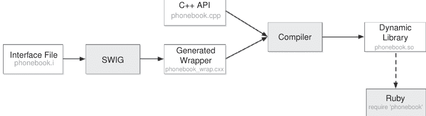

图 11.2

使用 SWIG 创建 C++ API 的 Ruby 绑定的工作流。白方框表示文件；阴影框表示命令。

## 11.4.1 使用 SWIG 封装 C++ API

我将从之前 Python 示例中的相同电话录 API 开始，然后展示如何使用 SWIG 为此接口创建 Ruby 绑定。电话录的 C++ 头文件看起来如下：

```cpp
// phonebook.h

#include <string>

class Person

public:

    Person();

    explicit Person(const std::string&name);

    void SetName(const std::string&name);

    std::string GetName() const;

    void SetHomeNumber(const std::string&number);

    std::string GetHomeNumber() const;

};
```

```cpp
class PhoneBook

public:

    bool IsEmpty() const;

    int GetSize() const;

    void AddPerson(Person* p);

    void RemovePerson(const std::string&name);

    Person* FindPerson(const std::string&name);

};
```

让我们来看一个基础的 SWIG 接口文件，用于指定你如何将此 C++ API 暴露给 Ruby。

```cpp
// phonebook.i

%module phonebook

%

// 我们编译绑定时需要 API 头文件

#include "phonebook.h"

}
```

```cpp
% 引入内置的 SWIG STL 包装器（注意 '%'）

%include "std_string.i"

%include "std_vector.i"

class Person

{

public:

    Person();

    explicit Person(const std::string& name);

    void SetName(const std::string& name);

    std::string GetName() const;

    void SetHomeNumber(const std::string& number) const;

    std::string GetHomeNumber() const;

```

```cpp
class PhoneBook

{

public:

    bool IsEmpty() const;

    int GetSize() const;

    void AddPerson(Person* p);

    void RemovePerson(const std::string& name);

    Person* FindPerson(const std::string& name);

```

你可以看到接口文件看起来与 `phonebook.h` 头文件非常相似。事实上，SWIG 可以直接解析 C++ 语法。如果你的 C++ 头文件非常简单，你甚至可以使用 SWIG 的 `%include` 来直接告诉它读取 C++ 头文件。我选择不这样做，是为了让你直接控制要操作的内容，并且不暴露给 Ruby。

现在你已经有了初始接口文件，可以调用 SWIG 为所有 C++ 类和方法创建动态 Ruby 绑定。这将创建一个 `phonebook_wrap.cpp` 文件，然后你可以用 C++ 代码对其进行编译以创建动态库。例如，在 Linux 上的步骤如下：

```bash
swig -c++ phonebook.i -creates phonebook_wrap.cpp

g++ -c phonebook_wrap.cpp -I<ruby-include-path>

g++ -c phonebook.cpp

g++ -shared phonebook.o phonebook_wrap.o phonebook.o -L<ruby-lib-path> -ruby
```

## 11.4.2 调整 Ruby API

这个最初的 Ruby 绑定相当原始。你想要解决几个问题，以让 API 的感觉对 Ruby 程序员来说更自然。首先，Ruby 方法的命名约定是使用蛇形命名法（snake case）而不是驼峰命名（camel case），例如使用 `add_person` 而不是 `AddPerson()`，SWIG 通过允许使用 `%rename` 命令重命名脚本 API 中的符号来实现这一点。例如，你可以在接口文件中添加以下行：

```cpp
%rename("add_person") AddPerson

%rename("remove_person") RemovePerson

%rename("find_person") FindPerson

%rename("size") GetSize

%rename("name=") SetName

%rename("get_home_number") GetHomeNumber

%rename("set_home_number") GetHomeNumber

%rename("empty?") IsEmpty
```

其次，Ruby 的属性访问比方法调用更自然。SWIG 允许你通过重命名方法来模拟属性。例如，你可以重命名：

```cpp
%rename("name") GetName

%rename("name=") SetName

%rename("home_number") GetHomeNumber

%rename("home_number=") SetHomeNumber
```

最后，Ruby 习惯让布尔方法以问号结尾。SWIG 允许你通过重命名来实现这一点：

```cpp
%rename("empty?") IsEmpty
```

# 11.4 使用 SWIG 添加 Ruby 绑定

```cpp
{

public:

    Person();

    explicit Person(const std::string&name);

    virtual ~Person();

    void SetName(const std::string&name);

    std::string GetName() const;

    void SetHomeNumber(const std::string&number);

    std::string GetHomeNumber() const;

}
```

```cpp
class PersonWithCell : public Person

{

public:

    PersonWithCell();

    explicit PersonWithCell(const std::string&name);

    void SetCellNumber(const std::string&number);

    std::string GetCellNumber() const;

};
```

然后你可以按照如下所示更新 SWIG 接口文件：

```cpp
// phonebook.i

rename("name") Person::GetName;

rename("name=") Person::SetName;

rename("home_number") Person::GetHomeNumber;

rename("home_number=") Person::SetHomeNumber;
```

```cpp
class Person

{

public:

    Person();

    explicit Person(const std::string&name);

    virtual ~Person();

    void SetName(const std::string&name);

    std::string GetName() const;

    void SetHomeNumber(const std::string&number);

    std::string GetHomeNumber() const;

};
```

```cpp
rename("cell_number") PersonWithCell::GetCellNumber;

rename("cell_number=") PersonWithCell::SetCellNumber;
```

```cpp
class PersonWithCell : public Person

{

public:

    PersonWithCell();

    explicit PersonWithCell(const std::string&name);

    void SetCellNumber(const std::string&number);

    std::string GetCellNumber() const;

};
```

之后你可以按照如下方式从 Ruby 访问这个 C++ 类：

```ruby
#!/usr/bin/ruby

require 'phonebook'

p = Phonebook::Person.new

p.name = 'Martin'

p.home_number = '(123) 456-7890'

p = Phonebook::PersonWithCell.new

p.name = 'Genevieve'

p.home_number = '(123) 456-7890'

p.cell_number = '(123) 097-2134'
```

Ruby 只支持继承，并支持额外的混合类（mix classes）。而 C++ 支持多重继承。因此，默认情况下，SWIG 只会考虑派生类中列出的第一个基类：其他基类中的成员函数将不会继承。然而，最新版本的 SWIG 支持 `-minherit` 命令行选项，该选项会尝试使用 Ruby mixins 来模拟继承（尽管在这种情况下，类在 Ruby 中不再拥有真正的基类）。

## 11.4.6 跨语言多态

默认情况下，如果你在 Ruby 中重写了虚函数，SWIG 将无法从 C++ 调用该 Ruby 方法。但是，SWIG 提供了一种方法，通过其“调度器（directors）”功能来启用这种跨语言多态。当你启用调度器时，SWIG 会生成一个继承自 C++ 类的新包装类，同时生成指向底层 Ruby 对象的 SWIG 调度器类指针，并判断函数调用是可以被调度到重写的 Ruby 方法还是默认的 C++ 实现。这与 Python 支持跨语言多态的方式类似。然而，SWIG 会在后台创建该包装类：你只需要指明想要为哪些类创建调度器，并并在你的 `%module` 指令中启用该功能。例如，对我们的接口文件进行如下更新将开启所有类的跨语言多态功能：

```cpp
%module(directors="1") phonebook
```

## 11.4 使用 SWIG 添加 Ruby 绑定

```cpp
#include "phonebook.h"

#include <sstream>

#include <iostream>

%)
```

```cpp
%feature("director");

...
```

## 11.4.7 整合汇总

为了添加每项增进的功能，我对我们的示例进行了多次迭代。最后，我将展示完整的 C++ 头文件和 SWIG 接口文件供你参考，作为本节的结束。首先，这里是 C++ API：

```cpp
// phonebook.h

#include <string>

class Person

{

public:

    Person();

    explicit Person(const std::string& name);

    virtual ~Person();

    void SetName(const std::string& name);

    std::string GetName() const;

    void SetHomeNumber(const std::string& number);

    std::string GetHomeNumber() const;

};

class PersonWithCell : public Person

{

public:

    PersonWithCell();

    explicit PersonWithCell(const std::string& name);

    void SetCellNumber(const std::string& number);

    std::string GetCellNumber() const;

};

class PhoneBook

{

public:

    bool IsEmpty() const;

    int GetSize() const;

    void AddPerson(Person* p);

    void RemovePerson(const std::string& name);

    Person *FindPerson(const std::string&name);

};
```

这里是最后的 SWIG 接口 (.i) 文件：

```cpp
%module(directors="1") phonebook

%

%include "phonebook.h"

#include <sstream>

#include <iostream>

%

%feature("director");

%include "std_string.i"

%include "std_vector.i"

%rename("name") Person::GetName;

%rename("name=") Person::SetName;

%rename("home_number") Person::GetHomeNumber;

%rename("home_number=") Person::SetHomeNumber;

class Person

{

public:

    Person();

    explicit Person(const std::string&name);

    virtual ~Person();

    void SetName(const std::string&name);

    std::string GetName() const;

    void SetHomeNumber(const std::string&number);

    std::string GetHomeNumber() const;

%extend {

    std::string to_s() {

        std::ostringstream stream;

        stream << self->GetName() << " :";

        stream << self->GetHomeNumber();

        return stream.str();

    }

};

};

%rename("cell_number") PersonWithCell::GetCellNumber;

%rename("cell_number=") PersonWithCell::SetCellNumber;
```


# 第 12 章 可扩展性

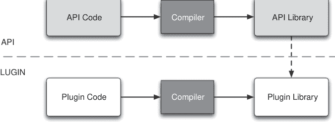

**图 12.1**
**API 插件**

插件库是一个动态库，它可以与核心 API 独立进行编译，并由 API 按需显式加载。

## 12.1.1 插件模型概述

许多商业软件包示例允许通过使用 C/C++ 插件来扩展其核心功能。例如，Apache Web 服务器支持基于 C 的“模块”，Adobe Photoshop 支持多种插件类型来处理图像，而 Firefly、Chrome 和 Opera 等浏览器支持 Netscape 插件 API (`NPAPI`)，用于创建如 Adobe Flash 或 PDF 阅读器之类的浏览器插件。Qt 工具包也可以通过 `PluginLoader` 类进行扩展（服务端插件 API 有时被称为 Apache 模块接口，称为服务端 API，或 SAPLI）。

在你的 API 中采用插件模型的优点之处如下：

- **更强的通用性。** 你的 API 可以用于解决更广泛的问题，而无需你为所有这些问题都实现解决方案。
- **社区催化剂。** 通过赋予用户在你的 API 框架内解决问题的能力，你可以激发一个由用户为你的基础设计贡献扩展的社区。
- **更小的更新。** 作为插件的功能可以通过放入新版本的插件来独立于应用程序进行易于的更新。这通常比分发整个应用程序的新版本要小得多。
- **面向未来。** 你的 API 可能会达到一个稳定性水平，让你认为不再需要进一步更新。然而，你的 API 功能的进一步进化可以通过开发插件来继续，允许 API 在更长的时间内保持有用性和相关性。例如，`NPAPI` 在近年来已经衰落，但它仍然是许多 Web浏览器编写插件的流行方法。
- **隔离风险。** 插件对内部开发有益，可以让工程师在不破坏系统核心部分稳定性的情况下更改功能。

正如刚才所暗示的，插件系统并不一定仅供你的客户端使用。你也可以将核心 API 实现的部分开发为插件。事实上，这实际上是一种良好的做法，因为它确保了你完全执行了你的插件架构，并且与用户处于同一个世界中（“吃自己的狗粮”）。例如，GNU 图像处理程序 (`GIMP`) 使用其 GIMP Plugin API 将许多内置图像处理函数作为插件发布。

## NETSCAPE 插件

Netscape 插件 API (`NPAPI`) 提供了一个跨平台 API，用于在各种 Web 浏览器中嵌入自定义功能。该接口源于 Adobe Systems 为了将 PDF 查看器集成到早期 Netscape 浏览器中的工作。这种 C 插件 API 至今仍用于在浏览器（如 Mozilla Firefox、Apple Safari 和 Google Chrome）中嵌入原生扩展。例如，Shockwave Flash、Apple QuickTime、Microsoft Silverlight 都是作为插件实现的（尝试在 Firefox 中输入 `"about:plugins"` 来查看已安装插件列表）。

`NPAPI` 在 Web 浏览器内部提供了以下能力：

- 注册 MIME 类型
- 在浏览器窗口的区域内绘制。
- 接收鼠标和键盘事件。
- 通过 HTTP 发送和接收数据。
- 添加链接到新 URL 的超链接或热点。
- 与文档对象模型 (`DOM`) 通信。

20世纪90年代当我在 SRI International 时，我们开发了一个名为 TerraVision 的基于 Web 的3D 地形可视化系统（Leclerc and Lau, 1994）。它最初是一个桌面应用程序，需要 SSI RealityEngine 处理器；然而，随着通用图形硬件的发展，我们最终能够让在标准 PC 的 Netscape Navigator 和 Microsoft Explorer 中作为“地球项目”运行。


由于 TerraVision 是一个多线程应用程序，为了在非线程安全的环境中运行它，我们必须在单独的进程中运行。然而，我们的 Netscape 插件会为 TerraVision 创建一个新的运行进程，并传递一个用于绘图的窗口句柄。插件与 TerraVision 进程之间的所有通信通过管道 I/O 处理。

## 12.1.2 插件系统设计问题

设计插件系统有许多方法。你当前项目的最佳解决方案可能不是下一个项目的最佳选择。因此，我将首先尝试梳理出你在设计插件系统时应该注意的一些高级问题。

同时，还有许多适用于所有插件系统的通用概念。例如，在支持动态插件库时，你总是需要一种加载动态库并访问该文件中符号的机制。通常，在创建任何插件系统时，你必须设计两个主要特性（见图 12.2）。

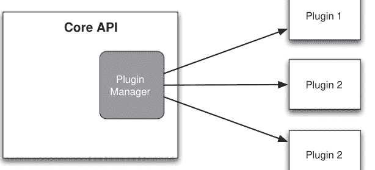

**图 12.2**
**插件管理器存在于核心 API 中。它发现并加载基于插件 API 构建的插件。**

- **插件 API**：这是你的用户在创建插件时必须编译并与之链接的 API。我将它与你的核心 API 区分开来，核心 API 是你添加插件系统的较大代码库。
- **插件管理器 (`Plugin Manager`)**：这是发现并加载基于插件 API 构建的插件的组件。

有了这些通用概念，让我们来看看影响你 API 的决策。

- **版本控制。** 你可能希望处理不同版本的插件。确定什么构成了不兼容的 API 是困难的，这通常留给插件作者。例如，你可以指定一个版本范围。
- **内部外部元数据。** 元数据（如人类可读的名称和版本信息）可以定义在插件代码中，也可以定义在外部文件中。使用外部文件的优点是，你实际上不需要加载所有插件就可以知道可用集合。
- **通用专用型插件管理器。** 实现插件管理器的一种方法是使其非常底层且通用的，也就是说，它加载插件并访问符号。然而，这样做意味着插件管理器不知道你 API 中具体类型的存在。结果是，它可能会将对象返回为 `void*`，你必须将这些类型强制转换为具体类型。
- **安全性。** 你必须决定如何信任用户插件。插件是任意编译的代码，允许它们在你的进程中运行。插件在理论上可以做任何事情，从访问它不应该访问的数据、删除用户硬盘上的文件，到导致整个应用程序崩溃。
- **静态/动态库。** 正如以前所述，将插件定义为静态库是可能的，这意味着它们必须被编译到应用程序中。应用程序更常用的解决方案是动态库。编写静态插件的限制是，你必须确保没有两个插件定义相同的符号，也就是说，每个插件的初始化函数必须是唯一的，例如 `<PluginName>_PluginInit()`。在动态库的情况下，你可以为每个插件使用相同的初始化函数名称，例如 `PluginInit()`。

## 12.1.3 在 C++ 中实现插件

我已经发现支持 C++ 插件可能会困难，因为存在跨平台和跨编译器的 ABI 问题。然而，由于这是一本关于 C++ API 设计的书籍，让我们花些时间介绍一些让你能够稳健（robustly）使用 C++ 插件的解决方案。

首先，如果你要求插件开发者使用与你构建 API 时相同的编译器版本，那么你就不需要担心任何问题。

如果情况并非如此，一种解决方案是为插件使用绑定技术，例如在 Windows 上使用 COM 等 IPC 解决方案，或者为你的 API 创建绑定，并让用户使用 Python 或 Ruby 等跨平台脚本语言编写扩展（这在前章中介绍过）。

如果你为了获得最高性能而绝对需要使用 C++ 插件，或者你觉得创建 COM 或绑定对于你的需求来说过于沉重，你仍然有方法可以在插件中更安全地使用 C++。以下列表提供了最佳实践，其中许多已在位于 `http://www.codeproject.com` 上的开源 DynObj 库中实现。

- *使用抽象类。* 实现抽象基类的方法可以使插件免受 ABI 问题的影响，因为虚方法调用通常表示为类虚函数表（vtable）中的索引。虚表格式在不同编译器之间可能不同，但在实践中这种情况通常不会发生。（不过注意，不同的编译器对虚方法的排序可能不同，因此最好避免这些。）接口中的所有方法都需要是纯虚的，尽管方法也可以足够安全地使用，使得代码将直接嵌入插件中。
- *对自由函数使用链接（linkage）。* 你的插件 API 中的所有全局函数都应使用 C 链接以避免 C++ ABI 问题，即它们应该用 `extern "C"` 声明。同样，插件传递给核心 API 的函数回调也应该使用 C 链接以获得最大的可移植性。
- *避免 STL 和异常。* STL 类（如 `std::string` 和 `std::vector`）的不同实现之间可能不具有 ABI 兼容性。最好在核心 API 和插件 API 之间的任何函数调用中都避免这些容器。同样，由于异常的 ABI 在不同编译器之间是不稳定的，这些应该在你的插件 API 中被避免。
- *不要混合分配器。* 可能会链接到与你的 API 不同的内存分配器。例如，在 Windows 上，调试构建（debug builds）通常比发布构建（release builds）使用不同的分配器。这对你的插件系统设计的影响是：插件必须分配并释放它的所有对象，或者插件应该将控制权交给核心 API 来创建和销毁所有对象。然而，你的核心 API 应该返回由插件分配的释放，反之亦然。

将所有这些信息整合在一起，我现在将开发一个灵活且稳健的跨平台 C++ 插件系统。插件系统将使用新的 C++ 类，通过提供一个或多个工厂方法来向核心 API 注册。我们继续第 3 章中的可扩展示例并对其进行增强。

### 12.1.4 API

插件系统将使用新的 C++ 类，通过提供一个或多个工厂方法向核心 API 注册。我们继续第 3 章中的可扩展示例并对其进行增强。

插件 API 是你提供的供核心 API 调用的接口。核心 API 会加载 `pluginapi.h`。这些定义让我们在 Windows 下指定正确的导出/导入装饰符。`CORE_API` 用于装饰属于核心 API 的函数，`PLUGIN_API` 用于装饰插件中定义的函数。这些宏的定义记录在 `defines.h` 头文件中，看起来如下：

```cpp
// defines.h

#ifdef _WIN32

#ifdef BUILDING_CORE

#define CORE_API __declspec(dllexport)

#define PLUGIN_API __declspec(dllimport)

#else

#define CORE_API __declspec(dllimport)

#define PLUGIN_API __declspec(dllimport)

#endif

#else

#define CORE_API

#define PLUGIN_API

#endif
```

注意，在构建核心 API 时必须设置 `BUILDING_CORE` 定义，这些宏才能正常工作，例如在 Windows 编译命令行中添加 `/BUILDING_CORE`。在编译插件时不需要此定义。

头文件提供了插件的初始化和清理函数：`PLUGIN_INIT()` 和 `PLUGIN_FREE()`。我还提供了 `PLUGIN_FUNC()` 宏来让核心 API 调用。最后，我提供了一个函数 `RegisterRenderer()`，允许插件向核心 API 注册新的 `IRenderer` 类。

这是插件 API 的草稿：

```cpp
// pluginapi.h

#include "defines.h"

#include "renderer.h"

#define CORE_FUNC extern "C" CORE_API

#define PLUG_FUNC extern "C" PLUGIN_API

#define PLUG_INIT() PLUG_FUNC void pluginInit()

#define PLUG_FREE() PLUG_FUNC void pluginFree(IRenderer*)

CORE_FUNC void RegisterRenderer(const char *type,
    RendererInitFunc init_cb,
    RendererFreeFunc free_cb);
```

## 12.1 通过插件扩展 369

```cpp
virtual void SetLookAt(double x, double y, double z) = 0;
virtual void Render() = 0;
```

这与第 3 章中提供的定义基本相同，只是我将 `LoadScene()` 方法更改为接受 `const char*` 参数而不是 `std::string`（为了解决我对比不同编译器之间 STL 类二进制兼容性的顾虑）。

## 12.1.5 示例插件

现在我已经开发了一个初级的的插件 API，让我们来看一下基于此 API 构建的插件可能是什么样的。你需要包含的基础部分有：

- 1. 新的 `IRenderer` 类。
- 2. 用于创建和销毁该类的回调函数。
- 3. 一个插件初始化程序，用于向 Core API 注册我们的创建/销毁回调。

以下是此类插件的代码。该插件使用 `"opengl"` 定义并注册了一个新的渲染器。它定义在一个新的 `OpenGLRenderer` 类中，该类派生自 `IRenderer` 抽象基类。

```cpp
// plugin.cpp

#include "pluginapi.h"

#include <iostream>

class OpenGLRenderer : public IRenderer {

public:

    ~OpenGLRenderer() {}

    bool LoadScene(const char* filename) { return true; }

    void SetViewport(int w, int h) {}

    void SetCameraPosition(double x, double y, double z) {}

    void SetLookAt(double x, double y, double z) {}

    void Render() { std::cout << "OpenGL Render" << std::endl; }

};

PLUGIN_FUNC IRenderer *CreateRenderer() {

    return new OpenGLRenderer();

}

PLUGIN_FUNC void DestroyRenderer(IRenderer *r) {

    delete r;

}

PLUGIN_INIT() {

    RegisterRenderer("opengl", CreateRenderer, DestroyRenderer);

    return 0;

}
```


## 第 12 章 可扩展性

在这个示例中，我定义了一个 `PLUGIN_INIT()` 函数，它每当插件加载时都会运行。这注册了我们的 `OpenGLRenderer` 工厂函数 `CreateRenderer()` 以及相关的销毁函数 `DestroyRenderer()`。这两个函数都使用 `PLUGIN_FUNC` 定义，以确保它们以 C 链接方式正确导出。

`RegisterRenderer` 方法本质上调用了第 3 章中提供的 `RendererFactory::RegisterRenderer`（额外增加了可以传递销毁回调以及创建回调）。我之所以在插件工厂中添加显式注册，而不是让插件直接自己注册，有两个原因：这样我将来可以轻松更改 `RendererFactory` 而不会破坏插件。另一个原因是避免调用使用 STL 字符串的方法；该 `RegisterRenderer` 使用 `const char *` 来指定渲染器名称。

### 12.1.6 插件管理器

现在你有了了 API 并且可以基于此 API 构建插件，你需要能够将这些插件加载并注册到 Core API 中。这就是插件管理器的角色。插件管理器需要处理以下任务：

- 加载所有插件的元数据。这些元数据可以存储在单独的文件（如 XML 文件）中，也可以嵌入插件本身。如果是后者，插件管理器需要加载所有插件并汇总所有插件的元数据。这些元数据允许你向用户展示可用插件列表供选择。
- 将动态库加载到内存中，提供对库中符号的访问，并在必要时加载库。这涉及 UNIX 平台（包括 Mac OS）上的 `dlopen()`、`dlclose()` 和 `dlsym()`，以及 Windows 上的 `LoadLibrary()` 和 `GetProcAddress()`。附录 A 提供了这些情况的细节。
- 在插件加载时调用插件的初始化程序，并在插件卸载时调用清理函数。这些函数在插件内部通过 `PLUGIN_INIT()` 和 `PLUGIN_FREE()` 定义。

由于插件管理器提供了访问系统中所有插件的单一访问点，它通常被实现为单例。在设计方面，插件管理器可以被认为是插件实例（Plugin Instances）的集合，每个插件实例代表单个插件并提供加载和卸载该插件的功能。以下是插件管理器的示例实现：

```cpp
// pluginmanager.cpp
#include <defines.h>
#include <string>
#include <vector>
class CORE_API PluginInstance {
public:
    explicit PluginInstance(const std::string& name);
    ~PluginInstance();
```

### 12.1 通过插件扩展 371

```cpp
bool Load();
bool Unload();
bool IsLoaded();
std::string GetFileName();
std::string GetDisplayName();
```

```cpp
private:
    PluginInstance(const PluginInstance&);
    const PluginInstance& operator=(const PluginInstance&);
    class Impl {
        Impl *impl;
    };
```

```cpp
class CORE_Api PluginManager {
public:
    static PluginManager& GetInstance();
    bool LoadAll();
    bool Load(const std::string& name);
    bool UnloadAll();
    bool Unload(const std::string& name);
    std::vector<PluginInstance*> GetAllPlugins();
```

```cpp
private:
    PluginManager();
    ~PluginManager();
    PluginManager(const PluginManager&);
    const PluginManager& operator=(const PluginManager&);
    std::vector<PluginInstance*> mPlugins;
};
```

这种设计将对所有插件元数据的访问与加载插件的需求解耦。也就是说，如果元数据（如插件的显示名称）存储在外部文件中，你可以在不加载实际插件的情况下调用 `PluginManager::GetAllPlugins()`。然而，如果元数据存储在外部文件中，以下展示了一个示例 XML 文件：

```xml
<?xml version="1.0" encoding="UTF-8"?>
<plugins>
  <plugin filename="opengl">
    <name>OpenGL Renderer</name>
  </plugin>
  <plugin filename="dx">
    <name>DirectX Renderer</name>
  </plugin>
  <plugin filename="mesa">
    <name>Mesa Renderer</name>
  </plugin>
</plugins>
```

## 第 12 章 可扩展性

无论采用无外部文件存储插件元数据还是嵌入每个插件的方法，以下代码都会输出可用插件的显示名称：

```cpp
std::vector<PluginInstance> *plugins = PluginManager::GetInstance().GetAllPlugins();
for (auto it = plugins.begin(); it != plugins.end(); ++it) {
    PluginInstance *pi = *it;
    std::cout << "Plugin: " << pi->GetDisplayName() << std::endl;
}
```

相关问题是插件发现。API 限制 `PluginManager::load()` 的实现搜索多个目录的能力。传递给 `Load()` 的名称可以是不带路径或扩展名的基础名称，例如 "plugin"。然后 `Load()` 方法可以搜索各种平台特定的文件，例如 Mac OS 上的 `.dylib` 或 Windows 上的 `.dll`。或者，你可以引入自己的插件扩展。例如，Adobe Illustrator 使用 `.a` 扩展，而 Microsoft Excel 使用 `.xxl` 扩展。

以下 Core API 初始化代码注册了一个内置的渲染器，然后加载所有插件，将额外的渲染器添加到系统中：

```cpp
class MesaRenderer : public IRenderer {
public:
    bool LoadScene(const char *filename) { return true; }
    void SetViewportSize(int w, int h);
    void SetCameraPosition(double x, double y, double z);
    void SetLookAt(double x, double y, double z);
    void Render() { std::cout << "Mesa Renderer" << std::endl; }
    static IRenderer* Create() { return new MesaRenderer(); }
};
```

```cpp
// 创建内置软件渲染器
RendererFactory::RegisterRenderer("mesa", MesaRenderer::Create);
// 发现并加载所有插件
PluginManager::GetInstance().LoadAll();
```

### 12.1.7 插件版本控制

最后，它将扩展插件版本控制的话题。与 API 版本控制一样，你将希望确保第一个插件的发布包含一个版本控制系统。你可以复用 Core API 的版本，也可以引入一个特定的插件 API 版本号。我建议采用后者，因为插件 API 实际上是 Core API 的一个独立接口，两者的变化速度可能不同。例如，Google 的 Android API 使用了概念

## 12.1 扩展插件

| 平台版本 | API Level |
|---|---|
| Android 2.1 | 7 |
| Android 2.0.1 | 6 |
| Android 2.0 | 5 |
| Android 1.6 | 4 |
| Android 1.5 | 3 |
| Android 1.1 | 2 |
| Android 1.0 | 1 |

API Level（表 12.1）。这是一个随着 Android API 每个新版本的发布而单调递增的整数。

你可能想要访问的最信息之一是插件构建时所使用的 Plugin API 版本。这可以让你判断插件是否与当前发布版本不兼容，从而不应该进行注册，例如，如果插件是基于较版本的 API 或不兼容的旧版本 API 构建的。鉴于此信息非常重要，建议在每个插件中自动嵌入此信息。这可以确保在每次成功重新构建插件时，都将正确的版本编译到插件中。考虑到已经提议的 Plugin API，你可以将此信息包含在 `PLUGIN_INIT()` 宏中，因为用户必须调用它才能让插件执行任何操作。例如：

```
// pluginapi.h
#define PLUGIN_API_VERSION 1
#define PLUGIN_INIT(){
const int pluginVersion = PLUGIN_API_VERSION; \
PLUGIN_FUNC func PluginInit()
```

此外，用户可以指定插件将工作的 API 最小和最大版本。最小版本号通常更会被指定。例如，如果插件使用了在特定发布版本中添加到 API 的新功能，应将该发布版本指定为最小版本。指定最大版本号仅在 API 新版本发布且插件编写者发现该版本破坏了其插件时才有用。通常，最大版本号将保持为空，因为插件编写者应该假设未来的 API 发布将向后兼容。

此/最大版本号可以嵌入在外部元数据格式中，例如

```xml
<xml version="1.0" encoding='UTF-8'?>
<plugins>
<plugin filename="plugin1">
  <name>OpenGL Renderer</name>
```

```xml
<minversion>2</minversion>
</plugin>
...
</plugins>
```

或者，你可以通过额外的调用来扩展 Plugin API，让插件在代码中指定此信息。

```cpp
#define PLUGIN_MIN_VERSION(version) \
PLUGIN_API int PluginMinVersion = version
#define PLUGIN_MAX_VERSION(version) \
PLUGIN_API int PluginMaxVersion = version
...
```

## 12.2 通过继承进行扩展

本章的重点是通过插件在运行时支持 API 的扩展性。然而，你的客户端还可以通过其他方式扩展你的 API 功能以实现其他目的。扩展类的面向面向对象的机制是继承。这可以用来让你的用户定义新类，这些新类基于或修改你 API 中现有类的功能。

### 12.2.1 添加功能

Jonathan Wood 在微软的 Visual C++ 开发者中心发布了一个视频，他在其中演示了如何通过继承扩展 MFC 的 `CString` 类，以便创建一个 `CPathString` 类，该类为基础字符串添加了一些路径处理函数。生成的类如下：

```cpp
class CPathString : public CString {
public:
    CPathString();
    ~CPathString();
    CString GetFileName();
    CString GetFileExtension();
    CString GetFileBase();
    CString GetPath();();
```

这是一个现有类的简单示例，仅向基类添加了新方法。

需要重申的一个重要点是，只有当基类被设计为可继承时，才能安全地这样做。主要的判断指标是该类是否具有虚析构函数。在 `CPathString` 示例中，MFC 的 `CString` 类没有虚析构函数。这意味着在某些情况下，`CPathString` 的析构函数将不会被调用，例如

```cpp
QString *str = new CPathString();
delete str;
```

在这种情况下，这不是问题，因为所有新的 `CPathString` 方法都是无状态的，它们没有分配任何必须由 `CPathString` 析构函数释放的内存。然而，这突出了一个问题：如果你期望对象继承自你的任何类，你应该将这些类的析构函数声明为虚。

> 提示：为类声明虚析构函数是向用户的一个信号，表示你将其设计为可继承的。

### 12.2.2 修改功能

除了向类添加新成员外，我们知道 C++ 允许你在派生类中定义函数覆盖基类中的现有函数，只要这些函数在基类中已被标记为虚函数。[注意 C++ 允许你在派生类中重新定义（即隐藏）非虚基类方法，但如果你提供了执行此操作的钩子，你不应该对类的行为这样做。]这可以为你的用户自定义类的行为提供更多途径，例如，Qt 库中的所有 UI 组件都提供了以下虚方法：

```cpp
virtual QSize minimumSize() const;
virtual QSize sizeHint() const;
```

这允许 Qt 库的用户创建这些小组件的派生类并改变它们的外。为了说明这一点，下面的类继承自标准的 Qt 按钮组件并覆盖了 `sizeHint()` 方法以指定按钮的首选大小。其结果可见图 12.3。

 图 12.3 标准 Qt 按钮组件（左）和覆盖了 sizeHint() 虚方法的派生类（右）。

```cpp
class MySquareButton : public QPushButton
{
public:
  QSize sizeHint() const
{
  return QSize(100, 100);
}
};
```

这种代码可以工作，因为 `sizeHint()` 是组件的已知方法，并由布局类调用以确定首选大小。重要的是，通过在 `QPushButton` 构造函数中调用 `resize()` 方法来更改大小是不同的。这样做的效果是设置按钮的大小。然而，`sizeHint()` 的目的是向 UI 引擎（即 API 中的类）提供首选大小的指示，以便在需要时满足任何大小限制。

可以通过没有虚 `sizeHint()` 方法来实现。例如，可以向组件基类添加非虚的 `setHint()` 和 `getHint()` 方法将信息作为数据成员存储对象，从而增加继承它的每个对象的大小。相比之下，使用 `sizeHint()` 虚方法支持每个对象每次调用时只需计算首选大小，而无需将大小存储在对象中。

在性能章节中，我告诫只在需要时才向类添加虚方法。这一建议仍然有效。在上述示例中，Qt 的设计者仔细且自觉地向其 API 添加了这些方法，为用户提供了灵活扩展类功能的方法。

### 12.2.3 继承与 STL

对 C++ 和标准模板库（STL）不熟悉的程序员经常尝试对 STL 容器进行类，例如

```cpp
#include <string>
```

```cpp
class QString : public std::string
  public:
  ...
```

然而，正如前面提到的，你应该只尝试派自具有虚析构函数的类。STL 容器类不提供虚析构函数；事实上，它们没有任何可以供你覆盖的虚方法。这是一个明确的信号，表明这些类并非为了继承而设计。尝试这样做可能会在你代码以及你客户的代码中引入微妙且难以调试的内存泄漏。因此，通常的规则是，永远不要从 STL 容器类继承。

## 12.2 通过继承扩展

作为替代方案，你可以使用组合（composition）来安全地为 STL 容器添加功能。即使用 `std::string` 作为私有成员，并提供薄层封装底层 `std::string` 方法的访问方法。然后，你可以在这个类中添加你自己的方法。例如：

```cpp
class MyString {
public:
    MyString() : mstr("") {}
    explicit MyString(const char *str) : mstr(str) {}
    bool empty() const { return mstr.empty(); }
    void clear() { mstr.clear(); }
    void push_back(char c) { mstr.push_back(c); }
private:
    std::string mstr;
};
```


然而，STL 提供了几个专门为继承设计的类。其中最明显的是 `std::exception`。它是所有 STL 异常的基类，包括 `bad_alloc`、`bad_cast`、`bad_exception`、`bad_type`、`lock_error`、`logic_error` 和 `runtime_error`。你可以非常简单地定义派自 `std::exception` 的自定义异常：

```cpp
class DivByZeroException : public std::exception {
public:
    const char *what() const {
        return "Division by zero attempted";
    }
};
```

STL 中另一个支持通过继承扩展的部分是 `ostream` 库。这是一个非常强大、设计良好且可扩展的 API，它提供了流抽象。流可以被视为一序列等待处理的字节流，例如 `cin` 输入流和 `cout` 输出流。你可以通过派生特定的流类或 `istream` 基类来编写自定义流类。例如，你可以创建自定义流类来向 Web 服务器发送和从中接收 HTTP 数据。

此外还有 `iambuf` 库，它使得处理 STL 流和流缓冲区（stream buffers）变得更加容易。该库附带了一系列实用的过滤器，包括正则表达式过滤和数据压缩方案（如 `gzip`、`zip` 和 `bzip2`）。

### 12.2.4 继承与枚举

有时，用户可能想要扩展你在某个基类中定义的枚举，以便为他们在派生类中添加的新功能增加更多的枚举器值。这在 C++ 中可以如下所示轻松实现：

```cpp
class Base {
public:
    enum SHAPE {
        CIRCLE,
        SQUARE,
        TRIANGLE,
        SHAPE_END = TRIANGLE
    };
};
```

```cpp
class Derived : public Base {
public:
    enum SHAPE {
        OVAL = SHAPE_END + 1,
        RECTANGLE,
        HEXAGON
    };
};
```

这里是一个展示如何使用这种扩展枚举的示例：

```cpp
std::cout << "CIRCLE" << Derived::CIRCLE << std::endl;
std::cout << "SQUARE" << Derived::SQUARE << std::endl;
std::cout << "TRIANGLE" << Derived::TRIANGLE << std::endl;
std::cout << "OVAL" << Derived::OVAL << std::endl;
std::cout << "RECTANGLE" << Derived::RECTANGLE << std::endl;
std::cout << "HEXAGON" << Derived::HEXAGON << std::endl;
```

这种工作能够健壮运行的关键在于，`Base` 类定义了 `SHAPE_END`，使得 `Derived` 类可以从 `Base::SHAPE` 定义的最后一个值之后添加新值。因此，当你预计一个会被子类化的类中定义枚举时，这是一种良好的做法。如果不这样做，你的客户端可能会选择一个任意大的整数开始为它们的枚举器编号，例如 `OVAL=100`，虽然这种方案并不优雅。

| 提示 |
| :--- |
| 对于基类中的枚举，请为枚举值添加一个枚举器，例如 `<enum-name>_END`。 |

### 12.2.5 访问者模式（Visitor Pattern）

在第 3 章中介绍过各种泛型设计模式。然而，我将访问者模式的讨论推迟到了现在，因为它专门针对 API 的可扩展性。访问者模式的核心目标是允许客户端遍历数据结构中的所有对象，并对其中的每个对象执行泛型操作。这种模式本质上是模拟向现有类添加新虚函数的方法。它为客户端扩展你的 API 功能提供了一个实用的模式。例如，访问者模式可以用于让提供一组方法，对场景图层次结构中的每个节点进行操作，或者遍历编程语言解析器的派生树并输出人类可读的程序树。

让我们开发一个访问者示例来说说明这种模式的工作原理。我将使用一个描述 3D 场景的场景图层次结构示例，例如 Open Inventor、OpenSceneGraph 或虚拟现实建模语言（VRML）所使用的。为了保持示例简单，我们的场景图将包含三种不同的节点类型：`Shape`、`Transform` 和 `Light`。图 12.4 显示了使用这些节点类型的示例层次结构。

首先定义抽象访问者接口。客户端可以创建此接口的具体子类，以便为场景图添加自定义操作。它本质上为场景图中的每种节点类型声明了一个 `Visit()` 方法。

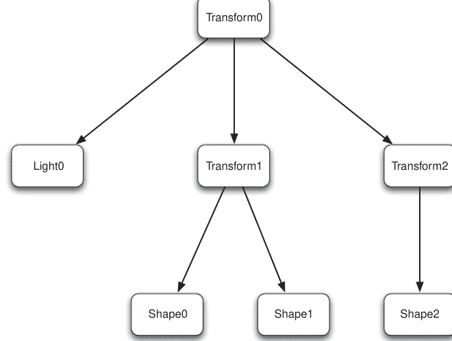

图 12.4 显示节点类型的示例场景层次结构。

```cpp
// nodevisitor.h
#include <string>
class ShapeNode;
class TransformNode;
class LightNode;
class INodeVisitor
{
public:
    virtual ~INodeVisitor() {}
    virtual void Visit(ShapeNode& node) = 0;
    virtual void Visit(TransformNode& node) = 0;
    virtual void Visit(LightNode& node) = 0;
};
```

```cpp
// scenraph.h
class BaseNode {
public:
    explicit BaseNode(const std::string& name) : mName(name) {}
    virtual ~BaseNode() {}
    virtual void Accept(INodeVisitor& visitor) = 0;
protected:
    std::string mName;
};
class ShapeNode : public BaseNode {
public:
    explicit ShapeNode(const std::string& name) : BaseNode(name) {}
    void Accept(INodeVisitor& visitor) override;
    int GetPolygonCount() const;
};
class TransformNode : public BaseNode {
public:
    explicit TransformNode(const std::string& name) : BaseNode(name) {}
    void Accept(INodeVisitor& visitor) override;
};
class LightNode : public BaseNode {
public:
    explicit LightNode(const std::string& name) : BaseNode(name) {}
    void Accept(INodeVisitor& visitor) override;
};
class SceneGraph {
public:
    SceneGraph();
    void Traverse(INodeVisitor& visitor);
private:
    class Impl;
    Impl *impl;
};
```

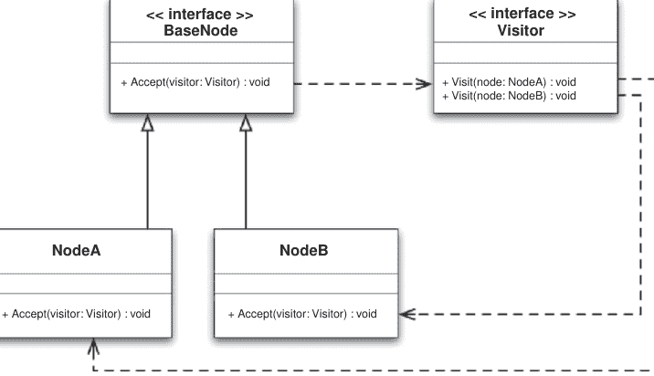

图 12.5 访问者模式的 UML 图。

```cpp
// scenraph.cpp
void ShapeNode::Accept(INodeVisitor& visitor)
{
    visitor.Visit(*this);
}
void TransformNode::Accept(INodeVisitor& visitor)
{
    visitor.Visit(*this);
}
void LightNode::Accept(INodeVisitor& visitor)
{
    visitor.Visit(*this);
}
```

## 12.2 通过继承进行扩展

`MyVisitor` visitor:
```cpp
enegraph.Traverse : << << visitor.mNumShapes << std::endl;
std::cout << "Shapes: " << visitor.mNumShapes << std::endl;
std::cout << "Polygons: " << visitor.mNumPolygons << std::endl;
std::cout << "Transforms: " << visitor.mNumTransforms << std::endl;
std::cout << "Lights: " << visitor.mNumLights << std::endl;
```

此示例展示了访问者模式（Visitor pattern）的许多优点，为客户端提供了扩展的灵活性，客户端可以轻松地将自己的方法插入到类层次结构中。其他优点还包括将执行单一协调操作的代码聚合在一起。例如，所有实现节点计数功能的代码都包含在单个 `MyVisitor` 类中，而控制各种节点和多形数量的状态（`mNumShapes`, `mNumPolygons`, `mNumTransforms`, `mNumLights`）被隔离在 `MyVisitor` 类中，而不是直接存储在 `SceneGraph` 对象中，从而增加了该对象的大小。

然而，访问者模式也有一些明显的缺点。能够向一组类添加新方法的灵活性，代价是让添加新类变得困难得多。请注意，在 `visitor.h` 中，访问者必须了解每个可以被访问的类，因此需要了解我们所有的节点类型。因此，向我们的场景图中添加新的节点类型将需要更新访问者接口。结果，访问者模式最适用于层级结构稳定的情况（Alexandres, 2001）。

为了解决这个问题，让我们考虑向场景图添加一种类型名为 `CameraNode` 的新节点类型。一种简单的方法是在 `IVisitor` 接口中添加一个接受 `CameraNode` 引的 `Visit()` 纯虚方法。然而，从 API 向后兼容性的角度来看，向接口添加纯虚方法是一个坏做法，因为它会破坏所有现有的客户端代码。解决这个问题有几种替代方案。

- 1. 尽早考虑，你可以将 `INodeVisitor` 的第一个版本替换为针对 `BaseNode` 的 `Visit()` 纯虚方法。这将启用一个捕获方法，当遇到没有显式 `Visit()` 方法的节点类型时将调用该方法（必须修改 `BaseNode::Accept()` 使其不再是纯虚方法）。这样做的结果是，用户必须在这个捕获方法内部使用 `dynamic_cast` 调用来确定传递了哪种节点类型。采用这种解决方案将把访问者接口更改为：

```cpp
// visitor.h
class ShapeNode;
class TransformNode;
class LightNode;
class BaseNode;
{
class INodeVisitor
public:
```

```cpp
virtual void Visit(ShapeNode &node) = 0;
virtual void Visit(TransformNode &node) = 0;
virtual void Visit(LightNode &node) = 0;
virtual void Visit(BaseNode &node) = 0; // catch-all
```

- 2. 更好的解决方案是为新类型添加 `Visit()` 虚方法，而不是纯虚方法。也就是说，为新方法提供一个空实现，以便现有代码能够继续编译，同时允许用户在适当的地方为新节点类型实现类型安全的 `Visit()` 方法。这会将 `INodeVisitor` 接口更改为：

```cpp
//nodevisitor.h
class ShapeNode;
class TransformNode;
class LightNode;
class CameraNode;
class INodeVisitor {
public:
    virtual void Visit(ShapeNode &node) = 0;
    virtual void Visit(TransformNode &node) = 0;
    virtual void Visit(LightNode &node) = 0;
    virtual void Visit(CameraNode &node);
};
```

### 12.2.6 禁止子类化

关于继承扩展的最后一点，我将讨论你希望禁止用户从你提供的类中派生派生类的情况。在 Java 中，你可以将一个类声明为 `final` 以防止他人继承它，但 C++ 没有类似的概念。
正如所提到的，如果你声明一个类具有非虚析构函数，这应该是一个向优秀的程序员发送的信号，提醒他们应该重考虑是否继承该类。如果你希望有一种物理机制来防止用户对你的类进行子类化，最的方法将其所有构造函数设为私有。任何派生此类的尝试都会产生编译错误，因为派生类的构造函数无法调用你类的构造函数。你可以提供一个工厂方法来让用户创建对象的实例。

```cpp
class NonBase {
public:
    static NonBase* Create() { return new NonBase(); }
private:
    NonBase();
};
```

## 12.3 通过模板进行扩展

```cpp
class Derived : public NonBase {};
Derived d; // 编译错误!
```

这种方法的缺点是无法在栈上创建 `NonBase` 的实例。你的客户端必须使用 `NonBase::Create()` 静态函数来分配 `NonBase` 实例。如果这不可接受，还有另一种解决方案。你可以依靠虚继承来确保没有具体类可以继承自 `NonBase`，如下（Cline et al., 1998）。

```cpp
class NonBase;
```

```cpp
class NonBaseFinal
private:
  NonBaseFinal()
  friend class NonBase;
}
class NonBase :virtual public NonBaseFinal
public:
...
class Derived : public NonBase {};
Derived d; // 编译错误!
```

## 12.3 通过模板进行扩展

C++ 经常被称为多范式语言，因为它支持不同的编程风格，如过程化、面向对象和泛型。继承是使用面向对象概念扩展类的主要方式。然而，当使用模板编程时，扩展接口的默认方法是用具体类型对模板进行特化。

例如，STL 提供了各种类，如 `std::vector` 和 `std::set`。你可以使用这些类来创建包含任意数据类型的数据结构，例如 `std::vector<MyCustomClass *>`，STL 的创建者在设计库时并无法得知这些类型。

同样，Boost 提供了创建引用计数指针的能力，这种指针可以持有任何指针，而无需诉助于 `void*`。这是一个强大且通用的设施，可以由客户端自定义以创建任何对象的类型安全指针，例如 `boost::shared_ptr<MyCustomClass>`。

模板为你提供了一种极佳的方法编写适用于许多不同类型的代码，包括客户端在自己的代码中定义的类型。接下来的几节将介绍基于策略的模板（policy-based templates）的概念，以帮助你最大化类的类的灵活性。

### 12.3.1 基于策略的模板

Alexandrescu 在他的书中推广了基于策略的模板的使用（Alexandrescu,2001）。该术语指的是由较小的类（称为策略类 policy classes）构建复杂行为的方法，其中每个策略类定义了整个组件的接口。这一概念是使用接受多个模板参数（通常是模板参数）的类模板实现的，用符合接口的类进行实例化。

```cpp
template <typename T,
template <class> OwnershipPolicy = RefCounted,
class ConversionPolicy = DisallowConversion,
template <class> CheckingPolicy = AssertCheck,
template <class> StoragePolicy = DefaultSPStorage
>
class SmartPtr;
```


`SmartPtr`指向的类型是模板参数`T`。剩余参数指定了智能指针的各种策略或行为。可以使用符合定义接口的类进行实例化，并为智能指针提供替代实现。

- `OwnershipPolicy`：指定智能指针的所有权模型。预定义的策略类包括`RefCounted`、`DeepCopy`和`NoCopy`。
- `ConversionPolicy`：决定是否允许转换为指向对象的类型。两个类是`AllowConversion`和`DisallowConversion`。
- `CheckingPolicy`：指定错误检查策略。该参数的预定义策略类包括`AssertCheck`、`RejectNull`和`NoCheck`。
- `StoragePolicy`：定义指向对象的存储和访问方式，包括`DefaultSPStorage`、`ArrayStorage`和`HeapStorage`。

基于策略的设计承认了计算机科学中每个问题都有多种解决方案的现实。使用这些泛型组件意味着客户端可以通过提供不同的策略类，在字数以千计的解决方案中进行选择。
创建基于策略的模板的第一步是将类拆分解为正交部分。任何可以以多种方式实现的内容都是提取为策略的候选者。相互依赖的策略也是进一步拆分或重新设计的候选者。这并不是新颖。推到极端，宿主类（基于策略的模板通常被称为）变成一个组合策略集合以产生聚合行为的外壳。

## 12.3 通过模板扩展

Alexandrescu指出，对于任何给定的主机类，都应该尽量保持策略类（policy classes）的数量，并注意到当参数超过四个到六个时处理起来会变得很尴尬。这与我们工作记忆的认知限制吻合，该限制被认为是七加减二（Miller, 1956）。

对于在特定任务中使用的策略类组合，使用`typedef`定义别名也是非常有用的。例如，如果你的API传递了使用非默认策略的智能指针，每次都指定所有参数将非常麻烦，而且将来更改策略将要求你的客户端相应地更新所有代码。相反，你可以为特定的指针类型引入一个类型定义，例如：

```cpp
typedef SmartPtr<nRefCounted,
    AllowConversion,
    NoChecked> ShapePtr;
```

### 12.3.2 奇异递归模板模式 (CRTP)

在关于通过模板扩展的最后一个节中，我介绍了一种有趣的C++惯用法（idiom），它最早由James Coplien在早期的模板类中（Coplien, 1995）描述，并可能对你自己的API设计有所帮助。奇异递归模板模式（CRTP）涉及一个模板类，它继承自它本身作为模板参数的基类。换句话说（也许为了让最后句话更清楚），它是基于其派生类模板的基类。这提供了一种迷人的特性：基类可以访问其派生类的命名空间。该模式的一般形式如下：

```cpp
template <typename T>
class Base;
class Derived : public Base<Derived>;
```

CRTP本质上是一种提供编译时多态的方法。也就是说，它允许你继承一个基类，但没有运行时虚方法调用的开销。通过这种方式，它可以被认为是一种“混入（mixin）”类，它是一个带有实现方法的接口类。

作为该模式的一个实际示例，CRTP可用于跟踪模板的每个特化版本的统计数据。例如，你可以用它跟踪给定类型的所有现有对象的计数，或该类型所有现有对象所占用的总量。我将演示后者。

以下类为我们的内存跟踪器接口提供了基类声明：

```cpp
// current.h
template <typename T>
class MemoryTracker {
public:
    // 返回现有对象使用的内存：
    static size_t BytesUsed();
protected:
    MemoryTracker();
    MemoryTracker(MemoryTracker<T> const&);
    virtual ~MemoryTracker();
private:
    size_t ObjectSize();
    static size_t mBytes; // 现有对象的字节计数
};
```

```cpp
#include "curious_priv.h"
```

为了完整起见，我还提供了该基类的关联定义：

```cpp
template <typename TrackedType>
size_t MemoryTracker<TrackedType>::BytesUsed() {
  return MemoryTracker<TrackedType>::mBytes;
}
```

```cpp
template <typename TrackedType>
MemoryTracker<TrackedType>() {
  MemoryTracker<TrackedType>::mBytes += ObjectSize();
}
```

```cpp
template <typename TrackedType>
MemoryTracker<TrackedType>::MemoryTracker(MemoryTracker<TrackedType> const&) {
  MemoryTracker<TrackedType>::mBytes += ObjectSize();
}
```

```cpp
template <typename TrackedType>
MemoryTracker<TrackedType>::~MemoryTracker() {
  MemoryTracker<TrackedType>::mBytes -= ObjectSize();
}
```

```cpp
template <typename TrackedType>
inline size_t MemoryTracker<TrackedType>::ObjectSize() {
  /*[*] 访问派生类的细节 */
  return sizeof(static_cast<TrackedType *>(this));
}
```

```cpp
// 将计数器初始化为零
template <typename TrackedType>
MemoryTracker<TrackedType>::mBytes = 0;
```

巧妙之处在于标记为[*]的注释后的那行。在这里，基类正在访问派生类的细节，在本例中是派生类。在另一个示例中，它可以轻松地调用派生类的方法。

使用CRTP，你可以跟踪派生自此`MemoryTracker`的某个类当前消耗的所有内存。类甚至可以用于跟踪单个模板的内存使用。这种模式的实用用例如下代码所示：

```cpp
template <typename T>
class Shape : public MemoryTracker<T> {
public:
    void draw() {}
};
class Circle : public Shape<Circle> {};
class Square : public Shape<Square> {};
int main() {
    Circle c;
    Square s;
    std::cout << "Circle memory: " << Circle::BytesUsed() << std::endl;
    std::cout << "Square memory: " << Square::BytesUsed() << std::endl;
    return 0;
}
```

CRTP本质上是一种提供编译时多态的方法。也就是说，它允许你继承一个基类，但没有运行时虚方法调用的开销。通过这种方式，它可以被认为是某种“混入（mixin）”类，它是一个带有实现方法的接口类。

作为该模式的一个实际示例，CRTP可用于跟踪模板的每个特化版本的统计数据。例如，你可以用它跟踪给定类型的所有现有对象的计数，或该类型所有现有对象所占用的总量。我将演示后者。

以下类为我们的内存跟踪器接口提供了基类声明：

```cpp
// current.h
template <typename T>
class MemoryTracker {
public:
    // 返回现有对象使用的内存：
    static size_t BytesUsed();
protected:
    MemoryTracker();
    MemoryTracker(MemoryTracker<T> const&);
    virtual ~MemoryTracker();
private:
    size_t ObjectSize();
    static size_t mBytes; // 现有对象的字节计数
};
```

```cpp
#include "curious_priv.h"
```

为了完整起见，我还提供了该基类的关联定义：

```cpp
template <typename TrackedType>
size_t MemoryTracker<TrackedType>::BytesUsed() {
  return MemoryTracker<TrackedType>::mBytes;
}
```

```cpp
template <typename TrackedType>
MemoryTracker<TrackedType>() {
  MemoryTracker<TrackedType>::mBytes += ObjectSize();
}
```

```cpp
template <typename TrackedType>
MemoryTracker<TrackedType>::MemoryTracker(MemoryTracker<TrackedType> const&) {
  MemoryTracker<TrackedType>::mBytes += ObjectSize();
}
```

```cpp
template <typename TrackedType>
MemoryTracker<TrackedType>::~MemoryTracker() {
  MemoryTracker<TrackedType>::mBytes -= ObjectSize();
}
```

```cpp
template <typename TrackedType>
inline size_t MemoryTracker<TrackedType>::ObjectSize() {
  /*[*] 访问派生类的细节 */
  return sizeof(static_cast<TrackedType *>(this));
}
```

```cpp
// 将计数器初始化为零
template <typename TrackedType>
MemoryTracker<TrackedType>::mBytes = 0;
```

巧妙之处在于标记为[*]的注释后的那行。在这里，基类正在访问派生类的细节，在本例中是派生类本身。在另一个示例中，它可以轻松地调用派生类的方法。

使用CRTP，你可以跟踪派生自此`MemoryTracker`的某个类当前消耗的所有内存。类甚至可以用于跟踪单个模板的内存使用。这种模式的实用用例如下代码所示：

```cpp
template <typename T>
class Shape : public MemoryTracker<T> {
public:
    void draw() {}
};
class Circle : public Shape<Circle> {};
class Square : public Shape<Square> {};
int main() {
    Circle c;
    Square s;
    std::cout << "Circle memory: " << Circle::BytesUsed() << std::endl;
    std::cout << "Square memory: " << Square::BytesUsed() << std::endl;
    return 0;
}
```


（注：由于原文存在大量文本重复，翻译文已根据逻辑进行了精简。）

## 附录 A

### A 静态库与动态库

分发库有两种。选择哪一种对你的项目有重大影响。我将详细描述每一种。这两种类型是静态和动态。

#### A.1 静态库

静态库包含链接到应用程序中并成为可执行文件一部分的代码。图 A1 展示了这一点。静态库有时被称为存档，因为它本质上是对象文件的包。它们在 UNIX 上通常具有 `.a` 扩展，在 Windows 上具有 `.lib` 扩展。

将 API 作为静态库分发的一些影响如下：

- 你的客户端不需要额外的库，因为代码嵌入在应用程序中。因此实际上每个应用程序的大小比最坏情况要小。
- 你的客户端可以分发应用程序而不必担心用户机器上找到不兼容的库版本。
- 然而，如果你的客户端希望对应用程序进行热补丁（即更新应用程序使用的库版本），他们必须替换整个可执行文件来实现。如果通过网络更新，终端用户可能需要下载更大的更新包并等待更长的时间。

#### A.1.2 动态库

动态库在编译时链接以解析未定义的引用，并与用户应用程序一起分发，以便应用程序在运行时加载库代码（图 A2）。这通常需要在用户机器上的动态链接器来确定并加载所有库依赖，执行符号重定位并将控制交给应用程序。例如，动态链接器被称为 `ld.so`，在 Mac 上被称为 `dld`。动态链接器支持许多环境变量来修改或调试其行为。通常，可以在 Mac 上参考 `man dld`。

动态库有时被称为共享库，因为它们可以被多个进程共享。在 UNIX 机器上，它们被称为动态链接库。它们在 UNIX 平台上具有 `.so` 扩展，在 Windows 上具有 `.dll`，在 Mac OS X 上具有 `.dylib`，例如 `libjpeg.so` 或 `jpeg.dll`。

使用动态库分发 API 的一些影响包括：

- 你的客户端必须随应用程序分发你的动态库（以及你的库依赖的所有动态库），以便在应用程序运行时可以发现它。


图 A.2

动态库用于链接应用程序，并与该应用程序一起分发，以便库可以在运行时被加载。

- 如果找不到动态库，您客户端的应用程序将无法运行，例如，如果库被删除或移动到不在动态库搜索路径中的目录中。此外，如果动态库被升级到新版本或被旧版本覆盖，应用程序可能无法运行。
- 如果有多个应用程序需要使用该库，使用动态库在磁盘空间方面可能比静态库更高效。这是因为库代码存储在单个共享文件中，而不是在每个可执行文件中重复存储。请注意，正如前面提到的，这并不是一条硬性规定，因为可执行文件只需要包含静态库中实际使用的对象代码。因此，磁盘空间效率仍然可能让单个完整的动态库更具优势。
- 动态库在内存方面可能更高效。大多数现代操作系统将尝试在所有依赖于它的应用程序中只加载一次动态库到内存。这可能导致更好的缓存利用率。相比之下，每个链接到静态库的应用程序都会在内存中创建库代码的副本。
- 如果您希望用新版本（后兼容的）共享库对应用程序进行热补丁（hot patch），只需简单地放入替换库文件，所有应用程序都将使用此新库，而无需重新编译或重新链接。

> 您应该倾向于将您的库作为动态库分发，以给用户提供更大的灵活性。如果您的库足够小且稳定，您也可以决定提供静态库版本。

理解依赖于其他动态库的动态库的行为是非常重要的。如果您的库依赖于其他动态库，那么您也必须随 SDK 一带这些库，除非您可以合理地预期最终用户的平台已预装了这些库。这是一个传递属性：您还必须分发所有依赖项的依赖。本质上，整个动态库链在运行时必须对应用程序可用，它才能运行。如果您的动态库链接到静态库，则您就不需要为客户端提供该静态库，因为静态库的代码会被添加到您的动态库中。

### A.1.3 作为插件的动态库

动态库通常链接到应用程序并与应用程序一起分发，以便操作系统在应用程序启动时加载该库。然而，应用程序也可能按需加载动态库，而无需应用程序已经编译并链接了该库。

通过这种方式创建插件，应用程序可以在运行时添加动态代码，以扩展程序的基本功能。例如，大多数 浏览器插件用于处理特定内容类型，如 Adobe Flash 或查看 Apple QuickTime 电影。动态库的这种用法如图 A.3 所示。

在 API 开发方面，这让您具备了创建可扩展 API 的灵活性，允许您的客户端放入新功能，然后您的 API 将调用并执行这些功能。Netscape 插件就是一个例子：它是您在开发插件时针对其 de的 API，用以创建一个插件（即动态库），然后 Firefox、Safari、Opera 和 Chrome 等浏览器可以加载并运行该插件。我在第 12 章中讨论了使用插件创建可扩展 API 的方法。

## A.2 WINDOWS 上的库

在 Windows 上，静态库用 `.lib` 文件表示，而动态库具有 `.dll` 扩展名。此外，您必须为每个 `.dll` 文件配对一个导入库（import library），即 `.lib` 文件。导入库用于解析对 DLL 中导出符号的引用。例如，Win32 用户界面 API 实现在 `user32.dll` 中，并配有 `user32.lib`。注意，虽然它们共享 `.lib` 文件扩展名，但静态库和导入库是不同的。如果您的动态库链接到静态库，则您不需要为客户端提供该静态库，因为静态库的代码会被添加到您的动态库中。

| 类型 | 示例 |
| :--- | :--- |
| 静态:foo.lib | static/lib |
| 动态:foo.dll | dynamic/dll |
| 导入:foo.lib | dynamic/lib |

在 Windows 上，其他文件格式实际上也被实现为 DLL。这些包括：
- ActiveX  `.ocx`
- 设备驱动程序文件 `.drv`
- 控制面板文件 `.cpl`

### A.2.1 导入与导出函数

正如第 6 章所述，如果您想在 Windows 上让一个函数从 DLL 中被调用，您必须使用以下关键字标记它：

```
__declspec(dllexport)
```

例如：

```cpp
__declspec(dllexport) void MyFunction();
class __declspec(dllexport) MyClass;
```

反之，如果您想在应用程序中使用导出的 DLL 函数，则必须使用以下关键字：

```
__declspec(dllimport)
```

因此，通常使用预处理器宏在构建 DLL 时使用导出声明，在使用 API 时使用导入声明。同样重要的是，对于非 Windows 编译器，这些装饰可能会导致编译错误，您应该只在 Windows 下使用它们。（参见第 6 章第 6.9 节。）

```
// 在 Windows 上使用 /D "EXPORTING" 编译
#ifdef _WIN32
#ifdef EXPORTING
#define DECLSPEC __declspec(dllexport)
#else
#define DECLSPEC __declspec(dllimport)
#endif
#endif
```

可以使用如下方式声明想要从 DLL 导出的所有符号：

```cpp
DECLSPEC void MyFunction();
class DECLSPEC MyClass;
```

作为修改源代码中使用这些装饰声明的替代方案，您可以使用 `.def` 文件创建模块来指定导出的符号。一个最小的 def 文件包含一个指定关联 DLL 文件名的 LIBRARY 语句，以及一个后跟导出符号列表的 EXPORTS 语句。

```def
// MyLib.def
LIBRARY "MyLib"
EXPORTS
MyFunction1
MyFunction
```

def 语法允许对符号进行更强大的操作，例如重命名符号或使用序数作为导出名称以帮助缩小 DLL  own。序数表示符号指针在 DLL 导出表中的位置。为 DLL 符号使用序数可以产生更快、更小的库。但从 API 稳定性的角度来看，这具有风险，因为 def 文件看似的变化会更改 API 的导出符号。因此，我建议在指定 DLL 导出时使用完整的符号名称而不是序数值。

### A.2.2 DLL 入口

DLL 可以提供一个入口函数，在线程加载 DLL 时初始化数据结构，或在卸载 DLL 时清理内存。这是通过在 DLL 内部定义并导出的 `DllMain()` 函数管理的。如果入口函数返回 FALSE，则视为致命错误，应用程序将无法启动。以下代码提供了 `DllMain()` 入口模板：

```cpp
BOOL APIENTRY DllMain(HANDLE dllHandle,
	DWORD reason,
	LPOVOID lpReserved)
{
	switch (reason)
		case DLL_PROCESS_ATTACH:
			// 进程正在加载 DLL
			break;
		case DLL_PROCESS_DETACH:
			// 进程正在卸载 DLL
			break;
	return TRUE;
}
```

```cpp
case DLL_THREAD_ATTACHED:
  // A process is creating a new thread
  break;
case DLL_THREAD_DETACH:
  // A thread exits normally
  break;
}
return TRUE;
}
```

### A.2.3 在 Windows 上创建库

以下步骤描述了如何在 Windows 上创建静态库。这些步骤适用于 Microsoft-Visual Studio 2008 (9.0)，尽管其他版本的 Visual Studio 步骤也相似。

- 1. 选择菜单 File > New > Project
- 2. 选择 Visual C++ > Win32 选项卡，并选择 Win32 Project 图标

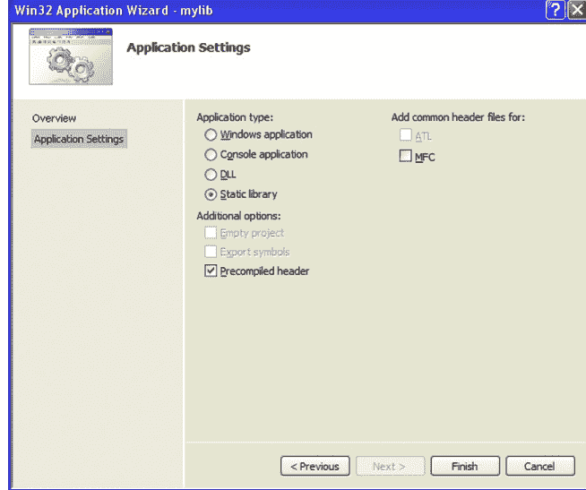

图 A.4

在 Visual Studio 2008 中创建新的静态库或 DLL。

- 3. 将出现 Win32 向导
- 4. 在应用程序类型下选择 Static 选项（参见图 A.4）

你可以在左侧窗格的 Source Folders（源文件夹）下向项目添加新的或有的源文件。然后，当你对项目进行生成时，结果将是一个静态 `.lib` 文件。创建 DLL 的步骤非常相似。唯一的区别在于第 4 步，你将选择 DLL 选项而不是 Static。然后，当你生成项目时，Visual Studio 将生成一个 `.lib` 文件和一个相关的 `.lib` 导入文件。

### A.2.4 有用的 Windows 工具

许多程序可以帮助管理 Windows 上的 DLL 并调查 DLL 问题。其中许多是可以在 MS-DOS 提示符中运行的命令行工具。其中一些 DLL 工具包括：

- `tasklist.exe`: 此程序可用于查找 Windows EXE 文件依赖于哪些动态库，例如：
  `tasklist /m /fi "IMAGENAME APPNAME.EXE"`
- `dependsex.exe`: 依赖关系查看器（dependency walker）将递归扫描可执行文件以发现其所有依赖 DLL。它将检查缺失的 DLL、无效的 DLL 和循环依赖等其他错误情况。
- `dlister.exe`: 此工具提供计算机上安装的所有 DLL 的日志。这可以输出为文本文件或数据库文件。
- `dcomp.exe`: 它显示由 `dlister.exe` 程序产生的两个 DLL 列表之间的差异。

### A.2.5 在 Windows 上加载插件

在 Windows 平台上，可以使用 `LoadLibrary()` 或 `LoadLibraryEx()` 函数在进程中加载动态库，并使用 `GetProcAddress()` 函数获取 DLL 中导出符号的地址。请注意，在 Windows 中加载动态库时，你不需要导入任何 `.lib` 文件。为了演示这一点，请考虑以下使用 `plugin.dll` 库的简单插件接口。

```cpp
#ifndef PLUGIN_H
#define PLUGIN_H
#include <string>
extern "C"
__declspec(dllexport) void DoSomething(const std::string&name);
#endif
```

下面的代码段说明了如何按需加载此 DLL 并调用该库中的 `DoSomething()` 方法。

```cpp
// 打开动态库
HINSTANCE handle = LoadLibrary("plugin.dll");
if (handle) {
    std::cout << "Cannot load plugin!" << std::endl;
    exit(1);
}
```

```cpp
// 从插件中获取 DoSomething() 函数
FARPROC fptr = GetProcAddress(handle, "DoSomething");
if (fptr == (FARPROC)NULL) {
    std::cout << "Cannot find plugin in: " << error;
    std::cout << std::endl;
    FreeLibrary(handle);
    exit(1);
}
```

```cpp
// 调用 DoSomething()
(*fptr)("Hello There!");
```

```cpp
// 关闭共享库
FreeLibrary(handle);
```

## A.3 Linux 上的库

接下来的章节提供了在 Linux 上创建和管理静态库及共享库的概述。重点是介绍重要的问题和技术。然而，对于更深层次的研究，我建议阅读 Ulrich Drepper 的文章《如何编写共享库》，该文章在线地址为 http://people.redhat.com/drepper/dsohhowto.pdf。

### A.3.1 在 Linux 上创建静态库

在 Linux 上，静态库仅仅是对象文件 `.o` 的归包。你可以使用 Linux 命令将多个对象文件编译成静态库。例如，以下命令演示了如何使用 GNU C++ 编译器将三个 `.cpp` 文件编译为 `.o` 文件，并从这些对象文件创建静态库。

```bash
g++ -c file1.cpp
g++ -c file2.cpp
g++ -c file3.cpp
ar -cs libmyaapi.a file1.o file2.o file3.o
```

`g++` 的 `-c` 选项告诉编译器从输入文件 `.cpp` 文件生成 `.o` 文件。`ar` 的选项中，`-c` 创建归档，`-r` 将提供的 `.o` 文件插入到该归档中，`-s` 为归档创建索引（等同于旧版本中在生成的归档上运行 `ranlib` 的习惯）。

你的用户可以使用 `ld` 或 `g++` 的 `-l` 选项来链接你的库。这指定了要链接的库的名称。`-L` 选项指定了库所在的目录。

### A.3.2 在 Linux 上创建动态库

在 Linux 上创建动态库涉及创建位置无关代码 PIC。你应该在使用编译器时使用 `-PIC` 标志来生成此类代码。

```bash
g++ -c -PIC file1.cpp
g++ -c -PIC file2.cpp
g++ -c -PIC file3.cpp
ar -shared libmyaapi.so file1.o file2.o file3.o
```

生成的 `.so` 文件随后可以链接到你的程序。要链接动态库，使用 `-L` 和 `-l` 选项：

```bash
g++ -o main main.cpp -L. -lmyaapi
```

链接器将负责在运行时将动态库加载到进程。你可以使用 `LD_LIBRARY_PATH` 环境变量来指定链接器应该查找动态库的位置。

# 402 附录 A 库

另一种优雅的方法。然而，它专门适用于 GNU 编译器。这涉及对函数使用构造函数和析构函数 `__attribute__` 标记。例如，下面的代码展示了如何定义库初始化和清理程序，并将它们隐藏在一个 `.cpp` 文件中。

```cpp
static void __attribute__((constructor)) APIInitialize() {
    std::cout << "API Initialized." << std::endl;
}
static void __attribute__((destructor)) APIcleanup() {
    std::cout << "API Cleaned Up." << std::endl;
}
```

如果你使用这种方法，应该注意你的共享库可能没有使用 GNU GCC 参数 `-nostartfiles -nostlib` 进行编译。

## A.3.4 有用的实用程序

标准的 Linux 工具可以帮助你处理静态库和共享库。特别注意 GNU 的 `tooltip` shell 脚本。该命令为在不同的 UNIX 平台上创建库提供了一个一致且可移植的接口。`tooltip` 脚本可以用多种方式使用，但在最简单的形式下，你只需要给 `tooltip` 提供对象文件列表，指定 `-static` 或 `-dynamic` 选项之一，它就会分别创建一个静态或动态库。例如：
`tooltip -static -libmipmap.ofile2.ofile3.o`

如果你希望你的源代码能够在一系列 UNIX 平台上轻松编译，而无需担心每个平台在创建库时的特殊性，那么 `tooltip` 将非常有用。`nm` 可用于显示对象文件或库中的符号名称。这对于查找某个库是否定义或使用了给定的符号很有用。例如，下面的行将输出库中所有的全局（外部）符号：

```
nm -glibmipmap.a
```

这将产生输出：


`00000000` `T_DoSomething`

`00000118` `S_DoSomething.ch`

`U__ZN0lsEPFRSoS_E`

`U__ZNSTios_base4Initv`

`U__ZNSTios_baseInitEv`

`U__ZStcout`

第二列中的字符指定符号类型，其中 `T` 指代在该库中定义的文本段（text section），而 `U` 指代被库引用但未定义的定义的符号。大写字母表示外部符号，而小写字母表示内部符号。第三列中的字符串提供了修饰后的符号名称（mangled symbol name）。可以使用 `c++filt` 命令进行反修饰，例如：

```
c++filt __ZNSTios_base4InitEv
```

```
std::ios_base::Init()
```

另一个命令是 `ldd`。它可以用于显示可执行文件所依赖的动态库列表。因为它将显示每个库的完整路径，无论操作系统是否找到了任何动态库。例如，对于一个简单的可执行文件会产生如下输出：

```
% ldd userapp
linux-so.2 => (0x77a000)
libstdc++.so.6 => /usr/lib/libstdc++.so.6 (0x764500)
libm.so.6 => /lib/x86_64/libm.so.6 (0x761f00)
libgcc_s.so.1 => /lib/libgcc_s.so.1 (0x760000)
libc.so.6 => /lib/x86_64/libc.so.6 (0x74bb00)
```

使用静态选项链接的可执行文件将不依赖于任何动态库。在 Linux 上对此类可执行文件运行 `ldd` 会得到如下输出：

```
% ldd userapp
not a dynamic
```

最后，如果你有一个静态库，可以将其转换为动态库（`.so`）。记住，静态归档（`.a`）只是对象文件（`.o`）的打包。因此，你可以使用 `ar` 命令提取单个对象文件，并将它们重新链接为动态库。例如：

```
ar -x libapi.a
g++ -shared -o libapi.so *.o
```

## A.5 在 Linux 上加载插件

在 Linux 上，你可以使用 `dlopen()` 函数将 `.so` 文件加载到当前进程中。然后你可以使用 `dlsym()` 访问该库中的符号。这让你能够创建如前文描述的插件接口。例如，考虑以下非常简单的插件接口：

```cpp
#ifndef PLUGIN_H
#define PLUGIN_H
#include <string>
extern "C"
void DoSomething(const std::string& name);
#endif
```

你可以为这个 API 构建一个动态库，例如 `libplugin.so`。接下来的代码演示了如何加载这个动态库并调用 `.so` 文件中的 `DoSomething()` 函数：

```cpp
typedef void (*FuncPtrT)(const std::string&);
const char *error;
// 打开动态库
void *handle = dlopen("libplugin.so", RTLD_LOCAL | RTLD_LAZY);
if (!handle) {
    std::cout << "Cannot load plugin!" << std::endl;
    exit(1);
}
dlerror();
// 从插件中获取 DoSomething() 函数
FuncPtrT fptr = (FuncPtrT) dlsym(handle, "DoSomething");
if ((error = dlsym(handle))) {
    std::cout << "Cannot find function in plugin: " << error;
    std::cout << std::endl;
    dlclose(handle);
    exit(1);
}
// 调用 DoSomething() 函数
(*fptr)("Hello There!");
// 关闭动态库
dlclose(handle);
```

```bash
g++ -dynamiclib -o libmy.so -fPIC file1.o file2.o file3.o \
-headerpad_max_install_names
```

此外，请注意 `-headerpad_max_install_names` 选项的使用。在 Mac 上构建动态库时，强烈建议使用此标志，我稍后会解释原因。
需要注意的是，Mac OS 上无法使用 `ld` 命令。相反，你可以使用 `otool` 来列出执行文件所依赖的动态库集合，即 `otool -L userapp`。

## A.4.3 Mac OS X 框架

Mac OS X 引入了框架（Framework）的概念，将编译和链接 API 所需的所有文件封装在一个包中。框架本质上是一个以 `.framework` 扩展的目录，其中可以包含动态库、头文件和参考文档等资源。它本质上是一个包（NSBundle 意义上的 bundle）。这种将所有必要的开发文件封装在一个包中的做法使得库的安装和卸载变得更加容易。此外，框架可以在同一个包中包含多个版本的库，以维护对旧应用程序的后兼容性。

下面的目录列表给出了框架包的布局示例，其中 `-` 符号符号链接。

```
+   MyAPI.framework/
Headers -> Versions/Current/Headers
MyAPI -> Versions/Current/MyAPI
Versions/
A/
Headers/
MyHeader.h
MyAPI
B/
Headers/
MyHeader.h
MyAPI
Current -> B
```

大多数 API 都以框架的形式分发，包括 Cocoa、Foundation 和 Core Services。如果你已经安装了 Mac OS X 开发环境，可以在 `/Developer/SDK` 目录下找到它们。因此，你可能希望将你的 API 分发为 Mac 框架，使其更像一个原生库。

你可以使用 Apple 的 Xcode 开发环境将 API 构建为框架。这可以通过选择 `File -> New Project`，然后在左侧面板中选择 `Framework`（见图 A.5）来实现。默认情况下，你可以选择将项目设置为使用 Carbon 或 Cocoa 框架。如果你不需要它们中的任何一个（即你正在编写纯 C++ 库），只需简单删除 Xcode 为你创建的这些框架即可。

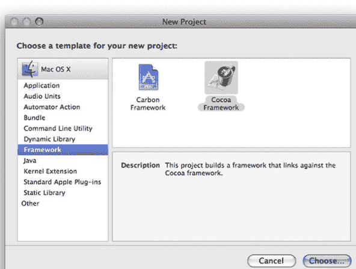

**图 A.5**
使用 Apple 的 Xcode IDE 创建框架项目。

客户端可以通过向 `g++` 或 `ld` 提供 `-framework` 选项来链接你的框架。他们还可以指定 `-F` 选项来指定查找你框架包的目录。

## A.4.4 在运行时查找动态库

Linux 查找动态库的原理同样适用于 Mac OS 下的应用程序，但有细微差异。首先，用于管理库搜索路径的环境变量被称为 `DYLD_LIBRARY_PATH`，尽管较版本的 Mac OS 现在也支持 `LD_LIBRARY_PATH`。

此外，Mac OS 不支持 Linux 的 `-rpath` 链接器选项。相反，它提供了“安装名称”（install names）的概念。安装名称是固入 Mach-O 二进制文件的路径，用于指定搜索动态库的路径。在链接执行文件时，可以使用特殊字符串 `@executable_path` 来指定此路径。

你可以在构建动态库时指定安装名称，但你的客户端也可以使用 `install_name` 工具更改此路径。然而，他们不能指定比 `.dylib` 中原始路径更长的路径。在 Mac 上构建动态库时，使用 `-headerpad_max_install_names` 选项始终是建议的做法：让客户端能够灵活地将库的安装名称更改。

以下命令演示了客户端如何更改你库的安装名称以及更改其执行文件的安装名称：

```bash
install_name_tool -id @executable_path/../Libs/libmyapi.dylib \
libmyapi.dylib
```

```bash
install_name_tool -change libmyapi.dylib \
@executable_path/../Libs/libmyapi.dylib \
UserApp.app/Contents/MacOS/executable
```


```

## 参考文献

- [1] T. Albrecht, Pitfalls of Object Oriented Programming, in Proceedings of Game Connect: Asia Pacific (GCAP) 2009, Melbourne, Australia, 2009.
- [2] T. Alexander (Ed.), Massively Multiplayer Game Development, Charles River Media, 2003. ISBN 1584502436.
- [3] A. Alexandrescu, Modern C++ Design: Generic Programming and Design Patterns Applied, Addison-Wesley Professional, 2001. ISBN 0201704735.
- [4] K. Arnold, Programmers Are People, Too, ACM Queue 3 (5) (2005) July 6, 2005.
- [5] D. Astels, Test-Driven Development: A Practical Guide, second ed., Prentice Hall, 2003. ISBN 0321106490.
- [6] O.L. Ostrach, A Computer Science TSP: Exploring Computer with C++, second ed., McGraw-Hill, 2000. ISBN 007246530.
- [7] L. Bass, P. Clements, R. Rajman, Software Architecture in Practice, second ed., Addison-Wesley, 2003. ISBN 0321154959.
- [8] K. Beck, Test Driven Development: By Example, Addison-Wesley Professional, 2002. ISBN 0321146530.
- [9] K. Beck, Implementation Patterns, Addison-Wesley Professional, 2002. ISBN 0321146314.
- [10] J. Hamcock, The Little Manual of API Design, (2008) June 19, http://www.chaos.org/~shaun/api-design.pdf
- [11] J. Bloch, How to Design a Good API and Why it Matters, Java 2005, December 12–16.
- [12] J. Bloch, Effective Design, second ed., Prentice Hall, 2008. ISBN 032153663.
- [13] G. Bosch, R. Maxim, M.W. Eldridge, J. Young, K. Houston (Eds.), The Object-Oriented Analysis and Design, third ed., Addison-Wesley, 2007. ISBN 020189551.
- [14] G. Bosch, J. Rumbaugh, I. Jacobson, Unified Modeling Language, second ed., Addison-Wesley, 2002. ISBN 020136794.
- [15] P. Bonarque, D. Dunlap, S.W. Moore (Eds.), The Software Engineering of Knowledge, IEEE Press, 2004. Version 0769523.
- [16] F. Brooks, The Mythical-Month on Software Engineering, second ed., Addison-Wesley, 1995. ISBN 020183599.
- [17] M.P. Cline, G. Gamow, C++ FAQs, second ed., Addison-Wesley, 1998. ISBN 020107228.
- [18] A. Cockburn, Writing Use Cases, Addison-Wesley, 2000. ISBN 020170228.
- [19] M. Cohn, User Stories: For Development, Addison-Wesley, 2004. ISBN 020132056.
- [20] J.O. Coplan, Advanced C++ Programming Styles and Idioms, Addison-Wesley, 1991. ISBN 020154850.
- [21] J.O. Coplan, Curiously Recurring Template C++ Report 7 (2) (1995–27). ISBN 1040062.
- [22] W. Cunningham, The Management System, OOPSLA '92 Experience, March 26, Vancouver, 1992, pp. 29–30.
- [23] M. DeLoura (Ed.), Game Programming, Charles River Media, 2001. ISBN 158450059.
- [24] S.C. Dewert, C++ Gotchas: Avoiding Problems in Coding and Design, Addison-Wesley, 2002. ISBN 032112518.
- [25] E. Evans, Domain-Driven Design: Tackling Complexity in the Heart of Software, Addison-Wesley, 2003. ISBN 032112521.
- [26] R. Faber, Architects as Service Providers, IEEE Software 27 (2) (2010) 33–40. March/April 2010.
- [27] M.C. Feathering, Working Effectively with Legacy Code, Prentice Hall, 2004. ISBN 032111702.
- [28] B. Foote, J. Yoder, Big Ball of Mud, Fourth Conference on Pattern Languages of Programs (PLP '97), September 1997, Monticello, Illinois. http://www.laputan.org/mud/
- [29] M. Fowler, K. Beck, J. Brant, W. Opdyke, D. Roberts, Refactoring: Implementing the Design of Existing Code, Addison-Wesley, 1999. ISBN 020148567.
- [30] T.L. Friedman, The World Is Flat 3.0: A History of the Twenty-First Century, Picator, 2007. ISBN 031245074.
- [31] E. Gamma, R. Helm, R. Johnson, J.M. Vliss, Design Patterns: Elements of Reusable Object-Oriented Software, Addison-Wesley, 1994. ISBN 020163632.
- [32] E. Gamma, R. Helm, R. Johnson, L. O’Brien, Design Patterns 15 Years Later: An Interview with Erich Gamma, Richard Helm, and Ralph Johnson, Informat (October 2009) http://www.informat.com/articles/article.aspx?p=1404056.
- [33] M.R. Reading, Implementation of C++ Class Declarations; Proceedings of the 26th ACM SIGCSE on Computer Science Education, Nashville, Tennessee, 1995, pp. 24–28.
- [34] J.L. Hennessy, D.A. Patterson, Computer Architecture: A Quantitative Approach, fourth ed., Kaufmann, 2006. ISBN 021370491.
- [35] M. Henning, API Design Matters, ACM COM 52 (6) (2009) 46–56.
- [36] C.A.R. Hore, An Axiomatic Basis for Computer Programming, ACM COM 12 (10) (1969) 576–580, October 1969.
- [37] C.A.R. Hore, Assertions: A Personal Perspective, IEEE Software 25 (2) (2003) 14–25. April–June 2003.
- [38] C. Holzmeister, R. Soni, Applied Software, Addison-Wesley, 2009. ISBN 0216343.
- [39] A. Hunt, D. Thomas, The Pragmatic Programmer, Addison-Wesley, 1999. ISBN 020137926.
- [40] ISO/IEC 1998, Programming Languages–C++, International Organization for Standardization, Geneva, Switzerland.
- [41] ISO/IEC 2003, Programming Languages–C++, International Organization for Standardization, Geneva, Switzerland.
- [42] ISO/IEC 29768:2007, Information Technology—Programming Languages—Technical Report on C++ Library, International Organization for Standardization, Geneva, Switzerland.
- [43] J. Jacobson, Object-Oriented Software Engineering: A Use Case Approach, Addison-Wesley, 1992. ISBN 0201544.
- [44] S. Jeong, Y. Xie, J. Baat, B. Myers, R. Ehret, et al., Implementing Documentation for SOA Through User Studies, Second International Symposium on End User Development (IS-EUD’2009), March 2, 2009, Springer-Verlag, Siegen, Germany, 2009, pp. 86–105.
- [45] N.M. Usanis, The C++ Standard Library: A Tutorial and Reference, Addison-Wesley, 1999. ISBN 0201379.
- [46] D. Knuth, Structured Programming with Go Statements, ACM Comp. Surv. 6 (4) (1974) 268, December 1974.
- [47] T.D. Korn, V.K. Vaishnavi, An Empirical Study of the Effects of Modularity on Program Development, In papers presented at the 1st workshop on empirical studies of programs, Washington, DC, 1986, pp. 168–186.
- [48] J. Lakos, Large-Scale C++ + Software Design, Addison-Wesley, 1996. ISBN 0201633.
- [49] Y.G. Leclercc, S.Q. Lau, TerraVision: A Terrain Visualization System, Technical Note 540, the Artificial Intelligence Center, SRI International, Menlo Park, CA, 1994. April 1994.
- [50] K.J. Lieberther, I. Holland, Assuring Good Style for Object-Oriented Programs, IEEE Software 6 (5) (1989) 38–48. September 1989.

[51] B. Liskov, 数据抽象与层次结构, OOPSLA '87, 主旨演讲, 1987年10月4-8日, Orlando, Florida, pp. 17–34.

[52] S. McConnell, Code Complete: 软件构建的实用手册, 第二版, Microsoft Press, 2004. ISBN 0735619670.

[53] T. Mackinson, S. Freeman, P. Craig, Endo-Testing: 使用 Mock 对象的单元测试，: 极限编程版, Addison Wesley Longman, 2001, pp. 287–301 (第17章).

[54] R.C. Martin, 原则与设计模式, Object Meter 文章, 2000. http://www.objectmeter.comresources/articles/Principles_and_Patterns.pdf.

[55] R. C. Martin, 敏捷软件开发: 原则、模式与实践, Prentice Hall, 2002. ISBN 0395374444.

[56] N. Medivic, R. Taylor, 软件架构语言的分类与比较框架, IEEE Transactions on Software Engineering 26 (1) (2000) 70–93.

[57] S.J. Miller, M.J. Baker, 可执行 UML: 模型驱动架构的基础, Addison-Wesley Professional, 2002. ISBN 0201870485.

[58] G. Mesaros, 使用记录和回放进行敏捷回归测试，: OOPSLA '03 论文集, 2003年10月26–30日, Anaheim, CA, pp. 353–360.

[59] B. Meyer, 契约编程, Report TR-EI/12-CO: 交互式软件工程, Goleta, CA, 1987.

[60] B. Meyer, 面向对象的软件构建, 第二版, Prentice Hall, 1998. ISBN 0136291554.

[61] S. Myers, More Effective C++: 改进程序和设计的35 种新方法, Addison-Wesley Professional, 1998. ISBN 020133719.

[62] S. Myers, 非成员函数如何提高封装性, Dr. Bobbs’s Journal (2000) 2月1日, http://www.dobbs.com/

[63] S. Myers, 最重要的设计准则? IEEE Software 21 (4) (2004) 2004年7/8月.

[64] S. Myers, Effective C++: 改进程序和设计的5 种特定方法, Addison-Wesley Professional, 2001. ISBN 0321334876.

[65] S. Myers, A. Alexander, C++ 与双重检查锁的危险, Dr. Bobbs’s Journal (2004) 7004年7月, http://www.dobbs.com/

[66] G.A. Miller, 数学符号，加或减号: 我们处理能力的某些限制. Proc Rev 63 (2) (1996) 81–97.

[67] M.L. Mitchell, A. Samuel, J. Oldham, 高级 Linux 编程, 博士论文. 技术报告 UCS-TR-160, 加州大学欧尔文分校计算机与信息科学系, 1980.

[68] D. Parnas, C 在使用模块的分解系统中的作用. ACM 15 (12) (1972) 1053–1058. 1972年12月.

[70] D. Parnas, 面向扩展与收缩的设计. IEEE Transactions on Software Engineering 5 (2) (1979) 12–38.

[71] D.L. Parnas, 软件老化，: 第16届国际软件工程会议集, 意大利索伦托, 1994, pp. 279–287.

[72] B.C. Pierce, 类型与编程设计, Pragmatic Bookshelf, 2006. ISBN 0976249050.

[73] K. Pugh, 接口面向设计, Pragmatic Bookshelf, 2006. ISBN 0976249050.

[74] J.B. Rainbow, 明智地使用你的秘密, IBM Developer Works, 2001年7月1日, http://www.ibm.com/developerworks/webservices/library/co-simple.html.

[75] E.S. Raymond, UNIX 编程艺术, Addison-Wesley Professional, 2003. ISBN 0313429019.

[76] M.P. Robillard, 什么让 API 难以学习? 开发者的回答. IEEE Software 26 (6) (2009) 27–34. 2009年11月.

## 412 参考文献

[77] G. Rooney, 保持向后兼容, O'ReillyOnLamp, 2005. http://onlamp.com/pub/a/onlamp/2005/012/backwardscompatibility.html.

[78] S. Shlaer, S.J. Mellor, 面向对象系统分析: 在数据中建模, Prentice Hall, 1998.

[79] D. Sheriner (编), OpenGL 引用: OpenGL 的官方参考, 2004版, 第4版., Addison-Wesley Professional, ISBN 03211738X.

[80] A. Styler, 面向对象编程中的封装与继承，: OOPSLA '86 论文集, 1986, pp. 38–45. 发表于 SIGPLAN Notices, 2(11).

[81] D. Spinelli, 代码文档, IEEE Software 27 (4) (2010) 18–19, 2010年7/8月.

[82] W. Stevens, G. Myers, 结构化设计. IBM 13 (2) (1974) 115–139.

[83] B. Bostru, C++ 编程语言: 特别版, 第3版., Addison-Wesley Professional, 2000. ISBN 020117035.

[84] J. Yang, L. Zhang, T. Xie, 实现 API 使用信息，: 视觉语言与人类计算 (VL/HCC) 论文集, 俄勒冈, 2009, pp. 119–126, 2009年9月20–24.

[85] J. Graf, D. Bauer, C. Ziegler, R. Ehrlich, 可用 API 设计案例: 视觉语言与人类计算 (VL/HCC) 论文集, 汉诺威, 2008, pp. 189–192, 2008年9月15–19.

[86] J. Meyer, B. Myers, API 可学习放置方法，: 第16届 ACM SIGSOFT 软件工程基础会议 (FSE), 亚特兰大, GA, 2008, pp. 105–112. 2008年11月9–14.

[87] H. Sutter, 异常 C++; 编程谜题与解, Addison-Wesley Professional, 1999. ISBN 020615622.

[88] H. Sutter, C++ 编码标准: 101规则与最佳实践, Addison-Wesley Professional, 2004. ISBN 032113586.

[89] J. Tulach, 实用 API 设计: Java 框架的自, 2008. ISBN 134020974.

[90] V. Dandevo, N. Josutis, C++ 模板: 完全指南, Addison-Wesley Professional, 2002. ISBN 020173482.

[91] K. Wiegers, 需求, 第二版, Microsoft Press, 2003. ISBN 073561878.

[92] M. Wohl, 为什么全球化是有效的, Yale University Press, 2004. ISBN 030102256.

[93] H. Yee, A. Newman, 生产测试的感知指标, ACM SIGGRAPH 2004, 2004年8月8–12, 洛杉矶, CA, 2004.

[94] H. Mei, L. Zhong, 从自然语言 API 文档中推断资源规范，: 第24届 IEEE 自动化软件工程会议 (ASE), 奥克兰, 新西兰, 2009, pp. 307–318. 2009年11月16–20.

## 索引

注：页码后跟 b 表示框，f 表示图，t 表示表。

## A

- ABCs，*见* 抽象基类 (ABCs)
- ABI，*见* 应用二进制接口 (ABI)
- 抽象基类 (ABCs)
- 向后兼容, 256–257
- 概述, 86–87
- 插件实现, 366
- 抽象
- API 设计, 118
- API 问题模型, 21–23, 22f
- 架构设计, 124–125
- 类设计, 133
- 数据驱动 API, 166
- 迭代器, 254
- 访问控制
- #define, 201
- 与 friends, 203–204
- 与 getter/setter 例程, 30
- 代理模式, 93
- 访问级别
- 封装, 语言差异, 27
- 示例, 27
- 与逻辑处理, 26–27
- 活跃页面 (ASP) 开发, 8
- Actors, 用例元素, 115
- Accumen Threads, 多线程分析, 240
- 自适应系统, 架构分类, 129
- 适配器模式
- 定义, 66
- 概述, 94–96
- UML 图, 94f
- 高级 API, 并行产品, 248
- 聚合, UML 类图, 23
- 敏捷开发, 定义, 117–118
- AIX, 基于内存的分析, 239
- 算法
- API 正交性, 47
- API 使用, 9
- 模式, 65–66
- 冲突检测, 229
- 功能兼容性, 252
- 功能不匹配, 11
- 迭代器, 233
- 语言 API, 145
- 基于内存的分析, 238–239
- 内存优化, 221
- 与命名空间, 174
- 并行开发示例, 9
- 与 STL, 4, 47, 55
- 用例, 113, 115
- 分配器
- 混合, 38, 366, 368
- 与 pimpl, 74
- 插件实现, 366
- AMD API, 性能分析, 238
- Amiga, 头文件, 216–217
- Android 平台, API 版本, 373
- 匿名命名空间, 与外部
- 链接, 205
- ANSI API
- 收益, 154
- 特性, 153–154
- FMOD 案例, 157–158
- 来自 C++ 的调用, 156–157
- 关键字, 153–154
- 类型检查, 1240
- 写入, 155–156
- Apache HTTP 服务器, 279f, 362
- Apache 许可证, 278–270
- Apache 运行时, 151

# 414 索引

API 设计（续上）
- 通信，130–131
- 约束，123–124
- 开发，121–123, 122f
- 关键对象，126–128
- 层级元素，129f
- 测量，130b
- OpenSceneGraph 示例，125f
- 模式，129–130
- 考虑因素，6
- 类设计
    - 组合，138–139
    - 继承，134–135
    - 迪梅特法则（Law of Demeter），140–141
    - 里氏替换原则，135–139
    - 命名，141–142
    - 面向对象概念，139–140
- 开/闭原则，139
- 选项，133
- 概述，132–143
- 私有继承，137
    - 差异，4–6
    - 文档可用性，281
    - 元素，118–119
    - 显式实例化，187–190
    - 自由重载，192
- 功能性需求
    - 示例，112
    - 收集，111–113
- 函数设计
    - 错误处理，146–150
    - 命名，143–144
    - 概述，142–150
    - 参数，144–146, 145b
- 隐式实例化，185–187
- 重要性，105–110
    - 长期而言，109–110
    - 概述，105
- 插件系统，364–365
- 技术债
    - 积累，106–107
    - 偿还，107–109
- API 设计模式
- 抽象类，概述，66–87
- API 一致性，43, 44
- 架构设计，129–130
- 类别，65–66
- 类设计，133
- 工厂方法
    - 适配器模式，94–96, 94f
    - 可扩展示例，88–91
    -  Fac面模式，96–97
    - 概述，85–91
    - 代理模式，91–94f
    - 简单示例，87–88
    - 包装器，91–99
- 观察者模式
    - 实现，101–103
    - MVC，99–101, 100f
    - 概述，99–104
    - 推送 vs. 拉取，103–104
    - UML 表示，101f
- 概述，65
- Pimpl 惯用法
    - 拷贝语义，71–72
    - 缺点，74
    - 示例，67
    - C 中的不透明模式，75–76
    - 概述，67–76
    - 智能指针，72–73
    - 使用，67–71
- 单例模式（Singleton）
    - 对比 依赖注入，81–82
    - 在 C++ 中的实现，77–79
    - 对比 Monost，82–84
    - 概述，76–85
    - 对比章节，84–85
    - 线程安全，79–81
    - UML 图表，76f
    - 技术，66
- API 性能
    - 分析概述，235–240
    - 数组引用，235
    - 常量声明，217–219
    - constexpr 关键字，218–219
    - 写时拷贝（copy-on-write），229–233
    - 功能能力，252
- 包含最小化（Include minimization）
    - 前向声明，213–214
    - 概述，212–217
    - 冗余保护，215–217
    - “Winnebago”头文件
    - 初始化列表，219–221
    - 内联，225–228
- 用用用例
    - 敏捷开发，117–118
    - 创建，113–118
    - 开发，114
    - 需求，117–118
    - 模板，114–115
    - 编写，115–116

# 索引 415

- 通过 const 引用输入参数，210–212
- 迭代元素，233–235
- 迭代器，233–234
- 成员变量隐藏，31
- 基于内存的分析，238–239
- 内存优化，221–225, 222f
- 多线程，239–240
- 非功能性需求，112
- 随机访问，234–235
- 基于时间的分析，236–237
- API 特性 (C++)
    - 编码规范，207–208
    - const 正确，180–183
    - 定义，180–182
    - 参数，182
    - 返回值，182–183
- 构造函数与参数
    - 编译器生成的函数，176–177
    - 定义，177–179
    - explicit 关键字，179–180
    - 概述，175–180
- 定义常量，200–202
- 函数参数
    - 指针 vs 引用，198–199
    - 默认参数，199–205
    - 命名空间，173–174
- 运算符重载
    - 转换运算符，197–190
    - 自由/成员函数，191–193
    - 类运算符运算符，193–195
    - 运算符类别，190–191
    - 运算符重载，196–198
    - 语法，195–196
    - 符号导出，204–207
- 模板
    - 显式实例化 API 设计，187–190
    - 隐式实例化，185–187
    - 概述，183–190
- API 特性（通用）
    - 耦合，59–62
    - 类池，54–56
    - 管理类，58–59, 58f
    - 按名称，53–54
    - 通知，59–62
    - 观察者，59–62
    - 概述，52–63
- 冗余，56–57
    - 文档，62–63
    - 易用，43–45
    - 可发现性，40
    - 误用用例，40–42
    - 正交性，45–47
    - 概述，39–52
    - 实现独立性，51–52
    - 资源分配，47–50
- 实现细节
    - 类，33–34
    - 逻辑隐藏，26–28
    - 成员变量，28–31
    - 方法，31–33
    - 概述，25–34
    - 物理隐藏，25–26
    - 关键对象，23–25, 24f
    - 便利性 API，37–39, 39f
    - 版本控制，38–39
    - 虚函数，36–37
    - 概述，21
- 问题领域
    - 抽象，21–23
    - 概述，21–25
    - 稳定性，62–63
    - 测试，62–63
- API 评审
    - 概述，261–265
    - 提交前，265
    - 发布前，263–264
    - 目的，262–263
    - Symbian 示例，264f
- API 风格
    - ANSI C 优处，154
    - 特性，153–154
    - FMOD 案例研究，157–158
    - 来自 C++ 的调用，156–157
    - 类型检查，154
    - 编写，155–156
- 数据驱动 API
    - 优势，166–167
    - 缺点，167–168
    - FMOD 案例研究，170–172
    - 概述，164–172
    - 变体参数列表，168–170
    - Web 服务，165–166
    -  C API，151–158
- 面向对象的 C++ API
    - （续）
    - 优势，158–159
    - 缺点，159
    - FMOD 案例研究，159–160
    - 概述，158–160
- 基于模板的 API
    - 优势，163
    - 缺点，164
    - 示例，161–162
    - v2 宏，162
    - 概述，160–164
- Apple，见 Mac OS
- 应用二进制接口 (ABI)
    - 向后兼容性，257
    - 兼容性，253
- 架构设计语言
    - 通信，130
- 架构设计
    - 抽象，124–125
    - API 设计，119
    - 通信，130–131
    - 约束，123–124
    - 开发，121–123, 122
    - 关键对象，126–128
    - 测量，130
    - OpenSceneGraph 示例，125f
    - 概述，119–131
    - 模式，129–130
- Second Life Viewer，14, 14f
- 数组
    - ANSI C 特性，153
    - 构造函数，175–176, 177–178, 179
    - 初始化列表，28
    - 迭代器，234
    - 插件 API，367
    - 随机访问，234
    - 引用参数，198
    - 引用与迭代器，235
    - 变体参数列表，168
- 数组下标
    - 二进制运算符，191
    - 语法，195
    - ASP，见 Active Pages
- 断言
    - 合约编程，315
- 赋值运算符
    - 类设计，133
    - 编译器生成的函数，177
    - 拷贝赋值，233
    - 拷贝语义，71–72
    - C++ 特有 API
    - 编译器生成的函数，176–177
    - 定义，177–179
    - 概述，175–180
    - 初始化列表，220
    - 与，72–73
- 关联，UML 图表，23
    - method()，与随机访问，234
- AutoDoc，文档，创建，274–276
- 自动化 GUI 测试，294
- 自动取款机 (ATM)
    - 功能性需求，112–113
    - 用例示例，116
    - 用户故事，117–118
- 自动化测试
    - API 设计，6
    - 错误跟踪，325–326
    - 代码覆盖率，322–325, 324
    - 持续构建系统，326, 327
    - 测试用架，319–322
    - 工具类别，318–326
- B 向后兼容性
    - API 设计，4
    - API 评审，概述，261–265
    - 提交前，263
    - 发布前，263–264
    - 目的，262–263
    - 二进制兼容性，253–255
    - 默认参数，199
    - 定义与类型，255
    - 功能兼容性，251–252
    - 维护
        - 弃用功能，259–261
        - 功能新增，256–257
        - 功能变更，257–259
        - 概述，256–261
        - 移除功能，261
    - 补丁版本，242

- 源码兼容性，252–253
- 隐式实例化 API 设计，187
- 测试，292
- 基于模板的 API，161
- 与版本模式，383–384
- Boost Python
    - 基础 API 版本，并行产品，248
    - API 扩展，341–343
    - 基础块覆盖率，测试工具，323
    - 代码示例，344–349
- 基础课程
    - 创建，338
    - ATM 示例，116
    - 构造函数，341
    - 模板元素，115
    - 跨语言多态，344–345
- 行为设计，65–66
    - 特性，334
- 行为
    - 继承，344–345
    - 定义，268–269
    - 迭代支持，346–347
    - 概述，337–339
    - 关键对象，310
    - 脚本屏障，333
- 最佳实践
    - 包装器，338–341
- API 设计，149
- Boost Test，概述，320
- API 特性，63
- 边界条件，302
- C 函数，157
- 编码版本，208
- BSD 库，278
- 缓冲区填充，201–202
- 缓冲区溢出，303
- 错误报告，149–150
- 错误跟踪
    - 函数参数，198
    - 定义，318
    - 运算符，192
    - 测试工具，325–326
    - 插件实现，366
- Bugzilla，325
- 基于模板的 API，161
- Bullseye 覆盖率，测试工具，323
- “大真”规则，176
- 业务逻辑，数据驱动 API，166
- 二进制兼容性
    - 业务需求，111
- ANSI C API，154
- C
    - 维护，259
- 缓存
    - 在面向对象的 C++ 中，159
    - 代码健壮性，7
    - 概述，252–255
    - 与 getter/setter 方法，29
    - Pimpl 惯用法，75
    - 与性能，235
- 二进制运算符
- 回调
    - 二进制插桩，基于时间的分析，236
    - 与架构设计，130
    - 重载，191
    - 与耦合，59–62
    - 对称性，192
    - 与工厂方法，88–89
    - 位域（Bit fields），内存优化，222, 225
    - 与友元，202
- 黑盒测试
    - 与 插件 API，367
    - 定义，293
    - 与插件，366, 369
- 集成测试，297
- Callgrind，用于性能分析，238
- 与 STE，305
- 调用版本，适配器模式，36
- Boerlean
- 案例研究
    - 与 API 易用性，41
    - 代码使用，323
- FMOD C API，157–158
- 与 LLSD，168
- FMOD C++, API 159–160

# 418 索引

- 请求更改流程，API 设计, 5
- 循环依赖，架构设计, 129
- C 语言基础，另见 ANSI 特性, 153–154
- 不透明指针, 75–76
- 插件系统设计, 364
- C++ 语言基础
    - API 元素, 3–4
    - 插件实现, 366
    - 类注释, Doxygen, 285–286
    - 类概念
        - 编码规范, 208
        - 定义, 132
        - 文档基础, 272
        - 在面向对象的 C++ 中，API, 158
        - 运算符加法, 195–195
    - 类设计
        - 组合, 138–139
        - 继承, 133–154
        - 德梅特律 (Law of Demeter), 140–141
        - 里可夫替换原则 (Liskov Substitution Principle), 135–139
        - 命名, 141–142
        - 面向对象的类, 162–133
        - 开/闭原则, 139–140
        - 选项, 133
        - 视图 (versviews), 132–142
        - 私有继承, 137
    - 类图
        - 设计符号, 127
        - 实现隐藏, 33–34
        - UML, 230–128
    - 类层次结构
        - API 设计, 119
        - 示例, 120
        - 类不变性，契约编程, 270
        - 客户端应用程序以及 API 性能, 226
        - 客户端/服务器协议及 API, 16
    - C 语言
        - 插件 API, 367, 370
        - 插件实现, 366
    - Cocoa (Apple)
        - 事件排序, 60
        - 与 MVC, 100
        - "Winbadge" 头文件, 212
    - 代码膨胀与 API 性能, 226
    - 代码覆盖
        - 定义, 318
        - 测试工具, 322–325
    - 代码重复与 API 代码健壮性, 7
    - 代码示例
        - C++ 使用
            - 编译器生成的函数, 176–177
            - const 方法, 180–181
            - 构造函数与赋值, 175–176–178
            - 转换运算符, 197–198
            - 默认参数, 199
            - #bdline, 206–201
            - 显式实例化, 188
            - 友元关系, 203
            - 隐式实例化, 186
            - 命名空间, 174
            - 运算符, 193–194
            - 返回值, 182–183
            - 符号导出, 204, 206–207
            - 模板设计, 184
        - 设计, 138
            - 错误处理, 147–148
            - 函数参数, 144–145
            - 德梅特律, 140
            - 里可夫替换原则, 135–136
            - 私有继承, 137
            - 渲染器工厂, 139
    - 设计模式
        - ABCs, 86
        - 适配器模式, 94–95, 96
        - 拷贝语义, 72
        - 可扩展工厂方法, 89
        -  Fac面模式 (facade pattern), 97–98
        - 观察者模式, 101–102
        - 不透明指针, 75
        - Priml 和智能模式, 72–73
        - Priml 使用, 68–71
        - 代理模式, 91–92
        - 简单工厂方法, 87
        - 单例 vs 依赖注入, 81–82
        - 单例 vs 单调性 (monotone), 83
        - 单例, 77–78
        - 线程安全单例, 79
    - 文档
        - 行为变化, 271
        - 定义行为, 268
        - 文档可用性, 280, 281
        - 接口对比, 270
        - Doxygen 文档, 283–284
        - API 注释, 283–286
        - 类方法, 285–286
        - 命令, 282–283
        - 简单拷贝, 282
        - 配置文件, 281–282
        - 枚举命令, 287
        - 文件命令, 284–285
        - 头文件, 278–289
        - 方法命令, 286

# 索引 419

- 可扩展性
    - 使用 Boost 脚本
        - 添加功能, 374
        - CRTP, 387
        - 枚举, 377–388
        - 修改功能, 375–376
        - 插件 API, 367, 369–370
        - 插件管理器, 370–371
        - 插件版本, 373
        - 基于策略的模板, 386
        - STL, 376
        - , 384–385
        - 访问者模式 (visitor pattern), 379–380
    - 通用
        - “Hello World”,4
        - 使用 Qt 的“Hello World”,13
        - 并行开发, 9
        - STL 向量迭代, 12
        - 使用 libtiff 的维度, 12
        - 使用 OpenGL 的三角形, 13
    - 性能
        - 常量声明, 217
        - constexpr, 29
        - const 引用, 211–22
        - 写时拷贝, 230
        - 前向声明, 213
        - 初始化列表, 219
        - 迭代器, 233
        - 内存优化, 223
        - 随机访问, 234
        - 冗余 #include guards, 216–217
    - 质量基础
        - 回调, 61
        - 类耦合, 54–55
        - 一致性, 44
        - 命名耦合, 53–54
        - 难用 API, 40
        - 刻有冗余, 56
        - 成员变量隐藏, 28–29
        - 方法隐藏, 31–32
        - 通知, 62
        - 正交性, 45–46
        - 平台独立性, 51
        - 资源分配, 48–49
    - 脚本
        - COM 自动化, 335–336
        - CORBA, 336–337
        - Python-SIP, 335
        - SWIG, 334
            - 绑定, 347–349
            - 构造函数, 341
            - 跨语言多态性, 345
            - 迭代器, 346–347
            - Python 扩展, 252
            - 示例程序, 347–349
            - 通过 SWIG 封装 Ruby, 357
        - 构造函数, 353
        - 跨语言多态性, 356–357
        - 扩展, 353–354
        - 初始化, 354–355
        - 示例程序, 357–359
        - 调优, 252
    - 风格
        - ANSI API, 155
        - 数据驱动 API, 164–166
        - MOD C API, 157–158
        - MOD C++ API, 159–170
        - MOD 数据驱动 API, 170–172
        - 可变参数列表, 169–170
        - 宏, 162
    - 测试
        - Boost Test, 320
        - 代码覆盖, 322–323
        - 契约编程, 315
        - CppUnit, 319
        - Google Test, 321
        - Mock 对象, 309–310
        - 回放功能, 317
        - 自测试, 311–312
        - 桩 对象, 308–309
        - 可测试代码, 305–306
        - 单元测试, 295–296
    - 版本控制
        - 二进制兼容性, 253
        - 前向兼容性, 255
        - 源码兼容性, 252
        - 版本 API 创建, 244
        - 版本与向后兼容性, 256–257
        - 添加功能, 257–258
        - 弃用功能, 260
    - Code-Prophet Profiler，用于性能分析, 238

# 420 索引

- 代码重用
    - API 使用, 7–8
    - 脚本, 330
- 代码健壮性与 API 使用, 6–7
- 编码规范，C++ 特有 API, 207–208
- 编码标准，作为测试质量, 302
- 内聚，定义, 52
- COM，见组件对象模型 (COM)
- 注释
    - 编码规范, 208
    - 定义行为, 268–269
- Doxygen
    - API 注释, 283–284
    - 类注释, 285–286
    - 枚举, 278
    - 文件注释, 284–285
    - 方法注释, 286
    - 风格, 282–283
- Common List，与 SWIG,
- 通用对象请求架构 (CORBA)，特性, 336–337
- 通信
    - 架构设计, 130–131
    - 行为变化, 271–272
    - 社区布局，基于插件的可扩展性, 362
- 兼容性级别
    - 基础考虑, 250–256
    - 二进制兼容性, 253–255
    - 前向兼容性, 255–256
    - 源码兼容性, 255–256
- 编译错误
    - 语义, 71
    - 易用性, 41
    - 参数列表, 146
    - 子类化, 384–385
    - 类型检查, 154
- 编译器生成的函数，C++ 特有 API, 176–177
- 编译速度
    - 定义, 209
    - 与显式实例化, 184
    - 冗余的 #include guards, 215
    - 基于模板的 API, 164
- 完成，API 生命周期, 249, 250
    - 合规性测试, 292
- 组件对象模型 (COM)，特性, 355–336
- 组合
    - 适配器, 95
    - 类设计, 133–139
    - 编码规范, 208
    - 继承, 134
    - 与继承对比, 138
    - 亲密性, 53
    - 与 OCP, 139
    - STL, 377
    - UML 类图, 233
- 并发
    - API 使用, 14
    - 架构限制, 123
    - 设计模式, 66
    - 多线程分析, 239–240
    - 非功能性需求, 112
    - 单线程安全, 80
    - 测试, 294
- 条件代码
    - 代码覆盖, 324
- 条件定义, 302
- 配置文件
    - Python, 338
- 一致性
    - 适配器模式, 95
    - API 易用性, 43
    - 与后兼容性, 261
    - 自动化 API 文档, 274
    - 编码规范, 207
    - 声明, 217–219
    - 与 #define, 200–202
    - 命名, 208
- 常量（通用）
    - 声明, 217–219
    - 文档基础, 372
    - 命名规范, 208
- Const 正确性
    - 定义, 180–183
    - 方法, 180–
    - 返回值, 182–183
- Const 引用
    - 赋值, 175
    - 容器, 332
    - 前向声明, 214
    - 函数设计, 142–143
    - 函数参数, 199
    - 输入参数传递, 210–212
    - 返回值成本, 182–183
    - STL, 4, 161, 332, 39, 366, 385
- 持续构建系统
    - 定义, 319
    - 测试工具, 326
- 构造函数
    - ANSI C, 155–156
    - Boost 绑定, 339, 341
    - 类设计, 133
    - 编码规范, 208
    - 编译器生成的函数, 176–177
    - 拷贝语义, 71–72
    - 默认参数, 200
    - 错误处理, 148–149
    - 显式关键字, 179–180
    - 工厂方法, 85, 88
    - 函数设计, 142
    - 函数参数, 145–146
    - 实现方法隐藏, 32
    - 继承, 376
    - 初始化列表, 219–221
    - 输入参数传递, 211
    - 运算符语法, 192
    - 概述, 175–180
    - Pimp, 66, 72, 74
    - 使用 SWIG 的 Ruby, 353
    - 单例 v2, 依赖注入, 82
    - 单例 v3，单调性, 84
    - 与, 77
    - 静态初始化, 81
    - 桩对象, 308
    - 子类化, 384–385
    - 虚函数, 373
- 契约 API，定义, 1–2, 3
- 契约编程
    - 概述, 269–271
    - 可测试代码编写, 314–317
- 便捷 API
    - 与核心 API, 39
    - Fac面模式, 98, 使用, 39
- 转换运算符
    - 类设计, 133
    - 与显式关键字, 180
    - 重载, 197–198
- 拷贝构造函数
    - 参数传递, 211
    - 类设计, 133
    - 编译器生成的, 71–72–177
    - 拷贝语义, 71–72
    - C++ 特有 API, 175
    - 定义, 133, 177–178
    - 错误处理, 109
    - 显式声明, 179–180
    - 输入参数传递, 211
    - 与 Pimp, 72–73, 74
    - 与语义, 77
- Copyylist 许可证, 278
- 写时拷贝技术
    - 与 API 性能, 229–233
    - 示例, 229
    - 拷贝语义，Pimp 范式, 71–72, 73
- CORBA 通用对象请求架构 (CORBA)
- 容器类
    - API 注释, 283
    - ar 引用, 235
    - 与一致性, 43–44
    - 耦合, 55
    - 依赖, 82
    - 文档, 270–271
    - 前向兼容性, 256
    - 与友元, 204
    - 函数命名, 143
    - 迭代器, 236, 346–347
    - 语言兼容性, 332
    - API 层级, 12
    - 命名空间, 174
    - 与正交性, 47
    - 性能测试, 299
    - 随机访问, 234
    - 健壮代码, 7
- 核心 API
    - 插件 API 通信, 367
    - 插件管理器, 364, 372
    - 插件版本, 372–373
- 计数器监控，基于时间的性能分析, 236

## 422 索引

耦合（Coupling）（续）
- 定义，52
- 以及运算符重载，192
- Pintl 惯用法，74

- Coverty，用于性能分析, 239
- CppDoc，文档生成, 275
- CppUnit 和 JUnit，296
- 概览，319

- 创建型设计模式，65–66
- 跨语言多态性
- Boost Python 绑定，345–346
- 使用 SWIG 的 Ruby 绑定，356–357
- 在 C 脚本绑定中，333

- 跨平台组件对象模型 (XPCOM)，COM 自动化，366
- CRTP，*参见 递归模板模式 (CRTP) *

# C 语言
- 以及 API 属性，21
- Doxygen，281
- 正式设计记法，127
- 健壮的资源架构，47–48
- 以及 SWIG，334

- CUnit，296
- 奇特的递归模板模式 (CRTP)，用于扩展，387–389
- 循环依赖，架构设计，129f

# D

## 数据驱动型 API
- 优势，166–167
- 定义，151
- 缺点，167–168
- FMOD 案例研究，170–172
- 概览，164–172
- 变体参数列表，168–180
- Web 服务，165–168

- 数据格式，文档，281
- 数据类型
-  适配器模式，95
- API 正交性，47
- 日期，版本号，243

- DCLP，*参见 双重检查锁定模式 (DCLP)  *
- 债务，*参见 技术债  *
- 调试
- 以及 API 性能，226
- 以及 getter/setter 例程，29

- 调试模式，异常模式，93
- 决策覆盖，测试工具，323

- 声明
- ANSI C API，155
- 自动化 API 文档，274
- 编码规范，208
- 常量，217–219
- constexpr 关键字，218–219
- 构造函数，353
- 构造函数与赋值，175, 177–178
- 写时拷贝，229–231
- 拷贝语义，71
- 按名耦合，53–54
- 定义，28
- 废弃，260
- 以及 explicit 关键字，179
- 以及外部链接，205
- 实现细节隐藏，25–26
- #include 最小化，213–214
- 以及继承，152
- 内联，227–228
- 方法隐藏，33–52
- 运算符示例，195
- 物理句柄，215
- 私有继承，138–139

- 分离方法，187
- 单例，状态，83
- 基于模板的 API，161, 63
- 模板，宏，162
- 模板术语，184
- 测试用架，319
- 默认参数
- ANSI C 特性，153
- 二进制编译，254
- Boost Python，334
- C++ 特有 API，199

- 默认构造函数
- Boost Python，341
- 编译生成的函数，176–177
- 拷贝语义，71–72
- C++ 特有 API，175
- 定义，175
- 初始化列表，220
- 使用 SWIG 的 Ruby，353
- 单例实现，77

- #define（通用）
- 编码规范，208
- 以及常量，200–202
- 版本创建，244

- 定义
- API 与并行分支，248
- 断言，313–314
- 以及组合，138–139
- 写时复制，229–231
- 定义行为，268
- 定义，25
- 显式实例化，187–188
- 前置声明，54, 213
- 隐式实例化，184, 185–186
- 以及命名空间，173
- 正交设计，47
- 物理隐藏，25–26
- Pimpl，097
- 以及 SWIG，349
- 基于模板的 API，161, 164
- 模板，184
- API 质量，40
- 自动化 API 文档，274
- 函数命名，143
- 函数参数，144
- 分布式视图，架构分类，129
- Doc++，文档生成，275
- Doc-O-Mati，文档生成，275

- 文档
- Apache HTTP 服务器示例，279f
- API 避免，11
- API 设计，6
- API 问题模型，21–22
- API 属性，62–63
- API 评审，263–264
- 作为断言，313
- 自动化文档，274–272
- 行为变化，271–272
- C++ API 元素，3
- "Winneberg" 头文件，22
- 依赖注入，单例，81–82
- 以及存根对象，310
- 架构模式，129–130, 129
- #include 
- 前置声明，213–214
- 概览，212–217
- "Winneberg" 头文件，212–213
- 用于定义行为，268–269
- 定义，267
- 约设计，269–271

- Doxygen
- 废弃
- API 生命周期，250
- 向后兼容，259–261
- 概览文档，276
- 发布说明，277

- 描述
- ATM 用例示例，116
- 用例模板元素，114
- 契约设计，契约编程

- 析构函数
- API 注释，283–284
- 类注释，285–286
- 命令，282–283
- 注释样式，282–283
- 配置文件，281–282
- 文件注释，284–285
- 方法注释，286
- 概览，281–289
- 示例头，287
- 需要文档的元素，272–273
- 良好的属性，273
- 许可证信息，277–280
- 文档，276
- 类型类型，273–286
- 目的，267–273

- 双重检查锁定模式 (DCLP)
- 领域分析，127
- Evans，127
- Shiller-Miller，126
- DirectX，12
- 图表，作为文档类型，280
- Doxgen（续）
- 定义，267
- 文档生成，275
- 枚举注释，288
- 文件注释，284–285
- HTML 输出，285
- 接口文档，159
- 发布评审，263–264
- 私有代码测试，312
- 示例头文档，287
- 使用，281–289

- DRD，多线程分析，240
- 动态库
- 二进制兼容，253
- Boost Python，334, 333, 340
- C++ API 元素，3
- 扩展性，361
- 插件扩展性，361, 362
- 插件系统设计，364, 365
- Ruby API，352–353
- 使用 SWIG 的 Ruby，350/
- 启动时间，210
- 静态，365
- 符号导出，206
- 逻辑隐藏，26–28
- 成员变量，289
- 面向对象 C++ API，159
- Folly，71
- 返回正确性，183
- 符号导出，204–205
- enum 关键字（通用）
- 二进制兼容，254
- 编码规范，208
- 定义，153
- 文档基础，272
- 命名空间，174
- 类型安全，202
- 环境因素，架构设计，123
- 等价类，302
- 内部化支持，318

- "Dry run"模式，代理模式，93
- Trace，用于性能分析，238

## E
- 易性
- 一致性，43–45
- 可发现性，40
- 误用，40–42
- 正交性，45–47
- 概览，39–52
- 平台实现，51–52
- 资源分配，47–50
- 测试用架，319, 320
- 专家用户，脚本优势，331

- 显式实例化
- API 设计，187–190
- 以及向后兼容，258
- 定义，184
- 在显式中，227
- 基于模板的 API，164
- 模板，184
- explicit 关键字
- 类设计，133
- 转换运算符，198
- C++ 特有 API，179–180
- 函数设计，142
- 显式特化，185
- 表现性，脚本优势，331

- 扩展性
- 通过继承
- 以及枚举，377–388
- 示例，375
- 功能添加，374–375
- 功能修改，375–376
- 概览，374–385
- 以及 STL，376–377
- 子类化，384–385
- 访问者模式，384,381
- 概览，361
- 通过插件
- 优势，362–363
- Netscape Plugin API，363
- 概览，361–374
- 插件 API，367–370
- 插件实现，366
- 插件管理器，370–372
- 系统设计问题，364–365
- 版本化，372–374
- Ruby API，353–354
- 脚本绑定，329–330
- 脚本优势，331
- 通过模板
- CRTP，387–389
- 概览，385–389
- 基于策略的元素，386–387

- 可扩展标记语言，即 XML (Extensible Markup Language)
- 扩展
- ATM 用例示例，116
- C++ 插件，366
- Firefox 浏览器，331, 365
- Netscape Plugin API，363
- OpenGL API，245
- 用例元素，115

- 外部链接
- 私有代码测试，313
- 符号导出，204
- 外部元数据，插件系统设计，365

## F
-   工厂方法
- Facebook，以及 C++ API，8
- 工厂方法
- 适配模式，94–96
- 定义，66
- 可扩展示例，88–91
- 外外观模式，96–99
- 概览，85–91
- 代理模式，94–91f
- 简单示例，87–88
- 包装，91
- 失败责任，作为测试质量，302
- 伪造对象 (Fake Object)，定义，308
- FAQs，常见问题解答
- 快速傅里叶变换 (FFT)，API 避免，11
- 功能版本创建，245
- FFT，即傅里叶变换 (FFT)
- FIFO 版本号，243
- 文件文档，284–285
- 文件格式
- 以及 API，16–17
- 软件分支策略，248–249
- 功能设置，单元测试，296
- 坦 C
- 向后兼容，258
- 二进制兼容，255
- 定义，151
- 示例，151–158
- 灵活性
- 以及耦合，53
- 非功能性需求，112
- FOSS：即自由开源 (FLOSS)
- FMOD API
- 案例研究，157–158
- C++ 案例研究，159–160
- 数据驱动型 API，166–172
- 定义，151
- 格式化，编码规范，208
- Fortran，Droyxen，281
- 前向兼容性
- 概览，255–256
- npatch 版本，242
- 前置声明，208
- 编码规范，53–54
- 按名耦合，#include 最小化，213–214
- 私有继承，138–139
- FOSS，即自由开源 (FOSS)
- Foundation 类库 (Microsoft)，以及 MVC，100
- 脆弱性，技术债，107
- 框架
- 应用/GUI，15b, 376
- Mac: OS X，406

# 426 索引

自由、许可、开源软件 (FLOSS)
- 定义, 277
- 许可证类型, 278–279
- Free-BSD, 238

自由函数 (Free functions)
- 函数设计, 142
- 命名, 143–144
- 载载, 191–193
- 插件实现, 366

自由与开源软件 (FOSS), 定义, 277
- 自由运算符 vs. 成员运算符, 191–193
- 自由软件基金 (FSF), FLOSS
- 许可证, 278

常见问题 (FAQs), 作为文档类型, 277

友元函数 (Friend function)
- 函数设计, 142
- 私有代码测试, 311
- 避免, 202–204
- 以及二进制兼容性, 254
- 类设计, 133
- C++ 特有 API, 202–204
- 自由运算符, 192–195
- 以及遵守节律 (Law of Demeter), 140
- 以及运算符叠加, 104
- 友谊与封装, 27
- FSF, 参见 自由软件基金 (Free Software Foundation)

功能兼容性 (Functional compatibility)
- 添加, 266–257
- 修改, 257–259
- 弃用, 251–252
- 概述, 261
- 移除, 261
- 功能扩展，通过继承, 374–376
- 功能不匹配, API 避免, 11
- 功能需求, 参见用用例 (Use Cases)
- 定义, 111–112
- 示例, 112
- 收集, 111–113
- 维护, 113

函数调用 (Function calls)
- 回调, 61
- 从 C++ 中调用 C 函数, 156–157
- 常量声明, 218
- 合约编程, 314
- C++ 插件, 366
- 数据驱动 API, 164
- 错误处理, 147
- 平坦 C API, 151–152
- 函数覆盖率, 322
- 函数设计, 142
- 关键对象, 126
- 遵守节律 (Law of Demeter), 140
- 模拟对象, 309–310
- 观察者模式, 103
- 运算符与语法, 195/
- 顺序无关性, 146
- 播放功能, 317
- 代理模式, 93
- 带有 SWIG 的 Ruby, 356–357
- 基于时间的分析, 236
- 一元运算符, 190
- 虚函数, 36

函数覆盖率 (Function coverage)
- 代码覆盖率, 324
- 测试工具, 322

函数设计 (Function design)
- 错误处理, 146–150
- 命名, 143–144
- 选项, 142–143
- 概述, 142–150
- 参数, 144–145b

函数参数 (Function parameters)
- 默认参数, 199–200
- 函数设计, 144–145b
- 指针 vs. 引用参数, 198–199

面向未来，基于插件的扩展性, 362

# G

Gcov
- 示例, 324f
- 测试工具, 324

泛化 (Generalization)
- 类层次层, 119
- 工厂方法, 83
- UML 类图, 插件系统设计, 365
- GenHdl 文档生成, 275

Getter/setter 方法, 339
- Boost 模式, 339
- 以及类耦合, 54–55
- 类隐藏, 34
- 常量声明, 218
- 函数参数, 146
- 内联, 227
- 语言兼容性, 332
- 成员变量隐藏, 28–29
- Ruby API 调优, 352
- 单例 vs. 依赖索引, 82
- 以及测试, 303

GIMP, 参见 GNU Manipulation Program (GIMP)
GL, 参见 OpenGL (GL)
全局常量,声明, 218
全局状态, 单例设计, 76–77
GLU, 参见 OpenGL 库 (GLU)
GLUT, 参见 OpenGL 工具工具包 (GLUT)
Gnome, 错误跟踪, 325
GNOME Glib, 作为平坦 API, 152
GNU C++ 完整
- 性能分析, 238
- 符号导出, 206

GNU 通用公共许可证 (GPL)
- API 和许可证限制, 10
- Doxygen, 251
- FLOSS, 278–279

GNU 图像处理程序 (GIMP), 基于插件的
- 扩展性, 362–364

GNU LGPL, FLOSS 许可证, 278–279
目标
- ATM 用例, 114
- 用例模板元素, 114
- “Trunk”代码, 软件分支策略, 246, 248
- TUT, 单元测试 (UT)
- 文档类型, 276–277
TwinTest, 文档生成, 276
类型检查
- C 语言, 154
- #define 定义常量, 201
- 模板与宏, 162
类型修正
- Boost Python, 334
- 类设计, 133
- 转换操作, 198
- API 设计, 189
- 定义, 153
- 文档, 272
- 扁平 API, 151–152
- 前向兼容性, 256
- 前向声明, 214
- 命名规范, 208
- 基于策略的模板, 387
- 基于模板的 API, 162
类型安全, 与枚举, 202
Ubuntu, 编号方案, 243
单元运算符, 重载, 190
统一建模语言 (UML)
- 适配器模式, 94
- API 关键对象, 24, 24f
- 架构设计, 130
- 类设计, 236, 24f
- 图表类型, 128
-  Fac面模式, 97
- 关键对象, 127
- 管理器类, 58
- 观察者模式, 101
- 简单设计模式, 76
- 访问者模式, 381
无意债务, 定义, 106–107
联合体
- ANSI C, 155
- 数据驱动 API, 169
- 关键字定义, 153
- 内存优化, 223
- 变体参数列表, 169
单元测试
- JUnit, 296
- 概述, 295–297
通用标识符 (UUID)
- 关键对象建模, 204
- COM 选项, 335
- 与耦合, 95–60
- 通用 Transformer-Mercator 模式, 95
- CORBA, 336
- Doxygen, 281
- API 层层, 11
- 内存优化, 223
- 插件管理器, 370
TotalView MemorySpace, 239
可用性
- 架构限制, 123–124
- 文档, 280–281
- 非功能需求, 112
- 脚本, 331
用例：
- 敏捷开发, 117–118
- 开发, 114
- 性能测试, 299
- 模板, 114–115
- 测试, 292
- 编写, 115–116
- 用户贡献, 作为文档类型, 276
- UUID, 见通用标识符 (UUID)

Valgrind, 性能分析, 239
变体参数列表, 数据驱动 API, 168–170
版本控制,
- API 生命周期, 249–250
- 创建, 244–245
- API 评审, 261–265
- 向后兼容性, 251
- 弃用功能, 259–261
- 功能添加, 256–257
- 功能更改, 257–259
- 移除功能, 261
- 兼容性级别, 250–256
- 功能兼容性, 255–256
- 基于插件的架构, 362, 372–374
- 插件系统设计, 365
- 软件分支策略
- 文件格式, 248–249
- 并行分支, 247–248
- 并行产品, 248–249
- 策略, 246–247
- 产品发布, 246f
- 方案, 246
- 兼容性, 251–252
- ATM 案例, 116
- 用例模板元素, 115
- “Trunk”代码, 软件分支策略, 246, 248
- TUT, 单元测试 (UT)
- 文档类型, 276–277
TwinTest, 文档生成, 276
虚构造函数, 85
- 编码规范, 208
- 编译生成的函数, 176–177
- 存根对象, 308–311
虚函数
- 向后兼容性, 256–257
- 类设计, 134
- 内存优化, 223
- 完整性, 36–37
- 观察者模式, 101
- 菱形继承问题, 123
虚拟建模语言 (VRML), 访问者模式, 379
可见性
- 与耦合, 53
- 封装, 27
- 符号导出, 204, 206
- 访问者模式, 381
- 虚继承, 374
虚基础, 与 COM 自动化, 335
void 关键字, 154
void*
- 数据驱动 API, 169
- 插件管理器, 365
- 模板扩展, 385
VRML, 见虚拟建模语言 (VRML)

# W
通过测试, 代码设计类型, 276
- 弱点, 定义, 48
- Web 开发, 与 C++ API, 88
- Web 服务, 数据驱动 API, 165–166
白盒
- 定义, 263
- 与 SDET, 305
- 单元测试, 25
Wiki 页面
- 架构设计, 30
- 文档类型, 274
Windows (Win32)
- 架构限制, 123
- 向后兼容性, 258
- 代码覆盖率, 32, 324
- 定义, 1
- 作为扁平 API, 15
- GUI API, 13
- ITe 查看, 277
- 基于内存的分析, 239
- 第二世界查看架构, 14/
- “Winnebago”头文件, 212
- “Winnebago”头文件, #include 依赖最小化, 212–213
- 工作方法, 作为文档类型, 276

# 索引 441

包装模式
- Boost Python 绑定, 338–341
- 概述, 91–99
- 使用 SWIG, 350–351
- wWidgets 库, GUI API, 13

# X

XML (可扩展标记语言)
- API 示例, 13–14, 15t
- 代码复用, 7–8
- 数据驱动 Web 服务, 165–166
- Doxygen, 281
- 文件格式, 248
- Google Test 报告, 321
- 插件管理器, 370, 371–372
- Python, 337
- 记录/回放功能, 317
- 软件分支策略, 248
- 测试框架, 319
- X/Motif, GUI API, 13
- XPCOM, 见跨平台组件对象模型 (XPCOM)
- xUnit, 296

```
