# Asp.Net Core Web API API 开发使用指南


作者：

**Sardar Mudassar Ali Khan**

高级软件工程师
科学研究员
C# Corner 博客作者

# 作者序言

欢迎大家阅读《使用 Asp.Net Core Web API 开发 API》，这本书讨论的话题基于行业实战知识。在书中，我们将学习完整的项目，并从头到尾讨论该项目。我们将应用所有的软件开发原则、设计架构、设计模式以及泛型（Generics），这些技术对于软件产品的开发非常有益。我们将使用不同的软件架构，从头到尾构建一个完整的应用程序架构。


SARDAR MUDASSAR ALI KHAN
C# Corner 作者
高级软件工程师
科学研究员

# 献辞

本书完成的每一步都得益于我父母提供的坚实背景，他们在精神上支持着我。此外，C# Corner 社区在我遇到困难时为提供了大量的知识和解决方案。他们在每种情况下都激励我，并告诉我们永远不要放弃，世界上一切皆有可能。他们紧握住我们的手，不让我们跌倒，让我们得以顺利过关。这本书也献给那些在这方面引导我们的前辈学长们。

本书的纯粹奉献给我的父母、我们的灵魂导师——老师和朋友们。老师们在需要时总是通过全力的支持来激励和鼓励我们。


SARDAR MUDASSAR ALI KHAN


# 致谢

我非常荣幸并感到无比激动地表达最诚挚的感谢。首先，感谢真主 (SWT)，他是最仁慈、最怜悯的，他使我能够并赐我从他的万恩中取出这块基石。我亲爱的父母，他们的祈祷让本书得以完成。我非常感激我尊敬的激励者，以及善良的老师、朋友和同事们，他们全程支持我的想法，从未让我失望，并以完全诚恳和用心的方式与我合作。

此外，特别感谢那些在道路上帮助过我，但我在这里忘记提到他们的人。

# 前言

在本书的 asp.net core web API 中的 API 开发中，我们采用了一种开发软件产品的实用方法。本书分为四个部分，每部分都有其维度。在书中，我们将解释功能全项目，以及如何使用以下架构来构建应用程序。


出版社 – C# Corner
编辑团队 – Archie Vankar, Deepak Tewatia
出版团队 – Praveen Kumar, Amit Kumar
推广与媒体 – Rohit Tomar, Rohit Sharma


# 1

# 什么是 REST 架构？

概述

- 什么是 RESTful Web 服务？
- RESTful Web 服务特性
- RESTful Web 服务方法
- 为什么选择 RESTful Web 服务
- REST 架构
- REST 原则与约束
- REST 客户端-服务器
- 分层系统
- RESTful Web 服务接口
- 在 Asp.net Core Web API 中创建你的 RESTful Web 服务
- 数据访问层
- 业务访问层
- 表示层


## 什么是 RESTful Web 服务？

RESTful Web 服务是一种基于 REST 架构的轻量级、可维护且可扩展的服务。RESTful Web 服务以安全、统一且无状态的方式暴露您应用程序的 API，以便调用客户端可以使用 RESTful 服务执行预定义的操作。REST 的协议是 HTTP，而 REST 代表“表述状态转移”（Representational State Transfer）。表述状态转移（REST）是使用 Web 服务的软件架构或交互式应用程序的事实标准。遵循此标准的 Web 服务被称为 RESTful Web。Web 必须以文本形式提供其网络资源，并允许通过无状态协议和预定义的操作集对其进行读取和修改。该标准允许提供这些服务的机器与互联网之间实现互操作。REST 架构是 SOAP 架构的替代方案，后者是访问 Web 服务的一种方式。

## RESTful Web 服务的特性

REST Web 服务自诞生以来取得了巨大进步。2002 年，网页联盟（Web Consortium）发布了 WSDL 和 SOAP Web 服务的定义，这构成了 Web 服务实现的标准。2004 年，网页联盟还发布了名为 RESTful 的额外标准定义。在过去的四五年里，这一标准变得越来越流行，并被 Facebook、Twitter 和 Microsoft 等许多巨头使用。REST 是访问 Web 环境中资源的方式；您可能有一个托管重要文档、图片或视频的服务器。所有这些都是资源的示例。如果客户端表示浏览器需要这些资源中的任何一个，它就必须向服务器发送请求以访问这些资源。

RESTful 实现的关键特性如下：

### 资源

第一个关键特性是资源本身。假设服务器上的 Web 应用程序有一条人员（Persons）的记录。如果我们想通过 Id 访问人员记录，详情见下方的图表；同时也给出了代码部分。

### 请求动词（Request Verbs）

这描述了您想对资源执行的操作。浏览器发出 GET 动词来指示它想要获取数据的端点；POST 用于通过点击 Postman 或 Swagger 中的端点来发送数据；PUT 用于更新数据，而 DELETE 用于逻辑删除记录或永久删除。

如下所示。


### 请求头（Request Header）

这些是随请求一同发送的额外指令；它们可能定义了所需的响应类型或授权详情。

### 请求体（Request Body）

在向 REST Web 服务发送 POST 请求时，随请求发送的数据通常在请求体中发送。在 POST 调用中，客户端告诉 REST Web 服务它想向服务器上添加一个资源，因此请求体将包含需要添加到服务器的资源详情。如下所示。


### 响应体（Response Body）

这是响应的主体。因此，在我们的 RESTful API 示例中，如果我们通过 GET 请求查询 Web 服务，服务器将以 JSON 格式返回响应，根据人员 ID 为我们提供人员详情。

### 用于发布数据


### 将数据发布到数据库后的响应

### 响应状态码

这些代码是与 Web 服务器的响应一同返回的通用代码。状态码详情见下表。

| 代码 | 响应 | 描述 |
|---|---|---|
| 1 | 100 - 199 | 信息性响应 |
| 2 | 200 - 299 | 成功响应 |
| 3 | 300 - 399 | 重定向 |
| 4 | 400 - 499 | 客户端错误 |
| 5 | 500 - 599 | 服务器错误 |

## RESTful Web 服务方法

Web 资源最初定义在万维网上，它非常通用且抽象，包含了今天的今天或操作。该定义非常通用，可以被识别为在 Web 上以任何方式处理或执行的命名地址。在 RESTful 服务中，对资源 URI 发起请求将带有以 HTML、JSON 或其他格式格式化的负载的响应。例如，响应可以是。常见的 HTTP 方法有 GET、POST、PUT、DELETE、PATCH、OPTIONS 和 TRACE。

方法所示所示：

- GET：用于从服务器获取数据。
- POST：用于向服务器添加数据。
- PUT：用于更新服务器上的数据。
- DELETE：用于从服务器上删除数据。
- PATCH：用于执行部分更新。
- OPTIONS：用于描述资源的通信选项。
- TRACE：用于环回测试。


## 为什么选择 RESTful 服务

RESTful 变得流行是因为以下特性：

- 异构环境：RESTful 跨不同的语言和环境工作。
- 它允许基于各种语言构建的应用程序进行通信。
- RESTful Web 服务为各种平台上的应用程序提供了灵活性。

## RESTful 架构

REST 架构基于以下特性：

- 客户端-服务器：客户端-服务器关系是一项基础要求。
- 无状态：服务器之间不维护任何状态；客户端必须提供所有必要信息。
- 可缓存：架构支持缓存以减少网络流量。
- 分层系统：架构可以分为多个层，例如中间件。
- 统一接口：REST 提供了一种无论客户端如何与服务器交互的统一方式。

## RESTful 原则与约束

REST 架构基于以下几个特性，并在下方阐述。任何 RESTful Web 服务都必须遵守以下规定才能被称为 RESTful；这些特性被称为设计原则。


在调用 Web 服务之前，客户端可以与之进行交互。分层系统需要是透明的，以便客户端和服务器之间的交互不会受到任何方式的影响。

## RESTful Web 服务接口

这是 Web 服务中 RESTful 工作的底层技术。RESTful 运行在 HTTP Web 层上，并使用以下关键动词与服务器上的资源交互。Web 资源最初在万网网上被定义为通过 URL 标识的文件文档。今天，该定义变得更加通用和抽象，包含了所有可以以任何方式被识别、命名、地址、处理或执行的实体或操作。在 RESTful Web 服务中，对资源 URI 发出的请求将向我们提供格式为 HTML、XML、JSON 或某些格式的负载的响应，例如响应可以是相关资源。最常用的协议是 HTTP，它提供了以下 HTTP 方法：GET、POST、PUT、PATCH、DELETE、CONNECT、OPTIONS 和 TRACE。

HTTP 方法的详情如下：

- **POST** 用于通过 RESTful Web 服务将数据从 Web 服务器发布到数据库。
- **GET** 用于从数据库中获取所有记录的列表，可以是所有记录，也可以基于特定的个人 ID 或员工。
- **DELETE** 用于从数据库中删除所有记录或根据特定 ID 进行删除。
- **PUT** 用于根据特定 ID 替换或更新记录。
- **PATCH** 方法提供一个实体，该实体包含应用于使用 HTTP Request-URI 请求的资源更改列表。
- **OPTIONS** OPTIONS 方法表示请求由 Request-URI 标识的请求/响应链上可用通信选项的信息。
- **TRACE** Trace 方法沿目标资源路径执行消息回溯测试，提供了一种实用的调试机制。

## 在 Asp.net Core Web API 中创建你的第一个 RESTful Web 服务

步骤 1：首先，在 Visual Studio 中创建 Asp.net Core Web API。


什么是 REST 架构
20

## 配置你的新项目

步骤 2：在你的解决方案（Solution）中添加新项目，例如用于业务访问层和数据访问层的 Asp.net Core 类库。

## 添加新项目

什么是 REST 架构

## 添加 BAL（业务访问层）和 DAL（数据访问层）后

数据访问层中的所有数据以及所有增删改（Cr）操作都在数据访问层。对于业务逻辑，我们有业务访问层，我们在其中执行所有与业务相关的操作。

### 数据访问层

下面的图片是根据我们的初始步骤构建的项目结构。


步骤 3：首先，在数据访问层中添加 Person 模型。


代码如下：

```csharp
using System;
using System.Collections.Generic;
using System.Text;
using System.ComponentModel.Annotations;
using System.ComponentModel.Annotations.Schema;
namespace DAL.Model
{
    [Table("Persons", Schema = "dbo")] 
    public class Person
    {
        [Key]
        [DatabaseGenerated(DatabaseGeneratedOption.Identity)]
        public int Id { get; set; }

        [Required]
        [DisplayName(Name = "UserName")]
        public string UserName { get; set; }

        [Required]
        [DisplayName(Name = "Password")]
        public string Password { get; set; }

        [Required]
        [DisplayName(Name = "UserEmail")]
        public string Email { get; set; }

        [Required]
        [DisplayName(Name = "CreatedOn")]
        public DateTime CreatedOn { get; set; } = DateTime.Now;

        [Required]
        [DisplayName(Name = "IsDeleted")]
        public bool IsDeleted { get; set; } = false;
    }
}
```

步骤 4：为你你想要执行的所有操作添加接口。

### 代码如下：

```csharp
using System;
using System.Collections.Generic;
using System.Text;
using System.Threading.Tasks;

namespace DAL.Interface
{
    public interface IRepository<T>
    {
        public Task<T> Create(T _object);
        public void Update(T _object);
        public IEnumerable<T> GetAll();
        public T GetById(int Id);
        public void Delete(T _object);
    }
}
```

什么是 REST 架构

### 步骤 5：在你添加的 Repository 类中应用 Repository 模式。


### 代码如下：

```csharp
using DAL.Data; 
using DAL.Interface; 
using DAL.Model; 
using System;
using System.Collections.Generic; 
using System.Linq;
using System.Text;
using System.Threading.Tasks;
namespace DAL.Repository
{
    public class RepositoryPerson : IRepository<Person>
    {
        ApplicationDbContext _dbContext;
        public RepositoryPerson(ApplicationDbContext applicationDbContext)
        {
            _dbContext = applicationDbContext;
        }
        public async Task<Person> Create(Person _object)
        {
            _dbContext.AddAsync(_object);
            await _dbContext.SaveChangesAsync();
            return _object;
        }
        public void Update(Person _object)
        {
            _dbContext.Update(_object);
            _dbContext.SaveChanges();
        }
        public IEnumerable<Person> GetAll()
        {
            return _dbContext.Persons.ToList();
        }
        public Person GetById(int Id)
        {
            return _dbContext.Persons.FirstOrDefault(x => x.Id == Id);
        }
        public void Delete(Person _object)
        {
            _dbContext.Remove(_object);
            _dbContext.SaveChanges();
        }
    }
}
```

### 步骤 6

添加 Data 文件夹，并在所有项目中添加 SQL Server 包。


然后在 API 项目中引用包。


现在修改解决方案中的 Start-up 类。

Start-up 文件的代码如下：

```csharp
using BAL.Service;
using DAL.Data;
using DAL.Interface;
using DAL.Model;
using DAL.Repository;
using Microsoft.AspNetCore.Builder;
using Microsoft.AspNetCore.Hosting;
using Microsoft.AspNetCore.Mvc;
using Microsoft.EntityFrameworkCore;
using Microsoft.Extensions.Configuration;
using Microsoft.Extensions.DependencyInjection;
using Microsoft.Extensions.Hosting;
using Microsoft.OpenApi.Models;
using System;
using System.Collections.Generic;
using System.Linq;
using System.Threading.Tasks;

namespace AspNetCOREWebAPrud
{
    public class Startup
    {
        private readonly IConfiguration _configuration;
        public Startup(IConfiguration configuration)
        {
            _configuration = configuration;
        }

        // 此方法由运行时调用，用于向容器添加服务。
        public void ConfigureServices(IServiceCollection services)
        {
            services.AddDbContext<ApplicationDbContext>(options =>
                options.UseSqlServer(_configuration.GetConnectionString("DefaultConnection")));
            services.AddControllers();
            services.AddHttpClient();
            services.AddTransient<IRepository<Person, RepositoryPerson>>();
            services.AddTransient<PersonService, PersonService>();
            services.AddControllers();
            services.AddSwaggerGen(c =>
            {
                c.SwaggerDoc("v1", new OpenApiInfo { Title = "AspNetCoreWebAPICrud", Version = "v1" });
            });
        }

        // 此方法由运行时调用，用于配置 HTTP 请求管道。
        public void Configure(IApplicationBuilder app, IWebHostEnvironment env)
        {
            if (env.IsDevelopment())
            {
                app.UseDeveloperExceptionPage();
                app.UseSwagger();
            }
            app.UseSwaggerUI(c =>
            {
                c.SwaggerEndpoint("/swagger/v1/swagger.json", "AspNetCoreWebAPICrud v1");
            });
            app.UseHttpsRedirection();
            app.UseRouting();
            app.UseAuthorization();
            app.UseEndpoints(endpoints =>
            {
                endpoints.MapControllers();
            });
        }
    }
}
```

然后在你的 Application Db Context 类中添加 DB Set 属性。


### DbContext 类的代码如下

```csharp
using System;
using System.Collections.Generic;
using System.Text;

using DALModel;
using Microsoft.EntityFrameworkCore;
using Microsoft.Extensions.Configuration;

namespace DAL.Data
{
    public class ApplicationDbContext : DbContext
    {
        public ApplicationDbContext(DbContextOptions<ApplicationDbContext> options) : base(options)
        {
        }
        protected override void OnModelCreating(ModelBuilder builder)
        {
            base.OnModelCreating(builder);
        }
        public DbSet<Person> Persons { get; set; }
    }
}
```

### 第 7 步现在开始迁移命令以在数据库中创建表。


执行命令后，我们在数据访问层（Data Access Layer）中有了迁移文件夹，其中包含了 Person 表的定义。

### 第 8 步添加 Repository Person 类，然后根据接口中定义的动作实现接口和相应的操作。


### 代码 ID如下。

```csharp
using DAL.Data;
using DAL.Interface;
using DAL.Model;
using System;
using System.Collections.Generic;
using System.Linq;
using System.Text;
using System.Threading.Tasks;

namespace DAL.Repository
{
    public class RepositoryPerson : IRepository<Person>
    {
        ApplicationDbContext _dbContext;
        public RepositoryPerson(ApplicationDbContext applicationDbContext)
        {
            _dbContext = applicationDbContext;
        }
        public async Task<Person> Create(Person _object)
        {
            var obj = await _dbContext.Persons.AddAsync(_object);
            _dbContext.SaveChanges();
            return obj.Entity;
        }

        public void Delete(Person _object)
        {
            _dbContext.Remove(_object);
            _dbContext.SaveChanges();
        }

        public IEnumerable<Person> GetAll()
        {
            try
            {
                return _dbContext.Persons.Where(x => x.IsDeleted == false).ToList();
            }
            catch (Exception ee)
            {
                throw;
            }
        }

        public Person GetById(int Id)
        {
            return _dbContext.Persons.Where(x => x.IsDeleted == false && x.Id == Id).FirstOrDefault();
        }

        public void Update(Person _object)
        {
            _dbContext.Persons.Update(_object);
            _dbContext.SaveChanges();
        }
    }
}
```

### 第 10 步

再次修改 Start Up 类，通过添加 Transient 来注册业务层类和数据访问层类。

### Start-up 的代码如下。

```csharp
using BAL.Service;
using DAL.Data;
using DAL.Interface;
using DAL.Model;
using DAL.Repository;
using Microsoft.AspNetCore.Builder;
using Microsoft.AspNetCore.Hosting;
using Microsoft.AspNetCore.HttpPolicy;
using Microsoft.AspNetCore.Mvc;


using Microsoft.EntityFrameworkCore;
using Microsoft.Extensions.Configuration;
using Microsoft.Extensions.DependencyInjection;
using Microsoft.Extensions.Hosting;
using Microsoft.Extensions.Logging;
using Microsoft.OpenApi.Models;
using System;
using System.Collections.Generic;
using System.Linq;
using System.Threading.Tasks;

namespace AspNetCORE5WebAPICrud
{
    public class Startup
    {
        private readonly IConfiguration _configuration;

        public Startup(IConfiguration configuration)
        {
            _configuration = configuration;
        }

        // 此方法由运行时调用。使用此方法向容器中添加服务。
        public void ConfigureServices(IServiceCollection services)
        {
            services.AddDbContext<ApplicationDbContext>(options =>
                options.UseSqlServer(_configuration.GetConnectionString("DefaultConnection")));

            services.AddControllers();
            services.AddTransient<IRepository<Person>, RepositoryPerson>();
            services.AddTransient<IPersonService, PersonService>();

            services.AddSwaggerGen(c =>
            {
                c.SwaggerDoc("v1", new OpenApiInfo { Title = "AspNetCore5WebAPICrud", Version = "v1" });
            });
        }

        // 此方法由运行时调用。使用此方法配置请求管道线。
        public void Configure(IApplicationBuilder app, IWebHostEnvironment env)
        {
            if (env.IsDevelopment())
            {
                app.UseSwagger();
                app.UseSwaggerUI(c => c.SwaggerEndpoint("/v1/swagger.json", "AspNetCore5WebAPICrud v1"));
            }

            app.UseHttpsRedirection();
            app.UseRouting();
            app.UseAuthorization();

            app.UseEndpoints(endpoints =>
            {
                endpoints.MapControllers();
            });
        }
    }
}
```

### 第 9 步添加用于 GET POST 和 DELETE 的 Person Details API Controller


### Controller 的代码如下

```csharp
using BAL.Service;
using DAL.Interface;
using DAL.Model;
using Microsoft.AspNetCore.Http;
using Microsoft.AspNetCore.Mvc;
using Microsoft.Extensions.Logging;
using System;
using System.Collections.Generic;
using System.Linq;
using System.Threading.Tasks;
using Newtonsoft.Json;

namespace AspNetCOREWebAPICrud.Controllers
{
    [Route("api/[controller]")]
    [ApiController]
    public class PersonDetailsController : ControllerBase
    {
        private readonly PersonService _personService;
        private readonly IRepository<Person> _Person;

        public PersonDetailsController(IRepository<Person> Person, PersonService ProductService)
        {
            _personService = ProductService;
            _Person = Person;
        }

        // Add Post
        [HttpPost("AddPerson")]
        public async Task<Object> AddPerson([FromBody] Person person)
        {
            try
            {
                await _personService.AddPerson(person);
                return true;
            }
            catch (Exception)
            {
                return false;
            }
        }

        // Delete Person
        [HttpDelete("DeletePerson")]
        public bool DeletePerson(string UserEmail)
        {
            try
            {
                _personService.DeletePerson(UserEmail);
                return true;
            }
            catch (Exception)
            {
                return false;
            }
        }

        // Update Person
        [HttpPut("UpdatePerson")]
        public bool UpdatePerson([FromBody] String UserEmail)
        {
            try
            {
                _personService.UpdatePerson(UserEmail);
                return true;
            }
            catch (Exception)
            {
                return false;
            }
        }

        // GET All Person by Name
        [HttpGet("GetAllPersonByName")]
        public Object GetAllPersonByName(string UserEmail)
        {
            var data = _personService.GetPersonByName(UserEmail);
            var json = JsonConvert.SerializeObject(data, Formatting.Indented, new JsonSerializerSettings
            {
                ReferenceLoopHandling = ReferenceLoopHandling.Ignore
            });
            return json;
        }

        // GET All Person
        [HttpGet("GetAllPersons")]
        public Object GetAllPersons()
        {
            var data = _personService.GetAllPersons();
            var json = JsonConvert.SerializeObject(data, Formatting.Indented, new JsonSerializerSettings
            {
                ReferenceLoopHandling = ReferenceLoopHandling.Ignore
            });
            return json;
        }
    }
}
```


#### Web API 服务中的 GET All 端点

我们为所有操作都设置了独立的端点。通过访问 GET 端点从数据库获取所有人员记录，该请求将发送到控制器，而在控制器中，我们有从数据库中获取所有记录的独立端点。


#### 通过用户邮箱获取记录的 GET 端点

我们为所有操作都设置了独立的端点，例如通过访问 GET 端点从数据库根据用户邮箱获取人员，该请求将发送到控制器，而在控制器中，我们有根据用户邮箱从数据库获取记录的独立端点。


#### 通过用户邮箱删除记录的端点

我们为所有操作都设置了独立的端点，例如通过访问 DELETE 端点从数据库根据用户邮箱删除人员记录，该请求将发送到控制器，而在控制器中，我们有根据用户邮箱从数据库删除记录的独立端点。


#### 通过用户邮箱更新记录的 Update 端点

我们为所有操作都设置了独立的端点，例如通过访问 UPDATE 端点从数据库根据用户邮箱更新人员记录，该请求将发送到控制器，而在控制器中，我们有根据用户邮箱从数据库更新记录的独立端点。


## 测试 RESTful Web 服务

使用 Visual Studio 测试项目，我们需要按照下出的步骤操作：

### 步骤 1 运行项目

在浏览器中运行项目。测试人员将看到 Swagger UI。

### 步骤 2 测试 POST 端点


## 结论

作为一名软件工程师，我对 Restful Web 服务的观点是：它是基于 REST 架构构建的轻量级、可维护且可扩展的服务。Restful Web 服务以安全、统一、无状态的方式从你的应用程序暴露 API，以便调用客户端可以使用 restfulful 服务执行预定义的操作；REST 的协议是 HTTP，而 Rest 是表述状态转移（Representational State Transfer）。表述状态转移（REST）是软件架构或交互式应用程序的事实标准，使用该标准的被称为 RESTful；此类 Web 必须以文本形式提供其网络资源，并允许通过无状态协议和预定义的操作集进行读取和修改；该标准允许机器与提供这些服务的互联网之间实现互操作。REST 架构是 SOAP 的替代方案，而 SOAP 架构访问 Web 服务的方法。

## 完整的 GitHub 项目 URL

点击此处访问完整项目

## 使用三层架构在 Asp.Net Core 中进行 2 个 API 开发

## 概述

- 引言
- 项目结构
- 表示层 (PL)
- 业务访问层 (BAL)
- 数据访问层 (DAL)
- 为项目添加引用
- 数据访问层
- 联系人
- 数据
- 迁移
- 模型
- 存储库 (Repository)
- 业务访问层
- 服务
- 表示层
- 三层架构的优点
- 三层架构的缺点
- 结论
- 完整的 GitHub 项目 URL

## 引言

在本章中，我们将介绍三层架构以及如何将数据访问层和业务访问层整合到项目中，以及这些层是如何交互的。

### 为项目添加引用

现在，在表示层（Presentation Layer）中，添加数据访问层业务访问层的引用。

右键点击表示层，然后点击 =>> Reference

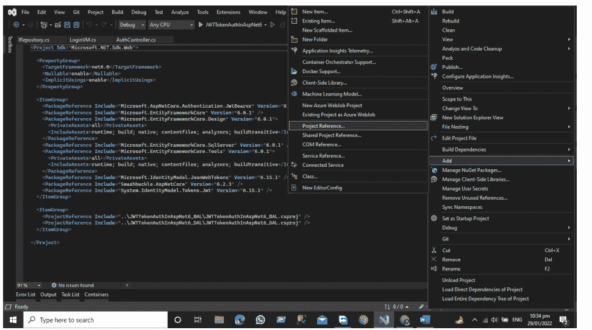

通过勾选复选框添加引用。

使用三层架构在 Asp.Net Core 中进行 API 开发 51

### 使用三层架构在 Asp.Net Core 中进行 API 开发

已为 DAL 和 BAL 添加了引用


现在，将数据访问层项目引用添加到业务层中。

- 右键点击业务访问层（Business access layer），然后点击 Add 按钮 => Project References

记住我们已经在项目中包含了 DAL 和 BAL 的引用，所以不要在业务层中添加表示层的引用。我们只需要在业务层中添加 DAL 层的引用


### DAL 的项目引用已添加到 BAL


### 项目结构

此项目中使用三层架构，包括数据访问层、业务层和表示层。


### 表示层 (PL)

表示层是最顶层；其主要作用是向用户展示结果。

### 业务访问层 (BAL)

逻辑层与数据访问层和表示层交互。

### 数据访问层 (DAL)

数据访问层包含辅助业务访问层编写业务逻辑的方法。数据访问层的主要目标是与数据库接口


### 配置需要遵循的步骤

- 添加数据访问层项目引用。
- 右键点击项目并添加新项目。
- 在添加业务访问层后，我们需要先添加数据访问层的引用。
- 右键点击项目并添加新项目。


使用三层架构在 Asp.Net Core 中进行 API 开发 56

在添加业务访问层和数据访问层后，我们需要先添加数据访问层的引用。


```csharp
using Microsoft.AspNetCore.Identity;
using System;
using System.Collections.Generic;
using System.Linq;
using System.Text;
using System.Threading.Tasks;

namespace JWTTokenAuthInAspNetCore6_DAL.Models
{
    public class AppUser : IdentityUser
    {
```csharp
public int Id { get; set; }
public string? Name { get; set; }
public string? AccountType { get; set; }
public string? PhoneNo { get; set; }
public string? Password { get; set; }
public string? ShopName { get; set; }
public string? BusinessType { get; set; }
public string? UserRole { get; set; }
public bool? IsDeleted { get; set; }
```
    }
}
```

# 仓库 (Repository)

在 Repository 文件夹中，我们为每个模型添加了仓库类。我们编写了使用 Entity Framework 与数据库通信的 CRUD（增删改查）函数。我们添加了继承 contract 文件夹中接口的仓库类。


```csharp
using JWTTokenAuthInAspNet6_DAL_Contracts;
using JWTTokenAuthInAspNet6_DAL_Data;
using JWTTokenAuthInAspNet6_DAL_Models;
using Microsoft.Extensions.Logging;
using System;
using System.Collections.Generic;
using System.Linq;
using System.Text;
using System.Threading.Tasks;

namespace JWTTokenAuthInAspNet6_DAL.Repositories
{
    public class RepositoryAppUser : IRepository<AppUser>
    {
        private readonly AppDbContext _appDbContext;
        private readonly ILogger _logger;

        public RepositoryAppUser(ILogger<AppUser> logger)
        {
            _logger = logger;
        }
```

```csharp
public async Task<AppUser> Create(AppUser appuser)
{
  try {
    if (appuser != null) {
      var obj = _appDbContext.Add<AppUser>(appuser);
      await _appDbContext.SaveChangesAsync();
      return obj.Entity;
    } else {
      return null;
    }
  } catch (Exception) {
    throw;
  }
}
```

```csharp
public void Delete(AppUser appuser)
{
  try {
    if(appuser!=null) {
      var obj = _appDbContext.Remove(appuser);
      if(obj!=null) {
        _appDbContext.SaveChangesAsync();
      }
    }
  } catch (Exception) {
    throw;
  }
}
```

```csharp
public IEnumerable<AppUser> GetAll()
{
```

```csharp
try
{
    var obj = _appDbContext.AppUsers.ToList();
    if (obj != null)
        return obj;
    else
        return null;
}
catch (Exception)
{
    throw;
}
```

```csharp
public AppUser GetById(int Id)
{
    try
    {
        if(Id!=null)
        {
            var obj = _appDbContext.AppUsers.FirstOrDefault(x => x.Id == Id);
            if (obj != null)
                return obj;
            else
                return null;
        }
    } else
    {
        return null;
    }
}catch (Exception)
{
    throw;
}
}
```

```csharp
public void Update(AppUser appuser)
{
    try
    {
        if (appuser != null)
```

```csharp
{
var obj = _appDbContext.Update(appuser);
if (obj != null) {
    _appDbContext.SaveChanges();
}
}
catch (Exception) {
    throw;
}
}
```

## 业务访问层 (Business Access Layer)

业务层与数据访问层通信，而表现层逻辑负责处理执行逻辑决策和评估的操作。该层的主要功能是处理周围层之间的数据交换。

我们在业务访问层中的项目结构如下。

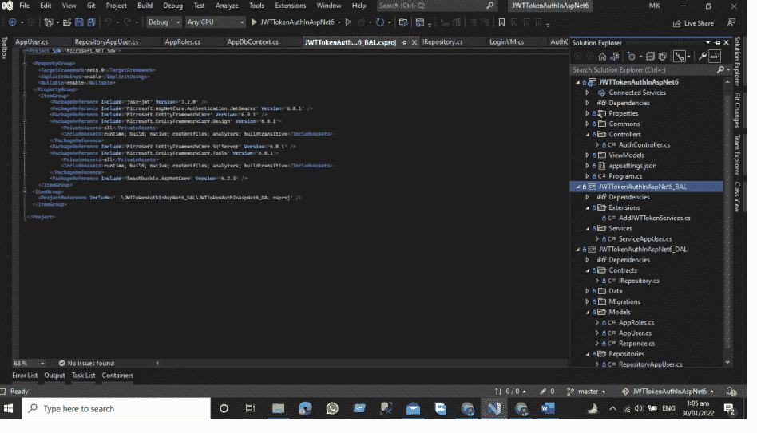

在这一层，我们将有两个文件夹：

- 扩展方法文件夹 (Extensions Method Folder)
- 以及服务文件夹 (Services Folder)

在业务访问层中，我们拥有与数据层和表现层等周围层通信的服务。

## 服务 (Services)

服务定义了应用程序业务逻辑。我们开发的的服务与数据层交互，并将数据从数据层移动到表现层，并从表现层移动到数据访问层。

## 示例 (Example)

```csharp
using JWTWokenAuthInAspNet6_DAL.Contracts;
using JWTWokenAuthInAspNet6_DAL.Models;
using System;
using System.Collections.Generic;
using System.Linq;
using System.Text;
using System.Threading.Tasks;
```

```csharp
namespace JWTWokenAuthInAspNet6_BAL.Services
{
    public class ServiceUser
    {
        public readonly IRepository<AppUser> _repository;
        public ServiceApp(IRepository<AppUser> repository)
        {
            _repository = repository;
        }

        // 创建方法
```


- 存储库层
- 服务层
- I 自定义服务接口
- 自定义服务
- 部门服务
- 学生服务
- 结果服务
- 课程 GPA 服务
- 表示层
- 依赖注入
- 修改 Program.cs 文件
- 控制器
- 输出
- 结论

## 引言

在本章中，我们将介绍使用 Asp.Net 6 Web API 的洋葱架构（Onion Architecture）。洋葱架构由 Jeffrey Palermo 于2008年引入，这种架构为我们提供了一种更好的构建应用程序的方法；使用这种架构，我们的应用程序具有更好的测试性、可维护性，并且对数据库和等基础设施的依赖较低。洋葱架构解决了耦合和关注点分离等常见问题。

## 什么是洋葱架构

在洋葱架构中，我们拥有领域层、存储库层、服务层和表示层。洋葱架构解决了我们在企业级应用中面临的耦合和关注点分离的问题。洋葱架构还解决了三层架构和 N 层架构中遇到的问题。在洋葱架构中，我们的层级之间通过接口进行通信。

## Asp.Net Core Web API 中的洋葱架构

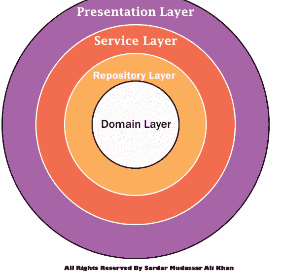

## 洋葱架构中的层

洋葱架构使用了“层”的概念，但它与 N 层架构和三层架构不同。

## 领域层

该层位于架构的中心，我们拥有应用实体，这些是在使用 Asp.net core 应用开发中使用代码优先（code first）方法的应用模型类或数据库模型类；这些实体用于在数据库中创建表。

### 存储库层

存储库层作为服务层和模型对象之间的中间层；我们在此层中维护所有的数据库迁移和数据库上下文对象（DbContext）。我们将添加包含数据库读写操作数据访问模式的接口。

### 服务层

该层用于与表示层和存储库层通信。服务层持有实体所有的业务逻辑。在这些服务中，为了实现松耦合和关注点分离，接口与其实现类保持分离。

## 表示层

在 API 的情况下，表示层通过 HTTP 请求以 JSON 对象的形式向我们展示数据库的对象数据。但在前端应用的情况下，我们通过消费 API 并使用 UI 展示数据。

## 洋葱架构的优势

- 洋葱架构为代码提供了更好的可维护性，因为代码依赖于层。
- 它为单元测试提供了更好的测试性；我们可以在不同的层中编写独立的测试用例，而不会影响应用程序中的其他模块。
- 使用洋葱架构，我们的应用程序是松耦合的，因为我们的层之间通过接口进行通信。
- 领域实体是架构的核心和中心，并且访问数据库和 UI 层。
- 在运行时将为应用程序提供完整的实现。
- 外部层永远不依赖于外部层。

## 洋葱架构的实现

现在我们将使用洋葱架构开发该项目。

首先，你需要使用 Visual Studio 创建一个 Asp.Net Core Web 项目。创建项目后，我们将层添加到项目中；在添加了所有层后，我们的项目结构将如下所示。

## 项目结构。

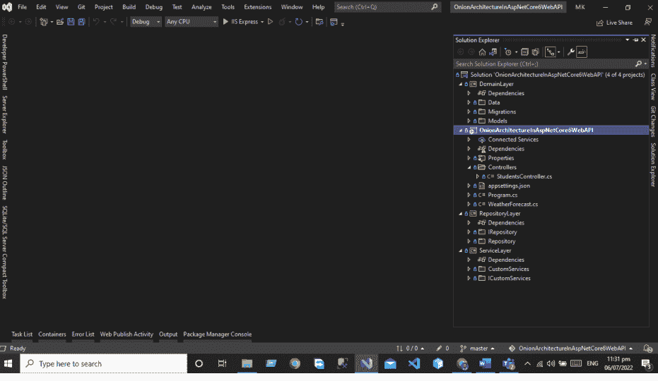

## 领域层

该层位于架构的中心，我们拥有应用实体，这些是在使用 Asp.net core 应用开发中使用代码优先（code first）方法的应用模型类或数据库模型类；这些实体用于在数据库中创建表。

对于领域层，我们需要向应用程序添加类库项目。

右键点击解决方案（Solution），然后点击添加（add）选项。

## 使用洋葱架构在 Asp.Net.Core 中开发 API

# Models 

首先，你需要添加 Models 文件夹，将用于创建数据库实体。在 Models 文件夹中，我们将创建以下数据库实体。

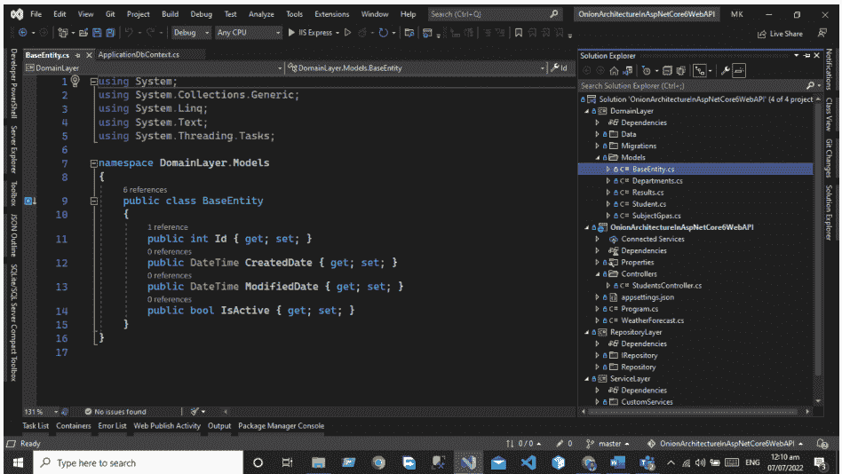

### BaseEntity（基础实体）

```csharp
using System;
using System.Collections.Generic;
using System.Linq;
using System.Text;
using System.Threading.Tasks;

namespace DomainLayer.Models
{
    public class BaseEntity
    {
        public int Id { get; set; }
        public DateTime CreatedDate { get; set; }
        public DateTime ModifiedDate { get; set; }
        public bool IsActive { get; set; }
    }
}
```

使用洋葱架构在 Asp.Net Core 中开发 API

### Department（部门）

Department 继承自 BaseEntity

```csharp
using System;
using System.Collections.Generic;
using System.Linq;
using System.Text;
using System.Threading.Tasks;

namespace DomainLayer.Models
{
    public class Departments : BaseEntity
    {
        public string DepartmentName { get; set; }
        public int StudentId { get; set; }
        public Student Students { get; set; }
    }
}
```

### Result（结果）

Result 将继承自 BaseEntity

```csharp
using System;
using System.Collections.Generic;
using System.ComponentModel.DataAnnotations;
using System.Linq;
using System.Text;
using System.Threading.Tasks;

namespace DomainLayer.Models
{
    public class Results : BaseEntity
    {
        public string ResultStatus { get; set; }
        public int StudentId { get; set; }
        public Student Students { get; set; }
    }
}
```

### Students（学生）

Student 继承自基础实体

```csharp
using System;
using System.Collections.Generic;
using System.ComponentModel.DataAnnotations;
using System.Linq;
using System.Text;
using System.Threading.Tasks;

namespace DomainLayer.Models
{
    public class Student : BaseEntity
    {
        public string Name { get; set; }
        public string Address { get; set; }
        public string Emial { get; set; }
        public string City { get; set; }
        public string State { get; set; }
        public string Country { get; set; }
        public int Age { get; set; }
        public DateTime BirthDate { get; set; }
    }
}
```

### SubjectGpa（课程 GPA）

Subject GPA 实体继承自 Base Entity

```csharp
using System;
using System.Collections.Generic;
using System.Linq;
using System.Text;
using System.Threading.Tasks;

namespace DomainLayer.Models
{
    public class SubjectGpas : BaseEntity
    {
        public string SubjectName { get; set; }
        public float Gpa { get; set; }
        public string SubjectPass { get; set; }
        public int StudentId { get; set; }
        public Student Students { get; set; }
    }
}
```

### Data 文件夹

在领域中添加 Data 文件夹，用于添加数据库上下文类。数据库上下文类用于维护底层数据库的会话，通过它可以执行 CRUD 操作。

右键点击应用程序创建 ApplicationDbContext 类

```csharp
using DomainLayer.Models;
using Microsoft.EntityFrameworkCore;
using System;
using System.Collections.Generic;
using System.Linq;
using System.Text;
using System.Threading.Tasks;
```

```csharp
namespace DomainLayer.Data
{
    public class ApplicationDbContext : DbContext
    {
        public ApplicationDbContext(DbContextOptions<ApplicationDbContext> options) : base(options)
        {
        }
        protected override void OnModelCreating(ModelBuilder builder)
        {
            base.OnModelCreating(builder);
        }
        public DbSet<Student> Students { get; set; }
        public DbSet<Departments> Departments { get; set; }
        public DbSet<SubjectGpas> SubjectGpas { get; set; }
        public DbSet<Results> Results { get; set; }
    }
}
```


添加 DB Set 属性后，我们需要使用程序包管理器控制添加迁移并运行 `Command-Migration` 命令。

`add-migration OnionArchitectureV1`

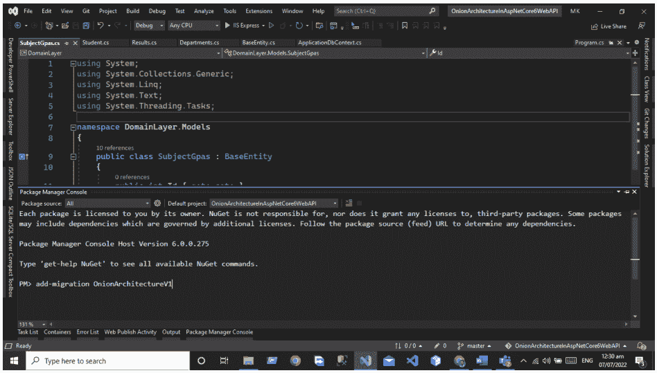

现在执行命令后，你需要通过执行 `update-database` 命令来更新数据库。

### Migration 文件夹

在执行完两个命令后，你可以在领域层（domain layer）中看到迁移文件夹。

### Repository 层

Repository 层作为服务层和模型对象之间的中间层，我们在此层中维护所有的数据库迁移和数据库上下文对象（DbContext）。我们将添加包含读写操作数据访问模式的接口。

我们现在开始处理 Repository 层，将遵循与处理领域层相同的步骤，在你的应用程序中添加类项目，并将该项目命名为 Repository 层。

**但在这里我们需要在 Repository 层中添加 Domain 层的项目引用。** 右键点击项目并点击“添加（Add）”按钮，之后将在 Repository 层中添加项目引用。

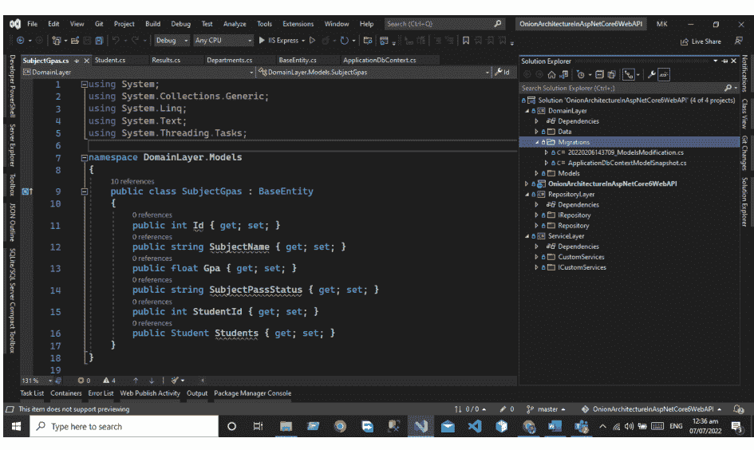

## 使用架构在 Asp.Net Core 中开发 API

现在点击引用（reference）并选择 Domain 层。

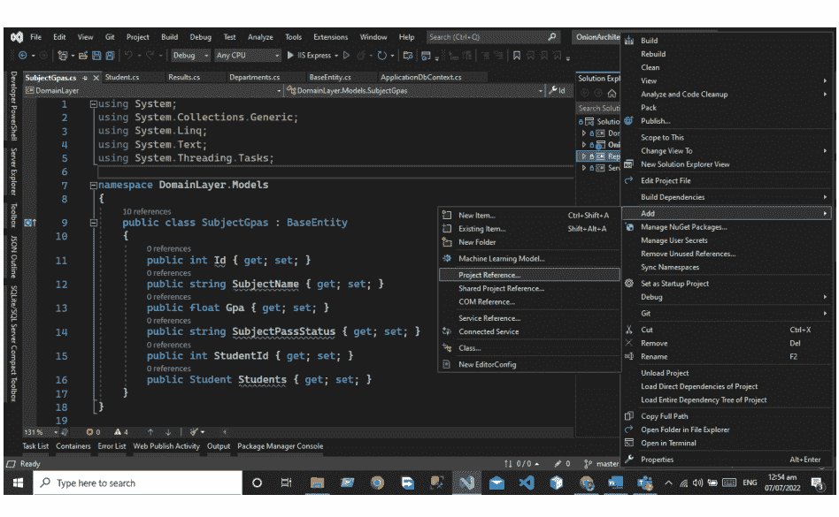

现在我们需要添加两个文件夹。

- IRepository
- Repository

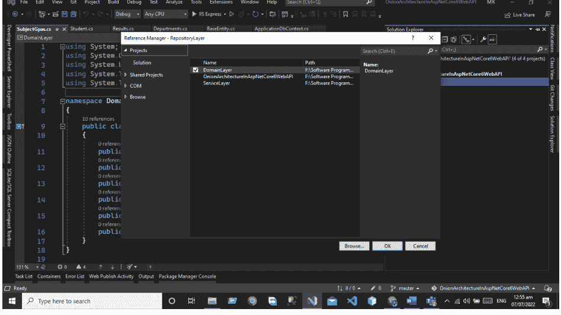

### IRepository

IRepository 文件夹包含通用接口，通过此接口我们将为我们所有的实体创建 CRUD（增删改查）操作。

通用接口将扩展 `Base-Entity` 以使用某些属性。泛型接口的代码所示：

```csharp
using DomainLayer.Models;

namespace RepositoryLayer.IRepository
{
    public interface IRepository<T> where T : BaseEntity
    {
        IEnumerable<T> GetAll();
        T Get(int Id);
        void Insert(T entity);
        void Update(T entity);
        void Delete(T entity);
        void Remove(T entity);
        void SaveChanges();
    }
}
```

### Repository

现在我们创建一个继承泛型 `IRepository` 接口的泛型 Repository。泛型 Repository 代码所示：

```csharp
using DomainLayer.Data;
using DomainLayer.Models;
using Microsoft.EntityFrameworkCore;
using RepositoryLayer.IRepository;
using System;
using System.Collections.Generic;
using System.Linq;
using System.Text;
using System.Threading.Tasks;

namespace RepositoryLayer.Repository
{
    public class Repository<T> : IRepository<T> where T : BaseEntity
    {
        #region property
        private readonly ApplicationDbContext _applicationDbContext;
        private DbSet<T> entities;
        #endregion

        #region Constructor
        public Repository(ApplicationDbContext applicationDbContext)
        {
            _applicationDbContext = applicationDbContext;
            entities = _applicationDbContext.Set<T>();
        }
        #endregion

        public void Delete(T entity)
        {
            if (entity == null)
            {
                throw new ArgumentException("entity");
            }
            entities.Remove(entity);
            _applicationDbContext.SaveChanges();
        }

        public T Get(int Id)
        {
            return entities.SingleOrDefault(c => c.Id == Id);
        }

        public IEnumerable<T> GetAll()
        {
            return entities.AsEnumerable();
        }

        public void Insert(T entity)
        {
            if (entity == null)
            {
                throw new ArgumentException("entity");
            }
            entities.Add(entity);
            _applicationDbContext.SaveChanges();
        }

        public void Remove(T entity)
        {
            if (entity == null)
            {
                throw new ArgumentNullException("entity");
            }
            entities.Remove(entity);
        }

        public void SaveChanges()
        {
            _applicationDbContext.SaveChanges();
        }

        public void Update(T entity)
        {
            if (entity == null)
            {
                throw new ArgumentNullException("entity");
            }
            entities.Update(entity);
            _applicationDbContext.SaveChanges();
        }
    }
}
```

我们将在服务层中使用此 Repository。

## Service 层

此层用于与表现层（presentation layer）和 Repository 层通信。服务层持有实体的所有的业务逻辑。在服务层中，接口与其实现是分离的，以实现松耦合和关注点分离。

现在我们需要向解决方案中添加一个新项目作为服务层，我们将遵循在应用程序中添加类项目的相同过程，但在这里添加项目后，还需要进行一些额外工作，即添加 Repository 层的引用。

## 使用洋葱架构在 Asp.Net Core 中开发 API

我们新的服务层包含了 Repository 层的引用。

在服务层中，我们将创建两个文件夹。

- ICustomServices
- CustomServices

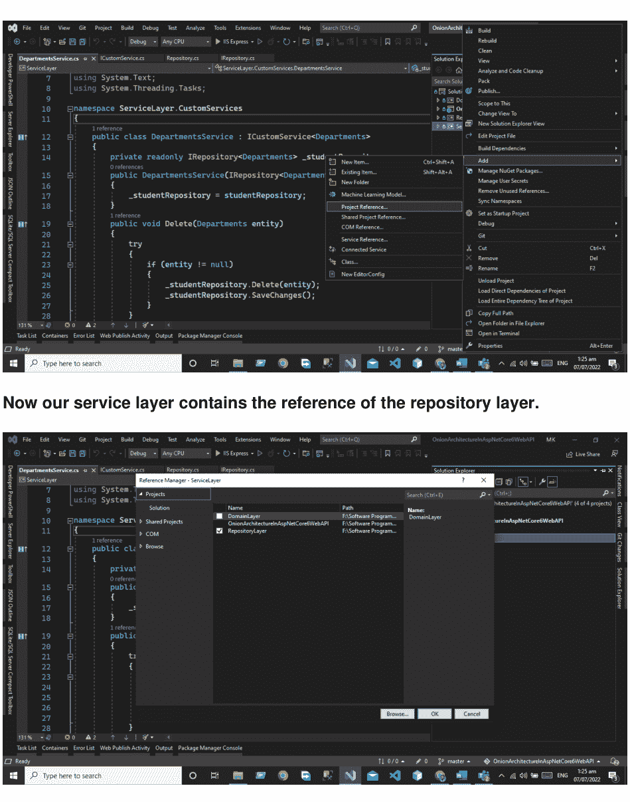

### ICustom Service

现在在 ICustomServices 文件夹中，我们将创建 `ICustomServices` 接口。该接口持有方法的签名，我们将在下方的 `ICustomServices` 接口代码中实现这些方法：

```csharp
using DomainLayer.Models;
using System;
using System.Collections.Generic;
using System.Linq;
using System.Text;
using System.Threading.Tasks;

namespace ServiceLayer.ICustomServices
{
    public interface ICustomService<T> where T : class {
        IEnumerable<T> GetAll();
        T Get(int Id);
        void Insert(T entity);
        void Update(T entity);
        void Delete(T entity);
        void Remove(T entity);
    }
}
```

### Custom Service

在自定义服务文件夹中，我们将创建一个继承自 `ICustomService` 接口的自定义服务类，自定义服务类代码所示。我们将为所有的实体编写 CRUD 操作。对于每个服务，我们将使用泛型仓库编写 CRUD 操作。

### Department Service

```csharp
using DomainLayer.Models;
using RepositoryLayer.IRepository;
using ServiceLayer.ICustomServices;
using System;
using System.Collections.Generic;
using System.Linq;
using System.Text;
using System.Threading.Tasks;

namespace ServiceLayer.CustomServices
{
    public class StudentService : ICustomService<Student>
    {
        private IRepository<Student> _studentRepository;

        public StudentService(IRepository<Student> studentRepository)
        {
            _studentRepository = studentRepository;
        }

        public void Delete(Student entity)
        {
            try
            {
                if (entity != null)
                {
                    _studentRepository.Delete(entity);
                    _studentRepository.SaveChanges();
                }
            } catch (Exception)
            {
                throw;
            }
        }

        public Student Get(int Id)
        {
            try
            {
                var obj = _studentRepository.Get(Id);
                if (obj != null)
                {
                    return obj;
                }
                else
                {
                    return null;
                }
            } catch (Exception)
            {
                throw;
            }
        }

        public IEnumerable<Student> GetAll()
        {
            try
            {
                var obj = _studentRepository.GetAll();
                if (obj == null)
                {
                    return obj;
                }
                else
                {
                    return null;
                }
            } catch (Exception)
            {
                throw;
            }
        }

        public void Insert(Student entity)
        {
            try
            {
                if (entity != null)
                {
                    _studentRepository.Insert(entity);
                    _studentRepository.SaveChanges();
                }
            } catch (Exception)
            {
                throw;
            }
        }

        public void Remove(Student entity)
        {
            try
            {
                if (entity != null)
                {
                    _studentRepository.Remove(entity);
                    _studentRepository.SaveChanges();
                }
            } catch (Exception)
            {
                throw;
            }
        }

        public void Update(Student entity)
        {
            try
            {
                if (entity != null)
                {
                    _studentRepository.Update(entity);
                    _studentRepository.SaveChanges();
                }
            } catch (Exception)
            {
                throw;
            }
        }
    }
}
```

### Result Service


```csharp
using DomainLayer.Models;
using RepositoryLayer.IRepository;
using ServiceLayer.ICustomServices;
using System;
using System.Collections.Generic;
using System.Linq;
using System.Text;
using System.Threading.Tasks;
```

```csharp
namespace ServiceLayer.CustomServices
{
    public class ResultService : ICustomService<Result>
    {
        private readonly IRepository<Result> _studentRepository;
        public ResultService(IRepository<Result> studentRepository)
        {
            _studentRepository = studentRepository;
        }
        public void Delete(Result entity)
        {
            try
            {
                if (entity != null)
                {
                    _studentRepository.Delete(entity);
                    _studentRepository.SaveChanges();
                }
            }
            catch (Exception)
            {
                throw;
            }
        }

        public Result Get(int id)
        {
            try
            {
                var obj = _studentRepository.Get(id);
                if (obj != null)
                {
                    return obj;
                }
                else
                {
                    return null;
                }
            }
            catch (Exception)
            {
                throw;
            }
        }

        public IEnumerable<Result> GetAll()
        {
            try
            {
                var obj = _studentRepository.GetAll();
                if (obj != null)
                {
                    return obj;
                }
                else
                {
                    return null;
                }
            }
            catch (Exception)
            {
                throw;
            }
        }

        public void Insert(Result entity)
        {
            try
            {
                if (entity != null)
                {
                    _studentRepository.Insert(entity);
                    _studentRepository.SaveChanges();
                }
            }
            catch (Exception)
            {
                throw;
            }
        }

        public void Remove(Result entity)
        {
            try {
                if (entity != null)
                {
                    _studentRepository.Remove(entity);
                    _studentRepository.SaveChanges();
                }
            } catch (Exception)
            {
                throw;
            }
        }

        public void Update(Result entity)
        {
            try {
                if (entity != null)
                {
                    _studentRepository.Update(entity);
                    _studentRepository.SaveChanges();
                }
            } catch (Exception)
            {
                throw;
            }
        }
    }
}
```

### 学科 GPA 服务

```csharp
using DomainLayer.Models;
using RepositoryLayer.IRepository;
using ServiceLayer.ICustomServices;
using System;
using System.Collections.Generic;
using System.Linq;
using System.Text;
using System.Threading.Tasks;
```

```csharp
namespace ServiceLayer.CustomServices
{
    public class SubjectGpaService : ICustomService<SubjectGpa>
    {
        private readonly IRepository<SubjectGpa> _studentRepository;
        public SubjectGpaService(IRepository<SubjectGpa> studentRepository)
        {
            _studentRepository = studentRepository;
        }
        public void Delete(SubjectGpa entity)
        {
            try
            {
                if (entity != null)
                {
                    _studentRepository.Delete(entity);
                    _studentRepository.SaveChanges();
                }
            }
            catch (Exception)
            {
                throw;
            }
        }

        public SubjectGpa Get(int Id)
        {
            try {
                var obj = _studentRepository.Get(Id);
                if (obj != null) {
                    return obj;
                }
            } else {
                return null;
            }
            } catch (Exception) {
            throw;
            }
        }

        public IEnumerable<SubjectGpa> GetAll() 
        {
            try {
                var obj = _studentRepository.GetAll();
                if (obj != null) {
                    return obj;
                }
            } else {
                return null;
            }
            } catch (Exception) {
            throw;
            }
        }

        public void Insert(SubjectGpa entity)
        {
            try
            {
                if (entity != null)
                {
                    _studentRepository.Insert(entity);
                    _studentRepository.SaveChanges();
                }
            }
            catch (Exception)
            {
                throw;
            }
        }

        public void Remove(SubjectGpa entity)
        {
            try
            {
                if (entity != null)
                {
                    _studentRepository.Remove(entity);
                    _studentRepository.SaveChanges();
                }
            } catch (Exception)
            {
                throw;
            }
        }

        public void Update(SubjectGpa entity)
        {
            try
            {
                if (entity != null)
                {
                    _studentRepository.Update(entity);
                    _studentRepository.SaveChanges();
                }
            } catch (Exception)
            {
                throw;
            }
        }
    }
}
```

## 表示层

表示层是我们的最终层，负责在每次请求时向前端用户展示数据。在 API 层中，它通过使用 JSON 对象向我们展示数据库中的对象。但在前端应用程序中，我们通过调用 API 来展示数据。表示层是默认的 ASP.NET Core API 项目。现在，我们需要像之前一样为所有层添加项目引用。

img/ecf1b6ddef03c95166d23c4cb85_0.png

## 依赖注入

现在我们需要在 `Program.cs` 类中为所有的服务添加依赖注入。

## 修改 Program.cs 文件

Startup 类的代码如下：

```csharp
using DomainLayer.Data;
using DomainLayer.Models;
using Microsoft.EntityFrameworkCore;
using RepositoryLayer.IRepository;
using RepositoryLayer.Repository;
using ServiceLayer.CustomServices;
using ServiceLayer.ICustomServices;
```

```csharp
var builder = WebApplication.CreateBuilder(args);

// 将服务添加到容器中
// Sql 依赖注入
var ConnectionString = builder.Configuration.GetConnectionString("DefaultConnection");
builder.Services.AddDbContext<ApplicationDbContext>(options =>
    options.UseSqlServer(ConnectionString));
builder.Services.AddControllers();
// 更多关于如何配置 Swagger/OpenAPI 的信息，请访问 https://aka.ms/aspnetcore/buckle
builder.Services.AddEndpointsExplorer();
builder.Services.AddSwaggerGen();

#region 服务注入
builder.Services.AddScoped(typeof(IRepository<>), typeof(Repository<>));
builder.Services.AddScoped<ICustomService<Student>, StudentService>();
builder.Services.AddScoped<ICustomService<Result>, ResultService>();
builder.Services.AddScoped<ICustomService<Department>, DepartmentService>();
builder.Services.AddScoped<ICustomService<SubjectGpa>, SubjectGpaService>();
#endregion
```

```csharp
var app = builder.Build();

// 配置 HTTP 请求管道线
if (app.Environment.IsDevelopment())
{
    app.UseSwagger();
    app.UseSwaggerUI();
}

app.UseHttpsRedirection();

app.UseAuthorization();

app.MapControllers();

app.Run();
```

## 控制器

控制器用于处理 HTTP 请求。现在我们需要添加一个控制器，它与我们的服务层交互并向用户展示数据。

### 控制器的代码如下：

```csharp
using DomainLayer.Data;
using DomainLayer.Models;
using Microsoft.AspNetCore.Http;
using Microsoft.AspNetCore.Mvc;
using Microsoft.EntityFrameworkCore;
using RepositoryLayer.IRepository;
using ServiceLayer.ICustomServices;

namespace OnionArchitectureIn6WebAPI.Controllers
{
    [Route("api/[controller]")]
    [ApiController]
    public class StudentsController : ControllerBase
    {
        private readonly ICustomService<Student> _customService;
        private readonly ApplicationDbContext _applicationContext;
        public StudentsController(ICustomService<Student> customService, ApplicationDbContext applicationContext)
        {
            _customService = customService;
            _applicationContext = applicationContext;
        }

        [HttpGet(nameof(GetStudentById))]
```
img/ecf1b6ddef03c95166d23c4cb85_98_0.png

```csharp
        public IActionResult GetStudentById(int Id)
        {
            var obj = _customService.Get(Id);
            if (obj == null)
            {
                return NotFound();
            }
            else
            {
                return Ok(obj);
            }
        }

        [HttpGet(nameof(GetAllStudent))]
        public IActionResult GetAllStudent()
        {
            var obj = _customService.GetAll();
            if (obj == null)
            {
                return NotFound();
            }
            else
            {
                return Ok(obj);
            }
        }

        [HttpPost(nameof(CreateStudent))]
        public IActionResult CreateStudent(Student student)
        {
            if (student != null)
            {
                _customService.Insert(student);
                return Ok("Created Successfully");
            }
            else
            {
                return BadRequest("Something went wrong");
            }
        }

        [HttpPost(nameof(UpdateStudent))]
        public IActionResult UpdateStudent(Student student)
        {
            if (student != null)
```


```csharp
{
  _customService.Update(student);
  return Ok("Updated Successfully");
}
else
{
  return BadRequest();
}

[HttpDelete(nameof(DeleteStudent))]
public IActionResult DeleteStudent(Student student)
{
  if(student!=null)
  {
    _customService.Delete(student);
    return Ok("Deleted Successfully");
  }
  else
  {
    return BadRequest("Something went wrong");
  }
}
```

### 输出

现在我们将运行项目并使用 swagger 查看输出。

### OnionArchitectureInAspNetCore6WebApi

### Students

- GET /api/Students/GetStudentId
- GET /api/Students/GetAllStudents
- POST /api/Students/CreateStudent
- POST /api/Students/UpdateStudent
- DELETE /api/Students/DeleteStudent

### Schemas

现在我们可以看到，当我们调用 GetAllStudent 端点时，我们可以在 JSON 项目中看到来自数据库的学生数据。

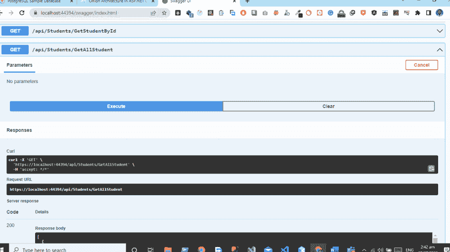

```json
{
  "id": "0",
  "name": "Product",
  "description": "Product description",
  "price": "100",
  "image": "66666666-6666-4666-8666-55555555555",
  "created": "2023-01-01T00:00:00Z",
  "updated": "2023-01-01T00:00:00Z"
}
```

## 结论

在本章中，我们使用 Entity Framework 和 Code First 方法实现了洋葱架构（Onion architecture）。我们现在掌握了洋葱架构中各层之间如何通信的知识，以及如何为接口仓库和和服务编写泛型代码。现在我们可以使用洋葱架构开发 API 项目或基于 MVC Core 的项目。

## 完整的 GitHub 项目 URL

[点击此处查看完整项目](#)

# 4

# 使用 Postman 进行 API 测试

## 概述

- 引言
- 如何使用 Postman 测试 Asp Net Core 5 中的 API Web 服务
- 在 Postman 中测试 Post 调用
- 在 Postman 中测试 Get 调用
- 在 Postman 中测试 Put 调用
- 在 Postman 中测试 Delete 调用
- 结论

## 引言

在本文中，我将介绍使用 Postman 测试 Web API 服务的完整流程。这是测试和记录你的 Web 服务最简单且美的方法。Postman 是一个用于 API 开发的协作平台。Postman 的功能简化了构建 API 的每一个步骤并优化了协作，让你能够更快速地创建更好的 API。

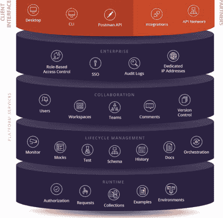

## 如何使用 Postman 在 Asp Net 5 中测试 API 服务

在 Postman API 测试中，专业的方法是使用 API 请求集合（Collection）来收集如 GET、PUT、POST、DELETE 请求的响应。打开 postman，点击 Create Collection（创建集合）。

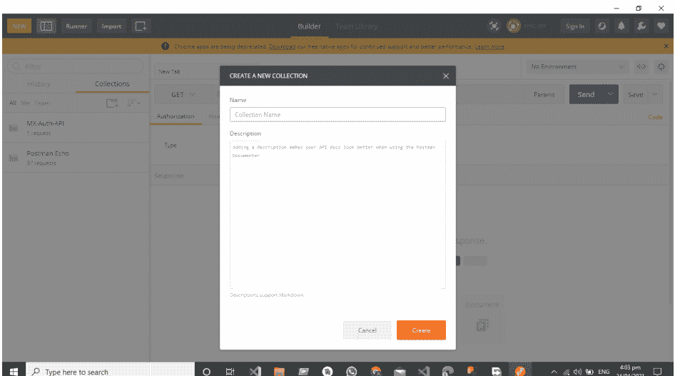

在 Postman 中命名该集合。

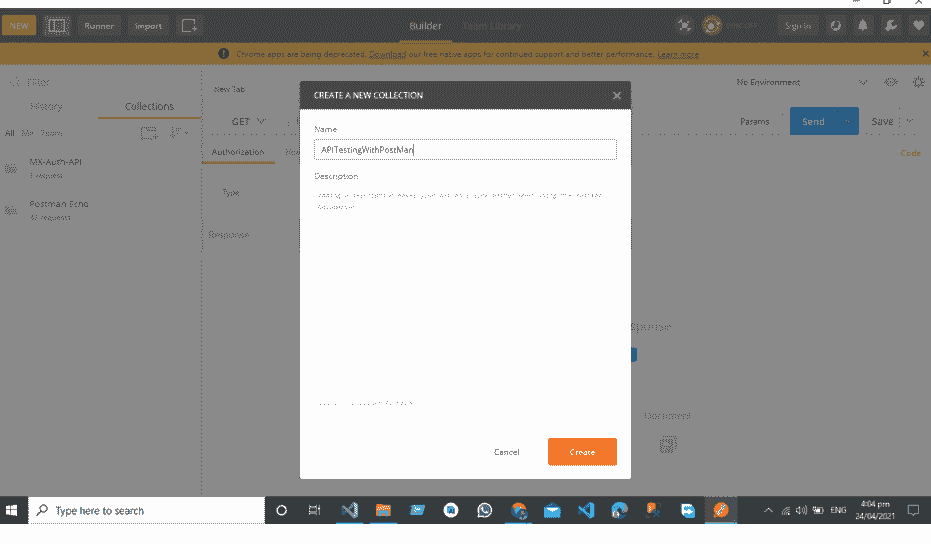

集合已准备好，用于收集 API 请求响应。

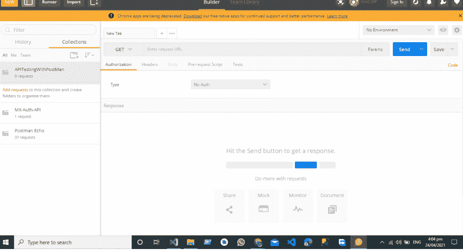

使用 Postman 进行 API 测试

## 添加像 PUT、POST、DELETE 和 GET 这样的 API 请求响应，

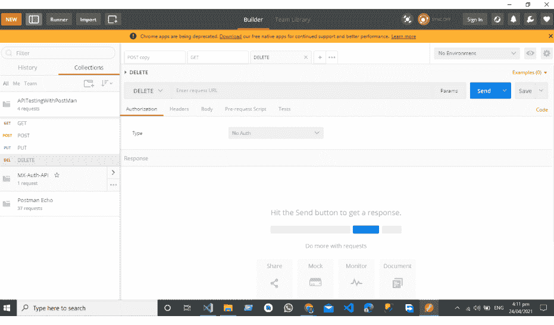

我们将针对本文的用例进行测试。在本文中，我将测试 Web 的 POST、GET、PUT、DELETE 和 UPDATE 端点。

 在此示例中，我们将使用开发的 Asp.Net Core 5 测试 Web 服务。

## 在 Postman 中测试 Post 调用

在这里我们将发送带有属性的 JSON 对象：

```json
{
  "username": "string",
  "userPassword": "string",
  "userEmail": "string",
  "createdOn": "2021-04-16T20:41.0622",
  "isDeleted": true
}
```

使用 Postman 进行 API 测试

 现在点击 Raw 并选择 JSON。如果我们想在数据库中创建新用户，我们必须将 JSON 对象发送到端点，然后通过 Postman UI 发布到端点，从而在数据库中创建完整的用户对象。


 现在你可以看到 API 给我们的服务器响应，这表明我们使用 Postman 在数据中已创建了新记录。

## 在 Postman 中测试 Delete 调用

为了删除用户，我们在数据库中有一个单独端点，我们必须将 JSON 对象发送到端点，然后通过 Postman UI 发布到控制器的 DELETE 调用，从而从数据库中删除。在删除记录时，选择 body 并传递要从数据库删除的 id 值。

 我们针对指定的邮箱删除记录，如果 API 服务器响应为 true，则我们的记录已成功删除。

 在上面的图片中，你可以看到点击 Delete 端点后服务器响应为 true，这表明我们的记录已从数据库中删除。

## 在 Postman 中测试 Get 调用

如果我们想从数据库中获取所有用户的记录，我们将使用 Postman 调用 Web 服务的 GET 点，服务器请求完成后，我们的 GetAllPerson 端点将向我们提供所有数据。

 点击端点从数据库中获取所有记录。


## 在 Postman 中测试 Put 调用

在 Web 服务成功执行后，我们在数据库中以 JSON 对象的形式可见记录，数据库中只有一条记录，因此在 put 调用中我们将更新数据库记录。我们有单独的端点通过点击 UPDATE 点根据用户邮箱更新数据库的用户记录并发送到控制器，在控制器中我们有根据用户邮箱更新数据库记录的单独端点。

我们将更新数据库中给定的 JSON 对象：

```json
{
  "id": 0,
  "username": "Mudassar Ali Khan",
  "userPassword": "17859345",
  "userEmail": "mudassarali@gmail.com",
  "createdOn": "2021-04-16T20:41:15.433Z",
  "isDeleted": false
}
```

到下面的 JSON 对象：

```json
{
  "username": "Sardar Mudassar Ali Khan",
  "userPassword": "17859345",
  "userEmail": "mudassarali@gmail.com",
  "createdOn": "2021-04-16T20:41:15.4332Z",
  "isDeleted": false
}
```

 我们已 API JSON 响应发送到 PUT 端点以更新数据库中的记录。

 在成功提交数据后，你可以看到服务器响应为 true，这表明我们的数据已成功提交到数据库。


## 结论

作为一名软件工程师，我对 Postman 的结论是它是测试 restful API 的最佳 Open API。作为一名开发者，我有使用 Postman 测试 restful API、发送完整 JSON 对象并以专业方式获取的良好体验。它很容易在 Asp.net core Web API 项目中实现，配置完成后开发者可以享受 API 的魅力。

# 5

# 使用 Swagger 进行 API 测试

## 概述

- 引言
- 如何使用 Swagger 测试 Asp Net Core 5 中的 API Web 服务
- 在 Swagger 中测试 Post 调用
- 在 Swagger 中测试 Get 调用
- 在 Swagger 中测试 Put 调用
- 在 Swagger 中测试 Delete 调用
- 结论

## 引言

在本文中，我将介绍使用 Swagger Open API 测试 Web API 服务的完整流程。Swagger (Open API) 是一种描述和记录 REST API 的语言无关规范。它允许机器和开发者在不直接访问项目源代码的情况下理解机器的工作原理和能力。swagger (Open API) 的主要目标是：

- 最小化连接微服务的工作量
- 减少准确记录微服务所需的时间

## 如何使用 Swagger 在 Asp Net Core 5 中测试 API 服务

我们将针对本文的以下用例进行测试。在本文中，我将测试 Web 服务的 POST、GET、PUT、DELETE 和 UPDATE 端点。


## 在 Swagger 中测试 POST 调用

在这里我们将发送包含以下属性的 JSON 对象：

- {
  "id": 0,
  "userName": "string",
  "userPassword": "string",
  "userEmail": "string",
  "createdAt": "2021-04-16T20:38:41.062Z",
  "isDeleted": true
}

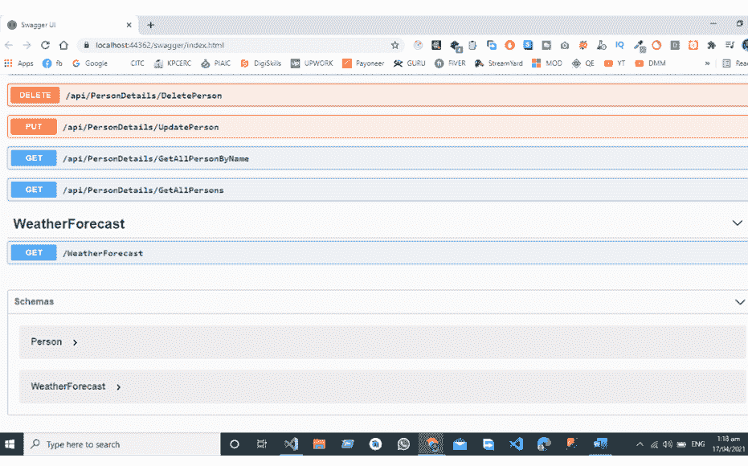

### Swagger UI

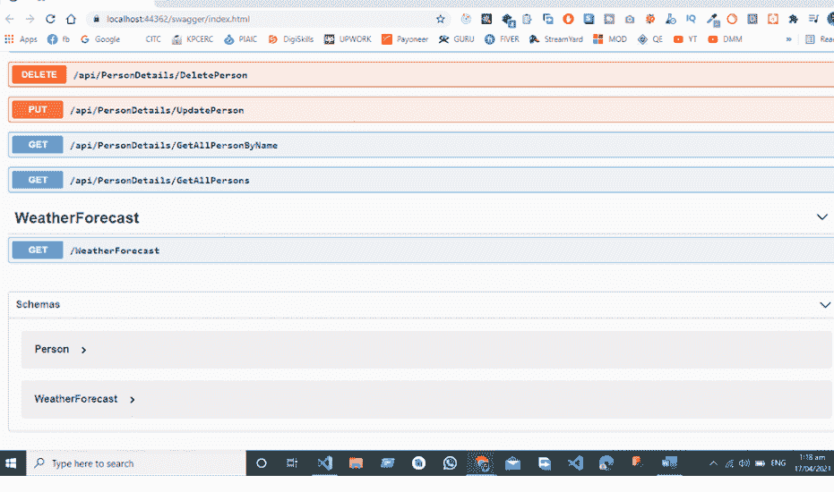

现在点击 try-out（尝试）按钮。

### Person详情 (PersonDetails)

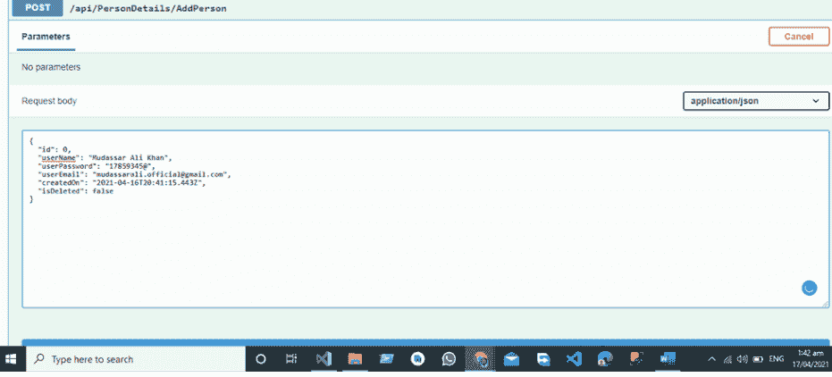

如果我们想在数据库中创建新人员，我们必须将 JSON 对象发送到端点，然后数据通过 Swagger UI 提交到控制器的 POST 端点，随后由 Create Person 对象在数据库中创建出完整的人员对象。

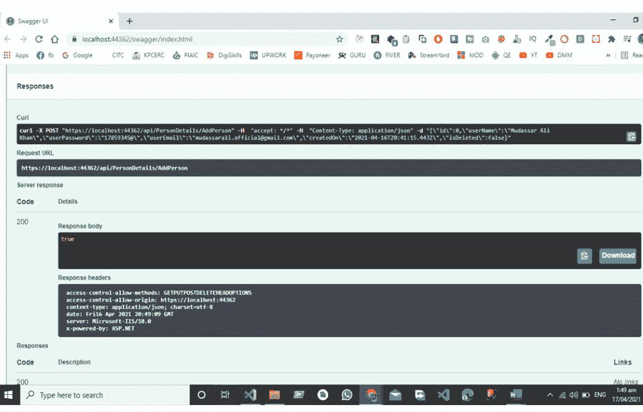

现在你可以看到 API 给了我们的服务器响应 == true，这表明根据我们使用 Swagger 发送的 JSON 对象，数据库中已创建了一条新记录。

### ### 在 Swagger 中测试 DELETE 调用

对于删除人员的操作，我们有一个独立的端点从数据库中删除员工（Delete Employee），我们必须将 JSON 对象发送到该端点，然后数据通过 Swagger UI 提交调用控制器中的 DELETE Person 端点，随后人员对象将从数据库中删除。

## 现在我们将根据特定的 Id 删除对应的记录

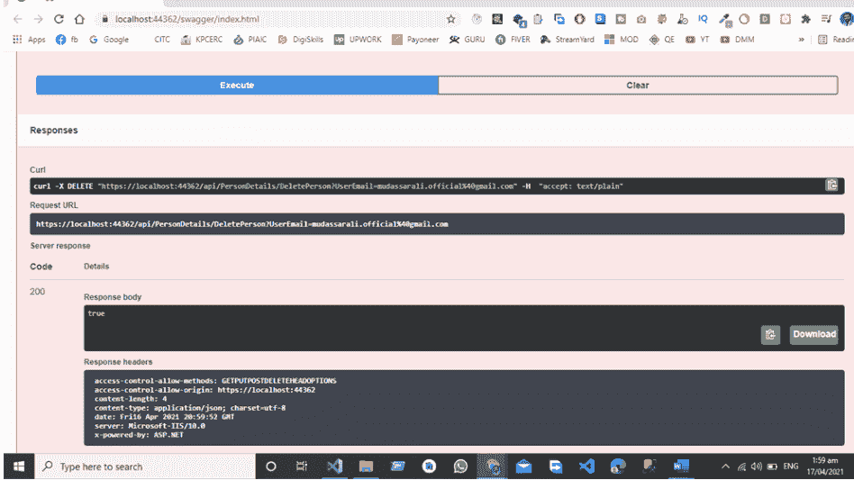

我们将根据给定的邮箱删除记录，如果 API 服务返回 true，则我们的记录已成功从数据库中删除。

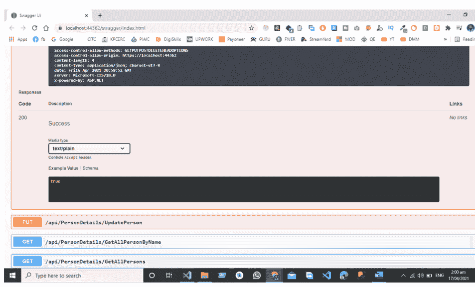

在上面的两张图中，你可以看到点击删除端点后我们的服务器响应为 true，这表明根据我们指定的邮箱，记录已从数据库中删除。

## ## 在 Swagger 中测试 GET 调用

如果我们想从数据库中获取所有人员数据记录，我们将使用 Swagger 在 Web 服务中访问 GET 端点，在服务器请求完成后，所有数据将通过我们的 GETALLPerson 端点提供给我们。

### Swagger UI

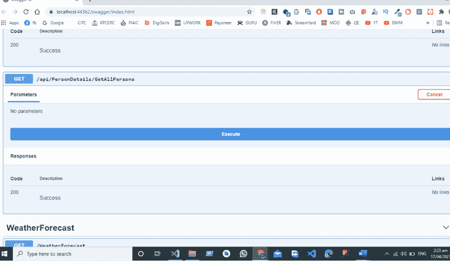

现在我们将从数据库中获取所有记录。

### Swagger UI

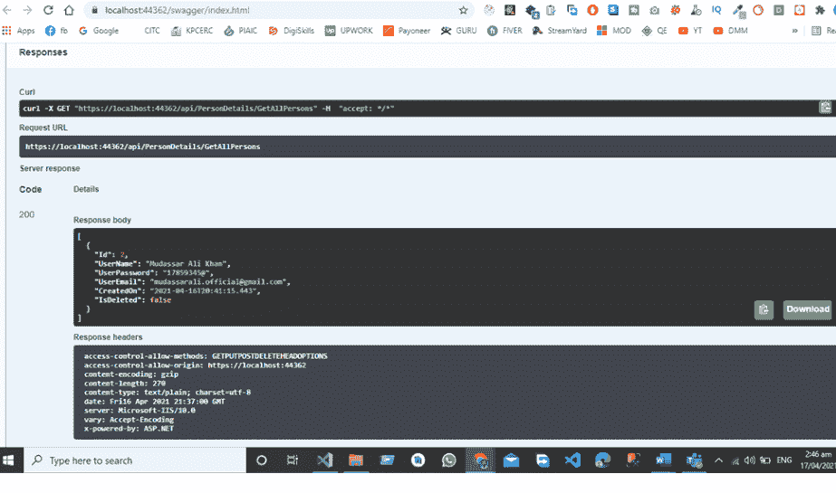

在 Web 服务成功执行后，所有记录都以 JSON 对象的形式在数据库中我们可见。我们只有一条记录，所以

### 在 Swagger 中测试 PUT 调用

在调用中，我们将更新数据库中的记录。我们为所有操作设置了独立的端点：通过点击 UPDATE 端点根据用户邮箱从数据库中更新人员记录，这会将请求发送到控制器；在控制器中，我们有一个独立的端点用于根据用户邮箱更新数据库中的记录。

我们将更新数据库中的下述 JSON 对象。

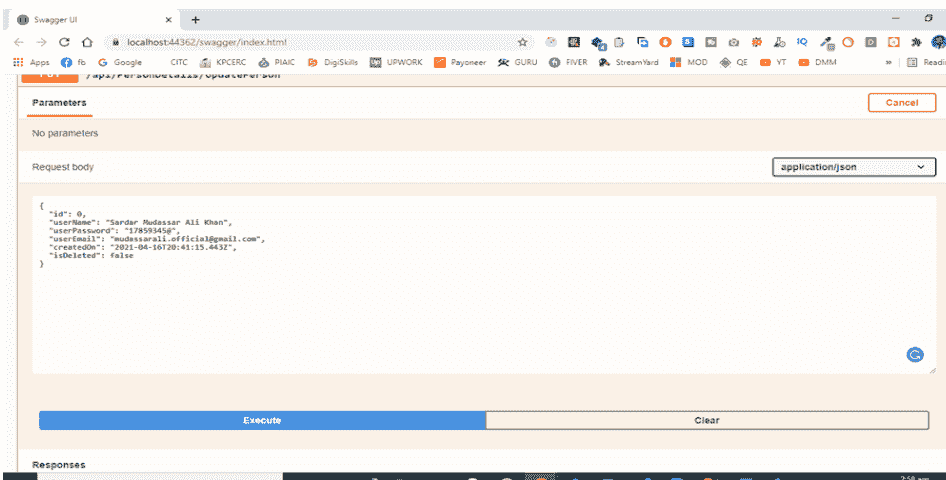

- {
  "id": 0,
  "userName": "Mudassar Ali Khan",
  "userPassword": "178593454@",
  "userEmail": "mudassarali.official@gmail.com",
  "createdAt": "2021-04-16T20:41:15.432Z",
  "isDeleted": false
}

更新为下面的 JSON 对象：

- {
  "id": 0,
  "userName": "Sardar Mudassar Ali Khan",
  "userPassword": "178593454@",
  "userEmail": "mudassarali.official@gmail.com",
  "createdAt": "2021-04-16T20:41:15.432Z",
  "isDeleted": false
}

# 使用 Swagger 进行 API 测试

数据成功提交后，你可以看到我们的服务器响应为 true，这表明我们的数据已成功提交到数据库。

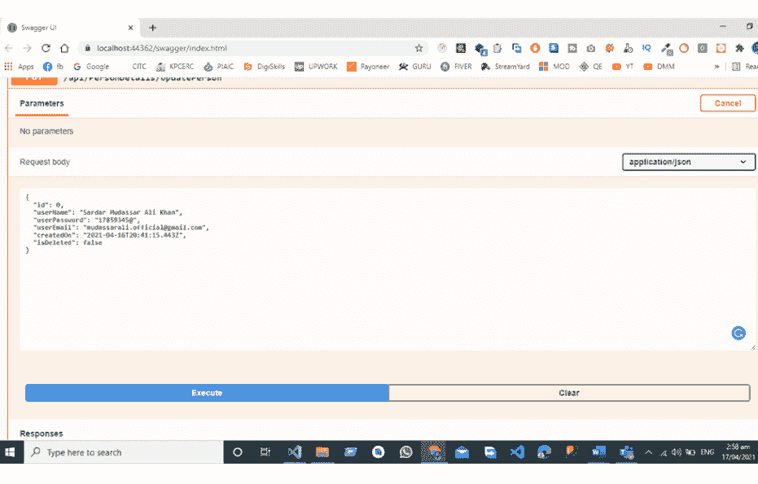

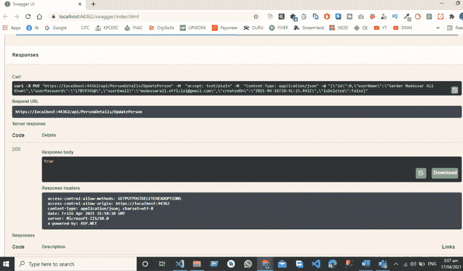

125

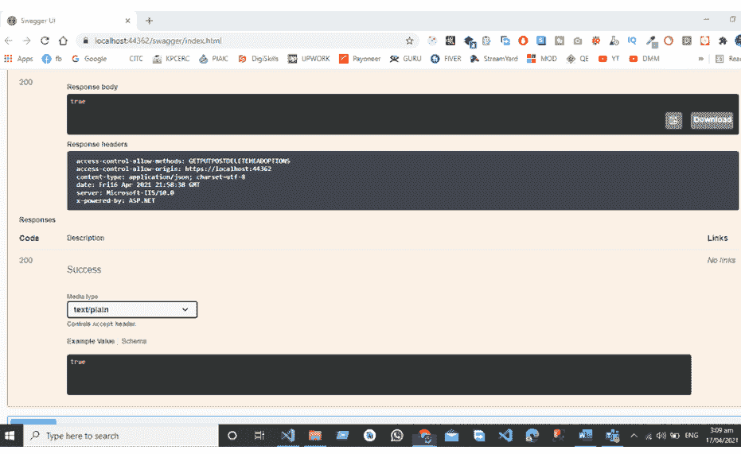

## 总结

Swagger (Open API) 是一种用于描述和记录 REST API 的与语言无关的规范。它允许机器和开发者在无需直接访问项目源代码的情况下理解机器的工作原理和功能。Swagger (Open API) 的主要目标是尽量减少连接微服务的工作量。Swagger 配合开源工具集使用，用于设计、构建和使用 Restful Web 服务。Swagger 包含了自动化文档代码生成。Swashbuckle 的三个主要组件：
- Swashbuckle.AspNetCore 是用于暴露 Swagger 的中间件
- Swashbuckle.AspNetCore.SwaggerGen 从你的控制器和模型构建 Swagger 对象，此包与 Swagger 中间件结合以自动暴露 Swagger
- Swashbuckle.AspNetCore.UI 是 Swagger UI 的嵌入版本，通过解释 Swagger 来构建一个高度可定制的实用工具，用于解释 Web 功能。

## 结论

现在关于 Open Swagger，它是记录 Restful API 的最佳 Open API。作为一名开发者，我在使用 Swagger 测试 restful API 方面有丰富的经验，可以发送完整对象并以高效的方式获取响应。在完成 .NET Core 配置后，可以享受 Swagger 的便利。

# 在 Azure 上部署应用

- 概述
- 介绍
- 部署步骤
- 结论

App Service 让你快速构建、部署和扩展企业级 Web、移动应用，并在完全托管的平台上运行，满足性能、可扩展性和合规性要求。

打开 Azure 门户

首先你需要打开 Azure 账户，然后选择你想部署应用的 Azure 订阅。区域对于应用的部署成本非常重要，所以我选择了“美国中部”（Central US）。

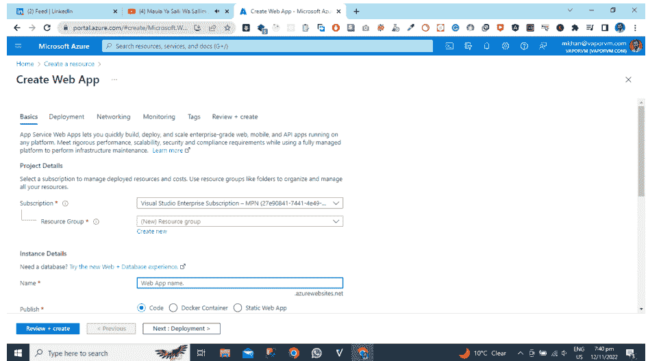

创建 Azure 资源组

现在选择 Azure 订阅并创建 Azure 资源组。

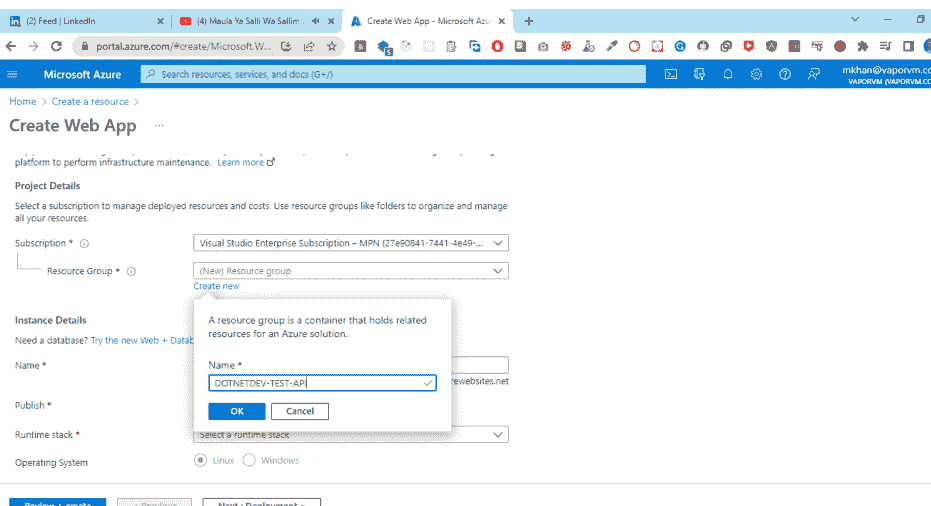

## 选择应用名称

选择应用名称，我的 Web 名称是 -Api

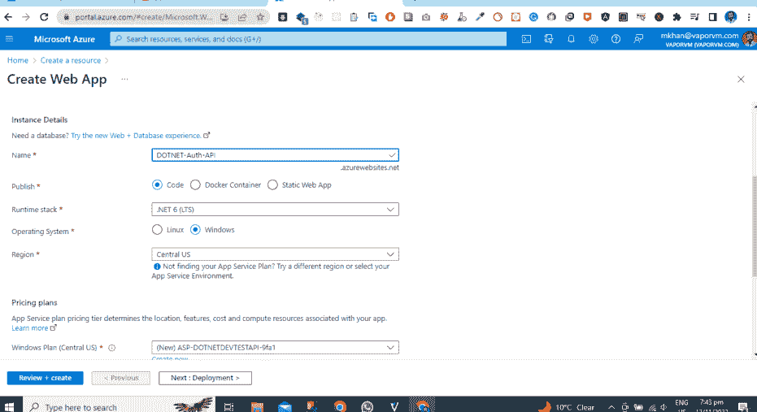

## 选择运行时栈

在选择名称和资源组后，为你的应用选择运行时，我的应用使用的是 Microsoft Azure .NET 6 最新稳定版本。

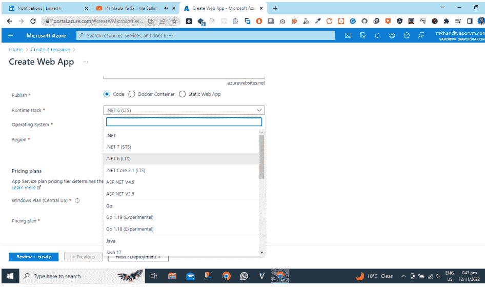

## 创建 App Service Plan

App Service Plan 定义了运行 Web 应用的一组计算资源。这些计算资源类似于传统托管中的服务器场。一个或多个应用可以部署在相同的计算资源（同一个 App Service Plan）上。

## 选择定价计划

现在选择层级 Dev/Test、Production、Isolated。

## 现在我们的应用开发和测试目的是我们选择了 Dev/Test


## 选择部署选项。

启用 GitHub Actions 以持续部署您的应用。GitHub Actions 是一个自动化框架，每当存储库中进行新提交时，它可以构建、测试并部署您的应用。如果您的代码在 GitHub 上，请在此处选择您的存储库，我们将添加工作流文件以自动将您的应用部署到 App Service。如果您的代码不在 GitHub 上，请在创建 Web 应用后转到部署中心来设置部署。

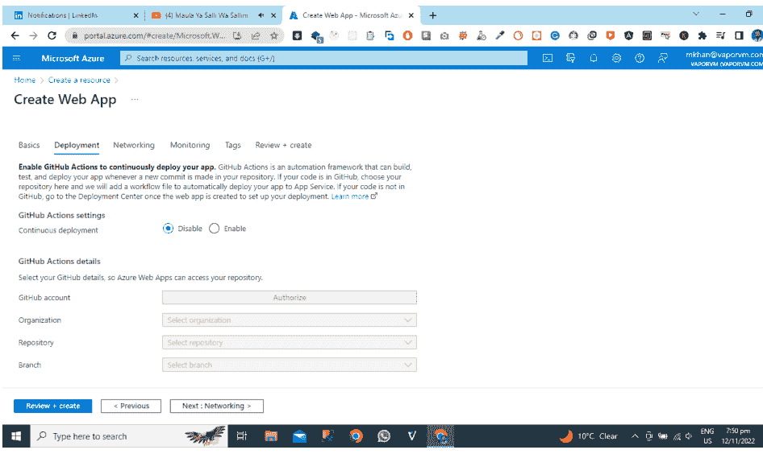

## 选择网络选项

配置 Web Apps 时，其入站地址可以对互联网公开，也可以被隔离在 Azure 虚拟网络中。Web Apps 还可以配置出站流量以访问虚拟网络中的端点，这些流量受网络安全组管理或受虚拟网络路由的影响。默认情况下，您的应用对互联网开放，且无法访问虚拟网络。这些方面在应用配置后也可以进行更改。

## 选择 Azure 监控选项

Azure Monitor Application Insights 是一种为开发者和 DevOps 专业人员提供的应用程序性能管理 (APM) 服务。在下方启用它以自动监控您的应用程序。它将检测性能异常，并包含强大的分析工具，帮助您诊断问题并理解用户实际上对您的应用做了什么。

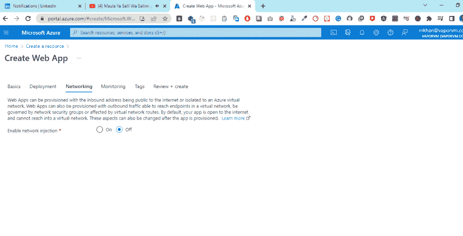

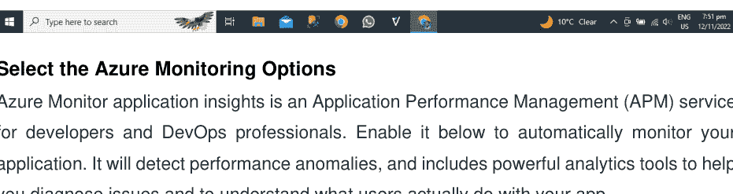

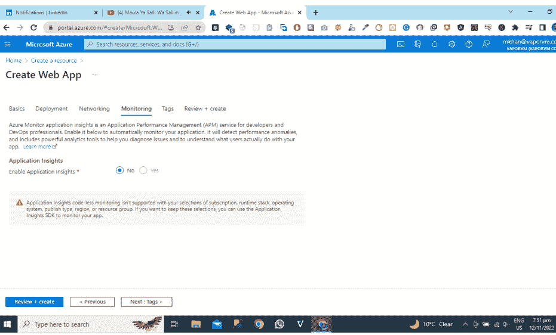

## 选择标签选项

标签是名称/值值对，允许您对资源进行分类，并通过对多个资源和资源组应用相同的标签来查看合并的账单。

请注意，如果您在其他选项页上创建标签并更改资源设置，您的标签将自动更新。

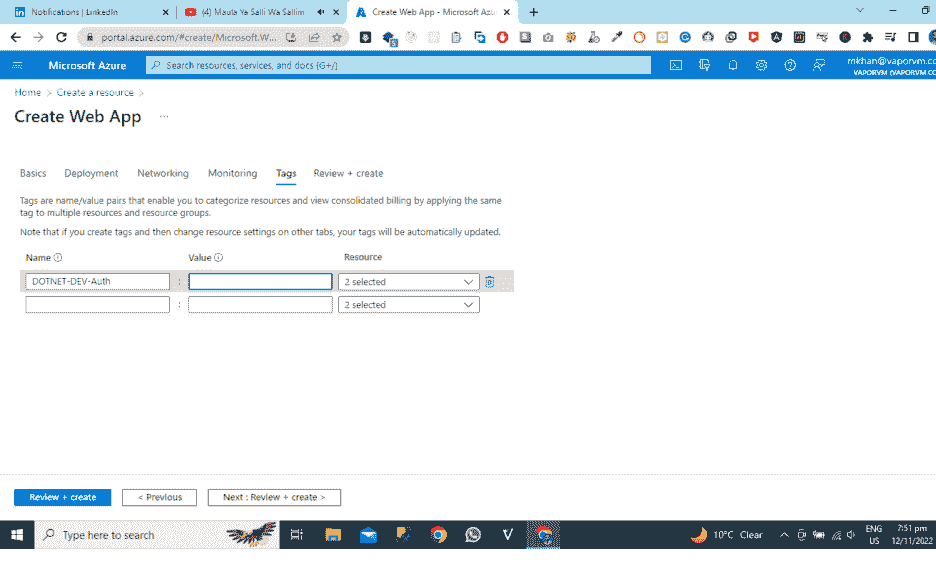

## 查看并创建

现在查看您的所有步骤并创建 Azure 应用。

## 创建 Web 应用

- 基础 部署 网络 监控 标签 | 查看 - 创建

摘要

- Web 应用
  由 Microsoft 提供

详情

| 字段 | 值 |
| :--- | :--- |
| 订阅 | 27d5f4a1-b6e4-4a12-b2d7-c1d2f1164ed8 |
| 资源组 | DOTNET-Test-Group |
| 名称 | DOTNET-Auth-api |
| 运行时堆栈 | .NET 8 LTS |
| 标签 | DOTNET-DEV-Auth |

App Service 计划（新建）

| 字段 | 值 |
| :--- | :--- |
| 名称 | DOTNET-Auth-api |
| 操作系统 | Windows |

下一步 > 下载自动化的模板。

点击创建按钮，然后 Azure 应用进程将开始。

## 创建 Web 应用

App Service 计划（新建）

| 字段 | 值 |
| :--- | :--- |
| 名称 | DOTNET-Auth-api |
| 操作系统 | Windows |
| 区域 | UAE North |
| SKU | Basic |
| 大小 | S11vU |
| 内存 | 1.75 GB 内存 |
| 标签 | DOTNET-DEV-Auth |

监控

| 特性 | 状态 |
| :--- | :--- |
| Application insights | 未启用 |

部署

| 特性 | 状态 |
| :--- | :--- |
| 持续部署 | 未启用 / 在应用应用后设置 |

下一步 > 下载自动化的模板。

您可以从下面的图中看到应用部署过程正在进行。

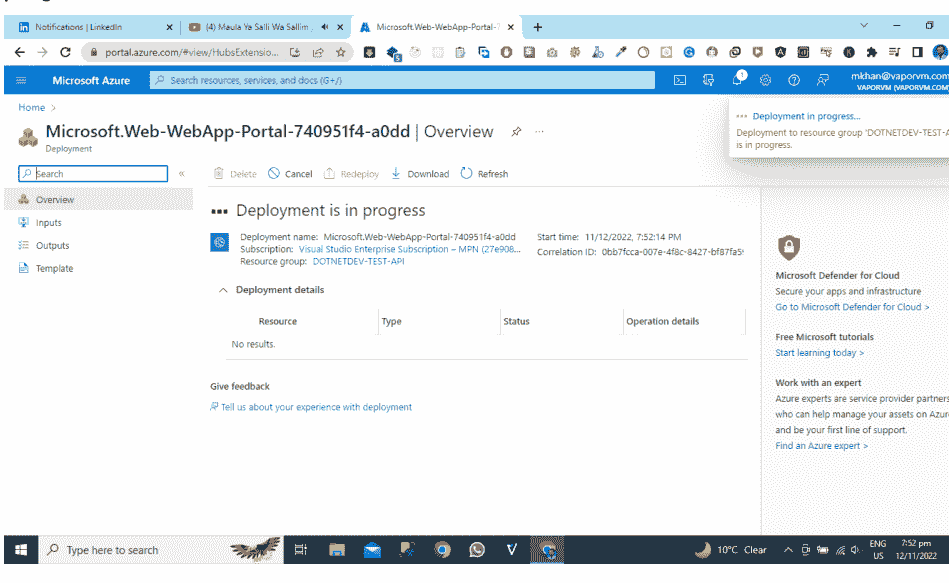

现在您可以看到我们的部署过程已成功，我们可以进入已创建的资源。

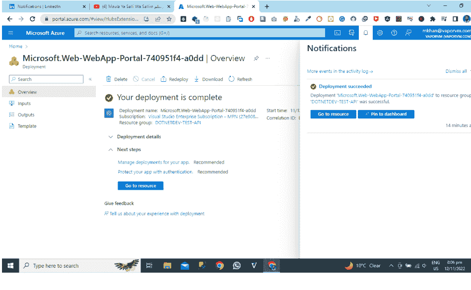

我们的 Azure 应用创建过程已完成。

## DOTNET-Auth-API

现在您需要点击 Azure URL。

## 应用程序状态

现在您可以看到我们的应用程序已经在 Azure 云上上线了。

## Microsoft Azure

## 您的应用正在运行并等待您的内容

您的应用已上线，但我们还没有您的内容。如果您已经部署了，您的内容可能需要 5 分钟才能显示。请稍后回来。

- 支持 Node.js、Java、.NET 等更多

尚未部署过？
使用部署中心发布您的代码或设置部署

正在启动新的 Web 应用？
遵循我们的快速入门指南，在几分钟内准备好 Web 应用

## 发布配置文件

现在您需要点击 Azure URL。

## 应用程序状态

 DOTNET-Auth-API

- .NET 配置文件。

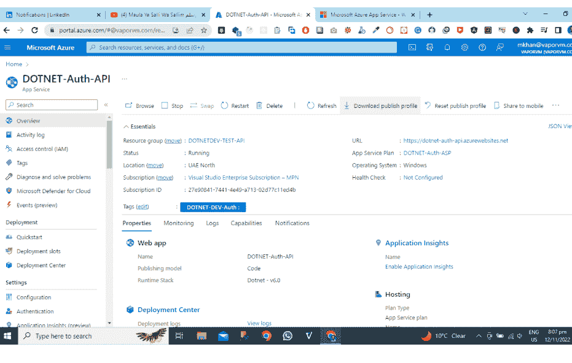

## 应用程序状态

现在您可以看到我们的应用程序已经在 Azure 云上上线了。

## Microsoft Azure

## 您的应用正在运行并等待您的内容

您的应用已上线，但我们还没有您的内容。如果您已经部署了，您的内容可能需要 5 分钟才能显示。请稍后回来。

- 支持 Node.js、Java、.NET 等更多

尚未部署过？
使用部署中心发布您的代码或设置部署

正在启动新的 Web 应用？
遵循我们的快速入门指南，在几分钟内准备好 Web 应用

## 发布配置文件

现在您需要点击 Azure URL。

## 应用程序状态

 DOTNET-Auth-API

- .NET 配置文件。


## 应用程序状态

现在您可以看到我们的应用程序已经在 Azure 云上上线了。

## Microsoft Azure

## 您的应用正在运行并等待您的内容

您的应用已上线，但我们还没有您的内容。如果您已经部署了，您的内容可能需要 5 分钟才能显示。请稍后回来。

- 支持 Node.js、Java、.NET 等更多

尚未部署过？
使用部署中心发布您的代码或设置部署

正在启动新的 Web 应用？
遵循我们的快速入门指南，在几分钟内准备好 Web 应用

## 发布配置文件

现在您需要点击 Azure URL。

## 应用程序状态

 DOTNET-Auth-API

- .NET 配置文件。


## 应用程序状态

现在您可以看到我们的应用程序已经在 Azure 云上上线了。

## Microsoft Azure

## 您的应用正在运行并等待您的内容

您的应用已上线，但我们还没有您的内容。如果您已经部署了，您的内容可能需要 5 分钟才能显示。请稍后回来。

- 支持 Node.js、Java、.NET 等更多

尚未部署过？
使用部署中心发布您的代码或设置部署

正在启动新的 Web 应用？
遵循我们的快速入门指南，在几分钟内准备好 Web 应用

## 发布配置文件

现在您需要点击 Azure URL。

## 应用程序状态

 DOTNET-Auth-API

- .NET 配置文件。


## 应用程序状态

现在您可以看到我们的应用程序已经在 Azure 云上上线了。

## Microsoft Azure

## 您的应用正在运行并等待您的内容

您的应用已上线，但我们还没有您的内容。如果您已经部署了，您的内容可能需要 5 分钟才能显示。请稍后回来。

- 支持 Node.js、Java、.NET 等更多

尚未部署过？
使用部署中心发布您的代码或设置部署

正在启动新的 Web 应用？
遵循我们的快速入门指南，在几分钟内准备好 Web 应用

## 发布配置文件

现在您需要点击 Azure URL。

## 应用程序状态

 DOTNET-Auth-API

- .NET 配置文件。


## 应用程序状态

现在您可以看到我们的应用程序已经在 Azure 云上上线了。

## Microsoft Azure

## 您的应用正在运行并等待您的内容

您的应用已上线，但我们还没有您的内容。如果您已经部署了，您的内容可能需要 5 分钟才能显示。请稍后回来。

- 支持 Node.js、Java、.NET 等更多

尚未部署过？
使用部署中心发布您的代码或设置部署

正在启动新的 Web 应用？
遵循我们的快速入门指南，在几分钟内准备好 Web 应用

## 发布配置文件

现在您需要点击 Azure URL。

## 应用程序状态

 DOTNET-Auth-API

- .NET 配置文件。


## 应用程序状态

现在您可以看到我们的应用程序已经在 Azure 云上上线了。

## Microsoft Azure

## 您的应用正在运行并等待您的内容

您的应用已上线，但我们还没有您的内容。如果您已经部署了，您的内容可能需要 5 分钟才能显示。请稍后回来。

- 支持 Node.js、Java、.NET 等更多

尚未部署过？
使用部署中心发布您的代码或设置部署

正在启动新的 Web 应用？
遵循我们的快速入门指南，在几分钟内准备好 Web 应用

## 发布配置文件

现在您需要点击 Azure URL。

## 应用程序状态

 DOTNET-Auth-API

- .NET 配置文件。


## 应用程序状态

现在您可以看到我们的应用程序已经在 Azure 云上上线了。

## Microsoft Azure

## 您的应用正在运行并等待您的内容

您的应用已上线，但我们还没有您的内容。如果您已经部署了，您的内容可能需要 5 分钟才能显示。请稍后回来。

- 支持 Node.js、Java、.NET 等更多

尚未部署过？
使用部署中心发布您的代码或设置部署

正在启动新的 Web 应用？
遵循我们的快速入门指南，在几分钟内准备好 Web 应用

## 发布配置文件

现在您需要点击 Azure URL。

## 应用程序状态

 DOTNET-Auth-API

- .NET 配置文件。


## 应用程序状态

现在您可以看到我们的应用程序已经在 Azure 云上上线了。

## Microsoft Azure

## 您的应用正在运行并等待您的内容

您的应用已上线，但我们还没有您的内容。如果您已经部署了，您的内容可能需要 5 分钟才能显示。请稍后回来。

- 支持 Node.js、Java、.NET 等更多

尚未部署过？
使用部署中心发布您的代码或设置部署

正在启动新的 Web 应用？
遵循我们的快速入门指南，在几分钟内准备好 Web 应用

## 发布配置文件

现在您需要点击 Azure URL。

## 应用程序状态

 DOTNET-Auth-API

- .NET 配置文件。


## 应用程序状态

现在您可以看到我们的应用程序已经在 Azure 云上上线了。

## Microsoft Azure

## 您的应用正在运行并等待您的内容

您的应用已上线，但我们还没有您的内容。如果您已经部署了，您的内容可能需要 5 分钟才能显示。请稍后回来。

- 支持 Node.js、Java、.NET 等更多

尚未部署过？
使用部署中心发布您的代码或设置部署

正在启动新的 Web 应用？
遵循我们的快速入门指南，在几分钟内准备好 Web 应用

## 发布配置文件

现在您需要点击 Azure URL。

## 应用程序状态

 DOTNET-Auth-API

- .NET 配置文件。


## 应用程序状态

现在您可以看到我们的应用程序已经在 Azure 云上上线了。

## 部署

## 部署 

部署 部署 部署 概述

- 简介
- 部署过程
- 服务器配置
- 结论

## 简介

在本章中，我们将学习如何使用 Visual Studio 2019 部署 .net core 到服务器。

## 步骤 1 上的账户设置

部署 .net core 的第一步是在托管提供商处创建一个账户，并按照章节中的步骤操作。

- 在托管面板中创建一个网站。
- 然后使用托管面板创建网站

## 步骤 2 在 Visual Studio 中创建

使用 Visual Studio 创建 .net core 5 版本。

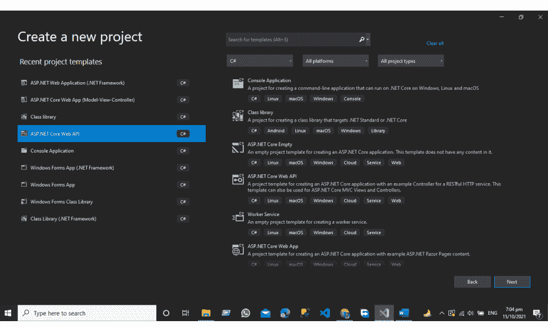

## 步骤 3 在应用程序中设置服务器数据库连接字符串

在您的应用程序 appsettings.json 中设置 Live 连接字符串

```json
{
  "DefaultConnection": "Data Source=SQL5108.site.net;Initial Catalog=YOUR DB NAME;User Id=YOUR DB USER;Password=YOUR DB PASSWORD",
  "Logging": {
    "LogLevel": {
      "Default": "Information",
      "Microsoft": "Warning",
      "Microsoft.Hosting.Lifetime": "Information"
    }
  },
  "AllowedHosts": "*"
}
```

## 步骤 4 发布您的项目

在创建项目并完成 QA 部分最后的测试后，现在是时候部署您的网站了。现在进入 Visual Studio 2019 中的解决方案管理器。

右键点击您的项目并选择发布选项。

点击发布选项将弹出一个新窗口，现在在此选择项目发布，您下方有 5 到 6 个选项。

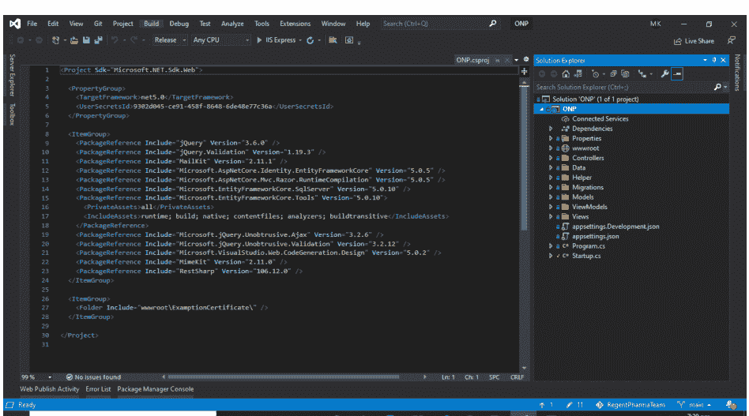

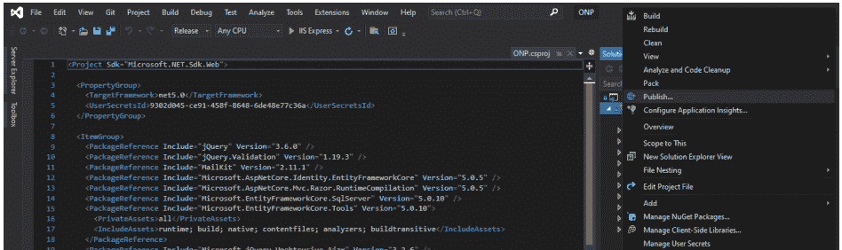

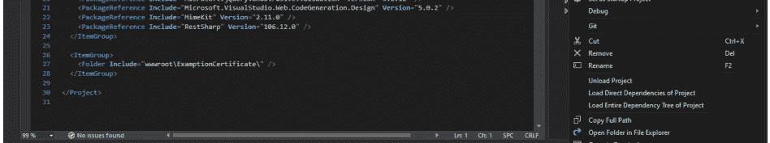

## 发布

今天您要发布到哪里？

| 目标 | 描述 |
| :--- | :--- |
| Azure | 将应用程序发布到 Microsoft 云 |
| Docker 容器注册表 | 将应用程序发布到任何支持 Docker 镜像的容器注册表 |
| 文件夹 | 将应用程序发布到本地文件夹或文件共享 |
| FTPS 服务器 | 将应用程序发布到 FTP/PS 服务器 |
| 服务器 (IIS) | 使用 Web 或 Web Packing 服务将应用程序发布到 IIS |
| 其他 | 导入您的发布设置以部署您的应用 |

现在选择导入选项以导入配置文件。

选择导入配置文件后点击下一步。


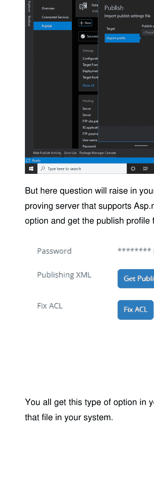

但你脑中会产生一个疑问：如何获取支持 Asp.net core 网站应用程序的托管服务器的发布配置登录信息，然后进入部署选项获取发布配置文件并将其下载到本地系统呢？

| 密码 | ******** [修改] |
| :--- | :--- |
| 发布 XML | [获取发布设置] |
| 修复 ACL | [修复 ACL] |

关闭

你可以在控制面板中找到此类选项，只需获取发布配置文件并将该文件下载到你的系统中即可。

然后，在 Visual Studio 中通过“浏览”选项从下载的位置上传该文件。

在 Visual Studio 中上传发布配置设置后，点击“完成”（Finish）选项，即可获得下述的好处。

## 现在点击更多操作 (More Actions)。

## 点击编辑 (Edit)。

## 点击连接 (Connection)。

所有信息将自动从上传的发布配置文件中获取，并且信息将自动保存到 Visual Studio 中以备日后部署。

## 步骤 5 验证连接 (Validate the Connection)

在此步骤中，Visual Studio 会验证与服务器的连接，然后你就可以将应用程序发布到服务器上。

现在你可以看到 Visual Studio 已验证了与服务器的连接，现在我们准备好发布应用程序了。

现在点击下一步 (Next)

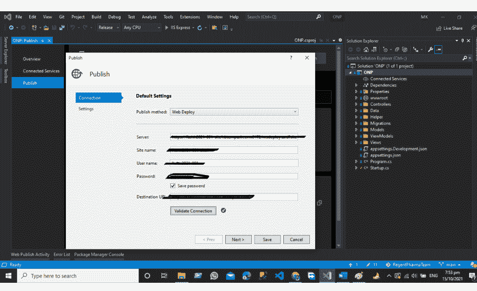

点击保存设置 (Save the Setting)

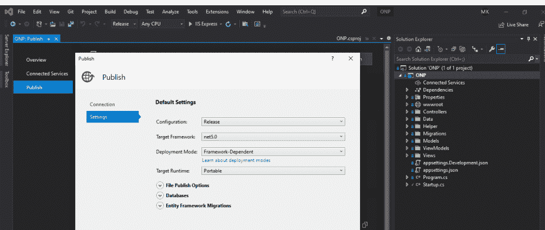

## 现在点击发布 (Publish)

但在发布之前，请检查你的应用程序是否已处于发布（Release）模式，且 Webhost 环境应处于生产（Production）模式。

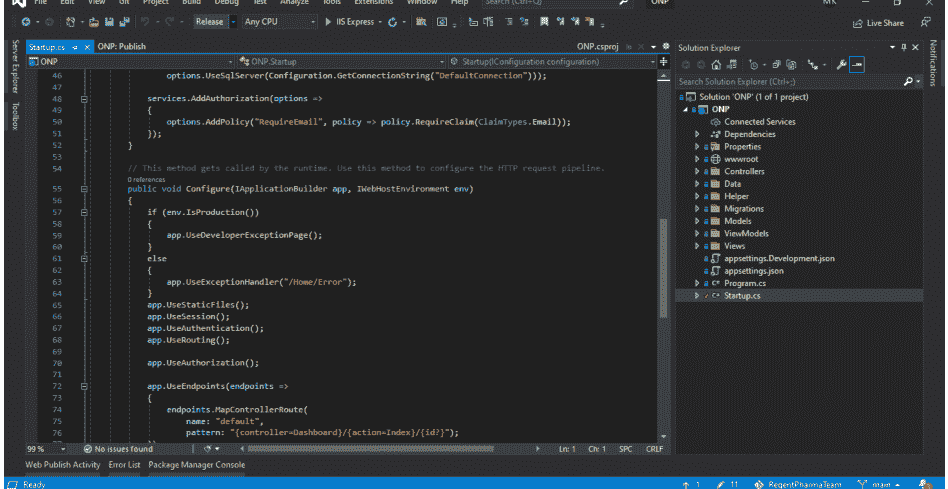

网站的发布已经开始。

## 我们在服务器上的网站部署已成功完成。

## 现在我们的网站已上线运行。

## 结论

在本章中，我们学习了如何使用 Visual Studio 发布我们的 asp.net Core Web应用程序，在下一篇文章中，我们将学习如何使用 FileZilla 软件 FTP 部署我们的应用程序。

> "快乐编程"

## 参考文献

- 1. https://www.c-sharpcorner.com/
- 2. https://docs.microsoft.com/en-us/
- 3. https://google.com/
- 4. https://www.castsoftware.com/
- 5. https://www.guru99.com/restful-web-services.html

## 反馈

如果你想就书籍内容提交反馈或任何其他改进建议，请扫描二维码并提交你的反馈。


## C#Corner

## 我们的使命

免费教育是我们的基本需求！我们的使命是通过提供最新的、无偏的新闻、建议以及学习、分享和职业成长的工具，为全球数百万开发者赋能。我们热于培养下一代，帮助他们不仅成为出色的程序员，更成为优秀的人才。

## 关于我们

CSharp Inc. 总部位于宾夕法尼亚州费城，是一个全球软件开发者在线社区。C Corner 在 2022 年服务了 2940 万访问者。我们发布关于尖端软件开发主题的最新新闻和文章。开发者在此处分享知识，并与内容、论坛和章节建立联系。数千名成员从我们的每月活动、网络研讨会和会议中受益。所有会议均由全球科技会议（Global Tech Conferences）管理，这是 CSharp Inc. 的一家兄弟公司。我们还提供职业成长工具，如职业建议、简历编写、培训、认证、书籍、白皮书以及视频。我们还通过职位招聘板将开发者与潜在雇主联系起来。访问 C# Corner

## 更多书籍


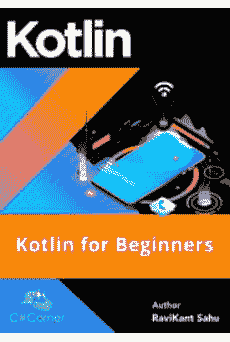

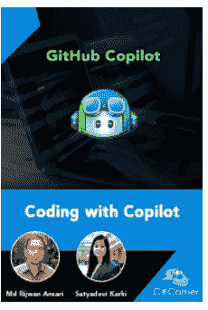


