# App 帝国：赚钱、生活，并让技术为你工作


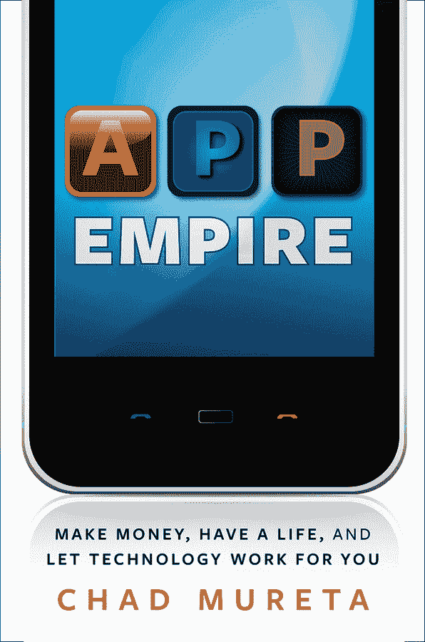


# 目录

- 前言
- 第一章：你手中的宝藏：为什么移动 App 能让你致富
- 比互联网更大的机遇！
- 疯狂的增长
- 现在就利用这一现象
- 参与者们
- 苹果—iPhone/iPad/iPod
- 谷歌 Android
- 黑莓（BlackBerry）
- 开店/准备工作
- 未来趋势
- 开掘你的 Store 金矿
- 第二章：先安装这个：App 百万翁心态
- App 业务中的获胜信念
- 打造黄金心态
- 获胜心态的特质
- 第三章：发现新世界：App Store
- 收集情报
- 读懂 App 背后的深层意图
- 两类 App
- App 发现
- 开发者如何赚钱
- 冲动消费
- 钩住客户
- 成功 App 的特质
- 认真的玩耍
- 第四章：你的黄金 App 机遇：如何打造爆款 App
- 不要爱上你的主意
- 停止嫉妒，开始模仿
- 从现有 App 中学习
- 收敛你的想法
- 时机决定一切
- 小步快跑
- 第五章：你是大脑，他们是体力：如何雇佣优秀的程序员
- 程序员的重要性
- 在程序员身上寻找什么
- 寻找和挑选程序员
- 如何传达你的想法
- 测试雇佣的程序员
- 如何管理程序员
- 如何测试你的 App
- 第六章：视觉吸引力：吸引更多买家的营销基础
- 致命的装扮
- 图标
- App 标题
- 描述
- 截图
- 关键词
- 分类
- 免费 App 的力量
- 课程修正
- 第七章：计分：衡量什么才能赢得 App 游戏
- 重要的数据
- 用于统计数据的工具
- 利用数据为你所用
- 关注评论
- 及时止损
- 第八章：助力业务增长的忍者技巧：高级营销技巧妙招
- 遭遇瓶颈
- 你的 App 网络
- 骚扰屏
- 促销页
- 推送通知
- 你的开发者网络
- 更新
- 付费流量
- 第九章：让我看到钱！让你的 App 变现
- 三种营收模式
- 横幅广告
- 联盟营销
- 应用内购买
- 翻译你的 App
- 对业务进行再投资
- 你的结局
- 出售你的 App
- 第十章：巡航模式：如何自动化和监控你的业务
- 组建团队
- 开店/准备工作
- 外包你的生活
- 日常流程
- App 的七大支柱
- 后记
- 资源
- 致谢
- 关于作者
- 索引

# 第一章：你手中的宝藏：为什么移动 App 能让你致富

## 比互联网更大的机遇！
## 疯狂的增长
## 现在就利用这一现象
## 参与者们
## 苹果—iPhone/iPad/iPod
## 谷歌 Android
## 黑莓
## 开店
## 未来趋势
## 开掘你的 Store 金矿

# 第二章：先安装这个：App 百万翁心态

## App 业务中的获胜信念
## 打造黄金心态
## 获胜心态的特质

# 第三章：发现新世界：App Store

## 收集情报
## 读懂 App 背后的深层意图
## 两类 App
## App 发现
## 开发者如何赚钱
## 冲动消费
## 钩住客户
## 成功 App 的特质
## 认真的玩耍

# 第四章：你的黄金 App 机遇：如何打造爆款 App

## 不要爱上你的主意
## 停止嫉妒，开始模仿
## 从现有 App 中学习
## 收敛你的想法
## 时机决定一切
## 小步快跑

# 第五章：你是大脑，他们是体力：如何雇佣优秀的程序员

# 程序员的重要性
## 在程序员身上寻找什么
## 寻找和挑选程序员
## 如何传达你的想法
## 测试雇佣的程序员
## 如何管理程序员
## 如何测试你的 App

# 第六章：视觉吸引力：吸引更多买家的营销基础

## 致命的装扮
## 图标
## App 标题
## 描述
## 截图
## 关键词
## 分类
## 免费 App 的力量
## 课程修正

# 第七章：计分：衡量什么才能赢得 App 游戏

## 重要的数据
## 用于统计数据的工具
## 利用数据为你所用
## 关注评论
## 及时止损

# 第八章：助力业务增长的忍者技巧：高级营销技巧妙招

## 遭遇瓶颈
## 你的 App 网络
## 骚扰屏
## 促销页
## 推送通知
## 你的开发者网络
## 更新
## 付费流量

# 第九章：让我看到钱！让你的 App 变现

## 三种营收模式
## 横幅广告
## 联盟营销
## 应用内购买
## 翻译你的 App
## 对业务进行再投资
## 你的结局
## 出售你的 App

# 第十章：巡航模式：如何自动化和监控你的业务

## 组建团队
## 开店
## 外包你的生活
## 日常流程
## App 的七大支柱
## 后记
## 资源
## 致谢
## 关于作者
## 索引


“Chad 是美国梦的经典典范。我很幸运，从 Chad 的应用取得巨大成功之初就认识了他。他是一个拥有卓越计划的普通人。他应用成功的公式是科学的，而且任何人都可以复制。他脚踏实地的风格对助人的真诚热爱，使其成为了一种易于理解且能快速见效的方法。我通过多年来的过度工作和压力创造了自己的财富和成功。请节省你自己的时间、精力和压力，从今天起遵循 Chad 简单的应用计划吧。”

—Joe Barresi，企业家，多家制造公司所有者，近期涉足应用业务的企业主

版权所有 © 2012 Chad Mureta。保留所有权利。

由 John Wiley & Sons, Inc. 出版于新泽西州霍霍肯。

在加拿大同步出版。

未经出版者事先书面许可（或通过向版权许可中心有限公司（Copyright Clearance Center, Inc.）支付相应的每副本费用授权，或通过 `www.copyright.com` 在线授权），根据 1976 年美国版权法案第 `107` 或 `108` 条的规定外，本书的任何部分不得以任何形式或通过任何手段（电子、机械、复印、录制、扫描或其他）复制、存储在检索系统中或传输。向出版者申请许可，请咨询：Permissions Department, John Wiley & Sons, Inc., 111 River Street, Hoboken, NJ 07030, `(201) 748-6011`, 传真 `(201) 748-6008`, 或在线访问 `http://www.wiley.com/go/permissions`。

责任限制/免责声明：尽管出版者和作者在编写本书时尽了最大努力，但他们对本书内容的准确性或完整性不作任何陈述或保证，并特别否认任何商品销性或适用于特定用途的暗示保证。销售代表或书面销售材料不得创建或扩大任何保证。本文包含的建议和策略可能并不适用于您。您应在适当咨询专业人士。出版者和作者均不对任何利润损失或其他任何商业损害承担责任，包括但不限于特殊的、偶然的、间接或其他损害。

需有关我们其他产品和服务的一般信息或技术支持，请联系我们美国境内的客户服务部门：`(800) 762-2974`，美国境外请拨打 `(317) 572-3993` 或传真 `(317) 572-4002`。

Wiley 多种印刷和电子格式出版，并按需打印。本书标准印刷版中包含的部分材料可能未包含在电子书或按需打印中。如果本书提到的媒体（如 `CD` 或 `DVD`）未包含您购买的版本，您可以在 `http://booksupport.wiley.com` 下载这些材料。有关 Wiley 产品的更多信息，请访问 `www.wiley.com`。

ISBN `978–1–118–10787–4` (精装本); ISBN `978–1–118–21680–4` (电子书); ISBN `978–1–118–21694–1` (电子书); ISBN `978–1–118–21704–7` (电子书)

我将这本书献给每一位在生命中的学生，他们始终在恐惧面前起舞，以坚定不移的信念克服障碍，拥有不切实际的梦想并在重重困难中追求，并且正如总统西奥德·罗斯福曾说的那样，“他们的位置绝不会属于那些既不识胜利也不懂失败的胆小灵魂。”

能够在你那条连接点成线的旅程中为你提供灵感，我深感荣幸。

# 引言

## 我是如何意外成为应用百万富翁的

### 地上最快乐的人

我生命中最快乐的几天是在席睡在泥地上、觅食食物度过的。我徒步穿越雨林，看到隐藏的瀑布。我与村民一起狩猎野猪，并用椰子壳装着一种名为 `kava kava` 的苦味药酒向部落 97 岁的酋敬酒。

我当时在 `Savusavu` 岛上，它是斐济群岛 336 个岛屿中最偏远的地方之一。那里的人易于朗笑，饮食简单，依山自然而生。岛屿由充满活力的绿色山脉组成，从南太平洋清澈的蓝绿色海水中拔地而起。

我选择在那里与村民生活一周，因为他们被认为是世界上最快乐的人之一。`Savusavu` 村民看起来比人们所能达到的更加满足满意，尽管他们的生活方式有时令我困惑，但他们的笑容不会撒谎的。

看到斐济人的生活方式令人耳目一新，这与我以前过的任何经历都不同。我在如此短的时间内从这种文化中学到的东西可以总结为七个字：少即是多，爱无处。

离开村庄后，我深受启发，想让其他人和我分享这段经历。令我惊讶的是，我在岛上一个偏远的商店里找到了 `WiFi` 信号，并给我的两个哥们 `Patrick` 和 `Nadim` 发了邮件。

## 应用创业者（APPRENEUR）的生活方式

我的生活就是一边做我热爱的事一边获得轻松的收入。我通过 `iPhone` 经营业务。我在虚拟世界工作，赚取真实的美元。我曾在澳洲内陆徒步艾尔斯岩，在沙漠与原住民一起远涉，曾徒步穿越洛基山脉，获得了了单人跳伞认证，在加拿大的惠斯勒滑滑雪，曾在球场旁观看 `NBA` 总决赛，曾在火上行走，曾体验过蹦极，最重要的是，我学会了不要把生活对待得那么严肃。

对于我的下一次冒险，我计划在我想去的九个地方每个呆三个月。这包括在阿根廷的布宜斯艾利斯学习武术，在哥伦比亚的波哥塔跳尔萨舞，在西班牙的潘普洛纳斗牛，以及在意大利威尼斯的运河乘贡船。

我拥有着神奇的生活，事实是，无论背景如何，任何人都可以拥有这种生活方式。我是不断壮大的应用创业者群体的一员，他们通过应用程序（或简称应用）赚钱，这些应用运行在如 `iPhone` 和 `Droid` 等智能手机，以及 `iPad` 或 `iPod Touch` 等移动设备上。应用创业者可以住在任何地方，无论处于生活的哪个阶段都可以创业。截至目前，世界上最年轻的应用创业者 9 岁，最老的 80 岁。

应用创业者在赚钱的同时，创造了极其自由的生活。我的两个应用创业者朋友每年有几个月在 `越南` 从事公益，而他们的业务正在产生七位数的收入。另一位朋友正带着孩子去看世界七大奇迹，为家人创造了无价的回忆。还有一位朋友带着妻子一年中大部分时间在欧洲背包旅行。


无论你梦想的生活方式是什么，你都可以作为一名“应用创业者（appreneur）”来实现。你不需要精通计算机编程就能做到这一点。

当我开始时，我对编程语言或如何编写代码一无所知。我现在依然如此，但我有动力在这事业中取得成功。由于我当时的特殊情况，失败并不是一个选项。

## 从病床开始

当你临终时，你能说自己过过了一个充实的人生吗？我当时几乎做不到。

我是在病床上开始这项事业的，甚至怀疑自己是否想活下去。我经历了一场可怕的车祸，左臂被撞碎。我经历了两次开创性的手术，并度过了 18 个月痛苦痛苦的康复期。

由于保险有限，我积欠了 `$100,000` 的医疗费用。尽管我活了下来，但我不知道该如何跳出我感觉深陷其中的深渊。

在此之前，我曾为几家公司工作过并创办过公司，但最终因为精疲力竭而失败了。我的最后一个生意是在房地产泡沫破裂前开始的一家房地产加盟店。是的，我的时机抓得非常完美。

即使做自己的老板，我也厌倦了每天工作 18 小时却毫无自由。我不是员工，我是自己业务的奴隶，承受着所有的压力和责任。所以，情况糟糕得多。

医生用一根钛杆将我的手臂重新连接起来，从肘部到肩膀固定住。这是一次极度痛苦的折磨，但也是巨大的警醒，我意识到自己非常幸运才能收到这个警醒。从以后，我决定不再用那种应付生活的旧方式过日子了。我必须找到一种方法，过上一种回首无悔的生活。

事故后，我被转到一家物理康复中心，开始重建我的身体、心灵，最终我的生活。在康复期间，像《无限力量》作者安东尼·罗宾斯（Anthony Robbins）等思想先驱的书强化了我的意志，而《四小时工作制》作者蒂莫迪·费费斯（Timothy Ferris）关于生活自由的理念启发了我。

在那段时间，我的好朋友也是未来的业务伙伴 Tayfun 给了我一张关于应用创业者的文章，告诉我应该进入这个行业。我了解到大多数应用创业者都是一人或两人团队，成本很低，而成功的那些正带来数百万的利润。我依然躺在病床上，一边服用强效止痛药一边画着应用构思。

最后一次手术三周后，在绝望、贫穷和抓住救命稻草的情况下，我从继父那里借了 `$1,800`，双脚投入了应用业务。结果如何？

在短短两多年里，我创建并出售了三家应用公司，赚了数百万。公司成立两个月后，我的其中一个应用每月现金流达到了 `$30,000`。后来，公司单月收入达到了 `$120,000`。总的来说，我开发了 40 多个应用，在全球范围内拥有超过 3500 万次的应用下载。我超过 90%的应用都是成功的并赚了钱的。

直到今天，我仍然不知道如何上传或更新应用。我将这些工作外包给程序员，并让 `Apple` 进行分发。我在领导公司的同时，专注于监控趋势和进行创造性工作。虽然我在业务中专注于 `Apple` 的 `iPhone` 应用，但我展示给你的大多数概念都可以应用到其他平台，包括 `Google Android` 和 `BlackBerry`。

每天早上醒来，我会在床里躺一小时，查看 `iPhone` 上的报告。之后，我去跑步、吃早餐，再花一小时外包任务，剩下的时间里我过着不可思议的生活。

## 游戏计划

我的成功源于拥有游戏计划。

尽管我每天只工作几个小时，但我想要建立一个可以持续许多年的帝国。为了做到，我开发了业务的核心领域，我可以每天、每周和每月进行监控。我将这些核心称为应用业务的“七大支柱”。理解这些支柱将把你的业务从一个一次性的彩票中奖者变成一个无限的金矿。

书中的章节按模块化方式安排的，所以如果你需要营销创意，请重读营销章节，以此此类推。我分享的观点将在从发布到扩张的增长每个阶段提供帮助。当然，你可以找到特定问题的答案，但我建议先学习整体游戏计划，因为这将带来长期的财富。

每个章节的结尾都有你需要采取的行动。你可以在建立业务时使用这些行动，确保每一步都留在正轨。你还可以在 `www.AppEmpire.com/resources` 找到更多有用的资源。

## 真正的问题

为什么你现在不进入应用领域呢？移动技术不会消失，这个行业在全球范围内都在爆发。看看周围，有多少人使用手机寻找餐厅、给朋友发短信或在 `Facebook` 上更新状态。这个火热的行业才刚刚开始。现在是进入移动游戏的完美时机。

你可以经营自己的应用业务，因为你不需要大量的资金、技能或知识就可以开始。你只需要一部手机和成功的渴望。这个行业允许你在任何地方工作，并赚取薪水来支持它。此外，最棒的部分是，它是有趣的。

在这本书中，我为你提供了应用业务中通富的路线图。无论你是完全的新手还是经验丰富的开发者，我都会指导你建立一个在支持你想要的生活的同时不断增长的业务。

我将教你：
*   调整心态以获得成功
*   在兼职的同时赚取大量资金
*   外包几乎所有工作，以便享受你的生活
*   与处理技术的人合作，这样你不需要亲为
*   让你的产品极具吸引力，让人们乐意付钱
*   与他人合作，让利润翻倍甚至三倍
*   创建一个可持续的应用业务
*   按你的意愿生活

这是一个历史时期，技术赋予了我们按意愿生活的工具。你需要的只是渴望和游戏计划。无论你的背景、性别、种族、教育程度或状况，你可以在过上值得的生活的同时建立应用帝国。

你不需要等到将来才实现梦想。你从今天就可以开始。

# 第一章 你手中的宝藏

## 移动应用可以让你富有

变化是生活的常态。那些只看过去或现在的人注定会错过未来。—— 约翰·F·肯尼迪

在我卖掉第一个应用业务后，一时冲动，我收拾行李来到机场，登上了下一架出发的飞机。我很庆幸带了枕头，因为我最终来到了澳大利亚悉尼。由于时间充足且没有计划，我决定在澳洲待五周，体验这个我一直梦想访问的地方。

悉尼港美得令人窒息——布满了帆船的白帆、深蓝的水、清澈的天空和人们的喧闹。海鸥声充斥着空气，色彩斑纷的街头市场和摊位沿岸线布。


我用我的 iPhone 处理所有事情：寻找餐厅、管理员工，或者查看 App 的每日统计数据和排名。我可以在手机上点一份虾肉墨西哥饼饼，输入信用卡信息，然后去取餐或让它送上门。我可以在 iPhone 上上瑜伽课程，而不需要去瑜伽教室。我可以在机场排队时，只需按一下按钮就能知道我的业务今天赚了多少钱。

如果使用得当，虚拟世界可以成为简化和改善你生活各个方面的有力工具。

随着这个虚拟世界的演变，人们期望更快速、更方便地获取许多事物。消费者需求正在发生变化，因为我们可以在手机上做更多事情，而且手机一直在我们的口袋里，随我们去往哪里。

我们有可以控制汽车、让我们弹钢琴、教授语言、甚至识别歌曲并命名艺术家的 App。App 是至关重要的资产，它们在精简信息、增强我们生活的同时，教育并娱乐我们。有了 App，一切的核心就是便利、便利、再便利。

App 正在改变我们交流和传递信息的方式，让我们能够与从南非开普敦到加拿大蒙特利尔再到中国上海的人建立联系。无处不在！

你必须理解 App 业务的这一点：其核心在于消费者如何利用这项技术与世界建立联系。你对这一点越了解，通过 App 能赚的钱就越多。

但这个行业增长得有多快？它会持续吗？最大的玩家是谁？趋势是什么？在本章中，你将获得对该行业的本质见解，这将奠定你成功的 App 业务的基础。

## 比互联网更大的机会！

快讯：移动技术是下一个大大趋势，而且它仍然处于婴儿阶段，每天都在飞速增长。它正在引发一场信息革命，并创造了一个每个人都连接在一起的新时代。即使在非洲等地区，许多没有能力拥有电脑的人也跳过了电脑，转而使用智能手机。在埃及，通过手机发布的社交媒体帖子促成了推翻霍斯尼·穆巴拉克总统的革命。

全球范围内使用的手机超过 46 亿部，足够地球上三分之二的人使用。这是一个全球市场，并且正以前所未有的速度增长。（参见`图 1.1`。）

`图 1.1` 到 2014 年，移动互联网的使用量将超过桌面端互联网。

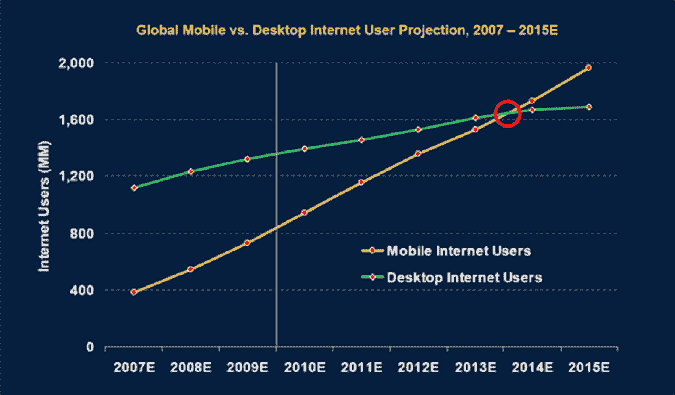

App 行业完全存在于互联网上，不需要实体存在，这使得从世界上任何地方做生意都变得容易。那么互联网呢？这是新的互联网，它正在改变我们传输和吸收信息的方式，开启了赚钱新方式的大门。它是历史上增长最快的行业，并且没有任何放缓的迹象。

正如你以前听过的那样，时机就是一切。移动行业正处于早期，就像 1997 年的互联网一样。那些在当时看到机会的人投入了其中，并赚了巨额金钱。事实上，那些人仍然在赚钱，因为他们比大多数人拥有更丰富的经验和竞争优势。

在早期，互联网提供了许多新颖且简单的赚大钱的方法。人们以极廉的价格购买域名，然后以数百万美元的价格卖出。他们创建实用的网站并出售广告。一些网站，如 `Google` 和 `eBay`，变成了我们生活中不可或缺的一部分，并让它们的创造者成为了亿万富翁。多年以后，人们仍然从互联网中赚钱。人们等待进入互联网赚钱游戏的时间越长，情况就变得越困难。

网站发生过的事情正是现在 App 和移动技术上正在发生的事情。唯一的区别是，我们经历过互联网的兴起，并习惯了对 App 革命做出更快的反应。这意味着，当互联网处于相同发展阶段时，App 世界已经领先了它几光年。开发 App 是一个超越大众、不被落下的机会，避免在多年后说：“我真希望当时……”

这些数字已经爆表了。根据技术研究公司 `Gartner, Inc.` 的数据，全球移动 App 总收入预计到 2014 年将爆发到 580 亿美元。随着 `Apple` 应用商店中超过 50 万个 App，这个行业将继续增长。由于我们不断渴望获得娱乐或以更少的努力完成更多工作，可以创建的新 App 数量是没有限制的。这种需求将继续受到我们社会与生俱来的演化和增长需求的驱动。

尽管近期全球经济出现低迷，App 行业仍在持续增长。许多市场研究人员预测移动行业将继续飙升，但我不会用更多数字来困扰你。我会说，如果你现在开始，你将遥遥领先。如果你开始得晚，你仍然会有很多机会，但为什么要等待去过你今天就能拥有的生活方式呢？

这项业务的另一个美好之处是，你可以从兼职开始，以后再全职。Lynn Duke 就是这样创立了 `Fossil Software`，它是 `App Store` 中顶尖的 App 公司之一。这家公司诞生于将多个简单 App 组合成一个的理念。他和他的伙伴、设计师 `Marshall Womack` 曾在一家游戏公司每周工作 80 小时。他们的朋友给他们发了一篇文章，关于某人通过一个简单的 App 在一个月内赚了 25 万美元。

Lynn 并不快乐，他体重增加了，经常加班，并且厌倦了漫长的一天。于是，他与 Marshall 在晚上和周末一起工作。

## 疯狂的速度

在电影《太空球》中，沙丘上校和黑帽必须以比光快的速度驾驶他们的太空飞船。这被称为“疯狂的速度”。这就是我认为 App 业务中正在发生的事情。技术正以疯狂的速度移动。

想想，人类历史上的每一次重大变化都是随着技术的进步而来的。当人类发明轮子时，生活改变了。当他们创造了蒸汽机和棉纺机时，工业革命爆发了。当世界维网流行时，我们进入了信息时代。人们可以从家里或办公室与世界各地连接并通信。现在我们将互联网的力量装在口袋里，可以随时随地打电话、发短信。我们的生活确实以疯狂的速度移动。系好带，享受旅程。

## 移动 App 趋势

来自 `148Apps.biz` 的这些数据显示了有多少 App 以及它们是如何被使用的。我确定这些数字很快就会被超越。

### Apple 应用商店统计（2012 年 1 月）

### 应用商店活跃应用程序数量
- 总活跃应用（可下载）：556,793
- 总活跃应用（不再可下载）：156,412
- 美国 App Store 显示的总应用数：713,205

### 应用审核延迟
- 最大延迟：41 天
- 平均延迟：5.26 天

### 应用价格分布
- 当前平均应用价格：2.10 美
- 当前平均游戏价格：0.99 美
- 当前平均整体价格：1.95 美

### 应用类别分布（最热门类别）
1. 游戏（96,187 个活跃）
2. 书籍（60,707 个活跃）
3. 娱乐（57,351 个活跃）
4. 教育（53,819 个活跃）


## 5. 生活方式 (45,286 位活跃用户)

这里是一些更令人震惊的数据：

* Apple 在三年内应用下载量突破了 150 亿次——而 Apple 花了 7 年时间才通过 `iTunes` 售出 150 首歌。
* 根据移动应用商店运营商 `GetJar` 委托的一项研究，移动应用市场到 2012 年将达到 175 亿美元。
* Canalys 预测到 2015 年将增长 370 亿美元。Apple 报告称，自 `App Store` 开放以来，`iOS` 开发者总计创造了超过 30 亿美元的收入。
* Google 的 `Android` 市场是 Apple iPhone 的竞争平台和操作系统，在 2011 年年中应用数量已达到 25 万个，总下载量超过 60 亿次。
* 根据市场研究公司 `Asymco` 的数据，平均每售出一台 `iOS` 设备，就会被下载 60 多个应用。
* 根据 `Asymco` 的数据，每天有超过 3000 万个应用被下载。
* 根据 `Piper Jaffray` 研究公司的估计以及《华尔街日报》的报道，付费应用的平均售价将每年增长 14%。
* 根据 `Asymco`，Apple 预计到 2014 年，在应用上赚的钱将超过音乐。

## 现在就利用这一现象

当我刚开始时，我并不知道这些业务趋势。当我了解到那些没有该行业以往经验却能赚到钱并享受自由的创业者时，我感到非常兴奋。这对我来说是很有意义。我错过了互联网热潮，但我不想再错过这一波，于是我投入了进去。正因如此，我可以说这是我的时代，也可以是你的时代。

现在是进入这个行业并利用这种绝佳机会的最佳时机。

移动技术充满趣味、令人兴奋且充满可能性的。它不仅仅是虚拟现实。相反，对于任何持开放态度并致力于使其取得成功的人来说，它是商业现实。

话虽如此，我将对应用业务额外说明一点重要的区别。人们认为，如果他们有一个应用主意，就能赢得应用彩票。应用业务并不是通过一个应用快速致富。它关乎研究、创意、时机和健全的商业逻辑，这包括创建几个产品而不仅仅是一个。

## 参与者

应用运行在智能手机上，就像各种软件程序运行在电脑上一样。在智能手机中，你可以找到几种操作系统，被称为平台。这些平台在智能手机市场的主导地位上相互竞争。

提供不同平台的三大参与者是 `Apple (iOS)`、`Google (Android)` 和 `RIM (BlackBerry)`。一些应用开发者为所有三个平台创建产品。另一些则专门负责一个。

专注于为 Apple 平台创建应用是应用业务中赚钱最容易的方法，因为 Apple 主导了应用市场，而且为他们的设备创建应用更容易。Apple 设备都配有标准分辨率和兼容的硬件，且 `iOS` 应用只有一个移动商店。相比之下，Google 的 `Android` 具有不同屏幕尺寸的手机和多个应用商店。这让开发者的生活变得更加困难和复杂。他们必须为每个 `Android` 设备进行额外的编程。这很麻烦，而且会让你花费更多成本。当你不需要花时间将应用适配到所有不同的设备时，你就可以专注于创建更多、更成功的应用。

消费者信任 Apple 的品牌，并且对 Apple 的 `iOS` 设备系列有很强的忠诚度。该公司以其直观和创新的产品而闻名，品牌随着其粉丝般的追随不断变得强大。

所以，从最简单、最著名的平台开始。一旦你精通它并获得了更多信心，就移动到其他平台并精通它们。

表 1.1 显示了应用市场中的平台。

表 1.1 应用市场中的可用平台

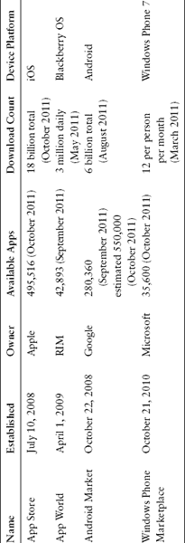

尽管 Apple 是我的首选且领先行业，但更多的平台意味着更多的消费者在下载应用。新市场正在扩大，当你应用业务增长时，那里可能是肥沃土地。虽然为 Apple 产品创建应用是最高效的起点，但只专注于一个平台而不检查其他平台的状况是非常重要的。要灵活，保持开放的心态。正如俗语说，生命中唯一不变的是变化，所以要领先一步并尽可能地预判。

## APPLE—IPHONE/IPAD/IPOD

Apple 客户是狂热粉。他们会在严寒中在 Apple Store 外等上几个小时来购买他们的产品。

你看到有人为其他平台的产品排队吗？绝不可能。他们没有同种类型的忠诚且疯狂的粉丝。你也可以为 `Android` 和 `BlackBerry` 创建应用。我在书中教你的几乎所有内容都能让你的应用大放异彩，无论你选择什么平台但我但我从 Apple 开始，特别是如果你是新手的话。

Alan Johansen 是另一个零编程经验的成功应用创业者。在两年时间里，作为一个独立创业者工作，他发布了 30 个应用，下载量超过了 1100 万次。

Alan 见证了 `Apple App Store` 多年的演变，认为它还处于婴儿阶段。他说：“看到应用商店支持并奖励独立开发者令人目一新。看到他们推广独立作品（而不是只推广自己的作品）令人目一新。”

## GOOGLE 和 ANDROID

`Android` 是市场上第二大的移动平台，适用于制造商制造的数百种设备。它是一个开源平台，允许制造商在无需任何费用的情况下适配并使用。这使 Android 成为世界第一大操作系统。

尽管 Apple 在 iPhone 上销售更多应用，但 Android 的手机更多。一年又一年，Android 在这些市场中获得了最大的增长，从 Apple 的 `iOS` 和 RIM 的 BlackBerry 手中夺走了市场份额。

但研究小组 `Kantar Worldpanel Comtech` 认为随着 iPhone 进入更多运营商，`iOS` 将取得新进展。无论如何，在 iOS 应用上赚到钱后，你应该考虑 Android 作为创建应用的第二个平台。

## BlackBerry

BlackBerry 的应用世界也在增长，速度稳定，每年增长 69%。然而，目前，BlackBerry 的 7.7 亿应用下载量与 Apple 的 180 亿以及 Android 的 60 亿相比是小不足道的。

## 准备业务

应用业务几乎没有开销。我没有办公室，没有设备，也没有员工。我只有一个 MacBook 和一个 iPhone。通过 iPhone 运行一切，甚至每天对外包人员的管理。我用我的应用互相广告，所以我几乎没有营销成本。

还有什么业务能提供这种自由？很少，或者说没有可以在没有办公室的情况下从世界上任何地方运行的业务。你可能不想住在斐济的海滩小屋里、看世界七奇迹或与鲨鱼一起游泳，但我确定你可能想用你的额外时间做其他事情。

要开始应用业务，你需要为你想要创建应用的平台注册成为开发者。不要被“开发者”这个词吓到。它并不意味着你必须是程序员。它只是用来发布应用的人的名称。（我们在第五章中讨论了外包应用编程工作。）你只需要设置一个 `开发者账户`，这样你就可以在应用商店中出售你的应用了。

以下是注册不同平台的链接以及每个平台要求的简要概述。


*   `Apple iOS` ([http://developer.apple.com/programs/register/])—注册要求包括每年 99 美元的费用并接受服务条款。
*   `Android` ([http://developer.android.com/guide/index.html])—注册要求包括每年 25 美元的费用并接受服务条款。
*   `BlackBerry` ([http://us.blackberry.com/developers/])—注册要求包括每发布 10 个应用需支付 200 美元的费用。你必须与 BlackBerry 的创建者 `RIM` 签署 BlackBerry World 应用供应商协议以分发应用。

## 未来趋势

正如前面提到的，消费者热爱即时获得他们想要的东西的便利。人们喜欢在通话期间能看到心爱的人。短信正在超越电子邮件和语音邮件，因为它是一种简单且即时的沟通方式。App 正契合这种移动的生活方式。

随着手机价格的下降和越来越多的人购买智能手机，应用市场将扩张得更快。人们对实时信息的渴望和即时需求正像野火一样蔓延。

移动生活方式将长期存在。所有的趋势都指向一种日益移动化的生活方式，这意味着为开发者提供了更多机会。

## 前 10 大应用趋势

透视应用行业的水晶球，研究公司 `Gartner`, `Inc.` 预测了以下前 10 大趋势：

1.  **基于位置的服务**。更多的消费者将使用根据其当前地理位置提供更智能服务的 App。
2.  **社交网络**。人们将花费更多时间在网上社交，使用支持如网络对话和照片分享等活动的 App。
3.  **移动搜索**。人们将信息搜索与行动相结合，例如订购披萨或寻找网球店。
4.  **移动商务**。消费者将使用手机购买更多产品。
5.  **移动支付**。商店里的顾客将通过手机支付商品和服务费用。
6.  **情感知服务**。App 将根据个人兴趣、历史、日程、喜爱的活动等定制服务，为消费者提供更具个性化的体验。
7.  **物体识别**。App 将允许消费者识别周围环境，包括特定的感兴趣物体。这些 App 将依靠相机功能来实现这一点。
8.  **移动即时通讯**。移动即时通讯系统将开始整合更多互动元素，如视频。此类应用服务可能会取代传统的电话使用。
9.  **移动电子邮件**。更多人将通过手机手机发送和接收电子邮件。
10. **移动视频**。手机将拥有更大的屏幕和更高的分辨率。同时，手机运营商将与视频服务（如 `YouTube` 和 `Vimeo`）合作，通过手机提供高清观看。

## 打造金矿

数据告诉你，应用行业是下一次淘金热。然而，你必须像对待生意一样对待它，而不是当作暴富计划。你的金矿需要坚实基础的支持：积极且专注的心态，以及理解市场和发展业务的技能。

在下一章中，我将与你分享在应用业务中赚钱的获胜心态。这需要思维的转变和开放的心态，但回报将是丰厚的。你的心态是建立蓬勃业务和你想要生活的关键。

## 我学到了什么

1.
2.
3.

## 需要采取的行动

1. 在 `Apple iOS` 平台上注册成为开发者。

# 第 2 章：先安装这个

## 应用万富翁心态

在我的职业生涯中，我错过了超过 9,000 次投篮。我输了近 300 场比赛。26 次，我被信任投决定比赛的一球却投丢了。我的生命中失败了一次又一次。而这正是我成功的原因。

——迈克尔·乔丹

在车祸之后，我在术后康复中度过了一多半。医生告诉我，我无法再次正常使用我的惯手了。

什么？

思绪如潮水般冲击我的脑海。

不能再打篮球了吗？不能和我那些还没有的孩子玩棒球了吗？我甚至还没结婚。一个女人现在跟我在一起会什么感觉？我再也为她开门了。如果我无法支撑身体，我如何性生活？我不能开车了吗？我不能写字了吗？我是个男人。如果我不能使用手臂，我如何为我和家人过上完整的生活？我才 27 岁！！！

这些想法在脑海中尖叫，在无尽的黑暗洞穴中回响。尽管我有时会充满动力并下定证明医生是错的，但我内心是心碎且恐惧的。

每天，我都要经历两个小时痛苦的物理治疗，试图重建左臂的肌肉，努力开发出某种活动范围。剧烈的疼痛在全身脉动，在每次课程后变成彻底完全的绝望。在每日的战斗之后，我会吸入止痛药，坐在宽大的 `La-Z-Boy` 躺椅上痛苦地度过一天的剩余时间，感到挫败。

在事故发生之前，我也有很多人一样的问题，比如：我的生活意味着什么？我接下来要做什么？之后，我也有其他问题：我该如何恢复手臂的功能？如果这还不够成为问题，我该如何赚足够的钱来支付我累积的 10 万美元医疗单？

疼痛是难以忍受的，由于我无法躺下，我无法睡眠。在这一点，我有五星期没有睡好觉，疲劳侵蚀着我的身心。我感到如此痛苦，甚至想要彻底放弃。

那是我陷入了人生的最低点。一个下午，我独自一人，大脑陷入了一个黑暗的地方。我甚至不感激自己从那场惨祸中生存。我清醒着，泪水顺着脸流下。突然，我内心有什么东西在尖叫，就像机场里的扬音器一样。

你不止于此！那个声音说。战斗吧，`Chad`。战斗吧！不要放弃。你仍然拥有想要的生活。你只需要相信并让它发生。

我不确定那天发生了什么，或者那个声音从哪里来。称它为我的`创造者`，称它为我的理性，但那个声音对我影响如此巨大，以至于我知道没有选择。我必须听从，从那时起，在所有的黑暗中，我瞥到了我几乎完全放弃的生活的可能性，希望开始从缝隙中渗入。

一切开始改变。第一次，我理解了信念和信仰的重要性和力量。我决定不再做我生活电影中的配角了。是时候成为编剧和制片人了。

从那时起再也没有回头，你猜怎么着？我的生活电影是一部每天都在变得更好的史诗。


在我参加的活动和派对中，我经常听到人们对这项业务的怀疑。我不怪他们。我曾经历过这些，必须经过了自己的历程才克服了那些局限性信念。

以下是我从人们那里听到的最常见的一些恐惧：

* “我从未做过这个 . . . 我没有经验 . . . 我没有背景。”

  我曾处于同样的境地。但我找到了可以学习的成功人士。

  如果你想获得成功，你要做的就是找到模仿那些成功者的方法。尽快找到一个可以模仿的对象。

  从小处开始，随着时间不断学习。你可能会犯一些错误，但你会变得更有信心和知识。在你回过神来之前，别人就会模仿你了。

* “这太难了 . . . 我看不懂 . . . 我不够聪明。”

  任何人都可以做这份生意，即使你不理解它。就像生活中的任何事情一样，你必须从某个地方开始。这是最容易入手的业务之一，因为市场正在告诉你该做什么。你需要做的就是倾听。

这项业务的核心在于观察市场、理解市场，并给用户你认为他们想要的东西。你第一次上场可能无法击出全垒，但你必须在整个比赛中不断站起来挥棒。

* “我不是电脑人”，“我不是开发者”，“我不是代码员。”

  我也不是。我不知道如何编写任何程序，也不想知道。无论你的计算机技能，都可以进入 App 业务。如果你能画出一个 App 创意并将概念传达给程序员或设计师，那么他们就可以为你完成工作。即使你会写代码，我也建议雇佣其他人来完成大部分工作，这样你可以把更多精力放在经营和建立业务上。

  我的两个创业者朋友在开始创建 App 时都拥有软件工程学位。他们很快意识到他们必须向外包给其他程序员，这样他们才能成为创业者。

* “这需要很多钱 . . . 我没有钱可以浪费 . . . 我没有钱建立 App 业务。”

  你不需要很多钱就能开始。开发简单的 App 成本在 500 美元到 5000 美元之间。一旦发布了 App，根据你的销售情况，可能在两个月内就能看到钱进入你的银行账户。

  我开始时欠了巨额债务，从继父那里借了钱进行孤注一掷。我没有任何员工，所有的工作都是外包的。

  在这项业务中，准入门槛低得离谱。你不需要学位。你不需要像股票经纪那样获得执照。你不需要投入 60,000 美元或更多资金接受四年的教育。你不需要支付 50,000 美元的特许经营许可费。你不需要许多员工、大量设备、开销或商业空间。

  即使你搞砸了，损失也是相对小的。如果你坚持下去并从错误中学习，你将获得赚大钱的机会。

* “我不是做生意的人 . . . 我不知道如何成为一名创业者。”

  你不必是。而且这比大多数其他类型的业务要容易得多。

  苹果公司负责分销，你就可以把时间花在营销上。如果你能不断测试市场并根据数据进行纠偏，你就可以经营一家成功的 App 业务。

* “我没有足够的时间 . . . 我有一全职工作 . . . 我没有时间学习这个。”

  这项业务关乎夺回你的时间和生活。即使你全职工作每年赚 100,000 美元，如果你永远见不到孩子或配偶，或者没有充实的生活，这值得吗？

  这项业务的迷之处在于，你可以选择从兼职开始，随着你学习得更多并获得信心，你可以迈出更大的步。

  当你因为收入翻倍而辞职时，你会有多到不知道该做什么的时间，这就是这项业务带给你的。在任何时间、任何地点、和任何人做你想做的事的自由。

* “我失去了信心 . . . 自失业以来一直很低落 . . . 衰退对我打击很大。”

  当我还是孩子的时候，经常在社区里和一个叫 Smalls 的家伙一起踢足球。我们以前欺负他。他可能湿透了也只有 110 磅，但你可以撞他，他几乎不会倒下。如果他倒了，他会立刻弹起来，仿佛什么都没发生过一样。这不符合逻辑，因为每个人都比他更高、更强。他到底是如何承受如此巨大的撞并屹立不地的？所以，有一天在学校的食堂里，我走向他：

  “Smalls，你在球场上被撞得那么重时是如何保持站立的？”我问道。“你那么小。你的秘密是什么？”

  “你真的想知道吗？”

  “是的，我真的想知道。”

  “我一直在移动，”他说。

  “什么？”

  “我被撞到时看着我的脚，”他说。“我从不停下。是的，我从不停止。”

  我的反应是觉得他说的话很愚蠢，但在思考之后，我看到了更深层的意义。这是合理的。我们可以成为自己最大的敌人或最伟大的英雄，但最终我们有权选择并决定我们要关注什么。

  如果我的车没有翻掉，我就会获得改变所需的杠杆。很多时候，我们比想象中更接近保持站立。只要我们能说服自己，痛苦可以成为我们最好的礼物和最大的武器。

* “只有少数人能在这项业务中赚钱 . . . 与大玩家竞争很难 . . . 因为所有的创意都被占用了，很难赚钱。”

  大玩家也和你一样。这个行业还处于婴儿期，任何人都可以像他们一样制作 App。他们可能有大量的营销资金，但你仍然可以用很少或没有资金来营销你的 App，正如书中后面会提到的的那样。

  这项业务的独特之处在于，大玩家和大家都在同一个竞技场上。他们和你将面临同样的问题和挑战。

  这个行业刚刚开始。正如我之前所说，它就像电子商务开始时的互联网。你有机会随着行业一起成长。你不需要发明新创意。如果你能改进现有的 App 创意，你就可以赚钱。

* “我是为了淘金热来的 . . . 我不需要工作就能赚大钱。”

  很多人带着快速发富的心态和不切实际的预期加入了 App 淘金热。不要变成那样。这本书给了你工具，让你像企业主一样思考，并有一张寻找黄金的地图。你必须工作，但你不需要在这个过程中挣扎并让生活流逝。

  这不是一次性的 App 彩票奖，你不能那样对待它。我们都想要即时满足，但如果你把这项业务视为一项长期事业，它就会成长并成为可持续的收入来源。

* “仅仅因为别人成功了，并不意味着我也会成功。”

  没错。这项业务中最重要的就是你的心态。我们可以成为自己最大的敌人或最伟大的英雄，但最终我们有权选择并决定我们要关注什么。

## 创造黄金心态


你必须建立关于财富的信念，让你自己不再成为自己的阻碍。学会去看到机会，而不是盯着那些事情过去无法实现或过去没有成功的理由。通过转变你的信念，你可以将挑战转化为学习和成长的机会。

安东·罗宾斯（Anthony Robbins）在许多方面改变了我的生活。当我因为车祸在医院康复时，有人送给了他的 `Get The Edge` 程序作为礼物。他的话开启了我一直不知道自己还存在的一个部分。

我意识到，在生活的那个时刻之前，我一直关注的是商业工具。我问了诸这样的问题：“我如何获得更多销售？”“我如何提高营销水平？”“我应该雇谁为我工作？”

托尼·罗宾斯教会我问一些更深层次的问题：“我想过什么样的生活？”“对我来说什么很重要？”“我想要如何表达自我？”“我想从挣钱中得到什么？”“我的使命是什么？”这些问题让我以不同的方式思考业务和生活，剔除了杂质，让自己实现了真正的统一。

我意识到，要过上想要的生活，我需要对心态进行重大转变，并重新对齐我的核心信念。

当我改变信念时，我开始拥有坚韧的心态。我知道我想要什么，不会让别人的计划阻碍我的路，而且我很快乐。我意识到，如果没有我的身体，如果没有我内心的清晰与和平，我一无所有。这带给我一种感激感。我有了不同的能量和强大、积极的心灵。这让我的业务和生活方式每天都令人兴奋。

听着，你不需要像我一样经历重大的伤性事件来学习这些教训，我永远不希望在我身上的事情发生在任何人身上。做任何你需要的事情来增强你的心理和情感肌肉。我的事故从根本上改变了我，因为我觉得自己被赋予了第二次机会，我不会滥用这份礼物。你的第二次机会和新生从现在开始。

## 获胜心态的特质

以下是获胜心态的关键要素，以及你在应用世界和生活中蓬勃发展可以采取的行动。

## 明确你的“为什么”

问问自己：“我为什么想在应用业务中赚钱？”每个人都需要一种动力，所以专注于你的动力，你就已经赢了成功的一半战斗。这个“为什么”可能是你独特的，也可能与其他应用创业者的“为什么”相似。

无论是什么，如果你不知道自己成功的首要理由，你就无法成功。这可能是你想环游世界、支付孩子的大学学费、做慈善工作、支持年迈的父母或帮助环境。

向我展示那些有充分理由想要成就某些事的人，我可以向你保证，变成现实只是时间问题。你的“为什么”是什么？

## 有力的问题

正如你从上一节看到的，问深思熟虑的问题比拥有快速答案更重要。

有力的问题会触发你的大脑去寻找有力的答案。我了解到，高水平的启蒙和不可思议的成功是你持续地问自己的问题质量的直接结果。

务必每天都问自己一些有力的问题。结果将让你惊讶。从这种习惯中显化的东西将把你的业务推向新的高度。

以下是在启动应用业务之前可以问自己的一些有力的问题：

* 获得新发现自由后，我将如何去做？
* 我在为谁做这件事？为什么？
* 在这个领域获得成功将如何改变我亲人的生活？
* 为了确保我的成功，我承诺做什么？

另一个有力的工具是立即采取行动，无论步骤看起来多么微小。听我的，拿一张纸，花五分钟时间考虑并回答这些问题。

在后面的章节中，我将与你分享更多详细的问题，这些问题与你业务特定特定直接相关。

## 愿景/结果

创建一个点燃你激情的愿景。然后明确你想从那个愿景中获得的结果。

为你的业务创建一个愿景对于弄清楚你想去哪里至关重要。你会跳进一辆车在不知道目的地的情况下开车吗？嗯，我们知道许多人在半梦中度过一生，接手一项又一项任务来让自己保持忙碌模式。我假设如果你拿起一本关于如何创建成功的应用业务和重塑生活的书，那并不是你的风格。

当你创建一个愿景时，继续你的内心对话，直到你对自己的动机有更好的理解：

* 你可能会说：“我想赚某笔钱。”
* 好的，那么你为什么真的想要这个？
* 你可能会说：“我想还债，不再整天担心钱。”
* 好的，那会带给你什么？
* 也许“它会减轻我肩上的沉重负担，让我感到自由。”
* 那么，为什么这种自由如此重要？
* “它能让我再次感觉良好。我能和家人在一起，看他们大笑，玩耍并享受生活。我可以和老朋友聚聚，去我一直一直想去的地方，以新的方式体验生活，记住再次变成孩子的感觉，复苏我曾让其死掉的梦想等。”

继续深层挖掘，因为最初的回答通常是浅薄的，没有揭示我们行为背后的真实动机。通常当你这样做时，在某个时刻你体内的某种东西会通了。你会感觉自己准备好爆发了，充满了活力和激情。那时你才达到了你真正的愿景。当你被要求具体时，真相就会显现，你会显化你想要的东西。

一旦你有了那种清晰，就围绕它设定你的结果或目标来实现愿景。另一个例子，问问自己：“我公司的愿景是什么，我想创造什么？”

要具体。让它成为你会追求的东西，现在创造你的未来。将你的结果与具体的实体联系起来。例如，“如果我每月赚 `$10,000`，我就要去意大利，划船在大运河中穿行。”也许这是一个带有奖励的年度目标，比如，“我会全资助孩子的教育”，“我会买一个更大的房子”或“我会还清债务”。

把它写在你你每天都能看到的地方。它将让你保持动力，并给你能量去克服可能让你偏离轨道的不可预测和不可控的障碍。我把我的结果写在浴室的镜子上，使用可擦黑马克笔，因为我知道每天早上我去浴室，刷牙并看着镜子。多年来，我写过类似这样的内容：“获得每月 $1,000 的现金流”、“去异域旅游”或“以七位数的价格出售我的应用业务”。每天看到这些会让它们发生得更快，并立即给予我应对挑战所需的动力。

## 信仰/乐观

无论你的目标是什么，你必须持续相信你有办法实现它，并且你对这种信念要坚定。要吸引成功，学会看到它、感受到它并显化它。我一直在表面上有信仰，但从未真正允许自己拥抱它。在事故之后，听到了将我的思想从那个黑暗地方拉出来的声音，我无法否认比我更强大的力量。我意识到并不是每个人都有这样的经历，但我敦促你或重新连接你信仰的任何更高力量。这将改变你的游戏。

## 激情

你需要对你的业务以及生活中所做的任何事情充满热情。既然你正花时间建立这个新企业，你处于一个位置，可以让它感觉不像工作，而更像乐趣和游戏，否则你很快就会精疲力竭。


这种情况在每个人的某个工作中都会发生，你的目标是建立好这种机制，让它听起来不像是一项工作。它应该是充实成就感的，感觉更像是你想要做的事，而不是你必须做的事。一旦你建立了这个愿景，动力就会毫不费力地推着你前进，就像滑道将你直接带上一座金钱山上。

要实现这一点，请专注于开发你既能从中享受又能从中获利的应用。例如，如果你喜欢玩视频游戏，你可能对那类应用有兴趣和知识。如果你是一个摄影爱好者，而且发现摄影类应用很流行，你可以在该领域投入时间，创造出其他像你这样的摄影爱好者也会喜欢的东西。

## 态度

在我住院期间，一个朋友给我发了一句斯蒂芬·柯维（Stephen Covey）引言，他是《高效能人士七习惯》的作者。这句话深刻得足以改变我的态度和思维。

它提到了另一个百分比，被称为`90/10 原则`。它是这样说的：“生活中 10%由发生在你身上的事情组成；剩下的 90%由你如何反应决定。”

这意味着什么？我们对生活中实际发生的事情几乎没有控制力。我们无法阻止汽车故障、飞机晚点、交通中给我们插道的司机，或者某只跳到我们卡车前面的鹿。但对于如何解释和对生活中的事件做出反应，我们几乎拥有完全的控制权。

我们无法控制红灯，但我们可以控制自己是生气，还是耸耸肩继续听收音机里的音乐。简单，却又极其有效。

在学习了`90/10 原则`之后，我意识到生活并不该是如此艰难。也许我一直在用消极的态度自我破坏，让事情变得更糟。我有选择去关注什么，以及给我的生活事件赋予什么样的意义。

我意识到，每当人们问起我的房地产业务时，我会说：“噢，太糟糕了。太难了。我没赚到钱。”我觉得很软弱，我周围的人也会感到痛苦。这变成了一个消极的循环，导致了糟糕的结果和糟糕的情绪。

当我转变态度时，我培养了乐观和自信的态度。这产生了巨大的变化，并带我走向新的道路，有了新的目的地。

在应用业务中，事物总是在变化。你永远不知道会发生什么。你会面临挑战，但如果你训练自己拥有一颗强大积极的心态，你将比 99%的其他开发者/应用创业者具有竞争优势。

## 计划

是的，说你应该计划是显而易见的，但这确实是真的，而且我直到过去几年才意识到它的重要性。如果你不进行彻底的计划，那么你就是在计划一场惨败失败。在业务中，如果你能有效计划，你会获得好得结果，而不是像头被睾酮驱动的公牛一样在西班牙潘普洛纳的街上横冲。

你的计划不需要复杂到阻碍你采取行动。保持专注和觉察，比对业务感到不确定更有利，并能带给你你前进所需的确定性和清晰度。

## 灵活性

在这一行业或任何行业中，变化都是常态。作为所有者，你必须开放心态改变那些不再为你服务的应用和策略，并立即削减冗余。

任何应用的第一个版本很少成功。目标是在当你获得能让你某个特定领域的真实数据时，保持客观并进行调整。如果你不保持灵活，就会浪费时间和金钱，并失去动力。如果你不断精炼，就有更大的机会成功。

因为一个想法最初不起作用，并不意味着它未来不起作用。通常只需要一点微调或一点时间。

我经历过几次业务失败，并不是每个应用都带来了我预期的利润，但我学到了宝贵的教训并进行了调整。只要你跟踪自己所做的事情并修正路线，你就会继续朝着正确的方向移动。

## 杠杆/外包

我一直是一个创造者，这意味着无论手头有多少任务，我总是想做更多。这种心态的问题在于，我总是过度工作并让自己精疲力竭，却毫无满足。

应用开发者也因此过度投入闻名。

如果你想让业务增长，你需要外包。你必须能够依靠他人并放手。成功的企业家、演讲家基思·坎汉（Keith Cunningham）曾说：“增长与控制是反的。”你越想增长，越需要放弃控制。

被账单困住了？外包它。厌倦了回邮件？外包它。受不了检查开发进度？让别人去做。外包所有消耗你时间和动力的事情。外包任何剥夺你变得更强大能力的事情，去享受你喜欢做的事。这将确保你在做喜欢的事时充满乐趣。这能确保你为任何冒险提供燃料。

## 协同效应

多寻找其他志同道合的人帮助你成长。

一种极佳的方法是通过主脑小组。这是你加入一个小群体，每个人都专注于相互提供鼓励和成功的实用策略。你们可以分享资源并共同成长。

另一种方法是与其他应用创业者或开发者建立人脉。在网上、会议和聚会小组找到他们。

当你建立人脉时，你将发现可以效仿的成功人士。与拥有积极心态并能帮助你成长的人相处。通过他们的经验学习轻松的方法，而不是通过自己碰碰头来学习痛苦的教训。

## 专注/专注

你应该像对待新关系一样对待你的业务。与你的业务亲密并发现激情。你越投入它、关注它、为它提供价值，你的关系就会变得越强大。如果你不这样做，很快就会流落街头，而且这非常难受。

当你专注于你的业务时，你会看到更好的结果。如果你不在状态，如果你视其理所当然，你的业务可能会偏离，或者彻底失去。

苹果 App Store 是每天都在变化的全球经济体。如果你不对业务保持专注，不断适应和改进，你就会被淘汰。

保持目标需要纪律。你必须理解应用业务的每个组成部分，分析可以帮助你做到。我建议你评估每个领域的情况：每天、每周和每月。监控市场，跟踪结果并进行修正。

曾一度，我旅行得太频繁，以至于没有处理我的业务。在行业中这很容易，因为你正在赚钱，有时你会忘记。有一天在加拿大旅行时，我意识到我的自满已经跟上了我，我需要切换模式，因为数据正在下降。

我每天花两到三小时关注我的业务，持续三周，那是专注的时间。我深入公司的每个部分感受脉搏。我知道我们的营销是否达到了目标，知道为了让客户满意我们需要改变什么。我进行了微调，为我的业务提供了所需的燃料。这样做之后，收入增长了 68%！

不仅仅关乎“我现在能赚多少钱？”它关乎对过程中的每一步保持专注，为了长远。


通过与其他应用创业者（appreneurs）建立联系，我学习了让收入翻倍甚至三倍的技巧，并强化了我的获胜心态。我从他人那里学习并获取新想法，同时也为他们的应用世界贡献力量，帮助他们的业务增长。

最后，应用本章中的相同技术，让我获得了克服事故并建立一家成功的应用公司所需的心理和身体力量。我完全相信，这些技术也将对你有所帮助。

## 我学到了什么

1.
2.
3.

## 需要采取的行动

1. 问问自己这些问题并写下答案：
    * 我的初衷是什么？当我实现它后，我的生活会发生什么变化？
    * 我能看到自己在应用业务中做什么来赚钱？我的热情是什么？
    * 我想用拥有的自由做些什么？
    * 我对实现这件事投入有多大的决心？成功的对我对我有多重要？
    * 我将会在何时以及如何每天检查自己的获胜心态？
    * 还有谁会从这种新的生活和财富方式中获益？这对他们和对我意味着什么？
2. 写下你打算每天都联系在一起的新赋能信念。

# 第 3 章：发现新世界

## App Store

真正的发现之旅不在于寻找新的景观，而在于拥有新的视角。
——马尔塞尔·普鲁斯特（Marcel Proust）

“周五快乐，”银行柜员说道。

“谢谢。这是我人生中最棒的一天了！”我满脸笑容地说道。

兑现那张 `$73,322` 的支票带给我经历过的最棒的感觉之一。我欣喜若狂，因为这笔钱比我这辈子赚的钱还要多，而且它来自一笔真实的房地产交易。

那笔交易对我来说意义不仅仅是钱。它象征着胜利和一种拥有新机会的新生活。我曾竭尽全力，经历了挣扎、付血、汗水和泪水，才实现了我从小从小就开始幻想的美国梦。

当大多数二十多头的男生在狂欢、追逐女孩，或者无所事事地虚度时光时，我发现自己正在看书、研究当地房地产市场、向成功的房地产投资者学习，当然，也还在追女孩。我希望效仿他们，过上他们所过的生活。交易完成那天，手里拿着支票，我满怀感激。所有的努力都得到了报报，我成功了。

2006 年 1 月 6 日，24 岁的我回到了南卡罗来州的默特尔海滩（Myrtle Beach），我在那里创办了一家房地产公司，以为自己已经掌控了这个行业。

每个人都在房地产领域赚钱，几乎没有人预料到这场派会对结束。不到一年后，市场毫无征兆地崩盘了，我计划和努力的一切都化为乌有。

当崩溃时，我所有的努力都变成了一堆账单，而且还没有支付账单的钱。我在七个月内就花完了第一笔房地产交易赚来的钱，没有剩余钱来度过低迷期。

绝望中，我看向了住在纽约的导师之一。我确定他会有答案，但当他的“灵丹妙药”是这样时，我愤怒了：“继续在你成功时所做的任何事情，因为我想你已经忘记了你辛苦努力学习的东西。”

这到底是什么意思？我想。。两周后，我正正在刷牙，突然间，就像从昏迷中醒来一样，我有了“顿悟”时刻。

我意识到，我一直是从房地产所有者的视角来看待市场的，而不是从客户的视角。我之前之所以获得成功，是因为我痴迷于研究市场并像客户（即购房者）一样思考。我理解市场的能力一直带给我竞争优势。

我意识到，即使在低迷市场，默特尔海滩也是一个瞬息万变的地方，人们仍然在寻找住处。我必须弄清楚在哪里、寻找什么样的房子，以及如何找到那些买家。

我记得当我买房子时，我想住在最好的区域，学校很好且靠近海滩。我推断其他人一定也有特定的需求，并且会有数据告诉我是哪些区域的交易量最高。于是，我进行了研究，发现了与其他地区相比表现优异的最火热、最受欢迎的社区，并决定驻扎在那里。

我的导师是对的。如果这些是最火热的房产，那么我问自己：谁在那些地方卖房子，他们是怎么做的？他们通过什么来吸引买家和/或卖家？

事实证明，那些地区的顶尖房地产经纪人通过报纸广告寻找买家，并使用特定的语言。就是这样。我效仿他们的营销策略并找到了买家。我能够从那些买家身上获利并保持我的业务生存。当市场变化时，我训练自己保持关注并倾听，这样我可以改变策略并顺应趋势，而不是对抗。

房地产低迷持续比我预想的要长，让我的财务状况非常紧张，尽管很困难，但这是一次我感激的宝贵经历。那是我开发业务中生存所需技能的战场。我在我的应用业务中使用同样的策略，但头脑少了很多。我观察大局，研究市场，像消费者一样思考，并效仿最成功的玩家。

好消息是，你可以从第一天起避免战斗伤痕并使用这些策略。听从市场，遵循趋势。作为一个应用创业者，你越了解客户并给他们他们想要的，你的回报就会越大、越持续。

在本章中，我将带你游览 `App Store`，让你像专业人士一样利用这个强大的资源。

## 收集情报

正如任何业务一样，你的成功与你对市场的理解直接相关。`App Store` 是应用的市场，因此要理解市场，我们必须研究 `App Store`。


根据这些信息，我清楚了趋势的走向，并且我必须调整我的业务模式。我联系了我的开发者并开始更新应用，以便通过应用内购买增加收入。这是市场的一个巨大巨变，如果不每天监控市场，我无法察觉到这一点。

我看到其他顶尖开发者也在不断地观察并适应市场。你对市场上正在发生的事情越关注、越通晓，你就能越快地调整并利用变化的机会。

## 洞察应用背后的本质

那么，你如何跟上市场的节奏？最好的方法是查看苹果的作弊宝（cheat sheet）并不断研究它。App Store 几乎实时地显示了付费榜、免费榜和畅销榜应用（包括免费应用在内获利最多的应用）（请参见图 3.2）。苹果在各个应用类别中提供了相同的列表。这些信息是金性的，因为它们告诉了我们市场的规模。最棒的一点是，与其他任何行业的市场信息不同，这些信息可以随时获取。

图 3.2 前 25 付费、免费和畅销应用。

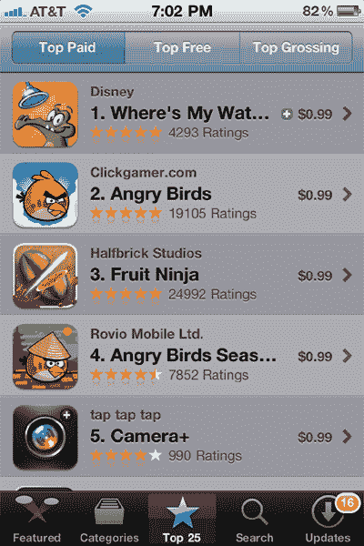

经常查看这些图表，并寻找你可以利用的趋势。这就是我所做的。这让我了解了不同的定价模式，以及成功的应用是如何被设计和营销的。在观察市场时，可以问自己以下问题：

*   为什么这个应用会成功？
*   它的排名如何？是否保持稳定？
*   人们为什么要这个应用？（查看评论。）
*   这个应用让客户变成了疯狂的忠实粉丝吗？
*   这个应用满足了我的任何需求吗？
*   在尝试之后我变成了疯狂的忠实粉丝吗？
*   这个应用引发了冲动购买吗？
*   客户还会再次使用吗？
*   开发者是如何向客户营销的？（查看截图、图标设计和描述。）
*   我还能从创建该应用的公司中学到什么？
*   这个应用的竞争优势是什么？

保持好奇心，并不断提出很多问题。这将帮助你发现成功的线索。这种研究简单、不分成本，而且非常有趣。你还将下载、玩游戏，并测试其他应用。重新发现你的内心世界，享受乐趣吧。

记录下你观察到的现象非常重要，这样你就可以利用这些信息为自己服务。与其说“我认为这会有效”或“我的哥们告诉我这个应用很棒，所以我打算尝试”，不如让客观数据引导你。很少有应用是偶然成功的。当你持续这样做一段时间后，你将对市场中什么有效、什么无效产生一种灵异且敏锐的第六感。

你花在每个应用上的每一秒都是你市场研究的一部分，这将让你作为一名应用创业者（appreneur）变得更加精明和博学。即使你的业务在增长，也要继续学习新应用。你可以发现新的想法和不同的设备功能。

你应该什么时候研究市场？尽可能利用你的空闲时间。检查 App Store 的脉搏需要 5 到 10 分钟。此外，在电脑前时要安排时间专注于你的市场研究。这将使你能够在屏幕上看到更多内容，并更容易地记录任何趋势。

## 应用的类型

尽管你会在 App Store 中发现许多类别的应用，如游戏、娱乐、工具和生产力，但实际上只存在两种应用：为娱乐目的设计的和为生产力设计的应用。我指的不是 App Store 中的娱乐和工具类别。相反，我将应用分为两组，因为这简化了研究和理解应用用户人口统计特征的过程。

娱乐应用范围从动作游戏、益智游戏、虚假智商测试，到枪战模拟器、恶作剧应用等等。它们提供乐趣，是不费脑子的，通常被用作消分遣来消磨时间。它们通常不需要用户付出多少精力或思考。

畅销娱乐应用不仅仅是像《愤怒的小鸟》那样的动作游戏。它们也可以是像 `Talking Ben` 这样的应用，里面有一只动画互动狗会用幽默的低音调重复你说的这句话。另一个例子是一个名为 `Top Girl` 的应用，它模拟了一个虚拟世界，让女孩可以走动、交男朋友、为他买衣服等等。这并不是我的菜，但有足够的人喜欢它并让它保持高位排名。

另一个似乎总是出现在畅销应用榜前五的娱乐应用是 `Tap Pet Hotel`。它的内部是一个虚拟世界，用户必须每天照顾宠物，付费以升级饲料或教宠物新花样。这个虚拟世界使用虚拟货币作为奖励系统，这钩住了客户并让他们成为疯狂的粉丝。

应用的精之处在于其更深层次的目标：钩住用户让他们回来。

我一辈子都无法想象一个虚拟宠物酒店应用会如此受欢迎。我自己也想不出来。在判断一个应用是否可行时，保持客观是一个很好的例子。将情感和个人喜好排除在决策之外。我不在乎我有多大的成功，或者我认为自己知道什么，我总是让数据引导我。

在写本文时，人们最看重的是娱乐和通过游戏释放压力。前 100 个付费应用中，有 75 个是娱乐应用。

在前 100 个畅销应用中，只有 10% 是工具类的。我认为这种不平衡的需求在一段时间内将持续，因为 iPhone 用户关注的是娱乐。

另一方面，工具应用让世界变得更加方便，帮助人们处理日常生活。例子包括将 iPhone 变成手电筒、追踪饮食、创建购物清单、进行货币换算或将语音备录作为短信发送。

## 应用发现

在应用业务中赚钱的另一个关键点是客户如何发现应用。如果没有用户发现你的产品，就没有交易发生。客户发现应用的方法有两种：在 App Store 中进行关键词搜索，或者浏览其榜单。这意味着应用的可见性取决于应用的搜索排名和榜单排名。因此，你必须竭尽全力地监控并提高你的排名。

直到最近，应用排名是基于每个应用接收的下载次数。然后苹果稍微修改了其排名算法，将使用频率和时长等其他变量考虑在内。这一变化之后，像 `Facebook` 这样频繁使用的应用在榜单中排名上升。


App Store 分析工具 Chomp 每月都会发布一系列与 App Store（苹果）和安卓市场（谷歌）相关的指标，这些指标为移动市场提供了宝贵的见解（参见图 3.3）。请注意这些统计数据，特别是消费者的兴趣和消费习惯。

图 3.3 Chomp 的 iOS 搜索分析报告。

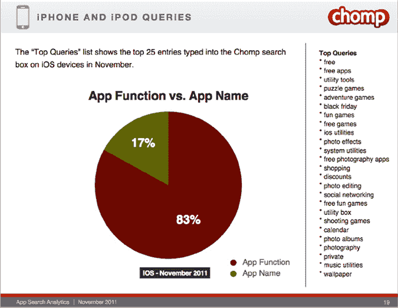

下面的图显示，App Store 上 83% 的搜索是基于功能或类别（例如益智游戏或摄影），而不是特定的应用程序名称。App Store 上有超过 50 万个应用程序，用户可能只认识、甚至根本不认识几个 App。这种洞察力可能决定了你是睡在朋友的行垫上，还是住在俯瞰旧金山湾的顶层公寓。

## 开发者是如何赚钱的

销售 App 并不需要成为一个油腻的二手车推销员，也不需要穿西装领带。对于你的业务来说，这可能是最简单的一部分。苹果单枪就彻底改变了软件发行领域。一旦你创建一个 App 并将其发布在 App Store 上，它就可以在 120 多个国家的每一个 iOS 设备上访问。（参见图 3.4。）

图 3.4 欧洲的应用商店。

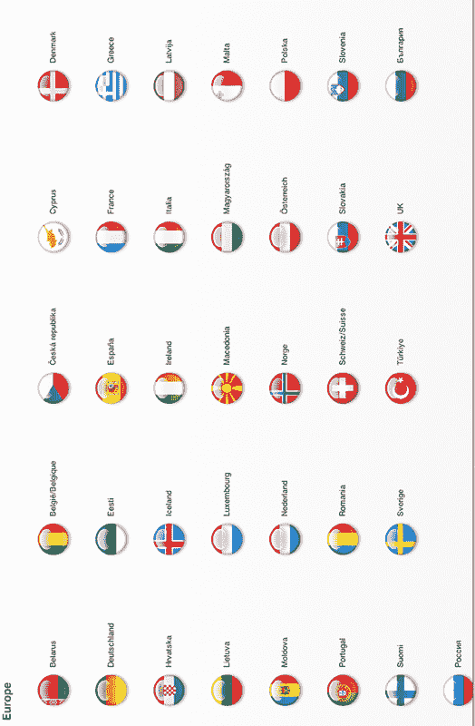

对开发者来说，很好的一点是这些 99 美分的交易可以像滚雪球一样变成数百万，尤其是当它们在全球范围内全天候发生时。

付费 App 的每次下载费用从 99 美分到 999 美元不等。大多数付费 App 是 99 美分，比如非常成功的 *Doodle Jump* 或 *AppZilla*，但极少数 App（如名为 `BarMax` 的法考备考 App 或名为 `iVip Black` 的专属 VIP 会场 App）价格高达 999 美元。

既然价格跨度如此，你可能会问自己 App 的最佳价格点是什么。那些随处可见的廉价商店已经给出了答案。就像那些货架上所有商品都低于 1 美元的折扣商店一样，付费 App 定价的甜点是 99 美分。

这是开发者来说最丰厚的价格点，我不建议以更高的价格销售 App，因为市场份额太小了。你可能会赚钱，但不太可能赚大钱，而且风险很大。

通过以 99 美分卖数百万次下载来成为百万翁，比每个 20 美元卖 50,000 次要容易。较低的价格让你更容易销售，而通过增加下载量获得的 App Store 榜排名带给你更高的曝光率。

我的目标是帮助你尽早实现你想要的生活方式，这意味着尽可能快、尽可能多挣钱。如果你选择 99 美分 App 的路线，甚至是免费 App 模型，你更有可能拥有市场份额和资金来支持你想要的生活。

一些高端游戏公司（如电子艺公司）对其付费 App 收取更高的费用，例如 4.99 美元而非 99 美分。除非你拥有数百万的品牌认可度，否则高价格点不是良策。

尽管付费 App 仍然是开发者主要的收入来源，但免费 App 已超过付费 App 成为主要收入来源。许多开发者通过提供免费 App 创建了自己的“摇钱树”。免费 App 可以为开发者赚取大量资金，它们是对市场进行试金石测试极极方法。你可以发现用户对你的 App 是否感兴趣，并据此调整策略。

免费 App 有多种变现方式。有时，它们具有基本功能，并用于推广其全功能的付费版本。这个工具如此重要，以至于像 `Angry Birds` 这样成功的付费 App 开发者也使用免费 App 将流量引向他们的付费 App。

开发者偶尔会让他们的付费 App 在限时间内免费，以便更快地增加用户群，并给 App 一个病毒式传播的机会。

另一种用途是通过广告或应用内购买变现的全功能免费 App。如果用户喜欢这个 App，他们将继续在 App 内购买额外的付费功能。正如你可以想象的，免费 App 内的多次销售对开发者来说比一次性的预付费销售要有利得多。

当客户感到无聊并停止使用时，免费 App 就会失败。不活跃的客户就是流，意味着进入银行账户的钱少了。因此，你必须通过提供额外的免费和付费功能及福利来保持用户的参与度。允许用户在 Facebook 或其他平台上分享他们的成就，可以让 App 有机会病毒式传播。这种曝光率会引起更多人对 App 的兴趣。

`Songify` 是使用上述技术的免费 App 的绝佳示例。该 App Allow 用户使用自己的声音创建歌曲。用户的录音会经过自动调音（想象一下 T-Pain），并叠加在 App 提供的配乐之一上。结果是一个令人惊讶的趣味音乐杰作，让普通的浴室浴室歌者变成了格莱美奖得主。这个 App 保持了用户的参与度，因为他们可以创建新的录音并与不同的歌曲混合匹配。开发者通过提供用户可以用 99 美分购买的额外歌曲为 `Songify` 变现并增加更多价值。用户可以使用 Facebook、电子邮件或 Twitter 发布他们的作品并向世界展示。

我们将在第 9 章更详细地讨论 App 模式。

## 冲动购买

App 因许多原因吸引买家。人们之所以花费这么多钱，以及为什么经济衰退可能不会影响核心业务，是因为购买过程是即时的。冲动购买发生在瞬间，并有一个特定的购买流程。我对许多用户进行了测试，发现 App Store Store 的平均客户遵循以下六个步骤：

1. 通过搜索或浏览 App Store 发现 App（参见图 3.5 和 3.6）。

图 3.5 通过搜索发现。

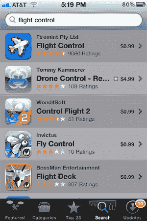

图 3.6 通过浏览发现。

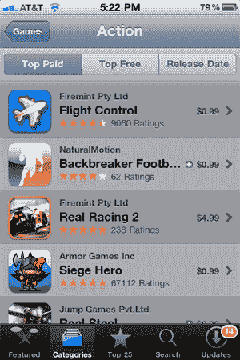

2. 他们查看 App 的图标。人们是视觉驱动的。他们喜欢能告诉他们 App 用法的有趣图标，例如照片 App 的相机。`Flight Control` 的图标上有一架大飞机，卡通风格提示用户这是一个游戏。

3. 接下来，客户阅读标题并扫评分；`Flight Control`。标题说明了一切切。“如果你想要一些刺激的东西，这就是你的游戏。”凭借 9,060 个评分和 4.5 星，该 App 的受欢迎程度毋庸置疑。

4. 客户的目光随后落在描述上，他们在向下查看截图时会进行扫视。（参见图 3.7。）

图 3.7 图标、名称、评分和描述。


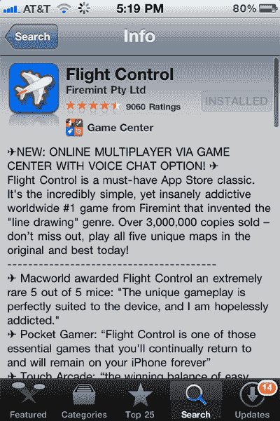

5\. 截图提供了极佳的图片和横幅说明，作为直观的应用描述。（参见图 3.8）。注意到这里的规律了吗？

FIGURE 3.8 带有横幅的屏幕截图。

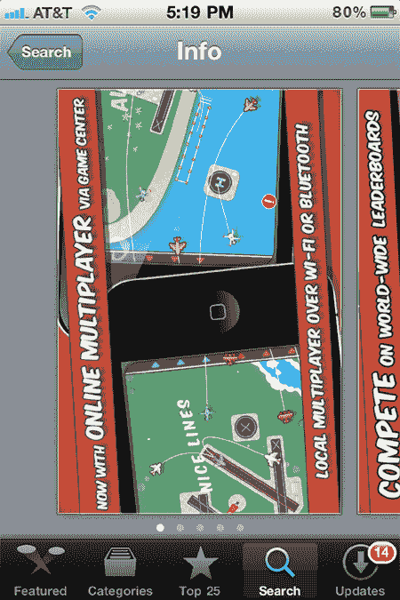

6\. 他们通常在第五步之后购买游戏。如果没有买，他们可能会阅读几条评论以确保其他客户喜欢它。在此时，他们正在想：“不错。我想我会买的。大家都买了。而且，，呆，这才一美元呢。”（参见图 3.9。）

FIGURE 3.9 评论。

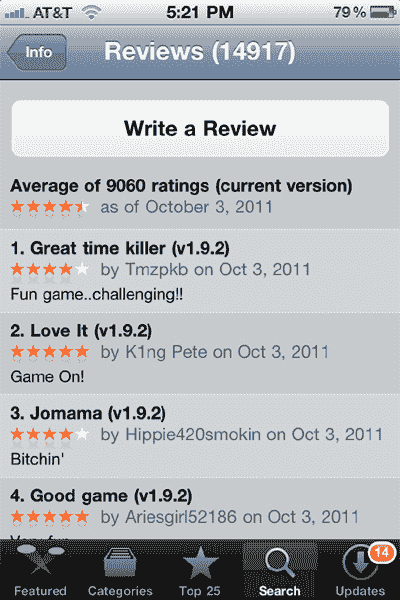

潜在客户大部分在潜意识中经历这个过程的每个部分，每一步都必须将用户引导到下一步，否则他们就不会下载该应用。这个过程大约花费 10 秒。

## 留住客户

那么，如何将冲动购买者变成长期客户呢？商界众所周知，获取一个新客户比留住一个客户要困难五到七倍。App Store 也是如此。我的测试结论是，你必须在 30 秒内向消费者展示价值，否则他们很可能会退出你的应用并永久删除。如果他们最初使用应用的时间超过 30 秒，你更有可能留住他们作为客户。你可以想象，长期客户的价值比 99 美分高得多，因为他们会购买更多你的应用，或者购买应用内的额外功能，甚至仅仅点击你的横幅广告。

我将这 10 秒的冲动购买加上 30 秒内成为客户的过程称为 `10/30 原则`。它极其重要，我设计所有的应用都基于这个概念。

## 成功应用的特征

每个成功故事都不相同，但最成功的应用拥有许多共同特征。以下列表让你了解大部分这些特征。在下一章中，我将讨论在对应用创意进行脑风暴时如何使用这个列表。

在观察一个应用时，问自己该应用是否具有以下品质：

*   **趣味/娱乐**——该应用提供了多少娱乐价值？它是否给用户带来了快乐和兴奋？它能让他们大笑出来吗？就像一部好电影一样，优秀的应用会让用户紧盯着屏幕。
*   **直观**——最好的应用是简单易用的。人们可以直观且快速地学会它们。消费者不需要阅读详尽的说明即可开始`Angry Birds` 和 `Doodle Jump` 是这方面的大师。
*   **引人入胜**——该应用的吸引力如何？应用应该尽可能吸引入胜，同时也展示设备的创新功能。
*   **成瘾性**——你欲罢不能。你迫不及待想回到它身上。你着迷了。这就是顶级应用赢得用户的方式。
*   **价值**——该应用在人们心中提供的价值需要远高于他们支付的费用。它应该是他们持续使用并感到从从中获益的东西。
*   **跨文化**——应用能够吸引尽可能大的受众是非常重要的。理解和使用该应用的人越多，应用成为大热门的可能性就越大。
*   **极佳的图形和音效**——顶级应用就像视觉盛宴。它们有极佳的视觉效果，令人享受。它们还结合了高质量的音频。
*   **病毒式**——口碑是一种巨大的广告形式。当人们对一个应用感到非常兴奋时，他们会分享给很多人。为什么不尝试利用免费营销呢？

以下是一些第一天起就保持成功的顶级付费应用。它们共享了上述许多成功应用的共同特征。

### Doodle Jump

`Doodle Jump` 有一个可爱的的小绿色生物，它通过跳跃台阶向屏幕顶部移动。（参见图 3.10）。你通过向左或向右倾斜手机控制它。如果你错过了某个台阶，生物就会掉下去并死亡。这是一个有趣且成瘾的游戏，逗乐了很多人。

FIGURE 3.10 Doodle Jump。

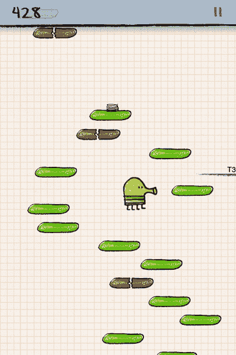

`Doodle Jump` 应用是一个非常简单、用户友好、独特的游戏的完美范例，任何人都可以玩。这就是为什么它如此成功。它太简单了，你把手机给给任何人，他们都能立刻学会。大多数开发者犯的最严重的错误之一就是给他们的应用增加太多的复杂性，导致它们令人困惑。简单易用是几乎所有成功应用的共同特征，你必须注意这一点。

### Fruit Ninja

`Fruit Ninja` 是一款游戏，其中不同的水的水以不断加快的速度飞向你的屏幕。（参见图 3.11）。目标是在屏幕的正确位置滑动你的手指，像使用忍者刀一样将水果切开并切半。你每切开一个水果，就能获得积分。弹药也会出现，所以如果你把手指滑动得太疯狂，就会撞到弹药并爆炸。

FIGURE 3.11 Fruit Ninja。

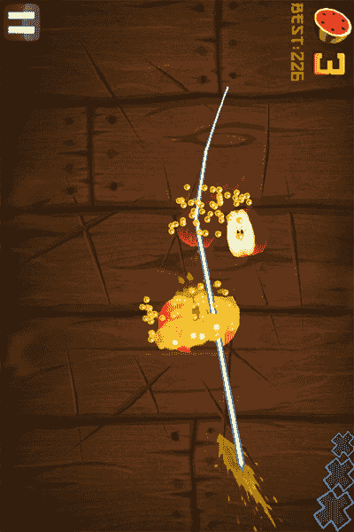

许多成功的应用如 `Fruit Ninja`，找到了以创新方式融入功能的方法。这让用户保持参与感，并期待。

### 严肃的乐趣

当我第一次看 App Store 时，当我看到第一名的应用不是为了拯救世界或改变我们业务的方式时，我感到非常惊讶。

由于来自严肃、传统的房地产背景，我对这种荒诞的性质持有怀疑。但随后我意识到：大多数 iPhone 用户寻找的是乐趣，而不仅仅是生产力。


一年又一年，像坏掉的唱片机一样，我们目睁睁看着格雷冲向当地的健身房，没有任何周全的计划，并认为单凭行动就能获得他想要的结果。尽管他取得了一些进展，在一两个月内练出了线条，但他的努力是不可持续的。他要么受伤，要么失去兴趣，最后在对自己极度厌恶中放弃了。他的新年目标再次破碎，在一年剩下的时间里，他都在对自己说：“这不适合我，我不是那种人”，从而错过了那个他仅一步之遥就能达成的成果。

你认识这样的人吗？

同样的事情也发生在大多数新手应用创业者（appreneurs）身上。他们满怀希望，满眼里闪烁着金钱就冲入这个行业，但他们没有意识到万事皆有系统可循。无论你是在练就钢筋腹，还是在创建一个价值百万美元的应用业务，你都需要学会将你的热情投入到一个系统中。否则，你可能会在困难出现的第一个信号放弃。许多应用创业者在第一个应用失败后就退出了，而那时他们可能正处于成功的边缘。

对你来说，情况不必如此。这一章将成为你的私人教练，帮助你保持正轨，并向你展示帮助产生成功应用想法的策略。你将学习如何持续地创建和实施赚钱的想法，分析并筛选你拥有的每一个想法。

你所有的想法都会大卖或赚钱吗？不，很可能不会。然而，我可以向你保证，如果你使用这个过程，就不必为了彩虹尽头的那个金罐而与小仙精搏斗了。

## 不要爱上你的想法

我确定你听过这样一句话：“只要你建立它，他们就会到来。”大多数开发者认为这对于应用来说是真的，但在应用世界里并不是这样运作的。

他们开发了一个应用，并期望有人（或一大群人）立即发现并下载它。这种情况很少发生。你必须弄清楚人们对什么感兴趣，以及他们下载什么样的应用，并根据这些洞察来构建你的应用。

正如我在第三章中解释的那样，你的市场研究将给你这些洞察。每天抽点时间进行市场分析。这将帮助你产生最丰厚的想法。你将看到消费者的行为，而你的任务就是识别、理解、跟踪并利用这些内部信息。

如果你对某个特定主题充满热情，那是探索应用想法的良好起点。从事你喜欢的事情总是有利的，因为你对该主题会有更深入的洞察，并且会更致力于让它成功。这将是理想的情况，但请记住这应该只是一个起点。如果市场对你的想法没有显示出需求，就把它否掉。另一方面，如果市场似乎喜欢你所热爱的课题，就专注于在该领域创建应用。

你如何知道市场是否想要你的应用？看看顶级应用榜单即可。像你想做的那样的应用列在上面吗？如果是，你就有了一个潜在的赢家。如果不是，继续寻找。就这么。

当你追随成功应用的脚迹时，你更有机会成功，因为这些应用已经证明了需求并拥有现有的用户群。这消除了创建应用想法时的猜测。

我再怎么也强调模仿现有应用的重要性也不。人们很容易爱上自己的想法，即使市场对此并不表现出兴趣。这是你可能犯的最昂贵的错误之一。

开发者们总是犯这种错误。他们专注于产生原创想法，花费大量的时间和精力创建这些应用。当它们行不通时，他们不是从市场中学习，而是转向下一个未经过测试的想法。通常，他们会重复这个周期，直到耗尽金钱并对应用游戏感到沮丧。这不必是你的经历。

一个看起来是个好主意但表现并不好的应用例子是 `Pocket Dream Girl`。（参见图 4.1）。它由我的一个朋友创建，前提是用户可以通过混合和匹配 20 多个女性的头发、眼睛、鼻子和嘴来创建他梦想女友的脸。结果，用户可以创建出超过 150,000 个“疯狂科学”类型的女性。

FIGURE 4.1 Pocket Dream Girl。

  

当我听到这个想法时，我认为这是一个很好的应用，它是行得通的。在开始开发之前，我会研究市场，意识到这种应用并不存在需求，然后放弃。但我的朋友爱上了他的想法，在没有加加眼光或进行任何市场研究的情况下开发了该应用。它做得精美，但正如你所想象的，这个应用惨败了。

你想在你的应用中避免这种错误，如果你听从市场，你就会做到的。

另一个需要警惕的陷阱是被他人分心。根据我的经验，作为一个应用创业者赚钱的第一条规则是坚持你的计划，避免来自任何在应用业务中没有获得过成功的人建议。通常，你的朋友、家人和同类会认为他们是行业内的专家。大多数人甚至会慷慨地帮助你提供新想法，确保你有一个赚钱的概念。

然而，我总是发现这种热情会让人分心。其他人的建议通常基于发富的幻想，且缺乏市场调研。我无法说曾有多少次别人告诉我“这会让你赚大钱！”或者“我有最好的应用想法！”虽然来自别人的支持是鼓舞的，但不要让它模糊了你的判断，否则你将会抓住空口袋症。把家人朋友看作他们自己：消费者。让他们测试你的应用并提供反馈，特别是如果他们属于你的群体。但是，如果他们没有在这个领域证明过自己，不要听他们的建议。

听他们的建议是一个很容易掉进去的陷阱，因为每当人们问你“你在做什么？”时，你会无意中引入大量的问题、建议和提示，因为每个人对这个令人兴奋的行业都感兴趣。每个人都有自己的百万美元想法，并且会确保你听他们的。要有辨别力，坚持你的计划，并专注于你的想法。根据事实和客观数据而不是一个人的主观观点。

## 停止讨厌，开始模仿

模仿竞争对手是业务中最基础的概念之一。当苹果在 2001 年发布`iPod`时，MP3 播放器并不是新鲜事。第一个主流 MP3 音乐播放器在`iPod`出现三年前就已经进入市场了。`iPod`之所以取得巨大成功是因为它是光滑、直观且有趣的。

`iPhone`不是第一个智能手机，但苹果看到了对创新功能的需求，并像处理 MP3 播放器一样将智能手机推向了高度。通过对消费者和精美的设计，苹果让`iPod`和`iPhone`变成了改变规则的成功产品。

Facebook 以识别某些有效内容、对其改进并适配到自己的平台中而闻名。Facebook 提供了集成的电子邮件、新闻动态、即时消息、视频聊天和应用。你可以在其他地方获得这些功能，但在 Facebook 上使用更有趣或更容易。

图 4.2 没有必要发明轮子。

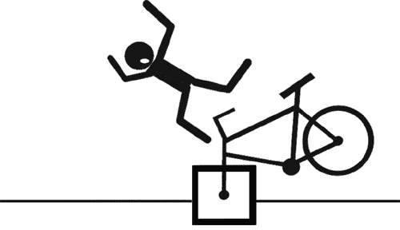

“发现有效的东西并改进它”的哲学自时间开始以来一直存在了。感谢上帝，因为如果这样，我们可能还在树枝上荡荡和抠屁股。


我的朋友 Michael Moon 和 Quoc Bui 通过他们的公司 FreeTheApps 在 App Store 上每月可以赚取 80,000 到 100,000 美元。Michael 总是说：“如果你发现你的想法已经被别人做过了，不要灰馁。这只意味着你的想法有市场，如果可以的话，这反而是一种鼓励！”

一些最伟大的 App 想法是对现有应用的改进，或者是对旧想法进行变形，将其引向一个全新的、独特的方向。Smack Talk 和 Talking Friends（会话朋友）系列应用的故事就是模仿理念运作的完美范例。

Smack Talk 是一个在 App Store 早期非常成功的应用。（参见图 4.3。）该应用描绘了可爱的小动物重复你说的任何话，但是用高音调发出的。这是一款直观、创新、开创性性、且极具娱乐性的应用。说真的，谁会不喜欢一只听起来像吸了氦气的小仓鼠在重复你自己的话呢？

图 4.3 Smack Talk。

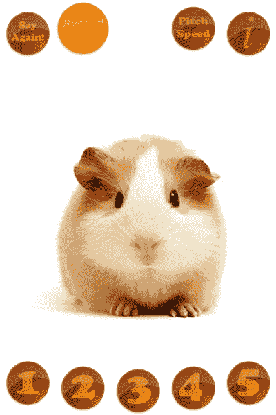

Smack Talk 在排行榜顶部停留了很段时间，引起了轰动。对于一个伟大的应用来说，这是一个巨大的成就。许多开发者敬畏地效仿这个应用，希望那是自己的主意。他们不敢竞争，因为试图超越这样一个成功的应用似乎像是一场注定失败的战斗。他们接受了这一领域已被 Smack Talk 占据的事，并继续照常经营。

然而，一家名为 Outfit7 的公司有其他计划。它毫不犹豫地进行竞争并将该概念提升到了新的高度。它制作了一个名为 Talking Tom 的变体应用（图 4.4），除了基础的语音播放功能外，还包含了一个 3D 交互卡通猫。用户通过语音播放获得娱乐，并享受一系列新功能，例如触摸小猫并获得反应。该应用提供了新的互动方式、更多的动画和精妙的营销。

图 4.4 Talking Tom。


Talking Tom 在 2010 年超越了 Smack Talk，但 Outfit7 继续努力，创建了一整套包含许多不同动物的 Talking Friends 应用。这使得 Outfit7 成为了一家百万美元的公司，并是迄今为止最成功的 App 公司之一。它的应用下载量超过了 2 亿次，并一直出现在总榜付费和免费应用排行榜的前 100 名。

谁能想到一个开发良好且成功的应用可以被推到如此新的高度？这些机会遍布 App Store，等待着被发现。

如果你刚刚起步，请坚持在需求量大的领域创建应用。找到一些大多数人（从青少年到成年人）都能认为有用或有趣的东西，而不是迎合小众群体。坚持开发低风险、高概率的应用。

这意味着你永远不应该进行创新并尝试以前没有做过的事情吗？

实际上，是的。嗯，某种程度上如此……

### 从现有应用中学习

大多数没有经验的学习者花费了太多的时间在尝试原创化上，而他们寻找的东西其实就在眼前。

我并不是建议你复制另一个开发者的应用，但你的第一步应该是保持好奇，看看其他成功的开发者在做什么。你应该花时间研究为什么他们的应用有效，阅读用户评论并收集数据。

每当你决定研究模仿某个应用时，问自己这六个问题：

1. 人们为什么要买这个？
2. 我能做什么来模仿这个想法并将其提升到另一个水平吗？
3. 这个应用的目标群体还会喜欢哪些应用？
4. 市场上还有多少类似的应用？（前往 [appempire.com/topappcharts](http://appempire.com/topappcharts) 查看。）
5. 他们的成功程度和稳定性如何？
6. 他们的营销和定价模型是如何运作的？

当你查看所有顶级列表时，思考哪些应用是你真的考虑下载的。你为什么喜欢它们，它们有什么脱颖之处？

思考如何在继续吸引相同目标群体的同时，将相同的概念推向下一个水平。写下你将做出哪些改进。你会增加新功能吗？改变外观吗？增加更好的图形和营销吗？你会如何为用户提供更多价值？

观察不仅仅一个竞争对手。下载该应用的所有成功竞争对手。学习这些应用在哪些做得好，在哪些地方有不足。决定你是否能在融入观众需求的同时，做得更好。

我看到这种情况在 App Store 上经常发生，这里有一个我如何将模仿其他应用的力量付诸的近期示例。

在 Apple 排名算法更改后，我开始注意到排名的变化。在日常研究中，我看到一些很少出现在排行榜顶端的应用（如表情符号应用）开始在排名中上升。我喜欢使用那些表情符号，并想做一个 Emoji 应用，但在那时，我还没有看到市场对它们感到太兴奋。此外，大多数 Emoji 应用都是简单的，且只使用一次：为了解锁 Emoji 键盘。

随着市场兴趣的增加，我决定仔细观察并下载了所有主要的表情符号应用。我喜欢我看到的内容，但我注意到这些应用的功能有限。如果 Emoji 键盘的表情符号数量有限且无法增加，我的应用如何能比竞争对手更好？如果一个应用只使用一次，它能有多有利可图？我认为大多数开发者会因为这些限制而放弃这个想法，但我一直很固执，这次这得到了回报。

所以，我继续脑脑暴，直到灵光一现。如果我不能为 Emoji 键盘添加更多表情符号，为什么不在应用中包含许多表情符号，让人可以通过短信、电子邮件或其他任何可以处理图像的媒介发送呢？考虑到这一点，我创建了一个解锁 Emoji 键盘的应用，并增加了 450 多个表情符号，可以通过短信、电子邮件、Facebook 等进行分享。这让用户变得更有趣，因为他们必须返回应用来发送表情符号。（参见图 4.5。）

图 4.5 Emoji 截图。

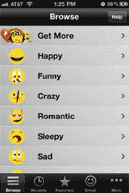 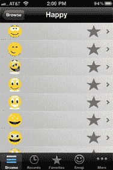 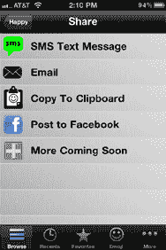

这个 Emoji 应用是在两周内开发的。它遵循免费增值模式，即免费，带有应用内购买选项。该应用在六天内进入了 App Store 效率类排行榜第一，并在总免费应用排行榜中位第 12 名，每天收入接近 500 美元。搞定。

### 缩小你的想法范围

当你进行研究时，确保捕捉你想要模仿的热门应用想法。你可能有很多想法，不知道该关注哪一个，但不要担心，这是很正常的。简化问题的一种方法是记住第 3 章提到的，应用只分两类：娱乐和工具。如果这让你的任务变得，你可以先专注于其中一种。


让我们来看看评估你 App 想法的过程。首先，根据你的研究，写下最多五个你最有前景的想法。如果你还没有任何想法，为什么不去 `App Store` 看看能不能找到一些灵感呢。

## 我的前五个 App 想法

1.
2.
3.
4.
5.

## 评估你的想法

根据我在 `Chapter 3` 中向你展示的清单来评估你的想法。这里再次列出来。对于你的每一个 App 想法，检查它具备的八项特征。

1. 有趣/娱乐性
2. 直观
3. 具有吸引力
4. 上瘾性
5. 价值
6. 跨文化
7. 出色的图形/音效
8. 病毒式传播

勾选的特征越多，你成功 App 的机会就越大。我通常会检查其中的每一项，但可能会选择一个缺少一两项特征的想法。划掉任何少于六项特征的 App，然后回到起点。继续进行这个练习，直到你有三个符合六项或更多这些特征的想法。

## App Store 审核指南

在选择你的前三个想法时，还需要记住 `App Store` 审核指南。这些规则是 `Apple` 在审核过程中使用的规则，如果你不遵守它们，你的 App 将被拒绝。例如，你可能以前在 `App Store` 上见过大量的臭屁 App 或手电筒 App。结果，`Apple` 决定不再接受那些类型的 App。了解这些规则可以节省你大量的时间和精力。如果你发现你的任何想法与指南冲突，就拒绝它们并继续考虑下一个。

确保你现在或在本章结束时完成这个练习。一旦你在下一章中找到了使用这些方法的开发者，我们就会为你的前三个想法获取报价。

## 时机决定一切

在决定采用哪种 App 想法时，另一个关键因素是时机。因为市场目前似乎还没有准备好接纳你的想法，并不意味着未来不会发生变化。

例如，在康复期间，我发现瑜伽对于恢复我的活动范围非常有帮助。我变得对其充满热情，并考虑为其他瑜伽爱好者创建一个 App。我去了 `appempire.com/topappcharts` 并搜索了“yoga”。那大约是 2009 年 11 月左右。

我发现没有任何瑜伽 App 在排行榜上名名前茅，即使在健康与健身分类中也是如此。尽管我对瑜伽充满热情，但我必须听从数据。市场还不够大以容纳这个 App。

两个多年以后，在 2011 年 8 月，我看到一个瑜伽 App 在健康与健身分类中排名第二。在那时，市场已经足够大，让我考虑花时间在一个瑜伽 App 上了。

如果我在两年前就创建一个瑜伽 App，我能通过它赚钱吗？当然可以，但由于可见度低，该 App 成功的概率会很低。是的，时机决定一切。

同样，你可能对市场来说太早了，也可能太晚了。确保不要陷入“分析瘫痪”。在某个时刻，执行是执行的时候了。如果你看到了你认为可行的东西，请立即行动。App 想法可能有有限的机遇窗口，你可不想错过它。你希望在所关注的市场仍然火热时发布你的 App。

## 小步快跑

这里有一个价值百万美元的问题：你有 25,000 美元。你可以选择创建一个需要五个月开发并花费 25,000 美元的 App，或者创建 10 个每个开发需要两周且花费 2,500 美元的 App。你应该遵循哪种策略？遗憾的是，大多数开发者选择第一条路线。他们认为自己有一个惊人的想法，并投入了大量的时间和金。这太冒险了，因为无论你如何选择你的 App 想法，在市场中测试它们之前，你并不知道它们是否会被接受。

我的 App 策略是创建简单、低成本的 App，这些 App 与市场中已经证明成功的 App 相似。知道你的想法是否成功的唯一方法是在市场中进行测试。你需要弄清楚客户对你的想法是否有兴趣，以及在你花费过多资金并把所有功能都堆进去之前，你是否可以做好营销。在市场接受了你的产品，并且你对 App 的目标群体和生命周期有了更好的了解之后，你可以升级并添加功能。

测试市场的最佳方法是先发布一个免费 App。免费 App 通常成本较低，因为通常它的功能较少。它具有成本效益，而且对消费者的入门门槛最低，因为它是免费的。毕竟如果你不能免费赠送你的 App，你如何让人们付钱呢？不要担心，即使在测试市场时，免费 App 也有大量的钱可以赚。在 `Chapter 9` 中，我会解释如何做到。

确保你能尽可能以成本效益的方式创建你的 App，而不必图形或核心功能上偷工。如果你无法以合理的价格开发你目前的想法，就把它搁起来，先尝试你的其他想法。

正如你在这一章中看到的，选择热门 App 想法背后其实有一套方法。这是一个可以重复的过程，你使用得越多，你就会变得越好。现在你已经有了所有这些想法，是时候寻找能够将它们变为现实的开发者了。

## 我学到的

1.
2.
3.

## 需要采取的行动

1. 观察市场并列出你想要模仿的 App。
2. 市场渴望这个吗？
3. 看看是否有方法改进现有 App 的功能和营销。
4. 根据你的研究、Apple 指南和时机选择你的最佳想法。


几天后，我发现杂志上的那家开发公司离我当时在佛特蒙的地方只有两小时车程。当时，我仍然固着老式的房地产观念，认为生意必须面对面谈。因此，我决定去一趟，和他们进行面对面的会议。

“很高兴见到你，”老板 John 在我和他团队握手时说道。他们的眼睛紧紧盯着我，这让我感到完全格格不入。也许这并不是个好主意，我心里想。我内心的那个“负能量女孩”（Negative Nancy）在不断作祟。我尴尬地坐在他们的会议室桌子旁，开始向他们介绍我的想法，并告诉他们我对这个全新的应用世界一无所知，但我渴望学习。

“别担心。我们会帮助你的，”项目经理 Kevin 说道。在讨论了几分钟关于 App 如何运作、需要多长时间以及成本多少后，我的不安感消失了，我开始感到更有信心。

在那个阳光明媚的周五下午，我昂首挺胸、走路轻快地离开了办公室。与他们的交谈让我豁然开朗，消除了我之前看到的许多障碍。正那时，我理解了开发公司所做工作的重要性，以及它们能为 App 业务带来的价值。突然之间，我相信 App 世界里几乎一切都是可能的。我的大脑打开了，想法变成了一场无法控制的创意雪崩。可能性似乎是无限的。“好的，我们可以做这个，也可以做那个。”我开始产生各种想法，而且我确实有可以执行这些想法的人。问题解决了。下一个。

作为一个“应用创业者”（appreneur），遇到障碍很容易的，因为你可能不知道技术是否支持你的 App 想法。程序员最棒的地方在于他们可以给你提供答案。与其阻碍你的创造力，不如雇佣对的人并善用资源。我的第一个开发团队运气很好，然后通过多次经历（有好的有坏的），我学会了如何雇佣优秀的人。在本章中，你将学习如何寻找、雇佣、管理和辞退开发者，以及建立帮助你将可能变为现实的系统。

# 程序员的重要性

到本章为止，你一直在进行市场调研，并利用上一章创建了最多三个深思熟虑的 App 想法。现在呢？如果你是一个程序员或对技术敏感，你可能会想：“酷酷，我可以写自己的 App”或者“我会自学如何编写一个 App。”你可能会买几本关于编程的书，然后在深夜疯狂的时刻，连接着装满咖啡的输液瓶开始写代码。

嗯，你可以这样做，但我强烈建议不要这么做。保持你的势头并尽快将 App 推向市场至关重要。自己编写 App 代码，特别是当你同时在自学时，会花费太长时间。你被卡住并放弃的可能性非常高。

当你同时创建多个 App 并持续更新现有 App 时，这种模式从长远来看也是不可持续的。毕竟，核心目的是夺回你的时间，逃离无休止的职场竞争（rat race）。

外包 App 开发的另一个原因是，你必须专注于经营者的角色。这意味着要对业务的关键方面要有全局观，如市场研究、营销、人脉拓展等。如果你把所有时间都花在第一线战斗中，你就无法做到这一点。你总没见过唐纳德·特朗普在他新摩天大楼的 40 层戴着安全帽到处乱跑钉子吧？

你必须决定专注于公司的高层运营，而不是迷失在执行微小细节中。程序员将成为你业务的基石，让你能够快速创建 App 并轻松扩展，这将让你保持这艘船的船长地位。

## 在程序员中寻找什么

由于程序员在你的业务中扮演着至关重要的角色，在选择他们时你必须格外审慎。就像你不会让任何人来建造你的梦想家一样，你需要谨慎对待谁来为你的移动帝国铺设虚拟砖块。

在选择程序员时，你必须关注某些关键领域。这些包括经验、沟通、团队、定价和利益冲突。

## 经验

你需要评估的第一点是程序员的经验水平。与没有开发过很多 App 的程序员合作不是好主意。有时当程序员刚开始时，他们会提供廉低的价格。这就像是请一个只飞过几次的飞行员开直升机。我不建议这样做。

在考虑新程序员时，我要求查看的第一件事就是他们创建过的 App。如果说图片胜过千言，那么对我来说，一个 App 胜过万言。下载程序员的 App 并评估工作质量。它看起来是精美且运行无良好的，还是很笨拙？看起来是专业的还是不符合标准？

有时他们受保密协议（`NDAs`）的限制，无法他们他们过的 App，或者他们只参与了 App 的部分。无论如何，你必须看到他们的产品运行起来。如果你不能，除非你喜欢不试驾就买车，否则请看下一个。

程序员的网站可以是一个很有用的评估工具。这对于开发公司来说尤其如此，他们通常会在网站上展示自己的作品。它应该突出他们做过的一些 App，并让你相信他们不是一家过路的小草公司。网站的质量可以指示他们创建的 App 的质量。独立程序员并不总有漂亮的网站，但如果他们的 App 作品集令人印象深刻，你应该继续评估他们。

雇佣程序员时，要求提供推荐人。至少和一个与该程序员合作过的人交谈。我倾向于两个或三个，这可能很难，但为什么不试试呢？对于你在外包网站上找到程序员，这一点并不那么重要，例如 oDesk（appempire.com/odesk）或 Freelancer（appempire.com/freelancer）。在这些网站上，评估开发者更容易，因为你可以查看之前的详细数据。你会看到之前客户的评价和评分，并判断他们是否是你想要合作的人。

在对程序员的技能进行通用评估后，你需要确保他们拥有完成 App 所需的特定经验。我通常在第二次对话中进入这一点，在我完成了初步评估并让程序员签署了 `NDA` 之后。通过查看之前的工作你可以估计技能水平，但你仍然必须确保程序员拥有你的 App 所要求的特定技能。

## 沟通

虽然其他开发成本可能较低，但语言障碍可能是种麻烦。与和你母语相同的程序员合作。你必须能够与你的开发者有效沟通。这可能成本更高，但你会获得更高质量的工作和更少的头疼。

我对程序员的另另一件事是技术指导。当我开始时，我是一个完全的新手，但我很幸运能与程序员合作，他们在整个过程中教我技术术语。并不是所有擅长创建应用的程序员都擅长这一点。确保你的第一批程序员愿意并能够用非技术术语向你解释。


随着你在该领域经验的积累，所需的指导会越来越少，但初期这至关重要。你会很快发现你交道的程序员是否天生就具备这种特质。他们会向你提问，并通常会为你提供一门快速课程，帮助你理解想要创建的应用范围。这非常重要。程序员不应该是你唯一的教育来源，因此，也要依靠自己来学习这门业务所需的知识。

另一个非常重要的一点是响应速度。你已经窥见过这个行业节奏有多快了。有时候一周的延迟就会导致数千美元的差异。你必须能够随时做出更改，因此你需要尽可能响应迅速的程序员。如果你面对的程序员工作量过大，请找那些能将你列为首要任务的人。时刻关注程序员的响应情况，特别是在项目期间。不要允许任何疏忽，如果发现问题要及时提及。

顺便说一下，这对你你自己也是如此。程序员也和你我一样的人，如果他们觉得时间被浪费了，会感到沮丧。如果他们需要你提供什么，请尽快提供。像你期望他们做的那样保持响应。在刚开始，我曾因为没有给程序员提供他们所需的东西而声名狼著，并经常导致瓶颈和延迟。

此外，收敛起你内心的控制欲，不要要求得过高。你必须掌控全局，但过度的沟通会减慢程序员的速度并可能让他们感到沮丧。我通常会问他们喜欢多久讨论一次项目。制定一个兼顾双方的时间表并坚持执行。

另一个重要的步骤是，对于与不同时区的程序员合作要保持谨慎。将时差降到最低，因为这可能成为沟通中的主要障碍。如果你早上起床时，你的程序员进入了睡眠周期的第三阶段，那么维持业务的势头将变得困难。

我以前合作过的最才华的程序员之一住在德国，每当我在西海岸时，九小时的时差让我们几乎无法共同工作。当他下午 5 点下班时，我这里是早晨 8 点。当然，他有时可以破例而为，但这种做法是不可持续的。一些外包公司会调整员工的工作时间来匹配美国的工作时间，但如果你没有至少三到四小时的重叠时间，请找别人。

## 团队

尽可能与团队合作而不是与个人合作，特别是在开始阶段。这有几个优势。团队可以更可靠，因为如果负责你项目的程序员生病或无法可用，他们可以接手。正如你想象的，这非常重要。确保所有事情不要压在一个人的肩上，特别是当你的项目变得越来越复杂时。

更大的团队完成任务更快。应用开发不能总是平均分配给固定数量的人，但一个优秀的团队会知道如何在不丢失项目进度的情况下更快地完成工作。

使用团队的最大原因是团队将包含图形设计师，有时还有项目经理。你可以拥有世界上最好的代码，但如果你的图形看起来不好，人们就不可能给你的应用一个机会。理想的情况是有一个既能写代码又能设计图形的程序员。这很罕见，因此次优方案是有程序员和平面设计师协同工作，像一台运转良好的机器。你还会使用图形来营销你的应用，所以拥有一个能够创作杀伤性营销材料的平面设计师是必须的。

与团队合作的另一个好处是程序员技能组合的多样性。起初，你想为你的第一个应用寻找合适的人才。但当你创建更多类型的应用时，你可能会达到程序员能力的极限。你的程序员应该能够联系他的团队成员或专业网络寻求帮助。

这些是指南而不是严格的规则。随着你经验的增加，特殊情况可能需要你使用一个不团队合作或不具备图形能力、但拥有你所需的特定技能组合的程序员。尽量减少这种情况，因为将所有事情放在同一个屋檐下更容易，风险也更小。

## 定价

你可以预见到到广泛的价格和服务，因为许多公司和独立开发者都在竞争你的业务。项目可以按固定成本或小时率计费。

从提供固定费用的承包商开始，他们会提供一定次数的免费修改（称为迭代）。我很少按小时率计费开发应用，因为我觉得程序员没有动力去快速完成。我希望他们在开发应用时能像我一样有紧迫感。按小时计费会有相反的效果。这并不适用于所有开发者，但这种策略对我非常有效，并根据我的经验这已成为我的首选。如果人们过去为你做过一些高质量的工作，而且他们倾向于按小时计费，那可能就是你的选择。

固定价格项目的另一个优势是，如果你知道工作将花费多少，更容易控制预算。你想用初始预算尽可能将应用推向市场。选择固定价格项目可能意味着创建两个应用和一个应用之间的区别。

你可能会问：“我如何知道我的应用获得的是公平的报价？”通常，公司收得更高，因为他们比独立程序员有更多的开销。你可以通过对每个想法从三个不同的开发人员那里获取报价来避免过付。价格之间会存在差异，当你弄清楚原因时，你将学到关于程序员和你的应用的大量知识。不要害怕告诉程序员你倾向于其他比他们更低的报价（仅在属实的情况下）。他们可能会匹配价格。这是商业常识。

至于支付，你不应该一次性全额付款。如果可以，尽量避免预付款，但如果不行，请程序员提供清晰的里程碑和价格。在确认里程碑要求达成之前，不要释放付款。像 `oDesk` 和 `Freelancer` 这样的网站的好处是它们通过作为托管服务并提供与里程碑相关的支付系统，缓解了支付流程。

在支付应用费用时，对使用分成协议要谨慎。有些开发者会降低开发成本，只要获得应用收入的一部分（称为分成）。人们很容易认为：“噢，放弃 10% 或 20% 并不是什么大事。”如果他们有投入，程序员可能会做得更好，但与分成协议的潜在缺点相比，这些优势是微不足道的。

分成协议本质上让程序员成为了你的合伙人，这可能会变得很麻烦。如果你对应用进行他们不同意的更改怎么办？或者如果他们干扰了你的营销努力？当你有出售应用或公司的机会时会发生什么？应用可以是一项长期资产，放弃其中的一部分会损失很多钱。跟踪分成付款可能也很麻烦。

## 利益冲突

程序员有时会创建自己的应用并发布在 `App Store` 上。他们的希望是能一发，，在此期间，他们通过为他人开发应用来赚取额外收入。


严格来说，这是一种利益冲突，因为你的竞争对手正在开发你的产品。这种现象在行业中非常普遍，你可能无法避免它。只需通过向程序员展示你对此的警觉来尽可能地保护自己，并让他们签署 `NDAs`（保密协议），可能还有针对特定应用程序的竞业协议。但不要让这阻碍你继续前进。

# 招聘和挑选程序员

当我 2009 年初创办自己的公司时，这个行业还非常新，很难找到高质量的程序员。由于全球范围内的 App 热潮，现在你可以更容易找到他们了。许多软件开发公司现在都专注于 App 开发。许多独立程序员也出现在世界各地。

对于我的前几个应用，我发现与一家知名公司合作比与独立程序员合作容易得多，在与独立程序员合作之前，他们可以手手手指导。这是一个很好的起点，因为这家公司擅长与没有经验的客户交道。我建议你也采取同样的路线，因为大公司在教育这些新手出炉方面有更经验。这将帮助你加速学习 App 开发的基础知识，并教你如何与程序员交流。与这家公司的合作带了我在 App 业务中继续前进所需的信心和动力。

你是如何寻找程序员的？嗯，你有许多寻找程序员的方法，例如简单的 `Google` 搜索、像 `Monster`、`Craigslist` 这样的招聘网站、App 会议、聚会小组、程序员论坛、口碑以及外包网站（如 `oDesk` 和 `Freelancer`）。这些方法中有些比其他方法更容易，但并没有什么万能公式。你必须利用各种来源并评估多个程序员，直到你找到几个让你觉得可以放心地合作的人。

在评估每个程序员或公司时，你的方法基本上是相同的。一旦你在电话里或 `Skype` 上联系了程序员，就一直面试他们，直到你觉得可以进入报价阶段为止。这是一场工作面试，而你是老板。以下是我的问题清单：

* 你开发 App 多久了？
* 你做过多少个 App？
* 我可以看看你做过的 App 吗？
* 你有网站吗？地址是什么？
* 你有可以让我交流的推荐人吗？
* 你的时间安排怎样的？什么时候可以开始？
* 获得报价需要多长时间？
* 我们之间的时差是多少？（如果他们在不同的时区）
* 你通常什么时间工作？你的工作时间是怎样的？
* 与客户合作时什么让你感到沮丧？
* 你是和团队合作吗？他们的技能是什么？
* 你能制作图形吗，或者你有人可以做吗？
* 我可以看看图形作品的示例吗？
* 如果你在项目期间生病了怎么办？
* 如果你在项目期间遇到技术障碍怎么办？你有其他团队成员或可以帮助你的程序员脉网络吗？
* 你能提供固定费用报价吗？
* 你的支付计划是怎样的？
* 你可以创建与付款挂钩里程碑吗？
* 你会在 `App Store` 上发布自己的 App 吗？
* 你如何确保自己不会与客户竞争？
* 你是如何将 App 提交到 `App Store` 的？（他们可以引导你吗，还是他们让你觉得脑力受挑战？）

这个列表会根据你交谈的对象而改变。一家成熟的开发公司可能拥有了自己的开发和图形团队，但在继续进行之前，你必须获得上述问题的答案。此外，你不需要听起来像个事教官或问一些愚蠢的面试问题。上述列出的问题很重要，如果你以友好的语气询问，不应该让交谈的对象产生防御心理。在面试期间，我总是面前拿着这份问题清单，并在获得回答时做笔记。我发现，在商务对话中，加入一些个性并增加一点乐趣是好的。在提问时请记住这一点。

在交谈过程中，注意他们说明自己的能力如何。他们表达清晰吗？他们使用了过多的术语吗？他们真的说的是同一种语言吗？他们对答案看起来自信吗？他们的语气和态度如何？如果你有任何问题或担心，你可能想换别人。如果你能与他们交流，并且你的直觉告诉你可以，你就想进入下一步。

无论结果如何，都要感谢他们的时间，并提到如果你决定继续，将跟进一份 `NDA` 协议。不要在这次初步对话中透露你的想法。每当提到这个话题时，就说在签署 `NDA` 后你会非常乐意讨论一切。你必须保护你的想法、源代码和任何其他知识产权，因为这些是你的资产。

处理你代码的人也要小心。随着业务的增长，你不仅会创建新的 App，还要维护现有的 App。这意味着你必须把代码交给任何需要对其进行更改的人。只有在你建立了一定程度的信任后才这样做。这对于你的热门 App 来说尤为如此。

一旦 `NDA` 落实，就是时候深入研究并确保开发者有技能完成你的 App。在这里你没有任何回旋的余地，特别是对于你的第一个 App。要么他们知道如何做，要么他们不知道。你想听到的是诸如“我确切知道怎么做”或“我做过类似的 App，所以这不是问题”之的话。你不想听到诸如“我应该能做到，但我得研究一下”或“我不确定但我可能可以办法”之的话。如果你听到这些词，就换一个他们有他们 App，或者赶紧溜之。

例如，假设你正在开发一个具有复杂需求的新 App。你可以找到做过很多 App 的优秀程序员，但如果他们从未处理过音频，那么他们就是糟糕的选择。利用他们的专业知识来完成你的其他 App，并为音频 App 寻找另一个人。

在整个整个过程中，你将获得关于他们响应能力的反馈。如果他们签署 `NDA` 和澄清事情花费了太长时间，这可能表明开发过程将会非常缓慢。

使用外包网站可以是寻找熟练、低成本程序员的绝佳工具。这些网站允许程序员对你发布的职位进行竞标。正如你想象的，这种竞争创造了竞标热潮，你有机会以低廉的价格获得高质量的工作。以下是三个顶级外包网站（参见图 5.1）：

图 5.1 Elance、oDesk 和 freelancer 的截图。

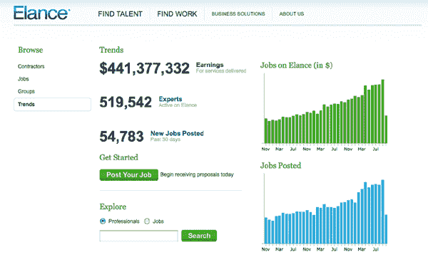

image

image

1. `oDesk` (`appempire.com/odesk`](http://appempire.com/odesk))——它的工作日记功能跟踪程序员为你工作的时间，并定期间隔捕捉程序员桌面的屏幕。你可以查看这些图像，确认程序员正在处理你的项目而不是而不是参加当地的躲球锦赛。
2. `Freelancer` (`appempire.com/freelancer`](http://appempire.com/freelancer))——这个网站列出的程序员最多。他们声称会有两倍的程序员响应你的广告，我发现事实大部分如此。
3. `Guru/Elance` (`appempire.com/guru-appempire.com/elance`](http://appempire.com/guru-appempire.com/elance))——这些网站有大量的程序员列表，让不同的人才储备池为你的业务竞争总是是好事。

以下是这些网站的优缺点。

优点：


### 优势

*   **大量的程序员**——这些网站拥有大型程序员数据库，他们会为你你的项目竞争。
*   **响应快速**——你通常在发布任务后一或两小时内就能收到报价。
*   **技能和工作经历**——程序员有列出其技能的个人资料。你可以查看他们之前参与过的项目。通过这些信息，你可以评估他们是否具备你应用所需的特定技能。
*   **性能评分和评价**——客户可以对程序员进行评分和评价。你将知道是否值得花更多时间来评估这个人。
*   **价格比较**——在发布职位描述之前，你可以查看其他人的活跃和已关闭的职位列表，以了解其他人为与你类似的应用软件（apps）支付了多少钱。
*   **托管服务**——你的资金会受到保护，只有当你对工作结果满意时，你才会在特定的里程碑阶段释放资金。

### 缺点

*   **沟通**——大部分这些程序员都在海外。这可能会带来沟通和时差方面的问题，因此在继续之前，通过 `Skype` 面试是绝对必须的。
*   **保护你的创意**——因为这些网站是公开竞标场，你的创意可能会被劫持。在发布职位时，千万不要发布你的创意或营销计划。在签署保密协议（NDA）之前，请使用通用的描述。

### 发布职位

以下是在 `oDesk` 上发布职位并评估回复的五个要点。在其他网站上的过程也类似。你的广告应该广撒网，以吸引尽可能多的申请者。你可以对他们进行筛选。

1.  **输入需求**——他们知道哪些编程语言？`oDesk` 和 `Freelancer` 允许你列出需求。对于你的应用，你需要 `iPhone`、`Cocoa` 和 `C`。
2.  **给出你的项目基本描述**——保持简单。在选择过程中与他们讨论细节。
3.  **在发布职位时仅提供几天内的信息**——这有助于你获得报价。这让你找到符合要求的程序员。
4.  **筛选申请者**——根据以下标准进行筛选：
    *   他们的评分是否如何。
    *   他们至少有多少年的经验。
    *   他们的英语水平如何。
5.  **给申请者发消息**——无论他们是否通过了测试，都要通过 `Skype` 进行沟通。

当你开始与程序员交流时，通过 `Skype` 安排会议。无论他们是否通过了测试，这都能帮助你发现问题。

### 如何传达你的创意

当你开始与程序员工作时，你需要清楚地告诉他们你的视觉以及它是如何工作的。在收到你的草稿之前，你可能会对想法进行修改。在你的应用设计完成之前，确保传达想法是准确的。这通常需要多次迭代，这会让程序员感到沮丧。为了准确地传达你的创意，你应该在纸上画出来。当你向程序员发送草稿时，你需要明确：你想要什么样的功能。这在 `App Store` 上是很有用的。当程序员报价时，可能会改变想法。当你测试你的应用初始版本时，你想要增加额外的功能。这通常需要多次迭代。在开始编写代码之前，你必须认为设计是最终的。如果你不确定，程序员将无法交付你想要的东西。


到此时，你已经找到了程序员、筛选了他们、签署了保密协议（NDA）、传达了你的想法、收到了几份报价，并选择了与他们合作的人。与其双脚投入一个完整的项目，我我通常会先让他们在一些小任务上进行测试。每当我与新程序员合作时，我都会有系统地要求他们完成以下三件事：

1. **图标**——要求程序员创建并交付 App 图标。图 5.2 是你在 iTunes 或手机上查看 App 时看到的图片。在你概述了 App 构思之后，你可能对图标也有几个想法。将这些想法传给他们，并要求提供一个完成的 512 × 512 iTunes 艺术版本的图标。他们会知道这意味着什么。

图 5.2 应用图标。

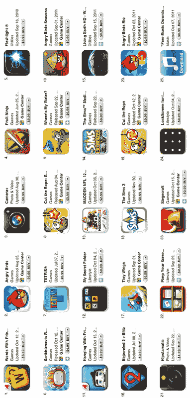

2. **“Hello, World!”应用**——要求程序员写一个“Hello, World!”应用。这只需要他们花 10 分钟就能完成，这是一个简单的应用，打开后会显示一个显示“Hello, World!”（参见图 5.3）。程序员会知道这是什么。这里的目的不是测试他们的编程技能，而是确定他们将如何向你交付 App 进行测试。这个应用应该包含图标，这样你可以看到它在手机上的样子。

图 5.3 Hello, World!

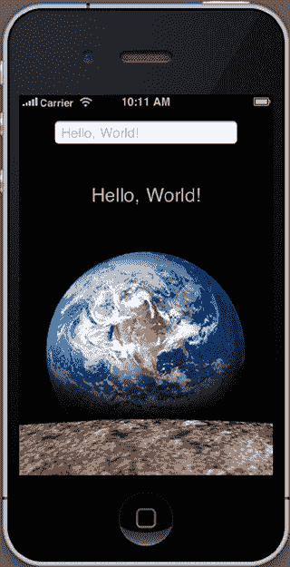

3. **App 交付**——当程序员准备好向你展示 App 的测试版本时，他们必须创建一个名为“ad hoc（内部测试）”的版本。这个 ad hoc 版本的 App 在测试之前需要安装你的手机上。过去安装过程有点繁琐，但一项名为 `TestFlight` 的新服务简化了这个过程（[appempire.com/testflightapp](http://appempire.com/testflightapp)，参见图 5.4）。我要求所有程序员使用这项服务，即使他们以前没用过。他们能够学会如何，而你只需要在手机上点几下即可安装你的测试 App。

图 5.4 `TestFlight` 服务。

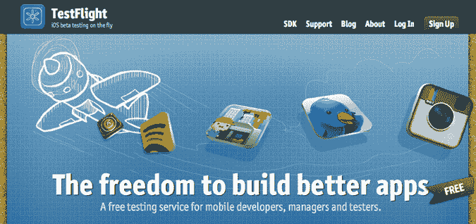

我从不花费超过几百美元，但这项测试帮助我看到图形处理能力、实现速度以及整体工作动态（如沟通和时区）。你希望从一开始就良好开始，或者在需要时尽快退出，而这就是实现这一点的最佳方法。

在 Skype 面试期间提到你喜欢用这项测试开始工作。这样做可以确保程序员在提供报价后不会感到惊讶。有时他们乐意免费完成这项测试，但有时他们会想要小笔费用。无论哪种情况，都要明确这项要求，并让他们将其包含在报价中。

如果你已经选择了程序员，并且对初始测试的结果表示满意，那么你已经在创建第一个 App 的良好道路上了。但如果你对结果不满意，不要犹豫，继续下一个。

寻找程序员的过程可能需要一些时间，但这些时间是值得的。不要走捷径。这将帮助你避免未来出现不必要的延迟、成本和挫败。你将一直寻找为团队增加新人才，因此学习如何快速、有效地评估程序员是一项重要的技能。

## 如何管理程序员

寻找优秀的程序员可能需要大量精力。诀窍在于每天对他们进行妥善管理，以保持他们的愉快和业务的健康。以下是我在管理程序员方面学到的一些教训。

## 紧跟项目进展

在某个时候，你可能会决定聘佣程序员全职工作。在此之前，你将与公司和独立程序员合作，他们会同时运行多个项目。这可能导致你和程序员之间的信息流不够理想。他们可能不会像他们需要的那样，专注于向你汇报进度。如果不加控制，这可能导致项目耗时比预期的要长，并且最终产品与你的设想不符。你是项目经理也是业务负责人，你的任务是保持事情步入正轨，而不是期望程序员为你做这一点。

这是我早期处理得不好的地方。我曾让开发人员慢慢来，没有勤恳地检查进度。我学会了在报价过程中询问里程碑和时间表。这让我能够在编写第一行代码之前，就知道 App 在每个里程碑将长什么样、如何运行，以及项目需要多久。我会定期跟进并审查哪些是有效的，哪些仍然需要调整。我们从头到尾都是这样反复。大多数应用程序在设计和开发过程中会经历多次迭代，在我对每个里程碑完全满意之前，我不会支付部分款项。不要让你的飞机偏离航太久，否则你最终可能会在南极冻得瑟瑟发抖。

## 慢招快开

一旦你掌握了几个 App，并且你与开发人员或开发团队的合作看起来很顺畅，你可能想要聘用其中一人全职工作。虽然按需要使用外包商的灵活性很棒，但危险在于其他客户也可以聘用他们。

一旦你觉得对某些程序员的工作感到满意并且开始赚钱了，就把他们锁定。我有几个人是按月支付服务金留任的。如果你发现问题，例如响应不及时或工作草率，请迅速止损并开除他们。如果你这样做，他们可能会成为你公司的负担。像任何分手一样，你应该友好地道别。这只是业务，你不想得罪处理你资产的人。

开除程序员最好的方法是明确说明他们没有达到你的预期，你想停止工作。尽可能地挽救工作成果并对程序员进行合理的补偿，但要尽快离开，并将其视为学习教训。

## 如何测试你的 App

恭喜。你已经完成了所有的开发里程碑，并拿回了你的 App。在开启香槟之前，你还需要做几件关键的事情。如果你在盖房子，在签字验收之前，你会希望一切运行正常。你会检查从屋顶、水水等主要项目，一直到护墙线条或任何视觉上的小细节。你需要对你的 App 做同样的事情。

首先，App 必须按照预期运行。拿出你的初始设计文档，检查每一个功能。永远不要假设某个功能在上次测试时是有效的。每次都要测试每个功能，特别是最后发布之前。不要在这里停止，因为作为自己 App 的创建者，你了解一切应该如何工作。这对你来说是有意义的，但对其他人可能不是。

如果你在大型软件开发公司工作，你会有一个高薪工程师团队来戳、推、扭转和拉伸你的 App。作为一个独立的、自雇的应用创业者，你可能没有这些资源。然而，你可以利用我们人都拥有的资源来实现同样的效果：亲家人计划。你的任务是让你认识的所有人（从 75 岁的奶奶到 12 岁的侄子）来测试你的 App。

你花在测试上的时间是至关重要的，因为你会看到消费者如何使用你的产品，哪些是简单的，哪些他们不理解，以及他们的习惯。他们提出的问题是你不会产生的，因为你设计了这款 App，关于它的切对你来说显而易见。


# 测试

将 App 交给他们，并说类似这样的话：“嘿，看看这个。”不要提到这是你的 App，不要提到它应该做什么，也不要提到它是如何工作的。尽可能提供少的信息，观察他们如何理解和操作你的 App。这种体验将与真实用户的体验相似，因为届时你也不会在那里向他们解释事情。观察他们测试你的 App，并问自己这些问题：

1. 他们感到困惑吗？
2. 他们遇到卡顿了吗？
3. 他们在抱怨吗？
4. 他们是否按照你预想的方式使用 App？
5. 他们是否因为以不同的方式使用 App 而发现了错误（也称为 bug）？
6. 他们玩得开心吗？
7. 他们是否提出了改进建议？如果是，是哪些建议？

让他们谈谈他们的使用体验。如果他们不知道这个 App 是你的，他们会更加诚实。如果你听到你不喜欢的话，不要感到被犯。这些反馈是无价的。评估每一个回答，看看你的 App 是否存在问题。问自己这些问题：

1. 其他用户会遇到相同的问题吗？如果是，你该如何修复？
2. 你应该调整布局吗？
3. 你应该改变颜色来提高可见性吗？
4. 增加一些说明会有帮助吗？
5. 你应该改进导航吗？

我向朋友 Jason 展示了我最新的 App 之一。当他测试时，遇到了一个小问题。“Chad，这看起来不错，而且很酷的，”他说，“但我如何回到主菜单呢？”

“就在那里，”我说。“在哪儿？”他问。我猛然大醒。返回按钮的颜色和背景相同，而且很小。它在他的脑海中没有被识别为一个按钮，我意识到这对其他人来说也会是一个问题。花额外的 10 分钟向他展示 App 是值得的。

收集反馈后，让你的程序员进行修复或更改。你想要确保 App 在不同型号的 iPhone、iPod Touch 以及可能的 iPad 上运行。Apple 每年都会创新并推出新设备。你的 App 支持的设备类型越多越好。这是在早期就该与程序员讨论的内容。确保他们在创建 App 时考虑了不同的设备。

再次，你确实想在所有这些设备上测试你的 App，但在刚开始时这是不可行的。最初，将是程序员的任务在所有不同设备上测试 App。我要求程序员创建一个详细的功能清单，我会进行查看并在必要时进行改进。我会测试每个功能，直到一切运行都符合预期。

测试和调试将经历多次迭代，就像设计和开发阶段一样。这都是整个过程的一部分。使用之前提到的 `TestFlight` App 和服务可以节省大量安装测试版本 App 的机械操作时间。在某个时刻，你将完成更改并将 App 发送到 iTunes 商店进行分发。

让程序员向你或团队中的某人演示如何提交前几个 App 是一个好主意。不要向程序员或任何人提供你的在线开发者门户登录信息。此此的方法是使用 `Skype` 或 `GoToMeeting` 并共享你的屏幕，让他们引导你完成过程。随着你业务的增长，你可能希望将这项工作委托给团队中的某人。

请记住，这一切都比听起来要容易得多。现在你已经理解了创建开发团队的流程，是时候更上一层楼并享受乐趣了。在下一章中，我们将讨论你最重要的工作，即营销你的 App。

## 我学到了什么
1.
2.
3.

## 需要采取的行动
1. 寻找程序员。
2. 至少面试 10 人并选择最好的三位。
3. 为你的 App 创意创建一个详尽的设计。
4. 从你选择的三位程序员那里获取报价。
5. 选择其中一人并测试他。

# 第 6 章：性魅力（App-eal）

## 吸引更多买家的营销基础

任何男人都有机会让任何女性心醉神倒。他只需要一把正确的扫帚。
—Hitch

“清醒点，Chad。这不酷。来吧，哥们儿，振作起来。”

当我尴尬地穿过嘈闹的人群时，我的大脑在飞速运转。我是一个大一新生，正在参加 2003 级年度第一场派对。彩灯点缀着房间，Snoop Dog 和 Jay-Z 的歌曲在头顶回响，啤酒桶像尼加拉瀑布一样倾泻。

女孩们穿着连衣裙和高跟鞋，男孩子们看起来像是从 GQ 杂志里走出来的。我似乎是那里唯一一个没收到着装通知的人。尽管其他人都是为了享受夜生活而打扮的，但我穿着 T 恤、牛仔裤和带着袜子的凉鞋。我的头发凌乱，没修剪的胡须让我看起来像是从营地走来的，而不是从杂志插画里出来的。

人们互相大笑开玩笑。当我穿过人群时，我试着看起来很自信。我露出了微笑，这个微笑不知为何像打了肉毒杆菌一样僵在脸上。我感到不自在、局促且格格不入。

当我穿过人群时，我能感觉到路过的人的目光在盯着我。我紧张地冲向最近的空位并坐下。

突然，一个我见过的最漂亮的女孩走过。

她留着波波浓密的褐色长发，深邃的海蓝色眼睛，以及一个能点亮一座小城市的微笑。她穿着一件优雅的黑色长连衣裙，非常合身。


要在应用业务中取得成功，你不需要发明地球上最创新的应用。你只需要只需要提供价值，并理解营销你的应用的策略，以便你的客户能够发现并购买它们。

在本章中，我将向你展示简单但强大的营销技术，这些技术将带来流量并让客户蜂拥而向你的 App。

# 盛装打扮（DRESSED TO KILL）

与任何生意一样，你必须让自己从竞争中脱颖而出。你的 App 需要是一个设计良好、质量可靠的应用，但如果人们找不到它，或者在找到它后对其价值不信服并选择不下载，那么即使是世界上最好的 App 对你也没有大帮助。

大多数开发者几乎完全精力集中在创建 App 上，严重低估了实施一些最基础营销技术的重要性。这些技术非常有效且成本并不高。你应该将它们视为 App 开发过程的一部分。随着你业务的增长，你可以投入一些资金在更高级的营销上。（我将在第 8 章中讨论这一点。）我建议你在看到 App 的需求并开始通过它获利之前，不要这样做。

以下是 App 成功的公式：

`有效的营销 = 流量 = 下载量 = $$$ = 开心的老板`

这是一个显而易见的道理，但大多数人并没有关注它。你的营销越有效，看到你 App 的人就越多。看到你 App 的人越多，获得的下载和收入就越多。把它看作是一个数字游戏。例如，假设每天有 10,000 人查看你的 App，而你的转化率仅为 1%。这将每天为你带来 100 次下载，对于一个付费 App 来说，每天就是 70 美元，每月大约 2,100 美元。这是一个转化率相当低的 App。所以，请记住，你的工作是创建出色的 App，并投入相同的时间和精力让它们出现在尽可能多的视野中。当然，通过进入 `Apple’s App Store`，你会获得一些曝光率，但由于那里有如此多的 App，你不能寄于此。

## 那么，你如何给 App 打扮呢？

在第 3 章关于冲动购买的讨论中，我们了解到用户在下载 App 之前通常会评估图标、标题、描述和截图。了解 App 的这些基本元素如何成为营销机会（让你能够为你的 App 精装打扮），对于在应用业务中取得成功至关重要。你的工作是创建一个从图标到下载按钮的无缝衔接。让我们仔细观察其中的每一个。

### 图标（ICONS）

图标是用户在查看你的 App 时看到的第一个东西。它是 App 标题左侧带有圆角的小方形图像。它也是用户在安装你的 App 后在手机上看到的图像。

图标之所以重要，是因为用户通过它识别你的 App。它应该捕捉 App 的精髓。它必须看起来好看，吸引用户的注意力，并促使他们研究你的 App。它是你 App 的视觉 ID。

图标是你给用户留下的第一印象。“你没有第二次机会来创造第一印象”这句老话在这里同样适用。你希望在求职时穿睡衣还是穿最体面的西装出现？确保你有一个高质量的图标来代表代表你的 App，并让用户觉得它有价值。

你的图标应该吸引你想要吸引的客户。如果图标显示的是一只可爱的卡通动物，你可能不会指望它身上寻求导航帮助，对吧？许多开发者把创建图标当作事后考虑，并将所有精力都集中在 App 本身上。在项目的设计阶段，与你的程序员和平面设计师合作，为你的 App 精心图标至关重要。

### App 标题（APP TITLE）

你的标题应该是令人兴奋、简洁、时尚且朗朗上口的。如果它符合这些标准，人们自然会想要查看它。但你 App 的标题不仅仅是一个名字。（参见 `图 6.1`](`Figure 6.1`）。）它对于帮助用户在应用商店进行关键词搜索时找到你的 App 也至关重要。标题中的每个词都作为最有价值的关键词，就像搜索引擎关键词一样。把标题想象成你的 `URL`。如果你在 `App Store` 搜索框中输入“angry”，`Angry Birds` App 将作为搜索结果返回。

图 6.1 高收入 App 标题。

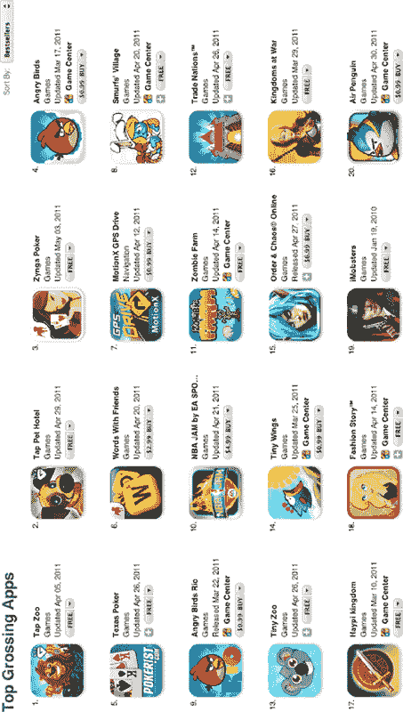

你的标题需要被记住，并且具体描述你的 App 功能。在决定 App 标题时，考虑 `App Store` 中其他成功的 App。我经常这样做，并问自己以下三个问题：

1. 为什么这些标题有效？
2. 是什么让它们如此朗朗上口？
3. 人们搜索哪些词来找到这些 App？

把标题中的词看作寻找你 App 的用户的载体会有帮助。创建可爱的名字很有趣，但如果没人能找到它们，就不那么有趣了。

在为 App 命名时，请记住 `Chomp` 数据分析（第 3 章提到）。`App Store` 中超过 90% 的搜索集中在 App 的功能上而不是特定的 App 名称。所以，当你决定将 App 命名为 `Fun Colors` 还是 `Flashlight` 时，你应该选择更具描述性的名称，即 `Flashlight`。

### 描述（DESCRIPTIONS）

接下来是描述。为你的 App 准备一个引入人的描述就像有一个出色的开场白。如果你激发了他们的兴趣，他们更愿意了解关于你的信息。

描述的第一部分需要充满信息。在适用的情况下，使用像“2012 年顶级 App”或“App Store 中最成瘾的游戏之一”之类的陈述。然后跟上行动号召，例如“查看截图并亲眼验证”。

例如，`Fingerprint Security`（`图 6.2`](`Figure 6.2`））的描述以简短的标题开头：

图 6.2 Fingerprint Security - 专业版描述。

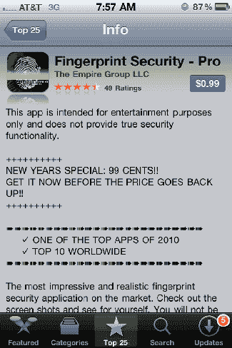

全球顶级 App 之一

这种营销文案并不适用于所有 App。如果你是刚开始，你可以编写其他描述来吸引用户的注意力，通过指出你的 App 与竞争对手相比何不同且更好，并包含用户证言。例如，如果我开始做 `Fingerprint Security`，我会写类似这样的话：“App Store 中最真实的指纹扫描恶搞。”或者获取来自用户的正面证言，例如：“这个 App 惊呆了我。它的声音和画面简直不可思议。”另一个例子是“限时免费”。这给了客户一种紧迫感和下载 App 的动力。

在描述之后，用几句话解释为什么用户必须下载这个 App：“市场上最令人印象深刻且真实的指纹安全应用。查看截图并亲眼验证。你不会失望的。”

### 截图（SCREENS）

截图是你随 App 描述提供的图片，向客户展示你的 App。将它们视为你 App 的图形化描述。俗称是电影的预告片。基础截图是 App 的屏幕捕捉。更高级的截图是吸引人的、包含营销内容并传达 App 如何工作的图形设计（参见`图 6.3`](`Figure 6.3`)).

图 6.3 基础截图（上方）；高级截图（下方）。

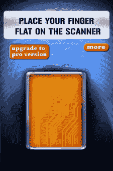

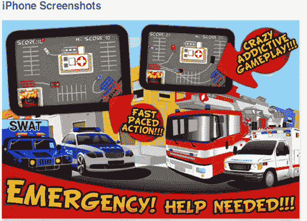


## 截图

截图是极好的营销工具，因为它们展示了用户使用你的 App 时的体验快照。许多在为 App 购物的人通常不会阅读描述，而是直接向下滚动查看截图。截图需要传达应用的核心功能，而不需要显示过多可能令困惑用户的细节。如果你的截图杂乱无章，其效果将像卖一间房间凌乱的房子一样低效。大脑会无所适从，买家也更难看出产品的真实价值。因此，你包含的截图应该是整洁、有吸引力且信息丰富的，这样用户既不会感到压力，又会发想要下载该 App。

在我刚开始时，我使用自己 App 的截屏来制作基础截图。截屏过程非常简单；大多数开发者都是这样做。在浏览应用商店时，我注意到一些成功的应用拥有更精美的截图。它们添加了吸引用户注意的横幅，并解释了 App 的优势。我为其中一个 App 尝试了这些高级截图，结果说服了我为所有的 App 都创建这样的截图。

如今，几乎所有的顶级 App 都拥有高级截图。大多数开发者已经意识到，截图是给用户留印象的主要工具之一。这也是为什么你必须与拥有图形设计师的团队合作的另一个原因。你的图形设计师会创建 App 中的图形和图标，并制作出杀伤级的截图，说服用户立即购买该 App。

此外，请注意截图的顺序很重要。你最多可以展示五张图片。确保你的截图能够讲述一个迫使用户点击下载按钮的故事（参见图 6.4）。

FIGURE 6.4 会讲故事的截图。

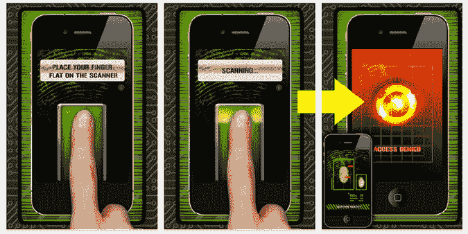

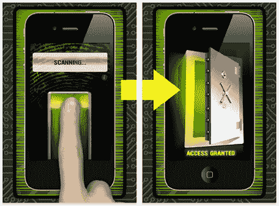

这些都是高级设计的绝佳示例。通过图片，用户可以快速理解 App 是如何工作的。文字横幅进一步明确了每一步，作为额外奖励，这些高级截图还包含了 App 的图形。

## 关键词

与你的图标和标题不同，关键词是用户看不到的内容。当你在 `App Store` 上提交 App 时，你可以提供与你的 App 相关的关键词。当用户搜索你选择的术语之一时，你的 App 就会出现在搜索结果中。

例如，如果你在 `App Store` 上输入“kids”（孩子）或“game”（游戏），你会发现《愤怒的大鸟》是搜索结果之一。术语 `kids` 和 `game` 并没有出现在 App 标题中，因此，《愤怒的大鸟》的制作者可能选择了这些关键词与他们的 App 关联。这完全合理，因为《愤怒的大鸟》吸引了很多孩子，任何搜索这些术语的人都能找到这个 App。

如你所见，关键词非常重要，因为你的目标群体会使用它们来寻找你的 App。App 标题中的每个词都代表一个关键词，因此在提交 App 时提供关键词，你不需要重复它们。

确定你 App 关键词的最佳方法是像用户一样思考。你的目标受众在搜索什么？不要使用无关的关键词，因为你能提供的关键词数量是的。当 Apple 在 `App Store` 开放一段时间后引入关键词工具时，我添加了我认为人们会搜索的关键词。对于我的 App `Fingerprint Security`（指纹安全），我使用了“camera”（相机）和“video”（视频）等术语。我以为关键词工具就是这样工作的，我的理由是，如果人们在搜索相机 App，他们可能会看到我的 App 并产生兴趣。

我意识到 App 购物就像任何其他购物一样。如果你去买电池却路过一把牙刷，当你只需要电池时，你不太可能买牙刷。所以，关键词必须相关，否则即使你的产品出现在搜索结果中，用户也会忽略它。

有效使用关键词的一个很好的例子由我创建的一个名为 `Flashlight`（手电筒）的 App。由于名字是 `Flashlight`，我们想到了关键词，如“bright”（明亮）、“help”（帮助）、“light”（光）和“camping”（露营）。

在想关键词时，考虑以下三个问题：

1. 目标群体是谁？
2. 用户的需求是什么？
3. 他们在搜索什么？

我不使用任何特定的工具来头脑风暴关键词。我使用常识并像 App 用户一样思考。

## 分类

大多数应用商店将 App 组织到特定的类别中，以帮助用户更容易找到。`App Store` 中的某些类别包括`Games`(游戏）、`Entertainment`(娱乐）、`Utilities`(工具）、`Books`(书籍）、`Business`(商业）、`Education`教育）等。除了所有 App 的总排名顶部排名外，每个类别都有自己的顶部排名，并根据这些图表产生一定程度的可见性。一个没有进入总排名前 200 名的 App，可能仍在某个特定类别的前 10 名。寻找特定 App 的用户通常会浏览这些类别图表，而不是看总排名图表。

当你提交 App 进行审核时，你必须选择你希望你的 App 出现的类别。确保选择与你的 App 最相关的类别。例如，闹钟 App 应该在`Utilities`工具类别中，而不是在`Games`游戏类别中。另一方面，许多 App 可以被归类为多个类别。你必须选择一个，但你可以在更新期间更改类别。某些类别比其他类别竞争激烈。查看竞争对手 App 的类别，看看它们似乎在哪个类别中流行。这通常是你应该将 App 放在哪个位置的良好指示。

## 免费 App 的力量

为你所有的 App 准备上述提到的基础营销元素。在处理好基础之后，你最大的营销工具将是免费 App。免费 App 会产生你原本无法获得的流量和可见度。免费 App 等同于在主街开了一家实体店，而不是在城外。


正如你的应用由于消费者需求和竞争始终需要某些改进一样，你的营销策略也是如此。让一个应用成功的关键在于不断改进，并对其所有的营销元素进行定期的调整或添加。对于我的大多数应用，我将图标和截图更改了三到五次，标题和描述更改了五到 10 次。我几乎每次更新应用时都会更改关键词。在合适的时候，我总是切换类别。保持开放的心态，继续从你在市场调研中的观察中获得灵感。

例如，有一次，我在我的一款免费恶搞指纹 App 的关键词中添加了“phone”（手机）一词。这个看似微小的改变让该应用冲上了总免费免费榜的第一名。同时它还在推广专业版，这使得专业版冲上了总榜付费榜的第 27 名，并且由于我对所有产品都进行了交叉推广，对其他一些应用也产生了重大影响。这一个改变让公司的收入从每天约 1,000 美元增加到每天约 3,000 美元。这就是调整应用营销的力量。一个改变就能大幅度增加你的收入。

在进行这些更改时，请记住你的执行速度。无论你想做什么，都必须快速。你必须配备一个团队来完成营销微调，因为如果你想更改一张截图却花费了一个月的时间，你可能就会错失该改变带来的收益。这等同于白白流失。此外，不要一次更改太多的东西，否则你将无法追踪哪些做法是有效的。不要对表现良好的应用进行过多改动，因为你不想推翻自己的成功。

然而，一旦你的客户购买了应用，营销并没有此结束。你必须让他们惊艳，并将他们变成狂热的粉丝，这样他们才会传播你的应用并再次回来购买。你必须给他们留一个留回到你应用的理由。这些理由可能包括改进的功能、新选项或新关卡。如果你的客户对某个应用有良好的体验，他们很可能会购买更多应用或升级。

你如何知道你的营销是否有效？数据分析。它们能向你展示关于应用内发生的一切你需要的信息。这对你业务的健康至关重要。所以，请继续阅读章节。

## 我学到的东西

1.
2.
3.

## 需要采取的行动

1. 针对你的每一个新应用和现有应用，在 App Store 中研究成功的竞争对手应用的图标、标题、关键词、类别、描述和截图。
2. 将创建免费应用作为你营销策略的一部分。
3. 系统地调整你的应用营销。

## 第 7 章：记录

### 赢得应用游戏需要衡量什么

有时，我们认为自己输掉了人生比赛，但实际上我们赢了，仅仅是因为我们没有记录。
——安东尼·罗宾斯（Anthony Robbins）

我下火车走在加利福尼亚州伯克利的站台上，迎接我的是一阵热热而浓稠的空气。那是一个反常温暖的日子，毫无疑问，我穿错了衣服。我搬到旧金山是希望学习更多关于移动应用领域的知识并扩大我的业务。我谁也不认识，对这片新城市和我的业务感到有些不确定。

我正要去会见一位顶尖的学习者，他上周随机给我发了封邮件，希望能建立人脉。我想留个良好的第一印象，所以我必须在这个领域展现出自信，尽管我进入这个行业只有几个月了。

Alan 人很随和。我们在他最喜欢的午餐店——臭名昭著的 Smokehouse 见面。当我们用他所谓的美国最汉堡和热狗堵塞动脉血管时，我们开始讨论应用业务。

“你每天有多少次下载量？”Alan 问。

我不知道答案，但为了表现得很懂行，我估计道：“嗯，我们每天大约有一到两个 K。”

“酷。而且你有免费应用将流量引向你的付费应用，我猜是？”他继续说道。

“呃，是的。我们正在处理这件事，”我回避了话题。

为了躲避更多问题，我问：“你的生意进展得怎么样？”呼，我想，通过让他讨论他的工作，我可以避开更多问题，但他才刚刚开始。他继续他那连珠炮火般的提问：

“你有多少活跃活跃用户？”
“你的应用内有多少次横幅广告点击量？”
“你有烦扰弹窗（nag screen）吗？”
“转化率高吗？”
“你有一个‘更多’按钮，对吧？”
“你把你的营销材料翻译成其他语言了吗？”

在这一连串的问题轰炸和我我不模糊不确定的回答之后，他和我都知道我对自己的业务是多么地一窍不通。

我只想尖声道：“我不知道!!!”

但是，为什么我不知道呢？

当我问自己这个问题时，我的大脑中灵光一闪，并伴有一声哈利路亚，随后是后脑勺上的一个响亮，伴随着像霍默·辛普森式的“噢！”我一直不知不觉地忽略了我业务中最关键的元素之一。难道这就是为什么我没有实现为业务设定的目标吗？

我专注于开发并能够快速开发新应用，但我并没有对我创作的内容进行跟进。我没有追踪我的结果，也没有根据这些数据策略性地改进我的应用。这个看似微不足道的“衡量一切”的区别完全改变了游戏规则，让我的业务提升了一个新的水平。我可以随时做出明智的决策和调整，并获得可衡量的结果。

追踪你的应用数据让你对自己的业务有更清晰的认知和控制。

## 重要的数据

我发现，应用业务最重要的数据是流量、排名、用户活动和收入。

### 流量

大多数开发者查看他们应用的下载量，是因为他们想知道赚了多少钱。这很合理也很重要，但你必须将应用下载视为流量。免费和付费下载越多，你产生的流量就越大。

这种流量可以通过许多方式进一步实现你的应用变现。这几乎就像你的每一个应用都像一个吸引特定数量访问者的网站。当引导得当时，这种可见性具有巨大的价值。我会查看我的每一个应用的每日下载量。

### 排名

正如第 3 章提到的，App Store 根据下载量和其他未公开的指标不断不断显示应用的流行程度。正如之前讨论过的，Apple 有总榜应用排行榜和特定类别的排行榜。你的应用必须出现在这些列表中，因为它们提供了额外的可见性。（参见图 7.1。）


# 图 7.1 畅付费应用排名。

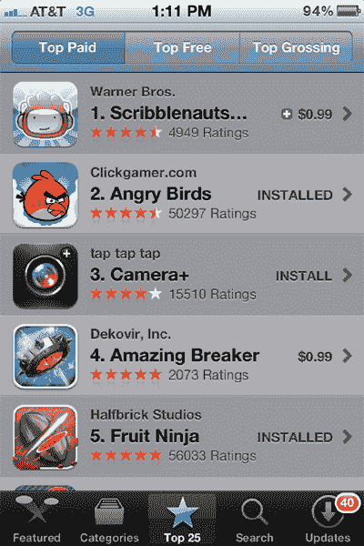

追踪应用排名是大多数开发者都会忽略的事情，因为他们认为自己对此没有控制力。事实恰恰相反。在评估你的应用性能时，排名是一项重要的指标，你可以通过各种营销技术来提高你的排名。我一直关注如何让我的应用进入榜单，一旦它们进入了榜单，我就会密切监控它们的排名。如果我看到某个应用在榜单中下跌，我会立即关注它，并弄清楚为什么会发生这种情况，以及可以采取什么措施来提高排名。

## 用户活动

是的，用户下载你的应用固然很好，但你的最终目标是将他们转化为持续使用你应用的客户。每一次用户交互都是你的应用组合实现变现的机会。要了解你的用户是否喜欢你的应用，唯一的方法是跟踪应用内的用户活动。很棒的一点是使用 `Flurry` 非常简单。你可以追踪任何内容，例如按钮被点击了多少次，或者应用被使用的频率如何。

例如，有一次我在其中一个应用的评论中看到，用户甚至不知道如何使用这个应用。不用说，他们并不开心。这让我感到很惊讶，因为该应用有一个说明页面。我很困惑，于是决定追踪有多少人点击了打开说明页的按钮，令我惊讶的是，只有 5% 的用户打开了它们。为了解决这个问题，我让按钮更加显眼，在经过那个小小的调整后，70% 的用户点击了说明按钮。从那以后，有更多的人留下了好评，我的应用也变得更加成功。

## 收入

之前所有的指标都是最重要且最直观指标的指标：你的收入。你必须每天追踪收入，并持续观察每日、每月和每季趋势。这听起来显而易见，但很容易忽视收入是一个像其他指标一样可以调整的指标。只要我看到收入出现任何正向或负面的变化，我想知道是什么导致了这种活动。我的应用流量增加了还是减少了？它们的排名上升还是下降了？用户活动增加了还是减少了？我想理解导致收入变化的原因并采取相应的行动。收入的每种变化都是理解你应用业务细节的机会。再次强调，这听起来可能很枯燥，但操作起来非常简单。应用销售不会是你唯一的收入来源。你将从横幅广告和联盟营销中获利，因此每天检查所有收入来源以获取完整的情况。

## 统计数据跟踪工具

你有多种方法来监控应用指标。一种选择是 Apple 的开发者中心（Developer Portal）。Apple 向你展示下载量、你的收入、何时获得付款以及你的 iAd 统计。（参见图 7.2](#Chapter07.html_figure7-2)）。

# 图 7.2 开发者中心统计。


虽然这个很棒，但我更喜欢 `AppFigures`（[appempire.com/appfigures](http://appempire.com/appfigures)）。`AppFigures` 对于数据以及业务的其他方面都非常好。一旦设置好，该网站会自动从开发者中心下载数据，并以更直观的方式显示信息。你可以查看单个应用，也可以同时查看所有应用。你可以看到应用的排名和评论。你可以根据时间或国家查看应用下载量。

# 图 7.3 AppFigures。


`AppFigures` 每天发送汇总昨日应用数据的邮件。这很棒，因为你不需要登录就能获取信息。我每天早上都会收到一封邮件，列出下载量的明细（参见图 7.4](#Chapter07.html_figure7-4)）。此外，我还会收到 iAd 利润明细。这非常方便，就像对你的业务进行每日检查一样。

# 图 7.4 AppFigures 汇总邮件。


`App Annie` 是另一个类似于 `AppFigures` 的服务（[appempire.com/appannie](http://appempire.com/appannie)）。像 `AppFigures` 一样，`App Annie` 显示你的应用的趋势、排名以及你赚了多少钱。`App Annie` 还显示 App Store 中所有应用的历史排名数据。

还有一些移动应用可以让你一眼看到这些信息。这对于手机化生活的人来说特别有用。我使用的应用是 `Position App`（参见图 7.5](#Chapter07.html_figure7-5)），它显示你的应用排名以及其他应用的受欢迎程度上升还是下降。

# 图 7.5 PositionApp 排名趋势。


另一个用于追踪应用内用户活动的有用工具是 `Flurry`（[appempire.com/flurry](http://appempire.com/flurry)）。这需要在你的应用内进行一些额外的编程。

## 利用统计数据取得优势

我们讨论过不断改进应用的重要性。持续改进是推动其前进的机制。


## 哪个分类竞争较小且可能提供更高的可见度？

你必须像一个剪辑比赛录像的教练。你每天都需要审查你的游戏计划，以决定做出哪些更改。大多数开发者采取散弹式方法，通过同时改进所有内容来解决问题。糟糕的部分是，如果某个功能有效了，他们并不知道是哪里起作用，因为他们同时改变了十个地方。你必须单独测试每一项更改，才能确定哪些更改实际上是有效的。

提升应用的性能可以很简单。我的其中一个应用 `Alarm Security` 之前运行不佳，我正试图让它的排名回升。起初我尝试更改名称和关键词，但并没有太大变化。我还没有尝试过的一件事将其移出 `Entertainment`（娱乐）分类。由于它本身更像是一个工具类应用，所以我决定将其移动到 `Utility`（工具）分类。我之所以把它放在 `Entertainment` 分类是因为该应用包含了各种闹报声，比如大声的尖叫或枪声。我曾假设用户更多是把它们当作开玩笑而不是作为工具，但我错了。

一旦我将应用移动到 `utilities` 分类，下载量就飙升了。五天后，付费下载量几乎增加了三倍，而这仅仅是因为分类的改变。如果不是不断工作和改进那些低表现的应用，我可能会很容易错过这个带来巨大回报的改变。

我经常收到的问题之一是：“我应该测试一个微调多久？”当你对某物进行微调以使其更好时，在进行其他更改之前，请测量大约一周的结果。你会很快看到你的改进是否产生了积极结果。

记住你的预算。许多微调不会花费你任何费用，比如更改标题、`keywords`、`description` 和 `categories`。你应该先尝试这些。你可以对图标和截图进行一些更改，但要保持成本尽可能低。在你仍在测试应用的市场需求并试图收回投资时，不要向你的改进中投入数千美元。只有在你通过营销微调获得增长动力后，再投入精力改进应用。

我建议你每天设定一个特定的时间来检查你的统计数据。建立一个适合你的惯例并坚持下去。当你查看统计数据并问自己上述问题时，你会有很多改进的想法。确保这些想法不会丢失。一个一个地记录并实施它们。跟踪你的更改并进行跟进，否则你将无法得知哪些更改产生了积极影响。你可以查看 `appempire.com/trackchanges`，那里有一个表格可以让你轻松跟踪你的更改。

## 关注评论

发现应用中需要改进之处的另一个好方法是应用评论。App Store 允许下载过你应用的人对其评分（一到五星）并留下简短的文字评论。（参见图 7.6）。随着你的应用流行，你会获得更多评论。其中一些非常棒，有些则不然。准备好提琴和纸巾。将用户评论视为建设性的批评至关重要。它们可能会向你展示应用中隐藏的 Bug，或者揭示许多用户想要看到的某些功能。

图 7.6 愤怒鸟的评论。

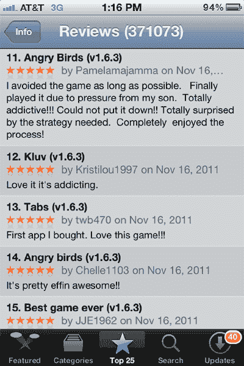

发布井棋应用对我来说关于评论重要性的另一个大教训。在第一个版本中，当人们赢得游戏时，应用会闪一个标志。但多条评论提到没有声音，而且他们希望能够和朋友一起玩。我利用了客户反馈，让我的开发者增加了声音和多用户功能。之后，其中一个之前的评论者又了来说：“嘿，感谢这些更改。这些声音太棒了。”你可以看到这让客户很快了，而且这对应用来说是极佳的营销。

由于负面评论会对你的收入产生负面影响，正面评论可以增加销量。幽默、令人兴奋并赋予你的应用信誉的评论会转化更多客户。如果评论非常棒，你可能想将它们包含在应用描述中。

获取更多反馈的另一个方法是检查来自世界其他地区的评论。这有助于从全球角度了解你的应用是如何被接收的。你可以使用 `AppFigures` 服务来检查不同国家的人对你应用的真实看法。`AppFigures` 会为你翻译评论。这些翻译并不完美，但在大多数情况下你都能明白传达的信息。这将是无价的。

## 止损

和大多数业务一样，应用业务是一场数字游戏。有些应用会奏效，有些不会。有时，即使你有一个很棒的图标、精彩的截图、有吸引力的名称和设计良好的应用，应用的表现也可能不如预期。这就是为什么在看到市场对应用有需求之前，我不会投入大量资金。当你根据本章提到的建议尝试改进应用及其营销元素三个到四个月后，就是时候继续下去并将精力放在另一个应用上了。就像任何关系或投资一样，止损是困难的，但对你和你的业务至关重要。

例如，我曾创建一个名为 `Flashlight` 的付费应用，它使用 iPhone 的闪光灯将手机变成手电筒。大约九个月时间，该应用运行良好。我注意到销量正在下降。我花了几个月专注于改进核心营销组件，但应用的销量仍然在下降。在那时，我必须决定止损，停止向该应用投入时间和金。我决定将 `Flashlight` 变为免费应用，并用它为我的其他应用引导流量。虽然 `Flashlight` 从未成为一个巨大的赚钱工具，但它为我的应用引流整体生态系统做出了贡献。


“我现在该怎么办？”我问我的朋友。通过多次对话，他们让我意识到，要维持一段关系并将其推向新水平，需要不同的技能和更深层次的理解。他们是正确的。最初有效的方法已经不再足够了，我必须提升自己的水平。

类似的模式在商业领域中也会发生。起初，一切看起来都非常棒，因为当你从零开始时，你会经历立即且显著的增长。你最初的营销吸引了极好的客户群。你看到流量和收入增长，认为你的增长爆发将永无止。在某个时刻，你撞上了一堵墙，眼睁睁看着你的业务进入平台期或下降。和任何业务一样，你不能对最初的成功过于乐观，必须保持开放心态实施新策略以保持业务的强大。

在应用世界中，有很多先进的营销策略可以吸引新用户，并让他们留下来、升级并花费更多资金。

我在本章中提到的每种技术都旨在为你的应用引入尽可能多的流量，并防止它们停滞。这些技术的精妙之处在于，它们大部分是免费的，并不一定需要投入更多的时间或精力。通过使用其中的一些高级策略，你可以让自己从应用新手一跃跃为应用专家。

## 遭遇平台期

当我看到数据连续一周下降时，我就知道我的第一个应用的“售后派对”结束了。我意识到我自自了，停止了对新营销策略的尝试，因为我一直在赚不错的钱。

意识到意图后，我立即行动，但仍看到数据持续下降了一个半多月。我尝试了以前有效的策略，但无济于事。我尝试着新事物，看着收入从每天 900 美元下降到每天约 300 美元。我不打算放弃，开始测试一系列新策略来产生更多收入。每周，我都会使用一种新的营销技术，看看是否能重振我正在衰落的应用。

最后，经过反复尝试，其中几种技术奏效了，下降趋势发生了反转。两个月后，我的日收入稳定在 800 美元以上。我回到了轨道，学到的那些技能是无价的。

这些经过测试的高级技术包括应用网络、引导页（nag screens）、更多页面、推送通知、开发者网络、更新和付费流量。

## 你的应用网络

我喜欢“人不是孤岛”这句话。它的意思是人类在与他人隔绝时无法繁荣发展。应用也是如此。你可以创建一个可能运行良好的单一应用，但当你创建额外的应用并通过交叉推广将它们连接起来时，你将向你应用帝国的全部财务潜力迈进。

应用网络是一个互联的应用网络，它们利用自己的活跃用户（流量）来相互推广。正如第 7 章提到的，你应该将你的每一个应用视为一个流量源，就像互联网上的网站一样。这些流量蕴含黄金，特别是当你利用你的应用网络的力量对其进行变现时。

例如，如果你只有一个每天有 50,000 次下载的免费应用，你将通过横幅广告和可能的联盟营销赚到一些钱。如果你有多个应用，通过引导页和促销页面（将在文中解释）相互推广，那么你就可以将这 50,000 个用户引导到你的其他应用中，产生数百美元的额外收入。这本质上就是应用网络：你自己的应用用户超级高速公路，你持续地引导和重定向它们，以找到产生最多资金的流量模式。

应用网络是如此至关重要，以至于很少应用公司能够在不构建网络的情况下长期成功。你的应用网络允许你提升应用排名，并赢得其他应用开发者的信誉，这让他们更有可能与你进行交叉推广。在发布新应用时这至关重要，因为你可以立即利用你的应用网络为其获得大量关注。你通过应用网络获得的下载和流量越多，你就越开始建立一个充满活力的应用生态系统。大多数玩家都想到了这一点，这就是为什么他们一直将将应用推向排行榜。

这就是为什么你必须从第一天起就把开发应用网络作为首要任务。你从事的是创建应用的业务，也是创建强大应用网络的业务。本章接下来的大部分章节将重点教你如何做到这一点。

## 引导页 (NAG SCREENS)

你有没有去过服务员会向你推销加品的漂亮餐厅？她说：“嘿，那份青酱面很棒。你想让我在里面加些虾吗？”你思考了一秒钟，有时会说：“好，为什么不呢？”你并没有考虑虾，但当面对这个选择时，你选择了。

这就是引导页的工作（参见图 8.1）。它是在应用启动时弹出的窗口。它有一个简短的行动号召，为用户提供下载应用专业版本的选项，该版本比他们下载的版本功能更多。

图 8.1 引导页示例。

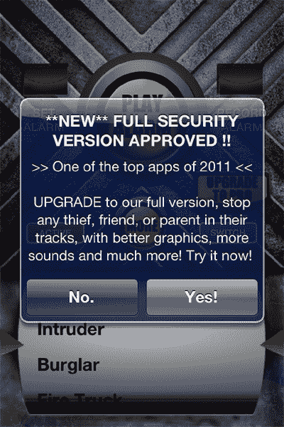

引导页利用用户的冲动购买心理。一旦用户下载并打开了你的免费应用，你就可以提供那些优质内容并获得合理的转化率。确保你不要在上面随便放任何东西。像任何推销一样，你必须在向客户推销的内容和方式上具有策略性。引导页上对价值的精美演示可能会吸引潜在买家，但如果处理不当，可能会让客户完全离开。

引导页通常用于从免费版推销到专业版，但你也可以用它们来推广其他应用。你甚至可以推广其他免费应用来扩大你的应用网络。毕竟，谁不喜欢你的另一个免费应用呢？引导页有两种样式。一种是默认的蓝色引导页，看起来就像你手机上收到的其他提醒。这种版本容易实现，适合入门。当你产生更多收入时，可以转向更漂亮的引导页，一个占据屏幕且更具吸引力的界面（参见图 8.2）。平均而言，这些高级引导页的点击率是默认版本的几倍。

图 8.2 高级引导页。

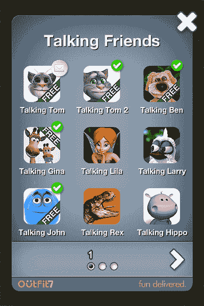

引导页是我业务中最关键的营销策略。你必须利用它们。你可能会想：“我不想用这些广告骚扰我的用户”，这是一个合理的想法，但请认为这是在为用户增加价值。如果他们下载了你的免费应用并在使用它，说明他们对你的应用以及那种类型的应用感兴趣。他们可能想要获得带有额外功能的专业版。对于那些不需要的人，一个快速的弹出窗口是使用你免费应用的微小代价。


通过我的免费版手机安全应用，我每天大约可以获得 30,000 次下载，但并没有产生多少收入。为了解决这个问题，我添加了一个引导弹窗（nag screen）来引导消费者升级到专业版。这立即每天每天增加了约 650 美元的收入。我将每天约 3% 的免费流量转化为了我的付费应用销售额。这种效果非常深远，使我的付费应用排名从 280 名上升到了 26 名，这带来了更高的曝光率，并最终提高了销售额。这种向上的良性循环完全是由我免费应用中的引导弹窗所驱动的。这就是应用网络的力量。

## 实现引导弹窗 (Implementing Nag Screens)

在添加引导弹窗时，向你的开发者解释你的需求，并引用其他带有引导弹窗的应用的具体示例。务确保你可以在不向应用商店提交新更新的情况下更改引导弹窗。要做到这一点，请告诉开发者你希望你的引导弹窗是动态的。这样，你就可以随时更改营销信息以及你正在推广的应用程序。这将使你能够在几秒钟内重定向你的应用网络流量。这是必须的。如果你无法即时更改它们，你的引导弹窗将失去大部分效力。

为了实现这一点，开发者必须实现一种被称为服务器-客户端交互机制，这样每次应用启动时，它都会与服务器连接并获取引导弹窗的最新版本。你可以在服务器上编辑你的引导弹窗，你的应用将显示引导弹窗的新版本。你的开发者应该能够理解这个概念并创建出你需要的动态引导弹窗。你还需要能够关闭引导弹窗并重新开启它们。

保持你的引导弹窗简单、简短且以收益为导向。你的空间是有限的。通过关注你所推广的应用的优点，最大限地发挥你的信息的影响。正如图 8.1 所示，包含行动号召（CTA）至关重要。

你如何评估引导弹窗的有效性？你只需要跟踪显示特定引导弹窗的次数，以及这些用户中有多少点击了 `yes` 来查看你推广的应用。这被称为点击率，百分比越高越好。

特别促销活动通常会有更高的点击率。“在价格回升前立即升级”或“仅限几天，请立即购买”都是非常有用的行动号召。你应该定期测试并更改你的引导弹窗信息，看看是否能获得更好的点击率。使用 `Flurry` 跟踪所有的活动，这样你就可以根据哪些引导弹窗文案转化最好做出明决策。

在你的所有应用中添加引导弹窗，即使是付费应用。你不应该开启付费应用的引导弹窗，因为那会非常打扰你的用户。但你永远不知道什么时候会决定让其中一个付费应用免费一段时间。你希望有自由开启该应用的引导弹窗，并将其流量导向你应用网络中的另一个应用，特别是当它火起来并开始产生大量流量时。如果不这样做，可能会损失很多钱。

## 推广页 (Promo Pages)

如果引导弹窗是你最重要的交叉推广工具，那么推广页将是你的第二重要工具（请参见图 8.3）。与引导弹窗不同，你可以同时交叉推广多个应用，这就是推广页的力量。这本质上是你的应用的一个部分，列出了你所有的其他应用以及与你进行交叉推广的开发者的应用。

图 8.3 推广页示例。

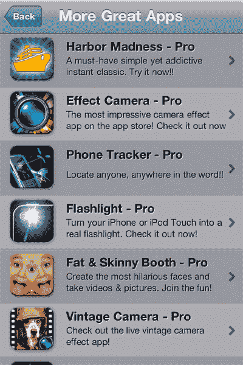

推广页示例显示了几个应用了整个页面。用户可以向下滚动查看更多列出的应用。保持此页面像引导弹窗一样简单。仅包含你正在推广的应用 `icon`（图标）、`title`（标题）和简短描述。确保你的简短描述具有吸引力，并不惜一切避免混乱。你需要在每个应用的右侧放置一个箭头。这告诉用户在触摸横幅时将获得更多信息，这是一个微妙的行动号召。

这些横幅中的每一个都链接到被推广的应用。当用户触摸横幅时，他们会被带到 App Store 查看并下载该应用。这是一个进一步增加销售的强大工具。我为推广页测试了几种颜色方案，发现 App Store 的亮灰色和深灰色横幅背景颜色方案效果最好。如果你想最大限度地提高推广页的点击率，我建议你也这样做。

根据你应用的每日流量，推广页的每个横幅位置将具有特定的价值。横幅位置越高，价值越高，因为它的曝光率越高，因此用户点击的频率也越高。例如，如果你的一个应用每天获得 10,000 次下载，你可以假设有一部分用户会进入你的推广页。假设是 10,000 人中的 25%，即 2,500 用户。如果你能从进入你推广页的用户中产生 10% 的销售，你将获得另外 250 笔订单，大约是 175 美元。而这仅仅是你其中一个应用的推广页产生的。

你可能会想如何将人们引导到应用中的推广页。你的每一个应用都需要一个指向推广页的按钮。（此处原文中存在大量重复的句子，翻译时已按要求去重并保持逻辑连贯）。


交叉推广的概念并非应用行业独有。在房地产领域，每位经纪人在职业生涯初期都会被教导与为购房过程提供服务的人建立人脉。例如，你会与贷款经纪人建立关系，他们会向你推荐寻找房子的人；作为回报，你会向他们推荐寻找贷款的人。

通过 `Alan`，我立即看到了这种模式如何应用于应用世界，并决定和他一起进行应用的交叉推广。但我并没有停于此。我联系了其他娱乐应用公司，包括 `Doodle Jump` 的创建者 `Lima Sky`。时机非常完美，因为他们当时正在发布新应用 `Bubble Wrap`。我成功地让他们与我进行交叉推广，这增加了我应用网络的流量。

如果你与几位开发者一起采用这种策略，而不是一个人，你就有潜力看到你的流量飙升。找到那些与你的应用流量相当、受众群体相似的开发者，并最大化你的转化率。例如，工具类应用对游戏的交叉推广效果可能没有对其他工具类应用好，因为受众群体不同。

## 推送通知

推送通知是另一种有效的高级营销策略。推送通知向手机上安装了你应用的客户发送消息。推送通知可以包含你想要传递给用户的任何信息。它像短信一样出现在屏幕上，要求用户忽略该消息或打开发送该消息的应用。推送通知的巧妙之处在于，它在提醒用户你的应用，并给他们触碰屏幕即可打开应用的机会。

由于这些通知以短信的形式显示，其打开率接近 100%。毕竟，你难道从来没有读过屏幕上弹出的短信吗？这对于营销你的应用来说是巨大的，而且是任何行业的任何其他类型的广告都无法比拟的。

推送通知是一种强有力的、直面的应用营销方式，必须谨慎使用。不要每天发送推送通知，否则客户会感到厌烦并删除你的应用。在他们积极使用你的某一个应用时向他们展示广告是一回事，但向他们发送推送通知并中断他们当时可能正在做的任何事情则是另一回事了。

这种策略在你建立起坚实的粉丝基础后效果最好，这些粉丝热衷于使用你的应用或期待你的下一次更新。公司 `Outfit7` 凭借极其成功的 `Talking Tom` 和其他“会说话的程序”在这方面做得非常好。他们很少发送推送通知，只有在偶尔会发送一些有趣的内容，如“我想你了”或“来陪我吧”。有时他们还会宣传新功能。

让我们考虑推送通知的财务影响。假设你有一个活跃用户量为 `250,000` 的应用。如果你发送了一条推送通知，只有 10% 的用户查看了，那么这一天你就为你的应用网络注入了额外的 `25,000` 用户。这些流量将通过额外的销售、横幅点击和联盟收入增加你的收益。这就像点击按钮印钱一样。

## 你的开发者网络

发布几个月后，我的热门应用开始排名下降，我不知道如何停止它。我问自己：“我能做什么让这成为一项可持续的业务，而不是一个昙花之粉？”于是，我想：“在这个行业里我认识谁可以帮我？谁可以成为导师？我可以向谁学习成功？”这就是每当我想要更上一层楼时一直想过的。

现实情况是，我在这个行业里并不认识任何人。当时的应用行业非常新颖，大多数开发者都集中在硅谷，所以我决定去那里。我带着所有的行李（两个包）到了旧金山。我充满动力，准备好建立人脉并开始我的应用创业者（appreneur）生活。我的跨国迁移将我的业务推向了新的高度。我建立的第一联系是 `Alan`，从那里开始，我的开发者网络起飞了。我与其他应用创业者建立联系，学习了他们用于应用变现的策略。我自己从未想过其中一些点。

你不需要脱离生活搬到旧金山来建立人脉，因为开发者无处不在，而且你可以利用技术。但你的成功取决于找到志同道合的人建立人脉。从做得好的人身上学习可以帮助你比自己摸索业务门道更快地进步。

你可以在哪里找到他们？使用 `Meetup` (`appempire.com/meetup`) 或类似的社交网站、行业会议、开发者博客等。`Meetup` 将你与处于相似行业或有相似爱好的人联系在一起。在我参加的第一次 iPhone 开发者聚会上，我遇到了几位非常出色的开发者，他们向我介绍了他们的开发者朋友。我们建立了一个智囊小组（mastermind group），这对我们的成功至关重要。他们教我他们的技能，我也能向他们展示一些东西，帮助他们将业务推向新水平。

受智囊小组结果的激励，我参加了应用会议并扩大了我的开发者网络。这些会议是人脉建立者的梦想，让应用创业者学习新的、有用的信息并遇到志同道合的人。有一次，我参加了 `BizTech` 会议，互联网营销专家兼应用开发者 `Joel Comm` 在那里演讲。演讲结束时，我向 `Comm` 先生提了一个问题，并从介绍自己开始在大量观众面前推销我的应用。

之后，有几个人过来对我说：“我也是一个应用开发者。”这是一个结识人的好方法，但我必须让自己表现出来。

好消息是，你不需要在数百人面前站起来说话就能成功建立人脉。当你参加聚会和技术会议时，一对一对地介绍自己并提问以获取更多信息。询问他们来自哪里，做什么的等等。每个人都是为了学习和结识他人，所以不需要害羞。对于你参加的每一个会议，你的目标是带一个人进入你的“圈子”。不知不觉中，你就拥有了一个梦幻的应用创业者网络。

投入你的开发者网络，就像你投入你的应用网络一样。

## 更新

猜怎么着。没有所谓的“完工”的应用。你将不断地修复漏洞、添加新功能或应对竞争。要让你的用户获得应用的最新版本，你所做的只是将其上传 Apple 进行审核，就像你第一次发布应用时一样。在 Apple 批准后，所有在设备上安装了你的应用的用户都会看到可用更新（见 `图 8.6`）。这看起来简单而易见，但更新是一个巨大的营销机会。

[FIGURE 8.6] App Store 应用中的应用更新。

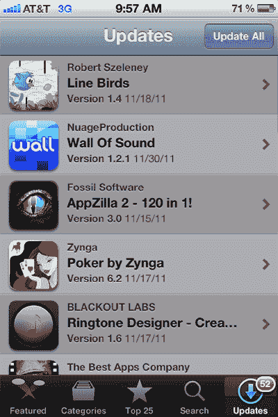


当你发布更新时，你的部分用户会下载该 App 的新版本。根据你的用户群规模，下载你更新的人数可能会超过你的常规日流量。我曾见过很多次更新让让我的日流量增长了 5 到 10 倍。所以，如果你每天有 10,000 次下载，那么你的更新在当天可能会为你额外增加 50,000 到 100,000 次下载。虽然这些下载不会计入你的排名，而且并不是每个用户在更新后都会打开你的 App，但即使只有小部分用户决定查看你的更新，你的日流量也可能翻倍。这将导致你的收入出现激增，并提醒用户关注你的 App。

出于任何你能想到的理由，都要频繁地更新。不要等到你的程序员增加了 10 个功能后才提交并更新。最好是在开发出一个功能时就提交一次更新，共提交 10 次。你的用户不会介意，并且会留下你正在不断改进 App 的印象。我将更新视为免费广告，因为你可以捕获百分比例下载更新的用户，他们会来查看增加了哪些功能。

所以，请记住：更新 = 金钱。

## 付费流量

另一种你可以使用的高级策略是购买流量，以快速扩大你的 App 网络。有一些公司专门从事为你的 App 获取海量流量。一些大品牌包括 FreeAppADay ([appempire.com/freeappaday](http://appempire.com/freeappaday)) 和 TapJoy ([appempire.com/tapjoy](http://appempire.com/tapjoy))。如果你在限时间内免费提供付费 App，FreeAppADay 就会向其巨大的用户数据库推广你的 App。你需要向公司支付费用获取他们发送的流量。我曾用它推广我的 Alarm Security App，该 App 曾在工具类中排名第 180，每天大约有 1,000 次下载。我花了 2,500 美元获得 FreeAppADay 的流量。该 App 的排名飙升至总第 17 名，流量增加到每天约 40,000 次。这帮助我扩大了 App 网络并增加了总收入。随着 App 领域的发展，你会发现有越来越多的这类公司出现。只有在符合经济效益的情况下才使用这种策略，但首先要穷尽所有的免费手段。

现在你已经学会了如何构建你的 App 网络，让我们在下一章看看如何从中榨出最多的金钱。

### 我学到的东西

1.
2.
3.

## 需要采取的行动

1. 在你的 App 中添加引导弹窗（nag screens）。
2. 添加更多按钮和推广页面，以交叉推广你的 App。
3. 为你的 App 添加推送通知。
4. 定期与其他 App 开发者建立人脉。
5. 定期更新你的 App。
6. 考虑使用付费方案来扩大你的 App 网络。

# 第 9 章
# 见钱！

## App App 变现

金钱买不到幸福，贫困也买不到。
—Leo Rosten

当我还是个孩子时候，我很快意识到，我比每周通过铺床得到的那些微薄零花钱需要更多的钱。像大多数 10 岁的孩子一样，我想买棒球卡片，还有我在杂志上看到的一辆酷炫闪闪的红自行车。

暑假开始了，由于我的表弟也有类似的志向，我们决定在人行道上摆个摊位卖柠檬水，希望能赚点钱。我们是两个可爱的小孩子，每杯柠檬水卖 1 美元，我们本以为自己会立即大红。

令我们惊讶的是，我们并没有赚到多少钱。搭建摊位和制作所有饮料实际上是一项非常辛苦的工作。我们下定决心，坚持了几个周，才意识到必须有更好的方法。如果我们想要买到那些了不起的自行车，我们需要做一些改变，而且要快。

首先，我们尝试每杯收 2 美元，认为这样能赚到更多钱；结果实际上让我们赚的钱更少了，因为买的人少了。接着，我们改变了卖柠檬水的时间，认为在下午五点左右，人们下班的时候，会有最多的买家。这一举措确实增加了路过人数，我们开始卖出更多柠檬水。遗憾的是，我们仍然面临同样的问题。卖柠檬水并没有为我们赚到预想中的那么多钱，因为人们花了 1 美元就走了。进展太慢了，我们感到很沮气且完全挫败。我们到底哪里做错了？难道我们其实并不那么可爱吗？

在我们短暂的柠檬水创业者生涯即将结束的那一天，我们产生了一个灵感（aha moment）。我们意识到，大多数客户是在去超市买晚饭食材之前顺路路过的。

这给了我们一个主意。我们很擅长吸引人流，但似乎无法让这些路过的人花很多钱。光靠卖柠檬水无法赚到买那些自行车的钱。如果我们能卖给他们一些本要在超市买的食物，我们就能更快地挣钱。

幸运的是，我的家里有一个大花园，蔬菜比我们能吃的还多。我们只需要把它们摘下来。太棒了。我们立即改变了计划，提供免费柠檬水来吸引更多客户，以便向他们售卖我们花园里的农产品。效果非常完美。人们停下来，拿了免费柠檬水，然后买了蔬菜。这太棒了，每个人都很开心，让我告诉你，我整个夏天骑着那辆自行车，简直极了快乐。


免费应用可以具有完整的功能，但它们通常是其全功能对应版本的精简版。“先试用后购买”策略是一个古老的商业概念，大多数开发者会提供功能较少的免费版应用，以此向用户推销专业版（pro versions）。

我们之前讨论过免费应用的重要性，但我们需要再次提到它们，因为它们将成为你变现策略的基石。免费应用有许多用途：它们是你应用网络的主要流量来源，它们是你主要的交叉推广工具（使用引导弹窗 nag screens 和推广页），并且可以通过横幅广告、联盟营销和翻译进行轻松且有利的变现。

## 付费模式 (Premium Model)
付费模式包含了 App Store 上所有的付费应用，且每当用户购买你的应用时，你就能盈利。与免费应用相反，消费者必须在尝试之前购买。这可能会成为一种阻碍因素，因此同时为你的付费应用提供由广告支持的精简版是一个好主意。初始销售不是变现付费应用的唯一途径。你还可以联盟营销、应用内购买和翻译来获得更多收益。你必须拥有付费应用，因为你会想要将大量的应用网络流量引向它们。

## 免费增值模式 (Freemium Model)
免费增值模式是免费模式和付费模式的混合体。这些免费应用包含可选的付费内容（应用内购买）。其理念与免费应用一样，用户可以先尝试后购买。但与免费应用不同，免费增值应用并不是将用户送回应用商店查看并购买付费应用，而是将付费内容包含在应用内，可以通过应用内购买进行解锁和使用。这是非常强大的，因为它既提供了免费应用的流量生成能力，又兼具付费应用的销售优势。本质上，它们让你能够鱼和兼得。

## 横幅广告 (Banner Advertising)
随着智能手机用户数量的增加，越来越多的广告商正转向移动广告以触达他们的目标群体（见 图 9.1 ）。作为中间商，移动广告网络负责移动广告的销售和投放。广告商可以从广告网络购买广告空间，开发者可以使用他们的应用展示这些广告。广告商从广告带来的销售中获益，而你作为开发者，则从广告中赚收入。广告网络保留 40%，开发者获得该过程产生的广告收入的 60%。

图 9.1 横幅广告示例。

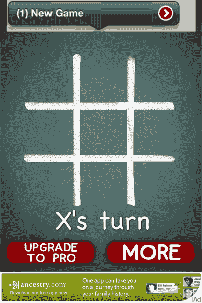

如果你有一部智能手机，你可能在应用内看过的屏幕顶部或底部出现过的广告。那些应用的开发者每当这些广告显示或被点击时，都在赚钱。你应该认真对待横幅广告，因为它们可以是一项主要的收入来源。

例如，一个前十的免费应用仅通过展示横幅广告每天就能至少赚取 500 美元。诚然，并非你所有的应用都能排在前十，但即使你只有三个应用，每个每天产生 50 美元，你也会通过广告赚到笔大钱。这大约是每天 150 美元，每月 4500 美元或每年 54000 美元。只需要在应用中留出一小块空间放广告，不需要做任何额外工作，这非常划算。

横幅广告中使用的术语初看起来可能像是一大堆复杂的字母汤。让我们来看一些最常见的术语。你不需要了解这些就能通过广告赚钱，但当你想要最大化横幅广告收益时，它们以后会有帮助。

*   **展示量 (Impressions)**：每当你的某个应用向用户显示一次广告时，你就“交付”了一次广告展示。展示量通常是低收益产生源，因为不清楚用户是否看到了广告或关注了它。这更像是一种“散网式策略”，广告商为大量的展示付费，并希望广告能吸引部分用户的注意力。
*   **点击量 (Clicks)**：用户每点击（或触摸）一次广告，就会产生一次点击。广告商愿意支付溢价获取点击，因为这意味着消费者对广告表现出了真正的兴趣。
*   **填充率 (Fill Rate)**：广告网络并不总是能为开发者提供广告。你的填充率本质上是应用向广告网络服务器发送请求时接收到广告的百分比。理想的填充率 100%。
*   **CPM 或千次展示费用 (cost-per-mille)**：广告商为了获得 1000 次广告展示而向广告网络支付的价格。
*   **CPC 或单次点击费用 (cost-per-click)**：广告商为了获得消费者点击广告而向广告网络支付的价格。
*   **CTR 或点击率 (click-through-rate)**：消费者点击广告的次数相对于看到广告（展示量）的次数。
*   **eCPM 或有效千次展示费用 (effective cost-per-mille)**：你的应用每 1000 次广告展示产生的收入，计算公式为：`[总收益 / 展示量] × 1000`。
*   **eCPC 或有效单次点击费用 (effective cost-per-click)**：与 eCPM 相同。它衡量的不是展示，而是点击。鉴于点击产生的收益高于展示，eCPC 会比 eCPM 高。

允许你在应用中投放广告的一些顶级广告网络包括 Apple 的 `iAd`、Google 的 `AdMob` 以及 Millennial Media。还有许多其他，但这三个是很好的起点。

那么，你应该用哪一个？全部使用吧，因为这允许你最大化填充率。如上所述，广告网络并不总是会在你请求时提供广告。这意味着如果你只使用一个，就会错失收入。但如果你能从多个网络请求广告，在其中一个没有结果时切换呢？这可以保证 100% 的填充率，从而最大化你的广告收入。

这些平台中的每一个设计都是独立使用的。如果你想使用所有平台，你的程序员必须与每一个平台对接，并创建切换的逻辑。你可以这样做，但那是额外的工作。

## 如何使用多个网络
使用 AdWhirl。

AdWhirl ([appempire.com/adwhirl](http://appempire.com/adwhirl)) 是一项服务（Google 所有），它允许你在应用中集成多个广告网络，并无缝处理你的广告请求。每当你的某个应用在请求时没有获得广告时，AdWhirl 会根据你的偏好将该请求重定向到另一个广告网络。一旦你将三个或四个广告网络连接到你的 AdWhirl 账户，你无需任何额外工作就能稳定获得 100% 的填充率。

我最初只使用 iAds，但我的应用填充率只有 10%-50%。当我发现 AdWhirl 并将其应用到所有应用中后，我的广告收入增长了三倍。我本可以早点，但我并不知道它。这就是你的开发者网络和大师派上帮助的地方。他们会帮你更快地发现这些技术。

AdWhirl 非常有用，因为你对一切都有完全的控制权。你可以为广告网络分配广告请求百分比。（见 图 9.2）。你可能希望将 50% 的请求交给 `iAd`，25% 给 `AdMob`，剩下的 25% 给 Millennial Media。或者你可以在所有网络之间平均分配请求。由你选择。

图 9.2 在 AdWhirl 上分配广告流量。

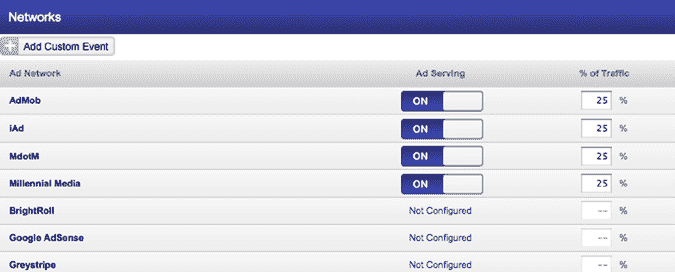


# 引言

这非常棒，因为你可以向那些为你带来最多收益的平台发送更多广告请求。如果你不想向某些平台发送广告请求，可以关闭它们。你始终拥有重新开启它们的选项。

你还可以选择广告请求的备补优先级（backfill priority）（参见图 9.3）。这意味着你可以决定当当前网络没有返回广告时，`AdWhirl` 向其他广告网络请求广告的顺序。这种程度的控制将使你能够从你的横幅广告中榨取最大的利润。

图 9.3 在 AdWhirl 上选择备补优先级。

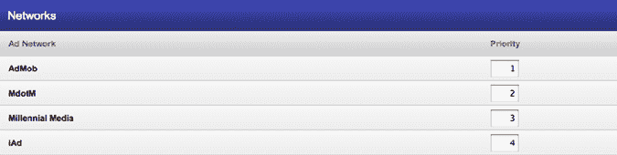

`AdWhirl` 的另一个酷功能是你可以拥有“内源广告”。这意味着，你可以在自己的横幅广告中推广自己的 App。你只需要上传一张你 App 的精美横幅图及其对应的链接即可。然后，你决定想让自己的广告显示的百分比，这样就完成了。你的广告将与其他广告网络的广告一起出现，你的用户将无法看出其中的区别。

我喜欢做的一件事是将 `AdWhirl` 也加入到我的付费 App 中。就像你的提示界面（nag screen）一样，你可能会在付费 App 中关闭横幅广告。但如果你以后决定进行 `FreeAppADay` 促销并让你的付费 App 在有限时间内免费，你就可以接入 `AdWhirl` 并开启广告，以利用你临时的免费流量来获利。这可能会为你多赚数千美元。你必须赋予自己这种灵活性，以便随时对你所有的 App 实现变现。

至于如何集成 `AdWhirl`，就像处理你的提示界面和促销页面一样，你的程序员需要在这方面拥有经验。让他们处理所有细节，并在你提交 App 之前检查一切是否运行正常。

## 联盟营销 (Affiliate Marketing)

联盟营销在互联网上相对广泛，许多人仍然通过它赚取大量的钱。基本概念是：如果人们在线上有东西要卖，他们会将为你带入客户进入其网站后产生的每笔销售额的一部分分成给你。你（联盟营销人员）通过为卖家连接买家从他们那里获得佣金。

如果我在卖一门价值 100 美元的如何制作 iPhone App 的音频课程，我可以决定将销售额的 50% 分给我的联盟伙伴。你可能是一个拥有关于如何制作 iPhone App 博客的开发者，而且你可能喜欢我的产品。你决定在你的博客上放一条推广我产品的广告。每天有许多人访问你的网站，其中一些人会看到你的广告、点击它并被重定向到我的网站。在点击你广告的人中，有些人会购买我的产品。对于每一个从你网站来到并购买我产品的人，你将权获得 50% 或 50 美元的佣金。

这很酷，因为你正在从一个你并非创作的产品中获利。此外，你的网站上上有用户（流量），为什么不给他们展示一些可能他们感兴趣的内容并同时赚点钱呢？卖家知道流量来自你，因为每个联盟营销人员都会获得一个唯一的标识链接，被称为 `affiliate link`（联盟链接）。这样，就不会产生关于用户从哪里来的困惑，所有联盟伙伴都能获得他们应得的。

联盟营销自互联网诞生以来一直存在。互联网上成千上万的产品正由联盟伙伴推广。因此，出现了一些作为卖家和联盟伙伴之间中介的网站。卖家发布他们的产品和佣金金额，联盟伙伴可以浏览这些报价，并挑选他们认为最有利或与他们的流量最相关的。其中一个网站就是 `LinkShare`（[`appempire.com/linkshare`](http://appempire.com/linkshare)）。

`LinkShare` 连接卖家和联盟伙伴。它还作为一个联盟销售跟踪服务。一旦你注册成为 `LinkShare` 的联盟营销人员，你就可以找到用于推广某些产品所需的链接。开始推广这些产品后，你可以随时登录 `LinkShare`，查看你的流量为卖家产生了多少收入的详细统计数据。（参见图 9.4）。你可以看到从这些销售中赚了多少钱。`LinkShare` 定期从卖家那里收取你的收益并定期发送给你，这既简单又有效。

图 9.4 LinkShare 报告。

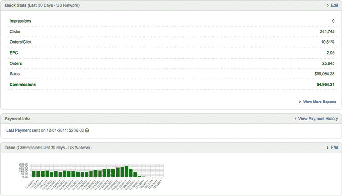

所以，既然这一切操作都发生在互联网上，我们为什么还要讨论这些联盟营销的术话呢？是因为联盟营销也存在于智能手机上。苹果是互联网上最大的数字内容销售者之一，因此它与 `LinkShare` 合作，为任何向其发送购买电影、歌曲、电子书和 App 客户的联盟伙伴提供佣金。在实际操作中这意味着什么？任何将流量引向苹果 iTunes 商店的联盟伙伴都有权获得用户在随后 72 小时内所做任何购买金额的 5%。

你应该关注这一点，因为你从事的是构建 App 并使用你的 App 网络引导流量的业务。每当你的一个用户点击你的提示界面或促销页面横幅时，你就将他们发送到 App Store。你的 App 网络越强大，你每天发送给苹果的流量就越多，你产生的联盟收入就越多。

你所做的仅仅是注册 `LinkShare` 并使用正确的 `affiliate link`，这将你发送给苹果的流量归给你。反正你都在把人们引向你的 App，所以使用 `affiliate link` 并收集你应得的佣金。（参见图 9.5）。

图 9.5 创建联盟链接。

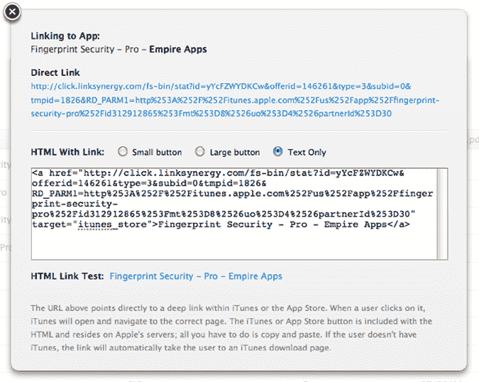

这是一个普通链接的示例：
```
http://itunes.apple.com/us/app/fingerprint-security-pro/id312912865?mt=8
```

这是一个 LinkShare 联盟链接的示例：
```
http://click.linksynergy.com/fs-bin/click?id=LjQr0YBXPSs&subid=&offerid=146261.1&type=10&tmpid=3909&RD_PARM1=http%3A%2F%2Fitunes.apple.com%2Fus%2Fapp%2Ffingerprint-security-pro%2Fid312912865%3Fmt%3D8
```

不要被 `affiliate link` 的长度吓到。记住 `LinkShare` 会为你创建它，你只需要复制粘贴那个特定的链接而不是第一个。反正你的程序员会处理这一切的。


在使用联盟营销时需要记住的一点是，你创建的链接是特定国家的。Apple 决定在美国和加拿大使用 `LinkShare`。你必须为这些每个国家使用不同的链接。对于欧洲，Apple 选择了与 `LinkShare` 的欧洲对应伙伴 `TradeDoubler`（[appempire.com/tradedoubler](http://appempire.com/tradedoubler)）合作。对于澳大利亚和新西兰，Apple 与 `DGM`（[appempire.com/dgmpro](http://appempire.com/dgmpro)）建立了合作。最初，你可以坚持使用美国的 `LinkShare` 链接，因为美国拥有最大的应用市场。一旦你的应用获得了一些流量，你就会希望你的应用能够识别出它们所在的国家。这样，你就可以为每个国家使用正确的联盟链接，并获得原本无法获得的联盟佣金。

设置国际联盟营销链接，因为你的国际流量可能是你应用网络流量的一半。我以前就是如此。我花了一些时间来设置国际联盟链接，在此期间我白白损失了机会，就像我的横幅广告没有获得 100% 的填充率一样。你的程序员知道如何处理这一点，而且最好将这部分作为服务器后端的一部分并建立一个集成系统。

## 应用内购买

当 App Store 刚开放时，你无法从应用内部向用户出售内容。你只能在购买应用时支付费用，或者免费下载应用。在某个时刻，Apple 看到需要一个系统来允许开发者在应用内销售内容，于是创建了应用内购买。顺便说一下：留意此类变化，因为它们意味着金钱。

这个概念正如名称所示的那样简单。开发者可以在应用内出售各种项目。用户选择项目后，会弹出一个类似“您想花 99 美分购买此 xyz 功能吗？”的提示。如果用户同意，他们必须输入他们的 `iTunes` 账户密码，就像在 App Store 上购买应用一样。用户购买的任何内容都会在应用中解锁或变得可用（见 图 9.6）。

图 9.6 应用内购买示例。

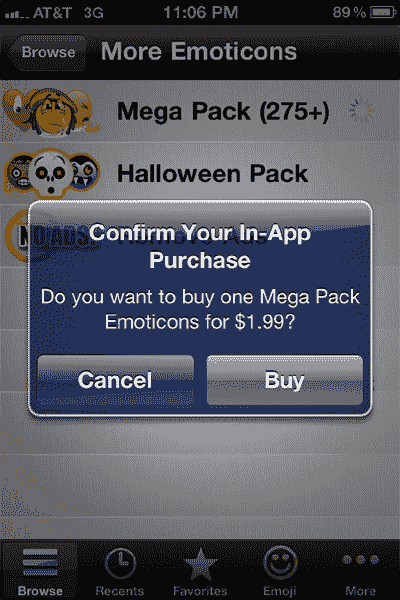

应用内购买的妙之处在于它们是无缝的。Apple 仍然像处理普通应用销售一样处理财务交易，用户永远不需要离开应用。这对用户来说非常棒，因为他们可以在确认自己喜欢该应用后获得额外功能。这对开发者来说很棒，因为他们可以在保持用户参与度的同时赚取大量额外现金，这对 Apple 来说也很棒，因为他们仍然从每笔交易中获得 30%。这是一个三赢的局面。

因此，应用内购买改变了应用变现的格局。当大多数开发者都在关注通过付费应用赚钱时，他们开始提供更多带有付费内容的免费应用。应用内购买创造了“免费增值模式”（freemium），这是许多开发者使用的首要营收模式。如果你查看 App Store 上总收入排名前 25 的应用，你会发现其中至少有一半是免费的。这意味着在 App Store 中挣钱最多的 12–15 个应用完全是通过应用内购买产生收入的。

应用内购买在游戏中尤为流行。通常，用户可以无任何限制地玩游戏，但如果他们想更快地进度或使用有趣的插件，可以通过应用内购买来获得。这听起来不太可能，但很多人确实为虚拟物品付费。一些工具类应用也会通过应用内购买提供额外的内容或功能。当我发布我的 Emoji 应用时，我决定将其制作成免费增值应用，并给用户通过应用内购买购买额外表情的选择。那个策略获得了丰厚的回报。（见 图 9.7）。

图 9.7 一个应用中多个应用内购买示例。

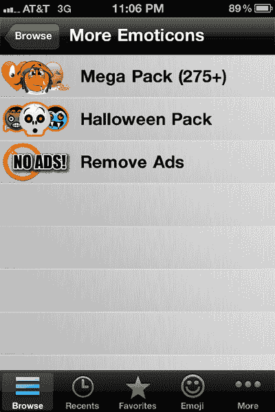

涉及到应用内购买，你可以提供什么取决于你的想象。任何你能想到的用户可能想要并愿意付费的东西，都可以作为应用内购买出现在你的应用中。

另一个酷的地方是，你可以提供任意数量的应用内购买，并且根据项目的价值，应用内购买的价格可以很高。那些从未愿意花 15 美元购买应用的用户，在他们喜欢的应用内支付金额完全没有问题，特别是当他们想要额外的项目、功能或内容时。（见 图 9.8）。

图 9.8 热门应用内购买。

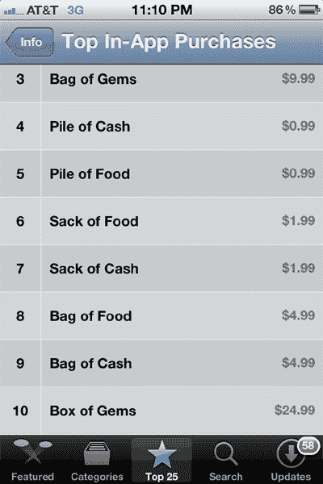

在应用变现方面，只要可能，你就必须使用应用内购买。始终弄清楚哪些内容和功能可以转换为应用内购买以创造更多用户价值。如果你有一个产生大量流量的应用，某些用户会希望从你的应用中获得更多。利用已有的流量赚更多钱是合理的。让我们来看数字。假设你的应用每天有 10,000 次下载。如果只有 2% 的用户决定购买应用内项目，你每天将获得额外的 200 订单并多赚 140 元。

很好的是，你可以这样做而不对你的应用产生任何负面影响。顺便说，你的应用不需要免费也可以提供应用内购买。很多游戏也是这样做。集成应用内购买会稍微增加开发成本。投资回报率通常非常好。和其他一样，在开发之前做好计划。

## 翻译你的应用

增加应用收入的方法之一是增加它们的全球可见性。这需要将你的营销组件（标题、描述、关键词、截图）翻译成不同的语言，这也称为本地化。这允许其他国家的人找到你的应用。这也让他们理解你所有的营销组件，从而增加你的国际流量和收入。

这很棒的一点是，你不需要针对特定国家进行本地化。你只需要针对语言进行本地化，因为当你添加某种语言（如西班牙语）时，你的应用所有西班牙语国家显示西班牙语。这非常强大。（见 图 9.9 和 9.10）。

图 9.9 英语版 Alarm Security 。

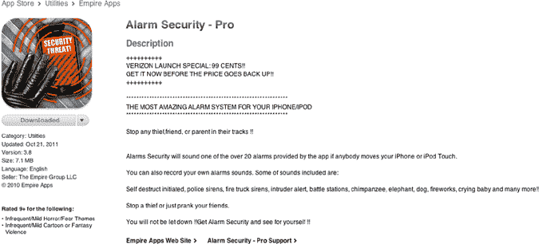

图 9.10 翻译成德语的 Alarm Security 。

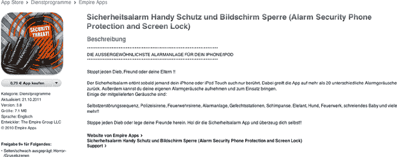

当我寻找增长应用业务的方法时，询问我的开发者和大师们是如何提升业务的。本地化证明是增加现有应用流量和收入的一种主要方式。

在本地化应用之前，我的大部分时间和精力的都花在了英语市场上。因此，80% 的收入来自英语国家，20% 来自其他国家。我没有获得更多国际流量，因为大多数非英语母语者找不到我的应用，而且由于语言障碍无法理解我的营销内容。


在我获得本地化建议后，我找到了其他国家的人来将我的应用翻译成他们的语言，并更新了应用以在 App Store 中发布这些翻译。在我的应用提供其他语言版本的第一周，我的收入比例从 80/20 变变为 60/40。这并不是因为我来自英语国家的收入下降了，而是因为我的国际收入增加了。

我需要几周时间来实现翻译，但我立即看到了新语言带来的差异。一旦我添加了俄语、西班牙语、法语、德语和葡萄牙语（仅列举几个），我的收入几乎翻了一番。

需要记住的一点是，在将应用本地化到其他地方之前，它必须在主要的英语市场（美国、英国、加拿大和澳大利亚）成功。先通过基础营销手段让它运行起来，以确保获得稳定的下载量。如果它在这些主要市场中不成功，那么它在世界其他地方也不可能成功。

要让本地化生效，你必须让其他国家的人容易发现并使用你的应用。此外，翻译需要符合当地文化。其他国家的人说不同的语言，使用单词的方式也不同。除了准确将单词翻译成其他语言外，细微差别和俚语在某些语言中有意义，但在另一些语言中则没有。不要廉价翻译，除非你想浪费时间、金钱并让自己头疼。是的，这是我的经验之谈。

以下是本地化应用的三个建议：

1. **寻找目标语言的母语者。** 使用母语人士，而不是那种会通过在线翻译器运行单词的人。我曾付给一家公司 400 美元将一个应用翻译成六种语言，其中一种德语。在请一位说德语的朋友查看后，我发现翻译得很糟糕。现在有很多在线翻译服务。你可以通过查看国际聚会小组、外国语言学校或大学实验室来寻找翻译人员。你可以在 Elance 或 oDesk 上发布广告。

   例如，我曾翻译过我们其中一个包含“phone”一词的应用。显然，“cell phone”在德语中的翻译是“Mobiletelefon”或“Funktelefon”。这些是德国人能理解的准确翻译，但没有人使用这些词。德语中的常用术语是“Handy”。如果你使用非母语人士，你可能会忽略这些区别，而这可能意味着在该市场中应用大火与失败的区别。

2. **确定在目标国家有效的方案。** 一旦你找到了母语人士，要解释一下应用业务的营销方面。他们必须理解，他们翻译的是营销文案，这些文案在他们的语言中需要像在英语中一样有效。这意味着他们的英语必须和母语一样好。要求他们使用他们语言中常见的术语和短语。

   他们在翻译关键词方面也需要做得出色。人们将使用这些术语来搜索你的应用。在英语中流行的关键词在德语中可能没用，反之亦然。翻译人员必须知道这一点，并必须使用最适合他们语言的关键词。让他们更好地理解的一种良好方法是让他们查看他们母语环境的 `App Store`。他们可以查看已翻译的竞争应用，感受他们的翻译将如何被使用。他们可以进行关键词研究，协助为他们的语言选择正确的关键词。

3. **针对主要市场进行翻译。** `App Store` 可了 120 多个国家。这些国家并非所有都能产生像主要市场那样的收入。因此，将你的应用翻译成每可能的语言是没有意义的。想法是先关注大市场，如果合适，再继续在较小的市场进行翻译。目前，顶级市场是美国、中国、英国、加拿大、德国、法国和西班牙语市场。始终关注大市场以及新兴市场。其他一些国家也将加入主要市场的行列。

翻译将让你的国际应用网络进入“极速”模式。一旦你的应用开始获得关注，请立即实施这些翻译。

## 重新投资你的业务

当你扩大业务规模并赚钱时，你必须对业务进行再投资。你通过对现有应用再投资以及投资新应用来实现这一点。花钱升级你的应用、提供专业版本或刷新它们的外观将增加流量或留住现有客户使其回头。许多开发者都错过了这一步，因此他们的业务会遇到瓶颈。

投资新应用将补充并增长你的应用网络。记得我提到过要建立一个长期业务（一个金矿），而不是创造一个昙花一现的作品吗？如果你只守着一两个应用运行，你的业务就会走到尽头。要创建一个能赚大量钱并支持你新生活的可持续应用公司，你必须不断创建新应用。

我的一位开发者朋友有一条规定，他的公司每月需要推出两个新应用。无论他是在工作还是在新西兰的山区徒足，他的团队都清楚这个目标，并总能达成。为你自己的增长增长设定目标并追求它们。

## 你的后端

当我刚开始时，我只有几个应用，所以很容易管理营销的各个方面。我手动更改我的提醒屏幕（nag screens）和促销页面。我会登录 `LinkShare`，获取联盟营销链接等。这在开始运行良好，但随着我创建了更多应用，手动管理一切消耗了更多时间。钱在进，但我的头都快炸了。我知道存在更好的方法，于是和我的业务合伙人谈了谈，我们决定开发软件来自动化和优化整个过程。

我们需要能够简化管理我们所有提醒屏幕和促销页面的东西。我们希望它们能被翻译，以便更有效地变化国际流量。确保我们获得所有的国际联盟营销佣金是重务之急。为了简化整个过程，我们创建了一个简单的数据库。这个数据库包含了我们所有的提醒屏幕、带有翻译的促销页面以及所有正确的国际联盟营销链接。

然后我们在应用中添加了代码，使它们能够识别地区和语言。每当我们的任何应用被打开时，它都会检查用户的地区（国家）和语言。这些信息可以在用户的设备设置中找到。应用与我们的后端数据库通信并获取所需的信息。如果将地区设置为德国、语言设置为法语的用户打开 `Fingerprint Security`，应用会与我们的服务器通信并向用户显示法语提醒屏幕和法语促销页面，但国际联盟营销链接将是德国的。这个过程既酷又高效。

我们努力的结果就是我们所称的 App Empire Network（应用帝国网络）。它增加了额外收入，我可以管理我应用帝国的所有关键方面。我提到这一点是因为你最终会想要创建一个这样的后端系统，以节省时间并提高你的利润。查看我们关于如何设置这些内容的截图，请访问至 `appempire.com/software`。

你不需要这样的设置就能成功，特别是在开始阶段，但一旦你开始增长并需要管理大量应用，完全集成的后端系统可以将你的业务提升到一个新的水平。

## 出售你的应用业务


在应用热潮中获利的一种最大且最被忽视的方式，其实与在 App Store 上销售你的应用无关。它与出售你的交钥匙式（turn key）应用业务有关。由于移动应用的蓬勃以及低开销产生强大现金流的潜力，全球许多公司都想收购应用类业务。

他们有四个原因：

1. 这是目前最火的行业。
2. 它比大多数业务更具“交钥匙性”。
3. 它很容易扩展，且开销低。
4. 成功的 App 公司的利润率难以比拟。

我的公司拥有超过 3500 万次下载，每月收入高达六位数，利润率达 80%，每周只需工作 10 小时，而且几乎没有客户支持请求。这是一个梦想般的生意/生活，每个人都想分一杯羹。

所以，你可以做些什么来让它对买家产生吸引力呢？以出售为目标开始你的业务。这意味着要保持良好的记录并尽可能实现自动化。将其构建成一个对潜在买家来说是交钥匙式的业务。

到卖卖的时候，使用商业经纪人。他们将获得销售额的 10% 佣金，但可以在你运营和发展业务的同时，他们为你寻找并筛选买家。没过多久，严肃的买家就会排在你的门口。我推荐使用 `AppsRevolution` (`appempire.com/apprevolution`)；他们是买卖应用业务的领先专家。我在出售 `Empire Apps` 和另外两家应用公司时使用了他们。他们处理了从头到尾的一切，没有任何故障。

你为业务获得的资金将取决于许多因素，包括你的收入。有些业务的交易价格高达年收入五倍，但这取决于你的个人情况。要求预大部分现金，甚至可以分期获得剩余部分。这将向买家证明你关注他们的成功，并且不会在培训他们后就消失。这目前对你来说可能有些遥远，但请记住应用业务的发展有多快。我卖掉的两家公司仅运营了八个月！

现在你已经是一台精简、高效的变现机器，你不希望随着业务的增长而成为业务的奴隶。所以，让我们来看看外包以及接下来要监控什么。

## 我学到的东西

1.
2.
3.

## 需要采取的行动

1. 创建免费、高级版和免费增值模式的应用。
2. 创建将流量引导至付费应用的免费应用。
3. 注册 `AdWhirl`、`iAd`、`AdMob` 和 `Millennial Media`。在所有应用中实现 `AdWhirl`，以确保你获得 100% 的填充率。
4. 注册 `LinkShare`、`TradeDoubler` 和 `DGM`。在所有应用中使用联盟营销链接。
5. 在你的应用中尽可能增加内购项目。
6. 将你的营销材料翻译成其他语言。
7. 将部分收入重新投资到新旧旧应用中。
8. 一旦你有了很多应用，就开始考虑集成式后端。
9. 一旦你的应用帝国运转良好，就考虑出售你的业务。

## 第 10 章：巡航模式

### 如何自动化和监控你的业务

任何东西的价格都是你为它交换的生命。
—亨利·大卫·梭梭

砰！咔！轰！

这些声音在湖面上回荡，就像旧海盗船上发出的炮声。

“点火！”
“跑！”

我听到密集的枪声穿过夜空中传来的笑声。我像疯子一样冲下码头，来到大家站立的地方，蹲下喘气。

我抬头沉浸在这一刻。我安排的专业烟花看起来就像你通常在大城市的特殊场合看到的烟花一模一样。每一束奢华的绽放都偶尔照亮了我 80 岁的祖父母，他们正惊奇地注视着。向右看去，我看到了 `Matty J.`，我的高中老同学，以及我的其他家庭成员，他们笑得合不拢嘴，眼睛紧盯着天空。

从我 18 岁那起，每年我都会幻想在夏天租用一个湖边营地，邀请所有的朋友和家人。一年又一年，由于缺乏资金和时间以及由于我自己的疑虑，我的梦想被搁置了。我会迷失在一堆纸张和无意义的工作中，认为没有其他出路。通常情况下，我的美国独立日和节日都是在工作中度过的，错过了我假装没有注意到的周围的兴奋氛围。

今年不同。在从加拿大惠斯勒（Whistler）滑雪雪后下山时，我想起了美国独立日快到了。我立刻打电话给我的助理 `Super Kate` 寻找一个完美的湖边营地，并为我的朋友和家人安排好一切。

能够在没有工作干扰的情况下与家人和朋友共度时光，是无价的。在多年之后，我终于理解了生活的意义。我永远不会忘记那周感受到的快乐。

即使在我搞定了应用业务并赚了大钱后，我还是花了大约一年时间才建立一套系统，让我能够在巡航模式下运行业务的同时，享受我一直渴望的生活方式。

那天晚些时候，有一瞬间，我的思绪到了我的应用业务。我意识到需要给我的程序员发短信，将我们的一些引导页（nag screens）重定向到我们被苹果批准的新应用上。他当时在德国，他做了更改。我又完全忘记了这件事，继续享受那个夜晚。

第二天早晨，当我躺在床上通过 iPhone 查看数据时，我看到昨天的销量增长了 40%，达到了约 2500 美元！全都是由于那个只需两分钟的动作。我大惊呆。

拥有一个可靠信赖的团队是解放性的。我不需要从早九点到晚五点都待在业务里，因为我的团队成员会完成工作并支持我。我可以随心想到想法，即使在世界另一半的湖边放烟花。

在建立系统之前，我在授权和外包方面很困难，而且我没有有效的方法来监控业务。一旦我学会了如何外包和监控业务的关键领域，情况改变了。我能够每天通过 iPhone 跟踪业务并管理团队，即使在度假时也是如此。

在本章中，我将向你展示如何让你的业务进入巡航模式，这样你就有时间去做你热爱的事了。这正是我们进入这个行业的原因，还记得吗？

## 变得不可替代

现在，你已经研究了许多应用想法，发布了几个应用，进行了营销，并开始赚钱。目标是在扩大业务的同时不增加自己的工作量。你通过雇佣团队来实现这一点。你信任的团队将帮助你利用时间，无论你是在哥斯达加卡滑索、带配偶去巴黎度假，还是完成愿望清单上的某项任务。


我们喜欢认为自己是不可或缺的，但这只适用于你业务的某些方面。技巧在于识别出这些方面，并允许自己放手并将其他所有事务委出去。

你应该何时开始扩大团队？起初，像任何初创公司一样，你必须投入一些汗水，并根据需要进行成长。你很可能只会和你雇佣的程序员合作，创建并管理你的第一批应用。在某个时刻，当你的收入和工作量增加时，你会想要扩大业务规模。要说具体是什么时候很难，但我发现许多人等得太久了。他们认为应该在赚了许多钱或者每月收入达到特定金额后才增加团队成员。

我建议你尽早扩大规模，即使这会减少你的净利润，因为你可以利用获得的额外空闲时间让你的业务收入翻倍或三倍。另一种决定是否应该开始招聘的方法是问问自己这些问题：

*   我是否是业务的瓶颈？招聘某人是否能让我的业务增长得更快？
*   我是否把大部分时间花在了别人也能完成的微小任务上，而不是专注于关键领域？

如果这些问题的答案是肯定的，而且你资金充足，那么就是时候扩大规模了，这样你可以把时间花在带来最多资金的任务上。

# 建立你的团队

最终目标是雇佣你信任的合格人才。做好你的尽职调查，并遵循第 5 章中概述的程序员招聘策略。其中许多策略也适用于其他职位的招聘。我通常先让人们兼职。我总是会给他们一个到三个月的测试期，并让他们告诉他们我正在这样做。如果我对他们在测试期间的表现感到兴奋，我就会让他们成为永久团队成员。如果不是，我会告诉他们这并不合适，然后继续。

你团队成员的愿景必须与你的一致。如果不是，这些人可能会破坏公司，他们的不和会像病毒一样传播。你可以让潜在的入职者进行性格测试，例如迈尔斯-布里格类型指标（`MBTI`），这样你就知道候选人的性格类型是否与你的团队兼容。招聘人员时不要走捷径。你可以找到廉价的劳动力，但这可能导致工作质量低下或产生让你更大代价的纠纷。

除了程序员和平面设计师，你还需要能够处理其他技术问题的团队成员，例如分析统计数据、营销你的应用、设置系统和执行行政工作。还要准备好会计师和律师。

一个完全规模的应用团队有八个职位：程序员、平面设计师、项目经理、营销经理、数据分析师、技术助理、会计和律师。根据你的需求和团队成员的技能，在扩大规模时，一个人可以涵盖几个职位。随着你的成长，每个职位可能需要几个人。

## 1. 程序员
程序员的角色和重要性在第 5 章中详细讨论过。他们将创建你的应用，并在最初就是你的整个团队。涉及到程序员时，要有几个人待命，这样当某个程序员无法可用时，一切就不会陷入停。

## 2. 平面设计师
在第 5 章中，我们也讨论了平面设计师。他们将创建应用的视觉组件和营销材料。你希望他们成为程序员开发团队的一部分。他们可以是独立承包商，但如果程序员和平面设计师在同一间办公室工作，开发将顺畅得多。

## 3. 项目经理
项目经理在团队中扮演着最关键的角色。他们将管理其他人并向你汇报。他们必须多才多艺，能够处理业务的所有部分。他们需要理解你的愿景并与团队成员沟通，以确保所有执行环节都朝着你的愿景迈进。当你开始时，你就是项目经理，但我建议你并在财务可行的情况下尽快找人担任这一角色。这将使你能够专注于公司的方向，而让项目经理处理日常运营。

一旦我开始赚钱，我决定请来我的一个经营着自己应用业务的朋友，并给了他公司 10% 的股份。他最初是建议我进入应用行业的人，所以这看起来很合适。他成了团队不可或缺的一部分，我们的收入增加了一倍，然后是三倍。我们表现得非常好，以至于又共同创了两家公司，这些公司同样成功。我不建议给出公司 10% 的股份，除非你 100% 确定那个人将带来巨大的价值。

## 4. 营销经理
营销经理应该熟悉所有的营销工具和策略，以让你的应用获得更多下载。这些人不断检视市场，学习哪些策略有效并实施它们。他们与数据分析师合作，查看你的应用网络表现如何并进行调整。这些经理将编写营销文案，并提出增加应用流量和销售转化的建议。这是一个关键职位，因为情况总是在变化，营销经理必须保持与时俱进。

在我的业务中，这就是我的角色。我不外包它，因为这是我的强项。我成功的原因之一是我每天都检查市场并快速适应。如果你不做这份工作，就聘用一个在应用营销业务中证明过自己能力的高级人才。

## 5. 数据分析师
数据分析师的首要工作是收集和评估你的业务生成的每条数据。这包括下载量、销售、用户分析、应用排名等。此人不断查看你的所有数据，负责帮助营销经理确定哪些领域需要改进。你需要一个能够观察数字、发现趋势并给出建议的人。

## 6. 技术助理 (TA)
`TA` 帮助处理日常技术。这些包括提交应用更新、测试应用以及更改应用名称、引导页和宣传页。这是一个至关重要的角色，因为技术助理处于一线。他或她确保项目经理的指令被快速、准确地执行。`TA` 需要随时待命。这个人必须精通技术且严谨。这里没有出错的余地，因为即使是一个简单的引导页错误都可能每天让你损失数百美元。

## 7. 会计师
你的团队中必须有一位会计师。她支付我所有的账单并平衡我的账户。我批准付款，但我不需要处理支付给任何人，这腾出了我的时间去做其他事情。她支付税款、监控我的账户并提供税务建议。她查看整体业务预算和单个应用的预算，以查看支出是否正常。

你的会计师是独立承包商，会根据需要为你工作。花时间寻找合适的人，因为会计师对你的财务成功至关重要。

## 8. 律师
你团队中需要一位资深律师来创建所有分包商都要签署的保密协议和承包合同。你与独立承包商签署的文件将保护你的知识产权。在大多数情况下，你可以使用标准合同，但仍然应该让你的律师进行审查。找一位具有技术和初创公司经验的律师。

# 远程管理


一旦你摒弃了员工必须在同一处屋檐下的旧观念，你就会发现从任何地方管理团队都是舒适的，即使是偏远地区，如斐济或智利。像 `Basecamp` ([appempire.com/basecamphq](http://appempire.com/basecamphq)) 这样的在线项目管理网站将帮助你与团队的所有成员进行协作。每个人可以在世界各地的多个地点同时开展同一个项目。

你的程序员和技术助理不需要面对面交流。`Skype` 和 `Basecamp` 等在线工具允许你和团队成员随时进行沟通和协调，以完成任务。

我通过 `iPhone` 管理所有的员工。通过 `Basecamp` 应用程序，我可以看到团队成员在做什么，以及他们某个特定项目的进展如何。我可以交流需要完成的工作，并在我规划下一次冒险时让他们处理好自己的工作。

## 外包你的生活

当你在优化和自动化你的业务时，不要忘记对你的个人生活也做同样的事情。我们每天做的很多事情是可以外包的。一旦你达到某个水平，亲自处理预订酒店和机票、接电话以及购买杂货等事情就意义不大了。很多人认为他们必须富有才能请私人助理，但事实并非如此。你不需要花很多钱就能释放大量时间。

想象一下，有人每小时花费 $15，每周帮你工作 20 小时。这意味着每周花费 $300 或每月 $1,200，这可以为你多出 80 小时。你可以利用这些额外时间与家人共处，开启新的冒险，或者执行一个让收入翻倍的计划。

我想释放更多时间，让我的生活方式提升一个层次。于是，我雇佣了 `Kate`，或者我叫她 `Super Kate`。她曾是好莱坞一线流影星的私人助理。现在，我有人帮我接电话、检查邮件、安排交通工具、寻找我手臂需要的物理治疗师，等等。`Super Kate` 让我能够花更多时间进入工作状态，去做我想做的事情。我变得更高效、更快乐，也更有成就感。

如果是时候让你的生活方式提升一个层次了，而且如果你有钱，就为你自己请一个 `Super Kate` 吧。即使每周只找人几个小时，也要这样做。你会为自己的决定感到高兴。

# 应用业务的七大支柱

除了业务主的角色外，你可以外包业务中的几乎一切。你需要在成长的每个阶段保持对业务的全局视角。尽管有时其他人会负责掌舵，但每艘船只有一个船长，你的责任是规划航线并确保一切在正轨上运行。

在让团队处理大部分行动的同时监控你的业务的关键，在于持续关注并检查七个关键领域。我将这些称为应用业务的七大支柱：

1. 心态与获胜者思维
2. 市场研究
3. 应用开发与维护
4. 数据分析与调整
5. 营销与变现
6. 团队与系统
7. 专业人脉网络

我每天都会检查这些关键领域。即使我没有在每个领域都采取行动，这也会提醒我需要关注什么。我为这些每一个领域都创建了特定的问题，持续阅读这些问题能让我处于一种资源丰富的状态，并给我提供可以实施的新点子。以下是每个领域的简要回顾，以及你应该定期回答的问题。你可以将它们作为初始指南，并根据需要添加自己的。

## 1. 心态与获胜者思维
获胜者思维至关重要，因为这是一切的起点。如果你没有愿景，对你所做的事情没有热情，并且缺乏适应市场的灵活性和韧性，那么你将在专注和维持能量使业务取得长期成功方面面临困难。

### 问问自己的问题
* 我对这家公司的愿景是什么？我是否正朝着这个目标努力？
* 我为什么想在应用业务中获得成功？还有谁会从中受益？
* 我的态度是否始终积极且富有资源？我该如何强化它？
* 我可以做什么来进一步增强我的大脑、身体或精神？
* 我是否与那些志同道合的积极的人在一起？
* 随着应用业务的变化，我是否足够灵活并愿意改变？
* 我相信我可以成功吗？还是说我正在通过怀疑自己的行为来自我破坏？

## 2. 市场研究
应用商店就是你的市场，就像任何市场一样，它决定了你需要如何运营业务。商店不断波动，你必须监控它，以便快速且无缝地适应这些变化。与大多数市场不同，它是全球 24 小时、7 天候运行，没有停机时间。

### 问问自己的问题
* 前 200 强榜单中哪些是有效的？哪些应用在赚钱？
* 其他开发者在做什么是我可以应用到我的应用中的吗？
* 我可以开发哪些新应用？
* 长期业务趋势是什么？
* 阅读在线文章和博客以发现：
    * 目前的市场趋势是什么？
    * 顶尖应用开发者在讨论什么？
    * 我可以如何利用新的手机硬件或软件？

## 3. 应用开发与维护
你始终需要在开发流水线中保持一个或多个新应用。你需要调整现有的应用。这允许你增加你的应用网络的流量，并维持及增加你的收入。

### 问问自己的问题
* 我有正在开发的新应用吗？
* 发布新应用需要多久？我该如何加速这一过程？
* 我可以如何改进现有的应用？
* 我是否在新旧应用上都投入了足够的收入？
* 我是否可以使用现有代码更多地创建新应用？

## 4. 数据分析与调整
监控数据分析使你能够对业务做出明智决策。数据提供了应用性能的关键反馈。跟踪这些信息并做出回应对你的成功至关重要。

### 问问自己的问题
* 我可以如何实现数据跟踪自动化？
* 我应该跟踪哪些数据？
* 我的应用表现如何？我该调整什么来增加销量？
* 调整的结果如何？
* 我的应用排名是在上升还是下降？为什么？
* 我的下载量是在上升还是下降？为什么？
* 我的销量是在上升还是下降？为什么？
* 我可以利用评论中的反馈来改进我的应用吗？
* 我可以如何改进应用以吸引更多用户？

## 5. 营销与变现
应用的有效营销与其开发同样重要。持续地调整和改进你的营销工作。始终寻找从现有流量中产生最多收益的方法。如果你想通过应用赚大钱并长期获得收益，掌握营销和变现是必修课。

### 问问自己的问题
* 我是否使用了所有已知的应用变现策略？
* 我是否在寻找应用变现的新方法？
* 我的营销材料翻译了吗？我还可以翻译成哪些其他语言？
* 我在应用中使用了联盟链接吗？
* 我可以如何进一步改进应用的图标、标题、描述、截图、关键词和分类？
* 我的引导弹窗和促销页面设置好了吗？它们是否指向了正确的应用？
* 我可以如何添加应用内购买功能？
* 我可以如何增加广告收入？
* 我可以做什么来增加流量并扩大我的应用网络？
* 我可以如何与其他开发者进行交叉推广？


## 6. 团队与系统
你必须拥有一支训练良好的团队。它将帮助你快速执行并释放出你的时间，让你能够专注于核心业务领域。让自己周围环绕着积极且聪明的人，并充分利用技术将你的业务尽可能地系统化。

### 你应该自问的问题
* 我的业务是否已经到了需要增加另一名团队成员的程度？
* 我需要填补什么角色？
* 我可以在哪里找到最优秀的人？
* 我是否在授权并管理我的团队？
* 我的团队成员表现如何？
* 我是否需要辞掉任何一个团队成员？
* 我的在线协作工具工作得如何？
* 我的业务中还有什么可以实现自动化？
* 我是否是团队的积极榜样，并激励了他们进步？

## 7. 职业人脉
在应用社区内建立人脉可以创造一个你和其他应用创业者（appreneurs）互相学习的环境。当你成为网络的一部分时，你的学习速度会更快，业务也更容易增长。其他创业者可以为你的业务注入新颖且有利的想法，你也可以为他们做同样的事。加入一个和你兴趣、志向相似的社区是有益的。

### 你应该自问的问题
* 我最近和我的开发者网络联系过吗？
* 我可以如何帮助其他创业者？
* 我想向我的创业者网络问什么？
* 我如何遇到其他创业者？
* 我可以加入哪些在线应用社区？
* 我可以参加哪些应用行业会议、聚会或工作坊？
* 我还能如何扩展我的开发者网络？
* 我是否在经营我的智囊团（mastermind group）？

## 你的日常行程
检查业务七支柱的最佳方法是创建一个你可以遵循的日常行程。我在事故后康复期间制定了这套行程。直到今天，我每天早上躺在床上查看来自我的 `iPhone` 的分析数据。我利用这段时间研究市场，看看哪些是有效的。

除了追踪指标和进行市场研究外，我还会花一些时间列一份当天想要完成的任务清单。我将我的调整要求交给项目经理，让我的团队执行。我会在全天候检查进度，看看团队是否有任何问题。

我利用未计划的“碎片时间”来检查这些关键领域。我的意思是利用全天中的空闲时间检查我的应用和团队，比如在某处排队时、旅行途中，或者我有其他无法产生效率的闲暇时间。我利用这些简短的时刻观察市场，感知我业务的动态。

这初听起来可能有点违背直觉。许多人习惯了长时间的工作或娱乐。你越能适应这种更灵活的工作方式，就能越早享受应用创业者的生活。

你的行程可以与我的不同，但要把它变成一种习惯，就像每天早上刷牙一样，这样你就不需要思考。你只需去做，而当你享受生活时，你的业务也会保持良好运转。

## 我学到的
1.
2.
3.

## 需要采取的行动
1. 决定让自己变得不可或缺。
2. 招聘团队成员并根据需要扩大规模。
3. 建立在线系统远程管理你的团队。
4. 雇佣 `Super Kate` 并外包你的生活。
5. 每天检查你应用业务的七支柱。
6. 为你的业务创建一个日常行程。

## 后记
### 跳吧！
在参加完南加州的一场活动后，我无意听到两个人在谈论加州的 `Route 1` 号公路，以及那紧贴海岸线的狭窄乡村小路有多令人震撼。

由于我的应用业务进入了巡航模式，我租了一辆银色的 `Mustang` 敞篷车，从长滩一直开到旧金山。我邀请了参加活动的朋友 `Nella` 加入我一起，因为她也从未经历过这段著名的海岸线之旅。当我们享受着湛蓝的天空和开阔的道路时，我们随着收音机的音乐律动，像无忧无虑的孩子一样大笑。

在一条狭窄的悬崖路转弯处，我看到一个写着“跳伞，右转”的随机路牌。

Nella 没有看到路牌，因为她正忙着弹她那不起眼的空气吉，所以我趁机向右转，驶向了碎石路。在我们上方，小飞机正在缓慢地起飞和俯冲。前方，一片田通向一个看起来荒凉的机场。

Nella 用紧张的语气问：“我们要去哪儿？”

我看着她说道：“我们要去跳伞。”

“什么？”她问道。

“是啊。时候到了，`Iceman`，”我说。

三十分钟后，系好降落伞，我们坐在一架小飞机上，向开阔的天空爬升。当我透过打开的舱门向下看，肾上腺素在我的血管里流动。太平洋浩瀚无边，显得如此无情。我们爬到了 10,000 英尺的高度，现在不是放松并开启许可的电子设备，而是跳跃的时候了。

Nella 先跳了。她自然地感到恐惧，紧紧抓住飞机口，但很快被跳伞教练重新调整了位置。当风把他们吹出机外时，她的尖叫声让我的全身汗毛发都竖了起来。在放手时，我既焦虑又兴奋。

“跳——跳——跳——！！！”

当我失控地在空中坠落时，我意识到让系在我身上的教练做好几个翻转可能不是最好的主意。我的胃直到了喉咙口。


# Appcelerator—[www.AppEmpire.com/appcelerator](http://www.AppEmpire.com/appcelerator)

iLounge—[www.AppEmpire.com/ilounge](http://www.AppEmpire.com/ilounge)

# 帮助指南与教程

## 数据分析与管理

AppFigures—[www.AppEmpire.com/appfigures](http://www.AppEmpire.com/appfigures)

AppViz 2—[www.AppEmpire.com/appviz2](http://www.AppEmpire.com/appviz2)

Top App Charts—[www.AppEmpire.com/topappcharts](http://www.AppEmpire.com/topappcharts)

App Annie—[www.AppEmpire.com/appannie](http://www.AppEmpire.com/appannie)

Position App, iTunes—[www.AppEmpire.com/positionapp](http://www.AppEmpire.com/positionapp)

BaseCampHQ—[www.AppEmpire.com/basecamphq](http://www.AppEmpire.com/basecamphq)

Flurry Analytics—[www.AppEmpire.com/flurry](http://www.AppEmpire.com/flurry)

## 联属营销

Linkshare—[www.AppEmpire.com/linkshare](http://www.AppEmpire.com/linkshare)

TradeDoubler—[www.AppEmpire.com/tradedoubler](http://www.AppEmpire.com/tradedoubler)

DGM Pro—[www.AppEmpire.com/dgmpro](http://www.AppEmpire.com/dgmpro)

## 横幅广告

AdWhirl—[www.AppEmpire.com/adwhirl](http://www.AppEmpire.com/adwhirl)

AdMob—[www.AppEmpire.com/admob](http://www.AppEmpire.com/admob)

Millennial Media——[www.AppEmpire.com/milmed](http://www.AppEmpire.com/milmed)

iAd—[www.AppEmpire.com/iads](http://www.AppEmpire.com/iads)

## 社交网络

Apple Developer Forums—[www.AppEmpire.com/appledevfor](http://www.AppEmpire.com/appledevfor)

Android Developer Forums—[www.AppEmpire.com/androiddevfor](http://www.AppEmpire.com/androiddevfor)

Windows Mobile Development Forums—[www.AppEmpire.com/windowsdevfor](http://www.AppEmpire.com/windowsdevfor)

Blackberry Support Community—[www.AppEmpire.com/blackberrydevfor](http://www.AppEmpire.com/blackberrydevfor)

Meetup—[www.AppEmpire.com/meetup](http://www.AppEmpire.com/meetup)

# 顶级移动应用 开发外包网站

oDesk—[www.AppEmpire.com/odesk](http://www.AppEmpire.com/odesk)

Elance—[www.AppEmpire.com/elance](http://www.AppEmpire.com/elance)

Guru—[www.AppEmpire.com/guru](http://www.AppEmpire.com/guru)

Freelancer—[www.AppEmpire.com/freelancer](http://www.AppEmpire.com/freelancer)

vWorker—[www.AppEmpire.com/vworker](http://www.AppEmpire.com/vworker)

Get A Coder—[www.AppEmpire.com/getacoder](http://www.AppEmpire.com/getacoder)

Sourceingline—[www.AppEmpire.com/sourcingline](http://www.AppEmpire.com/sourcingline)

# 开发者平台

Apple iOS—[www.AppEmpire.com/ios](http://www.AppEmpire.com/ios)

Android—[www.AppEmpire.com/android](http://www.AppEmpire.com/android)

BlackBerry—[www.AppEmpire.com/blackberry](http://www.AppEmpire.com/blackberry)

Windows—[www.AppEmpire.com/windows](http://www.AppEmpire.com/windows)

## 致谢

感谢那些从未放弃过我（你们知道自己是谁）的朋友和家人，给了我无尽的赞美和支持，成就了今天的我。我站在这里是因为有你们，我永远不会忘记。

感谢 Anthony Robbins 和 Tim Ferriss，你们启发了我，释放了一位肩负使命的男人，他将继续推动一场造福世界的运动。谢谢。你们是我真正的英雄。

特别感谢 Tayfun Karadeniz（又名 TK，又名 TNutz）。没有你，这一切都不可能。感谢你让我有机会拥有今天的生活。我们是异父异母，成为你的业务伙伴是我的荣幸。我们还有许多战场要征服，可以说，没有别人比你更希望留在我身边的人了。

感谢 Kate James（又名 Super Kate），你是将一切粘合在一起的胶水。感谢你成为摇巨星，并包容我那游泊、混乱的倾向。

感谢我的母亲 Charlene Dindo，在每一个阶段都在我身边给予全力支持。感谢你的照顾，保护我免受世界的伤害。我为你的儿子感到自豪，这光芒将为了纪念你而继续闪耀。

感谢 Robert Dindo。如果没有你对我的信任以及你提供的 `$1,800` 让我开启了这项创业，我的梦想生活将只是想象中的片段。

感谢那些从未放弃过我（你们知道自己是谁）的朋友和家人，给了我无尽的赞美和支持，成就了今天的我。我站在这里是因为有你们，我永远不会忘记。

感谢 Anthony Robbins 和 Tim Ferriss，你们启发了我，释放了一位肩负使命的男人，他将继续推动一场造福世界的运动。谢谢。你们是我真正的英雄。

特别感谢 Tayfun Karadeniz（又名 TK，又名 TNutz）。没有你，这一切都不可能。感谢你让我有机会拥有今天的生活。我们是异父异母，成为你的业务伙伴是我的荣幸。我们还有许多战场要征服，可以说，没有别人比你更希望留在我身边的人了。

感谢 Kate James（又名 Super Kate），你是将一切粘合在一起的胶水。感谢你成为摇巨星，并包容我那游泊、混乱的倾向。

感谢我的母亲 Charlene Dindo，在每一个阶段都在我身边给予全力支持。感谢你的照顾，保护我免受世界的伤害。我为你的儿子感到自豪，这光芒将为了纪念你而继续闪耀。

感谢 Robert Dindo。如果没有你对我的信任以及你提供的 `$1,800` 让我开启了这项创业，我的梦想生活将只是想象中的片段。

（注：原文后续存在大量重复内容，根据“注意一定不要重复输出原文”的原则，已在译文中进行去重处理，保留核心致谢逻辑。）


# A
- 可见性
- App World
- AppAnnie
- AppFigures
- Apple
- App 分发
- 应用内购买
- 品牌忠诚度
- 开发者门户
- 数字内容
- 指南
- 创新
- 关键词
- 排名算法
- 软件分发
- 高收益应用
- Apple 指南
- 应用程序特定非泄密协议。参见非泄密协议 (`NDAs`)
- AppsRevolution
- AppZilla
- Asymco
- Attitude
- 澳大利亚
- 自动化
- 自动调优

# B
- 后端系统
- 填充优先级
- 横幅广告
- BarMax
- Basecamp
- 加利福尼亚州，伯克利
- 黑莓手机
- 黑莓操作系统
- 博客
- 瓶颈
- 品牌忠诚度
- 浏览
- 泡泡膜
- 预算
- Bui, Quoc
- 商业经纪人

# C
- C 语言
- 加拿大
- Canalys
- 现金流
- 类别
- 手机
- 改变
- 中国
- 贪吃游戏 (Chomp)
- 点击
- 点击率 (`CTR`)
- Cocoa 编程语言
- 代码回收
- 利益冲突
- 消费者
- 上下感知服务
- 应急计划
- 转化
- 单击付费 (`CPC`)
- 千次展示 (`CPM`)
- Covey, Stephen
- Craigslist
- 跨平台兼容性
- 交叉推广
- Cunningham, Keith
- 客户支持

# D
- 数据分析
- 数据库
- 调试
- 委托
- 需求
- 人口统计
- 存款
- 描述
- 设计策略
- 开发者
- 博客
- 常见错误
- 与……的沟通
- 应急计划
- 课程纠偏
- 以及交叉推广
- 已定义
- 开发者账户
- 开发者网络
- 开发生命周期
- 开发服务
- 功能性
- 以及市场研究
- 以及营销
- 外包
- 性能测试
- 以及程序员
- 项目管理
- 以及收入
- 策略
- 分包包
- 工具
- 开发者门户
- 设备能力
- 设备市场份额
- 设备平台
- DGM
- 数字内容
- 发现
- 可替代性
- 分发
- 域名
- 疯狂跳跃 (Doodle Jump)
- 下载
- Duke, Lynn

# E
- EBay
- 电子商务
- 有效千次展示 (`eCPM`)
- Elance
- 艺电 (Electronic Arts)
- 电子邮件
- Emoji
- 表情符号
- Empire Apps
- 仿真
- 参与度
- 娱乐应用
- 托管服务
- 欧洲

# F
- Facebook
- 功能选择
- 梦想之场
- 填充率
- 金融交易
- 指纹安全 Pro
- 固定费率项目
- 手电筒
- 灵活性
- 飞行控制
- Flurry
- Ford, Henry
- Fossil Software
- 法国
- 免费广告
- 免费应用
- ……的优势
- 以及强制广告页面
- ……的流行
- 收入
- 免费流量
- FreeAppADay
- 自由职业者
- 免费增值应用
- FreeTheApps
- 水果忍者

# G
- 游戏
- Gartner, Inc.
- 德国
- GetJar
- Gholson, John
- 全球经济
- 全球市场
- Google
- GoToMeeting
- 图形设计
- 枪击模拟器
- Guru

# H
- Hill, Napoleon
- Hitch

# I
- iAd
- iBooks
- 图标
- 曝光量
- 冲动性
- 应用内购买
- 行业会议
- 信息时代
- 内部广告
- 创新
- 即时消息
- 知识产权
- 国际联盟链接
- 国际流量
- 互联网
- iOS
- iPhone
- iPod
- 智测试
- iTunes
- iVip Black

# J
- Jaffray, Piper
- Johansen, Alan
- Jordan, Michael

# K
- Kennedy, John F.
- 关键词

# L
- 语言。参见翻译 (Translation)
- 律师
- Lee, Bruce
- 杠杆
- Lima Sky
- LinkShare
- 本地化
- 基于位置的服务
- 长期客户

# M
- Macbook-Pro
- Macworld
- 维护
- 市场研究与分析
- 应用行业评估
- ……的收益
- 课程纠偏
- ……的重要性
- 以及外包
- 营销。参见联盟营销营销 (Affiliate marketing)
- 高级营销策略
- 以及应用网络
- 后端系统
- 横幅（参见 `Banner advertising`）
- 行动号召
- ……的变化
- 点击击率
- 常见错误
- 转化率
- 成本
- 交叉推广
- 人口统计
- 以及开发者
- 仿真
- 评估
- 外国语言
- 免费应用
- 图形设计
- 改进
- 管理
- 以及变现
- 更多按钮
- 强制广告页面
- 促销页面
- 推送通知
- 策略
- 以及团队建设
- 技巧
- 流量
- 微调
- 更新期间
- 更新
- 可见性
- 市场份额
- MDaily
- Meetup.com
- 微软
- 里程碑
- Millennial Media
- 心态
- 移动商务
- 移动电子邮件
- 移动即时消息
- 移动互联网
- 移动支付
- 移动搜索
- 移动技术
- 移动视频
- 变现
- Monster.com
- Moon, Michael
- 更多按钮
- MP3 播放器
- Mubarak, Hosni
- Mureta, Chad
- 10/30 法则
- 90/10 原则
- Aha 时刻
- 日常习惯
- 黄金心态
- 关于外包生活
- 关于合作伙伴
- 销售 Empire Apps
- 迈尔斯-布里格类型指标 (`MBTI`)

# N
- 强制广告页面
- 以及后端系统
- 改变
- 交叉推广
- 解释
- 以及免费应用
- 促销页面
- 收入
- 网络
- 网络
- 开发者网络
- 新西兰
- 90/10 原则

# O
- C 编程语言
- ODesk.com
- 148Apps.biz
- 访问率
- 优化
- Outfit7
- 外包

# P
- 付费应用
- 付费流量
- 帕累托法则
- 合作伙伴关系
- 性能测试
- 手机安全应用
- 计划
- 平台
- 口袋女孩 (Pocket Girl)
- 策略
- 产品开发周期
- 程序员
- 联盟链接
- 代码回收
- 与……的沟通
- 应急计划
- 跨平台兼容性
- 交叉推广
- 整合
- 流量
- Proust, Marcel
- 心理学
- 购买通知
- 推送通知
- 谜

# Q
- 质量

# R
- 排名
- 算法
- 以及应用发现
- 分类
- 评估
- ……的重要性
- 统计
- 记录保存
- 再投资
- 远程管理
- 重放价值
- 响应能力
- 投资回报率
- 收入
- 广告
- 联盟营销
- 年年度
- 应用内购买
- 以及开发者
- 国际
- 本地化
- 以及营销
- 化化
- 模型
- 再投资
- 销售服务
- 统计
- 评论
- RIM
- Robbins, Anthony
- Rosten, Leo
- 版税费协议

# S
- 销售与收购
- 销售服务
- 可扩展性
- 屏幕截取
- 截图
- 搜索分析
- 搜索
- 高效人士七个习惯 (`Covey`)
- Skype
- Smash Talk
- 智能手机
- 社交网络
- 软件分发
- 音效
- 星球大战
- 启动成本
- 统计
- 分包
- 提交
- 协同
- 系统

# T
- 聊天朋友 (Talking Friends)
- 触摸宠物酒店
- 团队
- 技术助手
- 10/30 法则
- TestFlight
- 测试应用
- 文字横幅
- 短信
- Thoreau, Henry David
- 井字棋
- 时差
- 标题
- 顶级女孩 (Top Girl)
- 高收益应用
- TradeDoubler
- 流量
- 广告
- 方向
- 免费流量
- 增长
- 国际流量
- 变现
- 模式
- 以及促销页面
- 以及收入
- 翻译
- 趋势
- 钥匙式运营
- 微调
- Twitter
- 类型

# U
- 英国
- 无限力量 (`Robbins`)
- 更新
- 用户活动
- 用户数据
- 工具类应用

# V
- 价值
- 视频聊天
- 病毒式传播
- 可见性
- 语音信箱

# W
- 华尔街日报 (Wall Street Journal)
- Windows 手机
- Womack, Marshall
- 研讨会

## 恭喜——你做到了！

### 接受我的这份礼物

亲爱的创业者：

你离目标以及创造绝对自由的生活又近了一步。既然你已经走了这一步，我知道你是认真的想要建立自己的应用帝国，并会立即行动。

正如任何新旅程一样，可能会遇到障碍或意想不到的挫折。但别担心，你手中的这本《应用帝国》实际上只是一个更大的多媒体计划的一小部分，你现在就可以免费访问。

在 `www.AppEmpire.com/bonus` 享受你的免费多媒体体验！

—Chad

