# 金融工程的应用概率演算：R 使用入门指南

谨献给上帝的荣耀和我的另一半

Marie Nashed Yacoub Chan

## 前言

*典型退休夫妇的财务挑战与经历 – 史密斯先生和夫人（非真实姓名）*

大约 10 年前，在从事约 40 年的稳定工作后，加州的约翰·A·史密斯先生和玛丽·B·史密斯夫人正在为包括全球广泛旅行在内的积极退休生活做准备。为了照顾他们未来的财务需求，他们决定聘请加州一家当地的专业金融工程和投资管理公司 – XYZ（虚构）– 的服务，该公司通过一家大型全国性金融工程公司 LPL（Linsco – 1968 年和 Private Ledger – 1973 年）进行交易。

为此，史密斯先生和夫人从毕生积蓄中投资了约 $2,000,000，目标如下：

- i) 保留其 $2 M 的资本
- ii) 从 XYZ 获得至少每月 $10,000 的净现金收入

因此，如果原始资本 $2 M 基本保持不变，同时维持每月 $10,000 的稳定提取，则 $2 M 投资的平均年回报率必须约为 (10,000 × 12)/2,000,000 = 0.06，即 6%。

金融服务管理通常收取约 1.5% 的费用。因此，粗略估计金融管理应实现约 6% + 1.5%，即 7.5%。

像 XYZ/LPL 这样的服务如何实现这一目标？退休约 10 年后，在 2016 年 11 月 15 日星期二，金融市场收盘时

| 项目 | 数值 |
|------|-------|
| Dow (DJIA) | 18,923.06/+54.03/+0.29% |
| Nasdaq | 5,275.62/+57.22/+1.10% |
| S&P 500 | 2,180.39/+16.19/+ 0.75% |
| Gold | $1,229.00 per oz +0.37% |

Chandra, S. (2003) Regional economy size and the growth-instability frontier: evidence from Europe. Journal of Regional Science 43 (1), 95–122. doi: 10.1111/1467-9787.00291

Chandra, S. and Shadel, W.G. (2007) Crossing disciplinary boundaries: applying financial portfolio theory to model the organization of the self-concept. Journal of Research in Personality, 41 (2), 346–373. doi: 10.1016/j.jrp.2006.04.007

Chicago Board of Options Exchange (CBOE) index: https://www.janus.com/advisor/funds/janus-balanced-fund?gclid=CKVx6yOsdACFQI daQodzxkNVA 2017.

Christodoulakis (2002) Bayesian optimal portfolio selection: the Black–Litterman approach. Class notes.

Coelen, N. (2000) Black–Scholes Option Pricing Model, Trinity University. Available at http://ramanujan.math.trinity.edu/tumath/research/studpapers/s11.pdf

Coelen, N. (2002) Introduction: finance is one of the most rapidly changing and fastest growing areas.

CRAN, The Comprehensive R Archive Network. http://cran-project.org/ 2017.

Da, Z. and Jagannathan, R. (2005) Teaching note on Black–Litterman model.

Dalgaard, P. (2002) Introductory Statistics with R. Springer Statistics and Computing Series, Springer Science+Business Media, New York, NY.

Damghani B. M. (2013) The non-misleading value of inferred correlation: an introduction to the contellation model. Wilmott Magazine. doi: 10.1002/wilm.102

Daniel, W.W. (2005) Biostatistics: A Foundation for Analysis in the Health Sciences, John Wiley & Sons, Inc., New York, NY.

Daroczi, G. et al. (2013) “Introduction to R for Quantitative Finance”, PACKT Publishing, Birmingham, U.K. www.packtpub.com/introduction-to-r-for-quantitative-finance/book

DeGroot, M. H. (1970) Optimal Statistical Decisions. Wiley Interscience.

Doganoglu, T., Hartz, C., and Mittnik, S. (2007) Portfolio optimization when risk factors are conditionally varying and heavy tailed. Computational Economics 29, 333–354. doi: 10.1007/s10614-006-9071-1

Dow Jones Industrial Average (DJIA) and Inflation http://thesovereigninvestor.com/exclusives/wall-street-legend-predicts-dow-50000/?z=590252 2017.

Dowd, K. (2007) Measuring Market Risk, 2nd Edition, John Wiley & Sons, Ltd, Hoboken, NJ.

Everitt, B.S. and Hothorn, T. (2006) A Handbook of Statistical Analysis Using R, Chapman & Hall/CRC, Boca Raton, FL.

Fantazzini, D. (2009) The effects of misspecified marginals and copulas on computing the value at risk: a Monte Carlo study. Computational Statistics Data Analysis, 53 (6), 2168–2188.


金融工程101 https://en.wikipedia.org/wiki/LPL_Financial; 1:4:
现代投资组合理论：https://en.m.wikipedia.org/wiki/Modern_portfolio_theory 2017.
金融新闻媒体（2017）股市可能继续走高的5个理由，CNN 报道，可在 http://money.cnn.com 获取
Firoozye N. 和 Blamont, D. (2003) 资产配置模型. Global Markets Research, Deutsche Bank, 7月.
Frost, P. 和 Savarino, J. (1986) 有效投资组合选择的经验贝叶斯方法. Journal of Financial and Quantitative Analysis, 21 (3), 293–305.
Fusai, G. 和 Meucci, A. (2003) 评估观点. Risk Magazine, 16 (3), S18–S21.
Georgakopoulos, H. (2015) 使用 R 进行量化交易：从量化分析师的视角理解数学与计算工具. Palgrave Macmillan.
Giacometti, R., Bertocchi, M., Rachev, S. T. 和 Fabozzi, F. J. (2007) 资产配置中 Black–Litterman 方法的稳定分布. Quantitative Finance, 7 (4), 423–433.
Hardy, G. H. (1908, 1967) 纯数学教程, 第10版, Cambridge University Press, Cambridge, U.K.
Hardy, G.H. (2009) 纯数学教程, 第3版, Cambridge University Press, Cambridge, UK（初版于1908年）.
He, G. 和 Litterman, R. (1999) Black–Litterman 模型投资组合背后的直觉. Goldman Sachs Asset Management 工作论文.（版权 2007–2014, Jay Walters.）
Henderson, D. 和 Plaschko, P. (2006) 科学与工程中的随机微分方程. World Scientific.
Herold, U. (2003) 基于定性预测的投资组合构建. Journal of Portfolio Management, 30（2003年秋季）, 161–172.
Herold, U. (2005) 以有意义的方式计算隐含收益率. Journal of Asset Management, 6 (1), 53–64.
Holland, J. H. (1975) 自然与人工系统中的适应性, University of Michigan Press, Ann Arbor, MI.
Hubbard, D. (2007) 如何衡量一切：发现商业中无形资产的价值, John Wiley & Sons Ltd, Hoboken, NJ.
Hull, J. C. (2000) 期权、期货及其他衍生品, Prentice Hall, Upper Saddle River, NJ.
Idzorek, T. (2005) Black–Litterman 模型分步指南：纳入用户指定的置信水平. 工作论文.
Idzorek, T. (2006) 战略资产配置与大宗商品. Ibbotson 白皮书.
伊藤引理参考：http://www.sjsu.edu/faculty/watkins/ito.htm
Jędrzejewski, F. (2009) 随机模型与概率物理. Springer, New York.

Klebaner, F. C. (1998) *随机分析及其应用导论*, Imperial College Press, London.
Koch, W. (2004) 一致的资产收益率估计. Black–Litterman 方法. Cominvest 演示文稿, 2004年10月.
Krishnan, H. 和 Mains, N. (2005) 双因子 Black–Litterman 模型. Risk Magazine, 7月.
Lamberton, D. 和 Lapeyre, B. (1991, 1996) *金融随机分析导论*（由 Rabeau, N. 和 Mantion, F. 译自法语）, Chapman & Hall, London, U.K.
Lintner, J. (1965) 风险资产估值及股票投资组合与资本预算中风险投资的选择. *经济学与统计学评论*（The MIT Press）, 47 (1), 13–39. doi: 10.2307/1924119.
Litterman, B. 和 Quantitative Research Group (2003) *现代投资管理：均衡方法*, John Wiley & Sons Inc., New Jersey.
Lo, A. W. (1999) *华尔街非随机漫步*, Princeton University Press.
Lo, A. W. (2004) 适应性市场假说：从演化视角看市场有效性. Journal of Portfolio Management.
Lo, A. W. 和 Mackinlay, A. C. (2002) *华尔街非随机漫步*, 第5版, Princeton University Press, 第4–47页.
Low, R.K.Y., Faff, R., Aas, K. (2016) 通过对分布不对称性建模增强均值–方差投资组合选择. Journal of Economics and Business, doi: 10.1016/j.econbus.2016.01.003
Lyuu, Y.-D. (2002) *金融工程与计算：原理、数学、算法*, Cambridge University Press, UK.
Mankert, C. (2006) Black–Litterman 模型：其在实践中应用的数学与行为金融方法. 副博士论文.
Markowitz, H.M. (1952) 投资组合选择. *金融杂志*, 7 (1), 77–91. doi: 10.2307/2975974. JSTOR 2975974.
Markowitz, H.M. (1952) 投资组合选择. *金融杂志*, 7 (1), 77–91. doi: 10.2307/2975974. JSTOR 2975974.（现代投资组合理论（MPT）由经济学家哈里·马科维茨于1952年提出，他后来因此被授予诺贝尔经济学纪念奖。）
Martellini, L. 和 Ziemann, V. (2007) 将 Black–Litterman 分析扩展到均值–方差框架之外. Journal of Portfolio Management, 33 (4), 33–44.
Merton, R. (1972) 有效投资组合边界的解析推导. Journal of Financial and Quantitative Analysis, 7, 1851–1872.
Meucci, A. (2005) *风险与资产配置*, Springer Finance.
Meucci, A. (2006) 超越 Black–Litterman 的实践：在非正态市场中输入观点的五步法. 工作论文，可在 SSRN 获取.
Meucci, A. (2008) Black–Litterman 方法：原始模型与扩展. 4月. 可在 SSRN 获取：http://ssrn.com/abstract=1117574
Meucci, A. (2008) 完全灵活的观点：理论与实践. 工作论文，可在 SSRN 获取.

可在 http://faculty.washington.edu/ezivot/econ424/introductionPortfolioTheory.pdf 获取).
Ross, S. (1999) 数理金融导论, Cambridge University Press, UK.
Rupert, D. 和 Matteson, D.S. (2016) 金融工程统计与数据分析, 第2版, Springer, NY, 第491页. 可在 http://people.orie.cornell.edu/davidr/SDAFE2/index.html 获取（D. Ruppert 和 D.S. Matteson 所著《金融工程统计与数据分析》第2版第16章部分计算机实验室问题与练习的解答，© 2016 David Ruppert 和 David S. Matteson）.
Sabbadini, T. (2010) 制造投资组合理论 (PDF), International Institute for Advanced Studies in Systems Research and Cybernetics.
Salomons, A. (2007) Black–Litterman 模型：炒作还是改进？学位论文.
Satchell, S. 和 Scowcroft, A. (2000) 揭开 Black–Litterman 模型的神秘面纱：管理量化与传统投资组合构建. Journal of Asset Management, 1 (2), 138–150.
Schottenfeld, D. (2002) 流行病学导论. American Journal of Epidemiology, 156 (2), 188–190.
Seefeld, K. 和 Linder, L. (2005) 使用 R 进行统计：生物学实例, Department of Mathematics & Statistics, University of New Hampshire, Durham, NH http://cran.r-project.org/doc/contrib/Seefeld_StatsRbio.pdf
Sharpe, W. F. (1964) 资本资产价格：风险条件下的市场均衡理论. Journal of Finance, 19 (3), 425–442. doi: 10.2307/2977928. JSTOR 2977928
Sharpe, W. F. 宏观投资分析, Stanford University.
Sokolnikoff, I.S. 和 Redheffer, R.M. (1966) 物理与现代工程中的数学, 第2版, McGraw-Hill Book Company, N.Y（初版于1958年）.
加拿大统计局：http://www.statcan.gc.ca/edu/power-pouvoir/ch3/5214785-eng.htm#a1
Storn, R. 和 Price, K. (1997) 差分进化：连续空间全局优化的简单高效启发式算法. Journal of Global Optimization, 11 (4), 341–359.
Storn, R. 和 Ulrich, I. (1997) 差分进化：连续空间全局优化的简单高效启发式算法. Journal of Global Optimization, 11 (4), 341–359.
Syvertsen, C.O. (2013) Black–Litterman 模型. 24. 1. BLCOP – 包含5种资产的投资组合 2. Gochez, F.
Taleb, N. N. (2007) 黑天鹅：高度不可能事件的影响. Random House.
Teetor, P. (2011) R 语言经典实例：数据分析、统计与图形绘制的成熟方法, O'Reilly Media, Sebastopol, CA.

## 1 金融工程导论
### 1.1 什么是金融工程？

在当今的理解和日常使用中，*金融工程*是金融学以及理论与实践经济学中的一个多学科领域，涉及金融理论、应用数学和统计学的工具、工程学方法论以及计算机编程实践。它还涉及技术方法的应用，尤其是在金融投资与管理实践中的数学金融与计算金融领域。

然而，尽管名称如此，金融工程*并不*属于任何传统工程领域，尽管许多金融工程师可能具有工程学背景。一些大学提供金融工程领域的研究生学位，并要求申请者具有工程学背景。在美国，ABET（工程技术认证委员会）*并不*对金融工程学位进行认证。在美国，金融工程项目由国际量化金融协会（International Association of Quantitative Finance）负责认证。

金融工程使用经济学、数学、统计学和计算机科学的工具。广义而言，在金融领域使用技术工具的人都可以被称为金融工程师：例如，银行的统计学家或政府经济部门的计算机程序员。然而，大多数从业者将该术语限定为接受过现代金融全套工具教育、且其工作以金融理论为依据的人。该术语甚至可能被限定为仅涵盖那些开创全新金融产品和策略的人。金融工程在以客户为导向的衍生品业务中发挥着关键作用，该业务包括量化建模与编程、交易以及依据适用法律法规对衍生品进行风险管理。


涵盖任何使用数学进行实际金融投资目的之人的更广泛术语是“宽客”（Quant），其中也包括金融工程师。

### 1.2 本书标题的含义

开源计算机软件 R 的广泛使用证明了其通用性以及随之而来的日益普及，同时需注意，R 的无处不在的应用很可能归因于其适合个人移动友好的桌面/笔记本电脑/平板电脑/便携设备/计算机的使用场景。以下维恩图说明了此背景下的交互关系。本书阐述的三个主题如下：

- *应用概率微积分*（APC）
- *金融工程中的资产配置与投资组合优化*（AAPOFE）
- *计算机语言*（R）

这种伴随关系可以通过以下维恩图中相互交叉的关系来图形化说明，即 APC ∩ AAPOFE ∩ R。

因此，本书关注这些兴趣领域中具有重要性和相关性的独特主题，包括应用概率微积分以及金融工程中的资产配置与投资组合优化，即 APC ∩ FE，随后将介绍金融工程（中的资产配置与投资组合优化）应用概率微积分的计算和数值关键领域——《使用 R 进行介绍》，即 APC ∩ FE ∩ R。这在图 1.1 中用“红色”区域表示，即三个特别关注区域相互交叉的共同区域。

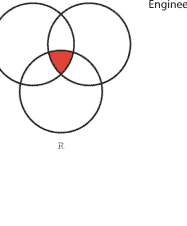

图 1.1 金融工程中的应用概率微积分：《使用 R 进行介绍》，即 APC ∩ FE ∩ R。

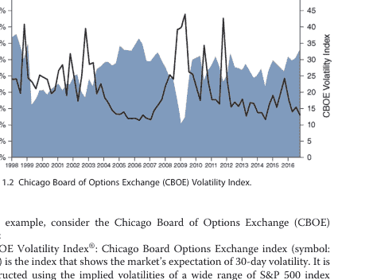

图 1.2 芝加哥期权交易所（CBOE）波动率指数。

例如，考虑芝加哥期权交易所（CBOE）指数：

CBOE 波动率指数®：芝加哥期权交易所指数（代码：VIX®）是显示市场对 30 天波动率预期的指数。它通过广泛的标准普尔 500 指数期权的隐含波动率构建。该波动率旨在具有前瞻性，由看涨期权和看跌期权共同计算得出，并且是广泛使用的市场风险衡量指标，通常被称为“投资者恐慌指标”。

VIX 波动率方法归 CBOE 所有，CBOE 与 Janus 并无关联。

显然，图 1.2 反映了过去 20 年典型股票市场的动态特性。人们不禁要问，是否可以开发一种理性的金融工程方法来同时维持当前的两个目标：

- 保持稳定的投资水平
- 为投资者创造稳定的收入

本书的其余部分将为实现这些共同目标提供合理的方法。

#### 1.3.2 Smith 夫妇账户的 XYZ–LPL 投资的持续结果

让我们首先审视这一投资机会在过去约 10 年间的结果。

### XYZ–LPL（Linsco（1968 年）与 Private Ledger（1973 年））的投资结果

如下所示：

LPL Financial Holdings（通常称为 LPL Financial）是美国最大的独立经纪自营商。该公司拥有超过 14,000 名财务顾问，顾问及经纪资产超过 5000 亿美元，2015 财年营收约为 43 亿美元。LPL Financial 成立于 1989 年，由两家经纪公司——Linsco（成立于 1968 年）和 Private Ledger（成立于 1973 年）——合并而成，此后通过内生增长和收购扩大了其独立财务顾问的数量。LPL Financial 在波士顿、夏洛特和圣地亚哥设有主要办事处。约 3500 名员工通过支持性技术、全面的清算和合规服务、执业管理计划与培训以及独立研究，为金融机构、顾问以及技术、托管和清算服务订阅者提供支持。

LPL Financial 的顾问帮助客户处理多种金融服务，包括股票、债券、共同基金、年金、保险和收费项目。LPL Financial 不开发自己的投资产品，这使得公司的投资专业人士能够提供不受经纪自营商引发的利益冲突影响的财务建议。

- 营收：43.7 亿美元（2014 年）
- 总部：美国马萨诸塞州波士顿州街 75 号
- 交易代码：NASDAQ: LPLA（https://en.wikipedia.org/wiki/LPL_Financial）

在过去 10 年里，Smith 夫妇每月获得净收入 10,947.03 美元。因此，年收入为

10,947.03 美元 × 12 = 131,364.36 美元。

过去 10 年的总收入为

131,364.36 美元 × 10 = 1,313,643.60 美元。

下图 1.3 展示了 Smith 夫妇四个投资账户之一的快照。请注意该投资组合的以下特殊特征：

- 绿色区域代表投资金额：随着资本部分被定期提取（以满足美国联邦法规要求），实际投资金额随时间减少。这一损失已被蓝色区域充分弥补！
- 蓝色区域是该账户的投资组合价值。

这表明，在产生稳定收入的同时，投资组合价值的增长超过了定期和定时持续提取的金额。

显然，投资目标已经实现！

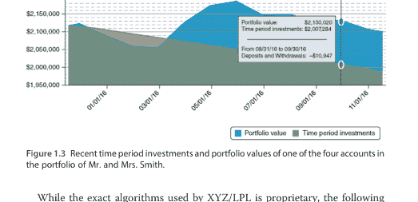

图 1.3 Smith 夫妇投资组合中四个账户之一的近期投资与投资组合价值。

虽然 XYZ/LPL 使用的确切算法是专有的，但以下投资策略是明确的：

- 将每个投资账户配置于高收益公司债券，然后为每个投资账户设定 3% 的最大回撤（损失）限额。
- 如果回撤超过 3% 的限额，则将投资账户转入现金或货币市场账户——以保全投资组合的整体资本。
- 保持在现金或货币市场账户中，直到市场满足以下三个条件后再重新回到高收益公司债券，届时机会再次出现：
  - 有利条件已恢复——比较高收益公司债券与 10 年期国债利率时，即有利于货币相对利率的条件出现时。
  - 有利条件已恢复——比较进入和离开市场的资金量时，即投资者是否正在“回撤”。
  - 当市场方向变得明确时。

人们当然不会忽视，这套条件充其量是相当脆弱的。

因此，应该寻求更稳健的路径。

### 1.4 “金融工程 101”：现代投资组合理论

现代投资组合理论（MPT），也称为均值-方差分析，是一种构建资产组合的算法，使得在给定风险水平（以方差定义）下预期回报最大化。其关键特征在于，一项资产的风险和回报不应单独评估，而应通过其对投资组合整体风险和回报的贡献来评估。

> （经济学家哈里·马科维茨在 1952 年的一篇论文中提出了 MPT，并因此后来获得了诺贝尔经济学纪念奖！）

#### 1.4.1 现代投资组合理论（MPT）

在 MPT 中，假设投资者是*风险厌恶*的，即如果存在两个提供相同预期回报的投资组合，理性投资者将偏好风险较低的那个。因此，投资者只有在获得更高预期回报补偿的情况下才会接受更高的风险。反之，想要更高预期回报的投资者必须接受更多风险。也就是说，

增加风险 ⇔ 更高的预期回报。

（1.1）

#### 1.4.2 资产配置与投资组合波动性

可以合理假设，*理性*投资者在存在另一个具有更优特征的投资组合时，不会投资于某个投资组合。投资组合回报是各组成资产回报按比例加权组合的结果。

**资产配置** 资产配置是在不同资产类别（如股票、债券、衍生品、现金和房地产）之间组织投资的过程，以适应并实现与投资者特定目标一致的风险和回报的实际组合。通常，该过程涉及投资组合优化，包括三个一般步骤：

- **步骤一：** 投资者指定资产类别，并为每个资产类别的回报和风险以及资产类别之间的变动建立前瞻性假设。对于基于情景的方法，回报根据所有前瞻性假设进行模拟。
- **步骤二：** 得出一个优化算法，其中设置对不同资产类别的配置。这些配置称为资产组合。
- **步骤三：** 在各种投资概率下预测资产组合回报和财富预测，情景预测并展示潜在结果。因此，投资者可以检查投资组合价值的估计值（例如）未来 2 年的情况，前提是该期间的回报处于预测区间的底部 10%。均值-方差优化（MVO）通常用于创建有效的资产配置策略。但 MVO 有其局限性——下文将予以说明。


#### 1.4.3 均值-方差优化（MVO）的特征性质

以下是MVO方法论的特征性质：

- a) 它没有考虑与大多数真实世界历史资产类别回报相匹配的“肥尾”资产类别回报分布。例如，考虑标准普尔500指数自1926年以来的月度总回报：1926年1月至2011年5月期间共有1,025个月。在此期间，标准普尔500指数的月度算术平均值和标准差分别为0.943%和5.528%。对于正态分布，距离均值三个标准差的回报为−15.64%，计算方式为（0.943%−3×5.528%）。

在标准正态分布中，68.27%的数据值位于均值的一个标准差之内，95.45%位于两个标准差之内，99.73%位于三个标准差之内（图1.4）。

这意味着回报低于均值三个标准差的概率为0.13%，其中0.13%的计算方式为（100% − 99.73%）/2。

换句话说，正态分布估计回报低于−15.64%的概率为0.13%，这意味着在1926年1月至2011年5月之间的1,025个月中，预计只有1.3个月的回报低于−15.64%，其中1.3个月是通过将0.13%的概率乘以1,025个月的回报数据得出的。

然而，在检查该时期的历史数据时，有10个月出现了这种情况，即10个月 / 1.3个月 = 7.69倍，比模型预测高出近8倍！

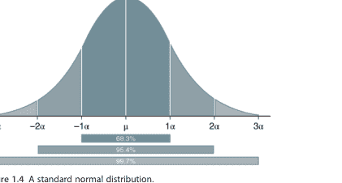

图1.4 标准正态分布。

以下是有问题的10个月：

| 月份 | 回报（%） |
|---|---|
| 1930年6月 | -16.25 |
| 2008年10月 | -16.79 |
| 1933年2月 | -17.72 |
| 1929年10月 | -19.73 |
| 1932年4月 | -19.97 |
| 1987年10月 | -21.54 |
| 1932年5月 | -21.96 |
| 1940年5月 | -22.89 |
| 1938年3月 | -24.87 |
| 1931年9月 | -29.73 |

正态分布模型还假设*对称的钟形曲线*，这似乎意味着该模型不适用于具有不对称回报分布的资产类别。数据的直方图如图1.5所示，绘制了每个柱状图回报范围内发生的历史回报数量。

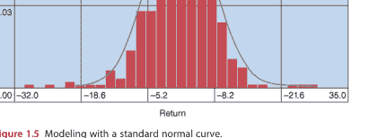

图1.5 使用标准正态曲线进行建模。

正态分布非常直观，因为68.27%的数据值位于均值两侧的一个标准差之内，95.45%位于两个标准差之内，99.73%位于三个标准差之内，依此类推。

### 1.5 资产类别假设建模

**模型比较** 在资产配置优化过程的第一步中，投资者/分析师首先指定资产类别，然后为每个资产类别的回报和风险以及资产类别之间的相对变动建立前瞻性假设模型。通常，可以使用指数或混合指数作为每个资产类别的代表，尽管也可以将基金等投资作为代表，或者完全不使用代表。当使用历史数据流（如指数或投资）作为资产类别的代表时，它可作为估算前瞻性假设的起点。

在假设制定过程中，投资者必须确定资产类别的回报模式以及资产类别之间的联合行为。通常假设这些回报行为可以通过参数化回报分布函数来建模，即它们可以用少量定义回报分布的参数的数学模型来表达。另一种选择是直接使用历史数据而不假设回报分布模型——这个过程被称为“自举法”。

#### 1.5.1 资产类别建模示例

##### 1.5.1.1 资产类别建模

###### 1.5.1.1.1 对数正态模型

正态分布，也称为高斯分布，采用常见的与MVO相关的对称钟形分布曲线形式。它以两个参数为特征：均值和标准差。

- 均值是所有可能回报的概率加权算术平均值，是MVO中回报的度量。
- 方差是所有可能回报与均值之差的平方的概率加权平均值。标准差是方差的平方根，是MVO中风险的度量。
- 前缀“log”意味着回报相对值的自然对数形式ln(1+R)呈正态分布。对数正态分布是不对称的，向右偏斜，因为0的对数是−∞，该

因此，投资者可以通过选择多元化的投资组合来减少对单个资产风险的敞口：多元化可以在降低风险的同时实现相同的投资组合预期回报。

（这些想法最早由马克维茨提出，后来由其他理论家（应用数学家和经济学家）通过投资组合理论表达了对方差局限性的观点，从而加强了这些想法。）

因此，如果所有资产对的相关系数都为0（即它们完全无关），则投资组合的回报方差是所有资产持有比例平方乘以该资产回报方差的总和，投资组合标准差是该总和的平方根。

关于这些想法和方法的许多进一步详细讨论将在第5章和第6章中呈现。

## 1.6 专有投资基金的一些典型示例

某投资公司公开宣传投资计划，如“管理型支付基金”（Managed Payout Funds），声称能让感兴趣的投资者在退休后享受定期的每月付款，同时不必放弃对自己资金的控制！

以下将对此类基金进行简要评估。

某一特定基金声称如下：

- 1) 其设计目的是为投资者提供定期的月度付款，这些付款会随着时间推移与通货膨胀保持同步，并帮助投资者支付退休后的开支。
- 2) 为实现这一目标，该基金力求在所产生的收入与所追求的本金增长之间取得平衡。
- 3) 自动向投资者提供定期的月度付款。
- 4) 每年一月重置付款金额。每月的付款预计保持一致。该基金的目标是未来年分配率为4%。
- 5) 最后，该基金不受保证：因此投资者可能会损失部分投入资本！

### 示例2：向投资公司“IC-1”投资200万美元

- a) 根据向IC-1投资200万美元的情况进行快速计算。使用IC-1提供的在线计算器，估计初始月度付款为6,268美元。这与XYZ/LPL投资公司实现的10,974.03美元相比！
- b) 类似地，对于每月10,974.00美元的付款，使用IC-1提供的在线计算器，估计需要投资的金额是

虽然这些收益令人印象深刻，但Mampilly表示，与未来的收益相比，它们微不足道。

“上一次出现这种情况时，它让少数股票上涨了高达27,000%、28,000%甚至91,000%。”

关键是在上涨之前买入正确的股票。

显然，投资者需要在投资中保持纪律：既在*资产配置*中，也在*投资组合优化*中。

## 1.8 一些不太值得推荐的股票投资方法

在当今的金融交易和投资环境中，计算机化和专业数学算法能够且确实扮演着重要角色，一些投资机构以及个人投资者几乎无法抗拒地走上这些道路。其中两条著名的道路是日内交易和算法交易。严肃的投资者不应忽视，在这些以及类似的“快速致富”计划中亏损的可能性很高。为了完整起见，应提及两个此类众所周知的计划：

- 1) 日内交易
- 2) 算法交易

以下是这些计划的简要描述。

### 1.8.1 日内交易

*日内交易*是指在同一交易日内买卖金融工具，对股票、债券、期权、货币、期货合约及其他证券进行投机。曾几何时，日内交易是专业投机者和金融公司独有的活动。“保证金买入”（使用借入资金）的普遍使用极大地增加了收益和损失，因此可能在很短的时间内发生巨额收益或损失。

### 1.8.2 算法交易

*算法交易*是一种通过随时间向市场发送订单的小部分来下大额订单的方法。它是一种使用自动预编程交易指令执行订单的自动化方法，这些指令提供了考虑价格、数量和时间等变量的预设指令。它声称是一种最小化订单执行成本、市场影响和风险的方法——从而消除了过程中的干预和决策。


### 1.9 开发金融工程分析工具

本书的其余部分将按照以下步骤展开：

- 第2章将全面论述为金融工程建模而发展的概率微积分。
- 第3章将讨论金融工程中的经典数学模型，包括现代投资组合理论。
- 第4章将讨论使用R编程进行数据分析，为分析提供实用工具。
- 第5章将介绍使用R进行资产配置的方法。
- 第6章将讨论使用R进行金融风险建模和投资组合优化。

### 复习题

1. 在金融和经济学中，人们默认通货膨胀将持续存在，并且很可能无限期地持续下去，由此带来以下伴随结果：

   商品和服务的价格，例如

   - 食品、汽车、服务等*将无限期上涨*，
   - 货币的购买力，即美元的币值*将无限期下降*，以及
   - 工作工资和薪金*将无限期上涨*。

   **a** 讨论这些现象背后的基本原理。

   **b** 如果这些现象无限期成立，请说明人们如何能够并且应该如何配置资产、管理投资组合，从而获得最大的财富积累机会。

2. 除了通过买卖股票、债券和其他金融工具来配置资产之外，请讨论投资以下领域可能面临的挑战：

   **a** 外国金融实体，例如购买海外公司的股票，如欧洲、中国的金融机会（中国属于**金砖四国**——巴西、俄罗斯、印度和中国）。预计到2050年，中国和印度很可能成为全球制成品和服务的主导供应国！

   **b** 大宗商品（如谷物、石油、外币、贵金属等）。

   **c** 房地产：房产和土地。

   **d** 服务业，如医院、养老院和其他商业实体。

## 2 金融工程建模的概率微积分

### 2.1 金融工程导论

为了建立用于金融分析的有用且现实的数学模型，以实现资产配置及其伴随的收益或损失为目标，同时考虑离散模型和连续模型是有益的。

#### 2.1.1 一些经典金融数据

考虑以下两组典型的金融数据：

1. **道琼斯指数——100年历史走势图**（图2.1）

   道琼斯工业平均指数（DJIA）过去100年的交互式走势图。该历史数据已使用总体CPI进行通胀调整，每个数据点代表月末收盘价。当前月份按小时更新，并采用今日最新数值。截至2016年6月3日美国东部时间晚上8:48，道琼斯工业平均指数的当前值为17,838.56美元。

   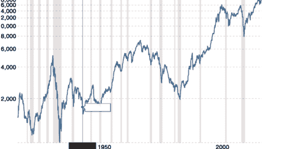

   图2.1 道琼斯工业平均指数（DJIA）——100年历史走势图。

2. **苹果公司（Apple, Inc.）AAPL——5年历史价格**（图2.2）

   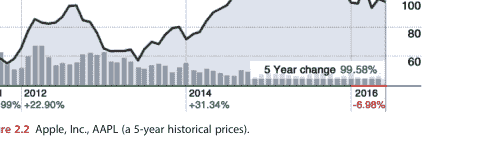

   图2.2 苹果公司（Apple, Inc.）AAPL（5年历史价格）。

### 2.2 金融工程中的数学建模

#### 2.2.1 离散模型与连续模型

一般而言，离散模型需要使用有限差分技术进行分析和求解，而连续模型使用偏导数和全导数，进而形成由偏微分方程组构成的金融理论，其中包含全导数和偏导数。这类微分方程组受益于完备发展的全微分和偏微分方程组理论所提供的巨大支持。

一个突出的例子是为金融衍生品的Black–Scholes模型所发展或正在发展的庞大数学文献。

#### 2.2.2 确定性模型与概率模型

##### 2.2.2.1 确定性模型的微积分

在单变量x的函数f(x)的确定性微积分中，有一些重要的结果（通常称为定理），可用于关联此类函数的变差特性。这些定理包括：

- **中值定理：**

  若f(x)在闭区间[a, b]上连续，且在开区间(a, b)内可导，则存在x的一个值ξ，即a < ξ < b，使得

  f(b) − f(a) = (b − a)f′(ξ)  (2.1)

- **高阶中值定理：**

  对于0 < θ < 1

  f(a + h) − f(a) = h f′(a + θ h)  (2.2)

  若f(x)在a ≤ x ≤ b上连续，且f′(x)在a < x < b内存在，且h = b − a，0 < θ₂ < 1，则

  f(a + h) = f(a) + h f′(a) + ½ h² f″(a + θ₂ h)  (2.3)

- **一般中值定理（泰勒定理）：**

  若f^{(n−1)}(x)在闭区间a ≤ x ≤ b上连续，且f^{(n)}(x)在a < x < b内存在，则

  f(b) = f(a) + (b − a)f′(a) + {(b − a)²/2!}f″(a) + ⋯ + {(b − a)^{n−1}/(n−1)!}f^{(n−1)}(a) + {(b − a)^n/n!}f^{(n)}(ξ)  (2.4)

  其中a < ξ < b；若b = a + h，则

  f(a + h) = f(a) + h f′(a) + ½ h² f″(a) + ⋯ + {h^{n−1}/(n−1)!}f^{(n−1)}(a) + h^n/n! f^{(n)}(a + θ_n h)  (2.5)

  f^{(n−1)}(x)的连续性蕴含了f(x)、f′(x)、f″(x)、…、f^{(n−2)}(x)的连续性。

- **多元函数的泰勒定理：**

  单变量函数的泰勒公式（公式(2.5)）可以推广到在空间的给定区域中具有n阶连续导数的多元函数。以下过程针对二元函数进行概述——其结果具有更一般情形的所有特征。

  设f(x, y)是二元(x, y)函数，在包含点

  x = a, y = b

  的某个区域内具有n阶连续导数，并设

  x = a + α, y = b + β

  是该区域内的邻近点。连接这两点的直线段的方程可表示为

  x = a + α t, y = b + β t, 0 ≤ t ≤ 1  (2.6)

  并且，在该线段上，

  $$f(x,y)=f(a+\alpha t,\ b+\beta t)\equiv F(t)\tag{2.7}$$

  是t的复合函数，具有n阶连续导数。因此，$F(t)$可以用麦克劳林公式表示：

  $$F(t)=F(0)+F'(0)t+\{F''(0)/2!\}t^{2}+\cdots+\{F^{(n)}(\theta t)/n!\}t^{n},\quad 0<\theta<t\tag{2.8}$$

  $F(t)$的各阶导数可由公式(2.7)及复合函数求导的*链式法则*计算：

  若$u=f(x,y)$，则

  $$du/dt=(\partial u/\partial x)(dx/dt)+(\partial u/\partial y)(dy/dt)\tag{2.9}$$

  因此，

  $$\begin{aligned}F'(t)&=f_x(x,y)(dx/dt)+f_y(x,y)(dy/dt)\\&=f_x(x,y)\alpha+f_y(x,y)\beta\end{aligned}\tag{2.10}$$

  其中最后一步回顾了公式(2.6)。

  类似地，

  $$\begin{aligned}F''(t)&=[f_{xx}(x,y)\alpha+f_{xy}(x,y)\beta](dx/dt)+[f_{yx}(x,y)\alpha+f_{yy}(x,y)\beta](dy/dt)\\&=f_{xx}(x,y)\alpha^{2}+2f_{xy}(x,y)\alpha\beta+f_{yy}(x,y)\beta^{2}\end{aligned}$$

  以及

  $$\begin{aligned}F^{(n)}(t)&=(\partial^{n}f/\partial x^{n})\alpha^{n}+C_{n,1}(\partial^{n}f/\partial x^{n-1}\partial y)\alpha^{n-1}\beta+\cdots\\&+C_{n,n-1}(\partial^{n}f/\partial x\partial y^{n-1})\alpha+\partial^{n}f/\partial y^{n}\beta^{n}\end{aligned}$$

  其中$C_{n,r}\equiv n!/[r!(n-r)!]$为二项式系数。

  由公式(2.6)可知，$t=0$对应于点：$x=a, y=b$，因此

  $$\begin{aligned}F(0)&=f(a,b)\\F'(0)&=f_x(a,b)\alpha+f_y(a,b)\beta\\F''(0)&=f_{xx}(a,b)\alpha^{2}+2f_{xy}(a,b)\alpha\beta+f_{yy}(a,b)\beta^{2}\end{aligned}$$

  依此类推。

  将这些值代入公式(2.8)可得

  $$\begin{aligned}f(x,y)&=f(a,b)+[f_x(a,b)\alpha+f_y(a,b)\beta]t\\&+(1/2!)[f_{xx}(a,b)\alpha^{2}+2f_{xy}(a,b)\alpha\beta+f_{yy}(a,b)\beta^{2}]+\cdots+R_n\tag{2.11}\end{aligned}$$

  其中$R_n=\{F^{(n)}(\theta t)/n!\}\;t^{n},\;0<\theta<1$。


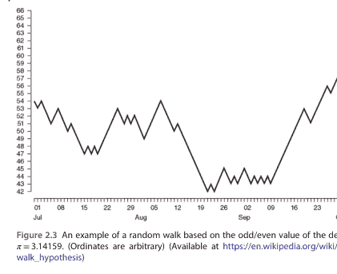

Figure 2.3 基于 π = 3.14159 的小数位奇偶值的随机游走示例。（纵坐标为任意）(可访问于 https://en.wikipedia.org/wiki/Random_walk_hypothesis)

E[ε_t] = 0  and  E[ε_t ε_τ] = 0,  for  τ ≠ t

已有研究表明随机游走假说是不准确的，股票市场存在趋势，且股票市场具有一定的可预测性。

为了从纯 GBM 过渡到可修改的确定性-概率模型来描述股票市场，可遵循以下路径：

- 确定性模型与概率模型
- 组合确定性与概率模型

## 2.3 通过概率演算从 GBM 构建有效的金融模型

GBM 的吸引力特征相当强大。如果在更现实的环境中保留其部分吸引力特征，则可以保留这些特征，即使任何此类混合结果相当复杂。这很可能是一项值得的努力！

对于任何光滑的，即可微的路径，考虑一个小的时间段，可以接受该时间段在此时间间隔 $dt$ 内由一个连续且可微的函数 $df_t$ 组成，使得

$df_t = \mu_t \, dt$
(2.14)

其中 $\mu_t$ 是斜率或漂移缩放函数。

从这一简单起点出发，可以考虑所有其他可能的牛顿函数。一个可能的情形是漂移 $\mu_t$ 可能依赖于函数 $f_t$ 的现有值，即

$df_t = \mu_t(f_t, t) \, dt$
(2.15)

### 2.3.1 股票市场的概率模型

在反映现实概率特征的股票市场中，任意时刻 $t$ 的股票价格 $X_t$ 可被视为同时具有

- i) 布朗运动项 $\sigma_t dW_t$ 和
- ii) 基于 $dt$ 的牛顿特征项：$\mu_t(X_t, t) dt$，

因此 $X$ 的无穷小变化可表示为

$dX_t = \sigma_t dW_t + \mu_t(X_t, t) dt$
(2.16)

其中

- a) 漂移 $\mu_t$ 可以依赖于时间 $t$，
- b) 漂移 $\mu_t$ 可以依赖于 $X$ 和 $W_t$ 直到时间 $t$ 的值，且
- c) 过程 $X$ 的噪声或波动率 $\sigma_t$ 可以依赖于该过程的历史。

然而，这种方法确实提供了一个实用的（尽管不是普遍的）概率过程（有时称为随机过程）的定义。

### 2.3.2 股票市场实体的概率过程

概率过程 $X$ 是一个连续过程，使得

$X_t = X_0 + \int_{0}^{t} \sigma_s dW_s + \int_{0}^{t} \mu_s ds$
(2.17)

其中 $\sigma$ 和 $\mu$ 是随机过程，使得 $\int_{0}^{t} \sigma_s^2 + |\mu_s| ds$ 对所有时间 $t$ 都是有限的，概率为 1。方程 (2.17) 的微分形式为

$dX_t = \sigma_t dW_t + \mu_t dt$
(2.18)

方程 (2.27) 中 dS 的 bvw(dt)^{1/2} 给出

dC = (∂f/∂t)dt + (∂f/∂S)adt + (∂f/∂S)bvw(dt)^{1/2}
+ 1/2 (∂²f/∂S²)(adt + bvw(dt)^{1/2})²
+ (∂²f/∂S∂t)(adt + bvw(dt)^{1/2})(dt) + 1/2 (∂²f/∂t²)(dt)²
+ higher order terms
(2.31)

对平方项和乘积项展开后，结果为

dC = (∂f/∂t)dt + (∂f/∂S)adt + (∂f/∂S)bvw(dt)^{1/2}
+ 1/2 (∂²f/∂S²)(a²(dt)² + 2abvw(dt)^{3/2} + b²v²w²dt)
+ (∂f/∂S∂t)(a(dt)² + bvw(dt)^{3/2}) + 1/2 (∂²f/∂t²)(dt)²
+ higher order terms
(2.32)

考虑到 dt 的无穷小性质，使得 dt 的任意高于一的幂次都消失，即方程 (2.32) 中红色标记的项全部消失，因此方程 (2.32) 可简化为

dC = (∂f/∂t)dt + (∂f/∂S)adt + (∂f/∂S)bvw(dt)^{1/2}
+ 1/2 (∂²f/∂S²)(b²v²w²dt)
(2.33)

现在，w² 的期望值为 1，因此 dC 的期望值为

[∂f/∂t + (∂f/∂S)a + 1/2 (∂²f/∂S²)b²]dt
(2.34)

这，(2.32)，是 dC 的确定性分量。

概率或随机分量是依赖于 dz 的项，在 (2.31) 中表示为 vw(dt)^{1/2}。因此，概率或随机分量为
[(∂f/∂S)b]dz
(2.35)

在上述推导中，似乎存在一个额外的随机项，源于 w² 偏离其期望值 1 的随机偏差；即额外项
1/2 (∂²f/∂S²)(b²v²w²dt)
(2.36)

然而，该额外项的方差与 (dt)³ 成正比，而方程 (2.33) 中给出的随机项的方差与 (dt) 成正比。因此，与方程 (2.33) 中给出的随机项相比，方程 (2.34) 中给出的随机项可以忽略。

## 例题 2.1

如果 X_t = exp(W_t)，dX_t 为何？

**Solution:**

由于 $X_t = \exp(W_t)$，

$dX_t = d[\exp(W_t)]$  直接代入
$= \exp(W_t) dW_t + \tfrac12 \exp(W_t) dt$  根据伊藤引理
$= X_t dW_t + \tfrac12 X_t dt$  直接代入

## 例题 2.2

关于非波动过程与随机过程乘积的微分：如果 $B_t$ 是非波动过程且 $X_t$ 是随机过程，则乘积 $B_t X_t$ 的微分为

$$d(B_t X_t) = B_t dX_t + X_t dB_t$$

**Solution:**

可采用两种方法：

### *第一方法：*

在二元函数微分中应用乘积法则，结果为

$$\frac{d(B_t X_t)}{dt} = B_t \frac{dX_t}{dt} + X_t \frac{dB_t}{dt} = \frac{(B_t dX_t + X_t dB_t)}{dt}$$

$$\therefore d(B_t X_t) = B_t dX_t + X_t dB_t$$

如所需。

### *第二方法：*

首先应用伊藤引理，然后简化结果：
由于 $X_t$ 是概率（随机）过程：$dX_t = \sigma_t dW_t + \mu_t dt$，且 $B_t$ 是非波动过程：$dB_t = B_t dt$

此外，由于
$$(B_t + X_t)^2 \equiv B_t^2 + 2 B_t X_t + X_t^2$$
可得
$$B_t X_t \equiv \tfrac12[(B_t + X_t)^2 - B_t^2 - X_t^2]$$

因此，
$$d(B_t X_t) \equiv d\{\tfrac12[(B_t + X_t)^2 - B_t^2 - X_t^2]\}
= \tfrac12 d[(B_t + X_t)^2 - B_t^2 - X_t^2]
= \tfrac12 d(B_t + X_t)^2 - \tfrac12 dB_t^2 - \tfrac12 dX_t^2
= (B_t + X_t) d(B_t + X_t) - B_t dB_t - X_t dX_t$$

## 2.4 随机游走模型

随着大语言模型技术的发展，人工智能已经能够生成高质量的长篇文本，这引发了人们对文学创作本质的重新思考。

人工智能究竟能否替代人类完成真正的文学创作？这一问题涉及到创作意图、情感体验和审美判断等多个维度。

- 创作动因：人类写作源于内在表达冲动，AI写作源于指令与训练目标
- 情感表达：人类情感具有身体性和历史性，AI情感仅为文本模拟
- 接受美学：读者对AI作者的身份预期会影响其阅读体验

有学者指出，真正富有文学性的作品往往不受制于既有的文类规约，而是在语言、结构与语义上有所突破。就此而言，简单套用已有文本模式的大模型输出，仍存在一定的同质化问题。

> 我们不是在讨论机器能否写作，而是在重新定义什么是写作。

| 维度 | 人类创作 | AI创作 |
|------|----------|--------|
| 灵感来源 | 生活经验、无意识 | 训练语料、提示词 |
| 修改方式 | 反复推敲、直觉判断 | 人工引导、迭代采样 |
| 价值判断 | 背负道德与历史责任 | 遵循对齐与偏好设定 |

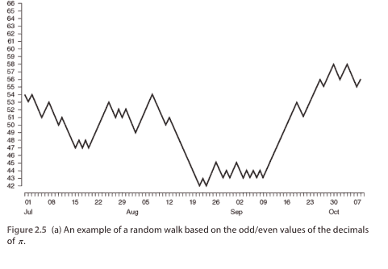

Figure 2.5 (a) 基于 π 小数位奇偶值的随机游走示例。

- 确定性模型与概率模型
- 组合确定性与概率模型

## 2.5.1.2 使用 R 模拟随机游走系统的其他模型

以下是在金融工程和计量经济学数据建模中被发现有用的、用于模拟随机游走系统的众多高效模型中的两种：

- 1) Cox–Ingersoll–Ross (CIR) 模型
- 2) Chan–Karoly– Longstaff–Sanders (CKLS) 模型

CIR 模型通常用于描述利率的演变。它是一种“单因子模型”（又称短期利率模型），因为它将利率变动建模为仅由一个市场风险来源驱动。该模型可用于利率衍生品的估值。它由 J.C. Cox、J.E. Ingersoll 和 S.A. Ross 于 1985 年提出。CIR 模型假设即期利率遵循随机（概率）微分方程。CIR 是一个遍历过程，并具有平稳分布。

CKLS 模型属于一类参数随机微分方程，在许多金融应用中被广泛使用，特别是用于建模利率或资产价格。该模型包含了一类资产定价模型，如 CIR。CKLS 模型的这种灵活性催生了许多实证应用。


## R 主题文档：

- Sim.DiffProc-package
- bconfint
- BM
- bridgesde1d
- bridgesde2d
- bridgesde3d
- fitsde
- fptsde1d
- fptsde2d
- fptsde3d
- HWV
- Irates
- plot2d
- rsde1d
- rsde2d
- rsde3d
- snsde1d
- snsde2d
- snsde3d
- st.int

以下数值示例被选中，所有示例均为几何布朗运动（GBM）模型和随机游走模型的典型表示：

## R 中的练习示例 2-1：

BM: 布朗运动、布朗桥、几何布朗运动和算术布朗运动模拟器

## 描述

用于模拟布朗运动、布朗桥、几何布朗运动和算术布朗运动的（S3）通用函数。

## 用法

```
BM(N, . . . )
BB(N, . . . )
GBM(N, . . . )
ABM(N, . . . )
```

### 默认 S3 方法：

```
BM(N=100,M=1,x0=0,t0=0,T=1,Dt, . . . )
```

### 默认 S3 方法：

```
BB(N=100,M=1,x0=0,y=1,t0=0,T=1,Dt, . . . )
```

### 默认 S3 方法：

```
GBM(N=100,M=1,x0=1,t0=0,T=1,Dt,theta=1,sigma=1, . . . )
```

### 默认 S3 方法：

```
ABM(N=100,M=1,x0=0,t0=0,T=1,Dt,theta=1,sigma=1, . . . )
```

## 参数

| 参数 | 描述 |
|---|---|
| N | 模拟步数。 |
| M | 轨迹数量。 |
| x0 | 时间 t0 时过程的初始值。 |
| Y | BB 在时间 T 时过程的终值。 |
| t0 | 初始时间。 |
| T | 结束时间。 |
| Dt | 模拟的时间步长（离散化）。如果缺失，默认 Δt = (T − t0) / N |
| theta | ABM 和 GBM 的利率。 |
| sigma | ABM 和 GBM 的波动率。 |
| ... | （非默认）方法的进一步参数。 |

## 详情

函数 BM 返回时间区间 [t0, T] 中标准布朗运动（维纳过程）的一条轨迹。事实上，对于 W(dt) 成立

W(dt) → W(dt) − W(0) → N(0, dt)

其中 N(0, 1) 是正态分布 Normal。

函数 BB 返回一条从时间 t0 起始于 x0 并在时间 T 结束于 y 的布朗桥轨迹；即随机微分方程的扩散过程解：

dX_t = {(y − X_t)/(T − t)} dt + dW_t

| [40] "GBM" | "GBM.default" | "HWV" |
| [43] "HWV.default" | "kurtosis" | "kurtosis.bridgesde1d" |
| [46] "kurtosis.bridgesde2d" | "kurtosis.bridgesde3d" | "kurtosis.default" |
| [49] "kurtosis.fptsde1d" | "kurtosis.fptsde2d" | "kurtosis.fptsde3d" |
| [52] "kurtosis.rsde1d" | "kurtosis.rsde2d" | "kurtosis.rsde3d" |
| [55] "kurtosis.snssde1d" | "kurtosis.snssde2d" | "kurtosis.snssde3d" |
| [58] "kurtosis.st.int" | "lines.bridgesde1d" | "lines.bridgesde2d" |
| [61] "lines.bridgesde3d" | "lines.snssde1d" | "lines.snssde2d" |
| [64] "lines.snssde3d" | "lines.st.int" | "lines2d" |
| [67] "lines2d.bridgesde2d" | "lines2d.default" | "lines2d.snssde2d" |
| [70] "logLik.fitsde" | "mean.bridgesde1d" | "mean.bridgesde2d" |
| [73] "mean.bridgesde3d" | "mean.fptsde1d" | "mean.fptsde2d" |
| [76] "mean.fptsde3d" | "mean.rsde1d" | "mean.rsde2d" |
| [79] "mean.rsde3d" | "mean.snssde1d" | "mean.snssde2d" |
| [82] "mean.snssde3d" | "mean.st.int" | "median.bridgesde1d" |
| [85] "median.bridgesde2d" | "median.bridgesde3d" | "median.fptsde1d" |
| [88] "median.fptsde2d" | "median.fptsde3d" | "median.rsde1d" |
| [91] "median.rsde2d" | "median.rsde3d" | "median.snssde1d" |
| [94] "median.snssde2d" | "median.snssde3d" | "median.st.int" |
| [97] "moment" | "moment.bridgesde1d" | "moment.bridgesde2d" |
| [100] "moment.bridgesde3d" | "moment.default" | "moment.fptsde1d" |
| [103] "moment.fptsde2d" | "moment.fptsde3d" | "moment.rsde1d" |
| [106] "moment.rsde2d" | "moment.rsde3d" | "moment.snssde1d" |
| [109] "moment.snssde2d" | "moment.snssde3d" | "moment.st.int" |
| [112] "OU" | "OU.default" | "plot.bridgesde1d" |
| [115] "plot.bridgesde2d" | "plot.bridgesde3d" | "plot.fptsde1d" |
| [118] "plot.fptsde2d" | "plot.fptsde3d" | "plot.rsde1d" |
| [121] "plot.rsde2d" | "plot.rsde3d" | "plot.snssde1d" |
| [124] "plot.snssde2d" | "plot.snssde3d" | "plot.st.int" |
| [127] "plot2d" | "plot2d.bridgesde2d" | "plot2d.default" |
| [130] "plot2d.snssde2d" | "plot3D" | "plot3D.bridgesde1d" |
| [133] "plot3D.default" | "plot3D.snssde3d" | "points.bridgesde1d" |

[136] "points.bridgesde2d" "points.bridgesde3d" "points.snssde1d"
[139] "points.snssde2d" "points.snssde3d" "points.st.int"
[142] "points2d" "points2d.bridgesde2d" "points2d.default"
[145] "points2d.snssde2d" "print.bridgesde1d" "print.bridgesde2d"
[148] "print.bridgesde3d" "print.fitsde" "print.snssde1d"
[151] "print.snssde2d" "print.snssde3d" "print.st.int"
[154] "quantile.bridgesde1d" "quantile.bridgesde2d" "quantile.bridgesde3d"
[157] "quantile.fptsde1d" "quantile.fptsde2d" "quantile.fptsde3d"
[160] "quantile.rsde1d" "quantile.rsde2d" "quantile.rsde3d"
[163] "quantile.snssde1d" "quantile.snssde2d" "quantile.snssde3d"
[166] "quantile.st.int" "rsde1d" "rsde1d.default"
[169] "rsde2d" "rsde2d.default" "rsde3d"
[172] "rsde3d.default" "skewness" "skewness.bridgesde1d"
[175] "skewness.bridgesde2d" "skewness.bridgesde3d" "skewness.default"
[178] "skewness.fptsde1d" "skewness.fptsde2d" "skewness.fptsde3d"
[181] "skewness.rsde1d" "skewness.rsde2d" "skewness.rsde3d"
[184] "skewness.snssde1d" "skewness.snssde2d" "skewness.snssde3d"
[187] "skewness.st.int" "snssde1d" "snssde1d.default"
[190] "snssde2d" "snssde2d.default" "snssde3d"
[193] "snssde3d.default" "st.int" "st.int.default"
[196] "summary.fitsde" "summary.fptsde1d" "summary.fptsde2d"
[199] "summary.fptsde3d" "summary.rsde1d" "summary.rsde2d"
[202] "summary.rsde1d" "summary.snssde1d" "summary.snssde2d"
[205] "summary.snssde3d" "summary.st.int" "time.bridgesde1d"
[208] "time.bridgesde2d" "time.bridgesde3d" "time.snssde1d"
[211] "time.snssde2d" "time.snssde3d" "time.st.int"
[214] "vcov.fitsde"

> 
> op <- par(mfrow = c(2, 2))
> utils::menuShowCRAN()

> # 输出：图 2.4b Sim.DiffProc-1

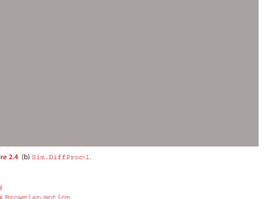

图 2.4 (b) Sim.DiffProc-1.

```
> ##
> ## Brownian motion
> set.seed(1234)
> X <- BM(N=1000, M=50)
> plot(X, plot.type="single")
```

> # 输出：图 2.5b Sim.DiffProc-2

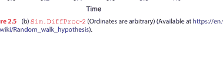

图 2.5 (b) Sim.DiffProc-2（纵坐标为任意值）（可访问于 https://en.wikipedia.org/org/wiki/Random_walk_hypothesis）。

```
> 
> lines(as.vector(time(X)),rowMeans(X),col="red")
```

> # 输出：图 2.6 Sim.DiffProc-3

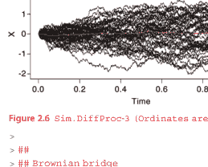

图 2.6 Sim.DiffProc-3（纵坐标为任意值）

```
> ##
> ## Brownian bridge
> set.seed(1234)
> X <- BB(N=1000, M=50)
> plot(X,plot.type="single")
```

> # 输出：图 2.7 Sim.DiffProc-4

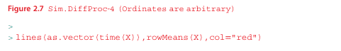

图 2.7 Sim.DiffProc-4（纵坐标为任意值）

```
> 
> lines(as.vector(time(X)),rowMeans(X),col="red")
```

> # 输出：图 2.8 Sim.DiffProc-5


图 2.8 Sim.DiffProc-5（纵坐标为任意值）

```
> ##
> ## Arithmetic Brownian motion
> set.seed(1234)
> X <- ABM(N=1000, M=50)
> plot(X, plot.type="single")
```

> # 输出：图 2.11 Sim.DiffProc-8

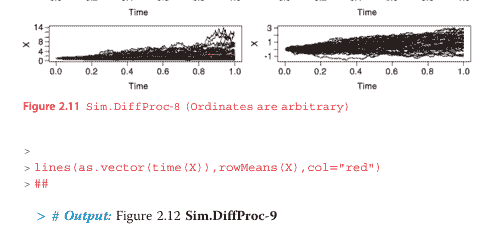

图 2.11 Sim.DiffProc-8（纵坐标为任意值）

```
> lines(as.vector(time(X)), rowMeans(X), col="red")
> ##
```

> # 输出：图 2.12 Sim.DiffProc-9


图 2.12 Sim.DiffProc-9（纵坐标为任意值）

```
> ##
> par(op)
>
```

```
## CKLS : dX(t) = (theta1+theta2*X(t)) * dt + theta3 *
X(t)^theta4 * dW(t)
fx <- expression(theta[1]+theta[2]*x)
gx <- expression(theta[3]*x^theta[4])
fitmod <- ftsde(rates,drift=fx,diffusion=gx,pmle="euler",
start = list(theta1=1,theta2=1,
theta3=1,theta4=1),optim.method = "L-BFGS-B")
theta <- coef(fitmod)
N <- length(rates)
res <- snssdeid(drift=fx,diffusion=gx,M=200,t0=time(rates)[1],
T=time(rates)[N],
Dt=deltat(rates),x0=rates[1],N)
plot(res,plot.type="single",ylim=c(0,50))
lines(rates,col=2,lwd=2)
legend("topleft",c("real data","CKLS modele"),
inset =.01,col=c(2,1),lwd=2,cex=0.8)
dev.new()
plot(res,plot.type="single",type="n",ylim=c(0,35))
lines(rates,col=2,lwd=2)
lines(time(res),mean(res),col=3,lwd=2)
lines(time(res),bconfint(res,level=0.95)[,1],col=4,lwd=2)
lines(time(res),bconfint(res,level=0.95)[,2],col=4,lwd=2)
legend("topleft",c("real data","mean path",
paste("bound of",95,"percent confidence")),
inset =.01,col=2:4,lwd=2,cex=0.8)
```

## 在 R 域中：

```
> data(Irates)
> rates <- Irates[,"r1"]
> rates <- window(rates, start=1964.471, end=1989.333)
> ## CKLS modele vs CIR modele
> ## CKLS : dX(t) = (theta1+theta2*X(t)) * dt + theta3 *
> X(t)^theta4 * dW(t)
> fx <- expression(theta[1]+theta[2]*x)
> gx <- expression(theta[3]*x^theta[4])
> fitmod <- ftsde(rates,drift=fx,diffusion=gx,pmle="euler",
+ start = list(theta1=1,theta2=1,
+ theta3=1,theta4=1),optim.method = "L-BFGS-B")
> theta <- coef(fitmod)
> N <- length(rates)
> res <- snssdeid(drift=fx,diffusion=gx,
+ M=200,t0=time(rates)[1],
```


+ T=time(rates)[N]，
+ Dt=deltat(rates)，x0=rates[1]，N）
> plot(res,plot.type="single",ylim=c(0,50))
> # 输出：图 2.13 Irates-1

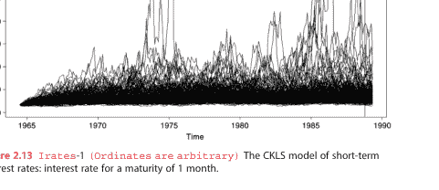

图 2.13 Irates-1（纵坐标为任意值）短期利率的 CKLS 模型：期限为 1 个月的利率。

```
> lines(rates,col=2,lwd=2)
> # 输出：图 2.14 Irates-2
```

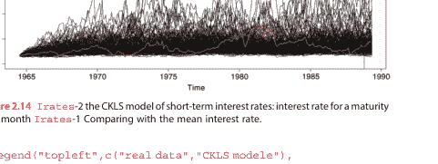

图 2.14 Irates-2 短期利率的 CKLS 模型：期限为 1 个月的利率 Irates-1 与平均利率的比较。

```
> legend("topleft",c("real data","CKLS model"),
+ inset = .01,col=c(2,1),lwd=2,cex=0.8)
> # 输出：图 2.15 Irates-3
> dev.new()
```

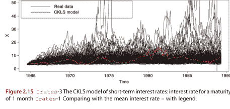

图 2.15 Irates-3 短期利率的 CKLS 模型：期限为 1 个月的利率 Irates-1 与平均利率的比较——带图例。

```
> # 输出：图 2.16 Irates-4
```

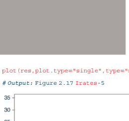

图 2.16 Irates-4：为后续新数据做准备（仅模式）。

```
> plot(res,plot.type="single",type="n",ylim=c(0,35))
```

```
> # 输出：图 2.17 Irates-5
```

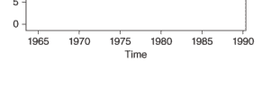

图 2.17 Irates-5：添加了坐标轴刻度。

```
> lines(rates,col=2,lwd=2)
```

```
> # 输出：图 2.18 Irates-6
```

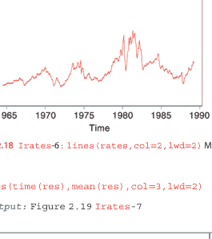

图 2.18 Irates-6：lines(rates,col=2,lwd=2) 平均利率已添加（红色）。

```
> lines(time(res),mean(res),col=3,lwd=2)
```

```
> # 输出：图 2.19 Irates-7
```

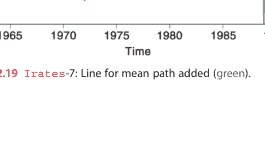

图 2.19 Irates-7：平均路径线已添加（绿色）。

```
> lines(time(res),bconfint(res,level=0.95)[,1],col=4,lwd=2)
```

```
> # 输出：图 2.20 Irates-8
```

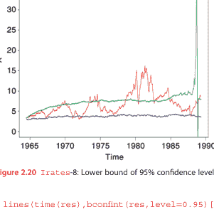

图 2.20 Irates-8：95% 置信水平的下界已添加（蓝色）。

```
> lines(time(res),bconfint(res,level=0.95)[,2],col=4,lwd=2)
```

```
> # 输出：图 2.21 Irates-9
```

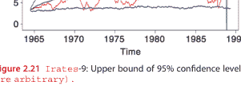

图 2.21 Irates-9：95% 置信水平的上界已添加（蓝色）（纵坐标为任意值）。

```
> legend("topleft",c("real data","mean path",paste("bound of",
+ 95,"percent confidence")),
+ inset = .01,col=2:4,lwd=2,cex=0.8)
> # 输出：图 2.22 Irates-10
> 
```

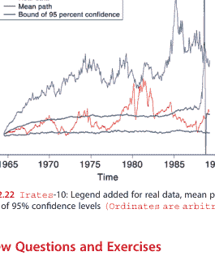

图 2.22 Irates-10：为真实数据、平均路径以及 95% 置信水平的上下界添加了图例（纵坐标为任意值）。

## 复习题与练习

- 1. 定义微分学。
- a. 定义伊藤积分。
- b. 这两个概念之间的本质区别是什么？请解释。
- 2. a. 为什么伊藤积分适用于分析 GBM（几何布朗运动）？
- b. i) 在此应用中使用伊藤积分的优点是什么？
- ii) 缺点是什么？有什么局限性？
- 3. GBM：设 Y 是正态分布 N(0, 1) 的函数，则过程 X_t = Y√t 是连续的，且边际分布为正态分布 N(0, t)。
  X_t 是布朗运动吗？请解释。

4 GBM：设 $Y_t$ 和 $Y_t'$ 是两个独立的布朗运动，$\lambda$ 是满足 $-1 < \lambda < 1$ 的常数。则过程

$$X_t = \lambda Y_t + \sqrt{1 - \lambda^2}\; Y_t'$$

是连续的，且具有边际分布 $N(0, t)$。

过程 $X_t$ 是 GBM 吗？请解释。

5 用于欧式看涨期权定价的 Black–Scholes 公式为

$$V(s, T) = s\,\Phi\left[\frac{\log(s/k) + (r + \tfrac12 \sigma^2)T}{\sigma\sqrt{T}}\right] - k e^{-rT}\Phi\left[\frac{\log(s/k) + (r + \tfrac12 \sigma^2)T}{\sigma\sqrt{T}}\right]$$

其中 $\Phi(x) = (2\pi)^{-1/2}\int_{-\infty}^{x} \exp(-y^2/2)\,dy$，即正态分布 $N(0,1)$ 取值小于 $x$ 的概率，那么可以计算出 $V_0 = V(s, T)$。考虑变量替换

$$\nu = -\frac{x + \tfrac12 \sigma^2 T}{\sigma\sqrt{T}},$$

并用它来建立 Black–Scholes 公式的常见形式，即

$$V_0 = s\,\Phi(\alpha + \sigma\sqrt{T}) - k e^{-rT}\Phi(\alpha)$$

## 3.2 投资组合优化的现代理论

在资产配置的投资决策中，现代投资组合理论关注的是与伴随的潜在风险相对应的潜在回报。其策略是选择并评估单项投资（证券、债券、基金、衍生品、大宗商品等），将其作为整体投资组合的一部分，而不是仅凭其本身的优劣作为投资对象。

因此，资产配置是首要策略——因为它允许投资者构建投资组合——在不承担超出其愿意承受的风险水平的前提下，获得尽可能强的回报！

一个可接受的投资组合理论的另一个关键特征是，投资者必须因承担更大的风险而获得更高的回报作为奖励。否则，投资者就几乎没有动力和激励去进行可能损失本金的风险投资！

基于这些前提，本章介绍两种杰出的投资组合配置理论：

- 1）Markowitz 模型
- 2）Black–Litterman 模型

这些“标准承担者”有许多修改和改进，它们在数学金融和金融工程领域保持着富有成果的研究和开发方向。本章将介绍这两种方法，随后介绍这些理论中更受青睐的改进版本！

### 3.2.1 现代投资组合理论（MPT）的 Markowitz 模型

**现代投资组合理论** 现代投资组合理论，或称均值-方差分析，是一种数学模型，用于构建金融资产的投资组合，使得在给定风险水平（定义为方差）下期望回报最大化。其关键特征如下：

> > “资产的风险和利润回报不应孤立地评估，而应看它如何对投资组合的整体风险和回报做出贡献。”

### 3.2.1.1 风险与期望回报

MPT 假设投资者是风险厌恶型的，这意味着给定两个提供相同期望回报的投资组合，投资者会更喜欢风险较低的那个：因此，只有当更高的期望回报作为补偿时，投资者才会承担更高的风险。反之，想要获得更高期望回报的投资者必须接受更高的风险。

在风险-期望回报空间中，所有此类可能投资组合的集合定义了一个特征区域。

该区域的左边界是双曲线，在无风险资产不存在的情况下，该区域的上边缘是有效前沿（称为“Markowitz 子弹”）。沿上边缘的组合代表了在给定期望回报水平下风险最低的投资组合（包括不持有无风险资产）。等价地，位于有效前沿上的投资组合代表在给定风险水平下提供最佳可能期望回报的组合。双曲线在切点处的切线表示最佳可能的资本配置线（CAL）。

在 MPT 的描述和数学推导中，通常使用矩阵来计算有效前沿。

### 备注：

在矩阵形式中，对于给定的“风险容忍度”q ∈ (0, ∞)，有效前沿可以通过最小化以下表达式获得：

w^T Σ w - q R^T w  (3.10)

这里

- 1) w 是投资组合权重向量，且 Σ_i w_i =1。（权重可以为负，这意味着投资者可以卖空证券。）
- 2) Σ 是投资组合中资产收益的协方差矩阵。
- 3) q ≥ 0 是风险容忍因子，其中 0 导致风险最小的投资组合，∞ 导致前沿上无限远的投资组合，其期望回报和风险均无界。
- 4) R 是期望回报向量。
- 5) w^T Σ w 是投资组合收益的方差。
- 6) R^T w 是投资组合的期望回报。

上述优化找到了前沿上的点，若横轴绘制的是投资组合收益方差而非标准差，则该点处前沿斜率的倒数等于 q。前沿以 q 为参数。

### 3.2.1.4 两个共同基金定理

上述分析的一个重要结果是两个共同基金定理，该定理指出：

> “有效前沿上的任何投资组合都可以通过前沿上任意两个给定投资组合的组合来生成；后者这两个给定投资组合就是定理名称中所说的‘共同基金’。”


因此，在没有无风险资产的情况下，只要可获得一对有效共同基金，投资者也能实现任意期望的有效投资组合：

- 1) 如果期望投资组合在前沿上的位置位于两支共同基金之间，则两支共同基金都可以按正数量持有。
- 2) 如果期望投资组合位于这两支共同基金所覆盖范围之外，则其中一支共同基金必须卖空（按负数量持有），而另一支共同基金的投资规模必须大于可供投资的资金量（超出部分由从另一支基金借入的资金提供）。

### 3.2.1.5 无风险资产与资本配置线

无风险资产是指支付无风险利率的资产。在实践中，短期政府证券（如美国国库券）被视为无风险资产，因为它们支付固定利率，并且违约风险极低（美国至今为止尚无违约！）。无风险资产的收益方差为零（因为它是无风险的）。根据定义，它也与任何其他资产不相关（因为其方差为零）。

因此，当无风险资产与任何其他资产或资产组合结合时，随着组合比例的变化，收益变化与风险变化呈线性关系。

### 3.2.1.6 夏普比率

在金融数学中，夏普比率（又称夏普指数、夏普测度或收益波动比）是衡量投资资产或交易策略每一单位偏差所对应的业绩（或风险溢价）的指标，其中单位偏差通常指风险（并且是一种偏差风险度量）。它得名于 W.F. 夏普（1990 年诺贝尔经济学奖获得者）。

在应用中，夏普比率与信息比率类似；夏普比率是资产相对于无风险资产的超额收益除以收益的波动性或标准差，而信息比率是主动收益相对于最相关基准指数的收益再除以主动收益的标准差。

### 3.2.1.7 资本配置线（CAL）

当引入无风险资产后，图 3.2 中所示的射线成为新的有效前沿：它与双曲线在具有最高夏普比率的纯风险组合处相切。该射线的纵轴截距代表 100%持有无风险资产的投资组合；与双曲线的切点

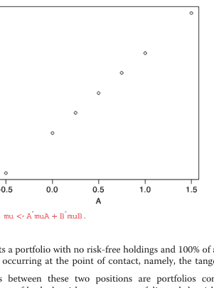

图 3.2 μ = A μ_A + B μ_B。

代表没有任何无风险资产、100%资产均持有于该组合中的投资组合，该位置即接触点，即切点：

- 1) 这两个位置之间的点，是同时正持有风险切点组合和无风险资产的投资组合。
- 2) 位于切点之外、射线上的点是杠杆化投资组合，其中无风险资产为负持有（即无风险资产被卖空，换句话说，投资者按无风险利率借入资金），而投入切点组合的金额超过投资者初始资本的 100%。

这一有效射线称为资本配置线（CAL），其方程可以表示为

$E(R_C) = R_F + (\sigma_C[(E(R_P) - R_F)/\sigma_P])$ (3.11)

在式 (3.11) 中，

P 是与马科维茨子弹形前沿相切处的风险资产子组合。

F 是无风险资产。

C 是组合 P 与 F 的合并。

利用该图可以看出，将无风险资产作为组合的可能组成部分后，可获得的风险-期望收益组合的范围得到改善，因为在每一个可能的风险水平上，除了切点组合之外，射线上的期望收益都高于双曲线。线性有效轨迹上的所有点都可以通过无风险资产与切点组合的持有组合来实现，这被称为“单共同基金定理”，其中所指的共同基金就是切点组合。

### 3.2.1.8 资产定价

到目前为止，上述分析描述的是单个投资者的最优行为。资产定价理论以下列方式依赖这一分析：

由于每位投资者都以相同比例持有风险资产，也就是按照切点组合所给出的比例持有，因此在市场均衡中，风险资产的价格及其期望收益会调整，使切点组合中的比例与风险资产在市场上的供给比例相同。因此，相对供给将等于相对需求：

> 现代投资组合理论正是在此背景下推导出正确定价资产所需的期望收益率。

### 3.2.1.9 特有风险与系统性风险

- 特有风险是与单项资产相关的风险。在投资组合内部，这些风险可以通过分散化来降低，也就是相互抵消。特有风险也被称为可分散风险、独特风险、非系统性风险或特质风险。
- 系统性风险，也就是组合风险或市场风险，是所有证券共同面临的风险（卖空除外）。系统性风险无法在单一市场内通过分散化消除。在市场组合内部，资产特有风险可以在可能范围内得到分散。因此，系统性风险被等同于市场组合的风险。

由于只有当一种证券能够改善市场组合的风险-期望收益特征时，投资者才会购买它，因此衡量一种证券风险的相关指标是它给市场组合增加的风险，而不是它在孤立状态下的风险。在此背景下，资产的波动性及其与市场组合的相关性都可以从历史数据中观察到，因而可供考虑。

一个市场内的系统性风险可以通过在同一投资组合中同时使用多头和空头头寸的策略来管理，从而构建“市场中性”投资组合。市场中性投资组合的相关性为零。

## 3.2.2 资本资产定价模型（CAPM）

对于给定的资产配置，收益取决于资产的价格和支付的总金额。投资的目标是，支付的价格应确保将该资产加入市场组合后，市场组合的风险-收益特征得到改善。CAPM 是一种方法，它根据投资者可获得的无风险利率和整个市场的风险，推导出资产在市场中理论上要求的期望收益率（即贴现率）。

CAPM 通常表示如下：

E(R_i) = R_f + β_i [E(R_m) - R_f]  (3.12)

其中 β 是资产对整体市场变化的敏感度，通常通过历史数据相关性求得，同时需注意

- a) β > 1：表示该资产对整体投资组合风险的贡献高于平均水平；
- b) β < 1：表示该资产对组合风险的贡献低于平均水平。
- c) [E(R_m) − R_f] 是市场风险溢价，即市场组合期望收益相对于无风险利率的期望超额收益。

上述结论可以按如下方式推导：

- i) 组合 m 的初始风险 = w_m² σ_m²。当新的风险资产 a 被加入市场组合 m 时，其对风险和期望收益的增量影响可由两资产组合公式推出。随后可利用这些结果推导适合该资产的贴现率，如下所示：
- ii) 市场组合的风险 = {w_m² σ_m² + w_a² σ_a² + 2 w_m w_a ρ_am σ_a σ_m}。因此，加入该资产后增加的风险 = [w_a² σ_a² + 2 w_m w_a ρ_am σ_a σ_m]。但由于资产权重相对较低，即 w_a² ≈ 0，所以 w_a² σ_a² ≈ 0，因而增加的风险 ≈ 2 w_m w_a ρ_am σ_a σ_m。
- iii) 由于市场组合的期望收益 = (w_m E(R_m) + [w_a E(R_a)])，增加的期望收益 = [w_a E(R_a)]。
- iv) 另一方面，如果资产 a 定价准确，那么将其加入市场组合 m 后风险-期望收益比所获得的改善，至少不会低于将同样资金用于增加市场组合持仓所获得的收益。这里假设投资者使用按无风险利率 R_f 借入的资金购买该资产。只要

E(R_a) > R_f  (3.13)

上述假设就是合理的。

因此，[w_a(E(R_a) - R_f)] / {2 w_m w_a ρ_am σ_a σ_m} = [w_a(E(R_m) - R_f)] / [2 w_m w_a ρ_m σ_m σ_m]  (3.14) 即 [E(R_a)] = R_f + [E(R_m) - R_f] * [ρ_am σ_a σ_m] / [σ_m σ_m]  (3.15) 或 [E(R_a)] = R_f + [E(R_m) - R_f] * [σ_am] / [σ_mm]  (3.16)


2) 从可在 CRAN 上获取的 R 包 MarkowitzR 中选取了一个示例。对此示例，运行了相应的 R 程序，输出了相应的数值和图形结果。

## 3.2.3.1 使用 R 的 Markowitz 均值-方差模型：由两个风险资产组成的投资组合的简单示例

本示例在仅有一个无风险资产和两个风险资产的简单环境中介绍现代投资组合理论。

### 两个风险资产的投资组合

考虑一个投资问题，其中有两个不支付股息的股票：股票 A 和股票 B，并且在下个月设

- R_A 为股票 A 的月简单收益率，且
- R_B 为股票 B 的月简单收益率。

由于这些收益要到每个月末才会实现，其收益可视为随机变量。

假设收益 R_A 和 R_B 服从联合正态分布，并且关于两个收益概率分布的均值、方差和协方差有以下信息可用：

均值 μ_i、标准差 σ_i、协方差 σ_AB 和相关系数 ρ_AB 定义如下：

μ_A = E[R_A]  (3.18a)
σ_A² = var(R_A)  (3.18b)
μ_B = E[R_B]  (3.19a)
σ_B² = var(R_B)  (3.19b)
σ_AB = cov(R_A, R_B)  (3.20)
ρ_AB = cor(R_A, R_B) = σ_AB/(σ_A σ_B)  (3.21)

其中 E 为期望，var 为方差。

通常，这些值是根据两只股票的历史收益数据估计的。另一方面，它们也可能是分析师的主观估计！

对于本练习，可以假设这些值是已知的：

### 备注：

- 1) 对于两只股票各自的月收益，预期收益 μ_A 和 μ_B 被认为是最佳估计期望值。然而，由于投资收益是随机变量，必须认识到实际实现的收益可能与这些期望值不同。方差 σ_A² 和 σ_B² 提供了与这些月收益相关的不确定性的一些估计度量。

### 表 3.2 两资产投资组合示例数据。

| μ_A | σ_A² | μ_B | σ_B² | σ_A | σ_B | σ_AB | ρ_AB |
|---|---|---|---|---|---|---|---|
| 0.2 | 0.05 | 0.04 | 0.01 | 0.2236 | 0.1000 | -0.0038 | -0.17 |

并且两资产投资组合数据的特征可以扩展，如表 3.2 所示：

根据表 3.2 所表达的可用投资数据，资产配置问题可表述如下：

### 资产配置

对于给定的初始流动资产总额 T₀，任务是将其 *全部* 投资于股票 A 和 B。投资问题是资产配置决策：分配多少给资产 A，多少给资产 B？

*设 x_A 为投资于股票 A 的 T₀ 比例，x_B 为投资于股票 B 的 T₀ 比例。*

x_A 和 x_B 的值可以为正、零或负：

- 正值意味着 *做多* 头寸，即资产的 *买入*。
- 负值意味着 *做空* 头寸，即资产的 *卖出*。
- 零值意味着资产中 *无* 头寸。

由于所有财富都投资于这两个资产，因此

x_A + x_B = 1

(3.22)

因此，如果资产 A 被“做空”，则做空所得将用于购买更多资产 B，反之亦然。（“做空”资产是指借入资产，通常来自经纪人，然后将其出售：做空所得通常存放在经纪人账户中——通常可能存在一些限制，阻止使用这些资金购买其他资产。做空头寸在资产被回购并归还给原所有者时平仓。如果资产价值下跌，则做空获利；如果资产价值上涨，则发生亏损！）因此，投资问题是 *确定 x_A 和 x_B 的值，使得投资的总体利润始终最大化！*

当前对两只股票的投资构成一个投资组合，A 和 B 的份额是投资组合份额或权重。

在本示例中，投资组合在下个月的收益 R_p 是一个随机变量，由下式给出

R_p = x_A R_A + x_B R_B

(3.23)

即随机变量 R_A 和 R_B 的加权平均或线性组合。此外，由于 R_A 和 R_B 都假设为正态分布，根据 (3.23) 可知 $R_p$ 也是正态分布的。此外，利用随机变量线性组合的性质，(3.23) 可用于确定 $R_p$ 分布的均值和方差，即整个投资组合的收益。

### 投资组合的预期收益和方差

再次根据 (3.23)，投资组合收益分布的均值、方差和标准差可轻松推导如下：

- 投资组合的均值 $\mu_p$ 由下式给出
  $\mu_p = E[R_p]$
  $= E[x_A R_A + x_B R_B],$ 根据 (3.23) 直接代入
  $= x_A E[R_A] + x_B E[R_B],$ 由期望算子 $E$ 的线性性质
  $= x_A \mu_A + x_B \mu_B$
  即，
  $\mu_p = E[R_p] = x_A \mu_A + x_B \mu_B$  (3.24)

- 投资组合的方差 $\sigma_p^2$ 由下式给出
  $\sigma_p^2 = \text{var}(R_p)$
  $= E[(R_p - \mu_p)^2],$ 按方差性质的定义
  $= E[((x_A R_A + x_B R_B) - (x_A \mu_A + x_B \mu_B))^2]$
  根据 (3.23) 和 (3.24) 分别直接代入：
  $= E[(x_A R_A + x_B R_B)^2 + (x_A \mu_A + x_B \mu_B)^2 - 2(x_A R_A + x_B R_B)(x_A \mu_A + x_B \mu_B)]$
  在平方项后
  $= E[(x_A^2 R_A^2 + x_B^2 R_B^2 + 2x_A x_B R_A R_B) + (x_A^2 \mu_A^2 + x_B^2 \mu_B^2 + 2x_A x_B \mu_A \mu_B) - (2x_A^2 R_A \mu_A + 2x_A x_B R_A \mu_B + 2x_A x_B R_B \mu_A + 2x_B^2 R_B \mu_B)]$
  在展开乘法项后
  $= E[x_A^2 R_A^2 + x_B^2 R_B^2 + 2x_A x_B R_A R_B + x_A^2 \mu_A^2 + x_B^2 \mu_B^2 + 2x_A x_B \mu_A \mu_B - 2x_A^2 R_A \mu_A - 2x_A x_B R_A \mu_B - 2x_A x_B R_B \mu_A - 2x_B^2 R_B \mu_B]$
  在去掉所有括号后
  $= E[(x_A^2 R_A^2 - 2x_A^2 R_A \mu_A + x_A^2 \mu_A^2) + (x_B^2 R_B^2 - 2x_B^2 R_B \mu_B + x_B^2 \mu_B^2) + (2x_A x_B R_A R_B + 2x_A x_B \mu_A \mu_B - 2x_A x_B R_A \mu_B - 2x_A x_B R_B \mu_A)]$

- 3) 因此，在构建投资组合时，收益负相关的资产可能是有益的，因为如投资组合标准差所示的伴随风险会降低。
- 4) 只要相关性较小，由正相关资产组成的投资组合可能会降低风险。

## 示例 3.2 一些初步模型投资组合

利用表 3.2 中的资产信息，可以创建一些初步投资组合：

**投资组合 1：** 等权重投资组合，其中 $x_A = 0.500 = x_B$。

给定：
此处可以使用方程 (3.23–3.26)：

$R_p = x_A R_A + x_B R_B$  (3.23)
$\mu_p = E[R_p] = x_A \mu_A + x_B \mu_B$  (3.24)
$\sigma_p^2 = \text{var}(R_p) = x_A^2 \sigma_A^2 + x_B^2 \sigma_B^2 + 2 x_A x_B \sigma_{AB}$  (3.25)
$\sigma_p = \text{SD}(R_p) = \sqrt{\text{var}(R_p)} = \sqrt{x_A^2 \sigma_A^2 + x_B^2 \sigma_B^2 + 2 x_A x_B \sigma_{AB}}$  (3.26)

得到

$\mu_p = E[R_p] = x_A \mu_A + x_B \mu_B$，使用 (3.24)
$= (0.500)(0.2) + (0.500)(0.04)$，使用表 3.2
$= 0.100 + 0.020$
$= 0.120$

$\sigma_p^2 = \text{var}(R_p) = x_A^2 \sigma_A^2 + x_B^2 \sigma_B^2 + 2 x_A x_B \sigma_{AB}$，使用 (3.25) 和表 3.2
$= (0.500)^2 (-0.2236)^2 + (0.500)^2 (-0.1000)^2$
$+ 2(0.500)(0.500)(-0.0038)(-0.1000)$
$= 0.0125 + 0.0025 + 0.00019$
$= 0.01519$

$\sigma_p = \sqrt{\sigma_p^2} = \text{SD}(R_p) = \sqrt{\text{var}(R_p)}$，使用 (3.26)
$= \sqrt{(0.01519)}$
$= 0.12325$

$\mu_p = E[R_p] = x_A \mu_A + x_B \mu_B$

**备注：**
以下 R-code* 段可用于此计算：

```
mu <- A'muA + B'muB
σ_p^2 <- var(R_p) <- x_A^2 σ_A^2 + x_B^2 σ_B^2 + 2 x_A x_B σ_AB
var <- A'A sigA*sigA + B'B sigB*sigB + 2' A'B' sigAB)
```

σ_p² = var(R_p) = x_A² σ_A² + x_B² σ_B² + 2 x_A x_B σ_A σ_B = (0.5)²(0.05) + (0.5)²(0.01) + 2(0.5)(0.5)(-0.0038) = 0.0125 + 0.0025 + (-0.0019) = 0.0131

σ_p = √0.0131 = 0.11446

- 该投资组合的预期收益为 μ_p = 0.12，即 12%，介于资产 A 的预期收益（μ_A = 0.20 或 20%）和资产 B 的预期收益（μ_B = 0.04 或 4%）之间，而投资组合标准差（σ_p = 0.11446 或 11.446%）小于两个资产标准差之间的一半，即 |(-0.2236 + -0.1000)|/2 = 0.1618，或 16.18%。

这反映了 *风险分散带来的风险降低*。

- 在 “long-short combination” 投资组合中，x_A = 1.5 且 x_B = -0.5，其中资产 B 被卖空，且该卖空所得用于杠杆化对资产 A 的投资。投资组合特征随后由下式给出

μ_p = E[R_p] = x_A μ_A + x_B μ_B = (1.5)(0.2) + (-0.5)(0.04) = 0.3 - 0.02 = 0.28

σ_p² = var(R_p) = x_A² σ_A² + x_B² σ_B² + 2 x_A x_B σ_A σ_B = (1.5)²(0.05) + (-0.5)²(0.01) + 2(1.5)(-0.5)(-0.0038) = 0.1125 + 0.0025 + 0.0057 = 0.1207

σ_p = √0.1207 = 0.34742

因此，与 “equally weighted” 投资组合（其中 x_A = x_B = 0.5）相比，x_A = 1.5 且 x_B = -0.5 的 “long-short combination” 投资组合既显示出更高的预期收益（μ_p = 0.28 与 0.2 相比），也显示出高于资产 A 的标准差（σ_p = 0.34742 与 [-0.2236] = 0.2236 相比）！此外，相对预期收益（RER）由下式给出

RER = (μ_p - "equally weighted")/(μ_p - "unequally weighted") = 0.28/0.20 = 1.4

因此，对于 x_A = 1、0.75、0.50、0.25、0、1.5 和 −0.5，以下 R 代码段将进行计算。结果如下，并附有部分图形展示：

### 在 R 域中：

```
> muA <- 0.2
> sigmasqA <- 0.05
> muB <- 0.04
> sigmasqB <- 0.01
> sigA <- 0.2236
> sigB <- 0.1000
> sigAB <- -0.0038
> rhoAB <- -0.17
>
> A <- c(1, 0.75, 0.50, 0.25, 0, 1.5, -0.5)
> B <- c(0, 0.25, 0.50, 0.75, 1, -0.5, 1.5)
> mu <- A*muA + B*muB
> var <- A*A*sigA*sigA + B*B*sigB*sigB + 2*A*B*sigAB
> sigma <- sqrt(var)
>
> mu
[1] 0.20 0.16 0.12 0.08 0.04 0.28 -0.04
>
> sigma
[1] 0.2236000  0.1652976  0.1144519  0.0855851
[5] 0.1000000  0.3474092  0.2017405
>
> plot(A, sigma) # Outputting: Figure 3.4
> RER <- mu/sigma
> RER
[1] 0.8944544 0.9679513 1.0484753 0.9347421
[5] 0.4000000 0.8059660 -0.1982745
>
> plot(A, RER) # Outputting: Figure 3.5
```

## 3.2.3.2 评估投资组合

考虑对资产 A 和 B 的投资组合的初始投资 I₀，其中

- a) 收益由 (3.23) 给出，

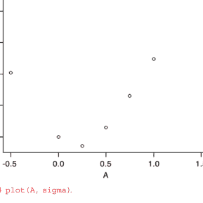

图 3.4 绘制 (A, sigma)。

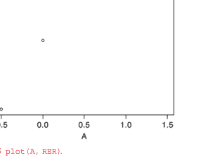

图 3.5 绘制 (A, RER)。

**备注：** 注意

VaR_{P,0.05} = −291,510，来自 (3.33)

和

x_A VaR_{A,0.05} + x_B VaR_{B,0.05} = −189,033，来自 (3.35)

即，

VaR_{P,0.05} ≠ x_A VaR_{A,0.05} + x_B VaR_{B,0.05}

因为

ρ_AB ≠ 1.

## 3.2.4 由两个风险资产组成的投资组合的管理

在由两个风险资产组成的投资组合的管理中，方法可以从构建均值-方差有效投资组合开始，使用以下资产收益分布和投资者的行为：

- 1. 所有收益都
  - a) 协方差平稳，
  - b) 遍历的，且
  - c) 在投资期限内联合正态分布。

这意味着收益的均值、方差和协方差在投资期限内保持不变，并完全表征收益的联合分布。

- 1) 投资者知道资产收益均值、方差和协方差的值。
- 2) 投资者只关心投资组合预期收益和投资组合方差。投资者偏好预期收益高的投资组合，但不偏好收益方差高的投资组合。

在上述假设下，可以表征有效投资组合的集合，即在由投资组合方差衡量的给定风险水平下具有最高预期收益的投资组合。这些投资组合是投资者最可能的选择。

对于由两个风险资产组成的投资组合管理的数值示例，使用表 3.2 中的数据集。

### 示例 3.5 由两个风险资产组成的投资组合

以下 R 代码段将按照第 3.1.3.3 节概述进行计算。结果如下，并附有图形展示：

```
mu.A <- 0.2
sig2.A <- 0.05
mu.B <- 0.04
sig2.B <- 0.01
sig.A <- 0.2236
sig.B <- 0.1000
sig.AB <- -0.0038
rhoAB <- -0.17
x.A = seq(from=-0.4, to=1.4, by=0.1)
x.B = 1 - x.A
mu.p = x.A*mu.A + x.B*mu.B
sig2.p = x.A^2 * sig2.A + x.B^2 * sig2.B + 2*x.A*x.B*sig.AB
sig.p = sqrt(sig2.p)
plot(sig.p, mu.p, type="b", pch=16, ylim=c(0, max(mu.p)),
xlim=c(0, max(sig.p)), xlab=expression(sigma[p]),
ylab=expression(mu[p]),
col=c(rep("red", 6), rep("green", 13)))
plot(sig.p, mu.p, type="b", pch=16,
ylim=c(0, max(mu.p)), xlim=c(0, max(sig.p)),
xlab=expression(sigma[p]), ylab=expression(mu[p]),
col=c(rep("red", 6), rep("green", 13)))
text(x=sig.A, y=mu.A, labels="Asset A", pos=4)
text(x=sig.B, y=mu.B, labels="Asset B", pos=4)
```

### 在 R 域中：

```
> mu.A <- 0.2
> sig2.A <- 0.05
> mu.B <- 0.04
> sig2.B <- 0.01
> sig.A <- 0.2236
> sig.B <- 0.1000
> sig.AB <- -0.0038
> rhoAB <- -0.17
>
> x.A = seq(from=-0.4, to=1.4, by=0.1)
> x.B = 1 - x.A
> mu.p = x.A*mu.A + x.B*mu.B
> sig2.p = x.A^2 * sig2.A + x.B^2 * sig2.B + 2*x.A*x.B*sig.AB
> sig.p = sqrt(sig2.p)
> plot(sig.p, mu.p, type="b", pch=16,
+ ylim=c(0, max(mu.p)), xlim=c(0, max(sig.p)),
+ xlab=expression(sigma[p]), ylab=expression(mu[p]),
```

```
+ col=c(rep("red", 6), rep("green", 13))
+ plot(sig.p, mu.p, type="b", pch=19)
+ ylim=c(0, max(mu.p)), xlim=c(0, max(sig.p)),
+ xlab=expression(sigma[p]), ylab=expression(mu[p]),
+ col=c(rep("red", 6), rep("green", 13))
> text(x=sig.A, y=mu.A, labels="Asset A", pos=4)
> text(x=sig.B, y=mu.B, labels="Asset B", pos=4)

> # Outputting: Figure 3.6 Frontier of the Two-Asset
Portfolio (A,B)
>
```

图 3.6 显示了表 1.1 中示例数据的两资产投资组合 $(A, B)$ 的前沿。所有可行投资组合的集合，或在两种资产的情况下的投资可能性集合，仅仅是通过改变投资组合权重 $x_A$ 和 $x_B$ 使得权重之和为 1 而形成的全部可能投资组合：$x_A+x_B=1$。可以用投资组合预期收益 $\mu_p$ 为纵坐标、投资组合标准差 $\sigma_p$ 为横坐标的图来总结可行投资组合的预期收益-风险（即均值方差）特性。投资组合标准差代替方差使用，因为标准差的度量单位与期望值相同。

### 示例 3.6 给定一组投资数据的资产配置选项

对于如表 3.2、示例 3.5 和图 3.6 中给出的投资数据集合，资产 A 的投资组合权重 $x_A$ 从 −0.4 变化到 1.4

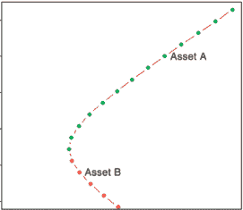

**图 3.6** 两资产投资组合 $(A, B)$ 的前沿。

以 0.1 为增量，并且由于 $x_A + x_B = 1$，资产 $B$ 的权重随后从 1.4 变化到 $-0.4$，提供总共 18 个投资组合，其权重为：
$(x_A, x_B) = (-0.4, 1.4), (-0.3, 1.3), (-0.2, 1.2), \dots, (1.2, -0.2), (1.3, -0.3), (1.4, -0.4)$

对于这些投资组合中的每一个，使用公式 (3.24) 和 (3.26) 计算 $\mu_p$ 和 $\sigma_p$，并在图 3.6 中绘制结果显示 $\mu_p$ 与 $\sigma_p$ 的图类似于侧卧的抛物线（实际上，它是双曲线的其中一侧）。假设投资者偏好在给定风险水平 $\sigma_p$ 下具有最高预期收益 $\mu_p$ 的投资组合：

- 位于 *左上角* 的组合是最优投资组合。
- 位于 *右下角* 的组合是最差投资组合。

注意抛物线底部的投资组合在所有可行投资组合中具有最小方差。因此，该投资组合被称为 *全局最小方差投资组合*。

在给定风险水平下，具有最高预期收益的投资组合在图 3.6 中用绿色着色。这些被称为有效投资组合。

无效投资组合是指存在另一个可行投资组合，其风险 ($\sigma_p$) 相同但预期收益 ($\mu_p$) 更高——它们在图 3.6 中用红色着色。因此，图 3.6 显示无效投资组合是位于全局最小方差投资组合下方的可行投资组合，而有效投资组合是位于全局最小方差投资组合上方的投资组合。

### 3.2.4.1 全局最小方差投资组合

使用初等微积分，找到全局最小方差投资组合是微积分中的一个简单练习。该约束优化可定义为
$\displaystyle \min_{x_A, x_B} \{\sigma_p^2 = x_A^2 \sigma_A^2 + x_B^2 \sigma_B^2 + 2 x_A x_B \sigma_{AB}\},\quad \text{such that } x_A + x_B = 1$

这是一个约束优化问题，可通过以下两种方式求解：

*第一种方法：* *代入法*——使用约束关系代入两个变量 $(x_A, x_B)$ 中的一个，将约束优化问题（两个变量）转化为仅一个变量的无约束优化问题。因此，从 $x_A + x_B = 1$ 代入，将 $x_B = 1 - x_A$ 插入 $\sigma_p^2$ 公式中，可将优化问题简化为
$\displaystyle \min_{x_A} \{\sigma_p^2 = x_A^2 \sigma_A^2 + (1 - x_A)^2 \sigma_B^2 + 2 x_A (1 - x_A) \sigma_{AB}\}\tag{3.36}$

表达式 (3.36) 中局部驻点的条件是
$\displaystyle \frac{d(\sigma_p^2)}{dx_A} = 0\tag{3.37}$


给定拉格朗日乘子函数 L（如(3.39)所示），有

0 = ∂L/∂x_A = ∂L(x_A, x_B, λ)/∂x_A = ∂{(x_A²σ_A² + x_B²σ_B² + 2x_Ax_Bσ_AB) + λ(x_A + x_B − 1)}/∂x_A = (2x_Aσ_A² + 0 + 2x_Bσ_AB) + λ(1 + 0 − 0) = 2x_Aσ_A² + 2x_Bσ_AB + λ (3.41a)

0 = ∂L/∂x_B = ∂L(x_A, x_B, λ)/∂x_B = ∂{(x_A²σ_A² + x_B²σ_B² + 2x_Ax_Bσ_AB) + λ(x_A + x_B − 1)}/∂x_B = (0 + 2x_Bσ_B² + 2x_Aσ_AB) + λ(1 + 0 − 0) = 2x_Bσ_B² + 2x_Aσ_AB + λ (3.41b)

0 = ∂L/∂λ = ∂L(x_A, x_B, λ)/∂λ = ∂{(x_A²σ_A² + x_B²σ_B² + 2x_Ax_Bσ_AB) + λ(x_A + x_B − 1)}/∂λ = (0 + 0 + 0) + (x_A + x_B − 1) = x_A + x_B − 1 (3.41c)

结合(3.41a)和(3.41b)，可得

2x_Aσ_A² + 2x_Bσ_AB + λ = 0 = 2x_Bσ_B² + 2x_Aσ_AB + λ

即

2x_Aσ_A² + 2x_Bσ_AB = 2x_Bσ_B² + 2x_Aσ_AB

即

x_Aσ_A² + x_Bσ_AB = x_Bσ_B² + x_Aσ_AB

即

x_Aσ_A² − x_Aσ_AB = x_Bσ_B² − x_Bσ_AB

即

x_A(σ_A² − σ_AB) = x_B(σ_B² − σ_AB)

或

x_B = x_A (σ_A² − σ_AB)/(σ_B² − σ_AB) (3.42)

最后，为了获得所需值 (x_A^{min}, x_B^{min})，可以引入第三个拉格朗日乘子条件 (3.41c)，即结合(3.42)和(3.41c)：

由(3.42)得，x_B^{min} = x_A^{min} (σ_A² − σ_AB)/(σ_B² − σ_AB) (3.43a)

由(3.41c)得，x_B^{min} = 1 − x_A^{min} (3.43b)

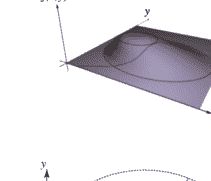

图3.7 拉格朗日乘子法：在约束条件（红色）g(x, y) = 常数下，求 x 和 y 使得目标函数最大化（或最小化）。

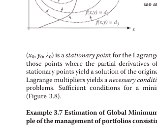

图3.8 图3.7的等高线图。红色线表示约束条件 g(x, y) = c。蓝色线是 f(x, y) 的等高线。解是红色线与蓝色等高线相切的点。（由于 d1 > d2，该解是函数 f(x, y) 的最大化。纵坐标和横坐标都是任意的。）

(x0, y0, λ0) 是拉格朗日函数的一个驻点（驻点是使 L 的偏导数为零的点）。然而，并非所有驻点都能得出原问题的解。因此，拉格朗日乘子法为约束问题的最优性提供了必要条件。最小化或最大化的充分条件也是存在的（图3.8）。

## 例3.7 全局最小方差估计：使用表3.2的数据集，对由两种风险资产组成的投资组合进行数值示例。

使用表3.2（如上重述）中的数据以及式(3.44a)和(3.44b)：

x_A^{min} = (σ_B² − σ_AB)/(σ_A² + σ_B² − 2σ_AB)
= {0.01 − (−0.0038)}/{0.05 + 0.01 − 2(−0.0038)} (3.44a)
= 0.0138/0.0676
= 0.2041

x_B^{min} = 1 − x_A^{min}
= 1 − 0.2041 (3.44b)
= 0.7959

对于投资组合头寸的这些值 (x_A^{min}, x_B^{min})，相应的期望收益 μ_p、方差 var(R_p) 和标准差 σ_p 可由以下关系式计算：

μ_p = E[R_p] = x_A μ_A + x_B μ_B (3.24)

σ_p² = var(R_p) = x_A² σ_A² + x_B² σ_B² + 2x_A x_B σ_AB (3.25)

σ_p = SD(R_p) = sqrt(var(R_p)) = sqrt(x_A² σ_A² + x_B² σ_B² + 2x_A x_B σ_AB) (3.26)

因此，

μ_p = E[R_p] = x_A^{min} μ_A + x_B^{min} μ_B
= (0.2041)(0.2) + (0.7959)(0.04)
= 0.04082 + 0.03184
= 0.07266

σ_p² = var(R_p) = (x_A^{min})² σ_A² + (x_B^{min})² σ_B² + 2(x_A^{min})(x_B^{min}) σ_AB
= (0.2041)²(0.05) + (0.7959)²(0.01) + 2(0.2041)(0.7959)(−0.0038)
= 0.00208 + 0.00633 − 0.00123
= 0.00718

σ_p = SD(R_p) = sqrt(var(R_p))
= sqrt(0.00718)
= 0.08473

**建议使用 R 进行计算的练习：** 作为练习，请编写一个 R 程序来完成所有计算。

## 3.2.4.2 投资组合方差对投资可能性的影响

对于由任意两种资产 A 和 B 组成的投资组合，A 和 B 之间的相关性可能强烈影响投资组合的投资可能性。因此，

- a) 如果 ρ_AB 接近 1，那么投资集趋近于线性关系，使得收益接近一条连接全投资于资产 B 的投资组合（即 (x_A, x_B) = (0, 1)）与全投资于资产 A 的投资组合（即 (x_A, x_B) = (1, 0)）的直线。
- b) 在以 μ_p 为纵轴、σ_p 为横轴的图中（见图1.2），随着 ρ_AB 接近 0，投资集向 μ_p 轴弯曲，分散化的力量开始显现！如果 ρ_AB = −1，投资集将实际上与 μ_p 轴相切。这意味着资产 A 和 B 完全负相关，且存在一个由 A 和 B 组成的投资组合，其期望收益为正但方差为零！

为了确定当 ρ_AB = −1 时 σ_p^{min} = 0 的投资组合，可以使用(3.44a)和(3.44b)，以及条件

σ_AB = ρ_AB σ_A σ_B (3.27)

得到

x_A^{min} = (σ_B² − σ_AB)/(σ_A² + σ_B² − 2σ_AB) (3.44a)

由于 ρ_AB = −1，

σ_AB = ρ_AB σ_A σ_B = (−1)σ_A σ_B = −σ_A σ_B (3.45)

现在，由(3.44)得，

x_A^{min} = (σ_B² − σ_AB)/(σ_A² + σ_B² − 2σ_AB)
= (σ_B² − (−σ_A σ_B))/(σ_A² + σ_B² − 2(−σ_A σ_B))，由(3.45)
= (σ_B² + σ_A σ_B)/(σ_A² + σ_B² + 2σ_A σ_B)
= σ_B(σ_A + σ_B)/(σ_A² + 2σ_A σ_B + σ_B²)
= σ_B(σ_B + σ_A)/(σ_B + σ_A)²
= σ_B/(σ_B + σ_A) (3.44a)

并使用(3.44b)，

x_B^{min} = 1 − x_A^{min} (3.44b)

## 3.2.4.3 投资组合优化简介

对于图3.6中描述的有效投资组合集，关键问题将是

> "投资者应该选择哪种投资组合？为什么？"

在有效投资组合中，投资者会选择最符合其风险偏好的那一个。一般而言，风险规避型投资者会偏好风险较低（即低波动性）的投资组合，并倾向于选择接近全局最小方差投资组合的组合。

另一方面，风险容忍型投资者会忽视波动性，追求高期望收益的投资组合。这些投资者会选择持有大量资产 A 的投资组合，其中可能涉及卖空资产 B。

## 3.2.5 含无风险资产的有吸引力投资组合

在第3.1.4节中，构建了不存在无风险资产时的有效投资组合集。现在考虑引入无风险资产时会发生什么。

无风险资产相当于一张到期日为假定投资期末的无违约纯折现债券。无风险利率 r_f 可以用低风险债券的名义收益率来表示。例如，如果投资期为 1 个月，那么无风险资产是 30 天期美国国库券（T-bill），无风险利率就是该国库券的名义收益率。（美国国债的"无违约"假设一直受到质疑，因为美国国会可能而且很可能无力解决美国政府的长期债务问题。）

如果投资组合中无风险资产的持有为正，则相当于以无风险利率"贷出资金"。如果投资组合中无风险资产的持有为负，则相当于以无风险利率借入资金。

## 3.2.5.1 含无风险资产的有吸引力投资组合

考虑一个包含资产 B 的任意投资组合；如果在该投资组合中引入无风险资产（例如国库券），可以考察其后果。

现在，无风险利率在投资期内是恒定的（固定的）。无风险资产具有以下性质：

μ_f = E[r_f] = r_f (3.45a)

var(r_f) = 0 (3.45b)

cov(R_B, r_f) = 0 (3.45c)

那么，在该投资组合中，

- 设资产 B 的投资比例为 x_B，
- 那么国库券的投资比例为 (1 − x_B)

因此该投资组合的收益为

R_p = 资产 B 的收益 + 无风险资产的收益
= x_B R_B + (1 − x_B) r_f
= r_f + (R_B − r_f) x_B (3.46)

项 (R_B − r_f) 是资产 B 相对于国库券收益的超额收益。

因此，该投资组合的期望收益为

μ_p = r_f + (E[R_B] − r_f) x_B
= r_f + (μ_B − r_f) x_B (3.47)

在(3.47)中，因子 (μ_B − r_f) 是资产 B 的期望超额收益或风险溢价。


## 备注

- 1) 风险资产的风险溢价通常为正，这表明投资者对风险资产的预期回报将高于安全资产。投资组合的这一“风险溢价”可以用资产B的风险溢价表示，利用(3.47)如下：
  
  μ_p = r_f + (E[R_B] - r_f)x_B  (3.47)
        = r_f + (μ_B - r_f)x_B
  
  Risk Premium = (μ_p - r_f)  (3.48)
               = (μ_B - r_f)x_B
  
- 2) 因此，对资产B的投资越多，投资组合的风险溢价就越高。
  
- 3) 由于无风险利率是恒定的，投资组合的方差仅取决于资产B的变动性，其表达式为：
  
  σ_p² = x_B² σ_B²  (3.49)
  
- 4) 因此，投资组合的标准差与资产B的标准差成比例：
  
  σ_p = x_B σ_B  (3.50a)
  
  由此可以解出x_B：
  
  x_B = σ_p / σ_B  (3.50b)
  
- 5) 资本配置线（CAL）——结合(3.47)和(3.50b)，可以得到有效投资组合的集合：
  
  μ_p = r_f + (E[R_B] - r_f)x_B  (3.47)
        = r_f + (μ_B - r_f)x_B
  
  Risk Premium = (μ_p - r_f)  (3.48)
               = (μ_B - r_f)x_B
  
  或者
  
  (μ_B - r_f) = (μ_p - r_f)/x_B
              = (μ_B - r_f)(σ_p/σ_B), 来自(3.50b)
  
  因此，
  
  μ_p = {(μ_B - r_f)/σ_B}σ_p + r_f  (3.51)
  
  这是(σ_p, μ_p)-空间中的一条直线，斜率为{(μ_B - r_f)/σ_B}，纵轴截距为r_f。

这就是资本配置线（CAL）——参见第3.1.1.7节。

该直线的斜率就是夏普比率（SR）——参见第3.1.1.6节。它衡量的是资产每单位风险（以资产标准差衡量）所对应的风险溢价。

6) 具有一个可卖空资产的两资产投资组合的特征——为了理解两资产投资组合的经济特征，可以考虑将两种资产合并组成一个投资组合的效果。可以将分析扩展到允许空头头寸的情形。

首先，假设投资者可以以相同的利率e_A对无风险资产做多（贷出）或做空（借入）。

设x_A和x_B分别为投资于资产A和B的比例，e_A和e_B分别为它们各自的收益。

那么，整个投资组合的预期收益e_p由下式给出：

e_p = x_A e_A + x_B e_B

(3.52)

且由于

x_A + x_B = 1，

即

x_A = 1 - x_B

(3.52)可写为

e_p = (1 - x_B) e_A + x_B e_B

即

e_p = e_A + x_B (e_B - e_A)

(3.53)

投资组合的方差var_p将是以下变量的函数：

- a) 投资于这些资产的比例x_A和x_B；
- b) 它们的收益方差：var_A和var_B；
- c) 它们收益之间的协方差：covar_{A-B}。

var_p = x_A^2 var_A + x_B^2 var_B + 2 x_A x_B covar_{A-B}

将(1 - x_B)代入x_A，可得到投资组合方差与资产B投资额之间的关系式：

var_{A-B} = (1 - x_B)^2 var_A + x_B^2 var_B + 2(1 - x_B) x_B covar_{A-B}
= (1 - 2x_B + x_B^2) var_A + x_B^2 var_B + 2x_B covar_{A-B} - 2x_B^2 covar_{A-B}
= var_A - 2x_B var_A + x_B^2 var_A + x_B^2 var_B + 2x_B covar_{A-B} - 2x_B^2 covar_{A-B}

即，

var_{A-B} = var_A + 2x_B(covar_{A-B} - var_A) + x_B^2(var_A - 2covar_{A-B} + var_B)  (3.54)

收益标准差SD_R是该方差的平方根：

SD_R = √(var_{A-B})

对于投资组合中的任意两种给定资产，在不失一般性的前提下，可以假设资产1的风险较小，同时其预期收益也较小。

现在，考虑两种资产不同组合所带来的风险-收益权衡。同时，考虑随着对风险资产投资增加（即风险资产x_B增加，无风险资产x_A减少）所得到的均值-方差和均值-标准差图的曲线形状。

## 3.2.5.1 一个无风险资产与一个风险资产的投资

当投资仅包含资产A和一个无风险资产（短期国库券）时，夏普比率SR_A（即资产的超额收益除以收益的变动性或标准差，参见第3.1.1.6节）由下式给出：

SR_A = (μ_A - r_f)/σ_A
= (0.2 - 0.03)/0.2236
= 0.7603  (3.55a)

另一方面，当投资仅包含资产B和短期国库券时，夏普比率SR_B为：

SR_B = (μ_B - r_f)/σ_B
= (0.04 - 0.03)/0.1000
= 0.1000  (3.55b)

这里的数据取自表3.2，无风险利率r_f=0.03是债券的名义收益率。因此，例如，如果投资期限为1个月，那么无风险资产就是“30天美国短期国库券（T-Bill）”，无风险利率r_f是该短期国库券的名义收益率。

### 备注

1) 这些投资组合的预期收益-风险权衡是线性的。

图3.9绘制了各种取值下均值-标准差组合的轨迹。

如果x_A和x_B分别是投资于资产A和B的比例，μ_A和μ_B分别是它们的预期收益，那么这两种资产的投资组合预期收益μ_p由下式给出：

μ_p = x_A μ_A + x_B μ_B

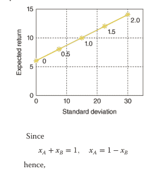

图3.9 均值-标准差轨迹。

由于

$x_A + x_B = 1, \quad x_A = 1 - x_B$

因此，

$\mu_p = (1 - x_B)\mu_A + x_B\mu_B$
$= \mu_A - x_B\mu_A + x_B\mu_B$
$= \mu_A + x_B(\mu_B - \mu_A)$

当$x_A = 6, \mu_B = 10, \sigma_A = 0, \sigma_B = 15,$ 和 $\text{covar}_{A-B} = 0$ 时，$x_B$ 介于0和1之间。

在这种情况下，与涉及无风险资产和风险资产的每种情况一样，两者关系是线性的。这一点很容易看出。回想前面的内容，$e_p$ 总是关于 $x_B$ 线性的。如果资产A是无风险的，$s_p (= x_A \sigma_A + x_B \sigma_B)$ 也将关于 $x_B$ 线性，因为 $\sigma_A^2$ 和 $\text{covar}_{A-B}$ 都等于零。在这种情况下，

$\sigma_{AB}^2 = (x_B^2)\sigma_B^2$
$s_p(= x_A \sigma_A + x_B \sigma_B) = \sqrt{[(x_B^2)\sigma_B^2]}$
$= |x_B|\sqrt{(\sigma_B^2)}$
$= |x_B|\sigma_B$

其中 $|(x_B)|$ 表示 $x_B$ 的绝对值。

这一结果可应用于允许空头头寸的情形。首先，假设投资者可以以相同的利率($e_A$)对无风险资产做多（贷出）或做空（借入）。这样就可以应用上述方程。图3.9展示了以这种方式使用杠杆所得的结果。因此，标记为1.5的点对应 $x_B = 1.5$ 和 $x_A = -0.5$。它表明，通过对资产B的投资“加杠杆”50%，可以获得初始资本收益的概率分布，其期望值为12%，标准差为22.5%。图中其他点的$x_A$对应于所示的$x_B$值。位于原始点上方的点涉及借入（x_A < 0），而位于下方的点涉及贷出（x_A > 0）。

- 2) 由资产A和短期国库券组成的投资组合，其预期收益一律高于由资产B和短期国库券组成的投资组合。这一结果是因为资产A的夏普比率0.7603高于资产B的夏普比率0.1000。
- 3) 资产A和短期国库券的投资组合相对于资产B和短期国库券的投资组合更为有效。
- 4) 夏普比率可以用作对单个资产收益效率进行排序的指标：夏普比率越高的资产，其风险-收益特性优于夏普比率越低的资产。因此，在金融工程中，分析师确实会根据资产的夏普比率对其进行排序。
- 5) 对于由风险资产A和无风险资产（如短期国库券）组成的投资组合，可以假设无风险利率在投资期内是恒定的（即固定的），并且具有以下特殊性质：对于无风险资产，假设

μ_f = E[r_f] = r_f  (3.56a)
var(r_f) = 0  (3.56b)
cov(R_A, r_f) = 0  (3.56c)

如果x_A表示投资于资产A的份额，x_f表示投资于投资组合中短期国库券部分的份额，则

x_A + x_f = 1  (3.57)

对于该投资，投资组合收益R_p由下式给出：

R_p = 来自资产A的收益 + 来自无风险投资的收益
= x_A R_A + x_f r_f
= x_A μ_A + (1 - x_A) r_f

即，
R_p = x_A (μ_A - r_f) + r_f  (3.58)

## 备注

- 1) (3.55)中的(μ_A - r_f)是资产A的预期超额收益，即风险溢价（高于无风险资产的部分）。对于风险资产，预期超额收益通常为正。也就是说，投资者期望从风险更高的投资中获得更高的回报。
- 2) 投资组合的预期超额收益可以用风险资产A的预期超额收益表示如下：
  
  (μ_p - r_f) = x_A (μ_A - r_f)  (3.59)


方程 (3.59) 显示，对于此类投资组合，所投资的风险资产 A 的比例越大，预期超额收益越高。

3) 由于无风险收益率是恒定的，整个投资组合的方差将仅取决于风险资产 A 的波动性，且为

σ_p² = x_A² σ_A² (3.60a)

因此，投资组合标准差 σ_p 与资产 A 的标准差成正比：

σ_p = x_A σ_A (3.60b)

由此可求得 x_A：

x_A = σ_p / σ_A (3.60c)

4) 投资组合的可行性和效率由以下关系给出：
来自 (3.59)：
μ_p = r_f + x_A (μ_A - r_f)
且来自 (3.60c)：
μ_p = σ_p { (μ_A - r_f)/σ_A } + r_f (3.61)
这在 (μ_p, σ_p) 空间中是一条直线，其斜率为 {(μ_A - r_f)/σ_A}，截距为 r_f

直线 (3.61) 是资本配置线 (CAL)，CAL 的斜率称为夏普比率 (SR)（原称报酬-波动率比率）。它衡量零投资策略的期望值与其标准差之比。该方法的一个特例涉及零投资策略，即以固定利率借款并投资于风险资产！

图 3.10 绘制了当 μ_A = 6、μ_B = 10、σ_A = 0、σ_B = 15 且 covar_{A-B}=0 时，x_B 在 0 到 1 之间取值时的均值-标准差组合轨迹。

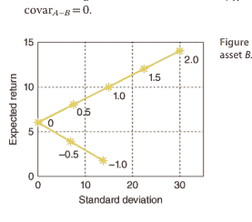

图 3.10 做空风险资产 B 的影响。

如前所述，

- a) $e_p (= x_A \mu_A + x_B \mu_B)$ 始终是 $x_B$ 的线性函数，且
- b) 如果资产 $A$ 是无风险的，$s_p (= x_A \sigma_A + x_B \sigma_B)$ 也将是 $x_B$ 的线性函数，因为 $\sigma_A^2$ 和 $\text{covar}_{A-B}$ 都等于零。在这种情况下，$s_p (= x_A \sigma_A + x_B \sigma_B) = \sqrt{(x_B^2 \sigma_B^2)} = |(x_B)| \sigma_B$

5) 如果投资者做空风险资产 ($x_B < 0$) 并将卖空所得投资于无风险资产 $A$，则标准方程适用。然而请注意，方差将为正值，标准差也将为正值，因为负数 ($x_B$) 的平方始终为正。图 3.11 显示了负 $x_B$ 值的影响。

## 3.2.5.1.2 含一个无风险资产和两个风险资产的投资

接下来考虑由两个风险资产 $A$ 和 $B$ 以及一些国库券组成的投资组合。在这种情况下，有效集在 $(\mu_p, \sigma_p)$ 空间中仍为一条直线，截距为 $r_f$。有效集的斜率，即最大夏普比率，使得其与仅使用两个风险资产 $A$ 和 $B$ 构建的有效集相切。

**备注：**

- 1) 如果只投资于资产 $A$ 和国库券，则夏普比率为
- $SR_A = (\mu_A - r_f)/\sigma_A = (0.2 - 0.03)/0.2236 = 0.7603$
- 且资本配置线 (CAL) 将与效率抛物线相交（例如在点 A）。因此，这显然不是投资组合的有效集。
- 2) 另一方面，如果只投资于资产 $B$ 和国库券，则夏普比率为
- $SR_B = (\mu_B - r_f)/\sigma_B = (0.04 - 0.03)/0.1000 = 0.1000$

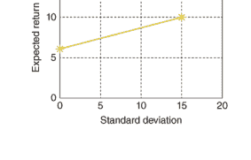

图 3.11 双资产投资组合：1 个无风险和 1 个风险。

且资本配置线 (CAL) 将与效率抛物线相交（例如在点 B）。同样，这显然不是投资组合的有效集。

- 3) 确实，如果投资资产 A 和 B 的某种组合以及一些国库券，则可以做得更好。显然，最有效的投资组合是使 CAL 与抛物线相切的投资组合。该切线投资组合将由资产 A 和 B 组成，使得 CAL 恰好与抛物线相切。
- 4) 因此，有效投资组合的集合将由此类资产 A 和 B 的组合以及一些无风险资产（如国库券）组成。这些投资组合是资产 A 和 B 的切线投资组合。

### 例 3.8 双资产投资组合：1 个无风险和 1 个风险

图 3.11 是预期收益率 e_p（纵坐标：垂直轴）与标准差 SD_p（横坐标：水平轴）的图，显示了以下双资产投资组合（A = 无风险，B = 风险）的轨迹，给定其预期收益率 μ_A 和 μ_B，其方差 σ_A² 和 σ_B²，以及相关系数 covar_{A-B}。在此示例中，

- 其预期收益率：μ_A = 6 且 μ_B = 10，
- 其方差：var_A = 0 且 var_B = 15，
- 其相关系数：covar_{A-B} = 0。

对于由无风险资产和风险资产按比例 x_A 和 x_B 组成的投资组合的情况，该关系是线性的，因为预期收益率 e_p 始终是 x_B 的线性函数（参见 (3.53)）：

e_p = e_A + x_B(e_B - e_A) (3.61)

现在，如果资产 A 是无风险的（根据假设），则收益率的投资组合标准差 (σ_p) 也将是 x_B 的线性函数，因为

σ_p = SD(R_p) = √var(R_p) = √(x_A²σ_A² + x_B²σ_B² + 2x_Ax_Bσ_AB)
= √(0 + x_B²σ_B² + 0), since σ_A² = 0 = σ_AB
= √(x_B²σ_B²)
= x_Bσ_B (3.26)

### 例 3.9 双资产投资组合中使用杠杆：1 个无风险和 1 个风险

例 3.8 中的结果可推广到可进行杠杆头寸的投资组合，其中可以

- i) 在无风险资产 A 上做多（即“贷款”）
- ii) 或在无风险资产 A 上做空（即“借款”）
- 利率相同 (e_A)。

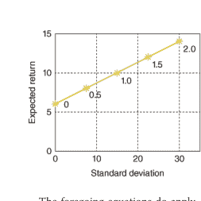

图 3.12 组合无风险资产和风险资产：使用杠杆。

前述方程仍然适用。

图 3.12 显示了使用杠杆的结果：

- 标记为“1.5”的点代表的情况为
- x_B = 1.5 且 x_A = 1 - x_B = 1 - 1.5 = -0.5
- 它显示，通过将资产 B 的投资组合“杠杆化”50%，投资者可以获得初始资本回报率的概率分布，其期望值为 12%，标准差为 22.5%。
- 图 3.12 中的其他点对应于风险资产 B 的指示值，其比例为 x_B = 0.0、0.5、1.0、1.5 和 2.0。高于标记为“1.0”的点的涉及“借款”，即 x_A < 0，而低于标记为“1.0”的点的涉及“贷款”，即 x_A > 0。

图 3.13 绘制了当 x_B 在 0 到 1 之间取值时，均值-标准差组合的轨迹，

μ_A = 6, μ_B = 10, σ_A = 0, σ_B = 15, covar_{A-B} = 0

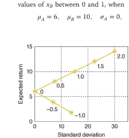

图 3.13 做空风险资产 B 的影响。

用实线表示，而如果投资者可以以 8% 的利率贷款，则可用的选择用虚线表示。

此外，借款利率可能随着贷款金额而逆向变化，因此 σ_AB-μ_AB 组合的轨迹可能随着风险 σ_AB 超过包含风险资产的完全未杠杆投资组合的金额：x_B = 1 而以递减的速度增加。对于此类条件，承担风险的回报可能递减！

### 例 3.10 由两个风险资产组成的投资组合

如果投资组合中包含两个风险资产 A 和 B，则应考虑这两个资产收益率的预期收益、方差以及协方差（或相关性）。与之前其中一个资产为无风险的情况相比，差异出现在投资组合方差的表述中。方差以风险和相关性表示的适当表述形式为：

σ_AB² = var₁₋₂ = x_A² σ_A² + 2 x_A x_B σ_AB σ_A σ_B + x_B² σ_B² (3.54)

其中 σ_AB 是两个资产 A 和 B 收益率之间的相关系数。

### 组合两个完全正相关风险资产

如果两个收益率完全正相关，则 σ_AB = 1，且 (3.54) 变为

σ_AB² = x_A² σ_A² + 2 x_A x_B (1) σ_A σ_B + x_B² σ_B² = x_A² σ_A² + 2 x_A x_B σ_A σ_B + x_B² σ_B² …（这是一个完全平方！）= (x_A σ_A + x_B σ_B)²

因此 s_p = σ_AB = |√(σ_AB²)| = |√(x_A σ_A + x_B σ_B)²| = |(x_A σ_A + x_B σ_B)| (3.55)

### 备注：

- 1) 符号 |f(x)| 表示被括起来的表达式 f(x) 的绝对值。
- 2) 由于 σ_A 和 σ_B 都不为负，当 x_A 和 x_B 均为非负时，(3.55) 中的表达式 (x_A σ_A + x_B σ_B) 将为非负，s_p 的绝对值被隐含理解。然而，如果两个 x 值中的一个足够为负，则应显式使用 s_p 的绝对值。


3) 对于两种资产的多头头寸，即 $x_A, x_B \ge 0$，考虑以下组合：

$s_p = x_A \sigma_A + x_B \sigma_B$  (i)
$e_p = x_A \mu_A + x_B \mu_B$  (ii)

由于
$x_A + x_B = 1 \quad \text{or} \quad x_A = 1 - x_B$  (iii)

通过用 (iii) 代入 (i) 中的 $x_A$，由 (i) 可得：

$s_p = x_A \sigma_A + x_B \sigma_B,$  使用 (i)
$= (1 - x_B)\sigma_A + x_B \sigma_B,$  用 (iii) 代入 $x_A$
$= \sigma_A - x_B \sigma_A + x_B \sigma_B$

或

$s_p = \sigma_A + x_B(\sigma_B - \sigma_A)$  (3.56)

同样，通过用 (iii) 代入 (ii) 中的 $x_A$，由 (ii) 可得：

$e_p = x_A \mu_A + x_B \mu_B,$  使用 (ii)
$= (1 - x_B)\mu_A + x_B \mu_B,$  用 (iii) 代入 $x_A$
$= \mu_A - x_B \mu_A + x_B \mu_B$

或

$e_p = \mu_A + x_B(\mu_B - \mu_A)$  (3.57)

4) 所有此类关系都将位于一条直线上，该直线代表两种资产（见图 3.15）。

5) 将 $x_B$ 的取值扩展到 $x_B > 1$ 或 $x_B < 0$：

考虑最小方差组合，即导致可能最低风险的组合。为了使方差达到 0，可以求使 $s_p = 0$ 的 $x_B$ 值。并使用 (3.56)：

$s_p = \sigma_A + x_B(\sigma_B - \sigma_A) = 0$

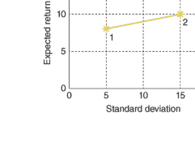

图 3.15 两种完全正相关风险资产：$\rho_{AB} = 1$，点 1：资产 A，其中 $\mu_A = 8$，$\sigma_A = 5$；点 2：资产 B，其中 $\mu_B = 10$，$\sigma_B = 15$。

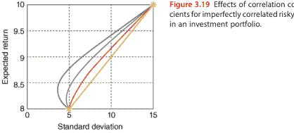

在 (3.27) 中，只有第二项 \(2x_Ax_B\rho_{AB}\sigma_A\sigma_B\) 在两次计算中可能不同。由于该项的所有分量除 $\rho_{AB}$ 外均为正，因此 $\sigma_p^2=\operatorname{var}(R_p)$ 与 $\rho_{AB}$ 可能符号不同。

在其他因素相同的情况下，可以看出，两种资产 A 和 B 之间的相关系数 $\rho_{AB}$ 越小，两种资产 A 和 B 的多头头寸组合的风险越小。当 $\mu_1=8$、$\sigma_1=5$ 且 $\mu_2=10$、$\sigma_2=15$ 时，此类组合的风险和收益如图 3.19 所示。每条曲线代表两种资产收益率之间不同的相关性。

### Remarks:
- 1. 在端点 $(x_1=1,\ x_2=0)$ 和 $(x_1=0,\ x_2=1)$ 处，各情况重合。
- 2. 对于所有内部组合，当相关系数 $\rho_{AB}<1.0$ 时，风险小于两种资产风险的比例；风险降低的程度越大，相关系数越小：
  - a. **黄色**曲线，$r_{12}=1.0$，不提供风险降低，仅提供风险平均。
  - b. **红色**曲线，$r_{12}=0.5$，提供一定风险降低。
  - c. 绿色曲线，$r_{12}=0$，提供更多风险降低。
  - d. **蓝色**曲线，$r_{12}=-0.5$，提供更多降低。

## 示例 3.13 两种完全正相关风险资产的组合

如果两种收益完全正相关，则 $\rho_{AB}=1$。现在，对于一个双资产组合：

σ_p² = x_A² σ_A² + 2 x_A x_B ρ_AB σ_A σ_B + x_B² σ_B²
= x_A² σ_A² + 2 x_A x_B (1) ρ_AB σ_A σ_B + x_B² σ_B², 由于 ρ_AB = 1
= x_A² σ_A² + 2 x_A x_B σ_A σ_B + x_B² σ_B², 即，二项式完全平方
= (x_A σ_A + x_B σ_B)²   (3.27)

且

σ_p = |x_A σ_A + x_B σ_B|   (3.55)

R_p = x_A R_A + x_B R_B   (3.23)

μ_p = E[R_p] = x_A μ_A + x_B μ_B   (3.24)

### Remarks:
- 1) |x_A, x_B| 表示所包含的 x 表达式的绝对值。
- 2) 如果 x_A 和 x_B 均为非负，即为零或正，则表达式 (x_A σ_A + x_B σ_B) 将为非负，因为 σ_A 和 σ_B 都不为负。
- 3) 如果 x_A 或 x_B 足够为负，则表达式 (x_A σ_A + x_B σ_B) 可能变为负值，此时应使用绝对值。
- 4) 风险：由这两种资产的多头头寸组合，即 x_A ≥ 0, x_B ≥ 0 以及任何此类组合：σ_p = x_A σ_A + x_B σ_B 由 (3.23) 得，σ_p = x_A σ_A + x_B σ_B，由 (3.23) 得 = (1 - x_B) σ_A + x_B σ_B = σ_A - x_B σ_A + x_B σ_B 即，σ_p = σ_A + x_B (σ_B - σ_A)   (3.56)
- 5) 同样，对于收益，对于此类组合：μ_p = E[R_p] = x_A μ_A + x_B μ_B，由 (3.24) 得 = (1 - x_B) μ_A + x_B μ_B = μ_A - x_B μ_A + x_B μ_B 即，μ_p = μ_A - x_B (μ_A - μ_B)   (3.57)
- 6) 在图 3.20 中，σ-μ 图表示以下系统：μ_A = 8，σ_A = 5，μ_B = 10，σ_B = 15，且 ρ_AB = 1 风险和收益都将与 x_p 成比例，此类组合将位于一条直线上——连接代表两种资产的点，即点 1：(σ_A =5, μ_A =8)，和点 2：(σ_B =15, μ_B =10)。

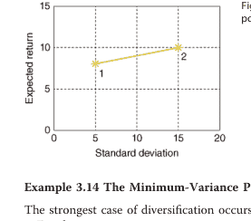

图 3.20 两种完全正相关风险资产的组合。

## 示例 3.14 最小方差组合

多元化最强的情况发生在 ρ_AB = −1.0 时。

对于此情况，

σ_p² = x_A² σ_A² + 2 x_A x_B ρ_AB σ_A σ_B + x_B² σ_B²    (3.27)
= x_A² σ_A² + 2 x_A x_B (−1) σ_A σ_B + x_B² σ_B²    (3.27a)
= x_A² σ_A² − 2 x_A x_B σ_A σ_B + x_B² σ_B²

即，

σ_p² = (x_A σ_A − x_B σ_B)²

从而

σ_p = |(x_A σ_A − x_B σ_B)|

因此，在此情况下，最小方差组合将分配给无风险资产 A，可按如下方式确定：

由 |(x_A σ_A − x_B σ_B)| = 0，可得

x_A σ_A − x_B σ_B = 0    (i)

且已知

x_A + x_B = 1    (ii)

或

x_B = 1 − x_A    (iii)

将 x_B = 1 − x_A 代入 (i)，得到

x_A σ_A − (1 − x_A) σ_B = 0

或

x_A (σ_A + σ_B) = σ_B

即，

$x_A = \sigma_B/(\sigma_A + \sigma_B)$

且

$x_B = 1 - x_A = 1 - \{\sigma_B/(\sigma_A + \sigma_B)\} = \sigma_A/(\sigma_A + \sigma_B)$

当 $\sigma_A =5$ 且 $\sigma_B=15$ 时，

$x_A = \sigma_B/(\sigma_A + \sigma_B)=15/(5+15)=15/20=3/4=0.75$

且

$x_B = 1 - x_A = 1/4 = 0.25$

从而

$\sigma_p = |(x_A\sigma_A - x_B\sigma_B)| = |(0.75)(5) - (0.25)(15)| = |3.75 - 3.75| = 0$

即，两种资产完全负相关！

其期望收益由下式给出

$\mu_p = E[R_p] = x_A\mu_A + x_B\mu_B$

$= (0.75)(8\%) + (0.25)(10\%)$

$= 6.0\% + 2.5\%$

$= 8.5\%$ (3.24)

上述结果以白色在图 3.21 中图形化呈现，该图还重复了图 3.10–3.12 所示的结果。

### Remarks:
- 1) 在图 3.21 中，最小方差组合（白色）是一个熟悉且独特的图表——见图 3.9–3.12、3.15 和 3.17——用于具有一个无风险资产的组合。

图 3.21 最小方差组合（白色）。

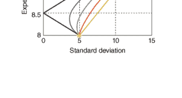

2) 请注意，两种完全负相关资产的多头头寸类似于以下情况：
- a) 在两种完全正相关资产中的一种上建立多头头寸。
- b) 在另一资产上建立空头头寸。
- c) 在许多情况下，资产相关性的取值介于 −1 和 +1 之间。
- d) 最小方差组合的一般公式可按如下方式推导：

从一个简化形式方程开始，其中双资产组合的方差 var_p 表示为 x_B 的函数，从 var_{A-B} = var_A + 2x_B(covar_{A-B} - var_A) + x_B^2(var_A - 2covar_{A-B} + var_B) (3.54) 开始，用于双资产组合，资产 A 和 B。

对 (3.54) 两边关于 x_B 求微分，即对 (3.54) 两边进行 ∂/∂x_B 操作，结果为 d(var_{A-B})/dx_B = 0 + 2(covar_{A-B} - var_A) + 2x_B(var_A - 2covar_{A-B} + var_B) (3.55)

为得到驻点，将 (3.55) 设为零，并求解提供最小方差组合的 x_B 值，即求解 x_{B-min}。结果为 2(covar_{A-B} - var_A) + 2x_{B-min}(var_A - 2covar_{A-B} + var_B) = 0，由此可得 x_{B-min} = (var_A - covar_{A-B})/(var_A - 2covar_{A-B} + var_B) (3.56)

该最小方差组合的风险可能低于两种成分资产中的任一种，并且收益也可能更高！

3) 考虑 x_B = 0 的点，有 d(e_p)/d(x_B) = μ_B - μ_A d(v_p)/d(x_B) = covar_{A-B} - σ_A^2 且 d(e_p)/d(v_p) = {d(e_p)/d(x_B)}/{d(v_p)/d(x_B)} = (μ_B - μ_A)/(covar_{A-B} - σ_A^2) (3.57) 假设 μ_B > μ_A 若斜率 d(e_p)/d(v_p) 为负，则 (3.57) 显示 (covar_{A-B} - σ_A^2) < 0 或 covar_{A-B} < σ_A^2 (3.58)


例如，如果 σ_A = 5，σ_B = 15，μ_B > μ_A，且 σ_AB < 5/15，那么最小方差组合将优于资产 A，从而实现预期收益更高且风险更低的双重好处！

## 3.2.5.2 切点组合

接下来，我们可以进一步扩展上述分析，考虑由资产 A、资产 B 和无风险资产（例如国库券）组成的投资组合。在这种情况下，有效集也由公式 (3.51) 给出：

μ_p = {(μ_B − r_f)/σ_B} σ_p + r_f   (3.51)

即在 (μ_p, σ_p) 空间中，截距为 r_f 的一条直线。对于这个有效集，其斜率即为最大夏普比率，也就是说，它与仅由两种风险资产 A 和 B 组成的有效集相切。

切点组合是为长期投资者设计的多资产投资组合。要找到切点组合，首先要考虑的问题是：在不会退出市场的前提下，投资者在最坏情况下愿意承受多大的损失：20%？25%？还是 33%？一旦确定了最大损失水平，切点组合将力求在该风险水平下提供较高的回报率。

人类天性中存在着一种按“追涨杀跌”（BLASH）路径进行投资的倾向！因此，大多数投资者倾向于在繁荣时期承担大量风险（追高），然后在低迷时期卖出（杀跌）——从而在这个过程中毁掉了他们的回报。切点组合的设计目标是让投资者在繁荣和低迷时期都能有足够好的表现，从而使其在整个市场周期中始终留在市场中。这使投资者能够通过一种简单、低维护成本的解决方案，从股票和债券的投资中获得长期收益。

图 3.22 与图 3.1 相同，展示了有效边界。这条双曲线有时被称为“马科维茨子弹”，是在没有无风险资产时的有效边界。而有了无风险资产后，那条直线便成为有效边界。

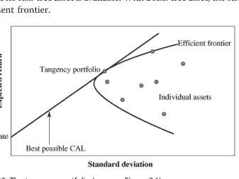

## 有效边界

不同的资产组合可能会产生不同的收益水平。有效边界代表了这些组合中的最优选择，即在给定风险水平下能够产生最大预期收益的组合。有效边界是现代投资组合理论的基础。

### 有效边界示例

马科维茨于 1952 年（见图 3.23）在《金融学杂志》上发表了一个正式的投资组合选择模型。在接下来的 20 年中，他持续深入研究并发表相关论文，最终因其在有效边界方面的研究以及对现代投资组合理论的其他贡献，于 1990 年荣获诺贝尔经济学纪念奖。根据马科维茨的理论，对于有效边界上的每一个点，至少存在一个可以从所有可用投资中构建出的投资组合，其预期风险和收益与该点相对应。这里有一个例子：请注意，有效边界让投资者能够理解，投资组合的预期收益如何随所承担的风险水平而变化。

有效边界的一个重要组成部分是投资资产之间的相互关系。有些资产的价格在类似情况下会同向变动，而另一些资产的价格则会反向变动。投资组合中的资产越是不同步（即它们的协方差越低），组合资产的投资组合的风险（标准差）就越小。有效边界之所以是弯曲的，是因为风险存在边际收益递减的规律。每增加一单位风险，投资组合所获得的收益增量会越来越小。当马科维茨提出有效边界时，这堪称金融工程学的一项开创性贡献：其最大的贡献之一，就是清晰地展示了多元化投资的力量。

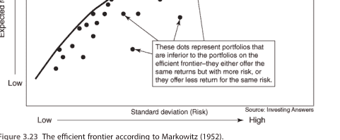

图 3.23 根据马科维茨（1952）理论的有效边界。

马科维茨的理论基于这样一种主张：投资者往往会有意或无意地选择那些能以最小风险产生最大回报的投资组合。换句话说，他们追求的是有效边界上的投资组合！

不应忽视的是，并不存在唯一一个普遍适用的有效边界，因为个人投资者以及投资组合经理可以也确实会根据自身特定的需求，来调整投资领域中资产的数量和特征。例如，某位个人投资者可能要求投资组合具有最低股息收益率，或者另一位客户可能排除对某些在意识形态上（例如政治、道德、民族或宗教方面）不受偏好的行业的投资。因此，只有剩余的资产才会被纳入有效边界的计算中。

### 股票市场近期历史表现的最大亏损

从 2010 年回溯至 1926 年的所有滚动 12 个月期间：

- 切线 20 投资组合的最大一年通胀调整后亏损为 20%
- 切线 25 投资组合的最大一年通胀调整后亏损为 25%
- 切线 33 投资组合的最大一年通胀调整后亏损为 33%

1926 年至 2010 年期间包含了以下非凡事件：

- i) 1929 年股市大崩盘
- ii) 大萧条
- iii) 第二次世界大战
- iv) 冷战
- v) 斯普特尼克号
- vi) 美国总统遇刺
- vii) 种族骚乱
- viii) 越南战争
- ix) 通货膨胀
- x) 1987 年股市崩盘
- xi) 9/11（2001 年）
- xii) 互联网泡沫的兴起与破裂
- xiii) 2008 年恐慌
- xiv) 等等。

这些损失估计值构成了股市可能面临的艰难时期的历史基准！

下表展示了从 1926 年到 2008 年期间，各个投资组合在扣除通货膨胀因素后的表现（未调整适用税费及其他相关费用）。

### 备注

- 1) 切线 20 投资组合的平均回报几乎是国库券投资组合的两倍，而 1 年期损失的风险仅略高。
- 2) 切线 33 投资组合获得了美国股市大部分回报，但风险却大幅降低。
- 3) 这些是假设性和历史性的记录，仅供参考。
- 4) 无法保证这些风险或回报水平在未来能够得以维持。
- 5) 个人投资的损失或收益可能会因风险承受能力、投资目标等因素的不同而有所差异（表 3.3）。

## 3.2.5.3 计算切点组合

为了估算切点组合，可以先确定使抛物线上包络线上的投资组合夏普比率最大化的 x_A 和 x_B 的值。

对于给定的两种可用资产 A 和 B，要正式求解切点组合，其任务在于找到使抛物线上包络线上的投资组合夏普比率（SR）最大化的 x_A 和 x_B 值：这需要解决以下约束最大化问题：

$$\max_{x_A, x_B} SR_p = (\mu_p - r_f)/\sigma_p \tag{3.59a}$$

并满足约束条件：

$$\begin{cases}
x_A + x_B = 1 \\
\mu_p = x_A \mu_A + x_B \mu_B \\
\sigma_p^2 = x_A^2 \sigma_A^2 + x_B^2 \sigma_B^2 + 2 x_A x_B \sigma_{AB}
\end{cases}\tag{3.59b}$$

**表 3.3 估计的股票市场总回报，1926–2008年。**

| 投资组合 | 平均年回报率 | 最差年份回报率 |
| --- | --- | --- |
| 美国股票 | 7.9% | -65% |
| 切线 33 | 7.6% | -33% |
| 切线 25 | 6.0% | -25% |
| 切线 20 | 4.6% | -20% |
| 国库券 | 2.4% | -16% |

显然，如果需要重复计算，可以使用简单的 R 代码来进行涉及 (3.59) 和 (3.60) 的数值计算。

## 3.2.6 共同基金分离定理

至此，我们已经表明，有效投资组合是两类资产的组合：

- i) 切点组合
- ii) 无风险资产，例如国库券

因此，应用 (3.56) 和 (3.57a)：

μ_p = r_f + x_A (μ_A − r_f)   (3.56)
σ_p = x_A σ_A   (3.57a)

我们可以写出任何有效投资组合的预期收益和标准差：

μ_p^e = r_f + x_T (μ_T − r_f)   (3.62)
σ_p^e = x_T σ_T   (3.57b)

其中：

- x_T 代表投资于切点组合的比例，
- (1 − x_T) 代表投资于无风险资产（例如国库券）的财富比例，以及
- μ_T 和 σ_T 分别代表切点组合的预期收益和标准差。

这个结果被称为共同基金分离定理。

### 备注

- 1) 切点组合可以被视为包含两种风险资产的共同基金——其中这两种风险资产的份额由切点组合权重决定：x_1^T 和 x_2^T 由 (3.60a) 和 (3.60b) 确定，而国库券可以被视为无风险资产的共同基金。
- 2) 切点组合和国库券的具体组合方式将取决于投资者的风险偏好：如果投资者极其厌恶风险，那么该投资者可能会选择一个低波动性的投资组合，即一个在切点组合中权重极小，而在国库券中权重极大的投资组合！显然，这种选择将产生一个预期收益接近无风险利率、方差几乎为零的投资组合！另一方面，如果投资者能够承受大量风险，那么偏好的投资组合将是具有高预期收益的组合，而无论其波动性如何。


该投资组合可能包括以无风险利率借款（即“杠杆化”），并将所得资金投资于切点投资组合，以实现整体较高的预期收益。

## 3.2.7 有效投资组合的分析与解读

对于给定的风险水平，有效投资组合具有较高的预期收益（以投资组合标准差衡量）。因此，对于预期收益高于国债利率的投资组合，有效投资组合也可以被描述为：在给定目标预期收益下，风险（以投资组合标准差衡量）最小的投资组合。

### 示例3.15 有效投资组合的资产配置

投资者可选择将1,000,000美元投资于无风险资产A或风险资产B：

- 风险资产B要么减半，要么翻倍，且概率相等：
- $2,000,000 （翻倍！）
- /
- $1,000,000
- \
- $50,000 （减半！）
- 无风险资产A将产生每年3%的固定收益率，即1,030,000美元。
- 应当如何决定选择哪种资产、以及投资多少来构建投资组合？

为了分析资产配置的挑战，可以采取以下步骤（即现代投资组合理论——该方法源于均值-方差投资组合分析，由哈里·马科维茨在20世纪60年代提出，被认为是现代金融工程发展的第一步）：

- 该资产配置问题的关键是要回答：“应将财富中的多少投资于每种资产，以最大化整体收益？”
- 在马科维茨的均值-方差分析广为人知之前，投资顾问通常会给出这样的建议：“如果一个人还年轻，就应该把钱投入一些好的成长股，甚至一些小型股票。现在正是承担风险的时候。”

以下是在产品设计讨论期间Zoom通话的一些截图。我冒昧地对它们进行了匿名处理。但情况已经很清楚……

让我给你讲一个关于兔子生日的故事。从前，有一只名叫霍皮的兔子。生日前一天，他非常兴奋。晚上，霍皮梦到了一个又大又漂亮的胡萝卜蛋糕。第二天早上，他带着灿烂的笑容醒来。

霍皮的朋友们为他策划了一场惊喜派对。他们用彩色的气球和丝带装饰了他的房子。当霍皮回到家时，大家跳出来大喊：“霍皮，生日快乐！”他们一起吃蛋糕、玩游戏、欢笑，度过了美好的时光。

这是一只漂亮的松鼠。看它的皮毛多么柔软。还要注意右下角的蘑菇，

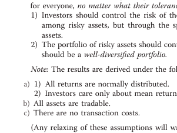

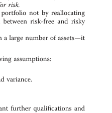

现在来谈谈无人机机架，你也可以在下面的图中看到它。

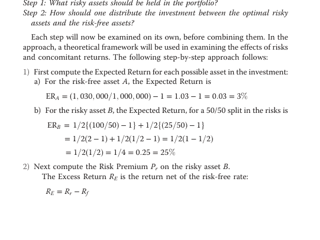

风险溢价 $P_r$ 是预期超额收益 $E(R_E)$，由下式给出
$E(R_E)=E(R_r - R_f)=E(R_r)-R_f$
$= 1/2(100% - 3%) - 1/2(50% + 3%)$
$= 1/2(97%) - 1/2(53%) = 48.5% - 26.5% = 22%$

3) 然后，计算资产$A$和$B$的相对风险量：风险的一个合理估计可以是收益的方差$\sigma^2$或标准差$\sigma$。

- 对于无风险资产$A$，收益方差$\sigma_A^2$为$0$。
- 对于风险资产$B$，收益方差$\sigma_B^2$为
- $= 1/2[(1.00 - 0.25)^2 + (-0.50 - 0.25)^2]$
- $= 1/2[(0.75)^2 + (-0.75)^2]$
- $= (0.75)^2$
- $= 0.5625$

并且，收益标准差是$\sigma_B^2$的正平方根：
$\sigma_B = |\sqrt{\sigma_B^2}| = \sqrt{(0.5625)} = 0.7500 = 75\%$

4) 评估上述结果，判断对于额外预期收益而言，该风险水平是否合理。
假设：

- a) 大多数投资者偏好高预期收益，并且不喜欢较大的方差，
- b) 投资者通常是风险厌恶的，
- c) 他们的效用或满意度指数具有以下形式：
$U(r) = E(r) - 1/2 A \sigma^2(F)$  (3.63)

其中

- $U(r)$ 是风险资产的确定性等价收益率，即一个人在该资产与预期收益率之间无差异时的收益率。
- $E(r)$ 是预期收益（人们喜欢高预期收益！）
- $A$ 衡量投资者的风险厌恶指数。
- $A$的值越高，投资者越不喜欢风险。
- $\sigma^2(F)$ 是方差。（人们也不喜欢方差！）

这种方法在图3.15中得到了说明，其中$E(r)=0.25$，图3.24以图形方式展示了以下内容：
i) 投资者的选择可以用无差异曲线来表示：红色、绿色、蓝色和黄色。

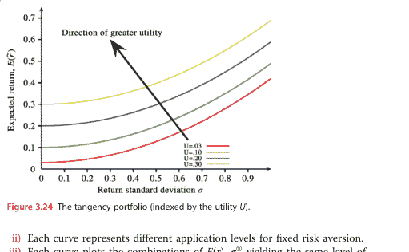

图3.24 切点投资组合（由效用U标示）。

- ii) 每条曲线代表固定风险厌恶下的不同应用水平。
- iii) 每条曲线绘制的是由(3.63)式定义的、产生相同效用水平U(r)的E(r)和σ的组合。

图3.25以图形方式展示了：

- i) 每条曲线（红/绿/蓝/黄）在风险厌恶A的不同取值下代表相同的效用水平U。

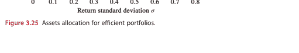

图3.25 有效投资组合的资产配置。

ii) 对于给定的收益标准差σ_r，大多数投资者偏好较高的平均收益，以达到相同的效用水平U。

因此，在示例3.15中，ER_B = 0.25，σ_B² = 0.5625，可以确定几个风险厌恶水平下的U(r)：

| A | U(r) % |
|---|---|
| 0.04 | 24 |
| 0.50 | 11 |
| 0.78 | 3 |
| 1.00 | -3 |

### 问题：

- 1. 如果A = 0.50，投资者会/应该持有无风险资产还是风险资产？
- 2. 要使无风险资产和风险资产之间无差异，预期的风险厌恶水平是多少？
- 3. 如果一个人更加风险厌恶，U(r)会更高还是更低？

## 3.3 布莱克-利特曼模型

鉴于上述关于资产配置研究发展的讨论（基于马科维茨现代投资组合理论中资产配置与投资组合优化的均值-方差方法），这很可能是从马科维茨模型转向布莱克-利特曼模型的合适出发点。

资产配置是投资者持续面临的决策，投资者必须决定投资组合中资产在少数（比如最多20个）资产类别之间的最优配置。例如，一只全球投资的共同基金必须选择将总投资的一定比例分配给每个主要国家或全球金融区域。

诚然，一旦资产的预期收益和协方差已知，现代投资组合理论（马科维茨的均值-方差方法）可以为这一问题提供看似合理的解决方案。因此，尽管现代投资组合理论是一种重要的理论方法，但其应用确实遇到了一个严重的问题：虽然少数资产的协方差可以被充分估计，但很难（以合理的估计）确定预期收益！

布莱克-利特曼方法通过以下方式解决了这个问题：

- 不要求使用预期收益的输入估计。

v1 = varA = σ_A²
v2 = varB = σ_B²
vp = var1-2 = σ²_AB
c12 = covar_A,B
https://web.stanford.edu/~wfsharpe/mia/ir/mia_rr5.htm
(6)
第22页，来自 http://faculty.washington.edu/ezivot/econ424/introductionPortfolioTheory.pdf

软件包：Sim.DiffProc

## 3.4.1 继续建模！

现代投资组合理论（MPT）也因其收益服从高斯分布的假设而受到批评。在20世纪60年代，多位研究者已证明该假设的不足，并提出了使用稳定分布以及在此类情境下推导最优投资组合的策略。其中一些值得注意的建议如下：

- 1) 自1952年MPT提出以来，出现了许多尝试，其唯一目的是通过加入更现实的假设来改进该模型。这些尝试包括：
- a) 后现代投资组合理论（PMPT），它通过使用非正态分布的不对称风险度量来扩展MPT。这种方法在某些（但并非所有）情况下被证明是有用的。
- b) 在20世纪70年代，康罗伊利用MPT的概念，将经济分析应用于区域科学领域，采用投资组合理论方法对经济中的劳动力进行建模，以分析劳动力的增长和变动性。这项工作引发了对波动性与经济增长之间关系的分析。

因此，尽管MPT是一个有用的入门框架，但要使其在实践中有效且可靠，还需要更多的工作。自1952年MPT提出以来，人们做出了显著的尝试来改进该模型，特别是通过使用更现实的假设。后现代投资组合理论通过采用非正态分布的不对称风险度量来扩展MPT——这种调整有助于解决其中一些问题，但并非全部！

### 2) 其他表述

在20世纪70年代，MPT的概念进入了区域科学领域。在一系列开创性工作中，康罗伊使用投资组合理论方法对经济中的劳动力进行建模，以考察劳动力的增长和变动性。随后，对经济增长与波动性之间的关系进行了广泛研究。

近年来，现代投资组合理论已被应用于以下领域：

a) 社会心理学——用于建模自我概念：当构成自我概念的自我属性构成一个充分多元化的

投资组合，然后个体层面的心理结果，如情绪和自尊，应该比自我概念未分化时更稳定。这一预测已在涉及人类受试者的研究中得到证实。

- b) *信息科学*：用于建模信息检索中文档之间的不确定性和相关性。给定一个开放性问题，可以最大化文档排序列表的相关性，同时最小化排序列表的整体不确定性。

- c) *其他非金融资产*：MPT 也已应用于金融工具之外的资产组合。当 MPT 应用于非金融投资组合时，应考虑不同类型投资组合之间的特征，例如：

  - A) 就实际目的而言，金融投资组合中的资产是连续可分的，而项目投资组合则是“块状的”。因此，例如，虽然可以计算出四只股票的最优投资组合比例为 45、26、20 和 9%，但项目投资组合的最优比例可能不允许我们简单地改变在项目上的支出。项目可能是全有或全无，或者至少具有无法分离的逻辑单元。因此，投资组合优化方法必须考虑项目的离散性。

  - B) 金融投资组合的资产是流动的：它们可以在任何时间点进行评估或重新评估。然而，启动新项目的机会可能是有限的，并且可能在有限的时间窗口内出现。已经启动的项目如果放弃可能会损失 *沉没成本*（即，部分完成的项目可能几乎没有或没有残值）。

这些因素中的任何一个都未必消除使用 MPT 对此类投资组合的可能性。然而，它们要求需要使用一组在数学上表达的额外约束来运行优化，这些约束通常不适用于金融投资组合。此外，MPT 的一些最简单元素适用于几乎任何类型的投资组合。通过记录给定回报下可接受的风险数量来确定投资者的风险承受能力的概念可以应用于各种决策分析问题。MPT 使用历史方差作为风险的衡量标准，但像大型项目这样的资产组合通常没有明确定义的“历史方差”。在这种情况下，MPT 投资边界可以用更一般的术语表达，例如“ROI（投资回报率）低于资本成本的几率”，或“损失超过投资一半的几率”。因此，当风险以对预测的不确定性和可能损失的形式表达时，MPT 的概念可以转移到各种类型的投资。

## 3) Black–Litterman 模型 (BL)

1990 年提出，认为优化应是对无约束 Markowitz "pick" 矩阵的扩展，由此得到“一般”观点设定：

Pμ ~ N(μ, Ω)  (3.68)

其中 Ω 是对角矩阵 diag(σ₁², σ₂², σ₃², …, σₙ²)。利用贝叶斯定律可以证明，在这些观点条件下，市场均值的后验分布为

μ̂_q,Ω ~ N(μ_BL, Σ^μ_BL)  (3.69)

其中

μ_BL = {(τΣ)⁻¹ + PᵀΩ⁻¹P}⁻¹ {(τΣ)⁻¹π + PᵀΩ⁻¹q}  (3.70)

Σ^μ_BL = {(τΣ)⁻¹ + PᵀΩ⁻¹P}⁻¹  (3.71)

然后可以通过取

A|μ_q,Ω = μ̂_q,Ω + Z  且  Z ~ N(0, Σ)  (3.72)

来得到市场的后验分布

该分布与 μ 无关。

然后可以得到

E[A] = μ_BL  (3.73)

并且

Σ_BL = Σ + Σ^μ_BL  (3.74)

### 规范的 Black–Litterman 参考模型

Black–Litterman 模型的其余部分建立在收益的参考模型之上。它假设哪些变量是随机的，哪些不是。它还定义了哪些参数被建模，哪些未被建模。其他参考模型有替代参考模型或超越 Black–Litterman，它们不具有与最初在 Black 和 Litterman (1992) 中指定的规范模型相同的理论基础。

从正态分布的预期收益开始，

r ~ N(μ, Σ)  (3.75)

Black–Litterman 模型的基本目标是建模这些预期收益，假设它们服从均值为 μ、方差为 Σ 的正态分布。注意，后续在投资组合选择模型中作为输入时，至少需要这些值、预期收益和协方差矩阵。

将 μ，即未知均值收益，定义为本身服从分布的随机变量

μ ~ N(π, Σ_π)  (3.76)

π 是均值的估计值，Σ_π 是未知均值 μ 围绕估计值的方差。这种线性关系的另一种观点如下式所示：

$r \sim N(\mu, \Sigma)$  (3.75)

$\mu = \pi + \varepsilon$  (3.77)

这些先验收益围绕 $\pi$ 呈正态分布，扰动值为 $\varepsilon$。图 3.27 显示了实际均值围绕估计均值 5% 的分布，标准差为 2%（或方差为 0.0004）。显然，从峰值的宽度来看，这不是一个精确的估计。可以通过定义 $\Sigma_r$ 为围绕初始估计 $\pi$ 的收益方差来完成参考模型。

由 (3.77) 和上述 $\varepsilon$ 与 $\mu$ 不相关的假设，可计算 $\Sigma_\pi$ 的公式为

$\Sigma_r = \Sigma + \Sigma_\pi$  (3.78)

(3.78) 显示了方差之间的正确关系（$\Sigma_r \ge \Sigma$，$\Sigma_\pi \ge 0$）。

可以在边界条件下检查参考模型以确保其正确性。在没有估计误差的情况下，即 $\varepsilon = 0$，$\Sigma_r = \Sigma$。随着估计变差，如果 $\Sigma_\pi$ 增加，则 $\Sigma_r$ 也会增加。

对于 Black–Litterman 模型预期收益，规范参考模型为

$r \sim N(\pi, \Sigma_r)$  (3.79)

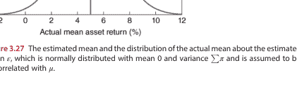

图 3.27 估计均值以及实际均值围绕估计均值的分布 $\varepsilon_r$，其呈正态分布，均值为 0，方差为 $\Sigma_\pi$，并且假定与 $\mu$ 不相关。

应强调 (3.79) 是规范的 Black–Litterman 参考模型，而不是 (3.76)。

###  remarks:

- 1. 关于 Black–Litterman 模型的一个常见误解是 (3.76) 是参考模型，并且
- 2. $\mu$ 在模型中是一个点估计。

### 计算均衡收益

Black–Litterman 模型以收益先验估计的 neutral 均衡投资组合开始。该模型依赖于一般均衡理论，即“如果整体投资组合处于均衡，则每个子投资组合也必须处于均衡”。它可与任何效用函数一起使用，使其非常灵活。事实上，大多数从业者使用二次效用函数并假设存在无风险资产，因此均衡模型简化为资本资产定价模型 (CAPM)。事实上，在这种情况下的中性投资组合是 CAPM 市场投资组合。

一些研究者使用了其他效用函数，其他人则在不应用相同理论基础的情况下考虑了投资组合风险的其他衡量标准。为了保持模型的对称性，从业者应使用相同的效用函数来识别中性投资组合和投资组合选择区域。这里采用的方法使用二次效用函数、CAPM 和无约束均值-方差，因为它是一个众所周知的模型。给定这些假设，Black–Litterman 模型的先验分布是来自 CAPM 市场投资组合的估计均值超额收益。计算 CAPM 均衡超额收益的过程很直接。CAPM 基于风险（以收益的标准差衡量）与收益之间存在线性关系的概念。此外，它要求收益呈正态分布。该模型的一般形式为

$$E(r)=r_f+\beta r_m+\alpha \tag{3.80}$$

其中

- $r_f$ 是无风险利率，
- $r_m$ 是市场投资组合的超额收益，
- $\beta$ 是回归系数，计算为 $\beta=\rho\left(\sigma_p/\sigma_m\right)$，并且
- $\alpha$ 是残差或资产特定超额收益。

在 CAPM 下，与资产相关的任何不规则风险都与来自其他资产的风险不相关，并且该问题可通过分散化来减少。投资者可因承担由 $\beta$ 衡量的系统性风险而获得回报，但不会因承担与 $\alpha$ 相关的不规则风险而获得补偿。

在 CAPM 下，所有投资者都应持有相同的风险性 CAPM 市场投资组合。由于所有投资者仅在市场投资组合中持有风险资产，因此在


在均衡状态下，其（各资产）在市场组合中的权重将由各类资产的市场市值决定。在有效前沿上，CAPM市场组合在所有投资组合中具有最大的夏普比率。这里，夏普比率等于超额收益除以超额风险，即\((r - r_f)/\sigma\)。

投资者还可以投资于无风险资产。该无风险资产在投资者关注的时间段内本质上具有固定的正收益。它通常类似于投资者本币的主权债券收益率曲线——例如美国政府短期国库券。根据资产配置决策的设定方式，该无风险资产的范围可以从4周期国库券（1个月期限）到20年期通胀保值债券。

CAPM市场组合包含所有可投资资产，这使得其难以具体设定。由于系统处于均衡状态，所有子市场也必定处于均衡状态，并且所选择的任何子市场都是全局均衡的一部分。虽然这允许人们从市值和协方差矩阵反向优化出超额收益，但从该点出发进行正向优化以确定投资者在CAPM中的最优组合是困难的，因为人们并不掌握整个市场组合的信息。一般来说，这并不是投资者真正提出的问题；通常大多数投资者会选择一个可投资范围，并在此范围内寻找最优资产配置。因此，市场组合的理论问题可以暂时忽略。

## 资本市场线

资本市场线是穿过无风险利率和CAPM市场组合的一条直线。与CAPM密切相关的两基金分离定理指出，所有投资者都应持有资本市场线上的投资组合。资本市场线上的任意投资组合都优于有效前沿上的所有投资组合，CAPM市场组合是有效前沿和资本市场线上的唯一交点。根据投资者的风险厌恶程度，投资者会将其投资的无风险资产和/或CAPM市场组合的比例设定为任意分数。图3.20展示了有效前沿与资本市场线之间的关系。

在初始化市场组合时，可以选择一组所有权重均大于零且自然求和为1的权重开始。市场组合只包含风险资产，因为根据定义，投资者只有承担系统性风险才能获得回报。因此，在CAPM中，\(\beta = 0\)的无风险资产不会出现在市场组合中。在后续阶段，我们会看到贝叶斯投资者可能根据其对收益估计的信心来投资无风险资产。该问题可以通过假设收益的协方差矩阵\(\Sigma\)已知来加以约束。实际上，这个协方差矩阵可以从历史收益数据中估计得到。它通常由更高频率的数据计算，然后按资产配置问题所需的时间尺度进行缩放。通过基于实际历史数据计算，可以确保协方差矩阵是正定的。如果不将估计过程建立在实际数据之上，则在确保协方差矩阵正定方面可能会遇到重大问题。可以对协方差矩阵应用收缩或随机矩阵理论滤波器，以使其更加稳健。

在这种方法中，可以使用一种通用记号，类似于He和Litterman（1999）使用的记号。请注意，这种记号异常不同。

首先，从二次效用函数出发推导“反向优化”的方程：

\[
U = w^T \Pi - \frac{\delta}{2} w^T \Sigma w \quad (3.81)
\]

其中

- \(U\)是投资者的效用，即均值-方差优化过程中的目标函数，
- \(w\)是投资于各资产的权重向量，
- \(\Pi\)是各资产均衡超额收益向量，
- \(\delta\)是风险厌恶参数，以及
- \(\Sigma\)是资产超额收益的协方差矩阵。

现在，\(U\)是一个凹函数，将有一个唯一的全局最大值。如果在无约束条件下最大化效用，则存在闭式解。可以通过对(3.81)关于权重\(w\)求一阶导数并令其等于零来找到精确解：

\[
dU/dw = \Pi - \delta \Sigma w = 0 \quad (3.82)
\]

对(3.82)求解\(\Pi\)（超额收益向量）得到：

\[
\Pi = \delta \Sigma w \quad (3.83)
\]

为了利用(3.83)求解CAPM市场组合，需要知道\(\delta\)的值，即市场的风险厌恶系数。求解\(\delta\)的一种方法是将(3.83)两边同时乘以\(w^T\)，并将向量项替换为标量项：

\[
(r - r_f) = \delta \sigma^2 \quad (3.84)
\]

这里的均衡表达式为：投资组合的超额收益等于风险厌恶参数乘以投资组合的方差。由(3.84)可得，

\[
\delta = \frac{r - r_f}{\sigma^2} \quad (3.85)
\]

其中\(r\)是市场组合的总收益（\(r = w^T \Pi + r_f\)）。

- b) Satchell和Scowcroft（2000）在其示例中使用了等权重方案。

在实践中，权重将是一个混合，具体取决于用于估计观点收益的过程。

- \(Q\)，一个\(k \times 1\)向量，表示每个观点的收益。
- \(\Omega\)，一个\(k \times k\)矩阵，表示观点的协方差。由于要求观点相互独立且不相关，\(\Omega\)是对角矩阵。\(\Omega^{-1}\)被称为投资者观点的置信度。\(\Omega\)的第\(i\)个对角元素记为\(\omega_i\)。

并不要求\(P\)可逆。Meucci（2006）描述了一种对矩阵进行增广的方法，使\(P\)矩阵可逆，同时不改变最终结果。

\(\Omega\)是对称的，所有非对角元素为零；但如果投资者对某个观点非常确定，其对角元素也可能为零。这意味着\(\Omega\)可能是可逆的，也可能不可逆。在实际操作层面，可以要求\(\omega_i > 0\)以保证\(\Omega\)可逆，但应当重新表述问题，使得不需要对\(\Omega\)求逆。

## 示例3.16 布莱克-利特曼模型的矩阵

作为这些矩阵如何填充的示例，可以考察某些投资者的观点。以一个包含四种资产和两个观点的示例来说明：

- 首先，一个相对观点：投资者认为资产A将跑赢资产C 2%，置信度为\(\omega_1\)。
- 其次，存在一个绝对观点：投资者认为资产B将获得3%的收益，置信度为\(\omega_2\)。
- 投资者对资产D没有观点，因此其收益不应被直接调整。

这些观点设定如下：

\[
P = \begin{bmatrix} 1 & 0 & -1 & 0 \\ 0 & 1 & 0 & 0 \end{bmatrix}, \quad
Q = \begin{bmatrix} 2 \\ 3 \end{bmatrix}, \quad
\Omega = \begin{bmatrix} \omega_{11} & 0 \\ 0 & \omega_{22} \end{bmatrix}
\]

在给定上述观点设定后，可以在观点空间中构建条件分布的均值和方差如下：

\[
P(B|A) \sim N(Q, \Omega) \quad (3.84)
\]

一般来说，由于相对观点和绝对观点的混合，并且不要求\(P\)矩阵满秩，因此无法将其转化为资产空间中的有用表达式。如果确实在资产空间中表达这些观点，公式如下：

\[
P(B|A) \sim N(P^{-1}Q, [P^T \Omega^{-1} P]^{-1}) \quad (3.85)
\]

这种表示没有任何实际用途。不完整的观点和相对观点会使方差不可逆，同时相对观点也会影响均值项；\(P\)可能不可逆，即使\(P\)可逆，\([P^T \Omega^{-1} P]\)也可能不可逆，从而使该表达式在实际中无法计算。幸运的是，在使用布莱克-利特曼模型时，不需要计算(3.85)。不过，了解这些观点如何被映射到资产空间仍然很有意思。

## 指定Ω

\(\Omega\)即观点的方差，与投资者对观点的置信度成反比；然而，基本的布莱克-利特曼模型并未提供直观的方法来量化这一关系。投资者需要自行计算观点的方差\(\Omega\)。

以下是计算\(\Omega\)的几种方法：

- 与先验方差成比例
- 使用置信区间
- 使用因子模型中残差的方差
- 使用Idzorek的方法在权重维度上设定置信度

### 与先验方差成比例

假设观点的方差将与资产收益的方差成比例，就像先验分布的方差一样。He和Litterman（1999）与Meucci（2006）都使用了这种方法，但使用方式不同。He和Litterman（1999）将观点的方差表示为：

\[
\omega_{ij} = \tau(P \Sigma P^T), \quad \forall i = j \quad (3.86a)
\]
\[
= 0, \quad \forall i \neq j
\]

或

\[
\Omega = \operatorname{diag}[\tau(P \Sigma P^T)] \quad (3.86b)
\]

这种对观点方差（或不确定性）的设定，本质上是将投资者的观点与市场均衡权重进行等权加权。通过在表达式中引入\(\tau\)，收益的后验估计也随之变得与\(\tau\)无关。

Meucci（2006）完全没有进行对角化处理，而是直接设定

\[
\Omega = (1/c) P \Sigma P^T \quad (3.87)
\]

其中\(c > 1\)，一个明显的选择是\(c = \tau^{-1}\)。这种观点方差形式有助于简化布莱克-利特曼公式。

### 使用置信区间

投资者可以使用估计平均收益周围的置信区间来指定方差。例如，资产B的估计平均收益为3.0%，并且预计其有68%的可能性落在区间(2.0%, 4.0%)内。已知正态分布的68%


落在均值 1 个标准差范围内可将此转化为 1% 观点的方差。

现在，Ω 是均值估计的不确定性，并未指定均值附近收益的方差。此观点方差的表述与规范参考模型一致。

## 使用因子模型残差的方差

如果投资者使用因子模型来计算观点，则可以使用模型残差的方差来驱动收益估计的方差。因子收益模型的一般表达式为

r = \sum_{i=1}^{n} \beta_i f_i + \varepsilon  (3.88)

- r 是资产的收益率，
- \beta_i 是因子 (i) 的因子载荷，
- f_i 是因子 (i) 带来的收益，且
- \varepsilon 是独立正态分布的残差。

因子模型收益方差的一般表达式为

V(r) = B V(F) B^T + V(\varepsilon)  (3.89)

- B 是因子载荷矩阵，且
- F 是各种因子带来的收益向量。

给定公式 (3.88)，并假设 \varepsilon 独立且正态分布，可在回归中直接计算 \varepsilon 的方差。虽然回归可能产生完整的协方差矩阵，但如果仅使用对角元素，混合模型将更稳健。

Beach 和 Orlov (2006) 描述了他们使用 GARCH 风格因子模型为 Black–Litterman 模型生成观点的研究。他们使用 GARCH 模型生成了观点的精度。

## 使用 Idzorek 方法

Idzorek (2005) 描述了一种以 0% 到 100% 置信度区间内权重百分比变动的形式指定观点置信度的方法。我们将在扩展部分研究 Idzorek 的算法。

## 估计模型

原始 Black–Litterman 论文引用的是 Theil 混合估计模型而非贝叶斯估计模型，尽管两种方法均可得到结果。让我们从 Theil 模型开始

Theil 混合估计模型从待估计参数的线性模型开始。可以将参考模型中的公式 (3.77) 作为起点。下面显示了一个简单的线性模型：

xβ = π + u
(3.90)

其中

- π 是资产的 n×1 均衡收益率向量，
- x 是模型因子载荷的 n×n 矩阵，
- β 是资产收益过程未知均值的 n×1 向量，且
- u 是回归残差的 n×1 矩阵，其中 E(u) = 0, V(u) = E(u'u) = Φ

Black–Litterman 模型使用一个非常简单的线性模型，每个资产的预期收益由系数为 1 的单一因子建模。因此，x 是单位矩阵。由于 β 和 u 独立且 x 为常数，可以按如下方式建模 π 的方差：

V(π) = x' V(β|x) + V(u)
(3.91)

可简化为

V(π) = Σ + Φ
(3.92)

其中

- Σ 是如前所述使用的资产收益历史协方差矩阵。
- Φ 是残差的协方差或关于实际均值的估计的协方差。

此方法与参考模型中的 (3.78) 相联系：

Σ_r = Σ + Σ_e
(3.78)

这表明方差之间的正确关系为 (Σ_r ≥ Σ, Σ_e)。估计收益的总方差是实际收益过程的方差加上均值估计方差之和。此关系将在后面重新讨论。

接下来，考虑一些希望与先验结合的额外信息。此信息可被视为主观观点，也可从统计数据中得出。也可将其视为不完整，即可能没有每个资产收益的估计值。

pβ = q + v
(3.93)

其中

- q 是观点的 k×1 收益向量。
- p 是将观点映射到资产的 k×n 矩阵，
- β 是资产收益过程未知均值的 n×1 向量，
- ν 是回归残差的 k×1 向量，其中 E(ν)=0, V(ν)=E(νν′)=Ω，且 Ω 为非奇异。

可通过以下方式结合先验和条件信息：

[x] β̂ = [π] + [u]
[p]   [q]   [ν]   (3.94)

其中残差的期望值为 0，残差方差的期望值为

V([u]) = E([u][u]′) = [Φ 0]
([ν]) ([ν]′) [0 Ω]   (3.95)

然后可应用广义最小二乘法，从而得到 β̂ 的估计为

β̂ = (x′p′)[Φ 0]⁻¹[x]⁻¹[x′p′][Φ 0]⁻¹[π]
= ( [0 Ω][p] )   [0 Ω][q]   (3.96)

这可改写为不使用矩阵记法的形式

β̂ = [x′Φ⁻¹x + p′Ω⁻¹p]⁻¹[x′Φ⁻¹π + p′Ω⁻¹q]   (3.97)

对于每个资产为单一因子的 Black-Litterman 模型，可省略变量 x，因为它是单位矩阵。如果更倾向于使用多因子模型来描述均衡，则 x 将是均衡因子载荷矩阵。

β̂ = [Φ⁻¹ + p′Ω⁻¹p]⁻¹[Φ⁻¹π + p′Ω⁻¹q]   (3.98)

这个新的 β̂ 是估计值的加权平均，权重因子为估计值的精度。精度是方差的倒数。后验估计 β̂ 也是给定数据下的最佳线性无偏估计，具有最小化残差方差的性质。

给定新的 β̂，也应对残差的方差有更新的期望。

如果对先验使用因子模型，则应在方程中保留 x，即因子权重。这将导致多因子模型，其中所有因子都将计入均衡。

可将组合关系用 β̂ 的估计和新的残差 û 重新表述为

[x] β̂ = [π] + û
[p]   [q]   (3.99)

再次 \(E(u)=0\)，因此可推导出新残差方差的表达式为

\[V(u)=E(u'u)=[\Phi^{-1}+p'\Omega^{-1}p]^{-1}\tag{3.100}\]

总方差为

\[V[(y|\pi)]=V(\beta)+V(u)\tag{3.101}\]

本节开头断言收益过程的方差是已知量。对量 \(\hat{\beta}\) 的改进估计不会改变收益分布方差 \(\Sigma\) 的估计。由于估计的改进，预计估计值（残差）的方差已减小，因此总方差已发生变化。可将方差公式 (3.92) 简化为：

\[V(\pi)=\Sigma+\Phi\tag{3.92}\]

为

\[V[(y|\pi)]=\Sigma+V(u)\tag{3.102}\]

这是一个直观的结果，与金融时间序列的现实一致。已将分布均值的两个估计结合起来以获得更好的均值估计。该估计的方差已减小，但基础过程的实际方差保持不变。鉴于对过程的不确定估计，估计过程的总方差也已逐步改善，但其渐近极限是它不能小于实际基础过程的方差。

这是在 He 和 Litterman (1999) 中所示的条件参考模型后验分布协方差计算的惯例。

在没有观点的情况下，(3.102) 简化为

\[V[(y|\pi)]=\Sigma+\Phi\tag{3.103}\]

这就是收益先验分布的方差。

## 估计模型的贝叶斯定理

在 Black–Litterman 模型中，先验分布基于均衡隐含的超额收益。Black–Litterman 模型的一个主要假设是 *先验估计的协方差与实际收益的协方差成比例*，但这两个量是独立的。参数 \(\tau\) 作为比例常数。Black–Litterman 模型的先验分布在 3.87a 和 3.87b 中指定为：

\[P(A)\sim N(\Pi,\tau\Sigma)\tag{3.87a}\]

且

$r_A \sim N(P(A), \Sigma)$
(3.87b)

条件分布基于投资者的观点。投资者的观点被指定为资产组合的收益，每个观点都有不确定性，会影响整体混合过程。来自投资者观点的条件分布在公式 (3.85) 中指定为：
$P(B|A) \sim N(P^{-1}Q, [P^T \Omega^{-1} P]^{-1})$ 
(3.85)

贝叶斯定理的后验分布是先验估计和条件估计的精度加权平均。现在可将贝叶斯理论应用于混合先验和条件分布以创建资产收益新的后验分布的问题。给定公式 (3.85) 以及先验和条件分布的公式 (3.87a) 和 (3.87b)，可应用贝叶斯定理推导出资产收益后验分布的以下方程：
$P(A|B) \sim N\{[(\tau\Sigma)^{-1}\Pi + P^T \Omega^{-1} Q][(\tau\Sigma)^{-1} + P^T \Omega^{-1} P]^{-1}, [(\tau\Sigma)^{-1} + P^T \Omega^{-1} P]^{-1}\}$
(3.104)

这是 Black–Litterman 主公式。

均值收益 $\Pi$ 和协方差 $M$ 的相同公式的另一种表示形式为：
$\bar{\Pi} = \Pi + \tau\Sigma P^T [(\tau\Sigma P^T) + \Omega]^{-1}[Q - P\Pi]$ 
(3.105)
$M = [(\tau\Sigma)^{-1} + P^T \Omega^{-1} P]^{-1}$ 
(3.106)

请注意，$M$，即后验方差，是后验均值估计相对于实际均值的方差。它是后验均值估计的不确定性，而不是收益的方差。

计算收益的后验协方差需要在估计值周围的分布方差中加上关于均值的估计方差，如 (3.102) 所示。这在 He 和 Litterman (1999) 中有说明。

现在，
$\Sigma_p = \Sigma + M$ 
(3.107)

将 (3.106) 中的后验方差代入，可得
$\Sigma_p = \Sigma + [(\tau\Sigma)^{-1} + P^T \Omega^{-1} P]^{-1}$ 
(3.108)

在没有观点的情况下，这简化为
$\Sigma_p = \Sigma + (\tau\Sigma)$ 
$= (1 + \tau)\Sigma$ 
(3.109)

因此，在没有观点的情况下应用 Black–Litterman 模型时，根据 (3.109)，估计收益的方差将大于

先验分布方差。该方程的影响在 He 和 Litterman（1999）所示的结果中得到了突出，文中投资者的权重之和小于 1（若其无观点）。Idzorek（2005）以及大多数其他作者并未计算新的后验方差，而是使用关于均值的已知输入回报方差。

如果投资者只有部分观点，即仅对部分资产有观点，那么在使用方差的后验估计时，会使后验权重向方差较低（估计均值的精度更高）的资产倾斜，而远离方差较高（估计均值的精度较低）的资产。因此，观点的存在以及更新后的协方差会使优化器倾向于使用或不使用这些资产。如果使用较小的 τ 值，这种倾斜不会很大，但仍可衡量。

由于我们通常从历史数据构建回报的已知协方差矩阵 Σ，可以使用基础统计方法来计算 τ，因为 τ Σ 类似于标准误差。也可以根据对先验分布的信心来估计 τ。需要注意的是，这两种技术都为选择一个更接近 0 而非 1 的 τ 值提供了一些直觉。Black 和 Litterman（1992）、He 和 Litterman（1999）以及 Idzorek（2005）均指出，在他们的计算中，使用了数量级约为 0.025–0.050 的较小 τ 值。

Satchell 和 Scowcroft（2000）指出，许多投资者使用约为 1 的 τ，该值与数据没有直观联系，并且事实上表明其论文使用了替代参考模型。

可以通过在边界条件下检验结果是否符合直觉来检查结果。

给定 (3.105)，令 Ω → 0 并证明在对观点 100% 确定的情况下的回报为

Π̂ = Π + ΣPᵀ[PΣPᵀ]⁻¹[Q − PΠ]  (3.110)

因此，在对观点 100% 确定的情况下，估计的回报对所用 τ 的取值不敏感。

此外，如果 P 可逆，这意味着对每项资产都提供了观点，则

Π̂ = P⁻¹Q  (3.111)

如果投资者对观点不确定，Ω → ∞，则 (3.105) 简化为

Π̂ = Π  (3.112)

因此，寻求在观点 100% 确定下计算后验方差的解析途径仍然是一个挑战！

（这在 He 和 Litterman（1999）的表 4 中显示，并在第 11 页提及。）

接下来，问题仍然是如何以解析可处理的方式表达并计算在 100% 确定观点下的后验方差。

使用 Woodbury 矩阵恒等式从 (3.106) 推导出的后验方差的替代公式为

$M = \tau\Sigma - \tau\Sigma P^{T} (P \tau\Sigma P^{T} + \Omega)^{-1} P \tau\Sigma$  (3.113)

如果 $\Omega \to 0$（对观点完全有信心，且每项资产至少在一个观点中），则 (3.113) 可简化为

$M = \tau\Sigma - \tau\Sigma P^{T} (P \tau\Sigma P^{T} + 0)^{-1} P \tau\Sigma$
$= \tau\Sigma - \tau\Sigma P^{T} (P \tau\Sigma P^{T})^{-1} P \tau\Sigma$
$= \tau\Sigma - \tau\Sigma P^{T} (P^{T})^{-1}$
$= \tau\Sigma - \tau\Sigma$

即，

$M = 0$  (3.114)

如果投资者对观点没有信心，$\Omega \to \infty$，则 (3.113) 可化简为

$M = \tau\Sigma - \tau\Sigma P^{T} (P \tau\Sigma P^{T} + \infty)^{-1} P \tau\Sigma$
$= \tau\Sigma - 0$

即，

$M = \tau\Sigma$  (3.115)

## Alternative Reference Model

现在考虑与 Black–Litterman 估计模型一起使用的最常见的替代参考模型：它是在 Satchell 和 Scowcroft（2000）中使用，并在 Meucci 引入“Beyond Black–Litterman”之前 Meucci 的工作中使用；

$E(r) \sim N(\mu, \Sigma)$  (3.116)

在此参考模型中，$\mu$ 以方差 $\Sigma$ 正态分布。可以估计 $\mu$，但 $\mu$ 不被视为随机变量。这通常被描述为具有 $\tau = 1$，但更精确地说，是进行点估计，从而消除了 $\tau$ 作为参数。在此模型中，$\Omega$ 成为对未知均值回报的观点回报的协方差，就像 $\Sigma$ 是先验回报关于其均值的协方差一样。由于现在使用点估计，后验现在是点估计，并且不再需要担心估计的后验协方差。在此模型中，下游的投资组合选择模型中没有可用的后验精度。

重写方程 (3.105)：

$\hat{\Pi} = \Pi + \tau\Sigma P^{T}\left[(P\tau\Sigma P^{T})+\Omega\right]^{-1}[Q-P\Pi]$  (3.105)

注意到可以移动 $\tau$ 项：

$\hat{\Pi} = \Pi + \tau\Sigma P^{T}\left[(P\tau\Sigma P^{T})+\left(\frac{\Omega}{\tau}\right)\right]^{-1}[Q-P\Pi]$  (3.106)

现在可以看到 $\tau$ 仅出现在该公式的一个项中。由于替代参考模型不包括更新估计的协方差，这是唯一的公式。鉴于投资者决定 $\Omega$ 和 $\tau$ 以控制先验与其观点的混合，可以消除其中一项。由于 $\tau$ 是所有观点的单一项，而 $\Omega$ 对每个观点都有单独的元素，应保留 $\Omega$。然后可以按如下方式重写均值的后验估计：

$\hat{\Pi} = \Pi + \Sigma P^{T}\left[(P\Sigma P^{T})+\Omega\right]^{-1}[Q-P\Pi]$  (3.107)

此新参考模型的主要特征如下：

- i) $\tau$ 不复存在。
- ii) 缺乏观点时的投资者的投资组合权重等于均衡投资组合权重。
- iii) 最后，在实施时，无需也不使用 (3.106) 或 (3.107)。

### Remark:

- 1) 在 Meucci（2008）之前的作者中，除 Black 和 Litterman（1992）以及 He 和 Litterman（1999）外，没有人提及规范参考模型的细节，也没有提到不同作者实际上使用相当不同的参考模型。
- 2) 在规范参考模型中，未知均值关于估计的更新后验协方差将小于先验或条件估计的协方差中的任一个，表明信息的增加会降低模型的 불确定性。(3.107) 的回报方差永远不会小于先验回报方差。这与直觉相符，即增加信息应降低估计的不确定性。
- 3) 由于该值 ($M$) 存在一定不确定性，(3.107) 比先验回报方差提供了更好的回报方差估计量。

### Impact of τ
对于 Black–Litterman 模型的用户而言，参数 τ 的含义和影响可能会引起混淆。使用规范参考模型的投资者使用 τ，并且它在模型中具有非常精确的含义。选择本质上随机 τ 值的作者可能并非使用规范参考模型，而是使用替代参考模型。

由此得到：

M = τΣ − τΣP^T(PτΣP^T + Ω)^{-1}PτΣ
= τΣ − τΣP^T(PτΣP^T + P(τΣ)P^T)^{-1}PτΣ
= τΣ − τΣP^T(2PτΣP^T)^{-1}PτΣ
= τΣ − (1/2)τΣ(P^T)^{-1}(P^T)^{-1}(τΣ)^{-1}(P)^{-1}(P)(τΣ)
= τΣ − (1/2)τΣ
(3.113)

即，

M = (1/2) τ Σ
(3.117)

请注意，τ 并未从 (3.117) 中消除。还可以观察到，如果 τ 的数量级为 1，并且如果使用方程

Σ_p = Σ + M
(3.107)

则均值估计的不确定性将占回报方差的很大一部分。在替代参考模型中，不执行后验方差计算，混合以回报方差加权。

在两种情况下，Ω 的选择在后验分布的估计中对先验和条件分布进行了同等加权。这与直觉相符，即我们混合了两个输入，对两者具有相同的不确定性水平。后验分布将是两个分布的平均值。如果改为求解更有用的一般情况

Ω = α P(τ Σ) P^T
(3.118)
其中 α ≥ 0，将其代入 (3.105) 并遵循推导 (3.117) 时使用的相同逻辑，可得到
Π̄ = Π + 1/(1 + α)[P^{-1} Q − Π]
(3.119)
这种不确定性的参数化在 Meucci（2005）中指定，它使我们能够在对先验和观点使用相同不确定性与为每个观点指定单独且独特的不确定性之间进行选择。由于本质上是将先验协方差矩阵乘以一个常数，观点的这种不确定性参数化不会对结果的稳定性产生负面影响。
请注意，这种对观点不确定性的设定将假设从观点不相关改变为观点具有与先验回报相同的相关性。
总之，如果投资者使用替代参考模型并使 Ω 与 Σ 成比例，则只需校准比例常数 α，该常数表示其对观点相对于

该均衡。如果使用规范参考模型（Canonical Reference Model）并将 Ω 设为与 τ Σ 成比例，那么收益估计将不依赖于 τ 的值，但收益的后验协方差将取决于 τ 的正确校准。

## τ 的校准

将考虑一些选择和校准 τ 值的经验方法：

校准 τ 的第一种方法依赖于基础统计学：当估计分布的均值时，均值估计的不确定性（方差）将与样本量的倒数成正比。鉴于人们是从历史数据中估计协方差矩阵，那么

- τ = 1/T 极大似然估计量
- τ = 1/(T − k) 最优二次无偏估计量

其中 T = 样本数量，k = 资产数量。

尽管还有其他估计量，但通常使用上述第一种定义。鉴于人们通常以约 60 个样本为目标（即 5 年的 12 个月度样本），τ 的数量级为 0.02（1/60 = 0.01666 . . .）。这与多篇论文中表明他们使用的 τ 值在 (0.025, 0.05) 范围内是一致的。

校准 τ 的最直观简单的方法是将其作为先验均值估计置信区间的一部分。可以用一个简单的例子来说明这个概念：考虑 τ = 0.05 的情景，并且只考虑单一资产，其先验估计的超额收益为 7%，已知的收益围绕均值的标准差为 15%。如果使用 68% 置信水平的置信区间 (1%, 5%)，并且在两个情景（一个 τ = 0.05，一个 τ = 1）之间保持观点精度与先验精度的比率固定。在第一个情景中，尽管使用了看似很小的 τ = 0.05，但基于置信区间的宽度，先验估计的精度相对较低，因此后验估计将严重偏向于观点。在第二个 τ = 1 的情景中，先验置信区间非常宽，以至于先验估计几乎毫无价值。为了使各情景下的后验估计保持一致，观点估计也需要很宽的置信区间，这表明投资者实际上对其任何估计都没有信心！

## 示例 3.17 资产配置与置信水平

考虑以下初步资产配置（表 3.4）：

鉴于 τ = 1 情景下的区间如此之宽，即资产平均收益低于 −8% 的置信度为 16%，因此有理由怀疑最终的资产配置。理解 τ 的选择与观点方差设定之间的相互作用是至关重要且关键的。本示例说明了规范参考模型参数之间的差异

或 w = Π(δΣ)^{-1}  (3.86c)

作为算法的第一个测试，需要验证当投资者没有观点时权重是否正确，将 (3.109) 代入 (3.86b)

Σ_p = (1 + τ)Σ  (3.109)

得到

w_nv = Π[δ(1 + τ)Σ]^{-1}
= Π(δΣ)^{-1} / (1 + τ)

或

w_nv = w/(1 + τ)  (3.121)

因此，很明显，当使用 Black-Litterman 参考模型时，没有观点时的输出权重将受到 τ 选择的影响。He 和 Litterman（1999）指出，如果投资者是贝叶斯主义者，那么人们不应完全确定先验分布，因此一开始就不会完全投资于风险投资组合。这与 (3.121) 是一致的。

## 重现 He 和 Litterman 的结果

首先考虑 He 和 Litterman（1999）中展示的结果。这些结果很容易重现，因为他们明确实现了规范参考模型，并在论文中提供了重现其结果所需的全部数据。

He 和 Litterman（1999）设定

Ω = diag[P^T (τΣ)P]  (3.122)

这使得观点的不确定性与均衡估计的不确定性等价。选择了较小的 τ 值 0.05，并使用规范参考模型。更新后的收益后验方差在 (3.113) 和 (3.107) 中计算。

表 3.5 的结果对应于（He 和 Litterman，1999）中的表 7。图 3.30 和图 3.31 展示了问题中定义的每个观点的先验、观点和后验的概率密度函数（pdf）。每个图中的 y 轴使用相同的比例。注意在图 3.27 中，估计均值的条件分布更加分散，因为估计的方差更大（即估计的精度更小）。注意先验和观点的精度如何影响 pdf 上的精度（峰值的宽度）。在图 3.27 中，观点的精度较低，后验的精度也较低。

## 重现 Idzorek 的结果

本节重现 Idzorek（2005）的结果。在尝试匹配 Idzorek 的结果时，发现 Idzorek 使用了

### 表 3.5 使用 Black-Litterman 的实际实现以及 He 和 Litterman（1999）的均衡案例输入数据和投资者观点计算的结果。

| 资产 | P₀ | P₁ | μ | weq/(1+τ) | w* | w* - weq/(1+τ) |
|---|---|---|---|---|---|---|
| 澳大利亚 | 0.0 | 0.0 | 4.3 | 16.4% | 1.5% | 0.0% |
| 加拿大 | 0.0 | 1.0 | 8.9 | 2.1% | 53.9% | 51.8% |
| 法国 | -0.295 | 0.0 | 9.3 | 5.0% | -0.5% | -5.4% |
| 德国 | 1.0 | 0.0 | 10.6 | 5.2% | 23.6% | 18.4% |
| 日本 | 0.0 | 0.0 | 4.6 | 11.0% | 11.0% | 0.0% |
| 英国 | -0.705 | 0.0 | 6.9 | 11.8% | -1.1% | -13.0% |
| 美国 | 0.0 | -1.0 | 7.1 | 58.6% | 6.8% | -51.8% |
| Q | 5.0 | 4.0 |  |  |  |  |
| ω/τ | 0.043 | 0.017 |  |  |  |  |
| λ | 0.193 | 0.544 |  |  |  |  |

w* 所示的值与其论文中显示的值完全匹配：图 5——实际均值围绕估计均值的分布。

### 观点 1 - 加拿大股票将跑赢美国股票 4%

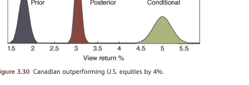

图 3.30 加拿大股票跑赢美国股票 4%。

### 观点 2 - 德国将跑赢其他欧洲市场 5%

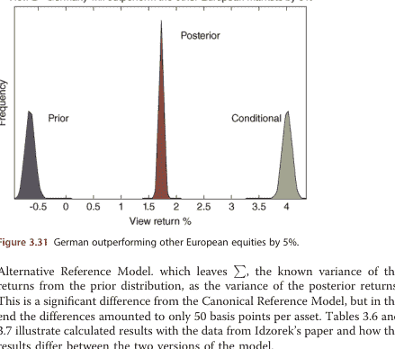

图 3.31 德国股票跑赢其他欧洲股票 5%。

替代参考模型（Alternative Reference Model），该模型将 Σ（来自先验分布的已知收益方差）保留为后验收益的方差。这与规范参考模型存在显著差异，但最终差异仅为每项资产 50 个基点。表 3.6 和表 3.7 展示了使用 Idzorek 论文数据计算的结果，以及两种模型版本之间结果的差异。

表 3.6 包含使用 Idzorek（2005）的数据和规范参考模型生成的结果。表 3.7 展示了由替代参考模型生成的相同结果。

### 表 3.6 使用 Idzorek 数据的规范参考模型（对应于 Idzorek 论文中表 6 的数据）。

| 资产类别 | μ | w_eq | w | Black-Litterman 参考模型 | Idzorek 的结果 |
|---|---|---|---|---|---|
| 美国债券 | 0.07 | 18.87% | 28.96% | 10.09% | 10.54% |
| 国际债券 | 0.50 | 25.49% | 15.41% | -10.09% | -10.54% |
| 美国大盘成长 | 6.50 | 11.80% | 9.27% | -2.52% | -2.73% |
| 美国大盘价值 | 4.33 | 11.80% | 14.32% | 2.52% | -2.73% |
| 美国小盘成长 | 7.55 | 1.31% | 1.03% | -0.28% | -0.30% |
| 美国小盘价值 | 3.94 | 1.31% | 1.59% | 0.28% | 0.30% |
| 国际发达市场 | 4.94 | 24.18% | 27.74% | 4.15% | 3.63% |
| 国际新兴市场 | 6.84 | 3.40% | 3.40% | 0% | 0% |

### 表 3.7 使用 Idzorek 数据的替代参考模型（对应于 Idzorek 论文中表 6 的数据）。

| 资产类别 | μ | w_eq | w | 替代参考模型 | Idzorek 的结果 |
|---|---|---|---|---|---|
| 美国债券 | 0.07 | 19.34% | 29.89% | 10.55% | 10.54% |
| 国际债券 | 0.50 | 26.13% | 15.58% | -10.55% | -10.54% |
| 美国大盘成长 | 6.50 | 12.09% | 9.37% | -2.72% | -2.73% |
| 美国大盘价值 | 4.33 | 12.09% | 14.81% | 2.72% | -2.73% |
| 美国小盘成长 | 7.55 | 1.34% | 1.04% | -0.30% | -0.30% |
| 美国小盘价值 | 3.94 | 1.34% | 1.64% | 0.30% | 0.30% |
| 国际发达市场 | 4.94 | 24.18% | 27.77% | 3.59% | 3.63% |
| 国际新兴市场 | 6.84 | 3.49% | 3.49% | 0.00% | 0.00% |

请注意，表 3.6 中的结果很接近，但对于若干资产而言，差异约为 50 个基点。表 3.7 中显示的值在四个基点以内，基本上与 Idzorek 报告的结果一致。

## 补充工作

考虑重现 Black–Litterman 模型一些重要研究论文结果的工作。

在关于 Black–Litterman 模型的重要论文中，有两篇非常值得重现：

- 1. Satchell 和 Scowcroft（2000）
- 2. Black 和 Litterman（1992）

Satchell 和 Scowcroft（2000）在其论文中没有提供足够的数据来重现他们的结果。他们有几个示例，一个是 11 个国家的股票收益加上货币收益，另一个是 15 个国家。他们没有提供任何一个示例的协方差矩阵，因此无法重现他们的分析。通过重现他们的结果来确认他们是否使用了替代参考模型将会很有意思。

Black 和 Litterman（1992）确实提供了其分析所需的几乎所有输入，尽管他们选择了一个复杂的示例，包括部分对冲的股票和债券收益。这需要对已构建的反向优化过程应用一些约束。继续这项工作以验证 Black 和 Litterman（1992）中所用 Black–Litterman 实现的细节应该是有用的。

## Black–Litterman 模型的扩展

本节涵盖 Idzorek（2005）、Fusai 和 Meucci（2003）、Krishnan 和 Mains（2006）以及 Qian 和 Gorman（2001）提出的 Black–Litterman 模型扩展。


Idzorek（2005）提出了一种以简单直接的方法校准投资者观点的置信度或方差的方法。

接下来是关于观点极端性或质量的度量的一节。Fusai 和 Meucci（2003）提出了一种衡量后验均值估计与先验或其它估计的一致性的方法。Braga 和 Natale（2007）描述了如何使用跟踪误差来衡量从均衡到后验投资组合的距离。还包括了使用相对熵来衡量观点质量的额外原创工作。

最后，像 Krishnan 和 Mains（2006）这样的模型更大扩展提出了将额外因子纳入模型的方法。Qian 和 Gorman（2001）提出了一种整合对协方差矩阵的观点以及对收益的观点的方法。

## Idzorek 的扩展

Idzorek 明显的目标是降低 Black–Litterman 模型对非量化投资者的复杂性。他通过允许投资者以百分比（0–100%）指定对观点的置信度来实现这一点，其中置信度衡量后验权重从先验估计（0%）到条件估计（100%）的变化。这种线性关系在公式（3.123）中显示：

confidence = ( w − w_mkt ) / ( w_100 − w_mkt )  (3.123)

其中
w_100 是在对观点 100% 确定时的资产权重，
w_mkt 是在没有观点时的资产权重，
w 是在指定观点下的资产权重。

还提供了一种反推出生成每个观点所需适当倾斜（从先验到后验的权重变化）的 ω 值的方法。这些值随后可组合形成 Ω，并使用该模型计算后验估计。

Idzorek 在公式中包含了 τ，但由于使用了替代参考模型和他的公式（3.123），在 Idzorek 方法中无需使用 τ。

该论文讨论了使用最小二乘法求解 ω。实际上可以解析求解。下一节将提供该解所需的公式推导。

首先可以使用以下观点不确定性的形式。Idzorek 在此公式中包含了 τ，但他使用了替代参考模型，因此可以从他的方法表述中去掉 τ：

Ω = α P Σ P^T  (3.124)

其中 α，即不确定性系数，是区间 [0, ∞] 中的一个标量。

- 当投资者对自己的观点 100% 置信时，α 将为 0。
- 当他们完全不确定时，α 将为 ∞。

请注意，（3.124）是精确的，它与公式（3.122）以及 He 和 Litterman（1999）使用的 Ω 相同，因为它是一个 1 × 1 矩阵。这使得可以找到 Idzorek 置信度下 Ω 问题的闭式解。

首先代入（3.119）

$$\Pi = \Pi + [1/(1 + \alpha)][P^{-1}Q - \Pi] \tag{3.119}$$

代入
$$\underline{\Pi} = \delta\Sigma \underline{w}, \tag{3.83}$$

或
$$\underline{w} = \Pi(\delta\Sigma)^{-1}$$

得到
$$\underline{w} = \{\Pi + [1/(1 + \alpha)][P^{-1}Q - \Pi]\}(\delta\Sigma)^{-1} \tag{3.125}$$

现在可以在 α 的边界条件下求解（3.125）：
$$\lim_{\alpha\to\infty} w_{mkt} = \Pi(\delta\Sigma)^{-1} \tag{3.126}$$
$$\lim_{\alpha\to0} w_{100} = P^{-1}Q(\delta\Sigma)^{-1} \tag{3.127}$$

将它们代回（3.123）。当投资者同时应用所有观点时，观点之间的相互作用可能会使单个资产的后验估计偏离按单个观点处理时产生的结果。

Idzorek 的方法大大简化了投资者在没有量化模型驱动流程时指定观点不确定性的过程。此外，该模型不会为流程增加有意义的复杂性。

## Idzorek 扩展的示例

Idzorek 在他的论文中描述了实施其扩展所需的步骤，但没有提供完整的计算示例。在这里，将从 Idzorek 停止的地方继续完成示例！Idzorek 的示例包括三个观点：

- 国际发展股票将具有 5.25% 的绝对超额收益，置信度 25.0%。
- 国际债券将跑赢美国债券 25 个基点，置信度 50.0%。
- 美国成长股将跑赢美国价值股 2%，置信度 65.0%。

Idzorek 定义的步骤包括 w100 的计算，然后根据期望的权重变化计算每个观点的 ω。从上一节可以看出，只需取每个观点的投资者置信度，代入（3.131），并计算 alpha 的值。然后将 α、P 和 Σ 代入公式（3.124）并计算每个观点的 ω 值。此时，可以组装 Ω 矩阵并使用（3.104）或（3.105）求解后验收益。

在展示此示例时，将显示每个观点的结果，包括 w_mkt 和 w_100，以便使扩展的工作更加透明。表 3.8–3.10 显示了单个观点的结果。

然后可以使用所有观点一起指定的 Ω 矩阵的最新计算值，并得出表 3.11 中显示的将三个观点融合在一起的最终结果。

**表 3.8 第 1 个观点的校准结果。**

| 资产 | ω | w_mkt | w* | w 100% | 隐含置信度 |
|---|---|---|---|---|---|
| 国际开发股票 | 0.002126625 | 24.18% | 25.46% | 29.28% | 25.00% |

**表 3.9 第 2 个观点的校准结果。**

| 资产 | ω | w_mkt | w* | w 100% | 隐含置信度 |
|---|---|---|---|---|---|
| 美国债券 | 0.000140650 | 19.34% | 29.06% | 38.78% | 50.00% |
| 国际债券 | 0.000140650 | 26.13% | 16.41% | 6.69% | 50.00% |

不与先验估计相矛盾。Theil（1971）描述了一种进行假设检验以验证观点与先验兼容的方法。该工作正在扩展以衡量后验与先验的兼容性。Fusai 和 Meucci（2003）描述了一种在使用替代参考模型时检验后验与先验兼容性的方法。He 和 Litterman（1999）以及 Braga 和 Natale（2007）描述了可用于衡量两个分布之间的距离或先验与后验之间倾斜程度的度量。这些度量不适合假设检验，但可作为优化过程的约束。He 和 Litterman（1999）定义了一个度量 Λ，用于衡量每个观点在后验中引起的倾斜。Braga 和 Natale（2007）使用跟踪误差波动率（TEV）来衡量从先验到后验的距离。

## Theil 的观点与先验兼容性度量

Theil（1971）将此描述为检验观点与先验信息的一致性。给定线性混合估计模型，有先验（3.132）和条件（3.133）：

xβ = π + u
(3.132)

pβ = q + v
(3.133)

混合估计模型将 u 定义为均值为 0、协方差为 Σ_u 的随机向量，将 v 定义为均值为 0、协方差为 Ω 的随机向量。

这里采用的方法与分析线性回归预测时采用的方法非常相似。人们有两个观点的估计，即观点的条件估计和收益的后验估计。

可以将后验估计定义为 β_。可以按如下方式衡量先验与观点之间的估计误差

ζ = (xβ_ - μ) = x(β_ - β) + u
(3.134)

向量 ζ 的均值为 0，方差为 V(ζ)。应使用以下公式形成自己的假设检验

ξ = E(ζ) V(ζ)^{-1} E(ζ)
(3.135)

量 ξ 被称为马哈拉诺比斯距离（z 分数的多维类比），其分布为 χ²(n)。为了使用此形式，需要求解 E(ζ) 和 V(ζ)。

如果只考虑观点中的信息，则 β 的估计量为

β_ = (P^T Ω^{-1} P)^{-1} P^T Ω^{-1} Q
(3.136)

请注意，由于 P 不要求是满秩矩阵，可能无法按原样计算此公式。这里在收益空间中工作（作为

该新检验统计量 ξ 在 (3.148) 中服从 χ²(q)，其中 q 为视图数量。它是后验收益率估计值相对于估计值后验协方差的马哈拉诺比斯距离的平方。可以用该检验统计量通过标准置信检验来判断视图是否与先验一致：

P(q) = 1 − F{ξ(q)}  (3.149)

其中 F(ξ) 是 χ²(q) 分布的 CDF。

还可使用链式法则计算该度量对视图的敏感性：

∂P/∂q = (∂P/∂ξ)(∂ξ/∂q)  (3.150)

代入各项后，

∂P/∂q = −f(ξ){2[(Ω + PΣPᵀ)⁻¹(Q − PI)]ᵀ}  (3.151)

其中 f(ξ) 是 χ²(q) 分布的 PDF。

## 后验信息来源的泰尔度量

Theil (1963) 描述了一种可用于确定先验和视图对后验精度贡献的度量。该度量称为 θ。它在所有来源上之和为 1，并且如果测量每个视图的贡献，也方便地在视图上求和。

来自先验的对后验精度贡献的度量为

θ_prior = (1/n) tr{(Σ⁻¹)[(Σ⁻¹) + Pᵀ Ω⁻¹ P]⁻¹}  (3.152)

其中 n 为资产数量。方程 (3.153) 可通过使用完整的矩阵 P 和 Ω 来用于所有视图。对于单个视图 i，使用 P 和 Ω 的相关切片：

θ_i = (1/n) tr[(P_iᵀ Ω_i⁻¹ P_i)[(Σ⁻¹)⁻¹ + Pᵀ Ω⁻¹ P]⁻¹]  (3.153)

方程 (3.152) 和 (3.153) 提供了可用于计算先验和视图对后验精度贡献的方程。可以用该诊断来判断相对贡献是否与该比例的直观观点相匹配。

## Fusai 和 Meucci 的一致性度量

接下来考虑 Fusai 和 Meucci (2003) 的工作。在他们的论文中，他们提出了一种量化后验收益率估计与先验估计之间统计差异的方法。这提供了一种校准视图不确定性的方法，并确保在先验均衡估计的背景下，先验后验估计不会极端。

在参考模型中，他们对后验使用了收益率的先验方差，他们不需要对方差进行任何推导。也可以将他们度量的一个变体应用于规范参考模型。他们提出了后验收益相对于先验收益的平方马哈拉诺比斯距离的使用。这包括 τ 以匹配规范参考模型，但他们的工作中不包括 τ，因为他们使用了替代参考模型：

$$M(q) = (\mu_{BL} - \mu)(\tau\Sigma)^{-1}(\mu_{BL} - \mu)$$  
(3.154)

它本质上是在以估计中的不确定性为归一化的情况下，衡量先验 μ 与估计收益 μ_BL 之间的距离。可以用先验分布的协方差矩阵作为不确定性。平方马哈拉诺比斯距离服从 χ²(q)，其中 q 为资产数量。这可以很容易地用于假设检验。因此，该事件发生的概率可以计算为

$$P(q) = 1 - F(M(q))$$  
(3.155)

其中 F(M(q)) 是 M(q) 的卡方分布的 CDF，其自由度为 n。

最后，为了识别哪些视图对远离均衡的距离贡献最大，还可以计算概率对每个视图的敏感性。使用链式法则计算偏导数

$$\partial P(q)/\partial q = \partial P/\partial M \, \partial M/\partial(\mu_{BL}) \, \partial \mu_{BL}/\partial q$$  
(3.156)

$$\partial P(q)/\partial q = -f(M)[2(\mu_{BL} - \mu)][(P\tau\Sigma P + \Omega)^{-1}P]$$  
(3.157)

其中 f(M) 是 M(q) 的卡方分布的 PDF，其自由度为 n。注意该度量与 (3.151) 非常相似，后者是 Theil 的先验与视图之间兼容性的度量。

他们论文中的一个例子得出后验与先验一致的初始概率为 94%。他们规定他们的投资者希望该概率不低于 95%（假设检验中常用的置信水平），因此他们将调整其视图以使概率符合要求。由于他们也计算了敏感性，他们的投资者可以识别哪些视图提供了其度量最大的边际增加，投资者随后可以调整这些视图。这些敏感性尤其有用，因为某些视图实际上可能将后验拉向先验，投资者可以加强这些视图或削弱将后验拉离先验的视图。最后一点可能看起来不直观。鉴于视图通过协方差矩阵间接耦合，人们会期望视图只将后验分布推离先验。然而，由于视图可能相互冲突，无论是直接还是通过相关性，任何单个视图都可能产生净影响，将后验推向先验更近，或推得更远。

他们提出在迭代方法中使用其度量，以确保后验与先验以指定的置信水平一致。对于规范参考模型，可以使用收益的后验方差而不是 Σ 重写 (3.154)，得到

$$M(q)=(\mu_{BL}-\mu)\left((\tau\Sigma)^{-1}+P^T\Omega^{-1}P\right)^{-1}(\mu_{BL}-\mu) \tag{3.158}$$

否则，他们的一致性度量及其使用对两种参考模型相同。

### He 和 Litterman 的 Lambda

He 和 Litterman (1999) 使用了一个度量 Λ 来衡量每个视图对后验的影响。他们将 Black–Litterman 无约束后验投资组合定义为均衡投资组合（先验）和每个视图的贡献的混合；该贡献由 Λ 衡量。

推导 Λ 的公式时，将从 (3.86b) 开始并代入后验分布的各项值

$$w=(\Sigma)^{-1}\Pi \tag{3.86b}$$

并同时代入 Π 的收益：

$$w=\frac{1}{\delta}\Sigma^{-1}M^{-1}\left[(\tau\Sigma)^{-1}\Pi+P^T\Omega^{-1}Q\right] \tag{3.159}$$

协方差项首先被简化：

$$\Sigma^{-1}M^{-1}=(\Sigma+M^{-1})^{-1}M^{-1} \tag{3.160a}$$

$$\Sigma^{-1}M^{-1}=(\Sigma M+I)^{-1} \tag{3.160b}$$

$$\Sigma^{-1}M^{-1}=\Sigma^{-1}(\Sigma^{-1}+M)^{-1} \tag{3.160c}$$

$$\Sigma^{-1}M^{-1}=\Sigma^{-1}\left[\Sigma^{-1}+(\tau\Sigma)^{-1}+P^T\Omega^{-1}P\right]^{-1} \tag{3.160d}$$

$$\Sigma^{-1}M^{-1}=\Sigma^{-1}\left[\left\{\frac{1+\tau}{\tau}\right\}\Sigma^{-1}+P\Omega^{-1}P^T\right]^{-1} \tag{3.160e}$$

$$\Sigma^{-1}M^{-1}=(P^T\Sigma P)^{-1}\left[\left\{(1+\tau)(P^T\Sigma P)^{-1}+\tau\Omega^{-1}\right\}^{-1}\right]^{-1} \tag{3.160f}$$

$$\Sigma^{-1}M^{-1}(P^T\Sigma P)^{-1}=\left[\left\{\frac{P^T\Sigma P}{1+\tau}\right\}-\left\{\frac{P^T\Sigma P}{1+\tau}\right\}\left\{\frac{\Omega}{\tau}+\frac{P^T\Sigma P}{1+\tau}\right\}\right] \tag{3.160g}$$

$$\Sigma^{-1}M^{-1}=\left\{\frac{\tau}{1+\tau}\right\}\left[I-\left\{\frac{P^T\Sigma P}{1+\tau}\right\}\left\{\frac{\Omega}{\tau}+\frac{P^T\Sigma P}{1+\tau}\right\}^{-1}\right] \tag{3.160h}$$

然后，可以定义

$$\Lambda=\left[\frac{\Omega}{\tau}+\left\{\frac{P^T\Sigma P}{1+\tau}\right\}\right] \tag{3.161}$$

最后重写为

$$\Sigma^{-1} M^{-1} = \{\tau/(1+\tau)\}[I - (P^T A^{-1} P)\{\Sigma/(1+\tau)\}]$$ (3.162)

使用乘数 {τ/(1+τ)} 的原因是，在 Black–Litterman 参考模型中，投资者并非完全投资于先验（均衡）投资组合。

为了求 Λ，可将 (3.162) 代入 (3.159)，然后整理项：

$$\underline{w} = (1/\delta)[\tau/(1+\tau)][I - (P^T A^{-1} P)\{\Sigma/(1+\tau)\}][(\Sigma^{-1})^{-1}\Pi + P^T\Omega^{-1}Q]$$ (3.163)

$$\underline{w} = (1/\delta)[\tau/(1+\tau)][(\Sigma^{-1})^{-1}\Pi - (P^T A^{-1} P)\{\tau/(1+\tau)\Pi + P^T\Omega^{-1}Q\}]$$ (3.164)

$$\underline{w} = \{1/(1+\tau)\}[\underline{w}_{eq} + P^T[-A^{-1}P\Pi/(1/[\delta(1+\tau)]) + (\tau\Omega^{-1}Q/\delta)] -A^{-1}P\{\Sigma/\delta(1+\tau)\}P^T\Omega^{-1}Q\}]$$ (3.165)

$$\underline{w} = \{(1/[1+\tau])\}[\underline{w}_{eq} + P^T(\tau/\delta)\Omega^{-1}Q - [A^{-1}P\Sigma\underline{w}_{eq}/(1+\tau)] -A^{-1}[\tau(1+\tau)][P^T\Sigma P\Omega^{-1}Q/\delta]\}]$$ (3.166)

因此，结合 (3.161)，以下方程定义了 Λ：

$$\Lambda = (\tau/\delta)\Omega^{-1}Q[A^{-1}P\Sigma\underline{w}_{eq}/(1+\tau)] - A^{-1}[\tau/(1+\tau)][P^T\Sigma P\Omega^{-1}Q/\delta]$$ (3.167)

He 和 Litterman 的 Λ 表示视图投资组合在最终后验权重上的权重。因此，可以将 Λ 用作衡量其视图影响的指标。

也可以为替代参考模型推导 He 和 Litterman 的 Λ：称之为 Λ_A。可以从相同的逆优化方程 3.86b 开始：

$$w = (\delta\Sigma)^{-1}\Pi$$ (3.86b)

并用 (3.104) 中的收益替换 Π。

$$P(A|B) \sim N\{[\,(\Sigma^{-1})^{-1}\Pi + P^T\Omega^{-1}Q\][(\tau\Sigma)^{-1} + P^T\Omega^{-1}P]^{-1},\; [(\tau\Sigma)^{-1} + P^T\Omega^{-1}P]^{-1}\}$$ (3.104)

但使用先验协方差矩阵作为 I 是使用替代参考模型。

$$\underline{w} = (1/\delta)\Sigma^{-1}[(\Sigma^{-1})^{-1}\Pi + P^T\Omega^{-1}P][\Sigma^{-1}\Pi + P^T\Omega^{-1}Q]$$ (3.168)

首先使用 Woodbury 矩阵恒等式简化协方差项。

$$\Sigma^{-1}[(\Sigma^{-1}) + P^T\Omega P]^{-1} = I^{-1} - I^{-1}P^T(\Omega + P\Sigma P^T)^{-1}P\Sigma^{-1}$$ (3.168a)

$$= I - P^T(\Omega + P\Sigma P^T)^{-1}P\Sigma$$ (3.168b)


然后，可以定义

A_A = Ω + P^T Σ P  (3.169)

并将上述结果代回 (3.128) 并展开各项：

w̅ = Π[δΣ]^{-1} + [1/(1 + α)][P^T Q[ΩΣ]^{-1} - Π[δΣ]^{-1}]  (3.128)

w̅ = (δ)^{-1}(I - P^T A_A^{-1} P Σ)[Σ^{-1}Π + P^T Ω^{-1} Q]  (3.170a)

w̅ = (δ)^{-1}(Σ^{-1}Π + P^T Ω^{-1} Q - P^T A_A^{-1} P Π - P^T A_A^{-1} P Σ P^T Ω^{-1} Q)  (3.170b)

w̅ = Σ^{-1}Π(δ)^{-1} + (1/δ)P^T[Ω^{-1}Q - A_A^{-1}PΠ - A_A^{-1}PΣP^TΩ^{-1}Q]  (3.170c)

w̅ = Σ^{-1}Π(δ)^{-1} + (1/δ)P^T[Ω^{-1}Q - A_A^{-1}PΣw_eq - A_A^{-1}PΣP^TΩ^{-1}Q]  (3.170d)

在 He 和 Litterman 的文献中，Λ 在替代参考模型（Alternative Reference Model）中采用了类似的形式，如下所示：

w̅ = w_eq + P^T A_A  (3.171)

注意，在替代参考模型中，投资者的先验投资组合与均衡投资组合具有完全相同的权重。

可以注意到，以下公式定义了 Λ_A：

Λ_A = (Ω^{-1}Q/δ) - A_A^{-1}PΣw_eq - A_A^{-1}PΣP^T(Ω^{-1}Q/δ)  (3.172)

### Braga 和 Natale 以及跟踪误差波动率（TEV）

Braga 和 Natale（2007）提出使用后验投资组合与先验投资组合之间的跟踪误差作为与先验的距离度量。投资者通常使用跟踪误差来衡量相对于基准的风险，并且可以将其用作投资约束。由于该指标被广泛使用，大多数投资者对 TEV 都有直观的理解和一定程度的熟悉感。

跟踪误差波动率（TEV）在此定义为

TEV = √[(w_actv^T Σ w_actv)]，其中 w_actv = w̅ - w_r，(3.173)

其中

- w_actv 是主动权重或主动投资组合，
- w̅ 是投资者投资组合中的权重，
- w_r 是参考投资组合中的权重，
- Σ 是收益的协方差矩阵。

此外，推导出的跟踪误差敏感性公式如下：给定

TEV = f(w_actv)  (3.174)

并且可以进一步细化

w_actv = g(q)  (3.175)

其中 q 代表观点。

然后可以使用链式法则将 TEV 对观点的敏感性分解为：

∂TEV/∂q = (∂TEV/∂w_actv)(∂w_actv/∂q) (3.176)

直接求解 (3.176) 的第一项：

∂TEV/∂w_actv = ∂/∂w_actv [√(w_actv^T Σ_w_actv)] (3.177)

令 x = w_actv^T Σ_w_actv，然后应用链式法则求解 (3.176) 的第一项：

(∂TEV/∂w_actv) = (∂TEV/∂x)(∂x/∂w_actv) = [1/{2√(w_actv^T Σ_w_actv)}][2Σ_w_actv] = Σ_w_actv / √(w_actv^T Σ_w_actv) (3.178)

类似地求解 (3.176) 的第二项：

(∂w_actv/∂q) = ∂[w - w_r]/∂q = ∂[(1/δ)Σ^{-1}E(r) - (1/δ)Σ^{-1}Π]/∂q = (1/δ)Σ^{-1}[∂(E(r) - Π)/∂q] = (1/δ)Σ^{-1}[∂{τΣP^T[(PτΣP^T)+Ω]^{-1}[Q - PΠ]}/∂Q] = (1/δ)Σ^{-1}τΣP^T[(PτΣP^T)+Ω]^{-1} = (τ/δ)P^T[(PτΣP^T)+Ω]^{-1} = (1/δ)P^T[(PΣP^T)+(Ω/τ)]^{-1} (3.179)

这一结果与 Braga 和 Natale（2007）论文中的结果略有不同，因为这里使用的 Black–Litterman 模型形式需要的矩阵求逆次数较少。敏感性方程为

∂TEV/∂q = {Σ_w_actv / √(w_actv^T Σ_w_actv)} (1/δ)P^T[(PΣP^T)+(Ω/τ)]⁻¹ (3.180)

这是他们的 TEV 结果。TEV 的一个优点是大多数投资者对它很熟悉，因此他们会对其表示的含义有一定直觉。

Fusai 和 Meucci（2003）引入的一致性度量对投资者来说则不那么熟悉。

## Herold（2003）引入的度量

这种诊断概念可以应用于投资组合模型，以验证输出结果。其中一种诊断是观点之间的相关性，可用于判断更新后的投资组合可能的表现。通过检查观点的相关矩阵 P Σ P^T，可以确定观点之间的相关程度。如果观点高度相关，那么可以预期：如果观点正确，所有观点都将对表现有所贡献；如果观点错误，则都会导致表现不佳。如果观点相关性不强，那么可以预期表现贡献是分散化的。

例如，如果使用 He 和 Litterman 的数据及其两个观点，可以计算出该度量：

PΣP^T = [0.0213  0.0020]
        [0.0020  0.0170]

非对角元素（0.0020 和 0.0020）比对角元素（0.0213 和 0.0170）小一个数量级。这种差异表明观点之间的相关性不强。这与 He 和 Litterman 对两个观点所设定的互斥资产集且相关性较弱的情况一致。

Herold（2003）还讨论了各观点对跟踪误差的边际贡献。这与 Braga 和 Natale 计算的指标相同，不过他提出从 He 和 Litterman 的 Λ_A 的替代参考模型版本出发推导该指标的计算公式。

Herold（2003）考虑了主动管理（Active Management）的情形，这意味着 Black–Litterman 模型被应用于某个投资组合之上的主动管理叠加层。在这种情况下，先验分布对应于 w_eq = 0。后验权重即为叠加权重。他使用替代参考模型并计算了一个量 Φ，即 Λ_A 的主动管理版本，

Λ_A = (Ω^{-1} Q / δ) - A^{-1} P Σ w_eq - A^{-1} P Σ P^T (Ω^{-1} Q / δ)    (3.184)
但 w_eq = 0，所以
Φ = (Ω^{-1} Q / δ) - A^{-1} P Σ P^T (Ω^{-1} Q / δ)    (3.185)
其中
w_actv = P^T Φ    (3.186)

表 3.14 示例 2 的收益和权重：来自 He 和 Litterman（1999）的均衡。

| 资产 | P₀ | P₁ | μ | w_eq/(1+τ) | w* | w* - w_eq/(1+τ) |
|---|---|---|---|---|---|---|
| 澳大利亚 | 0.0 | 0.0 | 4.72 | 1.5% | 1.5% | 0.0% |
| 加拿大 | 0.0 | 1.0 | 10.3 | 2.1% | 22.7% | 20.6% |
| 法国 | -0.295 | 0.0 | 10.2 | 5.0% | 1.6% | -3.4% |
| 德国 | 1.0 | 0.0 | 12.4 | 5.2% | 16.8% | 11.6% |
| 日本 | 0.0 | 0.0 | 4.84 | 11.0% | 11.0% | 0.0% |
| 英国 | -0.705 | 0.0 | 7.09 | 11.8% | 3.7% | -8.1% |
| 美国 | 0.0 | -1.0 | 7.14 | 58.6% | 38.0% | -20.6% |
| q | 5.0 | 4.0 |  |  |  |  |
| ω/τ | 0.09 | 0.07 |  |  |  |  |

对观点与先验一致性的信心很低。而 Fusai 和 Meucci 的度量现在有 99.8% 的信心认为后验与先验一致。在实践中尚不清楚应该使用什么界限，但他们的度量通常呈现出比 Theil 度量高得多的置信度。TEV 已经下降，现在为 7.67%，但并没有显著减小。

同样，所有敏感性都显示第二个观点对最终权重的影响更大。

在这两种情形下，可以对这些不同的度量得出一些结论。Theil 的一致性度量检验显示，观点与先验估计一致性的置信度从最高 46% 到最低 44%。

该度量非常敏感，且不清楚什么才是好的置信度阈值。“50%”在直觉上似乎有吸引力。

表 3.15 示例 2 的影响度量。

| 度量 | 值（置信水平） | 敏感性 | 敏感性 |
|---|---|---|---|
| Theil 度量 | 1.537 (46.4%) | -4.27 | -12.39 |
| Theil 的 θ | 0.88 | 0.05 | 0.07 |
| Fusai 和 Meucci 的度量 | 0.7479 (99.8%) | -0.06 | -0.24 |
| λ |  | 0.193 | 0.544 |
| TEV | 7.67% | 0.332 | 1.406 |

Fusai 和 Meucci 的一致性度量置信度在 98.38% 到 99.98% 之间，表明后验估计通常与先验高度一致。Fusai 和 Meucci 提出，投资者可能要求置信水平为 5%。鉴于这些结果，5% 似乎是一个相当大的值。一致性度量的敏感性随度量本身成比例变化，当度量值较低时，敏感性也非常低。

λ 随观点的置信度而变化，并且通常表明后验中的大部分信息源自先验。它随置信水平的变化而直观地移动。

在两种情形之间，TEV 下降了 61 个基点，但相对于 8.28% 的起点，仍然表明主动权重较大。在这种情况下，尚不清楚 TEV 的现实阈值是多少，但这些值可能接近可容忍的上限。注意，在两种情形之间，对第一个观点的敏感性下降了 50%，这与我们所应用的置信度变化一致。

在分析这些衡量观点引起的倾斜的不同度量时，权重的 TEV 衡量观点和优化过程的影响，可以将其视为最终输出。如果投资者担心 TEV 的限制，可以轻松地将它们添加为优化过程的约束。

He 和 Litterman 的 Lambda 衡量观点对后验权重的影响，但仅适用于无约束优化的情况。这使其适合衡量影响并作为过程的一部分，但不能用作优化过程中的约束。Theil 的兼容性度量和 Fusai 和 Meucci 的一致性度量衡量后验分布，包括收益和协方差矩阵：前者在观点空间中，后者在资产空间中。

## 主动管理与 Black–Litterman 模型

主动管理是指投资者在一个 100% 投资于被动基准组合之上管理一个叠加投资组合的情形。在这种情况下，只关注叠加部分而不关注基准，因此从一个具有 0 主动权重和 0 相对于基准的超额收益预期的先验分布开始。输入模型的所有收益和观点都是相对于均衡基准收益而言，而非相对于无风险利率。权重是针对主动投资组合的，因此权重之和应始终为 0。

Herold（2003）讨论了将 Black–Litterman 模型应用于主动管理问题。他引入了一个度量 Φ，即针对主动管理修改后的 He 和 Litterman 的 λ_A。当使用 Black–Litterman 模型进行主动管理（相对于被动基准组合）时，均衡权重 (w_eq) 为 0，因此均衡收益 (Π) 也为 0。


对于投资者具有绝对观点的那些资产，后验估计的方差将为零。对于所有其他资产，后验方差将为非零。

\[
\varepsilon \sim N\left[0,\; \Sigma - (\Sigma P^T)(\Sigma_v)^{-1}(P\Sigma)\right] \tag{3.204}
\]

其中

\[
\Sigma_v = P\Sigma P^T \tag{3.205}
\]

\[
\operatorname{Var}(\varepsilon) = \Sigma - (\Sigma P^T)(P\Sigma P^T)^{-1}(P\Sigma) \tag{3.206}
\]

\[
M = \tau\Sigma - \tau\Sigma P^T (P\tau\Sigma P^T + \Omega)^{-1} P\tau\Sigma \tag{3.113}
\]

令Ω = 0并移除τ：

\[
M = \Sigma - \Sigma P^T(P\Sigma P^T)^{-1}P\Sigma \tag{3.114}
\]

为了得到Qian和Gorman的方程(3.207)，需要重新引入观点的协方差Ω，但不似Black–Litterman模型那样混合协方差，而是可以依赖不相关性，直接将两个方差项相加。从(3.85)中取出条件方差。

\[
P(B|A) \sim N\left(P^{-1}Q,\; [P^T\Omega^{-1}P]^{-1}\right) \tag{3.85}
\]

\[
\operatorname{Var}(\varepsilon) = \Sigma - (\Sigma P^T)(P\Sigma P^T)^{-1}(P\Sigma) + (P^T\Omega^{-1}P)^{-1} \tag{3.115a}
\]

\[
\operatorname{Var}(\varepsilon) = \Sigma + (\Sigma P^T)(P\Sigma P^T)^{-1}(P\Sigma) + (\Sigma P^T)(P^T\Omega^{-1}P)^{-1}\Omega(P\Sigma P^T)^{-1}(P\Sigma) \tag{3.115b}
\]

\[
\operatorname{Var}(\varepsilon) = \Sigma + (\Sigma P^T)\left[(P\Sigma P^T)^{-1}\Omega(P\Sigma P^T)^{-1} - (P\Sigma P^T)^{-1}\right](P\Sigma) \tag{3.115c}
\]

注意，(3.115c)与(3.207)完全匹配：

\[
\Sigma = \Sigma + (\Sigma P^T)\left(\Sigma_v^{-1}\Sigma_V\Sigma_v^{-1} - \Sigma_v^{-1}\right)(P\Sigma) \tag{3.207}
\]

其中Σ_v = PΣP^T，Σ_V = Ω。

将上述式子代入(3.207)后，结果为

\[
\Sigma = \Sigma + (\Sigma P^T)\left[(P\Sigma P^T)^{-1}\Omega(P\Sigma P^T)^{-1} - (P\Sigma P^T)^{-1}\right](P\Sigma) \tag{3.116}
\]

Qian和Gorman展示了一种并非源自Theil混合估计或贝叶斯更新的条件协方差。当观点方差大于先前方差时，其行为可能会使后验方差相对于先前方差增大。他们将其描述为允许投资者对方差持有观点，并且他们并未建议Ω必须是对角矩阵。在该模型中，条件协方差与投资者对方差的观点成正比，但混合过程并不清晰。

将该公式与(3.113)中后验均值估计的方差进行比较：

\[
M = \tau\Sigma - \tau\Sigma P^T (P\tau\Sigma P^T + \Omega)^{-1} P\tau\Sigma \tag{3.117}
\]

直觉表明，更新后的后验均值估计将比先验估计更精确（即方差更小），因此人们希望后验（条件）方差始终小于先前方差。Black–Litterman后验方差实现了这一目标，并在均值未知、精度已知的情况下得出了贝叶斯分析的著名结果。因此，似乎应该优先选择这些结果，而不是Qian和Gorman的结果。

## 未来发展方向

本研究的未来方向包括复现原始论文的结果：Black和Litterman（1991）以及Black和Litterman（1992）。这些结果还包含货币收益和部分对冲的额外复杂性。

未来的工作应包括更多关于过程的信息，以及一个综合了各位作者最佳要素的合成模型。从CAPM均衡出发，经过观点到最终优化权重的完整示例将很有用，Krishnan和Mains（2005）双因子模型的完整示例也将很有用。Meucci（2006，2008）为Black–Litterman模型提供了进一步扩展，适用于非正态观点以及对收益以外参数的看法。这使得Black–Litterman模型能够应用于替代投资或衍生品定价等新领域。他的方法基于模拟，不提供闭式解。

## 使用Black–Litterman模型的资产配置流程

当作为资产配置流程的一部分使用时，与基于历史收益的估计用于无约束均值-方差优化相比，Black–Litterman模型提供的估计能够带来更稳定、更多元化的投资组合。由于这一重要特性，使用均值-方差优化的投资者不太可能需要人为约束即可获得没有极端权重的投资组合。遗憾的是，该模型需要种类繁多的数据，其中一些数据可能不易获得！

- 首先，投资者需要确定其可投资范围，并找到每种资产的市值。然后，他们需要估计资产超额收益的协方差矩阵。这通常使用适当时间窗口的历史数据来完成：Litterman（2003）和Bevan与Winkelmann（1998）都提供了在高盛计算协方差矩阵所用过程的详细信息。

- 在文献中，月度协方差矩阵最常由60个月的历史超额收益估计得出。

- 如果无法使用实际资产收益本身，则可以使用适当的替代指标，例如，美国国内大盘股可使用标普500指数。短期主权债券的收益，例如美国4周或13周国库券，足以作为大多数美国投资者的无风险利率。

- 当应用于资产配置问题时，对于个人投资者而言，查找流动性资产类别的市值信息可能具有挑战性，但对机构投资者来说可能几乎没有障碍，因为他们能够从各提供商处获取指数信息。

- 鉴于房地产、私募股权、大宗商品等非流动性资产类别的市值数据可用性有限，即使是机构投资者也可能难以拼凑出足够的市值信息。

- 这些资产类别的收益数据也可能因报告中的延迟、平滑和不一致而变得复杂。

- 使问题进一步复杂化的是如何处理对冲基金或绝对收益管理人。他们是否应被视为独立资产类别的问题需要进一步研究！

- 接下来，投资者需要量化其观点，以便应用这些观点并计算新的收益估计。观点可以源自定量或定性过程，可以是完整的或不完整的，甚至是相互冲突的。

- 最后，模型的输出需要输入投资组合选择模型以生成有效前沿，并选择有效的投资组合。

- Bevan和Winkelmann（1999）描述了他们的资产配置流程（针对国际固定收益）以及他们如何在该流程中使用Black–Litterman模型。这包括他们校准模型的方法以及如何计算协方差矩阵的信息。标准Black–Litterman模型不提供先验对除资产收益之外的市场因素的直接敏感性。将Black–Litterman模型扩展为先验分布使用多因子模型是相当简单的。Krishnan和Mains（2005）提供了模型的扩展，允许添加市场中未定价的额外跨资产因子。

- 此类因子的示例是衰退或信用市场因子。他们的方法是通用的，如果需要，可以应用于其他因子。大多数Black–Litterman文献报告的结果都使用无约束均值-方差优化的闭式解。他们在示例中也倾向于使用非极端的观点。

- 作为投资流程的一部分，可以合理推断至少会应用一些约束，例如限制卖空和限制资产类别中的集中度。缺乏预算约束也符合贝叶斯投资者的特点，由于对市场信念的不确定性，他们可能不希望100%投资于市场。

从收益的先验分布开始。假设一个线性模型，如

\[
\pi = x\beta + u \tag{3.118}
\]

其中π是先验收益分布的均值，β是期望收益，u是均值为0、方差为Φ的正态分布残差。

接下来，考虑一些附加信息，即条件分布：

\[
q = p\beta + v \tag{3.119}
\]

其中q是条件分布的均值，v是均值为0、方差为Ω的正态分布残差。

假设Ω和Σ均为非奇异的。

可以通过下式将先验信息和条件信息结合起来：

\[
\begin{pmatrix} \pi \\ q \end{pmatrix}
=
\begin{pmatrix} x \\ p \end{pmatrix}\beta
+
\begin{pmatrix} u \\ v \end{pmatrix}
\tag{3.120}
\]

其中残差的期望值为0，方差的期望值由下式给出：

\[
E\!\left(
\begin{pmatrix} u \\ v \end{pmatrix}
\begin{pmatrix} u^T & v^T \end{pmatrix}
\right)
=
\begin{pmatrix} \Phi & 0 \\ 0 & \Omega \end{pmatrix}
\tag{3.121}
\]

然后可以应用广义最小二乘法，从而将β估计为

\[
\hat{\beta}
=
\left(
\begin{pmatrix} x^T & p^T \end{pmatrix}
\begin{pmatrix} \Phi & 0 \\ 0 & \Omega \end{pmatrix}^{-1}
\begin{pmatrix} x \\ p \end{pmatrix}
\right)^{-1}
\begin{pmatrix} x^T & p^T \end{pmatrix}
\begin{pmatrix} \Phi & 0 \\ 0 & \Omega \end{pmatrix}^{-1}
\begin{pmatrix} \pi \\ q \end{pmatrix}
\tag{3.122}
\]

不使用矩阵记号可将其重写为

\[
\hat{\beta}
=
\left(x^T\Phi^{-1}x + p^T\Omega^{-1}p\right)^{-1}
\left(x^T\Phi^{-1}\pi + p^T\Omega^{-1}q\right)
\tag{3.123}
\]

可以用类似逻辑推导方差的表达式。鉴于方差是(β̂ - β)²的期望，可以先从将(3.122)代入(3.123)开始，得到


方差是(3.125)平方的期望值。

\[
E[(\hat{\beta}-\beta)^2]
= [x\Phi^{-1}x^T + \rho\Omega^{-1}p^T]^{-2}[x\Phi^{-1}u^T + \rho\Omega^{-1}v^T]^2 \tag{3.126}
\]

\[
= [x\Phi^{-1}x^T + \rho\Omega^{-1}p^T]^{-2}
[x\Phi^{-1}u^T u\Phi^{-1}x^T + \rho\Omega^{-1}v^T v\Omega^{-1}p^T + x\Phi^{-1}u^T v\Omega^{-1}p^T + \rho\Omega^{-1}v^T u\Phi^{-1}x^T] \tag{3.127}
\]

根据前面的假设，\(E[uu^T]=\Phi\)，\(E[vv^T]=\Omega\)，且由于\(u\)和\(v\)是独立变量，\(E(uv^T)=0\)。取期望后可以看到交叉项为0，因此(3.126)变为

\[
\begin{aligned}
E[(\hat{\beta}-\beta)^2]
&= [x\Phi^{-1}x^T + \rho\Omega^{-1}p^T]^{-2}
   [x\Phi^{-1}\Phi\Phi^{-1}x^T + \rho\Omega^{-1}\Omega\Omega^{-1}p^T + 0 + 0] \tag{3.128a}\\
&= [x\Phi^{-1}x^T + \rho\Omega^{-1}p^T]^{-2}
   [x\Phi^{-1}x^T + \rho\Omega^{-1}p^T] \tag{3.128b}\\
&= [x\Phi^{-1}x^T + \rho\Omega^{-1}p^T]^{-1}
\end{aligned}
\]

对于Black-Litterman模型，\(x\)是单位矩阵，且\(\Phi=\tau\Sigma\)。代入这些替换后，结果为

\[
E[(\hat{\beta}-\beta)^2] = [(\tau\Sigma)^{-1} + \rho\Omega^{-1}p^T]^{-1} \tag{3.129}
\]

## 3.6.1.2 使用贝叶斯定理的推导

本推导概述了贝叶斯定理的相关部分，以便建立一个通用词汇表，用于从贝叶斯视角分析Black-Litterman模型。

### 贝叶斯定理简介

贝叶斯定理表述为

\[
P(A|B) = \frac{P(B|A)P(A)}{P(B)} \tag{3.130}
\]

其中

- \(P(A|B)\) 是在给定\(B\)的条件下\(A\)的条件（或联合）概率，也称为后验分布。
- \(P(B|A)\) 是在给定\(A\)的条件下\(B\)的条件概率，也称为抽样分布。可称之为条件分布。
- \(P(A)\) 是\(A\)的概率，也称为先验分布。可称之为先验分布。
- \(P(B)\) 是\(B\)的概率，也称为归一化常数。

应用此公式求解后验分布时，归一化常数会消失在积分常数中；因此从此时起，可以忽略它。

使用贝叶斯定理的一个常见问题是如何确定一个直观且易处理的先验分布。Black-Litterman模型（以及均值-方差优化）的核心假设之一是资产收益服从正态分布。因此，这里仅限于条件分布和先验分布均为正态分布的情形。鉴于输入是正态分布，后验也将是正态分布。当先验分布和后验具有相同结构时，该先验称为共轭先验。

如果有兴趣，我们完全可以构建使用不同分布的Black-Litterman模型变体；然而，正态分布通常是最直接的选择。

Black-Litterman模型的另一个核心假设是，先验和条件分布关于实际均值的方差是已知的，但实际均值本身未知。这种“均值未知、方差已知”的情况在贝叶斯文献中有充分记载。这与Theil使用的模型一致：对均值有一个不确定的估计，但知道方差。

**备注：** 重要的分布定义如下：

- 1) 先验分布

  \[
  P(A) \sim N(x, S/n) \tag{3.131}
  \]

  其中\(S\)是分布关于均值的样本方差，样本数为\(n\)；则\(S/n\)是\(x\)的估计关于均值的方差。

- 条件分布

  \[
  P(B|A) \sim N(\mu, \Omega) \tag{3.132}
  \]

  其中\(\Omega\)是均值估计\(\mu\)的不确定性；它不是分布关于均值的方差。

- 2) 则后验分布由下式给出

  \[
  P(A|B) \sim N\{[\Omega^{-1}\mu + nS^{-1}x][\Omega^{-1} + nS^{-1}]^{-1}, (\Omega^{-1} + nS^{-1})^{-1}\} \tag{3.133}
  \]

- 3) (3.133)中的方差项是估计均值关于实际均值的方差。在贝叶斯统计中，方差的倒数称为精度。可以将后验均值描述为先验均值和条件均值的加权平均，其中权重因子是各自的精度。

- 4) 此外，后验精度是先验精度与条件精度之和。等式(3.133)要求先验和条件的精度为非无穷大，并且其和不为零。无穷大精度对应方差为0，即绝对置信。

- 5) 零精度对应无穷方差，即完全不确定。作为对公式的初步检验，可以测试边界条件，看它们是否符合直觉。如果在没有条件分布的情况下检查(3.133)，它应当退化为先验分布。

\[
\sim N([nS^{-1}]x[nS^{-1}]^{-1}, (nS^{-1})^{-1}) \tag{3.134}
\]

\[
\sim N(x, S/n) \tag{3.135}
\]

正如在等式(3.133)中所见，它确实退化为先验分布。另一个重要场景是条件分布100%确定的情况，此时\(\Omega\)或其某一部分为0，因此\(\Omega\)不可逆。可以将公式(3.133)中的收益和方差转换为一种在100%确定情况下更易处理的形式。

\[
P(A|B) \sim N\bigl(x + (S/n)[\Omega + S/n]^{-1}[\mu - x], [(S/n) - (S/n)(\Omega + S/n)^{-1}(S/n)]\bigr) \tag{3.136}
\]

此变换依赖于以下结果

\[
(A^{-1} + B^{-1})^{-1} = A - A(A + B)^{-1}A \tag{3.137}
\]

容易看出，当\(\Omega\)为0（即对观点的置信度为100%）时，后验方差将为0。如果\(\Omega\)为正无穷大（对观点的置信度为0%），则后验方差将为\(S/n\)。

稍后，我们将重新讨论等式(3.133)和(3.136)，将这些基本方程变换为Black–Litterman模型的各个部分。等式(3.122)包含了从标准形式推导替代Black–Litterman公式的内容，类似于从(3.133)到(3.136)的变换。

## 3.6.2 关于Black–Litterman模型的进一步讨论

本节使用标准的贝叶斯方法推导Black–Litterman主方程，该方法用于对两个正态分布的后验进行建模。另有一项推导见Mankert (2006)，作者从抽样理论推导了Black–Litterman“主公式”，并展示了该公式两种形式之间的详细变换。

### 基于PDF的方法

基于PDF的方法遵循贝叶斯方法，在先验和条件分布均为正态分布时，获取后验分布的概率密度函数（PDF）。本节基于DeGroot (1970)中给出的证明。这与Satchell和Scowcroft (2000)采用的方法类似。

该证明考察每个分布PDF中依赖于\(E(r)\)的所有项，忽略其他项，因为它们不依赖于\(E(r)\)，因此相对于\(E(r)\)是常数。

首先从先验分布开始，推导一个与PDF值成比例的表达式：

\[
P(A) \propto N(x, S/n) \tag{3.138}
\]

其中从总体中抽取\(n\)个样本。

因此，来自\(P(A)\)的PDF的\(\tilde{\xi}(x)\)满足

\[
\tilde{\xi}(x) \propto \exp\left[(S/n)^{-1}\{E(r)-x\}^2\right] \tag{3.139}
\]

接下来，考虑条件分布的PDF：

\[
P(B|A) \propto N(\mu, \Sigma) \tag{3.140}
\]

因此，来自\(P(B|A)\)的PDF的\(\tilde{\xi}(\mu|x)\)满足

\[
\tilde{\xi}(\mu|x) \propto \exp\left[\Sigma^{-1}\{E(r)-\mu\}^2\right] \tag{3.141}
\]

将(3.139)和(3.141)代入正文中的(3.75)，

\[
r \sim N(\mu, \Sigma) \tag{3.75}
\]

便得到一个后验分布PDF应满足的表达式。

\[
\tilde{\xi}(\mu|x) \propto \exp\left[-\Sigma^{-1}\{E(r)-\mu\}^2 + (S/n)^{-1}\{E(r)-x\}^2\right] \tag{3.142}
\]

或

\[
\tilde{\xi}(\mu|x) \propto \exp(-\Phi) \tag{3.143}
\]

仅考虑指数中的量并化简

\[
\Phi = \left[\Sigma^{-1}\{E(r)-\mu\}^2 + (S/n)^{-1}\{E(r)-x\}^2\right] \tag{3.144a}
\]

\[
= \left[\Sigma^{-1}\{E(r)^2 - 2E(r)\mu + \mu^2\} + (S/n)^{-1}\{E(r)^2 - 2E(r)x + x^2\}\right] \tag{3.144b}
\]

\[
= E(r)^2\left[\Sigma^{-1} + (S/n)^{-1}\right] - 2E(r)\left[\mu\Sigma^{-1} + x(S/n)^{-1}\right] + \Sigma^{-1}\mu^2 + (S/n)^{-1}x^2 \tag{3.144c}
\]

引入一个新项\(y\)，其中

\[
y = \{\mu\Sigma^{-1} + x(S/n)^{-1}\} / \{\Sigma^{-1} + (S/n)^{-1}\} \tag{3.145}
\]

然后代入第二项：

\[
\Phi = E(r)^2\left[\Sigma^{-1} + (S/n)^{-1}\right] - 2E(r)\left[\mu\Sigma^{-1} + x(S/n)^{-1}\right] + \Sigma^{-1}\mu^2 + (S/n)^{-1}x^2 \tag{3.146}
\]

然后加上

\[
0 = y^2\left[\Sigma^{-1} + (S/n)^{-1}\right] - \left[\mu\Sigma^{-1} + x(S/n)^{-1}\right]^2 \left[\Sigma^{-1} + (S/n)^{-1}\right]^{-1} \tag{3.147}
\]


给出

Φ = E(r)^T Σ^{-1} + (S/n)^{-1} - 2E(r)[Σ^{-1} + (S/n)^{-1}] + Σ^{-1} μ^2 + (S/n)^{-1} x^2 + y^2[Σ^{-1} + (S/n)^{-1}] - [μΣ^{-1} + x(S/n)^{-1}]^T [Σ^{-1} + (S/n)^{-1}]^{-1} (3.148a)
= E(r)^T Σ^{-1} + (S/n)^{-1} - 2E(r)[Σ^{-1} + (S/n)^{-1}] + y^2[Σ^{-1} + (S/n)^{-1}] + Σ^{-1} μ^2 + (S/n)^{-1} x^2 - [μΣ^{-1} + x(S/n)^{-1}]^T [Σ^{-1} + (S/n)^{-1}]^{-1} (3.148b)
= [Σ^{-1} + (S/n)^{-1}][E(r)^2 - 2E(r)y + y^2] + [Σ^{-1} μ^2 + (S/n)^{-1} x^2] - [μΣ^{-1} + x(S/n)^{-1}]^T [Σ^{-1} + (S/n)^{-1}]^{-1} (3.148c)
= [Σ^{-1} + (S/n)^{-1}][E(r)^2 - 2E(r)y + y^2] - [μΣ^{-1} + x(S/n)^{-1}]^T [Σ^{-1} + (S/n)^{-1}]^{-1} + [Σ^{-1} μ^2 + (S/n)^{-1} x^2] (3.148d)
= [Σ^{-1} + (S/n)^{-1}][E(r)^2 - 2E(r)y + y^2] - [μ^2 Σ^{-2} + 2μx Σ^{-1}(S/n)^{-1} + x^2 (S/n)^{-2}][Σ^{-1} + (S/n)^{-1}]^{-1} + [Σ^{-2} μ^2 + (S/n)^{-1} Σ^{-1} x^2 + μ^2 Σ^{-1}(S/n)^{-1} + x^2 (S/n)^{-2}][Σ^{-1} + (S/n)^{-1}]^{-1} (3.148e)
= [Σ^{-1} + (S/n)^{-1}][E(r)^2 - 2E(r)y + y^2] + [(S/n)^{-1} Σ^{-1} x^2 - 2μx Σ^{-1}(S/n)^{-1} + μ^2 Σ^{-1}(S/n)^{-1}][Σ^{-1} + (S/n)^{-1}]^{-1} (3.148f)
= [Σ^{-1} + (S/n)^{-1}][E(r)^2 - 2E(r)y + y^2] + [Σ^{-1} + (S/n)^{-1}]^{-1} (x - μ)[Σ^{-1} + (S/n)^{-1}] (3.148g)

第二项不依赖于 E(r)，因此它可以包含在比例因子中，剩下的是

ξ(x|μ) ∝ exp{ -[Σ^{-1} + (S/n)^{-1}]^{-1}[E(R) - y]^2 } (3.149)

因此，后验均值为 y，方差为

[Σ^{-1} + (S/n)^{-1}]^{-1} (3.150)

## 3.6.2.1 Black-Litterman 公式的替代表述

这是对 Black–Litterman 主公式中后验预期回报的替代表述的推导。从 (3.104) 出发，将推导出公式 (3.105)：
P(A|B) ~ N{[(τΣ)^{-1}Π + P^T Ω^{-1}Q][(τΣ)^{-1} + P^T Ω^{-1}P]^{-1}, [(τΣ)^{-1} + P^T Ω^{-1}P]^{-1}} (3.151)
Π̄ = Π + τΣP^T[(P^TΣP) + Ω]^{-1}[Q - PΠ] (3.152)
E(r) = {[(τΣ)^{-1} + P^T Ω^{-1}P]^{-1}[(τΣ)^{-1}Π + P^T Ω^{-1}Q]} (3.152)

## 3.6.2.2 一个基本关系：r_A ~ N[Π, (1 + σ) Σ]

这是对公式 (3.88) 的推导：

r_A ~ N{ Π, (1 + τ) Σ } (3.156)

从观点的定义开始。

Q = Q + ε (3.157)

对于

Q 是观点的未知均值回报的 k×1 向量，Q 是观点的估计均值回报的 k×1 向量，e 是回归残差的 n×1 矩阵，其中 E(e)=0，V(e)=E(ε ε^T)=Ω，且 Ω 是非奇异的。

可以将 (3.75) 重写为 Q 的分布如下：

r ~ N(μ, Σ) (3.75)
Q ~ N(Q, Ω) (3.208)

还可以根据资产的未知均值回报和投资组合选择矩阵 P 写出观点的未知均值回报的定义：

P Π = Q (3.158)

其中

P 是观点投资组合权重的 k×n 向量，且

Π 是资产的未知回报的 n×1 向量。

将公式 (3.157) 代入 (3.158)，得到以下结果：

P̂ Π = Q + ε (3.159)

假设 P 可逆，这要求其为满秩，则可以两边乘以 P⁻¹。这是将观点估计均值投影到资产空间，表示 Black–Litterman 条件分布。如果 P 不可逆，则此处需要稍有不同的表述，在右边增加另一项。

Π = P⁻¹ Q + P⁻¹ ε (3.160)

希望将 (3.160) 表示为一个分布。为此，需要计算随机项的协方差。关于投影到资产空间的估计观点均值的未知资产均值的方差计算如下：

## 3.6.2.3 Black-Litterman 模型的实现

给定以下输入：

- **w** 各资产类别的均衡权重；由市值加权 CAPM 市场组合得出
- **Σ** 资产类别之间的协方差矩阵；可由历史数据计算得出
- **rf** 基准货币的无风险利率
- **δ** 市场组合的风险厌恶系数；可以假设，或在已知市场组合的回报和标准差时计算得出
- **τ** 均衡方差不确定性的度量；通常设为 0.025–0.050 量级的小数。

首先，使用逆向优化根据公式 (3.163) 计算均衡回报向量 Π：

Π = δΣw

(3.163)

然后制定投资者的观点，并指定 P、Ω 和 Q。给定 k 个观点和 n 个资产，则 P 是一个 k × n 矩阵，其中每一行之和为 0（相对观点）或 1（绝对观点）。Q 是每个观点的超额回报的 k × 1 向量。Ω 是观点的方差或对观点的信心的对角 k × k 矩阵。起初，大多数作者要求 ω_i 的值设为 p_i^T Σ p_i（其中 p 是 P 中特定观点的行）。

接下来，假设对所有观点都不确定，应用 Black–Litterman “主公式”根据 (3.164) 计算回报的后验估计：

Π̂ = Π + τΣ P^T [ (P τ Σ P^T) + Ω ]^{-1} (Q - P Π)

(3.164)

使用 (3.165) 计算后验方差：

M = τΣ - τΣ P^T [ (P τ Σ P^T) + Ω ]^{-1} P τ Σ

(3.165)

紧接着根据 (3.166) 计算样本方差：

Σ_p = Σ + M

(3.166)

现在可以根据 (3.167) 计算无约束有效前沿上最优投资组合的投资组合权重：

ŵ = Π̂ (δ Σ_p)^{-1}

(3.167)

## 实战示例

### 实战示例 1：Black–Litterman (B-L) 资产配置模型

### 概述

结合两个来源的信息来创建预期回报的估计：

Source 1: 当前市场告诉我们关于预期超额回报的什么？

隐含超额均衡回报

Source 2: 投资经理对特定股票、行业、资产类别或国家有何观点？

BL 模型结合这些不同来源以产生超额回报的估计。

结合预测和隐含回报：

E(r - r_f) = [(τS)^{-1} + P^T Ω^{-1} P]^{-1} [(τS)^{-1} Π + P^T Ω^{-1} Q]

### 基本符号

- τ：一个标量（假设 τ = 1）。
- S：所考虑所有资产的方差-协方差矩阵
- Ω：围绕您观点的不确定性
- Π：隐含超额回报
- Q：对部分或全部资产的预期超额回报的观点
- P：识别您持有观点的资产的链接矩阵

### 理解公式

为更好地理解，将其分为两部分，先考虑第二部分：

| (τS)^{-1} | Π+ | P^T Ω^{-1} | Q |
| ↓ | ↓ | ↓ | ↓ |
| 置信度度量 | 隐含超额回报 | 置信度 | 我们的观点 |

该公式的第一部分：

$[(τ S)^{-1} + P^T Ω P]^{-1}$

- τ 隐含超额回报和我们的观点加起来为 1。
- 换句话说，该公式只是一个加权平均！

考虑一个实战示例：

考虑 1 只股票：AMZN (Amazon.com)

- 隐含超额回报为每月 0.74%，方差为 2.018%。
- 我们预测超额回报为每月 2%。该观点周围的不确定性反映在方差为 0.50%。

=> Π = 0.74%
S = 2.015%
Q = 2%
Ω = 0.50%

- 假设 τ =1，P=1

代入 BL 公式：

E(r - r_f) = [(τS)^{-1} + P^T Ω P]^{-1} [(τS)^{-1} Π + P^T Ω^{-1} Q]
= [0.02015^{-1} + 0.005 - 1^{-1}] × [0.02015^{-1} × 0.0 × (0.3674 + 4)]/0.074
+ 0.005^{-1} × 0.02
= [49.63 + 200] - 1 × [49.63 × 0.0074 + 200 × 0.02]
= [249.64] - 1 × [0.3673 + 4]
= 4.3673/249.63
= 0.017495
= 1.749% per month

这个估计合理吗？

由于我们对自己的观点很有信心，现在尝试一个更复杂的示例：

纳入投资者观点：

| 股票* | 历史超额回报 | CAPM 超额回报 | 隐含超额回报 |
|---|---|---|---|
| INTC* | -0.0035 | 0.0135 | 0.0092 |
| AEP | 0.0026 | 0.0064 | 0.0032 |
| AMZN | 0.0326 | 0.0111 | 0.0074 |
| MRK | 0.0002 | 0.0057 | 0.0059 |
| XOM | 0.0111 | 0.0052 | 0.0064 |

*英特尔、美国电力公司、亚马逊、默克、埃克森美孚


## 纳入投资者观点

- 1. 分析师告诉你 AEP 找到了一种储存电能的方法。基于这一突破，他们预计 AEP 每月将跑赢 XOM 1%。
- 2. 鉴于当前经济状况，我们认为 INTC 每月将跑赢 AMZN 1.75%。

- 相对观点在现实中很常见。
- 绝对观点，例如 AEP 每月回报率为 2%，则很少见。

## 观点与隐含超额回报

观点 1：AEP 每月跑赢 XOM 1%

- 隐含超额回报的差异为每月 −0.32%。
- 人们会预期纳入这些观点后，AEP 的持仓会增加，而 XOM 的持仓会减少。

0.0092

观点 2：INTC 每月将跑赢 AMZN 1.75%。

- 隐含超额回报的差异为每月 0.18%。
- 我们预期纳入我们的观点后，INTC 的持仓会增加，而 AMZN 的持仓会减少。

上述表达的观点是资产的相对观点。

## 纳入我们的观点

为了将我们的观点与隐含超额回报联系起来，我们需要一个链接矩阵 P。
矩阵 P 的构建方式如下：
每行代表一个观点，每列代表一家公司：

| | INTC | AEP | AMZN | MRK | XOM |
|---|---|---|---|---|---|
| P = 观点 1 | 0 | 1 | 0 | 0 | -1 |
| 观点 2 | 1 | 0 | -1 | 0 | 0 |
| 观点 3 | 0.5 | 0 | 0.5 | -0.5 | -0.5 |

## 观点向量与不确定性

Q 和 Ω 看起来如何？

```
Q + ε = [Q1; :; Qk] + [ε1; :; εk] → Q + ε = [0.01; 0.0175] + [ε1; ε2]
View 1 ↓
View 2 ↑
```

其中

[ε₁]
[·] ~ N
[εₖ]
      ([0|ω₁₁ ... ω₁ₖ])
      ([·]; [·: ... :·])
      ([0|ωₖ₁ ... ωₖₖ])
            ↑
            Ω

## 计算 Ω

没有计算 Ω 的最佳方法。它将取决于你对预测的信心程度。

Black 和 Litterman 建议：

Base => Ω = τ PSPᵀ

其中

P 是链接矩阵，

S 是方差-协方差矩阵。

我们假设 τ = 1，因此可以忽略它！

这些结果在图 3.32 和 3.33 中有所说明。

## 练习示例 2

使用统计程序 R 的金融工程中 Black–Litterman 方法的一个练习示例在第 6.3.3 节中给出。

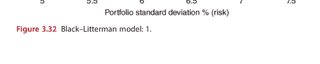

图 3.32 Black-Litterman 模型：1。

发展出了后来被称为 Black–Scholes 模型的模型。1997 年，其模型的重要性得到全球认可，当时 Myron Scholes 和 Robert Merton 因经济科学获得诺贝尔奖。（Fisher Black 于 1995 年去世，否则他也会获得该奖项 [Hull, 2000]）。Black–Scholes 模型展示了数学在金融领域所发挥的重要性。它还推动了数学金融或金融工程这一新领域的发展和成功。

这里，Black–Scholes 偏微分方程将被推导出来，然后它将被用于求解欧洲看涨期权的方程。首先，将讨论股票和期权等基本金融术语，并回顾套利定价理论。然后将推导出股票运动的模型，其中包括一个随机成分：布朗运动。然后，将讨论一些将应用于股票模型的随机演算基本概念。从该模型出发，将推导出 Black–Scholes 偏微分方程，并将利用欧洲看涨期权的边界条件求解该方程。

## 定义

金融资产是对某些发行人的索取权，例如联邦政府或公司，例如 Apple 或 Microsoft。金融资产还包括房地产等实物资产，但主要关注普通股。普通股代表对公司的所有权。任何购买金融资产希望其价值增加的人都做多了头寸。一个人如果在未拥有股票的情况下先卖出股票，希望其价值下降，则被称为做空资产。做空头寸的人从大型金融机构借入资产，出售资产，并在稍后时间买回资产。

衍生品是一种金融工具，其价值取决于其他基础资产的价值，例如普通股。近年来，衍生品在金融世界中变得越来越复杂和重要。许多个人和公司使用衍生品来对冲风险。这里最感兴趣的衍生资产是欧洲看涨期权。看涨期权赋予持有人在特定日期以特定价格买入标的资产的权利。指定价格称为行权价或执行价，将用 E 表示。指定日期称为到期日或到期日。欧洲期权只能在到期日当天行使。另一种常见的期权是看跌期权，它赋予持有人在特定日期以特定价格卖出标的资产的权利。

例如，考虑一份 11 月份以行权价 70 美元的微软欧洲看涨期权合约。当合约在 11 月到期时，如果微软股票价格为 72 美元，持有人将行使期权并实现 2 美元的利润。他将以 70 美元从期权卖方处买入股票并立即
以 72 美元卖出股票。另一方面，如果微软股票价格为 69 美元或更低，则期权持有人将不行使期权，期权将一文不值。在这种情况下，买方将损失期权的购买价格。

## 套利

套利定价理论是金融世界中的一个基本理论。该理论指出，两个在其他方面相同的资产不能以不同的价格出售。这意味着没有即时无风险获利的机会。这里假设无风险利率为银行账户或政府债券的利率，例如国库券。

为了说明套利的应用，考虑一个在美国和伦敦交易的股票的简单例子。在美国，该股票价格为 200 美元，而在伦敦该资产售价为 150 英镑，而汇率是 1.50 美元兑英镑，£。一个人可以通过同时在纽约买入 1,000 股股票并在伦敦出售它们来实现即时利润。即时利润为

1,000* {($1.50*150) – $200} = $25,000

在无风险的情况下实现！

## 对冲

在金融投资中，似乎交易者被吸引到三类衍生证券：投机者、套利者和对冲者：

- 1) 投机者通过在衍生品上建立多头或空头头寸来增加其市场敞口，押注标的资产会上涨或下跌。
- 2) 套利者发现定价错误的证券并通过采用某些交易策略即时锁定利润。
- 3) 对冲者通过在衍生证券中建立与标的资产中持有的头寸相反的头寸来帮助管理风险。

例如，考虑一位投资者持有 100 股 Apple，目前价格为 100 美元。该人担心股票在未来两个月内可能会大幅下跌。该人可以买入 Apple 的看跌期权以在 80 美元的价格出售 100 股。该人将支付期权价格，但这将确保如果股票大幅下跌，他可以在到期时以 80 美元的价格出售股票。一个非常重要的对冲策略是 delta 对冲。期权的 delta，Δ，定义为期权价格 V = V(S, t) 相对于标的资产价格 S 在时间 t 变化的变化。换句话说，delta 是期权价格相对于股票价格的一阶导数：

Δ = ∂V / ∂S
(3.209)

例如：看涨期权的 delta 为 0.85，Apple 股票价格为每股 100 美元，看涨期权价格为 8 美元。因此，如果投资者已卖出 1
份看涨期权。看涨期权赋予买方购买 100 股的权利，因为每个期权合约为 100 股。

卖方的头寸可以通过买入 0.85 × 100 = 85 股来对冲。期权头寸的收益（或损失）然后倾向于被股票头寸的损失（或收益）抵消。如果股票价格上涨 1 美元（在购买的股票上产生 85 美元的收益），期权价格倾向于上涨 0.85× 1 美元 = 0.85 美元（在已出售的看涨期权上产生 0.85 × 100 = 85 美元的损失）[Hull, 2000]。

## 股价模型

由于有效市场假说，股价随机移动。该假说有不同的形式，但都涉及两个因素：

- 1) 股票的历史完全反映在当前价格中。
- 2) 市场会立即对股票的新信息做出反应。

在前两个假设下，股价的变化遵循马尔可夫过程。马尔可夫过程是一个随机过程，其中变量的现在值对于预测未来是相关的。因此，股票模型指出，对股票未来价格的预测应不受一天、一周、一个月或一年前的价格影响。

如上所述，马尔可夫过程是一个随机过程（即基于概率的过程）。在现实世界中，股价仅限于离散值，并且股价的变化只能在指定的交易时间内实现。尽管如此，连续变量、连续时间模型被证明比离散模型更有用。

另一个重要观察是，股票价格的绝对变化本身并不是一个有用的量。例如，股票价格上涨一美元对价值 10 美元的股票来说比对价值 1000 美元的股票来说重要得多。股票价格的相对变化是更有价值的信息。相对变化定义为价格变化除以原始价格。现在考虑时间 t 时的股票价格 S。考虑一个很小的时间间隔 dt，在此期间标的资产 S 的价格变化 dS。最常见的模型将资产回报 dS/S 分为两部分。第一部分是完全确定的，通常是政府发行的国库券的无风险利率。

这部分对 dS/S 的贡献为 μdt。这里 μ 是股票平均增长率的度量，称为漂移，并且 μ 是债券的假设无风险利率，并且它也可以表示为 S 和 t 的函数。模型的第二部分解释了由于外部影响，例如意外的灾难性新闻而导致的股价随机变化。它可以用从均值为零的正态分布中抽取的随机样本来建模，并对 dS/S 贡献 σdB。在此公式中 σ 是股票的波动率，衡量回报的标准差。像 μ 一样，σ 可以

表示为 $S$ 和 $t$ 的函数。$dB$ 中的 $B$ 表示布朗运动，这将在下一节中描述。需要注意的是，$\mu$ 和 $\sigma$ 可以通过对历史价格进行统计分析来估计单个股票的值。重要的是，$\mu$ 和 $\sigma$ 是 $S$ 和 $t$ 的函数。综合这些信息，就得到了随机微分方程

$$
dS/S = \mu\,dt + \sigma\,dB \tag{3.210}
$$

注意，如果波动率 $\sigma$ 为零，则该模型意味着

$$
dS/S = \mu\,dt \tag{3.211}
$$

当 $\mu$ 为常数时，该方程可解得

$$
S = S_0 e^{\mu t} \tag{3.212}
$$

其中 $S$ 是股票在 $t$ 时刻的价格，$S_0$ 是股票在 $t = 0$ 时刻的价格。该方程表明，当资产的方差为零时，资产以每单位时间 $\mu$ 的连续复利速度增长。

## 布朗运动

布朗运动这一术语最初由 L. Bachelier 在 1900 年用作股价变动的模型 [Klebaner, 1998]，它是一个随机过程 $B(t)$，具有以下三个性质：

- **1. 正态增量：** $B(t) - B(s)$ 服从均值为 0、方差为 $t - s$ 的正态分布。因此，如果 $s = 0$，则 $B(t) - B(0)$ 服从均值为 0、方差为 $t - 0 = t$ 的正态分布。
- **2. 增量独立性：** $B(t) - B(s)$ 与过去独立。
- **3. 路径连续性：** $B(t)$（$t \ge 0$）是 $t$ 的连续函数。

仅这三个性质就定义了布朗运动，同时也说明了为什么用布朗运动来模拟股票价格。性质 (2) 表明股票价格变化将独立于过去的价格变动。这是该股价模型中的一个重要假设。

布朗运动从 0 到 T 的一次实现称为该过程在区间 $[0, T]$ 上的一条路径。布朗运动路径有五个重要性质。路径 $B(t)$（$0 \le t \le T$）

- **1.** 是 $t$ 的连续函数，
- **2.** 在任何区间上都不单调，无论区间多么小，
- **3.** 在任何点都不可微，
- **4.** 在任何区间上都具有无限变差，无论区间多么小，
- **5.** 在 $[0,t]$ 上的二次变差等于 $t$，对任意 $t$ 成立。

综合来看，性质 (1) 和 (3) 说明，尽管布朗运动路径是连续的，但当 $\Delta t \to 0$ 时，区间 $\Delta t$ 上的 $\Delta B(t)$ 比 $\Delta t$ 大得多。性质 (4) 和 (5) 显示了布朗运动的函数与普通光滑函数之间的区别。函数在一个区间上的变差

因此，伊藤积分

$$
\int_0^T \varepsilon(t)\,dB(t)
$$

定义为如下和式

$$
\int_0^T \varepsilon(t)\,dB(t) = \sum_{i=0}^{n-1} c_i \{B(t_{i+1}) - B(t_i)\} \tag{3.218}
$$

简单过程的伊藤积分是一个随机变量，具有以下四个性质：

- **性质 1. 线性：** 如果 $X(t)$ 和 $Y(t)$ 是简单过程，$\alpha$ 和 $\beta$ 是常数，则

$$
\int_0^T [\alpha X(t) + \beta Y(t)]\,dB(t) = \alpha \int_0^T X(t)\,dB(t) + \beta \int_0^T Y(t)\,dB(t) \tag{3.219}
$$

- **性质 2.** 区间指示函数 $I_{[a,b]}(t)$ 在 $t \in [a,b]$ 时等于 1，否则为 0，其积分正好是 $B(b) - B(a)$，其中 $0 < a < b < T$，

$$
\int_0^T I_{[a,b]}(t)\,dB(t) = B(b) - B(a) \tag{3.220}
$$

- **性质 3. 零均值性：**

$$
E\left[\int_0^T X(t)\,dB(t)\right] = 0 \tag{3.221}
$$

- **性质 4. 等距性：**

$$
E\left[\left(\int_0^T X(t)\,dB(t)\right)^2\right] = E\left[\int_0^T X^2(t)\,dt\right] \tag{3.222}
$$

伊藤积分的定义可以推广到这样的过程 $X(t)$：它可由简单过程序列 $\varepsilon^n$ 在如下意义下逼近：

$$
E\left[\int_0^T (\varepsilon^n(t) - X(t))^2\,dt\right] \to 0 \tag{3.223}
$$

当 $n \to \infty$ 时。在这种情况下，定义

$$
\int_0^T X(t)\,dB(t) = \lim_{n \to \infty} \int_0^T \varepsilon^n(t)\,dB(t) \tag{3.224}
$$

在该定义中，极限不依赖于逼近序列。此外，这样得到的积分满足性质 1–4。

既然已经定义了简单过程的伊藤积分，就可以定义其他过程的伊藤积分。可以证明，如果一般可料过程满足一定条件，则该一般过程是前述简单可料过程依概率的极限。一般可料过程的伊藤积分被定义为简单过程积分的极限。如果 $X(t)$ 是一个可料过程，且满足

$$
\int_{0}^{T} X^{2}(t)\,dt < \infty \tag{3.225}
$$

则伊藤积分

$$
\int_{0}^{T} X(t)\,dB(t)
$$

有定义，并且满足上述四个性质。

例如，要计算积分

$$
\int_{0}^{T} B(t)\,dB(t)
$$

可令 $0 = t_{0} < t_{1} < t_{2} < \cdots < t_{n} = T$ 是 $[0, T]$ 的一个划分，则

$$
\varepsilon^{n}(t) = \sum_{i=0}^{n-1} B(t_{i}) I_{[t_{i},t_{i+1})}(t) \tag{3.226}
$$

那么，对任意 $n$，$\varepsilon^{n}(t)$ 是一个简单过程。可以选取一列划分，使得当 $n \to \infty$ 时 $\max_{i}(t_{i+1} - t_{i}) \to 0$。该简单函数的伊藤积分为

$$
\int_{0}^{T} \varepsilon^{n}(t)\,dB(t) = \sum_{i=0}^{n-1} B(t_{i})\big[ B(t_{i+1}) - B(t_{i}) \big] \tag{3.227}
$$

可以证明这一积分序列依概率收敛，并确定其极限。加上再减去 $B^{2}(t_{i+1})$，可得

$$
B(t_{i})\big[ B(t_{i+1}) - B(t_{i}) \big] = \frac{1}{2}\Big[ B^{2}(t_{i+1}) - B^{2}(t_{i}) - \{ B(t_{i+1}) - B(t_{i}) \}^{2} \Big] \tag{3.228}
$$

以及

$$
\int_{0}^{T} \varepsilon^{n}(t)\,dB(t) = \frac{1}{2}\sum_{i=0}^{n-1}\big[ B^{2}(t_{i+1}) - B^{2}(t_{i}) \big] - \frac{1}{2}\sum_{i=0}^{n-1}\big\{ B(t_{i+1}) - B(t_{i}) \big\}^{2} \tag{3.229}
$$

$$
= \frac{1}{2}B^{2}(T) - \frac{1}{2}B^{2}(0) - \frac{1}{2}\sum_{i=0}^{n-1} \{B(t_{i+1}) - B(t_i)\}^2 \tag{3.230}
$$

因为第一个和式是伸缩和。注意，由布朗运动路径的性质 5，第二个和式收敛于极限 $T$。因此，$\int_{0}^{T} \varepsilon^{n}(t)\,dB(t)$ 收敛，其极限为

$$
\int_{0}^{T} B(t)\,dB(t) = \lim_{n\to\infty} \int_{0}^{T} \varepsilon^{n}(t)\,dB(t) = \frac{1}{2}B^{2}(T) - \frac{1}{2}T \tag{3.231}
$$

这个例子说明了确定性微积分与随机微积分之间的区别。在标准微积分中，有限变差的连续函数 $x(t)$ 的二次变差为 0。因此，如果用与上面相同的方式计算积分 $\int_{0}^{T} x(t)\,dx(t)$，项 $\sum_{i=0}^{n-1} \{x(t_{i+1}) - x(t_i)\}^2$ 将趋于极限 0。因此，积分 $\int_{0}^{T} x(t)\,dx(t)$ 等于 $\frac{1}{2}x^{2}(T)$。

现在考虑随机微积分的主要工具：伊藤公式，它是微积分中链式法则的随机对应。回顾：对任意 $t$，布朗运动在 $[0, t]$ 上的二次变差等于 $t$。这也可表示为：

$$
\int_{0}^{t} \{dB(s)\}^2 = \int_{0}^{t} ds = t \quad \text{或者，用微分记号表示为} \quad \{dB(t)\}^2 = dt \tag{3.232}
$$

利用这一性质并应用泰勒公式，伊藤公式表明：如果 $f(x)$ 是二次可微函数，则对任意 $t$

$$
f[B(t)] = f(0) + \int_{0}^{t} f'[B(s)]\,dB(s) + \frac{1}{2}\int_{0}^{t} f''[B(s)]\,ds \tag{3.233}
$$

伊藤公式的微分形式变为

$$
d\{f(B(t))\} = f'[B(t)]\,dB(t) + \frac{1}{2}f''[B(t)]\,dt \tag{3.234}
$$

## 伊藤过程

接下来定义一个伊藤过程：设 $Y(t)$ 是一个伊藤积分，定义为

$$
Y(t) = \int_{0}^{t} X(s)\,dB(s) \tag{3.235}
$$

伊藤过程是伊藤积分加上一个适应的有限变差连续过程。若过程 $Y$ 对任意 $0 \le t \le T$ 都可表示为

$$
Y(t) = Y(0) + \int_{0}^{t} \mu(s)\,ds + \int_{0}^{t} \sigma(s)\,dB(s) \tag{3.236}
$$

则称 $Y$ 为伊藤过程。

更一般地，如果 $Y$ 是如上表示的伊藤过程，则它在 $[0, T]$ 上具有随机微分

$$
dY(t) = \mu(t)\,dt + \sigma(t)\,dB(t) \tag{3.237}
$$

其中 $0 \le t \le T$。函数 $\mu$ 通常称为漂移系数，函数 $\sigma$ 称为扩散系数——这些术语源自经典物理学和工程学中质量与能量传递的研究。

最后一个需要考虑的重要情形是形如 $f(X(t), t)$ 的函数。如果 $f(x, t)$ 对 $x$ 二次连续可微，对 $t$ 连续可微，并且 $X(t)$ 表示一个伊藤过程，则

$$
df[x(t), t] = \frac{\partial f}{\partial x}(X(t), t)\,dX(t) + \frac{\partial f}{\partial t}(X(t), t)\,dt + \frac{1}{2}\sigma^{2}(X(t), t)\frac{\partial^{2} f}{\partial x^{2}}(X(t), t)\,dt \tag{3.238}
$$

伊藤公式的这一情形可用于在下一节中推导布莱克-斯科尔斯偏微分方程。

## 布莱克-斯科尔斯方程的推导

这里将推导衍生证券的价格 $V(S, t)$。前面推导的股票模型满足 (3.237) 中定义的伊藤过程。

$$
dY(t) = \mu(t)\,dt + \sigma(t)\,dB(t) \tag{3.237}
$$

因此，可令函数 $V(S, t)$ 对 $S$ 二次可微、对 $t$ 可微。应用 (3.238)，有

$$
dV(S, t) = \frac{\partial V}{\partial S}\,dS + \frac{\partial V}{\partial t}\,dt + \frac{1}{2}\sigma^{2}S^{2}\frac{\partial^{2} V}{\partial S^{2}}\,dt \tag{3.239}
$$

将 (3.210) 代入 (3.239) 中的 $dS$，有

$$
dS/S = \mu\,dt + \sigma\,dB \tag{3.210}
$$

$$
dV(S, t) = \frac{\partial V}{\partial S}(\mu S\,dt + \sigma S\,dB) + \frac{\partial V}{\partial t}\,dt + \frac{1}{2}\sigma^{2}S^{2}\frac{\partial^{2} V}{\partial S^{2}}\,dt \tag{3.240}
$$

这简化为

$$
dV(S, t) = \sigma S\,dB\frac{\partial V}{\partial S} + \left\{\mu S\frac{\partial V}{\partial S} + \frac{\partial V}{\partial t} + \frac{1}{2}\sigma^{2}S^{2}\frac{\partial^{2} V}{\partial S^{2}}\right\}dt \tag{3.241}
$$

现在建立一个组合，买入一份期权 V，并做空数量为 (∂V/∂S) 的股票。由上可知该组合已对冲。该组合的价值 π 为
π = V − (∂V/∂S)S   (3.242)

组合价值在小时间间隔 dt 内的变化 dπ 为
dπ = dV − (∂V/∂S)dS   (3.243)

现在将式 (3.241) 和 (3.210)：
dS/S = μdt + σdB   (3.210)
代入式 (3.243) 中 dV 和 dS，可得
dπ = (∂V/∂S)σS dB + {μS(∂V/∂S)+(∂V/∂t)+½σ²S²(∂²V/∂S²)}dt − (∂V/∂S)(μSdt + σSdB)   (3.244)

化简得
dπ = {(∂V/∂t)+(½)σ²S²(∂²V/∂S²)}dt   (3.245)

需要注意的是，该组合完全无风险，因为它不包含随机布朗运动项。由于该组合没有风险，其收益必须与其它短期无风险证券相同。如果其收益高于此，套利者可以通过做空无风险证券并用所得资金买入该组合来获利。如果组合收益更低，套利者可以通过做空该组合并买入无风险证券来获得无风险利润。因此对于无风险组合有
dπ = rπdt   (3.246)

其中 r 为无风险利率。将 (3.245) 和 (3.242) 中的 dπ 和 π 代入，得
{(∂V/∂t)+(1/2)σ²S²(∂²V/∂S²)}dt = r{V − S(∂V/∂S)}dt   (3.247)

进一步化简得到 Black–Scholes 微分方程：
∂V/∂t + (1/2)σ²S²(∂²V/∂S²) + rS(∂V/∂S) − rV = 0   (3.248)

## 欧式看涨期权的解
为求解 Black–Scholes 方程，需考虑终值和边界条件，否则偏微分方程没有唯一解。作为示例，给定执行价格 E 和到期日 T，求解欧式看涨期权 C(S, t)。
终值条件 t = T 可由看涨期权的定义推导。若到期时 S > E，看涨期权价值为 S − E，因为期权买方可以按 E 买入股票并立即按 S 卖出。若到期时 S < E，期权不会行使且到期一文不值。在 $t=T$ 时，期权价值可确定为收益：

$$C(S,T)=\max(S-E,0) \tag{3.249}$$

这是微分方程的终值条件。

为了求边界条件，需考虑 $C$ 在 $S=0$ 时以及 $S\to\infty$ 时的值。若 $S=0$，由 (3.210) 可知 $dS=0$，因此 S 永不改变。若到期时 S=0，由 (3.249) 收益必须为 0。因此当 S=0 时有

$$C(0,T)=0 \tag{3.250}$$

现在当 $S\to\infty$ 时，期权被行使的可能性越来越大，收益将为 $(S-E)$。随着 $S\to\infty$，执行价格变得越来越不重要，因此期权价值等价于

$$C(S,T)\approx S\text{ as }S\to\infty \tag{3.251}$$

为求解 Black–Scholes 方程，需要将其变换为可处理的方程。第一步是消去 (3.248) 中的 $S$ 和 $S^2$ 项 (16)。为此，考虑变量变换：

$$S=Ee^x \tag{3.252}$$

$$t=T-\left(\frac{\tau}{1/2\sigma^2}\right) \tag{3.253}$$

$$V=Ev(x,\tau) \tag{3.254}$$

利用微积分中关于二元函数偏导数变换的链式法则，有

$$\frac{\partial V}{\partial S}=\left(\frac{\partial V}{\partial x}\right)\left(\frac{\partial x}{\partial S}\right)+\left(\frac{\partial V}{\partial \tau}\right)\left(\frac{\partial \tau}{\partial S}\right) \tag{3.255}$$

$$\frac{\partial V}{\partial t}=\left(\frac{\partial V}{\partial x}\right)\left(\frac{\partial x}{\partial t}\right)+\left(\frac{\partial V}{\partial \tau}\right)\left(\frac{\partial \tau}{\partial t}\right). \tag{3.256}$$

由 (3.252)–(3.254) 可知

$$\frac{\partial\tau}{\partial t}=-\frac{1}{2}\sigma^2,\quad \frac{\partial x}{\partial t}=0,\quad \frac{\partial x}{\partial S}=1/S,\quad \frac{\partial\tau}{\partial S}=0 \tag{3.257}$$

将这些代入 (3.255) 和 (3.256) 得

$$\frac{\partial V}{\partial S}=\left(E/S\right)\frac{\partial V}{\partial x} \tag{3.258}$$

$$\frac{\partial V}{\partial t}=-(1/2)\sigma^2(E\frac{\partial V}{\partial\tau}) \tag{3.259}$$

$$\frac{\partial^2 V}{\partial S^2}=\left(E/S^2\right)\frac{\partial^2 V}{\partial x^2}-\left(E/S^2\right)\left(\frac{\partial V}{\partial x}\right) \tag{3.260}$$

将 (3.255)–(3.260) 代入 Black–Scholes 偏微分方程得到微分方程：

$$\frac{\partial V}{\partial t}=\frac{\partial^2 V}{\partial x^2}+(k-1)\frac{\partial V}{\partial x}-kv \tag{3.261}$$

其中

$$k=\left[r/(1/2\sigma^2)\right] \tag{3.262}$$

初始条件 $C(S,T)=\max(S-E,0)$ 变换为

$$v(x,0)=\max(e^{x}-1,0)\tag{3.263}$$

现在再做一次变量变换，令

$$v=e^{(\alpha x+\beta \tau)}u(x,\tau)\tag{3.264}$$

则通过简单求导，有

$$\frac{\partial V}{\partial \tau}=\beta e^{(\alpha x+\beta \tau)}u+e^{(\alpha x+\beta \tau)}\frac{\partial u}{\partial \tau}\tag{3.265}$$

$$\frac{\partial V}{\partial x}=\alpha e^{\alpha x+\beta \tau}u+e^{\alpha x+\beta \tau}\frac{\partial u}{\partial x}\tag{3.266}$$

$$\frac{\partial^{2}v}{\partial x^{2}}=\alpha\left(\alpha e^{\alpha x+\beta \tau}u+e^{\alpha x+\beta \tau}\frac{\partial u}{\partial x}\right)+\alpha e^{\alpha x+\beta \tau}\frac{\partial u}{\partial x}+e^{\alpha x+\beta \tau}\frac{\partial^{2}u}{\partial x^{2}}\tag{3.267}$$

将这些偏导数代入 (3.261) 得

$$\beta u+\frac{\partial u}{\partial \tau}=\sigma^{2}u+2\alpha\frac{\partial u}{\partial x}+\frac{\partial^{2}u}{\partial x^{2}}+(k-1)(\alpha u+\frac{\partial u}{\partial x})-ku\tag{3.268}$$

我们可以通过仔细选择 α 和 β 的值来消去 u 项和 ∂u/∂x 项，使得

$$\beta=\alpha^{2}+(k-1)\alpha-k\tag{3.269}$$

且

$$2\alpha+k-1=0\tag{3.270}$$

可将这些方程整理写为

$$\alpha=-\tfrac12(k-1)\quad\text{and}\quad\beta=-\tfrac14(k+1)^{2}\tag{3.271}$$

现在 v 到 u 的变换为

$$v=\exp\!\left[-\tfrac12(k-1)x-\tfrac14(k+1)^{2}\tau\right]u(x,\tau)\tag{3.272}$$

从而得到简单的扩散方程

$$\frac{du}{d\tau}=\sigma^{2}\frac{d^{2}u}{dx^{2}},\quad\text{for}\quad-\infty<x<\infty,\ \tau>0.\tag{3.273}$$

初始条件也相应变为

$$u_{0}(x)=u(x,0)=\max\!\left(e^{\tfrac12(k+1)x}-e^{\tfrac12(k-1)x},0\right)\tag{3.274}$$

上述得到的简单扩散方程的解众所周知为

$$u(x,\tau)=\left[1/\sqrt{2\pi}\right]\int_{-\infty}^{\infty}u_{0}(s)\exp\!\left[-(x-s)^{2}/4\tau\right]ds\tag{3.275}$$

结果为
I1 = [exp {1/2(k+1)x + 1/4(k+1)²τ}]/√(2π) ∫_{-∞}^{∞} exp[-z²/2] dz (3.282)
= [{exp{(1/2)(k+1)x + (1/4)(k+1)²τ}}]/√(2π) N(d1) (3.283)
其中
d1 = {x/√(2τ)} + {(1/2)(k+1)√(2τ)} (3.284)
且
N(x) = [1/√(2π)] ∫_{-∞}^{x} exp[-1/2y²] dy (3.285)
是正态分布的累积分布函数。
第二积分 I2 的计算与 I1 相同，只是全程用 (k-1) 替换 (k+1)。最后，反向进行
v(x, τ) = exp{-1/2(k-1)x -1/4(k+1)²τ} u(x, τ) (3.286)
然后代入逆变换
x = log(S/E) (3.287)
τ = 1/2σ²(T - t) (3.288)
C = Ev(x, τ) (3.289)
最终得到期望结果：
C(S,t) = SN(d1) - Ee^{-r(T - t)}N(d2) (3.290)
其中
d1 = {log(S/E) + (r + 1/2σ²)(T - t)}/[σ√(T - t)] (3.291)
且
d2 = {log(S/E) + (r - 1/2σ²)(T - t)}/[σ√(T - t)] (3.292)

## 结论
请注意，在推导 Black–Scholes 微分方程时，在为欧式看涨期权指定边界条件之前，并未将其限制为特定类型的衍生证券类型。这意味着一个人可以使用 Black–Scholes 微分方程求解任何类型期权的价格——只需改变边界条件即可。
Black–Scholes 模型彻底革新了金融世界。该模型首次为交易者、对冲者和投资者提供了一种标准的估值方式

该模型还导致了金融工程在金融领域重要性的巨大增长。今天，数学家正在构建模型以在最小化风险的同时最大化投资组合回报。他们还在构建复杂的计算机程序来寻找市场中的低效率。金融世界正建立在数学之上，而 Black–Scholes 模型是这场数学革命的开端。

## 3.8 部分实操示例

## 实操示例 I：衡量 VaR（风险价值）——美式期权

**风险管理：** 自 1950 年代 Markowitz 的开创性工作以来，风险管理的理论和实践已发展成为金融理论的一个子领域，吸引了来自众多应用数学、物理科学和工程领域的专家——他们带来了定量学科（包括数学、统计学和计算机科学）所做出的巨大贡献。风险管理的重要原则也来自会计（包括审计、估值和管理控制）、管理（包括审计、管理控制和估值）、组织理论（组织行为学）以及法律（渗透风险管理的各个方面）等领域。因此，在风险管理中，虽然基础可能是定性的，但方法却高度定量——就像工程实践一样！

## R 包 Dowd

March 11, 2016

| 字段 | 值 |
|---|---|
| 类型 | 包 |
| 标题 | 从 Kevin Dowd 的书籍 *衡量市场风险* 中提供的 'MMR2' 工具箱移植的函数 |
| 版本 | 0.12 |
| 日期 | 2015-08-20 |
| 作者 | Dinesh Acharya <dines.acharya@gmail.com> |
| 维护者 | Dinesh Acharya <dines.acharya@gmail.com> |

**描述：** Kevin Dowd 的书籍 *衡量市场风险* 是学生和从业者都广泛阅读的风险管理领域的书籍。据他声称，MATLAB 确实可能是他最初编写函数时最合适的语言，但随着 R 的日益普及，这已不再完全成立。由于 Dowd 的代码本意并非无误且主要用于参考，本包中的一些函数继承了这些错误。未来版本中将尝试识别并纠正它们。

Dowd 的原始代码可以从 www.kevindowd.org/measuring-marketrisk/ 下载。

应注意，Dowd 提供了 'MMR2' 和 'MMR1' 两个工具箱。只有 'MMR2' 被移植到 R。'MMR2' 是 'MMR1' 工具箱的较新版本，两者具有大部分相似的函数。该工具箱主要包含用于衡量市场风险的各种参数和非参数方法以及回测风险衡量方法。

| 依赖 | R (>= 3.0.0), bootstrap, MASS, forecast |
|---|---|
| 建议 | PerformanceAnalytics, testthat |
| 许可证 | GPL |
| 需要编译 | no |
| 仓库 | CRAN |
| 日期/发布 | 2016-03-11 00:45:03 |

## 实操示例 (a)

`AmericanPutESBinomial` 估计使用二叉树 **期望损失 (ES)** 的美式普通 *看跌期权*。

### 描述

使用二叉树对期权定价并使用历史方法计算风险价值（VaR）来估计美式看跌期权的 ES。

### 用法

```
AmericanPutESBinomial(amountInvested, stockPrice, strike, r, volatility, maturity, numberSteps, cl, hp)
```

### 参数

| 参数 | 描述 |
|---|---|
| amountInvested | 购买看跌期权的总金额。 |
| stockPrice | 标的股票价格。 |
| strike | 期权的行权价。 |
| r | 无风险利率。 |
| volatility | 标的股票的波动率。 |
| maturity | 期权的到期时间，以天计。 |
| numberSteps | 二叉树模型考虑的时间步数。 |
| cl | 计算 VaR 的置信水平。 |
| hp | 期权的持有期，以天计。 |

### 值

美式看跌期权的 ES

### 作者

Dinesh Acharya

### 示例

```
# Market Risk of American Put with given parameters.
AmericanPutESBinomial(0.20, 27.2, 25, .16, .05, 60, 20, .95, 30)
```

### 在 R 域中

```
R version 3.2.2 (2015-08-14) -- "Fire Safety"
Copyright (C) 2015 The R Foundation for Statistical Computing
Platform: i386-w64-mingw32/i386 (32-bit)
R is free software and comes with ABSOLUTELY NO WARRANTY.
You are welcome to redistribute it under certain conditions.
Type 'license()' or 'licence()' for distribution details.
Natural language support but running in an English locale
R is a collaborative project with many contributors.
Type 'contributors()' for more information and
'citation()' on how to cite R or R packages in publications.
Type 'demo()' for some demos, 'help()' for on-line help, or
'help.start()' for an HTML browser interface to help.
Type 'q()' to quit R.
>
> install.packages("Dowd")
Installing package into 'C:/Users/Bert/Documents/R/win-library/3.2'
(as 'lib' is unspecified)
--- Please select a CRAN mirror for use in this session ---
# A CRAN mirror is selected
also installing the dependencies 'stringi', 'magrittr',
'stringr', 'RColorBrewer', 'dichromat', 'munsell', 'labeling',
'quadprog', 'digest', 'gtable', 'plyr', 'reshape2', 'scales',
'zoo', 'timeDate', 'tseries', 'fracdiff', 'Rcpp', 'colorspace',
'ggplot2', 'RcppArmadillo', 'bootstrap', 'forecast',
There is a binary version available but the source version is later:
binary source needs_compilation
colorspace 1.2-6 1.2-7 TRUE
Binaries will be installed
```

```
trying URL 'https://cran.cnr.berkeley.edu/bin/windows/
contrib/3.2/stringi_1.1.2.zip'
Content type 'application/zip' length 14229497 bytes (13.6 MB)
downloaded 13.6 MB

trying URL 'https://cran.cnr.berkeley.edu/bin/windows/
contrib/3.2/magrittr_1.5.zip'
Content type 'application/zip' length 149966 bytes (146 KB)
downloaded 146 KB

trying URL 'https://cran.cnr.berkeley.edu/bin/windows/
contrib/3.2/stringr_1.1.0.zip'
Content type 'application/zip' length 119831 bytes (117 KB)
downloaded 117 KB

trying URL 'https://cran.cnr.berkeley.edu/bin/windows/
contrib/3.2/RColorBrewer_1.1-2.zip'
Content type 'application/zip' length 26734 bytes (26 KB)
downloaded 26 KB

trying URL 'https://cran.cnr.berkeley.edu/bin/windows/
contrib/3.2/dichromat_2.0-0.zip'
Content type 'application/zip' length 147767 bytes (144 KB)
downloaded 144 KB

trying URL 'https://cran.cnr.berkeley.edu/bin/windows/
contrib/3.2/munsell_0.4.3.zip'
Content type 'application/zip' length 134334 bytes (131 KB)
downloaded 131 KB

trying URL 'https://cran.cnr.berkeley.edu/bin/windows/
contrib/3.2/labeling_0.3.zip'
Content type 'application/zip' length 40854 bytes (39 KB)
downloaded 39 KB

trying URL 'https://cran.cnr.berkeley.edu/bin/windows/
contrib/3.2/quadprog_1.5-5.zip'
Content type 'application/zip' length 51794 bytes (50 KB)
downloaded 50 KB

trying URL 'https://cran.cnr.berkeley.edu/bin/windows/
contrib/3.2/digest_0.6.10.zip'
Content type 'application/zip' length 172481 bytes (168 KB)
downloaded 168 KB

trying URL 'https://cran.cnr.berkeley.edu/bin/windows/
contrib/3.2/gtable_0.2.0.zip'
Content type 'application/zip' length 57917 bytes (56 KB)
downloaded 56 KB

trying URL 'https://cran.cnr.berkeley.edu/bin/windows/
contrib/3.2/plyr_1.8.4.zip'
Content type 'application/zip' length 1119520 bytes (1.1 MB)
downloaded 1.1 MB

trying URL 'https://cran.cnr.berkeley.edu/bin/windows/
contrib/3.2/reshape2_1.4.1.zip'
Content type 'application/zip' length 505413 bytes (493 KB)
downloaded 493 KB

trying URL 'https://cran.cnr.berkeley.edu/bin/windows/
contrib/3.2/scales_0.4.0.zip'
Content type 'application/zip' length 604312 bytes (590 KB)
downloaded 590 KB

trying URL 'https://cran.cnr.berkeley.edu/bin/windows/
contrib/3.2/zoo_1.7-13.zip'
Content type 'application/zip' length 900652 bytes (879 KB)
downloaded 879 KB

trying URL 'https://cran.cnr.berkeley.edu/bin/windows/
contrib/3.2/timeDate_3012.100.zip'
Content type 'application/zip' length 791098 bytes (772 KB)
downloaded 772 KB

trying URL 'https://cran.cnr.berkeley.edu/bin/windows/
contrib/3.2/tseries_0.10-35.zip'
Content type 'application/zip' length 321523 bytes (313 KB)
downloaded 313 KB

trying URL 'https://cran.cnr.berkeley.edu/bin/windows/
contrib/3.2/fracdiff_1.4-2.zip'
Content type 'application/zip' length 106748 bytes (104 KB)
downloaded 104 KB

trying URL 'https://cran.cnr.berkeley.edu/bin/windows/
contrib/3.2/Rcpp_0.12.7.zip'
Content type 'application/zip' length 3230471 bytes (3.1 MB)
downloaded 3.1 MB

trying URL 'https://cran.cnr.berkeley.edu/bin/windows/
contrib/3.2/colorspace_1.2-6.zip'
Content type 'application/zip' length 391490 bytes (382 KB)
downloaded 382 KB

trying URL 'https://cran.cnr.berkeley.edu/bin/windows/
contrib/3.2/ggplot2_2.1.0.zip'
Content type 'application/zip' length 2001613 bytes (1.9 MB)
downloaded 1.9 MB

trying URL 'https://cran.cnr.berkeley.edu/bin/windows/
contrib/3.2/RcppArmadillo_0.7.400.2.0.zip'
Content type 'application/zip' length 1745518 bytes (1.7 MB)
downloaded 1.7 MB

trying URL 'https://cran.cnr.berkeley.edu/bin/windows/
contrib/3.2/bootstrap_2015.2.zip'


- [33] "DefaultRiskyBondVaR"
- [34] "FilterStrategyLogNormalVaR"
- [35] "FrechetES"
- [36] "FrechetESPlot2DCl"
- [37] "FrechetVaR"
- [38] "FrechetVaRPlot2DCl"
- [39] "GaussianCopulaVaR"
- [40] "GParetoES"
- [41] "GParetoMEEPlot"
- [42] "GParetoMultipleMEEPlot"
- [43] "GParetoVaR"
- [44] "GumbelCopulaVaR"
- [45] "GumbelES"
- [46] "GumbelESPlot2DCl"
- [47] "GumbelVaR"
- [48] "GumbelVaRPlot2DCl"
- [49] "HillEstimator"
- [50] "HillPlot"
- [51] "HillQuantileEstimator"
- [52] "HSES"
- [53] "HSESDPerc"
- [54] "HSESFigure"
- [55] "HSESPlot2DCl"
- [56] "HSVaR"
- [57] "HSVaRDPerc"
- [58] "HSVaRESPlot2DCl"
- [59] "HSVaRFigure"
- [60] "HSVaRPlot2DCl"
- [61] "InsuranceVaR"
- [62] "InsuranceVaRES"
- [63] "JarqueBeraBacktest"
- [64] "KernelESBoxKernel"
- [65] "KernelESEpanechnikovKernel"
- [66] "KernelESNormalKernel"
- [67] "KernelESTriangleKernel"
- [68] "KernelVaRBoxKernel"
- [69] "KernelVaREpanechnikovKernel"
- [70] "KernelVaRNormalKernel"
- [71] "KernelVaRTriangleKernel"
- [72] "KSTestStat"
- [73] "KuiperTestStat"
- [74] "LogNormalES"
- [75] "LogNormalESDPerc"
- [76] "LogNormalESFigure"
- [77] "LogNormalESPlot2DCL"
- [78] "LogNormalESPlot2DHP"
- [79] "LogNormalESPlot3D"
- [80] "LogNormalVaR"
- [81] "LogNormalVaRDPerc"
- [82] "LogNormalVaRETlPlot2DCL"
- [83] "LogNormalVaRFigure"
- [84] "LogNormalVaRPlot2DCL"
- [85] "LogNormalVaRPlot2DHP"
- [86] "LogNormalVaRPlot3D"
- [87] "LogtES"
- [88] "LogtESDPerc"
- [89] "LogtESPlot2DCL"
- [90] "LogtESPlot2DHP"
- [91] "LogtESPlot3D"
- [92] "LogtVaR"
- [93] "LogtVaRDPerc"
- [94] "LogtVaRPlot2DCL"
- [95] "LogtVaRPlot2DHP"
- [96] "LogtVaRPlot3D"
- [97] "LongBlackScholesCallVaR"
- [98] "LongBlackScholesPutVaR"
- [99] "LopezBacktest"
- [100] "MEEPlot"
- [101] "NormalES"
- [102] "NormalESConfidenceInterval"
- [103] "NormalESDPerc"
- [104] "NormalESFigure"
- [105] "NormalESHotspots"
- [106] "NormalESPlot2DCL"
- [107] "NormalESPlot2DHP"
- [108] "NormalESPlot3D"
- [109] "NormalQQPlot"
- [110] "NormalQuantileStandardError"
- [111] "NormalSpectralRiskMeasure"
- [112] "NormalVaR"
- [113] "NormalVaRConfidenceInterval"
- [114] "NormalVaRDPerc"
- [115] "NormalVaRFigure"
- [116] "NormalVaRHotspots"
- [117] "NormalVaRPlot2DCL"
- [118] "NormalVaRPlot2DHP"

## 迎接人工智能新时代

人工智能（AI）已从科幻概念演变为正在改变我们世界的现实。AI 的影响无处不在，从医疗保健到交通运输。

其核心在于，AI 是关于创造能够思考、学习和做决策的机器。但这到底意味着什么？简单来说，就是教会计算机做那些通常需要人类智能的事情。

这项技术不仅仅关乎机器人或复杂算法；它关乎让我们的生活更轻松、更高效。

## 描述

使用二叉树方法估计美式看跌期权的价格。

## Usage

```
AmericanPutPriceBinomial(stockPrice, strike, r, sigma, maturity, numberSteps)
```

## Arguments

- `stockPrice` 标的股票的价格
- `strike` 期权的行权价
- `r` 无风险利率
- `sigma` 标的股票的波动率，为年化数值
- `maturity` 期权到期期限（天）
- `numberSteps` 二叉树中的时间步数

## Value

二项式美式看跌期权价格

## Author(s)

Dinesh Acharya

## Examples

```
# Estimates the price of an American Put
AmericanPutPriceBinomial(27.2, 25, .03, .2, 60, 30)
```

In the R domain:

```
> 
> # Estimates the price of an American Put
> AmericanPutPriceBinomial(27.2, 25, .03, .2, 60, 30)
> # Outputting:
[1] 0.1413597
> # The ES (Expected Shortfall) of this American Put Option
is 0.1413597.
> 
>
```

## Worked Examples III

[9] "AmericanPutVaRBinomial" 使用二叉树估计美式香草看跌期权的预期损失（ES）。

## 描述

使用二叉树对期权定价并采用历史方法计算 VaR，来估计美式看跌期权的 VaR。

## Usage

```
AmericanPutVaRBinomial(amountInvested, stockPrice, strike, r, volatility, maturity, numberSteps, cl, hp)
```

## Arguments

- **amountInvested** 支付看跌期权的总金额。
- **stockPrice** 标的股票的价格
- **strike** 期权的行权价
- **r** 无风险利率
- **volatility** 标的股票的波动率
- **maturity** 期权到期时间（天）
- **numberSteps** 二叉模型考虑的时间步数
- **cl** 计算 VaR 的置信水平
- **hp** 期权的持有期（天）

## Value

美式看跌期权的 VaR

## Author(s)

Dinesh Acharya

In the R domain:

```
> 
> # Market Risk of American call with given parameters.
> BlackScholesCallESSim(0.20, 27.2, 25, .16, .2, .05, 60, 30,
+ .95, 30)
> Outputting:
> [1] 0.003958873
> # The Market Risk of this American Call Option is 0.003958873.
> 
```

## Review Questions and Exercises

1 对比以下三种经典投资组合配置理论使用

- i) 马科维茨模型，
- ii) Black–Litterman 模型，以及
- iii) 资本资产定价模型（CAPM）

从以下方面比较这些模型：

- a 各模型的假设
- b 这些假设的优缺点

2 关于用于资产配置和投资组合优化的 Black–Litterman 模型，

- a 陈述并讨论该模型的基本假设以及其优势和劣势；
- b 陈述并讨论针对该模型提出的改进建议。

3 Black–Scholes 方程及欧式期权看涨期权的边界条件为

∂C/∂t + ½σ²S²∂²C/∂S² + rS∂C/∂S − rC = 0 (RE-3.1)

其中
C = 看涨期权的价值 = C(S, t)，
S = 固定的行权价，
t = 时间，
r = 无风险利率，
且
σ = 标的资产的波动率。

方程（RE-3.1）是一个相当复杂的二阶偏微分方程（pde）。
可以按如下方式稍作简化：
如果 S 固定且 E 可变，证明欧式期权价格 C = C(E, t) 也满足以下偏微分方程：

∂C/∂t + ½σ²E²∂²C/∂E² − rE∂C/∂E = 0 (RE-3.2)

## As an Example:

在 pde 的分析中，通过审慎的变量变换往往可以找到有用的解。一个典型例子是经典的热/质量扩散方程，可用分离变量法求解：

∂u/∂t = c² ∂²u/∂x²  (RE-3.3)

边界条件为：

u(0, t) = 0 = u(L, t), ∀t
 u(x, 0) = f(x), ∀t = 0

初始条件：u(x, 0)=f(x)，x 的给定函数。

一种初等方法是假设独立变量 x 和 t 可分离，于是可写

u(x, t) = X(x) T(t)  (RE-3.4)

经过一些初等步骤后，可得到最终解：

u(x, t) = Σ_{n=0}^∞ B_n sin(nπ/l x) exp(-n² π² c² t / l²)

其中

B_n = (2/l) ∫_0^l f(x) sin(nπ/l x) dx, ∀ positive integers n

## 4 CRAN 包 BLCOP——实现 Black–Litterman 资产配置和投资组合优化方法：

## BLCOP：Black–Litterman 与 Copula 观点汇聚框架

对 Black–Litterman 模型和 Atilio Meucci 的 Copula 观点汇聚框架的实现。

| 版本 | 0.3.1 |
|---|---|
| 依赖 | methods, MASS, quadprog |
| 导入 | RUnit (≥ 0.4.22), timeSeries, fBasics, fMultivar, fPortfolio (≥3011.81) |
| 建议 | sn, corpcor, mnormt |
| 发布 | 2015-02-04 |
| 作者 | Francisco Gochez, Richard Chandler-Mant, Suchen Jin, Jinjing Xie |
| 维护者 | Ava Yang <ayang at mango-solutions.com> |

许可证：GPL-3
需要编译：否
材料：NEWS
CRAN 检查：BLCOP 结果

## 下载：

在 R 环境中运行以下示例：

```
optimalPortfolios
```

*在先验和后验分布下计算最优投资组合*

## 描述

这些是包装函数，用于在先验和后验收益分布下计算最优投资组合。optimalPortfolios 可与用户提供的优化函数一起使用，如果未提供，则使用 quadprog 中的 solve.QP 进行简单的 Markowitz 最小风险优化。

optimalPortfolios.fPort 是一个通用实用函数，使用 fPortfolio 包中的例程计算最优投资组合。

## Usage

```
optimalPortfolios(result, optimizer = .optimalWeights.simpleMV,
..., doPlot = TRUE, beside = TRUE)
optimalPortfolios.fPort(result, spec = NULL,
constraints = "LongOnly",
optimizer = "minriskPortfolio",
inputData = NULL,
numSimulations = BLCOptions("numSimulations"))
```

## Arguments

result BL.Result 类的对象。

optimiser 对于 optimalPortfolios，优化函数。它应接受均值向量和方差-协方差矩阵作为参数，并返回最优权重向量。对于 optimalPortfolios，是执行投资组合优化的 fPortfolio 函数的名称。


## 示例
```
entries <- c(0.001005, 0.001328, -0.000579, -0.000675,
0.000121, 0.000128,
-0.000445, -0.000437, 0.001328, 0.007277, -0.001307,
-0.000610,
-0.002237, -0.000989, 0.001442,-0.001535, -0.000579,
-0.001307,
0.059852, 0.027588, 0.063497, 0.023036, 0.032967, 0.048039,
-0.000675, -0.000610, 0.027588, 0.029609, 0.026572, 0.021465,
0.020697, 0.029854, 0.000121,-0.002237, 0.063497, 0.026572,
0.102488, 0.042744, 0.039943, 0.065994, 0.000128,-0.000989,
0.023036, 0.021465, 0.042744, 0.032056, 0.019881, 0.032235,
-0.000445, 0.001442, 0.032267, 0.020697, 0.039943, 0.019881,
0.028355, 0.035064, -0.000437, -0.001535, 0.048039, 0.029854,
0.065994, 0.032235, 0.035064, 0.079958)
varcov <- matrix(entries, ncol = 8, nrow = 8)
mu <- c(0.08, 0.67, 6.41, 4.08, 7.43, 3.70, 4.80, 6.60) / 100
pick <- matrix(0, ncol = 8, nrow = 3, dimnames = list(NULL,
letters[1:8]))
pick[1,7] <- -1
pick[2,1] <- -1; pick[2,2] <- -1
pick[3, 3:6] <- c(0.9, -0.9, .1, -.1)
confidences <- c(1 / c(0.00709, 0.000141, 0.000866))
views <- BLViews(pick, c(0.0525, 0.0025, 0.02), confidences,
letters[1:8])
posterior <- posteriorEst(views, tau = 0.025, mu, varcov)
optimalPortfolios(posterior, doPlot = TRUE)
optimalPortfolios($Port(posterior, optimizer =
"tangencyPortfolio"
# An example based on one found in "Beyond Black-Litterman:
# Views on Non-normal Markets"
dispersion <-
c(.376,.253,.360,.333,.360,.600,.397,.396,.578,.775) / 1000
sigma <- BLCOP::symmetricMatrix(dispersion, dim = 4)
caps <- rep(1/4, 4)
mu <- -2.5 * sigma
dim(mu) <- NULL
marketDistribution <- mvdistribution("mt", mean = mu, S =
sigma, df = 5)
pick <- matrix(0, ncol = 4, nrow = 1, dimnames = list(NULL,
c("SP", "FTSE", "CAC", "DAX")))
pick[1,4] <- -1
vdist <- list(distribution="unif", min = -0.02, max = 0)
views <- COPViews(pick, vdist, 0.2, c("SP", "FTSE", "CAC", "DAX"))
posterior <- COPPosterior(marketDistribution, views)
optimalPortfolios <- fPort(myPosterior, spec = NULL, optimizer = "minriskPortfolio", inputData = NULL, numSimulations = 100)
## End
```

## 5 CRAN 包 PerformanceAnalytics——提供用于投资风险分析和投资组合绩效的许多有用程序。

| 包 'PerformanceAnalytics' | 2015 年 2 月 19 日 |
| 类型 | 包 |
| 标题 | 用于绩效和风险分析的计量经济学工具 |
| 版本 | 1.4.3541 |
| 日期 | 2014-09-15 04:39:58-0500 (Mon, Sep 15, 2014) |
| 描述 | 用于绩效和风险分析的计量经济学函数集合。该包旨在帮助从业人员和研究人员利用非正态收益流分析方面的最新研究。一般而言，它在常规尺度上的收益（而非价格）数据上测试最多，但大多数函数也适用于不规则收益数据，并且越来越多的函数可以在可能的情况下处理损益或价格数据 |
| 导入 | zoo |
| 依赖 | R (>= 3.0.0), xts (>= 0.9) |
| 建议 | Hmisc, MASS, quantmod, gamlss, gamlss.dist, robustbase, quantreg, gplots |
| 许可证 | GPL-2 | GPL-3 |
| 网址 | http://r-forge.r-project.org/projects/returnanalytics/ |
| 版权 | (c) 2004-2014 |
| 作者 | Brian G. Peterson [cre, aut, cph], Peter Carl [aut, cph] |

## 参数

R 一个 xts、向量、矩阵、数据框、timeSeries 或 zoo 对象，表示
资产收益
auto.grid 如果为 true，则绘制与 x
和 y 轴上的点对齐的网格
xaxis 如果为 true，则绘制 x 轴
yaxis 如果为 true，则绘制 y 轴
yaxis.right 如果为 true，则在绘图的
右侧绘制 y 轴
type 设置图表类型，与 plot 中相同
lty 设置线型，与 plot 中相同
lwd 设置线宽，与 plot 中相同
las 设置轴标签旋转，与 plot 中相同
main 设置图表标题，与 plot 中相同
ylab 设置 y 轴标签，与 plot 中相同
xlab 设置 x 轴标签，与 plot 中相同
date.format.in 允许在数据对象中指定其他日期格式，默认为 "%Y-%m-%d"
date.format 重新格式化 x 轴的日期；默认为 "%m/%y"
xlim 设置 x 轴限制，与 plot 中相同
ylim 设置 y 轴限制，与 plot 中相同
element.color 提供绘制图表元素的颜色，例如框线、轴线，
等。默认为 "darkgray"
event.lines 如果不为空，垂直线将被绘制以指示
在该时间段内发生了事件。event.lines 应为日期列表（例如，
c("09/03", "05/06"））
格式与 date.format 相同。此函数将
重新格式化的行名（日期）与 events.list 匹配，因此要获得匹配
格式必须正确。
event.labels 如果不为空且 event.lines 不为空，这将
应用文本标签列表（例如，
c("This Event", "That Event") 到绘制的垂直线。参见示例
下面。
period.areas 这些是阴影区域，由开始和结束
日期在 xts 范围的向量中描述，例如 c("1926-10::1927-11","1929-08::1933-03") 参见下面的示例。

event.color 用指定的颜色绘制 event.labels 中描述的事件

period.color 用指定的颜色绘制 period.areas 中描述的阴影区域

colorset 要使用的颜色调色板，默认为合理选择

pch 要使用的符号，另请参阅 plot

legend.loc 将图例放置在图表上的九个位置之一：bottomright、bottom、bottomleft、left、topleft、top、topright、right 或 center。

ylog TRUE/FALSE 将 y 轴设置为对数刻度，类似于 plot，默认为 FALSE

cex.axis 相对于当前 'cex' 设置用于轴注释的放大倍数，与 plot 中相同。

cex.legend 相对于当前 'cex' 设置用于调整图例大小的放大倍数。

cex.lab 相对于当前 'cex' 设置用于 x 和 y 轴标签的放大倍数。

cex.labels 相对于当前 'cex' 设置用于事件线标签的放大倍数。

cex.main 相对于当前 'cex' 设置用于图表标题的放大倍数。

major.ticks 是否绘制并标记主要刻度，默认为 'auto'

minor.ticks 是否绘制次要刻度，默认为 TRUE

grid.color 设置参考网格的颜色

grid.lty 定义网格的线型

xaxis.labels 允许对日期轴进行非日期标记，默认为 NULL

space 默认为 0

... 任何其他透传参数

作者
Peter Carl

另请参阅
plot, par, axTicksByTime

```
# These are start and end dates, formatted as xts ranges.
## http://www.nber.org/cycles.html
cycles.dates<-c("1857-06/1858-12",
"1860-10/1861-06",
"1865-04/1867-12",
"1869-06/1870-12",
"1873-10/1879-03",
"1882-03/1885-05",
"1887-03/1888-04",
"1890-07/1891-05",
"1893-01/1894-06",
"1895-12/1897-06",
"1899-06/1900-12",
"1902-09/1904-08",
"1907-05/1908-06",
"1910-01/1912-01",
"1913-01/1914-12",
"1918-08/1919-03",
"1920-01/1921-07",
"1923-05/1924-07",
"1926-10/1927-11",
"1929-08/1933-03",
"1937-05/1938-06",
"1945-02/1945-10",
"1948-11/1949-10",
"1953-07/1954-05",
"1957-08/1958-04",
"1960-04/1961-02",
"1969-12/1970-11",
"1973-11/1975-03",
"1980-01/1980-07",
"1981-07/1982-11",
"1990-07/1991-03",
"2001-03/2001-11",
"2007-12/2009-06"
)
# Event lists - FOR BEST RESULTS, KEEP THESE DATES IN ORDER
risk.dates <- c(
"Oct 87",
"Feb 94",
"Jul 97",
"Aug 98",
"Oct 98",
"Jul 00",
"Sep 01")
risk.labels <- c(
"Black Monday",
"Bond Crash",
"Asian Crisis",
"Russian Crisis",
"LTCM",
"Tech Bubble",
"Sept 11")
data(edhec)
R=edhec[, "Funds of Funds", drop=FALSE]
Return.cumulative = cumprod(1+R) - 1
chart.TimeSeries(Return.cumulative)
chart.TimeSeries(Return.cumulative, colorset = "darkblue",
legend.loc = "bottomright",
period.areas = cycles.dates,
period.color = "lightblue",
event.lines = risk.dates,
event.labels = risk.labels,
event.color = "red", lwd = 2)
```

## 练习 3 的解答：Black–Scholes 方程

3. 对于 Black–Scholes 方程 (RE-3.1)，

设

C = E f(S/E)                                    (RE-3.5)

对于某个函数 f，则

C/E = f(S/E)                                    (RE-3.6)

应用 (RE-3.5) 中所述的变量替换，将 Black–Scholes 方程 (RE-3.1) 化简为其更简单的形式：

∂C/∂t + 1/2 σ² E² ∂²C/∂E² - r E ∂C/∂E = 0      (RE-3.7)

即 (RE-3.2)。


**证明：**

由于 $C = Ef(S/E)$，由 (RE-3.5)，

$$\begin{aligned}
\frac{\partial C}{\partial E} &= \frac{\partial}{\partial E}[Ef(S/E)] \\
&= f(S/E) + E\frac{\partial f(S/E)}{\partial E} \\
&= f(S/E)\cdot 1 + E\cdot S\left(-\frac{1}{E^2}\right)\frac{\partial f}{\partial E} \\
&= f(S/E) - (S/E)f'(S/E)
\end{aligned}$$

因此，将 (RE-3.6) 中的 $f(S/E)$ 代入：

$$\frac{\partial C}{\partial E} = C/E - (S/E)F'(S/E) \tag{RE-3.8}$$

同样，由于 $C = Ef(S/E)$，由 (RE-3.4)，

$$\begin{aligned}
\frac{\partial C}{\partial S} &= \frac{\partial}{\partial S}[C] \\
&= \frac{\partial}{\partial S}[Ef(S/E)] \\
&= E\frac{\partial}{\partial S}[f(S/E)] \\
&= E(1/E)\frac{\partial}{\partial S}[f(S/E)] \\
&= (1)f'(S/E) \\
&= f'(S/E)
\end{aligned}$$

因此，

$$\frac{\partial C}{\partial S} = f'(S/E) \tag{RE-3.9}$$

即

$$\frac{\partial C}{\partial S} = f'(S/E) = f'$$

于是，

$$S\frac{\partial C}{\partial S} = Sf'(S/E) = Sf'$$

再次由 (RE-3.5)，

$$C = Ef(S/E)$$

因此，

$$\begin{aligned}
\frac{\partial C}{\partial S} &= \frac{\partial}{\partial S}[Ef(S/E)] \\
&= (1/E)\frac{\partial}{\partial S}[Ef(S/E)] \\
&= \frac{\partial}{\partial S}[Ef(S/E)] \\
&= f'(S/E)
\end{aligned} \tag{RE-3.10}$$

因此，

$$E\frac{\partial}{\partial E}(C) = \frac{\partial}{\partial E}[Ef(S/E)]$$

其中将 (RE-3.5) 中的 C 代入。

另外，由 (RE-3.8)，

$$\frac{\partial C}{\partial E} = C/E - (S/E)F(S/E) \tag{RE-3.11}$$

因此，

$$\frac{\partial C}{\partial E} = \frac{\partial}{\partial E}[Ef(S/E)]$$

$$= f(S/E) \tag{RE-3.12}$$

现在，

$$E\frac{\partial C}{\partial E} = E\left[C/E - (S/E)F(S/E)\right],\text{ 由 (RE-3.11)}$$ 
$$= C - SF(S/E)$$
$$= C - S\frac{\partial C}{\partial S},\text{ 由 (RE-3.10)}$$

因此，

$$S\frac{\partial C}{\partial S} = C = E\frac{\partial C}{\partial E} \tag{RE-3.13}$$

这是一个重要的中间结果。

类似地，可以证明

$$S^2\frac{\partial^2 C}{\partial S^2} = E^2\frac{\partial^2 C}{\partial E^2} \tag{RE-3.14}$$

这是一个最终结果，可以很容易地推导如下：

由于 $S\frac{\partial C}{\partial S} = C - E\frac{\partial C}{\partial E}$，由 (RE-3.13)

$$\frac{\partial C}{\partial S} = C/S - (E/S)\frac{\partial C}{\partial E}$$

且

$$\frac{\partial^2 C}{\partial S^2} = \frac{\partial}{\partial S}\left\{C/S - (E/S)\frac{\partial C}{\partial E}\right\}$$
$$= \frac{\partial}{\partial S}\left\{C/S\right\} - \frac{\partial}{\partial S}\left\{(E/S)\left(\frac{\partial C}{\partial E}\right)\right\}$$
$$= -(C/S^2) + (E/S^2)\left(\frac{\partial C}{\partial E}\right)$$

即，

$$S^2\frac{\partial^2 C}{\partial S^2} = -C + E\left(\frac{\partial C}{\partial E}\right) \tag{RE-3.15}$$

此外，由于

$$\frac{\partial C}{\partial E} = F(S/E),\text{ 由 (RE-3.12)}$$ 
$$E\frac{\partial C}{\partial E} = EF(S/E) = C,\text{ 由 (RE-3.5)}$$

因此，

$$\frac{\partial C}{\partial E} = \frac{C}{E} \tag{RE-3.16}$$

且

$$\frac{\partial^2 C}{\partial E^2} = \frac{\partial}{\partial E}\left[\frac{\partial C}{\partial E}\right]$$

根据定义

$$= \frac{\partial}{\partial E}\left[\frac{C}{E}\right],\text{ 由 (RE-3.16)}$$

$$= -\frac{C}{E^2} + \frac{1}{E}\frac{\partial C}{\partial E}$$

根据商法则求导

即

$$E^2\frac{\partial^2 C}{\partial E^2} = -C + E\frac{\partial C}{\partial E} \tag{RE-3.17}$$

结合 (RE-3.15) 和 (RE-3.17)，最终得到 (RE-3.14)，得证。

现在，将 (RE-3.14) 和 (RE-3.13) 中的项 $S^2\frac{\partial^2 C}{\partial S^2}$ 和 $S\frac{\partial C}{\partial S}$ 分别代入 Black–Scholes 方程 (RE-3.1)，结果为

$$\frac{\partial C}{\partial t} + \frac{1}{2}\sigma^2 S^2 \frac{\partial^2 C}{\partial S^2} + r S \frac{\partial C}{\partial S} - r C = 0 \tag{RE-3.1}$$

即，

$$\frac{\partial C}{\partial t} + \frac{1}{2}\sigma^2 \left(S^2 \frac{\partial^2 C}{\partial S^2}\right) + r\left(S\frac{\partial C}{\partial S}\right) - r C = 0$$

即，

$$\frac{\partial C}{\partial t} + \frac{1}{2}\sigma^2 \left(E^2 \frac{\partial^2 C}{\partial E^2}\right) + r\left(C - E\frac{\partial C}{\partial E}\right) - r C = 0$$

即，

$$\frac{\partial C}{\partial t} + \frac{1}{2}\sigma^2 \left(E^2 \frac{\partial^2 C}{\partial E^2}\right) - r E \frac{\partial C}{\partial E} = 0 \tag{RE-3.2}$$

即为 (RE-3.7)，得证。

## 4 使用 R 编程进行数据分析

在一则互联网在线广告中，有一则统计学家职位空缺的招聘广告，内容如下：

#### 职位摘要

- **统计学家 I**
  - **薪资：** 面议
  - **雇主：** XYZ 研究与统计
  - **地点：** Y 州 X 市
  - **类型：** 全职 – 入门级
  - **类别：** 金融分析师/统计、数据分析/处理、统计组织与管理
  - **所需学历：** 硕士及以上优先

XYZ 研究与统计是设计、管理和分析金融数据方面的全国领先机构。XYZ 与其他研究者合作，提供备受信赖的统计专业知识，并辅以先进的基于网络的数据管理系统。XYZ 的服务确保试验的及时、安全实施以及可靠的数据分析。

#### 职位描述

**职位概述：** 这是一个令人兴奋的机会，统计学家可以加入一个规模虽小但不断壮大的团队，专注于金融投资分析及相关转化研究。XYZ 位于 XX 市中心，负责设计、管理和分析各种投资和金融项目，以及相关市场数据的分析。成功的候选人将与统计学家同事和金融研究人员合作，设计、评估和解释投资研究。

**主要职责：** 与统计学家同事及其他金融工程师合作，分析投资情况及相关的辅助研究。准备表格、图表和书面研究结果摘要；与其他金融人员合作解释结果；并协助准备手稿。为合作人员提供统计咨询。完成分配的其他相关工作。

#### 任职要求

**所需资格：** 统计学、应用数学或相关领域的硕士学位。扎实的应用统计学知识。熟练使用 `R` 进行统计计算。

**优先职责/资格：** 统计咨询经验。`S-Plus` 或 `R` 编程语言经验。高维数据分析经验。良好的口头和书面沟通能力。出色的沟通/团队合作能力，以便有效协作。具备西班牙语能力者优先。

*在求职信中，请描述您的技能和经验如何与该职位的资格要求相匹配。*

如需了解更多关于 XYZ 的信息，请访问 www.XYZ.org。

显然，人们应注意到，职位明确要求具备使用 `R` 编程进行数据分析的专业熟练程度。

即使不在这样的求职市场中，作为从事金融、资产配置、投资组合优化等领域工作的统计学家，掌握包括 `R` 编程在内的技能组合也将是有帮助且有趣的。

### 4.1 数据与数据处理

*数据* 是可从中得出结论的事实或数字。当数据在某个框架内被记录、分类、组织、关联或解释，从而产生意义时，它们就变成了 *信息*。将数据转化为信息涉及多个步骤，这些步骤被称为 *数据处理*。本节介绍数据处理以及计算机如何高效且有效地执行这些步骤。

需要指出的是，许多这些处理活动都可以使用 `R` 编程进行，或者在 `R` 环境中借助可用的 `R` 包来执行——其中存储了 `R` 函数和数据集。

#### 4.1.1 引言

##### 4.1.1.1 编码

###### 4.1.1.1.1 自动化编码系统

下面的简化流程图展示了原始数据如何转化为信息：

数据 → 收集 → 处理 → 信息

一旦所有相关数据收集完毕，数据处理就开始了。数据从各种来源汇集并输入计算机，在计算机中进行处理以产生信息——即输出。

数据处理包括以下步骤：

- 数据编码
- 数据采集
- 编辑
- 插补
- 质量控制
- 生成结果

**数据编码** 首先，在原始数据输入计算机之前，必须对其进行编码。为此，调查回答需要被标记，通常使用简单的数字代码。这可以由现场的访问员或办公室员工完成。数据编码步骤非常重要，因为它使数据输入和数据处理更加容易。

调查有两种类型的问题——封闭式问题和开放式问题。对这些问题的回答会影响所执行的编码类型。

封闭式问题意味着只允许固定数量的预先确定的调查回答。这些回答已经被编码。

以下关于体育活动的调查问题就是一个封闭式问题的例子：

在为您提供以下益处方面，体育有多重要？

- 1) 非常重要
- 2) 有些重要
- 3) 不重要

开放式问题意味着允许任何回答，这使得后续编码更加困难。为了对开放式问题进行编码，处理者必须抽取一定数量的回答样本，然后设计一个包含所有可能答案的编码结构。

以下编码结构是一个开放式问题的例子：

您参加哪些体育活动？
请具体说明（28 个字符）________________________


磁记录既支持读取也支持写入。这种方法可用于数据安全至关重要的领域。此类数据采集最大的应用场景是银行卡上的个人识别码（PIN）。计算机键盘是目前最广为人知的输入（或数据录入）设备之一。过去，人们使用穿孔卡片或纸带进行数据录入。

现代数据输入设备的一些示例包括：

- 光学标记阅读器
- 条形码阅读器
- 用于桌面出版的扫描仪
- 光笔
- 轨迹球
- 鼠标

数据一旦录入计算机数据库，下一步就是确保所有响应都是准确的。这种方法称为数据编辑。

## 数据编辑

数据在作为信息呈现之前应先进行编辑。这一操作可确保所提供的信息准确、完整且一致。数据编辑分为两个层次——微观编辑和宏观编辑。微观编辑在记录层面修正数据。该过程通过检查单个数据记录来发现数据中的错误。此处的目的是确定数据的一致性并修正单个数据记录。宏观编辑同样能发现数据错误，但它是通过分析汇总数据（总计）来实现的。将数据与其他调查、行政档案或同一数据的早期版本进行比较。该过程用于确定数据的兼容性。

## 插补

如果在编辑过程中，当数据项不符合既定规则时未采取任何纠正措施，那么编辑对整体改进实际调查结果的作用就微乎其微。当所有数据都按照所应用的规则完成编辑，并发现某一文件存在缺失数据时，通常会将插补作为单独的步骤进行。无响应和无效数据必然会严重影响调查结果的质量。插补可解决编辑过程中发现的缺失、无效或不完整响应问题，以及可能发生的任何编辑错误。在这一阶段，所有数据都要经过错误筛查，因为受访者并非唯一可能出错的一方；编码和编辑过程中也可能出现错误。

其他一些插补方法包括：

- 热卡插补：使用其他记录作为“捐赠者”，以回答需要插补的问题（或问题集）。
- 替代法：依赖于可比数据的可用性。可以从受访者上一轮调查的记录中提取插补数据，也可以从受访者的替代来源文件（例如，同一受访者的行政档案或其他调查文件）中获取插补数据。
- 估计法：利用其他问题或其他答案（来自当前轮次或上一轮次）的信息，通过数学运算为缺失或错误的字段推导出一个合理的值。
- 冷卡插补：使用一组固定的值，覆盖所有数据项。这些值可以利用历史数据、领域专业知识等构建。
- 捐赠者也可以通过一种称为最近邻插补的方法来确定。在这种情况下，需要制定某种标准，以根据预定特征确定哪个响应单元与具有缺失值的单元“最相似”。然后，最接近缺失值的单元被用作捐赠者。

插补方法可以自动执行、手动执行或两者结合执行。

## 数据质量

- 质量保证
- 质量控制
- 统计机构中的质量管理

质量在处理的各个层面都是关键要素。为确保调查开发活动中产品或服务的质量，需要同时使用质量保证和质量控制方法。

### 质量保证

质量保证是指为提供产品服务将满足其用途和用户需求之信心所必需的所有计划活动。在调查实施活动的背景下，这可以发生在调查开发的任何主要阶段：规划、设计、实施、处理、评估和发布。

这种方法在问题意外发生之前就进行预判，并利用所有可用信息来促成改进。它不局限于任何特定质量，也不局限于规划阶段，而是涵盖其活动的所有标准。它主要适用于规划阶段，并且在其活动中是全面涵盖的。

### 质量控制

质量控制是一种监管程序，通过预设标准来衡量质量，然后针对任何差异采取行动。

示例包括控制编码操作的质量、调查访谈的质量以及数据采集的质量。

质量控制针对观察到的问题做出响应，使用持续测量来对流程或产品做出决策。它要求预先指定质量以保持可比性。它主要适用于处理阶段，遵循一套既定程序，该程序是质量保证的子集。

### 统计机构中的质量管理

数据质量必须在“适合使用”的背景下加以定义和保证，这取决于数据的预期功能和质量的基本特征。它还取决于用户对什么算作有用信息的期望。

对于“官方统计数据”一词，各统计机构之间没有标准定义。在“适合使用”的概念背后，存在一系列被普遍接受但不断演变的质量问题。在设计和实施机构的统计计划时，需要考虑并平衡这些质量要素。

以下是质量要素的列表：

- 相关性
- 准确性
- 及时性
- 可获取性
- 可解释性
- 一致性

这些质量要素往往会相互重叠。正如没有单一的准确性衡量标准一样，也没有有效的统计模型可以将所有这些质量特征汇集到一个单一指标中。此外，除非在简单或一维的情况下，否则也没有通用的统计模型来确定某一组质量特征是否比另一组提供更高的整体质量。

## 生成结果

编辑之后，数据可能会被进一步处理以生成所需输出。用于处理数据的计算机软件将取决于所需输出形式。文字处理、桌面出版、图形（包括绘图和制图）、编程、数据库和电子表格等软件应用是常用的。以下是软件生成数据的一些示例：

- *电子表格*：能够自动对行和列的数字进行求和、计算平均值并执行统计分析的程序。
- *数据库*：电子文件柜。它们系统化地存储数据便于访问，并生成摘要、汇总或报告。
- *专用程序*：可用于编辑、清理、插补和处理最终表格输出。

## 第 4.1 节复习题

1 从一位未来求职者的角度来看，如今初级统计学家的职位描述中，哪些基本的统计计算语言对于满足要求至关重要？为什么？

2 对于典型的商业与金融方向工商管理硕士（MBA）课程，核心课程是否应包括熟练使用 R 语言进行统计编程的技能培养？为什么？

3 a 对比数据和信息的概念。 b 数据处理过程如何将数据转换为信息？

4 在将数据转换为信息的步骤中，统计和计算如何应用于各个数据处理步骤？

5 a 描述并区分计算机数据处理中的质量保证和质量控制。 b 在这些数据处理阶段，统计学以何种方式发挥作用？

## 4.2 R 入门

R 是一个开源、免费提供的集成软件环境，用于数据操作、计算、分析和图形显示。

R 环境由以下部分组成：

- 数据处理和存储设施
- 用于数组和矩阵计算的运算符
- 一套数据分析工具
- 用于分析和显示的图形功能
- 一种高效且持续发展的编程语言，包含循环、条件语句、用户自定义函数以及输入和输出功能。

使用“环境”一词是为了表明它确实是一个经过规划且连贯一致的系统。

### R 与统计学

R 最初由新西兰奥克兰大学统计系的 Robert Gentleman 和 Ross Ihaka 于 1997 年编写。此后，成立了一个约 20 人的 R 开发核心团队，他们对 R 源代码拥有写入权限。


在古典和现代统计技术领域，包括金融工程、计量经济学、以及与流行病学、公共卫生和预防医学相关的生物统计学的许多应用。正是这些应用构成了写作本书的理由。

在撰写本书时，R 的最新版本是 R-3.3.2，于 2016 年 10 月 31 日正式发布。R 包的主要来源是综合 R 存档网络（Comprehensive R Archive Network，CRAN），网址为 http://cran.r-project.org/。另一个 R 包来源可以在众多出版物中找到，例如《统计软件杂志》（Journal of Statistical Software），目前已出版至第 45 卷，可在 http://www.jstatsoft.org/v45 获取。

让我们开始吧（这里使用的是 R-3.3.2 版本环境）。回顾 4.1 节，R 环境是通过以下方式获得的：

```
Here is R:
Let us download the open-source high-level program R from the Internet and take a first look at the R computing environment.
Remark: Access the Internet at the website of CRAN (The Comprehensive R Archive Network: http://cran.r-project.org/
To install R: R-3.3.2-win32.exe http://www.r-project.org/
=> download R
=> Select: USA
http://cran.cnr.Berkeley.edu <http://cran.cnr.berkeley.edu/> 
University of California, Berkeley, CA
=> http://cran.cnr.berkeley.edu/
=> Windows (95 and later)
=> base
=> R-3.3.2-win32.exe
AFTER THE DOWNLOADING:
=> Double-click on: R-3.3.2-win32.exe
(on the DeskTop) to un-zip & install R
=> An icon (Script R 3.3.2) will appear on one's Computer "desktop" as follows: Figure 4.1
On the computer "desktop" is the R icon:
```

在本书中，以下特殊颜色方案图例将用于 R 环境中所有计算活动的语句，以区分计算过程中的各种输入和输出：

- 1）本书中的文本（WarnockPro-Regular 字体）
- 2）R 代码中的行输入（CourierStd）
- 3）R 代码中的行输出（CourierStd）
- 4）R 代码中的行注释语句（WarnockPro-Italic 字体）

注意：# 号是注释字符：该符号后同一行中的所有文本都会被 R 程序视为注释，也就是说，对此类语句不会执行任何计算操作。


**图 4.1** 计算机桌面上的 **R** 图标（R 3.3.2 与 R 2.9.1 的图标完全相同）。

也就是说，计算活动将继续进行，好像这些注释语句被忽略一样。这些注释语句通过澄清 **R** 环境中其余部分所涉及的目的，为程序员和用户提供帮助。即使删除这些注释语句，计算仍将继续。

# 号称为数字符号（number sign），也被称为井号键（pound sign/key）、哈希键（hash key），较少见地，还被称为 octothorp、octothorpe、octathorp、octathorpe、octatherp 和 octothorp。

### 在 Windows 下使用 **R**：**双击 R 3.3.2 图标...**

选择并点击 **R** 后，**R** 窗口将打开并显示以下声明：

```
R version 3.3.2 (2016-10-31)
Copyright 2016 The R Foundation for Statistical Computing
ISBN 3-900051-07-0
R is free software and comes with ABSOLUTELY NO WARRANTY.
You are welcome to redistribute it under certain conditions.
Type ‘license()’ or ‘licence()’ for distribution details.
R is a collaborative project with many contributors.
Type ‘contributors()’ for more information and
‘citation()’ on how to cite R or R packages in publications.
Type ‘demo()’ for some demos, ‘help()’ for on-line help, or
'help.start()' for an HTML browser interface to help.
Type 'q()' to quit R.
```

```
> # This is the R computing environment.
> # Computations may begin now!
>
> # First, use R as a calculator, and try a simple arithmetic
> # operation, say: 1 + 1
> 1+1
[1] 2  # This is the output!
> # WOW! It's really working!
> # The [1] in front of the output result is part of R's way of printing
> # numbers and vectors. Although it is not so useful here, it does
> # become so when the output result is a longer vector
```

从现在开始，阅读本书时最好在手边准备好 R 环境。如果读者在阅读文本材料的同时逐一实践每条 R 命令，将会获得最有效的学习体验。

## 4.2.1 使用 R 的首次会话

本节介绍 R 环境的一些重要而实用的功能（图 4.2）。登录并启动计算机 Windows 系统中的 R 会话。

```
> 
> # This is the R environment.
> help.start()  # Outputting the page shown in Figure 4.1
> # Statistical Data Analysis Manuals
starting httpd help server ... done
If nothing happens, you should open
'http://127.0.0.1:28103/doc/html/index.html' yourself
At this point, explore the HTML interface to on-line help
right from the desktop, using the mouse pointer to note
the various features of this facility available within
the R environment. Then, returning to the R environment:
> help.start()
```

仔细阅读“Manuals”下的每一节——以获得对 R 环境基本语言的介绍。然后浏览“Reference”下的条目，以超越入门水平，包括访问可用的“R Packages”——所有 R 函数和数据集都存储在包中。

## 统计数据分析


**图 4.2** R 命令的输出。

例如，如果选择“Packages Reference”，将打开以下 R 包索引窗口，如图 4.3 所示，其中列出了 R 库 `C:\Program Files\R\R-2.14.1\library\` 下的一组 R 程序包。

现在可以访问这些 R 程序包中的每一个，并根据需要将它们用于进一步的应用。返回 R 环境：

```
>
> x <- rnorm(100)
> # Generating a pseudo-random 100-vector x
> y <- rnorm(x)
> # Generating another pseudo-random 100-vector y
> plot(x, y)
> # Plotting x vs. y in the plane, resulting in a graphic
> # window: Figure 4.4.
```

| 包 | 描述 |
|---|---|
| base | R 基础包 |
| boot | 自助法函数（最初由 Angelo Canty 为 S 编写） |
| class | 分类函数 |
| cluster | 聚类分析，由 Rousseeuw 等人扩展 |
| codetools | R 的代码分析工具 |
| compiler | R 编译器包 |
| datasets | R 数据集包 |
| foreign | 读取由 Minitab、S、SAS、SPSS、Stata、Systat、dBase 等存储的数据 |
| graphics | R 图形包 |
| grDevices | R 图形设备，支持颜色和字体 |
| grid | grid 图形包 |
| KernSmooth | 用于 Wand & Jones (1995) 的核平滑函数 |
| lattice | Lattice 图形 |
| MASS | Venables 和 Ripley 的 MASS 的支持函数和数据集 |
| Matrix | 稀疏和稠密矩阵类及方法 |
| methods | 形式方法和类 |
| mgcv | 具有 GCV/AIC/REML 平滑估计的 GAM 和通过 PQL 估计的 GAMM |
| nlme | 线性和非线性混合效应模型 |
| nnet | 前馈神经网络和多项对数线性模型 |
| parallel | 支持 R 中的并行计算 |
| part | 递归分割 |
| spatial | 克里金法和点模式分析函数 |
| splines | 回归样条函数和类 |
| stats | R 统计包 |
| stats4 | 使用 S4 类的统计函数 |
| survival | 生存分析，包括惩罚似然 |
| tcltk | Tcl/Tk 接口 |
| tools | 包开发工具 |
| utils | R 工具包 |

图 4.3  包索引。


图 4.4  plot(x, y) 的图形输出。

### 备注：

作为参考，附录 1 包含了 R 函数 plot() 的 CRAN 文档，可用于图形输出，可通过以下 R 代码段找到：

```
> ?plot
```

CRAN 为许多 R 函数和包提供了文档。

再次返回 R 工作区，然后输入

```
> 
> 
> ls() # (This is a lower-case "l" followed by "s", viz., the 'list' # command.)
> # (NOT l = "ONE" followed by "s")
> # This command will list all the R objects now in the
> # R workspace:
> # Outputting:
[1] "E" "n" "ls" "x" "y" "z"
```

再次返回 R 工作区，然后输入

```
> rm (x, y) # Removing all x and all y from the R workspace
> x        # Calling for x
```

错误：找不到对象 'x'
>     # 当然，xs 刚刚被删除了！
> y    # 调用 y
错误：找不到对象 'y'  # 因为 ys 也已被
    # 删除了！

>
> x <- 1:10  # 让 x = {1, 2, 3, 4, 5, 6, 7, 8, 9, 10}
> x
# 输出 x（仅作检查！）
[1] 1 2 3 4 5 6 7 8 9 10
> w <- 1 + sqrt(x)/2   # 是加权向量
>                     # 标准差
> dummy <- data.frame(x = x, y = x + rnorm(x)*w)
> # 创建一个包含 2 列 x 和 y 的数据框，用于检查
> dummy  # 输出数据框 dummy

|   | x | y |
|---|---|---|
|1|1|1.311612|
|2|2|4.392003|
|3|3|3.669256|
|4|4|3.345255|
|5|5|7.371759|
|6|6|-0.190287|
|7|7|10.835873|
|8|8|4.936543|
|9|9|7.901261|
|10|10|10.712029|

>
> fm <- lm(y~x, data=dummy)
> # 进行简单的线性回归
> summary(fm)  # 对 y 关于 x 进行简单的线性回归拟合，
>              # 然后检查分析并输出：
Call:
lm(formula = y ~ x, data = dummy)

Residuals:
     Min       1Q   Median       3Q      Max 
-6.0140  -0.8133  -0.0385   1.7291   4.2218 

Coefficients:
| | Estimate | Std. Error | t value | Pr(>|t|) |
|---|---|---|---|---|
|(Intercept)|1.0814|2.0604|0.525|0.6139|
|x|0.7904|0.3321|2.380|0.0445 *|

---
Signif. codes:  0 ‘***’ 0.001 ‘**’ 0.01 ‘*’ 0.05 ‘.’ 0.1 ‘ ’ 1
Residual standard error: 3.016 on 8 degrees of freedom
Multiple R-squared: 0.4146, Adjusted R-squared: 0.3414
F-statistic: 5.665 on 1 and 8 DF,  p-value: 0.04453

|   | x | y |
|---|---|---|
|1|1|1.311612|
|2|2|4.392003|
|3|3|3.669256|
|4|4|3.345255|
|5|5|7.371759|
|6|6|-0.190287|
|7|7|10.835873|
|8|8|4.936543|
|9|9|7.901261|
|10|10|10.712029|
> fm <- lm(y~x, data=dummy)
> # 进行简单的线性回归
> summary(fm)
> # 对 y 关于 x 进行简单的线性回归拟合，
> # 然后检查分析并输出：
Call:
lm(formula = y ~ x, data = dummy)
Residuals:
    Min      1Q  Median      3Q     Max 
-6.0140 -0.8133 -0.0385 1.7291 4.2218 
Coefficients:
| | Estimate | Std. Error | t value | Pr(>|t|) |
|---|---|---|---|---|
|(Intercept)|1.0814|2.0604|0.525|0.6139|
|x|0.7904|0.3321|2.380|0.0445 *|

---
Signif. codes:  0 ‘***’ 0.001 ‘**’ 0.01 ‘*’ 0.05 ‘.’ 0.1 ‘ ’ 1
Residual standard error: 3.016 on 8 degrees of freedom
Multiple R-squared: 0.4146,    Adjusted R-squared: 0.3414 
F-statistic: 5.665 on 1 and 8 DF,  p-value: 0.04453
> fm1 <- lm(y~x, data=dummy, weight=1/w^2)
> summary(fm1)  # 知道标准差后，
>               # 进行加权
>               # 回归并输出：
Call:
lm(formula = y ~ x, data = dummy, weights = 1/w^2)
Residuals:
    Min      1Q  Median      3Q     Max 
-2.69867 -0.46190 -0.00072 0.90031 1.83202 
Coefficients:
| | Estimate | Std. Error | t value | Pr(>|t|) |
|---|---|---|---|---|
|(Intercept)|1.2130|1.6294|0.744|0.4779|
|x|0.7668|0.3043|2.520|0.0358 *|

---
Signif. codes: 0 '***' 0.001 '**' 0.01 '*' 0.05 '.' 0.1 ' ' 1
Residual standard error: 1.356 on 8 degrees of freedom
Multiple R-squared: 0.4424, Adjusted R-squared: 0.3728
F-statistic: 6.348 on 1 and 8 DF, p-value: 0.03583
> attach(dummy)  # 将数据框中的列作为
> variables
> lrf <- lowess(x, y)
> plot (x, y) # 绘制标准散点图，
>             # 输出：图 4.6


图 4.6 添加局部回归线。

> abline(0, 1, lty=3) # 添加真实回归线：
> # （截距 = 0，斜率 = 1），
> # 输出：图 4.7。

> abline(coef(fm)) # 添加未加权回归线：
> # 输出图 4.8


**图 4.7** 添加真实回归线（截距 = 0，斜率 = 1）。


**图 4.8** 添加未加权回归线。

## 残差与拟合值


图 4.10 检查异方差性的标准诊断图。

## 残差 Rankit 图


图 4.11 检查偏度、峰度和异常值的正态分数图。

> 
> rm(fm, fm1, lrf, x, dummy) # 删除这 5 个对象
> fm
错误：找不到对象 'fm'    # 已检查！
> fm1
错误：找不到对象 'fm1'    # 已检查！
> lrf
错误：找不到对象 'lrf'    # 已检查！
> x
错误：找不到对象 'x'      # 已检查！
> dummy
错误：找不到对象 'dummy'  # 检查！
# 本次练习结束！

## 4.2.2 R 环境 – 这很重要！

通过第 4.2.1 节中的第一次练习可以看出：

从技术上讲，R 是一种表达式语言，语法简单，几乎不言自明。它区分大小写，因此 x 和 X 是不同的符号，指代不同的变量。允许使用所有字母数字符号，外加 '.' 和 '_'，限制是名称必须以 '.' 或字母开头，且如果以 '.' 开头，第二字符不能是数字。命令提示符 > 表示 R 已准备好输入。

在这里输入命令供 R 处理，按 ENTER 键后执行。命令由表达式或赋值组成。当给出表达式作为命令时，它会立即求值、打印并丢弃值。赋值会求值表达式并将值传递给变量——但值不会自动打印。要打印计算值，只需在下一条命令中再次输入该变量即可。命令可通过换行或分号 (';') 分隔。多个基本命令可通过大括号 ('{' 和 '}') 组合成一个复合表达式。

注释以井号/数字符号 ('#') 开始，可几乎放在任何位置：该符号之后行尾的所有内容均为注释。注释不能用于函数定义的参数列表中或字符串内部。如果一行末尾命令不完整，R 会给出不同的提示，默认为 '+' 号。

在第二行及后续行中，继续读取输入直到命令在语法上完成。命令的结果打印到输出设备：如果结果是数组，如向量或矩阵，则

## 4.3 R 作为计算器

### 4.3.1 使用 R 进行数学运算

要学习统计分析和计算，可以先把 R 编程语言视为一个简单的计算器。

从这里开始：只需输入一个算术表达式，按 <Enter> 键，答案就会出现在下一行

> 
> 2 + 3
[1] 5
>

好！其他计算呢？例如：13 - 7，3 x 5，12 /4，7^2，√2，e^3，e^x，ln 5 = loge5，(4 + √3)(4 - √3)，(4 + i√3)(4 - i√3)，……等等。试试：

> 
> 13 - 7
[1] 6
> 3*5
[1] 15
> 12/4
[1] 3
> 7^2
[1] 49
> sqrt(2)
[1] 1.414214
> 
> exp(3)
[1] 20.08554
> 
> exp(1i*pi)  [i is used for the complex number i = √-1.]
[1] -1-0i  [This is just the famous Euler’s Identity equation: e^{iπ}+1 = 0.]
> log(5)
[1] 1.609438
> (4 + sqrt(3))*(4 - sqrt(3))
[1] 13
[Checking: (4+√3)(4-√3)=42-(√3)2=16-3=13 (Checked!)]
> (4+1i*sqrt(3))*(4-1i*sqrt(3))
[1] 19+0i [Checking: (4+1i√3)(4-1i√3)=42-(i√3)2=16-(-3)=19 (Checked!)]

*Remark:* The [1] in front of the computed result is R's way of outputting numbers. It becomes useful when the result is a long vector. The number N in the brackets [N] is the index of the first number on that line. For example, if one generated 23 random numbers from a normal distribution

> 
> x <- rnorm(23)
> x
[1] -0.5561324 0.2478934 -0.8243522 1.0697415 1.5681899
[6] -0.3396776 -0.7356282 0.7781117 1.2822569 -0.5413498
[11] 0.3348587 -0.6711245 -0.7789205 -1.1138432 -1.9582234
[16] -0.3193033 -0.1942829 0.4973501 -1.5363843 -0.3729301
[21] 0.5741554 -0.4651683 -0.2317168
> 

*Remark:* After the random numbers have been generated, there is no output until one calls for x, namely, x has become a vector with 23 elements, call that a 23-vector. The [11] on the third line of the output indicates that 0.3348587 is the 11th element in the 23-vector x. The numbers of outputs per line depends on the length of each element as well as the width of the page.

## 4.3.2 R 中值的赋值及使用向量和矩阵的计算

R 设计为动态类型语言，即在任何时候都可以更改任何变量的数据类型。例如，可以先将 x 设为数值，如迄今所做，设 x=7；接下来可以把 x 设为向量，如 x=c(1, 2, 3, 4)；然后又可以把 x 设为词对象，如 "Hi!"。请观察以下 R 环境：

> 
> x <- 7
> x
[1] 7
> x <- c(1, 2, 3, 4) # x 被赋值为 4 维向量。
> 
[1] 1 2 3 4
> x <- c("Hi!") # x 被赋值为字符字符串。
> x
[1] "Hi!"
> x <- c("Greetings & Salutations!")
> x
[1] "Greetings & Salutations!"


图 4.14 `> plot(weight, height, pch = 8)` 的 x-y 绘图。

例如，要更改绘图符号，可以在以下 R 命令中使用关键字 `pch`（表示“绘图字符”）：

```
> plot(weight, height, pch=8)
> # Outputting: Figure 4.14.
```

请注意，输出与图 4.13 所示相同，只是点用小的“8角星”标记，对应绘图字符 `pch = 8`。

在 `pch` 的文档中，共提供 26 个选项，用于在 R 图形中为点提供不同的绘图特性。它们显示在图 4.15 中。

BMI 参数的选择是为了使该值与个人的身高无关，从而以一个单一的数字或指数表示受试者是否超重以及超重的相对程度。当然，可以将“height”作为横坐标（即水平的“x轴”）并将“weight”作为纵坐标（即垂直的“y轴”），如下所示：

```
> plot(height, weight, pch=8) # Outputting: Figure 4.16.
```

由于正常 BMI 在 18.5 到 25 之间，平均值为 (18.5 + 25)/2 = 21.75。对于该 BMI 值，一个典型的“正常”人的体重将为 (21.75 × height²)。因此，可以在图 4.16 上叠加一条 BMI = 21.75 时的“预期”体重线。该线可在 R 环境中通过以下代码段实现：

```
> ht <- c(1.79, 1.64, 1.73)
> lines(ht, 21.75*ht^2) # Outputting: Figure 4.17.
```


图 4.15 R 中的绘图符号：pch = n，n = 0, 1, 2, . . . , 25。


图 4.16 用于 `> plot(height, weight, pch = 8)` 的 x-y 绘图。

在上一个绘图中，使用了新的高度变量 (ht) 而不是原始的 (height)，原因如下：

- i) 身高与体重之间的关系是二次的，因此是非线性的。虽然在绘图中可能不明显，但最好使用沿 x 轴均匀分布的点，而不是依赖原始数据的分布。
- ii) 由于高度值未排序，线段不会连接相邻点，而是会在远距离点之间来回运行。


图 4.17 使用 `lines(ht, 21.75*ht^2)` 叠加的参考曲线。

## 备注

- 1) 在上面的最终示例中，R 实际上是在进行向量的算术运算。
- 2) 请注意，两个向量 `weight` 和 `height` 都是 3 维向量，因此进行下一步是合理的。
- 3) `cbind` 语句在计算完成后立即使用，通过水平或按列的方式将矩阵绑定在一起形成一个新的矩阵。它产生一个多元响应变量。类似地，`rbind` 语句按垂直或按行方式执行类似操作。
- 4) 但是，如果由于某种原因（例如条目中的错误）`weight` 和 `height` 两个条目的元素数量不同，则 R 将输出错误消息。例如

```
> weight <- c(73, 59, 97)      # a 3-vector
> height <- c(1.79, 1.64, 1.73, 1.48) # a 4-vector !
> bmi <- weight/height^2       # Outputting:
Warning message:
# An Error message!
In weight/height^2 :
longer object length is not a multiple of shorter object length
>
```

## 4.3.6 统计学中 x 作为向量和矩阵

已证明变量，例如 x 或 M，可以被赋值为

- 1) 一个数字，例如 x = 7,
- 2) 一个向量或数组，例如 x = c(1, 2, 3, 4), and
- 3) 一个矩阵，例如 x =

|     | [,1] | [,2] | [,3] | [,4] | [,5] |
|-----|------|------|------|------|------|
| [1,] | 1    | 4    | 7    | 10   | 13   |
| [2,] | 2    | 5    | 8    | 11   | 14   |
| [3,] | 3    | 6    | 9    | 12   | 15   |

- 4) 一个字符字符串，例如 x = "The rain in Spain falls mainly on the plain."
- 5) 实际上，在 R 中，变量 x 可以被赋值为一个完整的数据集，该数据集可能由多维元素集合组成，每个元素又可以是上述任何一种类型的变量。例如，除了如上 (2) 中的数值向量之外，x 还可以是以下内容：
  - a) 一个字符向量，即文本字符串的向量，其元素用引号表示，可使用双引号、单引号或混合引号：

```
> c("one", "two", "three", "four", "five")
> # Double-quotes
[1] "one" "two" "three" "four" "five"
> 
> c('one', 'two', 'three', 'four', 'five')
> # Single-quotes
[1] 'one' 'two' 'three' 'four' 'five'
> 
> c("one", "two", "three", "four", "five")
> # Mixed-quotes
[1] "one" 'two' "three" 'four' "five"
```

然而，如果存在混合引号对，例如 "xxxx," 则不会被接受。例如：

```
> c("one", "two", "three", "four", "five")
```

  - b) 一个逻辑向量，其取值可为 TRUE 或 FALSE（或 NA）。对于输入，可使用缩写 T 或 F。

这些向量同样使用 `c` 函数指定：

```
> c(T, F, T, F, T)
[1] TRUE FALSE TRUE FALSE TRUE
```

在大多数情况下，无需指定重复的逻辑向量。可接受使用单个逻辑值来提供所需选项，因为多于一个值的向量将根据关系表达式作出响应。请观察

```
> weight <- c(73, 59, 97)
> height <- c(1.79, 1.64, 1.73)
> bmi <- weight/height^2
> bmi # Outputting:
[1] 22.78331 21.93635 32.41004
> bmi > 25 # A single logical value will suffice!
[1] FALSE FALSE TRUE
>
```

## 4.3.7 创建向量的一些特殊函数

创建向量的三个函数是 `c`、`seq` 和 `rep`

- 1) `c` 表示“concatenate”，即把对象首尾相接（此前面已介绍） – 例如

```
> x <- c(1, 2, 3, 4) # x is assigned to be a 4-vector.
> x
[1] 1 2 3 4
```

- 2) `seq` 表示“sequence”，用于定义等距数字序列 – 例如

```
> seq(1, 20, 2) # To output a sequence from 1 to 20, in steps of 2
[1] 1 3 5 7 9 11 13 15 17 19
> seq(1, 20) # To output a sequence from 1 to 20, in steps of 1
>     # (which may be omitted)
[1] 1 2 3 4 5 6 7 8 9 10 11 12 13 14 15 16 17 18 19 20
> 1:20 # This is a simplified alternative to writing seq(1, 20).
[1] 1 2 3 4 5 6 7 8 9 10 11 12 13 14 15 16 17 18 19 20
> seq(1, 20, 2.5) # To output a sequence from 1 to 20, in steps of
>     # 2.5 .
[1] 1.0 3.5 6.0 8.5 11.0 13.5 16.0 18.5
```

- 3) `rep` 表示“replicate”，用于生成重复值。该函数有两种形式，取决于第二个参数是单个数字还是向量 – 例如

```
> rep(1:2, c(3,5)) # Replicating the first element (1) 3 times,
+     # and
+     # then replicating the second element (2) 5 times
[1] 1 1 1 2 2 2 2 2 This is the output.
> vector <- c(1, 2, 3, 4)
> vector # Outputting the vector
[1] 1 2 3 4
> rep(vector, 5) # Replicating vector 5 times:
[1] 1 2 3 4 1 2 3 4 1 2 3 4 1 2 3 4 1 2 3 4
```

## 4.3.8 数组和矩阵

在有限数学中，矩阵 M 是一个二维元素数组，通常为数字，例如

M =

|   |   |   |    |    |
|---|---|---|----|----|
| 1 | 4 | 7 | 10 | 13 |
| 2 | 5 | 8 | 11 | 14 |
| 3 | 6 | 9 | 12 | 15 |

## 第 4.3 节练习

进入 R 环境，并使用 R 编程完成以下练习：

### 1 执行以下初等算术练习：

- (a) 7 + 31;
- (b) 87 - 23;
- (c) 3.1417 × (7)^2;
- (d) 22/7;
- (e) e^1/2

### 2 体质指数 BMI 由体重公斤数和身高米数计算得出：

```
BMI = kg / m^2
```

使用 1 kg ≈ 2.2 lb，且 1 m ≈ 3.3 ft ≈ 39.4 in

- (a) 计算你的 BMI。
- (b) 它是否在“正常”范围 18.5 ≤ BMI ≤ 25 内？

### 3 在 MPH 项目中，五名攻读流行病学入门课程的研究生测量了他们的体重（公斤）和身高（米）。结果汇总在以下矩阵中：

|       | John   | Chang  | Michael | Bryan  | Jose   |
|-------|--------|--------|---------|--------|--------|
| WEIGHT | 69.1  | 62.5   | 74.3    | 70.9   | 96.6   |
| HEIGHT | 1.81  | 1.46   | 1.69    | 1.82   | 1.74   |

- (a) 构造一个矩阵，将他们的 BMI 作为最后一行显示。
- (b) 绘图：
  - (i) WEIGHT（y 轴） vs HEIGHT（x 轴）
  - (ii) HEIGHT vs WEIGHT
  - (iii) 假设典型“正常”人的体重为 (21.75 × HEIGHT^2)，在 (i) 的绘图上叠加 BMI = 21.75 时的“预期”体重线。

### 4 (a) 在华氏度 F 与摄氏度 C 之间转换时，使用以下转换公式：

5 使用下表 A 中的数据。假设某人最初为 HIV 阴性。如果每次行为感染的概率为 p，则每次行为未感染的概率为 (1 − p)。

未感染的概率在两次连续行为后为 (1 − p)²，未感染的概率在三次连续行为后为 (1 − p)³。因此，未感染的概率在 n 次连续行为后为 (1 − p)ⁿ，感染的概率在 n 次连续行为后为 1 − (1 − p)ⁿ。

对于表 A 中针头共用注射吸毒 (IDU) 的传播概率（每次行为风险），如果某人每天进行一次针头共用注射吸毒 (IDU) 持续一年，计算一年（365 天）后被感染的风险。

这些累积风险看起来合理吗？为什么？为什么不？

## Table A

估计每次行为的风险（传播概率）以感染 HIV，按暴露途径对感染源的暴露分类。来源：CDC

| 暴露途径 | 每次10,000次暴露的风险 |
|---|---|
| 输血 (BT) | 9,000 |
| 针头共用注射吸毒 (IDU) | 67 |

Solution:

```
> p <- 67/10000
> p
[1] 0.0067
> q <- (1 - p)
> q
[1] 0.9933
> q365 <- q^365
> q365
[1] 0.08597238
> p365 <- 1 - q365
> p365
[1] 0.9140276
# => Probability of being infected in a year = 91.40%.
# A high risk, indeed!
```

## Straddle in the Black-Scholes Model

什么是 Straddle？Straddle 是一种金融投资策略，同时涉及某只股票的看跌期权和看涨期权，以提供额外的获利机会（伴随亏损的风险！）。

在金融领域，straddle 指的是 *两个* 交易共享 *相同* 的证券，其头寸相互抵消。一个持有多头风险，另一个持有空头风险。因此，它涉及购买或出售特定的期权衍生品，持有者可以根据标的证券价格的变动幅度获利，而与价格变动方向无关。

Straddle 涉及以相同行权价和到期日买入看涨期权和看跌期权：

- i) 如果期权到期时股价接近行权价，straddle 会导致亏损。
- ii) 然而，如果任一方向出现足够大的变动，就会产生可观的利润。

*当投资者预期股价会有大幅波动但不知道波动方向时，straddle 是合适的。*

购买特定期权衍生品被称为 *多头价差*，而出售期权衍生品被称为 *空头价差*。

*多头价差* 在某只股票、利率、指数或其他标的物上同时买入看涨期权和看跌期权。两个期权以 *相同* 的行权价买入并在 *相同* 的时间到期。多头价差的持有者如果标的物价格远离行权价，无论是向上还是向下，都能获利。因此，如果投资者认为市场波动性很高，但不知道其变动方向，他可能会采取多头价差头寸。该头寸风险有限，因为购买者可能损失的最大金额是两个期权的成本。同时，具有无限的利润潜力。

例如，公司 ABC 将在 2 周后发布季度财务业绩。投资者认为这些业绩的发布将导致 ABC 股价大幅波动，但不知道价格会上涨还是下跌。投资者可以进入多头价差，只要价格任一方向变化足够大，无论 ABC 股价如何变动都能获利：

- 如果价格上涨足够多，投资者可以使用期权并忽略看跌期权。
- 如果价格下跌，投资者使用看跌期权并忽略看涨期权。
- 如果价格变化不足，他会亏损，最高达支付给两个期权的总金额。

因此，风险受期权支付的总权利金限制，而与空头价差的风险几乎无限不同。

- 如果股票波动性足够大且期权期限较长，投资者可以从两个期权中获利。这要求在期权到期日前，股票价格在不同时间既低于看跌期权的行权价，又高于看涨期权的行权价。

空头价差是一种非方向性期权交易策略，同时出售同一标的证券、行权价和到期日的看跌期权和看涨期权。利润限于出售看跌期权和看涨期权所获得的权利金。风险几乎无限，因为标的证券价格大幅上涨或下跌都会导致与价格变动幅度成比例的亏损。在到期时，如果标的证券恰好以价差的行权价交易，则可实现最大利润。因此，构成价差的看涨期权和看跌期权均以无价值到期，使价差持有者保留全部收到的信用作为其利润。该策略也称为“非方向性”，因为空头价差在价差到期前标的证券价格变化不大时获利。空头价差可归类为信用价差，因为出售空头价差会产生看跌期权和看涨期权权利金的信用。

（空头价差头寸持有者的风险是无限的，因为出售看涨期权和看跌期权使投资者面临无限亏损（看涨期权）或限于行权价的亏损（看跌期权），而最大利润限于最初出售期权时获得的权利金。）

使用 R 的 Straddle 金融投资示例：在 CRAN 中，包 FinancialMath：Financial Mathematics for Actuaries 提供了使用 Black–Scholes 方程估算看涨期权和看跌期权价格的 Straddle 投资数值示例：

```
straddle.bls

Straddle Spread - Black Scholes
```

## Description

给出长或短价差在未来股价范围内的支付和利润的表格和图形表示。使用 Black–Scholes 方程估算看涨期权和看跌期权价格。

## Usage

```
straddle.bls(S, K, r, t, sd, position, plot=TRUE/FALSE)
```

## Arguments

| Argument | Description |
|---|---|
| S | 0 时点的现货价格 |
| K | 看跌期权和看涨期权的行权价 |
| r | 连续复利年无风险利率 |
| t | 到期时间（以年为单位） |
| sd | 股票的标准差（其波动性的衡量） |
| position | 期权的买方或卖方（“long”或“short”） |
| plot | 指定是否绘制支付和利润 |

## Details

```
Stock price at time t = Sₜ
For Sₜ ≤ K1: payoff = K1 - Sₜ
For K1 < Sₜ ≤ K2: payoff = 0
For Sₜ > K2: payoff = Sₜ - K2
profit = payoff - (price_K1 + price_K2) * e^{r t}
For Sₜ ≤ K: payoff = Sₜ - K
For Sₜ > K: payoff = K - Sₜ
Profit = Payoff + (price_call + price_put) * e^{r t}
```

## Value

一个包含两个组件的列表。

Payoff 不同股价下的不同支付和利润的数据框。
Premiums 看涨期权和看跌期权的权利金矩阵以及净成本。

## See Also

- option.put
- option.call
- strangle.bls

## Examples

```
straddle.bls(S=100,K=110,r=.03,t=1,sd=.2,position="short")
straddle.bls(S=100,K=110,r=.03,t=1,sd=.2,position="long",
plot=TRUE)
```

在 R 域中：

```
> install.packages("FinancialMath")
Installing package into 'C:/Users/Bert/Documents/R/win-library/3.2'
(as 'lib' is unspecified)
--- Please select a CRAN mirror for use in this session ---
A CRAN domain is selected.
trying URL
'https://cran.ism.ac.jp/bin/windows/contrib/3.2/
FinancialMath_0.1.1.zip'
Content type 'application/zip' length 168463 bytes (164 KB)
downloaded 164 KB package 'FinancialMath' successfully unpacked
and MD5 sums checked
```

The downloaded binary packages are in
C:\\Users\\Bert\\AppData\\Local\\Temp\\RtmpUt?nvRV\\downloaded_packages
> library(FinancialMath)
> ls("package:FinancialMath")
 [1] "amort.period"      "amort.table"       "annuity.arith"
 [4] "annuity.geo"      "annuity.level"     "bear.call"
 [7] "bear.call.bls"    "bls.order1"        "bond"
[10] "bull.call"        "bull.call.bls"     "butterfly.spread"
[13] "butterfly.spread.bls" "cf.analysis"     "collar"
[16] "collar.bls"       "covered.call"      "covered.put"
[19] "forward"          "forward.prepaid"   "IRR"
[22] "NPV"              "option.call"       "option.put"
[25] "perpetuity.arith" "perpetuity.geo"    "perpetuity.level"
[28] "protective.put"   "rate.conv"         "straddle"
[31] "straddle.bls"     "strangle"           "strangle.bls"
[34] "swap.commodity"   "swap.rate"         "TVM"
[37] "yield.dollar"     "yield.time"
> straddle.bls
function (S, K, r, t, sd, position, plot = FALSE)
{
    all = list(S, K, r, t, sd, plot, position)
    if (any(lapply(all, is.null) == T))
        stop("Cannot input any variable as NULL.")
    if (any(lapply(all, length) != 1) == T)
        stop("All inputs must be of length 1.")
    num2 = list(S, K, r, t, sd)
    na.num2 = num2[which(lapply(num2, is.na) == F)]
    if (any(lapply(na.num2, is.numeric) == F))
        stop("S, K, r, t, and sd must be numeric.")
    nalist = list(S, K, r, t, sd, plot, position)
    if (any(lapply(nalist, is.na) == T))
        stop("Cannot input any variables as NA.")
    stopifnot(is.logical(plot))
    NA.Neg = array(c(S, K, r, t, sd))
    NA.Neg.Str = c("S", "K", "r", "t", "sd")
    app = apply(NA.Neg, 1, is.na)
    na.S = which(app == F & NA.Neg <= 0)
    if (length(na.S) > 0) {
errs = paste(NA.Neg.Str[na.S], collapse = " & ")
stop(cat("Error: ", errs, " must be positive real number(s).\n"))
}
na.s2 = which(app == F & NA.Neg == Inf)
if (length(na.s2) > 0) {
errs = paste(NA.Neg.Str[na.s2], collapse = " & ")
stop(cat("Error: ", errs, " cannot be infinite.\n"))
}
if (position != "long" & position != "short")
stop("Position must be either short or long.")
d1 = (log(S/K) + (r + sd^2/2) * t) / (sd * sqrt(t))
d2 = d1 - sd * sqrt(t)
callP = S * pnorm(d1) - K * exp(-r * t) * pnorm(d2)
putP = K * exp(-r * t) * pnorm(-d2) - S * pnorm(-d1)
stock = seq(0, K, length.out = 6)
stock = c(stock, round(seq(K, K * 2, length.out = 6)))
stock = unique(round(stock))
payoff = rep(0, length(stock))
profit = rep(0, length(stock))
if (position == "long") {
for (i in 1:length(stock)) {
if (stock[i] == K)
payoff[i] = 0
if (stock[i] < K)
payoff[i] = K - stock[i]
if (stock[i] > K)
payoff[i] = stock[i] - K
profit[i] = payoff[i] - (callP + putP) * exp(r * t)
}
cost = callP + putP
}
if (position == "short") {
for (i in 1:length(stock)) {
if (stock[i] == K)
payoff[i] = 0
if (stock[i] < K)
payoff[i] = stock[i] - K
if (stock[i] > K)
payoff[i] = K - stock[i]
profit[i] = payoff[i] + (callP + putP) * exp(r * t)
}
 cost = - (callP + putP)
}
if (plot == T) {
 if (position == "long") {
 lpos = "bottomright"
 m = "Purchased Straddle\nPayoff and Profit"
 }
 else {
 lpos = "topright"
 m = "Written Straddle\nPayoff and Profit"
 }
 plot(stock, profit, type = "l", xlab = "Stock Price",
 main = m, ylab = "S", ylim = c(min(profit, payoff),
 max(profit, payoff)), xaxt = "n", yaxt = "n",
 col = "steelblue", lwd = 2)
 lines(stock, payoff, lty = 2, lwd = 2, col = "firebrick")
 abline(h = 0, lty = 2, col = "gray")
 x = round(seq(min(payoff, profit), max(payoff, profit),
 length.out = 8))
 axis(2, at = x, labels = x, las = 2)
 axis(1, at = stock)
 legend(lpos, c("Profit", "Payoff"), lty = c(1, 2), col =
 c("steelblue",
 "firebrick"), lwd = c(2, 2))
}
 out1 = data.frame(stock, payoff, profit)
 names(out1) = c("Stock Price", "Payoff", "Profit")
 out2 = matrix(c(callP, putP, cost), nrow = 3)
 rownames(out2) = c("Call", "Put", "Net Cost")
 colnames(out2) = c("Premiums")
 out = list(Payoff = out1, Premiums = out2)
 return(out)
}
<environment: namespace:FinancialMath>
> straddle.bls(S=100,K=110,r=.03,t=1,sd=.2,position="short")
$Payoff
Stock Price Payoff Profit
1 0 -110 -92.136241
2 22 -88 -70.136241

## 买入跨式期权
收益与利润


图4.18(a) 布莱克-斯科尔斯模型中的跨式期权投资。

## 4.4 在金融工程中使用R进行数据分析

在金融调查中，在准备好收集到的数据集（如3.1节所述）以进行金融分析后，第一步是将数据集输入R环境。一旦数据集被放入R环境，分析将处理数据以获得可信的结论，并可能提出明确的行动建议，以改善公共和个人数据的相关方面。接下来将介绍几种数据集输入的方法。

### 4.4.1 在R命令提示符下输入数据

数据框和数据集：对于许多金融研究者来说，数据框和数据集的术语可以互换使用。

数据集：在许多应用中，一个完整的数据集包含多个数据框，包括实际收集到的数据。

数据框：数据框的规则与之前介绍的数组和矩阵相似。然而，数据框比数组更复杂。在数组中，如果只有一个单元格是字符型，那么所有列都将是字符型。另一方面，数据框可以包含以下内容：

- 一列“IDnumber”（数值型）
- 一列“Name”（字符型）。

在数据框中：

- a) 每个变量可以有较长的变量描述，以及
- b) 因子可以有“水平”或值水平。

这些属性可以从其他软件格式（如SPSS、Stata等）的原始数据集中转换过来。它们也可以在R中创建。

### 4.4.1.1 使用EXCEL电子表格（在Windows平台上）创建用于R计算的数据框

例如，以一组典型的真实病例对照流行病学研究数据为例，考虑表B中的数据集，该数据集来自1977年在美国加利福尼亚州斯坦福大学进行的一项临床试验，旨在评估维持化疗对急性髓系白血病（AML）患者的疗效。通过化疗达到缓解状态后，进入研究的患者被随机分配到两组：

- 1) 维持组：该组接受维持化疗
- 2) 非维持组：该组不接受维持化疗，作为对照组。

该临床试验旨在确定维持化疗是否能延长至复发（即“死亡”）的时间。

步骤：（1）在Windows中创建一个名为AML.csv的急性髓系白血病（AML）数据文件
（2）将其作为数据文件AML输入到R中
（1）为R计算创建数据框
1. 使用EXCEL输入数据：
（a）打开Excel电子表格
（b）输入数据，使变量名位于Excel电子表格的第1行。
（c）将每一行数据视为研究中的一个个体。
（d）从A列开始。
2. 保存为.csv文件：
（a）点击：“文件”->“另存为”，然后在文件名框（底部上方框）中输入：AML
（b）在“保存在:”框（顶部）中，选择“本地磁盘（C:）”
然后，AML文件将保存在C:\驱动器的主目录下，但也可以选择其他目录。
在“保存类型”框（底部下方框）中，向下滚动，选择并单击CSV

（逗号分隔 = 逗号分隔值）

要使用右上角的“X”关闭Excel：单击X。

## 表B：*

AML维持治疗临床研究的数据（+表示删失值）

| 组别 | 完全缓解持续时间（周） |
|---|---|
| 1=维持组（11） | 9,13,13+,18,23,28+,31,34,45+,48,161+ } |
| 1=未删失 | |
| 0=非维持组（12） | 5,5,8,8,12,16+,23,27,30,33,43,45} |
| 0=删失（+） | |

注意：非维持组可被视为MBD***

AML临床研究数据：Tableman & Kim (2004)。 - 表B-1：23个数据点，取自Mara Tableman和Jong Sung Kim所著的《Survival Analysis Using S: Analysis of Time-to-Event Data》，由Chapman & Hall/CRC出版，Boca Raton，2004年。

癌症表观基因组以特定的DNA甲基化和染色质修饰模式为特征。介导这些变化的蛋白质由表观遗传基因编码，这里定义为DNA甲基转移酶（DNMT）、甲基-CpG结合域（MBD）蛋白、组蛋白乙酰转移酶（HAT）、组蛋白去乙酰化酶（HDAC）、组蛋白甲基转移酶（HMT）和组蛋白去甲基化酶。

- 3. 在Windows中，检查C:驱动器上是否有AML.csv文件，即C：AML
- 4. 将AML读入R：
   - （a）打开R
   - （b）使用read.csv()函数：
   - （c）实际上，也可以通过其他方式完成
- 5. 输出AML.csv文件以供检查

> aml <- read.csv("C:\\AML.csv", header = T, sep=",")
> aml <- read.csv("C:\\AML.csv")
> # Read in the AML.csv file from the C:Drive of the
> # Computer, and call it
> # aml
> aml # Outputting:
weeks group status
1 9 1 1
2 13 1 1


```
3 13 1 0
4 18 1 1
5 23 1 1
6 28 1 0
7 31 1 1
8 34 1 1
9 45 1 0
10 48 1 1
11 161 1 0
12 5 0 1
13 5 0 1
14 8 0 1
15 8 0 1
16 12 0 1
17 16 0 0
18 23 0 1
19 27 0 1
20 30 0 1
21 33 0 1
22 43 0 1
23 45 0 1
>
```

稍后，在第 6.3 节中，该数据集将被重新审视并进一步处理用于生存分析。

## 4.4.1.2 从文本文件获取数据框

来自各种来源的数据通常使用许多不同的软件程序输入。

它们可能通过 ASCII 文件格式从一种格式转换到另一种格式。

例如，在 Windows 中，文本文件是最常见的 ASCII 文件，通常具有“.txt”扩展名。ASCII 格式中还有其他文件，包括“.R”命令文件。

大多数软件程序中的数据可以输出或保存为 ASCII 文件。从非常常见的电子表格程序 Excel 中，数据可以保存为“.csv”（逗号分隔值）格式。这是 Excel 电子表格文件与 R 之间交互的一种简便方法。打开 Excel 文件并“另存为” csv 格式。

### 带有字段分隔符的文件

例如，假设文件“csv1.xls”最初是 Excel 电子表格。另存为 csv 格式后，输出文件名为“csv1.csv”，其内容为

```
"name","gender","age"
"A", "F", 20
"B", "M", 30
"C", "F", 40
```

字符用引号括起来，分隔符（变量分隔符）是逗号。有时文件可能不包含引号，如文件“csv2.csv”所示。

```
name, gender, age
A, F, 20
B, M, 30
C, F, 40
```

对于这两个文件，读取数据集的 R 命令相同。

```r
> a <- read.csv("csv1.csv", as.is=TRUE)
> a
  name gender age
1 A    F      20
2 B    M      30
3 C    F      40
```

参数 `as.is=TRUE` 保持所有字符不变，否则字符将被强制转换为因子。变量 `name` 不应被因子化，但 `gender` 应该。因此应输入以下命令

```r
> a$gender <- factor(a$gender)
```

请注意，对象“a”的类为 data frame，并且 data frame “a”中变量的名称必须使用美元符号表示法 `$` 进行引用。否则，R 会提示找不到对象“gender”。

对于使用空白（空格和制表符）作为分隔符的文件，例如文件“data1.txt”，应使用的命令是 `read.table()`：

```r
> a <- read.table("data1.txt", header=TRUE,
+                 as.is=TRUE)
```

### 无字段分隔符的文件

考虑文件“data2.txt”，它采用固定字段格式且没有字段分隔符。

```
name gender age
1 A F 20
2 B M 30
3 C F 40
```

要读取此类文件，请使用函数 `read.fwf()`：

- 跳过第一行，即标题。
- 必须指定每个变量的宽度和列名。

```r
> a <- read.fwf("data2.txt", skip=1, width=c(1,1,2),
+ col.names = c("name", "gender", "age"),
+ as.is=TRUE)
```

## 4.4.1.3 使用函数 data.entry() 进行数据录入和分析

前一节介绍通过读取 Excel 等 R 外部程序创建的数据来创建数据框。也可以使用函数 `data.entry()` 直接将数据输入到 R 中。然而，如果数据量较大（例如超过 15 列和/或超过 25 行），使用电子表格或文本模式数据录入时出现人为错误的风险很高。专门为数据录入设计的软件程序，如 Epidata，更为合适。(http://www.epidata.dk)

## 4.4.1.4 使用多个可用的 R 函数进行数据录入

表 C 中的数据集列出了在大学组糖尿病计划（1970 年）中接受甲苯磺丁脲或安慰剂剂量的受试者中的死亡情况，按年龄分层：

**表 C**  
接受甲苯磺丁脲或安慰剂的受试者在大学组糖尿病计划（1970 年）中的死亡情况

| | 年龄 < 55：甲苯磺丁脲 | 年龄 < 55：安慰剂 | 年龄 ≥ 55：甲苯磺丁脲 | 年龄 ≥ 55：安慰剂 | 合计：甲苯磺丁脲 | 合计：安慰剂 |
|---|---|---|---|---|---|---|
| 死亡 | 8 | 5 | 22 | 16 | 30 | 21 |
| 存活者 | 98 | 115 | 76 | 69 | 174 | 184 |

可在 http://www.medepi.net/data/ugdp.txt 获取

可用于导入数据框的 R 函数已在第 4.3.3–4.3.13 节中介绍过。在命令提示符下输入数据的一种便捷方法是使用 R 函数：

`c()`, `matrix()`, `array()`, `apply()`, `list()`, `data.frame()`, and `odds.ratio()`,

如以下示例所示，并使用表 C 中的数据。

```r
> # Entering data for a vector
> vector1 <- c(8, 98, 5, 115) # Using data from Table C.
> vector1
[1] 8 98 5 115
> 
> vector2 <- c(22, 76, 16, 69); vector2 # Data from Table C.
[1] 22 76 16 69
>
```

```r
> # Entering data for a matrix
> matrix1 <- matrix(vector1, 2, 2)
> matrix1
     [,1] [,2]
[1,]    8    5
[2,]   98  115
> matrix2 <- matrix(vector2, 2, 2); matrix2
     [,1] [,2]
[1,]   22   16
[2,]   76   69
>
```

```r
> # Entering data for an array
> udata <- array(c(vector1, vector2), c(2, 2, 2))
> udata
, , 1
     [,1] [,2]
[1,]    8    5
[2,]   98  115
, , 2
     [,1] [,2]
[1,]   22   16
[2,]   76   69
> udata.tot <- apply(udata, c(1, 2), sum); udata.tot
     [,1] [,2]
[1,]   30   21
[2,]  174  184
>
```

```r
> # Entering a list
> x <- list(crude.data = udata.tot, stratified.data =
+ udata)
> x$crude.data
     [,1] [,2]
[1,]   30   21
[2,]  174  184
> x$stratified.data
, , 1
     [,1] [,2]
[1,]    8    5
[2,]   98  115
, , 2
     [,1] [,2]
[1,]   22   16
[2,]   76   69
>
```

```r
> # Entering a simple data frame
> subjectname <- c("Peter", "Paul", "Mary")
> subjectnumber <- 1:length(subjectname)
> age <- c(26, 27, 28) # These are their true ages,
> # respectively, in 1964!
> gender <- c("Male", "Male", "Female")
> data1 <- data.frame(subjectnumber, subjectname,
+ age, gender)
> data1
```

|  | 受试者编号 | 受试者姓名 | 年龄 | 性别 |
|---|---|---|---|---|
| 1 | 1 | Peter | 26 | Male |
| 2 | 2 | Paul | 27 | Male |
| 3 | 3 | Mary | 28 | Female |

```r
> # Entering a simple function
> odds.ratio <- function(aa, bb, cc, dd) {aa*dd /
+ (bb*cc)}
> odds.ratio(30, 174, 21, 184) # Data from Table C.
[1] 1.510673
```

## 4.4.1.5 使用函数 scan() 进行数据录入和分析

R 函数 `scan()` 来自 CRAN 包 base。

此函数从控制台或文件读取数据到向量或列表中。

此函数采用以下使用形式：

```r
scan(file = "", what = double(), nmax = -1, n = -1,
    sep = "",
    quote = if(identical(sep, "\n")) "" else "'",
    dec = ".",
    skip = 0, nlines = 0, na.strings = "NA",
    flush = FALSE, fill = FALSE, strip.white = FALSE,
    quiet = FALSE, blank.lines.skip = TRUE, multi.line = TRUE,
    comment.char = "", allowEscapes = FALSE,
    fileEncoding = "", encoding = "unknown", text)
```

### 参数

`what` — `what` 的类型给出要读取的数据的类型。

支持的类型为 logical、integer、numeric、complex、character、raw 和 list。如果 `what` 为 list，则假定数据文件的各行是记录，每条记录包含 `length(what)` 项（字段），并且列表组件应具有前六种所列类型之一的元素或 NULL。

`what` 参数描述 `scan()` 在输入文件中应期望的标记。

要详细了解此函数，请执行

```r
> ?scan
```

应用 `scan()` 的方法与第 4.4.1.4 节中所述的 `c()` 类似，只是数字是否在不同行输入并不重要；它仍然是一个向量。

- 当从具有不规则或复杂结构的文件访问数据时使用 `scan()`。
- 使用 `scan()` 读取单个标记，并使用参数 `what` 描述文件中的标记流。
- `scan()` 将标记转换为数据，然后将数据组装成记录。
- 使用 `scan()` 配合 `readLines()`，尤其是在尝试读取非常规文件格式时。这两个函数一起使用很可能成功处理文件的各个行和标记！

函数 `readLines()` 从文件读取行，并将它们返回为字符字符串的列表：

```r
> lines <- readLines("input.txt")
```

每轮读取的行数可通过使用 `n` 参数来限制，该参数给出要读取的最大行数：

```r
> lines <- readLines("input.txt", n=5)
> # read 5 lines and stop
```


`scan()` 函数每次读取一个标记（token），并按指示对其进行相应处理。

示例：

假设要扫描并读取的文件中包含三元组数据（例如金融市场中每个日期对应的当日最高价和最低价）：

| 15-Oct-1987 | 2439.78 | 2345.63 |
| 16-Oct-1987 | 2396.21 | 2207.73 |
| 19-Oct-1987 | 2164.16 | 1677.55 |
| 20-Oct-1987 | 2067.47 | 1616.23 |
| 21-Oct-1987 | 2087.07 | 1951.76 |

使用一个列表来调用 `scan()`，让它期望读取一个重复出现的 3 标记序列：

```
> triplets <- scan("triples.txt", what=list(character(0),
+                     numeric(0), numeric(0)))
```

给列表元素命名后，`scan()` 会将这些名称赋给相应的数据：

```
> triplets <- scan("triples.txt",
+                  what=list(date=character(0),
+                           high=numeric(0), low=numeric(0)))
Reads 5 records.
> triplets # Outputs:
$date
[1] "15-Oct-1987" "16-Oct-1987" "19-Oct-1987" "20-Oct-1987"
"21-Oct-1987"
$high
[1] 2439.78 2396.21 2164.16 2067.47 2087.07
$low
[1] 2345.63 2207.73 1677.55 1616.23 1951.76
```

## 4.4.1.6 使用 source() 函数进行数据录入与分析

R 函数 `source()` 同样来自 CRAN 的 `base` 包。该函数从控制台或文件读取数据，并将其读入向量或列表。其用法形式如下：

```
source(file, local = FALSE, echo = verbose, print.eval = echo,
verbose = getOption("verbose"),
prompt.echo = getOption("prompt"),
max.deparse.length = 150, chdir = FALSE,
encoding = getOption("encoding"),
continue.echo = getOption("continue"),
skip.echo = 0, keep.source =
getOption("keep.source"))
```

对于存储在外部文件中的命令，例如工作目录“work”下的“commands.R”，可以使用以下命令在 R 环境中执行它们：

```
> source("command.R")
```

`source()` 函数指示 R 读取文本并执行其中的内容。因此，当有一长段或经常使用的 R 代码时，可以将其保存在文本文件中。这样可以避免重新输入代码即可再次运行，并使用 `source()` 函数读取和执行这些代码。

例如，假设 `howdy.R` 文件包含熟悉的问候语：

```
print("Hi, My Friend!")
```

然后，通过 `source()` 调用该文件，即可执行文件内容，如下面的 R 代码片段所示：

```
> source("howdy.R")
[1] "Hi, My Friend!"
```

设置 `echo=TRUE` 会在执行这些脚本行之前回显它们，并在每行前显示 R 提示符：

```
> source("howdy.R", echo=TRUE)
> print("Hi, My Friend!")
[1] "Hi, My Friend!"
```

## 4.4.1.7 使用 R 中的电子表格接口进行数据录入与分析

这种方法使用 R 的 `Utils` 包中的以下函数：

- 用于录入数据的电子表格接口

这是一种电子表格式编辑器，用于录入或编辑数据，包含以下 R 函数：

```
data.entry(..., Modes = NULL, Names = NULL)
dataentry(data, modes)
de(..., Modes = list(), Names = NULL)
```

这些 R 函数的参数为：

变量列表：目前应为数值向量或字符向量，也可以是包含此类向量的列表。

Modes 用于指定变量的模式。
Names 用于指定变量的名称。
data 数值向量和/或字符向量的列表。
modes 长度最多与 `data` 相同的列表，用于给出其中（部分）变量的模式。允许使用 `list()`。

`data.entry()` 函数会编辑现有对象，并将更改保存到原对象名。

而 `edit()` 函数也会编辑现有对象，但不会将更改保存到原对象名，因此必须将结果赋给某个对象名（即使赋回原名也可以）。要录入一个向量，需要先初始化该向量，然后调用 `data.entry()` 函数。例如：

首先进入 R 环境，并设置：

```
> x <- c(2, 4, 6, 8, 10)
> # X is initially defined as an array of 5 elements.
> x # Just checking - to make sure!
[1] 2 4 6 8 10 # x is indeed set to be an array of 5 elements
>
> data.entry(x) # Entering the Data Editor:
> # The Data Editor window pops up, and looking at the first
> # column: it is now named "x", with the first 5 rows (all on first
> # column) filled, respectively, by the numbers 2, 4, 6, 8, 10
> # One can now edit this dataset by, say, changing all the
> # entries to 2, then closing the Data Editor window, and
> # returning to the R console window:
> x
[1] 2 2 2 2 2 # x is indeed changed!
> # Thus one can change the entries for x via the Data Editor,
> # and save the changes.
```

在使用 `data.entry(x)` 和 `edit()` 进行数据录入时，存在一些限制：

- i) 使用电子表格编辑器无法录入数组和非表格形式的列表。
- ii) 使用 `edit()` 创建新的数据框时，必须指定对象名才能保存数据框。
- iii) 这不是录入数据库数据的首选方式，因为人们通常希望原始数据位于文本编辑器中，或能够直接从数据文件读入。

## 4.4.1.8 使用 R 进行金融数学计算：CRAN 的 FinancialMath 包

为了说明 R 在金融数学中的易用性，考虑一个简单的贷款偿还过程示例，例如一笔房产抵押贷款。

这里使用两个示例来计算贷款偿还过程。

**示例（A）：** 一笔 100 万美元的贷款，年利率为 2.5%，分 30 年（即 360 个月）按月等额还款。还应考虑在贷款存续期内需偿还的利率和利息总额。

```
amort.table(Loan=1000000,n=360,
            i=0.025,pf=360,plot=TRUE)
```

**示例（B）：** 示例 A 显示每月还款额为 $2,812.31。假设借款人有能力每月支付更多，例如 $5,000.00，那么这种替代还款方案会对整体还款过程产生什么影响，尤其是整个贷款存续期内需要支付的总利息？

| 字段 | 值 |
|---|---|
| 软件包 | `FinancialMath` |
| 日期 | 2016 年 12 月 16 日 |
| 类型 | 软件包 |
| 标题 | 面向精算师的金融数学 |
| 版本 | 0.1.1 |
| 作者 | [aut, cre] |
| Kameron Penn |  |
| Jack Schmidt | [aut] |
| 维护者 | Kameron Penn <kameron.penn.financialmath@gmail.com> |
| 描述 | 包含北美精算师协会和意外险精算协会《金融数学》考试所需的金融数学函数及入门级衍生工具函数，并涵盖“金融经济学模型”考试中的部分主题。 |
| 许可证 | GPL-2 |
| 编码 | UTF-8 |
| LazyData | true |
| 需要编译 | no |
| 存储库 | CRAN |
| 日期/发布时间 | 2016-12-16 22:51:34 |

amort.table **分期偿还表**

### 描述

生成一份用于还清贷款的分期偿还表，同时求解付款次数、贷款金额或每期付款金额中的一个。表中给出每个周期的付款金额、支付利息、偿还本金和贷款余额。如果 `n` 最终不是整数，还会输出大额尾付、尾款支付和最后一期常规付款。同时给出支付的总利息和总付款额。它还可以绘制每笔付款中利息占比相对于期数的图。

### 用法

```
amort.table(Loan=NA, n=NA, pmt=NA, i=0.025,
    ic=1, pf=1, plot=TRUE)
```

### 参数

- Loan 贷款金额
- n 付款次数/期数
- pmt 等额付款的金额
- i 名义利率，每年转换 ic 次
- ic 每年的利率转换频率
- pf 付款频率，即每年付款次数
- plot 指示是否绘制每笔付款中利息占比相对于期数的图

### 详细信息

有效利率：eff.i = [1 + (i/ic)]^ic - 1
j = (1 + eff.i)^(1/pf) - 1
Loan = pmt * a_nj
第 t 期期末余额：B_t = pmt * a_{n-t}j
第 t 期期末支付的利息：i_t = B_{t-1}*
第 t 期期末偿还的本金：p_t = pmt - i_t
总付款额 = pmt * n
支付的总利息 = pmt * n - Loan
若 n = n* + k，其中 n* 是整数且 0 < k < 1：
最后一期常规付款（在第 n* 期）= pmt * s_{k/j}
尾款支付（在第 n* + 1 期）= Loan * (1 + j)^{n*+1} - pmt * s_{n* j}
大额尾付（在第 n* 期）= Loan * (1 + j)^{n*} - pmt * a_{n*j} + pmt


内容类型 'application/zip' 长度 168463 字节 (164 KB)
已下载 164 KB
包 'FinancialMath' 已成功解包并校验 MD5 校验和
下载的二进制包位于
C:\Users\Bert\AppData\Local\Temp\Rtmp48HxFA
\downloaded_packages
> library(FinancialMath)
警告信息：
包 'FinancialMath' 是在 R 版本 3.2.5 下构建的
> ls("package:FinancialMath")
[1] "amort.period" "amort.table"  "annuity.arith"
[4] "annuity.geo"  "annuity.level" "bear.call"
[7] "bear.call.bls" "bls.order1"   "bond"
[10] "bull.call"    "bull.call.bls" "butterfly.spread"
[13] "butterfly.spread.bls" "cf.analysis" "collar"
[16] "collar.bls"   "covered.call" "covered.put"
[19] "forward"      "forward.prepaid" "IRR"
[22] "NPV"          "option.call"   "option.put"
[25] "perpetuity.arith" "perpetuity.geo" "perpetuity.level"
[28] "protective.put" "rate.conv"     "straddle"
[31] "straddle.bls"  "strangle"      "strangle.bls"
[34] "swap.commodity" "swap.rate"     "TVM"
[37] "yield.dollar"  "yield.time"
>

(A) 贷款金额 = $1,000,000.00，利率 = 2.5% 每年
还款计划：通过每月固定金额，在 30 年内偿还本金和利息 - 共 360 次（30 x12）月供

> amort.table(Loan=1000000, n=360,
+             i=0.025, pF=360, plot=TRUE)
>

> # 输出：
>$Schedule

| 年 | 比例 | 付款 | 已付利息 | 已付本金 | 余额 |
|---|---|---|---|---|---|
| 1 | 0.00 | 2812.31 | 68.59 | 2743.72 | 997256.28 |
| 2 | 0.01 | 2812.31 | 68.40 | 2743.91 | 994512.38 |
| 3 | 0.01 | 2812.31 | 68.22 | 2744.09 | 991768.28 |
| 4 | 0.01 | 2812.31 | 68.03 | 2744.28 | 989024.00 |
| 5 | 0.01 | 2812.31 | 67.84 | 2744.47 | 986279.53 |
| 6 | 0.02 | 2812.31 | 67.65 | 2744.66 | 983534.87 |
| 7 | 0.02 | 2812.31 | 67.46 | 2744.85 | 980790.02 |
| 8 | 0.02 | 2812.31 | 67.28 | 2745.04 | 978044.99 |
| 9 | 0.02 | 2812.31 | 67.09 | 2745.22 | 975299.76 |
| 10 | 0.03 | 2812.31 | 66.90 | 2745.41 | 972554.35 |
| 11 | 0.03 | 2812.31 | 66.71 | 2745.60 | 969808.75 |
| 12 | 0.03 | 2812.31 | 66.52 | 2745.79 | 967062.96 |
| 13 | 0.04 | 2812.31 | 66.33 | 2745.98 | 964316.99 |
| 14 | 0.04 | 2812.31 | 66.15 | 2746.17 | 961570.82 |
| 15 | 0.04 | 2812.31 | 65.96 | 2746.35 | 958824.47 |
| 16 | 0.04 | 2812.31 | 65.77 | 2746.54 | 956077.93 |
| 17 | 0.05 | 2812.31 | 65.58 | 2746.73 | 953331.19 |
| 18 | 0.05 | 2812.31 | 65.39 | 2746.92 | 950584.28 |
| 19 | 0.05 | 2812.31 | 65.20 | 2747.11 | 947837.17 |
| 20 | 0.06 | 2812.31 | 65.01 | 2747.30 | 945089.87 |
| 21 | 0.06 | 2812.31 | 64.83 | 2747.48 | 942342.39 |
| 22 | 0.06 | 2812.31 | 64.64 | 2747.67 | 939594.72 |
| 23 | 0.06 | 2812.31 | 64.45 | 2747.86 | 936846.86 |
| 24 | 0.07 | 2812.31 | 64.26 | 2748.05 | 934098.81 |
| 25 | 0.07 | 2812.31 | 64.07 | 2748.24 | 931350.57 |
| 26 | 0.07 | 2812.31 | 63.88 | 2748.43 | 928602.14 |
| 27 | 0.08 | 2812.31 | 63.70 | 2748.62 | 925853.53 |
| 28 | 0.08 | 2812.31 | 63.51 | 2748.80 | 923104.72 |
| 29 | 0.08 | 2812.31 | 63.32 | 2748.99 | 920355.73 |
| 30 | 0.08 | 2812.31 | 63.13 | 2749.18 | 917606.55 |
| 31 | 0.09 | 2812.31 | 62.94 | 2749.37 | 914857.18 |
| 32 | 0.09 | 2812.31 | 62.75 | 2749.56 | 912107.62 |
| 33 | 0.09 | 2812.31 | 62.56 | 2749.75 | 909357.88 |
| 34 | 0.09 | 2812.31 | 62.38 | 2749.94 | 906607.94 |
| 35 | 0.10 | 2812.31 | 62.19 | 2750.12 | 903857.82 |
| 36 | 0.10 | 2812.31 | 62.00 | 2750.31 | 901107.50 |
| 37 | 0.10 | 2812.31 | 61.81 | 2750.50 | 898357.00 |
| 38 | 0.11 | 2812.31 | 61.62 | 2750.69 | 895606.31 |
| 39 | 0.11 | 2812.31 | 61.43 | 2750.88 | 892855.44 |
| 40 | 0.11 | 2812.31 | 61.24 | 2751.07 | 890104.37 |
| 41 | 0.11 | 2812.31 | 61.05 | 2751.26 | 887353.11 |
| 42 | 0.12 | 2812.31 | 60.87 | 2751.44 | 884601.67 |
| 43 | 0.12 | 2812.31 | 60.68 | 2751.63 | 881850.03 |
| 44 | 0.12 | 2812.31 | 60.49 | 2751.82 | 879098.21 |
| 45 | 0.12 | 2812.31 | 60.30 | 2752.01 | 876346.20 |
| 46 | 0.13 | 2812.31 | 60.11 | 2752.20 | 873594.00 |
| 47 | 0.13 | 2812.31 | 59.92 | 2752.39 | 870841.61 |
| 48 | 0.13 | 2812.31 | 59.73 | 2752.58 | 868089.04 |
| 49 | 0.14 | 2812.31 | 59.54 | 2752.77 | 865336.27 |
| 50 | 0.14 | 2812.31 | 59.36 | 2752.95 | 862583.32 |
| 51 | 0.14 | 2812.31 | 59.17 | 2753.14 | 859830.17 |
| 52 | 0.14 | 2812.31 | 58.98 | 2753.33 | 857076.84 |
| 53 | 0.15 | 2812.31 | 58.79 | 2753.52 | 854323.32 |
| 54 | 0.15 | 2812.31 | 58.60 | 2753.71 | 851569.61 |
| 55 | 0.15 | 2812.31 | 58.41 | 2753.90 | 848815.71 |
| 56 | 0.16 | 2812.31 | 58.22 | 2754.09 | 846061.62 |
| 57 | 0.16 | 2812.31 | 58.03 | 2754.28 | 843307.35 |
| 58 | 0.16 | 2812.31 | 57.84 | 2754.47 | 840552.88 |
| 59 | 0.16 | 2812.31 | 57.66 | 2754.65 | 837798.23 |
| 60 | 0.17 | 2812.31 | 57.47 | 2754.84 | 835043.38 |
| 61 | 0.17 | 2812.31 | 57.28 | 2755.03 | 832288.35 |
| 62 | 0.17 | 2812.31 | 57.09 | 2755.22 | 829533.13 |
| 63 | 0.18 | 2812.31 | 56.90 | 2755.41 | 826777.72 |
| 64 | 0.18 | 2812.31 | 56.71 | 2755.60 | 824022.12 |
| 65 | 0.18 | 2812.31 | 56.52 | 2755.79 | 821266.33 |
| 66 | 0.18 | 2812.31 | 56.33 | 2755.98 | 818510.35 |
| 67 | 0.19 | 2812.31 | 56.14 | 2756.17 | 815754.18 |
| 68 | 0.19 | 2812.31 | 55.95 | 2756.36 | 812997.83 |
| 69 | 0.19 | 2812.31 | 55.77 | 2756.54 | 810241.28 |
| 70 | 0.19 | 2812.31 | 55.58 | 2756.73 | 807484.55 |
| 71 | 0.20 | 2812.31 | 55.39 | 2756.92 | 804727.63 |
| 72 | 0.20 | 2812.31 | 55.20 | 2757.11 | 801970.52 |
| 73 | 0.20 | 2812.31 | 55.01 | 2757.30 | 799213.21 |
| 74 | 0.21 | 2812.31 | 54.82 | 2757.49 | 796455.72 |
| 75 | 0.21 | 2812.31 | 54.63 | 2757.68 | 793698.04 |
| 76 | 0.21 | 2812.31 | 54.44 | 2757.87 | 790940.18 |
| 77 | 0.21 | 2812.31 | 54.25 | 2758.06 | 788182.12 |
| 78 | 0.22 | 2812.31 | 54.06 | 2758.25 | 785423.87 |
| 79 | 0.22 | 2812.31 | 53.87 | 2758.44 | 782665.44 |
| 80 | 0.22 | 2812.31 | 53.69 | 2758.63 | 779906.81 |
| 81 | 0.22 | 2812.31 | 53.50 | 2758.81 | 777148.00 |
| 82 | 0.23 | 2812.31 | 53.31 | 2759.00 | 774388.99 |
| 83 | 0.23 | 2812.31 | 53.12 | 2759.19 | 771629.80 |
| 84 | 0.23 | 2812.31 | 52.93 | 2759.38 | 768870.42 |
| 85 | 0.24 | 2812.31 | 52.74 | 2759.57 | 766110.84 |
| 86 | 0.24 | 2812.31 | 52.55 | 2759.76 | 763351.08 |
| 87 | 0.24 | 2812.31 | 52.36 | 2759.95 | 760591.13 |
| 88 | 0.24 | 2812.31 | 52.17 | 2760.14 | 757830.99 |
| 89 | 0.25 | 2812.31 | 51.98 | 2760.33 | 755070.67 |
| 90 | 0.25 | 2812.31 | 51.79 | 2760.52 | 752310.15 |
| 91 | 0.25 | 2812.31 | 51.60 | 2760.71 | 749549.44 |
| 92 | 0.26 | 2812.31 | 51.41 | 2760.90 | 746788.54 |
| 93 | 0.26 | 2812.31 | 51.22 | 2761.09 | 744027.46 |
| 94 | 0.26 | 2812.31 | 51.04 | 2761.28 | 741266.18 |
| 181 | 0.50 | 2812.31 | 34.51 | 2777.80 | 500308.73 |
| 182 | 0.51 | 2812.31 | 34.32 | 2777.99 | 497530.74 |
| 183 | 0.51 | 2812.31 | 34.13 | 2778.18 | 494752.56 |
| 184 | 0.51 | 2812.31 | 33.94 | 2778.37 | 491974.18 |
| 185 | 0.51 | 2812.31 | 33.75 | 2778.56 | 489195.62 |
| 186 | 0.52 | 2812.31 | 33.56 | 2778.76 | 486416.86 |
| 187 | 0.52 | 2812.31 | 33.36 | 2778.95 | 483637.92 |
| 188 | 0.52 | 2812.31 | 33.17 | 2779.14 | 480858.78 |
| 189 | 0.52 | 2812.31 | 32.98 | 2779.33 | 478079.45 |
| 190 | 0.53 | 2812.31 | 32.79 | 2779.52 | 475299.94 |
| 191 | 0.53 | 2812.31 | 32.60 | 2779.71 | 472520.23 |
| 192 | 0.53 | 2812.31 | 32.41 | 2779.90 | 469740.33 |
| 193 | 0.54 | 2812.31 | 32.22 | 2780.09 | 466960.24 |
| 194 | 0.54 | 2812.31 | 32.03 | 2780.28 | 464179.96 |
| 195 | 0.54 | 2812.31 | 31.84 | 2780.47 | 461399.49 |
| 196 | 0.54 | 2812.31 | 31.65 | 2780.66 | 458618.83 |
| 197 | 0.55 | 2812.31 | 31.46 | 2780.85 | 455837.97 |
| 198 | 0.55 | 2812.31 | 31.27 | 2781.04 | 453056.93 |
| 199 | 0.55 | 2812.31 | 31.08 | 2781.23 | 450275.70 |
| 200 | 0.56 | 2812.31 | 30.89 | 2781.42 | 447494.27 |
| 201 | 0.56 | 2812.31 | 30.69 | 2781.62 | 444712.66 |
| 202 | 0.56 | 2812.31 | 30.50 | 2781.81 | 441930.85 |
| 203 | 0.56 | 2812.31 | 30.31 | 2782.00 | 439148.85 |
| 204 | 0.57 | 2812.31 | 30.12 | 2782.19 | 436366.66 |
| 205 | 0.57 | 2812.31 | 29.93 | 2782.38 | 433584.28 |
| 206 | 0.57 | 2812.31 | 29.74 | 2782.57 | 430801.71 |
| 207 | 0.57 | 2812.31 | 29.55 | 2782.76 | 428018.95 |
| 208 | 0.58 | 2812.31 | 29.36 | 2782.95 | 425236.00 |
| 209 | 0.58 | 2812.31 | 29.17 | 2783.14 | 422452.86 |
| 210 | 0.58 | 2812.31 | 28.98 | 2783.33 | 419669.53 |
| 211 | 0.59 | 2812.31 | 28.79 | 2783.52 | 416886.00 |
| 212 | 0.59 | 2812.31 | 28.60 | 2783.72 | 414102.29 |
| 213 | 0.59 | 2812.31 | 28.40 | 2783.91 | 411318.38 |
| 214 | 0.59 | 2812.31 | 28.21 | 2784.10 | 408534.28 |
| 215 | 0.60 | 2812.31 | 28.02 | 2784.29 | 405750.00 |
| 216 | 0.60 | 2812.31 | 27.83 | 2784.48 | 402965.52 |
| 217 | 0.60 | 2812.31 | 27.64 | 2784.67 | 400180.85 |
| 218 | 0.61 | 2812.31 | 27.45 | 2784.86 | 397395.99 |
| 219 | 0.61 | 2812.31 | 27.26 | 2785.05 | 394610.93 |
| 220 | 0.61 | 2812.31 | 27.07 | 2785.24 | 391825.69 |
| 221 | 0.61 | 2812.31 | 26.88 | 2785.43 | 389040.26 |
| 222 | 0.62 | 2812.31 | 26.69 | 2785.63 | 386254.63 |
| 223 | 0.62 | 2812.31 | 26.49 | 2785.82 | 383468.81 |


| 编号 | 期限比例 | 付款 | 已付利息 | 已付本金 | 余额 |
|---:|---:|---:|---:|---:|---:|
| 309 | 0.86 | 2812.31 | 10.01 | 2802.30 | 143172.36 |
| 310 | 0.86 | 2812.31 | 9.82 | 2802.49 | 140369.87 |
| 311 | 0.86 | 2812.31 | 9.63 | 2802.68 | 137567.19 |
| 312 | 0.87 | 2812.31 | 9.44 | 2802.87 | 134764.31 |
| 313 | 0.87 | 2812.31 | 9.24 | 2803.07 | 131961.25 |
| 314 | 0.87 | 2812.31 | 9.05 | 2803.26 | 129157.99 |
| 315 | 0.88 | 2812.31 | 8.86 | 2803.45 | 126354.54 |
| 316 | 0.88 | 2812.31 | 8.67 | 2803.64 | 123550.89 |
| 317 | 0.88 | 2812.31 | 8.47 | 2803.84 | 120747.06 |
| 318 | 0.88 | 2812.31 | 8.28 | 2804.03 | 117943.03 |
| 319 | 0.89 | 2812.31 | 8.09 | 2804.22 | 115138.81 |
| 320 | 0.89 | 2812.31 | 7.90 | 2804.41 | 112334.40 |
| 321 | 0.89 | 2812.31 | 7.71 | 2804.61 | 109529.79 |
| 322 | 0.89 | 2812.31 | 7.51 | 2804.80 | 106724.99 |
| 323 | 0.90 | 2812.31 | 7.32 | 2804.99 | 103920.00 |
| 324 | 0.90 | 2812.31 | 7.13 | 2805.18 | 101114.82 |
| 325 | 0.90 | 2812.31 | 6.94 | 2805.37 | 98309.45 |
| 326 | 0.91 | 2812.31 | 6.74 | 2805.57 | 95503.88 |
| 327 | 0.91 | 2812.31 | 6.55 | 2805.76 | 92698.12 |
| 328 | 0.91 | 2812.31 | 6.36 | 2805.95 | 89892.17 |
| 329 | 0.91 | 2812.31 | 6.17 | 2806.14 | 87086.02 |
| 330 | 0.92 | 2812.31 | 5.97 | 2806.34 | 84279.68 |
| 331 | 0.92 | 2812.31 | 5.78 | 2806.53 | 81473.16 |
| 332 | 0.92 | 2812.31 | 5.59 | 2806.72 | 78666.43 |
| 333 | 0.92 | 2812.31 | 5.40 | 2806.91 | 75859.52 |
| 334 | 0.93 | 2812.31 | 5.20 | 2807.11 | 73052.41 |
| 335 | 0.93 | 2812.31 | 5.01 | 2807.30 | 70245.11 |
| 336 | 0.93 | 2812.31 | 4.82 | 2807.49 | 67437.62 |
| 337 | 0.94 | 2812.31 | 4.63 | 2807.68 | 64629.93 |
| 338 | 0.94 | 2812.31 | 4.43 | 2807.88 | 61822.06 |
| 339 | 0.94 | 2812.31 | 4.24 | 2808.07 | 59013.99 |
| 340 | 0.94 | 2812.31 | 4.05 | 2808.26 | 56205.72 |
| 341 | 0.95 | 2812.31 | 3.86 | 2808.46 | 53397.27 |
| 342 | 0.95 | 2812.31 | 3.66 | 2808.65 | 50588.62 |
| 343 | 0.95 | 2812.31 | 3.47 | 2808.84 | 47779.78 |
| 344 | 0.96 | 2812.31 | 3.28 | 2809.03 | 44970.75 |
| 345 | 0.96 | 2812.31 | 3.08 | 2809.23 | 42161.52 |
| 346 | 0.96 | 2812.31 | 2.89 | 2809.42 | 39352.10 |
| 347 | 0.96 | 2812.31 | 2.70 | 2809.61 | 36542.49 |
| 348 | 0.97 | 2812.31 | 2.51 | 2809.80 | 33732.69 |
| 349 | 0.97 | 2812.31 | 2.31 | 2810.00 | 30922.69 |
| 350 | 0.97 | 2812.31 | 2.12 | 2810.19 | 28112.50 |
| 351 | 0.98 | 2812.31 | 1.93 | 2810.38 | 25302.12 |
| 352 | 0.98 | 2812.31 | 1.74 | 2810.58 | 22491.54 |
| 353 | 0.98 | 2812.31 | 1.54 | 2810.77 | 19680.77 |
| 354 | 0.98 | 2812.31 | 1.35 | 2810.96 | 16869.81 |
| 355 | 0.99 | 2812.31 | 1.16 | 2811.15 | 14058.66 |
| 356 | 0.99 | 2812.31 | 0.96 | 2811.35 | 11247.31 |
| 357 | 0.99 | 2812.31 | 0.77 | 2811.54 | 8435.77 |
| 358 | 0.99 | 2812.31 | 0.58 | 2811.73 | 5624.04 |
| 359 | 1.00 | 2812.31 | 0.39 | 2811.92 | 2812.12 |
| 360 | 1.00 | 2812.31 | 0.19 | 2812.12 | 0.00 |

```
$Other
$Other$Details
Loan       1.000000e+06
Total Paid 1.012432e+06
Total Interest 1.243184e+04
Eff Rate   2.500000e-02
i^(360)    2.469346e-02
```

```
> # Outputting: Figure 4.18b
```

### (b) 付款用于利息的百分比

图 4.18(b)  
100万美元贷款以360笔等额月供偿还，贷款固定年抵押利率为2.5%。


## (B) 如何减少支付总利息并总体节省资金！

部分 (A) 显示，通过支付360笔约 $2,812 的等额月供，贷款的总利息（30年后）为 $1.243184e+04 或 $12,431.84。通过支付 $5,000.00，即 ($5,000.00 – $2,812.00) = 每月多支付 $2,188，R 中的以下计算显示了相应的收益！

```
> amort.table(Loan=1000000, pmt=5000,
+ i=0.025, pf=12, plot=TRUE)
> # Outputting:
> $Schedule
```

| 编号 | 年 | 付款 | 已付利息 | 已付本金 | 余额 |
|---:|---:|---:|---:|---:|---:|
| 1 | 0.08 | 5000.00 | 2059.84 | 2940.16 | 997059.84 |
| 2 | 0.17 | 5000.00 | 2053.78 | 2946.22 | 994113.62 |
| 3 | 0.25 | 5000.00 | 2047.71 | 2952.29 | 991161.33 |
| 4 | 0.33 | 5000.00 | 2041.63 | 2958.37 | 988202.96 |
| 5 | 0.42 | 5000.00 | 2035.54 | 2964.46 | 985238.49 |
| 6 | 0.50 | 5000.00 | 2029.43 | 2970.57 | 982267.92 |
| 7 | 0.58 | 5000.00 | 2023.31 | 2976.69 | 979291.23 |
| 8 | 0.67 | 5000.00 | 2017.18 | 2982.82 | 976308.41 |
| 9 | 0.75 | 5000.00 | 2011.04 | 2988.96 | 973319.45 |
| 10 | 0.83 | 5000.00 | 2004.88 | 2995.12 | 970324.33 |
| 11 | 0.92 | 5000.00 | 1998.71 | 3001.29 | 967323.04 |
| 12 | 1.00 | 5000.00 | 1992.53 | 3007.47 | 964315.57 |
| 13 | 1.08 | 5000.00 | 1986.33 | 3013.67 | 961301.90 |
| 14 | 1.17 | 5000.00 | 1980.12 | 3019.88 | 958281.02 |
| 15 | 1.25 | 5000.00 | 1973.90 | 3026.10 | 955255.93 |
| 16 | 1.33 | 5000.00 | 1967.67 | 3032.33 | 952223.60 |
| 17 | 1.42 | 5000.00 | 1961.42 | 3038.58 | 949185.02 |
| 18 | 1.50 | 5000.00 | 1955.17 | 3044.83 | 946140.19 |
| 19 | 1.58 | 5000.00 | 1948.89 | 3051.11 | 943108.09 |
| 20 | 1.67 | 5000.00 | 1942.61 | 3057.39 | 940031.69 |
| 21 | 1.75 | 5000.00 | 1936.31 | 3063.69 | 936968.00 |
| 22 | 1.83 | 5000.00 | 1930.00 | 3070.00 | 933898.00 |
| 23 | 1.92 | 5000.00 | 1923.68 | 3076.32 | 930821.68 |
| 24 | 2.00 | 5000.00 | 1917.34 | 3082.66 | 927739.02 |
| 25 | 2.08 | 5000.00 | 1910.99 | 3089.01 | 924650.01 |
| 26 | 2.17 | 5000.00 | 1904.63 | 3095.37 | 921554.64 |
| 27 | 2.25 | 5000.00 | 1898.25 | 3101.75 | 918452.89 |
| 28 | 2.33 | 5000.00 | 1891.86 | 3108.14 | 915344.75 |
| 29 | 2.42 | 5000.00 | 1885.46 | 3114.54 | 912230.21 |
| 30 | 2.50 | 5000.00 | 1879.04 | 3120.96 | 909109.26 |
| 31 | 2.58 | 5000.00 | 1872.62 | 3127.38 | 905981.87 |
| 32 | 2.67 | 5000.00 | 1866.17 | 3133.83 | 902848.05 |
| 33 | 2.75 | 5000.00 | 1859.72 | 3140.28 | 899707.77 |
| 34 | 2.83 | 5000.00 | 1853.25 | 3146.75 | 896561.02 |
| 35 | 2.92 | 5000.00 | 1846.77 | 3153.23 | 893407.79 |
| 36 | 3.00 | 5000.00 | 1840.27 | 3159.73 | 890248.06 |
| 37 | 3.08 | 5000.00 | 1833.77 | 3166.23 | 887081.83 |
| 38 | 3.17 | 5000.00 | 1827.24 | 3172.76 | 883909.07 |
| 39 | 3.25 | 5000.00 | 1820.71 | 3179.29 | 880729.78 |
| 40 | 3.33 | 5000.00 | 1814.16 | 3185.84 | 877543.94 |
| 41 | 3.42 | 5000.00 | 1807.60 | 3192.40 | 874351.53 |
| 42 | 3.50 | 5000.00 | 1801.02 | 3198.98 | 871152.55 |
| 43 | 3.58 | 5000.00 | 1794.43 | 3205.57 | 867946.99 |
| 44 | 3.67 | 5000.00 | 1787.83 | 3212.17 | 864734.81 |
| 45 | 3.75 | 5000.00 | 1781.21 | 3218.79 | 861516.03 |
| 46 | 3.83 | 5000.00 | 1774.58 | 3225.42 | 858290.61 |
| 47 | 3.92 | 5000.00 | 1767.94 | 3232.06 | 855058.55 |
| 48 | 4.00 | 5000.00 | 1761.28 | 3238.72 | 851819.83 |
| 49 | 4.08 | 5000.00 | 1754.61 | 3245.39 | 848574.44 |
| 50 | 4.17 | 5000.00 | 1747.92 | 3252.08 | 845322.36 |
| 51 | 4.25 | 5000.00 | 1741.23 | 3258.77 | 842063.59 |
| 52 | 4.33 | 5000.00 | 1734.51 | 3265.49 | 838798.10 |
| 53 | 4.42 | 5000.00 | 1727.79 | 3272.21 | 835525.89 |
| 54 | 4.50 | 5000.00 | 1721.05 | 3278.95 | 832246.93 |
| 55 | 4.58 | 5000.00 | 1714.29 | 3285.71 | 828961.22 |
| 56 | 4.67 | 5000.00 | 1707.52 | 3292.48 | 825668.75 |
| 57 | 4.75 | 5000.00 | 1700.74 | 3299.26 | 822369.49 |
| 58 | 4.83 | 5000.00 | 1693.95 | 3306.05 | 819063.44 |
| 59 | 4.92 | 5000.00 | 1687.14 | 3312.86 | 815750.57 |
| 60 | 5.00 | 5000.00 | 1680.31 | 3319.69 | 812430.89 |
| 61 | 5.08 | 5000.00 | 1673.47 | 3326.53 | 809104.36 |
| 62 | 5.17 | 5000.00 | 1666.62 | 3333.38 | 805770.98 |
| 63 | 5.25 | 5000.00 | 1659.76 | 3340.24 | 802430.74 |
| 64 | 5.33 | 5000.00 | 1652.88 | 3347.12 | 799083.62 |
| 65 | 5.42 | 5000.00 | 1645.98 | 3354.02 | 795729.60 |
| 66 | 5.50 | 5000.00 | 1639.07 | 3360.93 | 792368.67 |
| 67 | 5.58 | 5000.00 | 1632.15 | 3367.85 | 789000.82 |
| 68 | 5.67 | 5000.00 | 1625.21 | 3374.79 | 785626.03 |
| 69 | 5.75 | 5000.00 | 1618.26 | 3381.74 | 782244.29 |
| 70 | 5.83 | 5000.00 | 1611.30 | 3388.70 | 778855.59 |
| 71 | 5.92 | 5000.00 | 1604.31 | 3395.69 | 775459.90 |
| 72 | 6.00 | 5000.00 | 1597.32 | 3402.68 | 772057.22 |
| 73 | 6.08 | 5000.00 | 1590.31 | 3409.69 | 768647.54 |
| 74 | 6.17 | 5000.00 | 1583.29 | 3416.71 | 765230.82 |
| 119 | 9.92 | 5000.00 | 1251.80 | 3748.20 | 603969.57 |
| 120 | 10.00 | 5000.00 | 1244.08 | 3755.92 | 600213.65 |
| 121 | 10.08 | 5000.00 | 1236.34 | 3763.66 | 596449.99 |
| 122 | 10.17 | 5000.00 | 1228.59 | 3771.41 | 592678.58 |
| 123 | 10.25 | 5000.00 | 1220.82 | 3779.18 | 588899.40 |
| 124 | 10.33 | 5000.00 | 1213.04 | 3786.96 | 585112.44 |
| 125 | 10.42 | 5000.00 | 1205.24 | 3794.76 | 581317.68 |
| 126 | 10.50 | 5000.00 | 1197.42 | 3802.58 | 577515.10 |
| 127 | 10.58 | 5000.00 | 1189.59 | 3810.41 | 573704.68 |
| 128 | 10.67 | 5000.00 | 1181.74 | 3818.26 | 569886.42 |
| 129 | 10.75 | 5000.00 | 1173.87 | 3826.13 | 566060.29 |
| 130 | 10.83 | 5000.00 | 1165.99 | 3834.01 | 562226.28 |
| 131 | 10.92 | 5000.00 | 1158.09 | 3841.91 | 558384.38 |
| 132 | 11.00 | 5000.00 | 1150.18 | 3849.82 | 554534.56 |
| 133 | 11.08 | 5000.00 | 1142.25 | 3857.75 | 550676.81 |
| 134 | 11.17 | 5000.00 | 1134.30 | 3865.70 | 546811.11 |
| 135 | 11.25 | 5000.00 | 1126.34 | 3873.66 | 542937.46 |
| 136 | 11.33 | 5000.00 | 1118.36 | 3881.64 | 539055.82 |
| 137 | 11.42 | 5000.00 | 1110.37 | 3889.63 | 535166.18 |
| 138 | 11.50 | 5000.00 | 1102.35 | 3897.65 | 531268.54 |
| 139 | 11.58 | 5000.00 | 1094.33 | 3905.67 | 527362.86 |
| 140 | 11.67 | 5000.00 | 1086.28 | 3913.72 | 523449.15 |
| 141 | 11.75 | 5000.00 | 1078.22 | 3921.78 | 519527.37 |
| 142 | 11.83 | 5000.00 | 1070.14 | 3929.86 | 515597.51 |
| 143 | 11.92 | 5000.00 | 1062.05 | 3937.95 | 511659.55 |
| 144 | 12.00 | 5000.00 | 1053.93 | 3946.07 | 507713.49 |
| 145 | 12.08 | 5000.00 | 1045.81 | 3954.19 | 503759.29 |
| 146 | 12.17 | 5000.00 | 1037.66 | 3962.34 | 499796.96 |
| 147 | 12.25 | 5000.00 | 1029.50 | 3970.50 | 495826.46 |
| 148 | 12.33 | 5000.00 | 1021.32 | 3978.68 | 491847.78 |
| 149 | 12.42 | 5000.00 | 1013.13 | 3986.87 | 487860.90 |
| 150 | 12.50 | 5000.00 | 1004.91 | 3995.09 | 483865.82 |
| 151 | 12.58 | 5000.00 | 996.68 | 4003.32 | 479862.50 |
| 152 | 12.67 | 5000.00 | 988.44 | 4011.56 | 475850.94 |
| 153 | 12.75 | 5000.00 | 980.18 | 4019.82 | 471831.11 |
| 154 | 12.83 | 5000.00 | 971.89 | 4028.11 | 467803.01 |
| 155 | 12.92 | 5000.00 | 963.60 | 4036.40 | 463766.61 |
| 156 | 13.00 | 5000.00 | 955.28 | 4044.72 | 459721.89 |
| 157 | 13.08 | 5000.00 | 946.95 | 4053.05 | 455668.84 |
| 158 | 13.17 | 5000.00 | 938.60 | 4061.40 | 451607.45 |
| 159 | 13.25 | 5000.00 | 930.24 | 4069.76 | 447537.68 |
| 160 | 13.33 | 5000.00 | 921.85 | 4078.15 | 443459.54 |
| 161 | 13.42 | 5000.00 | 913.45 | 4086.55 | 439372.99 |
| 162 | 13.50 | 5000.00 | 905.04 | 4094.96 | 435278.03 |


| 163 | 13.58 | 5000.00 | 896.60 | 4103.40 | 431174.63 |
| 164 | 13.67 | 5000.00 | 888.15 | 4111.85 | 427062.78 |
| 165 | 13.75 | 5000.00 | 879.68 | 4120.32 | 422942.46 |
| 166 | 13.83 | 5000.00 | 871.19 | 4128.81 | 418813.65 |
| 167 | 13.92 | 5000.00 | 862.69 | 4137.31 | 414676.34 |
| 168 | 14.00 | 5000.00 | 854.17 | 4145.83 | 410530.50 |
| 169 | 14.08 | 5000.00 | 845.63 | 4154.37 | 406376.13 |
| 170 | 14.17 | 5000.00 | 837.07 | 4162.93 | 402213.20 |
| 171 | 14.25 | 5000.00 | 828.49 | 4171.51 | 398041.69 |
| 172 | 14.33 | 5000.00 | 819.90 | 4180.10 | 393861.59 |
| 173 | 14.42 | 5000.00 | 811.29 | 4188.71 | 389672.88 |
| 174 | 14.50 | 5000.00 | 802.66 | 4197.34 | 385475.54 |
| 175 | 14.58 | 5000.00 | 794.02 | 4205.98 | 381269.56 |
| 176 | 14.67 | 5000.00 | 785.35 | 4214.65 | 377054.91 |
| 177 | 14.75 | 5000.00 | 776.67 | 4223.33 | 372831.58 |
| 178 | 14.83 | 5000.00 | 767.97 | 4232.03 | 368599.56 |
| 179 | 14.92 | 5000.00 | 759.25 | 4240.75 | 364358.81 |
| 180 | 15.00 | 5000.00 | 750.52 | 4249.48 | 360109.33 |
| 181 | 15.08 | 5000.00 | 741.77 | 4258.23 | 355851.10 |
| 182 | 15.17 | 5000.00 | 732.99 | 4267.01 | 351584.09 |
| 183 | 15.25 | 5000.00 | 724.21 | 4275.79 | 347308.30 |
| 184 | 15.33 | 5000.00 | 715.40 | 4284.60 | 343023.70 |
| 185 | 15.42 | 5000.00 | 706.57 | 4293.43 | 338730.27 |
| 186 | 15.50 | 5000.00 | 697.73 | 4302.27 | 334428.00 |
| 187 | 15.58 | 5000.00 | 688.87 | 4311.13 | 330116.86 |
| 188 | 15.67 | 5000.00 | 679.99 | 4320.01 | 325796.85 |
| 189 | 15.75 | 5000.00 | 671.09 | 4328.91 | 321467.94 |
| 190 | 15.83 | 5000.00 | 662.17 | 4337.83 | 317130.11 |
| 191 | 15.92 | 5000.00 | 653.24 | 4346.76 | 312783.35 |
| 192 | 16.00 | 5000.00 | 644.28 | 4355.72 | 308427.63 |
| 193 | 16.08 | 5000.00 | 635.31 | 4364.69 | 304062.94 |
| 194 | 16.17 | 5000.00 | 626.32 | 4373.68 | 299689.26 |
| 195 | 16.25 | 5000.00 | 617.31 | 4382.69 | 295306.57 |
| 196 | 16.33 | 5000.00 | 608.28 | 4391.72 | 290914.85 |
| 197 | 16.42 | 5000.00 | 599.24 | 4400.76 | 286514.09 |
| 198 | 16.50 | 5000.00 | 590.17 | 4409.83 | 282104.26 |
| 199 | 16.58 | 5000.00 | 581.09 | 4418.91 | 277685.35 |
| 200 | 16.67 | 5000.00 | 571.99 | 4428.01 | 273257.34 |
| 201 | 16.75 | 5000.00 | 562.87 | 4437.13 | 268820.20 |
| 202 | 16.83 | 5000.00 | 553.73 | 4446.26 | 264373.93 |
| 203 | 16.92 | 5000.00 | 544.57 | 4455.43 | 259918.50 |
| 204 | 17.00 | 5000.00 | 535.39 | 4464.61 | 255453.88 |
| 205 | 17.08 | 5000.00 | 526.19 | 4473.81 | 250990.08 |
| 206 | 17.17 | 5000.00 | 516.98 | 4483.02 | 246497.06 |

```
250 20.83 5000.00 92.15 4907.85 39826.29
251 20.92 5000.00 82.04 4917.96 34908.32
252 21.00 5000.00 71.91 4928.09 29980.23
253 21.08 5000.00 61.75 4938.25 25041.98
254 21.17 5000.00 51.58 4948.42 20093.56
255 21.25 5000.00 41.39 4958.61 15134.95
256 21.33 5000.00 31.18 4968.82 10166.13
257 21.42 5000.00 20.94 4979.06 5187.07
258 21.50 5000.00 10.68 4999.32 197.75
258.04 21.50 197.77 0.02 197.75 0.00
$Other
Details
Loan 1.000000e+06
Total Paid 1.290198e+06
Total Interest 2.901978e+05
Balloon PMT 5.197754e+03
Drop PMT 1.981611e+02
Last Regular PMT 1.977699e+02
Eff Rate 2.500000e-02
i^(12) 2.471804e-02
> 
> # Outputting: Figure 4.19
```

## 利息支付占比


图 4.19 按等额月供 $5,000 偿还的 $1 Million 贷款，贷款固定年抵押利率为 @ 2.5%。

说明：在这种情况下，仅用 258.04 个月就还清了贷款。因此，对于 $1M 贷款，利息支付的总体节省为

$(1.290198e+06 - 1.012432e+06) = $(1,290,198 - 1,012,432)
= $277,766

(看起来很有吸引力？)

## 4.4.2 R 中 list() 函数及 data.frame() 的构建

### list() 函数

R 中的列表由一组有序的对象组成——其组件可以是任意模式或类型。例如，列表可能包含矩阵、数值向量、复数向量、逻辑值、字符数组、函数等。因此，创建列表的一种简单方法是

示例 1：就像“1, 2, 3”一样简单！

```
> x <- 1
> y <- 2
> z <- 3
> list1 <- list(x, y, z) # Forming a simple list
> list1 # Outputting:
[[1]]
[1] 1
[[2]]
[1] 2
[[3]]
[1] 3
```

此外，组件始终按编号排列，可以这样引用。因此，如果 my.special.list 是包含四个组件的列表的名称，它们可以分别引用为

my.special.list[[1]], my.special.list[[2]],
my.special.list[[3]], and my.special.list[[4]].

```
If one defines my.special.list as:
> my.special.list <- list(name="John", wife="Mary",
+ number.of.children=3, children.age=c(2, 4, 6))
then
> my.special.list[[1]] # Outputting:
[1] "John"
> my.special.list[[2]]
[1] "Mary"
> my.special.list[[3]]
```

```
[1] "John"
$wife
[1] "Mary"
$number.of.children
[1] 3
$children.age
[1] 2 4 6
```

因此，对于此列表：

```
> my.special.list[[1]]
[1] "John"
> my.special.list$name
> # This is the same as my.special.list[[1]]
[1] "John"
> my.special.list[[2]]
[1] "Mary"
> my.special.list$wife
> # This is the same as my.special.list[[2]]
[1] "Mary"
> my.special.list[[2]]
[1] "Mary"
> my.special.list[[3]]
[1] 3
> my.special.list$number.of.children
> # This is the same as my.special.list[[3]]
[1] 3
> my.special.list[[4]]
[1] 2 4 6
> my.special.list$children.age
> # This is the same as my.special.list[[4]]
[1] 2 4 6
```

### 从列表中提取变量

要提取存储在另一个变量中的组件名称，可以使用双方括号中的列表组件名称，即 list1[["name"]]。以下 R 代码段可用：

```
> x <- "name"; my.special.list[[x]]
[1] "John"
```

### 构建、修改和连接列表：

新列表可以通过 list() 函数从现有对象构建。因此，其形式为

```
> # viz., according to the Black-Scholes Model, for this Call,
> # the ES (Expected Shortfall) is predicted to be at the 0.1%
> # level, or, very unlikely indeed!
```

## 关于预期短缺的一些说明

- **Expected shortfall (ES)** 是一种风险度量——在金融风险度量领域中用于评估投资组合的市场风险或信用风险的概念。
- “expected shortfall at q% level” 是最差 q% 情况下投资组合的预期回报。ES 是 Value at Risk 的替代方案，对损失分布尾部的形状更敏感。
- 预期短缺也称为
  a) Conditional Value at Risk (CVaR)，
  b) Average Value at Risk (AVaR)，和
  c) Expected Tail Loss (ETL)。
- ES 以保守的方式估计投资风险，关注盈利较少的结局。实践中常用的 q 值 ES 为 5%。
- 预期短缺是金融投资组合风险的相干且光谱的度量。它需要一个分位数水平 q，并定义为投资组合价值的预期损失。

## 第 4.4 节复习问题

- 1. 要在数据分析中使用 R，必须先将要处理的数据输入到 R 环境中；讨论 7 种数据输入方式，并举例说明。
- 2. 如何使用 list() 函数将数据输入到 R 环境中？提供一个示例。
- 3. 使用 data.frame() 函数将数据输入到 R 环境中，并举例说明。
- 4. 使用以下函数将数据输入到 R 环境中，并为每个函数举例：c()、matrix() 和 array()。
- 5. 使用 source() 函数将数据输入到 R 环境中，并举例说明。
- 6. 使用 data.entry() 和 edit() 函数进行数据输入时，有哪些局限性？

适当的 print 和 summary 语句也被编写以尽可能方便解释。这项工作适用于研究生金融工程课程。

该软件包仍在开发中。

开始时，进入 R 环境并使用以下代码段：

```
```
> install.packages("epibasix")
Installing package(s) into 'C:/Users/bertchan/Documents/R/win-library/2.14
(as 'lib' is unspecified)
--- Please select a CRAN mirror for use in this session ---
> # Select CAI
trying URL
'http://cran.cnr.Berkeley.edu/bin/windows/contrib/2.14/epibasix_1.1.zip'
Content type 'application/zip' length 57888 bytes (56 Kb)
opened URL
downloaded 56 Kb
package 'epibasix' successfully unpacked and MD5
sums checked
The downloaded packages are in
C:\Users\bertchan\AppData\Local\Temp\RtmpMFoErn\downloaded_packages
```
```

在 R 环境中加载 epibasix 后，要了解有关此软件包的更多信息，请按照以下步骤操作：

- 1. 访问 CRAN 网站：http://cran.r-project.org/
- 2. 在左侧列中选择（单击）Packages
- 3. 在页面上选择 E（代表 epibasix）
  按名称列出的可用 CRAN 软件包
  A B C D E F G H I J K L M N O P Q R S T U V W X Y Z
- 4. 向下滚动名称以 “E” 或 “e” 开头的软件包列表，并选择：
  epibasix
- 5. 当 epibasix 页面打开时，选择：参考手册：epibasix.pdf
- 6. 信息现在显示如下：

```
```
Package 'epibasix'
January 2, 2012
Version 1.1
Date 2009-05-13
Author Michael A Rotondi <mrotondi@uwo.ca>
Maintainer Michael A Rotondi mrotondi@uwo.ca
Depends R (>= 2.01)
```
```

再举一个例子，考虑对前一百个自然数进行同样的分析；使用以下R代码段：

```r
> x <-1:100; x # Consider, and then output, the first 100
> # Natural Numbers
[1]  1  2  3  4  5  6  7  8  9 10 11 12 13
14 15 16 17 18
[19] 19 20 21 22 23 24 25 26 27 28 29 30 31
32 33 34 35 36
[37] 37 38 39 40 41 42 43 44 45 46 47 48 49
50 51 52 53 54
[55] 55 56 57 58 59 60 61 62 63 64 65 66 67
68 69 70 71 72
[73] 73 74 75 76 77 78 79 80 81 82 83 84 85
86 87 88 89 90
[91] 91 92 93 94 95 96 97 98 99 100
> # ANOVA Tables: Summarized in the following tables,
> # ANOVA is used for
> # two different purposes:
> library(epibasix)
> univar(x) # Performing a univariate data analysis
> # on the vector x, and Outputting:
Univariate Summary
Sample Size: 100
Sample Mean: 50.5
Sample Median: 50.5
Sample Standard Deviation: 29.011
And that's it!
```

## 4.5.2 双变量与多变量数据分析

当存在两个变量 (X, Y) 时，需要考虑以下两种情况：

- *情况 I：* 在经典回归模型中，只有被称为因变量的 Y 被要求是随机的。X 被定义为固定的、非随机的变量，并且是自变量。在该模型下，通过预先选择 X 的值并确定相应的 Y 值来获得观测值。
- *情况 II：* 如果 X 和 Y 都是随机变量，则称为相关模型——在该模型下，样本观测值是通过选择关联单元的随机样本（例如人员、特征、年龄、性别、地点、时间点、特定事件/行动/……）或两个测量所基于的元素，并记录 X 和 Y 的测量值而获得的。在这种情况下，X 的值不是预先选择的，而是根据样本中选择的关联单元随机出现的。

## 回归分析：

情况 I：在此模型下，相关分析无法有意义地进行。

情况 II：在相关模型下可以进行回归分析。

两个变量之间的相关性意味着变量之间存在某种关系，并且不区分它们中哪个是因变量或自变量。因此，人们可以通过最小化 ∑(x_i - x̄)^2 或最小化 ∑(y_i - ȳ)^2 来拟合数据的直线。一般而言，在两种情况下拟合的回归线会有所不同——因此出现了一个合乎逻辑的问题：应该拟合哪条线。

确实存在两种应该考虑的情况：

1) 如果目标是获得两个变量之间关系强度的度量，那么拟合哪条线并不重要——在任一情况下计算出的度量都是相同的。

2) 如果需要使用描述两个变量之间关系的方程来确定一个变量对另一个变量的依赖性，那么拟合哪条线就很重要。希望估计均值或进行预测的变量应被视为因变量。也就是说，该变量应针对另一个变量进行回归。

## 可用于双变量数据分析的R包

在用于双变量数据分析的R包中，一个可用于双变量随机截距回归模型样本量计算的重要包是 bivariate power。

## 双变量数据分析示例

例如，该包可用于计算在 5% alpha 水平下达到 80% 功效所需的样本量，该功效针对的是在六个时间点上分别将 RI 与 0 和 0.2 相关的零假设和备择假设。其他协方差参数设置如下：

残差之间的相关性 = 0；标准差：第1个 RI = 1，第2个 RI = 2，第1个残差 = 0.5，第2个残差 = 0.75

可以使用以下R代码段：

```r
> library(bivarRpower)
> bivarcaln(power=.80, powerfor='RI', timepts=6,
+ d1=1,d2=2, p=0, p1=.2, s1=.5, s2=.75, r=0, r1=.1)
```

输出：
Variance parameters
Clusters = 209.2
Repeated measurements = 6
Standard deviations
1st random intercept = 1
2nd random intercept = 2
1st residual term = 0.5
2nd residual term = 0.75
Correlations
RI under H_o = 0
RI under H_a = 0.2
Residual under H_o = 0
Residual under H_a = 0.1
Con obs under H_o = 0
Con obs under H_a = 0.1831984
Lag obs under H_o = 0
Lag obs under H_a = 0.1674957
Correlation variances under H_o
----------------------------------------
Random intercept = 0.005096138
Residual = 0.0009558759
Concurrent observations = 0.00358999
Lagged observations = 0.003574277
Power (%) for correlations
----------------------------------------
Random intercept = 80%
Residual = 89.9%
Concurrent observations = 86.4%
Lagged observations = 80%
>

## 双变量正态分布

在相关模型下，双变量 X 和 Y 在联合分布中一起变化，如果该联合分布是正态分布，则称为双变量正态分布，可以根据适当总体抽样的结果进行推断。如果已知联合分布是非正态的，或者形式未知，则推断过程无效。当从双变量分布中抽样时，为了使关于总体的推断有效，必须满足以下假设：

- i) 对于 X 的每一个值，都存在一个 Y 值的正态分布子总体。
- ii) 对于 Y 的每一个值，都存在一个 X 值的正态分布子总体。
- iii) X 和 Y 的联合分布是正态分布，称为双变量正态分布。
- iv) Y 值的子总体具有相同的方差。
- v) X 值的子总体具有相同的方差。

如果两个随机变量 X 和 Y 可以表示为以下形式，则称它们为联合正态：

X = aU + bV  (4.1)
Y = cU + dV  (4.2)

其中 U 和 V 是独立的正态随机变量。

如果 X 和 Y 联合正态，那么任何线性组合
Z = s1 X + s2 Y  (4.3)
都服从正态分布。原因是，如果存在一些独立的正常随机变量 U 和 V，使得 X = aU + bV 且 Y = cU + dV，那么

Z = s1(aU + bV) + s2(cU + dV)  (4.4)
= (a s1 + c s2)U + (b s1 + d s2)V

因此，Z 是独立正态变量 (a s1 + c s2)U 和 (b s1 + d s2)V 之和，所以服从正态分布。

联合正态随机变量的一个非常重要的性质是零相关意味着独立。

## 零相关意味着独立

如果两个随机变量 X 和 Y 联合正态且不相关，那么它们就是独立的。

（该性质可通过多元变换得到验证）

## 多变量数据分析

以下是用于多变量数据分析的两种相似但不同的方法：

1) 多元线性回归分析：假设某个变量 Y（称为因变量）与 n 个自变量 X1, X2, X3, ..., Xn 之间存在线性关系，这些自变量因其用途而被称为解释变量或预测变量。

以下是多元回归模型分析的基本假设：

a) Xi 是非随机的固定变量，这意味着从样本数据得出的任何推断仅适用于所观测到的 X 值集合，而不适用于更大的 X 集合。在此回归模型下，相关分析没有意义。

b) 对于每一组 Xi 值，都存在一个 Y 值的子总体。通常，人们假设这些 Y 值是正态分布的。

c) Y 的方差全部相等。

d) Y 值独立于所选的不同 X 值集合。

对于多元线性回归，模型方程为

$y_j = \beta_0 + \beta_1 x_{1j} + \beta_2 x_{2j} + \beta_3 x_{3j} + \cdots + \beta_p x_{pj} + e_j \dots \quad (4.5)$

其中 $y_j$ 是 $Y$ 值子总体中的一个典型值，$\beta_i$ 值是回归系数。

$x_{1j}, x_{2j}, x_{3j}, \dots, x_{pj}$ 分别是自变量 $X_1, X_2, X_3, \dots, X_p$ 的特定值，$e_j$ 是一个均值为 0、方差为 $\sigma^2$ 的随机变量，$\sigma^2$ 是 $Y$ 值子总体的公共方差。通常，假设 $e_j$ 服从正态分布且独立分布。

当方程 (4.5) 包含一个因变量和两个自变量时，模型变为

$y_j = \beta_0 + \beta_1 x_{1j} + \beta_2 x_{2j} + e_j \dots \quad (4.6)$

可以给数据点拟合三维空间中的一个平面。对于包含两个以上变量的模型，它就是一个超平面。

设 $f_i = \beta_0 + \beta_1 x_{1i} + \beta_2 x_{2i}$

那么，$e_i = y_i - f_i$，构成一个向量。

如果 $y$ 是观测数据的均值，

即 $\bar{y} = (1/n)\sum y_i$，对于 $i = 1,2,3,\dots,n$

那么数据集的变异性可以用三个平方和（与数据的方差成比例）来衡量：

1) 总平方和（与数据的方差成比例）：

$SS_{total} = \sum (y_i - \bar{y})^2 \quad (4.7)$

2) 回归平方和：

$SS_{reg} = \sum (f_i - \bar{y})^2 \quad (4.8)$

3) 残差平方和：

$SS_{res} = \sum (y_i - f_i)^2 = \sum e_i^2 \quad (4.9)$

多重决定系数的最一般定义是

$R^2_{y.12\ldots n} \equiv 1 - \left(SS_{res}/SS_{total}\right) \quad (4.10)$

该模型中感兴趣的参数是多重决定系数 $R^2_{y|1,2,3,\dots,n}$，通过将解释平方和除以总平方和得到：

$R^2_{y.12\ldots n} = \sum (y_i - f_i)^2 / \sum (y_i - \bar{y})^2 = SSR/SSE \quad (4.11)$


其中：
Σ (y_i − f_i)² = 已解释变异
= 原始观测值与计算得到的Y值之间的差异
= 计算值相对于观测Y值均值的离差平方和，或
= 回归平方和（SSR）
Σ (y_i − y)² = 未解释变异
= 原始观测值相对于计算值的离差平方和
= 关于回归的平方和，或
= 误差平方和（SSE）

总变异是Y的每个观测值相对于观测均值的离差平方和：
Σ(y_i − y)² = Σ(y_i − f_i)² + Σ(f_i − y)² … (4.12)
即，
SST = SSR + SSE (4.13)
或
总平方和 = 已解释（回归）平方和
+ 未解释（误差）平方和 + … (4.14)

多重相关模型分析——该方法旨在深入了解变量之间关系的强度。
多重回归相关模型分析方程为
y_j = β₀ + β₁x₁j + β₂x₂j + β₃x₃j + … + βₙxₙj + e_j + … (4.15)
其中，y_j 是 Y 值子总体中的一个典型值，β_i 是回归系数，x₁j, x₂j, x₃j, …, xₙj 分别是随机变量 X₁, X₂, X₃, …, Xₙ 的特定已知值，e_j 是均值为 0、方差为 σ² 的随机变量，σ² 是 Y 值子总体的公共方差。通常，假设 e_j 服从正态分布且独立分布。

该模型与模型方程式 (4.5) 相似，但有以下重要区别：
在方程式 (4.5) 中，x_i 是非随机变量，而
在方程式 (4.9) 中，x_i 是随机变量。
也就是说，在相关模型方程式 (4.9) 中，Y 与 X_i 存在联合分布，称为多元分布。

```
Installing package into `C:/Users/Bert/Documents/R/win-library/3.2`
> library(fAssets)
https://www.rmetrics.org --- Mail to: info@rmetrics.org
Warning messages:
1: package 'fAssets' was built under R version 3.2.5
2: package 'timeDate' was built under R version 3.2.5
3: package 'timeSeries' was built under R version 3.2.5
4: package 'fBasics' was built under R version 3.2.5
> ls("package:fAssets")
[1] "abcArrange"        "assetsArrange"
[3] "assetsBasicStatsPlot" "assetsBoxPercentilePlot"
[5] "assetsBoxPlot"     "assetsBoxStatsPlot"
[7] "assetsCorEigenPlot" "assetsCorgamPlot"
[9] "assetsCorImagePlot" "assetsCorTestPlot"
[11] "assetsCumulatedPlot" "assetsDendrogramPlot"
[13] "assetsDist"        "assetsFit"
[15] "assetsHistPairsPlot" "assetsHistPlot"
[17] "assetsLogDensityPlot" "assetsLPM"
[19] "assetsMeanCov"     "assetsMomentsPlot"
[21] "assetsNIGFitPlot"  "assetsNIGShapeTrianglePlot"
[23] "assetsOutliers"    "assetsPairsPlot"
[25] "assetsQQNormPlot"  "assetsReturnPlot"
[27] "assetsRiskReturnPlot" "assetsSelect"
[29] "assetsSeriesPlot"  "assetsSim"
[31] "assetsSLPM"        "assetsStarsPlot"
[33] "assetsTest"        "assetsTreePlot"
[35] "binaryDist"        "braycurtisDist"
[37] "canberraDist"      "corDist"
[39] "covEllipsesPlot"   "euclideanDist"
[41] "getCenterRob"      "getCovRob"
[43] "hclustArrange"     "jaccardDist"
[45] "kendallDist"       "mahalanobisDist"
[47] "manhattanDist"     "maximumDist"
[49] "minkowskiDist"     "mutinfoDist"
[51] "mvenergyTest"      "mvShapiroTest"
[53] "orderArrange"      "pcaArrange"
[55] "sampleArrange"     "sorensenDist"
[57] "spearmanDist"      "statsArrange"
```

## 论文

AI学者是科学家——站在巨人的肩膀上，却常常被海量的文献所孤立。本页汇集了塑造我们理解的论文，以及少量挑战它的论文。

### 基础
- Attention Is All You Need (2017) — Vaswani 等人。介绍了 Transformer 架构，它是现代 LLM 的支柱。
- BERT: Pre-training of Deep Bidirectional Transformers for Language Understanding (2018) — Devlin 等人。确立了 NLP 的双向预训练。
- GPT-2: Language Models are Unsupervised Multitask Learners (2018) — Radford 等人。展示了大规模零样本任务迁移。

### 近期亮点
- Chain-of-Thought Prompting Elicits Reasoning in Large Language Models (2022) — Wei 等人。表明中间推理步骤能提高性能。
- Tree of Thoughts: Deliberate Problem Solving with Large Language Models (2023) — Yao 等人。通过对多条推理路径进行搜索来扩展 CoT。
- LIMA: Less Is More for Alignment (2023) — Zhou 等人。提出高质量数据而非规模驱动对齐。

> “一篇论文不仅仅是一个PDF——它是跨越时间的对话。”


## 聚类树状图

图 4.20 plot(hclust) 的输出


dist(f(x), method = measure)
hclust (*, "complete")

```
> # Outputting: Figure 4.20
> 
> ## assetsSelect -
> # kmeans Clustering:
> assetsSelect(LPP, "kmeans", control =
+ c(centers = 3, algorithm = "Hartigan-Wong"))
```

K-means 聚类，3个簇的大小分别为3、1、5

## 聚类均值

|  | 2005-11-01 | 2005-11-02 | 2005-11-03 | 2005-11-04 | 2005-11-07 |
|---|---|---|---|---|---|
| 1 | -7.174567e-05 | -0.000428193 | 0.007080633 | 0.008669900 | 0.003481978 |
| 2 | 8.41655e-03 | 0.002513920 | 0.012072920 | -0.000702570 | 0.006252526 |
| 3 | -9.68812e-04 | -0.002187422 | -0.000499182 | -0.000540452 | 0.000750258 |

|  | 2005-11-08 | 2005-11-09 | 2005-11-10 | 2005-11-11 | 2005-11-14 |
|---|---|---|---|---|---|
| 1 | 0.000676683 | 0.001840756 | 0.001091617 | 0.008295139 | -0.000649167 |
| 2 | 0.000332600 | -0.002378200 | 0.000322087 | 0.013334906 | -0.004693640 |
| 3 | 0.001043946 | -0.001694911 | 0.001119758 | 0.003929053 | -0.000378046 |

|  | 2005-11-15 | 2005-11-16 | 2005-11-17 | 2005-11-18 | 2005-11-21 |
|---|---|---|---|---|---|
| 1 | -0.000584223 | 0.001688769 | 0.004864273 | 0.005051224 | 0.001991881 |
| 2 | 0.001268650 | -0.007187698 | 0.0076581030 | 0.012527202 | 0.002659666 |
| 3 | -0.000287810 | 0.001879234 | 0.0035010514 | -0.000105688 | 0.001511155 |

|  | 2005-11-22 | 2005-11-23 | 2005-11-24 | 2005-11-25 | 2005-11-28 |
|---|---|---|---|---|---|
| 1 | 0.003793840 | 0.002443382 | -0.003094091 | 0.002279387 | -0.006316902 |
| 2 | 0.002142940 | 0.003567280 | -0.002559544 | 0.003374180 | -0.009816373 |
| 3 | 0.000320556 | 0.000882446 | 0.001046522 | 0.000777762 | -0.0017104 |

|  | 2005-11-29 | 2005-11-30 | 2005-12-01 | 2005-12-02 | 2005-12-05 |
|---|---|---|---|---|---|
| 1 | 0.003144750 | -0.003798373 | 0.031412029 | 0.003036450 | -0.00145333 |
| 2 | 0.001886440 | -0.0040370550 | 0.003597559 | 0.007055290 | -0.000268694 |
| 3 | 0.000130264 | -0.000268606 | 0.002280099 | 0.000451984 | -0.001906976 |

|  | 2005-12-06 | 2005-12-07 | 2005-12-08 | 2005-12-09 | 2005-12-12 |
|---|---|---|---|---|---|
| 1 | -0.003125485 | 0.000724050 | -0.0066049723 | 0.0031775860 | -0.001708432 |
| 2 | 0.002864672 | -0.002064460 | -0.0034829450 | 0.007472420 | -0.002788182 |
| 3 | 0.002159992 | -0.0005769246 | 0.0008520178 | 0.0066194120 | 0.000879002 |

|  | 2005-12-13 | 2005-12-14 | 2005-12-15 | 2005-12-16 | 2005-12-19 |
|---|---|---|---|---|---|
| 1 | 0.0046313440 | -0.004744346 | 0.0023976593 | 0.001213580 | 0.004090883 |
| 2 | 0.001358630 | -0.002783576 | -0.0037441080 | 0.00462528 | 0.004890720 |
| 3 | 0.0008959786 | -0.001059387 | 0.0007868526 | 0.001516794 | 0.002634496 |

|  | 2005-12-20 | 2005-12-21 | 2005-12-22 | 2005-12-23 | 2005-12-26 |
|---|---|---|---|---|---|
| 1 | 0.0071539677 | 0.007886516 | 0.0011539380 | 0.001659795 | 0.001836593 |
| 2 | -0.003623200 | 0.004315902 | -0.003629400 | -0.002230400 | 0.000000000 |
| 3 | -0.0009406428 | 0.002617884 | -0.0028656498 | 0.0050507245 | 0.000246350 |

|  | 2005-12-27 | 2005-12-28 | 2005-12-29 | 2005-12-30 | 2006-01-02 |
|---|---|---|---|---|---|
| 1 | -0.00653545 | -0.005300263 | 0.004244265 | -0.002039910 | 0.000704967 |
| 2 | 0.006571546 | 0.0016811710 | 0.007013531 | -0.003746730 | 0.000000000 |
| 3 | 0.001293167 | 0.001564650 | 0.001298881 | -0.000138202 | 0.000960024 |

|  | 2006-01-03 | 2006-01-04 | 2006-01-05 | 2006-01-06 | 2006-01-09 |
|---|---|---|---|---|---|
| 1 | -0.0013584760 | 0.001388783 | 0.001123249 | 0.001503657 | 0.006899025 |
| 2 | 0.0065986320 | 0.012136309 | -0.003259523 | 0.0022783120 | -0.000774350 |
| 3 | -0.0001111724 | 0.001687166 | -0.0080790521 | 0.005815596 | 0.000574890 |

|  | 2006-01-10 | 2006-01-11 | 2006-01-12 | 2006-01-13 | 2006-01-16 |
|---|---|---|---|---|---|
| 1 | -0.005133305 | 0.0040728800 | 0.004428087 | -0.001719852 | -0.000504543 |
| 2 | -0.00468449 | 0.010949950 | 0.005887780 | 0.006629145 | 0.004137760 |
| 3 | -0.000713466 | -0.000820066 | 0.001761519 | -0.002024939 | -0.0001011238 |

|  | 2006-01-17 | 2006-01-18 | 2006-01-19 | 2006-01-20 | 2006-01-23 |
|---|---|---|---|---|---|
| 1 | -0.004624427 | 0.000959988 | 0.00873322 | -0.00549331 | -0.01230008 |
| 2 | -0.006081000 | -0.007164074 | 0.004901245 | -0.008172876 | 0.000005000 |
| 3 | -0.0049849726 | -0.000383750 | 0.001841524 | -0.002270640 | -0.000594795 |

|  | 2006-01-24 | 2006-01-25 | 2006-01-26 | 2006-01-27 | 2006-01-30 | 2008-01-31 |
|---|---|---|---|---|---|---|
| 1 | 0.004329493 | 0.003928724 | 0.007596804 | 0.013028524 | 0.00410001 | -0.000363995 |
| 2 | -0.000996970 | -0.001245166 | 0.008348560 | 0.004846771 | 0.001426560 | 0.002736039 |
| 3 | -0.007951486 | -0.001468543 | 0.001332284 | 0.002193388 | 0.000585931 | 0.000676559 |

|  | 2006-02-01 | 2006-02-02 | 2006-02-03 | 2006-02-06 | 2006-02-07 |
|---|---|---|---|---|---|
| 1 | 0.0025679990 | -0.0033910890 | 0.001392298 | 0.003829286 | -0.0013616553 |
| 2 | 0.003339250 | -0.0052315370 | 0.006225631 | 0.000100100 | -0.0036621590 |
| 3 | -0.001937426 | -0.000799974 | 0.001561223 | 0.007879587 | -0.0005261388 |

|  | 2006-02-08 | 2006-02-09 | 2006-02-10 | 2006-02-13 | 2006-02-14 |
|---|---|---|---|---|---|
| 1 | -0.0034102987 | 0.004274740 | -0.0002670790 | -0.0041036470 | 0.0079158650 |
| 2 | -0.0007797959 | 0.005327768 | -0.0010290700 | 0.0030312140 | -0.0015224970 |
| 3 | 0.0027065448 | 0.001218430 | -0.0011136748 | -0.0002136632 | 0.000944608 |

|  | 2006-02-15 | 2006-02-16 | 2006-02-17 | 2006-02-20 | 2006-02-21 |
|---|---|---|---|---|---|
| 1 | -0.0012836397 | 0.0045413887 | -0.008902317 | -0.002237808 | 0.0050509303 |
| 2 | -0.009994340 | 0.012791990 | 0.001284490 | 0.004625078 | 0.003633650 |
| 3 | 0.0020048986 | 0.0009410282 | 0.0012602358 | 0.001315374 | 0.000947938 |

|  | 2006-02-22 | 2006-02-23 | 2006-02-24 | 2006-02-27 | 2006-02-28 |
|---|---|---|---|---|---|
| 1 | 0.007771075 | 0.0008212150 | 0.0059935397 | 0.0050933080 | -0.0106985373 |
| 2 | 0.004343658 | -0.0060669260 | -0.002744700 | -0.0035722210 | -0.0131959840 |
| 3 | 0.002287663 | 0.000314286 | -0.003851528 | -0.009570004 | -0.000373548 |

|  | 2006-03-01 | 2006-03-02 | 2006-03-03 | 2006-03-06 | 2006-03-07 |
|---|---|---|---|---|---|
| 1 | 0.0038673107 | -0.003096533 | -0.004273008 | 0.000548883 | -0.001580974 |
| 2 | 0.0105047210 | -0.004177747 | 0.001755361 | 0.0004602100 | -0.007027455 |
| 3 |  |  |  |  |  |


1 0.004247769 0.0048529913 0.002548541 -0.0062515087 -0.007154035
2 0.009321326 0.001534630 0.006993059 0.000000000 -0.002326545
3 0.002617127 -0.000898914 0.002280501 -0.010082276 -0.001973220
2006-06-07 2006-06-08 2006-06-09 2006-06-12 2006-06-13
1 -0.005465703 -0.008949756 0.004976781 -0.004914567 -0.017072989
2 0.005638270 -0.027379310 0.012429370 -0.013896585 -0.023992295
3 -0.0003242636 -0.001217298 0.002478040 -0.001354919 -0.003113317
2006-06-14 2006-06-15 2006-06-16 2006-06-19 2006-06-20
1 -0.008148080 0.018075310 0.0023954587 0.001262903 -0.00288990
2 0.0022722680 0.021659360 -0.002926460 0.001892221 0.00389327
3 -0.006855664 0.0004953194 -0.0000012282 -0.001387469 -0.001853636
2006-06-21 2006-06-22 2006-06-23 2006-06-26 2006-06-27
1 0.0013946093 0.005702239 0.0003326553 0.0022236750 -0.004784092
2 0.001382650 0.007377751 0.0005453380 -0.002494820 -0.00685493
3 -0.0025015858 -0.002296063 -0.0099526436 -0.000276699 -0.001709424
2006-06-28 2006-06-29 2006-06-30 2006-07-03 2006-07-05
1 0.002418113 0.013865655 0.0007082933 0.005819490 -0.003651780 -0.00301074767
2 0.002766602 0.014067765 0.0144738140 0.0087848960 0.001326600 -0.008867793
3 0.002585729 0.003287715 0.00071134052 0.0078782554 -0.0039997304 -0.002343919
2006-07-06 2006-07-07 2006-07-10 2006-07-12 2006-07-17
1 0.006892483 0.005623837 0.006527871 -0.0026363403 0.004600215
2 0.0025563270 -0.005979700 0.005928398 -0.003184560 0.004470450
3 0.000409988 0.0001182382 0.001122756 -0.001879554 -0.003566662
2006-07-13 2006-07-14 2006-07-17 2006-07-18 2006-07-19
1 -0.01300339 -0.005194770 -0.0006427243 0.002668663 0.01024639
2 -0.015924920 -0.010727210 -0.002268700 -0.005064500 0.01841980
3 -0.002107981 0.000783122 0.0008104944 -0.001342799 0.00197598
2006-07-20 2006-07-21 2006-07-24 2006-07-25 2006-07-26 2006-07-27
1 0.001826895 -0.000899967 0.01384774 0.0046851393 0.0005931200 -0.000959508
2 0.002803110 -0.005138720 0.019238080 0.0060806780 0.004343300 0.005566221
3 0.001406619 -0.0006294194 0.003913497 0.000965802 0.000774634 0.001358731
2006-07-28 2006-07-31 2006-08-01 2006-08-02 2006-08-03
1 0.0054590087 0.0009261367 -0.0016194660 0.017027276 3.388133e-05
2 0.0120982490 0.002627260 0.000000000 -0.003098372 -1.101953e-02
3 0.0008737254 0.0012288024 -0.002328868 -0.003336470 -1.346938e-03
2006-08-04 2006-08-07 2006-08-08 2006-08-09 2006-08-10
1 0.0004074303 -0.005107347 0.001632508 -0.004379503 0.00533042
2 0.003937390 -0.012098329 0.000556360 -0.017072600 -0.005122863
3 0.0025473136 -0.001348114 0.0013931077 0.003008744 0.000744234
2006-08-11 2006-08-14 2006-08-15 2006-08-16 2006-08-17
1 0.001332477 0.0042420490 0.006281944 0.002505683 0.002213940
2 0.0016592790 0.008015110 0.014865679 0.004446605 0.002039360
3 -0.003846108 -0.000504628 0.002816991 0.001751307 0.0030221246
2006-08-18 2006-08-21 2006-08-22 2006-08-23 2006-08-24
1 0.001322035 -0.006511060 0.00791332 -0.0024164317 0.0006088927
2 -0.003261951 -0.0030139970 0.003186533 0.0002001446 0.0020208950
3 0.002175974 -0.0002004374 0.00222395 0.0002547412 -0.001443246
2006-08-25 2006-08-28 2006-08-29 2006-08-30 2006-08-31
1 0.0018379664 0.0001150750 0.0039964717 -0.0013533323 0.003702881

2006-11-28 2006-11-29 2006-11-30 2006-12-01 2006-12-04
1 -0.0005720700 0.010015109 -0.00328207700 -0.0045976770 0.00805340
2 -0.0064989580 0.012921202 -0.0086480980 -0.0064251040 0.00565249
3 0.0004750374 0.001818122 0.0003941304 -0.0001392525 0.00384111
2006-12-05 2006-12-06 2006-12-07 2006-12-08 2006-12-11
1 0.000612980 0.0012128337 0.0014398583 -0.001522731 0.003651495
2 -0.0028811380 0.007714430 0.0074044020 -0.002310597 0.00626417
3 -0.002849442 -0.002503772 -0.002726268 -0.00262615 0.00398780
2006-12-12 2006-12-13 2006-12-14 2006-12-15 2006-12-18
1 0.000382273 0.002612870 0.008599303 0.004852111 0.000797687
2 0.0077886460 0.001614920 0.010085550 0.001234973 0.004566980
3 0.001412930 -0.000311648 0.0005167068 0.002937298 -0.001872352
2006-12-19 2006-12-20 2006-12-21 2006-12-22 2006-12-25
1 -0.007259400 0.0039563217 -0.001713398 -0.001404090 -0.0042150313
2 -0.001618052 0.001553190 -0.000940550 -0.005038288 -0.000000000
3 -0.0012589345 0.000268752 0.00253426 -0.002011379 -0.0000466544
2006-12-26 2006-12-27 2006-12-28 2006-12-29 2007-01-01
1 0.0029535907 0.009066652 0.0006146007 -0.001320784 -9.82067e-06
2 0.0000000000 0.01333820 -0.0020384860 -0.001310197 -0.000026e-00
3 0.0004873476 0.002159424 -0.0018962306 -0.000159042 -1.140000e-05
2007-01-02 2007-01-03 2007-01-04 2007-01-05 2007-01-08
1 0.0016828687 0.004447189 -0.0020606123 -0.002683635 -0.001890284
2 0.0000000000 0.01434908 0.0001279650 -0.002589041 -0.004641686
3 0.0004246192 0.001877946 0.0008782968 -0.001275214 -0.001031925
2007-01-09 2007-01-10 2007-01-11 2007-01-12 2007-01-15
1 0.0044103520 -0.0006277953 0.00770370 0.003631362 0.00551458
2 0.003286260 -0.001496800 0.01348449 0.005427095 0.00913503
3 0.0001659980 -0.0012173928 0.001847265 -0.000644214 0.00138957
2007-01-16 2007-01-17 2007-01-18 2007-01-19 2007-01-22
1 -0.0020334037 -0.0009946027 0.0018195933 0.005489512 -0.001422125
2 -0.0023385150 0.003689040 -0.000306000 0.004897925 -0.004463529
3 0.0019940186 -0.0003052396 -0.002253524 0.001879007 0.00053480
2007-01-23 2007-01-24 2007-01-25 2007-01-26 2007-01-29
1 -0.0024795987 0.010078597 -0.005673319 0.003032703 -0.002026470
2 -0.0005070610 0.006027774 -0.001732155 -0.000594310 0.007425550
3 -0.0000039516 0.001921089 -0.001422198 0.0001009844 0.000671216
2007-01-30 2007-01-31 2007-02-01 2007-02-02 2007-02-06
1 0.002073326 -0.0018767277 0.005658622 0.005262389 1.452876e-05 0.0016964537
2 0.00407812 -0.000649900 0.00950711 0.004647549 2.320006e-05 0.0009123640
3 0.002512229 0.0001724554 0.001459012 0.002000485 1.53436e-03 -0.0001289984
2007-02-07 2007-02-08 2007-02-09 2007-02-12 2007-02-13
1 0.001088440 0.0050737837 -0.000244410 -0.003474908 0.0033972157
2 0.002937055 -0.0006861880 0.0065013820 -0.004102506 -0.0023852220
3 -0.001003654 0.000838616 -0.000752888 -0.001322244 -0.002060698
2007-02-14 2007-02-15 2007-02-16 2007-02-17 2007-02-20
1 0.003429143 0.0003783953 -0.0010496707 0.0012307031 0.002419122
2 0.006839015 0.001487740 0.003058220 0.008894606 -0.00307610
3 0.001787748 0.000464332 -0.0005132012 -0.002522263 -0.001325254
2007-02-21 2007-02-22 2007-02-23 2007-02-26 2007-02-27

## 多元数据分析中的示例 1 –（参见第 4.2.1 节中的说明性示例）

## 方差分析

方差分析（Analysis of Variance）可使用 R 函数 `anova()` 实现，该函数位于 CRAN 包 stats 中。此函数的标准用法形式为

```r
> anova(object, ...)
with arguments:
object= an object for model fitting (e.g. lm or glm).
... = additional objects of the same type.
```

## 多元数据分析中的示例 2

考虑一些实际的计量经济学数据，如金融工程分析的 CRAN 包中所示：

| 字段 | 值 |
|---|---|
| **包：** | ‘quantmod’: |
| **类型：** | 包 |
| **标题：** | 定量金融建模框架 |
| **版本：** | 0.4-7 |
| **日期：** | 2016-10-24 |
| **依赖：** | `xts (>= 0.9-0)`, `zoo`, `TTR (>= 0.2)`, `methods` |
| **建议：** | `DBI`, `RMySQL`, `RSQLite`, `timeSeries`, `XML`, `downloader`, `jsonlite (>=1.1)` |
| **描述：** | 指定、构建、交易和分析定量金融交易策略。 |
| **延迟加载：** | 是 |
| **许可证：** | GPL-3 |
| **网址：** | http://www.quantmod.com<br>https://github.com/joshuaulrich/quantmod |
| **错误报告：** | https://github.com/joshuaulrich/quantmod/issues |
| **需要编译：** | 是 |
| **作者：** | Jeffrey A. Ryan [aut, cph],<br>Joshua M. Ulrich [cre, ctb],<br>Wouter Thielen [ctb] |
| **维护者：** | Joshua M. Ulrich <josh.m.ulrich@gmail.com> |
| **仓库：** | CRAN |
| **日期/发布：** | 2016-10-24 23:30:16 adjustOHLC |

## 调整拆分和股息的开盘价、最高价、最低价和收盘价

## 描述

调整 OHLC 对象的全部列以反映拆分和股息。

## 用法

```
adjustOHLC(x,
    adjust = c("split","dividend"),
    use.Adjusted = FALSE,
    ratio = NULL,
    symbol.name=deparse(substitute(x)))
```

## 参数

| 参数 | 描述 |
|---|---|
| x | 一个 OHLC 对象 |
| adjust | 按拆分、股息或两者（默认）调整 |
| use.Adjusted | 使用 Yahoo! 数据中的 'Adjusted' 列进行调整 |
| ratio | 用于调整的比率，绕过内部计算 |
| symbol.name | 如果 x 的名称与正在调整的符号不同则使用 |

## 细节

此函数根据拆分和股息信息计算调整后的开盘价、最高价、最低价和收盘价。

有三种方法可用于计算新的 OHLC 对象价格。默认情况下，会调用 getSplits 和 getDividends 来检索相关信息。这些可能会根据 quantmod 调度中使用的“.”方法分派到自定义方法。有关扩展 quantmod 的信息，请参阅 getSymbols。此信息会传递给 TTR 包中的 adjRatios，并使用由此产生的比率计算来调整到观察到的历史价格。这是调整序列最精确的方法。

第二种方法仅适用于包含明确 Adjusted 列的标准 Yahoo! 数据。

最后一种方法允许直接将比率传递给函数。

所有方法均按以下步骤进行：

- 1) 新列是通过取调整值与原始收盘价的比率并乘以相应列与原始收盘价之差得出的。
- 2) 然后将其添加到修改后的收盘价列，以得出剩余的“调整后”开盘价、最高价、最低价列值。如果不需要调整，函数将返回原始数据不变。


## 值
返回原始类的一个对象，其价格已根据拆股和股息进行调整。

## 警告
使用 `use.Adjusted = TRUE` 的精度低于采用实际拆股和股息信息的方法。这是因为 Yahoo! 的 Adjusted 列仅保留两位小数，导致了精度损失。其优点是可以在离线状态下运行，而且对于短序列或调整次数较少的序列，精度损失会很小。

由此产生的精度损失将出现在逐行观测之间，因为该计算对于日内数值是精确的。

## 作者
Jeffrey A. Ryan

## 参考
雅虎财经 http://finance.yahoo.com

## 另请参阅
getSymbols.yahoo getSplits getDividends

## 示例
```
getSymbols("AAPL", from="1990-01-01",
    src="yahoo")
head(AAPL)
head(AAPL.a <- adjustOHLC(AAPL))
head(AAPL.uA <- adjustOHLC(AAPL,
    use.Adjusted=TRUE))
# intraday adjustments are precise across all
# methods
# an example with Open to Close (OpCl)
head(cbind(OpCl(AAPL), OpCl(AAPL.a),
    OpCl(AAPL.uA)))
# Close to Close changes may lose precision
head(cbind(ClCl(AAPL), ClCl(AAPL.a),
    ClCl(AAPL.uA)))
## End
```

## 在 R 环境中：
```
> 
> install.packages("quantmod")
Installing package into 'C:/Users/Bert/Documents/R/win-library/3.2'
```

|  |  |  |
|---|---|---|
| [103] "getSymbols.google" | "getSymbols.mysql" | "getSymbols.MySQL" |
| [106] "getSymbols.oanda" | "getSymbols.rda" | "getSymbols.RData" |
| [109] "getSymbols.SQLite" | "getSymbols.yahoo" | "getSymbols.yahooj" |
| [112] "has.Ad" | "has.Ask" | "has.Bid" |
| [115] "has.Cl" | "has.Hi" | "has.HLC" |
| [118] "has.Lo" | "has.OHLC" | "has.OHLCV" |
| [121] "has.Op" | "has.Price" | "has.Qty" |
| [124] "has.Trade" | "has.Vo" | "Hi" |
| [127] "HiCl" | "HLC" | "importDefaults" |
| [130] "is.BBO" | "is.HLC" | "is.OHLC" |
| [133] "is.OHLCV" | "is.quantmod" | "is.quantmodResults" |
| [136] "is.TBBO" | "Lag" | "lineChart" |
| [139] "listTA" | "Lo" | "loadSymbolLookup" |
| [142] "loadSymbols" | "LoCl" | "LoHi" |
| [145] "matchChart" | "modelData" | "modelSignal" |
| [148] "monthlyReturn" | "moveTA" | "new.replot" |
| [151] "newTA" | "Next" | "oanda.currencies" |
| [154] "OHLC" | "OHLCV" | "Op" |
| [157] "OpCl" | "OpLo" |  |
| [160] "OpOp" | "options.expiry" | "peak" |
| [163] "periodReturn" | "quantmodenv" | "quarterlyReturn" |
| [166] "reChart" | "removesymb" | "saveChart" |
| [169] "saveSymbolLookup" | "saveSymbols" | "seriesAccel" |
| [172] "seriesDecel" | "seriesDecr" | "seriesHi" |
| [175] "seriesIncr" | "seriesLo" | "setDefaults" |
| [178] "setSymbolLookup" | "setTA" | "show" |
| [181] "showSymbols" | "specifyModel" | "standardQuote" |
| [184] "summary" | "swapTA" | "tradeModel" |
| [187] "unsetDefaults" | "unsetTA" | "valley" |
| [190] "viewFin" | "viewFinancials" | "Vo" |
| [193] "weeklyReturn" | "yahooQF" | "yahooQuote.BOD" |
| [196] "yearlyReturn" | "zoom_Chart" | "zoomChart" |
| [199] "zoom" |  |  |

```
> adjustOHLC
function (x, adjust = c("split", "dividend"), use.Adjusted = FALSE,
ratio = NULL, symbol.name = deparse(substitute(x)))
{
    if (!is.null(ratio)) {
        if (use.Adjusted) {
            if (!has.Ad(x))
                stop("no Adjusted column in 'x'")
            ratio <- Ad(x)/Cl(x)
        }
    }
}
```

```
1990-01-02  NA  NA  NA
1990-01-03  0.006711382  0.006711382  0.006711569
1990-01-04  0.003333333  0.003333333  0.003332535
1990-01-05  0.003322259  0.003322259  0.003322340
1990-01-08  0.006622490  0.006622490  0.006622678
1990-01-09  -0.009868395  -0.009868395  -0.009868660
>
```

## chartSeries 创建金融图表

## 说明
用于创建标准金融图表的绘图工具，能够生成类似时间序列的对象。它是未来技术分析扩展的基础函数。可用的图表样式包括蜡烛图、火柴图（1 像素蜡烛）、柱状图和折线图。图表可具有白色或黑色背景。

reChart 允许在不重新指定完整图表参数的情况下，对图表进行动态修改。

## 用法
```
chartSeries(x, type = c("auto",
"candlesticks", "matchsticks",
"bars","line"), subset = NULL,
show.grid = TRUE, name = NULL,
time.scale = NULL,
log.scale = FALSE, TA = 'addVo()',
TAsep=';', line.type = "1",
bar.type = "ohlc",
theme = chartTheme("black"),
layout = NA,
major.ticks='auto', minor.ticks=TRUE,
yrange=NULL,
plot=TRUE,
up.col,dn.col,color.vol
= TRUE, multi.col = FALSE, ...)
reChart(type = c("auto", "candlesticks",
"matchsticks","bars","line"),
subset = NULL,
show.grid = TRUE,
name = NULL,
time.scale = NULL,
line.type = "1",
bar.type = "ohlc",
```

`subset` 参数可用于指定要查看的序列的特定区域。底层序列保持不变，以便 TA 函数使用完整的数据集。此外，还可以使用从 `first` 和 `last` 函数借用的语法，例如“last 4 months.”。

`TA` 允许包含各种图表叠加和技术指标。完整列表可在 `addTA` 中查看。默认的 `TA` 参数是 `addVo()`——它会在绘制图表时添加成交量（如果可用）。

`theme` 需要一个通过调用 `chartTheme` 创建的 `chart.theme` 类对象。此函数可用于修改生成图表的外观。详情请参阅 `chart.theme`。`line.type` 和 `bar.type` 允许根据用户喜好进一步微调图表样式。`multi.col` 实现了某些图表应用中使用的颜色编码方案，并遵循以下规则：

- `grey` => Op[t] < Cl[t] and Op[t] < Cl[t-1]
- `white` => Op[t] < Cl[t] and Op[t] > Cl[t-1]
- `red` => Op[t] > Cl[t] and Op[t] < Cl[t-1]
- `black` => Op[t] > Cl[t] and Op[t] > Cl[t-1]

`reChart` 接受来自原始图表调用的任意多个参数，并使用更新后的参数重新绘制图表。有一点需要注意：如果需要多色条形/蜡烛图，则必须重新指定 `theme` 参数。此外，目前无法更改 TA 参数。必须通过 `addTA`/`dropTA`/`swapTA`/`moveTA` 命令来完成。

## 值
返回标准图表以及（如果可用）适当缩放的成交量。

如果 `plot=FALSE`，将返回一个 `chob` 对象。

## 注意
大多数细节都可以在函数内进行微调，尽管代码已经为用户合理地完成了坐标轴的缩放和标注。当前实现会保留对任何特定图表所执行操作的记录。这在添加新指标时用于重新创建原始图表。可通过调用 `listTA` 获取已应用的 TA 操作列表。该列表可赋值给变量，并在新的图表调用中使用，以重新创建一组技术指标。还可以通过调用 `setTA` 强制所有未来的图表使用相同的指标。添加轮廓蜡烛以支持缩放和高级颜色编码，这一额外动力归功于 Josh Ulrich；尚未发布的技术分析绘图代码的基础函数（来自 TTR）也归功于他。

```
TA = 'addVo()',
TAsep=';',
line.type = "1",
bar.type = "ohlc",
theme = chartTheme("black"),
layout = NA,
major.ticks='auto', minor.ticks=TRUE,
yrange=NULL,
plot=TRUE,
up.col,dn.col,color.vol = TRUE, multi.col = FALSE,
...)
reChart(type = c("auto", "candlesticks", "matchsticks",
"bars", "line"),
subset = NULL,
show.grid = TRUE,
name = NULL,
time.scale = NULL,
line.type = "1",
bar.type = "ohlc",
theme = chartTheme("black"),
major.ticks='auto', minor.ticks=TRUE,
yrange=NULL,
up.col,dn.col,color.vol = TRUE, multi.col = FALSE,
...)
```

## 参数
| 参数 | 说明 |
|---|---|
| x | 一个 OHLC 对象 - 详见说明 |
| type | 要绘制的图表样式 |
| subset xts | xts 风格的日期子集参数 |
| show.grid | 是否显示价格网格线？ |
| name | 图表名称 |
| time.scale | 时间尺度是什么？自动推断（失效） |
| log.scale | y 轴是否采用对数刻度？ |
| TA | 技术指标和参数向量，或字符串 |
| TAsep | TA 字符串的分隔符 |


| 参数 | 描述 |
|---|---|
| line.type | 线图中的线条类型 |
| bar.type | 柱状图类型 - ohlc 或 hlc |
| theme | 一个 chart.theme 对象 |
| layout | 如果为 NULL 则绕过内部布局 |
| major.ticks | 主刻度应绘制的位置 |
| minor.ticks | 是否应绘制次刻度？ |
| yrange | 覆盖 y 轴刻度 |
| plot | 是否绘制图表 |
| up.col | 上涨柱/蜡烛颜色 |
| dn.col | 下跌柱/蜡烛颜色 |
| color.vol | 颜色编码成交量？ |
| multi.col | 4 色蜡烛图模式 |
| ... | 附加参数 |

## Details

目前，图表显示金融应用中熟悉的标准样式 OHLC 图表或不传递 OHLC 数据的线图。适用于具有明确时间序列属性的对象。

线图使用收盘数据创建，或由单列时间序列创建。subset 参数可用于指定要查看的系列的特定区域。底层系列保持完整，以便 TA 函数可以使用完整的数据集。此外，还可以使用借用自 first 和 last 函数的语法，例如，“last 4 months”。

TA 允许包含各种图表叠加和技术指标。完整列表可从 addTA 获得。默认的 TA 参数为 addVo() - 如果可用，则向正在绘制的图表添加成交量。theme 需要一个由 chartTheme 调用创建的 class chart.theme 的对象。此函数可用于修改 resulting 图表的外观。参见 chart.theme 了解详情。line.type 和 bar.type 允许进一步根据用户喜好微调图表样式。multi.col 实现了一些图表应用中使用的颜色编码方案，并遵循以下规则：

- 灰色 => Op[t] < Cl[t] and Op[t] < Cl[t-1]
- 白色 => Op[t] < Cl[t] and Op[t] > Cl[t-1]
- 红色 => Op[t] > Cl[t] and Op[t] < Cl[t-1]
- 黑色 => Op[t] > Cl[t] and Op[t] > Cl[t-1]

reChart 可接受任意数量的原始图表调用参数并使用更新后的参数重绘图表。需要注意的一点是：如果需要多色柱/蜡烛，则必须重新指定 theme 参数。

此外，目前无法更改 TA 参数。

这必须使用 `addTA`/`dropTA`/`swapTA`/`moveTA` 命令完成。

## Value

返回标准图表加上如果可用则合适的成交量。

如果 `plot=FALSE`，将返回一个 chob 对象。

## Note

大多数细节可在函数内部进行微调，尽管代码在为用户缩放和标记轴方面做得相当合理。

当前实现为任何特定图表维护已执行操作记录。这用于在添加新指标时重建原始图表。

已应用的 TA 操作列表可通过调用 `listTA` 获得。

此列表可分配给变量并在新的图表调用中使用以重建一组技术指标。也可以通过调用 `setTA` 强制所有未来图表使用相同的指标。

添加轮廓蜡烛以允许缩放和高级颜色编码的额外动机归功于 Josh Ulrich，同样归功于他的是来自 TTR 的基础函数，用于尚未发布的 technical analysis 图表代码。

当前版本中的许多改进是与 Gabor Grothendieck 讨论的结果。非常感谢他。

## Author(s)

Jeffrey A. Ryan

## References

Josh Ulrich - TTR package and multi.col coding

## See Also

`getSymbols`, `addTA`, `setTA`, `chartTheme`

## Examples

```
## Not run:
getSymbols("YHOO")
chartSeries(YHOO)
chartSeries(YHOO, subset='last 4 months')
chartSeries(YHOO, subset='2007::2008-01')
chartSeries(YHOO, theme=chartTheme('white'))
chartSeries(YHOO, TA=NULL) # no volume
chartSeries(YHOO, TA=c(addVo(),addBBands()))
#add volume and Bollinger Bands from TTR
addMACD() # add MACD indicator to current chart
setTA()
chartSeries(YHOO)
#draws chart again, this time will all indicators present
## End(Not run)
```

```
> chartSeries(YHOO)
> chartSeries(YHOO,
    subset='last 4 months')
> # Outputting: Figure 4.22
```


图 4.22

```
> chartSeries(YHOO, subset='last 4 months')
> chartSeries(YHOO,
    subset='2007::2008-01')
> # Outputting: Figure 4.23
> 
> chartSeries(YHOO, subset='2007::2008-01')
```


图 4.23

```
> chartSeries(YHOO,theme=chartTheme
('white'))
```

```
> # Outputting: Figure 4.24
```


图 4.24

```
> chartSeries(YHOO,theme=chartTheme
('white'))
```

```
> chartSeries(YHOO,TA=NULL) #no volume
```

```
> # Outputting: Figure 4.25
```


图 4.25

```
> chartSeries(YHOO, TA=NULL)  #no volume
> chartSeries(YHOO, TA=c(addVo(),
  addBBands()))
#add volume and Bollinger
> # Outputting: Figure 4.26
```


图 4.26

```
> chartSeries (YHOO, TA=c(addVo(),
+               addBBands()))
>   # add volume and Bollinger
> addMACD() # add MACD indicator to
+   # current chart
> # Outputting: Figure 4.27
> addMACD() # add MACD indicator to
+   current chart
> setTA()
> # Outputting: Figure 4.28
> setTA()
> chartSeries(YHOO) # draws chart again,
+   # this time will all indicators present
```


图 4.27


图 4.28


图 4.29

```
> # Outputting: Figure 4.29
> 
> chartSeries(YHOO)
+ # draws chart again, this time
+ # with all indicators present
> ```
```

## Review Questions for Section 4.5

- 1. 定义：单变量、双变量和多变量数据分析，并给出每种的示例。

- 2. a 如何在 R 环境中进行这些分析？
  b 给出这些分析的 R 代码段示例。

- 3. a 什么是回归分析？
  b 回归分析在数据分析中如何使用？

- 4. a 如何在 R 环境中进行回归分析？
  b 提供用于回归分析的 R 函数示例。

- 5. a 总结 ANOVA 表在数据分析中的两种用途。
  b 对于数据分析，建议适用的 R 代码段。

在估值最具吸引力时以及传统投资组合理论预测需要更大需求来重新平衡投资组合时，规避风险资产。这种效应尤其值得注意，鉴于顾问在推荐最优客户投资组合配置时越来越多地使用风险承受能力问卷（RTQs）。这很重要，因为个人投资者表现不如机构投资者的主要原因是他们在熊市期间*tendency to sell equity mutual funds during a bear market!* 的倾向！

使用指数（而非主动）共同基金并购买机构份额类别（即拥有更多财富，因此具有更多隐含投资人力资本）的精明投资者表现出较低的时间变化风险厌恶。还指出，可以建立时间变化风险厌恶与净股票共同基金流动之间的一致负相关关系。追踪补偿提供相同的激励，无论客户是否购买新基金以匹配其不断变化的风险偏好，与较低的可变风险偏好偏差相关联。

## 5.2 Classical Assets Allocation Approaches

*Asset allocation* 是为了通过根据投资者的风险承受能力、目标和投资时间范围调整投资组合中每种资产的百分比来平衡风险与回报而采取的投资策略。

图 5.1 是一个典型的资产配置饼图。


图 5.1 一个资产投资饼图 – 具有多元化投资组合。


衡量高效财务规划带来的整体潜在收益并不容易：对于给定的投资组合，特定的投资决策可以从两个基本组成部分进行分析，通常称为 alpha α 和 beta β：

- α 是与主动财务管理各种方法相关的基于运气/技能的残差成分——例如证券选择、战术性资产配置等等
- β 是投资组合的系统性风险敞口——通常通过资产配置实现。

α 和 β 是传统绩效分析的核心。然而，它们只是众多重要的财务规划决策中的两个，例如储蓄和提取策略，这些都可能对投资者的退休结果产生实质性影响。

## 5.2.1 超越 α 和 β

α 和 β（尤其是 α）的概念长期以来一直挑战着财务顾问及其客户：

- α 使财务顾问能够展示（并可能量化）所产生的超额回报，这有助于证明费用合理。
- 另一方面，β（系统性风险敞口）有助于向市场解释投资组合的风险因素，即资产配置。

然而，另一个概念 gamma γ 旨在衡量投资者通过做出更复杂的财务规划决策所实现的增值。该价值可以通过计算不同情景下的确定性等价效用调整退休收入来衡量。希腊字母 gamma，γ，在金融的某些领域被广泛用作参数，例如衍生品交易和风险管理。

## 5.2.2 γ 因子

潜在价值，或 gamma，γ，可以通过在退休期间做出五种不同的“智能”财务规划决策获得。潜在退休人员面临多种风险，其中一些风险是退休规划特有的，在积累期间并非严重问题。这五种不同的因素如下：

- 1. 资产配置位置与提取来源：退休人员的节税投资可以从“资产配置位置”和从税负不同的账户中进行智能提取顺序两个方面考虑。资产配置位置被定义为将资产置于最节税的账户类型中。例如，通常将税效较低的资产（即总回报的大部分来自按普通收入征税的股息），如债券，放在退休账户（如 IRA 或 401(k)）中，而将税效较高的资产（即总回报的大部分来自按低于普通收入税率征税的资本利得），如股票，放在应税账户中。在考虑提取顺序时，明智的做法是先从应税账户提取资金，然后再从更节税的账户（如 IRA 或 401(k)）提取。
- 2) *总财富资产配置：* 用于确定客户资产配置的大多数技术往往相对主观，主要关注风险偏好（即投资者的风险厌恶程度）而忽略风险承受能力（即投资者承担风险的能力）。然而在实践中，人们通常认为资产配置应基于风险偏好和风险承受能力的结合，尽管主要以风险承受能力为主。投资者的风险承受能力是通过评估客户的总财富来确定的，总财富是人力资本（投资者未来的潜在储蓄）和金融资本的结合。可以将市场组合作为每个投资者的目标总体资产配置（正如资本资产定价模型所建议的），也可以构建纳入投资者风险偏好的投资者特定资产配置。在这两种方法中，金融资产在一定约束条件下进行投资，以实现同时考虑人力资本和金融资本的最优资产配置。
- 3) *年金配置：* 在退休人员中，最大的恐惧之一是活过自己的储蓄！例如，Allianz Life 的一项研究显示，更多退休人员担心活过自己的资源（61%）而非死亡（39%）。年金使退休人员能够对冲长寿风险，因此可以提高退休人员投资组合的整体效率。在确定适当金额和年金类型之前，应在整体投资组合框架内（收益、风险和成本）考虑年金的贡献。
- 4) *动态提取策略：* 大多数退休研究都集中在静态提取策略上，其中退休期间的年度提取额基于退休时的初始账户余额，并每年按通胀调整。例如，“5% 提取率”实际上意味着退休人员可以提取初始投资组合价值的 5%，并在每年按通胀调整后继续提取该金额。如果初始投资组合价值为 200 万美元，提取率为 5%，则退休人员在第一年预计可产生 200 万美元的 5%，即 10 万美元。如果第一年的通胀率为 3%，则第二年（名义上）的实际现金流金额为 10.3 万美元（= 10 万美元 × 1.03）。使用这种方法，提取金额完全基于初始收入目标，不会根据市场表现或预期投资者寿命进行更新。

在金融文献中，u(·) 的几种参数形式被广泛使用。其中最常见的是恒定相对风险厌恶（CRRA）效用函数，可表示为：

u(x) = { [θ/(θ−1)] x^{(θ−1)/θ}, θ > 0, θ ≠ 1
        { ln(x),               θ = 1

(5.3)

其中 θ 是风险容忍度参数。

由于其分析上的简洁性以及用单一参数表示对风险的广泛观点的能力，CRRA 效用函数不仅用于单期模型，也用于多期模型。

设 I_t 表示第 t 期的随机收入，在这些模型中，从第 0 期到第 T 期的收入序列的期望效用为

EU = Σ_{t=0}^T d_t [θ/(θ−1)] E[ I_t^{(θ−1)/θ} ]

(5.4)

其中 d_t 是第 t 期的贴现因子。然而，即使没有不确定性，参数 θ 在效用计算中仍有作用——因为在多期背景下，θ 扮演以下两个角色：

- 1) 投资者的风险容忍度参数
- 2) 投资者的跨期替代弹性（EIS）偏好参数。

Epstein 和 Zin 指出，风险容忍度参数和 EIS 参数相等并无理由。将它们设为相等的原因是数学上的便利性。通过递归地将确定性等价函数嵌套在跨期效用函数内部，Epstein 和 Zin 提出了使这些参数不同的期望效用公式：

V_t = [ I_t^{1-γ} + (d_{t+1}/d_t) CE_t[ V_{t+1} ]^{1-γ/η} ]^{1/(1-γ)}  (5.5)

其中

V_t 是从时间 t 开始的收入流的效用（以与收入相同的单位衡量），并且

η 是投资者的跨期替代弹性偏好参数。

关于确定性等价算子，下标 t 表示其以在时间 t 已知的信息为条件。

该效用函数推广了 Lucas（1978）提出的递归期望效用最大化问题，而 gamma 是从给定模拟收入路径集合的效用度量中推导出来的。在这里，可以构建一个具有与 Epstein–Zin 效用函数相同的 EIS 和风险参数的效用函数，且无需递归求值。这可以通过颠倒效用中跨期成分和风险成分的嵌套顺序来实现。因此，对于每条模拟收入路径，可以基于 EIS 参数计算其效用等价的恒定收入水平，记为 II。也就是说，对于给定的模拟收入路径，II 是与实际收入路径具有相同效用的恒定收入金额。其公式为

II = ( (∑_{i=0}^{T} q_i (1+ρ)^{-i} I_i^{1-γ}) / (∑_{i=0}^{T} q_i (1+ρ)^{-i}) )^{1/(1-γ)}  (5.6)

其中
I_t 是第 t 年的收入水平
q_t 是存活至至少第 t 年的概率
r 是 q_t > 0 的最后一年
ρ 是投资者的主观贴现率（因此 (5.5) 中的 d_t 为 q_t(1+ρ)^{-t}）

请注意，虽然 (5.6) 包含两个偏好参数（ρ 和 γ），它们描述了投资者对在不同时间点消费收入的感受，但它并未显示投资者对风险的感受。如前所述，跨期替代弹性被视为与风险容忍度参数不同的参数。接下来可以通过将整个路径视为未知并评估期望效用来引入风险容忍度参数。

可以使用我们在 (5.3) 中引入的具有风险容忍度参数 θ 的 CRRA 效用函数来衡量期望效用。

EU = ∑_{i=1}^{M} p_i \frac{θ}{θ-1} (II_i)^{θ-1}  (5.7)

其中
M 是路径的数量
下标 i 表示所指的 M 条路径中的哪一条
p_i 是路径 i 发生的概率，设为 1/M

可以定义 Y 为产生该水平期望效用的 II 的恒定值。这是随机效用调整收入 II 的确定性等价值，Y 由下式给出

Y = [∑_{i=1}^{M} p_i (II_i)^{θ-1}]^{1/(θ-1)}  (5.8)

现在可以定义给定策略或一组决策的 gamma γ 为

Gamma(strategy) = [Y(strategy) − Y(benchmark)] / Y(benchmark)  (5.9)


作为基线情况，可以使用以下参数值：

ρ = 2.5%，η = 0.5，θ = 0.33。

之后，可以进行敏感性分析，以探索这些参数值的选择如何影响γ（gamma）的变化。

## 5.2.3 死亡率模型

死亡率可以使用“冈珀茨死亡率定律”来建模：

> 一个人死亡的概率随年龄增长以相对恒定的指数速率增加。

在这里，可以使用冈珀茨死亡率定律的公式——其中该定律的Milesky–Robinson形式是：在年龄a存活至年龄t≤115的概率由下式给出

$q_t = \exp\{\exp\{(a - m)/b\}[1 - \exp\{(t - a)/b\}]\}$ (5.10)

其中
m 是众数寿命
b 是离散系数

可以使用适用于离散的“2000年基本年金表”死亡率表的冈珀茨参数，具体过程如下：已婚夫妇中至少一人存活至年龄t的概率为

$q_t = q_t^{\text{Male}} + q_t^{\text{Female}} - q_t^{\text{Male}} q_t^{\text{Female}}$ (5.11)

使用该表（包含每千人的死亡率（男女），年龄5-115岁），在方程(5.12)中——其中Mort$_t^{\text{Gender}}$表示给定年龄t和性别的个体的死亡率——可以按如下方式计算每个性别65至115岁个体的生存率：

$q_t^{\text{Gender}} = \begin{cases} 1,\ t = 65 \\ q_{t-1}^{\text{Gender}} \{1 - (\text{Mort}_t^{\text{Gender}} / 1000)\},\ t > 65 \end{cases}$ (5.12)

根据该模型，可以计算给定性别的人在年龄t > 65时死亡的概率

$p_t^{\text{Gender}} = q_{t-1}^{\text{Gender}} - q_t^{\text{Gender}}$ (5.13)

对于给定性别，达到最大值的年龄即为该性别的众数年龄：即(5.10)中的m。已有研究表明

|  |  |
| 男性 | m = 86 |
| 女性 | m = 90 |

投资者可被划分为以下类型：

- **风险厌恶（或风险规避）：** 如果投资者愿意接受一笔确定性支付（*确定性等价*）低于100,000美元（例如80,000美元），而不愿参与赌博并可能一无所获。
- **风险中性：** 如果投资者对赌博和确定的100,000美元支付持无所谓态度。
- **风险偏好：** 如果投资者即使在保证支付超过100,000美元（例如120,000美元）时仍愿意接受赌博。

赌博的平均收益称为其*期望值*，为100,000美元。个人愿意接受以替代该赌博的金额称为*确定性等价*，期望值与确定性等价之间的差额称为*风险溢价*，即：

风险溢价 = 期望值 − 确定性等价 (5.15)

对于风险厌恶个体，风险溢价为*正*；对于风险中性者，风险溢价为*零*；而对于风险偏好者，他们的风险溢价则为*负*。

## 5.3.1.2 期望效用理论

在期望效用理论中，一个人（包括投资者）拥有一个效用函数*u(x)*，其中*x*代表他可能获得的金钱或商品的价值（在上述例子中*x*可以是0或100）。

时间不在此考虑范围内，因此通货膨胀不会出现。（效用函数*u(x)*仅定义到正线性仿射变换——换言之，可以调整（添加）一个常数偏移量到所有*x*的*u(x)*值上，和/或将*u(x)*乘以一个正常数因子，而不影响结论。）

当且仅当效用函数为*凹函数*时，代理人具有风险厌恶。例如，*u(0)*可以为0，*u(100)*可能为10，*u(60)*可能为7，而作为对比，*u(50)*可能为6。

上述赌博（有50%的机会获得100和50%的机会获得0）的期望效用为
E(u) = [u(0) + u(100)]/2 (5.16)
如果该人的效用函数满足u(0)=0、u(50)=6、u(100)=10，那么该赌博的期望效用等于5，这与金额40的已知效用相同。因此，确定性等价为40。
风险溢价为（$50 − $40）=$10，或按比例表示
($50 − $40)/$40 = $10/$40 = 1/4 (5.17)
即25%，其中$50是风险赌博的期望值
(1/2)(0) + (1/2)(100) = 0 + 50 = 50

## 图5.3（续）


$100或一无所有。两种情景的期望收益均为50美元，这意味着对风险不敏感的个体不会在意是接受保证支付还是参加赌博。然而，个体可能有不同的风险态度。

## 5.3.2 金钱的效用

在期望效用理论中，投资者拥有一个效用函数u(x)，其中x代表投资者可能获得的金钱或商品的价值（在上述例子中x可以是0或100）。

时间不在此计算中，因此通货膨胀不会出现。（效用函数u(x)仅定义到正线性仿射变换——即，可以添加一个常数偏移量到所有x的u(x)值上，和/或将u(x)乘以一个正常数因子，而不影响结论。）

当且仅当效用函数为凹函数时，代理人具有风险厌恶。

例如，u(0)可以为0，u(100)可能为20，u(40)可能为10，而作为对比，u(50)可能为12。

上述赌博（有50-50的机会获得0和50-50的机会获得100）的期望效用为

E(u) = [u(0) + u(100)]/2  (5.18)

如果该人的效用函数满足u(0)=0、u(40)=10、u(100)=20，那么该赌博的期望效用等于

(0 + 20)/2 = 10

这与金额40的已知效用相同：u(40)=10。

因此，确定性等价为40。

风险溢价为（$50 – $40）=$10，或按比例表示

($50 – $40)/$40 = $10/$40 = 10/40 = 1/4

即25%，其中$50是风险赌博的期望值

[(1/2)(0)+(1/2)(100)] = 0 + 50 = 50

这一风险溢价意味着投资者愿意牺牲多达10美元的期望值，以换取关于将收到多少金钱的完全确定性。也就是说，该人会在赌博和40美元的保证之间持无所谓态度，并且会偏好任何超过40美元的选项而不是赌博。

## 5.4 可变风险偏好偏差

似乎有越来越多的证据表明风险厌恶随时间变化。

利用一个独特的数据集，其中包含固定缴款计划参与者对风险承受能力问卷的每日回答，研究发现显著证据表明：

- a) 风险厌恶是时变的，并且
- b) 风险厌恶的变化主要与投资者预期的变化相关，而非历史市场回报。

如果投资者在估值最具吸引力时减少对股票的需求，那么时变风险厌恶对风险资产的需求具有重要意义。

- 可以注意到，时变风险厌恶与股票型共同基金净流入之间存在统计上显著的关系，即一种可变风险偏好偏差。
- 还可以发现，对于更成熟的投资者（例如使用指数（而非主动型）共同基金并购买机构份额类别的投资者），其股票净流入表现出较低的时变风险厌恶。

还可以发现，时变风险厌恶与股票型共同基金净流入之间存在统计上显著的负相关关系。

因此，以尾随佣金为重点的金融投资顾问薪酬模型可能提供一种有价值的去偏激励，使投资者不易受到可变风险偏好偏差的影响。

## 5.4.1 时变风险厌恶

近期金融工程研究提供了重要证据。从2000年1月到2010年9月的标准普尔500指数水平显示：

- a) 投资者平均风险厌恶并非随时间恒定不变。
- b) 数据序列中每月平均风险厌恶得分的最大值为5.405，最小平均值为4.525。
- c) 整体月度平均风险厌恶得分为4.949。
- d) 这些变化代表了显著的波动幅度，因为潜在得分范围限制在3.000到9.000之间，其中3.000表示低风险厌恶水平，9.000表示高风险厌恶水平。

## 5.4.1.1 时变风险厌恶背后的原理

虽然投资者平均风险承受能力随时间变化，但还有其他一些投资者和市场特征会影响风险厌恶。风险厌恶的两个潜在原因是：

- i) 历史经验（即过去的回报）和
- ii) 对股市表现的未来预期。

研究表明，风险厌恶得分十分位数与股票型共同基金净流入、CAPE比率以及未来一年回报之间存在显著关系。风险厌恶与股票净流入之间的负相关关系表明：

- i) 当风险厌恶水平最低时，投资者倾向于偏好股票，而此时基于CAPE比率的市场估值也最不具备吸引力，未来一年回报也最低。
- ii) 当估值最高时，投资者似乎对股票基金的吸引力较低。

## 5.4.1.2 时变风险厌恶的风险承受能力

由于风险厌恶是时变的，如果风险承受能力问卷（RTQ）的得分影响计划所选择的资产配置，那么这些“普通”的风险承受能力问卷可能会导致个人投资者表现不佳。


提供者。更成熟的投资者可能较不容易受到风险偏好偏差的影响。

确定投资者相对成熟度的一种方法是考察不同类型共同基金的股票型共同基金净流量与风险厌恶程度之间随时间变化的历史关系。风险偏好恒定的老练投资者会在熊市中理性地重新配置股票型共同基金。而存在偏差的投资者则可能在估值下跌时对股票基金兴趣减弱，从而在风险资产估值最具吸引力时增加安全资产的投资组合份额。人们可以使用三种不同的方法，根据股票型共同基金净流量对投资者进行分类：

- 1) 按基金是主动管理还是被动管理进行排序。被动型共同基金被假定为晨星公司（Morningstar, Inc.）归类为“指数”基金的基金，而所有其他共同基金均被视为主动管理型基金。有证据表明，被动型基金的投资者比主动型基金的投资者更成熟，而主动型基金大多通过经纪人渠道销售。
- 2) 将共同基金分为四个不同的基金组：经纪人销售、机构、投资者或退休。
- 3) 还可以根据支付给财务顾问的报酬形式对经纪人销售类别进行进一步细分。通过份额类别结构提供的报酬方式差异，可能会影响顾问是否能从纠正客户在股市下跌期间试图将投资组合转向安全资产的偏差中获益。

## 5.5 时变风险厌恶的统一方法

尽管传统金融理论假设风险厌恶不随时间变化，但越来越多的实证研究表明，风险偏好会随市场状况而改变。利用一项独特的数据集，其中包含固定缴款计划参与者对风险承受能力问卷的每日回答，可以发现风险厌恶随时间变化的显著证据。研究还指出，投资者预期往往比历史表现更能预测时变风险厌恶。因此，风险厌恶似乎更多地由未知的未来而非已知的过去所驱动。

虽然投资者预期会随时间影响风险厌恶，但其他投资者属性（如年龄、股票配置和薪资等）在塑造风险厌恶方面似乎发挥着更大的作用。时变风险厌恶对风险资产需求具有重要意义，因为投资者往往在估值最具吸引力时回避风险资产，而此时传统投资组合理论会预测股票需求增加以再平衡投资组合。鉴于投资顾问在推荐最佳客户投资组合配置时越来越多地使用“传统”风险承受能力问卷（RTQ），这一效应尤其值得注意。这一点很重要，因为个人投资者表现逊于机构投资者的主要原因在于他们倾向于在熊市中卖出股票型共同基金。

更成熟的投资者，例如那些使用指数型（而非主动型）共同基金并购买机构份额类别的投资者，表现出较低的时变风险厌恶。研究还指出，按费用排序时，时变风险厌恶与股票型共同基金净流量之间存在一致的负相关关系。尾随报酬（无论客户是否购买新基金以匹配其变化的风险偏好，都提供相同激励）与较低的可变风险偏好偏差相关。金融顾问薪酬方案若为迎合可变风险偏好偏差提供更高报酬，则与无法去偏相关。这一发现与关于传统佣金产生不正当激励的研究一致。

## 5.6 资产配置实例

### 5.6.1 实例1：使用R进行资产配置

### Black-Litterman（B-L）资产配置模型

### 概述

结合来自两个来源的信息来估计预期收益：

来源1：当前市场告诉我们关于预期超额收益的什么信息？隐含超额均衡收益？

来源2：投资经理对特定股票、行业、资产类别或国家有哪些观点？

B-L模型结合这些不同来源以产生超额收益估计。

### 结合预测收益与隐含收益

```
E(r - r_f) = [(τΣ)^-1 + P^T Ω^-1 P]^-1 [(τΣ)^-1 Π + P^T Ω^-1 Q]
```

### 基本符号

- τ = 一个标量（假设 τ = 1）。
- Σ = 所考虑所有资产的方差—协方差矩阵
- Ω = 围绕你观点的不确定性。
- Π = 隐含超额收益
- Q = 对部分或全部资产预期超额收益的观点
- P = 链接矩阵，用于识别你对哪些资产持有观点

### 理解公式：将其分为两部分以便更好地理解

首先考虑第二部分：

(τΣ)^-1    Π    +    P^T Ω^-1    Q
↓          ↓          ↓          ↓
置信度度量   隐含超额收益   置信度   我们的观点

我们将隐含超额收益与我们自己对超额收益的观点结合起来：

一个加权平均

权重是什么？

E(r - r_f) = [(τΣ)^-1 + P^T Ω^-1 P]^-1 [(τΣ)^-1 Π + P^T Ω^-1 Q]

投资者将自己的观点相对于隐含超额收益进行加权。

- 信心如何？

Ω 很大 ⇒ Ω^-1 很小

### 理解公式：

E(r - r_f) = [(τΣ)^-1 + P^T Ω^-1 P]^-1 [(τΣ)^-1 Π + P^T Ω^-1 Q]

这个公式的第一部分：
[(τΣ)^-1 + P^T Ω^-1 P]^-1

- τ 意味着超额收益和我们的观点相加等于 1。
- 也就是说，该公式只是一个加权平均值！

### 考虑一个实例：

考虑一只股票：AMZN（亚马逊）

- 隐含超额收益为每月 0.74%，方差为 2.018%
  我们预测每月超额收益为 2%。围绕这一观点的不确定性由 0.50% 的方差体现
  ⇒ Π = 0.74%
  S = 2.015%
  Q = 2%
  Ω = 0.50%
- 假设 τ = 1，P = 1

代入 B-L 公式：

E(r - r_f) = [(τΣ)^{-1} + P^T Ω^{-1} P]^{-1} [(τΣ)^{-1} Π + P^T Ω^{-1} Q]
= [0.02015^{-1} + 0.005^{-1}]^{-1} × [0.02015^{-1} × 0.0074 + 0.005^{-1} × 0.02]
= [49.63 + 200]^{-1} × [49.63 × 0.0074 + 200 × 0.02]
= [249.64]^{-1} × [0.3673 + 4]
= 4.3673/249.63
= 0.017495
= 1.749% 每月

这个估计合理吗？

既然我们对自己的观点很有信心，现在尝试一个更复杂的例子：

### 纳入投资者观点：

1) 分析师告诉你，AEP 找到了储存电力的方法。基于这一突破，他们预计 AEP 每月跑赢 XOM 1%。

| 股票^a) | 历史超额收益 | CAPM超额收益 | 隐含超额收益 |
|---|---|---|---|
| INTC^a) | 0.0035 | 0.0135 | 0.0092 |
| AEP | 0.0026 | 0.0064 | 0.0032 |
| AMZN | 0.0326 | 0.0111 | 0.0074 |
| MRK | 0.0002 | 0.0057 | 0.0059 |
| XOM | 0.0111 | 0.0052 | 0.0064 |

a) 英特尔、美国电力公司、亚马逊、默克、埃克森美孚

2) 鉴于当前的经济状况，我们认为 INTC 每月将跑赢 AMZN 1.75%。

- 相对观点在现实中很常见。
- 绝对观点（例如 AEP 每月收益 2%）则要少见得多。

### 观点与隐含超额收益的对比：

观点（1）：AEP 每月跑赢 XOM 1%

- 隐含超额收益之差为每月 -0.32%。
- 可以预期，纳入这些观点将导致 AEP 持有量增加、XOM 持有量减少：0.0092。

观点（2）：INTC 每月将跑赢 AMZN 1.75%。

- 隐含超额收益之差为每月 0.18%。
- 我们可以预期，纳入我们的观点将增加 INTC 的持有量，并减少 AMZN 的持有量。

上述观点均为资产的相对观点。

### 纳入我们的观点：

为了将我们的观点与隐含超额收益联系起来，我们需要一个链接矩阵 P。

矩阵 P 的构造方式如下：

每一行代表一个观点，每一列代表一家公司

|  | INTC | AEP | AMZN | MRK | XOM |
|---|---|---|---|---|---|
| 观点1 | 0 | 1 | 0 | 0 | -1 |
| 观点2 | 1 | 0 | -1 | 0 | 0 |
| 观点3 | 0.5 | 0 | 0.5 | -0.5 | -0.5 |

### 观点向量与不确定性

Q 和 Ω 是什么样子的？

Q + ε = [ |Q₁| ; |Qₖ| ] + [ |ε₁| ; |εₖ| ] → Q + ε = [ 0.01 ; 0.0175 ] + [ ε₁ ; ε₂ ]
观点1 ↓
观点2 ↑

其中
[ε₁]   ([0] [ω₁₁ … ω₁ₖ])
[ : ] ~ N ([ : ] ; [ : ] … ; [ : ])
[εₖ]   ([0] [ωₖ₁ … ωₖₖ])
Ω

### 计算 Ω

计算 Ω 没有最佳方法。这取决于你对自己预测的信心程度。

Black 和 Litterman 建议
基准 ⇒ Ω = τ P Σ Pᵀ，其中 P = 链接矩阵，Σ = 方差—协方差矩阵


```
> 
> #1 stockPortfolio-package
> # Build and manage stock models and portfolios
> 
> #===> two examples of downloading data <===#
> ## Not run: grEx1 <- getReturns(c('C', 'BAC'), start='2004-01-01', end='2008-12-31')
> ## Not run: grEx2 <- getReturns(c('KEY', 'WFC', 'JPM', 'AMR',
'BIIB', 'AMGN'))
> #===> build four models <===#
> data(stock99)
> data(stock94Info)
> non <- stockModel(stock99, drop=25, model='none',
+ industry=stock94Info$industry)
> sim <- stockModel(stock99, model='SIM',
+ industry=stock94Info$industry, index=25)
> ccm <- stockModel(stock99, drop=25, model='CCM',
+ industry=stock94Info$industry)
> mgm <- stockModel(stock99, drop=25, model='MGM',
+ industry=stock94Info$industry)
> #===> build optimal portfolios <===#
> opNon <- optimalPort(non)
> opSim <- optimalPort(sim)
> opCcm <- optimalPort(ccm)
> opMgm <- optimalPort(mgm)
> #===> test portfolios on 2004-9 <===#
> data(stock04)
> tpNon <- testPort(stock04, opNon)
Warning message:
In testPort(stock04, opNon) : Allocation X was standardized
> tpSim <- testPort(stock04, opSim)
Warning message:
In testPort(stock04, opSim) : Allocation X was standardized
> tpCcm <- testPort(stock04, opCcm)
Warning message:
In testPort(stock04, opCcm) : Allocation X was standardized
> tpMgm <- testPort(stock04, opMgm)
Warning message:
In testPort(stock04, opMgm) : Allocation X was standardized
> 
> #===> compare performances <===#
> plot(tpNon)
> # Figure 5.4b StockPortfolio-1
```


图 5.6 StockPortfolio-3。


图 5.7 StockPortfolio-4。

```
> # Figure 5.7 StockPortfolio-4
> legend('topleft', col=1:4, lty=1:4, legend=c('none', 'SIM',
+ 'CCM', 'MGM'))
> # Figure 5.8 StockPortfolio-5
```

## 5.6.3 工作示例 3：Black-Litterman 资产


图 5.8 StockPortfolio-5。SIM（Grupo Simec SAB de CV）——计算机与技术，CCM——医疗服务，以及 MGM——美高梅国际酒店集团。

## 复习题与练习

- 1. 传统绩效分析的核心是两个因子 $\alpha$ 和 $\beta$。简要描述这两个因子，并给出一些常见示例。

- 2. 描述并对比以下类型的投资者：
- a. 风险厌恶型
- b. 风险中性型
- c. 风险偏好型

为这三类投资者各提出一些有用的方法。

- 3. *文献综述：*

在支持资产配置分析方法的相关领域已有大量文献。其中许多资料可通过互联网轻松获取。一个典型的例子是 Robert Merton（1973）的论文，可在 [econpapers.repec.org/article/ecmemeetrp/default38.htm](https://econpapers.repec.org/article/ecmemeetrp/default38.htm) 获取。

- a. *研读*这篇在线论文，并
- b. *评论*以下问题：

> > “我们利用 Merton（1973）ICAPM 所施加的结构，从股票收益的横截面中获得市场层面风险-收益关系的月度估计。我们的计量经济学方法绕开了对条件风险溢价和市场组合波动率的时序模型设定。我们发现，风险-收益关系大多为正，但随时间变化显著。它与逆周期状态变量呈正相关。风险溢价与对冲相关风险之间的关系也表现出强烈的时变性，这支持了总体风险厌恶随时间变化的经验证据。最后，ICAPM 风险溢价的两个组成部分表现出明显不同的周期性特征。波动率成分呈逆周期模式，而对冲成分与商业周期的关联较小，并在较长时期内低于零。这表明市场对长期投资者起到了重要的对冲作用。”

*这些问题出自以下论文：*  
Brandt, M. W. 和 Wang, L. P. (2010) Measuring the time-varying risk-return relation from the cross-section of equity returns.

- c. 你*是否同意*该论文的结论？为什么？

## 4 资产配置中的金融建模练习

## GARCH 过程与 CRAN 包 tseries

## 广义自回归条件异方差过程

广义自回归条件异方差（GARCH）过程是一个计量经济学术语，由经济学家、2003 年诺贝尔经济学奖得主 Robert F. Engle 于 1982 年提出，用于描述一种估计金融市场波动率的方法。GARCH 建模有多种形式。金融建模专业人士通常更青睐 GARCH 过程，因为在预测金融工具的价格和利率时，它比其他形式更贴近现实世界。

GARCH 模型的一般过程包括三个步骤：

- 1) 第一步，估计一个最佳拟合的自回归模型。
- 2) 第二步，计算误差项的自相关。
- 3) 第三步，检验显著性。

金融专业人士在交易、投资、对冲和自营等多个领域使用 GARCH 模型。另外两种广泛使用的估计和预测金融波动率的方法是：

- - 经典历史波动率（VolSD）方法
- - 指数加权移动平均波动率（VolEWMA）方法

## GARCH 过程

GARCH 模型有助于描述波动率会变化的金融市场：在金融危机或世界性事件期间波动率会升高，而在相对平静、经济稳定增长时期波动率会降低。例如，在收益率图中，在 2007 年那样的金融危机爆发前的数年里，股票收益率可能看起来相对平稳。然而，在危机开始后的时期，收益率可能在负值与正值之间剧烈摆动。此外，升高的波动率可能预示未来的波动性。随后波动率可能回到类似危机前的水平，或在未来变得更加平稳。简单的回归模型无法解释金融市场中表现出的这种波动率变化，也无法代表那些发生频率超出人们预期的“黑天鹅”事件。

## 资产收益的 GARCH 模型

GARCH 过程与同方差模型不同，后者假设波动率恒定，并用于基本的普通最小二乘（OLS）分析。OLS 旨在最小化数据点与回归线之间的偏差，以拟合这些点。对于资产收益，波动率在某些时期似乎会变化，并且取决于过去的方差，这使得同方差模型不是最优或合适的。

GARCH 过程具有自回归性，依赖于过去的平方观测值和过去的方差来对当前方差建模。由于在建模资产收益和通胀方面的有效性，它们被广泛应用于金融领域。GARCH 过程旨在通过计入先前预测的误差来最小化预测误差，从而提高持续预测的准确性。

更多关于 GARCH 过程的内容：http://www.investopedia.com/terms/generalizedautoregressiveconditionalheteroskedasticity.asp#ixzz4XwGOV3MI

现在考虑一个基于 GARCH 的 CRAN 包：

## 计算金融

| 描述 | 时间序列分析和计算金融。 |
| 依赖 | R (>= 2.10.0) |
| 导入 | graphics, stats, utils, quadprog, zoo |
| 许可证 | GPL-2 |
| 需要编译 | 是 |
| 作者 | Adrian Trapetti [aut],
Kurt Hornik [aut, cre],
Blake LeBaron [ctb]（BDS 检验代码） |
| 维护者 | Kurt Hornik <Kurt.Hornik@R-project.org> |
| 仓库 | CRAN |
| 日期/发布 | 2017-01-17 12:33:40 |
| 描述 | 从给定的数据提供商处通过万维网下载历史金融数据。 |

## 用法

```
get.hist.quote{instrument = "*gdax*", start, end,
quote = c("Open", "High", "Low", "Close"),
provider = c("yahoo", "oanda"),
method = NULL,
origin = "1899-12-30",
compression = "d",
retclass = c("zoo", "ts"),
quiet = FALSE,
drop = FALSE}
```


## 参数
- **instrument** — 一个字符串，给出要下载的报价符号名称。有关可用报价符号的信息，请参阅数据提供商的网页。
- **start** — 一个 R 对象，指定要下载期间的起始日期。该对象必须采用 `as.POSIXct` 能够识别的形式，其中包括 R 的 POSIX 日期/时间对象、类为 `"Date"`（来自包 `date`）的对象、`"chron"` 和 `"dates"`（来自包 `chron`）的对象，以及表示 ISO 8601 格式日期的字符串。默认为 1992-01-02。
- **end** — 一个 R 对象，指定下载期间的结束日期，见上文。默认为昨天。
- **quote** — 一个字符串或向量，指示是否下载开盘价、最高价、最低价或收盘价，或成交量。对于默认提供商，可分别指定为 `"Open"`、`"High"`、`"Low"`、`"Close"`、`"AdjClose"` 和 `"Volume"`。对于提供商 `"oanda"`，此参数将被忽略。允许使用缩写。
- **provider** — 一个字符串，包含数据提供商的名称。目前实现了 `"yahoo"` 和 `"oanda"`。更多信息请参见 http://quote.yahoo.com/ 和 https://www.oanda.com/。
- **method** — 用于下载数据的工具。有关可用的下载方法和默认设置，请参阅 `download.file`。
- **origin** — 一个 R 对象，指定儒略日期的起点，见上文。默认为 1899-12-30（流行的电子表格程序内部也使用以此作为起点的儒略日期）。
- **compression** — 控制所获取数据的粒度；`"d"` 表示每日，`"w"` 表示每周，`"m"` 表示每月。默认为 `"d"`。对于提供商 `"oanda"`，此参数将被忽略。
- **retclass** — 字符，指定返回值应具有的类别；可以是带有 `"Date"` 索引的 `"zoo"`，也可以是 `"ts"`（数字索引对应于自 `origin` 以来的天数）。
- **quiet** — 逻辑值。是否应抑制状态消息（如果有）？
- **Drop** — 逻辑值。如果为 `TRUE`，则结果会被强制转换为尽可能低的维度。默认为 `FALSE`。

## 值
包含数据的时间序列，可以是 "zoo" 序列（默认）或 "ts" 序列。"zoo" 序列由 zoo 创建，索引类别为 "Date"。如果返回 "ts" 序列，则索引采用物理时间，也就是说，周末、假日和缺失日期如果不可用，将用 NA 填充。时间尺度以儒略日期（自起点以来的天数）表示。

## 作者
A. Trapletti

## 另请参阅
zoo、ts、as.Date、as.POSIXct、download.file；
http://quote.yahoo.com/、https://www.oanda.com/

## 示例
```
con <- url("http://quote.yahoo.com")
if(!(inherits(try(open(con), silent = TRUE), "try-error"))) {
  close(con)
  x <- get.hist.quote(instrument = "^gspc",
                      start = "1998-01-01",
                      quote = "Close")
  plot(x)
  x <- get.hist.quote(instrument = "ibm", quote = c("Cl", "Vol"))
  plot(x, main = "International Business Machines Corp")
  spc <- get.hist.quote(instrument = "^gspc", start = "1998-01-01", quote = "Close")
  ibm <- get.hist.quote(instrument = "ibm",
                        start = "1998-01-01",
                        quote = "AdjClose")
  require("zoo") # For merge() method.
  x <- merge(spc, ibm)
  plot(x, main = "IBM vs S&P 500")
}
con <- url("https://www.oanda.com")
if(!(inherits(try(open(con), silent = TRUE), "try-error"))) {
  close(con)
  x <- get.hist.quote(instrument = "EUR/USD",
                      provider = "oanda",
                      start = Sys.Date() - 500)
  plot(x, main = "EUR/USD")
}
```

## 6
## 使用 R 进行金融风险建模与投资组合优化
## 6.1 优化过程简介
### 6.1.1 数学中的经典优化方法

一般来说，优化过程可以表示如下：

给定：一个函数 f: A → R，其中 A 是某个集合，R 是所有实数的集合。

求：
- a) “最大化”。A 中的元素 x₀，使得对于 A 中的所有 x，有 f(x₀) ≥ f(x)，或
- b) “最小化”。A 中的元素 x₀，使得对于 A 中的所有 x，有 f(x₀) ≤ f(x)。

这种表述被称为优化问题或数学规划问题。许多理论问题和现实世界问题都可以用这种通用方法建模，例如：
- A 是欧几里得空间 Rⁿ 的某个子集，通常由一组约束条件、等式或不等式来指定，A 中的元素必须满足这些条件。
- 使目标函数最小化（或最大化）的可行解称为最优解。

### 6.1.1 全局最优值与局部最优值

定义在定义域 X 上的实值函数 f 在 x₁ 处有全局（或绝对）最大值点，当且仅当对于 X 中的所有 x，有 f(x₁) ≥ f(x)。

类似地，该函数在 x₂ 处有全局（或绝对）最小值点，当且仅当对于 X 中的所有 x，有 f(x₂) ≤ f(x)。

函数在最大值点处的值称为函数的最大值，函数在最小值点处的值称为函数的最小值。

## 注：
- 如果定义域 X 是度量空间，则称 f 在点 x* 处有局部（或相对）最大值点，如果存在某个 ε > 0，使得对于 X 中所有在 x* 的 ε 距离内的 x，有 f(x*) ≥ f(x)。
- 类似地，如果 f(x*) ≤ f(x) 对于 X 中所有在 x* 的 ε 距离内的 x 成立，则称该函数在 x* 处有局部（或相对）最小值点。
- 当 X 是拓扑空间时，可以使用类似的定义，因为刚刚给出的定义可以用邻域重新表述。请注意，全局最大值点始终是局部最大值点，最小值点也是如此。
- 在全局和局部两种情况下，都可以定义严格极值的概念。例如，如果对于 X 中所有 x ≠ x* 的 x，有 f(x*) > f(x)，则 x* 是严格全局最大值点；如果存在某个 ε > 0，使得对于 X 中所有在 x* 的 ε 距离内且 x ≠ x* 的 x，有 f(x*) > f(x)，则 x* 是严格局部最大值点。
- 一个点是严格全局最大值点，当且仅当它是唯一的全局最大值点，最小值点也是如此。
- 常规优化问题通常以最小化形式陈述。一般来说，除非最小化问题中的目标函数和可行域都是凸的，否则可能存在多个局部最小值。

- 如果定义域 X 是度量空间，则称 f 在点 x* 处有局部（或相对）最大值点，如果存在某个 ε > 0，使得对于 X 中所有在 x* 的 ε 距离内的 x，有 f(x*) ≥ f(x)。
- 类似地，如果 f(x*) ≤ f(x) 对于 X 中所有在 x* 的 ε 距离内的 x 成立，则称该函数在 x* 处有局部最小值点。

### 6.1.1.2 全局与局部最优值的图形说明
前文所述的全局和局部最大值或最小值概念如图 6.1 所示。

### 6.1.2 定位函数的最大值和最小值
- 寻找全局最大值和最小值是数学优化的目标。如果函数在闭区间上连续，那么根据极值定理，全局最大值和最小值一定存在。
- 此外，全局最大值（或最小值）要么是定义域内部的局部最大值（或最小值），要么位于定义域的边界上。因此，寻找全局最大值（或最小值）的一种方法是检查内部的所有局部最大值（或最小值），同时查看


图 6.1 函数 cos(3πx)/x 在 0.1 ≤ x ≤ 1.1 上的局部和全局最大值与最小值。


图 6.2 由 z = f(x,y) = − (x² + y²) + 4 给出的抛物面图形。全局最大值 (x, y, z) = (0, 0, 4) 用蓝点标出。

边界上各点的最大值（或最小值），然后选择最大（或最小）的一个。
- 对于任何分段定义的函数，可以通过分别求出每一段的最大值（或最小值），然后看哪个最大（或最小）来找到最大值（或最小值）。
- 这些概念如图 6.2 所示。

## 6.2 金融工程中概率微积分的优化方法
前言 由于经典数学优化技术通常建立在定位转折点处最小值的方法之上（在转折点处


梯度为零），*隐含假设这些极小值确实存在！* 然而，在概率演算中，这样的极小值，甚至这样的转折点，可能不存在或难以轻易定位。启发式方法可能被用来定位任何存在且可用的极小值。

用于定位极小值的一些有用启发式方法，以及相应的用于最小化的 R 程序将在以下章节中讨论。

### 6.2.1 进化算法 (EA)

受自然选择过程启发的优化算法自 1950 年代以来就被使用，通常被称为进化算法。遗传算法就是其中一种方法，由 Holland 在 1960 年代发明。遗传算法通常对固定或可变长度的位串应用逻辑运算，以便对种群进行交叉、变异和选择。随着世代的不断演进，种群成员更有可能成为目标函数的极小值。遗传算法已被证明是全局优化的有用启发式方法，特别是对于组合优化问题。进化策略是另一种类型的进化算法。遗传算法通常对固定或可变长度的位串应用逻辑运算，以便对种群进行交叉、变异和选择。随着世代的不断演进，种群成员更有可能代表目标函数的极小值。

遗传算法是全局优化的有用启发式方法，特别是对于组合优化问题。

### 6.2.2 差分进化 (DE) 算法

在投资组合优化中，特别是在评估投资组合的等风险贡献时，另一种有用的方法是差分进化 (DE) 算法，由 Storn 和 Ulrich 于 1997 年提出，其应用由 Price 等人 (2006) 展示。它被认为是一种遗传算法，并且是一种无导数全局优化器。

`DEoptim` 对 DE 的实现动机是为了扩展 R 语言和统计计算环境（R Development Core Team 2009）中可用于全局优化的算法集合。R 能够快速原型化目标函数，访问用于统计建模的各种工具，并能够轻松生成定制的结果图表（在许多情况下，这使得使用 R 比使用 Java、MS Visual C++、Fortran 90 或 Pascal 等语言编写的程序更可取）。`DEoptim` 可在 http://CRAN.R-project.org/package=DEoptim 获取。

## 6.3 金融风险建模与投资组合优化

在金融工程的现实世界中，大多数私人投资者通过一个或多个“财务顾问”进行操作，而这些顾问又与“财富管理公司”合作。

以下是一个典型财务顾问的例子（加利福尼亚州纽波特海滩的 Crystal Cove Advisors），其通过大型专业组织进行投资（如加利福尼亚州圣地亚哥的 LPL Financial）。

### 6.3.1 财富管理中一个典型专业组织的例子

### 6.3.1.1 LPL（Linsco Private Ledger）Financial

来自维基百科（图 6.3）：

*LPL Financial 是美国最大的独立财务顾问组织之一。成立于 1989 年，通过*

| 项目 | 详情 |
|---|---|
| LPL Financial | |
| 类型 | 公开 |
| 交易代码 | NASDAQ: LPLA |
| 行业 | 金融服务 |
| 成立 | 1968 |
| 总部 | 75 State Street<br>Boston, Massachusetts |
| 关键人物 | Mark Casady, 主席兼首席执行官 |
| 收入 | ▲ US$4.37 billion (2014) |
| 员工人数 | 3,384 |
| 母公司 | LPL Financial Holdings Inc. |
| 网站 | www.lpl.com |

图 6.3 LPL Financial.

两家经纪公司合并 – **Linsco**（成立于 1968 年）和 **Private Ledger**（成立于 1973 年）– 此后 LPL 将其独立财务顾问人数扩展到超过 14,000 人。LPL Financial 的主要办公室设在
- Boston, MA,
- Charlotte, NC, and
- San Diego, CA

分别覆盖美国东部、南部和西部地区，以及其他相关地区。

大约 3500 名员工为财务顾问、金融机构以及技术、托管和清算服务订阅者提供支持，提供使能技术、全面清算和合规服务、实践管理计划和培训以及独立研究。

LPL Financial 顾问为客户提供多种金融服务，包括股票、债券、共同基金、年金、保险和按费用计费的计划。然而，LPL Financial **不** 开发自己的投资产品，从而使公司的投资专业人员能够提供表面上免受经纪商/交易商引发的利益冲突的金融服务。

LPL 的附加信息
- 1) 最新时间线
- 2) 一些重要统计数据
- 3) 外部链接

### 6.3.1.1.1 最新时间线

1989 年，LPL Financial 通过两家小型经纪公司 *Linsco* 和 *Private Ledger* 的合并成立。

2003 年，LPL Financial 收购了 Private Trust Company，该公司为全美 50 个州的高净值客户管理信托和家庭资产。

2004 年，LPL Financial 收购了 Phoenix Companies 的经纪商/交易商业务，这为 Phoenix 提供了通过 LPL Financial 网络销售其产品的机会。

2005 年，私募股权公司 Hellman & Friedman 和 Texas Pacific Group 收购了该公司 60% 的股份。

2006 年 8 月，LPL Financial 在收购 UVEST Financial Services 后扩大了其客户群，UVEST Financial Services 在全美为 300 多家地区和社区银行及信用合作社提供独立经纪服务。

2007 年 6 月，LPL Financial 完成了对 Pacific Select Group（又名 Pacific Life）旗下几家经纪商/交易商的收购，增加了 2000 名财务顾问。

2007 年 9 月，LPL Financial 和 Sun Life Financial 宣布了一项最终协议，根据该协议，LPL Financial 的一家附属公司从 Sun Life Financial 收购了 Independent Financial Marketing Group, Inc. (IFMG)。Sun Life Financial 是领先的国际金融服务组织。管理 IFMG 业务的 LPL Financial Institution Services 业务部门是全国向银行和信用合作社提供投资和保险服务的主要提供商。该交易于 2007 年 11 月完成。

2008 年 1 月 1 日，Linsco/Private Ledger Corp.（LPL Financial Services）将其品牌名称更改为“LPL Financial”。

2010 年 11 月 18 日，LPL Financial 的母公司 LPL Investment Holdings Inc. 在纳斯达克股票市场上市，股票代码为 LPLA。

2011 年，LPL Financial 收购了总部位于新泽西州的 Concord Capital Partners，该公司帮助信托公司自动化其内部投资管理活动的业务实践。

2012 年 1 月，LPL Financial 收购了总部位于 Rockville 的 Fortigent，该公司为注册投资顾问、银行和信托公司提供高净值解决方案和咨询服务。

2015 年 11 月，LPL Financial 宣布了其首个顾问在线工具套件认证，面向 Investment Support Services。

### 6.3.1.1.2 一些重要统计数据

关于 LPL Financial 的关键事实包括以下内容：
- 450 万个已资助账户
- 14,000 名 *财务顾问* 得到支持
- 大约 4500 名技术、托管和清算服务订阅者
- 大约 700 家金融机构合作伙伴
- $475 billion 的咨询和经纪资产

### 6.3.1.1.3 外部链接

- LPL Financial 网站
- LPL Financial 招聘网站

作为通过 LPL 为公众（收费）服务的典型独立“财务顾问”的例子，请考虑以下内容

### Crystal Cove Advisors

- Crystal Cove Advisors 是位于加利福尼亚州纽波特海滩的投资管理公司。其专业团队将为客户提供投资策略，重点关注 *在寻求盈利结果的同时限制风险*。它认为避免严重损失是提高长期回报的最佳方式。


金融市场不断变化，新的挑战不断出现。对这些挑战的反应并不总是理性的，但往往是波动的。多年来，投资界一直推崇“买入并持有”策略，该策略认为从长期来看波动只是噪音，回报将为正。在 Crystal Cove Advisors，我们完全不能同意！买入并持有理念在实践中存在严重缺陷。它未能考虑到金融市场的行为特征以及随之而来的情绪反应。大多数投资错误发生在投资者看到本金大幅损失时，这种压力会将“买入并持有”转变为“高买低卖”——从而成为 BLASH（买低卖高）理论的受害者。” Crystal Cove Advisors 认识到负面市场周期带来的困难；因此应将重点放在风险上，并采用将资本保全作为首要优先事项的战术策略。

在 Crystal Cove Advisors，采用针对每个客户的三个步骤流程：

- 1. 投资组合分析以确定风险承受能力和当前敞口
- 2. 投资组合构建以建立配置参数和压力测试
- 3. 投资组合管理以实施并根据市场周期的变化调整风险敞口。

Crystal Cove Advisors 的目标是一项提供以下服务的服务：

- i. 一个资产配置和投资组合优化的财富顾问平台
- ii. 让所有客户都拥有财务信心，以便他们可以完全自由地专注于生活和家庭。

## 对所有客户的披露

*没有任何策略能保证成功，或能保证免受损失。战术配置可能涉及更频繁的资产买卖，从而导致交易成本更高。投资者应考虑更频繁调仓的税务后果。*

R 版本 3.2.2 (2015-08-14) -- "Fire Safety"
版权所有 (C) 2015 R 统计计算基金会
平台：i386-w64-mingw32/i386 (32 位)

```
R is free software and comes with ABSOLUTELY NO WARRANTY
You are welcome to redistribute it under certain conditions. Type
'license()' or 'licence()' for distribution details. Natural
language support but running in an English locale. R is a
collaborative project with many contributors. Type
'contributors()' for more information and 'citation()' on how to
cite R or R packages in publications. Type 'demo()' for some demos,
'help()' for on-line help, or 'help.start()' for an HTML browser
interface to help.
Type 'q()' to quit R.
```

4) 交叉概率 CR 控制从变异体复制的参数值的比例。CR 近似（但并不完全代表）参数值从变异体继承的概率，因为至少会发生一次变异。以这种方式对种群中的每个成员应用变异。

5) 如果在变异和交叉后，参数向量中的元素 v_j 被发现超出界限，则将其重置，其中 j 是参数向量的索引。

6) 使用 `DEoptim` 时

if v_j > upper_j, it is reset as v_j = upper_j - rand * (upper_j - lower_j) and
if v_j < lower_j, it is reset as v_j = lower_j + rand * (upper_j - lower_j).

这保证了被发现违反界限的候选种群成员会被设置为远离它们的随机量，以这种方式保证界限得到满足。然后确定与子代 v 相关的目标函数值。

7) 如果试验向量 v_i,g 的目标函数值等于或低于向量 x_i,g，则 v_i,g 在种群中替换 x_i,g；否则 x_i,g 保持不变。

8) 算法在达到设定的世代数后自动终止，或在与最佳成员相关的目标函数值降至预设阈值以下后终止，或如果在指定的迭代次数内无法将最佳成员降低一定值。

9) 在投资组合优化中应用 R 代码 DEoptim

## 备注：

a) 目前，在综合 R 档案网络（CRAN）上存在两种 DE 的 R 代码版本：

- 1) **DEoptim**：通过微分进化进行全局优化 – 通过实现微分进化算法对实值参数向量的实值函数的全局优化：于 2015 年 9 月 7 日由 D. Ardia、K. Mullen、B. Peterson、J. Ulrich 和 K. Boudt 发布。
- 2) **DEoptimR**：纯 R 中的微分进化优化 – 对微分进化随机算法的变体实现，用于非线性规划问题的全局优化：于 2016 年 7 月 1 日由 E. L. T. Conceicao 和 M. Maechler 发布。

b) 对于 DEoptim 代码

|  |  |
|---|---|
| 版本： | 2.2-3 |
| 依赖： | foreach, iterators |
| 发布： | 2015-01-09 |

## 6.4.2 特殊数值方法下的投资组合优化

数值金融建模是对现实世界金融状况的抽象表示或模型的构建。这是对金融资产或投资组合表现的数学模型。金融建模适用于金融的不同领域，包括以下内容：

- 会计和公司金融应用
- 定量金融应用。

金融建模可能意味着资产定价或公司金融方面的定量练习。它关注的是将关于市场或代理人行为的一组假设建模为数值预测。例如，公司关于投资的决策（公司将投资 25% 的资产）或投资回报（股票 X 的回报将比市场回报高 20%）。

在投资银行、公司金融等方面，金融建模在很大程度上与财务报表预测同义。这通常涉及为决策目的和财务分析准备详细的公司特定模型。

金融建模的应用包括：

- 财务报表分析
- 企业估值
- 管理决策
- 资本预算
- 资本成本计算
- 项目融资
- 并购
- 分析师买卖建议

这些模型围绕财务报表构建；计算和输出为每月、每季度或每年。输入以“假设”的形式出现，分析师在每个期间为以下内容指定将适用的值：

- a) 外部/全球变量（汇率、税率等；可被视为模型参数），以及内部变量（工资、成本等）。相应地，这两个特征（至少隐含地）反映在这些模型的数学形式中：首先，模型是离散时间的；其次，它们是确定性的。
- b) 在许多情况下，此类计算基于电子表格，每个机构都有自己的内部规则。

c) 在更复杂的层面上是金融建模，也称为定量金融，实际上是数学建模。对以下内容做出一般性区分：

- 定量财务管理：大型复杂公司的财务状况模型
- 定量资产定价：不同股票回报的模型
- 金融工程：衍生证券价格或回报的模型

这些问题通常具有概率/随机和连续的性质，此处的模型需要复杂的算法，涉及金融。建模者通常被称为 "quants"（定量分析师），通常拥有高级学术学位，如定量金融硕士、计算金融硕士或金融工程硕士。不少人拥有数学、统计学、物理学、工程学、计算机科学、运筹学等定量学科的博士学位。

或者，除其定量背景外，他们还完成了具有定量导向的金融硕士学位。

## 6.4.3 使用 R 的 Black-Litterman 方法进行投资组合优化

### Black-Litterman 模型

Black-Litterman 模型的目标是

- 创建一种系统的方法来指定投资组合，然后
- 将分析师/投资组合经理的观点纳入市场参数的估计中。

设，

A = {a₁, a₂, a₃, ..., aₙ}

为表示 n 个资产回报的随机变量集合。在 BL 模型中，A 的联合分布被假定为多元正态，即

A ~ N(μ, Σ)

模型随后考虑将分析师的观点纳入市场均值 μ 的估计中。如果认为

- μ 是一个本身服从正态分布的随机变量，并且
- 其离散程度与市场成比例，

则

μ ~ N(π, τΣ)

其中 π 是分析师可通过某种既定程序确定的参数。关于这一点，Black 和 Litterman 提出（基于


[11] "COPViews" "createBLViews"
[13] "createCOPViews" "deleteViews"
[15] "densityPlots" "distribution"
[17] "getPosteriorEstim" "getPriorEstim"
[19] "monthlyReturns" "mvdistribution"
[21] "newPMatrix" "numSimulations"
[23] "optimalPortfolios" "optimalPortfolios.fPort"
[25] "PMatrix" "PMatrix<-"
[27] "posteriorEst" "posteriorFeasibility"
[29] "posteriorMeanCov" "posteriorSimulations"
[31] "priorViews" "qvc<-"
[33] "runBLCOPTests" "sampleFrom"
[35] "show" "sp500Returns"
[37] "updateBLViews" "US13WTB"
[39] "viewMatrix"

```
> pickMatrix <- matrix(c(1/2, -1, 1/2, rep(0, 3)), nrow = 1, ncol
+ = 6)
> views <- BLViews(P = pickMatrix, q = 0.06, confidences = 100,
+ assetNames = colnames(monthlyReturns))
> views # Outputting:
1 : 0.5*IBM-1*MS+0.5*DELL=0.06 + eps. Confidence: 100
>
> priorMeans <- rep(0, 6)
> priorVarCov <- cov.mve(monthlyReturns)$cov
>
> marketPosterior <- posteriorEst(views = views, sigma =
+ priorVarCov, mu = priorMeans, tau = 1/2)
>
> marketPosterior # Outputting:
Prior means:
IBM MS DELL C JPM BAC
0 0 0 0 0 0
Posterior means:
IBM MS DELL C JPM BAC
0.0040334203 -0.0083696450 0.0114088831 -0.0008696187
-0.0031865767 0.008424655
Posterior covariance:
IBM MS DELL C JPM BAC
IBM 0.014968077 0.010859214 0.011769151 0.010298180
0.007407937 0.003690800
MS 0.010859214 0.018563403 0.015853209 0.010405993 0.011377177
0.004699313
```

```
DELL 0 0.011769151 0.015853209 0.034133394 0.009431736
0.011381346 0.006756110
C 0.010298180 0.010405993 0.009431736 0.010811254 0.008246582
0.004926015
JPM 0.007407937 0.011377177 0.011381346 0.008246582
0.012875001 0.006741935
BAC 0.003690800 0.004699313 0.006756110 0.004926015
0.006741935 0.007630011

> invViews <- matrix(ncol = 4, nrow = 1, dimnames = list(NULL,
+ c("JPM", "BAC", "MS")))
> invViews[,1:4] <- rep(1/4,4)
> views <- addBLViews(invViews, 0.15, 90, views)
> views
1 : 0.5*IBM-1*MS+0.5*DELL=0.06 + eps. Confidence: 100
2 : 0.25*MS+0.25*C+0.25*JPM+0.25*BAC=0.15
  + eps. Confidence: 90

> marketPosterior <- BLPosterior(as.matrix(monthlyReturns),
+ views, tau =1/2,
+ marketIndex = as.matrix(sp500Returns), riskFree =
+ as.matrix(US13WTB)
+ )
>
> BLPosterior # Output:
function (returns, views, tau = 1, marketIndex, riskFree = NULL,
    kappa = 0, covEstimator = "cov")
{
    covEstimator <- match.fun(covEstimator)
    alphaInfo <- CAPMList(returns, marketIndex, riskFree =
riskFree)
    post <- posteriorEst(views, tau = tau, mu = alphaInfo
[["alphas"]],
        sigma = unclass(covEstimator(returns)), kappa = kappa)
    post
}
<environment: namespace:BLCOP>
>
> marketPosterior <- BLPosterior(as.matrix(monthlyReturns),
+ views, tau =1/2,
+ marketIndex = as.matrix(sp500Returns), riskFree =
+ as.matrix(US13WTB) )
> marketPosterior
```

```
# Prior means:

IBM MS DELL C JPM BAC
0.020883598 0.059548398 0.017010062 0.014492325 0.027365230 0.002829908

# Posterior means:

IBM MS DELL C JPM BAC
0.06344562 0.07195806 0.0777653 0.04030821 0.06884519 0.02592776

# Posterior covariance:

IBM MS DELL C JPM BAC
IBM 0.021334221 0.010575532 0.012465444 0.008818356 0.010605748 0.005281807
MS 0.010575532 0.03123768 0.017034827 0.012704758 0.014532900 0.008023646
DELL 0.012465444 0.017034827 0.047250599 0.007386821 0.009352949 0.005086150
C 0.008818356 0.012704758 0.007386821 0.016267422 0.010968240 0.006365457
JPM 0.010605748 0.014532900 0.009352949 0.010968240 0.02818136 0.01176834
BAC 0.005281807 0.008023646 0.005086150 0.006365457 0.01176934 0.011199343

```
# Optimization of Portfolios:
# The fPortfolio package, in CRAN, of the Rmetrics project
# RmCTW09, has many functionalities available for portfolio
# optimization. The approach of this package will be used
# hereinafter.
> install.packages("fPortfolio")
Installing package into `C:/Users/Bert/Documents/R/win-library/3.2`
(as 'lib' is unspecified)
trying URL 'https://stat.ethz.ch/CRAN/bin/windows/contrib/3.2/fPortfolio_3011.81.zip'
Content type 'application/x-zip' length 1066509 bytes (1.0 MB)
downloaded 1.0 MB
package 'fPortfolio' successfully unpacked and MD5 sums checked
The downloaded binary packages are in
C:\Users\Bert\AppData\Local\Temp\RtmpMX9H9\downloaded_
packages
> library(fPortfolio)
Loading required package: timeDate
Loading required package: timeSeries
```

```
Loading required package: fBasics
Rmetrics Package fBasics
Analysing Markets and calculating Basic Statistics
Copyright (C) 2005-2014 Rmetrics Association Zurich
Educational Software for Financial Engineering and
Computational
Science
Rmetrics is free software and comes with ABSOLUTELY NO
WARRANTY.
https://www.rmetrics.org --- Mail to: info@rmetrics.org
Loading required package: fAssets
Rmetrics Package fAssets
Analysing and Modeling Financial Assets
Copyright (C) 2005-2014 Rmetrics Association Zurich
Educational Software for Financial Engineering and
Computational
Science
Rmetrics is free software and comes with ABSOLUTELY NO
WARRANTY.
https://www.rmetrics.org --- Mail to: info@rmetrics.org
Rmetrics Package fPortfolio
Portfolio Optimization
Copyright (C) 2005-2014 Rmetrics Association Zurich
Educational Software for Financial Engineering and Computational Science
Rmetrics is free software and comes with ABSOLUTELY NO
WARRANTY.
https://www.rmetrics.org --- Mail to: info@rmetrics.org
Warning messages:
1: package 'fPortfolio' was built under R version 3.2.4
2: package 'timeDate' was built under R version 3.2.3
3: package 'timeSeries' was built under R version 3.2.3
4: package 'fBasics' was built under R version 3.2.3
5: package 'fAssets' was built under R version 3.2.3
> ls("package:fPortfolio") # Output:
[1] "addRainbow"
[2] "ampIDataAdd"
[3] "ampIDataAddMatrix"
[4] "ampIDataAddValue"
[5] "ampIDataAddVector"
[6] "ampIDataOpen"
[7] "ampIDataSemicolon"
[8] "ampIDataShow"
```

```
+   - [9] "amplLP"
+   - [10] "amplLPControl"
+   - [11] "amplModelAdd"
+   - [12] "amplModelOpen"
+   - [13] "amplModelShow"
+   - [14] "amplNLP"
+   - [15] "amplNLPControl"
+   - [16] "amplOutShow"
+   - [17] "amplQP"
+   - [18] "amplQPControl"
+   - [19] "amplRunAdd"
+   - [20] "amplRunOpen"
+   - [21] "amplRunShow"
+   - [22] "backtestAssetsPlot"
+   - [23] "backtestDrawdownPlot"
+   - [24] "backtestPlot"
+   - [25] "backtestPortfolioPlot"
+   - [26] "backtestRebalancePlot"
+   - [27] "backtestReportPlot"
+   - [28] "backtestStats"
+   - [29] "backtestWeightsPlot"
+   - [30] "bcpAnalytics"
+   - [31] "bestDiversification"
+   - [32] "budgetsModifiedES"
+   - [33] "budgetsModifiedVAR"
+   - [34] "budgetsNormalES"
+   - [35] "budgetsNormalVAR"
+   - [36] "budgetsSampleCOV"
+   - [37] "cmlLines"
+   - [38] "cmlPoints"
+   - [39] "covEstimator"
+   - [40] "covMcdEstimator"
+   - [41] "covOGKEstimator"
+   - [42] "covRisk"
+   - [43] "covRiskBudgetsLinePlot"
+   - [44] "covRiskBudgetsPie"
+   - [45] "covRiskBudgetsPlot"
+   - [46] "cvarRisk"
+   - [47] "Data"
+   - [48] "donlp2NLP"
+   - [49] "donlp2NLPControl"
+   - [50] "drawdownsAnalytics"
+   - [51] "ECON85"
```

```
+   [52] "ECON$LONG"
+   [53] "efficientPortfolio"
+   [54] "emaSmoother"
+   [55] "eqsumConstraints"
+   [56] "equalWeightsPoints"
+   [57] "equidistWindows"
+   [58] "feasibleGrid"
+   [59] "feasiblePortfolio"
+   [60] "frontierPlot"
+   [61] "frontierPlotControl"
+   [62] "frontierPoints"
+   [63] "garchAnalytics"
+   [64] "GCCINDEX"
+   [65] "GCCINDEX.RET"
+   [66] "getA"
+   [67] "getA.fPFOLIOSPEC"
+   [68] "getA.fPORTFOLIO"
+   [69] "getAlpha"
+   [70] "getAlpha.fPFOLIOSPEC"
+   [71] "getAlpha.fPORTFOLIOVAL"
+   [72] "getAlpha.fPORTFOLIO"
+   [73] "getConstraints"
+   [74] "getConstraints.fPORTFOLIO"
+   [75] "getConstraintsTypes"
+   [76] "getControl"
+   [77] "getControl.fPFOLIOSPEC"
+   [78] "getControl.fPORTFOLIO"
+   [79] "getCov"
+   [80] "getCov.fPFOLIODATA"
+   [81] "getCov.fPORTFOLIO"
+   [82] "getCovRiskBudgets"
+   [83] "getCovRiskBudgets.fPFOLIOVAL"
+   [84] "getCovRiskBudgets.fPORTFOLIO"
+   [85] "getData"
+   [86] "getData.fPFOLIODATA"
+   [87] "getData.fPORTFOLIO"
+   [88] "getEstimator"
+   [89] "getEstimator.fPFOLIODATA"
+   [90] "getEstimator.fPFOLIOSPEC"
+   [91] "getEstimator.fPORTFOLIO"
+   [92] "getMean"
+   [93] "getMean.fPFOLIODATA"
+   [94] "getMean.fPORTFOLIO"
```


- [95] "getMessages"
- [96] "getMessages.fPORTFOLIOBACKTEST"
- [97] "getMessages.fPORTFOLIOSPEC"
- [98] "getModel.fPORTFOLIOSPEC"
- [99] "getModel.fPORTFOLIO"
- [100] "getMu"
- [101] "getMu.fPORTFOLIODATA"
- [102] "getMu.fPORTFOLIO"
- [103] "getNAssets"
- [104] "getNAssets.fPORTFOLIODATA"
- [105] "getNAssets.fPORTFOLIO"
- [106] "getNFrontierPoints"
- [107] "getNFrontierPoints.fPORTFOLIOSPEC"
- [108] "getNFrontierPoints.fPORTFOLIOVAL"
- [109] "getNFrontierPoints.fPORTFOLIO"
- [110] "getObjective"
- [111] "getObjective.fPORTFOLIOSPEC"
- [112] "getObjective.fPORTFOLIO"
- [113] "getOptIm"
- [114] "getOptIm.fPORTFOLIOSPEC"
- [115] "getOptIm.fPORTFOLIO"
- [116] "getOptimize"
- [117] "getOptimize.fPORTFOLIOSPEC"
- [118] "getOptimize.fPORTFOLIO"
- [119] "getOptions"
- [120] "getOptions.fPORTFOLIOSPEC"
- [121] "getOptions.fPORTFOLIO"
- [122] "getParams"
- [123] "getParams.fPORTFOLIOSPEC"
- [124] "getParams.fPORTFOLIO"
- [125] "getPortfolio"
- [126] "getPortfolio.fPORTFOLIOSPEC"
- [127] "getPortfolio.fPORTFOLIOVAL"
- [128] "getPortfolio.fPORTFOLIO"
- [129] "getRiskFreeRate"
- [130] "getRiskFreeRate.fPORTFOLIOSPEC"
- [131] "getRiskFreeRate.fPORTFOLIOVAL"
- [132] "getRiskFreeRate.fPORTFOLIO"
- [133] "getSeries"
- [134] "getSeries.fPORTFOLIODATA"
- [135] "getSeries.fPORTFOLIO"
- [136] "getSigma"
- [137] "getSigma.fPORTFOLIODATA"
- [138] "getSigma.fPORTFOLIO"
- [139] "getSmoother"
- [140] "getSmoother.fPORTFOLIOBACKTEST"
- [141] "getSmootherDoubleSmoothing"
- [142] "getSmootherDoubleSmoothing.fPORTFOLIOBACKTEST"
- [143] "getSmootherFun"
- [144] "getSmootherFun.fPORTFOLIOBACKTEST"
- [145] "getSmootherInitialWeights"
- [146] "getSmootherInitialWeights.fPORTFOLIOBACKTEST"
- [147] "getSmootherLambda"
- [148] "getSmootherLambda.fPORTFOLIOBACKTEST"
- [149] "getSmootherParams"
- [150] "getSmootherParams.fPORTFOLIOBACKTEST"
- [151] "getSmootherSkip"
- [152] "getSmootherSkip.fPORTFOLIOBACKTEST"
- [153] "getSolver"
- [154] "getSolver.fPORTFOLIOSPEC"
- [155] "getSolver.fPORTFOLIO"
- [156] "getSpec"
- [157] "getSpec.fPORTFOLIO"
- [158] "getStatistics"
- [159] "getStatistics.fPORTFOLIODATA"
- [160] "getStatistics.fPORTFOLIO"
- [161] "getStatus"
- [162] "getStatus.fPORTFOLIOSPEC"
- [163] "getStatus.fPORTFOLIOVAL"
- [164] "getStatus.fPORTFOLIO"
- [165] "getStrategy"
- [166] "getStrategy.fPORTFOLIOBACKTEST"
- [167] "getStrategyFun"
- [168] "getStrategyFun.fPORTFOLIOBACKTEST"
- [169] "getStrategyParams"
- [170] "getStrategyParams.fPORTFOLIOBACKTEST"
- [171] "getTailRisk"
- [172] "getTailRisk.fPORTFOLIODATA"
- [173] "getTailRisk.fPORTFOLIOSPEC"
- [174] "getTailRisk.fPORTFOLIO"
- [175] "getTailRiskBudgets"
- [176] "getTailRiskBudgets.fPORTFOLIO"
- [177] "getTargetReturn"
- [178] "getTargetReturn.fPORTFOLIOSPEC"
- [179] "getTargetReturn.fPORTFOLIOVAL"
- [180] "getTargetReturn.fPORTFOLIO"
- [181] "getTargetRisk"
- [182] "getTargetRisk.fPORTFOLIOSPEC"
- [183] "getTargetRisk.fPORTFOLIOVAL"
- [184] "getTargetRisk.fPORTFOLIO"
- [185] "getTrace"
- [186] "getTrace.fPORTFOLIOSPEC"
- [187] "getTrace.fPORTFOLIO"
- [188] "getType"
- [189] "getType.fPORTFOLIOSPEC"
- [190] "getType.fPORTFOLIO"
- [191] "getUnits.fPORTFOLIODATA"
- [192] "getUnits.fPORTFOLIO"
- [193] "getWeights"
- [194] "getWeights.fPORTFOLIOSPEC"
- [195] "getWeights.fPORTFOLIOVAL"
- [196] "getWeights.fPORTFOLIO"
- [197] "getWindows"
- [198] "getWindows.fPORTFOLIOBACKTEST"
- [199] "getWindowsFun"
- [200] "getWindowsFun.fPORTFOLIOBACKTEST"
- [201] "getWindowsHorizon"
- [202] "getWindowsHorizon.fPORTFOLIOBACKTEST"
- [203] "getWindowsParams"
- [204] "getWindowsParams.fPORTFOLIOBACKTEST"
- [205] "glpkLP"
- [206] "glpkLPControl"
- [207] "ipopQP"
- [208] "ipopQPControl"
- [209] "kendallEstimator"
- [210] "kestrelQP"
- [211] "kestrelQPControl"
- [212] "lambdaCVaR"
- [213] "listFConstraints"
- [214] "lpmEstimator"
- [215] "LPP2005"
- [216] "LPP2005.RET"
- [217] "markowitzHull"
- [218] "maxBConstraints"
- [219] "maxBuyinConstraints"
- [220] "maxCardConstraints"
- [221] "maxdMap"
- [222] "maxFConstraints"
- [223] "maxratioPortfolio"
- [224] "maxreturnPortfolio"
- [225] "maxsumWConstraints"
- [226] "maxWConstraints"
- [227] "mcdEstimator"
- [228] "minBConstraints"
- [229] "minBuyinConstraints"
- [230] "minCardConstraints"
- [231] "minFConstraints"
- [232] "minRiskPortfolio"
- [233] "minsumWConstraints"
- [234] "minvariancePoints"
- [235] "minvariancePortfolio"
- [236] "minWConstraints"
- [237] "modifiedVaR"
- [238] "monteCarloPoints"
- [239] "mveEstimator"
- [240] "nCardConstraints"
- [241] "neosLP"
- [242] "neosLPControl"
- [243] "neosQP"
- [244] "neosQPControl"
- [245] "netPerformance"
- [246] "nlminb2NLP"
- [247] "nlminb2NLPControl"
- [248] "nnveEstimator"
- [249] "normalVaR"
- [250] "parAnalytics"
- [251] "pcousAnalytics"
- [252] "pfolioCVaR"
- [253] "pfolioCVaRplus"
- [254] "pfolioHist"
- [255] "pfolioMaxLoss"
- [256] "pfolioReturn"
- [257] "pfolioTargetReturn"
- [258] "pfolioTargetRisk"
- [259] "pfolioVaR"
- [260] "plot.fPORTFOLIO"
- [261] "portfolioBacktest"
- [262] "portfolioBacktesting"
- [263] "portfolioConstraints"
- [264] "portfolioData"
- [265] "portfolioFrontier"
- [266] "portfolioObjective"
- [267] "portfolioReturn"
- [268] "portfolioRisk"

```
[313] "setOptimize<-"
[314] "setParams<-"
[315] "setRiskFreeRate<-"
[316] "setSmootherDoubleSmoothing<-"
[317] "setSmootherFun<-"
[318] "setSmootherInitialWeights<-"
[319] "setSmootherLambda<-"
[320] "setSmootherParams<-"
[321] "setSmootherSkip<-"
[322] "setSolver<-"
[323] "setStatus<-"
[324] "setStrategyFun<-"
[325] "setStrategyParams<-"
[326] "setTailRisk<-"
[327] "setTargetReturn<-"
[328] "setTargetRisk<-"
[329] "setTrace<-"
[330] "setType<-"
[331] "setWeights<-"
[332] "setWindowsFun<-"
[333] "setWindowsOptions<-"
[334] "setWindowsParams<-"
[335] "sharpeRatios"
[336] "shrinkEstimator"
[337] "singleAssetPoints"
[338] "slpmEstimator"
[339] "SMALLCAP"
[340] "SMALLCAP.RET"
[341] "solnpNLP"
[342] "solnpNLPControl"
[343] "solveRampL.CVAR"
[344] "solveRampL.MV"
[345] "solveRdonlp2"
[346] "solveRglpk.CVAR"
[347] "solveRglpk.MAD"
[348] "solveRipop"
[349] "solveRquadprog"
[350] "solveRquadprog.CLA"
[351] "solveRshortExact"
[352] "solveRsocp"
[353] "solveRsolnp"
[354] "spearmanEstimator"
[355] "SPISECTOR"
[356] "SPISECTOR.RET"
```

- [357] "stabilityAnalytics"
- [358] "summary.fPORTFOLIO"
- [359] "surfacePlot"
- [360] "SNX"
- [361] "SNX.RET"
- [362] "symphonyLP"
- [363] "symphonyLPControl"
- [364] "tailoredFrontierPlot"
- [365] "tailRiskBudgetsPie"
- [366] "tailRiskBudgetsPlot"
- [367] "tangencyLines"
- [368] "tangencyPoints"
- [369] "tangencyPortfolio"
- [370] "tangencyStrategy"
- [371] "ternaryCoord"
- [372] "ternaryFrontier"
- [373] "ternaryMap"
- [374] "ternaryPoints"
- [375] "ternaryWeights"
- [376] "turnsAnalytics"
- [377] "twoAssetsLines"
- [378] "varRisk"
- [379] "waveletSpectrum"
- [380] "weightedReturnsLinePlot"
- [381] "weightedReturnsPie"
- [382] "weightedReturnsPlot"
- [383] "weightsLinePlot"
- [384] "weightsPie"
- [385] "weightsPlot"
- [386] "weightsSlider"

```
> optPorts <- optimalPortfolios.fPort(marketPosterior, optimizer
+ = "tangencyPortfolio")
```

> optPorts # Output:
$priorOptimPortfolio
Title:
MV Tangency Portfolio
Estimator: getPriorEstim
Solver: solveQuadprog
Optimize: minRisk
Constraints: LongOnly
PortfolioWeights:
IBM MS DELL C JPM BAC

```
IBM = International Business Machines Corporation
MS = Morgan Stanley
DELL = Dell Computers
C = Citigroup Incorporated
JPM = J P Morgan Chase and Company
BAC = Bank of America Corporation
0.0765 0.9235 0.0000 0.0000 0.0000 0.0000
Covariance Risk Budgets:
IBM MS DELL C JPM BAC
Target Returns and Risks:
mean mu Cov Sigma CVaR VaR
0.0000 0.0566 0.1460 0.0000 0.0000
Description:
Wed Mar 23 07:38:59 2016 by user: Bert
$posteriorOptimPortfolio
Title:
MV Tangency Portfolio
Estimator: getPosteriorEstim
Solver: solveQuadprog
Optimize: minRisk
Constraints: LongOnly
Portfolio Weights:
IBM MS DELL C JPM BAC
0.3633 0.1966 0.1622 0.0000 0.2779 0.0000
Covariance Risk Budgets:
IBM MS DELL C JPM BAC
Target Returns and Risks:
mean mu Cov Sigma CVaR VaR
0.0000 0.0689 0.1268 0.0000 0.0000
Description:
Wed Mar 23 07:38:59 2016 by user: Bert
attr(,"class")
[1] "BL OptimPortfolios"
>
Portfolio Weights:
IBM MS DELL C JPM BAC
例如，Rmetrics 项目的 fPortfolio 包（[RmCTWu09]）拥有丰富的投资组合优化功能。其 0.0765 0.9235 0.0000 0.0000 0.0000 0.0000
```


```
#
# The selected portfolio consists of the following investments:
#
# IBM = International Business Machines
# MS = Morgan Stanley
# DELL = Dell Computer
# C = Citigroup Inc.
# JPM = JPMorgan Chase and Company
# BAC = Bank of America Corporation
#
Covariance Risk Budgets:
IBM MS DELL C JPM BAC

Target Returns and Risks:
mean mu Cov Sigma CVaR VaR
0.0000 0.0566    0.1460 0.0000 0.0000

Description:
Tue Mar 22 08:31:47 2016 by user: Bert

$posteriorOptPortfolio
Title:
MV Tangency Portfolio
Estimator: getPosteriorEstim
Solver: solveQuadprog
Optimize: minRisk
Constraints: LongOnly

Portfolio Weights:
IBM MS DELL C JPM BAC
0.3633 0.1966 0.1622 0.0000 0.2779 0.0000

Covariance Risk Budgets:
IBM MS DELL C JPM BAC

Target Returns and Risks:
mean mu Cov Sigma CVaR VaR
0.0000 0.0689    0.1268 0.0000 0.0000

Description:
Tue Mar 22 08:31:47 2016 by user: Bert

attr(,"class")
```

图6.4(a) BL-1：为后续绘图准备空间。


## 权重


图6.4(b) BL-2：权重饼图输出（optPorts$priorOptimPortfolio）。

```
[1] "BLOptimPortfolios"
> par(mfrow = c(2, 1))
> # Output: Figure 6.4a: BL-1
>
(Providing space for following graphical outputs)
> weightsPie(optPorts$priorOptimPortfolio)
> # Output: Figure 6.4b: BL-2
>
A piechart of the Relative Distributions of IBM and MS in the Optimum Portfolio
>
> weightsPie(optPorts$posteriorOptimPortfolio)
> # Output: Figure 6.5: BL-3
>
> optPorts2 <- optimalPortfolios.fPort(marketPosterior,
```

## 权重

## 图6.5 BL3.


```
+ constraints = "minW[1:6]=0.1", optimizer =
"minRiskPortfolio"
> optPorts2 # Output:
$priorOptimPortfolio
Title:
MV Minimum Risk Portfolio
Estimator: getPriorEstim
Solver: solveQuadprog
Optimize: minRisk
Constraints: minW

Portfolio Weights:
IBM MS DELL C JPM BAC
0.1137 0.1000 0.1000 0.1098 0.1000 0.4764

Covariance Risk Budgets:
IBM MS DELL C JPM BAC

Target Returns and Risks:
mean mu Cov Sigma CVaR VaR
0.0000 0.0157 0.0864 0.0000 0.0000

Description:
Tue Mar 22 12:12:53 2016 by user: Bert

$posteriorOptimPortfolio
Title:
MV Minimum Risk Portfolio
Estimator: getPosteriorEstim
Solver: solveQuadprog
Optimize: minRisk
Constraints: minW
```

```
Portfolio Weights:
 IBM  MS  DELL  C     JPM     BAC
 0.1000 0.1000 0.1000 0.1326 0.1000 0.4674

Covariance Risk Budgets:
 IBM  MS  DELL  C  JPM  BAC

Target Returns and Risks:
 mean  mu  Cov  Sigma  CVaR  VaR
 0.0000 0.0457 0.0000 0.0018 0.0000 0.0000

Description:
Tue Mar 22 12:12:53 2016 by user: Bert
attr(,"class")
[1] "BLOptimPortfolios"
>
> densityPlots(marketPosterior, assetSel="JPM")
> # Outputs Figure 6.6 BL-4
> dispersion(c(.376,.253,.360,.333,.360,.600,.397,.396,.578,
+ .775) / 100
+ sigma <- BCOP:::symmetricMatrix(dispersion, dim = 4)
> caps <- rep(1/4, 4)
> mu <- 2.5 * sigma %*% caps
> dim(mu) <- NULL
> marketDistribution <- mdistribution("mt", mean = mu, S =
+ sigma, df = 5)
> class(marketDistribution)
> pick <- matrix(0, ncol = 4, nrow = 1,
> dimnames = list(NULL, c("SP", "FTSE", "CAC", "DAX")))
> pick[1,"DAX"] <- 1
> viewDist <- list(distribution("unif", min = -0.02, max = 0))
> views <- COPViews(pick, viewDist = viewDist, confidences =
+ 0.2, assetNames = c("SP", "FTSE", "CAC", "DAX"))
```


图6.6 BL-4。


```r
> newPick <- matrix(0, 1, 2)
> dimnames(newPick) <- list(NULL, c("SP", "ETF"))
> newPick[1,] <- c(1,-1) # add a relative view
> views <- addViews(newPick)
> views <- list(distribution="norm", mean = 0.05, sd = 0.02), 0.5, views)
> marketPosterior <- COPPosterior(marketDistribution, views,
+ numSimulations = 5000)
> densityPlots(marketPosterior, assetsSelect = 4)
> # Output: Figure 6.7 BL-5
```

## 6.4.4 使用R进行投资组合优化的更多示例

### 6.4.4.1 投资组合优化示例——示例1：在CRAN中通过`PerformanceAnalytics`进行投资组合优化

R包`PerformanceAnalytics`是一个用于绩效和风险分析的计量经济学函数集合，旨在分析资产配置和投资组合优化中的非正态收益流。它主要在收益数据而非价格数据上进行测试，但大多数函数也能处理不规则的收益数据，并且越来越多的函数在可能的情况下也能处理价格数据。

`PortfolioAnalytics-package`

## 投资组合优化的数值方法

**描述** `PortfolioAnalytics`是一个R包，为具有复杂约束和目标集的组合问题提供数值解。该包旨在帮助从业者和研究人员解决反映现实应用的、具有复杂约束和目标的投资组合优化问题。

该包的目标之一是提供一个通用接口，用于指定可由任何支持的求解器（即优化方法）求解的约束和目标。目前，支持的优化方法包括：

- 随机投资组合
- 差分进化
- 粒子群优化
- 广义模拟退火
- 线性和二次规划例程

求解器可以通过`optimize.portfolio`和`optimize.portfolio.rebalancing`中的`optimize_method`参数指定。`optimize_method`参数必须是`random`、`DEoptim`、`pso`、`GenSA`、`ROI`、`quadprog`、`glpk`或`symphony`之一。关于随机投资组合的更多信息将在后面提供。差分进化算法通过`DEoptim`包实现，粒子群优化算法通过`pso`包实现，广义模拟退火通过`GenSA`包实现，线性与二次规划通过`ROI`包实现，该包充当`Rglpk`、`Rsymphony`的接口。

## 示例2

PortfolioAnalytics-package

投资组合优化的数值方法

indexes

六大经济指数

### 描述

从2000年1月31日到2009年12月31日的五个指数的月度数据。

以下是五个金融指数，以及通货膨胀因素：

- 1) 美国债券
- 2) 美国股票
- 3) 国际股票
- 4) 大宗商品
- 5) 美国短期国债
- 6) 通货膨胀因素

### 用法

```
data(indexes)
```

### 格式

CSV转换为带有月度观测数据的xts对象。

### 示例

```
data(indexes)
#preview the data
```

| 发布 | 2015-01-09 |
| 作者 | David Ardia [aut], Katharine Mullen [aut, cre], Brian Peterson [aut], Joshua Ulrich [aut], Kris Boudt [ctb] |
| 维护者 | Katharine Mullen <mullen.kate@gmail.com> |
| 错误报告 | NA |
| 许可证 | GPL-2 | GPL-3 [从: GPL (≥ 2) 扩展] |
| URL | NA |
| 需要编译 | 是 |
| 引用 | DEoptim 引用信息 |
| 材料 | README NEWS |
| 视图 | Optimization |
| CRAN 检查 | DEoptim 结果 |

它实现了差分进化算法，用于对实值参数向量的实值函数进行全局优化。

以下是该R代码的详细描述：

## DEoptim 差分进化优化

### 描述

通过差分进化算法执行进化全局优化。

### 用法

```
DEoptim(fn, lower, upper, control = DEoptim.control(), ..., fnMap=NULL)
```

### 参数

`fn`：要优化的函数（最小化）。该函数应以其第一个参数作为要优化的实值参数向量，并返回一个标量实数结果。不允许使用`NA`和`NaN`值。

`lower`、`upper`：两个向量，指定每个待优化参数的标量实值下界和上界，因此`lower`和`upper`的第i个元素适用于第i个参数。实现将在`lower`和`upper`之间搜索`fn`的全局最优/最小值。`control`：控制参数列表；参见`DEoptim.control`。`fnMap`：一个可选函数，将在每个种群创建之后、种群传递给目标函数之前运行。这允许用户施加整数/基数约束。`...`：要传递给`fn`的更多参数。

### 详情

`DEoptim`执行`fn`的优化（最小化）。

`control`参数是一个列表；详见`DEoptim.control`的帮助文件。

R的差分进化（DE）实现：`DEoptim`于2005年由David Ardia首次发布在综合R档案网络（CRAN）上。早期版本用纯R编写。自2.0-0版本（2009年发布）起，该包依赖一个C实现的DE接口，对于大多数问题，其运行速度明显快于纯R实现。C接口在许多方面类似于随《差分进化：全局优化的实用方法》一书分发的MS Visual C++ v5.0差分进化算法实现（作者为Price等人），该实现可能位于http://www.icsi.berkeley.edu/~storn/。自2.0-3版本起，C实现动态分配存储种群所需的内存，消除了对种群成员数量和可优化参数向量长度的限制。自2.2-0版本起，该包支持并行操作，因此可以使用所有可用的核心来评估目标函数。这可以通过内置的`parallel`包或`foreach`包来实现。如果需要并行操作，用户应设置`parallelType`，并确保目标函数所需的参数和包可用；详见`DEoptim.control`、下面的示例以及`sandbox`目录中的示例。

自公开以来，`DEoptim`包已被用来解决不同领域中的优化问题。

- 要对给定函数执行最大化（而非最小化），只需定义一个与要最大化的函数相反的新函数，并将`DEoptim`应用于该新函数。
- 要对`fn(x)`的参数`x`添加额外约束（除了边界约束之外），例如`x[1] + x[2]^2 < 2`，请将约束纳入要优化的函数中，例如

```
fn <- function(x) {
  if (x[1] + x[2]^2 >= 2) {
    r <- Inf
```


```
else{ ... }
return(r)
}
```

这种简化的策略对于基于梯度或牛顿型的方法通常效果并不好。当解位于可行域内部时，它可能可以接受，但当解位于边界上时，优化算法将难以收敛。

此外，当解位于边界上时，该策略会使算法收敛到内部的次优解。然而，对于 DE 等非基于梯度的方法来说，这种策略可能不算太糟糕。

注意 DEoptim 如果获得任何 NA 或 NaN 值就会停止。在这种情况下：重新定义函数以处理这些值（例如，在目标函数中将 NA 设置为 Inf）。

必须强调的是，DEoptim 的结果是一个随机变量，即在相同设置下重复运行算法时可能会得到不同的结果。因此，如果用户希望重现结果，应设置随机种子，例如在调用 DEoptim 之前设置 set.seed(1234)。

DEoptim 依赖于对目标函数的重复评估以使种群向全局最小值移动。希望尽可能加快 DEoptim 运行速度的用户应考虑以并行模式使用该包（以便使用所有可用的 CPU），并确保目标函数的评估尽可能高效（例如，通过在纯 R 代码中使用向量化，或将目标函数的一部分用 C 或 Fortran 等低级语言编写）。

有关 R 包 DEoptim 的更多细节和示例可参见 Mullen et al. (2011) 和 Ardia et al. (2011a, 2011b)，或通过输入 vignette("DEoptim") 查看包的 vignette。

此外，通过输入 vignette("DEoptim PortfolioOptimization") 可获得该包在高维非线性投资组合优化问题中的使用示例。

## 备注：
- A) 差分进化是一种由 Storn 和 Price (1997) 引入的搜索启发式方法。其作为连续数值最小化问题全局优化算法的卓越性能已被广泛研究。DE 属于遗传算法类，利用交叉、变异和选择等受生物启发的运算对种群进行操作，以在 successive 代过程中最小化目标函数。
- B) 与其他进化算法一样，DE 通过使用改变和选择算子使候选解的种群进化来解决优化问题。DE 使用浮点数而不是位串编码来表示种群成员，并在变异中使用算术运算而不是逻辑运算。DE 特别适合寻找实值参数的实值函数的全局最优解，并且不需要函数是连续或可微的。

## 示例
```
## Rosenbrock Banana function
## The function has a global minimum f(x) = 0 at the point
## (1,1).
## Note that the vector of parameters to be optimized must be
## the first
## argument of the objective function passed to DEoptim.
Rosenbrock <- function(x){
x1 <- x[1]
x2 <- x[2]
100 * (x2 - x1 * x1)^2 + (1 - x1)^2
}
## DEoptim searches for minima of the objective function
## between lower and upper bounds on each parameter to be
## optimized. Therefore in the call to DEoptim we specify vectors
## that comprise the lower and upper bounds; these vectors are
## the same length as the parameter vector.
lower <- c(-10, -10)
upper <- -lower
## run DEoptim and set a seed first for replicability
set.seed(1234)
DEoptim(Rosenbrock, lower, upper)
## increase the population size
DEoptim(Rosenbrock, lower, upper, DEoptim.control(NP=100))
## change other settings and store the output
outDEoptim <- DEoptim(Rosenbrock, lower, upper, DEoptim.control
(NP=80,
iter.max = 400, F=1.2, CR=0.7))
## plot the output
plot(outDEoptim)
## 'Wild' function, global minimum at about -15.81515
Wild <- function(x)
10 * sin(0.3 * x) * sin(1.3 * x^2) +
0.00001 * x^4 + 0.2 * x + 80
plot(Wild, -50, 50, n = 1000, main = "Wild function")
outDEoptim <- DEoptim(Wild, lower = -50, upper = 50,
```

## 已选择一个 CRAN 镜像。
```
trying URL
'https://cran.cnr.berkeley.edu/bin/windows/contrib/3.2/
DEoptim_2.2.3.zip'
Content type 'application/zip' length 633185 bytes (618 KB)
downloaded 618 KB
package 'DEoptim' successfully unpacked and MD5 sums checked
The downloaded binary packages are in
C:\Users\Bert\AppData\Local\Temp\RtmpJ26X\downloaded_packages
> library(DEoptim)
DEoptim package
Differential Evolution algorithm in R
Authors: D. Ardia, K. Mullen, B. Peterson and J. Ulrich
Warning message:
package 'DEoptim' was built under R version 3.2.5
> ls("package:DEoptim")
[1] "DEoptim"   "DEoptim.control"
> ## Rosenbrock Banana function## The function has a global
minimum f(x) = 0 at the point
> ## (1,1).
> ## Note that the vector of parameters to be optimized must be
> ## the first
> ## argument of the objective function passed to DEoptim.
> Rosenbrock <- function(x) {
+ x1 <- x[1]
+ x2 <- x[2]
+ 100 * (x2 - x1 * x1)^2 + (1 - x1)^2
+ }
> ## DEoptim searches for minima of the objective function
> ## between lower and upper bounds on each parameter to be
> ## optimized.
> ## Therefore, in the call to DEoptim we specify vectors that
> ## comprise the lower and upper bounds; these vectors are
> ## the same length as the parameter vector.
> lower <- c(-10, -10)
> upper <- c(-lower)
> ## run DEoptim and set a seed first for replicability
> set.seed(1234)
> DEoptim(Rosenbrock, lower, upper) # Outputting:
Iteration: 1 bestvalit: 231.182756 bestmemit:  2.298807  6.799427
Iteration: 2 bestvalit: 147.937835 bestmemit: -2.864559  7.052430
Iteration: 3 bestvalit: 147.937835 bestmemit: -2.864559  7.052430
Iteration: 4 bestvalit: 12.976620 bestmemit: -2.155809  4.821222
Iteration: 5 bestvalit: 12.976620 bestmemit: -2.155809  4.821222
```
```
[4,] 1.0000000 1.0000000
[5,] -1.6667868 2.8245124
[6,] 1.0000001 1.0000001
[7,] 1.0000001 1.0000002
[8,] 1.0000000 1.0000001
[9,] 1.0000000 1.0000000
[10,] 1.0000000 1.0000000
[11,] 1.0000000 1.0000000
[12,] 1.0000000 1.0000000
[13,] 1.0000000 1.0000000
[14,] 1.0000000 1.0000001
[15,] 1.0000000 1.0000000
[16,] 1.0000000 1.0000001
[17,] 1.0000000 1.0000001
[18,] 0.9999999 0.9999999
[19,] 1.0000000 1.0000000
[20,] -1.6708498 2.9124751

$member$storepop
list()
attr(, "class")
[1] "DEoptim"
> ## increase the population size
> DEoptim(Rosenbrock, lower, upper, DEoptim.control (NP =
> 100))
Iteration: 1 bestvalit: 0.831267 bestmemit: 0.993395 1.078004
Iteration: 2 bestvalit: 0.831267 bestmemit: 0.993395 1.078004
Iteration: 3 bestvalit: 0.136693 bestmemit: 1.238842 1.506507
Iteration: 4 bestvalit: 0.136693 bestmemit: 1.238842 1.506507
Iteration: 5 bestvalit: 0.136693 bestmemit: 1.238842 1.506507
------------------------------------------------------------
------------------------------------------------------------
Iteration: 198 bestvalit: 0.000000 bestmemit: 1.000000 1.000000
Iteration: 199 bestvalit: 0.000000 bestmemit: 1.000000 1.000000
Iteration: 200 bestvalit: 0.000000 bestmemit: 1.000000 1.000000
$optim
$optim$bestmem
par1 par2
1 1
$optim$bestval
[1] 6.981784e-23
$optim$nfeval
[1] 402
```
```
attr(, "class")
[1] "DEoptim"
> ## change other settings and store the output
> outDEoptim <- DEoptim(Rosenbrock, lower, upper,
> DEoptim.control(NP = 80, itermax = 400, F = 1.2, CR = 0.7))
```
Iteration: 1 bestvalit: 3.635506 bestmemit: 1.317411 1.547563
Iteration: 2 bestvalit: 3.635506 bestmemit: 1.317411 1.547563
Iteration: 3 bestvalit: 3.635506 bestmemit: 1.317411 1.547563
Iteration: 4 bestvalit: 3.635506 bestmemit: 1.317411 1.547563
Iteration: 5 bestvalit: 3.635506 bestmemit: 1.317411 1.547563

Iteration: 398 bestvalit: 0.000000 bestmemit: 1.000000 1.000000
Iteration: 399 bestvalit: 0.000000 bestmemit: 1.000000 1.000000
Iteration: 400 bestvalit: 0.000000 bestmemit: 1.000000 1.000000

```
> ## plot the output
> plot(outDEoptim)
> # Outputting: Figure 6.3 DEoptim-1
```
```
> ## 'Wild' function, global minimum at about -15.91515
> Wild <- function(x)
+ 10 * sin(0.3 * x) * sin(1.3 * x^2) +
```


图 6.8 DEoptim-1。


```
$optim$bestval
[1] 67.46773

$optim$nfeval
[1] 402

$optim$iter
[1] 200

$member
$member$lower
par1
-50

$member$upper
par1
50

$member$bestmemit
par1
1  -25.66072
2  -15.80228
3  -15.80228
4  -15.50944
5  -15.50944
--------------------------------
198 -15.81515
199 -15.81515
200 -15.81515
$member$bestvalit

[1] 69.34871 68.83420 68.83420 67.56283 67.56283 67.56283
--------------------------------
[196] 67.46773 67.46773 67.46773 67.46773 67.46773
$member$Pop
[,1]
[1,] -15.66161
[2,] -15.66161
[3,] -15.81515
[4,] -15.66161
[5,] -15.81515
--------------------------------
[48,] -15.66162
[49,] -15.66161
[50,] -15.66161
```
```
$member$storepop
list()
attr(,"class")
[1] "DEoptim"
>
> Genrose <- function(x) {
+ ## One generalization of the Rosenbrock banana valley function
+ (n parameters)
+ n <- length(x)
+ ## make it take some time ...
+ Sys.sleep(.001)
+ 1.0 + sum (100 * (x[n-1]^2 - x[-1])^2 + (x[-1] - 1)^2)
+ }
>
> # get some run-time on simple problems
> maxIt <- 250
> n <- 5
> oneCore <- system.time (DEoptim(fn=Genrose, lower=rep(-25, n),
+ upper=rep(25, n),
+ control=list(NP=10*n, itermax=maxIt)))
Iteration: 1 bestvalit: 67180.992768 bestmemit: 0.787009
-4.017866 4.091383 -2.065631 -7.987533
Iteration: 2 bestvalit: 67180.992768 bestmemit: 0.787009
-4.017866 4.091383 -2.065631 -7.987533
Iteration: 3 bestvalit: 67180.992768 bestmemit: 0.787009
-4.017866 4.091383 -2.065631 -7.987533
Iteration: 4 bestvalit: 67180.992768 bestmemit: 0.787009
-4.017866 4.091383 -2.065631 -7.987533
Iteration: 5 bestvalit: 42308.544031 bestmemit: 0.787009
-4.017866 0.493543 -2.065631 -7.987533
------------------------------------------------
Iteration: 248 bestvalit: 1.079131 bestmemit: -1.005728
0.991545 0.993995 1.004214 1.004883
Iteration: 249 bestvalit: 1.079131 bestmemit: -1.005728
0.991545 0.993995 1.004214 1.004883
Iteration: 250 bestvalit: 1.079131 bestmemit: -1.005728
0.991545 0.993995 1.004214 1.004883
> withParallel <- system.time (DEoptim(fn=Genrose, lower=rep
(-25, n), upper=rep(25, n),
+ control=list(NP=10*n, itermax=maxIt, parallelType=1)))
Iteration: 1 bestvalit: 1036700.619060 bestmemit: 8.705266
3.108165 -7.886303 -3.630207 -7.869868
```
```
Iteration: 2 bestval: 1036700.619060 bestmemit: 8.705266
3.108165 -7.886303 -3.620207 -7.869868
Iteration: 3 bestval: 1021360.089135 bestmemit: -7.209533
-0.069988 -4.584420 -9.804176 15.312698
Iteration: 4 bestval: 312699.104689 bestmemit: -3.456957
5.659299 -6.193019 -5.52886 0.895982
Iteration: 5 bestval: 157845.822766 bestmemit: 1.055869
-5.262289 5.023291 -1.470410 -15.176823
----------------------------------------------------------------
Iteration: 248 bestval: 1.664090 bestmemit: -0.933494
0.874286 0.780743 0.630968 0.421854
Iteration: 249 bestval: 1.664090 bestmemit: -0.933494
0.874286 0.780743 0.630968 0.421854
Iteration: 250 bestval: 1.664090 bestmemit: -0.933494
0.874286 0.780743 0.630968 0.421854
> ##Compare timings
> (oneCore)
  user system elapsed
  0.00 0.00 12.58
> (withParallel)
  user system elapsed
  0.59 0.11 7.07
> ## End
```

## 6.4.4.3 投资组合优化的工作示例 -- 第 3 号 使用 CRAN 中的 `R` 代码 `PortfolioAnalytics` 进行投资组合优化

对于相当复杂的约束或目标函数，可以通过使用返回特定风险度量作为目标函数的函数来获得数值投资组合解。

该数值优化要么使用包含在包 `DEoptim` 中的微分进化优化器（参见工作示例第 3 号）执行，要么通过满足给定约束的随机生成的投资组合执行。

## 工作示例第 4 号：使用 `R` 代码 `PortfolioAnalytics` 进行投资组合优化

## `PortfolioAnalytics` 包

## 投资组合优化的数值方法

## 描述

`PortfolioAnalytics` 是一个 R 包，用于计算具有复杂约束和目标集的投资组合问题的数值解。该包的目标是帮助从业人员和研究人员解决具有反映现实世界应用的复杂约束和目标的投资组合优化问题。

该包的一个目标是提供一个通用接口来指定约束和目标，这些约束和目标可以由任何受支持的优化方法求解。受支持的优化方法包括以下内容：

- 随机投资组合
- 微分进化
- 粒子群优化
- 广义模拟退火
- 线性和二次规划例程

求解器可以通过 `optimize.portfolio` 和 `optimize.portfolio.rebalancing` 中的 optimize-method 参数指定。optimize-method 参数必须是 `random`、`DEoptim`、`pso`、`GenSA`、`ROI`、`quadprog`、`glpk` 中的一个，或使用微分进化优化器执行。

该包 `PortfolioAnalytics` 允许获得针对相当复杂的约束或目标函数的数值投资组合解。对于风险度量，可以使用返回特定风险度量作为目标函数的函数。

数值优化要么使用包含在包 `DEoptim` 中的微分进化优化器（参见工作示例第 2 号）执行，要么通过满足给定约束的随机生成的投资组合执行。

## 选定示例：

来自 `PortfolioAnalytics` 包

## 投资组合优化的数值方法

| ac.ranking | 资产排名 |
| 描述 | 从单次完整排序计算第一矩 |
| 用法 | `ac.ranking(R, order, ...)` |

## 参数

| R | 资产收益率的 xts 对象 |
| order | 预期资产收益率相对排名的索引向量，按升序排列。例如，`order = c(2, 3, 1, 4)` 表示 `R[,2] < R[,3] < R[,1] < R[,4]` 的预期收益率。 |
| ... | 任何其他透传参数 |

## 细节

该函数使用 Almgren 和 Chriss 在 Portfolios 中描述的解析近似，从单次完整排序计算估计的质心向量

```
Use Revolution R for scalability, fault tolerance and more.
http://www.revolutionanalytics.com
Loading required package: PerformanceAnalytics
Package PerformanceAnalytics (1.4.354) loaded.
Copyright (c) 2004-2014 Peter Carl and Brian G. Peterson, GPL-2
GPL-3
http://r-forge.r-project.org/projects/returnanalytics/
Attaching package: ‘PerformanceAnalytics’
The following object is masked from ‘package:graphics’:
    legend
Warning messages:
1: package ‘PortfolioAnalytics’ was built under R version 3.2.4
2: package ‘xts’ was built under R version 3.2.3
3: package ‘PerformanceAnalytics’ was built under R version 3.2.3
> ls("package:PortfolioAnalytics")
[1] "ac.ranking"                  "add.constraint"
[3] "add.objective"               "add.objective_v1"
[5] "add.objective_v2"            "add.sub.portfolio"
[7] "applyFUN"                    "black.litterman"
[9] "box_constraint"              "CCCGarch.MM"
[11] "center"                     "constrained.buckets"
[13] "centroid.complete.mc"        "centroid.sectors"
[15] "centroid.sign"               "chart.Concentration"
[17] "chart.EF.Weights"            "chart.EfficientFrontier"
[19] "chart.EfficientFrontierOverlay" "chart.GroupWeights"
[21] "chart.RiskBudget"            "chart.RiskReward"
[23] "chart.Weights"               "combine.optimizations"
[25] "combine.portfolios"          "combine.portfolios"
[27] "constrained_objective"       "constrained_objective_v1"
[29] "constrained_objective_v2"    "constraint"
[31] "constraint_ROI"              "create.EfficientFrontier"
[33] "diversification"             "diversification_constraint"
[35] "equal.weight"                "extractConstraints"
[37] "extractCoSkewness"           "extractCovariance"
[39] "extractEfficientFrontier"    "extractGroups"
[41] "extractObjectiveMeasures"    "extractStats"
[43] "extractWeights"              "factor_exposure_constraint"
[45] "fn_map"                      "generate_sequence"
[47] "group_constraint"            "H"
[49] "insert_objectives"           "inverse.volatility.weight"
[51] "is.constraint"               "is.objective"
[53] "is.portfolio"                "leverage_exposure_constraint"
[55] "meanetl.efficient.frontier"   "meanvar.efficient.frontier"
```

```r
[57] "meucci.moments"              "meucci.ranking"
[59] "minimax_objective"             "mult.portfolio.spec"
[61] "objective"                     "optimize.portfolio"
[63] "optimize.portfolio.parallel"   "optimize.portfolio.rebalancing"
[65] "optimize.portfolio.rebalancing_v1" "optimize.portfolio_v1"
[67] "optimize.portfolio_v2"         "portfolio.spec"
[69] "portfolio_risk_objective"      "pos_limit_fail"
[71] "position_limit_constraint"     "quadratic_utility_objective"
[73] "random_portfolios"             "random_portfolios_v1"
[75] "random_portfolios_v2"          "random_walk_portfolios"
[77] "randomize_portfolio"           "randomize_portfolio_v1"
[79] "randomize_portfolio_v2"        "regime.portfolios"
[81] "return_constraint"              "return_objective"
[83] "risk_budget_objective"          "rp_grid"
[85] "rp_sample"                      "rp_simplex"
[87] "rp_transform"                   "scatterFUN"
[89] "set.portfolio.moments"          "statistical.factor.model"
[91] "trailingFUN"                    "transaction_cost_constraint"
[93] "turnover"                       "turnover_constraint"
[95] "turnover_objective"             "update_constraint_v1tov2"
[97] "var.portfolio"                  "weight_constraint_objective"
[99] "weight_sum_constraint"
> ac.ranking
function (R, order, ...)
{
    if (length(order) != ncol(R))
        stop("The length of the order vector must equal the number of
assets")
    nassets <- ncol(R)
    if (hasArg(max.value)) {
        max.value <- match.call(expand.dots = TRUE)$max.value
    }
    else {
        max.value <- median(colMeans(R))
    }
    c_hat <- scale.range(centroid(nassets), max.value)
    out <- vector("numeric", nassets)
    out[rev(order)] <- c_hat
    return(out)
}
<environment: namespace:PortfolioAnalytics>
> data(edhec)
> edhec

| 日期 | 可转换套利 | CTA 全球 | 困境证券 |
|---|---|---|---|
|1997-01-31|0.0119|0.0393|0.0178|
|1997-02-28|0.0123|0.0298|0.0122|
|1997-03-31|0.0078|-0.0021|-0.0012|
|1997-04-30|0.0086|-0.0170|0.0030|
|1997-05-31|0.0156|-0.0015|0.0233|
|2009-06-30|0.0241|-0.0147|0.0198|
|2009-07-31|0.0611|-0.0012|0.0311|
|2009-08-31|0.0315|0.0054|0.0244|

| 日期 | 新兴市场 | 股票市场中性 | 事件驱动 |
|---|---|---|---|
|1997-01-31|0.0791|0.0189|0.0213|
|1997-02-28|0.0525|0.0101|0.0084|
|1997-03-31|-0.0120|0.0016|-0.0023|
|1997-04-30|0.0119|0.0119|-0.0005|
|1997-05-31|0.0315|0.0189|0.0346|
|2009-06-30|0.0013|0.0036|0.0123|
|2009-07-31|0.0451|0.0042|0.0291|
|2009-08-31|0.0166|0.0070|0.0207|

| 日期 | 固定收益套利 | 全球宏观 | 多空股票 |
|---|---|---|---|
|1997-01-31|0.0191|0.0573|0.0281|
|1997-02-28|0.0122|0.0175|-0.0006|
|1997-03-31|0.0109|-0.0119|-0.0084|
|1997-04-30|0.0130|0.0172|0.0084|
|1997-05-31|0.0118|0.0108|0.0394|
|2009-06-30|0.0126|-0.0076|0.0009|
|2009-07-31|0.0322|0.0166|0.0277|
|2009-08-31|0.0202|0.0050|0.0157|

| 日期 | 并购套利 | 相对价值套利 | 做空 | 基金中的基金 |
|---|---|---|---|---|
|1997-01-31|0.0150|0.0180|-0.0166|0.0317|
|1997-02-28|0.0034|0.0118|0.0426|0.0106|
|1997-03-31|0.0060|0.0010|0.0778|-0.0077|
|1997-04-30|-0.0001|0.0122|-0.0129|0.0009|
|1997-05-31|0.0197|0.0173|-0.0737|0.0275|
|2009-06-30|0.0104|0.0101|-0.0094|0.0024|
|2009-07-31|0.0068|0.0260|-0.0596|0.0153|
|2009-08-31|0.0102|0.0162|-0.0165|0.0113|

------------------------------------------------------------------------
2009-06-30      0.0104      0.0101     -0.0094      0.0024
2009-07-31      0.0068      0.0260     -0.0596      0.0153
2009-08-31      0.0102      0.0162     -0.0165      0.0113
> R <- edhec[,1:4]
> ac <- ac.ranking(R, c(2,3,1,4))
[1] 0.01432457 -0.05000000 -0.01432457 0.05000000

> R # R = edhec[,1:4]; viz. Column Vectors 1 thru 4 of edhec:
#
#     1. Convertible Arbitrage
#     2. CTA Global
#     3. Distressed Securities
#     4. Emerging Markets
#
# but NOT Columns 5 thru 6:
#     5. Equity Market
#     6. Neutral Event Driven
# and, those 4 columns are:
#
              Convertible  CTA          Distressed
              Arbitrage     Global       Securities
1997-01-31       0.0119      0.0393        0.0178
1997-02-28       0.0123      0.0298        0.0122
1997-03-31       0.0078     -0.0021       -0.0012
1997-04-30       0.0086     -0.0170        0.0030
1997-05-31       0.0156     -0.0015        0.0233
------------------------------------------------------------------------
2009-06-30       0.0241     -0.0147        0.0198
2009-07-31       0.0611     -0.0012        0.0311
2009-08-31       0.0315      0.0054        0.0244

              Emerging
              Markets
1997-01-31       0.0791
1997-02-28       0.0525
1997-03-31      -0.0120
1997-04-30       0.0119
1997-05-31       0.0315
------------------------------------------------------------------------
2009-06-30       0.0013
2009-07-31       0.0451
2009-08-31       0.0166
>

> ac.ranking(R, c(2, 3, 1, 4))
> # Outputting:
[1] 0.01432457 -0.05000000 -0.01432457 0.05000000

## 备注：

order 是一个按升序排列的预期资产收益率相对排名的索引向量。因此，order = c(2, 3, 1, 4) 表示 R[,2] 的预期收益率 < R[,3] 的预期收益率 < R[,1] 的预期收益率 < R[,4] 的预期收益率。

## 6.4.4.4 投资组合优化的工作示例 – CRAN 中 AssetsM 的投资组合优化

### 示例 8

在 R 域中：

```
> library(urca)
Warning message:
package 'urca' was built under R version 3.2.3
> library(vars)
Loading required package: MASS
Loading required package: strucchange
Loading required package: zoo
Attaching package: 'zoo'
The following objects are masked from 'package:base':
as.Date, as.Date.numeric
Loading required package: sandwich
Loading required package: lmtest
Warning messages:
1: package 'vars' was built under R version 3.2.3
2: package 'MASS' was built under R version 3.2.4
3: package 'strucchange' was built under R version 3.2.3
4: package 'lmtest' was built under R version 3.2.3
> ## Loading data set and converting to zoo
> data(EuStockMarkets)
> Assets <- as.zoo(EuStockMarkets)
> ## Aggregating as month's-end series
> AssetsM <- aggregate(Assets, as.yearmon, tail, 1)
> head(AssetsM)
> # Outputting:
DAX SMI CAC FTSE
```

Jun 1991 1628.75 1678.1 1772.8 2443.6
Jul 1991 1619.29 1727.2 1754.7 2588.8
Aug 1991 1649.88 1736.6 1864.3 2645.7
Sep 1991 1605.47 1664.7 1880.6 2621.7
Nov 1991 1571.06 1622.6 1739.7 2420.2

### 对子样本应用单位根检验

```
> AssetsMsub <- window(AssetsM, start = start(AssetsM), end =
+ "Jun 1996")
```

### 水平

```
> ADF <- lapply(AssetsMsub, ur.df, type = "drift", selectlags =
+ "AIC")
> ERS <- lapply(AssetsMsub, ur.ers)
```

### 差分

```
> DADF <- lapply(diff(AssetsMsub), ur.df, selectlags = "AIC")
> DERS <- lapply(diff(AssetsMsub), ur.ers)
```

```
> VECM
> VEC <- ca.jo(AssetsMsub, ecdet = "none", spec = "transitory")
> summary(VEC)
```

# > # Outputting:

################
# Johansen-Procedure #
################

Test type: maximal eigenvalue statistic (lambda max), with linear trend
Eigenvalues (lambda):
[1] 0.431634123 0.245497723 0.091715832 0.001757365
Values of teststatistic and critical values of test:

test 10pct 5pct 1pct
r <=3 | 0.10 6.50 8.18 11.65
r <=2 | 5.68 12.91 14.90 19.19
r <=1 |16.62 18.90 21.07 25.75
r =0 |33.33 24.78 27.14 32.14

Eigenvectors, normalised to first column:
(These are the co-integration relations)
DAX.l1 SMI.l1 CAC.l1 FTSE.l1
DAX.l1 1.000000 1.0000000 1.000000 1.0000000
SMI.l1 -6.031316 -0.35450941 -1.797697 0.4074565
CAC.l1 4.545907 0.04603755 -2.607493 -0.7843438
FTSE.l1 7.547658 -0.29885304 2.049960 -0.4496086
Weights W:
(This is the loading matrix)

[16] "dshw" "easter" "ets"
[19] "findfrequency" "fitted.Arima" "forecast"
[22] "forecast.ar" "forecast.Arima" "forecast.bats"
[25] "forecast.ets" "forecast.fracdiff" "forecast.HoltWinters"
[28] "forecast.ln" "forecast.nnetar" "forecast.stl"
[31] "forecast.stlm" "forecast.StructTS" "forecast.tbats"
[34] "fourier" "fourierf" "gas"
[37] "geom_forecast" "GeomForecast" "getResponse"
[40] "ggAcf" "ggCcF" "ggmonthplot"
[43] "ggPacf" "ggseasonplot" "ggtaperedacf"
[46] "ggtaperedpacf" "ggtsdisplay" "gold"
[49] "holt" "hw" "InvBoxCox"
[52] "is.acf" "is.Arima" "is.bats"
[55] "is.constant" "is.ets" "is.forecast"
[58] "is.mforecast" "is.nnetar" "is.nnetamodels"
[61] "is.splineforecast" "is.stlm" "logLik.ets"
[64] "ma" "meanf" "monthdays"
[67] "msts" "na.interp" "naive"
[70] "ndiffs" "nnetar" "nsdiffs"
[73] "Pacf" "plot.ar" "plot.Arima"
[76] "plot.bats" "plot.ets" "plot.forecast"
[79] "plot.splineforecast" "plot.tbats" "rwf"
[82] "seasadj" "seasonaldummy" "seasonaldummyf"
[85] "seasonplot" "ses" "simulate.ar"
[88] "simulate.Arima" "simulate.ets" "simulate.fracdiff"
[91] "sindexf" "snaive" "splinef"
[94] "StatForecast" "stlf" "stl"
[97] "subset.ts" "taperedacf" "taperedpacf"
[100] "taylor" "tbats" "tbats.components"
[103] "thetacf" "tsclean" "tsdisplay"
[106] "tslm" "tsoutliers" "wineind"
[109] "woolyrng"

# Example 1: forecast-accuracy

```
> fit1 <- rwf(EuStockMarkets[1:200,1],h=100)
> fit2 <- meanf(EuStockMarkets[1:200,1],h=100)
> accuracy(fit1)
ME RMSE MAE MPE MAPE MASE ACF1
Training set 0.4393467 15.8461 8.959648 0.02128535 0.5533582
1 -0.007760885
```


```r
> accuracy(fit2)
```

|  | ME | RMSE | MAE | MPE | MAPE | MASE |
| --- | --- | --- | --- | --- | --- | --- |
| 训练集 | 6.24991e-14 | 57.83723 | 46.98108 | -0.1240662 | 2.865357 | 1 |

```r
> accuracy(fit1, EuStockMarkets[201:300,1])
```

|  | ME | RMSE | MAE | MPE | MAPE | MASE | ACF1 |
| --- | --- | --- | --- | --- | --- | --- | --- |
| 训练集 | 0.4393467 | 15.8461 | 8.959648 | 0.02128535 | 0.5533582 | 1.00000 | -0.007760885 |
| 测试集 | 0.8900000 | 78.1811 | 63.311200 | -0.16763307 | 3.7897316 | 7.06626 | NA |

```r
> accuracy(fit2, EuStockMarkets[201:300,1])
```

|  | ME | RMSE | MAE | MPE | MAPE | MASE |
| --- | --- | --- | --- | --- | --- | --- |
| 训练集 | 6.24991e-14 | 57.83723 | 46.98108 | -0.1240662 | 2.865357 | 1.000000 |
| 测试集 | 8.429485e+01 | 114.96571 | 105.65361 | 4.7004265 | 6.075968 | 2.248855 |

```r
> plot(fit1)
> # Outputting: Figure 6.10 Forecast-Accuracy-1
> 
> lines(EuStockMarkets[1:300,1])
> # Outputting: Figure 6.11 Forecast-Accuracy-2, and
> # Figure 6.12 Forecast-Accuracy-2
```

### 来自随机游走的预测


图 6.11 预测精度-1。

### 残差（拟合）


图 6.13 预测-ARIMA。

```r
method=c("CSS-ML","ML","CSS"), n.cond,
optim.control=list(), kappa=1e6, model=NULL)
> fit <- Arima(MWusage,order=c(3,1,0))
> plot(forecast(fit,h=20))
> # Outputting: Figure 6.14 ARIMA-1
```

### 来自 ARIMA(3,1,0) 的预测


图 6.14 ARIMA-1。

### 来自 ARIMA(0,1,1)(0,1,1)[12] 的预测


图 6.15 ARIMA-2。

```r
> # Fit model to first few years of AirPassengers data
> air.model <-
+Arima(window(AirPassengers,end=1956+11/12),order=c(0,1,1)
+, seasonal=list(order=c(0,1,1),period=12),lambda=0)
> plot(forecast(air.model,h=48))
> # Outputting: Figure 6.15 ARIMA-2
>
> lines(AirPassengers)
> # Figure 6.16 ARIMA-3
>
> # Apply fitted model to later data
> air.model2 <-
+ Arima(window(AirPassengers,start=1957),model=air.model1)
>
> # Forecast accuracy measures on the log scale.
> # in-sample one-step forecasts.
> accuracy(air.model)
```

|  | ME | RMSE | MAE | MPE | MAPE | MASE | ACF1 |
| --- | --- | --- | --- | --- | --- | --- | --- |
| 训练集 | 0.515268 | 12.13132 | 8.14054 | 0.07949083 | 1.900931 | 0.2266508 | -0.2166661 |

### 来自 ARIMA(0,1,1)(0,1,1)[12] 的预测


图 6.16 ARIMA-3。

```r
> # out-of-sample multi-step forecasts
> accuracy(forecast(arima1.model,h=48,lambda=NULL),
+          log(window(AirPassengers,start=1957)))
```

|  | ME | RMSE | MAE | MPE | MAPE | MASE | Theil's U1 | Theil's U2 |
| --- | --- | --- | --- | --- | --- | --- | --- | --- |
| 训练集 | 0.35762533 | 7.89734045 | 7.58334425 | 0.15484722 | 2.670181 | 0.1982148 | 0.05807465 | NA |
| 测试集 | -0.08403416 | 0.1031891 | 0.08801596 | -1.3982000 | 1.463555 | 0.00304140 | 0.75730561 | 0.9290965 |

## 复习题与练习

1. **多元函数的极大值与极小值**

   对于多元函数，例如由许多股票、债券等组成的金融投资组合在任一给定时间的可能价值，该投资组合在任一给定时间的价值因此是多个变量的函数。从数学上讲，该投资组合的价值可以表示为未来时间的函数。对于该投资组合价值，

   a. 用数学方式描述其以下概念的含义：
      - i) 局部最大值和局部最小值
      - ii) 投资组合函数的全局最大值和全局最小值。
   b. 这些值分别如何确定？

2. **金融工程概率计算中的优化方法**

   该主题涵盖非常广泛的应用数学领域——由于不同的方法所衡量的风险可能并不稳健，其他度量包括CVAR（条件风险价值）。其他方法通常分两个阶段考虑投资组合优化：优化所持资产类别的权重，以及优化同一资产类别内各资产的权重。前者的例子是选择债券与股票的比例，而后者的例子是选择股票子投资组合中配置在A、B、C、……、Z股票上的比例。债券和股票具有不同的财务特征。这些重要差异要求对不同类别的投资采用多样化的优化方法。基于这一引言，请撰写一份大纲，为投资于以下各项资产的投资组合构建一种实用的优化方法：

   1. 现金（包括金融机构的现金贷款）
   2. 定期固定利息存款
   3. 美国股票和高收益公司债券的混合股票投资组合
   4. 同（3），但扩展到海外金融产品
   5. 为特殊市场建造退休住宅的私营公司，例如即将退休的“婴儿潮一代”
   6. 产生现金收益的房地产：私人和商业
   7. 不产生现金收益的房地产：私人和商业
   8. 大宗商品和贵金属
   9. 收藏品
   10. 美式、欧式和亚式期权

3. **以下论文可在互联网上获取，提供了若干全局优化模型：**

   1. 标准马科维茨模型
   2. 含无风险资产的模型（托宾模型）
   3. 投资组合优化的多目标模型
   4. 基于闵可夫斯基绝对度量风险估计的模型
   5. 基于闵可夫斯基半绝对度量风险估计的模型
   6. 基于切比雪夫度量风险估计的模型（最大最小和最小最大模型）
   7. 具有分数准则的夏普模型
   8. 收益线性模型
   9. 资产数量受限的模型（基数约束）
   10. 具有买入阈值的模型
   11. 含交易成本的模型
   12. 含整数（手）资产的模型
   13. 具有风险分散子模约束的模型
   14. 使用模糊期望收益的模型

   研究以下关于此综述的论文——可在 http://www.math.uni-magdeburg.de/~girlich/preprints/preprint0906.pdf 获取

   考虑该主题的其他可用综述论文，并对你的发现进行评论。

关于金融工程概率计算中的优化方法，还有如下补充说明：

- A. `PortfolioAnalytics` 包为具有复杂约束和目标函数的投资组合提供了数值求解。
- B. 接下来，可以使用 `DEoptim` 包中的差分进化优化器或随机地进行数值优化。
- C. 仔细研究从 CRAN 包中选取的以下两个示例：使用 CRAN 包进行投资组合优化，以及使用 CRAN 包进行投资组合优化。

## 使用 CRAN 包 PortfolioAnalytics 进行投资组合优化：ac. ranking 用于带资产排序的投资组合优化

以下是该 CRAN 包的描述：PortfolioAnalytics：投资组合分析，包括投资组合优化的数值方法。

投资组合优化与分析例程及绘图。

| 字段 | 值 |
| --- | --- |
| 版本 | 1.0.3636 |
| 依赖 | R (≥ 2.14.0), zoo, xts (≥ 0.8), foreach, PerformanceAnalytics (≥ 1.1.0) |
| 建议 | quantmod, DEoptim (≥ 2.2.1), iterators, fGarch, Rglpk, quadprog, ROI (≥ 0.1.0), ROI.plugin.glpk (≥ 0.0.2), ROI.plugin.quadprog (≥ 0.0.2), ROI.plugin.symphony (≥ 0.0.2), pso, GenSA, corpcor, testthat, nloptr (≥ 1.0.0), MASS, robustbase |
| 发布时间 | 2015-04-19 |
| 作者 | Brian G. Peterson [cre, aut, cph], Peter Carl [aut, cph], Kris Boudt [ctb, cph], Ross Bennett [ctb, cph], Hezky Varon [ctb], Guy Yollin [ctb], R. Douglas Martin [ctb] |
| 维护者 | Brian G. Peterson <brian@braverock.com> |

(2, 3, 1, 4) 表示 R[,2] < R[,3] < R[,1] < R[,4] 的期望收益。……任何其他透传参数

### 详细信息

此函数使用 Almgren 和 Chriss 在“Portfolios from Sorts”中描述的分析近似方法，从一次完整的排序中计算估计的质心向量。对质心进行估计，然后进行缩放，使其与资产收益处于相似的量级。默认情况下，质心向量按资产平均收益的中位数进行缩放。

### 返回值

基于排序视图的估计一阶矩

### 另请参阅

centroid.complete.mc centroid.sectors centroid.sign centroid.buckets

### 示例

```r
data(edhec)
R <- edhec[,1:4]
ac.ranking(R, c(2, 3, 1, 4))
#
data(edhec)
R <- edhec[,1:10]
ac.ranking(R, c(1, 2, 3, 4, 5, 6, 7, 8, 9, 10))
```

## 使用 CRAN 包 DEoptim 进行投资组合优化：DEoptim-methods 用于采用 DEoptim 方法的投资组合优化

- A) DEoptim：通过差分进化进行全局优化
- B) DEoptim-methods：DEoptim-methods

### A) DEoptim：通过差分进化进行全局优化

这篇关于 R 包 DEoptim 的介绍是发表于《统计软件杂志》（Journal of Statistical Software）上论文的缩写版本。DEoptim 实现了差分进化算法，用于对实数参数向量的实值函数进行全局优化。DEoptim 中的差分进化实现与 C 代码接口以提高效率。此外，该包是自包含的，不依赖任何其他包。


实现差分进化算法，用于对一个实值参数向量的实值函数进行全局优化。

| 字段 | 值 |
|---|---|
| 版本 | 2.2-4 |
| 依赖 | parallel |
| 建议 | foreach, iterators, colorspace, lattice |
| 发布时间 | 2016-12-19 |
| 作者 | David Ardia [aut], Katharine Mullen [aut, cre], Brian Peterson [aut], Joshua Ulrich [aut], Kris Boudt [ctb] |
| 维护者 | `Katharine Mullen <mullenkate@gmail.com>` |
| 许可证 | GPL-2 \| GPL-3 [由 GPL (≥ 2) 扩展而来] |
| 需要编译 | 是 |
| 引文 | DEoptim 引文信息 |
| 材料 | README NEWS |
| 所属视图 | 优化 |
| CRAN 检查 | DEoptim 结果 |

## 下载：

| 资源 | 详情 |
|---|---|
| 参考手册 | DEoptim.pdf |
| Vignettes | DEoptim：一个用于差分进化的 R 包<br>使用 DEoptim 进行大规模投资组合优化 |
| 包源码 | DEoptim_2.2-4.tar.gz |
| Windows 二进制文件 | r-devel: DEoptim_2.2-4.zip, r-release: DEoptim_2.2-4.zip, r-oldrel: DEoptim_2.2-4.zip |
| OS X Mavericks 二进制文件 | r-release: DEoptim_2.2-4.tgz, r-oldrel: DEoptim_2.2-4.tgz |
| 旧版源码 | DEoptim 存档 |

## 反向依赖：

| 类型 | 包 |
|---|---|
| 反向依赖 | EcoHydRology, galts, IBHM, likeLTD, micEconCES, quicksky, selectMeta |
| 反向导入 | BBEST, CEGO, covmat, DstarM, FuzzyStatProb, MSGARCH, SpaDES |
| 反向建议 | BayesianTools, MSCMT, nanop, npsp, PortfolioAnalytics, RcppDE, SACOBRA, SPOT |

## 来自 CRAN 的示例：

在 R 中使用以下两个示例，以说明上述方法在投资组合优化中的应用：

## DEoptim：差分进化优化

### 说明

通过差分进化算法执行进化式全局优化。

### 用法

```r
DEoptim(fn, lower, upper, control = DEoptim.control(), ..., fnMap=NULL)
```

### 参数

- `fn` 要优化（最小化）的函数。该函数应当将实值参数向量作为其第一个参数，并返回一个标量实数值。不允许出现 NA 和 NaN 值。
- `lower, upper` 两个向量，分别指定每个待优化参数的标量实值下界和上界，因此 `lower` 和 `upper` 的第 i 个元素适用于第 i 个参数。该实现会在 `lower` 和 `upper` 之间搜索 `fn` 的全局最优值（最小值）。
- `control` 一个控制参数列表；详见 `DEoptim.control`。
- `fnMap` 一个可选函数，在每次生成种群之后、将种群传给目标函数之前运行。这样用户就可以施加整数/基数约束。
- `...` 传递给 `fn` 的其他参数。

### 详细说明

`DEoptim` 对 `fn` 执行优化（最小化）。`control` 参数是一个列表；有关详细信息，请参见 `DEoptim.control` 的帮助文件。

`DEoptim` 的 R 实现由 David Ardia 于 2005 年首次发布在 Comprehensive R Archive Network（CRAN）上。早期版本使用纯 R 编写。自 2.0-0 版本（2009 年发布到 CRAN）起，该包通过接口调用 DE 的 C 语言实现，在大多数问题上比纯 R 实现快得多。

需要强调的是，`DEoptim` 的结果是一个随机变量，也就是说，即使使用相同设置反复运行该算法，也可能得到不同结果。因此，如果用户希望复现结果，应设置随机种子，例如在调用 `DEoptim` 之前设置 `set.seed(1234)`。

`DEoptim` 依靠反复评估目标函数来推动种群逼近全局最小值。希望让 `DEoptim` 尽可能快速运行的用户，应考虑以并行模式使用该包（从而利用所有可用 CPU），并确保目标函数的求值尽可能高效（例如在纯 R 代码中使用向量化，或用 C 或 Fortran 等更底层的语言编写目标函数的一部分）。

有关 R 包 `DEoptim` 的更多细节和示例，可参见 Mullen et al. (2011) 以及 Ardia et al. (2011a, 2011b)，也可以通过输入 `vignette("DEoptim")` 查看包的 vignette。此外，一个针对高维非线性投资组合优化问题的包使用示例，可通过输入 `vignette("DEoptimPortfolioOptimization")` 查看。

在出版物中请引用该包。使用 `citation("DEoptim")`。

### 返回值

函数 `DEoptim` 的输出是 S3 类 `DEoptim` 的一个实例。更准确地说，它是一个长度为 2 的列表，包含以下元素：

- `optim`，一个包含以下元素的列表：
  - `bestmem`：找到的最佳参数集合。
  - `bestval`：与 `bestmem` 对应的 `fn` 值。
  - `nfeval`：函数评估次数。
  - `iter`：过程迭代次数。
- `member`，一个包含以下元素的列表：
  - `lower`：下边界。
  - `upper`：上边界。
  - `bestvalit`：每次迭代中 `fn` 的最优值。
  - `bestmemit`：每次迭代中的最佳成员。
  - `pop`：最后一次迭代生成的种群。
  - `storepop`：包含中间种群的列表。

`DEoptim` 类的成员具有一个接受 `plot.type` 参数的 `plot` 方法。`plot.type = "bestmemit"` 会绘制每一代中使目标函数值最低的参数值。`plot.type = "bestvalit"` 会绘制每一代中目标函数的最优值。最后，`plot.type = "storepop"` 会绘制已保存的种群（只有在通过适当设置 `DEoptim()` 的 `control` 参数保存这些种群时才可用）。保存中间种群可以让我们详细检查优化的进展。此外，还提供了一个 `summary` 方法，返回最佳参数向量、目标函数的最优值、优化运行的代数以及目标函数被评估的次数。

### 注意

DE 是由 Storn 和 Price（1997）提出的搜索启发式算法。它作为连续数值最小化问题上的全局优化算法，其卓越性能已被广泛研究。DE 属于遗传算法一类，这类算法利用受生物学启发的交叉、变异和选择操作作用于种群，从而在连续多代中最小化目标函数。与其他进化算法一样，DE 通过变异和选择算子演化候选解种群来求解优化问题。DE 对种群成员采用浮点数编码而不是位串编码，并在变异中使用算术运算而不是逻辑运算。DE 特别适合寻找实值参数的实值函数的全局最优值，并且不要求该函数连续或可微。

设 NP 表示种群中参数向量（成员）x ∈ R^k 的数量。为了创建初始代，需要对参数向量的最优值进行 NP 次猜测，猜测值既可以取自 lower 和 upper 边界（由用户定义）之间的随机值，也可以使用用户提供的值。每一代都需要从当前种群成员中创建一个新种群。这一过程通过种群成员的差分变异完成。首先随机选择种群中的三个成员 x_{r0}、x_{r1} 和 x_{r2}，从而创建初始变异参数向量 v_i。然后按如下方式生成 v_i：

v_i = x_{r0} + F(x_{r1} - x_{r2})

其中 F 是差分权重因子，其有效值通常介于 0 和 1 之间。在首次变异操作之后，变异会继续进行，直到完成 d 次变异，并伴随一个交叉概率 CR ∈ [0, 1]。交叉概率 CR 控制从变异向量复制过来的参数值比例。如果在变异和交叉之后，试验参数向量的某个元素违反边界，则将其重置，以确保满足边界（具体方式因实现而异）。然后计算与子代相关的目标函数值。如果试验向量的目标函数值不高于前一个向量（相等或更低），则它会替换种群中的前一个向量。

否则前一个向量保持不变。该方案的变体也已被提出。

直观上，该方案的效果是种群在搜索空间中的分布形状在大小和方向上向高适应度区域收敛。随着种群接近全局最优，分布会收缩，从而强化生成更小的差分向量。

关于 NP、F 和 CR 的选择，一般建议如下：Storn 等人（2006）指出：

> 将父代数量 NP 设为参数数量的 10 倍，选择差分权重因子 F = 0.8 和交叉常数 CR = 0.9。确保通过利用其完整的数值范围来初始化参数向量，即，如果参数允许在范围 [−100, 100] 内取值，那么从该范围内选取初始值是个好主意，而不是不必要地限制多样性。如果在优化过程中遇到误收敛，通常需要增加 NP 的值，但通常只需将 F 调整得略低于或高于 0.8 即可。如果同时增加 NP 并略微降低 F，则更有可能收敛，但通常需要更长时间，即 DE 变得更稳健（始终存在收敛速度/稳健性权衡）。

DE 对 F 的选择比对 CR 的选择敏感得多。CR 更像是一个微调元素。CR 的高值，如 CR = 1，如果收敛发生，则会带来更快的收敛。然而，有时你必须将 CR 降到 0 才能使 DE 对特定问题足够稳健。有关 DE 策略的更多细节，请参阅 Storn 和 Price（1997）以及 Price 等人（2006）。

## 作者
David Ardia, Katharine Mullen <mullen.kate@gmail.com>, Brian Peterson, and Joshua Ulrich.

## 另请参阅
DEoptim.control 用于控制参数，DEoptim-methods 用于 DEoptim 对象的方法，包括绘制结果的一些示例；optim 或 constrOptim 用于替代优化算法。

## 示例
```
## Rosenbrock Banana function
## The function has a global minimum f(x)=0 at the point (1,1).
## Note that the vector of parameters to be optimized must be the first argument of the objective function passed to
## DEoptim.
Rosenbrock <- function(x) {
n <- length(x)
## make it take some time ...
Sys.sleep(.001)
1.0 + sum (100 * (x[-n]^2 - x[-1])^2 + (x[-1] - 1)^2)
}
# get some run-time on simple problems
maxit <- 250
n <- 5
oneCore <- system.time( DEoptim(fn=Genrose, lower=rep(-25, n),
upper=rep(25, n),
control=list(NP=10*n, iterMax=maxit)))
withParallel <- system.time( DEoptim(fn=Genrose, lower=rep
(-25, n), upper=rep(25, n),
control=list(NP=10*n, iterMax=maxit, parallelType=1)))
## Compare timings
(oneCore)
(withParallel)
## End (Not run)
```

## B) DEoptim-methods

## 描述
DEoptim 对象的方法。

## 用法
```
## S3 method for class 'DEoptim'
summary(object, ...)
## S3 method for class 'DEoptim'
plot(x, plot.type = c("bestmemit", "bestvalit", "storepop"), ...)
```

## 参数
- **object**：DEoptim 类的对象；通常是调用 DEoptim 的结果。
- **x**：DEoptim 类的对象；通常是调用 DEoptim 的结果。
- **plot.type**：是否绘制每次迭代的最佳成员、每次迭代的最佳值或中间种群？
- **...**：传递给或从其他方法传递来的进一步参数。

## 细节
`DEoptim` 类的成员具有接受参数 `plot.type` 的 plot 方法。`plot.type = "bestmemit"` 会绘制代表每一代目标函数最低值的参数值。`plot.type = "bestvalit"` 绘制每一代目标函数的最佳值。`plot.type = "storepop"` 会绘制存储的种群（只有在通过适当设置 `DEoptim` 的控制参数保存这些种群时才可用）。存储中间种群使我们能够详细检查优化的进展。还存在一个 summary 方法，它返回最佳参数向量、目标函数的最佳值、优化运行的世代数以及目标函数被评估的次数。

## 备注
有关 R 包 `DEoptim` 的更多细节和示例可在 Mullen 等人（2011）以及 Ardia 等人（2011a, 2011b）中找到，或通过键入 `vignette("DEoptim")` 查看包的 vignette。请在出版物中引用该包。使用 `citation("DEoptim")`。

## 作者
David Ardia, Katharine Mullen <mullen.kate@gmail.com>, Brian Peterson, and Joshua Ulrich.

## 另请参阅
`DEoptim` 和 `DEoptim.control`.

## 示例
```
## Rosenbrock Banana function
## The function has a global minimum f(x)=0 at the point (1,1).
## Note that the vector of parameters to be optimized must be the first argument of the objective function passed to DEoptim.
Rosenbrock <- function(x) {
 x1 <- x[1]
 x2 <- x[2]
 100 * (x2 - x1 * x1)^2 + (1 - x1)^2
}
lower <- c(-10, -10)
upper <- -lower
set.seed(1234)
outDEoptim <- DEoptim(Rosenbrock, lower, upper)
## print output information
summary(outDEoptim)
## plot the best members
plot(outDEoptim, type = 'b')
## plot the best values
dev.new()
plot(outDEoptim, plot.type = "bestvalit", type = 'b', col = 'blue')
## rerun the optimization, and store intermediate populations
outDEoptim <- DEoptim(Rosenbrock, lower, upper,
DEoptim.control(itermax = 500,
storepopfrom = 1, storepopfreq = 2))
summary(outDEoptim)
## plot intermediate populations
dev.new()
plot(outDEoptim, plot.type = "storepop")
## Wild function
Wild <- function(x)
10 * sin(0.3 * x) * sin(1.3 * x^2) +
0.00001 * x^4 + 0.2 * x + 80
outDEoptim <- DEoptim(Wild, lower = -50, upper = 50,
DEoptim.control(trace = FALSE, storepopfrom = 50,
storepopfreq = 1))
plot(outDEoptim, type = 'b')
dev.new()
plot(outDEoptim, plot.type = "bestvalit", type = 'b')
## Not run:
## an example which a normal mixture model: requires package mvtnorm
library(mvtnorm)
## neg value of the density function
negPdfMix <- function(x) {
tmp <- 0.5 * dmvnorm(x, c(-3, -3)) + 0.5 * dmvnorm(x, c(3, 3))
-tmp
}
## wrapper plotting function
plotNegPdfMix <- function(x1,x2)
negPdfMix(cbind(x1, x2))
## contour plot of the mixture
x1 <- x2 <- seq(from = -10.0, to = 10.0, by = 0.1)
thexlim <- theylim <- range(x1)
z <- outer(x1, x2, FUN = plotNegPdfMix)
contour(x1, x2, z, nlevel = 20, las = 1, col = rainbow(20),
xlim = thexlim, ylim = theylim)
set.seed(1234)
outDEoptim <- DEoptim(negPdfMix, c(-10, -10), c(10, 10),
DEoptim.control(NP = 100, itermax = 100, storepopfrom = 1,
storepopfreq = 5))
## convergence plot
dev.new()
plot(outDEoptim)
## the intermediate populations indicate the bi-modality of the
## function
dev.new()
plot(outDEoptim, plot.type = "storepop")
## End(Not Run)
```

## CRAN 包 PortfolioAnalytics

## 在 R 域中：
```
> install.packages("PortfolioAnalytics")
Installing package into 'C:/Users/Bert/Documents/R/win-library/3.3'
(as 'lib' is unspecified)
--- Please select a CRAN mirror for use in this session ---
```

## 已选择一个 CRAN 镜像。
```
also installing the dependencies 'iterators', 'foreach'
> library(PortfolioAnalytics)
Attaching package: 'PerformanceAnalytics'
> ls("package:PortfolioAnalytics")
[1] "ac.ranking"           "add.constraint"       "add.objective"       "add.objective_v2"    "add.sub.portfolio"   "applyFUN"            "box_constraint"      "CCCgarch.MM"         "center"              "centroid.buckets"    "centroid.complete.mc" "centroid.sectors"    "centroid.sign"       "chart.Concentration"
```
```
function (R, order, ...) {
  if (length(order) != ncol(R))
    stop("The length of the order vector must equal the number of assets")
  nassets <- ncol(R)
  if (hasArg(max.value)) {
    max.value <- match.call(expand.dots = TRUE)$max.value
  } else {
    max.value <- median(colMeans(R))
  }
  c_hat <- scale.range(centroid(nassets), max.value)
  out <- vector("numeric", nassets)
  out[rev(order)] <- c_hat
  return(out)
}
```
```
<environment: namespace:PortfolioAnalytics>
> # Run 1
> data(edhec)
> R <- edhec[,1:4]
> ac.ranking(R, c(2, 3, 1, 4)) # Outputting:
[1] 0.01432457 -0.05000000 -0.01432457 0.05000000
> # Run 2
> data(edhec)
> R <- edhec[,1:10]
> ac.ranking(R, c(1, 2, 3, 4, 5, 6, 7, 8, 9, 10)) # Outputting:
[1] -0.05000000 -0.032377611 -0.021216605 -0.012155458 -0.003968706
[6] 0.003968706 0.012155458 0.021216605 0.032377611 0.050000000
>
```

CRAN 包 DEoptim 投资组合优化 使用 CRAN 包：DEoptim:DEoptim-methods 用于使用 DEoptim 方法的投资组合优化。DEoptim：差分进化全局优化

## 在 R 域中：
```
> install.packages("DEoptim")
```


warning("you set a component of 'upper' to 'Inf'. May imply 'NaN' results",
    immediate. = TRUE)
if (any(upper == -Inf))
    warning("you set a component of 'upper' to '-Inf'. May imply 'NaN' results",
    immediate. = TRUE)
if (!is.null(names(lower)))
    nam <- names(lower)
else if (!is.null(names(upper)) & is.null(names(lower)))
    nam <- names(upper)
else nam <- paste("par", 1:length(lower), sep = "")
ctrl <- do.call(DOptim.control, as.list(control))
ctrl$SNP <- length(lower)
if (is.na(ctrl$SNP))
    ctrl$SNP <- 10 * length(lower)
if (ctrl$SNP < 4) {
    warning("NP < 4; set to default value 10*length(lower)\n",
    immediate. = TRUE)
    ctrl$SNP <- 10 * length(lower)
}
if (ctrl$SNP < 10 * length(lower))
    warning("For many problems it is best to set 'NP' (in 'control') to be at least ten times the length of the parameter vector.\n",
    immediate. = TRUE)
if (!is.null(ctrl$initialpop)) {
    ctrl$specinitialpop <- TRUE
    if (!identical(as.numeric(dim(ctrl$initialpop)), as.numeric(c(ctrl$SNP,
    ctrl$nppar))))
    stop("Initial population is not a matrix with dim. NP x length(upper).")
}
else {
    ctrl$specinitialpop <- FALSE
    ctrl$initialpop <- 0
}
ctrl$trace <- as.numeric(ctrl$trace)
ctrl$specinitialpop <- as.numeric(ctrl$specinitialpop)
ctrl$initialpop <- as.numeric(ctrl$initialpop)
if (!is.null(ctrl$cluster)) {
stop("cluster is not a 'cluster' class object")
parallel::clusterExport(cl, ctrl$parVar)
fnPop <- function(params, ...) {
  parallel::parApply(cl = ctrl$cluster, params, 1,
    fn, ...)
}
}
else if (ctrl$parallelType == 2) {
  if (!foreach::getDoParRegistered()) {
    foreach::registerDoSEQ()
  }
  args <- ctrl$foreachArgs
  fnPop <- function(params, ...) {
    my_chunksize <- ceiling(NROW(params)/foreach::getDoParWorkers())
    my_iter <- iterators::iter(params, by = "row", chunksize = my_chunksize)
    args$i <- my_iter
    args$.combine <- c
    if (!is.null(args$.export))
      args$.export = c(args$.export, "fn")
    else args$.export = "fn"
    if (is.null(args$.errorhandling))
      args$.errorhandling = c("stop", "remove", "pass")
    if (is.null(args$.verbose))
      args$.verbose = FALSE
    if (is.null(args$.inorder))
      args$.inorder = TRUE
    if (is.null(args$.multicombine))
      args$.multicombine = FALSE
    foreach::"%dopar%"(do.call(foreach::foreach, args), apply(i, 1, fn, ...))
  }
}
else if (ctrl$parallelType == 1) {
  cl <- parallel::makeCluster(parallel::detectCores())
  packFn <- function(packages) {
    for (i in packages) library(i, character.only = TRUE)
  }
  parallel::clusterCall(cl, packFn, ctrl$packages)
  parallel::clusterExport(cl, ctrl$parVar)
  fnPop <- function(params, ...) {
    parallel::parApply(cl = cl, params, 1, fn, ...)
  }
}
}
else {
  fnPop <- function(params, ...) {
    apply(params, 1, fn, ...)
  }
}
if (is.null(fnMap)) {
  fnMapC <- function(params, ...) params
}
else {
  fnMapC <- function(params, ...) {
    mappedPop <- t(apply(params, 1, fnMap))
    if (all(dim(mappedPop) != dim(params)))
      stop("mapping function did not return an object with ", "dim NP x length (upper) .")
    dups <- duplicated(mappedPop)
    np <- NCOL(mappedPop)
    tries <- 0
    while (tries < 5 && any(dups)) {
      nd <- sum(dups)
      newPop <- matrix(runif(nd * np), ncol = np)
      newPop <- rep(lower, each = nd) + newPop * rep(upper - lower, each = nd)
      mappedPop[dups, ] <- t(apply(newPop, 1, fnMap))
      dups <- duplicated(mappedPop)
      tries <- tries + 1
    }
    if (tries == 5)
      warning("Could not remove ", sum(dups), " duplicates from the mapped ", "population in 5 tries. Evaluating population with duplicates.", call. = FALSE, immediate. = TRUE)
    storage.mode(mappedPop) <- "double"
    mappedPop
  }
}
outC <- .Call("DEoptimC", lower, upper, fnPop, ctrl, new.env(), fnMapC, PACKAGE = "DEoptim")
if (ctrl$parallelType == 1)
  parallel::stopCluster(cl)

if (length(outC$storepop) > 0) {
  nstorepop <- floor((outC$iter - ctrl$storepopfrom)/ctrl$storepopfreq)
  storepop <- list()
  cnt <- 1
  for (i in 1:nstorepop) {
    idx <- cnt:(cnt - 1 + ctrl$SNP * ctrl$Spar)
    storepop[[i]] <- matrix(outC$storepop[idx], nrow = ctrl$SNP, ncol = ctrl$Spar, byrow = TRUE)
    cnt <- cnt + (ctrl$SNP * ctrl$Spar)
    dimnames(storepop[[i]]) <- list(1:ctrl$SNP, nam)
  }
} else {
  storepop = NULL
}
names(outC$bestmem) <- nam
iter <- max(1, as.numeric(outC$iter))
names(lower) <- names(upper) <- nam
bestemit <- matrix(outC$bestmemit[1:(iter + ctrl$Spar)], nrow = iter, ncol = ctrl$Spar, byrow = TRUE)
dimnames(bestemit) <- list(1:iter, nam)
storepop <- as.list(storepop)
outR <- list(optim = list(bestmem = outC$bestmem, bestval = outC$bestval, nfeval = outC$nfeval, iter = outC$iter), member = list(lower = lower, upper = upper, bestmemit = bestemit, bestvalit = outC$bestvalit, pop = t(outC$pop), storepop = storepop))
attr(outR, "class") <- "DEoptim"
return(outR)
}
<environment: namespace:DEoptim>
> ## Rosenbrock 香蕉函数
> ## 该函数在点处具有全局最小值 f(x) = 0
+ ## (1,1).
> ## 请注意，要优化的参数向量必须是
> ## 第一个
> ## 传递给 DEoptim 的目标函数的参数。
> ## Rosenbrock <- function(x){
+ x1 <- x[1]
+ x2 <- x[2]
+ 100 * (x2 - x1 * x1)^2 + (1 - x1)^2
+ }
>
> ## DEoptim 搜索目标函数的最小值
> ## 在
> ## 每个参数的下界和上界之间
> ## 进行优化。因此
> ## 在调用 DEoptim 时，我们指定构成
> ## 下界和上界的向量；这些向量的长度相同
> ## 与
> ## 参数向量相同。
> lower <- c(-10, -10)
> upper <- -lower
>
> ## 运行 DEoptim 并先设置种子以确保可重复性
> set.seed(1234)
> DEoptim(Rosenbrock, lower, upper)
Iteration: 1 bestvalit: 231.182756 bestmemit: 2.799427 6.799427
Iteration: 2 bestvalit: 147.937835 bestmemit: -2.864559 7.052430
Iteration: 3 bestvalit: 147.937835 bestmemit: -2.864559 7.052430
............................................................
Iteration: 199 bestvalit: 0.000000 bestmemit: 1.000000 1.000000
Iteration: 200 bestvalit: 0.000000 bestmemit: 1.000000 1.000000
$optim
$optim$bestmem
par1 par2
1 1
$optim$bestval
[1] 3.010666e-16
$optim$nfeval
[1] 402
$optim$iter
[1] 200
$member
$member$lower
par1 par2
-10 -10
$member$upper
par1 par2
10 10


图 6.18 > plot(Wild, -50, 50, n = 1000, main = "Wild function").

> #'Wild' 函数，全局最小值约为 -15.81515
> Wild <- function(x)
+ 10 * sin(0.3 * x) * sin(1.3 * x^2) +
+ 0.00001 * x^4 + 0.2 * x + 80
> plot(Wild, -50, 50, n = 1000, main = "'Wild function'")
> # 输出：图 6.18

> outDEoptim <- DEoptim(Wild, lower = -50, upper = 50, control = DEoptim.control(trace = FALSE))
> plot(outDEoptim)
> # 输出：图 6.19

> DEoptim(Wild, lower = -50, upper = 50, control = DEoptim.control(NP = 50))
Iteration: 1 bestvalit: 68.834199 bestmemit: -15.802280
Iteration: 2 bestvalit: 68.834199 bestmemit: -15.802280
Iteration: 3 bestvalit: 67.562828 bestmemit: -15.509441
Iteration: 4 bestvalit: 67.562828 bestmemit: -15.509441
Iteration: 5 bestvalit: 67.562828 bestmemit: -15.509441
...
Iteration: 199 bestvalit: 67.467735 bestmemit: -15.815151
Iteration: 200 bestvalit: 67.467735 bestmemit: -15.815151

图 6.19 > plot(outDEoptim).


```r
attr(,"class")
[1] "DEoptim"
> ## The below examples shows how the call to DEoptim can be
> ## parallelized.
> ## Note that if your objective function requires packages to be
> ## loaded or has arguments supplied via \code{...}, these should be
> ## specified using the \code{packages} and \code{parVar}
arguments
> ## in control.
> ## Not run:
> Genrose <- function(x) {
+ ## One generalization of the Rosenbrock banana valley function
(n parameters)
+ n <- length(x)
+ ## make it take some time ...
+ Sys.sleep(0.001)
+ 1.0 + sum(100 * (x[-n]^2 - x[-1])^2 + (x[-1] - 1)^2)
+ }
>
> # get some run-time on simple problems
> maxIt <- 250
> n <- 5
> oneCore <- system.time( DEoptim(fn=Genrose, lower=rep(-25, n), upper=rep(25, n), control=list(NP=10*n, itermac=maxIt)) )
Iteration: 1 bestval: 67180.992768 bestmemit: 0.787009 -4.017866 4.091383 -2.065631 -7.987533
Iteration: 2 bestval: 67180.992768 bestmemit: 0.787009 -4.017866 4.091383 -2.065631 -7.987533
Iteration: 3 bestval: 67180.992768 bestmemit: 0.787009 -4.017866 4.091383 -2.065631 -7.987533
Iteration: 4 bestval: 67180.992768 bestmemit: 0.787009 -4.017866 4.091383 -2.065631 -7.987533
Iteration: 5 bestval: 54403.154031 bestmemit: -4.017866 0.493343 -2.065631 -7.987533
. . . . . . . . . . . . . . . . . . . . . . . . . .
Iteration: 249 bestval: 1.079311 bestmemit: -1.005728 0.991545 0.993995 1.004214 1.004883
Iteration: 250 bestval: 1.079311 bestmemit: -1.005728 0.991545 0.993995 1.004214 1.004883
> withParallel <- system.time( DEoptim(fn=Genrose, lower=rep(-25, n), upper=rep(25, n), control=list(NP=10*n, itermac=maxIt, parallelType=1)))
```


迭代：1 最佳值：1036700.619060 最佳内存：8.705266
3.108165 -7.886303 -3.630207 -7.869868
迭代：2 最佳值：540605.725273 最佳内存：6.552843
-2.202845 7.752675 6.739165 2.361229
迭代：3 最佳值：134358.516530 最佳内存：-0.173169
2.578942 -5.957804 2.30374 -3.68074
迭代：4 最佳值：134358.516530 最佳内存：-0.173169
2.578942 -5.957804 2.30374 -3.68074
迭代：5 最佳值：40126.427537 最佳内存：0.397502
-3.122870 1.249653 4.073320 -1.059661
迭代：6 最佳值：40126.427537 最佳内存：0.397502
-3.122870 1.249653 4.073320 -1.059661
> .................................
迭代：249 最佳值：2.071510 最佳内存：0.904367
0.836285 0.691696 0.466066 0.219700
迭代：250 最佳值：2.071510 最佳内存：0.904367
0.836285 0.691696 0.466066 0.219700

## 比较耗时
(单核)

| 用户 | 系统 | 经过时间 |
|------|--------|---------|
| 0.00 | 0.00 | 12.58 |

(并行)

| 用户 | 系统 | 经过时间 |
|------|--------|---------|
| 0.42 | 0.21 | 5.86 |

## 索引
### a
- ABET。参见工程技术认证委员会（ABET）
- abline(coef(fm)) 253, 255
- 工程技术认证委员会（ABET）1
- 主动管理型基金 384
- addTA 356, 359, 360
- 可调整利率抵押贷款（ARM）56
- 仿射变换 381
- 算法交易 17
- 年金分配 372
- 年金 2000 基本表 376
- 应用概率演算（APC）2
- arfrima 462
- ARIMA 模型 462, 463
  - Arima-1 463
  - Arima-2 464
  - Arima-3 465
- 算术布朗运动 45
  - GBM 收益 38
  - 模拟器 36
- 资产类别假设建模 11
- 资产投资，饼图 370
- 资产位置
  - 定义 371
  - 和提款来源 371–372
- 资产价格 23
- 资产配置 7, 19, 68, 69, 179
  - 方法 370–377
  - 最终说明 179
  - γ 因子 371–376
  - 年金分配 372
  - 资产配置与提款来源 371–372
  - 动态提款策略 372
  - 负债相对优化策略 373
  - 衡量 373–376
  - 总财富资产配置 372
  - 死亡率模型 376–377
  - 流程 369–370
  - 使用 Black–Litterman 模型 177–179
- 敏感性分析
  - 替代弹性（EOIS）377
- 用于投资数据集合 82, 83
- 通过使用 R
  - Black–Litterman（B~L）资产配置模型 385–389
  - 来自 CRAN 390–393
- 工作示例 384–393
- 自动化编码系统 237
- 平均风险价值（VaR）324
### b
- Bayes’ 定律 144, 412, 415
  - 使用 182–184 推导
- bconfint 36, 39, 51
- 双变量数据分析 325, 328
  - 可用的 R 包 329
- 双变量正态分布 330, 331
- Black–Litterman 和 Copula 意见池框架 222
- Black–Litterman 模型（BL）57, 123–125, 128–137
  - 主动管理 172–175
  - 资产配置模型 190–194, 385, 393
  - Braga 和 Natale 以及跟踪误差波动率（TEV）166–168
  - 校准结果 158, 159
  - 置信水平 150
  - Black–Litterman 模型的扩展 155, 156
  - Fusai 和 Meucci 的一致性衡量 162–164
  - He 和 Litterman lambda 164–166
  - Idzorek 的扩展 156–158
  - 匹配 He 和 Litterman 的结果 152
  - 匹配 Idzorek 的结果 152–155
  - 研究论文 155
  - Theil 的衡量 160–162
  - 推导 180
    - 使用 Theil 的混合估计 180–184
  - 有效前沿 124
  - 公式 144, 186, 189
    - 替代公式 186–188
    - 输入 189
  - Markowitz 理论 125
  - 替代参考模型的矩阵 146–150
  - Bayes 定理用于估计模型 143–146
  - 校准似然估计器 150
  - 规范 Black–Litterman 参考模型 129–131
    - 资本市场线 132–135
    - 计算均衡收益 131, 132
    - 置信区间 138
    - 估计模型 139, 140
    - 目标 128
    - 说明和指定观点 136, 137
    - 矩阵 137–150
    - 均值-方差优化 133
    - 反向优化 133
    - 风险调整贝叶斯有效前沿 135, 136
    - 夏普比率 134
    - 指定方差 138
    - Theil 混合估计模型 140–143
    - 市场组合的总回报 133
    - 使用 Idzorek 方法 139
    - 使用因子模型残差方差 139
    - Woodbury 矩阵恒等式 146
- Black-Scholes 模型 27, 32, 66, 221
  - 无套利 196
  - 布朗运动 198
  - Black–Scholes 方程的推导 203
  - 对冲 196
  - 期权定价 125, 126, 194–209
    - 欧洲看涨期权的解 204–209
  - 随机或概率演算 199
  - 股价模型 197
- BLASH 理论。参见买低卖高（BLASH）理论
- 债券 55
- 自助法 11
- 布朗桥 33, 36
- 布朗运动 33, 36, 198
  - 几何（参见几何布朗运动（GBM）模型）
  - 路径 198
  - 属性 198

## f
- forecast-accuracy-1 461
- forecast-accuracy-2 461
- F 统计量 253
- 函数
  - BB 37
  - GBM 38
  - 最大值，定位于投资组合
    - 优化过程 402–403
  - 最小值，定位于投资组合
    - 优化过程 402–403
  - 函数 list() 318
- 资金风险 373

## g
- 一般均值值定理 21
- 遗传算法 404
- 几何布朗运动（GBM）
  - 模型 24, 27, 36
  - 有效的金融模型 24
  - 数值研究 33
  - 观察 27
  - 概率演算 24
- getDividends 348
- getOption("getSymbols.env") 352
- getSplits 348
- getSymbols("YHOO") 360, 361
- 全局和局部最优
  - 值 401–402
- （绝对）最大值 401
- （绝对）最小值 401
- 图形说明 402
- 最小值 401
- 全局最小方差投资组合 83
  - 辅助拉格朗日乘数法 84–86
  - 替代法 83
- 全局优化，遗传算法
  - 作用 404
- Gompertz 死亡率定律 376
  - Milevsky–Robinson 形式 376
- 政府债券 55

## h
- 异方差性 255
- 更高阶均值值定理 21

## i
- 插补方法 239, 240
  - 冷甲板 240
  - 估计器 240
  - 热甲板 240
  - 插补 240
  - 替代 240
- 独立经纪服务 406
- 指数基金 384
- 个别资产 VaR 78
- 通货膨胀 15–17
- 信息 236
- 机构股票 369
- 利率，月度 46
- 国际量化金融协会 1
- 投资 4–6
  - 具有一个无风险资产和一个风险资产 93–97
  - 具有一个无风险资产和两个风险资产 97, 98
- 投资决策，基本组成部分 371
  - alpha 371
  - beta 371
- 投资者，净权益共同基金流动 384
- Ito 演算 28–33
- Ito 积分 199, 200
- Ito 引理 28, 29
- 概率（或随机）演算和 32
  - 证明 29, 30
  - 工作示例 30–32

## j
- Johnson 模型 12

## k
- 峰度 256

## l
- 拉格朗日乘数 86
- 法律法规 1
- 负债相对优化 373
- LIBOR（伦敦银行间同业拆借利率）56
- library(Sim.DiffProc) 39
- 流动性危机 66
- 局部回归线 253
- 对数正态模型 11, 12
- LPL（Linsco Private Ledger）
  - 金融 405
  - 外部链接 407
  - 最新时间线 406–407
  - 收购 406
  - 顾问在线工具套件
    - 认证 407
    - 协议 407
    - 客户基础扩展 406
    - 合并 406
    - 统计 407
- ls("package:Sim.DiffProc") 39
- 运气/技能基础残差成分 371

## m
- 市场
  - 利率 377
  - 收益 382
- Markowitz 模型 57
  - 资产定价 63
  - 资本配置线（CAL）61–63
  - 多元化 59
  - 无无风险资产的有效前沿 59, 60
  - MPT 模型 66
  - 使用 R 的 MPT 67
  - 风险和预期回报 57–59
  - 无风险资产
    - 和资本配置线 61
    - 夏普比率 61
  - 特定和系统性风险 63
  - 两个共同基金定理 60, 61
- MarkowitzR 67
- 数学建模 19
- 数学规划问题 401
- 均值值定理 21
- 均值-方差优化（MVO）7, 10
  - 特征属性 8–11
  - 条件风险价值（CVaR）10
  - 数学框架 10
  - 对称钟形曲线 9
- minriskPortfolio 223
- 建模资产类别 11
  - Johnson 模型 12
  - 对数正态模型 11, 12
- 现代投资组合理论（MPT）6, 7, 57, 66, 126
  - 信息科学 127
  - 其他非金融资产 127
  - 社会心理学 126, 127
- 蒙特卡洛模拟 66
- 多变量数据分析 325, 328, 331, 332, 347
  - 方差分析（ANOVA）334, 335
  - 多重决定系数 332
  - 多重相关系数 334
  - 多重相关模型分析 333
  - 多元线性回归分析 331
- 共同基金 55
  - 分类 384
    - 经纪人销售 384
    - 机构 384
    - 投资者 384
    - 退休 384
  - 分离定理 118, 119

## n
- NASDAQ 股票市场 407
- 净权益共同基金流动 382
- Newton 演算 28
- Newton 特征项 25

- 投资组合 *(继续)*
  - 差分进化 (DE)
    - 算法 404
  - 进化算法 (EA) 404
  - 在概率演算中，用于金融工程 403–404
    - 过程 401–403
    - 定位函数极大值和极小值 402–403
    - 在数学中 401–402
- R 代码 DEoptim 的应用 410
- RmCTWu09 418
- Rmetrics 项目 418
  - 通过特殊数值方法 411–412
  - 使用 R 409–465
    - 其工作示例 434–465
- 后现代投资组合理论 (PMPT) 126
- postPortfolioWeights 224
- priorPortfolioWeights 224
- 概率演算 26, 40, 41
  - 用于金融工程的投资组合优化方法论 403–404
- 概率微分方程 32, 33
- 用于股票市场的概率模型 25
- 概率风险评估 (PRA) 66
- 专有投资基金 14
- p 值 250

## *q*
- 质量保证 240
- 质量控制 240
  - 元素 241
- 统计机构中的质量管理 241
  - 可及性 241
  - 准确性 241
  - 一致性 241
  - 可解释性 241
  - 相关性 241
  - 及时性 241
- 量化分析师 2
- 量化资产定价 412
- 定量金融 412
- 定量财务管理 412
- 量化分析师 412
- 调查中的问题 237
  - 封闭式 237
  - 开放式 237

## *r*
- R 2.9.1 244
- 随机游走
  - 概念 33
  - 假设检验 23
  - 模型 33, 36
- R 档案网络 243
- R，作为计算器 260
  - 数组和矩阵 270, 271
  - 在 R 中赋值和计算 261
  - 代码段 73, 248, 250, 320
  - 向量中的计算和简单图形 262
  - 开发核心组 242
  - 使用 R 进行数学运算 260
  - NA “不可用” 表示数据集中缺失值 273
  - 简单图形 265–268
  - 创建向量的特殊函数 269, 270, 273, 274
  - 在 R 中使用维度函数 dim() 271
  - 在 R 编程中使用因子 263
  - 在 R 中使用矩阵函数 matrix() 271–273
  - x 作为统计学中的向量和矩阵 268
- R 命令，输出 246
- R 域 39, 73, 76
- 实际金融数据建模 33
- 实数 (R) 401
