# R 应用时间序列分析（第二版）

让学生来找我们帮忙入门。它非常容易使用。

## 1 平稳时间序列

在基础统计分析中，注意力通常集中在数据样本 X₁, X₂, ..., Xₙ 上，其中 Xᵢ 是独立同分布的随机变量。在典型的一元数理统计入门课程中，样本不独立而是相关的情形通常不会被涉及。然而，当数据在相邻时间点采样时，这些观测值很可能相关。这种依赖时间的采样方案非常普遍。例如：

- 道琼斯工业平均指数在给定时期内的每日收盘价
- 美国的月度失业数据
- 过去 100 年的年度全球气温数据
- 流感的月发病率
- 自 1749 年以来每年观测到的平均太阳黑子数
- 西德克萨斯中质原油月度价格
- 宾夕法尼亚州的月平均气温

注意在上述每种情况中，观测到的数据值（很可能）与邻近观测值不独立。也就是说，数据是相关的，因此不适合使用基于独立性的单变量统计方法进行分析。然而，这类数据在经济学、生物学、医学、物理学和工程科学等领域中非常丰富，这些领域关注理解数据背后的机制、对未来的行为进行预测以及从数据中得出结论。时间序列分析就是对这类数据的研究，在本书中，我们将向你介绍大量工具和模型，用于利用此类数据集中固有的相关结构来帮助分析和解释。

例如，图 1.1a 显示了 2000 年 1 月至 2009 年 10 月西德克萨斯中质原油的月度价格，图 1.1b 显示了宾夕法尼亚州 1990 年 1 月至 2004 年 12 月的月平均气温（华氏度）。在这两种情况下，月度数据当然是相关的。就油价过程而言，某个月的价格似乎与邻近（过去和未来）月份的价格正相关。就宾夕法尼亚州气温而言，存在明显的 12 个月（年度）模式，这正如自然季节性天气周期所预期的那样。

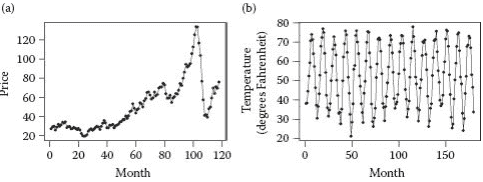

**图 1.1**

两个时间序列数据集。(a) 西德克萨斯中质原油。(b) 宾夕法尼亚州月平均气温。

**使用 R：** 与本书相关的 CRAN 包 tswge 包含 100 多个数据集，其中包含与本书内容相关的数据。在整本书中，每当讨论的数据集包含在 tswge 包中时，都会注明数据集名称。在这种情况下，与图 1.1a 和 b 相关的数据集分别为 wtcrude 和 patemp。

时间序列分析技术通常分为两大类：时域技术和频域技术。时域技术包括相关结构的分析、描述此类数据随时间演变方式的模型的开发以及未来行为的预测。频域方法旨在通过从数据潜在的周期性（或频率）内容的角度来审视数据，从而形成对时间序列数据的理解。宾夕法尼亚州气温数据往往包含 12 个月周期这一观察结果，就是对数据集频域内容进行检验的一个例子。基本的频域分析工具是功率谱。

虽然频域分析通常用于物理和


在工程科学中，具有统计学、数学、经济学或金融背景的学生可能不熟悉这些方法。我们不假定读者先前熟悉频域方法，在整本书中，我们将介绍并讨论用于分析时间序列的时域和频域方法。在**第 1.1 节至第 1.4 节**中，我们讨论时间序列数据的时域分析，而在**第 1.5 节和第 1.6 节**中，我们介绍频域分析和工具的基础知识。在**第 1.7 节**中，我们从时域和频域两个角度讨论若干模拟和真实的时间序列数据集。

## 1.1 时间序列

粗略地说，时间序列可以被看作是按时间顺序依次进行的观测的集合。我们所关注的不是确定性的序列，而是那些取值按照概率法则变化的序列。在本章中，我们将讨论时间序列统计分析的基本原理。首先，我们必须对时间序列的定义更加谨慎。实际上，时间序列是*随机过程*的一种特殊类型。

### 定义 1.1

随机过程 \(\{X(t);\ t \in T\}\) 是一组随机变量的集合，其中 \(T\) 是一个指标集，所有随机变量 \(X(t),\ t \in T\) 都定义在同一个样本空间上。当 \(T\) 表示时间时，我们称该随机过程为*时间序列*。

如果 \(T\) 取连续范围的值（例如 \(T=(-\infty,\infty)\) 或 \(T=(0,\infty)\)），则该过程称为*连续参数过程*。另一方面，如果 \(T\) 取离散的值集合（例如 \(T=\{0,1,2,\ldots\}\) 或 \(T=\{0,\pm1,\pm2,\ldots\}\)），则该过程称为*离散参数过程*。实际上，通常分别称之为连续过程和离散过程。

当我们专门处理离散参数过程时，我们将使用下标记号 \(X_t\)。然而，当所涉及的过程是连续参数的或类型未指定时，我们将使用函数记号 \(X(t)\)。此外，当不会引起混淆时，我们经常使用记号 \(\{X(t)\}\) 或简写为 \(X(t)\) 来表示时间序列。类似地，我们通常将 \(\{X_t; t = 0, \pm 1, \ldots\}\) 简写为 \(X_t, t = 0, \pm 1, \ldots\)，或直接简写为 \(X_t\)。

回顾一下，随机变量 \(Y\) 是定义在样本空间 \(\Omega\) 上的函数，其值域是实数。随机变量 \(Y\) 的一个观测值，是对某个 \(\omega \in \Omega\) 而言的实数 \(y = Y(\omega)\)。对于时间序列 \(\{X(t)\}\)，其“值”是对于某个固定的 \(\omega \in \Omega\) 而言的 \(\{X(t, \omega); t \in T\}\)，它是一组实数。由此引出以下定义。

### 定义 1.2

时间序列 \(\{X(t);\ t \in T\}\) 的一个实现，是对于 \(\omega \in \Omega\) 的某个固定值而言的实值结果集 \(\{X(t, \omega);\ t \in T\}\)。

也就是说，时间序列的一个实现仅仅是 \(\{X(t)\}\) 的一组值，这些值是由某个观测事件的发生而产生的。时间序列 \(\{X(t);\ t \in T\}\) 的一个实现将记作 \(\{x(t);\ t \in T\}\)。如前所述，在连续参数情形下，当记号明确时，我们有时使用 \(\{x(t)\}\) 或简写 \(x(t)\)；在离散参数情形下，使用 \(\{x_t\}\) 或 \(x_t\)。所有可能实现的集合称为*总体*（ensemble），并且对于给定的 \(t\)，随机变量 \(X(t)\) 的期望称为总体均值，记作 \(E[X(t)] = \mu(t)\)。\(X(t)\) 的方差由 \(\operatorname{Var}[X(t)] = E\{[X(t) - \mu(t)]^2\}\) 给出，由于它也可能依赖于 \(t\)，通常记作 \(\sigma^2(t)\)。

### 示例 1.1：具有两个可能实现的时间序列

考虑随机过程 \(Y(t)\)，其中 \(t \in (-\infty, \infty)\)，定义为 \(Y(t) = \sin(t + \varphi)\)，这里 \(P[\varphi = 0] = 0.5\)，\(P[\varphi = \pi/2] = 0.5\)，\(P\) 表示概率。该过程只有两个可能的实现或样本函数，图 1.2 展示了它们在 \(t \in [0,25]\) 上的情形。

各条曲线是实现，而两条可能曲线的集合构成*总体*。对于该过程，

$$
E[Y(t)] = 0.5\sin(t + 0) + 0.5\sin\left(t + \frac{\pi}{2}\right).
$$

因此，例如，

$$
E[Y(0)] = 0.5\sin(0) + 0.5\sin(\pi/2) = 0.5,
$$

以及

$$
E[Y(\pi/4)] = \frac{\sqrt{2}}{2}.
$$

因此，\(E[Y(t)] = \mu(t)\)，即期望依赖于 \(t\)。注意，该期望是沿着总体“纵向”平均，而不是沿着时间轴“横向”平均。在第 1.4 节中，我们将看到这些“不同的平均方式”之间如何关联。在时间序列分析中，特别关注的是 \(X(t_1)\) 与 \(X(t_2)\) 之间的协方差，其中 \(t_1, t_2 \in T\)。由于这是同一时间序列内部的协方差，我们称之为自协方差。

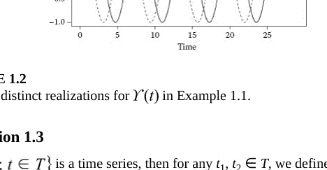

**图 1.2** 示例 1.1 中 \(Y(t)\) 的两个不同实现。

### 定义 1.3

如果 \(\{X(t); t \in T\}\) 是一个时间序列，那么对于任意 \(t_1, t_2 \in T\)，我们定义

- 自协方差函数 \(\gamma(\cdot)\) 为

  \[
  \gamma(t_1, t_2) = E\{[X(t_1) - \mu(t_1)][X(t_2) - \mu(t_2)]\}
  \]

- 自相关函数 \(\rho(\cdot)\) 为

  \[
  \rho(t_1, t_2) = \frac{\gamma(t_1, t_2)}{\sigma(t_1)\sigma(t_2)}
  \]

## 1.2 平稳时间序列

在时间序列的研究中，通常只能获得该序列的一个实现。仅基于一个实现来分析时间序列，类似于仅基于一次观测来分析随机变量的性质。平稳性和遍历性的概念将在增强我们基于单一实现有效分析时间序列的能力方面发挥重要作用。如果一个过程处于“统计均衡”状态，则称其为*平稳的*。这种时间序列的基本行为不随时间变化。例如，对于这样的过程，\(\mu(t)\) 不依赖于时间，因此对所有 \(t\) 都可以记为 \(\mu\)。看起来，由于每个 \(t \in T\) 的 \(x(t)\) 都提供了关于总体均值 \(\mu\) 的信息，因此或许可以基于单一实现来估计 \(\mu\)。*遍历*过程是这样一种过程，对于它，诸如 \(\mu\) 之类的总体平均可以从单一实现中一致地估计出来。在本节中，我们将给出更正式的平稳性定义，但将把遍历性的进一步讨论推迟到第 1.4 节。

平稳性最严格的定义是*严格平稳性*，定义如下。

### 定义 1.4

如果对于任意 \(t_1, t_2, \ldots, t_k \in T\) 和任意 \(h \in T\)，\(\{X(t_1), X(t_2), \ldots, X(t_k)\}\) 的联合分布与 \(\{X(t_1 + h), X(t_2 + h), \ldots, X(t_k + h)\}\) 的联合分布相同，则称过程 \(\{X(t); t \in T\}\) 是严格平稳的。

**注意：** 我们已默认 \(T\) 对加法封闭，并且将继续如此假设。

严格平稳性除其他要求外，还要求对于任意 \(t_1, t_2 \in T\)，\(X(t_1)\) 和 \(X(t_2)\) 的分布必须相同，并且进一步地，对于所有 \(h\)，\(\{X(t), X(t + h)\}\) 所有二元分布都相同，等等。严格平稳性的要求很苛刻，通常难以在数学上建立。事实上，对于大多数应用而言，所涉及的分布是未知的。因此，人们发展出了限制较少的平稳性概念。其中最常用的是*协方差平稳性*。

### 定义 1.5（协方差平稳性）

如果时间序列 \(\{X(t);\ t \in T\}\) 满足以下条件，则称其为*协方差平稳*的：

- \(E[X(t)] = \mu\)（对所有 \(t\) 为常数）
- \(\operatorname{Var}[X(t)] = \sigma^2 < \infty\)（即对所有 \(t\) 为有限常数）
- \(\gamma(t_1, t_2)\) 仅依赖于 \(t_2 - t_1\)

协方差平稳性也称为*弱平稳性、宽平稳性*和*二阶平稳性*。在本书其余部分，除非另有说明，术语*平稳性*均指协方差平稳性。

在时间序列中，与统计学的其他大多数领域一样，不相关的数据起着重要作用。对于离散参数时间序列，定义这样的过程并不困难。也就是说，如果 \(X_t\) 是不相关的随机变量，则时间序列 \(\{X_t; t = 0, \pm 1, \pm 2, \ldots\}\) 被称为“纯随机过程”。在考虑纯随机过程时，我们只对 \(X_t\) 也同分布的情形感兴趣。在这种情况下，更常见的称呼是将该时间序列称为*白噪声*。以下定义总结了这些论述。

### 定义 1.6（离散白噪声）

如果满足以下条件，则称该时间序列为*离散白噪声*：

- \(X_t\) 是同分布的
- 当 \(t_2 \ne t_1\) 时，\(\gamma(t_1, t_2) = 0\)
- \(\gamma(t, t) = \sigma^2\)，其中 \(0 < \sigma^2 < \infty\)

我们还会发现以下两个定义很有用。

### 定义 1.7（高斯过程）

如果对于任意正整数 \(k\) 和任意 \(t_1, t_2, \ldots, t_k \in T\)，\(\{X(t_1), X(t_2), \ldots, X(t_k)\}\) 的联合分布是多元正态分布，则称该时间序列是高斯（正态）的。

注意，对于高斯过程，严格平稳性和协方差平稳性的概念是等价的。这可以通过注意到如果

- 1. \(\gamma(0)=\sigma^2\)

- 2. \(|\gamma(h)|\leq \gamma(0)\) 对所有 \(h\) 成立

  不等式 (2) 可以通过注意到对于任意随机变量 \(X\) 和 \(Y\) 都有

  \[
  E\left[\left|(X-\mu_X)(Y-\mu_Y)\right|\right]\leq \left\{E\left[(X-\mu_X)^2\right]E\left[(Y-\mu_Y)^2\right]\right\}^{1/2},
  \]

  由 Cauchy–Schwarz 不等式可得。现在令 \(X=X(t)\) 且 \(Y=X(t+h)\)，我们得到

  \[
  |\gamma(h)|\leq E\left[\left|(X(t)-\mu)(X(t+h)-\mu)\right|\right]\leq \sigma^2=\gamma(0).
  \]

- 3. \(\gamma(h)=\gamma(-h)\)

  该结果可通过注意到以下事实得到

  \[
  \begin{aligned}
  \gamma(-h)&=E[(X(t)-\mu)(X(t-h)-\mu)]\\
  &=E[(X(t-h)-\mu)(X(t)-\mu)]\\
  &=E[(X(t_1)-\mu)(X(t_1+h)-\mu)],
  \end{aligned}
  \]

  其中 \(t_1=t-h\)。然而，由于自协方差不依赖于时间 \(t\)，因此该最后的期望等于 \(\gamma(h)\)。

- 4. 函数 \(\gamma(h)\) 是正半定的。也就是说，对于任意一组时间点 \(t_1,t_2,\ldots,t_k\in T\) 以及所有实数 \(b_1,b_2,\ldots,b_k\)，我们有

  \[
  \sum_{i=1}^{k}\sum_{j=1}^{k}\gamma(t_i-t_j)b_i b_j\geq 0. \tag{1.1}
  \]

  为证明此点，令 \(W=\sum_{j=1}^{k}b_jX(t_j)\)。现在，\(\operatorname{Var}(W)\geq 0\) 且

  \[
  \operatorname{Var}(W)=E\left[\left(\sum_{i=1}^{k}b_i\bigl(X(t_i)-\mu\bigr)\right)^2\right]=\sum_{i=1}^{k}\sum_{j=1}^{k}b_i b_j\gamma(t_i-t_j)
  \]

  结果即得。注意，在离散时间序列定义在 \(t=0,\pm1,\pm2,\ldots\) 的情形下，式 1.1 等价于矩阵

  \[
  \Gamma_k=\begin{pmatrix}\gamma_0&\gamma_1&\cdots&\gamma_k\\\gamma_1&\gamma_0&\cdots&\gamma_{k-1}\\\vdots&\vdots&\ddots&\vdots\\\gamma_k&\gamma_{k-1}&\cdots&\gamma_0\end{pmatrix} \tag{1.2}
  \]

  对每个 \(k\) 都是正半定的。

自相关函数满足以下类似性质：

- a. \(\rho(0)=1\)

- b. \(|\rho(h)|\leq 1\) 对所有 \(h\) 成立

- c. \(\rho(h)=\rho(-h)\)

- d. 函数 \(\rho(h)\) 是正半定的，并且对于定义在 \(t=0,\pm1,\pm2,\ldots\) 的离散时间序列，矩阵

  \[
  \rho_k=\begin{pmatrix}1&\rho_1&\cdots&\rho_k\\\rho_1&1&\cdots&\rho_{k-1}\\\vdots&\vdots&\ddots&\vdots\\\rho_k&\rho_{k-1}&\cdots&1\end{pmatrix} \tag{1.3}
  \]

  对每个 \(k\) 都是正半定的。

定理 1.1 给出了保证 \(\Gamma_k\) 以及等价地 \(\rho_k\) 对每个 \(k\) 都是正定的更强结论的条件。该结果的证明可参见 Brockwell and Davis (1991)，命题 5.1.1。

### 定理 1.1

若 \(\gamma_0 > 0\) 且 \(\lim_{j\to\infty}\gamma_j = 0\)，则 \(\Gamma_k\) 和 \(\rho_k\) 对每个整数 \(k > 0\) 都是正定的。

了解给定模型自相关性的图示在多大程度上描述了来自该模型的时间序列实现的行为是很重要的。在图 1.3 中，我们展示了来自四个平稳时间序列的实现，而图 1.4 显示了滞后 0–45 的相应真实自相关性。图 1.3a 中的实现 1 显示出游走或分段趋势行为。注意 \(X_t\) 和 \(X_{t+1}\) 相对于彼此相当接近是很典型的；也就是说，\(X_{t+1}\) 的值通常与 \(X_t\) 的值相差不大，因而随机变量 \(X_t\) 与例如 \(X_{t+1}\) 之间存在相当强的正相关。还要注意，对于较大的滞后 \(k\)，\(X_t\) 与 \(X_{t+k}\) 之间的相关性似乎较弱，以至于 \(X_t\) 与例如 \(X_{t+40}\) 之间几乎没有相关性。我们在图 1.4a 中看到了这种行为的体现，该图显示了实现 1 所生成的模型相关的真实自相关性。在此图中 \(\rho_1 \approx 0.95\)，而随着滞后增加，自相关性减小，到滞后 40 时自相关性已减小到 \(\rho_{40} \approx 0.1\)。

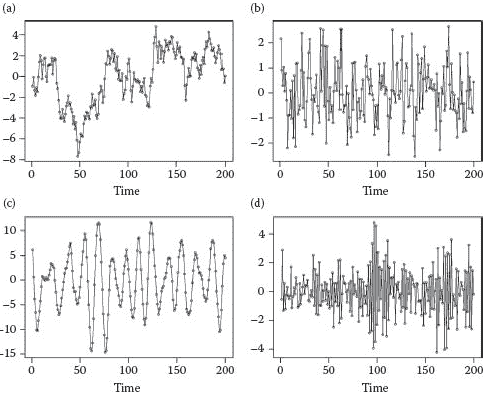

**图 1.3**

来自平稳过程的四个实现。(a) 实现 1。(b) 实现 2。(c) 实现 3。(d) 实现 4。

图 1.3b 中的实现 2 显示出没有模式。也就是说，似乎 \(X_t\) 与 \(X_{t+1}\) 之间没有关系，或者 \(X_t\) 与任意 \(k \ne 0\) 的 \(X_{t+k}\) 之间也没有关系。事实上，这是一个来自白噪声模型的实现，对于该模型，当 \(k \ne 0\) 时 \(\rho_k = 0\)，正如 [图 1.4b] 所示。注意在所有自相关图示中，\(\rho_0 = 1\)。

图 1.3c 中的实现 3 以伪周期行为为特征，周期长度约为 14 个时间点。相应的自相关性在 [图 1.4c] 中显示出阻尼正弦行为。注意，不出所料，\(X_t\) 与 \(X_{t+14}\) 之间存在正相关。此外，在滞后 7 处存在负相关，因为在正弦周期内，如果 \(x_t\) 高于平均值，则预期 \(x_{t+7}\) 会低于平均值，反之亦然。还要注意，由于实现中只有伪循环行为，且某些周期略长于其他周期，到滞后 28（即两个周期）时，自相关性已相当小。

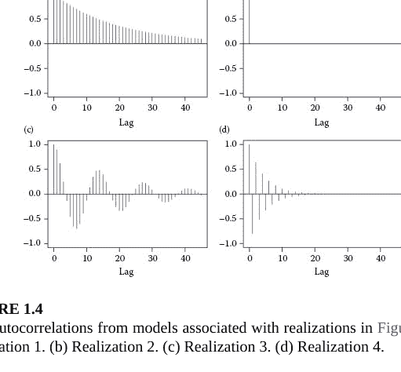

**图 1.4**

与图 1.3 中实现相关的模型中的真实自相关性。(a) 实现 1。(b) 实现 2。(c) 实现 3。(d) 实现 4。

最后，图 1.3d 中的实现 4 显示出高度振荡行为。事实上，如果 \(x_t\) 高于平均值，则 \(x_{t+1}\) 倾向于低于平均值，\(x_{t+2}\) 倾向于高于平均值，等等。同样，图 1.4d 中的自相关性描述了这种行为，其中我们看到 \(\rho_1 \approx -0.8\) 而 \(\rho_2 \approx 0.6\)。还要注意，上下波动的模式足够不完美，以至于自相关性在约滞后 15 时衰减到接近零。

## 1.4 平稳时间序列均值、自协方差和自相关的估计

如前所述，时间序列分析中的一个常见目标是基于单一实现获得有关时间序列的信息。在本节中，我们讨论从单一实现估计 \(\mu\)、\(\gamma(h)\) 和 \(\rho(h)\)。我们的重点是离散参数时间序列，其中 \(T = \{\ldots, -2, -1, 0, 1, 2, \ldots\}\)，在这种情况下通常观察到有限长度实现 \(t = 1, 2, \ldots, n\)。这里给出的结果的类似结果适用于连续参数时间序列，但在示例中仅会简要提及。读者可参见 Parzen (1962) 以获得更一般的结果。

### 1.4.1 \(\mu\) 的估计

给定来自平稳时间序列的实现 \(\{x_t,\, t = 1, 2, \ldots, n\}\)，共同均值 \(\mu\) 的自然估计是样本均值

\[
\bar{x} = \frac{1}{n} \sum_{t=1}^{n} x_t. \tag{1.4}
\]

显然估计量 \(\bar{X}\) 对 \(\mu\) 是无偏的。

#### 1.4.1.1 \(\bar{X}\) 的遍历性

我们将说 \(\bar{X}\) 对 \(\mu\) 是遍历的，如果当 \(n\) 增大时 \(\bar{X}\) 以均方意义收敛到 \(\mu\)，即 \(\lim_{n\to\infty}E[(\bar{X} - \mu)^2] = 0\)。

### 定理 1.2

设 \(\{X_t;\, t = 0, \pm 1, \pm 2, \ldots\}\) 是一个平稳时间序列。则 \(\bar{X} = \frac{1}{n} \sum_{t=1}^{n} X_t\) 对 \(\mu\) 是遍历的当且仅当

\[
\lim_{k\to\infty} \frac{1}{k} \sum_{j=0}^{k-1} \gamma_j = 0. \tag{1.5}
\]

参见 Yaglom (1962) 以获得定理 1.2 的证明。我们还有以下有用的推论。

### 推论 1.1

设 \(X_t\) 是如定理 1.2 中所述的离散参数平稳时间序列。则 \(\bar{X}\) 对 \(\mu\) 是遍历的，如果

\[
\lim_{k\to\infty}\gamma_k=0. \tag{1.6}
\]

或等价地如果

\[
\lim_{k\to\infty}\rho_k=0. \tag{1.7}
\]

推论 1.1 中给出的 \(\bar{X}\) 遍历性的充分条件非常有用，并且适用于我们将在第 3 章讨论的平稳自回归移动平均、ARMA(\(p,q\)) 时间序列的广泛类。即使在时间上接近的值 \(X_t\) 可能具有相当大的相关性，推论 1.1 中的条件也保证了对于“大”分离，它们几乎不相关。

### 例 1.2：一个遍历过程

考虑过程 \(X_t\)，\(t=0,\ \pm1,\ \pm2,\ \ldots\) 定义为

\[
X_t=0.8X_{t-1}+a_t, \tag{1.8}
\]

其中 \(a_t\) 是均值为零、方差为 \(\sigma_a^2\) 的离散白噪声。换句话说，式 1.8 是一个“回归型”模型，其中 \(X_t\)（因变量）是 \(X_{t-1}\)（自变量）的 0.8 倍加上一个随机的不相关“噪声”。注意当 \(k>0\) 时 \(X_{t-k}\) 与 \(a_t\) 不相关。式 1.8 中的过程是一阶自回归过程的例子，记为 AR(1)，将在第 3 章中详细讨论。我们将在该章中证明如式 1.8 所定义的 \(X_t\) 是一个平稳过程。通过对方程 1.8 两边取期望并回想 \(a_t\) 均值为零，可得

\[
E[X_t]=0.8E[X_{t-1}]. \tag{1.9}
\]

由于 \(X_t\) 是平稳的，可得 \(E[X_t]=E[X_{t-1}]=\mu\)。现在，式 1.9 意味着 \(\mu=0.8\ \mu\)，即 \(\mu=0\)。令 \(k>0\)，我们接下来通过对方程 1.8 的每一项乘以 \(X_{t-k}\) 并取期望来获得 \(\gamma_k=E[X_tX_{t+k}]=E[X_{t-k}X_t]\) 的表达式。这产生

$$E[X_{t-k}X_t]=0.8E[X_{t-k}X_{t-1}]+E[X_{t-k}a_t],\qquad(1.10)$$

并且由于 $E[X_{t-k}a_t]=0$，式 1.10 化简为 $\gamma_k=0.8\gamma_{k-1}$，由此可得 $\gamma_k=\gamma_0(0.8)^k$ 且 $\rho_k=0.8^k$。因此，根据推论 1.1，$\overline{X}$ 对模型 (1.8) 中的 $\mu$ 是遍历的。参见第 3.2.4 节。

为了了解条件 (1.7) 对基于单一实现估计 $\mu$ 能力的影响，注意到 $\rho_1=0.8$，因此 $X_t$ 和 $X_{t+1}$ 提供了关于 $\mu$ 的相关且 somewhat redundant 信息，但例如 $\rho_{20}=0.01$，因此 $X_t$ 和 $X_{t+20}$ 提供了关于 $\mu$ 的几乎不相关信息。图 1.5（tswge 中的数据集 fig1.5）显示了来自式 1.8 中模型长度为 100 的一个实现。注意到该实现似乎在均值 $\mu=0$ 周围来回“游荡”，暗示了平稳过程的可能性。

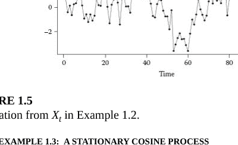

## 图 1.5

例 1.2 中 $X_t$ 的实现。

## 例 1.3：平稳余弦过程

定义 $X(t)$，$t\in(-\infty,\infty)$ 为

$$X(t)=C\cos(\lambda t+\gamma),\qquad(1.11)$$

其中

- $C$ 和 $\lambda$ 为实值常数
- $\gamma$ 为随机变量

然后，如下所示，$X(t)$ 平稳当且仅当 $\varphi(1)=\varphi(2)=0$，其中 $\varphi(u)$ 是 $\mathcal{Y}$ 的特征函数，即

$$\varphi(u)=E[e^{iu\mathcal{Y}}] \qquad \text{for } i=\sqrt{-1}.$$

在验证该结果之前，我们首先注意到 $\varphi(u)$ 可以写成

$$\varphi(u)=E[\cos(u\mathcal{Y})]+iE[\sin(u\mathcal{Y})]. \tag{1.12}$$

我们还将使用三角恒等式

- 1. $\cos(A+B)=\cos A\cos B-\sin A\sin B$
- 2. $\cos A\cos B=\frac{1}{2}\cos(A+B)+\frac{1}{2}\cos(A-B)$

利用恒等式 (1)，我们看到 [公式 1.11](#) 中的 $X(t)$ 可表示为

$$X(t)=C[\cos\lambda t\cos\mathcal{Y}-\sin\lambda t\sin\mathcal{Y}], \tag{1.13}$$

而乘积 $X(t)X(t+h)$ 可先用 (2) 再用 (1) 重写为

$$\begin{aligned}
X(t)X(t+h)&=C\cos(\lambda t+\mathcal{Y})C\cos(\lambda(t+h)+\mathcal{Y})\\
&=\frac{C^2}{2}\cos(2\lambda t+\lambda h+2\mathcal{Y})+\frac{C^2}{2}\cos(\lambda h)\\
&=\frac{C^2}{2}[\cos(2\lambda t+\lambda h)\cos(2\mathcal{Y})-\sin(2\lambda t+\lambda h)\sin(2\mathcal{Y})+\cos(\lambda h)]. \tag{1.14}
\end{aligned}$$

$(\Leftarrow)$ 设 $\varphi(1)=\varphi(2)=0$。则由 [公式 1.12](#) 可明显得到

- a. $E[\cos\mathcal{Y}]=E[\sin\mathcal{Y}]=0$
- b. $E[\cos 2\mathcal{Y}]=E[\sin 2\mathcal{Y}]=0$

由 [公式 1.13](#) 可知 (a) 蕴含 $E[X(t)]=0$。此外，对 [公式 1.14](#) 中的 $X(t)X(t+h)$ 取期望，可见 (b) 蕴含

$$\gamma(h)=E[X(t)X(t+h)]=\frac{C^2}{2}\cos(\lambda h),$$

该式依赖于 h 但不依赖于 t。此外，σ_X² = γ(0) = (C² / 2) < ∞。因此，X(t) 是协方差平稳的。

(⇒) 设 X(t) 是协方差平稳的。则由于 E[X(t)] 不依赖于 t，由式 1.13 可得 E[cosγ'] = E[sinγ'] = 0，从而 φ(1) = 0。同样，由于 E[X(t)X(t + h)] 依赖于 h 但不依赖于 t，由式 1.14 中的最后一个等式可得 E[cos2γ'] = E[sin2γ'] = 0，即 φ(2) = 0，结果得证。

我们注意到如果 γ' ~ Uniform[0, 2π]，则

$$\varphi(u)=\int_{0}^{2\pi} e^{i u y}\left(\frac{1}{2\pi}\right)dy = \frac{e^{2\pi i u}-1}{2\pi i u},$$

从而 φ(1) = φ(2) = 0，因此均匀 [0, 2π] 分布满足 γ' 的条件，且由此得到的 process X(t) = C cos(λt + γ') 是平稳的。

图 1.6 显示了来自式 1.11 描述的过程的三个实现，其中 λ = 0.6 且 γ' ~ 𝒰[0, 2π]。图 1.6a 中的实现对应于 γ' = 1.5 的情况。与图 1.3 和 1.5 中的实现不同，图 1.6a 中的行为非常确定性。事实上，检查该图会让人相信该过程的均值依赖于 t。然而并非如此，因为 γ' 是随机的。例如，图 1.6b 和 c 显示了随机变量 γ' 取不同值时的另外两个实现。注意随机变量 γ' 的作用是在每次实现中随机移动余弦波的“起点”。γ' 被称为相位偏移。这些实现只是可能实现集合中的三个实现。注意对于这三个实现，X(10) 分别等于 0.35、0.98 和 −0.48，这与我们发现 E[X(t)] 不依赖于 t 的结论一致。

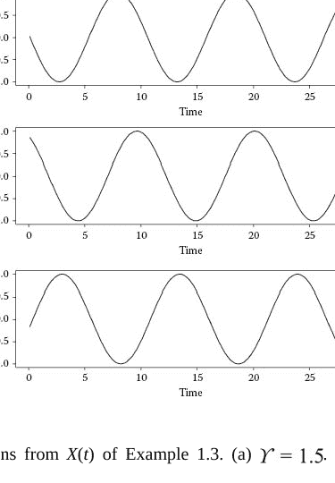

## 图 1.6

例 1.3 中 X(t) 的三个实现。(a) γ = 1.5。(b) γ = 0.5。(c) γ = 4.5。

重要的点是平稳性这一性质不能通过对数据的简单检查来确定。相反，它必须从物理考虑、相关结构知识或我们在未来章节中将考虑的更复杂的技巧中推断出来。由于定理 1.2 及其推论涉及离散参数过程，它们不适用于当前示例中的 X(t)。然而，与定理 1.2 和推论 1.1 类似的结果对于连续参数过程也成立（参见 Parzen, 1962）。注意，在此示例中，γ(h) 当 h → ∞ 时并不趋于零，但 X̄_t 在此连续参数示例中定义为

(1.15)

即，通过沿时间轴向下移动并求出实现中相隔 $k$ 个时间单位的所有乘积的平均值。注意，如果我们在式 1.18 中用 $\mu$ 替换 $\bar{X}$，则得到的估计量是无偏的。然而，式 1.18 中的估计量 $\tilde{\gamma}_k$ 仅是渐近无偏的。

尽管 $\tilde{\gamma}_k$ 具有直观吸引力，大多数时间序列分析人员使用另一种估计量 $\hat{\gamma}_k$，定义为

$\hat{\gamma}_k = \frac{1}{n} \sum_{t=1}^{n-|k|} (X_t - \bar{X})(X_{t+|k|} - \bar{X}), \; k = 0, \pm 1, \pm 2, \dots \pm (n-1) \tag{1.19}$
$= 0, \quad |k| \ge n.$

从对式 1.19 的检查可以明显看出，当 $|k|$ 相对于 $n$ 较大时，$|\hat{\gamma}_k|$ 值趋向于“很小”。估计量 $\hat{\gamma}_k$ 如式 1.19 所给，其偏差大于 $\tilde{\gamma}_k$，但在大多数情况下均方误差更小。两种估计量之间的差异当然在 $|k|$ 相对于 $n$ 较大时最为显著。比较可以最容易地在式 1.18 和 1.19 中用 $\mu$ 替换 $\bar{X}$ 时进行，我们将在本段剩余讨论中假设这一点。在这种情况下，$\hat{\gamma}_k$ 的偏差可视为 $(|k|/n)\gamma_k$。当 $|k|$ 增加到 $n$ 时，因子 $|k|/n$ 增加到一，因此偏差趋向于 $\gamma_k$。当 $|k|$ 增加到 $n-1$ 时，$\mathrm{Var}(\tilde{\gamma}_k)$ 会增加，且 $\tilde{\gamma}_k$ 值对于较大的 $k$ 值趋向于表现出相当不规则的行为。这将在随后给出的例 1.5 中得到说明。$\gamma_k$ 的整体模式通常由 $\hat{\gamma}_k$ 比由 $\tilde{\gamma}_k$ 更好地逼近，并且我们稍后会看到自相关函数的模式通常是重要的。$\gamma_k$ 的行为也由 $\hat{\gamma}_k$ 更好地逼近，因为 $\hat{\gamma}_k$ 在第 1.3 节中给出的自协方差函数性质 (4) 的意义上也是正半定的，而 $\tilde{\gamma}_k$ 不一定是正半定的。关于这些主题的进一步讨论，读者可参考 Priestley (1981)。

## 例 1.5：样本自协方差的行为

在图 1.8 中，我们显示了例 1.2 的 AR(1) 实现的理论自协方差，以及基于图 1.5 所示实现（tswge 中的数据集 fig1.5）得到的样本自协方差 $\hat{\gamma}_k$ 和 $\tilde{\gamma}_k$。可以看出，对于小的 $k$，估计量彼此相似，但对于接近 $n$ 的 $k$，$\gamma_k$ 的阻尼指数性质是


用 \hat{γ}_k 估计比用 \tilde{γ}_k 更好。关于 \hat{γ}_k（以及由于渐近等价性，\tilde{γ}_k）的遍历性结果也可以获得，但通常不像定理1.2那样直截了当。大多数关于 \hat{γ}_k 的结果都是在假设 μ 已知且不失一般性地等于零的情况下证明的。关于 \hat{γ}_k 的遍历定理以及 Var(\hat{γ}_k) 和 Cov(\hat{γ}_k, \hat{γ}_j) 的一些结果的讨论，参见 Priestley (1981)。在本书其余部分，我们假设样本自协方差对 γ_k 具有遍历性所需的条件成立。

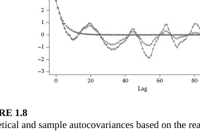

**图 1.8** 基于图1.5中实现的理论自协方差和样本自协方差。

### 1.4.3 ρ_k 的估计

ρ_k = γ_k / γ_0 的自然估计量是 \hat{ρ}_k = \hat{γ}_k / \hat{γ}_0，我们此后将其称为样本自相关函数。估计量 \hat{ρ}_k 具有良好性质：|\hat{ρ}_k| ≤ 1，而 \tilde{ρ}_k = \tilde{γ}_k / \tilde{γ}_0 不具有这一性质。这个性质可以通过将 \hat{ρ}_k 与两组 n + k 个观测值之间的皮尔逊积矩相关系数联系起来证明：

0, 0, ... 0, X_1 - \bar{X}, X_2 - \bar{X}, ... X_n - \bar{X}
X_1 - \bar{X}, X_2 - \bar{X}, ... X_n - \bar{X}, 0, 0, ... 0,

其中每种情况下都有 k 个零。为记号方便，我们将第一行记为 $V_i$，$i = 1, ..., n + k$，第二行记为 $W_i$，$i = 1, ..., n + k$。因此，$\overline{V} = \overline{W} = 0$，$V$ 和 $W$ 之间的积矩相关系数为

$$r = \frac{\sum_{i=1}^{n+k} V_i W_i}{\sqrt{\sum_{i=1}^{n+k} V_i^2}\,\sqrt{\sum_{i=1}^{n+k} W_i^2}}.$$

分母可以写成 $\sum_{t=1}^{n} (X_t - \overline{X})^2$，分子可以写成 $\sum_{i=1}^{k} V_i W_i + \sum_{i=k+1}^{n} V_i W_i + \sum_{i=n+1}^{n+k} V_i W_i$。第一个和最后一个和为零，因此分子可以写成

$$\sum_{i=1}^{n+k} V_i W_i = \sum_{i=k+1}^{n} V_i W_i = \sum_{i=1}^{n-k} (X_t - \overline{X})(X_{t+k} - \overline{X}).$$

于是 $r = \hat{\rho}_k$，从而 $|\hat{\rho}_k| \le 1.$。

Bartlett (1946) 在 $X_t$ 是平稳高斯过程时，得到了 $\operatorname{Cov}(\hat{\rho}_k, \hat{\rho}_{k+j})$ 的近似表达式。特别地，他证明了

$$\operatorname{Cov}(\hat{\rho}_k, \hat{\rho}_{k+j}) \approx \frac{1}{n} \sum_{v=-\infty}^{\infty} \{\rho_v \rho_{v+j} + \rho_{v+k} \rho_{v+k-j} - 2 \rho_v \rho_{v+k-j} - 2 \rho_{k+j} \rho_v \rho_{v+k} + 2 \rho_k \rho_{k+j} \rho_v^2\},$$

由此，当 $j = 0$ 时，可得

$$\operatorname{Var}(\hat{\rho}_k) \approx \frac{1}{n} \sum_{v=-\infty}^{\infty} \{\rho_v^2 + \rho_{v+k} \rho_{v-k} - 4 \rho_k \rho_v \rho_{v-k} + 2 \rho_k^2 \rho_v^2\}. \tag{1.20}$$

当时间序列具有性质 $\rho_k \to 0$（$k \to \infty$）时，对于“较大”的 $k$，我们有

$$\operatorname{Cov}(\hat{\rho}_k, \hat{\rho}_{k+j}) \approx \frac{1}{n} \sum_{v=-\infty}^{\infty} \rho_v \rho_{v+j}, \tag{1.21}$$

以及

$$\operatorname{Var}\left(\hat{\rho}_k\right) \approx \frac{1}{n}\sum_{v=-\infty}^{\infty}\rho_v^2.$$ (1.22)

Bartlett 的近似在我们的时间序列数据分析中将非常重要。逼近 \hat{\rho}_k 方差的结果有助于确定样本自相关何时显著不为零。此外，公式 1.21 表明相邻样本自相关之间可能存在相关性。在我们分析时间序列并查看 \hat{\rho}_k 图时，这是一个需要牢记的重要结果。

在1.3节关于图1.3和图1.4的讨论中，我们描述了自相关模式如何提供关于时间序列模型实现基本性质的信息。在图1.9中，我们展示了使用 \hat{\rho}_k 估计的样本自相关，它们与图1.3中的实现相关联。这些样本自相关是图1.4所示真实自相关的估计。可以看出，这些样本自相关逼近真实自相关的行为，但应注意 \hat{\rho}_k 值之间的相关性。例如，注意当 \hat{\rho}_k 的值趋于低估 \rho_k 时，$j$ “接近” $k$ 的 \hat{\rho}_j 值也往往低估真实值。这可能会在 \hat{\rho}_k 图中产生循环行为，而 \rho_k 图中并不存在这种行为。这种效应可以在图1.9a和图1.9d中看到。此外，应注意，白噪声实现的样本自相关当然不会恰好等于零。在8.1节中，我们将讨论白噪声检验，帮助您判断如图1.9b所示的样本自相关的幅度是否大于白噪声过程实现所预期的幅度。

**使用 R：** 计算时间序列实现的均值和样本自相关（或样本自协方差）的 R 命令分别是基础 R 命令 mean 和 acf。有关这些命令的更多详细信息，请参见附录 1B。

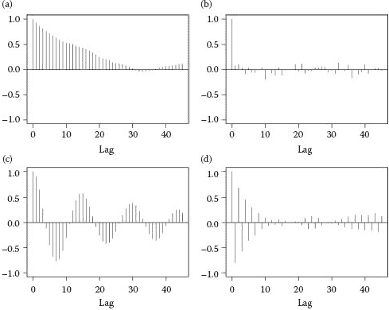

**图 1.9** 与图1.3中四个实现相关的样本自相关。(a) 实现1。(b) 实现2。(c) 实现3。(d) 实现4。

## 1.5 功率谱

在1.1至1.4节中，我们从实现、均值、方差和自相关等方面讨论和描述了时间序列。这些都是时间序列时域分析的各个方面。从循环（或频率）内容的角度审视时间序列实现和模型通常很重要。这类分析在工程课程中很常见，但对于第一次学习时间序列课程的统计学学生来说，这很可能是第一次接触频域。

1807年，约瑟夫·傅里叶证明了非常广泛的一类函数 *f(x)* 可以写成正弦和余弦的线性组合，这令同时代的人大为震惊。这一发现催生了极其有用的傅里叶分析领域，在该领域中，数学家和科学家们致力于通过将信号分解为三角函数的和来理解信号的基本性质。这将在示例1.6中说明。

### 示例 1.6：包含多个频率的信号

考虑图1.10中左上角的实现。仔细观察会发现该信号具有重复性，但其总体外观与本章中看到的几个实现相似。实际上，该信号是图1.10中另外三幅图所示的不同周期长度和相位偏移的正弦波之和。tswge 中的数据集 fig1.10a-d 分别包含图1.10a–d中的实现。我们将在示例1.7中再次使用图1.10a中的数据集。

来自时间序列模型的实际实现通常不会像图1.10左上角的信号那样具有如此简单的数学形式。然而，通过谱将傅里叶分析技术应用于时间序列数据，我们将能够分析更复杂的实现，从而发现基本的循环行为，这些行为提供了关于生成数据的潜在模型的信息。对时间序列中潜在周期性的考察称为*谱分析*，我们用来度量频率内容的工具是*功率谱*和*谱密度*。我们首先介绍必要的术语和定义。

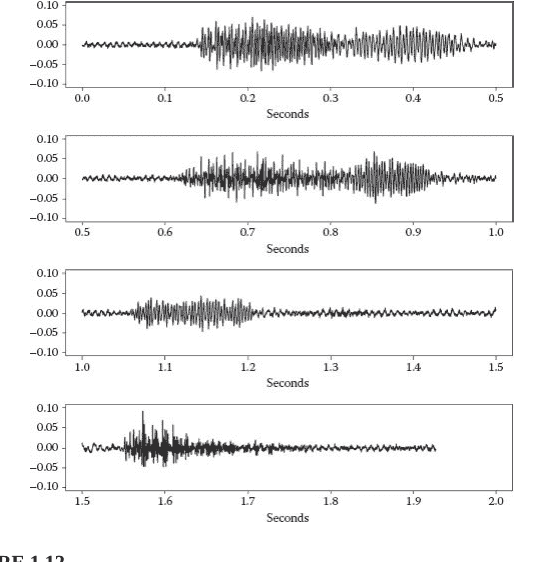

**图 1.12** 短语 *金刚吃草* 的数字化记录。

正如我们已经指出的，自相关在时间序列分析中起着核心作用。然而，当需要确定数据的频率或循环内容时，自相关中的相关信息通过自相关的傅里叶变换（称为谱密度）比通过自相关本身更容易传达。功率谱和谱密度是检验时间序列数据频率内容的主要工具，定义如下。

### 定义 1.11

设 {$X(t); t \in (-\infty, \infty)$} 是平稳时间序列。


- 1. 功率谱 $P_X(f)$ 定义为

$$P_X(f) = \int_{-\infty}^{\infty} e^{-2\pi i f h} \gamma(h) dh, \tag{1.23}$$

其中 $-\infty < f < \infty$，$i = \sqrt{-1}$，$\gamma(h)$ 是自协方差函数。

- 2. 谱密度是 $P_X(f)$ 的归一化版本。具体来说，我们将谱密度 $S_X(f)$ 定义为

$$S_X(f) = \frac{P_X(f)}{\sigma_X^2} = \int_{-\infty}^{\infty} e^{-2\pi i f h} \rho(h) dh. \tag{1.24}$$

功率谱通常简称为谱。定义1.11要求指标集 $T$ 是连续的。我们可以给出一个更一般的定义，该定义也包含离散情形。然而，这样做需要在定义中使用Stieltjes积分。有关这一方法，读者可参阅Priestley（1981）和Koopmans（1974）。我们则选择分别考虑离散参数情形。

## 定义 1.12

设 $\{X_t; t = 0, \pm 1, \pm 2, \ldots\}$ 是一个平稳时间序列，并设 $|f| \le 0.5$。

- 1. $X_t$ 的功率谱定义为

$$P_X(f) = \sum_{k=-\infty}^{\infty} e^{-2\pi i k f} \gamma_k. \tag{1.25}$$

- 2. 谱密度定义为

$$S_X(f)=\frac{P_X(f)}{\sigma_X^2}=\sum_{k=-\infty}^{\infty}e^{-2\pi i k f}\rho_k \tag{1.26}$$

如果

$$\sum_{k=-\infty}^{\infty}|\gamma_k|<\infty\tag{1.27}$$

那么可以证明，公式1.25和1.26中的级数收敛，并且

$$\gamma_k=\int_{-0.5}^{0.5}e^{2\pi i f k}P_X(f)\,df\tag{1.28}$$

也就是说，谱和自协方差函数是傅里叶变换对。因此，给定满足公式1.27的平稳过程的谱，可以从数学上获得其自协方差函数，反之亦然。公式1.25和1.28的结果表明，自协方差和谱包含关于该过程的等价信息。自协方差在时域中传达这些信息，而谱在频域中表达等价的信息。我们将看到，对于特定应用，两者之一可能比另一个提供更易理解的过程信息。自相关与谱密度之间也存在类似的关系。

我们留作练习来证明定义1.12中的 $P_X(f)$ 和 $S_X(f)$ 可以写成

$$P_X(f)=\sigma_X^2+2\sum_{k=1}^{\infty}\gamma_k\cos(2\pi f k)\tag{1.29}$$

以及

$$S_X(f)=1+2\sum_{k=1}^{\infty}\rho_k\cos(2\pi f k)\tag{1.30}$$

同样限制条件为 $|f| \le 0.5$。

**奈奎斯特频率：** 定义1.12似乎是定义1.11相当自然的离散版本，只是对参数 $f$ 的取值范围有限制。对于以单位增量采样的离散时间序列数据，可观察到的最短周期是2，即最高可观测频率是0.5。这被称为奈奎斯特频率。例如，考虑两个信号 $Y_t = \cos(2\pi(0.3)t)$ 和 $Z_t = \cos(2\pi(1.3)t)$，它们的频率分别为0.3和1.3。这两个信号在连续统上定义，但我们考虑它们在整数处采样的情况。在图1.13中，我们显示了这两个信号的叠加，有趣的是，这两个信号在 $t$ 的整数值处彼此相等。这些共同的值在图中用圆圈标出。因此，当在整数处采样时，两条曲线是无法区分的。这种现象称为混叠，因为频率 $f = 1.3$“看起来”是 $f = 0.3$。对于离散数据，由于不可能检测到小于2个采样单位的周期，因此我们在离散情形下必须限制 $|f| \le 0.5$ 就不足为奇了。应当注意，如果存在更高频率，那么为了能够检测到它们，我们需要更快速地采样。这引出了以下定义。

## 定义 1.13

如果数据以 $\Delta$ 为增量采样，则奈奎斯特频率为 $1/(2\Delta)$，最短可观测周期为 $2\Delta$。

## 示例 1.7：示例 1.3 和 1.6 的谱

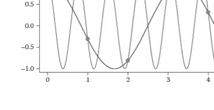

### 图 1.13

$\cos(2\pi(0.3)t)$ 和 $\cos(2\pi(1.3)t)$（较高频率）的图，说明这两个信号在整数处一致。

- 1. 在示例1.3中

$$X(t)=C\cos(\lambda t+\Upsilon), \tag{1.31}$$

其中，和之前一样，$C$ 和 $\lambda$ 是实值常数，我们考察 $\Upsilon\sim\operatorname{Uniform}[0,2\pi]$ 的特例。我们回忆一下示例1.3中的 $\mu=0$ 和 $\gamma(h)=(C^2/2)\cos(\lambda h)$。因此，$\gamma(h)$ 是以 $2\pi/\lambda$ 为周期的周期函数，或者换句话说，$\gamma(h)$ 具有频率 $\lambda/(2\pi)$。按公式1.23定义的谱为

$$P_X(f)=\int_{-\infty}^{\infty}e^{-2\pi ifh}\gamma(h)\,dh,$$

$$P_X(f)=\frac{C^2}{2}\int_{-\infty}^{\infty}e^{-2\pi ifh}\cos(\lambda h)\,dh. \tag{1.32}$$

$$P_X(f)=\frac{C^2}{4}\left\{\delta\left(f-\frac{\lambda}{2\pi}\right)+\delta\left(f+\frac{\lambda}{2\pi}\right)\right\}. \tag{1.33}$$

其中 $\delta$ 表示*狄拉克δ函数*。

**注：** 如果将公式1.32中的积分视为反常黎曼积分，它是不收敛的。此外，公式1.33中的 $\delta$ 函数实际上并不是一个函数，而是一个泛函。然而，通过将公式1.32中的积分解释为一列积分的极限，并将 $\delta$ 解释为“广义函数”，公式1.32和1.33的结果可以变得严格。

关于广义函数的讨论，参见 Kanwal (1998) 和 Lighthill (1959)。本书中我们将用到的狄拉克δ函数的性质如下：

$$\int_{-\infty}^{\infty}\delta(t-t_0)F(t)\,dt=F(t_0), \tag{1.34}$$

$$\int_{-\infty}^{\infty}e^{-2\pi itu}\,du=\delta(t).$$

图1.14显示了公式1.33中给出的 $P_X(f)$ 在 $f\geq 0$ 且特例 $\lambda=0.2\pi$ 下的图形。数据的“频率成分”集中在单一频率 $\lambda/(2\pi)=0.1$ 这一事实由0.1处的无限尖峰表示。

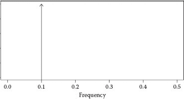

### 图1.14

示例1.3中 $X(t)$ 在 $c=1$、$\lambda=0.6$ 时的功率谱。

- 2. 现在，我们再次考虑图1.10左上角绘制的数据集，它是来自连续参数过程的一个实现

$$X(t)=\cos(2\pi(0.025)t+\psi_1)+1.5\cos(2\pi(0.1)t+\psi_2)+2\cos(2\pi(0.15)t+\psi_3), \tag{1.35}$$

其中 $\psi_i$，$i=1,2,$ 和 $3$ 是独立随机变量，服从均匀分布 $[0,2\pi]$。在图1.10绘制的特定实现中，$\psi_1=0$，$\psi_2=1$，$\psi_3=2.5$。第一个分量（右上图）的频率为 $f=0.025$（周期或循环长度为 $1/0.025=40$），第二个分量（左下图）的频率为 $f=0.1$（周期=10），而第三个分量（右下图）的频率为 $f=0.15$（周期=6.67）。公式1.35中 $X(t)$ 的自相关（见练习1.11）和谱如图1.15所示。从图1.15b中的谱可以非常清楚地看出，频率成分完全集中在频率0.025、0.1和0.15上。当然，谱在显示数据潜在频率成分方面的效果远好于仅通过检查图1.15a中的自相关或图1.10左上角的实现所能获得的效果。我们通常将谱或谱密度绘制为 $f$ 的函数，以检查其特征。谱或谱密度中的峰值表明数据在该频率处存在循环行为。在本书通常分析的离散参数数据中，峰值不会像图1.14和1.15那样呈“尖峰”性质，而是会更宽，表明峰值附近还有额外的频率成分。下面的示例对此进行了说明。

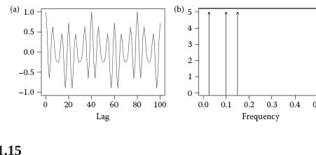

### 图1.15

(a) 公式1.35中 $X(t)$ 的自相关和 (b) 谱。

## 示例1.8：包含两个主频率成分的信号

在图1.16a（tswge中的数据集fig1.16a）中，我们显示了一个长度为250的实现，其中很明显数据具有周期约为25的伪周期行为（在250个时间点的实现中约有10个周期）。同样明显的是由“锯齿”行为指示的较高频率分量。图1.16a是阶数为4的AR模型的一个实现（我们将在


第3章），并且在图1.16b中，我们展示了与该模型相关联的真实谱密度。谱密度在 f = 0.04 = 1/25 附近有一个峰值，对应数据中周期约为25的循环行为；在 f = 0.33 附近也有一个峰值，对应数据中周期长度约为3的较高频率成分。另请注意，图1.16b中谱密度的峰值并不像图1.14和图1.15中那样是尖峰，而是表明在接近0.04和0.33的频率处存在周期行为。

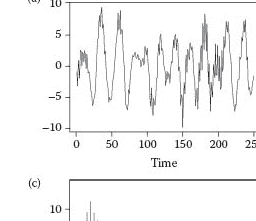

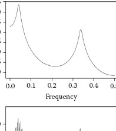

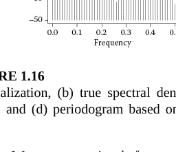

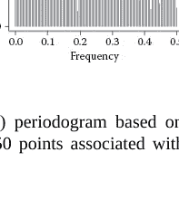

## 图 1.16

(a) 实现，(b) 真实谱密度，(c) 基于前100个点的周期图，以及 (d) 基于全部250个点的周期图，均与示例1.8相关。

在继续之前，我们注意两点。

- 1. 对于实时间序列，P(f) = P(-f)，同样地 S(f) = S(-f)（见习题1.19a）。因此，实际数据的谱或谱密度图通常只显示 f ≥ 0 的部分，如图1.14至图1.16所示。
- 2. 在图1.16b中，我们实际上是以对数刻度绘制谱。这样做有两个原因：在这种图中，谱的次要峰值更容易辨识；并且 10 log₁₀ Sₓ(f) 使纵轴以分贝（dB）为单位，而分贝是测量声能的标准单位，因此在工程中被广泛使用。

## 1.6 离散时间序列的功率谱和谱密度估计

从数据中估计功率谱和谱密度可能是一个具有挑战性的问题，文献中有着各种各样的估计技术。我们将在此简要介绍这一主题，稍后的章节中还会再讨论。对于离散参数时间序列，给定方程1.29中的谱，一种自然的谱估计量似乎可以通过简单地将第1.4节讨论的样本自协方差代入方程1.29来获得。由此得到的估计量称为*样本谱*，在定义1.14中给出。

### 定义 1.14

设 Xₜ 是定义在整数上的离散平稳时间序列。基于该时间序列的长度为 n 的实现，样本谱由下式给出：

$$\hat{P}_X(f) = \hat{\sigma}_X^2 + 2 \sum_{k=1}^{n-1} \hat{\gamma}_k \cos(2\pi f k),$$ (1.36)

其中 |f| ≤ 0.5。样本谱密度由下式给出：

$$\hat{S}_X(f) = 1 + 2 \sum_{k=1}^{n-1} \hat{\rho}_k \cos(2\pi f k),$$ (1.37)

求和上限 n − 1 是合理的，因为对于 k ≥ n，样本自协方差和样本自相关被定义为零。

一个相关的估计量是*周期图*，它本质上就是样本谱在*基频* f₁ = 1/n 的谐波处的取值。具体来说，

*谐波* $f_j$ 由下式给出：

$f_j = \frac{j}{n}, \quad j=1,\dots,\frac{n}{2} \text{ (if $n$ is even)}$
$= \frac{j}{n}, \quad j=1,\dots,m \text{ (if $n$ is odd and $n=2m+1$)}$

### 定义 1.15

设 $X_t$ 是定义在整数上的离散时间序列。基于该时间序列的长度为 $n$ 的实现，周期图由下式给出：

$I(f_j)=\hat{\sigma}_X^2+2\sum_{k=1}^{n-1}\hat{\gamma}_k\cos(2\pi f_j k),\qquad (1.38)$

其中 $f_j$ 是如前定义的谐波。

周期图也可以根据信号的有限傅里叶级数表示以及数据的有限傅里叶变换的模平方来定义。参见附录1A。虽然样本谱和周期图是谱的直观估计量，但它们作为估计量的性质并不好。下面的定理1.4概述了样本谱的性质。

### 使用 R：tswge R 命令

```
period.wge(x,dbcalc,plot)
```

计算并（可选地）绘制时间序列实现 x 的周期图，可选用对数（dB）或非对数刻度。更多细节参见附录1B。

### 定理 1.4

设 $X_t$ 是定义在整数上的离散平稳时间序列，并令 $\hat{P}_X(f)$ 表示定义1.14中给出的样本谱。$\hat{P}_X(f)$ 具有以下性质：

- 1. $\hat{P}_X(f)$ 是渐近无偏的，即 $\lim_{n\to\infty}E[\hat{P}_X(f)] = P(f)$。
- 2. $\hat{P}_X(f)$ 不是 $P_X(f)$ 的一致估计量，而且随着 $n \to \infty$，$\mathrm{Var}[\hat{P}_X(f)]$ 不会减小。

更多细节参见 Parzen (1962)。在图1.16c和d中，我们分别展示了基于前100个点和整个实现的周期图（在基频的各谐波处以分贝为单位绘制成垂直条）。这些周期图在视觉上有些不同，因为(c)是在点 $f_j = j/100$, $j = 1, ..., 50$ 处绘制的，而(d)中的周期图基于更细的划分（即，在 $f_j = j/250$, $j = 1, ..., 125$ 处绘制）。（数学意义上的）一致性的缺乏体现在：基于 $n = 250$ 的周期图与基于 $n = 100$ 的周期图一样多变且不稳定；也就是说，随着 $n$ 的增加，我们几乎没有什么收获。应当指出，尽管方程1.38中定义的周期图及其替代形式通常被作为谱的估计量来研究，但在本书中，我们绘制的是估计谱密度的标准化周期图（以分贝为单位）（即，在方程1.38中使用 $\hat{\rho}_k$ 而不是 $\hat{\gamma}_k$）。

样本谱和周期图的基本问题在于，无论 $n$ 的大小如何，当 $j$ 接近 $n$ 时，$\gamma_j$ 的估计都极其不稳定。为了获得性质更好的谱估计量，人们投入了大量的研究来解决样本谱的平滑问题。一种常见的平滑谱估计量具有如下一般形式：

$\hat{P}_S(f) = \lambda_0 \hat{\sigma}_X^2 + 2 \sum_{k=1}^{M} \lambda_k \hat{\gamma}_k \cos(2\pi f k), \tag{1.39}$

其中截断点 $M$ 的选择远小于 $n$，而 $\lambda_k$, $k = 0, 1, ..., M$ 是一个随 $k$ 增大而衰减的窗函数。三种经典窗函数的权重如下：

- 1. 巴特利特（三角形）窗
- $\lambda_k = 1 - \left(\frac{k}{M}\right), \quad k = 0, 1, ..., M$
- $= 0, \quad k > M$

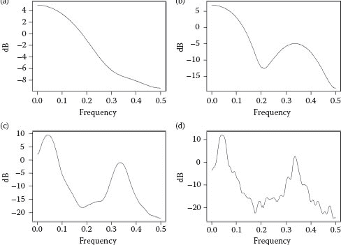

## 图 1.17

使用帕曾窗并取不同 *M* 值时，图1.16中数据的加窗谱估计。截断点：(a) *M* = 5，(b) *M* = 10，(c) *M* = 31，(d) *M* = 100。

### 使用 R

有多个 `tswge` R 函数可用于谱估计。

- 1. `parzen.wge(x, dbcalc, trunc, plot)` 计算并（可选地）绘制基于帕曾窗的平滑周期图，对时间序列实现 x 使用截断点 *M* = 2√*n*。
- 2. `plot.sample.wge(x,lag.max,trunc)` 绘制实现、样本自相关、周期图以及基于帕曾窗的平滑周期图（两者均以分贝为单位绘制）。
- 3. `plot.parzen.wge(x,m2)` 绘制周期图以及最多3个不同截断点的帕曾窗谱估计（均以分贝为单位绘制）。

更多细节参见附录1B。

## 1.7 时间序列示例

### 1.7.1 模拟数据

在本节中，我们考察由已知时间序列模型模拟得到的时间序列实现。我们将研究每个实现的自相关和谱密度，以更好地理解它们各自所传达的信息。用于生成这些实现的 p 阶 AR 模型（AR(p)）将在第3章中详细讨论，这里仅出于说明目的考虑这些示例。对于这些模型，ρ_k 和 S(f) 可以使用第3章中给出的结果来获得。

### 示例1.9：两个 AR(1) 模型

图1.18a和图1.19a分别展示了来自以下AR(1)模型的长度为250的实现：

$X_t = 0.9 X_{t-1} + a_t,$
(1.40)

以及

$X_t = -0.9 X_{t-1} + a_t,$
(1.41)

其中 $a_t$ 是零均值、单位方差的高斯白噪声。我们注意到，图1.18a中的序列具有游走型行为，没有明显的周期性趋势。还要注意，对于较小的 $k$，$X_t$ 与 $X_{t+k}$ 之间似乎存在相当高的相关性。另一方面，注意到图1.19a中的实现表现出快速振荡。


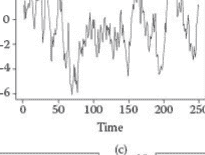

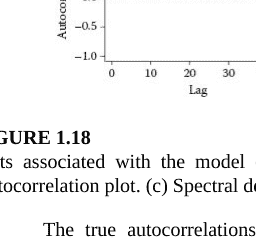

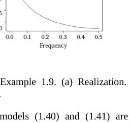

### 图 1.18

与示例 1.9 中的模型 (1.40) 相关的图。(a) 实现。(b) 自相关图。(c) 谱密度图。

模型 (1.40) 和 (1.41) 的真实自相关 ρ_k 分别显示在图 1.18b 和 1.19b 中。在图 1.18b 中可以看出，真实自相关指数衰减至零，但对于较小的 k，X_t 与 X_{t+k} 之间存在相对较高的正相关，这与我们从数据本身观察到的结果一致。图 1.19b 中显示的自相关似乎是阻尼振荡指数。在图 1.18c 中，f = 0 处的峰值表明与图 1.18a 中类似的实现显示出几乎没有周期性行为，即数据主要是低频，没有真正的周期性趋势。另一方面，图 1.19c 中显示的谱图在 f = 0 附近接近于零，并在 f = 0.5 处达到最大值，表明数据具有高度振荡的性质，即它们主要是高频，周期约为 2。

### 使用 R：
创建如 图 1.18 至 1.22 中所示的图，显示指定 ARMA 模型的实现、理论自相关和谱密度，R 命令可使用与本书相关联的 CRAN 包 `tswge` 中的函数 `plot.true.wge` 获得。该函数将在 **附录 3B** 中讨论。

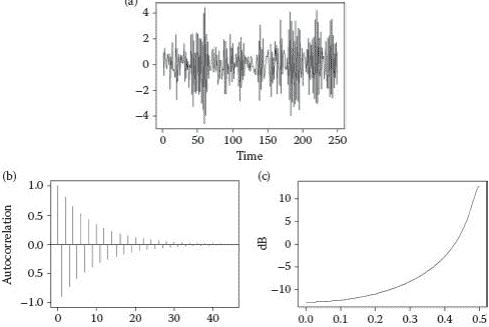

### 图 1.19
与示例 1.9 中的模型 (1.41) 相关的图。(a) 实现。(b) 自相关图。(c) 谱密度图。

## 示例 1.10：一个 AR(2) 模型

[图 1.20](#) 显示了与 AR(2) 模型相关的图

$$X_t = 1.6X_{t-1} - 0.95X_{t-2} + a_t,$$
(1.42)

其中再次 $a_t$ 是零均值和单位方差的高斯白噪声。在 [图 1.20a](#) 中，我们展示了该模型长度为 250 的一个实现。该实现显示出伪周期性趋势，周期约为 10 个时间单位，因为数据在 250 个时间点中经历了约 25 个周期。在 [图 1.20b](#) 中，我们展示了基于 AR(2) 模型的真实自相关 $\rho_k$，它们显示出周期约为 11 个单位的阻尼正弦行为。然而，数据的精确周期内容仍然模糊，因为数据中明显的周期长度各不相同。图 1.20c 显示了该时间序列模型的 dB 单位的谱密度，其中我们在约 f = 0.09 处看到一个相当尖锐的峰值，表明数据具有伪周期性行为，主导周期为 1/0.09 = 11.1。请注意，接近 f = 0.09 的频率在真实谱密度中也具有相当大的值，这在数据中表现为周期长度在 11 附近变化。这与图 1.14 中的谱形成对比，在那种情况下数据具有“纯”周期分量，而真实谱密度包含一个尖峰，没有来自附近频率的贡献迹象。

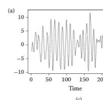

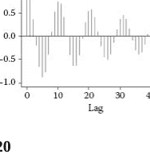

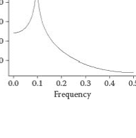

### 图 1.20

与示例 1.10 的模型相关的图。(a) 实现。(b) 自相关图。(c) 谱密度图。

## 示例 1.11：具有多个主导频率分量的 AR(4) 过程

在图 1.21 中，我们展示了基于模型的图

X_t = 0.85X_{t-1} + 0.03X_{t-2} + 0.745X_{t-3} - 0.828X_{t-4} + a_t  (1.43)

其中 a_t 是零均值、单位方差的正态白噪声。在图 1.21a 和 c 中，我们展示了实现和真实谱密度，它们之前分别在图 1.16a（tswge 中的数据集 fig1.16a）和 b 中显示过。我们注意到与约 30 的周期相关联的低频分量，同时数据中也显示出较高频率分量的迹象。图 1.21c 中的谱密度图清楚地表明数据中存在两个频率，一个约为 f = 0.04，另一个约为 f = 0.34。图 1.21b 中的自相关表现出与图 1.20b 中相似的正弦特性。然而，请注意图 1.21b 中的自相关没有真正表明存在较高频率分量的迹象。这说明了谱检测数据中周期存在的能力，而自相关则不能，尽管如前所述，它们包含等价的数学信息。

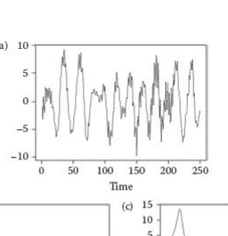

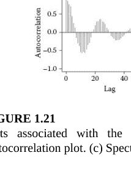

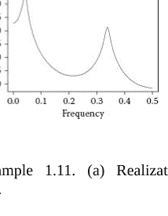

### 图 1.21

与示例 1.11 的模型相关的图。(a) 实现。(b) 自相关图。(c) 谱密度图。

## 示例 1.12：白噪声

图 1.22a 显示了白噪声序列 X_t = a_t 的一个实现

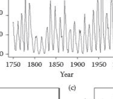

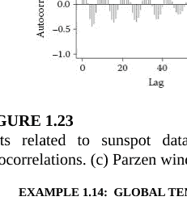

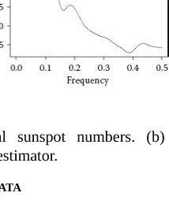

### 图 1.23

与太阳黑子数据相关的图。(a) 年度太阳黑子数。(b) 样本自相关。(c) Parzen 窗口谱估计量。

## 示例 1.14：全球温度数据

过去 25 年来，全球变暖的担忧引起了极大的关注。感兴趣的数据集提供了平均年温度的度量。其中一个数据集由东英吉利大学的气候研究单位与气象局哈德利中心联合收集。图 1.24a 中给出的数据是 1850–2009 年的年温度信息（基于全球各地的温度站）。所绘制的数据（tswge 中的数据集 hadley）是基于陆地和海洋温度站的温度异常（即与 1961–1990 年期间平均值的偏离）。在数据集中，很明显在此期间温度有所上升。也有相当大的年际变化，但没有明显的周期性行为。在图 1.24b 中，我们看到较低滞后的自相关为正，表明例如今年和明年的年温度之间存在实质性的正相关。图 1.24c 中的谱估计量（使用 Parzen 窗口 M = 2√n = 25 平滑的样本谱）也表明缺乏周期性行为。f = 0 处的峰值表明要么是极长的周期，要么是非周期性行为。谱估计量中的较小峰值可能有意义也可能没有意义。

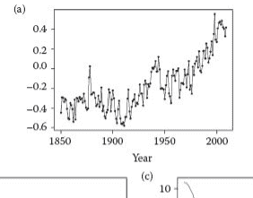

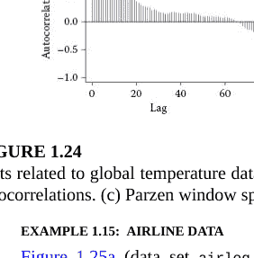

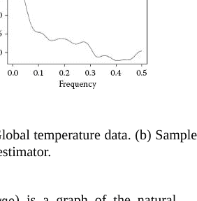

### 图 1.24

与全球温度数据相关的图。(a) 全球温度数据。(b) 样本自相关。(c) Parzen 窗口谱估计量。

## 示例 1.15：航空数据

图 1.25a（tswge 中的数据集 airlog）是 1949–1960 年国际航空旅行每月总乘客数（以千计）的自然对数图。该序列由 Box 等人（2008）以及该文本的早期版本研究，并常被分析为季节性时间序列的经典例子。由于航空旅行的季节性，预计会出现强烈的季节性模式，例如夏季以及十一月和十二月的旅行量更大。对数据的检查显示夏季旅行量更大，12 个月的年度模式，以及明显的上升趋势。请注意，12 个月周期似乎不是正弦的，而是倾向于“复制”前一年的模式。我们将在第 3 章和第 5 章讨论季节性模型。图 1.25b 显示了样本自相关。这里数据的季节性和趋势行为分析很困难，简单检查这些样本自相关的图对于此分析是不够的。图 1.25c 显示了 AR 谱密度估计量（参见第 7.7 节）。请注意零处的功率很高，表明数据中存在强烈的趋势（非周期）分量。此外，f = 1/12 处的功率很高，以及 1/12 的谐波，即 f = i/12，i = 2, 3, ..., 6 也相当明显。也就是说，数据中的 12 个月、6 个月、...、2 个月周期在这里被生动地显示出来。

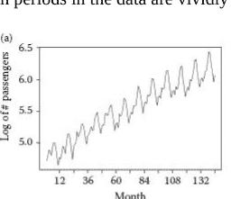

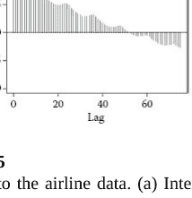

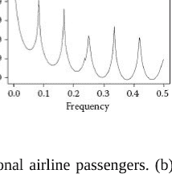

### 图 1.25

与航空数据相关的图。(a) 国际航空乘客。(b) 样本自相关。(c) AR 谱估计量。

## 示例 1.16：蝙蝠回声定位信号

在图 1.26a（tswge 中的数据集 noctula）中，我们展示了从 Nyctalus noctula 猎蝠回声定位信号中以 4 × 10⁻⁵ s 间隔采样的 96 个观测值。初看之下，图 1.26a 中的信号似乎是周期性的，其行为与图 中看到的相似


1.20a 与图1.23a中的太阳黑子数据有些类似。然而，样本自相关看起来并不寻常，因为没有出现图1.20b和图1.23b中那样的强烈循环行为。此外，检查图1.26c中的谱估计可以发现没有尖锐的峰值，实际上在频率 \(f = 0.15\) 和 \(f = 0.35\) 之间存在一个较宽的频带，对应一个宽广的“峰”。像图1.26c所示的这种谱被称为扩展谱，表明信号中的行为并非集中在单个频率及其附近，而是存在一个广泛的频率行为范围。仔细检查图1.26a可以发现频率行为随时间变化。更具体地说，周期长度随时间趋于变长（频率降低）。因此，这些数据似乎不是平稳的，于是产生了一个问题：“如果周期随时间变化，谱密度或自相关函数又意味着什么？”对这种具有时变频率的数据的分析将在第12章和第13章中讨论。

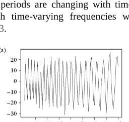

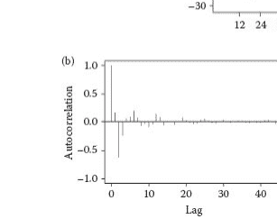

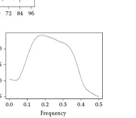

## 图 1.26
与夜蝠（Nyctalus noctula）捕猎回声定位信号相关的图形。(a) 回声定位信号。(b) 样本自相关。(c) Parzen窗谱估计。

这些时间序列以及其他时间序列将在后续章节中更详细地研究。接下来的章节讨论如何使用自相关和谱密度等工具，以及AR模型等模型来正确分析平稳和非平稳时间序列数据。目前，我们只是简单介绍这些概念，以帮助读者初步理解。

## 附录1A：傅里叶级数
在定义1.15中，我们将离散时间序列 $X_t$ 的周期图定义为

I. $I(f_j)=\hat{\sigma}_X^2+2\sum_{k=1}^{n-1}\hat{\gamma}_k\cos2\pi f_j k,$  (1A.1)

其中 $f_j$ 是基本频率 $1/n$ 的谐波。具体来说，

$f_j=j/n,\quad j=1,\dots,n/2\ (\text{若 }n\text{ 为偶数})$ 
$=j/n,\quad j=1,\dots,m\ (\text{若 }n\text{ 为奇数且 }n=2m+1).$

有趣的是，周期图有两种有用的等价表示形式。式1A.1中的周期图可以表示为数据傅里叶变换模平方的 $1/n$ 倍，如式1A.2所示。

II. $I(f_j)=\frac{1}{n}\left|\sum_{t=1}^{n}x_t e^{(-2\pi i j t / n)}\right|^2.$  (1A.2)

式1A.1和式1A.2形式等价性的证明留作问题1.20。

周期图的第三种形式涉及傅里叶级数。在本附录中，我们讨论将傅里叶级数拟合到离散时间序列实现 $x_t$, $t = 1, ..., n$ 的主题，并假设 $n = 2m + 1$ 为奇数。也就是说，我们用有限傅里叶级数来近似 $x_t$

$\displaystyle \sum_{j=1}^{m}\left[a_j\cos\left(\frac{2\pi j t}{n}\right)+b_j\sin\left(\frac{2\pi j t}{n}\right)\right].$

系数 $a_j$ 和 $b_j$ 使用最小二乘法估计，以找到使下式最小的 $a_j$ 和 $b_j$

$Q = \sum_{t=1}^{n}\left\{x_t - \sum_{j=1}^{m}\left(a_j\cos\left(\frac{2\pi j t}{n}\right)+b_j\sin\left(\frac{2\pi j t}{n}\right)\right)\right\}^2.$ (1A.3)

使式1A.3中的 $Q$ 最小的 $a_j$ 和 $b_j$（$j = 1, ..., m$）为

$a_j = \frac{2}{n}\sum_{t=1}^{n}x_t\cos\left(\frac{2\pi j t}{n}\right)=\frac{2}{n}\sum_{t=1}^{n}(x_t-\bar{x})\cos\left(\frac{2\pi j t}{n}\right).$

$b_j = \frac{2}{n}\sum_{t=1}^{n}x_t\sin\left(\frac{2\pi j t}{n}\right)=\frac{2}{n}\sum_{t=1}^{n}(x_t-\bar{x})\sin\left(\frac{2\pi j t}{n}\right).$

每个表达式中的第二个等式源于

$\displaystyle \sum_{t=1}^{n}\cos\left(\frac{2\pi j t}{n}\right)=\sum_{t=1}^{n}\sin\left(\frac{2\pi j t}{n}\right)=0,$

对每个 $j$ 成立。使用这一术语，周期图的第三种形式为

III. $I(f_j)=\frac{n}{4}(a_j^2+b_j^2),\quad j = 1, ..., m.$ (1A.4)

利用帕塞瓦尔等式（参见 Jenkins and Watts, 1968），我们得到

$\frac{1}{n}\sum_{t=1}^{n}(x_t-\bar{x})^2=\frac{1}{2}\sum_{j=1}^{m}(a_j^2+b_j^2),\quad j = 1, ..., m.$ (1A.5)

式1A.5中的结果给出了一个方差分析分解，显示了每个谐波对样本方差的贡献。也就是说，$a_j^2 + b_j^2$ 的大值表明数据中存在频率 $f_j = j/n$ 或其附近的频率行为。式1A.4与其他两种形式等价性的证明留作问题1.20。

当 $n = 2m$ 为偶数时，前面讨论的公式略有不同。具体来说，$a_j$ 和 $b_j$ 的公式适用于 $j = 1, ..., m - 1$。然而，

$a_m = \frac{1}{n}\sum_{t=1}^{n}(-1)^t x_t,\; b_m = 0,\;\text{且}\; I(f_m)= n a_m^2.$

## 附录1B：R命令
如前所述，您应安装并加载R命令库tswge。这里列出的一些命令仅是Base R命令，不需要安装特殊库。这些将标注为Base R命令。执行与第1章所涵盖主题相关的计算和结果绘图的R命令分为两类：

- 1. 基本计算和绘图
- 2. “组合例程”，为教学目的提供相关图形的图形输出

例如，plot.sample.wge绘制一个实现、样本自相关、周期图以及基于Parzen窗口的平滑周期图。检查这四个图是理解时间序列实现特征的典型步骤。

- 1. 第1章的基本计算例程
- a. mean(x)（Base R函数）：计算时间序列实现的均值，其中x是包含时间序列实现 $x_t$, $t = 1, ..., n$ 的向量。
- 示例：基本R命令
data(ss08); ssm = mean(ss08)

计算tswge数据集ss08中太阳黑子数据的样本均值，并将其放入变量ssm中。在本例中，ssm = 52.24385。

b. tswge R函数
`plotts.wge(x)`
提供了基本R绘图命令的简化使用，其中x是包含时间序列实现x_t（t = 1, ..., n）的向量。如需更大的灵活性，可使用基本R命令plot。
*示例:* `data(airline); airlog = log(airline); plotts.wge(airlog)` 绘制图1.25a中所示的航空数据对数图。

c. `acf(x, lag.max, type, plot)`（Base R函数）：计算（并可选绘制）时间序列实现的样本自相关（或样本自协方差和样本方差），其中
x是包含时间序列实现x_t（t = 1, ..., n）的向量。
lag.max是计算样本自相关（或协方差）的最大滞后。
type = "correlation"（默认）生成样本自相关，
"covariance"指定自协方差，
"partial"表示偏自相关（在第8章中讨论）。
plot是一个逻辑变量。plot = "TRUE"（默认）生成样本自相关（或自协方差）的图。
*示例:* `data(hadley); tempaut = acf(x = hadley, lag.max = 25)`
计算并绘制文件hadley中全球温度数据的前25个样本自相关，如图1.24a所示。样本自相关放入向量tempaut$acf中（该向量有26个元素，包括tempaut$acf[1] = 1，即滞后0处的样本自相关）。如果选择type = "covariance"，则向量tempaut$acf包含样本自协方差，tempaut$acf[1]包含样本方差（使用除数n）。

d. `period.wge(x, dbcalc, plot)`（tswge R函数）计算并可选绘制周期图。
x是包含时间序列实现x_t（t = 1, ..., n）的向量。
dbcalc是一个逻辑变量。dbcalc = "TRUE"（默认）在对数尺度上（以dB为单位，即10*log10(周期图)）计算周期图。

plot是一个逻辑变量。plot = "TRUE"（默认）生成周期图（根据dbcalc决定是否对数尺度）的图。

示例：

```
data(ss08)
per = period(ss08)
```

计算并绘制周期图（以dB为单位）。向量per$freq和per$pgram包含频率及相应的周期图值（对数或非对数）。

e. parzen.wge(x, dbcalc, trunc, plot)（tswge R函数）计算并可选绘制基于Parzen窗口的平滑周期图。

x是包含时间序列实现x_t（t = 1, ..., n）的向量。

dbcalc是一个逻辑变量。dbcalc = "TRUE"（默认）在对数尺度上（以dB为单位）计算平滑谱估计。

trunc（整数 ≥ 0）指定截断点。

trunc = 0（默认）（或未指定trunc的值）表示默认截断点为M = 2√n。

trunc > 0 是用户指定的截断点，即计算将基于M = trunc。

plot是一个逻辑变量。plot = "TRUE"（默认）生成平滑谱估计（根据dB决定是否对数尺度）的图。

示例：

```
data(ss08); sparz=parzen.wge(ss08)
```

使用默认截断点 M = 2√260 = 32 计算并绘制太阳黑子数据的平滑谱估计（以dB为单位）。

向量ssparz$freq和ssparz$pgram包含频率及相应的基于Parzen的谱估计值。

f. gen.sigplusnoise.wge(n, b0, b1, coef, freq, psi, vara, plot, sn) 是一个tswge R函数，用于从信号加噪声模型生成实现

x(t) = b0 + b1t + coef[1]*cos(2π freq[1]t + psi[1]) + coef[2]*cos(2π freq[2]t + psi[2]) + a(t)

n = 要生成的实现长度（上述公式中的t指定从1到n的整数）

b0 是y截距


b1 是线性回归分量的斜率（默认值 = 0）
coef 是一个包含两个分量的向量，用于指定系数（如果只希望一个余弦项，则令 coef[2] = 0）（默认值 = c(0,0)）
freq 是一个包含两个分量的向量，用于指定频率分量（0 到 .5）（默认值 = c(0,0)）
psi 是一个包含两个分量的向量，用于指定相位偏移（0 到 2π）（默认值 = c(0,0)）
phi 是一个包含噪声过程 AR 模型的向量（参见第 3 章）。（默认值 = 0）对于白噪声，只需使用 phi 的默认值即可。
vara 是噪声的方差（默认值 = 1）。
注意：a(t) 是在函数内部生成的 N(0,vara) 白噪声向量
plot 是一个逻辑变量。plot = TRUE（默认值）会生成所生成实现的图形。
sn 决定模拟中使用的随机种子。（默认值 = 0）（见下面的注意）

注意：sn = 0（默认值）基于随机选择的种子生成结果。如果希望在后续运行 gen.sigplusnoise.wge 时重现相同的实现，请在每次运行时将 sn 设置为相同的正整数。

## 示例：命令

```
x = gen.sigplusnoise.wge(n = 100, coef = c(1.5,3.5),
freq = c(.05,.2), psi = c(1.1,2.8), phi = .7, vara = 2)
```

计算

x(t) = 1.5cos(2π(0.05)t + 1.1) + 3.5cos(2π(.2)t + 2.8) + z(t), t = 1, 2, ..., 100

其中 z(t) 是 AR(1) 过程 z(t) = (1 - .7B)a_t 的一个实现，σ_a^2 = 2。该实现基于随机选择的种子，生成的信号加噪声实现被放入向量 x 中。

## 2. 第 1 章的组合绘图例程

- a. plotts.sample.wge(x, lag.max, trunc, arlimits) 是一个 tswge R 函数，用于绘制实现、样本自相关、周期图和基于 Parzen 窗口的平滑周期图（均以 dB 为单位绘制）。

在不同截断点处进行密度估计。可以使用以下命令

```r
x = gen.sigplusnoise.wge(n = 250, coef = c(3,1), freq =
c(.1,.52),
psi = c(0,1), phi = 0, vara = 1)
pz = plotts.parzen.wge(x, m2 = c(10,50))
```

生成以 dB 为单位的周期图、截断点 M = 2√250 = 31.6（向下取整为 M = 31）的 Parzen 谱估计，以及截断点 M = 10 和 M = 50 的 Parzen 谱估计图。所有图形均以 dB 为单位。同时输出 pz$freq，它是一个包含计算 Parzen 谱估计的频率的向量（在本例中为 1/250, 2/250, ..., 125/250），以及向量 pz$db 和 pz$dbz1，它们分别包含在 pz$freq 中的频率处评估的周期图和截断点 M = 31 的 Parzen 谱密度。本例中还输出了向量 pz$dbz2 和 pz$dbz3，它们分别包含使用截断点 M = 10 和 M = 50 的 Parzen 谱密度估计。

## 练习

### 应用问题

使用 R 完成 1.2 至 1.7 题。

1.1 以下数据是一家假设公司以百万美元计的年度销售额：

| 时期 | 销售额 |
|---:|---:|
| 1 | 76 |
| 2 | 70 |
| 3 | 66 |
| 4 | 60 |
| 5 | 70 |
| 6 | 72 |
| 7 | 76 |
| 8 | 80 |

手工（即使用计算器）计算估计值 $\hat{\gamma}_0$、$\hat{\gamma}_1$、$\hat{\rho}_0$ 和 $\hat{\rho}_1$。

- 1.2 **图 1.1a** 显示了 2000 年 1 月至 2009 年 10 月的西德克萨斯中质原油价格图，**图 1.1b** 显示了 1990 年 1 月至 2009 年 12 月宾夕法尼亚州的月平均气温图。`tswge` 中的这两个数据集分别为 `wctude` 和 `patem`。对于这些实现中的每一个，绘制样本自相关、周期图以及截断点 M = 2√n 的基于 Parzen 窗口的谱密度估计。解释这些图如何描述（或未能描述）数据中的行为。

- 1.3 **图 1.25c** 显示了航空对数数据的 AR 谱估计（以 dB 为单位）（“非对数”数据在数据集 `airline` 中，对数数据在数据集 `airlog` 中）。使用截断点 M = 2√n、M = 10 和 M = 75 的基于 Parzen 窗口的谱密度估计，绘制这些数据的周期图和窗口化谱密度估计。（均以 dB 为单位。）比较和对比你获得的四个谱密度估计，并将它们与 **图 1.25** 中的 AR 谱密度估计进行比较，特别是关于看到与较高频率相关的次要谱峰的能力。

- 1.4 下面显示了三组图，每组包含四个图。第一组显示了四个长度均为 n = 100 的实现，每个实现都由一个时间序列模型生成。第二组包含基于用于生成实现的模型的四个自相关函数（顺序随机），第三组显示了四个谱密度。将每个实现与相应的自相关和谱密度进行匹配。解释你的答案。

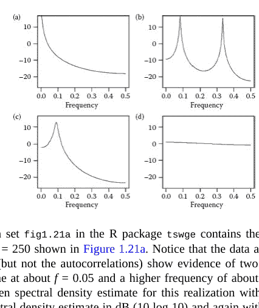

1.5 R 包 tswge 中的数据集 fig1.21a 包含图 1.21a 中所示的长度 n = 250 的实现。注意数据和谱密度（但不是自相关）显示有两个频率的证据，一个较低的频率约为 f = 0.05，一个较高的频率约为 f = 0.33。求该实现 M = 31 的 Parzen 谱密度估计。以 dB（10 log 10）绘制此谱密度估计，然后再不取对数绘制一次。评论谱密度估计中关于两个主频率的可见信息。绘制对数（以 dB 为单位）产生了什么影响？

1.6 从信号加噪声模型生成一个长度 n = 100 的实现

$X_t = 3\cos(2\pi(0.05)t) + 1.5\cos(2\pi(0.35)t + 2) + a(t),$

其中 $a_t$ 是 $N(0,1)$ 白噪声。对于这些数据，绘制

- a. 实现
- b. 样本自相关
- c. 周期图
- d. 使用默认截断点的 Parzen 窗口谱密度估计

讨论从每个图中可以看到的数据的循环特征。在这些图中，哪一个最能指示数据中的两个主频率（即 0.05 和 0.35）？

注意：可以使用 tswge R 函数 gen.sigplusnoise.wge(n, b0, b1, coef, freq, psi, phi, vara, plot, sn) 从模型

$X_t = c_1\cos(2\pi f_1 t) + c_2\cos(2\pi f_2 t) + N_t,$

（其中 $N_t$ 是正态 (0,1) 白噪声）获得实现。详见附录 1B。

1.7 找一个书中或课堂上未讨论的时间序列数据集（在互联网上等）。对于该时间序列：

- a. 绘制时间序列实现图
- b. 绘制样本自相关图。编写代码（用 R 或其他语言）计算样本自相关（即不要使用预编写的函数。）
- c. 描述实现中的行为（游走、周期性等），以及该行为如何在样本自相关中体现
- d. 绘制周期图
- e. 使用默认截断点 $2\sqrt{n}$ 绘制 Parzen 谱密度估计。描述实现中的行为（游走、周期性等），以及该行为如何在谱估计中体现

提示：可以使用 tswge 函数 plotts.sample.wge。

### 理论问题

1.8 使用平稳过程自协方差的定义，证明我们向前看还是向后看时间并不重要；即 $\operatorname{Cov}(Z_t, Z_{t+k}) = \operatorname{Cov}(Z_t, Z_{t-k}) = \gamma_k$。

1.9 考虑随机过程 $Z_t = a_t$，其中 $a_t$ 对于任何 $t$ 都是独立抽取的，且 $a_t$ 的分布由 $a_t = \begin{cases} c \text{ 以概率 } \frac12 \\ -c \text{ 以概率 } \frac12 \end{cases}$ 给出，其中 $c > 0$。

- a. 过程 $Z_t$ 是平稳的吗？为什么是或为什么不是？

b. 对于该过程，参数 $\mu$、$\gamma_0$、$\gamma_1$ 和 $\gamma_j$（其中 $j>1$）的值是多少？

1.10 证明 $k$ 个不相关的协方差平稳过程之和也是协方差平稳的

1.11 设 $X(t)=\cos(2\pi(0.025t)+\psi_1)+1.5\cos(2\pi(0.1t)+\psi_2)+2\cos(2\pi(0.15t)+\psi_3)$ 为例 1.7b 中公式 1.35 给出的时间序列。证明 $X(t)$ 是协方差平稳的，并使用例 1.3 中的结果，求出以下表达式的表达式：

- a. $\gamma(h)$  
- b. $\sigma_X^2$  
- c. $\rho(h)$

1.12 设 $Y_t$ 由下式给出

$$Y_t=C_1\cos(2\pi f_1t+\psi_1)+N_t,\qquad t=0,\ \pm1,\ \ldots,$$
$$=H_t+N_t,$$

其中  
$N_t$ 是离散白噪声  
$\psi_1$ 服从均匀分布 $[0,2\pi]$  
对于每个 $t$，$N_t$ 和 $\psi_1$ 不相关

证明 $Y_t$ 是协方差平稳的，并且 $Y_t$ 的自协方差为

$$\gamma_k=\frac{C_1^2}{2}\cos 2\pi f_1k,\qquad k\ne0$$
$$=\frac{C_1^2}{2}+\sigma_N^2,\qquad k=0.$$

1.13 设 $Z_t$，$t=0,\ \pm1,\ \ldots$，为独立的法随机变量，每个均值为 0，方差为 $\sigma^2$，并设 $a$、$b$ 和 $c$ 为常数。以下过程中，哪些（如果有的话）是平稳的？对于每个平稳过程，指定均值和协方差函数：

- a. $X_t=a+bZ_t+cZ_{t-1}$  
- b. $X_t=a+bZ_0$  
- c. $X_t=Z_t\cos(ct)+Z_{t-1}\sin(ct)$


d. $X_t = Z_0\cos(ct)$

1.14 设 $\{X_t;\ t=0,1,\ldots\}$ 是一个协方差平稳过程，并定义过程

$$\{X_t^{(i)};\ t=0,1,\ldots\},\qquad i=1,2,$$

为差分过程

$$X_t^{(1)}=X_t-0.5X_{t-1}$$
$$X_t^{(2)}=X_t^{(1)}-X_{t-1}^{(1)}.$$

证明 $X_t^{(1)}$ 和 $X_t^{(2)}$ 也是协方差平稳的。

1.15 设 $X$ 是一个均值为 $\mu$、方差为 $\sigma^2<\infty$ 的随机变量。对所有 $t$ 定义 $Z_t=X$，其中 $t\in I$，$I=1,2,\ldots$

- a. 证明 $Z_t=X$ 是严平稳和弱平稳的
- b. 求自相关函数
- c. 绘制一条“典型的”实现路径
- d. 判断 $\bar{Z}$ 是否为 $\mu$ 的遍历估计量

1.16 设 $Y_t=a+bt+X_t$，其中 $X_t$ 是协方差平稳过程

- a. $Y_t$ 是否协方差平稳？为什么？
- b. 令 $Z_t=Y_t-Y_{t-1}$。$Z_t$ 是否协方差平稳？为什么？

1.17 考虑两个过程

$$X_t^{(1)}=a_t-\theta a_{t-1}$$
$$X_t^{(2)}=a_t-\frac{1}{\theta}a_{t-1},$$

其中 $a_t$ 是均值为零、方差为 $\sigma_a^2<\infty$ 的白噪声过程。证明 $X_t^{(1)}$ 和 $X_t^{(2)}$ 具有相同的自相关函数。

1.18 证明在整数点上 $\cos(2\pi(1.3)k)=\cos(2\pi(.3)k)$ 成立。

1.19 证明对于协方差平稳过程 $\{X_t;\ t=0,\ \pm1,\ \pm2,\ldots\}$，以下结论成立：

- a. $P_X(f)=P_X(-f),\quad |f|\le0.5.$
$ S_X(f)=S_X(-f),\quad |f|\le0.5.$
- b. $P_X(f)=\sigma_X^2+2\sum_{k=1}^{\infty}\gamma_k\cos(2\pi f k),\quad |f|\le0.5.$
$ S_X(f)=1+2\sum_{k=1}^{\infty}\rho_k\cos(2\pi f k),\quad |f|\le0.5.$
- c. $\gamma_k=\int_{-0.5}^{0.5}P_X(f)\exp(2\pi i f k)df.$
$\rho_k=\int_{-0.5}^{0.5}S_X(f)\exp(2\pi i f k)df.$
- d. $\sigma_X^2=\int_{-0.5}^{0.5}P_X(f)df.$
$1=\int_{-0.5}^{0.5}S_X(f)df.$
- e. $\gamma_k=2\int_{0}^{0.5}P_X(f)\cos(2\pi f k)df.$
$\rho_k=2\int_{0}^{0.5}S_X(f)\cos(2\pi f k)df.$

1.20 证明附录 1A 中周期图的三种形式是等价的。具体来说，证明对于 $j=1,2,...,m$（其中 $n=2m+1$），以下等式成立：
$\frac{1}{n}\left|\sum_{t=1}^{n}x_t e^{\left(\frac{-2\pi i j t}{n}\right)}\right|^2 = \frac{n}{4}(a_j^2+b_j^2)=\hat{\sigma}_X^2+2\sum_{k=1}^{n-1}\hat{\gamma}_k\cos\left(\frac{2\pi j k}{n}\right).$

1.21 证明定理 1.3

## 2 线性滤波

我们将研究的许多时间序列都可以看作一个线性算子或滤波器的输出。在本章中，我们介绍线性滤波理论的基本概念和术语。我们还讨论一般线性过程，它是一种以白噪声为输入的线性滤波器，在平稳过程的研究中起着基础性作用。最后，我们讨论线性滤波器在从时间序列实现中去除或保留某些频率行为方面的应用。

### 2.1 线性滤波器简介

考虑由下式给出的过程 $\{X_t-\mu;\ t=0,\ \pm1,\ \pm2,\ \ldots\}$

$$X_t-\mu=\sum_{j=-\infty}^{\infty}h_jZ_{t-j} \tag{2.1}$$

其中

$h_j$ 是常数  
$Z_t$ 是一个随机变量，且对每个 $t$ 有 $E[Z_t]=0$

过程 $X_t$ 被称为线性滤波器的输出，$Z_t$ 称为输入。如果 $j<0$ 时 $h_j=0$，则称为*因果线性滤波器*，因为 $X_t$ 仅依赖于输入 $Z_t$ 的现在和过去的值。在本书中，我们主要关注因果滤波器，因此，尽管下面的定理 2.1、定理 2.2 和定义 2.1 都有对应的非因果形式，但我们这里只针对因果滤波器进行陈述。为了方便起见，我们将使用后移算子 $B$（定义为 $B^kZ_t=Z_{t-k}$）将方程 2.1 的（因果版本）写成

第 2.4 节。在下面的内容中，我们将 $|H(e^{-2\pi i f})|^2$ 称为*平方频率响应*。

### 2.2 平稳一般线性过程

我们将研究的许多统计时间序列都可以看作以白噪声为输入的线性滤波器的输出 $X_t$。这样的过程称为*一般线性过程*，定义如下。

定义 2.1（一般线性过程）由下式给出的过程 $X_t$，$t = 0, \pm 1, \pm 2, \dots$

$X_t - \mu = \sum_{j=0}^{\infty} \psi_j a_{t-j}$  (2.5)

被定义为一个*一般线性过程*，如果 $a_t$ 是一个均值为零、方差有限的白噪声过程，并且 $\sum_{j=0}^{\infty} |\psi_j| < \infty$。

使用后移算子 $B$，方程 2.5 可以写成

$X_t - \mu = \sum_{j=0}^{\infty} \psi_j B^j a_t = \psi(B) a_t$

其中

$\psi(B) = \sum_{j=0}^{\infty} \psi_j B^j$。

在本节中，我们将考虑为方程 2.5 中的 $X_t$ 寻找平稳性条件的问题，以及自协方差函数和功率谱的表达式。在这方面，下面的定理很有用。我们在这里给出它的证明，因为它用到了基本概念。

- 2. Var $[X_t] = E[X_t X_t]$  
$ = \sigma_a^2 \sum_{j=0}^{\infty} \psi_j^2 \text{（常数）}$  
$ < \infty \left(\text{由于 } \sum_{j=0}^{\infty} |\psi_j| \text{ 收敛}\right)$  
- 3. $E[X_t X_{t+k}] = \gamma_k$（根据方程 2.7，仅依赖于 $k$）

因此，$X_t$ 是平稳的，证明完毕。

### 2.2.1 一般线性过程的谱和谱密度

利用方程 2.3 以及白噪声的谱是常数且由 $P_a(f)=\sigma_a^2$ 给出这一事实，一般线性过程 $X_t$ 的谱为  
$$P_X(f)=\left|\psi\left(e^{-2\pi i f}\right)\right|^2 P_a(f) \tag{2.8}$$  
$$=\sigma_a^2\left|\psi\left(e^{-2\pi i f}\right)\right|^2,$$  
谱密度为  
$$S_X(f)=\frac{\sigma_a^2}{\sigma_X^2}\left|\psi\left(e^{-2\pi i f}\right)\right|^2. \tag{2.9}$$

### 2.3 沃尔德分解定理

在继续之前，我们给出沃尔德分解定理，它强调了一般线性过程在协方差平稳过程研究中的核心作用。关于该结果的证明和讨论，读者可参考 Brockwell 和 Davis（1991）。

设计我们的滤波器，使得

|H(e^{-2π i f})|^2 = 1,      f ≤ 0.2
= 0,      f > 0.2
(2.10)

因为根据定理 2.2，这将消除输出谱中 f > 0.2 的频率行为，并保持 f ≤ 0.2 的部分不变。图 2.1a 显示了这个理想（砖墙）滤波器的平方频率响应，图 2.1b 显示了带通滤波器的理想平方频率响应，该滤波器允许 0.1 ≤ f ≤ 0.2 的频率通过。

### 示例 2.1：一阶差分滤波器

考虑一个时间序列实现 x_t, t = 1, ..., n，假设我们计算一阶差分 y_t = x_t - x_{t-1}。为了了解这种差分运算的效果，我们注意到一阶差分是方程 2.1 形式的一种线性滤波器，其中 h0 = 1, h1 = -1, 且 j ≠ 0 或 1 时 h_j = 0。因此我们可以计算 H(e^{-2π i f}) = 1 - cos 2π f + i sin 2π f 和 |H(e^{-2π i f})|^2 = 2(1 - cos 2π f)。|H(e^{-2π i f})|^2 的绘图如图 2.2b 所示，可以看出差分是一种高通滤波器，但并不是一种尖锐的滤波器，因为它会让一些低频行为泄漏过去。在图 2.2a 中，我们展示了先前在图 1.3a 中显示的实现，它展示了与低频行为相关的漂移行为，以及一些较高频率的振荡。一阶差分数据如图 2.2c 所示，可以看出低频漂移行为已被移除，只保留了较高频率的行为。一阶差分在时间序列分析中被广泛使用，但如果目标是从数据中去除特定范围的低频，则有更好的方法。

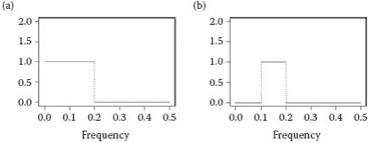

**图 2.1**  
理想（a）低通和（b）带通滤波器的平方频率响应函数 \(\left|H(e^{2\pi if})\right|^2\)。

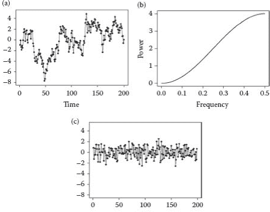

**图 2.2**  
（a）先前在图 1.3a 中显示的实现，（b）一阶差分的平方频率响应函数，（c）对（a）中数据取一阶差分后的结果。

### 示例 2.2：求和与移动平均滤波器

再次考虑时间序列实现 \(x_t\)，\(t=1,\ldots,n\)，假设我们现在计算和 \(y_t=x_t+x_{t-1}\)，这也是一个线性滤波器，此时 \(h_0=1\)，\(h_1=1\)，且 \(j\ne 0\) 或 \(1\) 时 \(h_j=0\)。


计算表明

H(e^{-2πi f}) = 1 + cos 2πf − i sin 2πf,

并且

|H(e^{-2πi f})|^2 = 2(1 + cos 2πf)。

|H(e^{-2πi f})|^2 的图示在图 2.3 中给出，其中可以看到它是对差分滤波器图 2.2b 的镜像，因此低频被通过而高频趋于被去除。同样，这不是一个尖锐的滤波器，可以改进。

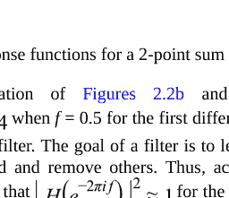

## 图 2.3

2点求和滤波器的平方频率响应函数。

对图 2.2b 和 2.3 的更仔细观察显示，对于一阶差分滤波器，|H(e^{-2πi f})|^2 在 f = 0.5 时等于 4，而对于求和滤波器，在 f = 0 时等于 4。滤波器的目标是使某些频率成分保持不变并去除其他成分。因此，根据定理 2.2，对于需要保留的频率范围，希望 |H(e^{-2πi f})|^2 ≈ 1。为此，我们考虑三种移动平均滤波器

- y_t = (1 / 2)(x_t + x_{t-1}) 2点移动平均
- y_t = (1 / 3)(x_{t-1} + x_t + x_{t+1}) 3点移动平均
- y_t = (1 / 7)(x_{t-3} + x_{t-2} + x_{t-1} + x_t + x_{t+1} + x_{t+2} + x_{t+3}) 7点移动平均滤波器 其对应的频率响应函数为

H(e^{-2πi f}) = ½(1 + cos 2πf − i sin 2πf) 2点 = ⅓(1 + 2 cos 2πf) 3点 = ⅐(1 + 2 cos 2πf − 2 cos 4πf + 2 cos 6πf) 7点。

这些移动平均滤波器的平方频率响应函数在图 2.4 中显示，其中可以看到它们都是低通滤波器（平滑器）。此外，随着移动平均滤波器所涉及的数据值数量的增加，“截止”频率降低，并且滤波器变得“更尖锐”，即平方频率响应更接近理想滤波器。图 2.5 显示了将三种移动平均滤波器应用于图 2.2a 中的数据的结果。正如从图 2.4 所预期的那样，可以看到随着移动平均中点的数量增加，输出序列变得越平滑。在所有这些情况下，原序列中的低频“游走行为”得以保留。

## 2.4.1 巴特沃斯滤波器

科学家和工程师使用的更常见的滤波器之一是巴特沃斯滤波器（参见 Butterworth, 1930；Porat, 1997）。这里将简要介绍该滤波器。虽然巴特沃斯滤波器可以是任何类型（低通、高通等），我们的讨论将集中于 N 阶低通巴特沃斯滤波器，其平方频率响应函数为

## 图 2.4

三种移动平均平滑器的平方频率响应函数。(a) 2点移动平均。(b) 3点移动平均。(c) 7点移动平均。

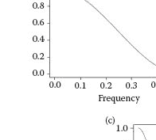

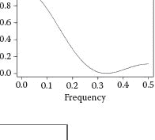

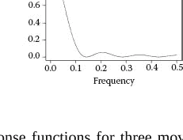

## 图 2.5

将三种移动平均平滑器应用于图 2.2a 中的数据的输出序列。(a) 2点移动平均。(b) 3点移动平均。(c) 7点移动平均。

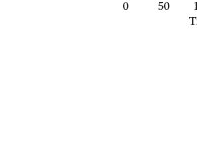

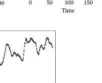

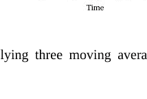

|H(e^{-2π i f})|^2 = 1 / (1 + (f/f_c)^{2N}) . (2.11)

增加 N 的值会使滤波器变尖锐，如图 2.6 所示，其中我们显示了 f_c = 0.2 的低通巴特沃斯滤波器在各种 N 值下的平方频率响应函数。也就是说，对于较大的 N 值，具有截止频率 f_c 的低通巴特沃斯滤波器的平方频率响应函数更接近理想滤波器

|H(e^{-2π i f})|^2 = 1,      f ≤ f_c
= 0,      f > f_c,

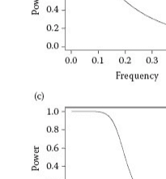


## 图 2.6

平方频率响应函数，|H(e^{-2π i f})|^2，用于具有四个 N 值的低通巴特沃斯滤波器。(a) N = 1，(b) N = 2，(c) N = 4，(d) N = 10。

如图 2.1a 所示。我们将不讨论滤波器设计问题，例如 N 的选择或相位。有关此类问题的讨论，请参见 Porat (1997)。

尽管与方程 2.11 相关的冲激响应函数是无限阶的，但它可以用两个 N 阶多项式的比值很好地近似

$$\sum_{k=0}^{\infty} h_k B^k \approx \frac{\sum_{k=0}^{N} \alpha_k B^k}{\sum_{k=1}^{N} \beta_k B^k}, \tag{2.12}$$

这导致易于实现的递归滤波器

$$y_t = \sum_{k=0}^{N} \alpha_k X_{t-k} - \sum_{k=1}^{N} \beta_k Y_{t-k}.$$

## 示例 2.3：巴特沃斯低通滤波器示例

在图 2.7a 中，我们显示了来自信号的长度为 n = 200 的实现

$$X_t = \cos(2\pi(0.025)t) + 3\cos(2\pi(0.125)t), \tag{2.13}$$

其具有两个周期，频率为 f = 0.025 和 f = 0.125。图 2.7b 和 c 是两个相加分量之和得到 X_t 的图。为了说明，我们应用截止频率 f_c = 0.04 的低通巴特沃斯滤波器，以保留与 f = 0.025 相关的周期并滤除与 f = 0.125 相关的较高频率周期。也就是说，我们希望恢复图 2.7b 中显示的分量。在图 2.8c 和 d 中，我们显示了使用阶数 N = 1 和 N = 3 的巴特沃斯滤波器的结果，而在图 2.8a 和 b 中，我们显示了与这两个滤波器相关的平方频率响应函数。在图 2.8a 中，我们看到 N = 1 的巴特沃斯滤波器预计性能不佳，因为平方频率在 f = 0.125 处仍有一些功率，而该频率是要去除的。另一方面，图 2.8b 显示 N = 3 的平方频率响应在约 f = 0.08 之外几乎没有功率，因此 N = 3 的巴特沃斯滤波器应产生所需的结果。在图 2.8c 中，我们看到，正如预期的那样，一些较高频率的行为泄漏


## 图 2.8

平方频率响应函数，| H(e^{-2π i f}) |²，以及使用阶数 N = 1 和 N = 3 的低通巴特沃斯滤波器对图 2.7a 中的实现进行滤波的结果。(a) N = 1。(b) N = 3。(c) 滤波数据 (N = 1)。(d) 滤波数据 (N = 3)。

## 使用 R：tswge R 命令

```
butterworth.wge(x, order, type, cutoff)
```

对向量 x 中的时间序列实现执行巴特沃斯滤波。滤波器的阶数、截止点和类型（例如，高通、低通等）可以指定。该函数还绘制原始数据和滤波后数据。更多细节请参见附录 2B。

## 示例 2.4：英格兰工资数据的滤波

图 2.9 显示了 1260 年至 1994 年间英格兰的平均工资（英镑）（tswge 中的数据集 wages）。有趣的是，工资在 1260 年至 1800 年间保持相对稳定，自 1800 年以来工资急剧增加。数据中还可见较高频率的行为。为了平滑数据以便我们关注长期行为，我们应用了低通滤波器。在图 2.9c 中我们显示了四阶巴特沃斯低通滤波器在截止频率 c = 0.20 时的结果。 somewhat surprisingly，数据中仍有一些高频行为。通过检查图 2.9b 中的 Parzen 谱密度，我们看到谱峰值在零处（表明数据的明显游走、长期行为），但在高达 f = 0.2 或 f = 0.25 的频率仍有一些频率行为的迹象。因此，为了捕捉长期行为并消除较高频率行为，我们在图 2.9d 中显示了截止频率 c = 0.05 的四阶低通巴特沃斯滤波器的结果。在那里可以看到长期行为仍然可见，但较高频率行为大部分已被去除。具有讽刺意味的是，谱密度看起来像是图 2.9d 的镜像。这是一种巧合，请注意不要“读入任何东西”。


## 图 2.9

(a) 1260–1944 年英格兰的日平均工资（英镑）。(b) (a) 中数据的谱密度估计。(c) (a) 中的数据通过四阶低通巴特沃斯滤波器（截止频率 c = 0.2）后得到的数据。(d) 与 (c) 相同，但截止频率 c = 0.05。

## 示例 2.5：滤波“金刚吃草”数据

在图 1.12（tswge 中的数据集 kingkong）中，我们显示了短语“King Kong Eats Grass”的声学信号。注意到一个风扇


在房间内运行，且相关的周期性行为（约 136 Hz）在信号的“静音区间”中十分明显。我们使用 tswge 中的 R 函数 butterworth.wge 应用了一个四阶零相位带阻 Butterworth 滤波器，以尝试去除风扇噪声。我们的采样率为 8000 Hz（每秒采样数），因此 136 Hz 的频率对应于每个 8000 单位 136 个周期，即频率 f = 136/8000 = 0.017。我们设计了一个四阶带阻滤波器，用于滤除 f ∈ [0.0075, 0.0275] 频带内的频率。滤波后的信号如图 2.10 所示，可以看出由风扇引起的周期性行为已被大幅去除（仍残留一些环境噪声），而语音信号基本保持不变。

## 附录 2A：定理证明

### 定理 2A.1 的证明

不失一般性，我们假设 μ = 0。如果 m > k，则

E[ (∑_{j=0}^{m} h_j Z_{t-j} - ∑_{j=0}^{k} h_j Z_{t-j})^2 ] = E[ (∑_{j=k+1}^{m} h_j Z_{t-j})^2 ]  (2A.1)
≤ [ ∑_{j=k+1}^{m} { E | h_j Z_{t-j} |^2 }^{1/2} ]^2  （闵可夫斯基不等式）
= [ ∑_{j=k+1}^{m} | h_j | sqrt(Var(Z_{t-j})) ]^2
≤ [ sqrt(M) ∑_{j=k+1}^{m} | h_j | ]^2 .


### 图 2.10

图 1.12 中的“金刚吃草”数据（已去除风扇噪声）。

当 $m \to \infty$ 且 $k \to \infty$ 时，式 (2A.1) 的右侧收敛于零。因此，$\sum_{j=0}^m h_j Z_{t-j}$ 是一个柯西序列，从而收敛，设其收敛到 $X_t$，记为

$X_t = \sum_{j=0}^{\infty} h_j Z_{t-j}$

随机变量的每个柯西序列均收敛到一个随机变量，这一事实基于希尔伯特空间概念。参见 Brockwell and Davis (1991, 2002) 的讨论。

为证明 $X_t$ 的唯一性，我们假设存在另一个随机变量 \(R_t\)，使得 \(\sum_{j=0}^{m} h_j Z_{t-j}\) 也均方收敛于 \(R_t\)。那么，再次利用闵可夫斯基不等式，

$$E\left(|X_t-R_t|^2\right)=E\left[\left|X_t-\sum_{j=0}^{m}h_jZ_{t-j}+\sum_{j=0}^{m}h_jZ_{t-j}-R_t\right|^2\right]$$
$$\leq\left[E\left|X_t-\sum_{j=0}^{m}h_jZ_{t-j}\right|^2\right]^{1/2}\left[E\left|\sum_{j=0}^{m}h_jZ_{t-j}-R_t\right|^2\right]^{1/2}.$$

因此，当 \(m\to\infty\) 时，\(E\left(|X_t-R_t|^2\right)\to 0\)。

### 定理 2A.2 的证明

设 \(\gamma_X(k)\) 和 \(\gamma_Z(k)\) 分别表示过程 \(X_t\) 和 \(Z_t\) 的自协方差函数，则

$$\begin{aligned}
\gamma_X(k)&=E[(X_t-\mu)(X_{t+k}-\mu)]\\
&=E\left[\left(\sum_{j=0}^{\infty}h_jZ_{t-j}\right)\left(\sum_{m=0}^{\infty}h_mZ_{t+k-m}\right)\right]
\end{aligned}$$

$$=\sum_{j=0}^{\infty}\sum_{m=0}^{\infty}h_jh_m\gamma_Z(k-m+j)$$

$$=\sum_{j=0}^{\infty}\sum_{m=0}^{\infty}h_jh_m\int_{-0.5}^{0.5}e^{2\pi i(k-m+j)f}P_Z(f)\,df$$

$$=\int_{-0.5}^{0.5}\left(\sum_{j=0}^{\infty}h_je^{2\pi ifj}\right)\left(\sum_{m=0}^{\infty}h_me^{-2\pi ifm}\right)e^{2\pi ifk}P_Z(f)\,df$$

$$=\int_{-0.5}^{0.5}e^{2\pi ifk}\left|\sum_{j=0}^{\infty}h_je^{-2\pi ifj}\right|^2P_Z(f)\,df.$$

可以证明，如果 \(P_V(f)\) 和 \(P_W(f)\) 是谱，并且对于每个 k

∫_{-0.5}^{0.5} e^{2π i f k} P_V(f) df = ∫_{-0.5}^{0.5} e^{2π i f k} P_W(f) df,

则 P_V(f) = P_W(f)。利用这一事实，我们看到根据定义 γ_X(k) = ∫_{-0.5}^{0.5} e^{2π i f k} P_X(f) df，而由前述计算可得 γ_X(k) = ∫_{-0.5}^{0.5} e^{2π i f k} |∑_{j=0}^{∞} h_j e^{-2π i f j}|^2 P_Z(f) df。因此，可得

P_X(f) = |∑_{j=0}^{∞} h_j e^{-2π i f j}|^2 P_Z(f)。

## 附录 2B：R 命令

### 2B.1 R 命令

butterworth.wge(x, order, type, cutoff) 是 tswge 中的一个 R 函数，它需要 CRAN 包 signal 中的函数，在调用 butterworth.wge 之前，应先在机器上安装该包。

- x 是包含时间序列实现 x_t (t = 1, ..., n) 的向量
- order 是你要使用的 Butterworth 滤波器的阶数（默认值 = 4）
- type 应为 "low"、"high"、"pass" 或 "stop" 之一，分别对应低通、高通、带通或带阻（陷波）滤波器。
- cutoff
  - 如果 type = "high" 或 "low"，则 cutoff 是标量截止频率
  - 如果 type = "stop" 或 "band"，则 cutoff 是包含下截止频率和上截止频率的二元向量

示例：数据集 wages 包含在 'tswge' 中。执行示例 2.4 中所述低通滤波器的 tswge R 命令为

```
data(wages)
wages05 = butterworth.wge(wages, order = 4, type = "low", cutoff = 0.05)
```

滤波后的数据集为 wages05$x.filt。

## 习题

以下数据集涉及 butterworth.wge 函数的使用，以及附录 1B 中给出的用于从信号加噪声模型生成实现和绘制谱估计的命令。

### 应用问题

2.1 从问题 1.6 中的信号加噪声模型生成长度为 n = 100 的实现。

- a. 对原始实现应用截止点为 0.2 的三阶低通 Butterworth 滤波器。
- b. 对原始实现应用截止点为 0.2 的三阶高通 Butterworth 滤波器。
- c. 对 (b) 中得到的高通滤波实现应用截止点为 0.2 的三阶低通 Butterworth 滤波器。

对于原始数据以及 (a–c) 中得到的三个滤波实现，绘制以下图形：

- i. 实现
- ii. 样本自相关
- iii. 使用默认截断点的基于 Parzen 窗的谱密度估计

讨论原始数据中的周期性行为以及 (a–c) 中的周期性行为，并讨论所应用滤波器的效果。

2.2 使用为问题 2.1 生成的信号加噪声实现：

- a. 应用截止频率为 0.1 的四阶低通 Butterworth 滤波器。
- b. 应用截止频率为 0.075 的四阶低通 Butterworth 滤波器。

对于此处得到的两个滤波实现，绘制以下图形：

- i. 实现
- ii. 样本自相关
- iii. 使用默认截断点的基于 Parzen 窗的谱密度估计

将这些图与问题 2.1(a) 中与截止点为 0.2 的低通 Butterworth 滤波器相关的图进行比较。讨论将截止点移近数据中实际频率的效果。

2.3 使用为问题 2.1 生成的信号加噪声实现，对数据进行差分。即，计算长度为 99 的实现 $y_t = x_t - x_{t-1}$，其中 $x_t$ 表示原始实现。绘制以下图形：

- a. 差分后的数据（即 $y_t$）
- b. 样本自相关
- c. 使用默认截断点的基于 Parzen 窗的谱密度估计

讨论差分的效应。差分属于哪种类型的滤波器（高通还是低通）？它与用于滤除频率 0.05 的高通 Butterworth 滤波器相比如何？

2.4 验证文中给出的 2 点、3 点和 7 点移动平均的频率响应函数。求 5 点移动平均的频率响应函数。在每种情况下，还推导出 $|H(e^{2\pi i f})|^2$。使用你选择的程序或语言绘制 5 点移动平均的平方频率响应。

### 理论问题

2.5 假设对每个 $t$，当 $m \to \infty$ 时，随机变量序列 $\{X_t^{(m)} : m = 1, 2, ...\}$ 均方收敛于 $X_t$。类似地，设 $Y_t^{(m)}$ 在 $m \to \infty$ 时均方收敛于 $Y_t$。证明当 $m \to \infty$ 时，$a_1 X_t^{(m)} + b_1 Y_t^{(m)} \to a_1 X_t + b_1 Y_t$ 在均方意义下成立，其中 $a_1$ 和 $b_1$ 是实常数。你可以假设这些随机变量中的每一个都在 $L^2$ 中，即每个随机变量 $X$ 满足 $E[X^2] < \infty$。

2.6 设 $\{X_t\}$ 是一个独立随机变量序列，满足 $E(X_t) = 0$ 且 $Var(X_t) = \sigma_t^2 < \infty$。证明 $\sum_{t=1}^{\infty} X_t = Y$ 在均方意义下作为极限存在且 $Y \in L^2$ 的充要条件是 $\sum_{t=1}^{\infty} \sigma_t^2 < \infty$。

2.7 设 $X_t^{(k)}, k = 1, 2, ..., m$ 是由下式给出的平稳一般线性过程


X_t^{(k)} = \sum_{j=0}^{\infty} h_j^{(k)} a_{t-j}

其中 a_t 是零均值白噪声，且 \sum_{j=0}^{\infty} |h_j^{(k)}| < \infty，k = 1, 2, \dots, m。证明过程 X_t = \sum_{k=1}^m b_k X_t^{(k)} 是平稳的，其中 b_k 是有限常数。

2.8 设 \{h_k\} 和 \{b_k\} 是实数序列，满足 \sum_{k=0}^{\infty} |h_k| < \infty 和 \sum_{k=0}^{\infty} |b_k| < \infty。进一步，设 Z_t 是零均值平稳过程，使得对于 t = \pm 1, \pm 2, \dots 有 E[Z_t^2] \le M < \infty，并定义

$$
X_t = \sum_{k=0}^{\infty} h_k Z_{t-k}
$$

$$
Y_t = \sum_{k=0}^{\infty} b_k Z_{t-k}.
$$

- 证明以下结论：
  - a. E(X_t) = \lim_{n\to\infty} \sum_{k=0}^n h_k E(Z_{t-k})
  - b. E(X_t Y_t) = \lim_{n\to\infty} \sum_{k=0}^n \sum_{j=0}^n h_k b_j E(Z_{t-k} Z_{t-j}).

2.9 对下列情形，判断相应的滤波器是高通、低通、带通、带阻等类型中的哪一种，并解释你的答案。

- a. 平方频率响应函数为 |H(e^{-2\pi i f})|^2 = \frac{(f/0.2)^8}{1 + (f/0.2)^8} 的滤波器。
- b. 频率响应函数为 H(e^{-2\pi i f}) = \frac{1 + 2i \sin(2\pi f) - i \sin(4\pi f)}{\sqrt{8}} 的滤波器。

## 3 ARMA 时间序列模型

在本章中，我们将讨论用于描述时间序列行为的一些重要模型。其中特别关注 AR、MA 和 ARMA 模型。这些模型因 George Box 和 Gwilym Jenkins 的经典时间序列著作而广为人知，该著作的最新版本为 Box et al. (2008)。这些模型已成为时间序列理论与应用的基础。虽然本章会考察若干基于真实数据的例子，但我们会大量使用模拟实现，因为我们的重点是研究已知模型的性质并加深对它们的理解。此外，除非另有说明，本章所展示的自相关和谱密度都是所研究模型的理论量。在后续章节中，我们将在分析实际时间序列数据时运用本章所学的内容。

### 3.1 MA 过程

首先定义 q 阶 MA 过程，记作 MA(q)。

**定义 3.1** 设 a_t 是零均值、有限方差 \sigma_a^2 的白噪声过程，设过程 X_t（t = 0, \pm 1, \pm 2, \dots）由下式定义

$$
X_t - \mu = a_t - \theta_1 a_{t-1} - \dots - \theta_q a_{t-q} \tag{3.1}
$$

其中 \theta_j（j = 1, \dots, q）是实数常数，且 \theta_q \neq 0。式(3.1)定义的过程 X_t 称为 q 阶 MA 过程，通常简写为 MA(q)。

我们常将式(3.1)写成如下形式

$$
X_t - \mu = \theta(B) a_t,
$$

其中

$$
\theta(B) = 1 - \theta_1 B - \theta_2 B^2 - \dots - \theta_q B^q.
$$

注意：在继续之前，我们指出，有些作者和软件包的编写者将式(3.1)写成 X_t - \mu = a_t + \theta_1 a_{t-1} + \dots + \theta_q a_{t-q}。考虑 MA(2) 模型 X_t = a_t - 1.2 a_{t-1} + 0.8 a_{t-2}。根据式(3.1)的定义，有 \theta_1 = 1.2、\theta_2 = -0.8；而使用另一种表示法时，系数则为 \theta_1 = -1.2、\theta_2 = 0.8。在将系数输入时间序列计算机软件包，或比较不同教科书中涉及 \theta 的公式之前，务必核对 MA(q) 的定义。

注意，MA(q) 过程是具有有限项数的一般线性过程。特别地

$$
\psi_0 = 1
$$

$$
\psi_k = -\theta_k, \quad k = 1, 2, \dots, q
$$

$$
\psi_k = 0, \quad k > q.
$$

使用式(2.8)中的记号，注意 \psi(z) = 1 - \sum_{j=1}^q \theta_j z^j，其中 z 为实数或复数。对于 MA(q) 过程，我们将 \psi(z) 记为 \theta(z)。因为 \psi 权重只有有限个，所以可以利用定理 2.3 证明 MA(q) 过程是平稳的。由于 \sum_{j=0}^\infty \psi_j^2 = 1 + \theta_1^2 + \dots + \theta_q^2，可得

$$
\sigma_X^2 = \sigma_a^2 (1 + \theta_1^2 + \dots + \theta_q^2) < \infty. \tag{3.2}
$$

另外，由式(2.7)

$$
\gamma_k = \sigma_a^2\left\{-\theta_k + \sum_{j=1}^{q-k} \theta_j \theta_{j+k}\right\}, \quad k = 1, 2, \dots, q
$$

$$
= 0, \quad k > q. \tag{3.3}
$$

于是可得

$$
\rho_k = \frac{-\theta_k + \sum_{j=1}^{q-k} \theta_j \theta_{j+k}}{1 + \sum_{j=1}^q \theta_j^2}, \quad k = 1, 2, \dots, q
$$

$$
= 0, \quad k > q. \tag{3.4}
$$

这里以及全文，我们规定当 n < m 时，和式 \sum_{j=m}^n f(j) 恒为零。式(3.3)和式(3.4)的结果表明，MA(q) 过程的自协方差显然满足定理 1.1 的条件（即当 k \to \infty 时 \gamma_k \to 0），因此由式(1.2)定义的协方差矩阵 \mathbf{\Gamma}_k 对每个整数 k > 0 都是正定的。

对于 MA(q) 过程 X_t，可以很容易地得到其谱。由式(2.8)

$$
P_X(f) = \sigma_a^2 \left| \psi\left(e^{-2\pi i f}\right) \right|^2
= \sigma_a^2 \left| \theta\left(e^{-2\pi i f}\right) \right|^2
= \sigma_a^2 \left| 1 - \sum_{j=1}^q \theta_j e^{-2\pi i f j} \right|^2, \tag{3.5}
$$

以及

$$
S_X(f) = \frac{\left| 1 - \sum_{j=1}^q \theta_j e^{-2\pi i f j} \right|^2}{1 + \sum_{j=1}^q \theta_j^2}. \tag{3.6}
$$

回顾式(1.29)，对于平稳过程 X_t，功率谱定义为

$$
P_X(f) = \gamma_0 + 2 \sum_{j=1}^{\infty} \gamma_j \cos 2\pi f j,
$$

因此对于 MA(q) 过程，P_X(f) 和 S_X(f) 的简化表达式为

$$
P_X(f) = \gamma_0 + 2 \sum_{j=1}^{q} \gamma_j \cos 2\pi f j \tag{3.7}
$$

以及

$$
S_X(f) = 1 + 2 \sum_{j=1}^{q} \rho_j \cos 2\pi f j, \tag{3.8}
$$

其中 \gamma_j 和 \rho_j（j = 0,1,\dots,q）由式(3.3)和式(3.4)给出。

### 3.1.1 MA(1) 模型

设 X_t 为如下定义的 MA(1) 过程

$$
X_t - \mu = a_t - \theta_1 a_{t-1} = (1 - \theta_1 B) a_t \tag{3.9}
$$

由式(3.2)和式(3.3)，可得

$$
\gamma_0 = \sigma_a^2 [1 + \theta_1^2] = \sigma_X^2
$$

$$
\gamma_1 = \sigma_a^2 [-\theta_1]
$$

$$
\gamma_j = 0, \quad j > 1. \tag{3.10}
$$

因此，对于 MA(1) 过程，

$$
\rho_0 = 1
$$

$$
\rho_1 = \frac{-\theta_1}{1 + \theta_1^2}
$$

$$
\rho_j = 0, \quad j > 1. \tag{3.11}
$$

容易证明，函数 f(u) = |u| / (1 + u^2) 在 u = \pm 1 处取得最大值 0.5，由此可知对于 MA(1) 过程，\max |\rho_1| = 0.5。特别地，当 \theta_1 = -1 时 \rho_1 = 0.5，当 \theta_1 = 1 时 \rho_1 = -0.5。由式(3.6)可知，MA(1) 的谱密度在 |f| \le 0.5 时由下式给出

$$
S_X(f) = \frac{|1-\theta_1 e^{-2\pi i f}|^2}{1+\theta_1^2}
= \frac{1}{1+\theta_1^2}\left(1-\theta_1 e^{-2\pi i f}\right)\left(1-\theta_1 e^{2\pi i f}\right)
= \frac{1+\theta_1^2-2\theta_1\cos 2\pi f}{1+\theta_1^2}
= 1 - \frac{2\theta_1 \cos 2\pi f}{1+\theta_1^2}.
\tag{3.12}
$$

如第 1 章所述，谱密度提供了关于数据中所含周期性的信息。由式(3.12)可以看出，对于 MA(1) 模型，只要右端分子达到最小，S_X(f) 关于 f 就达到最大。若 \theta_1 \ge 0，当 f = \pm 0.5 时该分子取最小值；若 \theta_1 < 0，则最小值出现在 f = 0。因此，\theta_1 > 0 的数据比 \theta_1 < 0 的数据频率更高。

注意，当 \theta_1 \to 0 时，MA(1) 过程趋近于白噪声。这一观察与以下事实一致：当 \theta_1 \to 0 时，式(3.11)给出的 \rho_1 趋近于 0，式(3.12)给出的 S_X(f) 趋近于常数谱密度。

**例 3.1：MA(1) 模型**

考虑如下 MA(1) 模型

- (a) X_t = a_t - 0.99 a_{t-1}
- (b) X_t = a_t + 0.99 a_{t-1}，

其中 a_t 是 \sigma_a^2 = 1 的白噪声。注意，模型 (a) 的 \theta_1 = 0.99，模型 (b) 的 \theta_1 = -0.99。对两个模型，\rho_0 = 1，且当 j > 1 时 \rho_j = 0。

利用式(3.11)，我们看到模型 (a) 的 \rho_1 = -0.49997，而模型 (b) 的 \rho_1 = 0.49997。由式(3.12)，谱密度分别为

$$
S_X(f) = 1 - \frac{1.98}{1.9801}\cos 2\pi f,
$$

和

$$
S_X(f) = 1 + \frac{1.98}{1.9801}\cos 2\pi f,
$$

分别对应模型 (a) 和 (b)。图 3.1 绘制了这两个模型各 100 个观测值的实现。

图 3.2 给出了真实自相关，图 3.3 绘制了真实的 10 \log_{10} 谱密度。注意，模型 (a) 的实现表现出高频行为，即数据中似乎存在非常短的周期。这种表现可归因于序列中相继取值之间的负相关，因为 \rho_1 = -0.49997。不过，有趣的是，当 k \ge 2 时自协方差为零。此外，这种高频行为也通过谱密度在 f = 0.5 处的最大值得到体现。另一方面，模型 (b) 的数据显然没有那么强的振荡性，这进一步体现在谱密度在 f = 0 处取最大值，并随着 f 趋近 0.5 而平稳下降。


MA(1)模型的实现。(a) $X_t = a_t - 0.99a_{t-1}$。(b) $X_t = a_t + 0.99a_{t-1}$。


**图 3.2**  
MA(1)模型的自相关。(a) $X_t = a_t - 0.99a_{t-1}$。(b) $X_t = a_t + 0.99a_{t-1}$。


**图 3.3**  
MA(1)模型的谱密度。(a) $X_t = a_t - 0.99a_{t-1}$。(b) $X_t = a_t + 0.99a_{t-1}$。

### 3.1.2 MA(2)模型

设 $X_t$ 表示如下给出的MA(2)模型

$$X_t = a_t - \theta_1 a_{t-1} - \theta_2 a_{t-2}.$$

对于该模型，有

$$\gamma_0 = \sigma_a^2(1 + \theta_1^2 + \theta_2^2) = \sigma_X^2.$$

$$\rho_1=\frac{-\theta_1+\theta_1\theta_2}{1+\theta_1^2+\theta_2^2}$$

$$\rho_2=\frac{-\theta_2}{1+\theta_1^2+\theta_2^2}$$

$$\rho_k=0,\qquad k\geq 3.$$

利用[式(3.6)]，MA(2)过程的谱密度为

$$S_X(f)=\frac{\sigma_a^2}{\sigma_X^2}\left\{1+\theta_1^2+\theta_2^2-2\theta_1(1-\theta_2)\cos 2\pi f-2\theta_2\cos 4\pi f\right\}.$$

**使用R：** `tswge`函数`gen.arma.wge`可用于生成并绘制MA模型的实现，而`true.arma.aut.wge`和`true.arma.spec.wge`分别计算并绘制MA模型的真实自相关和谱密度。此外，`tswge`函数`plotts.wge`可用于生成实现、计算真实自相关和谱密度，并创建与本书[图3.11]类似的图形。注意系数。也就是说，对于MA(2)模型 $X_t=a_t-1.1a_{t-1}+0.6a_{t-2}$，系数 $\theta_1$ 和 $\theta_2$ 分别为1.1和−0.6。这些tswge函数也可用于将在下文讨论的AR和ARMA模型。更多细节参见[附录3B]。

## 3.2 AR过程

设 $a_t$ 是一个白噪声过程，$\phi_1,\ \phi_2,\ \ldots,\ \phi_p$ 是实常数，且 $\phi_p\neq 0$。那么，粗略地说，如果 $X_t$，$t=0,\ \pm1,\ \pm2,\ \ldots$ 由下式确定

$$X_t-\mu-\phi_1(X_{t-1}-\mu)-\phi_2(X_{t-2}-\mu)-\cdots-\phi_p(X_{t-p}-\mu)=a_t,\tag{3.13}$$

则称 $X_t$ 为 $p$ 阶 $AR$ 过程，通常简记为 $AR(p)$。我们常将[式(3.13)]写成算子形式

$$\phi(B)(X_t-\mu)=a_t,\tag{3.14}$$

其中

然而，考察式(3.17)并不能立即揭示AR(p)过程与一般线性过程之间的关系。实际上，式(3.17)所给出的AR(p)过程的定义是不充分的，因为式(3.17)有许多不同的解，而到目前为止，我们还没有指明我们考虑的是哪个解。例如，如果 $X_t$ 是式(3.17)的一个解，且 $\phi(B) y_t = 0$，则对任意常数 $c$，$X_t + c y_t$ 也是式(3.17)的解。因此，式(3.17)有不可数个解。然而，若 $c \neq 0$，则所有这些解都是非平稳的，而由于目前我们感兴趣的是平稳解，我们需要更加明确。这引出了下面的定义。

**定义3.2**

设 $\{X_t : t = 0, \pm1, \pm2, ... \}$ 是满足差分方程的因果平稳过程

$$\phi(B)(X_t - \mu) = a_t.$$ 
(3.19)

则称 $X_t$ 为 $p$ 阶AR过程，记为AR(p)。同样地，除非另有说明，我们取 $\mu = 0$。

为阐明定义3.2，考虑AR(1)模型

$$\phi(B)X_t = (1 - \alpha B)X_t = a_t,$$
(3.20)

其中 $|\alpha| < 1$。注意到 $B \alpha^{-t} = \alpha^{-(t-1)}$，则

$$(1 - \alpha B)X_t = \alpha^t (1 - B) \alpha^{-t} X_t,$$

这可以通过展开两边得到 $X_t - \alpha X_{t-1}$ 来证明。因此，两个算子 $1 - \alpha B$ 和 $\alpha^t (1 - B) \alpha^{-t}$ 等价，即

$$1 - \alpha B \equiv \alpha^t (1 - B) \alpha^{-t}. $$
(3.21)

因此，

$$\alpha^t (1 - B) \alpha^{-t} X_t = a_t.$$

于是

$$(1 - B)\alpha^{-t} X_t = \alpha^{-t} a_t,$$

且

$$\sum_{k=-\infty}^{t} (1 - B)\alpha^{-k} X_k = \sum_{k=-\infty}^{t} \alpha^{-k} a_k,$$

由此得到

$$\alpha^{-t} X_t - \lim_{j\to\infty} \alpha^{-j} X_j = \sum_{k=-\infty}^{t} \alpha^{-k} a_k.$$  (3.22)

由于 $|\alpha| < 1$，以概率1有 $\lim_{j\to\infty} \alpha^{-j} X_j = 0$。因此，

$$X_t = \sum_{k=-\infty}^{t} \alpha^{t-k} a_k$$  (3.23)
$$= \sum_{h=0}^{\infty} \alpha^{h} a_{t-h}.$$

显然，式(3.23)中的 $X_t$ 满足(3.20)，是因果的，并且由定理2.3可知，由于 $|\alpha| < 1$ 蕴含 $\sum_{h=0}^{\infty} |\alpha|^{h} < \infty$，所以它是平稳的。因此，$X_t$ 是一个（因果且平稳的）AR(1)过程。因为多项式算子 $\phi(B)$ 总是可以分解为

$$X_t - \phi_1 X_{t-1} - \cdots - \phi_p X_{t-p} = \phi(B) X_t = (1 - \alpha_1 B)(1 - \alpha_2 B) \cdots (1 - \alpha_p B) X_t = \prod_{k=1}^{p} \alpha_k (1 - B \alpha_k^{-1}) X_t,$$  (3.24)

其中 $\alpha_k$ 可以是实数或复数，则可以证明如下定理。

**定理3.1**

设 $X_t$ 是因果的，且假设

$$\phi(B) X_t = (1 - \alpha_1 B)(1 - \alpha_2 B) \cdots (1 - \alpha_p B) X_t = a_t,$$  (3.25)

其中 $\alpha_k$ 为实数或复数，$\alpha_k \neq \alpha_j$（$k \neq j$），$|\alpha_k| < 1$（$k = 1, \dots, p$），且 $a_t$ 是零均值白噪声。则 $X_t$ 是一个AR$(p)$过程，且

$$X_t = \sum_{\ell=0}^{\infty} \psi_{\ell}(p) a_{t-\ell}, \tag{3.26}$$

其中

- a. 对于 $p = 1$，$\psi_{\ell}(1) = \alpha_1^{\ell}$  (3.27)
- b. 对于 $p \ge 2$，$\psi_{\ell}(p) = \displaystyle\sum_{k=1}^{p-1} \frac{\alpha_p^{p-2} (\alpha_p^{+1} - \alpha_{p-k}^{+1})}{(\alpha_p - \alpha_{p-k}) \prod_{h \neq p-k}^{p-1} (\alpha_{p-k} - \alpha_h)}$

证明：见附录3A。

我们注意到，定理3.1给出了无重根情形下的 $\psi$-权重。习题3.33展示了在重根情形下如何使用式(3.27)。常数 $\psi_{\ell}(p)$ 将称为AR$(p)$过程的“$\psi$-权重”。定义3.3引入了特征方程，它是分析AR$(p)$模型的有用工具。

**定义3.3**

若 $X_t$ 是由式(3.17)定义的AR$(p)$过程，则代数方程 $\phi(z) = 0$ 称为相伴特征方程，其中

$$\phi(z) = 1 - \phi_1 z - \dots - \phi_p z^p,$$

且 $z$ 是实数或复数。多项式 $\phi(z)$ 称为特征多项式。

下面的定理3.2是判断给定的一组AR$(p)$系数是否产生因果平稳AR$(p)$过程的重要结果。

**定理3.2**

具有定理3.1中所定义 $\psi$ 权重的过程 $X_t$ 是平稳因果AR($p$)过程，当且仅当特征方程 $\phi(z)=0$ 的根全部位于单位圆外。

*证明：*见[附录3A](#)。

因此，式(3.25)中的 $X_t$ 是AR($p$)过程当且仅当 $|\alpha_k|<1$，$k=1,\ldots,p$，因为 $\alpha_k$ 是特征方程第 $k$ 个根的倒数。由式(3.26)还可以看出，在这种情况下，$X_t$ 是一个一般线性过程。

### 3.2.1 算子求逆

值得指出的是，当 $z$ 为实数或复数时，可以通过考察其代数对应物 $\phi(z)$ 来找到 $\phi(B)$ 的性质。也就是说，可以证明（见Brockwell和Davis，1991）对

$$\phi(z)=1-\phi_1z-\cdots-\phi_pz^p$$
$$=\prod_{k=1}^{p}(1-\alpha_kz),$$

其中 $|\alpha_k|<1$，$k=1,\ldots,p$，有 $\phi^{-1}(B)=\left.\phi^{-1}(z)\right|_{B}$。因此，例如，若 $(1-\phi_1B)X_t=a_t$ 且 $|\phi_1|<1$，则由于 $(1-\phi_1z)^{-1}=\sum_{k=0}^{\infty}\phi_1^kz^k$，可得

$$X_t=(1-\phi_1B)^{-1}a_t$$
$$=\sum_{k=0}^{\infty}\phi_1^kB^ka_t$$
$$=\sum_{k=0}^{\infty}\phi_1^ka_{t-k}$$

在本书中，由于该形式化求逆过程使用方便，我们将经常使用它。注意，定理3.1的证明实际上基于将 $\phi(B)$ 用作算子。

### 3.2.2 AR(1)模型

我们首先考虑由下式给出的AR(1)模型的性质

$$X_t - \phi_1 X_{t-1} = a_t,\qquad (3.28)$$

其中 $|\phi_1| < 1$。

- 1. *AR(1)的ψ-权重和平稳性条件*：由式(3.27)，我们看到AR(1)过程的一般线性过程形式为

$$X_t = \sum_{k=0}^{\infty} \phi_1^k a_{t-k}.$$ 

也就是说，ψ-权重为 $\psi_k(1)=\phi_1^k$。特征方程由 $1 - \phi_1 r = 0$ 给出，其根为 $r_1 = \phi_1^{-1}$，其中 $|r_1| = |\phi_1^{-1}| > 1$（因为 $|\phi_1| < 1$），由此可知式(3.28)中的模型事实上是平稳且因果的。注意，在前面关于算子求逆的讨论中，我们也得到了AR(1)模型的ψ-权重。

- 2. *AR(1)过程的自相关*：为了求AR(1)过程的 $\gamma_k$ 和 $\rho_k$，需要计算期望 $E[X_t X_{t+k}] = E[X_{t-k} X_t]$。为得到 $\gamma_k$，将式(3.28)中等式的两边乘以 $X_{t-k}$，其中 $k > 0$，得到

$$X_{t-k}\{X_t = \phi_1 X_{t-1} + a_t\}.$$ 

对两边取期望，得到

$$E[X_{t-k} X_t] = \phi_1 E[X_{t-k} X_{t-1}] + E[X_{t-k} a_t].\qquad (3.29)$$ 

现在，$X_{t-k} = \sum_{j=0}^{\infty} \phi_1^j a_{t-k-j}$，因此 $X_{t-k}$ 仅依赖于 $a_{t-k-j}, 0, 1, \dots$。由此可知，$X_{t-k}$ 与 $a_t$ 不相关，即


E[X_{t-k} a_t] = 0 对于 k > 0 成立。因此，由公式 3.29 可得 γ_k = φ₁ γ_{k-1}（k > 0），且

γ₁ = φ₁ γ₀
γ₂ = φ₁ γ₁ = φ₁² γ₀

因此一般有
γ_k = φ₁^k γ₀, (3.30)
且
ρ_k = φ₁^k. (3.31)

由于 γ_k = γ_{-k} 且 ρ_k = ρ_{-k}，则对于 k = 0, ±1, ±2,...，公式 3.30 和 3.31 分别变为
γ_k = φ₁^{|k|} γ₀,
且
ρ_k = φ₁^{|k|}. (3.32)
此外，γ₀ 可通过用 X_t 左乘公式 3.28 两边并取期望，如前所述，得到
E[X_t²] = φ₁ E[X_t X_{t-1}] + E[X_t a_t]。
于是
γ₀ = φ₁ γ₁ + E[X_t a_t]. (3.33)
项 E[X_t a_t] 可用类似的程序求得，这次用 $a_t$ 右乘公式 3.28 两边并取期望，得到

$E[X_t a_t] = \phi_1 E[X_{t-1} a_t] + E[a_t^2]$

先前已证明 $E[X_{t-1} a_t] = 0$，因此由公式 3.28 可得 $E[X_t a_t] = E[a_t^2] = \sigma_a^2$。将其代入公式 3.33 得

$\gamma_0 = \phi_1 \gamma_1 + \sigma_a^2$  (3.34)

于是利用公式 3.30，我们有

$\gamma_0 = \frac{\sigma_a^2}{1 - \phi_1^2}$  (3.35)

### AR(1) 的谱和谱密度
第 3.2.1 节中关于逆算子的讨论使我们能够应用公式 2.8 得到谱，得出

$P_X(f) = \sigma_a^2 \left| \psi\left(e^{-2\pi i f}\right) \right|^2$
$= \sigma_a^2 \left| \phi^{-1}\left(e^{-2\pi i f}\right) \right|^2$
$= \frac{\sigma_a^2}{\left| \phi\left(e^{-2\pi i f}\right) \right|^2}$
$= \frac{\sigma_a^2}{\left| 1 - \phi_1\left(e^{-2\pi i f}\right) \right|^2}$

利用公式 3.35，AR(1) 过程的谱密度因此由下式给出

$S_X(f) = \frac{\sigma_a^2}{\gamma_0} \frac{1}{|1 - \phi_1 e^{-2\pi i f}|^2} = \frac{1 - \phi_1^2}{|1 - \phi_1 e^{-2\pi i f}|^2}$

## 示例 3.2：AR(1) 模型
图 3.4 显示了 $\phi_1 = \pm0.95$ 和 $\pm0.7$ 的 AR(1) 模型的自相关图。与正 $\phi_1$ 相关的图 3.4a 和 c 中的自相关显示相邻观测之间存在强正相关。这表明在两种情况下，实现都应表现出 $x_{t+1}$ 倾向于非常接近 $x_t$ 的趋势。与 $\phi_1 = 0.95$ 相关的这种正相关保持的时间比 $\phi_1 = 0.7$ 更长，例如，$X_t$ 与 $X_{t+10}$ 之间的相关性约为 $\phi_1 = 0.95$ 时为 0.6，而 $\phi_1 = 0.7$ 时约为 0.03。在图 3.5 中，我们展示了长度 $n = 100$、$\sigma_a^2$ 且所有情况下 $\mu = 0$ 的来自图 3.4 中自相关的四个 AR(1) 模型的实现。在图 3.5a 和 c 中，我们看到了图 3.4a 和 c 中自相关所暗示的行为。具体而言，在这两种实现中，相邻观测之间存在强相关性。图 3.5a 显示观测值在数个滞后上保持正相关的趋势，导致出现图 3.5c 中未见的若干较长运行或游走行为。这是因为 $X_t$ 与 $X_{t+k}$ 之间的正自相关，即 $\rho_k = 0.95^k$，只要 $k$ 很小甚至中等大小就相当强（或持久）。当 $\phi_1 \approx 1$ 时，我们将这种相关性的持久性称为近非平稳行为。在图 3.4b 和 d 中，我们看到 $\phi_1$ 的负值自相关表现出振荡行为。例如，对于 $\phi_1 = -0.95$ 的情况，$\rho_1 = -0.95$ 表明如果时间 $t$ 的值高于均值，则时间 $t + 1$ 的值倾向于低于均值，反之亦然。同样，由于 $\rho_2 = (-0.95)^2 = 0.9025$，则时间 $t + 2$ 的值倾向于与时间 $t$ 的值位于均值的同一侧。对于 $\phi_1 = -0.95$ 的实现中的这种振荡趋势比 $\phi_1 = -0.7$ 的情况更强，因为前者的相关结构更强。与图 3.4a 和 c 一样，相关性的强度在图 3.4b 中对于 $\phi_1 = -0.95$ 保持的时间比图 3.4d 中对于 $\phi_1 = -0.7$ 更长。如预期，与负 $\phi_1$ 相关的图 3.5b 和 d 中的实现具有振荡性质。还要注意，当 $|\phi_1| = 0.95$ 时，实现的方差似乎更大。随着 $\phi_1 \to 0$，AR(1) 趋近于白噪声，因此 $\phi_1 \approx 0$ 的实现预期看起来与白噪声非常相似。在示例 1.9 中，我们研究了 $\phi_1 = \pm0.9$ 的 AR(1) 过程，且该示例中得出的观察结果与此处讨论的一致。在图 3.6 中，我们展示了图 3.4 和 3.5 中考虑的四个 AR(1) 模型的谱密度。从图中可以看出，当 $\phi_1 > 0$ 时，谱密度在 $f = 0$ 处有一个峰值（即谱密度公式的分母在 $f = 0$ 处最小），表明如示例 1.9 中所述，相关的实现将倾向于围绕均值游走而没有明显的周期性行为。也就是说，数据主要是低频的，没有真正的周期性倾向。对于 $\phi_1 < 0$ 的谱密度在 $f = 0.5$ 处有最大值，表明数据将倾向于具有高度振荡的性质，周期约为 2。这些行为在图 3.5 的实现中可见。还应注意到，与 $|\phi_1| = 0.95$ 相关的谱密度具有更高的峰值，且远离峰值的功率小于与 $|\phi_1| = 0.7$ 相关的谱密度，表明在实现中的相关行为对于 $|\phi_1| = 0.95$ 会更明显。


## 图 3.4

AR(1) 模型的自相关。 (a) $X_t - 0.95 X_{t-1} = a_t$。 (b) $X_t + 0.95 X_{t-1} = a_t$。 (c) $X_t - 0.7 X_{t-1} = a_t$。 (d) $X_t + 0.7 X_{t-1} = a_t$。


## 图 3.5

来自 AR(1) 模型的实现。 (a) $X_t - 0.95 X_{t-1} = a_t$。 (b) $X_t + 0.95 X_{t-1} = a_t$。 (c) $X_t - 0.7 X_{t-1} = a_t$。 (d) $X_t + 0.7 X_{t-1} = a_t$。

## 示例 3.3：非平稳模型
在图 3.7 中，展示了来自公式 3.28 中模型、$\phi_1 = 1$ 和 $\phi_1 = 1.1$ 且 $\sigma_a^2 = 1$ 的实现。由于两个特征方程的根分别为 $r = 1$ 和 $r = 0.9$，因此可以清楚地看出这些是非平稳模型。对实现的检查显示，对于 $\phi_1 = 1$，图 3.5 中对于 $\phi_1 = 0.95$ 和 $\phi_1 = 0.7$ 所指示的“准线性行为”变得更加明显。事实上对于 $\phi_1 = 1$，与平稳过程不同，没有对均值的吸引。对于 $\phi_1 = 1$，过程 $X_t$ 由 $X_t = X_{t-1} + a_t$ 给出。本书中显示的实现只是延伸到两个方向无限的实现的 *finite* 片段。


## 图 3.6

AR(1) 模型的谱密度。 (a) $X_t - 0.95X_{t-1} = a_t$。 (b) $X_t + 0.95X_{t-1} = a_t$。 (c) $X_t - 0.7X_{t-1} = a_t$。 (d) $X_t + 0.7X_{t-1} = a_t$。

与 $\phi_1 = 1.1$ 相关的实现展示了 Box et al. (2008) 所指的“爆炸性”行为。图 3.7 中与 $\phi_1 = 1$ 相关的随机游走是某些真实数据序列如每日股价的典型特征。然而，与 $\phi_1 = 1.1$ 相关的爆炸性实现与我们将尝试分析的任何数据集都不相似，更适合建模为确定性过程。


## 图 3.8

(a) 2014 年道琼斯每日收盘均值，(b) 样本自相关，及 (c) Parzen 谱密度估计。

## 3.2.4 AR(p) 模型的自相关
为了求出 AR(p) 过程的自相关，用 $X_{t-k}$ 左乘公式 3.17 的每一侧，其中 $k > 0$，得到

$X_{t-k}\{X_t - \phi_1 X_{t-1} - \cdots - \phi_p X_{t-p} = a_t\}$ . (3.36)

对公式 3.36 取期望得到

$\gamma_k - \phi_1 \gamma_{k-1} - \cdots - \phi_p \gamma_{k-p} = 0$, 

其中我们使用了与 AR(1) 情况类似的事实，即 $E[X_{t-k} a_t] = 0$ 对于 $k > 0$。

由此可得对于 $k > 0$，

$\rho_k - \phi_1 \rho_{k-1} - \cdots - \phi_p \rho_{k-p} = 0$. (3.37)

将公式 3.37 写为


\[
\rho_k = \phi_1 \rho_{k-1} + \cdots + \phi_p \rho_{k-p}, \quad (3.38)
\]

方程 3.38 中指定的前 \(p\) 个方程可以写成

\[
\begin{aligned}
\rho_1 &= \phi_1 + \phi_2 \rho_1 + \cdots + \phi_p \rho_{p-1},\\
\rho_2 &= \phi_1 \rho_1 + \phi_2 + \cdots + \phi_p \rho_{p-2},\\
&\vdots\\
\rho_p &= \phi_1 \rho_{p-1} + \phi_2 \rho_{p-2} + \cdots + \phi_p,
\end{aligned} \tag{3.39}
\]

方程 3.39 中的方程称为尤尔-沃克方程。当系数 \(\phi_1,\dots,\phi_p\) 已知时，尤尔-沃克方程是 \(p\) 个方程，可求解 \(p\) 个未知数 \(\rho_1,\dots,\rho_p\)。请注意，在通过求解尤尔-沃克方程得到前 \(p\) 个自相关后，然后 \(\rho_k, k > p\) 可利用方程 3.38 中的关系迭代求得。

另请注意，对于一组假定遵循未知 AR(p) 模型的数据，模型参数 \(\phi_1,\dots,\phi_p\) 可通过先用估计值 \(\hat{\rho}_k, k = 1, 2, \dots, p\) 替换 \(\rho_k, k = 1, 2, \dots, p\)，然后求解得到的 \(p\) 个方程求得 \(\hat{\phi}_1, \dots, \hat{\phi}_p\) 来估计。这些估计值称为尤尔-沃克估计，将在第 7 章中更详细地讨论。

为了求得 \(\gamma_0 = \sigma_X^2\)，将方程 3.17 中的每一项乘以 \(X_t\) 并取期望，得到

\[
\gamma_0 - \phi_1 \gamma_1 - \cdots - \phi_p \gamma_p = E[X_t a_t], \tag{3.40}
\]

期望 \(E[X_t a_t]\) 可通过将方程 3.17 中的每一项后乘以 \(a_t\) 并取期望求得，得到

\[
E[X_t a_t] = \sum_{k=1}^{p} \phi_k E[a_t X_{t-k}] + \sigma_a^2 = \sigma_a^2, \tag{3.41}
\]

因为当 \(k > 0\) 时 \(E[a_t X_{t-k}] = 0\)。由方程 3.40 和 3.41，我们得到

\[
\gamma_0 - \phi_1 \gamma_1 - \cdots - \phi_p \gamma_p = \sigma_a^2, \tag{3.42}
\]

因此

\[
\sigma_X^2(1 - \phi_1\rho_1 - \cdots - \phi_p\rho_p) = \sigma_a^2.
\]

因此，

\[
\sigma_X^2 = \frac{\sigma_a^2}{1 - \phi_1\rho_1 - \cdots - \phi_p\rho_p}. \tag{3.43}
\]

## 3.2.5 线性差分方程

我们已讨论过 AR(p) 模型的自相关满足方程 3.37 且可利用方程 3.39 求得。然而，这些自相关的行为并不立即显而易见。方程 3.37 中的方程是常系数线性齐次差分方程的一个例子，我们在此简要讨论。

定义在连续整数集合 \(I\) 上的函数 \(g_k\)，如果 \(g_k\) 满足以下条件，则称其满足（或为）常系数 \(m\) 阶线性齐次差分方程，如果 \(g_k\) 是这样的

\[
g_k - b_1 g_{k-1} - \cdots - b_m g_{k-m} = 0, \tag{3.44}
\]

其中 \(k \in I\)，\(b_1, b_2, \dots, b_m\) 为常数。因此，由方程 3.37 可知，\(\rho_k\) 对 \(k > 0\) 满足常系数 \(p\) 阶线性齐次差分方程。方程 3.44 中差分方程的通解是众所周知的（参见 Brockwell and Davis, 1991）。具体而言，若 \(g_k\) 对 \(k > 0\) 满足方程 3.44，则

\[
g_k = \sum_{i=1}^{\nu} \sum_{j=0}^{m_i-1} C_{ij} k^j r_i^{k} \tag{3.45}
\]

其中 \(r_i\) 为特征方程的根

\[
1 - b_1 z - b_2 z^2 - \cdots - b_m z^m = 0,
\]

\(\nu\) 为不同根的个数，\(m_i\) 为 \(r_i\) 的重数（即若 \(r_i\) 重复一次，则 \(m_i = 2\)，若 \(r_i\) 不重复，则 \(m_i = 1\)），\(\sum_{i=1}^{\nu} m_i = m\)，且 \(C_{ij}\) 由初始条件唯一确定

\[
\begin{aligned}
g_1 &= h_1\\
g_2 &= h_2\\
&\vdots\\
g_m &= h_m
\end{aligned}
\]

其中 \(h_j\) 为常数。当没有重复根时，方程 3.45 简化为

\[
g_k = C_1 r_1^{-k} + C_2 r_2^{-k} + \cdots + C_m r_m^{-k}. \tag{3.46}
\]

由方程 3.38 和 3.45 可知，对于 AR(p) 模型，

\[
\rho_k = \sum_{i=1}^{\nu} \sum_{j=0}^{m_i -1} C_{ij} k^j r_i^{-k}, \tag{3.47}
\]

其中

\[
\sum_{i=1}^{\nu} m_i = p,
\]

初始条件由下式给出

\[
\rho_k = \phi_1 \rho_{k-1} + \cdots + \phi_p \rho_{k-p}, \quad k = 1, 2, \dots, p. \tag{3.48}
\]

请注意，在方程 3.47 中 \(\rho_k \to 0\) 当 \(k \to \infty\) 当且仅当 \(|r_i| > 1\)，\(i = 1, \dots, p\)，因此由定理 3.2 及其后的说明可知，\(\rho_k \to 0\) 当 \(k \to \infty\) 是方程 3.17 中的模型为因果且平稳的 AR(p) 过程的充要条件。此外，请注意，若根均不重复，则由方程 3.46 可知对 \(k > 0\)

\[
\rho_k = C_1 r_1^{-k} + C_2 r_2^{-k} + \cdots + C_p r_p^{-k}. \tag{3.49}
\]

如上所述，对于 AR(p) 过程，由方程 3.47 可知 \(\rho_k \to 0\)（等价地 \(\gamma_k \to 0\)）当 \(k \to \infty\)。由定理 1.1 可知，在 AR 过程情形下，分别定义在方程 1.2 和 1.3 中的 \(\Gamma_k\) 和 \(\rho_k\) 对每个整数 \(k > 0\) 都是正定的。

### 示例 3.5：AR(1) 模型的自相关

对于 AR(1) 模型 \(X_t - \phi_1 X_{t-1} = a_t\) 的情形，自相关 \(\rho_k\) 满足差分方程

\[
\rho_k - \phi_1 \rho_{k-1} = 0, \quad k > 0. \tag{3.50}
\]

由于只有一个根（因此没有重复根），我们使用方程 3.49，且 \(\rho_k\) 满足

\[
\rho_k = C_1 r_1^{-k}, \quad k > 0.
\]

此外，对于 AR(1) 模型，\(r_1 = 1 / \phi_1\)，因此可改写为

\[
\rho_k = C_1 \phi_1^{k}, \quad k > 0. \tag{3.51}
\]

由于 \(\rho_0 = 1\)，由方程 3.50 可知 \(\rho_1 - \phi_1 \rho_0 = 0\)。因此，\(\rho_1 = \phi_1\)，从而 \(C_1 = 1\)。注意到 \(\rho_0 = 1 = \phi_1^0\)，所以

\[
\rho_k = \phi_1^{k}, \quad k \ge 0. \tag{3.52}
\]

由于 \(\rho_k = \rho_{-k}\)，AR(1) 过程的自相关函数满足 \(\rho_k = \phi_1^{|k|}\)，这就是方程 3.32 中早先给出的结果。

**注意：** 一般而言，对于没有重复根的 \(m\) 阶差分方程，值 \(C_1, \dots, C_m\) 的选取方式使得起始值 \(g_j, g_{j-1}, \dots, g_{j+1-m}\) 也满足方程 3.46 尽管它们不满足方程 3.44。

**注意：** 在方程 3.77 中，我们将给出方程 3.49 的表达式，以更好地洞察 AR(p) 模型自相关函数的行为。

## 3.2.6 AR(p) 模型的谱密度

当根互不相同时，自相关函数由下式给出

\[
\rho_k = C_1 r_1^{-k} + C_2 r_2^{-k}, \quad k > 0. \tag{3.55}
\]

其中 \(C_1\) 和 \(C_2\) 由 \(\rho_1\) 和 \(\rho_2\) 唯一确定。这两个自相关可通过求解尤尔-沃克方程得到

\[
\begin{aligned}
\rho_1 &= \phi_1 + \phi_2\rho_1,\\
\rho_2 &= \phi_1\rho_1 + \phi_2.
\end{aligned}
\]

得到

\[
\begin{aligned}
\rho_1 &= \frac{\phi_1}{1-\phi_2},\\
\rho_2 &= \frac{\phi_1^2 + \phi_2 - \phi_2^2}{1-\phi_2}.
\end{aligned} \tag{3.56}
\]

方程 3.55 中的根 \(r_1\) 和 \(r_2\) 是特征方程 \(1 - \phi_1 z - \phi_2 z^2 = 0\) 的（可能是复数）解。

因此，

\[
r_j = \frac{-\phi_1 \pm \sqrt{\phi_1^2 + 4\phi_2}}{2\phi_2}, \quad j=1,2.
\]

注意特征方程可写成因式形式

\[
\begin{aligned}
1-\phi_1z-\phi_2z^2 &= (1-r_1^{-1}z)(1-r_2^{-1}z)\\
&= 1-(r_1^{-1}+r_2^{-1})z+r_1^{-1}r_2^{-1}z^2,
\end{aligned}
\]

因此

\[
\phi_1 = r_1^{-1} + r_2^{-1}, \tag{3.57}
\]

\[
\phi_2 = -r_1^{-1}r_2^{-1}. \tag{3.58}
\]

当 \(X_t\) 平稳时，定理 3.2 意味着 \(|r_1^{-1}| < 1\) 且 \(|r_2^{-1}| < 1\)，因此由方程 3.58 可知 \(|\phi_2| < 1\)。

此外，由方程 3.43 和 3.56 可知

\[
\sigma_X^2 = \frac{(1-\phi_2)\sigma_a^2}{(1-\phi_2)[(1-\phi_2)^2 - \phi_1^2]} \tag{3.59}
\]

**情况 1—根互不相同：** 如前所述，在此情形下，\(\rho_k\) 由方程 3.55 给出，其中 \(C_1\) 和 \(C_2\) 由方程 3.56 唯一确定。因此有

\[
\rho_1 = C_1 r_1^{-1} + C_2 r_2^{-1} = \frac{\phi_1}{1 - \phi_2}
\]

\[
\rho_2 = C_1 r_1^{-2} + C_2 r_2^{-2} = \frac{\phi_1^2 + \phi_2 - \phi_2^2}{1 - \phi_2}.
\]

令 \(\alpha_1 = r_1^{-1}\) 且 \(\alpha_2 = r_2^{-1}\)，求解这些方程得到

\[
C_1 = \frac{\alpha_1(1 - \alpha_2^2)}{(\alpha_1 - \alpha_2)(1 + \alpha_1 \alpha_2)}
\]

且

\[
C_2 = \frac{-\alpha_2(1 - \alpha_1^2)}{(\alpha_1 - \alpha_2)(1 + \alpha_1 \alpha_2)}
\]

由此得到

\[
\rho_k = \frac{(1 - \alpha_2^2)\alpha_1^{k+1} - (1 - \alpha_1^2)\alpha_2^{k+1}}{(\alpha_1 - \alpha_2)(1 + \alpha_1 \alpha_2)}, \quad k \ge 0. \tag{3.60}
\]

我们考虑根互不相同的两种情形。

- **1. 实根，即 \(\phi_1^2 + 4\phi_2 > 0\)：** 在此情形下，特征多项式可写成因式形式

\[
\phi(z) = (1 - r_1^{-1}z)(1 - r_2^{-1}z)
\]

其中 $r_1$ 和 $r_2$ 为实数，且 $\rho_k$ 在 [方程 3.55 和 3.60] 中可以看作是阻尼指数或阻尼振荡指数的混合，随着 $k$ 增大而衰减至零，因为 $|\alpha_1|<1$ 且 $|\alpha_2|<1$。

- 2. **复根**，即 $\phi_1^2+4\phi_2<0$：在这种情况下，二阶特征多项式是不可约的（即 $r_1$ 和 $r_2$ 不是实数）。根 $r_1$ 和 $r_2$ 是共轭复数，因此 $\alpha_1$ 和 $\alpha_2$ 也是共轭复数。我们使用记号 $\alpha_1=a+bi$ 和 $\alpha_2=a-bi$。现在，$\alpha_1$ 和 $\alpha_2$ 由下式给出

$$a\pm bi=\frac{\phi_1}{2}\pm\frac{\sqrt{-(\phi_1^2+4\phi_2)}}{2}i.$$

为了方便，我们将 $\alpha_1$ 和 $\alpha_2$ 表示为极坐标形式 $\alpha_1=R(\cos 2\pi f_0+i\sin 2\pi f_0)=Re^{2\pi f_0i}$ 和 $\alpha_2=Re^{-2\pi f_0i}$，其中 $\tan(2\pi f_0)=b/a$ 且 $R=\sqrt{a^2+b^2}$。在我们的情况下，

$$\begin{aligned} R&=|\alpha_1| \\ &=\sqrt{-\phi_2}. \end{aligned}\tag{3.61}$$

且 $\cos 2\pi f_0=a/\sqrt{a^2+b^2}=\phi_1/(2\sqrt{-\phi_2})$。代入 [方程 3.60]，我们得到

$$\rho_k=(\sqrt{-\phi_2})^k\left\{\frac{\sin((k+1)2\pi f_0)+\phi_2\sin((k-1)2\pi f_0)}{(1-\phi_2)\sin 2\pi f_0}\right\}.$$

令 $\psi$ 满足 $\tan\psi=\frac{1-\phi_2}{1+\phi_2}\tan 2\pi f_0$，我们可以将 $\rho_k$ 重写为

$$\rho_k=(\sqrt{-\phi_2})^k\left\{\frac{\sin(2\pi kf_0+\psi)}{\sin\psi}\right\}.\tag{3.62}$$

其中 $\cos 2\pi f_0=\phi_1/(2\sqrt{-\phi_2})$。也就是说，[方程 3.62] 的第二因子是频率为

$$f_0=\frac{1}{2\pi}\cos^{-1}\left(\frac{\phi_1}{2\sqrt{-\phi_2}}\right). \tag{3.63}$$

的周期函数。因此，$\rho_k$ 是一个阻尼正弦函数，我们称 $f_0$ 为 *自然频率* 或 *系统频率*。

*情况 2——根相等：* 为了使特征方程的根相等，它们必须是实数，且特征多项式具有因子形式 $\phi(z)=(1-r_1^{-1}z)^2$。由 [方程 3.47]，$\rho_k$ 给出为

$$\rho_k=C_{10}r_1^{-k}+C_{11}kr_1^{-k},$$

且图形上 $\rho_k$ 的外观与 AR(1) 的情况相似。

## 3.2.7.2 AR(2) 的谱密度

AR(2) 模型的谱密度由 [方程 3.54] 给出为

$$S_X(f)=\frac{\sigma_a^2}{\sigma_X^2\left|1-\phi_1e^{-2\pi if}-\phi_2e^{-4\pi if}\right|^2}$$

$$=\frac{\sigma_a^2}{\sigma_X^2\left\{1+\phi_1^2+\phi_2^2-2\phi_1(1-\phi_2)\cos 2\pi f-2\phi_2\cos 4\pi f\right\}}. \tag{3.64}$$

在复根足够接近单位圆的情况下，$S_X(f)$ 的峰值出现在系统频率 $f_0$ 附近，但并不完全在 $f_0$ 处（参见问题 3.20）。此外，如果特征方程至少有一个实根足够接近单位圆，则 $S(f)$ 将在 $f=0$ 处有一个“峰值”如果该根为正，而 $S(f)$ 将在 $f=0.5$ 处有峰值如果该根为负。

## 3.2.7.3 AR(2) 的平稳/因果区域

为了使 AR(2) 过程是因果且平稳的，必须满足 $|r_1|>1$ 且 $|r_2|>1$。显然，这要求 $\phi(z)\ne 0$ 当 $z=1$ 时，即 $1-\phi_1-\phi_2\ne 0$。然而，这一条件不足以保证因果性和平稳性。Schur 引理（参见 [附录 3A]）给出了多项式方程的根全部位于单位圆外的充要条件。该引理中描述的矩阵 $C$

在二阶模型的情况下可以表示为

$$C = \begin{bmatrix} 1 - \phi_2^2 & -\phi_1(1 + \phi_2) \\ -\phi_1(1 + \phi_2) & 1 - \phi_2^2 \end{bmatrix}, \tag{3.65}$$

（参见问题 3.22(a)）。根据定义，$C$ 正定当且仅当 $1 - \phi_2^2 > 0$ 且 $(1 + \phi_2)^2\{(1 - \phi_2)^2 - \phi_1^2\} > 0$。因此，可以证明（问题 3.22(b)）AR(2) 过程平稳当且仅当 $\phi_1$ 和 $\phi_2$ 满足

- $|\phi_2| < 1$
- $\phi_1 + \phi_2 < 1$
- $\phi_2 - \phi_1 < 1$

## 3.2.7.4 AR(2) 模型的 ψ-权重

对 AR(2) 模型进行因式分解得到

$$X_t - \phi_1 X_{t-1} - \phi_2 X_{t-2} = (1 - \alpha_1 B)(1 - \alpha_2 B)X_t = a_t, \tag{3.66}$$

其中 $\alpha_j$ 可以是实数或复数且 $|\alpha_j| < 1$，$j = 1, 2$。然后，由方程 3.26 和 3.27

$$X_t = \sum_{k=0}^{\infty} \psi_k(2) a_{t-k},$$

其中

$$\psi_k(2) = \frac{\alpha_2^{k+1} - \alpha_1^{k+1}}{\alpha_2 - \alpha_1}.$$

现在假设 $r_1$ 和 $r_2$ 是与 AR(2) 模型在方程 3.66 中相关的特征方程的共轭复根。则 $\alpha_1 = r_1^{-1} = (a + bi)^{-1}$ 且 $\alpha_2 = r_2^{-1} = (a - bi)^{-1}$，因此

$$\alpha_1 = \frac{a - bi}{a^2 + b^2}$$ 
$$\alpha_2 = \frac{a + bi}{a^2 + b^2},$$

其中 $b \neq 0$。现在令 $R = \sqrt{a^2 + b^2}$，则 $\alpha_1 = R^{-1} e^{-i\theta}$ 且 $\alpha_2 = R^{-1} e^{i\theta}$，其中 $\theta = \text{arc tan}(b / a)$。则，

$$\alpha_2 - \alpha_1 = 2R^{-1}\left[\frac{e^{i\theta} - e^{-i\theta}}{2}\right] = 2iR^{-1} \sin \theta,$$

且

$$\psi_k(2) = R^{-k-1}\left[\frac{e^{i\theta(k+1)} - e^{-i\theta(k+1)}}{2iR^{-1} \sin \theta}\right] = R^{-k}\frac{\sin \theta(k + 1)}{\sin \theta}.$$

因此，

$$X_t = \sum_{k=0}^{\infty} R^{-k} \frac{\sin \theta(k + 1)}{\sin \theta} a_{t-k}. \tag{3.67}$$

## 示例 3.6：AR(2) 模型

- 1. *特征方程有两个正实根：* 在图 3.4a 和 3.5a 中，给出了过程

$$\left(1 - 0.95B\right)X_t = a_t, \tag{3.68}$$

的自相关和一个实现。在考虑 AR(2) 过程时，研究在方程 3.68 的模型中引入一个额外的 一阶因子 的影响是很有趣的。图 3.9 显示了模型

(1 − 0.95B)(1 − λB)X_t = a_t,    (3.69)

的自相关，对 λ = 0, 0.7, 0.9 和 0.95，而图 3.10 显示了每个模型下长度 n = 100 且 σ_a^2 = 1 的实现。当 λ = 0 时，方程 3.69 中的模型为 AR(1) 模型，且图 3.9a 和 3.10a 先前已分别在图 3.4a 和 3.5a 中显示过，尽管图 3.10a 的绘图比例与图 3.5a 不同。图 3.10 中的实现均使用 σ_a^2 = 1 生成，并使用随机数生成器的相同种子，因此实现之间的差异完全归因于不同的自相关函数和过程方差。应注意到第二个实根的存在加强了 AR(1) 模型在图 3.4a 和 3.5a 中看到的行为。例如，随着 λ 的增大，自相关函数衰减得更慢，因此实现在垂直轴上具有更明显的运行段，从而导致方差更高。过程标准差分别为 σ_X = 3.2, 10.0, 26.3 和 45.3，如果我们将 X_t 视为“信号”而将 a_t 视为“噪声”，则信噪比 σ_X^2 / σ_a^2 随着 λ 的增大而增大。还要注意当 λ = 0.95 时，模型具有重复根。（图 3.10d 中的数据集可在 `tswge` 中的 `fig3.10d` 中找到。）这里给出的例子展示了实现和自相关在 λ → 0.95 时的行为。显然，等根情况下自相关和实现的行为与根不相等但接近时的行为相似。在本书中，我们通常考虑根不重复的情况（某些非平稳和季节性模型除外）。

过程的方差和“信噪比”随着 λ → 1 而增大。在所有这些情况下，谱密度在 f = 0.5 处都有峰值。

3. 特征方程有一个正实根和一个负实根：在图 3.11 中，给出了 AR(2) 过程 (1 − 0.95B)(1 + 0.7B)X_t = a_t 的长度为 n = 100 的实现、自相关和谱密度。在这种情况下，特征方程的根 1/0.9 = 1.11 和 −1/0.7 = −1.43 符号相反，实现显示出漂移和振荡行为的混合，自相关具有阻尼指数的外观，在早期滞后处可见轻微振荡，且谱密度在 f = 0 和 f = 0.5 处有峰值。正实根 1.11 比负根更接近单位圆，因此谱密度在 f = 0 处的峰值高于 f = 0.5 处。同样，为了使 AR(2) 过程具有周期或季节性更长的集中周期性，特征方程必须具有复根。


## 图 3.11

(a) 实现，(b) 自相关，(c) 模型的谱密度

$$(1 - 0.95B)(1 + 0.7B)X_t = a_t.$$

- 4. **特征方程具有复根：** 图 3.12 显示了 AR(2) 过程的自相关

$$(1 - 1.6B - \phi_2B^2)X_t = a_t, \tag{3.70}$$

对于 $\phi_2 = -0.7$、$-0.9$ 和 $-0.98$，其对应的特征方程为 $1 - 1.6z - \phi_2z^2 = 0$。该方程对所有 $\phi_2 < -0.64$ 都有复根。根据公式 3.63，算子 $1 - 1.6B - \phi_2B^2$ 相关的系统频率为


**图 3.12**
AR(2) 模型 $X_t - 1.6X_{t-1} - \phi_2X_{t-2} = a_t$ 的自相关，$(a = c)\phi_2 = -0.7,\ -0.9,\ -0.98$。

$$f_0 = \frac{1}{2\pi}\cos^{-1}\left(\frac{1.6}{2\sqrt{-\phi_2}}\right). \tag{3.71}$$

因此，如果 $\phi_2=-1$，则相关频率为 $f_0=0.1024$。请注意，在保持 $\phi_1=1.6$ 固定的情况下改变 **公式 3.71** 中的 $\phi_2$，会改变相关的系统频率。对于 **公式 3.70** 中的 AR(2) 模型，我们得到 $\phi_2=-0.7$、$-0.9$ 和 $-0.98$ 时 $f_0=0.05$、$0.09$ 和 $0.10$。当 $\phi_2$ 接近 $-1$ 时，自相关的强周期性很明显，在本例中，随着 $\phi_2\to-0.7$ 而减弱。长度为 $n=200$ 的 **公式 3.70** 的实现显示在 **图 3.13** 中，其中可以看出不同自相关结构的影响。具体来说，随着 $\phi_2\to-1$，实现中的周期性变得更加明显，周期变短，且过程方差增大。在 **图 3.14** 中，显示了相应的谱密度，其中可以看到随着 $\phi_2\to-1$，谱密度的峰值变得更尖锐。

如前所述，AR(2) 过程 $(1-\phi_1B-\phi_2B^2)X_t=a_t$ 相关的特征方程当且仅当 $\phi_1^2+4\phi_2<0$ 时具有复根。因此，为了使过程具有复根的特征方程，必须有 $\phi_2<0$。此外，对于负的 $\phi_2$，由于 $\phi_2=-(a^2+b^2)^{-1}$，该过程在单位圆上有根且非平稳当且仅当 $\phi_2=-1$。根接近单位圆时本例中显示的行为是典型的。

## 图 3.14

AR(2) 模型的谱密度

\(X_t - 1.6X_{t-1} - \phi_2X_{t-2} = a_t,\quad (a=-\phi_2)\ \phi_2=-0.7,\ -0.9,\ -0.98.\)

关于与特征方程的复共轭根相关的 AR(2) 模型的一个最后评论是，如果系统频率远离 0 或 0.5，谱密度将在 \(f_s = \frac{1}{2\pi}\cos^{-1}\left(\frac{\phi_1(\phi_2^{-1})}{4\phi_2}\right)\) 处有一个峰值（参见习题 3.20）。值得注意的是 \(f_s \ne f_0\)，但当 \(\phi_2 \to -1\) 时，\(f_s \to f_0\)。也就是说，谱密度中的峰值出现在接近但不等于系统频率 \(f_0\) 的频率处。

## 例 3.7

图 3.15a（tswge 中的数据集 lynx）显示了 1821–1934 年期间在加拿大西北部的麦肯齐河地区捕获的加拿大猞猁的年数量。图 3.15b 显示了捕获年数量的以 10 为底的对数，该对数数据是一个经典数据集，已被许多作者分析过。这些数据因其具有约 10 年周期的拟周期行为而引起研究者的兴趣。例如参见 Tong (1977)、Bhansali (1979) 和 Woodward and Gray (1983)。图 3.15b 和 c 中还显示了对数猞猁数据的样本自相关和 Parzen 谱密度估计。这显示了数据的 10 年循环特性。猞猁数据的对数通常用于分析，因为它使周期的峰值和谷值以相似的方式表现，且更具 AR 特征。如果对数据拟合 AR(2) 模型（我们将在后续章节讨论替代模型），则拟合模型为 \(X_t - 1.38X_{t-1} + 0.75X_{t-2} = a_t\)，其系统频率为 \(f_0 = 0.10\)。此外，样本自相关呈现出周期约为 10 的阻尼正弦波的外观，且图 3.15d 中的谱密度估计在 \(f = 0.10\) 附近有一个峰值。


## 图 3.15

(a) 被捕获的猞猁数量，(b) (a) 中数据的自然对数，(c) (b) 中数据的样本自相关，(d) (b) 中数据的 Parzen 谱密度估计。

## 3.2.8 AR(1) 和 AR(2) 行为的总结

在进一步研究一般 AR(p) 模型之前，我们总结关于 AR(1) 和 AR(2) 模型的信息

- 1. *关于平稳 AR(1) 模型的事实* $X_t - \phi_1 X_{t-1} = a_t$：在这种情况下，特征方程为 $1 - \phi_1 z = 0$，因此特征方程的根 $r_1$ 为 $r_1 = \phi_1^{-1}$。因此，AR(1) 过程平稳当且仅当 $|\phi_1| < 1$。值得注意的是，由于 $| r_1^{-1} | = | \phi_1 |$，根与单位圆的接近程度可通过简单检查 $\phi_1$ 来确定。
- a. 平稳 AR(1) 过程的自相关函数为 $\rho_k = \phi_1^k$，$k \ge 0$。也就是说，在公式 3.49 中，$C_1 = 1$ 且 $r_1 = \phi_1^{-1}$。自相关函数在 φ₁ > 0 时为阻尼指数，在 φ₁ < 0 时为振荡阻尼指数。
- b. 由于 (a) 中的自相关，φ₁ > 0 的 AR(1) 模型的实现往往是非周期的，具有一般的“游荡”行为。当 φ₁ < 0 时，实现将倾向于在均值两侧来回振荡。
- c. 谱密度 S_X(f) 在 φ₁ > 0 时在 f = 0 处有峰值，在 φ₁ < 0 时在 f = 0.5 处有峰值。

## 2. 关于平稳 AR(2) 模型 X_t − φ₁ X_{t−1} − φ₂ X_{t−2} = a_t 的事实：在这种情况下，特征方程为 1 − φ₁ z − φ₂ z² = 0，且 AR(2) 过程的特征取决于该二次方程根的性质。

Case 1—特征方程的根为复数：根据公式 3.61，可得 |r_k⁻¹| = √−φ₂，其中 r_k, k = 1, 2 是特征方程的复共轭根。这提供了一个衡量复根与单位圆接近程度的有用指标。

- a. 在复根情况下，ρ_k 满足的公式 3.49 中的一般解有两个项，C₂ = C₁*，且 r₂ = r₁*，其中 z* 表示 z 的复共轭。自相关函数为阻尼正弦波的形式

```
ρ_k = d(√−φ₂)^k sin(2π f₀ k + ψ)   (3.72)
```

其中 d 和 ψ 为实常数，且系统频率 f₀ = 1/(2π) cos⁻¹( φ₁ / (2√−φ₂) )。

Case 2—特征方程的根为实数：在这种情况下，特征方程的根 $r_1$ 和 $r_2$ 为实数，且特征方程可分解为 $(1-r_1^{-1}z)(1-r_2^{-1}z)=0$。$\rho_k$ 的图将呈现阻尼指数、阻尼振荡指数或阻尼指数与振荡指数的混合外观。这些模型的实现将具有由其自相关引起的行为的混合。取决于 $r_1$ 和 $r_2$ 的符号，谱密度将在 $f=0$、$f=0.5$ 或同时在 $f=0$ 和 $f=0.5$ 处有峰值。

### 3.2.9 AR(p) 模型

AR($p$) 模型自相关函数（以及很大程度上时间序列本身）的一般行为可以通过检查特征方程的根来理解。前面对 AR(1) 和 AR(2) 模型总结的信息为了解更高阶 AR($p$) 模型的特征提供了有价值的信息。我们通过考虑两个例子开始讨论 AR($p$) 模型。

## 例 3.8：具有正实根和复共轭根的 AR(3) 模型

考虑 AR(3) 模型

$X_t - 2.55X_{t-1} + 2.42X_{t-2} - 0.855X_{t-3} = a_t.$  (3.73)

对于该模型，特征多项式 $1 - 2.55z + 2.42z^2 - 0.855z^3$ 可分解为 $(1 - 0.95z)(1 - 1.6z + 0.9z^2)$，即线性因子与不可约二次因子的乘积。根据此分解可知，特征方程的根为 $r_1 = 1/0.95 = 1.05$，以及一对复共轭根 $0.89 \pm 0.57i$。对于特征方程的三个根，我们有 $|r^{-1}| = \sqrt{0.9}$。基于特征方程的分解，通常将 [公式 3.73](#) 中的模型写成因式形式是有用的

(3.74)


GAMIT/GLOBK 是一种高精度 GPS 数据处理软件，广泛应用于地壳变形、板块运动等研究。本文介绍其基本安装流程与常见问题。

## 1. 软件安装

- 安装前需检查系统是否满足依赖库要求。
- 建议使用 Linux 或 macOS 环境。
- 配置环境变量时注意路径正确性。

| 系统 | 版本 | 状态 |
| --- | --- | --- |
| Ubuntu | 20.04 | 通过 |
| CentOS | 8 | 通过 |
| macOS | 12+ | 部分功能受限 |

## 2. 数据处理流程

```bash
sh_setup -d 2023-001
sh_gamit -expt test -d 2023 001
sh_glred -expt test -d 2023 001 -opt H
```

> 注意：处理前必须仔细检查观测文件格式，确保 RINEX 版本一致性。


## 图 3.16

AR(3) 模型 $(1 - 0.95B)(1 - 1.6B + 0.9B^2)X_t = a_t$ 的 (a) 实现、(b) 自相关和 (c) 谱密度。

## 示例 3.9：具有负实根和复共轭根的 AR(3) 模型

在图 3.17 中，我们展示了方差 $\sigma_a^2 = 1$ 时 AR(3) 模型的实现、真实自相关和真实谱密度：

$X_t - 0.65X_{t-1} - 0.62X_{t-2} + 0.855X_{t-3} = a_t,$ \qquad (3.75)

该模型可分解为 $(1 + 0.95B)(1 - 1.6B + 0.9B^2)X_t = a_t$。式 3.75 中模型的分解形式与式 (3.73) 含有相同的二阶因子，区别在于式 3.75 对应的特征方程有一个负实根 $r_1 = 1/(-0.95) = -1.05$。同样，根据 AR(1) 和 AR(2) 模型的讨论，我们知道基于一阶因子 $1 + 0.95B$ 的 AR(1) 模型具有：(a) 如图 3.5b 所示的快速振荡行为；(b) 如图 3.4b 所示的振荡衰减指数形式的自相关；(c) 谱密度在 $f = 0.5$ 处的峰值，参见**图 3.6b**。正如**式 3.73** 的讨论中提到的，基于二阶因子 $1 - 1.6B + 0.9B^2$ 的 AR(2) 模型将具有：(a) 周期约为 11 的伪周期实现；(b) 周期约为 11 个滞后的衰减正弦自相关；(c) 在 $f_0 = 0.09$ 附近有峰的谱密度。检查**图 3.17** 可以看出，基于**式 3.75** 的 AR(3) 实现具有约 11 的伪周期行为，同时伴有与负实根相关的高频振荡行为。自相关主要呈现衰减正弦行为，只有轻微的基于负实根的振荡行为证据。然而，谱密度在 $f = 0.09$ 和 $f = 0.5$ 附近清楚显示出峰值。数据中与两个频率相关的行为在谱密度中远比在自相关中更易见。这说明了示例 1.11 中的观点：在检测和度量数据中的循环行为时，谱密度比自相关是更好的工具。


模型 \((1 + 0.95B)(1 - 1.6B + 0.9B^2)X_t = a_t\)。

## 3.2.10 AR(p) 模型的 AR(1) 和 AR(2) 构建模块

在示例 3.8 和 3.9 中，我们通过检查模型的一阶和二阶因子确定了 AR(3) 模型的特征。这些示例表明，理解 AR(p) 模型的关键在于认识到 AR(1) 和 AR(2) 模型是“构建模块”。p 阶特征方程 $\phi(z) = 1 - \phi_1z - \cdots - \phi_pz^p = 0$ 可能有实根、复根（以复共轭对形式出现），或实根与复根的组合。因此，$\phi(z)$ 可以分解为

$$\phi(z)=\prod_{j=1}^{m}(1-\alpha_{1j}z-\alpha_{2j}z^2)$$  
(3.76)

其中存在两类因子。

- 1. *与实根相关的因子（线性因子）：* **式 3.76** 中与实根相关的因子是线性因子，即 $\alpha_{2j}=0$。相关根的倒数绝对值为 $|r_j^{-1}|=|\alpha_{1j}|$，因此，为了使相关根位于单位圆外，必须有 $|\alpha_{1j}|<1$。这些实根的“系统频率”$f_0$ 定义为

$$
f_0=0 \quad \text{若 } \alpha_{1j}>0
$$

$$
\phantom{f_0}=0.5 \quad \text{若 } \alpha_{1j}<0.
$$

- 2. *与复根相关的因子（二次因子）：* 在这种情况下，因子 $1-\alpha_{1j}z-\alpha_{2j}z^2$ 是不可约二次因子，即 $\alpha_{1j}^2+4\alpha_{2j}<0$，与该因子相关的两个根是共轭复根对。为了衡量根到单位圆的接近程度，注意到 $|r_j^{-1}|=\sqrt{-\alpha_{2j}}$ 是很有用的。回顾：对于平稳过程，$|r_j^{-1}|<1$，且 $|r_j^{-1}|$ 越接近 1，这些根越接近非平稳区域。与二次因子 $1 - \alpha_{1j}z - \alpha_{2j}z^2$ 相关的系统频率为

$$f_{0j} = \frac{1}{2\pi}\cos^{-1}\left(\frac{a_{1j}}{2\sqrt{-a_{2j}}}\right).$$

因此，AR(p) 模型从根本上说是一阶和二阶分量的组合。具体来说，AR(p) 过程的 $\rho_k$ 表现为衰减指数和/或衰减正弦的混合。式 3.76 中的每个 $j = 1, ..., m$ 对应于一个实根或一对共轭复根。不失一般性，令 $j = 1, ..., m_r$ 对应于实根，$j = m_r + 1, ..., m$ 对应于共轭复根对。对于 AR(p) 的自相关（特征方程无重根），式 3.49 中一般表达式的一个有用的重述可以改写为

$$\rho_k = \sum_{j=1}^{m_r} C_j (r_j^{-1})^k + \sum_{j=m_r+1}^{m} \left(C_{j1}(r_j^{-1})^k + C_{j2}(r_j^{*-1})^k\right) \tag{3.77}$$

$$= \sum_{j=1}^{m_r} C_j \alpha_j^k + \sum_{j=m_r+1}^{m} D_j (\sqrt{-\alpha_{2j}})^k \sin(2\pi f_{0j} k + \psi_j),$$

其中

$$f_{0j} = \frac{1}{2\pi}\cos^{-1}\left(\frac{a_{1j}}{2\sqrt{-a_{2j}}}\right), \tag{3.78}$$

其中 $C_j$（$j = 1, ..., m_r$）、$D_j$ 和 $\psi_j$（$j = m_r + 1, ..., m$）均为实常数。式 3.77 表明 AR(p) 过程的 $\rho_k$ 表现类似衰减指数和/或衰减正弦的混合。因此，$\phi(z)$ 的因子决定了 AR(p) 的相关结构及其实现的行为。理解这些因子对于理解潜在的物理现象往往至关重要。

## 示例 3.10：示例 3.8 和 3.9 的自相关函数

基于式 3.77，示例 3.8 中 AR(3) 模型的自相关函数为

$$\rho_k = 0.66(0.95)^k + 0.3518(0.95)^k \sin(2\pi f_0 k + 1.31), \tag{3.79}$$

其中 $f_0 = 0.09$。从式 3.79 可以看出，自相关函数的表达式是衰减指数分量与衰减正弦分量的混合，这与我们对图 3.16b 的观察结果一致。

示例 3.9 中的 AR(3) 模型具有一个负实根和与示例 3.8 中模型相同的二阶因子，其自相关函数为

$\rho_k = 0.139(-0.95)^k + 0.862(0.95)^k \sin(2\pi f_0 k + 1.5), \qquad (3.80)$

其中同样有 $f_0 = 0.09$。注意，式 3.80 中振荡衰减指数项的系数 (0.139) 相对较小，使得衰减振荡指数行为在自相关图中不太明显，正如在图 3.17b 的讨论中所指出的那样。

## 3.2.11 因子表

将 AR($p$) 模型的一阶和二阶因子的信息汇总在因子表中是很有用的。对于模型的每个一阶或不可约二阶因子，因子表列出：

- 1. 特征方程的根
- 2. 根到单位圆的接近程度（通过列出根的绝对倒数）
- 3. 系统频率 $f_{0j}$

因子表中的因子按相关根到单位圆的接近程度递减顺序排列，因为越接近单位圆，自相关效应越强。参见 Woodward 等 (2009)。

## 示例 3.11：示例 3.8 和 3.9 的因子表

示例 3.8（式 3.73）中关于 AR(3) 模型的讨论信息汇总在表 3.1 的因子表中。类似地，表 3.2 是描述示例 3.9 中模型 (3.75) 的因子表。

检查这些表可以看出


- 1. 这些过程是平稳的 AR(3) 模型，因为其根都在单位圆外（即根的绝对倒数均小于 1）。
- 2. 在每个模型中，三个根到单位圆的距离都相等（即 $|r_j^{-1}| = 0.95$）。
- 3. 与这两个因子相关联的系统频率。

本书将始终采用这种呈现方式。我们注意到，对于高阶模型，必须通过数值方法进行因式分解。

### 表 3.1

例 3.8 中 AR(3) 模型的因子表

| AR 因子 | 根（$r_j$） | $|r_j^{-1}|$ | $f_{0j}$ |
|---|---|---|---|
| $1 - 1.6B + 0.9B^2$ | $0.89 \pm 0.57i$ | 0.95 | 0.09 |
| $1 - 0.95B$ | 1.053 | 0.95 | 0 |

### 表 3.2

例 3.9 中 AR(3) 模型的因子表

| AR 因子 | 根（$r_j$） | $|r_j^{-1}|$ | $f_{0j}$ |
|---|---|---|---|
| $1 - 1.6B + 0.9B^2$ | $0.89 \pm 0.57i$ | 0.95 | 0.09 |
| $1 + 0.95B$ | $-1.053$ | 0.95 | 0.5 |

使用 R：对于给定的 AR(p) 模型，可以使用 tswge 包中的 factor.wge 函数获得因子表。该函数会将一个 m 阶多项式分解为其一阶因子和不可约的二阶因子。同样，请注意符号的正负。更多细节参见附录 3B。

## 例 3.12：一个 AR(4) 模型

考虑由下式给出的 AR(4) 过程：

$X_t -1.15X_{t-1} +0.19X_{t-2} +0.64X_{t-3} -0.61X_{t-4} = a_t. \quad (3.81)$

虽然查看式 (3.81) 中的系数无法让我们了解该模型的性质，但通过检查因子可以了解到很多模型特征。特征多项式可分解为：

φ(z) = 1 - 1.15z + 0.19z² + 0.64z³ - 0.61z⁴
= (1 - 0.95z)(1 - z + 0.8z²)(1 + 0.8z).

关于 φ(z) 因子的信息见表 3.3 中的因子表。

由于所有根均满足 $|r_j^{-1}| < 1$，因此该模型是因果且平稳的。从因子表可以看出，有两个实根，一个为正、一个为负，以及一对复共轭根。正实根与阻尼指数型自相关、实现中的游走行为以及 f = 0 处谱密度的峰值相关。负实根产生振荡的阻尼指数型自相关、实现中的振荡行为以及 f = 0.5 处谱密度的峰值。复共轭根与自相关中的阻尼正弦行为相关，其系统频率（利用式 (3.63)）为 f = 0.16，数据中呈现周期约为 6（即 1/0.16）的伪周期行为，并且谱密度在 f ≈ 0.16 处出现峰值。

在图 3.18 中，我们展示了长度 n = 200、σ_a² = 1 的实现、自相关以及式 (3.81) 中 AR(4) 模型的谱密度。图 3.18a 中的实现存储于 tswge 的 fig3.18a 数据集中。自相关呈现阻尼正弦形态（周期约为 6），并沿一条阻尼指数路径变化，几乎没有显示出与因子 (1 + 0.8B) 相关的 0.5 频率行为。该实现显示出由因子 (1 - B + 0.8B²) 产生的周期约为 6 的伪周期行为，同时叠加了由 (1 - 0.95B) 因子产生的游走路径。该实现还非常轻微地显示出与因子 1 + 0.8B 相关的高频行为。谱密度在 f ≈ 0、0.16 和 0.5 处呈现峰值，这与基于因子表的预期一致。

### 表 3.3

例 3.12 中 AR(4) 模型的因子表

| AR 因子 | 根（$r_j$） | $|r_j^{-1}|$ | $f_{0j}$ |
|---|---|---|---|
| 1 - 0.95B | 1.05 | 0.95 | 0 |
| 1 - B + 0.8B² | 0.62 ± 0.93i | 0.90 | 0.16 |
| 1 + 0.8B | -1.25 | 0.80 | 0.5 |


### 图 3.18

例 3.12 中 AR(4) 模型 $X_t -1.15 X_{t-1}+0.19 X_{t-2}+0.64 X_{t-3} -0.61 X_{t-4} = (1 -0.95 B)(1 - B +0.8 B^2)(1 +0.8 B) X_t = a_t$ 的 (a) 实现、(b) 自相关和 (c) 谱密度。

注意：非常重要的一点是，最靠近单位圆的根所对应的行为往往占主导地位。在该例中，与因子 (1 - 0.95 B) 相关的根 1.05 最接近单位圆，而与 (1 + 0.8 B) 相关的根 -1.25 距离单位圆最远。我们已经注意到，与因子 1 - 0.95 B 相关的行为在实现和自相关中清晰可见，而与 1 + 0.8 B 相关的行为则不明显。在谱密度中，我们看到三个系统频率附近都有峰值，但 f = 0 处的峰值远高于 f = 0.5 和 f = 0.16 处的峰值。我们将在例 3.14 和第五章中进一步探讨靠近单位圆的根的主导作用。

## 例 3.13：所有根均为复根的 AR(4) 模型

接下来我们考虑 AR(4) 模型：

$X_t - 0.3 X_{t-1} - 0.9 X_{t-2} - 0.1 X_{t-3} + 0.8 X_{t-4} = a_t,$

其因子表见表 3.4。从因子表可以看出，特征方程有两对复共轭根，一对与系统频率 $f = 0.06$ 相关，另一对与频率 $f = 0.4$ 相关。还可以看出，与 $f = 0.06$ 相关的根更靠近单位圆。因此，实现应呈现伪周期行为，其中更具主导性的周期约为 17（1/0.06），同时还有一个周期约为 2.5（1/0.4）的高频成分。我们还预期谱密度在 $f = 0.06$ 和 $f = 0.4$ 附近有两个峰值。

在图 3.19 中，我们展示了长度 n = 200、σ_a² = 1 的实现、自相关以及本例中 AR(4) 模型的谱密度。该实现具有预期的伪周期行为，周期约为 17，并伴有高频成分。谱密度在 $f = 0.06$ 和 $f = 0.4$ 附近出现峰值，与预期一致。自相关是周期约为 17 的阻尼正弦曲线，并略微显示出高频行为。同样，我们看到谱密度和因子表给出了关于周期行为更清晰的图像。

## 例 3.14：靠近单位圆的根的主导作用

在本例中，我们回到例 3.8 中的 AR(3) 模型。我们首先考虑 AR(3) 模型：

$(1 - 0.95B)(1 - 1.6B - \lambda_2 B^2) X_t = a_t,$

其中 $\lambda_2 = -0.7$、$-0.9$（如例 3.8）和 $-0.98$。我们不列出这三个模型的因子表，但应注意，实根满足 $|r_j^{-1}| = 0.95$。更完整地说，对于 $\lambda_2 = -0.7$、$-0.9$ 和 $-0.98$，复根分别满足 $|r_j^{-1}| = 0.84$、$0.95$ 和 $0.99$。因此，当 $\lambda_2 = -0.9$ 时，复根和实根距离单位圆同样近；但是，当 $\lambda_2 = -0.7$ 时，实根比复根更靠近单位圆；而当 $\lambda_2 = -0.98$ 时，复根更靠近单位圆。因此，根据例 3.13 之前的讨论，我们预期实根将主导周期行为。

### AR(3) 模型的自相关

$(1-0.95B)(1-1.6B-\lambda_2B^2)X_t=a_t,\quad (a-c)\ \lambda_2=-0.7,\ -0.9,\ -0.98.$


### 图 3.21

来自 AR(3) 模型的实现：

$(1-0.95B)(1-1.6B-\lambda_2B^2)X_t=a_t,\quad (a-c)\ \lambda_2=-0.7,\ -0.9,\ -0.98.$


### 图 3.22

AR(3) 模型 (1 - 0.95B)(1 - 1.6B - λ₂B²)X_t = a_t 的谱密度，(a - c) λ₂ = -0.7, -0.9, -0.98。

从例 3.14 可以清楚看出，AR 过程的许多行为都可归因于其主导因子，即那些最靠近单位圆的因子。因子表是检查 AR 模型因子、理解其构成以及最终解释生成数据的物理过程的宝贵工具。在后续章节讨论实际时间序列数据分析时，这些论述的有效性将变得显而易见。

## 例 3.15：太阳黑子数据

太阳黑子数据（tswge 中的数据集 ss08）曾在例 1.13 中讨论过。图 1.23 (a–c) 分别显示了 1749 年至 2008 年的太阳黑子数据、样本自相关和 Parzen 谱密度估计。该数据集一直是广泛研究的主题，正如我们在例 1.13 中提到的，它促使 Yule 开发了 AR 模型。这些数据的一个合理模型是 AR(9)。我们将在第八章讨论模型识别。拟合（零均值形式的太阳黑子数据的）AR(9) 模型（见第七章和第八章）为：


$X_t -1.18X_{t-1}+0.41X_{t-2}+0.18X_{t-3}-0.15X_{t-4}+0.10X_{t-5}-0.03X_{t-6}-0.01X_{t-7}+0.05X_{t-8}-0.23X_{t-9}=a_t$

以及相关的因子表在表 3.5 中给出。

### 表 3.5

AR(9) 模型因子表，用于 1749–2008 年太阳黑子数据

| AR 因子 | 根 ($r_j$) | $|r_j^{-1}|$ | $f_0j$ |
|---|---|---|---|
| 1 − 1.62B + 0.96B² | 0.85 ± 0.57i | 0.98 | 0.09 |
| 1 − 0.94B | 1.06 | 0.94 | 0.00 |
| 1 − 0.62B + 0.73 B² | 0.43 ± 1.09i | 0.85 | 0.19 |
| 1 + 1.45B + 0.59 B² | −1.22 ± 0.44i | 0.77 | 0.45 |
| 1 + 0.55B + 0.59 B² | −0.47 ± 1.22i | 0.77 | 0.31 |

虽然无法从 AR(9) 模型的实际系数中获得信息，但因子表显示主导分量是一个与 $f_0 = 0.09$ 相关的二阶因子（例如，周期约为 $1/0.09 = 11$）。第二个分量（其根也相当接近单位圆）与 $f_0 = 0$ 相关，这基于振幅高度的长期或非周期性行为。参见例 3.21 了解更多讨论。

## 3.2.12 可逆性/无限阶 AR 过程

我们已经看到，在某些条件下，平稳 AR(p) 过程可以写成一般线性过程的形式，即无限阶 MA。随后出现一个有趣的问题，即何时 MA(q) 过程可以表示为无限阶 AR 过程。在算子记号中，问题是，“何时 $X_t = \theta(B)a_t$ 可以写成 $\theta^{-1}(B)X_t = a_t$？” 如果我们将 $\theta^{-1}(z)$ 按 $z$ 的幂展开为

$$\theta^{-1}(z)=\sum_{j=0}^{\infty}\pi_j z^{j},\tag{3.82}$$

并形式地定义 $\theta^{-1}(B)$，用 $B$ 替换方程 3.82 中的 $z$，则逐项应用算子得到

∑_{j=0}^{∞} π_j X_{t-j} = a_t

这是一个无限 AR 形式的过程。

### 定义 3.4

如果 MA(q) 过程 X_t 可以如方程 3.83 所示表达且 ∑_{j=0}^{∞} |π_j| < ∞，则称 X_t 为可逆的。

条件 ∑_{j=0}^{∞} |π_j| < ∞ 确保 ∑_{j=0}^{∞} π_j X_{t-j} 是均方收敛的（参见定理 3.1）。下述定理提供了 MA(q) 过程可逆的必要且充分条件。

### 定理 3.3

设 X_t 为 MA(q) 过程 X_t = θ(B) a_t。则 X_t 可逆当且仅当 θ(z) = 0 的根全部位于单位圆之外。

*证明：* 参见附录 3B。

为了确定给定的 MA(q) 过程是否可逆，我们建议检查其中给出 θ(B) 因子的因子表。

**使用 R：** MA 分量的因子表可以像 AR 情况一样通过使用 tswge 函数 factor.wge 获得。参见附录 3B。

## 3.2.13 施加可逆性的两个原因

在使用 MA(q) 模型分析时间序列数据时，我们将注意力限制在可逆模型上。这一限制有两个主要原因。

- 1. *可逆性确保当前事件与过去以合理的方式相关联：* 我们将方程 3.9 中的 MA(1) 模型用 μ = 0 写成形式 a_t = X_t + θ_1 a_{t-1}。使用该模型形式，可得 a_{t-1} = X_{t-1} + θ_1 a_{t-2}，从而

$a_t = X_t + \theta_1 (X_{t-1} + \theta_1 a_{t-2})$ 
$= X_t + \theta_1 X_{t-1} + \theta_1^2 a_{t-2}$ 
$= X_t + \theta_1 X_{t-1} + \theta_1^2 X_{t-2} + \theta_1^3 a_{t-3}$.

继续，可得 $a_t = X_t + \theta_1 X_{t-1} + \theta_1^2 X_{t-2} + \dots + \theta_1^k X_{t-k} + \theta_1^{k+1} a_{t-k-1}$ 且因此 $X_t = -\theta_1 X_{t-1} - \theta_1^2 X_{t-2} - \dots - \theta_1^k X_{t-k} + a_t - \theta_1^{k+1} a_{t-k-1}$。 (3.84)

如果 $|\theta_1| > 1$ 过程不可逆，且方程 3.84 显示在这种情况下，现在的 $X_t$ 越来越依赖于遥远的过去。对于大多数问题，这不是一个物理上可接受的模型。

- 2. 施加可逆性消除了模型的多重性：我们再次考虑方程 3.9 中的 MA(1) 模型。根据方程 3.11，自相关函数 $\rho_k$ 在 $k > 1$ 时为零，且在 $k = 1$ 时由 $\rho_1 = -\theta_1 / (1 + \theta_1^2)$ 给出。现在考虑由下式给出的 MA(1) 过程

$X_t = \left(1 - \frac{1}{\theta_1} B\right) a_t.$ (3.85)

对于方程 3.85 中的过程，可得 $\rho_k = 0, \quad k > 1,$ 且 $\rho_1$ 由下式给出

$\rho_1 = \frac{\left(\frac{-1}{\theta_1}\right)}{1 + \left(\frac{1}{\theta_1^2}\right)} = \frac{-\theta_1}{1 + \theta_1^2}.$ (3.85)

因此，例如，如果 $\theta_1 = 0.5$，则两个 MA(1) 过程 $X_t = (1 - 0.5 B) a_t$ 和 $X_t = (1 - 2 B) a_t$ 具有相同的自相关。然而请注意，只有 $X_t = (1 - 0.5 B) a_t$ 是可逆的。一般而言，如果 $\rho_k$, $k = 1, 2, \dots$ 是 MA($q$) 过程的自相关，则有若干个不同的 MA($q$) 过程具有这些自相关，但其中只有一个过程是可逆的（参见问题 3.8）。因此，通过将注意力限制在可逆 MA($q$) 过程上，给定一组 MA(q) 自相关对应唯一的模型。

[方程 3.89](#) 中的模型可以表示为

$$X_t=(1-0.8B)^{-1}(1-0.8B)a_t$$
$$=a_t.$$

因此 [方程 3.89](#) 中的 $X_t$ 为白噪声。每当 $\phi(B)$ 和 $\theta(B)$ 共享公共因子时，模型 $\phi(B)X_t=\theta(B)a_t$ 可以以类似方式化简为低阶模型。

以下材料将证明 AR 和 MA 分量，即 $\phi(B)$ 和 $\theta(B)$，的 ARMA$(p,q)$ 模型引入了与单独的 AR$(p)$ 或 MA$(q)$ 模型相同的类型的特征。其中一些特征可能在 ARMA$(p,q)$ 模型中显现。另一方面，正如前述白噪声示例所示，由于近似抵消等，一些单独的特征可能并不明显。

> **注意：** 我们建议检查 AR 和 MA 特征多项式的因子表以理解给定的 ARMA$(p,q)$ 模型。检查这些因子表可以阐明模型中各分量的贡献以及任何近似抵消。

### 例 3.16：具有近似抵消因子的 ARMA(1,1)

考虑 ARMA$(1,1)$ 模型

$$(1-0.95B)X_t=(1-0.8B)a_t. \tag{3.90}$$

[图 3.23](#) 显示了来自 [方程 3.90](#) 中模型的实现、自相关和谱密度。回顾例 3.2 中考虑的 AR(1) 模型

$$(1-0.95B)X_t=a_t. \tag{3.91}$$

在 [图 3.4a、3.5a 和 3.6a](#) 中，我们观察到该 AR(1) 模型具有阻尼指数自相关 ($\rho_k=0.95^k$)、反映相邻值之间高度自相关的游走行为的样本实现，以及在 $f=0$ 处有峰值的谱密度。在当前 ARMA(1,1) 示例中，

自相关具有阻尼指数行为 $\rho_k = 0.3(0.95^k)$，因此即使在较小的滞后处，相关性也不显著。在图 3.23a 的实现中，有一些游走行为的迹象，但相邻或近相邻值之间的吸引力要小得多。图 3.23c 中的谱密度与图 3.6a 采用相同的刻度绘制，以强调尽管该 ARMA(1,1) 模型的谱密度在 f = 0 处有最大值，但在频率 f = 0 周围集中的功率要少得多。事实上，图 3.23 中的实现、自相关和谱密度正在接近白噪声的相应行为，表明方程 3.90 中的 MA 项几乎抵消了 AR 算子的效应。显然，当 θ₁ → 0.95 时，ARMA(1,1) 模型 (1 − 0.95B)X_t = (1 − θ₁)a_t 接近白噪声。


### 图 3.23

(a) 实现，(b) 自相关和 (c) ARMA(1,1) 模型 (1 − 0.95B)X_t = (1 − 0.8B)a_t 的谱密度。

## 3.3.1 ARMA(p,q) 模型的平稳性和可逆性条件

下述定理 3.4 与定理 3.2 和 3.3 类似，且在此不加证明给出。定理 3.4(1) 表明，正如预期的那样，满足方程 3.86 的过程的平稳性取决于 AR 算子 φ(B)。此外，定理 3.4(2) 给出了满足方程 3.86 的过程的 MA 算子 θ(B) 的条件，该条件是 X_t 具有“有意义”的无限 AR 表示，即可逆的必要且充分条件。

### 定理 3.4

设 X_t 为由方程 3.86 指定的因果过程。则 X_t 为 ARMA(p,q) 过程当且仅当满足以下两个条件

- 1. 特征方程 φ(z) = 0 的根 r_j, j = 1, 2, ..., p 全部位于单位圆之外（平稳性）。
- 2. θ(z) = 0 的根位于单位圆之外（可逆性）。

## 3.3.2 ARMA(p,q) 模型的谱密度

平稳 ARMA(p,q) 过程的功率谱由方程 3.87 得到，因为

ψ(z) = φ^{-1}(z)θ(z) = (1 - φ_1 z - ... - φ_p z^p)^{-1} (1 - θ_1 z - θ_2 z^2 - ... - θ_q z^q),

因此

P_X(f) = σ_a^2 |1 - θ_1 e^{-2π i f} - θ_2 e^{-4π i f} - ... - θ_q e^{-2qπ i f}|^2 / |1 - φ_1 e^{-2π i f} - φ_2 e^{-4π i f} - ... - φ_p e^{-2pπ i f}|^2.

谱密度由下式给出

S_X(f) = (σ_a^2 / σ_X^2) |1 - θ_1 e^{-2π i f} - θ_2 e^{-4π i f} - ... - θ_q e^{-2qπ i f}|^2 / |1 - φ_1 e^{-2π i f} - φ_2 e^{-4π i f} - ... - φ_p e^{-2pπ i f}|^2. (3.92)


ARMA(p,q) 模型中 AR 部分的系统频率倾向于在谱密度中引入与相应 AR(p) 模型相似的峰值。然而，MA 部分的系统频率倾向于在相应的系统频率处在谱密度中产生谷值或凹陷。ARMA(p,q)（或 AR(p)）模型谱密度中的峰值是由方程 3.92 分母中的小值引起的，这些小值出现在模型 AR 部分的系统频率附近。相应地，方程 3.92 分子中在 MA 部分系统频率附近的小值会产生谱密度中出现凹陷或谷值的趋势。

**使用 R：** 如前所述，tswge 函数 `gen.arma.wge`、`true.arma.aut.wge`、`true.arma.spec.wge` 和 `plotts.true.wge` 可用于生成实现，并创建 ARMA 过程的实现、真实自相关和真实谱密度的图。再次提醒注意系数的符号。

## 3.3.3 因子表与 ARMA(p,q) 模型

根据定理 3.4，ARMA(p,q) 模型的平稳性和可逆性可分别通过检查 \(\phi(z)\) 和 \(\theta(z)\) 的因子来检验。如同 AR(p) 情况一样，因子表是理解这些因子的有用工具，这可使用 tswge R 函数 `factor.wge` 实现。ARMA(p,q) 模型中 AR 分量的因子表与 AR(p) 情况中的解释相同。也就是说，系统频率表示模型中的自然频率，谱密度倾向于在这些系统频率附近出现峰值。理解 ARMA(p,q) 过程因子表的关键在于认识到 MA 分量的因子表以相反的方式解释。具体而言，MA 系统频率表示在总体模型中影响被削弱的频率。谱密度倾向于在 MA 系统频率附近出现凹陷而不是峰值。（参见方程 3.92 之后的讨论。）例如，注意 MA(1) 模型 \(X_t = (1 - 0.99B)a_t\) 在图 3.3a 中的谱密度在 \(f = 0\) 处有一个凹陷或谷值，而 \((1 - 0.99B)X_t = a_t\) 的谱密度在 \(f = 0\) 处会有尖锐峰值。该效应的另一个例子是方程 3.90 中 AR 因子 \(1 - 0.95B\) 和 MA 因子 \(1 - 0.8B\) 各自与系统频率 \(f = 0\) 相关。在示例 3.16 中，我们说明了 MA 因子 \(1 - 0.8B\) 在方程 3.90 中的 ARMA(1,1) 模型中削弱了 AR 因子 \(1 - 0.95B\) 的行为。我们使用术语“系统频率”来表示因子表中显示的频率，无论因子是 AR 还是 MA。示例 3.17 和 3.18 进一步说明了使用因子表来帮助理解 ARMA(p,q) 模型。

### 示例 3.17：一个 ARMA(2,1) 模型

考虑由下式给出的 ARMA(2,1) 模型

$$
(1 - 1.6B + 0.9B^2)X_t = (1 - 0.8B)a_t. \tag{3.93}
$$

 recall that autocorrelations, a realization (based on \(\sigma_a^2 = 1\)) and the spectral density for the AR(2) model \((1 - 1.6B + 0.9B^2)X_t = a_t\) were given in Figures 3.12b, 3.13b, and 3.14b. In Table 3.6, we show the factor table for the model in Equation 3.93, which is an ARMA(2,1) model, since all roots associated with AR and MA factors are outside the unit circle. As discussed, the effect of the MA factor \(1 - 0.8B\) is to reduce frequency content at \(f = 0\).

回想一下，AR(2) 模型 \((1 - 1.6B + 0.9B^2)X_t = a_t\) 的自相关、一个实现（基于 \(\sigma_a^2 = 1\)）和谱密度已在图 3.12b、3.13b 和 3.14b 中给出。在表 3.6 中，我们展示了方程 3.93 中模型的因子表，这是一个 ARMA(2,1) 模型，因为与 AR 和 MA 因子相关的所有根都在单位圆外。如讨论所述，MA 因子 \(1 - 0.8B\) 的作用是降低 \(f = 0\) 处的频率含量。

**表 3.6**  
方程 3.93 中 ARMA(2,1) 模型的因子表

|  | 根 (\(r_j\)) | \(\lvert r_j^{-1}\rvert\) | \(f_{0j}\) |
|---|---:|---:|---:|
| *AR 因子* |  |  |  |
| \(1 - 1.6B + 0.9B^2\) | \(0.89 \pm 0.57i\) | 0.95 | 0.09 |
| *MA 因子* |  |  |  |
| \(1 - 0.8B\) | 1.25 | 0.8 | 0 |


**图 3.24.** (a) 实现，(b) 自相关，以及 (c) ARMA(2,1) 模型 \((1 - 1.6B + 0.9B^2)X_t = (1 - 0.8B)a_t\) 的谱密度。

在图 3.24 中，我们展示了方程 3.93 中 ARMA(2,1) 模型的一个实现（tswge 中的 fig3.24a）、自相关和谱密度，其中 \(\sigma_a^2 = 1\)。将图 3.24 与图 3.12b 至 3.14b 进行比较，我们注意到实现和自相关具有相似的行为。两个谱密度都在约 \(f = 0.1\) 处有一个峰值，但应注意谱密度在 \(f = 0\) 处及其附近不同。具体而言，图 3.24c 中 ARMA(2,1) 模型的谱密度在 \(f = 0\) 处的数值远低于 AR(2) 模型 \((1 - 1.6B + 0.9B^2)X_t = a_t\) 的相应谱密度。因此，MA 因子 \(1 - 0.8B\) 的作用是降低 \(f = 0\) 处的谱含量并使频率含量更集中于 \(f = 0.1\) 附近。因此，示例 3.13 和 3.14 中 MA 因子 \(1 - 0.8B\) 的作用是去除或降低 \(f = 0\) 处的频率行为。

### 示例 3.18：一个 ARMA(4,3) 模型

考虑 ARMA(4,3) 模型

$$
X_t - 0.3X_{t-1} - 0.9X_{t-2} - 0.1X_{t-3} + 0.8X_{t-4} = a_t + 0.9a_{t-1} + 0.8a_{t-2} + 0.72a_{t-3}. \tag{3.94}
$$

它可以分解为

$$
(1 - 1.8B + 0.95B^2)(1 + 1.5B + 0.85B^2)X_t = (1 + 0.9B)(1 + 0.8B^2)a_t. \tag{3.95}
$$

因子表显示在表 3.7 中，并且应注意 AR 因子是示例 3.13 中 AR(4) 模型中先前考虑过的因子。图 3.25 显示了长度 \(n = 200\) 的一个实现，来自方程 3.94 和 3.95 中的 ARMA(4,3) 模型，其中 \(\sigma_a^2 = 1\)。

**图 3.25.** (a) 实现，(b) 自相关，以及 (c) ARMA(4,3) 模型 \((1 - 1.8B + 0.95B^2)(1 + 1.5B + 0.85B^2)X_t = (1 + 0.9B)(1 + 0.8B^2)a_t\) 的谱密度。

## 3.3.4 ARMA(p,q) 模型的自相关

将方程 3.86 中的每一项（不失一般性，使用零均值形式）乘以 \(X_{t-k}(k \ge 0)\) 并取期望得到

$$
\gamma_k = \phi_1\gamma_{k-1} + \cdots + \phi_p\gamma_{k-p} + \gamma_{Xa}(k) - \theta_1\gamma_{Xa}(k-1) - \cdots - \theta_q\gamma_{Xa}(k-q). \tag{3.96}
$$

其中

$$
\gamma_{Xa}(m) = E[X_{t-m}a_t] \tag{3.97}
$$

由方程 3.97 可得

$$
\gamma_{Xa}(m)=
\begin{cases}
0, & m>0,\\
\psi_{|m|}\sigma_a^2, & m\le 0.
\end{cases} \tag{3.98}
$$

因此，对于 \(k \ge 0\)

$$
\gamma_k = \phi_1\gamma_{k-1} + \cdots + \phi_p\gamma_{k-p} - \sigma_a^2\bigl(\theta_k\psi_0 + \cdots + \theta_q\psi_{q-k}\bigr), \tag{3.99}
$$

其中 \(\theta_0 = -1\)，且当 \(k > q\) 时括号内的表达式取为零。具体地，\(\gamma_q\) 由下式给出

$$
\gamma_q = \phi_1\gamma_{q-1} + \cdots + \phi_p\gamma_{q-p} - \sigma_a^2\theta_q, \tag{3.100}
$$

且 \(\gamma_k\) 不满足齐次方程，因为 \(\sigma_a^2\theta_q \ne 0\)。然而，对于 \(k > q\)，

$$
\gamma_k - \phi_1\gamma_{k-1} - \cdots - \phi_p\gamma_{k-p}=0, \tag{3.101}
$$

且

$$
\rho_k - \phi_1\rho_{k-1} - \cdots - \phi_p\rho_{k-p}=0, \tag{3.102}
$$

使得 \(\gamma_k\) 和 \(\rho_k\) 对于 \(k > q\) 满足常系数 p 阶线性齐次差分方程。由于我们假设 \(\phi(z)\) 和 \(\theta(z)\) 没有公共因子，\(p\) 是 \(\rho_k\) 所满足的常系数齐次线性差分方程的最低阶数。方程 3.102 的解可使其满足由方程 3.99 对 \(k = q, q - 1, \ldots, q - p + 1\) 得到 的 \(p\) 个线性边界条件。因此，对于 \(k > q - p\)，有

$$
\rho_k = \sum_{i=1}^{v} \sum_{j=0}^{m_i-1} C_{ij} k^{j} r_i^{-k}, \tag{3.103}
$$

或在特征方程无重根的情况下，

$$
\rho_k = C_1 r_1^{-k} + \cdots + C_p r_p^{-k}, \tag{3.104}
$$

其中 \(C_{ij}\) 和 \(C_j\) 是由方程 3.99 在 \(k = q, q - 1, \ldots, q - p + 1\) 时唯一确定的常数。

自协方差函数也可以作为非齐次线性差分方程组的解来求得。令 \(\nu = \max(p, q + 1)\) 并在方程 3.99 中取 \(k = 0,1,\ldots,\nu\)，得到关于 \(\nu + 1\) 个未知数 \(\gamma_0, \gamma_1, \ldots, \gamma_\nu\) 的 \(\nu + 1\) 个线性方程：

$$
\begin{aligned}
\gamma_0 &= \phi_1\gamma_1 + \phi_2\gamma_2 + \cdots + \phi_p\gamma_p - \sigma_a^2(-1 + \theta_1\psi_1 + \cdots + \theta_q\psi_q), \\
\gamma_1 &= \phi_1\gamma_0 + \phi_2\gamma_1 + \cdots + \phi_p\gamma_{p-1} - \sigma_a^2(\theta_1 + \theta_2\psi_1 + \cdots + \theta_q\psi_{q-1}), \\
&\vdots \\
\gamma_\nu &= \phi_1\gamma_{\nu-1} + \phi_2\gamma_{\nu-2} + \cdots + \phi_p\gamma_{\nu-p} - \sigma_a^2(\theta_\nu + \theta_{\nu+1}\psi_1 + \cdots + \theta_q\psi_{q-\nu}),
\end{aligned} \tag{3.105}
$$

其中当 \(j > q\) 时 \(\theta_j = 0\)。\(\psi\)-权重可使用稍后给出的递归算法由 \(\phi_j\) 和 \(\theta_j\) 得到。对于 \(k > \nu\)，\(\gamma_k\) 可通过使用方程 3.101 中的递推式并以起始值 \(\gamma_\nu, \gamma_{\nu-1}, \ldots, \gamma_{\nu-p+1}\) 求解。

请注意，方程 3.103 显示对于 ARMA(p,q) 过程，当 \(k \to \infty\) 时 \(\rho_k \to 0\)（等价地 \(\gamma_k \to 0\)）。根据定理 1.1，由此可知，在 ARMA(p,q) 过程的情况下，分别在方程 1.2 和 1.3 中定义的 \(\Gamma_k\) 和 \(\rho_k\) 对于每个整数 \(k > 0\) 都是正定的。


$\rho_k=\rho_1(\phi_1^{k-1})$。

其中 $k\geq 2$。现在，为了对 $k=0$ 和 $1$ 使用**式(3.107)**，需要求出 $\psi_1$。对于 ARMA(1,1) 模型，$\psi_1=\phi_1-\theta_1$（见**式(3.116)**）。因此**式(3.107)**变为

$$\begin{aligned}
\gamma_0&=\phi_1\gamma_1-\sigma_a^2\bigl(-1+\theta_1(\phi_1-\theta_1)\bigr),\\
\gamma_1&=\phi_1\gamma_0-\sigma_a^2\theta_1,
\end{aligned}\tag{3.111}$$

且 $\gamma_k=\phi_1\gamma_{k-1}$，$k>1$。解**式(3.111)**求 $\gamma_0$ 和 $\gamma_1$，可得

$$\gamma_0=\frac{1-2\theta_1\phi_1+\theta_1^2}{1-\phi_1^2}\sigma_a^2$$

以及

$$\gamma_1=\frac{(\phi_1-\theta_1)(1-\phi_1\theta_1)}{1-\phi_1^2}\sigma_a^2$$

因此

$$\rho_1=\frac{(\phi_1-\theta_1)(1-\phi_1\theta_1)}{1-2\phi_1\theta_1+\theta_1^2}.$$ \tag{3.112}

*回顾例3.16中的ARMA(1,1)模型：*再次考虑**式(3.90)**中的ARMA(1,1)模型 $(1-0.95B)X_t=(1-0.8B)a_t$。由**式(3.112)**，我们得到 $\rho_1=0.3$，并且由**式(3.110)**可知，对于 $k\geq 2$，$\rho_k=0.3(0.95^{k-1})$。注意，虽然 $\rho_1$ 不满足**式(3.108)**中的线性齐次差分方程，但它确实满足**式(3.110)**，因为 $\rho_1=0.3(0.95^0)=0.3$。

## 2. ARMA(2,1)模型

考虑如下给出的 ARMA(2,1) 模型：

(1 - φ1 B - φ2 B²) X_t = (1 - θ1 B) a_t。

对于该模型，

γ0 = [2 φ1 θ1 - (1 - φ2)(1 + θ1²)] / [(1 + φ2)(φ1² - (1 - φ2)²)] σ_a², (3.113)

以及

γ1 = [(φ1 - θ1)(1 - φ1 θ1) + φ2² θ1] / [(1 + φ2)((1 - φ2)² - φ1²)] σ_a². (3.114)

对于 $k > 1$，给定起始值 $\gamma_0$ 和 $\gamma_1$，可以使用递推公式 $\gamma_k = \phi_1 \gamma_{k-1} + \phi_2 \gamma_{k-2}$ 求得 $\gamma_k$。

## 3. ARMA(1,2)模型

对于 ARMA(1,2) 模型

(1 - φ1 B) X_t = (1 - θ1 B - θ2 B²) a_t。

可以证明

γ0 = [1 - 2 φ1 θ1 - 2 φ1 θ2 (φ1 - θ1) + θ1² + θ2²] / [1 - φ1²] σ_a²
γ1 = [(1 - θ2 - φ1² θ2 - φ1 θ1)(φ1 - θ1) + φ1 θ2²] / [1 - φ1²] σ_a²
以及
γ2 = [φ1[(1 - θ2 - φ1² θ2 - φ1 θ1)(φ1 - θ1) + φ1 θ2²] - θ2 + φ1² θ2²] / [1 - φ1²] σ_a²

同样，对于 $k > 2$，可以使用递推公式 $\gamma_k = \phi_1\gamma_{k-1}$ 求出自协方差。

### 3.3.5 ARMA(p,q) 的 ψ-权重

我们已经证明，ARMA(p,q) 过程可以表示为线性滤波器形式 $X_t = \sum_{k=0}^\infty \psi_k a_{t-k}$。在本节中，我们讨论使用三种方法计算 ψ-权重：（a）系数相等法，（b）除法，（c）使用定理3.1求一般表达式。

- 1. 通过系数相等法求 ψ-权重：由于平稳 ARMA(p,q) 过程可以写成 $X_t = \psi(B)a_t$ 的形式，其中 $\psi(B)= \phi^{-1}(B)\theta(B)$，我们有关系式 $\phi(B)\psi(B)=\theta(B)$，即展开形式

(1 - φ₁B - ⋯ - φ_pB^p)(1 + ψ₁B + ψ₂B² + ⋯) = (1 - θ₁B - ⋯ - θ_qB^q). (3.115)

令**式(3.115)**中 $B^j$ 的系数相等，即可显示 φ、θ 和 ψ 之间的关系。特别地，令 $B^j$ 的系数相等可得

ψ₁ - φ₁ = -θ₁
ψ₂ - φ₁ψ₁ - φ₂ = -θ₂
⋮
ψ_j - φ₁ψ_{j-1} - φ₂ψ_{j-2} - ⋯ - φ_j = -θ_j, (3.116)

其中 ψ₀ = 1，当 $k > q$ 时 θ_k = 0，当 $k > p$ 时 φ_k = 0。**式(3.116)**中的方程可以重新排列，提供一种计算 ψ-权重的递推方案。即

ψ₁ = φ₁ - θ₁
ψ₂ = φ₁ψ₁ + φ₂ - θ₂
⋮
ψ_j = φ₁ψ_{j-1} + φ₂ψ_{j-2} + ⋯ + φ_j - θ_j, (3.117)

留作练习（见习题3.31）。

### 3.3.6 使用高阶 AR(p) 模型逼近 ARMA(p,q) 过程

我们已经讨论了平稳且可逆的 ARMA(p,q) 模型 $\phi(B)X_t = \theta(B)a_t$ 可以写成无穷阶 AR 过程 $\theta^{-1}(B)\phi(B)X_t = a_t$。因此，ARMA(p,q) 模型通常可以用高阶 AR(p) 模型很好地逼近。由于这个原因，一些时间序列分析人员倾向于总是对数据拟合 AR 模型，因为当模型中包含 MA 参数时，参数估计和模型识别往往更加困难。另一方面，一些分析人员更喜欢 ARMA(p,q) 模型，因为它通常比拟合同一数据集的 AR 模型包含更少的参数（更简约）。在本书中，我们将在 ARMA(p,q) 模型提供的通用性下讨论参数估计、预测等内容。然而，在实践中，我们通常会限制自己使用 AR(p) 模型。

关于简约 ARMA(p,q) 模型和高阶 AR(p) 模型之间这种权衡的一个例子见例4.1，其中使用理论论证表明 ARMA(2,2) 模型是谐波信号加噪声数据的良好逼近模型。然而，在该例中，我们还表明 AR(7) 模型作为逼近模型也效果很好。

## 3.4 可视化 AR 分量

理解 AR(p) 实现特征的另一个有用工具是将实现分解为加性分量。具体来说，设 $x_t$ 表示来自 AR(p) 模型的实现，该模型的特征方程没有重复根，则 $x_t$ 可以写成 $x_t = x_t^{(1)} + x_t^{(2)} + ... + x_t^{(m)}$，其中 $m$ 如**式(3.76)**所给，是特征方程实根个数加上复共轭根对个数。第 $j$ 个加性分量 $x_t^{(j)}$

- 对应于因子表中的第 $j$ 个因子
- 对于一阶因子，是 AR(1) 模型的实现
- 对于不可约二阶因子，是 ARMA(2,1) 模型的实现

例如，考虑 AR(3) 模型

$$(1 - \alpha_1 B)(1 - \beta_1 B - \beta_2 B^2) X_t = a_t, \qquad (3.120)$$

它有一个实根和一个复共轭根对（即 $m = 2$）。**式(3.120)**中的模型可以写成倒置形式

$$X_t = \frac{1}{(1 - \alpha_1 B)(1 - \beta_1 B - \beta_2 B^2)} a_t, \qquad (3.121)$$

回忆算子可以使用相应代数量的性质进行逆运算，我们使用部分分式写出

$$\frac{1}{(1 - \alpha_1 z)(1 - \beta_1 z - \beta_2 z^2)} = \frac{A}{1 - \alpha_1 z} + \frac{C_1 + C_2 z}{1 - \beta_1 z - \beta_2 z^2}, \qquad (3.122)$$

由此我们得到

$$X_t = \frac{1}{(1 - \alpha_1 B)(1 - \beta_1 B - \beta_2 B^2)} a_t \qquad (3.123)$$
$$= \left(\frac{A}{1 - \alpha_1 B} + \frac{C_1 + C_2 B}{1 - \beta_1 B - \beta_2 B^2}\right) a_t$$
$$= \left(\frac{A}{1 - \alpha_1 B}\right) a_t + \left(\frac{C_1 + C_2 B}{1 - \beta_1 B - \beta_2 B^2}\right) a_t,$$

其中 $A$、$C_1$ 和 $C_2$ 为实常数。设 $X_t^{(1)} = (A / 1 - \alpha_1 B) a_t$ 和 $X_t^{(2)} = (C_1 + C_2 B / 1 - \beta_1 B - \beta_2 B^2) a_t$，则 $(1 - \alpha_1 B) X_t^{(1)} = A a_t$ 且 $(1 - \beta_1 B - \beta_2 B^2) X_t^{(2)} = (C_1 + C_2 B) a_t = (1 + (C_2 / C_1) B)(C_1 a_t)$。也就是说，$x_t^{(1)}$ 是 AR(1) 过程的实现，其中 AR 因子是**式(3.120)**因式分解形式中的第一个因子，而 $x_t^{(2)}$ 是 ARMA(2,1) 过程的实现，其中 AR 因子是[式(3.120).](#)因式分解形式中的二阶因子。在例10.14中，我们讨论使用状态空间形式来实际构造这些分量。这里要指出的重要一点是，每个分量对应于因子表中的一行。另见 West (1997)。

### 例3.20：[式(3.73)](#)中AR(3)模型的加性分量

作为示例，考虑先前在[式(3.73)](#)中给出的 AR(3) 模型 $X_t - 2.55X_{t-1} + 2.42X_{t-2} - 0.855X_{t-3} = a_t$，其因式分解形式为 $(1 - 0.95B)(1 - 1.6B + 0.9B^2)X_t = a_t$。前面已经指出，该模型的实现具有由正实根（$f = 0$）产生的游走行为，以及由于复共轭根而产生的频率 $f = 0.09$（即周期约为11）的循环行为。该模型的因子表见[表3.1](#)。[图3.26](#)显示了先前在[图3.16a](#)中给出的实现，以及使用将在[第10.6.7节](#)讨论的状态空间方法获得的加性 ARMA(2,1) 和 AR(1) 分量。


## 图3.26

[式(3.76)](#)中AR(3)模型的实现和加性分量，其因子表见表3.1。(a) 实现。(b) 分量1：f = 0.09。(c) 分量2：f = 0。

我们注意到以下几点：

- 图3.26b中的ARMA(2,1)分量包含了与表3.1因子表第一行所列复共轭根相关的实现中伪循环部分。
- 与表3.1因子表第二行所列正实根相关的实现中的游走行为在


表 3.1 由图 3.26c 所示的 AR(1) 分量捕获。

这类分解是可视化 AR(p) 模型底层结构以及理解相关物理现象的有益辅助。

### 示例 3.21：太阳黑子数据的加性分量

我们之前检查了图 1.23 所示的太阳黑子数据 (ss08 in tswge) 并注意到约 9–11 年的伪周期行为。此外，周期峰值似乎存在某种模式的迹象。也就是说，峰值在 18 世纪末期较高，约 1850 年再次升高，最近自约 1940 年以来又升高。在图 3.27a 中我们重新绘制太阳黑子数据，并在图 3.27b 至 d 中显示拟合到太阳黑子数据的 AR(9) 模型的头三个加性分量。在第 8 章和第 9 章中，我们将讨论为一组数据寻找适当模型的话题。AR(9) 模型拟合的因子表（此处未显示）不出所料显示最强行为与约 f = 0.09 的系统频率相关，这由第一个分量说明。第二个分量是漂移行为（与因子 1 − 0.95B 相关），进一步检查漂移显示它似乎随时间跟踪峰值的高度。第三个分量在图 3.27d 中显示出与系统频率 f = 0.19 相关的一些微弱的高频行为，该行为在原始图中几乎不可见。

**使用 R：** AR 过程的分解为加性分量可使用 tswge 函数 factor.comp.wge 实现。该函数使用 Burg 估计（见第 7 章）打印拟合到时间序列实现 AR 模型的因子表。该函数随后计算 ncomp（≤ nfactors）个加性分量，其中 nfactors 为拟合模型因子表中的因子数。详情请参阅附录 3B 和附录 10A。

## 3.5 季节性 ARMA(p,q) × (PS,QS)S 模型

已发现 ARMA(p,q) 模型的几种修改很有用。在第 5 章中，我们将讨论由于特征方程根位于单位圆上而非平稳的 ARMA 型模型。ARMA(p,q) 的一种修改旨在考虑数据中的季节性行为。例如，季度数据（例如将一年分为四个 3 个月组）通常具有季节性特征，意味着存在 X_t 与 X_{t-4} 之间的自然相关结构，即当前季度与去年同期之间。在这种情况下，有意义在模型中包含诸如 φ(B^4) = 1 - φ1 B^4 - φ2 B^8 - ... - φP B^{4P} 之类的因子，以考虑这种每年的四季度关系。例如，我们可能有 φ(B^4) = 1 - 0.9 B^4 或 φ(B^4) = 1 - B^4 + 0.8 B^8，即模型 X_t = 0.9 X_{t-4} + a_t 和 X_t = X_{t-4} - 0.8 X_{t-8} + a_t，这指定本季度的表现是前几年同期表现的线性组合加上噪声。一般而言，我们用 s 表示“季节”（即对于月度数据，s = 12，对于季度数据 s = 4）。一个（纯）平稳季节模型由

$1 - \Theta_1 z^s - \Theta_2 z^{2s} - \dots - \Theta_{Q_S} z^{Q_S s} = 0,$

给出，
位于单位圆外。

### 示例 3.22：一个纯季节平稳模型

在本例中，我们考虑模型

$(1 - 0.8 B^4) X_t = a_t, \qquad (3.125)$

进一步详细说明。请注意，方程 3.125 是一个 AR(4) 模型，其系数 $\phi_1 = \phi_2 = \phi_3 = 0$ 且 $\phi_4 = 0.8$。然而，它也是一个季节模型，其中 $s = 4$ 且 $P_s = 1$，即作为季节模型它是 一阶的。为了检查方程 3.125 中模型的性质，我们生成长度 $n = 20$ 的实现，我们将其解释为 5 年期间的季度数据。实现连同真实自相关和 AR 谱密度一起显示在图 3.28 中。在图 3.28a 中，垂直线将实现划分为年份，可以看出特定季度与其次年同一季度之间存在很强的相关性。例如，季度 1、3 和 4 通常相对较高，而每年季度 2 出现下降。自相关生动地说明了模型描述季节性（在本例中为季度）行为的方式。在图 3.28b 中，可以看出唯一非零自相关出现在 4 的倍数滞后处。例如，相邻月份之间没有相关性。自相关图也说明了模型的一阶季节性性质，因为 4 的倍数滞后的自相关呈指数衰减。图 3.28c 中的谱密度在频率 0、0.25 和 0.5 处显示峰值。这种行为也在表 3.8 的因子表中有所说明，其中还可以看出方程 3.125 是一个平稳模型，因为特征方程的所有根都位于单位圆外。


### 图 3.28

(a) 实现，(b) 自相关，(c) 季节模型 (1 − 0.8B⁴)X_t = a_t 的谱密度。

### 表 3.8

季节模型 (1 − 0.8B⁴)X_t = a_t 的因子表

| AR 因子 | 根 (r_j) | |r_j^{-1}| | f0j |
|---|---|---|---|
| 1 - 0.95B | 1.06 | 0.95 | 0.00 |
| 1 + 0.95B | -1.06 | 0.95 | 0.50 |
| 1 + 0.89B² | ±1.06i | 0.95 | 0.25 |

**使用 R：** 可使用之前讨论过的 tswge 函数 plotts.true.wge 获得方程 3.125 中季节模型的实现、真实自相关和谱密度。在这种情况下，您将模型指定为具有系数 0、0、0 和 0.8 的 AR(4)。使用相同的 AR(4) 系数，您可以使用 factor.wge 获得该季节模型的因子表。

方程 3.125 中模型的 一个特征使其在实际情况下不理想，是很可能存在相邻或几乎相邻季度之间的自相关，除方程 3.125 所建模的季度行为之外。因此，方程 3.124 中的纯季节模型需要修改以允许这种类型的行为。*乘性季节 ARMA 模型*

$$\Phi\left(B^S\right)\phi(B)X_t = \Theta\left(B^S\right)\theta(B)a_t,\tag{3.126}$$

其中 $\phi(z)=1-\phi_1z-\cdots-\phi_pz^p=0$ 和 $\theta(z)=1-\theta_1z-\cdots-\theta_qz^q=0$ 的根全部位于单位圆外，被广泛用于此目的。方程 3.126 中的模型表示为 ARMA$(p,q)\times(P_S,Q_S)_S$。

### 示例 3.23：乘性季节平稳 ARMA(1,0) × (1,0)_S 模型

作为乘性季节 ARMA 模型的例子，我们考虑模型

$$(1-0.7B)(1-0.8B^4)X_t = a_t,\tag{3.127}$$

这是方程 3.125 中季节模型的修改。来自该模型长度 $n=20$ 的实现连同真实自相关和谱密度一起显示在图 3.29 中。图 3.29a 显示因子 $1-0.7B$ 诱导了年内相关，即第一年的所有季度值都低于第二年对应季度的值。这种年内相关在图 3.29b 中的自相关中也很明显，其中自相关呈现一般阻尼行为，在 4 的倍数滞后处相关性相对较高。方程 3.127 的因子表（未显示）与表 3.8 所示的相同，只是多了一个与系统频率 $f=0$ 相关的因子 $1-0.7B$。因此，图 3.29c 中的谱密度与图 3.28c 的行为相似，只是 $f=0$ 处的峰值更高。


**图 3.29**  
(a) 实现，(b) 自相关，(c) 乘性季节模型 $(1 - 0.7B)(1 - 0.8B^4)X_t = a_t$ 的谱密度

当我们讨论非平稳模型时，我们将在第 5 章回到乘性季节模型。事实上，季节模型最常见的用途是季节分量具有单位圆上根的情况。

### 示例 3.24：波特兰水泥使用量（公吨）

在图 3.30a 中（数据集 cement in tswge），我们显示了根据澳大利亚统计局从 1973 年第一季度到 1993 年第四季度使用的波特兰水泥公吨（千吨）的季度使用量。图 3.30b 和 c 显示了样本自相关和 Parzen 窗谱密度估计量。数据中可见季度行为，例如每年第一季度产量较低，其他三个季度产量较高。此外，样本自相关和谱密度中也注意到季节性行为。请注意图 3.29b 和 c 与图 3.27b 和 c 之间的相似性。


## 图 3.30

(a) 实现，(b) 样本自相关，及 (c) 澳大利亚水泥数据的 Parzen 谱密度估计量。

## 3.6 由 ARMA(p,q) 过程生成实现

使用 ARMA(p,q) 模型进行时间序列分析的研究通常涉及从已知 ARMA 模型模拟有限实现 {x_t, t = 1, ..., n}，以提供关于典型实现、自相关函数和谱密度的特征信息。我们在本章中经常使用这种技术。这些实现在蒙特卡洛研究、Bootstrap 重抽样等中也很有用。出于这些原因，我们简要讨论 ARMA(p,q) 时间序列实现的生成。

### 3.6.1 MA(q) 模型

从方程 3.1 中的 MA(q) 过程生成实现相对简单。对于已知的 θ_k, k = 1, ..., q, μ 和 σ_a^2，实现值由

得到自

$$\begin{aligned}
x_1 &= \mu + a_1 - \theta_1 a_0 - \cdots - \theta_q a_{1-q} \\
x_2 &= \mu + a_2 - \theta_1 a_1 - \cdots - \theta_q a_{2-q} \\
&\vdots
\end{aligned}\tag{3.128}$$

其中 $a_t$ 值使用随机数生成器生成，均值为零、方差为 $\sigma_a^2$ 的不相关偏差。从方程 3.128 可见，生成始于获取 $q$ 个不相关起始值 $a_0$, $a_{-1}$, $\cdots$, $a_{-(q-1)}$。

### 3.6.2 AR(2) 模型

作为在 $p > 0$ 时从 ARMA$(p,q)$ 模型模拟实现计算适当起始值时出现的复杂性的示例，我们考虑 $\mu = 0$ 且 $\sigma_a^2$ 的 AR(2) 模型。对于 AR(2) 模型，观测值由

$$\begin{aligned}
x_1 &= \mu(1 - \phi_1 - \phi_2) + \phi_1 x_0 + \phi_2 x_{-1} + a_1 \\
x_2 &= \mu(1 - \phi_1 - \phi_2) + \phi_1 x_1 + \phi_2 x_0 + a_2 \\
&\vdots
\end{aligned}\tag{3.129}$$

从方程 3.129 可见，为启动模拟需要一个白噪声值 $a_1$ 以及值 $x_0$ 和 $x_{-1}$。回想随机变量 $X_0$ 和 $X_{-1}$ 与 $a_1$ 不相关但彼此相关。假设噪声服从正态分布，$x_0$ 和 $x_{-1}$ 是均值为 $\mu$ 且方差–协方差矩阵为

$$\Sigma = \frac{\sigma_a^2}{1 - \phi_1 \rho_1 - \phi_2 \rho_2} \begin{bmatrix} 1 & \frac{\phi_1}{1 - \phi_2} \\ \frac{\phi_1}{1 - \phi_2} & 1 \end{bmatrix},$$

的二元正态随机变量 $(X_0, X_{-1})$ 的取值，

（参见方程 3.43 和 3.56）。

### 3.6.3 一般程序

变换。

### 3.7.1 无记忆变换

有时，为了产生更接近满足基本假设的数据，有助于对每个观测值进行变换。在 **图 1.25a** 中，我们展示了经典航空公司数据的航空公司乘客数的对数。**图 3.31a** 显示了“原始航空公司数据”（tswge 中的 airline），未应用对数变换，而在 **图 3.31b** 中，我们展示了对数航空公司数据，如图 1.27a 中之前所示。**图 3.31a** 中的“原始”航空公司数据似乎不是平稳过程的实现，因为方差似乎随时间增加。在这种情况下，可以应用方差稳定化变换，例如对数变换，以产生序列 $Y_t = \log(X_t)$，例如 **图 3.31b** 中的序列（tswge 中的 airlog），该序列更接近满足平稳性的等方差条件。将要给出在后续章节中的航空公司数据的参数估计、模型识别和预测技术，更适合应用于 $Y_t$。对数变换是 *无记忆变换* 的示例。Box 和 Cox (1964) 引入了一类用于时间序列数据的无记忆变换的一般类。对于给定的 $\lambda$，使得 $0 \leq \lambda \leq 1$，变换由


## 图 3.31

(a) 对数变换前和 (b) 后的航空公司数据。

$$Y_t = \frac{X_t^{\lambda}-1}{\lambda}. \tag{3.130}$$

对航空公司数据应用的对数变换是当 λ → 0 时该类的极限情况，连同平方根（当 λ = 1/2 时方程 3.130 的缩放版本）都是此类中最流行的变换之一。应注意，为了应用对数、平方根或任何其他 Box–Cox 变换，需要 x_t > 0, t = 1, n。

**使用 R：** 如果 x 是一个包含时间序列实现（正值）的向量，则可以使用 base R 函数，例如 y = log(x)、y = log10(x) 或 y = sqrt(x) 来对实现执行无记忆变换。

### 3.7.2 AR 变换

第二种变换类型，这里称为 AR 变换，也很有用。考虑 AR(1) 模型

(1 − 0.95B)X_t = a_t,

并令 Y_t 由

Y_t = X_t − 0.95X_{t−1}
= (1 − 0.95B)X_t. (3.131)

可知 Y_t 是白噪声，因为

Y_t = (1 − 0.95B)X_{t−1}
= a_t.

因此，AR 模型本身可以被视为变换为白噪声或“白化滤波器”。事实上，这是 AR 模型的主要应用之一。请注意，对长度为 n 的实现应用方程 3.131 中的变换会产生长度为 n − 1 的“新”实现，由
Y_1 = X_2 − 0.95X_1
Y_2 = X_3 − 0.95X_2
⋮
Y_{n−1} = X_n − 0.95X_{n−1}.


## 图 3.32

从 AR(1) 模型变换实现的效果。(a) $X_t - 0.95 X_{t-1} = a_t$。(b) $Y_t^* = X_t - 0.95 X_{t-1}$。

在图 3.32a 中，从方程 3.131 给出的 AR(1) 过程 $X_t$ 显示了长度为 $n = 100$ 的实现。该实现之前已在图 3.5a 中显示。在图 3.32b 中，我们显示了 $Y_t^*$ 长度为 $n = 99$ 的相应实现。$X_t$ 的实现显示了第 3.2 节中讨论的行为，即特征方程具有正根的 AR(1) 过程。图 3.32b 中 $Y_t^*$ 的实现具有白噪声的外观。

更一般地，对于 ARMA($p,q$) 模型

$\phi(B)X_t = \theta(B)a_t$,  (3.132)

我们考虑由 $Y_t^*$ 满足的模型，其中

$Y_t^* = \alpha(B)X_t$

且 $\alpha(B)$ 的阶为 $k$，即 $\alpha(B) = 1 - \alpha_1 B - \cdots - \alpha_k B^k$。于是 $X_t = \alpha^{-1}(B)Y_t^*$，且方程 3.132 可重写为

$\phi(B)\alpha^{-1}(B)Y_t^* = \theta(B)a_t$

有两个主要情况。

- *情况 (1) $\alpha(B)$ 是 $\phi(B)$ 的因子：* 在这种情况下，$k \le p$ 且 $\phi(B)$ 可分解为 $\phi_1(B)\alpha(B)$，因此形式上

$\phi(B)\alpha^{-1}(B) = \phi_1(B)\alpha(B)\alpha^{-1}(B)$
$= \phi_1(B),$

即 $\phi_1(B)Y_t = \theta(B)a_t$，且 $Y_t$ 满足 ARMA $(p - k, q)$ 模型。

- 情况 (2) $\alpha(B)$ 不是 $\phi(B)$ 的因子且没有共同子因子：在这种情况下

$\phi(B)\alpha^{-1}(B)Y_t = \theta(B)a_t,$

或

$\phi(B)Y_t = \alpha(B)\theta(B)a_t,$

即 $Y_t$ 为 ARMA $(p, q + k)$。

## 示例 3.25：$\alpha(B)$ 是 $\phi(B)$ 的因子时的 AR 变换

考虑示例 3.12 中之前讨论的 AR(4) 模型。以因子形式，该模型由 $(1 - 0.95B)(1 - B + 0.8B^2)(1 + 0.8B)X_t = a_t$ 给出。在图 3.33a 和 b 中，我们显示了该 AR(4) 模型的实现和理论谱密度。这些图之前已分别在图 3.18a 和 c 中显示。在表 3.3 给出的因子表中，可以看出这些因子按给定顺序与系统频率 $f_0 = 0, 0.16,$ 和 $0.5$ 相关，这与图 3.33b 中的谱密度一致。我们现在变换以得到 $Y_t = \alpha(B)X_t = (1 - B + 0.8B^2)X_t$。在这种情况下，可以看出 $Y_t$ 满足模型 $(1 - 0.95B)(1 + 0.8B)Y_t = a_t$，即变换后的模型是 AR (2)。在图 3.33c 中，我们显示了变换后的数据 $y_t = (1 - B + 0.8B^2)x_t$，在图 3.33d 中，我们显示了变换后数据的 Parzen 谱密度估计。在这些图中，可以看出变换起到了第 2.4 节中讨论的带阻或陷波滤波器的作用。也就是说，变换去除了因子 $1 - B + 0.8B^2$ 的影响，从实际角度来看去除了频率 $f_0 =$ 附近的频率行为


## 图 3.33

(a) AR(4) 模型的一个实现，模型为 $(1 - 0.95B)(1 - B + 0.8B^2)(1 + 0.8B)X_t = a_t$，(b) AR(4) 模型的谱密度，(c) (a) 中的数据经 $Y_t = (1 - B + 0.8B^2)X_t$ 变换后的结果，(d) (c) 中数据的 Parzen 谱密度估计。

### 使用 R：
你可以使用 tswge R 函数 `artrans.wge(x,phi.tr)` 进行 AR 变换 $y_t = \phi(B)x_t$。如果 `phi.tr = c(1, − 0.8)`，则函数调用 `y = artrans.wge(x,phi.tr)` 将生成由 $y_t = (1 - B + 0.8B^2)x_t$ 给出的新时间序列。要计算差分 $y_t = x_t - x_{t-1} = (1 - B)x_t$，请使用 `phi.tr = 1`。更多细节参见 [附录 3B](#)。

## 例 3.26：AR 变换

设 $X_t$ 由下式给出

$$(1 - 1.25B + 2.34B^2 - 0.8B^3)X_t = (1 + 0.8B)a_t.$$

为表示算子 1 - B，我们有

$$\alpha'^t \nabla \alpha^{-t} X_t \equiv (1 - \alpha B) X_t.$$

因此，

$$\alpha_1^t \nabla\left(\frac{\alpha_2}{\alpha_1}\right)^t \nabla \alpha_2^{-t} X_t = (1 - \alpha_1 B)(1 - \alpha_2 B) X_t,$$

由此可得

$$\nabla\left(\frac{\alpha_2}{\alpha_1}\right)^t \nabla \alpha_2^{-t} X_t = \alpha_1^{-t} a_t.$$

然后，对两边求和得

$$\sum_{k=-\infty}^t \nabla\left(\frac{\alpha_2}{\alpha_1}\right)^k \nabla \alpha_2^{-k} X_k = \sum_{k=-\infty}^t \alpha_1^{-k} a_k,$$

因此

$$\left(\frac{\alpha_2}{\alpha_1}\right)^t \nabla \alpha_2^{-t} X_t - \lim_{k\to -\infty} \left(\frac{\alpha_2}{\alpha_1}\right)^k \nabla \alpha_2^{-k} X_k = \sum_{k=-\infty}^t \alpha_1^{-k} a_k,$$

并且

$$\lim_{k\to -\infty} \left(\frac{\alpha_2}{\alpha_1}\right)^k \nabla \alpha_2^{-k} X_k = 0,$$

以概率 1 成立。从而，

$$\nabla \alpha_2^{-t} X_t = \left(\frac{\alpha_1}{\alpha_2}\right)^t \sum_{k=-\infty}^t \alpha_1^{-k} a_k,$$

类似地

$$X_t=\alpha_2^t\sum_{j=-\infty}^{t}\left(\frac{\alpha_1}{\alpha_2}\right)^j\sum_{k=-\infty}^{j}\alpha_1^{-k}a_k$$

$$=\alpha_2^t\sum_{k=-\infty}^{t}\left[\sum_{j=k}^{t}\left(\frac{\alpha_1}{\alpha_2}\right)^j\right]\alpha_1^{-k}a_k.$$

因为

$$\sum_{j=k}^{t}\left(\frac{\alpha_1}{\alpha_2}\right)^j=\frac{\left(\frac{\alpha_1}{\alpha_2}\right)^k-\left(\frac{\alpha_1}{\alpha_2}\right)^{t+1}}{1-\frac{\alpha_1}{\alpha_2}},$$

因此有

$$X_t=\sum_{k=-\infty}^{t}\frac{\alpha_2^{t-k+1}-\alpha_1^{t-k+1}}{\alpha_2-\alpha_1}a_k.$$

然后，令 $\ell=t-k$，我们得到

$$X_t=\sum_{\ell=0}^{\infty}\frac{\alpha_2^{\ell+1}-\alpha_1^{\ell+1}}{\alpha_2-\alpha_1}a_{t-\ell}.$$

$$=\sum_{\ell=0}^{\infty}\psi_\ell a_{t-\ell}.$$

注意，这给出了 AR(2) 的 $\psi$ 权重的闭式公式：

$$\psi_\ell=\frac{\alpha_2^{\ell+1}-\alpha_1^{\ell+1}}{\alpha_2-\alpha_1}.$$

### AR(p) 情形：
假设 $X_t$ 满足 AR(p) 模型 $\phi(B)X_t=a_t$。注意我们总可以写成

$$\phi(B)=\prod_{i=1}^{p}(1-\alpha_iB),$$

其中 $\alpha_i$（特征方程 $\phi(r)=0$ 的根的倒数）为实数或复数。进一步假设当 $i\ne j$ 时 $\alpha_i\ne\alpha_j$。于是 AR($p$) 模型可以写成

$$\phi(B)X_t=(1-\alpha_1B)(1-\alpha_2B)\cdots(1-\alpha_pB)X_t=a_t,$$

即

$$\alpha_1^t\nabla_{\alpha_1}^{-t}\alpha_2^t\nabla_{\alpha_2}^{-t}\cdots\alpha_p^t\nabla_{\alpha_p}^{-t}X_t=a_t \tag{3.A.1}$$

进一步假设 $|\alpha_i|<1$，$i=1,\ldots,p$，那么使用 AR(1) 和 AR(2) 情形中描述的过程即可得到结果。

## 定理 3.2 的证明

*（必要性）* 假设特征方程的根都位于单位圆外。那么我们需要证明 $\sum_{\ell=0}^{\infty}|\psi_{\ell}(p)|<\infty$。现在，如果 $p=1$，则 $\psi_{\ell}(p)=\alpha_1^{\ell}$，且因为 $|\alpha_1|<1$，所以 $\sum_{\ell=0}^{\infty}|\psi_{\ell}(p)|=\sum_{\ell=0}^{\infty}|\alpha_1|^{\ell}<\infty$。对于 $p>1$，我们将 [式 3.27(b)] 重写为

$$\sum_{k=1}^{p-1}c_k\left(\alpha_p^{\ell+1}-\alpha_{p-k}^{\ell+1}\right),$$

并注意系数

$$c_k=\frac{\alpha_{p-k}^{p-2}}{(\alpha_p-\alpha_{p-k})\displaystyle\prod_{\substack{h=1\\h\ne p-k}}^{p-1}(\alpha_{p-k}-\alpha_h)},$$

不依赖于 $\ell$，并且由于没有重根，对每个 $k$ 取值有限。因此，

$$\sum_{t=0}^{\infty} |\psi_t(p)| = \sum_{t=0}^{\infty} \left| \sum_{k=1}^{p-1} c_k\left(\alpha_p^{t+1} - \alpha_{p-k}^{t+1}\right) \right|$$
$$\le \sum_{t=0}^{\infty} \sum_{k=1}^{p-1} |c_k|\left( |\alpha_p^{t+1}| + |\alpha_{p-k}^{t+1}| \right)$$
$$= \sum_{k=1}^{p-1} \sum_{t=0}^{\infty} |c_k|\left( |\alpha_p^{t+1}| + |\alpha_{p-k}^{t+1}| \right)$$
$$= \sum_{k=1}^{p-1} |c_k| + \sum_{t=0}^{\infty} |\alpha_p^{t+1}| + \sum_{k=1}^{p-1} |c_k| \sum_{t=0}^{\infty} |\alpha_{p-k}^{t+1}|.$$

由于若特征方程的根均在单位圆外，则 $\sum_{t=0}^{\infty} |\alpha_p^{t+1}| < \infty$ 且 $\sum_{t=0}^{\infty} |\alpha_{p-k}^{t+1}| < \infty$，所以 $\sum_{t=0}^{\infty} \psi_t(p)$ 绝对收敛。由此可知，式 3.26 的右侧均方收敛，且 $X_t$ 是式 3.25 的一个因果平稳解。

（充分性）参见 Brockwell 和 Davis (1991) 的定理 3.1.1。

## 舒尔引理：

代数方程

$$\phi(z) = 1 - \phi_1 z - \phi_2 z^2 - \cdots - \phi_p z^p = 0,$$

的根全部位于单位圆外的充分必要条件是二次型

$$\sum_{j=0}^{p-1} \left\{\left( \sum_{k=0}^{p-j-1} \phi_k \gamma_{j+k} \right)^2 - \left( \sum_{k=0}^{p-j-1} \phi_{p-k} \gamma_{j+k} \right)^2 \right\}, \tag{3A.2}$$

（其中 $\phi_0 = -1$）是正定的。通过展开式 3A.2，可以看出与式 3A.2 相关联的对称矩阵 $C$ 由下式给出

$$C = (c_{jk}),$$

其中

$$c_{jk}=\sum_{h=1}^{\min(j,k)}(\phi_{j-h}\phi_{k-h}-\phi_{p+h-j}\phi_{p+h-k}).$$

证明：参见 Henrici (1974)。

## 定理 3.3 的证明

*（充分性）* $\theta(z)=0$ 的所有根位于单位圆外这一事实意味着当 $|z|\le1$ 时 $\theta(z)\neq0$，因此存在 $\varepsilon>0$，使得 $\theta^{-1}(z)$ 在 $|z|<1+\varepsilon$ 上有收敛的幂级数展开。于是，由式 3.82，

$$|\theta^{-1}(z)|=\left|\sum_{j=0}^{\infty}\pi_j z^j\right|<\infty,\tag{3A.3}$$

对 $|z|<1+\varepsilon$ 成立。现在，由式 3A.3 可知，当 $j\to\infty$ 时 $\pi_j(1+\varepsilon/2)^j\to0$。因此存在 $M>0$，使得对所有 $j=0,1,\dots$ 都有 $|\pi_j(1+\varepsilon/2)^j|<M$。从而，由于

$$|\pi_j|<\left|M\left(1+\frac{\varepsilon}{2}\right)^{-j}\right|,$$

且 $$\sum_{j=0}^{\infty}\left|M\left(1+\frac{\varepsilon}{2}\right)^{-j}\right|<\infty,$$

可得 $\sum_{j=0}^{\infty}|\pi_j|<\infty$，进而 $X_t$ 是可逆的。可以严格证明，在定理条件下，$\sum_{j=0}^{\infty}\pi_j X_{t-j}=a_t$，即式 3.82 中定义的 $\theta^{-1}(B)$ 是 $\theta(B)$ 的逆算子（参见 Brockwell 和 Davis, 1991 的命题 3.1.2）。

*（必要性）* 假设 $X_t$ 是可逆的，即 $\sum_{j=0}^{\infty}\pi_j X_{t-j}=a_t$，其中 $\sum_{j=0}^{\infty}|\pi_j|<\infty$。通过基本反向使用充分性证明中的步骤，可以证明当 $|z|\le1$ 时 $\theta^{-1}(z)<\infty$，即当 $|z|\le 1$ 时 $\theta(z)\neq0$。因此，θ(z) = 0 的所有根都在单位圆外。

## 附录 3B：R 命令

### 3B.1 第 3 章的基本计算与绘图例程

- a. `gen.arma.wge(n,phi,theta,vara,plot,sn)` 是一个函数，用于从给定的平稳 AR、MA 或 ARMA 模型生成长度为 n 的一个实现。

- `n` 是实现长度（`x_t`, `t = 1, ..., n`）。注意生成的数据基于零均值。如果 `x_t` 是由 `gen.arma.wge` 生成的时间序列，要转换为均值 μ = 10 的时间序列，只需计算 `y_t = x_t + 10`。

- `phi` 是 AR 参数的向量（默认为 `phi = 0`）

- `theta` 是 MA 参数的向量（符号与本书一致）（默认为 `theta = 0`）

- `vara` 是白噪声方差（默认 = 1）

- `plot = TRUE`（默认）会绘制所生成的实现

- `sn` 决定模拟中使用的随机种子（见下方注释 (6)）。

注释：

- 1. 该函数分别以 `phi` 和 `theta` 的长度作为 `p` 和 `q`。如果 `phi = 0` 或 `theta = 0`（默认），则 `p` 和 `q` 的值分别设为零。

- 2. `gen.arma.wge` 调用 R 基础函数 `arima.sim`，后者对 AR 参数使用与本书相同的符号，但对 MA 参数使用相反的符号。`gen.arma.wge` 内部已做相应调整，因此 `gen.arma.wge` 的输入参数 `phi` 和 `theta` 应使用与本书一致的符号。但是：如果你直接使用 `arima.sim`（它包含 `gen.arma.wge` 未使用的选项），则必须记住 MA 参数所需的符号与 `gen.arma.wge` 中的符号相反。

- 3. `arima.sim` 允许非平稳模型（见[第 5 章](#)），其中包含因子 `(1 − B)^d`，`d` 可取正整数值。但 `gen.arma.wge` 专门针对平稳 ARMA 模型设计。


- 4. 如果你知道模型的因子而不是系数，调用实用函数 `mult.wge` 会很有用。
- 5. 默认情况下，白噪声是零均值、正态噪声，方差为 `vara = 1`。
- 6. `sn = 0`（默认值）会基于随机选择的种子产生结果。如果想在后续运行 `gen.arma.wge` 时重现相同的实现，则在每次运行中将 `sn` 设置为相同的正整数值。

*示例：* 命令

`x = gen.arma.wge(n = 100,phi = c(1.6, -.9),theta = .9, vara = 1)`

生成并绘制来自模型的实现
$X_t - 1.6 X_{t-1} + 0.9 X_{t-2} = a_t - 0.9 a_{t-1}$ 并将其存储在向量 x$data 中。白噪声呈正态分布，均值为零，方差为 1，且种子是随机选择的。

### b. `true.arma.aut.wge(phi,theta,lag.max,vara)` 计算给定 AR、MA 或 ARMA 模型相关的真实自相关和自协方差。

- phi 是 AR 参数的向量（使用本文中的符号）
- theta 是 MA 参数的向量（使用本文中的符号）
- lag.max 是计算自相关和自协方差的最大滞后（默认值 = 25）
- vara 是白噪声方差（默认值 = 1）
- plot 是一个逻辑变量：TRUE = 绘制自相关，FALSE = 不绘制（默认值是 plot = TRUE）

## 注释：

- 1. 如果你知道模型的因子而不是系数，可能需要使用实用函数 `mult.wge`。
- 2. max (p,q + 1) ≤ 25.
- 3. 此函数将 p 和 q 分别确定为 phi 和 theta 的长度。如果 phi = 0 或 theta = 0（默认值），则 p 和 q 的值分别设为零。

*示例：* 命令

`traut = true.arma.aut.wge(phi = c(1.6, -0.9),theta = 0.9,lag.max = 25, vara = 1)`

计算并绘制与 ARMA 模型 X_t -1.6 X_{t-1} + 0.9 X_{t-2} = a_t -0.9 a_{t-1} 相关的真实自相关 ρ_k，k = 0, 1, ..., 25。自相关存储在向量 traut$aut1 中（有 26 个元素）。类似地，自协方差 γ_k，k = 0, 1, ..., 25 存储在向量 traut$acv 中。过程方差由 traut$acv[1] 给出。

### c. true.arma.spec.wge(phi,theta,plot) 计算给定 AR、MA 或 ARMA 模型相关的谱密度。
phi 是 AR 参数的向量（使用本文中的符号）
theta 是 MA 参数的向量（使用本文中的符号）
plot 是一个逻辑变量：TRUE = 绘制自相关，FALSE = 不绘制。（默认值是 plot = TRUE）

## 注释：

- 1. 如果你知道模型的因子而不是系数，可能需要使用实用函数 mult.wge。
- 2. max (p,q + 1) ≤ 25.

示例： 命令

```
trspec = true.arma.spec.wge(phi = c(1.6,-.9),theta = .9, lag.max = 25, vara = 1)
```

计算并绘制与 ARMA 模型 X_t -1.6 X_{t-1} +0.9 X_{t-2}= a_t -0.9 a_{t-1} 相关的真实谱密度。向量 trspec 包含与 f = 0, 1/500, 2/500, ..., 250/500 相关的 251 个谱密度值。

## 3B.2 第 3 章的组合绘图例程

### a. plotts.true.wge(n,phi,theta,lag.max,vara) 对于给定的 ARMA(p,q) 模型，此函数生成一个实现，计算真实自相关和谱密度（dB），并绘制三张图（类似于本文中的图 3.11 in this text）
n 是实现长度（x(t), t = 1, ..., n）
phi 是 AR 参数的向量（使用本文中的符号）。（默认值 = 0）
theta 是 MA 参数的向量（使用本文中的符号）（默认值 = 0）

lag.max 是计算自相关和自协方差的最大滞后（默认值 = 25）
vara 是白噪声方差（默认值 = 1）

## 注释：

- 1. 如果你知道模型的因子而不是系数，可能需要使用实用函数 `mult.wge`。
- 2. max (p,q + 1) ≤ 25.
- 3. 此函数使用对基础 R 函数 `arima.sim` 的调用，该函数对 AR 参数使用与本文相同的符号，但对 MA 参数使用相反的符号。此处已做出适当的调整，因此 `phi` 和 `theta` 应包含使用本文中符号的参数。然而，如果你直接使用 `arima.sim`（它具有本实现中未使用的选项），则必须记住 MA 参数规范必须与本文中的符号相反。

示例： 命令

```
test = plotts.true.wge(n = 100, phi = c(1.6, -.90), theta = .9, lag.max = 25, vara = 1)
```

生成一个实现并从模型计算真实自相关（和自协方差）
$X_t - 1.6 X_{t-1} + 0.9 X_{t-2} = a_t - 0.9 a_{t-1}$。

注释：此模型是零均值模型，且 plotts.true.wge 总是生成零均值模型的实现。在此示例中，test$data 包含实现的 n 个值，test$aut1 和 test$acv 分别包含滞后 0, 1, ..., lag.max 的真实自相关和自协方差。过程方差由 test$acv[1] 给出。test$spec 包含与频率 f = 0, 1/500, ..., 250/500 相关的 251 个谱密度值。

## 3B.3 第 3 章的实用命令

- 1. `factor.wge(phi)` 将 AR（或 MA）多项式分解为其一阶和不可约二阶多项式因子，并打印因子表。

phi 是指定模型 AR（或 MA）部分系数的向量

参数估计的)。请注意，此模型与示例 3.20 中使用的 AR(3) 模型相似但略有不同。此外，其分量将与图 3.26b 和 c 中显示的分量非常相似但略有不同。

### 4. artrans.wge(x,phi.tr,lag.max,plottr) 执行 AR 变换 y_t = φ(B)x_t，其中 φ(B) 的系数在 phi.tr 中给出。

- x = 原始实现
- phi.tr = 变换系数的向量
- lag.max = 计算样本自相关（原始和变换后的数据）的最大滞后（默认值 = 25）
- plottr = 逻辑变量。
- 如果 plottr = TRUE（默认值），则 artrans.wge 绘制原始和变换后的实现以及相关的样本自相关

示例：在此示例中，我们使用 artrans.wge 从图 3.16a 中的数据中分解出二阶因子 1 − 1.6B + 0.9B²，并绘制数据、样本自相关、变换后的数据以及变换后数据的样本自相关。

```
data(fig3.16a); test = artrans.wge(fig3.16a, phi = c(1.6,-0.9), lag.max = 20)
```

向量 test 包含变换后数据的 (n − 2) 个值。

## 练习

## 应用问题

### 3.1 从 MA(3) 过程生成并绘制长度为 n = 200 的实现

X_t − 25 = a_t − 0.95 a_{t−1} + 0.9 a_{t−2} − 0.855 a_{t−3}，

其中 σ_a² = 1。绘制以下内容：

- a. 生成的实现
- b. 理论自相关
- c. 理论谱密度
- 讨论图中可获得的信息。另求
- d. μ 和 σ_X²

e. \hat{\mu} 和 \hat{\sigma}_X^2 for the realization in (a)

### 3.2 对 AR(p) 模型的实现重复问题 3.1

- a. $X_t - 0.95 X_{t-1} = a_t$ 其中 $\sigma_a^2 = 1$
- b. $(X_t - 10) - 1.5 (X_{t-1} - 10) + 0.9 (X_{t-2} - 10) = a_t$ 其中 $\sigma_a^2 = 1$

### 3.3 判断以下模型是否平稳并解释你的答案

- a. $X_t - 1.55 X_{t-1} + X_{t-2} - 0.25 X_{t-3} = a_t$
- b. $X_t - 2 X_{t-1} + 1.76 X_{t-2} - 1.6 X_{t-3} + 0.77 X_{t-4} = a_t$
- c. $X_t = a_t - 2 a_{t-1} + 1.76 a_{t-2} - 1.6 a_{t-3} + 0.77 a_{t-4}$
- d. $X_t - 1.9 X_{t-1} + 2.3 X_{t-2} - 2 X_{t-3} + 1.2 X_{t-4} - 0.4 X_{t-5} = a_t$

### 3.4 在每种情况下使用相同的随机数种子从 AR(1) 过程 $(1 - \phi_1 B) X_t = a_t$ 生成长度为 200 的实现，其中 $\phi_1 = \pm0.9, \pm0.5$ 且 $\sigma_a^2 = 1$

- a. 绘制真实自相关。
- b. 绘制真实谱密度。
- c. 求 $\sigma_X^2$。
- d. 绘制实现。
- e. 绘制样本自相关。
- f. 对于 $\phi_1 = 0.9$，使用 $\sigma_a^2 = 10$ 重复步骤 (a – c)。你观察到什么差异和相似之处？

### 3.5 使用方程 3.49 或 3.77 求自相关函数

a. 对于 AR(2) 过程 $X_t + 0.3 X_{t-1} - 0.4 X_{t-2} = a_t$。b. 对于 AR(2) 过程 $X_t + 0.8 X_{t-2} = a_t$。c. 对于 AR(3) 过程 $X_t - 2.3 X_{t-1} + 2.1 X_{t-2} - 0.7 X_{t-3} = a_t$。在每种情况下，使用此表达式计算滞后 1、2、3、5 和 10 的自相关。另求 $\sigma_a^2 = 2$ 时的 $\gamma_0$。使用 tswge R 包中的 true.arma.acf.wge 或 plotts.true.wge 检查你的答案。也可以使用 factor.wge 来求根和因子，这可能有所帮助。

### 3.6 考虑模型

$X_t - X_{t-1} + 0.26 X_{t-2} + 0.64 X_{t-3} - 0.576 X_{t-4} = a_t - 2.4 a_{t-1} + 2.18 a_{t-2} - 0.72 a_{t-3}$。


a. 这指定了一个 ARMA(p,q) 模型。p 和 q 是什么？提示：分解多项式。

b. 利用 (a) 中的结果，写出相应的 ARMA(p,q) 模型的方程。

c. 证明该模型（按 (b) 表示）是平稳且可逆的。

## 3.7 考虑以下模型：
- a. $X_t - 0.1 X_{t-1} + 0.5 X_{t-2} + 0.08 X_{t-3} - 0.24 X_{t-4} = a_t$
- b. $X_t - 1.3 X_{t-1} + 0.4 X_{t-2} = a_t - 1.9 a_{t-1}$
- c. $X_t - 1.9 X_{t-1} = a_t - 1.3 a_{t-1} + 0.4 a_{t-2}$
- d. $X_t - 2.95 X_{t-1} + 3.87 X_{t-2} - 2.82 X_{t-3} + 0.92 X_{t-4} = a_t - 0.9 a_{t-1}$
- e. $(1 - B - 0.49 B^2 + 0.9 B^3 - 0.369 B^4) X_t = (1 + B + B^2 + 0.75 B^3) a_t$

对每个过程
 i. 判断过程是否平稳
 ii. 判断过程是否可逆
 iii. 对既平稳又可逆的过程绘制真实自相关和谱密度。讨论因子表中显示的模型特征如何在自相关和谱中视觉上体现

## 3.8 证明以下每个 MA(2) 过程都不可逆。在每种情况下，找到一个具有与 $X_t$ 相同自相关的可逆 MA(2) 过程。使用 tswge R 函数 true.arma.aut.wge 验证自相关是否相同
- a. $X_t = a_t - 0.5 a_{t-1} - 5 a_{t-2}$
- b. $X_t = a_t - 2 a_{t-1} + 1.5 a_{t-2}$

## 3.9 考虑模型

$(1 - 1.611 B + 1.91 B^2 - 1.61 B^3 + 0.91 B^4)(X_t + 75) = a_t$.
生成长度为 $n = 200$ 的实现，其中 $\sigma_a^2 = 10$。转换数据以得到 $Y_t = X_t + X_{t-2}$ 上的实现。
a. 绘制以下内容：
 i. 实现和转换后的实现
 ii. 原始和转换后数据的样本自相关
iii. 原始和转换后数据的谱密度估计（Parzen 窗口，截断点相同）

b. 讨论原始模型的特征以及转换对三种类型图的影响。

c. 通过检查模型本身来解释转换的影响。

## 3.10 设 $X_t$ 为 ARMA(3,2) 过程，由下式指定

$$X_t + 0.1 X_{t-1} - 0.4 X_{t-2} - 0.45 X_{t-3} = 25 + a_t - 0.4 a_{t-1} - 0.6 a_{t-2}.$$

设 $Y'_t = X_t - 0.3 X_{t-1} - 0.54 X_{t-2}$。

a. $Y'_t$ 满足什么 ARMA 模型？

b. $Y'_t$ 平稳吗？可逆吗？

## 3.11 考虑 ARMA(4,3) 模型

$$(1 - B - 0.49 B^2 + 0.9 B^3 - 0.369 B^4) X_t = (1 + B + B^2 + 0.75 B^3) a_t.$$

a. 验证这是一个平稳且可逆的过程。

b. 求 $\psi_i$，$i = 1, 2, ..., 10$。

## 3.12 tswge 数据集 sunspot.classic 包含 1749–1924 年 176 年期间的年均太阳黑子数，该数据已被时间序列分析师广泛建模

a. 使用 tswge 函数，打印该数据集的太阳黑子数据、样本自相关和谱密度估计器的图。

以下两个模型（此处忽略均值并假设为零，即 $X_t = Z_t - \bar{Z}$，其中 $Z_t$ 为实际太阳黑子数据）已被提出用于均值调整后的太阳黑子数据：

i. $X_t - 1.42 X_{t-1} + 0.73 X_{t-2} = a_t$

ii. $X_t - 1.23 X_{t-1} + 0.47 X_{t-2} + 0.14 X_{t-3} - 0.16 X_{t-4} + 0.14 X_{t-5} - 0.07 X_{t-6} + 0.13 X_{t-7} - 0.21 X_{t-8} = a_t$

对这些模型中的每一个
b. 生成长度为 $n = 176$ 的实现。
c. 绘制实现和真实自相关以及真实谱密度。
d. 讨论以下内容：
i. 每个模型的什么特征产生了占主导地位的 10–11 年周期？
ii. 两个模型在这方面周期分量上的主要区别是什么？
iii. 根据这些图，哪个模型似乎是太阳黑子数据的更好模型？（显然，没有一个模型考虑到峰值的变异性大于谷值的事实。忽略这两个模型都存在的问题，哪个似乎更好，为什么？）

## 3.13 从以下平稳 AR(p) 模型生成长度 n = 100 的实现
- i. $(1 - 2.2B + 2.1B^2 - 0.8B^3)X_t = a_t$
- ii. $(1 - 0.42B - 0.34B^2 + 0.91B^3)X_t = a_t$
- iii. $(1 - 2.09B + 2.56B^2 - 1.96B^3 + 0.88B^4)X_t = a_t$

对这些实现中的每一个
- a. 绘制实现以及加性 AR 分量（参见第 3.4 节）。
- b. 讨论你的结果，将每个加性分量与因子表中的一条线联系起来。

**注意：** 为了最好地可视化每个分量的贡献，请在与给定实现相关的每个图上使用相同的垂直刻度。

## 3.14 使用 tswge 函数 factor.comp.wge 对 sunspot.classic 中的太阳黑子数据拟合 AR(8) 模型。创建 factor.comp.wge 得到的因子表和加性 AR 分量，并绘制数据以及前四个分量。讨论每个分量的贡献。

## 理论问题

### 3.15 证明函数 $f(u) = |u| / (1 + u^2)$ 的最大值为 0.5，从而对于 MA(1) 过程，max$|\rho_1|$ = 0.5。

### 3.16 a. 对于 MA(2)，证明 $|\rho_2| \le 0.5$。
b. 对于 MA(q) 过程，证明 $|\rho_q| < 0.5$。

### 3.17 设 $X_t$ 为平稳零均值时间序列并定义 $Y_t = X_t - 0.4X_{t-1}$ 和 $W_t = X_t - 2.5X_{t-1}$。用 $X_t$ 的自协方差函数表示 $Y_t$ 和 $W_t$ 的自协方差和自相关函数，并证明 $Y_t$ 和 $W_t$ 具有相同的自相关但其自协方差函数不同。

### 3.18 使用 [方程 3.63](#) 中的公式（不是 R 程序）
- a. 求与 AR(2) 过程相关的系统频率 $f_0$
$$X_t - 1.3X_{t-1} + 0.85X_{t-2} = a_t.$$
- b. 求 $φ_1$，使得 AR(2) 模型
$$X_t - φ_1X_{t-1} + 0.9X_{t-2} = a_t$$
具有系统频率 $f_0 = 0.4$。

### 3.19
考虑 AR(2) 模型 $X_t - φ_1X_{t-1} - φ_2X_{t-2} = a_t$，其特征方程的根 $r_1, r_2$ 为共轭复数，其倒数为 $a \pm bi$。证明 $φ_2 = -1/|r_i|^2$ 且 $φ_1 = 2a$。

### 3.20
- a. 设 $X_t$ 满足 AR(2) 模型 $X_t - φ_1X_{t-1} - φ_2X_{t-2} = a_t$，其特征方程的根为共轭复数。证明：
- i. 如果 $|\phi_1| \le -4\phi_2/(1-\phi_2)$，则 AR(2) 谱密度的峰值出现在
$$f_s = \frac{1}{2\pi}\cos^{-1}\left(\frac{\phi_1(\phi_2-1)}{4\phi_2}\right).$$
- ii. 如果 $φ_1 > -4φ_2/(1-φ_2)$，则谱密度的峰值出现在频率 0。
- iii. 如果 $φ_1 < 4φ_2/(1-φ_2)$，则谱密度的峰值出现在频率 0.5。
- b. 假设对于给定的 $φ_1$ 和 $φ_2$，$|\phi_1| \le -4\phi_2/(1-\phi_2)$。然后如果 $φ_1$ 保持固定而 $|\phi_2| \to 1$，证明 $f_s \to f_0$ 接近 $f_0$，即系统频率。
- c. 对于拟合太阳黑子数据的 AR(2) 模型 $X_t - 1.42X_{t-1} + 0.73X_{t-2} = a_t$，求 $f_s$ 和 $f_0$。

### 3.21 考虑以因式形式给出的 AR(2) 模型

$$(1 - 0.8B)(1 + 0.5B)(X_t - 50) = a_t,$$

其中 $σ_a^2 = 5$。

- a. 使用 Yule–Walker 方程求 $ρ_1$ 和 $ρ_2$。
- b. 求一般表达式中 $C_1$ 和 $C_2$
$$\rho_k = C_1(r_1)^{-k} + C_2(r_2)^{-k}.$$

ψₗ(2) = R^{-ℓ} [ (e^{iζ(ℓ+1)} - e^{-iζ(ℓ+1)}) / (2i R^{-1} sin ζ) ] = R^{-ℓ} [ sin ζ(ℓ+1) / sin ζ ] .

### 3.25 使用方程 3.27 证明 AR(3) 的 ψ-权重由下式给出：

ψ_ℓ(3) = a₂(a₃^{ℓ+1} - a₂^{ℓ+1}) / [(a₃ - a₂)(a₂ - a₁)] + a₁(a₃^{ℓ+1} - a₁^{ℓ+1}) / [(a₃ - a₁)(a₁ - a₂)] .

### 3.26 考虑 ARMA(1,2) 过程 (1 - 0.8B)Xₜ = (1 - 0.5B + 0.9B²)aₜ，其中 σₐ² = 1。基于数学公式（不使用 R 程序）求 γ₀、γ₁ 和 ρ₅。

### 3.27 证明平稳 ARMA(p,q) 过程对 μ 是遍历的。

### 3.28 设 aₜ 和 wₜ 为两个不相关的白噪声过程，每个均值为零，方差为 1。定义 Yₜ - 50 = aₜ + (1 - 0.7B)wₜ
- a. 证明 Yₜ 是协方差平稳的。
- b. 什么 ARMA(p,q) 过程具有与 Yₜ 相同的自相关？指定 p、q 和其他模型参数。

### 3.29 平稳且可逆时间序列 Xₜ 在滞后 k 处的“逆自协方差”由 γₖ^(I) = ∫_{-0.5}^{0.5} e^{2πi f k} (1 / P_X(f)) df 给出，其中 P_X(f) 是 Xₜ 的谱。滞后 k 处的逆自相关由 ρₖ^(I) = γₖ^(I) / γ₀^(I) 给出。
- a. 求 MA(1) 过程 Xₜ = aₜ - 0.9aₜ₋₁ 的 γ₀^(I)、ρ₁^(I) 和 ρ₂^(I)，其中 σₐ² = 4。
- b. 求 AR(1) 过程 Xₜ - 0.9Xₜ₋₁ = aₜ 的 γ₀、ρ₁ 和 ρ₂，其中 σₐ² = 4。
- c. 求 AR(1) 过程 Xₜ - 0.9Xₜ₋₁ = aₜ 的 γ₀^(I)、ρ₁^(I) 和 ρ₂^(I)，其中 σₐ² = 4。
- d. 求 MA(1) 过程 Xₜ = aₜ - 0.9aₜ₋₁ 的 γ₀、ρ₁ 和 ρ₂，其中 σₐ² = 4。


σ_a² = 4.
e. 对你的发现进行评论。

## 3.30 设 X_t 满足 ARMA(2,2) 模型
(1 − 1.2B + 0.95B²)X_t = (1 + 1.2B + 0.95B²)a_t.

- a. 求该模型的 ψ₁、ψ₂ 和 ψ₃。
- b. 写出 X_t 的谱密度数学表达式。
- c. 给出 Y_t = X_t + X_{t-2} 所满足的模型。

## 3.31 设 X_t 为 ARMA(p,q) 过程
φ(B)X_t = θ(B)a_t,
其中 a_t 为零均值白噪声，且
φ(B) = 1 − φ₁B − ⋯ − φ_p B^p = ∏_{j=1}^p (1 − α_j B)
θ(B) = 1 − θ₁B − ⋯ − θ_q B^q = ∏_{j=1}^q (1 − β_j B).

进一步假设 α_j ≠ α_ℓ 当 j ≠ ℓ 时。证明 X_t 的 ψ-权重，用 ψ_k(p,q) 表示，给出
ψ_k(p,q) = ψ_k(p) − θ₁ ψ_{k-1}(p) − ⋯ − θ_q ψ_{k-q}(p)
= θ(B) ψ_k(p),
其中 ψ_k(p) 为 AR(p) 模型 φ(B)X_t = a_t 的 ψ-权重，由方程 3.27 给出。

## 3.32 设 X_t − 0.9 X_{t-1} = a_t + 0.5 a_{t-1}。利用问题 3.31 证明该过程的 ψ-权重 ψ_k(1,1)，对于此过程，给出为 ψ₀(1,1) = 1 且 ψ_k(1,1) = (1.4)(0.9)^{k-1}，k ≥ 1。

## 3.33 重根 ARMA(2,1) 的 ψ-权重：
a. 考虑 ARMA(2,1) 模型 (1 − αB)² X_t = (1 + B)a_t。在此情况下，方程 3.27 中的 ψ-权重公式不成立，因为 α₁ = α₂
= α。通过在方程 3.27 中令 α₂ → α₁ 取极限，证明在此情况下 ψₖ(2, 1) = (k + 1)α₁ᵏ + kα₁ᵏ⁻¹。

b. 利用 (a) 中的结果求模型 (1 − B + 0.25B²)Xₜ = (1 + B)aₜ 的 ψ-权重

## 3.34 设 Xₜ 为可逆的 ARMA(p,q) 过程，满足 φ(B)Xₜ = θ(B)aₜ，并令过程 θ⁻¹(B)φ(B)Xₜ = aₜ 写成

∑_{j=0}^{∞} π_j X_{t-j} = a_t.

证明 π_j 由方程决定

π_j − ∑_{k=1}^{min(q, j)} θ_k π_{j-k} = − φ_j, ..., j = 0, 1, ...

其中我们定义 φ₀ = −1，θ_k = 0 当 k > q 时且 φ_j = 0 当 j > p 时。

对于 t = 1, 2, ..., 200，其中 N_t 为 N(0, 1) 白噪声，𝒰 为均匀 [0, 2π] 随机变量，且 N_t 与 𝒰 独立。对方程 4.1 和 4.2 及其相关实现进行检查显示出一些相似性和一些差异。数据的范围似乎大致相同，X_t 和 Y_t 的方差相同，且过程方差与噪声方差之比为 10.7。也就是说，σ_X² / σ_a² = σ_Y² / σ_N² = 10.7。此外，两个过程都具有自然频率 f = 1/12。为了说明这一点，注意方程 4.1 的 AR(2) 模型与方程 3.63 相关的系统频率，其中 φ1 = 1.55 且 φ2 = −0.8 为 f0 = 1/12。为了进一步比较这两种类型的模型，图 4.1c 和 d 显示了来自


## 图 4.1

来自 AR(2) 和信号加噪声模型的实现。(a) X_t − 1.55 X_{t−1} + 0.8 X_{t−2} = a_t。(b) Y_t = 4.4 cos(2π t / 12 + 𝒰) + N_t。(c) X_t − 1.72 X_{t−1} + 0.99 X_{t−2} = a_t。(d) Y_t = 20 cos(2π t / 12 + 𝒰) + N_t。

(1 − 1.72 B + 0.99 B²) X_t = a_t, (4.3)

且

(4.4)

且 𝒰_j 为独立随机变量，各服从均匀 [0, 2π] 分布。我们首先考虑 m = 1 的情况，该情况在连续参数情形的例 1.3 和 1.7 中已考虑。在例 1.3 中，证明了 Y_t 是平稳的，E[Y_t]=0，方差 σ_Y^2 = A_1^2 / 2，自协方差函数

γ_k = \frac{A_1^2}{2} \cos 2π f_1 k, \tag{4.6}

由此立即得到

ρ_k = \cos 2π f_1 k. \tag{4.7}

与 ARMA(p,q) 过程的自相关函数不同，方程 4.7 中的 ρ_k 不会衰减，事实上，若 2 f_1 k 为整数，则 |ρ_k| = 1。在离散参数情形下，方程 1.25 定义的谱为

P_Y(f) = \sum_{k=-\infty}^{\infty} e^{-2π i f k} \frac{A_1^2}{2} \cos 2π f_1 k, \tag{4.8}

该式不收敛。为了在此情况下计算谱，有必要使用谱分布函数（参见 Brockwell and Davis, 1991）。我们在此不讨论该主题，仅指出使用该方法，谱可表示为

P_Y(f) = \frac{A_1^2}{2} \left( \frac{Δ(f - f_1) + Δ(f + f_1)}{2} \right)

因此

S_Y(f) = \frac{Δ(f - f_1) + Δ(f + f_1)}{2}, \tag{4.9}

其中 Δ(x) 为 Kronecker delta 函数，给出为

Δ(x) = 1, \quad x = 0
      = 0, \quad x ≠ 0

如常，我们仅对 f ∈ [0, 0.5] 绘制谱图，图 4.2 显示了方程 4.5 中 m = 时过程的谱密度（未以 dB 绘制）

1。显然，来自 [方程 4.5](#) 且 $m=1$ 的实现将是完全正弦的，这与 $\gamma_k$ 和 $P_r(f)$ 一致，尽管该序列具有随机相位（由于 $\mathcal{V}$），但在实现内部不存在 AR 过程意义上的相位偏移或其他相位偏移。

[方程 4.5](#) 中完整模型的自相关和谱密度由下式给出

$$\rho_k=\frac{\sum_{j=1}^{m}A_j^2\cos 2\pi f_j k}{\sum_{j=1}^{m}A_j^2},$$


**图 4.2**  
[方程 4.5](#) 中 $m=1$ 时谐波模型的真实谱密度。

且

$$S_r(f)=\frac{\frac{1}{2}\sum_{j=1}^{m}A_j^2\left(\Delta(f-f_j)+\Delta(f+f_j)\right)}{\sum_{j=1}^{m}A_j^2},$$

分别。来自 [方程 4.5](#) 等模型的实现将是正弦波之和，并将显示多个周期性。同样，真实谱密度（对于正 $f$）的图除在 $f_j$，$j=1,\ldots,m$ 处有 $m$ 个尖峰外，其余为零。此类谱被称为离散谱或线谱，与 ARMA($p,q$) 模型相关的平滑或连续谱形成对比。

## 4.1.2 谐波信号加噪声模型

我们现在考虑信号加噪声模型

(4.10)

$Y_t = \sum_{j=1}^{m} A_j \cos(2\pi f_j t + \mathcal{U}_j) + N_t,$
$= H_t + N_t,$

对于 $t = 0, \pm1, ...$，其中 $H_t$ 称为谐波分量或信号，$N_t$ 为平稳噪声过程。如方程 4.5 中所述，$A_j$ 和 $f_j$ 为常数，且 $\mathcal{U}_j$ 为不相关随机变量，各服从均匀 $[0, 2\pi]$ 分布。此外，$H_t$ 和 $N_t$ 为不相关过程。由此立即可知方程 4.10 中的 $Y_t$ 为平稳过程，因为它是无相关平稳过程之和（参见问题 1.10。）。

为我们的目的，这里考虑 $m = 1$ 的情况，可以证明（问题 1.12）当 $N_t$ 为离散白噪声时，$\gamma_k$ 给出为

$\gamma_k = \frac{A_1^2}{2}\cos 2\pi f_1 k, \quad k \neq 0$  $(4.11)$
$= \frac{A_1^2}{2} + \sigma_N^2, \quad k = 0.$

因此，$\rho_k$ 给出为

$\rho_k = \frac{(A_1^2/2)\cos 2\pi f_1 k}{(A_1^2/2)+\sigma_N^2}, \quad k \neq 0$
$= 1, \quad k = 0.$

由于 $H_t$ 和 $N_t$ 不相关，因此谱由下式给出

$P_Y(f) = \frac{A_1^2}{4}\big(\Delta(f - f_1) + \Delta(f + f_1)\big) + \sigma_N^2,$

且谱密度为
$S_Y(f) = \frac{(A_1^2/4)(\Delta(f - f_1) + \Delta(f + f_1)) + \sigma_N^2}{A_1^2/2 + \sigma_N^2}.$

来自模型的实现

$$Y_t = 4.4\cos\left(\frac{2\pi t}{12}+\nu\right)+N_t, \tag{4.12}$$

其中 $N_t$ 为单位方差的离散白噪声，先前已在 [图 4.1b](#) 中显示。该模型的自相关和谱（非 dB）绘制在 [图 4.3](#) 中，其中也可看出自相关不衰减，但在这种情况下，$\max_{k\ne 0}|\rho_k|=0.9$。谱在 $f=1/12$ 处显示有限尖峰 $A_1^2/4+\sigma_N^2=5.84$，以及与白噪声分量相关的 $f\ne 1/12$ 时的平坦谱 $P_Y(f)=1$。[图 4.3b](#) 中的此类谱称为混合谱，因为它们是迄今遇到的离散谱和连续谱的混合。

## 使用 R： 来自模型的实现

$$X_t=A_1\cos(2\pi f_1t)+A_2\cos(2\pi f_2t)+N_t, \tag{4.13}$$

其中 $N_t$ 为高斯白噪声，可使用 tswge 函数 `gen.sigplusnoise.wge` 函数获得，该函数在 [附录 1B](#) 中描述。


**图 4.3**

(a) 模型 $Y_t=4.4\cos(2\pi t/12+\nu)+N_t$ 的理论自相关和 (b) 谱。

## 4.1.3 谐波信号加噪声模型的 ARMA 近似

我们已看到来自谐波信号加噪声模型和 ARMA($p,q$) 模型的实现在本质上可以相似。然而，正如我们所讨论的，模型 (4.1) 和 (4.2) 之间存在明显差异。尽管如此，在

在许多情况下，ARMA(\(p,q\))或高阶AR可以很好地逼近信号加噪声模型。ARMA模型与谐波信号加噪声之间的主要区别在于ARMA实现的随机相位和幅度特性。然而，由于相位信息在功率谱中“丢失”（而幅度信息，无论是随机的还是非随机的，都被方差“捕获”），因此ARMA模型可以作为估计谐波信号频谱的良好模型，这并不令人惊讶。

## 示例4.1：用ARMA(2, 2)模型逼近谐波信号加噪声模型

单个谐波信号加噪声模型（如[方程4.12](#)）通常可以由ARMA(2, 2)模型很好地逼近，如下所示。令\(Y_t^r\)由[方程4.10](#)给出，其中\(m=1\)，\(N_t=a_t\)，并考虑\(\phi(B)Y_t^r\)，其中

$$\phi(B)=1-2\cos(2\pi f_1)B+B^2.$$

由此可得

$$\begin{aligned}\phi(B)Y_t^r &= \phi(B)(H_t+a_t) \\ &= \phi(B)H_t+\phi(B)a_t, \tag{4.14}\end{aligned}$$

其中\(H_t\)由[方程4.10](#)给出。但\(\phi(B)H_t=0\)（问题4.2），因此可得\(\phi(B)Y_t^r=\phi(B)a_t\)。在实践中，\(\phi(B)\)必须进行估计，并且代替[方程4.14](#)，我们有

$$\hat{\phi}(B)Y_t^r=\varepsilon_t+\hat{\phi}(B)a_t. \tag{4.15}$$

其中

$$\varepsilon_t=\hat{\phi}(B)A_1\cos(2\pi f_1t+\upsilon_1).$$

如果\(\varepsilon_t\)足够小（通常如此），那么它只会对\(\hat{\phi}(B)a_t\)产生小扰动，并且[方程4.14](#)可以很好地近似为

\hat{\phi}(B)Y_t = \hat{\theta}(B)Z_t,

其中Z_t是白噪声，\hat{\phi}(B) \approx \hat{\theta}(B)（但\hat{\phi}(B) \neq \hat{\theta}(B)），且\hat{\phi}(z) = 0的根非常接近单位圆。

图4.4显示了来自ARMA(2, 2)过程

(1 − 1.72B + 0.99B²)X_t = (1 − 1.37B + 0.72B²)a_t, (4.16)

和谐波信号加噪声模型

Y'_t = 3.57cos(2πt/12 + ν) + Z_t, (4.17)

的长度为n = 200的实现，其中a_t和Z_t均为N(0, 1)白噪声，且σ_X² = σ_Y² = 7.4。这两个实现相似，但与信号加噪声模型相关的幅度相比，ARMA(2, 2)实现的幅度变化更大。在表4.1中，我们看到了方程4.16中ARMA(2, 2)模型的因子表，可以看出AR和移动平均因子具有非常相似的系统频率（0.08和0.10）。方程4.17中信号加噪声模型的谱密度在f = 0.083处有一个尖峰，而在其他频率处有与白噪声相关的平坦谱。在图4.5a中，我们显示了方程4.16中ARMA(2, 2)模型的谱密度，可以看到在f = 0.08附近有一个尖锐的峰值。在图4.5b中，我们显示了与AR(2)模型(1 − 1.72B + 0.99B²)X_t = a_t相关的谱密度。该谱密度也在f = 0.08附近有一个峰值，但图4.5a和b之间的差异在于，图4.5a中的峰值更尖锐，峰值频率附近的频率含量更少。在图4.5c中，我们显示了MA(2)模型X_t = (1 − 1.37B + 0.72B²)a_t的谱密度。该谱密度在f = 0.1附近有一个凹陷。方程4.16中ARMA(2, 2)模型的移动平均分量的作用是减少f = 0.08右侧附近的频率含量，从而在图4.5a的ARMA(2, 2)谱密度中产生尖锐的、几乎类似尖峰的峰值。在图4.5d中，我们拟合了一个p = 7的高阶AR(p)模型来对图4.4a中的数据进行建模。可以看出，峰值非常尖锐，类似于图4.5a，但还有其他模型分量相关的一些次要峰值。这说明了高阶AR可以在多大程度上用于逼近ARMA(p,q)模型的行为。


## 图4.4

(a) 来自方程4.16的ARMA(2, 2)的实现和(b) 方程4.17中的谐波信号加噪声模型。

## 表4.1

方程4.16中ARMA(2, 2)模型的因子表

|  | 根 ($r_j$) | $|r_j^{-1}|$ | $f_{0j}$ |
|---|---|---|---|
| AR因子 |  |  |  |
| 1 - 1.72B + 0.99B² | 0.87 ± 0.51i | 0.995 | 0.08 |
| MA因子 |  |  |  |
| 1 - 1.37B + 0.72B² | 0.95 ± 0.70i | 0.85 | 0.10 |


## 图4.5
(a) ARMA(2, 2)模型、(b) AR(2)模型、(c) MA(2)模型和(d) AR(7)模型的真实谱图。

这些思想可以推广到高阶模型，[方程4.10](#)中$N_t$为白噪声的一般谐波信号加噪声模型可以用ARMA(2m, 2m)过程来逼近。

## 示例4.2：两个具有循环行为的数据集

在[图4.6a](#)中，我们展示了之前在[图1.1b](#)中显示的宾夕法尼亚州1990年1月至2004年12月的月平均气温图（tswge中的patemp）。[图4.6b](#)是之前在[图3.15b](#)中显示并在示例3.7中讨论的月度山猫捕获数据的自然对数图。

这两个图都显示出一种循环行为，可能可以用信号加噪声模型或ARMA(2, 2)或其他AR或ARMA模型来描述。我们将在后续章节中使用[第6章](#)至[第9章](#)讨论的技术来讨论这些数据的模型。另一种可能的模型是Gegenbauer或GARMA长记忆模型，在[第11章](#)中讨论。

(i.i.d.)、零均值、单位方差随机变量，且独立于$a_{t-k}$，$k = 1, 2, ...$。则称$a_t$满足一个ARCH(1)过程。

注意，需要$\epsilon_t$具有单位方差，因此

$$E[(\sigma_{t|t-1}\epsilon_t)^2 \mid a_{t-k},\,k=1,2,\dots] = \sigma_{t|t-1}^2 E[\epsilon_t^2 \mid a_{t-k},\,k=1,2,\dots] = \sigma_{t|t-1}^2 E[\epsilon_t^2] = \sigma_{t|t-1}^2 \tag{4.20}$$

同样容易证明（参见Shumway和Stoffer, 2010），$a_t$是不相关的，其条件方差依赖于$t$。注意从方程4.19可知

$$a_t^2 - (\alpha_0 + \alpha_1 a_{t-1}^2) = \sigma_{t|t-1}^2 (\epsilon_t^2 - 1) \tag{4.21}$$

因此

$$a_t^2 = \alpha_0 + \alpha_1 a_{t-1}^2 + w_t \tag{4.22}$$

其中$w_t = \sigma_{t|t-1}^2 (\epsilon_t^2 - 1)$且$E[w_t]=0$。因此，$a_t^2$满足一个非高斯AR(1)过程，且有

$$\sigma_a^2 = E[a_t^2] = \alpha_0 + \alpha_1 E[a_{t-1}^2] + E[w_t] = \alpha_0 + \alpha_1 \sigma_a^2$$

因此，

$$\sigma_a^2 = \frac{\alpha_0}{1 - \alpha_1}.$$

## 示例4.4：道琼斯日收益率数据

图4.9a显示了图4.7中前1000天数据的道琼斯日收益率（tswge中的数据集dow1000），图4.9b显示了图4.9a中数据的样本自相关。图4.9b中的样本自相关表明收益率数据是不相关的，因为样本自相关很小且趋于保持在限线之内。图4.9c显示了图4.9a中收益率数据的平方，这些数据与图4.8c中的平方数据具有相同的总体外观。然而，图4.9d中的样本自相关表明图4.9c中的数据并非不相关，并且样本自相关的指数衰减行为表明平方数据适用AR(1)模型。基于本示例之前的讨论，认为道琼斯日收益率数据可以合理地建模为ARCH(1)过程似乎是合理的。


## 图4.9

(a) 日收益率数据（图4.7中的前1000个值），(b) (a)中数据的样本自相关，(c) (a)中数据的平方，以及(d) (c)中数据的样本自相关。

## 示例4.5：ARCH(1)模型

图4.10显示了来自ARCH(1)模型的四个实现，其中ε_t是正态白噪声。每个模型的ARCH系数分别为α1 = 0, 0.4, 0.7和0.9，α0值分别为1, 0.6, 0.3和0.1，从而使得各过程具有相同的无条件方差。注意，当α1 = 0时，a_t就是简单的高斯白噪声。可以看出，随着α1越来越接近1，实现中的


图4.10展示了孤立但更为极端的变异性区域。图4.11中针对图4.10a和图4.10d数据的直方图显示，当α₁ = 0.9（图4.10d）时，数据比高斯白噪声情形（图4.10a）具有更厚的尾部。图4.12展示了利用式4.19对图4.10中实现计算的條件标准差。这些图强调了当α₁ → 1时，条件变异性出现极端变化的趋势不断增强。


## 图4.10

ARCH(1)模型的实现，其中α₁ = 0（a）、0.4（b）、0.7（c）和0.9（d）。

也就是说，$a_t^2$ 满足一个具有非高斯白噪声的AR($q_0$)过程。由式4.24可知，对于ARCH($q_0$)过程，无条件方差可写成如下形式：


## 图4.12
图4.10中ARCH(1)实现的条件标准差。（a）$\alpha_1 = 0$。（b）$\alpha_1 = 0.4$。（c）$\alpha_1 = 0.7$。（d）$\alpha_1 = 0.9$。

$\sigma_a^2 = \frac{\alpha_0}{1 - \alpha_1 - \cdots - \alpha_{q_0}}$  (4.25)

## 4.2.2 GARCH($p_0$, $q_0$)过程

式4.23中的ARCH($q_0$)模型已被Brockwell和Davis（1991）以及Taylor（1986）推广到GARCH($p_0$, $q_0$)模型，在模型中加入了条件方差的滞后项。具体而言，对于GARCH(p0, q0)模型，式4.23被推广为

$a_t = \sigma_{t|t-1} \varepsilon_t \tag{4.26}$

其中

$\sigma^2_{t|t-1} = a_0 + \beta_1 \sigma^2_{t-1|t-2} + \cdots + \beta_{p_0} \sigma^2_{t-p_0|t-p_0-1} + \alpha_1 a^2_{t-1} + \alpha_2 a^2_{t-2} + \cdots + \alpha_{q_0} a^2_{t-q_0}$

且 $\varepsilon_t$ 是独立同分布、零均值、单位方差的随机变量。Brockwell和Davis（1991）引入了确保平稳性的参数约束，Nelson和Cao（1992）给出了更宽松的约束。与式4.24相对应，另一种表达式为

$a_t^2 = a_0 + (\alpha_1 + \beta_1) a^2_{t-1} + \cdots + (\alpha_{\max(p,q)} + \beta_{\max(p,q)}) a^2_{t-\max(p,q)} + w_t - \beta_1 w_{t-1} - \cdots - \beta_p w_{t-p} \tag{4.27}$

由式4.27，无条件方差为

$\sigma_a^2 = \frac{a_0}{1 - (\alpha_1 + \beta_1) - \cdots - (\alpha_{\max(p,q)} + \beta_{\max(p,q)})} \tag{4.28}$

详细信息参见Box等人（2008）、Cryer和Chan（2008）以及Shumway和Stoffer（2010）。

## 示例4.6：ARCH(4)、ARCH(8)和GARCH(1, 1)模型

Bera和Higgins（1993）指出，ARCH算子的阶数越高，冲击往往越持续。图4.13a和b对此进行了说明，其中展示了ARCH(4)模型的实现，其

$\sigma^2_{t|t-1} = 0.1 + 0.36 a^2_{t-1} + 0.27 a^2_{t-2} + 0.18 a^2_{t-3} + 0.09 a^2_{t-4} \tag{4.29}$

以及ARCH(8)模型的实现，其

$\sigma^2_{t|t-1} = 0.1 + 0.2 a^2_{t-1} + 0.175 a^2_{t-2} + 0.15 a^2_{t-3} + 0.125 a^2_{t-4} + 0.1 a^2_{t-5} + 0.075 a^2_{t-6} + 0.05 a^2_{t-7} + 0.025 a^2_{t-8} \tag{4.30}$

最后，图4.13c展示了一个GARCH(1, 1)模型的实现，其

$\sigma^2_{t|t-1} = 0.1 + 0.45 a^2_{t-1} + 0.45 \sigma^2_{t-1|t-2} \tag{4.31}$

## 梯度下降

梯度下降是机器学习中常用的一种优化算法，其核心思想是通过沿梯度方向的反方向迭代更新参数，从而最小化目标函数。梯度下降法的计算过程就是沿梯度下降的方向求解极小值（也可以沿梯度上升方向求解极大值）。

### 一维梯度下降

一维梯度下降是梯度下降法中最简单的一种形式。假设目标函数 $f: \mathbb{R} \to \mathbb{R}$，它的导数 $f'(x)$ 表示 $f$ 在点 $x$ 处的变化率。为了最小化 $f$，我们沿负梯度方向更新 $x$：

```
$$x \leftarrow x - \eta f'(x)$$
```

其中 $\eta > 0$ 是学习率。


### 多维梯度下降

当 $x$ 是一个 $d$ 维向量时，梯度下降的更新规则变为：

```
$$x \leftarrow x - \eta \nabla f(x)$$
```


展示了式4.32的一个实现，其中a_t是图4.14a中的噪声序列。虽然噪声序列中没有波动率，但图4.14b中的实现显示了振幅的振荡，这与具有靠近单位圆的复数根的AR(2)模型的实现一致。图4.14c展示了α0 = 0.1且α1 = 0.9的ARCH(1)模型的实现，图4.14d展示了式4.32中AR(2)模型的一个实现，其中a_t是图4.14c中的ARCH(1)噪声实现。ARCH(1)实现显示了大约在t = 700和t = 1150处相当孤立的尖峰，这引发了图4.14d中相应输出过程振幅的突然增加，随后是相对缓慢的衰减。这种行为类似于图4.7中20世纪30年代道琼斯收益数据中观察到的行为。在图4.14e中，我们展示了式4.31中GARCH(1, 1)模型的一个实现；在图4.14f中，我们展示了使用GARCH(1, 1)实现作为驱动噪声序列的式4.32中AR(2)模型的一个实现。GARCH(1, 1)序列中的冲击往往持续时间更长，但振幅比ARCH(1)序列中的冲击小。相应地，图4.14f中的AR(2)实现对噪声中的波动区域表现出更细微的响应。


## 图4.14

（a）高斯白噪声的实现，（b）使用（a）中高斯白噪声的AR(2)过程的实现，（c）ARCH(1)噪声过程的实现，（d）使用（c）中ARCH(1)误差的AR(2)过程的实现，（e）GARCH(1, 1)噪声过程的实现，（f）使用（e）中GARCH(1, 1)噪声误差的AR(2)过程的实现。


## 图4.15

马萨诸塞山地震中测得的Lg波地震数据。

## 示例4.7：地震数据

图4.15显示了来自一次被称为马萨诸塞山地震（1971年8月5日）的地震的Lg波（tswge中的数据集mm.eq），该地震由内华达州米纳站记录。参见Gupta等人（2005）。在t = 100附近较长时期的高变异性与图4.14d中t = 700和t = 1150附近的行为相似，这表明带有ARCH误差的AR模型可能是图4.15中地震数据的合适模型。

## 附录4A：R命令

### 4A.1 基本计算和绘图例程

- a。以下函数已在前面讨论过
  - i. sigplusnoise.wge（附录1B）
  - ii. gen.arma.wge（附录3B）
- b. gen.arch.wge(n, alpha0, alpha, plot, sn) 是一个从式4.23中给定的ARCH(q0)模型生成长度为n的实现的函数。
  - n是实现的长度（x_t, t = 1, ..., n）
  - alpha0是α₀的值
  - alpha是一个长度为q0的向量，包含α_i, i = 1, ..., q0
  - plot = TRUE（默认）生成所生成实现的图
  - sn决定模拟中使用的种子（参见下面的注释(2)）（默认 = 0）。

注释：

- 1. 默认情况下，白噪声是零均值、方差为1的正态噪声。
- 2. sn = 0（默认）基于随机选择的种子产生结果。如果希望后续运行gen.arch.wge时重现相同的实现，请将sn设置为每次运行相同的正整数。

示例：命令

```
x = gen.arch.wge(n=200,alpha0=.1,alpha = c(.36,.27,.18,.09), plot = TRUE)
```

生成（使用随机选择的种子）并绘制来自式4.29中ARCH(4)模型的一个实现。

c. gen.garch.wge(n,alpha0,alpha,beta,plot,sn) 是一个从式4.23中给定的GARCH(p0,q0)模型生成长度为n的实现的函数。

n是实现的长度（x(t), t = 1, ..., n）

alpha0是α₀的值

alpha是一个长度为q₀的向量，包含αᵢ, i = 1, ..., q₀

beta是一个长度为p₀的向量，包含βᵢ, i = 1, ..., p₀

plot = TRUE（默认）生成所生成实现的图

sn决定模拟中使用的种子（参见下面的注释(2)）（默认 = 0）。

注释：

- 1. 默认情况下，白噪声是零均值、方差为1的正态噪声。
- 2. sn = 0（默认）基于随机选择的种子产生结果。如果希望后续运行gen.garch.wge时重现相同的实现，请将sn设置为每次运行相同的正整数。

示例：命令


\(\phi(B)=1-2\cos(2\pi f_1)B+B^2\)

则 \(\phi(B)H_t=0\)。

- 4.3 对于 \(\alpha_1=0, 0.6, 0.8\) 和 \(0.9\) 的情况，生成长度为1000的与[图4.10](#)中所示相似的实现。在每种情况下，令 \(\epsilon_t\) 是零均值、单位方差的白噪声。同时，选择 \(\alpha_0\)，使得每种情况下的无条件过程方差为1。讨论不同 \(\alpha_1\) 值的影响。解释为什么对于ARCH(1)模型，\(\alpha_1\) 被约束为小于1（参见 `tswge` 中的 `gen.arch.wge`）。

- 4.4 从具有 \((\alpha_1,\alpha_2)\) 值 (0.4, 0.4)、(0.1, 0.8) 和 (0.8, 0.1) 的ARCH(2)过程生成长度为1000的实现。讨论 \(\alpha_1\) 和 \(\alpha_2\) 变化的影响。选择 \(\alpha_0\) 以获得单位无条件方差。

- 4.5 从具有 \((\alpha_1,\beta_1)\) 值 (0.4, 0.4)、(0.1, 0.8) 和 (0.8, 0.1) 的GARCH(1, 1)过程生成长度为1000的实现。同时，选择 \(\alpha_0\)，使得每种情况下的无条件过程方差为1。讨论 \(\alpha_1\) 和 \(\beta_1\) 变化的影响（参见 `tswge` 中的 `gen.garch.wge`）。

- 4.6 使用 `gen.arch.wge` 创建ARCH(1)误差，并编写一个R程序，从带有ARCH(1)误差的AR(2)模型生成长度为1000的实现。在每种情况下，令 \(\epsilon_t\) 为零均值、单位方差的白噪声，并将ARCH(1)噪声缩放为单位方差。从以下每种场景生成：

  - a. \(\phi_1=1.6, \phi_2=-0.9, \alpha_1=0\)
  - b. \(\phi_1=1.6, \phi_2=-0.9, \alpha_1=0.5\)
  - c. \(\phi_1=1.6, \phi_2=-0.9, \alpha_1=0.95\)
  - d. \(\phi_1=0.95, \phi_2=0, \alpha_1=0\)
  - e. \(\phi_1=0.95, \phi_2=0, \alpha_1=0.5\)
  - f. \(\phi_1=0.95, \phi_2=0, \alpha_1=0.98\)

  讨论并解释观察到的行为。

## 5 非平稳时间序列模型

在第3章和第4章中，我们考虑了平稳过程。然而，许多甚至大多数感兴趣的过程往往具有某种非平稳或接近非平稳的行为。参照定义1.5中平稳性的定义，一个过程可以通过具有（1）非恒定均值，（2）非恒定或无穷方差，或（3）依赖于时间的自相关函数而成为非平稳过程。我们在本章讨论的过程将具有这些性质中的一个或多个。在第12章和第13章中，我们讨论了分析具有性质（3）的时间序列的技术。在本章中，我们将讨论以下内容：

- 确定性信号加噪声模型
- ARIMA、ARUMA 和非平稳乘性季节模型
- 带漂移和不带漂移的随机游走模型
- 时变频率（TVF）模型（或时变自相关 [TVA] 模型）

### 5.1 确定性信号加噪声模型

在本节中，我们考虑如下形式的模型

$X_t = s_t + Z_t$

其中 $s_t$ 是确定性信号，$Z_t$ 是零均值平稳噪声分量，它可能相关也可能不相关。

在本书中，我们将使用AR($p$)模型对此类模型中的 $Z_t$ 建模，尽管也可以使用其他模型（例如 ARMA($p,q$)）。我们考虑两类信号：（a）“趋势”信号，如 $s_t = a + b t$ 或 $s_t = a + b_1 t + b_2 t^2$，...，以及（b）谐波信号，如 $s_t = C\cos(2\pi f t + U)$。我们强调，信号加噪声模型具有相当的局限性，只有当存在物理原因相信存在确定性信号时，才应考虑使用这些模型。

#### 5.1.1 趋势分量模型

在本节中，我们考虑模型

$X_t = a + b t + Z_t$ (5.2)

其中 $a$ 和 $b$ 是实常数，$Z_t$ 是零均值 AR($p$) 过程。

显然，如果 $b \neq 0$，则 $X_t$ 是非平稳的，因为 $X_t$ 的均值为 $\mu_t = a + b t$，当 $b \neq 0$ 时它依赖于 $t$。容易证明 Var$(X_t) = \sigma_Z^2$ 是恒定且有限的，并且自协方差 $\gamma(t_1, t_2)$ 仅依赖于 $t_2 - t_1$，因为 $Z_t$ 是平稳的。对于像方程5.2这样的模型，通常的拟合方法是先估计 $a$ 和 $b$，然后将残差 $\hat Z_t = X_t - \hat a - \hat b t$ 作为平稳过程进行分析。当然，也可以考虑多项式趋势或其他类型的趋势，但这里不讨论这些（参见 Woodward and Gray, 1995）。

如果对特定时间序列进行分析的目标是确定是否存在确定性线性趋势，常见的做法是拟合如方程5.2所示的模型，并检验原假设 $H_0 : b = 0$。例如，对于全球温度数据（见图1.24a），我们可能会问，过去160年观测到的温度上升是否应预测为会持续。如果 $Z_t$ 是不相关的白噪声，那么检验 $H_0 : b = 0$ 通常可以借助简单线性回归的结果来完成。然而，不相关误差是此类回归分析的一个关键假设，因此，在存在相关误差的情况下，不应使用标准回归方法。我们将在第9.3节讨论时间序列数据中的趋势检验问题。这是一个困难的问题，正如例5.1所示，某些不含趋势分量的平稳时间序列模型可以产生具有趋势行为的实现。

**例5.1：全球温度数据**

为了强调趋势检验中涉及的问题，我们考虑对先前在图1.24a中显示的全球温度数据进行建模。拟合全球温度序列的AR(4)模型为

$X_t - 0.66 X_{t-1} + 0.02 X_{t-2} - 0.10 X_{t-3} - 0.24 X_{t-4} = a_t, \quad (5.3)$

其中，为方便起见，我们在下面的讨论中使用 $\mu = 0$ 和 $\sigma_a^2 = 1$，而不是使用温度数据中的相应估计值。方程5.3中模型的因子表见表5.1。重要的是要注意，该模型不包含确定性分量，因此通过模型中的相关结构来解释趋势行为。从因子表可以清楚地看出，该模型是平稳的，因为所有根的绝对值都大于1（即所有 $|r_j^{-1}|$ 值都小于1）。表5.1显示，模型的主要特征是一个与非常接近单位圆的正实根相关联的一阶因子。如前所述，这样的因子与实现中的无目的游走行为有关。其他因子贡献了不太明显的高频行为，因此我们预期与正实根相关的游走行为将主导实现。在图5.1中，我们展示了来自方程5.3中AR(4)模型的四个长度为 n = 150 的实现。在所有实现中都可以看到游走/随机趋势行为，以及较为温和的高频行为的存在。图5.1a和c分别显示了以类似于温度序列的方式上升和下降的实现。图5.1b和d显示了随机“趋势”改变方向，在图5.1b中改变两次，在图5.1d中改变多次。图5.1a和c表明方程5.3中的模型能够生成具有温度数据外观的实现，但图5.1b和d表明这些“趋势”可能会突然逆转。

**表5.1** 方程5.3中AR(4)模型的因子表

| AR因子 | 根（$r_j$） | $\lvert r_j^{-1}\rvert$ | $f_{0j}$ |
|---|---|---|---|
| $1 - 0.99B$ | $1.01$ | $0.99$ | $0$ |
| $1 - 0.2B + 0.455B^2$ | $0.22 \pm 1.47i$ | $0.67$ | $0.23$ |
| $1 + 0.53B$ | $-1.88$ | $0.53$ | $0.5$ |


**图5.1** 来自方程5.3中拟合全球温度数据的AR(4)模型的四个实现。（a）实现1，（b）实现2，（c）实现3，（d）实现4。

本示例的重点在于说明，仅靠自相关结构就可以产生趋势行为，因此，检验方程5.2形式中是否存在真实或确定性趋势的问题相当困难。例如，参见 Woodward and Gray (1993, 1995) 以及 Woodward et al. (1997)。我们将在第9章回到这个问题。另一个重要观点是，来自方程5.3中平稳模型的预测（将在第6章研究）并不预测上升趋势会持续，因为后续观测值同样有可能开始下降，也有可能继续上升，如图5.1b和d所示。然而，使用方程5.2中具有非零 b 的模型进行预测，将预测现有趋势会持续。我们将方程5.2类型模型产生的趋势称为确定性趋势，而将平稳模型（如方程5.3）产生的趋势称为随机趋势。

#### 5.1.2 谐波分量模型


在本节中，我们考虑 $s_t$ 具有形式 $s_t = C\cos(2\pi ft + \mathcal{V})$ 的情形。在第 1 章和第 4 章中，我们讨论了含有谐波分量的模型，并将其作为一类平稳过程进行研究。平稳性要求相位 $\mathcal{V}$ 是一个随机变量。然而，在只能获得一次实现的实际物理情境中，相位在所观测到的唯一实现中始终保持不变。因此，在含有谐波分量的信号加噪声模型中，谐波项（如 $s_t = C\cos(2\pi ft + \mathcal{V})$）通常被视为确定性信号，就像趋势加噪声示例中的情况一样。

考虑含有一个谐波分量的信号加噪声模型

$$X_t = C\cos(2\pi ft + \mathcal{V}) + Z_t,$$  \tag{5.4}

其通常写为

$$X_t = A\cos(2\pi ft) + B\sin(2\pi ft) + Z_t,$$  \tag{5.5}

其中，根据三角恒等式，$A = C\cos\mathcal{V}$，$B = -C\sin\mathcal{V}$。在实际中，若 $X_t$ 满足式 5.5，则将该数据集视为非平稳过程进行分析，此时通常先估计参数 $A$、$B$ 和 $f$，然后将过程

$$\widehat{Z}_t = X_t - \widehat{A}\cos(2\pi \widehat{f}t) - \widehat{B}\sin(2\pi \widehat{f}t),$$  \tag{5.6}

建模为平稳过程（见 Bhansali 1979）。虽然第 4 章中的噪声项通常被视为白噪声，但这在式 5.4 中并非必需，且 $\widehat{Z}_t$ 通常被建模为 AR($p$) 或 ARMA($p,q$) 过程，以考虑自相关性。

### 示例 5.2：猞猁数据

我们回到图 3.15 所示的猞猁数据（tswge 中的数据集 lynx），这些数据代表 1821 年至 1934 年加拿大每年捕获猞猁的数量（见 Campbell and Walker, 1977）。我们之前在示例 3.7 中考虑过该数据集，当时我们注意到，由于图 3.15a 中实际猞猁数据的不对称性，历史上通常先对捕获的猞猁数量取以 10 为底的对数再进行分析，该数据集（tswge 中的 llynx）如图 3.15b 所示，可以看出不对称性在很大程度上已被消除。图 3.15c 和 d 显示了样本自相关和对数猞猁数据的 Parzen 谱密度估计，在这两幅图中约 10 年的循环行为都很明显。需要注意到样本自相关的一个特征是它们缓慢衰减的行为。

在示例 3.7 中，我们对对数猞猁数据使用了简单的 AR(2) 模型，但对数猞猁数据通常使用的 AR 模型是 AR(11) 模型

$(1 - 1.138 B + 0.51 B^2 - 0.238 B^3 + 0.29 B^4 - 0.148 B^5 + 0.14 B^6 + 0.148 B^7 - 0.08 B^8 + 0.04 B^9 - 0.13 B^{10} - 0.19 B^{10} + 0.31 B^{11}) X_t$

该模型由 Tong (1977) 提出。此外，Campbell 和 Walker (1977) 得到了谐波分量模型

$X_t = 2.9036 + 0.3649 \cos\left(\frac{2\pi t}{9.5}\right) - 0.4866 \sin\left(\frac{2\pi t}{9.5}\right) + u_t,$

其中 $u_t = 1.0302 u_{t-1} - 0.3228 u_{t-2} + a_t$，$a_t$ 的均值为零，方差为 0.044。Bhansali (1979) 比较了这些模型，并使用 Priestley (1962) 设计的用于检测谐波行为的 $P(\lambda)$ 检验，得出结论：数据包含谐波分量。然而，Woodward 和 Gray (1983) 指出，Tong 模型的因式分解形式包含因子 $1 - 1.562 B + 0.967 B^2$，该因子具有非常接近单位圆的根（绝对倒数 $|r^{-1}| = 0.98$），与频率 $f_0 = 0.104$（=1/9.6）相关联。此外，他们从 AR(11) 模型（该模型不包含谐波分量）生成实现，并发现 Priestley $P(\lambda)$ 检验通常检测到“谐波分量”。我们将在第 11 章讨论循环长记忆行为时重新审视猞猁数据。

## 5.2 ARIMA(p,d,q) 和 ARUMA(p,d,q) 过程

定义 5.1 中给出的 ARIMA(p,d,q) 和 ARUMA(p,d,q) 模型是 ARMA(p,q) 模型的有用非平稳扩展。

### 定义 5.1

1. 阶数为 p、d 和 q 的*自回归积分滑动平均过程*（ARIMA(p,d,q)）是一个过程 X_t，其差分 (1 − B)^d X_t 满足 ARMA(p,q) 模型（即平稳模型），其中 d 是非负整数。我们使用记号

φ(B)(1 − B)^d X_t = θ(B)a_t  (5.7)

其中 φ(z) = 0 和 θ(z) = 0 的所有根都在单位圆外，且 φ(z) 与 θ(z) 没有公因子。

2. 阶数为 p、d 和 q 的*自回归单位根滑动平均过程*（ARUMA(p,d,q)）是 ARIMA(p,d,q) 模型的扩展，其包含这样的过程 X_t：过程 λ(B)X_t 满足 ARMA(p,q) 模型，其中 λ(B) = 1 − λ_1 B − ⋯ − λ_d B^d 是一个算子，其特征方程的所有根（实根和/或复根）都在单位圆上。我们使用记号

φ(B)λ(B)(X_t − μ) = θ(B)a_t  (5.8)

来表示这样的过程。

值得注意的是，φ(B)λ(B)μ = φ(1)λ(1)μ，因此我们可以将式 5.8 写成

φ(B)λ(B)X_t = φ(1)λ(1)μ + θ(B)a_t  (5.9)

项 φ(1)λ(1)μ 称为*滑动平均常数*，若 λ(B) = (1 − B)^d，则 λ(1) = 0，因此 φ(1)λ(1)μ = 0。这对于 ARUMA(p,d,q) 模型一般并不成立，也就是说，若 1 − B 不是 λ(B) 的因子，则 φ(1)λ(1) ≠ 0。

### 示例 5.3：ARIMA(0, 1, 0) 模型与 2014 年道琼斯数据

来自 ARIMA(0, 1, 0) 过程的实现类似于来自 φ_1 接近 +1 的平稳 AR(1) 过程的实现。例如，考虑图 3.5a 中来自 AR(1) 模型 (1 − 0.95B)X_t = a_t 的实现，它显示了与具有接近 +1 的正实根的 AR(1) 模型相关的特征性游走行为。

图 3.6a 所示的谱密度在零处有一个峰值。图 3.7a 是来自 $X_t - X_{t-1} = a_t$ 的实现，即 $(1 - B)X_t = a_t$，这是一个 ARIMA(0, 1, 0) 模型，图 3.7a 中的实现显示出更明显的游走行为。虽然在图 3.5a 和图 3.7a 中并不明显，但这两个模型的游走行为之间还有一个显著区别。如果我们从平稳 AR(1) 模型 $(1 - 0.95B)X_t = a_t$ 中取一个足够长的实现，我们会发现游走趋于表现出对均值的某种吸引（在此例中 $\mu = 0$），也就是说，游走最终会围绕均值来回穿越，因此对于长实现而言，样本均值会接近零（由于遍历性）。然而，图 3.7a 中来自非平稳 ARIMA(0, 1, 0) 模型的游走行为对均值没有吸引作用。

图 3.8a 显示了 2014 年道琼斯每日收盘平均值。ARIMA(0, 1, 0) 可能是适合这些数据的合理模型，因为游走行为是明显的，并且多年来道琼斯平均值从未表现出对总体均值的吸引（且往往随时间上升）。

### 示例 5.4：ARUMA(2, 2, 2) 过程

考虑过程

$X_t + 0.3X_{t-1} + 0.6X_{t-2} + 0.3X_{t-3} - 0.4X_{t-4} = 9 + a_t + 0.5a_{t-1} + 0.9a_{t-2}$,

其因式分解形式为

$(1 - 0.5B)(1 + 0.8B)(1 + B^2)(X_t - 5) = (1 + 0.5B + 0.9B^2)a_t. \quad (5.10)$

从式 (5.10) 的因式分解形式可以看出，$X_t$ 满足 ARUMA(2, 2, 2)，且 $\mu = 9 / (\phi(1)\lambda(1)) = 5$，因为 $Y_t = (1 + B^2)(X_t - 5)$ 满足方程

$(1 - 0.5B)(1 + 0.8B)Y_t = a_t + 0.5a_{t-1} + 0.9a_{t-2}$

且 $Y_t$ 是平稳的，$E[Y_t] = 0$。

### 5.2.1 ARUMA(p,d,q) 过程的扩展自相关

虽然无法直接定义 $d > 0$ 的 ARUMA$(p,d,q)$ 过程的自协方差，但可以用有意义的方式定义此类过程的“扩展”自相关。为此，我们给出以下定义。

### 定义 5.2

设 $r_1, r_2, \ldots, r_{p+d}$ 是 $\phi(r)=0$ 的根，并设 $\rho_k=\rho(k,r_1,r_2,\ldots,r_{p+d},\theta)$ 表示平稳 ARMA $(p+d,q)$ 过程的自相关。现在假设前 $d$ 个 $r_j$ 一致地趋近单位圆，即对于 $j,m\le d$，$|r_j|=|r_m|$。我们将这 $d$ 个根记为 $r_1,r_2,\ldots,r_d$。我们将 ARUMA$(p,d,q)$ 过程的扩展自相关定义为 $\rho_k^*$，其中 $\rho_k^*$ 是当根 $r_j$（$j=1,\ldots,d$）一致趋近单位圆时 $\rho_k$ 的极限。即

$$\rho_k^* = \lim_{\substack{|r_1|=|r_2|=\cdots=|r_d|\to 1}} \rho(k,r_1,r_2,\ldots,r_{p+d},\theta). \tag{5.11}$$

### 示例 5.5：根接近 +1 的 AR(3) 模型

在示例 3.14 中，我们说明了这样一个事实：（平稳）ARMA$(p,q)$ 过程的行为往往由 $\phi(r)=0$ 中接近单位圆的根主导。图 5.2 显示了 AR(3) 模型

$$(1-\alpha_1B)(1-1.2B+0.8B^2)X_t=a_t. \tag{5.12}$$

的自相关，其中 $\alpha_1=0.8,\ 0.95,\ 0.995$。因子表如表 5.2 所示，可以看出有一个正实根 $(\alpha_1^{-1})$ 和一对与系统频率 $f=0.13$ 相关联的共轭复根。图 5.2 显示了这些模型的真实自相关，而图 5.3 显示了来自这三个模型的长度 $n=200$ 的实现。再次强调，如示例 3.14 中所述，应当注意随着 $\alpha_1\to1$（即当特征方程的正实根趋近单位圆时），与正实根相关的行为在自相关中以及在

实现。具体而言，关于图 5.2 中的自相关，我们注意到当 α₁ = 0.8 时，与正实根相关的阻尼指数（一次）行为以及与共轭复根对相关的阻尼正弦（二次）行为都是可见的。然而，随着 α₁ → 1，阻尼指数（一次）行为趋向于主导自相关，以至于在图 5.2c 中，自相关仅仅呈现为（非常缓慢地）阻尼指数的外观。这表明在这种情况下，扩展自相关 ρ*_k 将完全由一次行为主导，即它们将满足一阶差分方程。


## 图 5.2

方程 5.12 中 AR(3) 模型的真实自相关，(a) α₁ = 0.8，(b) α₁ = 0.95，(c) α₁ = 0.995。

## 表 5.2

方程 5.12 中 AR(3) 模型的因子表

| AR 因子 | 根 (r_j) | |r_j^{-1}| | f_{0j} |
|---|---|---|---|
|1 - α₁B|α₁⁻¹|α₁|0|
|1 - 1.2B + 0.8B²|0.75 ± 0.83i|0.89|0.13|


## 图 5.3

来自方程 5.12 中 AR(3) 模型的实现，(a) α₁ = 0.8，(b) α₁ = 0.95，(c) α₁ = 0.995。

## 示例 5.6：具有复根的近非平稳模型

考虑 AR(3) 模型

(1 - 0.8B)(1 - 1.34B + 0.995B²)X_t = a_t, (5.13)

其因子表见表 5.3。模型 5.13 与方程 5.12 相似之处在于实根对应于 α₁ = 0.8，且二阶因子的系数被设计为使得相关系统频率为 f = 0.13。然而，不同之处在于方程 5.13 中复根对比方程 5.12 中更接近单位圆。具体而言，对于这些根 |r_j⁻¹| = 0.9975，而对于方程 5.12，|r_j⁻¹| = 0.89。图 5.4
显示了方程 5.13 模型中长度为 n = 200 的真实自相关和一个实现。在这种情况下，自相关和实现几乎完全由与接近单位圆的复根对相关的二阶行为主导。这种行为先前已在示例 3.14 中观察到，但此处要强调的要点是，极限自相关 ρ_k^*（即复根位于单位圆上的情况）将表现出二阶行为，该行为“忽略”了由正实根 0.8^{-1} 引起的一阶行为。

## 表 5.3

方程 5.13 中 AR(3) 模型的因子表

| AR 因子 | 根 (r_j) | |r_j^{-1}| | f0j |
|---|---|---|---|
| 1 - 1.34B + 0.995B^2 | 0.67 ± 0.74i | 0.9975 | 0.13 |
| 1 - 0.8B | 1.25 | 0.8 | 0 |


## 图 5.4

(a) 来自方程 5.13 模型的自相关和 (b) 实现。

注：如本例所示，非平稳过程的 ρ_k^* 与平稳过程的 ρ_k 之间存在根本差异。即在平稳过程中，ρ_k 在一定程度上受模型中所有因子（AR 和 MA）的影响。然而，在非平稳过程中，ρ_k^* 仅受单位圆上的根影响，事实上仅受最高重数根的影响。在这方面，我们有以下定理，该定理最初由 Gray 等人（1978）提出，并由 Findley（1978）、Quinn（1980）以及 Gray 和 Woodward（1981）一般性证明。

## 定理 5.1（Findley–Quinn 定理）

假设以下条件成立：

- 1. $X_t$ is an ARMA$(p + d, q)$ with $d$ roots “close” to the unit circle
- 2. Of the $d$ roots in (a), $j$ have highest multiplicity $\ell$

Then, $\rho_k^*$ (the limiting value of $\rho_k$ as the $d$ roots approach the unit circle uniformly) exists, and for each $k = 0, \pm1, \pm2, \dots$, $\rho_k^*$ satisfies the linear homogeneous difference equation of order $j$ for $j > 0$.

$\left(1 - \zeta_1 B - \cdots - \zeta_j B^j\right)\rho_k^* = 0,\qquad (5.14)$

where $j$ is specified in (b). The roots of $\zeta(z)=0$ are all on the unit circle (i.e. have modulus 1), and $\zeta(B)$ is the operator formed from the product of the nonstationary factors of highest multiplicity in $\lambda(B)$。

## 示例 5.7：所选 ARUMA 模型的扩展自相关

下面我们通过列出若干 ARUMA 过程以及 $\rho_k^*$ 所满足的差分方程来说明定理 5.1 的含义。在每种情况下 $\phi(B)$ 是平稳算子，$\theta(B)$ 是可逆算子。

- 1. $\phi(B)(1 - B)X_t = \theta(B)a_t$
- In this case, $d = 1$, $j = 1$, and $\ell = 1$.
- $\rho_k^*$ satisfies $(1 - B)\rho_k^* = 0 \Rightarrow \rho_k^* = 1,\quad k = 0, \pm1, \pm2, \dots$
- 2. $\phi(B)(1 - B^4)X_t = \theta(B)a_t$.
- $(1 - B^4) = (1 - B)(1 + B)(1 + B^2)$ so that $d = 4$, $j = 4$, and $\ell = 1$
- $\rho_k^*$ satisfies $(1 - B^4)\rho_k^* = 0 \Rightarrow \rho_k^* = 1,\ k = 4m, m = 0, \pm1, \pm2, \dots$
- $= 0,\quad \text{elsewhere}$
- 3. $\phi(B)(1 - B)(1 - B^2)X_t = \theta(B)a_t$.
- $(1 - B)(1 - B^2) = (1 - B)(1 - B)(1 + B)$ so that $d = 3$, $j = 1$, and $\ell = 2$.

ρₖ* 满足 (1 − B)ρₖ* = 0 ⇒ ρₖ* = 1,  k = 0, ±1, ±2, …

- 4. ϕ(B)(1 − B)(1 − √3B + B²)Xₜ = θ(B)aₜ

In this case d = 3, j = 3, and ℓ = 1.

ρₖ* 满足 (1 − B)(1 − √3B + B²)ρₖ* = 0 ⇒ ρₖ* = 0.65 + 0.35 cos(nπk/6)。

- 5. ϕ(B)(1 − B)(1 − √3B + B²)²Xₜ = θ(B)aₜ

In this case d = 5, j = 2, and ℓ = 2:

ρₖ* 满足 (1 − √3B + B²)ρₖ* = 0 ⇒ ρₖ* = cos(nπk/6)。

图 5.5 显示了与图 5.3c 和 5.4b 中的实现相关的样本自相关。样本自相关的行为与图 5.2c 和 5.4a 中真实自相关观察到的行为非常相似，这表明样本自相关渐近地表现得像 ρₖ*。尽管在我们考虑的所有示例中，当根接近单位圆时 ρ̂ₖ 都表现得像 ρₖ*，但尚未建立这种渐近行为成立的有用准则。应当注意，图 5.5 中的样本自相关衰减得比其真实对应物更快。这在一定程度上可归因于用于计算方程 1.19 中 γ̂ₖ 的公式，该公式倾向于使样本自相关收缩至零。因此，样本自相关中存在一定衰减这一事实并不一定会导致平稳模型。


## 图 5.5

(a) 图 5.3c 和 (b) 5.4b 中实现的样本自相关。

## 5.2.2 循环模型

在示例 5.7 中，可以看出对于 ARUMA(p,d,q) 过程，极限自相关 ρ*_k 不衰减至零。在某些情况下它们保持固定为 1，在其他情况下它们是周期性的。特别地，如果 ARUMA(p,d,q) 过程中 λ(z) = 0 的所有 d 个根都等于 1，则该过程是非循环的。另一方面，如果最高重数的 d 个根中至少有一个为 −1 或非实数，则我们将该过程称为循环 ARUMA(p,d,q) 过程。最简单的循环 ARUMA 过程是 (1 + B)X_t = a_t。在这种情况下，ρ*_k = (−1)^k，因此自相关以系统频率 f0 = 0.5 为周期。

## 示例 5.8：一个 ARUMA(1, 2, 0) 模型

考虑 ARUMA(1, 2, 0) 过程

(1 − 0.8B)(1 − 1.34B + B²)X_t = a_t. (5.15)

请注意，方程 5.15 中的模型是方程 5.13 中近非平稳模型的非平稳对应物。

图 5.4 中的自相关和实现基本上可以认为是来自方程 5.15 中 ARUMA(1, 2, 0) 模型的。如前所述，来自 ARUMA(p,d,q) 模型实现的样本自相关会衰减（尽管真实自相关中没有衰减），这是由于计算 \hat{ρ}_k 的公式所致。

图 5.4 显示，真实自相关和实现的行为与周期等于 7.7（1/0.13）的谐波分量模型的行为非常相似。

## 使用 R：

tswge 包有三个用于从非平稳模型生成实现的函数：gen.arima.wge、gen.aruma.wge 和 gen.sigplusnoise.wge。如名称所示，gen.arima.wge 用于从 ARIMA 模型生成实现，gen.aruma.wge 生成来自 ARUMA 模型的实现（其中包含 ARIMA 模型作为特例），而 gen.sigplusnoise.wge 生成来自信号加噪声模型的实现，如

在式 (5.17) 的模型中，$d = 0$ 且 $D_4 = 1$。

## 5.3.1 形如式 (5.17) 且 $s = 4$ 和 $s = 12$ 的季节模型的因子表

尽管在应用中季节性阶数 $s$ 可以取任何大于 1 的整数值，但对于季度数据通常取 $s = 4$，对于月度数据通常取 $s = 12$。对于 $s = 4$ 的情况，有 $(1 - B^4) = (1 - B)(1 + B)(1 + B^2)$，因此特征方程 $1 - z^4 = 0$ 的根为 $\pm 1$ 和 $\pm i$。具体来说，与模型 $(1 - B^4)X_t = a_t$ 相关联的因子表见表 5.4。在表 5.5 中，我们展示了更复杂的 $(1 - B^{12})X_t = a_t$ 的因子表。$1 - z^{12} = 0$ 的根是 12 个单位根，它们连同相关的因子和系统频率一起列在表 5.5 中。当分析的数据可能采用 $s = 4$ 或 $s = 12$ 的季节模型时，参考表 5.4 和表 5.5，查看估计模型的因子与这两个表中表示的季节模型所预期的因子是否一致，将是很有用的。这一点将在 8.5.3 节进一步讨论。

**表 5.4**

$(1 - B^4)X_t = a_t$ 的因子表

| AR 因子 | 根 ($r_j$) | $|r_j^{-1}|$ | $f_{0j}$ |
|---|---|---:|---:|
| $1 - B$ | $1$ | $1$ | $0$ |
| $1 + B$ | $-1$ | $1$ | $0.5$ |
| $1 + B^2$ | $\pm i$ | $1$ | $0.25$ |

## 示例 5.9：航空公司模型

图 1.25a 所示的国际航空公司月度乘客数（对数刻度）数据，作为一种具有趋势行为的季节性数据集已被广泛分析。针对该数据集已经提出了多种模型，这些模型统称为“航空公司模型”。为此，我们将使用的模型是如下形式的 ARUMA($p, 1, q$) × $(P_{12}, 1, Q_{12})_{12}$ 模型：

$\phi(B)\,\Phi(B^{12})(1-B)(1-B^{12})(X_t-\mu)=\theta(B)\,\Theta(B^{12})a_t. \qquad (5.18)$

注意，该模型在单位圆上有 13 个根：一个非平稳因子 $1-B$ 和一个 12 个月的非平稳季节因子 $1-B^{12}$。与特征方程 $(1-z)(1-z^{12})=0$ 相关的因子表将与表 5.5 相同，只是它会包含两个 $1-B$ 因子。因此，在定理 5.1 中，有 $d=13$、$j=1$、$\ell=2$。注意，这类过程的极限自相关 $\rho_k^*$ 由下式给出：

$$\rho_k^*=1,$$ (5.19)

因为根 1 被重复了两次。当我们分析季节性数据时，这些思想将在 8.3.5.3 节中更详细地讨论。

**使用 R：** `tswge` 包中的 `gen.aruma.wge` 函数可用于从乘法季节模型生成实现。例如，要使用航空公司模型，你可以从 ARUMA$(p,d,q)$ 模型生成数据

$$\phi(B)\lambda_1(B)(X_t-\mu)=\theta_1(B)a_t$$

其中

$$\phi_1(B)=\phi(B)\Phi(B^{12}),\quad \lambda_1(B)=(1-B)(1-B^{12}),$$

且

$$\theta_1(B)=\theta(B)\Theta(B^{12}).$$

在调用 `gen.aruma.wge` 之前，可能需要使用 `mult.wge` 获取 $\phi_1(B)$、$\lambda_1(B)$ 和 $\theta_1(B)$ 的系数。更多细节参见附录 3A。

**表 5.5**

$(1-B^{12})X_t=a_t$ 的因子表

| AR 因子 | 根 ($r_j$) | $|r_j^{-1}|$ | $f_{0j}$ |
|---|---|---:|---:|
| $1-B$ | $1$ | $1$ | $0$ |
| $1-\sqrt{3}B+B^2$ | $\cos(\pi/6)\pm i\sin(\pi/6)$ | $1$ | $0.083$ |
| $1-B+B^2$ | $\cos(\pi/3)\pm i\sin(\pi/3)$ | $1$ | $0.167$ |
| $1+B^2$ | $\pm i\sin(\pi/2)$ | $1$ | $0.25$ |
| $1+B+B^2$ | $\cos(2\pi/3)\pm i\sin(2\pi/3)$ | $1$ | $0.333$ |
| $1+\sqrt{3}B+B^2$ | $\cos(5\pi/6)\pm i\sin(5\pi/6)$ | $1$ | $0.417$ |
| $1+B$ | $-1$ | $1$ | $0.5$ |

## 5.4 随机游走模型

随机游走模型已被用于描述股票市场的行爲、分子在液体中运动所经过的路径，以及许多其他应用。在本节中，我们将定义*随机游走*和*带漂移随机游走*模型，并简要讨论它们的性质。

### 5.4.1 随机游走

设 $X_t$，$t = 1, 2, \dots$ 由下式定义

$$X_t = X_{t-1} + a_t, \tag{5.20}$$ 

其中 $X_0 = 0$，而 $a_t$，$t = 1, 2, \dots$ 是一串独立同分布的随机变量，均值为零，方差为 $\sigma_a^2$。“随机游走”这个名称源于这样的事实：在时刻 $t - 1$，向时刻 $t$ 的移动完全由随机量 $a_t$ 决定。有时将式 (5.20) 中的模型写成如下形式会更方便：

$$X_t = \sum_{k=1}^{t} a_k, \tag{5.21}$$ 

对 $t = 1, 2, \dots$。从式 (5.21) 可以看出，$E(X_t) = 0$，且 $X_t$ 的方差由下式给出：

$$\operatorname{Var}(X_t) = t \sigma_a^2. \tag{5.22}$$ 

因此，式 (5.20) 中的随机游走模型是非平稳的，因为 $\operatorname{Var}(X_t)$ 不是常数。还可以证明，如果 $1 \le t_1 \le t_2$，则

$$\operatorname{Cov}(X_{t_1}, X_{t_2}) = t_1 \sigma_a^2 \tag{5.23}$$ 

且

$$\rho_X(t_1, t_2) = \sqrt{\frac{t_1}{t_2}}, \tag{5.24}$$ 

（见习题 5.12）。因此，$X_{t_1}$ 与 $X_{t_2}$ 之间的自相关依赖于时间，随机游走过程既不满足方差的平稳性条件，也不满足自相关的平稳性条件。式 (5.22) 至 (5.24) 对实现的影响是：变异性随时间增加，同时，对于固定的 k，X_t 与 X_{t+k} 之间的自相关也随 t 的增加而增加。图 5.6a 显示了来自随机游走模型的一个长度为 n = 200 的实现，其中 σ_a^2 = 1。随时间推移的随机演进十分明显，且变异性随 t 增加而增大的趋势也很明显。


#### 图 5.6

来自 (a) 随机游走模型和 (b) 带漂移随机游走模型的实现。

### 5.4.2 带漂移随机游走

式 (5.20) 中模型的一个扩展是带漂移随机游走模型，由下式给出

X_t = α + X_{t-1} + a_t, (5.25)

其中 α 是一个非零常数，称为漂移，且同样有 X_0 = 0。根据式 (5.25) 中的模型，在时刻 t − 1，向时刻 t 的移动是 α 加上随机量 a_t。由此可得 E(X_t) = αt，因此过程的均值随时间增加或减少，具体取决于 α 为正或为负。图 5.6b 显示了带漂移 α = 0.1 和 σ_a^2 = 1 的随机游走、长度为 n = 200 的一个实现，它使用了与图 5.6a 相同的随机序列 a_1, a_2, ..., a_200。上升的漂移是明显的。

## 5.5 时变频率数据的 G-平稳模型

图 1.26a 显示了一个蝙蝠回声定位信号，它具有强烈的周期行为，但之前已经指出其周期长度随时间增加。这是时变频率（TVF）数据的一个例子，许多其他自然信号如啁啾信号、多普勒信号和地震信号也具有这一性质。图 5.7a 显示了来自一次采矿爆炸的地震面波数据（在怀俄明州的 MNTA 地震台站收集），由 700 个测量值组成，采样率为 0.1 s。对数据的检查表明，周期行为在时间上被压缩，也就是说，数据中的主频率随时间增加。图 5.7b 显示了一个多普勒信号，它显著地展示了随时间减小的频率行为。这些信号不能用为平稳行为建模而设计的 ARMA(p,q) 模型很好地建模。历史上，TVF 数据使用加窗技术进行分析，即将数据分成足够小的窗口，使得窗口内的“平稳性”是一个合理的近似。然而，如果频率变化得足够快（如多普勒信号），那么这种方法充其量也是有问题的。


### 图 5.7

TVF 数据的两个示例：(a) MNTA 地震数据和 (b) 多普勒数据。

在第 12 章中，我们讨论用于处理 TVF 数据的短时傅里叶变换和小波技术。如果数据中的频率随时间平滑地变化，如图 1.26a 和图 5.7 所示的三个 TVF 实现那样，则可以使用 G-平稳模型对数据进行建模。这些模型适用于数据为非平稳，但一个适当的


时间轴的变换产生可使用基于平稳性技术建模的平稳数据。G-平稳模型是第13章的主题，进一步讨论将推迟到那时。

## 附录 5A：R 命令

### 5A.1 基本计算和绘图例程

- a. `gen.arima.wge(n, phi, theta, d, lambda, vara, sn)` 是一个函数，用于从给定的 AR、MA、ARMA 或 ARIMA 模型生成长度为 `n` 的实现。

  - `n` 是实现长度
  - `phi` 是 AR 参数的向量（模型的平稳部分）(默认值 = 0)
  - `theta` 是 MA 参数的向量（使用本文中的符号）(默认值 = 0)
  - `d` 指定模型中 $(1 - B)$ 因子的个数。对于平稳模型，可以使用 `gen.arma.wge`，或使用 `d = 0` 的 `gen.arima.wge`。
  - `vara` 是白噪声方差（默认值 = 1）
  - `plot = TRUE`（默认值）生成所产生实现的绘图
  - `sn` 确定模拟中使用的种子（见下文注 4）。

**注：**

1. 如果你知道模型的因子而不是系数，调用实用函数 `mult.res` 会很有用。
2. 默认情况下，白噪声为零均值、正态噪声，方差为 `vara`。
3. 该函数使用对基础 R 函数 `arima.sim` 的调用，该函数对 AR 参数使用与本文相同的符号，但对 MA 参数使用相反的符号。`gen.arima.wge` 内部已做出适当调整，因此 `gen.arima.wge` 的输入向量 `phi` 和 `theta` 应包含使用本文符号的参数。然而，如果你直接使用 `arima.sim`（它具有 `gen.arima.wge` 中未使用的选项），则必须记住 MA 参数所需的符号与 `gen.arima.wge` 中的符号相反。
4. `sn = 0`（默认值）基于随机选择的种子产生结果。如果你想在后续运行 `gen.arima.wge` 时重现相同的实现，则在每次运行中将 `sn` 设置为相同的正整数值。

示例：命令

```r
x = gen.arima.wge(n = 200, phi = c(1.6, -.9), theta = .9, d = 2, vara = 1)
```

生成并绘制模型 $(1 - 1.6B + 0.9B^2)(1 - B)^2X_t = (1 - 0.9B)a_t$ 的实现，并将其存储在向量 `x$data` 中。白噪声为均值为零、方差为 1 的正态分布，并使用随机种子。

- b. `gen.aruma.wge(n, phi, theta, d, s, lambda, vara, sn)` 是一个函数，用于从给定的 AR、MA、ARMA、ARIMA、ARUMA 或季节性模型生成长度为 `n` 的实现。

  - `n` 是实现长度
  - `phi`（默认值 = 0）是 AR 参数的向量
  - `theta`（默认值 = 0）是 MA 参数的向量（使用本文中的符号）
  - `d`（默认值 = 0）指定模型中 $(1 - B)$ 因子的个数
  - `s`（默认值 = 0）指定季节因子 $(1 - B^s)$ 的阶数
  - `lambda`（默认值 = 0）是本文公式 5.8 中的非平稳算子 $\lambda(B)$（技术上设计为包含除差分和季节因子外的非平稳因子）。然而，关于差分和季节因子的讨论请参见下文注 1。
  - `vara` 是白噪声方差（默认值 = 1）
  - `plot = TRUE`（默认值）生成所产生实现的绘图
  - `sn` 确定模拟中使用的种子（默认值 = 0）（见下文注 5）。

**注：**

1. `gen.aruma.wge` 是最通用的函数。例如，考虑模型

$$\phi(B)(1 - B)(1 - B^{12})X_t = \theta(B)a_t,$$

其中

$$\phi(B) = 1 + 0.05B - 0.07B^2 + 0.11B^3 + 0.04B^4 - 0.08B^5 - 0.07B^6 + 0.04B^7 - 0.04B^8 - 0.14B^9 + 0.05B^{10} + 0.12B^{11} + 0.40B^{12}$$

且

$$\theta(B) = 1 - 0.42B.$$

该模型在本文公式 8.29 中给出，并由 Gray 和 Woodward (1981) 提出用于建模航空数据。要使用 `gen.aruma.wge` 从该模型生成长度 $n = 144$ 的实现，请使用以下 R 代码片段：

```r
phi12 = c(-0.05, 0.07, -0.11, -0.04, 0.08, 0.07, -0.04, 0.04, 0.14, -0.05, -0.12, -0.40)
theta1 = 0.42
d = 1
s = 12
x = gen.aruma.wge(n = 144, phi = phi12, theta = theta1, d = 1, s = 12)
```

## 练习

### 应用问题

- **5.1** 本问题使用图 1.24a 中显示并在 `hadley` 中给出的全球温度数据。

  - a. 绘制数据。
  - b. 使用最小二乘法拟合回归线 $X_t = a + bt + Z_t$。拟合模型的 $\hat{a}$ 和 $\hat{b}$ 分别是多少？（你可能会发现基础 R 函数 `lm` 有帮助。）
  - c. 求出并绘制 $Z_t$，即最小二乘拟合的残差。
  - d. $Z_t$ 是否具有平稳数据的外观？讨论。
  - e. 求出并绘制 $X_t$ 和 $Z_t$ 的样本自相关。比较和对比这两组样本自相关。

- **5.2**

  - a. 从公式 5.3 中的 AR(4) 模型生成并绘制四个长度为 $n = 150$ 的实现。这些实现中是否有“线性趋势”行为？
  - b. 从模型生成并绘制四个长度为 $n = 150$ 且白噪声方差为 0.01 的实现

$$X_t = -0.526 + 0.0044t + Z_t \quad \text{where} \quad (1 - 0.614B + 0.044B^2 - 0.077B^3 - 0.206B^4)Z_t = 0.$$

该模型拟合了数据集 `hadley` 中的全球温度数据。这些实现与图 1.24a 中的数据相比如何？

- **5.3** 从以下模型生成长度为 $n = 200$ 的实现：

  - a. $(1 - 1.2B + 0.8B^2)(1 - B)X_t = a_t.$
  - b. $(1 - 1.2B + 0.8B^2)(1 - B)^2X_t = a_t.$
  - c. $(1 - 1.2B + 0.8B^2)(1 - B)^4X_t = a_t.$
  - d. $(1 - 1.2B + 0.8B^2)(1 - B)^2(1 - B)^4(1 + B + B^2)X_t = a_t.$

  从实现中讨论你能观察到的模型特征。

  对于每个模型，指定它是否为

  - i. 平稳
  - ii. 非平稳
  - iii. 季节性（且非平稳）

- **5.4** 本问题涉及从 ARUMA(3, 2, 1) 模型生成实现

$$(1 - B)(1 + B)(1 - \alpha_1 B)(1 + B + 0.5B^2)X_t = a_t,$$

其中 $|\alpha_1| < 1$。

  - a. 对 $\alpha_1 = 0.01, 0.5, 0.9, 0.999$ 的情况生成长度为 $n = 500$ 的实现。
  - b. 对于每个 $\alpha_1$，绘制实现和真实自相关（使用 `plotts.true.wge`）。真实自相关的图是否按 Findley–Quinn 定理所建议的方式表现？
  - c. 对于每个 $\alpha_1$，绘制实现和样本自相关（使用 `plotts.sample.wge`）。样本自相关是否以与真实自相关显示类似的方式表现？
  - d. 自相关中的行为在实现中如何体现？

- **5.5** 对于这四个 ARUMA$(p,d,q)$ 模型中的每一个，求 $p$、$d$ 和 $q$。

  - a. $(1 - 3B + 4.5B^2 - 5B^3 + 4B^4 - 2B^5 + 0.5B^6)X_t = (1 - 1.7B + 0.8B^2)a_t.$
  - b. $(1 - 0.5B + 0.3B^2 - 0.95B^3 + 0.3B^4 - 0.35B^5 + 0.2B^6)X_t = a_t.$
  - c. $(1 - 1.5B + 1.3B^2 + 0.35B^3 - B^4 + 1.35B^5 - 0.7B^6 + 0.4B^7)X_t = (1 + 0.9B^2)a_t.$
  - d. $(1 - 0.5B - 0.5B^2 - B^4 + 0.5B^5 + 0.5B^6)X_t = (1 - 0.81B^2)a_t.$

- **5.6** 对于对数（以 10 为底）lynx 数据，从示例 5.2 中给出的每个模型生成四个长度为 $n = 114$ 的实现。比较和对比这些实现。哪个模型似乎产生与图 3.15b 中给出的对数-lynx 数据最相似的实现？

- **5.7**

  - a. 求出并打印 $(1 - B^6)X_t = a_t$ 的因子表。六个单位根是什么？
  - b. 从 (a) 中的季节性模型生成长度为 $n = 120$ 的实现。描述你在实现中看到的任何季节性行为。
  - c. 绘制 (b) 中的实现以及真实自相关和真实谱密度（使用 `plotts.true.wge`）。描述自相关和谱密度中看到的行为。
  - d. 绘制 (b) 中的实现以及样本自相关、周期图和 Parzen 窗口谱密度估计。这些图与 (c) 中的图相比如何？

- **5.8** 生成并绘制长度为 $n = 100$ 的随机游走/带漂移随机游走模型 $X_t = \alpha + X_{t-1} + a_t$（所有情况下 $X_0 = 0$）的实现，针对

  - a. $\alpha = 0,\quad \sigma_a^2 = 1$
  - b. $\alpha = 0,\quad \sigma_a^2 = 10$
  - c. $\alpha = 0.10,\quad \sigma_a^2 = 1$
  - d. $\alpha = 0.25,\quad \sigma_a^2 = 1$
  - e. $\alpha = 1,\quad \sigma_a^2 = 1$

  讨论你的发现。

### 理论问题

- **5.9** 验证示例 5.7 中的以下内容：

  - a. $(1 - B)\rho_k^* = 0 \Rightarrow \rho_k^* = 1,\quad k = 0,\ \pm1,\ \pm2,\ \ldots$
  - b. $(1 - B^4)\rho_k^* = 0 \Rightarrow \rho_k^* = 1,\quad k = 4m,\ m = 0,\ \pm1,\ \pm2,\ \ldots;\quad = 0,\ \text{otherwise}$
  - c. $(1 - \sqrt{3}B + B^2)\rho_k^* = 0 \Rightarrow \rho_k^* = \cos\frac{\pi k}{6}.$
  - d. $(1 - B)(1 - \sqrt{3}B + B^2)\rho_k^* = 0 \Rightarrow \rho_k^* = 0.65 + 0.35\cos\frac{\pi k}{6}.$


### 5.10 考虑如下ARIMA(p,d,q)模型：

$$(1-B^2)(1-B^3)(1+B)(1-1.6B+0.6B^2)(1+0.8B^2)(X_t-10)=(1+0.2B+0.9B^2)a_t$$

- a. 识别\(p\)、\(d\)和\(q\)。
- b. 识别定理5.1中的\(j\)和\(\ell\)。
- c. \(\rho_k^*\)满足什么差分方程？\(\rho_6^*\)是多少？

### 5.11 考虑二阶算子\(1-\lambda_1B-\lambda_2B^2\)，其特征方程\(1-\lambda_1z-\lambda_2z^2=0\)在单位圆上有一对复根。证明在这种情况下\(\lambda_2=-1\)。

### 5.12 验证[方程5.23](#)和[5.24](#)。

### 5.13 求带漂移的随机游走的均值和方差。

## 6 预测

在本章中，我们讨论在给定现在和过去值的情况下预测时间序列未来行为的技术。ARMA和ARIMA模型是获得这种预测的常用工具。使用ARMA和ARIMA模型得到的预测与基于曲线拟合的预测有根本的不同。给定一个实现，例如**图1.23a**中的太阳黑子数据，人们可以基于对数据的数学曲线拟合来预测未来，也就是说，基于一个潜在的假设，即未来的行为遵循某种确定性的路径，只有随机波动。然而，对于诸如太阳黑子这样的数据，使用这种确定性函数进行预测不太可能是一种合理的方法。另一方面，本章将要讨论的ARMA和ARIMA预测技术基于这样一个假设：向未来的过渡是由其与过去的相关性引导的。当没有物理模型将过去与未来联系起来时，基于相关性的方法似乎是合理的。

### 预测或预报问题：

我们最初解决的基本问题是：在已知ARMA模型的观测值\(X_1,\ldots,X_{t_0}\)下，为\(X_{t_0+\ell}\)寻找一个“最优”预测器。我们使用以下记号：

- \(\widetilde{X}_{t_0}(\ell)\) 是在给定截至\(X_{t_0}\)的数据下，对\(X_{t_0+\ell}\)的一个预测器。
- \(t_0\) 称为*预测原点*（在大多数情况下，\(t_0\)是“现在”的时间）。
- \(\ell\) 是提前期，即要预测的未来时间单位数（*提前步数*）。

“最佳”或“最优”预测器将是均方意义下的。也就是说，我们将寻找\(X_{t_0+\ell}\)的一个预测器\(\widetilde{X}_{t_0}(\ell)\)，使得

E[(X_{t0+ℓ} - \widetilde{X}_{t0}(ℓ))^2] 最小。

## 6.1 均方预测背景

本节简要回顾与均方意义下寻找最优预测器问题相关的一些关键结果。定理6.1展示了条件期望在寻找最佳均方预测器中所起的根本作用。从概率论可知，如果X和Y是随机变量，则给定X时Y的条件期望，记作E(Y | X)，是X的函数（Chung 2001）。下面的定理6.1指出，在所有为X的函数的平方可积随机变量中，E(Y | X)在均方意义下最接近Y。

### 定理6.1

假设X和Y是随机变量，且E(X²) < ∞ 和 E(Y²) < ∞。如果h(X)是一个随机变量，且E[h(X)²] < ∞，则

E[(Y - E(Y | X))²] ≤ E[(Y - h(X))²]。

证明：见Brockwell和Davis（1991）以及Billingsley（1995）。

定理6.1的结果扩展到X₁, X₂, ..., Xt₀是随机变量且E(Xᵢ²) < ∞, i = 1, ..., t₀的情形。在这种情况下，条件期望E[Xt₀+ℓ | X₁, ..., Xt₀]是所有随机变量X₁, X₂, ... Xt₀的平方可积函数中，均方意义下Xt₀+ℓ的最佳预测器。因此，由于我们的目标是基于X₁, ..., Xt₀预测Xt₀+ℓ，所以E[Xt₀+ℓ | X₁, ..., Xt₀]是最优预测器。虽然E[Xt₀+ℓ | X₁, ..., Xt₀]是期望的最优预测器，即黄金标准，但它不一定是线性的，并且在实际中可能很难获得。因此，我们将选择将注意力限制在“线性预测器”上，并寻找以下形式的“最优”预测器

$$\Gamma = \begin{pmatrix} \gamma_0 & \gamma_1 & \cdots & \gamma_{t_0-1} \\ \gamma_1 & \gamma_0 & \vdots & \gamma_{t_0-2} \\ \vdots & & & \\ \gamma_{t_0-1} & \gamma_{t_0-2} & \cdots & \gamma_0 \end{pmatrix}.$$

证明：见问题6.8。

这些结果的典型应用是t₀ = n（即实现长度）的情况。在这种情况下，方程6.3可能是一个非常大的方程组，这些预测可能很难获得。因此，在下一节中，我们将讨论所谓的Box–Jenkins预测。Box–Jenkins预测基于ARMA模型，并且是基于（无法达到的）假设的线性预测器，即随机变量Xν, t = t₀, t₀ − 1, ...（即无限过去）是可用的。然而，基于无限过去可用假设的预测在实践中被广泛使用，因为它们易于计算且直观上有吸引力，并且对于中等大小的t₀，结果与通过求解方程6.3获得的结果接近。在本章中，我们重点讨论Box–Jenkins风格的预测。

## 6.2 ARMA(p,q)模型的Box–Jenkins预测

我们回到寻找X_{t₀+ℓ}的最佳预测器的问题，但现在我们假设给定无限过去X_{t₀}, X_{t₀−1}, ...，并且数据来自已知的ARMA(p,q)模型。也就是说，我们假设模型阶数和参数是已知的。在实际情况下，模型阶数和参数将被估计，因此预测误差将与这里给出的略有不同。然而，在大多数情况下，这种差异很小。如6.1节所讨论的，“最佳”将被认为是均方意义下的，最佳预测器是条件期望E[X_{t₀+ℓ} | X_{t₀}, X_{t₀−ℓ}, ...]。如前面提到的，条件期望通常很难获得，但事实证明在当前设置中可以很容易地计算出来。

由于X_t是一个ARMA(p,q)过程，那么由于其平稳性和

$$E_{t_0}[X_{t_0+\ell}] = E_{t_0}\left[\mu + \sum_{j=0}^{\infty}\psi_j a_{t_0+\ell-j}\right]$$
$$= \mu + \sum_{j=\ell}^{\infty}\psi_j a_{t_0+\ell-j}$$

且期望预测\(\hat{X}_{t_0}(\ell) = E_{t_0}[X_{t_0+\ell}]\)由下面的**方程6.9**给出。

### 6.2.1 最佳预测方程的一般线性过程形式

$$\hat{X}_{t_0}(\ell) = \mu + \sum_{j=0}^{\infty}\psi_j a_{t_0+\ell-j} \tag{6.9}$$

注意，**方程6.9**中的预测方程在实践中是不可实现的，但此处给出是因为它在推导最佳预测的性质时很有用。下一节将给出\(\hat{X}_{t_0}(\ell)\)的若干性质。

### 6.3 最佳预测\(\hat{X}_{t_0}(\ell)\)的性质

在本节中，我们给出当\(X_t\)是平稳、可逆的ARMA$(p,q)$过程时，“最佳”预测器\(\hat{X}_{t_0}(\ell)\)的几个性质。我们在下面提供性质(b)的推导，其余留作练习。

*\(\hat{X}_{t_0}(\ell)\)的性质*

- 1. 在当前设置下，由条件期望给出的最佳预测器是\(X_{t_0}, X_{t_0-1}, \ldots\)的*线性函数*。
- 2. 当\(\ell \leq 0\)时，\(\hat{X}_{t_0}(\ell) = X_{t_0+\ell}\)。

这个有用（但不令人惊讶）的结果源于以下事实：

(6.10)

\hat{X}_{t_0}(\ell)=E_{t_0}[X_{t_0+\ell}] \\
= E_{t_0}\left[\mu+\sum_{j=0}^{\infty}\psi_j a_{t_0+\ell-j}\right] \\
= \mu+\sum_{j=0}^{\infty}\psi_j a_{t_0+\ell-j},

因为只要\(\ell \le 0\)，就有\(t_0 + \ell - j \le t_0\)对所有\(j \ge 0\)成立。性质(b)由注意到方程6.10中给出的\(\hat{X}_{t_0}(\ell)\)只是\(X_{t_0+\ell}\)的一般线性过程表达式得出。

- 3. \(\ell\)步超前预测误差\(e_{t_0}(\ell)=X_{t_0+\ell}-\hat{X}_{t_0}(\ell)\)由下式给出

$e_{t_0}(\ell)=a_{t_0+\ell}+\psi_1 a_{t_0+\ell-1}+\cdots+\psi_{\ell-1}a_{t_0+1}$
$=\sum_{j=0}^{\ell-1}\psi_j a_{t_0+\ell-j}.$  (6.11)

- 4. \(\ell\)步超前预测误差的期望为零，即

$E[e_{t_0}(\ell)]=0,\quad \ell \ge 1.$  (6.12)

由于方程6.12，我们说这些预测是无偏的。

- 5. 一步超前预测误差是\(a_t\)（有时称为残差），即

$e_{t_0}(1)=a_{t_0+1}.$  (6.13)

- 6. 预测误差的方差由下式给出

$\operatorname{Var}[e_{t_0}(\ell)]=\sigma_a^2\sum_{j=0}^{\ell-1}\psi_j^2.$  (6.14)

- 7. 预测误差之间的协方差满足

$\operatorname{Cov}[e_{t_0}(\ell), e_{t_0-j}(\ell)]=0,\quad j \ge \ell.$


当 j = 0,1,..., ℓ - 1 时，预测误差可能相关。

- 8. e_{t0}(ℓ1) 与 e_{t0}(ℓ2) 相关，即来自同一原点的预测误差是相关的。
- 9. 从原点 t0 出发，∑_{k=1}^m α_k X_{t0+k} 的“最佳均方误差 (MSE) 预测”由 ∑_{k=1}^m α_k \hat X_{t0}(k) 给出。例如，如果 X_t 表示月销售额，则 (i) 表明从预测原点 t0 出发，下季度销售额的“最佳”预测，即 X_{t0+1} + X_{t0+2} + X_{t0+3} 为 \hat X_{t0}(1) + \hat X_{t0}(2) + \hat X_{t0}(3)

## 6.4 预测函数的 π-权重形式

平稳且可逆的过程可以写成 π-权重形式

∑_{j=0}^{∞} π_j (X_{t-j} - μ) = a_t  (6.15)

该式此前已在公式 3.83 中给出。因此，由于 π0 = 1，公式 6.15 可写为

X_t = μ - ∑_{j=1}^{∞} π_j (X_{t-j} - μ) + a_t

由此得到预测公式

\hat X_{t0}(ℓ) = μ - ∑_{j=1}^{∞} π_j (\hat X_{t0}(ℓ - j) - μ)  (6.16)

其中，如前所述，\hat X_{t0}(ℓ) = X_{t0+ℓ}，对于 ℓ ≤ 0。公式 6.16 中的形式与公式 6.9 中的 ψ-权重形式相似，因为它涉及无限求和，并且基于 X_{t0}, X_{t0-1}, ..., X_1, X_0, X_{-1}, ... 已知的非现实假设。因此，实践中采用以下截断版本的预测函数。

### 预测方程的截断版本

$$\hat{X}_{t_0}^{(T)}(\ell)=\bar{X}-\sum_{j=1}^{t_0-1+\ell}\pi_j\left(\hat{X}_{t_0}^{(T)}(\ell-j)-\bar{X}\right). \tag{6.17}$$

例如，如果 $t_0=n$，则使用 [公式 6.17](#)，可得

$$\hat{X}_n^{(T)}(1)=\bar{X}-\pi_1(X(n)-\bar{X})-\pi_2(X(n-1)-\bar{X})-\cdots-\pi_n(X(1)-\bar{X}),$$
$$\hat{X}_n^{(T)}(2)=\bar{X}-\pi_1(\hat{X}_n^{(T)}(1)-\bar{X})-\pi_2(X(n)-\bar{X})-\cdots-\pi_{n+1}(X(1)-\bar{X}),$$
$$\vdots$$

**注释:** $\pi$-权重版本的预测函数在 $\pi$-权重衰减足够快以至于当 $j>t_0-1+\ell$ 时 $\pi_j$ 基本为零时是适当使用的，这对于 $t_0$ 足够大时的平稳且可逆的 ARMA 过程通常成立。该预测函数的这种形式对于基于长记忆模型的预测很有用（参见 [第 11.6 节](#)）。

## 6.5 基于差分方程的预测

如果 $X_t$ 是平稳、可逆的 ARMA$(p,q)$ 过程，则 [公式 6.9](#) 是给定 $X_{t_0}, X_{t_0-1}, \ldots$ 时 $X_{t_0+\ell}$ 的最佳预测量的表达式，以一般线性过程或“无限移动平均”表示形式给出。预测 $\hat{X}_{t_0}^{(T)}(\ell)$ 也可以用数据满足的差分方程表示，这种形式在实践中更有用。假设 $X_t$ 满足 $\phi(B)X_t=\Theta(B)a_t$，因此 $\phi(B)X_{t_0+\ell}=\Theta(B)a_{t_0+\ell}$。于是，

$$X_{t_0+\ell}-\phi_1X_{t_0+\ell-1}-\cdots-\phi_pX_{t_0+\ell-p}=a_{t_0+\ell}-\theta_1a_{t_0+\ell-1}-\cdots-\theta_qa_{t_0+\ell-q}.$$

取条件期望，我们得到

$$E_{t_0}\left[X_{t_0+\ell}-\phi_1X_{t_0+\ell-1}-\cdots-\phi_pX_{t_0+\ell-p}\right]=E_{t_0}\left[a_{t_0+\ell}-\theta_1a_{t_0+\ell-1}-\cdots-\theta_qa_{t_0+\ell-q}\right]. \tag{6.18}$$

- 1. $X_1$, $X_2$, ..., $X_{t_0}$ 已被观测
- 2. 模型参数已估计
- 3. $a_t$ 未知

因此，公式 6.21 不能立即应用，在实践中，我们使用公式 6.21 并进行以下修改：

- a. 假设估计的模型为真实模型（且 $\mu$ 由 $\overline{X}$ 估计）。
- b. $a_t$ 由数据估计。

注释 (a) 与本章开头提到的事实有关，即我们的预测公式基于已知模型。

$a_t$ 的估计通过注意到对于 ARMA$(p,q)$ 模型，

$$X_t = \sum_{j=1}^{p} \phi_j X_{t-j} + a_t - \sum_{j=1}^{q} \theta_j a_{t-j} + \left(1 - \sum_{j=1}^{p} \phi_j\right)\mu,$$

可以重写为

$$a_t = X_t - \sum_{j=1}^{p} \phi_j X_{t-j} + \sum_{j=1}^{q} \theta_j a_{t-j} - \left(1 - \sum_{j=1}^{p} \phi_j\right)\mu.$$

因此，对于 $t \le t_0$，$E_{t_0}[a_t](= a_t)$ 由下式估计

$$\hat{a}_t = \begin{cases} 0, & t \le p \\ X_t - \sum_{j=1}^{p} \phi_j X_{t-j} + \sum_{j=1}^{q} \theta_j \hat{a}_{t-j} - \left(1 - \sum_{j=1}^{p} \phi_j\right)\overline{X}, & t = \max(p+1, q+1), \dots, t_0. \end{cases} \tag{6.23}$$

此外，根据公式 6.20，由于 $E_{t_0}[a_t] = 0$ 对于 $t > t_0$，我们定义

$$\hat{a}_t = 0, \quad t > t_0.$$

这导致以下结果。

### 6.5.2 从 ARMA$(p,q)$ 模型计算预测的基本差分方程形式

$$\hat{X}_{t_0}(\ell)=\sum_{j=1}^{p}\phi_j\hat{X}_{t_0}(\ell-j)-\sum_{j=\ell}^{q}\theta_j\hat{a}_{t_0+\ell-j}+\left(1-\sum_{j=1}^{p}\phi_j\right)\bar{X}.\tag{6.24}$$

请注意，$\hat{a}_t$ 仅在模型中存在移动平均项时才进入预测的计算。公式 6.24 用于计算预测的使用在以下两个示例中进行了说明。应注意，基于反向预测的计算 $\hat{a}_t$ 的改进方法在第 7.4 节中讨论。

### 示例 6.1：来自 AR(1) 模型的预测

考虑 AR(1) 模型

$$ (1 - 0.8B)(X_t - \mu) = a_t \tag{6.25} $$

我们观测到 $X_1, X_2, \dots, X_{t_0}$，我们的目标是估计或预测 $X_{t_0+\ell}$。根据公式 6.24，我们得到

$$ \hat{X}_{t_0}(\ell) = 0.8 \hat{X}_{t_0}(\ell - 1) + 0.2 \bar{X}. $$

因此，预测通过以下简单递归获得：

$$ \hat{X}_{t_0}(1) = 0.8 \hat{X}_{t_0}(0) + 0.2 \bar{X} $$ $$ = 0.8 X_{t_0} + 0.2 \bar{X} $$ $$ \hat{X}_{t_0}(2) = 0.8 \hat{X}_{t_0}(1) + 0.2 \bar{X} $$ $$ \vdots $$ $$ \hat{X}_{t_0}(\ell) = 0.8 \hat{X}_{t_0}(\ell - 1) + 0.2 \bar{X}. $$

图 6.1 显示了基于来自公式 6.25 中模型、长度为 80 且 $\mu = 25$ 的实现，对 $\ell = 1, \dots, 20$ 的预测 $\hat{X}_{80}(\ell)$。对于大 $\ell$ 的预测的一般形式在第 6.6 节中讨论。

使用 R：该实现可在 tswge 数据集 fig6.1nf 中找到。请注意，在本章中，“nf”表示“无预测”，以明确在此情况下数据集仅包括图 6.1 中的 80 个数据值，而不包括其中显示的预测。


### 图 6.1

使用 AR(1) 模型的预测。

### 示例 6.2：来自 ARMA(2,1) 模型的预测

考虑由下式给出的 ARMA(2,1) 模型

$(1 - 1.2B + 0.6B^2)(X_t - 50) = (1 - 0.5B)a_t.\quad (6.26)$

表 6.1 显示了由该模型生成的实现 $X_t$，$t = 1, 2, ..., 25$，$\sigma_a^2 = 1$。该数据集也在 tswge 中作为 fig6.2nf 可用。根据公式 6.24，从 $t_0 = 25$ 开始的预测由下式给出

$\hat X_{25}(\ell) = \phi_1 \hat X_{25}(\ell -1) + \phi_2 \hat X_{25}(\ell -2) - \sum_{j=1}^q \theta_j \hat a_{25+\ell -j} + (1 - \phi_1 - \phi_2)\bar X,\quad (6.27)$
$= 1.2 \hat X_{25}(\ell -1) - 0.6 \hat X_{25}(\ell -2) - 0.5 \hat a_{25} + 0.4 \bar X,\ \text{for }\ell =1$
$= 1.2 \hat X_{25}(\ell -1) - 0.6 \hat X_{25}(\ell -2) + 0.4 \bar X,\ \text{for }\ell >1.$

因此，可以看出仅需要 $\hat a_{25}$ 即可获得预测。$\hat a_t$ 使用公式 6.23 递归获得，为了计算 $\hat a_{25}$，我们必须首先计算 $\hat a_t$，$t = 1, ..., 24$。这些估计也显示在表 6.1 中。请注意，$\hat a_1$ 和 $\hat a_2$ 均为零，因为根据公式 6.23 $\hat a_t = 0$ 对于 $t \le p$。使用以下事实

在本节中，我们关注评估预测性能的技术。我们将考虑两种技术：(a) 使用概率极限和 (b) 预测最后 k 个数据值。

### 6.7.1 预测的概率极限

在前面的各节中，描述了在时间 $t_0$ 之前的信息下获得 $X_{t_0+\ell}$ 的最优预测的技术。除了找到预测 $\hat{X}_{t_0}(\ell)$ 外，评估预测的不确定性也很重要。

根据公式 6.11 回顾，给定数据到时间 $t_0$ 时，$X_{t_0+\ell}$ 预测的预测误差由下式给出

$e_{t_0}(\ell) = X_{t_0+\ell} - \hat{X}_{t_0}(\ell)$
$= \sum_{k=0}^{\ell-1} \psi_k a_{t_0+\ell-k},$

其中 $\psi_0 = 1$。如果白噪声是均值为零、方差为 $\sigma_a^2$ 的正态分布，则 $e_{t_0}(\ell)$ 也是正态的，并且根据公式 6.12 和 6.14，可知 $e_{t_0}(\ell)$ 具有零均值和方差：

$\text{Var}\left[e_{t_0}(\ell)\right] = \sigma_a^2 \sum_{k=0}^{\ell-1} \psi_k^2.$
(6.31)

因此

$\frac{e_{t_0}(\ell)}{\sigma_a\left\{\sum_{k=0}^{\ell-1} \psi_k^2\right\}^{1/2}} \sim N(0, 1),$

由此可知

$\text{Prob}\left\{-z_{1-\alpha/2} \le \frac{X_{t_0+\ell} - \hat{X}_{t_0}(\ell)}{\sigma_a\left\{\sum_{k=0}^{\ell-1} \psi_k^2\right\}^{1/2}} \le z_{1-\alpha/2}\right\} = 1 - \alpha,$
(6.32)


$\hat{X}_{t_0}(\ell) \pm 1.96 \hat{\sigma}_a \left\{ \sum_{k=0}^{\ell-1} \psi_k^2 \right\}^{1/2}, $

其中 $\hat{\sigma}_a^2$ 为

$\hat{\sigma}_a^2 = \frac{1}{n-p} \sum_{t=p+1}^{n} \hat{a}_t^2$
$= \frac{1}{23} \sum_{t=3}^{25} \hat{a}_t^2$
$= 0.7497,$

且 $n = t_0 = 25$。$\psi_k$ 是来自估计模型的 $\psi$ 权重。对于 $\ell = 3$，近似95%预测区间的半宽度为

$1.96 \hat{\sigma}_a \left\{ \sum_{k=0}^{2} \psi_k^2 \right\}^{1/2} = 1.96 \sqrt{.7497} (1 + 0.7^2 + 0.24^2)^{1/2}$
$= 2.11.$

我们将给出近似预测区间，这些区间是通过在式(6.33)中用 $\hat{\sigma}_a$ 替换 $\sigma_a$（并采用基于估计模型的 $\psi$ 权重）得到的，此后不再赘述，直接称之为预测区间。在表6.3中，我们列出了 $\ell = 1, \ldots, 4$ 时的预测值 $\hat{X}_{25}(\ell)$ 以及95%预测区间的半宽度。

在图6.3和图6.4中，我们重新展示了图6.1和图6.2中的实现序列和预测值，以及95%预测限。可以看出，预测区间的半宽度随着 $\ell$ 的增大而增大，但当 $\ell$ 变大时趋于平缓，如果使用的是真实的 $\sigma_a$ 和模型参数，则收敛到 $1.96 \sigma_X$。对于平稳ARMA模型，这些半宽度会趋于平缓，因为在这种情况下，如式(6.34)之后的讨论所述，当 $k \to \infty$ 时，$\sigma_a \left( \sum_{k=0}^{\ell-1} \psi_k^2 \right)^{1/2} \to \sigma_X (< \infty)$ 且 $\psi_k \to 0$。在我们的例子中，使用 $\hat{\sigma}_a$ 时，AR(1)和ARMA(2,1)模型的半宽度分别收敛到3.38和2.27。

## 表6.3

表6.1中ARMA(2,1)实现序列的预测值及95%预测区间半宽度

| ℓ | 预测值 | 半宽度 |
|---|---|---|
| 1 | 51.40 | 1.70 |
| 2 | 50.46 | 2.07 |
| 3 | 49.73 | 2.11 |
| 4 | 49.42 | 2.12 |


## 图6.3

图6.1中的预测值及95%预测限。


## 图6.4

图6.2中的预测值及95%预测限。

## 6.7.2 预测最后k个值

虽然对未来进行预测是有意义的，并且预测限提供了未来值可能落入的实际范围的信息，但在获得未来观测值之前，很难评估其质量。评估预测性能的一种技术是从 $t_0 = n - k$（其中 $0 < k < n$）开始进行预测。使用这种技术，你可以评估你的预测如何

## 6.8 使用ARUMA(p,d,q)模型进行预测

虽然第6.1节至第6.7节得到的预测结果是针对ARMA(p,q)模型的（这些模型按定义是平稳的），但第5.2节的ARUMA(p,d,q)模型也是一类重要的模型，对其进行预测同样很有意义。假设 $X_t$ 服从一个ARUMA(p,d,q)模型

```
$$\phi(B)\lambda(B)(X_t - \mu) = \theta(B)a_t,\tag{6.35}$$
```

其中，φ(z)是一个p阶多项式，满足φ(z) = 0的所有根都在单位圆外。此外，λ(z)是一个d阶多项式（d > 0），且λ(z) = 0的所有根都在单位圆上。令 φ^{(u)}(B) = φ(B)λ(B)，则 φ^{(u)}(B) 是一个(p + d)阶算子，其系数依次为 φ_1^{(u)}, φ_2^{(u)}, …, φ_{p+d}^{(u)}。将式(6.35)视为平稳模型的极限

```
$$\phi(B)\lambda_m(B)(X_t^{(m)} - \mu) = \theta(B)a_t,$$
```

其中，λ_m(z) = 0的d个根位于单位圆外，但随着m → ∞趋近于λ(z) = 0（在单位圆上）的根。由式(6.21)，我们得到“极限”预测方程

```
$$\hat X_{t_0}(\ell)=\sum_{j=1}^{p+d}\phi_j^{(u)}\hat X_{t_0}(\ell - j)-\sum_{j=\ell}^{q}\theta_jE_{t_0}[a_{t_0+\ell-j}]+\left(1-\sum_{j=1}^{p+d}\phi_j^{(u)}\right)\mu.$$
```

与平稳情形一样，在实际中我们使用预测公式

```
$$\hat X_{t_0}(\ell)=\sum_{j=1}^{p+d}\phi_j^{(u)}\hat X_{t_0}(\ell - j)-\sum_{j=\ell}^{q}\theta_j\hat a_{t_0+\ell-j}+\left(1-\sum_{j=1}^{p+d}\phi_j^{(u)}\right)\bar X,\tag{6.36}$$
```

其中 $\hat{a}_t$ 由下式给出

$$\hat{a}_t = 0,\ t \le p + d$$ $$= X_t - \sum_{j=1}^{p+d} \phi_j^{(u)} X_{t-j} + \sum_{j=1}^{q} \theta_j \hat{a}_{t-j} - \left(1 - \sum_{j=1}^{p+d} \phi_j^{(u)}\right) \bar{X},$$

t = p + d + 1, ..., t₀。同样可得，$g_\ell = \hat{X}_{t_0}(\ell) - \bar{X}$ 满足(p + d)阶差分方程 $\phi^{(u)}(B) g_\ell = 0$。然而，由于式(6.35)中的 $X_t$ 服从非平稳模型，一般线性过程形式

$$X_t - \mu = \sum_{j=0}^{\infty} \psi_j a_{t-j},$$

通过对下式进行代数逆运算得到

$$\phi^{-1}(z) \lambda^{-1}(z) \theta(z) = \psi(z),$$ (6.38)

可能无法以有意义的方式收敛。因此，式(6.11)中关于预测误差 $e_{t_0}(\ell)$ 的表达式不能直接适用。我们再次将式(6.35)中的 $X_t$ 视为平稳过程的极限，即 $\phi(B) \lambda_m(B) (X_t^{(m)} - \mu) = \theta(B) a_t$，其中对每个m，$\lambda_m(z) = 0$ 的根都在单位圆外，但随 m → ∞ 趋近于 $\lambda(z) = 0$ 的根。于是，对每个m，$X_t^{(m)}$ 是平稳过程，由 t₀ 产生的预测，其预测误差由式(6.11)给出。当 m → ∞ 时，与 $X_t^{(m)}$ 相关的预测误差趋近于

$$e_{t₀}(ℓ) = \sum_{k=0}^{ℓ-1} \psi_k a_{t₀+ℓ-k},$$ (6.39)

其中式(6.39)中的 $\psi_k$ 通过式(6.38)所示的代数逆运算得到。我们将式(6.39)用作与ARUMA模型的预测 $\hat{X}_{t_0}(\ell)$ 相关联的 $\ell$ 步预测误差，其中预测由式(6.36)求得。然而，相应的误差方差为(6.40)

$$\operatorname{Var}\left[e_{t_0}(\ell)\right]=\sigma_a^2\sum_{k=0}^{\ell-1}\psi_k^2,$$

它有一个合理的性质：当 $\ell \to \infty$ 时，$\operatorname{Var}\left[e_{t_0}(\ell)\right]\to\infty$。我们通过考虑几个特定ARUMA$(p,d,q)$模型的预测来结束本节。

## 使用R：

对于非平稳ARIMA、季节性ARIMA或ARUMA过程，可以使用tswge函数`psi.weights.wge`求其 $\psi$ 权重。如果模型包含非平稳因子，如 $(1 - B)^d$、季节性因子或其他非平稳因子，则应先使用tswge函数`mult.wge`将这些因子与平稳因子 $\phi(B)$ 相乘（在调用`psi.weights.wge`之前），并将得到的模型系数作为向量`phi`的内容传入`psi.weights.wge`。

## 示例6.3：来自ARIMA(0,1,0)模型的预测

考虑如下ARIMA(0,1,0)模型

$$(1 - B)X_t = a_t.\tag{6.41}$$

该模型的一个长度为 $n = 50$ 的实现序列如图6.5所示，可在tswge数据集`fig6.5nf`中找到。由式(6.36)，预测值 $\hat{X}_{t_0}(\ell)$ 由下式给出

$$\hat{X}_{t_0}(\ell)=\hat{X}_{t_0}(\ell-1)+(1-1)\bar{X}$$ $$=\hat{X}_{t_0}(\ell-1).$$

注意，由于特征方程 $\lambda(z)=1-z=0$ 有一个根为 $+1$，因此 $\bar{X}$ 在预测中不起作用。最终预测函数满足差分方程 $g_\ell = g_{\ell-1}$（$\ell>0$），其中 $g_\ell = \hat{X}_{t_0}(\ell)-\bar{X}$。特征方程 $1-z=0$ 的根为 $r_1=1$，因此该差分方程的解为 $g_\ell = C_1(1)^1 = C_1$，其中 $C_1 = g_0 = X_{t_0} - X$。因此，

$$\hat X_{t_0}(1)=\hat X_{t_0}(0)=X_{t_0},$$
$$\hat X_{t_0}(2)=\hat X_{t_0}(1)=X_{t_0},$$

一般地

$$\hat X_{t_0}(\ell)=X_{t_0},\qquad \ell=1,2,\dots$$

因此，这些预测不像平稳情形那样有回到 $\overline X$ 的趋势；但由于该模型数据的随机游走性质，对未来的最佳预测就是最后观测到的值。然而，对于较大的 $\ell$，这些预测可能相当差，这从 $\ell$ 增大时 $\operatorname{Var}\left[e_{t_0}(\ell)\right]$ 无界增长这一事实可以看出。对于式(6.41)中模型且 $\sigma_a^2=1$ 时长度为 $n=50$ 的实现序列，其预测值和95%预测限如图6.5所示。对于该实现序列，$\overline X=100.4$，且对于 $\ell\ge1$，$\hat X_{50}(\ell)=X_{50}=9.86$。


## 图6.5

来自ARIMA(0,1,0)模型 $(1-B)(X_t-100)=a_t$ 的预测值及95%预测限。

## 示例6.4：来自ARIMA(1,1,0)模型的预测

考虑如下ARIMA(1,1,0)模型

$$(1-0.8B)(1-B)X_t=a_t.\qquad(6.42)$$

该模型的一个长度为 $n=50$ 的实现序列如图6.6所示（可在tswge数据集`fig6.6nf`中找到）。经过乘法运算


## 图 6.6

来自 ARIMA(1,1,0) 模型 (1 − 0.8B)(1 − B)X_t = a_t 的预测值和 95% 预测限

如图 6.6 所示的实现，X_{t0}=X_{50}=144.67，X_{t0-1}=X_{49}=145.6，\bar{X}=149.1，且可以证明（见问题 6.2）C_1=3.72 且 C_2=-8.15。因此，随着 ℓ 的增大，g_ℓ = \hat{X}_{t0}(ℓ) - \bar{X} → C_2 = -8.2。也就是说，预测值 \hat{X}_{t0}(ℓ) 趋近于水平线 y = C_2 + \bar{X} = 140.9。预测值以指数方式衰减至一个极限，但该极限既不是 \bar{X} 也不是 X_{t0}。

## 示例 6.5：来自 ARIMA(0,2,0) 模型的预测

考虑 ARIMA(0,2,0) 模型

(1 − B)^2 X_t = a_t. (6.45)

与该模型相关的特征方程有两个 +1 的根，预测值由下式给出

\hat{X}_{t0}(ℓ) = 2\hat{X}_{t0}(ℓ - 1) - \hat{X}_{t0}(ℓ - 2) + (1 - 2 + 1)\bar{X} (6.46)
= 2\hat{X}_{t0}(ℓ - 1) - \hat{X}_{t0}(ℓ - 2).

式 6.45 中长度 n = 50 的一个实现如图 6.7 所示（可在 tswge 数据集 fig6.7nf 中获得），并给出了根据式 6.46 获得的预测值。对于此实现，直线。在这种情况下，模型中的平稳 AR 和 MA 分量对小提前期的预测以及最终预测函数的斜率有影响。

**使用 R：** 要从非平稳 ARUMA 模型获得预测值，可以使用 `tswge` 函数 `fore.aruma.wge`。非平稳分量可以是因子 $(1 - B)^d$ 的任意组合，其中 $d$ 为正整数，季节因子，由 s 指定（在第 6.9 节中讨论），以及使用向量 lambda 输入的其他非平稳分量。见附录 6B。

$$\hat{X}_{t_0}(\ell)=\hat{X}_{t_0}(\ell-s)+(1-1)\bar{X}$$ $$=\hat{X}_{t_0}(\ell-s),$$

它们的形式为

$$X_{t_0-s+1}=\hat{X}_{t_0}(1)=\hat{X}_{t_0}(s+1)=\hat{X}_{t_0}(2s+1)=\dots$$ $$X_{t_0-s+2}=\hat{X}_{t_0}(2)=\hat{X}_{t_0}(s+2)=\hat{X}_{t_0}(2s+2)=\dots$$ $$\vdots$$ $$X_{t_0}=\hat{X}_{t_0}(s)=\hat{X}_{t_0}(2s)=\hat{X}_{t_0}(3s)=\dots$$

因此，对于式 6.48 中的简单季节模型，最后的 s 个数据值会重复预测到未来。来自模型

$$(1-B^{12})(X_t-10)=a_t,\qquad(6.50)$$

长度 n = 48 的一个实现如图 6.8 所示，并给出了预测值 $\hat{X}_{48}(\ell)$，$\ell=1,2,...,24$。数据的季节性和预测值的性质是清晰的。

来自更一般的季节模型

$$\phi(B)\Phi(B^S)(1-B^S)(X_t-\mu)=\theta(B)\Theta(B^S)a_t,$$

的预测值，其中唯一的非平稳分量是季节性的，即 $d=0$，将表现出相似的行为，但在这种情况下，预测值不会是所观察到的最后 s 个数据值的精确复制。


## 图 6.8

来自模型 $(1 - B^{12})(X_t - 10) = a_t$ 的实现和预测值。

**使用 R：** 可以使用 `fore.aruma.gen` 通过指定 $s$ 来获得式 6.47 中的一般季节模型的预测值，以纳入因子 $\lambda_s(B^s) = (1 - B^s)$。模型的平稳分量是 $\phi(B)$ 和平稳季节因子 $\Phi(B^s)$（例如 $(1 - \alpha B^s)$）。这些因子应首先使用 `mult.wge` 相乘，然后输入到向量 phi 中。模型的非平稳分量可以通过为 $(1 - B)^d$ 等因子指定 $d$ 并使用向量 `lambda` 指定其他非平稳分量来输入到模型中。见附录 6B。

## 示例 6.7：月度住房开工数据的预测

图 6.9 中，我们展示了 1999 年 1 月至 2001 年 12 月美国新私人住宅单位的授权情况（图中月份 1–36）。该数据集包含在基础 R 中，名称为 `housing`。数据为月度数据，似乎存在明显的季节性趋势，例如，1 月、2 月和 12 月获批的许可证数量较少，每年峰值约在 6 月左右。模型

$(1 - .0873B - .0802B^2 - .3941B^3)(1 - B^{12})(X_t - 135.9) = a_t$

拟合到数据（见第 7–9 章的估计和建模细节），未来 2 年的预测值用虚线显示。虽然从视觉上看，未来 2 年的预测值似乎是所观察到的最后一年数据的复制，但由于模型中的平稳 AR(3) 分量，这并非如此。例如，2001 年 1 月发放了 117 项许可，而 2002 年 1 月的预测为 120 项许可。


## 图 6.9

1999 年 1 月至 2001 年 12 月美国新私人住宅单位的授权情况，其中 (a) 未来 2 年的预测值和 (b) 用于与实际值比较的最后一年预测值。

## 示例 6.8：航空数据预测

在图 1.25a 中，我们展示了 Box 等人（2008）研究的“对数航空数据”。这些数据由 144 个月度航空乘客数的自然对数组成，可以清楚地看到季节性行为。也就是说，当前月份的乘客数量与前一年同一月份的乘客数量等之间存在很强的相关性。此外，对于所代表的年份，似乎存在持续的上升趋势。

在第 5.3 节中，我们讨论了形式为

```
φ(B) Φ (B^S)(1 - B)(1 - B^12)(X_t - μ) = θ(B) Θ (B^S)a_t,  (6.51)
```

的模型，并将其称为“航空模型”。由于 +1 是 1 - z^12 = 0 的根，式 6.51 的 AR 分量相关的特征方程有两个 +1 的根。也就是说，AR 算子具有因子 (1 - B)^2。因此，除了示例 6.6 中模型相关的季节性行为外，式 6.51 的实现往往会像我们在示例 6.5 中针对模型 (1 - B)^2(X_t - μ) = a_t 所遇到的那样出现持续的上升或下降趋势。Box 等人（2008）用

$(1 - B)(1 - B^{12})(X_t - \mu) = (1 - 0.4B)(1 - 0.6B^{12})a_t,$ (6.52)

对航空数据建模，这是式 6.51 的特例。式 6.51 的其他特例也已针对航空数据考虑过。例如，Gray 和 Woodward（1981）考虑了乘性季节 ARUMA(12,1,0) × (0,1,0)₁₂ 模型

$\phi_1(B)(1 - B)(1 - B^{12})(X_t - \mu) = a_t,$ (6.53)

其中

$\phi_1(B) = 1 + 0.36B + 0.05B^2 + 0.14B^3 + 0.11B^4 - 0.04B^5 - 0.09B^6 + 0.02B^7 - 0.02B^8 - 0.17B^9 - 0.03B^{10} + 0.10B^{11} + 0.38$ (6.54)

Parzen（1980）提出了形式为

$(1 - 0.74B)(1 + 0.38B^{12})(1 - B^{12})(X_t - \mu) = a_t.$ (6.55)

的 ARUMA(1, 0, 0) × (1,1,0)₁₂ 模型。

图 6.10 显示了基于预测原点 $t_0 = 108$ 的预测值，来自 Gray 和 Woodward（1981）获得的乘性季节 ARUMA(12, 1, 0) × (0,1,0)₁₂ 模型。数据以实线分隔的圆圈显示，最后 36 个值的预测值以虚线分隔的菱形显示。这些预测值对数据的季节性和趋势行为都做出了极好的预测。


## 图 6.10

使用 $t_0 = 108$ 对对数航空数据的预测，使用

请注意，基于前面的讨论，来自模型

$$\phi(B)(1-B)^2X_t=\theta(B)a_t \tag{6.58}$$

和

$$X_t=b_0+b_1t+Z_t, \tag{6.59}$$

的最终预测函数都是直线。考虑到 $b_0$ 和 $b_1$ 从数据中估计的情况，请注意在使用式 6.59 建模时，使用到时间 $t_0$ 为止的整个实现来估计最终预测的斜率。然而，如示例 6.5 中所述，基于式 6.58 的最终预测的斜率由 $t_0$ 附近的行为决定。例如，在示例 6.5 中，我们表明如果 $p=q=0$，则式 6.58 的预测遵循完全由 $X_{t_0}$ 和 $X_{t_0-1}$ 决定的直线。因此，式 6.58 的预测比式 6.59 的预测更具适应性。基于式 6.58 的预测误差无界增长，这说明了需要谨慎，因为当前的上升趋势可能转为下降。另一方面，基于式 6.59 的大滞后预测误差限趋向于 $\pm1.96\sigma_z$。应理解，如果假设信号 $b_0+b_1t$ 适用于未来外推是无效的，则基于式 6.59 的限值将是错误的（太窄）。使用函数形式进行未来外推所带来的问题是众所周知的，并在大多数统计学入门教材中讨论。

**使用 R：** `tswge` 函数 `fore.sigplusnoise.wge` 计算信号 + 噪声预测以及线性 $(b_0+b_1t)$ 或单个余弦分量 $(A_1+A_2\cos(2\pi f_0t+A_3))$ 的限值。

## 示例 6.9：来自 ARUMA 和信号加噪声模型的循环预测

作为最后一个例子，我们考虑来自模型

$$\phi(B)(1-\lambda_1B+B^2)(X_t-\mu)=\theta(B)a_t, \tag{6.60}$$

的预测之间的区别


以及

```
$$X_t = b_0 + A_1 \cos(2\pi f_0 t + A_2) + Z_t, \tag{6.61}$$
```

其中 $1 - \lambda_1 z + z^2 = 0$ 在单位圆上有一对复根，其关联的系统频率为 $f_0$，而 $Z_t$ 是零均值白噪声。我们考虑两个模型都取 $f_0 = 1/12$ 的情况，此时这些模型生成的实现将呈现大约 12 个时间单位的周期性。图 6.11 四个面板中的前 50 个点展示了任一模型可能观测到的典型实现。每个模型的最终预测函数具有如下形式：

```
$$\hat{X}_{t_0}(\ell) = B_1 + B_2 \cos\left(\frac{2\pi \ell}{12} + B_3\right). \tag{6.62}$$
```

使用式 6.62 进行预测时，依赖于均值水平、振幅（$B_2$）和相移（$B_3$）。由式 6.57 可以看出，式 6.61 的最终预测基于信号 $s_t$，该信号通常由数据估计得到。也就是说，如果假设模型为式 6.61，则参数 $B_1$、$B_2$ 和 $B_3$ 是通过将正弦曲线拟合到实现中的 $t_0$ 个值来从数据中估计的。

为了比较，当从式 6.60 进行预测时，取 $p = q = 0$ 且 $\lambda_1 = \sqrt{3}$，此时 $f_0 = 1/12$，常数 $B_2$ 和 $B_3$（即振幅和相位）由最后两个观测数据值决定，并且是随机变量。图 6.11a 展示了来自该 ARUMA(0,2,0) 模型、长度为 $n = t_0 = 50$ 的一次实现，以及分别使用式 6.60 和式 6.61 中的模型对接下来 20 个值所做的预测。数据值 $x_{49} = -1.46$ 和 $x_{50} = -4.4$ 被圈出。在这种情况下，两个模型的预测非常相似，在图 6.11a 中视觉上难以区分。预测对最后两个数据值的依赖程度在图 6.11a 中并不明显；为了说明这一效果，在面板 (b) 到 (d) 中，我们展示了因改变 $x_{50}$ 而由两个模型得到的预测。在图 6.11b 中，我们令 $x_{50} = -10$，这导致使用式 6.60 得到的预测振幅大得多。使用式 6.61 得到的预测与图 6.11a 中的非常相似。也就是说，改变一个数据值并未对式 6.61 对数据的拟合产生显著影响。在图 6.11c 中，$x_{50} = 5$（>$x_{49}$），基于式 6.60 的预测利用该信息推断正弦行为“正在上升”，因此 $\hat{X}_{50}(1) > x_{50}$。本质上，图 6.11c 中的相移与图 6.11a 和图 6.11b 相比发生了剧烈变化。同样，改变一个数据值这一事实并未对基于式 6.61 的预测产生显著影响。最后，在图 6.11d 中，我们令 $x_{49} = x_{50}$，使用式 6.60 得到的预测振幅要小得多，并且基于这样的“解释”：信号趋于平稳时的值（即 −1.46）是正弦曲线的当前最小值。


## 图 6.11

起始值 $x_{49}$ 和 $x_{50}$（各图中圈出的值）对使用式 6.60（由点线分隔的实心菱形）和式 6.61（由虚线分隔的空心菱形）进行预测的影响。(a) 至 (d) 考虑了 $x_{50}$ 的四个不同取值。

同样，改变 $x_{50}$ 对式 6.61 预测的影响要小得多。概括而言，可以看出 ARUMA(p,d,q) 模型的预测比信号加噪声模型的预测更具自适应性。在特定的物理情境中这是否可取，则由分析人员自行决定。

- example$ll 是一个包含下限的向量
- example$ul 是一个包含上限的向量
- example$resid 是一个包含残差的向量
- example$wnv 是白噪声方差估计值
- example$se 是一个包含每个预测的标准误差（SE）的向量
- example$psi 是一个包含 psi 权重的向量

## 2. 估计模型参数并以其作为预测模型

```
data(fig6.2nf)
exii = est.arima.wge(fig6.2nf,p = 2,q = 1)
example    =    fore.aruma.wge(fig6.2nf,phi    =    exii$phi,    theta    =
exii$theta,n.ahead = 20)
```

### b.

```
fore.aruma.wge(x,phi,theta,d,s,lambda,n.ahead,lastn,plot,limits)
```

该函数使用 Box–Jenkins 预测方法对非平稳 ARUMA 模型进行 n.ahead 步超前预测。这些模型可能包含平稳 ARMA 分量、诸如 $(1 - B)^d$ 的因子、季节性因子和/或其他非平稳因子。预测和预测限可以选择性地绘制成图。

- x = 实现
- phi 是 AR 系数向量（默认 = 0）
- theta 是 MA 系数向量（默认 = 0）
- d 是模型中差分算子 $(1 - B)^d$ 的阶数（默认 = 0）
- s 是季节性阶数（默认 = 0）
- lambda 是一个向量，包含未包含在差分或季节性算子中的非平稳系数。（默认 = 0）
- n.ahead = 你要预测的超前步数（默认 = 2）
- lastn = 逻辑变量。如果 lastn = FALSE（默认），则预测针对 x(n + 1), x(n + 2), ..., x(n + n.ahead)，其中 n 是实现的长度。如果 lastn = TRUE，则程序对实现中最后 n.ahead 个值进行预测。
- plot = 逻辑变量。如果 plot = TRUE（默认），则预测将与实现一起绘制。如果 plot = FALSE，则不输出图形。（默认 = TRUE）
- limits = 逻辑变量。如果 limits = TRUE，则 95% 预测限将与预测一起绘制。

**注意：** 与 `fore.arma.wge` 函数一样，你可以使用“已知”模型或拟合模型。下面的示例使用示例 6.4 中给出的式 6.42 的“真实”ARIMA(1,1,0) 模型。

### 示例：

```
data(fig6.6nf)
example = fore.arima.wge(fig6.6nf, phi = 8,d = 1,n.ahead = 20)
```

该代码生成[图 6.6](#)中的图形，并输出以下内容：

- `example$F` 是一个包含预测值的向量
- `example$l1` 是一个包含下限的向量
- `example$u1` 是一个包含上限的向量
- `example$resid` 是一个包含残差的向量
- `example$wnv` 是白噪声方差估计值
- `example$se` 是一个包含每个预测的标准误差（SE）的向量
- `example$psi` 是一个包含 psi 权重的向量

### c. fore.sigplusnoise.wge(x,linear,freq,max.p,n.ahead,lastn,
   plot,limits)

该函数对如下形式的信号 + 噪声模型进行 n.ahead 步超前预测：

$$X_t = b_0 + b_1t + Z_t,$$

或

$$X_t = A_0 + A_1\cos(2\pi f_0t + A_2) + Z_t.$$

注意，信号仅限于线性或（单）正弦类型。与本章中的其他预测方法类似，在评估预测误差时，我们假定信号和（自回归）噪声模型是已知的。预测和预测限可以选择性地绘制成图。你可以计算并绘制序列末尾之后 n.ahead 步的预测，也可以预测最后 n.ahead 个数据值。在上述线性模型中，所有参数都会被估计，包括对拟合线残差拟合的 AR(p) 模型的阶数（p）和相关参数。在余弦模型中，用户必须指定 $f_0$。所有其他参数都会被估计。

- x = 实现
- linear = 逻辑变量。如果 linear = TRUE（默认），则预测将基于上述线性加噪声模型。如果 linear = FALSE，则对数据拟合余弦加噪声模型。
- freq 是变量 $f_0$，必须由用户指定（默认 freq = 0）。
- max.p 是要对残差拟合的最大阶数自回归模型（基于 AIC）。
- n.ahead = 你要预测的超前步数（默认 = 10）
- lastn = 逻辑变量。如果 lastn = FALSE，则预测针对 x(n + 1), x(n + 2), ..., x(n + n.ahead)，其中 n 是实现的长度。如果 lastn = TRUE，则程序对实现中最后 n.ahead 个值进行预测。（默认 = FALSE）
- plot = 逻辑变量。如果 plot = TRUE，则预测将与实现一起绘制。如果 plot = FALSE，则不输出图形。（默认 = TRUE）
- limits = 逻辑变量。如果 limits = TRUE，则 95% 预测限将与预测一起绘制。（默认 = TRUE）

示例：假设从 $X_t = 10 + 4 \cos(2\pi t / 12 + 2) + Z_t$ 生成长度为 n = 50 的实现，其中 $(1 - .8B)Z_t = a_t$ 且 $\sigma_a^2 = 1$，使用附录 1.B 中描述的 gen.sigplusnoise.wge 函数。以下代码将生成该实现，然后计算并绘制 51–70 时刻的预测。

```
x = gen.sigplusnoise.wge(n = 50,b0 = 10,b1 = 0,coef = c(4, 0),freq = c(0.0833,0),psi = c(2,0),phi = .8)
xfore = fore.sigplusnoise.wge(x,linear = FALSE,freq = 0.0833, n.ahead =20,lastn = FALSE,limits = FALSE)
```

注意，均值 10 是在调用函数 gen.sigplusnoise.wge 时通过 b0 = 10 输入的。你也可以使用 b0 = 0，在两个调用语句之间计算 x10 = x + 10，并将 x10 作为实现


用于建立预测的基础。另请注意，你需要在预测调用语句中指定 `freq`。在实际数据情况下，如果你认为实现可能是余弦信号+噪声模型，通常可以通过谱密度估计或拟合高阶 AR 模型并检查因子表中的主导频率来获得 `freq` 的良好估计。另请注意，虽然 `gen.sigplusnoise.wge` 可以生成具有一个线性分量和两个余弦分量的实现，但函数 `fore.sigplusnoise.wge` 仅在简单的线性或单一余弦情况下提供预测。

## 实用例程

- `psi.weights.wge(phi, theta, lag.max)` 计算 ARMA（或 ARUMA）模型的 \(\psi\)-权重。
  - `phi` = AR 系数向量（未分解形式），用于平稳模型以及任何 \((1 - B)^d\)、季节性和 \(\lambda(B)\) 因子（使用 `mult.wge` 相乘）。（默认值 = 0）
  - `theta` = ARUMA 模型中 MA 系数（未分解形式）。（默认值 = 0）
  - `lag.max` = 计算 psi 权重时的最大滞后。函数计算 psi 权重 \(\psi(1), \psi(2), \ldots, \psi(\text{lag.max})\)。请注意 \(\psi(0) = 1\)。（默认值 = 0）

  **Examples:**

  - 1. `psi.weights.wge(phi = c(1.2, -.6), theta = .5, lag.max = 2)` 返回示例 6.2 中计算的 \(\psi\)-权重，即 \(\psi_1 = 0.7\) 且 \(\psi_2 = 0.24\)。请记住 \(\psi_0 = 1\)。
  - 2. 要获得方程 6.42 中 ARIMA(1,1,0) 模型的前 5 个 psi 权重，请使用以下代码：`prod = mult.wge(fac1 = .8, fac2 = 1)` `psi.weights.wge(phi = prod$model.coef, lag.max = 5)`
- `mult.wge`（见附录 3B 描述）

## EXERCISES

### Applied Problems

**6.1** 来自 ARMA(4, 2) 模型的长度为 \(n = 10\) 的实现

\[
(X_t - \mu) + 1.1(X_{t-1} - \mu) + 1.78(X_{t-2} - \mu) + 0.88(X_{t-3} - \mu) + 0.64(X_{t-4} - \mu) = a_t - 0.2 a_{t-1} + 0.9 a_{t-2}
\]

- a. 一步 ahead 预测误差为 \(a_t\)，即 \(e_{t_0}(1)=a_{t_0+1}\)。
- b. 预测误差的期望为零，即 \(E[e_{t_0}(\ell)]=0\)，\(\ell \ge 1\)。
- c. 预测误差的方差为 \(\operatorname{Var}[e_{t_0}(\ell)]=\sigma_a^2\sum_{j=0}^{\ell-1}\psi_j^2\)。
- d. 预测误差之间的协方差满足 \(\operatorname{Cov}[e_{t_0}(\ell), e_{t_0-j}(\ell)]=0,\quad j\ge \ell\)。因此，当 \(j=0,1,\ldots,\ell-1\) 时，预测误差可能相关。
- e. \(e_{t_0}(\ell_1)\) 和 \(e_{t_0}(\ell_2)\) 相关。即来自同一预测起点的预测误差相关。具体地，求 \(\operatorname{Cov}[e_{t_0}(\ell_1), e_{t_0}(\ell_2)]\) 的表达式，其中 \(\ell_2>\ell_1\)。
- f. 从起点 \(t_0\) 出发，\(\sum_{k=1}^m \alpha_k X_{t_0+k}\) 的“最佳 MSE 预测”由 \(\sum_{k=1}^m \alpha_k \hat X_{t_0}(k)\) 给出。

**6.11** 证明来自模型 \((1-B)^2(X_t-\mu)=a_t\) 的预测 \(X_{t_0}(\ell)\) 都位于一条通过 \(X_{t_0-1}\) 和 \(X_{t_0}\) 的直线上。

**6.12** 设 \(\hat X_{t_0}(\ell)\) 表示在数据至时间 \(t_0\) 给定下 \(X_{t_0+\ell}\) 的最佳预测。证明如果 \(X_{t_0+1}\) 被观测到，则 \(X_{t_0+\ell}\) 的最佳预测，即 \(\hat X_{t_0+1}(\ell-1)\) 由更新公式 \(\hat X_{t_0+1}(\ell-1)=\hat X_{t_0}(\ell)+\psi_{\ell-1}\bigl(X_{t_0+1}-\hat X_{t_0}(1)\bigr)\) 给出，其中 \(\psi_j\) 表示从中获得预测的 ARMA 模型的第 \(j\) 个 \(\psi\)-权重。

**6.13** 设 \((1+.7B)(X_t-\mu)=a_t\) 且 \(x_t\)，\(t=1,\dots,100\) 为来自该模型的一个实现，其中 \(x_{100}=57.5\)，\(x_{99}=44.2\)，且 \(\bar x=49.4\)。求最终预测函数的方程。

在工程和地球物理文献中至少部分由于他们需要实时估计参数、为大量时间序列获得估计值，或针对数千个数据点的时间序列而受到相当多的关注。第 7.2 节中，我们讨论了获得模型参数初步估计的技术，然后在第 7.3 节中讨论 ML 估计。第 7.4 节讨论了估计 \(\sigma_a^2\) 的主题并描述了回溯。第 7.5 节给出了渐近性质，第 7.6 节提供了一些估计方法的示例应用和比较，第 7.7 节讨论了 ARMA 谱估计。

## 7.2 Preliminary Estimates

本节中，我们讨论获得 AR(p)、MA(q) 和 ARMA(p,q) 模型参数初步估计的技术。

### 7.2.1 Preliminary Estimates for AR(p) Models

我们考虑估计 AR(p) 模型参数的问题

\[
X_t - \mu - \phi_1(X_{t-1} - \mu) - \cdots - \phi_p(X_{t-p} - \mu) = a_t, \tag{7.2}
\]

其中 \(p\) 假定已知。我们在此关注 Yule–Walker (YW)、最小二乘和 Burg 估计。

### 7.2.1.1 Yule–Walker Estimates

顾名思义，YW 估计基于方程 3.41 中的 YW 方程。特别地，回忆平稳 AR(p) 过程的自相关 \(\rho_k\) 满足差分方程

\[
\rho_k = \phi_1 \rho_{k-1} + \cdots + \phi_p \rho_{k-p}, \tag{7.3}
\]

对于 \(k > 0\)。令 \(k = 1,2, \ldots, p\) 代入方程 7.3 得到 YW 方程：

\[
\tag{7.4}
\]

在第 1.4 节中讨论了 \(\hat{\gamma}'_k\) 为半正定而 \(\tilde{\gamma}_k\) 不是。

在结束本节之前，我们注意到 YW 估计是 \(\phi_1, \ldots, \phi_p\) 的矩估计方法（MM）估计，因为它们是通过将样本自相关与理论自相关相等并求解所得方程得到的。\(\mu\) 和 \(\sigma_X^2\) 的 MM 估计由 \(\hat{\mu} = \overline{X}\) 和 \(\hat{\sigma}_X^2 = \hat{\gamma}'_0\) 给出。对于 AR(p) 模型，方程 3.45 显示

\[
\sigma_a^2 = \sigma_X^2 (1 - \phi_1 \rho_1 - \cdots - \phi_p \rho_p)
\]

由此可知 \(\sigma_a^2\) 的 MM 估计量为

\[
\hat{\sigma}_a^2 = \hat{\sigma}_X^2 (1 - \hat{\phi}_1 \hat{\rho}_1 - \cdots - \hat{\phi}_p \hat{\rho}_p). \tag{7.10}
\]

在第 7.4 节中，我们进一步讨论 \(\sigma_a^2\) 的估计。

### 7.2.1.2 Least Squares Estimation

普通最小二乘（OLS）估计是通过重写方程 7.2 的 AR(p) 模型为

\[
X_t - \mu = \phi_1 (X_{t-1} - \mu) + \cdots + \phi_p (X_{t-p} - \mu) + a_t, \tag{7.11}
\]

并将方程 7.11 视为回归模型来估计 \(\phi_1, \ldots, \phi_p\) 和 \(\mu\)。具体地，在方程 7.11 中取 \(t = p + 1, p + 2, \ldots, n\) 得到方程

\[
\begin{aligned}
X_{p+1} - \mu &= \phi_1 (X_p - \mu) + \cdots + \phi_p (X_1 - \mu) + a_{p+1} \\
X_{p+2} - \mu &= \phi_1 (X_{p+1} - \mu) + \cdots + \phi_p (X_2 - \mu) + a_{p+2} \\
&\vdots \\
X_n - \mu &= \phi_1 (X_{n-1} - \mu) + \cdots + \phi_p (X_{n-p} - \mu) + a_n.
\end{aligned} \tag{7.12}
\]

OLS 估计是使条件平方和最小化的 \(\hat{\mu}, \hat{\phi}_1, \ldots, \hat{\phi}_p\) 的值

### 7.2.1.3 Burg Estimates

过程。Cheng (1999) 表明平稳单变量高斯过程总是时间可逆的，并且如果前两个矩存在，非高斯广义线性平稳过程是时间可逆的。因此，对于一组数据，其中方程 7.15 中的 AR(p) 模型是合适的，我们同样可以考虑“向后”或“反向”AR(p) 模型

\[
X_t = \phi_1 X_{t+1} + \cdots + \phi_p X_{t+p} + \delta_t, \tag{7.16}
\]

其中 \(\delta_t\) 是零均值、方差为 \(\sigma_a^2\) 的白噪声且 \(t = 0, \pm 1, \ldots\)。标准 AR(p) 模型将时间 \(t\) 的结果指定为 \(p\) 个先前时间值加上随机噪声分量的函数。\(X_t\) 与 \(X_{t-1}, \ldots, X_{t-p}\) 之间的自相关与方程 7.16 模型中 \(X_t\) 与 \(X_{t+1}, \ldots, X_{t+p}\) 之间存在的自相关相同。

由方程 7.16 的模型，我们得到 \(n - p\) 个“回归”方程

\[
\begin{aligned}
X_1 &= \phi_1 X_2 + \cdots + \phi_p X_{p+1} + \delta_1 \\
X_2 &= \phi_1 X_3 + \cdots + \phi_p X_{p+2} + \delta_2 \\
&\vdots \\
X_{n-p} &= \phi_1 X_{n-p+1} + \cdots + \phi_p X_n + \delta_{n-p},
\end{aligned} \tag{7.17}
\]

与其最小化平方和 \(S_c = \sum_{t=p+1}^n a_t^2\)，考虑通过最小化前向和后向平方和（FBSS）来估计模型参数

\[
\text{FBSS} = \sum_{t=p+1}^n a_t^2 + \sum_{t=1}^{n-p} \delta_t^2. \tag{7.18}
\]

Durbin–Levinson 算法可用于计算 \(\hat{\phi}_i\)，使得 FBSS 最小化并且同时保证所得模型是平稳的。这一结果归功于 Burg (1975)，所得估计被称为 *maximum entropy* 或 Burg 估计。明确地，Burg 算法如下，其中输入数据（算法中的 \(x_j\)）已进行均值校正。

*Initialization:*
设

估计值，且 R 函数 ar.ols 计算 AR(p) 模型的 OLS 估计值。残差也可以计算并保留，在 tswge 程序中的 est.ar.wge 例程中，它们基于 7.4 节讨论的回推（backcasting）程序。白噪声方差使用这些残差进行估计。更多细节见附录。与模型拟合相关的残差分析在 9.1 节讨论。

## 7.2.2 MA(q) 模型的初步估计

估计 MA(q) 模型

$$X_t = a_t - \theta_1 a_{t-1} - \cdots - \theta_q a_{t-q}\tag{7.19}$$

的参数比前面讨论的 AR 估计更困难。注意，和前面一样，我们假设 $\mu = 0$，并且这里讨论的估计程序应用于均值修正序列 $X_t - \bar{X}$。本节我们考虑可逆的 MA(q) 模型，即 $\theta(B) = 0$ 的根全部位于单位圆之外的模型。

### 7.2.2.1 MA(q) 的 MM 估计

参数 $\theta_j$, $j = 1, \dots, q$ 的 MM 估计基于 3.4 式给出的 MA(q) 模型的自相关函数与参数之间的关系。具体来说，通过求解下列非线性方程得到这些估计值：

$$\hat{\rho}_k = \frac{-\hat{\theta}_k + \hat{\theta}_1 \hat{\theta}_{k+1} + \hat{\theta}_2 \hat{\theta}_{k+2} + \cdots + \hat{\theta}_{q-k} \hat{\theta}_q}{1 + \hat{\theta}_1^2 + \cdots + \hat{\theta}_q^2},\tag{7.20}$$

其中 $k = 1, 2, \dots, q$，对应 $\hat{\theta}_1, \dots, \hat{\theta}_q$。$\sigma_a^2$ 的 MM 估计可由 3.2 式得到：

$$\hat{\sigma}_a^2 = \frac{\hat{\gamma}_0}{1 + \hat{\theta}_1^2 + \cdots + \hat{\theta}_q^2}.\tag{7.21}$$

### 例 7.1：MA(1) 的 MM 估计

对于 MA(1) 模型，式 7.20 变为

### 7.2.2.2 使用新息算法估计 MA(q)

获得 MA 参数初步估计的另一种方法是使用新息算法（见 Brockwell 和 Davis，1991）。对于平稳过程 $X_t$，令 $\hat{X}_m(1)$ 表示在给定数据 $X_1$, ..., $X_m$ 时对 $X_{m+1}$ 的最佳一步预测。可以证明这些预测满足以下关系：

$$
\hat{X}_n(1)=\begin{cases}
0 & \text{if } n=0,\\
\sum_{j=1}^{n}\theta_{n|j}\bigl(X_{n+1-j}-\hat{X}_{n-j}(1)\bigr) & \text{if } n=1,2,\dots
\end{cases}\tag{7.25}
$$

其中 $\theta_{n|j}$ 为常数，$j=1,2,\dots,n$（见 Brockwell 和 Davis，1991，2002）。也就是说，一步预测表示为预测误差（新息）$\hat{a}_{k+1}=X_{k+1}-\hat{X}_k(1)$ 的线性组合。估计系数 $\hat{\theta}_{m1},\dots,\hat{\theta}_{mm}$ 和白噪声方差 $\hat{v}_m$, $m=1,2,\dots$ 按如下方式递推计算：

$$
\hat{v}_0=\hat{\gamma}_0
$$

$$
\hat{\theta}_{m,m-k}=\hat{v}_{k}^{-1}\left\{\sum_{j=0}^{k-1}\hat{\theta}_{m,m-j}\hat{\theta}_{k,k-j}\hat{v}_j-\hat{\gamma}_{m-k}\right\},
$$

其中 $k=0,1,\dots,m-1$，且

$$
\hat{v}_m=\hat{\gamma}_0-\sum_{j=0}^{m-1}\hat{\theta}_{m,m-j}^2\hat{v}_j.
$$

新息算法可用于拟合如下形式的 MA 模型：

$$
X_t = a_t - \hat{\theta}_{m1}a_{t-1} - \cdots - \hat{\theta}_{mm}a_{t-m},
$$

其中 $m=1,2,\dots$。该技术与 7.9 式给出的 Durbin–Levinson 算法密切相关，后者通过递推求解 YW 方程产生 AR 参数的 YW 估计。然而，与

$\hat{e}_{pt}^{(0)} = X_t - \sum_{j=1}^{p} \hat{\phi}_{jp}^{(0)} X_{t-j}$ 得到。注意，如果 $q > 0$，则 $\hat{e}_{pt}^{(0)}$ 不是白噪声的估计量，并且会包含有关模型的信息。

第一次迭代回归模型

$$
X_t = \sum_{j=1}^{p} \phi_{jp}^{(1)} X_{t-j} + \beta_{1p}^{(1)} e_{p,t-1}^{(0)} + e_{pt}^{(1)}
$$

然后对 $t = p + 2, ..., n$ 构造模型。令 $\hat{\phi}_{jp}^{(1)}$ 和 $\hat{\beta}_{1p}^{(1)}$ 表示相应的最小二乘估计。如果 $q = 1$，则 $\hat{\phi}_{jp}^{(1)}$ 是 $\phi_j$ 的相合估计，$j = 1, ..., p$。如果 $q > 1$，则继续该过程，计算残差

$$
\hat{e}_{pt}^{(1)} = X_t - \sum_{j=1}^{p} \hat{\phi}_{jp}^{(1)} X_{t-j} - \hat{\beta}_{1p}^{(1)} \hat{e}_{p,t-1}^{(0)}
$$

并构造第二次迭代回归模型。Tsay 和 Tiao (TT) 对 ARMA$(p,q)$ 模型的估计 $\hat{\phi}_j$, $j = 1, ..., p$ 由 $\hat{\phi}_{jp}^{(q)}$, $j = 1, ..., p$ 给出。

Tsay 和 Tiao (1984) 证明了不必经历这一完整过程，但注意 TT 估计 $\hat{\phi}_{jp}^{(q)}$ 可以使用如下递推得到：

$$
\hat{\phi}_{jk}^{(m)} = \hat{\phi}_{jk+1}^{(m-1)} - \frac{\hat{\phi}_{j-1,k}^{(m-1)} \hat{\phi}_{k+1,k+1}^{(m-1)}}{\hat{\phi}_{kk}^{(m-1)}}
$$

其中 $j = 1, ..., k$，且 $k \ge 1$。递推以 $\hat{\phi}_{0k}^{(m-1)} = -1$ 初始化，并使用 $q = 0$ 时的估计 $\hat{\phi}_{jk}^{(0)}$ 作为初始值，这些估计是通过估计 AR 过程参数的方法获得的。Tsay 和 Tiao (1984) 使用最小二乘估计来初始化该递推。TT 估计渐近等价于

## 7.3.1 条件与无条件极大似然估计

令 $\sigma_a^2 M_n^{-1}=\Sigma_n$，则 $\mathbf{X}=(X_1,\ldots,X_n)$ 的联合概率密度函数为：

$$f(x_1,\ldots,x_n)=\frac{1}{(2\pi\sigma_a^2)^{n/2}}|M_n|^{1/2}\exp\left\{-\frac{\mathbf{x}^{\prime}M_n\mathbf{x}}{2\sigma_a^2}\right\}.\tag{7.29}$$

式 7.29 中的联合密度函数可以写成

$$f(x_1,\ldots,x_n)=f(x_{p+1},\ldots,x_n\mid x_1,\ldots,x_p)f(x_1,\ldots,x_p).\tag{7.30}$$

其中 $f(\,\cdot\mid\cdot\,)$ 是条件概率密度函数。由于 $a_t$ 是不相关的 $N(0,\sigma_a^2)$ 随机变量，因此有

$$f(a_{p+1},\ldots,a_n)=\frac{1}{(2\pi\sigma_a^2)^{(n-p)/2}}\exp\left\{-\frac{1}{2\sigma_a^2}\sum_{t=p+1}^{n}a_t^2\right\}.$$

对式 7.27 中的项进行重排，得到

$$a_t=X_t-\phi_1X_{t-1}-\cdots-\phi_pX_{t-p}+\theta_1a_{t-1}+\cdots+\theta_qa_{t-q}.\tag{7.31}$$

在给定 $X_1=x_1,\ldots,X_p=x_p$ 以及初始值 $a_1=a_1^*,\ldots,a_p=a_p^*$ 的条件下，由式 7.31（为方便起见假定 $q\leq p$）可知，对于选定的 $\phi_i$ 和 $\theta_i$，随机变量 $a_{p+1},\ldots,a_n$ 与 $X_{p+1},\ldots,X_n$ 满足如下方程组：

$$
\begin{aligned}
a_{p+1}&=X_{p+1}-\phi_1X_p-\cdots-\phi_pX_1+\theta_1a_p+\cdots+\theta_qa_{p+1-q},\\
a_{p+2}&=X_{p+2}-\phi_1X_{p+1}-\cdots-\phi_pX_2+\theta_1a_{p+1}+\cdots+\theta_qa_{p+2-q},\\
&\vdots\\
a_n&=X_n-\phi_1X_{n-1}-\cdots-\phi_pX_{n-p}+\theta_1a_{n-1}+\cdots+\theta_qa_{n-q}.
\end{aligned}
$$

前面给出的 $a_1,\ldots,a_p$ 的值通常取为 0，即它们的无条件均值。由于该变换的雅可比行列式的绝对值等于 1，因此有

$$
\begin{aligned}
f(x_{p+1},\ldots,x_n\mid x_1,\ldots,x_p)
&=\frac{1}{(2\pi\sigma_a^2)^{(n-p)/2}}\exp\left\{-\frac{1}{2\sigma_a^2}\sum_{t=p+1}^{n}(x_t-\phi_1x_{t-1}-\cdots-\phi_px_{t-p}+\theta_1a_{t-1}+\cdots+\theta_qa_{t-q})^2\right\}\\
&=\frac{1}{(2\pi\sigma_a^2)^{(n-p)/2}}\exp\left\{-\frac{S_c}{2\sigma_a^2}\right\}.\tag{7.32}
\end{aligned}
$$

其中 $S_c$ 由下式给出：

$$S_c=\sum_{t=p+1}^{n}(x_t-\phi_1x_{t-1}-\cdots-\phi_px_{t-p}+\theta_1a_{t-1}+\cdots+\theta_qa_{t-q})^2.$$

使用式 7.30 计算 $f(x_1,\ldots,x_n)$ 需要用到 $f(x_1,\ldots,x_p)$，其表达式为：

$$f(x_1,\ldots,x_p)=\frac{1}{(2\pi\sigma_a^2)^{p/2}}|M_p|^{1/2}\exp\left\{-\frac{x_p'M_px_p}{2\sigma_a^2}\right\},\tag{7.33}$$

其中 $x_p=(x_1,\ldots,x_p)'$。将式 7.32 中的 $f(x_{p+1},\ldots,x_n\mid x_1,\ldots,x_p)$ 乘以式 7.33 中的 $f(x_1,\ldots,x_p)$，得到

$$\begin{aligned}f(x_1,\ldots,x_n)&=f(x_{p+1},\ldots,x_n\mid x_1,\ldots,x_p)f(x_1,\ldots,x_p)\\&=\frac{1}{(2\pi\sigma_a^2)^{(n-p)/2}}\exp\left\{-\frac{S_c}{2\sigma_a^2}\right\}\frac{1}{(2\pi\sigma_a^2)^{p/2}}|M_p|^{1/2}\exp\left\{-\frac{x_p'M_px_p}{2\sigma_a^2}\right\}\\&=\frac{1}{(2\pi\sigma_a^2)^{n/2}}|M_p|^{1/2}\exp\left\{-\frac{S_u}{2\sigma_a^2}\right\}.\end{aligned}$$

其中

$$S_u=S_c+x_p'M_px_p.\tag{7.34}$$

通常称 $S_u$ 为*无条件平方和*，称 $S_c$ 为*条件平方和*。对数似然函数为：

$$l(\phi_1,\ldots,\phi_p,\theta_1,\ldots,\theta_q,\sigma_a^2)=-\frac{n}{2}\ln(2\pi\sigma_a^2)+\frac{1}{2}\ln|M_p|-\frac{S_u}{2\sigma_a^2}.\tag{7.35}$$

通过关于参数 $\phi_1,\ldots,\phi_p$, $\theta_1,\ldots,\theta_q$ 和 $\sigma_a^2$ 最大化式 7.35 可得到 ML 估计量。如此得到的估计量即为*无条件*或*精确 ML* 估计。


$$
\ell(\phi_1,\ldots,\phi_p,\theta_1,\ldots,\theta_p,\sigma_a^2)\approx -\frac{n}{2}\ln(2\pi\sigma_a^2)-\frac{S_u}{2\sigma_a^2}. \tag{7.37}
$$

可以得到无条件 ML 估计的近似值，通过最大化式 7.37 中的 \(\ell(\phi_1,\ldots,\phi_p,\theta_1,\ldots,\theta_p,\sigma_a^2)\)。该最大化可以通过最小化有限且非零的 \(\sigma_a^2\) 下的无条件平方和 \(S_u\) 来实现，因此，这些估计有时被称为 *无条件最小二乘* 估计。

Box et al. (2008) 提出了一种基于反向预测（或 *backcasting*）技术的近似无条件平方和 \(S_u\) 的实用方法。他们将无条件平方和表示为

$$
S_u=\sum_{t=-\infty}^{n}\{E[a_t\mid X]\}^2. \tag{7.38}
$$

其中 \(E[a_t\mid X]\) 表示在给定 \(X_1,\ldots,X_n\) 的条件下 \(a_t\) 的条件期望。式 7.38 中的无条件平方和可以用和

$$
\hat{S}_u=\sum_{t=-K}^{n}\hat{a}_t^2. \tag{7.39}
$$

来近似，对于某个正整数 \(K\)。这种方法本质上涉及“反向预测” \(X_0, X_{-1},\ldots\)，并使用这些反向预测和式 7.31 来估计 \(a_{-K},a_{-K+1},\ldots,a_n\)。反向预测将在第 7.4 节中讨论。通过选择使式 7.39 最小的参数得到的估计有时称为 *无条件最小二乘* 估计，而 *无条件* 或 *精确 ML* 估计是通过最小化式 7.35 中的对数似然得到的，其中 \(S_u\) 使用式 7.38 计算。有关条件和无条件 ML 估计的进一步讨论，参见 Priestley (1981)。

2. 另一种简化是使用 \(f(x_{p+1}, \dots, x_n \mid x_1, \dots, x_p)\) 作为似然函数并最大化

$$
l(\phi_1, \dots, \phi_p, \theta_1, \dots, \theta_p, \sigma_a^2) \approx -\frac{n-p}{2}\ln(2\pi\sigma_a^2) - \frac{S_c}{2\sigma_a^2}. \tag{7.40}
$$

通过最大化式 7.40 得到估计值称为条件 ML 估计。

**Estimation of \(\sigma_a^2\):** \(\sigma_a^2\) 的 ML 估计（基于最大化式 7.35 或式 7.37）可通过对 \(l(\phi, \theta, \sigma_a^2)\) 关于 \(\sigma_a^2\) 求导得到，这给出（在两种情况下）

$$
\frac{\partial l}{\partial \sigma_a^2} = -\frac{n}{2}\left(\frac{1}{\sigma_a^2}\right) + \frac{S}{2\sigma_a^4}
$$

其中 \(S = S_u\) 或 \(S_c\)。令该偏导数等于零并求解 \(\sigma_a^2\) 得到估计

$$
\hat\sigma_a^2 = \frac{1}{n}\sum_{t=1}^{n}\hat a_t^2, \tag{7.41}
$$

其中式 7.41 中的 \(\hat a_t\) 表示通过反向预测得到的估计。

如果不使用反向预测并且得到条件平方和 \(\hat S_c = \sum_{t=p+1}^{n}\hat a_t^2\)（基于 \(a_1^* = a_2^* = \dots = a_p^* = 0\)），则在这种情况下，\(\sigma_a^2\) 的条件 ML 估计为

$$
\hat\sigma_a^2 = \frac{\hat S_c}{\,n-p\,}. \tag{7.42}
$$

这里，\(\hat{S}_c\) 表示在对 \(\phi_1\), ..., \(\phi_p\), \(\theta_1\), ..., \(\theta_q\) 插入条件 ML 估计后的平方和函数。

**Using R:** tswge 函数 `est.arma.wge` 基于基础 R 函数 `arima` 计算 ARMA(p,q) 参数的 ML 估计。`arima` 中的默认选项是得到 ML 估计，但也可以得到条件平方和估计。请参阅 R 文档，但请注意 MA 参数估计的符号应更改以匹配本书中对 MA 参数使用的模型。

## 7.3.2 ML Estimation Using the Innovations Algorithm

ARMA(p,q) 情况下的精确似然函数可以用创新算法来表达（参见 Brockwell and Davis, 1991），用于计算一步 ahead 预测。对数似然函数可以写为

$$
l(\phi, \theta, \sigma_a^2) = -\frac{n}{2}\ln(2\pi\sigma_a^2) - \frac{1}{2}\sum_{t=0}^{n-1}\ln(r_t) - \frac{\sigma_a^{-2}}{2}\sum_{t=1}^{n}\frac{(X_t - \hat{X}_{t-1}(1))^2}{r_{t-1}}, \tag{7.43}
$$

其中，使用第 6 章的记号，\(\hat{X}_{t-1}(1)\) 是使用 \(\phi'_j\)s 和 \(\theta'_j\)s 对 \(X_t\) 的一步 ahead 预测，并且

$$
r_t = \frac{E[(X_{t+1} - \hat{X}_t(1))^2]}{\sigma_a^2}.
$$

对 \(l(\phi, \theta, \sigma_a^2)\) 关于 \(\sigma_a^2\) 求偏导数得到

$$
\hat{\sigma}_a^2 = \frac{1}{n}S_u(\hat{\phi}, \hat{\theta}), \tag{7.44}
$$

其中

$$
S_u(\hat{\phi}, \hat{\theta}) = \sum_{t=1}^{n}\frac{(X_t - \hat{X}_{t-1}(1))^2}{r_{t-1}},
$$

$$
\hat{X}_1^B(l) = 1.2\hat{X}_1^B(l + 1) - 0.6\hat{X}_1^B(l + 2) + 50.04(0.4),
$$

其中 \(\hat{X}_1^B(l)\) 是在给定数据 \(X_1, X_2, \ldots\) 的条件下对 \(X_{1-l}\) 的反向预测；`backcast.wge` 中 \(K\) 的默认值是 \(K = 50\)，但在表 7.2 中，我们仅显示 \(X_0, X_{-1}, \ldots, X_{-12}\) 的反向预测。

3. 设 \(\hat{a}_{-50} = \hat{a}_{-49} = 0\) 并计算残差

$$
\hat{a}_t = \hat{X}_t^B - 1.2\hat{X}_{t-1}^B + 0.6\hat{X}_{t-2}^B + 0.5\hat{a}_{t-1} - 50.04(0.4),
$$

其中 \(\hat{X}_t^B\) 在第 2 步中定义。这些值在表 7.2 中显示为 \(t = -12, -11, \ldots, 25\)，其中可以看到对于 \(t \le 11\)，由此得到的残差与使用条件方法在表 6.1 中显示的残差一致。

4. 使用 \(\hat{\sigma}_a^2 = \frac{1}{25}\sum_{t=1}^{n}\hat{a}_t^2 = 0.68\) 估计 \(\sigma_a^2\)。

**Using R:** 残差是使用反向预测计算的，并在 `est.ar.wge` 和 `est.arma.wge` 中每次获得参数估计时保留。

**TABLE 7.2** Realization of Length 25 and Associated Estimates of \(a_t\) Obtained Using Backcasting from the Model \((1 - 1.2B + 0.6B^2)(X_t - 50) = (1 - 0.5B)a_t\)

$$
\mathbf{\Gamma}=\begin{pmatrix}\gamma_0 & \gamma_1 & \cdots & \gamma_{p-1}\\\gamma_1 & \gamma_0 & \cdots & \gamma_{p-2}\\\vdots & \vdots & \ddots & \vdots\\\gamma_{p-1} & \gamma_{p-2} & \cdots & \gamma_0\end{pmatrix}.
$$

(see Brockwell and Davis, 1991.)

尽管在 AR(p) 情况下估计量渐近等价，但值得注意的是，当特征方程的某些根非常接近单位圆或存在重根时，YW 估计在实践中可能相当差。例如，考虑 AR(3) 模型

$$
(1 - 0.995B)(1 - 1.2B + 0.8B^2)X_t = a_t, \tag{7.52}
$$

在式 5.12 中，它有一个非常接近单位圆的正实根（\(\left| r_1^{-1} \right| = 0.995\)）和更远离单位圆的共轭复根 \(\left| r_i^{-1} \right| = \sqrt{0.8}=0.89\)。图 5.2c 显示该模型的自相关函数近似于一阶过程的阻尼指数行为，并且在第 5.2 节中，我们讨论了（极限）自相关满足一阶差分方程的事实。因此，与式 7.52 相关的三阶理论 YW 方程是一个近奇异系统，并且在这些方程中使用样本自相关会倾向于反映二阶行为减弱的影响。在表 7.6 和 7.7 中，我们将看到基于该模型的一个实现得到的 YW 估计相当差，而 Burg 估计则稳定得多。这是对此类模型的常见模式，因此最好使用 ML 或 Burg 估计。在例 7.5 中，我们使用式 7.50 找到 AR(1) 和 AR(2) 过程估计量的渐近分布。

### EXAMPLE 7.5: ASYMPTOTIC DISTRIBUTIONS FOR AR(1) AND AR(2) MODELS

1. AR(1): 在 AR(1) 模型的情况下，\(\mathbf{\Gamma}\) 是元素为 \(\gamma_0\) 的 \(1 \times 1\) 矩阵，其由式 3.37 给出 \(\gamma_0 = \sigma_a^2 / (1 - \phi_1^2)\)。因此，可得

$$
\sigma_a^2 \Gamma^{-1} = 1 - \phi_1^2, \tag{7.53}
$$

从而 \(\hat{\phi}_1\) 渐近正态，均值为 \(\phi_1\)，方差为 \(\left(1 - \phi_1^2\right)/n\)。

2. AR(2): 对于 AR(2)，矩阵 \(\mathbf{\Gamma}\) 给出为

$$
\mathbf{\Gamma} = \begin{bmatrix} \gamma_0 & \gamma_1 \\ \gamma_1 & \gamma_0 \end{bmatrix}, \tag{7.54}
$$

其中 \(\gamma_0\) 和 \(\gamma_1\) 由式 3.113 和 3.114 给出（其中 \(\theta_1 = 0\)）

$$
\gamma_0 = \frac{(1 - \phi_2)\sigma_a^2}{(1 + \phi_2)\left((1 - \phi_2)^2 - \phi_1^2\right)}. \tag{7.55}
$$

$$
\gamma_1 = \frac{\phi_1\sigma_a^2}{(1 + \phi_2)\left((1 - \phi_2)^2 - \phi_1^2\right)}.
$$

经过一些代数运算，可得

$$
\sigma_a^2 \mathbf{\Gamma}^{-1} = \begin{bmatrix} 1 - \phi_2^2 & -\phi_1(1 + \phi_2) \\ -\phi_1(1 + \phi_2) & 1 - \phi_2^2 \end{bmatrix}. \tag{7.56}
$$

由式 7.50 和式 7.56 的对角元素可知，渐近地，\(\hat{\phi}_1\) 分布为均值为 \(\phi_1\)、方差为 \(\left(1 - \phi_2^2\right)/n\) 的正态随机变量，而 \(\hat{\phi}_2\) 渐近正态，均值为 \(\phi_2\)，其渐近方差与 \(\hat{\phi}_1\) 相同。

### 7.5.1.1 Confidence Intervals: AR Case

式 7.50 的一个常见用途是计算参数的近似大样本置信区间。由式 7.50 可得

$$
\left(\hat{\phi} - \phi\right)' \frac{n\hat{\mathbf{\Gamma}}}{\hat{\sigma}_a^2} \left(\hat{\phi} - \phi\right) \Rightarrow \chi^2(p), \tag{7.57}
$$


其中 χ²(p) 表示自由度为 p 的卡方分布，σ̂ₐ² 和 Γ̂ 分别表示基于数据的 σₐ² 和 Γ 估计值（参见 Brockwell and Davis, 1991）。由式 7.57 可得，φ 的近似 (1 − α) × 100% 置信椭球为

(\hat{φ} - φ)' \hat{Γ} (\hat{φ} - φ) ≤ \frac{\hat{σ}_a^2}{n} χ²_{1-α}(p),  (7.58)

其中 χ²_β 表示自由度为 p 的卡方分布的 β × 100 百分位数。若需要对单个参数 φ_j 构造置信区间，则可将式 7.58 修改为

\hat{φ}_j ± z_{(1-α)/2} \frac{\hat{σ}_a^2 \hat{Γ}_{jj}^{1/2}}{√n},  (7.59)

其中 z_β 表示标准正态分布的 β × 100 百分位数，\hat{Γ}_{jj} 表示 \hat{Γ}^{-1} 的第 j 个对角元素。

在继续讨论 ARMA(p,q) 情形之前，关于 σₐ² 和 Γ 的估计可作几点说明。首先，对于 AR(1) 和 AR(2) 情形，σₐ² \hat{Γ}^{-1} 可分别通过将参数估计值直接代入式 7.53 和 7.56 来估计。对于高阶模型，σₐ² 可用 \hat{σ}_a² 来估计，即采用第 7.4 节讨论的回测（backcasting）方法时，与特定估计过程相关联的估计白噪声方差。然后，矩阵 \hat{Γ} 可通过用式 7.5 中的 \hat{γ}_k 估计元素 γ_k 来获得。

在例 7.9d 中，我们基于已知 AR 模型生成的实现，根据 YW、Burg 和 ML 估计计算模型参数的置信区间。

## 7.5.2 ARMA(p,q) 情形

在本节中，我们简要讨论更一般的 ARMA(p,q) 过程 \hat{ρ} = (\hat{φ}_1, ..., \hat{φ}_p, \hat{θ}_1, ..., \hat{θ}_q) 的渐近分布，φ(B)X_t = θ(B)a_t,  (7.60) 其中参数估计值通过 ML 或最小二乘法（条件或非条件）获得。该渐近分布为

$n^{1/2}(\hat{\boldsymbol{\beta}}-\boldsymbol{\beta}) \Rightarrow N(0,\sigma_a^2\boldsymbol{\Gamma}^{-1})$， (7.61)

其中 $\boldsymbol{\beta}$ 表示真实参数值向量。为获得此情形下的矩阵 $\boldsymbol{\Gamma}$，我们考虑由下式定义的两个 AR 过程 $\mathcal{U}$ 和 $V_t$：

$\phi(B)\mathcal{U}_t = a_t$, (7.62)

$\theta(B)V_t = a_t$, (7.63)

其中 $\phi(B)$ 和 $\theta(B)$ 与式 7.60 中相同。我们使用记号 $\gamma_U(k)=E[U_t U_{t+k}]$、$\gamma_V(k)=E[V_t V_{t+k}]$ 和 $\gamma_{UV}(k)=E[U_t V_{t+k}]$。则 $\boldsymbol{\Gamma}$ 是 $(p+q)\times(p+q)$ 矩阵，定义为

$\boldsymbol{\Gamma}=\begin{bmatrix}\boldsymbol{\Gamma}_{pp}&\boldsymbol{\Gamma}_{pq}\\ \boldsymbol{\Gamma}_{qp}&\boldsymbol{\Gamma}_{qq}\end{bmatrix}$, (7.64)

其中

- $\boldsymbol{\Gamma}_{pp}$ 是 $p\times p$ 矩阵，其第 $ij$ 个元素为 $\gamma_U(i-j)$
- $\boldsymbol{\Gamma}_{qq}$ 是 $q\times q$ 矩阵，其第 $ij$ 个元素为 $\gamma_V(i-j)$

矩阵 $\boldsymbol{\Gamma}_{pq}$ 是 $p\times q$ 矩阵，其第 $ij$ 个元素为 $\gamma_{UV}(i-j)$，而 $\boldsymbol{\Gamma}_{qp}$ 是 $q\times p$ 矩阵，其第 $ij$ 个元素为 $\gamma_{UV}(j-i)$。由式 7.64 可知，MA$(q)$ 模型 $X_t=\theta(B)a_t$ 的 $\boldsymbol{\Gamma}$ 矩阵与 AR$(q)$ 模型 $\theta(B)X_t=a_t$ 的 $\boldsymbol{\Gamma}$ 矩阵相同。利用这一事实，在例 7.6 中我们求出了 MA(1) 和 MA(2) 模型相关的渐近分布，在例 7.7 中我们求出了 ARMA(1,1) 的渐近分布。关于 ARMA$(p,q)$ 情形下渐近分布的推导，参见 Box et al. (2008) 和 Brockwell and Davis (1991)。

### 例 7.6：MA(1) 和 MA(2) 模型的渐近分布

1. MA(1)：由前述讨论可知，对于 MA(1) 模型，$\boldsymbol{\Gamma}$ 是 $1\times1$ 矩阵，其元素为 $\gamma_0=\sigma_a^2/(1-\theta_1^2)$。因此 $\sigma_a^2\boldsymbol{\Gamma}^{-1}=1-\theta_1^2$，且 $\hat{\theta}_1$ 渐近服从正态分布，均值为 $\theta_1$，方差为 $(1-\theta_1^2)/n$。

2. MA(2)：由式 7.56 可得

$$\sigma_a^2\mathbf{\Gamma}^{-1}=\begin{bmatrix}1-\theta_2^2 & -\theta_1(1+\theta_2)\\ -\theta_1(1+\theta_2) & 1-\theta_2^2\end{bmatrix}.\tag{7.65}$$

与 AR(2) 情形一样，从式 7.65 的对角元素可以看出，渐近地，$\hat{\theta}_1$ 服从均值为 $\theta_1$、方差为 $(1-\theta_2^2)/n$ 的正态随机变量，而 $\hat{\theta}_2$ 的均值为 $\theta_2$，且与 $\hat{\theta}_1$ 具有相同的渐近方差。

### 例 7.7：ARMA(1,1) 模型的渐近分布

考虑 ARMA(1,1) 模型

$$(1-\phi_1 B)X_t=(1-\theta_1 B)a_t.\tag{7.66}$$

在这种情况下，式 7.64 中的每个子矩阵都是 $1\times1$ 的，且 $\mathbf{\Gamma}$ 为

$$\mathbf{\Gamma}=\begin{bmatrix}\gamma_{\mathcal{U}}(0) & \gamma_{\mathcal{U}V}(0)\\ \gamma_{\mathcal{U}V}(0) & \gamma_{V}(0)\end{bmatrix}$$

其中 $\gamma_{\mathcal{U}}(0)=\sigma_a^2/(1-\phi_1^2)$，$\gamma_V(0)=\sigma_a^2/(1-\theta_1^2)$。现在，

$$\gamma_{\mathcal{U}V}(0)=E[\mathcal{U}_t V_t]=E[(\phi_1\mathcal{U}_{t-1}+a_t)(\theta_1 V_{t-1}+a_t)]=\phi_1\theta_1E[\mathcal{U}_{t-1}V_{t-1}]+\theta_1E[V_{t-1}a_t]+\phi_1E[\mathcal{U}_{t-1}a_t]+\sigma_a^2,$$

因此 $$\gamma_{\mathcal{U}V}(0)=\phi_1\theta_1\gamma_{\mathcal{U}V}(0)+\sigma_a^2,$$ 且 $\gamma_{\mathcal{U}V}(0)$ 为 $$\gamma_{\mathcal{U}V}(0)=\frac{\sigma_a^2}{1-\phi_1\theta_1}.$$

于是我们有

$$\boldsymbol{\Gamma}=\sigma_a^2\begin{bmatrix}\frac{1}{1-\phi_1^2} & \frac{1}{1-\phi_1\theta_1}\\\frac{1}{1-\phi_1\theta_1} & \frac{1}{1-\theta_1^2}\end{bmatrix},$$

从而

$$\sigma_a^2\Gamma^{-1}=\frac{1-\phi_1\theta_1}{(\phi_1-\theta_1)^2}\begin{pmatrix}(1-\phi_1^2)(1-\phi_1\theta_1) & -(1-\phi_1^2)(1-\theta_1^2)\\-(1-\phi_1^2)(1-\theta_1^2) & (1-\theta_1^2)(1-\phi_1\theta_1)\end{pmatrix}.\tag{7.67}$$

渐近地，$\hat{\phi}_1$ 服从均值为 $\phi_1$、方差为

$$\operatorname{var}(\hat{\phi}_1)=\frac{(1-\phi_1^2)(1-\phi_1\theta_1)^2}{n(\phi_1-\theta_1)^2},$$

的正态分布，而 $\hat{\theta}_1$ 服从均值为 $\theta_1$、方差为

$$\operatorname{var}(\hat{\theta}_1)=\frac{(1-\theta_1^2)(1-\phi_1\theta_1)^2}{n(\phi_1-\theta_1)^2}.$$

的正态分布。

### 7.5.2.1 ARMA(p,q) 参数的置信区间

式 7.61 的结果为 ARMA(p,q) 模型的参数提供了大样本置信区间。对应于式 7.57 的置信椭球和对应于式 7.58 的单个置信区间分别为

$$\left(\hat{\beta}-\beta\right)'\hat{\Gamma}\left(\hat{\beta}-\beta\right)\le \frac{\hat{\sigma}_a^2}{n}\chi_{1-\alpha}^2(p+q),\tag{7.68}$$

和

$$\hat{\beta}_j\pm z_{1-\alpha/2}\frac{\hat{\sigma}_a\hat{\gamma}_{jj}^{1/2}}{\sqrt{n}}.\tag{7.69}$$

可使用式 7.70 和 7.71 中估计的 AR 模型进行估计，为每个模型找出适当的权重，并近似式 7.72 中相应的无穷级数。

## 7.5.3 MA(1) 估计量的渐近比较

虽然本章讨论的用于估计 AR 过程参数的几种估计技术产生的估计量渐近等价，但对于 MA 过程参数的估计量而言，情况并非如此。为了说明这一点，我们考察 MA(1) 过程 X_t = a_t - θ₁ a_{t-1}。在例 7.6 中，我们发现 \hatθ₁ 的 MLE 渐近服从正态分布，其渐近方差为 (1 - θ₁²)/n。创新估计量和矩估计量也渐近服从正态分布，矩估计量、创新估计量和 ML 估计量的渐近方差见表 7.3（参见 Brockwell and Davis, 1991）。从表中可以看出，对于 MA(1)，

Asyvar{\hatθ₁^{MM}} > Asyvar{\hatθ₁^{(I)}} > Asyvar{\hatθ₁^{ML}}.

在表 7.4 中，给出了不同 θ₁ 取值下这些渐近方差（乘以 n）的值。

## 表 7.3

θ₁ 估计量的渐近方差

| 估计量 | 渐近方差 |
|---|---|
| 矩估计：$\hatθ₁^{MM}$ | $\frac{(1+θ₁²+θ₁⁴+θ₁⁶+θ₁⁸)}{n(1-θ₁²)}$ |
| 创新估计：$\hatθ₁^{(I)}$ | $\frac{1}{n}$ |
| 最大似然：$\hatθ₁^{ML}$ | $\frac{(1-θ₁²)}{n}$ |

## 表 7.4

不同 |θ₁| 取值下 θ₁ 估计量的渐近方差和效率比


## 7.6 利用数据的估计示例

在本节中，我们将使用第3章和第5章中讨论的来自已知模型的实现来阐述本章的一些概念。

**使用 R：** 如前所述，要获得 AR(p) 参数的 YW、Burg 或 ML 估计，可以使用 `est.ar.wge`。要获得 ARMA 模型参数的 ML 估计，请使用 `tswge` 函数 `est.arma.wge`。输出包含参数估计、残差（使用回测法）、从回测残差获得的白噪声方差估计以及参数估计的标准误差。

## 示例 7.8：MA(q) 模型中的参数估计

我们考虑图3.1a中来自 MA(1) 模型 X_t = (1 - 0.99B)a_t 的长度 n = 100 的实现。在这种情况下，θ_1 = 0.99 且 σ_a^2 = 1。MA 特征方程的根 (1/0.99) 非常接近不可逆区域。使用 `itsmr` 函数计算新息估计，估计值为 θ̂_1 = 0.8，σ̂_a^2 = 0.97，而 MLE 为 θ̂_1 = 0.8，σ̂_a^2 = 0.94。我们看到在每种情况下，参数都被低估了。应注意，MM 估计不存在，因为 ρ̂_1 = -0.54。参见示例7.1。如前所述，我们不推荐对 MA(q) 模型使用 MM 估计。

我们重新审视第3章和第5章中讨论的几个 AR(p) 示例。如前所述，方法（YW、Burg 和 MLE）在渐近行为上相似，但对于根接近非平稳区域的 AR(p) 模型，YW 估计的效果不佳。

## 示例 7.9：所选 AR 模型的参数估计

- 1. **AR(1)：** 图3.5a显示了来自 AR(1) 模型 (1 - 0.95B)X_t = a_t 且 σ_a^2 = 1 的长度 n = 100 的实现。对于这些数据，φ_1 = 0.95 的 YW、Burg 和 ML 估计分别为 0.93、0.94 和 0.95，并且在所有情况下，

$\hat{\sigma}_a^2=0.93$。因此，在此示例中，每个 φ_1 的估计都非常相似。根据示例7.5(1)，渐近标准差为

$$SD(\hat{\phi}_1)=\sqrt{\frac{1-0.95^2}{100}}=0.03,$$

由此可知，所有这些估计值都在真实值的一个标准误差范围内。

- 2. **AR(4)：** 在这种情况下，我们考虑 AR(4) 模型

$$X_t = 1.15 X_{t-1} -0.19 X_{t-2} -0.64 X_{t-3} +0.61 X_{t-4} + a_t,$$

### 表 7.5
来自 *等式3.87* 中 AR(4) 模型的 *图3.18a* 中实现的参数估计

|  | $\phi_1$ | $\phi_2$ | $\phi_3$ | $\phi_4$ | $\sigma_a^2$ |
|---|---:|---:|---:|---:|---:|
| 真实值 | 1.15 | −0.19 | −0.64 | 0.61 | 1.0 |
| YW | 1.11 | −0.22 | −0.59 | 0.57 | 1.08 |
| Burg | 1.11 | −0.21 | −0.61 | 0.58 | 1.08 |
| MLE | 1.11 | −0.21 | −0.61 | 0.59 | 1.08 |

在示例3.12中已讨论过。来自该模型的长度 $n=200$ 的实现显示在*图3.18a*中。在*表7.5*中，我们显示了四个 AR 模型参数以及使用 YW、Burg 和 MLE 方法的估计值。显然，所有技术都产生了与模型参数非常接近的相似估计。该模型的因子表显示在*表3.3*中，从中可以看出，没有非常接近单位圆的根，也没有主导因子，因为特征方程根的绝对倒数范围从负实根的0.8到正实根的0.95。

- 3. **具有主导正实根的 AR(3)：** *图5.3c*显示了来自 AR(3) 模型的长度 $n=200$ 的实现

$X_t - 2.195X_{t-1} + 1.994X_{t-2} - 0.796X_{t-3} = a_t,$

其中 $\sigma_a^2 = 1$，可以写成因子形式

$(1 - 0.995B)(1 - 1.2B + 0.8B^2)X_t = a_t.$

该模型有一个非常接近单位圆的正实根和距离更远的共轭复根。如等式7.52之后的讨论中所述，YW 方程组近似奇异，因此，模型参数的 YW 估计预计会很差。使用 YW、Burg 和 MLE 程序得到的参数估计显示在表7.6中，从中可以看出 Burg 和 ML 估计相当好，而 YW 估计则很差。

### 表 7.6
来自 AR(3) 模型 $X_t - 2.195X_{t-1} + 1.994X_{t-2} - 0.796X_{t-3} = a_t$ 的 *图5.3c* 中实现的参数估计

|  | $\phi_1$ | $\phi_2$ | $\phi_3$ | $\sigma_a^2$ |
|---|---:|---:|---:|---:|
| 真实值 | 2.195 | −1.994 | 0.796 | 1.0 |
| YW | 1.73 | −1.11 | 0.35 | 1.24 |
| Burg | 2.15 | −1.89 | 0.74 | 0.87 |
| MLE | 2.14 | −1.88 | 0.73 | 0.87 |

### 表 7.7
来自 AR(3) 模型 $(1 - 2.195B + 1.994B^2 - 0.796B^3)X_t = a_t$ 的 *图5.3c* 中实现的参数估计相关的因子表

| AR 因子 | 根 ($r_j$) | $|r_j^{-1}|$ | $f_{0j}$ |
|---|---|---:|---:|
| **a. 真实参数值** |  |  |  |
| $1 - 0.995B$ | 1.005 | 0.995 | 0.0 |
| $1 - 1.2B + 0.8B^2$ | $0.75 \pm 0.83i$ | 0.89 | 0.13 |
| **b. YW 估计** |  |  |  |
| $1 - 0.96B$ | 1.05 | 0.96 | 0.0 |
| $1 - 0.77B + 0.37B^2$ | $1.04 \pm 1.27i$ | 0.61 | 0.14 |
| **c. Burg 估计** |  |  |  |
| $1 - 0.98B$ | 1.02 | 0.98 | 0.0 |
| $1 - 1.16B + 0.75B^2$ | $0.78 \pm 0.86i$ | 0.86 | 0.13 |
| **d. ML 估计** |  |  |  |
| $1 - 0.98B$ | 1.02 | 0.98 | 0.0 |
| $1 - 1.16B + 0.74B^2$ | $0.78 \pm 0.86i$ | 0.86 | 0.13 |

表7.7显示了与拟合模型相关的因子表，从中可以看出，所有三个拟合模型都有一个接近单位圆的正实根和与约 f = 0.13 的系统频率相关的共轭复根。YW 估计的糟糕表现可以追溯到二阶因子被估计为比实际弱得多（离单位圆更远）的事实。同样，这可以归因于主导正实根倾向于削弱样本自相关中二阶因子的影响。在第9章中，我们将讨论在模型构建过程中使用差分处理此类实现。

- 4. **具有重复根的 AR(2)：** 在图3.10d中，我们显示了来自 AR(2) 模型 X_t - 1.9 X_{t-1} + 0.9025 X_{t-2} = a_t 的长度 n = 100 的实现，该模型可以写成因子形式 (1 - 0.95B)(1 - 0.95B) X_t = a_t。我们看到该模型有两个实根 1.05 (=1/0.95)。表7.8显示了使用 YW、Burg 和 MLE 程序的参数估计，从中可以看出 Burg 和 ML 估计相当好，而与前一个示例一样，YW 估计非常差。对于图3.10d中的数据，我们计算出 \hat{\gamma}_0 = 910.15 和 \hat{\gamma}_1 = 882.85，因此

### 表 7.8
来自 AR(2) 模型 (1 - 1.9B + 0.9025 B²) X_t = a_t 的图3.10d中实现的参数估计

|  | φ₁ | φ₂ | σ²_a | 半宽 |
|---|---|---|---|---|
| 真实值 | 1.9 | -0.9025 | 1.0 |  |
| YW | 1.042 | -0.074 | 5.90 | 0.065 |
| Burg | 1.881 | -0.885 | 0.94 | 0.026 |
| MLE | 1.881 | -0.884 | 0.94 | 0.026 |

$$\hat{\Gamma}=\begin{pmatrix}910.15 & 882.85\\882.85 & 910.15\end{pmatrix},$$

且

$$\hat{\Gamma}^{-1}=\begin{pmatrix}0.0186 & -0.018\\-0.018 & 0.0186\end{pmatrix}.$$

因此，基于这三种估计方法中任何一种的等式7.59中的95%置信区间由下式给出

$$\hat{\phi}_j \pm 1.96 \frac{\hat{\sigma}_a\sqrt{0.0186}}{\sqrt{100}}, \qquad (7.73)$$

对于 $j = 1, 2$，其中 $\hat{\sigma}_a$ 是所采用的参数估计技术的估计白噪声方差的平方根。表7.8的最后一列显示了半宽 $\pm 1.96 \hat{\sigma}_a \sqrt{0.0186} / \sqrt{100} = \pm 1.96 \hat{\sigma}_a (0.0136)$。在表中可以看出，基于 Burg 和 MLE 的置信区间覆盖了真实值，而尽管基于 YW 的置信区间更宽，但仍然没有覆盖真实值。尽管这三种方法（YW、Burg 和 ML）具有相同的渐近分布，但通过模拟可以看出，YW 估计需要实现长度大于1000才能达到 Burg 和 ML 估计在 $n = 200$ 示例中的表现。

表7.9显示了估计模型的因子表，以更好地说明其特征。表7.9a是与真实模型相关的因子表，显示了相当接近单位圆的重复实根。表7.8中的 YW 估计明显很差，在表7.9b的因子表中，我们看到这些估计“只看到”了一个接近1.05的根。基于 AR(2) 拟合的 YW 估计，人们会（在这种情况下错误地）得出结论，AR(1) 模型更合适。这种近似一阶行为的趋势可以归因于这样一个事实：如果单位圆上有两个根，并且这些根是重复的


（此处所示）表7.6和表7.8中YW估计的φ_i的置信区间并未覆盖真实参数值，而通过检查表7.7和表7.9中的因子表，可以更好地理解所拟合模型的性质及差异。

### 示例7.10：估计ARMA(2,1)模型中的参数

我们考虑使用极大似然（ML）估计来估计ARMA(2,1)模型的参数，该模型拟合至图3.24a中长度为n = 200的实现，该实现来自模型 (1 − 1.6B + 0.9B²)X_t = (1 − 0.8B)a_t。表7.10显示了ML估计，可以看出这些估计是良好的。因子表（未显示）表明，对于真实模型和拟合模型，AR特征函数具有复根，系统频率为 f = 0.09。然而，与拟合模型相关的复根比真实模型中的复根离单位圆稍远一些。

**表7.10** 由图3.24a中的实现拟合ARMA(2,1)模型 (1 − 1.6B + 0.9B²)X_t = (1 − 0.8B)a_t 得到的参数估计

|  | φ₁ | φ₂ | θ₁ | σₐ² |
| --- | --- | --- | --- | --- |
| 真实 | 1.6 | -0.9 | 0.8 | 1.0 |
| MLE | 1.56 | -0.83 | 0.88 | 1.05 |

### 示例7.11：选定真实数据集的参数估计

在本例中，我们考虑对图1.23中的太阳黑子数据（tswge数据集ss08）拟合AR(9)模型，以及对图5.2b中的对数猞猁数据拟合ARMA(2,3)模型的参数估计。选择模型的方法将在第8章和第9章中讨论。

- **1. 太阳黑子数据：** 表7.11显示了使用tswge函数`est.ar.wge`对ss08中的太阳黑子数据拟合AR(9)模型所得到的YW、Burg和ML估计。可以看出，这三种估计的参数估计值相似。

  MLE拟合的因子表的前三行如表7.12所示，可以看出主导行为与频率0.09相关，这与太阳黑子数据中10–11年的周期一致。接下来两个最强的频率是0和0.19。与这三个频率相关的加性分量如图3.27所示。另外两种估计技术的因子表类似。

**表7.11** 拟合太阳黑子数据的AR(9)模型系数

|  | $\hat{\varphi}_1$ | $\hat{\varphi}_2$ | $\hat{\varphi}_3$ | $\hat{\varphi}_4$ | $\hat{\varphi}_5$ | $\hat{\varphi}_6$ | $\hat{\varphi}_7$ | $\hat{\varphi}_8$ | $\hat{\varphi}_9$ |
| --- | --- | --- | --- | --- | --- | --- | --- | --- | --- |
| YW | 1.153 | -0.394 | -0.153 | 0.127 | -0.094 | 0.018 | 0.039 | -0.062 | 0.228 |
| Burg | 1.163 | -0.393 | -0.178 | 0.150 | -0.096 | 0.024 | 0.024 | -0.061 | 0.236 |
| MLE | 1.158 | -0.391 | -0.182 | 0.155 | -0.098 | 0.021 | 0.029 | -0.063 | 0.235 |

**表7.12** 太阳黑子数据（1749–2008）AR(9)模型的因子表

| AR因子 | 根（$r_j$） | $\lvert r_j^{-1}\rvert$ | $f_{0j}$ |
| --- | --- | --- | --- |
| 1 − 1.61B + 0.95B² | 0.85 ± 0.58i | 0.97 | 0.09 |
| 1 − 0.94B | 1.06 | 0.94 | 0.00 |
| 1 − 0.94B + 0.71B² | 0.42 ± 1.11i | 0.854 | 0.19 |

- **2. 猞猁数据：** 尽管Tong（1977）针对对数猞猁数据选择了图5.2中的AR(11)模型，但在本例中，我们将考虑另一个候选模型，即由BIC选择的ARMA(2,3)模型（见8.2.1节）。ARMA(2,3)模型为

  $(1 - 1.56B + 0.95B^2)(X_t - 2.904) = (1 - 0.45B - 0.15B^2 + 0.56B^3)a_t,$

**表7.13** 拟合对数猞猁数据的ARMA(2,3)模型的因子表

|  | 根（$r_j$） | $\lvert r_j^{-1}\rvert$ | $f_{0j}$ |
| --- | --- | --- | --- |
| AR因子 |  |  |  |
| 1 − 1.56B + 0.95B² | −0.826 ± 0.62i | 0.98 | 0.10 |
| MA因子 |  |  |  |
| 1 − 1.20B + 0.75B² | −0.80 ± 0.83i | 0.87 | 0.13 |
| 1 + 0.75B | −1.33 | 0.75 | 0.50 |

基于AR(p)拟合的ARMA谱估计器通常被称为*AR谱估计器*。

ARMA谱密度估计器具有固有的平滑性。通过增加所拟合模型的阶数p和q，相应的谱密度变得不那么平滑，这与第1章中谱估计中增加截断点M会产生不那么平滑的谱估计器的方式类似。因此，选择过低的阶数p和q可能会导致估计器丢失重要细节，而使用过高的阶数则可能产生带有虚假峰的谱估计器。因此，p和q的选择（将在第8章讨论）是建模过程中的重要一步。

**使用R：** 在tswge函数`true.arma.spec.wge`中，您可以指定一个模型，该函数会输出真实（对数）谱密度的图，以及作为输出一部分的251个谱密度值和相关频率。为了获得ARMA谱估计，您可以将估计的系数作为“真实模型”输入来使用此函数。函数`plotts.true.wge`也会输出并绘制谱密度值。

### 示例7.12：ARMA谱估计

- **1. AR(4)模型：** 在图7.1a中，我们展示了真实谱密度，该谱密度此前在图3.18c中针对AR(4)模型展示过，该模型在示例7.9b中已讨论过。在这种情况下，所有估计方法都表现良好，图7.1b显示了基于ML估计的AR谱估计器。从图中可以看出，图7.1a中的谱密度被很好地估计出来。图7.1c和图7.1d显示了基于ML估计对数据拟合AR(2)和AR(12)模型所得的谱估计器。图7.1c表明对数据拟合AR(2)是不合适的，与系统频率 f = 0 和 f = 0.16（见表3.3）相关的频率行为被混叠在一起。图7.1d中的AR(12)谱估计器远优于基于AR(2)拟合的估计器，但我们在0.38附近看到一个小峰，这实际上是一个虚假峰。这个例子说明了一个事实：高阶拟合往往会显示出主导峰以及必须考虑的虚假峰。ARMA谱估计的一种技术是对数据拟合高阶AR模型，同时要意识到这可能会产生虚假峰。

  

  **图7.1** (a) 示例7.9b中AR(4)模型的真实谱密度，(b) AR(4)谱密度估计器，(c) AR(2)谱密度估计器，(d) AR(12)谱密度估计器。

- **2. ARMA(2,1)模型：** 图7.2a显示了示例7.10中讨论的ARMA(2,1)模型的真实谱密度。表7.10显示了基于该模型实现的估计结果，该实现如图3.24a所示。在图7.2b中，我们显示了基于ML估计的ARMA(2,1)谱密度估计器。可以看出，估计的谱密度与图7.2a中的真实谱密度非常相似，它在 f = 0.1 附近有一个单峰，并在与MA分量相关的 f = 0 处有一个下降。图7.2c显示了周期图，图7.2d显示了基于截断点 M = 28 (= 2√200) 的Parzen谱密度估计器，这是tswge函数`parzen.wge`中M的默认值。这些估计具有图7.2a中真实谱密度的大致外观。像往常一样，周期图波动极大，并且在这种情况下，平滑后的版本在 f = 0.37 附近显示出一个虚假峰。

  

  **图7.2** (a) 示例7.10中ARMA(2,1)模型的真实谱密度，(b) ARMA(2,1)谱密度估计器，(c) 周期图，(d) Parzen窗谱估计器。

- **3. 具有估计困难的AR(3)模型：** 图7.3a显示了与示例7.9c中AR(3)相关的真实谱密度。

## 7.8 ARUMA谱估计

ARUMA(p,d,q)模型，例如

$(1 - B)(1 + B^2)(1 - B + 0.8B^2)X_t = a_t,$
(7.75)

具有在 f = 0 和 f = 0.25 处有无穷尖峰的谱密度。在实践中，如果将诸如公式7.75中的ARUMA模型拟合到一组数据，我们建议通过绘制相关的近似非平稳模型的ARMA谱密度估计来绘制ARUMA谱密度估计。在这种情况下，我们可以绘制与

$(1 - 0.995B)(1 + 0.99B^2)(1 - B + 0.8B^2)X_t = a_t.$
(7.76)

相关的真实谱密度。注意，系数的选择使得所有三个近似非平稳根都离单位圆同样近。在这种情况下，根为 1.005 和 ±1.005i。图7.4显示了与公式7.75中模型拟合相关的近似ARUMA(2,3,0)谱密度估计。在 f = 0 和 f = 0.25 处的尖锐峰值代表了这些频率处的无穷峰。

**注意：** 将ARUMA(p,d,q)模型拟合到数据的技术将在8.3节中讨论。

**使用R：** 图7.4中显示的近似ARUMA(2,3,0)谱密度估计基于公式7.76中的AR(5)模型，可以使用前面提到的tswge函数`true.arma.spec.wge`和`plotts.true.wge`获得。


**图7.4**


(a) 太阳黑子数据（ss08）的Parzen谱密度估计，(b) 太阳黑子数据的AR(9)谱密度估计，(c) 对数猞猁数据（llynx）的Parzen谱密度估计，以及(d) 对数猞猁数据的ARMA(2,3)谱密度估计。

## 附录

`tswge`中提供了两个参数估计例程：`est.ar.wge`和`est.arma.wge`。顾名思义，这些函数分别用于估计AR和ARMA模型中的参数。本章提到的R函数包括基础R函数`arima`、`ar.burg`、`ar.yw`、`ar.mle`和`ar.ols`。此外，MA参数的新息估计（见[表7.1](#)）是使用CRAN上可用的itsmr函数`ia`获得的。

- a. `est.ar.wge(x, p, factor, type)` 是一个函数，用于获取拟合向量x中数据的p阶平稳AR模型的参数估计。
    - `x` 是一个向量，包含待分析的实现
    - `p` 是AR模型的阶数（默认=2）
    - `factor`是一个逻辑变量，如果`factor = TRUE`（默认），则会为估计的模型打印因子表。
    - `type` 指定用于估计参数的方法：`'mle'`（默认）、`'burg'`或`'yw'`（不推荐）
    - 程序输出：
        - `phi` 参数φ₁, ..., φₚ的估计值
        - `res` 基于估计模型（使用回推法）的估计残差
        - `avar` 估计的白噪声方差（基于回推残差）
        - `aic` 与该模型拟合相关的AIC值
        - `aicc` 与该模型拟合相关的AICC值
        - `bic` 与该模型拟合相关的BIC值

> **注意：** 此函数调用基础R函数`ar.mle`、`ar.burg`和`ar.yw`。

**示例：** 为了获得图3.18a中所示实现（来自方程3.87中的AR(4)模型）的Burg估计（见表7.5），可以使用以下命令：

```
data(fig3.18a)
example = est.ar.wge(fig3.18a, p = 4, factor = TRUE, type = "burg")
example
```

对于此示例，控制台将打印以下内容：

```
Coefficients of Original polynomial:
1.1099 -0.2127 -0.6119 0.5850
```

| 因子 | 根 | 绝对倒数 | 系统频率 |
|---|---|---|---|
| 1-0.9121B | 1.0963 | 0.9121 | 0.0000 |
| 1-0.9875B+0.8121B^2 | 0.6080+0.9283i | 0.9012 | 0.1577 |
| 1+0.7897B | -1.2663 | 0.7897 | 0.5000 |

以下内容也会被计算，并通过输入example打印到控制台

```
example$phi.est: 1.1098893 -0.2126533 -0.6118673 0.5849626
example$res: a list of 200 residuals −1.031 −0.070 −0.620 ... 0.845 0.176
example$avar = 1.080
```

- b. `est.arma.wge(x, p, q, factor)` 是一个函数，用于获取拟合向量x中数据的平稳ARMA(p,q)模型的参数估计。
    - x 是一个向量，包含待分析的实现
    - p 是模型的AR阶数
    - q 是模型的MA阶数
    - factor 是一个逻辑变量，如果 factor = TRUE（默认），则会为估计的模型打印因子表（模型的AR部分）
    - 程序输出：
        - phi 参数φ₁, ..., φₚ的ML估计值
        - theta 参数θ₁, ..., θ_q的ML估计值
        - res 基于估计模型（使用回推法）的估计残差
        - avar 估计的白噪声方差（基于回推残差）
        - aic 与该模型拟合相关的AIC值
        - aicc 与该模型拟合相关的AICC值
        - bic 与该模型拟合相关的BIC值
        - se.phi AR参数估计的标准误差
        - se.theta MA参数估计的标准误差

### 注释

- 1. 此函数调用基础R函数arima。
- 2. est.arma.wge默认计算ML估计。如果用户需要，可以在对arima的调用中使用其他选项。

**示例：** 我们使用est.arma.wge计算图3.24a中给出的ARMA(2,1)实现的ML估计（见表7.10）。可以使用以下命令：

```
data(fig3.24a)
example = est.arma.wge(fig3.24a, p = 2, q = 1, factor = TRUE)
example
```

对于此示例，控制台将打印以下内容：

原始多项式的系数：

1.5582 -0.8311

| 因子 | 根 | 绝对倒数 | 系统频率 |
|---|---|---|---|
| 1-1.5582B+0.8311B^2 | 0.9375+0.5696i | 0.9116 | 0.0869 |

以下内容也会被计算，并通过输入example打印到控制台

```
example$phi: 1.5582370 -0.8310904
example$theta: 0.8761299
example$res: a list of 200 residuals 0.233 -1.037 0.869 ...0.673 -0.559
example$avar = 1.048
example$se.phi: 0.0015 0.0015
example$se.theta: 0.0010
```

## 练习

7.1 假设要对长度为n = 60的时间序列实现拟合一个AR(4)模型，并且样本自相关\hat{\rho}_k, k = 0, 1, ..., 6为

## 8 模型识别

在第7章中，我们讨论了在假设模型阶数p和q已知的情况下，估计给定ARMA(p,q)过程参数的问题。寻找合适模型的过程实际上始于确定应估计参数数量这一有趣且有时具有挑战性的问题。在本章中，我们考虑识别平稳ARMA(p,q)模型的模型阶数p和q，以及非平稳ARUMA(p,d,q)模型的p、d和q，以及与乘法季节模型相关的模型阶数。由于对于真实过程实际上不存在一个“真实ARMA模型”，我们的目标是找到一个能充分描述该过程但不包含不必要参数的模型。Tukey（1961）将这样的模型称为*简约*模型。

### 8.1 白噪声的初步检查

在寻找简约模型时，研究应从决定该过程是否可以用最简单的ARMA模型——白噪声来充分建模开始。对于本应首先建模为白噪声的过程，粗心的分析者可能会得到不必要的复杂模型。有多种技术可用于检验白噪声，我们将在9.1节讨论拟合模型残差检验（如果模型合适，残差本质上应为白噪声）时进一步讨论这个问题。

在这一点上，我们专注于通过检查实现和样本自相关来检验白噪声。我们在此给出的第一条建议是：*你应该始终先检查数据的图形！* 未能意识到一组时间序列数据应建模为白噪声，或未能注意到其他非常基本的特征，往往是未能绘制数据图形的结果。在图1.3b、1.4b和1.9b中，我们展示了一个白噪声模型的实现、真实自相关和样本自相关。数据中没有明显的周期性或趋势性行为，虽然白噪声过程的真实自相关具有$\rho_k = 0$（对于$k \neq 0$）的性质，但样本自相关不会恒等于零，如图1.9b所示。该图中每个样本自相关$\hat{\rho}_k$（$k > 1$）估计的都是一个为零的量。为了检验$H_0$：$\rho_k = 0$，我们首先注意到，对于$k \neq 0$且实现长度$n$“较大”时，$E[\hat{\rho}_k] \approx 0$，因此$\hat{\rho}_k$是$\rho_k$的渐近无偏估计。此外，$\hat{\rho}_k$是渐近正态的（Brockwell和Davis，1991）。还要回忆一下，如果$X_t$是高斯白噪声，那么方程1.21和1.22中的Bartlett近似意味着

$\text{Cov}(\hat{\rho}_k, \hat{\rho}_{k+r}) \approx 0, \quad r \neq 0,$

以及

$\text{Var}(\hat{\rho}_k) \approx \frac{1}{n}, \quad k \neq 0.$

因此，如果给定的实现来自白噪声过程，那么样本自相关应该很小，并且在不同滞后期近似不相关。那么对于给定的$k$，可以得出

$|\hat{\rho}_k| > 2\left(\frac{1}{\sqrt{n}}\right), \tag{8.1}$

提供了在约$\alpha = 0.05$显著性水平上反对白噪声原假设的证据（其中我们将$z_{0.975} = 1.96$四舍五入为2）。应注意，显著性水平$\alpha = 0.05$分别适用于每个$k$，当数据是白噪声时，约有5%的$\hat{\rho}_k$超过$2(1/\sqrt{n})$并不罕见。因此，这个“检验”实际上更像是一个非正式的指南，用于确定数据是否应建模为白噪声。然而，应注意，许多感兴趣的备选模型，即MA(q)模型或根相对远离单位圆的AR(p)模型，在低滞后期具有非零自相关，而在较高滞后期具有零或接近零的自相关。因此，如果“非零” $\hat{\rho}_k$出现在较小的$k$处，那么


应考虑其他模型。这一点将在示例8A.2中讨论。

## 示例8.1：白噪声过程

[图8.1a](#)显示了来自[图1.3b](#)的长度为 $n = 200$ 的白噪声实现，[图8.1b](#)显示了来自[图1.9b](#)的样本自相关 $\hat{\rho}_k$、$k = 0, \ldots, 44$，以及位于 $\pm 2(1/\sqrt{n}) = \pm 0.14$ 处的水平线。滞后10和36处的样本自相关略微超过95%的界限，而所有其他值均位于界限之内。这种行为是白噪声数据样本自相关的典型表现。如果因为滞后10和滞后36的样本自相关超过95%界限就断定其中包含对建模有用的相关信息，那将是一个错误。如前所述，如果数据是白噪声，那么大约应有5%的 $\hat{\rho}_k$ 值会超过95%的界限。


**图8.1**  
(a) 白噪声过程的一个实现。(b) 来自(a)的样本自相关以及95%界限。

**使用R：** 通过在 `plots.sample.wge` 中指定 `arlimits = TRUE`，可以在样本自相关图中加入95%界限线。

## 示例8.2：白噪声检验

在[图8.2a](#)中，我们显示了基于[图8.2b](#)中长度为 $n = 190$ 的实现的样本自相关（附95%界限）。与[图8.1b](#)一样，超过95%的样本自相关保持在95%界限线之内。因此，对样本自相关的检验表明数据为白噪声。然而，检查[图8.2b](#)可以发现，该实现具有与白噪声不一致的特征。例如，数据的变异性在序列早期似乎更大，并且在 *t* = 100 之后似乎存在一定量的分段趋势行为。虽然局部不规则性可能出现在白噪声数据中，但该实现的整体图景表明，尽管样本自相关很小，该实现看起来并不是白噪声。图8.2b中的实现是对图8.2c中数据集进行AR(10)拟合后的残差。请注意，该实现显示出随时间递减的频率行为，类似于图1.26a中的蝙蝠回声定位信号。由于该数据具有非平稳行为，ARMA(*p,q*)模型无法适当地拟合此类数据，因此此类拟合的残差不是白噪声也就不足为奇了。

在第12章和第13章中，我们将讨论时变频率数据集（如图8.2c所示）的分析。在第9.1节中，当讨论混成检验时，我们将回到白噪声检验的主题。


**图8.2**  
(a) 针对(b)中实现的样本自相关及95%界限线。

在这种情况下，即识别ARMA(p,q)模型中的p和q。ML估计是适用于具有固定参数集（比如 α1, ..., αk）的模型或分布族的常用工具。在此背景下，ML估计量是最大化似然函数的估计量 α̂1, ..., α̂k。然而，当向现有模型添加参数时，仅仅最大化似然并非合适的策略。例如，假设使用ML方法在具有k个参数的模型（例如AR(k)）和来自同一类的具有k+1个参数的模型（例如AR(k+1)）之间进行选择。考虑在每种情形下最大化似然并选择具有最大似然的模型的策略。这种策略总是会选择AR(k+1)模型，因为

$L_{MAX}(\hat{α}_{k1}, ..., \hat{α}_{kk}) ≤ L_{MAX}(\hat{α}_{k+1,1}, ..., \hat{α}_{k+1,k+1}), \quad (8.2)$ 其中 $\hat{α}_{mj}$ 表示具有m个参数的模型中αj的ML估计量。要理解公式8.2为何成立，请注意当有k+1个参数时，$\hat{α}_{k+1,k+1}$ 的一个选择是 $\hat{α}_{k+1,k+1}=0$。因此，公式8.2左侧的最大化似然是基于 $\hat{α}_{k+1,k+1}=0$ 这一约束的，而右侧则是在没有此约束的情况下最大化的。AIC通过引入添加参数的惩罚来解决ARMA情形下的这一问题。该方法基于选择能够最小化数据真实潜在模型与拟合数据的ARMA(p,q)模型之间期望Kullback–Leibler距离的p和q，其中0 ≤ p ≤ P且0 ≤ q ≤ Q。参见Akaike (1976)。本质上，AIC对向模型添加项施加惩罚，由此产生的过程是选择使下式最小化的模型

$\text{AIC} = -2[\ln(\text{最大化似然})] + 2(\#\ \text{自由参数}). \quad (8.3)$ 在ARMA(p,q)建模的背景下，AIC准则变为 $\text{AIC} = -2[\ln(\text{最大化似然})] + 2(p + q + 1), \quad (8.4)$

因为包含常数项在内共有p + q + 1个参数。可以证明，公式8.4中的AIC近似等于 $\text{AIC} = \ln(\hat{σ}_a^2) + 2\frac{p+q+1}{n}, \quad (8.5)$ 其中 $\hat{σ}_a^2$ 是与ARMA(p,q)模型ML拟合相关的估计白噪声方差（参见Box et al., 2008; Shumway and Stoffer, 2010）。

随后我们将通过找到使公式8.5中定义的AIC最小化的p和q（0 ≤ p ≤ P且0 ≤ q ≤ Q）来应用AIC。

使用AIC的一个问题是，随着实现长度的增加，AIC倾向于高估模型阶数（即选择参数过多的模型）。多位作者已考虑对AIC进行修改以调整这一问题。两个流行的替代方案是AICC（Hurvich和Tsai, 1989）和BIC（有时称为Schwarz信息准则[SIC]）（Schwarz, 1978）。它们由下式给出

AICC = ln(σ̂_a²) + (n + p + q + 1)/(n - p - q - 3) , (8.6)

以及

BIC = ln(σ̂_a²) + (p + q + 1) ln(n)/n . (8.7)

模拟研究表明，对于较大的实现长度n，BIC表现最佳，而对于较小的n且参数数量相对较多时，AICC通常表现更好（参见McQuarrie和Tsai, 1998）。如果使用ML估计相关的计算时间是一个问题，那么可以使用替代估计技术来近似公式8.5至8.7中的量。例如，如果已决定将关注范围限制在AR模型，则可以使用基于Burg估计的模型参数获得的σ̂_a²来计算公式8.5至8.7。

文献中还提出了其他自动模型识别技术。例如，Akaike (1969) 建议使用最终预测误差（FPE）来识别AR模型的阶数。另一种早期识别AR模型阶数的技术是Parzen (1974) 提出的AR传递（CAT）函数准则。

## 使用R：

使用 `aic.wge` 在指定的p和q范围以及您选择的模型识别准则下找到最佳拟合的ARMA(p,q)模型。例如，命令 `aic.wge(x, p = 0:8, q = 0:4, type = "aicc")` 在向量x中数据的模型阶数p = 0至8、q = 0至4范围内，找到基于AICC的最佳拟合ARMA(p,q)模型。您可以指定 `type = "aic"`、`"bic"` 或 `"aicc"`（默认为 `"aic"`）。函数 `aic.wge` 还输出ML参数估计以及其他输出。函数 `aic5.wge` 与 `aic.wge` 类似，但它使用指定的选择准则在模型阶数范围内找出前五个候选模型。参见附录8B。

注意：在本书中，我们使用AIC作为模型识别准则。这并不意味着比其他准则更推崇该准则，而仅仅是为了保持表述的一致性。

## 示例8.3：使用AIC进行模型识别

### A：来自已知模型的模拟数据

在本节中，我们重新考虑前几章讨论过的一些模拟数据集（我们知道其真实模型阶数），并说明AIC的使用。

- 在示例3.12中，我们考虑了AR(4)模型

  $X_t - 1.15X_{t-1} + 0.19X_{t-2} + 0.64X_{t-3} - 0.61X_{t-4} = a_t,$ (8.8)

  并且，在图3.18a中，我们展示了该模型在 $\mu = 0$ 和 $\sigma_a^2 = 1$ 条件下长度为 $n = 200$ 的实现（tswge中的数据集 `fig3.18a`）。因子表如表3.3所示。`aic.wge` 在 $P = 8$ 和 $Q = 4$ 时正确选择了该实现的 $p = 4$ 和 $q = 0$。AR(4)拟合的ML估计如表7.5所示（同时还有Yule–Walker和Burg估计）。

- 在示例3.17中，我们讨论了ARMA(2,1)模型的特征

  $X_t - 1.6X_{t-1} + 0.9X_{t-2} = a_t - 0.8a_{t-1}.$ (8.9)

  图3.24a展示了该模型长度为 $n = 200$ 的实现，表7.10显示了与真实值相当接近的ML估计。`aic5.wge` 在 $P = 5$ 和 $Q = 3$ 时正确选择了该实现的 $p = 2$ 和 $q = 1$。值得注意的是，如果我们允许 $P = 8$ 和 $Q = 4$，则AIC会选择ARMA(6,1)模型，其因子表显示一个非常接近 $1 - 1.6B + 0.9B^2$ 的因子。然而，使用AICC或BIC并在 $P = 8$ 和 $Q = 4$ 下则会正确地选择ARMA(2,1)模型。

- 图5.3c展示了长度为 $n = 200$ 的实现（tswge中的 `fig5.3c`


由AR(3)模型生成（tswge）

$X_t - 2.195X_{t-1} + 1.994X_{t-2} - 0.796X_{t-3} = a_t,$ (8.10)

它可以写为 $(1 - 0.995B)(1 - 1.2B + 0.8B^2) X_t = a_t$。在表7.7中，我们展示了参数ML、Burg和YW估计的因子表。ML和Burg估计彼此非常相似，并且相当接近真实值，而YW估计则较差。使用$P = 8$和$Q = 3$的aic.wge和aic5.wge正确地选择了$p = 3$和$q = 0$。再次强调，要避免使用YW估计。

## B：真实数据集

我们使用aic.wge（和aic5.wge）为选定的真实数据集寻找ARMA(p,q)模型（对于这些数据集，我们不知道正确的模型，更准确地说，ARMA(p,q)只是一个近似模型）。

- 1. 在第7章中，我们使用AR(9)模型来估计文件ss08中的太阳黑子数据的参数。使用aic.wge并令$P = 12$和$Q = 4$，该函数使用AIC、AICC和BIC选择AR(9)作为最佳模型。残差和样本自相关似乎与白噪声一致。关于模型适当性的进一步检验将在第9章讨论。
- 2. tswge文件l1lynx中的对数（以10为底）猞猁数据被Tong（1977）建模为AR(11)，并被Campbell和Walker建模为调和信号加噪声模型。我们使用aic5.wge为对数猞猁数据选择ARMA(p,q)模型，令$P = 12$和$Q = 4$。AIC按顺序选择了AR(12)、ARMA(11,1)和AR(11)作为前三个选择，而AICC则选择了AR(12)、AR(11)和ARMA(11,1)作为前三个。这些模型与Tong（1977）使用的AR(11)模型一致。有趣的是，BIC选择了ARMA(2,3)、ARMA(3,3)和AR(2)作为前三个模型。在例7.11b中，我们讨论了拟合对数猞猁数据的ARMA(2,3)模型，以及它与例4.1中讨论的调和信号加噪声模型的ARMA(2,2)近似的关系。

## 8.3 非平稳ARUMA($p,d,q$)模型的识别

在上一节中，我们考虑了识别ARMA($p,q$)过程阶数的多种方法。然而，通常有必要为给定的数据集拟合非平稳模型。在本节中，我们讨论拟合ARUMA($p,d,q$)模型的程序。回想一下，ARUMA($p,d,q$)模型由下式指定：

$$\phi(B)\lambda(B)(X_t-\mu)=\theta(B)a_t, \qquad (8.11)$$

其中

$\phi(B)$ 和 $\theta(B)$ 分别是 $p$ 阶和 $q$ 阶算子。

$\phi(z)=0$ 和 $\theta(z)=0$ 的所有根都在单位圆外。

$\lambda(z)=1-\lambda_1z-\cdots-\lambda_dz^d=0$ 的所有根都在单位圆上。

在开始这一讨论之前，我们回顾一下Findley–Quinn定理（定理5.1），该定理指出，如果$p>0$，扩展自相关$\rho_k^*$满足一个比$p+d$更低阶的差分方程。该差分方程的阶数基于单位圆上具有最高重数的根。在例3.12中我们还看到，平稳分量常常被近非平稳分量“隐藏”，并且在例7.9c中，我们注意到靠近单位圆的根会导致参数估计问题。

由于上一段中的评论，可以得出结论：在存在非平稳性或近似非平稳性的情况下，模型识别必须谨慎进行。我们在这方面提出以下一般性评论：

### 一般性评论：

- 1. 在非平稳或近似非平稳情况下，ML（以及Burg/TT）估计优于YW（或扩展YW）估计。（参见[表7.6](#)和[7.7](#)中显示的估计结果。）
- 2. 基于YW型估计的模型识别技术（如Box–Jenkins过程）在存在非平稳或近似非平稳模型时可能会产生误导。对于严格AR模型，使用ML（或Burg）估计的AIC对非平稳性或近似非平稳性不会那么敏感。

$B$，但并不完全等于它。正如一般性评论4中提到的，YW和Burg估计总是会产生一个平稳的AR模型。研究还表明，在AR(1)模型$(1-\phi_1B)X_t=a_t$中，当$\hat{\phi}_1\approx 1$时，$\phi_1$的ML估计往往有负偏差（Kang, 1992）。因此，$|\hat{\phi}_1|<1$这一事实不足以证明是平稳AR(1)模型，而$1-\hat{\phi}_1z-\cdots-\hat{\phi}_pz^p=0$的所有根都在单位圆之外这一事实也不意味着潜在模型是平稳的。

### 8.3.2 识别模型中的非平稳分量

一般性评论5已在例3.14、5.5和5.6中得到了证明，在这些例子中我们注意到，具有近单位根的时间序列模型的实现，其特征由这种非平稳（或近似非平稳）行为主导。例如，在例5.5中，我们考虑了模型$(1-\alpha_1B)(1-1.2B+0.8B^2)X_t=a_t$，其中$\alpha_1=0.8$、$0.95$和$0.995$。我们注意到，随着$\alpha_1\to 1$（即特征方程的相应根接近$+1$），实现的特征是无目的的游走行为，没有对均值的吸引，而且理论自相关趋于缓慢衰减。我们注意到样本自相关往往具有类似的行为，但通常比理论自相关衰减得更快。在那个例子中，我们还注意到，由于近单位根占主导地位，模型的平稳特征可能不明显。类似地，在例5.6中，我们考察了一个具有一对接近单位圆的复根的AR(3)模型$(1-0.8B)(1-1.34B+0.995B^2)X_t=a_t$，并注意到实现和自相关具有循环行为，且自相关缓慢衰减。此外，实现和自相关几乎没有显示出$1-0.8B$因子的证据。自相关的行为与Findley–Quinn定理（定理5.1）的结果一致。

根据对实现和样本自相关的检查来决定是否包含$1-B$因子是常见的做法。具有游走或分段趋势行为以及缓慢衰减样本自相关的实现表明存在$+1$单位根，即应在模型中包含$1-B$非平稳因子（例如，参见Box等，2008，第197页）。经典的Box–Jenkins过程随后通过差分使数据平稳化。如果差分后的数据继续表明存在$+1$单位根，则Box–Jenkins过程会再次差分，依此类推，直到达到平稳。我们提出了一种简单的方法来检查模型中单位圆上任意位置的单位根或近单位根。我们将此方法称为过度拟合（overfitting），它基于Tiao和Tsay（1983）给出的以下结果。

### 定理8.1（Tiao–Tsay定理）

如果$X_t$是ARUMA$(p,d,q)$，即$\phi(B)\lambda(B)(X_t - \mu) = \theta(B)a_t$，那么使用数据的AR$(d + j)$（$j > 0$）的普通最小二乘（OLS）估计得到的模型可以分解为$\hat\phi_{d+j}(B) = \hat\phi_d(B)\hat\phi_j(B)$，其中$\hat\phi_d(B)$是$\lambda(B)$的一致估计量。

Tiao–Tsay定理（定理8.1）的含义是，如果对来自ARUMA$(p,d,q)$模型的数据拟合一个“高阶”AR模型，那么与单位圆上的根相关联的模型特征将在“过度拟合”模型中得到很好的估计。Gray和Woodward（1986, 1987）演示了使用Burg估计代替OLS估计来应用定理8.1识别非平稳性。这里推荐的过程是依次使用AR$(k)$模型对数据进行过度拟合。检查所得模型的分解形式，以寻找在每个过度拟合AR模型中往往出现的近非平稳因子。例8.4说明了这一过程。

### 例8.4：使用过度拟合识别非平稳性

- 1. 图8.3a显示了长度为$n = 200$的一个实现（之前在图5.3c中显示过，并作为tswge中的数据集`fig5.3c`提供），来自近非平稳AR(3)模型

$(1 - 0.995B)(1 - 1.2B + 0.8B^2)X_t = (1 - 2.195B + 1.994B^2 - 0.796B^3)X_t = a_t,$ (8.12)


### 图 8.3

(a) 来自近非平稳 AR(3) 模型中 **方程 8.12** 的实现以及 (b) 样本自相关。

在 **图 8.3b** 中我们展示了相应的样本自相关。**图 8.3b** 中的样本自相关缓慢衰减，但正如实践中经常出现的情况，尤其是在实现长度较小时，它们衰减得没有 **图 5.2c** 中的真实自相关那么慢。实现中的游走或分段趋势行为以及样本自相关的缓慢衰减特性表明存在非平稳性或近非平稳性，特别是暗示存在因子 $1 - \alpha_1B$，其中 $\alpha_1$ 为正，$\alpha_1 \leq 1$ 且 $\alpha_1 \neq 1$。**表 8.1** 显示了拟合到 **图 8.3a** 中实现值的“过拟合” AR($k$)、$k = 6, 8,$ 和 $10$ 模型的因子表。需要指出的是，尽管真实模型阶数为 AR(3)，但在每个过拟合因子表中，我们都看到因子 $1 - \alpha_1B$，其中 $\alpha_1$ 接近于一。这说明了 **定理 8.1** 中的结果，并暗示模型中应包含因子 $1 - B$。因子接近 $1 - B$ 在每个过拟合模型中仅出现一次这一事实表明只有一个 $1 - B$ 因子是合适的。也就是说，数据应进行一次差分以达到平稳性。

**注：** 在本书中，我们展示的过拟合因子表基于 Burg 估计。你也可以使用 ML 估计，但应避免使用 YW 估计，正如我们之前讨论过的。最终模型使用 ML 估计。

**使用 R：** 使用 `est.ar.wge` 并将 `type = “burg”` 以依次选择阶数 p 为 6、8 和 10 来获得 **表 8.1** 中的过拟合因子表。

- 2. 我们接下来考虑近非平稳 AR(3) 模型 $(1 - 0.8B)(1 - 1.6B + 0.995B^2)X_t = a_t$，(8.13)，其中 $\sigma_a^2 = 1$。方程 8.13 中的模型由于两个接近单位圆的复根（与因子 $1 - 1.6B + 0.995B^2$ 相关）而近乎非平稳。在图 8.4a 中，我们展示了来自该模型长度为 $n = 200$ 的实现（tswge 中的数据集 fig8.4a）。图 8.4b 中的样本自相关显示出缓慢衰减的正弦行为。

### 表 8.1

过拟合 AR(k) 模型拟合到图 8.3a 中 AR(3) 实现值的因子表

| AR 因子 | 根 ($r_j$) | $|r_j^{-1}|$ | $f_{0j}$ |
|---|---|---|---|
| $k = 6$ |  |  |  |
| $1 - 0.98B$ | 1.02 | 0.98 | 0 |
| $1 - 1.17B + 0.77B^2$ | $0.76 + 0.85i$ | 0.88 | 0.13 |
| $1 + 0.58B + 0.21B^2$ | $-1.40 + 1.71i$ | 0.46 | 0.36 |
| $1 - 0.42B$ | 2.36 | 0.42 | 0 |
| $k = 8$ |  |  |  |
| $1 - 0.98B$ | 1.02 | 0.98 | 0 |
| $1 - 1.14B + 0.77B^2$ | $0.74 + 0.87i$ | 0.88 | 0.14 |
| $1 + 0.43B + 0.44B^2$ | $-0.49 + 1.43i$ | 0.66 | 0.30 |
| $1 - 1.05B + 0.35B^2$ | $1.48 + 0.80i$ | 0.60 | 0.08 |
| $1 + 0.56B$ | $-1.80$ | 0.56 | 0.5 |
| $k = 10$ |  |  |  |
| $1 - 0.98B$ | 1.02 | 0.98 | 0 |
| $1 - 0.95B + 0.71B^2$ | $0.66 + 0.99i$ | 0.85 | 0.16 |
| $1 - 1.26B + 0.70B^2$ | $0.89 + 0.79i$ | 0.84 | 0.12 |
| $1 + 0.43B + 0.66B^2$ | $-0.32 + 1.19i$ | 0.81 | 0.29 |
| $1 - 0.77B$ | 1.31 | 0.77 | 0 |
| $1 + 1.34B + 0.55B^2$ | $-1.21 + 0.58i$ | 0.74 | 0.43 |

实现中的强周期行为以及缓慢衰减的正弦样本自相关是由于接近单位圆的复根导致的非平稳性或近非平稳性的迹象。表 8.2 显示

$(1 - 0.995B)(1 - 1.2B + 0.8B^2)X_t = a_t$，(8.17)，其中 $\sigma_a^2 = 1$。有趣的是，与真实二阶因子 $1 - 1.2B + 0.8B^2$ 以及估计因子 $1 - 1.16B + 0.75B^2$ 相关的系统频率在两种情况下均为 $f = 0.13$。

- 2. 图 8.4a 中数据的最终模型：正如我们之前评论的那样，通过因子 $1 - 1.62B + B^2$ 转换图 8.4a 中的数据类似于经典的 Box–Jenkins 对图 8.3a 中数据进行差分的程序。在图 8.5c 中，我们绘制了数据 $y_t = x_t - 1.62x_{t-1} + x_{t-2}$ 长度为 $n - 2 = 198$ 的实现，其中 $x_t$ 表示图 8.4a 中的数据。图 8.5c 中的数据显示出与模型分量中因子 $1 - 0.8B$ 一致的游走行为，该因子在图 8.4a 中几乎不可见。样本自相关显示出阻尼指数行为，其阻尼相当迅速，表明数据是平稳的。使用 AIC 且 P = 8、Q = 4，BIC 选择 AR(1)，而 AIC 和 AICC 选择 ARMA(2,2) 模型。对 ARMA(2,2) 模型的进一步检查显示存在几乎相抵消的因子，导致模型与 AR(1) 非常相似。（请尝试。）因此，我们选择对转换后的数据使用 AR(1) 模型。$Y_t$ 的模型为 $(1 - 0.82B)(Y_t - \bar{Y}) = a_t$，(8.18)，其中 $\bar{Y} = 0.5$，而 $X_t$ 的结果模型为 $(1 - 1.62B + B^2)(1 - 0.82B)(X_t - \bar{X}) = a_t$，(8.19)，其中 $\bar{X} = 0.71$ 且 $\hat{\sigma}_a^2 = 0.93$。再次，该模型与模型 $(1 - 1.6B + 0.995B^2)(1 - 0.8B)X_t = a_t$，(8.20) 非常相似，其中 $\sigma_a^2 = 1$，数据即由此生成。

**使用 R：** 图 8.5a 和 c 中显示的转换后数据集可以使用 tswge 中的 artrans.wge 函数获得。方程 8.16 和 8.19 中的最终模型是通过先进行差分然后使用标准技术分析新创建的序列获得的（即使用 AIC 识别 $p$ 和 $q$ 并估计所得模型的参数）。之前报告的 $\sigma_a^2$ 估计值是转换后数据集参数估计输出中出现的值。

## 8.3.5 关于非平稳分量的识别的更多内容

在前面关于模型中非平稳分量识别的讨论中，我们关注了诸如 $1 - \phi_1 B + B^2$ 之类的非平稳因子。在实践中，我们可能会遇到这两种非平稳性的变体。例如，模型可能需要包含每种类型的多个非平稳因子。以下我们讨论建模非平稳数据的技术。

### 8.3.5.1 在模型中包含因子 $(1 - B)^d$

在图 8.6a 中，我们展示了来自模型的实现（tswge 中的 fig8.6a）

$(1 - B)^2(1 - 1.2B + 0.6B^2)X_t = a_t,$ (8.21)

其特征方程有两个 +1 根和一对与系统频率 $f = 0.1$ 相关的单位圆外的复根。图 8.6a 中的极端游走（随机趋势行为）以及图 8.6b 中的缓慢衰减样本自相关表明需要对数据进行差分。差分后的数据显示在图 8.6c 中。图 8.6c 中的游走行为以及图 8.6d 中的缓慢衰减样本自相关再次表明差分后的数据应再次差分。在图 8.6e 中，我们展示了两次差分后的数据，即 $(1 - B)^2 X_t$，以及样本自相关。在图 8.6e 中，与因子 $1 - 1.2B + 0.6B^2$ 相关的周期行为可见，而图 8.6f 中的样本自相关具有阻尼正弦行为。有趣的是，周期行为在原始数据或样本自相关中完全不可见。在一次差分数据中，周期行为开始在数据中出现但不在样本自相关中出现。另请注意


### 图 8.6

(a) 来自方程 8.21 中模型的实现。(b) (a) 中实现的样本自相关。(c) (a) 中数据的差分。(d) (c) 中数据的样本自相关。(e) (a) 中数据的二次差分。(f) (e) 中数据的样本自相关。

### 示例 8.6：英国工资数据的建模

考虑如图 2.9a 所示的 1260 年至 1994 年英格兰的日工资数据。该数据集可在 tswge 数据文件 wages 中找到。在图 8.7a 和 b 中我们分别展示了工资数据和样本自相关。横轴只是从 1 到 735，而不是年份。

### 表 8.3

拟合到图 8.6a 中 AR(4) 实现值的过拟合 AR(k) 模型的因子表

| AR 因子 | 根 ($r_j$) | $|r_j^{-1}|$ | $f_{0j}$ |
|---|---|---|---|


k = 8
1 - 1.988B + 0.989B²    1.005 ± 0.03i    0.995    0.005
1 - 1.19B + 0.63B²      0.95 ± 0.83i     0.79     0.11
1 - 0.56B               1.78             0.56     0
1 + 0.48B              -2.10            0.48     0.5
1 + 0.15B              1 + 0.15B + 0.22B²  -0.33 ± 2.09i  0.47  0.28
k = 10
1 - 1.986B + 0.987B²    1.006 ± 0.03i    0.994    0.005
1 - 1.37B + 0.72B²      0.94 ± 0.70i     0.85     0.10
1 + 0.82B              -1.23            0.82     0.5
1 + 0.80B + 0.62B²     -0.64 ± 1.09i    0.79     0.33
1 - 0.62B + 0.60B²      0.52 ± 1.19i     0.77     0.18
1 - 0.77B               1.30             0.77     0


## 图 8.7

(a) 图2.9a中的日工资数据。(b) (a)中实现值的样本自相关。(c) (a)中数据的一阶差分。(d) (c)中差分后数据的样本自相关。

数据的游走性以及缓慢衰减的样本自相关强烈表明至少存在一个正单位根。此外，p = 8、10 和 12 的 AR 拟合（此处未显示因子表）表明，对于 p = 8，最接近单位圆的根对应的因子为 1 − 0.997B，

∇X_{t-j} = (1 - B)X_{t-j} = X_{t-j} - X_{t-j-1},   β₀ = μ(1 - φ₁ - ⋯ - φ_p),   τ = -(1 - φ₁ - ⋯ - φ_p),

以及 β_j = -(φ_{i+1} + ⋯ + φ_p)，j = 1, ..., p - 1。式 8.23 中的形式称为*误差修正形式*。（见习题 8.10。）注意，式 8.23 中有 p - 1 项涉及 ∇ X_{t-j}。这些项有时被称为*增广*项。注意，如果 1 - φ₁ z - ⋯ - φ_p z^p = 0 有一个单位根，那么 1 - φ₁ - ⋯ - φ_p = 0，且 τ = 0。因此，人们发展了单位根检验，用于检验式 8.23 中的假设 H₀ : τ = 0 对 H_a : τ < 0。增广迪基–富勒（tau）检验（见 Dickey 和 Fuller, 1979）基于将式 8.23 视为一个回归方程，其因变量为 ∇X_t，自变量为 X_{t-1}, ∇X_{t-1}, ..., ∇X_{t-p+1}。使用标准 OLS 回归（包括截距项），计算检验统计量 t_{DF} = \hat{τ} / se(\hat{τ})，若 t_{DF} < C（C 为临界值），则拒绝 H₀ : τ = 0。Dickey 和 Fuller（1979）表明，在原假设 H₀ : τ = 0 下，检验统计量 t_{DF} 的抽样分布不服从通常的 t 分布，且其极限分布向左偏斜。基于极限分布的 α 水平临界值 t*_{DF}(α) 分别为 -2.57、-2.86 和 -3.43，对应 α = 0.1、0.05 和 0.01（Dickey, 1976）。需要注意的是，在实践中，p 值应取得足够大，以使残差 \hat{a}_t 看起来不相关。

检验因子 (1 - B)^d（即 d 个单位根）需要将该过程应用 d 次。例如，如果单位根的原假设未被拒绝，则可以令 Y_t = (1 - B)X_t，并考虑模型

∇Y_t = α₀ + τ Y_{t-1} + β₁ ∇Y_{t-1} + ⋯ + β_{p-1} ∇Y_{t-p+1} + a_t,

然后在此新模型中检验 H₀ : τ = 0。

## 示例 8.7

- 1. *检验图 8.6 中数据的单位根：* 我们将增广迪基–富勒（tau）检验应用于图 8.6a 中所示式 8.21 的实现值。注意，该模型有两个单位根和一个二阶平稳分量。我们使用

需要指出的是，adfTest 函数提供了三种版本的增广迪基–富勒检验。除了上述在式 8.23 的模型中包含常数项 α₀ 的检验外，还可以通过 type = “nc” 获得假设 β₀ = 0 的检验。第三种形式的检验基于式 8.23 的形式，但将 β₀ 替换为 β₀ + β₁t，以考虑数据中部分趋势行为可能由潜在趋势线引起的可能性。使用 adfTest 并以 type = “ct” 可进行此检验。

关于单位根检验，最后还需说明一点。虽然这些检验能就单位根给出“是或否”的答案，但在使用上仍有令人担忧之处。注意，保留单位根的决定基于未能拒绝原假设，且取决于检验的功效，因此得出模型具有单位根的结论可能并不十分可靠。单位根检验可作为辅助决策的有用工具，但关于是否纳入非平稳因素的最终决定权仍在研究者手中。关键在于，来自非平稳模型 (1 − B)Xₜ = aₜ 的有限实现与例如平稳（但接近非平稳）模型 (1 − 0.97B)Xₜ = aₜ 的实现非常相似，而诸如增广迪基–富勒检验之类的检验在应用于上述接近非平稳模型的实现时，通常会得出存在单位根的结论。最终关于是否纳入因子 1 − B 的决策，应基于以下考量：是否有理由相信存在均值回归，以及感兴趣的滞后长度上自相关是否衰减（若衰减，则平稳模型更为合适）。单位根模型常被用于对股票市场价格的行为建模，因为这类价格似乎不存在这样的均值回归。

## 8.3.5.3 在模型中包含季节因子 (1 − B^s)

在 5.3 节中，我们讨论了乘法季节模型。这里我们考虑特例

(1 − B^s)φ(B)(X_t − μ) = θ(B)a_t,  (8.24)

在这些模型中，1 − z^s = 0 的 s 个根都位于单位圆上，季节因子 1 − B^s 刻画了数据中的一种趋势：在 t = 1, 2, ..., s 时刻观察到的模式，与 t = s + 1, s + 2, ..., 2s 等时刻观察到的模式相似。例如，季度销售数据可能表现出季节行为，如果

每个季度的销售总体模式（例如，第一季度销售相对较低、第四季度销售较高等）逐年重复。如 5.3 节所述，对于表现出这种行为的季度数据，通常使用 \(s = 4\) 的季节模型；对于具有这种模式的月度数据，则使用 \(s = 12\)。在示例 5.9 中，我们讨论了“航空模型”

$$(1-B)(1-B^s)\phi(B)(X_t-\mu)=\theta(B)a_t, \tag{8.25}$$

作为允许季节和趋势行为的模型。然而，对于月度、季度等收集的数据，季节分量可能适用，也可能不适用。在下面的示例中，我们讨论有助于确定季节分量是否适用的技术。

## 示例 8.8：模拟季节数据

图 8.8 显示了来自季节模型

$$(1-B^{12})(1-1.25B+0.9B^2)(X_t-50)=a_t, \tag{8.26}$$

的实现值和样本自相关，其中白噪声方差 \(\sigma_a^2=1\)。图 8.8a 中的实现值可在 tswge 的数据集 `fig8.8a` 中找到。对实现值的检查表明，12 单位的季节模式似乎重复出现，样本自相关在 12 的倍数处出现尖峰。为了进一步检验在拟合模型中是否需要非平稳季节分量 \(1-B^{12}\)，我们使用先前用过的过拟合过程。为了决定是否包含季节因子 \(1-B^{12}\)，我们使用 \(p=16\)、18 和 20 的 AR(\(p\)) 模型进行过拟合。表 8.4 显示了 \(p=16\) 的因子表，该表与所考虑的另外两个过拟合阶数的因子表类似。此因子表应与表 5.5 中所示的 \(1-B^{12}\) 的因子进行比较。


## 图 8.8

(a) 来自**式 8.26**中模型的季节数据。(b) (a)中数据的样本自相关。(c) (a)经 $1 - B^{12}$ 变换后的图。(d) (c)中变换后数据的样本自相关。

## 表 8.4

对图 8.8a 中实现值拟合 AR(16) 模型的因子表

| AR Factors | Roots ($r_j$) | $|r_j^{-1}|$ | $f_{0j}$ |
|---|---|---:|---:|
| $1 + 1.73B + 0.998B^2$ | $-0.87 \pm 0.50i$ | 0.999 | 0.417 |
| $1 + 1.01B + 0.997B^2$ | $-0.50 \pm 0.87i$ | 0.998 | 0.334 |
| $1 + 0.998B^2$ | $-1.002$ | 0.998 | 0.5 |
| $1 - 0.01B + 0.995B^2$ | $0.01 \pm 1.00i$ | 0.997 | 0.249 |
| $1 - B + 0.993B^2$ | $0.50 \pm 0.87i$ | 0.997 | 0.167 |
| $1 - 1.71B + 0.984B^2$ | $0.87 \pm 0.51i$ | 0.992 | 0.084 |
| $1 - 0.988B$ | $1.012$ | 0.988 | 0 |
| $1 - 1.27B + 0.855B^2$ | $0.74 \pm 0.79i$ | 0.925 | 0.130 |
| $1 + 0.164B$ | $-6.109$ | 0.164 | 0.5 |
| $1 - 0.152B$ | $6.583$ | 0.152 | 0 |

通过检查**表 8.4**中因子表前七行所对应的因子，可以看出这些因子非常


式(8.28)中的模型含有两个因子 1 − B，用于模拟数据和预测中的趋势行为。然而，我们并不是仅仅因为式(8.28)看起来合理就使用它，而是检查过度拟合AR模型的因子表，以确定因子 (1 − B)(1 − B¹²) 是否存在于数据中。在表8.5中，我们给出了拟合数据的AR(16)模型的因子表。将表8.5中的因子与表5.5中的因子进行比较可以看出，AR(16)模型具有非常接近 1 − √3 B + B²、1 − B + B²、1 + B + B²、1 + B² 和 1 + √3 B + B² 的因子。两个 1 − B 因子由 1 − 1.98B + 0.981B² 表示，该因子非常接近 (1 − B)² = 1 − 2B + B²。注意在表8.5中，该因子与共轭复根相关联，其实部接近 +1，虚部接近零。此外，与该因子关联的系统频率非常小（0.004）。表5.5中似乎没有出现在AR(16)过度拟合模型中的唯一因子是 1 + B。表8.5中有一个因子 1 + 1.70B + 0.745B²，它具有高频行为（0.472）以及实部接近 −1 的共轭复根。我们得出结论，(1 − B)(1 − B¹²) 适合作为拟合数据的最终ARUMA(p,d,q)模型的非平稳成分。


### 图8.9

(a) 航空数据的对数。 (b) 图(a)中数据的样本自相关。 (c) 经 (1 − B)(1 − B¹²) 变换后的航空数据对数。 (d) 图(c)中数据的样本自相关。

### 表8.5

拟合航空数据对数的AR(16)模型的因子表

| AR因子 | 根（$r_j$） | $\vert r_j^{-1}\vert$ | $f_{0j}$ |
|---|---|---|---:|---:|
| 1 − 1.73B + 0.996B² | 0.87 ± 0.50i | 0.998 | 0.084 |
| 1 − 0.998B + 0.993B² | 0.50 ± 0.87i | 0.996 | 0.168 |
| 1 + 0.998B + 0.989B² | −0.50 ± 0.87i | 0.995 | 0.333 |
| 1 − 1.98B + 0.981B² | 1.01 ± 0.02i | 0.990 | 0.004 |
| 1 − 0.03B + 0.974B² | 0.01 ± 1.01i | 0.987 | 0.248 |
| 1 + 1.69B + 0.962B² | −0.88 ± 0.52i | 0.981 | 0.416 |
| 1 + 1.70B + 0.745B² | −1.14 ± 0.20i | 0.863 | 0.472 |
| 1 − 0.37B + 0.307B² | 0.61 ± 1.70i | 0.554 | 0.196 |

下一步是通过 (1 − B)(1 − B¹²) 变换数据，这可以通过对数据进行差分得到 Yₜ = Xₜ − Xₜ₋₁，然后对差分后的数据应用变换 Zₜ = Yₜ − Yₜ₋₁₂ 来实现。该数据集 Zₜ（如图8.9c所示）具有 144 − 13 = 131 个数据值，随后应将其建模为平稳过程。Zₜ 的自相关如图8.9d所示，这些自相关与平稳过程的自相关一致。使用 P = 16 和 Q = 4 的AIC，ARMA(12,1) 和 AR(13) 是排名前两位的模型。使用ARMA(12,1)拟合变换后的数据，我们得到模型

(1 − B)(1 − B¹²) φ(B)(Xₜ − 5.54) = θ(B) aₜ,  (8.29)

其中 φ(B) = 1 + 0.05B − 0.07B² + 0.11B³ + 0.04B⁴ − 0.08B⁵ − 0.07B⁶ + 0.04B⁷ − 0.04B⁸ − 0.14B⁹ + 0.05B¹⁰ + 0.12B¹¹ + 0.40
θ(B) = 1 − 0.42B，且 \hatσₐ² = 0.0013。更简约的模型可能具有 φ(B) = 1 − φ₁₂ B¹² 的形式，但此处不进行探讨。使用AR(13)的模型由 Gray 和 Woodward (1981) 给出。

使用R：获得数据 Y_t = (1 − B)(1 − B^{12})（此处称为 airlog13）的一种方法是两次调用函数 artrans.wge。具体来说，可以使用

```
airlog12 = artrans.wge(airlog, phi.tr = c(0,0,0,0,0,0,0,0,0,0,0,1))
```

然后发出命令

```
airlog13 = artrans.wge(airlog12, phi.tr = 1).
```

### 示例8.10：宾夕法尼亚州月温度数据的建模

在图8.10a中，我们展示了宾夕法尼亚州1990年1月至2004年12月的月平均气温（°F）（tswge中的patemp）。这些数据先前已在图1.1b中绘制。在图8.10b中，我们展示了样本自相关。

由于这些数据是月度的，并且（如预期）显示出明显的季节性模式，我们考虑如下形式的模型

(1 − B^{12})φ(B)(X_t − μ) = θ(B)a_t.

与其他潜在的季节性数据集一样，我们检查与高阶AR拟合（p > 12）相关的因子表。表8.6显示了与这些数据的AR(16)拟合相关的因子表。该表的特征与其他p值下的因子表类似。$B^{12}$，但对于宾夕法尼亚州温度数据，它是模拟周期行为所需的唯一因子。

### 表8.6

拟合宾夕法尼亚州温度数据的AR(16)模型的因子表

| AR因子 | 根（$r_j$） | $\vert r_j^{-1}\vert$ | $f_{0j}$ |
|---|---|---|---:|---:|
| $1 - 1.73B + 0.998B^2$ | $0.87 \pm 0.50i$ | 0.999 | 0.084 |
| $1 + 0.27B + 0.856B^2$ | $-0.16 \pm 1.07i$ | 0.925 | 0.273 |
| $1 + 1.01B + 0.808B^2$ | $-0.62 \pm 0.92i$ | 0.899 | 0.345 |
| $1 - 1.02B + 0.788B^2$ | $0.65 \pm 0.92i$ | 0.888 | 0.152 |
| $1 + 1.73B + 0.785B^2$ | $-1.10 \pm 0.24i$ | 0.886 | 0.467 |
| $1 - 1.72B + 0.754B^2$ | $1.14 \pm 0.15i$ | 0.868 | 0.021 |
| $1 - 0.39B + 0.687B^2$ | $0.28 \pm 1.17i$ | 0.829 | 0.212 |
| $1 + 1.41B + 0.683B^2$ | $-1.03 \pm 0.64i$ | 0.827 | 0.412 |

完成分析后，我们对温度数据进行变换，得到 $Y_t = X_t - 1.732X_{t-1} + X_{t-2}$。变换后的实现如**图8.10c**所示，样本自相关如**图8.10d**所示。这些数据和样本自相关提示使用平稳模型，因此我们使用AIC对 $Y_t$ 拟合ARMA($p,q$)模型。使用Burg/Tsay Tiao估计计算AIC，取 $P = 15$ 和 $Q = 2$，AIC和AICC选择AR(9)作为首选，而BIC选择AR(3)。由于AR(3)模型未被AIC或AICC选入前五名，我们选择使用不那么简约的AR(9)模型。最终模型为

$$(1 - 1.732B + B^2)\phi_9(B)(X_t - 52.63) = a_t, \qquad (8.30)$$

其中

$$\phi_9(B) = 1 + 1.25B + 1.03B^2 + .58B^3 + 0.01B^4 - 0.32B^5 - 0.51B^6 - 0.58B^7 - 0.48B^8 - 0.03B^9.$$

且 $\hat{\sigma}_a^2 = 9.32$。与AR(9)模型相关的谱密度（未显示）在约 $f = 0.1$ 处有一个凹陷。参见示例4.1，其中ARMA(2,2)模型用于对谐波信号加噪声数据建模时，其谱密度有类似行为。有趣的一点是，**式(8.30)**中MA分量的第一个因子具有系统频率 $f_0 = 0.094$，它接近AR部分的主导系统频率，即 $f_0 = 1/12$。示例4.1中的讨论表明，谐波分量模型是温度数据的一种可能模型。事实上，由于这类温度数据中12个月周期的稳定性，谐波模型可能更为合适。

### 示例8.11：ARUMA谱估计与隐藏峰

考虑ARUMA(4,1,0)模型

$(1 - B)(1 - 1.79B + 1.75B^2 - 1.61B^3 + 0.765B^4)X_t = a_t. \quad (8.31)$

### 表8.7

式(8.31)中ARUMA(4,1,0)模型的因子表

| AR因子 | 根（$r_j$） | $\vert r_j^{-1}\vert$ | $f_{0j}$ |
|---|---|---|---:|
| 1 - B | 1 | 1 | 0.0 |
| 1 + 0.9B^2 | ±1.05i | 0.95 | 0.25 |
| 1 - 1.79B + 0.85B^2 | 1.05 ± 0.26i | 0.92 | 0.04 |

该模型的因子表见表8.7，可以看出该模型有一个 +1 根和两对位于单位圆之外的共轭复根，它们与系统频率 $f = 0.25$ 和 $0.04$ 相关联。

图8.11a显示了该模型的一个实现，图8.11b显示了样本自相关。我们考虑对图8.11a中的实现进行建模（不知道真实模型）并找到相关谱密度估计量的问题。实现的游走特性以及样本自相关中缓慢的指数衰减提示采用具有单位根的模型。对阶数 $p = 10$、15 和 20 的AR($p$)模型进行过度拟合，显示出始终接近 +1 的根。因此，我们通过差分数据来继续建模过程。差分后的数据 $Y_t$ 如图8.12a所示，相关的样本自相关如图8.12b所示。两个图都提示使用平稳模型。使用 $P = 8$ 和 $Q = 4$ 的AIC，选择AR(4)模型，拟合模型为

## 图 8.12

(a) 图 8.11a 中实现经过差分后的结果。(b) (a) 中差分数据的样本自相关。(c) (a) 的 AR(4) 谱密度估计。(d) (a) 的 Parzen 谱密度估计。

(1 − B)(1 − 1.74B + 1.64B² − 1.49B³ + 0.71B⁴)X_t = a_t.  (8.32)

与式 (8.32) 中拟合模型对应的因子表如表 8.8 所示。

如 7.8 节所述，相关的 ARUMA(4,1,0) 谱密度估计使用与近似非平稳模型相关联的 ARMA(5,0) 谱密度估计来绘制，例如

(1 − 0.995B)(1 + 0.9B²)(1 − 1.79B + 0.85B²)X_t = a_t.  (8.33)

得到的 ARUMA 谱密度估计如图 8.11c 所示，图 8.11d 则展示了相应的 Parzen 谱密度估计。注意，在 ARUMA 谱密度估计中，系统频率 f = 0.04 处仅有一个较弱的迹象，而在 Parzen 谱密度估计中完全没有迹象。这说明了这样一个重要事实：频率信息在因子表中往往比在谱密度中更明显。

## 表 8.8

式 (8.32) 中 ARUMA(4,1,0) 模型的因子表

| AR 因子 | 根 (r_j) | |r_j^{-1}| | f0j |
|---|---|---|---|
| 1 − B | 1 | 1 | 0.0 |
| 1 + 0.02B + 0.85B² | −0.01 ± 1.08i | 0.92 | 0.25 |
| 1 − 1.77B + 0.83B² | 1.06 ± 0.27i | 0.91 | 0.04 |

问题在于，与非平稳因子相关联的频率（此处为 f = 0）处的谱密度峰值，主导了谱密度中邻近频率（此处为 f = 0.04）的贡献。为了更清晰地观察谱密度的更细微特征，一种技术是将数据变换为

$$\begin{aligned}\rho_k &= 0 && \text{for } k>q,\\ \rho_k &\ne 0 && \text{for } k=q.\end{aligned} \tag{8A.1}$$

式 (8A.1) 所描述的行为在真实自相关已知时唯一地确定了 MA($q$) 过程的阶数 $q$。因此，若样本自相关在 $k>q$ 时接近零，而 $\hat{\rho}_q=0$，则表明 MA($q$) 是一个可能的模型。由式 (1.22) 中 Bartlett (1946) 的近似可知，如果 $X_t$ 是 MA($q$) 过程，则

$$\operatorname{Var}(\hat{\rho}_k)\approx \frac{1}{n}\left(1+2\sum_{v=1}^{q}\rho_v^2\right).$$

其中 $k>q$。此外，由于 $k>q$ 时 $E[\hat{\rho}_k]\approx 0$，于是有一个粗略的判断标准：如果

$$\left|\hat{\rho}_k\right|>2\sqrt{\frac{1+2\sum_{v=1}^{q}\hat{\rho}_v^2}{n}}, \tag{8A.2}$$

对某个 $k>q$ 成立，则这是在 $\alpha=0.05$ 显著性水平下反对 MA($q$) 的证据。因此，如果考虑将 MA($q$) 作为模型，那么 $\hat{\rho}_k$ 在 $k>q$ 时应当基本保持在式 (8A.2) 规定的界限内。然而，与白噪声检验一样，所引用的显著性水平是分别针对每个 $k$ 的，因此当模型为 MA($q$) 时，看到一小部分 $\hat{\rho}_k$（$k\ge q$）落在界限之外并不奇怪。应注意，当 $X_t$ 是白噪声，即 $X_t$ 是 $q=0$ 的 MA($q$) 时，式 (8A.2) 中的求和项取为零，并且式 (8A.2) 化简为式 (8.1)。

## 示例 8A.1：基于样本自相关的模型识别

图 8A.1a 展示了来自 MA(3) 过程、长度为 $n=100$ 的一个实现

$$X_t=a_t-0.7a_{t-1}-0.54a_{t-2}+0.81a_{t-3}. \tag{8A.3}$$

图 8A.1b 是真实自相关的图，图 8A.1c 展示了基于式 (8A.2) 得到的带界限的样本自相关。从中可以看到，$\hat{\rho}_k$（$k = 1, 2, 3$）与理论值相似，而 $\hat{\rho}_k$（$k > 3$）接近零。与滞后 $k$ 相关的界限绘制为

$\pm 2 \sqrt{\frac{1 + 2 \sum_{v=1}^k \hat{\rho}_v^2}{n}}$  (8A.4)

即这些界限是基于式 (8A.2) 并令 $q = k$ 得到的。因此，在每个滞后 $k$ 处，所示界限用于在给定 $j > k$ 时检验 $\rho_j = 0$。要检验 MA($k$) 模型，本质上需要将 $\hat{\rho}_j$（$j > k$）与式 (8A.4) 中与 MA($k$) 相关的界限进行比较。我们看到，样本自相关 $\hat{\rho}_j$ 在 $j > 3$ 时保持在这些界限内，而 $\hat{\rho}_3$ 在界限之外。因此，MA(3) 似乎是一个合适的模型。


## 图 8A.1

(a) 式 (8A.3) 中 MA(3) 模型的实现。(b) 式 (8A.3) 中模型的真实自相关。(c) 带有 MA(q) 界限的样本自相关。

## 示例 8A.2：使用自相关进行模型识别时需要注意的问题

在按上述方式选择 MA(q) 模型之前需要谨慎。在图 8A.2c 中我们绘制了样本自相关，应注意它们都落在 j > 2 的界限线内，这表明是 MA(2) 模型。然而，这些自相关实际上基于图 8A.2a 中所示、来自 AR(1) 模型的长度为 n = 150 的实现

$$X_t - 0.65 X_{t-1} = a_t$$ (8A.5)

对图 8A.2c 的检查表明，样本自相关趋于指数衰减到零，这与 φ₁ 为正的 AR(1) 模型所预期的一致。相应的真实自相关如图 8A.2b 所示。由于这种衰减，样本自相关最终往往保持在某个 MA(k) 所对应的界限内，此处 k = 3。这说明了这样一个事实：必须对以下两种情况做出判断：


## 图 8A.2

(a) 式 (8.13) 中近似非平稳 AR(3) 模型的实现和 (b) 样本自相关。

- 1. 自相关像衰减指数和/或正弦波的混合一样“消失”，这与许多 p > 0 的 AR(p) 和 ARMA(p,q) 模型一致，或者
- 2. 像图 8A.1 中那样突然衰减到零，这是 MA(q) 过程的典型特征。

偏自相关的使用有助于上述判断。

## 8A.2 偏自相关的模式

3.2 节已经表明，AR(p) 过程的自相关表现为

## 示例 8A.3：基于样本偏自相关的模型识别

在图 8A.3a 中，我们展示了 AR(3) 模型的真实自相关，在图 8A.3c 中展示了其真实偏自相关。在图 8A.3b 和 d 中，我们分别展示了来自式 (8A.9) 模型的一个长度为 n = 200 的实现（未示出）的样本自相关和样本偏自相关。对图 8A.3a 和 b 中真实自相关和样本自相关的检查几乎没有提供关于该模型是 AR(3) 的信息。事实上，其衰减正弦特征与第 3 章中几个 AR(2) 模型的示例相似。然而，在图 8A.3c 中可以清楚地看出相关模型是 AR(3)，因为在 k = 3 处真实偏自相关不为零，而在 k > 3 处为零。图 8A.3d 中的样本偏自相关清楚地显示了 AR(3) 行为，因此该过程的模型识别为 AR(3)。

$X_t - 0.7 X_{t-1} - 0.54 X_{t-2} + 0.81 X_{t-3} = a_t.$
(8A.9)

对于 k > q，具有常系数的齐次差分方程。Box–Jenkins 程序基于以下事实：对于 k > q − p，解的泛函形式由 ρ_k 满足。遗憾的是，即使真实量已知，这些类型的模式也不能提供完美的识别；当只有样本自相关和样本偏自相关可用时，模型识别就更加困难。

## 示例 8A.4：ARMA(1,2) 和 ARMA(4,3) 模型的 Box–Jenkins 模型识别

- 1. 在图 8A.4a–d 中，我们展示了 ARMA(1,2) 模型的真实自相关、样本自相关、真实偏自相关和样本偏自相关。

## 表 8A.1

## 用于 Box–Jenkins 模型识别的模式

AR(p)
φ_kk = 0，k > p（φ_pp = φ_p ≠ 0）
ρ_k 是衰减的 { 指数（p = 1）
 正弦波和/或指数（p > 1）}
MA(q)
ρ_k = 0，k > q（ρ_q ≠ 0）
φ_kk 由衰减的 { 指数（q = 1）
 正弦波和/或指数（q > 1）} 主导
ARMA(q,p)
ρ_k 在最初的 q−p 之后是衰减指数或正弦波
φ_kk 在最初的 p−q 之后由衰减指数或正弦波主导


## 2. 我们接下来考虑 ARMA(4,3) 模型

$X_t - 0.3X_{t-1} - 0.9X_{t-2} - 0.1X_{t-3} + 0.8X_{t-4} = a_t + 0.9a_{t-1} + 0.8a_{t-2} + 0.72a_{t-3}, \qquad (8A.11)$

之前在 [方程 3.94](#) 中显示过，其分解形式在 [方程 3.95](#) 中显示。在 [图 3.25](#) 中，我们展示了长度为 $n = 200$ 的实现、该模型的真实自相关和谱密度。在 [图 8A.5](#) 中，我们展示了该 ARMA(4,3) 模型的真实自相关、样本自相关、真实偏自相关和样本偏自相关。在图中可以看到，真实自相关和样本自相关具有阻尼正弦行为。在偏自相关中，有一些迹象表明模式从 $k = 2$ 开始，但这并不完全清楚。基于这些观察，可能得出 $p - q = 1$ 的结论，但由于自相关似乎具有二阶行为，ARMA(2,1) 选择是可能的。如果您检查样本谱密度估计并得出结论，谱在 $f = 0$ 和 $f = 0.5$ 之间有两个峰值，那么正确的 ARMA(4,3) 识别是合理的。


### 图 8A.5

(a) 真实自相关。 (b) 样本自相关。 (c) 真实偏自相关。 (d) 样本偏自相关。 图 (a) 和 (c) 基于方程 8A.11 中的 ARMA(4,3) 模型。

## 8A.4 广义偏自相关

在 ARMA(p,q) 且 p > 0 且 q > 0 的情况下使用 Box–Jenkins 方法时，主要关注点之一是即使在检查真实自相关和偏自相关时，模型选择仍存在不确定性。上述讨论中，真实自相关和偏自相关函数未能唯一识别混合 ARMA(p,q) 模型中的 p 和 q，这促使 Woodward 和 Gray (1981) 定义了广义偏自相关以更好地处理混合过程。设 $X_t$ 为平稳过程，其自相关为 $\rho_j$, $j = 0, \pm1, \pm2, \dots$，并考虑以下 $k \times k$ 方程组：

其中 $\phi_{pp}^{(q)}= \phi_p$ 且不为零。另外，与偏自相关函数类似，可以证明如果 $k > p$ 则 $\phi_{kk}^{(q)}=0$。参见 Woodward 和 Gray (1981)。因此，广义偏自相关以与偏自相关用于识别 AR(p) 中的 $p$ 相同的方式，为 ARMA(p,q) 模型提供了 $p$ 和 $q$ 的唯一识别。实际上方程 8A.8 只是该结果在 $q = 0$ 时的特例。

广义偏自相关函数还有另一个有助于模型识别的有用性质。注意，如果过程是 ARMA(p,q)，则

$\rho_j = \phi_1\rho_{j-1} + \phi_2\rho_{j-2} + \cdots + \phi_p\rho_{j-p}  (8A.14)$

对于 $j > q$。这导致扩展 Yule–Walker 方程

$\rho_{q+1} = \phi_1\rho_q + \phi_2\rho_{q-1} + \cdots + \phi_p\rho_{q-p+1}  (8A.15)$
$\rho_{q+2} = \phi_1\rho_{q+1} + \phi_2\rho_q + \cdots + \phi_p\rho_{q-p+2}$
$\vdots$
$\rho_{q+p} = \phi_1\rho_{q+p-1} + \phi_2\rho_{q+p-2} + \cdots + \phi_p\rho_q$

如果已知自相关，则可以求解 AR 参数。然而，由于方程 8A.14 对 $j > q$ 成立，则如果 $h$ 是非负整数，则与 $j = q + h, q + h + 1, ..., q + h + p - 1$ 相关的 $p$ 个方程也可以用于求解 AR 参数。因此，如果 $X_t$ 是 ARMA(p,q)，则 $\phi_{pp}^{(q+h)}= \phi_p$ 对于 $h = 0, 1, ....$ 定理 8A.1 总结了上述讨论。

### 定理 8A.1

设 $X_t$ 为 AR 阶数大于零的 ARMA 过程。

则

- 1. $X_t$ 是 ARMA(p,q) 当且仅当 $\phi_{kk}^{(q)}=0$, $k > p$ 且 $\phi_{pp}^{(q)} \neq 0$。
- 2. 如果 $X_t$ 是 ARMA(p,q) 则 $\phi_{pp}^{(q+h)}= \phi_p$, $h \ge 0$。

证明：参见 Woodward 和 Gray (1981)。

## 8A.5 GPAC 数组

Woodward 和 Gray (1981) 建议通过计算 $\phi_{kk}^{(j)}$, $k = 1, 2, ..., P$ 和 $j = 1, 2, ..., Q$ 对于某些 $P$ 和 $Q$，然后将这些值放入广义偏自相关数组 (GPAC 数组) 中，如表 8A.2 所示，来检查广义偏自相关。请注意，GPAC 数组的第一行包含偏自相关。定理 8A.1 的结果表明，当 $X_t$ 是 ARMA(p,q) 过程时，GPAC 数组将显示特定模式，该模式在表 8A.3 中显示。为了识别 $p$ 和 $q$，GPAC 数组被检查以找到零开始出现的一行。该行是第 $q$ 行，零从第 $p + 1$ 列开始。$p$ 列中的值从第 $q$ 行及以下保持不变。该常数为 $\phi_p \neq 0$。给定 ARMA(p,q) 过程的真实自相关，如果 $P$ 和 $Q$ 选择足够大，GPAC 数组中的模式可以唯一确定模型阶数。除了定理 8A.1 中的结果外，还可以证明如果 $k > p$ 且 $j > q$，则 $\phi_{kk}^{(j)}$ 是未定义的，因为根据方程 8A.13 计算的 $\phi_{kk}^{(j)}$ 为 $0/0$。参见 Woodward 和 Gray (1981)。

### 表 8A.2

GPAC 数组

|  | AR 阶数 |  |  |  |
|---|---|---|---|---|
| j/k | 1 | 2 | ... | P |
| MA 阶数 0 | $\phi_{11}^{(0)}$ | $\phi_{22}^{(0)}$ | ... | $\phi_{pp}^{(0)}$ |
| 1 | $\phi_{11}^{(1)}$ | $\phi_{22}^{(1)}$ | ... | $\phi_{pp}^{(1)}$ |
| 2 | $\phi_{11}^{(2)}$ | $\phi_{22}^{(2)}$ | ... | $\phi_{pp}^{(2)}$ |
| ⋮ | ⋮ | ⋮ |  | ⋮ |
| Q | $\phi_{11}^{(Q)}$ | $\phi_{22}^{(Q)}$ | ... | $\phi_{pp}^{(Q)}$ |

在实践中，GPAC 数组必须使用观测到的实现来估计。GPAC 数组识别 $p$ 和 $q$ 的能力最终取决于在估计 GPAC 数组的组成部分时模式的可识别程度。我们将基于实现估计的 GPAC 数组称为

“样本 GPAC 数组。” 与偏自相关函数类似，估计 $\phi_{kk}^{(j)}$ 的最明显方法是使用方程 8A.13 中的定义关系，其中 $\rho_k$ 被通常的样本自相关 $\hat{\rho}_k$ 替换。 这样做时，$\phi_{kk}^{(j)}$ 的估计结果只是基于假设过程为 ARMA(k,j) 的 $\phi_k$ 的扩展 Yule–Walker 估计。然而，正如第 7 章所述，扩展 Yule–Walker 估计量具有不 desirable 的性质，尤其是在特征方程的某些根接近单位圆时。我们的样本 GPAC 数组实现基于 Burg/TT 估计（参见第 7.2.3.2 节）。Gray 等人 (1978) 和 Woodward 和 Gray (1981) 已证明所谓的 R 和 S 递归可用于求解扩展 $k \times k$ 系统中的第 $k$ 个参数。GPAC 数组未在 tswge 中实现，但在 GW-WINKS 中可用。GW-WINKS 中 GPAC 数组的实现基于使用 Burg/TT 估计以及 R 和 S 递归的高效算法。虽然 $\phi_{kk}^{(j)}$ 可以作为拟合 ARMA(k,j) 模型的 ML 估计获得，但由于估计整个 GPAC 数组所需的模型众多，该程序过于耗时。

### 表 8A.3

ARMA(p,q) 过程的理论 GPAC 数组

| MA 阶数 | AR 阶数 |  |  |  |  |  |  |
|---|---|---|---|---|---|---|---|
|  |  | 1 | 2 | ... | p | p+1 | ... |
| MA 阶数 | 0 | $\phi_{11}^{(0)}$ | $\phi_{22}^{(0)}$ | ... | $\phi_{pp}^{(0)}$ | $\phi_{p+1,p+1}^{(0)}$ | ... |
|  | 1 | $\phi_{11}^{(1)}$ | $\phi_{22}^{(1)}$ | ... | $\phi_{pp}^{(1)}$ | $\phi_{p+1,p+1}^{(1)}$ | ... |
|  | ⋮ | ⋮ | ⋮ |  |  |  |  |
|  | q-1 | $\phi_{11}^{(q-1)}$ | $\phi_{22}^{(q-1)}$ | ... | $\phi_{pp}^{(q-1)}$ | $\phi_{p+1,p+1}^{(q-1)}$ | ... |
|  | q | $\phi_{11}^{(q)}$ | $\phi_{22}^{(q)}$ | ... | $\phi_p$ | 0 | 0 | ... |
|  | q+1 | $\phi_{11}^{(q+1)}$ | $\phi_{22}^{(q+1)}$ | ... | $\phi_p$ | U^a | U | ... |
|  | ⋮ | ⋮ | ⋮ |  | $\phi_p$ | U | U | ... |

a U = 未定义。

### 示例 8A.5：使用 GPAC 数组进行模型识别

在图 3.25a 中，我们展示了来自方程 8A.11 中 ARMA(4,3) 模型的长度为 $n = 200$ 的实现，其理论和样本自相关及偏自相关在图 8A.5 中显示。在表 8A.4 中，我们使用 $P = 7$ 和 $Q = 6$ 显示了该模型的理论 GPAC 数组。行 $j = 3$ 中从 $k = 5$ 列开始的零串以及 $k = 4$ 列从 $j = 3$ 行开始变为常数（$-0.80$）这一事实唯一地将 $X_t$ 识别为 ARMA(4,3) 过程。在表 8A.5 中，我们显示了图 3.23a 中实现的样本 GPAC 数组。在该表中，ARMA(4,3) 的识别强烈地由以下事实暗示：行 $j = 3$ 中的元素从 $k = 5$ 列开始很小，而 $k = 4$ 列中的元素从 $j = 3$ 行开始近似恒定（$-0.70$）。即 $\phi_{kk}^{(3)} \approx 0$ 对于 $k > 4$ 且 $\phi_{44}^{(3+h)} \approx$ 常数 对于 $h \ge 0$。对整个样本 GPAC 数组的检查表明，没有其他“GPAC 识别模式”像 ARMA(4,3) 的模式那样强，ARMA(4,4) 是下一个最强的模式。

### 表 8A.4

方程 8A.11 中 ARMA(4,3) 模型的理论 GPAC 数组

|  | AR 阶数 |  |  |  |  |  |  |
|---|---|---|---|---|---|---|---|
| MA 阶数 | 1 | 2 | 3 | 4 | 5 | 6 | 7 |
| 0 | 0.91 | -0.66 | -0.68 | -0.52 | 0.64 | -0.16 | -0.16 |
| 1 | 0.79 | -1.89 | -0.41 | -1.58 | 0.59 | -0.82 | -0.04 |
| 2 | 0.58 | -0.97 | 0.92 | -0.90 | 0.42 | -0.69 | 7.18 |
| 3 | 0.15 | -0.87 | -2.15 | -0.80 | 0 | 0 | 0 |
| 4 | -4.23 | -0.91 | -1.07 | -0.80 | U | U | U |
| 5 | 2.11 | -1.12 | -0.73 | -0.80 | U | U | U |
| 6 | 1.32 | -0.80 | -0.34 | -0.80 | U | U | U |

### 表 8A.5

来自方程 8A.11 中模型的图 3.23a 实现的样本 GPAC 数组


| MA 阶数 | AR 阶数 1 | AR 阶数 2 | AR 阶数 3 | AR 阶数 4 | AR 阶数 5 | AR 阶数 6 | AR 阶数 7 |
|---:|---:|---:|---:|---:|---:|---:|---:|
| 0 | 0.91 | -0.49 | -0.61 | -0.52 | 0.60 | -0.07 | -0.16 |
| 1 | 0.81 | -1.35 | -0.35 | -1.03 | 0.56 | -1.43 | -0.10 |
| 2 | 0.64 | -0.98 | 1.37 | -0.85 | 0.38 | -0.68 | 2.37 |
| 3 | 0.31 | -0.74 | -1.63 | -0.74 | -0.12 | -0.01 | -0.02 |
| 4 | -0.89 | -0.91 | -0.89 | -0.70 | -0.08 | 0.41 | 0.00 |
| 5 | 3.03 | -1.11 | -0.57 | -0.70 | -1.20 | 0.42 | 12.41 |
| 6 | 1.42 | -0.77 | -0.08 | -0.69 | 2.09 | -0.59 | -0.88 |

### 8A.5.1 测量 GPAC 数组中的模式

衡量 GPAC 识别模式强度的一个指标是 W 统计量。对于给定的 P 和 Q，对于每个 j ≤ P 和 k ≤ Q，W 统计量衡量与 ARMA(j,k) 模型相关联的 GPAC 模式的强度。使用表 8A.2 和 8A.3 中的记号，W 统计量衡量 φ_{kk}^{(j)}、φ_{kk}^{(j+1)}、φ_{kk}^{(j+2)}、φ_{kk}^{(j+3)} 在多大程度上“恒定”，以及 φ_{k+1,k+1}^{(j)}、φ_{k+2,k+2}^{(j)}、φ_{k+3,k+3}^{(j)} 的值接近零的程度。也就是说，只有四个值用于评估恒定行为，只有三个值用于测量零行为，因为当您远离真实的 p、q 位置时，这些行为会变得更具变异性。因此，我们还对常数和零进行加权。例如，GW-WINKS 中的实现使用常数的加权平均值

A = (wc0 φ_{kk}^{(j)} + wc1 φ_{kk}^{(j+1)} + wc2 φ_{kk}^{(j+2)} + wc3 φ_{kk}^{(j+3)}) / (wc0 + wc1 + wc2 + wc3)。

类似地，我们使用权重 wz1、wz2 和 wz3 对三个“零”进行加权。然后，W 统计量计算为 W = (C + Z)/|A|，其中 C 是四个“常数”的（加权）样本标准差，Z 是“零”的（加权）平均平方和的平方根。W 统计量使用 wc0 = wc1 = 1, wc2 = 0.8, wc3 = 0.6, wz1 = 1, wz2 = 0.8, wz3 = 0.6。显然，W 值越小表示模式越强。对于表 8A.5 中的样本 GPAC 数组，W 统计量排名前三的选择是

p = 4, q = 3, W-STAT = 0.139.

p = 4, q = 4, W-STAT = 0.357.

p = 4, q = 0, W-STAT = 0.756.

因此，W 统计量正确地将该实现识别为来自 ARMA(4,3) 模型。

**计算 GPAC 数组：** R 包 tswge 中未实现 GPAC 数组。要在 GW-WINKS 中计算实现的样本 GPAC，请在“时间序列分析”菜单上选择 GPAC 数组选项。系统将要求您指定 P 和 Q。将显示 GPAC 数组（如图 8A.5 所示）以及基于 W 统计量的前三个阶数选择。

### 8A.6 关于模式识别方法的最后说明

基于数组的 ARMA(p,q) 模型识别还开发了其他模式识别方法，但这里不讨论。其他此类技术包括角点法（Beguin 等，1980）、R 和 S 数组（Gray 等，1978）以及扩展样本自相关函数（ESACF）数组（Tsay 和 Tiao，1984）。我们重申，我们建议在大多数情况下使用基于 AIC 的方法。然而，在建模过程中需要特别小心的情况下，模式识别方法可以提供有用的补充信息。

## 附录 8B：tswge 中的模型识别函数

tswge 函数 `aic.wge` 和 `aic5.wge` 可用于使用 AIC、BIC 或 AICC 为一组数据选择 ARMA(p,q) 模型。

- a. `aic.wge(x, p = pmin:pmax, q = qmin:qmax, type)` 是一个函数，它使用 `type` 指定的选择准则，在调用语句中的 p 和 q 范围内找到最佳 ARMA(p,q) 模型。

  - `x` 是包含要分析的实现的向量。
  - `p = pmin:pmax` 指定用于搜索最佳模型的 AR 阶数 p 的值范围。（默认为 p = 0:5）
  - `q = qmin:qmax` 指定用于搜索最佳模型的 MA 阶数 q 的值范围。（默认为 q = 0:2）
  - `type` 指定用于选择模型的准则。选项为 `type = "aic"`、`"bic"` 或 `"aicc"`。（默认为 `"aic"`）

程序输出：

- `type` 是所使用的选择准则（例如 `type = "aic"`）
- `value` 是所选模型的模型识别准则的值。
- `p` 是所选 ARMA(p,q) 模型中 p 的值。
- `q` 是所选 ARMA(p,q) 模型中 q 的值。
- `phi` 是包含 p 个 AR 参数的 ML 估计值的向量。
- `theta` 是包含 q 个 MA 参数的 ML 估计值的向量。
- `vara` 是所选模型的白噪声方差估计值。

**注意：**

- 1. 使用基础 R 函数 `arima` 执行 ML 参数估计。
- 2. 例如，要选择“最佳”AR 模型，请使用 `q = 0:0`。

**示例：** 在示例 8.3a 中，我们使用 `aic.wge` 来识别用于生成图 3.18a 中数据的 ARMA(p,q) 模型的阶数（tswge 中的数据集 `fig3.18a`），允许 p 在 0 到 8 之间变化，q 在 0 到 4 之间变化。可以使用以下命令：

```
data(fig3.18a)
aic.wge(fig3.18a, p = 0:8, q = 0:4, type = "aic")
```

检查输出可以看出，AIC 正确选择了 AR(4) 模型。输出包括 AIC 值（在指定的 p 和 q 范围内计算的所有值中的最小值）、所选 p 和 q 以及相关的 ML 参数估计等。

- b. `aic5.wge(x, p = pmin:pmax, q = qmin:qmax, type)` 是一个函数，它使用 `type` 指定的选择准则，在调用语句中的 p 和 q 范围内找到五个最佳 ARMA(p,q) 模型。

  - `x` 是包含要分析的实现的向量。
  - `p = pmin:pmax` 指定用于搜索最佳模型的 AR 阶数 p 的值范围。（默认为 p = 0:5）
  - `q = qmin:qmax` 指定用于搜索最佳模型的 MA 阶数 q 的值范围。（默认为 q = 0:2）
  - `type` 指定用于选择模型的准则。选项为 `type = "aic"`、`"bic"` 或 `"aicc"`。（默认为 `"aic"`）

程序输出函数语句中指定的 p 和 q 范围内前五个模型的模型阶数（以及相关的准则值）。

**注意：**

- 1. 使用基础 R 函数 `arima` 和 tswge 函数 `aic.wge` 执行 ML 参数估计。
- 2. 例如，要选择“最佳”AR 模型，请使用 `q = 0:0`。
- 3. 获得模型阶数后，如果 q > 0，可以使用 `est.arma.wge` 获得参数估计；如果 q = 0，可以使用 `est.ar.wge`。参见附录 7B。

**示例：** 回到示例 8.3a，为了找到拟合 `fig3.18a` 中数据的前五个“最佳”模型，并允许 p 在 0 到 8 之间变化、q 在 0 到 4 之间变化，我们使用以下命令：

```
data(fig3.18a)
aic5.wge(fig3.18a, p = 0:8, q = 0:4, type = "aic")
```

`aic5.wge` 的输出如下：

aic 的五个最小值

```
p q aic
4 0 0.1267913
4 1 0.1366794
5 0 0.1366926
5 1 0.1431634
6 0 0.1453974
```

从输出中我们看到，ARMA(4,0)（即 AR(4)）被正确选为最佳拟合模型，AIC = 0.1267913。根据 AIC，第二佳拟合模型是 ARMA(4,1)，AIC = 0.1366794（注意 ARMA(4,1) 的 AIC 大于 AR(4) 的 AIC）。要估计所选 AR(4) 模型的参数，可以使用命令

```
est.ar.wge(fig3.18a, p = 4)
```

或

```
est.arma.wge(fig3.18a, p = 4, q = 0)
```

### 8B.1 其他对模型识别有用的 tswge 函数

我们简要回顾以下有用的例程：

- 1. 绘制数据作为分析的第一步
- 2. 评估白噪声的样本自相关
- 3. 使用高阶 AR 模型过拟合以识别非平稳成分
- 4. 将数据转换为平稳性

- 1. 函数 `plotts.wge(x)` 将绘制实现 x，`plotts.sample.wge(x)` 将绘制实现 x、样本自相关、周期图和 Parzen 谱估计器。这些图可以让您了解数据中需要在适当模型中考虑的特征（例如，循环、漂移等）。它们还帮助您决定是否需要进行任何建模，即您的数据是否一开始就是白噪声。有关 `plotts.wge` 和 `plotts.sample.wge` 函数的更详细讨论，请参见附录 1B。
- 2. 为了评估数据是否为白噪声，如上面第 1 项所述，函数 `plotts.wge` 和 `plotts.sample.wge` 很有用。为了在样本自相关图上绘制 95% 界限线，可以使用命令 `plotts.sample.wge(x, arlimits = TRUE)`，并且如果您想要


若要绘制超过前 25 个样本自相关（这是默认值），你可以在调用语句中指定，例如 `lag.max = 50`。

3. 使用高阶 AR 模型进行过拟合可以使用如下命令：`h = est.ar.wge(x, p = 10, type = 'burg')`。两点说明：（1）使用 `h = ` 是为了使直接打印到屏幕上的唯一输出是模型系数和因子表（这就是当前需要的全部内容）。（2）使用 Burg 估计是为了与本书中的因子表保持一致。ML 估计也是合适的。如第 7 章所述，我们不建议使用 Yule–Walker 估计。为了在其他阶数下检查因子表，你所需要做的只是向上滚动并更改，例如将 p = 10 改为 p = 15 然后重新运行程序。(`est.ar.wge` 在附录 7B 中有更详细的讨论)。

4. 函数调用 `y = artrans.wge(x, phi.tr = c(α₁, ..., α_k))` 应用变换 $y_t = (1 - α₁ B - ... α_k B^k) x_t$ 并将数据 $y_t$ 以长度为 $n - k$ 的序列形式保存到向量 $y$ 中，其中 $n$ 是向量 $x$ 的长度。常见的变换向量有 `phi.tr = 1` 表示一阶差分，以及 `phi.tr = c(0,0,0,0,0,0,0,0,0,0,1)` 表示变换 $y_t = (1 - B^{12}) x_t$（`artrans.wge` 在附录 3B 中有更详细的讨论）。

## 单位根检验：

tswge 包不包含单位根检验的函数。然而，正如第 8.3.5 节所述，单位根检验可以使用 CRAN 包 tseries 和 fUnitRoots 中的函数进行。

## 练习

8.1 tswge 数据文件 prob8.1a、prob8.1b、prob8.1c 和 prob8.1d 包含可能是白噪声的时间序列实现。利用本章讨论的程序，你对每个数据集是否为白噪声的结论是什么？

## 8.2 考虑以下三个 ARMA 模型：

- a. $(1 - 1.5B + 1.21B^2 - 0.455B^3)(X_t - 50) = a_t$
- b. $(1 - 1.6B + 1.7B^2 - 1.28B^3 + 0.72B^4)(X_t - 200) = a_t$
- c. $(1 - B + 1.7B^2 - 0.8B^3 + 0.72B^4)(X_t + 10) = (1 - 0.9B)a_t$

对每个模型

- a. 计算因子表。
- b. 生成长度为 n = 200 的实现。
- c. 使用 AIC 在 p ≤ 8 且 q ≤ 3 的条件下估计在 (b) 中生成的实现的模型阶数。
- d. 使用 ML 估计拟合在 (c) 中确定的阶数的模型。完全指定你的模型，包括 μ 和 σₐ² 的估计值。
- e. 检查拟合模型的因子并与真实模型的因子进行比较。

**NOTE:** 即使 AIC 得到模型阶数不是真实阶数，通过分解你也应该能够识别出共同特征。

## 8.3 考虑以下三个时间序列数据集

- a. 西德克萨斯中质原油价格：图 1.1a，tswge 文件：wtcrude
- b. 30 年期固定抵押贷款利率，1991 年 1 月 1 日–2010 年 4 月 1 日：图 10.1c，tswge 文件 eco.mort30
- c. 全球温度数据：图 1.24a，tswge 文件 had1ey
  - i. 对每个数据集拟合 ARMA 模型
    - A. 使用 AIC 识别模型阶数
    - B. 使用在 (A) 中得到的模型阶数估计参数。完全指定你的模型，包括 μ 和 σₐ² 的估计值
  - ii. 检查拟合模型的因子并讨论模型中主导因子与数据特征之间的关系

## 8.4

- a. 假设你已使用 factor.wge 并发现因子 (1 − 1.5B + 0.97B²) 是模型因子之一。由于这些根接近单位圆，决定使用与单位圆上的根相关联且与该因子具有相同频率内容的非平稳因子来变换时间序列。你应该使用关联的非平稳因子是什么？
- b. 一般而言，给定一个接近非平稳的不可约二阶多项式 1 − α₁B − α₂B²，其根接近单位圆，对应的具有相同频率内容的非平稳因子的系数是什么？

- c. 对于一阶因子 1 − α₁B，其根接近单位圆，关联的具有相同频率内容的非平稳因子是什么？

## 8.5 从模型模拟长度为 n = 200 的实现

(1 − B⁶)(1 − 0.8B)(Xₜ − 25) = aₜ.

- a. 使用本章讨论的过拟合程序，对模拟的实现拟合 ARUMA 模型。具体为
  - i. 过拟合以识别模型中的非平稳因子
  - ii. 用识别出的非平稳因子变换数据
  - iii. 使用 AIC 和 ML 估计，对平稳化后的数据拟合 ARMA 模型。

- b. 最终拟合模型与真实模型相比如何？

## 8.6 使用本章讨论的程序为以下数据集找到合适的 ARUMA 模型。讨论你的模型特征包括季节性等。使用问题 8.5(a) 中概述的过拟合程序。

- a. freight：9 年的月度货物运输数据
- b. freeze：每个数据值代表南美洲某地 10 天期间的最低温度。
- c. lavon：给出 1982 年至 2009 年达拉斯东北部水库 Lake Lavon 的湖泊水位。数据值为海平面以上英尺数，并在每个季度末获得（即 3 月 31 日、6 月 30 日、9 月 30 日和 12 月 31 日）。

## 8.7 如果 Xₜ 是 AR(p)，证明

- a. φₖₖ ≠ 0 对于 k = p。
- b. φₖₖ = 0 对于 k > p。

## 8.8 在 GW-WINKS 中使用 GPAC 和 W 统计量拟合问题 8.2 中数据集 (A–C) 的 ARMA 模型。

## 8.9 在 GW-WINKS 中使用 GPAC 和 W 统计量拟合问题 8.3 中数据集 (A–C) 的 ARMA 模型。

## 8.10 考虑模型

$X_t - \mu = \phi_1(X_{t-1} - \mu) + \cdots + \phi_p(X_{t-p} - \mu) + a_t.$

证明该模型可以写成

$\nabla X_t = \beta_0 + \tau X_{t-1} + \beta_1 \nabla X_{t-1} + \cdots + \beta_{p-1} \nabla X_{t-p+1} + a_t,$

其中 $\nabla X_{t-j} = (1 - B) X_{t-j} = X_{t-j} - X_{t-j-1}$, $\beta_0 = \mu(1 - \phi_1 - \cdots - \phi_p)$, $\tau = -(1 - \phi_1 - \cdots - \phi_p)$, 且 $\beta_j = -(\phi_{j+1} + \cdots + \phi_p)$, 对于 $j = 1, \ldots, p - 1.$

**NOTE:** 这种替代表达式被称为 *误差修正形式*。

对数周期图。Li (1988) 和 Chan (1994) 开发了旨在比 Ljung–Box 检验对非正态白噪声更稳健的检验。Peña 和 Rodriguez (2002) 开发了一种拟合优度检验，据称在正态噪声存在的情况下是 Ljung–Box 检验更强大的替代方法。

## 示例 9.1：检验残差的白噪声性

在本示例中，我们检查第 8 章示例中建模的几个数据集的残差。

- 1. 在示例 8.3 中，我们考虑了来自 AR(4)、ARMA (2,1) 和 AR(3) 模型的实现，并表明在每种情况下 AIC 都选择了正确的模型阶数。在本节中，我们回到这些示例并检查基于最大似然 (ML) 估计的这两种模型拟合的残差。

- a. 图 3.18a 所示的实现来自 AR(4) 模型

$X_t - 1.15X_{t-1} + 0.19X_{t-2} + 0.64X_{t-3} - 0.61X_{t-4} = a_t.$  (9.5)

在图 9.1a 中，我们显示了使用 ML 估计得到的拟合 AR(4) 模型的残差，并在图 9.1b 中显示了图 9.1a 中残差的样本自相关以及 95% 限界线。图 9.1a 中的残差看起来是白色的（在约 130 处有一个异常大的负残差），样本自相关保持在限界线之内。Ljung–Box 检验使用 $K = 24$（即自由度为 $K - p - q = 24 - 4 - 0 = 20$）的 p 值为 0.99。对于 $K = 48$，p 值为 0.98。因此，基于残差，使用 ML 估计的 AR(4) 模型似乎是一个充分的模型。


## 图 9.2

(a) 对数航空公司数据拟合 ARIMA(12,1,3) 的残差。(b) (a) 中残差的样本自相关。(c) 对宾夕法尼亚州温度数据拟合 ARIMA(0,2,4) 的残差。(d) (c) 中残差的样本自相关。


## 图 9.3

[图 9.2](#) 中残差的 Q–Q 图。(a) 航空公司残差的直方图。(b) PA 温度残差的 Q–Q 图。

## 9.1.4 检验残差的正态性


另一个可能需要检查的残差问题是正态性。正态性是极大似然估计所依赖的一个假设。此外，如果不相关的残差是非正态的，则可能存在 ARCH 型行为。（参见第 4.2 节。）检查正态性的方法包括使用 Q-Q 图或正式的正态性检验，例如 Shapiro-Wilk 检验（见 Shapiro 和 Wilk, 1965）。其他检验，例如 Anderson-Darling 检验（见 Anderson 和 Darling, 1952）以及许多其他检验也可用于检验正态性。在图 9.3 中，我们展示了图 9.2 中（标准化）残差的 Q-Q 图。航空模型残差的正态性似乎是一个合理的假设，而 PA 温度残差的正态性则似乎更值得怀疑。Anderson-Darling 检验和 Shapiro-Wilk 检验都没有在 α = 0.05 的水平上拒绝任一残差集的正态性假设。

**使用 R：** 基本的 R 函数可用于检查正态性。函数 `qqnorm(x)` 绘制 Q-Q 图，`shapiro.test(x)` 将对数据（向量 x）为正态的原假设执行 Shapiro-Wilk 检验。其他正态性检验，包括 Anderson-Darling 检验、Cramér–von Mises 检验和 Lilliefors（Kolmogorov–Smirnov）检验（参见 Stephens, 1974），可以使用 CRAN 包 `nortest` 中的函数获得。

## 9.2 平稳性与非平稳性

如第 8.3 节所述，关于是否在模型中包含非平稳成分（例如，因子 1 − B，季节因子 1 − B^s 等）的决策需要由研究者做出。例如，AIC 不会替你做出这样的决定。第 8.3 节指出，存在单位根检验（即模型中是否需要因子 1 − B）。然而，正如那里所指出的，保留单位根的决策是未能拒绝原假设的结果，因此，单位根检验通常没有足够的功效来区分具有近似单位根的模型和具有单位根的模型。关于是否包含因子 1 − B 的最终决策应基于这样的考虑：是否存在任何物理原因相信存在均值回归。

另一个重要问题是，来自该模型的实现


**图 9.5**

(a) 图 1.24a 中的全球温度数据差分后的结果。(b) (a) 中数据的样本自相关。(c) 对 (a) 中差分后数据拟合 AR(3) MLE 得到的残差。(d) (c) 中残差的样本自相关。

最终模型为

(1 − B)(1 + 0.34B + 0.36B² + 0.25B³)(Xₜ + 0.17) = aₜ，  (9.9)

其中 $\hat{\sigma}_a^2 = 0.0107$。我们注意到，在模型包含 $1-B$ 因子的情况下（如同此处的情形），像我们在公式 9.9 中那样包含均值（即 $\bar{X} = -0.17$）是不必要的。对 $Y_t$ 拟合的 AR(3) 模型的因子表见表 9.1。来自公式 9.9 模型的残差及其样本自相关分别如图 9.5c 和图 9.5d 所示。同样，残差表现为白噪声，样本自相关充分保持在界限线内。Ljung-Box 检验（基于 $p = 3$ 和 $q = 0$）在 $k = 24$ 和 48 时，对公式 9.9 模型的残差报告的 $p$ 值分别为 0.40 和 0.25。

- **3. 预测：** 基于温度计的过去约 160 年的温度读数，例如图 1.24a 所示的数据，表明在这段时间内温度总体一直在上升。

然而，众所周知，使用代用数据（如树木年轮、海洋沉积物数据等）可以知道，在过去 160 年上升之前的时期内，温度并非保持静止，而是趋于变化。尽管数据不足以得出强有力的结论，但有一些证据表明，至少在北半球的大部分地区，中世纪暖期（950-1100 年）的温度可能和今天一样高。中世纪暖期之后是一段被称为小冰期的时期。虽然不是真正的冰河时期，但这是一段可用的温度数据显示存在持续到十九世纪的冷却的时期。

**表 9.1**

对差分温度数据拟合的 AR(3) 模型的因子表

| AR 因子 | 根 ($r_j$) | $\vert r_j^{-1}\vert$ | $f_{0j}$ |
|---|---:|---:|---:|
| $1 - 0.21B + 0.47B^2$ | $0.22 \pm 1.44i$ | $0.69$ | $0.23$ |
| $1 + 0.55B$ | $-1.82$ | $0.55$ | $0.5$ |

当我们为一组数据（如全球温度数据）检查可能的模型及其预测时，理解所获得模型的性质非常重要。公式 9.8 和 9.9 中的模型是用于全球温度数据的两个竞争模型。公式 9.8 中的模型是一个平稳模型，因此，在该模型下，全球温度处于围绕某个平均温度的平衡状态。最近对全球变暖的关注是基于对人为温室气体使我们偏离了这种平衡的担忧。公式 9.9 中的模型是非平稳的，因此，在该模型下，温度不处于关于平均水平的平衡状态。

在图 9.6a 和 b 中，我们展示了基于公式 9.8 和 9.9 中模型对未来 25 年的预测。图 9.6a 中的预测趋向于观测数据的样本均值，而图 9.6b 中来自单位根模型的预测最终保持在接近最近观测值的某个值上。这些预测与模型的性质一致。也就是说，图 9.6a 中的预测预测温度处于或接近一个相对最大值，该最大值最终将减弱并趋向于回到平均水平，最优估计为样本均值。图 9.6b 中的预测表明没有均值回归，2010 年以后的温度上升和下降的可能性一样大。这两个模型都没有预测当前趋势会持续下去。


**图 9.6**

2010-2034 年全球温度的预测 (a) 使用公式 9.8 中的模型和 (b) 使用公式 9.9 中的模型。

回顾图 6.10，可以看到使用模型 $(1-B)(1-B^{12})\phi_1(B)X_t=a_t$ 预测航空数据的趋势将继续，其中 $\phi_1(B)$ 是公式 6.54 中给出的平稳 12 阶因子。如例 6.8 中所述，航空数据预测中的趋势行为是由 $1-B$ 是 $1-B^{12}$ 的一个因子这一事实引起的，因此“航空模型”有两个 $1-B$ 因子。如第 6 章所见，这产生了倾向于跟随紧接在预测之前的趋势行为的预测。

### 9.3.1 Cochrane-Orcutt 和其他方法

考虑 (1 − φ₁B)Zₜ = aₜ 的情况。在这种情况下，由公式 9.11 可得

Y* = (1 − φ₁B)Xₜ  
= (1 − φ₁B)(a + b t + Zₜ)  
= a(1 − φ₁) + b(1 − φ₁B)t + (1 − φ₁B)Zₜ  
= c + b t_{φ1} + aₜ，  (9.13)

其中公式 9.13 是一个回归方程，其斜率系数 b 与公式 9.11 中的相同，新的自变量为 t_{φ1} = (1 − φ₁B)t = t − φ₁(t − 1)，并且残差不相关。然而，在实践中，φ₁、a 和 b 是未知的，必须从数据中估计。Cochrane 和 Orcutt (1949) 建议使用最小二乘估计对数据拟合一条回归线，并对残差 Ẑₜ = Xₜ − â − b̂t 拟合一个 AR(1) 模型。令 φ̂₁ 表示估计的系数，他们建议通过变换得到 Ŷₜ = Xₜ − φ̂₁Xₜ₋₁，t = 2, …, n。因此，所得序列 Ŷₜ 的长度为 n − 1，并且满足

Ŷₜ = (1 − φ̂₁B)Xₜ  
= a(1 − φ̂₁) + b(1 − φ̂₁B)t + (1 − φ̂₁B)Zₜ  
= c + b t_{φ̂1} + gₜ，  (9.14)

其中 t_{φ̂1} = t − φ̂₁(t − 1)。注意到 Zₜ = (1 − φ₁B)⁻¹aₜ，我们看到 gₜ = (1 − φ̂₁B)(1 − φ₁B)⁻¹aₜ，它并非白噪声，但应该几乎是零相关的。然后使用 Cochrane-Orcutt (CO) 过程在公式 9.14 中检验原假设 H₀: b = 0，其中自变量是 t_{φ̂1}，使用标准最小二乘法。也就是说，CO 检验涉及计算检验统计量


$t_{CO} = \frac{\hat{b}_{CO}}{\hat{SE}(\hat{b}_{CO})}$

其中 $\hat{b}_{CO}$ 是方程 9.14 中斜率 $b$ 的通常最小二乘估计，$\hat{SE}(\hat{b}_{CO})$ 是其通常的标准误差。然后，$H_0$: $b = 0$ 在假设统计量 $t_{CO}$ 在方程 9.15 中服从 Student $t$ 分布的情况下进行检验。Beach 和 MacKinnon (1978) 提出了一种 ML 方法，该方法也涉及计算在原假设下具有 $t$ 分布的检验统计量。虽然 CO 和 ML 方法假设残差为 AR(1)，但扩展允许残差为 AR($p$) 或 ARMA($p,q$)。Bloomfield 和 Nychka (1992) 提出（BN）的另一种检验涉及 $\hat{b}$ 标准误差的频域表达式。

尽管 CO、ML 和 BN 检验看起来合理，但已表明它们倾向于具有高于其名义水平的显著性水平（参见 Park 和 Mitchell, 1980；Woodward 和 Gray, 1993；Woodward et al., 1997）。虽然这些检验具有期望的渐近性质，但 Woodward et al. (1997) 证明，在数据中存在甚至中等相关结构的情况下，这种渐近行为往往不会被中等长度的实现（例如 $n \approx 100$）所接近。例如，Woodward et al. (1997) 表明，当 $Z_t$ 为 AR(1) 且 $\phi_1 = 0.9$ 或更高且 $b = 0$ 时，长度为 $n = 1000$ 或更大的实现可能才需要，以便 CO、ML 或 BN 检验的观测显著性水平接近名义水平。Woodward et al. (1997) 进行的模拟表明，如果真实模型为 $(1 - 0.9B)X_t = a_t$（即无确定性信号的平稳模型），则在名义 5% 显著性水平下运行的 CO 方法（错误地）在 1000 个长度为 $n = 100$ 的实现中检测到显著趋势的比例为 20%，而 Beach 和 MacKinnon (1978) 的 ML 方法在这些实现中检测到趋势的比例为 17%。对于长度为 $n = 1000$ 的实现，CO 和 ML 程序在约 8% 的实现中检测到显著趋势，这仍然显著偏高。

## 9.3.2 自助法

Woodward et al. (1997) 建议使用自助法来估计使用 CO 和 MLE 程序获得的检验统计量的实际分布。在下文中，我们将考虑自助法应用于 $t_{CO}$ 的


**图 9.7**  (a) 太阳黑子数据，(b) 样本自相关，以及 (c) 使用 $M = 32$ 的 Parzen 谱密度估计。

其中 $\hat{\sigma}_a^2 = 293$。使用 AIC 且 $P = 10$ 和 $Q = 3$，我们选择 AR(9) 模型

```
$$(1 - 1.158B + 0.39B^2 + 0.18B^3 - 0.155B^4 + 0.10B^5 - 0.021B^6 - 0.029B^7 + 0.06B^8 - 0.24B^9)(X_t - 52.2) = a_t$$  (9.17)
```

其中 $\hat{\sigma}_a^2 = 238$。

在比较 [方程 9.16](#) 和 [9.17](#) 中的模型时，我们首先注意到 [方程 9.16](#) 是一个更简洁的模型，如果使用更高阶模型没有实质性优势，则应被认为更可取。在 [图 9.8](#) 和 [图 9.9](#) 中，我们分别展示了来自 [方程 9.16](#) 和 [方程 9.17](#) 模型的四个实现。显然，没有一个模型能很好地生成峰值的变化大于波谷的变化的实现，并且实现不满足太阳黑子数非负的物理约束。因此，你可能会得出结论，没有一个模型是充分的。参见 Tong (1990) 关于

使用表 9.2 和 9.3 中给出的相应因子表对太阳黑子数据进行的 AR(2) 和 AR(9) 拟合。毫不奇怪，AR(2) 模型有一对与系统频率 f = 0.092 相关的复根。很明显，任何具有接近 f = 0.1 的系统频率的 AR(2) 模型也不能具有另一个系统频率 f = 0。（为什么？）图 9.11a 中的谱密度估计与此观察一致。表 9.3 显示，AR(9) 模型中最接近单位圆的根是一对具有系统频率 f = 0.095 的共轭复根，而第二近的根是正实根。与系统频率 f = 0.095 相关的根的绝对倒数为 0.98。因此，来自 AR(9) 模型的实现的关联谱估计将具有比 AR(2) 模型更尖锐的峰值，其中相应根的绝对倒数为 0.83。此外，AR(9) 模型的样本自相关预计会比 AR(2) 模型衰减得更慢，如图 9.10 所示。AR(9) 模型中的正实根的绝对倒数为 0.94，而其他因子与远离单位圆的根相关。因此，如果确定图 9.7c 中太阳黑子数据的谱密度估计器在 f = 0 处的峰值是真实的，则 AR(9) 模型是明确的选择。


## 图 9.10

(a) 太阳黑子数据的样本自相关（粗体）以及图 9.8 中的四个实现。(b) 太阳黑子数据的样本自相关（粗体）以及图 9.9 中的四个实现。


## 图 9.11

使用 Parzen 窗口且 M = 32 的平滑样本谱密度估计 (a) 太阳黑子数据（粗体）以及图 9.8 中的四个实现；(b) 太阳黑子数据（粗体）以及图 9.9 中的四个实现。

## 表 9.2

方程 9.16 中 AR(2) 模型的因子表

| AR 因子 | 根 (r_j) | |r_j^{-1}| | f0j |
|---|---|---|---|
| 1 - 1.385B + 0.69B² | 1.0 ± 0.67i | 0.83 | 0.093 |

## 表 9.3

方程 9.17 中 AR(9) 模型的因子表

| AR 因子 | 根 (r_j) | |r_j^{-1}| | f0j |
|---|---|---|---|
| 1 - 1.61B + 0.95B² | 0.85 ± 0.58i | 0.97 | 0.095 |
| 1 - 0.945B | 1.06 | 0.95 | 0 |
| 1 - 0.62B + 0.73B² | 0.42 ± 1.09i | 0.85 | 0.19 |
| 1 + 1.47B + 0.61B² | -1.20 ± 0.44i | 0.78 | 0.44 |
| 1 + 0.55B + 0.59B² | -0.46 ± 1.22i | 0.77 | 0.31 |

注：我们评论说，方程 9.16 中 AR(2) 模型的残差未通过白噪声检验。然而，Box et al. (2008) 对较短太阳黑子实现考虑的 AR(2) 模型确实产生了看起来是白色的残差。他们的 AR(2) 模型产生的实现与方程 9.16 中 AR(2) 模型的实现相似。关键是，即使残差通过白噪声检验，估计的模型也可能是不充分的。

Tsay (1992) 形式化了在例 9.3 中讨论的评估模型拟合性能的程序，通过检查拟合模型的实现并评估从这些实现计算出的特征（例如自相关或谱密度）与实际数据的相应量相比如何。例如，考虑图 9.11 中显示的谱密度估计。与我们在这里所做的简单地叠加几个谱密度图不同，Tsay (1992) 提出了一种参数自助程序，其中从拟合模型生成许多实现，并且对于每个频率，获得相应样本估计的经验 100(1 − α/2)% 和 100α/2% 分位数。这为每个频率基于模拟值形成一个接受包络。该程序是评估观测数据的谱密度估计在多大程度上保持在这些包络内的程度。

与其将整个谱密度与接受包络进行比较，另一种可能的策略是计算一些特别感兴趣的变量。例如，对于太阳黑子模型，可以计算 $(\hat{S}^{(b)}(0), \hat{S}^{(b)}(0.1))$，即每个 $K$ 个自助实现在 $f = 0$ 和 $f = 0.1$ 处的谱密度估计，并将原始数据上计算的观测值 $(\hat{S}(0), \hat{S}(0.1))$ 与此经验自助分布进行比较。给定一个时间序列实现，Woodward 和 Gray (1995) 引入了一种程序，用于从两个候选模型中生成自助实现，并使用线性判别分析（参见 Johnson 和 Wichern, 2007）来确定哪个模型生成的实现最能匹配观测实现的特征。

## 9.5 时间序列数据综合分析：总结

在本章中，我们讨论了时间序列数据分析中涉及的问题。总结来说，给定一个待建模的实现，综合分析应包括

- 1. 检验
- a. 数据
- b. 样本自相关


d. 从拟合的模型中生成实现，以确定这些实现是否与原始实现具有相似的外观和特征。

- 9.2 对于问题8.3中找到的每个拟合模型，使用问题9.1中的大纲检验模型的适当性。

- 9.3 对于问题8.5中找到的拟合模型，使用问题9.1中的大纲检验模型的适当性。

- 9.4 对于问题8.6中找到的每个拟合模型，使用问题9.1中的大纲检验模型的适当性。

- 9.5 a. 对月度气温数据集 `patemp` 拟合一个如下形式的模型

$$X_t = \beta_0 + \beta_1\cos\left(\frac{2\pi t}{12}\right) + \beta_2\sin\left(\frac{2\pi t}{12}\right) + Z_t,$$

其中 $Z_t$ 满足平稳的 ARMA$(p,q)$ 过程。估计 $\beta_0$、$\beta_1$、$\beta_2$、$p$、$q$、$\phi_1$、$\cdots$、$\phi_p$、$\theta_1$、$\cdots$、$\theta_q$ 以及 $\sigma_a^2$。

- b. 在示例8.10中，为数据集 `patemp` 找到了一个 ARUMA(9,2,0) 模型。将该模型与 (a) 中的模型进行比较和对照。

- i. 这两个模型的预测和预测误差有何不同？

- ii. 哪个模型生成与气温数据最相似的实现？

- iii. 对于气温数据，你更喜欢哪个模型？

- 9.6 考虑一个实现 $x_t$，$t = 1, \cdots, n$，已知它来自下列模型之一。

模型A

$$X_t = \alpha_0 + X_{t-1} + a_t, \qquad t = 1, 2, \cdots,$$

其中 $\alpha_0 \ne 0$，$X_0 = 0$，$a_t$ 为零均值白噪声。

模型B

$$X_t = \beta_0 + \beta_1 t + e_t, \qquad t = 0, \ \pm 1, \ \pm 2, \ \cdots,$$

其中 $e_t$ 为零均值白噪声。

- a. 对于每个模型

- i. 求 $E[X_t]$

ii. 求 Var[X_t]

iii. 对于你选择的 α₀、β₀ 和 β₁，绘制从每个模型生成的实现，并描述典型实现的外观。

b. 考虑变换 Z_t = X_t − X_{t−1}

i. 如果 X_t 实际上遵循模型A，讨论 Z_t 的性质（平稳性、Z_t 满足什么模型等）。如果 X_t 满足模型B，也要讨论 Z_t 的性质。

ii. 讨论如何利用上面得到的性质来区分这两类模型。

c. 考虑文件 `prob9.6c1`、`prob9.6c2`、`prob9.6c3` 和 `prob9.6c4` 中的数据。这些数据是使用模型A或模型B生成的。根据你在 (a) 和 (b) 中学到的内容，判断这两个模型中哪一个用于生成数据。

## 9.7

`log-lynx` 数据（`tswge` 中的 `llynx`）曾被 Tong (1977) 用 AR(11) 模型建模。在示例8.3中，考虑了一个由 BIC 选择的 ARMA(2,3) 模型。使用 AR(11) 和 ARMA(2,3) 模型拟合 `llynx` 中的数据。对两个模型都使用极大似然（ML）估计（在这种情况下，你的 AR(11) 模型会与 Tong 的略有不同）。使用 `ljung.wge` 以及你选择的其他评估准则来决定这两个 ARMA 模型中哪一个更合适。

## 9.8

考虑 `tswge` 文件 `wages` 中的英国工资数据。在示例8.6中，注意到差分后的工资数据看起来相当“白”，样本自相关“很小”。然而，由于前两个样本自相关位于95%界限线上或之外，决定继续建模，并对差分数据拟合了 ARMA(2,1) 模型。

a. 使用 `ljung.wge` 评估差分数据的白噪声性。你得出什么结论？

b. 将示例8.6中使用的 ARMA(2,1) 模型拟合到差分数据，并使用 `ljung.wge` 评估残差的白噪声性。此外，检查残差的图。示例8.6中的 ARIMA(2,1,1) 模型似乎是工资数据的合适模型吗？

## 10

*向量值（多元）时间序列*

在第1章到第9章中，我们“一次一个”地考虑了时间序列。在某些情况下，不仅需要理解沿时间轴的序列内部的自相关结构，还需要理解同一时间轴上多个时间序列之间的关系。例如，在图10.1a–c中，我们展示了从1991年1月1日到2010年4月1日美国6个月期存单（CDs）、穆迪Aaa公司债券和30年期常规抵押贷款的月度利率数据。这些实现分别位于 `tswge` 数据集 `fig10.1cd`、`fig10.1bond` 和 `fig10.1mort` 中。通过不仅考虑单变量利率序列的自相关结构，而且考虑三者随时间对市场和经济状况的响应之间的相互关系，可以提高对此类数据的理解。

在本章中，我们将先前在单变量背景下给出的定义和技术扩展到多元时间序列。本章涵盖的主题包括多元时间序列的基本术语和平稳性条件、多元ARMA模型（重点关注AR模型）及其应用。我们还讨论了评估两个时间序列是否相关的问题以及状态空间模型。

## 10.1 多元时间序列基础

粗略地说，多元时间序列可以被认为是在时间上顺序做出的向量值观测的集合。为了更正式地说明，我们给出如下定义，将定义1.1推广到多元情形。

## 定义10.1

一个多元随机过程 {$X_t;\ t \in T$} 是向量值随机变量的集合

$X_t = \begin{pmatrix} X_{t1} \\ X_{t2} \\ \vdots \\ X_{tm} \end{pmatrix}$


## 图10.1

美国月度利率：(a) 6个月期存单，(b) 穆迪Aaa公司债券，(c) 30年期常规抵押贷款利率。

其中 $T$ 是一个指标集，随机变量 $X_t$、$t \in T$ 定义在同一个样本空间上。当 $T$ 表示时间时，我们称 {$X_t; t \in T$} 为多元时间序列。

## 注：

- 1. 单个（单变量）时间序列 {$X_{ti}; t \in T$}（$i = 1, \dots, m$）称为多元时间序列 {$X_t; t \in T$} 的分量。
- 2. 由于本章讨论的多元时间序列的分量是离散参数时间序列，我们将使用下标符号表示时间。
- 3. 与单变量情形一样，当不会引起混淆时，我们将记号 {$X_t; t \in T$} 简写为 {$X_t$} 甚至 $X_t$。
- 4. 多元时间序列的有限实现 $x_t$（$t = 1, \dots, n$）是来自分量时间序列的单变量实现 $x_{ti}$（$t = 1, \dots, n$）的集合，其中 $i = 1, \dots, m$。对于图10.1中的利率数据，我们让 $X_{t1}$ 表示6个月期存单的利率，$X_{t2}$ 表示穆迪Aaa公司债券的利率，$X_{t3}$ 表示30年期常规抵押贷款利率。这三个单变量实现可以被认为是一个来自三元时间序列 $X_t = (X_{t1}, X_{t2}, X_{t3})'$ 的单一实现 $x_t = (x_{t1}, x_{t2}, x_{t3})'$。
- 5. 多元时间序列的均值由下式给出

$$\boldsymbol{\mu}_t = E[\boldsymbol{X}_t] = \begin{pmatrix} \mu_{t1} \\ \mu_{t2} \\ \vdots \\ \mu_{tm} \end{pmatrix},$$

其中 $\mu_{ti} = E[X_{ti}]$，$i = 1, \dots, m$。

- 6. 协方差矩阵由下式给出

$$\Gamma(t_1, t_2) = E[(\boldsymbol{X}_{t_1} - \boldsymbol{\mu}_{t_1})(\boldsymbol{X}_{t_2} - \boldsymbol{\mu}_{t_2})'] = \begin{pmatrix} \gamma_{11}(t_1, t_2) & \dots & \gamma_{1m}(t_1, t_2) \\ \vdots & \ddots & \vdots \\ \gamma_{m1}(t_1, t_2) & \dots & \gamma_{mm}(t_1, t_2) \end{pmatrix},$$

其中 $\gamma_{ij}(t_1, t_2)$ 是单变量随机变量 $X_{t_1 i}$ 与 $X_{t2j}$ 之间的协方差，即 $\gamma_{ij}(t_1, t_2) = E[(X_{t_1 i} - \mu_{t1 i})(X_{t_2 j} - \mu_{t2 j})]$，其中 $t_1 \in T$，$t_2 \in T$。

## 10.2 平稳多元时间序列

在本节中，我们讨论多元时间序列的协方差平稳性概念。基本定义见定义10.2。

## 定义10.2

多元时间序列 $\{\mathbf{X}_t; t \in T\}$ 被称为协方差平稳的，如果：

- 1. $E(\mathbf{X}_t) = \boldsymbol{\mu}$（对所有的 $t$ 为常数），即，

$$\boldsymbol{\mu} = \begin{pmatrix} \mu_1 \ \mu_2 \ \vdots \ \mu_m \end{pmatrix}.$$

- 2. $\boldsymbol{\Gamma}(0) = E[(\mathbf{X}_t - \boldsymbol{\mu})(\mathbf{X}_t - \boldsymbol{\mu})']$ 存在且不随时间 $t$ 变化。

- 3. $\boldsymbol{\Gamma}(t_1, t_2)$ 只是 $t_2 - t_1$ 的函数，也就是说，$\text{cov}(X_{t_1 i}, X_{t_2 j})$ 对每个 $i$ 和 $j$ 都只是 $t_2 - t_1$ 的函数。对于平稳多元时间序列，我们使用记号

$$\boldsymbol{\Gamma}(k) = \begin{pmatrix} \gamma_{11}(k) & \dots & \gamma_{1m}(k) \ \vdots & \ddots & \vdots \ \gamma_{m1}(k) & \dots & \gamma_{mm}(k) \end{pmatrix}, \tag{10.1}$$

其中

$$\gamma_{ij}(k) = E[(X_{ti} - \mu_i)(X_{t+k,j} - \mu_j)], \quad k = 0, \pm 1, \dots \tag{10.2}$$

注意，如果 $i \neq j$，则 $\gamma_{ij}(k)$ 称为滞后 $k$ 的*互协方差*。它也是

需要注意的是 $\gamma_{ij}(k)=\gamma_{ji}(-k)$ 且 $\Gamma(-k)=\Gamma'(k)$，其中 $\mathbf{A}'$ 是矩阵 $\mathbf{A}$ 的转置。见下文注 4。$\Gamma(0)$ 的第 $j$ 个对角元素为 $\operatorname{Var}[X_{tj}]$。

*交叉相关*，$\rho_{ij}(k)$，定义为

$$\rho_{ij}(k)=\frac{\gamma_{ij}(k)}{\sqrt{\gamma_{ii}(0)\gamma_{jj}(0)}}.$$

相应地，相关矩阵 $\boldsymbol{\rho}(k)$，$k=0,1,\ldots$，由下式给出

$$\boldsymbol{\rho}(k)=\begin{pmatrix}\rho_{11}(k)&\cdots&\rho_{1m}(k)\\ \vdots&\ddots&\vdots\\ \rho_{m1}(k)&\cdots&\rho_{mm}(k)\end{pmatrix}. \tag{10.3}$$

## NOTES:

- 1. 变量 $X_{tj}$ 的自相关是矩阵 $\boldsymbol{\rho}(k)$，$k=0,\ \pm1,\ldots$ 的第 $j$ 个对角元素。
- 2. $\boldsymbol{\rho}(0)$ 的值 $\rho_{ij}(0)$ 衡量的是 $X_{ti}$ 与 $X_{tj}$ 之间所称的同期或同时线性关系。请注意 $\boldsymbol{\rho}(0)$ 沿对角线有 1。
- 3. $\boldsymbol{\rho}(k)$ 的一个有用表达式为

$$\boldsymbol{\rho}(k)=\begin{pmatrix}\gamma_{11}^{-1/2}&0&\cdots&0\\0&\gamma_{22}^{-1/2}&0&\vdots\\\vdots&0&\ddots&0\\0&\cdots&0&\gamma_{mm}^{-1/2}\end{pmatrix}\Gamma(k)\begin{pmatrix}\gamma_{11}^{-1/2}&0&\cdots&0\\0&\gamma_{22}^{-1/2}&0&\vdots\\\vdots&0&\ddots&0\\0&\cdots&0&\gamma_{mm}^{-1/2}\end{pmatrix}. \tag{10.4}$$
- 4. 请注意，对于自相关，定义 $\gamma(k)=E[(X_t-\mu)(X_{t+k}-\mu)]$ 和 $\gamma(k)=E[(X_{t+k}-\mu)(X_t-\mu)]$ 是等价的，且 $\gamma(k)=\gamma(-k)$。这些性质在交叉相关中并不成立。我们上面提到 $\gamma_{ij}(k)=\gamma_{ji}(-k)$（注意下标顺序的变化）。

*Caution:* 我们在此强调，对于

交叉协方差

通常使用两种定义

- a. $\gamma_{ij}(k)=E[(X_{t,i}-\mu_i)(X_{t+k,j}-\mu_j)]$（[方程 10.2](#] 中给出的定义，这里使用，Box 等（2008）及其他文献中使用）
- b. $\gamma_{ij}^{(a)}(k)=E[(X_{t+k,i}-\mu_i)(X_{t,j}-\mu_j)]$ 由 Shumway 和 Stoffer（2010）、Tsay（2002）、Brockwell 和 Davis（1991, 2002）等人使用。

当然，这两种交叉协方差的定义导致了两种相应的交叉相关定义。需要特别注意的是这两种定义*不等价*，我们提醒读者在解释交叉协方差或交叉相关结果之前，务必检查所使用的交叉协方差定义！

**Using R:** Base R 函数 `ccf(xi,xj,type = 'covariance')` 计算 $\gamma_{ij}^{(a)}(k)$（其中 xi 和 xj 分别表示第 i 个和第 j 个时间序列）。为了计算如 [方程 10.2](#] 中定义的 $\gamma_{ij}(k)$，则可以使用调用语句 `ccf(xj,xi)`。在任何一种情况下，使用 `type = 'correlation'` 计算相应的交叉相关。

Definition 10.3 将白噪声的概念扩展到多元情形。

## Definition 10.3

多元时间序列 $\{a_t; t\in T\}$ 被称为多元白噪声，如果

- 1. $E(a_t)=0$ 其中 $0$ 是 $m$ 个分量的 0 向量。
- 2. $\rho_a(k)=0,\ k\ne 0$，其中在这种情况下 $0$ 表示 $m\times m$ 的零矩阵。

应注意 Definition 10.3 对 $\rho_a(0)$ 没有限制。也就是说，$a_{ti}$ 和 $a_{tj}$ 可能同期相关，并且可能存在至少某些 $i,j$ 且 $i\ne j$ 使得 $\rho_{ij}(0)\ne 0$。我们使用记号 $a_t\sim\operatorname{MVN}(0,\Gamma_a)$ 来指定 $a_t$ 是一个多元白噪声过程且 $\Gamma(0)=\Gamma_a$。乍一看，多元白噪声过程同期相关似乎矛盾。然而，在 [图 10.2](#] 中，我们展示了来自二元白噪声时间序列 $a_t=(a_{t1},a_{t2})'$ 的长度 $n=75$ 的实现，其中可以看出每个实现沿时间轴似乎不相关，

但仔细检查表明这两个实现是正相关的。在这种情况下，Γ(0) = Γ_a 由下式给出


## FIGURE 10.2

来自二元白噪声过程的实现，其中两个白噪声过程之间存在正的同时相关，即 ρ12(0) ≠ 0。

Γ_a = ( 1 1.78 ; 1.78 4 )

and

ρ_a(0) = ( 1 0.89 ; 0.89 1 ). (10.5)

Definition 10.4 将 Definition 2.1 中定义的一般线性过程的概念扩展到多元情形，Definition 10.5 定义了多元时间序列的谱。

## Definition 10.4

多元时间序列 { X_t ; t = 0, ± 1, ± 2, ... } 被称为因果且平稳的多元一般线性过程，如果它由下式给出

$$X_t - \boldsymbol{\mu} = \sum_{j=0}^{\infty} \boldsymbol{\Psi}_j \mathbf{a}_{t-j},$$ (10.6)

其中 $\mathbf{a}_t$ 是多元白噪声且 $\Psi'_j$s 是 $m \times m$ 矩阵，使得 $\boldsymbol{\Psi}_0 = \mathbf{I}$（$m \times m$ 单位矩阵）并且其分量绝对可和。也就是说，令 $\psi_j(k,l)$ 表示 $\Psi_j$ 的第 $k$ 行第 $l$ 列的元素，则 $\sum_{j=0}^{\infty} |\psi_j(k,l)| < \infty$ 对于 $1 \le k, l \le m.$

## Definition 10.5

设 $\{X_t; t = 0, \pm 1, \pm 2, \dots\}$ 为因果平稳多元过程，其协方差矩阵 $\boldsymbol{\Gamma}(k)$ 给出于 Equation 10.1 且其中 $\sum_{k=-\infty}^{\infty} |\gamma_{jh}(k)| < \infty$ 对于 $1 \le j, h \le m$。对于 $0 \le f \le 0.5$，$\mathbf{X}_t$ 的功率谱由下式给出

$$\boldsymbol{P}_X(f) = \sum_{k=-\infty}^{\infty} e^{-2\pi i f k} \boldsymbol{\Gamma}(k).$$ (10.7)

请注意，在多元情形下，Equation 10.7 中的 $\boldsymbol{P}_X(f)$ 通常称为谱密度。为了与单变量情形的记号保持一致，我们将其称为谱。还请注意，对于每个 $f$，$\boldsymbol{P}_X(f)$ 是一个 $m \times m$ 矩阵。类似于单变量情形的 Equation 1.28，可以证明

$$\boldsymbol{\Gamma}(k) = \int_{-0.5}^{0.5} e^{2\pi i f k} \boldsymbol{P}_X(f) df,$$ (10.8)

其中 $i = \sqrt{-1}$。$\boldsymbol{P}_X(f)$ 的 $jh$ 个元素由下式给出

$$P_{jh}(f) = \sum_{k=-\infty}^{\infty} e^{-2\pi i f k} \gamma_{jh}(k),$$ 其中 $|f| \le 0.5$，且 $\gamma_{jh}(k)$ 的定义见 Equation 10.1 之后。请注意 $P_{jj}(f)$ 是单变量时间序列 $X_{tj}$ 的通常谱，而如果 $j \ne h$ 则

Then **X**_t is called a VAR(p) process, that is, a vector AR process of order p.

请注意 Equation 10.15 可以写成多元算子记号 **Φ**(B)(**X**_t − **μ**) = **a**_t，其中

**Φ**(B) = **I** − **Φ**₁B − ⋯ − **Φ**_p B^p,   (10.16)

且 B^k **X**_t = **X**_{t−k}。下面的 Theorem 10.1 给出了 VAR(p) 模型平稳性条件，其类似于单变量 AR(p) 模型中 Theorem 3.2 的条件。

## Theorem 10.1

满足 Equation 10.15 中差分方程的多元过程 **X**_t 当且仅当行列式方程的根

| **Φ**(z) | = | **I** − **Φ**₁z − ⋯ − **Φ**_p z^p | = 0,

位于单位圆之外时，才是平稳且因果的 VAR(p) 过程。

Proof: See Brockwell and Davis (1991) and Reinsel (1997).

请注意，满足 Theorem 10.1 的 VAR(p) 模型 **Φ**(B)(**X**_t − **μ**) = **a**_t 可以写成多元一般线性过程形式

**X**_t − **μ** = **Ψ**(B)**a**_t   (10.17)
= Σ_{j=0}^{∞} **Ψ**_j **a**_{t−j},

其中 **Ψ**(B) = **Φ**^{-1}(B)。

多元 Yule–Walker 方程由下式给出

**Γ**(k) = **Γ**(k−1)**Φ**₁' + ⋯ + **Γ**(k−p)**Φ**_p',   k = 1, …, p,   (10.18)

其中

**Γ**(0) = **Φ**₁**Γ**(−1) + ⋯ + **Φ**_p**Γ**(−p) + **Γ**_a,   (10.19)

这类似于单变量情形中的 [方程 3.42](#]。

$$\Gamma(0)=\Gamma(-1)\Phi_1' + \cdots + \Gamma(-p)\Phi_p' + \Gamma_a,$$  
(10.20)

这类似于单变量情形中的 [方程 3.42](#]。

在 VAR(1) 情形下，[方程 10.18](#] 和 [方程 10.19](#] 简化为 $\Gamma(k)=\Gamma(k-1)\Phi_1'$, $k>0$，和 $\Gamma(0)=\Gamma(-1)\Phi_1'+\Gamma_a$，分别。由于对于 VAR(1) 有 $\Gamma(1)=\Gamma(0)\Phi_1'$ 且对于任何因果平稳多元过程有 $\Gamma(-k)=\Gamma'(k)$，可得 $\Gamma(0)=\Phi_1\Gamma(0)\Phi_1'+\Gamma_a$。这些表达式说明了对于 VAR(1)，知道 $\Phi_1$（和 $\Gamma_a$）可以方便地计算协方差矩阵 $\Gamma(k)$，$k=0,\ \pm1,\ \ldots$。由于 $\Phi_1'=\Gamma^{-1}(0)\Gamma(1)$，因此如果已知 $\Gamma(0)$ 和 $\Gamma(1)$，也可以计算 $\Phi_1$。这些关系类似于单变量 AR(1) 情形中先前观察到的性质。参见例如 [方程 3.34](#] 和 [3.35](#]。

## EXAMPLE 10.2: A BIVARIATE VAR(1) PROCESS

考虑零均值 VAR(1) 过程

$\Phi(B)X_t=(I-\Phi_1B)X_t=a_t,$ 其中

$$\Phi_1=\begin{pmatrix}0.9 & 0.6\\-0.3 & 0.7\end{pmatrix},$$  
(10.21)

and

$$\Gamma_a=\begin{pmatrix}1 & 1.78\\1.78 & 4\end{pmatrix}.$$  
(10.22)

在此示例中 $a_t$ 具有与 [图 10.2](#] 中所示的二元白噪声实现相同的 $\Sigma_a$。在此情况下 [方程 10.13](#] 为

$$X_{t1}=0.9X_{t-1,1}+0.6X_{t-1,2}+a_{t1},$$  
(10.23)

$$X_{t2}=-0.3X_{t-1,1}+0.7X_{t-1,2}+a_{t2},$$

and the equation


## 图 10.3

来自示例 10.2 中双变量 VAR(1) 过程的实现。 (a) 来自 $X_{t1}$ 的实现。 (b) 来自 $X_{t2}$ 的实现。

为了求相关矩阵 $\boldsymbol{\rho}(k)$，我们使用方程 10.4 的双变量版本得到

$$\boldsymbol{\rho}(k)=\begin{pmatrix}\gamma_{11}^{-1/2} & 0 \\ 0 & \gamma_{22}^{-1/2}\end{pmatrix}\boldsymbol{\Gamma}(k)\begin{pmatrix}\gamma_{11}^{-1/2} & 0 \\ 0 & \gamma_{22}^{-1/2}\end{pmatrix}$$

由此可得

$$\boldsymbol{\rho}(0)=\begin{pmatrix}1 & -0.02 \\ -0.02 & 1\end{pmatrix},\quad \boldsymbol{\rho}(1)=\begin{pmatrix}0.89 & -0.45 \\ 0.39 & 0.71\end{pmatrix},\quad \boldsymbol{\rho}(2)=\begin{pmatrix}0.62 & -0.71 \\ 0.65 & 0.32\end{pmatrix},\quad \boldsymbol{\rho}(3)=\begin{pmatrix}0.26 & -0.76 \\ 0.72 & -0.06\end{pmatrix},\ldots$$

从这些矩阵可以看出，虽然 $X_{t1}$ 和 $X_{t2}$ 之间的同期交叉相关很小（$\rho_{12}(0)=-0.02$），但在滞后 1、2 和 3 时存在显著的交叉相关。图 10.4a 和 b 分别显示了 $X_{t1}$ 和 $X_{t2}$ 的自相关，可以看出自相关反映了阻尼正弦行为，对 $X_{t1}$ 和 $X_{t2}$ 来说周期约为 14。图 10.4c 中的交叉相关显示，虽然同期交叉相关非常小，但交叉相关 γ₁₂(k) 在 k = 1 至 5 时更为显著（且为负），而在 k = -1 至 -5 时，交叉相关为正。

Xₜ₁ 和 Xₜ₂ 之间的这种关系从图 10.3 中实现的检查来看并不容易可视化。在图 10.5a 中，我们叠加显示了图 10.3 中的两个实现，可以看出 Xₜ₁ 和 Xₜ₂ 之间几乎没有同期相关性，这与 ρ₁₂(0) = -0.02 的事实一致。从图 10.4c 可以看出，ρ₁₂(k) 的最大正值出现在 k = -3 时。图 10.5b 显示了 Xₜ₁ 和 Xₜ₋₃,₂ 的叠加，可以看出 resulting 曲线呈正相关，即它们倾向于一起达到循环峰值和谷值。相应地，在图 10.5c 中，我们显示了 Xₜ₁ 和 Xₜ₊₃,₂ 的叠加，揭示了负相关，这与 ρ₁₂(3) = -0.76 的事实一致。

## 定义 10.7

设 Xₜ 为满足以下条件的因果、平稳多元过程

Xₜ - Φ₁Xₜ₋₁ - ⋯ - ΦₚXₜ₋ₚ = α + aₜ - Θ₁aₜ₋₁ - ⋯ - Θ_q aₜ₋q

其中 Φ′ₖ 和 Θ′ₖ 是实值 m × m 矩阵，且 aₜ 是多元白噪声。则 Xₜ 为 VARMA(p,q) 过程。


## 图 10.4

自相关 $\rho_{11}(k)$ 和 $\rho_{22}(k)$ 以及双变量 AR(1) 过程在示例 10.2 中的交叉相关 $\rho_{12}(k)$。 (a) $\rho_{11}$ for realization in [图 10.2a](#)。 (b) $\rho_{22}$ for realization in [图 10.2b](#)。 (c) $\rho_{12}$ for bivariate realization。

## 注释：

- 1. VMA($q$) 过程是 $p = 0$ 时的 VARMA($p,q$) 过程。
- 2. 回顾定义 3.5，该定义定义了单变量 ARMA($p,q$) 过程，其中包括算子 $\phi(B)$ 和 $\theta(B)$ 没有公共因子的限制。在 VARMA($p,q$) 过程的情况下，定义 10.7 中未列出一些相关的额外限制。多元 ARMA($p,q$) 过程的问题之一是可识别性。例如，在某些情况下：
  - a. 双变量 AR(1) 模型与双变量 MA(1) 模型相同
  - b. 两个双变量 ARMA(1,1) 模型具有不同的参数但具有相同的性质。

由于这些问题，本章我们将注意力限制在 VAR($p$)

图 10.3 中的实现，我们计算 $\overline{X}_1 = 0.31$ 和 $\overline{X}_2 = 0.12$，即

$$\overline{X}=\begin{pmatrix}0.31\\0.12\end{pmatrix},$$

方程 10.27 变为

$$\begin{aligned}
\widehat{X}_{t_0 1}(\ell) &= 0.9\widehat{X}_{t_0 1}(\ell-1)+0.6\widehat{X}_{t_0 2}(\ell-1)-0.041,\\
\widehat{X}_{t_0 2}(\ell) &= -0.3\widehat{X}_{t_0 1}(\ell-1)+0.7\widehat{X}_{t_0 2}(\ell-1)-0.129.
\end{aligned}\tag{10.28}$$

利用 $\widehat{X}_{75,1}(0)=X_{75,1}=4.51$ 且 $\widehat{X}_{75,2}(0)=X_{75,2}=-0.59$ 的事实，可得

$$\begin{aligned}
\widehat{X}_{75,1}(1)&=0.9(4.51)+0.6(-0.59)-0.041=3.664,\\
\widehat{X}_{75,2}(1)&=-0.3(4.51)+0.7(-0.59)+0.129=-1.637,\\
\widehat{X}_{75,1}(2)&=0.9(3.664)+0.6(-1.637)-0.041=2.274,\\
\widehat{X}_{75,2}(2)&=-0.3(3.664)+0.7(-1.637)+0.129=-2.116.
\end{aligned}$$

等等。预测 $\widehat{X}_{75,1}(\ell)$ 和 $\widehat{X}_{75,2}(\ell)$，$\ell=1,\ldots,25$ 显示在图 10.6 中，可以看出预测遵循数据的总体模式并最终衰减，如平稳 AR($p$) 情况。

与单变量情况类似，方程 10.24 中的预测 $\widehat{X}_{t_0}(\ell)$ 可以用方程 10.17 中的多元广义线性过程形式表示。具体而言，$\widehat{X}_{t_0}(\ell)$ 可以表示为

$$\widehat{X}_{t_0}(\ell)=\mu+\sum_{j=1}^{\infty}\Psi_j a_{t_0+\ell-j}$$


## 图 10.6

来自示例 10.2 中双变量 VAR(1) 模型的 [图 10.3](#) 中显示的实现以及接下来 25 个值的预测。 (a) Realization and forecasts from $X_{t1}$。 (b) Realization and forecasts from $X_{t2}$。

这对应于 [方程 10.6 和 6.9](#)。预测的性质最好从 [方程 10.29](#) 推导出来。其中一个性质是 $\hat{X}_{t_0}(\ell)$ 是给定 $X_{t_0}, X_{t_0-1}, \ldots$ 时 $X_{t_0+\ell}$ 的最小均方误差矩阵预测值。利用 [方程 10.17](#) 中的广义线性过程形式和 [方程 10.29](#) 中的预测，$\ell$ 步前瞻预测误差 $e_{t_0}(\ell)$ 由下式给出

$$e_{t_0}(\ell)=X_{t_0+\ell}-\hat{X}_{t_0}(\ell)$$

$$\phantom{e_{t_0}(\ell)}=\sum_{j=0}^{\ell-1}\psi_j a_{t_0+\ell-j}$$  

(10.30)

由此可知 $e_{t_0}(\ell)$ 的期望值为 **0**，协方差矩阵 $\Gamma_e(\ell)$ 由下式给出

(10.31)

$$\Gamma_{\epsilon}(\ell)=E\left[e_{t_0}(\ell)e_{t_0}(\ell)'\right]$$ $$=\sum_{j=0}^{\ell-1}\Psi_j\Gamma_a\Psi_j'.$$

在正态误差的情况下，使用方程 10.31 的对角元素可以得到类似于方程 6.33 的预测限。

使用 R：图 10.6 中的预测是使用真实参数值计算的，仅用于说明目的。实际操作中，您将使用估计系数来获得这些预测。有关使用 R 获得预测的讨论，请参阅示例 10.4 末尾的“使用 R”部分。

## 10.3.2 VAR(p) 模型的谱

在 VAR(p) 情况下，方程 10.7 中定义的 multivariate spectrum P_X(f) 是 m × m 矩阵，对每个 −0.5 ≤ f ≤ 0.5 由下式给出

$$\mathbf{P_X}(f)=\Phi^{-1}\left(e^{2\pi i f}\right)\Gamma_a\left[\Phi^{-1}\left(e^{-2\pi i f}\right)\right]'\tag{10.32}$$

其中对于实数或复数 z，多项式 $\Phi(z)=I-\Phi_1z-\dots-\Phi_pz^p$ 是方程 10.16 中定义的算子 $\Phi(B)$ 的代数等价物。请注意，方程 10.32 是方程 3.53 中给出的 AR(p) 谱的多元对应物。我们再次提到，在多元情况下，术语谱和谱密度通常被同义使用，表示自协方差的傅里叶变换。

## 10.3.3 估计 VAR(p) 模型的系数

### 10.3.3.1 Yule–Walker 估计

VAR(p) 模型的参数可以使用类似于第 7 章中讨论的单变量估计方法的方法进行估计。作为第一种方法，我们讨论基于方程 10.18 中给出的多元 Yule–Walker 方程的多元 Yule–Walker 估计。用方程 10.11 中定义的 \hat{Γ}(k) 替换 Yule–Walker 方程中的 Γ(k) 得到样本多元

最小二乘估计可用于单变量或多变量时间序列。
由此得到的 Yule–Walker 估计 $\Phi_1$ 和 $\Gamma_a$ 给出如下

$$\hat{\Phi}_1^{(\mathrm{YM})}=\begin{pmatrix}0.89 & 0.58\\-0.27 & 0.62\end{pmatrix}.$$

和

$$\hat{\Gamma}_a^{(\mathrm{YM})}=\begin{pmatrix}0.97 & 1.45\\1.45 & 3.83\end{pmatrix}.$$

相应的最小二乘估计为

$$\hat{\Phi}_1^{(\mathrm{LS})}=\begin{pmatrix}0.90 & 0.57\\-0.27 & 0.63\end{pmatrix}.$$

和

$$\hat{\Gamma}_a^{(\mathrm{LS})}=\begin{pmatrix}0.78 & 1.47\\1.47 & 3.63\end{pmatrix}.$$

在两种情况下，估计值均可看出与方程 10.2.1 和 10.2.2 中给出的真实模型参数非常接近。

**Using R:** 如前所述，基础 R 函数 `ar` 计算 VAR 模型的 Yule–Walker 和最小二乘估计。`ar` 中可用的 mle 和 burg 方法仅适用于单变量情形。在下面的 R 代码中，我们使用 `cbind` 将图 10.3a 和 b 中的单变量序列组合成图 10.3 的双变量时间序列。

```
data(fig10.3x1)
data(fig10.3x2)
fig10.3 = cbind(fig10.3x1,fig10.3x2)
```

本示例中用于使用 AIC 识别模型阶数并获得 Yule–Walker 和最小二乘估计的调用语句为

```
ar(fig10.3,order.max = 8,aic = TRUE,method = 'yw')
```

和

```
ar(fig10.3,order.max = 8,aic = TRUE,method = 'ols')
```

分别。

一个有用的用于 VAR 模型的 CRAN 包是 vars 包。以下应用于上面创建的双变量数据 `fig10.3` 的 vars 命令将产生最小二乘估计（与上面一致）以及相应的 $K = 24$ 的 Ljung–Box 检验：

```
lsfit = VAR(fig10.3, p = 1, type = c("const"),ic = c("AIC"))
serial.test(lsfit, lags.pt = 24, type = c("PT.asymptotic"))
```

Ljung–Box 检验的 $p$ 值大于 0.9，因此 $H_0: \rho(k)=0$，$k=1,\ldots,24$ 未被拒绝。对所测试的其他 $K$ 值也获得了类似结果。

[图 10.6](#) 所示的预测基于真实模型。预测可使用 vars 包获得，只需在上面两个 vars 命令行下方添加以下行：

```
predict(lsfit,n.ahead = 25)
```

默认情况下你还会得到 95% 置信限。

## 10.4 非平稳 VARMA 过程

[第 5.2 节](#) 中讨论的 ARUMA($p,d,q$) 过程可推广到多变量情形。具体而言，我们考虑模型

$$\Phi(B)\lambda(B)(X_t-\mu)=\Theta(B)a_t,$$

其中

- 1.

$$\lambda(B)=\begin{pmatrix}
\lambda_1(B) & 0 & \cdots & 0 \\
0 & \lambda_2(B) & \ddots & \vdots \\
\vdots & \ddots & \ddots & 0 \\
0 & \cdots & 0 & \lambda_m(B)
\end{pmatrix}.$$

且 $\lambda_j(z)=0$，$j = 1, ..., m$，其所有根都在单位圆上。

- 2. 行列式方程 $|\Phi(z)| = 0$ 和 $|\Theta(z)| = 0$ 的根位于单位圆外。

例如，可能有 $\lambda_1(B) = (1 - B)$，$\lambda_2(B) = 1 - \sqrt{3} B + B^2$，$\lambda_3(B) = (1 - B)^2(1 + B^2)$，等等。方程 10.43 中的模型称为 VARUMA 模型，且方程 10.43 意味着序列 $Y_{t j} = \lambda_j(B)(X_t - \mu_j)$ 是单变量平稳过程，并且过程 $Y_t = (Y_{t1}, ..., Y_{tm})'$ 满足平稳 VARMA(p,q) 模型 $\Phi(B)(Y - \mu_Y) = \Theta(B)a_t$，其中 $\mu_Y = (\mu_{Y t1}, ..., \mu_{Y tm})'$。

得到最多关注的 VARUMA 模型是其中

$\lambda(B) = \begin{pmatrix} (1 - B)^{d1} & 0 & ... & 0 \\ 0 & (1 - B)^{d2} & \vdots \\ \vdots & \ddots & 0 \\ 0 & ... & 0 & (1 - B)^{dm} \end{pmatrix}$，(10.44)

的特殊情形，这相当于 ARIMA(p,d,q) 模型的多变量对应物。注意，如果 $X_{ij}$ 是平稳过程，则 $d_j = 0$，即不需要差分来使 $X_{ij}$ 平稳化。

## 10.5 时间序列间关联的检验

时间序列分析者通常有兴趣确定两个时间序列之间是否存在关系。在图 10.7 和图 10.8 中，我们展示了两对时间序列。对每对，我们研究每对中两个时间序列之间是否存在关系。在图 10.7a 中，我们展示了 1850–2009 年的太阳黑子数据，而在图 10.7b 中，我们展示了同一年的全球温度数据（来自图 1.24a）。一些科学家推测太阳黑子活动与地球温度之间可能存在关系。事实上，在图 10.7 中可以看出峰值振幅


### FIGURE 10.8

1970–2005 年间非穿孔性阑尾炎（实线）和流感（虚线）的年发病率。

为了回答这类问题，我们需要能够检验两个时间序列之间的关系。本节中，我们考虑检验两者之间的关系

- 1. 平稳时间序列
- 2. 具有相同数量单位根的时间序列（协整检验）

### 10.5.1 两个平稳时间序列独立性的检验

我们考虑 $X_{t1}$ 和 $X_{t2}$ 为平稳单变量时间序列的情形，每个序列都有一般线性过程表示，且 $\psi$ 权重绝对收敛。设 $\hat{\rho}_{12}(k)$ 为滞后 $k$ 处的估计交叉相关，如 [公式 10.12](#) 所定义。可以证明 $\hat{\rho}_{12}(k)$ 渐近正态，均值为 0，方差为 $(AV_{12})$，由下式给出

$$AV_{12}=\frac{1}{n}\sum_{j=-\infty}^{\infty}\rho_{11}(j)\rho_{22}(j).$$

参见 Brockwell 和 Davis (1991)。

如果希望检验 $H_0:\rho_{12}(k)=0$ 对 $H_a:\rho_{12}(k)\ne0$，可以看出，[公式 10.45](#) 中的渐近方差通常是未知的。注意，如果 $X_{t1}$ 和 $X_{t2}$ 中任一或两者为白噪声，则

渐近方差变为 $AV_{12}=1/n$。Haugh (1976) 推荐了一种检验 $H_0 : \rho_{12}(k) = 0$ 的程序，涉及以下步骤：

- 1. 对 $X_{t1}$ 和 $X_{t2}$ 各拟合一个 ARMA(p,q) 模型（这两个模型可能具有不同的阶数 $p_1$、$q_1$、$p_2$ 和 $q_2$）
- 2. 根据每次模型拟合计算残差序列 $\hat{a}_{t1}$ 和 $\hat{a}_{t2}$，$t = 1, ..., n$
- 3. 计算两个残差序列之间的估计交叉相关 $\hat{\rho}_{12}^{(\hat{a})}(k)$，$k = 1, ..., K$
- 4. 对每个 $k$，若 $|\hat{\rho}_{12}^{(\hat{a})}(k)| > 2(1/\sqrt{n})$，则在 $\alpha = 0.05$ 水平下认为 $\hat{\rho}_{12}^{(\hat{a})}(k)$ 与零显著不同。

该程序与第 8.1 节中描述的检验 $H_0 : \rho(k) = 0$ 对 $H_a : \rho(k) \neq 0$ 的程序非常相似。同样应注意，显著性水平 $\alpha = 0.05$ 对每个 $k$ 单独适用，在原假设为真时，约有 5% 的 $\hat{\rho}_{12}^{(\hat{a})}(k)$ 超过 $\pm2(1/\sqrt{n})$ 并非不寻常。

## 例 10.5：检验太阳黑子活动与全球气温是否独立

我们令 $X_{1t}$ 表示年太阳黑子数（tswge 文件 ss08.1850），$X_{2t}$ 表示全球温度数据（tswge 文件 had1ey），两者均从 1850 年到 2008 年，如图 10.7 所示。在本例中，我们将这两个时间序列均视为平稳（参见第 9 章了解替代模型）。在图 10.9a 中，我们展示了 $k = -20, -19, ..., -1, 0, 1, ..., 20$ 时年太阳黑子数与 1850 至 2009 年温度数据之间的估计交叉相关 $\hat{\rho}_{12}(k)$。可以看出，最大的交叉相关出现在正滞后处，其中最大的交叉相关为 $\hat{\rho}_{12}(6) = 0.271$ 这在直观上是有意义的，因为如果存在关系，我们期望当前和/或之前的太阳黑子活动会影响地球温度，而不会期望地球温度会影响当前或未来的太阳活动。然而，问题仍然存在，即这种大小的估计样本相关是否显著不同于零，因为在这种情况下，我们不知道公式 10.45 中的渐近方差。因此，我们使用 Haugh (1976) 建议的程序，并基于对每个数据集拟合 ARMA($p,q$) 模型来寻找残差的交叉相关。


#### FIGURE 10.9

(a) 估计交叉相关 $\hat{\rho}_{12}(k)$，其中 $X_{t1}$ 为太阳黑子数据，$X_{t2}$ 为 1850 至 2009 年的全球温度数据，以及 (b) 对每个序列拟合 AR 模型后残差之间的估计交叉相关。

令 $P = 10$ 且 $Q = 0$，AIC 为 1850 至 2009 年的太阳黑子数据选择 AR(9)，基于 Burg 估计的拟合模型为

$(1 - 1.073B + 0.218B^2 + 0.333B^3 - 0.188B^4 + 0.071B^5 - 0.035B^6 - 0.027B^7 + 0.181B^8 - 0.360B^9)(X_t - 55.04) = a_t$

其中 $\hat{\sigma}_a^2 = 223.7$。在例 9.2 中，我们讨论了可能适用于温度数据的模型。在本例中，我们将温度数据视为平稳，并使用 AR(4) 模型 $(1 - 0.646B + 0.026B^2 - 0.079B^3 - 0.24B^4)(X_t + 0.17) = a_t$，其中 $\hat{\sigma}_a^2 = 0.0107$，如方程 9.8 中因子形式先前给出。该拟合的残差为


**图 10.10**  
[图 10.3](#) 中拟合 $X_{t1}$ 和 $X_{t2}$ 实现的 AR 模型残差之间的估计互相关。

### 10.5.2 非平稳时间序列的协整检验

令 $X_{t1}$ 和 $X_{t2}$ 分别表示[图 10.8](#)所示的非穿孔性阑尾炎（tswge 文件 appy）和流感（tswge 文件 flu）的年发病率。疾病发病率数据呈现出随机游走行为，这表明模型具有单位根。这里关注的问题是这两个序列是否倾向于“捆绑在一起”，即倾向于一起游走。Engle 和 Granger (1987) 使用 *协整* 这一术语来描述这种“捆绑在一起”的思想，在我们的情境中，这意味着每个序列都有一个单位根，并且差分序列 $\nabla X_{t1}$ 和 $\nabla X_{t2}$ 的某个线性组合是平稳的。协整概念已在计量经济学文献中被广泛用于分析关系。关于该领域的详细参考文献，参见 Engle 和 Granger (1991)。Engle 和 Granger (1987) 表明，使用类似于[公式 8.23](#)（另见习题 8.10）的误差修正形式来描述 $X_{t1}$ 和 $X_{t2}$ 之间的关系是有用的。令 $\mathbf{X}_t=(X_{t1},X_{t2})'$，我们考虑模型

$\mathbf{X}_t=\boldsymbol{a}+\boldsymbol{\Phi}_1\mathbf{X}_{t-1}+\cdots+\boldsymbol{\Phi}_p\mathbf{X}_{t-p}+\boldsymbol{a}_t,$

其中，在此情况下，假设 $\boldsymbol{\Phi}(B)=\mathbf{I}-\boldsymbol{\Phi}_1B-\cdots-\boldsymbol{\Phi}_pB^p$ 有一个因子

现在我们来考虑图 10.8 中的疾病发病率数据。令 $X_{t1}$ 表示非穿孔性阑尾炎的发病率，$X_{t2}$ 表示流感发病率。使用 tswge 函数 aic5.wge，并将注意力限制在最大 p = 4 的 AR(p) 模型上，AIC 为阑尾炎数据 ($X_{t1}$) 选择了 AR(1) 模型，为流感 ($X_{t2}$) 数据选择了 AR(3) 模型。使用例 8.6 中讨论的 fUnitRoots 包中的 adfTest 函数，增广 Dickey–Fuller 检验给出的阑尾炎数据结果为 t_DF = −1.74，p 值为 0.41；流感发病率数据为 t_DF = −2.48，p 值为 0.15。因此，在这两种情况下，单位根的原假设均未被拒绝。如 8.3.5.2 节所述，未能拒绝单位根的原假设并不能有力地证明单位根存在。然而，由于在每种情况下都无法拒绝单位根，我们继续进行协整检验。我们将使用 R 包 ursa 中的 ca.jo 函数运行 Johansen 迹检验，以检验变量 $X_{t1}$ 和 $X_{t2}$ 之间的协整性。原假设 H0: rank(C) = 0 对立假设 H_a: rank(C) > 0 被拒绝，但 H0: rank(C) = 1 对立假设 H_a: rank(C) > 1 未被拒绝，从而得出存在协整的结论。参见 Alder 等人 (2010)。关于 ca.jo 中可用各种选项的更多细节，另参见 Johansen (1988, 1991) 以及 Johansen 和 Juselius (1990)。

## 10.6 状态空间模型

状态空间模型（有时称为动态线性模型）最初由 Kalman (1960) 以及 Kalman 和 Bucy (1961) 为控制线性系统而提出，近年来已广泛用于时间序列数据的分析。ARUMA 模型（单变量和多变量）可以看作是可通过状态空间方法获得的一大类时间序列模型的特殊情形。在本节中，我们对这些模型进行简要的介绍性讨论，并说明其用处。

状态空间公式依赖于状态方程和观测方程。

### 10.6.1 状态方程

状态方程是 VAR(1) 型表达式，它给出了在时间点 t = 1, 2, ..., n 上，v × 1 随机向量 X_t 由 X_{t-1} 生成的规则。具体来说，状态方程由下式给出

**X**_t = **F** **X**_{t-1} + **V**_t  (10.48)

其中

- **F** 是一个 v × v 矩阵
- **V**_t ~ MVN(**0**, **Γ**_V) 是多元正态白噪声（MVN 代表多元正态）
- 过程以向量 **X**_0 ~ MVN(**μ**_0, **Γ**_0) 初始化。

应当注意，状态方程的更一般形式是将常数矩阵 **F** 替换为矩阵 **F**_t。

### 10.6.2 观测方程

状态空间分析中的假设是，观测值是对 **Y**_t 进行的，而 **Y**_t 通过观测方程与 **X**_t 相关联。

**Y**_t = **G**_t **X**_t + **W**_t  (10.49)

其中

设 $Y_t$ 为一个平稳的单变量零均值 AR($p$) 过程，由 $Y_t = \phi_1 Y_{t-1} + \cdots \phi_p Y_{t-p} + a_t$ 给出。使用（向量）方程可以得到一个状态空间表示

$X_t = \Phi X_{t-1} + V_t$  （状态方程），  
$Y_t = (0\ 0\ \dots\ 1) X_t$  （观测方程），


**图 10.11**  
来自例 10.9 中 $X_t$ 的 AR(1) 模型的长度为 $n = 75$ 的实现（实线）以及来自 AR(1)-加-噪声模型 $Y_t$ 的对应实现（虚线）。

其中

$X_t = \begin{pmatrix} Y_{t-p+1} \\ Y_{t-p+2} \\ \vdots \\ Y_t \end{pmatrix},\quad \Phi = \begin{pmatrix} 0 & 1 & 0 & \cdots & 0 \\ 0 & 0 & 1 & \cdots & 0 \\ \vdots & \vdots & \vdots & & \vdots \\ 0 & 0 & 0 & \cdots & 1 \\ \phi_p & \phi_{p-1} & \phi_{p-2} & \cdots & \phi_1 \end{pmatrix},\quad V_t = \begin{pmatrix} 0 \\ 0 \\ \vdots \\ 0 \\ 1 \end{pmatrix} a_t$

注意，在此情况下，$v = p$，$w = 1$，且 $W_t = 0$。这个例子说明了状态方程的 AR(1) 型形式并不会对可能预期的适用场景施加那些限制。

如果 $Y_t$ 满足零均值 VAR($p$) 模型 $Y_t = \Phi_1 Y_{t-1} + \cdots \Phi_p Y_{t-p} + a_t$，那么可以通过以下方程获得状态空间公式

$X_t = \Phi X_{t-1} + V_t \quad \text{（状态方程）},$  
$Y_t = (0\ 0 \ \dots \ 1) X_t \quad \text{（观测方程）},$

其中 $X_t$、$\Phi$ 和 $V_t$ 分别是 $pm \times 1$、$pm \times pm$ 和 $pm \times m$ 矩阵，分别由下式给出

$X_t = \begin{pmatrix} Y_{t-p+1} \\ Y_{t-p+2} \\ \vdots \\ Y_t \end{pmatrix}, \quad \Phi = \begin{pmatrix} 0 & I & 0 & \dots & 0 \\ 0 & 0 & I & \dots & 0 \\ \vdots & \vdots & \vdots & & \vdots \\ 0 & 0 & 0 & \dots & I \\ \Phi_p & \Phi_{p-1} & \Phi_{p-2} & \dots & \Phi_1 \end{pmatrix}, \quad V_t = \begin{pmatrix} 0 \\ 0 \\ \vdots \\ 0 \\ I \end{pmatrix} u_t$

### 例 10.11：ARMA(p, q) 过程的状态空间形式

单变量零均值 ARMA(p,q) 过程

$Y_t - \phi_1 Y_{t-1} - \cdots \phi_p Y_{t-p} = a_t - \theta_1 a_{t-1} - \cdots - \theta_q a_{t-q},$

的状态空间公式由下式给出

$X_t = \Phi X_{t-1} + V_t \qquad \text{（状态方程）},$  
$Y_t = (-\theta_{r-1}, -\theta_{r-2}, \dots, -\theta_1, 1) X_t \quad \text{（观测方程）},$

其中

$X_t = \begin{pmatrix} U_{t-r+1} \\ U_{t-r+2} \\ \vdots \\ U_t \end{pmatrix}, \quad \Phi = \begin{pmatrix} 0 & 1 & 0 & \dots & 0 \\ 0 & 0 & 1 & \dots & 0 \\ \vdots & \vdots & \vdots & & \vdots \\ 0 & 0 & 0 & \dots & 1 \\ \phi_r & \phi_{r-1} & \phi_{r-2} & \dots & \phi_1 \end{pmatrix}, \quad V_t = \begin{pmatrix} 0 \\ 0 \\ \vdots \\ 0 \\ 1 \end{pmatrix} a_t,$

其中 $\mathcal{U}_t$ 是由 $\phi(B)\mathcal{U}_t = a_t$ 给出的 AR(p) 过程，$r = \max(p, q + 1)$，当 $j > p$ 时 $\phi_j = 0$，当 $j > q$ 时 $\theta_j = 0$。（见习题 10.9。）

### 10.6.3 状态空间建模的目标

回想一下，在 ARMA 和 ARUMA 建模中，我们通常分析实现中的数据以估计模型参数，然后使用估计的模型进行预测/预报未来值、谱估计等。给定状态空间模型

$$X_t = F X_{t-1} + V_t$$  
$$Y_t = G_t X_t + W_t$$

基本目标是在给定观测值 $Y_1, ..., Y_s$（对于某个时间 $s$）的情况下估计潜在的未观测信号 $X_t$。实现这一目标的典型步骤是

- 1. 估计状态空间模型的参数（$\mu_0$、$\Gamma_0$、$F$、$\Gamma_V$、$G_t$ 和 $\Gamma_W$）。
- 2. 使用估计的模型在均方意义下找到 $X_t$（对于某个时间 $t$）的最佳线性估计。具体来说，我们希望找到 $E(X_t \mid Y_1, ..., Y_s)$。为简单起见，我们将用 $\hat{X}_t^s$ 表示 $E(X_t \mid Y_1, ..., Y_s)$，并用 $\Gamma_t^s = E[(X_t - \hat{X}_t^s)(X_t - \hat{X}_t^s)^T]$ 表示均方误差。根据时间 $t$ 与最后观测值时间 $s$ 的关系，这一步又分为三个子类。
  - a. *预测：* 这是 $s < t$ 的情形。例如一步超前预测 $\hat{X}_2^1$，$\hat{X}_3^2$，...
  - b. *滤波：* $s = t$ 的情形。
  - c. *平滑：* $s > t$ 的情形。这种情况称为平滑，因为 $\hat{X}_1^s$，$\hat{X}_2^s$，...，$\hat{X}_s^s$ 的时间图往往比一步超前预测 $\hat{X}_1^0$，$\hat{X}_2^1$，...，$\hat{X}_s^{s-1}$ 的图或“滤波器” $\hat{X}_1^1$，$\hat{X}_2^2$，...，$\hat{X}_s^s$ 的图更平滑。

### 10.6.4 卡尔曼滤波

卡尔曼滤波是一种非常有用的迭代过程，用于获取方程 10.48 和 10.49 中状态空间模型的估计值 $\hat{X}_t^s$，其初始条件为 $X_0^0 = \mu$ 和 $\Gamma_0^0 = \Gamma_0$。下面我们给出用于计算 $X_t$ 的预测、滤波和平滑的卡尔曼滤波递推公式。在附录中

其中 $t < n$，也就是说，我们希望计算 $\hat{X}_t^n$。递归过程通过使用公式 10.50 至 10.54 计算 $\hat{X}_t^t$、$\hat{X}_t^{t-1}$、$\Gamma_t^t$ 和 $\Gamma_t^{t-1}$（$t = 1, ..., n$）来进行。然后，对于 $t = n, n-1, ...$，我们计算

$$\hat{X}_{t-1}^n = \hat{X}_{t-1}^{t-1} + J_{t-1}\bigl(\hat{X}_t^n - \hat{X}_t^{t-1}\bigr), \tag{10.55}$$ $$\Gamma_{t-1}^n = \Gamma_{t-1}^{t-1} + J_{t-1}\bigl(\Gamma_t^n - \Gamma_t^{t-1}\bigr)J_{t-1}', \tag{10.56}$$

其中

$$J_{t-1} = \Gamma_{t-1}^{t-1}F'\bigl[\Gamma_t^{t-1}\bigr]^{-1}. \tag{10.57}$$

## 10.6.4.4 h步超前预测

应当指出的是，公式 10.50 中的预测是一步超前预测（或预报），即在给定随机变量 $Y_1$, ..., $Y_{t-1}$ 的观测值时对 $X_t$ 的预测。然而，第 6 章讨论的基于 ARMA 的预测不仅提供一步超前预报，还提供 $h$ 步超前预报。状态空间方法也可用于求解 $h$ 步超前预测，即在给定随机变量 $Y_1$, ..., $Y_{t-1}$ 的观测值时对 $X_{t+h-1}$ 的预测。$h$ 步超前预测 $\hat{X}_{t+h-1}^{t-1}$ 定义为

$$\hat{X}_{t+h-1}^{t-1} = E\bigl(X_{t+h-1} \mid Y_1, \dots, Y_{t-1}\bigr). \tag{10.58}$$

由公式 10.48 可得 $X_{t+h-1} = F X_{t+h-2} + V_{t+h-1}$，因此由公式 10.58，我们有

$$\begin{aligned}\hat{X}_{t+h-1}^{t-1} &= E\bigl(F X_{t+h-2} + V_{t+h-1} \mid Y_1, \dots, Y_{t-1}\bigr) \\ &= F E\bigl(X_{t+h-2} \mid Y_1, \dots, Y_{t-1}\bigr) \\ &= F \hat{X}_{t+h-2}^{t-1}.\end{aligned}$$

继续递归可得

$$\hat{X}_{t+h-1}^{t-1} = F^{h-1} \hat{X}_{t}^{t-1} . \tag{10.59}$$

## 示例 10.12：使用图 10.11 中的数据进行预测、滤波和平滑

在本示例中，我们使用图 10.11 中的数据说明预测、滤波和平滑的概念。在示例 10.9 中，我们看到序列 X_t 来自 AR(1) 模型，而观测值 Y_t 服从 AR(1) 加噪声模型。我们将使用公式 10.50 至 10.54 来求潜在信号 X_t 的预测 \hat{X}_t^{t-1} 和滤波 \hat{X}_t^{t}（以及相应的均方误差）。这些预测和滤波基于观测信号 Y_t，并使用模型参数 F = φ1 = 0.9，Γ_V = σ_V^2 = 1，G_t = 1 和 Γ_W = σ_W^2 = 0.75。在计算完 t = 1, ..., n 的预测和滤波之后，我们使用平滑公式 10.55 至 10.57 来计算平滑值 \hat{X}_t^n 以及相应的均方误差。

在表 10.1 中，我们列出了 t = 1, ..., 5 时 X_t 的潜在（不可观测）值以及 Y_t 的观测值。（回想一下，图 10.11 中的完整实现有 n = 75 个观测值。）递归以 x0 初始化，x0 被视为来自 AR(1) 模型 X_t - 0.9 X_{t-1} = v_t 的观测，其中 σ_V^2 = 1。由于 E(X_t) = 0，我们令 \hat{X}_0^0 = x0 = 0。同时，我们初始化 Γ_0^0 = 1。在这个简单示例中，公式 10.50 至 10.54 分别变为 \hat{X}_t^{t-1} = 0.9 \hat{X}_{t-1}^{t-1}，Γ_t^{t-1} = 0.81 Γ_{t-1}^{t-1} + 1，\hat{X}_t^t = \hat{X}_t^{t-1} + K_t (y_t - \hat{X}_t^{t-1})，Γ_t^t = (1 - K_t) Γ_t^{t-1}，以及 K_t = Γ_t^{t-1} / (Γ_t^{t-1} + 0.75)。因此，可得

\hat{X}_1^0 = 0.9 \hat{X}_0^0 = 0

Γ_1^0 = 0.81 Γ_0^0 + 1 = 1.81

K_1 = Γ_1^0 / (Γ_1^0 + σ_w^2) = 1.81 / (1.81 + 0.75) = 0.707

\hat{X}_1^1 = \hat{X}_1^0 + K_1(y_1 - \hat{X}_1^0) = 0 + 0.707(-0.74 - 0) = -0.523

Γ_1^1 = (1 - K_1)Γ_1^0 = (1 - 0.707)1.81 = 0.530

### 表 10.1

图 10.11 数据的预测、滤波和平滑结果

| T | X_t | Y_t | \hat X_t^{t-1} | \Gamma_t^{t-1} | \hat X_t^t | \Gamma_t^t | \hat X_t^n | \Gamma_t^n |
|---|---|---|---|---|---|---|---|---|
| 0 |  |  |  |  | 0.00 | 1.00 | -0.26 | 0.65 |
| 1 | -0.25 | -0.74 | 0.00 | 1.81 | -0.52 | 0.53 | -0.51 | 0.41 |
| 2 | -0.08 | 0.05 | -0.47 | 1.43 | -0.13 | 0.49 | -0.44 | 0.39 |
| 3 | -0.65 | -0.78 | -0.12 | 1.40 | -0.55 | 0.49 | -1.10 | 0.39 |
| 4 | -1.77 | -2.94 | -0.49 | 1.40 | -2.09 | 0.49 | -2.25 | 0.39 |
| 5 | -2.72 | -2.28 | -1.88 | 1.40 | -2.14 | 0.49 | -2.40 | 0.39 |

\hat{X}_2^1 = 0.9 \hat{X}_1^1 = -0.471

\Gamma_2^1 = 0.81 \Gamma_1^1 + 1 = 1.429

K_2 = \frac{\Gamma_2^1}{\Gamma_2^1 + 0.75} = \frac{1.429}{1.429 + 0.75} = 0.656

\hat{X}_2^2 = \hat{X}_2^1 + K_2(y_2 - \hat{X}_2^1) = -0.471 + 0.656(0.045 + 0.471) = -0.132

依此类推。

在表 10.1 中，我们列出了图 10.11 中数据在 t = 1, ..., 5 时的预测（\hat X_t^{t-1}）、滤波（\hat X_t^t）和平滑（\hat X_t^n）以及相应的均方误差（\Gamma_t^s）。可以看到，正如预期的那样，预测的均方误差大于滤波的均方误差（滤波基于额外的 Y_t 数据值），而滤波的均方误差又大于平滑的均方误差（平滑基于该实现中的所有 n = 75 个数据值）。在图 10.12a–c 中，我们分别显示了图 10.11 中 X_t 的（假定不可观测的）实现（浅色线）以及预测、滤波和平滑估计。从图上可以直观地看出，滤波值（(b) 中的深色线）比预测值更接近真实值（浅色线），并且图 10.12c 中的平滑值比预测值和滤波值更平滑。观测到的均方误差 $MSE=(1/75)\sum_{t=1}^{75}(\hat{X}_t-x_t)^2$，对于预测（$s=t-1$）为 1.25，对于滤波（$s=t$）为 0.51，对于平滑（$s=n=75$）为 0.43。因此，平滑值往往比滤波值略微接近真实值，而滤波和平滑相对于预测都有显著改进。

**使用 R：** 表 10.1 中的结果是使用 `tswge` 中的 `kalman.wge` 函数获得的。该函数基于对 CRAN 中 `astsa` 包的 `Ksmooth0` 的调用。`astsa` 包提供了多个用于执行卡尔曼滤波的函数。`kalman.wge` 函数是一个单变量简化版本，旨在执行诸如示例 10.12 中考虑的预测、滤波和平滑设置之类的分析。关于用于创建表 10.2 中数据的语句的讨论，请参见附录 10B。

## 10.6.5 卡尔曼滤波与缺失数据

假设我们观测到 $\{y_{t_1}, y_{t_2}, \cdots, y_{t_r}\}$，其中 $1 \leq t_1 < t_2 < \cdots < t_r \leq n$，且 $t_i$ 为整数。也就是说，有 $n-r$ 个缺失观测值。这种情况（在实践中非常常见）将导致使用本书前几章讨论的技术基于 ARMA($p,q$) 模型分析此类数据的尝试遇到严重问题。状态空间模型的优点之一是它提供了分析此类数据的能力。具体来说，状态空间建模提供了至少两种处理这种情况的方法：（a）即使存在一些缺失数据也能估计模型参数（使用 ML），（b）估计缺失值本身。


## 图 10.12

X_t（浅色线）分别叠加了（a）预测 \hat{X}_t^{t-1}、（b）滤波 \hat{X}_t^{t} 和（c）平滑 \hat{X}_t^{n}。

### 表 10.2

图 10.11 数据的预测、滤波和平滑结果

| T | X_t | Y_t | \hat{X}_t^{t-1} | \Gamma_t^{t-1} | \hat{X}_t^{t} | \Gamma_t^{t} | \hat{X}_t^{n} | \Gamma_t^{n} |
|---|---|---|---|---|---|---|---|---|
| 0 |  |  |  |  | 0.00 | 1.00 | -0.35 | 0.67 |
| 1 | -0.25 | -0.74 | 0.00 | 1.81 | -0.52 | 0.53 | -0.69 | 0.46 |
| 2 | -0.08 | — | -0.47 | 1.43 | -0.47 | 1.43 | -0.98 | 0.82 |
| 3 | -0.65 | -0.78 | -0.42 | 2.16 | -0.68 | 0.56 | -1.28 | 0.44 |
| 4 | -1.77 | -2.94 | -0.62 | 1.45 | -2.15 | 0.49 | -2.35 | 0.43 |
| 5 | -2.72 | — | -1.94 | 1.40 | -1.94 | 1.40 | -2.57 | 0.81 |


我们令 N_t ~ N(0, 1) 表示与 V_t 和 W_t 均不相关的噪声。因此，

σ²_W* = { 0.75, if t ≠ 2, 5
          1.75, if t = 2, 5. }

缺失值通过卡尔曼迭代估计，以计算 X̂_t^t、X̂_t^{t-1}、Γ_t^t 和 Γ_t^{t-1}，t = 1, ..., 75；然后对于 t = 75, 74, ..., 2,1，使用平滑迭代计算 X̂_2^{75} 和 X̂_5^{75} 的值，这些即为所求估计值。在表10.2中，我们展示了当 y_2 和 y_5 缺失时表10.1的修订版本。如预期的那样，可以看出，与 Y_t 数据可用的情况相比，X̂_2^2 和 X̂_2^{75} 具有更高的均方误差。

**使用R：** 表10.2中的结果是通过 tswge 中的 kalman.miss.wge 函数获得的。该函数基于对 CRAN 中 astsa 包中 ksmooth1 的调用。kalman.miss.wge 函数是一个单变量简化版本，旨在对缺失数据情形（如示例10.12中考虑的情形）执行预测、滤波和平滑等分析。关于用于生成表10.2中数据的语句的讨论，请参见附录10B。

## 10.6.6 参数估计

设 Θ 表示在方程10.48和10.49中指定的状态空间模型中待估计的参数向量。为了方便，我们将似然函数 L(Θ ; Y_1, ..., Y_n)（在 Y_0 条件下）写为 L(Θ ; Y_1, ..., Y_n) = Π_{t=1}^n f_t(Y_t | Y_{t-1}, ..., Y_1)，其中 f_t(Y_t | y_{t-1}, ..., y_1) 是 Y_t 在给定 Y_j = y_j, j = 1, ..., t-1（且条件 Y_0 = y_0）时的条件密度。似然函数的计算很复杂，但如果 V_t 和 W_t 联合正态分布且不相关，并且初始状态 X_0 ~ MVN(μ_0, Γ_0)，则计算可以变得更容易处理。计算新息 I_t，其中

I_t = Y_t - G_t X̂_t^{t-1},   (10.60)

且

$$\Gamma_{I_t} \equiv \operatorname{Var}[I_t] = \operatorname{Var}\left[\boldsymbol{G}_t\left(\boldsymbol{X}_t - \hat{\boldsymbol{X}}_t^{t-1}\right) + \boldsymbol{W}_t\right]$$ $$= \boldsymbol{G}_t \boldsymbol{\Gamma}_t^{t-1} \boldsymbol{G}_t' + \boldsymbol{\Gamma}_W.$$ \tag{10.61}

（另见附录10A中卡尔曼预测与滤波的证明）。基于上述正态性假设，似然函数可以写为

$$L(\boldsymbol{\Theta}; Y_1, \ldots, Y_n) = \frac{1}{(2\pi)^{n/2}}\left(\prod_{t=1}^{n} |\boldsymbol{\Gamma}_{I_t}|\right)^{-1/2} \exp\left[-\frac{1}{2}\sum_{t=1}^{n} I_t' \boldsymbol{\Gamma}_{I_t}^{-1} I_t\right].$$ \tag{10.62}

数值最大化过程用于从方程10.62中求出极大似然估计值。Shumway 和 Stoffer（1982, 2010）讨论了使用牛顿-拉弗森算法和期望最大化（EM）算法来执行这一最大化。

## 10.6.7 使用状态空间方法求单变量AR实现的加性分量

在第3.4节中，我们讨论了将AR实现分解为加性分量 $x_t = x_t^{(1)} + \cdots + x_t^{(m)}$，其中 $m$ 是因子表中的行数。也就是说，$m$ 等于特征方程的实根个数与复共轭根对个数之和。在该节中，我们给出了部分分式推导，以说明加性分量分别来自实根的AR(1)模型和复共轭根的ARMA(2,1)模型。我们证明了在每种情况下，与因子表第 $j$ 行相关的系统频率就是对应于第 $j$ 个分量的AR(1)或ARMA(2,1)模型所固有的系统频率。然而，第10.3.4节中的推导并未得出一种计算方法。在本例中，我们考虑该问题的状态空间形式，并且除了像之前一样说明分量是AR(1)和ARMA(2,1)之外，状态空间方法还提供了计算这些分量的一种简单方法。

在示例10.10中，我们给出了单变量零均值AR($p$)过程 $Y_t = \phi_1 Y_{t-1} + \cdots + \phi_p Y_{t-p} + a_t$ 的一组状态空间方程。状态方程和观测方程分别为

$\boldsymbol{X}_t = \boldsymbol{\Phi}\ \boldsymbol{X}_{t-1} + \boldsymbol{V}_t \quad\text{(状态方程)},$
$\boldsymbol{Y}_t = (0\ 0\ \dots\ 1)\boldsymbol{X}_t \quad\text{(观测方程)},$

其中
$\boldsymbol{X}_t = \begin{pmatrix} Y_{t-p+1}\\ Y_{t-p+2}\\ \vdots\\ Y_t \end{pmatrix},\quad \boldsymbol{\Phi}= \begin{pmatrix}0&1&0&\dots&0\\0&0&1&\dots&0\\\vdots&\vdots&\vdots&&\vdots\\0&0&0&\dots&1\\\phi_p&\phi_{p-1}&\phi_{p-2}&\dots&\phi_1\end{pmatrix},\quad \boldsymbol{V}_t = \begin{pmatrix}0\\0\\\vdots\\0\\a_t\end{pmatrix}$

在这种情况下，$v = p$，$w = 1$，且 $\mathbf{W}_t = \mathbf{0}$，我们假设 $a_t \sim N(0,\sigma_a^2)$。在下文中，我们将假设 $\boldsymbol{\Phi}$ 的特征值互不相同。这些特征值为 $1/r_1$, $1/r_2$, ..., $1/r_p$，其中 $r_1$, ..., $r_p$ 是特征方程 $\phi(z)=1-\phi_1 z-\phi_2 z^2-\dots-\phi_p z^p=0$ 的根。对应于 $1/r_j$ 的特征向量可以选为 $\boldsymbol{u}'_j = (r_j^{p-1}\ r_j^{p-2}\ \dots\ r_j\ 1)$，并且我们有 $\boldsymbol{\Phi}=U D U^{-1}$，其中 $\boldsymbol{U}=[\boldsymbol{u}_1\ \boldsymbol{u}_2\ \dots\ \boldsymbol{u}_p]$，且

$\boldsymbol{D}= \operatorname{diag}\left(\frac{1}{r_1}\ \frac{1}{r_2}\ \dots\ \frac{1}{r_p}\right)$

即，一个沿对角线具有所列元素的对角矩阵。注意，由于特征向量的选取，$\mathbf{U}$ 的最后一行是全1向量。出于我们的目的，我们排列 $\mathbf{D}$（以及 $\mathbf{U}$），使得 $|r_1| \ge |r_2| \ge \dots$

定义 $\boldsymbol{\Psi}_t = \boldsymbol{U}^{-1}\boldsymbol{X}_t$（即 $\boldsymbol{X}_t = \boldsymbol{U}\boldsymbol{\Psi}_t$），则状态空间模型可以重写，使得 $\mathbf{U}^{-1}$ 的行提供计算分量所需的滤波器系数。

### 10.6.7.1 修正后的状态空间模型

状态方程：$\boldsymbol{X}_t = \boldsymbol{\Phi}\ \boldsymbol{X}_{t-1} + \boldsymbol{V}_t$ 变为 $\boldsymbol{X}_t = (\boldsymbol{U}\boldsymbol{D}\boldsymbol{U}^{-1})(\boldsymbol{U}\boldsymbol{\Psi}_{t-1}) + \boldsymbol{V}_t$，即 $\boldsymbol{U}\boldsymbol{\Psi}_t = \boldsymbol{U}\boldsymbol{D}\boldsymbol{\Psi}_{t-1} + \boldsymbol{V}_t$，因此
$\boldsymbol{\Psi}_t = \boldsymbol{D}\boldsymbol{\Psi}_{t-1} + \boldsymbol{U}^{-1}\boldsymbol{V}_t$（新状态方程）。(10.63)

观测方程：在这种情况下，$\boldsymbol{Y}_t = (0\ 0\ \dots\ 0\ 1)\ \boldsymbol{X}_t$ 变为 $\boldsymbol{Y}_t = (0\ 0\ \dots\ 0\ 1)\ \boldsymbol{U}\boldsymbol{\Psi}_t$，即 (10.64)

$x_t^{(1)} = (-3.52\;\;5.26\;\;-2.16)\begin{pmatrix}x_{t-2}\\x_{t-1}\\x_t\end{pmatrix},$

其中 $t = 3, \dots, 200$。从 $\mathbf{U}^{-1}$ 的第三行，我们得到

$x_t^{(2)} = (3.52\;\;-5.61\;\;3.15)\begin{pmatrix}x_{t-2}\\x_{t-1}\\x_t\end{pmatrix},$

分量 $x_t^{(1)}$ 和 $x_t^{(2)}$ 已示于图3.24中，可以看出 $x_t^{(1)}$ 捕获了周期约为11（1/0.09）个单位的伪周期行为，而 $x_t^{(2)}$ 描绘了与正实根相关的游走行为。

**使用R：** AR实现的分解可以使用 tswge 包中的 `factor.comp.wge` 函数获得。示例10.14中显示的计算和图3.26中显示的分解基于与图3.16所示AR(3)实现相关的真实模型参数。`factor.comp.wge` 函数拟合指定阶数的AR(p)模型，并绘制原始序列和分解结果。以下命令将生成与图3.26所示图形相似的图（不同之处在于它们基于极大似然估计）：

```
data(fig3.16a)
factor.comp.wge(fig3.16a,p = 3,ncomp = 2)
```

## 附录10A：状态空间结果的推导

### 10A.1 卡尔曼预测与滤波递推的证明

由概率论可知，如果 $Y_1, \dots, Y_s,\ X_t$ 是联合正态的单变量随机变量，那么基于 $Y_1, Y_2, \dots, Y_s$ 在均方意义下对 $X_t$ 的最佳线性预测是条件期望 $E[X_t | Y_1, \dots, Y_s]$。也就是说，$E[X_t | Y_1, \dots, Y_s]$ 是 $Y'_j$ 的线性函数，记为 $E[X_t | Y'_1, \dots, Y'_s] = \sum_{j=1}^s a_j Y_j$，并且在所有线性


在 Y'_j 的组合中，均方误差 E[(X_t - sum_{j=1}^s a_j Y_j)^2] 达到最小。当单变量随机变量被其对应的向量随机变量替换时，也有类似的结果。也就是说，如果 Y_1, ..., Y_s, X_t 是联合多元正态的，那么条件期望 E[X_t | Y_1, ..., Y_s] 是线性组合 sum_{j=1}^s A_j Y_j，使得 E[(X_t - sum_{j=1}^s A_j Y_j)(X_t - sum_{j=1}^s A_j Y_j)'] 达到最小。对于预测，我们要求

$$\hat{X}_t^{t-1} = E[X_t | Y_1, ..., Y_{t-1}],$$

其相应的均方误差为

$$\Gamma_t^{t-1} = E[(\mathbf{X}_t - \hat{\mathbf{X}}_t^{t-1})(\mathbf{X}_t - \hat{\mathbf{X}}_t^{t-1})'].$$

由式(10.48)可得

$$\hat{\mathbf{X}}_t^{t-1} = E[\mathbf{X}_t | \mathbf{Y}_1, ..., \mathbf{Y}_{t-1}]$$ $$= E[\mathbf{F}\mathbf{X}_{t-1} + \mathbf{V}_t | \mathbf{Y}_1, ..., \mathbf{Y}_{t-1}]$$ $$= \mathbf{F}\hat{\mathbf{X}}_{t-1}^{t-1},$$

因为 E[V_t | Y_1, ..., Y_{t-1}] = 0，由此得到式(10.50)中的关系。现在，

$$\Gamma_t^{t-1} = E[(\mathbf{X}_t - \hat{\mathbf{X}}_t^{t-1})(\mathbf{X}_t - \hat{\mathbf{X}}_t^{t-1})']$$ $$= E[(\mathbf{F}\mathbf{X}_{t-1} + \mathbf{V}_t - \mathbf{F}\hat{\mathbf{X}}_{t-1}^{t-1})(\mathbf{F}\mathbf{X}_{t-1} + \mathbf{V}_t - \mathbf{F}\hat{\mathbf{X}}_{t-1}^{t-1})']$$ $$= E[(\mathbf{F}(\mathbf{X}_{t-1} - \hat{\mathbf{X}}_{t-1}^{t-1}) + \mathbf{V}_t)(\mathbf{F}(\mathbf{X}_{t-1} - \hat{\mathbf{X}}_{t-1}^{t-1}) + \mathbf{V}_t)']$$ $$= E[\mathbf{F}(\mathbf{X}_{t-1} - \hat{\mathbf{X}}_{t-1}^{t-1})(\mathbf{X}_{t-1} - \hat{\mathbf{X}}_{t-1}^{t-1})' \mathbf{F}'] + E[\mathbf{V}_t \mathbf{V}_t']$$ $$= \mathbf{F}\Gamma_{t-1}^{t-1}\mathbf{F}' + \Gamma_V,$$

得到式(10.51)。另外注意

$$\hat{\mathbf r}_t^{t-1}=E[\mathbf r_t\mid \mathcal{Y}_1,\ldots,\mathcal{Y}_{t-1}]$$
$$=E[G\mathbf X_t+\mathbf w_t\mid \mathcal{Y}_1,\ldots,\mathcal{Y}_{t-1}]$$
$$=G\hat{\mathbf X}_t^{t-1},$$

因为 $E[\mathbf W_t\mid \mathcal{Y}_1,\ldots,\mathcal{Y}_{t-1}]=0$。

对于滤波，我们定义新息

$$\mathbf I_t=\mathbf r_t-\hat{\mathbf r}_t^{t-1}$$
$$=\mathbf r_t-G_t\hat{\mathbf X}_t^{t-1}$$
$$=G_t\mathbf X_t+\mathbf w_t-G_t\hat{\mathbf X}_t^{t-1}$$
$$=G_t(\mathbf X_t-\hat{\mathbf X}_t^{t-1})+\mathbf w_t.$$  \tag{10A.1}$$

$t=1,\ldots,n$。注意 $E(I_t)=0$，且

$$\operatorname{Var}[I_t]=\operatorname{Var}\left[G_t(\mathbf X_t-\hat{\mathbf X}_t^{t-1})+\mathbf W_t\right]$$
$$=G_t\Gamma_t^{t-1}G_t^{\prime}+\Gamma_w.$$

利用 $I_t$ 与过去观测值不相关这一事实，即对于 $s\le t-1$ 有 $E[I_t\mathbf r_s]=0$，由式(10A.1)可知 $\mathbf X_t-\hat{\mathbf X}_t^{t-1}$ 也与过去的观测值不相关。由于正态性，可知 $\mathbf X_t-\hat{\mathbf X}_t^{t-1}$ 独立于过去的观测值。因此，

$$\operatorname{Cov}[\mathbf X_t,\mathbf r_1,\ldots,\mathbf r_{t-1}]=\operatorname{Cov}[\mathbf X_t-\hat{\mathbf X}_t^{t-1},\mathbf r_1,\ldots,\mathbf r_{t-1}]\quad(\text{since }\hat{\mathbf X}_t^{t-1}\text{ is a function of }\mathbf r_1,\ldots,\mathbf r_{t-1})$$
$$=\operatorname{Cov}[\mathbf X_t-\hat{\mathbf X}_t^{t-1},G_t(\mathbf X_t-\hat{\mathbf X}_t^{t-1})+\mathbf w_t\mid \mathbf r_1,\ldots,\mathbf r_{t-1}]$$
$$=\operatorname{Cov}[\mathbf X_t-\hat{\mathbf X}_t^{t-1},G_t(\mathbf X_t-\hat{\mathbf X}_t^{t-1})+\mathbf w_t]$$
$$=\Gamma_t^{t-1}G_t^{\prime}.$$

其中第三个等号由 $\mathbf X_t-\hat{\mathbf X}_t^{t-1}$ 与过去观测值之间的独立性得到。

由上述推导，...的条件分布为

令 Kₜ = Γₜ⁽ᵗ⁻¹⁾Gₜ′[GₜΓₜ⁽ᵗ⁻¹⁾Gₜ′ + Γ𝑊]⁻¹，并注意到式(10A.1)中的第二个等号表明 Îₜ = Yₜ − GₜX̂ₜ^{t-1}，则式(10.52)中的滤波结果成立。此外，由式(10A.3)可得

Γ̂ₜ = Var [Xₜ | Y₁, …, Yₜ₋₁, Yₜ]

= Var [Xₜ | (Y₁, …, Yₜ₋₁), Iₜ]

= Γₜ⁽ᵗ⁻¹⁾ − Γₜ⁽ᵗ⁻¹⁾Gₜ′(GₜΓₜ⁽ᵗ⁻¹⁾Gₜ′ + Γ𝑊)⁻¹GₜΓₜ⁽ᵗ⁻¹⁾,

式(10.53)的结果随之成立。

## 10A.2 式(10.65)中的 xₜ⁽ʲ⁾ 是 ARMA(2,1) 模型的一个实现这一事实的推导

我们要证明，式(10.65)中定义的实数序列 xₜ⁽ʲ⁾ = ψₜⱼ + ψₜⱼ* 是 ARMA(2,1) 模型的一个实现，并且实际上是与一对复共轭根 rⱼ 和 rⱼ₊₁ = rⱼ* 相关的特征多项式二次因子 1 − α₁z − α₂z² 对应的加性分量。下面假设分量 xₜ⁽ʲ⁾ 是通过将 U⁻¹ 的第 j 行与第 (j + 1) 行相加，并将所得 p 个实系数乘以 Xₜ 得到的。

首先，我们定义

xₜ⁽ʲ⁾ = ( xₜ₋₁⁽ʲ⁾ ; xₜ⁽ʲ⁾ ) = ( ψₜ₋₁,ⱼ + ψₜ₋₁,ⱼ* ; ψₜⱼ + ψₜⱼ* )  (10A.4)

并由式(10.63)可知，ψₜⱼ 和 ψₜⱼ* 都是复值 AR(1) 实现，即

ψₜⱼ = 1/rⱼ · ψₜ₋₁,ⱼ + cⱼaₜ

ψₜⱼ* = 1/rⱼ* · ψₜ₋₁,ⱼ* + cⱼ*aₜ  (10A.5)

其中 $c_j$ 和 $c_j^*$ 分别是 $U^{-1}$ 第 $j$ 行和第 $(j+1)$ 行的最后一个值。由式(10A.4)和(10A.5)，

$$\begin{aligned} x_t^{(j)}&=\begin{pmatrix}\psi_{t-1,j}+\psi^*_{t-1,j}\\\psi_{tj}+\psi^*_{tj}\end{pmatrix}\\ &=\begin{pmatrix}\psi_{t-1,j}+\psi^*_{t-1,j}\\\frac{1}{r_j}\psi_{t-1,j}+\frac{1}{r_j^*}\psi^*_{t-1,j}+(c_j+c_j^*)a_t\end{pmatrix}\\ &=\begin{pmatrix}1&1\\\frac{1}{r_j}&\frac{1}{r_j^*}\end{pmatrix}\psi_{t-1,j}+\begin{pmatrix}0\\1\end{pmatrix}ca_t\\ &=C\psi_{t-1,j}+\begin{pmatrix}0\\1\end{pmatrix}ca_t. \end{aligned}$$

其中

$$C=\begin{pmatrix}1&1\\\frac{1}{r_j}&\frac{1}{r_j^*}\end{pmatrix},$$

$$\psi_{t-1,j}=\begin{pmatrix}\psi_{t-1,j}\\\psi^*_{t-1,j}\end{pmatrix},$$

且 $c=c_j+c_j^*$。因此，如果

$$D_j=\begin{pmatrix}\frac{1}{r_j}&0\\0&\frac{1}{r_j^*}\end{pmatrix},$$

则 $CD_jC^{-1}=\Phi_j$，其中

$$\Phi_j=\begin{pmatrix}0&1\\\alpha_{2j}&\alpha_{1j}\end{pmatrix}.$$

且 1 − α₁ⱼz − α₂ⱼz² 是 φ(z) = 0 的与根 rⱼ 和 rⱼ* 相关联的不可约二阶因子。具体来说，利用式(3.57)和(3.58)可以看出，α₁ⱼ = (1 / rⱼ) + (1 / rⱼ*)，α₂ⱼ = −1 / rⱼ rⱼ*。也就是说，Φⱼ 是一个与 Φ 同形的 2 × 2 矩阵。此外，注意 ψₜ₋₁,ⱼ 可以用 xₜ⁽ʲ⁾ 和 aₜ 表示为

ψₜ₋₁,ⱼ = C⁻¹( xₜ⁽ʲ⁾ − (0 \ 1) c aₜ )
ψₜ₋₂,ⱼ = C⁻¹( xₜ₋₁⁽ʲ⁾ − (0 \ 1) c aₜ₋₁ ).
(10A.6)

取式(10.63)中新状态方程的相关部分，可得

ψₜⱼ = Dⱼ ψₜ₋₁,ⱼ + (cⱼ \ cⱼ*) aₜ
ψₜ₋₁,ⱼ = Dⱼ ψₜ₋₂,ⱼ + (cⱼ \ cⱼ*) aₜ₋₁.
(10A.7)

将式(10A.6)代入式(10A.7)，得

C⁻¹( xₜ⁽ʲ⁾ − (0 \ 1) c aₜ ) = Dⱼ C⁻¹( xₜ₋₁⁽ʲ⁾ − (0 \ 1) c aₜ₋₁ ) + (cⱼ \ cⱼ*) aₜ₋₁,
 xₜ⁽ʲ⁾ − (0 \ 1) c aₜ = C Dⱼ C⁻¹( xₜ₋₁⁽ʲ⁾ − (0 \ 1) c aₜ₋₁ ) + C (cⱼ \ cⱼ*) aₜ₋₁,
 xₜ⁽ʲ⁾ − (0 \ 1) c aₜ = Φⱼ xₜ₋₁⁽ʲ⁾ − c Φⱼ (0 \ 1) aₜ₋₁ + ( cⱼ + cⱼ* \ cⱼ / rⱼ + cⱼ* / rⱼ* ) aₜ₋₁.

即，

xₜ⁽ʲ⁾ − Φⱼ xₜ₋₁⁽ʲ⁾ + (0 \ 1) c aₜ + Θ aₜ₋₁,

其中

$$\begin{aligned}
\Theta &= -c\Phi_j\begin{pmatrix}0\\1\end{pmatrix}+\begin{pmatrix}c_j+c_j^*\\\dfrac{c_j}{r_j}+\dfrac{c_j^*}{r_j^*}\end{pmatrix}\\
&=\begin{pmatrix}c\\-c\alpha_{1j}\end{pmatrix}+\begin{pmatrix}c_j+c_j^*\\\dfrac{c_j}{r_j}+\dfrac{c_j^*}{r_j^*}\end{pmatrix}\\
&=\begin{pmatrix}-c\\-c\left(\dfrac{1}{r_j}+\dfrac{1}{r_j^*}\right)\end{pmatrix}+\begin{pmatrix}c_j+c_j^*\\\dfrac{c_j}{r_j}+\dfrac{c_j^*}{r_j^*}\end{pmatrix}\\
&=\begin{pmatrix}0\\-\dfrac{c_j}{r_j}-\dfrac{c_j^*}{r_j^*}\end{pmatrix}.
\end{aligned}$$

因此，$x_t^{(j)}$ 是 ARMA(2,1) 过程的一个实现。

## 附录10B：基本卡尔曼滤波例程

a. `kalman.wge(y,start,gam0,F,gamV,G,gamW)` 用于在第10.6.4节讨论的单变量情形下执行预测、滤波和平滑。它调用 astsa 函数 `Ksmooth()`，该函数的功能要广泛得多。该函数的输入值与第10.6.1节和第10.6.2节给出的状态空间模型相关。由于这个简单函数基于单变量情形，式(10.48)和式(10.49)中状态方程和观测方程中的矩阵（协方差等）和向量都是标量。

- $y$ 是要分析的单变量数据集
- `start` 是状态方程之后第(3)项中 $X_0$ 的标量版本。


10.48

gam0 是状态方程后面第(3)项中讨论的 Γ₀ 的标量版本

F 是状态方程中矩阵 F 的标量版本

gamV 是状态方程后面第(2)项中指定的 Γᵥ 值

G 是在观测方程中指定为 Gₜ 的标量观测矩阵

gamW 是方程10.49后面第(3)项中以 Γ_w 表示的（单变量）白噪声的方差

该函数输出一个类似表10.1的表格。请注意，表10.1仅显示了前五个观测的结果。kalman.wge 的输出包含向量 y 中所有观测的行。

要执行例10.12中的信号加噪声分析，请使用以下步骤：

```r
data(table10.1.signal)
data(table10.1.noise)
spn = table10.1.signal + table10.1.noise
kalman.wge(y = spn,start = 0,gam0 = 1,F = .9,gamV = 1,G = 1,gamW = .75)
```

- b. **kalman.miss.wge(y,start,gam0,F,gamV,Gtmiss,gamW)** 用于在第10.6.5节所讨论的含缺失数据的单变量情形下执行预测、滤波和平滑。它调用了功能更为广泛的 astsa 函数 Ksmooth1。与 kalman.wge 一样，该函数的输入值与第10.6.1和10.6.2节给出的状态空间模型相关。同样，简单的程序 kalman.miss.wge 基于单变量情形。

y 是要分析的单变量数据集

start 是状态方程10.48后面第(3)项中 X₀ 的标量版本

gam0 是状态方程后面第(3)项中讨论的 Γ₀ 的标量版本

F 是状态方程中矩阵 F 的标量版本

gamV 是状态方程后面第(2)项中指定的 Γᵥ 值  
Gtmiss 指定哪些项缺失。请参见下面的注释。  
gamW 是方程10.49后面第(3)项中以 Γ_w 表示的（单变量）白噪声的方差

该函数输出一个类似表10.2的表格。请注意，表10.2仅显示了前五个观测的结果。`kalman.miss.wge` 的输出包含向量 y 中所有观测的行（无论是否缺失）。

**注意：** Gtmiss 最初被定义为数组 `Gtmiss = array(1, dim = c(1,1,n))`，其中 n 是观测的数量。然后，通过在这些情形下将 Gtmiss 设为零来指定缺失的观测。例如，如果第三项和第七项缺失，那么在调用函数 `kalman.miss.wge` 之前，你需要输入命令 `Gtmiss(1,1,3) = 0` 和 `Gtmiss(1,1,7) = 0`。请参见下面的示例。

要执行例10.13中的信号加噪声分析，请使用以下步骤：

```r
data(table10.1.signal)
data(table10.1.noise)
spn = table10.1.signal + table10.1.noise
n = 75
Gtmiss = array(1,dim = c(1,1,n))
Gtmiss(1,1,2) = 0
Gtmiss(1,1,5) = 0
kalman.miss.wge(y = spn,start = 0,gam0 = 1,F = .9,gamV = 1,Gtmiss,gamW = .75)
```

## 10B.1 其他多元时间序列程序

除了上面列出的卡尔曼滤波程序之外，tswge 不包含专门为多元时间序列数据设计的函数。我们在本章中讨论了多个多元 R 函数和 CRAN 包。它们包括

- 1. *基础 R 函数* `ccf`：如第10.2节所述，给定单变量时间序列 $X_i$（x1）和 $X_j$（xj），基础 R 函数调用 `ccf(x1,xj,type = 'covariance')` 计算的是 $\gamma_{ij}^{(a)}(k) = E[(X_{t+k,i} - \mu_i)(X_{tj} - \mu_j)]$，这并非方程10.2所定义的互协方差 $\gamma_{ij}(k) = E[(X_{ti} - \mu_i)(X_{t+k,j} - \mu_j)]$。同样，如第10.2节所述，为了计算方程10.2所定义的 $\gamma_{ij}(k)$，你可以使用调用语句 `ccf(xj,xi,type = 'covariance')`。为了计算互相关，你可以在任一种情况下指定 `type = 'correlation'`。`ccf` 的默认行为是绘制相应的互协方差和互相关。

- 2. **基础 R 函数 ar：** 该函数计算 VAR 模型的 Yule–Walker 估计和最小二乘估计。它还利用 AIC 进行阶数识别。执行例10.4中分析所需的语句在该示例末尾的“使用 R”一节中给出。

- 3. **CRAN 包 vars：** 该包对于分析 VAR 模型很有用。vars 命令 `lsfit`（求最小二乘估计并执行模型识别）、`serial.test`（在调用 `lsfit` 之后执行 Ljung–Box 检验），以及 `predict`（基于使用 `lsfit` 找到的模型计算预测值和95%界限）。例10.4中使用的 vars 命令在该示例末尾的“使用 R”一节中给出。

- 4. **CRAN 包 ursa 和 fUnitRoots：** 在例10.7中，我们使用了 CRAN 包 ursa 中的 `ca.jo` 函数来运行协整的 Johansen 迹检验。在该示例中，我们还使用了 CRAN 包 fUnitRoots 中的 `adfTest` 函数，该函数此前在例8.6中使用过。

## 习题

10.1 生成长度为 *n* = 100 的二元高斯白噪声实现 **a**_t，且 **Γ**_a 取以下值：

- a. $\mathbf{\Gamma}_a = \begin{pmatrix}1 & 0\\0 & 4\end{pmatrix}$

- b. $\mathbf{\Gamma}_a = \begin{pmatrix}1 & 1.2\\1.2 & 3\end{pmatrix}$

- c. $\mathbf{\Gamma}_a = \begin{pmatrix}1 & -2\\-2 & 5\end{pmatrix}$

- i. 解释你用来生成这些实现的方法。

- ii. 在每种情况下，使用你生成的实现来说明

分别是 tswge 中的 fig10.1cd 和 fig10.1bond)

- c. 6个月 CD 利率和30年期抵押贷款利率（tswge 中的文件 `fig10.1cd` 和 `fig10.1mort`）。

- 10.6 tswge 中的文件 `prob10.6y` 包含由状态空间模型生成的观测数据 Yₜ，其中 ϕ₁ = 0.95，Γᵥ = σᵥ² = 0.5，且 Γ_w = σ_w² = 0.5。此外，tswge 中的文件 `prob10.6x` 包含（不可观测的）Xₜ。针对这些数据填写一个类似**表10.1**的表格。请显示整个表格，而不仅仅是前五行。

- 10.7 tswge 中的文件 `prob10.7x` 和 `prob10.7y` 包含与 `prob10.6x` 和 `prob10.6y` 相同的数据，只是 `prob10.7y` 中 Y₂ 和 Y₄ 的值缺失。针对这些数据填写一个类似**表10.2**的表格。

- 10.8 从以下平稳 AR(p) 模型生成长度 n = 100 的实现：

- a. (1 − 0.83B + 0.98B² − 0.79B³)(Xₜ − 25) = aₜ

- b. (1 − 1.47B + 0.12B² + 1.12B³ − 0.75B⁴)(Xₜ − 200) = aₜ。针对这些实现中的每一个：

- i. 使用 `factor.comp.wge` 绘制该实现及其加性 AR 分量（参见例10.14及相关讨论，以及第10.3.4节）。

- ii. 讨论你的结果，将每个加性分量与因子表中的一行对应起来。

- 10.9 证明单变量零均值 ARMA(p,q) 过程的状态空间形式为

Xₜ = ΦXₜ₋₁ + Vₜ （状态方程），  
Yₜ = (−θᵣ₋₁, −θᵣ₋₂, …, −θ₁, 1)Xₜ （观测方程），

其中

Xₜ = (𝒱ₜ₊ᵣ₋₁, 𝒱ₜ₊ᵣ₋₂, ⋮, 𝒱ₜ)ᵀ,  Φ = ⎛ 0  1  0  ⋯  0 ⎞
                    ⎜ 0  0  1  ⋯  0 ⎟
                    ⎜ ⋮  ⋮  ⋮  ⋱  ⋮ ⎟
                    ⎜ 0  0  0  ⋯  1 ⎟
                    ⎝ϕᵣ ϕᵣ₋₁ ϕᵣ₋₂ ⋯ ϕ₁⎠,  Vₜ = (0, 0, ⋮, 0, 1)ᵀaₜ,

𝒱ₜ 是由下式给出的 AR(p) 过程

## 长记忆过程

在前面的章节中，我们考虑了 ARMA、ARUMA、季节性、信号加噪声以及 ARCH/GARCH 过程。在当前讨论中，我们把自己限制在非季节性模型。平稳 ARMA(p,q) 过程的自相关随着 k 变大而呈指数衰减（趋于零）。也就是说，当 k → ∞ 时，ρ_k ≍ α^{|k|}，|α| < 1，其中 k 是滞后。我们使用记号 f_k ≍ g_k（k → ∞）来表示 lim_{k→∞}(f_k / g_k) = c，其中 c 是一个有限的非零常数。例如，对于 φ_1 = 0.9 的 AR(1) 模型，ρ_k = 0.9^{|k|}。在例3.10中，已经证明 AR(3) 模型 (1 − 0.95B)(1 − 1.6B + 0.9B²)X_t = a_t 的自相关函数为 ρ_k = 0.66(0.95)^k + 0.3518(0.95)^k sin[2π(0.09)k + 1.31]，

因此在两种情况下，当 k → ∞ 时都有 ρ_k ≍ α^{|k|}。在第5章中，当特征方程的一个或多个根一致地趋近单位圆时，我们将 ARUMA(p,d,q) 过程视为 ARMA 过程的极限。由于 ARMA 过程的自相关呈指数衰减，这类过程被称为“短记忆”过程。第5.2节已经指出，随着特征方程的一个或多个根趋近单位圆，相关函数衰减得更慢；事实上，当 k 趋于无穷时，具有整数 d > 0 的极限 ARUMA(p,d,q) 过程的扩展自相关并不衰减。信号加噪声过程的自相关同样不衰减，但这些模型涉及函数性限制，这些限制在实践中往往过于局限。在第6章中，我们证明了相关驱动（ARMA 和 ARUMA）模型比信号加噪声模型更具适应性，因为 ARMA/ARUMA 模型对最新数据“反应”强烈，而对遥远的数据反应甚微


$(1 - B)^\alpha f(t) = \sum_{k=0}^{\infty} (-1)^k \binom{\alpha}{k} B^k f(t) = \sum_{k=0}^{\infty} (-1)^k \binom{\alpha}{k} f(t - k)$

其中

$$\displaystyle \binom{\alpha}{k} = \frac{\Gamma(\alpha + 1)}{\Gamma(\alpha - k + 1) k!}$$  (11.2)

且 $\Gamma(z) = \int_{0}^{\infty} t^{z-1} e^{-t} dt$ 是伽马函数。利用对实数 $x$ 有 $\Gamma(x + 1) = x \Gamma(x)$ 这一事实，可得

$$(1 - B)^\alpha f(t) = \sum_{k=0}^{\infty} (-1)^k \frac{\Gamma(\alpha + 1)}{\Gamma(\alpha - k + 1) k!} f(t - k) = \sum_{k=0}^{\infty} \frac{(k - \alpha - 1)(k - \alpha - 2) \cdots (-\alpha)}{k!} f(t - k) = \sum_{k=0}^{\infty} \frac{\Gamma(k - \alpha)}{\Gamma(-\alpha) k!} f(t - k).$$  (11.3)

*注：*分数差分可以推广到 $\alpha$ 为任意实数或复数的情况。就我们此处目的而言，$\alpha$ 取实数即可。关于分数差分更一般的定义及其应用，参见 Gray 和 Zhang（1988）。

Granger 和 Joyeux（1980）、Hosking（1981, 1984）以及 Geweke 和 Porter-Hudak（1983）提出了定义 11.3 中的分数差分模型。

## 定义 11.3

若 $\sum_{k=0}^{\infty} \left( |\Gamma(k + d)| / (\Gamma(d) k!) \right) < \infty$，则由

$$X_t - \mu = (1 - B)^{-d} a_t = \sum_{k=0}^{\infty} \frac{\Gamma(k+d)}{\Gamma(d)k!} a_{t-k}, \quad t = 0, \pm 1, \pm 2, \dots$$

定义且其中 $a_t$ 为白噪声的一般线性过程称为*分数过程*。若 $X_t$ 可逆，则分数模型写为

$$ (1 - B)^d (X_t - \mu) = a_t \tag{11.5}$$

我们通常将分数模型表示为式（11.5）给出的形式。定理 11.1 给出了分数模型的基本性质，包括平稳性和可逆性的条件。

## 定理 11.1

设 $X_t$ 为形如式（11.4）的分数过程。

- 1. 若 $d < 0.5$，则 $X_t$ 是因果且平稳的。
- 2. 若 $d > -0.5$，则 $X_t$ 是可逆的。
- 3. $X_t$ 的谱密度由 $S(f) = [4(\sin \pi f)^2]^{-d}$ 给出，其中 $0 < f \le 0.5$，因此 $\lim_{f\to0} f^{2d} S(f)$ 存在且有限。
- 4. 若 $d \in (-0.5,\ 0.5)$，则自相关函数为

  $$\rho_k = \frac{\Gamma(-d+1)\Gamma(k+d)}{\Gamma(d)\Gamma(k-d+1)}, \quad k = 0, \pm 1, \dots,$$

  且当 $k \to \infty$ 时，$\rho_k \asymp k^{2d-1}$。此外，$\sigma_X^2 = \Gamma(-2d+1)/[\Gamma(-d+1)]^2$。

- 5. 若 $0 < d < 0.5$，则 $X_t$ 是长记忆的。

*证明：*参见 Hosking（1981）。（5）中的长记忆性结果由（4）结合定义 11.1，以及由（3）结合定义 11.2 得到。

## 示例 11.1：分数模型

- 1. 图 11.1 显示了 $\varphi_1 = 0.9$ 的 AR(1) 模型的自相关（实线）以及 $d = 0.4$ 的分数模型的自相关（竖线）。对于 AR(1) 模型，$\rho_1 = 0.9$，而分数模型的 $\rho_1 = 0.67$；在较小的滞后（$k \le 7$）上，AR(1) 模型的自相关更大。然而，AR(1) 模型的自相关衰减快得多，AR(1) 模型的 $\rho_{25}$ 为 0.07，而分数模型的 $\rho_{25}$ 为 0.35。

- 2. 图 11.2 显示了 $d = 0.2, 0.35, 0.45$ 和 $0.48$ 的分数模型的自相关。当 $d = 0.2$ 时，自相关相当小（即 $\rho_1 = 0.25$，$\rho_2 = 0.17$），但在所有情况下自相关都衰减缓慢。随着 $d$ 接近 0.5，过程接近非平稳，自相关也更接近 1。例如，当 $d = 0.48$ 时，$\rho_{50} = 0.79$。在滞后 50 处具有相同自相关的 AR(1) 模型，其 $\phi_1 = 0.9953$，非常接近非平稳区域。

在定义 11.4 中，我们将分数过程的思想推广到可同时具有短期和长期记忆行为的 FARMA 过程。

## 定义 11.4

若 $X_t$ 是满足

$$\phi(B)(1 - B)^d(X_t - \mu) = \theta(B)a_t,\tag{11.6}$$

的因果、平稳且可逆的过程，其中 $a_t$ 为白噪声，$\phi(z)$ 和 $\theta(z)$ 分别为 $p$ 阶和 $q$ 阶多项式，且二者没有公共因子，则称 $X_t$ 为分数 ARMA（FARMA(p,d,q)）过程。

更具体地说，我们给出如下定理。


**图 11.1**  
$d = 0.4$ 的分数模型（竖线）和 $\phi_1 = 0.9$ 的 AR(1) 模型（实线）的真实自相关。


**图 11.2**  
不同 $d$ 值下分数过程的真实自相关。（a）$d = 0.2$。（b）$d = 0.35$。（c）$d = 0.45$。（d）$d = 0.48$。

## 定理 11.2

设 $X_t$ 为式（11.6）定义的 FARMA$(p,d,q)$ 过程。

- 1. 若 $d < 0.5$ 且 $\phi(z)=0$ 的所有根都在单位圆外，则 $X_t$ 是因果且平稳的。
- 2. 若 $d > -0.5$ 且 $\theta(z)=0$ 的所有根都在单位圆外，则 $X_t$ 是可逆的。
- 3. 若 $d \in (-0.5, 0.5)$ 且 $d \ne 0$，则自相关函数 $\rho_k$ 满足

  $$\rho(k) \simeq k^{2d-1} \quad \text{as} \quad k \to \infty.$$  
  (11.7)

- 4. 若 $d \in (-0.5, 0.5)$ 且 $d \ne 0$，则 $\lim_{f\to 0} f^{2d}S(f)$ 存在且有限。

证明：参见 Hosking（1981，定理 2）或 Brockwell 和 Davis（1991）。

注意：Hosking（1981）等人将式（11.6）中的 $X_t$ 称为 ARIMA(p,d,q) 过程，但我们保留 ARIMA(p,d,q) 这一术语，用来指 $d$ 为正整数的过程。式（11.6）中的模型也被称为 ARFIMA(p,d,q) 模型。

## 示例 11.2：来自分数模型和 FARMA 模型的模拟数据

- 1. 由 $d = 0.2$ 的分数模型生成了一个长度为 $n = 500$ 的实现，该模型的理论自相关如图 11.2a 所示。图 11.3b 显示了当 $d = 0.2$ 时根据该长度为 $n = 500$ 的实现计算出的样本自相关；图 11.3a 显示了原始实现中长度为 $n = 100$ 的子实现，以更清楚地展示其行为。这些数据的外观与白噪声相似，不同之处在于存在游走/随机趋势的倾向。样本自相关通常保持在用于检验白噪声的 95% 线以内。但请注意，前 14 个样本自相关为正，且前 50 个样本自相关中有 41 个为正。这与图 11.2a 中的理论自相关一致，但与白噪声的样本自相关不一致；如第 8.1 节所讨论的，白噪声的样本自相关应近似不相关。这种行为与例如在 fMRI 数据中遇到的 1/f 噪声一致（Bullmore 等，2001）。

  图 11.3c 和图 11.3d 对应 $d = 0.45$ 的分数模型、长度为 $n = 500$ 的实现（理论自相关如图 11.2c 所示）。图 11.3d 显示了根据该长度为 $n = 500$ 的实现计算出的样本自相关，图 11.3c 显示了原始实现中长度为 $n = 100$ 的子实现。这些数据表现出与 $\phi_1$ 为正的 AR(1) 模型中所见相似的游走趋势行为。但请注意，尽管自相关（以及样本自相关）衰减缓慢，滞后 1 的样本自相关并不足够高，不足以引起图 3.5a 中 $\phi_1 = 0.95$ 的 AR(1) 实现所显示的那种高度相关行为。有趣的是，在滞后 10 及之后，$d = 0.45$ 的分数模型的真实自相关大于 $\phi_1 = 0.95$ 的 AR(1) 模型。在某些方面，图 11.3c 中的实现类似于图 3.5c 中 $\phi_1 = 0.7$ 的 AR(1) 实现。然而，为了说明长记忆行为，在 $\bar{x} = 2.1$ 处画了一条水平线，$\bar{x} = 2.1$ 是 500 点实现的均值。可以看出，尽管滞后 1 的自相关与图 3.5c 中所示相似，但仔细检查图 11.3c 中的实现后发现，它包含更长的时间区间，在这些区间内实现游走在均值之上和/或之下。这反映了该分数模型在较长滞后处具有相当大的自相关。值得注意的是，对于 $d = 0.45$ 的分数模型，滞后 10 和 20 处的真实自相关分别为 0.64 和 0.61；而对于 $\phi_1 = 0.7$ 的 AR(1) 模型，则分别为 0.04 和 0.0008。

- 2. 图 11.4a 显示了来自 FARMA (2,0) 模型、长度为 $n = 100$ 的一个实现。


**图 11.3**  
（a）来自长度为 $n = 500$ 的实现的长度为 100 的子实现，该实现来自一个


具有 d = 0.2 的分数模型。（b）基于长度为 500 的完整实现的样本自相关。（c）来自 d = 0.45 的分数模型长度 n = 500 的实现中提取的长度为 100 的子实现。（d）基于长度为 500 的完整实现的样本自相关。

$(1 + 0.7B^2)(1 - B)^{0.45} X_t = a_t,$  (11.8)

图11.4b显示了真实自相关。注意到图11.4b中FARMA(2,0.45,0)模型的自相关反映分数因子和AR(2)因子行为的方式是有启发性的。图11.4c显示了先前在图11.2c中显示的分数模型 (1 − B)^{0.45} X_t = a_t 的缓慢衰减的真实自相关。图11.4d显示了与AR(2)模型 (1 + 0.7B^2)X_t = a_t 相关的真实自相关，并且根据因子表，我们知道二阶AR因子 1 + 0.7B^2 与系统频率 f = 0.25（即周期4）相关联。这些自相关显示出快速衰减的周期4。图11.4b中的真实FARMA(2,0.45,0)自相关表明，对于小滞后，两种行为都存在，但大约在滞后20之后，几乎没有与AR(2)因子相关的（短记忆）行为的证据。这与真实AR(2)自相关在滞后20时基本上衰减到零的事实一致。在滞后20之后，FARMA(2,0.45,0)模型的自相关仅具有缓慢衰减行为，尽管AR(2)分量的作用已经削弱了实际自相关。图11.4a中的数据既显示出与分数分量相关的游走行为，也显示出与AR(2)因子相关的周期4行为。


## 图11.5

（a）阿斯旺1871–1970年尼罗河流量数据，（b）图（a）中数据的样本自相关。

注意：需要指出的是，还有另一个“尼罗河”数据集也用于说明长记忆行为。该数据集由公元622–1281年尼罗河年最低水位的测量值组成，测量地点在开罗附近的罗达流量站（Toussoun, 1925；另见Beran, 1994, pp. 366–385），并以名称 `nile.min` 包含在 `tswe` 中。参见问题11.6。

## 11.3 Gegenbauer 和 GARMA 过程

尽管分数模型和FARMA模型已被广泛研究，并已被证明是有用的长记忆模型，但可以看出，长记忆分数差分 (1 − B)^d 只能建模“一阶”长记忆行为。例如，根据定理11.1(3)，与 (1 − B)^d 相关的谱峰值总是在 f = 0 处。此外，自相关在 k → ∞ 时按 ρ(k) ≃ k^{2d−1} 衰减，并且本质上是非周期的。重要的是，正如第11.2节所定义的，分数模型和FARMA模型无法建模与某个 f ∈ (0, 0.5) 处谱无界相关的循环长记忆行为，也无法建模自相关在 k → ∞ 时按 ρ_k ≃ k^α cos(2π f) 衰减的行为，其中 0 < α < 1。

在AR(p)模型的背景下，限制与系统频率 f = 0 相关的长记忆行为，类似于限制于一阶AR模型且 φ₁ > 0。回想第3.2节已经证明，AR(p)模型中与 f ∈ (0, 0.5) 相关的循环行为与 φ(z) 的不可约二阶因子相关联。在本节中，我们讨论方程11.5中分数过程的二阶扩展，该扩展基于二阶因子 (1 − 2uB + B²)^λ，其中 |u| ≤ 1。为了理解与这类因子相关的性质，我们首先考虑Gegenbauer多项式。

### 11.3.1 Gegenbauer 多项式

Gegenbauer多项式是应用数学和物理中的经典正交多项式之一。Gegenbauer多项式定义为

$$C_n^{(\lambda)}(u) = \sum_{k=0}^{[n/2]} \frac{(-1)^k (\lambda)_{n-k} (2u)^{n-2k}}{k! (n-2k)!}, \tag{11.9}$$

其中

$$ (\alpha)_n = \frac{\Gamma(\alpha+n)}{\Gamma(\alpha)}, $$

且 [x] 表示小于或等于 x 的最大整数。虽然这些多项式可以像方程11.9那样定义，但通过它们的生成函数来定义也是有用的（参见Rainville, 1960；Magnus, Oberhettinger和Soni, 1966）。

### 定理 11.3

设 λ ≠ 0 且 |z| < 1。则对于 |u| ≤ 1，Gegenbauer多项式 $C_n^{(\lambda)}(u)$ 满足

$$ (1 - 2u z + z^2)^{-\lambda} = \sum_{j=0}^{\infty} C_j^{(\lambda)}(u) z^j. \tag{11.10}$$

*证明：*参见Rainville (1960)和Magnus等人 (1966)。

### 11.3.2 Gegenbauer 过程

- 2. 如果 \(|u|<1\) 且 \(\lambda>-1/2\)，或者 \(u=\pm1\) 且 \(\lambda>-1/4\)，则 \(X_t\) 是可逆的。
- 3. 平稳且可逆的Gegenbauer过程的谱由下式给出

$$
P(f)=\sigma_a^{2}\left|1-2u\exp(2\pi if)+\exp(4\pi if)\right|^{-2\lambda}
$$
$$
=\sigma_a^{2}\left[4(\cos 2\pi f-u)^2\right]^{-\lambda}.
$$
(11.15)

频率 \(f_G=(\cos^{-1}u)/(2\pi)\) 被称为 *Gegenbauer频率（G频率）*。
- 4. 如果 \(0<\lambda<1/2\) 且 \(|u|<1\)，或者 \(|u|=1\) 且 \(0<\lambda<1/4\)，则 \(X_t\) 具有长记忆性。
- 5. 平稳且可逆的Gegenbauer过程 \(X_t\) 的自相关由下式给出：
- a. 如果 \(u=1\) 且 \(0<\lambda<1/4\)，则 \(X_t\) 的自相关函数为

$$\rho_k=\frac{\Gamma(1-2\lambda)\,\Gamma(k+2\lambda)}{\Gamma(2\lambda)\,\Gamma(k-2\lambda+1)}.$$

因此当 \(k\to\infty\) 时，\(\rho_k\simeq k^{4\lambda-1}\)。此外，

$$\sigma_X^2=\frac{\Gamma(-4\lambda+1)}{\left(\Gamma(-2\lambda+1)\right)^2}.$$
- b. 如果 \(u=-1\) 且 \(0<\lambda<1/4\)，则 \(X_t\) 的自相关函数为

$$\rho_k=(-1)^k\frac{\Gamma(1-2\lambda)\,\Gamma(k+2\lambda)}{\Gamma(2\lambda)\,\Gamma(k-2\lambda+1)}.$$

因此当 \(k\to\infty\) 时，\(\rho_k\simeq(-1)^k k^{4\lambda-1}\)。此外，

$$\sigma_X^2=\frac{\Gamma(-4\lambda+1)}{\left(\Gamma(-2\lambda+1)\right)^2}.$$
- c. 如果 \(|u|<1\) 且 \(0<\lambda<1/2\)，则

$$\rho_k\simeq k^{2\lambda-1}\cos(2\pi f_G k),\qquad\text{as }k\to\infty\text{ where }f_G\text{ is the G-frequency}$$
$$\text{defined in (3). Also, }\sigma_X^2=\sum_{j=0}^{\infty}[C_j^{(\lambda)}(u)]^2\sigma_a^2.$$

*证明：*参见Gray等人 (1989, 1994) 和Andel (1986)。注意，(4) 由方程11.15中的谱在G频率 f_G 处变得无界这一事实得出。

根据定理11.4，对于平稳的长记忆Gegenbauer过程，当 k → ∞ 时，有 ρ_k ≈ k^{2λ-1} cos(2π f_G k)，并且谱在 f_G 处无界，其中 f_G ∈ [0, 0.5]。注意，当 u = 1 时，可以利用半角公式证明，方程11.15给出的谱简化为定理11.1(3)中给出的分数过程的谱。也就是说，当 u = 1 时，方程11.15中的谱在 f = 0 处有一个无限峰值。

图11.6（最初由Gray等人，1989给出）显示了Gegenbauer过程的平稳长记忆区域（u 和 λ 的范围）。u 和 λ 的平稳长记忆区域是阴影区域（0 < λ < 0.5 且 |u| < 1），以及沿着实心粗体水平边界上的 u 和 λ 的值（u = ±1 且 0 < λ < 0.25）。分数过程由矩形顶部的实心粗体水平线段表示。该图说明Gegenbauer过程是分数过程的相当大的一般化。当 u 和 λ 沿着接近矩形虚线边界的路径移动时，相应的Gegenbauer过程趋于非平稳。例如，如果 λ 保持在 λ = 0.4，那么当 u 从下方接近1时，与这些 u 和 λ 值相关的过程将越来越表现出“近似非平稳”的行为。因此，虽然 u 决定了G频率，但它也影响“近似非平稳”的程度。

## 示例11.4：Gegenbauer过程

图11.7显示了 u = 0.9 和一系列 λ 值下Gegenbauer过程的真实自相关。G频率由 f_G = (cos^{-1}0.9)/(2π) = 0.07 给出，因此它与略大于14的周期相关联。随着 λ → 0.5，循环行为变得更加主导。然而，即使当 λ = 0.25 时，也可以看到缓慢衰减的行为。


### 图 11.6

Gegenbauer 过程的平稳长记忆区域。


### 图 11.7

当 u = 0.9 且 λ 取不同值时 Gegenbauer 过程的真实自相关 (a) λ = 0.25, (b) λ = 0.35, (c) λ = 0.45, 和 (d) λ = 0.495。

## 11.3.3 GARMA 过程

与分数过程扩展为 FARMA 过程的方式相同，以下给出的定义 11.6 通过将其与 ARMA 过程结合来扩展 Gegenbauer 过程。

### 定义 11.6

如果 $X_t$ 是满足

$\phi(B)(1 - 2uB + B^2)^{\lambda}(X_t - \mu) = \theta(B)a_t,$  (11.16)

的因果、平稳且可逆过程，

其中 $\phi(z)$ 和 $\theta(z)$ 没有公共因子，则 $X_t$ 是 Gegenbauer ARMA (GARMA) 过程，记为 GARMA$(p, \lambda, u, q)$。

定理 11.5 总结了 GARMA 过程的性质。

### 定理 11.5

设 $X_t$ 为 GARMA 过程 $(\lambda \neq 0)$ 且 $\phi(z)=0$ 和 $\theta(z)=0$ 的所有根都位于单位圆外。则有以下结论：

- 1. $X_t$ 在 $u = \pm 1$ 时若 $\lambda < 1/4$ 或 $|u| < 1$ 时若 $\lambda < 1/2$ 时是平稳的。
- 2. $X_t$ 在 $u = \pm 1$ 时若 $\lambda > -1/4$ 或 $|u| < 1$ 时若 $\lambda > -1/2$ 时是可逆的。
- 3. 频谱由下式给出
- $$P(f) = \sigma_a^2 \left| \frac{\theta(e^{-2\pi i f})}{\phi(e^{-2\pi i f})} \right|^2 \left| 1 - 2u\exp(-2\pi i f) + \exp(-4\pi i f) \right|^{-2\lambda}$$
- $$= \sigma_a^2 \left| \frac{\theta(e^{-2\pi i f})}{\phi(e^{-2\pi i f})} \right|^2 \left[4(\cos 2\pi f - \cos 2\pi f_G)^2\right]^{-\lambda}.$$
- 4. $X_t$ 在 $u = \pm 1$ 时若 $0 < \lambda < 1/4$ 或 $|u| < 1$ 时若 $0 < \lambda < 1/2$ 时为长记忆。
- 5. 当 $k \to \infty$ 时，
- a. 当 $u = 1$ 且 $0 < \lambda < 1/4$ 时 $\rho_k \simeq k^{4\lambda -1}$
- b. 当 $u = -1$ 且 $0 < \lambda < 1/4$ 时 $\rho_k \simeq (-1)^k k^{4\lambda -1}$
- c. 当 $|u| < 1$ 且 $0 < \lambda < 1/4$ 时 $\rho_k \simeq k^{2\lambda -1} \cos(2\pi f_G k)$

*证明：* 参见 Gray et al. (1989, 1994)。

### 例 11.5：GARMA 过程

在本例中我们展示 Gegenbauer 和 GARMA 模型的真实自相关。计算这些自相关的程序将在第 11.4.1 节中讨论。

- 1. 图 11.8 显示了 u = 0.9 且 λ = 0.45 的 GARMA 过程的真实自相关。图 11.8a 和 b 分别对应 φ₁ = 0.9 和 φ₁ = 0.95 的 GARMA(1,0.45,0.9,0) 过程。这些自相关与图 3.16b 中 AR(3) 过程 (1 − 0.95B) (1 − 1.6B + 0.9B²)Xₜ = aₜ 的自相关具有相似的总体外观。也就是说，正 φ₁ 的 AR(1) 因子诱导出阻尼指数行为，且在两种情况下的外观都是沿阻尼指数路径的阻尼正弦行为。比较图 3.16b 和 11.8b 是很有启发性的。在图 3.16b 中，到滞后 40 时，阻尼指数和阻尼正弦行为几乎都消失了。然而，在图 11.8b 中，虽然到滞后 40 时阻尼指数行为几乎不存在，但与 G 频率 f_G = 0.07 相关的正弦行为在滞后 70 时仍然可见（并且“强劲”）。图 11.8c 和 d 显示了非常不寻常的自相关行为。图 11.8c 中自相关对应的 GARMA(1,0.45,0.9,0) 模型具有 φ₁ = −0.85 的 AR(1) 因子，引入了振荡阻尼指数行为。在图 11.8c 中可以看到，这种高频/振荡行为在低滞后时明显，但 k = 20 之后唯一可见的行为是长记忆阻尼正弦所致。图 11.8d 显示了具有 AR(2) 因子 1 − B + 0.9B² 的 GARMA(2,0.45,0.9,0) 的自相关，根据方程 3.63 与系统频率 f₀ = 0.16（或周期 6.25）相关。约 6 的较短周期可在前 15 个滞后中看到，但对于更大的滞后，唯一可观察到的行为是由 G 频率 f_G = 0.07（即周期约 14）引起的。

500 是对图 11.8c 中理论自相关的相当接近的近似，该图显示了早期滞后时的振荡和 14 周期循环行为的混合，而 Gegenbauer 因子带来的持续自相关仅在 k ≥ 20 的自相关中出现。总的来说，与 ρ̂_k 相关的自然阻尼（基于除以 n 而不是 n − k，如第 1.4 节所述）使得在中等实现长度下难以很好地估计持续的自相关。


### 图 11.9

(a) 方程 11.17 中 GARMA(1,0.45,0.9,0) 模型的长度 n = 500 的实现，(b) (a) 中的前 200 个点，以及 (c) 和 (d) 分别为 (a) 和 (b) 中实现的样本自相关。

### 例 11.6：LYNX 数据

图 5.2b 和 c 显示了对数 lynx 数据，在例 5.2 中曾考虑 AR(11) 或信号加噪声模型。在检查数据和样本自相关后，可以看出具有 G 频率约为 f_G = 0.10 的 Gegenbauer 或 GARMA 模型可能是合适的。我们将在例 11.9 中回到这一数据集，在那里我们将对数据拟合 GARMA 模型。

## 11.4 k-因子 Gegenbauer 和 GARMA 过程

如我们在第 11.3 节中介绍 Gegenbauer 过程时所指出的，长记忆分数差分 $(1 - B)^d$ 只能对与 $f = 0$ 相关的“第一阶”长记忆行为建模。已指出，对这种第一阶长记忆行为的限制在 AR($p$) 模型中与限制为具有 $\phi_1 > 0$ 的第一阶 AR 模型类似。第 11.3 节中引入的 Gegenbauer 因子 $(1 - 2uB + B^2)^\lambda$ 在 $|u| < 1$ 时为“二阶”或循环长记忆提供了模型。延续 AR($p$) 的类比，这对应于一个不可约的二阶因子。在第 3.2 节中，我们指出对于 p 阶 AR 算子，$\phi(B) = 1 - \phi_1 B - \cdots - \phi_p B^p$ 可写为 $\phi(B) = \sum_{j=1}^k (1 - \alpha_{1j}B - \alpha_{2j}B^2)$，其中对于一阶因子 $\alpha_{2j}=0$。因此，一阶和二阶因子被视为 AR($p$) 模型的构建块，而 AR($p$) 过程的性质代表了 $\varphi(B)$ 的一阶和二阶因子所诱导行为的组合。在本节中，我们讨论 $k$-因子 Gegenbauer 过程，该过程允许长记忆行为与 $[0, 0.5]$ 中的每个 $m$（$\le k$）频率相关联。该模型包括分数和 Gegenbauer 作为特例。我们还考虑 $k$-因子 GARMA 模型，该模型同样推广了 GARMA 和 FARMA 模型。

在定义 11.7 中，我们定义了 $k$-因子 Gegenbauer 过程，该过程在 $k = 2$ 情况下由 Cheng (1993) 考虑，一般由 Woodward et al. (1998) 和 Giraitis and Leipus (1995) 考虑。

### 定义 11.7

如果 $X_t$ 是满足

$$\prod_{j=1}^{k} (1 - 2u_j B + B^2)^{\lambda_j} (X_t - \mu) = a_t, \tag{11.18}$$

的因果、平稳且可逆过程，

其中 $a_t$ 是白噪声，则称为 $k$-因子 Gegenbauer 过程。

定理 11.6 给出了 $k$-因子 Gegenbauer 过程的平稳性、长记忆性和可逆性条件。

其中 \(\varphi(z)\) 和 \(\theta(z)\) 没有公共因子，则 \(X_t\) 是 \(k\)-因子 GARMA 过程。

在定理 11.7 中我们给出 \(k\)-因子 GARMA 过程的平稳性、长记忆性和可逆性条件。

### 定理 11.7

- 1. \(X_t\) 在方程 11.20 中是因果、平稳且可逆的，如果 \(u_j\) 和 \(\lambda_j\)（\(j=1,\ldots,k\)）满足定理 11.5(1) 中的条件且方程 \(\varphi(z)=0\) 和 \(\theta(z)=0\) 的所有根都位于单位圆外。
- 2. 因果、平稳且可逆的 \(k\)-因子 GARMA 过程的频谱由下式给出

$$P(f)=\sigma_a^2\left|\frac{\theta(e^{2\pi if})}{\phi(e^{2\pi if})}\right|^2\prod_{j=1}^{k}\left[4(\cos 2\pi f-u_j)^2\right]^{-\lambda_j}.$$ \tag{11.21}
- 3. 满足 (1) 中条件的过程 \(X_t\) 也是长记忆的，如果对任意 \(j=1,\ldots,k\) 有 \(\lambda_j>0\)。

*证明：* 参见 Woodward et al. (1998) 和 Giraitis and Leipus (1995)。

### 例 11.7：2-因子 Gegenbauer 和 2-因子 GARMA 过程

- 1. 图 11.10a 显示了来自 2-因子 Gegenbauer 模型

$$(1-1.8B+B^2)^{0.45}(1+1.6B+B^2)^{0.3}X_t=a_t,$$ \tag{11.22}

的长度 \(n=500\) 的实现，

其中 \(\sigma_a^2=1\)，图 11.10b 显示了前 100 个观测值以显示更多细节。与 \(u_1\) 和 \(u_2\) 相关的 \(G\) 频率分别为 \(f_{G_1}=0.07\) 和 \(f_{G_2}=0.4\)，在图 11.10b 中可以看到数据中既有低频也有高频周期行为。图 11.10c 显示了真实自相关，其具有与低频 $G$-

频率 (f_G = 0.07)。在自相关中几乎看不到较高 G 频率行为的证据。图 11.11d 显示了估计的谱密度函数（使用图 11.11a 中的数据并采用 Parzen 窗），该函数在约 0.07 和 0.4 处显示出两个峰值。


## 图 11.10

(a) 方程 11.22 中 2 因子 Gegenbauer 模型的长度 n = 500 的实现，(b) (a) 中的前 100 个点，(c) 方程 11.22 模型对应的真实自相关，(d) 对 (a) 中数据的 Parzen 谱密度估计量。

2. 图 11.11a 显示了来自 2 因子 GARMA 模型长度 n = 500 的实现

(1 - 0.9B)(1 - 1.8B + B^2)^{0.45}(1 + 1.6B + B^2)^{0.3} X_t = a_t, (11.23)

其中 σ_a^2 = 1。图 11.11b 显示前 100 个观测值。在两个实现中，都可以看到由 AR(1) 因子 1 - 0.9B 引起的漂移行为，且图 11.11b 显示了低频和高频周期性行为。图 11.11c 显示了真实自相关，其显示出与较低 G 频率 (f_G = 0.07) 相关的缓慢衰减的正弦行为，沿着由 1 − 0.9B 引起的阻尼指数路径。同样，自相关中几乎看不到较高 G 频率行为的证据。图 11.11d 显示了估计的谱密度函数（使用图 11.11a 中的数据并采用 Parzen 窗）。估计的谱显示出与 G 频率 0.07 和 0.4 相关的峰值，这些峰值在图 11.10d 中已看到。与 1 − 0.9B 相关的 0.07 和 0 处的峰值有些模糊在一起，但清晰可见。


## 图 11.11

(a) 方程 11.23 中 2 因子 GARMA 模型的长度 n = 500 的实现，(b) (a) 中的前 100 个点，(c) 方程 11.22 模型的真实自相关，(d) 对 (a) 中数据的 Parzen 谱密度估计量。

## 11.4.1 自协方差的计算

Gegenbauer 过程（u = 1，即分数模型）的自相关函数在定理 11.4(5)(a) 中给出，而 Gegenbauer 过程（u = −1）的自相关函数在定理 11.4(5)(b) 中给出。对于 |u| < 1 的 Gegenbauer 过程，自协方差或自相关没有简单的闭式表达式，但由方程 2.7 可得

(11.24)

γ_k = σ_a^2 ∑_{j=0}^{∞} ψ_j ψ_{j+k}
= σ_a^2 ∑_{j=0}^{∞} C_j^{(λ)}(u) C_{j+k}^{(λ)}(u).

表 11.1

当 u = 1 且 σ_a² = 1 时，通过在方程 11.24 中截断来近似 γ₀

| γ(=d/2) | 精确值 | 求和至 200,000 | 求和至 10 百万 |
|---|---|---|---|
| 0.05 | 1.0195 | 1.0195 | 1.0195 |
| 0.125 | 1.1803 | 1.1800 | 1.1803 |
| 0.24 | 8.4061 | 3.9004 | 4.5527 |

计算自协方差的一种技术是在方程 11.24 中截断级数，直到足够多的项。表 11.1（由 Ford，1991 给出）说明了，取决于参数，该级数中的项可能不会快速衰减到足以使截断可行。

该表考虑了使用方程 11.24 计算 u = 1 情况下 γ₀ 的问题。在这种情况下，利用定理 11.1(4) 以及 d = 2λ 的事实，方程 11.24 中无穷级数的和以闭式已知为 γ₀ = Γ(−4λ + 1)/[Γ(−2λ + 1)]²。表 11.1 将方程 11.24 中无穷和的值与在 200,000 项后截断和以及在 10 百万项后截断和的结果进行了比较。在表中可以看到，对于 λ = 0.05 和 λ = 0.125，两个截断和相当好地近似了无穷和。然而，在接近非平稳的情形 λ = 0.24 中，收敛极慢，求和至 10 百万项的近似非常差！Chung (1996a) 将 (1 因子) Gegenbauer 过程的 γₖ 表示为涉及 Legendre 函数的递推式。使用方程 1.28 和 11.19，自协方差的表达式被给出为谱的逆傅里叶变换，

γ_k = ∫_{-0.5}^{0.5} e^{2π i f k} P(f) df. (11.25)

在 1 因子 Gegenbauer 设定下，Ford (1991) 研究了使用 Levin 和 Sidi’s (1981) d-变换来提高方程 11.24 中和的收敛速率，并将所得近似值与通过数值积分方程 11.25 得到的结果进行了比较。如所述，$P_X(f)$ 在 $f_G = (\cos^{-1} u_j)/(2\pi)$ 处无界。Ford (1991) 得出结论，使用方程 11.25 进行仔细的数值积分是首选方法。基于这些发现，我们通过数值积分方程 11.25 中的积分来近似 $k$ 因子 Gegenbauer 和 $k$ 因子 GARMA 模型的自协方差。应注意的是，两种方法都产生近似自相关，对于某些参数配置，这些近似可能相对较差。

**使用 R：** tswge 函数 `true.farma.aut.wge` 和 `true.garma.aut.wge` 分别计算 FARMA 和 GARMA 过程的真实自协方差和自相关。更多细节请参见附录 11A。

## 11.4.2 生成实现

Gray et al. (1989, 1994) 使用截断方程 11.11 给出的一般线性过程的策略来生成 Gegenbauer 和 GARMA 模型的实现，以得到

$X_t \approx \mu + \sum_{h=0}^{M} C_h^{(\lambda)}(u) a_{t-h}$

(11.26)

其中 $M = 290,000$。Woodward et al. (1998) 建议使用 Ramsey (1974) 提出的一种更高效的算法，该算法基于 $X_t$ 在给定 $X_0, X_1, ..., X_{t-1}$ 条件下的条件期望和方差。然而，更高效的方法涉及真实自协方差，我们的经验是由于前面描述的计算困难，一些条件量会受到破坏。因此，此处显示的实现将基于截断的一般线性过程。

为了从 $k$ 因子 GARMA 生成实现，我们令 $Z_t$ 为相应的 $k$ 因子 Gegenbauer 过程，我们将其表示为

应注意 $\overline{X}$ 作为 $\mu_X$ 的估计量的性质取决于 $|u_j|$ 的取值。例如，在 (1 因子) GARMA 模型的情况下，只要 $|u| < 1$，样本均值以通常的 $(1/\sqrt{n})$ 速率收敛，而当 $|u| = 1$ 时，其收敛速率较慢。参见 Chung (1996b)。

如果 $X_t$ 满足 $\mu = 0$ 时方程 11.20 中的模型，则 $Y_t = \prod_{j=1}^k (1 - 2u_j B + B^2)^{\lambda_j/2} X_t$ 满足 ARMA$(p,q)$ 模型 $\varphi(B)Y_t = \theta(B)a_t$。Woodward et al. (1998) 建议使用网格搜索程序来寻找 $k$ 因子 GARMA 模型参数的 ML 估计。我们假设 $k$ 已知。实际上，$k$ 将通过识别非参数谱估计器中的峰值或通过检查因子表来估计。然后，基于初步谱估计中峰值的位置和大小，选择 $\lambda_1$、$u_1$、...、$\lambda_k$、$u_k$ 的可能值的网格用于搜索。对于网格搜索中每组 $\lambda_1$、$u_1$、...、$\lambda_k$、$u_k$ 值，数据被转换以得到

$$Y_t = \prod_{j=1}^k (1 - 2u_j B + B^2)^{\lambda_j/2} (X_t - \overline{X}) \tag{11.27}$$
$$\approx \prod_{j=1}^k \left\{ \sum_{h=0}^{t+K-1} C_h^{(-\lambda_j/2)} (u_j)^h (X_{t-h} - \overline{X}) \right\}.$$

为了进行方程 11.27 中的转换，使用高阶 AR 模型通过回溯（如第 7.4 节所述）获得 $K$ 个值 $X_{-1}, X_{-2}, \dots, X_{-K+1}$。所得过程 $Y_t$ 被建模为 ARMA$(p,q)$，得到相关的似然函数，与最大似然值相关联的 $\lambda_1$、$u_1$、...、$\lambda_k$、$u_k$ 的组合是近似 ML 估计量（对于当前 $p$ 和 $q$ 值）。为了识别 $p$ 和 $q$，该过程对每个 $p = 1, \dots, P$ 和 $q = 1, \dots, Q$ 执行，并在每种情况下获得与 ML 估计量相关的基于 ARMA 的 AIC。与最小 AIC 值相关联的模型（即 $p$、$q$、$\lambda_1$、$u_1$、...、$\lambda_k$、$u_k$）被选中。参见 Hosking (1984)、Gray et al. (1989, 1994) 和 Woodward et al. (1998)。

Giraitis and Leipus (1995), Ferrara and Guégan (2001), and Diong...


Guégan (2008) 使用 Whittle 似然估计 k 因子 Gegenbauer 模型的参数。Whittle 似然是一种基于频域的似然，适用于由 ξ（可能是向量值）参数化的一类模型。令 P_X(f; ξ) 表示在假定模型下参数值为 ξ 时频率 f 处的谱，则基于 Whittle (1953) 的 -2 对数似然的一个有用近似为

-2ln L_W(X; ξ) = Σ_{j=1}^{[n/2]} I(f_j) / P_X(f_j; ξ)   (11.28)

其中 [z] 是不大于 z 的最大整数，f_j = j/n，j = 1, 2, ..., [n/2]，I(f_j) 是由式(1.38)定义的周期图。模型识别可通过 AIC 完成。在当前设定中，P_X(f) 由式(11.21)定义。Kouamé 和 Hili (2008) 提出了 k 因子 GARMA 模型参数的最小距离估计量，这些估计量易于计算，且不基于 a_t 服从正态分布的假设。

**使用 R：** tswge 包包含函数 est.garma.wge，用于估计 1 因子 GARMA 模型的参数。函数 est.farma.wge 则用于特别需要 FARMA 模型的特殊情形。这两个函数都使用 Hosking (1984)、Gray 等人 (1989, 1994) 和 Woodward 等人 (1998) 推荐的网格搜索过程，并包含基于 AIC 的模型选择。有关这些估计函数的更多讨论，参见附录 11A。CRAN 包 fracdiff 包含用于估计 FARMA 模型参数的函数。参见例 11.9(1) 中的讨论。

## 例 11.8：GARMA 模型的模型识别与参数估计

在本例中，我们基于模拟实现对两个 GARMA 过程的参数进行估计。

- 1. 一个 1 因子 GARMA(1,0.45,0.8,0) 模型
- 对于本例，我们使用来自 1 因子 GARMA 模型的一个长度为 500 的实现

(a) 来自式(11.29)中 1 因子 GARMA(1,0) 模型的长度 n = 500 的实现，以及 (b) 样本自相关，(c) 对 (a) 中数据的 Parzen 谱密度估计。

## 表 11.2

对来自式(11.29)的实现拟合 AR(20) 的因子表前 4 行

| AR因子 | 根 (r_j) | |r_j^{-1}| | f0_j |
|---|---|---|---|
| 1 - 1.57B + 0.97B² | 0.81 ± 0.61i | 0.98 | 0.10 |
| 1 - 0.94B | 1.06 | 0.94 | 0.0 |
| 1 - 1.74B + 0.81B² | 1.07 ± 0.28i | 0.90 | 0.04 |
| 1 + 0.84B + 0.79B² | -0.53 ± 0.99i | 0.89 | 0.33 |

(1 − 0.91B)(1 − 1.6B + B²)^{0.4}(X_t − X̄) = a_t. (11.30)

2. 一个 2 因子 GARMA 模型

从 2 因子 GARMA 模型生成了一个长度为 n = 500 的实现

(1 − 0.5B)(1 − 1.6B + B²)^{0.45}(1 + 1.6B + B²)^{0.3} X_t = a_t. (11.31)

因此，φ₁ = 0.5，u₁ = 0.8，λ₁ = 0.45，u₂ = −0.8，λ₂ = 0.3，μ = 0。该实现、样本自相关和 Parzen 谱密度估计如图 11.13 所示，可以看出 Parzen 谱密度在约 0.1 和 0.4 处有两个明显的峰值，表明 û₁ = 0.8 和 û₂ = −0.8。基于网格搜索，将 û₁ 和 û₂ 的可能值分别限制在 0.8 和 −0.8 的邻域内，让 λ̂₁ 和 λ̂₂ 均在 0.2 到 0.45 之间取值，且 p ≤ 2、q = 0，与最小 AIC 对应的模型为

(1 − 0.52B)(1 − 1.6B + B²)^{0.35}(1 + 1.6B + B²)^{0.3}{X(t) − X̄} = a(t),

该模型接近真实模型。

2. 由于猞猁对数数据的周期约为 10 年，我们将网格搜索的 u 集中在 2π cos(0.10) = 0.8 的邻域内。使用 est.garma.wge，让 u 在 0.4 到 1.2 之间以 0.01 为增量变化，λ 在 0 到 0.5 之间以 0.01 为增量变化，p 在 0 到 3 之间变化，并令 q = 0，得到模型

(1 − 0.51B)(1 − 2 × 0.796 B + B²)^{0.4}(X_t − 2.9036) = a_t,

其中 σ_a² = 0.045。关于 est.garma.wge 的更多细节，参见附录 11A。

## 11.6 基于 k 因子 GARMA 模型的预测

在本节中，我们考虑使用 k 因子 GARMA 模型进行预测的问题。虽然对于 ARMA 和 ARUMA 模型，分别使用式(6.24)和式(6.36)的差分方程可以提供简便的预测，但这种方法不适用于 GARMA 过程，因为 ∏_{j=1}^k (1 − 2u_j B + B²)^{λ_j} 不存在有限阶差分方程形式。

Brockwell 和 Davis (1991) 使用经典 Box-Jenkins 预测的 π 权重形式（参见第 6.4 节）来预测 FARMA 过程 φ(B)(1 − B)^d (X_t − μ) = θ(B)a_t，Woodward 等人 (1998) 则使用该方法基于 k 因子 GARMA 模型进行预测。k 因子 GARMA 模型的 π 权重可通过以下恒等式计算

$$\sum_{m=0}^{\infty} \pi_m B^m = \theta^{-1}(B)\phi(B) \prod_{j=1}^{k} (1 - 2u_j B + B^2)^{\lambda_j}$$ $$= \theta^{-1}(B)\phi(B) \prod_{j=1}^{k} \left\{\sum_{h=0}^{\infty} C_h^{(-\lambda_j)} (u_j) B^h \right\}.$$

截断形式（假设仅有数据 X₁, …, Xₜ₀ 可用）由下式给出

$$\hat{X}_{t_0}^{(T)}(\ell) = \bar{X} - \sum_{j=1}^{t_0-1+\ell} \pi_j \left(\hat{X}_{t_0}^{(T)}(\ell - j) - \bar{X}\right).$$ (11.32)

在第 6.4 节中我们指出，基于式(11.32)的预测基于如下假设：对于 j > t₀ − 1 + ℓ，πⱼ 足够接近零。对于大多数 ARMA 模型和适中的 t₀，这一假设成立。然而，对于长记忆模型，π 权重衰减非常缓慢，这可能导致式(11.32)中的截断产生显著影响。关于在分数模型、FARMA 模型和 GARMA 模型背景下，最佳线性预测（基于可用数据）与使用截断 π 权重的预测之间关系的信息，参见 Miller (1994) 和 Fu (1995)。（另见 Ferrara 和 Guégan, 2001。）

使用 R：tswge 包包含两个用于从长记忆模型生成预测的函数：fore.farma.wge 和 fore.garma.wge。更多细节参见附录 11A。

## 例 11.10：猞猁对数数据的预测

我们使用 fore.garma.wge 基于例 11.9(2) 中给出的 GARMA 模型获取猞猁对数数据的预测。图 11.14a 显示了猞猁对数数据及未来 30 年的预测，而图 11.15b 显示了最后 30 年的预测。显然，预测的周期行为与猞猁数据相似。获取这些预测的代码见附录 11A。

## 11.7 长记忆检验

已有多种检验长记忆的技术。例如，仅将分数或 FARMA 模型拟合到一组数据并得到 \(\hat{d} \ne 0\)，并不意味着数据具有长记忆。我们需要的是对假设 \(H_0\)：数据为短记忆，与 \(H_a\)：数据为长记忆 进行检验，并且这些检验能够控制显著性水平（例如 \(\alpha = 0.05\)），且在长记忆确实存在时有可接受的功效来检测长记忆。


**图 11.14**  
(a) 猞猁对数数据及未来 30 年的预测，(b) 最后 30 年的预测。


图 11.15
(a) Mauna CO₂ 数据，(b) (a) 中数据的样本自相关，(c) 使用 M = 50 对 (a) 中数据得到的 Parzen 谱密度估计。

### 11.7.1 分数与 FARMA 设定中的长记忆检验

多位作者已讨论了分数型或 FARMA 型长记忆的检验问题。这些检验主要分为两类：(a) 用于检验均值上方或下方是否存在长游程的检验；(b) 基于 d 的估计的检验。

针对长记忆行为的检验（即上述 (a) 类）通常基于 Hurst (1951) 提出的经典 R/S 统计量，其表达式为

| AR因子 | 根 (r_j) | |r_j^{-1}| | f0_j |
|---|---|---|---|
| 1 - 1.729B + 0.999B² | 0.87 ± 0.50i | 0.999 | 0.084 |
| 1 - 0.999B + 0.992B² | 0.50 ± 0.87i | 0.996 | 0.167 |
| 1 - 1.982B + 0.983B² | 1.01 ± 0.01i | 0.991 | 0.001 |
| 1 - 0.024B + 0.859B² | 0.01 ± 1.08i | 0.927 | 0.248 |
| 1 + 0.941B + 0.836B² | -0.56 ± 0.94i | 0.915 | 0.336 |
| 1 + 1.466B + 0.734B² | -1.00 ± 0.60i | 0.857 | 0.413 |
| 1 + 1.474B + 0.640B² | -1.23 ± 0.22i | 0.800 | 0.472 |
| 1 - 0.092B + 0.267B² | 0.17 ± 1.93i | 0.517 | 0.236 |


## 图 11.16

(a) 二阶差分后的 CO₂ 数据，(b) (a) 中数据的样本自相关。

由于表 11.3 中的因子表强烈表明存在两个正的单位根，我们首先对数据进行二阶差分来开始建模。二阶差分后的数据及相应的样本自相关如图 11.16a 和 b 所示。图 11.16b 中二阶差分数据的样本自相关呈现为两个正弦分量缓慢衰减的混合形式。这表明可以使用 2 因子 GARMA 模型，我们将继续使用该模型对数据进行建模。表 11.3 中距离单位圆最近的根所对应的两个频率为 0.084 和 0.166。由于年周期的影响，我们选择使用 f_G1 = 1 / 12 和 f_G2 = 1 / 6。由此得到 u1 = cos(2π f_G1) = cos(π / 6) = 0.866，u2 = 0.5。因此，我们将考虑包含 Gegenbauer 因子 (1 - 1.73B + B²)^λ1 和 (1 - B + B²)^λ2 或非平稳 ARMA 因子 1 - 1.73B + B² 和 1 - B + B² 的模型。注意，最初应用于数据的两次差分将以因子 (1 - B)² 的形式进入模型。因此，为该数据集建议的 2 因子 GARMA 模型由下式给出


φ(B)(1 − B²)(1 − 1.732B + B²)^{λ₁}(1 − B + B²)^{λ₂}(Xₜ − μ) = θ(B)aₜ, (11.33)

其中 φ(B) 和 θ(B) 的阶数分别为 p 和 q。

Woodward 等人 (1998) 研究了 ML 估计，并主张使用估计值 λ̂₁ = λ̂₂ = 0.49，因为这些估计值在消除强烈的长记忆型12个月周期方面效果最佳。然后通过 (1 − B²)(1 − 1.732B + B²)^{0.49}(1 − B + B²)^{0.49} 对数据进行变换，常规模型识别技术为变换后的数据选择了 AR(17)。该数据集的最终 2 因子 GARMA 模型为：

(1 − 1.732B + B²)^{0.49}(1 − B + B²)^{0.49}(1 − B²)^{λ̂}φ̂(B)(Xₜ − X̄) = aₜ,

其中 φ̂(B) 表示 Burg 估计

φ̂(B) = 1 + 3.23B + 3.23B² + 3.52B³ + 3.42B⁴ + 3.27B⁵ + 3.25B⁶ + 3.31B⁷ + 3.29B⁸ + 3.09B⁹ + 2.86B¹⁰ + 2.54B¹¹ + 1.83

其中 X̄ = 327.57 且 σ̂ₐ² = 1.5。

基于该模型对最后60个月的预测以及实际数据值如图 11.15a 所示。可以看出，这些预测非常出色，保持了数据中存在的周期性和上升趋势。

作为 CO₂ 数据的另一种模型，我们考虑由表 11.3 中的因子表所建议的 ARUMA(11,6,0) 过程：

φ₁(B)(1 − B)²(1 − 1.732B + B²)(1 − B + B²)(Xₜ − μ) = θ₁(B)aₜ (11.34)

经过六阶非平稳因子 (1 − B)²(1 − 1.732B + B²)(1 − B + B²) 变换后的数据被建模为 AR(11)，基于 Burg 估计的 φ̂₁(B) 给出如下：

图 11.17b 显示了与图 11.17a 中相同的 60 个观测值的预测。基于方程 11.34 的预测与数据具有相同的周期行为，但在一两个周期后无法跟随相同的上升趋势。Woodward 等人 (1998) 在这种情况下考虑使用 AR(17) 对变换后的数据进行建模，但相关预测比使用 AR(11) 获得的预测更差。Woodward 等人 (1998) 表明，对于该数据集，ARUMA 模型在短期预测中的 MSE 往往较小，而基于 2 因子 GARMA 模型的预测在长期内表现更好。


## 图 11.17

(a) 使用方程 11.33 中的 2 因子 GARMA 模型对 CO₂ 数据最后 60 个月的预测；(b) 使用方程 11.34 中的 ARUMA(11,6,0) 模型对 CO₂ 数据最后 60 个月的预测。

注意：方程 11.33 中的模型不是本章定义的 2 因子 GARMA 模型，因为它还包含非平稳因子 (1 − B)²。也就是说，通过扩展我们之前的记号，这可以称为 2 因子 GARIMA 或 GARUMA 模型。然而，Yₜ = (1 − B²)(Xₜ − X̄) 确实满足 2 因子 GARMA 模型，因此我们之前关于平稳性和估计的条件仍然适用。

## 附录 11A：R 命令

### 11A.1 第 11 章的基本计算和绘图例程

- a. `true.farma.aut.wge(d, phi, theta, lag.max, vara, trunc, plot)` 计算与方程 11.5 中给定 FARMA 模型相关的真实自相关和自协方差。

d 是分数差分参数（方程 11.6）。
phi 是 AR 参数向量（符号与本文一致）。
theta 是 MA 参数向量（符号与本文一致）。

`fracdiff.sim` 来自 `fracdiff` CRAN 包，用于从 FARMA 或分数模型生成实现。见下面的注 1。

- `n` 是实现长度 \((x_k,\ t = 1,\ \ldots,\ n)\)
- `u` 和 `lambda` 是 [方程 11.16](#) 中 Gegenbauer 因子的参数
- `phi` 是 AR 参数向量（默认为 `phi = 0`）
- `theta` 是 MA 参数向量（符号与本文一致）（默认为 `theta = 0`）
- `trun` 是无限 GLP 形式的截断点（默认 = 300,000）
- `burn_in` 是预热期（默认 = 600）
- `vara` 是白噪声方差（默认 = 1）
- `plot = TRUE`（默认）生成所生成实现的图
- `sn` 决定模拟中使用的种子（见下面的注 4）
- 该函数输出生成的实现。

### 注：

- 1. 虽然可以使用 `gen.garma.wge` 生成分数和 FARMA 模型，但我们建议使用 CRAN 包 `fracdiff` 中的 `fracdiff.sim`。例如，要从模型

\[
(1 + .5B^2)(1 - B)^{.45}X_t = (1 + .8B)a_t
\]

生成长度为 \(n = 500\) 的实现，可以使用以下语句：

```r
fgen = fracdiff.sim(n = 500,sr = c(0,-.5),ma = -.8,d=.45).
```

有关更多详细信息，请参阅 fracdiff 文档。

- 2. 如果您知道模型 AR 或 MA 部分的因子而不是系数，调用工具函数 `mult.wge` 将会很有用。

- 3. 默认情况下，白噪声是均值为零、方差为 `vara = 1` 的正态噪声。

- 4. `sn=0`（默认）基于随机选择的种子产生结果。如果您想在后续运行 `gen.garma.wge` 时复现相同的实现，则每次运行都将 `sn` 设置为相同的正整数。

使用例 11.9(1) 中描述的网格执行计算，并获得 \(\hat{d}=0.37\) 和 \(p=0\)，如例 11.9(1) 中所讨论的。另请参见那里关于使用 CRAN 包 fracdiff 中的函数获得的 Geweke Porter-Hudak 和 ML 估计的讨论。

e. `est.garma.wge(x, low.u, low.lambda, high.u, high.lambda, inc.u, inc.lambda, nback)` 是使用第 11.5 节讨论的网格搜索算法获取 GARMA(p,d,q) 模型参数估计的函数。

- low.u 是网格搜索中 u 的下边界向量
- low.lambda 是网格搜索中 λ 的下边界向量
- high.u 是网格搜索中 u 的上边界向量
- high.lambda 是网格搜索中 λ 的上边界向量
- inc.u 是网格搜索中 u 的增量
- inc.lambda 是网格搜索中 λ 的增量
- p.max 是最大 AR 阶数
- nback 是回测观测数（参见方程 11.27 后面的讨论）

程序输出：

- u（u 的估计值）
- lam（λ 的估计值）
- phi（参数 $\phi_1$, ... $\phi_p$ 的估计值）
- vara（估计的白噪声方差（基于回测残差））
- aic（与最终 GARMA 拟合相关的 AIC）

### 注：

- 1. 注意：如果您通过将 u 限制为 1 来使用 `est.garma.wge` 估计 FARMA 模型的参数，那么基于 $(1 - 2B + B^2)^\lambda = (1 - B)^{2\lambda}$ 这一事实，d 的估计值将为 $2\lambda$（或者可能是 min($2\lambda$,.49) 以保持平稳模型）。
- 2. 我们只考虑存在一个 Gegenbauer 因子的情形。
- 3. 我们假设 q = 0，即模型中不存在 MA 因子。
- 4. `est.garma.wge` 使用 tswge 函数 `ar.burg2.wge`。

示例：我们使用 `est.garma.wge` 实现网格搜索过程，以估计例 11.8(1) 中 1 因子 GARMA(1,0,45,0,8,0) 模型的参数。语句

```
test = est.garma.wge(fig11.12,low.u = .6, low.lambda = .2,high.u = .95, high.lambda = .85,inc.u = .05,inc.lambda = .02,p.max = 3)
```

使用例 11.8(1) 中描述的网格执行计算，并获得与例 11.8(1) 中给出的结果一致的输出。

f. `fore.farma.wge(x,d,phi,n.ahead,lastn,plot)`

该函数基于方程 11.6 中的 FARMA 模型预测 n.ahead 步。参见第 11.6 节。为了比较，还获得了拟合数据的 AR 模型的预测。

- x = 实现
- d = 分数差分
- phi = AR 系数向量（默认 = 0）
- n.ahead = 您想要预测的步数（默认 = 2）
- lastn = 逻辑变量。如果 lastn = FALSE（默认），则预测是针对 x(n + 1), x(n + 2), ..., x(n+n.ahead) 的，其中 n 是实现的长度。如果 lastn = TRUE，则程序预测实现中的最后 n.ahead 个值。
- plot = 逻辑变量。如果 plot = TRUE（默认），则预测将与实现一起绘制。如果 plot = FALSE，则不输出图。

该函数输出

- ar.fit.order（拟合数据的 AR 模型的阶数）
- farma.fore（包含 FARMA 预测的向量）
- ar.fore（包含 AR 预测的向量）

注意：我们假设 q = 0，即不存在移动平均参数。

示例：

在与 `est.farma.wge` 相关的示例中，使用拟合尼罗河数据的分数模型 (1 − B)(X_t − 919.35) = a_t，我们使用以下语句获得未来 20 年的预测：

```
test.ex = fore.farma.wge(Nile,d = .37,n.ahead = 20,lastn =
```

```r
FALSE, plot = TRUE)
```

需要注意的是 `fore.farma.wge` 会绘制调用语句数据中指定的 FARMA 模型的预测结果，以及拟合到数据上的 AR 模型的预测结果（使用 `ar.yw` 且 *p* ≤ 20）。在这种情况下，选择了 AR(2) 模型。代码会生成数据的绘图以及 FARMA 和 AR 预测结果，并输出以下内容：

- `test.ex$ar.fit.order` 是拟合到数据上的 AR 模型的阶数。
- `test.ex$farma.fore` 是一个包含 FARMA 预测值的向量。
- `test.ex$ar.fore` 是一个包含 AR 预测值的向量。

```r
fore.garma.wge(x, u, lambda, phi, n.ahead, lastn, plot)
```

该函数基于方程 11.16 中的 1 因子 GARMA 模型进行 *n.ahead* 步 ahead 预测。参见第 11.6 节。为了对比，还获得了拟合到数据上的 AR 模型的预测结果。

- `x` = 实现。
- `u` 和 `lambda` 是方程 11.16 中 Gegenbauer 因子的参数。
- `phi` = 自回归系数向量（默认值 = 0）。
- `n.ahead` = 你想要预测的步数（默认值 = 2）。
- `lastn` = 逻辑变量。如果 `lastn = FALSE`（默认值），则预测值为 *x(n + 1), x(n + 2), ..., x(n + n.ahead)*，其中 *n* 是实现的的长度。如果 `lastn = TRUE`，则程序预测实现中最后的 *n.ahead* 个值。
- `plot` = 逻辑变量。如果 `plot = TRUE`（默认值），则预测结果将与实现一起绘图。如果 `plot = FALSE`，则不输出绘图。

该函数输出

- `ar.fit.order`（拟合到数据上的 AR 模型的阶数）
- `garma.fore`（包含 GARMA 预测值的向量）
- `ar.fore`（包含 AR 预测值的向量）

**NOTE:** 我们假设 *q* = 0，即没有移动平均参数。

### Example

为了获得图 11.14(a) 中所示的对数 lynx 数据（`llynx` in tswge）的预测，我们使用代码

```r
data(llynx)
example = fore.garma.wge(llynx, u = .8, lambda = .49, phi = c(.41, -.12, .25), n.ahead = 30, lastn = FALSE, plot = TRUE)
```

使用此代码我们预测实现末端之后 30 步并绘制数据和预测结果。要获得图 11.14b 中的绘图，请使用代码

```r
example = fore.garma.wge(llynx, u = .8, lambda = .49, phi = c(.41, -.12, .25), n.ahead = 30, lastn = FALSE)
```

需要注意的是，与图 11.14a 中的绘图不同，程序还将绘制与拟合到数据上的 AR 模型相关的预测结果（使用 `ar.yw` 且 *p* ≤ 20）。在这种情况下选择了 AR(7)。上述两组代码各自产生图 11.14 中的绘图以及以下输出：

- `example$ar.fit.order` 是拟合到数据上的 AR 模型的阶数。
- `example$garma.fore` 是一个包含 GARMA 预测值的向量。
- `example$ar.fore` 是一个包含 AR 预测值的向量。

## EXERCISES

### Applied Problems

11.1 考虑三个模型

- A. (1 − B)^0.3 X_t = a_t
- B. (1 − B)^0.4 X_t = a_t
- C. (1 − 0.95B) X_t = a_t

- a. 计算并绘制每个模型的自相关，ρ_k，k = 0, ..., 100。
- b. 生成并绘制模型 A、B 和 C 的长度 n = 500 的实现。
- c. 对于 (b) 中的每个实现，求并绘制样本自相关，ρ̂_k，k = 0, 1, ..., 100。
- d. 根据以下内容讨论三个模型之间的差异
  - i. (a) 中的自相关
  - ii. (b) 中的实现

## 12 Wavelets

我们知道，(协方差)平稳过程 X(t) 定义为满足以下条件的过程：

1. E[X(t)] = μ（对所有 t 为常数）。
2. Var[X(t)] = σ² < ∞（即对所有 t 为有限常数）(12.1)。
3. Cov[X(t), X(t + h)] = γ(h)（即随机变量 X(t) 和 X(t + h) 之间的协方差仅取决于 h（而不取决于 t））。

到目前为止，本书中我们讨论了平稳过程、由于过程均值随时间变化而非平稳的过程（信号 + 噪声等），以及 ARUMA 模型（具有无限方差）。对于方程 12.1 中条件 3 不满足的时间序列，其特征是相关结构（或频率行为）随时间变化的实现。在第 12 章和第 13 章中，我们将讨论分析因频率（相关）行为随时间变化而非平稳的数据的技术。此类数据称为时变频率（TVF）数据，包括地震信号、动物和昆虫噪声（例如鲸鱼 clicks、蝙蝠回声定位和昆虫鸣叫）以及天文信号等大量应用。在第 12.1 节中，我们将讨论将经典谱分析应用于具有 TVF 的数据时的不足。在第 12.2 节中，我们将讨论为捕捉数据中的 TVF 行为而设计的傅里叶基谱分析技术的修改，并在本章的其余部分中讨论小波分析作为可用于分析此类数据的更通用工具。在第 13 章中，我们讨论了 TVF 数据随时间规律变化的分析的最新进展。

实现 1。 (d) 实现 2 的谱估计。

从视觉上看似乎存在两种频率行为，一个较长的周期分量叠加了一个较高频率分量。表 12.1 中的因子表显示方程 12.2 是一个平稳模型，并且特征方程的两个共轭复根对与系统频率约为 f = 0.08 和 f = 0.21 相关。M = 28 的相关 Parzen 谱密度估计显示在图 12.1d 中。图 12.1c 和 d 中的谱密度估计极其相似，即使两个实现具有明显不同的结构。

**TABLE 12.1** Factor Table for AR(4) Model in Equation 12.2

| AR 因子 | Roots ($r_j$) | $\vert r_j^{-1}\vert$ | $f_{0j}$ |
|---|---|---|---|
| 1 - 0.5B + 0.985B^2 | 0.25 + 0.98i | 0.99 | 0.21 |
| 1 - 1.7B + 0.95B^2 | 0.89 ± 0.50i | 0.97 | 0.08 |

**NOTE:** 需要注意的是，尽管计算平滑谱密度估计所涉及的数学公式可以应用于任何实现，但谱和谱密度（作为自协方差和自相关函数的函数）仅对平稳过程有定义。也就是说，由于生成图 12.1a 中实现的时序不是平稳的，因此导致图 12.1c 的谱估计是不恰当应用的。此外，由于谱和谱密度是为平稳过程定义的，它们不显示时频行为。也就是说，图 12.1 中显示的谱密度估计并不能表明实现 1 具有两个不同的频率，每个频率在单独的时间段内。在实现 2 中，两个频率在整个实现过程中同时存在。

为了进一步说明这一点，请考虑图 12.2a 中的线性啁啾信号（`chirp` in tswge）。频率（自相关）结构明显在变化，并且可以看到实现随时间变得频率越来越高。例如，数据中的第一个周期大约长度为 50，而最后一个周期约为长度 6。也就是说，频率行为从实现开始时大约 f = 0.02 变到末尾时约为 f = 0.14。尽管这显然是非平稳过程的实现，我们再次应用 Parzen 窗口谱密度估计器，得到的谱密度估计显示在图 12.2b 中，我们可以看到谱如何被扩展以试图调整变化的频率。在图 12.2b 中，谱中的“峰值”从约 f = 0 延伸到略低于 f = 0.2，反映出频率行为在随时间变化的该范围内变化。“扩展谱”的概念在示例 1.16 中引入。


**FIGURE 12.2** (a) Linear chirp. (b) Spectral estimate for realization in (a).

总之，我们注意到由于谱“假设”时序是平稳的，即其频率行为不随时间变化，因此它不能提供关于数据中任何时频行为的见解。例如，如果图 12.2a 中的实现方向简单地反转使得频率随时间减小，Parzen 谱密度估计将不会反映方向的变化。从本质上讲，使用经典谱估计方法，给定频率的频率含量是通过在时间上平均得到的。如果信号的特征取决于时间，则这些经典方法是不合适的，并且可能导致误导性结果。

### 12.2 Window-Based Methods that Localize the “Spectrum” in Time

为了应对第 12.1 节中提出的问题，需要一种能够获得在时间上局部化的频率信息的方法。在本节中我们讨论


## 图 12.3

时–频表示用于图 12.1 中的数据。(a) 图 12.1a 的 Gabor 谱，(b) 图 12.1b 的 Gabor 谱，(c) 图 12.1a 的 Wigner–Ville 谱，以及 (d) 图 12.1b 的 Wigner–Ville 谱。


## 图 12.4

时–频表示用于图 12.2a 中的数据：(a) Gabor 谱和 (b) Wigner–Ville 谱。

显然，图 12.4a 中的时–频图在描述图 12.2a 中的频率行为方面比图 12.2b 中的通常谱图做得好得多。关于 Gabor 变换的更多讨论请参见 Chui (1992)、Kumar and Foufoula-Georgiou (1994)、Ogden (1997) 和 Carmona et al. (1998)。

## 12.2.2 Wigner–Ville 谱

请回忆，定义在 t = 0, ± 1, ± 2, ... 上的平稳离散时间序列的谱在方程 1.25 中定义为

$P(f) = \sum_{k=-\infty}^{\infty} \gamma(k) e^{-2\pi i f k}$
(12.7)

对于 −0.5 < f < 0.5。然而，对于自相关随时间变化的时间序列，(12.1) 中的条件 3 不成立。令 γ(t₁, t₂) 表示 Xₜ₁ 和 Xₜ₂ 之间的自协方差，离散 Wigner–Ville 谱可以定义为

$W(t, f) = \sum_{k=-\infty}^{\infty} \gamma(t + k/2,\ t - k/2) e^{-2\pi i f k}$
(12.8)

如果 Xₜ 在 t 的邻域内近似平稳，则 γ(t + k/2, t − k/2) 可以通过使用以 t 为中心的（时域）窗来近似，参见 Martin and Flandrin (1985) 和 Boashash (2003)。图 12.3c 和 d 显示了与图 12.2a 和 b 中的数据相关联的 Wigner–Ville 时–频表示。可以看出，有关时–频关系的信息与使用图 12.3a 和 b 中所示的 Gabor 谱显示的信息一致。同样，图 12.4b 中针对啁啾数据的 Wigner–Ville 图显示了与图 12.4a 中所示相同的线性增加的时–频关系。

**使用 R：** Gabor 变换可以使用 CRAN 上可用的 Rwave 包中的函数 cgt 获得，而 Wigner–Ville 图可以使用 tswge 函数 wv.wge 获得。有关更多详细信息，请参阅附录 12B。

## 12.3 小波分析

本节概述了小波分析及其在非平稳数据统计时间序列分析中的应用。小波为研究随时间变化的频率行为提供了窗口方法的替代方案。小波分析是一种相对较新的方法，主要在数学科学和工程领域发展，并已证明是分析数据局部行为的有力工具，其特征随时间变化。这些方法可以被视为经典傅里叶分析的变体，其中使用短波（或“小波”）代替经典的正弦和余弦。

### 12.3.1 Fourier 级数背景

为了充分理解小波方法，有必要熟悉小波分析所扩展的经典傅里叶方法。有关傅里叶级数方法的简要回顾，请参阅 [附录 12A](#)。

如 [第 1.5 节](#) 和 [附录 12A](#) 中所述，傅里叶分析涉及将函数表示为正弦和余弦的线性组合。定理 12A.1 指出，定义在 $[-\pi,\pi]$ 上的良好行为函数 $g$ 可以表示为正交系统 $S_1=\{1,\cos kx,\sin kx;\ k=1,2,\ldots\}$ 中的 *基函数* 的线性组合，或等价地表示为 $S_2=\{e^{ikx},\ k=0,\pm1,\pm2,\ldots\}$。使用 $S_2$ 的优点在于基函数实际上由一个“基本”函数组成，即 $\varphi(x)=e^{ix}$，并且各个基函数是该函数的“积分伸缩”，即 $e^{ikx}=\varphi(kx)$。请注意，随着 $k$ 的增加，函数 $\varphi(kx)=\cos(kx)+i\sin(kx)$ 变得频率越来越高，即整数 $k$ 控制基函数 $\varphi(kx)$ 中的频率含量。傅里叶分析基于这样一个事实：当某些条件成立时，函数可以写成单个函数 $e^{ix}$ 伸缩的线性组合，参见 [附录 12A](#)。在小波分析中，函数 $\psi(x)$ 将被定义，其作用类似于傅里叶分析中 $\varphi(x)=e^{ikx}$ 所起的作用。

### 12.3.2 小波分析介绍

假设 $g$ 在实数线上是平方可积的，即 $\int_{-\infty}^{\infty}|g(x)|^2dx<\infty$。此类函数的类记为 $L^2(\mathbb{R})$，其中 $\mathbb{R}=(-\infty,\infty)$。我们希望有一组基函数（它们都是单个基本函数 $\psi(x)$ 的变体），使得 $g \in L^2(\mathbb{R})$ 中的函数可以使用这些基元素的有限线性组合任意逼近。应注意 $\sin x$、$\cos x$ 和 $e^{ix}$ 不是所需基函数的候选者，因为它们本身不在 $L^2(\mathbb{R})$ 中。事实上，一个必要条件为
$$
\int_{-\infty}^{\infty} |g(x)|^2\,dx < \infty
$$
是
$$
\lim_{|t|\to\infty}|g(t)|=0.
$$
也就是说，基函数必须随着 $|t|\to\infty$ 衰减为零，因此直观上需要短波或“小波”。在小波设置中，通常使用 $\psi(2^{-j}x)$，其中 $j$ 是整数，作为 $\psi(x)$ 的伸缩。也就是说，整数 $j$ 控制基函数 $\psi(e^{-kx})$ 中的阻尼量，类似于 $k$ 控制基函数 $\varphi(kx)$ 中的频率行为的方式。仅使用单个快速衰减函数的伸缩来逼近定义在整个实数线上的函数 $g$ 直观上是困难的。因此，在小波分析中，我们考虑基函数的伸缩和平移以估计局部频率行为。也就是说，给定一个函数 $\psi(x)$，我们使用以下函数作为我们的基集合

$$\psi_{j,k}(x)=2^{-j/2}\psi(2^{-j}x-k), \tag{12.9}$$

其中 $j$ 和 $k$ 是整数，分别称为 *伸缩指数* 和 *平移指数*。函数 $\psi(x)$ 称为 *母小波*，因为它“孕育”了整个基元素集合。

## 示例 12.1：HAAR 小波

作为小波的第一个例子，我们考虑由下式定义的 Haar 小波

$$
\psi(x)=
\begin{cases}
1, & 0\le x<1/2,\\
-1, & 1/2\le x<1,\\
0, & \text{elsewhere.}
\end{cases}
\tag{12.10}
$$

**图 12.5** 显示了 Haar 母小波以及三个伸缩和平移。例如，如果 $j=2$ 且 $k=0$，则 $\psi_{2,0}(x)$ 由 $\psi_{2,0}(x)=2^{-1}\psi(2^{-2}x-0)$ 给出，即

Haar 小波具有紧支撑，因为它们在闭有界区间 [2^j k, 2^j(k+1)] 外等于零。具体而言，

ψ_{j,k}(x) = 2^{-j/2},      2^j k ≤ x < 2^j(k+0.5)      (12.14)
= -2^{-j/2},  2^j(k+0.5) ≤ x < 2^j(k+1)
= 0,          otherwise.

由方程 12.14 可知，ψ_{j,k} 的支撑长度为 2^j(k+1) − 2^j k = 2^j。小波的伸缩和平移旨在描述局部频率行为。因此，小波 ψ_{j,k} 描述了 x 在 2^j(k+0.5) 邻域内持续时间（或“周期”）约为 2^j 的伪周期或细节行为相关的局部行为。Haar 小波 ψ_{j,k} 的支撑也称为小波的尺度。一般来说，小波的尺度是其宽度的度量。

*关于频率的说明：* 需要注意的是，由于我们没有使用正弦和余弦作为基元素，频率的严格解释不再有效。由于尺度是小波“周期”的度量，我们使用“1/尺度”作为“频率”的度量。

存在许多类型的小波，这里展示 Haar 小波是为了简单起见。方程 12.12 和 12.13 中的性质对所有小波都成立。虽然 Haar 小波具有紧支撑，但这不是要求。然而，所有小波都有 | ψ_{j,k}(x) | → 0 当 | x | → ∞ 的性质。图 12.6 显示了几个小波。图 12.6a、c 和 e 中的 Daublet(4)、Daublet(8) 和 Daublet(12) 母小波来自 Daubechies (1988) 建议的 Daublet 小波族。Daublet(2) 小波，即二阶 Daublet，是 Haar 小波。阶数越高，小波越光滑，支撑越宽。Daublet(4) 小波有时被称为鲨鱼鳍小波，原因显而易见。图 12.6g 显示了 Symlet(8) 小波。该小波被广泛使用，是 Daubechies (1988) 也提出的 Symlet（有时称为最小不对称）小波族的成员。Symlet 和 Daublet 族都是正交族。也就是说，例如，Symlet(8) 小波及其伸缩和平移的集合给出于


公式12.9是一个正交函数集合，在下面的定理12.1的意义下，构成了函数$g \in L^2(\mathbb{R})$的一个基。比较图12.6a、c和e可以看出，随着$k$增大，Daubechies(2$k$)小波的支集（小波取非零值的区间）变长，小波也变得更平滑。


## 图 12.6
四个母小波及其对应的父小波。(a) D4母小波。(b) D4父小波。(c) D8母小波。(d) D8父小波。(e) D12母小波。(f) D12父小波。(g) S8母小波。(h) S8父小波。

**使用R：** 图12.6中的小波图可以使用wavethresh CRAN包中的draw函数获得。参见附录12B。

**注意：** Daubechies(2$k$)和Symlet(2$k$)小波的离散化版本取2$k$个值；正如我们在此所做的那样，一些作者将它们称为Daubechies(2$k$)（以及Symlet(2$k$)）小波。我们在后续中经常使用的waveslim包也采用这种命名法。然而，另一些人将它们称为Daubechies(k)和Symlet(k)小波。也就是说，图12.6a中的Daubechies(4)（鲨鱼鳍形）小波有时被称为Daubechies(2)小波。请检查定义并注意区分！

## 12.3.3 基本小波逼近结果

下面的定理12.1给出了与傅里叶级数逼近类似的基本小波逼近结果。

### 定理12.1

设{ψ_{j,k}}是正交小波基，设g ∈ L²(ℝ)。则，

g(x) = Σ_{j=-∞}^{∞} Σ_{k=-∞}^{∞} d_{j,k} ψ_{j,k}(x),  (12.15)

其中等号在均方意义下成立，小波变换系数d_{j,k}由下式给出

d_{j,k} = 1/||ψ||² ∫_{-∞}^{∞} g(t) ψ_{j,k}(t) dt,  (12.16)

其中||ψ||²表示∫_{-∞}^{∞} |ψ(x)|² dx。

证明：参见Daubechies (1992)和Ogden (1997)。附录12A给出了一个正式推导，证明如果公式12.15成立，则d_{j,k}由公式12.16给出。

公式12.15类似于公式12A.3中的傅里叶级数表示。此外，公式12.16中的系数d_{j,k}对应于公式12A.4中的傅里叶级数系数α_k。在傅里叶分析中，α_k²的大值与具有周期内容的数据（在我们的背景下为时间序列）相关，这些数据的周期内容位于频率f = k/n附近。类似地，公式12.15中| d_{j,k} |的大值与持续时间约为2^j的细节行为相关，即“频率”或“1/尺度”约为2^{-j}。在傅里叶分析中，α_k的定义见

父小波的情况与母小波类似，随着k变大，父小波变得更平滑，支集也变宽。

应当注意，小波（母小波和父小波）通常没有解析形式。它们通常通过伸缩方程计算。参见Daubechies (1992)、Bruce and Gao (1996)以及Strang and Nguyen (1997)。

公式12.17有时写成

$g(x) = S_J(x) + \sum_{j=-\infty}^{J} D_j(x),\tag{12.21}$

其中$S_J(x) = \sum_{k=-\infty}^{\infty} S_{J,k} \phi_{J,k}(x)$，$D_j(x) = \sum_{k=-\infty}^{\infty} d_{j,k} \psi_{j,k}(x)$。公式12.21中的第一项给出了$g(x)$在水平$J$上的“光滑”逼近（即涉及较大的$j$值）。$s_{j,k}$称为光滑系数。如前所述，$d_{j,k}$称为细节系数，较小的$j$值对应于更精细的细节。

## 12.3.4 有限长度数据集的离散小波变换

为清晰起见，到目前为止关于小波的讨论都涉及连续体上的数据。然而，为了分析有限长度的离散数据$\boldsymbol{x} = (x_1, x_2, \dots, x_n)$（例如离散时间序列的一次实现），我们将使用离散小波变换（DWT）。给定一个正交小波基集合，DWT将向量$\boldsymbol{x} = (x_1, x_2, \dots, x_n)$映射到包含$n$个小波系数的向量。设$\boldsymbol{w}$表示小波系数向量，那么可以证明

$\boldsymbol{w} = \boldsymbol{M}\boldsymbol{x},\tag{12.22}$

其中$\boldsymbol{M}$是一个正交矩阵，可以写成

$\boldsymbol{M} = \begin{pmatrix} \boldsymbol{M}_1 \\ \boldsymbol{M}_2 \\ \vdots \\ \boldsymbol{M}_{J_0} \\ \boldsymbol{V}_{J_0} \end{pmatrix},\tag{12.23}$

其中

$M_1 = \begin{pmatrix} \widetilde{\psi}_{1,1}(1) & \widetilde{\psi}_{1,1}(2) & \cdots & \widetilde{\psi}_{1,1}(n) \\ \widetilde{\psi}_{1,2}(1) & \widetilde{\psi}_{1,2}(2) & \cdots & \widetilde{\psi}_{1,2}(n) \\ \vdots & \vdots & & \vdots \\ \widetilde{\psi}_{1,n/2}(1) & \widetilde{\psi}_{1,n/2}(2) & \cdots & \widetilde{\psi}_{1,n/2}(n) \end{pmatrix},$ 
$M_2 = \begin{pmatrix} \widetilde{\psi}_{2,1}(1) & \widetilde{\psi}_{2,1}(2) & \cdots & \widetilde{\psi}_{2,1}(n) \\ \widetilde{\psi}_{2,2}(1) & \widetilde{\psi}_{2,2}(2) & \cdots & \widetilde{\psi}_{2,2}(n) \\ \vdots & & & \\ \widetilde{\psi}_{2,n/2^2}(1) & \widetilde{\psi}_{2,n/2^2}(2) & \cdots & \widetilde{\psi}_{2,n/2^2}(n) \end{pmatrix},$ 
$M_{J_0} = (\widetilde{\psi}_{J_0,1}(1)\ \widetilde{\psi}_{J_0,1}(2)\ \cdots\ \widetilde{\psi}_{J_0,1}(n)),$ 
$V_{J_0} = (\widetilde{\phi}_{J_0,1}(1)\ \widetilde{\phi}_{J_0,1}(2)\ \cdots\ \widetilde{\phi}_{J_0,1}(n)).$

由于M是正交的，因此还有

$$x = M' w,$$ 
(12.24)

其中M'是M的转置。也就是说，知道M，我们就可以从数据变换到小波系数（即DWT）；而M'使我们能够执行逆离散小波变换（IDWT），即从小波系数变换到数据。

注意：虽然DWT可以应用于长度不是2的幂的数据集，但在此处的示例材料中，我们将假设对于某个$J_0$，$n = 2^{J_0}$。

关于离散小波和尺度函数的讨论，参见Percival and Walden (2000)、Strang and Nguyen (1997)以及Bruce and Gao (1996)。应当注意，小波的离散版本具有连续小波的一般形式，但并不是简单地将连续小波离散化。大多数作者将M的元素称为小波和尺度滤波器系数。由于小波和尺度滤波器系数与连续膨胀和平移小波的相应离散版本非常接近，我们使用记号$\widetilde{\psi}_{j,k}$和$\widetilde{\phi}_{j,k}$（参见Percival and Walden (2000)的公式469和477a）。

利用公式12.23中的分块，我们可以将公式12.22写成

$$\begin{pmatrix}\mathbf{w}_1\\\mathbf{w}_2\\\vdots\\\mathbf{w}_{J_0}\\\mathbf{v}_{J_0}\end{pmatrix}=\begin{pmatrix}\mathbf{M}_1\\\mathbf{M}_2\\\vdots\\\mathbf{M}_{J_0}\\\mathbf{V}_{J_0}\end{pmatrix}\mathbf{x},\tag{12.25}$$

其中

$$\mathbf{w}_1 = (d_{1,1}\quad d_{1,2}\quad d_{1,3}\quad d_{1,n/2})',$$ $$\mathbf{w}_2 = (d_{2,1}\quad d_{2,2}\quad \cdots\quad d_{2,n/2^2})',$$ $$\mathbf{w}_{J_0}=d_{J_0,1}\quad \mathbf{v}_{J_0}=s_{J_0,1}.$$

关于构造矩阵$\mathbf{M}$所涉及的问题的讨论，参见Percival and Walden (2000)。

### 示例12.2：离散哈尔小波

考虑一个大小为$n = 8$的数据集，使用哈尔小波。在这种情况下，$J_0 = 3$，八个哈尔小波系数为$\mathbf{w} = (d_{1,1}, d_{1,2}, d_{1,3}, d_{1,4}, d_{2,1}, d_{2,2}, d_{3,1}, s_{3,1})'$，公式12.22具有如下形式

$$\begin{pmatrix}d_{11}\\d_{12}\\d_{13}\\d_{14}\\d_{21}\\d_{22}\\d_{31}\\s_{31}\end{pmatrix}= \begin{pmatrix}-1/\sqrt{2}&1/\sqrt{2}&0&0&0&0&0&0\\0&0&-1/\sqrt{2}&1/\sqrt{2}&0&0&0&0\\0&0&0&0&-1/\sqrt{2}&1/\sqrt{2}&0&0\\0&0&0&0&0&0&-1/\sqrt{2}&1/\sqrt{2}\\-1/2&-1/2&1/2&1/2&0&0&0&0\\0&0&0&0&-1/2&-1/2&1/2&1/2\\-1/\sqrt{8}&-1/\sqrt{8}&-1/\sqrt{8}&-1/\sqrt{8}&1/\sqrt{8}&1/\sqrt{8}&1/\sqrt{8}&1/\sqrt{8}\\1/\sqrt{8}&1/\sqrt{8}&1/\sqrt{8}&1/\sqrt{8}&1/\sqrt{8}&1/\sqrt{8}&1/\sqrt{8}&1/\sqrt{8}\end{pmatrix}\begin{pmatrix}x_1\\x_2\\x_3\\x_4\\x_5\\x_6\\x_7\\x_8\end{pmatrix},\tag{12.26}$$

（参见Percival and Walden, 2000）。因此我们看到$\tilde{\psi}_{1,1}(1) = -1/\sqrt{2}$，$\tilde{\psi}_{1,1}(2) = 1/\sqrt{2}$，且$\tilde{\psi}_{1,1}(t) = 0$，$t = 3, ..., 8$。类似地，$\tilde{\psi}_{3,1}(t) = -1/\sqrt{8}$，$t = 1, ..., 4$，$\tilde{\psi}_{3,1}(t) = 1/\sqrt{8}$，$t = 5, ..., 8$，而$\tilde{\phi}_{3,1}(t) = 1/\sqrt{8}$，$t = 1, ..., 8$。利用公式12.23，我们写出


式 12.26 为

$$\begin{pmatrix}\mathbf{w}_1\\\mathbf{w}_2\\\mathbf{w}_3\\\mathbf{v}_3\end{pmatrix}=\begin{pmatrix}\mathbf{M}_1\\\mathbf{M}_2\\\mathbf{M}_3\\\mathbf{V}_3\end{pmatrix}x,$$

其中

$$\mathbf{M}_1=\begin{pmatrix}-1/\sqrt{2}&1/\sqrt{2}&0&0&0&0&0&0\\0&0&-1/\sqrt{2}&1/\sqrt{2}&0&0&0&0\\0&0&0&0&-1/\sqrt{2}&1/\sqrt{2}&0&0\\0&0&0&0&0&0&-1/\sqrt{2}&1/\sqrt{2}\end{pmatrix},$$

$$\mathbf{M}_2=\begin{pmatrix}-1/2&-1/2&1/2&1/2&0&0&0&0\\0&0&0&0&-1/2&-1/2&1/2&1/2\end{pmatrix},$$

$$\mathbf{M}_3=\left(1/\sqrt{8}\;-1/\sqrt{8}\;-1/\sqrt{8}\;-1/\sqrt{8}\;1/\sqrt{8}\;1/\sqrt{8}\;1/\sqrt{8}\;1/\sqrt{8}\right),$$

和

$$\mathbf{V}_3=\left(1/\sqrt{8}\;1/\sqrt{8}\;1/\sqrt{8}\;1/\sqrt{8}\;1/\sqrt{8}\;1/\sqrt{8}\;1/\sqrt{8}\;1/\sqrt{8}\right).$$

w 的一些元素在下面的式 12.27 中给出：

$$d_{1,1}= -1/\sqrt{2}\,x_1 + 1/\sqrt{2}\,x_2,\tag{12.27}$$ $$d_{2,1}= -1/2\,(x_1+x_2)+1/2\,(x_3+x_4),$$ $$d_{3,1}= -1/\sqrt{8}\,(x_1+x_2+x_3+x_4)+1/\sqrt{8}\,(x_5+x_6+x_7+x_8),$$ $$s_{3,1}=1/\sqrt{8}\,(x_1+x_2+x_3+x_4+x_5+x_6+x_7+x_8).$$

为了说明 IDWT，我们注意到利用式 12.24 和 12.26，值 x1 由下式给出

$$x_1= -1/\sqrt{2}\,d_{1,1} -1/2\,d_{2,1} -1/\sqrt{8}\,d_{3,1} +1/\sqrt{8}\,s_{3,1},\tag{12.28}$$

该式可利用式 12.27 验证（见习题 12.5）。

## 12.3.5 金字塔算法

虽然小波系数可以由式 12.22 计算，但 Mallat（1989）在小波设定中引入的金字塔算法提供了一种高效的计算方法。下面针对长度为 $n = 2^{J_0}$ 的数据集概述金字塔算法：

Step 1: 以数据值 $x_1, x_2, ..., x_n$ 为起点（方便地记为 $s_{0,1}, s_{0,2}, ..., s_{0,n}$），将其下采样为两组，每组包含 $n/2$ 个值，以得到 $n/2$ 个系数：$s_{1,k}, k = 1, ..., n/2$ $n/2$ 个系数：$d_{1,k}, k = 1, ..., n/2$

Step 2: 保留 $d_{1,k}, k = 1, ..., n/2,$ 并对 $s_{1,k}, k = 1, ..., n/2$ 进行下采样以得到 $n/4$ 个系数：$s_{2,k}, k = 1, ..., n/4$ $n/4$ 个系数：$d_{2,k}, k = 1, ..., n/4$

Step 3: 保留 $d_{2,k}, k = 1, ..., n/4,$ 并对 $s_{2,k}, k = 1, ..., n/4$ 进行下采样以得到 $n/8$ 个系数：$s_{3,k}, k = 1, ..., n/8$ $n/8$ 个系数：$d_{3,k}, k = 1, ..., n/8$

Step $J_0$: 保留 $d_{J_0-1,k}, k = 1, 2$ 并对 $s_{J_0-1,k}, k = 1, 2$ 进行下采样以得到 1 个系数 $s_{J_0,1}$ 1 个系数 $d_{J_0,1}$

考虑 $J_0 = 3$ 的情况。则保留的八个系数为 $d_{1,k}, k = 1, ..., 4$ $d_{2,k}, k = 1, 2$ $d_{3,1}$ 和 $s_{3,1}$，

它们是式 12.22 中向量 w 的分量。

一种有用的看待金字塔算法的方式是系数 $s_{m,k}$ 和

行为。例如，在式 12.14 之后的讨论中我们注意到 Haar 小波 $\psi_{j,k}$ 与 $t = 2^{l}(k + 0.5)$ 邻域的行为相关，持续时间约为 $2^{l}$。因此，$|d_{j,k}|$ 的较大值与数据表现出某种“循环型”行为的时段相关，称为 *detail* 行为，持续时间约为 $2^{l}$。$d_{j,k}$ 被称为 *detail coefficients*。$j$ 的较小值与更精细的细节相关，即描述更局部的行为，而 $j$ 的较大值与更粗糙的细节行为相关（即更长跨度的行为）。

式 12.31 中的划分被称为 *multiresolution decomposition*（MRD）。在下面将要讨论的例 12.3 中 $J_0 = 4$（即 $n = 16$）的情况下，该分解变为

$$x_t = D_1(t) + D_2(t) + D_3(t) + D_4(t) + S_4(t),$$

其中 $D_j(t),\; j = 1, \dots, 4$ 所需的系数在金字塔算法的第 $j$ 步中得到。如果金字塔算法在第 3 步终止，则已计算出 16 个系数 $d_{1,k}, k = 1, \dots, 8$；$d_{2,k}, k = 1, \dots, 4$；$d_{3,k}, k = 1, 2$；和 $s_{3,k}, k = 1, 2$。令 $S_2(t) = D_3(t) + S_3(t)$，则 $x_t$ 可写为 $x_t = D_1(t) + D_2(t) + S_2(t)$，而项 $S_2(t)$ 所需的系数为 $s_{2,k}, k = 1, 2$，它们在金字塔算法的第二步中得到。一般而言，对于 $n = 2^{J_0}$ 且 $J$ 为整数满足 $J \le J_0$，式 12.31 中的分解可表示为

$$x_t = D_1(t) + D_2(t) + \cdots + D_J(t) + S_J(t),$$

其可进一步写为

$$x_t = D_1(t) + D_2(t) + \cdots + D_{J-1}(t) + S_{J-1}(t),\tag{12.32}$$

其中 $S_{J-1}(t) = D_J(t) + S_J(t)$。令 $\mathbf{x}$、$\mathbf{D}_j$ 和 $\mathbf{S}_j$ 表示具有 $x_p$、$D_j(t)$ 和 $S_j(t)$ 作为第 $t$ 个分量的 $n$ 分量向量，则由式 12.32 可得

$$\begin{aligned}
\mathbf{x} &= \mathbf{D}_1 + \mathbf{D}_2 + \cdots + \mathbf{D}_J + \mathbf{S}_J \\
&= \mathbf{D}_1 + \mathbf{D}_2 + \cdots + \mathbf{D}_{J-1} + \mathbf{S}_{J-1},
\end{aligned}\tag{12.33}$$

其中 $\mathbf{S}_{J-1} = \mathbf{D}_J + \mathbf{S}_J$。对式 12.33 连续应用可得

$$\mathbf{x} = \mathbf{D}_1 + \mathbf{D}_2 + \mathbf{S}_2\\ = \mathbf{D}_1 + \mathbf{S}_1\\ = \mathbf{S}_0,$$ (12.34)

其中 $\mathbf{S}_0$ 只是数据。向量 $\mathbf{S}_{J_0}, \mathbf{S}_{J_0-1}, \dots, \mathbf{S}_1,\ \mathbf{S}_0 = \mathbf{x}$ 表示对 $\mathbf{x}$ 的越来越精确（且平滑性降低）的近似。

## 例 12.3：16 点时间序列实现的 DWT

图 12.7（tswge 中的 bumps16）的顶部行显示了长度为 $n = 16$ 的时间序列实现。通过金字塔算法和 Haar 小波得到的 $16 = 2^4$（即 $J_0 = 4$）个系数绘制在剩余的行上。标记为 d1 的行绘制 $d_{1,k}$，$k = 1, ..., 8$（等间距）。也就是说，$d_{1,k}$ 的八个值绘制在 1.5、3.5、5.5、...、13.5、15.5 处。行 d2 绘制 $d_{2,k}$，$k = 1, ..., 4$，行 d3 绘制 $d_{3,k}$，$k = 1, 2$，而行 d4 和 s4 分别仅绘制单个值 $d_{4,1}$ 和 $s_{4,1}$。请注意，尽管时间序列包含 16 个数据值，但只有大约 10 个小波和尺度系数与零的差异足够大以在图上清晰显示。小波分解的一个特征是它通常产生原始数据的 *sparse* 表示。利用式 12.24，可以从小波系数重建原始数据，这意味着数据中的信息（16 个数据值）是用大约 10 个非零小波和尺度系数传达的。稀疏程度在更简单的例子中往往更为显著。回顾系数 $d_{j,k}$ 是在时间轴上其位置附近持续时间约为 $2^j$ 的细节的度量，我们再次强调 $| d_{j,k} |$ 的较大值表示数据中“活动”的位置。对于 $j$ 的大值（即 $d_{3,1}$、$d_{3,2}$、$d_{4,1}$ 和 $s_{4,1}$）的细节系数衡量更平滑（持续时间更长）行为的强度。在图 12.7 中可以看到，$t = 3$ 处的跳跃由细节系数 $d_{1,2}$ 和 $d_{2,1}$ 描述，而 $t = 12$ 附近的较宽凸起在 1、2 和 3 级产生较大的细节系数。


## 图 12.7

顶部行绘制的 16 点时间序列实现的 DWT。

**使用 R：** 图 12.7 中的 DWT 图使用 waveslim CRAN 包中的函数 dwt 以及 tswge 函数 plot.dwt.wge 得到。更多细节请参见附录 12B。

## 例 12.4：Bumps 数据的 DWT、MRD 和 MRA

图 12.8 左面板的顶部图显示了 n = 256 的“bumps”信号（tswge 中的 bumps256）。这是一个平滑的信号，具有不同位置和不同大小的一系列凸起（见 Donoho 和 Johnstone，1994）。图 12.8 左面板中基于 Symlet(8) 小波显示的 DWT 显示，细节系数和光滑系数的作用主要是描述信号中各种大小的 11 个凸起。在右面板中我们显示了一个噪声 bumps 信号，长度也为 n = 256，即带有加性噪声的 bumps 信号。这些信号可以使用 CRAN 包 waveband 中的函数 test.data 生成，该函数生成 Donoho 和 Johnstone（1994）研究的测试信号，更多细节请参见附录 12B。与行 d3、d4 和 s4 相关的噪声 bumps 信号的更平滑（更粗糙）行为与左侧原始 bumps 信号非常相似。也就是说，高频噪声主要用 d1 和 d2 行描述。请注意，图 12.8 左上角的 bumps 信号相对平滑，并且该信号有 256 个点，可以仅用


大约有 80 个小波系数和尺度系数。这再次指出了小波变换的“稀疏性”，因此在重构 Bumps 信号之前消除零和接近零的小波系数，其影响似乎可以忽略不计。可以看出，需要更多的小波系数才能重构带噪的 Bumps 信号。检视图 12.8 右图中的小波系数可以发现，该时间序列中的噪声主要由第 1 级和第 2 级中相对较小的小波系数描述。


## 图 12.8

(a) 左图：Bumps 信号（左上）以及级别 1、...、4 的 DWT。(b) 右图：带噪 Bumps 信号（左上）以及级别 1、...、4 的 DWT。

在图 12.9 的左图中，我们自下而上展示了与图 12.8 左上角 Bumps 数据的 DWT 相关的 S₄、D₄、D₃、D₂、D₁（在式 (12.31) 和 (12.33) 中定义）。由式 (12.33) 可知，顶部的 Bumps 信号是非常粗略的“平滑逼近”S₄ 与越来越精细的细节 D₄、D₃、D₂ 和 D₁ 之和。图 12.9 右图利用关系 S_{J-1} = D_J + S_J 显示了平滑逼近 S₄、S₃、S₂、S₁ 和 S₀ = x。也就是说，D₄ + S₄ = S₃，S₃ + D₃ = S₃ + D₄ + D₃ = S₂，依此类推。从图中可以看出，当 j > 1 时，平滑逼近 S_j 相当差。

图 12.9 左图展示的是 MRD，而右图展示的是 MRA。参见 Ogden (1997)。


## 图 12.9

(a) 左图：Bumps 信号在级别 1、...、4 上的 MRD。(b) 右图：Bumps 信号在级别 1、...、4 上的 MRA。


## 图 12.10

(a) 左图：使用 Haar 小波对 Bumps 信号进行 MRA。(b) 右图：使用 D(4) 小波对 Bumps 信号进行 MRA。

图 12.9 右图中的 MRA 将以下事实可视化：小波逼近 S_j 可以看作是对原始数据应用低通滤波器的输出。相关滤波的质量可能取决于所选小波。图 12.9 中的 MRD 和 MRA 基于相对平滑的 Symlet(8) 小波。图 12.10（左图）展示了使用 Haar 小波对 Bumps 信号进行 MRA 的结果，图 12.10（右图）展示了基于 Daubechies(4) 小波的 MRA。虽然这些小波最终都能重构数据（在 S_0 中），但之前的“滤波版本”显示了基础小波的行为。例如，Haar 版本是“块状”的，而 Daubechies(4) 版本则显示出鲨鱼鳍的痕迹。因此，出于逼近的目的，相对平滑的小波（如 Symlet(8)）最适合应用于相对平滑的信号（如 Bumps 信号）。然而，Donoho 和 Johnstone (1994) 展示了一个“Blocks”信号，对于该信号，Haar 小波更可取。另见 Bruce 和 Gao (1996)。

**使用 R：** 图 12.6 至图 12.9 的计算是使用 R 中 `waveslim` 包（可从 CRAN 获取）的 `dwt` 和 `mra` 函数完成的。实际绘图是使用 `tswge` 包的 `plotts.dwt.wge` 和 `plotts.mra.wge` 函数创建的。更多细节参见附录 12B。

## 12.3.7 小波收缩

平滑技术已被广泛用于从包含被噪声淹没的信号的数据集中提取潜在信号。第 2.4 节讨论的低通滤波器经常用于此目的。非参数统计方法，如回归和平滑样条、核平滑器以及广义加性模型，在信号提取中已经变得相当流行。例如，参见 Wahba (1990)、Hastie 和 Tibshirani (1990)、Eubank (1999)、Green 和 Silverman (1993) 以及 Hart (1997)。

为了说明基于小波的平滑，我们回顾例 12.4 中关于 Bumps 和带噪 Bumps 信号的 Bumps DWT 表示的讨论。从图 12.8 右上图所示的带噪 Bumps 信号（Bumps 信号加加性噪声）出发，通过消除图 12.8 右图中 DWT 内接近零的小波系数，然后重构信号（即计算 S₀），可以合理地认为真实的 Bumps 信号会得到很好的逼近。这一基本思想是基于 DWT 的平滑技术的基础。例如，参见 Donoho (1993) 以及 Donoho 和 Johnstone (1994, 1995)。小波域中的基本模型为

$d_{j,k} = \theta_{j,k} + z_{j,k}, \qquad (12.35)$

其中

- $d_{j,k}$ 是由数据计算得到的细节系数
- $\theta_{j,k}$ 是与潜在信号相关的未知“真实”细节系数
- $z_{j,k}$ 是方差为 $\sigma_z^2$ 的零均值白噪声

从图 12.8 右上图等带噪数据中提取“平滑”信号的关键思想是，大多数 $\theta_{j,k}$ 将为零或近似为零。虽然带噪信号的许多小波系数 $d_{j,k}$ 非零，但实际上只有相对较少的非零 $d_{j,k}$ 真正归因于真实的 Bumps 信号。目标是根据估计量 $\hat\theta_{j,k}$ 重构“信号”。这通常通过选择一个阈值并将小于该阈值的系数“置零”来实现。Donoho 和 Johnstone (1994) 基于正阈值 $\lambda$ 提出了以下两种阈值化技术：

### 硬阈值（“保留或删除”）

$\hat\theta_{j,k} = 0, \quad \text{如果 } |d_{j,k}| \le \lambda$
$= d_{j,k}, \quad \text{否则.}$

### 软阈值

$\hat\theta_{j,k} = 0, \quad \text{如果 } |d_{j,k}| \le \lambda$
$= d_{j,k} - \lambda, \quad \text{如果 } d_{j,k} > \lambda$
$= d_{j,k} + \lambda, \quad \text{如果 } d_{j,k} < -\lambda.$


## 图 12.11

(a) 左图：带噪 Bumps 信号及图 12.8 右图中的 DWT。(b) 右图：经通用硬阈值处理后的小波系数以及重构的平滑带噪 Bumps 信号（右上）。

**使用 R：** 图 12.11 所示的小波平滑是使用 CRAN 包 `wavethresh` 中的 `universal.thresh` 函数完成的。更多细节参见附录 12B。

## 12.3.8 尺度图：时间-尺度图

将数据向量 **x** 视为时间序列的一次实现，在时间 *t* 处的小波表示会在相应 ψ_{j,k} 的“频率”行为与时间 *t* 附近该实现的频率行为相似时，为 *d*_{j,k} 赋予“较大”的值。离散尺度图，即*时间-尺度图*，是一种类似于图 12.3 和图 12.4 所示的时间-频率图，其中横轴表示时间 *t*，纵轴表示“频率”度量（1/scale）。在例 12.1 之后的讨论中已经指出，我们使用 1/scale 作为“频率”的度量。在 DWT 中，*d*_{j,k} 是对应于 ψ_{j,k} 的系数，其中 *j* = 1、...、*J*，*J* ≤ *J*₀，且 *n* = 2^{J₀}。由于 Haar 母小波的支集长度为 1，而 ψ_{j,k} 的支集宽度为 2^{j}，因此在 DWT 设置下，1/scale 的上限为 1，而不是标准频率度量中的 0.5。一般来说，将 1/scale 值 *u* 与频率 *u*/2 关联起来是有用的。

尺度图中的第三维是灰度，其中 $d_{j,k}^2$ 的值绘制在如下矩形上：


而 $s_{J,k}^2$ 的值绘制在如下矩形上：


图 12.12a 显示了 $n = 16$、$J = J_0 = 4$ 情况下时间-尺度图的模板。$s_{4,1}^2$ 的值绘制在时间-尺度图底部一个高度为 $2^{-4} = 0.0625$、宽度为 16 的矩形上。该矩形显示在图 12.12a 的底部。在此矩形上方是一个尺寸相同的矩形，其中绘制了 $d_{4,1}^2$ 的值。该矩形的灰度（越暗表示 $d_{4,1}^2$ 越大）度量了数据中持续时间约为 $2^4 = 16$ 个时间点的细节。$d_{3,1}^2$ 的值绘制在一个矩形上，该矩形的底边从 $(k-1)2^3 = 0$ 延伸到 $k2^3 = 8$，高度从 $2^{-3} = 1/8 = 0.125$ 延伸到 $2^{-2} = 1/4 = 0.25$。与 $d_{3,1}^2$ 相关的矩形的底纹可以有效地解释为：在时间范围 $t \le 8$ 内出现的、范围介于 4（1/scale = 0.25）和 8（1/scale = 0.125）之间的细节行为强度的度量。与 $d_{3,1}^2$ 相关的矩形与一个类似的矩形配对，该矩形具有相同的高度，底边从 8 延伸到 16，并在其上绘制 $d_{3,2}^2$ 的值。与 $d_{3,2}^2$ 相关的矩形度量了在时间范围 $t \ge 8$ 内发生的、持续时间在 4 到 8 个时间单位之间的细节行为。其余矩形的构造方式与此类似。


12.12c. t = 3处的尖锐峰值是“高频”行为，可以通过d1,2的相对较大（负）值来度量，相应地也可通过图12.12b左上方的较高深灰色块来度量。类似地，大约t = 12处的第二个（更宽）峰值对应于d2,3、d2,4和d3,2的三个可见值，以及图12.12b中右中部三个不同灰度的对应条。最后，信号总体上相对平滑，这反映在图12.12b底部附近的较深色条上。

## 示例12.6：Bumps和含噪Bumps序列的时间尺度图

虽然图12.12及相关讨论提供了关于时间尺度图及其与DWT关系的信息，但16点信号相当无趣。在本例中，我们展示256点bumps和含噪bumps时间序列的时间尺度图，其使用Symlet(8)小波、J = 4的DWT如图12.8所示。在本例中，我们在计算时间尺度图和图12.13所示的DWT时使用了Daublet(6)小波，J = 5。与bumps发生时间附近的大| dj,k |值之间的对应关系在DWT和时间尺度图中可见。两个时间尺度图之间的主要区别在于，含噪bumps时间尺度图中存在与1/scale 0.5–1相关的浅色阴影，并且这种阴影在时间上持续出现。这与整个数据集中存在的高频噪声有关。

## 示例12.7：图12.3A所示Chirp数据的DWT和时间尺度图

我们回到图12.2a（tswave中的chirp）所示的256点线性chirp信号。使用Daublet(6)小波且J = 5的DWT如图12.14a所示，可以看出，信号中出现在实现开始阶段的低频部分主要由第4和第5层的小波系数表示。然而，实现末尾的高频（更细节）行为则由第2和第3层的系数在小波域中表示。图12.14b中的时间尺度图显示，随着t增加，相关的小波行为与更精细的细节相关联。将图12.14b与Gabor和


### 图12.14

(a) 256点线性chirp信号的DWT和(b)时间尺度图。


### 图12.15

J = 4的金字塔算法示意图。

需要注意的重要一点是，DWT中涉及的下采样是以这样一种方式完成的：最低频率行为在每一步都被进一步局部化。然而，d1,k系数度量的是1/scale范围从0.5到1（即整个“频率”频带的一半）内的最高频率（更精细细节）行为。类似地，d2,k系数也覆盖了一个宽广的1/scale


### 图12.16

小波包变换示意图。


### 图12.17

三种小波包变换的示意图。(a) DWT。(b) 一种小波包变换。(c) 第4层小波包变换。

小波包分析涉及寻找其他“覆盖”，例如图12.17b所示的覆盖。在这个覆盖中，第2层的阴影条表示n/4个系数s_{2,k}被保留（并且不再进一步下采样），这些系数描述了0到0.25之间的1/scale行为。整个1/scale范围从0到1都被覆盖，并且没有重叠，也就是说，没有一个1/scale范围被多于一组系数描述。图12.17c展示了一个“第4层”小波包变换，其中保留了全部n个第4层系数。Coifman和Wickerhauser（1992）开发了一种最佳基算法，用于选择与信号特征最匹配的小波包。注意，DWT是小波包变换的一个特例。

在描述图12.17b所示小波包变换中保留的系数时，我们能够将第2层条中的系数描述为s_{2,k}系数的集合。然而，本书到目前为止尚未引入用于描述（例如）通过对d_{2,k}系数进行低通滤波而获得的第3层系数的术语。小波包函数是一组更灵活的函数族，它将小波函数和尺度函数作为特例。简言之，小波包函数ω_{j,k}^m(x)通过设定ω^0(x)=φ(x)、ω^1(x)=ψ(x)，并定义ω_{j,k}^m(x)=2^{-j/2} ω^m(2^{-j} x - k)来定义，其中m = 0, 1, ...称为调制参数。m > 1的小波包函数通过递归定义。参见例如Ogden（1997）。

## 示例12.8：线性Chirp信号的小波包变换

在示例12.7中，我们计算了线性chirp信号的DWT及其时间尺度图，并指出图12.14b所示的时间尺度图在显示线性增加的频率行为方面效果不佳。图12.18a显示了基于图12.17c中图解的第4层小波包变换的时间尺度图，而图12.18b则显示了使用第5层小波包变换的相应时间尺度图。在这两种情况下，线性增加的频率行为都比图12.14b中显示得更清晰，尤其是对于t ≥ 100。对比图12.17a和b可以说明时间尺度图中时间局部化与频率局部化之间的权衡。通过使用第5层变换获得的频率局部化提升（即图12.18b中条高度的降低）导致时域中的条变宽，这是海森堡不确定性原理的结果（参见Ogden，1997）。在这种情况下，小波包系数“聚焦”在1/scale = 0.5（即系统频率f = 0.25）附近，并在1/scale轴的这一区域提供最佳频率局部化。这与DWT系数关注较低频率的方式类似。


### 图12.19

(a) 来自方程12.37中AR(2)模型的长度为n = 256的实现，(b) 基于DWT的时间尺度图，以及(c) 基于最佳基算法选择小波包基的时间尺度图。

计算说明：这里显示的小波包时间尺度图是使用S-Plus Wavelets模块绘制的。

## 示例12.10：鲸鱼Chirp数据的小波分析

图12.20a（tswave中的whale数据集）显示了以4.8 kHz采样的256点鲸鱼点击回声定位信号的图（参见Robertson等，2010）。从图中可以看出，数据起初是高频的，在序列中间部分，数据变得更为低频，而在实现的末尾，数据变得
一元情形下，我们假设两个维度都是二进的（即2的幂）。示例将基于方形图像，即对于某个整数J0，大小为2^{J0} × 2^{J0}。二维DWT将m × n图像F_{m,n}映射为m × n的小波系数图像。一元DWT基于两类小波：度量平滑行为的父小波和度量更细节行为的母小波。在二维DWT的情况下，有四类小波：
Φ(x, y) = φ_h(x) × φ_v(y) (捕获图像的平滑特征)
Ψ^v(x, y) = ψ_h(x) × φ_v(y) (捕获图像的垂直特征)
Ψ^h(x, y) = φ_h(x) × ψ_v(y) (捕获图像的水平特征)
Ψ^d(x, y) = ψ_h(x) × ψ_v(y) (捕获图像的对角特征)

下标h和v分别表示水平和垂直维度，例如，φ_v(y)是通过单独考虑一维𝒴变量而得到的父小波。与方程12.17对应的二维形式由下式给出：

g(x, y) = Σ_{j,k,m} s_{j,k,m} Φ_{j,k,m}(x, y) + Σ_{j=1}^{J} Σ_{k,m} d^v_{j,k,m} Ψ^v_{j,k,m}(x, y) + Σ_{j=1}^{J} Σ_{k,m} d^h_{j,k,m} Ψ^h_{j,k,m}(x, y) + Σ_{j=1}^{J} Σ_{k,m} d^d_{j,k,m} Ψ^d_{j,k,m}(x, y). (12.38)

其中，方程12.38中的第一项给出了g(x, y)在J层（即涉及较大的j值）上的“平滑”近似。其余求和分别度量垂直、水平和对角细节。s_{j,k,m}、d^v_{j,k,m}、d^h_{j,k,m}和d^d_{j,k,m}分别称为平滑系数、垂直细节系数、水平细节系数和对角细节系数。二维DWT由系数s_{j,k,m}以及d^v_{j,k,m}、d^h_{j,k,m}和d^d_{j,k,m}（j = 1, ..., J）组成。每个系数都表示为2^{J0} × 2^{J0}图像中某个像素上的灰度（或颜色）。特别地，对于J = 3，二维金字塔算法为每种第1层细节类型（d^v_{1,k,m}、d^h_{1,k,m}和d^d_{1,k,m}）产生n/2 × n/2个系数。此外，还有n/2^2 × n/2^2个第2层细节系数和n/2^3 × n/2^3个h、v、d类型的第3层系数。另外，保留n/2^3 × n/2^3个第3层平滑系数。图12.21显示了J = 3的二维DWT示意图，其中原始图像包含2^{J0} × 2^{J0}个像素，J0 ≥ 3。


## 图12.21

J = 3的二维DWT示意图。

## 示例12.11：XBOX和BARBARA图像及其DWT

- 1. XBOX图像：用于说明二维小波的经典二维图像是图12.22a所示的XBOX图像。图12.22a中的XBOX图像（不要与游戏机混淆）由128 × 128像素组成，该图像（顾名思义）是一个包含在方框中的X。图12.22b显示了使用哈尔小波和J = 3的DWT。图12.22b左下角的小方块类似于DWT的底行（即平滑系数）。在这种情况下，它是一个16 × 16的图像（128/2³ = 16）。XBOX图像非常适合展示d_{j,k,m}^v、d_{j,k,m}^h和d_{j,k,m}^d系数分别度量垂直、水平和对角行为的意义。我们重申，图12.22b中的图像是DWT，也就是说，它是系数的二维图，类似于例如图12.7和图12.8中所示的DWT图。也就是说，尽管左下角的方框看起来像一个逼近函数（例如图12.9中的S4），但它只是系数的绘图，在这种情况下，其外观类似于实际图形。请注意，在图12.22b中，灰色背景代表零，而较暗的颜色代表正系数，较亮的颜色代表负系数。

- 2. *Barbara图像*：[图12.23a](#)显示了“Barbara”图像（256 × 256），这是另一个经典图像，比XBOX图像更复杂。图12.23b中所示DWT中的灰色背景再次表示零，因此可以看出，DWT是Barbara图像的稀疏表示，因为再现图像所需的非零像素数量远小于原始的256 × 256。


## 图12.22

(a) XBOX图像（*n* = 128）和(b) XBOX图像的DWT。


## 图12.23

(a) Barbara图像（*n* = 256）和(b) Barbara图像的DWT。

**使用R：**[图12.22a](#)和[12.23a](#)中的二维图基于Selesnick (2002)、Sendur等人(2007)和Pavlicova等人(2008)。O'Hair (2010)通过分析整个脑体积而不是采用逐切片的方法，研究了在EFDR类型设置中使用三维小波的问题。

小波变换的另一个有用特性是它倾向于对相关的数据进行去相关。也就是说，即使原始数据是相关的，小波系数（尤其是在较细层次上的小波系数）也往往是不相关的。例如，如第11章所述，Wornell (1993, 1996)使用小波变换对具有1/f噪声的数据进行去相关。另见Percival和Walden (2000)、Flandrin (1992)第9.1节以及Tewfik和Kim (1992)。一个关键应用是在二维或三维fMRI脑成像数据分析中。前一段讨论的统计图通常采取埋在1/f或其他正相关噪声中的信号的形式。因此，在某些情况下，变换到小波域以避免处理原始数据中相关结构的问题是很有用的。Bullmore等人(2001)和Breakspear等人(2004)利用去相关特性，通过(a)变换到小波域，(b)对小波系数进行重采样，以及(c)对新的小波系数集执行逆小波变换来创建自助法数据集，从而对给定数据集中不相关的单元进行重采样。这种重采样过程的目标是估计原始数据的零分布，同时保留其相关结构。另见Tang等人(2008)关于这种“Wavestrap”程序遇到的问题。Wiechecki (1998)表明，离散小波包变换可用于对来自1/(f − f0)过程的数据进行去相关，这些过程的频谱行为类似于1/|(f − f0)|^α，即在某个频率f0（不一定是零）处具有无限峰值。

最后，我们提到小波变换已被证明可用于估计长记忆参数。具体而言，McCoy和Walden (1996)以及Jensen (1999a,b)使用它来估计方程11.6中给出的FARMA模型中的参数d。此外，Whitcher (2004)和Wiechecki (1998)使用离散小波包变换来估计方程11.16中GARMA模型中的参数λ。

## 附录12A：本章的数学预备知识

以下数学回顾列出了对理解12.2节关于小波的材料至关重要的定义和结果。

### 12A.1 经典傅里叶级数

考虑基集 $S_1 = \{1, \cos kx, \sin kx,\ k = 1, 2, \ ... \}$。1807年，约瑟夫·傅里叶做出了一个惊人的断言：在相当宽松的限制条件下，任意函数 $f(x)$ 都可以写成正弦和余弦的线性组合，即来自 $S_1$ 的基元素的线性组合（见James, 2011）。后来证明，满足闭区间上狄利克雷条件（即 $f(x)$ 在区间上仅有有限个不连续点和有限个极大值与极小值）的函数 $f(x)$，可以展开为傅里叶级数，该级数在连续点逐点收敛于 $f(x)$，在不连续点收敛于左右极限的平均值。设 $f(x)$ 的定义域为 $[-\pi, \pi]$，我们可以写成

$f(x) \sim \frac{a_0}{2} + \sum_{k=1}^{\infty} (a_k \cos kx + b_k \sin kx), \qquad (12A.1)$

其中“ ~ ”表示在诸如狄利克雷条件等条件下上述类型的逐点收敛。方程12A.1中的系数由下式给出

$a_k = \frac{1}{\pi} \int_{-\pi}^{\pi} f(t) \cos kt \, dt, \quad k = 0, 1, \ ... \qquad (12A.2)$
$b_k = \frac{1}{\pi} \int_{-\pi}^{\pi} f(t) \sin kt \, dt, \quad k = 0, 1, \ ...$

通常，将定义在 $[-\pi, \pi]$ 上的函数 $f$ 表示为 $S_2 = \{e^{ikx}, \ k = 0, \pm 1, \pm 2, \ ... , \}$ 中基函数的线性组合是很方便的，在这种情况下，傅里叶展开变为

$f(x) \sim \sum_{k=-\infty}^{\infty} \alpha_k e^{ikx}, \qquad (12A.3)$

其中

$\alpha_k = \frac{1}{2\pi}\int_{-\pi}^{\pi} f(t) e^{-i k t}\, dt.$
(12A.4)

方程12A.4中的系数 $\alpha_k$ 是 $f$ 的傅里叶变换；反之，方程12A.3表达了 $f$ 是序列 $\alpha_k$ 的逆傅里叶变换这一事实。

### 12A.2 向量空间

设 $\mathbf{x} = (x_1, x_2, \dots, x_n)'$ 和 $\mathbf{y} = (y_1, y_2, \dots, y_n)'$ 是两个 $n$ 分量实向量。

- 1. **x** 和 **y** 的*内积*（或点积）由 $\sum_{k=1}^n x_k y_k$ 给出。
- 2. **x** 的欧几里得*范数*，记为 $\|\mathbf{x}\|$，由 $\left(\sum_{k=1}^n x_k^2\right)^{1/2}$ 给出。
- 3. 如果向量 **x** 和 **y** 的内积为零，则它们是*正交*的。
- 4. 如果向量 **x** 和 **y** 正交且范数为1，则它们是*标准正交*的。

### 12A.3 实值函数 $f$ 的函数空间：$[-\pi, \pi] \to \mathbb{R}$

- 1. 函数 $f$ 和 $g$ 的*内积*由 $\int_{-\pi}^{\pi} f(x) g(x) dx$ 给出。
- 2. $f$ 的*范数*，记为 $\|f\|$，由 $\int_{-\pi}^{\pi} |f(x)|^2 dx$ 给出。
- 3. 如果 $\int_{-\pi}^{\pi} |f(x)|^2 dx < \infty$，则称实值函数 $f$ 属于 $L^2[-\pi, \pi]$。
- 4. 如果函数 $f$ 和 $g$ 的内积为零，则它们是*正交*的。
- 5. 如果函数 $f$ 和 $g$ 正交且范数为1，则它们是*标准正交*的。

### 12A.4 函数系

- 1. 设 $S = \{f_1, f_2, \dots\}$，其中当 $m \neq j$ 时，$f_m$ 与 $f_j$ 正交。则称 $S$ 为*正交系*。
- 2. 如果正交系 $S$ 中每个函数的范数……，则称 $S$ 为*标准正交*。


$$\int_{-\infty}^{\infty} \psi_{\ell,m}(t)\psi_{j,k}(t)\,dt = \begin{cases} 0, & j \neq \ell \text{ or } m \neq k \\ \|\psi\|^2, & j = \ell,\ m = k \end{cases}$$

因此，

$$d_{j,k} = \frac{1}{\|\psi\|^2}\int_{-\infty}^{\infty} g(t)\psi_{j,k}(t)\,dt.$$

## 附录 12B：数学预备知识

本章中使用的许多 R 函数可在基于小波的 CRAN 包中找到。然而，使用了三个 tswge 函数：`wv.wge`、`plotts.dwt.wge` 和 `plotts.mra.dwt`。下面将对其进行讨论，随后简要讨论其他包。

- a. `wv.wge(x)` 计算并绘制向量 `x` 中数据的 Wigner–Ville 时频表示。
  - `x` 是包含待分析实现的向量。
  - *示例：* tswge 数据集 `chirp`（如图 12.2a 所示）如图 12.4b 所示的 Wigner–Ville 图是通过以下命令得到的：

    ```
    data(chirp)
    wv.wge(chirp)
    ```

以下两个命令需与 CRAN 包 `waveslim` 中的 `dwt` 和 `mra` 函数一起使用。

- b. `plotts.dwt.wge(x, n.levels, type)`
  - 该函数计算 dwt，输出小波系数，以图 12.7 的格式绘制 DWT，并可选择绘制标度图（时-尺度图）。
  - `x` 是待分析的实现（`x` 必须是长度为 $2^{J_0}$ 的向量，其中 $J_0$ 为介于 2 和 14 之间的某个正整数）。
  - `n.levels`（默认值 = 4）是层数（$n.levels \le J_0$）。
  - `type` 指定所用小波的类型（默认值 = s8），即 Symlet(8) 小波。
  - 其他选择为 Daublet 小波 D4（鲨鱼鳍）、D6 和 D8 以及 Haar 小波（`haar`）。

  程序输出：

  - `d1` 至 `d(n.levels)`，即 `n.levels` 组小波系数。
  - `s(n.levels)`，即与 `n.levels` 相关的尺度系数，以及关于小波类型的信息（例如 `haar`、D4 等），以及属性 `boundary` 和 `class`，其默认值分别为 `dwt` 和 `periodic`。有关这些属性的更多信息，请参阅 `waveslim` 文档。

  **注释：** `plotts.dwt.wge` 基于 `waveslim` 函数 `dwt` 绘制 DWT（有关更多详细信息，请参阅 `waveslim` 文档）。

  **示例：** 要获得 `bumps256` 数据集如图 12.13a 所示的 DWT，请使用以下命令：

  ```
  data(bumps256)
  plotts.dwt.wge(bumps256, n.levels = 5, type = 'D6')
  ```

- c. `plotts.mra.wge(x, n.levels, type)`
  - `x` 是待分析的实现（`x` 必须是长度为 $2^{J_0}$ 的向量，其中 $J_0$ 为介于 2 和 14 之间的某个正整数）。
  - `n.levels`（默认值 = 4）是层数（$n.levels \le J_0$）。
  - `type` 指定所用小波的类型（默认值 = S8），即 Symlet(8) 小波。其他选择为 Daublet 小波 D4（鲨鱼鳍）、D6 和 D8 以及 Haar 小波（`haar`）。

  程序输出：

  - `S0` 至 `S(n.levels)`，即图 12.9b 所示的逼近，每一个的点数与 `x` 相同。

  **注释：** `plotts.mra.wge` 基于 `waveslim` 函数 `mra` 绘制 MRA（有关更多详细信息，请参阅 `waveslim` 文档）。

  **示例：** 要获得 `bumps256` 数据集如图 12.9b 所示的 MRA，请使用以下命令：

  ```
  data(bumps256)
  plotts.mra.wge(bumps256, n.levels = 4, type = 'S8')
  ```

  为了获得图 12.10a 和 b 中的 MRA 图，请将上面的第二个命令替换为

  ```
  plotts.mra.wge(bumps256, n.levels = 4, type = 'haar')
  ```

  和

  ```
  plotts.mra.wge(bumps256, n.levels = 4, type = 'D4')
  ```

  分别。

### 其他包

以下是其他可能有用的小波包的简要列表，其中一些已在本章中使用。

- 1. **waveslim：** 除上述提到的 `waveslim` 中 `dwt` 和 `mra` 函数的应用外，`waveslim` 包在本章中还用于以下内容：
  - a. *平滑：* 图 12.11 左面板顶部噪声 bumps 信号（代码中称为 `nbump256`）的平滑是通过使用 `waveslim` 函数 `dwt`、`universal.thresh` 和 `idwt` 完成的，如下所示：

    ```
    data(nbump256)
    nbumps256.dwt <- dwt(nbump256)
    snbumps256.dwt <- universal.thresh(nbumps256.dwt)
    snbumps256 <- idwt(snbumps256.dwt)
    ```

  - b. *二维小波：* 用于绘制图 12.3 中 `barbara` 图像及其相关 DWT 的基于 `waveslim` 的代码如下所示：

    ```
    par(mfrow = c(2,2), mar = c(.3,2.5,.5,1))
    data(barbara)
    bbarbara <- barbara[256:1,256:1]
    gcol <- c(0,.1,.2,.3,.4,.5,.6,.7,.8,.9,1)
    image(1:dim(bbarbara)[1], 1:dim(bbarbara)[2], bbarbara, col = gray(gcol))
    bbarbara.dwt <- dwt.2d(bbarbara, 'haar', 3)
    plot.dwt.2d(bbarbara.dwt)
    ```

- 2. **Rwave：** 图 12.4a 中线性 chirp 数据（tswge 文件 `chirp`）的 Gabor 谱可使用 Rwave 命令获得

  ```
  cgt(input = chirp, nvoice = 50, freqstep = .02, scale = 25, plot = TRUE)
  ```

  （请参阅 Rwave 文档以讨论输入参数。）

- 3. **wavethresh：** `wavethresh` 函数 `draw` 可用于绘制母小波和父小波。例如，命令

窗口

- iv. 绘制 AR 谱估计器
- v. 绘制 Gabor（使用 Rwave 中的 `cgt`）和 Wigner–Ville 谱

在每种情况下，讨论图中信息是否表明存在平稳性、TVF 等。如果过程似乎是平稳的，描述频率行为。如果过程具有 TVF，讨论其对图产生的效果。

## 12.2 考虑以下母小波：

$$\psi(x) = x,\quad -1 \le x \le 1$$
$$= 0,\quad \text{elsewhere}$$

求并绘制以下伸缩和平移，$\psi_{j,k}(x)$：

- a. $j = 2, k = 0$
- b. $j = 2, k = 3$
- c. $j = -1, k = 3$
- d. $j = -2, k = 3$

## 12.3 本题涉及以下三个数据集的分析：

- 1. prob12.3a
- 2. prob12.3b
- 3. prob12.1c

对于这些数据集：

a. 绘制与 DWT 相关的以下内容：
- i. DWT
- ii. MRA
- iii. 时-尺度图（标度图）

对于这些图中的每一个，讨论该图传达的信息。

## 12.4 考虑问题 12.3 中的三个数据集。对于这些数据集中的每一个绘制 Wigner–Ville 谱，并将其与问题 12.3b 中产生的三个基于小波的图进行比较。就时频谱信息而言比较这些图。

## 12.5 使用方程 12.24 和方程 12.26 中给出的矩阵 M，证明

a. $x_1 = -\frac{1}{\sqrt{2}}d_{1,1} - \frac{1}{2}d_{2,1} - \frac{1}{\sqrt{8}}d_{3,1} + \frac{1}{\sqrt{8}}s_{3,1}$.
b. 求 $x_2$ 的类似表达式。

## 12.6 使用小波分析和 Wigner–Ville 图分析以下数据集。描述这些分析所识别的任何 TVF 行为、突变等。

- a. bat（大棕蝙蝠的回声定位信号）
- b. doppler（多普勒信号）
- c. prob12.6c（模拟数据集）

## 13 G-平稳过程

### 13.1 广义平稳过程

在第 12 章中，我们考虑了用于分析具有时变频率（TVF）的非平稳过程的基于窗口的方法。这些包括短时傅里叶变换（Gabor），以及 Wigner–Ville 和小波表示。在本章中，我们引入了一种完全不同的方法来分析 TVF 数据，其中我们将平稳性的定义扩展到广义平稳（或 G-平稳）过程的类别。这种方法使我们能够将许多非平稳过程的时间索引变换为它们在其上平稳的索引集。

这里的介绍将是入门性的，并且不会详细涵盖这一主题。我们的目的是提供足够的信息，使读者对这种方法有基本的了解。该领域的大多数发展最近才出现在文献中，这些参考文献在此作为进一步细节的来源。

### 定义 13.1

设 $\{X(t) : t \in S\}$ 是定义在 $S \subset \mathbb{R}$ 上的随机过程，设 $u = g(t)$ 是到集合 $R_g \subset \mathbb{R}$ 的映射，并且设 $g^{-1}$ 表示指定的逆。则 $X(t)$ 是 G-平稳过程，如果

- i. $E[X(t)] = \mu$. (13.1)
- ii. $\mathrm{Var}[X(t)] = \sigma^2 < \infty$.
- iii. $E[(X(t) - \mu)(X(g^{-1}(g(t) + g(\tau))) - \mu)] = R_X(\tau)$.

该定义的实用性可能并不立即显而易见。为了更好地理解其含义，假设 $g$ 是时间轴的变换

第7章所涵盖的方法

-   根据手头问题的需要，计算预测、谱估计等
-   转换回原始时间尺度

在接下来的几节中，我们将讨论乘性（M）平稳、G(λ)-平稳和线性啁啾过程，它们是 G 平稳过程的特例。在第13.3节中，我们将对上述程序在 G(λ)-平稳过程情况下进行进一步讨论。

## 13.2 M-平稳过程

我们将讨论的第一类 G 平稳过程是 M 平稳过程，它基于对数时间变换。

### 13.2.1 连续 M 平稳过程

连续 M 平稳过程最早由 Gray 和 Zhang（1988）提出并研究。M 平稳过程在定义13.2中给出。

### 定义 13.2

X(t) 对于 t ∈ (0, ∞) 是连续 M 平稳过程，如果对于任意 t ∈ (0, ∞) 和 τ ∈ (0, ∞)：

-   1. $E[X(t)] = \mu$
-   2. $\text{Var}[X(t)] = \sigma^2 < \infty$
-   3. $E[(X(t) - \mu)(X(t\tau) - \mu)] = R_X(\tau)$

其中 $R_X(\tau)$ 被称为 X(t) 的 M 自协方差。

现在令 $g(t) = u = \ln t / \ln h$。在这种情况下，$t = g^{-1}(u) = h^u$，其效果是对较短的周期采样更快，对较长的周期采样更慢，从而在每个周期中获得相同数量的观测值。最后，对 k 进行索引（即取对数）在图13.1c中产生一条具有非时变周期长度的曲线。


### 图 13.1

方程13.4中 ψ = 0 时的 M 平稳余弦过程。(a) 显示50个等间距点，(b) 显示过程在 ch^k 处的值，而在 (c) 中，(b) 中圈出的值根据索引 k 绘制。

### 13.2.2 离散 M 平稳过程

例13.1：为以下定义提供动机。

### 定义 13.3

设 h > 1 且 S = {t_k : t_k = h^k, k = 0, ± 1, ± 2, ... } 且假设

-   1. E[X(h^k)] = μ
-   2. Var $[X(h^k)] = \sigma^2 < \infty$
-   3. $E[(X(h^k)-\mu)(X(h^k h^j)-\mu)] = R_X(h^j)$

对于所有 $t_k = h^k \in S$。则 $X(t_k)$ 是一个离散 M 平稳过程，其离散平稳对偶过程 $Y^*_k = X(h^k)$。

令 $C_{Y^*}(j) = E[(Y^*_k - \mu)(Y^*_{k+j} - \mu)]$。这可以重写 $C_{Y^*}(j) = E[(X(h^k)-\mu)(X(h^{k+j})-\mu)] = R_X(h^j)$。由于 $C_{Y^*}(j) = C_{Y^*}(-j)$，可得 $R_X(h^j) = R_X(h^{-j})$。若 $t_k = h^k$ 且 $u = g(t) = \ln t / \ln h$，则 $u_k = g(t_k) = g(h^k) = \ln h^k / \ln h = k$。于是，$t_k = g^{-1}(u_k) = h^{u_k} = h^k$。所以

$g^{-1}(g(t_k)+g(t_j)) = h^{g(t_k)+g(t_j)}$
$= h^{k+j}$
$= h^k h^j.$

因此，离散 M 平稳过程是一个离散 G 平稳过程，其中 $u_t = g(t_k) = \ln t_k / \ln h$ 且 $\mathcal{S} = \{t_k : t_k = h^k,\ k = 0, \pm 1, \dots\}$。即 $u_k = k$。

### 13.2.3 离散 Euler(p) 模型

利用定义13.3，Vijverberg 和 Gray（2009）以及 Gray 等人（2005）引入并研究了离散 Euler(p) 过程。另见 Vijverberg 和 Gray（2009）。

### 定义 13.4

设 $t_k \in \mathcal{S} = \{t_k = h^k,\ k = 0, \pm 1, \pm 2, \dots\}$，且假设 $X(t_k)$ 是 M 平稳解

$(X(h^k)-\mu) - \phi_1(X(h^{k-1})-\mu) - \dots - \phi_p(X(h^{k-p})-\mu) = a(h^k), \quad (13.5)$

其中 $a(h^k)$ 为白噪声。则 $X(t_k)$ 称为离散 Euler(p) 过程。

在不失一般性的情况下，我们通常不加说明地取 μ = 0。因此，我们将方程13.5写为

$X(h^k) - \phi_1 X(h^{k-1}) - \dots - \phi_p X(h^{k-p}) = a(h^k). \tag{13.6}$

若 $\mathcal{Y}_k = X(h^k)$ 且 $a(h^k) = Z_k$，则

$\mathcal{Y}_k - \phi_1 \mathcal{Y}_{k-1} - \dots - \phi_p \mathcal{Y}_{k-p} = Z_k. \tag{13.7}$

因此，如果 $X(t)$ 是一个 p 阶离散 Euler 过程，则其对偶过程是一个离散 AR$(p)$。Choi 等人（2006）将定义13.4扩展到离散 Euler$(p, q)$ 过程。

### 13.2.4 时间变换与采样

从定义13.3可以清楚地看出，M 平稳过程需要在不等间距点上取值。对 G 平稳过程而言一般也是如此。因此，找到时间变换 $u = g(t)$ 等价于确定一种采样方案，使得 $X(t_k) = X(g^{-1}(u_k)) = \mathcal{Y}_k$，其中 $\mathcal{Y}_k$ 是平稳的。也就是说，$X(t)$ 应在点 $t = t_k = g^{-1}(u_k)$ 处采样。

对于 M 平稳过程，$t_k = h^{u_k}$ 且 $u_k = k \Delta$。在不失一般性的情况下，我们取 $\Delta = 1$，即 $t_k = h^k$ 且 $u_k = k$。

一般而言，数据仅在等间距点可用，且不一定能在点 $t_k$ 处获得。这一问题可通过过采样或插值来克服。通过过采样，我们指的是数据以足够小的时间增量采样，使得实现的值在 $t_k$ 处可用。如果数据仅在等间距点可用且数据无法充分过采样，则可以使用插值和卡尔曼滤波方法来正确处理数据。

### 例 13.2：一个离散 Euler(2) 模型

图13.2显示了来自离散 Euler(2) 过程的长度为 $n = 200$ 的一个实现

$X(h^k) - 1.6 X(h^{k-1}) + 0.99 X(h^{k-2}) = a(h^k), \tag{13.8}$

其中 $h = 1.01$。与平稳过程不同，对于平稳过程总是可以

### 例 13.3：瞬时周期与频率

另一个概念是瞬时周期和瞬时频率（IF）。粗略地说，时间 t 处的瞬时周期是下一个周期的长度。IF 则定义为瞬时周期的倒数。在图13.3中，我们展示了图13.2c中所示图的放大版本。从图中可以看出，t = 19 时的瞬时周期约为5，而 t = 80 和 t = 152 时的瞬时周期分别约为11和18。因此，t = 19、80 和152 时的瞬时频率分别约为0.2、0.09 和0.06。有关瞬时周期和频率的数学处理，请参见附录13A。


### 图 13.3

图13.2c中的实现显示了 t = 19、80 和152 时的瞬时周期。

### 例 13.4：对偶过程与谱估计

在本例中，我们考虑图13.2c中的 Euler(2) 实现，它在图13.3中再次显示。使用前面概述的步骤（将在第13.3节中讨论），我们变换时间轴并导出绘制在图13.4b中的对偶实现。仔细检查图13.4a和b可知，每个实现都经历了约20个周期。然而，虽然图13.4a中的周期长度在增加，但图13.4b中每个周期的长度基本相同。周期之间存在一一对应关系。例如，在每个实现中，周期5-8都以更高的峰值为特征。基本上，时间变换将原始时间轴变换为实现具有


### 图 13.4

(a) 来自图13.2c的 Euler(2) 实现，(b) 对偶实现，(c) (a) 中数据的 Parzen 谱密度估计器，(d) (b) 中对偶数据的 Parzen 谱密度估计器，(e) (a) 的 Wigner–Ville 图，(f) (b) 的 Wigner–Ville 图。

## 13.3 G(λ)-平稳过程

一个重要的 G 平稳过程类，其中包括 M 平稳过程作为特例，是基于 Box–Cox 变换

$g(t) = \frac{t^{\lambda} - 1}{\lambda}.$

这些过程称为 $G(\lambda)$ 过程，是具有 $g(t) = (t^{\lambda} - 1)/\lambda$ 的 G 平稳过程。对于 $\lambda = 0$ 的情况，我们取 $g(t) = \lim_{\lambda \to 0} (t^{\lambda} - 1)/\lambda = \ln t$，因此 $G(0)$ 过程是 M 平稳过程。我们从连续 $G(\lambda)$ 平稳过程的定义开始。

### 定义 13.5

设 $X(t)$ 为随机过程，定义于 $t, \ \tau \in [0, \infty)$，使得对于任意 $(t^{\lambda} + \tau^{\lambda} - 1) \in [0, \infty)$，以及任意常数 $\lambda \in (-\infty, 0) \cup (0, \infty)$

-   i. $E[X(t)] = \mu$  (13.11)
-   ii. $\operatorname{Var} X(t) = \sigma^2 < \infty$
-   iii. $E[(X(t^{\lambda}) - \mu)(X(t^{\lambda} + \tau^{\lambda} - 1)^{1/\lambda} - \mu)] = R_X(\tau; \lambda)$

则我们定义 $X(t)$ 为连续 $G(\lambda)$ 平稳过程，且 $R_X(\tau; \lambda)$ 为 $G(\lambda)$ 自协方差。

### 注释：

-   1. 如果 $\lambda = 0$，我们将该过程称为 M 平稳过程。也就是说，我们允许 $\lambda \in (-\infty, \infty)$，但 $\lambda = 0$ 的情况应解释为 $\lambda \to 0$ 的极限。
-   2. $G(\lambda)$ 过程是一个 G 平稳过程，其中 $u = g(t) = (t^{\lambda} - 1)/\lambda$ 且平稳对偶为 $Y(u)$，其中 $X(t) = X((\lambda u + 1)^{1/\lambda}) = Y(u)$。
-   3. 性质 (iii) 基于事实 $X(g^{-1}(g(t) + g(\tau))) = X((t^{\lambda} + \tau^{\lambda} - 1)^{1/\lambda})$。
-   4. 易证 $\lim_{\lambda \to 0} (t^{\lambda} + \tau^{\lambda} - 1)^{1/\lambda} = t\tau$，因此再次，$\lambda = 0$ 的情况产生 M 平稳过程。


## 13.3.1 连续 G(p; λ) 模型

到目前为止，我们尚未讨论随机过程 X(t) 的导数过程，我们将其记为 dX(t)/dt。尽管如此，我们仍将形式上使用基本性质，因为我们的目的仅具启发性。最终，我们将通过适当的采样对这类过程进行离散化，并且在概念上仅在连续体中依赖它们。对于随机过程导数和连续 ARMA(p,q) 过程的严格处理，请参阅 Priestley (1981)。


**图 13.5** 方程 13.12 在所有情况下的样本实现，其中 A = 10 且 ψ = 0.2π。 (a) λ = −1, β = 50； (b) λ = 0, β = 4； (c) λ = 1, β = 0.1； (d) λ = 2, β = 0.005。

### 定义 13.7

连续 G(p; λ)-平稳过程（均值 μ = 0）定义为方程的 G(λ)-平稳解

(13.14)

## 13.3.2 连续 G(λ)-平稳过程的采样

设 X(t) 为连续 G(λ)-平稳过程，且设

t_k = ((k + ξ) Δ λ + 1)^(1/λ),  (13.18)

其中 k = 1, 2, ..., n，Δ > 0，且 (k + ξ) Δ λ + 1 ≥ 0，其中在这种情况下 ξ 决定偏移量而 Δ 为采样间隔。则对偶 Y_k = X(t_k) 为平稳过程。此外，若 X(t) 为连续 G(p; λ) 过程，则对偶过程为离散 ARMA(p,r)，其中 r ≤ p − 1。此外，离散对偶 Y_k 的奈奎斯特频率由 1/(2Δ) 给出。注意 lim_{λ→0} t_k = h^(k+ξ)。有关这些论述的进一步讨论和证明，请参阅 Jiang et al. (2006)。

### 定义 13.8

如果数据是从连续 G(λ)-平稳过程 X(t) 在方程 13.18 中定义的 t_k 处采样得到的，则 f_N^*(Δ ; λ) = 1 / (2 Δ ) 称为 G(λ)-奈奎斯特频率。

**注意：** 当 λ = 1 时，G(λ)-奈奎斯特频率为通常的奈奎斯特频率。当 λ = 0 时，G(λ)-奈奎斯特频率为 f_N^*(Δ ; 0) = 1 / (2 Δ ) = 1 / (2 ln h)。这是因为在变换后的时间空间中，

u_k − u_{k−1} = ln h^k − ln h^{k−1} = ln( h^k / h^{k−1} ) = ln h.

### 13.3.2.1 从 G(p; λ) 过程进行等间隔采样

正如在 M-平稳过程的情况下所指出的那样，对 G(λ)-平稳过程进行采样的理想点（方程 13.18 中给出的 t_k）是不等间隔的（除非 λ = 1），这会造成困难，因为数据通常是在等间隔点采集的。就像 Euler 过程或 M-平稳过程的情况一样，通常可以通过过采样或插值来克服这一困难。当数据仅在等间隔点可用且未充分过采样时，可以使用插值来获得方程 13.18 中 G(λ) 过程所需的 t_k 处的取值。Wang et al. (2009) 给出了一种基于卡尔曼滤波的方法来避免插值的需要。Haney (2011) 讨论了一种傅里叶插值技术，对于具有周期性行为的数据，该技术可能优于线性插值。然而，在本文考虑的应用中，线性插值将是令人满意的。

**使用 R：** tswge 函数 gen.glambda.wge 可用于生成指定 G(λ; p) 过程的样本实现。注意，使用 lambda = 0 的 gen.glambda.wge 可以生成 M-平稳过程的样本实现。

### 示例 13.6：多种 λ 值下的 G(2; λ) 模型

图 13.6 显示了与对偶过程相关的 G(2; λ) 模型的若干样本实现

(1 − 1.9B + 0.99B²)Y′_k = a_k,  (13.19)

偏移量为 25，n = 500，且 λ 值集合与图 13.5 中使用的不同，以进一步强调频率变化的方向发生在 λ = 1 处。


**图 13.6** 与方程 13.19 中的 AR(2) 对偶模型和偏移量 = 25 相关的 G(2; λ) 模型的样本实现。 (a) λ = 0。 (b) λ = 0.5。 (c) λ = 1。 (d) λ = 1.5。

## 13.3.3 使用 G(p; λ) 模型分析 TVF 数据

在第 13.1 节末尾，我们概述了使用 G-平稳方法分析 TVF 数据的技术。在本节中，我们简要讨论大纲中的项目，并提供一些以使用 G(p; λ) 模型为重点的示例。这些技术在 Gray et al. (2005)、Jiang et al. (2006) 和 Choi et al. (2006) 中有更详细的讨论。tswge R 包包含执行下面描述的分析步骤所涉及计算的函数。更多细节请参阅附录 13B。M-平稳过程通过指定 λ = 0 使用基于 G(p; λ) 的函数进行分析。

Step 1—将时间轴变换以获得平稳对偶实现：使用搜索程序搜索产生“最平稳”对偶的 λ 和偏移量的值。对于搜索中考虑的每组 λ、h 和偏移量值，使用插值在方程 13.18 中的 t_k 处近似数据 X(t_k)，k = 1, 2, ...。通过随后对 k 进行索引，得到与给定 λ、h 和偏移量相关的对偶实现。对于这些对偶实现中的每一个，tswge 函数 est.glambda.wge 采用衡量相关性行为在实现中似乎保持恒定的程度的技术。该度量基于平稳性下相关结构在实现中保持恒定这一事实，而对于 TVF 数据，例如图 13.6a 中的数据，实现开始时的相关行为与实现结束时非常不同。基于这种相关性变化的度量，最终的 λ、h 和偏移量值被取为产生“最平稳行为”实现的那些值。为了说明这些论述，图 13.7a 显示了图 13.4a 中数据的第一三分之一的样本自相关，实线为；数据的中间三分之一的样本自相关，虚线为；数据的最后三分之一的样本自相关，点划线为。可以看出，三者之间的自相关模式存在显著差异。对于数据的初始三分之一，存在高频行为，其变化如此之快，以至于样本自相关在前八个滞后之后非常小。其他两个三分之一数据的样本自相关均显示出周期性行为，但中间三分之一（虚线）的频率行为高于最后三分之一（点划线）。要点是，如果数据集来自平稳数据集，则预期这三条曲线彼此相似。这在图 13.7b 中有所说明，其中我们显示了图 13.4b 中平稳对偶数据的第一、第二和最后三分之一的样本自相关。参见 Jiang et al. (2006)。参见 Bao (2014) 对 Jiang et al. (2006) 方法的扩展，该方法允许基于将时间区间划分为三个以上段来比较样本自相关。

**使用 R：** tswge 函数 `est.glambda.wge` 用于估计能最好产生平稳对偶的 λ 和偏移量。函数 `transform.dual.wge` 用于通过进行所选 λ 和偏移量指定的时间变换来创建对偶实现。


**图 13.7** (a) 图 13.4a 中数据的第一、第二和最后三分之一的样本自相关，以及 (b) 图 13.4b 中相关对偶数据的样本自相关。

Step 2—使用平稳时间序列方法分析变换后（对偶）实现：在将 G(p; λ) 模型拟合到一组 TVF 数据的情况下，步骤 1 中获得的对偶模型随后被建模为 AR(p)。具体而言，可以使用 AIC 等技术估计模型阶数，并使用 ML 或 Burg 估计器估计相关系数。然后根据需要进行进一步分析。

- *预测：* 如果需要对原始 TVF 数据进行预测，则下一步是使用对偶模型获得相应的预测值。即，可以采用第 6 章中给出的用于获得平稳 AR(p) 模型预测的技术。预测值随后将被映射回原始时间尺度，如步骤 3 中将讨论的那样。

- *谱分析：* 在图 13.4d 中，我们展示了对偶实现的基于窗口的谱估计器，并指出时间变换将原始序列中广泛的 TVF 行为（即扩展谱）改变为变换后时间中的单一主导频率这一有趣且可能有用的事实。对偶空间中稳定频率行为的表征可能为汇总原始序列中的信息提供一种有用的方法。参见示例 13.11 中涉及地震数据的示例。

**使用 R：** 上述 (2) 中讨论的对偶谱密度估计可以通过简单地估计对偶数据的谱密度获得。这可以


对偶空间上获得的预测或谱估计并不是所需的最终结果。我们将预测和谱估计分开考虑。

- 1. *预测：* 假设$X(t)$在等间隔点上被观测到，并且需要对某个预测起点$k$预测$X(k+1), X(k+2), \ldots, X(k+h)$。步骤2(1)中获得的$X_{k+1}, X_{k+2}, \ldots$的预测值，通过插值转换为所需时间点的预测值。
- 2. *谱分析：* 前面已经提到，$G(p; \lambda)$谱密度可以作为基于平稳化时间变换汇总频率信息的非常有用的工具。然而，对偶空间中的频率尺度很难与原时间尺度上的频率建立对应关系。因此，通常希望使用*瞬时谱*将$G(p; \lambda)$谱密度中的频率信息变换回原始的时间和频率域。附录13A提供了关于IF和瞬时谱定义的详细信息。回顾图13.3，可以看出图13.3d中对偶谱中的峰值对应于：在$t=19$处约为$f=0.2$，在$t=80$处约为$0.09$，在$t=152$处约为$0.06$。瞬时谱是一个时频图（类似于Wigner–Ville图、Gabor变换和小波谱图），它将$G(p; \lambda)$谱密度中的信息变换回原始的时间和频率维度，以展示频率随时间变化的方式。

**使用R：** (i) 使用上述概述的$G(p; \lambda)$模型进行预测，可以通过tswge函数`fore.g.lambda.wge`获得。(ii) Parzen或AR谱密度估计可以使用tswge函数`is.parzen.wge`和`is.ar.wge`变换为瞬时谱。更多细节参见附录13B。

## 示例 13.7：对图13.2c中数据的$G(p; \lambda)$分析

我们重新考虑示例13.2以及图13.2c中的数据（包含在tswge数据集`fig13_2c`中），这些数据也显示在图13.3和图13.4a中。在本示例中，我们对数据拟合一个$G(p; \lambda)$模型，并使用该模型进行预测和谱估计。该实现是

数据的TVF行为。AIC为原始数据选择了一个AR(11)模型，AR(11)对最后60个数据值的预测以虚线显示在图13.8b中。对预测结果的检查表明，$G(5; -0.1)$预测能够跟踪数据中存在的周期长度增加的趋势。拟合到原始数据的AR(11)模型是一个平稳模型，它假设频率不变。因此，由于固定频率的假设，AR(11)预测在向前步长较大时变得较差。使用`trans.to.original.wge`执行了到原始尺度的逆变换。

- b. 基于$G(5; -0.4)$拟合数据的瞬时谱如图13.8c所示（使用`is.glambda.wge`）。该图验证了之前关于对偶谱峰值（此处显示在图13.8a中）的评论：在$t=19$处瞬时频率约为$f=0.2$，在$t=80$处约为$0.09$，在$t=152$处约为$0.06$。相关的Wigner–Ville图（使用`wv.wge`获得）已显示在图13.4e中，并在图13.8d中再次显示以供比较。可以看出，Wigner–Ville图和瞬时谱显示了相似的时频行为，只是瞬时谱在时间值接近0和200时显示了更多细节。

我们提醒读者，图13.8c和d是使用灰度显示的三维图，其中黑色代表较大的谱值（dB）。为了更好地可视化图13.8c中瞬时谱的信息，图13.9中的图显示了$t=19$、80和152处瞬时谱的“快照”。这些快照应与上一段的讨论以及图13.3的配套讨论进行比较。特别地，图13.9a中的图说明了图13.8c中瞬时谱在$t=19$处垂直条带内的信息。注意，该条带中最暗的部分位于$f=0.2$，即图13.9a中峰值的位置，并且基于图13.3，这是$t=19$处瞬时频率的良好近似。$t=80$和$t=152$处的瞬时谱密度显示在图13.9b和c中。它们的峰值分别位于约$f=0.09$和$f=0.06$

该模型允许的灵活性。使用本章描述的技术，我们拟合了G(12; −1)作为“最佳”拟合模型。图13.10b显示了与G(12; −1)拟合相关的对偶，递减频率行为不再可见。图13.10d显示了G(12; −1)谱密度（即对偶数据的AR(12)谱密度）。可以看到两个明显的峰值，这基于模型形式是预期的。图13.10e显示了基于G(12; −1)模型的瞬时谱，而图13.10f显示了Wigner–Ville分布。显然，在这种情况下，G(12; −1)瞬时谱优于Wigner–Ville，因为它更清晰地显示了两个递减的频率。


### 图13.10

(a) 方程13.20中多普勒模型的实现，(b) 基于$G(12; -1)$拟合的对偶实现，(c) 原始数据的AR(8)谱密度估计，(d) $G(12; -1)$谱密度估计，(e) 瞬时谱，以及(f) (a)的Wigner–Ville图。

## 示例13.9：蝙蝠回声定位数据的$G(p; \lambda)$分析

图13.11a显示了伊利诺伊大学贝克曼中心Al Feng提供的大棕蝠回声定位数据。该实现包含381个数据点，以7微秒间隔采样（tswge中的bat数据集）。这个实现非常有趣，而且相当难以分析。图13.11b显示了前175个数据值，可以看出基本周期长度在增加。此外，在约$t=100$处，似乎有第二个较高频率的行为进入该实现。该实现曾由Gray等人（2005）分析，他们对数据拟合了Euler(11)模型（即$G(11; 0)$）。使用`est.lambda.wge`为数据选择$G(p; \lambda)$模型，表明$G(11; 0)$模型提供了合理的拟合，我们将在本分析中使用它。图13.11c显示了基于对原始蝙蝠数据拟合（不令人满意的）AR(20)模型的原始数据AR谱密度估计。正如预期，由于数据中频率内容的时变行为，这是一个扩展谱。图13.11d显示了蝙蝠数据的$G(11; 0)$谱密度估计。该谱密度估计（即对偶数据的AR(11)谱密度估计）在$f=0$处显示一个峰值，以及另外三个不同的峰值。显然，通过进行时间变换可以获得对信号的更好理解。


### 图13.12

(a) 鲸鱼点击数据，(b) 基于G(11; 3.5)拟合的对偶数据，(c) (a)中数据的AR(3)谱密度，(d) G(11; 3.5)谱密度，(e) 瞬时谱，以及(f) (a)的Wigner–Ville图。

## 示例13.11：地震和爆炸的地震数据

在本示例中，我们说明了前面提出的观点：时间变换在对偶空间中产生稳定的频率行为，这可能为汇总原始序列中的信息提供有用的方法。Woodward等人（2007）研究了基于地震监测区分地震和爆炸的问题。地震和爆炸等地震事件会产生各种波形，可通过地震仪测量。一个极其重要的研究领域涉及利用地震


用于区分爆炸和地震以探测全球地下秘密核试验的测量。地震学家已确定 Lg 波——一种剪切波，其大部分能量被限制在地球地壳中——是用于此目的的有用地震波形。图 13.13a 和 b 显示了地震（马萨诸塞山 [MM] 地震，数据集合 mm.eq in tswge）和爆炸（Starwort 爆炸，数据集合 starwort.ex in tswge）的 Lg 波形。有关数据的详细信息请参见 Gupta et al. (2005)。从图中可以看出，地震和爆炸的 Lg 波具有相似的时变行为，其中频率随时间递减。对于研究中使用的 10 次地震和 10 次爆炸，Woodward et al. (2007) 将相应的 Lg 波变换为平稳对偶。MM 地震和 Starwort 爆炸的对偶分别显示在图 13.13c 和 d 中。然后将这 20 个对偶过程各自建模为 AR(10) 模型。MM 和 Starwort 的相关 G(10; 0.8) 谱密度分别显示在图 13.13e 和 f 中。检查这两个 G(10; 0.8) 谱密度可知，与 Starwort 爆炸相关的谱密度具有更尖锐的峰值，从而表明其对偶的循环行为比地震谱密度中看到的更强。也就是说，在转换到对偶空间后，对应的 G(10; λ) 谱密度相当有区别。测量图 13.13e 和 f 中以视觉形式显示的信息的一种方法是检查拟合到对偶的两个 AR(10) 模型相关的因子表。在表 13.1 中，我们展示了拟合到 MM 和 Starwort 对偶过程的 AR(10) 模型相关的因子表的第一三行。在那里可以看出，拟合到 Starwort 对偶的 AR(10) 具有比 MM 更接近单位圆的根。对于研究中的每个 20 个对偶数据集，主导频率的强度均使用相关根的倒数的绝对值作为度量进行量化。使用该度量作为判别式，Woodward et al. (2007) 能够对这 20 个事件实现地震和爆炸的完美区分。因此，转换到对偶空间产生了原始数据中时变循环行为强度的自然度量。


**图 13.13**

(a) MM 地震的 Lg 波，(b) Starwort 爆炸的 Lg 波，(c) 基于 (a) 的 G(10; 0.8) 拟合的对偶数据，(d) 基于 (b) 的 G(10; 0.8) 拟合的对偶数据，(e) MM 数据的 G(10; 0.8) 谱密度估计器，以及 (f) Starwort 数据的 G(10; 0.8) 谱密度估计。

**表 13.1**

与图 13.13c 和 d 中对偶数据的 AR(10) 拟合的 ML 估计相关的因子表的第一 3 行

| AR 因子 | 根 (\(r_j\)) | \(\lvert r_j^{-1}\rvert\) | \(f_{0j}\) |
|---|---|---|---|
| **(a) MM 对偶模型** | | | |
| \(1 - 1.65B + 0.84B^2\) | \(0.98 \pm 0.47i\) | 0.917 | 0.072 |
| \(1 - 0.44B + 0.80B^2\) | \(0.28 \pm 1.08i\) | 0.896 | 0.210 |
| \(1 - 1.12B + 0.79B^2\) | \(0.71 \pm 0.87i\) | 0.890 | 0.141 |
| **(b) Starwort 对偶模型** | | | |
| \(1 - 1.73B + 0.93B^2\) | \(0.93 \pm 0.46i\) | 0.965 | 0.073 |
| \(1 - 1.26B + 0.89B^2\) | \(0.71 \pm 0.79i\) | 0.941 | 0.133 |
| \(1 - 0.44B + 0.67B^2\) | \(0.33 \pm 1.18i\) | 0.816 | 0.207 |

## 13.4 线性啁啾过程

线性啁啾过程在声纳、雷达和光学等领域有广泛应用。线性啁啾过程因此得名，因为它们的频率行为随时间线性变化。图 12.2a 中的数据来自线性啁啾过程，而图 12.4 中的时频图说明了频率的线性变化。在本节中，我们利用线性啁啾过程是具有 \(g(t) = at^2 + bt + c\) 的 G-平稳过程这一事实。在不失一般性的情况下，我们取 \(c = 0\)。那么 \(u = at^2 + bt = g(t)\)。因此，对于 \(at^2 + bt - u = 0\)，可得

\[
t = \frac{-b \pm \sqrt{b^2 + 4au}}{2a} = g^{-1}(u)
\]

and

\[
g^{-1}(g(t) + g(\tau)) = \frac{-b \pm \sqrt{b^2 + 4a(g(t) + g(\tau))}}{2a} = \frac{-b \pm \sqrt{(2at + b)^2 + 4ag(\tau)}}{2a}.
\]

这导致了 Robertson et al. (2010) 给出的以下定义。

**定义 13.9.** 连续参数随机过程 \(X(t)\) 被称为广义线性啁啾 (GLC) 过程，如果

\[
X(t) = Y(u), \quad u = at^2 + bt,
\]

其中 \(Y(u)\) 是一个平稳过程。


**图 13.14**

(a) 来自方程 13.21 的线性啁啾实现，其中 \(A = 1\)，\(\beta = 1\)，\(a = 1\)，\(b = 1\)，且 \(\psi = 0\)，以及 (b) 基于变换 \(g(t) = at^2 + bt\) 的对偶实现。

可以清楚地看出，例 13.12 中的 \(X(t)\) 很容易推广。也就是说，可得

\[
X(t) = \sum_{k=1}^{m} A_k \cos\left[2\pi\beta_k(at^2 + bt) + \psi_k\right] + N(t), \qquad (13.22)
\]

是 GLC 过程，其中 \(\psi_k\) 是独立均匀 \([0, 2\pi]\) 随机变量，且 \(N(t)\) 是与 \(\psi_k\) 独立的非相关正态噪声。我们将由方程 13.21 和 13.22 定义的 GLC 过程称为随机线性啁啾 (SLC)。

**例 13.13：具有两个频率的线性啁啾信号**

图 13.15a 显示了来自方程 13.22 且 \(m = 2\) 的一个实现。具体而言，它是来自模型的实现

\[
X(t) = A_1 \cos\left[2\pi\beta_1(at^2 + bt) + \psi_1\right] + A_2 \cos\left[2\pi\beta_2(at^2 + bt) + \psi_2\right] + N(t), \qquad (13.23)
\]

其中 \(A_1 = 1\)，\(\beta_1 = 1\)，\(\psi_1 = 0\)，\(A_2 = 2\)，\(\beta_2 = 2\)，\(\psi_2 = 1.5\)，\(a = 1\)，\(b = 1\)，且 \(\sigma_N^2 = 0.04\)。在图 13.15a 中，可以看出存在多个随时间增加的频率分量，而图 13.15b 显示了其中已去除 TVF 行为的对偶实现。


**图 13.15**

(a) 来自方程 13.23 的线性啁啾实现，其中 \(A_1 = 1\)，\(\beta_1 = 1\)，\(\psi_1 = 0\)，\(A_2 = 2\)，\(\beta_2 = 2\)，\(\psi_2 = 1.5\)，\(a = 1\)，\(b = 1\)，且 \(\sigma_N^2 = 0.04\)，以及 (b) 对偶实现。

### 13.4.1 广义线性啁啾过程的模型

在本节中，我们讨论 GLC 过程的 AR 型模型，其类似于 Euler(p) 和 \(G(p; \lambda)\) 模型。为了开始讨论，我们先定义 GLC 白噪声，然后定义 GLC(p) 模型。如前所述，我们在形式上假设微分算子 \(D\) 的标准性质，因为我们的目的是激励采样方案。

**定义 13.10.** 设 \(z(u)\) 为零均值白噪声，且 \(u = a t^2 + b t\)，\(t > 0\)。则 \(\varepsilon(t) = z(u)\) 被定义为 GLC 白噪声。

**定义 13.11.** 考虑由

\[
\prod_{i=1}^{p}\left(\frac{1}{2 a t + b}D - \alpha_i\right)(X(t) - \mu) = \varepsilon(t), \tag{13.24}
\]

定义的 process \(\{X(t),\ t < -b/(2a)\ \text{or}\ t > -b/(2a)\}\)，其中 \(D\) 是微分算子，\(a, b \in (-\infty, \infty)\)，\(a \neq 0\) 且 \(\alpha_i\) 是实数或复数常数且 \(\mathrm{Re}(\alpha_i) < 0\)，\(p > 0\)，且 \(\varepsilon(t)\) 是 GLC（零均值）白噪声。则 \(X(t)\) 被称为 GLC(p) 过程。注意，如果 \(a = 0\) 且 \(t \in (-\infty, \infty)\)，则 \(X(t)\) 是 AR(p) 过程。

GLC(p) 过程扩展为 GLC(p, q) 过程。参见 Robertson et al., 2010。 正如方程 13.21 至 13.23 中的 SLC 过程是 GLC 过程一样，可以证明 GLC(p) 和 GLC(p, q) 过程也是 GLC 过程，因而也是 G-平稳的。参见 Robertson (2008)。

注意，如果 \(u = at^2 + bt\)，则 \(du/dt = 2at + b\)。因此，

\[
\begin{aligned}
\left[\frac{1}{2at+b}D - \alpha\right]X(t)
&= \frac{1}{2at+b}\frac{du}{dt}\frac{dX}{du} - \alpha X(t) \tag{13.25}\\
&= \frac{dX}{du} - \alpha X.
\end{aligned}
\]

形式上可以证明

\[
\prod_{i=1}^{p}\left(\frac{1}{2at+b}D_t - \alpha_i\right)(X(t)-\mu)
=
\prod_{i=1}^{p}(D_u - \alpha_i)(Y(u)-\mu),
\]

其中 \(D_t\) 和 \(D_u\) 分别是关于 \(t\) 和 \(u\) 的导数，且其中 \(Y(u) = Y(at^2 + bt) = X(t)\)。由此可知，方程 13.24 中 \(X(t)\) 的对偶过程是 AR(p)。有关进一步讨论，请参见 Liu (2004)、Robertson (2008) 和 Robertson et al. (2010)。

如前所述，G-平稳过程的时间变换技术本质上基于在适当点采样概念。如果 \(X(t)\) 是 GLC(p) 过程，我们定义 \(Y_k = Y(u_k) = X(t_k)\)，其中采样点 \(t_k \in (t_{(0)}, t_{(1)})\) 由

\[
t_k = \frac{-b - \sqrt{b^2 + 4a u_k}}{2a}, \quad t_k \in \left(t_{(0)}, \frac{-b}{2a}\right]
\]

\[
t_k = \frac{-b + \sqrt{b^2 + 4a u_k}}{2a}, \quad t_k \in \left(-\frac{b}{2a}, t_{(1)}\right], \tag{13.26}
\]

给出，其中 \(u_k = |k| \Delta_u\) 且 \(\Delta_u\) 是 \(u\) 空间中的等间距增量。点 \(-b/(2a)\) 被称为反射点。如果 \(\Delta_u\) 足够小，可以证明 \(Y_k\) 是唯一的离散 ARMA(p, q) 过程，其中 \(q \le p - 1\)。参见 Jiang et al. (2006) 和 Robertson et al. (2010)。因此，通过适当采样，可以将 TVF（非平稳）数据转换为平稳数据，进行所需分析，然后再转换回原始时间。


### 示例13.14：SLC过程的采样方案

设 $X(t)=\cos(2\pi t^2+\psi)$，其中 $\psi\sim\mathrm{Uniform}[0,2\pi]$，且 $t\in[-2,2]$，$\Delta_t=0.05$。那么，如前所述，$t_{(0)}=-2$，$t_{(1)}=2$，$a=1$，$b=0$，因此 $-b/(2a)=0$。令 $u=g(t)=t^2$，则根据公式13.26，若 $t_k\in[t_{(0)},-b/(2a)]=[-2,0]$，则 $u\in[0,4]$。对于本例，我们令 $t_k=-\sqrt{u_k}$，其中 $u_k=|k|\Delta_u$，$k=-40,-39,\ldots,-2,-1,0$，且 $\Delta_u=0.1$。同样地，若 $t_k\in(-b/(2a),t_{(1)}]=(0,2]$，则 $u\in(0,4]$ 且 $t_k=\sqrt{u_k}$，其中 $u_k=|k|\Delta_u$，$k=1,2,\ldots,39,40$，且 $\Delta_u=0.1$。我们注意到，选择 $\Delta_u=0.1$ 是为了确保对偶实现中的数据值数量与原始实现中的数据值数量相同。

图13.16与线性啁啾情况下的图13.1类似。$X(t)$ 的一个实现（其中 $\psi=0$）如图13.16a所示，该图展示了 $-2$ 到 $2$ 之间81个等间距采样点 $t$ 的曲线。检查该图可以发现，在频率较高的数据区域，每周期的采样率较低。相反，在频率较低的区域，每周期的采样率较高，这显然是不理想的。图13.16b展示了与图13.16a相同的实现，但采样时间点为 $t_k$，其中 $t_k=\pm\sqrt{|k|\,\Delta_u}$。如图13.16b中的刻度线所示，这种采样策略合理地定义了 $t_k$，使得每个周期内的观测数量相同，并且能够无间断地跨过反射点。最后，图13.16c展示了图13.16b中的数据以 $k$ 为索引的曲线。这就是对偶过程，可以看出频率是固定的。

分析GLC(p)过程的步骤与分析G(p; λ)过程的步骤非常相似，唯一的区别在于具体的时间变换。与G(p; λ)情况一样，$t_k$ 不是等间距的，需要通过插值获得。Wang等人（2009）提出了一种基于卡尔曼滤波的方法，以避免插值的需要。然而，如前所述，在大多数情况下，我们发现线性插值已经足够。关于基于傅里叶插值的讨论，另见Haney（2011）和Bao（2014）。在本书的示例中，我们将使用简单的线性插值。


**图13.16**  
(a) 线性啁啾信号，显示等间距时间点；(b) 与(a)相同的实现，显示公式13.26中给出的 $t_k$ 时间点；(c) 以 $k$ 为索引的(b)中的实现。

### 示例13.15：模拟啁啾数据的GLC(p)分析

在本例中，我们考虑与离散AR(2)对偶过程 $(1-1.927B+0.99B^2)Y_k=a_k$ 相关联的GLC(2)过程。该GLC(2)过程的一个包含400个等间距时间点的实现如图13.17a所示，从中可以清楚地看到频率含量随时间变化，且本质上是非单调的。Wigner–Ville图如图13.17d所示，可以看出反射点两侧频率变化的线性特征。与其他情况一样，为了分析这种时变数据集，我们必须基于时间索引的变换找到一个平稳对偶过程。Wigner–Ville图用于估计 $a$ 和 $b$：


**图13.18**  
(a) 来自公式13.27中模型的实现；(b) (a)中的低频TVF信号；(c) (a)中的高频TVF信号；(d)和(e)分别是对(a)应用截止频率为0.05和0.12的四阶Butterworth低通滤波器的结果。

Xu等人（2012）提出了一种使用以下策略对TVF数据进行滤波的方法：

- 1. 变换时间轴以获得平稳的对偶实现。
- 2. 使用标准技术（例如Butterworth）对对偶过程进行滤波。
- 3. 变换回原始时间尺度。

在图13.19a中，我们展示了图13.18a中的数据，而在图13.19b中，我们展示了使用λ = 0和offset = 175获得的对偶过程。图13.19c展示了原始数据的Parzen谱估计，显示了TVF数据典型的扩展频谱。图13.19d展示了对偶数据的Parzen谱密度估计，可以看到两个峰值，表明对偶数据由两个频率分量组成，一个约为f = 0.05，另一个约为f = 0.15。在图13.19e中，我们展示了应用截止点为f = 0.1的四阶Butterworth滤波器的结果。可以看到，低频分量被提取出来。图13.19f展示了图13.19e中的数据变换回原始时间尺度的结果。将图13.19e与图13.18b中的实际低频分量进行比较可以看出，该过程在提取低频TVF分量 $c_1$ 方面表现出色，尤其值得注意的是，与图13.18d和e中直接对TVF数据进行低通滤波的结果相比，改进非常显著。有关此过程的更多详细信息，请参阅Xu等人（2012）。另见Xu等人（2012, 2013, 2014）。

**使用R：** 使用tswge函数获取图13.19中低通滤波数据的步骤见附录13B。


**图13.19**  
(a) 来自公式13.27中模型的实现；(b) 对偶数据；(c) (a)中数据的周期图；(d) (b)中数据的周期图；(e) 使用截止频率f = 0.075的低通滤波对偶数据；(f) 变换回原始时间后的低通滤波数据。

## 13.6 结论

上述TVF分析也已应用于具有长记忆对偶模型的TVF数据。参见Bao（2014）。此外，Chen（2014）开发了使用非参数方法获得时间变换函数的技术，作为G(λ)和线性啁啾模型的替代方案，后者使用特定的函数形式来表示时间变换函数。参见Chen（2014）。

在本章中，我们介绍了分析具有TVF行为的非平稳时间序列的重要且相对较新的方法。基本方法是将时间轴变换到对偶空间，以获得平稳的对偶实现，然后可以使用基于平稳性的标准技术对其进行分析。令人惊讶的是，大量应用（啁啾信号、多普勒信号、蝙蝠回声定位信号、地震数据等）都可以使用这些技术进行有效分析。有关分析和理论细节的更多信息，请参阅本章中列出的参考文献。

## 附录13A：G-平稳基础

### 13A.1 G-平稳过程的广义瞬时周期和IF

对于频谱含量随时间变化的非平稳信号，特定时刻的频率由IF的概念来描述。我们首先考虑一个简单的正弦信号，其形式为

$X(t)=A\cos(\phi(t)),$ (13A.1)

其中 $A$ 是常数，$\phi$ 称为信号的累积相位。

公式13A.1中 $X(t)$ 的IF的一个常见定义（Boashash, 1992a,b）为

$\mathrm{IF}=\phi'(t)/2\pi.$

注意，该定义表示 $\phi(t)$ 每 $2\pi$ 单位的变化率。然而，对于某些过程，这一定义可能没有物理解释。因此，在定义13A.2中，我们将给出G-平稳过程的IF的新定义。首先，在定义13A.1中，我们定义G-周期函数和广义瞬时周期（GIP）的概念。这些定义最早由Jiang等人（2006）给出。考虑函数 $H(t)$，令 $u=g(t)$，则 $t=g^{-1}(u)$，且 $H(t)=H(g^{-1}(u))=h(u)$。现在假设对于所有 $u$ 都有 $h(u+\delta)=h(u)$，且 $\delta$ 是使得该关系成立的最小值。因此 $h(u)$ 是 $u$ 的周期函数，周期为


因此，GIF 是倒数，即

$$ \text{GIF} = \frac{1}{2\pi t^{-\lambda+1} + \frac12(1-\lambda)(2\pi)^2 t^{-2\lambda+1}+ \dots}
= \frac{t^{\lambda-1}}{2\pi}\Big[\frac{1}{1+\pi(1-\lambda)t^{-\lambda}+ \dots}\Big].$$

因此，对于大的 $t$，

$$\text{GIF} \simeq \frac{t^{\lambda-1}}{2\pi} = \frac{g'(t)}{2\pi} = \text{IF}.$$

Jiang等人(2006)表明，例13A.1的结果可以推广到任何解析的单调递增函数 $g(t)$。也就是说，如果 $H(t)=A\cos[g(t)]$，且 $g(t)$ 单调递增，则 $\delta=2\pi$，且 $\mathcal{P}(t; g, 2\pi)=g^{-1}(g(t)+2\pi)-t$。他们还表明，IF 是 GIF 的一阶泰勒级数近似。

## 13A.2 G(λ) 过程的瞬时谱

由于在许多信号中，整个频率结构随时间演化，因此需要 G(λ) 过程的瞬时谱的概念。为此，令 $f^* = 1/\delta$，并令 $G_X(f^*; \lambda)$ 表示 G(λ) 谱密度。例如，对于 G(p; λ) 模型，G(λ) 谱密度是与对偶拟合的 AR(p) 模型相关联的 AR(p) 谱密度。从定义13A.2和方程13A.2可以清楚地看出，$f^*$ 是 $f$（=GIF）和 $t$ 的函数。也就是说，由方程13A.2

$$f^* = 0, \quad \text{if } f = 0, \tag{13A.3}
= [\ln(1+1/(t f))]^{-1}, \quad \text{if } f \neq 0, \ \lambda = 0,
= \frac{\lambda}{(t+1/f)^{\lambda} - t^{\lambda}}, \quad \text{if } f \neq 0, \ \lambda \neq 0.$$

因此，我们可以通过方程13A.3中定义的 $f^*$ 来捕获瞬时频率。注意，由于 $G_X(f^*; \lambda)=G_X(-f^*; \lambda)$，我们总是取 $f^* \ge 0$ 和 $f \ge 0$。

### 定义13A.3

如果 $X(t)$ 是一个 G(λ) 过程，且 $G_X(f^*;\lambda)$ 是它的 G(λ) 谱，则 $X(t)$ 在时刻 $t$ 的瞬时谱（记作 $S(f,t;\lambda)$）定义为

$$S(f,t;\lambda)=G_X(f^*;\lambda). \tag{13A.4}$$

### 定理13A.1

如果 $X(t)$ 是一个 G(p,q;λ) 过程，则 $X(t)$ 在时刻 $t$ 的瞬时谱为

$$S(f,t;\lambda)=\sigma_a^2\frac{\prod_{j=1}^{q}|\beta_j-i2\pi f^*|^2}{\prod_{k=1}^{p}|\alpha_k-i2\pi f^*|^2}. \tag{13A.5}$$

其中 $f^*$ 由方程13A.3给出。

*证明：* 由方程13A.4直接得出。

## 13A.3 GLC(p) 过程的 GIF 与瞬时谱

对于 GLC(p) 过程，GIF 由下式给出：

$$f_t=\frac{2a}{(2at+b)\left(-1\pm\sqrt{\frac{1+8at}{(2at+b)^2}}\right)}. \tag{13A.6}$$

其中 + 和 - 分别与反射点右侧和左侧的频率相关。对应于方程13A.3和13A.4，可以得出瞬时谱 $S(f_t,t;a,b)$ 由 $S(f_t,t;a,b)=G(f^*;a,b)$ 给出，其中 $G(f^*;a,b)$ 是对偶的谱，且

$$f^*=\frac{f_t^2}{(2at+b)f_t+a}. \tag{13A.7}$$

参见Robertson等人(2010)和Jiang等人(2006)。

## 附录13B：R命令

有多个 tswge 函数可用于执行 TVF 数据的分析。这些函数尤其侧重于使用 G(λ; p) 模型来分析 TVF 数据。

- **a.** `gen.glambda.wge(n, lambda, phi, offset, vara, plot, sn)` 是一个函数，用于从给定的 G(λ; p) 模型生成长度为 n 的实现。

  `n` 是实现长度（xt，t = 1, ..., n），也就是说，它在等间隔点 1, ..., n 上求值。

  **注意：** 生成的模型基于零均值。如果 xt 是由 `gen.glambda.wge` 生成的时间序列，那么要将其转换为均值 μ = 10 的时间序列，只需计算 yt = xt + 10。

  - `lambda` 是模型中 λ 的值（默认是 lambda = 0，即 M 平稳模型）
  - `phi` 是一个 AR 参数向量（默认是 phi = 0）
  - `offset` 是偏移参数（例如，参见关于图13.2的讨论）（默认 = 60）
  - `vara` 是白噪声方差（默认 = 1）
  - `plot = TRUE`（默认）会生成所生成实现的图
  - `sn` 决定模拟中使用的种子。（见下面的注(5)。）

  **注意：**

  - 1. 该函数将 p 作为 phi 的长度。如果 phi = 0（默认），则 p 的值设为零。
  - 2. `gen.glambda.wge` 调用 tswge 函数 `gen.arma.wge`，而该函数又调用基础 R 函数 `arima.sim`。
  - 3. 如果你知道 AR 模型的因子而不是系数，调用实用函数 `mult.wge` 将很有用。
  - 4. 默认情况下，白噪声是零均值、方差 vara = 1 的正态噪声。
  - 5. sn = 0（默认）基于随机选择的种子产生结果。如果你希望在后续运行 `gen.glambda.wge` 时复现相同的实现，则在每次运行时将 sn 设置为相同的正整数。

  **示例：** 命令

  ```
  x = gen.glambda.wge(n = 500, lambda = 0.5, phi = c(1.9, -.99), offset = 25, vara = 1)
  ```

  生成并绘制来自用于生成图13.6b中实现的模型的一个实现。由于种子是随机选择的，这里生成的实现不会与图13.6b完全匹配，但会具有相同的频率递减的 TVF 特征。

- **b.** `est.glambda.wge(x, lambda.range, offset.range)` 估计（在指定范围内）产生“最平稳”对偶的 λ 和 offset。

  `x` 是一个等间隔 TVF 数据集

  `lambda.range` 是一个包含两个分量的向量，指定要考虑的 λ 的最小值和最大值。

  `offset.range` 是一个包含两个分量的向量，指定要考虑的 offset 的最小值和最大值。

  **示例：** 查找创建图13.4b中对偶数据集的 λ 和 offset 值的命令是

  ```
  data(fig13.2c)
  est.glambda.wge(fig13.2c, lambda.range = c(-.5, .5), offset.range = c(0, 100))
  ```

  **注意：** 返回的 lambda 和 offset 的顶部值是 lambda = -0.4 和 offset 63。参见例13.7。

- **c.** `trans.to.dual.wge(x, lambda, offset, plot)` 使用线性插值变换时间轴以创建对偶过程。

  `x` 是一个等间隔 TVF 数据集

  `lambda` 是 G(λ; p) 模型中 λ 的值（默认是 lambda = 0，即 x 是来自 M 平稳模型的实现）

  `offset` 是偏移参数（例如，参见关于图13.2的讨论）（默认 = 60）

  `plot = TRUE`（默认）会生成所创建的对偶实现的图

  该函数输出：

  `intX` 和 `intY`：输入实现 x 的长度为 n，x 的值在时间点 t = 1, ..., n 处可用。intY 值是原始时间尺度下、在 intX 的 n 个值处对原始时间序列进行插值得到的 n 个值。对偶数据集通过将这 n 个 intY 值分别与 t = 1, ..., n 关联而获得。

  `h` 是一个缩放参数的输出值，用于确保对偶实现和原始实现具有相同的长度。

  **注意：** `trans.to.dual` 基于 G(λ) 平稳建模。通过使用 λ = 0 获得 M 平稳模型。

  *示例：* 命令

  ```
  data(fig13.2c)
  y = trans.to.dual.wge(fig13.2c, lambda = -0.4, offset = 63)
  ```

  计算并在此情况下绘制图13.4b中所示的对偶数据，并使用 lambda 和 offset 指定的 G(λ) 时间变换将对偶数据保存在 y$intY 中，本例中的 lambda 和 offset 是在例13.7中获得的。

- **d.** `trans.to.original.wge(xd, lambda, offset, h, plot)` 将变换时间中的对偶数据集变换回原始时间尺度。

  lambda 和 offset 的值是先前在函数 `trans.to.dual.wge` 中用于变换时间轴的值，h 的值作为函数 `trans.to.dual.wge` 的输出获得。

  - `xd` 是在 `trans.to.dual` 中使用的 G(λ) 时间所指定的变换时间中的等间隔对偶数据集
  - `lambda` 是用于创建对偶的 G(λ) 变换中 lambda 的值
  - `offset` 是用于创建对偶的 G(λ) 变换中 offset 的值
  - `h` 是一个缩放参数（作为 `trans.to.dual` 的输出获得），旨在确保对偶实现和原始实现具有相同的长度
  - `plot = TRUE`（默认）会生成所创建的对偶实现的图

  该函数输出（并可选地绘制）`reintY`，这些是要相对于 t = 1, ..., n 绘制的 Y 值，用于近似原始 TVF 实现。

  *示例：* 在第13.5节讨论的用于在对偶空间中创建对偶、低通滤波对偶以及相关滤波数据的 G 滤波代码如下（使用真实值 lambda = 0 和 offset = 175）：

  ```
  data(fig13.18a)
  dual = trans.to.dual.wge(fig13.18a, lambda = 0, offset = 175)
  ```


ld = butterworth.wge(dual$intY, order = 4, type = 'low', cutoff = .075)
lo = trans.to.original.wge(ld$x.filt, offset = 175, h = dual$h, lambda = 0)

（注意：ld 是图13.19d中所示的低通滤波后的对偶数据，lo 是图13.19e中所示原始时间尺度下的TVF滤波数据。另请注意，dual$h 是调用 trans.to.dual 时输出的结果。）

- **fore.glambda.wge (x, lambda, offset, n.ahead, lastn, plot)**

  该函数使用第13.3.3节讨论并在例13.7中进一步说明的3步方法预测未来 n.ahead 步。您可以选择计算并绘制序列末尾之后 n.ahead 步的预测，也可以预测序列中最后 n.ahead 个数据值。为便于比较，还会绘制AR预测图。

  - x：实现（realization）
  - lambda：G(λ; p) 模型中 λ 的值（默认为 lambda = 0，即 M-平稳模型）
  - offset：偏移参数（参见例如图13.2的讨论）（默认 = 60）
  - phi：拟合对偶数据的AR模型的AR参数向量（默认为 phi = 0）
  - n.ahead：想要预测的前向步数（默认 = 2）
  - lastn：逻辑变量。如果 lastn = FALSE（默认），则预测为 x(n + 1), x(n + 2), ..., x(n + n.ahead)，其中 n 是实现（realization）的长度。如果 lastn = TRUE，则程序预测实现中的最后 n.ahead 个值。（默认 = FALSE）。同时绘制AR预测以供比较。
  - plot：逻辑变量。如果 plot = TRUE（默认），则预测将与实现一起绘制。如果 plot = FALSE，则不输出图。（默认 = TRUE）

  示例：要计算并绘制图13.8b中所示的预测，请使用以下命令：

  ```
  data(fig13.2c)
  dual.data = trans.to.dual.wge(fig13.2c, lambda = -.4, offset = 63)
  aic5.wge(dual.data, p = 0:12, type = 'bic')
  # BIC 选择 p = 5
  ardual = est.ar.wge(dual.data, p = 5)
  example = fore.glambda.wge(fig13.2c, lambda = -.1, offset = 38, phi = ardual$phi, n.ahead = 60, lastn = TRUE)
  ```

  注意：对偶数据是通过使用例13.7中找到的 λ 和 offset 进行变换得到的。另请参见上面 est.glambda.wge 的示例。

- **is.glambda.wge (n, lambda, offset, phi)** 基于拟合对偶数据的AR模型以及用于创建对偶数据集的 lambda 和 offset，计算并绘制瞬时频谱。

  - n：原始数据集的长度
  - lambda：G(λ; p) 模型中 λ 的值（默认为 lambda = 0，即 M-平稳模型）
  - offset：偏移参数（参见例如图13.2的讨论）（默认 = 60）
  - phi：拟合对偶数据的AR模型的AR参数向量（默认为 phi = 0）

  示例：要计算图13.8c中所示的瞬时频谱，请使用以下命令：

  ```
  is.glambda.wge(n = 200, lambda = -0.4, offset = 63, phi = c(.93, -.32, -.15, -.15, -.17))
  ```

  注意：phi 系数是通过对偶数据集拟合AR(5)模型获得的ML估计。请参见上文 (c) 中的示例。

- **is.sample.wge (data, lambda, offset, phi)** 基于使用 Parzen 窗对对偶数据进行频谱估计，计算并绘制瞬时频谱。

  - lambda：G(λ; p) 模型中 λ 的值（默认为 lambda = 0，即 M-平稳模型）
  - offset：偏移参数（参见例如图13.2的讨论）（默认 = 60）

  示例：要基于图13.4b中对偶数据的周期图拟合（该数据源自图13.2c（以及图13.4a）中的数据）计算瞬时频谱，请使用以下命令：

  ```
  data(fig13.2c)
  is.sample.wge(fig13.2c, lambda = -0.4, offset = 63)
  ```

  将其与图13.8c中基于AR的瞬时频谱进行比较。

### 13B.1 生成图13.19e和图13.19f的滤波步骤

```
data(fig13.18a)
### 我们将使用真实值（lambda = 0 和 offset = 175）
dual = trans.to.dual.wge(fig13.18a, lambda = 0, offset = 175, plot = FALSE)
l1 = butterworth.wge(dual$intY, order = 4, type = 'low', cutoff = .05)
l2 = butterworth.wge(dual$intY, order = 4, type = 'low', cutoff = .05)
```

## 习题

- **13.1** 使用 tswge 函数 gen.glambda.wge 从 Euler(4) 模型生成一个长度为 n = 256 的实现（realization）：

  X(t^k) - 1.75X(t^{k-1}) + 1.95X(t^{k-2}) - 1.70X(t^{k-3}) + 0.95X(t^{k-4}) = a(t^k)，

  偏移量为 60。

  - a. 对偶数据应包含哪些系统频率？
  - b. 使用函数 est.glambda.wge 并指定 λ = 0，将 Euler 模型拟合到生成的数据集。选择 0:200 作为偏移范围，12 作为最大AR阶数。
  - c. 使用程序打印的输出，展示并讨论以下图：
    - i. 数据
    - ii. 对偶数据
    - iii. 原始数据和对偶数据的频谱密度估计。这些可以使用 Parzen 频谱估计器（使用 parzen.wge）或 AR 频谱估计器（使用 true.arma.spec.wge）获得。是否有证据表明 (a) 中预期的系统频率存在于对偶数据中？
    - iv. Euler 模型与拟合原始数据的AR模型的预测性能比较（使用 fore.glambda.wge）
    - v. 使用 is.glambda.wge 估计的瞬时频谱
  - d. 计算并绘制 Wigner–Ville 频谱（使用 vw.wge），并将其与 (c) 第 (v) 部分的瞬时频谱进行比较

- **13.2** tswge 数据集 prob13.2 包含一个长度为 n = 256 的 M-平稳余弦加噪声过程的实现：

  X(t) = 5 cos[2π5 ln(t + 50) + ψ] + a(t)，

  其中 ψ = 1.2，σ_a² = 1。

  - a. 拟合一个 Euler 模型（即 λ = 0 的 G(λ) 模型）。选择 0:200 作为偏移范围，12 作为最大AR阶数。
  - b. 使用程序打印的输出，展示并讨论问题13.1(c)中列出各项的图。

- **13.3** 重新运行问题13.1中的分析，从 G(4; 2) 模型生成一个长度为 n = 256 的实现，其对偶模型为：

  X_t - 1.75X_{t-1} + 1.95X_{t-2} - 1.70X_{t-3} + 0.95X_{t-4} = a_t，

  偏移量为 60。讨论 Euler(p) 模型与 G(p; 2) 模型在 TVF 行为上的差异。

  将 G(p; λ) 模型拟合到数据。这包括两个步骤：
  - a. 确定 offset 和 λ。
  - b. 使用 (a) 中获得的 offset 和 λ，将 G(p; λ) 模型拟合到数据。

  这两个步骤的实现方式如下：
  - a. 在 est.glambda.wge 中，让 λ 在 1:3 范围内变化（以包含真实值 2），偏移范围设为 0:100。
  - b. 将 G(p; λ) 模型拟合到数据（即通过对基于 (a) 中获得的 λ 和 offset 进行时间变换创建的对偶数据拟合AR模型）。
  - c. 使用程序打印的输出，展示并讨论问题13.1(c)中列出各项的图。

- **13.4** 使用问题13.3中的步骤 (a–c)（λ 范围 1:3，偏移范围 0:100）将 G(p; λ) 模型拟合到以下 tswge 数据集：
  - a. doppler——多普勒信号
  - b. prob12.6c——一个模拟数据集
  - c. noctula——回声定位信号

## 参考文献

- Akaike, H. 1969. Fitting autoregressive models for regression, Annals of the Institute of Statistical Mathematics 21, 243–247.
- Akaike, H. 1973. Information theory and an extension of the maximum likelihood principle. In 2nd International Symposium on Information Theory, Petrov, B.N. and Csaki, F. (eds.), Akademiai Kiado: Budapest, 267–281.
- Akaike, H. 1976. Canonical correlations analysis of time series and the use of an information criterion. In Advances and Case Studies in System Identification, Mehra, R. and Lainiotis, D.G. (eds.), Academic Press: New York, 27–96.
- Alder, A.C., Fomby, T.B., Woodward, W.A., Haley, R.W., Sarosi, G., and Livingston, E.H. 2010. Association of viral infection and appendicitis, Archives of Surgery 145, 63–71.
- Andel, J. 1986. Long memory time series models, Kybernetika 22, 105–123.
- Anderson, T.W. and Darling, D.A. 1952. Asymptotic theory of certain “goodness-of-fit” criteria based on stochastic processes, Annals of Mathematical Statistics 23, 193–212.
- Ansley, C.F. 1979. An algorithm for the exact likelihood of a mixed autoregressive-moving average process, Biometrika 66, 59–65.
- Bao, W. 2014. Analysis of time series with time-varying frequency behavior and long memory, PhD Dissertation, Department of Statistical Science, Southern Methodist University: Dallas, TX.
- Bartlett, M.S. 1946. On the theoretical specification and sampling properties of autocorrelated time series, Journal of the Royal Statistical Society B8, 27–41.
- Beach, C.M. and MacKinnon, J.G. 1978. A maximum likelihood procedure for regression with autocorrelated errors, Econometrica 46, 51–58.
- Beguin, J.M., Gouriéroux, C., and Montfort, A. 1980. Identification of a mixed auto-regressive-moving average process: The corner method. In Time Series, Anderson, O.D. (ed.), North-Holland: Amsterdam, the Netherlands, 423–436.
- Bera, A.K. and Higgins, M.L. 1993. ARCH models: Properties, estimation and testing, Journal of Economic Surveys 7, 307–366.
- Beran, J. 1994. Statistics for Long-Memory Processes, Chapman & Hall: New York.
- Bhansali, R.J. 1979. A mixed spectrum analysis of the lynx data, Journal of the Royal Statistical Society A142, 199–209.
- Billingsley, P. 1995. Probability and Measure, 3rd edn., John Wiley & Sons: New York.
- Bloomfield, P. and Nychka, D.W. 1992. Climate spectra and detecting climate change, Climatic Change 21, 275–287.
- Boashash, B. 1992a. Estimating and interpreting the instantaneous frequency—Part 1: Fundamentals, Proceedings of the IEEE 80, 520–538.
- Boashash, B. 1992b. Estimating and interpreting the instantaneous frequency—Part 2: Algorithms and applications, Proceedings of the IEEE 80, 540–568.
- Boashash, B. 2003. Time Frequency Analysis, Elsevier: Oxford, U.K.
- Bollerslev, T. 1986. Generalized autoregressive conditional heteroskedasticity, Journal of Econometrics 31, 307–327.
- Box, G.E.P. and Cox, D.R. 1964. An analysis of transformations, Journal of the Royal Statistical Society, Series B 26, 211–252.
- Box, G.E.P., Jenkins, G.M., and Reinsel, G.C. 2008. Time Series Analysis: Forecasting and Control, Wiley: Hoboken, NJ.


- Box, G.E.P. 和 Pierce, D.A. 1970. 自回归积分滑动平均时间序列模型中残差自相关的分布, 《美国统计协会杂志》65, 1509–1526.
- Breakspear, M., Brammer, M., Bullmore, E., Das, P., 和 Williams, L. 2004. 功能神经影像数据的时空小波重采样, 《人脑成像》23, 1–25.
- Brillinger, D.R. 1989. 平稳时间序列上叠加单调趋势的一致性检测, 《生物计量学》76, 23–30.
- Brockwell, P.J. 和 Davis, R.A. 1991. 《时间序列：理论与方法》, 第二版, Springer-Verlag出版社: 纽约.
- Brockwell, P.J. 和 Davis, R.A. 2002. 《时间序列与预测导论》, 第二版, Springer-Verlag出版社: 纽约.
- Bruce, A. 和 Gao, H. 1996. 《基于S-PLUS的应用小波分析》, Springer-Verlag出版社: 纽约.
- Bullmore, E., Long, C., Suckling, J., Fadili, J., Calvert, G., Zelaya, F., Carpenter, T., 和 Brammer, M. 2001. 神经生理时间序列分析中的有色噪声与计算推断：时域和小波域的重采样方法, 《人脑成像》12, 61–78.
- Burg, J.P. 1975. 最大熵谱分析, 博士论文, 斯坦福大学地球物理系: 斯坦福, 加利福尼亚州.
- Butterworth, S. 1930. 关于滤波放大器理论, 《实验无线与无线电工程师》7, 536–541.
- Campbell, M.J. 和 Walker, A.M. 1977. 1821–1934年加拿大猞猁年捕获量马更些河序列统计研究综述及新分析, 《皇家统计学会杂志A辑》140, 411–431.
- Canjels, E. 和 Watson, M.W. 1997. 在序列相关误差下估计确定性趋势, 《经济学与统计学评论》79, 184–200.
- Carmona, R., Hwang, W., 和 Torrésani, B. 1998. 《实用时频分析》, 学术出版社: 圣迭戈, 加利福尼亚州.
- Casella, G. 和 Berger, R.L. 2001. 《统计推断》, 第二版, Duxbury出版社: 贝尔蒙特, 加利福尼亚州.
- Chan, W.S. 1994. 关于稳健时间序列建模中的混成拟合优度检验, 《计算统计》9, 301–310.
- Cheng, Q.C. 1993. 传递函数模型与GARMA II模型, 博士论文, 南卫理公会大学统计科学系: 达拉斯, 得克萨斯州.
- Cheng, Q.S. 1999. 关于线性过程的时间可逆性, 《生物计量学》86, 483–486.
- Choi, B. 1986. 求解自回归滑动平均时间序列扩展Yule–Walker方程的算法, 《IEEE信息论汇刊》32, 417–419.
- Choi, E., Woodward, W.A., 和 Gray, H.L. 2006. Euler (p,q) 过程及其在具有时变频率的非平稳时间序列中的应用, 《统计通讯A辑》35, 2245–2262.
- Chui, C.K. 1992. 《小波导论》, 第1卷, 学术出版社: 圣迭戈, 加利福尼亚州.
- Chung, C.F. 1996a. 估计广义长记忆过程, 《计量经济学杂志》73, 237–259.
- Chung, C.F. 1996b. 广义分数积分自回归滑动平均过程, 《时间序列分析杂志》17, 111–140.
- Chung, K.L. 2001. 《概率论教程》, 学术出版社: 圣迭戈, 加利福尼亚州.
- Cochrane, D. 和 Orcutt, G.H. 1949. 最小二乘法在含自相关误差项关系中的应用, 《美国统计协会杂志》44, 32–61.
- Coifman, R. 和 Wickerhauser, V. 1992. 基于熵的最佳基选择算法, 《IEEE信息论汇刊》38, 713–718.
- Cryer, J.D. 和 Chan, K.S. 2008. 《R语言应用时间序列分析》, 第二版, Springer-Verlag出版社: 纽约.
- Daubechies, I. 1988. 紧支撑小波的标准正交基, 《纯粹与应用数学通讯》41, 909–996.
- Daubechies, I. 1992. 《小波十讲》, 工业与应用数学学会 (SIAM): 费城, 宾夕法尼亚州.
- Davis, H.T. 和 Jones, R.H. 1968. 平稳时间序列新息方差的估计, 《美国统计协会杂志》63, 141–149.
- Dickey, D.A. 1976. 非平稳时间序列中的估计与假设检验, 博士论文, 爱荷华州立大学: 艾姆斯, 爱荷华州.
- Dickey, D.A. 和 Fuller, W.A. 1979. 含单位根自回归时间序列估计量的分布, 《美国统计协会杂志》74, 427–431.
- Diongue, A.K. 和 Guégan, D. 2008. k因子GIGARCH过程的估计：蒙特卡洛研究, 《统计通讯-模拟与计算》37, 2037–2049.
- Donoho, D.L. 1993. 从间接和有噪数据恢复信号、密度和谱的非线性小波方法, 《应用数学研讨会论文集》47, 173–205.
- Donoho, D.L. 和 Johnstone, I.M. 1994. 通过小波收缩的理想空间自适应, 《生物计量学》81, 425–455.
- Donoho, D.L. 和 Johnstone, I.M. 1995. 通过小波收缩适应未知光滑度, 《美国统计协会杂志》90, 1200–1224.
- Durbin, J. 1960. 时间序列回归模型的参数估计, 《皇家统计学会杂志B辑》22, 139–153.
- Durbin, J. 和 Koopman, S.J. 2012. 《状态空间方法时间序列分析》, 第二修订版, 牛津大学出版社: 英国牛津.
- Engle, R. 1982. 自回归条件异方差性与英国通胀方差估计, 《计量经济学》50, 987–1007.
- Engle, R.F. 和 Granger, C.W.J. 1987. 协整与误差修正：表示、估计与检验, 《计量经济学》55, 251–276.
- Engle, R.F. 和 Granger, C.W.J. (编) 1991. 《长期经济关系：协整读本》, 牛津大学出版社: 牛津.
- Eubank, R.L. 1999. 《非参数回归与样条平滑》, Marcel Dekker出版社: 纽约.
- Ferrara, L. 和 Guégan, D. 2001. 基于k因子Gegenbauer过程的预测：理论与应用, 《预测杂志》20, 581–601.
- Findley, D.F. 1978. 极限自相关及其在非平稳ARMA模型识别中的应用, 《数理统计学会公报》7, 293–294.
- Flandrin, P. 1992. 分数布朗运动的小波分析与综合, 《IEEE信息论汇刊》38, 910–917.
- Ford, C.R. 1991. Gegenbauer及Gegenbauer自回归滑动平均长记忆时间序列模型, 博士论文, 南卫理公会大学统计科学系: 达拉斯, 得克萨斯州.
- Fox, R. 和 Taqqu, M.S. 1986. 强相关平稳高斯时间序列参数估计的大样本性质, 《统计年刊》14, 517–532.
- Fu, L. 1995. 长记忆时间序列模型研究, 博士论文, 南卫理公会大学统计科学系: 达拉斯, 得克萨斯州.
- Geweke, J. 和 Porter-Hudak, S. 1983. 长记忆时间序列模型的估计与应用, 《时间序列分析杂志》4, 221–237.
- Giraitis, L., Kokoszka, P., Leipus, R., 和 Teyssière, G. 2003a. 在邻近和半长记忆备择假设下R/S型检验的功效, 《应用数学学报》78, 285–299.
- Giraitis, L., Kokoszka, P., Leipus, R., 和 Teyssière, G. 2003b. 波动率和水平中长记忆的重标方差及相关检验, 《计量经济学杂志》112, 265–294.
- Giraitis, L. 和 Leipus, R. 1995. 长记忆建模中的广义分数差分方法, 《数学与信息学研究所》35, 65–81.
- Granger, C.W.J. 和 Joyeux, R. 1980. 长记忆时间序列模型与分数差分导论, 《时间序列分析杂志》1, 15–30.
- Gray, H.L., Kelley, G.D., 和 McIntyre, D.D. 1978. ARMA建模的新方法, 《统计通讯——模拟与计算》B7, 1–77.
- Gray, H.L. 和 Woodward, W.A. 1981. S-数组在季节性数据中的应用, 载于《应用时间序列分析II》, Findley, D. (编), 学术出版社: 纽约, 379–413.
- Gray, H.L. 和 Woodward, W.A. 1986. 一种新的ARMA谱估计量, 《美国统计协会杂志》81, 1100–1108.
- Gray, H.L. 和 Woodward, W.A. 1987. 改进的ARMA谱估计, 《运筹研究年刊》9, 385–398.
- Gray, H.L. 和 Zhang, N.F. 1988. 关于一类非平稳过程, 《时间序列分析杂志》9, 133–154.
- Gray, H.L., Vijverberg, C.P., 和 Woodward, W.A. 2005. 时间变形下的非平稳数据分析, 《统计通讯A辑》34, 163–192.
- Gray, H.L., Zhang, N.F., 和 Woodward, W.A. 1989. 关于广义分数过程, 《时间序列分析杂志》10, 233–257.
- Gray, H.L., Zhang, N.F., 和 Woodward, W.A. 1994. 对“关于广义分数过程”一文的更正, 《时间序列分析杂志》15, 561–562.
- Graybill, F.A. 1983. 《矩阵及其在统计学中的应用》, 第二版, Wadsworth出版社: 贝尔蒙特, 加利福尼亚州.
- Green, P.J. 和 Silverman, B.W. 1993. 《非参数回归与广义线性模型》, 查普曼与霍尔出版社: 纽约.
- Gupta, I.N., Chan, W.W., 和 Wagner, R.A. 2005. 基于Lg波列的小事件区域源识别, 《美国地震学会通报》95, 341–346.
- Haney, J.R. 2011. 具有时变频率行为和条件异方差性的时间序列分析, 博士论文, 南卫理公会大学统计科学系: 达拉斯, 得克萨斯州.
- Hart, J.D. 1997. 《非参数平滑与失拟检验》, Springer-Verlag出版社: 纽约.
- Hastie, T.J. 和 Tibshirani, R.J. 1990. 《广义可加模型》, 查普曼与霍尔出版社: 博卡拉顿, 佛罗里达州.
- Haugh, L.D. 1976. 检验两个协方差平稳时间序列的独立性：单变量残差互相关方法, 《美国统计协会杂志》71, 378–385.
- Hauser, M.A. 1997. 长记忆的半参数与非参数检验：蒙特卡洛研究, 《实证经济学》22, 247–271.
- Henrici, P. 1974. 《应用与计算复分析》第1卷, Wiley出版社: 纽约.
- Hosking, J.R.M. 1981. 分数差分, 《生物计量学》68, 165–176.
- Hosking, J.R.M. 1984. 使用分数差分模拟水文时间序列中的持续性, 《水资源研究》20, 1898–1908.
- Hurst, H.E. 1951. 水库的长期蓄水能力, 《美国土木工程师学会汇刊》116, 770–799.
- Hurst, H.E. 1955. 水库中利用长期蓄水的方法, 《土木工程师学会会刊》第一部分, 519–577.
- Hurvich, C.M. 和 Tsai, C.-L. 1989. 小样本下的回归与时间序列模型选择, 《生物计量学》76, 297–307.
- James, J.F. 2011. 《学生傅里叶变换指南：物理学与工程中的应用》, 剑桥大学出版社: 剑桥.
- Jenkins, G.M. 和 Watts, D.G. 1968. 《谱分析及其应用》, Holden-Day出版社: 旧金山, 加利福尼亚州.
- Jensen, M.J. 1999a. 短记忆和长记忆参数的近似小波极大似然估计, 《非线性动力学与计量经济学研究》3, 239–253.
- Jensen, M.J. 1999b. 使用小波获得长记忆参数的一致普通最小二乘估计量, 《预测杂志》18, 17–32.
- Jiang, H. 2003. 时频分析：G(a)-平稳过程, 博士论文, 南卫理公会大学统计科学系: 达拉斯, 得克萨斯州.
- Jiang, H., Gray, H.L., 和 Woodward, W.A. 2006. 时频分析——G(A)-平稳过程, 《计算统计与数据分析》51, 1997–2028.
- Johansen, S. 1988. 协整向量的统计分析, 《经济动力学与控制杂志》.


- Society B 24, 215–233.
- Priestley, M.B. 1981. 《谱分析与时间序列》, Academic Press: New York.
- Quenouille, M.H. 1949. 时间序列中相关性的近似检验, 《皇家统计学会杂志，B辑》 11, 68–84.
- Quinn, B.G. 1980. ARMA 过程自相关函数的极限行为，当特征方程的若干根趋近单位圆时, Communications in Statistics—Simulation and Computation 9, 195–198.
- Rainville, E.D. 1960. 《特殊函数》, Macmillan: New York.
- Ramsey, F. 1974. 偏自相关函数的特征, Annals of Statistics 2, 1296–1303.
- Reinsel, G.C. 1997. 《多元时间序列分析要素》, 第2版, Springer-Verlag: New York.
- Robertson, S.D. 2008. 线性啁啾的推广与应用, 博士论文, Department of Statistical Science, Southern Methodist University: Dallas, TX.
- Robertson, S.D., Gray, H.L., and Woodward, W.A. 2010. 广义线性啁啾过程, Journal of Statistical Planning and Inference 140, 3676–3687.
- Sanders, J. 2009. 基于平滑的时间序列趋势检验程序, 博士论文, Department of Statistical Science, Southern Methodist University: Dallas, TX.
- Schwarz, G. 1978. 估计模型维数, The Annals of Statistics 6, 461–64.
- Sendur, L. and Selesnick, I. 2002. 利用跨尺度依赖性的小波基去噪双变量收缩函数, IEEE Transactions on Signal Processing 50, 2744–2756.
- Sendur, L., Suckling, J., Whitcher, B., and Bullmore, E. 2007. 用于功能性磁共振成像中参数图小波基多重假设检验改进的重采样方法, NeuroImage 37, 1186–1194.
- Shapiro, S.S. and Wilk, M.B. 1965. 正态性方差分析检验（完整样本）, Biometrika 52, 591–611.
- Shen, X., Huang, H., and Cressie, N. 2002. 空间事件的非参数假设检验, Journal of the American Statistical Association 97, 1122–1140.
- Shumway, R.H. and Stoffer, D.S. 1982. 使用 EM 算法的时间序列平滑与预测方法, Journal of Time Series Analysis 3, 253–264.
- Shumway, R.H. and Stoffer, D.S. 2010. 《时间序列分析及其应用——R 示例》, 第3版, Springer-Verlag: New York.
- Stephens, M.A. 1974. 基于 EDF 统计量的检验. 载于 Goodness-of-Fit Techniques, D’Agostino, R.B. and Stephens, M.A. (eds.), Marcel Dekker: New York, 97–193.
- Strand, O.N. 1977. 多通道复最大熵（自回归）谱分析, IEEE Transactions on Automatic Control 22, 634–640.
- Strang, G. and Nguyen, T. 1997. 《小波与滤波器组》, Wellesley-Cambridge Press: Wellesley, MA.
- Sun, H. and Pantula, S.G. 1999. 相关数据中趋势检验, Statistics and Probability Letters 41, 87–95.
- Tang, L., Woodward, W., and Schucany, W. 2008. 小波基重采样置信区间的覆盖不足, Communications in Statistics—Simulation and Computation 37, 1307–1315.
- Taqqu, M.S. 1986. 自相似过程与长程依赖的文献指南. 载于 Dependence in Probability and Statistics, Eberlein, E. and Taqqu, M.S. (eds.), Birkhäuser: Boston, MA, 137–162.
- Taylor, S. 1986. 《金融时间序列建模》, Wiley: Chichester, U.K.
- Tewfik, A.H. and Kim, M. 1992. 分数布朗运动离散小波系数相关结构, IEEE Transactions on Information Theory 38, 904–909.
- Thomson, D.J. 1982. 谱估计与谐波分析, Proceedings of the IEEE 70, 1055–1096.
- Tiao, G.C. and Tsay, R.S. 1983. ARMA 模型中自回归参数最小二乘估计的一致性性质, Annals of Statistics 11, 856–871.
- Tong, H. 1977. 加拿大猞猁数据的一些评论, Journal of the Royal Statistical Society A 140, 432–436.
- Tong, H. 1990. 《非线性时间序列》, Clarendon Press: Oxford, U.K.

## Index

### A

- AIC，见赤池信息准则
- AICC, 326
- 航空数据，见 Data Sets (airline, airlog)
- 航空模型, 219, 225, 258, 344, 346
  - 建模, 344–346
  - 季节模式, 44
- 赤池信息准则 (AIC)
  - ARMA(p,q) 模型, 327–328
  - 定义, 325–326
  - 长记忆模型, 479–480
  - 多元扩展, 419
- 代数等价, 145, 416
- 振幅谱, 405
- Anderson–Darling 检验, 380, 396
- 非周期行为, 42, 44–45, 131
- 非周期函数, 24
- 阑尾炎数据，见 Data Sets (appy)
- ARCH 与 GARCH 噪声, 199–200
- ARCH 与 GARCH 过程
  - ARCH(1) 模型, 193–195
    - 条件标准差, 196
    - 实现, 195
    - 条件方差, 191, 193, 197
  - ARCH(q0) 模型, 196–197
  - 道琼斯日收益率, 100, 191, 210–211
  - 白噪声, 191
- ARIMA 与 ARUMA(p,d,q) 模型
  - ARUMA(2,2,2) 过程, 183–184
  - 自相关，扩展 ARUMA 模型, 215–216
    - 定义, 211–212
  - 循环模型, 217
    - 定义, 210
  - Findley–Quinn 定理, 215, 329, 331, 338
  - 预测，见 Forecasting
  - 参数估计，见 Parameter estimation
  - 季节模型, 217–220
  - Tiao–Tsay 定理, 331–335
- ARMA(2,1) 模型
  - 自相关, 130–131
  - 因子表, 138–139
  - 实现, 138–139
  - 谱密度, 139
- ARMA(4,3) 模型
  - 自相关, 138–140
  - 因子表, 138
  - 实现, 140
  - 谱密度, 140
- ARMA(p,q) 模型
  - 自相关, 140–144
  - 自协方差, 140–144
  - 抵消因子, 135–136
  - 定义, 133–135
  - 因子表, 137–139
  - 预测，*见* Forecasting
  - 生成实现
    - AR(2) 模型, 155–156
    - 一般程序, 155–157
    - MA(q) 模型, 155
  - 高阶 AR(p) 模型近似, 146
  - 可逆性, 131–133
    - 条件, 136
  - 模型识别，*见* Model identification
  - 参数估计，*见* Parameter Estimation
  - ψ-权重, 144–146
  - 季节模型
    - 自相关, 150–152
    - 因子表, 152
    - 实现, 152–153
    - 谱密度, 152–154
  - 谱密度, 136–137
  - 谱估计，*见* ARMA spectral estimation
- ARMA 谱估计, 309–313
- ARUMA(p,d,q) 模型，*见* ARIMA and ARUMA(p,d,q) 模型
- ARUMA 谱估计, 313–315
- AR(1) 模型
  - 自相关, 37, 94–97
  - 行为, 117–118
  - 构建块, 122–124
  - 振荡行为, 97–98
  - ψ-权重, 84
  - 实现, 36–38, 96–98
  - 谱密度, 37, 96, 99
  - 平稳性条件, 94
- AR(2) 模型
  - 自相关, 105–108
  - 行为, 117–118
  - 构建块, 122–124
  - 因果/平稳区域, 109
  - 特征方程, 106


- 复数根，114–117
- 负实根，113–114
- 正实根，111–113
- ψ权重，109–110
- 谱密度，109
- 平稳/因果区域，109
- 系统频率，108
- Yule–Walker 方程，105–106
### AR(3) 模型
- 加性分量，148–149
- 自相关函数，123
- 特征方程，119–121
- 周期行为，127–130
- 因子表，124
- 图，129–131, 128–130
### AR(4) 模型
- 因子表，127
- 图，128
### AR(p) 模型，89–133
- 自相关，101–102
- 特征方程，93
- 定义，89–91
- 预测，参见*预测*
- 无穷阶，146
- 逆算子，93–94
- 模型识别，参见*模型识别*
- 参数估计，参见*参数估计*
- 谱密度，105
- 平稳/因果条件，93
- 方差，102
- 分量可视化，146–149
### 渐近性质/分布
- AR(p) 估计量，295–297
- ARMA(p,q) 估计量，297–302
- 大气 CO₂ 数据，487–490
- 增广项，341–342
### 自相关/自协方差函数
- AR(1)，95
- AR(2)，105–109
- AR(3)，123
- AR(p)，101–104
- ARMA(1,1)，142–143
- ARMA(1,2)，144
- ARMA(2,1)，143–144
- ARMA(p,q)，140–142
- 平稳过程的定义，7
- 矩阵，9
- 性质，8–11
- 向量过程，402

自回归（AR）模型，参见 AR(p) 模型
自回归条件异方差，参见 ARCH 和 GARCH 过程
自回归滑动平均（ARMA）模型，参见 ARMA(p,q) 模型
自回归变换，158–161

## B
- 反向预测，289–294, 418, 479
- 后移算子，61
- 带通滤波器，66–67
- 带阻/陷波滤波器，66, 75, 161
- Barbara 图像，536–537
- 蝙蝠回声定位信号，参见数据集（bat, noctula）
- 最佳基算法，531–533
- 最佳预测函数性质，233–235
- BIC，326
- 自助法，388–389, 394, 486, 538
- Box–Jenkins 预测，参见预测
- Box–Jenkins 模型识别步骤，参见模型识别
- 构建单元，122, 472
- Bumps 数据，519–521, 523–524
- Burg 估计，参见参数估计
- Butterworth 滤波器
  - 端点效应问题，72
  - 频率响应函数，70–71
  - 脉冲响应函数，72
  - “金刚吃草”，75–76

## C
- 柯西-施瓦茨不等式，8
- 柯西序列，76
- 因果一般线性过程，64
- 因果线性滤波器，61
- CD（6个月）数据，参见数据集
- 水泥用量（参见数据集（cement））
- 特征方程
  - AR(1) 模型，94
  - AR(2) 模型，106–110, 118
  - AR(p) 过程，93, 122–123
- 线性调频信号，参见线性调频信号
- CO₂ 数据，487–490
- Cochrane–Orcutt（CO）程序，386–387
- 协整，427–429
- 复值过程，7
- 复数根
  - 加性分量，442
  - AR(2)，107–108, 114–117

- hadley，42–43, 49, 206–207, 381–382, 384, 422–423, 425–426
- kingkong，24, 75
- lavon，323
- llynx，209, 314–315, 328, 398, 496
- lynx，116, 209
- mass.mountain
- mm.eq，201, 570–572
- nbumps，256, 543
- nile.mini，464, 498
- noctula，45, 594
- patern，2, 53, 190, 348, 397
- ss08，42, 48–50, 130, 149, 308, 314, 328
- ss08.1850，425
- starwort.ex，571
- sunspot.classic，174–175, 270, 318–319, 340, 343, 398
- wages，74, 78, 539
- whale，533–534
- wctrudc，2, 53, 372
- 分贝（dB），32
- 细节系数
  - 二维，535
  - 描述，512, 519
  - 小波包，529, 531
  - 小波收缩，522–524
- 确定性信号加噪声模型
  - 谐波分量，208–209
  - 趋势分量，205–208
  - 类型，205
- Dickey-Fuller（τ）检验，342–343, 428
- 差分方程，参见线性差分方程
- 伸缩指数，507
- 狄拉克 δ 函数，29
- 离散参数过程，3
- 离散小波变换（DWT），512–521
  - 系数与正交矩阵，512–513
  - Haar 小波，513–515
  - 划分，513, 516–517
  - 尺度滤波器系数，513
  - 二维
    - Barbara 图像，536–537
    - 平滑系数与细节系数，534–535
    - XBOX 图像，536–537
- 多普勒信号，221, 566–568, 583
- 点积，540
- 道琼斯数据，参见数据集（dow.rate, dow1000, dowjones2014）
- 漂移，221
- 对偶频率，555
- 对偶过程
  - 定义，548
  - G 滤波，581
  - G(λ)，557–558
  - 线性调频，577–578
  - M 平稳，551
  - 谱估计，555, 564–565
- Durbin–Levinson 算法
  - Burg 估计，279
  - Yule–Walker 估计，275–276
- DWT，参见离散小波变换

## E
- 地震数据，参见数据集（mm.eq）
- 效率比，302
- 等间隔采样，577
- 遍历/遍历性
  - 自协方差的，19
  - 均值的，5, 12–13, 17
  - 均值的，多元，406
- 误差修正形式，342, 374, 427
- ESACF 数组，参见模型识别
- 估计
  - 自协方差/自相关的
    - 多元，406–407
    - 一元，18–22
  - 均值的
    - 多元，406
    - 一元，11–12, 17–18
  - 谱/谱密度的
    - 一元，32–36
- 模型参数估计，参见参数估计
- Euler(p) 过程，551–556
- Euler(p,q) 过程，559
- 最终预测函数，242–243, 251, 254–255, 260–261
- 精确极大似然估计，参见参数估计
- 爆炸地震数据，参见数据集（starwort.ex）
- 扩展自相关，211–214
- 扩展样本自相关函数（ESACF）数组，368
- 扩展 Yule-Walker 估计，参见参数估计

## F
- 因子表，
  - 航空公司数据，347
  - AR 模型，90, 124–128, 131
  - ARMA 模型，138–139
  - 隐藏谱峰，329, 350, 353
  - 过拟合，331–340, 344, 347, 351, 371, 487
  - 季节性模型，44, 149–155, 344–346, 348, 377, 380, 407, 487

变换，26–27, 33, 46, 222, 416, 477, 502, 510, 540, 547
短时变换，502–505, 534, 547, 565
分数差分，457
分数高斯噪声，456
分数过程，参见长记忆模型
货运数据，参见数据集（freight）
频率响应函数，62
频率，23–24
基频，33

## G
- G(λ)-奈奎斯特频率，560
- G 周期，583–585
- G 周期函数，583
- G(p;λ) 谱密度，563–565
- G(p;λ) 平稳过程
  - 分析方法，561–566
  - 连续的，558–560
  - 示例
    - 滤波，579–582
    - 从其采样，560–561
    - 蝙蝠回声定位数据，567–570
    - 多普勒信号，566–567
    - 地震数据，570–573
    - 模拟数据，565–566
    - 鲸鱼咔哒声数据，570–571
- G 平稳过程
  - 分析方法，548
  - 定义，547–548
  - 类型
    - G(λ) 平稳过程，556–573
    - GLC 过程，574–579
    - M 平稳过程，549–556
- Gabor 谱图，502–504
- Gabor 变换，502–504
- GARMA 过程，参见长记忆模型
- 高斯过程，7
- 高斯窗，503
- Gegenbauer 多项式，564–565
- Gegenbauer 过程，参见长记忆模型
- 广义 ARCH（GARCH），参见 ARCH 和 GARCH 过程
- 广义函数，29
- 广义瞬时周期与频率，583–584
- 广义线性调频过程，参见 GLC 过程
- 广义偏自相关（GPAC）数组，参见模型识别
- 广义偏自相关，362–364
- 广义平稳过程，参见 G 平稳过程
- 一般线性过程（GLP）


## I

- GLC(p) 过程，587
- 利率数据，389–400
- 插值，552, 560–561, 564, 578–579
  - 傅里叶，560–561
  - 线性，560–561, 578
- 逆离散小波变换，见 IDWT
- 可逆性
  - ARMA(p,q) 条件，136
  - 因子表，137–138
  - 长记忆模型，458–460, 465–466, 469, 473–474
  - MA(q)，131–133
  - 施加原因，132–133
  - 解，231
- 算子求逆，93–94
- 迭代回归，285

## K

- 卡尔曼滤波/递推
  - 滤波，433–436
  - h步预测，434
  - 卡尔曼增益，433
  - 缺失数据，436–439
  - 预测，433–436
  - 平滑，433–436
  - 时间变换，552, 560, 578
- k因子 Gegenbauer 和 GARMA 过程，参见长记忆模型
- 金刚吃草数据，参见数据集（kingkong）

## L

- Lavon 湖数据，参见数据集（lavon）
- 最小二乘估计，参见参数估计
- 线性啁啾数据，501, 526–528
- 线性啁啾过程，573–574
- 线性差分方程
  - 定义，102–103
  - 常系数齐次，102–103
  - 解，103
- 线性滤波器
  - 带通滤波器，66
  - 带阻/陷波滤波器，66
  - 巴特沃斯，69–75
  - 因果线性滤波器，61
  - 截止频率，66–67
  - 一阶差分滤波器，67–68
  - 一般线性过程，参见一般线性过程
  - 输入和输出谱，63
  - 方差，84

## M

- 极大似然（ML）估计，参见参数估计
- 均方预测，230–231
- 矩估计量，276, 280–281, 301–302
- 最低10年温度数据，参见数据集（freeze）
- 闵可夫斯基不等式，75
- 缺失数据，436–439
- 混合模型，134
- 模型识别
  - ARMA(p,q) 模型
    - AIC 及相关度量
      - AIC，325–327
      - AICC，326
      - BIC，326
    - 模式识别，Box-Jenkins
      - 自相关，354–357
      - Box-Jenkins 程序，360–362
      - 偏自相关，357–360
    - 模式识别，角法，368
    - 模式识别，ESACF，368
    - 模式识别，GPAC
      - 广义偏自相关，362–364
      - GPAC 阵列，364–368
      - 模式，广义偏自相关，364–365
      - R 和 S 阵列，368
      - W 统计量，367–368
  - ARUMA(p,d,q) 模型
    - 航空数据，348
    - 隐藏谱峰，350–353
    - 非平稳分量的识别，331–335
    - 过拟合因子表，332–334
    - 宾夕法尼亚温度数据，190, 348
    - 季节因子的识别，344–350
    - Tiao–Tsay 定理，331–335
    - 单位根检验，341–344
  - k因子 GARMA(p,q)，479–483
  - VAR(p) 模型，419–420
- 抵押贷款数据，参见数据集（eco.mort30）
- 母小波
  - 二维，534
  - 定义，506–507
  - Haar，507
  - 图形，509
- 移动平均常数，190
- MRA，参见多分辨率分析
- MRD，参见多分辨率分解
- M平稳过程
  - 连续，549–551
  - 离散，551–552
- 多元回归，277–278
- 乘法季节 ARUMA(p,d,q) 模型，参见季节模型
- 多分辨率分析（MRA）
  - 定义，516–518
  - bumps 数据，519–521
- 多分辨率分解（MRD）
  - 定义，517
  - bumps 数据，519–521
- 多元随机过程，399–400

## N

- 固有频率，参见系统频率
- 尼罗河流量数据，参见数据集（nile.min）
- 非遍历过程，17
- 非平稳 ARUMA(p,d,q) 模型，参见 ARIMA 和 ARUMA(p,d,q) 模型
- 非平稳模型
  - ARIMA 和 ARUMA(p,d,q)，210–217
  - 确定性信号加噪声，259–262
  - G平稳，221–222
  - 随机游走，220–221
  - VARMA，421–422
- 范数，540
- 正态性检验
  - Anderson–Darling 检验，380
  - Q-Q 图，380
  - Shapiro–Wilk 检验，380
- 奈奎斯特频率，28, 559–560

## O

- 1/f 过程，456
- 观测方程，参见状态空间模型
- 阶数识别，参见模型识别
- 正交/标准正交函数，540
- 正交/标准正交系，540
- 正交/标准正交向量，540
- 正交多项式，464
- 正交小波基，510
- 正交小波族，508
- 过拟合，331–335
  - 检查季节因子，344–348
  - Tiao–Tsay 定理，331–335

## P

- 参数估计
  - 估计量的渐近性质，295–302
  - Burg 估计
    - AR 模型，278–280
    - 前向-后向平方和，279
    - VAR 模型，418
  - 参数的置信区间，296–297, 300–301, 306–307
  - 新息算法
    - 极大似然，ARMA，291–292
    - 移动平均参数的初步估计，281–284
  - 最小二乘估计
    - 前向-后向，279
    - 普通，276–278
    - 无条件最小二乘，288–289
  - 极大似然（ML）估计
    - ARMA(p,q)
      - 条件和无条件（精确），286–291
      - 新息算法，291–292
      - k因子 GARMA(p,q)，479–480
      - VAR(p)，417
  - 矩方法（MM）估计，276, 280–281
  - Tsay–Tiao (TT) 估计，284–285
  - 白噪声方差
    - 回推，290
    - 新息算法，282
  - Yule–Walker 估计
    - AR 模型，274–276
    - Durbin–Levinson 算法，275–276
    - 扩展 Yule–Walker 估计，283–284
      - 多元，408, 416–417
- Parseval 等式，47–48
- 偏自相关，357–360
- 模式识别，353–368
- 宾夕法尼亚月温度数据，参见数据集（patemp）
- 周期，24
- 周期函数，24
- 周期图
  - 计算公式，46–48
  - 定义，33
  - 性质，33
- 相位谱，405
- π权重，235–236, 483–484
- 正定，9, 85, 104, 109, 142, 165
- 半正定，8–9, 19, 276
- 功率谱，参见谱与谱密度
- 初步估计
  - ARMA 模型，283–285
  - AR 模型，274–280
  - MA 模型，280–283
- 预测的概率极限，243–244
- 投影定理，230–231, 262–264
- 金字塔算法，515–516

## Q

- Q-Q 图，380
- 正交谱，405

## R

- 随机性检验，321–324, 375–380, 419–420
- 随机趋势，207–208
- 随机游走，220–221
- 带漂移随机游走，221
- 实现，3
- 残差分析
  - 正态性检验，380
  - 随机性/白噪声检验，321–324, 375–380, 419–420
- 计算残差，206, 234, 241, 280, 284–285, 293–294, 376
- 根，参见特征方程

## S

- 样本自相关
  - 定义，20
- 样本自协方差，18–19
- 样本偏自相关，357–360
- 样本谱，32–33
- 采样与时间变换
  - G(λ) 过程，559–560
  - GLC 过程，577–578
  - M平稳过程，552
  - 概述，552
- 尺度函数，511, 513, 531
- 尺度图/时间尺度图
  - bumps 数据，526–527
  - 啁啾数据，526–528
  - 与小波包变换的比较，527–533
  - 概述，524–526
- Schur 引理，109, 165
- 季节模型
  - ARMA，乘法季节，149–155
  - ARUMA，乘法季节
    - 航空数据，217–220
    - 定义，217–218
    - 因子表，218–219
    - 预测，255–257
    - 模型识别，344–346
    - 纯季节，151–153
- Shapiro–Wilk 检验，380
- 短时傅里叶变换（STFT），502–503
- SIC（施瓦茨信息准则），326
- 信号加噪声模型
  - 确定性，205–206, 208–209
  - 平稳，185–187
- 谱分析，参见谱与谱密度
- 谱估计
  - ARMA 谱估计，309–313
  - ARUMA 谱估计，313–315
  - 周期图，32–33
  - 样本谱，32–33
- 时变频率（TVF）数据
  - Gabor 谱，502–504
  - 瞬时谱，563–564, 586–587
  - 尺度图，524–527
  - 语谱图，502–503
  - Wigner-Ville，502, 505
- VAR 谱估计，419
- 基于窗（平滑）的方法
  - Bartlett，34
  - 使用 GW-WINKS，35
  - Parzen，34
  - Tukey，34
- 谱与谱密度
  - AR(1)，96
  - AR(2)，109
  - AR(p)，105
  - ARMA(p,q)，136–137
  - 协方差平稳模型，26–28
  - 估计，参见谱估计
  - 频域，22–24
  - 一般线性过程，65
  - MA(1)，86
  - MA(2)，89
  - MA(q)，85
  - 多元，405–406
  - 平稳谐波模型，184–185
  - 平稳谐波信号加噪声模型，186
  - VAR(p) 模型，416
- 平方相干性，405
- 平方频率响应
  - 两点求和滤波器，68–69
  - 巴特沃斯滤波器，71
  - 定义，63
  - 一阶差分滤波器，67–68
  - 理想（砖墙）滤波器，67
  - 移动平均平滑器，69
- 状态方程，参见状态空间模型
- 状态空间模型
  - 加性 AR 分量，440–443


- AR(1) 模型，430
- AR(1) 加噪声模型，430
- AR(p) 和 VAR(p) 模型，430–431
- ARMA(p,q) 模型，432
- 描述，429–430
- 滤波，433
- 卡尔曼滤波器，433–439
- 缺失数据，436–439
- 观测方程，429–430
- 参数估计，439–440
- 预测，437
- 平滑，433
- 状态方程，429
- 平稳性
  - 协方差，5–6
  - 二阶，6
  - 严格，5
  - 弱，6
  - 广义，6
- 平稳性条件
  - AR(1)，94
  - AR(2)，109
  - AR(p)，93
  - ARMA(p,q)，136
  - FARMA，460
  - 分数阶，458
  - GARMA，469
  - Gegenbauer，466
  - k 因子 GARMA，474
  - k 因子 Gegenbauer，473
- 平稳广义线性过程，见 General linear process (GLP)
- 平稳谐波模型，见 Harmonic models, stationary
- 平稳多元时间序列
  - 协方差矩阵，402
  - 互相关，402
  - 定义，401–402
  - 广义线性过程形式，404–405
  - 多元白噪声，403–404
- 平稳时间序列
  - 自相关，9–11
  - 自协方差，7–9
  - 定义，5–6
  - 估计，
    - 自相关，20–22
    - 自协方差，18–19
    - 遍历性，12
    - 均值，12
    - 谱和谱密度，32–35, 46–48
    - 方差，18
  - 谱密度，26–28
- 功率谱，26–28
- STFT，见 Short time Fourier transform
- 随机线性啁啾，575
- 随机过程
  - 定义，3
  - 线性滤波器，62
  - 多元/向量值，399–401
- TVF 模型，547, 556, 528, 574
- 求和与移动平均滤波器，68–69
- 太阳黑子数据，见 Data Sets(ss08, ss08.1850, sunspot.classic)
  - 自相关和谱密度，41–43
  - 建模，130–131, 389–394
  - 绘图，42, 390
- 系统频率
  - ARUMA，214, 217, 260
  - 定义，107–108
  - 因子表，124–125
  - 预测，261
  - MA 分量，137
  - 季节模型，218–219

## T
- 温度数据，见 Global temperature data
- 独立性检验，424–427
- 趋势检验，见 Trend, testing for
- 单位根检验，见 Unit roots
- Tiao–Tsay 定理，331
- 时间尺度图，见 Scalogram/Time scale plot
- 时间序列，3
- 时间变换
  - Box-Cox，556
  - G-平稳，548
  - 线性啁啾，577–578
  - 对数，549
  - 与采样，552
- 时变频率 (TVF) 数据
  - 示例，222
  - G-平稳模型，222
  - 概述，499
  - 传统谱分析
    - 线性啁啾信号，501
    - 基于 Parzen 窗的谱密度，500
  - 实现，500
- 变换
  - AR，158–161
  - 无记忆，157–158
- 平移指数，506–507
- 趋势成分模型，206–208
- plotts.mra.wge，521, 542–543
- plotts.sample.wge，51–52, 371
- plotts.true.wge，89, 168–169
- true.arma.aut.wge，89, 167–168
- true.arma.spec.wge，89, 168
- true.farma.aut.wge，478, 490–491
- true.garma.aut.wge，478, 490–491
- wv.wge，505, 541–542
- 变换例程
  - artrans.wge，161, 171–172
  - trans.to.dual.wge，589–592
  - trans.to.original.wge，566, 589–590
- 实用例程
  - factor.comp.wge，149, 171, 444
  - factor.wge，125, 132, 137, 152, 169–170, 410
  - mult.wge，167–171
  - psi.weights.wge
- TVF 数据，见 Time varying frequency data
- 2 维小波，534–537

## U
- 无条件最大似然估计，见 Parameter estimation
- 无条件平方和，288–290, 292
- 不等间距数据，552, 560
- 单位根
  - 与协整，424, 427–429
  - 含单位根的模型，210, 380–383
  - 过拟合，330–331, 350–353
  - 检验，341–344
- 多元模型中的单变量成分，399–401, 405–406

## V
- VARMA(p,q) 模型，412
- VAR(p) 模型
  - 双变量 VAR(1)，407
  - 数据拟合
    - 模型选择，419
    - 参数估计，419
    - 白噪声残差，419–420
  - 定义，408
  - 估计，417–418
  - 预测，414–416
  - 预测
    - Box–Jenkins 风格，404–416
    - VAR(1) 过程，414–416
  - 谱密度估计，419
- 谱，367
- Yule–Walker 方程，408–409
- VARUMA(p,d,q) 模型，421–422
- 向量空间，540
- 向量值（多元）时间序列
  - 成分，400
  - 协方差矩阵，401
  - 多元白噪声，403–404
  - 非平稳 VARMA 过程
    - ARIMA(p,d,q) 模型，421–422
    - 描述，421–422
  - 随机过程，399
  - VARMA(p,q) 模型，411–412
  - VAR(p) 模型，见 VAR(p) model
  - VARUMA(p,d,q) 模型，371–372, 421–422
  - 幅度谱，405
  - 余谱，405
  - 互谱，405
  - 相位谱，405
  - 正交谱，405
  - 平方相干性，405–406

## W
- 英格兰工资数据，见 Data Sets (wages)
- 小波分析
  - 2 维
    - Barbara 图像，536–537
    - DWT，534–535
    - XBOX 图像，536
  - 应用，532–534, 537–538
  - 近似结果，510–512
  - 伸缩和平移，506–508, 511
  - 离散小波变换 (DWT)，见 Discrete wavelet transform (DWT)
  - 多分辨率分析 (MRA)，515–521
  - 多分辨率分解 (MRD)，515–521
  - 标度图/时间尺度图，524–527
  - 小波包
    - 最佳基算法，531
    - 4 级和 5 级变换，531–532
    - 调制参数，531
    - 变换，527–534
  - 小波收缩，521–524
  - 小波类型
    - Daubechies 家族，508–509
    - Haar，507–508
    - Symlet 家族，508–509
  - 小波包变换，见 Wavelet analysis
  - 小波收缩
    - 硬阈值和软阈值，522
    - 噪声毛刺信号，523–524
    - 平滑技术，521–523
- 西德克萨斯原油价格数据，见 Data Sets (wtcrude)
- 鲸鱼点击数据，见 whale in data
- 白噪声，离散，6, 40–41
- 白噪声方差估计，见 Parameter estimation
- Wigner–Ville 谱，505
- 基于窗的方法
  - Bartlett 窗，34
  - Gabor 频谱图，502–504
  - Parzen 窗，34
  - Tukey 窗，34
  - Wigner-Ville 谱，505
- 窗函数
  - 高斯窗，503
  - 概述，502
- Wold 分解定理，66
- W 统计量，见 Model Identification

## X
- XBOX 图像，536

## Y
- Yule–Walker 方程
  - 扩展，293–294, 363–364
  - 多元，408–409, 416–417
  - 单变量，101, 274–276, 357–358
- Yule–Walker 估计，见 Parameter estimation
