# R 时间序列分析应用

http://www.taylorfrancis.com

http://www.crcpress.com

## 第二版序言

我们仍然认为这本书是教授入门时间序列的独一无二的教材。我们尽力不呈现一个由模型和方法汇编而成并附带少量例子的作品。相反，我们提供深入的讲解以提供对模型的洞察，我们讨论各种模型产生的实现特征，并就基于模型的使用和结果解释提出注意事项。我们已成功使用该书教授博士生以及我们项目中的专业硕士生。

关于第一版的建议如下：（1）以 R 为基础进行计算，以及（2）包含更多真实数据示例。为解决第（1）项，我们创建了一个 R 包 *tswge*，可在 CRAN 上获取以配合本书使用。各章及每章后的附录中对 *tswge* 函数进行了广泛讨论。*tsge* 包包含约 40 个函数，且该数量可能继续增长。请查看本书网站 http://www.texas.com/ATSA/index.html 获取更新。我们在整本书中增加了关于 R 使用的指导。特别值得注意的是，R 支持现已提供给第 10 章至第 13 章。在第一版中，随附的包 GW-WINKS 仅对这些章节提供了计算支持。

关于（2），CRAN 包 *tswge* 包含约 100 个数据文件，其中许多是真实数据集，以及与书中图表和示例相关的大量数据集。我们还加入了约 20 个新示例，其中许多与真实数据集的分析有关。

注意：虽然文中不再讨论，但随第一版附带的基于 Windows 的软件包 GW-WINKS 仍可在我们的网站 http://www.texas.com/ATSA/index.html 上获取，并附有下载和分析说明。虽然我们已转向 R，因为 GW-WINKS 易于学习和使用，并且提供了一个“学习环境”，该环境增强了对材料的理解。在本书第一版出版后，我们时间序列课程的第一个作业的一部分就是加载 GW-WINKS 并执行一些基本程序。我们尚未有学生来向我们寻求入门帮助。它非常易于使用。


## 致谢

当我们使用本书第一版并开始开发第二版时，我们时间序列课程中的许多学生都提供了宝贵的帮助，进行了校对并对新 tswge 包中的函数提出了建议。特别值得注意的是，Ranil Ramanatanaga 和 Yi Zheng 为 tswge 提供了备受赞赏的软件支持。Peter Vev 提供了对整个第一版的校对支持，尽管我们在课程中仅涵盖了第 1 章至第 9 章。其他帮助在第一版中查找错别字的学生有 Chelsea Allen、Priyangi Bulathsinhala、Shiran Chen、Xusheng Chen、Wejdan Deebani、Mahesh Fernando、Sha He、Shuang He、Lie Li、Sha Li、Bingchen Liu、Shuling Liu、Yuhang Liu、Wentao Lu、Jin Luo、Guo Ma、Qida Ma、Ying Meng、Nicole Wallace、Yixun Xing、Yibin Xu、Ren Zhang 和 Qi Zhou。2015 年秋季班的学生使用了修订版书籍和 R 软件的 beta 版，并提供了很大帮助。这些学生包括 Gunes Alkan、Gong Bai、Heng Cui、Tian Hang、Tianshi He、Chuqiao Hu、Tingting Hu、Ailin Huang、Lingyu Kong、Dateng Li、Ryan McShane、Shaoling Qi、Lu Wang、Qian Wang、Benjamin Williams、Kangyi Xu、Ziyuan Xu、Yuzhi Yan、Rui Yang、Shen Yin、Yifan Zhong 和 Xiaojie Zhu。


# 1

## 平稳时间序列

在基础统计分析中，注意力通常集中在数据样本 `X_1, X_2, ..., X_n` 上，其中 `X_i` 是独立同分布的随机变量。在典型的单变量数理统计入门课程中，一般不涵盖样本不独立而事实上相关的情形。然而，当数据在时间上相邻的点采样时，这样的观测很可能相关。这种时间依赖的采样方案非常常见。示例包括：

- 特定时期内的每日道琼斯股市收盘价
- 美国月度失业数据
- 过去 100 年的年全球温度数据
- 月度流感发病率
- 自 1749 年以来每年观测到的平均太阳黑子数
- 西德克萨斯中质原油价格
- 宾夕法尼亚州平均月度气温

请注意，在每种情况下，观测值（很可能）并不独立于附近的观测值。也就是说，数据是相关的，不适合使用基于独立性的单变量统计方法进行分析。尽管如此，这类数据在经济学、生物学、医学以及物理和工程科学等领域大量存在，人们有兴趣理解这些数据背后的机制、预测未来行为并从数据中得出结论。时间序列分析就是对这类数据的研究，在本书中我们将介绍您如何利用此类数据集固有的相关结构来辅助其分析和解释。

作为图 1.1a 中的示例，我们展示了 2000 年 1 月至 2009 年 10 月的月度西德克萨斯原油价格，而在图 1.1b 中我们展示了 1990 年 1 月至 2004 年 12 月宾夕法尼亚州以华氏度计的平均月度气温。在这两种情况下，月度数据显然是相关的。在石油过程的情况下，似乎给定月份的价格与附近（过去和未来）月份的价格呈正相关。在宾夕法尼亚温度的情况下，存在明显的

## 2 应用 R 进行时间序列分析

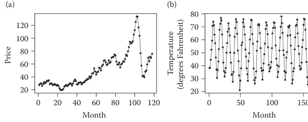

图 1.1 两个时间序列数据集。 (a) 西德克萨斯中质原油。 (b) 宾夕法尼亚州月平均气温。

12 个月（年度）模式，正如由于自然季节性天气循环而预期的那样。

**使用 R：** 与本书相关的 CRAN 包 tsw 包含超过 100 个与本书内容相关的数据集。在整本书中，只要讨论的数据集包含在 tsw 包中，数据名称将被注明。在本例中，图 1a 和 b 相关的数据集分别为 wtcrude 和 patemp。

时间序列分析技术通常分为两大类：时域和频域技术。时域技术包括相关结构分析、描述数据随时间演变方式的模型开发以及未来行为预测。频域方法旨在通过从其底层循环（或频率）内容角度检查数据来发展对时间序列数据的理解。观察到宾夕法尼亚温度数据包含 12 个月周期是检查频域内容的例子。基本频域分析工具是功率谱。

虽然频域分析在物理和工程科学中常用，但具有统计学、数学、经济学或金融学背景的学生可能不熟悉这些方法。我们不假设事先熟悉频域方法，并且在整本书中我们将介绍并讨论用于分析时间序列的时域和频域程序。在第 1.1 至 1.5 节和 1.6 节中，我们介绍了频域分析的基础知识和工具。在第 1.7 节中，我们将讨论几个模拟和真实时间序列数据集，从时域和频域角度进行讨论。

### 1.1 时间序列

宽松地说，时间序列可以被认为是在时间上顺序收集的观测值。我们的兴趣不在于确定性的此类序列，而在于那些根据概率规律行为的序列。在本章中，我们将讨论时间序列统计分析所涉及的基础知识。首先，我们必须更谨慎地定义时间序列。实际上，时间序列是随机过程的特例。

#### 定义 1.1

随机过程 `X(t); t ∈ T` 是一个随机变量的集合，其中 `T` 是所有随机变量的指标集，`X(t), t ∈ T`，在同一样本空间上定义。当 `T` 表示时间时，我们将随机过程称为时间序列。

如果 `T` 取连续范围的值（例如，`T = (-∞, ∞)` 或 `T = (0, ∞)`），则该过程称为连续参数过程。另一方面，如果 `T` 取离散值集（例如，`T = {0, 1, 2, …}` 或 `T = {0, ±1, ±2, …}`），则该过程称为离散参数过程。实际上，通常分别将它们称为连续和离散过程。

当我们处理离散参数过程时，我们使用符号 `X_t`。然而，当过程是连续参数或类型未指定时，我们将使用函数符号 `X(t)`。此外，当会产生混淆时，我们将使用符号 `X(t)` 或简单地使用 `X` 表示时间序列。类似地，我们通常将 `{X_t; t=0, ±1, …}` 简写为 `X_t; t=0, ±1, …` 或简单地为 `X`。

回想一下，随机变量 `Y` 是定义在样本空间 `Ω` 上的函数，其取值范围为实数。随机变量 `Y` 的观测值是某个 `ω ∈ Ω` 的实值 `y(ω)`。对于时间序列 `X(t)`，其“值” `X(t, ω); t ∈ T` 对于某个固定的 `ω ∈ Ω` 是一个实数集合。这导致了以下定义。

#### 定义 1.2

时间序列 `{X(t); t ∈ T}` 的一个实现是对于固定的 `ω ∈ Ω` 的实值结果集合 `{X(t, ω); t ∈ T}`。

也就是说，时间序列的一个实现只是由某个观测事件发生而产生的 `{X(t)}` 的一组值。时间序列 `{X(t); t ∈ T}` 的一个实现将表示为 `{x(t); t ∈ T}`。与之前一样，在连续参数情况下，我们有时会使用符号 `{x(t)}` 或简单地 `x(t)`，在离散参数情况下使用 `[x_i]` 或 `x_i`，当这些是明确时。所有可能实现的集合称为 *ensemble*，对于给定的 `t`，随机变量 `X(t)` 的期望称为集合均值，并表示为

`E[X(t)] = μ(t)`。`X(t)` 的方差由 `Var[X(t)] = E[X(t) - μ(t)]^2` 给出，通常表示为 `σ^2(t)`，因为它也可能依赖于 `t`。

#### 示例 1.1：具有两种可能实现的时间序列

考虑随机过程 `Y(t)`，对于 `t ∈ (-∞, ∞)` 定义为

`Y(t) = sin(t + φ)` 其中 `P(φ=0) = 0.5` 且 `P(φ=π/2) = 0.5` 且 `P` 表示概率。该过程有两个可能实现或样本函数，这些在图 1.2 中对于 `t ∈ [0,25]` 显示。个体是实现，当两个可能曲线的集合是集合时。对于该过程，

```
E[Y(t)] = 0.5sin(t + 0) + 0.5sin(t + \frac{\pi}{2})
```

所以，例如，

```
E[Y(0)] = 0.5sin(0) + 0.5sin(\frac{\pi}{2}) = 0.5,
```

并且

```
E[Y(\frac{\pi}{4})] = \frac{\sqrt{2}}{2}.
```

`E[Y(t)] = μ(t)`，即期望依赖于 `t`。请注意，该期望是“垂直”平均，取决于集合而不是沿时间轴“水平”平均。在第 1.4 节中，我们将看到这些不同平均方式如何相关。对时间序列分析特别感兴趣的是 `X(t_1)` 和 `X(t_2)`，`t_1, t_2 ∈ T` 之间的协方差。由于这是同一时间序列内的协方差，我们称之为自协方差。

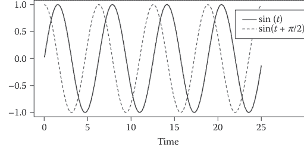

图 1.2

示例 1.1 中 Y(t) 的两个不同实现。

#### 平稳时间序列

#### 定义 1.3

如果 `X(t); t ∈ T` 是一个时间序列，则对于任意 `t_1, t_2 ∈ T`，我们定义：

1. 自协方差函数，`γ(·)`，由

`γ(t_1, t_2) = E[[X(t_1) - μ(t_1)][X(t_2) - μ(t_2)]]`

2. 自相关函数，`ρ(·)`，

`ρ(t_1, t_2) = γ(t_1, t_2) / σ(t_1)σ(t_2)`

### 1.2 平稳时间序列

在时间序列研究中，通常只有来自该序列的单个实现可用。仅基于单个实现对时间序列进行分析类似于基于单个观测值分析随机变量的性质。平稳性和遍历性概念将在我们能够有效地基于单个实现分析时间序列的能力中发挥重要作用。过程被称为平稳，如果它处于“统计平衡”状态。这种时间序列的基本行为不会随时间变化。作为一个例子，对于这样的过程，`μ(t)` 不会依赖于时间，因此对于所有 `t` 都表示为 `μ`。似乎，对于每个 `t`，`x(t)` 提供了关于集合均值 `μ` 的信息，可能可以基于单个实现估计 `μ`。遍历过程是指集合平均值如 `μ` 可以从单个实现一致估计的过程。在本节中，我们将给出平稳性的更正式定义，但我们将进一步推迟对遍历性的讨论，直到第 1.4 节。

# 应用 R 进行时间序列分析

注意：我们已 tacitly 假设 `T` 在加法下是封闭的，并且我们将继续如此。

严格平稳性要求，除其他事项外，对于任意 `t_1, t_2 ∈ T`，`X(t_1)` 和 `X(t_2)` 的分布必须相同，并且进一步所有二元分布 `[X(t), X(t + h)]` 的对都对所有 `h` 相同，等等。严格平稳性的要求是严苛的，通常在数学上难以建立。事实上，对于大多数应用，所涉及的分布是未知的。因此，已经开发了较不严格的平稳性概念。其中最常见的是协方差平稳性。

#### 定义 1.5（协方差平稳性）

时间序列 `X(t); t ∈ T` 被称为 *协方差平稳* 如果

- 1. `E[X(t)] = μ`（对所有 `t` 为常数）
- 2. `Var[X(t)] = σ^2 < ∞`（即对所有 `t` 为有限常数）
- 3. `γ(t_1, t_2)` 仅依赖于 `t_2 - t_1`

协方差平稳性也称为 *弱平稳、广义平稳* 和 *二阶平稳*。在本书的其余部分，除非另有说明，平稳性一词将指协方差平稳性。

在时间序列中，在统计学的许多其他领域，不相关的數據起着重要作用。在离散参数时间序列的情况下定义此类过程没有困难。例如，时间序列 `X_t; t=0, ±1, ±2, …` 被称为“纯随机过程”，如果是不相关的随机变量。当考虑纯随机过程时，我们只对 `X_t` 也是同分布的情况感兴趣。在这种情况下，更常见的是将时间序列称为 *白噪声*。下面的定义总结了这些论述。

#### 定义 1.6（离散白噪声）

时间序列被称为 *离散白噪声* 如果

- 1. `X_t` 是同分布的
- 2. `γ(t_1, t_2) = 0` 当 `t_2 ≠ t_1` 时
- 3. `γ(t, t) = σ^2`，其中 `0 < σ^2 < ∞`

我们还将发现以下两个定义是有用的。

#### 平稳时间序列

#### 定义 1.7（高斯过程）

时间序列被称为高斯（正态）如果对于任意正整数 `k` 和任意 `t_1, t_2, … t_k ∈ T`，`{X(t_1), X(t_2), … X(t_k)}` 的联合分布是多元正态的。

请注意，对于高斯过程，严格平稳性和协方差平稳性的概念是等价的。这可以通过注意到如果高斯过程 `X(t)` 是协方差平稳的，则对于任意 `t_1, t_2, …, t_k ∈ T` 和 `h ∈ T`，`{X(t_1), X(t_2), …, X(t_k)}` 和 `{X(t_1+h), X(t_2+h), …, X(t_k+h)}` 的多元正态分布具有相同的均值和协方差矩阵，从而具有相同的分布来看到。

#### 定义 1.8（复时间序列）

复时间序列是复随机变量序列 `Z(t)`，使得

```
$Z(t) = X(t) + iY(t)$
```

`X(t)` 和 `Y(t)` 对每个 `t` 都是实值随机变量。

可以很容易看出，对于复时间序列 `Z(t)`，均值函数 `μ_Z(t)` 给出

```
$\mu_Z(t) = E[Z(t)]$
$= E[X(t)] + iE[Y(t)]$
$= \mu_X(t) + i\mu_Y(t)$
```

除非特别指明为复数，否则本书记假设时间序列为实值。

### 1.3 平稳时间序列的自协方差和自相关函数

在本节中，我们将研究平稳时间序列的自协方差和自相关函数。如果时间序列是协方差平稳的，则自协方差函数 `γ(t, t+h)` 仅依赖于 `h`。对于平稳过程，我们用 `γ(h)` 表示该自协方差函数。类似地，平稳过程的自相关函数由 `ρ(h) = γ(h)/σ^2` 给出。与我们之前的记号一致，处理离散参数时间序列时，我们将使用下标 `γ_h` 和 `ρ_h`。

# 应用 R 进行时间序列分析

平稳时间序列的自协方差函数满足以下性质：

- - `γ(0) = σ^2`
- `|γ(h)| ≤ γ(0)` 对所有 `h`

(2) 中的不等式可以通过注意到对于任意随机变量 X 和 Y 它遵循

```
$E|(X-\mu_X)(Y-\mu_Y)| \leq \{E[(X-\mu_X)^2]E[(Y-\mu_Y)^2]\}^{1/2},$
```

由 Cauchy-Schwarz 不等式。现在令 `X=X(t)` 和 `Y=X(t+h)`，我们看到

```
$|\gamma(h)| \leq |E[(X(t)-\mu)(X(t+h)-\mu)] \leq \sigma^2 = \gamma(0).$
```

- - `γ(h) = γ(-h)`

该结果可以通过注意到

```
$\gamma(-h) = E[(X(t)-\mu)(X(t-h)-\mu)]$
$= E[(X(t-h)-\mu)(X(t)-\mu)]$
$= E[(X(t_1)-\mu)(X(t_1+h)-\mu)]$,
```

其中 `t_1=t-h`。然而，由于自协方差不依赖于时间 `t`，这个最后的期望等于 `γ(h)`。


- - 函数 $\gamma(h)$ 是正半定的。即，对于任意点集 $t_1, t_2, \dots, t_k \in \mathbb{T}$ 和所有实数 $b_1, b_2, \dots, b_k$，我们有

```
$$\sum_{i=1}^k \sum_{j=1}^k \gamma(t_i-t_j)b_i b_j \geq 0. \quad (1.1)$$
```

为证明此点，令 $W=\sum_{j=1}^k b_j X(t_j)$。现在，$Var(W) \geq 0$ 且

```
$Var(W) = E\left[\left[\sum_{j=1}^k b_j(X(t_j)-\mu)\right]^2\right]$
$= \sum_{i=1}^k \sum_{j=1}^k b_i b_j \gamma(t_i-t_j),$
```

结果就得出。注意在离散时间序列定义在 $t=0, \pm1, \pm2, \dots$ 的情况下，方程 1.1 等价于矩阵

```
$$\Gamma_k = \begin{pmatrix} \rho_0 & \rho_1 & & & \rho_k \\ \rho_1 & \rho_0 & & & \rho_{k-1} \\ & & \vdots & & \vdots \\ & & & \vdots & \\ \rho_k & & \rho_{k-1} & & \rho_k \end{pmatrix}$$ $(1.2)$
```

对每个 $k$ 都是半正定的。

自相关函数满足以下类似性质：

- a. $\rho(0)=1$
- b. $|\rho(h)|\le 1$ 对所有 $h$
- c. $\rho(h)=\rho(-h)$
- d. 函数 $\rho(h)$ 是正半定的，并且对于定义在 $t=0, \pm1, \pm2, \dots$ 上的离散时间序列，矩阵

```
$$\rho_k = \begin{pmatrix} & \rho_1 & & & \rho_k \\ & 1 & & & \rho_{k-1} \\ & & \vdots & & \\ & & & \vdots & \\ & & \rho_{k-1} & & 1 \end{pmatrix}$ $(1.3)$
```

对每个 $k$ 都是半正定的。

定理 1.1 给出了保证 $\Gamma_k$ 并且等价地 $\rho_k$ 对每个 $k$ 都是正定的条件。该结果的证明可以在 Blackwell 和 Davis (1991)，命题 5.1.1 中找到。

### 定理 1.1

如果 $\gamma_0 > 0$ 且 $\gamma_j=0$，则 $\Gamma_k$ 和 $\rho_k$ 对每个整数 $k>0$ 都是正定的。

了解给定模型的自相关图在多大程度上描述了该模型的时间序列实现的行为是很重要的。虽然图 1.3，我们展示了四个平稳时间序列的实现，而图 1.4 显示了滞后 0–45 的相应真实自相关。图 1.3a 中的实现 1 显示出游走或分段趋势行为。那就是 $x_t$ 和 $x_{t+1}$ 相对接近的典型情况；也就是说，$x_{t+1}$ 的值通常不会远离 $X_t$ 的值

并且，作为结果，随机变量 $X_t$ 和 $X_{t+1}$ 之间存在相当强的正相关。还请注意，对于大滞后 $k$，$X_t$ 和 $X_{t+k}$ 之间似乎相关性较少，以至于 $X_t$ 和 $X_{t+40}$ 之间几乎没有相关性。我们在 [图 1.4a] 中看到这种行为，该图显示了实现 1 所生成的模型相关的真实自相关。$\rho_1 \approx 0.95$ 随着滞后增加，自相关下降，到滞后 40 时自相关已下降到 $\rho_{40} = 0.1$。

图 [图 1.3b] 中的实现 2 显示出缺乏模式。也就是说，似乎 $X_t$ 与 $X_{t+1}$ 之间或 $X$ 与 $X_{t+k}$ 之间没有任何关系，对任何 $k \neq 0$ 都无关紧要。事实上，这是一个白噪声模型的实现，对于该模型，$\rho_k = 0$ 在 $k \neq 0$ 上如 [图 1.4b] 所见。请注意，在所有自相关图中，$\rho_0 = 1$。

图 [图 1.3c] 中的实现 3 以约 14 个时间点的周期长度的伪周期行为为特征。相应的自相关在 [图 1.4c] 中显示出阻尼正弦波。请注意，不一定 $X_t$ 与 $X_{t+14}$ 之间存在正相关。此外，在滞后 7 处存在负相关，因为在正弦周期内，如果 $x_i$ 高于平均值，则 $x_{i-7}$ 预期低于平均值，反之亦然。

### 平稳时间序列

# 11

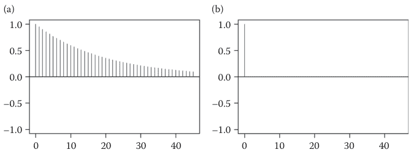

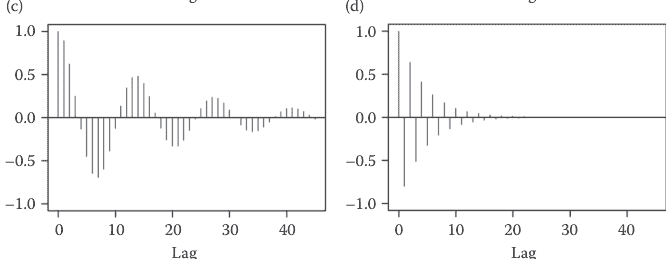

**图 1.4**

图 1.3 中实现对应的真实自相关。 (a) 实现 1。 (b) 实现 2。 (c) 实现 3。 (d) 实现 4。

还要注意，由于实现中仅存在伪循环行为，且某些循环略长于其他循环，滞后 28（即两个循环），自相关系数相当小。

最后，图 1.3d 中的关系 4 显示出高度振荡的行为。事实上，如果 $x_i$ 高于平均值，则 $x_{i+1}$ 倾向于低于平均值，$x_{i+2}$ 倾向于高于平均值，等等。同样，图 1.4 中的自相关描述了这种行为，我们看到 $\rho_1 = -0.8$ 而 $\rho_2 = 0.6$。还要注意，上一下一的模式足够不完美，以至于自相关在约滞后 15 时衰减至接近零。

### 1.4 平稳时间序列均值、自协方差和自相关的估计

如前所述，时间序列分析中的一个常见目标是根据单一实现获取有关时间序列的信息。在本节中，我们讨论从单一实现估计 $\gamma(h)$ 和 $\rho(h)$。我们的重点是离散参数时间序列，其中 $T = \{..., -2, -1, 0, 1, 2, ...\}$，在这种情况下，通常观察到有限长度实现 $t = 1, 2, ...$, $n$。与此处给出的类似的公式也适用于连续参数时间序列，将仅在示例中简要提及。读者可参考 Parzen (1962) 获取更一般的结果。

# 12 应用时间序列分析与 R

#### 1.4.1 $\mu$ 的估计

给定来自平稳时间序列的实现 $[x_t, t = 1, 2, ... , n]$，共同 $\mu$ 的自然估计是样本均值

```
$$\bar{X} = \frac{1}{n} \sum_{t=1}^{n} X_t. \quad (1.4)$$
```

显然，估计量 $\bar{X}$ 对 $\mu$ 是无偏的。

##### 1.4.1.1 $ar{X}$ 的遍历性

我们将说 $\bar{X}$ 对 $\mu$ 是遍历的，如果当 $n$ 增大时，$\bar{X}$ 以均方意义收敛于 $\mu$，即 $\lim_{n\to\infty} E[( \bar{X}-\mu)^2] = 0$。

### 定理 1.2

设 $\{X_t; t = 0, \pm1, \pm2, ...\}$ 是一个平稳时间序列。则，$\bar{X} = \frac{1}{n} \sum_{t=1}^{n} X_t,$ 是遍历的当且仅当

```
$$\lim_{k\to\infty} \frac{1}{k} \sum_{t=0}^{k-1} \gamma_t = 0. \quad (1.5)$$
```

参见 Yaglom (1962) 对定理 1.2 的证明。我们还有以下推论。

### 推论 1.1

设 $X_t$ 是如定理 1.2 中所述的离散参数平稳时间序列。则，$X$ 对 $\mu$ 是遍历的如果

```
$$\lim_{k\to\infty} \gamma_k = 0, \quad (1.6)$$
```

或等价地如果

$$\lim_{k\to\infty} \rho_k = 0. \quad (1.7)$$

推论 1.1 中给出的 $\tilde{X}$ 遍历性的充分条件非常有用，并且适用于我们将在第 3 章讨论的平稳自回归-移动平均、ARMA($p,q$) 时间序列的广泛类别。即使时间上相近的 $X_i$ 可能具有相当大的相关性，推论 1.1 中的条件也保证了“大”分离时几乎不相关。

#### 示例 1.2：一个遍历过程

考虑由下式定义的进程 $X_t, t=0, \pm1, \pm2,$ ...

$X_t = 0.8X_{t-1} + a_t. \quad (1.8)$

$a_t$ 是均值为零、方差为 $\sigma_a^2$ 的离散白噪声。换句话说，方程 1.8 是一个“回归型”模型，其中 $X$（因变量）是 $X_t$（自变量）的 0.8 倍加上不相关的“噪声”。请注意，$X_t$ 与 $a_k$ 对于 $k>0$ 不相关。方程 1.8 中的过程是一阶自回归过程的例子，记为 AR(1)，将在第 3 章中详细研究。我们将在该章中证明如方程 1.8 所定义的 $X_t$ 是一个平稳过程。通过对方程 1.8 两边取期望并回忆 $a_t$ 均值为零，可得

$E[X_t] = 0.8E[X_{t-1}]. \quad (1.9)$

由于 $X$ 是平稳的，可得 $E[X_t] = E[X_{t-1}] = \mu$。现在，方程 1.9 意味着 $\mu = 0.8\mu$，即 $\mu = 0$。令 $k>0$，我们通过对方程 1.8 中 $E[X_t, a_k] = E[X_t a_k]$ 的每一项预乘以 $X_{t-k}$ 并取这些期望得到一个表达式。这给出

$E[X_t, a_k] = 0.8E[X_{t-1}, X_{t-k}] + E[X_{t-k}, a_t]. \quad (1.10)$

并且由于 $E[X_{t-1}, a_k] = 0$，方程 1.1 简化为 $\gamma_k = 0.8\gamma_{k-1}$，这意味着 $\gamma_k = \gamma_0(0.8)^k$ 且 $\rho_k = 0.8^k$。因此，根据推论 1.1，$\tilde{X}$ 对模型 $\mu$（1.8）是遍历的。参见第 3.2.4 节。

为了看到条件 (1.7) 对基于单一实现使用 $\mu$ 的估计的影响，$\rho_1 = 0.8$，因此 $X_t$ 和 $X_{t+1}$ 提供了关于 $\mu$ 的相关（且 somewhat 重复）信息，但例如，$\rho_{20} = 0.01$，因此 $X_t$ 和 $X_{t+20}$ 提供了关于 $\mu$ 的几乎不相关信息。图 1.5（数据集 fig1.5 in tswge）显示了来自方程 1.8 中模型的

# 应用时间序列分析与 R

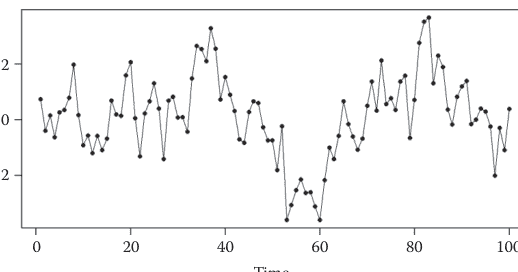

图 1.5

示例 1.2 中 X 的实现。

长度为 100 的实现。请注意，实现似乎在均值 $\mu = 0$ 附近来回“游荡”，这表明可能是一个平稳过程。

#### 示例 1.3：一个平稳余弦过程

定义 $X(t)$ 对于 $t \in (-\infty, \infty)$ 为

```
$X(t) = C\cos(\lambda t + Y)$
```

其中

C 和 $\lambda$ 是实值常数

Y 是一个随机变量

然后，如我们将在下面所示，$X(t)$ 是平稳的当且仅当 $\varphi(1) = \varphi(2) = 0$，其中 $\varphi(u)$ 是 $Y$ 的特征函数，即

```
$\varphi(u) = E[e^{iuY}] \quad \text{for } i = \sqrt{-1}$.
```

在验证该结果之前，我们首先注意到 $\varphi(u)$ 可以写成

```
$\varphi(u) = E[cos(uY) + iE[sin(uY)]. \quad (1.12)$
```

我们还使用了三角恒等式

+   1. $\coscosA + B) = \cos A \cos B - \sin A \sin B$
2. $\cos A \cos B = \frac{1}{2}\cos(A + B) + \frac{1}{2}\cos(A - B)$。

使用恒等式 (1)，我们知道方程 1.11 中的 $X(t)$ 可以表示为

```
$X(t) = C[cos\lambda t \cos Y - \sin \lambda t \sin Y], \quad (1.13)$
```

#### 平稳时间序列

而乘积 X(t)X(t+h) 可以使用首先 (2) 然后作为 (1) 重写为

```
X(t)X(t+h) = C\cos(\lambda t+Y)\cos(\lambda(t + h) + Y)\n= \frac{C^2}{2}\cos(2\lambda t+\lambda h+2Y) + \frac{C^2}{2}\cos(\lambda h)\n= \frac{C^2}{2}\cos(2\lambda t+\lambda h)\cos(2Y)\n- \sin(\lambda t+\lambda h)\sin(2Y)+\cos(\lambda h). (1.14)
```

(= 设) $\varphi(1) = \varphi(2) = 0$。然后，从方程 1.12 可以清楚地看出

+   a. E[cos Y] = E[sin Y] = 0
b. E[cos 2Y] = E[sin 2Y] = 0

从方程 1.13，我们看到 (a) 意味着 E[X(t)] = 0。同样，对方程 1.14 中的 X(t)X(t+h) 取期望，可以看出 (b) 意味着

```
\gamma(h) = E[X(t)X(t+h)] = \frac{C^2}{2}\cos(\lambda h),
```

它依赖于 h 但不依赖于 t。而且，$\sigma_X^2 = \gamma(0) = (C^2/2) < \infty$。

因此，X(t) 是协方差平稳的。

(= 设) X(t) 是协方差平稳的。则，由于 E[X(t)] 不依赖于 t，可得从方程 1.13 可得 E[cos Y] = E[sin Y] = 0，并且

所以 $\varphi(1) = 0$。同样，E[X(t)X(t+h)] 依赖于 h 但不依赖于 t，

可得从方程 1.14 的最后一个等式可得 E[cos 2Y] = E[sin 2Y] = 0，即 $\varphi(2) = 0$-Uniform[0, 2π]，则

```
\varphi(u) = \int_0^{2\pi} e^{iu} \frac{1}{2\pi} dy
= \frac{e^{2\pi iu}-1}{2\pi iu},
```

因此 $\varphi(1) = \varphi(2) = 0$，并且因此均匀 [0, 2π] 满足 Y 的条件，并且由此产生的过程 X(t) = C cos(\lambda t+Y) 是平稳的。

图 1.6 显示了方程 1.11 中描述的过程的三个实现，其中 $\lambda=0.6$ 且 Y ~ [0, 2π]。图 1.6a 中的实现是 Y = 1.5 的情况。图 1.3 和

1.5 中的实现，图 1.6 中的行为非常确定性。在，的

图会让人相信该过程的均值取决于

t。然而，并非如此，其中 Y 是随机的。图

1.6b 和 c 显示了随机变量 Y 的不同值的另外两个实现。请注意，随机变量 Y 的作用是在每个实现中随机移动余弦波的“起点”。Y 被称为相位偏移。这些实现只是三个实现

# 应用 R 进行时间序列分析

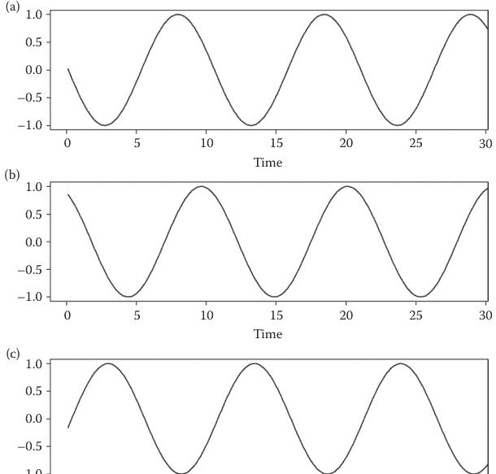

#### FIGURE 1.6

Example 1.3 中 $X(t)$ 的三个实现。 (a) $Y=1.5$。 (b) $Y=0.5$。 (c) $Y=4.5$。

来自可能实现的集合。 注意对于这三个实现，$X(10)$ 分别等于 $0.35, 0.98$，和 $-0.48$，这与我们发现 $E[X(t)]$ 不依赖于 $t$ 的结论一致。

关键点是平稳性这一性质不能通过对数据的简单检查来确定。 相反，它必须从物理考虑、相关结构知识或我们在未来章节中将考虑的更复杂的技巧中推断出来。 由于定理 1.2 及其推论仅与离散参数过程有关，它们不适用于当前示例中的 $X(t)$。 然而，与定理 1.2 和推论 1.1 类似的结果对于连续参数过程也成立（参见 Parzen, 1962）。 注意，在此示例中，$Y(t)$ 当 $h \to \infty$ 时并不趋于零，$\tilde{X}_t$ 在此连续参数示例中定义为

$$\tilde{X}_t = \frac{1}{t} \int_0^t X(s)ds, \quad (1.15)$$

#### 平稳时间序列

可以证明其对 $\mu$ 是遍历的，使用定理 1.2 的连续类比。 在此示例中 $\tilde{X}_t$ 的遍历性似乎是合理的，因为随着方程 1.15 中的 $t$ 增大，$\tilde{X}_t \to 0(\mu)$ 似乎是直观的。

#### EXAMPLE 1.4: A NON-ERGODIC PROCESS

作为非遍历过程的假设示例，考虑一个生产线轴的纱线制造过程。 机器在每天结束时进行清洁和调整，直径在下一天结束前保持不变，此时再次进行清洁。 直径设置可以被视为一个随机过程，每一天都是一个实现。 在图 1.7 中，我们展示了来自该假设过程 $X(t)$ 的三个实现。

$\mu$ 是跨天的平均直径，那么也很清楚 $\gamma(t, t+h)$ 在一天内不依赖于 $t$。 也可以清楚地看到 $\gamma(t, h) = \gamma(0) < \infty$，对于所有 $h$。 因此，该过程是平稳的。 然而，显然没有意义尝试通过 $\bar{X}_t$ 来估计 $\mu$，即通过对单个实现的沿时间轴的平均来估计。 直观上，我们看到 $\mu$ 可以通过对多个实现的平均来估计，但使用一个实现本质上只提供了一条信息。 显然，在这种情况下 $X_t$ 对 $\mu$ 不是遍历的。

##### 1.4.1.2 Variance of $ar{X}$

在离开从平稳过程的实现中估计 $\mu$ 的主题之前，在定理 1.3 中，我们给出了 $\text{Var}(\bar{X})$ 的一个有用公式。 我们将定理的证明留作练习。

#### Theorem 1.3


如果 $X_t$ 是离散平稳时间序列，则基于长度为 $n$ 的实现的 $\bar{X}$ 的方差由下式给出

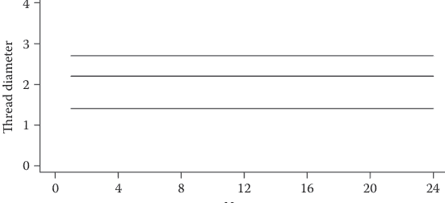

FIGURE 1.7 Three realizations from the process in Example 1.4.

# Applied Time Series Analysis with R

$Var(\bar{X}) = \frac{\sigma^2}{n} \sum_{k=(n-1)}^{n-1} \left(1 - \frac{|k|}{n}\right) \rho_k. \quad (1.16)$

方程 1.16 的结果显示了自相关对 $\bar{X}$ 方差的影响，并且如果 $X$ 是白噪声，则 $\gamma_k=0$ 当 $k \neq 0$ 时，则方程 1.16 变为众所周知的结果 $Var(\bar{X})=\sigma^2/n$。 在下一节中，我们讨论离散平稳时间序列的 $\hat{\gamma}_k$ 和 $\hat{\rho}_k$ 的估计。 使用符号 $\hat{\rho}_k$ 表示估计的（样本）自相关（在第 1.4.2 节中讨论）以及 $\hat{\sigma}^2=\hat{\gamma}_0$ 表示样本方差，常用做法是使用以下方法获得 $\mu$ 的近似 95% 区间

$\bar{X}-1.96 \sum_{k=(n-1)}^{n-1} \left(1 - \frac{|k|}{n}\right) \hat{\rho}_k, \bar{X}+1.96 \sum_{k=(n-1)}^{n-1} \left(1 - \frac{|k|}{n}\right) \hat{\rho}_k. \quad (1.17)$

## 1.4.2 Estimation of $\gamma_k$

由于平稳性，$E[(X_t-\mu)(X_{t+k}-\mu)]=\gamma_k$ 不依赖于 $t$。 作为结果，似乎合理地从单个实现估计 $\gamma_k$，通过

$\hat{\gamma}_k = \frac{1}{n-|k|} \sum_{t=1}^{n-|k|} (X_t-\bar{X})(X_{t+|k|}-\bar{X}), \quad k=0, \pm1, \pm2,\dots\pm(n-1) n=0, |k|\geq n. \quad (1.18)$

即，通过移动时间轴并找到实现中相隔 $k$ 个时间单位的所有乘积的平均值。 注意，如果我们在方程 1.18 中用 $\mu$ 替换 $\bar{X}$，则所得估计量是无偏的。 然而，方程 1.18 中的估计量 $\hat{\gamma}_k$ 仅是渐近无偏的。

尽管 $\hat{\gamma}_k$ 具有直观吸引力，但大多数序列分析人员使用另一种估计量，$\tilde{\gamma}_k$，定义为

$\tilde{\gamma}_k = \frac{1}{n-|k|} \sum_{t=1}^{n-|k|} (X_t-\bar{X})(X_{t+|k|}-\bar{X}), \quad k=0, \pm1, \pm2,\dots\pm(n-1) n=0, |k|\geq n. \quad (1.19)$

从方程 1.19 的检查可以清楚地看到，当 $|k|$ 相对于 $n$ 较大时，$|\tilde{\gamma}_k|$ 值往往“较小”。 估计量 $\hat{\gamma}_k$，如方程 1.19 所给，其偏差通常大于 $\tilde{\gamma}_k$，在大多数情况下均方误差更小。 两个估计量之间的差异在 $|k|$ 相对于 $n$ 较大时最为明显。 比较可以通过在方程 1.18 和 1.19 中用 $\mu$ 替换 $\bar{X}$ 来轻松进行，我们将在当前段落的其余部分中假设这一点。 在这种情况下 $\hat{\gamma}_k$ 的偏差可以被视为 $(|k|/n)\gamma_k$。 随着 $|k|$ 增加到 $n$，因子 $|k|/n$ 增加到一，因此偏差趋向于 $\gamma_k$。 随着 $|k|$ 增加到 $n-1$，$\text{Var}(\hat{\gamma}_k)$ 将增加，并且 $\hat{\gamma}_k$ 值对于较大的 $k$ 值往往具有相当不规则的行为。 $\hat{\gamma}_k$ 的整体模式通常比 $\tilde{\gamma}_k$ 更接近 $\hat{\gamma}_k$，我们将看到自相关函数的*模式*通常是重要的。 $\hat{\gamma}_k$ 的行为也比 $\tilde{\gamma}_k$ 更接近 $\tilde{\gamma}_k$，其中 $\tilde{\gamma}_k$ 在第 1.3 节中给出的性质 (4) 的意义上也是正半定的，而 $\hat{\gamma}_k$ 不一定为正。 关于这些主题的进一步讨论，读者可参考 Priestley (1981)。

#### EXAMPLE 1.5: BEHAVIOR OF SAMPLE AUTCOVARIANCES

在图 1.8 中，我们显示了示例 1.2 中 AR(1) 实现的理论自协方差以及基于图 1.5 中所示实现（见文本中的 fig1.5）的样本自协方差 $\hat{\gamma}_k$ 和 $\tilde{\gamma}_k$。 可以看到，对于较小的 $k$，估计量彼此相似，但对于接近 $n$ 的 $k$，$\gamma_k$ 的阻尼期望用 $\hat{\gamma}_k$ 更好地估计。 对于 $\hat{\gamma}_k$（以及由于其渐近收敛而 $\tilde{\gamma}_k$）的遍历结果也可以获得，但它们通常不像定理 1.2 那样简单。 对于 $\tilde{\gamma}_k$ 的大多数结果是在假设 $\mu$ 有界且不失一般性等于零的情况下证明的。 关于 $\tilde{\gamma}_k$ 的遍历定理以及关于 $Cov(\tilde{\gamma}_j, \tilde{\gamma}_k)$ 的一些结果的讨论，请参见 Priestley (1981)。 在本书的其余部分中，我们假设样本自协方差对 $\hat{\gamma}_k$ 遍历所需的条件成立。

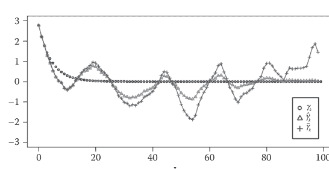

**FIGURE 1.8** Theoretical and sample autocovariances based on the realization in Figure 1.5.

#### 1.4.3 Estimation of $

ho_k$

$\rho_k = \gamma_k/\gamma_0$ 的自然估计量是 $\hat{\rho}_k = \tilde{\gamma}_k/\tilde{\gamma}_0$，我们将其称为样本自相关函数。 估计量 $\hat{\rho}$ 具有 $|\hat{\rho}| \le 1$ 的理想性质，这是 $\tilde{\rho}_k = \tilde{\gamma}_k/\tilde{\gamma}_0$ 不具备的性质。 该性质可以通过将 $\hat{\rho}$ 与两组 $n+k$ 个观测值的 Pearson 乘积矩相关联系起来来证明

$0,0,...,0, X_1-\tilde{X}_1, X_2-\tilde{X}_2, ..., X_n-\tilde{X}_n,$

$X_1-\tilde{X}_1, X_2-\tilde{X}_2, ..., X_n-\tilde{X}_n, 0,0,...,0,$

其中，在每种情况下都有零。 为便于记号，我们将第一行记为 $V_{\rho}$ $i=1, ..., n+k$，第二行记为 $W_{\rho}$ $i=1, ..., n+k$。 因此，$\tilde{V} = \tilde{W} = 0$，并且 $V$ 和 $W$ 之间的乘积矩相关由下式给出

$r = \frac{\sum_{i=1}^{n+k} V_i W_i}{\sqrt{\sum_{i=1}^{n+k} V_i^2 \sum_{i=1}^{n+k} W_i^2}}$

分母可以重写为 $\sum_{t=1}^n (X_t-\tilde{X}_t)^2$，分子可以写为 $\sum_{i=1}^k V_i W_i + \sum_{i=n+1}^n V_i W_i + \sum_{i=n+1}^{n+k} V_i W_i$。 第一项和最后一项之和为零，因此分子可以写为

$\sum_{i=1}^k V_i W_i + \sum_{i=n+1}^n V_i W_i = \sum_{t=1}^n (X_t-\tilde{X}_t)(X_{t+k}-\tilde{X}_{t+k}).$

因此 $r = \hat{\rho}_k$ 且 $|\hat{\rho}_k| \le 1$。

Bartlett (1946) 已获得了当 $X_t$ 为平稳高斯过程时 $Cov(\hat{\rho}_k, \hat{\rho}_{k+j})$ 的近似表达式。 特别地，他证明了

$Cov(\hat{\rho}_k, \hat{\rho}_{k+j}) = \frac{1}{n} \sum_{\mu=-\infty}^{\infty} {\rho_\mu\rho_{\mu+j} + \rho_{\mu+k}\rho_\mu - 2\rho_k\rho_{\mu+k-j} - 2\rho_{k+j}\rho_{\mu-k} + 2\rho_k\rho_{k+j}\rho_{\mu}^2},$

由此可得，取 $j=0$，则

#### 平稳时间序列

$Var(\hat{\rho}_k) = \frac{1}{n} \sum_{u=-\infty}^{\infty} {\rho_u^2 + \rho_{u+k}\rho_{u-k} - 4\rho_k\rho_{u-k} + 2\rho_u^2}. (1.20)$

当时间序列具有 $\hat{\rho}_k \to 0$ 当 $k \to \infty$ 的性质时，我们对“较大”的 $k$ 有

$Cov(\hat{\rho}_k, \hat{\rho}_j) = \frac{1}{n} \sum_{u=-\infty}^{\infty} \rho_u\rho_{u+j-k}. (1.21)$

并且

$Var(\hat{\rho}_k) = \frac{1}{n} \sum_{u=-\infty}^{\infty} \rho_u^2. (1.22)$

巴特利特近似在我们对时间序列数据的分析中将会变得非常重要。对于近似 $\hat{\rho}_k$ 的方差以确定样本自相关是否显著不同于零，方程 1.21 显示样本自相关之间可能存在相关性。当我们检查 $\hat{\rho}_k$ 的图时，这是一个需要牢记的重要结果，正如我们在时间序列分析中所做的那样。

在第 1.3 节关于图 1.3 和 1.4 的讨论中，我们描述了自相关中的模式如何提供关于时间序列模型性质的信息。在图 1.9 中，我们展示了与图 1.3 中的实现相关的样本自相关，估计使用 $\hat{\rho}_v$。这些样本自相关是图 1.4 中显示的真实自相关的估计。可以看出，这些样本自相关近似于真实自相关的行为，但 $\hat{\rho}_k$ 值之间的相关性应予注意。例如，注意到 $\hat{\rho}_k$ 的值对于“接近”的 $k$ 倾向于低估 $\rho_k$，也倾向于低估真实值。当 $\hat{\rho}_u$ 的图中存在此类行为时，这可能会在 $\hat{\rho}_k$ 的图中产生循环行为。这在图 1.9a 和 d 中可见。还应注意，来自白噪声实现的样本自相关不会完全为零。在第 8.1 节中，我们将讨论白噪声的检验，这将帮助您判断诸如图 1.9b 中所示的样本自相关是否比来自白噪声的实现的预期幅度更大。

使用 R：计算时间序列实现均值和样本自相关（或样本自协方差）的 R 命令分别是基础 R 命令 `mean` 和 `acf`。有关这些命令的更多详细信息请参阅附录 1B。

## 应用时间序列分析与 R

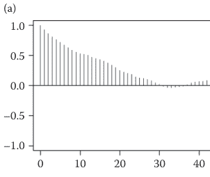

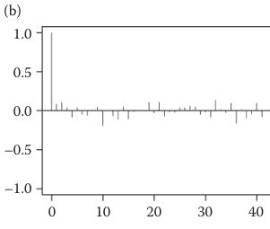

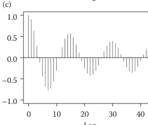

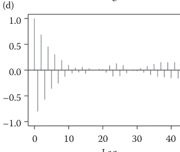

FIGURE 1.9

与图 1.3 中的四个实现相关的样本自相关。 (a) 实现 1。 (b) 实现 2。 (c) 实现 3。 (d) 实现 4。

### 1.5 功率谱

在第 1.1 节至第 1.4 节中，我们讨论并描述了时间序列在其实现、均值、方差和自相关方面的表现。这些都是时间序列时域分析的各个方面。经常需要从其循环（频率）内容的角度检查时间序列实现和模型。这种分析在工程课程中很常见，但对于正在学习第一门时间序列课程的统计学学生来说，这可能是他们首次接触频域。

在 1807 年，约瑟夫·傅里叶惊呆了他的同时代人，证明了很大一类函数 f(x) 可以写成正弦和余弦的线性组合。这一发现导致了数学家和科学家们开发的极其有用的领域，通过将信号分解为三角函数之和来理解信号的基本属性。这将在示例 1.6 中说明。

#### 平稳时间序列

#### EXAMPLE 1.6: A SIGNAL CONTAINING SEVERAL FREQUENCIES

考虑图 1.10 中左上方的实现。仔细检查显示该信号具有重复的性质，但其总体外观与本章中我们见过的几个实现相似。实际上，该信号是具有不同周期长度和相位偏移的正弦波的和，如图 1.10 中三个图中所示。数据集合 fig1.10a-d in wave 包含图 1.10a-d 中的实现。我们将在示例 1.7 中回到图 10.1a 中的数据。

来自时间序列的实际实现通常不会像图 1.10 左上方那样具有如此简单的数学形式。然而，通过将傅里叶分析技术应用于时间序列的谱，我们将能够分析更复杂的实现，以便发现提供关于生成数据的潜在模型信息的根本循环行为。对时间序列中潜在周期性的检查称为谱分析，我们将使用的工具来测量功率谱和谱密度的频率含量。我们首先介绍所需的术语和定义。

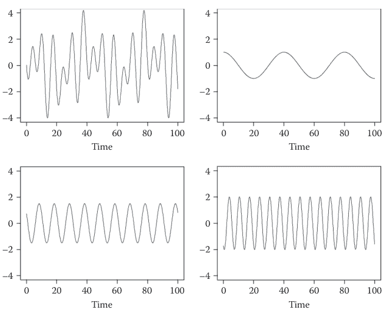

FIGURE 1.10

信号（左上）是三个后续面板中给出的三个正弦波之和。

#### Definition 1.9

函数 $g(t)$ 是周期为（或周期长度）$p>0$ 的周期函数，如果 $p$ 是使 $g(t) = g(t+kp)$ 对所有 $t$ 和整数 $k$ 成立的最小值。函数 $g(t)$ 如果不存在这样的 $p$，则称为非周期函数。

显然，$g(t) = \cos(t)$ 是周期为（周期长度）$2\pi$ 的周期函数，$\cos(2\pi t)$ 是周期为 1 的周期函数，而 $\cos(2\pi ft)$ 的频率为 $1/f$。在我们的研究中，我们通常以频率来讨论循环行为。我们将使用的频率定义在下文中指定。

#### Definition 1.10

频率 ($f$) 衡量每个采样单位的周期或循环数，即 $f=1/\text{period}$。

如果数据按每年、每月或每小时收集，采样单位分别为 1 年、1 个月和 1 小时，对应的频率分别衡量每年、每月和每小时的循环数。在科学和工程文献中，通常以赫兹（Hz）衡量频率，即每秒的循环数。

根据定义 1.9 之后的讨论可知，$\sin(t)$ 的频率为 $1/(2\pi)$，$\sin(2\pi t)$ 的频率为 1，而 $\sin(2\pi ft)$ 的频率为 $f$。这些事实在图 1.11 中说明。

图 1.12（数据集合 kingkong in tswge）显示了以 8000 Hz（每秒采样）数字化记录的电压读数，这些读数来自第一作者在背景中有风扇吹动时说出“King

|  | Period | Frequency |

|---|---|---|

| $\sin t$ | $2\pi$ | $1/(2\pi)$ |

| $\sin(2\pi t)$ | 1 | 1 |

| $\sin(2\pi t)$ | $1/2$ | 2 |

| $\sin(2\pi ft)$ | $1/f$ | $f$ |

FIGURE 1.11 Examples showing the relationship between period and frequency.

#### 平稳时间序列

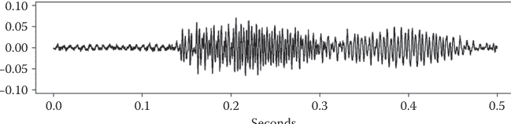

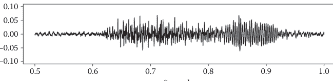

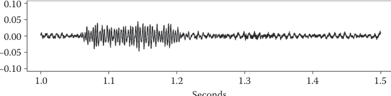

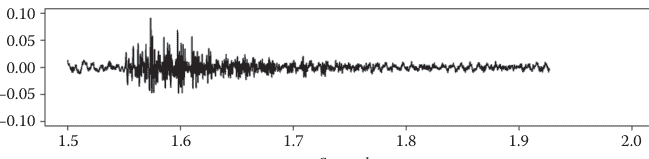

FIGURE 1.12

短语 King Kong Eats Grass 的数字化记录。

Kong Eats Grass”时产生的声学能量。在单词之间的静默期间，可以看到风扇噪声表现为低振幅的循环行为，频率约为 136 Hz（每秒循环）。此外，还要注意单词“King”和“Kong”的频率含量的相似性。单词“look”开头“k”和结尾“g”的频率行为相似，而单词“eats”在频率和振幅上则大不相同，而“eats”和“grass”结尾的“s”音相似。因此，检查图 1.10 和 1.12 应该让我们相信，通过理解时间序列的频率含量可以获得一些收益。这一结论是成立的，事实上，正如我们将看到的，时间序列的频率解释通常可以为我们提供关于潜在过程的最相关信息。

## 应用 R 进行时间序列分析

正如我们所指出的，自相关在时间序列分析中的作用是核心的。然而，当需要确定数据的频率或循环内容时，自相关中的相关信息更易于通过自相关的傅里叶变换，即谱密度，而不是通过自相关本身来传达。功率谱和谱密度，是用于检查时间序列数据频率内容的首要工具，在下文中定义。

#### 定义 1.11

设 $[X(t); t \in (-\infty,\infty)]$ 为平稳时间序列。

- 1. 功率谱，$P_X(f)$，定义为


$$P_X(f) = \int_{-\infty}^{\infty} e^{-2\pi i f h}\gamma(h)dh, \quad (1.23)$$

$-\infty < f < \infty, i = \sqrt{-1}$，是协方差函数。

### 谱密度

- 2. 谱密度是 $P_X(f)$ 的归一化版本。具体地，我们定义谱密度，$S_X(f)$，为

$$S_X(f) = \frac{P_X(f)}{\sigma_X^2} = \int_{-\infty}^{\infty} e^{-2\pi i f h}\rho(h)dh. \quad (1.24)$$

功率谱通常简称为谱。定义 1.11 要求指标集 $T$ 为连续的。可以给出一个更一般的定义，也包括离散情形。然而，为此需要在定义中使用 Stieltjes 积分。读者应参考 Priestley (1981) 和 Koopmans (1974) 了解此方法。我们选择将离散参数情形单独考虑。

#### 定义 1.12

设 $[X_i; t=0, \pm1, \pm2, \dots]$ 为平稳时间序列且 $|f| \le 0.5$。

- 1. $X_i$ 的功率谱定义为

$$P_X(f) = \sum_{k=-\infty}^{\infty} e^{-2\pi i k f}\gamma_k. \quad (1.23)$$

#### 平稳时间序列

2. 谱密度定义为

$S_X(f) = \frac{P_X(f)}{\sigma_X^2} = \sum_{k=-\infty}^{\infty} e^{-2\pi i k f}\rho_k. \quad (1.26)$

若

$\sum_{k=-\infty}^{\infty} |\gamma_k| < \infty, \quad (1.27)$

则可以证明方程 1.25 和 1.26 中的级数收敛且

$\gamma_k = \int_{-0.5}^{0.5} e^{2\pi i k f}P_X(f)df, \quad (1.28)$

即谱与自协方差函数为傅里叶变换对。因此，给定满足方程 1.27 的平稳过程的谱，自协方差函数可以从数学上得到，反之亦然。方程 1.25 和 1.28 中的结果表明该过程传达了此信息。自协方差在时域中传达此信息，而谱在频域中表达等价信息。我们将看到，对于特定的应用，其中之一可能比另一个提供更易理解的过程信息。自相关与谱密度之间存在类似的关系。

我们留作练习来证明定义 1.12 中的 $P_X(f)$ 和 $S_X(f)$ 可以写成

$P_X(f) = \sigma_X^2 + 2\sum_{k=1}^{\infty} \gamma_k \cos(2\pi k f), \quad (1.29)$

和

$S_X(f) = 1 + 2\sum_{k=1}^{\infty} \rho_k \cos(2\pi k f), \quad (1.30)$

同样限制 $|f| \leq 0.5$。

奈奎斯特频率：定义 1.12 看起来是定义 1.11 的相当自然的离散版本，除了参数 $f$ 的取值范围限制外。对于以单位增量采样的离散时间数据，可观察到的最短周期为周期 2，即最高频率为 0.5。这称为奈奎斯特频率。例如，考虑两个信号 $Y_t = \cos(2\pi(0.3)t)$ 和 $Z_t = \cos(2\pi(1.3)t)$，其频率分别为 0.3 和 1.3。这些信号沿连续体定义，但我们考虑它们在整数处采样的情形。在图 1.13 中，我们展示了这两个信号的叠加，有趣的是，这两个信号在 $t$ 的整数值处相等。这些共同值在图上用圆圈标出。因此，这两个信号在整数处采样时无法区分。这种现象称为*混叠*，因为频率 $f=1.3$ “似乎”为 $f=0.3$。对于离散数据，因为无法检测小于 2 个采样单位的周期，所以我们必须将自己限制在离散情形的 $|f| \le 0.5$ 内。应注意，如果存在更高频率，为了能够检测到它们，我们需要更快速地采样。这促使了以下定义。

#### 定义 1.13

如果数据以 $\Delta$ 的增量采样，则奈奎斯特频率为 $1/(2\Delta)$，最短可观察周期为 $2\Delta$。

#### 示例 1.7：示例 1.3 和 1.6 的谱

在此示例中，我们评估 1.3 和 1.6 过程的谱。

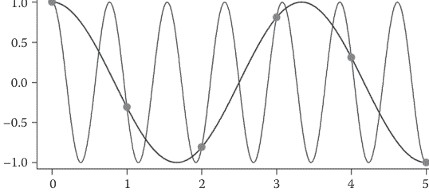

图 1.13 $\cos(2\pi(0.3)t)$ 和 $\cos(2\pi(1.3)t)$ （更高频率）的图，说明这两个信号在整数处一致。

#### 平稳时间序列

1. 在示例 1.3 中

$X(t) = C\cos(\lambda t + Y),$

其中，如前所述，C 和 $\lambda$ 为实值常数，我们考察 $Y \sim \text{Uniform} [0, 2\pi]$ 的特殊情形。我们从示例 1.3 回忆 $\mu=0$ 且 $\gamma(h) = (C^2)/cos(\lambda h)$。因此，$\gamma(h)$ 是周期为 $2\pi/\lambda$ 的周期函数，或者说，$\gamma(h)$ 的频率为 $\lambda/(2\pi)$。如方程 1.23 定义的谱

$P_X(f) = \int_{-\infty}^{\infty} e^{-2\pi f h} \gamma(h)dh,$

$P_X(f) = \frac{C^2}{2} \int_{-\infty}^{\infty} e^{-2\pi f h} \cos(\lambda h)dh$

$P_X(f) = \frac{C^2}{4} \int_{-\infty}^{\infty} [\delta(f-\frac{\lambda}{2\pi}) + \delta(f+\frac{\lambda}{2\pi})]dh,$

其中 $\delta$ 表示狄拉克 delta 函数。

注：方程 1.32 中的积分如果将其视为不适当的黎曼积分则不收敛。此外，方程 1.33 中的 $\delta$-函数并不是真正的函数而是函数。尽管如此，方程 1.32 和 1.33 的结果可以通过将方程 1.32 中的积分解释为“$\delta$ 积分的序列”并且将 $\delta$ 解释为“广义函数”来使其严格化。

关于广义函数的讨论，参见 Kanwal (1998) 和 Lighthill (1959)。我们在这本书中需要的狄拉克函数性质为：

$$\int_{-\infty}^{\infty} \delta(t-t_0)f(t)dt = F(t_0).$$

$$\int_{-\infty}^{\infty} e^{-2\pi i t u} du = \delta(t).$$

图 1.14 显示了 $f \ge 0$ 且特殊情形 $\lambda=0.2\pi$ 时方程 1.33 给出的 $P_X(f)$ 的图。数据“频率内容”集中在单一频率 $\lambda/(2\pi)=0.1$ 上的事实由 0.1 处的无限尖峰指示。

## 30 应用 R 进行时间序列分析

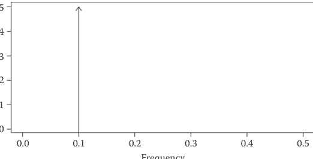

图 1.14

示例 1.3 中 $X(t)$ 的功率谱，$c=1, \lambda=0.6$。

- 2. 现在，我们再次考虑图 1.10 左上角绘制的数据集，它来自连续参数过程的样本

X(t) = \cos(2\pi(0.025)t + \psi_1) + 1.5\cos(2\pi(0.1)t + \psi_2) \n+ 2\cos(2\pi(0.15)t + \psi_3), \quad (1.35)

其中 $\psi_i, i=1,2, 3$ 为独立随机变量，服从 Uniform $[0, \pi]$ 分布。在图 1.10 中绘制的特定样本中，$\psi_0=0, \psi_1=1$ 且 $\psi_2=2.5$。第一分量（右上图）具有频率 $f=0.025$（周期或循环长度为 $1/0.025=40$），第二分量（左下图）具有频率 $f=0.1$（周期 $=10$），而第三分量（右下图）具有频率 $f=0.15$（周期 $=6.67$）。$X(t)$ 在方程 1.35 中的自相关（参见练习 1.11）和谱在图 1.15 中给出。从图 1.15b 中的谱可以非常清楚地看出，频率内容完全集中在频率 0.025、0.1 和 0.15 处。谱确实做得

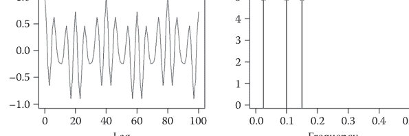

图 1.15

(a) $X(t)$ 的自相关和 (b) 方程 1.35 中 $X(t)$ 的谱。

#### 平稳时间序列

比起仅通过图 1.15a 中的自相关或图 1.10 左上角的实际实现来检查，可以更好地显示数据的底层频率内容。我们通常将谱或谱密度作为 f 的函数绘制出来以便检查其特征。谱或谱密度中的峰值表明在相关频率上数据中存在周期性行为。在我们将在本书中通常分析的离散参数数据中，峰值不会像图 1.14 和 15 中那样呈“尖峰”状，而会更宽，表明峰值附近存在额外的频率内容。这在下面的例子中得到了说明。

#### 示例 1.8：包含两个主导成分的信号

在图 1.16a 中（数据集 fig1.16 in t6），我们展示了一个长度为 250 的实现，很明显数据具有伪周期行为，周期约为 25（在 250 个点的实现中约有 10 个周期）。还明显可见一个更高频率的分量，由“锯齿”行为指示。图 1.16a 是来自阶数为 4 的 AR 模型的一个实现（我们将在第 3 章中讨论这些），在图 1.16b 中，我们展示了该模型相关的真实谱密度。

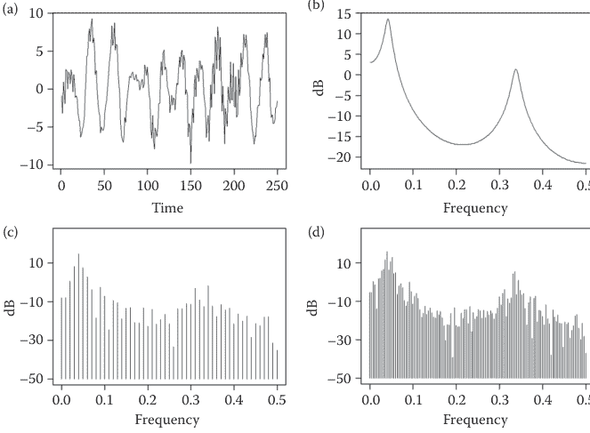

图 1.16

(a) 实现，(b) 真实谱密度，(c) 基于前 100 个点的周期图，以及 (d) 基于全部 250 个点的周期图，与示例 1.8 相关。

## 应用时间序列分析与 R

谱密度在约 $f=0.04=1/25$ 处有一个峰值，与数据中周期约为 25 的周期性行为相关，并且在 $f=0.33$ 处也有一个峰值，与数据中周期长度约为 0.3 的更高频率内容相关。注意在图 1.16b 的谱密度中，我们没有像图 1.14 和 1.15 那样的尖峰，而是表明在接近 0.04 和 0.33 的频率上存在周期性行为。

在继续之前我们指出两点。

- 1. 对于实时间序列 $P(f)=P(-f)$ 且同样 $S(f)=S(-f)$ 问题 1.19a)。因此，实数据的谱或谱密度的图通常仅针对 $f\geq 0$，正如在图 1.14 至 1.16 中所做的那样。

- 2. 在图 1.16b 中，我们实际上在对数尺度上绘制谱。这样做有两个原因。次要峰值在这种图上更易辨认，并且 $10\log_{10}S_X(f)$ 将纵坐标轴的单位置于分贝（dB），分贝是衡量声学能量和工程中广泛使用的标准单位。


### 1.6 离散时间序列功率谱和谱密度的估计

从数据估计功率谱和谱密度可能是一个具有挑战性的问题，文献中有多种估计技术。我们将在此处简要介绍该主题，但在后面的章节中会再次讨论。给定离散参数时间序列的谱在方程 1.29 中，似乎可以通过简单地将第 1.4 节中讨论的样本自协方差代入方程 1.29 来获得谱的自然估计量。由此得到的估计量称为样本谱，并在定义 1.14 中定义。

#### 定义 1.14

$X$，为定义在整数上的离散平稳时间序列。基于该时间序列长度为 $n$ 的实现得到的样本谱为

```
$$\hat{S}_X(f)=\hat{\sigma}_X^2+2\sum_{k=1}^{n-1}\hat{\rho}_k\cos(2\pi fk),$$
```

对于 $|f|\leq 0.5$。样本谱密度为

```
$$\hat{S}_X(f)=1+2\sum_{k=1}^{n-1}\hat{\rho}_k\cos(2\pi fk).$$
```

对和的限制 $n-1$ 是合理的，因为对于 $k \geq n$ 的样本自协方差和自相关被定义为零。

一个相关的估计量是周期图，它只是样本谱在基频 $f_1 = 1/n$ 的谐波处求值。具体地，谐波 $f_j$ 由下式给出

```
$f_j = \frac{j}{n}, j=1,...$
$f_j = \frac{n}{2} (if \ n\ is even)$
$f_j = \frac{j}{n}, j=1,...,m (if \ n\ is odd and $n=2m+1).$
```

#### 定义 1.5

设 $X_i$，为定义在整数上的离散时间序列。基于该时间序列长度为 $n$ 的实现得到的周期图为

```
$I(f_j) = \hat{\sigma}_X^2 + 2 \sum_{k=1}^{n-1} \hat{\gamma}_k \cos(2\pi f_jk),$ (1.38)
```

其中 $f_j$ 为前面定义的谐波。

周期图也可以用信号的有限傅里叶表示来替代定义，并作为数据有限傅里叶变换的模平方。参见附录 1A。当样本谱和周期图是谱的明显估计量时，它们作为估计量并不表现良好。下面的定理 1.4 概述了样本谱的性质。

#### 使用 R：twge R 命令

```
period.wg(x, dbcalc,plot)
```

计算并（可选）绘制时间序列实现 `x` 的周期图，要么以（dB）要么非对数尺度。有关更多详细信息，请参阅附录 1B。

#### 定理 1.4

设 $X_i$，为定义在整数上的离散平稳时间序列，并设 $\hat{P}_X(f)$ 表示定义 1.14 中给出的样本谱。$\hat{P}_X(f)$ 具有以下性质：

- $\hat{P}_X(f)$ 是渐近无偏的，即 $\lim_{n\to\infty} \hat{P}_X(f) = P(f)$。

- $\hat{P}_X(f)$ 不是 $P_X(f)$ 的一致估计量，且 $Var[\hat{P}_X(f)]$ 随着 $n \to \infty$ 不会减小，

## 应用时间序列分析与 R

有关更多详细信息，请参阅 Parzen (1962)。在图 1.16c 和 d 中，我们展示了基于前 100 个点和整个实现的周期图（以 dB 在基频的谐波处绘制的垂直条），分别。周期图在视觉上有些不同，因为 (c) 在点 $f_j=j/100, j=1, \dots, 50$ 处绘制；而 (d) 中的周期图在更细的划分上（即在 $f_j=j/250, j=1, \dots, 125$ 处绘制）。缺乏（数学）一致性体现在基于 $n=250$ 的周期图与 $n=100$ 的一样具有变异性；随着 $n$ 的增加我们几乎没有获得改进。应该注意的是，尽管周期图如方程 1.38 中所定义及其替代形式通常被研究为谱的估计量，但我们使用标准化周期图（以 dB 为单位）来估计谱密度（即，我们在方程 1.38 中使用 $\hat{\gamma}_k$）。

样本谱和周期图的基本问题是，当 $j$ 接近 $n$ 时，对 $\gamma$ 的估计无论 $n$ 的大小如何都极其不稳定。大量研究已投入到对样本谱进行平滑以获得更好的谱估计量。一种常见的平滑谱估计量类型具有一般形式

```
$$\hat{P}_S(f) = \lambda_0\hat{\gamma}_0 + 2\sum_{k=1}^{M} \lambda_k\hat{\gamma}_k\cos(2\pi f/k), \quad (1.39)$$
```

其中截断点 $M$ 选择为远小于 $n$，并且 $\hat{\lambda}_k, k=0, 1, \dots, M$ 是一个随着 $k$ 增大而衰减的窗函数。三种经典窗函数的权重为：

- 1. Bartlett（三角）窗

$$\$\lambda_k = 1-\left(\frac{k}{M}\right), \quad k=0,1,\dots,M$$

$n=0, \quad k>M$

- 2. Tukey 窗

$$\$\lambda_k = \frac{1}{2}\left[1+\cos\left(\frac{k\pi}{M}\right)^2\right], \quad k=0,1,\dots,M$$

$n=0, \quad k>M$

- 3. Parzen 窗

$$\$\lambda_k = 1-6\left(\frac{k}{M}\right)^2+6\left(\frac{|k|}{M}\right)^3, \quad 0<k\le M/2$$

$n=2\left[1-\left(\frac{|k|}{M}\right)^3\right], \quad M/2<k\le M$

$n=0, \quad k>M.$$

#### 平稳时间序列

在图 1.17 中，我们展示了对图 1.16a 中长度为 n=250 的实现使用 Parzen 窗并采用四种不同 M 值的周期图平滑版本。M 的选择有些主观，目标是在分辨率和变异性之间取得平衡。可以看出 M 降低了 P(f) 的变异性而偏差增加。很明显，在图 1.17a 中，M=5 产生了一个非常平滑的谱估计，基本上丢失了两个峰值这一关键谱特征。图 1.17b 显示 M=10 在分离峰值方面做得更好，但低频谱估计略有平滑，使得平滑版本中的实际峰值在 f=0。此外，M=100 似乎过大，图 1.17d 中的相关估计器比图 1.6d 中显示的真实谱（周期图）平滑不了多少。截断点 M=2n 的常见选择，其中 n 为实现长度（本例中 M=31）对应于图 1.17c，可以看出由此得到的估计器相当平滑且清楚地显示了两个峰值。窗类型和截断点的选择称为窗抽样。Percival 和 Walden (1993) 以及 Jenkins (1968)。

其他类型的谱估计器包括涉及数据抽样的技术，其中包括多抽样技术。Percival 和

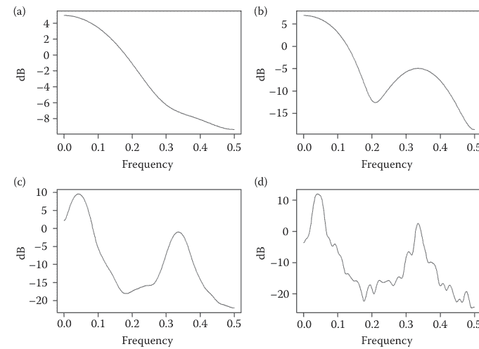

**图 1.17** 使用 Parzen 窗对图 1.16 中的数据进行窗化谱估计，采用不同 M 值。(a) M=5，(b) M=10，(c) M=31，(d) M=100。

Walden (1993) 和 Thomson (1982)。AR 和 ARMA 谱估计器在第 7.7 节中讨论。

**使用 R：** 用于谱估计的多个 R 函数可用。


### 1. `parzen.wge(x, dbcalc, trunc, plot)` 计算并可选择绘制基于 Parzen 窗口的光滑周期图，使用截断点 `$M=2\sqrt{n}$` 对时间序列窗口 `x`。

### 2. `plot.sample.wge(x,lag.max, trunc)` 绘制一次实现、样本自相关、周期图，以及基于 Parzen 窗口的光滑周期图（以 dB 为单位的虚线）。

### 3. `plot.parzen.wge(x,m2)` 绘制周期图和最多 3 个具有不同截断点的 Parzen 窗口谱估计（均以 dB 绘制）。

更多细节请参见附录 1B。

## 1.7 时间序列模拟数据

### 1.7.1 模拟数据

在本节中，我们研究从已知时间序列模型模拟的时间序列实现。对每个实现，我们将研究自相关和谱密度，以便更好地理解各自所传达的信息。用于生成这些实现的阶数为 `$p$` 的 AR 模型 `$(AR(p))$` 将在第 3 章中详细讨论。对于这些模型，`$\rho_1$` 和 `$S(f)$` 可使用第 3 章中给出的结果获得。

#### 示例 1.9：两个 AR(1) 模型

图 1.18a 和 1.19a 显示了来自 AR(1) 模型长度为 250 的实现

```
X_t = 0.9X_{t-1} + a_t;    (1.40);
```

和

```
X_t = -0.9X_{t-1} + a_t;    (1.41);
```

分别，`$a_t$` 是均值为零、方差为单位的高斯白噪声。我们注意到图 1.18a 中的序列具有漂移行为，没有周期性趋势。还请注意，对于较小的 `$k$`，`$X_i$` 与 `$X_{i+k}$` 之间似乎存在更高的相关性。另一方面，图 1.19a 中的实现显示出快速振荡。

模型 `(1.40)` 和 `(1.41)` 的真实自相关 `$\rho_k$` 分别显示在图 1.18b 和 1.19b 中。在图 1.18b 中，可以看到真实自相关指数衰减至零，但对于较小的 `$k$`，`$X_i$` 与 `$X_{i+k}$` 之间存在相对较高的正相关，这与我们从数据中观察到的结果一致。图 1.19b 中显示的自相关似乎是指数阻尼的。在图 1.18c 中，`$f=0$` 处的峰值表明相关实现显示出很少或没有周期性行为，数据主要是低频，没有周期性趋势。另一方面，图 1.19c 中的谱图在 `$f=0$` 附近接近于零，并在 `$f=0.5$` 处达到最大值，表明数据具有高度振荡的性质，即它们主要是高频，周期约为 2。

**使用 R**：R 命令用于创建图 1.18 至 1.22 中所示的图，显示来自指定 ARMA 模型的实现、理论自相关和谱密度，可以使用与本书相关联的函数 `plot.true.wge` 获得。该函数将在附录 3B 中讨论。

平稳时间序列

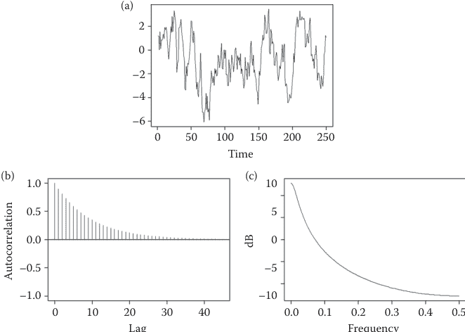

图 1.18

与示例 1.9 中模型 `(1.40)` 相关的图。 (a) 实现。 (b) 自相关图。 (c) 谱密度图。

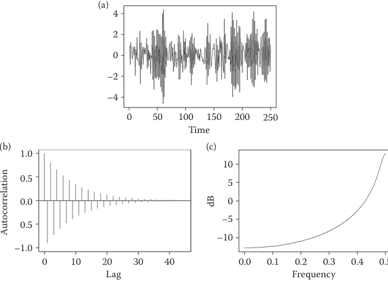

**图 1.19** 与示例 1.9 中模型 `(1.41)` 相关的图。 (a) 实现。 (b) 自相关图。 (c) 谱密度图。

#### 示例 1.10：一个 AR(2) 模型

```
X_t = 1.6X_{t-1} - 0.95X_{t-2} + a_t,    (1.42),
```

图 1.20 显示了与 AR(2) 模型相关的图

其中 `$a_t$` 是均值为零、方差为单位的高斯白噪声。在图 1.20a 中，我们显示了来自该模型长度为 250 的实现。实现显示出伪周期性趋势，表明周期约为 10 个单位，数据在 250 个时间点中经历了约 25 个周期。在图 1.20b 中，我们显示了基于 AR(2) 模型的真实自相关 `$\rho_h$`，这些自相关显示出阻尼正弦行为，周期约为 11 个单位。然而，数据的精确周期内容仍然模糊，因为数据中明显的周期长度各不相同。图 1.20c 显示了该时间序列模型的以 dB 为单位的谱密度，我们看到在 `$f=0.09$` 处有一个尖锐峰值，表明数据中存在伪周期性行为，主导周期为 `1/0.09 = 11.1`。请注意，频率非常接近 `$f=0.09$` 的频率在真实谱密度中也具有相当大的值，这在数据中表现为周期长度变化为 11。这与图 1.14 中的谱形成对比，其中数据具有“纯”周期分量，而真实谱密度包含一个尖峰，没有来自附近频率的贡献迹象。

使用 R 进行应用时间序列分析

平稳时间序列

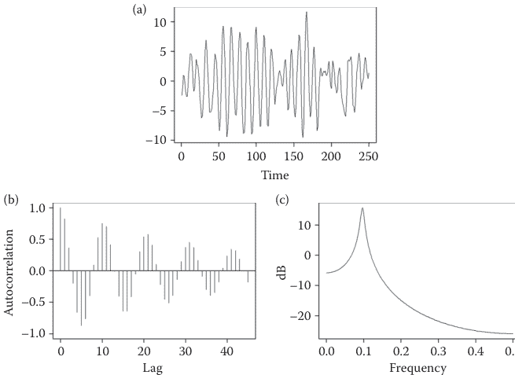

**图 1.20** 与示例 1.10 的模型相关的图。 (a) 实现。 (b) 自相关图。 (c) 谱密度图。

**示例 1.11：具有一个以上主导频率分量的 AR(4) 过程**

在图 1.21 中，我们显示了基于模型的图

```
X_i = 0.85X_{i-1} + 0.03X_{i-2} + 0.745X_{i-3} - 0.828X_{i-4} + a_i,    (1.43),
```

其中 `$a_i$` 是正态零均值、单位方差噪声。在图 1.21a 和 c 中，我们显示了实现和真实谱密度，它们先前已分别在图 1.16a（数据集合 fig1.16a in tsew）和 b 中显示。我们注意到与周期约为 30 的低频分量相关，而数据中也显示出较高频率分量的迹象。图 1.21c 中的谱密度图清楚地表明数据中存在两个频率，一个约为 `$f=0.04$`

使用 R 进行应用时间序列分析

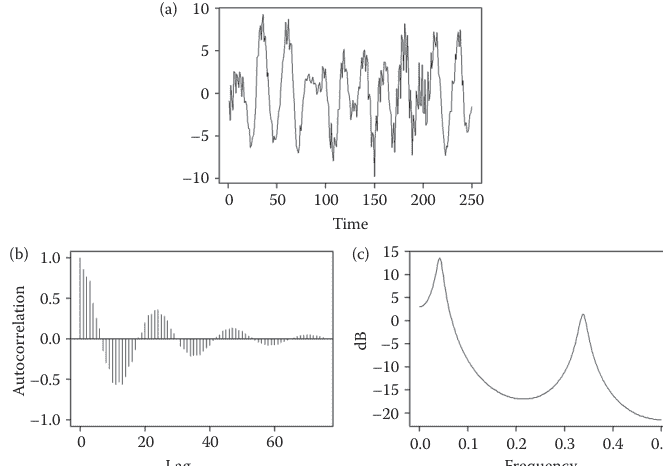

**图 1.21**

与示例 1.11 的模型相关的图。 (a) 实现。 (b) 自相关图。

(c) 谱密度图。

另一个在 `$f=0.34$`。图 1.21b 中的自相关表现出与图 1.20b 中相似的正弦性质。然而，请注意，图 1.21b 中的自相关没有真正显示出较高频率分量的存在迹象。这说明了谱检测数据中周期存在的能力，而自相关却没有，即使如前所述，它们包含等价的数学信息。

**示例 1.12**：白噪声

图 1.22a 显示了来自白噪声序列 `$X_i=a_i$` 的实现，其中 `$a_i$`，是均值为零、方差为单位的，图 1.22b 显示了真实自相关。这是与图 1.3b 和 1.4b 中显示的相同实现和理论自相关。如前所述，注意数据看起来完全随机，没有可辨别的周期或趋势模式。

真实自相关 `$\rho_k$` 除 `$k=0$` 外均为零。在图 1.22c 中，我们显示了真实谱密度。对于离散白噪声，方程 1.30 变为 `$S(f)=1$, $|f|\leq 0.5$`。因此，离散白噪声具有恒定谱密度，谱密度图只是水平直线的图。由于我们在图 1.22c 中绘制 dB，谱密度图是在 dB=0 处的水平线。

平稳时间序列

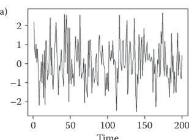

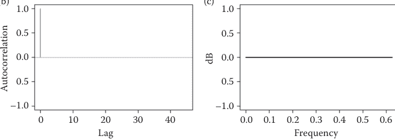

图 1.22

(a) 白噪声实现，(b) 自相关，以及 (c) 谱密度图。

### 1.7.2 实际数据

以下示例包含来自四个已被广泛研究的时间序列的实现。在这些示例中，我们不知道理论模型，我们将显示实现的图、样本自相关以及谱密度的估计。

#### 示例 1.13：太阳黑子数据

最有趣的时间序列数据集之一是太阳黑子数据。太阳黑子是太阳上的太阳爆发区或极端大气扰动区。太阳黑子因其似乎对地球产生某种影响而在科学界引起了很大兴趣。例如，高太阳黑子活动往往会导致无线电通信干扰并与更高的紫外线强度和正常光活动相关。其他人试图将太阳黑子活动与降水、全球变暖等联系起来，结果不太确定。1848 年，瑞士天文学家 Rudolf Wolf 引入了一种枚举每日太阳黑子活动的方法，使用他的方法的月度数据自 1749 年以来可用。参见 Waldmeier (1961) 和各种互联网网站。

# 使用 R 进行应用时间序列分析

我们的兴趣在于年度数据，在图 1.23a（数据集 `ss08_tswage`）中，我们绘制了 1749–2008 年的这些年平均值。对该数据建模的问题在过去一个世纪里已被许多研究者研究过。特别是，Yule（1927）提出了 AR 模型来表示数据的受扰动周期性。

图 1.23a 中的太阳黑子数据揭示了一种拟周期性，其中值得注意的是太阳黑子数据在 9 年和 11 年之间。事实上，太阳黑子并非正弦性质，其峰值的变化远大于其谷值的变化（参见 Tong, 1990）。在图 1.23b 中，我们展示了太阳黑子数据的样本自相关。图 1.23c 显示了谱密度，其中我们使用 Parzen 窗口估计 `$S(f)$`，`$M=2\sqrt{n}=32$`。在图 1.23c 中，我们注意到在大约 `$f=0.09$` 处有一个相当尖锐的峰值，表明数据中存在约 11 年的主导周期。也有趣的是，在 `$f=0$` 处也存在一个峰值，可能表明存在更长周期或非周期行为。

## 使用 R：图 1.23 所示的图（即时间序列实现、样本自相关和 Parzen 谱密度的图

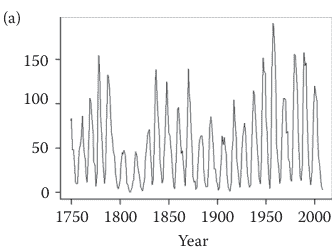

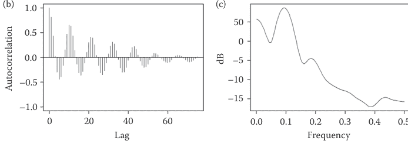

FIGURE 1.23

Plots related to sunspot data. (a) Annual sunspot numbers. (b) Sample autocorrelations. (c) Parzen window spectral estimator.

#### 平稳时间序列

估计) 可以使用 `twage` 命令 `plot.sample.wge` 获得（它还将周期图作为第四个图绘制）。参见附录 1B。

### EXAMPLE 1.14: GLOBAL TEMPERATURE DATA

人们对全球变暖的担忧在过去 25 年里引起了极大的关注。感兴趣的数据集提供了平均年温度的度量。其中一个数据集由东英吉利大学气候研究单位与气象局哈德利中心联合收集。图 1.24a 中给出的数据是 1850–2009 年的年度温度信息（基于相对于全球平均值的温度位置）。所绘制的数据（数据 `hadley` in `twage`）是温度异常值（即与 1961–1990 年期间平均值的偏差），基于陆地和海洋温度站。在数据集中，很明显在此期间温度有所上升。也有相当大的变化，但没有明显的周期性行为。在图 1.24b 中，我们看到较低滞后的自相关为正，表明例如，今年和明年的年平均温度之间存在相当大的正相关。图 1.24c 中的谱估计器（使用

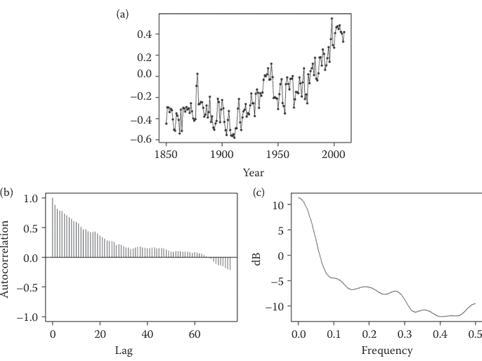

FIGURE 1.24

Plots related to global temperature data. (a) Global temperature data. (b) Sample autocorrelations. (c) Parzen window spectral estimator.

Parzen 窗口平滑样本谱，使用 `$M=2\sqrt{n} = 25$` 也表明缺乏周期性行为。`$f=0$` 处的峰值表明存在非常长的周期或周期性行为。谱估计器中的较小峰值可能有意义也可能没有意义。

### EXAMPLE 1.15: AIRLINE DATA

图 1.25a（数据集 `tswge`）是 1949–1960 年国际航空旅行月度总人数（以千计）的自然对数的图。该序列由 Box et al.（2008）研究，并在该书的早期版本中讨论过，通常被分析为季节性时间序列的经典示例。由于航空旅行的季节性，预计存在强烈的季节性模式，例如夏季以及 11 月和 12 月更繁忙。对数据的检查显示夏季旅行更繁忙，12 个月年度模式，以及上升趋势。请注意，12 个月周期似乎不是正弦的，但倾向于“复制”前一年的模式。我们将在第 3 章和第 5 章讨论季节性模型。图 1.25b 显示了样本自相关。对数据中季节性和趋势行为的分析在这里很困难，简单检查这些样本自相关的图对于该分析是不够的。

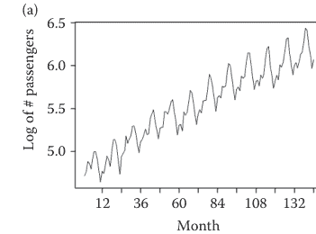

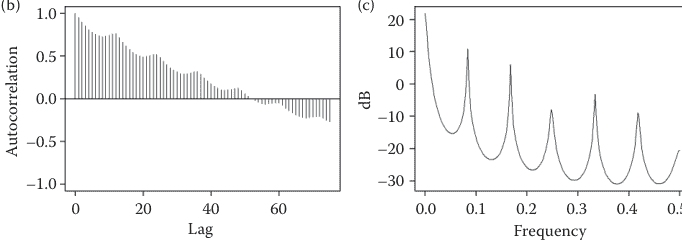

FIGURE 1.25

Plots related to the airline data. (a) International airline passengers. (b) Sample autocorrelations. (c) AR spectral estimator.

#### 平稳时间序列

图 1.25c 显示了 AR 谱密度估计器（参见第 7.7 节）。请注意零处的功率很高，表明数据中存在强烈的趋势（非周期）分量。此外，在 `$f=1/12$` 处的高功率以及 1/12 的谐波，即 `$f=i/12, i=2, 3, \dots, 6$` 非常明显。也就是说，数据中 12 个月、6 个月、...、2 个月周期被生动地显示出来。

### EXAMPLE 1.16: BAT ECHOLOCATION SIGNAL

在图 1.26a（数据 `*noctula*` in `twos`）中，我们展示了从 Nyctalus 猎蝠回声定位信号中取出的 96 个观测值，采样间隔为 `$4 \times 10^{-3}$` s。乍一看，图 1.26a 中的信号似乎是周期性的，其行为类似于图 1.20a 中看到的行为，并且与图 1.23a 中的日落数据 somewhat-similar。然而，样本自相关似乎不寻常，没有像图 1.20b 和 1.23b 中那样的周期性行为。此外，图 1.26c 中谱估计的检查显示没有尖锐峰值，事实上，在 `$f=0.15$` 和 `$f=0.35$` 之间存在一个宽频带，与一个宽“峰值”相关联。图 1.26c 所示的此类谱被称为扩散峰值，表明信号中的行为并非集中在单一频率及其周围，而是存在一系列频率行为。更仔细地检查图 1.26a

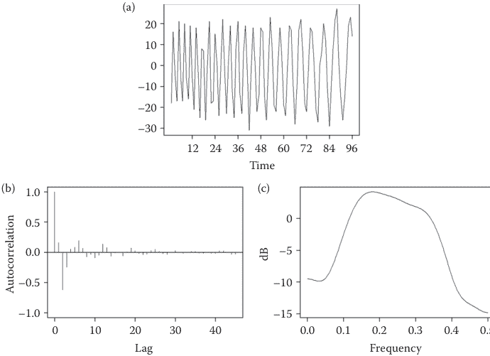

**FIGURE 1.26**

Plots related to Nyctalus noctula hunting bat echolocation signal. (a) Echolocation signal. (b) Sample autocorrelations. (c) Parzen window spectral estimator.

显示频率行为随时间变化。更具体地说，周期长度倾向于随时间延长（频率降低）。因此，似乎数据可能是平稳的，因此出现了问题，“如果周期随时间变化，自相关函数或谱密度意味着什么？” 对这种具有时变频率的数据类型的分析将在第 12 章和第 13 章中讨论。

这些和其他时间序列将在未来章节中更详细地研究。以下章节讨论使用自相关和谱密度等工具，以及 AR 模型等模型来正确分析平稳和非平稳时间序列数据。现在，我们只是简要介绍了这些思想，以帮助读者开始理解这些概念。

## 附录 1A: Fourier Series

在定义 1.15 中，我们将离散时间序列 X 的周期图定义为

```
I(f_j) = \hat{f}_j^2 + 2 \sum_{k=1}^{n-1} \hat{f}_k \cos 2\pi f_j k,    (1A.1)
```

`$f_j$` 是基频 `1/n` 的谐波。具体而言，

```
f_j = \frac{\hat{j}}{n}, j=1,...,\frac{n}{2} (if n is even)
= \frac{\hat{j}}{n}, j=1,...,m, (if n is odd and n = 2m+1).
```

值得注意的是，周期图在方程 1A.1 中可以作为数据傅里叶变换模平方的 1/n 倍得到，如方程 1A.2 所示。

```
I(f_j) = \frac{1}{n} \sum_{i=1}^{n} x_i e^{(-2\pi i tj/n)}^2    (1A.2)
```

方程 1A.1 和 1A.2 相等性的证明留作问题 1.20。

周期图的第三种形式涉及傅里叶级数。在本附录中，我们讨论将傅里叶级数拟合到离散时间序列实现 `$x_t, t=1, \dots, n$` 的主题，我们假设 `$n=2m+1$` 为奇数。也就是说，我们使用有限傅里叶近似 `$x_t$`

```
$$\sum_{j=1}^{m} \left[ a_j \cos\left(\frac{2\pi jt}{n}\right) + b_j \sin\left(\frac{2\pi jt}{n}\right) \right]$
```

系数 `$a_j$` 和 `$b_j$` 使用最小二乘法估计，以便找到使

```
$Q = \sum_{t=1}^{n} \left[ x_t - \sum_{j=1}^{m} \left( a_j \cos\left(\frac{2\pi jt}{n}\right) + b_j \sin\left(\frac{2\pi jt}{n}\right) \right) \right]^2 \quad (1A.3)$
```

最小的 `$a_j$` 和 `$b_j$`。使方程 1A.3 中的 `$Q$` 最小的 `$a_j$` 和 `$b_j=1, \dots, m$` 为

```
$a_j = \frac{2}{n} \sum_{t=1}^{n} x_t \cos\left(\frac{2\pi jt}{n}\right) = \frac{2}{n} \sum_{t=1}^{n} (x_t - \bar{x}) \cos\left(\frac{2\pi jt}{n}\right)\nb_j = \frac{2}{n} \sum_{t=1}^{n} x_t \sin\left(\frac{2\pi jt}{n}\right) = \frac{2}{n} \sum_{t=1}^{n} (x_t - \bar{x}) \sin\left(\frac{2\pi jt}{n}\right)$
```

每个表达式中的第二个等式遵循以下事实


```
$$\sum_{t=1}^{n} \cos\left(\frac{2\pi jt}{n}\right) = \sum_{t=1}^{n} \sin\left(\frac{2\pi jt}{n}\right) = 0,$$
```

对于每个 $j$。使用这种术语，周期图的第三种形式由下式给出

```
$III. $I(f_j) = \frac{n}{4}(a_j^2 + b_j^2), \ j=1, \dots, m. \quad (1A.4)$
```

使用 Parseval 等式（参见 Jenkins and Watts, 1968），我们得到

```
$$\sum_{t=1}^{n} (x_t - \bar{x})^2 = \frac{1}{2} \sum_{j=1}^{m} (a_j^2 + b_j^2), \ j=1, \dots, m. \quad (1A.5)$$
```

方程 `1A.5` 中的结果给出了方差分析分解，显示每个谐波对样本方差的贡献。也就是说，大

$a_j^2 + b_j^2$ 的值指示数据中在 $f_j = j/n$ 处或附近存在频率行为。等式 `1A.4` 与其他两种形式的相等性的证明留作问题 `1.20`。

当 $n=2m$ 为偶数时，先前推导的公式略有变化。具体而言，$a_j$ 和 $b_j$ 的公式对 $j=1,\dots,m-1$ 成立。然而，

$a_m = \sum_{t=1}^n (-1)^t x_t, b_m = 0,$ 且 $l(f_m) = na_m^2$。

## 附录 1B：R 命令

如前言所述，您应安装并加载 R 命令库 `tswage`。这里列出的一些命令只是不需要安装特殊库的 R 命令。这些将被标记为 Base R 命令。执行与第 1 章主题相关的计算和绘图结果的命令分为两类：

- 1. 基本计算和绘图
- 2. “组合例程”，为教学目的提供相关绘图的图形输出

例如，`plot.sample.wege` 绘制一个实现、样本自相关、周期图以及由 Parzen 窗口平滑的周期图。检查这四个图是理解时间序列实现特征的典型步骤。

### 1. 第 1 章的基本计算例程

a. `mean(x)` (base R 函数)：计算时间序列实现 $x_t, t=1,\dots,n$ 的均值，其中 x 是包含时间序列实现的向量。

示例：基本 R 命令

```
data(ss08); ssm = mean(ss08)
```

计算 `tswage` 数据集 `ss08` 中太阳黑子数据的样本均值并将其放入变量 `ssm` 中。在此情况下 $ssm = 52.24385$。

### 2. `tswage` R 函数

`plots.wege(x)`

提供基本 R 绘图命令的简化使用，其中 x, t = 1, ..., n。需要更多灵活性时使用基本 R 绘图命令。

示例：`data(airline); airlog = log(airline); plots.wge (airlog)` 绘制图 `1.25a` 中所示的对数航空公司数据。

- `acf(x, lag.max, type, plot)` (base R 函数)：计算（并可选绘图）时间序列实现的样本自相关（或样本协方差和样本方差），其中 x 是包含时间序列实现 t = 1, ..., n 的向量。`lag.max` 是计算样本自相关（或协方差）的最大滞后。`type="correlation"`（默认）产生样本自相关，“covariance”指定自协方差，“partial”表示偏自相关（在第 8 章讨论）。

`plot` 是一个逻辑变量。`plot = "TRUE"` 产生样本自相关（或自协方差）的绘图。示例：`data(hadley); tempaut = acf(x = hadley, lag.max = 25)`

计算并绘制全球温度数据 `hadley` 中前 25 个样本自相关，如图 `1.2a` 所示。样本自相关被放入向量 `$acf[1]` （包含 26 个元素，计入 `tempaut$acf[1] = 1`，即滞后 0 处的样本自相关）。如果选择 `type = "covariance"`，则向量 `$acf` 包含样本自协方差，且 `tempaut$acf[1]` 包含样本方差（使用除数）。

- `wge(x, dbcalc, plot)` (`tswge` 函数) 计算并可选绘图周期图。，x 是包含时间序列实现 x, t = 1, ..., n 的向量。`dbcalc` 是一个逻辑变量。`dbcalc="TRUE"`（默认）以对数尺度（dB，即 10*log10 计算周期图。`plot` 是一个逻辑变量。`plot = "TRUE"` 产生周期图的绘图（根据 `dbcalc` 以对数或非对数尺度）。

示例：`data(ss08) per = period(ss08)`

计算并绘制周期图（以 dB 为单位）。向量 `per$freq` 和 `per$pgram` 包含频率和相关周期图值（对数或非对数）

- `parzen.wge(x, dbcalc, trunc, plot)` (`tswave` R 函数) 计算并可选绘图基于 Parzen 窗口的平滑周期图。

x 是包含时间序列关系 x, t = 1, ..., n 的向量。

`dbcalc` 是一个逻辑变量。`dbcalc = "TRUE"`（默认）以对数尺度（dB）计算平滑谱估计量

`trunc`（整数≥0）指定截断点。

`trunc = 0`（默认）或未指定 `trunc` 的值）表示默认截断点为 `M=2\sqrt{n}`

`trunc > 0` 为用户指定的截断点，即计算将基于 `M=trunc`

`plot` 是一个逻辑变量。`plot = "TRUE"`（默认）产生平滑谱估计量的绘图（根据取决于）。

示例：

```
data(ss08) <- sparz:parzen.wge(ss08)
```

使用默认截断点 `M=2\sqrt{260}=32` 计算并绘制太阳黑子数据的平滑谱估计量（以 dB 为单位）。向量 `ssparz$freq` 和 `ssparz$pgram` 包含频率和相关的基于 Parzen 的谱估计。

- `gen.sigplusnoise.wge(n,b0,b1,coef,freq,psi,vara,plot,sn)` 是 `tswave` R 函数，用于生成信号加噪声模型的实现

```
x(t)=b0+b1*cos(2\pi*freq[1]+psi[1])
x(t)+coef[2]*cos(2\pi*freq[2]+psi[2])+a(t)
```

`n=` 要生成的实现的<|message|>（t：上述公式中的）指定从 1 到 n 的整数

`b0` 是 y 截距

`b1` 是线性回归分量的斜率（默认 = 0 用于）

`coef` 是指定系数的 2 分量向量（如果只想要一个项则定义 `coef[2]=0`（默认 = c(0,0)）

`freq` 是指定频率分量的 2 分量向量

ts (0 to .5)（默认 = c(0,0)）

`psi` 是指定相位偏移（0 到 2\pi）的 2 分量向量

（默认 = c(0,0））

#### 平稳时间序列

`phi` 是包含噪声过程 AR 模型的向量（见第 3 章）。（默认 = 0）对于白噪声只需使用 `phi` 的默认值。

`vara` 是噪声的方差（默认 = 1）。

注意：`a(t)` 是由函数生成的 `N(0,vara)` 白噪声的向量

`plot` 是一个逻辑变量。`plot = TRUE`（默认）产生生成的实现的绘图。

`sn` 确定模拟中使用的种子。（默认 = 0）（见下文说明）

注意：`sn=0`（默认）产生基于随机种子的结果。如果您希望在后续运行 `gen.sigplusnoise.wge` 时重现相同的实现，则在每次运行中将 `sn` 设置为相同的正整数值。

示例：命令

```
x=gen.sigplusnoise.wge(n=100,coef=c(1.5,3.5))
freq=c(.05,.2),psi=c(1.1,2.8),phi=.7,vara=2
calculates
```

```
x(t)=1.5cos(2π(.05)t+1)+3.5cos(2π(.2)t+2.8)+z(t), t=1,2,...,100
```

`z(t)` 是来自 AR(1) `z(t)=(1-7B)a` 的实现，其中 σ²=2。实现基于随机选择的种子，并且生成的信号加噪声实现被放入向量 `x` 中。

### 2. 第 1 章的组合绘图例程

- a. `plots.sample wge(x,lag.max,trunc,arlimits)` 是 `twge` R 函数，绘制实现、样本自相关、周期图和 Parzen 窗口上的平滑周期图（均以 db 为单位）。

- `x` 是包含时间序列实现 `xr, t=1,...,n` 的向量。`lag.max` 是绘制样本自相关的最大滞后

- `trunc`（整数≥0）指定截断点。

- `trunc=0`（默认）（或未指定 `trunc` 的值）表示默认截断点为 `M=2√n`

- `trunc>0` 为用户指定的截断点，即计算将基于用户提供的值 `M`。

# 应用时间序列分析与 R

`arlimits`（默认 = FALSE）是一个逻辑变量，指定是否在样本自相关图上包含 95% 限线

示例：

```
data(airline)
airlog = log(airline)
airsam = plotts.sample.wge
(x = airlog,lag.max = 50)
```

绘制实现（x = airlog）、样本自相关（lags0 到 lag.max）、以 dB 为单位的周期图，以及使用截断点 `M=2√` 的 Parzen 谱估计量。向量 `ps$freq` 和 `ps$pgrm` 分别包含以 dB 为单位的频率和 Parzen 谱估计。

- * `plotters.wge = function(x,m2)` 是 `tswge` 函数，绘制周期图和多达 3 个具有不同截断点的 Parzen 窗口谱估计（均以 dB 绘制）。

`x` 是包含时间序列实现 `x, t = 1, ..., n` 的向量。

`m2` 是 2 分量向量，附加提供的截断点（默认 = c(0,0)）

示例：

`m2 = c(10,24)` 表示除默认截断点外，Parzen 谱估计量还将使用截断点 10 和 24 计算

`m2 = c(0,0)` 表示不使用附加截断点

`m2 = c(10,0)` 表示使用一个附加截断点（10）

`dbplot = TRUE(default)` 产生以 dB 为单位的谱图

示例：假设 `x` 包含使用 `gen.sigplnoise.wge` 生成的 `n = 250` 的实现，并且您希望在各种截断点计算 Parzen 谱密度。您可以使用以下方法

```
x = gen.sigplnoise.wge (n = 250, coef = c(3,1), freq = c(.1,.52)
psi = c(0,1), phi = 0, var = 1
pz = plotters.wge(x, m2 = c(10,50))
```

产生以 dB 为单位的周期图绘图，截断点 `M=2√=31.6`（向下取整为 `M=31`）的 Parzen 谱估计，以及截断点 `M = 10` 和 `M = 50` 的 Parzen 谱估计。所有绘图均以 dB 为单位。`ps$freq` 是一个包含频率的向量

谱估计是计算得到的（在我们的例子中为 1/250、2/250、...、125/250），以及向量 `p$db` 和 `p$dbz1`，它们分别包含在 `p$freq` 中的频率处的周期图和截断点 `M=31` 处的 Parzen 谱密度。此外，在本例中还输出了向量 `p$pz2` 和 `p$dbz3`，它们包含使用截断点 `M=10` 和 `M=50` 的 Parzen 谱密度估计。

## EXERCISES

## Applied Problems

使用 R 求解问题 1.2 至 1.7。

- 1.1 以下数据是某假设公司以百万美元计的年度销售额：

| Period | Sales |
|---|---|
| 1 | 76 |
| 2 | 70 |
| 3 | 66 |
| 4 | 60 |
| 5 | 70 |
| 6 | 72 |
| 7 | 76 |
| 8 | 80 |

手工计算（即使用计算器）估计值 $\hat{\gamma}_0, \hat{\gamma}_1, \hat{\rho}_0$，和 $\hat{\rho}_1$。

- 1.2 图 1.1a 显示了从 2000 年 1 月到 2009 年 10 月西德克萨斯州原油价格的图，图 1.19b 显示了从 1990 年 1 月到 2009 年 12 月宾夕法尼亚州月平均温度。这些两个数据集在 `$tswage$` 中分别为 `$wcrude$` 和 `$patemp$`。对于每一个实现，绘制样本自相关、周期图，以及在截断点 `$M=2\sqrt{n}$` 处的基于 Parzen 窗的谱密度估计器。解释这些图如何描述（或未能描述）数据中的行为

- 1.3 图 1.2c 显示了航空公司数据的 AR 估计器（以 dB 为单位）（“非对数”数据在集合 `$airline$` 中，对数数据在集合 `$airlog$` 中）。这些数据的周期图和窗口化谱密度估计器使用基于 Parzen 窗的谱密度估计，截断点为 `$M=2\sqrt{n}, M=10$`，和 `$M=75$`（均以 dB 为单位）。（全部以 dB 为单位）比较和对比你得到的四个谱密度估计，并将它们与图 1.25 中的 AR 谱估计器进行比较，关于能够看到与较高频率相关的次要谱峰的能力。

- 1.4 下面显示了三组包含四个图的图。第一组显示了四个长度为 `$n=100$` 的每个从时间序列模型生成的实现。第二组包含基于用于生成实现的模型（随机顺序）的四个自相关函数，第三组显示了四个谱密度。将每个实现与相应的自相关和谱密度匹配。解释你的答案。

### Realization 1

### Realization 2

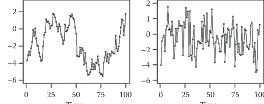

### Realization 3

### Realization 4

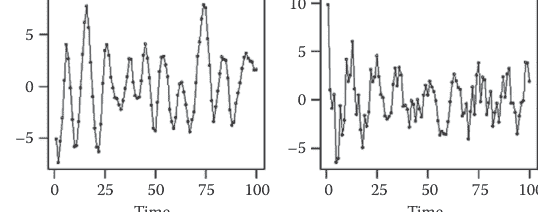

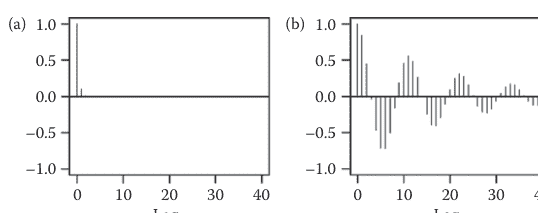

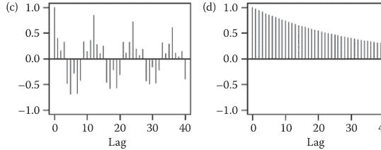

## Stationary Time Series

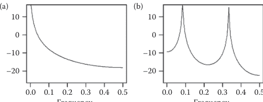

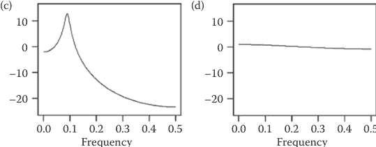

- 1. 数据集 `fig1.21a` 在 R 包 `twge` 中包含图 1.21a 中显示的长度为 `n=250` 的实现。请注意，数据和谱密度（但不是自相关）显示了两个频率的证据，一个较低的频率约为 `f=0.05`，一个较高的频率约为 `f=0.33`。求该实现在 `M=31` 时的 Parzen 谱密度估计。绘制该谱密度估计以 dB（10 log10）表示，并再次不取对数。评论在谱密度估计中关于两个主导频率可见的信息。对数（作为 dB）有什么影响？

- 2. 从信号加噪声模型生成长度为 `n=100` 的实现

$X_t = 3\cos(2\pi(0.05)t) + 1.5\cos(2\pi(0.35)t) + a(t),$

其中 $a$ 是 $N(0,1)$ 白噪声。对于这些数据，绘制

讨论可以从每个图中看到的数据的循环特征。哪一个图最能表明数据中两个主导频率（即 0.05 和 0.35）？

## Applied Time Series Analysis with R

注意：模型的实现

$X_t = c_1\cos(2\pi f_1 t) + c_2\cos(2\pi f_2 t) + N_t$,

其中 N,normal(0,1) 白噪声可以使用 `tswge` R 函数 `gen.sigplusnoise(n,b0,b1,coef,freq,psi,phi,vara,plot,sn)` 获得。有关详细信息，请参阅附录 1B。

- 1. 找到一个时间序列数据集（在互联网上等），未在书中或课堂上讨论过。对于这个时间序列：

  - a. 绘制时间序列实现
  - b. 绘制样本自相关。编写代码（在 R 或其他方式中）（即，不要为此使用预先编写的函数）。
  - c. 描述实现中的行为（游荡、周期性等）以及该行为如何在样本自相关中表现出来
  - d. 绘制周期图
  - e. 使用默认截断点 $2\sqrt{n}$ 解析谱密度估计。描述实现中的行为（游荡、周期性等）以及该行为如何在谱估计器中表现出来

提示：你可以使用 `tswge` 函数 `plots.sample.wge`。

## Theoretical Problems

- 1.8 使用平稳过程的自协方差定义，证明向前或向后看时间并不重要；也就是说

$Cov(Z_t, Z_{t-k}) = Cov(Z_t, Z_{t+k}) = \gamma_k$。

- 1.9 考虑随机过程 $Z_t = a_t$，其中 $a_t$ 对任意 $t$ 独立，其中 $a_t$ 的分布为

$a_t = \begin{cases} c &\text{with probability } \frac{1}{2} &\text{for } c > 0 \\ -c &\text{with probability } \frac{1}{2} \end{cases}$

  - a. 过程 $Z_t$ 是否平稳？为什么或为什么不？
  - b. 该过程参数 $\mu, \gamma_0, \gamma_1$，和 $j > 1$ 时的 $\gamma_j$ 的值是多少？

- 1.10 证明 $k$ 个不相关协方差平稳过程之和也是协方差平稳的

## Stationary Time Series

1.11 设 $X(t) = \cos(2\pi(0.025)t + \psi_i) + 1.5\cos(2\pi(0.1)t + \psi_i) + 2\cos(2\pi(0.15)t + \psi_i$ 为示例 1.7b、方程 1.35 中给出的时间序列。证明 $X(t)$ 是协方差平稳的，并（使用示例 1.3 中的结果）求表达式

  - a. $\gamma(h)$
  - b. $\sigma_X^2$
  - c. $\rho(h)$

1.12 设 $Y_i$ 由下式给出


$Y_i = C_1\cos(2\pi f_it + \psi_i) + N_i, \quad t=0, \pm1,...$

$= H_i + N_i$,

其中

- $N_i$ 是离散白噪声

- $\psi_i$ 分布均匀 $[0, 2\pi]$

- $N_i$ 和 $\psi_i$ 对每个 $t$ 不相关

证明 $Y_i$ 是协方差平稳的，且 $Y_i$ 的自协方差为

$\gamma_k = \frac{C_1^2}{2}\cos 2\pi f_ik, \quad k \neq 0$

$= \frac{C_1^2}{2} + \sigma_{N_i}^2, \quad k=0$。

### 1.13
设 $Z_i, t=0, \pm1, ...$ 为独立正态随机变量，每个均值为 0，方差为 $\sigma^2$，且 $a, b,$ 和 $c$ 为常数。以下哪个过程，如果有，是平稳的？指定均值和协方差函数

- a. $X_i = a + bZ_i + cZ_{i-1}$

- b. $X_i = a + bZ_0$

- c. $X_i = Z_0(ct) + Z_{i-1}\sin(ct)$

- d. $X_i = Z_0\cos(ct)$

### 1.14
$[X_i; t=0, 1, ...]$ 为协方差平稳过程并定义过程

$\{X_i^{(1)}, t=0, 1, ...\} \quad i=1, 2$,

为差分过程

$X_i^{(1)} = X_i - 0.5X_{i-1}$

$X_i^{(2)} = X_i^{(1)} - X_{i-1}^{(1)}$。

证明 $X_i^{(1)}$ 和 $X_i^{(2)}$ 也为协方差平稳

## 58 Applied Time Series Analysis with R

### 1.15
设 X 为均值为 $\mu$、方差为 $\sigma^2 < \infty$ 的随机变量。定义 $Z_t = X$ 对所有 $t$ $t \in I$ 其中 $I=1, 2, \dots$

- a. 证明 $Z_t = X$ 是严格平稳和弱平稳的

- b. 求自相关函数

- c. 绘制“典型”实现

- d. 确定 $\bar{Z}$ 是否对 $\mu$ 遍历

### 1.16
设 $Y_t = a + bt + X$, 其中 $X$, 是协方差平稳过程

- a. $Y_t$ 是否协方差平稳？为什么或为什么不？

- b. 设 $Z_t = Y_t - Y_{t-1}$。$Z_t$ 是否协方差平稳？为什么或为什么不？

$X_t^{(1)} = a_t - \theta_{a_{t-1}}$

$X_t^{(2)} = a_t - \frac{1}{\theta_{a_{t-1}}}$

其中 $a$, 是均值为零、方差为 $\sigma_a^2 < \infty$ 的白噪声过程。

证明 $X_t^{(1)}$ 和 $X_t^{(2)}$ 具有相同的自相关函数

### 1.18
证明 $cos(2\pi.3k) = cos(2\pi.3k)$ 在整数处

### 1.19
证明对于协方差平稳过程 $\{X_t, t=0, \pm1, \pm2, \dots\}$

以下可能成立：

- a. $P_X(-f) = P_X(f), |f| \leq 0.5$.

  $S_X(f) = S_X(-f), |f| \leq 0.5$.

- b. $P_X(f) = \sigma_X^2 + 2\sum_{k=1}^{\infty} \gamma_k cos(2\pi fk), |f| \leq 0.5$.

  $S_X(f) = 1 + 2\sum_{k=1}^{\infty} \gamma_k cos(2\pi fk), |f| \leq 0.5$.

- c. $\gamma_k = \int_{-0.5}^{0.5} P_X(f)exp(2\pi ifk)df$.

  $\rho_k = \int_{-0.5}^{0.5} S_X(f)exp(2\pi ifk)df$.

- d. $\sigma_X^2 = \int_{-0.5}^{0.5} P_X(f)df$.

  $1 = \int_{-0.5}^{0.5} S_X(f)df$.

e. $\gamma_k = 2 \int_{0}^{0.5} P_X(f)\cos(2\pi fk)df.$

$\rho_k = 2 \int_{0}^{0.5} S_X(f)\cos(2\pi fk)df.$

### 1.20
证明附录 1A 中周期图的三种形式的等价性。具体地，证明对于 $j=1, 2, \dots, m$（其中 $n=2m+1$）有以下关系成立：

$$\frac{1}{n} \sum_{t=1}^{n} x_t e^{\frac{-2\pi it}{n}} = \frac{n}{4}(a_j^2 + b_j^2) = \hat{\sigma}_X^2 + 2 \sum_{k=1}^{n-1} \hat{\gamma}_k \cos\left(\frac{2\pi jk}{n}\right).$$

### 1.21
证明定理 1.3


## 2

线性滤波器

我们将要研究的许多时间序列都可以看作是线性算子或滤波器的输出。本章介绍线性滤波器理论的基本概念和术语。我们还讨论了一般线性过程，即具有白噪声输入的线性滤波器，它在平稳过程的研究中起着基础性作用。最后，我们讨论了应用线性滤波器从时间序列实现中去除或保留某些类型频率行为的问题。

### 2.1 线性滤波器简介

考虑由下式给出的过程 $[X_t - \mu; t=0, \pm1, \pm2, \dots]$

$X_t - \mu = \sum_{j=-\infty}^{\infty} h_j Z_{t-j}, \quad (2.1)$

其中

$h_j$ 为常数

$Z_i$ 为随机变量且对每个 $t$ 有 $E[Z]=0$

过程 $X_i$ 被称为线性滤波器的输出，$Z_i$ 为输入。如果 $h_j=0$ 对于 $j<0$，则称其为 *因果滤波器*，$X_i$ 仅依赖于输入 $Z_i$ 的现在和过去值。在本书中，我们关注因果滤波器，因此，尽管定理 2.1 和 2.2 以及定义 2.1 具有非因果的类似物，我们在这里仅对因果滤波器陈述它们。我们将发现使用后移算子 $B$ 很方便，定义为 $B^j Z_i = Z_{i-j}$，以将式 2.1 的因果版本写为

$X_i - \mu = \sum_{j=0}^{\infty} h_j B^j Z_i,\n$=H(B)Z_i, \quad (2.2)$

# Applied Time Series Analysis with R

其中 $H(B) = \sum_{j=0}^{m} h_j B^j$。式 2.1 中的线性滤波器符号描述如下：

$Z_t = \text{Input} \rightarrow [H(B)]_{\text{Filter}} \rightarrow \text{Output} = X_t$

我们将使用以下记号：

$X_t$，为输出

$Z_t$，为输入

$h_j$ 为滤波器权重；合起来，$\{h_j\}$ 称为脉冲响应函数

$H(e^{-2\pi i\omega})$ 为频率响应函数（定义见式 2.4）

在本书记载的随机变量的无穷级数，例如式 2.1 的收敛性始终被认为是均方意义下的收敛。定理 2.1 给出了式 2.1 右端级数均方收敛到 $X_t - \mu$ 的充分条件。

#### 定理 2.1

如果因果线性滤波器的 $h_j=0, 1, \dots$ 满足 $\sum_{j=0}^{\infty} |h_j| < \infty$，对于每个 $t$，$E[Z_t^2] \leq M$ 对某个有限的 $M$ 成立，且 $\mu$ 为实数，则存在唯一的随机过程 $X_t$，满足 $E[X_t^2] < \infty$，使得对每个 $t_i$，

$$\lim_{m\to\infty} E[(X_t - \mu - \sum_{j=0}^{m} h_j Z_{t-j})^2] = 0$$

证明：见附录 2A。

因此，式 2.1 中的等式表示定理 2.1 中的均方收敛，并且当本书记载了如式 2.1 中那样的随机变量的无穷级数而未加说明时，读者可以假定数学结构足够丰富，以保证在某些假设下，这些假设足够宽泛而具有实用性时，所指示的无穷级数均方收敛。我们在章节末尾包含了几个关于这些概念的问题。我们不会在本书记载线性滤波器的广泛数学研究。关于线性滤波器的更多讨论，参见 Koopmans (1974)、Blackwell and Davis (1991) 以及 Shumway and Stoffer (2010)。

线性滤波器

#### 2.1.1 线性滤波器输入与输出谱之间的关系

谱和谱密度的一个特殊用途是描述线性滤波器的效应。以下结果在此方面是基础性的。

#### 定理 2.2

如果 $Z_i$ 和 $X_i$ 是式 2.1 中线性滤波器的输入和输出，其中 $\sum_{i=0}^{\infty} |h_i| < \infty$，则

$P_X(f) = |H(e^{-2\pi i f})|^2 P_Z(f),$

其中 $H(e^{-2\pi i f})$ 为响应函数，由

$H(e^{-2\pi i f}) = \sum_{k=0}^{\infty} h_k e^{-2\pi i k},$

给出

而且，$S_X(f) = |H(e^{-2\pi i f})|^2 (P_Z(f)/\sigma_s^2)$。

证明：见附录 2A

定理 2.2 的重要性在于它提供了关于滤波器权重 $h_i$ 的信息，以及输出信号的频率行为。这在设计具有特定性质的滤波器时很有用，这将在第 2.4 节中讨论。以下我们将 $|H(e^{-2\pi i f})|^2$ 称为平方频率响应。

### 2.2 平稳一般线性过程

我们将要研究的大多数统计时间序列都可以看作是具有白噪声输入的线性滤波器的输出 $X_t$。这种过程称为一般线性过程，定义如下。

### 定义 2.1（一般线性过程）过程 $X_t$，$t=0, \pm1, \pm2, \dots$ 由

$X_i - \mu = \sum_{j=0}^{\infty} \Psi_j a_{i-j},$

给出

定义为一般线性过程，如果 $a_t$ 是零均值且方差有限的白噪声过程且 $\sum_{j=0}^{\infty} |\psi_j| < \infty$。

使用后移算子 $B$，式 2.5 可以写为

$X_t - \mu = \sum_{j=0}^{\infty} \psi_j B^j a_t\n= \psi(B)a_t$$

我们

$$\psi(B) = \sum_{j=0}^{\infty} \psi_j B^j.$$

在本节中，我们将考虑寻找式 2.5 中 $X_t$ 的平稳性条件以及自协方差函数和功率谱的表达式的问题。关于这一点，以下定理很有帮助。我们在此给出其证明，因为它使用了基本概念。

#### 定理 2.3

如果 $X_t$ 是因果线性过程，则 $X_t$ 是平稳的。

证明：不失一般性假设 $\mu=0$。由于 $E[a_t] = 0$，可立即得出 $E[X_t] = 0$，因此 $X_t$ 的自协方差函数由 $E[X_t X_{t+k}]$ 给出。现在，注意到

$X_{t+k} = \sum_{m=0}^{\infty} \psi_m a_{t+k-m}$

我们有

$E[X_t, X_{t+k}] = E\left[\sum_{j=0}^{\infty} \psi_j a_{t-j} \left[ \sum_{m=0}^{\infty} \psi_m a_{t+k-m} \right] \right]\n= E\left[\sum_{j=0}^{\infty} \sum_{m=0}^{\infty} \psi_j \psi_m a_{t-j} a_{t+k-m} \right]\n= E\left[\sum_{j=0}^{\infty} \sum_{m=0}^{\infty} \psi_j \psi_m E[a_{t-j} a_{t+k-m}] \right] \quad (2.6)$

线性滤波器

由于

$E[a_{t-j}a_{t+k}] = \sigma_a^2 \text{ if } m = j+k\n=0 \text{ elsewhere},$

由式 2.6 可得

$E[X_t X_{t+k}] = \sigma_X^2 \sum_{j=0}^{\infty} \psi_j \psi_{j+k}. (2.7)$

即，$E[X_t X_{t+k}]$ 仅依赖于 $k$ 而不依赖于 $t$。已证明以下性质成立：

- 1. $E[X_t] = 0$（对所有 $t$ 为常数）

- 2. $Var[X_t] = E[X_t, X_t]$

$= \sigma_X^2 \sum_{j=0}^{\infty} \psi_j^2$（为常数）\n< \infty \left( \sum_{j=0}^{\infty} |\psi_j| \text{ 收敛} \right)$

- 3. $E[X_t X_{t+k}] = \gamma_k$（由式 2.7 仅依赖于 $k$）

因此，$X_t$ 是平稳的，证明完毕。

#### 2.2.1 一般线性过程的谱和谱密度

利用式 2.3 以及白噪声的谱为常数且由 $P_a(f) = \sigma_a^2$ 给出，一般线性过程 $X_t$ 的谱由

$P_X(f) = |\psi(e^{-2\pi if})|^2 P_a(f)\n= \sigma_a^2 |\psi(e^{-2\pi if})|^2, (2.8)$

给出，谱密度由

$S_X(f) = \frac{\sigma_a^2}{\sigma_X^2} |\psi(e^{-2\pi if})|^2. (2.9)$

给出。

### 2.3 Wold 分解定理

在继续之前，我们陈述 Wold 分解定理，该定理强调了一般线性过程在协方差平稳过程研究中的核心作用。关于此结果的证明和讨论，读者可参考 Brockwell and Davis (1991)。

#### 定理 2.4

设 $(X_t; t = 0, \pm1, \pm2, \dots)$ 为零均值、协方差平稳过程。则 $X_t$ 可表示为两个零均值、不相关、协方差平稳过程之和，

$X_t = U_t + V_t,$

使得

- 1. $U_t$ 为一般线性过程且 $\psi_0 = 1$

- 2. $V_t$ 完全由 $X_t$ 的线性函数及其过去值决定

过程 $V_t$ 通常称为非确定性分量。在第 3 章中，将证明 $U_t$ 称为平稳自回归、移动平均和自回归移动平均过程可表示为一般线性过程。因此，Wold 分解为这些模型在平稳过程分析中具有根本适用性提供了依据。

### 2.4 滤波应用

在许多科学和工程领域，线性滤波器的一个常见应用是从一组数据中“滤除”某些类型的频率。在离开线性滤波器主题之前，我们提供一些基础知识。*低通滤波器* 设计用于去除数据集中较高频率的行为，而 *高通滤波器* 去除较低频率。其他类型的滤波器是 *带通滤波器*，它使特定频带内的频率通过滤波器，以及 *带阻（或陷波）滤波器*，它使除特定频带或范围内的频率之外的频率通过。我们将简要讨论滤波器并提供一些示例。

定理 2.2 是开发具有期望性质的滤波器的基础。例如，假设你想要一个低通滤波器来保留频率

the data less than or equal to the cutoff frequency $f_c = 0.2$ and removes frequencies greater than $f_c = 0.2$. The result in Equation 2.3 says that ideally, we design our filter, so that

```
$|H(e^{-2\pi f})|^2=1, \quad f \leq 0.2\n= 0, \quad f > 0.2, \qquad (2.10)$
```

since according to Theorem 2.2, this would eliminate frequency behavior from the spectrum of the output for $f > 0.2$ and leave it unchanged for $f \leq 0.2$.

Figure 2.1a shows the squared frequency response for this ideal (brickwall) filter, and Figure 2.1b shows the ideal squared frequency response for a band-pass filter that passes frequencies $0.1 \leq f \leq 0.2$.

#### **EXAMPLE 2.1: FIRST DIFFERENCE FILTER**


Consider a time series realization $x_t, t=1, \dots, n$, and suppose we compute the first difference $y_t = x_t - x_{t-1}$. In order to see the effect of this differencing operation, we note that the first difference is a linear filter of the form Equation 2.1 where $h_1=1, h_j=0, j \neq 0$ or 1. We can thus $H(e^{-2\pi f})-1$ is given by $2-\cos(2\pi f)$ and $|H(e^{-2\pi f})|^2=2(1-\cos(2\pi f))$. The plot of $|H(e^{-2\pi f})|^2$ is given in Figure 2.2b where it can be seen that a difference is a high-pass filter, but that it is not a sharp filter in that we show the realization previously shown in Figure 1.3a, which shows a wandering behavior associated with low-frequency behavior, along with some higher frequency oscillation. The first difference data are shown in Figure 2.2c where it can be seen that the low-frequency wandering behavior has been removed with only the higher frequency behavior remaining. The first difference is widely used in time series analysis, but if the goal is to remove a specific range of low frequencies from the data, there are better approaches.

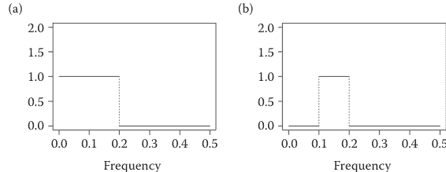

**FIGURE 2.1**

Squared frequency response function, $|H(e^{-2\pi f})|^2$, for ideal (a) low-pass and (band-pass) filters.

# Applied Time Series Analysis with R

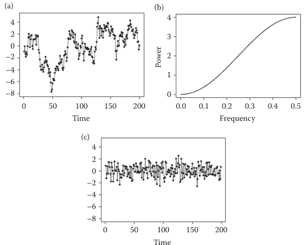

Figure 2.2

(a) Realization previously shown in Figure 1.3a, (b) squared frequency response function for a first difference, and (c) first difference of the data in the (a).

#### EXAMPLE 2.2: SUM AND MOVING AVERAGE FILTERS

Consider again a time series $x_t$, $t = 1, \dots, n$, and suppose we compute the sum $y_t = x_t + x_{t-1}$, which is also a linear filter where in this case $h_0 = 1$, $h_1 = 1$, and $h_j = 0$, $j \neq 0$ or $1$. Calculations show that

> $H(e^{-2\pi if}) = 1 + \cos 2\pi f - i \sin 2\pi f$

and

> $|H(e^{-2\pi if})|^2| = 2(1 + \cos 2\pi f)$

The plot of $|H(e^{-2\pi if})|^2$ is given in Figure 2.3, where it can be seen that it is a mirror image of Figure 2.2b for the difference filter, and as a consequence, low frequencies are passed and high frequencies tend to be removed. Again, this is not a sharp filter and can be improved.

Closer observation of Figures 2.2b and 2.3 shows that $|H(e^{-2\pi if})|^2=4$ when $f=0.5$ for the difference filter and when $f=0$ for the sum filter. The goal of a filter is to leave some frequency content unchanged and remove others. Thus, according to Theorem 2.2, it is desirable that

## Linear Filters

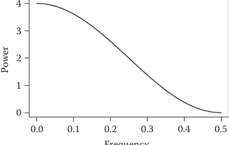

**FIGURE 2.3**

Squared frequency response functions for a 2-point sum filter.

$|H(e^{-j2\pi f})|^2 = 1$ for the range of frequencies that are to be retained. To this end, we consider the three moving average filters

$y_i = (1/2)(x_i + x_{i-1})$ 2-point moving average

$y_i = (1/3)(x_i + x_{i-1} + x_{i-2})$ 3-point moving average

$y_i = (1/7)(x_i + x_{i-1} + x_{i-2} + x_{i-3} + x_{i-4} + x_{i-5} + x_{i-6})$ 7-point moving average for the corresponding frequency response functions

> $H(e^{-j2\pi f}) = \frac{1}{2}(1 + 2\cos 2\pi f - i\sin 2\pi f)$ 2-point

$\frac{1}{3}(1 + 2\cos 2\pi f)$ 3-point

$\frac{1}{7}(1 + 2\cos 2\pi f + 2\cos 4\pi f + 2\cos 6\pi f)$ 7-point.

The squared frequency response functions for these moving average filters are shown in Figure 2.4 where it can be seen that these are all lowpass filters (smoothers). Also, as the number of data values involved in the moving average filter increases, the "cutoff" frequency decreases and the filter becomes "sharper" in the squared frequency response is closer to the ideal filter. Figure 2.5 shows the result of applying the three moving average filters to the data in Figure 2.2a. As would expected from Figure 2.4, it can be seen that as the number of points in the moving average increases, the smoother the output series becomes. In all these cases, the low-frequency "wandering behavior" in the original series is retained.

#### 2.4.1 Butterworth Filters

One of the common filters used by scientists and engineers is the Butterworth filter (see Butterworth, 1930; Porat, 1997). This filter will

# Applied Time Series Analysis with R

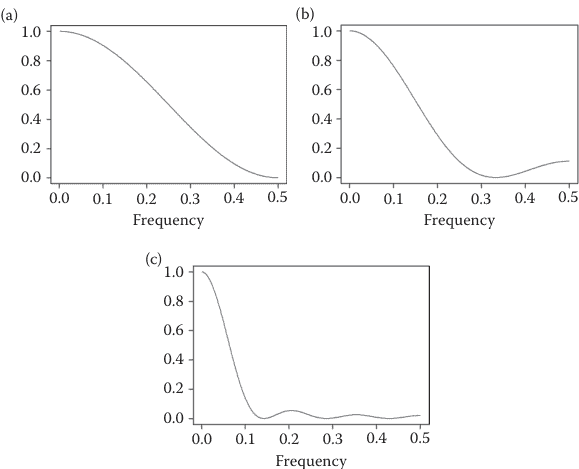

**FIGURE 2.4** Squared frequency response functions for three moving average smoothers. (a) 2-point moving average: (b) 3-point moving average. (c) 7-point moving average.

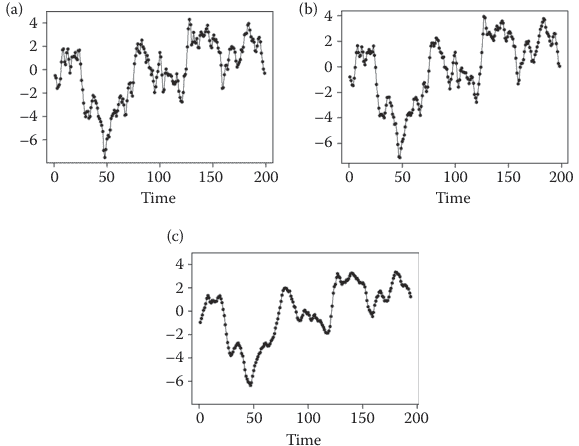

**FIGURE 2.5** Output series from applying three moving average smoothers to the data in Figure 2.2a. (a) 2-point moving average. (b) 3-point moving average. (c) 7-point moving average.

## Linear Filters

be briefly introduced here. While the Butterworth filter can be of any type (low pass, high pass, etc.) our discussion will focus on an N-th order low-pass Butterworth filter, which has a squared frequency response function

```
$|H(e^{-2\pi f})|^2 = \left(\frac{f}{f_c}\right)^{2N}$
```

Increasing the value of N sharpens the filter as shown in Figure 2.6 where we show the squared frequency response functions for low-pass Butterworth filters with $f_c = 0.2$ for various values of N. That is, for large values of N, the squared frequency response function of a low-pass Butterworth filter with cutoff, $f_c$, more closely satisfies the ideal filter

```
$|H(e^{-2\pi f})|^2 = 1, \ f \le f_c \nn=0, \ f > f_c$
```

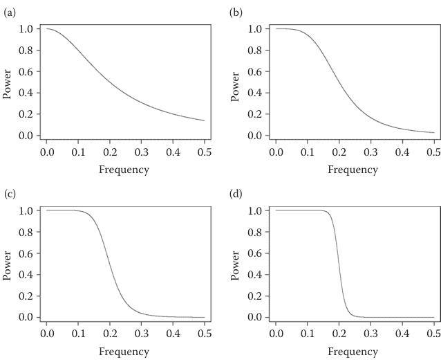

**FIGURE 2.6**

Squared frequency response functions, $|H(e^{-2\pi f})|^2$, for low-pass Butterworth filters with various values of N. (a) $N=1$, (b) $N=2$, (c) $N=4$, (d) $N=10$.

# Applied Time Series Analysis with R

shown in Figure 2.1a. We will not discuss issues of filter design such as the choice of N or phase. For discussion of such issues, see Porat (1997).

Although the impulse response function associated with Equation 2.11 is of infinite order, it can be well approximated by a ratio of two N-th order polynomials

```
$\sum_{k=0}^{\infty} h_k B^k = \frac{\sum_{k=0}^{N} \alpha_k B^k}{\sum_{k=1}^{N} \beta_k B^k} \quad (2.12)$
```

which leads to the easy to implement recursive filter

```
$y_t = \sum_{k=0}^{N} \alpha_k x_{t-k} - \sum_{k=1}^{N} \beta_k y_{t-k}$
```

EXAMPLE 2.3: BUTTERWORTH LOW-PASS FILTER EXAMPLE

In Figure 2.7a, we show a realization of length $n = 200$ from signal

```
$X_t = \cos(2\pi(0.025) t) + 3\cos(2\pi(0.125) t, \quad (2.13)$
```

which has two cycles, with frequencies $f = 0.025$ and $f = 0.125$. Figure 2.7b and c are plots of the two additive components that sum to $X_t$. For illustration, we apply a low Butterworth filter with cutoff frequency $f_c = 0.04$ in order to retain the cycle associated with $f = 0.025$ and filter out the higher frequency cycle associated with $f = 0.125$. Figure 2.8c shows results using Butterworth filters with orders $N = 1$ and $N = 3$, as in Figure 2.8a and b, we show the squared response functions associated with these two filters. In Figure 2.8a, we see that the Butterworth filter with $N=1$ would not be expected to perform well, because the squared response still has power at $f = 0.125$, and the frequency is to be removed. Figure 2.8b shows that the squared response for $N = 3$ has very little power below $f = 0.08$, and the Butterworth filter with $N = 3$ should produce the desired results. In Figure 2.8c, we see that, as expected, some of the higher frequency leaked through the filter, while Figure 2.8d shows that the filtered series resulting from a Butterworth filter with $N = 3$ look very similar to Figure 2.7b.

One point that should be made is that the Butterworth filter has end effect problems that are associated with all linear filters. This is a result of the fact that in order to obtain, for example, the filtered value at $t=1$, the filter ideally needs to use values prior to $t=1$, which do not exist. Methods for dealing with end effects in filters have been recommended, but will not be discussed here.

# 线性滤波器


# 73

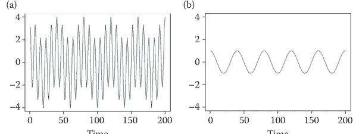

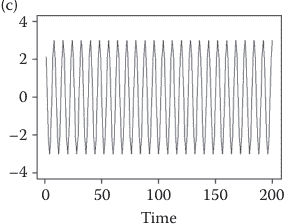

FIGURE 2.7

Signal in Equation 2.13 along with its two additive components. (a) Original signal, (b) Low-frequency component, (c) High-frequency component.

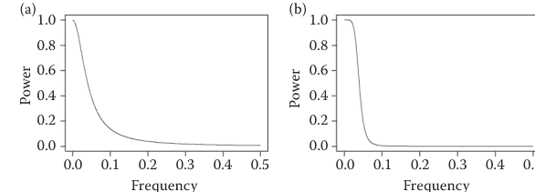

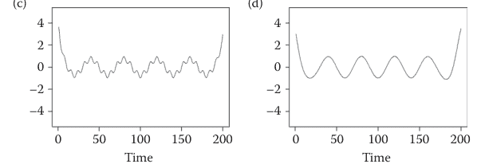

FIGURE 2.8

Filtering response functions, $|H(e^{-j2\pi f})|^2$, and filtering results using low-pass Butterworth filters of orders N=1 and N=3 on the realization in Figure 2.7a. (a) N=1. (b) N=3. (c) Filtered data (N=1), (d) Filtered data (N=3).

# 应用时间序列分析与 R

Using R: The `tswge` command

`butterworth.wge(x, order, type, cutoff)`

performs a Butterworth filter on the time series realization in the vector `x`.

The order of the filter, cut point(s), and type (e.g., high pass, low pass, etc.) can be specified. The function also plots the original and filtered data.

Appendix 2B for more details.

# EXAMPLE 2.4: FILTERING ENGLAND WAGE DATA

Figure 2.9 shows the average wages (in pounds) in England between

1260 and 1994 (data set in `tswge`). Interestingly, wages stayed

fairly stable between 1200 and 1800. Also visible in the data is a higher

frequency behavior. In order to allow the data to focus us to focus our

attention on the long-term behavior we applied low-pass filters.

Figure 2.9c shows the results of a fourth-order Butterworth low-pass filter with cutoff c=0.20. Surprisingly, there

is still some high-frequency behavior in the data. By examining the

Parzen density spectrum in Figure 2.9b we see in the spec-

trum is at zero (indicating the obvious wandering, long-term behav-

ior of the data), but there is still some indication of frequency behavior

at frequencies as high as f=0.2 or f=0.25. In, to capture


FIGURE 2.9

(a) Average daily wages in England (in pounds) for years 1260–1944. (b) Spectral density esti-

m ate in (a). (c) Data in (a) after passing through a fourth-order low-pass Butterworth

filter with cutoff c=0.2. (d) Same as (c) with cutoff c=0.05.

# 线性滤波器

In Figure 1.12 (data set `kingkong` in `tswge`) we showed the acoustical signal of the phrase “King Kong Eats Grass.” We noted that a fan was operating in the room, and the associated cyclic behavior (about 136 Hz) in the “silent spaces” in the signal. Using the `tswge` function `butterworth`, we applied a fourth-order zero-phase band-pass Butterworth filter to remove the fan noise. Our sampling rate was 8000 (samples per second), so a frequency of 136 Hz corresponds to 136 cycles per 8000, or a frequency of `f = 136/8000 = 0.017`. We applied a fourth-order band-pass filter designed to filter out frequencies in the band `f [0.0075, 0.0275]`. The filtered signal is shown in Figure 2.10 where it can be seen that cyclic behavior due to the fan has been largely removed (with some ambient noise remaining) while leaving the speech essentially unchanged.

## Appendix 2A: Theorem Proofs

### Proof of Theorem 2A.1

Without loss of generality, we assume $\mu = 0$. If $m > k$ then

```
$$\left[ \sum_{j=0}^{m} h_j Z_{t-j} - \sum_{j=0}^{k} h_j Z_{t-j} \right]^{2} = \left[ \sum_{j=k+1}^{m} h_j Z_{t-j} \right]^{2}$$
$$\le \left[ \sum_{j=k+1}^{m} (E |h_j Z_{t-j}|^2)^{1/2} \right]^{2} \quad (\text{Minkowski inequality})$$
$$\= \left[ \sum_{j=k+1}^{m} |h_j| \sqrt{\text{Var}(Z_{t-j})} \right]^{2}$$
$$\le \left[ \sqrt{\sum_{j=k+1}^{m} |h_j|} \right]^{2} \quad (2A.1)$
```

# 应用时间序列分析与 R


FIGURE 2.10

King Kong Eats Grass data from Figure 1.12 with fan noise removed.

As $m \to \infty$ and $k \to \infty$, then the right side of Equation (2A.1) converges to zero. It follows then that $\sum_{j=0}^m h_j_{t-j}$ is a Cauchy sequence and hence converges, say to $X_t$, which will be denoted

```
$X_t = \sum_{j=0}^{\infty} h_j Z_{t-j}$
```

The fact that each Cauchy sequence of random variables converges to a random variable is based on Hilbert space concepts. See Brockwell and Davis (1991, 2002) for a discussion.

# 线性滤波器

To show the uniqueness of $X_\mu$ we assume that there exists another random variable $Y_\mu$ such that $\sum_{j=0}^m h_j Z_{t-j}$ also converges in mean square to $Y_t$. Then, again using the Minkowski inequality,

```
$E(|X_t - Y_t|^2) = E\left(|X_t - \sum_{j=0}^m h_j Z_{t-j} + \sum_{j=0}^m h_j Z_{t-j} - Y_t\right|^2\right)\n\le \left(|E X_t - \sum_{j=0}^m h_j Z_{t-j}|\right|^{1/2}^2 + \left(|E \sum_{j=0}^m h_j Z_{t-j} - Y_t|\right|^{1/2}^2$
```

and $E(|X_t - Y_t|^2) \to 0$ as $m \to \infty$.

### Proof of Theorem 2A.2

Letting $\gamma_X(k)$ and $\gamma_Z(k)$ denote the autocovariance functions of the processes $X_t$ and $Z_t$, respectively,

```
$$\gamma_X(k) = E[(X_t - \mu)(X_{t+k} - \mu)]\n= E\left[\sum_{j=0}^{\infty} h_j Z_{t-j} \cdot \sum_{m=0}^{\infty} h_m Z_{t+k-m}\right]\n= \sum_{j=0}^{\infty} \sum_{m=0}^{\infty} h_j h_m \gamma_Z(k-m+j)\n= \int_{-0.5}^{0.5} |h(f)|^2 e^{2\pi i f(k-m+j)} P_Z(f) df\n= \left|\int_{-0.5}^{0.5} h(f) e^{2\pi i f} df\right|^2 \cdot \left|\int_{-0.5}^{0.5} h(f) e^{-2\pi i f} df\right|^2$ (Wait, the formula is complex, re-constructing based on image:)\n= \int_{-0.5}^{0.5} e^{2\pi i f k} |h(f)|^2 P_Z(f) df$
```

It can be shown that $P_V(f)$ and $P_W(f)$ are spectra, and if for each $k$

```
$$\int_{-0.5}^{0.5} e^{2\pi i f k} P_V(f) df = \int_{-0.5}^{0.5} e^{2\pi i f k} P_W(f) df$,
```

# 应用时间序列分析与 R

then $P_V(f) = P_W(f)$. Using this fact, we see that $\gamma_X(k) = \int_{-0.5}^{0.5} e^{2\pi i t k} P_X(f)$ by defi-nnition, and $\gamma_X(k) = \int_{-0.5}^{0.5} e^{2\pi i t k} \sum_{j=-\infty}^{\infty} h_j e^{-2\pi ijf} P_Z(f) df$ from the preceding calcula-ns. So, it follows that

```
$P_X(f) = \sum_{j=0}^{\infty} h_j e^{-2\pi ijf} P_Z(f).$
```

## Appendix 2B: R Commands

### 2B.1 R Commands

`butterworth.wge(x,order,type,cutoff)` is a `tswge` R function that requires functions in the CRAN package `signal` which should be installed on your machine before calling `butterworth.wge`.

`x` is a vector containing the time series realization $x_t, t=1, \dots, n$ `order` is the order of the Butterworth filter you want to use (default = 4) `type` should be either "low", "high", "pass", or "stop" for a low-pass, high-pass, band-pass, or stop-band (notch) filter, respectively.

`cutoff`

+   - if `type` = "high" or "low" then `cutoff` is the scalar cutoff frequency

- if `type` = "stop" or "band" then `cutoff` is a 2-component vector containing the lower and upper cutoff frequencies

Example: The data sets `wages` is contained in 'tswge'. The `tswge` R com-m to perform the lowpass filter described in Example 2.4 are

```
wages05 = butterworth.wge(wages,order=4,type="low",
cutoff=0.05)
```

The filtered data is `wages05$x.filt`.

## EXERCISES

The following data sets include the use of the `butterworth.wge` function along with commands given in Appendix 1B for generating realizations from a signal-plus-noise model and for plotting spectral estimates.

## Applied Problems

2.1 Generate a realization of length $n=100$ from the signal-plus-noise model in Problem 1.6.

# 线性滤波器

+   a. Apply a third-order low-pass Butterworth filter to the original realization with cutoff point 0.2.

b. Apply a third-order high-pass Butterworth filter to the original realization with cutoff point 0.2.

c. Apply a third-order low-pass Butterworth filter with with cutoff point 0.2 to the high-passed realization in (b).

For the original data and the three filtered realizations obtained in (a–c) earlier, plot the following:

+   i. The realization

ii. The sample autocorrelations


iii. The Parzen window-based spectral density estimate using the default truncation point

Discuss the cyclic behavior in the original data along with that for (a–c) and discuss the effect of the filters applied.

+ Using the signal-plus-noise realization generated for `Problem 2.1`:
a. Apply a fourth-order low-pass Butterworth filter with cutoff frequency `0.1`.
b. Apply a fourth-order low-pass Butterworth filter with cutoff frequency `0.075`.

For the two filtered realizations obtained here, plot the following:
+ i. The realization
ii. The sample autocorrelations
iii. The Parzen window-based spectral density estimate using the default truncation point

Compare these plots with the plots in `Problem 2.1(a)` associated with a low-pass Butterworth frequency cutoff point `0.2`. Discuss the effect of moving the cutoff point closer to the actual frequency in the data.

2.3 Using the signal-plus-noise realization generated for `Problem 2.1`, difference the data. That is, compute the realization of length `99` given by `$y_i = x_i - x_{i-1}$`, where `$x_i$` denotes the original realization. Plot the following:
+ a. The differenced data (i.e., `$y_i$`)
b. The sample autocorrelations
c. The Parzen window-based spectral density estimate using the default truncation point

Discuss the effect of the differencing. What type of filter (high pass or low pass) is the difference? How does it compare with the high-pass Butterworth filter for filtering out the frequency `0.05`?

80 应用 R 的时间序列分析

2.4 验证文本中给出的 2 点、3 点和 7 点移动平均的频率响应函数。求 5 点移动平均的频率响应函数。在每种情况下，推导 `|H(e^{-itm})|^2`。使用你选择的程序或语言绘制 5 点移动平均的平方频率响应。

## 理论问题

2.5 假设对每个 `t`，随机变量序列 `{X_t^{(m)} : m=1,2,...}` 在 `m → ∞` 时按均方收敛到 `X_t`，对每个 `t` 均成立。类似地，设 `Y_t^{(m)}` 在 `m → ∞` 时按均方收敛到 `Y_t`；`a_1X_t^{(m)} + b_1Y_t^{(m)} → a_1X_t + b_1Y_t` 在 `m → ∞` 时按均方收敛，其中 `a_1` 和 `b_1` 为常数。你可以假设这些随机变量都在 `L^2` 中，即每个随机变量 `X` 满足 `E[|X|^2] < ∞`。

2.6 设 `{X_t}` 为独立随机变量序列且 `E(X_t) = σ_t^2 < ∞`。证明 `∑_{t=1}^∞ X_t = Y` 存在作为均方极限且 `Y ∈ L^2` 当且仅当 `∑_{t=1}^∞ σ_t^2 < ∞`。

2.7 设 `X_t^{(k)}, k=1,2,...` 为由

给出的平稳线性过程，其中 `a_t` 是零白噪声且 `∑_{j=0}^∞ |h_j^{(k)}| < ∞, k=1,2,...,m`。证明过程 `X_t = ∑_{k=1}^∞ b_k X_t^{(k)}` 是平稳的，其中 `b_k` 为有限常数。

2.8 设 `{h_k}` 和 `{b_k}` 为实数序列且 `∑_{k=0}^∞ |h_k| < ∞` 且 `∑_{k=0}^∞ |b_k| < ∞`。此外，设 `Z_t` 为零均值平稳过程且 `M < ∞` 使得 `E[|Z_t|^2] ≤ M` 对 `t = ±1, ±2` 成立，并定义

证明以下结论：
- a. `E(X_t) = lim_{m → ∞} ∑_{k=0}^m h_k E(Z_{t-k})`
- b. `E(X_t Y_t) = lim_{m → ∞} ∑_{k=0}^m ∑_{j=0}^m h_k b_j E(Z_{t-k} Z_{t-j})`。

2.9 对于以下情况，判断相关滤波器是高通、低通、带通、带阻等，并解释你的答案。
- a. 一个具有平方频率响应函数的滤波器
```
$|H(e^{-2π f})|^2 = \frac{\left(\frac{f}{0.2}\right)^8}{1+\left(\frac{f}{0.2}\right)^8}$$
```
- b. 一个具有频率响应函数的滤波器
```
$H(e^{-2π f}) = (1 + 2i\sin(2π f) - i\sin(4π f))/\sqrt{8}$
```


## 3 ARMA 时间序列模型

在本章中，我们将讨论用于描述时间序列行为的一些重要模型。特别感兴趣的是 AR、MA 和 ARMA 模型。这些模型由 George Box 和 Gwilym Jenkins 在其经典时间序列书籍中推广，最新版为 Box et al. (2008)。这些模型已成为时间序列理论和应用的基础。虽然本章考察了基于真实数据的若干示例，但我们大量使用模拟实现以了解已知模型的性质并加深理解。此外，除非另有说明，本章中图示的自相关和谱密度均为所研究模型的理论量。在后面的章节中，我们将利用本章学到的经验来分析实际时间序列。

### 3.1 MA 过程

我们首先定义阶数为 `q` 的 MA 过程，记为 `MA(q)`。

#### 定义 3.1
设 `a_t` 为零均值、有限方差 `σ_a^2` 的白噪声过程，且过程 `X_t, t=0, ±1, ±2, ...` 由
```
$X_t - μ = a_t - θ_1 a_{t-1} - … - θ_q a_{t-q},$$
```
定义，其中 `θ_j, j = 1, ..., q` 为实常数且 `θ_j ≠ 0`。由方程 3.1 定义的过程 `X` 称为阶数为 `q` 的 MA 过程，通常简写为 `MA(q)`。

我们经常将方程 3.1 写成
```
$X_t - μ = θ(B)a_t,$$
```
的形式，其中
```
$θ(B) = 1 - θ_1 B - θ_2 B^2 - … - θ_q B^q.$
```
注意：在继续之前，我们指出有些作者和软件包编写者将方程 3.1 写成 `X_i-μ = a_i + θ_{i-1} + … + θ_{i-q}`。考虑 MA(2) 模型 `X_i = a_i - 1.2a_{i-1} + 0.8a_{i-2}`。使用方程 3.1 中的定义可得 `θ_1 = 1` 且 `θ_2 = -0.8`，而使用替代表示法系数将为 `θ_1 = -1.2` 且 `θ_2 = 0.8`。在将系数输入时间序列计算机包或比较不同教科书中涉及 `θ` 的公式之前，务必非常仔细地检查 MA(q) 定义。

注意 `MA(q)` 过程是一个具有有限项的一般线性过程。特别地
```
$$ψ_0=1$$
$$ψ_k=-θ_k$$
```
使用方程 2.8 的记号，注意 `ψ(z)=1-∑_{j=1}^qθ_jz^j` 其中 `z` 为实数或复数。对于 MA(q) 过程，我们用 `θ(z)` 表示 `ψ(z)`。利用定理 2.3 可以证明 MA(q) 过程是平稳的，因为只有有限个 `ψ`-权重。由于 `∑_{j=1}^qθ_j^2=1+θ_1^2+…+θ_q^2`，可得
```
$$σ_k^2=σ_q^2(1+θ_1^2+…+θ_q^2)<∞.$$
```
此外，由方程 2.7
```
$$γ_k=σ_q^2\left{-θ_{g-k\|+∑_{j=1}^qθ_jθ_{j+k}\right}, \quad k=1,2,...,q$$
$$γ_k=0, \quad k>q.$$
```
由此可得
```
$$ρ_k=\frac{-∑_{j=1}^qθ_jθ_{j+k}}{1+∑_{j=1}^qθ_j^2}, \quad k=1,2,...,q$$
$$ρ_k=0, \quad k>q.$$
```
并且在此文本中，我们定义和 `∑_{j=1}^n f(j)` 在 `n<m` 时恒等于零。方程 3.3 和 3.4 中的结果表明 MA(q) 过程的自协方差平凡地满足定理 1.1 的条件
# ARMA 时间序列模型
（即 `γ_k → 0` 当 `k → ∞`）并且协方差矩阵 `Γ_k`，定义于方程 1.2，对每个整数 `k > 0` 都是正定的。MA(q) 过程 `X_t` 的谱可以很容易地得到。由方程 2.8
```
$$P_X(f) = σ_a^2 |ψ(e^{-2π f})|^2 $$
$$= σ_a^2 |θ(e^{-2π f})|^2 $$
$$= σ_a^2 (1 - ∑_{j=1}^q θ_j^2 e^{-2π f}) \quad (3.5)$$
```
且
```
$$S_X(f) = \frac{1 - ∑_{j=1}^q θ_j^2 e^{-2π f}}{1 + ∑_{j=1}^q θ_j^2} \quad (3.6)$$
```
回想方程 1.29，对于平稳过程 `X_t`，谱定义为
```
$$P_X(f) = γ_0 + 2 ∑_{j=1}^∞ γ_j cos 2π f$$
```
因此对于 MA(q) 过程我们有 `P_X(f)` 和 `S_X(f)` 的简化表达式
```
$$P_X(f) = γ_0 + 2 ∑_{j=1}^q γ_j cos 2π f \quad (3.7)$$
```
且
```
$$S_X(f) = 1 + 2 ∑_{j=1}^q ρ_j cos 2π f \quad (3.8)$$
```
其中 `γ_ρ` 和 `ρ_j` `j=0,1,…,q` 给出于方程 3.3 和 3.4。

#### 3.1.1 MA(1) 模型

设 `X_i` 为由
```
$X_i - μ = a_i - θ_1 a_{i-1}\n= (1 - θ_1 B)a_i. \quad (3.9)$
```
定义的 MA(1) 过程。由方程 3.2 和 3.3，我们得到
```
$$γ_0 = σ_a^2[1 + θ_1^2] = σ_X^2\nγ_1 = σ_a^2[-θ_1]\nγ_j = 0, \quad j > 1. \quad (3.10)$$
```
因此，对于 MA(1) 过程，
```
$$ρ_0 = 1\nρ_1 = \frac{-θ_1}{1 + θ_1^2}\nρ_j = 0, \quad j > 1. \quad (3.11)$$
```
容易证明函数 `f(u) = |u|/(1 + u^2)` 在 `u = ±1` 处取得最大值 0.5，由此可得对于 MA(1) 过程，`|ρ_1| = 0.5`。特别地，当 `θ_1 = -1` 时 `ρ_1 = 0.5` 且当 `θ_0 = 1` 时 `ρ_0 = -0.5`。由方程 3.66，MA(1) 的谱密度为 `|f| ≤ 0.5` 时
```
$S_X(f) = \frac{|1 - ∑_{j=1}^q θ_j e^{-2jπ f}|^2}{1 + ∑_{j=1}^q θ_j^2}\n= \frac{|1 - θ_1 e^{-2π f}|^2}{1 + θ_1^2}\n= \frac{1}{1 + θ_1^2}[1 - θ_1 e^{-2π f}][1 - θ_1 e^{2π f}]\n= \frac{1}{1 + θ_1^2}[1 - 2θ_1 cos 2π f]\n= 1 - \frac{2θ_1 cos 2π f}{1 + θ_1^2}. \quad (3.12)$
```
如第 1 章所述，谱密度提供了关于数据中周期性的信息。由方程 3.12，MA(1) 的 `S_X(f)`
# ARMA 时间序列模型
模型可以被最大化，关于 `f`，当右手边的分子被最小化时。如果 `θ_i ≥ 0`，该分子在 `f=±0.5` 时最小，而如果 `θ_i < 0`，最小值出现在 `f=0`。因此，对于 `θ_i > 0` 的更高频率数据，对于 `θ_i < 0`。

注意当 `θ_i → 0` 时，MA(1) 过程趋近于白噪声。这一观察与事实一致，即当 `θ_i → 0` 时，`ρ_i` 如方程 3.11 所给趋近于 `0`，而 `S_i(f)` 如方程 3.12 所给趋近于常数谱密度。

#### EXAMPLE 3.1: MA(1) MODELS

考虑由下式给出的 MA(1) 模型
- 1. `X_t = a_t - 0.99a_{t-1}`
2. `X_t = a_t + 0.99a_{t-1}`
其中 `a_t` 是白噪声且 `σ_a^2=1`。注意模型 (a) 的 `θ_i=0.99` 而模型 (b) 的 `θ_i=-0.99`。对于两个模型，`ρ_0=1` 且 `ρ_j=0, j>1`。使用方程 3.11，我们看到对于模型 (a)，`ρ_1=-0.4997` 对于模型 (b)，`ρ_1=0.4997`。谱密度，从方程 3.12 得到，分别为
> `S_X(f) = 1-\frac{1.98}{1.9801}\cos 2π f`
和
> `S_X(f) = 1+\frac{1.98}{1.9801}\cos 2π f`
模型 (a) 和 (b)。从这两个模型中长度为 100 的实现绘制在图 3.1 中。

在图 3.2 中，自相关性显示，而在图 3.3 中真实的（`10log_{10}…`）谱密度绘制。注意模型 (a) 的实现表现出高频行为，注意即，数据似乎

FIGURE 3.1
Realizations from MA(1) models. (a) `X_t = a_t - 0.99a_{t-1}`. (b) `X_t = a_t + 0.99a_{t-1}`.

## 88 Applied Time Series Analysis with R

FIGURE 3.2
Autocorrelations from MA(1) models. (a) `X_i = a_i - 0.99a_{i-1}`; (b) `X_i = a_i + 0.99a_{i-1}`.

FIGURE 3.3
Spectral densities of MA(1) models. (a) `X_i = a_i - 0.99a_{i-1}`; (b) `X_i = a_i + 0.99a_{i-1}`.


存在数据中非常短的周期。然而，这种行为可以归因于序列中相继值之间的负相关性 $\rho_1 = -0.497$。然而，有趣的是，自相关性对于 $k \ge 2$ 为零。此外，这种高频行为在谱密度中通过 $f = 0.5$ 处的最大值得以说明。另一方面，模型 (b) 的数据显然没有那么高振荡，这进一步通过谱密度在 $f = 0$ 处的最大值及其随着 $f$ 接近 0.5 而稳步下降得以说明。

### 3.1.2 MA(2) Model

设 $X_i$ 表示由下式给出的 MA(2) 模型

```
$X_i = a_i - \theta_1a_{i-1} - \theta_2a_{i-2}$.
```

对于该模型，有

```
$$\gamma_0 = \sigma_a^2(1 + \theta_1^2 + \theta_2^2) = \sigma_x^2$$
$\rho_1 = \frac{\theta_1 + \theta_1\theta_2}{1 + \theta_1^2 + \theta_2^2}$
```

$$\rho_2 = \frac{-\theta_2}{1+\theta_1^2+\theta_2^2}, \ \rho_k=0, k \ge 3.$

使用方程 3.6，MA(2) 过程的谱密度由下式给出

$S_X(f)=\frac{\sigma_2^2}{[1+\theta_1^2+\theta_2^2-2\theta_1(1-\theta_2)\cos 2\pi-2\theta_2\cos 4\pi]}.$

**Using R:** The twsg function `arma.wge` can be used to generate and plot a realization from an MA model, `true.arma.aut` `true.arma.spec.wge` calculate and plot the true autocorrelations and spectral densities for an MA model, respectively. Additionally, the twsg function `plots.true.wge` can be used to generate a realization, calculate the true autocorrelations and spectral density, and create a plot Figure 3.11 in this text. Be careful with the coefficients. That is, for the MA(2) model $X_t = a_t-1.1a_{t-1}+0.6a_{t-2}$ the coefficients $\theta_1$ and $\theta_2$ are 1.1, and $-0.6$, respectively. These twsg functions can also be used for AR and ARMA models which will be discussed in the future. See Appendix 3B for more details.

## 3.2 AR Processes

设 $a_t$ 为白噪声过程且如果 $X_t$, $t=0, \pm1,\dots$, $\phi_p$ 为实常数且 $\phi_p \neq 0$。那么，宽松地说，由下式指定

$X_t-\mu-\phi_1(X_{t-1}-\mu)-\phi_2(X_{t-2}-\mu)-\dots-\phi_p(X_{t-p}-\mu)=a_t, \quad (3.13)$

则 $X$ 被称为阶为 $p$ 的 AR 过程，通常缩写为 AR(p)。我们将方程 3.13 写成算子形式

$$\phi(B)(X_t-\mu)=a_t, \quad (3.14)$$

其中

AR(p) 模型在方程 3.14 中可以重写为形式 $\phi(B)X_t=\phi(B)\mu+a_t$，通过注意到

$$\phi(B)\mu=(1-\phi_1B-\dots-\phi_pB^p)\mu \neq(1-\phi_1-\dots-\phi_p)\mu \neq\phi(1)\mu,$$

可以写成

$\phi(B)X_t = \phi(1)\mu + a_t. \quad (3.15)$

量 $\phi(1)\mu$ 被称为 $MA constant$。方程 3.13 中的模型通常通过令 $\tilde{X}_t = X_t - \mu$ 来简化，这导致

$\tilde{X}_t - \phi_1\tilde{X}_{t-1} - \phi_2\tilde{X}_{t-2} - \cdots - \phi_p\tilde{X}_{t-p} = a_t, \quad (3.16)$

对应于方程 3.13。此后，除非另有说明，我们将不失一般性地假设 $\mu = 0$ 使得 $\tilde{X}_t = X_t$，并且我们将 AR(p) 模型指定为

$X_t - \phi_1X_{t-1} - \phi_2X_{t-2} - \cdots - \phi_pX_{t-p} = a_t, \quad (3.17)$

或

$\phi(B)X_t = a_t. \quad (3.18)$

同样，方程 3.1 中的 $MA(q)$ 模型通常假设 $\mu = 0$ 来书写。

NOTE: When using the AR(p) or $MA(q)$ to model a given set of stationary time series data, it will be the standard procedure to first estimate $\mu$ by $\bar{X}$, subtract $\tilde{X}$ from each observation, and model the remaining data using the "zero mean" model.

如所指出的，$MA(q)$ 过程是一般线性过程的特例，其中只有有限数量的 $\psi$-权重非零。检查方程 3.17 并不能立即揭示 AR(p) 过程与一般线性过程之间的关系。实际上，方程 3.17 给出的 AR(p) 过程的指定是不充分的，因为方程 3.17 有许多不同的解，到目前为止，我们还没有指定我们希望考虑的解。例如，如果 $X_t$ 是方程 3.17 的解且 $\phi(B)y_t=0$，则 $X_t + cy_t$ 也是方程 3.17 的解对于任意常数 $c$。因此，方程 3.17 有不可数多个解。然而，如果 $c \neq 0$，所有这些解都是不存在的，现在我们的兴趣在于平稳解。这导致以下定义：

### 3.2

假设 $\{X_t; t=0, \pm1, \pm2, \dots\}$ 是满足差分方程的因果、平稳过程

$$\phi(B)(X_t - \mu) = a_t.$

则 $X_t$ 将被称为阶为 $p$ 的 AR 过程并记为 AR(p)。再次，我们将取 $\mu=0$ 除非另有说明。

为澄清定义 3.2，考虑 AR(1) 模型

$$\phi(B)X_t = (1-\alpha B)X_t = a_t,$$

其中 $|\alpha| < 1$。注意到 $B\alpha^{-t} = \alpha^{-(t-1)}$，则

$$(1-\alpha B)X_t = \alpha'(1-B)\alpha^{-t}X_t,$$

可通过展开每一侧得到 $X_t - \alpha X_{t-1}$ 来证明。两个算子 $1-\alpha B$ 和 $\alpha'(1-B)\alpha^{-t}$ 是等价的，即

$$1-\alpha B = \alpha'(1-B)\alpha^{-t}.$

因此，

$$\alpha'(1-B)\alpha^{-t}X_t = a_t.$

所以

$$(1-B)\alpha^{-t}X_t = \alpha^{-t}X_t,$$

和

$$\sum_{k=-\infty}^{t}(1-B)\alpha^{-k}X_k = \sum_{k=-\infty}^{t}\alpha^{-k}a_k,$$

这给出

$$\alpha^{-t}X_t - \lim_{j=-\infty}^{t}\alpha^{-j}X_j = \sum_{k=-\infty}^{t}\alpha^{-k}a_k.$

由于 $|\alpha| < 1$，可知 $\alpha^{-t}X_j = 0$ 以概率 1。因此，

$$X_t = \sum_{k=-\infty}^{t}\alpha^{t-k}a_k,$$

$= \sum_{h=0}^{t}\alpha^h a_{t-h}.$

## Applied Time Series Analysis with R

显然，X，方程 3.23 满足 (3.20)，是因果的，并且由定理 2.3 是平稳的，因为 $|\alpha| < 1$ 意味着 $\sum_{p=0}^\infty |\alpha|^p < \infty$。因此，X，是因果且平稳的 AR(1) 过程。因为多项式算子 $\phi(B)$ 总是可以分解为

```
$X_t - \phi_1 X_{t-1} - \cdots - \phi_p X_{t-p} = \phi(B)X_t$\n= (1-\alpha_1 B)(1-\alpha_2 B)\cdots(1-\alpha_p B)X_t$
= \prod_{k=1}^p \alpha_k^{-1}(1-B)^{\alpha_k^{-1}}X_t$(3.24)
```

其中 $\alpha_k$ 可以是实数或复数，以下定理可以被证明。

### Theorem 3.1

设 X，为因果且原因假设

```
$\phi(B)X_t = (1-\alpha_1 B)(1-\alpha_2 B)\cdots(1-\alpha_p B)X_t = a_t,$(3.25)
```

其中 $\alpha_k$ 为实数或复数，$\alpha_k \neq \alpha_j, k \neq j$，$|\alpha_k| < 1, k=1, \dots, p$，且 $a_t$ 为零均值白噪声。则 X，为 AR(p) 过程且

```
$X_t = \sum_{\ell=0}^p \psi_{\ell}(p)a_{t-\ell},(3.26)
```

其中

- a. $\psi_1(p) = \alpha_1^{p-1}$ for $p=1$

- b. $\psi_k(p) = \frac{\alpha_k^{-p-k}(\alpha_k^{p+1}-\alpha_j^{p+1})}{\alpha_k-\alpha_j} \prod_{h \neq k}^{p-k} (\alpha_{p-k}-\alpha_h)$, for $p \geq 2$.$(3.27)

Proof: See Appendix 3A.

我们注意到定理 3.1 给出了无重根情况下的 $\psi$-权重。问题 3.33 显示了如何在使用重根的情况下使用方程 3.27。常数 $\psi(p)$ 将被称为 AR(p) 过程的“$\psi$-权重”。定义 3.3 引入了特征方程，它是 AR(p) 模型分析中的一个有用工具。

## ARMA 时间序列模型

### 定义 3.3

若 X 是由方程 3.17 定义的 AR(p) 过程，则代数方程 $\phi(z)=0$ 称为相应的特征方程，其中

$$\phi(z) = 1 - \phi_1 z - \dots - \phi_p z^p,$$

且 $z$ 为实数或复数。多项式 $\phi(z)$ 称为特征多项式。

定理 3.2 是判断给定一组 AR(p) 系数是否产生因果、平稳 AR(p) 过程的重要结果。

### 定理 3.2

过程 X，其 $\psi$ 权重如定理 3.1 中定义，当且仅当特征方程 $\phi(z)=0$ 的根全部位于单位圆之外时，才是平稳且因果的 AR(p) 过程。

证明：见附录 3A。

因此，在方程 3.25 中是 AR(p) 过程当且仅当 $|\alpha_k| < 1, k=1, \dots, p$，因为 $\alpha_k$ 是特征方程第 $k$ 个根的倒数。从方程 3.26 可明显看出 $X_t$ 是一个广义线性过程。

### 3.2.1 逆转算子

值得注意的是，$\phi(B)$ 的性质可以通过考察代数对应物 $\phi(z)$ 来找到，其中 $z$ 为实数或复数。即可以证明（见 Blackwell and Davis, 1991）对于

$$\phi(z) = 1 - \phi_1 z - \dots - \phi_p z^p,$$

$$\prod_{k=1}^p (1 - \alpha_k z),$$

其中 $|\alpha_k| < 1, k=1, \dots, p$，有 $\phi^{-1}(B) = \phi^{-1}(z)|_B$。因此，例如，若 $(1-\phi_1 B)X_t = a_t$ 且 $|\phi_1| < 1$，则由于 $(1-\phi_1 B)^{-1} = \sum_{k=0}^\infty \phi_1^k B^k$，可得

$$X_t = (1-\phi_1 B)^{-1} a_t,$$

$$\sum_{k=0}^\infty \phi_1^k B^k a_t,$$

$$\sum_{k=0}^\infty \phi_1^k a_{t-k}.$$

## 应用 R 进行时间序列分析

在本书中，由于其易用性，我们经常使用这种形式化程序来逆转算子。请注意，定理 3.1 的证明实际上是基于将 $\phi(B)$ 作为算子使用。

### 3.2.2 AR(1) 模型

我们首先考虑由下式给出的 AR(1) 模型的性质

$X_t - \phi_1 X_{t-1} = a_t, \quad (3.28)$

其中 $|\phi_1| < 1$。

- AR(1) 的 $\psi$-权重和平稳性条件：从方程 3.27 可见，AR(1) 过程的广义线性过程为

$X_t = \sum_{k=0}^\infty \phi_1^k a_{t-k}$.

即，$\psi$-权重为 $\psi_k = \phi_1^k$。特征方程由 $1 - \phi_1 z=0$ 给出，其根为 $\eta_1 = \phi_1^{-1}$，其中 $|\eta_1|=|\phi_1^{-1}|>1$ 因为 $|\phi_1| < 1$，由此可知方程 3.28 中的模型是平稳且因果的。我们也在关于逆转算子的前述讨论中注意到 AR(1) 模型的 $\psi$-权重。

- AR(1) 过程的自相关：为了求 AR(1) 过程的 $\gamma_0$ 和 $\rho_k$，需要计算期望 $E[X_tX_{t-k}] = E[X_{t-k}X_t]$。为得到 $\gamma_k$，将方程 3.28 等式两边乘以 $X_{t-k}$ $k>0$，得到

$X_{t-k}[X_t = \phi_1 X_{t-1} + a_t]$.

对两边取期望得到

$E[X_{t}X_{t-k}] = \phi_1 E[X_{t-k}X_{t-1}] + E[X_{t-k}a_t]. \quad (3.29)$

现在，$X_{t-k} = \sum_{j=0}^k \phi_1^j a_{t-k-j}$ 且因此 $X_{t-k}$ 仅依赖于 $a_{t-k-j}$ $0, 1, \dots$。由此可知 $X_{t-k}$ 与 $a_t$ 不相关，即 $E[X_{t-k}a_t]=0$ 对 $k>0$ 成立。因此，由方程 3.29，$\gamma_k = \phi_1\gamma_{k-1}$ 对 $k>0$ 成立，且

$\gamma_1 = \phi_1\gamma_0$ 且 $\gamma_2 = \phi_1\gamma_1 = \phi_1^2\gamma_0$,

从而一般地

$\gamma_k = \phi_1^k \gamma_0$, (3.30)

且

$\rho_k = \phi_1^k$, (3.31)

由于 $\gamma_k = \gamma_{|k|}$ 且 $\rho_k = \rho_{|k|}$，则对 $k=0, \pm1, \pm2, ...$，方程 3.30 和 3.31 分别变为

$\gamma_k = \phi_1^{|k|} \gamma_0$,

且

$\rho_k = \phi_1^{|k|}$, (3.32)

此外，$\gamma_0$ 可以通过用 $X_t$ 预乘方程 3.28 两边并取期望而得到，如前所述，得到

$E[X_t^2] = \phi_1 E[X_{t-1}X_t] + E[X_t a_t]$.

因此

$\gamma_0 = \phi_1 \gamma_1 + E[X_t a_t]$. (3.33)

项 $E[X_t a_t]$ 使用类似的程序求得，这次将方程 3.28 两边后乘以 $a_t$ 并取期望，得到

$E[X_t a_t] = \phi_1 E[X_{t-1}a_t] + E[a_t^2]$.

之前已证明 $E[X_{t-1}a_t] = 0$，因此由方程 3.28，$E[X_t a_t] = \sigma_a^2$。代入方程 3.33 得到

$\gamma_0 = \phi_1 \gamma_1 + \sigma_a^2$, (3.34)

从而使用方程 3.30，我们有

$\gamma_0 = \frac{\sigma_a^2}{1 - \phi_1^2}$. (3.35)

3. AR(1) 的谱和谱密度：关于逆转算子的第 3.2.1 节讨论使我们能够应用方程 2.8 得到谱

$P_X(f) = \sigma_a^2 |\psi(e^{-2\pi if})|^2

= \sigma_a^2 |\phi^{-1}(e^{-2\pi if})|^2

= \frac{\sigma_a^2}{|\phi(e^{-2\pi if})|^2}

= \frac{\sigma_a^2}{|1-\phi_1 e^{-2\pi if}|^2}$

使用方程 3.35，AR(1) 过程的谱密度因此由下式给出


$S_X(f) = \frac{\sigma_a^2}{\gamma_0} \frac{1}{|1-\phi_1 e^{-2\pi if}|^2}$

= \frac{1-\phi_1^2}{|1-\phi_1 e^{-2\pi if}|^2}$

### 示例 3.2：AR(1) 模型

图 3.4 显示了 $\phi_1=0.95$ 和 $0.7$ 的 AR(1) 模型的自相关图。图 3.4a 和 c 中与 $\phi_1$ 相关的自相关显示相邻观测之间存在强正相关。在这两种情况下，实现表现出 $x_t$ 倾向于接近 $x_{t-1}$ 的趋势。与 $\phi_1=0.95$ 相关的正相关保持的时间远长于 $\phi_1=0.7$ 的情况，且 $X_t$ 与 $X_{t-1}$ 之间的相关性为 $\phi_1=0.95$ 时为 0.6，$\phi_1=0.7$ 时为 0.03。在图 3.5 中，我们展示了来自图 3.4 中自相关的四个 AR(1) 模型长度为 $n=100$ 的实现，其中 $\sigma_a^2=1$，且所有情况下 $\mu=0$。在图 3.5a 和 c 中，我们看到这些实现之间的行为，相邻观测之间存在强相关性。图 3.4a 和 c。在这些实现中，图 3.5a 显示出在数个滞后上保持正相关的趋势，导致数个较长的运行或游走行为。这是因为 $X_t$ 与 $X_{t+k}$ 之间的正自相关为 $\rho_k=0.95^k$，当 $k$ 很小甚至中等大小时相当强（或持久）。我们将这种相关性的持续性，当 $\phi_1$ 接近 1 时称为近非平稳行为。在图 3.4b 和 d 中，我们看到 $\phi_1$ 的自相关显示出振荡行为。例如，对于 $\phi_1=-0.95$ 的情况，$\rho_1=-0.9$ 表明如果时间 $t$ 的值高于均值，则时间 $t+1$ 倾向于低于均值，反之亦然。类似地，由于 $\rho_2=(-0.95)^2=0.9025$，

# ARMA 时间序列模型

97


**图 3.4** AR(1) 模型的自相关。 (a) $X_i - 0.95X_{i-1} = a_i$，(b) $X_i + 0.95X_{i-1} = a_i$，(c) $X_i - 0.7X_{i-1} = a_i$。 (d) $X_i + 0.7X_{i-1} = a_i$。

则 $t+2$ 时的值倾向于与 $t$ 时的值位于均值的同一侧。对于 $\phi_1 = -0.7$ 的实现中的这种振荡趋势显示相关结构在前者更强。如同图 3.4a 和 $c$，相关性的强度在图 3.4b 中对 $\phi_1 = -0.95$ 保持的时间更长，而在图 3.4d 中则较短。如预期，图 3.5b 中具有负 $\phi_1$ 的实现具有振荡性质。请注意当 $|\phi_1| = 0.95$ 时，实现的方差似乎更大。随着 $\phi_1 \to 0$，AR 趋近于白噪声，因此具有 $\phi_1 = 0$ 的实现预期看起来与白噪声非常相似。在示例 1.9 中，我们研究了具有 $\phi_1 = \pm0.9$ 的 AR(1) 过程，且该示例中的观察结果与此处讨论的一致。在图 3.6 中，我们看到图 3.4 和 3.5 中四个模型的谱密度。从图中可以看出 $\phi_1 > 0$，谱密度在 $f=0$ 处有一个峰值（即谱密度公式的分母在 $f=0$ 处为最小），表明如示例 1.9 中所述，相关的实现将倾向于围绕均值游走而没有明显的周期性行为。那，数据主要是低频的，没有真正的周期性倾向。$\phi_1 < 0$ 的谱密度具有最大值

# 98 应用 R 的时间序列分析


**图 3.5** AR(1) 模型的实现。 (a) $X_i - 0.95X_{i-1} = a_i$，(b) $X_i + 0.95X_{i-1} = a_i$，(c) $X_i - 0.7X_{i-1} = a_i$，(d) $X_i + 0.7X_{i-1} = a_i$。

在 $f = 0.5$ 处，表明数据将趋向于周期约为 2 的高度振荡性质。这些行为在图 3.5 的实现中可见。还应注意，与 $|\phi_i| = 0.95$ 相关的谱密度具有更高的峰值，并且远离峰值的功率小于与 $|\phi_i| = 0.7$ 相关的谱密度，表明在实现中的相关行为对于 $|\phi_i| = 0.95$ 将更明显。

# 示例 3.7：非平稳模型

在图 3.7 中，显示了方程 3.28 中模型的实现，其中 $\phi_i = 1$ 且 $\phi_i = 1.1$，因为 $\sigma_i^2 = 1$。特征方程的根分别为 $r=1$ 和 $r=0.9$，很明显这些是非平稳模型。对实现的检查表明，对于 $\phi_i=1$，图 3.5 中对于 $\phi_i = 0.95$ 和 $\phi_i = 0.7$ 所指示的“准线性行为”甚至更明显。对于 $\phi_i=1$，平稳过程没有对均值的吸引力。对于过程 $X_i$ 由 $X_i = X_{i-1} + a_i$ 给出。本书中显示的实现只是延伸到两个方向无限的实现的 *有限* 片段。

与 $\phi_1 = 1.1$ 相关的实现展示了 Box 等人 (2008) 所称的“爆炸性”行为。与 $\phi_1 = 1$ 相关的图 3.7 中看到的随机游走是某些真实数据序列的典型

(a)


(b)


(c)


(d)


# 图 3.6

AR(1) 模型的谱密度。 (a) $X_t - 0.95X_{t-1} = a_t$，(b) $X_t + 0.95X_{t-1} = a_t$，(c) $X_t - 0.7X_{t-1} = a_t$，(d) $X_t + X_{t-1} = a_t$。

# ARMA 时间序列模型

99

(a)


(b)


# 图 3.7

一阶非平稳模型的实现。 (a) $X_t - X_{t-1} = a_t$，(b) $X_t - 1.1X_{t-1} = a_t$。

# 应用 R 的时间序列分析

例如每日股价。然而，与 $\phi_1=1.1$ 相关的爆炸性实现与我们将尝试分析的任何数据集都不相似，更好地建模为确定性过程。

# 示例 3.4：股票市场数据

在图 3.8 中显示 2014 年每日琼斯收盘平均值（数据 dowjones2014 在 tswge 中）。（来源：联邦储备银行。）可以看出该序列具有 AR(1) 过程的典型游走外观，其中 $\phi_1$ 为正。样本自相关和 Parzen 谱估计显示在图 3.8b 和 c 中，可以看出自相关缓慢指数衰减，并且谱密度在零处有峰值。通过将图 3.8 与图 3.4 至 3.6 进行比较可以看出 $\phi_1$ 似乎接近于一，即接近非平稳。我们将在讨论非平稳性、模型识别和参数估计的主题时重新回到图 3.8 中的数据的分析。

# 3.2.3 AR(p) 模型，$p \ge 1$

现在我们已经讨论了所有 AR 模型中最简单的 AR(1) 的性质，我们将注意力转向更一般的情况，其中 $p \ge 1$。


**图 3.8** (a) 2014 年琼斯每日收盘平均值，(b) 样本自相关，以及 (c) Parzen 谱密度估计。

# ARMA 时间序列模型

定理 3.2 提供了方程 3.17 形式的模型为因果且平稳的充要条件。我们建议数值求解特征方程的根并检查因子表中的 resulting 因式分解特征多项式。这将在第 3.2.11 节中澄清。

#### 3.2.4 AR(p) 模型的自相关

为了求出 AR(p) 过程的自相关，对方程 3.17 的两边预乘 $X_{i-k}$，其中 $k > 0$，得到

$X_{i-k}\{X_i - \phi_1 X_{i-1} - \cdots - \phi_p X_{i-p} = a_k\}$。

对方程 3.36 取期望值得到

$\gamma_k = \phi_1 \gamma_{k-1} - \cdots - \phi_p \gamma_{k-p} = 0$，

其中我们使用了在 AR(1) 情况下 $E[X_{i-k}a_i] = 0$ 对于 $k > 0$ 的事实。由此可知对于 $k > 0$，

$\rho_k = \phi_1 \rho_{k-1} - \cdots - \phi_p \rho_{k-p} = 0$。

将方程 3.37 写成

$\rho_k = \phi_1 \rho_{k-1} + \cdots + \phi_p \rho_{k-p}$

方程 3.38 中指定的前 $p$ 个方程可以写成

$\rho_1 = \phi_1 + \phi_2 \rho_1 + \cdots + \phi_p \rho_{p-1}$

$\rho_2 = \phi_1 \rho_1 + \phi_2 \rho_2 + \cdots + \phi_p \rho_{p-2}$

:

$\rho_p = \phi_1 \rho_{p-1} + \phi_2 \rho_{p-2} + \cdots + \phi_p$。

方程 3.39 中的方程称为 Yule-Walker 方程。当系数 $\phi_1, \dots, \phi_p$ 已知时，Yule–Walker 方程是 $p$ 个方程，可以求解未知数 $\rho_1, \dots, \rho_p$。请注意，在通过求解 Yule–Walker 方程找到前 $p$ 个自相关后，然后 $\rho_k, k > p$ 可以使用方程 3.38 中的关系迭代求得。

还要注意，对于一组假设遵循未知 AR(p) 模型的数据，模型参数 $\phi_1, \dots, \phi_p$ 可以通过先用估计值 $\hat{\rho}_k, k=1, 2,...$ 替换 $\rho_k$

# 102 应用 R 的时间序列分析

$k=1, 2,...,p$ 并求解 resulting 方程得到 $\hat{\phi}_1,...,\hat{\phi}_p$。这些估计称为 Yule–Walker 估计，将在第 7 章中更详细地讨论。

为了求 $\gamma_0 = \sigma_{\gamma}^2$，将方程 3.17 中的每一项乘以 $X_t$，并取期望值得到

$$\gamma_0-\phi_1\gamma_1-\cdots-\phi_p\gamma_p=E[X_i a_i].$$

期望值 $E[X_i,a_i]$ 可以通过将方程 3.17 中的每一项后乘以 $a_i$ 并取期望值来求得，这给出

$E[X_i,a_i]=\sum_{k=1}^p \phi_k E[a_i,X_{i-k}]+\sigma_a^2$

因为 $E[a_i,X_{i-k}]=0$ 对于 $k>0$。由方程 3.40 和 3.41，我们发现

$$\gamma_0-\phi_1\gamma_1-\cdots-\phi_p\gamma_p=\sigma_{\gamma}^2.$$

因此

$$\sigma_{\gamma}^2(1-\phi_1\rho_1-\cdots-\phi_p\rho_p)=\sigma_a^2.$$

因此，

$$\sigma_{\gamma}^2=\frac{\sigma_a^2}{1-\phi_1\rho_1-\cdots-\phi_p\rho_p}$$

#### 3.2.5 线性差分方程

我们已经讨论了 AR(p) 模型的自相关满足方程 3.37 并且可以使用方程 3.39 求得的事实。然而，这些自相关的行为并不立即显而易见。方程 3.37 中的方程是常系数线性齐次差分方程的示例，我们将在此简要讨论。

函数 $g_k$ 定义在常整数集 $I$ 上，如果 $g_k$ 是

$g_k-b_1g_{k-1}-\cdots-b_mg_{k-m}=0,$

$k \in l$ 的解，其中 $b_1, b_2, b_m$ 为常数，则称其满足（或为）常系数 $m$ 阶线性齐次差分方程的解。因此，由方程 3.37 可知 $\rho_k$ 满足 $p$ 阶常系数线性齐次差分方程，对于 $k > 0$。方程 3.44 中差分方程的通解是众所周知的（参见 Brock 和 Davis，1991）。具体来说，如果 $g_k$ 满足 $k > 0$ 时的方程 3.44，

$g_k = \sum_{i=1}^{v} \sum_{j=0}^{m_i} C_{ij}r_i^{-k}$

其中 $r_i$ 是特征方程的根

$1 - b_1z - b_2z^2 - \dots - b_mz^m = 0,$

$v$ 是不同根的个数，$m_i$ 是 $r_i$ 的重数（即如果 $r_i$ 重复一次，$m_i=2$，如果 $r_i$ 不重复，则 $m_i=1$），$\sum_{i=1}^v m_i = m$，且 $C_{ij}$ 由初始条件唯一确定

$g_1 = h_1$

$g_2 = h_2$

$\vdots$

$g_m = h_m,$

其中 $h_i$ 为常数。当没有重复根时，方程 3.37 简化为

$g_k = C_1r_1^{-k} + C_2r_2^{-k} + \dots + C_mr_m^{-k}$。

由方程 3.38 和 3.45 可知，对于 AR($p$) 模型，

$\rho_k = \sum_{i=1}^{v} \sum_{j=0}^{m_i-1} C_{ij}r_i^{-k},$

其中

$$\sum_{i=1}^{v} m_i = p,$$

初始条件为

$\rho_k = \phi_1\rho_{k-1} + \dots + \phi_p\rho_{k-p},$

# 104 应用时间序列分析与 R

$k=1, 2, ..., p$。注意 $\rho_k \to 0$ 当 $k \to \infty$ 在方程 3.47 中当且仅当 $|r_i| > 1$，$i=1, ..., p$，并且由定理 3.2 及其后面的注释可知 $\rho_k \to 0$ 当 $k \to \infty$ 是方程 3.17 中的模型为因果且平稳的 AR(p) 过程的必要且充分条件。此外，如果根都不重复，则由方程 3.46 可知对于 $k > 0$

$$\rho_k = C_{r_1}^k + C_{r_2}^k + ... + C_{r_p}^k. \quad (3.49)$$

如上所述，对于 AR(p) 过程，由方程 3.47 可知 $\rho_k \to 0$（等价地 $\gamma_k \to 0$）当 $k \to \infty$。由定理 1.1 可知，在 AR 过程的情况下，方程 1.2 和 1 中的 $\Gamma_k$ 和 $\rho_i$ 分别对每个整数 $k > 0$ 为正定。

#### 示例 3.5：AR(1) 模型的自相关

对于 AR(1) 模型 $X_t - \phi_1 X_{t-1} = a_t$ 的情况，自相关 $\rho_k$ 满足方程

$$\rho_k - \phi_1\rho_{k-1} = 0, k > 0. \quad (3.50)$$

由于只有一个根（且没有重复根），我们使用方程 3.49，且 $\rho_k$ 满足。$\rho_k = C_{r_1}^k, k > 0$ 此外，对于 AR(1) 模型，$r_1 = 1/\phi_1$，因此可以重写为

$$\rho_k = C_1\phi_1^k, k > 0. \quad (3.51)$$

由于 $\rho_0 = 1$，由方程 3.50 可知 $\rho_1 - \phi_1\rho_0 = 0$。因此，$\rho_1 = \phi_1$，从而 $C_1 = 1.$，所以

$$\rho_k = C_1\phi_1^k, k \ge 0. \quad (3.52)$$

由于 $\rho_k = \rho_{k}$，AR(1) 过程的自相关函数满足 $\rho_k = C_1\phi_1^k$，这就是方程 3.32 中先前推导的结果。

NOTE: 一般而言，对于没有重复根的 $m$ 阶差分方程，值 $C_1, ..., C_m$ 是以这样的方式选择的，使得起始值 $g_0, g_1, ..., g_{m-1}$ 也满足方程 3.46 尽管它们不满足方程 3.44。

NOTE: 在方程 3.77 中，我们将给出方程 3.49 的一个见解，该见解能更好地解释 AR(p) 模型自相关函数的行为。

# ARMA 时间序列模型

#### 3.2.6 AR(p) 模型的谱密度

由于对于 AR(p) 过程 $\psi(z) = \phi^{-1}(z)$，由方程 2.8 可知谱由下式给出

$P_X(f) = \sigma_a^2 |\psi(e^{-2\pi f})|^2$


$\frac{\sigma_a^2}{|\phi(e^{-2\pi f})|^2}$

$|1 - \phi_1 e^{-2\pi f} - \phi_2 e^{-4\pi f} - \dots - \phi_p e^{-2p\pi f}|^2$.

因此，谱密度为

$S_X(f) = \frac{\sigma_X^2}{|1 - \phi_1 e^{-2\pi f} - \phi_2 e^{-4\pi f} - \dots - \phi_p e^{-2p\pi f}|^2}$.

其中 $\sigma_X^2$ 给出在方程 3.43 中。

**使用 R：** 如前所述，`tswge` 函数 `gen.arma.wge`、`true.arma.aut.wge`、`true.arma.spec.wge` 和 `plots.true.wge` 可用于生成实现、创建实现的图、真实自相关和真实谱密度，用于 AR 过程。再次记住要小心系数的符号。

### 3.2.7 AR(2) 模型

理解 AR(1) 和 AR(2) 模型的特点对于深入理解更一般的 AR(p) 模型至关重要。我们已经讨论了 AR(1) 模型，因此，在本节中我们详细考虑 AR(2) 模型

$X_t - \phi_1 X_{t-1} - \phi_2 X_{t-2} = a_t$.

#### 3.2.7.1 AR(2) 模型的自相关

对于 $k > 0$，AR(2) 模型的自相关函数满足差分方程

$\rho_k - \phi_1 \rho_{k-1} - \phi_2 \rho_{k-2} = 0$.

当根不同时，自相关函数由下式给出

$\rho_k = C_1 r_1^{-k} + C_2 r_2^{-k}, k > 0$,

其中 $C_1$ 和 $C_2$ 由 $\rho_1$ 和 $\rho_2$ 唯一确定。这两个自相关可以通过求解 Yule-Walker 方程得到

$\rho_1 = \phi_1 + \phi_2\rho_2$

$\rho_2 = \phi_1\rho_1 + \phi_2$,

由此得到

$\rho_1 = \frac{\phi_1}{1-\phi_2}$

$\rho_2 = \frac{\phi_1^2 + \phi_2 - \phi_2^2}{1-\phi_2} \quad (3.56)$

方程 3.55 中的根 $r_1$ 和 $r_2$ 是特征方程 $1 - \phi_1z - \phi_2z^2 = 0$ 的（可能为复数）解。

因此，

$r_j = \frac{-\phi_1 \pm \sqrt{\phi_1^2 + 4\phi_2}}{2\phi_2} , \quad j=1,2$.

注意特征方程可以写成因式分解形式

$1-\phi_1z - \phi_2z^2 = (1-r_1^{-1}z)(1-r_2^{-1}z)$

$=-(r_1^{-1} + r_2^{-1})z + r_1^{-1}r_2^{-1}z^2$,

并且因此

$\phi_1 = r_1^{-1} + r_2^{-1}. \quad (3.57)$

$\phi_2 = -r_2^{-1}. \quad (3.58)$

当 $X_t$ 为平稳时，定理 3.2 意味着 $|r_1^{-1}| < 1$ 且 $|r_2^{-1}| < 1$，因此由方程 3.58 可知 $|\phi_2| < 1$。

此外，由方程 3.43 和 3.56 可知

$\sigma_X^2 = \frac{(1-\phi_2)\sigma_{\eta}^2}{(1+\phi_2)[(1-\phi_2)^2-\phi_1^2}} \quad (3.59)$

# ARMA 时间序列模型

情况 1—根不同：如前所述，在这种情况下，$\rho_i$ 由方程 3.55 给出，其中 $C_1$ 和 $C_2$ 由方程 3.56 唯一确定。因此可知

$\rho_1 = C_1r_1^{-1} + C_2r_2^{-1} = \frac{\phi_1}{1-\phi_2}$

$\rho_2 = C_1r_1^{-2} + C_2r_2^{-2} = \frac{\phi_1^2+\phi_2-\phi_2^2}{1-\phi_2}$

记 $\alpha_1 = r_1^{-1}$ 和 $\alpha_2 = r_2^{-1}$，并求解这些方程

$C_1 = \frac{\alpha_1(1-\alpha_2^2)}{(\alpha_1-\alpha_2)(1+\alpha_1\alpha_2)}$

和

$C_2 = \frac{-\alpha_2(1-\alpha_1^2)}{(\alpha_1-\alpha_2)(1+\alpha_1\alpha_2)}$

由此得到

$\rho_k = \frac{(1-\alpha_2^2)\alpha_1^{k+1}-(1-\alpha_1^2)\alpha_2^{k+1}}{(\alpha_1-\alpha_2)(1+\alpha_1\alpha_2)}, \quad k \ge 0. \quad (3.60)$

我们考虑根不同的两种情况。

- 1. 实根，即 $\phi_1^2+4\phi_2>0$：在这种情况下，特征多项式可以写成因式分解形式

$\phi(z) = (1-r_1^{-1}z)(1-r_2^{-1}z)$

$r_1$ 和 $r_2$ 为实数，且方程 3.55 和 3.60 中的 $\rho_k$ 可视为阻尼指数或阻尼振荡的混合，随着 $k$ 增大衰减至零，因为 $|\alpha_1|<1$ 且 $|\alpha_2|<1$。

- 2. 复根，即 $\phi_1^2+4\phi_2<0$：在这种情况下，二阶特征多项式不可约（即 $r_1$ 和 $r_2$ 不是实数）。根 $r_1$ 和 $r_2$ 为共轭复数，因此 $\alpha_1$ 和 $\alpha_2$ 也是如此。

# 108 应用时间序列分析与 R

我们使用记号 $\alpha_1 = a + bi$ 和 $\alpha_2 = a - bi$。现在，$\alpha_1$ 和 $\alpha_2$ 由下式给出

$a \pm bi = \frac{\phi_1}{2} \pm \frac{\sqrt{-(\phi_1^2 + 4\phi_2)}}{2}} i.$

将 $\alpha_1$ 和 $\alpha_2$ 表示为极坐标形式会很方便，即 $\alpha_1 = R(\cos 2\pi f_0 + i\sin 2\pi f_0) = Re^{2\pi fi_0}$ 和 $\alpha_2 = Re^{-2\pi fi_0}$，其中 $tan(2\pi f_0) = b/a$ 且 $R = \sqrt{a^2 + b^2}$。在我们的情况下，

$R = |\alpha_1| = \sqrt{-\phi_2}, \quad (3.61)$

且 $\cos 2\pi f_0 = a/\sqrt{a^2 + b^2} = \phi_1/(\sqrt{-\phi_2})$。代入方程 3.60，我们得到

$\rho_k = (\sqrt{-\phi_2}) \left\ \frac{\sin((k+1)2\pi f_0 + \phi_2\sin(k-1)2\pi f_0)}{(1-\phi_2)\sin 2\pi f_0} \right\}.$

设 $\psi$ 满足 $tan \psi = (1-\phi_2)/(1+\phi_2)\tan 2\pi f_0$，我们可以将 $\rho_k$ 重写为

$\rho_k = (\sqrt{-\phi_2}) \left\ \frac{\sin(2\pi k f_0 + \psi)}{\sin \psi} \right\., \quad (3.62)$

其中 $\cos 2\pi f_0 = \phi_1/(\sqrt{-\phi_2})$。即，方程 3.62 的第二因子以频率

$f_0 = \frac{1}{2\pi} \cos^{-1} \left( \frac{\phi_1}{2\sqrt{-\phi_2}} \right), \quad (3.63)$

为周期，$\rho_k$ 是一个阻尼正弦函数，我们称 $f_0$ 为 *自然频率* 或系统频率。

情况 2—根相等：为了使特征方程的根相等，它们必须是实数，且特征多项式具有因式分解形式 $\phi(z) = (1-\eta^{-1}z)^2$。由方程 3.47，$\rho_k$ 由下式给出

$\rho_k = C_{10}\eta^{-k} + C_{11}k\eta^{-k},$

并且图形上 $\rho_k$ 的外观与 AR(1) 的情况相似。

# ARMA 时间序列模型

#### 3.2.7.2 AR(2) 的谱密度

AR(2) 模型的谱密度由公式 3.54 给出为

$$S_X(f) = \frac{\sigma_X^2}{|1 - \phi_1 e^{-2\pi if} - \phi_2 e^{-4\pi if}|^2} = \frac{\sigma_X^2}{\{1 + \phi_1^2 + \phi_2^2 - 2\phi_1\cos(2\pi f) - 2\phi_2\cos(4\pi f)\}} $$ (3.64)

在复根足够接近单位圆的情况下，$S_X(f)$ 中的峰值出现在系统频率 $f_0$ 附近，而非正好在该频率处（参见问题 3.20）。此外，如果特征方程至少有一个足够接近单位圆的实根，则当根为正时 $S(f)$ 将在 $f=0$ 处出现“峰值”，而当根为负时 $S(f)$ 将在 $f=0.5$ 处出现峰值。

#### 3.2.7.3 AR(2) 的平稳/因果区域

为了使 AR(2) 过程是因果且平稳的，必须满足 $|\phi_1| < 1$ 且 $|\phi_2| < 1$。显然，这要求约束条件 $\phi(z) \neq 0$ 对于 $z=1$ 成立，即 $1-\phi_1-\phi_2 \neq 0$。然而，这一条件不足以保证因果性和平稳性。 Schur 引理（参见附录 3A）给出了多项式方程的根全部位于单位圆外的充要条件。该引理中描述的矩阵 C 在该情况下可以表示为

$$C = \begin{bmatrix} 1-\phi_2^2 & -\phi_1(1+\phi_2) \\ -\phi_1(1+\phi_2) & 1-\phi_2^2 \end{bmatrix},$$ (3.65)

（参见问题 3.22(a)）。根据定义，C 正定的充要条件是 $1-\phi_2^2 > 0$ 且 $(1-\phi_2)^2[(1-\phi_2)^2-\phi_1^2] > 0$。因此，可以证明（问题 3.22(b)）AR(2) 过程平稳的充要条件是 $\phi_1$ 和 $\phi_2$ 满足

$$|\phi_2| < 1 \quad \phi_1+\phi_2 < 1 \quad \phi_2-\phi_1 < 1.$$

### 3.2.7.4 AR(2) 模型的 $\psi$-权重

对 AR(2) 模型进行因式分解得到

$$X_t - \phi_1 X_{t-1} - \phi_2 X_{t-2} = (1-\alpha_1B)(1-\alpha_2B)X_t = a_t,$$ (3.66)

其中 $\alpha_j$ 可以是实数或复数，且 $|\alpha_j| < 1, j=1, 2$。然后，由公式 3.26 和 3.27 可得

$$X_t = \sum_{k=0}^{\infty} \psi_k(2)a_{t-k},$$

其中

$$\psi_k(2) = \frac{\alpha_2^{k+1}-\alpha_1^{k+1}}{\alpha_2-\alpha_1},$$

现在假设 $r_1$ 和 $r_2$ 是与公式 3.66 中 AR(2) 模型相关的特征方程的共轭复根。则，$\alpha_1 = r_1^{-1} = (a+bi)^{-1}$ 且 $\alpha_2 = r_2^{-1} = (a-bi)^{-1}$，于是可得

$$\alpha_1 = \frac{a-bi}{a^2+b^2},$$

$$\alpha_2 = \frac{a+bi}{a^2+b^2},$$

其中 $b \neq 0$。令 $R = \sqrt{a^2+b^2}$，则 $\alpha_1 = R^{-1}e^{-i\theta}$ 且 $\alpha_2 = R^{-1}e^{i\theta}$，其中 $\theta = \arctan(b/a)$。则，

$$\alpha_2-\alpha_1 = 2R^{-1} \left[ \frac{e^{i\theta}-e^{-i\theta}}{2} \right],$$

$$=2iR^{-1} \sin\theta,$$

且

$$\psi_k(2) = R^{-k-1} \left[ \frac{e^{i\theta(k+1)}-e^{-i\theta(k+1)}}{2iR^{-1} \sin\theta} \right],$$

$$=R^{-k} \frac{\sin\theta(k+1)}{\sin\theta}.$$

因此，

$$X_t = \sum_{k=0}^{\infty} R^{-k} \frac{\sin\theta(k+1)}{\sin\theta}a_{t-k}. \quad (3.67)$$

# ARMA 时间序列模型 111

#### 示例 3.6：AR(2) 模型

- 1. 特征方程有两个正实根：在图 3.4a 和 3.5a 中，自相关函数和来自过程

$$(1 - 0.95B)X_t = a_t,$$ (3.68)

的样本实现被给出。考虑 AR(2) 过程时，考察在公式 3.68 的模型中引入一个额外的二阶因子所产生的影响是有趣的。图 3.9 显示了模型

$$(1 - 0.95B)(1 - \lambda B)X_t = a_t,$$ (3.69)

的自相关函数，其中 $\lambda = 0, 0.7, 0.9,$ 和 $0.95$，而图 3.10 显示了来自每个模型的 $\sigma^2 = 1$ 且长度 $n = 100$ 的样本实现。公式 3.69 中 $\lambda = 0$ 的模型是 AR(1) 模型，且图 3.9a 和 3.10a 先前已分别在图 3.4a 和 3.5a 中显示过，尽管图 3.10a 的绘图比例与图 3.5a 不同。图 3.10 中的样本实现均使用 $\sigma_z^2=1$ 生成并使用相同的随机数生成器种子，因此实现之间的差异源于不同的自相关函数和方差。可以注意到第二个实根的存在加强了 AR(1) 模型在图 3.4a 和 3.5a 中所见的行为。例如，随着 $\lambda$ 的增大，自相关函数衰减得更慢，因此样本实现在垂直轴上表现出更明显的波动并导致更高的方差。过程标准差分别为 $\sigma_z=3.2, 10.0, 26.3,$ 和 $45.3$，如果我们将 X 视为“信号”而将 a 视为“噪声”，则信噪比 $\sigma_z/\sigma_a$ 随着 $\lambda$ 的增大而增大。还要注意当 $\lambda=0.95$ 时，模型具有重根。 （图 3.10d 中的数据集可在 twsg 中的 fig3.10d 中找到。）这里给出的例子展示了当 $\lambda=0.95$ 时样本实现和自相关函数的行为。显然，当根相等时的自相关函数和样本实现的行为与根不相等但彼此接近时的行为相似。在本书中，我们通常考虑根不重复的情况（除某些非平稳和季节性模型外）。


图 3.9

自相关函数为 $(1 - 0.95B)(1 - \lambda B)X_t = a_t$，$\lambda = 0, 0.7, 0.9, 0.95$ 的模型。


图 3.10

来自模型 $(1–0.95B)X_t=a_t$ 的样本实现，(a–d) $\lambda=0, 0.7, 0.9, 0.95$。

# ARMA 时间序列模型

这些过程的谱密度（未显示）均在 $f=0$ 处有一个峰值（随着 $\lambda$ 增大而变得更尖锐），表明周期性行为的滞后。样本实现的振荡性质本质上是由于相关性所致，并非系统性的。AR(2) 过程除非特征方程具有复根或至少一个负根，否则不能具有任何真正的“季节性”或周期性。

- 2. 特征方程有两个负根：在图 3.4b、3.5b 和 3.6b 中，我们演示了来自 $(1+0.95B)X_t=a_t$ 的样本实现的周期性。对于 AR(2) 模型

$$(1+0.95B)(1+\lambda B)X_t=a_t, \quad \lambda > 0,$$

情况与 3.69 中的情况本质上相同，过程在 $(1+0.95B)X_t=a_t$ 情况下的振荡行为得以保留，但随着 $\lambda \to 1$，过程的方差和“信噪比”增大。在所有这些情况下，谱密度均在 $f=0$ 处有一个峰值。

- 3. 特征方程有一个正根和一个负根：在图 3.11 中，给出了 AR(2) 过程 $(1-0.95B)(1+0.7B)X_t=a_t$ 的长度 $n=100$ 的样本实现、自相关函数和谱密度。在这种情况下，


图 3.11

(a) 样本实现，(b) 自相关函数，以及模型 $(1-0.95B)(1+0.7B)X_t=a_t$ 的 (c) 谱密度。

# 114 应用时间序列分析与 R


特征方程 `1/0.9 = 1.11` 和 `-1/0.7 = -1.43` 的根符号相反，样本实现显示出漂移和振荡行为的混合，自相关函数呈现阻尼指数外观并伴有轻微振荡，谱密度在 `$f=0$` 和 `$f=0.5$` 处达到峰值。正实根比负根更接近单位圆，因此谱密度在 `$f=0$` 处的峰值高于 `$f=0.5$` 处。同样，为了使 AR(2) 过程具有周期大于两个单位的周期性或季节性，特征方程必须具有复根。

### 4. 特征方程具有复根
图 3.12 显示了 AR(2) 过程的自相关函数

`$(1 - 1.6B - \phi_2 B^2)X_t = a_t; \quad (3.70)$`

对于 `$\phi_2 = -0.7, -0.9,$` 和 `$-0.98$`，其相关特征方程为 `1-1.6z - \phi_2 z^2 = 0`。该方程对所有 `$\phi_2 < -0.64$` 具有复根。由公式 3.63 可知，算子 `1-1.6B - \phi_2 B^2` 的系统频率为


图 3.12

AR(2) 模型 `$X_i - 1.6X_{i-1} - \phi_2 X_{i-2} = a_i$` 的自相关函数 (a-c) `$\phi_2 = -0.7, -0.9, -0.98$`。

# ARMA 时间序列模型

```
$f_0 = \frac{1}{2\pi} \cos^{-1} \left(\frac{1.6}{2\sqrt{-\phi_2}}\right) \quad (3.71)$
```

因此，如果 `$\phi_2 = -1$`，则相应的频率为 `$f_0 = 0.1024$`。

注意，在保持 `$\phi_2 = 1.6$` 固定的情况下改变公式 3.71 中的 `$\phi_1$`，会改变相应的系统频率。对于公式 3.70 中的 AR(2) 模型，我们得到 `$\phi_0 = -0.7, -0.9$` 和 `$-0.98$` 时 `$f_0 = 0.05, 0.09$` 和 `0.10`。当 `$\phi_2$` 接近 `$-1$` 时，自相关性的强周期性是明显的，在此示例中，随着 `$\phi_2 \to -0.7$` 它会减弱。公式 3.70 中长度为 `$n = 200$` 的实现显示在图 3.13 中，可以看到不同自相关结构的影响。具体来说，随着 `$\phi_2 \to -1$`，实现中的周期性变得更加明显，周期变短，且过程方差增大。在图 3.14 中显示了相应的谱密度，其中可以看到随着 `$\phi_2 \to -1$`，谱密度的峰值变得更尖锐。

如前所述，AR(2) 过程 `$(1 - \phi_1 B - \phi_2 B^2)X_t = a$`，当且仅当 `$\phi_1^2 + 4\phi_2 < 0$` 时具有复根。因此，有必要


图 3.13

来自 AR(2) 模型 `$X_t - 1.6X_{t-1} - \phi_2 X_{t-2} = a_t$` 的实现，(a-c) `$\phi_2 = -0.7, -0.9, -0.98$`。

# 应用 R 进行时间序列分析


图 3.14

AR(2) 模型 `$X_t - 1.6X_{t-1} - \phi_2X_{t-2} = a_t (a - c) \phi_2 = -0.7, -0.9, -0.98$` 的谱密度。

`$\phi_2 < 0$` 才能使过程具有复根的特征方程。然而，对于负的 `$\phi_2$`，`$\phi_2 = -(a^2 + b^2)^{-1}$`，过程在单位圆上具有根且是非平稳的，并且如果 `$\phi_2 = -1$`。当根接近单位圆时，本示例中显示的行为是循环的。

关于与特征方程复根相关的 AR(2) 模型的最后一点评论是，如果系统频率远离 0 或 0.5，则谱密度将在 `$f_0 = \frac{1}{2\pi}\cos^{-1}\left(\frac{\phi_1}{2\sqrt{-\phi_2}}\right)$` 处有一个峰值

（参见示例 3.20）。值得注意的是 `$f^* \neq f_0$` 当 `$\phi_2 \to -1$` 时，则 `$f^* \to f_0$`。也就是说，谱密度中的峰值出现在接近但不等于系统频率 `$f_0$` 的频率处。

## 示例 3.7

图 3.15a（在 `tswge` 中设置 `lynx`）显示了 1821–1934 年期间加拿大北卡纳纳 Mackenzie River District 捕获的加拿大猞猁的年数量。图 3.15b 显示了年捕获数量的对数数据（以 10 为底），该对数数据是一个经典数据集，已被许多作者分析。这些数据引起研究者的兴趣是因为其具有伪周期行为，周期长度约为 10 年。例如 Tong (1977)、Bhansali (1979) 和 Woodward 和 Gray (1983)。图 3.15b 和 c 中还显示了

# ARMA 时间序列模型


图 3.15

(a) 猞猁数量，(b) (a) 中数据的自然对数，(c) (b) 中数据的样本自相关，(d) (b) 中数据的 Parzen 谱密度估计。

对数猞猁数据的样本自相关和 Parzen 谱密度估计。这显示了数据的 10 年周期。猞猁数据的对数通常用于分析，因为它使周期的峰值和谷值表现相似，并且更具 AR 特征。如果对数据拟合 AR(2) 模型（我们将在后面的章节中讨论替代模型），则拟合模型为 `$X_t - \phi_1X_{t-1} + 0.75X_{t-2} = a_t$`，其系统频率为 `$f_0 = 0.10$`。此外，样本自相关具有阻尼正弦波的外观，周期约为 10，并且图 3.15 的谱密度估计在约 `$f=0.10$` 处有一个峰值。

### 3.2.8 AR(1) 和 AR(2) 行为总结

在继续进一步研究一般 AR(p) 模型之前，我们总结了关于 AR(1) 和 AR(2) 模型的信息

- 1. 关于平稳 AR(1) 模型 `$X_t - \phi_1X_{t-1} = a_t$` 的事实。在这种情况下，特征方程由 `$1 - \phi_1z = 0$` 给出，因此特征方程的根 `$r_1$` 由 `$r_1 = \phi_1^{-1}$` 给出。因此，AR(1) 过程当且仅当 `$|\phi_1| < 1$` 时是平稳的。值得注意的是

# 应用 R 进行时间序列分析

注意由于 `$|\eta_1^{-1}|=\phi_1$`，根接近单位圆的情况可通过简单检查 `$\phi_1$` 来确定。

- a. 平稳 AR(1) 过程的自相关函数由 `$\rho_k=\phi_1^k$` 给出，`$k\ge0$`，即公式 3.49，`$C_1=1$` 且 `$\eta_1=\phi_1^2$`。当 `$\phi_1>0$` 时自相关函数为阻尼指数，当 `$\phi_1<0$` 时为振荡指数。

- b. 由于 (a) 中的自相关，当 `$\phi_1>0$` 时，来自 AR(1) 模型的实现往往是非周期的，具有一般的“游走”。当 `$\phi_1<0$` 时，实现将倾向于在均值附近来回振荡。

- c. 谱密度 `$S_X(f)$` 在 `$\phi_1>0$` 时在 `$f=0$` 处有峰值，在 `$\phi_1<0$` 时在 `$f=0.5$` 处有峰值。

- 2. 关于平稳 AR(2) 模型 `$X_t-\phi_1X_{t-1}-\phi_2X_{t-2}=a_t$` 的事实。在这种情况下，特征方程为 `$1-\phi_1z-\phi_2z^2=0$`，并且 AR(2) 过程的特征取决于该二次方程根的性质。

情况 1—特征方程的根为复数：根据公式 3.61，可得 `$|\eta_1^{-1}|=\sqrt{-2}$` 其中 `$r_v, k=1,2$` 是特征方程的共轭根。这提供了一个衡量复根接近单位圆程度的有用指标。

- a. 在复根情况下，公式 3.49 中的一般解满足 `$\rho_k$` 具有两个，`$C_2=C_1^*$` 且 `$\eta_2=\eta_1^*$`，其中 `$z^*$` 表示 `$z$` 的复共轭。自相关函数为阻尼正弦波

```
$\rho_k=d(\sqrt{-\phi_2})^k\sin(2\pi f_0k+\psi)$
```

其中 `$d$` 和 `$\psi$` 为实常数且系统频率 `$f_0=\frac{1}{2\pi}\cos^{-1}(\frac{\phi_1}{\sqrt{-\phi_2}})$`，

- b. 由于 (a)，如果特征方程的根接近单位圆，则该情况下 AR(2) 模型的实现为伪循环，频率为 (a) 中给出的 `$f_0$`，即周期为 `$1/f_0$`

- c. 如果系统频率远离 0 或 0.5，则谱密度将在 (a) 中给出的 `$f_0$` 附近有一个峰值。

情况 2—特征方程的根为实数：在这种情况下，特征方程的根 `$r_1$` 和 `$r_2$` 为实数，并且特征方程可分解为 `$(1-r_1^{-1}z)(1-r_2^{-1}z)=0$`。`$\rho_k$` 的图将呈现阻尼指数、阻尼振荡指数或阻尼指数和振荡指数的混合外观。来自这些模型的实现将具有由其自相关引起的行为的混合。取决于 `$r_i$` 和 `$r_j$` 的符号，谱密度将在 `$f=0$`、`$f=0.5$` 或同时在 `$f=0$` 和 `$f=0.5$` 处有峰值。

### 3.2.9 AR(p) 模型

AR(p) 模型自相关函数（以及很大程度上时间序列本身）的一般行为可以通过检查特征方程的根来理解。前面总结的 AR(1) 和 AR(2) 模型的信息为了解更高阶 AR(p) 模型的特征提供了宝贵的信息。我们通过考虑两个示例开始讨论 AR(p) 模型。

#### 示例 3.8：具有正实根和复共轭根的 AR(3) 模型

考虑 AR(3) 模型

```
$X_t - 2.55X_{t-1} + 2.42X_{t-2} - 0.855X_{t-3} = a_t.$
```

对于该模型，特征多项式 `$1-2.55z+2.42z^2-0.855z^3$` 可分解为 `$(1-0.95z)(1-1.6z+0.9z^2)$`，即线性因子和二次因子的乘积。因此，特征方程的根为 `$r_1=1/0.95=1.05$` 以及一对复共轭根 `$0.89\pm 0.57$`。对于特征方程的三个根，我们有 `$|r^{-1}|=sqrt{0.9}$`。基于特征方程的分解，通常将公式 3.73 中的模型写成分解形式

```
$(1-0.95z)(1-1.6z+0.9z^2)X_t = a_t.$
```

根据我们对 AR(1) 和 AR(2) 模型的讨论，我们知道基于公式 3.74 中第一个因子，即模型 `$(1-0.95B)y_t=a_t$` 的 AR(1) 模型具有 (a) 显示游走或分段行为的实现，如图 3.5a 所见，(b) 自相关为阻尼指数，如图 3.4a 所见，(c) 谱密度在 `$f=0$` 处有峰值。由于 `1-1.6z+0.9z^2` 的根为复数，根据公式 3.63 可知，基于二阶因子 `1-1.6B+0.9B^2` 的 AR(2) 模型将具有：(a) 周期约为 11（1/0.9）的伪周期实现，(b) 自相关具有阻尼正弦行为，和行为。这些行为分别在图 3.12b 和 3.14b 中可见。

在图 3.16 中，我们显示了长度为 `$n=200$` 的实现，其中 `$\sigma_a^2=1$`，真实自相关和 AR(3) 模型给出的谱密度。图 3.16 中的数据存储在 `tswge` 中的数据集 `fig3.16a` 中。公式 3.74 中的分解形式中的 AR(1) 和 AR(2) 行为在实现中是明显的

# 应用 R 进行时间序列分析


**图 3.16**

(a) 实现，自相关，以及 (c) AR(3) 模型 (1 – 0.95B)

(1 – 1.6B + 0.9B²)X_t = a_t 的谱密度。

一种漂移行为（由于 1 – 0.95B 因子）以及由不可约二次因子 1 – 1.6B + 0.9B² 诱导的周期约为 11 个单位的周期行为。这些模型成分可以在自相关中看到，其中 `$\rho_k$` 具有阻尼指数行为“叠加”阻尼正弦波（周期约为 11 个滞后），以及在谱密度中，在 `$f=0$` 和 `$f=0.09$` 处出现峰值。

#### 示例 3.9：具有负实根和复共轭根的 AR(3) 模型

在图 3.17 中，我们展示了一个实现，其中 `$\sigma^2_\varepsilon = 1$`，真实自相关，以及 AR(3) 模型

```
X_t - 0.65X_{t-1} - 0.62X_{t-2} + 0.855X_{t-3} = a_t,
```

的真实谱密度，可以写成因式形式为 `$(1 – 0.95B)(1 – 1.6B + 0.9B²)X_t = a_t`。方程 3.75 中模型的因式形式具有与模型 (3.73) 相同的二阶因子，不同之处在于与方程 3.75 相关的特征方程具有负实根 `$r₁ = 1/(-0.95) = -1.05$`。再次，从

# ARMA 时间序列模型

# 121


**图 3.17** (a) 实现，(b) 自相关，以及 (c) AR(3) 模型 (1 + 0.95B)

(1 – 1.6B + 0.9B²)X_t = a_t 的谱密度。

AR(1) 和 AR(2) 模型的讨论中，我们知道基于一阶因子 1 + 0.95 的 AR(1) 模型具有：(a) 如图 3.5b 所见，显示快速振荡行为的实现，(b) 如图 3.4b 所示的阻尼指数自相关，以及 (c) 如图 3.6b 所见，谱密度在 `$f=0.5$` 处出现峰值。如 3.17 的讨论中所述，基于阶因子 1 + 0.9B 的 AR(2) 模型将具有：(a) 周期约为 11 的拟周期性实现，(b) 周期约为 11 个滞后的阻尼正弦自相关，以及 (c) 在 `$f=0.09$` 附近出现峰值的谱密度。图 3.17 的检查表明，基于方程 3.75 的 AR(3) 实现具有周期约为 11 的拟周期性行为，以及与负根相关的高频振荡行为。自相关显示阻尼正弦行为，并有振荡行为的轻微证据。谱密度清楚地显示 `$f=0.09$` 和 `$f=0.5$` 处的峰值。与数据中两个频率相关的行为在谱密度中比在自相关中更明显。这说明了示例 1.11 中提出的一点，即谱密度是检测和测量数据中循环行为的比自相关更好的工具。

### 3.2.10 AR(p) 模型的 AR(1) 和 AR(2) 构建块

在示例 3.8 和 3.9 中，我们能够通过检查模型的一阶和二阶因子来确定 AR(3) 模型的特征。这些示例表明，理解 AR(p) 模型的关键是认识到 AR(1) 和 AR(2) 模型充当“构建块”。p 阶特征方程 `$\phi(z) = 1 - \phi₁z - … - \phi_pz^p = 0$` 将具有实根、复根（以复共轭形式出现），或实根和复根的组合。因此，`$\phi(z)$` 可以分解为

```
φ(z) = ∏_{j=1}^{m}(1-α₁jz-α₂z²)   (3.76)
```

其中有两种类型的因子。

- 1. 与实根相关的因子（线性因子）：方程 3.76 中与实根相关的因子是线性因子，即 `α₂=0`。与相关根的倒数的绝对值为 `|r_j^{-1}|=|α_j|`，因此为了使相关根位于单位圆外，必须有 `|α_j| < 1`。“系统频率”，`f₀`，对于这些实根被指定为

```
f₀=0   if α_j > 0
=0.5   if α_j < 0.
```

- 2. 与复根相关的因子（二次因子）：在这种情况下，因子 `1-α₁jz-α₂z²` 是不可约二次因子，即 `α_j²+4α₂<0`，且两个相关根是复共轭对。为了衡量根接近单位圆的程度，有用的是注意到 `|r_j^{-1}|<1` 对于平稳过程，且 `|r_j^{-1}|` 越接近 1，这些根就越接近。二次因子 `1-α₁jz-α₂z²` 相关的系统频率为

```
f_j=1/(2π) cos^{-1}(α_j/(2√{-α₂}))
```

因此，AR(p) 模型从根本上是第一和二阶成分的组合。具体来说，AR(p) 过程的 `$\rho_k$` 表现为阻尼指数和/或阻尼正弦波的混合。方程 3.76 中的每个 `$j=1, …, m$` 对应于实根或复共轭根对。在不失一般性的情况下，我们令 `$j=1, …, m_r$` 对应于实根，`$j = m_r + 1, ..., m$` 对应于复共轭根对。AR(p) 自相关的一般表达式在方程 3.49 中（具有特征方程的重根）可以重写为

```
ρ_k = Σ_{j=1}^{m_r} C_j(r_j^{-1})^k + Σ_{j=m_r+1}^{m} (C_{j,1}(r_j^{-1})^k + C_{j,2}(r_j^{-1})^k)
 = Σ_{j=m_r+1}^{m} C_j α_j^k + D_j(√{-α_j})^k sin(2π f₀ k + ψ_j),   (3.77)
```

其中

```
f₀ = 1/(2π) cos^{-1}(α_{ij}/(2√{-α_{ij}})),   (3.78)
```

并且其中 `$C_j j=1,...,m,$` 和 `$\psi_j j=m_r+1,...,m$` 是实常数。方程 3.77 显示 AR(p) 过程的 `$\rho_k$` 表现为阻尼指数和/或阻尼正弦波的混合。`$\phi(z)$` 的因子决定了 AR(p) 的相关结构以及其实现的行为。对这些因子的理解通常对于理解物理现象至关重要。

#### 示例 3.10：示例 3.8 和 3.9 的自相关函数

基于方程 3.77，示例 3.8 中 AR(3) 模型的自相关函数为

```
ρ_k = 0.66(0.95)^k + 0.3518(0.95)^k sin(2π f₀ k + 1.31),   (3.79)
```

`$f₀ = 0.09$`。从方程 3.79 可以看出，自相关函数的表达式是阻尼指数和阻尼正弦成分的混合，这与我们关于图 3.16b 的观察一致。


示例 3.9 中 `AR(3)` 模型的自相关函数，该模型具有负实根和与示例 3.8 模型相同的二阶因子，为

```
ρ_k = 0.139(-0.95)^k + 0.862(0.95)^k sin(2π f₀ k + 1.5),   (3.80)
```

其中 `f₀ = 0.09`。请注意，方程 3.8 中振荡阻尼指数项的系数 `(0.139)` 相对较小，导致阻尼指数行为在自相关图中并不非常明显，正如在图 3.17b 讨论中所指出的那样。

### 3.2.11 因子表

总结 `AR(p)` 模型的一阶和二阶因子的信息很有用，可以用因子表表示。对于模型的每个一阶或不可约二阶因子，因子表显示

- 1. 特征方程的根的根
- 2. 根接近单位圆的程度（通过列出根的绝对倒数）
- 3. 系统频率 `f_{ij}`

因子表中列出的因子按相关根接近单位圆的程度递减顺序排列，越接近单位圆，自相关效应越强。参见 `Woodward et al. (2009)`。

#### 示例 3.11：示例 3.8 和 3.9 的因子表

关于示例 3.8 中 `AR(3)` 模型（方程 3.73）的讨论信息总结在表 3.1 的因子表中。同样，表 3.2 是描述示例 3.9 中模型 `(3.75)` 因子的因子表。

检查这些表显示

- 1. 这些过程是平稳 `AR(3)` 模型，根位于单位圆外（即根的绝对倒数均小于 1）
- 2. 在每个模型中，三个根与单位圆的距离相等（即 `|r^{-1}|=0.95`）
- 3. 系统频率将在本书中 throughout 使用。我们注意到

对于高阶模型，因式分解必须数值进行。

#### 表 3.1

示例 3.8 中 `AR(3)` 模型的因子表

| AR 因子 | 根 ($r_j$) | $|r_j^{-1}|$ | $f_{ij}$ |
|---|---|---|---|
| $1 - 1.6B + 0.9B^2$ | $0.89 \pm 0.57i$ | 0.95 | 0.09 |
| $1 - 0.95B$ | 1.053 | 0.95 | 0 |

#### 表 3.2

示例 3.9 中 `AR(3)` 模型的因子表

| AR 因子 | 根 ($r_j$) | $|r_j^{-1}|$ | $f_{ij}$ |
|---|---|---|---|
| $1 - 1.6B + 0.9B^2$ | $0.89 \pm 0.57i$ | 0.95 | 0.09 |
| $1 + 0.95B$ | -1.053 | 0.95 | 0.5 |

# ARMA 时间序列模型

使用 R：对于给定的 `AR(p)` 模型，你可以使用 `tswge` 的 `factor.wge` 获得因子表。该函数将 m 阶多项式分解为其一阶和不可约二阶因子。同样，注意符号的完整性。更多细节请参见附录 3B。

#### 示例 3.12：一个 AR(4) 模型

考虑由下式给出的 `AR(4)` 过程

```
$X_i - 1.15X_{i-1} + 0.19X_{i-2} + 0.64X_{i-3} - 0.61X_{i-4} = a_i.$
```

虽然检查方程 3.81 中的系数并不能告诉我们模型的性质，但通过检查因子可以学到很多。特征多项式可以分解为

```
$\phi(z) = 1 - 1.15z + 0.19z^2 + 0.64z^3 - 0.61z^4$
$= (1-0.95z)(1-z+0.8z^2)$
```

关于 `$\phi(z)$` 因子的信息在因子表表 3.3 中给出。由于所有根的 `|r_1|<1`，模型是因果且平稳的。因子表显示了一对复根。正根与阻尼指数自相关、实现中的游荡行为以及谱密度在 `f=0` 处的峰值相关。负根产生振荡阻尼自相关、实现中的振荡行为以及谱密度在 `f=0.5` 处的峰值。复共轭根与自相关中的阻尼正弦行为相关，系统频率（使用方程 3.63）为 `f=0.16`，数据中具有伪周期行为，周期约为 6（即 1/0.6），以及谱密度在 `f=0.16` 处的峰值。

在图 3.18 中，我们展示了长度 `n=200` 且 `$\sigma_\epsilon^2=1$` 的实现、自相关和方程 3.8 中 `AR(4)` 模型的谱密度。图 3.18a 中的实现存储在数据集

##### 表 3.3

示例 3.12 中 `AR(4)` 模型的因子表

| AR 因子 | $|r_1|$ | $f_{sj}$ |
|---|---|---|
| $1 - 0.95B$ | 0.95 | 0 |
| $1 - 0.8B^2$ | $0.62 \pm 0.93i$ | 0.90 | 0.16 |
| $1 + 0.8B$ | $-1.25$ | 0.80 | 0.5 |

# 126 应用时间序列分析与 R


图 3.18

(a) 实现，(b) 自相关，以及 (c) `AR(4)` 模型 `$X_{t}-1.15X_{t-1}+0.19X_{t-2}+0.64X_{t-3}=(1-0.95B)(1-B+0.8B^2)X_{t}=a_{t}$` 的谱密度，在示例 3.12 中。

`fig318a` in `tswge`。自相关具有正弦外观（周期约为 6），沿阻尼指数路径变化，对与因子 `$(1+0.8B)$` 相关联的 0.5 频率行为几乎没有证据。实现显示出由因子 `$(1-B+0.8B^2)$` 产生的伪循环行为，周期由 1 产生的游荡路径。实现显示出与因子 `1+0.8B` 相关联的高频行为的非常轻微的证据。谱密度在 `f=0, 0.16,` 和 0.5 处达到峰值，正如根据因子所期望的那样。

注意：必须非常清楚地认识到，最接近单位圆的根所关联的行为往往占主导。在此示例中，与因子 `$(1-0.95B)$` 相关联的根 1.05 最接近单位圆，而与 `$(1+0.8B)$` 相关联的根 -1.25 最远离单位圆。我们已经注意到，与因子 `1-0.95` 相关联的行为在实现和自相关中清晰可见，而与 `1+0.8B` 相关联的行为则不明显。在谱密度中，我们在所有三个系统频率附近看到峰值，`f=0` 处的峰值远高于 `f=0.5` 和 `f=0.16` 处的峰值。我们将在示例 3.14 和第 5 章中进一步探讨接近单位圆的根的主导性。

# ARMA 时间序列模型

#### 示例 3.13：一个所有根均为复数的 AR(4) 模型

我们考虑 `AR(4)` 模型

```
$X_t - 0.3X_{t-1} - 0.9X_{t-2} - 0.1X_{t-3} + 0.8X_{t-4} = a_t,$
```

其因子表在表 3.4 中给出。在因子表中，可以看到特征方程有一对共轭根，一对与系统频率 `f=0.06` 相关联，另一对与频率 `f=0.4` 相关联。还可以看到，`f=0.06` 的根更接近单位圆。因此，实现具有伪周期行为，其中占主导地位的周期约为 17（1/0.06），以及具有周期约为 2.5（1/0.4）的高频分量。我们还期望谱密度在 `f=0.06` 和 `f=0.4` 处出现两个峰值，正如预期的那样。

在图 3.19 中，我们展示了长度 `n=200`、`$\sigma_a^2=1$` 的实现、自相关和本示例中 `AR(4)` 模型的谱密度，具有预期的伪周期行为，周期约为 17，并具有高频分量。谱密度在 `f=0.06` 和 `f=0.4` 处出现峰值，正如预期的那样。自相关是周期约为 17 的阻尼正弦，略有高频行为的迹象。再次，我们看到谱密度和因子表对周期行为提供了更清晰的图景。

#### 示例 3.14：接近单位圆的根的主导性

THE UNIT CIRCLE

在本示例中，我们回到示例 3.8 中的 `AR(3)` 模型。我们首先考虑 `AR(3)` 模型

```
$(1-0.95B)(1-1.6B-\lambda_2B^2)X_t = a_t,$
```

`$\lambda_2=-0.7, -0.9$`（如示例 3.8 中）和 `-0.98`。我们没有展示这三个根的因子表，但应注意实根的 `|r_1|=0.95`。更完整地说，对于 `$\lambda_2=-0.7, -0.9$`，复根的 `|r_1|=0.84, 0.9`，和 0.99，分别。因此，当 `$\lambda_2=-0.9$` 时，复根和实根都接近单位圆；然而，当 `$\lambda_2=-0.7$` 时，实根比复根更接近单位圆，而当 `$\lambda_2=-0.98$` 时，复根更接近。所以，基于示例 3.13 前的讨论，我们期望当 `$\lambda_2=-0.7$` 时实根主导循环行为，我们期望

##### 表 3.4

| AR 因子 | 根 ($r_j$) | $|r_1|$ | $f_{ij}$ |
|---|---|---|---|
| $1-1.8B+0.95B^2$ | $0.95 \pm 0.39i$ | 0.97 | 0.06 |
| $1+1.5B+0.85B^2$ | $-0.89 \pm 0.63i$ | 0.92 | 0.4 |

# 应用时间序列分析与 R


图 3.19

+   (a) 实现，(b) 自相关，以及 (c) `AR(4)` 模型 `$(1 – 1.8B + 0.95B^2)X_t = a_r$` 的谱密度。

cyclic behavior with the complex roots overshoots the real root introduced wandering when `$\lambda_2 = -0.98$`. 在图 3.20 至 3.22 中，我们展示了这三个模型的自相关、实现（基于 `$\sigma_{\epsilon}^2=1$`）和谱密度。图 3.20b、3.21b 和 3.22b 中，在这种情况下，实根和复根对实现、自相关和谱密度的影响清晰可见。然而，在图 3.20a、3.21a 和 3.22a 中，它是阻尼指数，几乎没有循环行为的迹象。实现具有游荡行为，仅有非常轻微的伪周期行为，并且 `f=0` 处的峰值主导谱密度。相应地，在图 3.20c、3.21c 和 3.22c 中，我们观察到当 `$\lambda_2 = -0.98$` 时，自相关看起来像阻尼正弦，几乎没有可检测的阻尼指数外观，实现具有明显的伪周期行为，仅有轻微的游荡倾向，而 `f=0.1` 处的峰值是谱密度中最占主导的峰值，尽管 `f=0` 处的峰值可见。

示例 3.14 清楚地表明，`AR` 过程的行为可以追溯到其主导因子，即最接近单位圆的因子。

# ARMA 时间序列模型


**图 3.20**

`AR(3)` 模型 `$(1 - 0.95B)(1 - 1.6B - \lambda_2B^2)X_t = a_r (a - c)$` 的自相关 `$\lambda_2 = -0.7, -0.9, -0.98$`。


**图 3.21**

`AR(3)` 模型 `$(1 - 0.95B)(1 - 1.6B - \lambda_2B^2)X_t = a_u (a - c)$` 的实现 `$\lambda_2 = -0.7, -0.9, -0.98$`。


**FIGURE 3.22**

`AR(3)` 模型 `$(1-0.95B)(1-1.6B-\lambda_2B^2)X_t=a_\mu, (a-c)=-0.7, -0.9, -0.98$` 的谱密度。

因子表是检查 `AR` 模型因子、理解其构成、最终解释产生数据的物理过程的宝贵工具。随着我们在后续章节中讨论实际时间序列数据的分析，这些论断的有效性将变得显而易见。

**EXAMPLE 3.15: SUNSPOT DATA**

日珥数据（数据集 `*tswge*`）已在示例 1.13 中讨论过。图 1.23 (a-c) 分别显示了 1749 年至 2008 年的日珥数据、样本自相关以及 Parzen 谱密度估计。该数据集是研究的重点，正如我们在示例 1.13 中提到的，它促使耶鲁大学发展 `AR` 模型。这一数据的合理模型为 `AR(9)`。我们将在第 8 章讨论模型识别。对（日珥数据的零均值形式）拟合的 `AR(9)` 模型（见第 7 章和第 8 章）为

```
$X_t-1.18X_{t-1}+0.41X_{t-2}+0.18X_{t-3}-0.15X_{t-4}+0.10X_{t-5}$
$-0.03X_{t-6}-0.01X_{t-7}+0.05X_{t-8}-0.23X_{t-9}=a_t,$
```

其对应的因子表见表 3.5。

## ARMA Time Series Models

TABLE 3.5

1749–2008 年日珥数据的 `AR(9)` 模型的因子表

| AR Factors | Roots ($r_j$) | $|r_j^{-1}|$ | $f_{ij}$ |
|---|---|---|---|
| $1 - 0.62B + 0.96B^2$ | $0.85 \pm 0.51i$ | $0.98$ | $0.09$ |
| $1 - 0.94B$ | $1.06$ | $0.94$ | $0.00$ |
| $1 - 0.62B + 0.73B^2$ | $0.43 \pm 1.09i$ | $0.85$ | $0.19$ |
| $1 + 1.45B + 0.59B^2$ | $-1.22 \pm 0.44i$ | $0.77$ | $0.45$ |
| $1 + 0.55B + 0.59B^2$ | $-0.47 \pm 1.22i$ | $0.77$ | $0.31$ |

虽然没有从 `AR(9)` 模型的实际效应中获得信息，但与 `f_{ij}=0.09` 相关的二阶因子（例如，周期为 `1/0.09=11`）。第二个分量（其根也相当接近单位圆）与 `f_{ij}=0` 相关，这基于振幅高度的长期或非周期性行为。更多讨论见示例 3.21。

#### 3.2.2 Invertibility/Infinite-Order AR Processes

我们已经看到，在某些条件下，平稳 `AR(p)` 过程可以写成一般线性过程的形式，即无限阶 `MA`。出现了一个感兴趣的问题，即何时 `MA(q)` 过程可以表示为无限阶 `AR` 过程。用算子记号表示，问题是，“何时 `X_t=\theta(B)a_t`，可以写成 `$\theta^{-1}(B)X_t=a_t$`？如果我们将 `$\theta^{-1}(z)$` 按 `z` 的幂展开为

```
$$\theta^{-1}(z) = \sum_{j=0}^{\infty}\pi_j z^j$$
```

并形式地定义 `$\theta^{-1}(B)$`，用 `B` 替换 `z` 在方程 3.82 中，然后逐项应用算子得到

```
$$\sum_{j=0}^{\infty}\pi_j X_{t-j} = a_t$$
```

这是一个无限 `AR` 形式的过程。

#### Definition 3.4

如果 `MA(q)` 过程 `X_t`，可以表示为方程 3.83 且 `$\sum_{j=0}^{\infty}|\pi_j|<\infty$`，则 `X_t`，称为可逆的。

条件 `$\sum_{j=0} |\pi_j| < \infty$` 确保 `$\sum_{j=0} \pi_j X_{t-j}$` 是均方收敛的（见定理 3.1）。下面的定理提供了 `MA($q$)` 过程可逆的充要条件。

#### Theorem 3.3

设 `X_t` 为 `MA($q$)` 过程 `X_t = \theta(B)a_t`。则 `X_t` 可逆当且仅当 `$\theta(z) = 0$` 的根全部位于单位圆之外。

Proof: See Appendix 3B.

为了确定 `MA($q$)` 过程是否可逆，我们建议检查因子表，其中给出 `$\theta(B)$` 的因子。

**Using R:** `MA` 分量的因子表可以像 `AR` 情况一样使用 `tswge` 函数 `factor.wge` 获得。见附录 3B。

#### 3.2.13 Two Reasons for Imposing Invertibility

在使用 `MA($q$)` 模型分析时间序列数据时，我们将注意力限制在可逆模型上。限制这一点的有两个主要原因。

- 1. 可逆性确保当前事件与过去以合理的方式相关联：我们将方程 3.9 中的 `MA(1)` 模型用 `$\mu=0$` 写成形式 `a_t = X_t + \theta_{t-1}`。利用模型的这种形式，可得 `a_{t-1} = X_{t-1} + \theta_{t-1}a_{t-2}`，从而

```
$a_t = X_t + \theta_{t-1}X_{t-1} + \theta_{t-1}^2a_{t-2}$
$= X_t + \theta_{t-1}X_{t-1} + \theta_{t-1}^2X_{t-2} + \theta_{t-1}^3a_{t-3}$.
```

继续，我们得到 `a_t = X_t + \theta_{t-1}X_{t-1} + \theta_{t-1}^2X_{t-2} + \cdots + \theta_{t-1}^kX_{t-k}`

```
$X_t = -\theta_{t-1}X_{t-1} - \theta_{t-1}^2X_{t-2} - \cdots - \theta_{t-1}^kX_{t-k} + \theta_{t-1}^ka_{t-k} - \theta_{t-1}^{k+1}a_{t-k-1}. \quad (3.84)$
```

如果 `|\theta_1| > 1` 过程不可逆，方程 3.84 显示在这种情况下，`X_t` 越来越依赖于过去。对于大多数问题，这不是一个实际可接受的模型。


## 2. 强制可逆性消除了模型的多重性

我们再次考虑方程 3.9 中的 MA(1) 模型。从方程 3.11，自相关函数 `$\rho_k$` 在 `k > 1` 时为零，在 `k = 1` 时为 `$\rho_1 = -\theta_1/(1 + \theta_1^2)$`。现在考虑由下式给出的 MA(1) 过程

```
$X_t = \left(1 - \frac{1}{\theta_1}B\right)a_t. \quad (3.85)$
```

对于方程 3.85 中的过程，可得 `$\rho_k = 0, k > 1$`，且 `$\rho_1$` 为

```
$\rho_1 = \frac{-1/\theta_1}{1 + 1/\theta_1^2} = \frac{-\theta_1}{1 + \theta_1^2}. \quad (3.85)$
```

因此，例如，如果 `$\theta_1 = 0.5$`，则两个 MA(1) 过程 `$X_t = (1-0.5B)a_t$` 和 `$X_t = (1-2B)a_t$` 具有相同的自相关。注意，只有 `$X_t = (1-0.5B)a_t$` 是可逆的。一般来说，如果 `$\rho_k, k=1, 2, \dots$` 是 MA(q) 过程的自相关，则有几个不同的 MA(q) 过程具有这些自相关，但其中只有一个是可逆的（见问题 3.8）。因此，通过将注意力限制在可逆 MA(q) 过程上，给定一组 MA(q) 自相关与之关联的模型是唯一的。

### 3.3 ARMA Processes

在本节中，我们结合 MA(q) 和 AR(p) 过程的定义来定义 ARMA(p,q) 模型，即阶数为 `p` 和 `q` 的 ARMA 模型。

#### Definition 3.5

假设 `[$X_t, t=0, \pm1, \pm2, \dots$]` 是满足差分方程的因果、平稳且可逆的过程

```
$X_t - \mu = \phi_1(X_{t-1}-\mu) - \dots - \phi_p(X_{t-p}-\mu) = a_t - \theta_1 a_{t-1} - \dots - \theta_q a_{t-q}. \quad (3.86)$
```

用算子记号表示为 `$\phi(B)(X_t-\mu) = \theta(B)a_t$`，其中 `$\phi(B)$` 和 `$\theta(B)$` 没有公共因子，`$\theta_q \neq 0$` 且 `$\phi_p \neq 0$`。则 `X_t` 将被称为阶数为 `p` 和 `q` 的 ARMA 过程。

如前所述，不失一般性，我们令 `$\mu=0$`。很明显，ARMA$(p,q)$ 模型包含 `p=0` 和 `q=0` 时的 MA$(q)$ 和 AR$(p)$ 过程作为特例。当 `p \neq 0` 且 `q \neq 0` 时，所得到的模型有时被称为混合模型。

ARMA$(p,q)$ 过程可以形式地写成一般线性过程形式，即无限阶 MA

```
$X_t = \phi^{-1}(B)\theta(B)a_t = \psi(B)a_t, \quad (3.87)$
```

以及无限阶 AR

```
$\theta^{-1}(B)\phi(B)X_t = a_t. \quad (3.88)$
```

定理 3.4 将给出方程 3.87 和 3.88 中的形式有效的条件。

要求 ARMA$(p,q)$ 过程的定义中 `$\phi(B)$` 和 `$\theta(B)$` 没有公共因子这一点的理由可以用模型来说明

```
$(1-0.8B)X_t = (1-0.8B)a_t. \quad (3.89)$
```

方程 3.89 中的模型可以表示为

```
$X_t = (1-0.8B)^{-1}(1-0.8B)a_t = a_t$,
```

因此方程 3.89 中的 `X_t` 是白噪声。每当 `$\phi(B)$` 和 `$\theta(B)$` 共享公共因子时，模型 `$\phi(B)X_t = \theta(B)a_t$`，可以以类似的方式简化为低阶模型。

以下材料将证明 ARMA$(p,q)$ 模型的 AR 和 MA 分量，即 `$\phi(B)$` 和 `$\theta(B)$`，引入了与单独的 AR$(p)$ 或 MA$(q)$ 模型中相同的模型特征。其中一些特征可能在 ARMA$(p,q)$ 模型中显现。另一方面，正如前面的白噪声示例所示，由于近似抵消等，一些单独的特征可能不明显。

NOTE: 我们建议检查 AR 和 MA 特征多项式的因子表，以便对

## ARMA 时间序列模型

给定 ARMA($p,q$) 模型。检查这些因子表可以阐明模型中各组成部分的贡献以及任何近似抵消的情况。

#### 例 3.16：具有近似抵消因子的 ARMA(1,1)

考虑 ARMA(1,1) 模型

```
$$(1-0.95B)X_t = (1-0.8B)a_t.$$ \quad (3.90)
```

图 3.23 显示了式 3.90 中模型的一个实现、自相关和谱密度。回想一下在例 3.2 中，AR(1) 模型

```
$$(1-0.95B)X_t = a_t.$$ \quad (3.91)
```

被考虑过。在图 3.4a、3.5a 和 3.6a 中，我们观察到 AR(1) 模型具有阻尼指数自相关（`$\rho_1 = 0.95$`）、具有反映相邻值之间高度相关性的游走行为的实现，以及在 `f=0` 处具有峰值的谱密度。在当前的 ARMA(1,1) 示例中，自相关具有阻尼


**图 3.23** (a) 实现、(b) 自相关和 (c) ARMA(1,1) 模型 `$(1-0.95B)X_t = (1-0.8B)a_t$` 的谱密度。

指数行为 `$\rho_j=0.3(0.9^j)$`，因此即使在很小的滞后处，相关性也不大。在图 3.23a 中的实现中，可以看出游走行为的迹象，但相邻或相近值之间的吸引力要小得多。图 3.23c 中的谱密度与图 3.6a 绘制在同一刻度上，以强调尽管 ARMA(1,1) 模型的谱密度在 `f=0` 处有最大值，但在频率 `f=0` 周围集中了的功率要少得多。事实上，图 3.23 中的自相关和谱密度正在接近白噪声的相应行为，证明了式 3.90 中 MA 项几乎抵消了 AR 运算器的效应。显然，随着 `$\theta_1\to0.95$`，ARMA(1,1) 模型 `$(1-0.95B)X_t=(1-\theta_1B)Z_t$` 接近白噪声。

## 应用时间序列分析与 R

#### 3.3.1 ARMA(p,q) 的平稳性和可逆性条件

下面的定理 3.4 与定理 3.2 和 3.3 类似，且不加证明给出。定理 3.4(1) 表明，正如预期的那样，满足式 3.86 的过程的平稳性取决于 AR 运算器 `$\phi(B)$`。此外，定理 3.4(2) 给出了满足式 3.86 的过程的 MA 运算器 `$\theta(B)$` 的条件，这些条件是 `X_t` 具有“有意义”的无限 AR 表示，即可逆的必要充分条件。

#### 定理 3.4

设 `X_t` 是由式 3.86 指定的因果过程。则 `X_t` 是 ARMA(p,q) 过程当且仅当满足以下条件

- 1. 特征方程 `$\phi(z)=0$` 的根 `$\phi_j$`，`j=1,2,\dots,p` 全部位于单位圆外（平稳性）。
- 2. `$\theta(z)=0$` 的根位于单位圆外（可逆性）。

#### 3.3.2 ARMA(p,q) 模型的谱密度

平稳 ARMA(p,q) 过程的功率谱可由式 3.87 得到，因为

```
$\psi(z)=\phi^{-1}(z)\theta(z)$
$$(1-\phi_1z-\dots-\phi_pz^p)^{-1}(1-\theta_1z-\theta_2z^2-\dots-\theta_qz^q)$$
```

因此

```
$P_X(f)=\sigma_a^2 \frac{|1-\theta_1e^{-2\pi f}-\theta_2e^{-4\pi f}-\dots-\theta_qe^{-2q\pi f}|^2}{|1-\phi_1e^{-2\pi f}-\phi_2e^{-4\pi f}-\dots-\phi_qe^{-2q\pi f}|^2}$
```

谱密度由下式给出

```
$S_X(f) = \frac{\sigma_a^2}{\sigma_X^2} \frac{|1-\theta_1e^{-2\pi if}-\theta_2e^{-4\pi if}-\dots-\theta_qe^{-2\pi qf}|^2}{|1-\phi_1e^{-2\pi if}-\phi_2e^{-4\pi if}-\dots-\phi_qe^{-2\pi qf}|^2} \quad (3.92)$
```

ARMA(p,q) 模型 AR 部分的系统频率倾向于在谱密度中引入类似于 AR(p) 模型的峰值。然而，MA 部分倾向于在相应的系统频率处在谱密度中产生低谷或凹陷。ARMA(p,q)（或 AR(p)）模型谱密度中的峰值将由式 3.92 分母中在模型 AR 部分的系统频率附近出现的小值引起。相应地，式 3.92 分子中在 MA 的系统频率附近出现的小值会产生谱密度中出现凹陷或低谷的趋势。

**R：** 如前所述，`twsg` 函数 `gen.arma.wge`、`true.arma.aut.wge`、`true.arma.spec.wge` 和 `plots.true.wge` 可用于生成实现，并创建 ARMA 过程的实现、真实相关和真实谱密度的图。再次记住要小心系数的符号。

#### 3.3.3 因子表和 ARMA(p,q) 模型

根据定理 3.4，ARMA(p,q) 模型的稳定性和可逆性可以通过检查 `$\phi(z)$` 和 `$\theta(z)$` 的因子来检验。在 AR(p) 情况下，因子表是有用的工具，用于理解这些因子，这可以通过 `twsg` R factor 函数 `wge` 来完成。ARMA(p,q) 模型 AR 分量的因子表被解释为 AR(p) 情况。也就是说，系统频率表示模型中的自然频率，谱密度倾向于在这些频率附近出现峰值。理解因子表的关键在于它们是以相反的方式解释的。具体来说，MA 频率表示其影响在总体模型中被削弱的频率。谱密度倾向于在 MA 频率附近出现比峰值更尖锐的凹陷（参见式 3.92 之后的讨论）。例如，图 3.3a 中 MA(1) 模型 `$X_t = (1-0.99)B_t$` 的谱密度在 `f=0` 处有一个凹陷或低谷，谱密度对于 `$(1-0.99)B=X_t$` 将在 `f=0` 处有一个尖锐的峰值。这一效应的另一个例子是式 3.90 中 AR 因子 `$1-0.95B$` 和 MA 因子 `$1-0.8B$` 各自与系统频率 `f=0` 相关联。在例 3.16 中我们说明了 MA 因子 `$1-0.95B$` 削弱了 ARMA(1,1) 模型中 AR 因子 `$1-0.95B$` 的行为，该模型在式 3.90 中。我们使用术语“系统频率”来表示因子表中显示的频率，因子是 AR 或 MA 因子。例 3.17 和 3.18 进一步说明了使用因子表来帮助理解 ARMA(p,q) 模型。

#### 例 3.17：一个 ARMA(2,1) 模型

考虑给定的 ARMA(2,1) 模型

```
(1 - 1.6B + 0.9B^2)X_i = (1 - 0.8B)a_i, (3.93)
```

回想一下，AR(2) 模型 `$(1 - 1.6B + 0.9B^2)X_i = a_i$` 的相关性、一个实现（基于 `$\sigma_t^2=1$`）和谱密度已在图 3.12b、3.14b 中给出。在表 3.6 中我们展示了式 3.93 中模型的因子表，这是一个 ARMA(2,1) 模型，因为与 AR 和 MA 因子相关的所有根都位于单位圆外。如讨论所述，MA 因子 `1 - 0.8B` 的作用是降低 `f=0` 处的频率含量。在图 3.24 中我们展示了式 3.93 中 ARMA(2,1) 模型的实现（f3.24a in tpage）、自相关和谱密度，其中 `$\sigma_t^2=1$`。将图 3.24 与图 3.12b 至 3.14b 进行比较，我们注意到实现和相关性中的相似行为。两个谱密度都在 `f=0.1` 处表现出峰值，但应注意谱密度不同。具体来说，图 3.24c 中 ARMA(2,1) 模型的谱密度在 `f=0` 处远低于 AR(2) 模型 `$(1 - 1.6B + 0.9B^2)X_i = a_i$` 的相应谱密度。因此，MA 因子 `1 - 0.8B` 的作用是降低谱含量并使频率含量更频繁地集中在 `f=0.1` 附近。因此，例 3.13 和 3.14 中 MA 因子 `1 - 0.8B` 的作用是移除或降低 `f=0` 处的频率行为。

#### 例 3.18：一个 ARMA(4,3) 模型

考虑 ARMA(4,3) 模型

```
$X_i - 0.3X_{i-1} - 0.1X_{i-2} + 0.8X_{i-3} = a_i + 0.9a_{i-1} + 0.8a_{i-2} + 0.72a_{i-3},$ (3.94)
```

##### 表 3.6

式 3.93 中 ARMA(2,1) 模型的因子表

| AR 因子 | `|r_j|` | `f_{ij}` |
|---|---|---|
| 1 - 1.6B + 0.9B^2 | 0.89 ± 0.5i | 0.95 | 0.09 |
| MA 因子 | | | |
| 1 - 0.8B | 1.25 | 0.8 | 0 |

# ARMA 时间序列模型

139


##### 图 3.24

(a) 实现，(b) 自相关，以及 (c) ARMA(2,1) 模型 `$(1 - 1.6B^2)X_t = (1 - 0.8B)a_t$` 的谱密度。

可分解为

> `$(1 - 1.8B + 0.9B^2)(1 + 1.5B + 0.8B^2)X_t = (1 + 0.9B)(1 + 0.8B^2)a_t$. (3.95)`

因子表显示在表 3.7 中，并且应注意 AR 因子是先前在示例 3.13 中 AR(4) 模型中考虑过的因子。图 3.25 显示了来自方程 3.94 和 3.95 中 ARMA(4,3) 模型的长度 `n = 200` 的实现，其中 `$\sigma_a^2 = 1$`，以及自相关和谱密度。比较谱密度

#### 表 3.7

方程 3.94 和 3.95 中 ARMA(4,3) 模型的因子表

| AR 因子 | 根 `$(r_j)$` | `|r_j^{-1}|` | `f_{uj}` |
|---|---|---|---|
| `$1 - 1.8B + 0.9B^2$` | `$0.95 \pm 0.39i$` | 0.97 | 0.06 |
| `$1 + 1.5B + 0.8B^2$` | `$-0.89 \pm 0.63i$` | 0.92 | 0.04 |
| MA 因子 | | | |
| `$1 + 0.9B$` | `$-1.11$` | 0.9 | 0.50 |
| `$1 + 0.8B^2$` | `$\pm1.12i$` | 0.89 | 0.25 |

# 应用时间序列分析与 R


图 3.25

(a) 实现，(b) 自相关，以及 (c) ARMA(4,3) 模型 `(1 - 1.8B + 0.95B²) (1 + 1.5B + 0.85B²)X_t = (1 + 0.9B)(1 + 0.8B²)a_t` 的谱密度。

在图 3.25c 中与图 3.19c 中的谱密度进行比较，可以看出 MA 因子 `1 + 0.8B²` 在 `f=0.5` 处产生了一个凹陷，这降低了谱密度在 `f=0.4` 处的峰值。MA 因子 `1 + 0.9B` 和 `1 + 0.8B²` 的影响可以在实现和自相关中看到，其中图 3.25 中的高频行为要不那么明显。

#### 3.3.4 ARMA(p,q) 模型的自相关

将方程 3.86 中的每一项（不失一般性，使用零均值）乘以 `X_{t-k}`（`k ≥ 0`）并取期望值得到

```
$\gamma_k - \phi_1\gamma_{k-1} - \cdots - \phi_p\gamma_{k-p} = E[X_{t-k}a_t] - \theta_1E[X_{t-k}a_{t-1}] - \cdots - \theta_qE[X_{t-k}a_{t-q}]$
$= \gamma_X(0) - \theta_1\gamma_X(k-1) - \cdots, \quad (3.96)$
```

其中

```
$\gamma_X(m) = E[X_{t-m}a_t]$
$= E\left( \sum_{j=0}^{\infty} \psi_j a_{t-j}a_t \right). \quad (3.97)$
```

# ARMA 时间序列模型

由方程 3.97 可知

```
$$\gamma_{X_t}(m)=0, \quad m>0$$
$$=\Psi_{|m|}\sigma_a^2, \quad m\le 0.\ \quad (3.98)$$
```

因此，对于 `k≥ 0`

```
$$\gamma_k=\phi_1\gamma_{k-1}+\cdots+\phi_q\gamma_{k-p}-\sigma_a^2(\theta_k\Psi_0+\cdots+\theta_q\Psi_{q-k}),\quad (3.99)$$
```

其中 `$\theta_0=-1$`，并且当 `k>q` 时括号内的表达式取为零。具体地，`$\gamma_k'$` 由下式给出

```
$$\gamma_k'=\phi_1\gamma_{q-1}+\cdots+\phi_q\gamma_{q-p}-\sigma_a^2\theta_k,\quad (3.100)$$
```

并且 `$\gamma_k'$` 不满足齐次方程，因为 `$\sigma_a^2\theta_k\neq 0$`。然而，对于 `k>q`,

```
$$\gamma_k-\phi_1\gamma_{k-1}-\cdots-\phi_q\gamma_{k-p}=0,\quad (3.101)$$
```

并且


```
$$\rho_k-\phi_1\rho_{k-1}-\cdots-\phi_q\rho_{k-p}=0,\quad (3.102)$$
```

因此 `γ_k'` 和 `ρ_k` 对于 `k>q` 满足常系数 `p` 阶齐次差分方程。由于我们假设 `φ(z)` 和 `θ(z)` 没有公共因子，`p` 是 `ρ_k` 满足的常系数齐次差分方程的最低阶。方程 3.102 的解可以被制作为满足由方程 3.99 对于 `k=q,q-1,…,q-p` 获得的 `p` 个线性边界条件。因此，对于 `k>q-p`，可得

```
$$\rho_k=\sum_{i=1}^{m-1}\sum_{j=1}^{q}C_{ij}'\rho_{k-i},\quad (3.103)$$
```

或者在特征方程没有重根的情况下，

```
$$\rho_k=C_1\r_1^{-k}+\cdots+C_p\r_p^{-k},\quad (3.104)$$
```

其中 `C_{ij}` 和 `C_l'` 是由方程 3.99 与 `k=q,q-1,…,q-p+1` 唯一确定的常数。自协方差函数也可以作为非齐次线性差分方程组的解来求得。令 `ν=max(p,q+1)`

# 应用时间序列分析与 R

并且 `k=0,1,…,`

`u` 在方程 3.99 中给出

`u+1` 个线性方程，包含

`u+1` 个未知数 `γ_0, γ_1, …, γ_u`

```
$\gamma_0 = \phi_1\gamma_1 + \phi_2\gamma_2 + \dots + \phi_p\gamma_p - \sigma_z^2(-1+\theta_1\psi_1 + \dots + \theta_q\psi_q)\n$\gamma_1 = \phi_1\gamma_0 + \phi_2\gamma_1 + \dots + \phi_p\gamma_{p-1} - \sigma_z^2(\	heta_2\psi_1 + \dots + \theta_{q+1}\psi_{q-1}) \quad (3.105)\n$\gamma_{u} = \phi_1\gamma_{u-1} + \phi_2\gamma_{u-2} + \dots + \phi_p\gamma_{u-p} - \sigma_z^2(\thetatheta_{u}\psi_1 + \dots + \theta_{u+q-1}\psi_{q-1})$
```

当 `heta_0=0` 时只要 `j>q`。`ψ`-权重是使用递归算法从 `φ` 和 `θ` 获得的，该算法将在后面给出。对于 `k>ν`，`γ_k` 可以通过简单地使用方程 3.101 中的递归，使用起始值 `γ_u\nγ_{u-1},…,γ_0` 来求解。

请注意，方程 3.103 显示 `ρ_k→0`（等价地 `γ_k→0`）当 `k→∞` 时对于 `ARMA(p,q)`。根据定理 1.1，可知，在 `ARMA(p,q)` 过程的情况下，`Γ_k` 和 `ρ_k`，分别定义在方程 1.2 和 1.3 中，对于每个整数 `k>0` 都是正定的。

在下面的示例中，我们给出了 ARIMA(1,1)、ARMA(2,1) 和 ARMA(1,2) 过程的 `γ_0,…,γ_q` 的闭式表达式。

#### 示例 3.19：特定 ARMA(P,Q) 模型的自协方差

- 1. ARMA(1,1) 模型：考虑由下式给出的 ARMA(1,1) 模型

```
$X_i - \phi_1X_{i-1} = a_i - \theta_1a_{i-1}. \quad (3.106)$
```

由方程 3.99，我们得到

```
$\gamma_0 = \phi_1\gamma_1 - \sigma_z^2(\	heta_0\psi_0 + \theta_1\psi_1)\n$\gamma_1 = \phi_1\gamma_0 - \sigma_z^2(\	heta_1\psi_0)\n$\gamma_k = \phi_1\gamma_{k-1}, k>1, \quad (3.107)$
```

```
$\rho_k = \phi_1\rho_{k-1}=0, \quad (3.108)$
```

并且由方程 3.104 可知

```
$\rho_k = C_1(\frac{1}{\phi_1})^{-k}\n=C_1\phi_1^k. \quad (3.109)$
```

# ARMA 时间序列模型

为了找到 `C_1` 注意由方程 3.108 `

ho_2 = \phi_1

ho_1` 并且由方程 3.109 `

ho_2 = C\phi_1^2`。因此 `\phi_1

ho_1 = C\phi_1^2`，即 `C_1 = 

ho_1\phi_1^{-1}`，并且方程 3.110 变为

```
$$\rho_k = \rho_1(\phi_1^{-1})^{k-1},$ (3.110)$$
```

对于 `k ≥ 2`。现在，为了使用方程 3.107 对于 `k=0` 和 1，有必要找到 `ψ_1`。对于 ARMA(1,1)，`ψ_1 = \phi_1-\theta_1`（参见方程 3.116）。因此方程 3.117 变为

```
$$\gamma_0 = \phi_1\gamma_1 - \sigma_{\epsilon}^2(-1+\theta_1(\phi_1-\theta_1)),$
$\gamma_1 = \phi_1\gamma_0 - \sigma_{	heta}^2\theta_1,$ (3.111)$$
```

并且 `γ_k = \phi_1γ_{k-1}, k > 1`。求解方程 3.111 对于 `γ_0` 和 `γ_1` 得到

```
$$\gamma_0 = \frac{(1-2\theta_1\phi_1+\theta_1^2)}{1-\phi_1^2}\sigma_{\epsilon}^2,$$
```

并且

```
$$\gamma_1 = \frac{(\phi_1-\thetatheta_1)(1-\\phi_1\theta_1)}{1-\phi_1^2}\sigma_{	heta}^2,$$
```

因此

```
$$\rho_1 = \frac{(\phi_1-\thetatheta_1)(1-\\phi_1\theta_1)}{1-2\theta_1\phi_1+\theta_1^2}.$ (3.112)$$
```

示例 3.16 中重访的 ARMA(1,1) 模型：再次考虑 ARMA(1,1) 模型 `(1-0.95B)X_t=(1-0.8B)q_t`，在方程 3.112 中，我们得到 `ρ_2=0.3`，并且由方程 3.110 可知 `ρ_1=0.3(0.95^{-1})` 对于 `k ≥ 2`。请注意虽然 `

ho_1` 不满足方程 3.108 中的线性齐次差分方程，但它确实满足方程 3.110 因为 `ρ_1=0.35`。

- 2. ARMA(2,1) 模型：考虑由下式给出的 ARMA(2,1) 模型

```
$$(1-\\phi_1B-\phi_2B^2)X_t=(1-\theta_1B)q_t.$$
```

对于此模型，

```
$$\gamma_0 = \frac{2\theta_1\phi_1-(1-\	heta_2)(1+\theta_2)}{(1+\phi_2)(\phi_1^2-(1-\\phi_2^2))}\sigma_{	heta}^2,$ (3.113)$$
```

# 应用时间序列分析与 R

144

并且

$$\gamma_1 = \frac{(\phi_1-\theta_1)(1-\phi_1\theta_1)+\phi_2^2\sigma_\epsilon^2}{(1+\phi_2)(1-\theta_2^2)-\phi_2^2} \quad (3.114)$$

对于 `k>1, γ_k` 可以使用递归 `γ_k = \phi_1γ_{k-1} + \phi_2γ_{k-2}` 得到，给定起始值 `γ_0` 和 `γ_1`。

- 3. ARMA(1,2) 模型：对于 ARMA(1,2) 模型

$$(1-\phi_1B)X_t = (1-\theta_1B-\theta_2B^2)a_t.$$$

可以证明

$$\gamma_0 = \frac{1-2\phi_1\theta_1-2\phi_2\theta_2+\theta_1^2+\theta_2^2}{1-\phi_1^2}\sigma_\epsilon^2,$$$

$\gamma_1 = \frac{(1-\\phi_2^2-\\phi_1\theta_1)(\phi_1-\theta_1)+\phi_1\theta_2^2}{1-\\phi_1^2}$$$

并且

$$\gamma_2 = \frac{\phi_1[(1-\	heta_2-\	heta_2^2-\\phi_1\theta_1)(\phi_1-\theta_1)+\theta_2^2]-	heta_2+\sigma_\epsilon^2}{1-\\phi_1^2}$$

同样，自协方差对于 `k>2` 可以使用递归公式 `γ_k = \phi_1γ_{k-1}` 找到。

## 3.3.5 ARMA(p,q) 的 `ψ`-权重

我们已经证明 ARMA(p,q) 过程可以表示为线性滤波器，`X_t = \sum_{i=0}^{\infty} \psi_i a_{t-i}`。在本节中，我们讨论使用三种方法计算 `ψ`-权重：（a）系数等同，（b）除法，以及（c）使用定理 3.1 找到一般表达式。

- 1. 通过系数等同求 `ψ`-权重：由于平稳 ARMA(p,q) 过程可以写成 `X_t = \psi(B)a_t` 的形式，其中 `ψ(B) = \phi^{-1}(B)\theta(B)`，我们有关系 `φ(B)ψ(B) = θ(B)`，或展开形式

$$$(1-\phi_1B-...-\phi_pBp)(1+\psi_1B+\psi_2B^2+...) = (1-\	heta_1B-...-\theta_qB^q). \quad (3.115)$$$$

在方程 3.115 中等同 `B^l` 的系数描述了 `θ`、`φ` 和 `ψ` 之间的关系。特别是，等同 `ψ` 的系数得到

## ARMA 时间序列模型

```
$\Psi_1 - \phi_1 =-\theta_1$
$\Psi_2 - \phi_1\Psi_1 - \phi_2 =-\theta_2$
:
$\Psi_j - \phi_1\Psi_{j-1} - \phi_2\Psi_{j-2} - \cdots =-\theta_j,\quad (3.116)$
```

其中 `ψ_0 = 1, θ_0 = 0` 对于 `k > q, φ_k = 0` 对于 `k > p`。式 3.116 中的方程可以重新排列以提供计算 `ψ`-权重的递归方案。也就是说，

```
$\psi_1 = \phi_1 - \theta_1$
$\psi_2 = \phi_1\psi_1 - \theta_2$
:
$\psi_j = \phi_1\psi_{j-1} + \phi_2\psi_{j-2} + \cdots + \theta_j,\quad (3.117)$
```

由式 3.117 可知，对于 `j > max(p-1, q)`，`ψ_j` 满足 `p` 阶齐次差分方程

```
$\psi_j = \phi_1\psi_{j-1} + \phi_2\psi_{j-2} + \cdots + \theta_{j-p},\quad (3.118)$
```

或

```
$\phi(B)\psi_j = 0.$
```

- 使用除法求 `ψ`-权重：计算几个 `ψ`-权重的一种非常简单的方法是使用除法，基于算子的性质，例如 `φ(B)` 和 `θ(B)`，可以方便地使用代数等价物 `φ(z)` 和 `θ(z)` 找到。例如，我们可以表示 `φ(B)X_t = θ(B)X_t`，并且算子 `φ^{-1}(B)θ(B)` 的系数可以通过基于代数等价物 `φ^{-1}(z)θ(z) = θ(z)/φ(z)` 的除法找到。作为一个例子，考虑 ARMA(2,1) 模型 `(1-1.6B+0.9B^2)X_t`。`ψ`-权重由下式给出

```
$1-0.8z = \sum_{k=0}^{\infty} \psi_k z^k,$
```

其中 `ψ_0 = 1`。表明

```
$1-0.8z/1-1.6z+0.9z^2=1+0.8z+0.38z^2-0.112z^3\dots$
```

因此，`ψ_1 = 0.8, ψ_2 = 0.38, ψ_3 = -0.112`，等等。

1. `ψ`-权重的一般表达式：`ψ_t(p,q)` 表示 ARMA$(p,q)$ 过程 `φ(B)X_t` 的 `ψ`-权重，并设 `ψ_t(p)` 为具有相同 AR 算子 `φ(B)` 的 AR(p) 过程的 `ψ`-权重。那么 `ψ`-权重 `ψ_t(p,q)` 由下式给出

```
$\psi_k(p,q) = \psi_k(p) - \theta_1\psi_{k-1}(p) - \dots - \theta_q\psi_{k-q}(p) = \theta(B)\psi_k(p), \quad (3.119)$
```

其中 `ψ_k` 给出在定理 3.1 中。该结果的推导将留作练习（见问题 3.31）。

#### 3.3.6 使用高阶 AR(p) 模型近似 ARMA$(p,q)$ 过程

我们讨论了平稳且可逆的 ARMA$(p,q)$ 模型 `φ(B)X_t = θ(B)a`，可以写成无限阶 AR 过程 `θ^{-1}(B)φ(B)X_t`。因此，ARMA$(p,q)$ 模型可以用高阶 AR(p) 模型很好地近似。因此，时间序列分析人员使用拟合 AR 模型到数据的方法，因为当模型中包含 MA 参数时，参数估计和模型识别会变得更加困难。另一方面，一些分析人员更喜欢 ARMA$(p,q)$ 模型，因为它包含的参数更少（比拟合到数据集的 AR 模型更简洁）。在本文中，我们将在 ARMA$(p,q)$ 模型提供的一般性下涵盖参数估计、预测等。在实践中，我们通常将自己限制在 AR(p) 模型上。

在例 4.1 中说明了这种在简洁的 ARMA$(p,q)$ 模型和高阶 AR(p) 模型之间的权衡，其中使用理论依据证明 ARMA$(2,2)$ 模型是谐波信号加噪声数据的良好近似。然而，在该示例中，我们还表明 AR(7) 模型也作为近似模型同样有效。

#### 3.4 可视化 AR 分量

理解 AR(p) 实现特征的另一个有用工具是将实现分解为加性分量。具体来说，设 `x_t` 表示来自 AR(p) 模型的实现，其中特征方程没有重复根，则 `x_t = x_t^{(1)} + x_t^{(2)} + … + x_t^{(m)}`，其中 `m`，如式 3.76 中给出，是特征方程的实根数加上复共轭根对数。第 `j` 个加性分量 `X_t^{(j)}`

- 对应于因子表中的第 `j` 个因子

- 对于一阶因子，是 AR(1) 模型的实现

- 对于不可约二阶因子，是来自 ARMA(2,1) 模型的实现

例如，考虑 AR(3) 模型

```
$(1-\alpha_B B)(1-\beta_B B-\beta_B^2)X_t = a_t,$
```

具有一个实根和一对复共轭根（即 `m=2`）。式 3.120 中的模型可以写成倒置形式

```
$X_t = \frac{1}{(1-\alpha_B B)(1-\beta_B B-\beta_B^2)}a_t,$
```

回顾算子可以通过对应代数量的性质进行倒置，我们使用部分分式写

```
$\frac{1}{(1-\alpha_z z)(1-\beta_z z-\beta_z^2 z)} = \frac{A}{1-\alpha_z z} + \frac{C_1+C_2 z}{1-\beta_z z-\beta_z^2 z},$
```

由此我们得到

```
$X_t = \frac{1}{(1-\alpha_B B)(1-\beta_B B-\beta_B^2)}a_t = \frac{A}{1-\alpha_B B} + \frac{C_1+C_2 B}{1-\beta_B B-\beta_B^2}a_t,$
```

对于实常数 `A, C_1` 和 `C_2`。令 `X^{(1)} = (A/(1-\alpha_B B))a_t` 和 `X^{(2)} = (C_1+C_2 B)/(1-\beta_B B-\beta_B^2)a_t`，可得 `(1-\alpha_B B)X^{(1)} = Aa_t`，且 `(1-\beta_B B-\beta_B^2)X^{(2)} = (C_1+C_2 B)a_t`。也就是说，它是来自 AR(1) 过程的实现，其中 AR 因子是式 3.120 因式分解形式中的第一个因子，而 `x^{(2)}` 是式 3.120 因式分解形式中的二阶因子。在例 10.14 中，我们讨论使用状态空间公式来实际构造这些分量。这里要强调的重要一点是，每个分量对应于因子表中的一行。另见 West (1997)。

#### 例 3.20：式 3.73 中 AR(3) 模型的加性分量


作为一个例子，考虑 `AR(3)` 模型 `$X_t - 2.55X_{t-1} + 2.42X_{t-2} - 0.85X_{t-3} = a_t$`，先前在式 3.73 中给出，其因式分解形式为 `$(1 - 0.95B)(1 - 1.6B + 0.9B)X_t = a_t$`。之前指出，该模型实现的游走行为由正根 `f=0` 产生，而由于复共轭根，周期行为具有频率 `f=0.09`（即周期约为 11）。该模型的因子在表 3.1 中给出。图 3.26 显示了先前在图 3.16a 中给出的实现，以及使用将在第 10.6.7 节讨论的状态空间方法获得的加性 `ARMA(2,1)`

(a)


(b)


(c)


**图 3.26** 式 3.76 中 `AR(3)` 模型的实现和加性分量，其因子表在表 3.1 中给出。(a) 实现。(b) 分量 1：`f=0.09`。(c) 分量 2：`f=0`。

`AR(1)` 分量。

我们注意到以下几点：

- 图 3.26b 中的 `ARMA(2,1)` 分量包含与表 3.1 中因子表第一行中的复共轭根相关的实现中的伪周期部分。
- 表 3.1 中因子表第二行列出的游走行为根由图 3.26c 中所示的 `AR(1)` 分量捕获。

这些类型的分解是可视化 `AR(p)` 模型的底层结构以及理解相关现象的有益辅助。

### 例 3.21：太阳黑子数据的加性分量

我们之前检查了图 1.23 中所示的太阳黑子数据（≈08 至今天）并注意到具有 9–11 年周期的伪周期行为。此外，周期峰值似乎存在一种模式的迹象。也就是说，峰值在 1700 年代很高，之后再次在 1940 年以来更为明显。在图 3.27a 中我们重新绘制太阳黑子数据，并在其中显示了拟合到太阳黑子数据的 `AR(9)` 模型的第一个加性分量。在第 8 章和第 9 章中，我们将讨论为一组数据寻找适当模型的主题。拟合的 `AR(9)` 模型的因子表未在此显示，不出所料显示游走行为与系统频率 `f=0.95` 相关联，这由第一个分量说明。第二个分量是游走行为（与因子 1–0.95 相关），进一步检查游走行为表明它似乎跟踪峰值高度随时间的变化。第三个分量，在图 3.27d 中，显示了一些与系统频率 `f=0.19` 相关的高频行为，在原始图中几乎不可见。

使用 R：`AR` 实现的分解为加性分量可以使用 `twage` 函数 `factor.comp.wge` 实现。该函数打印拟合到时间序列实现使用 Burg 估计（第 7 章）的 `AR` 模型相关的因子表。该函数计算 `ncomp`（`nfactors`）加性分量，其中 `nfactors` 是拟合模型因子表中的因子数。有关更多详细信息，请参阅附录 10A。

### 季节性 `ARMA(p,q)`, $(P_sQ_s)_s$ 模型

已发现 `ARMA(p,q)` 模型的几种修改是有用的。在第 5 章中，我们将讨论非平稳的 `ARMA` 型模型

# 150 应用时间序列分析与 R

(a)


(b)


(c)


(d)


FIGURE 3.27

1749–2008 年的太阳黑子数据以及示例 3.15 中 `AR(9)` 拟合的与表 3.5 中设计的因子表相关联的前三个加性分量。 (a) 实现。 (b) 分量 1: `f=0.09`。 (c) 分量 2: `f=0`。 (d) 分量 3: `f=0.19`。

由于单位圆上的特征方程。对 `ARMA(p,q)` 的一种修改旨在考虑数据中的季节性行为。例如，季度数据（例如，将一年分为 4 个月组）将具有季节性特征，这意味着 `X_i` 与 `X_{i-4}` 之间存在自然的相关结构，即，当前季度与去年同期季度之间。在这种情况下，有意义的是在模型中包含因子 `$\phi(B^4)=1-\phi_1B^4-\phi_2B^8-\dots-\phi_4B^{16}$`，以考虑这种四季度年的关系。例如，我们可能有 `$\phi(B^4)=1-0.9B^4$` 或 `$\phi(B^4)=1-B^4+0.8B^4$`，即，模型 `$X_i=X_{i-4}+a_i$`

## `ARMA` 时间序列模型

和 `$X_t = X_{t-4} - 0.8X_{t-8} + a_t$`，其指定本季度的表现是前几年同期表现的线性组合加上噪声。一般来说，我们用 `s` 表示“季节”（即，对于月度数据，`s=12`，对于季度数据 `s=4`）。一个（纯粹的）平稳季节模型由

`$\Phi(B^s)X_t = \Theta(B^s)a_t,$`

给出，其中所有根

`$1-\Phi_1z^s-\Phi_2z^{2s}-\dots-\Phi_{P_s}z^{P_ss}=,$`

和

`$1-\Theta_1z^s-\Theta_2z^{2s}-\dots-\Theta_{Q_s}z^{Q_ss}=,$`

在单位圆之外。

**EXAMPLE 3.22: A PURELY SEASONAL STATIONARY MODEL**

在本例中，我们考虑模型

`$(1-0.8B^4)X_t = a_t,$`

进行更详细的讨论。注意方程 3.125 是一个 `AR(4)` 模型，其系数 `$\phi_2=\phi_3=0$` 且 `$\phi_4=0$`。然而，它也是一个季节模型，其中 `s=4` 且 `P_s=1`，即，作为季节模型它是 一阶的。为了检查方程 3.125 中模型的性质，我们生成一个 `n=20` 的实现，我们将其解释为 5 年期间的季度数据。具有自相关和 `AR` 谱密度的实现显示在图 3.28 中。在图 3.28a 中，垂直线显示实现按年份划分，可以看出特定季度与次年之间存在很强的相关性。例如，每个年份的季度 1、3 和 4 相对较高，季度 2 显示出下降。自相关生动地说明了模型描述季节性（在本例中为季度）行为的方式。在图 3.28b 中，可以看出唯一非零自相关出现在 4 的倍数的滞后处。例如，相邻月份之间没有相关性。模型的第一阶季节性性质因此说明 4 的倍数滞后的自相关呈指数衰减。图 3.28c 中的谱密度在频率处显示峰值。这种行为也在表 3.8 中的表中得到说明，还可以看出方程 3.125 是一个平稳模型，因为特征方程的所有根都在单位圆之外。

## 应用时间序列分析与 R


FIGURE 3.28

(a) 实现，(b) 自相关，以及 (c) 季节模型 `$(1 - 0.8B^4)X_t = a_t$` 的谱密度。

#### TABLE 3.8

季节模型 `$X_t = a_t$` 的因子表

| AR Factor | Roots ($r_j$) | $|r_j|$ | $f_{oj}$ |
|---|---|---|---|
| 1 - 0.95B | 1.06 | 0.95 | 0.00 |
| 1 + 0.95B | -1.06 | 0.95 | 0.50 |
| 1 + 0.89B^2 | ±1.06 | 0.95 | 0.25 |

**Using R:** 可以使用 `tswge` 函数 `plotts.true.wge` 从方程 3.125 中的季节模型获得实现、真实自相关和谱密度，如前所述。在这种情况下，您将指定模型为 `AR(4)`，其系数为 0、0、0 和 0。使用这些 `AR(4)` 系数，您可以使用 `factort.wge` 为此季节模型获得因子表。

方程 3.125 中模型的 一个特点使其在实际情况下不理想，即在方程 3.125 所建模的季度行为中，相邻或几乎相邻季度之间很可能存在自相关。因此，方程 3.124 中的纯季节模型

## `ARMA` 时间序列模型 153

需要修改以允许这种类型的行为。乘性季节 `ARMA` 模型

`$\Phi(B^s)\phi(B)X_t = \Theta(B^s)\theta(B)a_t, \quad (3.126)$`

其中 `$\phi(z) = 1 - \phi_1 z - \dots - \phi_p z^p = 0$` 和 `$\theta(z) = 1 - \theta_1 z - \dots - \theta_q z^q = 0$` 的根全部位于单位圆之外，广泛用于此目的。方程 3.126 中的模型表示为 `ARMA$(p,q) \times (P_s,Q_s)_s$`。

#### EXAMPLE 3.23: A MULTIPLATIVE SEASONAL STATIONARY ARMA(1,0) 	imes (1,0)_s MODEL

作为乘性季节 `ARMA` 模型的示例，我们考虑模型

`$(1-0.7B)(1-0.8B^4)X_t = a_t, \quad (3.127)$`

它是方程 3.125 中季节模型的修改。从此模型中长度为 `n = 20` 的实现以及真实自相关和谱密度显示在图 3.29 中。图 3.29a 显示


**FIGURE 3.29**

a) 实现，(b) 自相关，以及 (c) 乘性季节模型 `$(1-0.7B)(1-0.8B^4)X_t = a_t$` 的谱密度。

## 应用时间序列分析与 R

因子 1 – 0.7B 诱导了年内相关性，即，第一年的所有季度值都低于第二年对应季度的值。这种年内相关性也在自相关中显而易见，自相关在 4 的倍数的滞后处相对较高。因子 3.29b 其中自相关在图 3.17 中呈一般阻尼行为（未显示）与表 3.8 中所示的相同，除了一个附加因子 1 – 0.7B，与系统频率 `f=0` 相关联。因此，图 3.29c 中的谱密度与图 3.28c 的行为相似，只是 `f=0` 处的峰值更高。

我们将在第 5 章中回到乘性季节模型，在那里我们讨论非平稳模型。事实上，季节模型最常见的用途是季节分量具有单位圆上根的情况。

#### EXAMPLE 3.24: METRIC TONS OF PORTLAND CEMENT USAGE

在图 3.30a 中（数据集在 `twage` 中）我们显示了根据澳大利亚统计局从 1973 年第一季度到 1993 年第四季度使用的公吨（千吨）波特兰水泥的季度使用量。图 3.30b 和 c 显示了相同的自相关和 Parzen 窗口谱密度估计器。季度


FIGURE 3.30

a) 实现，(b) 样本自相关，以及 (c) 澳大利亚水泥数据的 Parzen 谱密度估计器。

行为在数据中可见，例如，每年第一季度的产量较低，其他三个季度的产量较高。此外，季节性行为在样本自相关和谱密度中也很明显。注意图 3.29b 和 c 与图 3.27b 和 c 之间的相似性。

### 3.6 从 `ARMA(p,q)` 过程生成实现

使用 `ARMA(p,q)` 模型研究时间序列分析通常涉及从已知 `ARMA` 模型模拟有限实现，`[x_t, t=1,..,n]`，以提供有关典型实现、相关函数和谱密度的特征的信息。我们在本章中经常使用这种技术。这些实现在蒙特卡洛研究、bootstrap 重采样中也很有用。出于这些原因，我们包括有关生成 `ARMA(p,q)` 时间序列实现的简要讨论。

#### 3.6.1 `MA(q)` 模型

从方程 3.1 中的 `MA(q)` 过程生成实现相对简单。对于已知的 `$\theta_k, k=1,..$` 和 `$\sigma_a^2$`，实现值从

```
x_1 = μ + a_1 - θ_1 a_0 - … - θ_q a_{1-q}
x_2 = μ + a_2 - θ_1 a_1 - … - θ_q a_{2-q}    (3.128)
```

获得，其中 `a_i` 值使用随机数生成器生成均值为零、方差为 `$\sigma_a^2$` 的不相关偏差。从方程 3.128 可以看出，生成始于获得 `q` 个不相关起始值 `a_q,a_{q-1},..a_1`。

#### 3.6.2 `AR(2)` 模型

作为在模拟具有 `p>0` 的 `ARMA(p,q)` 模型实现时计算适当起始值时出现复杂性的示例，我们考虑具有 `$\mu=0$` 和 `$\sigma_\epsilon^2$` 的 `AR(2)` 模型。对于 `AR(2)` 模型，观测值从

```
x_1 = μ(1 - φ_1 - φ_2) + φ_1 x_0 + φ_2 x_{-1} + a_1
x_2 = μ(1 - φ_1 - φ_2) + φ_1 x_1 + φ_2 x_0 + a_2    (3.129)
```

生成

# 应用 R 进行时间序列分析

由公式 3.129 可知，为了启动模拟，需要白噪声值 `a_1` 以及值 `x_0` 和 `x_{-1}`。回想一下，随机变量 `X_0` 和 `X_{-1}` 与 `a_1` 不相关但彼此相关。假设噪声服从正态分布，`x_0` 和 `x_{-1}` 是均值为 `$\mu$` 且方差-协方差矩阵为

`$$\Sigma = \begin{pmatrix} \sigma_a^2 & 1-\phi_1\rho_1-\phi_2\rho_2 \\ 1-\phi_1\rho_1-\phi_2\rho_2 & 1-\phi_2 \end{pmatrix}$$`

的双变量正态随机变量 `$(X_i, X_j)$` 的取值

（参见公式 3.43 和 3.56）。

#### 3.6.3 一般程序

从前面的 `AR(2)` 示例可以看出，对于高阶模型，找到合适的起始值可能很困难。因此，我们通常使用旨在对起始值相对不敏感的适当技术。由于平稳 `ARMA(p,q)` 过程中 `$\rho_k \rightarrow 0$` 当 `k \rightarrow \infty`，因此 `X_t` 与起始值在足够大的 `t` 时不相关。也就是说，对于 `$\varepsilon > 0$`，存在一个 `K` 使得 `|rho_k| < \varepsilon` 对于 `k > K`。一种保守的技术是选择 `K` 使得 `|r_{max}| < K`，其中 `|r_{max}|` 是特征方程 `$\phi(z) = 0$` 的根 `r_v` 的最大绝对倒数。在表 3.9 中，我们给出了“预热”长度 `K`，有时称为诱导期，对于各种 `$\varepsilon$` 和 `|r_{max}|` 的值。

从 `ARMA(p,q)` 模型生成长度为 `n` 的实现的一种程序是使用任意选择的起始值，生成这些起始值的实现，并仅保留最后 `n` 个值作为实现 `x_t, t=1,...,n`。根据前面的讨论，这些最后的 n 个值与起始值“几乎不相关”。该程序在 `gen.arma.wge` 程序中使用，其中起始值 `a_i` 和 `x_i` 分别设为其无条件期望值零和 `$\mu$`，分别。

##### TABLE 3.9

Warm-Up Length, $K$, for Various

Values of $\varepsilon$ and $|r_{max}|$

| $\varepsilon$ | $|r_{max}|$ | $K$ |
|---|---|---|
| 0.01 | 0.90 | 44 |
| 0.05 | 0.90 | 29 |
| 0.01 | 0.95 | 90 |
| 0.05 | 0.95 | 59 |
| 0.01 | 0.99 | 459 |
| 0.05 | 0.99 | 299 |
| 0.01 | 0.999 | 4603 |
| 0.05 | 0.999 | 2995 |

# `ARMA` 时间序列模型

values as the realization $x_t, t=1,...,n$. According to the preceding discussion, these last n values are “nearly uncorrelated” with the starting values. This procedure is used in the `gen.arma.wge` program where the starting values $a_i$, and $x_i$, are set equal to their unconditional expectations of zero and $\mu$, respectively.

### 3.7 变换

有时将变换应用于时间序列数据会很有用。本节介绍关于无记忆性和 `AR` 变换的基本问题。

##### 3.7.1 无记忆变换

有时，为了产生更接近满足基本假设的数据，有助于对每个观测值进行变换。在图 1.25a 中，我们展示了经典航空数据中航空乘客数的对数。图 3.31a 显示了“原始航空数据”（`airline in tswe`）未应用对数变换的情况，而在图 3.31b 中，我们展示了对数航空数据，如图 1.27a 中之前所示。图 3.31a 中的“原始”航空数据似乎不是平稳过程的实现，因为方差似乎随时间增加。在这种情况下，可以应用方差稳定变换，例如对数变换，以产生序列 `$Y_t=\log(X)$`，例如图 3.31b 中的序列（`airlog in tswe`），该序列更接近满足平稳性的方差条件。将在后续章节中给出的航空数据的参数估计、模型识别和预测技术，更适合应用于 `$Y_t$`。对数变换是无记忆变换的一个例子（1964）


FIGURE 3.31

(a) Airline data before and (b) after making a logarithmic transformation.


引入了一类已用于时间序列数据的无记忆变换的一般类。对于给定的 $\lambda$，使得 $0 < \lambda \le 1$，变换由

$Y = \frac{X_t^2 - 1}{\lambda}$.

指定。应用于航空数据的对数 $\lambda$ 变换是该类在 $\lambda \to 0$ 时的极限情况，以及平方根（当 $\lambda=1/2$ 时方程 1.310 的缩放版本）是此类变换中较为流行的变换之一。应注意，为了应用对数、平方根或任何其他 Box-Cox 变换，需要 $x_t > 0, t=1, n$。

**使用 R：** 如果 `x` 是包含时间序列实现（正值）的向量，则基础 R 函数如 `y = log(x)`、`y = log10(x)` 或 `y = sqrt(x)` 可用于对实现执行无记忆变换。

### 3.7.2 AR 变换

这里称为 AR *变换* 的第二种变换也很有用。考虑 AR(1) 模型

$$(1-0.95B)X_t = a_t,$$

并令 $Y_t$ 由

```
$Y_t = X_t - 0.95X_{t-1}$\
= (1-0.95B)X_t.$
```

定义。可以得出 $Y_t$ 是白噪声

```
$Y_t = (1-0.95B)X_{t-1}$\
= a_t.$
```

因此，AR 模型本身可以被视为变换为白噪声或“白化滤波器”。事实上，这是 AR 模型的主要应用之一。请注意，对长度为 $n$ 的实现应用方程 3.311 中的变换会产生长度为 $n-1$ 的“新”实现

```
$Y_1 = X_2 - 0.95X_1$\
$Y_2 = X_3 - 0.95X_2\
$\vdots$
$Y_{n-1} = X_n - 0.95X_{n-1}.$
```

# ARMA 时间序列


**FIGURE 3.32**

Effect of transforming realization from an AR(1) model. (a) $X_i - 0.95X_{i-1} = a_i$, (b) $Y_i = X_i - 0.95X_{i-1}$.

在图 3.32a 中，给出了长度 $n = 100$ 的实现，该实现来自方程 3.131 中给出的 AR(1) 过程 $X_i$。该实现之前已在图 3.5a 中显示。在图 3.32b 中，我们显示了 $Y_i$ 的长度 $n = 99$ 的相应实现。$X_i$ 的实现显示了第 3.2 节中讨论的 AR(1) 过程的行为，其特征方程具有正根。图 3.32b 中 $Y_i$ 的实现具有白噪声的外观。更一般地，对于 ARMA$(p,q)$ 模型

> $\phi(B)X_t = \theta(B)a_t,$  (3.132)

我们考虑确定 $Y_t$ 所满足的模型的问题，其中

> $Y_t = \alpha(B)X_t$

$\alpha(B)$ 为 $k$ 阶，即 $\alpha(B) = 1 - \alpha_1B - \dots - \alpha_kB^k$。因此，$X_i = \alpha^{-1}(B)Y_t$ 且方程 3.132 可以重写为

> $\phi(B)\alpha^{-1}(B)Y_t = \theta(B)a_t$.

有两个主要感兴趣的情况。

情况 (1) $\alpha(B)$ 是 $\phi(B)$ 的因子。在这种情况下，$k \leq p$ 且 $\phi(B)$ 可以分解为 $\phi_t(B)\alpha(B)$，因此形式上

> $\phi(B)\alpha^{-1}(B) = \phi_t(B)\alpha(B)\alpha^{-1}(B)$

$= \phi_t(B),$

即 $\phi_t(B)Y_t = \theta(B)a_t$，且 $Y_t$ 满足 ARMA$(p - k, q)$ 模型。

情况 (2) $\alpha(B)$ 不是 $\phi(B)$ 的因子且没有共同子因子：在这种情况下

> $\phi(B)\alpha^{-1}(B)Y_t = \theta(B)a_t$,

或

$\phi(B)Y_t = \alpha(B)\theta(B)a_t$,

即 $Y_t$ 为 ARMA $(p, q + k)$。

# 160 应用 R 进行时间序列分析

## **EXAMPLE 3.25: AN AR TRANSFORMATION IN WHICH $\alpha(B)$ IS A FACTOR OF $\phi(B)$**

考虑示例 3.12 中之前讨论的 AR(4) 模型。事实上，该模型由 $(1-0.95B)(1+0.8B^2)X_t = a_t$ 给出。在图 $3.33a$ 和 $b$ 中，我们显示了该 AR(4) 模型的实现和理论谱密度。这些图也分别在图 $3.18a$ 和 $3.33b$ 中显示。在表 $3.3$ 给出的因子表中，可以看出因子按顺序与系统频率 $f_0=0, 0.16$ 和 $0.5$ 相关联，这与谱密度一致。我们现在变换为 $Y_t = \alpha(B)X_t = (1+0.8B^2)X_t$。在这种情况下，可以看出 $Y_t$ 满足模型 $(1-0.95B)(1+0.8B^2)Y_t = a_t$，即模型为 AR (2)。在图 $3.33c$ 中，我们显示了变换后的 $y_t = (1-B+0.8B^2)x_t$，而在图 $3.33d$ 中，我们显示了变换后数据的 Parzen 谱密度估计。在这些图中，


**Figure 3.33**

(a) Realization of the AR(4) model $(1-0.95B)(1+0.8B^2)X_t = a_t$, (b) spectral density of the AR(4) model, (c) data in (a) transformed by $Y_t = (1-B+0.8B^2)X_t$, and (d) Parzen spectral density estimator of the data in (c).

# ARMA 时间序列模型

它可能是该变换充当第 2.4 节中讨论的带阻或陷波滤波器。也就是说，该变换去除了因子 $1 - B + 0.8B^2$ 的影响，从实际角度看，释放了 $f_0 = 0.16$ 附近的频率。

**使用 R：** 你可以使用 tswge 函数 `artrans.wge(x,phi.tr)` 执行 AR 变换 $y_t = \phi(B)x_t$。如果 `phi.tr = c(1, -0.8)` 则函数调用 `y = atrans.wge(x,phi.tr)` 将通过 $y_t = (1-0.8B^2)x_t$ 创建新的时间序列 `y`。要计算差分 $y_t = x_t - x_{t-1} = (1-B)x_t$，使用 `phi.tr = 1`。有关更多详细信息，请参阅附录 3B。

#### 示例 3.26：AR 变换

设 $X_t$ 由

$$(1 - 2.5B + 2.34B^2)X_t = (1 + 0.8B)a_t.$$

给出

其形成形式为

$$(1 - 0.9B)(1 - 1.6B + 0.9B^2)X_t = (1 + 0.8B)a_t.$$

如果 $Y_t = (1 - 0.9B)X_t$，则

$$(1 - 1.6B + 0.9B^2)Y_t = (1 + 0.8B)a_t.$$

且 $Y_t$ 满足 ARMA(2,1) 模型，说明了情况 (1)。然而，如果 $X_t$ 由

$$(1 - 1.3B + 0.8B^2)X_t = (1 + 0.8B)a_t.$$

给出

且 $Y_t = (1 - 0.9B)X_t$，则由于 $1$ 不是 $(1 - 1.3B + 0.8B^2)$ 的因子，可得

$$(1 - 1.3B + 0.8B^2)Y_t = (1 + 0.8B)(1 - 0.9B)a_t, 

= (1 - 0.1B - 0.72B)a_t,$$

因此，$Y_t$ 是 ARMA(2,2) 过程，例证了情况 (2)。

## 附录 3A：定理证明

#### 3A.1 定理证明

#### 定理 3.1 的证明

AR(1) 情况：我们在方程 3.23 中以及其前面的讨论中得到了 AR(1) 的结果。

162

应用时间序列分析与 R

AR(2) 情况：我们首先通过展示 AR(2) 模型的完整推导来开始证明，然后讨论推广到一般 AR(p) 情况。我们考虑 AR(2) 模型

$$\phi(B)X_t = (1-\alpha_1B)(1-\alpha_2B)X_t = a_t,$$

其中 $\alpha_1$ 和 $\alpha_2$ 为实数或复数，$\alpha_i \neq \alpha_j$ 且 $|\alpha_i| < 1, i=1,2$。用 $\nabla$ 表示算子 $1-B$，

$$\alpha^t\nabla^{-1}X_t \equiv (1-\alpha B)X_t.$$

因此，

$$\nabla\left(\frac{\alpha_2}{\alpha_1}\right)^t\nabla^{-2}X_t = (1-\alpha_1B)(1-\alpha_2B)X_t,$$

可得

$$\nabla\left(\frac{\alpha_2}{\alpha_1}\right)^t\nabla^{-2}X_t = \alpha_1^{-t}a_t.$$

然后，对两边求和得

$$\sum_{k=-\infty}^t\left(\frac{\alpha_2}{\alpha_1}\right)^k\nabla^{-2}X_k = \sum_{k=-\infty}^t\alpha_1^{-k}a_k,$$

所以

$$\nabla\left(\frac{\alpha_2}{\alpha_1}\right)^t\nabla^{-2}X_t - \lim_{k\to-\infty}\left(\frac{\alpha_2}{\alpha_1}\right)^k\nabla^{-2}X_k = \sum_{k=-\infty}^t\alpha_1^{-k}a_k,$$

且

$$\lim_{k\to-\infty}\left(\frac{\alpha_2}{\alpha_1}\right)^k\nabla^{-2}X_k = 0,$$

以概率 1 成立。因此，

$$\nabla^{-2}X_t = \sum_{k=-\infty}^t\alpha_1^{-k}a_k,$$

# ARMA 时间序列模型

# 163

且类似地

$X_t = \alpha_2^t \sum_{j=-\infty}^t \left(\frac{\alpha_1}{\alpha_2}\right)^j \sum_{k=-\infty}^t \alpha_1^{-k} a_k$

$X_t = \alpha_2^t \sum_{k=-\infty}^t \sum_{j=k}^t \left(\frac{\alpha_1}{\alpha_2}\right)^j \alpha_1^{-k} a_k$

由于

$$\sum_{j=k}^i \frac{\alpha_1^j}{\alpha_2^j} = \frac{\frac{\alpha_1^k}{\alpha_2^k} - \frac{\alpha_1^{i+1}}{\alpha_2^{i+1}}}{1 - \frac{\alpha_1}{\alpha_2}}$$

可得

$X_t = \sum_{k=-\infty}^t \frac{\alpha_2^{t-k+1} - \alpha_1^{t-k+1}}{\alpha_2 - \alpha_1} a_k$

然后，令 $\ell = t - k$，我们得到

$X_t = \sum_{\ell=0}^t \frac{\alpha_2^{t-\ell+1} - \alpha_1^{t-\ell+1}}{\alpha_2 - \alpha_1} a_{t-\ell}$

$= \sum_{\ell=0}^t \psi_\ell a_{t-\ell}$。

注意，这给出了 AR(2) 的 $\psi$-权重的闭式公式

$$\psi_t = \frac{\alpha_2^{t+1} - \alpha_1^{t+1}}{\alpha_2 - \alpha_1}$$

AR(p) 情况：设 X 满足 AR(p) 模型 $\phi(B)X_t = a_t$。注意，我们总可以写成

$$\phi(B) = \prod_{i=1}^p (1 - \alpha_i B),$$

其中 $\alpha'_i$（特征方程 $\phi(r)=0$ 根的倒数）为实数或复数。进一步假设当 $i \neq j$ 时 $\alpha_i \neq \alpha_j$。则，AR(p) 模型可写为

$\phi(B)X_t = (1-\alpha_1B)(1-\alpha_2B)\cdots(1-\alpha_pB)X_t = a_t,$

其变为

$\alpha'_1\nabla\alpha'_1\alpha'_2\nabla\alpha'_2\cdots\alpha'_p\nabla\alpha'_pX_t = a_t.$   (3A.1)

进一步假设 $|\alpha_i| < 1, i=1, \dots, p$，则使用 AR(1) 和 AR(2) 中描述的程序可得到结果。

#### 定理 3.2 的证明

（必要性）设特征方程的根全部位于单位圆外。现在，我们需要证明 $\sum_{t=0}^\infty |\psi(p)| < \infty$。现在如果 $p=1$，$\psi_1(p)=\alpha'_1$，且由于 $|\alpha_1| < 1$，则 $\sum_{t=0}^\infty|\psi_t(p)| = \sum_{t=0}^\infty|\alpha_1|^t < \infty$。对于 $p>1$，我们重写方程 3.27) 为

$\sum_{k=1}^p c_k(\alpha_p^{\ell+1}-\alpha_{p-k}^{\ell+1}),$

并注意到系数，

$c_k = \frac{\alpha_{p-k}^{p-1}}{(\alpha_p-\alpha_{p-k})\prod_{h=1, h\neq k}^{p-1}(\alpha_{p-k}-\alpha_h)}$

不依赖于 $\ell$ 且对每个 $k$ 均为有限值，因为没有重复根。因此，

$\sum_{\ell=0}^\infty|\psi_\ell(p)| = \sum_{\ell=0}^\infty\sum_{k=1}^p c_k(\alpha_p^{\ell+1}-\alpha_{p-k}^{\ell+1})|$

$\leq \sum_{\ell=0}^\infty\sum_{k=1}^p |c_k|(\alpha_p^{\ell+1}|+|\alpha_{p-k}^{\ell+1}|)$

$\leq \sum_{k=1}^p \sum_{\ell=0}^\infty |c_k|(\alpha_p^{\ell+1}|+|\alpha_{p-k}^{\ell+1}|)$

$= \sum_{k=1}^p |c_k|\sum_{\ell=0}^\infty |\alpha_p^{\ell+1}|+\sum_{k=1}^p |c_k|\sum_{\ell=0}^\infty |\alpha_{p-k}^{\ell+1}|.$

# ARMA 时间序列模型

由于 $\sum_{p=0}^{\infty} |\alpha_p^{(1)}| < \infty$ 且 $\sum_{p=0}^{\infty} |\alpha_p^{(2)}| < \infty$ 如果特征方程的根全部位于单位圆外，则 $\sum_{t=0}^{\infty} \psi_t(p)$ 绝对收敛。可得方程 3.26 右边在均方意义下收敛，且 X 是方程 3.25 的因果平稳解。

充分性）参见定理 3.1.1 Brockwell and Davis (1991)。

**Schur 引理：** 代数方程

$$\phi(z) = 1 - \phi_1 z - \phi_2 z^2 - \dots - \phi_p z^p = 0,$$

的根全部位于单位圆外的充要条件是二次型

$$\left[ \sum_{k=0}^{p-1} \phi_k Y_{j+k} \right]^2 - \left[ \sum_{k=0}^{p-1} \phi_k Y_{j+1+k} \right]^2 = (3A.2)$$

其中 $\phi_0 = -1$ 为正定。展开方程 3A.2，可见与方程 3A.2 相关的对称矩阵 C 给出为

$C = (c_{jk}),$

其中

$c_{jk} = \sum_{h=1}^{\min(j,k)} (\phi_{j-h}\phi_{k-h} - \phi_{p+h-j}\phi_{p+h-k}).$

证明：参见 Henrici (1974)。

#### **定理 3.3 的证明**

（充分性）$\theta(z) = 0$ 的所有根位于单位圆外这一事实意味着 $\theta(z) \neq 0$ 对于 $|z| \le 1$，因此存在 $\varepsilon > 0$ 使得 $\theta^{-1}(z)$ 在 $|z| < 1 + \varepsilon$ 时具有收敛的幂级数展开。因此，由方程 3.82，

$|\theta^{-1}(z)| = \sum_{j=0}^{\infty} \pi_j z^j < \infty, \quad (3A.3)$

# 166 应用时间序列分析与 R

$|z| < 1+\varepsilon$。现在，由方程 3A.3 可得 $\pi(1+\varepsilon/2) \to 0$ 当 $j \to 0$ 时。因此存在 $M>0$，使得 $|\pi(1+\varepsilon/2)| < M$ 对所有 $j=0, 1, \dots$

因此，由于


且


可得 $\sum_{j=0}^{\infty} |\pi_j| < \infty$，且 $X_t$ 可逆。可以严格证明在定理条件下，$\sum_{j=0}^{\infty} \pi_j X_{t-j} = a_t$，即 $\theta^1(B)$ 如方程 3.82 中定义的是 $\theta(B)$ 的逆算子（参见命题 3.1.2 Blackwell and Davis, 1991）。

*必要性*) 设 $X$ 可逆，且 $\sum_{j=0}^{\infty} \pi_j X_{t-j} = a_t$，其中 $\sum_{j=0}^{\infty} |\pi_j| < \infty$。通过反转充分性证明中使用的步骤，可以证明 $\theta^{-1}(z) < \infty$ 对于 $|z| \le 1$，即 $\theta(z) \neq 0$ 对于 $|z| \le 1$。$\theta(z)=0$ 的所有根位于单位圆外。

## 附录 3B：第三章的 R 基础计算和绘图例程

### 3.1 基础计算

- `gen.arma.wge(n,phi,theta,vara,plot,sn)` 从平稳 AR、MA 或 ARMA 模型生成长度为 `n` 的实现。

- `n` 是实现长度（$xt, t=1, \dots, n$）。注意生成的 数据基于零均值。如果 `xt` 是由 `gen.arma.wge` 生成的时间序列，则要将其转换为均值 $\mu=10$ 的时间序列，只需计算 `yt = xt + 10`

- `phi` 是 AR 参数向量（默认为 `phi=0`）

- `theta` 是 MA 参数向量（使用本文中的符号）（默认为 `theta=0`）

- `vara` 是白噪声方差（默认为 1）

- `plot = TRUE`（默认）生成生成的实现的绘图

- `sn` 用于模拟中使用的种子（参见注释 (6) 以下）。

#### ARMA 时间序列模型

NOTES:

+ 1. 此函数将 `p` 和 `q` 分别作为 `phi` 和 `theta` 的长度来查找。如果 `phi = 0` 或 `theta = 0`（默认值），则 `p` 和 `q` 的值分别设为零。

+ 2. `gen.arma.wge` 调用基础 R 函数 `arma.sim`，该函数对 AR 参数使用与本文相同的符号，但对 MA 参数使用相反的符号。`gen.arma.wge` 内部已做出适当的调整，因此 `gen.arma.wge` 的输入参数 `phi` 和 `theta` 应包含使用本文符号的参数。然而，如果你直接使用 `arma.sim`（使用 `gen.arma.wge` 中未采用的选项），则必须记住 MA 参数的符号与 `gen.arma.wge` 中的相反。

+ 3. `arma.sim` 允许非平稳模型（第 5 章中介绍），其中包含因子 `(1 - B)`，`d` 可以取正整数值。然而，`gen.arma.wge` 专门为平稳 AR 模型设计。

+ 4. 如果你知道模型的因子而不是系数，使用工具函数 `mult.wge` 会很有用。

+ 5. 默认情况下白噪声为零，正态噪声方差 = 1。

+ 6. `sn = 0`（默认值）会基于随机选择的种子产生结果。如果你希望在 `gen.arma.wge` 的后续运行中重现相同的实现，则将 `sn` 设为每次运行的相同整数值。

Example: The command

```
x = gen.arma.wge(n = 100, c = c(1.6,-.9), theta = .9,
vara = 1) generates and plots the projection from the model
Xi-1 + 0.9Xi-2 = -0.9Xi-1, and stores it in the vector xdata.
The white noise is normally distributed with mean zero and variance 1 and the seed is randomly selected.
```

+ b. `true.arma.aut(wge(phi,lag,max,vara))` 计算给定 MA、AR 或 AR 模型相关的真实自相关和自协方差。

`phi` is a vector of AR parameters (using signs as in this text)

`theta` is a vector of MA parameters (using signs as in this text)

`lag.max` is the maximum lag at which the autocorrelations and autocovariances will be calculated (default = 25)

is the white noise variance (default = 1)

`plot` is a logical variable: TRUE = plot autocorrelations, FALSE = no

`plot` (default is plot = TRUE)

#### Applied Time Series Analysis with R

NOTES:

+ 1. You may want to use the utility function `mult.wge` if you know the factors of the model instead of the coefficients.

+ 2. `max(p,q + 1) ≤ 25`.

+ 3. This function finds `p` and `q` as the length of `phi` and `theta`, respectively. If either `phi = 0` or `theta = 0` (default) the values for `p` and `q` are set to zero, respectively.

Example: The command

```
traut = true.arma.aut.wge(phi = c(1.6, -0.9),theta = 0.9, lag.max = 25, vara = 1)
```

calculates and plots the true autocorrelations, $\rho_k,k=0,1,...,25 associated with the ARMA model $X_t-1.6X_{t-1}+0.9X_{t-2}=a_t-0.9a_{t-1}$. The autocorrelations are stored in the vector `traut`(which has 26 elements). Similarly the autocovariances $\gamma_k,k=0,1,...,25 are stored in the vector `traacv`. The process variance is given by `traacv[1]`.

+ c. `true.arma.spec.wge(phi,theta,plot)` calculates the spectral density associated with a given AR, MA, or ARMA model.

`phi` is a vector of AR parameters (using signs as in this text)

`theta` is a vector of MA parameters (using signs as in this text)

`plot` is a logical variable: TRUE = plot autocorrelations, FALSE = no plot.

(default is plot = TRUE)

NOTES:

+ 1. You may want to use the utility function `mult.wge` if you know the factors of the model instead of the coefficients.

+ 2. `max(p,q + 1) ≤ 25`.

Example: The command

```
trspec = true.arma.spec.wge(phi = c(1.6,-.9),theta = .9)
calculates and plots the true spectral density associated with the ARMA model $X_t-1.6X_{t-1}+0.9X_{t-2}=a_t-0.9a_{t-1}$. The vector `trspec` contains the 251 spectral density values associated with f=0, 1/500, 2/500,...,250/500.
```

### 3B.2 Combination Plot Routines for Chapter 3

+ a. `plots.wge(n,phi,theta,lag.max,vara)` For a given ARMA(p,q) model, this function generates a realization, calculates the true autocorrelations and spectral density (dB), and plots the three graphs (similar to Figure 3.11 in this text)

`n` is the realization length (x(t), t=1,...,n)

#### ARMA Time Series Models

`phi` is a vector of AR parameters (using signs as in this text).

(default = 0)

`theta` is a vector of MA parameters (using signs as in this text)

(default = 0)

`lag.max` is the maximum lag at which the autocorrelations and

autovariances will be calculated (default = 25)

`vara` is the white noise variance (default = 1)

NOTES:

+ 1. You may want to use the utility function `mult.wge` if you know the factors of the model instead of the coefficients.

+ 2. `max(p,q+1) ≤ 25`.

+ 3. This function uses a call to the base R function `arima.sim` which uses the same signs as this text for the AR parameters but opposite signs for MA parameters. The appropriate adjustments are made here so that `phi` and `theta` should contain parameters using the signs as in this text. However, if you use `arima.sim` (which has options not employed in this implementation- then you must remember that the MA parameter specification must opposite signs as in this text.

Example: The command

```
test <- plots.true.wge(n=100,phi=c(1.6,-.9),
theta= .9,lag.max=25,vara=1)
```

generates a realization and computes the autocorrelations (and autovariances) from the zero-model X_t-1.6X_{t-1}+0.9X_{t-2}=a_t-0.9a_{t-1}.

NOTE: This is a zero-mean model, and `plots.true.wge` always generates a realization from a zero-mean model. In this example, please `test$data` contains the n values of realization, `test$out1` and `test$acv` contain the true autocorrelations and covariances respectively for lags 0, 1, ..., lag.max. The process variance is given by `test$acv[1]`. `test$spec` contains the 251 spectral density values associated with the frequencies f=0/100, ..., 250/500.

#### 3.B Utility commands for Chapter 3

+ 1. `factor.wge(phi)` fits an AR (or MA) polynomial, factors into first order and irreducible second order polynomials, and prints a factor table.

`phi` is a vector specifying the coefficients of the AR (or MA) part of the model

Example: Consider the model X_t+0.3X_{t-1}-0.44X_{t-2}-0.29X_{t-3}+0.378X_{t-4}+0.648X_{t-5}=a. By issuing the command

#### Applied Time Series Analysis with R

```
test = factor.wge(phi = c(-0.3,0.44,0.29,-0.378,-0.648))
```

you will see the following output:

| Factor | Roots | Abs Recip | System Freq |
|---|---|---|---|
| 1-1.6000B+0.9000B^2 | 0.8889+-0.5666i | 0.9487 | 0.0903 |
| 1+0.9000 | -1.1111 | 0.9000 | 0.5000 |
| 1+1.0000B+0.8000B^2 | -0.6250+-0.9271i | 0.8944 | 0.3444 |

+ 2. `mult.wge(fac1,fac2,fac3,fac4,fac5,fac6)` The above functions from ARMA processes require the coefficients `phi` and `theta` as input. If you only know the model in factored form, for example,

```
(1-1.6B+.9B^2)(1+.9B)(1+B+.8B^2)Xi = (1+.5B)(1+.95B^3)at,
```

then multiplying the associated polynomials you do not know the components of the vectors `phi` and `theta` used in the function calls. The `tswge mult.wge` can be used to multiply to 6 factors to obtain `phi` or `theta`.

`fac1` through `fac6` are vectors specifying the coefficients of the AR or MA part of the model. If you only have 3 factors, then the call statement is `mult.wge(fac1,fac2,fac3)`.

The function outputs the coefficients of the polynomial resulting from the multiplication of the first and second order factors. The output is in the form of a vector and the associated characteristic polynomial. See example below.

NOTE: This function uses the CRAN package `PolymF`.

Example: Suppose we want to calculate and plot the true spectral of the ARMA(5,3) model above. The following commands will accomplish:

```
arfac1 = c(1.6,.9)
arfac2 = -.9
arfac3 = c(-1,.8)
mafac1 = -.5
mafac2 = c(0,-.95)
ar = mult.wge(arfac1,arfac2,arfac3)
ma = mult.wge(mafac1,mafac2)
```

For this example, the two calls to function `mult.wge` create the following output:


```
ar$char.poly: 1 + 0.3*x-.44*x^2-0.29*x^3 + 0.378*x^4 + 0.648*x^5
ar$model.coef: [1] -0.300 0.440 0.290 -0.378 -0.648
ma$char.poly: [1] 1+.0.5*x+.95*x^2 0.475*x^3
ma$model.coef: [1] -0.500 -0.950 -0.475
```

# ARMA 时间序列模型

为了获得并拟合期望的谱密度，我们使用

`trsp=true.spec.wge(phi=ar$model.coef, theta=ma$model.coef)`

+   3. `factor.comp.wge(x, p, ncomp, report, append)` 对实现 `x` 拟合一个 `(p)` 模型，计算并打印与拟合数据的 AR(p) 模型相关联的因子表，使用 Burg 估计，并绘制 `ncomp` 个加性分量，其中 `ncomp` 小于或等于因子表中的因子数。

`x` 是包含时间序列实现 `x` 的 `n` 个向量，`t=1..,n`。

`p` 是拟合到数据的 AR 模型的阶数

`ncomp` 是要计算和绘制的加性分量的数量

示例：在此示例中，我们为图 3.26a 中的数据（也在图 3.16a 中显示）并包含在 `tswge` 数据集 `fig3.16a` 中找到加性分量。如果我们使用命令，

```
data(fig3.16a); test=factor.comp.wge(fig3.16a,p=3,ncomp=2)
```

| Factor | Roots | Abs Recip | System Freq |
|---|---|---|---|

| 1-0.9651B | 1.0361 | 0.9651 | 0.0000 |

| 1-1.5594B+0.8397B^2 | 0.9286 -0.5733i | 0.9164 | 0.0880 |

这是模型 `(1-2.5426B+2.3488B-0.8104B^3)X=at` 的因子表，即拟合到图 3.26a 中数据的 AR(3) 模型，参见第 7 章关于参数估计的讨论。请注意，此模型与示例 3.20 中使用的 AR(3) 模型相似但略有不同。分量将与图 3.26b 和 c 中显示的分量非常相似不同。

+   4. `atrans.wge(x,phi,tr,lag.max,plottr)` 执行 AR 变换 `yi=phi(B)x`，其中 `phi(B)` 的系数在 `phi` 中给出。

`x`=原始实现

`phi.tr`=变换分量的向量

`lag.max`=计算样本自相关（原始和变换数据）的最大滞后（默认值=`25`）

`plottr`=逻辑变量。

如果 `plottr = TRUE`（默认值）则 `atrans.wge` 绘制原始和变换的实现以及相关的样本自相关

示例：在此示例中，`atrans.wge` 从图 3.16a 中的数据中分解出二阶因子 `$1-1.6B + 0.9B^2$`，并绘制数据、样本自相关、变换数据和变换数据的样本自相关。

```
data(fig316a); test = atrans.wge(fig316a, phi = c(1.6,-0.9), lag.max = 20
```

向量 `test` 包含变换数据的 `$(n-2)$` 个值。

## 练习

## 应用问题

+   3.1 生成并绘制长度为 `$n = 200$` 的 MA(3) 过程的实现

`$X_t = a_t - 0.95a_{t-1} + 0.9a_{t-2} - 0.855a_{t-3}$`

其中 `$\sigma_a^2 = 1$`。绘制以下内容：

+   a. 生成的实现

b. 理论自相关

c. 理论谱密度

讨论图中可获得的信息。另求

d. `$\mu$` 和 `$\sigma_a^2$`

e. 实现在 (a) 中的 `$\hat{\mu}$` 和 `$\hat{\sigma}_a^2$`

+   3.2 重复 3 对于来自 AR(p) 模型的实现

+   a. `$X_t - 0.95X_{t-1} = a_t$`，其中 `$\sigma_a^2 = 1$`

b. `$(X_t - 10) - 1.5(X_{t-1} - 10) + 0.9(X_{t-2} - 10) = a_t$`，其中 `$\sigma_a^2 = 1$`

+   3.3 确定以下模型是否平稳并解释你的答案

+   a. `$X_t - 1.55X_{t-1} - X_{t-2} - 0.25X_{t-3} = a_t$`

b. `$X_t - 2X_{t-1} + 1.76X_{t-2} - 1.6X_{t-3} + 0.77X_{t-4} = a_t$`

c. `$X_t = a_t - 2a_{t-1} + 1.6a_{t-2} - 1.6a_{t-3} + 0.77a_{t-4}$`

d. `$X_t - 1.9X_{t-1} + 2.3X_{t-2} - 2X_{t-3} + 1.2X_{t-4} - 0.4X_{t-5} = a_t$`

+   3.4 在每种情况下使用相同的随机数种子生成长度为 200 的 AR(1) 过程 `$(1 - \phi_1B)X_t = a_t$` 的实现，对于 `$\phi_1 = \pm0.9, \pm0.5$` 且 `$\sigma_a^2 = 1$`

+   a. 绘制真实自相关。

b. 绘制真实谱密度。

# ARMA 时间序列模型

+   c. 求 `$\sigma^2_X$`。

e. 绘制实现。

e. 绘制样本自相关。

f. 对于 `$\theta_1 = 0.9$`，重复步骤 `$(a - c)$` 且 `$\sigma^2_a = 10$`。你观察到什么差异和相似之处？

3.5 使用方程 3.49 或 3.77 求自相关函数

+   a. 对于 AR(2) 过程 `$X_t + 0.3X_{t-1} - 0.4X_{t-2} = a$`。

b. 对于 AR(2) 过程 `$X_t + 0.8X_{t-2} = a_t$`。

c. 对于 AR(3) 过程 `$X_t - 2.3X_{t-1} + 2.1X_{t-2} - 0.7X_{t-3} = a_t$`。

在每种情况下使用来计算滞后 1、2、3、5 和 10 的自相关。也求如果 `$\sigma^2_a = 2$`。使用 `tswge` R 包中的 `true.arma.aut.wge` 或 `plotts.wge` 检查你的答案。也可能有帮助使用 `factor.wge` 找到根和因子。

3.6 考虑模型

`$X_t - X_{t-1} + 0.26X_{t-3} - 0.576X_{t-4} = a_t - 2.4a_{t-1} + 2.18a_{t-2} - 0.72a_{t-3}$`。

+   a. 这指定了一个 ARMA(p,q) 模型。`$p$` 和 `$q$` 是什么？提示：分解多项式。

+   b. 使用 (a) 的结果，写出相应 ARMA(p,q) 模型的方程。

+   c. 证明模型（在 (b) 中表达）是平稳且可逆的。

3.7 考虑以下模型：

+   `$X_t - 0.1X_{t-2} + 0.08X_{t-3} - 0.24X_{t-4} = a_t$`。

`$X_t - 1.3X_{t-1} + 0.4X_{t-2} = a_t - 1.9a_{t-1}$`。

`$X_t - 1.9X_{t-4} = a_t - 1.3a_{t-1} + 0.4a_{t-2}$`。

`$d_t - 2.95X_{t-1} + 2.82X_{t-2} - 0.92X_{t-4} = a_t - 0.9a_{t-1}$`。

+   e. `$(1 - 0.9B^2 + 0.9B^3 - 0.369B^9)X = (1 + B^2 + 0.75B^3)a_t$`。

对于每个过程

+   i. 确定过程是否平稳

ii. 确定过程是否可逆

iii. 绘制自相关和谱密度对于既平稳又可逆的过程。讨论因子表中模型特征如何在自相关和谱中视觉显示

3.8 证明以下 MA(2) 过程不可逆。在每种情况下，找到一个具有相同自相关的可逆 MA(2) 过程 X，使用 `tswge` R 函数 `true.arma.aut.wge` 验证自相关相同

+   a. `$X_i = a_i - 0.5a_{i-1} - 5a_{i-2}$`。

+   b. `$X_i = a_i - 2a_{i-1} + 5a_{i-2}$`。

## 3.9 考虑模型

```
$(1 - 1.611B + 1.912B^2 - 1.613B^3 + 0.91B^4)(X_i + 75) = a_i$.
```

从此模型生成长度为 `$n=200$` 的实现，其中 `$\sigma_a^2 = 10$`。变换数据以获得 `$Y_i = X_i + X_{i-2}$` 上的实现。

+   a. 绘制以下内容：

+   i. 实现和变换后的实现

+   ii. 原始和变换数据的样本自相关

+   iii. 原始和变换数据的谱密度估计（Parzen 窗口，截断点相同）

+   b. 讨论原始模型特征和变换效果在三种类型的图上显示的情况。

+   c. 通过检查模型本身解释变换的效果。

## 3.10 设 `$X_i$` 为由以下指定的 ARMA(3,2) 过程

```
$X_i + 0.1X_{i-1} - 0.4X_{i-2} - 0.45X_{i-3} = 25 + a_i - 0.4a_{i-1} - 0.6a_{i-2}$.
```

设 `$Y_i = X_i - 0.3X_{i-1} - 0.54X_{i-2}$`。

+   a. `$Y_i$` 满足什么 ARMA 模型？

+   b. `$Y_i$` 可逆吗？

## 3.11 考虑 ARMA(4,3)

```
$(1-B-0.49B^2+0.9B^3-0.369B^4)X_i = (1+B+B^2+0.75B^3)a_i$.
```

+   a. 验证这是一个平稳且可逆的过程。

+   b. 求 `$\psi_i, i=1, 2, \dots, 10$`。

## 3.12 `tswge` 数据集 `sunspot.classic` 包含 1749–1924 年 176 年期间的年均太阳黑子数，已被时间序列分析者广泛使用

+   a. 使用 `tswge` 函数，打印该数据集的太阳黑子数据、样本自相关和谱密度估计器的图。

# ARMA 时间序列模型

以下两个模型，即（这里忽略均值并假定为零，即 `$X_t = Z_t - \bar{Z}$` 其中 `$Z_t$` 是实际太阳黑子数据）已为均值调整后的太阳黑子数据提出：

+   i. `$X_t - 1.2X_{t-1} + 0.73X_{t-2} = a_t$`

ii. `$X_t - 1.23X_{t-1} + 0.47X_{t-2} + 0.14X_{t-3} - 0.16X_{t-4} + 0.14X_{t-5} - 0.07X_{t-6} + 0.13X_{t-7} - 0.21X_{t-8} = a_t$`；

+   b. 对于长度为 `$n = 176$` 的每个模型。

+   c. 绘制实现和真实自相关以及真实谱密度。

+   d. 讨论以下内容：

+   i. 每个模型的什么特征产生占主导地位的 10–11 年周期？

+   ii. 两个模型关于此周期分量有什么主要区别？

+   iii. 根据这些图，哪个模型似乎是太阳黑子数据的更好模型？（显然没有模型考虑到峰值比粗糙的变异性更大。忽略这个问题，两个模型中哪个更好，为什么？）

3.13 生成长度为 `$n = 100$` 的以下平稳 AR(p) 模型的实现

+   i. `$(1 - 2.2B + 2.1B^2 - 0.8B^3)X_t = a_t$`

ii. `$(1 - 0.42B - 0.34B^2 + 0.91B^3)X_t = a_t$`

iii. `$(1 - 0.09B + 2.56B^2 - 1.96B^3 + 0.88B^4)X_t = a_t$`；

对于每个实现

+   a. 绘制实现以及加性 AR 分量 第 3.4 节）。

+   b. 讨论你的结果，将每个加性分量与因子表中的一行相关联。

注意：为了可视化每个分量的贡献，使用每个实现相关联的图上的相同垂直刻度。

3.14 使用 `tswge` `factor` `factor.comp.wge` 对 `sunspot.classic` 中的太阳黑子数据拟合 AR(8) 模型。创建因子表和来自 `factor.comp.wge` 的加性 AR 分量并绘制数据以及前四个分量。讨论每个分量的贡献。

## 理论问题

3.15 证明函数 `$f(u) = |u|/(1+u^2)$` 的最大值为 0.5，且因此对于 MA(1) 过程，max`$|\rho_1|=0.5$`。

+   3.16 a. 对于 MA(2)，证明 `$|\rho_2| \le 0.5$`。

 b. 对于 MA($q$) 过程，证明 `$|\rho_q| < 0.5$`。

3.17 设 `$X_t$` 为平稳零均值过程并定义 `$Y_t = X_t - 0.4X_{t-1}$` 和 `$W_t = X_t - 2.5X_{t-1}$`。用 `$X_t$` 的自协方差和自相关函数表示 `$Y_t$` 和 `$W_t$` 的自协方差和自相关函数，并证明 `$Y_t$` 和 `$W_t$` 具有相同的相关性但其自协方差函数不同。

+   3.18 使用公式 3.63 中的公式（不是 R 程序）

a. 求与 AR(2) 过程 `$X_t - 1.3X_{t-1} + 0.85X_{t-2} = a_t$` 相关的系统频率 `$f_0$`。

b. 求 `$\phi_0$`，使得 AR(2) 模型 `$X_t - \phi_1X_{t-1} - \phi_2X_{t-2} = a_t$` 对于根，系统频率 `$f_0 = 0.4$`。

3.19 考虑 AR(2) 模型 `$X_t - \phi_1X_{t-1} - \phi_2X_{t-2} = a_t$` 对于根，特征方程的根 `$r_1, r_2$` 是共轭复数，其倒数是 `$a \pm b$`。证明 `$\phi_2 = -1/|r_1|^2$` 且 `$\phi_1 = 2a$`。

3.20 设 `$X_t$` 满足 AR(2) 模型 `$X_t - \phi_1X_{t-1} - \phi_2X_{t-2} = a_t$`，其特征方程的根是共轭复数。证明

+   i. 若 `$|\phi_1|<-4\phi_2(1-\phi_2)$`，则 AR(2) 谱密度中的峰值出现在

$$f_s = \frac{1}{2\pi}\cos^{-1}\left(\frac{\phi_1(\phi_2-1)}{4\phi_2}\right)$$

ii. 若 `$\phi_1 > -4\phi_2(1-\phi_2)$`，则谱密度中的峰值出现在频率 0。

iii. 若 `$\phi_1 < 4\phi_2(1-\phi_2)$`，则谱密度中的峰值出现在频率 0.5。

+   b. 假设对于给定的 `$\phi_1$` 和 `$\phi_2$`，`$|\phi_1|<-4\phi_2(1-\phi_2)$`。然后若 `$\phi_1$` 保持固定当 `$|\phi_1| \to 1$` 时，证明 `$f_s \to f_0$` 接近 `$f_{0v}$` 系统频率。

c. 对于拟合到太阳黑子数据的 AR(2) 模型 `$X_t - 1.42X_{t-1} + 0.73X_{t-2} = a_t$`，求 `$f_s$` 和 `$f_0$`。

3.21 考虑以因式形式给出的 AR(2) 模型 `$(1 - 0.5B)(X_t - 50) = a_t$`，其中 `$\sigma_a^2 = 5$`。

+   a. 使用 Yule-Walker 方程求 `$\rho_1$` 和 `$\rho_2$`。

b. 在 `$\rho_k$` 的一般表达式中求 `$C_1$` 和 `$C_2$`。

## ARMA 时间序列模型

`$\rho_k = C_1(r_1)^{-k} + C_2(r_2)^{-k}$`。

+   c. 使用 (b) 中的表达式求 `$\rho_8$`。

3.22 Schur 引理（见附录 3A）给出了多项式方程的根全部位于单位圆外的充要条件。

+   a. 验证在二阶模型情况下该引理中描述的矩阵 C 给出

```
$C = \begin{bmatrix} 1-\phi_1^2 & -\phi_1(1+\phi_2) \ -\phi_1(1+\phi_2) & 1-\phi_2^2 \end{bmatrix}$
```

+   b. 根据定义，C 正定当且仅当 `$1-\phi_1^2 > 0$` 且 `$(1+\phi_2)^2((1-\phi_2)^2-\phi_1^2) > 0$`。使用 AR(2) 过程当且仅当 `$\phi_1$` 和 `$\phi_2$` 满足时平稳

```
$|\phi_2| < 1\nphi_1+\phi_2 < 1\nphi_2-\phi_1 < 1$.
```

+   3.23. 方程 3.60 给出了具有不同根的 AR(2) 的自相关函数的公式。证明在共轭复根的情况下，这可以写成

```
$$\rho_k = \left(\sqrt{-\phi_2})^k \frac{\sin 2\pi(k+1)f_0 + \phi_2 \sin 2\pi(k-1)f_0}{(1-\phi_2)\sin 2\pi f_0} \right\},$$
```

`$f_0$` 在方程 3.63 中定义。

+   b. 证明 (a) 中的自相关函数可以简化为方程 3.62 中的形式。

3.24 考虑具有复根的 AR(2) 模型，`$r_1 = a \pm bi$`。设 `$\alpha_1 = r_1^{-1} = (a+bi)^{-1}$`，`$\alpha_2 = r_2^{-1} = (a-bi)^{-1}$`，且 `$R = \sqrt{a^2+b^2}$` 其中 `$b \neq 0$`。因此，`$\alpha_1 = R^{-1}e^{-i\xi}$` 且 `$\alpha_2 = R^{-1}e^{i\xi}$`，其中 `$\xi = \arctan b/a$`

+   a. 使用方程 3.27，`$\psi_l(2) = (\alpha_2^{-l}-\alpha_1^{-l})\alpha_2-\alpha_1)$`。

+   b. 由 (a) 证明

```
$$\psi_l(2) = R^{-l-1} \frac{e^{i\xi(l+1)}-e^{-i\xi(l+1)}}{2R^{-1}\sin\xi}\n= R^{-l} \frac{\sin\xi(l+1)}{\sin\xi}$$
```

3.25 使用方程 3.27 证明 AR(3) 的 `$\psi$`-权重由以下给出：


```
$$\psi_i(3) = \frac{\alpha_2(\alpha_3^{(i+1)}-\alpha_2^{(i)}) + \alpha_1(\alpha_3^{(i+1)}-\alpha_1^{(i)})}{(\alpha_3-\alpha_2)(\alpha_2-\alpha_1)} + \dots$ (Simplified formula representation based on visual context)}$$
```

### 3.26
证明 `ARMA(1,2)` 过程 `(1-0.8B)X_t = (1-0.5B+0.9B^2)a_t` 且 `sigma_a^2=1`。基于数学公式使用常规方法（不使用 `R`）求 `gamma_0, gamma_1`，和 `rho_5`。

### 3.27
证明平稳 `ARMA(p,q)` 过程对 `mu` 是遍历的。

### 3.28
设 `a_i` 和 `w_i` 为不相关的白噪声过程，各自均值为零方差为 1。定义 `Y_i = 50 = a_i + (1-0.7B)w_i`,

+ a. 证明 `Y_i` 是协方差平稳的。

b. 具有与 `Y_i` 相同自相关的 `ARMA(p,q)` 过程是什么？指定 `p, q`，以及其他模型参数。

c. 平稳且可逆时间序列 `X_t` 的滞后 `k` 处的“逆自协方差”由 `gamma_k^{(-1)}=int_{-pi}^{pi} e^{if}(1/P_x(f))df` 给出，其中 `P_x(f)` 是 `X` 的谱。滞后 `k` 处的逆自相关由 `rho_k^{(-1)}=gamma_k^{(-1)}/gamma_0^{(-1)}` 给出。

d. 求 `MA(1)` 过程 `X_t = a_t - 0.9a_{t-1}` 的 `gamma_0^{(1)}, rho_1^{(1)}`，和 `rho_2^{(1)}`，其中 `sigma_a^2=4`。

e. 求 `AR(1)` 过程 `X_t - 0.9X_{t-1} = a_t` 的 `gamma_0^{(1)}, rho_1^{(1)}`，和 `rho_2^{(1)}`，其中 `sigma_a^2=4`。

f. 求 `AR(1)` 过程 `X_t - 0.9X_{t-1} = a_t` 的 `gamma_0^{(2)}, rho_1^{(2)}`，和 `rho_2^{(2)}`，其中 `sigma_a^2=4`。

g. 求 `MA(1)` 过程 `X_t = a_t - 0.9a_{t-1}` 的 `gamma_0^{(2)}, rho_1^{(2)}`，和 `rho_2^{(2)}`，其中 `sigma_a^2=4`。

h. 对你的发现进行评论。

### 3.30
设 `X_t` 满足 `ARMA(2,2)` 模型 `(1-1.2B+0.95B^2)X_t = (1+1.2B+0.95B^2)a_t`。

+ a. 求该模型 `psi_1, psi_2`，和 `psi_3`。

b. 写出 `X_t` 的谱密度的数学表达式。

c. 指定 `Y_t = X_t + X_{t-2}` 所满足的模型。

### 3.31
设 `X_t` 为 `ARMA(p,q)` 过程且有

```
$\phi(B)X_t = \theta(B)a_t$,
```

其中 `a_i` 是零白噪声且

## ARMA 时间序列模型

`phi(B) = 1-phi_1 B - ... - phi_p B^p = prod_{j=1}^p (1-alpha_j B)`

`theta(B) = 1-theta_1 B - ... - theta_q B^q = prod_{j=1}^q (1-beta_j B)`。

进一步假设 `alpha_i != alpha_j` 若 `j != ell`。证明 `X_u` 的 `psi`-权重记为 `psi_k(p,q)`，由下式给出

`psi_k(p,q) = psi_k(p) - theta_1 psi_{k-1}(p) - ... - theta_q psi_{k-q}(p) = theta(B)psi_k(p),`

其中 `psi_k(p)` 是 `ARMA(p)` 模型 `phi(B)X_t = a_t` 的 `psi`-权重，由方程 3.27 给出。

+ 3.32 `X_t - X_{t-1} = a_t`。使用问题 3.31 证明该过程的 `psi`-权重 `psi_k(1,1)` 由 `psi_0(1,1)=1` 且 `psi_k(1,1)=(1.4)(0.9)^{-k}`，对于 `k >= 1` 给出。

+ 3.33 `ARMA(2,1)` 的 `psi`-权重具有重复根：

+ a. 考虑 `ARMA(2,1)` `(1-alpha B)^2 X_t = (1+B)a_t`。在此，方程 3.27 中的 `psi`-权重公式不成立，因为 `alpha_1=alpha_2=alpha`。通过取方程 3.27 中 `alpha_2 -> alpha` 的极限，证明在此情况下，`psi_k(2,1) = (k+1)alpha^{-k}`。

+ b. 使用 (a) 中的结果求模型 `(1-B+0.25B^2)X_t = (1+B)a_t` 的 `psi`-权重

设 `X_t` 为可逆 `ARMA(p,q)` 过程满足 `phi(B)theta(B)X_t = a_t`，可写为

`sum_{j=0}^infty pi_j X_{t-j} = a_t`。

证明 `pi_j` 由方程决定

`pi_j - sum_{k=1}^{min(a,j)} theta_k pi_{j-k} = -phi_j, j=0,1,...`,

其中我们定义 `phi_0=-1`，`theta_k=0` 对于 `k>q` 且 `phi_j=0` 对于 `j>p`。


## 4

## 其他平稳时间序列模型

第 3 章中讨论的 `ARMA` 模型被广泛用于建模平稳时间序列数据并寻找相应的预测和谱估计。在本章中，我们讨论了另外两种用于建模平稳数据的模型类型。在第 4.1 节中，我们讨论了工程领域广泛使用的谐波模型和谐波信号加噪声模型。第 4.2 节讨论了在计量经济学领域开发的自回归条件异方差（`ARCH`）模型和广义 `ARCH`（`GARCH`）模型。

### 4.1 平稳谐波模型

在许多问题中，生成数据的物理系统会在数据中施加固定的周期。例如，宾夕法尼亚州的平均气温由于地球的自转而具有明显的年周期。其他例子包括无线电和电视信号、某些类型的地震波和心电图。对于此类过程，谐波信号加噪声模型可能是合适的。然而，正如我们将看到的，在这些情况下 `ARMA` 模型可能作为近似模型很有价值

图 4.1a 显示了 `AR(2)` 模型

```
$(1 - 1.55B + 0.8B^2)X_t = a_t,$$
```

的 realizations，其中 `a_t` 是 `N(0,1)` 白噪声，图 4.1b 显示了“信号加噪声”模型

```
Y_t = 4.4 \cos\left(\frac{2\pi}{12}U\right) + N_t,$$
```

对于 `t = 1, 2, ..., 200` 的 realizations，其中 `N_t` 是 `N(0,1)` 白噪声，`U` 是均匀 `[0, 2\pi]` 随机变量，且 `N_t` 和 `U` 独立。检查方程 4.1 和 4.2 以及相关的 realizations 显示出一些相似性和一些差异。数据的范围似乎是

# 182 用 R 进行应用时间序列分析


**图 4.1** `AR(2)` 与信号加噪声模型的实现。 (a) `X_t - 1.55X_{t-1} + 0.8X_{t-2} = a_t`；(b) `Y_t = 4.4 \cos(2\pi/12 + U) + N_t`；(c) `X_t - 1.72X_{t-1} + 0.99X_{t-2} = a_t`；(d) `Y_t = 20 \cos(2\pi/12 + U) + N_t`。

相同，`X_t` 和 `Y_t` 的方差相同，且过程方差与噪声方差之比为 10.7。 即，`sigma_X^2/sigma_N^2 = sigma_Y^2/sigma_N^2 = 10.7`。 此外，两过程的自然频率均为 `f = 1/12`。 可以看出，方程 4.1 给出的 `AR(2)` 模型所关联的系统频率由方程 3.63 给出，其中 `phi_1 = 1.55` 且 `phi_2 = -0.8`，为 `f_0 = 12`。 为了进一步比较这两种类型的模型，图 4.1c 和 d 显示了来自

和

```
$$(1 - 1.72B + 0.99B^2)X_t = a_t,$$
```

```
$$Y_t = 20 \cos\left(\frac{2\pi t}{12} + U\right) + N_t.$
```

这些与方程 4.1 和 4.2 类似，但在实现中，噪声的作用要小得多。 这可以通过注意到方程 4.3 和 4.4 中的模型，`sigma_X^2/sigma_N^2 = 201`，因此来自这些

## 其他平稳时间序列模型

两个模型的实现应更清晰地显示出潜在的“信号”。 图 4.1c 显示 `AR(2)` 实现在振幅上更具变异性，因此，其周期看起来并不像信号加噪声实现在图 4.1d 中那样稳定。

在第 6 章中，我们将看到，基于 `AR(2)` 过程在方程 4.1 和 4.3 中，到时间 `t` 为止的数据的最佳预测函数（按最小二乘意义）由

```
$$\hat{X}_{t+\ell} = CR_{t+\ell} \cos\left(\frac{2\pi t}{12}\right) + D$
```

给出，其中 `C` 和 `D` 是由 `X` 的值和 `X_{t-1}` 确定的随机变量，`R` 是一个阻尼因子。

将数据建模为方程 4.1 和 4.3 中的 `AR(2)` 模型与将数据建模为方程 4.2 和 4.4 中的谐波分量模型之间的区别的一种解释是，`AR(2)` 模型允许随机振幅和相位偏移（或至少作为模型对它们做出快速响应）。

因此，最佳特征最终会衰减到均值。 然而，谐波模型的特点是对于任何给定的实现，相位和振幅都是固定的。 特征方程具有复根的 `AR(p)` 模型产生具有随机振幅和相位偏移的实现，因此 `AR(p)` 模型可以作为谐波模型的替代方案，用于研究人员希望对数据振幅和相位中明显偏移做出更快速响应的情况。 这将在第 6.10 节中进一步说明。

#### 4.1.1 纯谐波模型

我们首先考虑纯谐波离散参数模型

```
$$Y_t = \sum_{j=1}^{m} A_j \cos(2\pi f_jt + U_j)$$ (4.5)
```

其中没有加性噪声分量，`A_j` 和 `f_j` 为常数，且 `U_j` 为独立随机变量，服从均匀分布 `[0, 2\pi]`。 我们首先考虑 `m=1` 的情况，该情况在第 1.3 和 1.7 例中连续参数情况下已考虑。 在例 1.3 中，证明了 `Y_t` 是平稳的，`E[Y_t]=0`，方差 `sigma_Y^2 = A_1^2/2`，且自协方差函数为

```
$$\gamma_k = \frac{A_1^2}{2} \cos 2\pi f_1k$$ (4.6)
```

由此立即得出

$$\rho_k = \cos 2\pi f_k. \quad (4.7)$$

与 `ARMA(p,q)` 过程的自相关函数不同，方程 4.7 中的 `rho_k` 不会衰减，而且，如果 `f_k` 为整数，则 `|rho_k| = 1`。 在离散参数情况下，方程 1.25 中定义的谱由

$$P_Y(f) = \sum_{k=-\infty}^{\infty} e^{-2\pi f_k} A_k^2 \cos 2\pi f_k k, \quad (4.8)$$

给出，该式不收敛。 为了在这种情况下计算谱，必须使用谱分布函数（参见 Brockwell 和 Davis，1991）。 我们这里不讨论这个主题，只是指出使用这种方法，可以证明谱为

$$P_Y(f) = \frac{A_i^2}{2} \Delta(f - f_i) + \Delta(f + f_i)}{2}$$

因此

$$S_Y(f) = \frac{\Delta(f - f_i) + \Delta(f + f_i)}{2} \quad (4.9)$$

其中 `Delta(x)` 是 Kronecker delta 函数，由

$$\Delta(x) = 1, \quad x = 0 \n= 0, \quad x \neq 0.$$

给出。

通常，我们只绘制 `f in [0, 0.5]` 的谱图，图 4.2 显示了方程 4.5 中 `m=1` 过程的谱密度（未以 dB 绘制）。 可以清楚地看出，完美正弦波的实现与 `gamma` 和 `P_Y(f)` 一致，尽管该序列具有随机相位（由于 U），但在现实中没有相位偏移，就像 `AR` 过程或其他相位偏移一样。

方程 4.5 中完整模型的自相关和谱密度由

$$\rho_k = \frac{\sum_{j=1}^{m} A_j^2 \cos 2\pi f k}{\sum_{j=1}^{m} A_j^2}$$

## 其他平稳时间序列模型


**图 4.2**

方程 4.5 中谐波模型在 `m = 1` 时的真实谱密度。

和

$S_{\gamma}(f) = \frac{1/2 \sum_{j=1}^m A_j^2(\Delta(f-f_j) + \Delta(f+f_j))}{\sum_{j=1}^m A_j^2},$

分别给出。 来自方程 4.5 等模型的实现将是正弦波，并显示出多个周期性。 同样，真实谱密度（正 `f`）的图在 `f_j` $j=1,...,$ 处为零 $m$ 个尖峰。 这种谱被称为离散或线谱，与 `ARMA(p,q)` 模型相关的平滑或连续谱形成对比。

#### 4.1.2 谐波信号加噪声模型

我们考虑信号加噪声模型

$Y_t = \sum_{j=1}^m A_j \cos(2\pi f_j t + U_j) + N_t \n= H_t + N_t,$

对于 `t=0, \pm1, ...`，其中 `H_t` 被称为谐波分量或信号，`N_t` 是平稳噪声过程。 在方程 4.5 中，`A_j` 和 `f_j` 为常数，且 `U_j` 为不相关的随机变量，服从均匀分布 `[0, 2\pi]`。 此外，`H_t` 和 `N_t` 是不相关的过程。 可以得出，一旦方程 4.10 中的 `Y_t` 是平稳过程，它就是不相关平稳过程之和（参见问题 1.10）。

为我们的目的，我们考虑 `m=1` 的情况，对于该情况，可以证明（问题 1.12）当 `N_t` 为离散白噪声时，`gamma_h` 由

186

用 R 进行应用时间序列分析

```
$$\gamma_k = \frac{\Lambda_i^2}{2}\cos 2\pi f_i k, \quad k \neq 0$$
$$= \frac{\Lambda_i^2}{2} + \sigma_N^2, \quad k=0.$$\quad (4.11)$$
```

给出。

因此，`rho_k` 由

```
$$\rho_k = \frac{(\Lambda_i^2/2)\cos 2\pi f_ik}{(\Lambda_i^2/2) + \sigma_N^2}, \quad k \neq 0$$
$$=1, \quad k=0.$$$
```

给出。

由于 `H_i` 和 `N_i` 不相关，因此谱由

```
$$$P_Y(f) = \frac{\Lambda_i^2}{4}(\Delta(f-f_i) + \Delta(f+f_i)) + \sigma_N^2.$$$
```

给出，且谱密度为

```
$$$S_Y(f) = \frac{(\Lambda_i^2/4)\\Delta(f-f_i) + \Delta(f+f_i))}{\frac{\Lambda_i^2}{2} + \sigma_N^2}.$$
```

来自模型的实现

```
$$$Y_i = 4.4\cos\left(\frac{2\pi t}{12} + U\right) + N_i.$$$quad (4.12)$$
```

其中 `N_i` 是单位方差的离散白噪声，先前已在图 4.1b 中显示。 该模型的自相关和谱（未以 dB 表示）绘制在图 4.3 中，可以看出自相关不会衰减，在这种情况下，`max|rho_k|=0.9`。 谱在 `f=1/12` 处显示有限尖峰 `Lambda_i^2/4+sigma_v^2=5.84`，在 `f != 1/12` 时与白噪声分量相关的平坦谱为 `P_Y(f)=1`。 图 4.3b 中的谱称为混合谱，是迄今为止遇到的离散谱和连续谱的混合。

**使用 R：** 来自模型的实现

```
$$$X_i = A_1\cos(2\pi f_1t) + A_2\cos(2\pi f_2t) + N_i.$$$quad (4.13)$$
```

其中 `N_i` 为高斯噪声，可以使用 `tsw` 函数 `gen.sigplusnoise.w` 函数获得，该函数在附录 1B 中描述。

## 其他平稳时间序列模型


**图 4.3** (a) 模型 `Y_t = 4.4\cos(2\pi t/12) + U_t + N_t` 的理论自相关和 (b) 频谱。

#### 4.1.3 谐波信号加噪声模型的 ARMA 近似


我们已经看到，谐波信号加噪声模型和 `ARMA($p,q$)` 模型的实现在性质上可以相似。然而，正如我们所讨论的，模型 (4.1) 和 (4.2) 之间存在差异。尽管如此，在许多情况下，`ARMA($p,q$)` 或高阶 `AR` 可以作为信号加噪声模型的非常好的近似。`ARMA` 模型与谐波信号加噪声之间的主要区别在于 `ARMA` 实现的随机相位和振幅特性。然而，由于相位信息在功率谱中是“丢失”的（而振幅信息，无论是随机还是非随机的，都被“捕获”在方差中），因此 `ARMA` 模型可以作为估计谐波信号谱的良好模型也就不足为奇了。

### 图 4.1：用 `ARMA(2,2)` 模型近似谐波信号加噪声模型

谐波信号加噪声模型如方程 4.12 通常可以用 `ARMA(2, 2)` 模型很好地近似，如下所述。设 `$Y_t$` 由方程 4.10 给出，其中 `m=1` 且 `$N_t = a_t$`，并考虑 `$\phi(B)Y_t$`

```
$$\phi(B) = 1 - 2\cos(2\pi f_1)B + B^2.$$
```

由此可得

```
$$\phi(B)Y_t = \phi(B)(H_t + a_t)$$
$$= \phi(B)H_t + \phi(B)a_t, \quad\quad\quad (4.14)$$
```

其中 `$H_t$` 给出于方程 4.10。 但 `$\phi(B)H_t = 0$`（问题 4.2）由此可得 `$\phi(B)Y_t = \phi(B)a_t$`。 实际上，`$\phi(B)$` 必须被估计，并且用方程 4.14 替换，我们有

`$\hat{\phi}(B)Y_i = \varepsilon_i + \hat{\phi}(B)a_i, \quad (4.15)$`

其中

`$\varepsilon_i = \hat{\phi}(B)A_1 \cos(2\pi f_1 t + U_i).$`

如果 `$\varepsilon_i$` 足够小，这通常是如此，则它只会对 `$\hat{\phi}(B)a_i$` 产生很小的扰动，并且方程 4.14 被很好地近似为

`$\hat{\phi}(B)Y_i = \hat{\phi}(B)Z_i,$`

其中 `$Z_i$` 是白噪声，`$\hat{\phi}(B) = \hat{\theta}(B)$`（但 `$\hat{\phi}(B) \neq \hat{\theta}(B)$`），并且 `$\hat{\phi}(z)=0$` 的根非常接近单位圆。

图 4.4 显示了长度 `n=200` 的 `ARMA(2, 2)` 过程

```
$(1-1.72B + 0.99B^2)Y_i = (1-1.37B + 0.72B^2)a_i, \quad (4.16)$
```

的实现以及谐波信号加噪声模型

```
$Y_i = 3.57 \cos(\frac{2\pi}{12} + U) + Z_i, \quad (4.17)$
```

的实现，其中 `$a_i$` 和 `$Z_i$` 均为 `N(0,1)` 白噪声且 `$\sigma_a^2=\sigma_v^2=7.4$`。 两个实现相似，但 `ARMA(2, 2)` 实现相关的振幅比信号加噪声模型的振幅更具变化性。 在表 4.1 中，我们看到 `ARMA(2, 2)` 模型的因子表


图 4.4

(a) 方程 4.16 中的 `ARMA(2, 2)` 的实现和 (b) 方程 4.17 中的谐波信号加噪声模型。

## 其他平稳时间序列模型

### 表 4.1

方程 4.16 中 `ARMA(2, 2)` 模型的因子表

| AR 因子 | $r_j^{-1}$ | $f_{oj}$ |
|---|---|---|
| $1 - 1.72B + 0.99B^2$ | $0.87 \pm 0.51i$ | 0.995 | 0.08 |
| MA 因子 | | | |
| $1 - 1.37B + 0.72B^2$ | $0.95 \pm 0.70i$ | 0.85 | 0.10 |

在方程 4.16 中可以看出，`AR` 和移动因子具有非常相似的谱频率（0.08 和 0.10）。 方程 4.17 中信号加噪声模型的谱密度在 `f=0.083` 处有一个单一尖峰，以及与白噪声相关的其他频率处的平坦谱。 在图 4.5a 中，我们显示了方程 4.16 中 `ARMA(2, 2)` 模型的谱密度，可以看到在约 `f=0.08` 处有一个尖锐峰值。 在图 4.5b 中，我们显示了 `AR(2)` 模型 `$(1 - 1.72B + 0.99B^2)X_t = a_t$` 相关的谱密度。 该谱密度也在约 `f=0.08` 处有一个峰值，但差异


图 4.5

(a) `ARMA(2, 2)` 模型、(b) `AR(2)` 模型、(c) `MA(2)` 模型和 (d) `AR(7)` 模型的真实谱图。

## 应用时间序列分析与 R

这些思想可以扩展到更高阶模型，并且方程 4.10 的一般谐波信号加噪声模型，其中 `$N_t$` 是白噪声，可以用 `ARMA(2m, 2m)` 过程近似。

### 示例 4.2：具有循环行为的两个数据集

在图 4.6a 中，我们显示了之前在图 1.1b 中显示的从 1990 年 1 月到 2004 年 12 月宾夕法尼亚州月平均温度的图（`partemp in tsw`）。 图 4.6b 是之前在图 3.15b 中显示并在示例 3.7 中讨论的月度猞猁捕猎数据的对数的图。

两个图都显示出循环行为，可能可以用信号加噪声模型或 `ARMA(2,2)`，或其他 `AR` 或 `ARMA` 模型来描述。 我们将在后面的章节中使用第 6 章至第 9 章中讨论的技术讨论这些数据的模型。 另一种可能的模型是 `Gegenbauer` 或 `GARMA` 长记忆模型，这将在第 11 章中讨论。


图 4.6

(a) 1990 年 1 月至 2004 年 12 月宾夕法尼亚州月平均温度，(b) 月度猞猁捕猎数据的自然对数。

## 其他平稳时间序列模型

### 4.2 ARCH 和 GARCH 过程

在定义 1.6 中我们将白噪声定义为零均值、不相关且独立同分布的随机变量。 我们经常使用这些随机变量也是正态分布的例子，尽管这不是白噪声的要求。 然而，对于噪声在时间轴的某些部分看起来比其他部分更可变或更波动的数据并不少见。 例如，考虑图 4.7 中的数据，该图显示了从 1928 年 10 月 1 日到 2010 年 12 月 31 日的道琼斯每日收益率（数据集 `dow.rate in tswge`）。 显然，数据在某些区域看起来比其他区域更具变化性。 也存在孤立的极值，1930 年代是持续波动的时期。 孤立地突出的是 1929 年 10 月 29 日的股市崩盘和 1987 年 10 月 19 日的黑色星期一。 然而，正如我们在示例 4.4 中将看到的那样，这些数据似乎是一种噪声，`$a_t$` 观测值是不相关的。

对于图 4.7 中收益率 (`$a_t, t=1, \dots, 2065$`) 来说，似乎条件方差 `$\sigma_{t-1}^2$`，即 `$a_t$` 在给定 `$a_{t-k}, a_{t-j}, \dots$` 的条件下，

```
$$\sigma_{t-1}^2 = E[a_t^2 | a_{t-k}, k=1, 2, \dots], \quad (4.18)$$
```

依赖于 `t`。 因此，正如我们在示例 4.4 中将看到的那样，图 4.7 中的 `$a_t^2$` 似乎是不相关的且不独立的。 对于噪声的条件方差 `$\sigma_{t-1}^2$` 依赖于 `t` 的时间序列被称为 *波动* 的，并且条件方差通常被称为 *条件波动率*。


**图 4.7** 1928 年 10 月 1 日至 2010 年 12 月 31 日道琼斯每日收益率。

## 应用时间序列分析与 R

### 示例 4.3

如果白噪声 `$a_t \sim N(0,\sigma_a^2)$`，则 `$a_t$` 和 `$a_t^2$` 都是不相关且独立的。 回想一下，独立随机变量的函数也是独立的。 见 `Casella` 和 `Berger (2001)`，定理 4.3.2。 因此，我们强调如果 `$a_t$` 不相关而 `$a_t^2$` 相关，则 `$a_t$` 不能是正态分布的。 另请注意，统计课程中经常强调相关性只是线性相关性的度量。 该设置提供了数据不相关但不独立的影响的一个很好的例子。

为了说明这一点，图 4.8a（数据集 `$fig4.8a$ in $tswe$`）显示了高斯（正态分布）白噪声的 realizations，其 `$\sigma_a^2=1$`，图 4.8b 显示了 (a) 中数据的样本自相关，滞后至 50。 可以看出，正如预期的那样，样本自相关很小并且落在 95% 限线内（在第 8.1 节中讨论）。 图 4.8c 绘制了 (a) 中数据的平方。 虽然图 4.8c 中的数据“看起来不像”白噪声，但原始观测值是独立的，平方也是独立的因此不相关。 图 4.8d 中的样本自相关与图 4.8b 中的行为相似，并表明图 4.8c 中的数据为白噪声。


**图 4.8**

(a) 正态分布白噪声，(b) (a) 中数据的样本自相关，(c) (a) 中数据的平方，(d) (c) 中数据的样本自相关。

## 其他平稳时间序列模型

### 4.2.1 ARCH 过程

为了解释与图 4.7 中道琼斯收益率数据相关的条件波动行为，`Engle（1982）` 引入了 `ARCH` 模型。我们首先考虑最简单的 `ARCH` 过程，即 `ARCH(1)` 模型。

#### 4.2.1.1 ARCH(1) 模型

设 `$\sigma_{t-1}^2$` 为 `$a_t$` 的条件方差，且假设

```
$a_t = \sigma_{t-1} \varepsilon_t,$
```

其中

```
$\sigma_{t-1}^2 = \alpha_0 + \alpha_1 a_{t-1}^2,$
```

`$0 \le \alpha_1 < 1$`，且 `$\{\varepsilon_t\}$` 是独立同分布的 `i.i.d.`、零均值、单位方差随机变量序列，且与 `$a_{t-k} k=1, 2, \dots$` 独立。则称 `$a_t$` 满足 `ARCH(1)` 过程。注意 `$\varepsilon_t$` 的单位是必需的，使得

```
$E[(\sigma_{t-1} \varepsilon_t)^2 | a_{t-k}, k=1, 2, \dots] = \sigma_{t-1}^2 E[\varepsilon_t^2 | a_{t-k}, k=1, 2, \dots]$
$= \sigma_{t-1}^2 E[\varepsilon_t^2] = \sigma_{t-1}^2,$
```

也很容易证明（`Shumway and Stoffer, 2010`）`$a_t$` 不相关且具有依赖于 `t` 的条件方差。由方程 4.19 可知

```
$a_t^2 - (\alpha_0 + \alpha_1 a_{t-1}^2) = \sigma_{t-1}^2 (\varepsilon_t^2 - 1,$
```

因此

```
$a_t^2 = \alpha_0 + \alpha_1 a_{t-1}^2 + w_t,$
```

其中 `$w_t = \sigma_{t-1}^2(\varepsilon_t^2 - 1)$` 且 `$E[w_t] = 0$`。因此，`$a_t$` 满足非高斯 `AR(1)` 过程，其中

```
$\sigma_t^2 = E[a_t^2]$
$= \alpha_0 + \alpha_1 E[a_{t-1}^2] + E[w_t]$
$= \alpha_0 + \alpha_1 \sigma_a^2,$
```

因此，

```
$\sigma_a^2 = \frac{\alpha_0}{1-\alpha_1}$
```

## 应用时间序列分析与 R

### 示例 4.4：道琼斯日收益率数据

图 4.9a 显示了图 4.7 中前 1000 天数据的道琼斯日收益率（数据集合 `down1000 in sweg`），图 4.9b 显示了图 4.9a 中数据的样本自相关。图 4.9b 中的样本自相关表明收益率是不相关的，且样本自相关很小且倾向于保持在限界线内。图 4.9c 显示了图 4.9a 中收益率的平方，其总体外观与图 4.8c 中的平方数据相似。然而，图 4.9d 中的样本自相关并不不相关，且样本自相关的指数阻尼行为表明平方数据存在 `AR(1)` 模型。根据示例前的讨论，似乎合理地认为道琼斯日收益率可以合理地建模为 `ARCH(1)` 过程。


**图 4.9**

a) 日收益率数据（图 4.7 中的前 1000 个值），(b) (a) 中数据的样本自相关，(c) (a) 中数据的平方，以及 (d) (c) 中数据的样本自相关。

## 其他平稳时间模型

### 示例 4.5：ARCH(1) 模型

图 4.10 显示了来自 `ARCH(1)` 模型的四个实现，其中 `$x_t$` 是正态白噪声。每个模型的 `ARCH` 系数分别为 `$\alpha_1 = 0, 0.4, 0.7,$` 和 `0.9,$` 且 `$a_0$` 值分别为 `1, 0.6, 0.3,$` 和 `0.1,$`

使得各过程具有相同的无条件方差。可以

注意到当 `$\alpha_1 = 0,$` 时，`$a_t$` 只是高斯白噪声。图 4.10 中的实现显示

孤立的更极端的波动性。图 4.11 中

图 4.10a 和 d 的数据的直方图显示当 `$\alpha_1 = 0.9$`（图 4.10d）时，数据

比高斯白噪声情况（图 4.10a）具有更重的尾部。

图 4.12 显示了使用

方程 4.19 计算的图 4.10 中实现的条件标准差。这些图强调了

随着 `$\alpha_1 \to 1$`，条件波动性极端变化的增加趋势。


**图 4.10** 来自 `ARCH(1)` 模型的实现，其中 `$a_1 = 0$` (a), 0.4 (b), 0.7 (c), 和 0.9 (d)。

## 应用时间序列分析与 R


图 4.11 图 4.10 中实现的直方图，其中 (a) `$\alpha_1 = 0$` 且 (b) `$\alpha_1 = 0.9$`。

#### 4.2.1.2 ARCH($q_0$) 模型

`ARCH(1)` 模型可以按如下方式扩展。

```
$\alpha_t = \sigma_{t-1}^2 \epsilon_t,$
```

其中

```
$\sigma_{t-1}^2 = \alpha_0 + \alpha_1 a_{t-1}^2 + \dots + \alpha_{q_0} a_{t-q_0}^2,$
```

且 `$\epsilon_t$` 为 `i.i.d.`、零均值、单位方差随机变量。方程 4.23 中的过程 `[$a_t$]` 被称为 `ARCH($q_0$)` 过程。回想一下，`ARCH(1)` 过程被建议作为解释图 4.7 中回报数据所见波动性的合理模型。经济应用，如回报数据，最初促使 `ARCH` 模型的引入。

方程 4.23 中的 `ARCH($q_0$)` 模型可以表示为与方程 4.21 类似的形式。也就是说，如果 `$a_t$` 满足方程 4.23 中的 `ARCH($q_0$)` 模型，则可以写成

```
$a_t^2 = \alpha_0 + \alpha_1 a_{t-1}^2 + \alpha_2 a_{t-2}^2 + \dots + \alpha_{q_0} a_{t-q_0}^2 + w_t,$
```

即，`$a_t^2$` 满足具有非高斯白噪声的 `AR($q_0$)` 过程。由方程 4.24 可知，对于 `ARCH($q_0$)` 过程，无条件方差可以写成如下：

## 其他平稳时间序列模型

197


**图 4.12**n`ARCH(1)` 实现的条件标准差，图 4.10。 (a) `$a_1 = 0$`。 (b) `$a_1 = 0.4$`。 (c) `$a_1 = 0.7$`，(d) `$a_1 = 0.9$`。

```
$\sigma_a^2 = \frac{\alpha_0}{1 - \alpha_1 - \dots - \alpha_{q_0}} \quad (4.25)$
```

### 4.2.2 GARCH($p_0, q_0$) 过程

方程 4.23 中的 `ARCH($q_0$)` 模型已被 `Brockwell` 和 `Davis（1991）` 以及 `Taylor（1986）` 推广为 `GARCH($p_0, q_0$)` 模型，以包含条件方差的滞后项。具体来说，对于 `GARCH($p_0, q_0$)` 模型，方程 4.23 被推广为


$a_t = \sigma_{t-1}\epsilon_t , \quad (4.26)$

## 应用时间序列分析与 R

198

其中

$$\sigma_{t-1}^2 = \alpha_0 + \beta_1\sigma_{t-1}^2 + \dots + \beta_p\sigma_{t-p}^2 + \alpha_1\a_{t-1}^2 + \alpha_2\a_{t-2}^2 + \dots + \alpha_p\a_{t-p}^2,$$

其中 $\varepsilon_t$ 为 i.i.d.、零均值、单位方差变量。Brockwell 和 Davis（1991）引入了参数约束以确保平稳性，而 Nelson 和 Cao（1992）提出了较宽松的约束。根据方程 4.24，另一种表达式为

$a_t^2 = \alpha_0 + (\alpha_1 + \beta_1)a_{t-1}^2 + \dots + (\alpha_{max(p,q)} + \beta_{max(p,q)})a_{max(p,q)}^2 \n + w_t - \beta_1w_{t-1} - \dots - \beta_pw_{t-p}. \quad (4.27)$

由方程 4.27，无条件方差为

$$\sigma_t^2 = \frac{\alpha_0}{1-(\alpha_1 + \beta_1) - \dots - (\alpha_{max(p,q)} + \beta_{max(p,q))} \quad (4.28)$$

详情请参见 Box et al.（2008）、Cryer and Chan（2008）以及 Shumway and Stoffer（2010）。

### 示例 4.6：ARCH(4)、ARCH(8) 和 GARCH(1, 1) 模型

Bera 和 Higgins（1993）表明，ARCH 算子的阶数越高，冲击 tends to be 越持久。这在图 4.13a 和 b 中得以说明，我们展示了来自 ARCH(4) 模型的实现，其中

$$\sigma_{t-1}^2 = 0.1 + 0.36a_{t-1}^2 + 0.27a_{t-2}^2 + 0.18a_{t-3}^2 + 0.09a_{t-4}^2, \quad (4.29)$$

以及 ARCH(8) 模型，其中

$$\sigma_{t-1}^2 = 0.1 + 0.2a_{t-1}^2 + 0.175a_{t-2}^2 + 0.15a_{t-3}^2 + 0.125a_{t-4}^2 \n + 0.1a_{t-5}^2 + 0.075a_{t-6}^2 + 0.025a_{t-8}^2, \quad (4.30)$$

分别。最后，在图 4.13c 中，我们展示了来自 GARCH(1, 1) 模型的实现

$$\sigma_{t-1}^2 = 0.1 + 0.45a_{t-1}^2 + 0.45\sigma_{t-1}^2. \quad (4.31)$$

该模型中的系数被选中，使得各情况下的无条件方差为单位。在图 4.13 中的每个实现中，冲击持续时间比图 4.10 中的 ARCH(1) 模型更长。

## 其他平稳时间序列模型


图 4.13

来自 (a) 方程 4.29 中的 ARCH(4) 模型、(b) 方程 4.30 中的 ARCH(8) 模型、以及 (c) 方程 4.31 中的 GARCH(1, 1) 模型的实现。

关于 ARCH 和 GARCH 模型参数估计和模型识别的讨论，请参见 Box et al. (2008) 和 Cryer and Chan (2008)。

### 4.2.3 具有 ARCH 或 GARCH 噪声的 AR 过程

我们简要考虑 ARCH 和 GARCH 噪声对 AR 过程的影响。对于此处的讨论，我们考虑 AR(2) 过程

> $X_t - 1.95X_{t-1} + 0.98X_{t-2} = a_t$。

图 4.14a 显示了一个高斯噪声实现，图 4.14b 显示了方程 4.32 的一个实现，其中 $a_t$ 是图 4.14a 中的噪声序列。虽然噪声序列中没有波动性，但图 4.14b 中的实现显示了振幅的振荡，这与单位圆附近具有复根的 AR(2) 模型的实现一致。图 4.14c 显示了 $\alpha_0 = 0.1$ 和 $a_t$ 的 ARCH(1) 模型的一个实现。图 4.14d 显示了方程 4.32 中 AR(2) 模型的一个实现，其中 $a_t$ 是图 4.14c 中的 ARCH(1) 噪声实现。ARCH(1) 实现在约 $t=700$ 和 $t=1150$ 处显示出相当孤立的尖峰，这引发了图 4.14d 中相应输出过程振幅的突然增加，然后是相对缓慢的衰减。这种行为与


**图 4.14**

(a) 高斯白噪声的实现，(b) 具有 (a) 中高斯白噪声的 AR(2) 过程的实现，(c) ARCH(1) 噪声过程的实现，(d) 具有 (c) 中 ARCH(1) 误差的 AR(2) 过程的实现，(e) GARCH(1,1) 噪声过程的实现，(f) 具有 GARCH(1,1) 误差的 AR(2) 过程的实现。

在 1930 年代 DOW 回报中图 4.7 所见的行为相似。在图 4.14e 中，我们展示了方程 4.31 中 GARCH(1,1) 模型的一个实现，在图 4.14f 中，我们展示了方程 4.32 中 AR(2) 模型的一个实现，使用 GARCH(1,1) 实现作为驱动噪声序列。GARCH(1,1) 序列中的冲击倾向于持续时间更长但振幅更小


**图 4.15**

ismic 数据来自马萨诸塞山地震上测量的 Lg 波。

比 ARCH(1) 序列更小。相应地，图 4.14f 中的 AR(2) 实现对噪声中波动区域的响应更为微妙。

> **例 4.7：地震数据**

图 4.15 显示了来自一次被称为马萨诸塞地震（1971 年 8 月 5 日）的地震的地震 Lg 波（数据 mm.eq in tswge），该地震记录于内华达州米纳。参见 Gupta et al. (2005)。在 $t=100$ 附近较高变异性的延长时期与图 4.14d 中 $t=700$ 和 $t=1150$ 附近的行为相似，这表明 AR 具有 ARCH 误差可能是在图 4.15 中地震数据的适当模型。

## 附录 4A：R 命令

### 4A.1 基本计算和绘图例程

+   以下函数先前已讨论过

i. `signplusnoise.wge` (附录 1B)

ii. `gen.arma.plot` (附录 3B)

b. `gen.arch.wge(n,alpha0,alpha,plot,sn)` 是一个生成长度为 n 的函数，来自方程 4.23 中给出的 ARCH(q0) 模型。

`n` 是实现长度（$x_t$ $t = 1, \dots , $n$）

`alpha0` 是 $\alpha_0$ 的值

`alpha` 是长度为 q0 的向量，包含 $\alpha_i$ $i = 1, \dots , $q_0$

`plot = TRUE`（默认值）生成所生成实现的绘图

`sn` 用于模拟中使用的种子（见下文注释 (2)）（默认值 = 0）。

**注释：**

+   1. 默认情况下，白噪声是零均值、正态噪声，方差为 1。

+   2. `sn = 0`（默认值）会基于随机选择的种子产生结果。如果您希望在后续运行 `gen.arch.wge` 时重现相同的实现，则在每次运行中将 `sn` 设置为相同的正整数值。

示例：命令

```
x=gen.arch.wge(n=200,alpha0=0.1,alpha=c(.36,.27,.18,.09), plot = TRUE)
```

生成（使用随机选择的种子）并绘制来自方程 4.29 中 ARCH(4) 模型的实现。

c. `gen.arch.wge(n,alpha0,alpha,beta,plot,sn)` 是一个生成长度为 n 的实现的函数，来自方程 4.23 中的 ARCH(q0) 模型。

`n` 是变量的实现（x(t), t=1, ..., n

`alpha0` 是 $q0$ 的值

`alpha` 是长度为 q0 的向量，包含 $\alpha_i$；i=1, ..., q0

`beta` 是长度为 p0 的向量，包含 $\beta_i$；i=1, ..., p0

`plot = TRUE`（默认值）生成所生成实现的绘图

`sn` 用于模拟中使用的种子（见下文注释 2）（默认值=0）。

**注释：**

+   1. 默认情况下，白噪声是零均值、正态噪声，方差为 1。

+   2. `sn = 0`（默认值）会基于随机选择的种子产生结果。如果您希望在后续运行 `gen.arch.wge` 时重现相同的实现，则在每次运行中将 `sn` 设置为相同的正整数值。

示例：命令

```
x=gen.arch.wge(n=200,alpha0=.1,alpha=.45,beta=.45, plot = TRUE)
```

生成并绘制来自方程 4.31 中 GARCH(1,1) 模型的实现。

## 练习

+   4.1 考虑两个模型

+   a. $Y_t=4.4 \cos(2\pi(1/12)t+\psi_0)+N_t$，其中 $\sigma^2_v=1$ 且 $\psi_0=0.5$ 其中随机变量 $\psi \sim \text{uniform}[0,2\pi]$ 且与 $N$ 不相关

并且假设 $\psi_i$ 是从均匀分布中随机选择的值。

+   b. $(1 - 1.643B + 1.6B^2 - 1.15B^3 + 0.63B^4)X_t = a_u$，其中 $\sigma_a^2 = 1$。

+   i. 对 (b) 中的 AR(4) 模型进行因式分解，证明它具有接近 $f=1/2$ 的系统频率。

+   ii. 从两个模型中分别生成并绘制长度 $n=200$ 的实现。评论相似性和差异。

+   iii. 使用 Parzen 窗口并对每个使用截断点 $M$ 绘制两个实现的谱估计。评论相似性和差异。

+   iv. 重复 (ii) 和 (iii)，但此时 $\sigma_\epsilon^2 = \sigma_a^2 = 5$。使用相同的种子（在调用语句中使用相同的正数）生成实现会有所帮助，这样唯一的区别将是噪声方差的变化。

+   v. 噪声方差如何影响每个模型的信噪比，为什么？作为解释的一部分，使用 $Var(signal)/Var(Noise)$ 作为信噪比的度量，并求出两个模型的信噪比（即 (a) 的 $\sigma_\epsilon^2/\sigma_a^2$ 和 (b) 的 $\sigma_a^2/\sigma_\epsilon^2$）。

+   vi. 找到一个 AR(4) 模型，其信噪比与 $\sigma_\epsilon^2 = 2$ 时模型 (a) 的相同。提示：将与 $f=1/2$ 相关的根从单位圆移出或移入。

+   4.2 设 $H$，定义在问题 1.12 中且 $\psi_1 = 0$。证明 $\phi(B)$ 定义为

$\phi(B) = 1 - 2\cos(2\pi f)B + B^2$,

则 $\phi(B)H_t = 0$。

+   4.3 生成长度为 1000 的实现，类似于图 4.10 所示的情况：$\alpha_1 = 0, 0.6, 0.8$，和 $0.9$。在每种情况下 $\epsilon_t$ 为零均值，生成白噪声。此外，选择 $\alpha_\mu$ 使得在每种情况下，无条件过程方差为 1。讨论不同 $\alpha_1$ 值的影响。解释为什么 $\alpha_1$ 被限制为小于 1 对于 ARCH(1) 模型（参见 tswge 中的 `gen.arch.wge`）。

+   4.4 从 ARCH(2) 过程生成长度为 1000 的实现，$(\alpha_1, \alpha_2)$ 值为：(0.4, 0.4)、(0.1, 0.8)、和 (0.8, 0.1)。讨论 $\alpha_1$ 和 $\alpha_2$ 变化的影响。选择 $\alpha_\mu$ 使无条件方差为单位。

+   4.5 从 GARCH(1,1) 过程生成长度为 1000 的实现，$(\alpha_1, \beta_1)$ 值为：(0.4, 0.4)、(0.1, 0.8)、和 (0.8, 0.1)。此外，选择 $\alpha_\mu$ 使得在每种情况下，无条件过程方差为 1。

讨论 $\alpha_i$ 和 $\beta_i$ 的变化效应（参见 `gen.garch.wge` tswge）。

4.6 使用 `gen.arch.wge` 创建 ARCH(1) 误差并编写一个 R 程序，用于从具有 ARCH(1) 误差的 AR(2) 模型中生成长度为 1000 的实现。在每种情况下，令 $\varepsilon_i$ 为零均值、单位方差白噪声，并将 ARCH(1) 噪声缩放为单位方差。从以下每种情景中生成：

- a. $\phi_1 = 1.6, \phi_2 = -0.9, \alpha_i = 0$

b. $\phi_1 = 1.6, \phi_2 = -0.9, \alpha_i = 0.5$

c. $\phi_1 = 1.6, \phi_2 = -0.9, \alpha_i = 0.95$

d. $\phi_1 = 0.95, \phi_2 = 0, \alpha_i = 0$

e. $\phi_1 = 0.95, \phi_2 = 0, \alpha_i = 0.5$

f. $\phi_1 = 0.95, \phi_2 = 0, \alpha_i = 0.98$

讨论并解释观察到的行为。

## 5

非平稳时间序列模型

在第 3 章和第 4 章中，我们考虑了平稳过程。然而，许多甚至更多感兴趣的过程往往具有某种类型的非平稳或近非平稳行为。参考定义 1.5 中的平稳性定义，过程可以通过以下方式变得非平稳：（1）均值非恒定，（2）方差非恒定或方差无穷大，或（3）自相关函数依赖于时间。我们在本章中讨论的过程将具有这些性质中的一个或多个。在第 12 章和第 13 章中，我们讨论了具有性质（3）的时间序列的分析技术。在本章中，我们将讨论以下内容：

- 决定性加噪声模型

- ARIMA、ARUMA 和非平稳乘性季节模型

- 具有漂移和不具有漂移的随机游走模型

- 时变频率（TVF）模型（或时变自相关（TVA）模型）

### 5.1 决定性信号加噪声模型

在本节中，我们考虑形式为

$X_t = s_t + Z_t,$

的模型，其中 $s_t$ 是决定性信号，$Z_t$ 是零均值平稳噪声分量，可能相关也可能不相关。

在本书中，我们使用 AR(p) 模型对这类模型中的 $Z_t$ 进行建模，尽管也可以使用其他模型（例如 ARMA(p,q)）。我们考虑两种类型的信号：（a）“趋势”信号，例如 $s_t = a + bt$ 或 $s_t = a + bt + bt^2$，和（b）谐波信号，例如 $s_t = C \cos(2\pi ft + U)$。我们强调信号加噪声模型是相当受限的，只有在有物理理由相信存在决定性信号时才应考虑。

#### 5.1.1 趋势分量模型

在本节中，我们考虑模型

$X_i = a + bt + Z_i, \quad (5.2)$

其中 `a` 和 `b` 为实常数，`Z_i` 为零均值 AR(p) 过程。

显然，如果 `b != 0`，则 `X_i` 是非平稳的，因为 `X_i` 的均值为 $\mu_i = a + bt$，当 `b != 0` 时依赖于 `t`。可以很容易地证明 `Var(X_i) = \sigma_z^2`，它是恒定且有限的，因为自协方差 $\gamma(t_i, t_j)$ 只依赖于 $t_i - t_j$，因为 `Z_i` 是平稳的。像方程 5.2 这样的模型通常通过先估计 `a` 和 `b` 然后将残差 $\hat{Z}_i = X_i - \hat{a}-\hat{b}t$ 作为平稳过程进行分析来拟合数据。当然，也可以考虑多项式趋势或其他类型的趋势，但这里不讨论这些（Woodward and Gray, 1995）。

如果对特定时间序列分析的目标是确定是否存在决定性趋势，常见的做法是拟合像方程 5.2 这样的模型并检验原假设 `H0: b=0`。例如，对于全球温度数据（见图 1.2a），我们可能会问过去 160 年间观察到的温度升高是否可以预测会继续。如果 `Z_i` 是不相关的白噪声，则 `H0: b=0` 的检验通常使用简单线性回归的结果完成。然而，不相关的误差是这种回归分析的关键假设，因此在存在相关误差的情况下不应使用标准回归方法。我们将在第 9.3 节讨论时间序列数据中趋势检验的问题。这是一个困难的问题，正如示例 5.1 所示，某些没有趋势分量的平稳时间序列模型可以产生具有趋势行为的实现。

#### EXAMPLE 5.1: 全球温度数据

为了强调趋势检验中的问题，我们考虑之前在图 1.2a 中显示的全球温度数据。拟合到全球时间序列的 AR(4) 模型为

$X_i - 0.66X_{i-1} + 0.02X_{i-2} - 0.10X_{i-3} - 0.24X_{i-4} = a_i, \quad (5.3)$


其中，为方便起见，我们在第一次讨论中使用 `$\mu=0$` 和 `$\sigma^2=1$`，对应于温度数据的估计值。方程 `5.3` 中模型的因子表见表 `5.1`。需要注意的是，该模型不包含决定性分量，并通过模型中的相关性解释了趋势行为。从因子表可以清楚地看出模型是平稳的，因为所有根都大于一（即所有 `|r_j|` 值都小于一）。表 `5.1` 显示模型的主要特征是与单位圆非常接近的正根相关的一阶因子。如前所述，这样的因子与漫无目的的游走行为有关。其他因子贡献了较不明显的低频行为，因此我们期望与正实根相关的游走行为主导实现。在图 `5.1` 中，我们显示了来自方程 `5.3` 中 `AR(4)` 模型长度 `n = 150` 的四个实现。所有实现中都可见游走行为，表现为大多数确实存在高频行为。图 `5.1a` 和 `c` 显示了分别向上和向下趋势的实现，其方式与温度序列相似。图 `5.1b` 和 `d` 显示了随机“趋势”，方向改变两次，并在图 `5.1d` 中多次。图 `5.1a` 和 `c` 显示方程 `5.3` 中的模型能够

# 非平稳时间序列模型

# 207

#### TABLE 5.1

方程 `5.3` 中 `AR(4)` 模型的因子表

| AR 因子 | 根 (`r_j`) | `|r_j|^{-1}` | `f_{ij}` |
|---|---|---|---|
| 1 - 0.99B | 1.01 | 0.99 | 0 |
| 1 - 0.2B + 0.455B^2$ | `$0.22 \pm 1.47i$` | 0.67 | 0.23 |
| 1 + 0.53B | `$\sim1.88$` | 0.53 | 0.5 |


FIGURE 5.1

拟合到全球温度数据的方程 `5.3` 中 `AR(4)` 模型的四个实现。

(a) 实现 1，(b) 实现 2，(c) 实现 3，(d) 实现 4。

# 应用时间序列分析与 R

生成具有温度数据外观的实现，通过图 `5.1b` 和 `d` 显示这些“趋势”可能会突然逆转。

本例的目的是说明趋势行为可以仅由自相关产生，因此检验方程 `5.2` 形式是否存在真实或决定性趋势的问题相当困难，例如，Woodward and Gray (1993, 1995) 和 Woodward et al. (1997)。我们将在第 9 章重新讨论这个问题。另一个重要点是来自模型的预测（将在第 6 章研究）预测递增趋势会继续，因为后续观测值下降的可能性与上升一样大，如图 `5.1b` 和 `d` 所示。然而，使用方程 `5.2` 中具有非零 `b` 的模型的预测会预测现有趋势会继续。我们将由方程 `5.2` 类型模型产生的趋势称为决定性趋势，而由方程 `5.3` 等平稳模型产生的趋势将称为随机趋势。

### 5.1.2 谐波分量模型

在本节中，我们考虑 `s` 为 `s= C (2\pi ft + U)` 形式的情形。在第 1 章和第 4 章中，我们讨论了具有谐波分量的模型并将其作为一种平稳过程进行研究。平稳性要求相位 `U` 为随机变量。然而，在只有一个实现可用的物理情况下，相位在观察到的唯一实现中保持恒定。因此，在具有谐波分量的信号加噪声模型中，谐波分量，例如 `s= C (2\pi ft + U)` 通常被认为是在趋势加噪声示例的情况下的决定性信号。

考虑具有一个谐波分量的信号加噪声模型的情况

```
X_i = C cos(2πft + U) + Z_i,
```

它写为

```
X_i = A cos(2πft) + B sin(2πft) + Z_i,
```

其中 `$A=C \cos U$` 且 `$B=-C \sin U$` 使用三角恒等式。在实践中，如果 `X` 满足方程 `5.5`，则将其分析为非平稳过程，其中参数 `A`、`B` 和 `f` 通常作为第一步进行估计，然后过程

```
Z_i = X_i - A cos(2πft) - B sin(2πft),
```

## 非平稳时间序列模型

is modeled as a stationary process (see Bhansali 1979). 而第 4 章中的噪声项通常被取为白噪声，这在方程 `5.4` 中并不是一个要求，且 `$\hat{Z}_t$` 通常被建模为 `AR(p)` 或 `ARMA(p,q)` 过程以允许自相关。

#### 例 5.2：LYNX 数据

我们回到 `lynx` 数据（数据集合 `lynx` in *tswe*）如图 `3.15` 所示，表示 1821 年至 1934 年加拿大每年 `lynx` 捕捉数量（见 Campbell and Walker, 1977）。我们之前在例 `3.7` 中考虑过该数据集，其中我们注意到图 `3.15a` 中实际 `lynx` 数据的不对称性，历史上该数据在取 `lynx` 捕捉数量的常用对数后进行分析，且该数据集（*tswe*）如图 `3.15b` 所示，可以看出不对称性在很大程度上被消除。对数 `lynx` 数据的 Parzen 密度估计，其中 10 年的周期行为在两幅图中都很明显。样本自相关的一个特征是其缓慢阻尼行为。

我们在例 `3.7` 中对对数 `lynx` 数据使用了 `AR(2)` 模型，其中通常用于建模对数 `lynx` 数据的 `AR` 模型是 `AR(11)` 模型

```
$(1 - 1.13B + 0.51B^2 - 0.23B^3 + 0.29B^4 - 0.14B^5 + 0.08B^6 - 0.04B^7 - 0.013B^8 - 0.019B^9 + 0.031B^{11})(X_t - 2.904) = a_t, \ \hat{\sigma}_a^2 = 0.036$
```

由 Tong (1977) 提出。此外，Campbell and Walker (1997) 得到了谐波分量模型

```
$X_t = 2.9036 + 0.3649\cos(\frac{2\pi}{9.5}) - 0.4866\sin(\frac{2\pi}{9.5}) + U_t$,
```

其中 `$u_t = 1.0302u_{t-1} - 0.3228u_{t-2} + a_t$`，且 `$a_t$`，具有零均值方差 0.044。Bhansali (1979) 比较了结果并得出结论，Priestley's 检验数据包含谐波分量。Woodward and Gray (1983) 指出 Tong 模型的因子形式具有 `1-1.562B + 0.967B^2` 的因子，其根非常接近单位圆（绝对倒数 `|r| = 0.98`）与频率 `f_0=0.104` (=1/96) 相关。此外他们从 `AR(11)` 模型生成了实现，该模型没有谐波分量，并发现 Priestley's `P(\lambda)` 检验通常检测到“谐波分量”。`lynx` 数据将在第 11 章中重新审视，当我们讨论循环长记忆行为时。

## 5.2 ARIMA(p,d,q) 和 ARUMA(p,d,q) 过程

第 5.1 节中定义的 `ARIMA(p,d,q)` 和 `ARUMA(p,d,q)` 模型是有用的 `ARMA(p,q)` 模型的非平稳扩展。

### 定义 5.1

- 1. 阶数为 `p`、`d` 和 `q` 的自回归积分滑动平均过程 `ARMA(p,d,q)` 是一个过程 `X`，其差分 `(1 − B)^dX` 满足 `ARMA(p,q)` 模型（即平稳模型），其中 `d` 为非负整数。我们使用记号

```
$\phi(B)(1-B)^d X_t = \theta(B)a_t,$
```

其中 `$\phi(z) = 0$` 和 `$\theta(z) = 0$` 的所有根都在单位圆外，且 `$\phi(z)$` 和 `$\theta(z)$` 没有公共因子。

- 2. 阶数为 `p`、`d` 和 `q` 的自回归根滑动平均过程 `ARUMA(p,d,q)` 是 `ARIMA(p,d,q)` 模型的扩展，包含过程 `X_t`，其 `$\lambda(B)$` 满足 `ARMA(p,q)` 模型，其中 `$\lambda(B) = 1 - \lambda_1B - \dots - \lambda_dB^d$` 是一个算子，其特征方程的所有根（实数和/或复数）在单位圆上。我们使用记号

```
$\phi(B)\lambda(B)(X_t - \mu) = \theta(B)a_t,$
```

表示此类过程。值得注意的是 `$\phi(1)\lambda(B)\mu = \phi(1)\lambda(1)\mu$`，因此我们可以将方程 `5.8` 写成形式

```
$\phi(B)\lambda(B)X_t = \phi(1)\lambda(1)\mu + \theta(B)a_t.$
```

项 `$\phi(1)\lambda(1)\mu$` 称为 *移动平均常数*，如果 `$\lambda(B) = (1 - B)^d$`，则 `$\lambda(1) = 0$` 使得 `$\phi(1)\lambda(1)\mu = 0$`。这对于 `ARUMA(p,d,q)` 模型一般不成立，如果 `1 - B` 不是 `$\lambda(B)$` 的因子，则 `$\phi(1)\lambda(1) \neq 0$`。

### 例 5.3：ARIMA(0, 1, 0) 模型和道琼斯 2014 数据

`ARIMA(0, 1, 0)` 过程的实现将类似于 `$\phi_1$` 接近 `+1` 的平稳 `AR(1)` 过程的实现。例如图 `3.5a` 中来自 `AR(1)` 模型 `$(1 - 0.95B)X_t = a_t$` 的实现，显示了与具有正实根接近 `+1` 的 `AR(1)` 模型相关的特征游走行为。谱密度

如图 `3.6a` 所示在零处有一个峰值。图 `3.7a` 是 `X_i - X_{i-1} = a_i` 的实现，即 `$(1-B)X_i = a_i$`，即 `ARIMA(0, 1, 0)` 模型，且图 `3.7a` 中的实现显示出加剧的游走行为。虽然图 `3.5a` 和 `3.7a` 中没有显示，但这两种模型之间的游走行为还有另一个区别。如果我们从平稳 `AR(1)` 模型 `$(1-B)X_i = a_i$` 取一个足够长的实现，我们会看到游走会趋向于对均值的吸引（在本例中 `$\mu=0$`），即游走最终会在均值上下波动，使得对于长实现样本平均值接近于零（由于永恒性），图 `3.7a` 中来自非平稳 `ARIMA(0,1,0)` 模型的游走行为没有对均值的吸引。

图 `3.8a` 显示了 2014 年的日均道琼斯指数。`ARIMA(0, 1, 0)` 可能是这些数据的现实模型，因为游走行为很明显，并且多年来道琼斯平均值没有对整体均值的吸引（并且随着时间的推移趋于上升）。

### 例 5.4：一个 ARIMA(2, 2, 2) 过程

考虑过程

`$X_i + 0.3X_{i-1} + 0.6X_{i-2} - 0.3X_{i-3} = 9 = a_i + 0.5a_{i-1} + 0.9a_{i-2}$`，

其因子形式为

> `$(1-0.5B)(1+0.8B)(1+B^2)(X-5) = (1+0.5B+0.9B^2)Y_i$. (5.10)`

从方程 `5.10` 中的因子形式可以看出，`$X_i$` 满足 `ARIMA $(2, 2, 2)$`，其中 `$\mu = \phi(1)(1)$` 为 5，其中 `$Y_i = (1+B)^2(X-5)$` 满足方程

> `$(1-0.5B)(1+0.8B)Y_i = a_i + 0.5a_{i-1} + 0.9a_{i-2}$`，

且 `$Y_i$` 为平稳且 `$E[Y_i]=0$`。

### 5.2.1 ARIMA(p,d,q) 过程的扩展自相关

虽然对于 `d > 0` 的 `ARIMA$(p,d,q)$` 过程的自协方差不能直接定义，但可以以有意义的方式定义此类过程的“扩展”方式。为此，我们提供以下定义。

### 定义 5.2

设 `$r_1, r_2, ..., r_{p+d}$` 为 `$\phi(r)=0$` 的根，且设 `$\rho_k = \rho(k, r_1, r_2, ..., r_{p+d}, \theta)$` 表示平稳 `ARMA $(p+d, q)$` 过程的自相关。现在

假设 `$r_j$` 的前 `d` 个均匀接近单位圆，即 `$|r_j| = |r_m|$` 对于 `j, m <= d`。我们用 `$r_{1} = \dots = r_d$` 表示这些根。我们将 `ARMA$(p,d,q)$` 过程的扩展自相关定义为 `$\rho_k$`，其中 `$\rho_k$` 是 `$\rho_k$` 当根 `$r_j, j=1, \dots, d$` 均匀接近单位圆时的极限。即

```
$$\rho_k^* = \lim_{|r_j|\to1^-} \rho(k, r_1, r_2, \dots, r_d; \theta).$\quad (5.11)
```

### 例 5.3：接近 +1 的 AR(3) 模型

在例 `3.14` 中，我们说明了 `ARMA$(p,q)$` 过程的行为往往由 `$\phi(r)=0$` 的根主导，这些根接近单位圆。图 `5.2` 显示了来自 `AR(3)` 模型的自相关

```
$(1-\alpha_1B)(1-1.2B+0.8B^2)X_t = a_t,$\quad (5.12)
```

其中 `$\alpha_i=0.8, 0.95$`，和 `0.995`，分别。因子表如表 `5.2` 所示，可以看出存在一个正根 `$(\alpha_1^{-1})$` 和一对与系统频率相关的共轭复根


图 5.2

方程 `5.12` 中 `AR(3)` 模型的真实自相关，(a) `$\alpha_i=0.8$`，(b) `$\alpha_i=0.95$`，(c) `$\alpha_i=0.995$`。

图 5.3

方程 `5.12` 中 `AR(3)` 模型的实现，(a) `$\alpha_i = 0.8$`，(b) `$\alpha_i = 0.95$`，和 (c) `$\alpha_i = 0.995$`。

## 应用时间序列分析与 R

这表明在这种情况下，扩展根 `$\rho_i$` 将完全由一阶自相关主导，即，它们将满足一阶差分方程。

### 例 5.6：具有复根的接近非平稳模型

考虑 `AR(3)` 模型

```
$(1-0.8B)(1-1.34B+0.995B^2)X_t = a_t, \quadquad (5.13)
```

其因子表如表 `5.3` 所示。模型 `5.13` 与方程 `5.12` 相似，因为实根对应于 `$\alpha_1=0.8$`，且二阶行为的系数设计为相关频率为 `f=0.13`。然而不同之处在于方程 `5.13` 中一对复根比方程 `5.12` 中的更接近单位圆。具体来说，对于这些根 `$|r_i^{-1}|=0.9975$` 而对于长度为 `n=200` 的模型在方程 `5.13` 中的实现。在这种情况下，自相关和实现几乎完全由与接近单位圆的一对复根相关的二阶行为主导。这种行为先前在例 `3.14` 中观察到，但这里要强调的要点是，当复根位于单位圆上的极限情况将表现出二阶行为，该行为“忽略”了由正实根 `0.8^{-1}` 引起的一阶行为。

#### 表 5.3

方程 `5.13` 中 `AR(3)` 模型的因子表

| AR 因子 | 根 (`r_i`) | `|r_i^{-1}|` | `f_0` |
|---|---|---|---|
| `$1-0.8B+0.995B^2$` | `$0.67 \pm 0.74i$` | `0.9975` | `0.13` |
| `$1-0.8B$` | 1.25 | 0.8 | 0 |


图 5.4

(a) 来自模型在方程 `5.13` 中的自相关和 (b) 实现。

# 非平稳时间序列模型

注意：正如这个例子所暗示的，非平稳过程的 `$\rho_s$` 行为与平稳过程的 `$\rho_s$` 行为存在根本差异，对于平稳过程，`$\rho_s$` 会受到模型中所有因素的影响，既有 `AR` 也有 `MA`。然而，在非平稳过程中，`$\rho_s$` 仅受单位圆上的根的影响，事实上，仅受重数最高的那些根的影响。就此而言，我们有定理，该定理最初由 Gray 等人（1978）提出，并由 Finley（1978）、Quinn（1980）以及 Gray 和 Woodward（1981）进行了一般性证明。

### 定理 5.1（Findley–Quinn 定理）

假设以下条件成立：

- 1. `$X_t$` 是一个 `ARMA$(p+d, q)$`，其中有 `d` 个根“接近”单位圆

- 2. 在 (a) 中的 `d` 个根中，`j` 个具有最高重数 `$\ell$`

那么，`$\rho_s^*$`（当 `d` 个根均匀趋近于单位圆时 `$\rho_s$` 的极限值）存在，并且对于每个 `k=0, \pm1, \pm2, \dots`，`$\rho_s^*$` 满足 `j` 阶线性差分方程，其中 `j > 0`。

`$(1-\zeta_1B-\dots-\zeta_dB')\rho_s^*=0, \quad (5.14)$`

其中 `j` 如 (b) 中所指定。`$\zeta(z)=0$` 的根全部位于单位圆上（即模为 1），并且 `$\zeta(B)$` 是由最高重数 `$\ell$` 的非平稳因子乘积构成的算子。

### 示例 5.7：所选 ARUMA 模型的扩展自相关

下面我们通过列出若干 `ARUMA` 过程以及 `$\rho_s$` 所满足的差分方程来说明定理 `5.1` 的含义。在每种情况下 `$\phi(B)$` 是一个平稳过程，而 `$\theta(B)$` 是一个可逆算子。

- 1. `$\phi(B)(1-B)X_t=\theta(B)a_t$`,

在此情况下，`d=1, j=1`，且 `$\ell=1$`。

`$\rho_s^*$` 满足 `$(1-B)\rho_s^*=0, \quad k=0, \pm1, \pm2, \dots$`

- 2. `$\phi(B)(1-B^4)X_t=\theta(B)a_t$`,

`$(1-B^4)=(1-B)(1+B)(1+B^2)$`

`$\rho_s^*$` 满足 `$(1-B^4)\rho_s^*=0 \Rightarrow \rho_s^*=1, \quad k=4m, m=0, \pm1, \pm2, \dots$`

`= 0,` 其他情况


- 3. `$\phi(B)(1-B^2)X_t=\theta(B)a_t$`。

`$(1-B)(1-B^2) = (1-B)(1-B)(1+B)$` 因此 `d=3, j=1`，且 `$\ell=2$`。

`$\rho_k^*$` 满足 `$(1-B)\rho_k^* = 0 \Rightarrow \rho_k^* = 1, \ k=0,\pm1,\pm2,\dots$`

- 4. `$\phi(B)(1-B)(1-\sqrt{3}B+B^2)X_t = \theta(B)a_t$`。

在此情况下 `d=3, j=3`，且 `$\ell=1$`。

`$\rho_k^*$` 满足 `$(1-B)(1-\sqrt{3}B+B^2)\rho_k^* = 0 \Rightarrow \rho_k^* = 0.65+0.35\cos\frac{\pi}{6}$`。

- 5. `$\phi(B)(1-B)(1-\sqrt{3}B+B^2)X_t = \theta(B)a_t$`。

在此情况下 `d=5, j=2`，且 `$\ell=2$`：

`$\rho_k^*$` 满足 `$(1-\sqrt{3}B+B^2)\rho_k^* = 0 \Rightarrow \rho_k^* = \cos\frac{\pi}{6}$`。

图 5.5 显示了图 5.3c 和 5.4b 中实现所对应的样本自相关。样本自相关的行为与图 5.2c 和 5.4a 中真实自相关所观察到的行为非常相似，这表明样本自相关在渐近上表现得像 `$\rho^*$`。在何种条件下会出现这种渐近行为尚未得到确立，在我们考虑的所有例子中，当根接近单位圆时，`$\hat{\rho}$` 的行为都像 `$\rho^*$`。需要注意的是，样本自相关比其真实对应物衰减得更快。这可以部分归因于用于计算 `$\hat{\gamma}_k$` 的公式，如方程 1.19 中所述，该公式会将样本自相关向零收缩。因此，样本自相关中存在某种阻尼并不一定意味着应采用平稳模型。


图 5.5

(a) 图 5.3c 和 (b) 5.4b 中实现的样本自相关。

# 非平稳时间序列模型

#### 5.2.2 循环模型

在示例 5.7 中，可以看出对于 ARUMA(`p,d,q`) 过程，极限自相关 `$\rho_k$` 并不会衰减到零。在某些情况下它们保持为 1，在其他情况下它们是周期性的。特别地，如果 ARUMA(`p,d,q`) 过程中 `$\lambda(z)=0$` 的 `d` 个根全部等于 1，则该过程是非循环的。另一方面，如果最高重数的 `d` 个根中至少有一个为 -1 或实数，则我们将该过程称为循环 ARUMA(`p,d,q`) 过程。最简单的 ARUMA 过程是 `$(1+B)X_t=a_t$`。在此情况下，`$\rho_k=(-1)^k$`，因此自相关以系统频率 `f_0=0.5` 为周期。

#### 示例 5.8：一个 ARUMA(1, 2, 0) 模型

考虑 ARUMA(1, 2, 0) 过程

`$(1-0.8B)(1-1.34B+B^2)X_t=a_t, \quad (5.15)$`,

注意方程 5.15 中的模型是非平稳的，其对应物为方程 5.13 中的非平稳实现。

图 5.4 中的自相关和实现可以认为基本来自 ARUMA(1, 2, 0) 模型。来自 ARUMA(`p,d,q`) 模型的自相关会衰减（即使真实自相关没有阻尼），这是由于计算 `$\hat{\rho}_k$` 的公式所致。图 5.4 显示，真实自相关和实现的行为与具有周期等于 7.7（1/0.13）的谐波分量模型的行为非常相似。

**使用 R：** `tswage` 包有三个用于从非平稳模型生成实现的函数：`gen.arima.wge`、`gen.arma.wge` 和 `gen.sigplusnoise.wge`。如名称所示，`gen.arima.wge` 用于从 ARIMA 模型生成实现，`gen.arma.wge` 生成 ARIMA 模型的实现（作为特例），而 `gen.sigplusnoise.wge` 生成如附录 1B 中所述的信号加噪声模型的实现。这些函数是 `gen.arma.wge`、`gen.arima.wge` 和 `gen.sigplusnoise.wge` 的推广，参见附录 5A 和 1B。

### 5.3 乘性季节 ARUMA $(p,d,q) \times (P_s, D_s, Q_s)_s$ 过程

正如我们将 ARMA(p,q) 模型扩展以允许单位圆上的根一样，我们也将乘性季节模型扩展以包含单位圆上的根。零均值过程 `X_t` 称为遵循乘性季节 ARUMA(`p,d,q`) × (`P_s, D_s, Q_s`)_s 模型，如果它可以写成

`$\phi(B)\Phi(B^s)\lambda(B)\lambda(B^s)X_t = \theta(B)\Theta(B^s)a_t, \quad (1.16)$`,

`$\phi(z)=0, \Phi(z^s)=0, \theta(z)=0$` 和 `$\Theta(z^s)=0$` 的根全部位于单位圆外，`$\lambda(z)=0$` 和 `$\lambda(z^s)=0$` 在单位圆上的根为

根据定理 5.1，可知对于乘性季节模型 `$\phi(B)\Phi(B)(1-B^s)X_t = \theta(B)\Theta(B^s)a_t$`，其中单位圆上的唯一根是 `1-z^s=0` 的根，极限自相关由下式给出

`$\rho_k'=1, \quad k=0, \pm s, \pm2s,\dots$`

`=0, \quad \text{其他情况。}`

在此示例中 `$\lambda(B^s)=1-B^s$` 且 `D_s=1`。

非平稳乘性季节模型的一个例子由下式给出

`$\phi(B)(1-B^4)(X_t-\mu) = \theta(B)a_t, \quad (1.17)$`,

其极限自相关由下式给出

`$\rho_k'=1, \quad k=0, \pm4, \pm8,\dots$`

`=0, \quad \text{其他情况。}`

在方程 5.17 的模型中 `d=0` 且 `D_s=1`。

#### 5.3.1 季节模型因子表，形式如方程 5.17 且 $s=4$ 和 $s=12$

尽管季节阶数 `s` 可以取任意大于其应用中的整数，但 `s=4`（季度数据）和 `s=12`（月度数据）的情况很常见。对于 `s=4` 的情况，我们有 `$(1-B)(1+B)(1+B^2)$`，因此特征方程 `1-z^4=0` 的根为 1 和 `$\pm i$`。具体而言，与 `$(1-B^s)X_t=a_t$` 相关的因子表如表 5.4 所示。在表 5.5 中，我们看到 `$(1-B^{12})X_t=a_t$` 的更复杂的因子表。`1-z^{12}=0` 的根是表 5.5 中所示的 12 个单位根，以及相关的因子和系统频率。当分析数据时，若季节模型 `s=4` 或 `s=12` 是候选模型，参考表 5.4 和 5.5 将有助于了解估计模型因子的分解是否与这些表中所代表的季节模型预期一致。这将在第 8.5.3 节中进一步讨论。

# 非平稳时间序列模型

219

#### 表 5.4

`$(1 - B^4)X_t = a_t$` 的因子表

| AR 因子 | 根 ($r_i$) | $f_{ij}$ |
|--- |--- |--- |
| $1 - B$ | 1 | 0 |
| $1 + B$ | -1 | 0.5 |
| $1 + B^2$ | $\pm i$ | 0.25 |

#### 示例 5.9：航空公司模型

国际航空旅客人数（对数尺度）的月度数据已被作为具有趋势行为的季节性数据集进行了深入分析。已为该数据集提出多种模型，作为一个整体，这些模型被称为“航空公司模型”。我们将在这里为此目的使用一种 AR(`($p, d, q$)($p_{ij}, Q_{ij}$)`) 模型，其形式为

`$\phi(B)\Phi(B^s)(1-B)(1-B^s)(X_t - \mu) = \theta(B)\Theta(B^s)a_t$`.

注意该模型在单位圆上有 13 个根：季节因子 `1 - B` 和 12 个月，其特征因子方程 `$(1-z)(1-z^{12}) = 0$` 与表 5.5 中的相同，只是它包含两个 `1 - B` 因子。因此，在定理 5.1 中我们会发现 `d=13, j=1, \ell=2`。注意此类过程的自相关 `$\rho_t$` 由下式给出

`$\rho_t^2 = 1.$`

因为根 1 重复了两次。这些将在第 8.3.5.3 节中详细讨论，我们在其中分析季节性数据。

**使用 R：** `tswege` 函数 `gen.arma` 可用于从多个季节模型生成真实实现。在该模型中，你将从 ARMA(`($p,d,q$))`) `$\phi(B)\lambda_t(B)(X_t - \mu) = \theta(B)a_t$` 生成数据，其中 `$\phi(B) = \phi(B)\Phi(B^{12}), \lambda_t(B) = (1-B)(1-B^{12})$`，且 `$\theta_t(B) = \theta(B)$`

#### 表 5.5

`$(1 - B^{12})X_t = a_t$` 的因子表

| AR 因子 | 根 ($r_i$) | $f_{ij}$ |
|--- |--- |--- |
| $1 - B$ | 1 | 0 |
| $1 - \sqrt{3}B + B^2$ | $\cos(\pi/6) \pm i \sin(\pi/6)$ | 0.083 |
| $1 - B + B^2$ | $\cos(\pi/3) \pm i \sin(\pi/3)$ | 0.167 |
| $1 + B$ | $\pm i$ | 0.25 |
| $1 + B + B^2$ | $\cos(2\pi/3) \pm i \sin(2\pi/3)$ | 0.333 |
| $1 + \sqrt{3}B + B^2$ | $\cos(5\pi/6) \pm i \sin(5\pi/6)$ | 0.417 |
| $1 + B$ | -1 | 0.5 |

# 应用时间序列分析与 R

`$\Theta(B^{12})$`。`$\phi_i(B)$`、`$\lambda_i(B)$` 和 `$\theta(B)$` 的系数可能需要在调用 `gen.arima.wge` 之前使用 `mult.wge` 获得。更多细节请参见附录 3A。

#### 5.4 随机游走模型

随机游走模型已被用于描述股票市场的行为、分子在液体中移动的路径以及许多其他应用。在本节中，我们将定义随机游走和带漂移的随机游走模型并简要讨论其性质。

##### 5.4.1 随机游走

设 `X_t = 1, 2, \dots` 定义为

`X_t = X_{t-1} + a_t, \quad (5.20)`,

其中 `X_0=0` 且 `a_t, t=1, 2, \dots` 是独立同分布的随机游走，均值为零，方差为 `$\sigma_a^2$`。名称“随机游走”来源于在时间 `t-1` 时，移动到 `t` 由随机量 `a_t` 决定。有时将方程 5.20 中的模型写为

`X_t = \sum_{k=1}^t a_k, \quad (5.21)`,

对于 `t=1, 2, \dots`。由方程 5.21 可见 `E(X_t)=0`，且 `X_t` 的方差为

`Var(X_t) = t\sigma_a^2, \quad (5.22)`,

因此，方程 5.20 中的随机游走模型是非平稳的，因为 `Var(X_t)` 不是常数。还可以证明如果 `1 \le t_1 \le t_2`，则

`Cov(X_{t_1}, X_{t_2}) = t_1\sigma_a^2, \quad (5.23)`,

并且

`$\rho_X(t_1, t_2) = \sqrt{\frac{t_1}{t_2}}, \quad (5.24)$`,

（参见问题 5.12）。因此，`X_{t_1}` 与 `X_{t_2}` 之间的自相关取决于时间，随机游走过程不满足方差或自相关的平稳性条件。影响

## 非平稳时间序列模型


图 5.6

来自 (a) 随机游走和 (b) 带漂移随机游走模型的实现。

方程 5.22 至 5.24 对实现的影响是变异性随时间增加，同时 `X` 与 `X_{t+k}` 之间对于固定 `k` 的自相关性随着 `t` 的增加而增加。图 5.6a 显示了来自 `$\sigma_{\epsilon}^2=1$` 的随机游走的 `n=200` 长度的实现。随着时间的推移，随机进展是明显的，变异性倾向于随着 `t` 的增加而增加。

##### 5.4.2 带漂移的随机游走

方程 5.20 中模型的扩展是带漂移的随机游走模型，由

`X_t = \alpha + X_{t-1} + a_t,`  (5.25)

给出，其中 `$\alpha$` 是非零常数，称为 *漂移*，且 `X_0=0`。基于方程 5.25 中的模型，在时间 `t-1` 时，移动到 `t` 为 `$\alpha$` 加上随机 `a_t`。由此可得 `E(X_t)=\alpha t`，因此过程根据 `$\alpha$` 为正或负而随时间增加或减少。图 5.6b 显示了使用与图 5.6a 中相同的随机序列 `a_1, a_2, \dots, a_{200}` 的带漂移 `$\alpha=0.1$` 且 `$\sigma_{\epsilon}^2=1$` 的随机游走的 `n=200` 长度的实现。上行漂移是明显的。

#### 5.5 用于具有时变频率数据的 G-平稳模型

图 1.26a 显示了一个蝙蝠回声定位信号，该信号具有强烈的周期性行为，此前已注意到周期随时间增加。这是时变频率 (TVF) 数据的一个例子，一系列其他自然信号，如啁啾、都卜勒信号、

# 应用时间序列分析与 R


图 5.7

两种 TVF 数据的例子：(a) MNTA 地震数据和 (b) 都卜勒数据。

和地震信号。图 5.7a 显示了来自爆炸的地震波数据（在怀俄明州的地震台站 MNTA 收集），由 700 个测量值组成，采样率为 0.1 s。对数据的检查显示周期性行为在时间上是压缩的，即数据中的主导频率随时间增加。图 5.7b 显示了一个都卜勒信号， dramatically 展示了频率行为随时间减少。这些信号不能很好地使用设计用于建模平稳行为的 ARMA 模型进行建模。历史上，TVF 数据已使用窗口技术进行分析，将数据分解为窗口，使得窗口内的“平稳性”是一个合理的近似。然而，如果频率变化足够快（如都卜勒信号），则这种程序充其量是成问题的。

在第 12 章中，我们讨论了用于处理 TVF 数据的短时傅里叶变换和小波。如果数据中的频率随时间以更平滑的方式变化，如图 1.26a 和 5.7 中的三个 TVF 实现的情况，数据可以使用 G-平稳模型进行建模。这些是数据非平稳的模型，但对时间轴的适当变换会产生可使用基于平稳的技术建模的平稳数据。G-平稳模型是第 13 章的主题，进一步讨论将推迟到那时。

## 附录 5A：R 命令

#### 5A.1 基本计算和绘图例程

- * `gen.arima.wge(n,phi,theta,d,lambda,vara,sn)` 是一个生成从给定 AR、MA 或 ARIMA 模型生成的 n 个实现的功能。

# 非平稳时间序列模型 223

`n` 是实现长度

`phi` 是 AR 参数的向量（模型的平稳部分）(默认值 = 0)

`theta` 是 MA 参数的向量（使用本文中的符号）(默认值 = 0)

`d` 指定模型中 `$(1 - B)$` 因子的数量。对于平稳模型，您可以使用 `gen.arma.wge` 或使用 `d=0` 的 `gen.arima.wge`。

`vara` 是白噪声方差（默认值 = 1）

`plot = TRUE`（默认值）生成生成的实现的绘图

`sn` 确定模拟中使用的种子（见下文注释 (4)）。

## 注释：

- 1. 如果您知道模型的因子而不是系数，使用实用函数 `mult.res` 将会很有用。

- 2. 白噪声是零均值、正态噪声，方差为。

- 3. 此函数使用对 R 函数 `arima.sim` 的调用，该函数使用本文中参数的相同符号，但 MA 参数的符号相反。`gen.arima.sim` 内部进行了适当的调整，因此 `gen.arima.sim` 的输入向量 `phi` 和 `theta` 应包含使用本文中符号的参数。但是，如果您直接使用 `arima.sim`（它具有 `gen.arima.sim` 中未使用的选项），则必须记住 MA 参数所需的符号与 `gen.arima.wge` 中的符号相反。

- 4. `sn = 0` 会产生基于随机选择的种子的结果。如果您想在 `gen.arima.wge` 的后续调用中重复相同的实现，则每次运行都将 `sn` 设置为正整数值。

> 示例：命令

```
x = gen.arima.wge(n=200,phi=c(1.6,-9),theta=.9,d=2,
vara=1)
```
生成并绘制来自模型

`(1-1.6B+0.9B^2),X=(1-0.9B),` 的实现，并将其存储在向量

`x$data` 中。白噪声是均值为零、方差为 1 的正态分布，使用随机种子。

- b. `gen.arima.wge(n,phi,theta,d,s,lambda,vara,sn)` 是一个生成长度为 n 的从给定 AR、MA、ARIMA、ARMA、ARUMA 或季节性模型生成的实现的功能。

`n` 是实现长度

`phi`（默认值 = 0）是 AR 参数的向量

# 应用时间序列分析与 R

`theta`（默认值 = 0）是 MA 参数的向量（使用本文中的符号）。

`d`（默认值 = 0）指定模型中 `$(1 - B)$` 因子的数量。

`s`（默认值 = 0）指定季节因子 `$(1 - B)$` 的阶数。

`lambda`（默认值 = 0）是方程 5.8 中非平稳算子，`$\lambda(B)$`，（技术上设计为包含除差分和季节因子以外的非平稳因子因子）。

然而，见注释 1 关于差分和季节因子的讨论。

`vara` 是白噪声方差（默认值 = 1）。

`plot = TRUE` 生成生成的实现的绘图。

确定模拟中使用的种子（默认值 = 0）（见下文注释 5）。

## 注释：


# 非平稳时间序列模型

## 1. `gen.arima.wge` 是 `tswge` 中最通用的 ARMA/ARIMA/ARIMA-季节性类型模型生成函数

例如，模型 `(1 - 1.2B + 0.6B²)(1 - B)(1 - B⁴)(1 + B + B²) Xt=at`。生成此模型的实现的最直接方法是使用生成器 `arima.wge`。

`wge(n=200, phi=c(1.2, -.6), d=2, s=4,lambda=c(-1,-))`。当您也可以使用以下步骤时：

`lmlut=mult.wge(fac1=1,fac2=1,fac3=c(0,0,0,1),fac4=c(-1,-1))`

`gen.arima.wge(n=200, phi=c(1.2,-.6), lambda=lmlut)`。

也就是说，我们使用 `mult.wge` 将所有非平稳因子 `$(1-B)$ $(1-B)$`、`$(1-B⁴)$` 和 `$(1+B²)$` 相乘并调用结果向量 `mult`。当您进行乘法时，我们发现 `$\lambda(B)=1-B-B³+B⁷-B$`（试试看），然后我们在函数语句中使用了 8 阶 `lambda` 向量。

2. 默认白噪声是零，均值正态噪声，方差为 `vara`（默认 `vara` 为 1）。

3. 此函数使用对 Base 函数 `arma.sim` 的调用，该函数使用本文中 AR 参数的相同符号，但 MA 参数的符号相反。`gen.arima.sim` 内部进行了适当的调整，因此 `gen.arima.wge` 的输入参数 `phi`、`theta` 和 `lambda` 应包含使用本文中符号的参数。但是，如果您直接使用 `arma.sim`，您必须记住 MA 参数所需的符号与 `gen.arima.wge` 中的符号相反。

4. `gen.arima.wge` 是函数 `gen.arima.wge` 和 `gen.arima.wge` 的概括，并且可以是唯一的生成

如果你选择这样做，通过正确指定参数（见注 1）而使用的函数。

+ `sn = 0`（默认值）基于随机选择的种子产生结果。如果你想在 `gen.arma.wge` 的子运行中重现相同的实现，请在每次运行中将 `sn` 设置为相同的正整数值。

+ `gen.sigplusnoise.w`——在附录 1B 中讨论

示例：考虑航空模型 `(1 − B)(1 − B')$$\phi(B)(X_t - 5.54) = \theta(B)a_t$`

```
$\phi(B) = 1+0.05B-0.07B^2+0.11B^3+0.04B^4-0.08B^5-0.07B^6+0.04B^7$
0.04B^8-0.14B^9+0.05B^{12}+0.12B^{11}+0.40B^{12},$
```

`$\theta(B) = 1-0.42B$`。该模型在本教材第 8.29 方程中给出，由 Gray 和 Woodward（1981）提出用于建模航空数据。要使用 `gen.arma.wge` 从模型中生成长度为 `$n=144$` 的实现，请使用以下 R 代码片段：

```
phi12 = c(-0.05,0.07,-0.11,-0.04,0.08,0.07,-0.04,0.04,0.14,-0.05,0.12,-0.40)
theta1 = 0.42
d = 12
s = gen.arma.wge(n = 144,phi = phi12,theta = theta1,d = 1,s = 12)
```

## 练习

### 应用问题

+ 本问题使用图 1.24a 中所示并在 hadley 中给出的全球温度数据

+ 绘制数据。

+ 使用最小二乘法拟合回归线 `$X_i = a + bt + Z_i$`。拟合模型的 `$\hat{a}$` 和 `$\hat{b}$` 分别是多少？（你可能会发现基础 R 函数 `lm` 有帮助）。

+ 求并绘制 `$Z_i$`，即最小二乘拟合的残差。

+ 求并绘制 `$X_i$` 和 `$Z_i$` 的样本自相关。比较和对比这两组样本自相关。

+ 从方程 5.3 中的 AR(4) 模型生成并绘制四个长度为 `$n=150$` 的实现。这些实现中是否有“线性趋势”行为？

b. 从模型生成并绘制四个长度为 `$n = 150$` 且白噪声方差为 0.01 的实现

`$X_i = -0.526 + 0.0044t + Z_i$`，其中 `$(1 - 0.0614B + 0.044B^2 - 0.077B^3 - 0.206B^4)Z_i = 0$`，

该模型已拟合到数据集 `hadley` 中的全球温度数据。这些实现与图 1.24a 中的数据相比如何？

5.3 从以下模型生成长度为 `$n = 200$` 的实现：

+ a. `$(1 - 1.2B + 0.8B^2)(1 - B)X_i = a_i$`,

b. `$(1 - 1.2B + 0.8B^2)(1 - B^2)X_i = a_i$`,

c. `$(1 - 1.2B + 0.8B^2)(1 - B^4)X_i = a_i$`,

d. `$(1 - 1.2B + 0.8B^2)(1 - B^4)(1 + B + B^2)X_i = a_i$`,

讨论你从实现中可以观察到的模型的特征。对于每个模型，指定它是否

+ i. 平稳

ii. 非平稳

iii. 季节性（且非平稳）

5.4 本问题涉及从 ARUMA(3, 2, 1) 模型生成实现

`$(1 - B)(1 + B - \alpha_1B)(1 + B + 0.5B^2)X_i = a_i$`,

其中 `$|\alpha_i| < 1$`。

+ a. 生成长度为 `$n = 500$` 的实现，`$\alpha_i = 0.01, 0.5, 0.9, 0.999$` 的情况。

b. 对于每个 `$a_i$`，绘制实现和真实自相关（使用 `plots.true`）。真实自相关的图表现出了 Finley–Quinn 定理所建议的方式。

c. 对于每个 `$\alpha_i$`，绘制实现和样本自相关（使用 `plots.sample`）。样本自相关是否以与真实自相关所显示的方式类似的方式表现？

d. 实现中的自相关行为如何？

5.5 对于这些 ARUMA(p, d, q) 模型，求 `$p, d$` 和 `$q$`。

+ a. `$(1 - 3B + 4.5B^2 - 5B^3 + 4B^4 - 2B^5)X_i = (1 - 1.7B + 0.8B^2)a_i$`,

b. `$(1 - 0.5B + 0.3B^2 - 0.95B^3 + 0.3B^4 - 0.35B^5 + 0.2B^6)X_i = a_i$`,

c. `$(1 - 1.5B + 1.3B^2 + 0.35B^3 - B^4 + 1.35B^5 - 0.7B^6 + 0.4B^7)X_i = (1 + 0.9B^2)a_i$`,

d. `$(1 - 0.5B - 0.5B^2 - B^4 + 0.5B^5 + 0.5B^6)X_i = (1 - 0.81B^2)a_i$`.

5.6 从示例 5.2 中基数（10）指数数据的每个模型生成四个长度为 `$n = 114$` 的实现。比较和对比

实现。哪个模型似乎产生与图 3.15b 中给出的 log-lyn 数据最相似的实现？

+ a. 求 `$(1-B^s)X_t = a_t$` 的因子。单位根是什么？

b. 从 (a) 中的季节模型生成长度为 `$n = 120$` 的实现。描述实现中你看到的任何季节性行为。

c. 绘制 (b) 中的实现以及真实自相关和真实谱密度（使用 `plots.true.wge`）。描述自相关和谱密度中的行为。

d. 绘制 (b) 中的实现以及样本自相关、周期图和 Parzen 窗口谱密度估计。这些图与 (c) 中的图相比如何？

+ 5.8 生成并绘制长度为 `$n = 100$` 的随机游走/带漂移模型 `$X_t = \alpha + X_{t-1} + a_t$` 的实现，（在所有情况下 `$X_0 = 0$`）

+ a. `$\alpha = 0, \sigma_\epsilon^2 = 1$`

b. `$\alpha = 0, \sigma_a^2 = 10$`

c. `$\alpha = 0.10, \sigma_\epsilon^2 = 1$`

d. `$\alpha = 0.25, \sigma_a^2 = 1$`

e. `$\alpha = 1, \sigma_\epsilon^2 = 1$`

讨论你的发现。

## 理论问题

+ 5.9 验证示例 5.7 中的以下内容：

a. `$(1-B)\rho_k^* = 0 \Rightarrow \rho_k^* = 1, k=0, \pm1, \pm2, \dots$`

b. `$(1-B^4)\rho_k^* = 0 \Rightarrow \rho_k^* = 1, k=4m, m=0, \pm1, \pm2, \dots$`

`$=0$`，否则

c. `$(1-\sqrt{3B+B^2})\rho_k^* = 0 \Rightarrow \rho_k^* = \cos\frac{\pi k}{6}$`。

d. `$(1-B)(1-\sqrt{3B+B^2})\rho_k^* = 0 \Rightarrow \rho_k^* = 0.65+0.35\cos\frac{\pi k}{6}$`。

+ 5.10 考虑以下 ARUMA($p,d,q$) 模型：

`$(1-B^2)(1-B^3)(1+B)(1-1.6+0.6B^2)(1+0.8B^2)(X_t-10) = (1+0.2B+0.9B^2)q_t$`。

+ a. 识别 `$p, d$` 和 `$q$`。

b. 在定理 5.1 中识别 `$j$` 和 `$\ell$`。

c. `$\rho_k^*$` 满足什么差分方程？`$\rho_\infty^*$` 是什么？

5.11 考虑二阶算子 `$1 - \lambda_1 B - \lambda_2 B^2$`，其特征方程 `$1 - \lambda_1 z - \lambda_2 z^2 = 0$` 在单位圆上有一对复根。证明在这种情况下 `$\lambda_2 = -1$`。

5.12 验证方程 5.23 和 5.24。

5.13 求随机游走带漂移的均值和方差。

# 6

## 预测

在本章中，我们讨论了在给定现在和过去值的情况下预测时间序列未来行为的技术。ARMA 和 ARUMA 模型是获得此类预测的流行工具。使用 ARMA 和 ARUMA 模型找到的预测与基于曲线拟合的预测在根本上有所不同。给定一个实现，例如 [图 1.23a](Figure1.23a) 中的太阳黑子数据，人们可能会基于拟合到数据的数学曲线拟合来预测未来，即基于未来行为遵循某种确定性路径仅伴随随机波动的假设。然而，对于太阳黑子数据等数据，使用确定性函数进行预测不太可能是合理的方法。另一方面，本章要讨论的 ARMA 和 ARUMA 预测技术基于这样一个假设：向未来的过渡由其与过去的相关性引导。当没有物理模型将过去与未来联系起来时，基于相关性的方法似乎是合理的。

预测或预测问题：

我们最初要解决的基本问题是找到 `$X_{t_0+\ell}$` 的“最优”预测器，给定来自已知 ARMA 模型的观测值 `$X_1, ..., X_{t_0}$`。我们使用以下符号：

+ - `$\hat{X}_t(\ell)$` 是给定数据到 `$X_t$` 的 `$X_{t+\ell}$` 的预测器

- `$t_0$` 被称为预测原点（在大多数情况下 `$t_0$` 是“现在”时间）。

- `$\ell$` 是前导时间，即要预测的未来时间单位（步长）数。

“最好”或“最优”预测器将在均方意义上。也就是说，我们将寻找一个预测器 `$\hat{X}_t(\ell)$`，使 `$X_{t+\ell}$` 的均方误差最小化

```
$E\left[(X_{t+\ell}-\hat{X}_t(\ell))^2\right].$
```

### 6.1 均方预测背景

本节简要回顾了与在均方意义下寻找最优预测器相关的一系列关键结果。定理 6.1 显示了条件期望在寻找最佳均方预测器中的基本作用。从概率论可知，如果 X 和 Y 是随机变量，则 Y 给定 X 的条件期望，记为 E(Y|X)，是 X 的函数（Chung 2001）。定理 6.1 指出 E(Y|X) 在均方意义上最接近 Y，在所有是 X 的平方可积变量中。

#### 定理 6.1

设 X 和 Y 是随机变量且 E(X^2) < ∞ 和 E(Y^2) < ∞。如果 h(X) 是一个随机变量使得 E[h(X)^2] < ∞，则

> E(Y - EY | X)^2 \leq E(Y - h(X))^2.

证明：参见 Blackwell 和 Davis（1991）以及 Billingsleys（1995）。

定理 6.1 中的结果扩展到 `$X_1, X_2, ..., X_{t0}$` 为随机变量且 E(X_j) < ∞，j=1, ..., t0 的情况。在这种情况下，条件期望 E[X_{t+ℓ} | X_1, ..., X_t] 是在均方意义上 `$X_{t+ℓ}$` 的最佳预测器，在所有随机变量 `$X_1, X_2, ..., X_t$` 的平方可积函数中。因此，由于我们的目标是基于 `$X_1, ..., X_t$` 预测 `$X_{t+ℓ}$`，因此 E[X_{t+ℓ} | X_1, ..., X_t] 是最优预测器。虽然 E[X_{t+ℓ}] 是期望的最优预测器，是黄金标准，但它不一定是线性的，在实践中可能非常难以获得。因此，我们将把注意力限制在“线性预测器”上，并寻找形式为

> Z_{t0} = a_1X_{t0} + a_2X_{t0-1} + \dots + a_{t0}X_1. (6.1)

的“最优”预测器。

定理 6.2（有时称为投影定理）指出形式为方程 6.1 的最佳线性预测器是 `$X_{t+ℓ}$` 在由 `$X_1, ..., X_t$` 张成的超平面上的投影。

#### 定理 6.2（投影定理）

如果 X 是平稳序列，则 Z_t 是 `$X_{t+ℓ}$` 的最佳线性预测器（形式为方程 6.1 的线性预测器中均方误差最小）当且仅当

## 预测

`$E[(X_{t_0+\ell} - Z_{t_0}^*)X_j] = 0, \ j = 1, 2, \dots, t_0$`.

证明：见附录 6A。

设 `$\tilde{X}_{t_0}(\ell)$` 表示定理 6.2 中的线性预测量，`$Z_{t_0}^*$`。定理 6.3 说明了如何计算 `$\tilde{X}_{t_0}(\ell)$` 的系数 `$a_1, \dots, a_{t_0}$`，其中

`$$\tilde{X}_{t_0}(\ell) = a_1^*X_{t_0} + a_2^*X_{t_0-1} + \dots + a_{t_0}^*X_1$$`

`= \sum_{k=1}^{t_0} a_k^*X_{t_0-k+1}. \quad (6.2)`

#### 定理 6.3

若 `$X_t$` 是自协方差函数为 `$\gamma_k$` 的平稳过程，则方程 6.2 中的 `$a_1^*, \dots, a_t^*$` 是方程组的解

`$$\mathbf{g}_\ell = \Gamma\mathbf{a}^*, \quad (6.3)$$`

其中 `$\mathbf{g}_\ell = (\gamma_\ell, \gamma_{\ell+1}, \dots, \gamma_{\ell+t_0-1}), \ a^* = (a_1^*, a_2^*, \dots, a_{t_0}^*),$` 且

`$$\Gamma = \begin{pmatrix} \gamma_0 & \gamma_1 & \dots & \gamma_{t_0-1} \\ \gamma_1 & \gamma_0 & \dots & \gamma_{t_0-2} \\ \vdots & \vdots & \ddots & \vdots \\ \gamma_{t_0-1} & \gamma_{t_0-2} & \dots & \gamma_0 \end{pmatrix}$$`

证明：见问题 6.8。

这些结果的典型应用是 `$t_0 = n$` 的情况（即实现长度）。在这种情况下，方程 6.3 可能是一个极大的方程组，且这些预测可能难以获得。因此，在本节中，我们将讨论所谓的 Box–Jenkins 预测。Box–Jenkins 预测基于 ARMA 模型，并且是基于（不可实现的）假设随机变量 `$X_t, t=t_0,...$`（即无限过去）可用的线性预测量。尽管如此，基于可用性假设的预测在实践中被广泛使用，因为它们易于计算且直观吸引人，并且对于适度大的 `$t_0$`，结果接近于求解方程 6.3 得到的结果。在本章中，我们关注 Box–Jenkins 风格的预测。

### 6.2 ARMA(p,q) 模型的 Box–Jenkins 预测

我们回到寻找 `$X_{t+h}$` 的最佳预测量的问题，但现在我们假设已知无限过去 `$X_t, X_{t-1}, ...$`，并且数据来自已知的 ARMA$(p,q)$ 模型。也就是说，我们假设模型阶数和参数已知。在实际情况下，模型阶数和参数将被估计，因此预测误差将与我们在此呈现的有所不同。然而，在大多数情况下，这种差异很小。如第 6.1 节所述，“最佳”是指均方意义下的最佳，且最佳预测量是有条件期望 `$E[X_{t+h} | X_t, X_{t-1}, ...]$`。如前所述，有条件期望通常难以获得，但在当前设定下它可以很容易地计算。

由于 `$X_t$` 是 ARMA$(p,q)$ 过程，因为其平稳性和可逆性，我们可以写出

`$X_t - \mu = \sum_{j=0}^{\infty} \Psi_j a_{t-j}, \quad (6.4)$`

并且

`$a_t = \sum_{j=0}^{\infty} \pi_j(X_{t-j} - \mu), \quad (6.5)$`

分别。基于方程 6.4 和 6.5，可知“知道” `$X_k, X_{k-v}$` 等价于获得 `$a_k, a_{k-1}, ...$`。因此，

`$E[X_t | X_k, X_{k-1}, ...] = E[X_t | a_k, a_{k-1}, ...]. \quad (6.6)$`

为方便记号，我们将方程 6.6 中的条件期望记为 `$E_k[X]$`。同理，

`$E[a_t | a_k, a_{k-1}, ...] = E[a_t | X_k, X_{k-1}, ...]. \quad (6.7)$`

记为 `$E_k[a_t]$`。由于 `$E[a_t] = 0$` 且 `$a_t$` 在 `$t_1 \neq t_2$` 时不相关，可知

`$E_k[a_t] = 0, \quad t > k$`

`$= a_t, \quad t \leq k.$`


因此，当 $t > k$ 时，

$E_k[X_i] = E_k \left[ \mu + \sum_{j=0}^{\infty} \psi_j a_{i-j} \right]$

$= \mu + \sum_{j=1}^{\infty} \psi_j a_{i-j},$

我们感兴趣的是 $E_{t_0}[X_{t_0+\ell}]$，其中 $\ell > 0$，其由下式给出

$E_{t_0}[X_{t_0+\ell}] = E_{t_0} \left[ \mu + \sum_{j=0}^{\infty} \psi_j a_{t_0+\ell-j} \right]$

$= \mu + \sum_{j=1}^{\infty} \psi_j a_{t_0+\ell-j}, (6.8)$

所需预测 $\hat{X}_{t_0}(\ell) \equiv E_{t_0}[X_{t_0+\ell}]$ 给出在下面的方程 6.9 中。

### 6.2.1 最佳预测方程的一般线性过程形式

$\hat{X}_{t_0}(\ell) = \mu + \sum_{j=1}^{\infty} \psi_j a_{t_0+\ell-j}. (6.9)$

注意方程 6.9 中的预测方程在实践中不可实现，但在此给出是因为其在推导最佳预测的性质时很有用。$\hat{X}_{t_0}(\ell)$ 的若干性质在下一节给出。

## 6.3 最佳预测 $\hat{X}_{t_0}(\ell)$ 的性质

在本节中，我们给出若干“最佳”预测量 $\hat{X}_{t_0}(\ell)$ 的性质，当 $X_i$ 为平稳、可逆的 ARMA(p,q) 过程时。我们将在下文中给出性质 (b) 的推导，并将其他性质留作练习。

$\hat{X}_{t_0}(\ell)$ 的性质

1. 在当前设定下，最佳预测量由条件期望给出，是 $X_{t_0}, X_{t_0-1}, \dots$ 的线性函数。

2. $\hat{X}_{t_0}(\ell) = X_{t_0+\ell}$ 当 $\ell \le 0$ 时。

此有用的（但并不令人惊讶）结果来自于

$$\begin{aligned} \hat{X}_{t_0}(\ell) &= E_{t_0}[X_{t_0+\ell}] \\ &= E_{t_0} \left[ \mu + \sum_{j=0}^{\infty} \Psi_j a_{t_0+\ell-j} \right] \\ &= \mu + \sum_{j=0}^{\infty} \Psi_j a_{t_0+\ell-j}, \end{aligned} $$ (6.10)

当 $\ell \le 0$ 时

3. $\ell$ 步超前预测误差，$e_{t_0}(\ell) = X_{t_0+\ell} - \hat{X}_{t_0}(\ell)$，由下式给出

$$\begin{aligned} e_{t_0}(\ell) &= X_{t_0+\ell} + \Psi_1 a_{t_0+\ell-1} + \cdots + \Psi_{\ell-1} a_{t_0+1} \\ &= \sum_{j=1}^{\ell} \Psi_j a_{t_0+\ell-j}. \end{aligned} $$ (6.11)

4. $\ell$ 步超前预测误差的期望为零，即

$E[e_{t_0}(\ell)] = 0, \quad \ell \ge 1. (6.12)$

由于方程 6.12，我们说预测是无偏的。

5. 一步超前预测误差是 $a_i$（有时称为残差），即

$e_{t_0}(1) = a_{t_0+1}. (6.13)$

6. 预测误差的方差由下式给出

$Var[e_{t_0}(\ell)] = \sigma_a^2 \sum_{j=0}^{\ell-1} \Psi_j^2. (6.14)$

7. 预测误差之间的协方差满足

$Cov[e_{t_0}(\ell), e_{t_0}(j)] = 0, \quad j \ge \ell.$

当 $j = 0, \dots, \ell - 1$ 时，预测误差可能相关。

- $e_{t_0}(\ell_1)$ 和 $e_{t_0}(\ell_2)$ 相关，即同一原点的预测误差相关。

- 对于 $\sum_{k=1}^m \alpha_k \hat{X}_{t_0+k}$ 从原点 $t_0$ 的“最佳”均方误差（MSE）预测，由 $\sum_{k=1}^m \alpha_k \hat{X}_t(k)$ 给出。作为示例，如果 $X_t$ 表示月销售额，则 (i) 表明从预测原点 $t_0$，下一季度销售额的“最佳”预测，即 $X_{t_0+1} + X_{t_0+2} + X_{t_0+3}$ 为 $X_{t_0}(1) + X_{t_0}(2) + X_{t_0}(3)$。

## 6.4 预测函数的 $\pi$-权重形式

平稳且可逆的过程可以写成 $\pi$-权重形式

$$\sum_{j=0}^{\infty} \pi_j(X_{t-j} - \mu) = a_t,$$

这之前已在方程 3.83 中给出。因此，由于 $\pi_0 = 1$，方程 6.15 可以写成

$X_t = \mu - \sum_{j=1}^{\infty} \pi_j(X_{t-j} - \mu) + a_t,$

这导致预测公式

$$\hat{X}_{t_0}(\ell) = \mu - \sum_{j=1}^{\infty} \pi_j(\hat{X}_{t_0}(\ell-j) - \mu),$$

其中，如前所述，$\hat{X}_{t_0}(\ell) = X_{t_0+\ell}$，对于 $\ell \le 0$。方程 6.16 中的形式与方程 6.9 中的 $\psi$-权重形式相似，因为它涉及无限求和并且基于不切实际的假设 $X_{t_0}, X_{t_0-1}, \dots, X_1, X_0, X_{-1} \dots$ 已知。然后，在实践中使用的预测函数的截断版本为。

预测方程的截断版本

$$\hat{X}_{t_0}^{(T)}(\ell) = \bar{X} - \sum_{j=1}^{t_0-1+\ell} \pi_j(\hat{X}_{t_0}^{(T)}(\ell-j) - \bar{X}),$$

例如，如果 $t_0 = n$，则使用方程 6.17，可得

$\hat{X}_n^{(T)}(1) = \bar{X} - \pi_1(X(n)-\bar{X}) - \pi_2(X(n-1)-\bar{X}) - \cdots - \pi_n(X(1)-\bar{X})$

$\hat{X}_n^{(T)}(2) = \bar{X} - \pi_1(\hat{X}_{t_0}^{(T)}(1)-\bar{X}) - \pi_2(X(n)-\bar{X}) - \cdots - \pi_{n+1}(X(1)-\bar{X}),$

注：$\pi$-权重版本的预测函数在 $\pi$-权重衰减较快时适用，使得当 $j>\ell$ 时 $\pi$ 基本为零，这对于平稳且可逆的 ARMA 过程在 $t_0$ 足够大时通常成立。这种预测函数形式对于基于长记忆模型的预测很有用（见第 11.6 节）。

### 6.5 基于差分方程的预测

如果 $X$ 是平稳、可逆的 ARMA$(p,q)$ 过程，则方程 6.9 是给定 $X_{t_0,t_0+\ell-1}$ 时 $X_{t_0+\ell}$ 的最佳预测量的表达式，以过程的一般线性过程或“无限移动平均”表示给出。$\hat{X}_t(\ell)$ 也可以用 $\phi(B)X_t = \theta(B)a_t$ 满足的差分方程表示，因此在实践中更有用。假设 $X$ 满足 $\phi(B)X_t = \theta(B)a_t$，因此

$X_{t_0+\ell} - \phi_1 X_{t_0+\ell-1} - \cdots - \phi_p X_{t_0+\ell-p} = a_{t_0+\ell} - \theta_1 a_{t_0+\ell-1} - \cdots - \theta_p a_{t_0+\ell-p}$。

取条件期望，我们得到

$E_{t_0}[X_{t_0+\ell} - \phi_1 X_{t_0+\ell-1} - \cdots - \phi_p X_{t_0+\ell-p}] = E_{t_0}[a_{t_0+\ell} - \theta_1 a_{t_0+\ell-1} - \cdots - \theta_p a_{t_0+\ell-p}].$

(6.18)

这可以写成

$\hat{X}_{t_0}(\ell) = \phi_1 \hat{X}_{t_0}(\ell-1) + \phi_2 \hat{X}_{t_0}(\ell-2) + \cdots + \phi_p \hat{X}_{t_0}(\ell-p)$

$+ E_{t_0}[a_{t_0+\ell} - \theta_1 E_{t_0}[a_{t_0+\ell-1}] - \cdots - \theta_p E_{t_0}[a_{t_0+\ell-p}]],$

(6.19)

其中

$\hat{X}_{t_0}(k) = X_{t_0+k}, \quad k \le 0$,

## 预测

237

和

$E_{t_0}[a_{t_0+k}] = 0, \quad k > 0$

$= a_{t_0+k}, \quad k \leq 0. \quad (6.20)$

If $E[X_t] = \mu \neq 0$, then Equation 6.19 holds for $X_t - \mu$, and we have the following for $\ell \geq 1$.

#### 6.5.1 最佳预测方程的差分方程形式

$\hat{X}_{t_0}(\ell) = \sum_{j=1}^P \phi_j \hat{X}_{t_0}(\ell - j) - \sum_{j=1}^q \theta_j E_{t_0}[a_{t_0+\ell-j}] + \left(1 - \sum_{j=1}^P \phi_j\right) \mu. \quad (6.21)$

Before proceeding with the implementation of this result, we first note that

$X_{t_0+\ell} = \sum_{j=1}^P \phi_j X_{t_0+\ell} + a_{t_0+\ell} - \sum_{j=1}^q \theta_j a_{t_0+\ell-j} + \left(1 - \sum_{j=1}^P \phi_j\right) \mu. \quad (6.22)$

Thus, if data are available up to time $t_0$, we obtain $\hat{X}_{t_0}(\ell)$ in Equation 6.21 by the heurically sensible procedure of replacing each term in Equation 6.22 by either

1. Its known value as time $t_0$
2. Its forecast, or expected value, given data to time $t_0$

Although Equation 6.21 has an appeal over Equation 6.9 from a practical standpoint, there are still difficulties with its implementation. Specifically, in a practical situation

1. $X_1, X_2, \dots, X_{t_0}$ have been observed
2. Model parameters have been estimated
3. The $a_i$ are unknown

Consequently, Equation 6.21 cannot be immediately applied, and in practice, we use Equation 6.21 with the following modifications:

1. The estimated model is assumed to be the true model and $\mu$ is estimated by $\hat{X}$.
2. The $a_i$ are estimated from the data.

The comment in (a) relates to the fact mentioned at the beginning of this chapter, that our forecasting formulas are based on a known model. The estimation of $a_t$, proceeding by noting that for an ARMA(p,q) model,

$X_t = \sum_{j=1}^{p} \phi_j X_{t-j} + a_t - \sum_{j=1}^{q} \theta_j a_{t-j} + \left(1 - \sum_{j=1}^{p} \phi_j\right) \mu,$

which can be rewritten as

$a_t = X_t - \sum_{j=1}^{p} \phi_j X_{t-j} + \sum_{j=1}^{q} \theta_j a_{t-j} - \left(1 - \sum_{j=1}^{p} \phi_j\right) \mu.$

So, for $t \le t_0, E_0[a_t] = (a_t)$ is estimated by

$$\hat{a}_t = \begin{cases} 0, t \le p \ X_t - \sum_{j=1}^{p} \phi_j X_{t-j} + \sum_{j=1}^{q} \theta_j a_{t-j} - \left(1 - \sum_{j=1}^{q} \phi_j\right) \hat{X}_t, t = \max(p+1,q+1), \dots, t_0. \end{cases}$$

(6.23)

Moreover, from Equation 6.20, since $E_0[a_t] = 0$ for $t > t_0$, we define

$$\hat{a}_t = 0, t > t_0.$$

This leads to the following.

#### 6.5.2 从 ARMA(p,q) 模型计算预测的基本差分方程形式

$$\hat{X}_{t_0}(\ell) = \sum_{j=1}^{p} \phi_j \hat{X}_{t_0}(\ell-j) - \sum_{j=1}^{q} \theta_j \hat{a}_{t_0+\ell-j} + \left(1 - \sum_{j=1}^{p} \phi_j\right) \hat{X}.$$

(6.24)

Notice that the $\hat{a}_i$'s enter the calculation of the forecasts only when there are moving average terms in the model. The use of Equation 6.24 for calculating forecasts is illustrated in the two examples. It should be noted that an improved method of calculating the $\hat{a}_i$'s, based on backcasting, is discussed in Section 74.

## 预测

#### 示例 6.1：来自 AR(1) 模型的预测

Consider the AR(1) model

$$(1 - 0.8B)(X_t - \mu) = a_t \quad (6.25)$$

We observe $X_1, X_2, \dots, X_{t_0}$, and our goal is to estimate or forecast $X_{t_0+\ell}$. From Equation 6.24, we obtain

$$\hat{X}_{t_0}(\ell) = 0.8\hat{X}_{t_0}(\ell - 1) + 0.2\bar{X}$$

Thus, the forecasts are obtained by the following simple recursion:

$$\hat{X}_{t_0}(1) = 0.8\hat{X}_{t_0}(0) + 0.2\bar{X}$$

$= 0.8X_{t_0} + 0.2\bar{X}$

$\hat{X}_{t_0}(2) = 0.8\hat{X}_{t_0}(1) + 0.2\bar{X}$

:$

$\hat{X}_{t_0}(\ell) = 0.8\hat{X}_{t_0}(\ell - 1) + 0.2\bar{X}$

Figure 6.1 shows the forecasts $\hat{X}_{80}(\ell)$ for $\ell=1, \dots, 20$, based on a realization of length 80 from model in Equation 6.25 with $\mu=25$. For this realization, $\bar{X}=24.17$. The general form of the forecasts for large $\ell$ is discussed in Section 6.6.


**Using R:** This realization is found in `tswge` data set `fig6.inf`. Note that in this chapter, the "nf" indicates "no forecasts" to make clear that the data set, in this case, only includes the 80 data values in Figure 6.1 and not the forecasts that are shown there.


**FIGURE 6.1**

Forecasts using the AR(1) model.

# 应用时间序列分析与 R

#### 示例 6.2：来自 ARMA(2,1) 模型的预测

Consider the ARMA(2,1) model given by

$$(1 - 1.2B + 0.6B^2)(X_t - 50) = (1 - 0.5B)\alpha_t.$$

Table 6.1 displays $X_t$, $t=1, 2, \dots, 25$, generated from this model with $\sigma_\alpha^2 = 1$. This data set is also available in `tsweg` at **`fig6.2.nnf`**. According to Equation 6.24, forecasts from $t_0$ are given by

$$\hat{X}_{25}(\ell) = \phi_1\hat{X}_{25}(\ell-1) + \phi_2\hat{X}_{25}(\ell-2) - \sum_{j=\ell}^{25} \hat{a}_{25,\ell-j} + (1-\phi_1-\phi_2)\hat{X}_j$$

$$=1.2\hat{X}_{25}(\ell-1) - 0.6\hat{X}_{25}(\ell-2) - 0.5\hat{a}_{25} + 0.4\hat{X}_ell, \ \text{for } \ell=1$$

$=1.2\hat{X}_{25}(\ell-1) - 0.6\hat{X}_{25}(\ell-2) + 0.4\hat{X}_ell, \ \text{for } \ell > 1.$

Thus, it is that only $\hat{a}_t$ are needed in order to obtain the forecasts. The $\hat{a}_t$'s are obtained recursively using Equation 6.23, and to calculate $\hat{a}_{25}$, we must compute $\hat{a}_t=1, \dots, 24$. These estimates are also shown in Table 6.1. Note that $\hat{a}_1$ and $\hat{a}_2$ are both zero, by Equation 6.23 $\hat{a}_t=0$ for $t \le p$. Using the fact that $X_{50}=50.04$ for the realization in Table 6.1, it follows that

$$\hat{a}_3 = X_3 - 1.2X_2 + 0.6X_1 + 0.5\hat{a}_2 - 50.04(0.4)$$

$=- -1.72,$

and the calculation of remaining $\hat{a}_t$ proceeds in a similar manner. The effect of setting $\hat{a}_1$ and $\hat{a}_2$ equal to zero is minimal, especially in cases where $t_0$ is larger than $p$. This can be seen by examining the expression for $X_t(\ell)$ in Equation 6.9 in terms of the $\psi$-weights

#### TABLE 6.1

Realization of Length 25 and Accumulated Estimates of $a_t$ from $(1-1.2B+0.6B^2)(X_t-50) = (1-0.5B)a_t$,

| T | X_t | $\hat{a}_t$ | T | X_t | $\hat{a}_t$ |
|---|---|---|---|---|---|
| 1 | 49.99 | 0.00 | 14 | 50.00 | -0.42 |
| 2 | 51.14 | 0.00 | 15 | 49.70 | -0.61 |
| 3 | 49.97 | -1.72 | 16 | 51.73 | 1.77 |
| 4 | 49.74 | -0.42 | 17 | 51.88 | 0.49 |
| 5 | 50.35 | 0.42 | 18 | 50.88 | -0.11 |
| 6 | 49.57 | -0.81 | 19 | 48.78 | -1.22 |
| 7 | 50.39 | 0.70 | 20 | 49.14 | 0.51 |
| 8 | 51.04 | 0.65 | 21 | 48.10 | -1.36 |
| 9 | 49.93 | -0.78 | 22 | 49.52 | 0.59 |
| 10 | 49.78 | -0.08 | 23 | 50.06 | -0.23 |
| 11 | 48.37 | -1.38 | 24 | 50.66 | 0.17 |
| 12 | 48.85 | -0.03 | 25 | 52.05 | 1.36 |
| 13 | 49.85 | 0.22 | | | |

## 预测

and recalling that $\psi_j \to 0$ as $j \to \infty$ for a stationary model. We will return to the topic of calculating residuals in Section 7.4.

Finally, using Equation 6.27, forecasts are calculated as

$\tilde{X}_{25}(1) = 1.2\tilde{X}_{25}(0) - 0.6\tilde{X}_{25}(-1) - 0.5\tilde{a}_{25} + 0.4\bar{X}$

$= 1.2\tilde{X}_{25} - 0.6\tilde{X}_{24} - 0.5\tilde{a}_{25} + 0.4\bar{X}$

$= 1.2(52.05) - 0.6(50.66) - 0.5(1.36) + 0.4(50.04)$

$= 51.40$,

$\tilde{X}_{25}(2) = 1.2\tilde{X}_{25}(1) - 0.6\tilde{X}_{25}(0) + 0.4\bar{X}$

$= 1.2(51.40) - 0.6(52.05) - 0.4(50.04)$

$= 50.46$,

:

The forecasts $\hat{X}_{25}(\ell)$, $\ell = 1, \dots, 4$ are given in Table 6.2 and $\hat{X}_{25}(\ell)$, $\ell = 1, \dots, 20$ are shown in Figure 6.2.

**Using R:** Forecasts for a given stationary ARMA models can be found using the twge function `fore.arma.wge` and specifying the series, the ARMA model parameters, the number of steps ahead to forecast, and other plotting options. See Appendix 6B.

#### TABLE 6.2

Forecasts from $l_0 = 25$ for the Realization in Table 6.1

| $\ell$ | $\hat{X}_{25}(\ell)$ |
|---|---|
| 1 | 51.40 |
| 2 | 50.46 |
| 3 | 49.73 |
| 4 | 49.42 |


**FIGURE 6.2**

Forecasts using the ARMA(2,1) model $(1 - 1.2B + 0.6B^2)(X - 50) = (1 - 0.5B)a_t$.

其次，需要注意的是，预测函数的最终形式取决于起始值。具体而言，当 $\ell > q$ 时，$\hat{X}_t(\ell) - \bar{X}$ 满足方程 6.28 中的差分方程，其解取决于 $p$ 个起始值 $\hat{X}_q(q-p+1), ..., \hat{X}_q(q)$，其中 $\hat{X}_k = X_{t+k}$ 当 $k \le 0$ 时成立。例 6.2 中 ARMA (2,1) 模型的特征方程 $1 - 1.2z + 0.6z^2 = 0$ 具有复根。图 6.2 中显示的预测具有此类模型的自相关函数的阻尼正弦行为。值 $\hat{X}_{25}(0) = X_{25} = 52.05$ 和 $\hat{X}_{25}(1) = 51.40$ 用作预测的起始值，可观察到它们随着 $\ell$ 的增大而阻尼趋向于 $\bar{X} = 50.04$。

预测

#### 示例 6.1：重访

对于例 6.1 中的 AR(1) 模型，由方程 6.28 可知 $S_{\ell} = \hat{X}_{80}(\ell) - \bar{X}$ 满足一阶差分方程

$S_{\ell} - 0.88S_{\ell-1} = 0$,

对于 $\ell > 0$。由第 3.2.5 节中关于线性差分方程的讨论可知

$S_{\ell} = C_1(0.8)^{\ell}$,

即

$\hat{X}_{80}(\ell) - \bar{X} = C_1(0.8)^{\ell}$,

对于 $\ell > 0$。常数 $C_1$ 由起始值 $\hat{X}_{80}(0) = X_{80} = 21.77$ 确定。即

$C_1 = g_0$

$= X_{80} - \bar{X}$

$= 21.77 - 24.17$

$= -2.4$.

### 6.7 评估预测性能

在本节中，我们重点关注评估预测性能的技术。我们将考虑两种技术：(a) 使用概率极限和 (b) 预测最后 $k$ 个数据值。

#### 6.7.1 预测的概率极限

在前一节中，描述了在已知到时间 $t_{\ell}$ 的信息下获得 $X_{t+\ell}$ 的最优预测的技术。除了求得预测值 $\hat{X}_{h}(\ell)$ 外，评估预测的不确定性也很重要。

回顾方程 6.11，给定数据到时间 $t_{\ell}$ 时，$X_{t+\ell}$ 的预测误差由

$e_{t_0}(\ell) = X_{t_0+\ell} - \hat{X}_{t_0}(\ell) = \sum_{k=0}^{\ell-1} \psi_k a_{t_0+\ell-k},$

给出，其中 $\psi_0=1$。如果白噪声是均值为零、方差为 $\sigma_{\epsilon}^2$ 的正态分布，则 $e_{t_0}(\ell)$ 也是正态分布的，并且由方程 6.12 和 6.14 可知，$e_{t_0}(\ell)$ 具有零均值和方差：

$Var[e_{t_0}(\ell)] = \sigma_{\epsilon}^2 \sum_{k=0}^{\ell-1} \psi_k^2. \quad 6.31$

因此

$e_{t_0}(\ell) \sim N(0, \sigma_{\epsilon} \sqrt{\sum_{k=0}^{\ell-1} \psi_k^2})^{1/2}}$

由此可知

$Prob\{-z_{1-\alpha/2} \le \frac{X_{t_0+\ell} - \hat{X}_{t_0}(\ell)}{\sigma_{\epsilon} ({\sum_{k=0}^{\ell-1} \psi_k^2})^{1/2}} \le z_{1-\alpha/2}\} = 1-\alpha, \quad 6.32$

其中 $z_{\beta}$ 表示标准正态分布的 $\beta \times 100\%$ 百分位数。利用方程 6.32，$X_{t_0+\ell}$ 的 $(1-\alpha)$ $100\%$ 预测区间为

$$\hat{X}_{t_0}(\ell) \pm z_{1-\alpha/2} \sigma_{\epsilon} \sqrt{\sum_{k=0}^{\ell-1} \psi_k^2}} \quad 6.33$$

给定到数据 $t_0$，$X_{t_0+\ell}$ 落在方程 6.33 给出的极限内的概率为 $1-\alpha$。需要注意的是，方程 6.33 中的极限是针对单个预测的。例如，如果使用方程 6.33 得到 $X_{t_0+5}$ 的 95% 预测区间，则 $X_{t_0+5}$ 的值落在指定极限内的概率为 95%。然而，并不意味着未来值 $X_{t_0+\ell}, l=1,...,5$ 同时落在各自极限内的概率为 95%。在实际情况下，白噪声方差必须从数据中估计，并且 $\psi$-权重由参数估计值计算得出。这将在第 7 章中讨论。

预测

方程 6.33 中的预测区间的半宽

$Z_{1-a/2}\sigma_a = \left( \sum_{k=0}^{t-1} \psi_k^2 \right)^{1/2}, \quad (6.34)$

具有直观合理的性质，即随着 $\ell$ 的增大而非递减。对于平稳过程，当 $\ell \to \infty$ 时，

$\sigma_a = \left( \sum_{k=0}^{t-1} \psi_k^2 \right)^{1/2} \to \sigma_a = \left( \sum_{k=0}^{\infty} \psi_k^2 \right)^{1/2} = \sigma_X(<\infty)$。

**使用 R：** 预测极限可以使用 tswge 函数 fore.arma.wge 的调用语句中的 limits = TRUE 来计算。如果您希望预测和极限都被绘制出来，则 limits 和 plot 都应设为 TRUE。如果您只想绘制预测，则使用 plot = TRUE 且 limits = FALSE。参见附录 6B。

#### 示例 6.2 重访

再次考虑例 6.2 中的 ARMA(2,1) 模型。由方程 3.116 可知，$\psi$-权重由

$$\psi_1 = \phi_1 - \theta_1 = 1.2 - 0.5 = 0.7$$

给出，对于 $k > 1$，

$$\psi_k = \phi_1\psi_{k-1} + \phi_2\psi_{k-2} = 1.2\psi_{k-1} - 0.6\psi_{k-2}.$$

因此，由于 $\psi_0 = 1$，可知

$$\psi_2 = 1.2\psi_1 - 0.6\psi_0 = 1.2(0.7) - 0.6(1) = 0.24,$$

并且 $\psi_k$ 对于 $k > 2$ 的计算类似。

**使用 R：** 平稳 ARMA(p,q) 过程的 $\psi$-权重可以使用 tswge 函数 psi.weights.wge 找到。

对于 ARMA(2,1) 模型，95% 预测区间由

$$\hat{X}_t(\ell) \pm 1.96\sigma_a = \left( \sum_{k=0}^{\ell-1} \psi_k^2 \right)^{1/2},$$

给出，其中在我们的问题中，$\sigma_a^2 = 1$。例如，$\ell = 3$ 时区间的半宽由

$1.96\sigma_{a} \sum_{k=0}^{1/2} \psi_{k}^2 = 1.96(1)(1+0.7^2+0.24^2)^{1/2}$

$=2.44.$

给出。

在实际情况下，$\sigma_a^2$（以及模型系数）是未知的，必须从数据中估计。因此，近似的 95% 预测区间由

$\hat{X}_{t}(\ell) = 1.96\hat{\sigma}_{a} \sum_{k=0}^{(\ell-1)^{1/2}} \psi_{k}^2,$

给出，其中 $\hat{\sigma}_a^2$ 为

$\hat{\sigma}_{a}^2 = \frac{1}{n-p} \sum_{t=p+1}^{n} \hat{a}_{t}^2 = \frac{1}{3} \sum_{t=3}^{3} \hat{a}_{t}^2 = 0.7497,$

并且 $n=t_0=25$。$\psi_s$ 是来自估计模型的 $\psi$-权重。$\ell = 3$ 时近似 95% 预测区间的半宽由

$1.96\sigma_{a} \sum_{k=0}^{1/2} \psi_{k}^2 = 1.96\sqrt{0.7497}(1+0.7^2+0.24^2)^{1/2}$

$=2.11.$

给出。

我们通过用 $\hat{\sigma}_a$ 替换方程 6.33 中的 $\sigma_a$（以及基于估计模型的 $\psi$-权重）来给出近似预测区间，并将这些区间作为预测区间显示。在表 6.3 中，给出了 $\hat{X}_{25}(\ell)$，以及 $\ell=1, \dots, 4$ 时 95% 预测区间的半宽。


在图 6.3 和 6.4 中，我们重新显示了图 6.1 和 6.2 中显示的实现和预测以及 95% 预测极限。可以看出，随着水平 `ℓ` 变大，预测区间的半宽增加，收敛于 `1.96σ_X`，如果确实使用了真实的 `σ_a` 和模型参数。对于平稳 ARMA 模型，半宽水平趋于平稳，如方程 6.34 之后的讨论，`σ_X(∑_{k=0}^{∞}ψ_k^2)^{1/2} → σ_X(∞)` 且 `ψ_k → 0` 当 `k → ∞` 时。在我们的

预测

247

#### 表 6.3

表 6.1 中 ARMA(2,1) 实现的预测和 95% 预测区间半宽

| l | Forecast | Half Width |
|---|---|---|
| 1 | 51.40 | 1.70 |
| 2 | 50.46 | 2.07 |
| 3 | 49.73 | 2.11 |
| 4 | 49.42 | 2.12 |


#### 图 6.3

图 6.1 中的预测以及 95% 预测极限。


#### 图 6.4

图 6.2 中的预测以及 95% 预测极限。

情况下，使用 `σ̂_y`，半宽收敛于 AR(1) 和 ARMA(2,1) 模型的 3.38 和 2.27。

### 6.7.2 预测最后 k 个值

虽然对未来的预测很有兴趣，并且预测极限提供了未来值可能落入的实际范围的信息，但在未来观测做出之前，其质量难以评估。评估预测性能的一种技术是

248

应用 R 进行时间序列分析

从 `t0 = n - k` 处进行预测，其中 `0 < k < n`。使用这种技术，你可以通过对实现中已观察到的 `k` 个值进行预测来评估你的预测效果。这些预测可以使用拟合到整个数据集的模型进行，或者你可以将模型拟合到前 `n - k` 个数据值上，并使用该模型进行预测。评估预测的这种技术在示例 6.8 中显示，涉及图 6.10 所示的航空预测，并在示例 6.9 中显示。你可以简单地比较你的预测与实际值有多接近（图 6.10 中非常接近），或者绘制预测限并计算落在预测限内的实际值的数量。如果预测表现适当，例如，约 95% 的实际值应落在 95% 预测限内。

注意：给定一个模型，对数据中最后 `k` 个值进行预测有两种方法：（a）使用 `t0 = n - k` 并从此原点进行所有预测，或（b）在每一步更新预测并进行一步前瞻预测。在第二种情况下，`x_{n-k+2}` 使用 `t0 = n - k` 作为预测原点进行预测，等等。参见问题 6.12，了解获得这些类型 (b) 预测的简单更新公式，即一步前瞻预测。在我们的经验中，我们一直希望检查预测性能（a）预测，即评估模型从固定原点 `t0 = n - k` 开始对最后 `k` 个值的表现如何。然而，我们的经验也表明，在获取时间序列最后 `k` 个值的预测时，学生和从业者经常不知不觉地在计算固定原点预测之前先计算了一步前瞻预测。当这种情况发生时，反应通常是，“哇，这些预测太棒了”，直到意识到这些预测实际上是一组一步前瞻预测，而这些预测应该非常准确。小心！

**使用 R：** `tswge` 中 `fore.arima.wge` 的参数 `last` 可用于指定预测是面向未来（`last=FALSE`）还是你希望从固定原点对现有数据集最后 `k` 个值的观测值进行预测（`last=TRUE`）。为了避免上述类型的混淆，不要计算一步前瞻预测。有关 `fore.arima.wge` 用法的更多细节，请参阅附录 6B。

### 6.2 使用 ARIMA(p,d,q) 模型的预测

尽管第 6.1 节至 6.7 节中获得的预测结果是针对 ARMA(p,q) 模型，而这些模型按定义是平稳的，但第 5.2 节的 ARIMA(p,d,q)

## 预测

模型也是预测的重要模型类。假设 `X_t` 遵循 ARIMA$(p,d,q)$ 模型

$$\phi(B)\lambda(B)(X_t - \mu) = \theta(B)a_t, \quad (6.35)$$

其中 `φ(z)` 是一个 `p` 次多项式，其所有根都位于单位圆之外。此外，`λ(z)` 是一个 `d` 次多项式 $(d > 0)$，其所有根 `λ(z)=0` 都位于单位圆上。令 `φ^{(u)}(B)=φ(B)λ(B)`，使得 `φ^{(u)}(B)` 是一个 $(p+d)$ 阶算子，其系数为 `φ_0^{(u)}, …, φ_{p+d}^{(u)}`。将方程 6.35 视为平稳模型的极限

$$\phi(B)\lambda_m(B)(X_t^m) = \theta(B)a_t,$$

其中 `λ_m(z)` 的根在单位圆外为零，但 `λ(z)=0` 的根（当 `m → ∞` 时位于单位圆上）。由方程 6.21，我们得到 '极限' 预测

$$\hat{X}_t(\ell) = \sum_{j=1}^{p+d} \phi_j^{(u)}\hat{X}_{t-j}(\ell-j) - \sum_{j=1}^{q} \theta_j\hat{a}_{t+\ell-j} \left(1 - \sum_{j=1}^{p+d} \phi_j^{(u)}\right) \mu.$$

与平稳情形一样，在实践中，我们使用此公式

$$\hat{X}_t(\ell) = \sum_{j=1}^{p+d} \phi_j^{(u)}\hat{X}_{t-j}(\ell-j) - \sum_{j=1}^{q} \theta_j\hat{a}_{t+\ell-j} \left(1 - \sum_{j=1}^{p+d} \phi_j^{(u)}\right) \hat{X}, \quad (6.36)$$

其中 `â_t` 给出

$$\hat{a}_t = 0, t \le p+d$$

$$= X_t - \sum_{j=1}^{p+d} \phi_j^{(u)}X_{t-j} + \sum_{j=1}^{q} \theta_j\hat{a}_{t-j} \left(1 - \sum_{j=1}^{p+d} \phi_j^{(u)}\right) \hat{X}, \quad (6.37)$$

`t = p+d+1, …, t0`。它还遵循 `γ_ℓ = \hat{X}_t(\ell) - X_t` 满足 $(p+d)$ 阶差分方程 `φ^{(u)}(B)γ_ℓ=0`。然而，由于 `X_t` 在方程 6.35 中遵循非平稳模型，一般线性过程形式

$$X_t - \mu = \sum_{j=0}^{\infty} \Psi_j a_{t-j},$$

249

$$(1-B)X_t = a_t. \quad (6.41)$$

## 预测

从此模型中得到的长度 `n=50` 的实现，绘制在图 6.5 中，可以在 `tswge` 集合 `fig.6.5nf` 中找到。由方程 6.36，预测 `\hat{X}_t(\ell)` 给出

$$\hat{X}_t(\ell) = \hat{X}_t(\ell-1) + (1-\ell)\bar{X}$$

$$= \hat{X}_t(\ell-1).$$

注意特征方程 `λ(z)=1-z=0` 有根 `+1`，则 `\bar{X}` 在预测中不起作用。最终的预测函数满足差分方程 `g_ℓ = g_{ℓ-1}` 对于 `ℓ > 0`，其中 `g_ℓ = \hat{X}_t(\ell)-\bar{X}`。特征方程 `1-z=0` 的根为 `r_1=0`，因此该差分方程的解为 `g_ℓ=C_1(1)^ℓ` 其中 `C_1=g_0-X`。因此，

$$\hat{X}_t(1) = \hat{X}_t(0) = X_t,$$

$$\hat{X}_t(2) = \hat{X}_t(1) = X_t,$$

一般地

$$\hat{X}_t(\ell) = X_{t-\ell}, \quad \ell=1,2,...$$

因此，这些预测不显示返回到 `\bar{X}` 的趋势，如平稳情形中那样，但由于来自此模型的数据的随机游走性质，未来的最佳预测是最后观察到的值。正如 `Var(\hat{X}_t(\ell))` 随着 `ℓ` 增加而无界增长所证明的那样。来自方程 6.41 中 `σ^2_t=1` 的模型长度 `n=50` 的实现的预测和 95% 预测限在图 6.5 中给出。对于此实现，`\bar{X}=100.4` 且 `\hat{X}_{50}(\ell)=\hat{X}_{50}=98.6` 对于 `ℓ ≥ 1`。


**图 6.5**

来自 ARIMA(0,1,0) $(1-B)(X_t-100)=a_t$ 的预测和 95% 预测限。

#### 示例 6.4：来自 ARIMA(1,1,0) 模型的预测

考虑 ARIMA(1,1,0) 模型

$$(1 - 0.8B)(1 - B)X_t = a_t. \quad (6.42)$$

从此模型中得到的长度 `n = 50` 的实现如图 6.6 所示（可在 `tswge` 数据集 `fig6nf` 中获得）。将方程 6.42 中的因子相乘，我们得到

$$(1 - 1.8B + 0.8B^2)X_t = a_t,$$

使得 `φ_1^{(u)}` 和 `φ_2^{(u)} = -0.8`。由方程 6.36，此模型的预测为

$$\hat{X}_t(\ell) = 1.8\hat{X}_t(\ell-1) - 0.8\hat{X}_t(\ell-2) + (1 - 1.8 + 0.8)\bar{X}$$

$$= 1.8\hat{X}_t(\ell-1) - 0.8\hat{X}_t(\ell-2).$$

再次由于 $(1 - B)$ 因子，`\bar{X}` 在预测中不起作用。由此可得

$$\hat{X}_t(1) = 1.8\hat{X}_t - 0.8\hat{X}_{t-1},$$

$$\hat{X}_t(2) = 1.8\hat{X}_t(1) - 0.8\hat{X}_{t-1},$$

一般地，对于 `ℓ > 0`，

$$\hat{X}_t(\ell) = 1.8\hat{X}_t(\ell-1) - 0.8\hat{X}_t(\ell-2). \quad (6.43)$$

这些预测和 `ℓ = 1, ..., 20` 的 95% 预测限如图 6.6 所示，连同原始实现。

尽管方程 6.43 为计算预测提供了便捷方法，但预测函数的一般行为通常可以通过检查预测函数满足的差分方程的解来观察


图 6.6

来自 ARIMA(1,1,0) 模型 $(1 - 0.8B)(1 - B)X_t = a_t$ 的预测和 95% 预测限。

# 预测 253

预测 `\hat{X}_t(\ell) - \bar{X}` 满足差分方程 `g_ℓ-1.8g_{ℓ-1}+0.8g_{ℓ-2} = 0` 对于 `ℓ > 0`。由于 `1-1.8z+0.8z^2=0` 的根为 `r_1=1/0.8` 和 `r_2=1`，差分方程的一般解为

$$g_ℓ = C_1(0.8)^ℓ+C_2(1)^ℓ$$

$$= C_1(0.8)^ℓ+C_2. \quad (6.44)$$

对于图 6.6 所示的实现，`X_{t0}=X_{t0}=144.7`，`X_{t-1}=X_{t0}=145.6`，`X_2=149.1`，并且可以看出（参见问题 6.2）`C_1=3.72` 且 `C_2=-8.15`。因此，随着 `ℓ` 增加，`g_ℓ=\hat{X}_t(\ell)-X → C_2=-8.2`。也就是说，预测 `\hat{X}_t(\ell)` 趋近于水平线 `y=C_2+\bar{X}=140.9`。预测以指数方式衰减到一个极限，但该极限既不是 `\bar{X}` 也不是 `X_{t0}`。

#### 示例 6.5：来自 ARIMA(0,2,0) 模型的预测

考虑 ARIMA(0,2,0) 模型

$$(1-B)^2X_t=a_t. \quad (6.45)$$

与此模型相关的特征方程有两个根 +1，预测由下式给出

$$\hat{X}_t(\ell)=2\hat{X}_t(\ell-1)-\hat{X}_t(\ell-2)+(1-2+1)\bar{X}$$

$$=2\hat{X}_t(\ell-1)-\hat{X}_t(\ell-2). \quad (6.46)$$

来自方程 6.45 中模型的长度 `n=50` 的实现如图 6.7 所示（可在 `tswge` 数据集 `fig6.7nf` 中获得），连同由方程 6.46 获得的预测。对于此实现，`X_{t0}=-573.9` 且 `X_{t0}=-572.7`，预测为


**图 6.7**

来自 $(1-B)^2X_t=a_t$ 的长度 50 的实现、预测和 95% 限。

# 应用 R 进行时间序列分析

$$\hat{X}_{50}(1) = 2\hat{X}_{50}(0) - \hat{X}_{50}(-1)$$

$$= 2X_{50} - X_{49}$$

$$= 2(-573.9) + 572.2$$

$$= -575.1,$$

$$\hat{X}_{50}(2) = 2\hat{X}_{50}(1) - \hat{X}_{50}(0)$$

$$= 2(-575.1) + 573.9$$

$$= -576.3,$$

式 6.45 中的实现与式 6.41 中的 ARIMA(0,1,0) 模型不同，后者具有 +1 的单一根，上涨和下跌趋势往往更持久。从式 3.45 可知，基于式 6.45 中 ARIMA(0,2,0) 模型的最终预测函数形式为 `ℓ X_{50}(ℓ) - \hat{X} = C_1 + ℓ C_2`。在我们的例子中，

`C_1 + 1C_2 = \hat{X}_{50}(1) - \hat{X}`

`=-575.1 + 579.7`

`=4.6,`

并且

`C_1 + 2C_2 = \hat{X}_{50}(2) - \hat{X}`

`=-576.3 + 579.7`

`=3.4.`

求解 `C_1` 和 `C_2`，我们得到 `C_1 = 5.8` 和 `C_2 = -1.2`。因此，预测函数由下式给出

`\hat{X}_{50}(ℓ) = \hat{X} + ℓ C_2`

`=-573.9 - 1.2ℓ,`

它是通过点 `\hat{X}_{50}(0) = X_{50}` 和 `\hat{X}_{50}(-1) = X_{49}` 的直线。一般来说，可以看出（问题 6.10）式 6.46 中的预测 `\hat{X}_{i}(ℓ)` 都位于一条通过 `X_i` 和 `X_{i-1}` 的直线上。也就是说，预测预测上升或下降趋势是否会持续。图 6.7 显示，尽管数据从 `X_{49}` 到 `X_{50}` 存在上升趋势，但事实 `X_{50} < X_{49}` 导致预测随着 `ℓ` 的增加而减小，即预测下降（线性）趋势。如果我们使用预测原点 `ℓ_0=49` 获得预测，预测将预测上升趋势。式 6.39 的 ARIMA(0,1,0) 模型中，随着 `ℓ` 的增加，预测误差无界增加，这正如本例所示是合理的。由于

## 预测

式 6.45 实现中的持续趋势行为，预测预测近期趋势行为可能反映近期过去，但对 `X_{t+l}` 的预测对于 `l` 合理地大则是非常不可靠的。图 6.7 中的预测限反映了趋势行为将按预测继续的不确定性。

应注意更一般的 ARIMA(p,2,q) 模型

`φ(B)(1-B)^2(X_t, μ) = θ(B)_a,`

将预测此情况，最终预测函数是一条直线。在这种情况下，模型中的平稳 AR 和 MA 分量将对短期预测和最终预测函数的斜率产生影响。

**使用 R**：要从非平稳 ARIMA 模型获得预测，可以使用 `tswage` 函数 `for.arima.wge`。非平稳分量可以通过因子 `(1-B)^d` 获得，其中 `d` 是正整数，季节因子由 `s` 指定（见第 6.9 节讨论），以及使用向量 `λ` 输入的其他非平稳分量。见附录 6B。

### 6.9 使用乘性季节 ARIMA 模型进行预测

在本节中，我们将第 6.8 节讨论的 ARIMA 模型的预测技术简要推广到更一般的非平稳乘性季节模型

`φ(B)λ(B^s)Λ(B^s)(X_t - μ) = θ(B)Θ(B^s)a_t, \quad (6.47)`

其中 `φ(z) = 0, Φ(z) = 0, θ(z) = 0` 和 `Θ(z) = 0` 的根都位于单位圆之外，而 `λ(z) = 0` 和 `Λ(z) = 0` 的根位于单位圆上。我们令

`φ^{(s)}(B) = φ(B)λ(B^s)Λ(B^s)`

使得 `φ^{(n)}(B)` 是一个 $(p+d+P_s+D)$ 阶算子，其系数为 `φ_1^{(n)}, φ_2^{(n)}, …, φ_{p+d+P_s+D}^{(n)}`。将式 6.47 视为一系列平稳模型，其特征方程的根接近式 6.47 的非平稳分量相关联的根，我们得到与式 6.36 类似的预测方程。

#### 示例 6.6：来自基本季节模型的预测

考虑简单的非平稳季节模型


$(1-B^s)(X_t - \mu) = a_t, \quad (6.48)$

这在第 5.3 节中已讨论过。也就是说，在这种情况下 $p=d=P=q=0$ 且 $D_t=1$。式 6.48 的实现将以相隔 $s$ 的倍数的观测值之间存在强正相关为特征。式 6.48 的预测由下式给出

$$\hat{X}_t(\ell) = \hat{X}_t(\ell-s) + (1-\ell)\hat{X}$$

$$\hat{X}_t(\ell-s),$$

其形式为

$$\hat{X}_{t-s+1} = \hat{X}_t(s+1) = \hat{X}_t(2s+1) = ...$$

$$\hat{X}_{t-s+2} = \hat{X}_t(s+2) = \hat{X}_t(2s+2) = ...$$

$$\hat{X}_t(s) = \hat{X}_t(2s) = \hat{X}_t(3s) = ...$$

因此，对于式 6.48 中的简单模型，最后 $s$ 个数据值会重复预测到未来。长度 $n=48$ 的实现来自模型

$$(1-B^{12})(X_t-10) = a_t,$$

如图 6.8 所示，并附有预测 $\hat{X}_{48}(\ell)$，$\ell=1, 2, ..., 24$。数据的季节性和预测的性质很清楚。

来自更一般的季节模型

$$\phi(B)\Phi(B^s)(X_t-\mu) = \theta(B)\Theta(B^s)a_t,$$

的预测，其中非平稳分量是季节性的，即 $d=0$，将表现相似，但在这种情况下预测不会是最后 $s$ 个观测数据值的精确复制。


**图 6.8**

模型 $(1-B^{12})(X_t-10) = a_t$ 的实现和预测。

## 预测

**使用 R：** 可以使用 `fore.aruma.gen` 从式 6.47 中的一般季节模型获得预测，通过指定 `s` 以纳入因子 `lambda(B) = (1 - B^s)`。模型的平稳分量是 `phi(B)` 和平稳因子 `Phi(B)`，例如 `(1 - aB^s)`。这些因子应使用 `mult.wge` 相乘，然后输入到向量 `phi` 中。模型的非平稳分量可以通过指定 `d` 用于因子 `(1 - B)^d`，并使用向量 `lambda` 指定其他非平稳分量来输入到模型中。见 [附录 6B]()。

### 示例 6.7：预测月度住房启动数据

在 6.9 中，我们展示了美国从 1999 年 1 月到 2001 年 12 月（月份 1–36）新私人拥有的住房单位授权数量。该数据集包含在基础 R 中，名称为 `housing`。数据为月度数据，似乎存在明显的季节性趋势，例如，1 月、2 月和 12 月授权的许可证数量较少，峰值年份约为 6 月。模型

$(1 - .0873B - .0802B^2 - .3941B^3)(1 - B^{12})(X - 135.9) = a_t$

拟合到数据（见 [第 7–9 章]() 了解估计和建模细节），未来 2 年的预测与虚线一起显示。虽然视觉上看起来未来 2 年的预测是最后一年观测值的复制，但这并非如此，因为模型中存在平稳 AR(3) 分量。例如在 2001 年 1 月发放了 117 个许可证，2002 年 1 月的预测为将发放 120 个许可证。


**图 6.9** 美国从 1999 年 1 月到 2001 年 12 月的私人拥有的住房单位，附带 (a) 未来 2 年的预测和 (b) 最后一年的预测以与实际值进行比较。

### 示例 6.8：预测航空数据

在图 1.25a 中，我们展示了 Box 等人（2008）研究的“对数航空数据”。这些数据由 144 个月度乘客计数器的自然对数组成，可以清楚地看到季节性行为。也就是说，当前月份的乘客数量与前一年同一月份的乘客数量之间存在很强的关系，等等。此外，对于所代表的年份，似乎存在持续的上升趋势。

在第 5.3 节中，我们讨论了形式为

$\phi(B)\Phi(B^5)(1-B^2)(X_t - \mu) = \theta(B)\Theta(B^5)a_t,$

的模型，并称为“航空模型”。由于 +1 是 1-z^2=0 的根，式 6.51 的 AR 分量的特征方程相关联的 AR 算子有两个 +1 的根。也就是说，AR 算子具有 (1-B)² 的因子。因此，除了示例 6.6 中模型相关的季节性行为外，式 6.51 的实现往往具有持续的上升或下降趋势，就像我们在示例 6.5 中对模型 (1-B)^2(X_t-\mu)=a_t 遇到的那样。Box 等人（2008）用

$(1-B)(1-B^2)(X_t-\mu)=(1-0.4B)(1-0.6B^2)a_t,$

对航空数据建模，这是式 6.51 的特例。示例 6.51 模型的其他特例已被考虑用于航空数据。例如，Gray 和 Woodward（1981）考虑了乘性季节 ARIMA(12,1,0)×(0,1,0)_2 模型

$\phi(B)(1-B)(1-B^2)(X_t-\mu)=a_t,$

其中

$\phi_t(B)=1+0.36B+0.05B^2+0.14B^3+0.11B^4-0.04B^5-0.09B^6+0.02B^7$

$- 0.02B^8-0.17B^9+0.10B^{11}+0.38B^{12}$

Parzen（1980）提出了形式为

$(1-0.74B)(1+0.38B^{12})(X_t-\mu)=a_t,$

的 ARIMA(1,0,0)×(1,1,0)_2 模型

图 6.10 显示了基于预测原点 $t_0=108$ 的乘性季节 ARIMA(2,1,0)_2 模型的预测，该模型由 Gray 和 Woodward（1981）获得。数据显示为实线分隔的圆圈，最后 36 个值的预测显示为虚线分隔的菱形。这些预测在预测数据中的季节性和趋势行为方面做得非常出色。

## 预测


**图 6.10**

使用 $t_0 = 108$ 对对数航空数据进行预测，使用 $(1 - B^{12})(1 - B)\phi_B(X_t - \mu) = a_r$,

### 6.10 基于信号加噪声模型的预测

我们接下来考虑信号加噪声模型

$X_t = s_t + Z_t,$ (6.56)

在第 5.1 节中讨论，其中 $s_t$ 是一个确定性信号，例如线性或正弦分量，通常两者都不是，而 $Z_t$ 是一个遵循 $AR(p)$ 模型的平稳过程。这些模型的预测可以通过对之前考虑过的技术的轻微修改获得。例如，考虑基于模型 6.56 的实现进行预测的情况，$s_t = b_0 + b_it$，并且 $b_0$ 和 $b_i$ 被认为是已知的。由于 $Z_t = X_t - b_0 - b_it$，它是一个平稳过程，$AR(p)$ 模型满足的 $Z_t$ 的预测 $\hat{Z}_t(\ell)$ 可以计算出来，并使用公式 $\hat{X}_t(\ell) = b_0 + b_it + \hat{Z}_t(\ell)$ 转换为 $X_{t+\ell}$ 的预测。当然，在实践中，$Z$ 满足的模型是已知的。正如本章一直的做法，预测和预测误差是基于模型参数已知的假设计算的，尽管这些参数很可能需要从数据中估计。参数估计将在第 7 章讨论。

当前假设直线（估计或真实）为真实信号的设定中，$\hat{X}_t(\ell)$ 的预测极限为 $b_0 + b_it + \hat{Z}_t(\ell) \pm 1.96\sigma_Z(\sum_{k=0}^\ell \psi_k^2)^{V/2}$。$\psi$-权重和 $\hat{\sigma}_Z^*$ 基于拟合到 $Z_t$ 的 $AR(p)$ 模型。可以得出，相同的策略将为任何确定性信号 $s_t$ 产生预测和预测误差。在这种情况下

$\hat{X}_t(\ell) = s_t + \hat{Z}_t(\ell)$。 (6.57)

注意，基于前面的讨论，模型

和

```
$X_t = b_0 + b_1t + Z_t,\quad (6.59)$
```

的最终预测为直线。考虑 $b_0$ 和 $b_1$ 从数据中估计的情况，注意在使用方程 6.59 建模时，整个 $t_0$ 之前的实现用于估计最终预测线的斜率。然而，正如示例 6.5 中所述，基于方程 6.58 的最终预测的斜率在 $t_0$ 附近趋向于 $\pm1$。例如，在示例 6.5 中，我们证明了如果 $f=q=0$，则方程 6.58 的预测完全由 $X_{t_0}$ 和 $X_{t_{0-1}}$ 确定的直线。方程 6.58 比方程 6.59 更 *适应性强*。基于方程 6.58 的预测误差无界，这说明了需要谨慎定义当前趋势可能向下趋向的必要性。另一方面，基于方程 6.59 的预测误差极限对于大滞后趋向于 $\pm12_t$。应该理解，如果假设信号 $b_0+b_1t$ 适用于未来外推的假设不成立，则基于方程 6.59 的极限将是错误的（太窄）。使用函数形式进行未来外推时出现的问题是众所周知的，并在大多数统计学入门教材中讨论。

**使用 R：** `function.sigplusnoise` 信号 + 噪声预测与线性 $(b_0+b_1t)$ 或单个余弦分量 $(A_1+A_2 \cos(2\pi f_tt+A_3))$ 的极限一致。

#### 示例 6.9：来自 ARUMA 和信号加噪声模型的周期性预测

作为最后一个例子，我们考虑来自模型的预测的区分

```
$$\phi(B)(1-\lambda_1B^2)(X_t-\mu) = \theta(B)a_t,\quad (6.60)$
```

和

```
$X_t = b_0+A_1\cos(2\pi f_tt+A_2)+Z_t,\quad (6.61)$
```

其中 $1-\lambda_1z+z^2=0$ 在单位圆上有一对复根，具有相关的系统频率 $f_0$，并且 $Z_t$ 是零均值白噪声。我们考虑 $f_0=1/12$ 的情况，对于两个模型，案例实现将具有约 12 的周期。图 6.11 的四个面板中的前 50 个点说明了可能从任一模型观察到的典型实现。每个模型的最终预测具有形式

```
$$\hat{X}_{t_0}(t) = B_1 + B_2 \cos\left(\frac{2\pi t}{12} + B_3\right)$ \quad (6.62)$
```

使用方程 6.62 的预测取决于平均水平、振幅（$B_2$）和相位偏移（$B_0$）。根据方程 6.57，可以看出方程 6.61 的最终预测基于信号 $s_t$，该信号通常从数据中估计。也就是说，如果方程 6.61 是假设的模型，则参数 $B_{\nu1}, B_{u2},$ 和 $B_3$ 通过将正弦曲线拟合到实现中的 $t_0$ 值从数据中估计。

为了比较，当预测方程 6.60 且 $p=0$ 且 $\lambda_0=\sqrt{3}$ 时，$f_0=1/12$，振幅和相位的常数 $B_2$ 和 $B_3$ 由最后两个观测数据值决定，并且是随机变量。图 6.11a 显示了使用 ARUMA(0,2,0) 模型从长度 $n=t_0=50$ 的实现以及使用方程 6.60 和方程 6.61 的模型对接下来的 20 个值的预测。数据值 $x_{40}=-1.46$ 和 $x_{50}=-4.4$ 被圈出。每个模型的预测非常相似，在图 6.11a 中在视觉上难以区分。预测对最后两个值的依赖程度在图 6.11a 中并不明显，为了说明这种效应，在面板 (b) 到 (d) 中，我们显示


**6.11** 起始值 $x_{40}$ 和 $x_{50}$（每个图中圈出的值）对使用方程 6.60 中的模型（实心菱形，虚线分隔）和方程 6.61 中的模型（未填充菱形，虚线分隔）的预测的影响。在 (a) 到 (d) 中考虑了 $x_{50}$ 的四个不同值。

通过改变 $x_{50}$ 从两个模型得到的预测。在图 6.11b 中，我们设置 $x_{50} = -10$，这导致使用方程 6.60 的预测具有更大的振幅。使用方程 6.61 的预测与图 6.11a 中的相似。也就是说，改变一个数据值对方程 6.61 对数据的拟合没有实质性影响。在图 6.11c 中，$x_{50} = 5(x_{50})$，并且基于方程 6.60 的预测利用信息预测正弦行为基于“上升”，因此，$x_{50}(1) > x_{50}$。本质上，图 6.11c 中相位偏移发生了显著变化，与图 6.10a 和 b 相比。同样，一个数据值的改变对基于方程 6.61 的预测没有显著影响。在图 6.11d 中，我们设置 $x_{50}=x_{50}$，并且使用方程 6.60 的预测具有更小的振幅，并且基于“解释”信号水平化（即 -1.46）的价值是正弦曲线的当前最小值。

再次，改变 $x_{50}$ 对来自方程 6.61 的预测的影响较小。总结来说，可以看出来自 ARUMA(p,d,q) 模型的预测比来自信号加噪声模型的预测更具适应性。是否在特定物理情况下期望这种特性是由分析人员决定的。

与 $s_i$ 为直线的情况一样，来自方程 6.60 和 6.61 的长期预测应谨慎解释。每个模型的预测具有固定的相位偏移和振幅，尽管这些值如前所述的讨论所示，是以非常不同的方式确定的。例如，图 1.23a 中显示的日珥数据。使用这些模型中的任何一个来产生日珥活动长期预测至少存在两个问题。首先，日珥振荡是不对称的，并且未能解释这种行为，并且可能，例如，（1990）将无法解释这种行为并且没有意义。正弦预测使用非线性时间序列模型来解释不对称性。然而，数据的更微妙特征是周期长度随时间存在微小变化。因此，基于固定相位的长期预测，无论如何，最终会开始预测峰值出现时出现谷底等。出于这个原因，基于平稳模型拟合而最终衰减到均值的预测（基于平稳模型拟合）可能更能反映有关遥远未来日珥值的可用信息。

## 附录 6A：投影定理的证明

### 定理 6.2（投影定理）

如果 $X_t$ 是平稳时间序列，则 $Z_t^0$ 是基于 $X_t, t=1, 2,...,t_0$ 的 $X_{t+\ell}$ 的最佳线性预测（在平方可积线性预测中具有最小均方误差）当且仅当

## 预测

$E[(X_{t_0+\ell}-Z_{t_0}^*)X_j]=0, \quad j=1,2,\dots,t_0.$

$( )$ 设 $Z_{t_0}^*$ 满足 $E[(X_{t_0+\ell}-Z_{t_0}^*)X_j]=0, \ j=1,\dots,t_0,$ 且 $Z_t$ 为 $X_t, \ t=1,2,\dots,t_0$ 的任意线性组合。则有

$E[(X_{t_0+\ell}-Z_{t_0}^*)^2]=E[(X_{t_0+\ell}-Z_{t_0}^*+Z_{t_0}-Z_{t_0}^*)^2]$

$=E[(X_{t_0+\ell}-Z_{t_0}^*)^2]+E[(Z_{t_0}-Z_{t_0}^*)^2]$

$+2E[(X_{t_0+\ell}-Z_{t_0}^*)(Z_{t_0}-Z_{t_0}^*)]$

$\ge E[(X_{t_0+\ell}-Z_{t_0}^*)^2], \,{}$

因为交叉项 $E[(X_{t_0+\ell}-Z_{t_0}^*)(Z_{t_0}-Z_{t_0}^*)]\ge 0.$ 交叉项为零这一事实可利用条件期望的性质证明（参见 Billingsley 1995）。

$(\Rightarrow)$ 为证明 $A\Rightarrow B,$ 我们将使用逆否命题，即 $\sim B\Rightarrow\sim A.$ 我们假设 $E[(X_{t_0}-Z_t^*)X_j]=a\neq 0$ 对某个 $j$ 成立，并将证明 $Z_t^*$ 不具有最小 MSE，通过构造 $X_t, \ t=1,2,\dots,t_0$ 的线性组合 $Z_{it}$ 其 MSE 小于 $Z_t^*.$ 假设 $E[(X_{t_0+\ell}-Z_{t_0}^*)X_j]=a\neq 0$ 且令 $E[(X_{t_0+\ell}-Z_{t_0}^*)^2]\ge E\dots$

$Z_t=Z_{t_0}^*+\frac{aX_j}{E[X_j]^2},$

则

$E[(X_{t_0+\ell}-Z_{t_0}^*)^2]=E[(X_{t_0}-Z_{t_0}^*+Z_{t_0}-Z_{t_0}^*)^2]$

$=E[(X_{t_0}-Z_{t_0}^*-(Z_{t_0}-Z_{t_0}^*)^2]$

$=E[(X_{t_0+\ell}-Z_{t_0}^*)^2]+E[(Z_{t_0}-Z_{t_0}^*)^2]-2E[(X_{t_0+\ell}-Z_{t_0}^*)(Z_{t_0}-Z_{t_0}^*)]$

$=E[(X_{t_0+\ell}-Z_{t_0}^*)^2]+E\left(\frac{aX_j}{E[X_j]^2}\right)^2-2E\left[(X_{t_0+\ell}-Z_{t_0}^*)\frac{aX_j}{E[X_j]^2}\right]$

$=E\left[(X_{t_0+\ell}-Z_{t_0}^*)^2\right]+\frac{a^2}{E[X_j]^2}-\frac{2a^2}{E[X_j]^2}$

$=E\left[(X_{t_0+\ell}-Z_{t_0}^*)^2\right]-\frac{a^2}{E[X_j]^2},$

由于 $a \neq 0$，可得

$E\left[(X_{t_0+\ell}-Z_{t})^2\right] < E\left[(X_{t_0+\ell}-Z_{t_0}^*)^2\right]$

结果得证。

## 附录 6B：基本预测程序

- a. `fore.arma.wge(x,phi,theta,n.ahead,lastn,plot,limits)`


该函数使用 Box-Jenkins 预测方法对平稳 ARMA 模型进行 `n.ahead` 步预测。预测值和限界可选择性地绘制。您可以选择计算并预测序列末端的 `n.ahead` 步，或预测最后 `n.ahead` 个数据值。注意：`phi` 和/或 `theta` 的分量如果模型以因子形式给出，可使用 `mult.wge` 获得

`x` = 实现

`phi` = AR 系数向量（默认值 = 0）

`theta` = MA 系数向量（默认值 = 0）

`n.ahead` = 您想要预测的步数（默认值 = 2）

`lastn` = 逻辑变量。若 `lastn` = FALSE 则预测值为 `x(n+1)`, `x(n+2)`, ..., `x(n+n.ahead)` 其中 n 为实现的长度。若 `lastn` = TRUE，则程序预测实现中最后 `n.ahead` 个值（默认值 = FALSE）

`plot` = 逻辑变量。若 `plot` = TRUE 则预测值将与实现一起绘制。若 `plot` = FALSE 则不输出绘图（默认值 = TRUE）

`limits` = 逻辑变量。若 `limits` = TRUE 则 95% 限界将与预测值一起绘制（默认值 = TRUE）

注意：ARMA 模型可以是本章中设定的已知/给定模型。更常见的是对数据拟合 ARMA(p,q) 模型并基于拟合模型进行预测。以下示例 (ii) 使用了第 7 章中描述的 `tswge` 函数 `est.arma.wge`。

## 预测

### 示例

1. 使用已知模型

```
data(fig6.2nf)
example=fore.arma.wge(fig6.2nf,phi=c(1.2,-6),theta=.5,n.ahead=20)
```

该函数生成图 6.4 中的绘图以及以下输出：

`example$f` 是一个包含预测值的向量

`example$ll` 是一个包含下限的向量

`example$ul` 是一个包含上限的向量

`example$resid` 是一个包含残差的向量

`example$wnv` 是白噪声方差估计值

`example$se` 是一个包含每个预测值的标准误差（SE）的向量

`example$psi` 是一个包含 `psi` 权重的向量

2. 估计模型参数并将其用作预测的模型

```
data(fig6.2nf)
exii=est.arma.wge(fig6.2nf,p=2,q=1)
example=fore.arma.wge(fig6.2nf,phi=exii$phi,theta=exii$theta,n.ahead=20)
```

### `aruma.wge`

`b. aruma.wge(x,phi,theta,d,lambda,n.ahead,lastn,plot,limits)` 该函数使用 Box-Jenkins 预测方法对具有平稳 ARMA 分量的非平稳 ARIMA 模型进行 `n.ahead` 步预测，这些模型具有诸如 `(I-B)^d`、季节性和/或非平稳因子等因子。预测值和预测限界可以绘制。

`x` = 实现

`phi` 是 AR 系数向量（默认值 =0）

`theta` 是 MA 系数向量（默认值 =0）

`d` 是模型中差分算子 `(1 −B)^d` 的阶数（默认值 =0）

`s` 是季节阶数（默认值 =0）

`lambda` 是未包含在差分或季节算子中的非平稳系数的向量。（默认值 =0）

`n.ahead` = 您想要预测的步数（默认值 =2）

`lastn` = 逻辑变量。若 `lastn` = FALSE（默认值）则预测值为 `x(H+1)`, `x(H+2)`, ..., `x(n.ahead)` 其中 n 为实现的长度。若 `lastn` = TRUE，则程序预测实现中最后 `n.ahead` 个值。

`plot` = 逻辑变量。若 `plot` = TRUE（默认值）则预测值将沿实现绘制。若 `plot` = FALSE 则不输出绘图。（默认值 = TRUE）

`limits` = 逻辑变量。若 `limits` = TRUE 则 95% 预测限界将与预测值一起绘制。

注意：与 `fore.arma.wge` 函数一样，您可以使用“已知”或拟合模型。以下示例使用方程 6.42 中示例 6.4 的“真实” ARIMA(1,1,0) 模型。

示例：

```
data(fig6.6nf)
example = fore.arma.wge(fig6.6nf,phi=.8,d=1,n.ahead = 20)
```

此代码生成图 6.6 中的绘图以及以下输出：

- `example$f` 是一个包含预测值的向量
- `example$l` 是一个包含下限的向量
- `example$ul` 是一个包含上限的向量
- `example$resid` 是一个包含残差的向量
- `example$wnv` 是白噪声方差估计值
- `example$se` 是一个包含每个预测值的 SE 的向量
- `example$psi` 是一个包含 `psi` 权重的向量

### `c.sigplusnoise.wge`

`c.sigplusnoise.wge(x, linear, freq, max, p, n.ahead, lastn, plot,limits)`

该函数对形式为信号 + 噪声模型的 `n.ahead` 步进行预测

```
X_t = b_0 + b_1t + Z_t,
or
X_t = A_0 + A_1 cos(2πf_0t + A_2) + Z_t
```

注意信号限制为线性或（单一）正弦信号。与本章中的其他预测一样，我们假设在评估预测误差时信号和（自回归）噪声模型是已知的。预测值和预测限界可以有选择地绘制。您可以计算并绘制序列末端之后 `n.ahead` 步的预测值，或预测最后 `n.ahead` 个值。在上述线性模型中，所有参数均被估计，包括拟合到拟合直线残差的 AR(p) 模型的阶数（p）和相关参数。在余弦模型中，用户必须指定 `x=f0`。所有参数均被估计。

`x` = 实现

`linear` = 逻辑变量。若 `linear` = TRUE（默认值）则预测值基于上述线性加噪声模型。若 `linear` = FALSE 则对数据拟合余弦加噪声模型。

`freq` = 用户必须指定的 `f0`（默认值 `freq=0`）。

`max.p` 是要拟合的最大阶自回归模型（基于 AIC）到残差。

`n.ahead` = 您想要预测的步数（默认值 = 10）

`last` = 逻辑变量。若 `last=` FALSE 则预测值为 `x(n+1)`, `x(n+2)`, ...`x+n.ahead` 其中 n 为实现的长度。若 `last=` TRUE，则程序预测实现中最后 `n.ahead` 个值。（默认值 = FALSE）

`plot` = 逻辑变量。若 `plot` = TRUE 则预测值将与实现一起绘制。若 `plot` = FALSE 则不输出绘图。

（默认值 = TRUE）

`limits` = 逻辑变量。若 `limits` = TRUE 则 95% 预测限界将与预测值一起绘制。（默认值 = TRUE）

示例：假设长度为 `n=50` 的实现由 `Xt=10+4cos(2t/12)+Z` 生成，其中 `(1−B)Zt=at`，且 `σ_t=1` 使用附录 1.B 中描述的函数 `gen.sigplusnoise.wge`。以下代码将生成实现然后计算并绘制 51–70 时段的预测值。

```
x = gen.sigplusnoise.wge (n=50,b0=10,b1=0,coef=c(4,0),freq=c(0.0833),psi=c(2,0),phi=.8
```

```
xfore = for.sigplusnoise.wge (x,linear=FALSE,freq=0.0833,n.ahead=20,last=FALSE,FALSE)
```

注意均值 10 在调用函数 `gen.sigplusnoise.wge` 时使用 `b0=10` 输入。您也可以使用

## 268 应用 R 进行时间序列分析

`b0 = 0`，计算两个调用语句之间的 `x10 = x + 10`，

让 `x10` 为基于其进行预测的实现。

请注意，你需要在 `forecast` 调用语句中指定 `freq`。在真实数据情况下，如果你认为实现可能是余弦信号 + 噪声模型，你通常会使用谱密度估计或拟合高阶 AR 模型并检查主导频率的因子来获得 `freq` 的良好估计。还请注意，虽然 `gen.sigplusnoise.wge` 可以生成具有一个线性分量和两个余弦分量的实现，但函数 `fore.sigplusnoise.wge` 仅在简单的线性或单一余弦情况下提供预测。

## 实用例程

+ `psi.weights.wge(phi,theta,lag,max)` 计算 ARMA（或 ARIMA）模型的 ψ-权重。

`phi` = AR 系数的向量（未分解形式），用于平稳模型以及任何 `(1 - B)`、季节性和 `λ(B)` 因子（使用 `mult.wge` 相乘）。（默认值 = 0）

`theta` = ARMA 模型中 MA 系数的未分解形式。

默认值 = 0)

`lagmax` = 计算 ψ 权重的最大滞后。函数计算 ψ 权重 `psi(1)`, `psi(2)`,..., `psi(lag,max)`。

请注意 `psi(0) = 1`。（默认值 = 0）

+ 示例：

`psi.weights.wge(phi = c(1.2,-.6),theta = .5,lag.max = 2)` 返回示例 6.2 中计算的 ψ-权重，即 `ψ1=0.7` 和 `ψ2=0.25`。回想一下 `ψ0=1`

要获取方程 6.42 中 ARIMA(1,1,0) 模型的头 5 个 psi 权重，请使用以下代码：

```
prod = mult.wge(facl = .8,fac2 = 1)
psi.weights.wge(phi = prod$model.coef,lag.max = 5)
```

`psi.weights.wge`（描述见附录 3B）

## 练习

### 应用问题

+ 来自 ARMA(4, 2) 模型的长度 `n = 10` 的实现

```
(X_t - μ) + 1.1(X_{t-1} - μ) + 1.78(X_{t-2} - μ) + 0.88(X_{t-3} - μ) + 0.64(X_{t-4} - μ)
a = a_t - 0.2a_{t-1} + 0.9a_{t-2}
```

其中 `μ = 40` 给出在下表中。

| t | X_t | t | X_t |
|---|---|---|---|
| 1 | 40.0 | 6 | 48.7 |
| 2 | 30.5 | 7 | 39.2 |
| 3 | 49.8 | 8 | 31.7 |
| 4 | 38.3 | 9 | 46.1 |
| 5 | 29.3 | 10 | 42.4 |

+ a. 手工计算（计算器）
  i. 使用方程 6.24 求预测 `\hat{X}_{10}(ℓ)`，`ℓ = 1, 2, 3, 4`
  ii. 找到 (a) 中预测的 95% 预测区间
  b. 使用统计预测软件包重复 (i) 和 (ii)

+ 6.2 对于图 6.6 中的实现，`X_{60} = X_{50} = 144.67` 且 `X_{60-1} = X_{40} = 145.6` 同时表明方程 6.44 中预测函数的一般解的常数 `C_1 = 3.72` 和 `C_2 = -8.15`。利用该一般解求 `\hat{X}_t(ℓ)`，`ℓ = 1, ..., 3`。另请使用方程 6.43 求这些预测。

+ 6.3 使用 `gen.arma.wge`（在调用 `mult.wge` 之后）从 ARMA(3,1) 模型生成长度 `n = 100` 的实现

```
$(1-0.8B)(1-B+0.9B^2)(X_t-50) = (1+0.5B)a_t$.
```

执行以下 `fore.arma.wge`：

+ a. 使用上述 ARMA(3,1) 模型预测序列末端之后的下一个 20 步，并显示 95% 概率限。
b. 绘制预测并描述其行为。
c. 预测序列的最后 10 个值（使用 `t_0 = 90` 作为预测原点）并讨论预测的行为以及预测的性能如何。
d. 重复部分 (c)，这次显示 95% 概率限。实际最后 10 个值中有多少个落在这些限内？

+ 6.4 从 ARUMA(1,5,0) 模型生成长度 `n=100` 的实现

```
$(1-B)(1-B^4)(1+0.5B)(X_t-50) = a_t$.
```

执行以下操作：

+ a. 预测序列末端之后的下一个 10 步。
b. 预测序列的最后 10 个值（使用 `t_0 = 90` 作为预测原点）并讨论预测的行为以及预测的性能如何。

## 预测

c. 重复部分 (b)，这次显示 95% 概率限。实际最后 10 个值中有多少个落在这些限内？

6.5 对数航空数据在 `tswge` 数据集 `airlog` 中给出。图 6.9 显示了使用 ARUMA(12,13,0) 模型 `(1–B) (1–B²)φ(B)(X_t-μ) = a_t` 对对数航空数据最后 36 个值的预测，`φ(B)` 是方程 6.54 中给出的平稳 12 阶算子。使用相同的模型，并绘制最后 12、24、36 和 48 个值的预测，如图 6.9 所示。讨论相关预测的特征。

6.6 预测 `airlog` 数据末端之后 3 年（3 个月）（a）使用问题 6.5 中使用的 ARUMA(12,13,0) 模型，并使用 Parzen 在方程 6.55 中得到的 ARUMA(13,12,0) 模型。比较和对比相关预测。两个模型的哪些特征导致了两个最终预测函数的不同行为？

6.7 模型 A 和 B 如下，模型在问题 3.12 中给出，它们是针对 1749 年至 1924 年的太阳黑子数据 `sunspot.classic` 提出的模型。模型 C 是与 (b) 类似的非平稳模型，通过将具有主导 10–11 年周期的复根移动到单位圆上得到。

A. `$(1.42B + 0.73B^2)(X_t - 44.78) = a_t$`

B. `$(1.23B + 0.47B^2 + 0.14B - 0.16B^4 + 0.14B^5 - 0.07B^6 + 0.13B^7 - 0.21B^9)(X_t - 44.78) = a_t$`

C. `$(1.664B + B^2)(1 + 0.37B + 0.11B^2 - 0.033B^3 - 0.29B^4 - 0.31B^5 - 0.27B^6)(X_t - 44.78) = a_t$`

+ i. 对于每个模型进行预测并确定，基于预测，哪个模型似乎是太阳黑子数据的更好模型？
+ ii. 两个模型中的哪些特征导致了预测的相当大的差异？
+ iii. 基于此比较，你更喜欢哪个模型？哪个似乎是最差的模型？
+ 评估模型质量的一种方法是检查模型对数据集中最后几个数据值的拟合程度。使用这三个模型
+ i. 计算并绘制使用 1874 年作为预测原点的最后 50 个数据值的预测。也就是说，绘制实现以及最后 50 个值的预测。
+ ii. 讨论预测的质量。也就是说，预测与实际值有多接近，预测与实际周期保持相位有多好？
+ iii. 基于此比较，你更喜欢哪个模型？哪个似乎是最差的模型？

6.8 a. 从信号加噪声模型 `X_i = 5+0.3+Z_i` 生成长度 `n=50` 的实现，其中 `Z_i = (1+0.2B+0.6B^2)a_i` 且 `σ_Z^2=0.5`。绘制实现、预测和未来 20 个时间段的预测限。

b. 从信号加噪声模型 `X_i=50+5cos(2π f_0 t+2.5)+Z_i` 生成长度 `n=100` 的实现，其中 `f_0=0.1` 且 `Z_i=(1+0.7B)a_i` 且 `σ_Z^2=1`。绘制实现、预测和未来 20 个时间段的预测限。

## 理论问题

6.9 证明定理 6.3，证明如果 `X_t` 是具有自协方差 `γ_0` 的平稳过程，则定义 `\hat{X}_t(ℓ)` 的方程 6.2 中的量 `a_1, …, a_n` 是系统


的解

6.10 验证与 `\hat{X}_t(ℓ)` 相关的以下性质：

+ a. 一步预测误差是 `a_s`，即 `e_t(1)=a_{t+1}`。
b. 预测误差的期望为零，即 `E[e_t(ℓ)]=0`，`ℓ ≥ 1`。
c. 预测误差的方差为 `Var[e_t(ℓ)]=σ_a^2σ_w^2`。
d. 预测误差之间的协方差

`Cov[e_t(ℓ), e_{t-j}(ℓ)]=0, j ≥ ℓ`。

因此，只要 `j=0, 1, …, ℓ-1`，预测误差可能相关。

e. `e_t(ℓ_1)` 和 `e_t(ℓ_2)` 相关。具体地，求 `Cov[e_t(ℓ_1), e_t(ℓ_2)]` 的表达式，其中 `ℓ_2 > ℓ_1`。

f. 从原点 `t_0` 对 `∑_{k=1}^m α_k X_{t+k}` 的“最佳 MSE 预测”由 `∑_{k=1}^m α_k \hat{X}_t(k)` 给出。

## 271

6.11 证明来自模型 `$(1 - B)^2$ $(X_t - μ) = a_t$` 的预测 `\hat{X}_t(ℓ)` 都位于通过 `X_{t_0-1}` 和 `X_{t_0}` 的直线上。

6.12 设 `\hat{X}_{t_0}(ℓ)` 表示给定到时间 `t_0` 的数据时 `X_{t_0+ℓ}` 的最佳预测。

证明如果 `\hat{X}_{t_0+1}` 被观测到，则 `X_{t_0+ℓ'}` 的最佳预测，即 `\hat{X}_{t_0+1'} (ℓ - 1)` 由更新公式给出

```
$\hat{X}_{t_0+1}(\ell - 1) = \hat{X}_{t_0}(\ell) + \psi_{\ell-1}(X_{t_0+1} - \hat{X}_{t_0}(1))$
```

其中 `ψ` 表示从预测获得的 ARMA 模型的第 j/ th ψ-权重。

6.13 设 `$(1 +7B)(X_t - μ) = a_t$` 且 `x_t, t=1..100` 为该模型的实现，其中 `x_{100}=57.5, x_{99}=44.2,` 且 `\bar{x}=49.4`。求最终预测函数的 equa-

t。

# 7 参数估计

## 7.1 引言

假设观测到一个实现 `$x_1, x_2, ..., x_n$`。将 ARMA`$(p,q)$` 模型拟合到数据的问题是估计

`p,q`

`φ_1, φ_2, ..., φ_p`

`θ_1, θ_2, ..., θ_q`

`μ, σ_a^2. (7.1)`


$p$ 和 $q$ 的估计称为阶数识别，本章将在第 8 章详细讨论。在本章中，我们假设 $p$ 和 $q$ 已知，并将讨论用于估计 `(7.1)` 中额外参数的技术。使用 `ARMA` 模型对时间序列进行分析通常首先进行阶数识别，然后再进行本章将讨论的估计程序。然而，阶数识别与参数估计步骤之间的二分法并不明确，因为选择适当模型阶数的方式。现在，我们在假设 $p$ 和 $q$ 已知的条件下讨论参数估计。

统计学家最近对获得参数的最大似然 `ML` 估计进行了大量工作，这是由于其众所周知的最优性。`ARIMA` 参数的估计涉及需要初始值的迭代程序。在本章中，我们首先处理寻找可作为 `ML` 过程的初始值的参数的计算上初步估计的问题。应该注意的是，这些计算高效的估计在工程和地球物理文献中受到了相当大的关注，部分原因是它们需要实时估计参数、为大量时间序列获得估计值，或用于数千个数据点的时间序列。在第 `7.2` 节中，我们讨论获得模型参数初步估计的技术，然后在第 `7.3` 节中讨论 `ML` 估计。第 `7.4` 节讨论 `sigma_a^2` 的估计问题并描述回溯法，第 `7.5` 节给出渐近性质，第 `7.6` 节提供一些估计方法的示例应用和比较，第 `7.7` 节讨论 `ARMA` 谱估计。

# 参数估计

## 7.2 初步估计

在本节中，我们讨论获得 `AR(p)`, `MA(q)` 和 `ARMA(p,q)` 模型参数初步估计的技术。

### 7.2.1 AR(p) 模型的初步估计

我们考虑在假设 `p` 已知的情况下估计 `AR(p)` 模型参数的问题

`X_t - mu - phi_1(X_{t-1} - mu) - ... - phi_p(X_{t-p} - mu) = a_t,` `(7.2)`

我们在此关注 Yule-Walker、最小二乘和 Burg 估计。

#### 7.2.1.1 Yule–Walker 估计

顾名思义，`YW` 估计基于方程 `3.41` 中的 `YW` 方程。特别地，回忆平稳 `AR(p)` 过程的自相关 `rho_u` 满足差分方程

`rho_k = phi_1 rho_{k-1} + ... + phi_p rho_{k-p},` `(7.3)`

对于 `k > 0`。令 `k=1, 2, ..., p` 代入方程 `7.3` 得到 `YW` 估计

`rho_1 = phi_1 + phi_2 rho_1 + ... + phi_p rho_{p-1}`

`rho_2 = phi_1 rho_1 + phi_2 + ... + phi_p rho_{p-2}`

`...`

`rho_p = phi_1 rho_{p-1} + phi_2 rho_{p-2} + ... + phi_p.` `(7.4)`

在第 `3` 章中，这些方程被证明在 `phi_1, phi_2, ..., phi_p` 已知时用于求 `rho_k` 是有用的。如果 `rho_k` 已知，则 `YW` 方程是关于未知数 `phi_1, ..., phi_p` 的 `p` 个方程，可以求解 `phi_u`。`YW` 估计是通过用第 `1` 章中讨论的样本自相关 `hat{rho}_k` 替换方程 `7.4` 中 `k=1, ..., p` 的 `rho_k` 从实现中得到的。也就是说，`hat{phi}_k = hat{rho}_k / hat{rho}_0` 其中 `hat{rho}_k` 是方程 `1.19` 中 `gamma_k` 的有偏估计。具体来说，

$$\hat{\gamma}_k = \frac{1}{n} \sum_{t=1}^{n-k} (X_t - \bar{X})(X_{t+|k|} - \bar{X}), k=0, \pm1, \pm2, \dots, \pm(n-1)$$

$=0, k \geq n.$

`p x p` 方程组

$$\hat{\rho}_1 = \hat{\phi}_1 + \hat{\phi}_2\hat{\rho}_1 + \dots + \hat{\phi}_p\hat{\rho}_{p-1}$$

$$\hat{\rho}_2 = \hat{\phi}_1\hat{\rho}_1 + \hat{\phi}_2 + \dots + \hat{\phi}_p\hat{\rho}_{p-2}$$

$:$ 

$$\hat{\rho}_p = \hat{\phi}_1\hat{\rho}_{p-1} + \hat{\phi}_2\hat{\rho}_{p-2} + \dots + \hat{\phi}_p.$$

求解 `hat{phi}_1, ..., hat{phi}_p`，所得估计称为 Yule-Walker 估计，这里记为 `hat{phi}_{YW} =(hat{phi}_1, ..., hat{phi}_p)`。

方便地将方程 `7.6` 重写为

$$\hat{\mathbf{P}} \hat{\boldsymbol{\phi}} = \hat{\boldsymbol{\rho}}.$$

`(7.7)`

其中

$$\hat{\mathbf{P}} = \begin{pmatrix} 1 & \hat{\rho}_1 & \dots & \hat{\rho}_{p-1} \\ \hat{\rho}_1 & 1 & \dots & \hat{\rho}_{p-2} \\ \vdots & \vdots & \ddots & \vdots \\ \hat{\rho}_{p-1} & \hat{\rho}_{p-2} & \dots & 1 \end{pmatrix}.$$

`(7.8)`

`hat{boldsymbol{phi}}=(hat{phi}_1, hat{phi}_2, ..., hat{phi}_p)` 且 `hat{boldsymbol{rho}}=(hat{rho}_1, hat{rho}_2, ..., hat{rho}_p)` 使得 `YW` 估计可以写为 `hat{boldsymbol{phi}}_{YW}=hat{mathbf{P}}^{-1}hat{boldsymbol{rho}}.` 

使用 Durbin-Levinson 算法的 `YW` 估计：方程 `7.8` 中的矩阵 `hat{mathbf{P}}` 是对称 Toeplitz 矩阵的例子 `(Graybill, 1983)`。`Levinson (1947)` 和 `Durbin (1960)` 已证明方程 `7.7` 的解可以在不执行任何矩阵求逆的情况下递归估计。递归如下，其中 `hat{phi}_{kj}` 是 `AR(p)` 模型的第 `j` 个 `AR` 系数的估计：

`hat{phi}_{11} = hat{rho}_1.`

然后，对于 `k=2, ..., p`,

`hat{phi}_{kk} = (hat{rho}_k - sum_{i=1}^{k-1} hat{phi}_{k-i} hat{rho}_i) / (1 - sum_{i=1}^{k-1} hat{phi}_{k-i} hat{phi}_i).`

`(7.9)`

`j = 1, 2, ..., k - 1`。显然，方程 `7.4` 的类似递归为在自协方差已知时计算真实参数 `phi_1, ..., phi_p` 提供了有效技术。

`YW` 估计在 `AR(p)` 设置中的一个重要性质是所得模型是平稳的，`1-hat{phi}_1 z - ... - hat{phi}_p z^p = 0` 的根位于单位圆外 `(参见 Brockwell and Davis, 1991)`。应该注意的是，与 `hat{gamma}_k` 的情况不同，如果在自协方差计算中使用方程 `1.18` 给出的估计 `hat{gamma}_l`，则“`YW`”估计不一定产生平稳模型。这主要是由于第 `1.4` 节中讨论的事实 `hat{gamma}_k` 是半正定的而 `hat{gamma}_l` 不是。

在本节结束前，我们注意到 `YW` 估计是 `phi_1, ..., phi_p` 的矩估计 `MM` 估计，因为它们是通过将样本自相关与理论自协方差相等并求解所得方程得到的。`mu` 和 `sigma_a^2` 的 `MM` 估计由 `hat{mu}=bar{X}` 和 `hat{sigma}_X^2=hat{gamma}_0` 给出。对于 `AR(p)` 模型，方程 `3.45` 显示

`hat{sigma}_X^2 = sigma_a^2 (1 - phi_1 rho_1 - ... - phi_p rho_p)`

由此可知 `hat{sigma}_a^2` 为

`hat{sigma}_a^2 = hat{sigma}_X^2 (1 - hat{phi}_1 hat{rho}_1 - ... - hat{phi}_p hat{rho}_p).`

在第 `7.4` 节中，我们进一步讨论 `sigma_a^2` 的估计。

#### 7.2.1.2 最小二乘估计

普通最小二乘 `OLS` 估计是通过重写方程 `7.2` 的 `AR(p)` 模型得到的

`X_t - mu = phi_1 (X_{t-1} - mu) + ... + phi_p (X_{t-p} - mu) + a_t,`

并将方程 `7.11` 作为回归模型来估计 `phi_1, ..., phi_p` 和 `mu`。具体来说，在方程 `7.11` 中取 `t=p+1, p+2, ..., n` 得到方程

`X_{p+1} - mu = phi_1 (X_p - mu) + ... + phi_p (X_1 - mu) + a_{p+1}`

`X_{p+2} - mu = phi_1 (X_{p+1} - mu) + ... + phi_p (X_2 - mu) + a_{p+2}`

`...`

`X_n - mu = phi_1 (X_{n-1} - mu) + ... + phi_p (X_{n-p} - mu) + a_n.`

`OLS` 估计是使条件平方和最小化的 `hat{mu}, hat{phi}_1, ..., hat{phi}_p` 的值

# 参数估计

`S_c = sum_{t=p+1}^{n} hat{a}_t^2 = [ sum_{t=p+1}^{n} {X_t - hat{mu} - hat{phi}_1 (X_{t-1} - hat{mu}) - ... - hat{phi}_p (X_{t-p} - hat{mu})}^2 ].` `(7.13)`

应当注意，方程 `7.12` 中参数的最小二乘解问题与经典回归设定中遇到的问题在许多方面不同。例如，

- `X` 同时扮演响应变量（因变量）和预测变量（自变量）的角色。
- `mu` 是响应变量和预测变量的均值。
- 预测变量是相关的（并且可能是）。

还请注意，`t=1, 2, ..., p` 的方程未被使用，因为它们涉及不可观测的数据，其结果是，`X_1, X_2, ..., X_p` 的作用小于例如 `X_{p+1}`。最小二乘估计仍可从方程 `7.11` 得到，并且 `Mann` 和 `Wald (1943)` 已证明，在此设定下，当 `n -> infinity` 时，回归估计的方差和协方差的标准规则渐近成立。

通过对 `mu, phi_1, ..., phi_p` 求微分并将这些导数设为零来最小化 `S`，会产生正规方程，通常导致难以求解的解。因此，通过最小化方程 `7.13` 获得的最小二乘解是数值求得的。

已提出近似方法，允许使用标准多元回归包获得最小二乘估计。最常见的近似方法是取 `hat{mu}=X` 并最小化平方和

`S_c = sum_{t=p+1}^{n} {X_t - hat{mu} - hat{phi}_1 (X_{t-1} - hat{mu}) - ... - hat{phi}_p (X_{t-p} - hat{mu})}^2.` `(7.14)`

这些近似 `OLS` 估计可以直接使用多元回归包来估计模型中的系数

`gamma = b_0 + b_1 W_1 + ... + b_p W_p + e,`

其中

`Y` 是响应变量

`W_1, ..., W_p` 是预测变量

`b_0, b_1, ..., b_p` 是回归系数，其中 `b_0` 为截距项

`Applied Time Series Analysis with R`

可以通过先计算差分 `X_t^i = X_t, t=1, ..., n`，并定义 `n-p` 个数据向量 `(Y, W_{1r}, ...,` `Y_t^j) = (X_t^i, X_{t-1}^i, ..., X_{t-p}^i)` 来获得近似 `OLS` 估计，其中 `t=p+1, p+2, ..., n`。近似 `OLS` 估计 `hat{phi}_i, i=1, ...`, 是回归包在强制回归通过原点时的输出 `hat{b}_i, i=1, ...`, 也就是假设 `hat{b}_i=0`。

估计 `mu` 和 `sigma^2`：在本章的剩余部分，我们讨论 `AR(p), MA(q)` 和 `ARMA(p,q)` 过程参数的各种类型的估计器。在这些情况的许多情况下，`mu` 和 `sigma^2` 可以作为估计过程的一部分进行估计。然而，当我们先用 `bar{X}` 估计 `mu`，将其变换为均值校正过程 `X_t - bar{X}`，然后使用零均值过程找到剩余参数的 `ML` 估计时，估计会大大简化。我们将在本书中始终遵循此程序。读者可参考 `Priestley (1981)` 了解 `mu` 的其他估计。我们将在第 `7.4` 节在 `ML` 估计部分之后讨论 `sigma^2` 的估计。

#### 7.2.1.3 Burg 估计

回顾，当 `mu=0` 时，`OLS` 估计基于方程 `7.12` 中的方程

`X_t = phi_1 X_{t-1} + ... + phi_p X_{t-p} + delta_t.` `(7.15)`

由于 `X_t, t <= 0` 无法观测，最小二乘估计仅基于方程 `7.12` 中的 `n-p` 个方程，“响应变量 `X_{t-p}` 到 `X_t`”。这些方程的使用似乎对可用信息利用效率不高，这促使 `Burg (1975)`, `Ulrych` 和 `Clayton (1976)` 以及 `Nuttall (1976b)` 考虑替代方案。他们认为，对于平稳过程，时间差没有“偏好”，因为 `X_t` 与 `X_{t-i}` 之间的相关性与 `X_t` 与 `X_{t-k}` 之间的相关性相同，对于平稳过程。`Cheng (1999)` 表明，平稳高斯过程是时间可逆的，并且非高斯广义线性平稳过程在前两个矩存在时是时间可逆的。因此，对于给定 `AR(p)` 模型在方程 `7.15` 中适用的一组数据，我们可以考虑“向后”或“逆向” `AR(p)` 模型

`X_t = phi_1 X_{t-1} + ... + phi_p X_{t-p} + delta_t,` `(7.16)`

其中 `delta` 是零均值、方差为 `sigma_delta^2` 的白噪声且 `t=0, +-1`，标准 `AR(p)` 模型将时间 `t` 的结果指定为 `p` 个前一时间值加上随机噪声。`X_t` 与 `X_{t-i} ..., X_{t-p}` 之间的自相关是方程 `7.16` 模型中 `X_t` 与 `X_{t+i} ..., X_{t+p}` 之间存在的自相关。

# 参数估计

由方程 `7.16` 的模型，我们得到 `n-p` 个“回归”方程

`X_1 = phi_1 X_2 + ... + phi_p X_{p+1} + delta_1`

`X_2 = phi_1 X_3 + ... + phi_p X_{p+2} + delta_2`

`:`

`X_{n-p} = phi_1 X_{n-p+1} + ... + phi_p X_n - delta_{n-p}.` `(7.17)`

与其最小化平方和 `S_n = sum_{i=p+1}^n a_i^2`，考虑通过最小化前向和后向平方和 `FBSS` 来估计模型参数

`FBSS = sum_{t=p+1}^n a_t^2 + sum_{t=1}^{n-p} a_t^2.` `(7.18)`

`Durbin-Levinson` 算法可用于计算 `hat{phi}`，从而使 `FBSS` 最小化，同时保证所得模型是平稳的。这一结果归功于 `Burg (1975)`，所得估计被称为 *最大熵* 或 `Burg` 估计。具体而言，`Burg` 算法如下，其中输入数据 `(x_i,` 算法中) 已进行均值校正，

初始化：

令

`den^{(0)} = 2 sum_{j=1}^n x_j^2`

`f_j^{(0)} = x_j, j=1,...,n`

`b_j^{(0)} = x_j, j=1,...,n`

`a_0^{(0)} = 0`.

对于 `k=1` 到 `k=p`，从 `k-1` 到 `k` 的更新公式为

```
num^{(k)} = sum_{j=k+1}^n f_j^{(k-1)} b_{j-1}^{(k-1)}
den^{(k)} = [1-(a_{k-1}^{(k-1)})^2] den^{(k-1)} - (f_k^{(k-1)})^2 - (b_k^{(k-1)})^2
a_k^{(k)} = -2 num^{(k)} / den^{(k)}
a_j^{(k)} = a_j^{(k-1)} + a_k^{(k)} a_{j-k}^{(k-1)}, j=1,...,k-1
f_j^{(k)} = f_j^{(k-1)} + a_k^{(k)} b_{j-k}^{(k-1)}, j=k+1,...,n
b_j^{(k)} = b_j^{(k-1)} + a_k^{(k)} f_{j-k}^{(k-1)}, j=k+1,...,n
```

280

`Applied Time Series Analysis with R`


AR(p) 模型系数 $\phi_j=-\hat{\phi}_j, j=1,\dots,p$ 的 Burg 估计。Burg 估计在计算上高效且数值稳定，尤其在单位圆附近存在根时。我们将在第 7.6 节中说明数值稳定性。

尽管在许多应用中，希望获得确保模型平稳的 $\phi$ 估计，但此类估计必然是有偏的。因此，Nuttall (1976b) 和 Ulrich 和 Clayton (1976) 考虑了在不施加平稳性约束的前向-后向最小二乘估计。这些估计在此不再进一步讨论。

USING R: `tswge` 函数 `est.ar.wge` 使用基础 R 函数 `ar.wy`, `ar.burg` 和 `ar.ml` 来查找回归。基础 R 函数和 ML 估计，分别，用于计算这些估计，以及 R 函数 `ar.ols` 计算 AR(p) 模型的 OLS 估计。残差可以计算，并且在 `tswge` 例程 `est.ar.wge` 中基于第 7.4 节讨论的回溯程序。白方差使用这些残差估计。附录提供更多细节。模型拟合的残差分析在第 9.1 节中讨论。

### 7.2.2 MA(q) 模型的初步估计

MA(q) 模型参数的估计

$$X_t=a_t - \theta_1 a_{t-1} - \dots - \theta_q a_{t-q},$$  (7.19)

比之前的 AR 估计更困难。请注意，如前所述，我们假设 $\mu=0$，并且此处讨论的估计程序适用于均值校正集 $X_t-X$。在本节中，我们考虑可逆 MA(q) 模型，即 $\theta(B)=0$ 的根全部位于单位圆外的模型。

#### 7.2.2.1 MA(q) 的 MM 估计

参数 $\theta_j, j=1,\dots,q$ 的 MM 估计基于自相关函数与 MA(q) 模型参数之间的关系，给出在方程 3.4 中。具体而言，这些估计是通过求解非线性方程

$$\hat{\theta}_k=\frac{-\hat{\theta}_k+\hat{\theta}_{k+1}\hat{\theta}_{k+2}+\dots+\hat{\theta}_{q-k}\hat{\theta}_q}{1+\hat{\theta}_1^2+\dots+\hat{\theta}_q^2},$$  (7.20)

其中 $k=1,2,...,q$ 对 $\hat{\theta}_1,...,\hat{\theta}_q$。$\sigma_a^2$ 的 MM 估计可由方程 3.2 得到为

# 参数估计

$$\hat{\sigma}_a^2 = \frac{\hat{\gamma}_0}{1+\hat{\theta}_1^2+\dots+\hat{\theta}_q^2}\quad (7.21)$$

#### 示例 7.1：MA(1) 的 MM 估计

对于 MA(1) 模型，方程 7.20 变为

$$\hat{\rho}_1 = \frac{-\hat{\theta}_1}{1+\hat{\theta}_1^2}\quad (7.22)$$

可写成二次方程

$$\hat{\rho}_1\hat{\theta}_1^2+\hat{\theta}_1+\hat{\rho}_1=0.\quad (7.23)$$

方程 7.23 的根为

$$\hat{\theta}_1 = \frac{-1\pm\sqrt{1-4\hat{\rho}_1^2}}{2\hat{\rho}_1}\quad (7.24)$$

若 $|\hat{\rho}_1| < 0.5$，则由方程 7.24 可知，方程 7.23 有两个不同的实数解。可逆解为

$$\hat{\theta}_1 = \frac{-1+\pm\sqrt{1-4\hat{\rho}_1^2}}{2\hat{\rho}_1}$$

在，若 $\hat{\rho}_1=0.5$ 则方程 7.24 指定两个根 $\hat{\theta}_1=-1$，这不会产生可逆模型。类似地，$\hat{\rho}_1=-0.5$ 会产生具有 $\hat{\theta}_1=-1$ 的不可逆模型。若 $|\hat{\rho}_1| > 0.5$，则方程 7.23 没有实数解，MM 估计被认为不存在。回想一下，对于 MA(1) 过程，如果 $|\hat{\rho}_1|$ 远大于 0.5，则 MA(1) 是数据的疑问模型。

一般而言，对于 $q>1$，方程 7.20 必须使用 Newton-Raphson 算法或其他程序进行数值求解。每当方程 7.20 没有实数解时，MM 估计不会收敛（数值求根技术也不会收敛）。我们在此讨论 MM 估计是为了完整性。我们不推荐使用它们。由于数值例程经常无法收敛，我们建议使用创新算法（将在下文讨论）来寻找 MA 参数的初步估计。

##### 2.2.2.2 使用创新算法的 MA(q) 估计

获得 MA 参数初步估计的另一种方法涉及使用创新算法（参见 Blackwell 和 Davis，1991）。

# 应用时间序列分析与 R

对于平稳过程 $X_t$，令 $\hat{X}_m(1)$ 表示给定数据 $X_l, \dots, X_m$ 的 $X_{m+1}$ 的最佳一步 ahead 预测器。这些预测器可被证明遵循关系

$$\hat{X}_n(1) = 0, \text{if } n=0$$

$$\sum_{j=1}^n \theta_{nj}(\hat{X}_{n-1-j} - \hat{X}_{n-j}(1)), \text{if } n=1, 2, \dots \quad (7.25)$$

对于某些常数 $\theta_{ij}=1, 2, \dots, n$。 （参见 Blackwell 和 Davis，1992）。也就是说，一步 ahead 预测器表示为预测误差（创新）$\hat{a}_{k+1} = X_{k+1} - \hat{X}(1)$ 的线性组合。估计系数 $\hat{\theta}_{m1}, \hat{\theta}_{mm}$ 和噪声方差 $\hat{v}_m, m=1, 2, \dots$ 按如下递归计算：

$$\hat{v}_0 = \hat{\gamma}_0$$

$$\hat{\theta}_{mm-k} = \hat{v}_{k-1}^{-1} \left( \sum_{j=0}^{k-1} \hat{\theta}_{m,m-j} \hat{v}_{k-1-j} - \hat{\gamma}_k \right)$$

对于 $k=0, 1, \dots, m-1$

$$\hat{v}_m = \hat{\gamma}_0 - \sum_{j=0}^{m-1} \hat{\theta}_{m,j}^2 \hat{v}_j$$

创新算法可用于拟合 MA 模型，例如

$$X_t = a_t - \hat{\theta}_{m1}a_{t-1} - \dots - \hat{\theta}_{mm}a_{t-m}$$

其中 $m=1, 2, \dots$ 该技术与方程 7.9 中给出的 Durbin-Levinson 算法的使用密切相关，后者通过递归求解 YW 方程来产生 AR 参数的 YW 估计。与 YW 估计不同，创新估计 $\hat{\theta}_1, \dots, \hat{\theta}_q$ 不是 $\theta_1, \dots, \theta_q$ 的一致估计。为了获得一致估计，有必要使用 $\hat{\theta}_{m1}, \dots, \hat{\theta}_{mq}$，其中 $m$ 远大于 $q$。在实践中，$m$ 通常会增加，直到 $\hat{\theta}_{m1}, \dots, \hat{\theta}_{mq}$ 稳定，即随着 $m$ 继续增加，它们不会发生太大变化。对于 $100 \le n \le 500$，通常在 $m \le n/4$ 时即可获得足够的稳定性（参见 Blackwell 和 Davis，1991）。

# 参数估计

估计量的渐近性质和由此产生的置信区间基于以下事实：如果 $m$ 是正整数序列，使得 $m \to \infty$ 且 $m/n^{1/3} \to 0$ 当 $n \to \infty$ 时，则

$$n^{1/2}(\hat{\theta}_{m1}-\theta_1, \hat{\theta}_{m2}-\theta_2, \dots, \hat{\theta}_{mk}-\theta_k),$$

的联合分布收敛于均值为 0 且协方差矩阵为 C = $(c_{ij})$ 的多元正态分布，其中 $c_{ij} = \sum_{t=1}^m \theta_{it}\theta_{jt}$，

使用 R：`MA(q)` 的参数可以使用 CRAN 包 `itsmar` 中编写的函数 `ia` 进行估计，以配合 Brockwell 和 Davis（2002）。默认情况下，该算法使用最大 `m=17`。需要注意的是，MA 参数估计的符号应更改以匹配本书中用于 MA 参数的模型。

#### 示例 7.2：使用创新算法的 MA(2) 估计

为了说明创新估计的算法，为由下式给出的 MA(2) 模型生成了一个长度为 400 的实现

$$X_t = a_t + \theta_1 a_{t-1} + \theta_2 a_{t-2}, \quad (7.26)$$

其中 $a_t \sim N(0,1)$。数据集 `table.7` in `tswge` 包含此现实。创新算法应用于样本自协方差 $\gamma_t$，以递归获得 $\hat{\theta}_{m1}, \hat{\theta}_{m2}, \hat{\theta}_{m3}, \hat{\theta}_{32}, \hat{\theta}_{31}, \dots,$ 以及表 7.1 中所示的估计 $\hat{\theta}_{mi}$，对于 $1 \le m \le 10$，可以看出估计 $\hat{\theta}_{m1}$ 和 $\hat{\theta}_{m2}$ 对于 $m \ge 8$ 非常稳定。设计用于估计 `MA(q)` 过程参数的算法必须做出确定，认为“稳定性”已达到。

#### 7.2.3 ARMA(p,q) 模型的初步估计

我们讨论 ARMA 模型参数的初步估计程序

$$X_t - \phi_1 X_{t-1} - \dots - \phi_p X_{t-p} = a_t - \theta_1 a_{t-1} - \dots - \theta_q a_{t-q}, \quad (7.27)$$

其中我们再次假设 $\mu=0$。

##### 7.2.3.1 AR 参数的扩展 Yule-Walker 估计

回想一下，对于 ARMA(p,q)，自相关满足 $p$ 阶差分方程

$$\rho_k = \phi_1 \rho_{k-1} + \dots + \phi_p \rho_{k-p}, \quad (7.28)$$

284

应用时间序列分析与 R

#### 表 7.1

$\hat{\theta}_{mi}, m=1, \dots; j=1, \dots, \min(m, 8)$ 对于来自 MA(2) 模型 $X_t = a_t + 0.2a_{t-2}$ 的长度为 400 的实现，其中 $\sigma_t^2=1$

$\hat{\theta}_{mj}$

如果真实自相关已知，则对于 $k=q+1, q+1, \dots, q+p$ 的 $p$ 个方程可以通过 $\phi_1, \dots, \phi_p$ 求解。这些称为扩展 WYW 方程。AR 参数的扩展 WYW 估计是通过替换真实自相关 $\rho_j$ 并求解由此产生的 $p$ 个方程的 $p$ 个未知数系统获得的。样本自相关 $\hat{\rho}_j$ 被使用。WYW 估计早先从 $q=0$ 的特殊情况出现。然而，与 $q=0$ 的情况不同，当 $q>0$ 时，扩展 WYW 估计不一定会产生平稳模型。Choi（1986）给出了求解扩展 WYW 方程的算法。

##### 7.2.3 Tsay-Tiao AR 参数估计

Tsay 和 Tiao（1984）获得了 ARMA(p,q) 模型 AR 参数的估计，动机是迭代 AR(k) 回归，并递归地向 AR(k) 模型添加 MA 类型项。如果 $X_t$ 遵循 ARMA(p,q) 模型，则首先拟合数据 AR(p,q) 模型

$$X_t = \sum_{j=1}^p \phi_{jp}^{(0)} X_{t-j} + e_{pt}^{(0)}$$

$t=p+1, \dots, n$。模型参数的最小二乘估计表示为 $\phi_{jp}^{(p)}$。基于这些估计，残差

$$\hat{e}_{pt}^{(p)} = X_t - \sum_{j=1}^p \phi_{jp}^{(p)} X_{t-j}$$

被获得。注意，如果 $q > 0$，则 $\hat{\epsilon}_{p}^{(0)}$ 不是白噪声的估计量，并且将包含有关模型的信息。第一个迭代回归模型

$$X_t = \sum_{j=1}^p \hat{\phi}_j^{(1)} X_{t-j} + \beta_p^{(1)} \hat{\epsilon}_{p,j-1}^{(0)} + \hat{\epsilon}_{pt}^{(1)}$$

$t=p+2, \dots, n$ 形成。令 $\hat{\phi}_j^{(1)}$ 和 $\hat{\beta}_p^{(1)}$ 表示相应的最小二乘估计。如果 $q=1$，则 $\hat{\phi}_j^{(1)}$ 对 $\phi_j=1, \dots, p$ 一致。如果 $q>1$，则该过程通过计算残差继续进行

$$\hat{\epsilon}_{pt}^{(1)} = X_t - \sum_{j=1}^p \hat{\phi}_j^{(1)} X_{t-j} + \hat{\beta}_p^{(1)} \hat{\epsilon}_{p,j-1}^{(0)}$$

并形成第二个迭代回归模型。Tsay 和 Tiao（TT）估计 $\phi_j, j=1, \dots, p$ 对于 ARMA(p,q) 模型由 $\hat{\phi}_j^{(q)}, j=1, \dots, p$ 给出。Tsay 和 Tiao（1984）表明不必经历整个过程，但 TT 估计 $\hat{\phi}_p^{(0)}$ 可以使用递归获得

$$\hat{\phi}_{k+1}^{(m)} = \frac{\hat{\epsilon}_{t-k}^{(m-1)}}{\hat{\epsilon}_{t,k}^{(m-1)}} \hat{\phi}_{kk}^{(m-1)}$$

其中 $j=1, \dots, k$ 且 $k \geq 1$。递归以 $\hat{\phi}_p^{(m-1)}=-1$ 初始化，并使用用于估计 AR 过程参数的方法为 $q=0$ 的情况获得估计 $\hat{\phi}_j^{(0)}$。Tsay 和 Tiao（1984）使用最小二乘法初始化此递归。TT 估计在 $X_t$ 平稳时与 WY 估计渐近等价，并且当特征方程 $\phi(z)=0$ 的根位于单位圆上时，它们对 $\phi_1, \dots, \phi_p$ 一致。这些估计在 `tswge` 中未计算。在 GW-WINKS 软件中，TT 估计使用 Bug 估计进行初始化，因其稳定性特性。我们在文本中将这些称为 Bug/TT 估计。GW-WINKS 将其称为 Bug/Tiao 估计。

##### 7.2.3.3 估计 MA 参数

考虑 ARMA(p,q) 模型 $\phi(B)X_t$。由于 $Y_t = \theta(B)a_t$，ARMA(p,q) 的 MA 参数的初步估计可以通过首先估计 AR 参数（使用 Bug/TT 等程序）然后对 $Y_t = \theta(B)X_t$ 拟合 MA(q) 模型来获得。该程序目前未在 `tswge` 中实现。

### 7.3 ARMA(p,q) 参数的 ML 估计

使用 ML 估计必然涉及分布假设。为了计算参数的 ML 估计，我们假设 $a_i$ 服从正态分布，因而 $X=(X_1, ..., X_n)'$ 具有均值为 $\mu$、协方差矩阵为 $\Sigma_n$ 的多元正态分布，其中

$$\mu = (\mu, \mu, \dots \mu)'$$

且

$$\Sigma_n = \begin{pmatrix} \gamma_0 & \gamma_1 & \dots & \gamma_{n-1} \\ \gamma_1 & \gamma_0 & \dots & \gamma_{n-2} \\ \vdots & \vdots & \dots & \vdots \\ \gamma_{n-1} & \gamma_{n-2} & \dots & \gamma_0 \end{pmatrix}$$

与之前的估计程序类似，我们分析 $X_t - X$ 并假设 $\mu = 0$。

#### 7.3.1 条件和无条件 ML 估计

令 $\sigma_a^2 M_n^1 = \Sigma_n$，$X=(X_1, ..., X_n)'$ 的联合概率密度函数为

$$f(x_1, \dots, x_n) = \frac{1}{(2\pi\sigma_a^2)^{n/2}} |M_n|^{1/2} \exp\left\{-\frac{x^T M_n x}{2\sigma_a^2}\right\}$$

式 7.29 中的联合密度函数可写为

$$f(x_1, \dots, x_n) = f(x_{p+1}, \dots, x_n | x_1, \dots, x_p)f(x_1, \dots, x_p),$$

其中 $f(\cdot)$ 为条件概率密度函数。由于 $a_i$ 是不相关的 $N(0, \sigma_a^2)$ 随机变量，可得

$$f(a_{p+1}, \dots, a_n) = \frac{1}{(2\pi\sigma_a^2)^{(n-p)/2}} \exp\left\{-\frac{1}{2\sigma_a^2} \sum_{t=p+1}^n a_t^2}\right\}$$

## 参数估计

重新排列式 7.27 中的项，我们得到

$a_t = X_t - \phi_1 X_{t-1} - \dots - \phi_p X_{t-p} + \theta_1 a_{t-1} + \dots + \theta_q a_{t-q}. \quad (7.31)$


在 $X_1 = x_{t_1}, \dots, X_p = x_{t_p}$ 且初始值 $a_1 = a_1^*, \dots, a_p = a_p^*$ 的条件下，由式 7.31 可得（为方便记号假设 $q \leq p$），对 $\phi_s$ 和 $\theta_s$ 的一种选择，随机变量 $a_{p+1}, \dots, a_n$ 与 $X_{p+1}, \dots, X_n$ 由方程组关联

$a_{p+1} = X_{p+1} - \phi_1 X_p - \dots - \phi_p X_1 + \theta_1 a_p + \dots + \theta_q a_{p-1}$  

$a_{p+2} = X_{p+2} - \phi_1 X_{p+1} - \dots - \phi_p X_2 + \theta_1 a_{p+1} + \dots + \theta_q a_{p-2}$  

:  

:  

$a_n = X_n - \phi_1 X_{n-1} - \dots - \phi_p X_{n-p} + \theta_1 a_{n-1} + \dots + \theta_q a_{n-q}.$

$a_{t_1}, \dots, a_{t_p}$ 的值先前取为零，即其无条件均值。由于该变换雅可比行列式的绝对值为一，可得

$f(x_{p+1}, \dots, x_n | x_{t_1}, \dots, x_{t_p}) =$  

$= \frac{1}{(2\pi\sigma_a^2)^{(n-p)/2}} \exp \left\{ -\frac{1}{2\sigma_a^2} \sum_{t=p+1}^n (x_t - \phi_1 x_{t-1} - \dots - \phi_p x_{t-p} + \theta_1 a_{t-1} + \dots + \theta_q a_{t-q})^2 \right\} \quad (7.32)$

其中 $S_c$，由下式给出

$S_c = \sum_{t=p+1}^n (x_t - \phi_1 x_{t-1} - \dots - \phi_p x_{t-p} + \theta_1 a_{t-1} + \dots + \theta_q a_{t-q})^2.$

使用式 7.30 计算 $f(x_1, \dots, x_n)$ 涉及 $f(x_1, \dots, x_p)$，其由下式给出

$f(x_1, \dots, x_p) = \frac{1}{(2\pi\sigma_a^2)^{p/2}} |M_p|^{1/2} \exp \left\{ -\frac{x_p' M_p x_p}{2\sigma_a^2} \right\}. \quad (7.33)$

其中 $x_p = (x_1, \dots, x_p)'$。将式 7.32 中的 $f(x_{p+1}, \dots, x_n | x_{t_1}, \dots, x_{t_p})$ 乘以式 7.33 中的 $f(x_1, \dots, x_p)$ 得到

$f(x_1, \dots, x_n) = f(x_{p+1}, \dots, x_n | x_1, \dots, x_p)f(x_1, \dots, x_p)$

$= \frac{1}{(2\pi\sigma_a^2)^{(n-p)/2}} \exp\left\{-\frac{S_c}{2\sigma_a^2}\right\} \times \frac{1}{(2\pi\sigma_a^2)^{p/2}} |\mathbf{M}_p|^{1/2} \exp\left\{-\frac{\mathbf{x}_p^T\mathbf{M}_p\mathbf{x}_p}{2\sigma_a^2}\right\}$

$= \frac{1}{(2\pi\sigma_a^2)^{n/2}} |\mathbf{M}_p|^{1/2} \exp\left\{-\frac{S_u}{2\sigma_a^2}\right\}$

其中

$S_u = S_c + \mathbf{x}_p^T\mathbf{M}_p\mathbf{x}_p. \quad (7.34)$

通常将 $S_u$ 称为无条件平方和，将 $S_c$ 称为条件平方和。对数似然函数为

$l(\phi_1, \dots, \phi_p, \theta_1, \dots, \theta_q, \sigma_a^2) = -\frac{n}{2}\ln(2\pi\sigma_a^2) + \frac{1}{2}\ln|\mathbf{M}_p| - \frac{S_u}{2\sigma_a^2}. \quad (7.35)$

ML 估计量通过对参数 $\phi_1, \dots, \phi_p, \theta_1, \dots, \theta_q$ 和 $\sigma_a^2$ 最大化式 7.35 得到。得到的估计量为无条件或精确 ML 估计量。

## 288 应用时间序列分析与 R

### 示例 7.3：AR(1) 情形下的 ML 估计

考虑 AR(1) 模型，此时

$f(x_1, \dots, x_n) = f(x_2, \dots, x_n | x_1)f(x_1).$

此时，$f(x_1)$ 由下式给出

$f(x_1) = \frac{1}{(2\pi\sigma_a^2)^{1/2}} \exp\left\{-\frac{x_1^2}{2\sigma_a^2}\right\}$

$= \frac{1}{(2\pi\sigma_a^2)^{1/2}} (1-\phi_1^2)^{1/2} \exp\left\{-\frac{x_1^2(1-\phi_1^2)}{2\sigma_a^2}\right},$

由于 $\sigma_a^2 = \sigma_x^2/(1-\phi_1^2)$。因此，在式 7.33 的记号中，$|\mathbf{M}_p| = 1-\phi_1^2$ 且

$$f(x_1,\dots,x_n) = \left(\frac{1}{2\pi\sigma_0^2}\right)^{n/2}(1-\phi_1^2)^{1/2}$$

$\times\exp\left(-\frac{1}{2\sigma_0^2}\left((1-\phi_1^2)x_1^2+\sum_{t=2}^n(x_t-\phi_1 x_{t-1})^2\right)\right).$

对数似然函数为

$$l(\phi_1,\sigma_0^2)=-\frac{n}{2}\ln(2\pi\sigma_0^2)+\frac{1}{2}\ln(1-\phi_1^2)-\frac{S_u}{2\sigma_0^2}, \quad (7.36)$$

其中

$$S_u=(1-\phi_1^2)x_1^2+\sum_{t=2}^n(x_t-\phi_1 x_{t-1})^2.$$

示例 7.3 中 AR(1) 情形的精确 ML 估计不存在闭式解，且一般情况下 $\ln |\mathbf{M}_n|$ 的导数很复杂。Box 等人（2008）建议两种简化：

- 1. 对于大 $n$，他们声称 $\ln |\mathbf{M}_n|$ 与 $S_u$ 相比可忽略。这提示了简化的对数似然函数

$$l(\phi_1,\dots,\phi_n,\theta_1,\dots,\theta_n,\sigma_0^2)=-\frac{n}{2}\ln(2\pi\sigma_0^2)-\frac{S_u}{2\sigma_0^2}. \quad (7.37)$$

可以通过最大化式 7.37 中的 $l(\phi_1,\dots,\phi_n,\theta_1,\dots,\theta_n,\sigma_0^2)$ 得到对无条件 ML 估计的近似。该最大化可通过最小化有限非零 $\sigma_0^2$ 下的无条件平方和 $S_u$ 实现，因此这些估计有时被称为无条件最小二乘估计。

Box 等人（2008）建议了一种基于回溯预测（或回溯）技术的近似无条件平方和 $S_u$ 的实用方法。他们将无条件平方和表示为

$$S_u=\sum_{t=1}^nE[a_t|X]^2. \quad (7.38)$$

$E[a_t|X]$ 表示在给定 $X_1,\dots,X_n$ 的条件下 $a_t$ 的条件期望。式 7.38 中的无条件平方和可由和式近似

$$\hat{S}_u=\sum_{t=1}^n\hat{a}_t^2. \quad (7.39)$$

## 290 应用时间序列分析与 R

对于某个正整数 K。该方法本质上涉及“回溯”$X_t, X_{t-1}, ..., 并使用这些回溯值和式 7.31 来估计 $a_t, a_{t-1}, ..., a_{t-k}$。回溯将在第 7.4 节讨论。通过选择使式 7.39 最小的参数得到的估计有时称为无条件最小二乘估计，而无条件或精确 ML 估计是通过最小化式 7.35 中的对数似然得到的，其中 $S$ 使用式 7.39 计算。关于条件和无条件 ML 估计的进一步讨论，参见 Priestley（1981）。

另一种相似的方法是使用 $f(x_{t-p}, ..., x_{t-1}, ..., x_t)$ 作为似然函数并最大化

$l(\phi_1, ..., \phi_p, \theta_1, \sigma_a^2) = -\frac{n-p}{2} \ln(2\pi\sigma_a^2) - \frac{S}{2\sigma_a^2} \quad (7.40)$

通过最大化式 7.40 得到估计称为条件 ML 估计。

$\sigma_a^2$ 的估计：$\sigma_a^2$ 的 ML 估计（基于最大化式 7.35 或式 7.37）可通过对 $l(\phi, \theta, \sigma_a^2)$ 关于 $\sigma_a^2$ 求导得到，这给出（在情形下）

$\frac{\partial l}{\partial \sigma_a^2} = -\frac{n}{2\sigma_a^2} + \frac{S}{2\sigma_a^4} = 0$

其中 $S = S_u$ 或 $S_c$。令该偏导数为零并求解 $\sigma_a^2$ 得到

$$\hat{\sigma}_a^2 = \frac{1}{n} \sum_{t=1}^n \hat{a}_t^2 \quad (7.41)$$

式 7.41 中的 $\hat{a}_t$ 表示通过回溯得到的估计。如果不使用回溯且条件平方和 $\hat{S}_c = \sum_{t=p+1}^n \hat{a}_t^2$ 得到（基于 $\hat{a}_1 = \hat{a}_2 = ... = \hat{a}_p = 0$），则在这种情况下，$\sigma_a^2$ 的条件 ML 估计为

$$\hat{\sigma}_a^2 = \frac{\hat{S}_c}{(n-p)} \quad (7.42)$$

其中 $\hat{S}_c$，表示对 $\phi_1, ..., \phi_p, \theta_1, ..., \theta_q$ 插入条件 ML 估计后的平方和函数。

**使用 R：** 函数 `est.arma.wge` 基于基础 R 函数 `arima` 计算 ARMA(p,q) 参数的 ML 估计。默认

# 参数估计

`arima` 中的选项可获得 ML，但条件和平方估计也可获得。请参阅 R 文档，但请注意 MA 参数估计的符号应更改以匹配本书中对 MA 参数所使用的模型。

### 7.3.2 使用创新算法的 ML 估计

ARMA$(p,q)$ 情况下的精确似然函数可以用创新算法来表示（参见 Brockwell 和 Davis, 1991），用于计算一步超前预测。 对数似然函数可以写成

```
$l(\phi, \theta, \sigma_a^2) = -\frac{n}{2}\ln(2\pi\sigma_a^2) - \frac{1}{2}\sum_{t=0}^{n-1}\ln(r_t) - \frac{\sigma_a^2}{2}\sum_{t=1}^{n}\frac{(X_t - \hat{X}_{t-1}(1))^2}{r_{t-1}}, \quad (7.43)$
```

其中，使用第 6 章的记号，$\hat{X}_{t-1}(1)$ 是 $X_t$ 的一步超前预测（使用 $\phi'_j$ 和 $\theta'_s$）

```
$r_t = \frac{E[X_{t+1} - \hat{X}_t(1)]^2}{\sigma_a^2}$
```

对 $l(\phi, \theta, \sigma_a^2)$ 关于 $\sigma_a^2$ 求偏导数得到

```
$\hat{\sigma}_a^2 = \frac{1}{n}S_u(\hat{\phi}, \hat{\theta}), \quad (7.44)$
```

其中

```
$S_u(\hat{\phi}, \hat{\theta}) = \sum_{t=1}^{n}\frac{(X_t - \hat{X}_t(1))^2}{r_{t-1}}$
```

在 $\phi'_s$ 和 $\theta'_s$ 的 ML 估计处求值。 将 $\sigma^2$ 从方程 7.44 代入方程 7.43 可知，$\phi'_s$ 和 $\theta'_s$ 的 ML 估计是使简化似然最小的那些值

```
$l_r(\phi, \theta) = \ln(n^{-1}S_u(\phi, \theta)) + n^{-1}\sum_{t=1}^{n}\ln r_{t-1}$.
```

最小二乘估计可通过简单地找到使

```
$S_n(\hat{\phi}, \hat{\theta}) = \sum_{t=1}^{n} \frac{(X_t - \hat{X}_t(1))^2}{r_{t-1}}$
```

最小的 $\hat{\phi}$ 和 $\hat{\theta}$ 来获得。这些估计通常与 ML 估计非常相似。

Newbold (1974) 给出了 ARMA($p,q$) 情况下无条件或精确似然函数的闭式。Ansley (1979) 和 Ljung 和 Box (1979) 讨论了寻找精确 ML 估计的算法。

## 7.4 回溯和估计 $\sigma_a^2$

在本节中，我们讨论使用回溯来估计白噪声估计 $\hat{a}_k, \dots, \hat{a}_n$ 在方程 7.39 中，这些估计用于估计方程 7.38 中的无条件平方和。回溯不仅提供了估计值 $\hat{a}_k, \dots, \hat{a}_0$，而且与使用条件方法获得的估计值相比，$\hat{a}_1, \dots, \hat{a}_n$ 的估计值得到了改进（例如，表 6.1 中的白噪声估计）。尽管少数估计程序（例如，MM、Jung 和创新）提供了白噪声方差的估计，但在实践中，我们建议使用方程 7.41 中给出的估计器，其中白噪声估计是通过回溯获得的。虽然方程 7.41 中的估计器基于参数的 ML 估计，但该过程可以由

`tswege` 函数 `backcast.wge` 中的回溯过程概述如下：

- 1. 使用估计方法获得参数估计 $\hat{\phi}_1, \dots, \hat{\phi}_p, \dots, \hat{\theta}_q$

- 2. 使用这些参数估计进行回溯，以基于（反向）模型获得 $X_k, X_{k-1}, \dots, X_K$ 的估计，其中 $K=50$

```
$X_t - \hat{\phi}_1 X_{t-1} - \dots - \hat{\phi}_p X_{t-p} = \delta_t - \hat{\theta}_1 \delta_{t+1} - \dots - \hat{\theta}_q \delta_{t+q}$
```

请注意，当 $q>0$ 时，$\delta_1, \dots, \delta_q$ 需要被估计。

- 3. 使用 $X_k, X_{k-1}, \dots, X_{-K}$ 的回溯估计来获得白噪声估计

```
$\hat{a}_t = \hat{X}_t - \hat{\phi}_1 \hat{X}_{t-1} - \dots - \hat{\phi}_p \hat{X}_{t-p} + \hat{\theta}_1 \hat{a}_{t-1} + \dots + \hat{\theta}_q \hat{a}_{t-q}$
```

$t = -K+p, \dots, n$，当 $\hat{X}_t$ 取为使用回溯获得的值时，$t=-K+p, \dots, 0$，且 $\hat{X}=X_t, t=1, \dots, n$。此外，$\hat{a}_t$ 取为 0，$t < -K+p$。

- 4. 使用估计值 $\hat{a}_t, t=1, \dots, n$ 来获得白噪声方差估计

```
$$\hat{\sigma}_a^2 = \frac{1}{n} \sum_{t=1}^n \hat{a}_t^2. \quad (7.45)$$
```

### 示例 7.4：使用回溯估计表 6.1 中数据的残差

在示例 6.2 中，我们基于 ARMA(2,1) 模型找到了预测

```
$(1-1.2B+0.6B^2)(X_t-50) = (1-0.5B)a_t. \quad (7.46)$
```

在此示例中，我们找到了残差的估计值以用于计算预测。实际上，只有 $\hat{a}_{23}$ 和 $\hat{a}_{25}$ 是通过将 $\hat{a}_1$ 和 $\hat{a}_2$ 设为零的条件实现获得的。此过程对于计算 $\hat{a}_{25}$ 是令人满意的，但它没有提供 $a_1$ 和 $a_s$ 的估计值，并且 $a_t$ 的估计值对于较小的 $t$ 值较差，因为它们依赖于起始值。因此，$(\sum_{t=1}^n \hat{a}_t^2)/(n-2)$ 可能是 $\sigma_a^2$ 的较差估计器。我们使用回溯技术来获得并使用前面概述的步骤。我们使用概述的步骤说明回溯过程。

- 1. 在此示例中，我们简单地使用真实参数作为估计值，以便更好地与表 6.1 中的结果进行比较。

- 2. 从模型进行回溯

```
$X_t-1.2X_{t+1}+0.6X_{t+2} = \delta_t-0.5\delta_{t+1}, \quad (7.47)$
```


涉及 $\delta_t$，为计算该量，我们设 $\hat{\delta}_{25}=\hat{\delta}_{24}=0$ 并递归计算 $\hat{\delta}_t, t=23, 22, \dots, 1$，使用公式

```
$$\hat{\delta}_t=X_t-1.2X_{t+1}+0.6X_{t+2}+0.5\hat{\delta}_{t+1}-50.04(0.4), \quad (7.48)$$
```

该公式类似于示例 6.2 中用于基于方程 7.46 中的前向模型计算残差的公式。例如，

$$\hat{\delta}_{23}=X_{23}-1.2X_{24}+0.6X_{25}+0.5\hat{\delta}_{24}-50.04(0.4)=0.48,$$

并继续计算得到 $\hat{\delta}_t = -1.36$。我们接下来回溯以获得 $\hat{X}_{ur}, \dots, \hat{X}_K$ 的估计，使用公式

```
$$\hat{X}_t^\ell(1) = 1.2\hat{X}_t^\ell(2) - 0.6\hat{X}_t^\ell(3) - 0.5\hat{\delta}_t + 50.04(0.4),$$
```

且对于 $\ell > 1$

```
$$\hat{X}_t^\ell(\ell) = 1.2\hat{X}_t^\ell(\ell+1) - 0.6\hat{X}_t^\ell(\ell+2) + 50.04(0.4), \quad (7.49)$$
```

其中 $\hat{X}_t^\ell(\ell)$ 是给定数据 $X_1, X_2, \dots$ 的 $X_{t-\ell}$ 的预测，`wge` 中 `K` 的默认值是 50，但在表 7.2 中，我们仅显示 $X_t, X_{t-1}, \dots, X_{t-\ell}$ 的残差。设 $\hat{a}_{50} = \hat{a}_{49}$ 并计算残差

```
$$\hat{a}_t = -1.2\hat{X}_{t-1}^B + 0.6\hat{X}_{t-2}^B - 0.5\hat{a}_{t-1} - 50.04(0.4),$$
```

其中 $\hat{X}_t^B$ 在步骤 2 中定义。这些值显示为 $t=-12, -11, \dots, 25$ 在表 7.2 中，可以看出对于 $t \geq 12$，残差然后获得与使用条件方法获得的表 6.1 中显示的那些一致。

- 4. 使用 $\hat{\sigma}_t^2 = \frac{1}{25}\hat{a}_t^2 = 0.68$ 估计 $\sigma_t^2$

**使用 R：** 残差是使用回溯计算的，并在 `est.aer.wge` 和 `est.aer.wge` 每次估计参数时保留。

#### 表 7.2

长度为 25 的实现以及使用从模型 $(1-1.2B+0.6B^2)(X-50) = (1-0.5B)a_t$ 回溯获得的 $a_t$ 的相关估计

| t | $\hat{X}_t^B$ | $\hat{a}_t$ | t | $X_t$ | $\hat{a}_t$ | t | $X_t$ | $\hat{a}_t$ |
|---|---|---|---|---|---|---|---|---|
| -12 | 50.05 | 0.00 | 1 | 49.99 | -0.21 | 14 | 50.00 | -0.42 |
| -11 | 50.02 | -0.02 | 2 | 51.14 | 1.27 | 15 | 49.70 | -0.61 |
| -10 | 49.99 | -0.03 | 3 | 49.97 | -1.09 | 16 | 51.73 | 1.77 |
| -9 | 49.98 | -0.03 | 4 | 49.74 | -0.10 | 17 | 51.88 | 0.49 |
| -8 | 49.99 | -0.02 | 5 | 50.35 | 0.58 | 18 | 50.88 | -0.11 |
| -7 | 50.05 | 0.02 | 6 | 49.57 | -0.73 | 19 | 48.78 | -1.22 |
| -6 | 50.14 | 0.07 | 7 | 50.39 | 0.73 | 20 | 49.14 | 0.51 |
| -5 | 50.22 | 0.10 | 8 | 51.04 | 0.26 | 21 | 48.10 | -1.36 |
| -4 | 50.24 | 0.09 | 9 | 49.93 | -0.77 | 22 | 49.52 | 0.59 |
| -3 | 50.13 | 0.01 | 10 | 49.78 | 0.29 | 23 | 50.06 | -0.23 |
| -2 | 49.90 | -0.13 | 11 | 48.37 | -1.38 | 24 | 50.66 | 0.17 |
| -1 | 49.60 | -0.28 | 12 | 48.85 | -0.03 | 25 | 52.05 | 1.36 |
| 0 | 49.40 | -0.34 | 13 | 49.85 | 0.22 | | | |

### 参数估计

### 7.5 估计量的渐近性质

在本节中，我们陈述本章讨论的估计量有关的某些渐近结果。

#### 7.5.1 AR 情形

首先，注意到对于 AR(p) 过程，YW、Burg 和 ML 估计（条件或无条件）具有相同的渐近分布。具体而言，若 `phi` 表示使用这些技术中的任一种得到的 AR 参数估计向量，则

$n^{1/2}(\hat{\phi}-\phi) \Rightarrow N(0,\sigma_{\alpha}^2\Gamma^{-1})$

其中 $\Rightarrow$ 表示分布收敛，$\Gamma$ 是 $p \times p$ 矩阵，其 $ij$-元素为 $\gamma_{i-j}$，即

$$\Gamma = \begin{pmatrix} \gamma_0 & \gamma_1 & \dots & \gamma_{p-1} \\ \gamma_1 & \gamma_0 & \dots & \gamma_{p-2} \\ \vdots & \vdots & \ddots & \vdots \\ \gamma_{p-1} & \gamma_{p-2} & \dots & \gamma_0 \end{pmatrix}$$

(Brockwell and Davis, 1991) 尽管在 AR(p) 情形下估计量渐近等价，但值得注意的是，当特征方程的某些根非常接近单位圆或为重根时，YW 估计在实践中可能相当差。考虑 AR(3) 模型

$(1-0.995B)(1-1.2B+0.8B^2)X_t = a_t$

在方程 5.12 中，其有一个接近单位圆的正根（$|r_1^{-1}|=0.995$）和更远离单位圆的共轭复根。图 5.2c 显示该模型的自相关函数近似于一阶过程的阻尼指数行为，而在第 5.2 节中，我们讨论了自相关（极限）满足一阶差分方程。因此，与方程 7.52 相关的三阶理论 YW 方程可能趋向于削弱二阶行为的影响。在表 7.6 和 7.7 中，我们将看到基于该模型实现的 YW 估计相当差，而 Burg 估计则更为稳定，这对于此类模型是一种常见模式，因此最好使用 ML 或 Burg 估计。在例 7.5 中，我们使用方程 7.50 求 AR(1) 和 AR(2) 过程估计量的渐近分布。

#### 例 7.5：AR(1) 和 AR(2) 模型的渐近分布

- 1. AR(1)：在 AR(1) 模型情形下，$\Gamma$ 是元素为 $\gamma_0$ 的 $1 \times 1$ 矩阵，其由方程 3.37 给出 $\gamma_0 = \sigma_{\alpha}^2/(1-\phi_1^2)$。因此，可得

$$\sigma_{\alpha}^2\Gamma^{-1} = 1 - \phi_1^2,$$

从而 $\hat{\phi}_1$ 渐近正态，均值为 $\phi_1$，方差为 $(1-\phi_1^2)/n$。

- 2. AR(2)：对于 AR(2)，矩阵 $\Gamma$ 给出为

$$\Gamma = \begin{pmatrix} \gamma_0 & \gamma_1 \\ \gamma_1 & \gamma_2 \end{pmatrix},$$

其中 $\gamma_0$ 和 $\gamma_1$ 由 3.113 和 3.114 给出（取 $\theta_i = 0$）为

$$\gamma_0 = \frac{(1-\phi_2)\sigma_{\alpha}^2}{(1+\phi_2)((1-\phi_2)^2-\phi_1^2)},$$

$$\gamma_1 = \frac{\phi_1\sigma_{\alpha}^2}{(1+\phi_2)((1-\phi_2)^2-\phi_1^2)}.$$

经过一些代数运算，可得

$$\sigma_{\alpha}^2\Gamma^{-1} = \begin{pmatrix} 1-\phi_2^2 & -\phi_1(1+\phi_2) \\ -\phi_1(1+\phi_2) & 1-\phi_2^2 \end{pmatrix},$$

由方程 7.50 和方程 7.56 的对角元素可知，渐近地，$\hat{\phi}_1$ 分布为均值为 $\phi_1$、方差为 $(1-\phi_1^2)/n$ 的正态随机变量，而 $\hat{\phi}_2$ 渐近正态，均值为 $\phi_2$，且与 $\phi_1$ 具有相同的渐近方差。

##### 7.5.1.1 置信区间：AR 情形

方程 7.50 的一个常见用途是计算参数的大样本近似置信区间。由方程 7.50 可得

$(\hat{\phi}-\phi)^{T}\frac{n\hat{\Gamma}}{\hat{\sigma}_{\alpha}^{2}}(\hat{\phi}-\phi) \Rightarrow \chi^{2}(p),$

其中 $\chi^{2}(p)$ 表示自由度为 $p$ 的卡方分布，且 $\hat{\sigma}_{\alpha}^{2}$ 和 $\hat{\mathbf{\Gamma}}$ 表示 $\sigma_{\alpha}^{2}$ 和 $\mathbf{\Gamma}$ 的数据估计值（参见 Brockwell and Davis, 1991）。由方程 7.57，$\phi$ 的近似 $(1-\alpha) \times 100\%$ 置信椭球为

$(\hat{\phi}-\phi)^{T}\hat{\mathbf{\Gamma}}(\hat{\phi}-\phi) \leq \frac{\hat{\sigma}_{\alpha}^{2}}{n}\chi_{\alpha}^{2}(p),$

其中 $\chi_{\alpha}^{2}$ 表示自由度为 $p$ 的卡方分布的 $\beta \times100$ 百分位点。若需要单个参数 $\phi_{j}$ 的置信区间，则方程 7.58 可修改为

$$\hat{\phi}_{j} \pm z_{(1-\alpha)/2}\frac{\hat{\sigma}_{\alpha}}{\sqrt{n\hat{v}_{j}}}$$

其中 $z_{\beta}$ 表示标准正态分布的 $\beta \times100$ 百分位点，$\hat{v}_{j}$ 表示 $\hat{\mathbf{\Gamma}}^{-1}$ 中第 $j$ 个对角元素。

在考虑 ARMA$(p,q)$ 情形之前，可以对 $\sigma_{\alpha}^{2}$ 和 $\mathbf{\Gamma}$ 的估计做出几点评论。首先，对于 AR(1) 和 AR(2) 情形，$\hat{\mathbf{\Gamma}}$ 可通过将参数估计直接代入方程 7.53 和 7.56 分别得到。对于更高阶模型，$\sigma_{\alpha}^{2}$ 可用 $\hat{\sigma}_{\alpha}^{2}$ 估计，即使用第 7.4 节讨论的回溯法得到的特定估计程序相关的白噪声方差。然后，矩阵 $\hat{\mathbf{\Gamma}}$ 可通过用方程 7.5 中的 $\hat{\gamma}_{k}$ 估计元素 $\gamma_{k}$ 得到。

在例 7.9d 中，我们基于来自已知 AR 模型的实现的 YW、Burg 和 ML 估计计算模型参数的置信区间。

#### 7.5.2 ARMA$(p,q)$ 情形

在本节中，我们简要讨论一般 ARMA$(p,q)$ 过程 $\hat{\beta}=(\hat{\phi}_{1},...,\hat{\phi}_{p},\hat{\theta}_{1},,...,\hat{\theta}_{q})^{T}$ 的渐近分布，

$$\phi(B)X_{t}=\theta(B)a_{t},$$

其中参数估计使用 ML 或最小二乘法（条件或无条件）得到。该渐近分布为

$n^{1/2}(\hat{\beta}-\beta) \Rightarrow N(0, \sigma_{\alpha}^2\Gamma^{-1}), \quad (7.61)$

其中 $\beta$ 表示真实参数值。为了得到此情形下的矩阵 $\Gamma$，我们考虑由下式定义的两个 AR 过程 $U_t$ 和 $V_t$

$\phi(B)U_t = a_t. \quad (7.62)$

$\theta(B)V_t = a_t, \quad (7.63)$

其中 $\phi(B)$ 和 $\theta(B)$ 如方程 7.60 中所示。我们使用记号 $\gamma_{U}(k) = E[U_t U_{t+k}]$，$\gamma_{V}(k) = E[V_t V_{t+k}]$ 和 $\gamma_{UV}(k) = E[U_t V_{t+k}]$。则 $\Gamma$ 是由下式定义的 $(p+q) \times (p+q)$ 矩阵

$\Gamma = \begin{bmatrix} \Gamma_{pp} & \Gamma_{pq} \\ \Gamma_{qp} & \Gamma_{qq} \end{bmatrix} \quad (7.64)$

其中

$\Gamma_{pp}$ 是 $p \times p$ 矩阵，其 $ij$-元素为 $\gamma_{U}(i-j)$

$\Gamma_{qq}$ 是 $q \times q$ 矩阵，其 $ij$-元素为 $\gamma_{V}(i-j)$

矩阵 $\Gamma_{pq}$ 是 $p \times q$ 矩阵，其 $ij$-元素为 $\gamma_{UV}(i-j)$，而 $\Gamma_{qp}$ 是 $q \times p$ 矩阵，其 $ij$-元素为 $\gamma_{UV}(j-i)$。由方程 7.64 可知，MA(q) 模型 $X_t = \theta(B)a_t$ 的 $\Gamma$ 与 AR(p) 模型 $\phi(B)X_t = a_t$ 的相同。利用这一点，在例 7.6 中，我们求 MA(1) 和 MA(2) 模型的渐近分布，而在例 7.7 中，我们求 ARMA(1,1) 的渐近分布。对于 ARMA(p,q) 情形的渐近分布的推导，参见 Box et al. (2008) 和 Brockwell and Davis (1991)。

#### 例 7.6：MA(1) 和 MA(2) 模型的渐近分布

- 1. MA(1)：由前述讨论可知，对于 MA(1) 模型，$\Gamma$ 是 $1 \times 1$ 矩阵，其元素由 $\gamma_0 = \sigma_a^2/(1-\theta_1^2)$ 给出。因此，$\sigma_{\alpha}^2\Gamma^{-1}=1-\theta_1^2$，且 $\hat{\theta}_1$ 渐近正态，均值为 $\theta_1$，方差为 $(1-\theta_1^2)/n$。

- 2. MA(2)：由方程 7.56 可得

$\sigma_{\alpha}^2\Gamma^{-1} = \begin{bmatrix} 1-\theta_1^2 & -\theta_1(1+\theta_2) \\ -\theta_1(1+\theta_2) & 1-\theta_2^2 \end{bmatrix}. \quad (7.65)$

## 参数估计

与 AR(2) 情形类似，可以从方程 7.65 中的对角元素看出，渐近地，$\hat{\theta}_i$ 服从均值为 $\theta_i$、方差为 $(1-\theta_2^2)/n$ 的正态随机变量，而 $\hat{\theta}_2$ 的均值为 $\theta_2$ 且与 $\hat{\theta}_1$ 具有相同的方差

#### 例 7.7：ARMA(1,1) 模型的渐近分布

考虑 ARMA(1,1) 模型

$$(1-\phi_1B)X_t = (1-\theta_1B)a_t. (7.66)$$

在这种情况下，方程 7.64 中的每个子矩阵都是 $1 \times 1$，且 $\mathbf{\Gamma}$ 由下式给出

$$\mathbf{\Gamma} = \begin{bmatrix} \gamma_U(0) & \gamma_{UV}(0) \\ \gamma_{UV}(0) & \gamma_V(0) \end{bmatrix}$$

其中 $\gamma_U = \sigma_a^2/(1-\phi_1^2)$ 且 $\gamma_V(0) = \sigma_a^2/(1-\theta_1^2)$。现在，

$$\gamma_{UV}(0) = E[U_t, V_t]$$

$$= E[\phi_1 U_{t-1} + a_t][\theta_1 V_{t-1} + a_t]$$

$$= \phi_1 E[U_{t-1}V_{t-1}] + \theta_1 E[V_{t-1}a_t] + \phi_1 E[a_tU_{t-1}] + \sigma_a^2,$$

从而

$$\gamma_{UV}(0) = \phi_1\theta_1\gamma_{UV}(0) + \sigma_a^2,$$

且 $\gamma_{UV}(0)$ 由下式给出

$$\gamma_{UV}(0) = \frac{\sigma_a^2}{1-\phi_1\theta_1}$$

因此，我们有


$$\mathbf{\Gamma} = \sigma_a^2 \begin{bmatrix} \frac{1}{1-\phi_1^2} & \frac{1}{1-\phi_1\theta_1} \\ \frac{1}{1-\phi_1\theta_1} & \frac{1}{1-\theta_1^2} \end{bmatrix}$$

从而

$$\sigma_a^2\mathbf{\Gamma}^{-1} = \frac{1-\phi_1\theta_1}{(\phi_1-\theta_1)^2} \begin{bmatrix} (1-\phi_1^2)(1-\phi_1\theta_1) & -(1-\phi_1^2)(1-\theta_1^2) \\ -(1-\phi_1^2)(1-\theta_1^2) & (1-\theta_1^2)(1-\phi_1\theta_1) \end{bmatrix} (7.66)$$

渐近地，$\hat{\phi}_1$ 具有均值为 $\phi_1$ 的正态分布，其方差为

$$var(\hat{\phi}_1) = \frac{(1-\phi_1^2)(1-\theta_1)^2}{n(\phi_1-\theta_1)^2}$$

而 $\hat{\theta}_1$ 为均值为 $\theta_1$ 的正态分布，其方差为

$$var(\hat{\theta}) = \frac{(1-\theta_1^2)(1-\phi_1)^2}{n(\phi_1-\theta_1)^2}$$

### 7.5.2.1 ARMA(p,q) 参数的置信区间

方程 7.61 中的结果为 ARMA(p,q) 的模型参数提供了大样本置信区间。对应于方程 7.57 的置信椭球和对应于方程 7.58 的单个置信区间分别给出

$$(\hat{\boldsymbol{\beta}}-\boldsymbol{\beta})^T\mathbf{\Gamma}(\hat{\boldsymbol{\beta}}-\boldsymbol{\beta}) \leq \frac{\hat{\sigma}^2}{n}\chi^2_{l-s}(p+q),$$

和

$$\hat{\beta}_j \pm \frac{\hat{\sigma}\hat{U}_{z_{a/2}}}{\sqrt{n}}$$

在实践中，例 7.6 和 7.7 中的结果可用于 MA(1)、MA(2) 和 ARMA(1,1) 的特殊情况，通过将估计量代入其理论值，如 AR 情形。然而，对于更复杂的 ARMA(p,q) 模型，$\mathbf{\Gamma}$ 元素的估计并不像 AR 情形那样简单，因为过程 $U_t$ 和 $V_t$ 未被观测。为了估计 $\mathbf{\Gamma}$ 的分量，我们修改了为 AR 情形建议的替代技术。然而，$\Gamma_{pp}$ 的元素可以使用 YW 方程来估计，以找到与 AR(p) 模型相关的理论自协方差

$$U_t-\hat{U}_1U_{t-1}-\dots-\hat{U}_pU_{t-p} = a_t,$$

而 $\mathbf{\Gamma}_{pq}$ 的分量可以从 AR(q) 模型的自协方差估计得到

$$V_t-\hat{V}_1V_{t-1}-\dots-\hat{V}_qV_{t-q} = a_t,$$

$\Gamma_{pq}$ 和 $\Gamma_{qp}$ 的元素通过注意 $U_i$ 和 $V_i$ 是基于同一白噪声过程的 AR 过程，因此可以表示为

$$Y_t = \sum_{j=0}^{\infty} c_j a_{t-j}$$

和

$$Z_t = \sum_{m=0}^{\infty} d_m a_{t-m}$$

其中权重 $c_j$ 和 $d_m$ 是第 3 章中讨论的 $\psi$ 权重。因此，$\gamma_{pq}(k)$ 可以表示为线性过程形式

$$\gamma_{YZ}(k) = \sigma_{YZ}^2 \sum_{j=0}^{\infty} c_j d_{j+k}. (7.72)$$

交叉协方差 $\gamma_{pq}(k)$ 可以通过对方程 7.72 求和直到项变得“足够小”来近似。因此，交叉协方差 $\gamma_{ij}(k)$ 可以使用方程 7.70 和 7.71 中的估计 AR 模型来估计，找到每个模型的适当权重，并近似方程 7.72 中的相应无穷级数。

### 7.5.3 MA(1) 的估计量的渐近比较

尽管本章中讨论的用于估计 AR 过程参数的各种估计技术在渐近上是等价的估计量，但这对 MA 过程的估计量并不成立。为此，我们考察 MA(1) 过程，$X_t = a_t - \theta_1 a_{t-1}$。在例 7.6 中，我们发现 $\hat{\theta}_1$ 的 MLE 在渐近上为正态，其方差为 $(1-\theta_1^2)/n$。创新和 MM 估计量也是渐近正态的，MM、创新和 ML 估计量的渐近方差在表 7.3 中给出（见 Blackwell 和 Davis, 1991）。从表中我们看到，对于 MA(1)

$$Asyvar{\hat{\theta}_1^{MM}} > Asyvar{\hat{\theta}_1^{I}} > Asyvar{\hat{\theta}_1^{ML}}$$

在表 7.4 中，这些渐近方差（乘以 $n$）对于 $\theta_1$ 的各种值显示。

## 应用时间序列分析与 R

### 表 7.3

$\theta_1$ 估计量的渐近方差

| Estimator | Asymptotic Variance |
|---|---|
| Methods of moments: $\hat{\theta}_1^{MM}$ | $(1+\theta_1^2+\theta_1^4+\theta_1^6)/n(1-\theta_1^2)$ |
| Innovations: $\tilde{\theta}_1^{(I)}$ | $1/n$ |
| Maximum likelihood: $\hat{\theta}_1^{ML}$ | $(1-\theta_1^2)/n$ |

### 表 7.4

各种 $|\theta_1|$ 值下 $\theta_1$ 估计的渐近方差和效率比

| $n \times$ Asymptotic Variance | Efficiency |
|---|---|
| $|\theta_1|$ | $MM$ | $I$ | $ML$ | $E_1$ | $E_2$ |
| 0.1 | 1.031 | 1.000 | 0.990 | 1.041 | 1.010 |
| 0.3 | 1.356 | 1.000 | 0.910 | 1.490 | 1.099 |
| 0.5 | 2.701 | 1.000 | 0.750 | 3.601 | 1.333 |
| 0.7 | 10.095 | 1.000 | 0.510 | 19.794 | 1.961 |
| 0.9 | 149.482 | 1.000 | 0.190 | 784.211 | 5.263 |

表中还显示了效率比：

> $E_1 = \begin{cases} Asyvar \{\hat{\theta}_1^{MM}\} \\ Asyvar \{\tilde{\theta}_1^{(I)}\} \end{cases}$

> $E_2 = \begin{cases} Asyvar \{\tilde{\theta}_1^{(I)}\} \\ Asyvar \{\hat{\theta}_1^{ML}\} \end{cases}$

从表中可以看出，对于 $\theta_1$ 的较小值，三种估计量具有相当相似的渐近方差。然而，尽管创新估计量的渐近方差不依赖于 $\theta_1$，随着 $|\theta_1|$ 的增大，MM 估计量变差而 ML 估计量变得更不具变异性。因此，当 $|\theta_1|$ 接近一时，估计量之间存在实质性差异。由于这些结果加上矩方程通常不产生实数解的事实，实践中我们不建议使用 MA 参数的 MM 估计。

### 7.6 使用数据的估计示例

在本节中，我们将使用第 3 章和第 5 章中来自已知模型的实现来说明本章的一些概念。

使用 R：如前所述，要获得 AR(p) 参数的 YW、Burg 或 ML 估计，您可以使用 `est.ar.wge`。要获得 ARMA 模型参数的 ML 估计，请使用 `tswge` 函数 `est.arma.wge`。输出包含参数估计值、残差（使用回溯）、由回溯残差得到的白噪声方差估计值以及参数估计的标准误差。

#### 例 7.8：MA(q) 模型中的参数估计

我们考虑图 3.1a 中长度 $n=100$ 的 MA(1) 模型 $X_t = (1-0.99)Y_t$ 的实现。在这种情况下 $\theta_1=0.99$ 且 $\sigma_\epsilon^2=1$。MA 特征方程的根 (1/0.99) 非常接近不可逆区域。使用 `itmr` 函数计算创新估计，估计值为 $\hat{\theta}_1=0.8$ 且 $\hat{\sigma}_\epsilon^2=0.97$，而 MLE 为 $\hat{\theta}_1^2=0.94$。我们看到在每种情况下，参数都被低估。应注意，MM 估计不存在，因为 $\rho_1=-0.54$。见例 7.1。如前所述，我们不建议对 MA(q) 模型使用 MM 估计。

我们重新审视这种情况，第 3 章和第 5 章中考虑的 AR(p) 示例。如前所述，方法（YW、Burg 和 MLE）表现相似，但对于根接近非平稳区域的 AR(p) 模型，YW 估计的性能不如预期。

#### 例 7.9：所选 AR 模型的估计

- AR(1)：图 3.5a 显示了来自 AR(1) 模型 $X_t = (1-0.95)X_{t-1}+a_t$ 的长度 $n=100$ 的实现，当 $\sigma_a^2=1$ 时。对于这些数据，$\phi=0.95$ 的 YW、Burg 和 MLE 估计分别为 0.93、0.94 和 0.95，并且在所有情况下 $\hat{\phi}^2=0.93$。因此，对于此示例，这些 $\phi$ 的估计值相当相似。对于例 7.5(1)，渐近标准差

> $SD(\hat{\phi}_1) = \sqrt{\frac{(1-0.95^2)}{100}} = 0.03,$

由此可知，所有这些估计值都在真实值的 1 SE 之内。

- AR(4)：在这种情况下，我们考虑 AR(4) 模型

$X_t-1.15X_{t-1}+0.19X_{t-2}+0.64X_{t-3}-0.61X_{t-4}=a_t$,

#### 表 7.5

图 3.18a 中实现的 AR(4) 模型参数估计

方程 3.87

|  | $\phi_1$ | $\phi_2$ | $\phi_3$ | $\phi_4$ | $\sigma^2_\epsilon$ |
|---|---|---|---|---|---|
| 真实值 | 1.15 | -0.19 | -0.64 | 0.61 | 1.0 |
| YW | 1.11 | -0.22 | -0.59 | 0.57 | 1.08 |
| Burg | 1.11 | -0.21 | -0.61 | 0.58 | 1.08 |
| MLE | 1.11 | -0.21 | -0.61 | 0.59 | 1.08 |

之前在例 3.12 中讨论过。长度为 $n=200$ 的该模型实现如图 3.18a 所示。在表 7.5 中，我们展示了四个 AR 模型参数以及使用 YW、Burg 和 MLE 方法的估计值。显然，所有技术都产生相似的估计值，且与模型参数非常接近。因子表显示在表 3.3 中，其中没有根极其接近单位圆，也没有占主导地位的因子，其特征方程的倒数范围从负实根的 0.8 到正实根的 0.95。

- 3. 具有占主导地位的正实根的 AR(3)：图 5.3c 显示了长度为 $n=200$ 的 AR(3) 模型实现

$X_t - 2.195X_{t-1} + 1.994X_{t-2} - 0.796X_{t-3} = a_t,$

其中 $\sigma^2_\epsilon = 1$，可以写成形式为

$(1 - 0.995B)(1 - 1.2B + 0.8B^2)X_t = a_t,$

该模型有一个非常接近单位圆的实根和更远的复共轭根。如方程 7.52 讨论中所述，YW 方程组接近奇异，因此 YW 对模型参数的估计预计会很差。使用 YW、Burg 和 MLE 方法的参数估计显示如下

#### 表 7.6

图 5.3c 中实现的 AR(3) 模型参数估计 $X_t - 2.195X_{t-1} + 1.994X_{t-2} - 0.796X_{t-3} = a_t$。

|  | $\phi_1$ | $\phi_2$ | $\phi_3$ | $\sigma^2_\epsilon$ |
|---|---|---|---|---|
| 真实值 | 2.195 | -1.994 | 0.796 | 1.0 |
| YW | 1.73 | -1.11 | 0.35 | 1.24 |
| Burg | 2.15 | -1.89 | 0.74 | 0.87 |
| MLE | 2.14 | -1.88 | 0.73 | 0.87 |

# 参数估计

表 7.7

图 5.3c 中 AR(3) 模型 $(1 - 2.195B + 0.796B^3)X_t = a_t$ 实现的参数估计相关因子表

| AR 因子 | 根 $(r_j)$ | $|r_j|$ | $f_{nj}$ |
|---|---|---|---|
| a. 真实参数值 | | | |
| 1 - 0.995B | 1.005 | 0.995 | 0.0 |
| 1 - 1.2B + 0.8B² | 0.75 ± 0.83i | 0.89 | 0.13 |
| b. YW 估计 | | | |
| 1 - 0.96B | 1.05 | 0.96 | 0.0 |
| 1 - 0.77B + 0.37B² | 1.04 ± 1.27i | 0.61 | 0.14 |
| c. Burg 估计 | | | |
| 1 - 0.98B | 1.02 | 0.98 | 0.0 |
| 1 - 1.16B + 0.75B² | 0.78 ± 0.86i | 0.86 | 0.13 |
| d. ML 估计 | | | |
| 1 - 0.98B | 1.02 | 0.98 | 0.0 |
| 1 - 1.16B + 0.74B² | 0.78 ± 0.86i | 0.86 | 0.13 |

在表 7.6 中可以看到 YW 和 ML 估计相当好，而 YW 估计很差。

表 7.7 显示了拟合模型相关的因子表，其中可以看到所有三个模型都有一个接近单位圆的正实根和与系统频率约为 f=0.13 相关的复共轭根。YW 估计表现不佳的原因可以追溯到二阶因子被估计为比实际远离单位圆得多。同样，这可以归因于占主导地位的实根倾向于减弱二阶因子在样本自相关中的影响。在第 9 章中，我们将讨论模型构建程序中不同的实现。

- 4. 具有重根的 AR(2)：在图 3.10d 中，我们展示了长度为 n=100 的 AR(2) 模型实现 $X_t - 1.9X_{t-1} + 0.9025X_{t-2} = a_t$，可以写成因子形式 $(1-0.95B)(1-0.95B)X_t = a_t$。

表 7.8

图 3.10d 中实现的 AR(2) 模型参数估计 $(1-1.9B+0.9025B^2)X_t = a_t$,

|  | $\phi_1$ | $\phi_2$ | $\sigma_a^*$ | 半宽 |
|---|---|---|---|---|
| 真实值 | 1.9 | -0.9025 | 1.0 | |
| YW | 1.042 | -0.074 | 5.90 | 0.065 |
| Burg | 1.881 | -0.885 | 0.94 | 0.026 |
| MLE | 1.881 | -0.884 | 0.94 | 0.026 |

以及 MLE 程序，其中可以看到 Burg 和 ML 估计相当好，而在前一个示例中，YW 估计相当差。对于图 3.10d 中的数据，我们计算得到 $\hat{y}_0 = 910.15$ 和 $\hat{y}_1 = 882.85$，因此

$$\hat{r} = \begin{pmatrix} 910.15 & 882.85 \\ 882.85 & 910.15 \end{pmatrix}$$

并且

$$\hat{r}^{-1} = \begin{pmatrix} 0.0186 & -0.018 \\ -0.018 & 0.0186 \end{pmatrix}$$

因此，基于任何三种估计方法的方程 7.59 中的 95% 置信区间由

$$\hat{\phi}_j \pm 1.96 \frac{\hat{\sigma}_w \sqrt{0.0186}}{\sqrt{100}} \quad (7.73)$$

给出，其中 $j=1, 2$，$\hat{\sigma}_w$ 为所采用的参数估计的估计白噪声方差的平方根。表 7.8 显示了半宽 $\pm1.96\hat{\sigma}_w\sqrt{0.0186}/\sqrt{100}=\pm1.9\hat{\sigma}_w(0.0136)$。在表中可以看出，Burg 和 ML 为基础的置信区间覆盖了真实值，即使 YW 为基础的置信区间更宽，它们仍然没有覆盖真实值。尽管三种方法（YW、Burg 和 ML）具有相同的渐近分布，可以通过模拟看出，实现长度大于 1000 时 YW 估计才能像 Burg 和 ML 估计在 $n=200$ 示例中那样表现。

表 7.9 显示了估计模型的因子以说明其特征。表 7.9a 显示了与接近单位圆的重根相关的因子。表 7.8 中的 YW 估计表明这些估计“看到”只有一个接近 1.05 的根。对 YW 估计的 AR(2) 拟合，错误地得出 AR(1) 模型更合适的结论。近似一阶行为的倾向归因于单位圆上有两个根，即重数二，极限自相关 $(\rho'_k)$ 将倾向于满足一阶差分方程（定理 5.1）。


Burg 估计的因子表提出了另一个重要观点。也就是说，尽管表 7.8 中的 Burg 估计接近真实值，表 7.9c 中的因子表乍一看与表 7.9a 中的因子表毫无相似之处，因为 Burg 模型的特征方程具有复根。然而，根的检查表明复部（`0.04i`）相当小，实部（`1.06`）接近真实值。此外，复共轭根的系统频率为 `f=0.006`，接近于零。在许多情况下，理论模型中的一对正根将在估计模型中表现为与非常小的系统频率相关的复共轭根。

表 7.7 和 7.9 说明了重要事实，即从拟合模型的因子表中可以学到比获得参数估计值以及标准误差或置信区间更多的信息。例如，虽然表 7.6 和 7.8 中 YW 估计的 `phi_s` 的 95% 置信区间（此处未显示）没有覆盖真实参数值，但通过检查表 7.7 和 7.9 中的因子表，可以更好地理解拟合模型之间的性质和差异。

# 参数估计

#### 表 7.9

图 3.10d 中 AR(2) 模型 `(1 – 1.9B + 0.9025B^2)X, a_i` 实现的参数估计相关因子表

| AR 因子 | 根 $(r_j)$ | $|r_j^{-1}|$ | f_ij |
|---|---|---|---|
| a. 真实参数值 | | | |
| `1 – 0.95B` | `1.05` | `0.95` | `0.0` |
| `1 – 0.95B` | `1.05` | `0.95` | `0.0` |
| b. YW 估计 | | | |
| `1 – 0.97B` | `1.03` | `0.97` | `0.0` |
| `1 – 0.07B` | `13.82` | `0.07` | `0.0` |
| c. Burg 估计 | | | |
| `1 – 1.881B + 0.885B^2` | `1.06 ± 0.04i` | `0.94` | |
| d. ML 估计 | | | |
| `1 – 0.964B` | `1.04` | `0.96` | `0.0` |
| `1 – 0.917B` | `1.09` | `0.92` | `0.0` |

表 7.9a 中，因为 Burg 模型的特征方程具有复根。然而，根的检查表明复部（`0.04i`）相当小，实部（`1.06`）接近真实值。此外，复共轭根的系统频率为 `f=0.006`，接近于零。在许多情况下，理论模型中的一对正根将在估计模型中表现为与非常小的系统频率相关的复共轭根。

表 7.7 和 7.9 说明了重要事实，即从拟合模型的因子表中可以学到比获得参数估计值以及标准误差或置信区间更多的信息。例如，虽然表 7.6 和 7.8 中 YW 估计的 `phi_s` 的 95% 置信区间（此处未显示）没有覆盖真实参数值，但通过检查表 7.7 和 7.9 中的因子表，可以更好地理解拟合模型之间的性质和差异。

#### 例 7.10：ARMA(2,1) 模型中参数的估计

我们考虑使用 ML 估计 ARMA(2,1) 模型来拟合图 3.24a 中 `n=200` 的实现，来自真实模型 `(1 – 0.8B+0.9B^2)a_i`，表 7.10 显示了 ML 估计，可以看出是良好的估计。因子表（未显示）显示，对于真实模型和拟合模型，AR 特征函数具有系统频率为 `f=0.09` 的复根。然而，与拟合模型相关的复根比真实模型中的根离单位圆更远一些。

#### 表 7.10

来自 ARMA(2,1) 模型 `(1 – 1.6B + 0.9B^2) X_t = (1 – 0.8B)a_t` 的参数估计

|  | $\phi_1$ | $\phi_2$ | $\theta_1$ | $\sigma_t^2$ |
|---|---|---|---|---|
| 真实值 | `1.6` | `-0.9` | `0.8` | `1.0` |
| MLE | `1.56` | `-0.83` | `0.88` | `1.05` |

#### 示例 7.11：选定实际数据集的参数估计

在本示例中，我们考虑对图 1.23 中的太阳黑子数据 (`tswega ss08`) 以及图 5.2b 中的 `log-lyn` 数据拟合的 AR(9) 模型的估计。模型选择和 ARMA(2,3) 的方法在第 8 章和第 9 章中讨论。

- 1. 太阳黑子数据：表 7.11 显示了使用函数 `est.arwega` 对 `ss08` 中的太阳黑子数据拟合 AR(9) 的 YW、Burg 和 MLE 估计。正如我们所见，三者的参数估计相似。

MLE 拟合的因子表的头两行显示在表 7.12 中，主导行为与频率 `0.09` 相关，这与太阳黑子数据中 10-11 年周期一致。接下来最强的两个频率是 `0` 和 `0.19`。与这三个频率相关的加性分量显示在图 3.27 中。其他两种估计技术的因子表相似。

#### 表 7.11

拟合到太阳黑子数据的 AR(9) 模型的系数

|  | $\phi_1$ | $\phi_2$ | $\phi_3$ | $\phi_4$ | $\phi_5$ | $\phi_6$ | $\phi_7$ | $\phi_8$ | $\phi_9$ |
|---|---|---|---|---|---|---|---|---|---|
| YW | `1.153` | `-0.394` | `-0.153` | `0.127` | `-0.094` | `0.018` | `0.039` | `-0.062` | `0.228` |
| Burg | `1.163` | `-0.393` | `-0.178` | `0.150` | `-0.096` | `0.024` | `0.024` | `-0.061` | `0.236` |
| MLE | `1.158` | `-0.391` | `-0.182` | `0.155` | `-0.098` | `0.021` | `0.029` | `-0.063` | `0.235` |

#### 表 7.12

1749–2008 年太阳黑子数据的 AR(9) 模型的因子表

| AR 因子 | 根 ($r_j$) | $|r_j^{-1}|$ | $f_{ij}$ |
|---|---|---|---|
| `1 – 1.6B + 0.9B^2` | `0.85 ± 0.58i` | `0.97` | `0.09` |
| `1 – 0.94B` | `1.06` | `0.94` | `0.00` |
| `1 – 0.94B + 0.71B^2` | `0.42 ± 1.11i` | `0.854` | `0.19` |

## 参数估计

#### 表 7.13

拟合到 Log-Lynx 数据的 ARMA(2,3) 模型的因子表

| AR 因子 | $|r_t|$ | $f_{ij}$ |
|---|---|---|
| `$1 - 1.56B + 0.75B^2$` | `$-0.826 \pm 0.62i$` | `0.98` | `0.10` |
| MA 因子 | | | |
| `$1 - 1.20B + 0.75B^2$` | `$-0.80 \pm 0.83i$` | `0.87` | `0.13` |
| `$1 + 0.75B$` | `$-1.33$` | `0.75` | `0.50` |

- 2. Lynx 数据：虽然 Tong (1977) 在图 5.2 中为 log-lynx 数据选择了 AR(11) 模型，但在本示例中我们将考虑另一种候选模型，即 ARMA(2,3)，该模型由 BIC（第 8.2.1 节）选择。ARMA(2,3) 模型为

```
$(1 - 1.56B + .95B^2)(X - 2.904) = (1 - 0.45B - .15B^2 + 0.56B^3)a_i$,
```

`$\sigma_\epsilon^2 = 0.043$`.

如表 7.13 所示，ARMA(2,3) 具有二阶 AR `1-1.56B`，其具有一对接近单位圆的复根，与频率 `f=0.10` 相关。模型 MA 分量的因子之一是 `1-1.20B+0.75B^2`，其具有与频率 `f=0.13` 相关的复根对。该 ARMA(2,3) 模型说明了示例 4.1 中描述的谐波信号加噪声模型的 ARMA(2,2) 型近似。

### 7.7 ARMA 谱估计

在 1.25 和 1.26 中，我们定义了平稳过程的功率谱和谱密度，并在第 1.6 节中讨论了周期图、样本谱以及这些量的平滑版本作为估计谱和谱密度的方法。在本节中，我们讨论 ARMA 谱估计方法，该方法基于 ARMA(p,q) 过程的谱密度，如下所示（并在方程 3.92 中更早出现）

```
$S_X(f) = \frac{\sigma_\epsilon^2 |1 - \theta_1e^{-2\piif} - \dots - \theta_qe^{-2\piif}|^2}{|1 - \phi_1e^{-2\piif} - \dots - \phi_pe^{-2\piif}|^2} \cdot . $
```

基于对一组数据拟合 ARMA(p,q)（使用任何参数估计技术）的 ARMA 谱密度估计器只是拟合模型相关的谱密度。也就是说，ARMA 谱密度估计器由下式给出

```
$$\hat{S}_X(f)=\frac{\hat{\sigma}_{\epsilon}^{2}}{2\pi} \left|\frac{1-\hat{\theta}_1e^{-2\pi if}-\hat{\theta}_2e^{-4\pi if}-\dots-\hat{\theta}_qe^{-2q\pi if}}{1-\hat{\phi}_1e^{-2\pi if}-\hat{\phi}_2e^{-4\pi if}-\dots-\hat{\phi}_qe^{-2q\pi if}}\right|^{2} \quad (7.74)$$
```

我们将通用术语 ARMA 谱估计器用于表示基于拟合模型的谱或谱密度。显然，一组数据的 ARMA 谱估计器的好坏仅取决于参数估计的好坏，因此必须在参数估计中谨慎。注意，基于 AR(p) 拟合的 ARMA 谱估计器通常称为 AR 谱估计器。

ARMA 谱密度估计器具有固有的平滑性。增加模型拟合的阶数 `p` 和 `q`，相应的谱密度变得不那么平滑，类似于在第 1 章中增加截断点 `M` 时，谱估计变得不那么平滑的方式。因此，选择过高的阶数 `p` 和 `q` 可能会产生丢失重要细节的估计器，而使用过高的阶数 `p` 和 `q`（将在第 8 章讨论）是建模过程中的重要步骤。

使用 R：在 `tswge` 函数 `arma.spec.wge` 中可以指定模型，函数输出真实（对数）谱密度以及频率作为输出的一部分。为了获得 ARMA 谱估计，可以通过将估计系数作为“真实模型”输入来使用此函数。函数 `plots.wge` 也绘制谱密度值。

#### 示例 7:12：ARMA 谱估计

- 1. 一个 AR(4) 模型：在图 7.1a 中，我们显示了谱密度，之前在图 3.1b 中显示了在图 7.9b 中之前讨论的 ARMA(4) 模型。在这种情况下，所有估计例程表现同样良好，图 7.1b 显示了基于 ML 估计的 ARMA 谱估计器。在图中，可以看到图 7.1a 中的谱密度被估计。图 7.1c 和 d 显示了使用 ML 估计对数据进行 AR(2) 和 AR(12) 拟合的谱估计器。7.1c 显示对数据的 AR(2) 拟合是不合适的，并且与系统频率 `f=0` 和 `f=0.16` 相关的频率行为（见表 3.3）被模糊在一起。图 7.1d 中的 AR(12) 估计器比基于 AR(2) 拟合的估计器好得多，但我们看到在约 0.38 处有一个小峰，实际上是一个虚假峰。该示例说明高阶拟合倾向于显示主导峰以及必须考虑的虚假峰。ARMA 谱估计的一种技术是拟合高阶 ARMA 模型，并理解这可能会产生虚假峰。


**图 7.1**

(a) 示例 7b 中 AR(4) 模型的真实谱密度，(b) AR(4) 谱密度估计，(c) AR(2) 谱密度估计器，以及 (d) AR(12) 谱密度估计器。

- 2. 一个 ARMA(2,1) 模型：图 7.2a 显示了示例 7.10 中讨论的 ARMA(2,1) 模型的真实谱密度。表 7.10 显示了基于图 3.2a 中该模型实现估计结果。在图 7.2b 中，我们显示了由 ML 估计的 ARMA(2,1) 谱密度估计器。可以看出，估计的谱密度与图 7.2a 中的真实谱密度非常相似，其在 `f=0.1` 处有一个单一峰，以及与 MA 分量相关的 `f=0` 处的凹陷。图 7.2c 显示了周期图，图 7.2d 显示了基于截断点 `M=28` 的 Parzen 谱密度估计器（`tswge` 函数 `parzen` 中 M 的默认值）。这些估计具有与图 7.2a 中真实谱密度相似的总体外观。通常，周期图极其变化，在此，平滑版本在 `f=0.37` 处显示出虚假峰。

- 3. 一个具有估计困难的 AR(3)：图 7.3a 显示了示例 79c 中 AR(3) 相关的真实谱密度。

# 312 应用时间序列分析与 R


图 7.2

(a) 例 7.10 中 ARMA(2,1) 模型的真实谱密度，(b) ARMA(2,1) 谱密度估计器，(c) 周期图，以及 d Parzen 窗口谱估计器。


图 7.3

(a) 例 7.9c 中 AR(3) 模型的真实谱密度，(b) AR(3) ML 谱密度估计器，(c) AR(3) YW 谱密度估计器，以及 (d) Parzen 窗口谱估计器。

## 参数估计

该模型在单位圆附近有一个正实根，导致 YW 估计不佳。图 7.3b 和 c 显示了使用 ML 和 YW 估计的 AR(3) 谱密度估计，而图 7.3d 显示了 M=28 的 Parzen 窗口谱估计器。在图中显示，ML 估计产生了极佳的谱估计，基于 YW 的谱丢失了 `f=0.13` 处的较小峰值，这是由于 YW 拟合相关的参数估计问题。注意该峰值出现在 Parzen 谱估计器中。如果拟合模型与非参数估计在此情况下存在实质性差异，建议检查模型对数据的拟合。

使用 R：图 7.2c 中的周期图可以使用 `tswge` 函数 `period.wge` 绘制，而图 7.2d 中的 Parzen 谱估计器可以使用 `parzen.wge` 获得。

### 7.8 ARUMA 谱估计

ARUMA$(p,d,q)$ 模型，例如

> `$(1-B)(1+B+0.8B^2)X_t = a_t, \quad (7.75)$`

具有无限尖峰的谱密度，在本例中，在 `f=0` 和 `f=0.25` 处。实际上，如果将 ARUMA 模型如方程 7.75 拟合到一组数据，我们建议绘制相关近平稳模型的 ARUMA 谱密度估计。在本例中，我们可以绘制与以下相关的真实谱密度

> `$(1-0.995B)(1+0.99B^2)(1-B+0.8B^2)X_t = a_t, \quad (7.76)$`

注意系数被选中，使得所有三个近平稳根都同样接近单位圆。在本例中，根为 `1.005` 和 `±1.005`。图 7.4 显示了基于方程 7.75 中模型拟合的近似 ARUMA(2,3,0) 谱密度估计。`f=0` 和 `f=0.25` 处的尖锐峰值代表那些频率处的无限峰值。

注意：拟合 ARUMA$(p,d,q)$ 模型的技术将在第 8.3 节讨论。

使用 R：图 7.4 中显示的基于方程 7.76 中 AR(5) 模型的近似 ARUMA(2,3,0) 谱密度估计，可以使用 `tswge` 函数 `true.arma.spec.wge` 和 `plots.true.wge` 如上所述获得。

# 应用时间序列分析与 R


**图 7.4**

与方程 7.76 中 ARUMA(2,3,0) 模型相关的 ARMA 谱密度估计。

#### 例 7.13

在本例中，我们将检查与例 7.11 中日食和对数 lynx 数据集获得的模型相关的 ARMA 谱估计器。图 7.5a 和 b 分别显示了日食数据 `ss08` 的 Parzen 谱密度估计和 AR(9) 谱密度估计。可以看到 AR(9) 谱密度估计提供了与 Parzen 谱密度估计中显示的信息相似的信息。也就是说，对于日食数据，在约 `f=0.09`


**图 7.5**

(a) 日食数据 `ss08` 的 Parzen 谱密度估计，(b) 日食数据的 AR(9) 谱密度估计，(c) 对数 lynx 数据 `lynx` 的 Parzen 谱密度估计，以及 (d) 对数 lynx 数据的 ARMA(2,3) 谱密度估计。

## 参数估计

0 和每个图中的峰值。图 7.5c 和 d 分别显示了对数 lynx 数据 `llynx` 的 Parzen 谱密度估计和 ARMA(2,3) 谱密度估计。这些图也相似，显示在 `f=0.10 f=0` 处有一个峰值。注意与 ARMA(2,3) 拟合相关的 `f=0` 处的峰值比 Parzen 谱估计器明显更尖锐（注意垂直刻度差异），并且由于与 `f=0.13` 相关的 MA(2) 分量，峰值右侧出现急剧下降。

## 附录

`tswge` 中提供了两个参数估计例程。`ar.wge` 和 `est.arma.wge`。顾名思义，这些函数旨在分别估计 AR 和 ARMA 模型中的参数。本章中提到的 Ar 函数还基于 R 函数 `ar`, `ar.burg`, `ar.yw`, `ar.dle` 和 `ar.ols`。此外，MA 参数的创新估计（见表 7.1）是使用 `itsmr` 函数获得的，该函数可在 CRAN 上获得。

- a. `est.ar.wge(x, p, factor, type)` 是一个函数，用于获得拟合到 `x` 中数据的平稳 AR 模型阶数 `p` 的参数

- `x` 是一个包含待分析实现的向量

`p` 是 AR 模型的阶数（默认值 = 2）

`factor` 是一个逻辑变量，如果 `factor = TRUE`（默认值），则打印估计模型的因子

`type` 指定用于估计参数的方法：`'mle'`（默认值）、`'burg'` 或 `'yw'`（不推荐）

程序输出：


`phi` 参数 $\phi_1, ..., \phi_p$ 的估计值

`res` 基于估计模型使用反向预测的估计残差

`av` 基于反向预测残差的估计白噪声方差

`aic` 与此模型拟合相关的 AIC 值

`aicc` 与此模型拟合相关的 AICC 值

`bic` 与此模型拟合相关的 BIC 值

注意：此函数调用基础 R 函数 `ar.mle`、`ar.burg` 和 `ar.yw`。

程序输出：

`phi` 参数 $\phi_1,...,$ $\phi_p$ 的 ML 估计值

`theta` 参数 $\theta_1,...,$ $\theta_q$ 的 ML 估计值

基于估计模型使用反向预测的估计残差

`avar` 基于反向预测残差的估计白方差

`aic` 与此模型拟合相关的 AIC 值

`aicc` 与此模型拟合相关的 AICC 值

`bic` 与此模型拟合相关的 BIC 值

`se.phi` AR 参数估计的标准误差

`se.theta` MA 参数估计的标准误差

## 注意：

1. 此函数使用对基础 R 函数 `arima` 的调用。

2. `est.arma.wge` 默认计算 ML 估计。如果用户需要，`arima` 调用中还有其他选项可用。

示例：我们使用 `est.arma.wge` 计算表 7.10 中显示的 ARMA(2,1) 实现的 ML 估计，如图 3.24a 所示。为了获得表 7.5 中显示的 Burg 估计，该实现如图 3.18a 所示，来自方程 3.87 中的 AR(4) 模型。可以使用以下命令：

```
data(fig32a)
example = est.arma.wge(fig32a, p=2, q=1,factor = TRUE)
example
```

对于此示例，以下内容打印到控制台：

Coefficients of Original polynomial:

1.5582 -0.8311

| Factor | Roots | Abs Recip | System Freq |
|---|---|---|---|
| 1.-5582B+0.8311B^2 | 0.9375+-0.56961 | 0.9116 | 0.0869 |

以下内容也通过键入计算并打印到控制台

`example`

`$phi`: 1.5582370 -0.8310904

`$theta`: 0.8761299

`$res`: a list of 200 residuals 0.233 -1.037 0.869 ...0.673

-0.559

`$avar`=1.048

`$se.phi`: 0.0015 0.0015

`$se.theta`: 0.0010

## 练习

- 7.1 假设要将 AR(4) 模型拟合到长度为 n=60 的时间序列实现

# 318 应用时间序列分析与 R

- a. 使用 Durbin–Levinson 算法求解 YW 方程 $\phi_k, k=1, \dots,4$。

- b. 求 $\phi_k, k=1, \dots,4$ 的 95% 置信区间。

- c. 基于这些估计和置信区间，AR(4) 是否似乎是这些数据的最佳模型？你会建议什么其他模型以及为什么？

2.2 观察到以下长度为 $n=15$ 的实现：

| t | $X_t$ |
|---|---|
| 1 | 26.8 |
| 2 | 27.8 |
| 3 | 30.0 |
| 4 | 31.6 |
| 5 | 33.0 |
| 6 | 34.2 |
| 7 | 34.1 |
| 8 | 33.2 |
| 9 | 31.7 |
| 10 | 31.5 |
| 11 | 31.9 |
| 12 | 31.5 |
| 13 | 30.0 |
| 14 | 29.4 |
| 15 | 29.9 |

求近似 OLS 估计（即通过最小化方程 7.14 获得的估计）对于：

- a. 参数 $\phi_1$ 假设数据来自 AR(1) 模型。

- b. 参数 $\phi_1$ 和 $\phi_2$ 假设数据来自 AR(2) 模型。

> 注意：你可以通过手工（计算器）找到这些估计，编写程序找到估计，或使用回归程序。

7.3 求以下模型参数的 YW、Burg 和 ML 估计：

- a. `sunset.classic` 假设 AR(2) 和 AR(8) 模型

- b. 问题 7.2 中的数据假设 AR(1) 模型

- c. 问题 7.2 中的数据假设 AR(2) 模型

- d. 使用例 7.5 中的渐近分布结果，计算 (b) 和 (c) 中 AR(1) 和 AR(2) 模型参数的 95% 置信区间

7.4 对于以下每个模型，通过生成三个不同长度为 $n=100$ 的实现并为每个实现找到 YW、Burg 和 ML 估计来进行“迷你研究”。

- a. $(1 - 1.3B + 0.6B^2)(X_t + 20) = a_t$,

- b. $(1 - 3.1B + 4.1B^2 - 2.63B^3 + 0.72B^4)(X_t - 100) = a_t$,

- c. $(1 - 2.69B + 2.583B^2 - 0.891B^3)(X_t - 250) = a_t$.

+ i. 为每个模型查找因子表

+ ii. 比较三个模型上的估计器性能。分解估计的模型可能会有所帮助

## 7.5 使用 `asunspot.classic` 中的太阳黑子数据，计算并绘制以下内容：

+ a. 使用默认截断点的 Parzen 窗口谱密度估计。

+ b. 基于参数 ML 估计的 AR(2) 谱密度估计。

+ c. 基于参数 ML 估计的 AR(8) 谱密度估计。

比较并对比三种谱密度。AR(8) 和 Parzen 谱密度估计中存在而 AR(2) 谱密度估计中缺失的特征是什么。与问题 3.12 进行比较。比较谱密度估计是比较模型的又一种方法。

## 7.6 使用问题 7.4 中每个模型的每次实现，并绘制以下内容：

+ a. Parzen 谱密度

+ b. 基于拟合模型的 AR($p$) 谱密度估计

+ i. 使用 YW 估计

+ ii. 使用 Burg 估计

+ iii. 使用 ML 估计

比较并对比这些谱密度估计。这种比较与问题 7.4b 中的发现有何关系？


## 8

## 模型识别

在第 7 章中，我们讨论了在已知模型阶数 $p$ 和 $q$ 的假设下估计给定 ARMA(p,q) 过程参数的问题。寻找适当模型的过程实际上始于确定应估计的参数数量这一有趣且有时具有挑战性的问题。在本章中，我们考虑了识别平稳 ARIMA(p,d,q) 模型中模型阶数 $p$ 和 $q$ 以及非平稳 ARMA(p,d,q) 模型中 $p, d$ 和 $q$ 的问题。由于现实中真实过程并不存在“真实 ARMA 模型”，我们的目标将是找到一个能够充分描述过程但不包含不必要参数的模型。Tukey (1961) 将此类模型称为简约的。

### 8.1 白噪声的初步检验

在寻找简约模型时，调查将首先决定过程是否可以使用最简单的 ARMA 模型——白噪声来充分建模。粗心的分析者可能会对本应首先建模为白噪声的过程获得不必要复杂的模型。有多种技术可用于检验白噪声，我们将在第 9.1 节讨论拟合模型的残差检验时进一步讨论此问题，该残差如果模型合适则本质上应为白噪声。

此时，我们关注通过检查实现和样本自相关来检验白噪声。在此背景下，我们给出的第一个建议是，你应该首先检查数据的图！未能意识到一组时间序列数据应建模为白噪声或注意到其他基本特征，往往是由于没有绘制数据所致。在图 1.3b、1.4b 和 1.9b 中，我们展示了在实现后，白噪声模型的自相关和样本自相关显示。数据中没有循环或趋势行为，并且虽然白噪声过程的自相关具有 $\rho_k = 0$ 对于 $k \neq 0$ 的性质，但样本自相关不会恒等于零，如图 1.b 所示。图中的每个样本自相关 $\tilde{\rho}_k, k > 1$ 都估计一个为零的量。为了检验 $H_0: \tilde{\rho}_k = 0$，我们首先注意到 $\tilde{\rho}_k$ 对 $\rho_k$ 渐近无偏，因为 $E[\tilde{\rho}_k]=0$ 对于 $k \neq 0$ 且实现长度 $n$ “大”。此外，$\tilde{\rho}_k$ 是渐近正态的（Brockwell 和 Davis, 1991）。还请回忆 $X_t$ 是高斯白噪声，并且方程 1.21 和 1.2 中的 Bartlett 近似意味着

```
Cov(\tilde{\rho}_k, \tilde{\rho}_{k+r})=0, \quad r \neq 0,
```

并且

```
Var(\tilde{\rho}_k)=\frac{1}{n}, \quad k \neq 0.
```

因此，如果给定的实现来自白噪声，则样本自相关应很小并且在不同滞后处近似不相关。对于给定的 $k$，可得

```
|\tilde{\rho}_k|>2\frac{1}{\sqrt{n}},                (8.1)
```

在显著性水平 $\alpha=0.05$ 下提供了反对白噪声原假设的证据（其中我们将 $z_{0.975}=1.96$ 舍入为 2）。应注意，显著性水平 $\alpha=0.05$ 对每个 $k$ 单独适用，并且当数据为白噪声时，$\tilde{\rho}_k$ 中有 5% 超过 $2(1/\sqrt{n})$ 并非不寻常。因此，这种“检验”实际上更像是确定数据是否应建模为白噪声的非正式指南。然而应注意，许多感兴趣的备择方案，如 MA($q$) 模型或单位圆附近根相对较远的 AR($p$) 模型，具有在低滞后处非零的自相关，随后在较高滞后处为零或接近零的自相关。因此，如果“非零” $\rho_k^*$ 出现在较小的 $k$，则应考虑其他模型。这将在示例 8A.2 中讨论。

#### 示例 8.1：白噪声过程

图 1.8a 显示了来自图 1.3b 的长度 $n=200$ 的白噪声实现，图 1.9b 显示了样本自相关，$\tilde{\rho}_k, k=0$, . . , 44，以及在 $\pm2(1\sqrt{n})=\pm0.14$ 处的水平线。滞后 10 和 36 处的样本自相关略微超过 95% 限值，其余均在界线内。这种行为是白噪声数据样本自相关的典型特征。得出由于滞后 10 和滞后 36 样本自相关超过 95% 限值而存在建模目的的相关信息结论将是一个错误。如前所述，如果数据为白噪声，则应预期约 5% 的 $\rho_k$ 值超过 95% 限值。

**使用 R：** 可以通过指定 `arlimits=TRUE` 来在 `products.sample.wge` 生成的样本自相关图上包含 95% 限值线。

#### 示例 8.2：检验白噪声

在图 8.2a 中，我们显示了基于图 8.2b 中长度 $n=190$ 的实现的样本自相关（95% 限值）。与图 8.1b 一样，超过 95% 的样本自相关保持在 95% 噪声限值内。因此，样本自相关的检查表明白噪声。图 8.2b 的检查显示该实现与白噪声不一致。例如，数据在序列早期的变异性显示，并且在 $t=100$ 之后似乎存在一定程度的分段趋势。白噪声数据中会出现局部不规则性，该实现的总体情况是，虽然样本自相关很小，但实现似乎并非白噪声。该实现由对图 8.2c 中数据集进行 AR(10) 拟合得到的残差组成。请注意，该实现显示随时间递减的行为，类似于图 1.26a 中的蝙蝠回声定位信号。由于其非平稳行为，ARMA(p,q) 模型无法适当地拟合此类数据，因此拟合此类模型的残差不是白噪声也就不足为奇了。

在第 12 章和第 13 章中，我们将讨论对如图 8.2c 所示的时间变化频率数据集的分析。在第 9.1 节中，我们在讨论 portanteau 检验时将重返白噪声检验的主题。

## 模型识别


**图 8.1**

(a) 来自白噪声过程的实现。 (b) 来自 (a) 的样本自相关以及 95% 限值。

**使用 R：** 可以通过指定 `arlimits=TRUE` 来在 `products.sample.wge` 生成的样本自相关图上包含 95% 限值线。

#### 示例 8.2：检验白噪声

在图 8.2a 中，我们显示了基于图 8.2b 中长度 $n=190$ 的实现的样本自相关（95% 限值）。与图 8.1b 一样，超过 95% 的样本自相关保持在 95% 噪声限值内。因此，样本自相关的检查表明白噪声。图 8.2b 的检查显示该实现与白噪声不一致。例如，数据在序列早期的变异性显示，并且在 $t=100$ 之后似乎存在一定程度的分段趋势。白噪声数据中会出现局部不规则性，该实现的总体情况是，虽然样本自相关很小，但实现似乎并非白噪声。该实现由对图 8.2c 中数据集进行 AR(10) 拟合得到的残差组成。请注意，该实现显示随时间递减的行为，类似于图 1.26a 中的蝙蝠回声定位信号。由于其非平稳行为，ARMA(p,q) 模型无法适当地拟合此类数据，因此拟合此类模型的残差不是白噪声也就不足为奇了。

在第 12 章和第 13 章中，我们将讨论对如图 8.2c 所示的时间变化频率数据集的分析。在第 9.1 节中，我们在讨论 portanteau 检验时将重返白噪声检验的主题。

# 应用时间序列分析与 R


图 8.2

(a) 接近 (b) 的样本自相关以及 95% 限值线。 (b) 中显示的数据是 (c) 中 TVF 数据集上（错误地）拟合的 AR(10) 模型的残差。

### 8.2 平稳 ARMA 模型的模型识别

在本节中，我们讨论识别 ARMA$(p,q)$ 模型阶数 $p$ 和 $q$ 的过程。非平稳或接近非平稳模型的模型识别将在第 8.3 节讨论。大量研究已投入到如何为一组数据选择 ARMA$(p,q)$ 的阶数 $p$ 和 $q$ 的研究中。Box 和 Jenkins 在 1970 年版的当前 Box et al. (2008) 书中普及了 ARMA 模型用于建模时间序列数据的用途。他们提出了一种基于自相关和偏自相关的检查来确定 ARMA$(p,q)$ 模型阶数 $p$ 和 $q$ 的通用程序。该程序将由 Gray et al. (1978)、Beguin et al. (1980)、Woodward 和 Gray (1981)、Tsay 和 Tiao (1984) 等人定义。这些和其他类似方法可以表征为模式识别方法，因为它们基于识别如果底层模型为 ARMA$(p,q)$ 时会出现的预期行为模式。虽然其中一些方法已被

## 模型识别

automated, 其成功使用往往取决于分析人员识别相关模式的技能。这些方法将在附录 8A 中简要讨论。

在本节中，我们讨论 AIC（Akaike, 1973）。在多年分析时间序列数据（并在开发了一些模式识别方法之后）之后，本书的作者开始几乎完全依赖基于 AIC 的方法，尤其是在需要分析多个时间序列实现时。在某些情况下，仔细分析涉及使用任何和所有工具，包括附录 8A 中讨论的模式识别方法。

#### 8.2.1 基于 AIC 及相关度量的模型识别

AIC 是多元回归中统计模型识别的一般准则，在我们的情况下，是在 ARMA($p,q$) 模型中识别 $p$ 和 $q$。ML 估计是一种常见的工具，适用于具有固定集合参数 $a_t, \dots, a_k$ 的模型或分布类。在此设定下，ML 估计量 $\hat{a}_1, \dots, \hat{a}_k$ 使似然函数最大化。然而，当参数被添加到现有模型时，仅仅最大化似然并不是合适的策略。例如，假设 ML 方法用于在具有 $k$ 个参数的模型（例如 AR(k)）和同一类中具有 $k+1$ 个参数的模型之间进行选择，例如 AR(k+1)。考虑在每种情况下最大化似然并选择具有最大化似然的模型的策略。这将始终选择 AR(k+1) 模型。

$L_{MAX}(\hat{a}_1, \dots, \hat{a}_k) \leq L_{MAX}(\hat{a}_1, \dots, \hat{a}_{k+1})$,

其中 $\hat{a}_j$ 表示具有 $m$ 个参数的模型的 $a_j$ 的 ML 估计量。需要说明的是，当使用方程 8.2 时，有 $k+1$ 个参数，其中 $\hat{a}_{k+1}=0$。方程 8.2 左侧的最大化似然基于约束 $\hat{a}_{k+1}=0$，而右侧是在没有此约束的情况下最大化的。AIC 通过对添加参数施加惩罚来解决 ARMA 情况下的这个问题。该方法基于选择使数据真实底层模型与拟合到数据的 ARMA($p,q$) 之间的预期 Kullback–Leibler 距离最小化的 $p$ 和 $q$，其中 $0 \leq p \leq P$ 且 $0 \leq q \leq Q$。Akaike (1976)。本质上，AIC 对向模型添加项施加惩罚，其结果是选择使以下式最小化的模型

`AIC = -2[ln(maximized likelihood)] + 2(\# of free parameters)`.

在 ARMA(p,q) 建模的设定中，AIC 准则变为

`AIC = -2[ln (maximized likelihood)]+2(p+q+1), (8.4)`

因为有 $p+q+1$ 个参数，包括常数项。可以证明方程 8.4 中的 AIC 近似等于

`AIC = ln(\hat{\sigma}_n^2)\frac{p+q+1}{n} (8.5)`

其中 $\hat{\sigma}_n^2$ 是 ARMA(p,q) 模型的 ML 拟合所关联的估计白噪声方差（参见 Box et al., 2008; Shumway and Stoffer, 2010）。随后我们将通过找到使方程 8.5 定义的 AIC 最小的 $p$ 和 $q$（$0 \leq p \leq P$ 且 $0 \leq q \leq Q$）来应用 AIC。


AIC 使用的一个问题是，随着实现长度的增加，AIC 倾向于高估模型阶数（即选择具有许多参数的模型）。several authors have considered modifications to AIC to adjust for this problem. 两种替代方案是 AICC（Hurvich and Tsai, 1989）和 BIC（有时称为 Schwarz 信息准则 [SIC]）（Schwarz, 1978）。它们由

`AICc = ln($\hat{\sigma}_n^2$)\frac{n+p+q+1}{n-p-q-3}$ (8.6)`

和

`BIC = ln($\hat{\sigma}_n^2$)+(p+q+1)\frac{\ln(n)}{n} (8.7)`

给出

模拟研究表明 BIC 对于大实现长度 `$n$` 的表现最佳，而 AIC 通常在 `$n$` 较小时表现更好，当参数数量相对较大时（参见 McQuarrie and Tsai, 1998）。如果与 ML 估计相关的计算时间是一个问题，方程 8.5 至 8.7 中的量可以使用替代估计技术来近似。例如，如果决定将注意力限制在 AR 模型上，则方程 8.5 至 8.7 可以使用基于 Burg 估计的模型参数的 `$\hat{\sigma}_n^2$` 来计算。

文献中提出了其他模型识别技术。例如，Akaike (1969) 建议使用最终预测误差 (FPE) 来识别 AR 模型的阶数。用于识别 AR 模型阶数的另一个早期技术是 Parzen (1974) 提出的准则 AR 传递 (CAT) 函数。

## 模型识别

使用 R：使用 `aic.wge` 找到指定 `$p$` 和 `$q$` 范围内最佳拟合 ARMA(p,q) 模型，用于模型识别准则。例如，命令 `aic.wge(x=0:8,q=0:4,type="aicc")` 找到数据向量 `x` 中模型 `p=0` 至 8 且 `q=0` 至 4 的最佳拟合（基于 AIC）ARMA(p,q) 模型。您可以指定 `type="aic","bic", 或 "aic"`。（默认为 `"aic"`）函数 `aic.wge` 也输出 ML 参数估计值以及其他输出。函数 `aic5.wge` 与 `aic.wge` 类似，但使用指定的选择准则在模型阶数范围内找到前五名候选者。

注意：在本书中，我们使用 AIC 作为模型识别准则。这并不是对该准则优于其他准则的认可，而是为了呈现的一致性而简单地这样做。

### 示例 8.3：使用 AIC 进行模型识别

#### A：来自已知模型的模拟数据

在本节中，我们重新考虑一些在早期章节中讨论的模拟数据集（我们知道其真实模型阶数），并说明 AIC 的使用。

- 1. 在示例 3.12 中，

`$$X_t - 1.15X_{t-1} + 0.19X_{t-2} - 0.64X_{t-3} - 0.61X_{t-4} = a_t,$$ (8.8)`

并且，在图 3.18a 中，我们展示了来自该模型的 `$\mu=0$` 且 `$\sigma^2=1$` 的长度 `n=200` 的实现（数据集 `fig38a in tswge`）。因子表显示在表 3.3 中。`aic.wge` 在 `P=8` 且 `Q=4` 时正确选择 `p=4` 且 `q=0` 用于此实现。AR(4) 拟合的 ML 估计显示在表 7.5 中（连同 Yule–Walker 和 Burg 估计）。

- 2. 在示例 3.17 中，我们讨论了 ARMA(2,1) 模型的特征

`$$X_t - 1.6X_{t-1} + 0.9X_{t-2} = a_t - 0.8a_{t-1}.$$ (8.9)`

图 3.24a 显示了来自该模型的长度 `n=200` 的实现，表 7.10 显示的 ML 估计与真实值相当接近。`aic5.wge` 正确选择 `p=2` 且 `q=1`。应该注意的是，如果我们允许 `P=8` 且 `Q=4`，则 AIC 选择一个 ARMA(6,1) 模型，其因子表显示一个因子非常接近于 `1-1.6B+0.9B^2`。然而，使用 `P=8` 且 `Q=4` 使用 AIC 或 BIC 正确识别 ARMA(2,1) 模型选择。

- 3. 图 5.3c 显示了一个长度 `n = 200`（`fig5.3cwge`）的实现，由 AR(3) 模型生成

`$X_t - 2.195X_{t-1} + 1.994X_{t-2} - 0.796X_{t-3} = a_t; \quad (8.10)$`;

它可以写成 `$(1 - 0.995B)(1 - 1.2B + 0.8B^2) X_t = a_t$`。在表 7.7 中，我们显示了 ML、Burg 和 YW 估计的参数因子表。ML 和 Burg 估计彼此相似且与真实值相当接近，而 YW 估计很差。`aic.wge` `aic5.wge` 在 `P=8` 且 `Q=3` 时正确选择 `p=3` 且 `q=0`。再次，信息是避免使用 YW 估计。

#### B：真实数据集

我们使用 `aic.wge`（`aic5.wge`）为真实数据集（我们不知道正确的模型，更准确地说，ARMA(p,q) 仅是一个近似模型）找到所选的 ARMA(p,q) 模型。

- 1. 在第 7 章中，我们使用 AR(9) 来估计文件 `ss08` 中的日落数据的参数。使用 `aic.wge` 并令 `P=12` 且 `Q=4`，该函数使用 AIC、BIC 和 BIC 选择 AR(9) 作为最佳模型。样本自相关似乎与白噪声一致。模型适当性的进一步检验将在第 9 章中讨论。

- 2. `tswge` 文件 `llynx` 中的（base10）对数数据由 Tong (1977) 建模为 AR(1)，并由 Campbell 和 Walker 建模为对数 lynx 数据的谐波信号加噪声，让 `P=12` 且 `Q=4`。AIC 选择 AR(12)、ARMA(1,1) 和 AR(11) 作为前三名，而 AIC 选择 AR(12)、AR(11) 和 ARMA(11,1) 作为前三名。这些模型与 Tong (1977) 使用的 AR 一致。有趣的是，BIC 选择 AR(2,3)、ARMA(3,3) 和 AR(2) 作为前三名模型。在示例 7.1b 中，我们讨论了对数 lynx 数据的 ARMA(2,3) 模型拟合及其与示例 4.1 中讨论的谐波信号加噪声模型的 ARMA(2,2) 近似的关系。

### 8.3 非平稳 ARUMA(p,d,q) 模型的模型识别

在上一节中，我们考虑了多种用于识别 ARMA(p,q) 过程阶数的方法。然而，如果有必要对给定的数据集拟合非平稳模型。在本节中，我们讨论

## 模型识别

拟合 ARUMA(p,d,q) 模型的过程。回想一下，ARUMA(p,d,q) 模型由

`$\phi(B)\lambda(X_t - \mu) = \theta(B)a_t,$`

其中

`$\phi(B)$` 和 `$\theta(B)$` 分别是 `p` 和 `q` 阶算子。

`$\phi(z) = 0$` 和 `$\theta(z) = 0$` 的所有根都在单位圆外。

`$\lambda(z) = 1 - \lambda_1z - \dotsdots - \lambda_qz^q = 0$` 的所有根都位于单位圆上。

为了开始讨论，我们回顾满足 Finley–Quinn 定理（定理 5.1）的结论，即如果 `p > d`，则扩展自相关 `$\rho_t$` 满足比 `p` 低阶的差分方程。也在例 3.12 中看到，平稳分量常被非平稳分量“隐藏”，而在例 7c 中，我们注意到接近单位圆的根会导致参数估计问题。

作为上一段评论的后果，可以得出在存在非平稳或接近非平稳的情况下进行模型识别必须谨慎进行。我们在此提出以下一般性评论：

一般评论：

- 1. ML（和 Burg/TT）估计在非平稳或接近平稳的情况下优于 YW（或扩展 YW）。（参见表 7.6 和 7.7 中的估计结果）

- 2. 基于 YW 型估计的模型 ID 技术（如 Box–Jenkins 过程）在存在非平稳或接近非平稳模型时可能具有误导性。AIC 使用 ML（或 Burg）估计的严格 AR 模型不会像非平稳或接近非平稳那样容易受到影响。

- 3. 是否将平稳模型固定为具有趋近单位圆根的平稳模型的选择通常取决于应用，即所考虑的物理问题。

- 4. AR 模型参数的 YW 和 Burg 估计将始终产生平稳模型。

- 5. 非平稳或接近非平稳的迹象包括

  a. 缓慢衰减的自相关。

  b. 呈现游走或强周期行为的实现。

由于第 (1) 和 (2) 项，我们将在示例中使用 ML（有时在 AR 情况下使用 YW）。我们将在以下材料中进一步讨论这些想法。

#### 8.3.1 在模型中包含非平稳因子

下面我们讨论有助于决定是否在模型中使用平稳分量的方法的讨论。我们首先讨论如果决定在 `X_t` 的模型中包含非平稳分量 `1 - B` 时的一般分析过程。在这种情况下，模型为 `$(1 - B)\phi(X_t - \mu_X) = \theta(B)$`。下一步是将数据转换为平稳性。在这种情况下，我们计算 `Y_t = (1 - B)X_t = X_t - X_{t-1}`。如果 `1 - B` 是模型中唯一的非平稳分量，则 `Y_t` 满足 ARMA(p,q) 模型 `$\phi(B)(Y_t - \mu_Y) = \theta(B)$`。最后一步是识别阶数 `p` 和 `q` 并估计 `Y_t` 的平稳模型的 参数，使用第 8.2 节中讨论的技术。为了总结，我们概述了以下步骤：

- a. 识别模型的非平稳分量。

- b. 使用在 (a) 中识别的非平稳因子转换数据。

- c. 估计“平稳化”数据的参数。

必须认识到，是否在模型中包含因子 `1 - B` 的决定不能简单地通过检查参数来回答，因为因子 `1 - B` 通常不会以估计模型的因式分解形式精确出现。也就是说，如果真实模型中存在 `1 - B`，则预期模型将包含近似 `1 - B` 的因子，但不完全等于它。如一般评论 4 中所述，YW 和 Burg 将始终产生平稳 AR 模型。研究表明，AR(1) 模型 `$(1 - \phi_1)X_t = a_t$` 中 `$\phi_1$` 的 ML 估计，其中 `$\phi_1 = 1$` 具有负偏差（Kang, 1992）。因此，`$|\phi_1| < 1$` 的事实并不是平稳 AR(1) 模型的充分证据，也不是 `$1 - \phi_1z - \dots - \phi_pz^p = 0$` 的所有根落在单位圆外就意味着模型是平稳的。

#### 8.3.2 识别模型中的非平稳分量

一般评论 5 已在例 3.14、5.5 和 5.6 中得到证明，我们注意到具有单位根的时间序列模型揭示了其特征由这种非平稳（或接近非平稳）行为主导的实现。例如，在例 5.5 中，我们考虑了模型 `$(1 - \alpha_1)(1 - 1.2B + 0.8B^2)X_t = \alpha_t$`，其中 `$\alpha_1 = 0.8, 0.95$` 和 `0.995`。我们注意到当 `$\alpha_1 \to 1$`（特征方程的关联根趋近 +）时，实现物以游走行为为特征，没有吸引到均值水平，理论自相关趋于缓慢衰减。我们注意到样本自相关将趋于具有类似行为，但在许多情况下衰减比理论自相关更快。在示例中，我们还注意到由于接近单位根的主导，模型的平稳特征可能不会出现。同样，在例 5.6 中，我们检查了 AR(3) 模型 `(1 – 0.8B) (1 – 1.34B + 0.995B^2)X_t = a`，具有一对接近单位圆的复根，并注意到实现和自相关缓慢衰减。此外，实现和自相关几乎没有显示 `1 – 0.8B` 因子的证据。自相关的行为与 Finley-Quinn 定理（定理 5.1）的结果一致。

通常根据实现和样本自相关来决定是否包含 `1 – B` 的因子。具有游走或陡峭趋势行为的实现以及缓慢衰减的样本自相关表明单位根为 +1，即非平稳因子 `1 – B` 应包含在模型中（例如，参见 Box et al., 2008, p. 197）。经典的 Box-Jenkins 过程然后是通过差分使其标准化。如果差分后的数据表明存在 +1 的单位根，则 Box-Jenkins 过程是再次差分，等等，直到达到平稳性。我们提出了一种检查模型中单位根或单位圆上任何位置的接近根的简便方法。我们将其称为 *过拟合*，它基于 Tiao 和 Tsay（1983）给出的以下结果。

#### 定理 8.1（Tiao–Tsay）

如果 `X_t` 是 ARUMA(p,d,q)，即 `$\phi(B)\lambda(B)(X_t – \mu) = \theta(B)a_t$`，则使用普通最小二乘（OLS）估计得到的 AR(d + j) 模型拟合数据为 `$\phi_{d+j}(B) = \phi(B)\phi(B)$`，其中 `$\phi(B)$` 是 `$\lambda(B)$` 的估计量。

Tiao–Tsay（定理 8.1）的含义是，如果将“高阶”AR 模型拟合到 ARUMA(p,d,q) 模型的数据上，则与单位圆上的根相关的模型特征将在“过拟合”模型中得到很好的估计。Gray 和 Woodward（1986, 1987）证明了使用 Burg 而不是 OLS 估计的定理 8.1 在识别非平稳性方面的应用。这里推荐的程序是使用 AR(k) 模型对数据进行连续过拟合。由此产生的模型的因式分解形式解释了在每个过拟合 AR 模型中出现的非平稳因子。这种程序在例 8.4 中说明。

#### 例 8.4：使用过拟合识别非平稳性

- 图 8.3a 显示了长度 `n = 200` 的实现（之前在图 5.3c 中显示，可作为 `tswge` 中的数据集 `fig53c` 获得）来自接近平稳的 AR(3) 模型

```
(1–0.995B)(1–1.28B+0.8B^2)X_t,
=(1–2.195B+1.994B^2–0.796B^3)X_t = a_t.  (8.12)
```

## 332

## 应用时间序列分析与 R


图 8.3

(a) 来自方程 8.12 的非平稳 AR(3) 模型的实现和 (b) 样本自相关。

在图 8.3b 中我们显示了相关的样本自相关。图 8.3b 中的样本自相关缓慢衰减，但正如实践中经常出现的情况，对于小实现长度，它们衰减得没有图 5.2c 中的真实自相关那么慢。实现中的游走或陡峭趋势行为以及样本自相关的缓慢衰减性质表明平稳或非平稳性，特别是显示因子 `1-\alpha_B` 对于正 `$\alpha_B$`，其中 `$\alpha_A \le \alpha_B = 1$`。表 8.1 显示了对图 8.3a 中实现的‘过拟合’AR(k)，`k=6, 8` 和 10 拟合的因子。应该注意的是，虽然真实阶模型是 AR(3)，但在每个因子表中，我们看到一个因子 `1-\alpha_B`，其中 `$\alpha_B$` 接近一。这说明了定理 8.1 中的结果并建议在模型中包含因子 `1-B`。一个接近 `1-B` 的因子在每个因子模型中只出现一次的事实表明只有一个 `1-B` 因子是合适的。也就是说，数据应被差分以达到平稳性。

注意：在本书中，我们显示基于 Burg 估计的过拟合因子表。您也可以使用 ML 估计，但避免使用 YW 估计，因为我们之前讨论过。最终模型使用 ML 估计。

使用 R：使用 `est.ar.wage with type = "burg"` 通过依次选择阶数 `p` 为 6、8 和 10 来获得表 8.1 中的过拟合因子表。

- 2. 我们考虑非平稳 AR(3)`X_t`,

```
$(1-0.8B)(1-1.6B+0.995B^2)X_t = a_t,$$
```

其中 `$\sigma_a^2=1$`。模型 8.13 接近非平稳，因为两个复根接近单位圆（与因子 `1-1.6B+0.995B^2` 相关）。我们显示了来自该模型的长度 `n=200` 的实现（见图 8.4a，作为 `tswge` 中的 `fig8.4a`）。图 8.4b 中的样本自相关显示阻尼正弦行为。

## 模型识别

表 8.1

拟合图 8.3a 中 AR(3) 实现的过拟合 AR(k) 模型的因子表

| AR 因子 | 根 (r) | $r_j^{-1}$ | $f_{uj}$ |

|---|---|---|---|

| k=6 | | | |

| 1-0.98B | 1.02 | 0.98 | 0 |

| 1-1.17B+0.77B^2 | 0.76±0.85i | 0.88 | 0.13 |

| 1+0.58B+0.21B^2 | -1.40±1.71i | 0.46 | 0.36 |

| 1-0.42B | 2.36 | 0.42 | 0 |

| k=8 | | | |

| 1-0.98B | 1.02 | 0.98 | 0 |

| 1-1.14B+0.77B^2 | 0.74±0.87i | 0.88 | 0.14 |

| 1+0.43B+0.44B^2 | -0.49±1.43i | 0.66 | 0.30 |

| 1-1.05B+0.35B^2 | 1.48±0.80i | 0.60 | 0.08 |

| 1+0.56B | -1.80 | 0.56 | 0.5 |

| k=10 | | | |

| 1-0.98B | 1.02 | 0.98 | 0 |

| 1-0.95B+0.71B^2 | 0.66±0.99i | 0.85 | 0.16 |

| 1-1.26B+0.70B^2 | 0.89±0.79i | 0.84 | 0.12 |

| 1+0.43B+0.66B^2 | -0.32±1.19i | 0.81 | 0.29 |

| 1-0.77B | 1.31 | 0.77 | 0 |

| 1+1.34B+0.55B^2 | -1.21±0.58i | 0.74 | 0.43 |

实现中的强循环行为和由于接近单位圆的复根导致的缓慢衰减正弦样本。表 8.2 显示了对图 8.4a 中实现拟合的过拟合 AR 模型阶数 `k=6, 8` 和 10 的因子表。需要注意的是，虽然真实模型是 AR(3)，但在每个过拟合因子表中，我们都看到一个因子


图 8.4

(a) 方程 8.13 中非平稳 AR(3) 模型的实现和 (b) 样本自相关。

# 表 8.2

拟合图 8.4a 中 AR(3) 实现的过拟合 AR(k) 模型的因子表

| AR 因子 | 根 ($r_j$) | $r_j^{-1}$ | $f_0$ |


|---|---|---|---|

| k=6 | | | |

| $1-1.58B+0.98B^2$ | $0.81 \pm 0.61i$ | $0.99$ | $0.10$ |

| $1-0.80B$ | $1.25$ | $0.80$ | $0$ |

| $1+0.37B$ | $-2.68$ | $0.37$ | $0.50$ |

| $1-0.33B$ | $3.01$ | $0.33$ | $0$ |

| $1-0.03B$ | $29.45$ | $0.03$ | $0$ |

| k=8 | | | |

| $1-1.58B+0.98B^2$ | $0.81 \pm 0.61i$ | $0.99$ | $0.10$ |

| $1-0.80B$ | $1.24$ | $0.80$ | $0$ |

| $1+0.37B$ | $2.69$ | $0.37$ | $0$ |

| $1+0.62B+0.11B^2$ | $-2.94 \pm 0.94i$ | $0.32$ | $0.45$ |

| $1-0.24B+0.06B^2$ | $2.07 \pm 3.62i$ | $0.24$ | $0.17$ |

| k=10 | | | |

| $1-1.58B+0.98B^2$ | $0.81 \pm 0.61i$ | $0.99$ | $0.10$ |

| $1-0.81B$ | $1.23$ | $0.81$ | $0$ |

| $1+1.21B+0.44B^2$ | $-1.37 \pm 0.63i$ | $0.66$ | $0.43$ |

| $1+0.20B+0.36B^2$ | $-0.28 \pm 1.64i$ | $0.60$ | $0.27$ |

| $1-0.85B+0.34B^2$ | $1.26 \pm 1.18i$ | $0.58$ | $0.12$ |

| $1-0.55B$ | $1.82$ | $0.55$ | $0$ |

$1-1.58B+0.98B^2$。这再次说明了定理 8.1 的结果，并表明因子 $1-1.58B+0.98B^2$ 应包含在模型中。

注意：如果得出非平稳因子是合适的结论（即 $\phi_2 = -1$），则 $\phi_1$ 不应取为 1.58，而应选择，使得相应的系统频率为 $f=0.10$。也就是说，使用方程 3.63 且 $\phi_2=-1$，我们选择 $\phi_1$，

```
f = 0.1 = \frac{1}{2\pi}\cos\left(\frac{\phi_1}{2}\right)
```

在这种情况下，$\phi_1=2(0.2\pi)=1.62$，因此非平稳因子为

```
1-1.62B+B^2, \quad (8.14)
```

为了保留系统频率 $f=0.1$（即 10 个周期）。总结我们从例 8.4a 和 b 中学到的内容，重点是应用于方程 8.12 的实现

# 模型识别 335

的过拟合程序识别出差分（一次）的可能需求，这也得到了经典 Box-Jenkins 程序的提示。然而，对于方程 8.13 中的模型数据，过拟合问题还识别出与单位圆上复根相关的类似非平稳行为。

#### 8.3.3 在平稳或非平稳模型之间做出决策

对于前一示例中考虑的两个模型，需要注意的是，基于 ML（和 Burg）估计的 AIC 在两种情况下都选择了正确的阶数（p=3）。然而，所得到的模型是平稳的。为了选择非平稳模型，您应做出有意识的决定 (a) 识别出此类模型并且 (b) 这种模型是有意义的。例如，如果股价表现出游走行为并且其他指标表明可能存在 +1 的根，您对使用因子 1−B 的决定应基于您对是否存在或不存在某种均值吸引力的评估，其中吸引力会提示使用平稳（非平稳）模型。然而，通常情况下 $X_t = X_{t-1} + a_t$ 在物理上比例如 $X_t = 0.98X_{t-1} + a_t$ 更有吸引力。

#### 8.3.4 推导最终的 ARUMA 模型

在确定一个或多个非平稳因子应包含在模型中后，我们准备执行 ARUMA 建模大纲中提到的最后两个步骤。具体来说，我们将数据转换为平稳（步骤 b）并使用 ARMA(p,q) 模型对平稳数据建模（步骤 c），使用第 8.2 节的模型识别技术和第 7 章讨论的模型估计。这些两个步骤将在例 8.5 中使用例 8.4 中考虑的两个数据集进行说明。

#### 例 8.5：图 8.3a 和 8.4a 中数据的最终模型

假设对于例 8.4 中的每个实现，决定是在模型中包含一个非平稳因子，即对于图 8.3a 中的实现为 1−B 因子，对于图 8.4a 中的数据为 $1−1.62B + B^2$ 因子。我们说明 ARUMA 模型大纲的步骤 (b) 和 (c)。

- 1. 图 8.3a 的最终模型：由于我们已得出结论模型中包含 1−B 因子，下一步是对数据进行差分（即使用算子 1−B 转换）以获得平稳数据。图 8.5a 显示了这些差分数据。也就是说，图 8.5a 是长度 $n−1=199$ 的

# 336

# 应用时间序列分析与 R


图 8.5

(a) 图 8.3a 中的数据。(b) 差分数据 (c) 数据在 (c) 中通过 $1-1.62B+B^2$ 转换的样本自相关。(d) 转换数据的样本自相关。

$y_t = x_t - x_{t-\gamma}$ 的图，其中 $x_t$ 表示图 8.3a 中的数据。在图 8.5a 中，需要注意的是，数据比在图 8.3a 中看到的更明显地显示了平稳因子 $1-1.2B+0.8B^2$ 的循环行为。循环行为之前在接近 +1 的根下的游走行为下被部分隐藏。此外，图 8.5b 中的样本自相关相当快速地衰减，提示平稳模型。也就是说，样本自相关表明一次差分足以产生平稳性。使用 AIC 且 $p=8$ 和 $Q=4$，对图 8.5a 中的差分数据识别出 AR(2)。拟合这些数据的 AR(2) 模型由下式给出

```
$(1-1.16B+0.75B^2)(Y_t-\tilde{Y}_t) = a_t$,
```

其中 $\hat{\sigma}_t^2=0.88$ 且 $\tilde{Y}=-0.09$。图 8.3a 数据的最终模型由下式给出

```
$(1-B)(1-1.16B+0.75B^2)(X_t-\tilde{X}_t) = a_t$,
```

## 模型识别

其中 $\hat{\sigma}_t^2 = 0.88$ 且 $\bar{X} = -11.6$。方程 8.16 中的模型与生成数据的模型非常接近，即

```
$$(1-0.995B)(1-1.2B+0.8B^2)X_t = a_t, \quad (8.17)$$
```

其中 $\sigma_t^2 = 1$。有趣的是，与真实二阶因子 $1-1.2B+0.8B^2$ 以及估计因子 $1-1.16B+0.75B^2$ 相关的系统频率在这些情况下均为 $f=0.13$。

- 2. 图 8.4a 数据的最终模型：正如我们之前评论的那样，通过因子 $1-1.2B+B^2$ 转换图 8.4a 中的数据类似于经典 Box-Jenkins 方法对图 8.3a 中的差分。在图 8.5c 中，我们实现了长度 $n-z=2$ 的数据 $y_t = x_t-x_{t-1}+x_{t-2}$ 的实现，其中 $x_t$ 表示图 8.4a 中的数据。图 8.5c 中的数据显示出与模型分量中因子 $1-0.8B$ 一致的游走行为，该因子在图 8.4a 中之前几乎不可见。样本自相关显示出阻尼行为，阻尼相当快，提示数据平稳。

使用 AIC 且 $P=8$ 和 $Q=4$，BIC 选择 AR(1)，而 AIC 和 AICC 选择 ARMA(2,2) 模型。对 ARMA(2,2) 的进一步检查显示存在几乎抵消的因子，导致模型与 AR(1) 非常相似。（试试）因此，我们选择对转换后的数据使用 AR(1) 模型。$Y_t$ 的模型为

```
$$(1-0.82B)(Y_t-\bar{Y}) = a_t, \quad (8.18)$$
```

其中 $\bar{Y}=0.5$，并且 $X_t$ 的结果模型为

```
$$(1-1.62B+B^2)(1-0.82B)(X_t-\bar{X}) = a_t, \quad (8.19)$$
```

其中 $\bar{X}=0.71$ 且 $\hat{\sigma}_t^2=0.93$。同样，该模型与模型相似

```
$$(1-1.6B+0.995B^2)(1-0.8B)X_t = a_t, \quad (8.20)$$
```

其中 $\sigma_t^2=1$，数据即由此生成。

**使用 R：** 图 8.5a 和 **c** 中显示的转换数据集可以使用 `tswage` 中的 `artrans.wge` 函数获得。方程 8.16 和 8.19 中的最终模型是通过先差分然后使用标准技术分析新创建的序列获得的（即使用 AIC 识别 $p$ 和 $q$ 并估计所得到的模型的参数）。

estimates $\hat{\sigma}_\delta^2$ reported earlier than that appear in the output from the parameter estimation on the transformed data sets.

#### 8.3.5 非平稳成分的识别

在关于模型中非平稳成分的先前讨论中，我们关注的是 $1-B$ 或 $1-\phi B+B^2$ 等非平稳因子。在实践中，我们可能会遇到这两种非平稳性的变体。例如，模型可能需要包含每种类型的多个非平稳因子。我们将在下面讨论建模非平稳数据的技术。

##### 8.3.5.1 在模型中包含因子 $(1-B)^d$

在图 8.6a 中，我们展示了模型

$$(1-B)^2(1-1.2B+0.6B^2)X_t = a_t,$$

的一个实现（随机行为）(fig186.ca in tswge)，其特征方程具有 +1 的根和一对与系统频率 $f=0.1$ 相关的单位圆外的复根。图 8.6a 中的极端游走（随机趋势行为）和图 8.6b 中缓慢衰减的样本自相关表明需要对数据进行差分。差分数据如图 8.6c 所示。图 8.6c 中的游走行为和图 8.6d 中缓慢衰减的样本相关再次表明差分数据可能需要再次差分。在图 8.6e 中，我们展示了差分数据 $(1-B)X_t$ 以及样本自相关。在图 8.6e 中，与因子 $1-1.2B+0.6B^2$ 相关的周期行为可见，且图 8.6f 中的样本自相关呈现阻尼正弦行为。值得注意的是，周期行为在原始数据中完全不可见，或周期行为开始在数据中出现但不在样本自相关中出现。还要注意原始数据和差分数据的样本自相关具有相似的（一次）外观。当考虑 Finley-Quinn 定理（定理 5.1）时，方程 8.21 中的模型在每种情况下的极限自相关 $\rho_k$ 都满足差分方程 $(\rho_k-\rho_{k-1})=1$，这是可以预期的。

表 8.3 显示了对图 8.6a 中数据的过拟合 AR(8) 和 AR(10) 拟合。这些表提示模型中包含因子 $(1-B)^d$，但乍一看并不明显。注意在表 8.3 的两个因子中，第一因子都与一对非常接近单位圆的复根相关（$|r_j|=0.995$）和约 0.005 的系统频率（以及 $1/0.005$ 的相关周期）。还应注意复根非常接近 +1（实部接近 +1 且虚部

## 模型识别

# 339


**FIGURE 8.6**

(a) Realization from model in Equation 82.21. (b) Sample autocorrelations for the realization in (a). (c) Data in (a) differ. (d) Sample autocorrelation for data in (c). (e) Sample autocorrelation for data in (e).

is quite small. Since the period associated with the system frequency is as long as the realization length and no periodicity is noticeable in the data, an appropriate interpretation is that the factor, for example $(1 - 1.998B + 0.989B^2)$ for $k=8$, is an estimate of $1 - 2B + B^2 = (1 - B)^2$. Factor tables are fundamentally different from the ones in Table 8.1, consistently showed only one factor close to $1 - B$. Thus, the overfit tables in Table 8.3 immediately suggest the need for a factor $(1 - B)^2$ without first needing to divide the difference to check whether behavior remains.

# EXAMPLE 8.6: MODELING THE BRITISH WAGE DATA

Consider the daily wage data in England from 1260 to 1994 as shown in Figure 2.9a. This data set is found in the tswge data file files. In Figure 8.7a and b we show the wages data and sample autocorrelations,

# TABLE 8.3

Factor Table for Overfit AR(k) Models Fit to the

(4) Realization in Figure 8.6a

| AR Factors | Roots ($r_j$) | $|r_j|^{-1}$ | $f_{oj}$ |

|---|---|---|---|

| $k=8$ | | | |

| $1 - 1.988B + 0.987B^2$ | $1.005 \pm 0.03i$ | $0.995$ | $0.005$ |

| $1 - 1.19B + 0.63B^2$ | $0.95 \pm 0.83i$ | $0.79$ | $0.11$ |

| $1 - 0.56B$ | $1.78$ | $0.56$ | $0$ |

| $1 + 0.48B$ | $-2.10$ | $0.48$ | $0.5$ |

| $1 + 0.15B + 0.22B^2$ | $-0.33 \pm 2.09i$ | $0.47$ | $0.28$ |

| $k=10$ | | | |

| $1 - 1.986B + 0.987B^2$ | $1.006 \pm 0.03i$ | $0.994$ | $0.005$ |

| $1 - 1.37B + 0.72B^2$ | $0.94 \pm 0.70i$ | $0.85$ | $0.1$ |

| $1 + 0.82B$ | $-1.23$ | $0.82$ | $0.5$ |

| $1 + 0.80B + 0.62B^2$ | $-0.64 \pm 1.09i$ | $0.79$ | $0.33$ |

| $1 - 0.62B + 0.60B^2$ | $0.52 \pm 1.19i$ | $0.77$ | $0.18$ |

| $1 - 0.77B$ | $1.30$ | $0.77$ | $0$ |


**FIGURE 8.7**

(a) Daily wages data in Figure 2.9a. (b) Sample autocorrelations for the realization in (a). (c) Data in (a) differed. (d) Sample autocorrelation for differenced data in (c).

# Model Identification 341


respectively. The horizontal axis is simply from 1 to 735 instead of the years.

Wandering nature of the data and the slowing damping autocorrelations strongly suggest at least one positive unit root. AR fits with p=8, 10, and 12 (factor tables not shown here) show that the roots closest to the unit circle are 1 – 0.997B for p=8, 10, and 0.996B for p=12. In all three cases no other factors were associated with roots |φj| larger than 0.82. Thus, the clear message is to difference the data. The differenced data and sample autocorrelations are in Figure 8.7c and d, respectively. Clearly, there is no suggestion of a second unit root, and the differenced data were modeled using ARMA(2,1) model based on AIC and AICC with P=5 and Q=2. See Chapter 9 for discussion about model assessment. The final model is

$$(1-B)(1-0.59B+0.19B^2)X_t = (1-0.43B)a_t,$$

$\hat{\sigma}^2_t=0.46$. As a final comment it is noted that the differ data appears to be fairly uncorrelated (with some higher behavior towards the end of the series). The sample autocorrelations are also small, with very few outside the 95% lines. However, since the first two autocorrelations are on or outside the limit lines, continue modeling. See the discussion immediately before Example 8.1.

**Using R:** The transformed data sets in Figure 8.6c and e Figure 8.7c can be obtained using swge function `artrans.wge` to difference the data (`phi.trans=1`). To obtain the differenced data in Figure 8.6c, apply `artrans.wge` to the differenced data shown in Figure 8.6c.

### 8.3.5.2 Testing for a Unit Root

Before leaving this topic, we comment that formal tests are available (and are quite popular, in the econometrics literature) for testing the existence of unit roots, which is, of $(1-B)^d$. Consider the model

$$X_t-\mu=\phi_1(X_{t-1}-\mu)+\cdots+\phi_p(X_{t-p}-\mu)+a_t,$$ (8.22)

where $1-\phi_1z-\cdots-\phi_pz^p$ have one or more unit roots (+1). The model can be written as Equation 8.22

$$\nabla X_t=\beta_0+\beta_1\nabla X_{t-1}+\cdots+\beta_p\nabla X_{t-p+1}+a_t,$$ (8.23)

where

$$X_{t-j}=(1-B)X_{t-j}=X_{t-j}-X_{t-j-1}, \beta_0=\mu(1-\phi_1-\cdots-\phi_p), \tau=(1-\phi_1-\cdots-\phi_p),$$

# 342

# Applied Time Series Analysis with R

and $\beta_i=-\phi_{vi} + \dots + \phi_{ij})$, for $j=1, \dots, p-1$. The form in Equation 8.23 is the lagged error correction form. (See Problem 8.10) Note that there are $p-1$ terms involving $VX_{t-j}$ in Equation 8.23. These are sometimes called the augmenting terms. Note that if $1-\phi_1-\dots-\phi_p z=0$ has a unit root, then $1-\phi_1-\dots-\phi_p=0$, and also $\tau=0$. As a consequence, for unit roots have been developed that the test hypothesis $H_0: \tau=0$ versus $H_1: \tau\neq0$ in Equation 8.23. The augmented Dickey-Fuller (tau) test (see Dickey and Fuller, 1979) is based on considering Equation 8.23 to be a regression equation with dependent variable $X_t$, and independent variables $X_{t-j}$. Using OLS regression (including an intercept term), $t_{DF}=\tau/\sigma$ is calculated, and $H_0: \tau=0$ is rejected if $t_{DF}<C$ for a critical value $C$. Dickey and Fuller (1979) show that under the null hypothesis $H_0: \tau=0$, the sampling distribution of the test statistic, $t_{DF}$ does not follow the usual $t$-distribution and its limiting distribution is skewed to the left. The $\alpha$-level critical values, $t_{DF}(\alpha)$, based on the limiting distribution are $-2.57, -2.86, -3.43$ for $\alpha=0.1, 0.05$, and $0.01$, respectively (Dickey, 1976). It should be noted that in practice, the value of $\rho$ is chosen sufficiently large, so that the residuals, $\hat{a}_t$, appear unaltered.

Testing for a factor $(1-B)Y_t$, that is, unit roots, requires application of the procedure $d$ times. For example, if the null hypothesis is not rejected, a second unit root test could be performed by letting $Y_t=(1-B)X_t$ considering the model

> $Y_t = \alpha_0 + \tau Y_{t-1} + \beta_1 Y_{t-1} + \dots + \beta_{p-1} Y_{t-p+1} + a_t$,

and $H_0: \tau=0$ in this new model.

#### EXAMPLE 8.7

- 1. Testing the data in Figure 8.6 for unit roots: We apply the augmented Dickey-Fuller (tau) test to the realization from Equation 8.21 shown in Figure 8.6a. Note that this model has two unit roots and a second-order stationary component. We use the function `addTest` in the R package `fUnit` to apply the augmented Dickey-Fuller test using $p=4$ and allowing a constant term, we use the command `addTest t(fig86a, lags=4,type="c")` and obtain $t_{DF}=-2.03$, for which a p-value 0.03 is reported. Thus, the null hypothesis is not rejected, and we consider that the model has a unit root. Based on Figure 8.6c, it is reasonable to consider a second unit root. The augmented Dickey-Fuller test can be performed on the differenced data (this time using $p=3$) with the commands:

```
dl=artrans.wge(fig86a, phi.tr=1)
ADFTEST(d1, lags=3, type="c")
```

## 模型识别

我们得到 $t_{DF} = -0.50$，$p$-值为 $0.87$。因此，同样地，我们不拒绝单位根的原假设。对数据进行二阶差分，并使用 $p = 2$ 对图 8.6e 中的数据应用检验，可通过以下命令完成：

```
d2 = arctrans.wg(dl=1, phi_tr=1)
adTest(d2, lags=2, type="c")
```

图 8.6e 中的实现显示没有单位根的迹象，在这种情况下 $t_{DF}=-7.96$，报告的 $p$-值为 $0.01$，并且给出了一个相关日期，表明实际 $p$-值小于报告值。正如我们使用 SAS PROC ARIMA 重新运行此检验，它报告的 $p$-值小于 $0.0001$。不用说，第三个单位根被强烈拒绝。

- 2. 对图 2.9a 中的英国日工资进行单位根检验：我们使用 tswge 文件中的 Dickey-Fuller (tau) 检验，在示例第 (1) 部分中使用 `addTest`，令 $p=4$ 并允许常数项。在这种情况下 $p$-值为 $0.99$，强烈暗示存在单位根。对数据差分后，再次应用 Dickey-Fuller 检验，得出 $p$-值为 $0.01$，表明不存在第二个单位根。这与图 8.7c 一致，且没有第二个单位根的迹象。

需要注意的是，`addTest` 给出了增广 Dickey-Fuller 检验的三个版本。除了在方程 8.23 中使用的包含常数 $\beta_0$ 的模型中的检验外，还可以使用 `type="nc"` 得到假设 $\beta_0=0$ 的检验。检验的第三种形式基于方程 8.23 的模型形式，其中 $\beta_i$ 被 $\beta_i+\beta_t$ 替换，允许数据中的趋势行为由潜在趋势引起。此检验可使用 `type="ct"` 通过 `addTest` 获得。

关于根检验应做最后一点评论。虽然这些检验为研究者提供了关于单位根的“是或否”答案，但其使用存在一些担忧。保留单位根的决定基于未能拒绝原假设，并且根据检验的功效，得出模型具有单位根的结论可能并无多大把握。单位根检验可以作为辅助决策的有用工具，最终关于是否包含非平稳因素的决定取决于研究者。关键在于，来自非平稳模型 $(1-B)X_t=a$ 的有限实现，以及平稳（但接近非平稳）模型 $(1-0.97B)X_t=a$，将会非常相似，并且诸如增广 Dickey-Fuller 之类的检验在应用于上述非平稳模型的实现时，往往会证实单位根的存在。是否包含因子 $1-B$ 的最终决定应基于诸如是否存在均值吸引力以及在感兴趣的滞后长度上自相关是否存在衰减（在这种情况下平稳模型是合适的）等考虑。单位根模型常用于建模股票市场价格的行为，在这种情况下似乎不存在均值吸引力。

#### 8.3.5.3 在模型中包含季节因子 (1 - B')

在第 5.3 节中，我们讨论了多相季节模型。这里，我们考虑特殊情况

$$(1 - B')\phi(B)(X_t - \mu) = \theta(B)a_t,$$

$$(1-B)(1-B')\phi(B)(X_t - \mu) = \theta(B)a_t,$$

作为可能具有季节性和趋势行为的模型。然而，季节成分是否适用于按月、按季度等收集的数据可能并不总是合适。在以下示例中，我们讨论有助于您确定季节成分是否合适的技术。

#### 示例 8.8：模拟季节性数据

图 8.8 显示了来自季节模型

$$(1-B^{12})(1-1.25B+0.9B^2)(X_t-50) = a_t,$$

的 realizations 和样本自相关，其中白噪声方差 $\sigma_\epsilon^2=1$。图 8.8a 中的实现可在 tswge 中的数据 `fig8.8a` 中找到。检查实现显示似乎可以识别出 12 个单位的模式，并且样本自相关在 12 的倍数处出现尖峰。为了拟合模型中需要平稳季节成分 $1-B^{12}$，我们使用之前使用的过度拟合程序。为了决定是否包含季节因子 $1-B^{12}$，我们过度拟合 $p=16, 18$ 和 $20$ 的 AR(p) 模型。表 8.4 显示了 $p=16$ 的因子表，其与另外两个过度拟合

## 模型识别

# 345


图 8.8

(a) 来自方程 8.26 中模型的季节性数据。 (b) 数据的样本自相关

(c) 对 (a) 通过 $1-B^{12}$ 变换后的图。 (d) 变换后数据 (c) 的样本自相关。

#### 表 8.4

对图 8.8a 中实现拟合的 AR(16) 模型的因子表

| AR 因子 | 根 ($r_j$) | $|r_j^{-1}|$ | $f_{oj}$ |
|---|---|---|---|
| $1 + 1.73B + 0.998B^2$ | $-0.87 \pm 0.50i$ | 0.999 | 0.417 |
| $1 + 0.101B + 0.997B^2$ | $-0.50 \pm 0.87i$ | 0.998 | 0.334 |
| $1 + 0.998B$ | $-1.002$ | 0.998 | 0.5 |
| $1 - 0.01B + 0.995B^2$ | $0.01 \pm 1.00i$ | 0.997 | 0.249 |
| $1 - B + 0.993B^2$ | $0.50 \pm 0.87i$ | 0.997 | 0.167 |
| $1 - 1.71B + 0.984B^2$ | $0.87 \pm 0.51i$ | 0.992 | 0.084 |
| $1 - 0.988B$ | $1.012$ | 0.998 | 0 |
| $1 - 1.27B + 0.855B^2$ | $0.74 \pm 0.79i$ | 0.925 | 0.130 |
| $1 + 0.164B$ | $-6.109$ | 0.164 | 0.5 |
| $1 - 0.152B$ | $6.583$ | 0.152 | 0 |

的情况相似。此因子表应与表 5.5 中显示的 $1-B^{12}$ 的因子进行比较。

通过检查表 8.4 中分母因子表的最初七行所关联的因子，可以看出这些因子与表 5.5 中的 $1-B^{12}$ 的因子非常相似，并且相关根都非常接近单位圆。由于表 8.4 中 $1-B^{12}$ 因子的强烈指示，下一步是对数据进行 $1-B^{12}$ 变换，即 $Y_i = X_i - X_{i-12}$，并为变换后的数据找到合适的模型。变换后的数据如图 8.8c 所示，根据方程 8.2 的模型，应具有频率为 $f=0.14$ 的循环行为，与运行非二阶因子 $1 - 1.25B + 0.9B^2$ 相关。检查图 8.8c 和相关样本自相关图 8.8d 显示了预期的行为，即数据中的伪周期行为和阻尼正弦自相关，周期长度约为 $7 (1/0.14)$。


对图 8.8c 中的变换后数据应用 `$P=8$` 和 `$Q=4$` 的 AIC 选择了 `AR(2)`。使用 `ML` 估计 `AR(2)` 模型的参数，估计出 `AR(2)` 模型 `$(1 - 1.26B + 0.86B^2)(Y_i - \bar{Y}) = a_i$`，其中 `$\sigma_i^2 = 1.21$`，这与方程 8.26 中的模型非常相似。

$$(1-B^2)(1.26B+0.86B^2)(X_i-50.3)=a_i,$$  (8.27)

`$\sigma_i^2 = 1.21$`，这与方程 8.26 中的模型非常相似。

**使用：** 图 8.8c 中的季节性差分数据是通过 `tswge` 函数 `atrans.wg` 使用 `phi.tr=c(0,0,0,0,0,0,0,0,0,1)` 获得的。

### 示例 8.9：航空公司数据

图 8.9 显示了日志航空公司数据（`tswge` 中的 `airlog`）表示先前在图 1.25a 中显示并在示例 5.9 和 6.8 中讨论的国际航空公司乘客的对数。已注意到这些数据具有季节性模式，11 月和 12 月航空旅行高，1 月和 2 月低，等等，并且乘客数量随时间增加。在示例 5.9 和 6.8 中，我们使用航空公司模型对这些数据进行了建模。

$$(1-B^2)\phi(X_i-\mu)=\theta(a_i).$$ (8.28)

方程 8.28 中有两个 `$1-B$` 因子，用于模拟数据中的趋势行为和预测。然而，与其使用 8.28 这样的模型，似乎更合理的是，我们检查整体 AR 模型的因子，以确定 `$(1-B)^2$` 的因子是否存在于数据中。在表 8.5 中，我们显示了对数据拟合的 `AR(6)` 的因子表。将表 8.5 中的因子与表 5.5 进行比较可知，`AR(16)` 模型具有非常接近 `$1-\sqrt{3}B+B^2$`、 `$1-B+B^2$`、 `$1+B+B^2$` 和 `$1+\sqrt{3}B+B^2$` 的因子。`$1-B$` 的因子由非常接近 `$(1-B)^2=1-2B+B^2$` 的因子表示。注意在

## 模型识别

# 347


**图 8.9**

(a) 对数航线数据。 (b) 数据 (a) 的样本自相关。 (c) 经 `(1 - B)(1 - B²)` 变换的对数航线数据， (d) 数据 (c) 的样本自相关。

#### 表 8.5

对对数航空数据拟合的 `AR(16)` 模型的因子表

| AR 因子 | 根 ($r_j$) | $|r_j^*|$ | $f_{oj}$ |
| --- | --- | --- | --- |
| $1 - 1.73B + 0.996B^2$ | $0.87 \pm 0.50/i$ | 0.998 | 0.084 |
| $1 - 0.99B + 0.993B^2$ | $0.50 \pm 0.87/i$ | 0.996 | 0.168 |
| $1 + 0.99B + 0.989B^2$ | $-0.50 \pm 0.87/i$ | 0.995 | 0.333 |
| $1 - 1.98B + 0.981B^2$ | $1.01 \pm 0.02/i$ | 0.990 | 0.004 |
| $1 - 0.03B + 0.974B^2$ | $0.01 \pm 1.01/i$ | 0.987 | 0.248 |
| $1 + 1.69B + 0.962B^2$ | $-0.88 \pm 0.52/i$ | 0.981 | 0.416 |
| $1 + 1.70B + 0.745B^2$ | $-1.14 \pm 0.20/i$ | 0.863 | 0.472 |
| $1 - 0.37B + 0.30B^2$ | $0.61 \pm 1.70/i$ | 0.554 | 0.196 |

表 8.5 该因子与实部接近 +1 且虚部接近零的共轭复根相关。此外，与该因子相关的系统频率非常小 (0.004)。在表 5.5 中似乎未出现在 `AR(16)` 过拟合模型中的唯一因子是 `1 + B`。表 8.5 有一个因子 `$1 + 1.70B + 0.745B^2$`，其具有高频行为 (0.472) 且共轭复根的实部接近 -1。我们得出结论，`$(1-B)(1-B^2)$` 是拟合到数据的最终 `ARUMA(p,d)` 模型中的非平稳分量是合适的。

下一步是对数据进行 `$(1-B)(1-B^2)$` 变换，这可以通过对数据进行差分得到 `$Y_i = X_i - X_{i-1}$` 并对差分数据应用变换 `$Z_i = Y_i - Y_{i-2}$` 来实现。数据集 `$Z$`（如图 8.9c 所示）有 144–131 个数据值，应建模为平稳过程。`$Z$` 的自相关与平稳过程的自相关一致。使用 AIC 且 `$P=16$` 和 `$Q=4$`，`ARMA(12,1)` 和 `AR(13)` 是前两个模型。使用对变换后数据拟合的 `ARMA(12,1)`，我们建模

$$(1-B)(1-B^2)\phi(B)(X_i-5.54) = \theta(B)_n, \quad (8.29)$$

其中

$$\phi(B) = 1+0.05B-0.007B^2+0.11B^3-0.04B^4-0.08B^5-0.07B^6$$

+0.047B^7-0.04B^8-0.14B^9+0.05B^{10}+0.12B^{11}+0.40B^{12},$$

`$\phi(B)=1-0.42B$`，且 `$\hat{\sigma}_0^2=0.0013$`。更简洁的模型可能是形式为 `$\phi(B)=1-\phi_1B$`，但此处不予追求。使用 `AR(13)` 的模型由 Gray 和 Woodward (1981) 给出。

**使用 R**：一种获得数据 `$Y_i=(1-B)(1-B^2)$`（此处称为 `airlog13`）的方法是使用函数 `artrans.wge` 的两次调用。具体而言，你可以使用

```
airlog12 = arctrans.wge(airlog, phi.)\ntr = c(0,0,0,0,0,0,0,0,0,0,0,0,1)
```

然后发出命令

```
airlog13 = arctrans.wge(airlog12, phi.tr=1).
```

#### 例 8.10：宾夕法尼亚州月度温度数据的建模

在图 8.10a 中，我们展示了从 1990 年 1 月到 2004 年 12 月宾夕法尼亚州的平均月度温度（$^\circ C$）(`patemp` in `tswe`)。这些数据此前已在图 1.1b 中绘制。在图 8.10b 中，我们展示了样本自相关。

由于这些数据很多且（预期）具有明显的季节性模式，我们考虑形式为

$$(1-B^{12})\phi(B)(X_i-\mu) = \theta(B)_a.$

与其他潜在季节性数据一起，我们检查对数据（$p>12$）的高阶 AR 拟合相关的因子表。

## 模型识别

# 349


图 8.10

(a) 宾夕法尼亚州月度温度数据（1990 年 1 月–2004 年 12 月）。 (b) 实现 (a) 的样本自相关。 (c) 数据 (a) 经 `$1 - 1.732B + B^2$` 变换， (d) 数据 (c) 的样本自相关。

表 8.6 显示了拟合此数据的 `AR(16)` 的因子表。该表的特征与其他 `$p$` 值因子表相似。

表 8.6 中可以看出，只有与 `$f_0 = 0.084$`（`$=1/12$`）相关的根对接近单位圆。也就是说，数据是

#### 表 8.6

拟合宾夕法尼亚州温度数据的 `AR(16)` 模型的因子表

| AR 因子 | 根 ($r_j$) | $|r_j|^{-1}$ | $f_{ij}$ |
|---|---|---|--|
| $1 - 1.732B + 0.998B^2$ | $0.87 \pm 0.50i$ | $0.999$ | $0.084$ |
| $1 + 0.278B + 0.856B^2$ | $-0.16 \pm 1.07i$ | $0.925$ | $0.273$ |
| $1 + 1.01B \pm 0.808B^2$ | $-0.62 \pm 0.92i$ | $0.899$ | $0.345$ |
| $1 - 1.028B + 0.788B^2$ | $0.65 \pm 0.92i$ | $0.888$ | $0.152$ |
| $1 + 1.738B + 0.785B^2$ | $-1.10 \pm 0.24i$ | $0.886$ | $0.467$ |
| $1 - 1.732B + 0.754B^2$ | $1.14 \pm 0.15i$ | $0.868$ | $0.021$ |
| $1 - 0.39B + 0.687B^2$ | $0.28 \pm 1.17i$ | $0.829$ | $0.212$ |
| $1 + 1.41B + 0.683B^2$ | $-1.03 \pm 0.64i$ | $0.827$ | $0.412$ |

季节性的，但与部分 12 具有循环性质。检查数据我们看到温度读数从冬季移动并返回冬季呈正弦模式。因此，季节性行为可使用具有一个非平稳模式 `$1-\sqrt{3B}+B^2$` 的 `ARMA(p,d,q)` 模型进行建模。请注意，航空数据中的季节性行为遵循不规则模式。例如，航空旅行在 11 月和 12 月最高，随后下降到 3 月的年度增长，夏季有规律的温度，初秋略有下降。这种模式不是正弦的且 `$1-B^2$`，由于忽略了逐年稳步增长，影响某月航空旅行的主导因素是上一年和上个月的航空旅行。请注意因子 `$1-\sqrt{3B}+B^2$` 是 `$1-B^2$` 的因子之一，但对于宾夕法尼亚州温度数据，它是建模周期行为所需的唯一因子。

完成分析后，我们对温度数据进行变换得到 `$Y_t=X_t-1.732X_{t-1}+X_{t-2}$`。变换后的实现如图 8.1c 所示，样本自相关如图 8.1d 所示。这些数据和样本自相关表明平稳模式，因此我们使用 AIC 对 `$Y_t$` 拟合 `AR(p,q)` 模型。使用 Burg/Tsay 估计计算 AIC 且 `$P=5$` 和 `$Q=2$`，AICC 选择 `AR(9)` 作为首选，而 BIC 选择 `AR(3)`。由于 AIC 或 AICC 选择的五者使用最不简洁的 AR(模型)。最终模型为

$$(1-1.732B+B^2)\phi(B)(X_t-52.66)=a_t,$$

其中

$$\phi_0(B)=1+1.25B+1.03B^2+.58B^3+0.014B^4-0.325B^5-0.51B^6-0.58B^7-0.039B^9,-$$

`$\sigma_\epsilon^2=9.32$`。`AR(9)` 模型的谱密度（未显示）在大约 `$f=0.1$` 处有一个凹陷。参见例 4 中用于建模谐波信号加噪声数据的 `ARMA(2,2)` 模型谱密度的类似行为。一个有趣的点是方程 8.30 中 MA 分量的第一个因子具有系统频率 `$f_0=0.094$`，它接近 AR 部分的主导系统频率，即 `$f_0=1/12$`。例 4 中的讨论表明谐波分量是温度数据的可能模型。事实上，由于这种类型温度数据中 12 个月周期的稳定性，谐波模型可能更合适。

#### 例 8.11：ARUMA 谱估计和隐藏峰值

考虑 `ARUMA(4,1,0)` 模型

$$(1-B)(1-1.79B+1.75B^2-1.61B^3+0.765B^4)X_t=a_t,$$

## 模型识别

# 351

#### 表 8.7

方程 8.31 中 `ARUMA(4,1,0)` 模型的因子表

| AR 因子 | 根 (rᵢ) | rᵢ⁻¹ | fnᵢ |
|---|---|---|| 
| 1 - B | 1 | 0.0 |
| 1 + 0.9B² | ±0.5i | 0.95 | 0.25 |
| 1 - 1.79B + 0.85B² | 1.05 ±0.26i | 0.92 | 0.04 |

该模型的因子在表 8.7 中给出，其中可以看出该模型具有 +1 的根和两个与系统频率 f = 0.25 和 0.04 相关的单位圆外的共轭复根对。

图 8.11a 显示了该模型的实现，图 8.11b 显示了样本自相关。我们考虑实现图 8.11a（不知道真实模型）的问题并找到相关的谱密度估计。实现的游走性质和样本自相关中的缓慢指数阻尼表明具有单位根的模型。对阶数 p = 10、15 和 20 的 `AR(p)` 模型进行过拟合显示出接近 +1 的一致根。因此，


图 8.11

(a) 方程 8.31 中 `ARUMA(4,1,0)` 模型的实现。 (b) 实现 (a) 的样本自相关。 (c) (a) 的 `ARUMA(4,1,0)` 谱密度估计。 (d) (a) 的 Parzen 谱密度估计。

# 使用 R 进行应用时间序列分析


FIGURE 8.12

+   (a) 图 8.11a 中的实现有所不同。 (b) (a) 中差分数据的样本自相关。 (c) (a) 的 `AR(4)` 谱密度估计。 (d) (a) 的 Parzen 谱密度估计。

我们通过对数据进行差分来继续建模过程。差分数据 `$Y_t$` 显示在图 8.12a 中，其相关的样本自相关显示在图 8.12b 中。两个图都显示出平稳模型。使用 AIC 且 `$P=8$` 和 `$Q=4$`，选择了 `AR(4)` 模型，拟合模型为

```
$(1-1.744B+1.644B^2-1.499B^3 + 0.714B^4)X_t = a_t$.
```

方程 8.32 中拟合模型的因子表在表 8.8 中给出。

如第 7.8 节所建议，使用 `ARMA(5,0)` 谱密度估计绘制相关的 `ARUMA(4,1,0)` 谱密度估计，采用近似非平稳模型，例如

```
$(1-0.995B)(1+0.9B^2)(1-1.79B+0.85B^2)X_t = a_t$.
```

所得的 ARMA 谱密度估计显示在图 8.11c 中，而在图 8.11d 中我们显示了相应的 Parzen 谱密度估计器。注意，系统频率 `$f=0.04$` 仅有稍弱的指示，而在 Parzen 谱密度估计中则完全没有指示。这说明了频率信息在因子表中比在谱密度中更可见的重要性。

问题在于，与非平稳频率相关的峰值（本例中为 `$f=0$`）在谱密度中占主导地位，掩盖了附近频率（本例中为 `$f=0.04$`）的贡献。更清晰地看到谱密度的更微妙特征的一种技术是对数据进行变换以消除非平稳性，并求变换后数据的谱密度。图 8.12c 显示了对平稳模型 `$(1-1.758B+1.698B^2-1.538B^3+0.748B^4)=a_t$` 的 `AR(4)` 谱密度估计，该模型拟合于差分数据。图 8.12d 显示了相关的 Parzen 谱密度估计。可以看出，`AR(4)` 谱密度和 Parzen 密度都在 `$f=0.04$` 处显示出峰值。我们重申，表 8.8 中所示拟合模型的因子中的“隐藏峰值” `$f=0.04$` 显示得很清楚。

**使用 R：** 图 8.11c 中显示的近似 `ARUMA(4,1,0)` 谱密度估计（基于方程 8.32 中的非平稳 `AR(5)` 模型）可使用 `tswave` 命令 `d=mult.wge(facl=.995,fac2=c(1.75,-1.69,1.53,-74))` 获得，然后调用 `true.ama.spec.wge(d$coef)` 以获得与拟合模型相关的所需“近似” `ARUMA(4,1,0)` 谱密度估计。

## Model Identification

# 353

#### TABLE 8.8

Factor Table for the `ARUMA(4,1,0)` Model in Equation 8.32

| AR Factors | Roots ($r_i$) | $f_{ij}$ |
| --- | --- | --- |
| 1 - $B$ | 1 | 0.0 |
| 1 - $0.028 + 0.85B^2$ | $-0.01 \pm 1.08i$ | 0.92 | 0.25 |
| 1 - $1.77B + 0.83B^2$ | $1.06 \pm 0.27i$ | 0.91 | 0.04 |

## Appendix 8A: Model Identification Based on Pattern Recognition

在本附录中，我们讨论了基于模式识别来识别模型阶数的技术。我们已经讨论了这种技术的一个例子，用于白噪声检验。第 8.1 节，我们检查了样本自相关是否与白噪声过程的理论行为一致，即 `$\rho_0 = 0, k \neq 0$`。在本附录中，我们将讨论经典的 Box–Jenkins 程序，即寻找自相关和偏自相关中的模式。然后我们讨论 Woodward 和 Gray (1981) 引入的广义偏自相关，它是 Box–Jenkins 方法的自然推广。

#### 8A.1 Patterns in the Autocorrelations

考虑 `MA(q)` 过程的自相关，其形式由方程 3.4 给出

```
$$\rho_k = 0 \text{ for } k > q \neq 0 \text{ for } k = q. \quad (8A.1)$$
```

(8A.1) 中描述的行为如果已知真实自相关，则唯一确定 `MA(q)` 过程的阶数 `q`。然后，样本自相关在 `$k > q$` 时接近于零而 `$\hat{\rho}_k \neq 0$` 时，提示 `MA(q)` 是一个可能的模型。由 Bartlett (1946) 在方程 1.22 中的近似可知，如果 `$X_i$` 是 `MA(q)` 过程，则，

$k > q$。此外，由于 `$E[\hat{\rho}_k] = 0$` 对于 `$k > q$`，一个粗略的指导是


```
$$|\hat{\rho}_k| > 2\sqrt{\frac{1+2\sum_{v=1}^{q}\rho_v^2}{n}} \quad (8A.2)$$
```

对于 $k > q$，则这是对 MA($q$) 的 $\alpha=0.05$ 显著性水平的反证。因此，如果要考虑 MA($q$) 模型，则 $\hat{\rho}_k$ 对于 $k > q$ 应该基本上保持在方程 8A.2 指定的限制范围内。然而，作为白噪声检验，引用的显著性水平适用于每个 $k$，因此当模型为 MA($q$) 时，观察到少量百分比的 $\hat{\rho}_k, k \geq q$ 超出指定限制并不罕见。需要注意的是，当 $X_i$ 为白噪声时，即 $X_i$ 为 MA($q$) 且 $q=0$ 时，则方程 8A.2 中的求和取为零，方程 8A.2 退化为 8.1。

### EXAMPLE 8A.1: MODEL IDENTIFICATION BASED ON SAMPLE AUTOCORRELATIONS

图 8A.1a 显示了长度 $n=100$ 的 MA(3) 过程的实现

```
$X_t = a_t - 0.7a_{t-1} - 0.54a_{t-2} + 0.81a_{t-3}. \quad (8A.3)$
```

图 8A.1b 是真实自相关的图，图 8A.1c 显示了根据方程 8A.2 获得限制的样本自相关。可以看出 $\hat{\rho}_k, k=1, 2, 3$ 与理论量相似，而 $\hat{\rho}_k, k>3$ 接近于零。滞后 $k$ 相关的限制绘制在

```
$\pm2\sum_{t=1}^k \frac{\hat{\rho}_v^2}{n} \quad (8A.4)$
```

也就是说，这些是基于方程 8A.2 且 $q=k$ 的限制。因此，在每个滞后 $k$ 处，所示的限制是用于检验 $\hat{\rho}_j=0$ 对于给定 $j>k$ 的限制。要检验 MA(k) 模型，应基本上将 $\hat{\rho}_j j>k$ 与


**FIGURE 8A.1**

(a) 方程 8A.3 中 MA(3) 模型的实现。 (b) 方程 8A.3 中模型的真实自相关。 (c) 具有 MA(q) 限制的样本自相关。


方程 8A.4 中与 MA(k) 相关的限制进行比较。我们看到样本自相关 $\hat{\rho}_j$ 对于 $j > 3$ 保持在这些限制内，而 $\hat{\rho}_3$ 超出了限制。因此，MA(3) 似乎是一个合适的模型。

### EXAMPLE 8A.2: THE NEED FOR CAUTION WHEN USING AUTOCORRELATIONS FOR MODEL IDENTIFICATION

在上述方式选择 MA($q$) 模型之前需要谨慎行事。在图 8A.2c 中我们绘制了样本自相关，应注意它们对于 $j > 2$ 落在限制线内，提示 MA(2)。然而，自相关实际上是基于图 8A.2a 中长度 $n = 150$ 的实现，该实现来自 AR(1) 模型

```
$X_i - 0.65X_{i-1} = a_i$. (8A.5)
```

图 8A.2c 的检查显示样本自相关趋向于指数阻尼趋向于零，就像具有正 $\phi_1$ 的 AR(1) 所期望的那样。相应的自相关是


FIGURE 8A.2

(a) 方程 8A.5 中 AR(1) 模型的实现。 (b) 具有 MA($q$) 限制的样本自相关。

# Model Identification 357

显示在图 8A.2b 中。由于这种阻尼，样本自相关最终趋向于保持在某个 MA(k) 的限制内，在本例中为 $k=3$。这说明了必须对以下问题做出判断的事实：

+   1. 自相关“衰减”得像阻尼指数和/或正弦波的混合，这与任何具有 $p > 0$ 的 AR(p) 和 ARMA(p,q) 模型一致，
2.  衰减到零是突然的，如图 8A.1 所示，这是 MA(q) 过程的典型特征。

偏相关有助于上述决策。

### 8A.2 Patterns in Partial Autocorrelations

如第 3.2 节所示，AR(p) 过程的自相关表现得像阻尼指数和/或正弦波的混合，这取决于 $\phi(z)=0$ 的根。因此，检查自相关并不能提供足够的信息来识别模型阶数，如果真实偏自相关函数已被广泛用作补充自相关以识别 AR(p) 模型阶数。

假设 $X_t$ 是具有自相关 $\rho_j$, $j=0, 1, 2, \dots$ 的平稳过程，考虑以下方程组：

```
\rho_1 = \phi_{k1}\rho_0 + \phi_{k2}\rho_1 + \cdots + \phi_{k,k-1}\rho_{k-2} + \phi_{kk}\rho_{k-1}
\rho_2 = \phi_{k1}\rho_1 + \phi_{k2}\rho_2 + \cdots + \phi_{k,k-1}\rho_{k-3} + \phi_{kk}\rho_{k-2}
\vdots
\rho_k = \phi_{k1}\rho_{k-1} + \phi_{k2}\rho_{k-2} + \cdots + \phi_{k,k-1}\rho_1 + \phi_{kk}\rho_0, \quad (8A.6)
```

其中 $\phi_{ik}$ 表示与 $k \times k$ 系统相关的第 $i$ 个系数。偏自相关函数定义为 $\phi_{kk}$, $k=1, 2, \dots$，并且 $\phi_{kk}$ 的表达式可通过使用 Cramer's rule 求解方程 8A.6 得到。也就是说，

```
\phi_{11} = \rho_1,
\phi_{22} = \frac{|\begin{smallmatrix} \rho_0 & \rho_1 \ \rho_1 & \rho_2 \end{smallmatrix}|}{|\begin{smallmatrix} \rho_0 \end{smallmatrix}|}
```

# 应用 R 进行时间序列分析

358

and for $k \ge 2$,

```
$$\phi_{kk} = \begin{pmatrix} \rho_0 & \dots & \rho_{k-2} & \rho_1 \ \rho_1 & \dots & \rho_{k-3} & \rho_2 \ \vdots & & \dots & & \vdots \ \rho_{k-1} & & & \rho_1 & \rho_k \ \rho_0 & & \dots & \rho_{k-2} & \ \rho_1 & & \dots & \rho_{k-3} & \rho_{k-2} \ \vdots & & \dots & & \vdots \ \rho_{k-1} & & & & \rho_1 & \end{pmatrix} \quad (8A.7)$$
```

注意，根据定理 1.1，$\phi_{kk}$ 中的分母对于 AR 过程是非零的，因为对于这些过程 $y_t > 0$ 且根据方程 3.47 当 $k \to \infty$ 时 $\rho_k \to 0$。方程 8.6 的检查表明，如果 $X_t$ 是 AR(k) 过程，则方程只是相关的 Yule-Walker 方程。$\phi_{kk}$ 是基于“假设”$X_t$ 为 AR(k) 的第 k 个 AR 过程的 Yule-Walker 方程的解。

偏自相关函数对于模型识别很有用，因为当 $X_t$ 是 AR(p) 过程时它具有可识别的模式。对于平稳 AR(p) 过程，$\phi_{kk} = \phi_{pp}$ 且非零。然而，当 $k > p$ 时，方程 8A.7 分子中的最后一列是前 $p$ 列的线性组合，因此 $\phi_{kk} = 0$。这与直觉一致，即，如果用 AR(p+1) 来处理实际上是 AR(p) 的过程，则当 $k > p$ 时 $\phi_{kk}$ 应接近于零。总结来说，如果 $X_t$ 是 AR(p)，

```
$$\phi_{kk} = 0 \quad \text{for } k > p \\ \phi_{pp}(\neq 0) = 0 \quad \text{for } k = p, \quad (8A.8)$$
```

与方程 8A.1 中 MA(q) 过程的自相关所满足的性质类似。

在继续之前请注意，没有另一个定义偏自相关函数的定义来为其命名。$\phi_{kk}$ 是 $X_t$ 与 $X_{t-k}$ 在条件于 $X_{t+1}, X_{t+2}, \dots, X_{t+k-1}$ 的 $X_t$ 与 $X_{t-k}$ 的二元分布中的相关性。更多讨论请参见 Brockwell 和 Davis (1991)。

在实际情况下，$p$ 的识别将基于 $\phi_{kk}$ 的估计。这些估计可以通过估计 AR(k) 模型参数的任何估计程序获得，例如 Yule-Walker、Burg 和 MLE。常见做法是绘制基于 Yule-Walker 估计的自相关估计，这些估计可使用方程 79 中的 Durbin-Levinson 递推容易获得。Quenouille (1949) 证明，对于 AR(p) 过程，基于 Yule-Walker 估计的 $\phi_{kk}, k = p+1, p+2, \dots$，

## 模型识别

渐近正态且近似独立，均值为零，Var $(\phi_k)=1/n$。因此，$\pm2/\sqrt{n}$ 的区间通常用作检验 $\phi_{it}=0$ 的指南。我们在以下示例中说明偏自相关函数用于识别 AR 过程阶数的用途。

#### 示例 8A.3：基于样本偏自相关的模型识别

在图 8A.3a 中，我们展示了 AR(3) 模型的真实自相关，在图 8A.3c 中我们展示了真实偏自相关

```
$X_t - 0.7X_{t-1} - 0.54X_{t-2} + 0.81X_{t-3} = a_t$.
```

在图 8A.3b 和 d 中，我们分别展示了来自方程 8A.9 中模型的一个实现（未显示）长度 $n=200$ 的样本自相关和样本偏自相关。对图 8A.3a 和 b 中的真实和样本自相关进行检查，我们几乎无法获得该模型为 AR(3) 的信息。事实上，阻尼正弦的性质与第 3 章中 AR(2) 模型的几个示例中看到的相似。然而，在图 8A.3c 中，很明显相关模型是 AR(3)，因为当 k=3 时真实偏自相关非零，而当 k>3 时为零。图 8A.3d 中的样本偏自相关清楚地显示了 AR(3) 行为，并且过程的模型识别为 AR(3)。

### 8A.3 Box–Jenkins 过程用于 ARMA 模型识别

经典的 Box-Jenkins 过程（参见 Box et al., 2008）用于识别 ARMA(p,q) 过程的模式 p 和 q，识别自相关和偏自相关所表现出的模式。虽然当真实量已知时，这些函数对 MA(q) 和 AR(p) 模型提供了完美的识别，但 ARMA(p,q) 过程的识别更为棘手。Box-Jenkins 识别模式如表 8A.1 所示，其使用基于差分方程解所表现出的行为。例如，ARMA(p,q) 过程的自相关 $\rho_k$ 对于 k>q 满足具有常数系数的线性差分方程。Box-Jenkins 过程基于这样一个事实：解的函数形式由 $\rho_k$ 对于 k>q-p 满足。不幸的是，即使当真实量已知时，这些类型的模式也无法提供完美的识别，而当只有样本自相关和样本偏自相关可用时，模型识别更加困难。

#### 示例 8A.4：ARMA(1,2) 和 ARMA(4,3) 模型的 Box-Jenkins 模型识别

- 1. 在图 8A.4a–d 中，我们看到 ARMA(1,2) 模型的真实自相关、样本自相关和样本偏自相关

#### 表 8A.1

Box-Jenkins 模型识别所使用的模式

AR(p)

$\phi_k = 0, k > p$ ($\phi_p \neq 0$)

$\rho_k$ 是阻尼指数 ($p = 1$)

MA(q)

$\rho_k = 0, k > q$ ($\rho_q \neq 0$)

$\phi_k$ 由阻尼正弦和/或指数主导 ($q > 1$)

ARMA(p,q)

$\rho_k$ 在前 $p - q$ 个滞后后是阻尼指数或正弦

$\phi_k$ 在前 $p - q$ 个滞后后由阻尼指数或正弦主导


**图 8A.4**

(a) 真实自相关。 (b) 样本自相关。 (c) 真实偏自相关。 (d) 样本偏自相关。 图 (a) 和 (c) 基于方程 8A.10 中的 ARMA(1,2) 模型。

```
$X_t - 0.9X_{t-1} = a_t - 1.6a_{t-1} + 0.9a_{t-2}.$
```

在图中可以看到，真实自相关在 $k > 1$ 时呈现阻尼指数的外观，而样本自相关近似此行为。真实和样本偏自相关从图开始就表现出一致的行为。基于这些行为我们得出结论 $q-p=1$，并且由于自相关的简单阻尼指数行为，一个合理的结论是 $p=1$ 且因此 $q=2$。

2. 我们接下来考虑 ARMA(4,3) 模型

```
$X_t - 0.3X_{t-1} - 0.9X_{t-2} - 0.1X_{t-3} + 0.8X_{t-4}$
= a_t + 0.9a_{t-1} - 0.8a_{t-2} + 0.72a_{t-3},$
```

之前在方程 3.94 中显示，其分解形式如方程 3.95 所示。在图 3.25 中，我们展示了长度 $n=200$ 的一个实现、该模型的真实自相关和谱密度。在图 8A.5 中我们展示了该 ARMA(4,3) 模型的真实自相关、样本自相关、真实偏自相关和样本偏自相关。在图中可以看到，真实和样本自相关具有阻尼正弦行为。偏自相关中在 k=2 处出现模式的迹象，但这并不绝对清楚。基于这些观察，可以得出结论 p-q=1，但由于自相关似乎具有二阶行为，ARMA(2,1) 选择是可能的。如果您检查样本密度估计器并得出结论在 f=0 和 f=0.5 之间谱中有两个峰，则正确的 ARMA(4,3) 识别是合理的。

### 8A.4 广义偏自相关

Box-Jenkins 方法在 ARMA(p,q) 且 p>0 且 q>0 的情况下的一个主要问题是，即使在检查真实自相关和偏自相关时也存在模型选择问题。上述讨论中混合 ARMA(p,q) 模型中真实自相关和偏自相关函数无法唯一识别 p 和 q 的失败促使 Woodward 和 Gray (1981) 定义了广义

# 362

# 应用 R 进行时间序列分析


**图 8A.5**

(a) 真实自相关。 (b) 样本自相关。 (c) 真实偏自相关。

d) 样本偏自相关。 图 (a) 和 (c) 基于方程 8A.11 中的 ARMA(4,3) 模型。

自相关、真实偏自相关和样本偏自相关用于此 ARMA(4,3) 模型。在图中可以看到真实和样本自相关具有阻尼正弦行为。偏自相关中在 k=2 处出现模式的迹象，但这并不绝对清楚。基于这些观察，可以得出结论 p-q=1，但由于自相关似乎具有二阶行为，ARMA(2,1) 选择是可能的。如果您检查样本密度估计器并得出结论在 f=0 和 f=0.5 之间谱中有两个峰，则正确的 ARMA(4,3) 识别是合理的。

### 8A.4 广义偏自相关

Box-Jenkins 方法在 ARMA(p,q) 且 p>0 且 q>0 的情况下的一个主要问题是，即使在检查真实自相关和偏自相关时也存在模型选择问题。上述讨论中混合 ARMA(p,q) 模型中真实自相关和偏自相关函数无法唯一识别 p 和 q 的失败促使 Woodward 和 Gray (1981) 定义了广义

## 模型识别

为了更好地处理混合过程，使用偏自相关。令 X 为平稳过程，其自相关为 $\rho_j=0, \pm1, \pm2,,$ 并考虑以下 $k \times k$ 方程组：

$\rho_{j+1}=\rho_{j}^{(1)}+\rho_{j-1}^{(2)}+\cdots+\rho_{j-k+1}^{(k)}$

$\rho_{j+2}=\rho_{j}^{(1)}+\rho_{j-2}^{(2)}+\cdots+\rho_{j-k+3}^{(3)}$ \qquad$ (8.A.12)

:$

$\rho_{j+k}=\rho_{j}^{(1)}+\rho_{j-k}^{(2)}+\cdots+\rho_{j-1}^{(k-1)}+\rho_{j}^{(k)}.$

注意这些方程与方程 8A.6 的形式相同，只是它们以 $\rho_{jk}$ 而不是 $\rho_j$ 开始。在该 $\rho_{jk}^{(i)}$ 表示 $i$th 系数与 $k \times k$ 系统相关，其中 $\rho_{jk}$ 在第一个方程的左侧。广义偏自相关函数定义为 $\rho_{jk}^{(i)}, j=0,1,\dots$。类似于使用方程 8A.7 求解方程 8A.6，在方程 8A.13 中，克拉默法则可用于求解方程 8A.12 得到

$\rho_j \qquad \rho_{j+k-2} \qquad \rho_{j+1}$


$\rho_{j+1} \qquad \rho_{j+k-3} \qquad \rho_{j+2}$

$\vdots \qquad \vdots \qquad \vdots$

$\Phi_{kk}^{(i)} \qquad \rho_{j+1} \qquad \rho_{j+k}$ \qquad$ (8.A.13)

$\rho_j \qquad \rho_{j+k-2} \qquad \rho_{j+1}$

$\rho_{j+1} \qquad \rho_{j+k-3} \qquad \rho_{j+2}$

$\vdots \qquad \vdots \qquad \vdots$

$\rho_{j+k-1} \qquad \rho_{j+1} \qquad \rho_j$

$\rho_{jk}^{(i)}$ 定义的动机在于，如果 $X$ 是 ARMA$(k,j)$ 过程，则方程 8A.12 中的方程是第 7.2.3 节中讨论的扩展 Yule-Walker 方程。因此 $\phi_{kk}^{(i)}$ 是扩展 Yule-Walker 方程的解，即最后的 AR 系数，“假设过程是 ARMA$(k)$。因此，$\phi_{kk}=\rho_{kk}$。然而，需要注意的是，广义偏自相关函数没有相关性解释，而且其绝对值可能大于一。

如前所述定义的广义偏自相关满足唯一确定 ARMA$(p,q)$ 过程的 $p$ 和 $q$ 的性质，当真实自相关已知时。对于 ARMA$(p,q)$ 过程，很明显，对于偏自相关函数，可以证明如果 $k>p$ 则 $\phi_{kk}^{(i)}=0$。参见 Woodward 和 Gray (1981)。因此，广义偏自相关

## 应用时间序列分析与 R

以与偏自相关用于识别 AR$(p)$ 的 $q$ 几乎相同的方式，为 ARMA$(p,q)$ 模型提供了 $p$ 和 $q$ 的唯一识别。事实上，方程 8.8 是 $q=0$ 时该结果的特例。广义偏自相关还有另一个有用的

属性，可增强识别。注意，如果过程

ARMA$(p,q)$，则

$\rho_j = \phi_1\rho_{j-1} + \phi_2\rho_{j-2} + \dots + \phi_p\rho_{j-p}, \quad (8A.14)$

对于 $j > q$。这也导致扩展到 Yule-Walker 方程

$\rho_{q+1} = \phi_1\rho_q + \phi_2\rho_{q-1} + \dots + \phi_p\rho_{q-p+1}\n\rho_{q+2} = \phi_1\rho_{q+1} + \phi_2\rho_q + \dots + \phi_p\rho_{q-p+2}\n:\n\rho_{q+p} = \phi_1\rho_{q+p-1} + \phi_2\rho_{q+p-2} + \dots + \phi_p\rho_q, \quad (8A.15)$

如果已知自相关，则可求解 AR 参数。由于方程 8A.14 对 $j > q$ 成立，如果 $h$ 是非负整数，则可知与 $j = q+h, q+h+1, \dots$

q+h-p-1$ 相关的 $p$ 个方程也扩展为求解 AR 参数。这遵循-

ows 如果 $X_t$ 是 ARMA$(p,q)$，则 $\phi_{pp}^{(h)}=\phi_p$ 对于 $h=0, 1, \dots$ 定理 8A.1 总结了上述讨论。

### 定理 8A.1

设 $X_t$ 为 AR 阶大于零的 ARMA 过程。

然后

- 1. $X_t$ 是 ARMA$(p,q)$ 当且仅当 $\phi_{kk}^{(q)}=0, k > p$ 且 $\phi_{pp}^{(q)} \neq 0$。
- 2. 如果 $X_t$ 是 ARMA$(p,q)$ 则 $\phi_{pp}^{(h)}=\phi_p, h \geq 0$。

证明：参见 Woodward 和 Gray (1981)。

### 8A.5 GPAC 数组

Woodward 和 Gray (1981) 建议通过计算 $\phi_{kk}^{(j)}, k=1, 2, \dots, P$ 和 $j=1, 2, \dots, Q$ 对于某些 $P$

Q 然后将这些值放在广义偏自相关

射线 (GPAC) 如表 8A.2 所示。注意 GPAC 数组的第一行

包含偏自相关。定理 8A.1 的结果表明

当 $X_t$ 为 ARMA$(p,q)$

过程时，GPAC 数组将显示特定模式，这在表 8A.3 中显示。为了识别 $p$ 和

q$，GPAC 数组被检查以找到零开始的行

## 模型识别

### 表 8A.2

GPAC 数组

| | j/k | 1 | 2 | ... | P |

|---|---|---|---|---|---|

| MA 阶 | 0 | $\phi_{11}^{(9)}$ | $\phi_{22}^{(9)}$ | ... | $\phi_{PP}^{(9)}$ |

| | 1 | | $\phi_{11}^{(1)}$ | $\phi_{22}^{(1)}$ | ... | |

| | 2 | | $\phi_{11}^{(2)}$ | $\phi_{22}^{(2)}$ | ... | $\phi_{PP}^{(2)}$ |

| | | | : | : | : | |

| | Q | | $\phi_{11}$ | $\phi_{22}$ | ... | ...|

发生在此点之后。该行是第 $q$ 行，零从第 $p+1$ 列开始。也第 $p$ 列中的值从第 $q$ 行以下保持不变。该常数为 $\phi_p 

eq 0$。给定 ARMA$(p,q)$ 过程的真实自相关，GPAC 数组中的模式在 $P$ 和 $Q$ 足够大时唯一确定模型阶数。除了定理 8A.1 中的结果外，还可以证明如果 $k > p$ 且 $j > q$，则 $\phi_{jk}^{(j)}$ 在 $\phi_{jk}^{(k)}$ 按方程 8A.13 计算时为 0/0 的意义上是未定义的。参见 Woodward 和 Gray (1981)。

在实践中，GPAC 数组必须使用观测到的实现来估计。GPAC 数组识别 $p$ 和 $q$ 的能力最终取决于当 GPAC 数组的组成部分被估计时模式是否可识别。我们将基于实现估计的 GPAC 数组称为

### 表 8A.3

ARMA$(p,q)$ 过程的 GPAC 数组

| | 1 | 2 | ... | $p$ | $p+1$ |

|---|---|---|---|---|---|

| MA 阶 | 0 | $\phi_{11}^{(0)}$ | $\phi_{22}^{(0)}$ | ... | $\phi_{pp}^{(0)}$ | $\phi_{p+1,p}^{(0)}$ |

| | 1 | $\phi_{11}^{(1)}$ | $\phi_{22}^{(1)}$ | ... | | |

| | | | : | : | | |

| | $q-1$ | $\phi_{11}^{(q-1)}$ | $\phi_{22}^{(q-1)}$ | ... | $\phi_{pp}^{(q-1)}$ | $\phi_{p+1,p}^{(q-1)}$ |

| | $q$ | $\phi_{11}^{(q)}$ | $\phi_{22}^{(q)}$ | ... | $\phi_p$ | 0 | 0 |

| | $q+1$ | | $\phi_{11}^{(q+1)}$ | $\phi_{22}^{(q+1)}$ | ... | $\phi_p$ | $U^a$ | $U$ |

| | | | : | : | | | |

| | | | | $\phi_p$ | $U$ | $U$ |

$^a$ $U$ = 未定义。

“样本 GPAC 数组。” 对于偏自相关函数，最明显的方法是使用方程 8A.13 中的定义关系，其中 $\rho_k$ 被通常的样本自相关 $\hat{

ho}_k$ 替换。当这样做时，估计 $\hat{\phi}_{kk}$ 的结果只是扩展 Yule-Walker 估计的 $\phi_k$，基于假设过程是 ARMA($k$)。然而，如第 7 章所述，扩展 Yule-Walker 估计量具有不良性质，尤其是在特征方程的根接近单位圆时。我们对样本 GPAC 数组的实现是 Burg/TT（参见第 7.2.3 节）。Gray 等人 (1978) 和 Woodward 和 Gray (1981) 已证明“所谓的” R 和递归可用于求解扩展 $k 	imes k$ 系统中的第 $k$ 个参数。GPAC 数组未在 C++ 中实现，但在 `GW-WINKS` 中可用。`GW-WINKS` 中 GPAC 数组的实现基于使用 Burg 估计与 R 和递归的高效算法。虽然 $\hat{\phi}_{kj}$ 可以作为拟合 ARMA($k,j$) 模型的 ML 估计获得，但由于估计整个 GPAC 数组所需的模型众多，该过程耗时过长。

#### 示例 8A.5：使用 GPAC 数组进行识别

在图 3.25a 中，我们展示了来自方程 8A.11 中 ARMA(4,3) 模型的长度 $n=200$ 的实现，其理论和样本自相关和偏自相关如图 8A.5 所示。在表 8A.4 中，我们展示了该模型使用 $P=7$ 和 $Q=6$ 的理论 GPAC 数组。行 $j=3$ 中第 $k=5$ 列中零的设置以及 $k=4$ 列在 $j=3$ 行中变为常数（-0.80）这一事实唯一地将 X 识别为 ARMA(4,3) 过程。在表 8A.5 中，我们展示了图 3.23a 中实现的 GPAC 数组。在此识别中，作为 ARMA(4,3) 的建议来自于行 $j=3$ 中的元素很小，位于第 $k=5$ 列，而第 $k=4$ 列中的元素在行 $j=3$ 中近似恒定（-0.70）。即 $\phi_{kj}^{(3)}=0$ 且 $\phi_{kj}^{(4)}$ 对于 $h \ge 0$ 恒定。检查

### 表 8A.4

方程 8A.11 中 ARMA(4,3) 模型的理论 GPAC 数组

| | 1 | 2 | 3 | 4 | 5 | 6 | 7 |

|---|---|---|---|---|---|---|---|

| MA 阶 0 | 0.91 | -0.66 | -0.68 | -0.52 | 0.64 | -0.16 | -0.16 |

| 1 | 0.79 | -1.89 | -0.41 | -1.58 | 0.59 | -0.82 | -0.04 |

| 2 | 0.58 | -0.97 | 0.92 | -0.90 | 0.42 | -0.69 | 7.18 |

| 3 | 0.15 | -0.87 | -2.15 | -0.80 | 0 | U | 0 |

| 4 | -4.23 | -0.91 | -1.07 | -0.80 | U | U | U |

| 5 | 2.11 | -1.12 | -0.73 | -0.80 | U | U | U |

| 6 | 1.32 | -0.80 | -0.34 | -0.80 | U | U | U |

## 模型识别

### 表 8A.5

图 3.23a 中实现对应的样本 GPAC 数组，模型见公式 8A.11

|  | 1 | 2 | 3 | 4 | 5 | 6 | 7 |

|---|---|---|---|---|---|---|---|

|  |  |  |  |  |  |  |  |

| MA 阶数 | 0 | 0.91 | -0.49 | -0.61 | -0.52 | 0.60 | -0.07 | -0.16 |

| 1 |  | 0.81 | -1.35 | -0.35 | -1.03 | 0.56 | 1.43 | -0.10 |

| 2 |  | 0.64 | -0.98 | 1.37 | -0.85 | 0.38 | -0.68 | 2.37 |

| 3 |  | 0.31 | -0.74 | -1.63 | -0.74 | -0.12 | -0.01 | -0.02 |

| 4 |  | -0.89 | -0.91 | -0.89 | -0.70 | -0.08 | 0.41 | 0.00 |

| 5 |  | 3.03 | -1.11 | -0.57 | -0.70 | -1.20 |  | 12.41 |

| 6 |  | 1.42 | -0.77 | -0.08 | -0.69 | 2.09 | -0.59 | -0.88 |

整个 GPAC 数组表明，没有“GPAC 识别模式”像 ARMA(4,3) 那样强，ARMA(4,4) 是第二强的模式。

### 8A.5 GPAC 数组中模式的度量

衡量 GPAC 识别模式强度的一种度量是 W 统计量。对于每个 $P$ 和 $Q$，然后对于每个 $p\leq P$ 和 $q\leq Q$，W 统计量衡量与 ARMA$(j,k)$ 模型相关的 GPAC 模式的强度。采用表 8A.2 和 8A.3 中的记号，W 统计量扩展到 $p=q$ 以衡量零行为，因为这些行为 $\phi_{k,k+1}^{(j)}$、$\phi_{k,k+2}^{(j)}$、$\phi_{k,k+3}^{(j)}$ 是“常数”且值接近零。也就是说，只有四个值用于评估常数行为，并且仅在远离真实 $p,q$ 位置时才衡量行为更可变。出于这个原因，`GW-WINKS` 中的实现使用常数的加权平均值

$A = \frac{wc_{0}\phi_{k,k+1}^{(j)} + wc_{2}\phi_{k,k+2}^{(j)} + wc_{3}\phi_{k,k+3}^{(j)}}{wc_{0} + wc_{1} + wc_{2} + wc_{3}}$

同样，我们使用 $wc_{1}, wc_{2},$ 和 $wc_{3}$ 对“零”进行加权。W 统计量然后计算为 $W=(C+Z)/|A|$，其中 $C$ 是“零”的（加权）样本标准差，$Z$ 是“零”的（加权）平均平方和的平方。W 统计量使用 $wc_{0}=wc_{1}=1, wc_{2}=0.8, wc_{3}=0.6,$ 和 $wc_{1}=1, wc_{2}=0.8, wc_{3}=0.6$。显然，$wc$ 值越小，模式越强。对于表 8A.5 中的样本 GPAC 数组，前三个 W 统计量选择为

$p=4, q=3$ W-STAT=0.139.

$p=4, q=4$ W-STAT=0.357.

$p=4, q=0$ W-STAT=0.756.

因此，W 统计量正确地识别出该实现来自 ARMA(4,3) 模型。

计算 GPAC 数组：GPAC 数组未在 R 包 `tswage` 中实现。要在 `GW-WINKS` 中计算实现的样本 GPAC，请在时间序列分析菜单上选择 GPAC 数组选项。系统会要求您指定 P 和 Q。GPAC 数组，例如图 8A.5 中的那样，将显示出来，同时基于 W 统计量显示前三个阶数选择。

### 8A.6 关于模式识别方法的最后说明

基于数组的 ARMA(p,q) 模型识别已开发出其他模式识别方法，但此处不予讨论。其他此类技术包括角方法（Beguin et al., 1980）、R- 和 S-数组（Gray et al., 1978）以及扩展样本自相关函数（ESACF）数组（Gray and Tiao, 1984）。我们重申，我们建议在大多数情况下使用基于 AIC 的方法。然而，模式识别方法在需要特别注意建模过程的情况下提供了有用的信息。

## 附录 8B：twage 中的模型识别函数

`tswage` 函数 `aic.wge` 和 `aic5.wge` 可用于使用 AIC、BIC 或 AICC 为一组数据选择 ARMA(p,q) 模型。

- a. `aic.wge(x, p=pmin:pmax, q=qmin:qmax, type)` 是一个在调用语句中 p 和 q 范围内使用 type 指定的选择标准找到最佳 ARMA(p,q) 模型的函数。

`x` 是包含待分析实现的向量

`p = pmin:pmax` 指定在搜索最佳模型时使用的 AR 阶数 p 的取值范围。（默认为 p = 0:5）

`q = qmin:qmax` 指定在搜索最佳模型时使用的 MA 阶数 q 的取值范围。（默认为 q = 0:2）

`type` 指定用于选择模型的标准。选择

`type = "aic"`、`"bic"` 或 `"aicc"`。 （默认为 `"aic"`）

程序输出：

`type =` 使用的选择标准（例如，`type = "aic"`

`value` 是所选模型模型识别标准的取值。

## 模型识别

`p` 是所选 ARMA(p,q) 模型中 p 的值

`q` 是所选 ARMA(p,q) 模型中 q 的值

`phi` 是包含 p 个 AR 参数的 ML 估计的向量

`theta` 是包含 q 个 MA 参数的 ML 估计的向量

`vara` 是所选模型的白噪声方差估计

注意事项：

- 1. ML 参数估计使用基础 R 函数 `arima` 执行。
- 2. 例如，为了选择“最佳”AR 模型，请使用 `q=0:0`。

示例：在示例 8.3a 中，我们使用 `aic.we` 识别用于生成图 3.18a 中数据（`tswge` 中的数据集 `fig318a`）的 ARMA(p,q) 模型的阶数，允许 p 在 0 到 8 之间变化，q 在 0 到 4 之间变化。可以使用以下命令：

```
data(fig318a)
aic.we(fig318a,p=0:4,q=0:4,type='aic')
```

检查输出可以看出 AIC 正确选择了 AR(4) 模型。输出包括 AIC 值（在指定 p 和 q 范围内计算的所有值中的最小值），所选的 p 和 q 以及相关的 ML 参数估计，

`aic.we(x,p=min:max,q=min:max,type)` 是一个在调用语句中 p 和 q 范围内使用 type 指定的选择标准找到最佳 ARMA(p,q) 模型的函数。`x` 是包含待分析实现的向量

`p=min:max` 指定在搜索最佳模型时使用的 AR 阶数 p 的取值范围（默认为 p=0:5）

`q=min:max` 指定在搜索最佳模型时使用的 MA 阶数 q 的取值范围（默认为 q=0:2）

`type` 指定用于选择模型的标准。选择为 `type="aic"`、`"bic"` 或 `"aicc"`。 （默认为 `"aic"`）

程序输出在函数语句中指定的 p 和 q 范围内前五个模型的模型阶数（以及相关的标准值）。

注意事项：


# ML 参数估计使用基础 R 函数 `arima` 和 `tswge` 函数 `aic.we` 执行。

## 例如，为了选择“最佳”AR 模型，请使用

`q=0:0`。

## 在获得模型阶数后，可以使用 `est.arma.wge` 如果 `q>0` 或 `est.arma.wge` 如果 `q=0` 来获得参数估计。

参见附录 7B。

示例：参考示例 8.3a，为了找到拟合 `fig3.18a` 数据的前五个“最佳”模型并允许 `p` 在 0 到 8 之间变化，`q` 在 0 到 4 之间变化，我们使用以下命令：

```
data(fig3.18a)
aic5.wge(fig3.18a,p=0:8,q=4,type='aic')
```

`aic5.wge` 的输出如下：

AIC 的五个最小值

| p | q | aic |
|---|---|---|
| 4 | 0 | 0.1267913 |
| 4 | 1 | 0.1366794 |
| 5 | 0 | 0.1366926 |
| 5 | 1 | 0.1431634 |
| 6 | 0 | 0.1453974 |

从输出中我们看到 ARMA(4,0)（即 AR(4)）被正确选为拟合最好的模型，AIC=0.1267913。根据 AIC，第二好的拟合模型是 ARMA(4,1)，AIC = 0.1366794（请注意 ARMA(4,1) 的 AIC 大于 AR(4) 的）。为了估计所选 AR(4) 模型的参数，您可以使用命令

```
est.ar.wge(fig3.18a,p=4)
```

或

```
est.arma.wge(fig3.18a,p=4,q=0)
```

### 8B.1 用于模型识别的有用的其他 `twge` 函数

我们简要回顾作为分析第一步的例程

1. 绘制数据
2. 评估白噪声的样本自相关
3. 使用高阶 AR 模型过拟合以识别非平稳分量
4. 将数据变换为平稳性

## 模型识别

1. 函数 `plotts.wge(x)` 将绘制实现 `x`，`plotts.sample.wge(x)` 将绘制实现 `x`、样本自相关、周期图和 Parzen 谱估计。这些图可以让您了解数据的特征（即循环、游走、游走），这些特征需要在适当的模型中考虑。它们还有助于您决定是否需要建模，即您的数据是否一开始就是白噪声。函数 `plotts.wge` 和 `plotts.sample.wge` 在附录 1B 中有更详细的讨论。

2. 为了评估白噪声，如上第 1 项所述，函数 `plotts.wge` 和 `plotts.sample.wge` 是有用的。为了在自相关图上绘制 95% 限界线，您可以使用命令 `plotts.sample.wge(x,arlimits='TRUE')`，如果您想绘制超过前 25 个样本自相关（这是默认值），您可以指定，例如，`lag.max=50` 在调用语句中。

4. 函数调用 `y=artrans.wge(x,phi.tri=c(α, ...αn))` 应用变换 `y=(1-αB-...αⁿ)x` 保存数据 `y`，对于长度为 `n-k` 的序列，在向量 `y` 中保存，其中 `n` 是向量 `x` 的长度。常见的变换向量是 `phi.tri=1` 表示一阶差分，以及 `phi.tri=c(0,0,0,0,0,0,0,0,0,0,1)` 表示变换 `y=(1-B²)x`，（`artrans.wge` 在附录 3B 中有更详细的讨论）。

单位根：`tswge` 包不包含单位根函数。如第 8.3.5 节所述，单位根可以使用 CRAN 包 `tseries` 和 `fUnit` 中的函数执行。

## 练习

8.1 `tswge` 数据文件 `prob8.1a`、`prob8.1b`、`prob8.1c` 和本章讨论的时间序列实现，关于每个数据集是否为白噪声，你的结论是什么？

考虑三个 ARMA 模型：

+ a. $(1 - 1.5B + 1.21B^2 - 0.455B^3)(X_i - 50) = a_r$。
b. $(1 - 1.6B + 1.7B^2 - 1.28B^3 + 0.72B^4)(X_i - 200) = a_r$。
c. $(1 - B + 1.7B^2 - 0.88B^3 + 0.72B^4)(X_i + 10) = (1 - 0.9B)a_r$。

对于每一个

+ a. 计算因子表。
b. 生成长度为 $n = 200$ 的实现。
c. 使用 AIC 在 $p \le 8$ 且 $q \le 3$ 的条件下，对 (b) 中生成的实现估计模型阶数。
d. 使用 ML 估计，拟合在 (c) 中确定的阶数的模型。完全指定你的模型，包括你对 $\mu$ 和 $\sigma_t^2$ 的估计。

b. 检查拟合模型的因子并与真实模型进行比较。

注意：即使 AIC 获得的模型阶数不是真实阶数，通过因式分解你也应该能够识别出共同特征。

考虑三个时间序列数据集

+ a. 西德克萨斯原油价格：图 1.1a，`tswge` 文件：`wtgcrude`
b. 30 年期常规抵押贷款利率，1/1/1991-4/1/2010：图 10.1c，`tswge` 文件 `eco.mort30`
c. 全球温度数据：图 1.24a，`tswge` 文件 `hadley`

i. 对每个数据集拟合一个 ARMA 模型
A. 使用 AIC 识别模型阶数
B. 使用 (A) 中获得的模型阶数估计参数。完全指定你的模型，包括你对 $\mu$ 和 $\sigma_t^2$ 的估计
ii. 检查拟合模型的因子并讨论模型中主导因子与数据特征之间的关系

假设你已使用 `factor.wge` 并发现因子 $(1 - 1.5B + 0.97B^2)$ 是模型因子之一。由于这些根接近单位圆，决定使用与单位圆上的根相关且具有与该因子相同频率内容的非平稳因子来转换时间序列。应使用哪个相关的非平稳因子？

## 模型识别 373

+ b. 一般而言，给定一个接近非平稳的不可约二阶多项式，$1-\alpha_1B-\alpha_2B^2$，其根接近单位圆，具有相同频率内容的相应非平稳因子的系数是什么？
+ c. 对于一阶因子，$1-\alpha_1B$，其根接近单位圆，具有相同频率内容的关联非平稳因子是什么？
+ 8.5 模拟长度为 $n=200$ 的模型实现
$$(1-B^6)(1-0.8B)(X_t-25) = a_t.$$
+ a. 使用本章讨论的过拟合程序，对模拟的实现拟合 ARIMA 模型。具体而言
+ i. 过拟合以识别模型中的非平稳因子
+ ii. 通过已识别的非平稳因子转换数据
+ iii. 使用 AIC 和 ML 估计，对标准化数据拟合 ARMA 模型。
+ b. 拟合模型与真实模型相比如何？
+ 8.6 使用本章讨论的程序为以下数据集找到合适的 ARIMA 模型。讨论你的模型特征，包括季节性等。使用问题 8.5(a) 中概述的过拟合程序。
+ a. `freight`：9 个月的月度货物运输数据
+ b. `freeze`：每个数据值代表南美洲某地 10 天期间的最低温度。
+ c. `lavon`：给出 1982 年至 2009 年东北达拉斯附近一个水库 Lake Lavon 的湖泊数据。数据值高于海平面，并在每个季度末获得（即 3 月 30 日、9 月 30 日和 12 月 31 日）。
+ 8.7 如果 $X$ 是 $AR(p)$，证明
+ a. $\phi_k \neq 0$ 对于 $k=p$。
+ b. $\phi_k = 0$ 对于 $k>p$。
+ 8.8 在 GW-WINKS 中使用 GPAC 和 W 统计量拟合问题 8.2 中的数据集 (A–C) 的 ARMA 模型。
+ 8.9 在 GW-WINKS 中使用 GPAC 和 W 统计量拟合问题 8.3 中的数据集 (A–C) 的 ARMA 模型。
+ 8.10 考虑模型
$$$X_t - \mu = \phi_1(X_{t-1}-\mu) + \dots + \phi_p(X_{t-p}-\mu) + a_t.$$
证明该模型可以写成
$$\nabla X_t = \beta_0 + \tau X_{t-1} + \beta_1\nabla X_{t-1} + \cdots + \beta_p\nabla X_{t-p+1} + a_t,$$
其中 $\nabla X_{t-j} = (1 - B)X_{t-j} = X_{t-j} - X_{t-j-1}$，$\beta_0 = \mu(1 - \phi_1 - \cdots - \phi_p)$，$\tau = -(1 - \phi_1 - \cdots - \phi_p)$，且 $\beta_j = -(\phi_{j+1} + \cdots + \phi_p)$，对于 $j = 1, \dots, p - 1$。

注意：这种替代表达式被称为 *误差修正* 形式。

# 9

## 模型构建

在第 8 章中，我们讨论了拟合时间序列实现模型的技巧。拟合模型到实现后，你必须采取步骤确保模型是合适的。此过程的第一步是检查残差。本主题将在第 9.1 节讨论。假设现在你已通过使用识别技术（如 AIC）获得模型，估计了参数，并检查了残差以确保它们足够白（即不相关）。获得这样的模型并不一定表明该模型是最适合你的情况的模型。在找到一个看似合适的模型后，你应该决定模型是否有意义。例如，以下问题是应提出的问题之一。

+ 1. 拟合模型的平稳性或非平稳性、季节性或非性在物理或实践上是否有意义？
2. 信号加噪声模型是否比严格的相关性模型更合适？
3. 拟合模型的特征是否与观测数据的特征一致？

基于拟合模型的预测和谱估计是否反映了人们对物理环境的了解？

实现及其特征是否表现得像数据？

我们在本章中讨论这些主题并通过示例说明这些思想。

### 9.1 残差分析

从拟合模型计算残差已在第 7.4 节讨论。对于 ARMA(p,q) 模型

我们可以写出

```
$a_t = X_t - \phi_1 X_{t-1} - \dots - \phi_p X_{t-p} - \mu(1-\phi_1 - \dots - \phi_p) + \theta_1 a_{t-1} + \dots + \theta_q a_{t-q}. \quad (9.1)$
```

基于拟合模型，我们计算残差

```
$$\hat{u}_t = X_t - \hat{\phi}_1 X_{t-1} - \cdots - \hat{\phi}_p X_{t-p} - \hat{X}(1-\hat{\phi}_1-\cdots-\hat{\phi}_p)$$
$$+\hat{\phi}_1\hat{u}_{t-1}+\cdots+\hat{\phi}_p\hat{u}_{t-p}. \quad (9.2)$
```

在第 7.4 节中，我们讨论了使用回溯法计算必要的起始值，因此残差 $\hat{u}_1,\hat{u}_2,...,\hat{u}_t$ 可以有效地计算。本节的关键点是，如果拟合到数据的 ARIMA$(p,q)$ 模型是合适的，则残差应建模为白噪声。如果拟合模型的残差包含显著的自相关，则模型没有充分解释数据中的相关结构。另一个可能感兴趣的评估是残差是否似乎呈正态分布，这是 MLE 程序的假设。我们首先讨论白噪声的方法。

#### 9.1.1 检查残差的样本自相关

检验残差是否呈白噪声的一种方法已在第 8.1 节讨论。具体而言，对于白噪声，自相关满足 $\rho_k=0, k\neq 0$，并且在方程 8.1 中我们给出 $95\%(\pm2/\sqrt{n})$ 用于检验 $H_0:\rho_k=0$。我们指出，如果样本自相关中有明显多于 $5\%$ 落在这些线之外，则这是反对白噪声的证据。参见第 8.1 节，了解使用这些限界线进行白噪声检查的更完整讨论。

#### 9.1.2 Ljung-Box 检验

检查样本自相关是否落在例如 $95\%$ 限界线的问题在于，$5\%$ 的超出适用于每个滞后单独的自相关。为了提供一个同时检验多个滞后自相关的单一 portanteau 检验，Box 和 Pierce (1970) 以及 Ljung 和 Box (1978) 开发了检验零假设的检验，即数据（在我们的应用中为残差）是白噪声的检验。Ljung 和 Box (1978) 开发的检验被广泛用于此目的。Ljung-Box 检验由

```
$L=n(n+2)\sum_{k=1}^K\frac{\rho_k^2}{n-k}, \ \quad (9.3)$
```

用于检验假设

```
$H_0: \rho_1=\rho_2=\cdots\rho_k=0$$
$$H_a: at least one \rho_k\neq 0 \text{ for } 1\leq k\leq K.\ \quad (9.4)$
```

## 模型构建

Ljung 和 Box (1978) 表明，当数据为白噪声时，方程 9.3 中的 $L$ 近似服从自由度为 $K$ 的 $\chi^2$ 分布。当待检验的数据来自拟合的 ARMA$(p,q)$ 模型的残差时，则检验在统计上服从自由度为 $K-p-q$ 的 $\chi^2$ 分布。方程 9.3 的检查表明，检验统计量衡量的是前 $K$ 个样本自相关作为一个整体的大小，因此 $L$ 的大值表明序列不是白色的。因此，当 $L > \chi^2_{1-\alpha}(K-p-q)$ 时，拒绝白噪声的原假设，其中 $\chi^2_{1-\alpha}$ 表示自由度为 $m$ 的 $\chi^2$ 分布的 $(1-\alpha) \times 100\%$ 百分位点。在我们使用的例子中，Ljung-Box 检验使用 $K=24$ 和 $K=48$，这与 Box 等人 (2008) 使用的 $K$ 值一致。对于小样本量 ($n \le 100$)，Box 等人 (2008) 和 Ljung (1986) 建议使用较小的 $K$ 值。

**使用 R：** `tswge` `ljung` 执行 Ljung–Box 检验。更多细节请参见附录 9A。

#### 9.1.3 随机性的其他检验

还有许多其他可用于检验白噪声的检验。检验白噪声本质上是检验随机性，因此任何此类检验（例如游程检验）都可用于此目的。参见 Davis 和 Jones (1968) 关于基于对数周期图法的检验。Li (1988) 和 Chan (1994) 开发了比 Ljung–Box 检验对非正态白噪声更稳健的检验。Peña 和 Rodriguez (2002) 开发了一种 portmanteau 检验，据称在正态噪声存在的情况下是 Ljung-Box 检验的更强大的替代方案。

#### 示例 9.1：检验残差的白噪声

在本例中，我们检查第 8 章示例中建模的数据集系列的残差。

- 1. 在示例 8.3 中，我们考虑了来自 AR(4)、ARMA(2,1) 和 AR(3) 模型的实现，表明在每种情况下，AIC 都选择了正确的模型阶数。在本节中，我们回到这些例子并检查基于最大似然 (ML) 估计的这两种拟合相关的残差。

- a. 图 3.18a 所示的实现是使用 ML 估计得到的 AR(4) 模型的残差，而在图 9.1b 中，我们显示了图 9.1a 中残差的自相关看起来是白色的（带 95% 限值线。残差在约 130 处的残差为负），以及样本自相关

```
$X_t - 1.15X_{t-1} + 0.19X_{t-2} + 0.64X_{t-3} - 0.61X_{t-4} = a_t.$
```

在图 9.1a 中，我们显示了使用 ML 估计得到的拟合 AR(4) 模型的残差，而在图 9.1b 中，我们显示了图 9.1a 中残差的自相关看起来是白色的（带 95% 限值线。残差在约 130 处的残差为负），以及样本自相关

# 应用时间序列分析与 R


图 9.1

(a) 对图 3.18a 中的数据进行 AR(4) MLE 拟合的残差。 (b) (a) 中残差的样本自相关。 (c) 对图 3.24 中的数据进行 AR(2,1) MLE 拟合的残差。 (d) (c) 中残差的样本自相关。

保持在限值线内。Ljung-Box 检验使用 $K=24$（即 $K-p-q=24-4-0=20$ 自由度）的 p 值为 $0.99$。对于 $K=48$，p 值为 $0.98$。因此，基于残差，使用 MLE 估计的 AR(4) 模型似乎是一个充分的模型。

- b. 图 3.24a 显示了来自 ARMA(2,1) 模型的 $n=200$ 的实现

```
$X_t - 1.6X_{t-1} + 0.9X_{t-2} = a_t - 0.8a_{t-1},$
```

并且，在图 9.1c 中，我们看到基于表 7.10 中 MLE 估计的拟合 ARMA(2,1) 模型的残差。图 9.1d 中残差的样本自相关 残差似乎是随机的，除了 $k=4$ 外，样本自相关保持在限值线内。使用 $K=24$，自由度为 $K-p-q=24-2-1=21$，Ljung-Box 检验报告的 p 值为 $0.58$。对于 $K=48$，p 值为 $0.56$。因此，对残差的分析没有提供任何模型不充分的迹象。

## 模型构建

2. 接下来我们考虑示例 8.8 和 8.9 中讨论的航空数据和宾夕法尼亚州月度温度数据的拟合。

航空数据：在图 9.2a 中，我们显示了对数航空数据拟合方程 6.53 中的 ARUMA(12,1,0) × (0,0,1)₁₂ 模型的残差，而在图 9.2b 中我们显示了相应的样本自相关。残差看起来相当白，在约 t = 45 处有一些游荡行为。样本自相关保持在限值线内，并且在 K = 24 和 48 时的 Ljung-Box 统计量的 p 值分别为 0.027 和 0.241。残差的外观引起了一些担忧，并且 Ljung-Box 检验在 K = 24 时表明拒绝白噪声（可能是由于滞后 24 的大自相关）表明需要进一步建模。

宾夕法尼亚温度数据：在图 9.2c 和 d 中，我们显示了使用 Burg/Tay Tiao 估计对图 8.10a 中的宾夕法尼亚温度数据拟合方程 8.30 中的 ARUMA(0,2,4) 的残差及其样本自相关。图 9.2d 中的样本自相关倾向于保持在限值线内，而 Ljung-Box 检验报告的 p 值分别为 0.27 和


**图 9.2**

(a) 对数航空数据 ARUMA(12,13,1) 拟合的残差。 (b) (a) 中残差的样本自相关。 (c) 对宾夕法尼亚温度数据 ARUMA(0,2,4) 拟合的残差。 (d) (c) 中残差的样本自相关。

0.65 对应于 K = 24 和 48。我们得出结论，残差没有提供显著证据来拒绝该模型。

# 应用时间序列分析与 R


图 9.3

图 9.2 中残差的 Q-Q 图。 (a) 航空残差的直方图。 (b) PA 温度残差的 Q-Q 图。

#### 9.1.4 检验残差的正态性

关于残差可能检查的另一个问题是正态性。正态性是 ML 估计的基础假设。此外，如果不相关的残差是非正态的，则存在 ARCH 型行为的可能性。 （参见第 4.2 节）。检查正态性的方法包括使用 Q-Q 图或正式的正态性检验，例如 Shapiro-Wilk 检验 (Shapiro and Wilk, 1965)。其他检验，例如 Anderson–Darling 检验（参见 Anderson and Darling, 1952）和许多其他检验也可以用于检验正态性。在图 9.3 中，我们看到图 9.2 中（标准化）残差的 Q-Q 图。航空模型的残差的正态性似乎是一个合适的假设，而 PA 温度残差的正态性似乎更值得怀疑。Anderson–Darling 检验和 Shapiro–Wilk 检验均未在 α=0.05 时拒绝任一残差集的正态性。

**使用 R：** 有基本函数可用于检查正态性。函数 `qnorm(x)` 绘制 Q–Q 图，而 `shapiro.test(x)` 将执行 Shapiro–Wilk 检验，原假设为数据（向量中）为正态。其他正态性检验，包括 Anderson-Darling 检验、Cramer–von Mises 和 Lilliefors（Kolmogorov-Smirnov）检验，参见 Stephens (1974)，可使用 CRAN 包 `nort` 中的函数获得。

### 9.2 平稳性与非平稳性

如第 8.3 节所述，是否在模型中包含非平稳分量（例如 1–B 的因子、季节性 1 B 等）的决定是研究人员需要做出的决定。例如，AIC 不会为你做出这样的决定。第 8.3 节指出存在单位根检验（即模型中的因子 $1 - B$）。然而，正如所指出的，保留单位根的决定是未能拒绝原假设的结果，因此单位根检验通常没有足够的检验力来区分接近单位根的模型和具有单位根的模型。是否包含因子 $1 - B$ 的最终决定应基于是否存在物理原因认为存在均值吸引力等考虑。另一个重要问题是来自模型的实现

```
$(1 - \delta_B)\phi(X_t - \mu) = \theta(B)a_t,$
```

其中 $\delta$ 接近等于 1（但不大于 1）可能会显示分段趋势行为。在示例 5.1 中，我们讨论了全球温度数据中上升趋势是由于确定性（例如人为）信号还是仅仅随机趋势行为所致。这在以下示例中进一步讨论。

#### 示例 9.2：建模全球温度数据

- 1. 平稳模型：在图 1.24a 中，我们显示了 1850–2009 年的年龄全球温度，并注意到上升行为（尤其是在过去 25 年中）引起了科学家的关注。为了对图 1.24a 中的数据拟合 ARIMA($p,q$) 模型，我们使用 AIC，$p=6$ 和 $Q=1$，得到 $p=4$ 和 $q=0$。所得模型之前已在方程 5.3 中以零均值形式显示。其因子形式，包括均值，给出为

```
$(1 - 0.99B)(1 - 0.2B + 0.455B^2)(X_t + 0.17) = a_t,$
```

其中 $\hat{\sigma}_z^2=0.0107$。在图 9.4a 和 b 中，我们显示了方程 9 中的模型残差及其样本自相关。图 9.4a 中的残差似乎是不相关的，因此图 9.4b 中的样本自相关保持在 95% 限值线内。Ljung-Box 统计量报告的 p 值分别为 0.41 和 0.26，对应于 $K=24$ 和 48，基于充分的结果，方程 9 中的 AR(4) 拟合似乎是充分的。

- 2. 具有单位根的模型：方程 9.8 中 AR(4) 模型的因子表之前已在表 5.1 中给出，其中可以看出该模型是平稳的，具有接近单位圆的正根（1/0.99 = 1.01）。图 1.24b 中的样本自相关衰减得相当快，并且

# 382 应用时间序列分析与 R


**图 9.4**

(a) 对全球温度数据拟合的 AR(4) 的残差。 (b) (a) 中残差的样本自相关。

实现值的游走行为使得包含单位根（即 $1 - B$ 的因子）是合理的。因此，我们通过对数据进行差分来考虑温度数据，计算 $Y_t = X_t - X_{t-1} = (1 - B)X_t$，然后将 $Y_t$ 建模为 AR(p) 过程。差分后的数据如图 9.5a 所示


**图 9.5**

(a) 图 1.24a 中的全球温度差分数据。 (b) (a) 中数据的样本自相关。 (c) 对 (a) 中的差分数据进行 AR(3) MLE 拟合的残差。 (d) (c) 中残差的样本自相关。

## 模型构建

以及图 9.5b 中差分数据的样本自相关。可以看出，差分如预期地去除了数据中的趋势行为。虽然差分后的数据看起来相当白噪声，但前两个自相关超过了 95% 的限界线，因此我们继续进行建模过程。为了找到差分数据的最佳拟合 AR 模型，我们设 $P=6$ 且 $Q=0$，AIC 选择了 AR(3)。估计 AR(3) 模型的参数得到

```
$Y_t + 0.34Y_{t-1} + 0.36Y_{t-2} + 0.25Y_{t-3} = a_t,$
```

最终模型为

```
$$(1-B)(1+0.34B+0.36B^2+0.25B^3)X_t$$
```

其中 $\sigma_a^2=0.0107$。注意，当模型包含 $1-B$ 因子时，如这里的情况，按我们所做的包含均值，如方程 9.9 中所示（即 $\mu=-0.17$）是不必要的。对 $Y$ 进行 AR(3) 模型拟合的表格因子在表 9.1 中给出。方程 9.9 中模型的残差在图 9.5c 中给出，其样本自相关在图 9.5d 中给出。再次，残差看起来是白噪声，样本自相关保持在限界线内。Ljung-Box 检验（基于 $p=3$ 和 $q=0$）报告了来自方程 9.9 中模型的残差在 $k=24$ 和 48 时的 $p$ 值分别为 0.40 和 0.25。

- 3. 预测：过去约 160 年的基于温度计的温度读数，例如树轮数据，图 1.24a 所示，表明在此期间温度总体呈上升趋势。

然而，使用树轮、海洋沉积物数据等代理数据众所周知，温度在过去 160 年的上升之前并未保持静态，而是趋于变化。虽然数据不足以得出有力的结论，但有证据表明，至少在北半球的大部分地区，中世纪温暖期（950–1100）的温度可能与今天一样高。中世纪温暖期之后是被称为小冰期的时期。虽然不是真正的冰河期，但这是一个时期，在此期间可用的温度数据表明冷却持续到十九世纪。

#### 表 9.1

对差分温度数据进行 AR(3) 模型拟合的因子表

| AR 因子 | 根 ($r_j$) | $f_{oj}$ |

|---|---|---|

| $1-0.21B+0.47B^2$ | $0.22 \pm 1.44i$ | 0.69 | 0.23 |

| $1+0.55B$ | $-1.82$ | 0.55 | 0.5 |

# 应用时间序列分析与 R

当我们检查一组数据，例如全球温度数据，可能的模型及其预测时，了解所获得模型的性质是很重要的。方程 9.8 和 9.9 中给出的模型是全球温度数据的两个竞争模型。方程 9.8 中的模型是平稳模型，因此，在该模型下，全球温度围绕某个平均温度处于平衡状态。关于全球变暖的近期担忧是基于对人为温室气体已偏离这种平衡的担忧。方程 9.9 中的模型不是平稳的，因此，在该模型下，温度不围绕平均水平处于平衡状态。

在图 9.6a 和 b 中，我们根据方程 9.8 和 9.9 中的模型展示了未来 25 年的预测。图 9.6a 中的预测趋向于观测数据的样本均值，而图 9.6b 中来自单位根模型的预测最终保持在与最近观测值相似的值上。这些预测与模型的性质一致。也就是说，图 9.6a 中的预测预测温度处于或接近相对最大值，最终会减弱并趋向于均值水平，最好由样本均值估计。图 9.6b 中的预测表明没有吸引到均值水平，2010 年之后的温度增加的可能性与减少的可能性一样大。这两种模型都不会预测当前趋势会继续。


图 9.6

全球温度在 2010–2034 年的预测 (a) 使用方程 9.8 中的模型和 (b) 使用方程 9.9 中的模型。

## 模型构建

# 385

回顾图 6.10，航空数据中的趋势被预测会继续使用模型 $(1 − B) (1 – B^12)$ $X_t = a_t$，其中 $\phi(B)$ 是方程 6.54 中给出的平稳 12 阶因子。如示例 6.8 中所述，航空数据中的趋势行为是由 $1 − B$ 是因子引起的，并且“航空模型”具有 $1 − B$ 的因子。在第 6 章中，这会产生趋向于预测前趋势行为的预测。然而，通过检查对温度数据进行 $k = 10, 12, 16$ 的 AR(k) 拟合的因子表（此处未显示）可以看出，温度数据并不建议第二个 $1 − B$ 因子。

模型是否提供了趋势会继续的证据？这个问题得到的回答是响亮的“否”。我们可以得出的结论是，如果方程 9.8 中对可用数据的平稳 AR(4) 模型在未来仍然有效，最佳预测器预测趋势会减弱。然而，如果方程 9.9 中的非平稳模型是未来行为的有效表征，最佳预测器对波动性是会增加还是减少保持“沉默”。

使用 R：图 9.6 中的预测可以使用以下步骤获得：

- * 使用 est.ar.wge 或 est.arma.wge 使用平稳 AR(4) 模型拟合数据。对于此，为了获得图 9.6a 中的预测并绘制，我们将使用 ts 命令

```
mod=est.ar.wge(hadley, p=4)
arma.wge(hadley, mod=$phi.est, n.ahead=25, limits=FALSE)
```

- * 为了从方程 9.9 中的非平稳模型获得图 9.6b 中的预测，我们使用 ts 命令

```
dif=artrans.wge(dif,p=3)
mod=est.ar.wge(dif,p=3)
arma.wge(hadley, mod=$phi.est, d=1, n.ahead=25, limits=FALSE)
```

注意，信号加噪声模型，假设为简单起见为线性趋势，可以拟合温度数据。这样的模型如果斜率显著不同于零，将预测递增趋势。因此，很明显预测的好坏仅取决于所使用的模型的好坏，也很明显可以通过选择用于预测的模型来获得支持不诚实研究者立场的预测，以满足其需求或先入为主的观念。同时，由于研究者缺乏理解，不同分析可能无意中得出错误的结论。因此，了解与任何所用预测方法相关的底层属性是很重要的。

### 9.3 信号加噪声与纯自相关驱动模型

基于前面的讨论，一个重要的问题是“我们如何检验时间序列数据中的趋势？”在第 5.1 节中，我们考虑了信号加噪声模型。

$X_t = s_t + Z_t,$

其中

$s_t$ 是确定性信号

$Z_t$ 是零均值平稳噪声分量，通常使用 ARMA($p,q$) 模型建模

为此目的，我们考虑 $s_t = a + bt$ 的情况。也就是说，信号加噪声（回归）模型由下式给出

$X_t = a + bt + Z_t,$

假设我们想决定观测数据是否遵循 ARMA($p,q$) 模型，可以表示为

$X_t = \mu + Z_t,$

或信号加噪声模型的形式为方程 9.11。注意到方程 9.11 是更一般的模型，如果 $b=0$ 则简化为方程 9.12，那么自然的方法是拟合方程 9.11 形式的模型并检验 $H_0: b=0$。如果拒绝该假设，则决定在模型中包含确定性分量。为简单起见，以下我们考虑 $Z_t$ 满足 AR($p$) 模型的情况。由于方程 9.11 中回归模型的残差可能相关，假设残差不相关时使用标准回归程序检验 $H_0: b=0$ 可能不合适。当残差相关时检验方程 9.11 中的 $H_0: b=0$ 是一个困难的问题，主要是由于正如第 5.1 节中讨论的，来自平稳 AR($p$) 模型如方程 9.12 的实现可以产生具有趋势行为的结果。一些作者已经解决了这个问题，我们在这里讨论几种方法。

#### 9.3.1 Cochrane–Orcutt 及其他方法

考虑 $(1 - \phi_B)Z_t = a_t$ 的情况。在这种情况下，由方程 9.11 可知

# Model Building 387

```
$Y_i = (1-\phi_1 B)X_i$
$= (1-\phi_1 B)(a+bt+Z_i)$
$= a(1-\phi_1)+b(1-\phi_1 B)t+(1-\phi_1 B)Z_t$
$= c+bt_i+a_i, \quad (9.13)$
```

其中方程 9.13 是一个回归方程，其斜率系数 $b$ 与方程 9.11 中的相同，但有一个新的自变量 $t_{\phi_1}=(1-\phi_1 B)t=t-(t-1)$ 和不相关的残差。在，$\phi_1, a,$ 和 $b$ 将是未知的，必须从数据中估计。Cochrane 和 Orcutt (1949) 建议使用最小二乘估计拟合数据回归线，并对数据 $\hat{Z}_i=X_i-\hat{a}-\hat{b}$ 拟合 AR(1) 模型，估计系数，$\hat{Y}_i=X_i-\phi_1 X_{i,t}=2,...,n$。因此，所得序列 $\hat{Y}_i$ 的长度为 $n-1$ 且满足

```
$\hat{Y}_i=(1-\phi_1 B)\hat{X}_i$
$=a(1-\phi_1)+b(1-\phi_1 B)t+(1-\phi_1 B)Z_t+g_t, \quad (9.14)$
```

其中 $t_{\hat{\phi}_1}}=t-\hat{t}(t-1)$。注意到 $Z=(1-\phi_1 B)^{-1}a_i$，我们看到 $g_t=(1-\phi_1 B)(1-\phi_1 B)^{-1}a_i$，它不是白噪声但必须接近。Cochrane–Orcutt (CO) 过程用于检验方程 9.14 中自变量为 $t_{\hat{\phi}_1}$ 的零假设 $H_0: b=0$，使用标准最小二乘方法。然后，CO 检验涉及检验统计量

```
$t_{CO}=\frac{\hat{b}_{CO}}{SE(\hat{b}_{CO})}, \quad (9.15)$
```

$\hat{b}_{CO}$ 是方程 9.14 中斜率 $b$ 的通常最小二乘估计，$\hat{SE}(t_{CO})$ 是其通常标准误差。然后，假设统计量 $t_{CO}$ 在方程 9.15 中服从 Student’s $t$ 分布来检验 $H_0: b=0$。Beach 和 MacKinnon (1978) 开发了一种 ML 方法，也涉及计算在零假设下具有 $t$ 分布的检验统计量。虽然 CO 和 ML 方法假设残差为 AR(1)，但扩展到残差为 AR($\rho$) 或 ARMA($\rho,q$) 。Bloomfield 和 Nychka (1992) 开发的另一项检验 (BN) 涉及 $\hat{b}$ 标准误差的频域表达式。

尽管这、ML 和 BN 看似合理，但已表明它们倾向于具有高于其名义水平的显著性水平

# 388 Applied Time Series Analysis with R

（参见 Park and Mitchell, 1980; Woodward and Gray, 1993; Woodward et al., 1997. 虽然这些检验具有期望的渐近性质，但 Woodward et al. (1997) 证明这种渐近行为在数据中存在中等相关结构时往往不会被中等长度的实现所接近（例如，$n=100$）。例如，Woodward et al. (1997) 显示当 $Z_i$ 是 AR(1) 且 $\phi_1=0.9$ 或 $b=0$ 时，可能需要长度 $n=1000$ 或更大的实现，以便 CO、ML 或 BN 检验的观测显著性水平接近名义水平。Woodward et al. (1997) 进行的模拟显示，如果模型为 $(1-0.9B)X_t=\epsilon_t$，一个没有确定性趋势的平稳模型），则 CO 方法在名义 5% 显著性水平上错误地检测到显著趋势，在长度 $n=100$ 的 20% 的实现中，而 Beach 和 MacKinnon’s (1978) ML 方法在这些实现中检测到趋势的比例为 17%。在长度 $n=1000$ 的实现中，CO 和 ML 程序在约 8% 的实现中检测到显著趋势，这仍然是高度。

#### 9.3.2 A Bootstrapping Approach


Woodward et al. (1997) 建议使用 bootstrap 方法来估计 CO 和 MLE 程序获得的检验统计量的准确性。在下面，我们将考虑将 bootstrap 应用于方程 9.15 中的 `$t_{CO}$`。这里，`$t_{CO}$` 统计量按先前描述的方式在原始（观测）数据上计算。设为模拟 `$H_0$` 的实现，对观测数据拟合 AR 模型。此过程假设 `$H_0$`，即序列中的任何趋势行为仅由相关结构引起。然后，从拟合到原始数据的 AR 模型生成 K 个实现。Woodward et al. (1997) 使用的参数 bootstrap 程序假设误差为正态，并在模拟过程中将 `$a_t$` 生成为随机正态。如果对误差的正态性存疑，可以使用非参数 bootstrap，其中原始序列 `$\hat{a}_t, t=1,...,K$` 从拟合到数据的原始 AR(p) 中有放回地重采样，用于模拟过程中的项。对于双侧检验，`$H_0: b=0$` 在显著性水平 `$\alpha$` 下被拒绝，如果 `$t_{CO} > t_{\alpha/2}$` 或 `$t_{CO} < -t_{\alpha/2}$`，其中 `$t_{\beta}^{(b)}$` 是 `$\{t_{CO}^{(b)}\}_{b=1}^K$` 的 `$\beta$th` 经验分位数，并对单侧检验进行标准调整。

### 9.3.3 Other Methods for Trend Testing

其他研究人员已开发出在存在相关残差的情况下对斜率进行检验的方法，以便观测显著性水平更接近名义水平。Jenkins 和 Watts (1997) 和 Vogelsang (1998) 提出的方法适用于 `$Z_i$` 的模型是否具有单位根，而 Sun 和 Pantula (1999) 描述了几种替代方法。Brillinger

# Model Building

提出了一种检测单调趋势的检验，即 s 为单调函数的情况，而 Woodward 和 Gray (1993) 证明该检验在中等实现长度下具有膨胀的显著性水平（类似于 CO 和 ML）。Sanders (2009) 研究了单调和其他非参数趋势的 bootstrap 检验。

毋庸置疑，在存在相关数据的情况下检测趋势是一个非常具有挑战性的问题。值得特别注意的是，如果检测到显著趋势并且非零斜率系数被包含在模型中，则隐含的决定是趋势行为预计会继续。这种模型应谨慎使用，尤其是在需要不仅仅是短期预测时。参见 Woodward (2013)。

### 9.4 Checking Realization Characteristics

即使模型由特定的模型识别程序选择或残差似乎合适且模型在物理上是有意义的，它实际上可能不适合预测、谱估计等。对拟合到时间序列数据集的模型是否合适的一个有用诊断是确定由模型生成的实现是否具有与观测数据一致的特征。例如，模型生成的实现是否具有与原始数据集相似的谱密度、样本自相关等？

> EXAMPLE 9.3: CHECKING REALIZATION CHARACTERISTICS FOR MODELS FIT TO THE SUNSET DATA

我们考虑图 1.23a 所示的年日落数，为了方便，横轴上绘制的是序列号（1–26）。图 9.7a 中明显可见之前提到的 10–11 年周期以及峰值的高度比谷底更具变异性的趋势。图 9.7b 中的样本自相关具有阻尼正弦模式，周期为 10–11 年。基于 Parzen 窗口 `$M = 32$` 的平滑谱密度估计如图 9.7c 所示，正如我们所期望的，我们在 `$f = 0.1$` 处看到一个峰值，与 10–11 年周期相关。我们还在 `$f = 0$` 处看到一个峰值，与周期峰值的游荡和分段趋势行为相关。

Box et al. (2008) 考虑了这些数据的一个子集（称为 Series C），他们拟合到该数据集的一个模型是 AR(2)。该模型是由部分自相关很小，前两个部分自相关约为 0.8 和 –0.7 这一事实建议的。相同的部分自相关模式可以在图 9.7a 中的更新序列中找到。因此，我们使用 ML 估计拟合图 9.7a 中的日落数据 AR(2) 模型并得到模型

> $$1 - 1.385B + 0.69B^2(X_t - 52.2) = a_t,$$

其中 `$\sigma_a^2 = 293$`。应用 AIC，`$P = 10$` 和 `$Q = 3$`，我们选择 AR(9) 模型

> $$1 - 1.158B + 0.392B^2 + 0.185B^3 - 0.155B^4 + 0.10B^5 - 0.021B^6 - 0.029B^7$$

+0.066B^8 - 0.024B^9(X_t - 52.2) = a_t,$

> $$\sigma_\theta^2 = 238.$$

在比较方程 9.16 和 9.17 中的模型时，我们首先注意到方程 9.16 是一个更简约的模型，如果使用更高阶模型没有实质性优势，则应被认为更可取。在图 9.8 和 9.9 中，我们分别显示了来自方程 9.16 和 9.17 模型的四个实现。显然，没有一个模型能很好地生成实现，这些实现在周期的峰值比谷底具有更大的变异性，并且实现

## 模型构建


图 9.8

对太阳黑子数据拟合的方程 9.16 中的 AR(2) 模型的实现 (a–d)。

不满足太阳黑子数非负的物理约束。因此，你可能会得出两种模型都不充分的结论。有关太阳黑子数据的非线性模型，请参阅 Tong (1990)。

无论是否需要非线性模型的问题，如果我们想对太阳黑子数据拟合 ARMA 模型，并且已决定在上面给出的 AR(2) 和 AR(9) 模型之间进行选择。图 9.9 中来自 AR(9) 模型的实现似乎具有更一致的 10-11 年周期（类似于太阳黑子序列），但只有图 9.9b 中的实现在外观上与太阳黑子数据相当接近。在图 9.10a 中，我们看到太阳黑子数据（粗体）的样本自相关以及图 9.8 中四个实现的样本自相关。可以看出，生成的实现的样本自相关衰减得比太阳黑子数据更快，并且第一个阻尼周期与 10 到 11 个滞后不同。图 9.9b 中，我们展示了方程 9.17 中 AR(9) 模型实现的样本自相关，可以看出这些实现的自相关在外观上与太阳黑子数据的自相关非常相似。图 9.11 显示了使用 Parzen 窗口 M=32 的谱密度估计，针对太阳黑子数据（粗体）以及来自方程 9.16 和 9.17 中模型的图 9.8 和 9.9 中的实现。图 9.10a 中来自 AR(2) 模型的实现的谱密度中的峰值似乎不如太阳黑子数据的峰值那样尖锐。此外，在谱密度在 f=0 处有峰值方面也没有一致性。在图 9.11b 中，来自 AR(9) 模型的生成的实现的谱密度估计与太阳黑子数据的谱密度相当一致，通常在 f=0 和 f=0.01 处显示出明显的峰值。因此，基于对样本自相关和谱密度的检查，方程 9.17 中的 AR(9) 模型是所考虑的两种 AR 模型中首选的模型。有关相关讨论，请参阅 Woodward 和 Gray (1978)。

在继续之前，我们注意到，使用相应的因子表可以了解多少关于 AR(2) 和 AR(9) 对太阳黑子数据的拟合


图 9.9

用于拟合太阳黑子数据的方程 9.17 中 AR(9) 模型的四个实现 (a-d)。

密度在 f=0 处有峰值。在图 9.11b 中，来自 AR(9) 模型的生成的实现的谱密度估计与太阳黑子数据的谱密度相当一致，通常在 f=0 和 f=0.01 处显示出明显的峰值。因此，基于对样本自相关和谱密度的检查，方程 9.17 中的 AR(9) 模型是所考虑的两种 AR 模型中首选的模型。有关相关讨论，请参阅 Woodward 和 Gray (1978)。

在继续之前，我们注意到，使用相应的因子表可以了解多少关于 AR(2) 和 AR(9) 对太阳黑子数据的拟合


图 9.10

(a) 太阳黑子数据（粗体）的样本自相关以及图 9.8 中的四个实现的样本自相关。

(b) 太阳黑子数据（粗体）的样本自相关以及图 9.9 中的四个实现的样本自相关。

## 模型构建


**图 9.11**

使用 Parzen 窗口 M = 32 的平滑样本谱密度估计 (a) 太阳黑子数据（粗体）以及图 9.8 中的四个实现；(b) 太阳黑子数据（粗体）以及图 9.9 中的四个实现。

给出了表 9.2 和 9.3。毫不奇怪，AR(2) 模型有一对与系统频率 f=0.092 相关的复根。很明显，没有 AR(2) 模型同时具有系统频率 f=0.1 和另一个系统频率 f=0.0。（为什么？）请注意，图 9.11a 中的谱估计与此观察一致。表 9.3 显示 AR(9) 模型中最接近单位圆的根是一对共轭复根，其系统频率为 f=0.095，而距离单位圆第二近的根是一个正根。与系统频率 f=0.095 相关的根的绝对倒数为 0.98。因此，来自 AR(9) 模型的实现的谱估计，其中对应根的绝对倒数为 0.83。此外，来自 AR(9) 模型的样本自相关预计会比 AR(2) 模型的样本自相关衰减得更慢，如图 9.10 所见。AR(9) 模型中的正根具有绝对

#### 表 9.2

方程 9.16 中 AR(2) 模型的因子表

| AR 因子 | 根 (rj) | |rj⁻¹| | foj |
| --- | --- | --- | --- |
| 1 - 1.385B + 0.69B2 | 1.0 ± 0.67i | 0.83 | 0.093 |

#### 表 9.3

方程 9.17 中 AR(9) 模型的因子表

| AR 因子 | 根 (rj) | |rj⁻¹| | foj |
| --- | --- | --- | --- |
| 1 - 0.618B + 0.95B2 | 0.85 ± 0.58i | 0.97 | 0.095 |
| 1 - 0.945B | 1.06 | 0.95 | 0 |
| 1 - 0.62B + 0.73B2 | 0.42 ± 1.09i | 0.85 | 0.19 |
| 1 + 1.47B + 0.61B2 | -1.20 ± 0.44i | 0.78 | 0.44 |
| 1 + 0.55B + 0.59B2 | -0.46 ± 1.22i | 0.77 | 0.31 |

倒数 0.94，而其他因子与远离单位圆的根相关。因此，如果确定图 9.7c 中太阳黑子数据的谱密度估计器在 f=0 处的峰值是真实的，则 AR(9) 模型是明确的选择。

注意：我们评论说，方程 9.16 中 AR(2) 模型的残差并不会产生白噪声。然而，Box 等人 (2008) 对较短的太阳黑子实现产生的 AR(2) 模型产生的残差似乎是白色的。他们的 AR(2) 模型产生的实现与方程 9.16 中 AR(2) 模型的实现相似。关键是估计的模型是不充分的，即使残差是白噪声。

Tsay (1992) 形式化了示例 9.3 中讨论的评估模型拟合性能的程序，通过检查拟合模型的实现并评估特性（例如，自相关或谱密度）密度从这些比较计算出来与实际数据进行比较。例如，考虑图 9.11 中的谱密度估计。与我们在这里所做的那样叠加多个谱密度图不同，Tsay (1992) 提出了一种参数自助法程序，其中从拟合模型生成许多实现，并且对于每个频率，获得样本估计的经验 100(1-α/2)% 和 100α/2% 分位数。这为每个频率基于模拟值形成了一个接受包络。程序是评估观测数据的谱密度估计在多大程度上保持在这些包络内。

与其将整个谱密度与接受包络进行比较，另一种可能的策略是计算几个特别感兴趣的变量。例如，对于太阳黑子模型，可以计算 (S(0,0),S(0,1))，即每个 K 个自助实现在 f=0 和 f=0.1 处的谱密度估计，并将原始数据上计算的 (S(0,0),S(0,1)) 的观测值与此经验自助分布进行比较。给定一个时间序列实现，Woodward 和 Gray (1995) 引入了一种从两个候选模型中生成自助实现的程序，并使用线性判别分析（参见 Johnson 和 Wichern, 2007）来确定哪个模型生成的实现最能匹配观测实现的特征。

### 9.5 时间序列数据综合分析：总结

在本章中，我们讨论了时间序列数据分析中涉及的问题。总结一下，给定要建模的实现，综合分析应包括

- 1. 检查
  a. 数据
  b. 样本自相关
- 2. 获得模型
  a. 相关性为基础或信号加噪声
  b. 识别 $p$ 和 $q$
  c. 参数估计
- 3. 检查模型适当性
- 4. 根据情况获得预测、谱估计等。

我们讨论了基于到目前为止讨论的模型类型的模型构建问题，即 ARMA(p,q) 模型、AR($(p,d,q) 模型、乘性季节模型和信号加噪声模型。必须理解，这些并不是用于时间序列数据建模和分析的唯一模型和方法。在本书中，我们将讨论以下模型和时间序列分析方法。

- * 多元和状态空间模型（第 10 章）
* 长记忆模型（第 11 章）
* 小波分析（第 12 章）
* 具有时变频率的数据模型（第 13 章）

## 附录 9A：R 命令

本章中引入的新 `tswge` 函数将对一组数据执行 Ljung-Box 检验以检验白噪声。

```
`ljung.wge(x, p, q)` 是一个对向量 x 中的数据执行 Ljung-Box 检验的函数。
```

`x` 是一个包含要分析白噪声的实现的向量。`K` 是 Ljung-Box 检验统计量公式中使用的最大滞后数，见方程 9.3。Box、Jenkins 和 Reinsel (2008) 建议使用 `$K=24$`（默认值）和 `$K=48$` 运行检验。其他作者给出了各种建议。

`p` 和 `q`：如果数据是拟合到一组数据上的 ARMA(p,q) 的残差，则 `$p$` 和 `$q$` 指定拟合模型的阶数。如果 `x` 只是你想检验白噪声的数据集，则使用默认值 `$p=0$` 和 `$q=0$`。

# 396 应用时间序列分析与 R

该函数输出 `$K$` 的值、检验统计量（称为卡方）、卡方近似的自由度，以及检验 `$H_0$` 的 p 值：向量 `x` 中的数据用于白噪声分析。小 p 值提示拒绝白噪声的原假设。

作为示例，为重现图 3.18a 中 AR(4) 数据的例 9.1(a)(i) 的结果，我们可以使用以下命令：

```
data(fig3.18a)
example=est.ar.wge(fig3.18a,p=4)
ljunge.wge(example$res, p=4, K=24)
ljunge.wge(example$res, p=4, K=48)
```

#### 9A.1 与本章相关的其他函数和 CRAN 包

- 1. Base R 函数
  a. `qnorm(x)` 绘制向量 `x` 中数据的 Q–Q 图
  b. `shapiro.test(x)` 将对数据在 `x` 中服从正态性的原假设进行 Shapiro–Wilk 检验。
- 2. CRAN 包 nortest 提供了其他正态性检验，包括 Anderson–Darling 检验、Cramer–von Mises 和 Lilliefors（Kolmogorov-Smirnov）检验。参见 Stephens (1974)。
- 3. CO 检验可在 CRAN 包 ocutt 中找到。

## 练习

## 应用问题

- 1. 对于问题 8.2 中的每个实现，检查拟合模型的适当性
  a. 检查残差的白噪声性。
  b. 绘制相关的 ARMA 谱密度估计器并将其与基于窗口的估计器进行比较。
  c. 通过确定模型对最后 `$l$` 步的预测效果如何来检验模型在预测性能方面的适当性，对于你决定的 `$l$` 值或值。
  d. 从拟合模型生成实现以确定实现是否具有与原始实现相似的外观和特征。
- 2. 对于问题 8.3 中找到的每个拟合模型，使用问题 9.1 中的大纲检查模型适当性
- 3. 对于问题 8.5 中找到的拟合模型，使用问题 9.1 中的大纲检查模型适当性

## 模型构建

9.4 对于问题 8.6 中找到的每个拟合模型，使用问题 9.1 中的大纲检查模型适当性

9.5 a. 对月度温度数据 `patemp` 拟合形式为

```
$X_t = \beta_0 + \beta_1 \cos(\frac{2\pi}{12}) + \beta_2 \sin(\frac{2\pi}{12}) + Z_t$;
```

的模型；

其中 `$Z$` 满足平稳 ARMA($p,q$) 过程。估计 `$\beta_0, \beta_1, \beta_2, \phi_1, \dots, \phi_p, \theta_1, \dots, \theta_q$` 和 `$\sigma_z^2$`。

- b. 在例 8.10 中，数据集合 `patemp` 找到了 ARIMA(9,2,0) 模型。将该模型与部分 (a) 中的模型进行比较和对比。
  i. 两个模型的预测和预测误差有何不同？
  ii. 哪个模型产生的实现最类似于温度数据？
  iii. 你更喜欢哪个温度数据模型？

9.6 考虑 `$x_u, t=1, \dots, n$`，已知来自以下模型之一

## 模型 A

```
$X_t = \alpha_0 + X_{t-1} + a_t, \quad t=1, 2, \dots$;
```


其中 $\alpha_0 \neq 0, \X_0 = 0$ 且 $a_i$ 为零均值白噪声

## 模型 B

```
$X_t = \beta_0 + \beta_1 t + e_t, \quad t=0, \pm1, \dots$;
```

其中 $e_t$ 为零均值白噪声

- a. 对于每个模型
  i. 求 $E[X_t]$
  ii. 求 $Var[X_t]$
  iii. 对于你选择的每个 $\alpha_0 \beta_0$ 和 $\beta_1$，绘制从每个模型生成的实现，并描述典型实现的出现
- b. 考虑变换 $Z_t = X_t - X_{t-1}$
  i. 讨论 $Z_t$ 的性质（平稳性，$Z_t$ 满足什么模型等），如果 $X$ 实际上遵循模型 A。还讨论如果 $X$ 满足模型 B，则 $Z_t$ 的性质。
  ii. 讨论如何利用上面获得的性质来区分两种类型的模型。
c. 考虑文件 `prob9.6c1`、`prob9.6c2`、`prob9.6c3` 和 `prob9.6c4` 中的数据。这些数据是使用模型 A 或模型 B 生成的。基于你在 (a) 和 (b) 中学到的知识，判断这些数据是使用哪两种模型中的哪一种生成的。

### 9.7
对数 lynx 数据（`lynx tswge`）由 Tong (1977) 使用 AR(1) 模型建模。在例 8.3 中，考虑了 BIC 选择的 ARMA(2,3) 模型。使用 llynx AR(1) 和 ARMA(2,3) 模型拟合数据。对两个模型均使用 ML 估计（以防你的 AR(1).wge 和其他你选择使用的评估标准来决定哪个（这两个 ARMA 模型）更合适。

### 9.8
考虑 `tswge` 文件 `wages` 中的英国工资数据。在例 8.6 中注意到，差分工资数据看起来相当“白”，样本自相关“小”。然而，由于前两个样本自相关在或超出 95% 限线之外，决定继续建模，并将 ARMA(2,1) 模型拟合到差分数据。

- a. `ljjung.wge` 评估差分数据是否存在白噪声。
什么结论？
- b. 将例 8.6 中使用的 ARMA(2,1) 模型拟合到差分数据并使用 `ljjung.wge` 评估残差的白噪声性。还检查残差的图。ARIMA(2,1,1) 模型似乎是工资数据的适当模型吗？

# 10

## 向量值（多元）时间序列

在第 1 章至第 9 章中，我们一次考虑一个时间序列。在某些情况下，了解和建模不仅沿轴的自相关结构，而且沿同一轴的一组时间序列之间的关系是很重要的。例如，在图 10.1a-c 中，我们展示了 1991 年 1 月 1 日至 2010 年 4 月 1 日的月度数据，美国 6 个月期存款单（CDs）、穆迪 AAA 级公司债券和 30 年期常规抵押贷款的利率，分别。这些实现可在 `tswge` 数据集 `fig10.1cd`、`fig10.1bond` 和 `fig10.1mort` 中找到。通过考虑不仅单变量利率序列的自相关结构，而且三种利率随时间对市场和经济条件作出反应时的相互关系，可以改进对这些数据的理解。

在本章中，将先前在单变量环境中介绍的定义和技术扩展到多元时间序列。本章的主题包括多元时间序列的基本术语和平稳性条件、多元 ARMA 模型（侧重于 AR 模型）及其应用。我们还讨论了判断两个时间序列是否相关的难题以及状态空间模型。

## 10.1 多元时间序列基础

宽松地说，多元时间序列可以被认为是一组按时间顺序依次进行的多维观测值。为了更正式，我们给出以下定义，将定义 1.1 扩展到多元情形。

### 定义 10.1

多元随机过程 `{X_t; t ∈ T}` 是一个向量值随机变量的集合

```
X_t = \begin{pmatrix} X_{t1} \ X_{t2} \ \vdots \ X_{tm} \end{pmatrix}
```

# 400 应用时间序列分析与 R


**图 10.1**

美国月度利率（a）6 个月期 CD、（b）穆迪 seasoned Aaa 公司债券和（c）30 年期常规抵押债券。

其中 $T$ 是随机变量的指标集，$X_t; t \in T$ 在同一样本空间上定义。当 $T$ 表示时间时，我们将 `{X_g; t ∈ T}` 称为多元时间序列。

**注释：**

- 1. 多元时间序列的各个（单变量）时间序列，`[X_i; t ∈ T], i = 1, ..., m` 称为多元时间序列 `{X_g; t ∈ T}` 的分量。
- 2. 由于本章讨论的多元时间序列的分量是离散参数时间序列，我们将使用下标表示法表示时间。
- 3. 与单变量情形一样，当不会引起混淆时，我们将记号 `[X_t; t ∈ T]` 简写为 `[X_t]` 或甚至 `X_t`。

## 向量值（多元）时间序列

- 4. 多元时间序列的有限实现，`x_i t = 1, ..., n`，是一组分量时间序列的单变量实现 `x_{ij} t = 1, ..., n`，其中 `i = 1, ..., m`。对于图 10.1 中的利率数据，我们令 `X_{it}` 表示 6 个月期 CD 的利率，`X_{it2}` 代表穆迪 seasoned Aaa 公司债券，`X_{i3}` 为 30 年期抵押贷款利率。这些单变量实现可以被视为来自三元时间序列 `X_i = (X_{it1}, X_{it2}, X_{it3})` 的单一实现 `x_i = (x_{i1}, x_{i2}, x_{i3})`。
- 5. 多元时间序列的均值由下式给出

```
$$\mu_i = E[X_i] = \begin{pmatrix} \mu_1 \ \mu_2 \ \vdots \ \mu_m \end{pmatrix}$$
```

其中 `$\mu_{it} = E[X_{it}], i = 1, ..., m$`。
- 6. 协方差矩阵由下式给出

```
$$\Gamma(t_1, t_2) = E[(X_{t_1} - \mu_{t_1})(X_{t_2} - \mu_{t_2})^T] = \begin{pmatrix} \gamma_{11}(t_1, t_2) & ... & \gamma_{1m}(t_1, t_2) \ \vdots & \ddots & \vdots \ \gamma_{m1}(t_1, t_2) & ... & \gamma_{mm}(t_1, t_2) \end{pmatrix}$$
```

其中 `$\gamma_{ij}(t_1, t_2)$` 是单变量随机变量 `X_{t_i}` 和 `X_{t_j}` 之间的协方差，即 `$\gamma_{ij}(t_1, t_2) = E[(X_{t_i} - \mu_{t_i})(X_{t_j} - \mu_{t_j})]$`，其中 `t_1 ∈ T` 且 `t_2 ∈ T`。

## 10.2 平稳多元时间序列

在本节中，我们讨论多元时间序列的协方差平稳性概念。基本定义在定义 10.2 中给出。

### 定义 10.2

多元时间序列 `{X_t, t ∈ T}` 称为协方差平稳，如果

```
$$\mu = \begin{pmatrix} \mu_1 \ \mu_2 \ \vdots \ \mu_m \end{pmatrix}$$
```

# 402 应用时间序列分析与 R

2. `$\Gamma(0) = E[(X_i - \mu)(X_i - \mu)']$` 存在且在时间 `t` 上保持不变
3. `$\Gamma(t_1, t_2)$` 仅是 `t_2 - t_1` 的函数，即 `cov(X_{t_i}, X_{t_j})` 仅是 `t_2 - t_1` 的函数，对每个 `i` 和 `j`。对于平稳多元时间序列，我们使用记号

$$\Gamma(k) = \begin{pmatrix} \Gamma_{11}(k) & \dots & \Gamma_{1m}(k) \\ \vdots & : & \vdots \\ \Gamma_{m1}(k) & \dots & \Gamma_{mm}(k) \end{pmatrix} \quad (10.1)$$

其中

$$\gamma_{ij}(k) = E[(X_i - \mu_i)(X_{i+k} - \mu_j)], k=0,\pm1,\dots \quad (10.2)$$

注意如果 `i ≠ j`，则 `$\gamma_{ij}(k)$` 称为滞后 `k` 处的交叉协方差。还需关键注意 `$\gamma_{ij}(k) = \gamma_{ji}(-k)$` 且 `$\Gamma(-k)' = \Gamma(k)$`，其中 `$\mathbf{A}'$` 是矩阵 `$\mathbf{A}$` 的转置。见注 4 以下。`$\Gamma(0)$` 的第 `j` 个对角元素是 `Var[X_j]`。交叉相关，`$\rho_{ij}(k)$`，定义为

$$\rho_{ij}(k) = \frac{\gamma_{ij}(k)}{\sqrt{\gamma_{ii}(0)\gamma_{jj}(0)}}$$

相应地，相关矩阵 `$\boldsymbol{\rho}(k)$`，`k=0, 1, ...` 由

$$\boldsymbol{\rho}(k) = \begin{pmatrix} \rho_{11}(k) & \dots & \rho_{1m}(k) \\ \vdots & : & \vdots \\ \rho_{m1}(k) & \dots & \rho_{mm}(k) \end{pmatrix} \quad (10.3)$$

给出

NOTES:

+ 1. 变量 `X_j` 的自相关是矩阵 `$\boldsymbol{\rho}(k)$` 的第 `j` 个对角元素，`k=0, ± 1, ...`
+ 2. 值 `$\rho_{ij}(0)$` 衡量的是 `X_i` 与 `X_j` 之间所称的同期或同时线性关系。注意 `$\rho(0)$` 在对角线上为 1。
+ 3. `$\rho(k)$` 的一个有用表达式为

$$\boldsymbol{\rho}(k) = \begin{pmatrix} \gamma_{11}^{-1/2} & 0 & \dots & 0 & \dots & 0 \\ 0 & \gamma_{22}^{-1/2} & \dots & 0 & \dots & 0 \\ \vdots & \vdots & \ddots & \vdots & \ddots & \vdots \\ 0 & 0 & \dots & \Gamma(k) & \dots & 0 \\ \vdots & \vdots & \ddots & \vdots & \ddots & \vdots \\ 0 & 0 & \dots & 0 & \dots & \gamma_{mm}^{-1/2} \end{pmatrix} \quad (10.4)$$

## 向量值（多元）时间序列

+ 4. 注意对于自相关，定义 `$\gamma(k) = E[(X_i - \mu)(X_{i+k} - \mu)]$` 和 `$\gamma(k) = E[(X_{i+k} - \mu)(X_i - \mu)]$` 是等价的，且 `$\gamma(k) = \gamma(-k)$`。这些性质不适用于交叉相关。我们上面提到 `$\gamma_i(k) = \gamma_j(-k)$`（注意下标顺序的变化）。
*Caution:* 我们强调协方差有两种常用定义
+ a. `$\gamma_{ij}(k) = E[(X_i - \mu_i)(X_{i+k} - \mu_j)]$`（方程 10.2 中给出的定义）这里使用，在 Box, et al. (2008) 中使用，以及其他文献
+ b. `$\gamma_{ij}^{(k)} = E[(X_{i+k} - \mu_j)(X_i - \mu_j)]$`，由 Shumway 和 Stoffer (2010)、Tsay (2002)、Blackwell 和 Davis (1991, 2002) 等使用。

当然，这两种交叉协方差定义导致两种交叉相关定义。必须注意这两种定义并不等价，我们要求读者在解释交叉协方差或交叉相关结果之前务必核查交叉协方差的定义！

**使用 R：** Base R 函数 `ccf(xi,xj,type='covariance')` 计算 `$\gamma_{ij}^{(a)}(k)$`（其中 `xi` 和 `xj` 分别表示第 `i` 和第 `j` 个时间序列）。为了按方程 10.2 的定义计算 `ccf`，你可以使用调用语句 `ccf(xj,xi)`。在任何情况下，使用 `type='correlation'` 计算相应的交叉相关。

定义 10.3 将白噪声的概念扩展到多元情形。

### Definition 10.3

多元时间序列 `{$\{\mathbf{a}_t; t \in T\}$}` 被称为多元白噪声，如果
+ 1. `E(\mathbf{a}_t) = \mathbf{0}` 其中 `$\mathbf{0}$` 是 `m` 个分量的 `0` 向量。
+ 2. `$\boldsymbol{\rho}(k) = \mathbf{0}, k \neq 0$`，其中在这种情况下 `$\mathbf{0}$` 表示 `m × m` 的 `0` 矩阵。

应注意定义 10.3 对 `$\boldsymbol{\rho}(0)$` 没有任何限制。即 `a_i` 和 `a_j` 可能同期相关，且可能存在 `$\rho_{ij}(0) \neq 0$` 对至少一个 `i, j` 且 `i ≠ j`。我们使用记号 `$\mathbf{a} \sim \text{MWN}(0, \mathbf{\Gamma})$` 来指定 `$\mathbf{a}$` 是均值为零、协方差为 `$\mathbf{\Gamma}(0) = \mathbf{\Gamma}$` 的多元白噪声过程。乍一看，多元白噪声过程同期相关似乎矛盾。然而，在图 10.2 中，我们展示了来自二元白噪声时间序列 `$\mathbf{a}_t = (a_{it})$` 的长度 `n=75` 的实现，可以看出每个实现似乎沿时间轴不相关

# 404 应用时间序列分析与 R


**Figure 10.2**

来自两个白噪声过程的实现，其中两个白噪声过程之间存在正的同期相关，即 `$\rho_{ij}(0) \neq 0$`。

沿时间轴向下，但仔细检查显示两个实现呈正相关。在这种情况下，`$\mathbf{\Gamma}_0 = \mathbf{\Gamma}_a$` 由

$$\mathbf{\Gamma}_a = \begin{pmatrix} 1 & 1.78 \\ 1.78 & 4 \end{pmatrix},$$

给出，且

$$\rho_a(0) = \begin{pmatrix} 1 & 0.89 \\ 0.89 & 1 \end{pmatrix}. \quad (10.5)$$

定义 10.4 将定义 2.1 中定义的一般线性过程的概念扩展到多元情形，且定义 10.5 定义了多元时间序列的谱。

### Definition 10.4

多元时间序列 `{$\{X_{it}; t=0, \pm1, \pm2, ...\}$}` 被称为因果且平稳的多元一般线性过程，如果它由

## 向量值（多元）时间序列

$$\mathbf{x}_t - \mu = \sum_{j=0}^{\infty} \mathbf{\Psi}_j \mathbf{a}_{t-j},$$

给出，其中 `a` 是多元白噪声且 `$\Psi$` 是 `m × m` 矩阵，使得 `$\Psi_0 = \mathbf{I}$`（`m × m` 单位矩阵）且其分量绝对可和。注意，令 `$\psi_j(k, l)$` 表示 `$\Psi_j$` 的第 `k` 行第 `l` 列元素，则 `$\sum_{j=0}^{\infty} |\psi_j(k, l)| < \infty$` 对 `1 ≤ k, l ≤ m`。

### Definition 10

设 `[X_t; t=0, ±1, ±2, …]` 为因果平稳多元过程，其协方差矩阵 `$\Gamma(k)$` 如方程 10.1 给出且 `$\sum_{k=-\infty}^{\infty} |\gamma_{jh}(k)| < \infty$` 对 `1 ≤ j, h ≤ m`。对于 `0 ≤ f ≤ 0.5`，`X_j` 的功率谱由

$$\mathbf{P}_x(f) = \sum_{k=-\infty}^{\infty} e^{-2\pi if} \Gamma(k).$$

给出。注意在多元情形下，方程 10.7 中的 `$\mathbf{P}_x(f)$` 通常称为谱密度。为与单变量情形的记号保持一致，我们称其为谱。还要注意 `$\mathbf{P}_x(f)$` 对每个 `f` 都是 `m × m` 矩阵。类似于单变量情形方程 10.28，可以证明

$$\Gamma(f) = \int_{-0.5}^{0.5} e^{2\pi if} \mathbf{P}_x(f) df.$$

其中 `i = sqrt(-1)`。`$\mathbf{P}_x(f)$` 的 `jh` 元素由

$$\mathbf{P}_{jh}(f) = \sum_{k=-\infty}^{\infty} e^{-2\pi if} \gamma_{jh}(k),$$


给出，其中 $|f| \leq 0.5$，且 $\gamma_{jk}(k)$ 在方程 10.1 之后定义。注意 `P_{jj}^0(f)` 是单变量序列 `X_j` 的通常谱，而如果 `j != h` `P_{jh}^0(f)` 称为 `X_j` 和 `X_{lh}` 的交叉谱，其可以是复值且具有性质 `P_{jh}(f)` 是 `P_{hj}(f)` 的复共轭。记 `P_{jh}(f) = c_{jh}(f) - i q_{jh}(f)`，则 `q_{jh}(f)` 称为正交谱。将 `P_{jh}(f)` 表示为极坐标形式，我们有 `P_{jh}(f) = \alpha_{jh}(f) e^{i \varphi_{jh}(f)}`，其中 `\alpha_{jh}(f) = \sqrt{c_{jh}^2(f) + q_{jh}^2(f)}` 称为振幅谱且 `\varphi_{jh}(f) = \tan^{-1}(-q_{jh}(f)/c_{jh}(f))` 是相位谱。两个单变量序列 `X_j` 和 `X_h` 的平方相干，`\kappa_{jh}(f)`，定义为

# 406 应用时间序列分析与 R

```
$$\kappa_{jh}^2(f) = \frac{|P_{jh}(f)|^2}{P_j(f)P_h(f)} \quad (10.9)$$
```

应注意 `\kappa_{jh}^2(f) \le 1` 且可解释为频率 `f` 下 `X_{ij}` 与 `X_{ih}` 的随机分量之间线性关系的平方相关度量。

## 10.2.1 平稳多元过程均值与协方差的估计

我们简要讨论基于平稳多元过程 `[X_{ij}; t=0, \pm 1, \pm 2, \dots]` 的长度为 `n` 的实现，对均值 `\mu` 和协方差矩阵 `\Gamma(k)` 的估计。这些估计程序与单变量过程的相应程序完全类似。

### 10.2.1.1 估计 `\mu`

`m` 分量向量 `\mu` 的自然无偏估计量是 `m` 分量向量 `\mathbf{X}`，其定义为

```
$$\mathbf{X} = \begin{pmatrix}\tilde{X}_1 \\ \tilde{X}_2 \\ \vdots \\ \tilde{X}_m \end{pmatrix}, \quad (10.10)$$
```

`\tilde{X}_j = \frac{1}{n}\sum_{t=1}^{n}X_{ij}`。我们说 `\mathbf{X}` 对 `\mu` 是遍历的，如果当 `n \to \infty` 时 `\mathbf{X}` 在均方意义下收敛，即 `E[(\mathbf{X}-\mu)(\mathbf{X}-\mu)']\to 0`。推论 1.1 给出了单变量情形下遍历性的充分条件，并将其应用于 `\mathbf{X}` 的每个分量，可得 `\mathbf{X}` 对 `\mu` 遍历的条件为 `\lim_{k\to\infty}\gamma_{jh}^2(k)=0` 对每个 `j`，`1 \le j \le m`。

### 10.2.1.2 估计 `\Gamma(k)`

通常用 `m \times m` 矩阵来估计协方差矩阵 `\Gamma(k)`，其定义为

```
$$\mathbf{\hat{\Gamma}}(k) = \begin{pmatrix}\hat{\gamma}_{11}(k) & \cdots & \hat{\gamma}_{1m}(k) \\ \vdots & & \vdots \\ \hat{\gamma}_{m1}(k) & \cdots & \hat{\gamma}_{mm}(k) \end{pmatrix}, \quad (10.11)$$
```

`\hat{\gamma}_{ij}(k)=(1/n)\sum_{t=1}^{n-k}(X_{it}-\tilde{X}_i)(X_{jt+k}-\tilde{X}_j)`。注意，式 10.11 中的估计量对应于

## 向量值（多元）时间序列

中交叉相关性的定义。

式 10.2 与使用式 1.19 估计 `\gamma_j` 的用法类似。关于估计量的性质的讨论，参见 Blackwell 和 Davis (1991, 2002)。`X_{it}` 与 `X_{jt}` 在滞后 `k` 处的交叉相关 `\rho_{ij}(k)` 估计为

```
$$\hat{\rho}_{ij}(k) = \frac{\hat{\gamma}_{ij}(k)}{\sqrt{\hat{\gamma}_{ii}(0)\hat{\gamma}_{jj}(0)}} \quad (10.12)$$
```

注意 `\hat{\rho}_{ij}(0)` 是基于 `X_{it}` 和 `X_{jt}` 的 `n` 个观测值计算的通常的 Pearson 乘积矩相关。

## 10.3 多元（向量）ARMA 过程

`AR(p)`、`MA(q)`、`ARMA(p,q)`、`ARUMA(p,d,q)` 以及相应的季节模型都可以推广到多元情形。我们将重点完全放在多元 `AR(p)` 过程上。我们从例 10.1 开始讨论。

### 例 10.1：一个双变量过程

考虑双变量过程

```
$$X_t = \begin{pmatrix} X_{t1} \\ X_{t2} \end{pmatrix}, t=0, \pm1, \pm2, \dots$$
```

由下式指定

```
$$X_{t1} = \phi_{11}X_{t-1,1} + \phi_{12}X_{t-1,2} + a_{t1},$$
$$X_{t2} = \phi_{21}X_{t-1,1} + \phi_{22}X_{t-1,2} + a_{t2}, \quad (10.13)$$
```

其中 `\mathbf{a}_t = (a_{t1}, a_{t2})'` 是一个双变量白噪声过程。式 10.13 中的方程可以写成矩阵形式

```
$$X_t = \mathbf{\Phi}X_{t-1} + \mathbf{a}_t, \quad (10.14)$$
```

其中

```
$$\Phi_1 = \begin{pmatrix} \phi_{11} & \phi_{12} \\ \phi_{21} & \phi_{22} \end{pmatrix}.$$
```

式 10.13 中的双变量过程是多元（或向量）`AR(1)` 过程的一个例子。向量 `AR(p)` 过程在随后给出的定义 10.6 中定义。

### 定义 10.6

设 `X_t` 为满足

```
$$X_t = \alpha + \Phi_1 X_{t-1} - \dots - \Phi_p X_{t-p} + a_t, \quad (10.15)$$
```

的因果、平稳多元过程，其中

- `X_t = (X_{t1}, \dots, X_{tm})'` 是一个 `m \times 1` 向量
- `\Phi_k` 是每个 `k = 1, \dots, p` 的实值 `m \times m` 矩阵
- `a_t` 是协方差矩阵为 `E[a_t a_t'] = \Gamma_a` 的多元白噪声；
- `\alpha = (\Phi_1 - \dots - \Phi_p)\mu`，其中 `\mu = E(X_t)`

则 `X_t` 是 `VAR(p)` 过程，即 `p` 阶多元 `AR` 过程。

注意式 10.1 可以写成多元算子记号 `\Phi(B)(X_t - \mu) = a_t`，

```
$$\Phi(B) = \mathbf{I} - \Phi_1 B - \dots - \Phi_p B^p, \quad (10.16)$$
```

且 `B^k X_t = X_{t-k}`。定理 10.1 给出了 `VAR(p)` 模型的平稳性条件，其与定理 3.2 中单变量 `AR(p)` 模型的条件类似。

### 定理 10.1

满足式 10.15 中差分方程的多元过程 `X_t` 当且仅当行列式方程的根

```
$$|\Phi(z)| = |\mathbf{I} - \Phi_1 z - \dots - \Phi_p z^p| = 0,$$
```

位于单位圆之外时，才是平稳且因果的 `VAR(p)` 过程。

证明：参见 Brockwell 和 Davis (1991) 以及 Reinsel (1997)。

注意满足定理 10.1 的 `VAR(p)` 模型 `\Phi(B)(X_t - \mu) = a_t` 可以写成多元广义线性过程形式

```
$$X_t - \mu = \Psi(B)a_t;$$
$$= \sum_{j=0}^{\infty} \Psi_j a_{t-j}, \quad (10.17)$$
```

其中 `\Psi(B) = \Phi^{-1}(B)`。

多元 Yule-Walker 方程为

```
$$\Gamma(k) = \Gamma(k-1)\Phi_k' + \dots + \Gamma(k-p)\Phi_p, \quad k=1, \dots, p, \quad (10.18)$$
```

## 向量值（多元）时间序列

其中

```
$$\Gamma(0) = \Phi_1\Gamma(-1) + \dots + \Phi_p\Gamma(-p) + \Gamma_a, \quad (10.19)$$
```

这与单变量情形下的式 3.42 类似。

```
$$\Gamma(0) = \Gamma(-1)\Phi_1 + \dots + \Gamma(-p)\Phi_p + \Gamma_a, \quad (10.20)$$
```

这与单变量情形下的式 3.42 类似。

在 `VAR(1)` 情形下，式 10.18 和 10.19 简化为 `\Gamma(k) = \Gamma(k-1)\Phi_1`，`k > 0` 且 `\Gamma(0) = \Gamma(-1)\Phi_1 + \Gamma_a`。由于任何平稳多元过程，若对 `VAR(1)` 有 `\Gamma(1) = \Gamma(0)\Phi_1^*` 且 `\Gamma(-k) = \Gamma(k)\Phi_k^*`，则 `\Gamma(0) = \Gamma(0)\Phi_1 + \Gamma_a`。这些表达式说明了对于 `VAR(1)`，已知 `\Phi_1`（和 `\Gamma_a`）可以方便地计算协方差矩阵 `\Gamma(k)`，`k=0, \dots`。由于 `\Phi_1^* = \Gamma^{-1}\Gamma(1)`，因此若已知 `\Gamma(0)` 和 `\Gamma(1)`，则可计算 `\Phi_1`。这些关系与单变量 `AR(1)` 情形下先前观察到的性质类似。参见例如 3.34 和 3.35。

### 例 10.2：一个双变量 VAR(1) 过程

考虑零均值 `VAR(1)` 过程 `\Phi(B)X_t = (I - \Phi_B)X_t = a_t`，其中

```
$$\Phi_1 = \begin{pmatrix} 0.9 & 0.6 \\ -0.3 & 0.7 \end{pmatrix}, \quad (10.21)$$
```

且

```
$$\Gamma_a = \begin{pmatrix} 1 & 1.78 \\ 1.78 & 4 \end{pmatrix}, \quad (10.22)$$
```

在此例中 `a_t` 具有与图 10.2 中双变量白噪声实现相同的 `\Sigma_a`。本例中式 10.13 为

```
$$X_{t,1} = 0.9X_{t-1,1} + 0.6X_{t-1,2} + a_{t1},$$
$$X_{t,2} = -0.3X_{t-1,1} + 0.7X_{t-1,2} + a_{t2}, \quad (10.23)$$
```

且方程

```
$$|I - \Phi_1z| = \begin{pmatrix} 1-\phi_{11}z & -\phi_{12}z \\ -\phi_{21}z & 1-\phi_{22}z \end{pmatrix}| = 0$$
```

由 `(\phi_{11}\phi_{22} - \phi_{12}\phi_{21})z^2 - (\phi_{11} + \phi_{22})z + 1 = 0` 给出。对于本例，该方程为 `1 - 1.6z + 0.81z^2 = 0`，其根 `r` 和 `r^*` 为 `0.99 + 0.51i` 且 `|r| = 0.90`。因此根位于单位圆之外。

# 410 应用时间序列分析与 R

注意：方程 `1 - 1.6z + 0.81z^2 = 0` 与单变量 `ARMA(p,q)` 模型的特征方程形式相同。因此与平稳性相关的根（评估）可使用 `tswge` 中的 `factor.wge` 得到，并输入 `1.6`、`-0.81` 作为系数。

长度为 `n=75` 的实现，其中式 10.23 中的 `VAR(1)` 过程如图 10.3 所示，可以看出在双变量情形下 `VAR(1)` 模型可以表现出伪循环行为。利用 `\Gamma(0) - \Phi\Gamma(0)\Phi^* = \Gamma_z` 这一事实，并求解 `\Gamma(0)`，可得

```
$$\Gamma(0) = \begin{pmatrix} 27.74 & -0.40 \\ -0.40 & 13.07 \end{pmatrix}$$
```

这与图 10.3 一致，其中可以看出 `X_{i1}`（上图）的方差大于 `X_{i2}`（下图）。利用性质 `\Gamma(k) = \Gamma(k-1)\Phi^k, k>0`，可以证明

```
$$\Gamma(1) = \begin{pmatrix} 24.73 & -8.60 \\ 7.48 & 9.27 \end{pmatrix}, \Gamma(2) = \begin{pmatrix} 17.09 & -13.34 \\ 12.30 & 4.24 \end{pmatrix}, \dotsdots$$
```


**图 10.3** 例 10.2 中双变量 `VAR(1)` 过程的实现。(a) `X_{i1}` 的实现。(b) `X_{i2}` 的实现。

## 向量值（多元）时间序列

为了求相关矩阵 `\rho(k)`，我们使用方程 10.4 的双变量版本得到

```
$$\rho(k) = \begin{pmatrix} \gamma_{11}^{1/2} & 0 \\ 0 & \gamma_{22}^{1/2} \end{pmatrix} \Gamma(k) \begin{pmatrix} \gamma_{11}^{-1/2} & 0 \\ 0 & \gamma_{22}^{-1/2} \end{pmatrix} $$
```

由此可得

```
$$\rho(0) = \begin{pmatrix} 1 & -0.02 \\ -0.02 & 1 \end{pmatrix}, \rho(1) = \begin{pmatrix} 0.89 & -0.45 \\ 0.39 & 0.71 \end{pmatrix}, \rho(2) = \begin{pmatrix} 0.62 & -0.71 \\ 0.65 & 0.32 \end{pmatrix}$$
$$\rho(3) = \begin{pmatrix} 0.26 & -0.06 \\ 0.72 & -0.06 \end{pmatrix} \dots$$
```

从这些矩阵可以看出，`X_1` 与 `X_2` 的同期交叉相关性 `\rho_{12}(0) = -0.02`，在滞后 1、2 和 3 处存在显著的交叉相关性。图 10.4a 和 b 分别显示了 `X_1` 和 `X_2` 的自相关，可以看出自相关反映了周期约为 14 的正弦波。图 10.4c 中的交叉相关显示，虽然同期相关性很小，但交叉相关 `\gamma_{ij}(k)` 在 `k=1` 到 5 时更为显著（且为负），对于 `k=-1` 到 `-5`，交叉相关为正。

这种 `X_1` 与 `X_2` 之间的关系从图 10.3 中的实现中不易看出。在图 10.5a 中，我们展示了图 10.3 中的两个实现叠加在一起，可以看出 `X_1` 与 `X_2` 之间几乎没有同期相关性，这与 `\rho_{12}(0) = -0.02` 的事实一致。从图 10.4c 可以看出，`\rho_{12}(k)` 的最大值出现在 `k=-3`。图 10.5b 显示了 `X_1` 与 `X_{1-3}` 的叠加，可以看出 resulting 曲线呈正相关，即它们同时达到循环峰值和谷值。相应地，在图 10.5c 中，我们展示了 `X_{1}` 与 `X_{1-3,2}` 的叠加，揭示了负相关，这与 `\rho_{12}(3) = -0.76` 的事实一致。

### 定义 10.7

设 `X_t` 为满足以下条件的平稳多元过程

```
$$\mathbf{X}_t - \Phi_1 \mathbf{X}_{t-1} - \dots - \Phi_p \mathbf{X}_{t-p} = \alpha + \mathbf{a}_t - \Theta_1 \mathbf{a}_{t-1} - \dots - \Theta_q \mathbf{a}_{t-q} $$
```

其中 `\Phi_s` 和 `\Theta_s` 为实值 `m \times m` 矩阵，且 `\mathbf{a}_t` 为多元白噪声。则 `X_t` 为 `VARMA(p,q)` 过程。

# 412

# 应用 R 的时间序列分析


**图 10.4**

双变量 `AR(1)` 过程在示例 10.2 中的自相关 `\rho_{11}(k)` 和 `\rho_{22}(k)`，以及交叉相关 `\rho_{13}(k)`。 (a) 图 10.2a 中实现的 `\rho_{11}`。 (b) 图 10.2b 中实现的 `\rho_{22}`。 (c) 双变量实现的 `\rho_{12}`。

NOTES:

+   1. `VMA(q)` 过程是 `p=0` 的 `VARMA(p,q)` 过程。
+   2. 回顾定义 3.5，该定义定义了单变量 `ARMA(p,q)` 过程，其中包括限制算子 `\phi(B)` 和 `\theta(B)` 没有公共因子。在 `VARMA(p,q)` 过程的情况下，还有一些未列在定义 10.7 中的额外放宽限制。多元 `ARMA(p,q)` 过程的一个问题是可识别性。例如，有以下情况：
    a. 双变量 `AR(1)` 模型与双变量 `MA(1)` 模型相同


b. 两个双变量 ARMA(1,1) 模型具有不同的参数但具有相同的属性。

由于这些问题，我们在本章中将注意力限制在 VAR(`$p$`) 过程上。有关 VARMA(`$p,q$`) 过程和识别问题的更多讨论，请参阅 Box et al. (2008)、Tsay (2002) 和 Shumway and Stoffer (2010)。


# 图 10.5

基于图 10.3 中显示的双变量实现叠加，显示 (a) `$X_{i1}$` 和 `$X_{i2}$` (b) `$X_{i-3,1}$` 和 `$X_{i-3,2}$`，以及 (c) `$X_{i1}$` 和 `$X_{i+3,2}$`。

## 10.3.1 使用 VAR(p) 模型的预测

给定 VAR(`$p$`) 模型，Box-Jenkins 风格的预测 `$\hat{X}_t$`，用于 `$\hat{X}_{t+h}$` “假设”无限过去 `$X_t$`，`$t=t_0-1, t_0-2, \dots$` 可以以类似于第 6.2 节中单变量情况给出的方式获得。具体来说，这些预测可以用差分方程表示，

```
$$\hat{X}_t(\ell) = \sum_{j=1}^p \Phi_j \hat{X}_t(\ell-j) + (\mathbf{I} - \Phi_1 - \dots - \Phi_p)\mu,$$ (10.24)
```

对应于方程 6.21。在第 6 章中，我们基于模型已知的假设计算预测。由于 `$\mu$` 必须从数据中估计，我们使用从 VAR(`$p$`) 模型计算的基本公式为

```
$$\hat{X}_t(\ell) = \sum_{j=1}^p \Phi_j \hat{X}_t(\ell-j) + (\mathbf{I} - \Phi_1 - \dots - \Phi_p)\bar{X}_t,$$ (10.25)
```

对应于单变量情况下的方程 6.24。实际上，模型是从数据中估计的，方程 10.25 中的 `$\Phi_s$` 被其估计值 `$\hat{\Phi}_s$` 替换。VAR(`$p$`) 模型中的参数估计将很快讨论。

### 示例 10.3：基于示例 10.2 中双变量 VAR(1) 过程的预测

对于示例 10.2 中的双变量 VAR(1) 过程，方程 10.25 中的预测变为

```
$$\hat{X}_t(\ell) = \Phi_1 \hat{X}_t(\ell-1) + (\mathbf{I} - \Phi_1)\bar{X}_t,$$
$$\begin{pmatrix} 0.9 & 0.6 \\ -0.3 & 0.7 \end{pmatrix} \hat{X}_t(\ell-1) + \begin{pmatrix} 0.1 & -0.6 \\ 0.3 & 0.3 \end{pmatrix}\bar{X}_t,$$ (10.26)
```

可以写成

```
$$\hat{X}_1(\ell) = 0.9\hat{X}_1(\ell-1) + 0.6\hat{X}_2(\ell-1) + 0.1\bar{X}_1,$$
$$\hat{X}_2(\ell) = -0.3\hat{X}_1(\ell-1) + 0.7\hat{X}_2(\ell-1) + 0.3\bar{X}_2.$$ (10.27)
```

从方程 10.27 可以看出，`$X_1$` 和 `$X_2$` 的预测涉及 `$X_1$` 和 `$X_2$` 的先前值和预测。对于图 10.3 中的双变量实现，我们计算 `$\bar{X}_1 = 0.31$` 和 `$\bar{X}_2 = 0.12$`，即

```
$$\bar{X} = \begin{pmatrix} 0.31 \\ 0.12 \end{pmatrix}$$
```

## 向量值（多元）时间序列

方程 10.27 变为

```
$$\hat{X}_{t01}(\ell) = 0.9\hat{X}_{t01}(\ell-1) + 0.6\hat{X}_{t02}(\ell-1) - 0.041.$$
$$\hat{X}_{t02}(\ell) = -0.3\hat{X}_{t01}(\ell-1) + 0.7\hat{X}_{t02}(\ell-1) = 0.129.$$ (10.28)
```

利用 `$\hat{X}_{75,1}(0) = X_{75,1} = 4.51$` 且 `$\hat{X}_{75,2}(0) = X_{75,2} = -0.59$` 的事实，

可得

```
$$\hat{X}_{75,1}(1) = 0.9(4.51) + 0.6(-0.59) - 0.041 = 3.664,$$
$$\hat{X}_{75,2}(1) = -0.3(4.51) + 0.7(-0.59) + 0.129 = -1.637,$$
$$\hat{X}_{75,1}(2) = 0.9(3.664) + 0.6(-1.637) - 0.041 = 2.274,$$
$$\hat{X}_{75,2}(2) = -0.3(3.664) + 0.7(-1.637) + 0.129 = -2.116,$$
```

等等。例如 `$\hat{X}_{75,1}(t)$` 和 `$\hat{X}_{75,2}(t)$` 如图 10.6 所示，可以看出预测遵循数据的总体模式，并最终衰减为平稳 AR(`$p$`) 情况。

与单变量情况一样，方程 10.24 中的预测 `$\hat{X}_t(f)$` 可以用方程 10.17 中的多元广义线性过程形式表示。具体来说，`$\hat{X}_t(f)$` 可以表示为

```
$$\hat{X}_t(f) = \mu + \sum_{j=1}^{f} \Psi_j \mathbf{a}_{t-j},$$ (10.29)
```


**图 10.6**

图 10.3 中显示的实现来自示例 10.2 中的 bVAR(1) 模型以及未来 25 个值的预测。 (a) `$X_{\eta}$` 的实现和预测。 (b) `$X_2$` 的实现和预测。

这对应于方程 10.6 和 6.9。预测的性质最好从方程 10.29 导出。这些性质之一是 `$\hat{X}_t(\ell)$` 是给定 `$X_t, X_{t-1}, \dots$` 的 `$X_{t+\ell}$` 的最小均方误差预测器。利用方程 10.17 中的广义线性形式和方程 10.29 中的预测，`$\ell$` 步预测误差 `$e_t(\ell)$` 由下式给出

```
$$e_t(\ell) = X_{t+\ell} - \hat{X}_t(\ell)$$
$$= \sum_{j=0}^{\ell-1} \Psi_j X_{t+\ell-j}$$ (10.30)
```

由此可得 `$e_t(\ell)$` 的期望值为 0，协方差矩阵为 `$\Gamma_x(\ell)$`，由下式给出

```
$$\Gamma_x(\ell) = E[e_t(\ell)e_t(\ell')]$$
$$= \sum_{j=0}^{\ell-1} \Psi_j \Psi_{j'}$$ (10.31)
```

在误差为正态的情况下，可以使用方程 10.31 的对角元素获得类似于方程 6.33 的预测限。

**使用 R：** 图 10.6 中的预测是使用真实参数值计算的以说明目的。实际上，您将使用估计系数来获得这些预测。有关使用 R 获得预测的讨论，请参阅示例 10.4 末尾的“使用 R”部分。

## 10.3.2 VAR($p$) 模型的谱

在 VAR(`$p$`) 情况下，多元谱 `$P_x(f)$`，定义在方程 10.7 中，是 `$m \times m$` 矩阵，对于每个 `$-0.5 \leq f \leq 0.5$`，由下式给出

```
$P_x(f) = \Phi^{-1}(e^{-2\pi i f}) \Gamma_x \Phi^{-1}(e^{-2\pi i f})$ (10.32)
```

其中对于实数或复数 `$z$`，多项式 `$\Phi(z) = \mathbf{I} - \Phi z - \dots - \Phi z'$` 是算子 `$\Phi(B)$` 的代数等价，定义在方程 10.16 中。请注意，方程 10.32 是方程 3.53 中给出的 AR(`$p$`) 谱的多元对应物。我们提到，在多元情况下，谱和谱密度术语通常被同义使用，表示自协方差的傅里叶变换。

## 10.3.3 估计 VAR($p$) 模型的系数

### 10.3.3.1 Yule-Walker 估计

VAR(`$p$`) 模型的参数可以用类似于第 7 章中讨论的单变量估计方法的方法来估计。作为

## 向量值（多元）时间序列

first method, 我们讨论基于方程 10.18 中给出的多元 Yule-Walker 方程的多元 Yule-Walker 估计。将 Yule-Walker 方程中的 `$\Gamma(k)$` 替换为方程 10.11 中定义的 `$\tilde{\Gamma}(k)$` 得到样本多元 Yule-Walker 方程

```
$\tilde{\Gamma}(k) = \hat{\Gamma}(k-1)\hat{\Phi}_1^* + \dots + \tilde{\Gamma}(k-p)\hat{\Phi}_p^*, k=1, 2, \dots, p.$
```

与单变量情形一样，多元 Yule-Walker 估计始终产生平稳过程。

### 10.3.3.2 最小二乘和条件 ML 估计

VAR(`$p$`) 过程参数的最小二乘估计可以通过将 VAR(`$p$`) 模型表示为

```
$X_t = \alpha + \sum_{i=1}^p \hat{\Phi}_i X_{t-i} + a_t$
= \alpha + \hat{\Phi}_p^* X_t(p), \ t=p+1, \dots, n,$
```

其中，`$X_t(p)$` 是 `$mp \times 1$` 矩阵

```
$X_t(p) = (X_{t-1}, \dots, X_{t-p})^*.$
```

方程 10.34 中的方程与单变量情形中方程 7.12 中的方程类似。我们用方程 10.10 中给出的 `$X$` 估计 `$\mu$` 并分析零均值过程 `$X_t-X$`。在本节中，为方便起见，我们称此均值调整过程为 `$X_t^*$`。因此，方程 10.35 中的模型没有常数项，即 `$\alpha=0$`，而 AR 参数的最小二乘估计在 `$mp \times m$` 矩阵中

```
$\hat{\mathbf{\Phi}}_{p)} = [\hat{\Phi}_1, \dots, \hat{\Phi}_p]$
= (X')^{-1}X'X_t^*,$
```

其中 `$X_{(ip)}$` 是 `$(n-p) \times m$` 矩阵，其行 `$(X_{t_1}, \dots, X_{t_m}), t=p+1, \dots, n,$` 且 `$X$` 是 `$(n-p) \times p$` 矩阵，其行

```
$(X_{t-1}, \dots, X_{t-p}), t=p+1, \dots, n,$
```

其中 `$X_{t-j} = (X_{t-j,1}, \dots, X_{t-j,m})$`。

### 10.3.3.3 Burg 型估计

Nuttall (1976a,b) 和 Strand (1977) 通过考虑与方程 7.16 类似的多元后向模型以及前向模型，获得了 AR 参数的 Burg 型估计。另见 Jones (1978)。与单变量 Burg 估计一样，Burg 型 AR 估计始终产生平稳解。Marple 和 Nuttall (1983) 通过仿真结果表明，Burg 型（Nuttall-Strand）估计器比 Yule-Walker 估计器具有更好的性质。

## 10.3.4 计算残差和估计 $\Gamma_a$

类似于方程 9.2，估计 VAR(`$p$`) 模型相关的残差由下式给出

```
$$\hat{\mathbf{a}}_t = \mathbf{X}_t - \sum_{j=1}^{p} \mathbf{\hat{\Phi}}_{t-j} - \hat{\mathbf{\alpha}}, \quad t=p+1,\dots,n.$$
```

`$\hat{\Gamma}_a$` 的最小二乘估计量由下式给出

```
$$\hat{\Gamma}_a = \frac{1}{n-2p-1} \sum_{t=p+1}^{n} \hat{\mathbf{a}}_t \hat{\mathbf{a}}'_t.$$
```

而条件 ML 估计量为

```
$$\hat{\Gamma}_a = \frac{1}{n} \sum_{t=p+1}^{n} \hat{\mathbf{a}}_t \hat{\mathbf{a}}'_t.$$
```

在第 74 节中讨论的回溯程序的扩展可用于获得 `$t=1, \dots, n$` 的残差，并不可避免地提高估计 `$\Gamma_a$` 的能力。

回想一下，在正态性下，`$\Phi_1, \dots, \Phi_p$` 的最小二乘和条件 ML 估计是相同的。如果使用回溯来计算 `$\hat{\mathbf{a}}_1, \dots, \hat{\mathbf{a}}_p$`，则无条件 ML 估计量由下式给出

```
$$\hat{\Gamma}_a = \frac{1}{n} \sum_{t=1}^{n} \hat{\mathbf{a}}_t \hat{\mathbf{a}}'_t.$$
```

`$\Gamma_a$` 的估计可以基于使用方程 10.39 从任何估计程序（例如 Burg 型估计器、Yule-Walker 等）获得的残差，只要使用回溯来计算 `$\hat{\mathbf{a}}_1, \dots, \hat{\mathbf{a}}_p$`。

## 向量值（多元）时间序列

## 10.3.5 VAR($p$) 谱密度估计

VAR(`$p$`) 过程的多元谱（谱密度）在方程 10.32 中给出。VAR 谱估计只是拟合到多元时间序列数据集合的 VAR(`$p$`) 模型相关的谱密度。那，VAR 谱估计由下式给出

```
$$\hat{\Phi}_X(f) = \hat{\Phi}^{-1}(e^{2\pi i f})\hat{\Gamma}_a\hat{\Phi}^{*-1}(e^{-2\pi i f})$$
```

当 `$\hat{\Phi}$` 和 `$\hat{\Gamma}_a$` 从数据中估计出来，如上所述。

## 10.3.6 将 VAR($p$) 模型拟合到数据

下面，我们简要总结将 VAR(`$p$`) 模型拟合到向量时间序列实现所涉及的步骤。

### 10.3.6.1 模型选择

与单变量情形一样，拟合 VAR(`$p$`) 模型到一组数据中的第一步是确定阶数 `$p$`。多元 AIC 的扩展（基于参数的 ML 估计）由下式给出

```
AIC = \ln|\hat{\Gamma}_a| + \frac{2m^2p}{n}$$
```

与单变量情形一样，基于其他估计程序（例如 Burg 型估计器）的 AIC 版本也可以使用方程 10.41 找到。模型阶数被选为在 `$0 \le p \le P$` 的阶数范围内使用方程 10.41 计算的 AIC 值最小的那个，其中 `$P$` 为某个整数。多元版本的 AIC 的替代方案，如 BIC 和 AICC 也是可用的（参见 Box of 2008）。

### 10.3.6.2 估计参数

一旦确定了阶数 `$p$`，则使用上述描述的方法获得与所选模型相关的参数 `$\Phi_v, \dots, \Phi_w$` 和 `$\mu$` 的估计。回想一下，通常使用 `$\hat{\mathbf{X}}$` 估计，然后使用序列 `$\mathbf{X}_t - \hat{\mathbf{X}}$` 估计剩余参数。我们将在下面使用此程序。

### 10.3.6.3 测试残差的白噪声

第 9.1 节中讨论的 Ljung-Box 检验已扩展到多元设定（参见 Hosking, 1981）。假设你想检验

## 420

## 应用时间序列分析与 R

多元时间序列 `$Z$` 是否为多元白噪声。这里，`$Z$` 可能只是观测到的时间序列，也可能是基于对一组数据拟合 VAR(`$p$`) 的残差序列。关于假设 `$H_0$: \rho(k) = 0, k=1, \dots,$` 对 `$H_a$: \rho(k) \neq 0$` 的 portanteau 检验，`$k$` 在 1 到 `$K$` 之间，基于检验统计量

```
$L = \sum_{k=1}^{K} \frac{k}{n-k} \text{tr}(\hat{\Gamma}(k)\hat{\Gamma}^{-1}(0)\hat{\Gamma}^{-1}(k)), \quad (10.42)$
```

`$\hat{\Gamma}(k)$` 定义在方程 10.11 中，`$\text{tr}[\mathbf{M}]$` 表示矩阵 `$\mathbf{M}$` 的迹（即其对角元素之和）。方程 10.42 中的统计量 `$L$` 在数据为多元白噪声时近似服从自由度为 `$m'K$` 的 `$\chi^2$` 分布，我们在计算的 `$L$` 足够大时拒绝 `$H_0$: \rho(k)=0$`。当数据为拟合 VAR(`$K-p$`) 过程的残差时，在 `$H_0$` 下检验统计量近似服从自由度为 `$m^2(K-p)$` 的 `$\chi^2$` 分布。

### 示例 10.4：示例 10.2 中数据的 AIC 和参数估计

在本例中，我们使用 R AIC 将 VAR(`$p$`) 模型拟合到双变量 VAR(1) 数据。让 AIC 选择模型阶数（允许 `$1 \le p \le 8$`），AIC 正确选择了 `$p=1$`。在本例中，我们将使用图 10.3 中绘制的双变量实现来估计示例 10.2 中的 VAR(1) 过程的参数。基础 R 函数 `runif` 计算 Yule-Walker 和最小二乘估计的 `$\Phi_i$` 和 `$\Gamma_a$`。由此产生的 Yule-Walker 估计 `$\Phi_1^{(YW)}$` 和 `$\Gamma_a^{(YW)}$` 由下式给出

```
$$\Phi_1^{(YW)} = \begin{pmatrix} 0.89 & 0.58 \ -0.27 & 0.62 \end{pmatrix}$$
```

和


```
$$\Gamma_a^{(YW)} = \begin{pmatrix} 0.97 & 1.45 \ 1.45 & 3.83 \end{pmatrix}$$
```

相应的最小二乘估计为

```
$$\Phi_1^{(LS)} = \begin{pmatrix} 0.90 & 0.57 \ -0.27 & 0.63 \end{pmatrix}$$
```

和

```
$$\Gamma_a^{(LS)} = \begin{pmatrix} 0.78 & 1.47 \ 1.47 & 3.63 \end{pmatrix}$$
```

## 向量值（多元）时间序列 421

在两种情况下，估计值都可以看出与方程 10.21 和 10.22 中给出的真实模型参数非常接近。

**使用 R：** 如前所述，基础 R 函数计算 VAR 模型的 Yule-Walker 和最小二乘估计。`mle` 和 `burg` 方法仅适用于单变量情形。在下面的 R 代码中，我们使用 `cbind` 在 [图 10.3](#) 上创建双变量时间序列，使用 [图 10.3a](#) 和 [b](#) 中的单变量代码。

```
data(fig10.3.x1)
data(fig10.3.x2)
fig10.3 = cbind(fig10.3x1,fig10.3x2)
```

本例中用于使用 AIC 识别模型阶数并获得 Yule-Walker 和最小二乘估计的调用语句为

```
ar(fig10.3,order.max=8,aic=TRUE,method='wyw')
```

和

```
ar(fig10.3,order.max=8,aic=TRUE,method='ols')
```

分别。

一个有用的 CRAN 包用于 VAR 模型是 `vars` 包。以下 `vars` 命令应用于上面创建的双变量数据 `fig10.3`，将产生最小二乘估计（与上面匹配）以及 K= 24 的相应 Ljung-Box 检验：

```
lsfit=VAR(fig10.3,p=1,type=c("const"),ic=c("AIC")
serial.test(lsfit,ags.pt=24,type=c("PT.asymptotic"))
```

Ljung-Box 检验的 p 值大于 0.9，因此 $H_0:\rho(k)=0, k=1,..., 24$ 未被拒绝。对测试的其他 K 值也获得了类似的结果。

[图 10.6](#) 中显示的预测基于真实模型。预测可以使用 `vars` 包通过在两个命令行下方添加以下行获得：

```
predict(lsfit,n.ahead=25)
```

默认情况下你还将获得 95% 置信限。

### 10.4 非平稳 VARMA 过程

第 5.2 节中讨论的 ARUMA(p,d,q) 过程可以推广到多元情形。具体而言，我们考虑模型

> $$\Phi(B)\lambda(B)(X, \mu) = \Theta(B)a_1,$$

# 422 使用 R 进行应用时间序列分析

其中

- 1.

```
$$\lambda(B) = \begin{pmatrix} \lambda_1(B) & 0 & 0 \\ 0 & \lambda_2(B) & \dots \\ \vdots & \ddots & \vdots \\ 0 & \dots & \lambda_m(B) \end{pmatrix}$$
```

且 $\lambda(z) = 0, j = 1, \dots, m$，其所有的根都在单位圆上。

- 2. 行列式方程 $|\Phi(z)\| = 0$ 和 $|\Theta(z)\| = 0$ 的根位于单位圆之外。

例如，可能出现 $\lambda_1(B) = (1 - B), \lambda_2(B) = 1 - \sqrt{3}B+B^2, \lambda_m(B) = (1 - B)^2(1 + B^2)$ 等。方程 10.43 中的模型是一个 VARUMA 模型，方程 10.43 意味着过程 $Y_{ij} = \lambda_j(B)(X_{ij} - \mu_j)$ 是单变量平稳过程，并且过程 $Y_j = (Y_{1j}, \dots, Y_{nj})$，其中 $\mu_j = (\mu_{1j}, \dots, \mu_{nj})$。得到最特殊的 VARMA 模型是以下情况：

```
$$\lambda(B) = \begin{pmatrix} (1-B)^{d_1} & 0 & \dots \\ 0 & (1-B)^{d_2} & \dots \\ \vdots & \ddots & \vdots \\ 0 & \dots & (1-B)^{d_m} \end{pmatrix} (10.44)
```

它是 ARIMA$(p,d,q)$ 模型的多元对应形式。注意，如果 $X_{ij}$ 是平稳过程，则 $d_j=0$，也就是说不需要通过差分使 $X_{ij}$ 平稳。

### 10.5 时间序列之间的相关性检验

对于时间序列分析师来说，确定两个时间序列之间是否存在关系通常很有意义。图 10.7 和 10.8 展示了我们展示的两对时间序列。对于每一对，我们调查每对中两个时间序列之间是否存在关系。图 10.7a 展示了 1850–2009 年的太阳黑子数据，而我们展示了图 1.24a 中相同年的全球温度数据。许多科学家推测过太阳黑子活动与地球温度之间存在关系。事实上，从图 10.7 中可以看出

## 向量值（多元）时间序列


**图 10.7**

(a) 1850 年至 2009 年太阳黑子数量和 (b) Hadley 全球温度数据。

在温度显示出增长趋势的时期，太阳黑子周期的峰值幅度一直在增加。可以得出近期太阳黑子活动与温度数据之间存在相关性的结论吗？

在图 10.8 中，我们展示了美国 1970–2005 年的流感发病率（虚线），并用实线展示了

**图 10.8**

1970–2005 年非穿孔性阑尾炎（实线）和流感（点线）的年度发病率。

Alder 等人（2010）报告是非穿孔性阑尾炎（即阑尾尚未破裂的阑尾炎病例）的发病率。发病率以每万人口的年度住院人数给出。从图中可以看出，两种疾病的发病率一直下降到 1995 年左右，之后开始逐渐增加。一个感兴趣的问题是这两种看似无关的疾病之间是否存在关系？

为了对这类问题提供答案，我们需要能够测试两个时间序列之间的关系。在本节中，我们考虑检验以下之间的关系：

- 1. 平稳时间序列

- 2. 具有相同单位根的时间序列（协整检验）

#### 10.5.1 两个平稳时间序列的独立性检验

我们考虑这样设定，$X_{i1}$ 和 $X_{i2}$ 是平稳单变量时间序列，它们各有一个广义线性表示，其中 $\psi$-权重是绝对收敛的。令 $\hat{\rho}_{12}(k)$ 为方程 10.12 定义的滞后 $k$ 估计互相关。可以证明 $\hat{\rho}_{12}(k)$ 渐近正态分布，均值为 0，方差 ($AV_{12}$) 为：

> $AV_{12} = \frac{1}{n} \sum_{j=-\infty}^{\infty} \rho_{11}(j)\rho_{22}(j).$

考虑 Blackwell 和 Davis (1991)，如果要检验 $H_0: \rho_{12}(k) = 0$ 对于 $H_1: \rho_{12}(k) \neq 0$，可以看出，如果 $X_{i1}$ 或 $X_{i2}$ 中任何一个是白噪声，则渐近方差 $AV_{12} = 1/n$。Haugh (1976) 推荐了一种检验 $H_0$ 的程序，遵循以下步骤：

- 1. 为 $X_{i1}$ 和 $X_{i2}$ 拟合 ARMA($p,q$) 模型（阶数可以是不同的 $p_1, q_1$ 和 $p_2, q_2$）。

- 2. 计算残差序列 $\hat{a}_{1}$ 和 $\hat{a}_{2}$。

- 3. 计算互相关 $\hat{\rho}_{12}(k)$。

- 4. 对于每个 $k$，结论 $\hat{\rho}_{12}(k)$ 在 $\alpha=0.05$ 下显著于零。

该程序与第 8 节描述的检验 $H_0: \rho_{12}(k) = 0$ 对于 $H_1: \rho_{12}(k) \neq 0$ 的程序非常相似。在这种情况下，应该注意显著性水平 $\alpha=0.05$ 适用于每个 $k$，$\hat{\rho}_{12}(k)$ 超过 $2/\sqrt{n}$ 并不罕见。

# 向量值（多变量）时间序列


**图 10.10**

对图 10.3 中观测值 $X_{i1}$ 和 $X_{i2}$ 拟合 AR 模型的残差进行估计交叉相关性。

#### 10.5.2 非平稳时间序列的协整检验

我们令 $X_{i1}$ 和 $X_{i2}$ 分别表示图 10.8 中非穿孔阑尾炎（阑尾炎）和流感（流感）的年发病率。疾病发病率数据显示出游走行为，这表明模型具有单位根。这里所感兴趣的问题是这两个序列是否倾向于“束在一起”，即共同游走。Engle 和 Granger (1987) 使用“**协整**”一词来描述这种“束在一起”的想法，在我们的设定中，这意味着每个序列都有单个单位根，且差分 $\nabla X_{it}$ 和 $\nabla X$ 的某些线性组合是平稳的。协整概念已在计量经济学文献中广泛用于分析相关关系。关于该领域的详尽参考文献，请参见 Engle 和 Granger (1991)。Engle 和 Granger (1987) 显示，使用类似于方程 8.23（亦另参见问题 8.10）的误差修正框架来描述 $X_n$ 与 $X_{i2}$ 之间的关系是有用的。令 $X_t = (X_{t1}, X_{t2})$，我们考虑模型：

```
$X_t = \alpha + \Phi_1 X_{t-1} + \dots + \Phi_p X_{t-p} + \mathbf{a}_t,$
```

在这种情况下，假设 $\Phi(B) = \mathbf{I} - \Phi_1 B - \dots - \Phi_p B^p$ 有一个因子：

```
$$\lambda(B) = \begin{pmatrix} 1-B & 0 \\ 0 & 1-B \end{pmatrix} (10.46)
```

多变量误差修正模型的形式为：

```
$\nabla X_t = \beta_0 + CX_{t-1} + \beta_1 \nabla X_{t-1} + \dots + \beta_{p-1} \nabla X_{t-p+1} + \mathbf{a}_t, (10.47)$
```

其中 $\sqrt{V_{t-ij}} = X_{t-i} - X_{t-j}$，$\beta_0 = \mu(I-\Phi_1 - \dots - \Phi_j)$，$C = -(I-\Phi_1 - \dots - \Phi_j)$ 且 $\beta_j = -(\Phi_j + \dots + \Phi_p)$对于 $j=1, \dots, p$。假设 $\Phi(B) = I - \Phi_1 - \dots - \Phi_p$ 在方程 10.46 中的秩为 $\lambda(B)$，则对于 $z=1$，$|I-\Phi_z| \neq 0$，矩阵 $C$ 是奇异的，并且在这个双变量情况下，其秩为 0 或 1。Johansen (1988, 1991) 以及 Johansen 和 Julius (1990) 根据矩阵 $C$ 的秩开发了协整检验。具体而言，在双变量情况下，$rank(C)=1$ 表示 $X_i$ 和 $X_j$ 之间存在协整关系；如果 $rank(C)=0$，则变量不协整，或者它们在没有单位根的情况下“束在了一起”。令 $\lambda_i \leq \lambda_i$ 表示矩阵 $C$ 的特征值，对于 $H_0:rank(C)=0$（即 $\lambda_1=0$）相对于 $H_0:rank(C)>0$ 的迹统计量（参见 Johansen, 1988, 1991）为 $\lambda_{max}=-n\log(1-\lambda_1)$，而对于 $H_0:rank(C)=1$ 相对于 $H_0:rank(C)>1$ 的检验统计量为 $1 \lambda_{max}=-n\log(1-\lambda_2)$。如果 $n$ 足够大，通过拒绝 $H_0:rank(C)=0$ 但无法拒绝 $H_0:rank(C)=1$ 相对于 $H_0:rank(C)>1$，即可得出协整的结论。

应当注意的是，这些检验可以发现更复杂的协整关系。例如，已经开发了方程 10.47 的推广，用于测试是否包含趋势或常数，以及趋势是外生变量还是内生变量。我们只讨论了 $m=2$ 的情况，且所有单位根的重数均为1。这里的结果可以扩展到单位根重数大于1 且重数不同的情况。更多细节请参见前述的 Johansen 检验。

#### 示例 10.7：非穿孔阑尾炎与流感发病率之间协整关系的检验

我们考虑图 10.8 中的疾病发病率数据。令 $X_1$ 和 $X_2$ 分别表示图 10.8 中非穿孔阑尾炎（阑尾炎）和流感（流感）的年发病率。疾病发病率数据显示出游走行为，这表明模型具有单位根。这里所感兴趣的问题是这两个序列是否倾向于“束在一起”，即共同游走。Engle 和 Granger (1987) 使用“协整”一词来描述这种“束在一起”的想法，在我们的设定中，这意味着每个序列都有单个单位根，且差分 $\nabla X_{it}$ 和 $\nabla X$ 的某些线性组合是平稳的。协整概念已在计量经济学文献中广泛用于分析相关关系。关于该领域的详尽参考文献，请参见 Engle 和 Granger (1991)。Engle 和 Granger (1987) 显示，使用类似于方程 8.23（亦另参见问题 8.10）的误差修正框架来描述 $X_n$ 与 $X_{i2}$ 之间的关系是有用的。令 $X_t = (X_{t1}, X_{t2})$，我们考虑模型：

```
$X_t = \alpha + \Phi_1 X_{t-1} + \dots + \Phi_p X_{t-p} + \mathbf{a}_t,$
```

在这种情况下，假设 $\Phi(B) = \mathbf{I} - \Phi_1 B - \dots - \Phi_p B^p$ 有一个因子：

```
$$\lambda(B) = \begin{pmatrix} 1-B & 0 \\ 0 & 1-B \end{pmatrix} (10.46)
```

多变量误差修正模型的形式为：

```
$\nabla X_t = \beta_0 + CX_{t-1} + \beta_1 \nabla X_{t-1} + \dots + \beta_{p-1} \nabla X_{t-p+1} + \mathbf{a}_t, (10.47)$
```

其中 $\sqrt{V_{t-ij}} = X_{t-i} - X_{t-j}$，$\beta_0 = \mu(I-\Phi_1 - \dots - \Phi_j)$，$C = -(I-\Phi_1 - \dots - \Phi_j)$ 且 $\beta_j = -(\Phi_j + \dots + \Phi_p)$对于 $j=1, \dots, p$。假设 $\Phi(B) = I - \Phi_1 - \dots - \Phi_p$ 在方程 10.46 中的秩为 $\lambda(B)$，则对于 $z=1$，$|I-\Phi_z| \neq 0$，矩阵 $C$ 是奇异的，并且在这个双变量情况下，其秩为 0 或 1。Johansen (1988, 1991) 以及 Johansen 和 Julius (1990) 根据矩阵 $C$ 的秩开发了协整检验。具体而言，在双变量情况下，$rank(C)=1$ 表示 $X_i$ 和 $X_j$ 之间存在协整关系；如果 $rank(C)=0$，则变量不协整，或者它们在没有单位根的情况下“束在了一起”。令 $\lambda_i \leq \lambda_i$ 表示矩阵 $C$ 的特征值，对于 $H_0:rank(C)=0$（即 $\lambda_1=0$）相对于 $H_0:rank(C)>0$ 的迹统计量（参见 Johansen, 1988, 1991）为 $\lambda_{max}=-n\log(1-\lambda_1)$，而对于 $H_0:rank(C)=1$ 相对于 $H_0:rank(C)>1$ 的检验统计量为 $1 \lambda_{max}=-n\log(1-\lambda_2)$。如果 $n$ 足够大，通过拒绝 $H_0:rank(C)=0$ 但无法拒绝 $H_0:rank(C)=1$ 相对于 $H_0:rank(C)>1$，即可得出协整的结论。

# 向量值（多变量）时间序列

## 431


**图 10.11**

示例 10.9 中 $X$ 的 AR(1) 模型长度为 $n=75$ 的实现（实线），以及对应的 AR(1)-加噪声模型 $Y_t$ 的实现（虚线）。

其中

```
$X_t = \begin{pmatrix} Y_{t-p+1} \\ Y_{t-p+2} \\ \vdots \\ Y_t \end{pmatrix}, \quad \Phi = \begin{pmatrix} 0 & 1 & 0 & \dots & 0 \\ 0 & 0 & 1 & \dots & 0 \\ \vdots & \vdots & \vdots & \vdots & \vdots \\ 0 & 0 & 0 & \dots & 1 \\ \Phi_p & \Phi_{p-1} & \Phi_{p-2} & \dots & \Phi_1 \end{pmatrix}, \quad V_t = \begin{pmatrix} a_1 \\ a_2 \\ \vdots \\ a_p \end{pmatrix}$
```


注意在此情况下，`$v=p$`，`$w=1$` 且 `$W_t=0$`。该示例说明了 `AR(1)` 型状态方程并没有对预期的适用设置产生限制。

如果 `$Y_t$` 满足零均值 `VAR(p)` 模型 `$Y_t = \Phi_1 Y_{t-1} + \dots + \Phi_p Y_{t-p} + \mathbf{a}_t$`，则通过以下方程得到状态空间表达式：

```
$X_t = \Phi X_{t-1} + V_t \quad \text{(状态方程)},$
$Y_t = (0 \ 0 \dots 1)X_t \quad \text{(观测方程)},$
```

其中 `$X_t, \Phi$` 和 `$V_t$` 分别是 `p × 1`、`p × p` 和 `p × m` 矩阵，定义如下：

```
$X_t = \begin{pmatrix} Y_{t-p+1} \\ Y_{t-p+2} \\ \vdots \\ Y_t \end{pmatrix}, \quad \Phi = \begin{pmatrix} 0 & 0 & 0 & \dots & 0 \\ 0 & 0 & I & \dots & 0 \\ \vdots & \vdots & \vdots & \vdots & \vdots \\ 0 & 0 & 0 & \dots & I \\ \Phi_p & \Phi_{p-1} & \Phi_{p-2} & \dots & \Phi_1 \end{pmatrix}, \quad V_t = \begin{pmatrix} a_1 \\ a_2 \\ \vdots \\ a_p \end{pmatrix}$
```

### 示例 10.11：ARMA(p,q) 过程的状态空间形式

单变量零均值 `ARMA(p,q)` 过程的状态空间表达式为：

```
$Y_t - \phi_1 Y_{t-1} - \dots - \phi_p Y_{t-p} = a_t - \theta_1 a_{t-1} - \dots - \theta_q a_{t-q},$
```

由：

```
$X_t = \Phi X_{t-1} + V_t \quad \text{(状态方程),}$
$Y_t = (-\theta_1, -\theta_2, \dots, -\theta_q, 1)X_t \quad \text{(观测方程)},$
```

其中

`$X_t = \begin{pmatrix} U_{t-r+1} \\ \vdots \\ U_{t+2} \end{pmatrix}, \Phi = \begin{pmatrix} 0 & 1 & 0 & \dots & 0 \\ 0 & 0 & 1 & \dots & 0 \\ \vdots & \vdots & \vdots & \ddots & \vdots \\ 0 & 0 & 0 & \dots & 1 \\ \phi_r & \phi_{r-1} & & \dots & \phi_1 \end{pmatrix}, V_t = \begin{pmatrix} 0 \\ 0 \\ \vdots \\ a_t \end{pmatrix}$`

其中 `$U_t$` 是由 `$\phi(B)U_t = a_t$` 给出的 `AR(p)` 过程，`$r=\max(p,q+1)$`，当 `j>p` 时 `$\phi_j=0$`，当 `j>q` 时 `$\theta_j=0$`。（参见问题 10.9）

### 10.6.3 空间建模的目标

回顾在 `ARMA` 和 `ARIMA` 建模中，我们通常通过分析实现数据来估计模型参数，然后使用估计的模型用于预测未来值、谱估计等目的。给定一个状态空间模型：

```
$X_t = \Phi X_{t-1} + V_t$
$Y_t = GX_t + W_t$,
```

基本目标是在给定观测值 `$Y_r, \dots, Y_t$`（某些时间 `s`）的情况下估计未观测信号 `$X_t$`。实现这一目标的典型步骤是：

1. 估计状态模型的参数 `($\mu, \Gamma_{\Phi}, \Gamma_G, \Gamma_W)$`。
2. 在均方意义下估计 `$X_t$` 的最佳线性估计器（对于时间 `t`）。具体来说，我们要找到 `$E(X_t|Y_r, \dots, Y_t)$`。为了简单起见，我们使用 `$\hat{X}_t$` 表示 `$E(X_t|Y_r, \dots, Y_t)$`，用均方误差 `$\Gamma_t^X = E[(X_t - \hat{X}_t)(X_t - \hat{X}_t)^T]$` 表示。根据时间 `t` 与观测观测时间 `s` 的关系分为三类：
   a. **预测 (Prediction)**：`s < t` 的情况。例如一步步预测 `$\hat{X}_t^1, \hat{X}_t^2, \dots$`。
   b. **滤波 (Filtering)**：`s = t` 的情况。
   c. **平滑 (Smoothing)**：`s > t` 的情况。这种情况被称为平滑，因为 `$\hat{X}_t^1, \hat{X}_t^2, \dots$` 的轨迹往往比一步步预测 `$\hat{X}_t^0, \hat{X}_t^2, \dots$` 或“滤波” `$\hat{X}_t^1, \hat{X}_t^2, \dots$` 更平滑。

### 10.6.4 卡尔曼滤波 (Kalman Filter)

卡尔曼滤波是一种非常有用的迭代程序，用于获取方程 10.48 和 10.49 中状态模型的估计值 `$\hat{X}_t^i$`，初始条件为 `$\hat{X}_0=\mu$` 和 `$\Gamma_0$`。下给出了计算 `$X_t$` 的预测、滤波和平滑处理的卡尔曼递归。附录 10A 给出了预测滤波递归的证明。

#### 10.6.4.1 预测

以下方程提供了一步预测 `$\hat{X}_t^1$`（等效于 `$\hat{X}_{t+1}$`）；具体来说，我们观测了 `$Y_0, \dots, Y_{t-1}$` 并希望利用这些信息预测 `$X_t$`。卡尔曼递归如下：

```
$\hat{X}_t^1 = \mathbf{F}\hat{X}_{t-1}^1$
```

```
$\Gamma_t^1 = \mathbf{F}\Gamma_{t-1}^1\mathbf{F}' + \Gamma_v$
```

#### 10.6.4.2 滤波

滤波和预测递归同时运行。例如，方程 10.50 中的预测涉及滤波项 `$\hat{X}_t^1$`。基于 `$Y_0, \dots, Y_t$` 估计 `$X_t$` 的滤波递归方程为：

```
$\hat{X}_t = \hat{X}_t^1 + \mathbf{K}_t(Y_t - \mathbf{G}\hat{X}_t^1)$
```

```
$\Gamma_t = [\mathbf{I} - \mathbf{K}_t\mathbf{G}]\Gamma_{t-1}^1$
```

其中

```
$\mathbf{K}_t = \Gamma_t^{-1}\mathbf{G}'[\mathbf{G}\Gamma_{t-1}^1\mathbf{G}' + \Gamma_v]^{-1}$
```

`$\mathbf{K}_t$` 被卡尔曼增益 (Kalman gain)。

证明：附录 10A 给出了预测滤波递归的有效性证明。

#### 10.6.4.3 使用卡尔曼滤波进行平滑

在此设定下，观测了 `$Y_1, \dots, Y_n$`，目标是估计 `t < n` 的 `$X_t$`，即我们计算 `$X_t^f$`。递归通过使用方程 10.50 到 10.54 计算 `$\hat{X}_t^f, \hat{X}_{t-1}^f, \Gamma_t^f$`（对于 `t=1, \dots, n`）。然后，对于 `t=n, n-1, \dots`，我们计算：

```
$\hat{X}_t^f = \hat{X}_{t-1}^f + \mathbf{J}_{t-1}(\hat{X}_t - \hat{X}_{t-1}^f)$
```

```
$\Gamma_{t-1}^f = \Gamma_t^f + \mathbf{J}_{t-1}(\Gamma_t^f - \Gamma_{t-1}^f)\mathbf{J}_{t-1}'$
```

其中

```
$\mathbf{J}_{t-1} = \hat{X}_t - \mathbf{F}\hat{X}_{t-1}^f$
```

#### 10.6.4.4 h 步预测

应该注意，方程 10.50 中的预测是一步预测（或预报），即在给定随机变量 `$Y_1, \dots, Y_{t-1}$` 观测值的情况下 `$X_t$` 的预测器。然而，第 6 章中基于 `ARMA` 的预测提供了前瞻预测，同时也提供了 `h` 步预测。状态空间方法也可用于寻找 `h` 步预测器，即在给定随机变量 `$Y_1, \dots, Y_{t-1}$` 观测值的情况下 `$X_{t+h-1}$` 的预测器。`h` 步预测器 `$\hat{X}_{t+h-1}^f$` 定义为：

```
$\hat{X}_{t+h-1}^f = E(X_{t+h-1} | Y_1, \dots, Y_{t-1})$
```

根据方程 10.48，得出 `$\hat{X}_{t+h-1} = \mathbf{FX}_{t+h-2} + \mathbf{V}_{t+h-1}$`，所以根据方程 10.58，我们有：

```
$\hat{X}_{t+h-1}^f = E(\mathbf{FX}_{t+h-2} + \mathbf{V}_{t+h-1} | Y_1, \dots, Y_{t-1})$
= \mathbf{F}(\hat{X}_{t+h-2} | Y_1, \dots, Y_{t-1})$
= \hat{X}_{t+h-2}^f$
```

递归推，得到：

```
$\hat{X}_{t+h-1}^f = \mathbf{F}^{h-1}\hat{X}_{t-1}^f$
```

## 向量值（多变量）时间序列

### 示例 10.12：对图 10.11 中的数据进行预测、滤波和平滑

在本例中，我们利用图 10.11 中的数据来说明预测、滤波和和平滑的概念。在示例 10.9 中，可以看到序列 `$X_t$` 是一个 `AR(1)` 模型，其中观测值 `$Y_t$` 遵循 `AR(1)` 加噪声模型。我们将使用方程 10.50 等中的 `$\hat{X}_t^i$` 来寻找预测值 `$\hat{X}_t^i$` 和滤波器 `$\Gamma_t^i$`（以及对应底层信号 `$Y_t$` 的相应均方误差，并使用模型参数 `F = \phi_i = 0.9`，`$\sigma_t^2 = 1$`，`G = 1` 以及 `$\Gamma_w = \sigma_w = 0.75$`）。针对 `t=1, \dots, n_i` 计算预测值和滤波器；我们使用平滑方程 10.55 至 10.57 来计算平滑器 `$\hat{\Gamma}_t^i$` 及其相应的均方误差。

在表 10.1 中，我们展示了 `t=1, \dots, 5` 时 `$Y_t$` 的底层（观测）值。（回想图 10.11 中的完整实现有 `n=75` 个观测值）。递归通过 `$X_0$` 初始化，根据 `AR(1)` 模型 `$X_t - 0.9X_{t-1} = \epsilon_t$`（其中 `$\sigma_t^2 = 1$`），该值被认为是未知的。由于 `$E(X_t)=0$`，我们令 `$\hat{X}_0^i = x_0 = 0$`。同时，我们初始化 `$\Gamma_0^i = 1$`。在这个简单的示例中，方程 10.50 至 10.54 分别为 `$\hat{X}_t^i = 0.9\hat{X}_{t-1}^i + \Gamma_{t-1}^i$`，`$\Gamma_t^i = 0.81\hat{X}_{t-1}^i + 1$`，`$\hat{X}_t^i = \hat{X}_t^i + K_t(y_t - \hat{X}_t^i)$`，`$\Gamma_t^i = (1-K_t)\Gamma_{t-1}^i$`， 以及 `$K_t = \Gamma_t^i / (\Gamma_t^i + 0.75)$`。因此，可以得出：

```
\hat{X}_1^i = 0.9\hat{X}_0^i = 0
\Gamma_1^i = 0.81(1) + 1 = 1.81
K_1 = \frac{\Gamma_1^i}{\Gamma_1^i + \sigma_w^2} = \frac{1.81}{1.81 + 0.75} = 0.707
\hat{X}_1^i = \hat{X}_1^i + K_1(y_1 - \hat{X}_1^i) = 0 + 0.707(-0.74 - 0) = -0.523
\Gamma_1^i = (1 - K_1)\Gamma_0^i = (1 - 0.707)1.81 = 0.530
```

#### 表 10.1

图 10.11 数据的预测器、滤波器和平滑器

| $t$ | $X_t$ | $Y_t$ | $\hat{X}_{t-1}^i$ | $\Gamma_{t-1}^i$ | $\hat{X}_t^i$ | $\Gamma_t^i$ | $\hat{\Gamma}_t^i$ | $\Gamma_t^i$ |
|---|---|---|---|---|---|---|---|---|
| 0 | | | | | 0.00 | 1.00 | -0.26 | 0.65 |
| 1 | -0.25 | -0.74 | 0.00 | 1.81 | -0.52 | 0.53 | -0.51 | 0.41 |
| 2 | -0.08 | 0.05 | -0.47 | 1.43 | -0.13 | 0.49 | -0.44 | 0.39 |
| 3 | -0.65 | -0.78 | -0.12 | 1.40 | -0.55 | 0.49 | -1.10 | 0.39 |
| 4 | -1.77 | -2.94 | -0.49 | 1.40 | -2.09 | 0.49 | -2.25 | 0.39 |
| 5 | -2.72 | -2.28 | -1.88 | 1.40 | -2.14 | 0.49 | -2.40 | 0.39 |

`$\hat{X}_t^2 = 0.9\hat{X}_{t-1}^2 = -0.47$`

`$\Gamma_t^2 = 0.81\hat{X}_{t-1}^2 + 1 = 1.429$`

`$K_2 = \frac{\Gamma_t^2}{\Gamma_t^2 + 0.75} = \frac{1.429}{1.429 + 0.75} = 0.656$`

`$\hat{X}_t^2 = \hat{X}_{t-1}^2 + K_2(y_2 - \hat{X}_{t-1}^2) = -0.471 + 0.656(0.045 + 0.471) = -0.132$`

等等。

在表 10.1 中，我们展示了图 10.11 中 `t=1, \dots, 5` 数据的预测器 `($\hat{X}_t$)`、滤波器 `($\tilde{X}_t$)` 和平滑器 `($\hat{X}_t^s$)` 以及相应的均方误差 `($\Gamma_t^2$)`。正如预期的，预测的均方误差大于滤波器（基于初始值 `$Y_0$`），且这些大于平滑器（基于 `n=75` 的实现值）。在图 10.11 中所示的 `$\hat{X}_t$`（实线）预测、滤波和平滑估计中，可以看到滤波值（虚线）比预测器和滤波器更接近真实值（实线）（b)）。观测到的均方误差 `MSE = (1/75)\sum_{s=1}^{75}(\hat{X}_s - x_s)^2` 预测器为 1.25，滤波器为 0.51，平滑器为 0.43。因此，平滑器往往比滤波器都更接近真实值，同时平滑器相对于预测器有显著改进。

使用 R：表 10.1 中的结果是使用 `forecast` 包中的 `kalman` 函数获得的。该函数基于对 `kalman` 的调用，用于执行示例 10.12 中考虑的预测、滤波和平滑等分析。有关创建表 10.2 数据的描述，请参见附录 10.B。

### 10.6.5 卡尔曼滤波与缺失数据

假设我们观测到 `$(y_1, y_2, \dots, y_n)$`，其中 `1 \le t_1 < t_2 < \dots \le t_r` 为整数，有 `n-r` 个缺失观测值。这种情况在实践中非常常见，会导致使用书中之前讨论的 `ARMA(p,q)` 模型分析此类数据时出现严重问题。状态空间模型的优势之一是它可以分析此类数据。具体来说，状态空间建模提供了处理这种情况的两种方法：(a) 模型估计（使用极大似然法 ML）和 (b) 缺失值估计。


图 10.12 叠加了 (a) 预测器 `$\hat{X}_t^{i-1}$`、(b) 滤波器 `$\hat{X}_t^i$` 和 (c) 平滑器 `$\hat{X}_t^s$`。

#### 表 10.2

图 10.11 数据的预测器、滤波器和平滑器

| $t$ | $X_t$ | $Y_t$ | $\hat{X}_{t-1}^i$ | $\hat{X}_t^i$ | $\Gamma_{t-1}^i$ | $\hat{X}_t^s$ | $\Gamma_t^s$ |
|---|---|---|---|---|---|---|---|
| 0 | | | | 0.00 | 1.00 | -0.35 | 0.67 |
| 1 | -0.25 | -0.74 | 0.00 | -0.52 | 1.81 | -0.69 | 0.46 |
| 2 | -0.08 | 0.05 | -0.47 | 1.43 | 1.43 | -0.98 | 0.82 |
| 3 | -0.65 | -0.78 | -0.12 | 2.16 | 1.40 | -1.28 | 0.44 |
| 4 | -1.77 | -2.94 | -0.49 | 1.45 | 1.40 | -2.35 | 0.43 |
| 5 | -2.72 | -2.28 | -1.88 | -2.14 | 1.40 | -2.40 | 0.39 |


为了构建表 10.2 中的数据的状态和观测方程，我们首先定义 $y_t^* = \begin{cases} y_t & \text{if } t \in \{t_1, \dots, t_r\} \\ 0 & \text{otherwise}.\end{cases}$

由于 $E(Y_t)=0$，状态空间模型为：

$X_t = F X_{t-1} + V_t$，状态方程（未变）

$Y_t^* = G_t^* X_t + W_t$，观测方程，

其中

$Y_t^* = \begin{cases} y_t & \text{if } t \neq 2, 5 \\ 0 & \text{if } t = 2, 5 \end{cases}$

$G_t^* = \begin{cases} 1 & \text{if } t \neq 2, 5 \\ 0 & \text{if } t = 2, 5 \end{cases}$

$W_t^* = \begin{cases} W_t & \text{if } t \neq 2, 5 \\ W_t + N_t, & \text{if } t = 2, 5 \end{cases}$

$(N_t)$ 是独立同分布的 $N(0,1)$ 且 $V_t$ 和 $W_t$ 不相关。

### 示例 10.13：带有两个缺失值的示例 10.12 重现

假设观测值 $y_t$ 在 $t=2$ 和 $t=5$ 是缺失的。即，我们定义

$y_t^* = \begin{cases} y_t & \text{if } t \in \{1, 3, 4, 6 \text{ through } 75\} \\ 0 & \text{otherwise}.\end{cases}$

由于 $E(Y_t)=0$，修正后的状态空间方程为：

$X_t = \phi_t X_{t-1} + V_t$

$Y_t^* = G_t^* X_t + W_t^*$

$\sigma_{W_t^*}^2 = \begin{cases} 0.75, & \text{if } t \neq 2, 5 \\ 1.75, & \text{if } t = 2, 5 \end{cases}$

使用 `R` 进行的应用时间序列分析

用于执行此极大化的 `Newton-Raphson` 算法和期望极大 `EM` 算法。

### 10.6.7 使用状态空间方法寻找单变量观测值的加性分量

在第 3.4 节中，我们讨论了将 `AR` 实现分解为加性分量：$x_i = x_i^{(1)} + \dots + x_i^{(m)}$，其中 $m$ 是因子表中的行数。即 $m$ 等于实根的个数加上复共轭根对数。在该节中，我们给出了部分分式的推导，证明了加性分量是实根的 `AR(1)` 模型的实现，以及复共轭根的 `ARMA(2,1)` 模型的实现。我们展示了在每种情况下，行 $j$ 或 `ARMA(2,1)` 模型固有的系统频率对应于第 $j$ 个分量。然而，第 10.3.4 节中的推导并没有导致计算方法，除了之前证明了分量是 `AR(1)` 和 `ARMA(2,1)` 之外，状态空间方法还为计算这些分量提供了一种简单的方法。

在示例 10.10 中，我们为单变量、零均 `AR(p)` 过程 $Y_t = \phi_1 Y_{t-1} + \dots + \phi_p Y_{t-p} + a_t$ 给出了一组状态空间方程。状态方程和观测方程为：

```
$X_t = \Phi X_t + V_t \text{ (状态方程)}, Y_t = (0 \dotsdots 1)X_t \text{ (观测方程)}$
```

其中

$\begin{pmatrix} Y_{t-p+1} \\ Y_{t-p+2} \\ \vdots \\ Y_t \end{pmatrix} = \begin{pmatrix} 0 & 1 & 0 & \dots & 0 \\ 0 & 0 & 1 & \dots & 0 \\ \vdots & \vdots & \vdots & \ddots & \vdots \\ 0 & 0 & 0 & \dots & 1 \\ \phi_p & \phi_{p-1} & \phi_{p-2} & \dots & \phi_1 \end{pmatrix} \Phi \begin{pmatrix} X_{t-p+1} \\ X_{t-p+2} \\ \vdots \\ X_t \end{pmatrix} + \begin{pmatrix} 0 \\ 0 \\ \vdots \\ 1 \end{pmatrix} V_t$

在这种情况下，$v=p, w=1, W_t=0$，且我们假设 $a_t \sim N(0, \sigma_a^2)$。接下来我们将假设 $\Phi$ 的特征值是互不相同的。这些特征值为 $1/r_1, 1/r_2, \dots, 1/r_p$，其中 $r_1 \dots r_p$ 是特征方程 $\phi(z) = 1 - \phi_1 z - \phi_2 z^2 - \dots - \phi_p z^p = 0$ 的根。对应于 $1/r_i$ 的特征向量可以选择为 $\mathbf{u}_i' = (r^{i-1} r^{i-2} \dots r_1)$，且有 $\Phi = \mathbf{UD}^{-1}$，其中 $\mathbf{U} = [\mathbf{u}_1 \mathbf{u}_2 \dots \mathbf{u}_p]$ 和

```
$\mathbf{D} = \text{diag} \left( \begin{matrix} \frac{1}{r_1} & & \frac{1}{r_2} & & \frac{1}{r_p} \end{matrix} \right)$
```

这是一个对角线上为上述元素的对角矩阵。由于特征向量的选择，$\mathbf{U}$ 的最后一行是 1 的向量。为了我们的目的，我们安排 $\mathbf{D}$ 和 $(\mathbf{U})$ 使得 $|r_1| \geq |r_2| \geq \dots$ 定义 $\Psi_t = \mathbf{U}^{-1}\mathbf{X}_t$（即 $\mathbf{X}_t = \mathbf{U}\Psi_t$），状态空间模型可以重写，使得 $\mathbf{U}^{-1}$ 的行提供计算分量所需的系数。

#### 10.6.7.1 修改后的状态空间模型

状态方程：$\mathbf{X}_t = \Phi\mathbf{X}_{t-1} + V_t$ 变为 $\mathbf{X}_t = \mathbf{UD}^{-1}(\mathbf{U}\Psi_{t-1}) + V_t$，其中 $\mathbf{U}\Psi_t = \mathbf{UD}\Psi_{t-1} + \mathbf{U}V_t$，

```
$\Psi_t = \mathbf{D}\Psi_{t-1} + \mathbf{U}^{-1}V_t \text{ (新状态方程)。(63)}$
```

观测方程：在这种情况下，$Y_t = (0 \dots 0 1)\mathbf{X}_t$ 变为 $Y_t = (0 \dots 0 1)\Psi_t$，

```
$Y_t = (0 \dots 0 1)\Psi_t = \sum_{j=1}^p \Psi_j \text{ (新观测方程)。(64)}$
```

$\Psi_t$ 的每个加性分量都可以被视为一个不可观测的“状态变量”。$\psi_j$ 是所需的分量，但某些 $\psi_{ij}$ 可能是复数。我们考虑两种情况。

#### 10.6.7.2 实数 $\Psi_t$

如果特征方程的根 $r_{ij}$ 是实数，那么对应的 $\psi_{ij}$ ($t=1, \dots, n$) 是实序列。根据方程 63，在这种情况下得出：

```
$\Psi_j = \frac{1}{r_j}\Psi_{t-1} + c_j$
```

其中 $c_j$ 是 $\mathbf{U}^{-1}$ 第 $j$ 行的值。因此，$\psi_j$ 遵循 `AR(1)` 模型，对应的系统频率取决于 $r_j$ 是正是负或 0。由于 $\Psi_t = \mathbf{U}^{-1}\mathbf{X}_t$，与当前实现值相关的加性分量可以通过将 $\mathbf{U}^{-1}$ 的第 $j$ 行乘以 $\mathbf{X}_t$（向量形式）来获得。根据第 3.4 节的符号法，这产生了加性分量 $x_t^{(j)}$。

#### 10.6.7.3 复数 $\Psi$

特征方程 $\phi(z) = 0$ 的复根以共轭对的形式出现，如果 $r_j$ 和 $r_k$ 是复共轭根且 $r_k = \bar{r}_j$，那么对于每个 $t$，都有 $\psi_k = \bar{\psi}_{ij}$。我们假设共轭对出现在 $\Psi_t$ 的相邻行中。以下假设 $\psi_{ij}$ 和 $\psi_{ij+1}$ 是共轭对，并用 $\Psi_t$ 表示 $\psi_{j+1}$。因此，实序列

```
$x_t^{(j)} = \psi_{ij} + \psi_{ij+1} \quad (10.65)$
```

对应于特征多项式的二次因子 $1 - \alpha_1 z - \alpha_2 z^2$ 的加性分量（带有共轭根对 $r_j$ 和 $r_{j+1} = \bar{r}_j$）。利用 $\Psi_t = \mathbf{U}^{-1}\mathbf{X}_t$ 的事实，可以通过相加 $\mathbf{U}^{-1}$ 的第 $j$ 和 $(j+1)$ 行，并将得到的实系数乘以 $\mathbf{X}_t$ 来获得分量 $x_t^{(j)}$。附录 10A 显示 $x_t^{(j)}$ 是 `ARMA(2,1)` 模型的实现。

**示例 14：寻找 `AR(3)` 的加性分量**

第 3 节讨论的 `AR(3)` 模型 $Y_t = \phi_1 Y_{t-1} + \dots + \phi_p Y_{t-p} + a_t$ 在这种情况下，根据概率论，如果 $Y_1 \dots, Y_t, X_t$ 是联合正态的随机变量，那么基于 $Y_1, Y_2, \dots, Y_t$ 对 $X_t$ 的最优预测是条件期望 $E[X_t|Y_1, \dots, Y_t]$。

### 444 使用 `R` 进行应用时间序列分析

均方误差 $E[(X_t - \sum_{i}^t a_i Y_i)^2]$ 最小。当单变量随机变量替换为它们的向量对应项时，也有类似的结论。也就是说，如果 $Y_{t-j}, \dots, Y_t$ 是联合多元正态分布的，则条件期望 $E[X_t|Y_t]$ 是线性组合 $\sum_{i}^t a_i Y_i$，使得 $E[(X_t - \sum_{i}^t a_i Y_i)(X_t - \sum_{i}^t a_i Y_i)]$ 为最小。对于预测，我们可以找到：

```
$\Gamma_{t-1}^{-1} = E[X_t|Y_1, \dots, Y_{t-1}]$,
```

其对应的均方误差为

```
$\Gamma_{t-1}^{-1} = E\left[(X_t - \hat{X}_{t-1})(X_t - \hat{X}_{t-1})\right]$
```

根据公式 10.48，可以：

```
$\hat{X}_{t-1}^{-1} = E[X_t|Y_1, \dots, Y_{t-1}]
= E[FX_{t-1} + V_t|Y_1, \dots, Y_{t-1}]
= F\hat{X}_{t-1}^{-1},$
```

因为 $E[V_t|Y_1, \dots, Y_{t-1}] = 0$，得出了公式 10.50 中的关系。现在：

```
$\Gamma_{t-1}^{-1} = E\left[(X_t - \hat{X}_{t-1})(X_t - \hat{X}_{t-1})\right]$
= E\left[(FX_{t-1} + V_t - F\hat{X}_{t-1}^{-1})(FX_{t-1} + V_t - F\hat{X}_{t-1}^{-1})\right]$
= E\left[F(X_{t-1} - \hat{X}_{t-1}^{-1}) + V_t)(F(X_{t-1} - \hat{X}_{t-1}^{-1}) + V_t)\right]$
= E\left[F(X_{t-1} - \hat{X}_{t-1}^{-1})(X_{t-1} - \hat{X}_{t-1}^{-1})F'\right] + E[V_t V_t']$
=F\Gamma_{X_{t-1}^{-1}^{-1}}F' + F\Gamma_v,
```

得出公式 10.51。同时注意：

```
$\hat{Y}_{t-1}^{-1} = E[Y_t|Y_1, \dots, Y_{t-1}]
= E[GX_t + W_t|Y_1, \dots, Y_{t-1}]
=G\hat{X}_{t-1}^{-1},$
```

因为 $E[W_t|Y_1, \dots, Y_{t-1}] = 0$。

### 向量值（多元）时间序列 445

对于滤波，我们定义创新项：

```
$$\mathbf{I}_t = \mathbf{Y}_t - \hat{\mathbf{Y}}_{t-1}$$
$= \mathbf{Y}_t - \mathbf{G}_t\hat{\mathbf{X}}_{t-1}$$
$= \mathbf{G}_t\mathbf{X}_t + \mathbf{W}_t - \mathbf{G}_t\hat{\mathbf{X}}_{t-1}$$
$= \mathbf{G}_t(\mathbf{X}_t - \hat{\mathbf{X}}_{t-1}) + \mathbf{W}_t,$$
$(10A.1)
```

$t = 1, ..., n.$ 注意 $E(I_t) = 0$ 且：

```
$Var[\mathbf{I}_t] = Var[\mathbf{G}_t(\mathbf{X}_t - \hat{\mathbf{X}}_{t-1}}) + \mathbf{W}_t]$
$= \mathbf{G}_t\Gamma_t^{-1}'\mathbf{G}_t' + \Gamma_{\mathbf{W}}$
```

利用 $I_t$ 与过去观测值不相关的性质，即对于 $s \leq t-1$，$E[I_t I_s] = 0$，根据公式 10A.1 可得 $\mathbf{X}_t - \hat{\mathbf{X}}_{t-1}$ 与过去观测值不相关。由于正态性，可知 $\mathbf{X}_t - \hat{\mathbf{X}}_{t-1}$ 与过去观测值独立。因此：

```
$Cov[\mathbf{X}_t, \mathbf{I}_t | \mathbf{Y}_1, ..., \mathbf{Y}_{t-1}] = Cov[\mathbf{X}_t - \hat{\mathbf{X}}_{t-1}}, \mathbf{I}_t | \mathbf{Y}_1, ..., \mathbf{Y}_{t-1}]$
$(因为 \hat{\mathbf{X}}_{t-1} \text{ 是 } \mathbf{Y}_1, ..., \mathbf{Y}_{t-1} \text{ 的函数})$
$=Cov[\mathbf{X}_t - \hat{\mathbf{X}}_{t-1}}, \mathbf{G}_t(\mathbf{X}_t - \hat{\mathbf{X}}_{t-1}) + \mathbf{W}_t | \mathbf{Y}_1, ..., \mathbf{Y}_{t-1}]$
$= \Gamma_t^{-1}\mathbf{G}_t',$
```

第三个等式源于 $\mathbf{X}_t - \hat{\mathbf{X}}_{t-1}$ 与过去观测值的独立性。根据上述推导，条件分布 是多元正态分布的其均值为，协方差矩阵。我们将使用多元统计学中的结论：如果 $Z_1$ 和 $Z_2$ 是 $m_1$ 和 $m_2$ 维随机变量，且 $Var[Z_1] = \Gamma_{Z_1}$，$Var[Z_2] = \Gamma_{Z_2}$，且 $Cov[Z_1, Z_2] = \Gamma_{Z_1Z_2}$，且向量 是多元正态的，则：

$E[Z_1 | Z_2] = \mu_{Z_1} + \Gamma_{Z_1Z_2}\Gamma_{Z_2}^{-1}(Z_2 - \mu_{Z_2}), \quad (10A.2)$

以及

$Var[Z_1 | Z_2] = \Gamma_{Z_1} - \Gamma_{Z_1Z_2}\Gamma_{Z_2}^{-1}\Gamma_{Z_2Z_1}$。

使用公式 10A.2，可：

```
$\hat{X}_{t-1}^{-1} = E[X_t|Y_1, \dots, Y_{t-1}]
= E[FX_{t-1} + V_t|Y_1, \dots, Y_{t-1}]
= F\hat{X}_{t-1}^{-1},$
```

因为 $E[V_t|Y_1, \dots, Y_{t-1}] = 0$，得出了公式 10.50 中的关系。现在：


```
$\Gamma_{t-1}^{-1} = E\left[(X_t - \hat{X}_{t-1})(X_t - \hat{X}_{t-1})\right]$
= E\left[(FX_{t-1} + V_t - F\hat{X}_{t-1}^{-1})(FX_{t-1} + V_t - F\hat{X}_{t-1}^{-1})\right]$
= E\left[F(X_{t-1} - \hat{X}_{t-1}^{-1}) + V_t)(F(X_{t-1} - \hat{X}_{t-1}^{-1}) + V_t)\right]$
= E\left[F(X_{t-1} - \hat{X}_{t-1}^{-1})(X_{t-1} - \hat{X}_{t-1}^{-1})F'\right] + E[V_t V_t']$
=F\Gamma_{X_{t-1}^{-1}^{-1}}F' + F\Gamma_v,
```

得出公式 10.51。同时注意：

```
$\hat{Y}_{t-1}^{-1} = E[Y_t|Y_1, \dots, Y_{t-1}]
= E[GX_t + W_t|Y_1, \dots, Y_{t-1}]
=G\hat{X}_{t-1}^{-1},$
```

因为 $E[W_t|Y_1, \dots, Y_{t-1}] = 0$。

对于滤波，我们定义创新项：

```
$$\mathbf{I}_t = \mathbf{Y}_t - \hat{\mathbf{Y}}_{t-1}$$
$= \mathbf{Y}_t - \mathbf{G}_t\hat{\mathbf{X}}_{t-1}$$
$= \mathbf{G}_t\mathbf{X}_t + \mathbf{W}_t - \mathbf{G}_t\hat{\mathbf{X}}_{t-1}$$
$= \mathbf{G}_t(\mathbf{X}_t - \hat{\mathbf{X}}_{t-1}) + \mathbf{W}_t,$$
$(10A.1)
```

$t = 1, ..., n.$ 注意 $E(I_t) = 0$ 且：

```
$Var[\mathbf{I}_t] = Var[\mathbf{G}_t(\mathbf{X}_t - \hat{\mathbf{X}}_{t-1}}) + \mathbf{W}_t]$
$= \mathbf{G}_t\Gamma_t^{-1}'\mathbf{G}_t' + \Gamma_{\mathbf{W}}$
```

利用 $I_t$ 与过去观测值不相关的性质，即对于 $s \leq t-1$，$E[I_t I_s] = 0$，根据公式 10A.1 可得 $\mathbf{X}_t - \hat{\mathbf{X}}_{t-1}$ 与过去观测值不相关。由于正态性，可知 $\mathbf{X}_t - \hat{\mathbf{X}}_{t-1}$ 与过去观测值独立。因此：

```
$Cov[\mathbf{X}_t, \mathbf{I}_t | \mathbf{Y}_1, ..., \mathbf{Y}_{t-1}] = Cov[\mathbf{X}_t - \hat{\mathbf{X}}_{t-1}}, \mathbf{I}_t | \mathbf{Y}_1, ..., \mathbf{Y}_{t-1}]$
$(因为 \hat{\mathbf{X}}_{t-1} \text{ 是 } \mathbf{Y}_1, ..., \mathbf{Y}_{t-1} \text{ 的函数})$
$=Cov[\mathbf{X}_t - \hat{\mathbf{X}}_{t-1}}, \mathbf{G}_t(\mathbf{X}_t - \hat{\mathbf{X}}_{t-1}) + \mathbf{W}_t | \mathbf{Y}_1, ..., \mathbf{Y}_{t-1}]$
$= \Gamma_t^{-1}\mathbf{G}_t',$
```

第三个等式源于 $\mathbf{X}_t - \hat{\mathbf{X}}_{t-1}$ 与过去观测值的独立性。根据上述推导，条件分布 是多元正态分布的其均值为，协方差矩阵。

`F` 是状态方程中矩阵 `F` 的标量版本

`gamV` 是状态方程后第 (2) 项指定的值 `$\Gamma_v$`

`G` 是观测方程中指定的标量观测矩阵，记为 `$G_t$`

`gamW` 是方程 10.49 后第 (3) 项中（单变量）白噪声的方差，记为 `$\Gamma_w$`

该函数输出如表 10.1 所示所示。请注意，表 10.1 仅显示前五个观测值的结果。`kalman.wge` 的输出包含了向量 `y` 中所有观测值的行。

若要执行示例 10.12 中的信号-噪声分析，请使用以下步骤：

```
data(table10.1.signal)
data(table10.1.noise)
spn = table10.1.signal + table10.1.noise
kalman.wge(y=spn, start=0,gam0=1,F=.9,gamV=1,G=1, gamW=.75)
```

- b. `kalman.miss.wge` 用于在第 10.6.5 节讨论的带有缺失数据的单变量设置中执行预测、滤波和平。它调用了 astsa 函数 `Ksmooth1`，该函数的功能广泛得多。与 `kalman.wge` 一样，该函数的输入值与第 10.6.1 和 10.6.2 节中的状态空间模型相关。再次，简单的程序 `kalman.miss.wge` 基于单变量设置。

`y` 是待分析的单变量数据集

`start` 是状态方程 10.48 后第 (3) 项中 `$X_0$` 的标量版本

`gamO` 是状态方程后第 (3) 项中讨论的 `$\Gamma_0$` 的标量版本

`F` 是状态方程中矩阵 `F` 的标量版本

`gamV` 是状态方程后第 (2) 项指定的值 `$\Gamma_v$`

`Gtmiss` 指定哪些项是缺失。见下文注释。

`gamW` 是方程 10.49 后第 (3) 项中（单变量）白噪声的方差，记为 `$\Gamma_w$`

该函数输出如表 10.2 所示。请注意，表 10.2 仅显示前五个观测值的结果。`kalman.miss.wge` 的输出包含了向量 `y` 中所有观测值（无论是否缺失）的行。

## 向量（多变量）时间序列

注释：`Gmiss` 初始定义为 `Gmiss = array(1,dim=c(1,1,n))` 数组，其中 `n` 是观测值的数量。然后，通过将这些情况下的 `Gmiss` 设置为零来指定缺失观测值。例如，如果第三和第七项缺失，则在调用函数 `kalman.miss.wge` 之前，输入命令 `Gmiss(1,1,3) = 0` 和 `Gmiss(1,1,7) = 0`。见下例。

若要执行示例 10.13 中的信号加噪声分析，请使用以下步骤：

```
data(table10.1.signal)
data(table10.1.noise)
spn=table10.1.signal+table10.1.noise
n=75
Gmiss=array(1,dim=c(1,1,n))
Gmiss(1,1,2)=0
Gmiss(1,1,5)=0
kalman.miss.wge(y=pn,start=gam0=0,1=F=.9, gamV=1,Gmiss,gamW=.75)
```

## 10.1 额外的多个时间序列程序

除了列出的 Kalman 滤波程序外，`tswge` 不包含专门为多元时间序列数据设计的函数。我们在本章中讨论了多元 R 函数和 CRAN 包。这些包括：

- 1. 基础 R 函数 `ccf`：如第 10.2 节所述，给定单变量时间序列 `$X_i(x_i)$` 和 `$X_j(x_j)$`，基础 R 函数 `ccf(xi,xj,type='covariance')` 计算 `$\gamma_{ij}(k)=E[(X_{i+k}-\mu_i)(X_j-\mu_j)]$`，这并不是方程 10.2 中定义的交叉方差 `$\gamma_{ij}(k)=E[(X_{i+k}-\mu_{i+k})]$`。再次，如第 10.2 节所述，你可以使用调用语句 `ccf(xi,xj,type='variance')`。为了计算交叉相关性，你可以在每个情况下指定 `type='correlation'`。`ccf` 的默认值是绘制相关的交叉方差和交叉相关。

- 2. 基础 R 函数：此函数计算 VAR 模型的最小二乘估计。它还提供了使用 AIC 进行阶数识别。执行示例 10.4 中分析所需的语句在示例末尾的“使用 R”部分。

- 3. CRAN 包 `vars`：该包对于分析 VAR 模型有用。`vars` 命令 `lsfit`（寻找最小二乘估计并执行模型识别）、`serial.test`（在调用 `lsfit` 后执行 Ljung-Box 检验）和 `predict` 根据使用 `lsfit` 找到的模型计算预测和 95% 极限。示例 10.4 中使用的 `vars` 命令在示例末尾的“使用 R”部分。

- 4. CRAN 包与单位根：在示例 10.7 中，我们使用了 CRAN 包中的 `ca` 函数来运行协整 Johansen 检验。在该示例中，还使用了示例 8.6 用过的 CRAN 包 `adTest` 函数。

## 练习

- 10.1 生成长度为 `$n=100$` 的高斯白噪声 `$a_t$`，具有以下 `$\Gamma_a$` 值：

  - a. `$\Gamma_a = \begin{pmatrix} 1 & 0 \\ 0 & 4 \end{pmatrix}$`

  - b. `$\Gamma_a = \begin{pmatrix} 1 & 1.2 \\ 1.2 & 3 \end{pmatrix}$`

  - c. `$\Gamma_a = \begin{pmatrix} 1 & -2 \\ -2 & 5 \end{pmatrix}$`

    - i. 解释生成观测值的技术。

    - ii. 在每个情况下，使用生成的观测值说明同相关性。

    - iii. 对于模型 (c)，$Cov[a_{t,1}, a_{t+2,2}]$ 是多少？

- 10.2 确定 VAR(1) 过程 `$(I - \Phi_1B)X_t = a_t$` 是否平稳。在每个情况下，让 `$\Gamma_a = I_p$`，即一个 `$p \times p$` 单位矩阵。

  - a. `$\Phi_1 = \begin{pmatrix} 0.5 & 0.7 \\ 0.4 & 0.9 \end{pmatrix}$`

  - b. `$\Phi_1 = \begin{pmatrix} 0.5 & 0.4 \\ 0.1 & 0.9 \end{pmatrix}$`

  - c. `$\Phi_1 = \begin{pmatrix} 0.5 & -0.4 \\ 0.1 & 0.9 \end{pmatrix}$`

- 10.3 考虑均值 VAR(1) 过程 `$(I - \Phi_1B)X_t = a_t$`，其中 `$\Phi_1 = \begin{pmatrix} 0.5 & -0.7 \\ 0.4 & 0.9 \end{pmatrix}$` 且 `$\Gamma_a = \begin{pmatrix} 1 & 1.2 \\ 1.2 & 3 \end{pmatrix}$`：

  - a. 证明 `$X_t$` 是平稳的。

  - b. 找到 `$\Gamma(0), \Gamma(1)$` 和 `$\Gamma(2)$`。

  - c. 找到 `$\Gamma(0)$` 和 `$\Gamma(2)$`。

  - d. 使用问题 10.1 中的双噪声序列 (b) 绘制长度为 `$n=100$` 的观测值。

- 10.4 `prob10.4` 包含问题 10.3 中双 VAR(1) 模型的长度为 `$n=100$` 的观测值。（你可能发现基础 R 函数 `ar` 用。）对于此观测值：

  - a. 使用真值执行方程 10.28 中的计算，找到 `$\hat{X}_{100,(1)},\hat{X}_{100,2}(1),\hat{X}_{100,(2)},\hat{X}_{100,2}(2)$`。

  - b. 找到双模型的 Yule-Walker 估计。

  - c. 假设为双 VAR(2) 模型，找到 `$\Phi_1$` 和 `$\Phi_2$` 的 Yule-Walker 估计。

  - d. 验证 (b) 和 (c) 中的模型都是平稳的。

  - e. 找到拟合模型的残差。

- 10.5 使用第 10.5.1 节的程序测试两对序列是否独立（即假设所有序列均来自平稳模型）。

  - a. 1970–2005 年非穿孔阑尾炎和流感的年发病率（tswge 中的 `apply` 和 `flu`）。

  - b. 60个月 CD 和 Moody's AAA 债利率（分别在 tswge 中的 `fig10.cd` 和 `fig10.bond`）。

  - c. 60个月 CD 利率和 30 年房贷利率（tswge 中的 `fig10.cd` 和 `fig10.mort`）。

- 10.6 `tswge` 中的 `prob10.6` 包含来自状态模型的观测数据 `$Y_t$`，其中 `$\phi_0=0.95, \Gamma_z=0.5,$` 且 `$\Gamma_w=\sigma_w=0.5$`。同时 `tswge` 中的 `prob10.6` 是（不可观测）`$X_t$`，为这些数据绘制如表 10.1 所示的表格。不要只显示前几行。

- 10.7 `tswge` 中的 `prob10.7x` 和 `prob10.7y` 与 `prob10.6x` 和 `prob10.6y` 数据相同，但 `prob10.7y` 中的 `$Y_2$` 和 `$Y_4$` 值保持缺失。为这些数据绘制如表 10.2 所示的表格。

- 10. 从以下平稳 AR($p$) 模型生成长度为 `$n=100$` 的观测值：

  - a. `$(1-0.83B+0.98B^2-0.79B^3)(X_t-25)=a_t$`

  - b. `$(1-1.47B+0.12B^2+1.12B^3-0.75B^4)(X_t-200)=a_t$`

    对于这些观测值：

    - i. 使用 `factor.comp.wge` 绘制观测值以及附加 AR 分量（参见示例 10.14 和节 10.3.4）。

    - ii. 讨论你的结果与因子表中某行的关系。

- 10.9 证明单变量均值 ARMA(p,q) 过程的状态空间表示为：

```
$X_t = \Phi X_{t-1} + V_t$
$Y_t = (-\theta_{t-1}, \theta_{t-2}, \dots, \theta_1, 1)X_t$（观测方程），
```

其中

```
$X_t = \begin{pmatrix} U_{t-r+1} \\ U_{t-r+2} \\ \vdots \\ U_t \end{pmatrix}, \quad \Phi = \begin{pmatrix} 0 & 1 & 0 & \dots & 0 \\ 0 & 0 & 1 & \dots & 0 \\ \vdots & \vdots & \vdots & \ddots & \vdots \\ 0 & 0 & 0 & \dots & 1 \\ \phi_r & \phi_{r-1} & \phi_{r-2} & \dots & \phi_1 \end{pmatrix}, \quad V_t = \begin{pmatrix} 0 \\ 0 \\ \vdots \\ 0 \\ 1 \end{pmatrix} = a_t,
```

$U_t$ 是由 `$\phi(B)U_t = a_t$` 定义的 AR(p) 过程，`$r = \max(p,q+1)$`，`$\phi_j = 0$` 对于 `$j > p$`，且 `$\theta_j = 0$` 对于 `$j > q$`。

## 11 长记忆过程

在之前的章节中，我们已经考虑了 ARMA、ARIMA、季节性、信号加噪声以及 ARCH/GARCH 过程。对于当前的讨论，我们限制在非季节性模型。平稳 ARMA(p,q) 过程的自相关在 `$k$` 较大时指数级衰减（趋于零）。即当 `$k \to \infty$` 时，`$\rho_k \simeq \alpha^{|k|}$`，其中 `$|\alpha| < 1$`，`$k$` 为滞后阶。我们使用符号 `$\hat{f}_t \simeq g_t$` (`$t \to \infty$`) 表示 `$\lim_{t\to\infty}(f_t/g_t) = c$`，其中 `$c$` 是有限的非零常数。例如，对于 `$\phi_1 = 0.9$` 的 AR(1) 模型，`$\rho_k = 0.9^{|k|}$`。在示例 3.10 中，已经证明 AR(3) 模型 `$(1 - 0.95B)(1 - 1.6B + 0.9B^2)X_t = a_t$` 的自相关函数为：

$$\rho_k = 0.66(0.95)^k + 0.3518(0.95)^k [2\pi(0.09)k+1.31]$$

因此在这两种情况下 `$\rho_k$` 都会衰减。在第 5 章中，我们将 ARMA(p,d,q) 过程视为特征方程的一个或多个根接近单位圆时 ARMA 过程的极限。由于 AR 过程的自相关是指数级衰减的，这类过程被称为“短记忆”。在 5.2 节中提到，当特征方程的一个或多个根接近单位圆时，函数的衰减速度慢得多，事实上，整数 `$d > 0$` 的极限 ARMA(p,d,q) 过程的扩展自相关在 `$k$` 趋于无穷大时并不衰减。信号加噪声模型也具有不衰减的自相关，但这些模型涉及的函数限制在实践中被证明是过于的。在第 6 章中，我们展示了相关驱动（ARMA 和 ARIMA）模型比信号加噪声模型更具适应性，因为 ARMA/ARIMA 模型中对最新数据的“反应”非常剧烈，而对远端点的影响很小。


在许多物理过程中，如水文学、地震监测、大气分析、脑成像等领域，对于那些在性质上似乎是平稳的数据，其相关性衰减速度被认为比短记忆（例如 `ARMA`）模型慢得多。请参见 `Beran (1994)`、`Mandelbrot (1983)`、`Kessler (1992)`、`Taqqu (1986)` 和 `van der Ziel (1983)`。`Hurst (1951, 1955)` 在水文学数据中观测到了长记忆行为（后来被称为“Hurst 效应”）。这一发现促使研究人员开发能够充分解释这种长记忆行为的模型。

### 11.1 长记忆

在本节中，我们给出了长记忆模型的定义和特征描述。我们从以下定义开始。

#### 定义 11.1

定义在 $t = 0, \pm1, \pm2, \dots$ 上的平稳时间序列，如果 $\sum_{h} |\gamma_h| = \infty$，则称为长记忆，其中 $\gamma$ 是过程的自协方差。否则，该时间序列被称为短记忆。

例如，如果自协方差呈双曲线衰减，即对于某些 $0 < \alpha \le 1$，当 $k \to \infty$ 时 $\gamma_k \simeq k^{-\alpha}$，则该过程是长记忆。当然，可能存在满足定义 11.1 中长记忆条件的其他相关结构。长记忆的频率域定义是定义 11.1 的稍微扩展。

#### 定义 11.2

定义在 $t = 0, \pm1, \pm2, \dots$ 上的平稳时间序列如果对于某个频率 $f \in [0, 0.5]$，其功率谱 $P(f)$ 是无界的，则称为长记忆。

该定义将频率域中的记忆描述为过程内部存在一个持久的周期分量。如果谱变得无界，那么自协方差不是绝对可和的，因为根据方程 1.29 可以得出：

$$|P(f)| < 2 \sum_{k} \gamma_k \cos(2\pi fk) \le 2 \sum_{k} |\gamma_k|$$

对于所有 $f \in [0, 0.5]$。`Miller (1994)` 给出了一个反例说明逆命题不成立。从定义 11.2 可以得出，短记忆过程（例如平稳 `AR`）具有有界的谱。

长记忆过程的一个例子（基于定义 11.2）是所谓的 1/f 过程（1/f 噪声、闪烁噪声、粉红噪声），其谱行为类似于 $1/|f|^\alpha$，其中主要关注点是 $0 < \alpha < 1$。请参见 `Bullmore` 等人 (2001) 关于 fMRI 脑数据中 1/f 噪声的讨论，以及 `Wordell (1993, 1996)` 关于使用小波变换（将在第 12 章讨论）对带有 1/f 噪声的数据进行去相关性的讨论。1/f 类型的数据使用分阶高斯噪声 (`fGn`) 进行建模，它是分阶布朗运动的离散版本。请参见 `Mandelbrot (1968)` 以及 `Mandelbrot and Wallis (1969)`。第 11.2 节讨论的分阶差和 `FARMA` 模型是建模 1/f 类型数据的有用工具。注意，定义 11.2 定义了相对于零不同频率的长记忆行为，即“周期长记忆”。在 11.3 节中，我们讨论了用于周期长记忆行为的 `Gegenbauer` 和 `GARMA` 模型；在 11.4 节中，我们讨论了用于多种类型长记忆行为数据的 k因子 `Gegenbauer GARMA` 模型。在 11.5 和 11.6 节中，我们讨论了 k因子 `GARMA` 模型的估计和预测，在 11.7 节中，我们将这些结果应用于大气 `CO2` 数据。

### 11.2 分阶差和 FARMA 过程

分析长记忆时间序列的常用工具是分阶差 $(1 - B)^\alpha$，它对于（非整数）$\alpha$ 定义为：

$$(1-B)^\alpha f(t) = \sum_{k=0}^{\infty}(-1)^k \binom{\alpha}{k}B^k f(t) = \sum_{k=0}^{\infty}(-1)^k \binom{\alpha}{k}f(t-k),$$

其中

$$\binom{\alpha}{k} = \frac{\Gamma(\alpha+1)}{\Gamma(\alpha-k+1)k!}$$

以及 $\Gamma(z) = \int_0^{\infty} t^{z-1}e^{-t} dt$ 是伽马函数。利用实数 $x$ 下 $\Gamma(x+1)=x\Gamma(x)$ 的性质，可以得出：

$$(1-B)^\alpha f(t) = \sum_{k=0}^{\infty}(-1)^k \frac{\Gamma(\alpha+1)}{\Gamma(\alpha-k+1)k!}f(t-k) = \sum_{k=0}^{\infty} \binom{\alpha}{k}f(t-k).$$

备注：分阶差可以扩展到 $\alpha$ 为任意实数或复数的情况。对于我们的目的，$\alpha$ 为实数即可。关于分阶差更一般的定义及其应用，`Gray and Zhang (1988)`、`Granger and Joyeux (1980)`、`Hosking (1981)` 以及 `Geweke and Porter-Hudak (1983)` 提出了定义 11.3 中定义的分阶模型。

#### 定义 11.3

如果 $\sum_{k=0}^{\infty} |\Gamma(k+d)| / |\Gamma(d)| < \infty$，则由下定义的线性过程

$$X_t - \mu = (1-B)^{-d}a_t = \sum_{k=0}^{\infty} \frac{\Gamma(k+d)}{\Gamma(d)k!}a_{t-k}, \quad t=0, \pm1, \pm2, ...$$

其中 $a_t$ 是白噪声，被称为分阶过程。如果 $X$ 是可逆的，则分阶模型写为：

$$(1-B)^d(X_t - \mu) = a_t.$$

我们通常将分阶模型表示为方程 11.5 给出的形式。定理 11.1 给出了分阶模型的基本性质。

#### 定理 11.1

设 $X$ 为满足形式 11.4 的分阶过程。

1. 若 $d < 0.5$，则 $X$ 是因果且平稳的。
2. 若 $d > -0.5$，则 $X$ 是可逆的。
3. $X$ 的谱密度由下式给出，对于 $f \in (0, 0.5]$：

$$S(f) = \frac{\sigma^2}{2\pi} \frac{1}{|1-e^{-i2\pi f}|^{2d}}$$

且 $\lim_{f\to0}S(f)$ 存在且有限。
4. 若 $0 < d < 0.5$，则 $X$ 是长记忆。

证明：见 `Hosking (1981)`。长记忆的结论 (5) 是根据定义 11.1 和 (3) 得出的。

#### 示例 11.1：分阶模型

1. 图 11.1 展示了 $\phi_1 = 0.9$ 的 `AR(1)` 模型（实线）以及 $d=0.4$ 的分阶模型（垂直柱）的自相关性。对于 `AR(1)` 模型，$\rho_1=0.9$，而分阶模型为 $\rho_1=0.67$；对于小的滞后（$k\le7$），`AR(1)` 模型的自相关性大得多，且 `AR(1)` 模型 $\rho_{25}=0.07$，分阶模型为 0.35。
2. 图 11.2 展示了 $d=0.2, 0.35, 0.45$ 和 $0.48$ 的分阶模型的自相关性。对于 $d=0.2$，自相关性相当小，$\rho_1=0.25$ 且 $\rho_2=0.17$，但在所有情况下相关性衰减都更慢。当 $d$ 接近 0.5 时，其更接近 1。例如，当 $d=0.48$ 时，$\rho_{50}=0.79$。滞后 50 具有相同自相关性的 `AR(1)` 模型 $\phi_1=0.9953$，非常接近平稳区域。

在定义 11.4 中，我们扩展了可以同时具有短记忆和长记忆行为的 `FARMA` 过程。

#### 定义 11.4

如果 $X$ 是一个因果、平稳且可逆的过程，满足：

$$\phi(B)(1-B)^d(X_t-\mu) = \theta(B)a_t, \quad (11.6)$$

其中 $a_t$ 是白噪声，`phi(z)` 和 `theta(z)` 分别是 $p$ 阶和 $q$ 阶多项式且无共同公因子，$X$ 是分阶 `ARMA` (`FARMA(p,d,q)`) 过程。

为了更具体，我们给出一个定理。


图 11.1

$d=0.4$ 的分阶模型（垂直柱）与 $\phi_1=0.9$ 的 `AR(1)` 模型（实线）的真实自相关性。

460

基于 `R`的时间序列分析


图 11.2

不同 $d$ 值的分数过程的真自相关系数。(a) d = 0.2。(b) d = 0.35。(c) d = 0.45, (d) d = 0.48。

#### 定理 11.2

设 $X_t$ 为方程 11.6 定义 `FARMA(p,d,q)` 过程。

- 1. 如果 $d < 0.5$ 且 $\varphi(z) = 0$ 的所有根都在单位圆之外，则$X_t$ 是因果且平稳的。
- 2. 如果 $d > -0.5$ 且 $\theta(z) = 0$ 的所有根都在单位圆之外，$X_t$ 是可逆的。
- 3. 如果 $d \in (-0.5, 0.5)$ 且 $d \neq 0$，则自相关函数 $\rho_k$ 满足

```
$\rho(k) = k^{2d-1} \quad \text{as } k \to \infty. \quad (11.7)$
```

- 4. 如果 $d \in (-0.5, 0.5)$ 且 $d \neq 0$，则 $\lim_{f \to 0} f^2 S(f)$ 存在且有限。

证明：见 `Hosking (1981, 定理 2)` 或 `Blackwell and Davis (1991)`。

注：`Hosking (1981)` 等人将方程 11.6 中的 $X_t$ 称为 `ARIMA(p,d,q)` 过程，但我们保留 `ARIMA(p,d,q)` 表达式用于指代 $d$ 为正整数的过程。方程 11.6 中的模型也被称为 `ARFIMA(p,d,q)` 模型。

图 11.3 (a) 来自 $d=0.2$ 的分数过程长度为 $n=500$ 的实现中长度为 100 的子实现。(b) 基于长度为 500 的完整实现的样本自相关系数。(c) 来自 $d=0.45$ 的分数过程长度为 $n=500$ 的实现中长度为 100 的子实现。(d) 基于长度为 500 的完整实现的样本自相关系数。

从长度 $n = 500$ 的实现计算出的自相关系数，图 11.3c 显示了原始实现中长度为 $n = 100$ 的子实现。数据显示出与正 $\varphi_1$ 的 `AR(1)` 模型相似的游走趋势行为；然而，尽管自相关系数（以及样本自相关系数）衰减缓慢，但滞后 1 样本自相关系数 ($\rho=0.62$) 尚不足以引起图 3.5a 所示 $\varphi_1=0.95$ 的 `AR(1)` 实现中的那种高度相关行为。有趣注意的是，从滞后 10 及其以后，$d=0.45$ 分数过程的真自相关系数大于 $\varphi_1=0.95$ 的 `AR(1)` 的自相关系数。在某些方面，图 11.3c 中的实现显示了 3.5c 中 $\varphi=0.7$ 的 `NAR(1)` 实现。然而，为了说明长记忆行为，图中显示了一条 $\tilde{x}=2$ 的水平线，此时 500 点实现的均值为此时，尽管滞后 1 自相关系数与图 3.5c 相似，但仔细观察图 11.3c 中的实现发现，它包含了很长间隔，在这些间隔内实现在均值上方或下方波动。这反映了分数过程的自相关系数较大。值得注意的是，对于 $d=0.45$ 的分数过程，滞后 10 和 20 的自相关系数分别为 0.64 和 0.61，而 $\varphi=0.7$ 的 `AR(1)` 模型对应的分别为 0.04 和 0.0008。

- 2. 图 11.4a 显示了来自 `FARMA(2,0)` 模型的长度为 $n=100$ 的实现

```
$(1+0.7B^2)(1-B)^{0.45}X_t=a_t$
```

图 11.4b 显示了真自相关系数。注意到 `FARMA(2,0,45)` 模型的自相关系数在图 11.4b 中反映了 `FARMA` 和 `AR(2)` 因子的行为是有很有意义的。图 11.4c 显示了之前图 11.2c 中过的分数过程 $(1-B)^{0.45}X_t=a$ 衰减缓慢的真自相关系数。图 11.4d 显示了与 `AR(2)` 模型 $(1+0.7B^2)X_t=a_t$ 相关的真自相关系数，根据因子表，我们知道二阶 `AR` 因子 $(1+0.7B^2)$ 对应 $f=0.2$ 的系统（即周期为 4）。这些显示了清晰的 4 周期。图 11.4b 中的真 `FARMA(2,0,45)` 自相关系数显示对于小滞后，两种行为都存在，但在滞后 20 之后，与 `AR(2)` 因子相关的（短记忆）行为的证据很少。这与真 `AR(2)` 自相关系数在滞后 20 处基本衰减为零的事实一致。超出 `FARMA(2,0)` 模型的自相关系数只有缓慢衰减行为，尽管 `AR(2)` 组件的影响削弱了实际数据。图 11.4a 中的数据显示了与分数组件相关的游走行为以及与 `AR(2)` 因子相关的 4 周期行为。

# 长记忆过程

# 使用 R 进行应用时间序列分析

注：在本节的剩余部分中，我们无损失性地假设均值 $\mu = 0$。需要注意的是，如果 $u = 1$，则：

```
$$(1-B)^{2\lambda}X_t = a_t.$$
```

也就是说，$X_t$ 是阶为 $2\lambda$ 的分数过程。如果 $u = -1$，则方程 11.12 变为

```
$$(1+B)^{2\lambda}X_t = a_t.$$
```

定理 11.4 给出了 `Gegenbauer` 过程的平稳性、长记忆性和可逆性。

#### 定理 11.4

设 $X_t$ 为方程 11.11形式的 `Gegenbauer` 过程。

1. $|u| < 1$ 且 $\lambda < 1/2$，或者 $u = \pm1$ 且 $\lambda < 1/4$，则 $X$ 是因果且平稳的
2. $|u| < 1$ 且 $\lambda > -1/2$，或者 $u = \pm1$ 且 $\lambda > -1/4$，则 $X$ 是可逆的
3. 平稳且可逆的 `Gegenbauer` 过程的光谱由给出：

```
$$P(f) = \sigma_{\lambda}^2 |1-2u\exp(2\pi f)+\exp(4\pi f)|^{-2\lambda} = \sigma_{\lambda}^2[4(\cos(2\pi f)-u)^2]^{-\lambda}.$$
```

频率 $f_c = (\cos^{-1}u)/(2\pi)$ 称为 `Gegenbauer` 频率（G频率）。
4. $0 < \lambda < 1/2$ 且 $|u| < 1$，或者 $|u| = 0$ 且 $\lambda < 1/4$，则 $X$ 是长记忆的
5. 平稳且可逆的 `Gegenbauer` 过程 $X_u$ 的自相关系数如下：

a. 如果 $u = 0$ 且 $0 < \lambda < 1/4$，则 $X_t$ 的自相关函数为：

```
$$\rho_k = \frac{\Gamma(1-2\lambda)(k+2\lambda)}{\Gamma(2\lambda)\Gamma(k-2\lambda+1)}.$$
```

因此当 $k \to \infty$ 时 $\rho_k \simeq k^{4\lambda-1}$。此外，

```
$$\sigma_{\lambda}^2 = \frac{\Gamma(-4\lambda+1)}{\Gamma(-2\lambda+1)^2}.$$
```

# 长记忆过程

b. 如果 $u = -1$ 且 $0 < \lambda < 1/4$，则 $X_i$ 的自相关函数为：

$$\rho_k = (-1)^k \frac{\Gamma(1-2\lambda)\Gamma(k+2\lambda)}{\Gamma(2\lambda)\Gamma(k-2\lambda)}$$

因此当 $k \to \infty$ 时 $\rho_k \approx (-1)^k k^{4\lambda-1}$，同时：

$$\sigma_u^2 = \frac{\Gamma(-2\lambda+1)}{(\Gamma(-2\lambda+1))^2}$$

c. 如果 $|u| < 1$ 且 $0 < \lambda < 1/2$，则当 $k \to \infty$ 时 $\rho_k \approx k^{2\lambda-1} \cos(2\pi f_G)$，其中 $f_G$ 是(3)中定义的 G 频率。此外，$\sigma_u^2 = \sum_{j=-\infty}^{\infty}[C^{(\lambda)}(u)]^2\sigma_j^2$。

证明：参见 `Gray` 等 (1989, 1994) 和 `Appel (1986)`。注意(4) 源于方程 11.15 中的光谱在 G 频率 $f_G$ 处无界。

根据定理 11.4 的结果，对于平稳的长记忆 `Gegenbauer` 过程，可知当 $k \to \infty$ 时 $\rho_k \approx k^{2\lambda-1} \cos(2\pi f_G)$，且光谱在 $f_G$ 处无界，其中 $f_G \in [0, 0.5]$。当 $u=1$ 时，利用半角公式可以证明方程 11.15 定义的光谱过程简化为定理 11.1(3)。也就是说，当 $u=1$ 时，方程 11.15 中的光谱在 $f=0$ 处有一个无穷峰值。


图 11.6（由 Gray 等，1989 给出）显示了 Gegenbauer 过程的平稳长记忆区域（$u$ 和 $\lambda$ 的范围）。$u$ 和 $\lambda$ 的平稳长记忆区域是阴影区域（$0 < \lambda < 0.5$ 且 $|u| < 1$），沿实线水平边界（$u=\pm1$ 且 $0 < \lambda < 0.25$）。光谱过程由矩形顶部的实水平线段表示。此图说明了 Gegenbauer 是该过程的一个相当大的推广。当 $u$ 和 $\lambda$ 沿着接近矩形虚边界的路径移动时，相应的 Gegenbauer 过程趋于非平稳性。例如，如果将 $u$ 固定在 $\lambda=0.4$，那么当 $u$ 从下方趋于 1 时，与这些 $u$ 和 $\lambda$ 值相关的过程将越来越表现出“近非平稳性”。虽然 $u$ 决定了 G 频率，但它也影响“平稳性”的程度。

### 示例 11.4：GEGENBAUER 过程

图 11.7 显示了 $u=0.9$ 且 $\lambda$ 取范围内 Gegenbauer 过程的真实自相关。G 频率由 $f_G = (\cos^{-1}u)/(2\pi)$ ，它与超过 14 的周期相关。随着 $\lambda \to 0.5$，周期行为变得更加主导。然而，即使在 $\lambda=0.25$ 时可以看到衰减行为。


图 11.6：Gegenbauer 过程的平稳长记忆区域。


图 11.7：$u = 0.9$ 且 $\lambda$ 取不同值的 Gegenbauer 过程的真实自相关 (a) $\lambda = 0.25$，(b) $\lambda = 0.35$，(c) $\lambda = 0.45$，和 (d) $\lambda = 0.49$。

### 11.3.3 GARMA 过程

与分数过程扩展为 FARMA 过程一样，定义 11.6 通过将 Gegenbauer 过程与 ARMA 过程结合，遵循了这一逻辑。

#### 定义 11.6

如果 $X_i$ 是满足以下条件的因果、平稳且可逆过程：

```
$$\phi(B)(1-2uB+B^2)^\lambda(X_i-\mu) = \theta(B)a_i, \quad (11.6)$$
```

其中 `phi(z)` 和 `theta(z)` 没有公共因子，则 $X_i$ 为 Gegenbauer ARMA (GARMA) 过程，记为 `GARMA(p, lambda, u, q)`。定理 11.5 总结了 GARMA 过程的性质。

#### 定理 11.5

设 $X$ 为 GARMA 过程 $(\lambda \neq 0)$，且 `phi(z)=0` 和 `theta(z)=0` 的所有根均位于单位圆外。那么我们有：

1. 当 $u = \pm1$ 时 $\lambda < 1/4$，或当 $|u| < 1$ 时 $\lambda < 1/2$，则 $X_i$ 是平稳的。
2. 当 $u = \pm1$ 时 $\lambda > -1/4$，或当 $|u| < 1$ 时 $\lambda > -1/2$，则 $X_i$ 是可逆的。
3. 光谱由给出：

```
$P(f) = \sigma_\eta^2 \left| \frac{\theta(e^{-2\pi f})^2}{\phi(e^{-2\pi f})^2} \right|^{1-2u\exp(-2\pi f)+\exp(-4\pi f))^{-\lambda}}$
= \sigma_\eta^2 \left| \frac{\theta(e^{-2\pi f})^2}{\phi(e^{-2\pi f})^2} \right|^2 [4(\cos(2\pi f)-u)^2]^{-\lambda}$.
```
4. 当 $u = \pm1$ 时 $\lambda < 1/4$，或当 $|u| < 1$ 时 $\lambda < 1/2$，则 $X_i$ 是长记忆的。
5. 当 $k \to \infty$ 时：
   a. $\rho_k \simeq k^{4\lambda-1}$，$u = 1$ 且 $\lambda < 1/4$。
   b. $\rho_k \simeq (-1)^k k^{4\lambda-1}$，$u = -1$ 且 $\lambda < 1/4$。
   c. $\rho_k \simeq k^{2\lambda-1} \cos(2\pi f_G)$，$|u| < 1$ 且 $\lambda < 1/2$。

证明：参见 Gray 等 (1989, 1994)。

#### 示例 11.5：GARMA 过程

在本例中，我们展示了 Gegenbauer 和 GARMA 模型的真实自相关。计算这些自相关的步骤将在 11.4 节讨论。

1. 图 11.8 显示了 $u=0.9$ 且 $\lambda=0.05$ 的 GARMA 过程的真实自相关。图 11.8a 和 b 分别对应 $\varphi_1=0.9$ 和 $\varphi_2=0.95$ 的 `GARMA(1,0,45,0,9)` 过程。这些自相关与图 3.16b 中 AR(3) 过程 $(1-1.6+0.9)X_t$ 的外观相似。


图 11.8：$u=0.9$ 且 $\lambda=0.05$ 的 GARMA 过程的自相关。

### 长记忆过程

与 $(1+0.85b)$ 相关的高频（短记忆）行为在图 11.8b 中可见，并带有某些迹象，特别是当 $t \ge 150$ 时。Gegenbauer 14 周期的持续性在图 11.9b 的 200 点实现中出现，这并不意外：


**图 11.9** (a) 来自方程 11.17 `GARMA(1,0,45,0,9)` 模型的长度为 $n=500$ 的实现，(b) (a) 中的前 200 点，以及 (c) 和 (d) 分别对应 (a) 和 (b) 实现的样本自相关。

### 使用 R 进行应用时间序列分析

图 11.9d（基于 200 个点的实现）中的样本自相关性主要捕捉到了震荡行为。然而，$n = 500$ 完整实现的样本自相关性与图 11.8c 中的理论自相关性接近，后者显示了早期滞后项结合了震荡行为和 4 周期循环行为，且来自 Gegenbauer 因子的持续自相关性在 $k \ge 20$ 处出现。通常情况下，第 1.4 节中与 `\hat{\rho}_k`（基于除以 $n$ 而非 $n-k$）相关的自然衰尼导致了其在适等实现长度下，持续自相关性无法得到良好估计。

#### 示例 11.6：LYN 数据

图 5.2b 和 c 显示了对数 lynx 鼠数据，在示例 5.2 中对这些数据考虑了 AR(1) 或信号加噪声模型。检查数据和样本自相关性可以看出，G 频率约为 $f_G \approx 0.10$ 的 Gegenbauer 或 GARMA 模型可能是合适的。我们在示例 11.9 中回到该数据集，届时我们将对数据拟合一个 GARMA 模型。

### 11.4 k-因子 Gegenbauer 和 GARMA 过程

正如我们在第 11.3 节中引入 Gegenbauer 过程，我们注意到长记忆分数差分 $(1-B)^d$ 只能模拟与 $f=0$ 相关的“一阶”长记忆行为。注意到，将此限制为一阶长记忆行为，在 AR(p) 模型设置中将其限制为 `\phi_p = 0` 的一阶 AR 模型是类似的。在第 11.3 节中，Gegenbauer 因子 $(1-2B+B^2)$ 当 $|\mu| < 1$ 时提供了一种“二阶”或循环记忆模型。继续 AR(p) 分析，这对应于一个不可约约的二阶因子。在第 3.2 节中，我们注意到第 p 阶 AR 算子 `\phi(B)=1-\phi_1B-\dots-\phi_pB^p` 可以写为 `\phi(B)=\sum_{j=0}^p (-1)^j\alpha_j^j`，其中对于一阶因子 `\alpha_0=1`。因此，一阶和二阶因子被视为 AR(p) 过程的构建模块，代表了 `\phi(B)` 的一阶和二阶因子引起的行为组合。在本节中，我们讨论了 k-因子 Gegenbauer 过程，该过程允许与 `[0, 0.5]` 中的每个频率 $m (\le k)$ 关联长记忆行为。该模型包含了分数和 Gegenbauer 作为特例。我们还考虑了 k-因子 GARMA 模型，它同样地泛化了 GARMA 和 FARMA 模型。

### 长记忆过程

在定义 11.7 中，我们定义了 $k$-因子 Gegenbauer 过程，Cheng (1993) 在 $k=2$ 的情况下考虑了它，而 Woodward 等以及 Giraitis 和 Leips (1995) 则上考虑了它。

#### 定义 11.7

如果 $X_t$ 是满足以下式的因果、平稳且可逆过程：

```
$$\prod_{j=1}^{k}(1-2u_jB+B^2)^{\lambda_j}(X_t-\mu)=a_t; \quad (11.18)$$
```

其中 `a_t` 是白噪声，则它被称为 $k$-因子 Gegenbauer 过程。定理 11.6 给出了 $k$-因子 Gegenbauer 过程的平稳性、长记忆性和可逆条件。

#### 定理 11.6

设 $X$ 为方程 11.18 形式的 $k$-因子 Gegenbauer 过程。

- 1. 如果 `u_i` 各不相同，当 $|u_i| \neq 1$ 时 $|\lambda_i| < 1/2$，`|u_i|=1` 时 $|\lambda_i| < 1/4$，则 $X$ 是因果、平稳且可逆的。
- 2. 因果、平稳且可逆的 Gegenbauer 过程的光谱给出：

```
$$P(f)=\sigma_0^2\prod_{j=1}^{k}(1-2u_je^{-2\pi f}+e^{-4\pi f})^2)^{\lambda_j} = \sigma_0^2\prod_{j=1}^{k}[4(\cos 2\pi f-u_j)^2]^{\lambda_j}. \quad (11.19)$$
```
频率 $f_G=(\cos^{-1}u_j)/(2\pi)$ 均为 Gegenbauer 频率或 G 频率。
- 3. 如果满足条件 (1) 且对于任何 $j=1, \dots$ 都有 $\lambda_j > 0$，则 $X$ 是长记忆的。

证明：见 Giraitis 和 Leips (1995) 以及 Woodward 等 (1998)。注意，(3) 源于方程 11.19 中的谱在 G 频率 $f_G$ 处变得无界。

与分数和 Gegenbauer 过程扩展到包含 ARMA 因子一样，k-因子 Gegenbauer 过程可以扩展为 k-因子 GARMA 过程，其定义见定义 11.8。

#### 定义 11.8

如果 $X_t$ 是满足以下式的因果、平稳且可逆过程：

```
$$\phi(B) \prod_{i=1}^{k} (1-2u_iB+B^2)^{\lambda_i}(X_t-\mu)=\theta(B)a_t \quad (11.20)$$
```

其中 `\phi(z)` 和 `\theta(z)` 没有公共因子，则 $X_t$ 是 k-因子 GARMA 过程。在定理 11.7 中我们给出 k-因子 GARMA 过程的平稳性、长记忆性和可逆条件。

#### 定理 11.7

- 1. 方程 11.20 中的 $X_t$ 是因果、平稳且可逆的，如果 `u_i` 和 `\lambda_i` ($i=1,...,k$) 满足定理 11.5 且 `\phi(z)=0` 的所有根位于单位圆之外。
- 2. 因果、平稳且可逆的 k-因子 GARMA 过程的光谱给出：

```
$$P(f) = \sigma_0^2 \frac{|\theta(e^{-i2\pi f})|^2}{|\phi(e^{-i2\pi f})|^2} \prod_{j=1}^{k}[4(\cos 2\pi f - u_j)^2]^{\lambda_j}. \quad (11.21)$$
```
- 3. 如果对于任何 $j=1,...,k$ 有 `\lambda_j>0`，则满足条件 (1) 的过程 $X$ 也是长记忆的。证明：见 Woodward 等 (1998) 和 Giraitis 和 Leips (1995)。

#### 示例 11.7：2-因子 Gegenbauer 和 2-因子 GARMA 过程

- 1. 图 11.10a 显示了长度为 $n=500$ 的 2-因子 Gegenbauer 模型 $(1-1.8B+B^2)^{0.45}(1+1.6B+B^2)^{0.3} X_t = a_t$ 的实现，其中 `\sigma_\eta^2=1`，且图 11.10b 显示了前 100 个观测值以显示更多细节。与 `u_1` 和 `u_2` 相关的 G 频率分别为 $f_G=0.07$ 和 $f_G=0.4$，且在图 11.10b 中可以看到数据中存在低频和高频周期行为。图 11.10c 显示了真实的自相关性，具有与低频 G 频率 ($f_G=0.07$) 相关的缓慢衰尼正弦行为。自相关性中看不到高 G 频率行为的证据。图 11.11d 显示了估计的光谱密度（对图 11.1a 中的数据使用 Parzen 窗口），它在约 0.0 和 0.4 处有两个峰。
- 2. 图 11.11a 显示了长度为 $n=500$ 的 2-因子 GARCH 模型 $(1-0.9B)(1-1.8B+B^2)^{0.45}(1+1.6B+B^2)^{0.3}X_t=a_t$ 的实现，其中 `\sigma_\eta^2=1`。图 11.11b 显示了前 100 个观测值。在两种实现中，可以看到由 (AR) 因子 `1-0.9B` 引起的游走行为，图 11.11b 显示了低频和高频周期行为。图 11.11c 显示了真实的自相关性，在 `1-0.9B` 引起的衰尼指数路径下显示与较低 G 频率 ($f_G=0.07$) 相关的缓慢衰尼正弦行为。再次，在自相关性中看不到高 G 频率行为的证据。图 11.11d 显示了估计的光谱密度。

#### 11.10

- (a) 来自方程 11.22 的二阶 Gegenbauer 模型的长度 $n=500$ 的实现，(b) (a) 中的前 100 个点，(c) 方程 11.22 的真实自相关性，(d) (a) 中数据的 Parzen 光谱估计。

#### 图 11.11

- (a) 来自方程 11.23 的 2-因子 GARMA 模型的长度 $n=500$ 的实现，(b) (a) 中的前 100 个点，(c) 方程 11.22 的真实自相关性，(d) (a) 中数据的 Parzen 光谱估计。

#### 11.4.1 计算自方差

`u=1` 的 Gegen 过程（即分数模型）的自相关函数在定理 11.4(5)(a) 中给出，`u=-1` 的 Gegen 过程的自相关性在定理 11.4(5)(b) 中给出。对于 `|u| < 1` 的 Gegen 过程，不存在自方差或自相关性的简单闭式表达式，但从方程 2.7 可以得出：

```
$$\gamma_k = \sigma_a^2 \sum_{j=0}^{\infty} \Psi_{j+k}$$
$$\sigma_a^2 \sum_{j=0}^{\infty} C_j^{(\lambda)}(u)C_{j+k}^{(\lambda)}(u). \quad (11.24)$$
```

### 记忆记忆过程

### 477

#### 表 11.1

通过截断公式 11.24 估近 `\gamma_0`

当 `u=1` 且 `\sigma_u^*=1` 时

| `\lambda(d/2)` | 确切值 | 求和至 200,000 | 求和至 1000万 |
|---|---|---|---|
| 0.05 | 1.0195 | 1.0195 | 1.0195 |
| 0.125 | 1.1803 | 1.1800 | 1.1803 |
| 0.24 | 8.4061 | 3.9004 | 4.5527 |

计算自协方差的一种技术是在公式 11.24 中保留足够数项后截断级数。表 11.1（由 Ford, 1991 给出）说明，取决于参数，该级数中的项可能衰减得不够快，以至于截断不可。

该表考虑了在使用公式 11.24 计算 `u=1` 情况下的 `\gamma_u` 问题。在这种情况下，根据定理 11.1(4) 和 `d=2\lambda` 的事实，公式 11.24 中的无限级数的解析形式为 `\gamma_0^*=\Gamma(-4\lambda+1)/\Gamma(-2\lambda+1)^2`。表 11.1 将公式 11.24 中无限和的和与截断至 2 亿项和 1000 万项后的结果进行了比较。在表中我们可以看到，对于 `\lambda=0.05` 和 `\lambda=0.125`，两个截断值很好地近似了无限求和；在近平稳情况 `\lambda=0.24` 下，收敛极其缓慢，且求和至 1000 万的近似效果非常差！Chung (1996a) 使用勒让德函数将（1-因子）Gegenbauer 过程的 `\gamma_u` 表示为递归式。使用公式 11.28 和 11.19，Gegenbauer 过程的自协方差可以通过谱的逆傅里叶变换给出：

```
$$\gamma_k = \int_{-0.5}^{0.5} e^{2\pi ikf} P(f)df. \quad (11.25)$$
```


在 Gegenbauer 设置下，Ford (1991) 研究了使用 Levin 和 Sidi (1981) 的 $d$-变换来增加公式 11.24 中和的收敛速度，并将得到的近似值与数值积分公式 11.25 的结果进行了比较。如所述，$P_x(f)$ 在 $f_c = (\cos^{-1}(u))/2\lambda$ 时是无界的。Ford (1991) 得结论认为，使用公式 11.25 进行仔细的数值积分是优选方法。基于这些发现，我们通过数值积分公式 11.25 中的积分来近似 $k$-因子 Gegenbauer 和 $k$-因子 GARMA 模型的自协方差。需要注意的是，两种方法产生的都是近似自相关系数，在某些参数配置下，这些结果可能较差。

# 478 使用 R 进行时间序列分析

使用 R：`tswge` 函数 `true.farma.aut.wge` 和 `true.garma.aut.wge` 分别计算 FARMA 和 GARMA 过程真实的自协方差和自相关系数。更多细节见附录 11A。

## 11.4.2 生成实现值

Gray 等人 (1989, 1994) 使用截断公式 11.1 给出的通用线性过程的策略生成 Gegenbauer 和 GARMA 模型的实现值：

```
$X_t = \mu + \sum_{h=0}^{M} C_h^{(k)}(u)a_{t-h} \quad (11.26)$
```

其中 $M=290,000$。Woodward 等人 (1998) 基于给定 $X_0, X_t, X_{t-j}$ 时 $X$ 的条件期望和方差，根据 Ramsey (1974) 提出了一种更高效的算法。然而，更高效的方法涉及真实的自协方差，我们的经验由于之前描述的计算困难，导致条件量变得损坏了。因此，这里显示的实现值将基于截断的线性过程。

为了从 $k$-因子 GARMA 生成实现值，我们令 $Z_t$ 为对应的 $k$-因子 Gegenbauer 过程，我们表示为：

```
$Z_t = \prod_{j=1}^{k} (1-2u_jB+B^2)^{-\lambda_j}a_t,$
```

并将公式 11.20 写为：

```
$\phi(B)X_t = \mu(1-\phi_1-\cdots-\phi_p)+\theta(B)Z_t.$
```

$k$-因子 Gegenbauer 过程 $Z_t$ 的实现值是通过前述的截断方法生成的，然后使用递归式模拟 $k$-因子 GARMA 过程：

```
$X_t = \mu(1-\phi_1-\cdots-\phi_p)+\sum_{j=1}^{p}\phi_j X_{t-j}+Z_t-\sum_{j=1}^{q}\theta_j Z_{t-j}.$
```

参考 Haskell (1984)，Gray 等 (1989, 1994) 以及 Woodward 等人 (1998)。

**使用 R：** `tswge` 和 `garma.wge` 从给定的 1 因子 GARMA 模型生成实现值。我们推荐使用 CRAN 包中的 `fracdiff` 函数来模拟分数或 FARMA 模型。更多信息见附录 11A。

# 记忆记忆过程

### 11.5 参数估计与模型识别

我们考虑分数和 FARMA 模型参数估计问题。Geweke 和 Porter-Hudak (1993) 使用基于谱的回归方法估计 $d$，Hosking (1984) 使用了似然网搜索法，而 Whittle (1951) 的频域方法被 Fox 和 Taqqu (1986) 用于 FARMA 模型的参数估计。在本节中，我们将 Hosking (1984) 的网搜索法应用于 GARMA 模型的参数估计，正如我们所见，它包含了分数和 FARMA 模型作为特殊情况。GARMA 模型的其他技术将简要提到。与第 7 章一样，我们通过 $\bar{X}$ 和均值修正数据（记为 $X$）来估计 $\mu$。需要注意的是，$X$ 作为 $\mu_k$ 估计量的性质取决于 $|u|$。例如，在（1-因子）GARMA 模型的情况下，只要 $|u| < 1$，样本以 $(1/\sqrt{n})$ 的速度收敛，而其收敛速度较慢。参考 Chung (1996b)。

如果 $X_t$ 满足 $\mu=0$ 的公式 11.20，则 $Y_t = \sum_{j=1}^t(1-2uB+B^2)^k X_j$ 满足 $ARMA(p,q)$ $\phi(B)Y=\Theta(B)X$。Woodward 等 (1998) 建议对 $k$ 模型使用网搜索。在实践中，$k$ 是通过识别谱峰值来估计的。基于这些发现，我们通过数值积分公式 11.25 中的积分来近似 $k$-因子 Gegenbauer 和 $k$-因子 GARMA 模型的自协方差。需要注意的是，两种方法产生的都是近似自相关系数，在某些参数配置下，这些结果可能较差。

# 480

使用 R 进行时间序列分析

# 496

# 477

使用 R 进行时间序列分析

# 493

# 记忆记忆过程

# 477

#### 表 11.1

通过截断公式 11.24 估近 $\gamma_0$

当 $u=1$ 且 $\sigma_u^*=1$ 时

| $\lambda(d/2)$ | 确切值 | 求和至 200,000 | 求和至 1000万 |
|---|---|---|---|
| 0.05 | 1.0195 | 1.0195 | 1.0195 |
| 0.125 | 1.1803 | 1.1800 | 1.1803 |
| 0.24 | 8.4061 | 3.9004 | 4.5527 |

计算自协方差的一种技术是在公式 11.24 中保留足够数项后截断级数。表 11.1（由 Ford, 1991 给出）说明，取决于参数，该级数中的项可能衰减得不够快，以至于截断不可。

该表考虑了在使用公式 11.24 计算 $u=1$ 情况下的 $\gamma_u$ 问题。在这种情况下，根据定理 11.1(4) 和 $d=2\lambda$ 的事实，公式 11.24 中的无限级数的解析形式为 $\gamma_0^*=\Gamma(-4\lambda+1)/\Gamma(-2\lambda+1)^2$。表 11.1 将公式 11.24 中无限和的和与截断至 2 亿项和 1000 万项后的结果进行了比较。在表中我们可以看到，对于 $\lambda=0.05$ 和 $\lambda=0.125$，两个截断值很好地近似了无限求和；在近平稳情况 $\lambda=0.24$ 下，收敛极其缓慢，且求和至 1000 万的近似效果非常差！Chung (1996a) 使用勒让德函数将（1-因子）Gegenbauer 过程的 $\gamma_u$ 表示为递归式。

$$\gamma_k = \int_{-0.5}^{0.5} e^{2\pi ikf} P(f)df. \quad (11.25)$$

在 Gegenbauer 设置下，Ford (1991) 研究了使用 Levin 和 Sidi (1981) 的 $d$-变换来增加公式 11.24 中和的收敛速度，并将得到的近似值与数值积分公式 11.25 的结果进行了比较。如所述，$P_x(f)$ 在 $f_c = (\cos^{-1}(u))/2\lambda$ 时是无界的。Ford (1991) 得结论认为，使用公式 11.25 进行仔细的数值积分是优选方法。基于这些发现，我们通过数值积分公式 11.25 中的积分来近似 $k$-因子 Gegenbauer 和 $k$-因子 GARMA 模型的自协方差。需要注意的是，两种方法产生的都是近似自相关系数，在某些参数配置下，这些结果可能较差。

# 478 使用 R 进行时间序列分析

使用 R：`tswge` 函数 `true.farma.aut.wge` 和 `true.garma.aut.wge` 分别计算 FARMA 和 GARMA 过程真实的自协方差和自相关系数。更多细节见附录 11A。

#### 11.4.2 生成实现值

Gray 等人 (1989, 1994) 使用截断公式 11.1 给出的通用线性过程的策略生成 Gegenbauer 和 GARMA 模型的实现值：

```
$X_t = \mu + \sum_{h=0}^{M} C_h^{(k)}(u)a_{t-h} \quad (11.26)$
```

其中 $M=290,000$。Woodward 等人 (1998) 基于给定 $X_0, X_t, X_{t-j}$ 时 $X$ 的条件期望和方差，根据 Ramsey (1974) 提出了一种更高效的算法。然而，更高效的方法涉及真实的自协方差，我们的经验由于之前描述的计算困难，导致条件量变得损坏了。因此，这里显示的实现值将基于截断的线性过程。

为了从 $k$-因子 GARMA 生成实现值，我们令 $Z_t$ 为对应的 $k$-因子 Gegenbauer 过程，我们表示为：

```
$Z_t = \prod_{j=1}^{k} (1-2u_jB+B^2)^{-\lambda_j}a_t,$
```

并将公式 11.20 写为：

```
$\phi(B)X_t = \mu(1-\phi_1-\cdots-\phi_p)+\theta(B)Z_t.$
```

$k$-因子 Gegenbauer 过程 $Z_t$ 的实现值是通过前述的截断方法生成的，然后使用递归式模拟 $k$-因子 GARMA 过程：

```
$X_t = \mu(1-\phi_1-\cdots-\phi_p)+\sum_{j=1}^{p}\phi_j X_{t-j}+Z_t-\sum_{j=1}^{q}\theta_j Z_{t-j}.$
```

参考 Haskell (1984)，Gray 等 (1989, 1994) 以及 Woodward 等人 (1998)。

**使用 R：** `tswge` 和 `garma.wge` 从给定的 1 因子 GARMA 模型生成实现值。我们推荐使用 CRAN 包中的 `fracdiff` 函数来模拟分数或 FARMA 模型。更多信息见附录 11A。

# 记忆记忆过程

### 11.5 参数估计与模型识别

我们考虑分数和 FARMA 模型参数估计问题。Geweke 和 Porter-Hudak (1993) 使用基于谱的回归方法估计 $d$，Hosking (1984) 使用了似然网搜索法，而 Whittle (1951) 的频域方法被 Fox 和 Taqqu (1986) 用于 FARMA 模型的参数估计。在本节中，我们将 Hosking (1984) 的网搜索法应用于 GARMA 模型的参数估计，正如我们所见，它包含了分数和 FARMA 模型作为特殊情况。GARMA 模型的其他技术将简要提到。与第 7 章一样，我们通过 $\bar{X}$ 和均值修正数据（记为 $X$）来估计 $\mu$。需要注意的是，$X$ 作为 $\mu_k$ 估计量的性质取决于 $|u|$。例如，在（1-因子）GARMA 模型的情况下，只要 $|u| < 1$，样本以 $(1/\sqrt{n})$ 的速度收敛，而其收敛速度较慢。参考 Chung (1996b)。

如果 $X_t$ 满足 $\mu=0$ 的公式 11.20，则 $Y_t = \sum_{j=1}^t(1-2uB+B^2)^k X_j$ 满足 $ARMA(p,q)$ $\phi(B)Y=\Theta(B)X$。Woodward 等 (1998) 建议对 $k$ 模型使用网搜索。在实践中，$k$ 是通过识别谱峰值来估计的。基于这些发现，我们通过数值积分公式 11.25 中的积分来近似 $k$-因子 Gegenbauer 和 $k$-因子 GARMA 模型的自协方差。需要注意的是，两种方法产生的都是近似自相关系数，在某些参数配置下，这些结果可能较差。

#### 示例 11.8：GARMA 模型模型识别与参数估计

在这个示例中，我们基于模拟实现值估计两个 GARMA 过程的参数：

-1. 一个 1-因子 GARMA(1,0,45,0,8) 模型

对于这个示例，我们使用从 1 因子 GARMA 模型生成的长度为 500 的实现值：

```
$$(1-\phi_B)(1-2\mu B+B^2)X_t = a_t,$$
```

其中 $\phi_1=0.9, u=0.8, \lambda=0.45$，且 $\mu=0$。模拟中使用的数据如图 11.2a 所示。与数据 AR(2) 拟合相关的因子表前四行

# 记忆记忆过程

# 481


**图 11.12** 方程 11.29 中从单因子 GARMA(1,0) 模型生成的长度 $n=500$ 的实现，以及 (b) 样本自相关和 (c) (a) 中数据的 Parzen 谱密度估计器。

如表 11.2 所示，可以看出与频率 $f=0.1$ 相关的因子显然是 G 频率的最有力竞争者，表明 $u=0.8$。图 11.12c 中的 Parzen 谱密度估计在 $f=0.1$ 处有一个较尖的峰，图 11.12b 显示的样本自相关具有与频率 0.1 相关的缓慢衰减行为。由于样本自相关和谱估计表明 $\lambda$ 并不，我们将 $\lambda$ 限制在 $0.2–0.45$ 的范围内，增量为 0.02。我们使用了范围 $0.6 \le \lambda \le 0.9$，增量为 0.05。我们还使用了限制条件 $p \le 3$ 和 $q = 0$，AIC 选出了一个 GARMA(1,0)。

**表 11.2** 对来自方程 11.29 的实现值进行 AR(20) 拟合的因子表前 4 行

| AR 因子 | 根 ($r_i$) | $|r_i^{-1}|$ | $f_{di}$ |
|---|---|---|---|
| $1 - 1.578B + 0.97B^2$ | $0.81 \pm 0.61i$ | 0.98 | 0.10 |
| $1 - 0.94B$ | $1.06$ | 0.94 | 0.0 |
| $1 - 1.74B + 0.81B^2$ | $1.07 \pm 0.28i$ | 0.90 | 0.04 |
| $1 + 0.84B + 0.79B^2$ | $-0.53 \pm 0.99i$ | 0.89 | 0.33 |

最终 GARMA(1,0) 模型的 ML 估计值为 $\hat{u} = 0.8, \hat{\lambda} = 0.4,$ 且 $\hat{\phi}_1 = 0.91$，得到的估计模型为

$$(1-0.91B)(1-1.6B+B^2)^{0.4}(X_i-\tilde{X}) = a_i.$$

#### 2. 2因子 GARMA 模型

从 2 因子 GARMA 模型生成了一个 $n = 500$ 的实现：

$$(1-0.5B)(1-1.6B+B^2)^{0.45}(1+1.6B+B^2)^{0.3}X_i = a_i. (11.31)$$

因此，$\varphi_0 = 0.5, u_1 = 0.8, \hat{\lambda}_1 = 0.45, u_2 = -0.8, \hat{\lambda}_2 = 0.3,$ 以及 $\mu = 0$。实现、样本自相关和 Parzen 谱密度估计如图 11.13 所示，可以看出 Parzen 谱在大约 0.1 和 0.4 处有两个峰，表明 $\hat{u}_1 = 0.8$ 和 $\hat{u}_2 = -0.8$。基于网格搜索并将 $\hat{u}_1$ 和 $\hat{u}_2$ 的可能值分别限制在 0.8 和 -0.8 的邻域内，$\hat{\lambda}_1$ 和 $\hat{\lambda}_2$ 均在 0.2 到 0.45 之间，当 $p \le 2$ 且 $q=0$ 时，与最小 AIC 相关的模型为

$$(1-0.52B)(1-1.6B+B^2)^{0.35}(1+1.6B+B^2)^{0.3}[X(t)-\bar{X}]=a(t),$$

这于真实模型。


图 11.13

(a) 方程 11.31 中 2因子 GARMA(1,0) 模型生成的长度 $n=500$ 的实现，以及 (b) 样本自相关和 (c) (a) 中数据的 Parzen 谱密度估计。

#### 示例 11.9：对真实数据拟合 FARMA 和 GARMA 模型

在这个示例中，我们估计了多年流量数据的参数，用以拟合图 11.5a 中的尼罗河流量数据和图 11.5b 中的 log-yx 数据。

- 1. 由于尼罗河流量数据传统上使用 FARMA 模型进行建模，我们允许 $d$ 在 0 到 0.5 之间变化，增量为 0.001。

- 2. 由于 log-yx 数据跨越多年，我们关注 $0.8$ 邻域内的 $u$。

长记忆过程

#### 11.8 使用长记忆模型对大气 CO2 数据建模


图 11.15a 显示了从 1958 年 3 月到 1989 年 12 月夏威夷马纳洛亚山顶的 382 个每月大气 CO2 读（Keeling 等，1989）。CO2 数据在这一 31 年 10 个月的时间范围内显示出明显的增长趋势。仔细检查 CO2 水平可以发现，CO2 水平存在年度模式，可能在夏季较高，在冬季较低。图 11.1b 和 c 显示了通过 Parzen 窗口（截断点 $M = 50$）估计的样本自相关和谱密度。显然，样本自相关系数衰减非常缓慢，谱密度中存在三个明显的峰值。

作为数据建模的第一步，我们使用了第 3 章中讨论的过拟合程序，并拟合了一个 AR(16) 模型，其相关因子见表 11.3。对其他模型也进行了检验，结果与观测到的结果一致。三组频率为 0.084、0.167 和 0.001 的复共轭根非常接近单位圆。前两个对应于 12 个月和 6 个月的周期（$1/0.084 \approx 12$，$1/0.167 \approx 6$），而第三对对应于长周期，或者更说是单位根。我们将使用 k 因子 GARMA 来拟合这些具有长记忆或非平稳特征的数据。

由于这些是月数据且存在某些年度变化，考虑到上升趋势，建议使用形式为 $1 - B^{12}$ 或 $(1 - B)^2$ 的因子。然而，将表 11.3 中的因子表与表 5.5 中 $1 - B^{12}$ 的因子表对比发现，虽然预期的 $1 - B^{12}$ 相关的因子是可见，但表 11.3 中的前三个因子比其他因子更接近单位圆。这与表 8.5 中对数航空数据的因子表不同，后者显示 $(1 - z)(1 - z^{-2}) = 0$ 的根距离单位圆的距离大致相等。

### 表 11.3

拟合 CO2 数据的 AR(16) 因子表

| AR 因子 | 根 (r) | $|r_j|$ | $f_j$ |
|---|---|---|---|
| 1 – -1.729B + 0.999B² | 0.87 \pm 0.50 | 0.999 | 0.084 |
| 1 – 0.999B + 0.992B² | 0.50 \pm 0.81 | 0.996 | 0.167 |
| 1 – 1.982B + 0.983B² | 1.01 \pm 0.01 | 0.991 | 0.001 |
| 1 – 0.024B + 0.985B² | 0.01 \pm 1.08 | 0.927 | 0.248 |
| 1 + 0.941B + 0.836B² | -0.56 \pm 0.94 | 0.915 | 0.336 |
| 1 + 1.466B + 0.734B² | -1.00 \pm 0.60 | 0.857 | 0.413 |
| 1 + 1.474B + 0.640B² | -1.23 \pm 0.22 | 0.800 | 0.472 |
| 1 – 0.092B + 0.267B² | 0.17 \pm 1.93 | 0.517 | 0.236 |


**图 11.16**

(a) 二阶差分 $\text{CO}_2$ 数据和 (b) (a) 中数据的样本自相关系数。

我们得出结论，“航空公司模型”（即包含因子 $(1 - B - B^2)$ 的模型）不适用于这些数据。

由于表 11.3 中的因子表强烈暗示了存在两个正单位根，我们通过对数据进行二阶差分开始建模。二阶差分数据及相关的自相关系数如图 11.16a 和 b 所示。图 11.16b 显示二阶差分数据的样本自相关系数呈现两个正弦分量缓慢衰减的形式。这表明可以使用一个 2 因子 GARMA 模型，我们将继续使用该模型对数据进行建模。

表 11.3 中靠近单位圆的根对应的两个频率为 0.084 和 0.166。对于年度周期，我们使用 $f_1 = 1/12$ 和 $f_2 = 1/6$。得到 $u_1 = \cos(2\pi f_1) = \cos(\pi/6) = 0.866$ 和 $u_2 = 0.5$。然后我们将考虑包含 Gegenbauer 因子 $(1 - 1.732B + B^2)^{k_1}$ 和 $(1 - B + B^2)^{k_2}$ 或非平稳 ARMA 因子 $1 - 1.732B + B^2$ 和 $1 - B + B^2$ 的模型。注意两次差分使用了因子 $(1 - B)^2$ 应用于数据。因此，该数据的 2 因子 GARMA 模型给出：

$$\phi(1-B)^2(1 - 1.732B + B^2)^{k_1}(1 - B + B^2)^{k_2}(X_t - \mu) = \theta(B), \quad (11.3)$$

其中 $\phi(B)$ 和 $\theta(B)$ 的阶分别为 $p$ 和 $q$。

Woodward 等（1998）检查了 MLE 估计并使用 $\hat{\lambda}_1 = \hat{\lambda}_2 = 0.49$，这是消除长记忆 12 个月周期的最佳方法。数据通过 $(1-B)^2(1-1.732B+B^2)^{0.49}(1-B+B^2)$ 进行转换，通常识别技术为转换数据选择了 AR(7)。该组的最终 2 因子 GARMA 模型为：

$$(1 - 1.732B + B^2)^{0.49}(1 - B + B^2)^{0.49}\phi(B)(X_t - \bar{X}) = a_t,$$

其中 $\phi(B)$ 代表 Burg 估计值：

$$\hat{\phi}(B)=1+2.32B+3.23B^2+3.52B^3+3.24B^4+3.27B^5+3.25B^6-3.31B^7+3.29B^8+3.09B^9+2.86B^{10}+2.54B^{11}+1.83B^{12}+0.91B^{13}+0.17B^{14}-0.21B^{15}-0.20B^{16}-0.08B^{17},$$

其中 $\bar{X}=2.57$ 且 $\hat{\sigma}_2^2=1.5$。基于该模型的最后 60 个月预测值如图 11.15a 中的实际值所示。可以看到预测结果非常好，维持了数据中的周期和上升趋势。

作为 $\text{CO}_2$ 数据的替代模型，我们考虑表 11.3 因子表建议的 ARUMA(11,6,0) 过程。通过六阶非平稳因子 $(1-B)(1-1.732B+B^2)(1-B+B^2)$ 转换的数据建模为 AR(11)，基于 Burg 估计的 $\phi_t(B)$ 给出：

$$\hat{\phi}(B)=1+3.64B+6.99B^2+8.92B^3+7.84B^4+4.07B^5-2.28B^6-2.99B^7-2.14B^9-0.90B^{10}-0.20B^{11}.$$

图 11.17b 显示了图 11.17a 中考虑的 60 个观测值的预测。基于方程 11.34 的预测与数据具有相同的周期行为，但在一个或两个周期后未能遵循上升趋势。Woodward 等（1998）考虑在这种情况下使用 AR(17) 对转换数据进行建模，相应的预测效果优于通过 AR(11) 获得的。Woodward 等（1998）显示，对于该数据集，ARUMA 模型在短期预测中 SME 较小，而基于 2 因子 GARMA 模型的预测在长期表现更好。


**图 11.17**

(a) 最后 60 个月 $\text{CO}_2$ 数据的预测，a) 使用 11.33 中的 2 因子 GARMA 模型，b) 使用方程 11.34 中的 ARUMA(11,6,0) 模型。

注意：方程 11.33 中的模型并不是在本章中定义的 2 因子 GARMA 模型，因为它也包含非平稳因子 $(1 - B^2)$。也就是说，通过我们之前符号的扩展，这可以被称为 2 因子 GARIMA 或 GARUMA 模型。然而，$Y_t = (1-B)^2(X_t - \bar{X})$ 确实满足 2 因子 GARMA 模型，我们之前的平稳性和估计条件同样适用。

## 附录 11A: R 命令

### 11A.1 第11 章的基础计算和绘图程序

- a. `true.farma.aut.wge(d,phi,theta,lag.max,vara,trunc)` 计算与方程 11.5 形式的固定 GARMA 模型相关的真实自相关系数和协方差。

  - `d` 是分数差分参数方程 11.6
  - `phi` 是 AR 参数向量（符号与本文一致）
  - `theta` 是 MA 参数向量（符号与本文一致）
  - `lag.max` 是计算自相关系数和协方差的最大滞后阶（默认值 25）
  - `vara` 是白噪声方差（默认值 1）
  - `trunc` 是 FARMA 协方差无穷级数展开中的截断点（默认值 1000）。参见 Hosking (1981) 中定理 2.4 的证明。
  - `plot` 是逻辑变量：TRUE（默认） = 绘制自相关系数，FALSE = 不绘制

该函数输出：

- `acf`（滞后 0 到 lag.max 的真实自相关系数）
- `acv`（滞后 0 到 lag.max 的真实协方差）

注意：

1. 如果你知道 AR 或 MA 模型的因子而不是系数，可能想使用实用函数 `mult.wge`。
2. $\max(p,q+1) \le 25$

# 长记忆过程

3. 此函数寻找 $p$ 和 $q$ 分别作为 `phi` 和 `theta` 的长度。如果 `phi = 0` 或 `theta = 0`（默认值），则 $p$ 和 $q$ 的值分别被设置为零。

示例：该命令

```
traut =true.fama.aut.wge(d=4,phi=c(1,6,-8),lag.max=25)
```

计算了直到滞后 25 的真实自相关系数，如图 11.4b 所示，这与 FARMA 模型 $(1-0.9B)(1-2.9B+B^2)^{45}X_t$ 相关。由于选择了默认的 PLOT=TRUE，将绘制真实的自相关系数。自相关系数 $\rho_k, k=0,1,...,25$ 存储在向量 `traut$acf` 中。同样，协方差 $\gamma_k, k=0,1,...,25$ 存储在向量 `traut$acv` 中。过程方差位于 `traut$acv[1]` 中。

- b. `traut.gamma.aut.wge(u,lambda,phi,theta,lag.max,vara,vara,plot)` 计算与给定方程 11.6 形式的 GARMA 模型相关的真实自相关系数和自协方差。

  - `u` 和 `lambda` 是方程 11.16 中 Gegenbauer 因子的参数。
  - `phi` 是一个 AR 参数向量（使用本文中的符号）
  - `theta` 是一个 MA 参数向量（使用本文中的符号）
  - `lag.max` 是计算自相关系数和自协方差的最大滞后阶数（默认=25）
  - `vara` 是白噪声方差（默认=1）
  - `plot` 是一个逻辑变量：TRUE（默认）=绘制自相关系数，FALSE=不绘制。

该函数输出

```
acf (从滞后 0 到 lag.max 的真实自相关系数)
acv (从滞后 0 到 lag.max 的真实自协方差)
```

备注：

1. 如果你知道 AR 或 MA 模型的因子而不是系数，你可能想要使用实用函数 `mult.wge`。
2. $max(p,q+1) \le 25$。
3. 此函数寻找 $p$ 和 $q$ 分别作为 `phi` 和 `theta` 的长度。如果 `phi=0` 或 `theta=0`（默认值），则 $p$ 和 $q$ 的值分别被设置为零。

示例：该命令

```
traut = true.garma.aut.wge(u = .9,lambda = .45,phi = .9, lag.max = 40)
```

计算了如图 11.8a 所示的真实自相关系数，直到滞后 40，这与 GARMA 模型 $(1–0.9B)(1–2.9B+B^2)^{45} X_t = a_t$ 相关。由于选择了默认的 PLOT = TRUE，将绘制真实的自相关系数。自相关系数 $\rho_k, k=0,1,...,40$ 存储在向量 `trait$acv` 中。

- c. `gen.garma.wge(n,u,lambda,phi,theta,trun,burnin,var,sn)` 是一个函数，从给定的 GARMA 或 Gegenbauer 模型生成长度为 $n$ 的实现（并可选绘制）。我们建议使用 fracdiff CRAN 包中的 `fracdiff.sim` 来从 FARMA 或 frac-模型生成实现。见备注 1。

  - `n` 是长度（$t=1,...,n$）
  - `u` 和 `lambda` 是方程 11.16 中 Gegenbauer 因子的参数。
  - `phi` 是一个 AR 参数向量（默认 $\phi = 0$）
  - `theta` 是一个 MA 参数向量（使用本文中的符号）（默认 = 0）
  - `trun` 是无限 GLP 形式的截断点（默认=300,000）
  - `burn` 处于热身期（默认 = 600）
  - `vara` 是白噪声方差（默认 = 1）
  - `plot = TRUE` 会生成生成的实现值的图表。
  - `sn` 决定在模拟中使用的种子。

输出是生成的实现值。

备注：

1. 虽然可以使用 `gen.garma.wge` 生成分数模型和 FARMA 模型，但我们建议使用 CRAN 包 `fracdiff` 中的 `fracdiff.sim`。例如，要从模型 $(1 + .5B^2)(1–B)^{45} X_t = (1 +.8B)$ 生成长度为 $n = 500$ 的实现，你可以使用语句 `fgen = fracdiff.sim(n = 500, sr = c(0,-5),ma = -.8,d=.45)`。更多细节请参 fracdiff 文档。
2. 如果你知道模型中 AR 或 MA 部分的因子而不是系数，调用实用函数 `mult.wge` 将是有用的。
3. 默认情况下，白噪声是零均值的正态噪声，方差 `vara = 1`。
4. `sn=0`（默认）基于随机选择的种子产生结果。如果你希望在随后的运行 `gen.garma.wge` 时重现相同的实现，请在每次运行中将 `sn` 设置为相同的正整数值。

示例：`x=gen.garma.wge(n=30,u=0.8,lambda=0.35,phi=.8)` 生成并绘制了模型 $(1-0.8B)(1-2.9B+B^2))X, a=a$ 的实现，并将其存储在向量 `xss$data` 中。白噪声呈正态分布，由于使用了默认值，没有 MA 参数，白噪声方差为 1，使用了随机种子，且实现将被绘制。

- d. `est.farma.wge(x,low.d,high.d,inc.d,p.max,nback)` 是一个函数，使用第 11.5 节描述的网格搜索算法获取 FARMA(p,d,q) 模型（$q=0$）的估计。

  - `low.d` 是网格搜索中 d 的下边界
  - `high.d` 是网格搜索中 d 的上边界
  - `inc.d` 是网格搜索中 d 的增量
  - `p.max` 是最大 AR 阶数
  - `nback` 是观测数量。

输出：

- `d` (d 的估计值)
- `phi` ($\phi$ 的估计值)
- `vara` (白噪声方差)

备注：

1. 我们假设 $q=0$，即没有 MA 参数。
2. 其他函数请见 11.5。

示例：我们使用 `est.farma.wge(x,low.d,high.d,inc.d,p.max,nback)` 来估计 FARMA 模型的参数。语句 `test=est.farma.wge(Nile,low.d=.2,high.d=.95,inc.d=.05,p.max=3,nback=10)` 使用 11.5 中描述的网格搜索进行计算。

`fore.garma.wge(x,u,lambda,phi,n.ahead,lastn,plot)`

该函数基于方程 11.16 中的 1 因子 GARMA 模型预测 n.ahead 步。参见第 11.6 节。为进行比较，还获得了对数据拟合的 AR 模型的预测。

- `x =` 实现。
- `u` 和 `lambda` 是方程 11.16 中 Gegenbauer 因子的参数。
- `phi =` 向量 你想要预测的步数。默认值 = 0)
- `n.ahead =` (默认值 = 2)
- `lastn =` 逻辑变量。如果 `lastn = FALSE`（默认值）则预测为 $x(n+1), x(n+2), \dots x(n.ahead)$ 其中 $n$ 是实现的长度。如果 `lastn = TRUE`，则程序预测实现中最后的 n.ahead 个值。
- `plot =` 逻辑变量。如果 `plot = TRUE`（默认值）则预测将与实现一起绘制。如果 `plot = FALSE` 则不输出任何图。

该函数输出

```
ar.fit.order(the order of the AR model fit to the data)
garma.fore(a vector containing the GARMA forecasts)
ar.fore(a vector containing the AR forecasts)
```

注意：我们假设 $q = 0$，即没有移动平均参数。

示例：

为了获得对数 lynx 数据（tswge 中的 lynx）的预测，我们使用图 11.14(a) 我们使用 codendata(lynx)

```
example = fore.garma.wge(lynx,u = .8,lambda = .49,
phi = c(.41,-12,.25),n.ahead = 30,lastn = FALSE,plot = TRUE)
```

使用此代码在实现末尾之后 30 步并绘制和数据。为了获得图 11.14b 中的拟合我们使用代码

```
example = fore.garma.wge (lynx,
u = .8,lambda = .49,phi = c(.41,-12,.25),n.ahead = 30,lastn = FALSE
```

应该注意，与图 11.14a 中的图不同，程序还将绘制与对数据拟合的 AR 模型相关的预测（使用 ar.yw 且 $p \leq 20$）。在这种情况下选择了 AR(7)。

# Long-Memory Processes

上面两个代码集各自产生图 11.14al 中的图，其输出如下：


`example$ar.fit` is the order of the AR model fit to the data

`example$garma.fore` is a vector containing the GARMA

`example$ar.fore` is a vector containing the AR forecasts

## EXERCISES

## Applied Problems

### 11.1
考虑三个模型

- a. $(1 - B)^{0.3}X_t = a_t$
- b. $(1 - B)^{0.4}X_t = a_t$
- c. $(1 - 0.95B)X_t = a_t$

- a. 计算并绘制来自每个模型的自相关，$\rho_k, k=0, \dots,$ 100$。
- b. 生成并绘制来自模型 A、B 和 C 的长度 $n=500$ 的实现。
- c. 对于 (ii) 中的每个实现找到并绘制样本自相关- $\hat{\rho}_k, k=0, \dots,$ 100。
- d. 基于以下内容讨论三个模型之间的差异：
  i. (a) 中的实现
  ii. (b) 中的实现
  iii. (c) 中的样本自相关

### 11.2
重复问题 11.1 对于模型

- a. $(1 - 0.5B + 0.9B^2)(1 - B)^{0.3}X_t = a_t$
- b. $(1 - 0.5B + 0.9B^2)(1 - B)^{0.4}X_t = a_t$
- c. $(1 - 0.5B + 0.9B^2)(1 + 0.9B^2)(1 - B)^{0.4}X_t = a_t$

### 11.3
重复问题 11.1 对于模型

- a. $(1 - 1.6B + B^2)^{0.3}X_t = a_t$
- b. $(1 - 1.6B + B^2)^{0.45}X_t = a_t$
- c. $(1 - 1.54B + 0.9B^2)X_t = a_t$

### 11.4
重复问题 11.1 对于模型

- a. $(1 - 0.95B)(1 - 1.6B + B^2)^{0.3}X_t = a_t$
- b. $(1 - 0.95B)(1 - 1.6B + B^2)^{0.45}X_t = a_t$
- c. $(1 - 0.95B)(1 - 1.54B + 0.9B^2)X_t = a_t$

# 498 Applied Time Series Analysis with R

### 11.5
数据集 `probl1.5` in `tswge` 包含来自分数模型 $(1-B)^{0.4}X_t = a_t$ 的序列，

- a. 找到 $\pi_u$
- b. 使用 `fore.farma.wge` 预测 $\hat{X}_t^{(\ell)}(\ell), \ell=1, \dots, 5$
- c. 讨论预测函数的形式。

### 11.6
另一个“尼罗河”数据集（除图 11.5a 中所示的一个外）也被广泛用作长记忆分数数据的示例。该数据集记录了 622–1248 年间尼罗河在开罗附近 Roda 测站测量的每年最小水位（Tousson, 1925）。另见 Beran, 1994。该数据集包含在 `tswge` 中，名称为 `Nile.min`

- a. 使用该数据集并让 $p$ 从 0 到 2 范围，使用函数 `tswge est.farma.wge` 估计参数。
- b. 使用此模型，使用 `fore.farma.wge` 预测下一年的数据。

## Theoretical Problems

### 11.7
证明自协方差函数为的进程

- a. $\gamma_k = k^{-\alpha}, 0 \leq \alpha \leq 1$ 是长记忆。
- b. $\gamma_k = k^{-\alpha}, \alpha > 1$ 是短记忆。

### 11.8
使用方程 11.3 证明如果一个过程是可逆的，则 $\pi_k = \sum_{k=0}^\infty |\pi_k|$ 是有限的。

### 11.9
验证 11.2

### 11.10
验证 11.3

### 11.11
证明 $\pi$-权重是。

# 12 Wavelets

正如我们所知，如果满足以下条件，则过程被定义为平稳：

1. $E[X_t] = \mu$
2. $Var[X_t] = \sigma^2 < \infty$
3. $Cov[X_t, X_{t+h}]$ 仅取决于 $h$。

### 12.1 Shortcomings of Traditional Spectral Analysis

考虑图 12.1 中的实现。这些在 `tswge` 中分别可用作 12.1a 和 12.1b。实现 12.1a 的性质在 $t=100$ 发生变化。实际上，数据中有

# 500 Applied Time Series Analysis with R


#### Figure 12.1

两个截然不同的实现导致非常相似的 Parzen 谱估计。 (a) Relaxation 1。 (b) Relaxation 2。 (c) Relaxation 1 的谱估计。 (d) Relaxation 2 的谱估计。

频率：(a) $t=1-100$ 时频率约为 $f=0.08$（周期约为 12）且 (b) $t=101-200$ 时频率约为 $f=0.2$（周期约为 5）。图 12.1c 中使用 $M=28$ 的 Parzen 窗口基于谱密度估计显示这些两个频率的明显峰值。然而，图 12.2a 中的实现不是来自平稳时间序列的实现，因为 $Cov[X_t, X_{t+h}]$ 对于 $t \in [1,100]$ 与 $t \in [101,200]$ 时不同。也就是说，方程 12.2 中的条件 3 未满足。图 12.1b 显示了来自 AR(4) 模型的实现

```
$(1-1.7B+0.958B^*)(1-0.5B+0.985B^*)X_t = a_t.$
```

直观上可以看到这两种行为，一个长周期分量叠加高频分量。表 12.1 中的因子表显示方程 12.2 是一个平稳模型，特征方程的两个共轭复根对与系统频率 $f=0.08$ 和 $f=0.21$ 相关联。相关的 Parzen 谱密度估计 $M=28$ 显示在图 12.1d 中。图 12.1c 和 d 中的谱密度估计极其相似，即使两个实现具有截然不同的结构。

# 小波

# 501

表 12.1

方程 12.2 中 AR(4) 模型的因子表

| AR 因子 | 根 ($r_j$) | $|r_j|$ | $f_{uj}$ |
|---|---|---|---|
| $1 - 0.5B + 0.985B^2$ | $0.25 \pm 0.98$ | 0.99 | 0.21 |
| $1 - 1.7B + 0.95B^2$ | $0.89 \pm 0.50$ | 0.97 | 0.08 |

注：需要注意的是，尽管计算平滑谱密度估计所涉及的数学公式可以适用于任何实现，但谱和谱密度（作为自协方差函数和自相关函数的函数）仅对平稳过程定义。也就是说，由于图 12.1a 中生成实现的时间不是平稳的，因此导致图 12.1c 的谱估计应用是不恰的。此外，由于谱和谱密度是针对平稳过程定义的，它们不显示时间-频率行为。也就是说，图 12.1 所示的谱密度估计并没有表明实现 1 具有两个不同的频率，且每个频率处于单独的时间段内。在实现 2 中，这两个频率在整个实现过程中同时存在。

为了进一步说明这一点，请考虑图 12.2a 中的线性调频信号（chirp）。频率（自相关）结构显然发生了变化，可以看到实现随时间推移变得越来越高。例如，数据中的第一个周期长度约为 50，而最后一个周期的长度为 6。这意味着频率行为从实现开始的约 $f=0.02$ 变化到末尾的约 $f=0.14$。尽管这显然是一个来自非平稳过程的实现，但我们再次应用了 Parzen 窗谱密度估计器，得到的谱密度估计如图 12.2b 所示，其中我们可以看到为了适应变化的频率，谱是如何弥散的。在图 12.2b 中，谱中的“峰值”从 $f=0$ 延伸到略低于 $f=0.2$，反映了频率行为在这一范围内随时间变化的事实。“扩展谱”的概念在示例 1.16 中引入。

综之，我们注意到，由于谱“假设”时间序列是平稳的，其频率行为不随时间变化，它没有提供关于数据中任何频率行为的洞察。例如，注意图 12.2a 中的实现方向反转了，导致频率随时间减小，Parzen 谱密度估计将无法反映方向的变化。本质上，使用经典的谱估计方法，给定频率处的频率内容是通过对时间取平均得出的。如果信号的特征取决于时间，那么这些经典方法就是不合适的并可能会导致误导性的结果。


图 12.2

(a) 线性调频信号。(b) (a) 中实现的谱估计。

基于 R 语言的应用时间序列分析

### 12.2 在时间上局部化“谱”的窗方法

为了解决 12.1 节中提出的问题，需要一种在时间上局部化的频率信息方法。在本节中，我们将讨论两种方法：Gabor 谱图和 Wigner-Ville 谱。它们都是基于无偏傅里叶变换方法的窗改进方法。在 12.3 节中，我们将讨论小波，小波提供了一种处理这种情况的完全不同的方法。

窗方法的目标是解决时变频率（TVF）问题，通过将时间轴分成时间段（窗），这些时间段足够窄，以至于在窗内平稳性是一个合理的假设。例如，图 12.2a 中的数据显示频率行为从序列开始到结束发生了剧烈变化。然而，当限制在较小的窗（例如宽度为 25）时，这些窗内的频率变化并不大。因此，基于傅里叶的方法在这些时间窗内是相当合适的。

#### 12.2.1 Gabor 谱图

Gabor 谱（或谱图）是一种广泛用于谱分析的基于窗工具。平方可积函数 $g(x)$ 的连续傅里叶变换给出：

```
$G(f) = \int_{-\infty}^{\infty} e^{-2\pi ifx}g(x)dx.$
```

窗方法（如 Gabor 谱图）基于窗函数 $h(t)$，当 $|t| \to \infty$ 时，$|h(t)| \to 0$。短时傅里叶变换（STFT）定义为：

```
$G(t, f) = |\int_{-\infty}^{\infty} e^{-j2\pi fx}g(x)h(x-t)dx|    (12.4)$
```

函数 $h(t)$ 的定义使得 $h(x-t)g(x)$ 将信号在 $t$ 附近局部化，因此对于给定的 $t$，方程 12.4 中的 $G(t, f)$ 代表在 $t$ 附近局部化的“傅里叶变换”。我们通过将方程 12.4 中的傅里叶变换表示为关于两个变量 $t$ 和 $f$ 的函数来表示这一点。Gabor 变换是 STFT 的一个特例，使用了高斯窗：

```
$h(t) = \frac{1}{\sqrt{2\pi\alpha}}e^{-t^2/4\alpha}    (12.5)$
```

参数 $\alpha$ 控制窗宽，而 Gabor 谱图是以下内容的二维图：

```
$S(t, f) = |G(t, f)|^2    (12.6)$
```

图 12.3a 和 b 分别显示了图 12.1a 和 $b$ 中数据的 Gabor 谱图。注意时间沿水平轴绘制，频率沿垂直轴绘制，$S(t, f)$ 使用灰度度绘制，其中颜色越深表示值越大。在图 12.3a 中，我们看到 $t=1$ 到 100，$S(t, f)$ 的最大值在 $f=0.08$ 左右，而对于 $t=101$ 到 200，最大值似乎在 $f=0.2$。这与图 12.1a 中数据谱行为的观察一致。在图 12.3b 中，我们看到在 $t \in [1, 200]$ 约 $f=0.08$ 和 $f=0.2$ 处观察到强频率行为，这与图 12.1b 中的数据来自具有频率 $f=0$ 和 $f=0.2$ 的 AR(4) 模型事实一致。由于 AR(4) 模型是平稳的，频率行为不随时间变化，这两个频率出现在所有的 $t$ 处。

图 12.4a 显示了图 12.2a 中调频数据的 Gabor 变换.$S(t, f)$ 的最大值从时间 $t=1$ 时的 $f=0$ 线性变化到 $t=256$ 时的约 $f=0.17$.$t=256$ 处的频率与之前的观察一致，即数据中的最后一个周期长度为 6，即 $f/6=0.17$。$t=256$ 处的谱图“快照”可以通过在水平轴上绘制频率并在垂直轴上绘制 $S(256, f)$ 来绘图。得到的“谱型”图在 $f \approx 0.17$ 处有一个峰值。相应的 $t=100$ 处的快照将在 $f \approx 0.08$ 处有一个峰值。

图 13.9 为快照图的示例。


图 12.3

图 12.1 数据的时间-频率表示：(a) Gabor 谱和 (b) Wigner-Ville 谱。


图 12.4

图 12.2 数据的时间-频率表示：(a) Gabor 谱和 (b) Wigner-Ville 谱。

显然，图 12.4a 中的时变频率图比图 12.2b 中通常的谱图能更好地描述图 12.2a 的频率行为。关于 Gabor 变换的更多讨论，请参见 Choi (1992)、Kumar 和 Foukoula (1994) 以及 Ogden (1997)。

#### 12.2.2 Wigner-Ville 谱

回顾定义在 $t=0, \pm 1, \pm 2, \dots$ 的平稳离散时间序列的谱在方程 25 中定义为：

```
$P(f) = \sum_{-\infty}^{\infty} \gamma(k)e^{-2\pi fk},    (12.7)$
```

$-0.5 < f < 0.5$。然而，对于与时间相关的自相关时间序列(12.1) 中的条件 3 不成立。令 $\gamma(t_1, t_2)$ 表示 $X_{t_1}$ 和 $X_{t_2}$ 之间的自协方差，离散 Wigner–Ville 谱定义为：

```
$W(t, f) = \sum_{-\infty}^{\infty} \gamma(t+k/2, t-k/2)e^{-2\pi fk},    (12.8)$
```

如果 $X_t$ 在 $t$ 附近近似平稳，则 $\gamma(t+k/2, t-k/2)$ 可以通过位于 $t$ 的（时域）窗来近似，参见 Martin 和 Flandrin (1985) 以及 Boashash (2003)。图 12.3c 和 d 显示了图 12.2a 和 $b$ 数据相关的 Wigner–Ville 时间-频率表示。可以看到，时间-频率的关系与使用图 12.3a 和 b 中的 Gabor 谱得到的信息是一致的。同样，12.4b 中用于调频的 Wigner–Ville 图显示了与图 12.4a 相同的的线性增加的时间-频率关系。

**使用 R：** Gabor 变换可以使用来自 CRAN 上的 `Rwave` 包中的 `cgt` 获取，Wigner–Ville 谱可以使用 `tswge` 函数 `wge` 获取。

### 12.3 小波分析

在本节中，我们概述小波分析及其在非平稳数据统计时间序列分析中的应用。小波为研究随时间变化的频率行为提供了窗方法的替代方案。小波分析是一种主要在数学科学和工程领域开发的较新方法，它证明是分析随时间变化的数据的局部化行为的强大工具。这些方法可以被视为经典傅里叶分析的变体，其中短波（或“小波”）取代了经典的正弦和余弦波。

506 应用 R 进行时间序列分析

#### 12.3.1 傅里叶级数背景

为了充分理解小波方法，需要对小波分析的扩展——经典傅里叶方法有一定的熟悉程度。关于傅里叶级数的简要回顾，参见附录 12A。

如第 1.5 节和附录 12A 所讨论，傅里叶分析涉及将函数表示为正弦和余弦的线性组合。12A.1 指出，一个在 $[-\pi,\pi]$ 上表现良好的函数 $g$ 可以表示为正交系统 $S_1=\{\cos kx, \sin kx; k=1, 2, ...\}$ 中的 *基函数* 的线性组合，或等价地表示为 $S_2=\{e^{ikx}, k=0, \pm1, ...\}$ 的线性组合。使用 $S_2$ 的优点是基函数实际上只由一个“基本”函数组成，即 $\phi(x)=e^{ix}$，而各个函数是该函数的“积分扩张”，即 $e^{ikx}=\phi(kx)$。随着 $k$ 的增大，函数 $\phi(kx)=\cos(kx)+i\sin(kx)$ 的频率增加；即整数 $k$ 控制基函数 $\phi(kx)$ 中的频率含量。傅里叶分析基于这样一个事实：当某些条件成立时，函数可以写成单个函数 $e^{ix}$ 的扩张的线性组合，参见附录 12A。在小波分析中，起着与傅里叶分析中 $\phi(x)=e^{ix}$ 类似的根本作用。

#### 12.3.2 小波分析介绍


假设 $g$ 在实数线上是平方可积的，即 $\int_{-\infty}^{\infty}g(x)^2dx<\infty$。此类函数的集合记为 $L^2(\mathbb{R})$，其中 $\mathbb{R}=(-\infty,\infty)$。我们希望有一组基函数，它们都是单个函数 $\psi(x)$ 的变体，使得 $L^2(\mathbb{R})$ 中的函数 $g$ 可以用这些元素的有限线性组合任意逼近。需要指出的是，$\sin x, \cos x$ 和 $e^{ix}$ 都不是所需基函数的候选，因为它们不在 $L^2(\mathbb{R})$ 中。事实上，$\int_{-\infty}^{\infty}g(x)^2dx<\lim_{|x|\to\infty}|g(x)|=0$ 的一个必要条件是。也就是说，基函数必须随着 $|x|\to\infty$ 衰减到零，因此直观上需要短波或“小波”。在小波分析中，常用 $\psi(2^{-jx})$，其中 $j$ 是整数，且 $j$ 控制基函数 $\psi(2^{-jx})$ 中的阻尼量，类似于 $k$ 控制基函数 $\phi(kx)$ 中的频率行为。用单个快速衰减函数的扩张来逼近定义在整个实数线上的函数 $g$ 直观上是困难的。因此，在小波分析中，我们考虑基函数的扩张和平移，以便估计局部频率行为。也就是说，给定一个函数 $\psi(x)$，我们使用作为基集合的

$\psi_{j,k}(x)=2^{-j}\psi(2^{-jx}x-k),$$ (12.9)

其中 $j$ 和 $k$ 是整数，分别称为 *扩张指数* 和 *平移指数*。函数 $\psi(x)$ 称为母小波，因为它“诞生”了整个基元素集合。

### EXAMPLE 12.1: HAAR WAVELETS

作为小波的第一个例子，我们考虑由

$$\psi(x)=1, \quad 0 \leq x < 1/2\n=-1, \quad 1/2 \leq x < 1\n=0, \quad \text{elsewhere.} \quad (12.10)$$

定义的 Haar 小波。

Figure 12.5 shows the Haar wavelet along with three dilations and translations. If $f_t$, for example, $j=2$ and $k=0$, then $\psi_{2,0}(x)$ is given by $\psi_{2,0}(x)=2^{-1}\psi(2^{-2}x-0)$, that is,

$$\psi_{2,0}(x)=0.5, \quad 0 \leq x < 2\n=-0.5, \quad 2 \leq x < 4\n=0, \quad \text{elsewhere.} \quad (12.11)$$


**FIGURE 12.5**

(a) Haar mother wavelet and various dilations and translations, (b) $j=2, k=0$, (c) $j=-1, k=1$, (d) $j=-2, k=8$.

508 应用 R 进行时间序列分析

which is shown in Figure 12.5b. Figure 12.5c and d shows $\Psi_{-1,1}$ and $\Psi_{-2,8}$

respectively. Note that

$$\int \psi(x)dx=0, \quad (12.12)$$

and consequently for each $j$ and $k$

$$\Psi_{j,k}(x)dx=0. \quad (12.13)$$

Haar 小波具有紧支撑，因为它们在有界区间 $[2k, 2(k+1)]$ 外等于零。具体来说，

$$\Psi_{j,k}(x)=2^{j/2}, \quad 2'k \le x < 2'(k+0.5)\n=-2^{-j/2}, \quad 2'(k+0.5) \le x < 2'(k+1)\n=0. \quad (12.14)$$

由方程 12.14 可知，$\Psi_{jb}$ 的支撑长度为 2(k+1)-2k=2。这 translates and of a wavelet are designed to

describes localized frequency behavior. Then, the wavelet $\Psi_{jb}$ describes

localized behavior related to pseud or decay of duration

(or "period") about 2 for $x$ in the neighborhood of $2(k+0.5)$. Haar 小波 $\Psi_{jk}$ 的支撑也称为小波的 *尺度*。一般来说，小波的尺度是其宽度的度量。

*关于频率的说明：* 需要注意的是，由于我们没有使用正弦和余弦作为基元素，频率的严格解释不再有效。由于尺度是小波“周期”的度量，我们使用“1/尺度”作为“频率”的度量。。

有许多类型的小波，Haar 是 true for simple-

properties. In Equations 12.12 and 12.13 are true for all wavelets. While the

Haar wavelet has compact support, this is not a requirement. When

wavelets have the property that $|Psi_j(x)| \to 0$ as $|x| \to \infty$. Figure 12.6 shows

several wavelets. The Daubert(4), Daubert(8), and Daubert(12) mother wavelets

in 12.6a, c, and e are from the Dafamily of wavelets suggested by

Daubechies (1988). The Daubert(2) wavelet, that is, the second-order Daubert,

b broader. The higher the order, the smoother the wavelet, and the Daubert(4) wavelet is sometimes called the shark-

fin for obvious reasons. Figure 12.6g shows the Symlet(8) wavelet.

This wavelet is widely used and is a member of the Symlet (sometimes least asymmetric) family of wavelets also proposed by Daubechies (1988). The

Symlet and Dafamily are both orthogonal families. That is, for exam-

ple, the Symlet(8) wavelet and its collection of dilates and translates given in

Wavelets 509


**Figure 12.6**nFour mother wavelets and their corresponding father wavelets. (a) D4 mother wavelet. (b) D4 father wavelet. (c) D8 mother wavelet. (d) D8 father wavelet. (e) D12 mother wavelet. (f) D12 father wavelet. (g) S8 mother wavelet. (h) S8 father wavelet.

Equation 12.9 is an orthogonal collection of functions that form a base for $g \in L^2(\mathbb{R})$ in the sense of Theorem 12.1 that follows. Comparing Figure 12.6a, c, and e we see that as k increases, the support of the Daubelet(k) wavelet (interval on which the wavelet takes on nonzero values) gets longer and the wavelet becomes smoother.

**Using R:** The wavelet plots as those in Figure 12.6 can be obtained using the `draw` function in the `wavethresh` CRAN package. See Appendix 12B.

NOTE: The discretized versions of Daubelet(2k) and Symlet(2k) wavelets on 2k values and some authors refer to these as Daubelet(2k) (and Symlet(2k)) wavelets, as we have here. The wavslim package we often use in the following nomenclature. However, others refer to them as Daubelet(k) and Symlet(k) wavelets. That is, the Daubelet(4) (shark-fin) wavelet in Figure 12.6a is sometimes referred to as a Daubelet(2) wavelet. Check the definition and be careful!

### 12.3.3 Fundamental Wavelet Approximation Result

与傅里叶级数逼近类似的基本小波逼近结果在下面的定理 12.1 中给出。

#### Theorem 12.1

Let `{\psi_{j,k}}` be an orthogonal wavelet basis, and let `g \in L^2(\mathbb{R})`. Then,

$g(x) = \sum_{j=-\infty}^{\infty} \sum_{k=-\infty}^{\infty} d_{j,k}\psi_{j,k}(x), \quad 12.15$

where the equality is in the mean-square sense and the wavelet transform coefficients, `d_{j,k}`, are given by

$d_{j,k} = \frac{1}{\|\psi||^2} \int g(t)\psi_{j,k}(t)dt, \quad 12.16$

where `|\psi||^2` denotes $\int_{-\infty}^{\infty}|\psi(x)|^2dx$.

Proof: See Daubechies (1992) and Ogden (1997). Appendix 12A gives a formal derivation to show that if Equation 12.15 holds, then `d_{j,k}` is given by Equation 12.16.

Equation 12.15 is analogous to the Fourier series representation in Equation 12A.3. Also, the coefficients, `d_{j,k}` in Equation 12.1 correspond to the Fourier series coefficients, `\alpha_k` in Equation 12A.4. In Fourier analysis large values of `\alpha_k^2` are associated with data (in our time series) that have periodic content in the neighborhood of the frequency `f=k`. Similarly large values of `|d_{j,k}|` in Equation 12.15 are associated with detail behavior of about `2^j`, that is, the "frequency" or "1/scale" is about `2^{-j}`. In Fourier analysis, `\alpha_k` as defined in Equation 12A.4 are Fourier transforms of `g(x)`, and similarly the coefficients, `d_{j,k}` defined in Equation 12.16 are referred to as (continuous) wavelet expressions.

The expression in Equation 12.15 is sometimes expressed as

$g(x) = \sum_{j=-\infty}^{\infty} \sum_{k=-\infty}^{\infty} d_{j,k}\psi_{j,k}(x) + \sum_{j=-\infty}^{\infty} \sum_{k=-\infty}^{\infty} d_{j,k}\psi_{j,k}(x),$

which is often written as

g(x) = \sum_{k=-\infty} s_{j,k}\phi_{j,k}(x) + \sum_{j=-\infty} \sum_{k=-\infty} d_{j,k}\psi_{j,k}(x), \quad (12.17)

其中 `\phi_{j,k}` 是父小波或尺度函数 `\varphi(x)` 的伸缩和平移，对应于母小波 `\psi(x)`。尺度函数（父小波）具有性质

\int \varphi(x)dx = 1, \quad (12.18)

并且它们的伸缩和平移定义与方程 12.9 类似，即

\varphi_{j,k}(x) = 2^{-j/2}\varphi(2^{-j}x-k), \quad (12.19)

对于整数 $j$ 和 $k$。因此，对于所有整数 $j$ 和 $k$，有

\int \varphi_{j,k}(x)dx = 1. \quad (12.20)

作为示例，Haar 小波为

\varphi(x) = 1, \quad x \in[0, 1] = 0, otherwise.

图 12.6 右侧显示了与左侧面板所示的每个母小波对应的父小波。随着 $k$ 变大，父小波变得更平滑且支撑变宽。

需要注意的是，小波（母小波和父小波）通常没有解析形式。它们通常使用伸缩方程计算。参见 Daubechies (1992)、Bruce 和 Gao (1996) 以及 Strang 和 Nguyen (1997)。方程 12.17 写为

g(x) = S_j(x) + \sum_{j=-\infty} D_j(x), \quad (12.21)

其中 `S_j(x)=\sum_{k=-\infty}^{\infty} s_{j,k}\varphi_j(x)` 且 `D_j(x)=\sum_{k=-\infty}^{\infty} d_{j,k}\psi_j(x)`。方程 12.21 中的第一项给出 `g(x)` 到水平 $j$ 的“平滑”近似（即涉及较大的 $j$ 值）。`s_{jk}` 被称为平滑系数。正如我们之前讨论的，`d_{j,k}` 是细节系数，较小的 $j$ 值对应于更精细的细节。

### 12.3.4 有限长度数据集的离散小波变换

为了表述清晰，迄今为止关于小波的讨论涉及连续体上的数据。然而，对于分析有限长度的离散数据，`\mathbf{x}=(x_1, x_2,...,x_n)`（例如来自离散时间序列的实现），我们将使用离散小波变换（DWT）。给定一个正交小波基集，DWT 将向量 `\mathbf{x}=(x_1, x_2,...,x_n)` 映射到 $n$ 个小波系数的向量。令 `\mathbf{w}` 表示小波系数的向量，则可以证明

$$\mathbf{w} = \mathbf{Mx}, \quad (12.22)$$

其中 `\mathbf{M}` 是一个正交矩阵，可以写成

$$\mathbf{M}=\begin{pmatrix} \mathbf{M}_1 \ \mathbf{M}_2 \ \vdots \ \mathbf{M}_{j_0} \ \mathbf{V}_{j_0} \end{pmatrix} \quad (12.23)$$

其中


$$\mathbf{M}_1=\begin{pmatrix} \tilde{\Psi}_{1,1}(1) & \tilde{\Psi}_{1,1}(2) & \dots & \tilde{\Psi}_{1,1}(n) \ \tilde{\Psi}_{1,2}(1) & \tilde{\Psi}_{1,2}(2) & \dots & \tilde{\Psi}_{1,2}(n) \ \vdots & \vdots & \ddots & \vdots \ \tilde{\Psi}_{1,n/2}(1) & \tilde{\Psi}_{1,n/2}(2) & \dots & \tilde{\Psi}_{1,n/2}(n) \end{pmatrix}, \ \mathbf{M}_2=\begin{pmatrix} \tilde{\Psi}_{2,1}(1) & \tilde{\Psi}_{2,1}(2) & \dots & \tilde{\Psi}_{2,1}(n) \ \tilde{\Psi}_{2,2}(1) & \tilde{\Psi}_{2,2}(2) & \dots & \tilde{\Psi}_{2,2}(n) \ \vdots & \vdots & \ddots & \vdots \ \tilde{\Psi}_{2,n/2^2}(1) & \tilde{\Psi}_{2,n/2^2}(2) & \dots & \tilde{\Psi}_{2,n/2^2}(n) \end{pmatrix}, \ \mathbf{M}_{j_0}=\begin{pmatrix} \Phi_{j_0,1}(1) & \Phi_{j_0,1}(2)\cdot\dots & \Phi_{j_0,1}(n) \end{pmatrix}, \ \mathbf{V}_{j_0}=\begin{pmatrix} \Phi_{j_0,1}(1) & \Phi_{j_0,1}(2)\cdot\dots & \Phi_{j_0,1}(n) \end{pmatrix}$$

由于 `M` 是正交的，因此也有

$$x = M'\mathbf{w}, (12.24)$$

其中 `M'` 是 `M` 的转置。也就是说，知道 `M` 允许我们从数据变换到小波系数（DWT），而 `M'` 允许我们执行逆离散小波变换（IDWT），即从小波系数变换回数据。

注意：虽然 DWT 可以应用于长度不是 2 的幂的数据集，但在说明性材料中，我们假设 $n = 2^Jo$ 对于某个 $J0$。

关于离散小波和尺度函数的讨论，参见 Percival 和 Walden (2000)、Strang 和 Nguyen (1997) 以及 Bruce 和 Cao (1996)。需要注意的是，小波的离散版本具有连续小波的一般形式，但并非其简单离散化。大多数作者将 `M` 的元素称为小波和尺度滤波器系数。由于小波和尺度滤波器系数是对连续伸缩和平移小波的离散化版本的良好近似，我们使用符号 $\psi_{j,k}$ 和 $\phi_{j,k}$（参见 Percival 和 Walden, 2000, 方程 469 和 477a）。

利用 12.23 中的划分，我们可以写出

| w1 | M1 |

| w2 | M2 |

| : | : |

| w Jo | MJo |

| v Jo | VJo | = x_r, (12.25)

其中

| w1 = (d_{1,1} d_{1,2} d_{1,n/2}), |

| w2 = (d_{2,1} d_{2,2} ... d_{2,n/2}), |

| w Jo = d_{Jo,1} v Jo = s_{Jo,1}. |

参见 Percival 和 Walden (2000) 讨论构造矩阵 `M` 所涉及的问题。

### 示例 12.2：离散 Haar 小波

考虑使用 Haar 小波的数据集，大小为 $n = 8$。在这种情况下 $Jo = 3$，八个小波系数为 `w = (d_{1,1}, d_{1,2}, d_{1,3}, d_{1,4}, d_{2,2}, d_{3,3}, s_{3,3})`，且方程 12.22 取形式

$$\begin{pmatrix} -1/\sqrt{2} & 1/\sqrt{2} & 0 & 0 & 0 & 0 & 0 & 0 \ d_{11} & 0 & -1/\sqrt{2} & 1/\sqrt{2} & 0 & 0 & 0 & 0 & x_1 \ d_{12} & 0 & 0 & 0 & -1/\sqrt{2} & 1/\sqrt{2} & 0 & 0 & x_2 \ d_{13} & 0 & 0 & 0 & 0 & 0 & -1/\sqrt{2} & 1/\sqrt{2} & x_3 \ d_{14} & -1/\sqrt{2} & -1/\sqrt{2} & 1/2 & 1/2 & 0 & 0 & 0 & x_4 \ d_{21} & 0 & 0 & 0 & 0 & -1/\sqrt{2} & 1/2 & 1/2 & x_5 \ d_{22} & -1 & -1 & -1 & -1 & 1 & 1 & 1 & 1 & x_6 \ d_{31} & 1/\sqrt{8} & 1/\sqrt{8} & 1/\sqrt{8} & 1/\sqrt{8} & 1/\sqrt{8} & 1/\sqrt{8} & 1/\sqrt{8} & x_7 \ s_{31} & 1 & 1 & 1 & 1 & 1 & 1 & 1 & 1 & x_8 \end{pmatrix}$$

（参见 Percival 和 Walden, 2000）。因此我们看到 $\psi_{1,1}(1)=-1/\sqrt{2}$，$\psi_{1,2}(2)=1/\sqrt{2}$，且 $\psi_{1,1}(t)=0, t=3, \dots, 8$。类似地，$\psi_{31}(t)=-1/\sqrt{8}, t=1, \dots, 4$ 且 $\psi_{31}(t)=1/\sqrt{8}, t=5, \dots, 8$ 而 $\phi_{13}(t)=1/\sqrt{8}, t=1, \dots, 8$。利用方程 12.23 我们写出方程为

$$\begin{pmatrix} w_1 & M_1 \ w_2 & M_2 \ w_3 & M_3 \ v_3 & V_3 \end{pmatrix}$$

其中

$M_1 = \begin{pmatrix} -1/\sqrt{2} & 1/\sqrt{2} & 0 & 0 & 0 & 0 & 0 & 0 \ 0 & 0 & -1/\sqrt{2} & 1/\sqrt{2} & 0 & 0 & 0 & 0 \ 0 & 0 & 0 & 0 & -1/\sqrt{2} & 1/\sqrt{2} & 0 & 0 \ 0 & 0 & 0 & 0 & 0 & 0 & -1/\sqrt{2} & 1/\sqrt{2} \end{pmatrix}$

$M_2 = \begin{pmatrix} -1/2 & -1/2 & 1/2 & 1/2 & 0 & 0 & 0 & 0 \ 0 & 0 & -1 & -1 & -1/2 & -1/2 & 1/2 & 1/2 \end{pmatrix}$

$M_3 = \begin{pmatrix} -1/\sqrt{8} & -1/\sqrt{8} & -1/\sqrt{8} & -1 & 1/\sqrt{8} & 1/\sqrt{8} & 1/\sqrt{8} & 1/\sqrt{8} \end{pmatrix}$

且

$V_3 = \begin{pmatrix} 1/\sqrt{8} & 1/\sqrt{8} & 1/\sqrt{8} & 1/\sqrt{8} & 1/\sqrt{8} & 1/\sqrt{8} & 1/\sqrt{8} & 1/\sqrt{8} \end{pmatrix}$

**w** 的一些元素在下面的方程 12.27 中给出：

$d_{1,1}=-\frac{1}{\sqrt{2}}x_1+\frac{1}{\sqrt{2}}x_2$,

$d_{2,1}=-\frac{1}{2}(x_1+x_2)+\frac{1}{2}(x_3+x_4)$,

$d_{3,1}=-\frac{1}{\sqrt{8}}(x_1+x_2+x_3+x_4)+\frac{1}{\sqrt{8}}(x_5+x_6+x_8)$,

$s_{3,1}=\frac{1}{\sqrt{8}}(x_1+x_2+x_3+x_4+x_5+x_6+x_8)$.

(12.27)

为了说明这一点，我们使用方程 12.24 和 12.26，值 $x_i$ 给出为

$x_i=-\frac{1}{\sqrt{2}}d_{1,1}-\frac{1}{2}d_{2,1}-\frac{1}{\sqrt{8}}d_{3,1}$,

(12.28)

这可使用方程 12.27 验证（参见问题 12.5）。

## 12.3.5 金字塔算法

虽然小波系数可以由方程 12.22 计算，但 Mallat (1989) 在小波环境中引入的金字塔算法为计算它们提供了一种有效的方法。金字塔算法概述如下，适用于长度为 $n=2^l$ 的集合：

**步骤 1：** 从数据值 `x_1, x_2, ..., x_n` 开始（方便地表示为 `s_{0,1}, s_{0,2}, ..., s_{0,n}`），将它们‘下采样’为两个集合，每个包含 `n/2` 个值以获得

- `n/2` 个系数：`d_{1,k}, k=1, ..., n/2`

- `n/2` 个系数：`d_{1,k}, k=1, ..., n/2`

**步骤 2：** 保留 `d_{1,k} k=1, ..., n/2` 并对 `s_{1,k} k=1, ..., n/2` 进行下采样以获得

- `n/4` 个系数：`s_{2,k}, k=1, ..., n/4`

- `n/4` 个系数：`d_{2,k}, k=1, ..., n/4`

**步骤 3：** 保留 `d_{2,k} k=1, ..., n/4`，并对 `s_{2,k} k=1, ..., n/4` 进行下采样以获得

- `n/8` 个系数：`s_{3,k} k=1, ..., n/8`

- `n/8` 个系数：`d_{3,k} k=1, ..., n/8`

...

# 516 应用 R 进行时间序列分析

步骤 `j_0`: 保留 `d_{j-1,k}, k=1, 2` 并对 `s_{j-1,k}, k=1, 2` 进行下采样以得到

1 个系数 `s_{j,0}`

1 个系数 `d_{j,0}`

考虑 `j_0=3` 的情况。则保留的八个系数为

```
$d_{1,k}, k=1, \dots, 4$
$d_{2,k}, k=1, 2$
$d_{3,1}$ and $s_{3,1}$,
```

它们是方程 12.22 中向量 `w` 的分量。

一种有用的方式来查看金字塔算法是，在金字塔算法的第 `m` 步得到的系数 `s_{m,k}` 和 `d_{m,k}` `k=1, ..., n/2^m` 分别是低通和高通滤波器应用于 `s_{m-1}, k=1, ..., n/2^{m-1}` 的输出。对于金字塔算法的详细讨论，参见 Percival 和 Walden (2000)。

### 12.3.6 多分辨率分析

金字塔算法不仅是执行方程 12.22 中矩阵乘法的有效算法，而且还提供了对数据的有用小波分解的洞察，被称为多分辨率分析 (MRA)。使用方程 12.23 中的划分，我们可以将方程 12.24 写为

```
$\mathbf{x} = \left( \mathbf{M}_1' & \mathbf{M}_2' & \dots & \mathbf{M}_{j_0}' & \mathbf{V}_{j_0}' \right) \begin{pmatrix} \mathbf{w}_1 \ \mathbf{w}_2 \ \vdots \ \mathbf{w}_{j_0} \ \mathbf{v}_{j_0} \end{pmatrix}$
$\mathbf{x} = \mathbf{M}_1'\mathbf{w}_1 + \mathbf{M}_2'\mathbf{w}_2 + \dots + \mathbf{M}_{j_0}'\mathbf{w}_{j_0} + \mathbf{V}_{j_0}'\mathbf{v}_{j_0}. \quad (12.29)$
```

因此，例如，如果 `n=2^3`，则 $\mathbf{x}$ 的第一个元素，$x_{1,r}$ 由下式给出

```
$x_{1,1} = \sum_{k=1}^4 d_{1,k}\psi_{1,k}(1) + \sum_{k=1}^2 d_{2,k}\psi_{2,k}(1) + d_{3,1}\psi_{3,1}(1) + s_{3,1}\phi_{3,1}(1), \quad (12.30)$
```

# 小波

一般而言，对于长度为 `n=2^l` 的数据，数据值 `x_i` 由下式给出

```
$x_i = \sum_{k=1}^{n/2} d_{i,1}\psi_{1,k}(t) + \sum_{k=1}^{n/2} d_{i,2}\psi_{2,k}(t) + \cdots + d_{i,0}\phi_{0,1}(t) + s_{i,0}\phi_{0,1}(t)$$\n= \sum_{j=1}^{l} D_j(t) + S_0(t)$
```

对于 `t=1, ..., n`，其中 `D_j(t) = 2^{j/2}\sum_{k=1}^{2^{j-1}} d_{j,k}\psi_{j,k}(t)` 且在这种情况下 `S_0(t) = s_{i,0}\phi_{0,1}(t)`。

请注意，方程 12.31 是方程 12.21 的 DWT 版本。方程 12.21 中的每个离散小波 $\psi_{j,k}$ 都与“短波”行为相关联。在方程 12.14 之后的讨论中我们注意到，Haar 小波 $\psi_{j,k}$ 与 `t=2(k+0.5)` 邻域的行为相关联，持续时间为 2。因此，`|d_{j,k}|` 的较大值与数据在约 2 的持续时间内显示某种“循环型”行为的时间段相关联。`d_{j,k}` 被称为 *细节系数*。`j` 的较小值与更局部的行为相关联，而 `j` 的较大值与更粗糙的细节行为相关联（即更长跨度的行为）。

方程 12.21 中的划分被称为 *多分辨率分解* (MRD)。在 `j_0=4`（即 `n=16`）的情况下，如随后示例 12.3 中所述，该分解变为

```
$x_i = D_1(t) + D_2(t) + D_3(t) + D_4(t) + S_4(t)$
```

其中 `D_j(t), j=1, ..., 4` 的系数在金字塔算法的第 `j` 步中获得。如果在第 3 步获得金字塔算法，则已计算出 16 个系数 `d_{1,k} k=1, ..., 8; d_{2,k} k=1, ..., 4; d_{3,k} k=1, 2`；和 `s_{4,k} k=1`。令 `S_j(t) = D_j(t) + S_j(t)`，则可知 `x_i` 可写为 `x_i = D_1(t) + D_2(t) + S_2(t)`，并且项 `S_2(t)` 所需的系数为 `s_{2,k} k=1,2`，它们在金字塔算法的第二步中获得。对于 `n=2^l` 且 `J` 为整数使得 `J <= j_0`，方程 12.31 中的分解可以表示为

```
$x_i = D_1(t) + D_2(t) + \dots + D_{J-1}(t) + S_{J-1}(t)$
```

可以写为

```
$x_i = D_1(t) + D_2(t) + \dots + D_{J-1}(t) + S_{J-1}(t), \quad (12.32)$
```

# 应用 R 进行时间序列分析

其中 `S_{j-2}(t) = D_j(t) + S_j(t)`。令 `x`、`D_j` 和 `S_j` 表示具有 `x_t, D_j(t)` 和 `S_j(t)` 作为第 `j` 个分量的 `n` 分量向量，则由方程 12.32 可知

```
$x = D_1 + D_2 + \dots + D_j + S_j$$
$$D = D_1 + D_2 + \dots + D_{j-1} + S_{j-1}, \quad (12.33)
```

其中 `S_{j-1} = D_j + S_j`。成功应用方程 12.33 我们得到

```
$x = D_1 + D_2 + S_2$$
$$D = D_1 + S_1$$
$$D = S_0, \quad (12.34)
```

其中 `S_0` 只是数据。向量 `S_{j_0}, S_{j_0-1}, ..., S_{j_0} = x` 表示对 `x` 的越来越精确（且平滑性较差）的近似。

### 示例 12.3：16 点序列实现的 DWT

[Figure 12.7](bumps16 in tswge) 的一行显示了长度为 `n=16` 的时间序列实现。剩余行上绘制了通过金字塔算法和 Haar 小波获得的 `2^j`（即 `j=4`）系数。标记为 `d_1` 的行绘制 `d_{1,k}` `k=1, ..., 8`（等间距）。也就是说，`d_{2,k}` 的八个值绘制在 1.5、3.5、5.5、…、13.5 处。行 `d_2` 绘制 `d_{2,k}` `k=1, ..., 4`，行 `d_3` 绘制 `d_{3,k}` `k=1, 2`，而行 `d_4` 和 `s_4` 仅绘制单个值 `d_{4,1}` 和 `s_{4,1}`，分别。请注意


图 12.7

顶部行为 16 点序列实现的 DWT。

# 小波

# 519


尽管时间序列系数包含 16 个数据值，但只有约 10 个小波和尺度系数与零足够不同以在图上清晰显示。小波分解的一个稀疏特征是它对原始数据产生稀疏表示。使用方程 12.2，原始数据可以从小波系数重建，这意味着数据中的信息（16 个数据值）使用 10 个非零小波和尺度系数传达。稀疏程度在此简单示例中更为明显。回想一下，系数 `$d_{\mu j}$` 是在时间轴上其位置附近发生约 2 的持续时间的度量，我们强调 `|d_j|`` 的较大值指示 `j` 较大值（即 `d_{3,1}`、`d_{3,2}` 和 `s_{43}`）的细节位置，测量更平滑（更长持续时间）行为的强度。在图 12.7 中可以看出，`t=3` 处的跳跃由细节系数 `d_{1,2}` 和 `d_{2,1}` 描述，而 `t=12` 附近的小波凸起产生 1、2 和 3 层的细节系数。

**使用 R：** 图 12.7 中的 DWT 图是使用 `waveslim` CRAN 包中的函数 `dwt` 和 `tswave` 函数 `plot.dwt.gge` 获得的。有关更多详细信息，请参阅附录 12B。

### 示例 12.4：Bumps 数据的 DWT、MRD 和 MRA

图 12.8 左面板的顶部图显示了“bumps”信号，`n=256`（`dwt` 中的 `bumps256`）。这是一个平滑信号，具有各种位置和各种大小的一系列凸起（Donoho 和 Johnstone，1994）。基于 `Symlet(8)` 小波的图 12.8 左面板所示的 DWT 显示，细节的主要目的是描述信号中 11 个各种大小的凸起。在右面板中，我们显示了一个长度为 `n=256` 的带噪声的 bumps 信号，即带噪声的 bumps 信号。这些信号可以使用 `waveband` 包的函数 `test.data` 生成，该函数生成 Donoho 和 Johnstone (1994) 研究的测试，请参阅附录 1B 了解更多详细信息。带噪声的 bumps 信号的更平滑（更粗糙）的行 `d3`、`d4` 和 `s4` 与左侧原始 bumps 信号非常相似。也就是说，高频主要由 `d1` 和 `d2` 行描述。注意图 12.8 顶部左侧的 bumps 信号相对简单，并且信号，这意味着可以用只有约小波和尺度系数重现。再次指出小波变换的“稀疏性”，并且似乎合理地认为在重建 bumps 信号之前消除零和接近零的小波系数影响可以忽略不计。对图 12.8 右面板中小波系数的检查显示，噪声在小波序列中主要由 1 和 2 层的相对较小的小波系数描述。

在图 12.9 左面板中，我们从底部到顶部显示：`Sv`、`Dv`、`Dv`、`D2`、`D1`，（定义在方程 12.31 和 12.33 中）与图 12.8 顶部左侧 bumps 数据的 DWT 相关联。根据方程 12.3 可知，顶部的 bumps 信号是极其粗糙的“平滑近似”`Ss` 和越来越精细的细节 `Dv`、`Dv` 和 `D1` 的总和。图 12.9 右面板的图显示了使用关系 `S_{j-1}=D_j+S_j` 的平滑近似 `S_s, S_y, S_v` 和 `S=x`，其中 `D4+S4=S3, D3+S3=S2+D2=S` 等。在图中可以看出，平滑近似 `S` 非常差


图 12.9

(a) 左面板：bumps 信号的 MRD，级别 1 , ... , 4。 (b) 右面板：bumps 信号的 MRA，级别 1, ... , 4。

# 小波

# 521


图 12.10

(a) 左面板：使用 Haar 小波对 bumps 信号进行 MRA。 (b) 右面板：使用 Daubechies(4) 小波对 bumps 信号进行 MRA。

for `j > 1`. 图 12.9 左侧的面板说明了 MRD，而右侧面板显示了 MRA。参见 Ogden (1997)。

图 12.9 右侧面板中的 MRA 可视化了这样一个事实：小波逼近 `S_j` 可以看作是对原始数据应用低通滤波器的输出。相关滤波器的质量可能取决于所选择的小波。图 12.9 中的 MRD 和 MRA 基于相对平滑的 bumps 信号，使用 `Symlet(8)` 小波。在图 12.10（左面板）中，我们展示了使用 Haar 小波对 bumps 信号的 MRA，而图 12.10（右面板）显示了在 `Daubechies(4)` 小波上的 MRA。虽然这些小波最终都能重现数据（在 `S_j` 中），但之前的“滤波版本”显示了底层小波的行为。例如，Haar 版本是“分块”的，而 `Daubechies(4)` 版本显示了精细偏移的痕迹。对于逼近的目的，相对平滑的小波（如 `Symlet(8)`）最好应用于相对平滑的信号（如 bumps 信号）。然而，Donoho 和 Johnstone (1994) 展示了一个“块”信号，对于该信号 Haar 小波更可取。另见 Bruce 和 Gao (1996)。

**使用 R：** 生成图 12.6 至 12.9 的计算使用的是 R 中 CRAN 上可用的 `wavethresh` 包中的 `dwt` 和 `mra` 函数。实际绘图使用 `tswge` 函数 `plotts.dwt.wge` 创建。更多细节请参见附录 12B。

### 12.3.7 小波收缩

平滑技术已被广泛用于从包含噪声的信号中提取底层信号。低通滤波器

在第 2.4 节中讨论，通常用于此目的。非参数统计方法，如回归和平滑样条、核平滑器和广义可加模型，对于信号提取变得相当流行。例如，Wahba (1990)、Hastie 和 Tibshirani (1990)、Eubank (1999)、Green 和 Silverman (1993) 以及 Hart (1997)。

为了说明基于小波的平滑，请回顾示例 12.4 中关于 bumps 和噪声信号的 DWT 表示的讨论。从图 12.8 右上面板所示的噪声 bumps 信号（bumps 信号加噪声）开始，似乎合理的假设是，真实的 bumps 信号可以通过消除图 12.8 右面板中 DWT 中几乎为零的小波系数并重建信号来很好地逼近。这基于 DWT 的平滑技术，例如 Donoho (1993) 和 Donoho 和 Johnstone (1994, 1995)。小波域中的基本模型

```
$d_{j,k} = \hat{\theta}_{j,k} + z_{j,k},$
```

其中

`$d_{j,k}$` 是从数据计算得到的细节系数

`$\hat{\theta}_{j,k}$` 是与底层信号相关联的未知“真实”细节系数

`$z_{j,k}$` 是均值为零的白噪声，其方差为 `$\sigma_z^2$`

从图 12.8 右上帧等噪声数据中提取“平滑”信号的关键思想是，大多数 `$\hat{\theta}_{j,k}$` 将为零或近似为零。虽然噪声信号的许多小波系数 `$d_{j,k}$` 不为零，但其中相对少数的不为零的 `$d_{j,k}$` 实际上与真实信号相关。目标是基于估计值 `$\hat{\theta}_{j,k}$` 重建“信号”。这通常通过选择一个阈值并“置零”小于阈值的系数来实现。Donoho 和 Johnstone (1994) 建议的两种基于正阈值 `$\lambda$` 的阈值技术如下：

硬阈值（“保留或剔除”）

```
$$\hat{\theta}_{j,k} = 0, \quad \text{if } |d_{j,k}| \le \lambda$$
$$= d_{j,k}, \quad \text{otherwise}.$$
```

软阈值

```
$$\hat{\theta}_{j,k} = 0, \quad \text{if } |d_{j,k}| \le \lambda$$
$$= d_{j,k} - \lambda, \quad \text{if } d_{j,k} > \lambda$$
$$= d_{j,k} + \lambda, \quad \text{if } d_{j,k} < -\lambda.$$
```

然后使用 `$\hat{d}_{j,k}$` 作为细节系数重建底层信号。

已使用多种技术来获得阈值 `$\lambda$`。一种流行的方法是在所有 `j` 层中使用单一（通用）阈值 `$\lambda_u$`，其由下式给出

```
$$\lambda_u = \hat{\sigma}_u \sqrt{2 \log n}, \quad (12.36)$$
```

其中 `$\hat{\sigma}_u^2$` 是噪声方差 `$\sigma_n^2$` 的估计值。请注意，图 12.8 中噪声信号的 DWT 的 `d_j` 系数几乎全部由噪声引起。对于平滑信号来说这是典型的，因此 `$\hat{\sigma}_j^2$` 通常仅使用 `d_j` 层系数来估计。Donoho 和 Johnstone (1994) 将 `$\hat{\sigma}_j$` 设为 `d_j` 层系数的绝对偏差的中位数（MAD）。（一组数字的 MAD 是该列表中数值与该列表中位数之间的绝对差值的中位数）。或者，可以为每一行细节系数计算单独的阈值，在噪声相关的情况下这可能是一种更可取的方法。

#### 示例 12.5：平滑噪声 bumps 信号

图 12.11 左面板显示了噪声 bumps 和之前在图 12.8 右面板中显示的 DWT。对前三层小波系数 `d_l` 应用通用硬阈值以估计 `$\sigma$`。阈值处理后的 DWT 显示在图 12.11 右面板中，可以看出在这三行中仅保留了 128 + 64 + 32 = 224 个系数中的一部分。请注意，阈值处理后的 DWT 与图 12.8 右面板中显示的底层平滑 bumps 信号的 DWT 非常相似。平滑信号从阈值处理后的 DWT 使用公式 12.24 重建，并在图 12.11 右上方显示。

**使用 R：** 图 12.11 中的小波平滑使用的是 `waveslim` CRAN 包中的 `universal.thresh`。更多细节请参见附录 12B。

### 12.3.8 尺度图：时-尺度图

将数据向量 `x` 视为时间实现，小波表示在时间 `t` 处在对应 `$\psi_{j,k}$` 的“频率”行为与时间 `t` 附近的实现相似时，`d_{j,k}` 赋予“较大”值。离散尺度图或时-尺度图是类似于图 12.3 和 12.4 中的时-频图，其中水平轴表示时间 `t`，垂直轴表示“频率”度量。在讨论示例 12.1 时指出，我们使用 1/尺度作为“频率”的度量。在 DWT 中 `d_{j,k}` 是对应于 `$\psi_{j,k}$` 的系数，其中 `j=1, \dots, J` 且 `j \leq J_0` 且 `n = 2^J`。`$\psi_{j,k}$` 的支撑宽度为 `2^j`，Haar 母小波长度为 1，因此可知在 DWT 设置中，1/尺度达到上限为 1 而不是标准频率度量的 0.5。一般来说，将 1/尺度值 `u` 与频率 `u/2` 相关联是有用的。

尺度图中的第三个维度是灰度，其中 `d_{j,k}` 的值绘制在矩形上


并且 `$\hat{s}_{j,k}$` 绘制在矩形上。


图 12.12a 显示了 `n=16` 且 `J_0=4` 时时-尺度图的模板。值 `$\hat{s}_{2,1}$` 绘制在时-尺度图底部高度为 `2^{-4}=0.0625` 且宽度为 16 的矩形上。该矩形显示在图 12.12a 底部。位于此矩形之上的是一个相同尺寸的矩形，其中绘制了值 `$\hat{d}_{4,1}$`。该矩形的灰度（越暗表示 `$\hat{d}_{4,1}$` 越大）是数据持续时间约为 `2^4=16` 个时间点的细节的度量。`$\hat{d}_{4,1}$` 的值绘制在

# 小波


**图 12.12**

(a) `n=16` 时的时间-尺度图的模板，(b) 长度为 `n=16` 的序列的时间-尺度图，其 DWT 如 (c) 所示且先前在图 12.7 中出现。

矩形基底从 `(k-1)2^3=0` 延伸到 `k2^3=8`，高度从 `2^{-3}=1/8=0.125` 延伸到 `2^{-2}=1/4`。与 `d_2^1` 相关的矩形的阴影可以唯一地解释为在时间范围 `t\le8` 内发生在 `4(1/\text{scale}=0.25)` 与 `8(1/\text{scale}=0.125)` 之间的细节行为强度的度量。与 `d_2^1` 相关的矩形与一个相似的矩形配对，该矩形从 8 延伸到 16，具有相同的高度，在其上绘制 `d_2^2`。与 `d_2^2` 相关的矩形度量在时间范围 `t\ge8` 内发生的持续时间在 4 到 8 个单位之间的细节行为。剩余的矩形以类似方式构造。

请注意，与 `d_j^k, k=1,\dots,8` 相关的矩形的形状与 `d_2^1` 和 `d_2^2` 的不同。例如，`d_2^1` 度量在 `t\le2` 时发生的持续时间在 2 到 1 个时间单位之间的细节行为 (`1/\text{scale}=0.5` 和 1)。因此，该条的阴影描述了较宽的“频率”但较窄的时间范围（即 `t\le2`）。我们说 `d_k^1` 的条具有良好的时间定位但较差的频率定位。相应地，`d_k^k` 的条具有良好的频率定位

# 应用时间序列分析与 R

（即，1/scale 覆盖相对较短的范围，0.125–0.25），而时间定位相对较差，即覆盖时间范围 `t \le 8`，为整个跨度的一半。

图 12.12b 显示了与图 12.7 中 `n=16` 数据集的 DWT 相关的时-尺度图，以及为方便起见再次在图 12.12c 中显示。`t=3` 处的尖锐峰值是“高频”行为，由 `d_{1,2}` 的相对较大（负）值衡量，并相应地由图 12.12b 左上角的高而深的灰色块表示。类似地，约 `t=12` 处的第二个（较宽）峰值对应于 `d_{2,0}, d_{2,1}` 和 `d_{3,2}` 的三个可见值以及图 12.12b 中间右侧的三个不同灰度条。最后，信号相对平滑，并反映在图 12.12b 底部的较暗条中。

#### 示例 12.6：凸起和噪声凸起序列的时间-尺度图

虽然图 12.12 和相关讨论提供了关于尺度图及其与 DWT 关系的信息，但 16 点信号相当无趣。在当前示例中，我们展示了 256 点凸起和噪声凸起序列 DWT 的时-尺度图，使用 `Symlet(8)` 小波 `j=4` 如图 12.8 所示。在本例中，我们使用 `Doublet(6)` 小波 `j=5` 计算时-尺度图和图 12.13 中的 DWT。DWT 和时-尺度图中在凸起附近时间值相关的 `|d_{jk}|` 值之间存在对应关系。两个时-尺度图之间的主要区别是在噪声凸起时-尺度图中存在与 1/scale 0.5–1 相关的浅色阴影，该阴影在整个时间上持续存在。这与数据中存在的全频段高频噪声有关。

#### 示例 12.7：图 12.3a 中所示啁啾数据的 DWT 和时-尺度图

我们恢复图 12.2a 中的 256 点线性啁啾信号（`twave` 中的 `chirp`）。使用 `Doublet(6)` 小波 `j=5` 的 DWT 如图 12.14a 所示，可以看出信号的低频部分，该部分发生在实现开始时，由 4 和 5 级的小波系数表示。实现末端的较高频率（频率细节）行为在小波域中由 2 和 3 级的系数表示。图 12.14b 中的时-尺度图显示，随着 `t` 增大，相关的波行为与更精细的细节相关。比较图 12.4 说明了 Gabor 和 Wigner-Ville 图在显示数据中频率的增加行为方面做得更好，尤其是在高频时。时-尺度图中的分辨率可以使用将在第 12.3.9 节讨论的小波包来改进。

# 小波


**图 12.13**

256 点 (a) 凸起信号和 (b) 噪声凸起信号的时-尺度图，其 DWT `j=5` 分别显示在 (c) 和 (d) 中。

**使用 R 和 S-Plus：** 与之前的 DWT 图一样，这些图是使用 CRAN 包 `waveslim` 中的函数 `dwt` 以及 `tswge` 函数 `plotts.dwt.wave` 获得的。基于小波的时-尺度图是使用 `plotts.dwt.wave` 获得的。有关更多详细信息，请参阅附录 12B。S+ Wavelets 模块也很有用。

### 12.3.9 小波包

图 12.14b 显示了线性啁啾实现中已知的线性增加频率行为，该行为在图 12,4 中得到很好的体现，

# 528 应用时间序列分析与 R


**图 12.14**

(a) 256 点线性啁啾信号的 DWT 和 (b) 时-尺度图。

在时-尺度图中几乎不可见。该问题与 1/scale（频率）较高级别相关的较差定位有关。使用金字塔算法计算的 DWT 的示意图如图 12.15 所示。金字塔算法首先通过下采样数据获得两个各包含 `n/2` 个系数的集合。如前所述，`s_{1,k}` 和 `d_{1,k}` 系数是对数据 (`s_{00}`) 应用低通

| `s_0 (=data)` | |

| `s_{1,k}` (低频) | `d_{1,k}` (高频) |

| `s_{2,k}` (低频) | `d_{2,k}` (高频) |

| `s_{3,k}` (lf) | `d_{3,k}` (hf) |

| `s_{4,k}` | `d_{4,k}` |

**图 12.15**

`J = 4` 时金字塔算法的图示。


（`1/scale = 0–0.5`）和高通（`1/scale = 0.5–1`）滤波器的结果。为了传达 `1/scale` 信息，图 12.15 的水平轴度量 `1/scale`，因此在这种情况下，`$n/2$` 个系数 `$d_{j,k}$` 绘制在 0 到 0.5 之间，而 `$n/2$` 个细节系数 `$d_{j,k}$` 绘制在 0.5 到 1 之间。金字塔算法的下一步是恢复 `$d_{j,k}$` 系数并下采样 `$s_{j,k}$` 系数，即，将 `$s_{j,k}$` 视为长度为 `$n/2$` 的“数据”，然后应用低通（`1/scale = 0–0.25`）和高通（`1/scale = 0.25–0.5`）来计算 `$s_{j,k}$` 和 `$d_{j,k}$` 系数（各 `$n/4$`）。该过程继续进行，每一步都保留 `$d_{j,k}$`（与较高频率行为相关）然后下采样 `$s_{j,k}$` 系数。图 12.15 表示 `j=4` 的 DWT。请注意，在第 `k` 步，`$n/2$` 个 `$d_{j,k}$` 系数位于其相应的频率带内。从一个级别到下一个级别的箭头表示进一步下采样的系数。

需要指出的重要一点是，DWT 中涉及的下采样是这样进行的，使得在每一步中低频行为都被定位。然而，`$d_{j,k}$` 系数度量在 `1/scale` 范围从 0 到 1（即“频率”带的一半）上的最高频率（精细细节）行为。类似地，`$d_{j,k}$` 系数也覆盖 `1/scale` 范围从 0.25 到 0.5 等。仔细检查图 12.2a 中的线性啁啾实现可知，在时间 100 时周期约为 14，在时间 26 时约为 6。也就是说，频率（按 `1/周期` 衡量）在此时间范围内从 0.07 变化到 0.16，因此 `1/scale` 衡量从约 0.14 变化到 0.33。因此，尽管频率（即 `1/scale` 信息）仅落在两个范围内：3 级（`1/scale=0.15–0.25`）和 2 级（`1/scale=0.25–0.5`）。检查图 12.14b 可知，对于 `t ≥ 100`，小波-尺度图的这两个级别往往是最暗的，并且有一点迹象表明对于较大的 `n` 值，2 级的阴影更暗。然而，关于线性增加频率的细节是因为频率定位较差。

如前所述，长度为 `n` 的实现的 DWT 产生 `n` 个系数。小波分析的关键特征是每一步都对低频和高频系数进行下采样。该过程如图 12.15 所示。图 12.16 显示在小波变换中 `$s_{j,k}$` 和 `$d_{j,k}$` 系数都被进一步下采样，而 DWT 的下采样过程产生总共 `n` 个系数，每个小波包变换包含 `n` 个元素。同时，对于 `j=4` 的情况，如图 12.16 所示的小波包变换，有 `4n` 个系数。

在图 12.17a 中，我们展示了 DWT 的示意图，说明了如图 12.15 所示的下采样的“最终产品”。图 12.17 中带对角线的条表示保留的系数

# 530 应用 R 进行时间序列分析


图 12.16

小波包变换的示意图。


图 12.17

三种小波包变换的示意图。(a) Dwt。(b) 一个小波变换。(c) 4 级小波包变换。

# 小波

# 531

并包含在方程 12.22 中的向量 `w` 中，且每个条的跨度表示由系数测量的 `1/scale` 范围。注意，所有暗色条的并集“覆盖”了整个水平轴，并且在水平方向上没有重叠。在 DWT 中，`$d_{j,k}$` 系数描述 0.5–1 范围内的细节行为，`$d_{j,k}$` 系数描述 0.25–0.5 范围内的细节行为，并且这一过程重复进行，直到在图 12.17 所示的 `J=4` 情况下，`$d_{j,k}$` 系数覆盖 `1/16–1`，`$s_{j,k}$` 系数描述最平滑的行为，从 `1/scale` 0 到

小波包分析寻找其他“覆盖”，例如图 12.17b 所示的覆盖。在此，2 级中阴影部分表示 `n/4` 系数，`$s_{j,k}$` 被保留（且不进一步下采样），并且这些系数描述 0 到 0.25 之间的 `1/scale` 行为。`1/scale` 范围从 0 到 1 被覆盖，且没有重叠，即没有 `1/scale` 范围是“4 级”小波包变换，如果保留了多于一个的 `n` 系数。图 12.17c 显示了一个 *最佳基算法*，用于选择与信号特征匹配的 DWT 包。请注意，DWT 是小波包变换的特例。Coifman 和 Wickerhauser (1992) 开发了

在描述图 12.17b 时，我们将 2 级条中的系数作为 `$s_{j,k}$` 系数的集合。然而，在本书中尚未引入术语来描述，例如通过对 `$d_{j,k}$` 系数进行低通滤波得到的 3 级系数。小波包函数是一个更灵活的函数族，其中包括小波和尺度函数作为特例。简而言之，小波包函数由 `w_j^m(x) = φ(x)`，`w_j^1(x) = ψ(x)` 定义，并定义 `w_j^m(x) = 2^{-j}ψ^m(2^j x - k)`，其中 `m=0,1,…` 是调制频率。`m > 1` 的小波包函数是递归定义的。参见例如 Ogden (1997)。

#### 示例 12.8：线性啁啾信号的小波包变换

在 12.7 中我们找到了线性啁啾信号的 DWT 和时-尺度图，我们注意到时-尺度图，如图 12.14b 所示，对频率增加行为的显示很差。图 12.18a 显示了基于图 12.17c 中引入的 4 级小波包图的时-尺度图，在图 12.18b 中我们展示了使用 5 级小波包变换的时-尺度图。在这两种情况下，对于 `t ≥ 100`，线性增加的频率行为比图 12.14b 中显示得更清晰。图 12.17a 和 b 的比较说明了时-尺度图中的时间定位与频率定位之间的权衡。通过 5 级变换获得的频率定位增益（即图 12.18b 中条的高度减小）导致时域中条变宽，这是海森堡不确定性

# 应用 R 进行时间序列分析


**图 12.18** 256 点线性啁啾信号的时-尺度图 (a) 基于 4 级小波包变换和 (b) 基于 5 级小波包变换。

原理的结果（参见 Ogden, 1997）。在这种情况下，似乎 4 级变换产生了更好的时-尺度图，因为 5 级时-尺度图在分辨率上的损失难以描述 `t` 的较大值时快速变化的行为。

#### 示例 12.9：AR(2) 实现的小波包变换

作为使用小波包的最后一种说明，我们考虑图 12.19a 中 `n=256` 的实现，该实现来自 AR(2) 模型

```
(1 + 0.995B^2)X_t = a_t
```

因子表（此处未给出）的检查表明这是一个平稳模型，系统频率 `f=0.25`。时-尺度图应基本上在 `1/scale=0.5` 处（即 `f=0.25`）沿水平线。基于 DWT 的时-尺度图如图所示，可以看出更高的频率的频率定位较差导致时-尺度图失去精度。图 12.19c 显示了基于最佳算法的时-尺度图，`1/scale=0.5` 处的水平行为更加清晰。由最佳算法得到的小波包变换的示意图如图 12.17b 所示。请注意，小波包系数“聚焦”在 `1/scale=0.5`（即系统频率 `f=0.25`）上，并在 `1/scale` 轴的该区域提供最佳频率定位。这与 DWT 系数集中在较低频率的方式类似。

# 小波

# 533


图 12.19

(a) 来自方程 12.37 中 AR(2) 模型的长度 `n=256` 的实现，(b) 基于 DWT 的时-尺度图，以及 (c) 基于选择小波包基的最佳基算法的时-尺度图。

*计算说明：* 这里显示的基于小波包的时-尺度图使用 S-Plus Wavelets 模型绘制。

#### 示例 12.10：鲸鱼啁啾数据的小波分析

图 12.20a（数据集 `whale` in `tswge`）显示了以 4.8 kHz 采样、包含 256 个点的鲸鱼回声定位信号的图（参见 Robertson et al. 2010）。从图中可以看出，数据最初是高频的，序列末尾数据变得更低频，序列末尾，数据再次变得高频。图 12.20b 显示了高尔谱，该谱清楚地说明频率起初很高，下降（线性），然后在大约 `t=140` 时再次开始增加（线性）。图 12.20c 显示了图 12.20a 中数据的 DWT。可以看出，实现开始和结束时的行为频率高于中间时间值。这在图 12.20a 中的数据中也可以看到。

# 534

# 应用 R 进行时间序列分析


图 12.20

(a) 鲸鱼啁啾数据，(b) (a) 中数据的 Gabor 谱，以及 (c) (a) 中数据的 DWT。

#### 12.3.10 二维小波

尽管这是一本关于时间序列分析的书，我们还是在这一节中对小波分析进行了简要讨论，简要讨论了二维小波。本节简要介绍了 `m × n` 图像 `F_{m,n}` 的小波分析，其中，在一元情况下，我们假设两个维度都是二进的（即 2 的幂）。示例将基于正方形图像，即大小为 `2^l × 2^l`，其中 `J_n` 为某个整数。二维 DWT 将 `m × n` 图像 `F_{m,n}` 映射为小波系数。一元 DWT 基于两种类型的小波：父小波测量平滑行为，母小波测量更详细的细节行为。在二维 DWT 的情况下，有四种类型的小波

`Φ(x, y) = φ_0(x) × φ_0(y)`（捕获图像的平滑特征）

`Ψ^x(x, y) = ψ_0(x) × φ_0(y)`（捕获图像的垂直特征）

`Ψ^y(x, y) = φ_0(x) × ψ_0(y)`（捕获图像的水平特征）

`Ψ^{xy}(x, y) = ψ_0(x) × ψ_0(y)`（捕获图像的对角特征）

# 小波

下标 `h` 和 `v` 分别表示水平和垂直维度，例如，`φ_j(y)` 是通过单独考虑一维 `Y` 变量得到的父小波。二维等价于方程 1217 由

```
g(x, y) = Σ_{k,m} s_{j,k,m}^s Φ_{j,k,m}(x,y) + Σ_{j=1}^k d_{j,k,m}^v Ψ_{j,k,m}^v(x,y) + Σ_{j=1}^k d_{j,k,m}^h Ψ_{j,k,m}^h(x,y) + Σ_{j=1}^k d_{j,k,m}^d Ψ_{j,k,m}^d(x,y),  (12.38)
```

给出，其中方程 1238 中的第一项给出 `g(x,y)` 的“平滑”近似，即涉及 `j` 的较高值）。其余求和分别测量水平、垂直和对角细节。`s_{j,k,m},, d_{j,k,m}^v, d_{j,k,m}^h,` 和 `d_{j,k,m}^d` 分别称为平滑系数、垂直细节、水平细节和对角细节系数。二维 DWT 由系数 `s_{j,k,m}` 以及 `d_{j,k,m}^v, d_{j,k,m}^h,` 和 `d_{j,k,m}^d` 组成，其中 `j=1,...`。每个系数都表示为 `2^j×2^j` 图像中像素上的灰度（或颜色）。特别地，对于 `J=3`，三维小波金字塔算法产生每个 1 级细节的 `n/2×n/2` 系数（`d_{1,k,m}^v, d_{1,k,m}^h,` 和 `d_{1,k,m}^d`）。此外，还有 `n/2×n/2` 2 级细节系数和 `n/2^2×n/2^2` 3 级平滑系数，类型为 `h, v, d`。另外，保留 `n/2^3×n/2^3` 3 级平滑系数。图 12.21 显示了具有 `J=3` 的二维 DWT 的示意图，其中原始图像包含 `2^J×2^J` 像素，其中 `f_0 ≥ 3`。


图 12.21

具有 `J=3` 的二维 DWT 的示意图。

#### 示例 12.11：XBOX 与 Barbara 图像及相关离散小波变换

1. XBOX 图像：用于说明二维小波的经典二维图像是图 12.22a 所示的 XBOX 图像。图 12.22a 中的 XBOX 图像（不要与游戏主机混淆）由 `128 × 128` 个像素组成，图像如名称所示，是一个置于方框中的 X。图 12.21b 显示了使用 Haar 小波和 `j=3` 的 DWT。图 12.22b 左上角的小方块类似于 DWT 的底部行（i，即平滑系数）。在此情况下它是一个 `16 × 16` 图像（`128/2^3=16`）。XBOX 图像非常适合用来展示 `d_{k,l}^v`、`d_{k,l}^h` 系数如何度量垂直、水平和对角行为的意义。我们重申，图 12.22b 中的图像是一个 DWT，即系数在二维上的图，类似于例如图 12.7 和 12.8 所示的 DWT 图。也就是说，尽管左下角的方块看起来像一个逼近函数（如图 12.9 中的 S4），它实际上只是系数的系数，在本例中恰好具有实际图形的外观。请注意，在图 12.22b 中，灰色背景表示零，深色表示正系数，浅色表示负系数。

2. Barbara 图像：图 12.22a 显示了“Barbara”图像（`256 × 256`），它是另一种比 XBOX 图像更复杂的经典图像。DWT 中的灰色背景在图 12.23b 中再次表示零，因此可以看出 DWT 是 Barbara 图像的稀疏表示，因为用于重建图像的非零像素数量远小于原始的 `256 × 256`。


图 12.22

(a) XBOX 图像（`n=128`）和 (b) XBOX 图像的 DWT。

## 小波

# 537


图 12.23

(a) Barbara 图像（n = 256）和 (b) Barbara 图像的 DWT。

**使用 R：** 图 12.22a 和 12.23a 中的二维图基于 `waveslim` 中的数据集 `xbox` 和 `barb`，并使用基础 R 函数 `image` 绘制。图 12.22b 和 12.23b 中的二维 DWT 使用函数 `dwt.2d` 计算，并使用函数 `plot.dwt.2d` 绘制（这两个函数均可在 `waveslim` 中获得）。有关更多细节请参见附录 12B。

#### 12.4 小波的结论性评述

本节关于小波的内容对小波方法进行了简要介绍，重点在于时间序列应用。小波已被证明在各种应用中非常有用。我们讨论了小波用于时频分析的应用。我们讨论了小波变换可以为数据集提供稀疏表示的事实，即基于原始数据集中一小部分数值来表征时间序列或图像。这种能力在应用中被证明非常有用。例如，这些稀疏表示导致了有用的数据压缩方法，如常见的 JPEG 图像，它是一种基于离散余弦变换的压缩图像格式。Strang 和 Nguyen（1997）对数据压缩技术和应用进行了进一步讨论。还应考虑图像分析的应用，其中需要对图像某些特征的检测做出统计决策。例如，在 fMRI 实验的统计图分析中，研究人员希望检测大脑活动区域。来自功能磁共振成像

# 538 应用时间序列分析与 R

(fMRI) 图像的一个典型二维脑切片大约有 3000 个体素（或体素），预处理步骤会产生 t 统计量的统计图，用于检验每个体素无活动零假设。目标是确定哪些体素被激活（显示大脑活动）。诸如错误发现率（FDR）之类的方法已被开发出来，以提供处理多重检验问题的合理方法，尽管在这种情况下仍需检验的大量假设仍然令人担忧。Shen 等人（2002）提出了一种期望错误发现率（EFDR）程序，其中图像逐切片变换到小波域，使用二维 DWT，对不必要的

小波系数进行移除，对剩余的（ much smaller）小波系数集执行 FDR 以确定哪些为非零，并使用缩减的系数集重建图像。Shen 等人（2002）、Sendur 和 Selesnick（2006）、Sendur 等人（2007）以及 Pavlova 等人（2008）对该程序进行了修改。O'Hare（2010）研究了使用三维体积而非逐切片方法的使用。

小波变换的另一个有用特征是它使数据去相关。也就是说，当原始数据相关时，在更精细的层级上，小波系数往往不相关。例如，如第 11 章所述，Norwall（1993）已使用小波变换来去相关具有 1/f 噪声的数据。另见 Percival 和 Walden（2000）、Flandrin（1992）第 9.1 节以及 Tewfik 和 Kim（1992）。一个关键应用是在二维或三维 fMRI 脑成像数据的分析中。前一段讨论的统计图通常表现为信号埋藏在 1/f 或其他相关噪声中。因此，在某些情况下，将其变换到小波域以避免处理原始数据中的相关结构问题是有用的。Bullmore 等人（2001）和 Breakshear 等人（2004）利用去相关特性通过（a）变换到小波域，（b）重采样小波系数，（c）对新的小波系数集执行逆变换来创建自助数据集，从而对不相关的单元进行采样。这种重采样程序的目标是在保持其相关结构的同时估计原始数据的零分布。我们还 Tang 和。遇到了这种“Wavestrap”程序的问题。Wiecke（1998）表明，离散小波包变换可用于去相关来自 1/(f-f₀) 过程的数据，这些过程的谱具有 1/(f-f₀)，在某个频率 f₀ 处具有无限峰值，不一定为零。


最后，我们提到小波变换已被证明可用于估计长记忆参数。具体而言，`McCoy` 和 `Walden`（1996）以及 `Jensen`（1999a,b）已使用它来估计方程 11.6 中 FARMA 模型中的参数 `d`。此外，`Whittaker`（2004）和 `Wiecke`（1998）使用离散小波包变换来估计方程 11.16 中 GARMA 模型中的参数 `λ`。

## 附录 12A：本章的数学预备知识

以下数学回顾列出了理解第 12.2 节小波材料所必需的某些定义和结果。

### 12A.1 经典傅里叶级数

考虑基集 $S_k = \{1, \cos kx, \sin kx, k=1, 2, \dots \}$。1807 年，约瑟夫·傅里叶提出了惊人的断言，即在相当宽松的限制下，任意函数 $f(x)$ 可以写成正弦和余弦的线性组合，即 $S_k$ 中基元素的线性组合（参见 James，2011）。后来证明，满足闭区间上狄利克雷条件（即 $f(x)$ 在区间上只有有限个不连续点并且只有有限个极大值和极小值）的函数 $f(x)$ 可以展开为傅里叶级数，该级数在连续点收敛于 $f(x)$，在不连续点收敛于左右极限的平均值。令 $f(x)$ 的定义域为 $[-\pi, \pi]$，我们可以写出

$f(x) \sim \frac{a_0}{2} + \sum_{k=1}^{\infty} (a_k \cos kx + b_k \sin kx), \quad (12A.1)$

$\sim$ 表示在狄利克雷条件等条件下上述类型的逐段收敛。方程 12A.1 中的系数由下式给出

$a_k = \frac{1}{\pi} \int_{-\pi}^{\pi} f(t) \cos kt \ dt, k=0, 1, \dots,$

$b_k = \frac{1}{\pi} \int_{-\pi}^{\pi} f(t) \sin kt \ dt, k=1, \dots,$ \quad (12A.2)

通常很方便将定义在 $[-\pi, \pi]$ 上的函数 $f$ 表示为基函数 $S_2 = \{e^{ik}, k=0, \pm1, \pm2, \dots ,\}$ 的线性组合，在这种情况下傅里叶展开变为

$f(x) \sim \sum_{k=-\infty}^{\infty} \alpha_k e^{ikx}, \quad (12A.3)$

其中

$\alpha_k = \frac{1}{2\pi} \int_{-\pi}^{\pi} f(t) e^{-ikt} \ dt. \quad (12A.4)$

540

应用时间序列分析与 R

方程 12A.4 中的系数 $\alpha_k$ 是 $f$ 的傅里叶变换，反之，方程 12A.3 表达了 $f$ 是序列 $\alpha_k$ 的逆傅里叶变换这一事实。

### 12A.2 向量空间

设 $x = (x_1, x_2, \dots, x_n)$ 和 $y = (y_1, y_2, \dots, y_n)$ 为两个 $n$ 分量的实向量。

- 1. $x$ 与 $y$ 的内积（或点积）由 $\sum_{k=1}^n x_k y_k$ 给出。

- 2. $x$ 的欧几里得范数，由 $||x||$ 表示，为 $(\sum_{k=1}^n x_k^2)^{1/2}$。

- 3. 若 $x$ 与 $y$ 的内积为零，则向量 $x$ 与 $y$ 正交。

- 4. 若 $x$ 与 $y$ 正交且范数为一，则向量 $x$ 与 $y$ 正交归一。

### 12A.3 实值函数 $f: [-\pi, \pi] \to \mathbb{R}$ 的函数空间

- 1. $f$ 与 $g$ 的内积由 $\int_{-\pi}^\pi f(x)g(x)dx$ 给出。

- 2. $f$ 的范数，用 $||f||$ 表示，为 $\int_{-\pi}^\pi |f(x)|^2 dx$。

- 3. 实值函数 $f$ 称为属于 $L^2[-\pi, \pi]$，如果 $\int_{-\pi}^\pi |f(x)|^2 dx < \infty$。

- 4. 若 $f$ 与 $g$ 的内积为零，则函数 $f$ 与 $g$ 正交。

- 5. 若 $f$ 与 $g$ 正交且范数为一，则函数 $f$ 与 $g$ 正交归一。

### 12A.4 函数系统

- 1. 设 $S = \{f_1, f_2, \dots \}$，其中当 $m \neq j$ 时 $f_m$ 与 $f_j$ 正交。则 $S$ 称为正交系统。

- 2. 若正交系统 $S$ 中每个函数的范数为一，则称其为正交归一。

- 3. 函数 $S_1 = \{1, \cos kx, \sin kx; k=1, 2, \dots \}$（或等价地 $S_2 = \{e^{ik}, k=0, \pm1, \dots \}$）是函数正交系统。

- 4. 傅里叶级数结果表明，集合 $S_1$（和 $S_2$）是 $L^2[-\pi, \pi]$ 中一类广泛函数的基。

### 12A.5 小波系数的形式推导

以下是对以下事实的形式推导

```
$g(x) = \sum_{j=-\infty}^{\infty} \sum_{k=-\infty}^{\infty} d_{j,k}\Psi_{j,k}(x),$
```

则这意味着系数 $d_g$ 由下式给出

```
$d_{j,k} = \frac{1}{\|\Psi\|^2} \int_{-\infty}^{\infty} g(t)\psi_{j,k}(t)dt$.
```

形式推导：由方程 12.15 中关于 $g(x)$ 的等式可知

```
$g(x) = \sum_{j=-\infty}^{\infty} \sum_{k=-\infty}^{\infty} d_{j,k}\psi_{j,m}(x)\psi_{j,k}(x)$,
```

并且

```
$g(t)\psi_{j,m}(t)dt = \sum_{j=-\infty}^{\infty} \sum_{k=-\infty}^{\infty} d_{j,k}\psi_{\ell,m}(t)\psi_{j,k}(t)$.
```

注意，

```
$\psi_{\ell,m}(t)\psi_{j,k}(t)dt = \begin{cases} 0, & j \neq \ell \text{ or } m \neq k \\ \|\psi\|^2, & j = \ell, m = k \end{cases}$
```

因此，

```
$d_{j,k} = \frac{1}{\|\Psi\|^2} \int_{-\infty}^{\infty} g(t)\psi_{j,k}(t)dt$.
```

## 附录 12B：数学预备知识

本章使用的许多 R 函数可在基于小波的 CRAN 包中使用。然而，使用了三个 tswge 函数：`wv.wge`、`plotts.dwt.wge` 和 `plotts.mra.dwt`。下面将讨论这些函数。随后简要讨论其他包。

- * `wv.wge(x)` 计算并绘制向量 `x` 中数据的 Wigner–Ville 时频表示

- * `x` 是要分析的实现的向量

示例：图 12.4b 中 tswge 数据集 `chirp`（图 12.2a 所示）的 Wigner–Ville 绘图是使用以下命令获得的

```
data(chirp)
wv.wge(chirp)
```

以下命令可与 CRAN 包 `waveslim` 中的 `dwt` 和 `mra` 函数结合使用。

`plotts.dwt.wge(x,n.levels,type)`

该函数计算 `dwt`，输出小波系数，以图 12.7 的格式绘制 DWT，并可选择绘制尺度图（时-尺度图）

`x` 是要分析的实现（`x` 必须是长度为 $2^{j₀}$ 的向量，其中 $j₀$ 为 2 到 14 之间的正整数。

`n.levels`（默认值 = 4）是层数（`n.levels` ≤ $j₀$）

`type` 指定使用的波小波类型（默认值 = S8），即 Symlet(8) 小波。

其他选择是 Daubelets D4（鲨鱼鳍）、D6 和 D8 以及 Haar 小波（`haar`）

程序输出：

`d1` 到 `d(n.levels)`，即 `n.levels` 组的 小波系数

`s(n.levels)`，即与 `n.levels` 相关的尺度系数

关于小波类型（例如 `haar`、`D4` 等）的长信息，以及属性 `boundary` 和 `class`，其默认值分别为 `dwt` 和 `periodic`。有关这些属性的更多信息，请参阅 `waveslim` 文档。

注意：`plotts.dwt.wge` 基于 `waveslim` 函数 `dwt` 绘制 DWT（有关更多详细信息，请参阅 `waveslim` 文档）

示例：要获得 `bumps256` 数据集的图 12.13a 所示的 DWT，请使用以下命令：

```
data(bumps256)
plotts.dwt.wge(bumps256,n.levels = 5,type = 'D6')
```

- `plotts.mra(x,n.levels)`

`x` 是要分析的实现（`x` 必须是长度为 $2^{j₀}$ 的向量，其中 $j₀$ 为 2 到 14 之间的正整数。

`n.levels`（默认值 = 4）是层数（`n.levels` ≤ $j₀$）

`type` 指定使用的波小波类型（默认值 = S8），即 Symlet(8) 小波。其他选择是 Daubelets D4（鲨鱼鳍）、D6 和 D8 以及 Haar 小波（`haar`）。

程序输出：

`S` 到 `S(levels)`，即图 12.9b 所示的近似值，每个近似值点的数量与 `x` 相同（即 $2^{10}$）

注意：`plotts.mra.w` 绘制基于 `wavesfunction` `m` 的 MRA（有关更多详细信息，请参阅 `waveslim` 文档）

示例：要获得 `bumps256` 数据集的图 12.9b 所示的 MRA，请使用以下命令：

```
data(bumps256)
plotts.mra.wge(bumps256,n.levels=4,type='S8')
```

为了获得图 12.10a 和 b 中的 MRA 绘图，将上面的第二个命令替换为

```
plotts.mra.wge(bumps256,n.levels=4,type='haar')
```

和

```
plotts.mra.wge(bumps256,n.levels=4,type='D4')
```

其他包：以下是其他可能有用的小波包的简要列表，其中一些已在本章中使用。

- 1. `waveslim`：除了上面提到的 `waveslim` 中 `dwt` 和 `mra` 函数的应用外，本章还使用了 `waveslim` 包用于以下内容：

a. 平滑：图 12.11 左面板顶部对噪声 `bumps` 信号（代码中称为 `bumps256`）的平滑是使用 `waveslim` 函数 `dwt`、`universal.thresh` 和 `idwt` 完成的，如下所示：

```
data(bumps256)
bumps256.dwt<-dwt(bumps256)
bumps256.dwt<-universal.thresh(bumps256.dwt)
bumps256<-idwt(bumps256.dwt)
```

b. 二维小波：图 12.3 中 `barbara` 图像及其相关 DWT 的 `waveslim` 代码如下获得：

```
par(mfrow=c(2,2),mar=c(3,2.5.,5,1))
data(barbara)
bbarbara<-barbara[256:1,256:1]
gcol<-c(0,1.,2.,3.,4.,5.,6.,7.,8.,9,1)
image(1:dim(barbara)[1], 1:dim(barbara)[2], bbarbara, col=gray(gcol))
bbarbara.dwt<-dwt.2d(bbarbara,'haar',3)
plot.dwt.2d(bbarbara.dwt)
```

- 2. `Rwave`：图 12.4a 中线性 `chirp` 数据（`tswege` 文件 `chirp`）的 Gabor 谱可通过 `Rwave` 命令获得

```
cgt(input=chirp,nvoice=50,freqstep=.02,scale=25,plot=TRUE)
```

（请参阅 `Rwave` 文档以讨论输入参数。）

- c. `wavethresh`

`Wavethresh` 函数 `draw` 可用于绘制母小波和父小波。例如，命令

```
draw(filter.number=2,family='DaubExPhase',enhance=FALSE,scaling=FALSE)
```

绘制我们记号中的 `Daub(4)`。请参阅第 12.3.2 节末尾关于小波编号的说明。命令

```
draw(filter.number=2,family='DaubExPhase',enhance=FALSE,scaling=TRUE)
```

绘制递归父小波（尺度函数）。在 `wavethresh` 中，Daubelets 被称为小波族 `DaubExPhase`，而 Symlet（最不对称）小波称为 `DaubleAsym`。同样，对于 Daubelet(4)，即我们记号中的 D4 小波，您将使用 `filter.number=2` 和 `family='DaubExPhase'`。

- d. `waveband`

如示例 12.4 中所述，`test.data` 生成 CRAN 包 `waveband` 中 Donne 和 Johnstone（1994）研究的测试信号。例如，下面的代码

```
best.data(type='bumps',n=256,signal=1,rsnr=7,plot fn=TRUE)
```

生成上面使用的 `bumps256` 信号。具体来说，基于此命令，`b$` 包含 `bumps256` 信号，`bnoise` 是包含噪声信号的向量，其中函数标准差与模拟误差标准差之比为 7。`test.data` 生成的其他测试函数包括 `poly`（分段多项式）、`blocks`、`heavi`（`heavisine`）和 `doppler`。

- e. CRAN 中还有其他几个小波包可用。此外，以下也有出色的小波功能：

i. S-Plus Wavelets Module

ii. MATLAB® Wavelets Toolbox

544 应用时间序列分析与 R

# 小波

## 练习

12.1 本题涉及以下时间序列数据集的分析：

+   a. `lynx`（请注意，我们通常分析该序列的对数）。参见例 5.2

b. `hadley`（全球温度数据）

c. `prob12.1c`（模拟数据）

ni. 绘制数据

ii. 绘制周期图

iii. 绘制 Parzen 窗谱估计器，使用默认的滞后窗

iv. 绘制 AR 谱估计器

v. 绘制 Gabor（使用 `Rwave` 中的 `cgt`）和 Wigner–Ville 谱

在每种情况下，讨论图中信息是否表明存在平稳性、时变频率等。如果过程似乎是平稳的，描述其频率行为。如果过程具有时变频率，讨论其对图产生的相应影响。

12.2 考虑以下小波：

$\psi(x)=x, \quad -1\leq x\leq1$

$$=0, \quad \text{elsewhere}$$

求并绘制以下伸缩和平移，$\psi_{j,k}(x)$：

+   a. $j=2, k=0$

b. $j=2, k=3$

c. $j=-1, k=3$

d. $j=-2, k=3$

12.3 本题涉及以下三个数据集的分析：

+   1. `prob12.3a`

2. `prob12.3b`

3. `prob12.1c`

对于这些数据集：

a. 绘制与 DWT 相关的以下内容：

ni. MRA

iii. 时标图（scalogram）

对于这些图中的每一个，讨论该图所传达的信息。

12.4 考虑问题 12.3 中的三个数据集。对于这些数据集中的每一个绘制 Wigner–Ville 谱，并将其与问题 12.3b 中产生的三个基于小波的图进行比较。比较这些图在时频谱信息方面的差异。

12.5 使用方程 12.24 和方程 12.26 中给出的矩阵 **M**，证明

+   a. $x_1 = -\frac{1}{\sqrt{2}}d_{1,1} - \frac{1}{2}d_{2,1} - \frac{1}{\sqrt{8}}d_{3,1} + \frac{1}{\sqrt{8}}s_{3,1}$.

b. 求 $x_2$ 的类似表达式。

12.6 使用小波分析和 Wigner–Ville 图分析以下数据集。描述这些分析所识别的任何时变频率行为、突变等。

+   a. `bat`（大棕蝙蝠的回声定位信号）

b. `doppler`（多普勒信号）

c. `prob12.6c`（模拟数据集）

## 13

## G-平稳过程

### 13.1 广义平稳过程

在第 12 章中，我们考虑了用于分析具有时变频率（TVF）的非平稳过程的基于窗的方法。这些方法包括短时傅里叶变换（Gabor）、Wigner-Ville 和波表示。在本章中，我们引入了一种完全不同的方法来分析 TVF 数据，其中我们将平稳性的定义扩展到涵盖广义平稳（或 G-平稳）过程。这种方法使我们能够将许多非参数过程的时间索引变换为它们在其上平稳的索引集。

本章的介绍将具有入门性质，并且不会详细涵盖这一主题。我们的目的是提供足够的信息，让读者基本了解这种方法学。该领域的大多数发展只是在文献中最近才出现，这里给出了这些参考文献作为进一步细节的来源。

#### 定义 13.1

设 $X(t): t \in S$ 为定义在 $S \subset \mathbb{R}$ 上的随机过程，设 $u=g(t)$ 为映射到集合 $R_u \subset \mathbb{R}$，并且设 $g^{-1}$ 表示指定的逆。$X(t)$ 是 G-平稳过程，如果

+   i. $E[X(t)] = \mu$.

ii. $Var[X(t)] = \sigma^2 < \infty$.

iii. $E[(X(t) - \mu)(X(g^{-1}(g(t)) + g(\tau))) - \mu)] = R_X(\tau)$.

这种定义的用处可能并不立即显现。为了更好地理解其含义，假设 $g$ 是时间轴的变换并且令 $u=g(t)$ 且 $t=g^{-1}(u)$，使得 $X(t)=X(g^{-1}(u))=Y(u)$。令 $\xi=g(t)$，则

$X(g^{-1}(g(t) + g(\tau))) = Y(g(t) + g(\tau)) = Y(u + \xi). \quad (13.2)$


由方程 13.1 和 13.2 可得

$R_X(\tau) = E[(X(t) - \mu)(X(g^{-1}(g(t) + g(\tau))) - \mu)]$

$= E[(Y(u) - \mu)(Y(u + \xi) - \mu)]. \quad (13.3)$

因此，定义 13 给出了 $X(t)$ 和 $g(t)$ 的条件，使得对偶过程 $Y(u)$ 以通常的意义（定义 1.5）平稳。也就是说，虽然 $X(t)$ 可能在原始索引集 $(t)$ 上不平稳，但它可以映射到一个新的索引集，在该索引集上是平稳的。我们将此过程称为 $X(t)$ 的对偶。我们用符号 $C_Y(\tau) = E[(Y(u) - \mu)(Y(u + \tau) - \mu)]$ 表示 $Y(u)$ 的自协方差，而 $R_X(\tau)$ 称为 $G$-平稳自协方差。显然，$C_Y(\tau) = R_X(\tau)$。

请注意，平稳性是 $G$-平稳性的特例，因为一个过程是平稳的当且仅当基于线性时间变换 $u=g(t)=a+b$ 的对偶过程是平稳的。同样，虽然一般来说 $G$-平稳过程不是平稳的，但相应的对偶过程是。基本思想是，为了分析 $G$-平稳过程，你应该使用时间变换 $u=g(t)$，使得对偶过程 $Y(u)$ 是平稳的。然后可以使用第 1 到 11 章中讨论的技术分析对偶过程 $Y(u)$。

### 13.1.1 分析 G-平稳过程的一般策略

下面是分析 $G$-平稳过程时我们将使用的一般程序的概述。

+   1. 变换轴以获得平稳的对偶实现

2. 使用平稳时间序列的方法分析变换后的（对偶）实现。例如

   a. 使用第 8 章中讨论的模型识别技术和第 7 章中涵盖的估计方法，将 `AR(p)` 或 `ARMA(p,q)` 模型拟合到对偶数据

   b. 根据手头的问题，计算预测、谱估计等

3. 变换回原始时间尺度

在接下来的几个部分中，我们将讨论乘性（M）-平稳、$G(\lambda)$-平稳和线性啁啾过程，它们是 $G$-平稳过程的特例。在第 13.3 节中，我们将对 $G(\lambda)$-平稳过程的上述程序进行进一步讨论。

## G-平稳过程

### 13.2 M-平稳过程

我们将讨论的第一种 G-平稳过程是 M-平稳过程，它基于对数时间变换。

#### 13.2.1 连续 M-平稳过程

连续 M-平稳过程最早由 Gray 和 Zhang（1988）引入并研究。M-平稳过程在定义 13.2 中定义。

#### 定义 13.2

$X(t)$ 是 $t \in (0,\infty)$ 的连续 M-平稳过程，如果对于任意 $t \in (0,\infty)$ 和 $t\tau \in (0,\infty)$

+   1. $E[X(t)] = \mu$

2. $Var[X(t)] = \sigma^2 < \infty$

3. $E[(X(t) - \mu)(X(t\tau) - \mu)] = R_x(\tau)$

其中 $R_x(\tau)$ 被称为 $X(t)$ 的 M-协方差。

现在令 $g(t) = u = \ln t / \ln h$。此时，$g^{-1}(u) = h^u$，并且

$g^{-1}(g(t) + g(\tau)) = g^{-1}\left(\frac{\ln t + \ln \tau}{\ln h}\right)$

$= h^{\ln t/\ln h}h^{\ln \tau/\ln h} = t\tau.$

令 $\xi = g(\tau) = \ln \tau/ln h$，则 $R_x(\tau)$ 在定义 13.1 的第 (3) 部分中定义变为

$R_x(\tau) = E[(X(t) - \mu)(X(g^{-1}(g(t) + g(\tau)))) - \mu)]$

$= E[(X(t) - \mu)(X(t\tau) - \mu)]$

$= E[[Y(u) - \mu)(Y(u + \xi) - \mu)]$

$= C_y(u).$

由方程 13.3 可得。因此，具有 $u = g(t) = \ln t / \ln h$ 的 G-平稳过程是 M-平稳的。对于连续 M-平稳过程的开发和应用，请参见 Gray 和 Zhang（1988）。

注：我们取 $u = \ln t / \ln h$ 只是为了方便。我们可以令 $u = C \ln t$，其中 C 是任意实常数。

#### 例 13.1：一个 M-平稳余弦过程

M-平稳过程的一个简单例子是具有对数(t) 形式的参数和随机相位偏移的余弦，由

$$X(t) = A \cos(2\pi\beta \ln(t) + \psi). \quad (13.4)$$

给出，其中 $t \in (0, \infty)$，并且 $\psi \sim \text{Uniform}(0, 2\pi)$。在图 13.1a 中，我们展示了方程 13.4 的一个典型实现，其中圆圈值说明了在等间距点上对曲线的求值。图 13.1b 显示了在点 $t_i = ch^k$ 处求值的同一曲线，然后图 13.1c 显示了对偶实现，其中圆圈值在 (b) 中以 $k$ 为索引绘制。请注意，图 13.1b 中显示的曲线经过约三个周期。在图 13.1a 中在等间距点上求值曲线的效果是对第一个（最长）周期进行过采样，并在最后一个（最短）周期中取很少的样本。在 $ch^k$ 处求值曲线（图 13.1b）具有在较短周期中采样更快速而在较长周期中采样更慢的效果，从而在每个


**图 13.1**

方程 13.4 中 $\psi = 0$ 的 M-平稳余弦过程。（a）显示 50 个等间距点，（b）显示过程在 $ch^k$ 处的值，并在（c）中将（b）中的圆圈值对索引 $k$ 绘制。

The cycles. 最后，对 k 进行索引（即取对数）会产生图 13.1c 中具有非时变循环长度的曲线。

#### 13.2.2 离散 M-平稳过程

例 13.1：动机定义。

##### 定义 13.3

设 h > 1 且 S = {t_k : t_k = h^k, k = 0, ±1, ±2, ...} 且假设

- 1. E[X(h^k)] = $\mu$

- 2. Var[X(h^k)] = $\sigma^2 < \infty$

- 3. E[(X(h^k) - \mu)(X(h^{k-j}) - \mu)] = R_X(h^j)$

对所有 t_k = h^k ∈ S 成立。则 X(t_k) 是离散 M-平稳过程，其离散对偶过程为 Y(t_k) = X(h^{-k})。

C_Y(j) = E[(Y(t_k)-\mu)(Y(t_{k-j})-\mu)]。这可以重写为 C_Y(j) = E[(X(h^k) - \mu)(X(h^{k-j}) - \mu)] = R_X(h^j)。由于 C_Y(j) = C_{-Y}(j)，可得 R_X(h^j) = R_X(h^{-j})。若 t_k = h^k 且 u = g(t) = t/ln h，则 u_k = g(t_k) = g(h^k) = h^k/ln h。于是，t_k = g^{-1}(u_k) = h^k。所以

```
$g^{-1}(g(t_k) + g(t_j)) = h^{(g(t_k)+g(t_j))}$
$= h^{k+j}$
$= h^{k'}$
```

因此，离散 M-平稳过程是具有 u_k = g(t_k) = t/ln h 且 S = {t_k : t_k = h^k, k = 0, ±1, ±2, ...} 的离散 G-平稳过程。也就是说，u_k = k。

#### 13.2.3 离散 Euler(p) 模型

利用定义 13.3，Vijverberg and Gray (2009) 和 Gray et al. (2005) 引入并研究了 Euler(p) 过程。另见 Vijverberg and Gray (2009)。

##### 定义 13.4

设 t_i ∈ S = {t_k = h^k, k = 0, ±1, ±2, ...}，且假设 X(t_i) 是

```
$(X(h^k) - \mu) - \phi_1(X(h^{k-1}) - \mu) - \dots - \phi_p(X(h^{k-p}) - \mu) = a(h^k)$
```

的 M-平稳解，其中 a(h^k) 为白噪声。则 X(t_i) 称为离散 Euler(p) 过程。

## 应用时间序列分析与 R

在不失一般性的情况下，我们将在不加说明的情况下通常取 $\mu = 0$。于是，我们写出方程 13.5

```
$X(h^k) - \phi_1 X(h^{k-1}) - \cdots - \phi_p X(h^{k-p}) = a(h^k).$
```

若 $Y_k = X(h^k)$ 且 $a(h^k) = Z_k$，则

```
$Y_k - \phi_1 Y_{k-1} - \cdots - \phi_p Y_k = Z_k.$
```

因此，若 $X(t)$ 是 p 阶离散 Euler 过程，则其对偶过程为离散 AR(p)。Choi et al. (2006) 将定义 13.4 扩展到离散 Euler $(p,q)$ 过程。

#### 13.2.4 变换与采样

从定义 13.3 可以清楚地看出，M-平稳过程需要在不等间距点上取样值。对于 G-平稳过程一般也是如此。因此，找到变换 $u = g(t)$ 等价于确定一种采样方案，使得 $X(t_k) = X(g^{-1}(u_k)) = Y_k$，其中 $Y_k$ 是平稳的。也就是说，$X(t)$ 应在点 $t = t_k = g^{-1}(u_k)$ 处采样。在 M-平稳过程的情况下，$t_k = h^k$ 且 $u_k = k\Delta$。一般而言，出于一般性考虑，我们取 $\Delta = 1$，于是 $t_k = h^k$ 且 $u_k = k$。

一般而言，数据仅在等间距点上可用，且不一定能在点 $t_k$ 处获得。这一问题可以通过过采样或插值来克服。通过过采样，我们指的是数据以足够小的时间增量采样，使得实现的值在 $t_k$ 处可用。仅在等间距点上可用的数据无法充分过采样，可以使用插值和卡尔曼滤波来处理数据。

#### 例 13.2：离散 Euler(2) 模型

图 13.2 显示了来自离散 Euler(2) 过程的长度为 $n=200$ 的实现

```
$X(h^k) - 1.6X(h^{k-1}) + 0.99X(h^{k-2}) = a(h^k),$
```

其中 $h=1.01$。与平稳过程不同，对于平稳过程可以始终假设原点在 $t=0$ 时不失一般性，对于 M-平稳过程，原点偏移或简单地偏移是需要估计的参数。在本例中，我们使用 $h'=30$ 和 $60$。关于 G-平稳过程一般情况下原点问题的讨论，参见 Gray et al. (2005)、Jiang (2003) 和 Jiang et al. (2006)。

## G-平稳过程 553


图 13.2

方程 13.8 中 Euler(2) 模型的实现 (a) 偏移 = 30 和 (b) 偏移 = 60，(c) 和 (d) 分别为 (a) 和 (b) 平移到从 t=1 开始。

图 13.2 中的每个实现都显示出频率随时间递减（周期长度增加），这是 Euler(p) 过程的典型特征。图 13.2 中显示的所有数据图均来自同一实现，其中图 13.2a 显示数据从偏移 0 开始（即第一个观测值在 t=31），而图 13.2b 从偏移 60 开始。然而，当数据被观测时，偏移将未知，图 13.2a 和 b 中显示的实现将分别具有图 13.1c 和 d 的外观。两者均从 t=1 开始。这两个实现虽然相似，但在频率变化程度上有所不同，说明偏移是一个必须估计的参数。

#### 例 13.3：瞬时周期和频率

另一个概念是瞬时周期和瞬时频率（IF）。粗略地说，时间 t 处的瞬时周期是周期的长度。IF 则定义为瞬时周期的倒数。在图 13.3 中，我们显示了图 13.2c 中所示图的放大版本。从图中可以看出，t=19 时的瞬时周期约为 5，而 t=80 和 t=152 时的瞬时周期分别约为 11 和 18。因此，t = 19、80 和 152 处的瞬时频率分别约为 0.2、0.09 和 0.06。见附录 13A 对瞬时周期和频率的数学处理。

## 应用时间序列分析与 R


图 13.3

图 13.2c 中的实现显示 t = 19、80 和 152 处的瞬时周期。

#### 例 13.4：对偶过程与谱估计

在本例中，考虑图 13.2c 中的 Euler(2) 实现，该实现再次显示在图 13.3 中。利用前面概述的步骤（将在第 13.3 节讨论），我们变换时间轴并导出对偶实现，该实现绘制在图 13.4b 中。仔细检查图 13.4a 和 b 可见，每个实现都经历了约 20 个循环。然而，在图 13.4a 中循环在增加，而在图 13.4b 中每个循环的长度基本相同。循环之间存在 1-1 对应关系。例如，5-8 在谱密度中具有较高的峰值，而原始时间轴上的实现具有...的表观...，在其中实现具有接近平稳性的表观。图 13.4c 显示了基于截断点 M = 28 的图 13.4a 数据的 Paszen 谱密度估计。正如预期的那样，该图没有显示任何周期性行为，并且由于实现中循环长度的...而呈现出宽谱的外观。存在明显的周期（即频率）变化模式，标准谱估计无法捕捉到。图 13.4d 显示了图 13.4b 数据对应的 Paszen 谱密度。该谱估计在约 f=0.1 处有一个明显的峰值，表明存在与周期长度约为 10 相关的强循环行为。

图 13.4c 和 d 说明了虽然在原始时间尺度上存在广泛的频率行为，但对数时间变换创建了一个新的时间轴，在该轴上频率行为是稳定的，并且存在单一的主导频率。

为了理解对偶过程中的循环行为，注意根据方程 13.6 和 13.7，与方程 13.8 相关的对偶模型满足 AR(2) 模型

## G-平稳过程


**图 13.4** (a) 来自图 13.2c 的 Euler(2) 实现，(b) 对偶实现，(c) (a) 中数据的 Parzen 谱密度估计器，(d) (b) 中对偶数据的 Parzen 谱密度估计器，(e) (a) 的 Wigner-Ville 图，(f) (b) 的 Wigner-Ville 图。

```
$Y_k - 1.6Y_{k-1} + 0.99Y_{k-2} = Z_4,$
```

其中 $Z_k = a(h^k)$。因子表（参见第 3.2 节）显示该 AR(2) 模型 $1 - 1.6 + 0.99^2 = 0$ 具有一对共轭复根 $0.81 \pm 0.60i$），它们接近单位圆（$|r_i|^{-1}=0.995$），并且相关系统频率为 $f=0.1$，大约是图 "频率" 中峰值的位置。M-平稳过程对偶的频率称为 *对偶频率*，记为 $f'$。参见 Gray et al. (2005) 和 Choi et al. (2006)。

图 13.4e 显示了图 13.4a 中数据的 Wigner-Ville 图，其中可以看出频率行为减小（即

period length increases) with time. Figure 13.4f shows Wigner–Ville plot for the dual data in Figure 13.4b, and the stationarity is noted by the fact that peak frequency behavior stays constant at about $f=0.1$. The plots in Figure 13.4b, d, and e are based on the model fit to the fig13.2c data in Example 13.7.

## 13.3 $G(\lambda)$-Stationary Processes

An important class of $G$-stationary processes that includes the M-stationary process as a special case is based on the Box-Cox transformation

$g(t) = \frac{t^\lambda-1}{\lambda}. \quad (13.10)$

These processes, referred to as $G(\lambda)$, are $G$-stationary processes with $g(t)=(t^\lambda-1)/\lambda$. For the case $\lambda=0$, we take $g(t)=\lim_{\lambda\to0}(t^\lambda-1)/\lambda=\ln t$, throughout and thus the $G(0)$ process is the M-stationary process. We begin with the definition of a continuous $G(\lambda)$-stationary process.

#### Definition 13.5


$X(t)$ is a stochastic process defined for $t, \tau\in[0,\infty)$ such that for $(t^\lambda+\tau^\lambda-1)\in[0,\infty)$, and any constant $\lambda\in(-\infty, 0) \cup(0,\infty)$,

- i. $E[X(t)]=\mu$
- ii. $Var[X(t)]=\sigma^2<\infty$
- iii. $E[(X(t)-\mu)(X((t^\lambda+\tau^\lambda-1)^{1/\lambda})-\mu)]=R_X(\tau,\lambda); (13.11)$;

Then we define $X(t)$ to be a continuous $G(\lambda)$-stationary process and $R_X(t,\lambda)$ to be the $G(\lambda)$ autocovariance.

NOTES:

- i. If $\lambda=0$, we will refer to the process as an M-stationary process. That is, we will allow $\lambda\in(-\infty,\infty)$, but the case $\lambda=0$ should be interpreted as the limit as $\lambda\to0$.
- ii. A $G(\lambda)$ is a G-stationary process with $u=g(t)=(t^\lambda-1)/\lambda$, and stationary dual $Y(u)$, where $X(t)=X((\lambda u+1)^{1/\lambda})=Y(u)$.
- iii. Property (iii) is based on the fact
  $X(g^{-1}(g(t)+g(\tau)))=X((t^\lambda+\tau^\lambda-1)^{1/\lambda}).$

## G-Stationary Processes

It is easily shown that

$$\lim_{\lambda\to0}(t^\lambda + \tau^\lambda - 1)^{1/\lambda} = t\tau$$

so again, the case $\lambda=0$ yields an M-stationary process.

If $\lambda=1$, a $G(\lambda)$ process is a standard stationary process.

Clearly, the $G(\lambda)$ process greatly enlarges the applicability of G-stationary processes beyond the M-stationary process. Before proceeding further, we give the following definition.

#### Definition 13.6

### EXAMPLE 13.5: A $G(\lambda)$ COSINE-PLUS-NOISE PROCESS

An example of a $G(\lambda)$-stationary processes, $X(t)$, is given by

$X(t) = A \cos(2\pi\beta \frac{t^\lambda-1}{\lambda}) + a(t), \quad (13.12)$

where $t \in (0,\infty)$, $\tau \sim Uniform(0,2\pi)$, $\lambda \in (-\infty,\infty)$, $A$ and $\beta$ are constants, $a(t)$ is $G(\lambda)$-white noise, and $a(t)$ are uncorrelated. The dual process that results from the application of the time transformation $u(t)=(t^\lambda-1)/\lambda$ is $Y(t)=A \cos(2\pi\beta u + \psi(u))$, $u \in(-\infty,\infty)$, a special case of Equation 14.10 which was shown to be stationary. When $\lambda=0$, Equation 13.12 defines the limiting process as $\lambda \to 0$.

$X(t) = A \cos(2\pi\beta\ln t + \psi) + a(t), \quad (13.13)$

which is a signal-plus noise of the continuous M-stationary process contained in Example 13.1.

Figure 13.5 illustrates the TVF variation in realizations from Equation 13.12 for $\lambda=-1, 0, 2$ where the variance is very small for better visualization of patterns. Note that for $\lambda=-1$ and $0$, the frequency is decreasing with time, and when $\lambda=2$, the frequency increases with time. It is important to note that the change from decreasing frequency behavior to increasing occurs at $\lambda=1$ (not at $\lambda=0$).

## 13.3.1 Continuous $G(\lambda; \lambda)$ Model

To this point, we have not discussed the derivative process of a stochastic process, $X(t)$, which we will denote by $dX(t)/dt$. Nevertheless, we will proceed formerly making use of the fundamental properties as needed since our purpose here is motivational only. Ultimately, we will discretize such processes through proper sampling and will only rely on the continuum conceptually. For a rigorous treatment of the derivative of a stochastic process and the continuous ARMA(p,q) processes, see Priestley (1981).

##### Definition 13.7

A continuous $G(p; \lambda)$-stationary process with mean $\mu=0$ is defined to be the $G(\lambda)$-stationary solution of the equation

$$\prod_{j=1}^{p}(t^{j-1}D-\alpha_{j})X(t)=e(t), \quad 13.14$$

where the $\alpha_j$ are real or complex constants, $e(t)$ is $G(\lambda)$-white noise (i.e., $e((t^{\lambda}-1)/\lambda)=a(u)$ is white noise, and its stationary process $Y(u)$, is a stationary continuous AR(p) process where $u=(t^{\lambda}-1)/\lambda$. Also, the symbol "D" stands for a differential operator, that is $DX(t)=dX(t)/dt$.

## 558 Applied Time Series Analysis with R


FIGURE 13.5

Realizations from Equation 13.12 in all cases with $A=10$ and $\psi=0.2\pi$. (a) $\lambda=-1, \beta=50$; (b) $\lambda=0, \beta=4$; (c) $\lambda=1, \beta=0.1$; (d) $\lambda=2, \beta=0.005$.

proceed formerly making use of the fundamental properties as needed since our purpose here is motivational only. Ultimately, we will discretize such processes through proper sampling and will only rely on the continuum conceptually. For a rigorous treatment of the derivative of a stochastic process and the continuous ARMA(p,q) processes, see Priestley (1981).

##### Definition 13.7

A continuous $G(p; \lambda)$-stationary process with mean $\mu=0$ is defined to be the $G(\lambda)$-stationary solution of the equation

$$\prod_{j=1}^{p}(t^{j-1}D-\alpha_{j})X(t)=e(t), \quad 13.14$$

where the $\alpha_j$ are real or complex constants, $e(t)$ is $G(\lambda)$-white noise (i.e., $e((t^{\lambda}-1)/\lambda)=a(u)$ is white noise, and its stationary process $Y(u)$, is a stationary continuous AR(p) process where $u=(t^{\lambda}-1)/\lambda$. Also, the symbol "D" stands for a differential operator, that is $DX(t)=dX(t)/dt$.

## G-Stationary Processes

Definition 13.7 says that if $\lambda\neq0$ and $g(t)=(t^{\lambda}-1)/\lambda$, or $\lambda=0$ and $u=\ln t, h>1$, then the $G(\lambda)$-process in Equation 13.14 has stationary continuous $AR(p)$ dual $Y(u)$ given by

$$\prod_{j=1}^{p}(D-\alpha_{j})Y(u)=a(u). \quad (13.15)$$

As a simple example, take the case $p=1$ in Equation 13.14, which is

$(t^{\lambda}-1)D-\alpha_{1})X(t)=e(t). \quad (13.16)$

If $u=(t^{\lambda}-1)/\lambda$, then $t=<u\lambda$, and proceeding formally, we obtain

$$\frac{dX(t)}{dt}=\frac{dX}{du}\frac{du}{dt}=t^{\lambda-1}dX(t).$$

So, from Equation 13.16, we have $t^{\lambda-1}(dX(t)/dt)-\alpha_{1}X(t)=(dX(t)/du)-\alpha_{1}X(t)=e(t)$. Since $X(t)=Y(u)$, it follows that $dY/du-\alpha_{1}Y(u)=a(u)$, where $a(u)$ is white noise. Therefore, $Y(u)$ is a continuous AR(1) process as noted in Equation 13.15.

The $G(p,\lambda)$ in Equation 13.14 has been extended to the $G(p,q;\lambda)$ process

$$\prod_{j=1}^{p}(d^{\lambda-1}-\alpha_{j})X(t)=\prod_{j=1}^{q}(d^{\lambda-1}-\delta_{j})\epsilon(t). \quad (13.17)$$

We will not pursue this here except to note that for a further discussion of the Euler$(p,q)$ and $G(p,q;\lambda)$ process, as Choi et al. (2006) and Jiang et al. (2006).

## 13.3.2 Sampling the Continuous $G(\lambda)$-Stationary Processes

Suppose $X(t)$ is a continuous $G(\lambda)$-stationary process, and suppose

$t_{k}=((k+\xi)\Delta+1)^{1/\lambda}, \quad (13.18)$

where $k=1, 2, ... , \Delta>0$, and $(k+\xi)\Delta\lambda+1\ge0$, in this case $\xi$ determines the offset and $\Delta$ is the sampling interval. Then, the dual, $Y_{k}=X(t_{k})$, is a stationary process. Further, if exists, the dual process is a discrete $ARMA(p,r)$ with $r\le p-1$. The Nyquist frequency of the discrete dual, $Y_{k}$ is given by $1/(2\Delta)$. Note that $\lim_{\lambda\to\infty}h^{k}=h^{\xi}$. For discussion and proof of these remarks, see Jiang et al. (2006).

##### Definition 13.8

If the data are sampled from a continuous G($\lambda$)-stationary process, X(t), at $t_k$ defined in Equation 13.18, then $f_n^G(\Delta;\lambda)=1/(2\Delta)$ is called the G($\lambda$)-Nyquist frequency.

NOTE: When $\lambda=1$, the G($\lambda$)-Nyquist frequency is the usual Nyquist frequency. When $\lambda=0$, the G($\lambda$)-stationary frequency is $f_0(\Delta;0)=1/(2\Delta)=1/(2\ln h)$. This follows from the fact that in the transformed time,

$u_k - u_{k-1} = \ln h^k - \ln h^{k-1}$

$=\ln \left(\frac{h^k}{h^{k-1}}\right)$

$=\ln h.$

## 13.3.2.1 Equally Spaced Sampling from G(p; $\lambda$) Processes


As noted in the case of M-stationary processes, the desirable points at which to sample a G($\lambda$)-stationary process (the $t_k$'s given in Equation 13.18) are equally spaced (unless $\lambda=1$), which can cause difficulties since data taken at equally spaced points. Just as in the case of Euler processes or M-stationary processes, in this general, difficulty can be overcome by over-sampling or interpolation. When data are only available at equally spaced points and are not sufficiently over-sampled, interpolation can be used to obtain values at the $t_k$ in Equation 13.18 required for G($\lambda$) processes. `Wang et al. (2009)` give a Kalman filtering-based approach to avoid the need for interpolation. `Haney (2011)` discusses a Fourier interpolation technique that can be preferable to linear interpolation for data having cyclic behavior. However, in the applications considered here, linear interpolation will be satisfactory.

Using R: The `tswge` function `gen.glambda.w` can be used to generate a realization from a specified G($\lambda; p$) process. Note that a realization from an M-stationary process can be generated using `gen.glambda.w` with `lambda=0`.

## EXAMPLE 13.6: G(2; $\lambda$) MODELS FOR A VARIETY OF VALUES

Figure 13.6 shows several realizations from G(2; $\lambda$) models associated with the dual process

$(1-1.9B+0.99B^2)Y_k = a_k,$

with offset 25, n=500, and a different set of $\lambda$ values than those used in Figure 13.5 to further emphasize that the direction of frequency changes occurs at $\lambda=1$.

### G-平稳过程 561


**图 13.6**

与方程 13.19 中的 AR(2) 对偶模型相关联的 G(2; $\lambda$) 模型产生的实现以及偏移量 25。 (a) $\lambda=0$，(b) $\lambda=0.5$，(c) $\lambda=1$，(d) $\lambda=1.5$。

## 13.3.3 使用 G($p$; $\lambda$) 模型分析 TVF 数据

在第 13.1 节末尾，我们概述了使用 G-平稳方法分析 TVF 数据的技术。在本节中，我们简要讨论了概述中的各项内容，并提供了以 G($p$; $\lambda$) 模型为重点的几个示例。这些内容在 `Gray et al. (2005)`、`Jiang et al. (2006)` 和 `Choi et al. (2006)` 中有更详细的讨论。`tswge` R 包包含执行下面分析步骤中所述计算的函数。更多细节请参见附录 13B。M-平稳过程可通过指定 $\lambda=0$ 使用基于 G($p$; $\lambda$) 的函数进行分析。

### 步骤 1—变换时间轴以获得平稳对偶实现

使用搜索程序搜索 $\lambda$ 和偏移量的值，以产生“最平稳”的对偶。对于搜索中的每组 $\lambda$、$h$ 和偏移量值，$X(t_k)$，$k=1, 2, \dots$，在方程 13.18 中以 $t_k$ 为近似值，并进行插值。通过对 $k$ 进行索引，得到与给定 $\lambda$、$h$ 和偏移量相关联的对偶实现。对于这些对偶实现中的每一个，`tswge` 函数 `est.glamba.wge` 采用衡量相关行为在整个实现中似乎保持恒定的程度的技术。该度量基于这样一个事实：在平稳情况下，相关结构在整个实现中保持恒定，对于 TVF 数据，如图 13.6a 所示，相关行为在实现开始时与结束时非常不同。基于这种相关变化的度量，最终的 $\lambda, h_i$ 和偏移量值取为产生“最平稳行为”实现的那些值。为了说明这些论述，图 13.7 显示了图 13.4a 中数据的最初三分之一的样本自相关，用实线表示，数据的中间三分之一的样本自相关用点线表示，数据的最后三分之一的样本自相关用虚线表示。可以看出，三者之间的自相关模式存在巨大差异。对于数据的最初三分之一，存在高频行为，其变化如此之快，以至于前八个滞后的样本自相关非常小。其他三分之二数据的样本自相关显示出周期性行为，但中间三分之一（点线）的行为频率高于最后三分之一（虚线）。要点是，如果数据集预计彼此相同。这在图 13.7b 中有所说明，其中我们显示了图 13.4b 中平稳数据的第一、第二和最后部分的样本自相关。参见 `Jiang et al. (2006)`。参见 `Bao (2014)` 对 `Jiang et al. (2006)` 方法的扩展，该方法允许基于将时间间隔划分为三个以上段来比较样本自相关。

使用 R：`tswge` 函数 `est.lambda.wge` 用于估计能最好产生平稳数据的 $\lambda$ 和偏移量。函数 `transform.` 


**图 13.7** (a) 图 13.4a 中数据的第一、第二和最后三分之一的样本自相关，以及 (b) 图 13.4b 中相关对偶数据的样本自相关。

### G-平稳过程

`dual.wge` 用于通过使用所选的 $\lambda$ 和偏移量指定的时间变换创建对偶实现。

### 步骤 2—使用平稳时间序列方法分析变换后的（对偶）实现

在拟合 G(p; $\lambda$) 模型到一组 TVF 数据的情况下，步骤 1 中获得的对偶模型随后被建模为 AR(p)。具体来说，可以使用 AIC 等技术来估计模型阶数，并使用 ML 或 Burg 估计器估计相关系数。然后根据需要进行进一步分析。

- 预测：如果需要对原始 TVF 数据进行预测，下一步是使用对偶模型获得相应的预测。也就是说，可以采用第 6 章中用于获得平稳 AR(p) 模型预测的技术。预测然后需映射回原始时间尺度，如步骤 3 中所讨论。
- 谱分析：在图 13a 中，我们展示了对偶实现的窗化谱估计器，并指出时间变换将原始序列中广泛的 TVF 行为（即扩展频谱）改变为变换后时间中的单一主导频率这一有趣且可能有用的事实。对偶空间的表征可能为汇总原始序列中的信息提供一种有用的方法。参见示例 13.11 中涉及地震数据的示例。

**使用 R：** 上述 (2) 中讨论的对偶谱密度估计可以通过简单地估计对偶数据的谱密度来获得。这可以通过使用函数 `parzen.wge` 来完成。或者，可以通过拟合 AR 模型到对偶数据并使用 `true.arma` 找到相关的 AR 谱估计来获得 AR 谱密度估计。

#### 13.3.3.1 G(p; $\lambda$) 谱密度

一般来说，我们将对偶数据的 AR 谱密度称为 G(p; $\lambda$) 谱密度。图 13a 中的谱密度是基于对偶的 AR 谱估计的示例，即 G(p; $\lambda$) 谱密度。该谱估计可以使用多种方法获得，但我们建议使用 G(p; $\lambda$) 谱密度，即拟合到对偶的 AR(p) 模型所关联的 AR(p) 谱密度。$\lambda = 0$（即 M-平稳情况）情况下的 G(p; $\lambda$) 谱密度的特殊情况有时称为 M-谱密度估计器。参见 `Gray et al. (2005)`。

## 应用时间序列分析与 R

564


图 13.8

对图 13.2c 中数据进行 $G(p; \lambda)$ 分析的相关图。 (a) $G(5;-0.4)$ 谱密度，(b) 基于 $G(5;-0.4)$ 拟合的预测（点线预测）和对原始数据进行 AR(1) 拟合的预测（虚线），(c) 与 $G(5;-0.4)$ 拟合相关的瞬时谱，以及 (d) Wigner-Ville 图。

### 步骤 3—转换回原始时间尺度

对偶空间上获得的预测或谱估计器通常不是期望的最终结果。我们分别考虑预测和谱估计。

- 1. 预测：假设 $X(t)$ 在等间距点上观测，并且预测为 $X(k+1), X(k+2), \dots, X(k+h)$，对于某个原点 $k$。在步骤 2 中获得的 $Y_{kv}, Y_{kv2}, \dots$ 的预测使用插值转换为所需时间点的预测。
- 2. 谱分析：已提到 $G(p; \lambda)$ 谱密度可以是基于平稳变换汇总频率信息的非常有用的工具。然而，对偶空间中的频率尺度很难与原始时间尺度中的频率相关联。因此，通常希望将 $G(p; \lambda)$ 谱密度中的频率信息转换回原始时间和频率域，使用附录 13A 提供了有关 IF 定义和瞬时谱的细节。通过参考图 13.3，可以看出图 13.4d 中对偶谱中的峰值与 $t=19$ 时约为 $f=0.2$ 的 IF 相关联，在 $t=80$ 时约为 $0.09$，以及在 $t=152$ 时约为。瞬时谱是时间-频率图（类似于 Wigner-Ville 图、Gabor 变换和波谱图），它将 $G(p; \lambda)$ 谱密度中的信息转换回原始的时间和频率维度，以显示频率随时间变化的方式。

**使用 R：** (i) 使用上述概述讨论的 $G(p; \lambda)$ 模型进行预测可以使用 `tswge` `fore.glambda.wge` 获得。 (ii) Parzen 或 AR 谱密度估计可以使用 `tswge` 函数 `is.parzen.wge` 和 `is.ar.wge` 转换瞬时谱。更多细节请参见附录 13B。

## G-平稳过程

## 示例 13.7：图 13.2c 的 $G(p; \lambda)$ 分析

我们重新考虑 13.2 和图 13.2c 中的数据（包含在 `tswge` `detailfig13.2c` 中），该数据也在图 13.3 和 13.4a 中显示。在此示例中，我们拟合 $G(p; \lambda)$ 模型到数据并使用 该实现由方程 13.8 中使用的 M-平稳模型生成（$\lambda, \lambda=0$），偏移量为 60 且 $h=1.01$。生成实现对偶模型是方程 13.9 中的 AR(2) 模型，其系统频率为 $f=0.1$。我们将获得时间序列最后 60 个值的预测以及基于拟合模型的光谱估计，使用所述程序。

*步骤 1—寻找时间变换：* 使用 `tswge` 函数 `_est.glambda.wge` 在 $\lambda$ 值从 -1 到 1 和偏移量从 0 到 100 的范围内搜索，$\lambda$ 和偏移量的估计值分别设为 -0.4 和 63。这些值与真实值 $\lambda=0$ 和偏移量 = 60 相当接近。原始数据和对偶数据分别显示在图 13.4a 和 b 中，但此处不再重复。

*步骤 2—分析对偶化：* 使用 `aic.wge`，p 从 0 到 5 且 b 恒定为 0，AIC 选择对偶实现 $D_t$ 的 p=5。ML 模型为 $(1.99-0.32B^2+0.15B^4+0.17B)(D_t+0.48)=\sigma^2=3.67$。参见附录 8B。使用 `factor.wge` 找到 AR(5) 模型的因子显示存在一个主导因子 $1.61+0.99B$，它非常接近方程 13.8 中的 AR(2) 因子。

- a. 对偶模型上的预测（未显示）是使用 `fore.arma.wge` 获得的（在附录 6B 中讨论）。
- b. $G(5;-0.4)$ 谱密度估计器作为拟合到对偶的模型上的 AR(5) 谱密度估计获得。该谱密度估计使用 `tswge` 函数 `true.arma.spec.wge` 获得。参见附录 3B。图 13.8a 显示了在约 $f=0.1$ 处比图 13.4d 中显示的对偶数据的相应 Parzen 谱估计更强的峰值。

# 应用 R 进行时间序列分析

步骤 3—转换回原始时间尺度

+   a. 基于 G(5;-0.4) 模型的最后 60 天的预测在图 13.8b 中用虚线显示。为了进行比较，我们对原始数据拟合一个 AR(p) 模型并用其进行预测。请注意，由于数据的 TVF 行为，这应该是一个较差的拟合。AIC 为原始数据选择了 AR(11)，并且 AR(11) 对最后 60 个数据值的预测在图 13.8b 中用点线显示。对预测的检查表明，G(5;-0.1) 预测跟踪了数据中增加的周期长度。拟合到原始数据的 AR(11) 模型是一个假设无变化的平稳模型。因此，由于固定频率尺度，AR(11) 对较大步长变得很差。转换是使用 `trans.to.original.wge` 执行的。

b. 基于拟合到数据的 G(5;-0.4) 的瞬时谱在图 13.8c 中显示（使用 `is.glamba`）。该图说明了之前的评论，即谱中的峰值（此处在图 13.8a 中显示）与在 $t=19$ 时瞬时频率为 $f=0.2$、在 $t=80$ 时频率为 0.09、在 $t=152$ 时为 0.06 相关联。相关的 Wigner-Ville 图（使用 `ww.wge` 获得）显示在图 13.4e 中，并在图 13.8d 中再次显示以便比较。可以看出，Wigner-Ville 行为表现相似，除了瞬时谱对接近 0 和 200 的时间值显示出更多细节。

我们提醒读者，图 13.8c 是一个使用灰度级的三维图，它将较大的谱值变黑（DB）。为了更好地可视化图 13.8c 中瞬时谱中的信息，图 13.9 中的图是瞬时谱在 $t=19, 80$ 和 152 的“快照”。快照应与前一段的讨论以及附带的图 13.3 进行比较。特别是，图 13.9a 说明了瞬时谱（在图 13.8c 中）中在 $t=19$ 处的垂直条带中的信息。请注意，条带的峰值位于 $f=0.2$，这是图 13.9a 中峰值的位置，并且是基于图 13.3 的在 $t=19$ 时瞬时频率的良好近似。在 $t=80$ 和 $t=152$ 时的瞬时谱密度显示在图 13.9b 和 c 中。这些在 $f=0.09$ 和 $f=0.06$ 处有峰值，这与之前的讨论一致。

## 示例 13.8：$G(\lambda)$ 对多普勒信号的分析

在本例中，我们考虑一种无阻尼多普勒信号 $X(t)$，其类型由 `Donoho` 和 `Johnstone (1994)` 给出。我们考虑的系统具有两个 TVF 频率，给出为

```
$$$X(t)=0.5 \sin\left(\frac{840\pi}{t+50}\right)+\sin\left(\frac{2415\pi}{t+50}\right)+0.05N(t),\quad(13.20)$$
```

其中 $N(t) \sim N(0, 1)$。图 13.10a 显示了该较长模型 200 的一个实现（数据 *doppler2* 在 *tawge* 中），图 13.10c 显示了通过（不明智地）对原始数据拟合 AR(8) 获得的 AR(8) 谱密度。谱很安静，有助于描述底层信号的特征。即使方程 13.20 不能使用方程 13.10 形式的变换进行标准化，我们也拟合到 $G(p, \lambda)$ 模型以利用其灵活性。使用本章中描述的技术，我们拟合了一个 $G(12, -1)$ 作为“最佳”拟合。图 13.10b 显示了与 $G(12, -1)$ 拟合相关的对偶，并且不再可见递减频率行为。图 13.10d 显示了 $G(12, -1)$ 谱密度（即对偶数据的 AR(12) 谱密度）。如模型形式所预期，出现了两个不同的峰值。图 13.10e 显示了 $G(12, -1)$ 模型上的瞬时谱，而图 13.10f 显示了谱优于 Wigner-Ville 分布。很明显，在这种情况下，$G(12, -1)$ 瞬时谱更清晰地显示了两个递减频率。

## 示例 13.9：$G(p; \lambda)$ 对蝙蝠回声定位数据的分析

图 13.11a 显示了由伊利诺伊大学贝克曼中心的 Al Feng 提供的棕色蝙蝠回声定位数据。该实现由 381 个数据点组成，采样间隔为 7 微秒


**图 13.9** 与图 12.7c 中瞬时谱密度相关的快照，(a) $t = 19$，(b) 80，(c) 152。


（数据集 `bat tswge`）。该实现非常有趣且相当难以分析。图 13.11b 显示了前 175 个数据值，可以看出基本周期在增加。此外，在 `t=100` 时，似乎出现了一个较高频率的行为。该实现此前由 Gray 等人 (2005) 分析过，拟合了一个 `Euler(11)` 模型（即 `G(11; 0)`）到数据。使用 `.glamba.we` 选择数据的 `$G(p; \lambda)$` 表明 `G(11; 0)` 模型提供了合理的拟合，我们将在此分析中使用它。图 13.11c 显示了原始数据的 AR 谱密度估计器，基于对原始蝙蝠数据拟合（不令人满意的）`AR(20)` 模型。如预期，由于数据的时间变化行为，这是一个谱谱。

## G-平稳过程


**图 13.10**

(a) 方程 13.20 中多普勒模型的实现，(b) 基于 `G(12); –1)` 拟合的对偶实现，(c) 原始数据的 `AR(8)` 谱密度估计器，(d) `G(12); –1)` 谱密度估计，(e) 瞬时谱，以及 (f) a 的 Wigner-Ville 图。

频率内容在数据中。图 13.11d 显示了蝙蝠数据的 `G(11;0)` 谱密度估计。该谱密度（即对偶数据的 `AR(11)` 谱密度估计）显示在 `f=0` 处有一个峰值以及另外三个不同的峰值。很明显，通过进行时间变换，可以更好地理解信号。

与 `G(11;0)` 拟合相关的瞬时谱显示在图 13.11d 中，以便更好地理解原始时间尺度中的 TVF 行为。可以看出，信号主要由三个随时间递减的频率带组成，外加一个在零频率附近基本恒定的额外带。

## 应用 R 进行时间序列分析


图 13.11

与蝙蝠数据的 `G(p; λ)` 分析相关的图。(a) 蝙蝠回声定位数据，(b) 蝙蝠回声定位数据的前 175 个数据点显示频率递减，(c) 蝙蝠数据的 `AR(20)` 谱密度估计，(d) 蝙蝠数据的 `G(11;0)` 谱密度估计，(e) 基于对蝙蝠数据拟合 `G(1;0)` 的瞬时谱，以及 (f) 蝙蝠数据的 Wigner-Ville 图。

这种行为在图 13.11e 中比在图 13.11f 的 Wigner-Ville 图中更清晰地显示。注意，中间频率带在 `t=10` 时开始出现，而最高频率带在 `t=100` 时开始出现。也就是说，直到那个时间，回声定位频率在采样率下是不可见的。然而，大约在 `t=10` 时，最高 TVF 带的频率已降低到足以达到采样率的程度。请注意，最高频率带在瞬时谱中显示得更多，并且对于所有频率带，时间-频率图边界上的频率行为使用图 13.11e 中的瞬时谱比使用图 13.11f 中的 Wigner-Ville 图更可见。

### 示例 13.10：鲸鱼点击数据

图 13.12a 显示了鲸鱼点击信号的 142 个点，频率为 4.8 Hz，持续时间为 0.03 秒。（注意：图 13.12a 中的关系由 `twge` 中的数据集的最后 142 个数据值组成。）可以清楚地看到递增频率行为，这表明 `λ>1`。使用概述的程序，对数据拟合了一个具有偏移 56 的 `G(3,5)` 模型。对偶数据显示在图 13.12b，频率行为不再随时间变化，并且数据似乎有一个主导频率。对偶的 `G(3,5)` 谱密度显示在图 13.12d。可以看到频率略小于 0.1 处有一个峰值。如果我们对原始点击数据使用 `AR(p)` 模型，`AIC` 选择 `p=3`，`AR(3)` 谱密度估计器显示在图 13.12c 中，其形式为扩展谱。在图 13.12e 和 f 中，我们分别显示了鲸鱼点击数据图 13.12a 的 `G(3,5)` 瞬时谱和 Wigner-Ville 谱。在这两种情况下，都指示了非线性递增频率行为。

### 示例 13.11：地震和爆炸的地震数据

在本例中，我们说明了之前提出的一个观点，即时间变换在对偶空间中产生稳定的频率行为，为总结原始序列中的信息提供了一种有用的方法。Woodward 等人 (2007) 研究了地震和爆炸之间的区别问题，基于地震监测。地震事件如地震和爆炸会产生多种波形，可以由地震仪测量。一个极其重要的研究领域涉及使用地震测量来区分地震和爆炸，其目标是检测世界各地的地下核试验。地震学家已确定 L 波，即大部分能量被困在地球地壳中的剪切波，是用于此目的的有用波形。图 13.13a 和 b 显示了地震（马萨诸塞山 [MM] 地震，数据集 `mm.eq` 在 `twge` 中）和爆炸（Starwort 爆炸，数据集

## G-平稳过程


图 13.12

+   (a) 鲸鱼 clicks 数据，(b) 基于 `G(11; 3.5)` 拟合的对偶数据，(c) 数据 (a) 的 `AR(3)` 频谱密度，(d) `G(11; 3.5)`-频谱密度，(e) 瞬时谱，以及 (f) (a) 的 Wigner-Ville 图。

`starwort.ex` 见图 12。有关数据的详细信息请参见 Gupta et al. (2005)。可以从图中看出，地震和爆炸的 LG 波具有相似的时间变化行为，其中频率随时间递减。对于研究中使用的 10 次地震和 10 次爆炸，Woodward (2007) 将相应的 LG 波变换为平稳对偶。MM 地震和 Starwort 爆炸的对偶分别如图 13.13c 和 d 所示。每个对偶过程均被建模为 `AR(10)` 模型。MM 和 Starwort 的相关 `G(10; 0.8)` 频谱密度分别如图 13.13e 和 f 所示。对去噪频谱密度的检查显示，与 Starwort 爆炸相关的频谱密度具有更尖锐的峰值，因此表明其循环对偶行为比地震频谱密度中看到的更强。也就是说，在转换到对偶空间后，发现 `G(10 λ)` 频谱密度截然不同。衡量图 13.13 中视觉上显示的信息的一种方法是检查拟合到对偶的 `AR(10)` 模型相关的因子表。在表 13.1 中，我们展示了拟合到 MM 和 Starwort 对偶过程的 `AR(10)` 的因子表的前三行。可以看出，拟合到 Starwort 对偶的 `AR(10)` 的根比 MM 更接近单位圆。对于研究中的 20 个对偶数据集中的每一个，主导频率的强度均使用相关根的倒数的绝对值作为度量来量化。使用该

度量作为判别标准，Woodward et al. (2007) 对这 20 个事件实现了地震和爆炸的完美区分。转换到对偶空间产生了原始数据中时变循环行为强度的一种自然度量。

### 13.4 线性啁啾过程

线性啁啾过程在声纳、雷达和光学等领域有应用。线性啁啾过程之所以得名，是因为其行为随时间线性变化。图 12.2a 中的数据来自线性啁啾过程，图 12.4 中的时频图说明了频率的线性变化。在本节中，我们利用线性啁啾过程是 G-平稳过程这一事实，其中 `$g(t) = at^2 + bt + c$`。不失一般性，我们取 `c=0`。然后我们 `u=at^2+bt=g(t)`。因此，对于 `at^2+bt-u=0`，可得

```
t = \frac{-b \pm \sqrt{b^2 + 4au}}{2a}
g = g^{-1}(u),
```

和

```
g^{-1}(g(t) + g(\tau)) = \frac{-b \pm \sqrt{b^2 + 4a(g(t) + g(\tau))}}{2a}\n\frac{-b \pm \sqrt{(2at+b)^2 + 4ag(\tau)}}{2a}
```

这导致了 Robertson et al. (2010) 给出的以下定义。

#### 定义 13.9

一个连续参数随机过程 `X(t)` 被称为广义线性啁啾 (GLC)，如果

+   1. `E[X(t)] = μ < ∞`,
2. `Var[X(t)] = σ^2 < ∞`,
3. `E[X(t) - μ)(X(g^{-1}(t) + g(t)) - μ)] = R_x(τ)`,

其中 `g(t) = at^2 + bt`，且 `a, b ∈ ℝ` 且

```
$g^{-1}(t) + g(t) = \frac{-b + \sqrt{(2at+b)^2 + 4ag(t)}}{2a}, t \geq \frac{-b}{2a}\n\frac{-b - \sqrt{(2at+b)^2 + 4ag(t)}}{2a}, t < \frac{-b}{2a}$.
```

#### 示例 13.12：一个 GLC 过程

设

```
$X(t) = A \cos(2\pi\beta(at^2 + bt) + \psi)$
```

其中 `ψ` 是均匀 `[0, 2π]` 随机变量。为了说明式 13.21 中的 `X(t)` 是一个 GLC 过程，令 `u = at^2 + bt = g(t)`。则 `Y(u) = A \cos(2\pi u + \psi)` 是如示例 13.3 中的谐波过程。见 `X(t) = X(g^{-1}(u)) = Y(u)`，可得

+   i. `E[X(t)] = E[Y(u)] = 0`
ii. `Var[X(t)] = Var[Y(u)] = \frac{A^2}{2}`
iii. `E[X(t)X(g^{-1}(t) + g(t))] = E[Y(u)Y(u + g(τ))] = \frac{A^2}{2} \cos(2\pi\beta g(\tau))\n= C_x(g(\tau))\n= R_x(τ)`

因此，`X(t)` 是一个 GLC 过程。

图 13.14a 显示了 `X(t)` 在时间区间 `[0,4]` 上的一个实现，其中 `A=1, β=1, a=1, b=1`，且 `ψ=0`，而图 13.14b 显示了基于变换 `g(t)=at^2+bt` 的相应 `Y(u)` 实现。

很明显，示例 13.12 中的 `X(t)` 可以很容易地推广。也就是说，可得

```
$X(t) = \sum_{k=1} A_k \cos[2\pi\beta_k(at^2 + bt) + \psi_k] + N(t), \quad (13.22)$
```

是一个 GLC 过程，其中 `ψ_k` 是独立均匀 `[0, 2π]` 随机变量，且 `N(t)` 是与 `ψ_k` 独立的非相关正态噪声。


图 13.14

(a) 来自式 13.21 的线性啁啾实现，其中 `A=1, β=1, a=1, b=1, ψ=0` 以及 (b) 基于变换 `g(t)=at^2+bt` 的对偶实现。

我们将由式 13.21 和 13.22 定义的 GLC 过程称为随机线性啁啾 (SLC)。

#### 示例 13.13：具有两个频率的线性啁啾信号

图 13.15a 显示了来自式 13.22 的一个实现，其中 `m=2`。具体来说，它是模型的实现

> `X(t)=A_1cos[2\pi\beta_1(at^2+bt)+\psi_1]+A_2cos[2\pi\beta_2(at^2+bt)+\psi_2]+N(t), (13.23)`

其中 `A_1=1, β_1=1, ψ_1=0, A_2=2, β_2=2, ψ_2=1.5, a=1, b=1`，且 `σ_N^2=0.04`。在图 13.15a 中，可以看出存在多个随时间增加的频率分量，而图 13.15b 显示了 TVF 行为已被去除的对偶实现。


图 13.15

(a) 来自式 13.23 的线性啁啾实现，其中 `A_1=1, β_1=1, ψ_1=0, A_2=2, β_2=2, ψ_2=2, a=1, b=1`，且 `σ_N^2=0.04`，以及对偶实现。

#### 13.4.1 广义线性啁啾的模型

在本节中，我们讨论了与 `Euler(p)` 和 `G(p; \lambda)` 模型类似的 GLC 过程的 AR 型模型。为了开始讨论，我们先定义 GLC 白噪声，然后定义 `GLC(p)` 模型。正如我们在此正式假设微分算子 `D` 的标准性质一样，我们的目的是为了激励采样方案。

#### 定义 13.10

设 `z(u)` 为零均值白噪声，且 `u=at^2+bt, t > 0`。则 `ε(t)=z(u)` 被定义为 GLC 白噪声。

#### 定义 13.11

考虑由下式定义的 process `{X(t), t < -b/(2a) \text{ or } t > -b/(2a)}`

```
$$\prod_{i=1}^{p} \frac{1}{2at+b}D-\alpha_i(X(t)-\mu)=\epsilon(t), \quad (13.24)$$
```

其中 `D` 为微分算子，`a, b ∈ (-∞, ∞)`，`a ≠ 0` 且 `α_i` 为实数或复数常数且 `Re(α_i) < 0, p > 0`，且 `ε(t)` 为 GLC（零）均值白噪声。`X(t)` 被称为 `GLC(p)` 过程。注意，如果 `a=0` 且 `t ∈ (-∞, ∞)`，则 `X(t)` 为 `AR(p)` 过程。

`GLC(p)` 过程可扩展为 `GLC(q)` 过程。参见 Robertson et al., 2010。) 正如式 13.21 至 13.23 中的过程是 GLC 过程一样，可以证明 `GLC(p)` 和 `GLC(p,q)` 过程也是 GLC 过程，因而也是 G-平稳的。参见 Robertson (2008)。

注意如果 `u=at^2+bt`，则 `du/dt=2at+b`。因此，

```
$$\begin{aligned} \frac{1}{2at+b}[D-\alpha]X(t)&=\frac{1}{2at+b}\frac{dX}{dt}-\alpha X(t) \=\frac{dX}{du}-\alpha X. \end{aligned} \quad (13.25)$$
```

形式上进行推导可得

```
$$\prod_{i=1}^{p} \frac{1}{2at+b}D_t-\alpha_i(X(t)-\mu)=\prod_{i=1}^{p}(D_u-\alpha_i)(Y(u)-\mu),$$
```


**图 13.13**

a) MM 地震的 Lg 波，(b) Starwort 爆炸的 Lg 波，(c) 基于 (a) 的 `G(10;0.8)` 拟合的对偶数据，(d) 基于 (b) 的 `G(10)` 拟合的对偶数据，(e) MM 数据的 `G(10;0.8)` 频谱密度估计，以及 (f) Starwort 对偶的 `G(10;0.8)` 频谱密度估计。

表 13.1

与图 13.12c 和 d 中对偶数据的 `AR(10)` 拟合的 ML 估计相关的因子表的前几行

| AR 因子 | 根 (`r_j`) | `|r_j^*|` | `f_{bj}` |
|---|---|---|---|
| (a) MM 对偶模型 | | | |
| 1-665B + `0.082B^2` | `0.98 ± 0.47i` | 0.917 | 0.072 |
| 1-044B + `0.80B^2` | `0.2 ± 1.8i` | 0.896 | 0.210 |
| 1-112B + `0.79B^2` | `0.71 ± 0.87i` | 0.890 | 0.141 |
| (b) Starwort 对偶模型 | | | |
| 1-173B + `0.93B^2` | `0.93 ± 0.46i` | 0.965 | 0.073 |
| 1-126B + `0.89B^2` | `0.71 ± 0.79i` | 0.941 | 0.133 |
| 1-043B + `0.67B^2` | `0.33 ± 1.18i` | 0.816 | 0.207 |

## G-平稳过程


$D_t$ 和 $D_u$ 分别是关于 $t$ 和 $u$ 的导数，如 $Y(t) = Y(at^2 + bt) = X(t)$。由此可知，式 13.24 中 $X(t)$ 的对偶过程是一个 ARPr。关于此的进一步讨论，参见 Liu, Robertson (2008)，以及 Robertson et al. (2010)。

如前所述，G-平稳过程的时间变换技术本质上是基于在适当点进行采样的概念。如果 $X$ 是一个 GLC(p) 过程，我们定义 $Y_k = Y(u_k) = X(t_k)$，其中采样点 $t_k \in (t_{(0)}, t_{(\infty)})$ 由下式给出

$t_k = \frac{-b - \sqrt{b^2 + 4au}}{2a}, \quad t_k \in \left(t_{(0)}, \frac{-b}{2a}\right)$

$t_k = \frac{-b + \sqrt{b^2 + 4au}}{2a}, \quad t_k \in \left(-\frac{b}{2a}, t_{(\infty)}\right), \quad (13.26)$

其中 $u_k = |k|\Delta_u$ 且 $\Delta_u$ 是 $U$ 空间中等间距的增量。点 $-b/(2a)$ 被称为参考过程。如果 $\Delta_u$ 足够小，可以证明 $Y_k$ 是一个唯一的 ARMA(p,q) 过程，其中 $q \leq p-1$。参见 Jiang et al. (2006) 和 Robertson et al. (2010)。因此，通过适当采样，可以将 TVF（非平稳）数据转换为平稳数据，进行所需分析，然后转换回原始索引。

### 示例 13.14：对 SLC 过程进行采样

$X(t)=\cos(2\pi t^2 + \psi)$ 其中 $\psi \sim \text{Uniform}(0, 2)$，且 $t \in [-2, 2]$ 且 $\Delta_u = 0.05$。然后，如前所述，$t_{(0)}=-2, t_{(\infty)}=2, a=1$，且 $b=0$，常数 $-b/(2a)=0$。取 $u=X(t)=t^2$，则由式 13.26 可知，若 $t_k \in [t_{(0)}, t_{(\infty)})$ 则 $u_k \in [0, 4]$。对于此示例我们令 $t_k = \sqrt{u_k}$ 其中 $u_k = |k|\Delta_u$。

此外，若 $\Delta_u = 0.1$，则 $(t_k, u_k) \in (-b/(2a), \{0, 2\}$，其中我们令 $u \in [0, 4]$ 且 $t_k = \sqrt{u_k}$，$u_k = |k|\Delta_u = 1, 2, \dots, 39$，且 $a=0.1$。这是为了确保对偶实现中的数据值与原始实现中的数据值数量相同而选择的。

图 13.16 与线性啁啾情况下的图 13.1 相似。$X(t)$ 的一个实现，其中 $\psi=0$，如图 13.16a 所示，其中显示了 $-2$ 到 $2$ 之间 81 个等间距点 $t$ 的图。该图显示，在数据频率较高的区域，每周期采样率较低。相反，在频率较低的地方，每周期采样率较高，这有些不理想。

图 13.16b 显示了图 13.16a 中同一实现，其中 $t_k = \sqrt{u_k}$。如图 13.16b 中的刻度线所示，该采样策略定义 $t_k$ 使得每个周期有相同数量的观测值，并且不间断地进行。最后，图 13.16c 显示了按 $k$ 索引的数据的图。这是对偶过程，可以看出频率是固定的。

# 应用时间序列分析与 R


**图 13.16**

(a) 线性啁啾信号显示等间距时间点，(b) 与图中相同实现显示式 13.26 给出的 $t_i$ 时间点，以及 (c) 按 $k$ 索引的 (b) 中的实现。

分析 GLc(p) 过程的步骤与分析 G(p;$\lambda$) 过程的步骤非常相似，唯一的区别是特定的时间变换。在 Gc(p;$\lambda$) 情况下，$t'_i$ 不是等间距的，并且是通过插值获得的。Wang et al. (2009) 给出了一种基于卡尔曼滤波的方法来避免插值的需要。然而，如所述，在大多数情况下，我们发现线性插值是令人满意的。另见 Haney (2011) 和 Bao (2014) 关于使用基于傅里叶的插值的讨论。我们将在本章的示例中使用线性插值。

### 示例 13.15：模拟啁啾数据的 GLc(p) 分析

在此示例中，我们考虑与离散 AR(2) 对偶过程 ($1-1.927B+0.999BY^2$) 相关的 GLc(2) 过程。来自 GLc(2) 过程的 400 个等间距时间点的实现如图 13.17a 所示，其中可以清楚地看出频率含量随时间变化，特别是其是非单调的。Wigner–Ville 图如图 13.17d 所示，其中可以看出反射点两侧频率变化的线性关系。如其他情况一样，为了分析这样的时间变化数据集，我们必须基于时间索引的变换找到一个平稳对偶。Wigner-Ville 图是

## G-平稳过程

# 579


图 13.17

(a) $a=1, b=0$ 时的 GLC(2) 数据，(b) 基于拟合到 (a) 中数据的 GLC(5) 模型的对偶数据，(c) 基于 GLC(5) 拟合的瞬时谱，以及 (d) (a) 中数据的 Wigner-Ville 图。

用于根据式 13.21 估计 $a$ 和 $b$，基于瞬时频率在反射点两侧线性变化的事实，事实上变化像 $g'(t)=2\pi+b$。参见 Robertson et al. (2010)。插值用于近似时间序列在式 13.26 定义的 $t_i$ 处的取值。通过按 $k$ 索引得到的结果对偶为 $X(t)=Y_k$。$Y_k$ 的图如图 13.17b 所示，显然看起来是平稳的，特别是与图 13.17a 中的数据相比。AIC 为对偶数据选择 AR(5) 模型。参见 Robertson et al. (2010)。瞬时谱如图 13.17c 所示，其中可以看出反射点两侧的线性频率与 Wigner-Ville 图中的相似。参见附录 13A.3 了解线性啁啾情况下广义 IF 和瞬时谱的细节。

### 13.5 G-滤波

标准滤波技术，例如第 2 章中讨论的 Butterworth 滤波器，在处理

# 应用时间序列分析与 R


**图 13.18**

(a) 式 13.27 中模型的实现，(b) (a) 中的低频 TVF 信号，(c) (a) 中的高频 TVF 信号，(d) 和 (e) 对 (a) 应用截止频率分别为 0.05 和 0.12 的四阶低通 Butterworth 滤波器的结果。

TVF 数据时可能会产生不可接受的结果。考虑图 13.18a 中的数据，它是长度 $n = 400$ 的模型

$Y_t = \cos(36\pi\ln(t+175)) + .5\cos(63\pi\ln(t+175)) + a_t,$

的 realizations，其中 $a_i$ 是高斯白噪声，$\sigma_a^2 = 0.01$ 且 $t=1,\dots,400$。图 13.18b 和 c 中还显示了两个 TVF 分量，$c_1=\cos(36\pi\ln(t+175))$ 和 $c_2=0.5\cos(63\pi\ln(t+175))$。可以看出 $c_1$ 是一个较低频率分量，频率从约 $f=0.10$ 开始并下降到序列末尾的约 $f=0.04$。较高频率分量 $c_2$ 开始时具有非常高的频率行为，然后下降到实现末尾的约 $f=0.07$。因此，“低频”分量的开始部分在实现末尾比“高频”分量的频率更高。因此没有任何截止点会产生能够恢复 $c_1$ 的低通滤波器。例如，图 13.18d 显示了对图 13.18a 应用截止频率为 0.05 的滤波器。可以看出低频分量 $c_1$ 在 $t > 300$ 时通过滤波器，$c_1$ 的早期部分被“滤除”。为了调整滤波器使低频分量的早期部分能够通过，我们将截止点改为 0.12。结果如图 13.18e 所示，可以看出 $c_1$ 信号通过了滤波器，但在 $t=150$ 左右，滤波后的序列看起来像是原始序列的无噪声版本，即包含两个分量。

Xu et al. (2012) 提出了一种用于滤波 TVF 数据的方法，采用以下策略：

- 1. 变换时间轴以获得平稳对偶实现。
- 2. 使用标准，例如 Butterworth，技术对对偶过程进行滤波。
- 3. 转换回原始时间尺度。

在图 13.19a 中我们显示了图 13.18a 中的数据，而在图 13.19 中我们显示了使用 $\lambda=0$ 和偏移 $=175$ 获得的对偶过程。图 13.19c 显示了原始数据的 Parzen 谱估计，显示了 TVF 数据的典型谱密度。图 13.19d 显示了对偶的 Parzen 谱密度估计，其中可见两个峰值，似乎一个在 $f=0.05$，另一个在 $f=0.15$。图 13.19e 中我们显示了应用截止频率为 $f=0.1$ 的四阶 Butterworth 滤波器的结果。在那里我们看到获得了较低分量。图 13.19f 显示了图 13.19e 中的数据转换回原始时间尺度。将图 13.19e 与图 13.18b 中的实际低频分量进行比较表明，该程序很好地恢复了低频 TVF 分量 $c_1$，特别是请注意与直接对 TVF 数据进行滤波的图 13.18d 和 e 中所示的低通滤波结果相比的显著改进。对于该程序的更多细节，参见 Xu et al. (2012)。另见 Xu et al. (2013, 2014)。

**使用 R：** 使用 `swge` 函数获得图 13.19 中低通滤波数据的步骤在附录 13B 中给出。

# 582 应用 R 进行时间序列分析


**13.19**

(a) 方程 13.27 中模型的实现，(b) 对偶数据，(c) 数据 (a) 的周期图，(d) 数据 (b) 的周期图，(e) 使用截止频率 $f=0.075$ 对对偶数据进行低通滤波，以及 (f) 转换回原始时间后的低通滤波数据。

### 13.6 结论性 remarks

TVF 分析如上所述也已应用于具有长记忆对偶模型的 TVF 数据。参见 Bao (2014)。此外，Chen (2014) 已开发出使用非参数方法获得时间变换函数的技术，作为使用 $G(\lambda)$ 和线性 chirp 模型获得时间变换函数的替代方法，后者使用时间变换函数特定的函数形式。参见 Chen (2014)。

在本章中，我们介绍了用于分析具有 TVF 行为的非平稳时间序列的重要且相对较新的方法。一般

## G-平稳过程

方法是变换时间轴到对偶空间，以便获得可使用基于平稳性的标准技术进行分析的平稳实现。令人惊讶的是，有大量应用（chirp 信号、多普勒信号、回声定位信号、地震数据等）可以利用这些技术进行有利分析。有关分析和理论细节的更多信息，请参阅本章中列出的参考文献。

## 附录 13A：G-平稳基础

### 13A.1 G-平稳过程的广义瞬时周期和 IF

对于谱含量随时间变化的非平稳信号，特定时间的频率由 IF 概念描述。我们首先考虑形式简单的正弦信号

```
X(t) = A \cos(\phi(t)), (13A.1)
```

其中 $A$ 为常数，$\phi$ 称为信号的累积相位。常见定义（Boashash, 1992a,b）方程 13A.1 中 $X(t)$ 的 IF 为

```
IF = \phi'(t)/2\pi.
```

注意，此定义显示了 $\phi(t)$ 随 $2\pi$ 单位的变化率。然而

##### 定义 13A.1

设 $H$ 为一个函数，使得 $H(t)=H(g^{-1}(g(t)+\delta_m))$，$m=1, 2, ...$ 其中 $g$ 为任意单调函数且 $-\infty < \delta_m < \infty$。则 $H$ 被称为 G-周期函数

其 G-周期 $\delta$ 等于 $|\delta_m|$ 在 $m$ 上取最小值的 $\delta_m$。函数 $H$ 在时间 $t$ 处的 GIP，记为 $\mathcal{P}(t; \delta)$，定义为

$$\mathcal{P}(t; \delta) = g^{-1}(g(t) + \delta)-t.$$

注：如果 $GIP=0$，则 $H$ 是“aG-周期”，即非 G-周期。注意 $\delta=\mathcal{P}(t)-g(t)$。

##### 定义 13A.2

函数 $g(t)$ 的广义瞬时频率（GIF），$f$，定义为时间的函数

$$\mathcal{P}(t; \delta) = \frac{1}{\mathcal{P}(t; \delta)}.$$

如果 $\mathcal{P}(t; \delta) > 0$，则 $\mathcal{P}$ 是从 $t$ 开始并沿正方向测量的周期。如果 $\mathcal{P}(t; \delta) < 0$，则 $\mathcal{P}$ 是从 $t$ 开始但沿负方向的周期。

对于 $G(\lambda)$-平稳过程，例如随后示例 13A.1 中具有单个“周期分量”的过程，很容易证明 $G(\lambda)$-自协方差的 GIP 为

$$\mathcal{P}(t; \delta) = \begin{cases} {t^\lambda + \lambda\delta}^{1/\lambda}-t, & \lambda \neq 0, \ t(e^{\delta}-1), & \lambda=0,\end{cases} \quad (13A.2)$$

其中 $\delta > 0$。

量 $\delta$ 可以解释为对偶过程自协方差的周期。在 $G(\lambda)$-平稳过程的 GIP 和 GIF 中分别记为 $\mathcal{P}(t; \lambda)$ 和 $f(t; \lambda)$，因为 $\lambda$ 是函数 $g$ 的唯一参数。如果 $\lambda=1$（即平稳情形），则 $\mathcal{P}(t; 1)=\delta$ 且 $f(t; 1)=1/\delta$。因此，如预期，在此情形下 GIP 是标准周期 $\delta$，对任意 $t>0$，$1/\delta$ 是通常频率。

如第 13.3 节所述，不同的 $\lambda$ 值产生过程的周期行为的多种多样，或更具体地说，$G(\lambda)$-自协方差的周期行为。Jiang et al. (2006) 表明，对于 $0<\lambda<1$，GIP 是单调递增的凹函数，而对于 $\lambda<0$，它是单调递减的凸函数。如果 $\lambda>1$，GIP 是单调递减的凹且凸。

从随后示例 13A.1 可以清楚地看出，GIF 和 IF 并非相同。然而，对于 G-平稳过程，IF 是 GIF 的一阶近似。

## G-平稳过程

### 示例 13A.1：GIF 与 IF 差异的说明

设 $H(t) = \cos g(t)$，其中 $u = g(t) = (t^\lambda-1)/\lambda$。因此，$t = g^{-1}(u) = (u\lambda+1)^{1/\lambda}$ 且 $g^{-1}(g(t)+\delta) = [(g(t)+\delta)\lambda]^{1/\lambda} = [t^\lambda+\delta]^{1/\lambda}$，对于 $\lambda > 0$。差异，如果 $\delta$ 是 G-过程，则根据定义 13A.1，可得 $H(t) = H^{-1}(g(t)+\delta)$。因此，如果 $\lambda > 0$，则 $\delta > 0$，可得

```
$$\cos\left(\frac{t^\lambda-1}{\lambda}\right) = \cos\left(\frac{(t^\lambda+\delta)^{1/\lambda}-1}{\lambda}\right)$$
= \cos\left(\frac{t^\lambda-1}{\lambda}+\delta\right)
```

因此，$\delta=2\pi$。注意如果 $\lambda<0$，则 $t^2+\delta>0$ 对 $t>0$ 成立，这意味着 $\delta<0$。在此情形下，$\delta=-2\pi$。现在，回到 $\lambda>0$ 的情形，我们有

```
$$\mathcal{P}(t;lambda,2\pi)=(t^\lambda+2\pi t^\lambda)^{1/\lambda}-t=t[1+2\pi t^\lambda]^{1/\lambda}-t.$$
```

然后，对于 $t^\lambda>2\pi$，可得 GIF 为


```
$$\mathcal{P}(t;lambda,2\pi)=\left\{t\left[1+\frac{1}{2}(2\pi t^\lambda)+\frac{1}{2\lambda}\left(1-\frac{1}{\lambda}\right)(2\pi t^\lambda)^2+...\right]\right\}.$$
```

因此，GIF 的倒数为

```
$GIF=\frac{1}{2t^{\lambda+1}(1-\lambda)(2\pi)^2t^{-2\lambda+1}}$
= \frac{t^{\lambda-1}}{2\pi}[1+(pi-\lambda)t^{\lambda-1}+...]
```

因此，对于大 $t$，

```
$GIF=\frac{t^{\lambda-1}}{2\pi}=\frac{g'(t)}{2\pi}=IF.$
```

Jiang et al. (2006) 表明示例 13A.1 的结果可以推广到任意单调递增函数 $g(t)$。即，如果 $H(t)=A\cos[g(t)]$，且 $g(t)$ 单调递增，则 $\delta=2\pi$ 且 $\mathcal{P}(t;2\pi)=g^{-1}(g(t)+2\pi)-t$。他们还表明 IF 是 GIF 的一阶泰勒级数近似。

### 13A.2 G(\lambda$) 过程的瞬时谱

由于在信号中整个频率结构随时间演化，需要 G(\lambda$) 过程的瞬时谱概念。在此方面，设 $f'=1/delta$，并设 $G_X(f^*; \lambda)$ 表示 G(\lambda$) 谱密度。例如，在 G($p; \lambda$) 模型情形下，G(\lambda$) 谱密度是对对偶拟合的 AR($p$) 模型相关的 AR($p$) 谱密度。定义 13A.2 和方程 13A.2 表明 $f^*$ 是 $f$（= GIF）和 $t$ 的函数。即由方程 13A.2

```
$f^*=0, \text{if } f=0$,
$\left[\ln\left(1+\frac{1}{f}\right)\right]^{-\gamma}, \text{if } f \neq 0, \lambda=0$,
=\left(t+\frac{1}{f}\right)^{-t^{\lambda}} \quad (13A.3)
```

因此，我们可以通过方程 13A.3 定义的 $f^*$ 捕捉瞬时频率。注意由于 $G_X(f^*; \lambda) = G_X(-f^*; \lambda)$，我们将始终保持 $f^* \geq 0$ 且 $f \geq 0$。

#### 定义 13A.3

如果 $X(t)$ 是 G(\lambda$) 过程且 $G_X(f^*; \lambda)$ 是其 G($\lambda$)-谱，则 $X(t)$ 在时间 $t$ 处的瞬时谱，记为 $S(f, t; \lambda)$，定义为

```
$S(f, t; \lambda) = G_X(f^*; \lambda). \quad (13A.4)
```

#### 定理 13A.1

如果 $X(t)$ 是 G($p; \lambda$) 过程，则 $X(t)$ 在时间 $t$ 处的瞬时谱为

```
$S(f, t; \lambda) = \sigma_{\lambda}^2 \prod_{j=1}^{q} \frac{|\beta_j - i2\pi f^*|^2}{\prod_{k=1}^{q} |\alpha_k - i2\pi f^*|^2} \quad (13A.5)
```

其中 $f^*$ 由方程 13A.3 给出。

证明：由方程 13A.4 可得。

G-Stationary Processes

587

#### 13A.3 GLC($p$) 过程的 GIF 和瞬时谱

对于 GLC($p$) 过程，GIF 由下式给出

```
$f_t = \frac{2a}{(2at+b)\pm\sqrt{\frac{1+8a\pi}{(2at+b)^2}}} (13A.6)$
```

其中 + - 分别对应于反射点右侧和左侧的频率。对应于方程 13A.3 和 13A.4，可得瞬时谱 $S(f_t; t; a, b)$ 由 $S(f_t; t; a, b) = G(f; a, b)$ 给出，其中 $G(f; a, b)$ 为对偶的谱且

```
$f_t^* = \frac{f_t^2}{(2at+b)f_t+a} (13A.7)$
```

参见 Robertson et al. (2010) 和 Jiang et al. (2006)。

## 附录 13B：R 命令

有多个 swge 函数可用于执行 TVF 数据的分析。这些函数特别侧重于使用 $G(\lambda; p)$ 模型来分析 TVF 数据。

- `gen.glamba.wge(n,lambda,phi,offset,vara,plot,sn)` 是一个生成长度为 $n$ 的 $G(\lambda; p)$ 模型实现的功能。

* `n` 是实现长度 $(x_t, t=1, ..., n)$，在等间距点 $1, ..., n$ 处求值。

* NOTE: 生成的模型基于零均值。如果 `xt` 是由 `gen.glamba.wge` 生成的时间序列，则要将其转换为均值 $\mu=10$ 的时间序列，只需计算 `yt = xt+10`

* `lambda` 是 $G(\lambda; p)$ 模型中 $\lambda$ 的值（默认为 $\lambda=0$，）

* `phi` 是 AR 参数向量（默认为 $\phi=0$）

* `offset` 是偏移参数（例如关于图 13.2 的讨论（默认为 60）

`vara` 是白噪声方差（默认为 1）

`plot = TRUE`（默认）生成生成的实现的绘图

`sn` 用于模拟中使用的种子。 （见下面的注释 (5)）。

## NOTES:

- 1. 此函数将 p 找到为 `phi` 的长度。如果 `phi = 0`（默认）则 p 的值设为零。

2. `gen.lambda.wge` 调用 `tswge` 函数 `gen.arma.wge`，后者又调用基础 R 函数 `arma.sim`。

3. 如果你知道 AR 模型的 tactors 而不是系数，使用实用程序 `mult.wge` 会很有用。

4. 默认情况下，白噪声是零均值、正态噪声，方差 `vara = 1`

5. `sn = 0`（默认）产生基于随机选择的运行的结果，如果你想在 `gen.lambda.wge` 的后续运行中产生相同的实现，则将 `sn` 设置为每次运行的相同正值。

示例：命令

```
x = gen.lambda.wge(n = 500,lambda = 0.5,phi = c(1.9,-
.99),offset = 25, vara = 1)
```

生成并绘制用于生成 t 实现中图 13.6b 所用模型的实现。种子是随机选择的，此处生成的实现将不会完全匹配图 13.6b，但它将具有递减频率 TV 特征。

- b. `est.lambda.wge(x,lambda.range,offset.range)` 估计 `lambda` 和 `offset`（在指定范围内），以产生“最平稳”的对偶。

`x` 是一个完全间隔的 TFV 数据集

`lambda.range` 是一个 2 分量向量，指定要考虑的 `lambda` 的最低和最高值。

`offset.range` 是一个 2 分量向量，指定要考虑的 `offset` 的最低和最高值。

示例：找到创建图 13.4b 中的数据集的 `lambda` 和 `offset` 值的命令是

```
data(fig13.2c
est.lambda.wge(fig13.2c,lambda.range = c(-.5,.5),offset
range = c(0,100))
```

NOTE: 返回的 `lambda` 和 `offset` 的最高值是 `lambda = -0.4` 和 `offset = 63`。示例 13.7。

G-Stationary Processes

c. `trans.to.dual.wge(x,lambda,offset,plot)` 转换时间轴以使用线性插值创建对偶过程。

`x` 是一个等间距的 TVF 数据集

`lambda` 是 $G(\lambda; p)$ 模型中 $\lambda$ 的值（默认为 `lambda = 0`，即 x 是来自 M-平稳模型的实现）

`offset` 是偏移参数（参见例如关于图 13.2 的讨论）（默认为 60）

`plot = TRUE`（对偶）生成创建的对偶实现的绘图

该函数输出：

`intX` 和 `intY`：输入实现 `x` 的长度为 $n$，并且值 `x` 在时间点 `t=1, ..., n` 处可用。值 `intY` $n$ 是原始时间序列在原始时间集中的 `intX` 值处的 $n$ 个插值值。通过将 $n$ 个 `intY` 值分别与 `t=1, ..., n` 关联获得的对偶数据集。

`h` 是缩放参数的输出值，确保对偶实现和原始实现的长度相同。

> NOTE: `trans.to.dual` 基于 $G(\lambda)$-平稳建模。通过使用 $\lambda=0$ 获得 M-平稳模型。

示例：命令

```
data(fig13.2c)

y = trans.to.dual.wge(fig13.2c,lambda=-0.4,offset=63)
```

计算并在此绘图中显示图 13.4b 中显示的对偶数据，将对偶数据保存在 `yintY` 中，使用 $G(\lambda)$ 变换- sified by `lambda` 和 `offset`，在本例中是在示例 13.7 中获得的。

d. `trans.to.original.wge(xd,lambda,offset,h,plot)` 将对偶数据集从变换后的时间转换回原始时间集。`lambda` 和 `offset` 的值在先前用于转换时间轴的函数 `trans.to.dual.wge` 中使用，`h` 的值作为函数 `trans.to.dual.wge` 的输出获得。

`xd` 是在 `trans.to.dual` 中使用的 $G(\lambda)$ 时间指定的变换后的等间距对偶数据集

`lambda` 是用于创建对偶的 $G(\lambda)$ 变换中的 `lambda` 值

`offset` 是用于创建对偶的 $G(\lambda)$ 变换中的 `offset` 值

`h` 是一个缩放参数（作为 `trans.to.dual` 的输出获得），旨在确保对偶实现和原始实现的长度相同

`plot = TRUE`（默认）或可选绘图）生成创建的对偶实现的绘图

该函数输出（并可选绘图）`reintY`，它们是与 `t=1, \dots, n` 相对应以近似原始 TV 实现的 Y 值。

*Example:* 用于创建对偶、低通滤波以及在第 13.5 节中讨论的原始时间空间中关联的滤波数据的 G-滤波代码如下（使用真实值 $\lambda = 0$ 和 `offset = 175`）。

```
data(fig13.18a)
dual = trans.to.dual(fig13.18a,lambda = 0,offset = 175)
l1 = butterworth.wage(dual$intY,order = 4,type = 'low',cutoff = .075)
l10 = trans.to.original(wde$x.filt,offset = 175,
h = dual$h,lambda = 0)
```

> （NOTE: `l1` 是图 13.19d 中的低通滤波对偶，`lo` 是图 13.19e 中所示的原始时间尺度上的 TVF 滤波数据。另请注意 `dual$h` 是对 `trans.to.dual` 的调用的输出。）

e.`fore.glambda.wa (x, lambda, phi, n.ahead, lastn, plot)`

此函数使用第 13.3.3 节中讨论的 3 步方法以及示例 13.7 中进一步说明的方法进行 `n.ahead` 步预测。你可以可选地计算并绘制序列末端之后 `n.ahead` 步的预测，也可以预测最后 `n.ahead` 个数据值。为了比较，AR 预测也将被绘制。

`x =` 实现

`lambda` 是 $G(\lambda; p)$ 模型中 $\lambda$ 的值（默认为 $\lambda = 0$，即 M-平稳模型）

`offset` 是偏移参数（例如关于图 13.2 的讨论）（默认为 60）

`phi` 是拟合到对偶数据的 AR 模型的 AR 参数向量（默认为 `phi = 0`）

`n.ahead =` 你想要预测的步数（默认为 2）

G-Stationary Processes

`lastn =` 逻辑变量。如果 `lastn = FALSE`（默认）则预测为 `x(n+1), x(n+2), ..., x(n+n.ahead)`，其中 `n` 是实现的<|message|>。如果 `lastn = TRUE`，则程序预测实现中最后 `n.ahead` 个值（默认为 FALSE）。为了比较，AR 预测也将被绘制。

`plot` 是一个逻辑变量。如果 `plot = TRUE`（默认）则预测将与实现一起绘制。如果 `plot = FALSE` 则不输出任何绘图。 （默认为 TRUE）

示例：要绘制并显示图 13.8b 中的预测，使用以下命令：

```
data(fig13.2c)

dual=trans.to.dual.wge(fig13.2c, lambda = -.4, offset = 63)

aic5.wge(dual.data,p=0:12,type = 'bic')

#BIC 选择 p=5

ardual=est.ar.wge(dual.data,p=5)

example=fore.glambda.wge(fig13.2c, lambda = -.1, offset = 38, phi=ardual$phi,n.ahead=60.lastn=TRUE
```

NOTE: 数据是通过使用示例 13.2 中找到的 λ 和 off-set 进行变换获得的。另请参阅 `est.glambda. wge` 的示例。

f.`isglambda(n,offset,phi)` 根据拟合到对偶数据的 AR 模型以及用于创建对偶数据集的 `lambda` 和 `offset` 计算瞬时谱。

`n` 是原始数据集的长度

`lambda` 是 G(λ,p) 模型中 λ 的值（默认为 `lambda = 0`，即 M-平稳模型）

`offset` 是偏移参数（参见例如关于图 13.2 的讨论）（默认为 60）

`phi` 是拟合到对偶数据的 AR 模型的 AR 参数向量（默认为 `phi = 0`）

示例：要计算图 13.8c 中显示的瞬时谱，使用以下命令

```
is.glambda.wge(n=200,lambda=-0.4,offset=63,phi=c(.93,-32,-.15,-15,.17))
```

NOTE: 获得的 `phi` 系数是通过拟合 AR(5) 模型到对偶数据集获得的 ML 估计系数。参见上面的 (c) 中的示例。

591

g. `is.sample.wge(data,lambda,offset,phi)` 计算并绘制基于对偶的谱估计使用 Parzen 窗口的瞬时谱。

`lambda` 是 G(λ; p) 模型中 λ 的值（默认 `lambda = 0`，即 M-平稳模型）

`offset` 是偏移参数（参见例如关于图 13.2 的讨论，默认 = 60）

示例：要基于对偶数据在图 13.4b 中对图 13.2c 中的数据（以及图 13.4a）进行周期拟合计算瞬时谱，使用以下命令：

```
data(fig13.2)
is.sample.wge(fig13.2c, lambda = -0.4, offset = 63)
```

与图 13.8c 中所示的基于 AR 的瞬时谱进行比较。

## 13B1 产生图 13.19e 和 f 的滤波步骤

```
data(fig13.18a)
#we will use true values (lambda = 0 and offset = 175)
dual=trans.to.dual.wge(fig13.18a, lambda = 0, offset = 175)
plot=FALSE
l1=butterworth.wge(dual$intY, order = 4, type = 'low', cutoff = .05)
l2=butterworth.wge(dual$intY, order = 4, type = 'low', cutoff = .05)
```

## EXERCISES

13.1 使用 `twsg` 函数 `gen.lambda.wge` 从 Euler(4) 模型生成长度 `n = 256` 的实现

```
X(h^k)-1.75X(h^{k-1})+1.95X(h^{k-2})-1.70X(h^{k-3})+0.95(h^{k-4})=a(h^k),
```

偏移为 60。

- a. 对偶数据应包含哪些系统频率？

- b. 通过使用函数 `est.lambda.wge` 并指定 `λ = 0` 来拟合生成数据的 Euler 模型。选择 0:200 作为偏移范围和 12 作为最大 AR 阶数。

- c. 使用程序打印的输出，显示并讨论以下图的

- i. 数据

- ii. 对偶

- iii. 原始数据和对偶数据的谱密度估计。可以使用 Parzen 谱估计器（使用 `parzen.wge`）或 AR 谱估计器（使用 `true.arma.spec.wge`）获得。是否有证据表明预期系统频率（来自 (a)）存在于对偶数据中？

- iv. Euler 模型与拟合到原始数据的 AR 模型的预测性能（使用 `fore.glambda.wge`）。

- v. 使用 `is.glambda.wge` 估计的瞬时谱

d. 计算并绘制 Wigner-Ville 谱（使用 `vw.wge`）并将其与 (c) 部分 (v) 中的瞬时谱进行比较

13.2 `tswge` 数据集 `prob1.2` 包含长度 `n = 256` 的 M-平稳余弦加噪声过程的实现

> $X(t) = 5 \cos[2\pi\ln(t+50) + \psi] + a(t),$

其中 $y=1$，并且 $\sigma_y^2=1$。

- a. 拟合 Euler 模型（即 λ=0 的 $G(\lambda)$ 模型）。选择 200 作为偏移范围和 12 作为最大 AR 阶数。

b. 使用程序打印的输出，显示并讨论问题 13.1(c) 中列出的图的项目。

13.3 通过从 $G(4; 2)$ 模型生成长度 $n=256$ 的实现，重新运行问题 13.1 中的分析，其对偶为


$X_t = -1.75X_{t-1} + 1.95X_{t-2} - 1.70X_{t-3} + 0.95X_{t-4} = a_t$,

偏移为 60。讨论 Euler($\rho$) 模型与 $G(\rho; 2)$ 模型的 TVF 行为之间的差异。

拟合 $G(\lambda; \lambda)$ 到数据。这涉及两个步骤：

- a. 识别 $G(\rho; \lambda)$
- b. 使用在 (a) 中获得的偏移和 λ 拟合 $G(\rho; \lambda)$ 到数据。

这两个步骤如下完成：

- a. 在 `est.glambda.wge` 中让 λ 从 1:3 变化（以包含真实值 2）并且让 offset 变化 0:100。
- b. 拟合 $G(\rho; \lambda)$ 到数据（即通过对基于 λ 和 offset 在部分 (a) 中创建的对偶数据进行时间变换拟合 AR 模型）。
- c. 使用程序打印的输出，显示并讨论问题 13.1(c) 中列出的图的项目。

## G-Stationary Processes

13.4 使用问题 13.3 中的步骤 (a–c)（使用 λ 范围 1:3 和 offset 范围 0:100）拟合以下 `tswave` 数据集的 $G(p; \lambda)$ 模型：

- a. `doppler`——多普勒信号
- b. `prob12.6c`——模拟数据集
- c. `noctula`——回声定位信号

## References

Akaike, H. 1969. Fitting autoregressive models for regression, Annals of the Institute of Statistical Mathematics 21, 243–247.

Akaike, H. 1973. Information theory and an extension of the maximum likelihood principle. In 2nd International Symposium on Information Theory, Petrov, B.N. and Csaki, F. (eds.), Akademia Kiado. Budapest, 267–281.

Akaike, H. 1976. Canonical correlations analysis of time series and the use of an information criterion. In Advances and Case Studies in System Identification, Mehra, R. and Lainiotis, D.G. (eds), Academic Press: New York 27–96.

Alder, A.C., Fry, T.B., Woodward, W.A., Haley, R.W., Sarosi, G., and Livingston, E.H. 2010. Association of viral infection and appendicitis, Archives of Surgery 145, 63–71.

Andel, J. Anderson, T. and Darling, D.A. 1952. Asymptotic theory of certain “goodness-of-fit” criteria based on stochastic processes, Annals of Mathematical Statistics 23, 193–212.

Ansley, C.F. 1979. An algorithm for the exact likelihood of a mixed autoregressivemoving average process, Biometrika 66, 59–65.

Bao, W. 2014. Analysis of time series with time-frequency behavior and long memory, PhD Dissertation, Department of Statistical Science, Southern Methodist University: Dallas, TX.

Bartlett, M.S. 1946. On the theoretical expectations and sampling properties of correlated time series, Journal of the Royal Statistical Society B8, 24–41.

Beach, C.M. and Mackinnon, J.G. 1978. A maximum likelihood procedure for regression with correlated errors, Econometrica 46, 51–58.

Beguin, J.M., Gourieux, C., and Montfort, A. 1980. Identification of a mixed-autoregressive-moving average process: The method. In Time Series, Anderson, O.D. (ed.), North-Holland: Amsterdam, the Netherlands, 423–436.

Bera, A.K. and Higgins, M.L. 1993. ARCH models: Properties, estimation and testing, Journal of Economic Statistics 7, 307–366.

Beran, J. 1994. For Long-Memory Processes, Chapman & Hall: New York.

Bansali, R.Y. 1979. A mixed spectrum analysis of the lynx data, Journal of the Royal Society A142, 199–209.

Billingsley, P. 1995. Probability and Measure, 3rd edn., Wiley & Sons: New York.

Bloomfield, P. and Nychka, D.W. 1992. Climate spectra and detecting climate change, Climate Change 21, 275–287.

Boashash, B. 1992a. Estimating and interpreting the instantaneous frequency—Part 1: Fundamentals, Proceedings of the IEEE 80, 520–538.

Boashash, B. 1992b. Estimating and interpreting the instantaneous frequency–Part 2: Algorithms and applications, Proceedings of the IEEE 80, 540–568.

Boashash, B. 2003. Time Frequency Analysis, Elsevier: Oxford, UK.

Bollerslev, T. 1986. Generalized autoregressive conditional heteroskedasticity, Journal of Econometrics 31, 307–327.

596

## References

Box, G.E.P. and Cox, D. 1964. An analysis of transformations, Journal of the Royal Statistical Society, B 26, 211–252.

Box, G.E.P., Jenkins, G.M., and Reinsel, C.G. 2008. Time Series Analysis: Forecasting and Control, Wiley: Hoboken, NJ.

Box, G.E.P. and Pierce, D.A. 1970. Distribution of the autocorrelations in autoregressive moving average time series models, Journal of American Statistical Association 65, 1509–1526.

Bremaker, M., Brammer, M., Bullmore, E., Das, P., and Williams, L. 2004. Spatio-temporal wavelet resampling for functional neuroimaging data, Human Brain Mapping 23, 1–25.

Brillinger, D.R. 1989. Consistent detection of a monotonic trend superposed on a stationary time series, Biometrika 76, 23–30.

Brockwell, P.J. and Davis, R.A. 1991. Time Series: Theory and Methods, 2nd edn., Springer-Verlag: New York.

Brockwell, P.J. and Davis, R.A. 2002. Introduction to Time Series and Forecasting, 2nd edn., Springer-Verlag: New York.

Bruce, A. and Gao, H. 1996. Applied Wavelet Analysis with S+, Springer-Verlag: New York.

Bullmore, E., Long, C., Suckling, J., Fadili, J., Calvert, G., Zelaya, F., Carpenter, T., and Bammer. 2001. Colored noise and computational inference in physiological time series analysis: Resampling methods in time and wavelet domains, Human Brain Mapping 12, 61–78.

Burg, J.P. 1995. Maximum entropy spectral analysis, PhD dissertation, Department of Geophysics, Stanford University: Stanford, CA.

Butterworth, S. 1930. On the theory of filter coefficients, Experimental Wireless and the Wireless Engineer 7, 536–541.

Campbell, M.J. and Walker, A.M. 1977. A survey of statistical work in the Mackenzie river systems. II Annual Canadian lynx foray for the years 1821–1924 and a new analysis. Journal of the Royal Statistical Society A140, 411–443.

Caner, E. and Watson, M.W. 1997. Estimating deterministic trends in the presence of correlated errors, The Review of Economics and Statistics 79, 184–200.

Carmona, R., Huang, W., and Torrésani, B. 1998. Practical Time-Frequency Analysis, Academic Press: San Diego, CA.

Casella, G. and Berger, R.L. 2001. Statistical Inference, 2nd edn, Duxbury Press: Belmont, CA.

Chan, W.S. 1994. On portmanteau goodness-of-fits in robust time series modeling, Computational Statistics 9, 301–310.

Cheng, Q.C. 1993. Transfer function model and GARMA II model, PhD dissertation, Department of Statistical Science, Southern Methodist University: Dallas, TX.

Cheng, Q.S. 1999. On time-reversibility of linear processes, Biometrika 86, 483–488.

Cho, I. 1986. An algorithm for solving the Yule-Walker equations of an autoregressive moving average time series, IEEE Transactions on Information Theory 32, 417–419.

Cho, E., Woodward, W.A., and Gray, H.L. 2006. Euler (p,q) processes and their application to noncommutative time series with time-varying frequencies, Communications in Statistics A 35, 2245–2262.

Chui, C.K. 1992. An Introduction to Wavelets, Vol. 1, Academic Press: San Diego, CA.

Chung, C.F. 1996a. Estimating a generalized long memory process, Journal of Econometrics 73, 237–259.

## 参考文献

Chung, C.F. 1996b. A generalized fractionally integrated autoregressive moving-process, Journal of Time Series Analysis 17, 111–140.

Chung, C.L. 2001. A Course in Probability Theory, Academic Press: San Diego, CA.

Cochrane, D. and Orcutt, G.H. 1949. Application of least squares to relationships with autocorrelated error terms, Journal of the American Statistical Association 44, 32–61.

Coifman, R. and Wickerhouse, V. 1992. Entropy-based algorithms for best basis selection, IEEE Transactions on Information Control 38, 713–718.

Cryer, J.D. and Chan, K.S. 2008. Time Series Analysis with Applications in R, 2nd ed., Springer-Verlag: New York.

Daubechies, I. 1988. Orthonormal bases of compactly supported wavelets, Communications in Pure and Applied Mathematics 41, 909–996.

Daubechies, I. 1992. Ten Lectures on Wavelets, Society for Industrial and Applied Mathematics, SIAM: Philadelphia, PA.

Havis, H.T. and Jones, R.H. 1968. Estimation of the innovation variance of a stationary series, Journal of the American Statistical Association 63, 141–149.

Dickey, D.A. 1976. Estimation and hypothesis testing in nonstationary time series, PhD Dissertation, Iowa State University: Ames, IA.

Dickey, D.A. and Fuller, W.A. 1979. Distribution of the estimators for autoregressive series with a unit root, Journal of the American Statistical Association 74, 427–431.


# 参考文献

Dunge, A. and Guéan, D. 2008. Estimation of k-factor GARCH process: A Monte Carlo study, Communications in Statistics-Simulation and Computation 37, 2037–2049.

Donoho, D.L. 1993. Nonlinear wavelet methods for recovery of signals, densities, and spectra from indirect and noisy data, Proceedings of Olympia in Applied Mathematics 47, 173–205.

Donoho, D.L. and Johnstone, I.M. 1994. Ideal spatial adaptation via wavelet shrinkage, Biometrika 81, 425–455.

Donoho, D.L. and Johnstone, I.M. 1995. Adapting to unknown smoothness via wavelet shrinkage, Journal of the American Statistical Association 90, 1200–1224.

Durbin, J. 1960. Estimation of parameters in time series regression models, Journal of the Royal Statistical Society 22, 129–153.

Durbin, J. and Koopman, S.J. 2012. Time Series Analysis by State Methods, Second revised edition, Oxford University Press: Oxford.

Engle, R. 1982. Autoregressive conditional heteroskedasticity with estimates of the variance of United Kingdom inflation, Econometrica 50, 987–1007.

Engle, R.F. and Granger, C.W.J. 1987. Co-integration and error-correction: Representation, estimation and testing, Econometrica 55, 251–276.

Engle, R.F. and Granger, C.W.J. (eds). 1991. Long-Run Economic Relationships. Readings in Cointegration, Oxford University Press: Oxford.

Hub, R. 1999. Nonparametric Regression and Spline Smoothing, Marcel Dekker: New York.

Ferrara, L. and Guégan, D. 2001. Forecasting with k-factor Gegenbauer processes: Theory and applications, Journal of Forecasting 20, 581–601.

Findley, D.F. 1978. Limiting autocorrelations and their uses in the identification of nonstationary ARMA models, Bulletin of the Institute of Mathematical Statistics 7, 293–294.

Flandrin, P. 1992. Wavelet analysis and synthesis of fractional Brownian motion, IEEE Transactions on Information Theory 38, 910–917.

Ford, C.R. 1991. The Gegenbauer and Gegenbauer autoregressive moving average long-memory time series models, PhD dissertation, Department of Statistical Science, Southern Methodist University: Dallas, TX.

Fox, R. and Taqqu, M.S. 1986. Large-sample properties of parameter estimates for strongly dependent stationary Gaussian time series, Annals of Statistics 14, 517–532.

Fu, L. 1995. On the long-memory time series models, PhD dissertation, Department of Statistical Science, Southern Methodist University: Dallas, TX.

Geweke, J. and Porter-Hudak, S. 1983. The estimation and application of long memory time series models, Journal of Time Series 4, 221–237.

Giraitis, K., Kokoszka, P., Leipus, R., and Teyssiere, G. 2003a. On the r/s type tests under continuous and semi-long memory alternatives. Acta Applicandae Mathematicae 78, 285–299.

Giraitis, K., Leipus, P., and Teyssiere, G. 2003b. Rescaled variance and related tests for long memory in volatility and levels. Journal of Econometrics 112, 265–294.

Giraitis, L. and Leipus, R. 1995. A generalized fractionally differing approach in long-memory modeling, Matematikos i Informatikos 35, 65–81.

Granger, C.W. and Joyeux, R. 1980. An introduction to long-memory time series models and fractional differing. Journal of Time Series Analysis 1, 15–30.

Gray, H.L., Kelley, G.D., and McIntire, D.D. 1978. A new approach to ARMA modeling, Communications in Statistics and Computation B, 7-1.

Gray, H.L. and Woodward, W.A. 1981. Application of S-arrays to seasonal data. In Applied Time Series Analysis 11, Findley, D. (ed.), Academic Press: New York, 379–413.

Gray, H.L. and Woodward, W.A. 1986. A new ARMA spectral estimator, Journal of the American Statistical Association 81, 1100–1108.

Gray, H.L. and Woodward, W.A. 1987. Improved ARMA spectral estimation, Annals of Operations 9, 385–398.

Gray, H.L. and Zhang, N.F. 1988. On a class of nonstationary processes, Journal of Time Series 9, 133–154.

Gray, H.L., Vijverberg, C.P., and Woodward, W.A. 2005. Nonstationary data analysis by deformation, Communications in Statistics A 34, 163–192.

Gray, H., Zhang, N.F., and Woodward, W.A. 1989. On generalized fractional processes, Journal of Time Series Analysis 10, 233–257.

Hastie, T.J. and Tibshirani, R.J. 1990. Generalized Additive Model, Chapman & Hall: Boca Raton, FL.

Haugh, D.L. 1976. Checking the independence of two covariance-stationary time series: A univariate cross correlation approach, Journal of the American Statistical Association 71, 378–385.

Hauser, M.A. 1997. Semiparametric and nonparametric testing for long memory: A Monte Carlo study, Empirical Economics 22, 247–271.

Henrici, P. 1974. Applied and Computational Complex Analysis Vol. 1, Wiley: New York.

Hosking, J.R.M. 1981. Fractional differing, Biometrika 68, 165–176.

Hosking, J.R.M. 1984. Modeling persistence in hydrological time series using fractional differing, Water Resources Research 20, 1898–1908.

Hurst, H.E. 1951. Long-term capacity of reservoirs, Transactions of the American Society of Civil Engineers 16, 770–779.

Hurst, H.E. 1955. Methods of using long-term storage in reservoirs, Proceedings of the Institution of Civil Engineers 1, 519–557.

Hurvich, C.M. and Tsai, C-L. 1989. Regression and time series model selection in small samples, Biometrika 76, 297–307.

James, J.F. 2011. A Student's Guide to Transforms: With Applications in Physics and Engineering, Cambridge University Press: Cambridge.

Jenkins, G.M. and Watts, D.G. 1968. Spectral Analysis and Its Applications, Holder-Day: San Francisco, CA.

Jensen, J.M. 1999a. An approximate wavelet MLE of long long memory processes, Students in Dynamics and Economics 23, 229–253.

Jensen, J.M. 1999b. Using wavelets to obtain a consistent least squares estimator of the long-memory parameter, Journal of Forecasting 18, 17–32.

Jiang, H. 2003. Time frequency analysis: G(A)-stationary processes, PhD Dissertation, Department of Statistical Science, Southern Methodist University: Dallas, TX.

Jiang, H., Gray, L., and Woodward, W.A. 2006. Time frequency analysis–G(A)-stationary process, Computational Statistics and Data Analysis 51, 1997–2028.

Johansen, S. 1991. Statistical analysis of cointegration vectors, Journal of Economic Dynamics and Control 12, 231–254.

Johansen, S. 1991. Estimation and hypothesis testing of cointegration vectors in Gaussian vector autoregressive models, Econometrics 59, 1551–1580.

Johansen, S. and Juskelius, K. 1990. Maximum likelihood estimation and inferences on cointegration–applications to the demand for money, Oxford Bulletin of Economics and Statistics 52, 169–210.

Johnson, R.A. and Weiss, D.W. 2007. Applied Multivariate Statistics, 6th edition, Prentice Hall: Englewood Cliffs, NJ.

Kalman, R. E. 1960. A new approach to linear filtering and prediction problems, Transactions of the ASME–Journal of Basic Engineering, 82, 35–45.

Kalman, R.E and Bucy, R.S. 1961. New results in linear filtering and prediction theory, Journal of Basic Engineering 83, 95–108.

Kang, H. 1992. Bias correction of autoregressive processes and unit root tests, Proceedings of the Section on Business and Economic Statistics, American Statistical Association, 45–50. Joint Statistical Meeting of ASA, Biometric Society, Statistical Society of Canada and IMS, 152nd Annual Meeting, August 9–13, Boston, MA.

## 600 参考文献

Kanwal, R.P. 1998. Generalized Functions: Theory and Technique, 26th edn., Birkhäuser: Boston, MA.

Keeling, D.C., Bastow, R.B., Carter, A.F., Piper, S.C., and Whore, T.P. 1989. American Geophysical Union, Geophysical Monograph 55, 165–236.

Keshner, M.S. 1982. 1/f noise, Proceedings of the IEEE 70, 212–218.

Koopmans, L.H. 1974. The Spectral Analysis of Time Series, Academic Press: New York.

Kouame, E.F. and Hili, O. 2008. Minimum distance estimation of k-factors GARMA processes, Statistics and Probabilities 78, 3254–3261.

Kumar, P. and Foudeola-Georgiou, G. 1994. Wavelet analysis in geophysics: An introduction. In Wavelets in Geophysics, Foudeola-Georgiou, and Kumar, P. (eds), Academic Press: San Diego, CA, 1–42.


Kwiatkowski, D., Phillips, P.C., Schmidt, and Shin, Y. 1992. Testing the null hypothesis of stationarity against the alternative of a unit root: How sure are we economic time series have a unit root? Journal of Econometrics 54, 159–178.

Levin, D. and Sidi, A. 1981. Two classes of nonlinear transformations for accelerating the convergence of infinite integrals and series, Applied Mathematics and Computation 9, 175–215.

Levinson, N. 1947. The Wiener (root mean square) error criterion in filter design and prediction, Journal of Mathematical Physics 25, 262–278.

Li, W.K. 1988. A good-of-fit test in time series modeling, Biometrika 75, 355–361.

Lighthill, M.J. 1959. Introduction to Fourier Analysis and Generalised Functions, The University Press: Cambridge, UK.

Liu, L. 2004. Spectral analysis with time-varying frequency, PhD Dissertation, Department of Statistical Science, Southern Methodist University: Dallas, TX.

Ljung, G.M. 1986. Diagnostic testing of univariate time series models, Biometrika 73, 725–730.

Ljung, G.M. and Box, G.E.B. 1979. The likelihood function of stationary autoregressive-moving average models, Biometrika 66, 265–270.

Lo, A.W. 1991. Long-term memory in stock market models, Journal of Econometrics 59, 1279–1313.

Magnus, W., Oberhettinger, F., and Soni, R.P. 1996. Formulas and Theorems for the Special Functions of Mathematical Physics, Springer: Berlin.

Mallat, S.G. 1989. A theory for multiresolution signal decomposition: The wavelet representation, IEEE Transactions on Pattern Analysis and Machine Intelligence 11, 674–693.

Mandelbrot, B. 1983. The Fractal Geometry of Nature, W.H. Freeman and Company: New York.

Mandelbrot, B. and Taqqu, M.S. 1979. Robust R/S Analysis of Long Running Correlation, Proceedings of the 42nd Session of the International Statistical Institute, International Statistical Institute, Manila, Philippines.

Mandelbrot, B. and Van Ness, J.W. 1968. Brownian motions, fractional noises, and applications, SIAM Review 10, 422–437.

Mandelbrot, B. and Wallis, J.R. 1969. Computer experiments with fractional Gaussian noises, Water Resources Research 7, 1460–1468.

Mann, H.B. and Wald, A. 1943. On the statistical treatment of linear stochastic differences, Econometrica 11, 173–200.

## 参考文献

Marple, S.L. and Nutt, A.H. 1983. Experimental comparison of three multichannel linear prediction estimators, IEE Proceedings Part F 130, 218–229.

Martin, W. and Flandrin, P. 1985. Wiener-Ville spectral analysis of nonstationary processes, IEEE Transactions on Acoustics, Speech, and Signal Processing, ASSP 33, 1461–1470.

McCoy, E.J. and Walden, A.T. 1996. Wavelet analysis and synthesis of long-memory processes, Journal of Computational and Graphical Statistics 5, 26–56.

McQuarrie, A.D. and Tsai, C. 1998. Regression and Time Series Model Selection, Scientific Publishing Co. Pvt. Ltd.: River Edge, NJ.

Miller, J.W. 1994. Forecasting with fractionally different time series models, PhD dissertation, Department of Statistical Science, Southern Methodist University: Dallas, TX.

Nelson, D.B and Cao, C.Q. 1992. Inequality constraints in the univariate GARCH model, Journal of Business and Economics 10, 229–235.

Bold, P. 1974. An exact likelihood function for a mixed autoregressive-moving average process, Biometrika 61, 423–426.

Nuttall, A.H. 1976a. FORTRAN program for multivariate linear predictive spectral analysis, employing forward and backward averaging, Technical Report 5419, Naval Underwater Systems Center: New London, CT.

Nuttall, A.H. 1976b. Multivariate linear spectral analysis employing weighted forward and backward averaging: a generalization of Burg’s method, Technical Report 5501, Naval Underwater Systems Center: New London, CT.

Ogden, R.T. 1997. Experimental Wavelets for Statistical Application and Data Analysis, Birkhauser: Boston, MA.

H'Hair, J. 2010. Multidimensional signal detection in the presence of correlated noise with application to brain imaging, PhD dissertation, Department of Statistical Science, Southern Methodist University: Dallas, TX.

Park, R.E. and Mitchell, B.M. 1980. Estimating the autocorrelated error model with tended data, Journal of Econometrics 13, 185–201.

Parzen, E. 1962. Stochastic Processes, Holden-Day, San Francisco, CA.

Parzen, E. 1974. Some recent advances in time-series modeling, IEEE Transactions on Automatic Control AC-19, 723–730.

Parker, E. 1980. Time series forecasting by ARARMA models, Technical Report, Texas A&M Institute of Colleges: College Station, TX.

Pavlicova, M., Tsai, T., and Cressie, N. 2008. Detecting signals in fMRI data using powerful FDR procedures, Statistics and its Interface 1, 23–32.

Peña, D. and Rodriguez, J. 2002. A powerful portanteau test of lack of fit for time series, Journal of the American Statistical Society 97, 601–610.

Percival, D.B and Walden, A.T. 1993. Spectral Analysis for Physical Applications: Multiplier and Conventional Techniques, Cambridge University Press: Cambridge, U.K.

Percival, D.B and Walden, A.T. 2000. Wavelet Methods for Time Series Data, Cambridge University Press: U.K.

Porat, B. 1997. A Course in Digital Signal Processing, John Wiley & Sons: Hoboken, NJ.

Priestley, B.M. 1962. Analysis of stationary processes with mixed spectra-Journal of the Royal Statistical Society B 24, 215–253.

Priestley, B.M. 1981. Spectral Analysis and Time Series, Academic Press: New York.

Quenouille, M.H. 1949. Approximate tests of correlation in time series, Journal of the Royal Statistical Society B 11, 68–84.

## 602

## 参考文献

Quinn, B.G. 1980. Limiting behaviour of autocorrelation function of ARMA process as several roots of characteristic equation approach unit circle, Communications in Statistics—Simulation and Computation 9, 195–198.

Rainville, E.D. 1960. Special Functions, Macmillan: New York.

Ramsey, F. 1974. Characterization of the partial autocorrelation function, Annals of Statistics 2, 1296–1303.

Reinsel, G.C. 1997. Elements of Multivariate Time Series Analysis, 2nd edn., Springer-Verlag: New York.

Robertson, S.D. 2008. Generalizations and applications of the linear chart, PhD Dissertation, Department of Statistical Science, Southern Methodist University: Dallas, TX.

Robertson, S.D., Gray, H.L., and Woodward, W.A. 2010. The generalized linear chart process, Journal of Statistical Planning and Inference 140, 3676–3687.

Sanders, J. 2009. Smoothing-based procedures for time series trend testing, PhD dissertation, Department of Statistical Science, Southern Methodist University: Dallas, TX.

Schwarz, G. 1978. Estimating the dimension of a model, The Annals of Statistics 6, 461–64.

Sendur, L. and Selesnick, I. 2002. Bivariate shrinkage functions for wavelet-based denoising interscale dependency, IEEE Transactions on Signal Processing 50, 2744–2756.

Sendur, L., Suckling, J., Whitch, B., and Muller, E. 2007. Resampling methods for wavelet-based multiple hypothesis testing of parametric maps in functional MRI, Neuroimage 37, 1186–1194.

Shapiro, S.S. and Wilk, M.B. 1965. An analysis of variance for normality (complete samples), Biometrics 52, 591–601.

Shen, X., Huang, H., and Cressie, N. 2002. Nonparametric hypothesis testing for a spatial event, Journal of the American Statistical Association 97, 1122–1140.

Shumway, R.H. and Stoffer, S.D. 1982. An approach to smoothing and forecasting using the EM algorithm, Journal of Time Series Analysis 3, 253–264.

Shumway, R.H. and Stoffer, S.D. 2010. Time Series Analysis and Its Applications—With R Examples, 3rd edn., Springer-Verlag: New York.

Stephens, M.A. 1974. Tests based on EDF statistics. In Goodness-of-Fit Techniques, D'Agostino, R.B. and Stephens, M.A. (eds.), Marcel Dekker: New York, 97–193.

Strand, O.N. 1977. Multichannel maximum entropy (autoregressive) spectral analysis, IEEE Transactions on Automatic Control 2, 634–640.

Strang, G. and Nguyen, T. 1997. Wavelets and Filter Banks, Wellesley-Cambridge Press:


Sun, H. and Pantula, S.G. 1999. Testing for trends in correlated data, Statistics and Probability Letters 41, 87–95.

Tang, L., Woodward, W., and Shucany, W. 2008. Undercover of wavelet-based resampling confidence intervals, Communications in Statistics—Simulation and Computation 37, 1307–1315.

Taqqu, M.S. 1986. A bibliographic guide to self-similar processes and long-range dependence. Dependence in Probability and Statistics, Eberlein, E. and Taqqu, M.S. (eds.), Birkhäuser: Boston, MA, 137–162.

Taylor, S. 1986. Modelling Financial Time Series, Wiley: Chichester, U.K.

Tewfik, A.H. and Kim, M. 1992. Correlation structure of the discrete wavelet coefficients of fractional motion, IEEE Transactions on Information Theory 38, 904–909.

## 参考文献

Thomson, D.J. 1982. Spectrum estimation and harmonic analysis, Proceedings of the IEEE 70, 1055–1096.

Giao, G.C. and Tsay, R.S. 1983. Consistency properties of least squares estimates of autoregressive parameters in ARIMA models, Annals of Statistics 11, 856–871.

Tong, H. 1977. Some comments on the Canadian lynx data, Journal of the Royal Statistical Society A 140, 432–436.

Tong, H. 1990. Non-Linear Time Series, Clarendon Press: Oxford, U.K.

Tousson 1925. Mémoire sur l'Histoire du Nil au 18 en Mémoires à l'Institut d’Egypte, 366–404.

Tsay, R.S. 1992. Model checking via parametric bootstraps in time series analysis, Journal of Applied Statistics 1–15.

Tsay, R.S. 2002. Analysis of Financial Time Series, John Wiley & Sons: Hoboken, NJ.

Tsay, R.S. and Tiao, G.C. 2004. Consistent estimates of autoregressive parameters and extended sample autocorrelation for stationary and nonstationary ARIMA models, Journal of the American Statistical Association 77, 84–96.

Tukey, J.W. 1961. Discussion explaining the connection between variance and spectrum analysis, Technometrics 3, 1.

Ulrich, T.J. and Clayton, R.W. 1976. Time series modeling and maximum entropy, Physics of the Earth and Planetary Interiors 120–200.

van der Ziel, A. 1998. Unbiased presentation of 1/f noise in electronic devices: Fundamental 1/f noise sources, Proceedings of the IEEE 76, 233–258.

Vijverberg, C.-P. and Gray, H.L. 2009. Discrete Euler processes and their applications, Journal of Forecasting 28, 293–315.

Vogelsang, T.J. 1998. Trend function hypothesis testing in the presence of serial correlation, Econometrica 66, 123–148.

Wahba, G. 1990. Spline Models for Observational Data, SIAM: Philadelphia, PA.

Waldmeier, M. 2001. The Sun-Spot Activity in the Years 1910–1960, Schlessutt and Co.: Zurich, Switzerland.

Wang, Z., Woodward, A., and Gray, H.L. 2009. The application of the Kalman filter to nonstationary time series through time deformation, Journal of Time Series Analysis 30, 559–574.

West, M. 1997. Time series decomposition, Biometrika 84, 489–494.

Whitcher, B. 2004. Wavelet-based estimation for seasonal-long memory processes, Technometrics 46, 225–238.

Whittle, P. 1951. Hypothesis Testing in Time Series Analysis, Harper: New York.

Whittle, P. 1953. Estimation and information in stationary time series, Arkiv för Matematik 2, 423–434.

Wieck, S.V. 1998. Parametric estimation for long memory via wavelet packets, PhD dissertation, Department of Statistical Science, Southern Methodist University: Dallas, TX.

Woodward, A. 2013. Trend detecting. In Encyclopedia of Environments, 2nd Edition, 6 Volume Set, Wiley & Sons: Chichester, U.K., 2800–2804.

Woodward, A., Bottone, S., and Gray, H.L. 1997. Improved tests for trend in time series data, Journal of Agricultural, Biological and Environmental Statistics 2, 403–416.

Woodward, A., Cheng, Q.C., and Gray, H.L. 1998. A k-factor GARMA long-memory model, Journal of Time Series Analysis 19, 485–504.

## 参考文献

Woodward, W.A. and Gray, H.L. 1978. A new model for Wolfer's sunspot numbers, Communications in Statistics 7B, 97–115.

Woodward, W.A. and Gray, H.L. 1981. On the relationship between the S Array and the Box-Jenkins method of ARMA model identification, Journal of the American Statistical Association 76, 579–587.

Woodward, W.A. and Gray, H.L. 1983. A comparison of autoregressive and harmonic component models for the lynx data, Journal of the Royal Statistical Society A 46, 71–73.

Woodward, W.A. and Gray, H.L. 1993. Global warming and the problem of testing for trend in time series data, Journal of Climate 6, 953–962.

Woodward, W.A. and Gray, H.L. 1995. Selecting a model for detecting the presence of trend, Journal of Climate 8, 1929–1937.

Woodward, W.A., Gray, H.L., Gupta, L. and Haney, J.R. 2007. Use of time deformation methods to determine earthquakes and explosions on the basis of alone, Bulletin of the Seismological Society of America 97, 1196–1203.

Woodward, W.A., Haney, J.W., and Elliott, A.C. 2009. Examining factors to better understand autoregressive models, American Statistician 63, 335–342.

Gonçalves, G.W. 1993. Wavelet-based representation for the 1/f family of fractal processes, Proceedings of the IEEE 81, 1428–1450.

Gonçalves, G.W. 2015. Signal Processing with Fractals: A Wavelet-Based Approach, Prentice-Hall, Inc.: Upper Saddle River, NJ.

Xing, M., Cohlmia, K.B., Woodward, W.A., and Gray, H.L. 2012. G-filtering nonstationary time series, Journal of Probability and Statistics, Article Article ID 738636, 15 pages.

Xu, M., Woodward, W.A., and Gray, H.L. 2013. Using time deformation to filter nonstationary time series with multiple-frequency structures, Journal of Probability and Statistics, Article ID 569957, 15 pages.

Xu, M., Woodward, W.A., and Gray, H.L. 2014. A filtering analysis of a synthetic seismic wave using the time-deformation method, International Journal of Engineering Research and Industrial Applications 6, 261–272.

Yaglom, A.M. 1962. An Introduction to the Theory of Stationary Random Functions, Prentice-Hall, Inc.: Upper Saddle River, NJ.

Yule, G.U. 1927. On a method of investigating periodicities in disturbed series, with special reference to Wolfer's sunspot numbers, Philosophical Transactions of the Royal Society A226, 267–298.

## 索引

### A

`AIC`, see Akaike's information criterion

`AICC`, 326

Airline data, see Data Sets (airline, airlog)

Airline model, 219, 225, 258, 344, 346

modeling, 344–346

seasonal pattern, 44

Akaike's information criterion (`AIC`)

`ARMA(p,q)` models, 327–328

definition, 325–326

long memory models, 479–480

multivariate estimation, 419

Algebraic equivalent, 145, 416

Amplitude spectrum, 405

Anderson-Darling test, 380, 396

Aperiodic behavior, 44, 45, 131

Aperiodic function, 244

Appendices data, see Data Sets (appy)

ARCH and GARCH notice, 199–200

ARCH and GARCH process

`ARCH(1)` model, 193–195

conditional standard deviations, 196

realization, 195

variance, conditional, 191, 193, 197

`ARCH(q)` model, 196–197

DOW Jones daily rate, 100, 191, 210–211

white noise, 191

ARIMA and ARUMA(p,d,q) models

`ARIMA(2,2,2)` model, 183–184

autocorrelations, extended ARIMA models, 215–216

definition, 211–212

cyclical models, 217

definition, 210

Findley–Quinn theorem, 215, 329, 331, 338

forecasting, see Forecasting

parameter estimation, see Parameter estimation

season models, 217–220

Tiao–Tsay theorem, 331–335

`ARMA(2,1)` model

autocorrelations, 130–131

factor table, 138–139

realization, 138–139

spectral density, 139

`ARMA(4,3)` model

autocorrelations, 138–140

factor table, 138

realizations, 140

spectral density, 140

`ARMA(p,q)` models

autocorrelations, 144–144

autocovariance, 135–136

canceling factors, 135–136

factor tables, 137–139

forecasting, see Forecasting

generating realizations 155–156

`AR(2)` model, 155–157

`MA(q)` model, 155

high-order `AR(p)` model approximations, 131–133

conditions, 136

model identification, see Model identification

parameter estimation, see Parameter Estimation

y-weights, 144–146

seasonal models

autocorrelations, 150–152

factor table, 152

realization, 152–153

spectral density, 152–154

spectral density, 136–137

spectral estimation, see ARMA spectral estimation


stationary/causal conditions, 309–313

ARMA spectral estimation

`ARMA(p,d,q)` models, see ARIMA

`ARUMA(p,d,q)` models

`ARUMA` spectral estimation, 313–315

`AR(1)` model

autocorrelation, 37, 94–97

behavior, 117–118

building blocks, 122–124

oscillating behavior, 97–98

ψ weights, 84

realizations, 36–38, 96–98

spectral densities, 37, 96, 99

stationary conditions, 94

`AR(2)` model

autocorrelations, 105–108

behavior, 117–118

building blocks, 122–124

causal/stationary region, 109

characteristic equation, 106

complex roots, 114–117

negative roots, 113–114

positive roots, 111–113

ψ weights, 109–110

spectral density, 109

stationary/causal region, 108

Yule-Walker equations, 105–106

`AR(3)` model

additive components, 148–149

autocorrelation function, 123

characteristic equation, 119–121

cyclic behavior, 127–130

factor table, 124

plots, 129–121, 128–130

`AR(4)` model

factor table, 127

plots, 128

`AR(p)` models, 89–133

autocorrelations, 101–102

characteristic equation, 93

definition, 89–91

forecasting, see Forecasting

infinite-order, 146

inverting order, 93–94

model identification, see Model identification

parameter estimation, see Parameter Estimation

spectral density, 105

stationary/causal conditions, 93

variance, 102

visualizing components, 146–149

Asymptotic properties/distributions

`AR(p)` estimators, 295–297

`ARMA(p,q)` estimators, 297–302

Atmospheric CO2, data, 487–490

Augmentation terms, 341–342

Autocorrelation/autocovariance function

`AR(1)`, 95

`AR(2)`, 105–109

`AR(3)`, 123

`AR(p)`, 101–104

`ARMA(1,1)`, 142–143

`ARMA(1,2)`, 144

`ARMA(2,1)`, 143–144

`ARMA(p,q)`, 140–142

definition for a stationary process, 7

matrix, 9

properties, –81

vector process, 402

Autoregressive (`AR`) model, see `AR(p)` model

Autoregressive conditional heteroscedasticity, see ARCH and GARCH process

Autoregressive-moving average (`ARMA`) model, see `ARMA(p,q)` models

Autoregressive transformation, 158–161

# B

Backcasting, 289–294, 418, 479

Backshift operator, 61

Band-pass filters, 66–67

Band-stop/notch filters, 66, 75, 161

Barbara image, 536–537

Bat echolocation signal, see Data Sets (bat, natality)

Best basis algorithm, 531–533

Best forecast functions, 223–235

BIC, 326

Bootstrap, 388–389, 394, 486, 538

Box–Jenkins forecasting, see Forecasting

Box–Jenkins model identification procedure, see Model Identification

## 索引

# 607

Building blocks, 122, 472

Bumps data, 519–521, 523–524

Burg estimation, see Parameter estimation

G(λ) stationary, 556

G(pλ) stationary, 557–558

linear chirp, 574

M-stationary, 549

sampling from, 559

Continuous parameter process, 3, 11, 15–16, 26, 29, 161

Butterworth filters

effect problems, 72

frequency response function, 70–71

impulse response function, 72

“King Kong Grass”, 75–76

Corporate bond, see Data Sets eco.corbond)

Cosine, 14–17

Cospectrum, 405

Cross-correlation, 340–403, 406–407, 411–412, 424–427, 451

Cross covariance, 301, 403

# C

Cauchy-Schwarz inequality, 8

Cauchy density, 76

Cauchy general linear model, 64

Cauchy linear filter, 61

CD (6-month) data, see Data Sets

Cement usage, see Data Sets (cement)

Characteristic equation

Cross spectrum, 405

Cyclical methods, 217

# D

Data Sets

airline, 44, 302, 305

airlog, 44

appy, 423–427–428

bas, 456, 221, 323–328, 499, 567–570

bumps6, 58

bumps256, 519, 542–544

ciment, 154

chirp, 501, 526

doppler, 544, 594

doppler, 262, 567

dow.rate, 191

dow1000, 194

dowjones2014, 100

eco370, 372

fig10.lcm, 399, 453

fig10.lmort, 399, 453

fill10.Lbond, 399, 453

flu, 427, 453

freeze, 373

freight, 373

hadley, 42–43, 99, 206–207, 381–382, 384–422, 423–425, 431

`AR(1)` model, 94

`AR(2)` model, 106–118

`AR(p)` process, 93, 122–123

Chirp signal 487–490

Cochrane–Orcutt (OC) procedure, 386–387 427–429

cointegration, 427

Complex process, 7

Complex roots

additive components, 442

`AR(2)`, 107–108, 114–117

`AR(p)`, 122–123

forecasting, 242, 260

nonstationary model, 214

Conditional expectation

best mean square, 230, 232–233, 236, 263

Kalman filter, 443

Conditional likelihood estimation, see Parameter estimation

Conditional sum of squares, 276, 288, 290–291

Confidence intervals

`ARMA` model parameters, 300–301

`AR` model parameters, 258–297, 306

Continuous parameter G-stationary process

kingkong, 24, 75

lavon, 323

lynx, 209, 314–315, 328, 398, 496

maxx, 116, 209

massmountain mm.eq, 201, 570–572

# Data Sets (Continued)

nbumps, 256, 543

nile.min, 464, 498

noctula, 45, 594

patemp., 2, 53, 190, 348, 397

ss08, 42, 48–50, 130, 149, 314, 328

ss081850, 425

starvot.ex, 531

sunspot.classic, 174–175, 270, 318–319, 340, 343, 398

wages, 74, 78, 539

whale, 533–534

twcrude, 2, 52, 372

Decibels (dB), 32

Detail coefficients

2-dimensional, 535

description, 512, 519

wavelet packets, 529, 531

wavelet shrinkage, 522–524

Deterministic seismic-plus-noise models harmonic component, 208–209

trend-component, 205–208

types, 205

Dickey-Fuller (tau test), 342–343, 428

Difference equation, see Linear difference equation, 507

Dilation index, 507

Dirac delta function, 29

Discrete wavelet transform (DWT), 512–521

coefficients and orthogonal matrix, 512–513

Haar wavelets, 513–515

partitioning, 513–516

scaling factor coefficients, 513

two-dimensional

Barbara image, 536–537

smooth and default coefficients, 534–535

XBOX image, 536–537

Doppler signal, 221, 566–588, 583

Dow Jones data, see Data sets (dow.rate, dow1000, dowjones2014)

Drift, 221

Dual frequency, 555

Dual process

definition, 548

G-filtering, 581

G(λ), 557–558

linear chirp, 577–578

M-stationary, 551

spectral estimation, 555, 564–565

Durbin-Levinson algorithm

Burg estimation, 279

Yule–Walker estimates, 275–276

DWT, see Discrete wavelet transform

E

Earthquake seismic data, see Data sets (mmeq)

Efficiency ratios, 302

Equally spaced sampling, 577

Ergodic/ergodicity

of the autocovariance, 19

of the mean, 5, 12–13

of the mean, multivariate, 406

Error correction form, 342, 374, 427

ACSAF surveys, see Model Identification

Estimation

of the autocovariance/autocorrelation

multivariate, 406–407

univariate, 18–22

of the mean

multivariate, 406

univariate, 11–17–18

of the spectrum/spectral density

univariate, 32–36

Estimation of model parameters, see Parameter estimation

Euler(p), 551–556

Euler(q) process, 559

Event forecast function, 242–245, 251, 254–255–261

Exact likelihood estimates, see Parameter estimation

Explosion seismic data, see Data sets (starwot)

Extended correlations, 211–214

Extended sample autocorrelation function (ESACF) array, 368

Extended Yule-Walker estimates, see Parameter estimation

# Index 609

# F

Factor table,

airline data, 347

`AR` models, 90, 124–131

`ARMA` models, 252–139

hidden spectral peaks, 329, 350, 353

overfitting, 331–344, 347, 351, 371, 481

seasonal model, 44, 149–155, 344–346, 348, 377, 380, 407

visualizing components, 146–149

FARMA process, see Long memory model

Father wavelet

2-dimensional, 534

definition, 511

plots, 509

FBSS, see Forward and backward sum of squares

Filter, see Linear filter

Filter weights, 62–63

Findley–Quinn theorem, 215–216, 324, 331, 338

k-factor GARMA model, 483–484

mean square prediction, 230–231

projection theorem, 230–231

seasonal ARUMA model, multiplicative, 255–259

signal-plus-noise models

comparison with forecasts from ARUMA models, 259–262

cyclical forecasts, 259–262

eventual forecast functions, 260

forecast formula, 259–260

VAR(p) model, 414–416

Forward origin, 229, 238, 546

Forward and backward sum of squares (FBSS), 279

Fourier

interpol, 560

Joseph, 22

series, 36–46, 506, 510, 539–540

transform, 26–27, 33, 46, 222, 416, 477 502, 510, 547

transform-short, 502–405, 534, 547, 565

Fractional difference, 457

Fractional Gaussian noise, 456

Fractional process, see Long memory models

Freight shipment data, see Data Sets (freight)

Frequency response function, 62

Frequency, 23–24

Forecasting

airline data, 258–259

ARIMA(p),q model,


best forecast equation, 233, 237

Box-Jenkins forecasting, 232–233

difference equation form, 236–241

eventual forecast function, 242–244

general linear process form, 222–233

-step ahead forecast error, 234

pi-weight formula, 235–236

prediction interval, 243–248

probability limits, 243–248

properties, 233–235

variance of forecast errors, 234, 244

# G

`G(λ)`-Nyquist frequency, 560

`G`-period, 583–585

`G`-periodic function, 583

`G(λ)` spectral density, 563–565

`G(p)` stationary process

analysis method, 561–566

continuous, 558–560

examples

filtering, 579–582

sampling from, 560–561

bat echolocation, 567–570

Doppler signal, 566–567

seismic data, 570–573

ARIMA(p),q model

ARIMA(0,1,0), 250–251

ARIMA(0,2,0), 253–255

ARIMA(1,1,0), 252–253

forecast formula, 249

-step ahead forecast error, 250

limiting forecast equation, 249

variance of forecast errors, 250

best linear predictor, 230, 262, 443

# 610

# Index

`G(λ)` stationary process (Continued)

simulated data, 555–566

white choke data, 570–571

`G`-stationary process

analysis method, 548

definition, 547–548

`G(λ)`-stationary process, 555–573

GLC process, 574–579

M-stationary process, 549–556

Gabor spectrogram, 502–504

Gabor transform, 502–504

GARMA process, see Long memory models

Gaussian process, 7

Gaussian window, 503

Gegenbauer poly, 564–565

Gegenbauer process, see Long memory models

Generalized ARX (GARCH), see ARCH and GARCH process

Generalized function, 29

Generalized instantaneous period and frequency, 583–584

Generalized linear chirp process, see GLC process

Generalized partial autocorrelation (GPAC) array, see Model identification

Generalized partial autocorrelations, 362–364

Generalized stationary process, see G-stationary process (GLP)

General linear process

ARMA(p,q) process, as 134

AR(p) process, as 90–94

fractional process, 458

Gegenbauer process, 465–466

MA(q) process, as 84

multivariate, 404–405

spectral and spectral density, 65

stationary conditions, 64–65

truncated, 478, 488

Generating realizations

ARMA, 155–157

GARMA, 478

GLC(p) process, 576–579, 587

GLC process, 574–575

GLC white noise, 506–508

Global temperature data, see Data sets (Hadley)

GPAC array, see Model identification

# H

Haar wavelet, 507–508

harmonic model, stationary, 181–183

Harmonic signal-plus-noise

ARMA approximation, 187–190

stationary model, 181–183

High order AR approximation

backcasting, 479

of ARMA(p,q), 146

of harmonic, 187, 190

overfit factor, 333–335

spectral estimation, 310–311

High-pass filter, 66

Hilbert space, 76

# I

IDWT (Inverse discrete wavelet transform), 513, 515

Impulse response, 62, 72

Independence, testing for, 424–427

Influenza data, see Data Sets (flu)

Inner product, 540

Innovations, 282, 439, 455

Algorithms algorithm, 281–283, 291–292, 301–303

Instantaneous process and frequency, 485–486

Instantaneous spectrum

`G(λ)` process, 563–571–578

GLC(p) process, 587

Interest rate data, 389–400

Interpolation, 552–560, 564, 578–579

Fourier, 560–561

linear, Inverse discrete wavelet transform, IDWT

Invertible/Invertibility

ARMA(p,q) conditions, 136

factor tables, 137–138

## 索引

# 611

长记忆模型，458–460，465–466，473–474

MA(q)，131–133

施加的原因，132–133

求解，231

求逆算子，93–94

迭代回归，285

和与移动平均滤波器，68–69

线性插值，560–561，578

Ljung-Box 检验

ARMA(p,q)，376–377

多元，419–420

对数时间变换，

似然，288–291

长记忆过程

# K

卡尔曼滤波/递推

滤波，333–436

h 步预测，434

卡尔曼增益，433

缺失数据，436–439

预测，333–436

平滑，552，560，578

时间变换，

k 因子 Gegenbauer 和 GARMA 过程，见 长记忆模型

循环长记忆，464

定义，456

FARMA 过程

定义，459

性质，460

分数过程

定义，458

性质，458

GARMA 过程

定义，469

性质，469

Gegenbauer 过程

定义，465

性质，466–467

k 因子 Gegenbauer 和 GARMA 过程

自协方差，计算，

国王丢失草数据，见 数据集 (kingkong)

# L

Lavon 湖数据，见 数据集 (lavon)

最小二乘估计，见 参数估计

线性啁啾数据，501，526–528

线性啁啾过程，573–574

线性差分方程

定义，102–103

常系数齐次，102–103

476–478

CO2 数据，建模，487–490

定义，k 因子 GARMA 过程，474

定义，k 因子 Gegenbauer 过程，473

预测，484–485

生成实现，478

参数估计，479–480

性质，k 因子 GARMA

线性滤波器

带通滤波器，66

带阻/陷波滤波器，66

巴特沃斯，69–75

因果线性滤波器，61

截止过程，66–67

一阶差分过程，见 一般线性过程

输入和输出谱，63

低/高通滤波器，66

平方频率响应函数，67

过程，474

性质，k 因子 Gegenbauer 过程，473

检验，486

Lynx 数据，见 数据集 (lynx, lynx)

# M

MA(1) 模型

自相关，86–87

实现，87

谱密度，88–88

# 612

## 索引

MA(2) 模型，88–89

MA(q) 模型

自相关，84–85

定义，83

参数估计，见 参数估计

谱密度，85

方差，84

最大似然 (ML) 估计，见 参数估计

平均得分生产，230–231

矩估计法，276，280–281，301–302

最小 10 年温度数据，见 数据集

闵可夫斯基不等式，75

缺失数据，436–439

混合模型，134

模型识别

ARMA(p,q) 模型

AIC 及相关度量

AIC，325–327

AICC，326

模式识别，Box-Jenkins 自相关，354–357

Box-Jenkins 程序，360–362

偏自相关，357–360

模式识别，颜色方法，368

模式识别，ESACF，368

模式识别，GPAC 广义偏自相关，362–364

GPAC 数组，364–368

模式，广义偏自相关，364–365

R- 和 S- 数组，368

W 统计量，367–368

ARIMA(p,d,q) 模型

航空数据，348

隐藏谱峰，非平稳分量识别，331–335

过度因子表，332–334

宾夕法尼亚温度数据，190，348

季节因子识别，344–350

Tiao-Tsay 定理，331–335

单位根检验，341–344

k 因子 ARMA(p,q)，279–483

VAR(p) 模型，419–420

抵押数据，见 数据集 (free) mort30

母小波

二维，534

定义，506–507

Haar，507

图，509

移动平均常数，190

MRA，见 多分辨率分析

MRD，见 多分辨率分解

M-平稳过程 连续，549–551

离散，552–551

多元回归，277–278

多光谱 ARMA(p,d,q) 模型，见 季节模型

多分辨率分析 (MRA)

bumps 数据，516–518

多分辨率分解 (MRD)

定义，517

bumps 数据，519–521

多元随机过程，399–400

# N

自然频率，见 系统频率

尼罗河流量数据，见 数据集 (nile)

非遍历过程，17

非平稳 ARMA(p,d,q) 模型，见 ARIMA 和 ARMA(p,d,q) 模型

非平稳模型

ARIMA 和 ARMA(p,d,q)，210–217

确定性信号加噪声，259–262

G-平稳，221–222

随机游走，220–221

VARMA，421–422

## 索引

# 613

范数，540

正态性检验

Anderson-Darling 检验，380

Q-Q 图，380

Shapiro-Wilk 检验，380

奈奎斯特频率，28，559–599

最大似然 (ML) 估计

ARMA(p,q)

条件和无条件 (精确)，286–291

创新算法，291–292

# O

1/f 过程，456

观测方程，见 状态空间模型

阶数识别，见 模型识别

正交/正规函数，540

正交规范系，540

正交规范向量，540

正交多项式，464

正交小波基，510

正交小波族，508

过拟合，331–335

过拟合

季节因子检验，344–348

Tiao-Tsay 定理，331–335

k 因子 GARMA(p,q)，479–480

VAR(p)，417

矩估计法 (MM) 估计，276–281

Tsay-Tiao (TT)，284–285

白噪声方差

创新算法，282

Yule-Walker 估计

AR 模型，274–276

Durbin-Levinson 算法，275–276

扩展 Y-Walker 估计，283–284

多元，408，416–417

Parseval 等式，47–48

偏自相关，357–360

模式识别，353–368

宾夕法尼亚月度温度数据，见 数据集 (patem)

# P

参数估计

估计量的渐近性质，295–302

Burg 估计

AR 模型，278–280

前向-后向平方和，279

VAR 模型，418

参数置信区间，296–297，300–301，306–307

创新算法

最大似然，ARMA，291–292

移动平均参数，初步估计，281–284

最小二乘估计

前向-后向，279

普通，276–278

无条件最小二乘，288–289

周期，24

周期函数，24

周期图

计算公式，46–68

定义，33

性质，33

相位谱，405

π-权重，235–236，483–484

正定，9，85，104，109，142，165

半正定，8–9，19，276，见 谱和谱密度

初步估计

ARMA 模型，283–285

AR 模型，274–280

MA 模型，280–283

预测的概率极限，

投影定理，230–231，262–264

金字塔算法，515–516

# 614

## 索引

# Q

Q-Q 图，380

正交谱，405

因子表，218–219

预测，255–257

模型识别，344–346

纯季节，151–153

# R

随机性，检验正态性，321–324，375–380，419–420

随机趋势，207–208

随机游走，220–221

带漂移的随机游走，221

实现，3

残差分析

Shapiro–Wilk 检验，380

短时傅里叶变换 (STFT)，502–503

SIC (Schwarz 信息准则)，326

信号加噪声模型

确定性，205–206，208–209

平稳，185–187

谱分析，见 谱和谱密度

谱估计

检验正态性，380

检验随机性/白噪声，321–324，375–380，419–420

残差，计算，206，234，241，280，284–295，293，376

根，见 特征方程

ARMA 谱估计，309–313

ARIMA 谱估计，313–315

周期图，32–33

样本谱，32–33

时变频率 (TVF) 数据

Gabor 谱，202–504

瞬时谱，563–564，586–587

小波图，524–527

频谱图，502–503

VAR 谱估计，419

基于窗 (平滑) 方法

使用 GW-WINKS，35

Parzen，34

Tukey，34

# S

样本自相关

定义，20

样本协方差，18–19

样本偏自相关，357–360

样本谱，32–33

采样和时间变换

G(a) 过程，559–560

GLC 过程，577–578

M-平稳过程，552

nview，552

尺度函数，511，513，531

小波图/时间尺度图

bumps 数据，526–527

chirp 数据，526–528

与小波包变换比较，527–533

Schur 引理，109，165

季节模型

谱和谱密度

AR(1)，96

AR(2)，109

AR(p)，105

ARMA(p,q)，136–137

协方差结构，26–28

估计，见 谱估计

频域，22–24

一般线性过程，65

MA(1)，86

MA(2)，89

MA(q)，85

多元，405–406

平稳谐波模型，184–185

平稳谐波信号加噪声模型，186

VAR(p) 模型，416

平方相干，405

ARMA，乘性季节，149–155

ARIMA，乘性季节

航空数据，217–220

定义，217–218

## 索引

# 615

平方频率响应

2点滤波器，68–69

巴特沃斯滤波器，71

定义，63

一阶差分滤波器，67–68

理想（砖墙）滤波器，67

移动平均平滑器，69

状态方程，见状态空间模型

状态空间模型

加性AR，440–443

AR(1)模型，430

带噪声的AR(1)，430

AR(p)和VAR(p)模型，430–431

ARMA(p,q)模型，432

描述，429–430

滤波，433

卡尔曼滤波，433–439

缺失数据，436–439

观测方程，429–440

参数估计，439–440

预测，437

平滑，433

状态方程，429

平稳性

协方差，5–6

二阶，6

严格，5

弱，6

广义平稳，6

平稳性条件

AR(1)，94

AR(2)，109

AR(p)，93

ARMA(p,q)，136

FARMA，460

分数阶，458

GARMA，469

Gegenbauer，466

k因子GARMA，474

k因子Gegenbauer，473

平稳广义线性过程，见广义线性过程(GLP)

平稳谐波模型，见谐波模型，平稳

平稳多元时间序列

协方差矩阵，402

互相关，402

定义，401–402

广义线性过程形式，404–405

多元白噪声，403–404

平稳时间序列


自相关，9–11

自协方差，7–9

定义，5–6

估计，

自相关，20–22

自协方差，18–19

遍历性，12

均值，12

谱和谱密度，32–35，46–48

方差，18

谱密度，26–28

谱，功率，26–28

STFT，见短时傅里叶变换

随机线性啁啾，575

随机过程

定义，3

线性滤波器，62

多元/向量值，399–401

TVF模型，547，556，228，574

和与平均方差，68–69

太阳黑子数据，见数据集(ss0815, sunspot.classic)

自相关和谱密度，41–43

建模，130–131，389–394

图，42，390

系统频率

ARIMA，214，217，260

定义，107–108

因子表，124–125

预测，261

MA分量，137

季节模型，218–219

# T

温度数据，见全球温度数据

独立性检验，424–427

趋势检验，见趋势，检验

单位根检验，见单位根

Tiao-Tsay定理，331

时间尺度图，见小波图/时间尺度图

时间序列，33

# 616

## 索引

时间变换

生成实现

- Box-Cox，556
- G-平稳，548
- 线性啁啾，577–578
- 对数，549

与采样，552

- `gen.arch.wge`，201–202
- `gen.arima.wge`，217–222
- `gen.arma.wge`，89，166–167
- `gen.arima.wge`，217，223–225
- `gen.garch.wge`，202
- `gen.garma.wge`，478，492–493
- `gen.gege.wge`，见`gen.garma.wge`
- `gen.glambda.wge`，560，587–588
- `gen.signplusnoise.wge`，50–51，56，225

时变(TVF)数据示例，222

G-平稳模型，222 概述，499

卡尔曼滤波

`kalman.mse`，439，450–451

`kalman.wge`，436–449–450

模型识别

传统谱分析

线性啁啾信号，501

Parzen窗谱密度，500

实现，500

`aic.wge`，327–369

`aic5.wge`，327–370

绘图和相关计算例程

变换

AR，158–161

无记忆，157

平移指数，506–507

趋势分量模型，206–208

趋势，检验

`is.glambda.wge`，566，591

`is.sample.wge`，592

`parzen.wge`，36，50

`period.wge`，33，49–50

`plots.parzen.wge`，521

`plots.dtwt.wge`，48–49

`plots.mra.wge`，521，542–543

`plots.sample.wge`，51–52，371

`plots.true.wge`，89，168–168

bootstrap近似，388

Cochrane-Orutt方法，386–389

其他方法，388–389

`true.arma.wge`，89，168

`true.spec.wge`，478，490–491

`true.arma.wge`，478，490–491

ψ-权重

AR(1)，94

AR(2)，109–110

ARMA，计算，144–146

ARMA，预测误差，243–245

Tsay-Tiao(TT)估计，见参数估计

swage函数

估计例程

- `est.arma.wge`，290，316–317
- `est.arma.wge`，280，315–316
- `est.arma.wge`，480，493–494
- `est.arma.wge`，480，494–499
- `est.glambda.wge`，561，562–588

滤波

`butterworth.wge`，74，78，592

预测例程

`backcast.wge`，292，294

`fore.arma.wge`，241，245，288

264–265

`ww.wge`，505，541–542

变换例程

`trans.wge`，161，172–172

`trans.do.dual.wge`，582–599

`trans.to.original.wge`，566，589–590

实用例程

`factor.wge`，149，171，444

`factor.wge`，125，132，152，169–170

`mult.wge`，167–171

`psi.weights.wge`

`fore.arma.wge`，255，257，265–266

`fore.arma.wge`，484，495

`fore.garma.wge`，484，496

`fore.glambda.wge`，565，590

`fore.signplusnoise.wge`，260，266–288

TVF数据，见时变频率数据

二维小波，534–537

# 617

## 索引

# U

无条件最大似然估计，见参数估计

无条件平方和，288–290，292

不规则间隔数据，552，560

单位根与积分，424，427–429 模型，210，380–383，过拟合，330–331，350–353 检验，341–344

多元模型中的单变量分量，399–401，405–406

VARUMA(p,d,q)模型，371–372，421–422

振幅谱，405

余谱，405

互谱，405

相位谱，405

正交谱，405

平方相干性，405–406

# W

英格兰工资数据，见数据集(wages)

# V

VARMA(p,q)模型，412

VAR(p)模型

双变量VAR(1)，407

数据拟合模型选择，19

参数估计，49

白噪声残差，419–420

定义，408

估计，417–418

预测，414–416

Box-Jenkins风格预测，404–416

VAR(1)过程，414–416

谱密度，100，367

Yule–Walker方程，408–409

VARUMA(p,d,q)模型，421–422

向量空间，540

向量值(多元)时间序列

分量，400

协方差矩阵，401

多元白噪声，403–404

非平稳VARMA ARIMA(p,d,q)模型，421–422

描述过程，399

VARMA(p,q)模型，411–412

VAR(p)模型，见VAR(p)模型

小波分析，二维

Barbara图像，536–537

DWT，534–535

XBOX图像，536

应用，532–537，538–542

近似结果，510–512

伸缩和平移，506–508，511

离散变换

多分辨率分析(MRA)，515–521

多分辨率分解(MRD)，515–521

小波图/时间尺度图，524–527

小波包最佳基算法，531

4级和5级变换，531–532

调制参数，531

变换，527–534

小波收缩，521–524

小波类型

Daublet族，508–509

Symlet族，508–509

小波包变换，见小波分析

收缩硬阈值和软阈值，522

噪声信号，524

平滑技术，521–523

西德克萨斯原油价格数据，见数据集(wtcrude)

> (DWT)，见离散小波变换(DWT)

618

索引

鲸鱼点击数据，见数据中的whale

白噪声，离散，6，40–41

白噪声方差估计，见参数估计

Wigner–Ville谱，505

基于窗的方法

Bartlett窗，34

Gabor谱图，502–504

Parzen窗，34

Tukey窗，34

Wigner–Ville谱，505

窗函数

高斯窗，503

概述，502

Wold分解定理，66

W统计量，见模型识别

# X

XBOX图像，536

# Y

Yule–Walker方程

扩展，293–284，363–364

多元，408–409，416–417

单变量，101，274–276，357–358

Yule–Walker估计，见参数估计
