# 应用领域驱动设计与模式：C# 和 .NET 示例

## 献词

献给 Lotta、Tim 和 Leo：我宇宙的中心。

## 对 *应用领域驱动设计与模式* 的赞誉

> "我不知道在将领域驱动设计和测试驱动开发加入我的工具箱之前我自称在做什么，但从现在的角度来看，我不愿称之为除混乱的黑客行为之外的任何东西。领域驱动设计和测试驱动开发是两种始终引导我将软件设计原则付诸实践的方法，并使我的项目得以实现健康、可持续的软件。这本书在具体传达敏捷软件开发实践方面言行一致。它可能是迄今为止向 .NET 软件开发社区提供的最具影响力的软件开发成功实践指南之一。"

Scott Bellware，微软 C#、DDD 和 TDD 博主的 MVP

> "Jimmy Nilsson 通过向读者展示如何应用 Evans、Fowler 以及其他思想领袖所教授的企业应用设计与开发的基础原则，为读者提供了极大的帮助。本书不仅用一个完整的示例来解释，还演示了领域驱动设计、企业应用架构模式以及测试驱动开发。Jimmy 的见解和经验使阅读成为一种乐趣，并让读者确信自己向一位大师级实践者学习。希望掌握这些原则的企业开发者会发现本书是一本宝贵的指南。"

Jack Greenfield，企业工具架构师，Visual Studio Team System，微软

> "优秀的软件架构师保留变得更聪明的权利。除了交付当前系统的目标之外，他们还在探寻设计和构建软件的更好方法。这本书某种程度上是一部旅行日志，Jimmy 在其中记录了他穿越各种模式、实践和技术的旅程，并解释了他在企业系统方面的思考是如何演变的。如果你走的是同一条路，这本书是个好伴侣。"

Tim Ewald，Foliage Software Systems 首席架构师，《Transactional COM+: Building Scalable Applications》即 *事务性 COM+：构建可扩展应用程序* 的作者

> "本书在使领域驱动设计中庞大但非常重要的思想具体化方面做得非常出色。"

Floyd Marinescu，《EJB 设计模式》的作者以及 [InfoQ.com](https://InfoQ.com) 和 [TheServerSide.com](https://TheServerSide.com) 的创建者

> "理解问题域中的概念和驱动因素对软件开发的成功至关重要。Jimmy Nilsson 从过去十年关于模式和领域驱动设计的研究中汲取灵感，并记录了他从具体开发项目中的自身经验。本书包含理论如何转化为实践的有力示例。它展示了作者对面向对象开发中涉及的设计选择和权衡的深刻理解。"

Anders Hessellund，丹麦哥本哈根 IT 大学

> "本书解决了对 .NET 平台上大多数开发者来说都具有挑战性的领域。作为发起并推动 .NET 企业指导工作的模式与实践架构师，我深知该领域对我们客户的重要性，也痛苦地意识到我们指导中仍然存在的差距。"

> "看到 Jimmy 将基于他进行 DDD 和 TDD 的经验分享见解，我感到非常兴奋。我相信此时此刻，通过关注简洁性、模式以及构建应用程序的社会性方面，最能解决这一主题。"

> "我信任 Jimmy 对 .NET 的经验和知识，并喜欢他分享概念和故事的方式。我几乎无法想象有谁更适合在每天工作的平台上解释这一主题。"

> "我一定会向我的客户、我的团队和其他微软工程师推荐 Jimmy 的书。"

> "最终，我希望我们的行业能够更好地在代码中表达丰富的概念，并能更好地进行阐述和演进共享知识的社会过程。TDD 和 DDD 共同位于这条道路的核心。"

Edward Jezierski，微软模式与实践架构师

> "Jimmy 将顶尖技术——领域驱动设计、测试驱动开发、重构和设计模式——编织在一起，形成了对一直以来支撑微软应用程序的数据驱动开发风格的有力替代。本书的核心为领域驱动设计中倡导的技术注入了生命；它毫不妥协地实用，给读者带来对应用经过验证的技术和技术的思考过程的洞察，并且像 Jimmy 的所有作品一样，易于阅读；做得好，Jimmy！"

Christian Crowhurst，分析师开发者

> "我现在已经和 Jimmy 共同进行一个项目 18 个月了。Jimmy 真正践行他所宣扬的。在这本书中他告诉你他如何在实践中工作。他每天使用 O/R 映射和 NHibernate，他也真正使用 TDD 来帮助理解和提炼客户的业务逻辑，并确保他只交付经过测试的高质量代码。正如他向你交付一本包含经过验证概念的高质量书籍一样。享受阅读吧。"

Dan Byström，软件开发者，www.visual-design.se/blog

> "通过展示如何应用领域驱动设计和企业应用模式，Jimmy 使一个困难的主题对更广泛的受众变得易于接近。本书既适合经验丰富的架构师，也适合有志于实现模式的实现者。事实上，任何想要改进设计和实现软件解决方案方式的开发者或架构师都应该阅读这本书。"

Per-Ola Nilsson，Luvit 的开发主管和软件架构师

> "始终紧跟软件开发的最新趋势但从不被炒作冲昏头脑，Jimmy 精湛地提取价值并抛弃冗余。始终谦逊且全神贯注，他非常适合以实用性为标准来指导和启发读者，摒弃象牙塔。Jimmy 并不是居高临下地提供帮助；他实际上让我们相信我们刚刚从一位同行那里学到了前沿知识。"

Mats Helander，软件开发者，www.matshelander.com

> 与 Jimmy 的上一本书一样，这本书是一部真正的杰作：在务实的软件工程与深刻理论之间取得了良好的平衡。

Frans Bouma，LLBLGen Pro 的创建者，weblogs.asp.net/fbouma

> 本书建立在坚实的基础之上，Jimmy 解决了应用领域驱动设计实践中的真正问题。终于我们拥有一本手册，可以帮助我们在应对明天基于领域模型的企业应用中不断增加的复杂性时避免撞墙。

Paul Gielens，Capgemini 高级顾问，weblogs.asp.net/pgielens

> 根据经验，将 DDD、DP 和 TDD 等缩写背后的实质在 .NET 中结合起来，可以带来非常高效和适应性强的企业软件架构。本书概述了如何以及为什么这些概念共同构成如此强大的整体。因此，读者获得了一条通往成功企业软件架构的宝贵捷径，使其成为任何此类开发者的必读之作。

Martin Rosén-Lidholm，Exense Healthcare 软件架构师

> 你想用面向对象和关系数据库构建高质量的企业系统吗？不要错过这本。Jimmy 展示了测试驱动开发如何在整个项目中成为驱动力。他展示了如何将 OO 设计映射到数据库，这一步在文献中常被简略处理，仅此一点就使本书物有所值。书中还有大量设计技巧和讨论，以便你能跟随他的推理。

Ingemar Lundberg，热衷的软件开发者，www.ingolundberg.com

> 这本重要且及时的书是任何想在 C# 中涉足领域驱动设计的人的必读之作。

Gregory Young，微软 C# MVP，独立顾问

> 本书涉及现代软件开发中使用的几个重要概念，如测试驱动开发、重构、模式，当然还有领域驱动设计。Jimmy Nilsson 以非常对话式的语气写这些内容，你几乎会有一种感觉，仿佛他就坐在你旁边，向你展示他的示例并与你个人讨论不同解决方案的利弊。

Niclas Nilsson，Activa 的软件开发者和教育者；不是 Jimmy 的兄弟，甚至没有亲戚关系

> 本书通过弥合从业务视角到系统层面的不同抽象层级之间的差距，将领域驱动设计（DDD）带入实践语境方面做得非常出色。本书非常适合软件架构师和开发者，因为它以可作为入门或参考的方式编写。作者在以既具教育性又有趣的方式呈现 DDD 的各个方面方面表现出色。


**贡特尔·伦茨（Gunther Lenz），项目经理兼作者**

> “就在不久前，我在博客中表达了这样一种总体感受：作为架构师，我们或许未能为开发者提供足够的指导，帮助他们梳理数百种构建软件的不同方式。市面上许多想法本身非常出色，附带论证充分的理由、可运行的示例，以及一个充满热情的信徒社区。但其中很少有人能单独用来构建应用程序，更不用说构建应用程序和服务体系了。这便留给开发者自己去寻找方法，将各个想法整合到应用中。在现实中，这往往比任何特定方法的倡导者所想象的要困难得多。另一方面，开发者需要完成实际工作，往往不愿在每次启动新应用时都费劲地翻阅所有这些内容。即使他们真正对新方法或新想法的潜在收益感兴趣，情况也是如此。Jimmy 的书正是直指这一问题：如何将过去几年涌现的一些伟大想法应用于真实的、活生生的开发中？我认为这本书出色地做到了两点：既以足够的细节解释了底层思想使其具备实用性，又将一系列想法整合在一起，帮助开发者看清从起点到终点的路径。书中涵盖领域驱动设计、测试驱动开发、依赖注入、持久化以及许多其他实际问题。读完本书后，我认为读者将真正能够把这些重要想法有效地结合起来使用。考虑到书中介绍的各个想法本身具有巨大价值，但真正使用它们的示例却寥寥无几，这部著作对我们所有人来说都是一大胜利。我强烈推荐此书。”

**菲利普·尼尔森（Philip Nelson），PAi 首席科学家，xcskiwinn.org/community/blogs/panmanphil/default.aspx**

> “从以数据为中心的思维模式，跃迁到对面向对象编程更深层次的认识——体现在领域驱动设计、测试驱动开发、对象/关系持久化以及其他敏捷方法和模式中——对于初学者来说，可能是一项艰巨且令人迷失方向的任务。
>
> Jimmy 以耐心、务实和导师般的风格，带领读者完成这一跃迁，探索各种问题和选项，并在沿途给出中肯的建议。本书向你展示了如何将各种方法和模式整合为一种完全连贯的方法，用于设计和创建极具可维护性的 .NET 软件。”

**乔治·希克斯（George Hicks），Property Works 高级开发人员**

> “如果你读过他的博客，你就会知道 Jimmy Nilsson 喜欢挑战 .NET 社区中那些既定的‘真理’，寻求更好的软件设计方式。他承认软件设计是困难的，放之四海而皆准的解决方案并不存在；在判定孰优孰劣之前，必须结合当前问题的背景来权衡利弊。对于具有复杂业务需求且需要可测试、可维护的软件，Jimmy 选择使用领域驱动设计，并带来一整套经过验证的成熟原则、模式和实践来付诸实施。Jimmy 非正式的写作风格，加上示例和测试驱动开发的使用，使本书非常易于理解，尤其是考虑到它覆盖了如此广泛的领域。由于他对 DDD 有深入把握，Jimmy（和他的朋友们）为你带来了当今软件开发中许多最有价值的技术和资源的精炼知识及参考。我相信本书是应用 DDD 的宝贵指南，也适合那些希望提升自身通用设计能力的开发者。”

**安德烈亚斯·布林克（Andreas Brink），软件开发者**

> “在《应用领域驱动设计与模式》一书中，Jimmy Nilsson 巩固了其作为应用软件架构权威的地位。Jimmy 将自己对这些主题的个人思考巧妙地融合其中，带领读者游览了大多数现代必知的设计技术，几乎无所不包。Jimmy 展示了如何以引人入胜且易于遵循的结构，实现其他更具理论性的思想领袖的观点。我确信《应用领域驱动设计与模式》将成为企业书架上的必备书目。”

**米卡埃尔·弗雷德利茨（Mikael Freidlitz），IASA 内容与知识项目副总裁**

> “领域驱动设计是一项重要的技术，有助于产出高质量的业务应用程序，并随业务需求的变化而演进。在理想世界中，实践 DDD 是关于面向对象设计的，但现实中，我们所使用的技术带来了诸多约束。”

**罗德·约翰逊（Rod Johnson），Spring Framework 创始人，Interface21 CEO**

> “本书直面这一挑战，弥合了 DDD 概念与其在 .NET 平台上转化为实践之间的鸿沟。Jimmy 不仅对 DDD 和企业技术有深刻理解，还从丰富的行业经验中汲取了许多教训，并采取了令人耳目一新的务实态度。这是一本有价值的书。”

**特龙-埃里克·科洛恩（Trond-Eirik Kolloen），软件架构师兼开发者**

> “这是一本很棒的书。它带你进行一场关于领域驱动世界的动手实践、信息丰富的旅行。大量重要问题在相关上下文中得到讨论、解释和展示。这些将为你处理自己的基于领域模型的系统时提供坚实的基础。书中既讨论了实际开发技术，也讨论了实践工作方法（如整合测试驱动开发）。”

**洛塔（Lotta），妻子**

> “我们现在能专注于房子的事情了吗？”

**利奥（Leo），儿子，四岁**

> “啊啊，滴，滴，滴，呸……”（本书缩写“ADDDP”的瑞典语发音）

**蒂姆（Tim），儿子，八岁**

> “爸爸，你真的觉得会有人读这本书吗？”

## 中级统计工作实务

**【说明】** 根据全国统计专业技术资格考试大纲，中级统计师考试统计工作实务科目，主要考察统计调查设计、经济统计、国民经济核算、统计法规等内容。

### 第一章 统计调查设计

本章重点内容包括：统计调查总体方案设计、统计调查方法选择、调查问卷设计、统计调查组织与实施。重点掌握概率抽样与非概率抽样的区别及应用场景。

| 调查方法 | 抽样方式 | 适用场景 |
| --- | --- | --- |
| 全面调查 | 非抽样 | 经济普查、人口普查 |
| 抽样调查 | 概率抽样 | 居民收支调查、价格调查 |
| 典型调查 | 非概率抽样 | 政策快速评估 |
| 重点调查 | 非概率抽样 | 重点企业监测 |

### 第二章 经济统计

经济统计部分考察的内容包括：生产活动统计、收入分配统计、价格统计、财政统计、金融统计等。需要掌握各种经济指标的含义和计算方法。

> 重要提示：国内生产总值（GDP）是反映一国一定时期内生产活动最终成果的核心指标，计算方法包括生产法、收入法和支出法三种。

### 第三章 国民经济核算

本章讲解了国民经济核算的基本框架、五大核算表（国内生产总值表、投入产出表、资金流量表、国际收支平衡表、资产负债表）的基本结构及相互关系。

```
GDP = 总消费 + 总投资 + 净出口
GDP = 劳动者报酬 + 生产税净额 + 固定资产折旧 + 营业盈余
```

以上公式为支出法和收入法核算GDP的基本表达式，考试中常以计算分析题形式出现。

它以另一种方式补充了 DDD。如果缺乏对不断打磨更有用模型的关注，TDD 容易导致应用碎片化，即一次只针对单一功能进行片面攻击，最终产生一个无法扩展的系统。全面的测试套件确实能让这样的团队比没有它时更长久地持续进步，但这只是 TDD 最基础的价值。

在最佳状态下，测试套件是领域模型的实验室，也是通用语言的技术表达。特定风格的测试推动建模过程前进，并使其保持专注。本书通过示例逐步展示了如何开发这样的测试。

Jimmy Nilsson 罕见地将自信与谦逊结合在一起，我观察到这正是最优秀设计师的特质。当他告诉我们他过去相信什么、为何改变观点时，我们得以一窥他如何形成当前的理解，这有助于读者超越具体技术细节，触及底层原则。这种谦逊让他对各种影响持开放态度，从而为我们带来了融合不同来源思想的成果。他尝试过许多事物，并让结果和经验成为自己的指南。他的结论并非作为揭示的真理呈现，而是他迄今为止的最佳理解，并隐含地认识到我们永远不可能拥有完整的知识。所有这些都使得建议对读者更有用。而这种态度本身，也诠释了成功的软件开发领导力的重要元素。

**埃里克·埃文斯（Eric Evans）**


## 前言：架起桥梁

这本书的封面上有一座连接瑞典和丹麦的厄勒海峡大桥（Øresund Bridge）的照片。似乎所有软件架构书籍的封面上都必须有一座桥，但这座桥出现在这本书上还有一些其他原因。

这座桥取代了我小时候多次乘坐的渡轮。即使已经开车经过它几十次，我依然非常享受。

从个人角度讲，我的父亲是建造这座桥最高部分的团队成员之一。

但除此之外，最主要的原因是这本书在很大程度上是关于架起桥梁的：架起用户与开发者之间的桥梁；架起业务与软件之间的桥梁；架起逻辑与存储之间的桥梁；架起“数据库派”与“面向对象派”之间的桥梁……

至于桥梁模式 [GoF Design Patterns]，我就不开玩笑了。嘿，前言能有多极客呢？

## 本书重点

本书的主要重点是，如何构建一个干净且对持久化友好的领域模型。它展示了这样的领域模型的持久化解决方案可能是什么样子，特别是如何弥合领域模型与数据库之间的鸿沟。

换句话说，我的愿景是写一本书，将 Eric Evans 的《领域驱动设计》 [Evans DDD] 和 Martin Fowler 的《企业应用架构模式》 [Fowler PoEAA] 置于具体语境中。

DDD 可能被认为有点抽象。因此，更具体的例子会很有帮助，比如在持久化方面。我的例子可能相当基础，但它是一个起步的平台。本书不仅解释了如何使用这些模式，还解释了例如这些模式如何在 O/R 映射器中使用。

我非常清楚，在架构方面“一刀切”并不适用。话虽如此，模式已被证明足够通用，可以在一个又一个上下文中使用和重用。

重点不在于模式本身，而在于本书在每一章中都使用模式作为讨论不同设计方面的工具和语言。一个不错的附带效果是，对模式不熟悉的读者也会在阅读过程中逐渐获得对模式的见解和兴趣。

这也适用于 TDD。并非所有开发人员都已经对此产生兴趣。我认为在 .NET 社区中尤其常见的是，TDD（就像模式一样）至多被认为是一种小众技术，甚至可能完全不为人知。读者将学习如何应用 TDD。

再从另一个维度来看，我认为本书中可能有一些内容适合中级和高级读者。可能也有一些内容适合初学者。

## 本书组织结构

本书分为四个部分：“背景”、“应用 DDD”、“应用 PoEAA”和“下一步是什么？”

### 第一部分：背景

在这一部分，我们从总体上讨论架构和过程。我们非常强调领域模型和 DDD [Evans DDD]。我们还介绍了模式和 TDD。包括以下章节：

- [第 1 章](#)，“值得重视的价值”
本章讨论了在系统开发中为了创造高质量结果而值得重视的架构和过程属性。讨论受到了极限编程的影响。

- [第 2 章](#)，“模式初探”
本章重点围绕不同模式家族（例如设计模式、架构模式和领域模式）提供示例并展开讨论。

- [第 3 章](#)，“TDD 与重构”
[第 1 章](#)已经谈了很多关于 TDD 和重构的内容，但本章会进行更深入的讲解，包括相当长的示例以及不同风格的 TDD。

### 第二部分：应用 DDD

在这一部分，是时候应用 DDD 了。我们还为基础设施准备领域模型，并非常关注规则方面。

- [第 4 章](#)，“新的默认架构”
本章列出了一个示例应用程序的一组需求，并创建了一个首版模型，作为后续章节的开始。这里使用了基于领域模型的架构。

- [第 5 章](#)，“使用领域驱动设计更进一步”
本章以上一章中建立的需求为基础，利用 TDD 逐步开始以 DDD 风格构建领域模型。

- [第 6 章](#)，“为基础设施做准备”
尽管我们想尽可能地把基础设施问题推迟到未来，但提前思考并为基础设施需求准备领域模型仍然是有益的。本章对持久化无关领域模型的优缺点进行了大量讨论。

- [第 7 章](#)，“让规则做主”
本章讨论了以验证形式出现的业务规则，以及基于领域模型的解决方案如何应对此类规则的需求，并与[第 4 章](#)中建立的需求相关联。

### 第三部分：应用 PoEAA

在这一部分，我们将 Martin Fowler 的 *《企业应用架构模式》* [Fowler PoEAA] 中的几种模式置于上下文中，讨论我们需要什么样的基础设施来为领域模型提供持久化支持。我们将通过一个示例工具来了解这些需求是如何被满足的。

- [第 8 章](#)，“持久化基础设施”
当我们有了一个相当好的领域模型时，就该考虑基础设施了，而本书中主要的基础设施类型是持久化基础设施。本章讨论了持久化解决方案的不同属性，以及如何对特定解决方案进行分类。

- [第 9 章](#)，“将 NHibernate 付诸实践”
本章以前一章的分类方法为基础，以一个持久化解决方案为例，即 NHibernate [NHibernate]。

### 第四部分：下一步是什么？

在这一部分，我们重点介绍其他值得关注并开始使用的设计技术。另一个重点是，在弥合与领域模型之间的鸿沟时，如何处理表示层，以及如何处理 UI 的开发人员测试。这一部分几乎完全由特邀作者撰写。

- [第 10 章](#)，“值得拥抱的设计技术”
在简要讨论限界上下文之后，本章讨论了现在和将来值得关注的设计技术，例如面向服务、依赖注入/控制反转和面向方面。

- [第 11 章](#)，“关注 UI”
本章重点关注 UI 如何连接到领域模型，以及在使用领域模型时如何提高用户界面的可测试性，既适用于富客户端应用程序，也适用于 Web 应用程序。

回到架起桥梁的话题，厄勒海峡大桥的照片是我的朋友 Magnus von Schenck 在一次航海旅行中拍摄的。

尽管这本书的写作难度不及第一本，但也凝聚了不少心血、汗水和泪水。我希望这本书能让你少付出一些心血和汗水。祝你们愉快，祝好运！

Jimmy Nilsson
[www.jnsk.se/weblog/](http://www.jnsk.se/weblog/)
瑞典，Listerby
2005 年 9 月

## 致谢

冒着可能遗漏某些应在此提及的人的风险（如果有遗漏，你们知道我说的是谁，也向你们表示大大的感谢），我要向以下人士表示衷心的感谢：

为本书撰写序言的作者：Martin Fowler 和 Eric Evans。

我的特邀作者：Frans Bouma、Dan Byström、Udi Dahan、Erik Dörnenburg、Mats Helander、Ingemar Lundberg、Philip Nelson、Claudio Perrone、Aleksandar Seović 和 Christoffer Skjoldborg。

我的审阅者们，他们提供了大量宝贵的反馈：William Bulley、Mark Burhop、Dan Byström、Russ Condick、Andy Conrad、Christian Crowhurst、Mike Dörfler、Steve Eichert、Eric Evans、Martin Fowler、Paul Gielens、Chris Haddad、Kim Harding Christensen、Mats Helander、Neeraj Gupta、Anders Hessellund、Roger Johansson、Roger Kratz、Trond-Eirik Kollean、Ingemar Lundberg、Patrik Löwendahl、Marcus Mac Innes、Philip Nelson、Per-Ola Nilsson、Fredrik Normén、Johan Normén、Michael O'Brien、Michael Platt、Sébastien Ros、Martin Rosén-Lidholm、Enrico Sabbadin、Aleksandar Seović、Christoffer Skjoldborg、George Vish II、Gregory Young 和 Christer Åkesson。

我的插画师（负责各部分引言的插图）：Kjell Warnquist

我的语言编辑：Lydia West

我的策划编辑：Chris Zahn

我的项目编辑：Michael Thurston

我的文字编辑：Elise Walter

我的市场经理：Curt Johnson

我的组稿编辑：Karen Gettman（以及最初说服我参与这个项目的 Sondra Scott）

没有你们，就不会有这本书，或者至少会是一本质量较差的书。谢谢各位，我欠你们的！


## 第一部分：背景

在“背景”部分，我们从总体上讨论架构和流程。其中重点强调了领域模型和*领域驱动设计*（DDD）[Evans DDD]。我们还介绍了一些模式以及*测试驱动开发*（TDD）。

第一部分是为场景做铺垫。罗密欧与朱丽叶必须有一个场景。

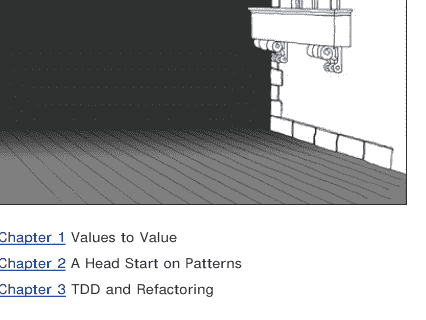

- 第1章 从价值到价值观
- 第2章 模式入门
- 第3章 TDD与重构

### 总体价值观

过去，我非常擅长提前规划。我经常主动向项目添加功能、结构和机制。这部分通常效果不错，但我常常忘记那些后来没有派上用场的添加物。当然，我也添加了大量此类东西。其成本相当高，无论是在开发时间还是增加的复杂性方面。

最近几年，我们被鼓励采用另一种方法：“做最简单且可能有效的事。”这个想法在很大程度上源自*极限编程*（XP）运动[Beck XP]。另一个类似的说法是“你不需要它”（YAGNI），这能很好地帮助你保持方向。“保持简单愚蠢”（KISS）大概也算其中之一。

这两种方法有点像两个极端（预先添加所有你能想到的东西与做最简单的事），但我认为它们都缺少了一点：它们没有解决所做出的权衡。几乎所有关于“这个好还是那个好”的问题都可以用“视情况而定”来回答。关键在于权衡。我倾向于采用一种居于两者之间的方法，根据情况向某一方向移动。瑞典语“lagom”一词的意思类似于“恰到好处”或“不多不少”。“Lagom”或“平衡”，再加上对情境的敏感性，是我所看重的总体价值观，还有持续学习。

让我们更仔细地看看几个更具体的价值观领域（架构和流程要素），先从一些面向架构的内容开始，以帮助我们进入合适的氛围。

### 值得重视的架构风格

架构师和开发人员必须根据项目的需求做出设计决策。我在此并没有收集一份详尽的架构风格价值观清单，但我决定对几个主要内容进行一定程度的评论，例如模型焦点、领域模型、数据库、分布和消息传递。首先，我认为保持模型焦点是明智的。

### 聚焦模型

很长一段时间里，我非常喜欢面向对象范式，但直到最近我才完全转向这一范式。以前使用该范式存在平台问题，但现在平台已经成熟。

### 注意

正如一位评审人指出的，成熟度取决于我们所讨论的平台。如果你来自VB背景，刚才所说的合理；但如果你来自Java、Smalltalk、C#等背景，平台已经成熟相当长一段时间了。

大约13年前，我试图使用视觉模型来传达我对即将构建系统的需求的理解，并使用了一些OMT草图[Rumbaugh OMT]。（OMT代表对象建模技术，是一种包含流程和表示法的方法。其表示法与统一建模语言（UML）中的表示法非常相似，这并非巧合，因为OMT是UML表示法的主要灵感来源。）我们讨论了类之间的多重性、行为应归属何处等问题。几次会议之后，我意识到使用我的技术与专家用户讨论，而不是使用他们的技术，完全失败了。他们随机回答我的问题，并没有从讨论中看到或增加多少价值。（整个系统并非失败，它至今仍在使用，并且是那里的核心系统，但开发过程并未像本可以的那样顺利。我不得不改变方法。）

### 用例焦点

我多次思考过那次经历，实际上还开玩笑说自己当时多么天真。在接下来的几年里，我总是尝试遵循目标群体的方法论；我的意思是，对用户使用用户的方法论，对开发人员使用软件开发的方法论。一种在两个阵营中都相当有效的技术是用例技术[Jacobson OOSE]。（至少它在我使用的非正式XP[Beck XP]故事风格中效果不错，即简短的文本描述。这样的描述是对系统中某块功能的简短描述。例如“为公司客户注册订单”。）

它对用户来说非常自然，也能变得对开发人员自然，因此多年来它成为了我的桥梁工具。我进行桥接的方式是在软件中为每个用例创建一个类。

我逐渐意识到，由于我应用用例的方式，我的思维变得相当过程化。我的设计有点像事务脚本[Fowler PoEAA]，但我试图通过尽可能多地（或至少合适地）泛化行为来平衡它。

几年前，我听到Ivar Jacobson谈论用例，当我意识到他并没有像我预期的那样（并且我长期一直那样做）将用例封装在它们自己的类中时，我感到非常惊讶。

另一件让我对这种方法感到担忧的事情是，当我和我的好友、Valhalla开发者Christoffer Skjoldborg一起使用领域模型模式[Fowler PoEAA]时，我们不断斗争。他认为用例类价值不大，甚至可能碍事，因为当混合和匹配用例部分时，它们可能成为障碍。

### 处理主逻辑的不同模式

在我们继续之前，我必须对已经提到的事务脚本和领域模型说几句。

Martin Fowler在他的《企业应用架构模式》[Fowler PoEAA]一书中讨论了在应用架构中组织主逻辑的三种方式。它们是事务脚本、表模块和领域模型。

事务脚本类似于批处理程序，所有功能都在一个方法中从头到尾描述。事务脚本非常简单，适用于简单问题，但在处理高复杂性时会崩溃。重复将难以避免。尽管如此，非常多的大型系统都是以这种方式构建的。我曾经也这样干过，我亲眼看到了重复的证据，尽管我们努力减少它。它还是会冒出来。

表模块封装了一个Recordset[Fowler PoEAA]，然后你在表模块上调用方法，以获取关于id为42的客户的信息。为了得到姓名，你调用一个方法并发送id 42作为参数。表模块在内部使用Recordset来响应请求。这当然有其优势，尤其是在Recordset模式有良好实现的环境中。但问题之一是，它往往会在不同表模块之间引入重复。另一个缺点是，你通常无法对问题使用多态解决方案，因为消费者完全看不到对象身份，只能看到基于值的身份。这有点像使用关系模型而不是面向对象模型。

相反，领域模型使用面向对象来描述模型，尽可能接近所选定的领域抽象。它在处理复杂性时表现出色，既因为它能够充分利用面向对象的全部力量，也因为更容易忠实于领域。当然，使用领域模型模式并非没有问题。典型的问题是需要陡峭的学习曲线才能有效使用它。

### 领域驱动设计焦点

对我而言，关于用例使用的真正启蒙是*领域驱动设计*（DDD）[Evans DDD]。（我们很快会大量讨论DDD，但现在，让我们只说它关注领域，并让领域极大地影响软件。）我仍然认为用例技术是与用户沟通的好方法，但DDD让我觉得，如果我们能够主动让用户参与核心模型的讨论，会大有帮助。它可以很早就避免错误，并帮助开发人员更好地理解领域。

### 注意

“模型”是软件中过度使用的术语之一。我想我们都有关于它是什么的直觉，但我想描述一下我自己的想法。与其尝试给出*那个*定义，这里简单来说（合适的人可以为此写一本书），模型有几个属性，你可以与你自己的理解进行比较。模型是：

- 部分的
- 为了特定目的
- 抽象的系统
- 一种认知工具

此外：

- 一个模型有几种呈现方式（例如：语言、代码和图表）。
- 一个系统中有多个模型在起作用。

如果你想了解更多，关于什么是模型已经写了很多。一个好的起点是Eric Evans的书的前几页[Evans DDD]。（特别感谢Anders Hesselund和Eric Evans给我的灵感。）

模型是开发人员和用户之间沟通的好工具，而这些群体之间的沟通越好，软件就会变得越好，无论是短期还是长期。

我们（包括我）当然一直在使用模型，但我的旧模型与基于DDD思想构建的模型之间的区别在于，我的旧模型具有


much more infrastructure focus and technical concept focus. My new models are much cleaner from such distractions and instead focus totally on the core domain, its main concepts, and the domain problems at hand. This is a big mind shift.

Another way of expressing it is that technicalities (such as user interface fashion) come and go. Core business lasts. And when the core business changes, we *want* to change the model and the software.

It's not rocket science so far, and I'm probably just kicking in open doors. I think, however, this lies at the very core of how to achieve efficient software development, and in my experience it is rarely used. By this I mean focusing on the model, having a model (with different presentations) that is used by both users and developers, and not getting distracted by unimportant details.

## Why Model Focus?

I'd like to exaggerate this a bit. Let's play a game: What kind of developer would be the best one for building a very large system in a special field, let's say in finance? It goes without saying that the developer should be technically savvy, very skilled and experienced, have a huge social network, and so on. It would also be very nice if he was extremely skilled in the business domain itself and it wouldn't hurt if he had worked as, say, a trader for ten years, if that's the kind of system to be built.

Finding developers like that does happen, but in my experience it's more the exception than the rule. In the case of the developer being able to move on to another domain for a new system when the financial system is up and running, that exception becomes even more rare. This is because developers just can't have ten years of experience in logistics, health care, insurance, and the rest.

Another solution can be to let the domain expert users develop the software themselves. This has been an old dream for decades, and to a degree it's slowly becoming more and more viable all the time. At the same time, it takes away time from them, time they often can use better for their core work. There's also too many technical problems still involved.

So what's the next best thing? The answer is obvious (at least from today's standpoint): make the developer learn as much as possible about the domain he or she is working on and add users to the picture to bring the domain expertise to the project team and to actively and constructively work within the project. The users would not just set the requirements—although that is also very important—but would actually help out with designing the core of the system. If we can manage to create this atmosphere, nobody is more skilled than the domain expert user at deciding on what the core is, what the key abstractions are, and so on.

Of course, as developers we are also necessary. The whole thing is done in cooperation. For example, what might be seen as a tiny detail to businesspeople can be a huge thing to us in the domain model. They might say: "Oh, sometimes it's like this instead," and everything is totally different, but because it's not the most common variant, they think it's unimportant.

## Time to Try Discussing the Model with Customers Again

Why would I now succeed in discussing the model with the customers when I failed before? Many things have changed. First, it's important to have a sense of the context and the project group. Second, use cases can help a lot when getting started, and then you can switch the focus later to the core model itself. Third, building systems is something many more people have experience in and have been taught about now. Fourth, to be picky, the model represented as graphical, UML-like sketch for example is not the most important thing to have users work on; it's still typically a representation that developers like better than users. What we are looking for is the ubiquitous language [Evans DDD].

The ubiquitous language is not something like UML, XML Schema, or C#; it's a natural, but very distilled, language for the domain. It's a language that we share with the users for describing the problem at hand and the domain model. Instead of us listening to the users and trying to translate it to our own words, a ubiquitous language would create fewer reasons for misunderstandings, and it will become easier for the users to understand our sketches and actually to help correct mistakes, helping us gain new knowledge about the domain. If it's suitable, you can discuss ubiquitous language in the context of the graphical/code models with the users. If not, you still have the most important thing done if you catch the ubiquitous language.

### Note

Eric Evans commented on the previous with the following:

> > Something to make clear is that the ubiquitous language isn't just the domain expert's current lingo. That has too many ambiguities and assumptions and also probably too large a scope. The ubiquitous language evolves as a collaboration between the domain experts and the software experts. (Of course, it will resemble a subset of the domain jargon.)

The ubiquitous language is something that you should work hard to keep well-defined and in synch with the software. For example, a change in the ubiquitous should lead to a change in the software and vice versa. Both artifacts should influence each others.

## If You Have a Model Focus, Use the Domain Model Pattern

If we have agreed on having a deep model focus and using object-orientation, I believe the natural result is to use the Domain Model pattern [Fowler PoEAA] for structuring the core logic of the applications and services. You find an example of a small Domain Model in Figure 1-1.

Figure 1-1. An example of a Domain Model, an early sketch for the example application, further discussed in Chapter 4, "A New Default Architecture"

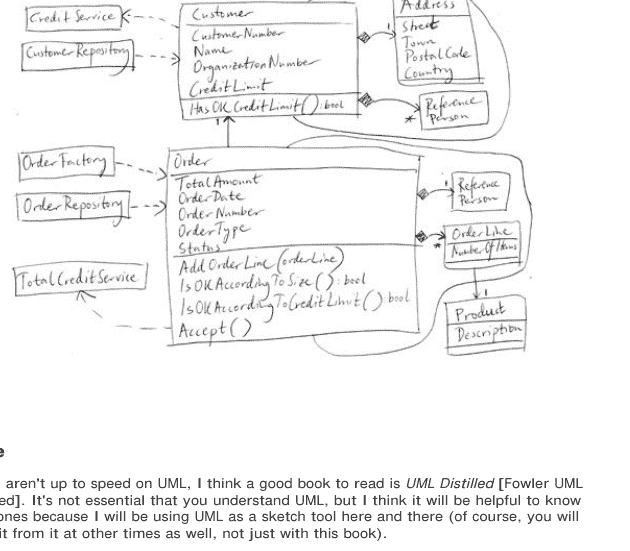

### Note

If you aren't up to speed on UML, I think a good book to read is UML Distilled [Fowler UML Distilled]. It's not essential that you understand UML, but I think it will be helpful to know the bones because I will be using UML as a sketch tool here and there (of course, you will benefit from it at other times as well, not just with this book).

Even though Figure 1-1 shows just an early sketch of a small domain model, I think we can see that the model expresses domain concepts and not technical distractions. We can also see that it contains several cooperating small pieces, which together form a whole.

### Note

If you wonder why Figure 1-1 is handwritten, it is to stress the point that it is a sketch. We will explore and develop the details in code for example, with the help of Test-Driven Development (TDD). (We will discuss TDD later in this chapter, as well as in Chapter 3, "TDD and Refactoring.")

## Domain Model History from My Rear View Mirror

I still remember the first time I tried to use the Domain Model, even though I didn't call it that at the time. It was around 1991, and I couldn't understand how it should match up in the UI. I don't remember what the application was, but I remember that I tried to decide on what the menus should look like in order to be object-oriented. I didn't come over that first hurdle that time. I think I was looking for a very close mapping between the UI and the Domain Model and couldn't find out how to achieve it.

A few years prior to that, I worked on an application that was said to use object-oriented ideas, for example, for the UI. There were no big breakthroughs, perhaps, but it managed to achieve small things. For example, instead of first choosing a function and then deciding to what object (such as a portfolio) to apply it, the user first chose the object and then decided between the different functions that were possible for the chosen object. At the time this was pretty different from how most business applications were navigated in the UI.

## A Few Words About Naked Objects

Perhaps I wasn't totally off with my intentions. Perhaps what I was trying to achieve was something like *Naked Objects* [Pawson/Matthews Naked Objects], but I really didn't get very far with it.

Without going into details about Naked Objects, I think a short explanation is in order. The basic idea is that not only developers but users also like object-orientation. They like it even more than we normally think, and they would quite often be happy with a UI that is very close to the Domain Model itself, so close that the UI can be created automatically by a framework directly based on the Domain Model.

A system based on naked objects automatically presents a form to a user that contains widgets exposing the properties in the Domain Model class.

For more complex tasks, there is some need for customization (as always), but the idea is to cut down on that as well, again thanks to the framework that understands what UI to create from the Domain Model fragments. So when the Domain Model is "done," the UI is more or less done as well.

For the moment I don't have first-hand experience with the concept and technique, but an appealing twist to me of the idea is that the users will really get a chance to see and feel the model, which should be very helpful in bridging the gap between developers and users.

After that, I tried Domain Model approaches many times over the years. I found problems with using it, especially related to performance overhead (especially in distributed scenarios). That said,

我的部分真实应用就是以这种方式构建的，尤其是那些较简单的应用。同样重要的是，无论我多么想构建强大、设计良好的领域模型，结果都不如我所预期。

不过，这并不是我遇到的唯一问题……

## 过去的结论可能已经过时

过去我一度相信领域模型，并多次尝试使用它，但大多数以面向对象方式实现的尝试都让我得出一个结论：它行不通。例如，我在 Visual Basic 6 (VB6) 中开发 COM+ 应用程序时就是如此。主要问题是性能开销过高。

在我撰写上一本书 [Nilsson NED]（描述 .NET 应用程序的默认架构）时，我沿用了旧的 VB6/COM+ 经验，完全没有让所讨论的架构基于领域模型。

之后，我重新开始新的实验，试图看在 .NET 中使用领域模型相比事务脚本和 Recordset，能否将常见场景（如获取单个订单、获取客户的订单列表或保存订单）的响应时间开销降低到大约 10%。令我惊讶的是，我确实能做到更低的开销。旧有的结论已经不再正确。现在在 .NET 中实现基于领域模型的架构远比在 VB6 中可行得多。原因之一是实例化时间减少了几个数量级。因此，当你拥有大量实例时，开销就低得多。另一个原因是，在 .NET 中编写按值封送（Marshal By Value）组件是件很简单的事（这样不仅实例的引用被移动，而且整个实例——至少概念上——也被移动）。在 COM 世界里这并不简单。（在 VB6 中甚至无法以通常意义上的方式做到。）

### 备注

按值封送的重要性已经不那么重要了，因为我们现在通常更倾向于不将领域模型原样通过网络传输，但我早期的测试确实采用了这种方式。

另一个原因是，.NET 对面向对象的支持更好；它只是一个好得多的工具箱。

### 备注

还值得一提的是，过去 Microsoft 社区并没有过多强调领域模型。而 Java 社区则几乎相反。我记得我参加过一次主要是 Java 开发者的研讨会。我问他们最喜欢怎样组织逻辑结构，也许他们是否大量使用 Recordset（JDBC 3 中新增的功能）。他们奇怪地看着我，好像没听懂这个问题。我很快意识到，领域模型在他们的场景中或多或少已成为事实标准。

为了澄清这些，我想说明两点。第一，我并*不是*说你应该因为性能原因选择领域模型模式，而是说你通常*可以*选择领域模型模式而不会遇到性能问题。

第二，我也*不是*说为了能够以模型为重点，你需要某种特定的技术。不同的技术在表达与领域高度相似的软件模型方面各有优劣。当然，不存在一种始终最佳的技术。不同的领域和不同的问题会为选择合适的技术设定不同的因素。因此，我将技术视为一种使能者。有些技术可能比其他技术更能起到使能作用。

总而言之，领域模型模式能否被足够高效地使用，在很大程度上是一个设计问题。

关于这一点，有个好消息是，我们有很多有价值的信息可以参考。领域驱动设计及其构建领域模型的风格提供了许多宝贵的帮助，这也是我们在本书中将要花大量时间实践的内容。

## 一个核心结构

因此，如果我们选择以领域模型为中心，就意味着我们要让项目中的所有人接受并认同这个模型。开发人员当然也不例外。

甚至数据库管理员（DBA）也可能同意将领域模型视为核心，即使数据库设计会略有不同。若是如此，我们很可能也就成功让 DBA 说出了通用语言！（事实上，你越能让 DBA 喜欢领域模型并遵循它，实现起来就越容易。这是因为如果数据库设计与领域模型没有根本性差异，而更像是同一模型的不同视图，那么你需要编写的映射代码就会更少。）哦，甚至用户也可能认同领域模型。当然，不同的利益相关者对领域模型会有不同的需求，比如在细节级别上会有不同的视角，但它仍然是一个可以共同生存、共同成长、共同改变的核心结构……

你会看到，从现在开始，我将在本书中投入大量精力讨论基于领域模型的解决方案，但在此之前，我想先谈谈其他架构价值。让我们暂时离开领域焦点，讨论一些更偏技术的领域。首先是如何处理数据库。

## 谨慎对待数据库

过去，我在构建系统时对性能考虑很多。例如，我曾将所有数据库访问写成手写的存储过程。这样做在运行时通常非常高效，尤其是当你不只是针对单个实例（如单个客户）进行 CRUD（创建、读取、更新、删除）操作，而是使用“更智能”的存储过程时；例如，每次调用执行多个操作并影响多行数据。

## 正确看待效率

尽管硬件性能可能仍然在按照类似摩尔定律的规律增长，但性能问题仍是一个日常问题。在硬件能力提升的同时，我们试图用软件解决的问题规模也在增大。

根据我的经验，性能问题往往是由糟糕的数据库访问代码、糟糕的数据库结构或其他类似原因造成的。这一切的一个常见原因是，人们完全没有在数据库结构上花费精力，而只关注面向对象的纯粹性。这反过来又导致了极多的往返调用、低效甚至错误的事务代码、糟糕的索引方案等等。

为了更具体一些，让我们来看一个例子：在这个例子中，面向对象被认为很重要，而数据库处理则不然。假设你有一个 `Customer` 类，其中包含一个 `Orders` 列表。每个 `Order` 实例都有一个 `OrderLine` 实例列表。它看起来大致如图 1-2 所示。

### 图 1-2. Customer/Order 示例的 UML 图

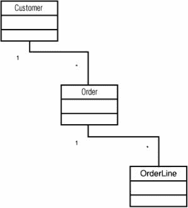

此外，假设这个模型对你来说非常重要，而你并不太关心数据是如何从所用关系数据库中获取或存储的。这里，一种可能（但很天真）的方案是让每个类（`Customer`、`Order` 和 `OrderLine`）负责自身的持久化/反持久化。这可以通过添加一个层超类型 [Fowler PoEAA] 类（在图 1-3 所示的示例中称为 `PersistentObject`）来实现，该类实现了例如 `GetById()` 方法，领域模型类则继承自该类（参见[图 1-3](#)）。

### 图 1-3. 带有层超类型的 Customer/Order 示例的 UML 图

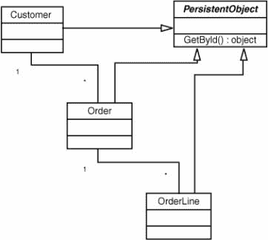

现在，假设你需要获取一个 `Customer` 及其所有 `Orders`，并且对于每个订单，获取其所有 `OrderLines`。那么你可以使用类似这样的代码：

```cpp
//A consumer
Customer c = new Customer();
c.GetById(id);
```

### 备注

如果你对前面代码片段中的 `//A consumer` 感到疑惑，其目的是为了在这种代码片段中指明类名（有时是方法名），以提高清晰度。有时候具体的类名（比如在这个例子中）并不重要，这时我会使用更通用的名称。

C++ 本身就内置了这种概念，因为方法名写作 `ClassName::MethodName`，但我认为一些简短注释也能提供同样的效果。


现在发生的情况是，下列 SQL 语句将会执行：

```sql
SELECT CustomerName, PhoneNumber, ...
FROM Customers
WHERE Id = 42
```

接下来，客户的 `GetById()` 方法会获取一个 `orders` 列表，但只会通过调用 `GetIdsForChildren()` 来获取键，其执行内容类似于这样：

```sql
SELECT Id FROM Orders
WHERE CustomerId = 42
```

之后，`Customer` 会通过遍历 `Order` 标识符的 `DataReader` 来逐个实例化 `Order`，并将实际工作委托给 `Order` 的 `GetById()` 方法，如下所示：

```csharp
//Customer.GetById()
...
Order o;

while (theReader.Read())
{
    o = new Order();
    o.GetById(theReader.GetInt32(0));
    c.AddOrder(o);
}
```

然后对于每个 `Order`，是时候获取所有 `OrderLines` 的标识符了……好吧，你明白了。这里发生的情况是，在一定程度上使用了对象视角（至少设计者的意图是如此），而不是以集合的方式思考，而关系数据库正是基于集合的。正因如此，到数据库的往返次数极高（为获取每一行数据一次，外加几次）。效率直线下降。

### 注意

值得一提的是，刚才描述的行为在特定场景下可能正是你需要用来避免大规模加载数据的手段。很难指出某件事总是坏的。请记住上下文。

另一方面，如果我们考虑另一个极端，手写的并经过手工优化的存储过程，可能看起来像这样：

```sql
CREATE PROCEDURE GetCustomerAndOrders(@customerId INT) AS
    SELECT Name, PhoneNumber, ...
    FROM Customers
WHERE Id = @customerId

SELECT Id, ...
FROM Orders
WHERE CustomerId = @customerId

SELECT Id,...
FROM OrderLines
WHERE OrderId IN
    (SELECT Id
     FROM Orders
     WHERE CustomerId = @customerId)
```

它们在运行时通常是高效的（如我所说）。它们在维护期间效率很低。你将会有大量代码需要手工维护。更糟的是，例如 Transact SQL（T-SQL，用于 Sybase SQL Server 和 Microsoft SQL Server）中的存储过程，并不适合用于避免代码重复的普通技术，因此会出现相当多的重复代码。

### 注意

我知道，有些读者现在会说，之前的例子可以在没有存储过程的情况下非常高效地解决，或者那个存储过程在所有情况下都不是最有效的。我只是想从效率角度指出两个极端例子。我的意思是，至少从效率角度看，设计不良的代码使用动态 SQL，而设计更好且写得很好的存储过程则不同。

那么问题是，运行时效率是否是选择设计方式时最重要的因素？

## 可维护性重点

如果我只能选择一个“能力”作为最重要的能力，如今我会选择可维护性。并不是说这是你唯一需要的，绝对不是，但我认为它通常比可扩展性等更重要。有了良好的可维护性，你可以轻松且经济地实现其他能力。当然，这是一个巨大的简化，但它传达了一个重要的观点。

另一种看待方式是比较生产一个新系统的总成本与系统整个生命周期内的维护总成本。根据我的经验，对于大多数成功的系统，维护成本会大得多。

总结一下，我目前的观点是，值得对数据库给予一定的关注。你应该把它看作朋友而不是敌人。与此同时，手工编写所有处理数据库的代码通常并不是“正确”的做法。它与我想关注的模型关系不大。用唐纳德·克努斯的一句常见名言来说，“过早优化是万恶之源。”最好在有指标表明你必须进行优化之前避免优化。

在这里做一个快速而大的跳跃，我认为合理的设计，加上对象关系映射（O/R Mapping），通常已经足够好，而当不够时，你应该进行手工调优。O/R Mapping 有点像数据库服务器的优化器，大多数时候它足够聪明，但也有需要你帮忙的情况。

### 注意

本书中将大量讨论合理的设计和 O/R Mapping。现在，让我们将 O/R Mapping 定义为在面向对象和关系数据库之间架起桥梁的技术。你描述面向对象模型与关系数据库之间的关系，然后 O/R Mapper 会为你完成其余工作。

因此一种方法是使用 O/R Mapper 等工具来处理大部分数据库访问代码，然后为执行效率而需要手工编写的代码进行手工编写。

让我们更仔细地看看像 O/R Mapper 这样工具必须处理的问题，即在两个不同世界之间进行映射，面向对象世界和关系世界。

## 领域模型与关系数据库之间的阻抗不匹配

我之前提到过，使用领域模型时，映射到 UI 是一个问题。另一个众所周知的问题是映射到关系数据库。该问题通常被称为关系世界和面向对象世界之间的 _阻抗不匹配_。

我想谈谈我对该阻抗不匹配的看法，尽管这有点像是通俗版本。有关更进一步和更正式的信息，请参阅 Cattel [Cattell ODD]。

首先，如果你同时使用关系数据库和面向对象模型，就存在两种类型系统。问题的一部分是由类型系统位于不同的地址空间（即使不在不同的机器上）引起的，因此你必须在它们之间移动数据。

其次，甚至基本类型也不完全相同。例如，.NET 中的 `string` 是可变长度的，但在 Microsoft SQL Server 中，字符串通常是 `varchar` 或 `char` 或 `text`。如果使用 `varchar`，你必须决定最大宽度。如果使用 `text`，其程序模型与 SQL Server 中的其他字符串类型完全不同。

另一个例子是 `DateTime`。.NET 中的 `DateTime` 与 SQL Server 相当相似，但存在差异。例如，.NET 的精度达到 100 纳秒，而 SQL Server 仅达到 3/1000 秒。另一个“有趣”的差异是，如果你在 .NET 中将 `DateTime` 设置为 `DateTime.MinValue`，尝试将其存储到 SQL Server `DateTime` 中时会引发异常。

已经被构建。我和他们一起在那里。

### 注意

我在这里将使用 MTS 作为名称，但你同样可以使用 COM+ 或 COM+ 组件服务或企业服务。

对于某些系统来说，分布式是非常合适的。将一些处理从客户端和数据库转移到应用服务器有其好处，例如资源共享（例如，服务器端的连接池，使得仅少数数据库连接就能为数百个客户端提供服务）。这些好处对于某些系统来说非常必要，而且获得这些好处变得更容易、更高效。

## 过度使用永远不好

不幸的是，这些好处如此诱人，以至于有时会过头。例如，服务器端的工作可能会分散到多个不同的应用服务器上。并不是说应用服务器被克隆以便所有客户端都能使用其中任何一个并获得所需的所有服务，而是客户端调用其中一个应用服务器。该服务器调用另一个应用服务器，后者又调用另一个应用服务器。好处很小，但由于延迟增加和可用性降低而带来的弊端巨大。

另一个错误是为仅有两位同时用户的简单应用程序编写并在 MTS 中执行。这是一个非常好的例子，因为相信该应用程序在遥远的未来可能会非常流行并被数千用户同时使用，所以把小事化大。问题不仅仅是运营环境更复杂，而是如果想成为一个好的 MTS 公民，应用程序的设计会有很多影响。一个典型的例子是避免某些层（甚至更糟，全部层）之间的啰嗦通信。这些影响确实在很大程度上增加了设计的复杂性。好吧，过量使用永远不好。

你注意到我避免谈论初学者在首次尝试分布式系统时遇到的常见陷阱，例如啰嗦通信吗？好吧，即使出于某种原因，那些错误被避免了，仍然存在其他、稍微更微妙的问题。

所有这些问题促使 Martin Fowler 提出了他的分布式对象设计第一定律，即 "Don't distribute" [Fowler PoEAA]。如果你绝对不需要，就不要做。成本和复杂性会直线飙升。这是自然规律。

## 分布式可能有用

尽管如此，分布式也有好处，现在和将来都是，例如：


- **容错性**

如果只有一台机器运行所有内容，那么当这台机器开始出问题时，你就麻烦了。对于某些应用来说，这种风险可以接受；但对另一些应用来说，这简直是无法想象的灾难。

- **安全性**

关于将应用拆分到多台机器上是否能提高安全性，一直存在激烈争议。不过，安全性问题确实是人们选择这样做的常见原因之一。

- **可扩展性**

对于某些应用来说，负载太高，单台机器无法应对。也可能出于财务考虑，你不想一开始就购买最昂贵的机器。你或许更希望在问题规模增长时增加更多机器，而不必淘汰旧机器。

如果你确实需要分布式系统，那么在设计上深思熟虑就极为重要，因为一个大的设计挑战很容易造成严重的吞吐量问题，举例来说。谈到分布式时，消息传递是一个重要概念。

## 关注消息传递

本书的重点是设计*一个*应用或*一个*服务，而不是过多关注如何编排多个服务。即便如此，我认为至少应该为工作中的实时部分预留时间，因为长时间执行的任务可以放在低负载时段运行，通常例如在夜间。

目前，我把自己太多的应用都写成了同步方式。当某项功能执行时间过长且不必实时执行时，我就不得不将其改为批处理过程。实时执行的部分也从完整功能变成了仅仅接收请求本身。

一个更高效的解决方案是，从一开始就尽可能多地考虑异步消息。这样，功能既可以在合适时实时运行，也可以放入消息队列尽快执行或按固定间隔执行。（批处理方案从一开始就可以内建其中。）

基于异步消息的解决方案在构建用户界面时可能需要完全不同的思维方式，但如果你真正挑战这些不同的设计问题，我相信你会发现，异步不仅可行，而且比你过去可能预想的更适合更多场景。

最后再说几句：在我看来，无论执行环境如何，聚焦于核心模型本身都是一个好主意。这样你很可能可以在多个不同场景中使用它。

## 通过重构加深理解

我认为一个绝对值得珍视的价值观是持续评估，这对领域驱动设计（DDD）也是如此。当前模型是最佳的吗？时不时建设性地质疑当前模型，如果你能提出重要的简化方案，不要害怕重构。

当你发现新东西时也是如此。几个简单的重构可能不仅让新特性变为可能，而且使其容易实现，从而很好地融入模型。

仅凭重构本身也可能带来更深的理解，比如当你进行的重构能打开一切，并带来那些罕见的“尤里卡！”时刻。

我们稍后会回到重构的话题，但首先我想谈谈与之密切相关的另一个话题，即测试驱动开发。

## 测试驱动开发

我经常听到开发人员说他们无法使用自动化单元测试，因为他们没有好工具。其实，思维方式比工具重要得多，尽管工具当然也有帮助。

几年前我编写了自己的工具（见图 1-6），并用它来注册和执行对存储过程、COM 组件和 .NET 类的测试。多亏了这个工具，我可以跳过那些有 97 个按钮、必须按特定顺序点击才能执行测试的表单。

图 1-6. 我的旧测试工具 JnskTest 的屏幕截图

[查看完整尺寸图像]

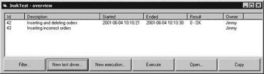

后来，当 NUnit [NUnit]（其他 xUnit 版本的衍生品）发布时（见图 1-7），我开始改用那个工具。使用 NUnit 效率高得多。例如，我的工具不会自动反映已有的测试，而是需要你显式注册相关信息。

### 图 1-7. NUnit，GUI 版本

[查看完整尺寸图像]

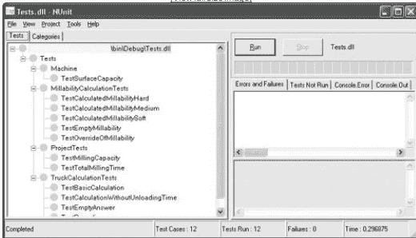

### 注意

现在我使用另一个工具，名为 Testdriven.Net，但正如我所说，使用什么工具不那么重要。

无论你采用什么流程，都可以使用自动化单元测试。为了获得更大的积极效果，我强烈建议你看看测试驱动开发（TDD）是否适合你。

## 更高层次

TDD 是指在编写真实代码之前先编写测试。这样做，测试将驱动你的设计和编程。

TDD 听起来枯燥乏味，开发人员往往预期它是个麻烦事。他们大错特错了！根据我的经验，事实恰恰相反：它实际上非常有趣，这对我来说也是个惊喜。我想它之所以这么有趣，是因为你能立即获得对所做修改的反馈，而且作为专业人士，我们乐于创建高质量的应用程序。

换个说法，TDD 并非关乎测试，而是关乎编程和设计。它关乎编写更简单、更清晰、更健壮的代码！（当然，由此产生的单元测试这一“副作用”也极其重要！）


顺便说一下，你不应该问客户是否应该使用 TDD，至少不要在同时要求更多付款/时间/之类的情况下问。他只会告诉你把它做好。考虑到项目从开始到结束，如果使用 TDD 不会产生额外成本，我认为你应该直接进行。客户在之后得到预期质量时会感到满意。

### 备注

暂时让我们跳过 TDD，只关注自动测试。

我的一位同事对自动单元测试（在真实代码之前或之后创建）的需求持 *极度*怀疑态度。他告诉我，在他二十多年的职业生涯中，自动单元测试一次都没有帮助过他。然而，我认为他最近的想法有所改变。我们一起在一个项目上工作，他编写了 C++ 中的 COM 组件，而我编写了作为规范和作为测试的测试。完成后，客户在需求中更改了一件事。我的同事做了小改动，但测试捕获了一个在 1,000 次执行中仅出现四次的错误。该错误在几秒钟的测试后就被发现了，而如果手动进行则需要数小时。而且如果手动进行，该错误很可能根本不会被发现，而会在生产环境中显现。

## TDD 流程

现在我已经尝试让你对开始使用 TDD 感兴趣，所以让我们更仔细地看看这个流程是如何进行的。（我们将在 [第3章](#) 中回到这个问题，在那里我们将通过一个真实世界的演示更深入地研究它。）假设你对需求有相当好的了解，流程如下：

- 首先，你开始编写测试。你让测试有意义地失败，这样你就可以确定测试确实在测试你认为的东西。这是简单而重要的规则，但即便如此，我也多次跳过它，这只是在自找麻烦。
- 第二步是编写能让测试通过的最简单的代码。
- 第三步是根据需要进行重构，因为你发现了代码异味（例如，代码重复），然后你重新开始，添加另一个测试。

如果我们使用 NUnit 的术语，第一步应该给你红灯/红条，第二步应该给你绿灯/绿条。

我之前提到过重构，并且作为 TDD 总体流程中的第三步，我认为我应该更简要地解释一下这个术语。

## 重构

在学校里，我们一直听到关于持续学习的话题。在重构 [Fowler R] 的情况下，这非常正确，例如为了获得更好的模型。

重构是关于逐步进行小的、众所周知的更改，以改进现有代码的设计。也就是说，在不改变其观察到的行为的情况下提高其可维护性。另一种说法是改变怎么做，而不是改变做什么。

简而言之，重构的作用就是将你从有异味的代码带到优雅的代码。就这么简单。

所以你不必在前期就想出完美的设计。这是个好消息，因为无论如何也做不到。

## 为什么使用重构？

我们没有人会难以识别有异味的代码。可能更棘手的是知道何时修复它。在我看来，你应该在问题出现时就处理它。你应该使用重构，因为如果不持续维护你的代码，它会开始退化并崩溃。

### 备注

Mark Burhop 说了以下内容："一个好朋友会保留一份软件开发法则清单。其中一条大致是“代码如果不被触碰，就会产生错误。”"

让我们用你家做个类比。你选择忽略的问题，例如修窗户、修屋顶、粉刷木工等——这些被忽略的问题会随着时间的推移而增长。这是一条不可改变的法则。所以迟早你的房子会散架，到那时它就毫无价值了。没人想要这种情况，对吧？

软件不同，因为它不是由有机材料构建的，如果不被更改，也不会受到天气和风的影响。然而，我们直觉上对软件随时间的变化有一种感觉，当在修复错误和扩展软件时没有应用重构。

## 如何使用重构？

重构可以在应用程序生命周期的所有阶段使用；例如，在开发应用程序的第一个版本期间。但就假设我们不使用重构，而是使用前期、传统的设计重过程（现在通常被称为前期大设计，BDUF）。我们将在初始详细设计上花费大量时间，创建大量详细的 UML 图，但作为结果，我们期望开发能非常顺利和快速地进行。即使假设确实如此，代码仍然有风险会是，嗯，有异味。

相反，让我们说我们只是接受了我们不能第一次就前期做对的事实。在这种情况下，一个稍微不同的方法是将部分工作从初始详细设计转移到开发中（当然所有开发，尤其是在这种情况下，*是设计*）并准备好在我们学到更多时持续进行重构。学习更多正是我们在开发期间所做的事情，在我看来，这种方法会产生更高质量的代码。

所以与其做太多猜测，我们做更多学习和验证！

### 备注

我可能对 BDUF 过于积极，以便不分散你对我关于有异味代码的重点。第一天做大量猜测工作往往会导致浪费时间，因为这只是猜测。

我的朋友 Jimmy Ekbäck 对此评论说，“BDUF 可能比浪费时间更糟，因为猜测不正确。BDUF 也可能导致自我实现的预言。”

## 重构 + TDD = 真

为了能够以安全的方式使用重构，你 *必须* 进行广泛的测试。如果你不这样做，你将引入错误和/或你会优先考虑，不仅仅为了可维护性而进行任何更改，因为引入错误的风险太大了。当你因为可维护性而停止更改时，你的代码已经慢慢开始退化。

### 备注

你将在 [第3章](Chapter 3) 中找到更多关于 TDD 和重构的覆盖，重点是动手示例。

使用 TDD 和重构进行错误修复也是一个好主意。首先用红色测试暴露错误，然后解决问题以获得绿色，然后重构。

## 哪种成分或组合？

再次，我确信你们中的许多人都在想该走哪条路。例如，你应该专注于前期设计还是 TDD？

在我看来，你可以成功地混合前期设计和 TDD。例如，设置一些前期架构，使用领域驱动设计，并为每种行为使用 TDD（包括重构）构建它。然后回到你的架构并根据你学到的知识更改它。然后使用领域驱动设计，并继续这样做。

关于持续集成的更多学习的一个良好起点是 Martin Fowler 和 Matthew Foemmel 撰写的一篇论文，名为“持续集成” [Fowler/Foemmel CI]。

谢谢 Claudio！现在让我们转向一些操作方面。


### 备注

如果你有使用 *面向方面编程 (AOP)* 的可能性，事后添加跟踪可能只需要几分钟。我们将在第 10 章“拥抱的设计技术”中大量讨论 AOP。

## 现场跟踪

如果你有一个工作的跟踪解决方案，就位，你知道它在查找和解决问题方面可能有多高效。数天的延迟已经消失，你正在几分钟内追踪问题。

所以在操作机制方面，重要的是要小心，不要太常认为“YAGNI”（You Aren't Going to Need It）。经常使用 YAGNI 在添加机制时会花费太多成本，如果（或更确切地说，当）你需要它时。记住，YAGNI 的想法是添加某物的成本现在和以后几乎相同，在这种情况下，你可以一直等到真正需要它的时候。当成本现在很低而以后很高，并且有很好的机会你会需要它时，你应该做出不同的决定。

## 操作机制的一些示例

这里我列出了一些可供大多数企业级应用程序考虑的操作机制的简短列表：

- **Tracing**

  正如我们刚才讨论的，能够在用户在系统中运行场景的同时聆听正在发生的事情是很好的。这不仅是追踪错误的非常高效的解决方案，还可以用于调查瓶颈所在的位置，例如。

- **Logging**

  错误、警告和信息消息必须被记录。这对于在问题发生后调查问题至关重要。我们不能期望用户为我们写下确切的消息。也可能我们想要收集我们不想向用户展示的信息。

- **Config**

  你是否曾经因为数据库服务器切换到具有新名称的新机器而不得不重新编译旧应用程序？我有。当然，这类信息应该是可配置的，并且根据应用程序的不同，这可能适用于大量信息。

- **Performance monitoring**


## 浅谈模式

模式为反复出现的设计问题提供了简单、优雅的解决方案。模式带来的关键优点是灵活性、模块化，以及创建可理解和清晰的设计。注意，我省略了可复用性，尽管这有点不公平。模式将重点从代码复用转移到了知识复用上。因此，模式也非常关乎可复用性，只是不是我们通常认为的那种复用方式。

### 注意

Gregory Young 指出，许多模式都是通过解耦实现复用的。依赖注入模式（将在第10章“值得拥抱的设计技巧”中讨论）就是一个很好的例子。

当你学习模式时，你可能会想：“好吧，这不是我们一直以来的做法吗？”关于模式的一个重要观点是，它们不是被发明出来的，而是被*收获*或*提炼*出来的。它们关乎*经过验证*的解决方案。但解决方案并不是模式的唯一组成部分。模式由三部分组成：*上下文*、*问题*和*解决方案*。

从错误中学习是非常强大的，但时不时地，通过研究他人积累的知识来走捷径也不错，这是学习模式的一个好理由。让我们看看能否找到其他理由。

### 为什么学习模式？

最明显的原因可能是，模式是良好的抽象，为系统设计提供了构建模块。

如果一个开发团队具有模式意识，模式就会成为团队语言中非常重要的一部分。不必详细描述每一个设计想法，通常只需说出一个模式名称，团队中每个人就能评估它对于特定问题是否是一个好主意。将模式加入团队的语言可能是采用模式的唯一最重要的原因，因为语言的共同理解、丰富性和表现力都会增加。再说一次，开发在很大程度上关乎沟通。

另一个我喜欢模式的原因是，能够运用模式是一项持久的技能。作为对比，我在1988年左右学习了SQL，至今仍然可以仅靠使用它谋得不错的生计。我使用的产品和平台已经更换了好几次，但底层概念是相同的。模式也是如此。《设计模式》[GoF 设计模式] 一书于1995年出版，至今仍有极强的现实意义。还值得指出的是，模式与语言/产品/平台无关。（不同的平台可能有特定的模式。）

模式不仅适用于前期设计，在重构过程中也非常有用（也许更有用）……*“我的代码变得越来越乱。啊，我需要使用那个模式！”*这就像先有鸡还是先有蛋的问题，但我决定在本书中先从模式开始，然后在下一章讨论重构。

### 关于模式有什么需要注意的吗？

老实说，我认为没有理由不学习模式，但至少有一个非常常见的负面影响需要提防。我想到的是，对于刚接触模式的开发者来说，他们常常觉得必须把17个模式塞进每一个解决方案中。这种影响通常不会持续很久。

可能持续更久一点的是过度设计的风险。即使不是17个模式，至少也会对如何解决问题进行大量思考。最初的解决方案感觉不对，因为它没有使用某个特定模式。

### 注意

我的一个朋友告诉我，他最近在一家公司与一些开发者讨论一个设计问题。他花了三分钟就提出了一个非常简单的解决方案。（问题本身很简单。）然而，其他开发者对这个方案并不满意，于是他们花了三天时间苦思冥想，才把它弄好。

我也曾有过类似经历。在我看来，*测试驱动开发*（TDD）是避免这种过度设计问题的好技术。设计焦点将更多地放在解决当前问题上，而不是其他，模式将在需要时通过重构引入。

你可能会觉得模式概念是银弹。当然不是，它只是工具箱中的又一件工具。

模式单独来看通常被认为相当“简单”，但在上下文中并与其他模式组合时，它们会变得非常复杂。我不记得在新闻组里听过多少次人们说类似这样的话：“我理解模式X，但当我试图在我的应用程序中把它和模式Y、模式Z一起使用时，它极其复杂。请帮帮我！”这其实并不是不学习模式的理由。本书将在一定程度上讨论这个问题，但不是此时此刻；首先我们将单独讨论一些模式。

我相信 Joshua Kerievsky 的《重构与模式》[Kerievsky R2P] 把这一点说得非常清楚：使用模式最常见的方式并不是在前期设计中使用它们，而是通过重构向模式靠拢或重构到模式。

## 模式的采用

Gregg Irwin 这样评价模式采用：

> 对我来说，许多概念（如模式）都是分阶段学习的：
>
> 1. 你使用它时并未意识到自己在使用它
> 2. 你听说它，阅读相关资料，并稍作尝试
> 3. 你学得更多，并开始明确地使用它（尽管可能比较幼稚）
> 4. 你充满热情并开始宣扬（可选）
> 5. 某件事“豁然开朗”
> 6. 你学得更多，并以“不再那么幼稚”且更含蓄的方式应用它
> 7. 时间流逝，你看到了缺陷
> 8. 你质疑这个概念（通常是因为你误用了它）
> 9. 你要么忘掉它，要么增加知识和经验（必要时重复步骤5-9）
> 10. 你使用它时并未意识到自己在使用它

好了，是时候进入第一个模式类别了。让我们看看能否为你们这些模式新手带来“啊哈！”而不是“嗯？”。

## 提案

### 摘要

本提案旨在为名为《城市发展环境影响评估》的项目申请资金。该项目旨在评估都市区计划基础设施项目的潜在环境影响，重点关注空气质量、水资源和生物多样性。

### 目标

1. 评估目标区域当前的环境状况。
2. 预测拟议城市开发活动的潜在影响。
3. 提出缓解策略以尽量减少负面影响。

### 方法

本研究将结合实地调查、遥感数据和统计建模。将安装监测站，在六个月内收集基线数据。

| 阶段 | 持续时间 | 任务 |
| --- | --- | --- |
| 第一阶段 | 第1-2个月 | 基线数据收集 |
| 第二阶段 | 第3-4个月 | 影响建模与分析 |
| 第三阶段 | 第5-6个月 | 报告与建议 |

> *我们的环境不是奢侈品，而是生存的必需品。*

### 预算摘要

- 人员：45,000美元
- 设备：20,000美元
- 差旅：8,000美元
- 杂项：7,000美元
- **总计：80,000美元**

预算分配饼图


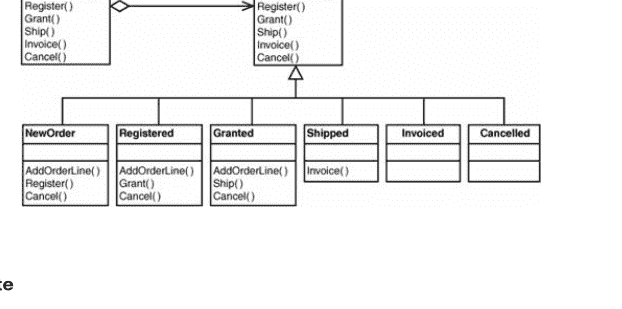

### 注意

对于这个示例，添加另一个抽象类作为 NewOrder、Registered 和 Granted 的基类可能是合理的。这个新类将实现 AddOrderLine() 和 Cancel()。

在具体示例中，Order 类是一般结构中的上下文（Context）。同样，Order 有一个 OrderState 字段，只不过这次 OrderState 不是枚举，而是一个类。为了重构，你的旧测试可能期望一个枚举，那么你也可以保留那个枚举（也许作为一个属性，其实现会检查状态继承层次结构中的当前实例是什么），从而不改变外部接口。

新创建的 Order 在实例化时会得到一个新的 NewOrder 状态实例，并将自身传递给构造函数，如下所示：

```
internal OrderState _currentState = new NewOrder(this);
```

请注意，该字段被声明为 internal。这样做的原因是状态类可以自行更改当前状态，因此 Order 将状态转换完全委托给不同的状态类。（我也可以让 OrderState 成为 Order 的内部类，以避免使用 internal。）

这次，Order 上的 Register() 方法极其简单。它可能如下所示：

```
public void Register()
{
    _currentState.Register();
}
```


The Register() method on NewOrder is also pretty simple. At least it can focus on its own state, and that makes the code clean and clear. It could look like this:

```
public void Register()
{
    _parent._Register();
    _parent._currentState = new Registered(_parent);
}
```

Before changing the state, there was kind of a callback to the parent (_parent._Register()) telling it to do its thing before the state was changed. (Note that the "callback" went to the internal method _Register() and not the public Register().) This is just one example of an option, of course. Other examples would be to put the code in the OrderState base class or in the NewOrder class itself. It should go wherever it's best located.

As you saw, if I want to do things before or after the state transformation, it's simple and very well encapsulated. If I want to disallow a certain transformation in the NewOrder class, I just skip implementing that method and use the implementation of the base class OrderState for that method. The implementation of the base class throws an exception saying it was an illegal state transformation, if that's the wanted behavior. Another typical default implementation is to do nothing.

### Note

If you need more context-aware exceptions, you can of course implement the methods in the subclasses just as well, even if all they will do is raise exceptions.

This also implies that instead of using a base class for OrderState you could use an interface instead. I guess that if the GoF book had been written today, many of the patterns would have used interfaces instead of (or at least together with) abstract base classes. The State pattern isn't the most typical example of this, but it still is a possible example.

## More Comments

When using the State pattern, we were actually swapping a single field into a bunch of separate classes. That doesn't sound like a very good idea at first, but what we then get is the nice effect of moving the behavior to where it belongs and good alignment to the Single Responsibility Principle (SRP).

There are drawbacks, of course, and a typical one is that the program can potentially be flooded with small classes when we use a solution such as State.

Which solution you prefer is indeed up for debate, but I think the State pattern is one that should be seriously considered here. You might find that it solves your problem with the least amount of

We try to split the classes so that the responsibilities are cohesively dealt with from a technological point of view.

Therefore, the old classes will now only focus on the domain meaning (let's call the layer Domain layer). The presentation (or rather consumption) responsibilities are dealt with by another set of classes (another layer called the Consumer layer), and the persistence responsibilities are dealt with by yet another set of classes (the Persistence layer).

Three layers spontaneously felt like a typical solution here, one per responsibility category. The two new layers have two *implementations* each for dealing with both the old requirements and the new.

The dependencies between the layers are also defined, and in this case we decided that the consumption layer will depend on the domain layer, and the domain layer will depend on the persistence layer. That way, the Consumer layer is totally unaware of the Persistence layer, which was something we decided was good in this particular project.

We will get back to the subject of layering again in [第4章](#chapter-4), "A New Default Architecture," and then approach it a bit differently.

## Another Example: Domain Model Pattern

We have already discussed the Domain Model pattern [Fowler PoEAA] in [第1章](#chapter-1) (and will do so much more throughout the book). I think about the Domain Model pattern as an example of an Architectural Pattern.

We're not going to discuss an example about the Domain Model pattern here and now because the whole book is about just that. Instead, we'll continue by focusing on another dimension of the patterns, regarding domain-dependence or not. Next up are Design Patterns for specific types of applications.

## Design Patterns for Specific Types of Applications

Another set of Design Patterns isn't as generic as those discussed so far, but, for example, patterns for building enterprise applications.

Defining an enterprise application is tricky, but you can think of it as a large-scale information system with many users and/or a lot of data.

The main book dealing with the patterns in this category is Martin Fowler's Patterns of Enterprise Application Architecture [Fowler PoEAA].

The patterns here at first sight might not seem as cool or amazing as some of the Design Patterns, but they are extremely useful, cover a lot of ground, and contain a lot of experience and knowledge. As I said, they are less generic than the other Design Patterns and focused just on large-scale information systems.

They come into play for the chosen structure of the logic; for example, the Domain Model. The patterns here aren't so much about how the Domain Model itself (or any of the other models for structuring the main logic) should be structured, but more about the infrastructure for supporting the Domain Model.

To make it more concrete, I'd like to discuss an example, and I choose Query Objects [Fowler PoEAA].

## An Example: Query Objects

Let's assume for a moment that you have a Domain Model for a SalesOrder application. There is a Customer class and an Order class, and the Order class in particular is composed of a number of other classes. This is simple and clear.

There are several different solutions from which to choose in order to navigate the Domain Model. One solution is to have a global root object that has references to root-like collections. In this case, a customer collection would be an example of one of these. So what the developer does is to start with the global root object and navigate from there to the customer collection, and then iterate the collection until what is needed is found, or perhaps navigate to the customer's sales orders if that's what's of interest.

A similar paradigm is that all collections are global so you can directly access the customer collection and iterate over it.

Both those paradigms are easy to understand and simple to use, but one drawback is that they are lacking somewhat from the perspective of a distributed system. Assume you have the Domain Model running at the client (each client has one Domain Model, or rather a small subset of the Domain Model instances, and no shared Domain Model instances) and the database is running at a database server (a pretty common deployment model). What should happen when you ask the root object to get the customer collection of one million customers? You can get all the customers back to the client so the client can iterate over the collection locally. Not so nice to wait for that huge collection to be transmitted.

Another option is to add an application server to the picture and ask it to only send over a collection reference to the client side, and then much less data is transmitted, of course. On the other hand, there will be an incredible amount of network calls when the client is iterating the list and asking for the next customer over the network one million times. (It will be even worse if the customer instances themselves aren't marshaled by value but only by reference.) Yet another option is to page the customer collection so the client perhaps gets 100 customers from the server at a time.

I know all these solutions have one problem in common; you don't often want to look at all the customers. You need a subset, in which case it's time to discuss the next problem.

## Problem

The problem is that the users want a form where they can search for customers flexibly. They want to be able to ask for all customers who

- Have a name with "aa" in it. (Hidden marketing for a Swedish car company.)
- Ordered something last month.
- Have orders with a total amount greater than one million.
- Have a reference person called "Stig."

But on the same form, they should also be able to ask for just customers in a certain part of Sweden. Again, the search form needs to be pretty flexible.

I'm going to discuss three different solution proposals, namely "filtering within Domain Model," "filtering in database with huge parameter lists," and "Query Objects."

## Solution Proposal One: Filter Within Domain Model

Let's take a step back and admit that we could use any of the solutions already discussed so that the collection is materialized somewhere and then the filter is checked for every instance. All instances meeting the filter criteria are added to a new collection, and that is the result.

This is a pretty simple solution, but practically unusable in many real-world situations. You will waste space and time. Not only were there one million customers, but you also had to materialize the orders for the customers. Phew, that solution is just impossible to use and it's even worse when you scale up the problem....

Of course, the conclusion here depends to a large degree on the execution platform. Remember what I said about the deployment model: a subset of the Domain Model instances in each client, the database at a database server, no shared Domain Model instances.

If instead there was one shared set of Domain Model instances at an application server (which has

它自身也有问题（更多内容将在后续章节讨论），这或许是一个合适的解决方案，但仅限于服务器端逻辑。对于请求共享领域模型实例子集的客户端，客户端必须以某种方式表达其条件。

## 解决方案二：使用巨大参数列表在数据库中进行过滤

数据库通常擅长存储和查询，所以让我们在这里利用这一优势。我们只需用 SQL 语句表达我们的需求，然后将结果转换为领域模型中的实例。

像下面这样的 SQL 语句可以解决第一个问题：

```sql
SELECT Id, CustomerName, ...
FROM Customers
WHERE CustomerName LIKE '%aa%'
AND Id IN
    (SELECT CustomerId
     FROM ReferencePersons
     WHERE FirstName = 'Stig')
AND Id IN
    (SELECT CustomerId
     FROM Orders
     WHERE TotalAmount > 100000)
AND Id IN
    (SELECT CustomerId
     FROM Orders
     WHERE OrderDate BETWEEN '20040601' AND '20040630')
```

### 注意

我是否可以将针对 Orders 的两个子查询合并为一个子查询，这一点尚有争议。按照所陈述的需求，我认为不能合并（因为合并后含义会略有变化）。

无论如何，这对于这里的讨论并不重要。

这里我们只是将感兴趣的实例物化。然而，我们可能不希望包含领域模型的层必须包含所有这些 SQL 代码。那样的话，领域模型还有什么意义？消费层只会得到两个需要处理的模型。

所以我们现在面临一个新问题。消费层应该如何表达它的需求？啊，负责数据库和领域模型之间映射的领域层可以为消费层提供一种搜索方法。第二个提议如下：

```csharp
public IList SearchForCustomers
```

让我们看看我们新创建的朴素查询语言在 C# 中可能是什么样子：

```csharp
Query q = new Query("Customer");
q.AddCriterion("CustomerName", Op.Like, "*aa*");
Query sub1 = new Query("Order");
sub1.AddCriterion("TotalAmount", Op.GreaterThan, 1000000);
q.AddCriterion(sub1);

Query sub2 = new Query("Order");
sub2.AddCriterion("OrderDate", Op.Between,
DateTime.Parse("2004-06-01"), DateTime.Parse("2004-06-30"));
q.AddCriterion(sub2);

q.AddCriterion("ReferencePersons.FirstName", Op.Equal, "Stig");
```

### 注意

Query 构造函数的参数不是表名，而是领域模型类名。AddCriterion() 的参数也是如此；我的意思是，它们不是表列，而是类的字段/属性。在这种情况下，使用的是领域模型中的属性名或字段名。

另请注意，在这个特定示例中，我不需要针对 ReferencePersons 的条件使用子查询，因为领域模型可以从 Customer 导航到 ReferencePerson。另一方面，由于相反的原因，针对 Orders 需要子查询。

### 更多评论

如果你精通 SQL，你的第一印象可能是 SQL 版本更具表现力、更易读，而且更好。SQL 当然是一种强大的查询语言，但请记住我们想要实现的目标。我们希望尽可能多地使用领域模型（在一定限度内），从而获得更可维护的解决方案。另请注意，刚才展示的 C# 代码过于冗长。在本书后面，我们将讨论如何通过在一个通用查询对象实现之上编写一个薄层来优化语法。

因此，我们获得的是代码在数据库模式方面的进一步透明性。总的来说，我认为这是一件好事。当我们确实需要时，我们总能走出这个小沙盒，以数据库的全部能力来编写 SQL 查询，而无需任何辅助。

我想指出的另一件事是，创建一个合格的查询对象实现很快就会变得非常复杂，所以要注意不要承担太多工作。

一个不错的小副作用是，你还可以很容易地将查询对象用于本地过滤，例如持有所有产品的缓存列表。对于使用领域模型的开发者来说，他或她只需像往常一样创建一个查询对象，但随后它以稍有不同的方式被使用，而无需访问数据库。

### 警告

我知道，我知道。缓存既酷又有用，但也同样危险。小心，它可能会适得其反。你已经被警告过了。

一些熟悉 DDD 的读者可能会更喜欢使用规范模式 [Evans DDD] 来解决这个问题。这为我们即将关注的第三个也是最后一个模式类别——领域模式——提供了一个简洁的衔接。

## 领域模式

领域模式与设计模式和架构模式的关注点截然不同。它完全关注如何构建领域模型本身，如何将领域知识封装在模型中，以及如何应用通用语言，不让基础设施分散对重要部分的注意力。

领域模式与设计模式有一些重叠，例如名为策略 [GoF 设计模式] 的设计模式也被视为一种领域模式。重叠的原因在于，像策略这样的模式是构建领域模型的非常好的工具。

作为设计模式，它们是技术性的、通用的。作为领域模式，它们关注领域模型的核心。它们旨在使领域模型更清晰、更具表现力和目的性，并让获得的领域知识在领域模型中显而易见。

在上一节结束时，我提到作为领域模式的规范模式是查询对象模式的一种替代方案。我认为这是解释我如何看待领域模式的好方法。查询对象是一种技术模式，消费者可以使用基于对象的语法定义查询，以查找领域模型中的几乎任何对象。规范模式也可以用于查询，但不是使用通用查询对象并逐个设置条件，而是将规范作为一个概念，它本身封装了领域知识并传达了目的。

例如，要查找黄金客户，你可以同时使用查询对象和规范，但解决方案会有所不同。使用查询对象时，你会表达如何定义黄金客户的标准。使用规范时，你会有一个可能名为 `GoldCustomerSpecification` 的类。在这种情况下，标准本身不会被暴露或重复，而是封装在具有恰当名称的类中。

领域模式的一个来源是 [Arlow/Neustadt Archetype Patterns]，但我选择了一个来自另一个优秀来源的领域模式示例，即 Eric Evans 的《领域驱动设计》[Evans DDD]。所选的示例模式称为工厂。

### 注意

了解模式的读者可能会感到困惑，因为我在这里讨论领域模式工厂，而《设计模式》一书 [GoF 设计模式] 中也有一些工厂模式。再次强调，设计模式的关注点更偏向技术层面，而领域模式的关注点则在语义化的领域模型层面。

它们在详细意图和典型实现方面也有所不同。GoF 的工厂模式被称为工厂方法和抽象工厂。工厂方法是将“正确”类的实例化延迟到子类。抽象工厂是创建相关对象族。

DDD 的工厂模式在实现方面很直接，仅涉及捕获和封装特定类的创建概念。

### 示例：工厂

谁说软件行业不受工业化的影响？这种影响是好是坏尚有争议，但它确实受到了影响。我们谈论工程学作为软件开发的一个良好原则；我们谈论架构、产品线等等。这里是另一个这样的影响：工厂模式。但首先，让我们陈述这个示例要解决的问题。

### 问题

这次的问题是订单的构建很复杂。它需要以两种截然不同的方式进行。第一种是创建一个数据库未知的新订单。第二种是消费者要求将一个旧订单从数据库物化到领域模型中。在这两种情况下，都需要创建一个订单实例，但就构建而言，相似之处仅此而已。

问题的另一部分是订单应始终有一个客户；否则，创建订单就没有意义。问题的又一部分是我们需要能够创建新的信用订单和重复订单。

### 解决方案一

这个问题最简单的解决方案是使用这样的公共构造函数：

```csharp
public Order()
```

然后，在调用此构造函数之后，消费者必须按照应有的方式设置实例的属性，以便插入或向数据库请求值。不幸的是，这就像打开了潘多拉的盒子。例如，我们可能对属性进行脏跟踪，而我们可能不希望脏跟踪将刚从持久化中重建的实例标记为脏。另一个问题是如何设置标识，而标识很可能根本无法设置。反射可以解决这两个问题（至少在标识符未声明为 readonly 的情况下），但这是领域模型消费者开发者应该关心的事情吗？我绝对不这么认为。我们可以探索一些更晦涩的解决方案，但我相信你们大多数人都会同意，一个典型且明显的解决方案是改用参数化构造函数。因为我过去很久以前曾花费大量编程时间使用 VB6，我并没有被参数化构造函数惯坏。你能相信吗？竟然没有参数化构造函数！我自己其实都很难相信。无论如何，在 C# 和 Java 等语言中，我们确实可以使用参数化构造函数，而且……

在这个隐喻基础上，再加上一个要素：发动机还可以从其他地方获取，比如从本地或中央仓库的货架上取来；也就是说，旧实例应该通过从数据库中获取并实体化来重新构建。这与最初创建实例完全不同，无论是对于真实的物理发动机，还是对于软件中的订单实例。

我们现在已经接近模式解决方案了。让我们使用与第二个提议类似的解决方案，但将创建行为提取到单独的类中，暂时忘记“从数据库获取”（这由另一个称为 Repository 的领域模式处理，我们将在后面的章节中详细讨论）。

### 解决方案三

因此，现在我们开始使用工厂模式作为领域模式。让我们从图 2-7 中的图示开始。

### 图 2-7. 工厂模式的实例图

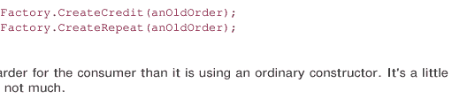

从消费者的角度来看，获得一个准备好的新订单实例的代码可能如下所示：

```
anOrder = OrderFactory.Create(aCustomer);
aReservation = OrderFactory.CreateReservation(aCustomer);

aCredit = OrderFactory.CreateCredit(anOldOrder);
aRepeat = OrderFactory.CreateRepeat(anOldOrder);
```

这对消费者来说并不比使用普通构造函数困难多少。它稍微更具侵入性，但差别不大。

为了让消费者获取旧的订单，消费者必须与其他对象通信（不是工厂，而是 Repository）。这更清晰且富有表现力，但这是后话。

如果工厂代码位于外部类中，要避免领域模型中的其他类通过构造函数实例化订单是不可能的，但你可以通过将构造函数设置为 internal 来稍微缓解这个问题，并且希望因为工厂的存在，领域模型开发者自己能理解这才是实例化该类的方式，而不是直接使用目标类的构造函数。

### 注意

Eric Evans 评论了上一段，内容如下：“我希望有一天语言能支持这样的概念。（就像它们现在有构造函数一样，也许它们会允许我们声明工厂等。）”

## 更多评论

首先，请注意，有时构造函数正是我们想要的。例如，可能不存在有意义的层次结构，客户端想要选择实现，构造过程非常简单，而且客户端可以访问所有属性。重要的是要理解，*不要* 只是继续创建工厂来创建每个实例，而是要在工厂能帮助你、增加清晰度并揭示领域模型意图的地方使用它们。

工厂的典型特点是它使实例处于有效状态。我个人非常喜欢做的一件事是，在适当的情况下用空对象（Null Object）来设置子实例。以 `Order` 为例。假设订单的发货由 `transporter` 负责。

起初，`Order` 尚未发货（在这种情况下，我们根本没有考虑太多发货问题），所以我们无法给它任何 `transporter` 对象，但我不会简单地将 `Transporter` 属性留为 null，而是将该属性设置为空的（也许是“未选择的”）`transporter`。这样，我总能期望找到 `Transporter` 属性的描述，如下所示：

```
anOrder.Transporter.Description
```

如果 `Transporter` 原本是 null，我就需要先检查它。对于这类事情，工厂是一个非常方便的解决方案。（在构造函数的情况下你也可以做同样的事情，但可能需要应用空对象的地方很多，而且如果有多种选择，决定使用哪个空对象可能并非易事。我的意思是，构造函数的复杂度会增加。）

当然，你可以有多个不同的工厂方法，让它们接受许多参数，这样你就能从工厂外部很好地控制创建过程。

使用工厂还可以隐藏你无法避免的基础设施需求。

我们经常听到关于工厂的话题，看到它们被用在不那么语义化的方式中，或者至少是以不同的方式使用，以至于所有实例（新的或“旧的”）都由工厂创建。例如，在 COM 中，每个类都必须有一个类工厂，许多框架也是如此。这时使用的并不是领域模式工厂：名称相似，技术相似，但意图不同。

另一个例子是，你可以（间接地）让工厂去数据库获取默认值。同样，好的做法是不在构造函数中进行太多处理，因此构造函数不是放置这类逻辑的好地方。

## 测试驱动开发（TDD）

使用 TDD 几年后，我依然越来越喜欢这项技术。我越来越确信，TDD 是成为更好的程序员的最重要的一项技术。这听起来很夸张，有实质内容吗？当然，你得亲自尝试才能知道，但让我们来看看它到底是什么。让我们先简短回顾一下第 1 章“Values to Value”中的流程。

### TDD 流程

首先，你开始编写一个测试。你让测试有意义地失败，以便确信测试正在测试你认为它应该测试的内容。

第二步是编写尽可能简单的代码，使测试通过。

第三步是重构。

然后你重新开始，添加另一个测试。

如果我们使用 xUnit 的术语，第一步应该给你一个红灯/红条，第二步应该给你一个绿灯/绿条。（不幸的是，编译错误和重构还没有颜色。）

所以口诀是：红灯、绿灯、重构。红灯、绿灯、重构……

### 演示时间

我假设你已经熟悉 Testdriven.net [Testdriven.net]、NUnit [NUnit] 或其他类似工具（或者现在就去挑选一个这样的工具，自己学习基础知识）。因此，这里不讨论工具，我将重点介绍如何应用 TDD 的概念。

我知道，我知道。关于如何使用 TDD，有大量优秀的演示文本，比如 [Beck TDD]、[Astels TDD]、[Martin PPP]。无论如何，我想亲自尝试演示一下。我不会沿用最常见的做法，不使用自制的玩具示例，而是使用我自己真实应用程序中的一个例子。

几年前，Dynapac 公司请我编写一个应用程序，以便与他们生产的新型铣刨机捆绑销售。铣刨机用于在铺设新沥青之前清除旧沥青。沥青铣刨用于将沥青路面恢复到指定的轮廓。去除颠簸、车辙和其他表面不平整，留下均匀、有纹理的表面。

该应用程序将用于计算许多不同的事项，帮助优化铣刨机的使用。它需要能够计算旧沥青的硬度、完成某个项目所需的铣刨时间、以最低成本保持铣刨作业所需的卡车数量，以及许多其他事项。

我将使用这个真实世界的应用程序来演示如何使用 TDD，以便你感受整个流程。我将重点放在计算卡车数量上。

对于运输旧沥青来说，拥有正确数量的卡车非常重要。如果卡车太少，铣刨机将不得不时不时停下来或移动得更慢。如果太多，则浪费卡车和人员。无论哪种情况，项目成本都会增加。

好的，让我们用 TDD 的方式来做。我首先在文本文件中写下已确定需要的功能，如下所示：

```
Calculate millability
Calculate milling capacity
Calculate number of trucks needed
```

如我所说，我现在将专注于卡车数量的计算，所以我在文件中的那一行做了一个标记，以便知道我决定从哪里开始。每当我又想到（或者更可能是客户提出）另一个我现在不想处理的功能时，我就把它添加到文件中。这样，这个文本文件能帮助我不忘记任何东西，同时仍然让我一次专注于一件事。

### 注意

测试和重构*可以*写在同一个文件中，但我不喜欢这样做。相反，我为我目前不想关注的测试编写带有 `Ignore` 属性的测试。我发现但暂时不想处理的重构需求，可能不值得去做，或者它们会在以后再次被发现并处理。

接下来要做的是考虑卡车计算的测试。起初我觉得这很简单，但越想越发现它实际上相当复杂。

所以让我们从添加一个简单测试开始。让测试检查当没有给定输入时，应该需要零辆卡车。首先，我创建一个名为 `Tests` 的新项目。我添加一个名为 `TruckCalculationTests` 的类，并按照 NUnit 进行必要的准备，使其成为测试夹具，例如设置对 `nunit.framework` 的引用、添加 `NUnit.Framework` 的 using 子句，以及用 `[TestFixture]` 修饰类。然后我编写第一个测试，如下所示：

```
[Test]
public void WillGetZeroAsResultWhenNoInputIsGiven()
{
    TruckCalculation tc = new TruckCalculation();

    Assert.AreEqual(0, tc.NeededNumberOfTrucks);
}
```

实际上，在编写那个极其简单的测试时，我确实犯了一些小

设计决策。首先，我决定需要一个名为 TruckCalculation 的类。其次，我决定该类应有一个名为 NeededNumberOfTrucks 的属性。

当然，测试项目目前还无法编译，因为我们还没有编写它所测试的代码，所以让我们继续添加“真实”的项目吧。我添加了另一个项目，我称之为 Dynapac.PlanPave.DomainModel。在该项目中我添加了一个类似这样的类：

```
public class TruckCalculation
{
    public int NeededNumberOfTrucks
    {
        get {return -1;}
    }
}
```

有点让人恼火的是，我将返回值伪造为 -1。原因是为了强制测试失败。记住，我们应该始终从一次不成功的测试开始，对于这个特定测试，仅仅返回零显然不会失败。它应该有意义地失败，但我无法想出一个真正有意义的失败，同时仍然保持简单（现在也不行，当时在真实项目中写的时候也不行），所以只能这样了。

然后我们回到 Tests 项目并为 Dynapac.PlanPave.DomainModel 项目设置引用。我们还添加一个 using 子句并构建整个解决方案。之后我们在 Tests 项目中执行测试（或者说目前只有一个测试）。希望我们能看到红色条。然后我们回到属性代码并将其更改为返回零：重新执行测试，出现绿色条。

有什么可以重构的吗？嗯，到目前为止我对代码还挺满意的。它是我现在能想到的满足测试（或者再次说测试）的最简单代码。

我们已经朝着正确的方向迈出了一小步。我们已经开始着手计算卡车数量的新功能，并且我们有一个第一个简单但很好的小测试。

让我们再迈出一步。同样，我们通过让测试驱动我们的进展来迈出这一步。所以我们需要想出另一个测试。在测试区域，我需要同时展示一个四舍五入的结果和一个更精确的结果，至少精确到一位小数。四舍五入的结果必须始终向上舍入，因为很难制造半辆卡车。（我知道你在想什么，但处理不同尺寸卡车的混合并不在客户需求范围内。）这是一个合理且必要的测试，但我现在不想处理它。我想迈出更有趣的一步，所以我添加了带有 Ignore 属性的舍入测试，如下所示：

```
[Test, Ignore("Deal with a little later")]
public void CannotRoundDecimalTruckDown()
{
}
```

相反，我想用计算来迈出一步。算这还不难。我必须考虑运输距离，以及运输速度、卡车容量、铣削能力、卸载时间、装载时间，可能还有其他一些东西。继续前进并简化一点，我们说我现在不关心运输，也不在乎装载时间。我甚至不会关心我尚不了解的其他因素。我关心的唯一事情

整个讨论也取决于语言。在 C# / VB.NET 的情况下，公共字段和公共属性对消费者来说使用方式相同，但对于 C++ 和 Java 等则不是这种情况。

我还能重构的一件事是为测试类添加一个 `SetUp` 方法，在实例级别实例化一个计算成员。对了；不要忘记在考虑重构时考虑你的测试。无论如何，我也不能说我现在有强烈的冲动去做这个更改，至少现在不行。它会减少一点重复，但也会使测试稍微不那么清晰。对于测试来说，清晰度通常是更高优先级的。

还有另一件事我不太满意，那就是计算本身的代码有点混乱。我认为更好的解决方案是将我认为最不常见的情况——零值——放到守卫中。这样，普通且真实的计算会更清晰。这个更改并不极其重要，更是个人喜好的问题，但我认为它使代码更易读。无论如何，让我们进行名为 Replace Nested Conditional with Guard Clauses [Fowler R] 的重构：

```
//TruckCalculation
public int NeededNumberOfTrucks
{
    get
    {
        if (TruckCapacity == 0 || UnloadingTime == 0)
            return 0;

        return MillingCapacity /
            (TruckCapacity * 60 / UnloadingTime);
    }
}
```

### Note

就像模式名称一样，重构名称也可以作为开发人员之间交流的一种方式。

构建测试然后运行它们。我们仍然看到绿色条，代码更清晰了，但我们可以做得更好。我认为在这里使用 Consolidate Conditional Expression [Fowler R] 是个好主意，像这样：

```
//TruckCalculation
public int NeededNumberOfTrucks
{
    get
    {
        if (_IsNotCalculatable())
            return 0;

        return MillingCapacity /
            (TruckCapacity * 60 / UnloadingTime);
    }
}
```

而且顺便说一下，公式有点不清楚。如果我通过使用 Extract Method 重构 [Fowler R] 将其一部分改为属性调用，我能更好地揭示其目的，像这样：

```
public int NeededNumberOfTrucks
{
    get
    {
        if (_IsNotCalculatable())
            return 0;

        return MillingCapacity /
            _SingleTruckCapacityDuringOneHour;
    }
}
```

目前这样就够了，但该添加另一个测试了。然而，我认为这个关于为计算所需卡车数量编写新类的简短介绍已经足够展示 TDD 的流程了。

你们中的一些人可能会不喜欢在先写测试时得不到 intellisense 的帮助（它通过“猜测”你想写的内容来帮助你减少输入）。我也很喜欢 intellisense，但在这种情况下我并不想念它。记住，我们在这里讨论的是接口，重复写两次以获得额外检查是件好事。

还要注意，你应该根据你当前对所写代码的信心程度来改变你的速度。如果发现你过于自信和急切以至于陷入了难题，你可以放慢速度，编写更小的测试和更小的块，以便重新向前推进。

## Design Effects

在演示中我提到编写测试非常是设计活动。这里我列出了一些在使用 TDD 设计而不是详细的前期设计时我发现的效果：

- **More client control**

  我过去认为应尽可能对外隐藏配置，以便类自行配置。为了使用 TDD，你需要使测试能够按其需要的方式设置实例。这实际上是件好事，因为类变得更容易重用。（当然，注意不要打开出错的可能性。）

  供消费者使用。可能消费者会发现 API 比原本会有的更好更稳定。

- **Future maintenance**

  当你拥有广泛的测试套件时，维护就像做梦一样。当你需要进行更改时，测试会立即告诉你是否破坏了消费者。

  如果你在需要更改时没有广泛的测试套件，你可以先创建测试再进行更改。这并不太有趣，而且你在代码编写很久之后可能无法创建高质量的测试，但这通常比直接更改并祈祷要好。然后在下一次更改时，你就有测试了，之后也是。

  尽管使用 TDD，错误仍会在生产代码中出现。当它发生并且你准备修复错误时，过程与普通的 TDD 非常相似。你首先编写一个暴露错误的测试，然后编写使测试（新测试和所有旧测试）成功执行的代码。最后，如果必要则重构。

- **Documentation**

  你编写的测试是高质量的文档。这又是首先编写它们的一个很好的理由。示例对于理解某事非常有帮助，而测试既是应该有效的内容的示例，也是不应该有效的内容的示例。

  另一种思考单元测试的方式是它们揭示了你的假设，这也适用于其他开发人员。我是说，它们揭示了他们对你的类的假设。如果他们的测试失败，可能是因为你的类没有按预期行为，这对你来说是非常有价值的信息。

- **A smarter compiler**

  过去我努力让编译器通过告诉我做错了什么来帮助我。测试是比那更高一级的东西。测试在发现编译器遗漏的内容方面非常出色。另一种说法是编译器擅长发现语法问题，而测试会发现语义问题。

  甚至可以说，当你使用 TDD 时，你可能会更少看重类型安全，因为测试很容易捕获类型错误。这反过来意味着你可以利用更动态的风格。

  如果你遵循 TDD 的理念，你会发现你不需要像以前那样花大量时间使用调试器。

### Note

即使如此，可能仍会有需要检查变量值等的情况。你可以使用 `Console.WriteLine()` 调用，并且可以在调试器中运行测试。我个人认为，当我产生使用这些技术冲动时，这表明步子太大或测试太少。


### 在其他测试中的重用机会

你在开发过程中编写的测试在集成测试中也会派上用场。根据我的经验，许多生产环境中的问题都是由生产环境与预期之间的差异引起的。如果你有一套全面的测试，你也可以用它们来检查已完成应用程序的部署。你只需付出一次，却能多次收获好处。

总而言之，测试友好的设计（即可测试性）是当今一个非常重要的设计目标。当你做出设计选择时，它或许是主要因素。

### 问题

我听起来像推销员已经有一阵子了。然而，也存在问题。让我们看看下面这些：

### 用户界面（UI）

TDD很难用于UI。TDD更容易且更好地适用于领域模型和核心逻辑，尽管这未必是坏事。它有助于你严格地将UI与领域模型分离，这是一项基本的设计最佳实践（所以无论如何都应该这样做，但TDD会促进它）。确保你编写非常薄的UI，并将逻辑从表单中分离出来。

### 持久化数据

数据库确实给TDD带来了一个棘手的问题，因为一旦你在一个测试中写入了数据库，当下一个测试开始时数据库就处于另一种状态，这会给隔离带来麻烦。你可以编写代码在每次测试之间将数据库设置为已知状态，但这会增加测试人员的负担，而且测试运行会慢得多。

你也可以编写测试使其不受状态变化的影响，这可能会稍微降低测试的效力。另一种解决方案是使用存根或模拟对象来模拟数据库，但在集成测试期间除外，此时需要在测试前恢复数据库的备份。

还有一种方法纯粹为了测试而使用事务。当然，如果你的测试关注事务语义，这就不是一个有用的解决方案。

### 注意

我们将在第6章“准备基础设施”中更详细地讨论数据库绑定测试。

### 虚假的安全感

仅仅因为得到绿色条并不意味着你没有bug；这只是意味着你的测试没有检测到任何bug。所以TDD不会让你陷入虚假的安全感。记住，一个通过的测试并不能证明没有bug，只能证明那个特定的测试在执行时没有发现问题。

另一方面，仅仅因为你的测试不完美并不意味着你不应该使用它们。它们仍然会帮助你大大提高质量！

正如我的朋友Mats Helander曾经说过的，价值不在于绿色，而在于红色！

### 失去全局视野

TDD可以被看作是一种自下而上的方法，你必须意识到你可能会时不时地失去全局视野。例如，时不时地将你的代码可视化为UML，绝对是一个非常好的主意，这样你可以获得鸟瞰视角。你几乎肯定会发现一些应该应用的重构，以便为未来准备好你的代码。

### 更多需要维护的代码

维护方面是一把双刃剑。测试对于维护工作来说非常棒，但你也需要维护更多的代码。

我刚才说过TDD很难应用于UI和数据库，而这正是领域模型模式大放异彩的又一个原因，因为与其他逻辑结构相比，你通常可以在不接触数据库和UI的情况下运行更有意义的测试！话虽如此，我们将在后面的章节中讨论数据库测试和UI测试。

总之，我认为TDD是工具箱中的一个伟大工具！

## 下一阶段？

以上只是对基本概念的介绍，我们只是稍微触及了表面。当你开始应用TDD时，一旦克服了最初的启动问题，它可能会顺畅地工作。

然后过一段时间，你可能会发现设置某些测试变得过于复杂，并且至少对于测试本身而言，过于依赖无趣的部分/无趣的测试细节。这是一个好迹象，表明你已经进入了TDD的下一个阶段。我的朋友Claudio Perrone将在下一节“模拟对象与存根”中详细讨论这个问题。


```csharp
Assert.IsTrue(
        IsUserInsertedInDataBase(
            "Claudio", "Perrone", "MyUniqueLogin", "MyPassword"));
}
```

### 注意

`Rollback` 属性目前尚未在当前的NUnit中提供（尽管它在其路线图中）。我使用了由Roy Osherove编写的修改版本，可在此处找到：[http://weblogs.asp.net/rosherove/archive/2004/07/12/180189.aspx](http://weblogs.asp.net/rosherove/archive/2004/07/12/180189.aspx)。

因为 `UserBC` 业务组件接收一个业务实体并将其保存到数据库，所以测试通过创建实体、将其作为参数传递给 `SaveUser()` 方法，并验证该实体是否已持久化到数据存储来检查其行为。

## 独立宣言

这种测试风格的一个潜在问题是，对象很少独立运作。被测对象所依赖的其他对象通常会完成部分工作。

为了用我们的示例说明这个问题，我们可以按如下方式实现 `UserBC` 类（为方便起见，省略了所有异常处理代码）：

```csharp
public class UserBC
{
    public void SaveUser(IUserInfo user)
    {
        user.Validate();
        UserDao daoUser = new UserDao();
        if (user.IsNew)
            daoUser.Insert(user);
        else
            daoUser.Update(user);
    }
}
```

在这种情况下，`UserBC` 将用户验证委托给 `UserInfo` 业务实体。如果一个或多个业务规则被违反，`UserInfo` 将抛出一个包含验证错误集合的自定义异常。`UserBC` 还将业务实体的持久化委托给 `UserDao` 数据访问对象，该对象负责抽象所有数据库实现细节。

由于 `UserInfo` 是 `SaveUser()` 方法的显式参数，我们可以说 `UserBC` 显式声明了对 `IUserInfo` 接口（由 `UserInfo` 类实现）的依赖。然而，对 `UserDao` 的依赖在某种程度上隐藏在 `UserBC` 类的实现内部。

```
}
. . .
}
```

此时有几个重要的方面需要考虑。

首先，我们最初的测试对调用 SaveUser() 方法后 IUserInfo 对象的状态设置了一些预期。如果我们修改测试，使其使用 UserDaoStub 对象，我们还需要在 Insert() 方法执行之前通过设置 UserResult 属性来设置预期结果。

需要考虑的第二个方面是，对数据库的依赖现在完全消除了，我们最初的测试现在快得多。

然而，因为 SaveUser() 委托了它的大部分行为，这样的测试实际上几乎毫无价值。实际上，再想一想，我还要补充一点，我们正在犯一个致命的（但不幸的是常见的）错误：对从存根返回的值进行断言。所以我们实际上是在测试我们的存根，而不是 UserBC！

另一方面，如果我们想知道当数据访问层抛出诸如 DalUniqueConstraintException 之类的异常（这种情况可能发生在数据库已存在该用户登录名时），我们的 UserBC 类会如何反应，那就是另一回事了。

存根类中的 Insert() 方法现在变成：

```csharp
//UserDaoStub
public void Insert(IUserInfo user)
{
    if (ThrowDalUniqueConstraintExceptionOnInsert)
        throw new DalUniqueConstraintException();
    
    user.ID = UserResult.ID;
    user.Name = UserResult.Name;
    // etc
}
```

假设我们希望 UserBC 捕获 DalUniqueConstraintException 并抛出一个适当的业务异常，以保持各层的抽象。下面的测试说明了这种情况：

```csharp
[Test] // Note no database is needed anymore!
[ExpectedException(
    typeof(BusinessException),
    "The provided login already exists.")]
public void TestUserBCSaveUserThrowsBusinessException()
{
    // Setting stubs to remove all dependencies
    IUserInfo user = new UserInfoStub (
        "Claudio", "Perrone", "Login", "MyPassword");
    
    UserDaoStub daoUser = new UserDaoStub();
```


```
daoUser.ThrowDalUniqueConstraintExceptionOnInsert = true;

// 执行测试——它应当抛出业务异常
UserBC bcUser = new UserBC(daoUser);
bcUser.SaveUser(user);
}
```

正如你所预料的，这个测试非常快，不需要访问数据库或其他协作者，并允许我们在一种可能难以重现的条件下快速验证被测类的功能。模拟其他条件变成了一项非常简单的操作。

这带给我们一个关于测试桩的重要教训。使用测试桩可以让我们隔离被测代码，并观察它对模拟协作者所模拟的外部条件如何作出反应。

## 用模拟对象替换协作者

测试桩的一个显著变体是模拟对象（mock object）的概念。模拟对象是对真实对象的仿真。它替换掉协作者，并向被测代码提供期望值。此外，它还提供了一种机制来设置关于它应如何被使用的预期，并可以基于这些预期提供某种自我验证。

为了说明这一点，让我们创建一个聚焦于 UserBC 与协作者对象交互的测试。这次我们将使用一个流行的 .NET 模拟对象框架，名为 NMock [NMock]。这个开源框架的一个不错特性是，它利用反射在运行时从现有类或接口动态生成模拟对象。

```
[Test]
public void TestUserBCSaveUserInteractsWell()
{
    // （1 - 设置）基于接口动态创建模拟对象
    DynamicMock mockUser =
        new NMock.DynamicMock(typeof(IUserInfo));
    DynamicMock mockUserDao =
        new NMock.DynamicMock(typeof(IUserDao));

    // 设置预设值（与测试桩相同）
    mockUser.SetupResult("FirstName", "Claudio",
        typeof(string));
    ...
    mockUser.SetupResult("ID", NEW_OBJECT_ID, typeof(int));
    mockUser.SetupResult("IsNew", true, typeof(bool));

    // 生成模拟实例（需要强制转换）
    IUserInfo user = (IUserInfo) mockUser.MockInstance;
    IUserDao daoUser = (IUserDao) mockUserDao.MockInstance;

    // （2 - 预期）我们希望 UserBC 如何处理模拟对象
    mockUser.Expect("Validate");
    mockUserDao.Expect("Insert", user);
    mockUserDao.ExpectNoCall("Update", typeof(IUserInfo));

    // （3 - 执行）执行被测方法
    UserBC bcUser = new UserBC(daoUser);
    // 对模拟对象的意外调用将在此处失败
    // （例如，调用 Validate 两次）
    bcUser.SaveUser(user);

    // （4 - 验证）检查所有预期是否都已满足
    mockUser.Verify();
    mockUserDao.Verify(); // 注意：无需断言
}
```

### 注意

NMock 要么生成一个实现接口的类，要么生成一个真实类的子类。在这两种情况下，我们都利用多态性，用生成的类实例替换真实类。尽管这种方法非常强大，但它也存在一些明显的限制。例如，无法为密封类创建模拟对象，并且被模拟的方法必须标记为 virtual。

NMock 的一个有趣替代方案是来自 Pretty Objects 的商业框架 POCMock [POCMock]。在这种情况下，模拟对象是通过静态替换协作者来创建的。

正如你所看到的，我们的测试中不需要断言，因为它们位于模拟对象内部，并用于确保模拟对象按照被测代码的预期被调用。例如，即使在对 `Verify()` 进行调用之前，调用 `Validate()` 两次也会立即抛出异常。

这个示例让我们得出以下观察结论：由于模拟对象会验证它们是否被正确使用，因此它们使我们可以更细致地理解被测对象如何与协作者对象交互。

## 设计影响

当我第一次了解模拟对象时，我认为想出一个简单的机制来替换协作者是特别棘手的。根本问题在于，我的代码与这些协作者的具体实现相耦合，而不是与它们的接口耦合。当我发现两个关键机制——依赖注入和服务定位器——时，我产生了“恍然大悟”的感觉。

第一个原则，依赖注入，建议类显式声明其协作者的接口（例如，在构造函数中或作为方法中的参数），但将创建其具体实现的责任留给容器。由于类不再控制其协作者的创建，这一原则也被称为*控制反转*。

第二个原则，服务定位器，意味着类通过依赖另一个对象（定位器）在内部定位其具体协作者。定位器的一个简单示例是工厂对象，它使用配置文件动态加载所需的协作者。

### 注意

第 10 章“拥抱设计技巧”中将对依赖注入、控制反转和服务定位器进行更详细的介绍。

## 后果

模拟对象和测试桩使你能够进一步隔离需要测试的代码。这是一个优点，但也可能是一个限制，因为测试有时会隐藏集成问题。虽然测试往往更快，但它们通常与被测系统耦合得过紧。因此，一旦为被测系统找到更好的实现，它们往往很快就会过时。

旨在引入模拟对象的重构活动，往往会将对象与其依赖关系的特定实现解耦。虽然通常可以从包含虚方法的类中创建模拟对象，但通常建议尽可能使用接口。因此，我们经常观察到，为使用模拟对象进行测试而设计的系统包含大量仅为测试目的而引入的接口。

## 更多信息

关于模拟对象和测试桩之间差异的深入讨论（以及基于状态与基于交互的测试），请参阅 Martin Fowler 的“Mocks Aren't Stubs” [Fowler Mocks Aren't Stubs]。

谢谢 Claudio！我们又多了一件工具；我们能否再拿一件呢？接下来是重构。

## 重构

我之前在 TDD 的总体流程中提到重构是第三步，我想我应该稍微详细解释一下这个术语。重构是为了改进现有代码的设计而逐步进行小而众所周知的更改。也就是说，你在不改变代码可观察行为的前提下，进行更改以提高代码的可维护性。另一种说法是改变“如何”而不是“什么”。

“重构”这个词已经变成了某种流行语；它被过度使用，也被误用。例如，我们不说要对代码库进行大量重大而开创性的更改，而是说我们将对它进行重构。然而，这并不是该术语的核心含义。

我们在第 1 章中谈了很多关于重构是什么以及为什么要使用它。在本节关于重构的内容中，我们将看看如何使用它。我们将从一些用于日常清理的基础重构开始。然后我们将简要讨论如何从新的工具支持中获得生产力提升。最后，我们将重构到、朝向或远离模式，以防止可维护性问题的发生。

## 让我们清理一些有坏味道的代码

我们确实在之前的 TDD 示例中讨论了一些重构，但我认为现在是时候看另一个重构示例了。让我们从下面这段代码开始，这是一个 Person 类：

```csharp
public class Person
{
    public string Name = string.Empty;
    public DateTime BirthDate = DateTime.MinValue;
    public IList Children = new ArrayList();

    public int HowOld()
    {
        if (BirthDate != DateTime.MinValue &&
            BirthDate < DateTime.Now)
        {
            int years = DateTime.Now.Year -
                BirthDate.Year;
            if (DateTime.Now.DayOfYear <
                BirthDate.DayOfYear)
                years--;

            return years;
        }
        else
            return 0;
    }
}
```


我认为这样稍微更清晰、更流畅。

处理掉这种异常情况之后，剩下的就是计算本身了。它看起来像这样：

```
int years = DateTime.Now.Year - BirthDate.Year;
if (DateTime.Now.DayOfYear < BirthDate.DayOfYear)
    years--;

return years;
```

我再次使用提取方法重构，将计算移到另一个私有方法 `_NumberOfYears()` 中。完整的 `HowOld()` 方法就变成这样：

```
//Person
public int HowOld()
{
    if (_IncorrectBirthDate())
        throw new ArgumentException("Incorrect birthdate!");

    return _NumberOfYears();
}
```

当然，我们还可以做得更多（例如，在新创建的私有方法 `_NumberOfYears()` 中，或者把一些逻辑从类本身提取出来），但你现在应该已经明白我的意思了。

需要强调的一点是，每完成一步，我们都应该重新执行测试，以确认没有引入任何错误——至少从测试的角度看是这样。

不过，我们所做的既耗时又容易出错。如果你非常自律，或许可以应对容易出错的问题，但它仍然很耗时。如果你问我，当概念已经到位，却发现在应用时很耗时，这正是用工具来辅助的完美场景。

## 清理工具

市面上的重构工具有好几种。如果聚焦于 .NET，我们有比如 ReSharper [ReSharper] 和 Refactor! [Refactor!]，它们都是 Visual Studio .NET 的插件。在 Visual Studio .NET 2005 版本中，IDE 也内置了对重构的支持。

这些重构工具可以做出与我们刚才所做的类似的更改，从而帮助我们提高生产力。其价值绝不应被低估。事实上，一旦你习惯了重构工具，你就绝不会想放弃它！

这些工具不仅能帮你进行你想要的更改，还能告诉你何时需要更改以及需要更改什么。这样，工具通过提供可视化的提醒，在某种程度上把你从必须思考重构的纪律中解放出来。

### 注意

你还记得我说过，失败的测试是红色的，成功执行的测试是绿色的，而重构需求没有颜色吗？事实上，重构工具 ReSharper 使用橙色来提示你需要重构（至少 ReSharper 是这样）。所以，在开始新一轮迭代之前，你应该通过清理代码，把橙色变成绿色，然后再继续。当然，这并不能让你不再自己思考哪些代码有坏味道；它只是一种帮助。

当你看到一位开发者拿着好的重构工具、处于心流状态时，他移动的速度真是惊人，而且不会产生糟糕的代码。相反，代码质量还会更好！

到目前为止，我们处理的大多是简单的东西。这当然没什么问题，但有时即使清理完小问题，你仍然对代码不满意。也可能你会遇到一种情况：源源不断出现的新问题需要清理。

## 防止问题蔓延

也许你认为使用模式是解决该问题的自然选择。模式的问题在于，它们传统上用于前期设计，而这往往意味着太多的猜测（而我们讨论过的重构，则是在开发后期使用）。你应该选择模式还是重构呢？

在进一步讨论之前，我认为有必要举一个简短的模式例子。我想讨论模板方法模式 [GoF Design Patterns]。其思想是，在基类中定义整体算法（即模板方法），如下所示：

```
public abstract class TotalBase
{
    public void TotalAlgorithm()
    {
        _DoSomeStuff();

        VariationPoint();

        _DoSomeMoreStuff();
    }

    protected abstract void VariationPoint();
}
```

现在，子类可以继承 `TotalBase`，并为 `VariationPoint()` 方法提供自定义实现。它可能看起来像这样：

```
public class TotalSub : TotalBase
{
    protected override void VariationPoint()
    {
        Console.WriteLine("Hello world!");
    }
}
```

消费方代码并不知道算法是如何创建的。它甚至不知道基类，只知道子类。消费方代码可能是这样的：

```
//Some consumer
TotalSub t = new TotalSub();
t.TotalAlgorithm();
```

请注意，在基类中，你需要决定钩子应该是可选的还是强制的。在前面的例子中，我使用了强制方式，因为我对 `VariationPoint()` 方法使用了 `abstract`。如果使用 `virtual`，它就是可选的了，比如当你希望让子类可以自由选择是否定义整个模板方法中的某一部分时。

假设我们提前决定使用模板方法，那么我们就面临一个问题：在哪些地方应该允许变化或强制变化。这是一个非常艰难的决定。

尽管如此，模式极其有用，而且我们不必二选一；我们可以同时使用模式和重构。事实上，我认为这才是正道。向模式重构、重构到模式或从模式重构！这正是 Kerievsky 在他的著作《向模式重构》[Kerievsky R2P] 中所讨论的。

让我们通过第四个例子来看看实际效果，它将会与我们刚刚讨论的模式联系起来。

## 防止问题蔓延示例一：形成模板方法

假设我们已经编写了一个批处理监控器，可以在其中挂接不同的程序。一个程序要成为批处理程序，就必须遵循一些规则；这些规则基本上是，通过一些自定义的日志例程，告诉批处理监控器程序何时启动、何时结束。

过一段时间，我们很可能已经编写了几个批处理程序，并且还会决定为每个批处理程序复用一个基类，这样我们就不必一遍又一遍地编写日志代码。子类中 `Execute()` 方法的一个示例如下：

```
//A subclass to the batchprogram baseclass
public void Execute()
{
    base.LogStart();
```

> **注意**
>
> 公平地说，如果单例由消费方注入，那么在前面的代码中，使用单例也可以不影响可测试性。这样，你可以在测试期间使用测试对象，在运行时使用真实的单例。

有问题吗？嗯，最明显的问题在于，如果你在调用栈的深层需要这个值，参数在真正使用之前会被传递很长一段路。另一方面，这个值用在哪里非常清晰，而这本身可能就是代码坏味道的一个标志，可能需要一些重构。所以单例实际上可能会隐藏坏味道的代码。

此外，依赖注入（将在第 10 章讨论）也能优雅地减少单例过多的问题。

### 新默认架构的基础

正如我刚才所说，我的新默认架构基于领域模型。我们在[第 1 章](#)“从价值到价值”中已经详细讨论过领域模型，但这里我们再来讨论一下。

> **注意**
>
> 保罗·吉伦斯（Paul Gielens）说，本章名称中的“默认”一词需要提醒一下。风险在于，有些读者会觉得这就是处理所有系统的方式。我要强调，绝对并非如此；本书并不打算成为模板或类似的东西。绝对不是！DDD 的精神在于让*业务问题*决定解决方案是什么样的！

当人们在架构语境中说到“领域模型”时，通常指的是领域模型模式 [Fowler PoEAA] 的使用。它类似于老派的面向对象：你试图将问题领域中现实的一个简化视图（或者更正确地说，选定的抽象）用面向对象模型尽可能紧密地映射出来。最终代码将非常接近选定的抽象。这既适用于状态和行为，也适用于可能的导航路径以及对象之间的关系。

> **注意**
>
> 有人（很遗憾，我不记得是谁了）将领域模型模式在 C# 中的应用称为“把 C# 当作 SmallTalk 来编程”。对某些人来说，最初这听起来可能不像正面评价，但这句话说出来是被当作非常正面的事情的。

领域模型不是银弹，但它确实具有一些积极的特性，尤其是对于长期存在的大规模和/或复杂应用。正如 Martin Fowler 所说 [Fowler PoEAA]，如果你在一个项目中开始使用领域模型，你可能会发现，之后即使是小型、简单的应用，你也会想使用它。


## 基于 Struts 2 的通用查询模块的设计与实现

摘要：为适应不同业务系统的查询需求，解决企业级应用手工编码完成查询功能的开发效率低、可维护性差等问题，按需求抽取通用查询功能，提出了一种基于 Struts2 框架的通用查询模块的设计。依据 Struts 2 框架分层设计思想，该模块在 DAO 层实现对查询语句的自动构造，在 Service 层提供通用的业务逻辑，在页面层通过配置和标签库实现查询界面可定制。该模块已在企业信息系统开发中应用，提高了企业应用的开发效率。

关键词：查询模块；Struts 2；通用查询；Hibernate；查询界面定制

### 1 通用查询模块的需求分析

在企业级应用开发过程中，有许多业务系统都需要实现查询功能。例如办公自动化系统要查询与本系统有关的待办事项、已办事项等；人力资源管理系统中要查找职工基本信息、职工考勤信息等。这类查询往往涉及到多表，查询条件灵活多变，具有鲜明的个性。查询功能是管理信息系统必不可少的功能，也是用户使用最频繁的功能。

由于查询的多样性，程序员在为每个业务系统编程实现查询功能时，往往将大部分时间花在了页面编写、SQL语句的书写与调试上，尤其是多表查询，涉及到的查询条件可能很多，并且要考虑到多表间的连接，费时费力，且程序可重用性差，维护困难，开发效率低。为解决上述问题，可以将查询功能抽取为一个独立的功能模块，即在做具体业务系统前，先做一个通用的查询模块。用户通过使用该模块，可以灵活地定制查询条件，形成查询界面，不需要修改程序即可实现多变的查询需求，从而提高了软件开发效率。

通用查询模块需要满足以下需求：

(1) 查询界面的可定制化。使用者可通过页面配置查询项、设置查询方式，动态生成查询页面。

(2) 数据库访问的通用化。使用者通过配置即可访问数据库，进行增加、删除、修改、查询等操作。


图1 通用查询模块总体框架

基于 Struts 2 的通用查询模块的设计与实现

## 初步草图

为了使其更具体一些，让我们使用一系列问题/特性列表来讨论如何解决订购应用程序的一些常见设计问题。

我知道，我知道。关于我如何处理特性列表，采用我目前最喜欢的领域模型风格，答案取决于许多因素。正如我之前所说，谈论“默认架构”很奇怪，因为架构首先必须取决于手头的问题。

然而，我仍然想在这里讨论一个可能的解决方案。它将非常像一个草图总结，细节将在后面的章节中介绍。我在这里讨论的内容有点像第一次粗略尝试，我会保持这种状态，让设计在后面的章节中演进。

### 领域模型示例的问题/特性

我将在后面的章节中重用这一需求列表来讨论某些概念。让我们深入研究并按随机顺序检查每个问题/特性的细节。

- 1. 通过应用灵活且复杂的过滤器列出客户。

    客户支持人员需要能够以非常灵活的方式搜索客户。他们需要在诸如姓名、位置、街道地址、联系人等众多字段上使用通配符。他们还需要能够搜索具有特定类型订单、特定规模订单、特定产品订单等的客户。我们在这里谈论的是一个功能齐全的搜索工具。结果是一份客户列表，每个客户包含客户编号、客户姓名和位置。

- 2. 查看特定客户时列出订单。

    列表中应显示每个订单的总价值，订单状态、订单类型、订单日期和联系人姓名也应可见。

- 3. 一个订单可以包含多行。

    一个订单可以包含许多订单行，每一行描述一种产品以及订购该产品的数量。

- 4. 并发冲突检测很重要。

    使用乐观并发控制是可以的。也就是说，可以接受当用户在完成一些工作后尝试保存时，会与之前的保存发生冲突。只有导致真正不一致的冲突才应被视为冲突。因此，解决方案需要为客户和订单确定版本控制单元。（这将稍微影响其他一些特性。）

这个的主要*问题*在于如果使用关系数据库，如何处理数据。
因此，在面向对象方面，比平常更关注数据更为重要。

在确定了问题/特性之后，是时候讨论如何处理它们的可能解决方案了。

### 逐一处理特性

这所有的一切归根结底是什么？让我们通过检查我通常如何解决本章前面列出的问题/特性来找出答案。我将只关注领域模型，以便我们现在集中于“正确”的事情，并尝试捕捉和形成通用语言，而不会被基础设施或其他层分散注意力。

尽管如此，对技术环境也有*一些*了解也是有益的。我们降低技术复杂性，并决定上下文是一个富 GUI 应用程序，与领域模型一起在客户端桌面上运行，以及一个具有关系数据库的物理数据库服务器，所有这些都在一个局域网上。

### 注意

我将在各处提到大量模式，但请注意，我们将在后面的章节中再次回到这些模式，并在那里大量讨论和展示它们。（参见附录 B。）

不再赘述...

### 1. 通过应用灵活且复杂的过滤器列出客户

第一个需求基本上是关于数据和一段搜索行为。首先，让我们草拟 `Customer` 类及其周围（暂时不包括 `Order`）可能的样子（见图 4-2）。

图 4-2. The Customer class and surroundings

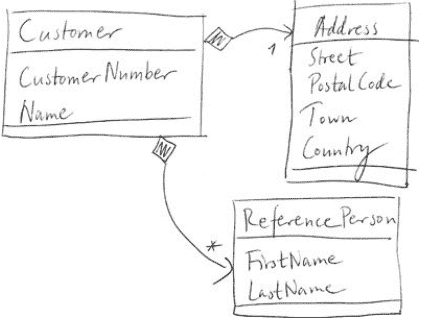

### 注意

信不信由你，使用手绘图是有原因的。我展示的是早期草图，只是我认为可以开始的快速想法。代码是可执行的、清晰的产物。代码是对真实模型的最重要表示。

如你所见，我使用了一个简单的（天真的）`Customer` 类，并让它由 `Address` 和 `ReferencePerson` 组成。我更倾向于不将这种搜索行为直接放在 `Customer` 类本身上，因此在这一点上，我仅在图 4-2 所示的类上拥有数据。

### 注意

我可以使用 Party Archetype 模式 [Arlow/Neustadt Archetype Patterns] 或其他类型的角色实现，但让我们现在使用简单的结构。

我们可以通过使用 Query Object [Fowler PoEAA] 来解决第一个需求，我在第 2 章“A Head Start on Patterns”中谈到过，但在实践中我发现如果可能的话，将 Query Object 的使用封装一点是很好的。关于查询结果，往往有很多需要定义的内容，而不仅仅与条件相关。我想到的有排序顺序、其他隐藏条件、优化、将 Query Object 发送到哪里执行等等。因此，我更喜欢使用 Repository [Evans DDD] 来稍微封装查询执行。它还减少了

```csharp
[Test]
public void
    CanGetCustomersInSpecificTownWithOrdersOfCertainSize()
{
    int numberOfInstancesBefore = _repository.GetCustomers
        ("Ronneby", 1000).Count;

    _CreateACustomerAndAnOrder("Ronneby", 20000);

    Assert.AreEqual(numberOfInstancesBefore + 1
        , _repository.GetCustomers ("Ronneby", 1000).Count);
}
```

正如你在示例中看到的，Repository 方法 GetCustomers() 用于获取满足城镇和最小订单规模条件的客户。

### 2. 查看特定客户时列出订单

我可以采用 Customer 和 Order 之间的双向关系。也就是说，每个 Customer 都有一个 Orders 列表，每个 Order 都有一个 Customer。但双向关系是有成本的。它在复杂性、紧密耦合和开销方面都有成本。因此，我认为能够通过 OrderRepository 获取某个 Customer 的 Orders 就足够了。这导致了图 4-4 所示的模型。

图 4-4. OrderRepository, Order, and surroundings

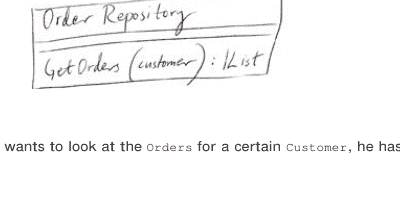

因此，当消费者想要查看某个 Customer 的 Orders 时，他必须像这样询问 OrderRepository：

```csharp
[Test]
public void CanGetOrdersForCustomer()
{
    Customer newCustomer = _CreateACustomerAndAnOrder
    ("Ronneby", 20000);

    IList ordersForTheNewCustomer =
    _repository.GetOrders(newCustomer);

    Assert.AreEqual(1, ordersForTheNewCustomer.Count);
}
```

我可以让 Customer 拥有一个 OrderList 属性并隐式地与 Repository 通信，但我认为这里的显式性更好。我也避免了 Customer 与 OrderRepository 之间的耦合。

每个订单的总价值值得单独提及。它可能比最初预期的更棘手，因为计算需要订单的所有 orderLines。当然，这并不棘手，但它确实让我警惕。我知道这为时过早，但我无法避免（因为当你只想显示某个客户的相当大的订单列表时，加载 orderLines 会很昂贵，例如）。我认为一个有用的策略是，如果 orderLines 未加载，则使用一个简单的 amount 字段（很可能存储在 Orders 表中）用于 TotalAmount 属性。如果 orderLines 已加载，则改用完整计算用于 TotalAmount 属性。

这不是我们现在需要考虑的事情。而且无论如何，对于消费者来说，它就像这样简单：

```csharp
[Test]
public void CanGetTotalAmountForOrder()
{
    Customer newCustomer = _CreateACustomerAndAnOrder
    ("Ronneby", 420);

    Order newOrder = (Order)_repository.GetOrders
    (newCustomer)[0];

    Assert.AreEqual(420, newOrder.TotalAmount);
}
```

在我看来，思考这个问题“正确”的方式是，行之所以存在是因为我们使用的是聚合体，而行是订单的亲密组成部分。这可能意味着在某些情况下性能会下降。如果是这样，我们可能需要使用 Lazy Load 模式 [Fowler PoEAA]（例如用于按需从数据库加载列表）或只读的优化视图来解决这个问题。

但是，正如我所说，那是我们发现简单直接的解决方案不够好时才需要处理的事情。


### 3. 一个订单可以有许多不同的订单行

特性3非常简单。图4-5描述了增强后的模型。

**图4-5. 订单和订单行**

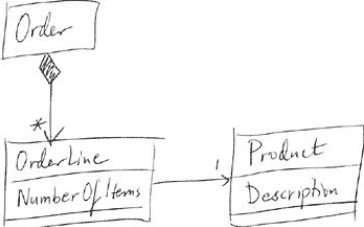

注意，我这里也考虑的是单向关系。如果我知道某个逻辑片段需要同时使用 `OrderLine` 及其所属的 `Order`，那么我或许可以接受同时发送它们。把某个订单和另一个订单的订单行一起发送的风险很可能非常小。

```csharp
[Test]
public void CanIterateOverOrderLines()
{
    Customer newCustomer = _CreateACustomerAndAnOrder
        ("Ronny", 420);

    Order newOrder = (Order)_repository.GetOrders
        (newCustomer)[0];

    foreach (OrderLine orderLine in newOrder.OrderLines)
        return;

    Assert.Fail("I shouldn't get this far");
}
```

还要注意图4-5中展示的模型与描述同一事物的关系模型之间的巨大差异。在关系模型中，会有一个从 `Product` 到 `OrderLine` 的一对多关系，以及一个多对一关系，但到目前为止，我们认为在这个特定的领域模型中，一对多关系并不真正值得关注。

### 4. 并发冲突检测很重要

嗯...特性4有点棘手。我认为一个合理的解决方案是：`Customer` 独立存在，而 `Order` 连同 `OrderLines` 作为它自己的并发单元。这与让领域模型能够用来支持后续特性所需的逻辑非常契合。为此，我使用了称为“聚合”（Aggregate）的模式[Evans DDD]，这意味着你要决定哪些对象属于通常作为单个单元处理的特定对象簇，一起加载（至少在写场景下默认如此），一起评估规则，等等。

不过，重要的是要指出，聚合模式首先不是一个技术模式，而应该用在它为模型增添意义的地方。

并发单元是聚合的用途之一。（见图4-6。）

**图4-6. 聚合**

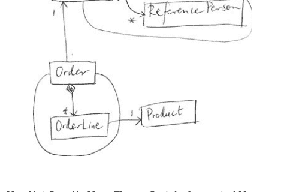

### 5. 客户欠我们的钱不能超过一定金额

特性5同样相当棘手。脑海中浮现的第一个解决方案可能是在 `Customer` 上添加一个 `TotalCredit` 属性。但这有问题，因为它有点过于透明，消费者调用该属性时看不到任何成本。这也是一致性问题。我甚至不认为 `Customer` 聚合包含 `Orders`，所以我并不期望这个单元适合用来直接在领域模型中处理一致性，这很好地说明我应该另寻他法。

我认为我需要领域模型中的一个服务（Service）[Evans DDD]，它能告诉我某个客户当前的信用总额。你会在图4-7中看到这个描述。

**图4-7. `TotalCreditService`**

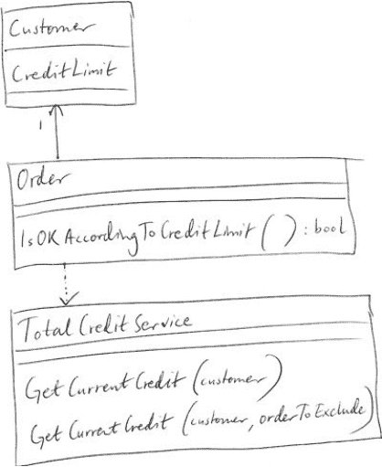

对 `TotalCreditService` 的 `GetCurrentCredit()` 进行重载的原因是，我认为能够在不考虑当前正在创建或更改的订单的情况下，检查当前信用额度有多大，这会很好。至少这是想法。让我们看看这个服务实际运行起来会是什么样子（这里跳过不同部分之间的交互）。

```csharp
[Test]
public void CanGetTotalCreditForCustomerExcludingCurrentOrder()
{
    Customer newCustomer = _CreateACustomerAndAnOrder
        ("Ronneby", 22);
```

### 8. 在一位新客户被视为合格之前，他的信用会向信用机构查询

因此，我们需要领域模型中的另一个服务（Service）[Evans DDD]，用于封装我们与信用机构的通信方式。它的效果可以参见图4-10。

**图4-10：*CreditService***

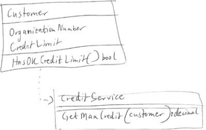

再说一次，这种想法是让实体（这里的 Customer）与服务协作，以便实体能够回答问题。让我们看看这种协作如何在测试中处理。（另外要注意，真正的服务可能会使用客户的组织机构代码（OrganizationNumber），这和客户编号（CustomerNumber）不同，而是注册公司从官方机构获得的正式标识。）

```csharp
[Test]
public void CantSetTooHighCreditLimitForCustomer()
{
    Customer newCustomer = _CreateACustomer("Ronney");

    //Inject a stubbed version of CreditService
    //that won't allow a credit of more than 300.
    newCustomer.CreditService = new StubCreditService(300);

    newCustomer.CreditLimit = 1000;

    Assert.IsFalse(newCustomer.HasOKCreditLimit);
}
```

### 备注

Gregory Young指出这是一个代码坏味道。问题很可能在于该操作不是原子的。该值首先被设置（因此旧值被覆盖），然后才被检查（如果还记得检查的话）。也许类似 `Customer.RequestCreditLimit(1000)` 的做法会是更好的解决方案。我们会在第7章“规则至上”中回到类似的讨论。

### 9. 订单必须有一个客户；订单行必须有一个订单

特性9是一个常见且合理的要求，我认为最简单也是最好的处理方式是通过数据库的引用完整性约束。我们也可以在领域模型中测试这一点，而且应该测试。如果领域模型存在这种明显的错误，那么将其变更提交到持久化层就没有意义。不过，作为第一次尝试，我没有去显式检查，而是使用一个 `OrderFactory` 类来创建 `Order`，这使其在某种程度上成为强制性的；同时我用同样的方式处理 `OrderLines`，所以一个 `OrderLine` 必须拥有 `Order` 和 `Product`（见图4-11）。

**图4-11. OrderFactory 和增强的 Order**

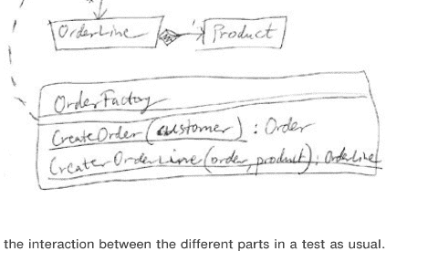

像往常一样，我们来看看测试中各个部分之间的交互。

```
[Test]
```

一个名为 Accept() 的方法。我暂时不决定是否在内部使用状态模式（GoF设计模式），这留到以后再说。像这样的实现决策最好在重构期间做出。

**图4-12. Order 和 Status**

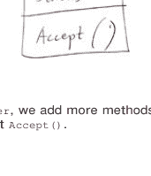

当我们讨论 Order 的其他状态时，我们会添加更多方法。目前，没有其他明确要求，所以我们只保留 Accept()。

当前的想法可能如下：

```csharp
[Test]
public void CanAcceptOrder()
{
    Customer newCustomer = _CreateACustomer("Karlskrona");
    Order newOrder = OrderFactory.CreateOrder(newCustomer);
    
    Assert.IsFalse(newOrder.Status == OrderStatus.Accepted);
    
    newOrder.Accept();
    
    Assert.IsTrue(newOrder.Status == OrderStatus.Accepted);
}
```

## 到目前为止的领域模型

因此，如果我们总结刚才讨论的领域模型，它可能如图4-13所示。

**图4-13. 一个草拟的领域模型，展示了我现在打算如何处理功能列表**

[查看全尺寸图片]

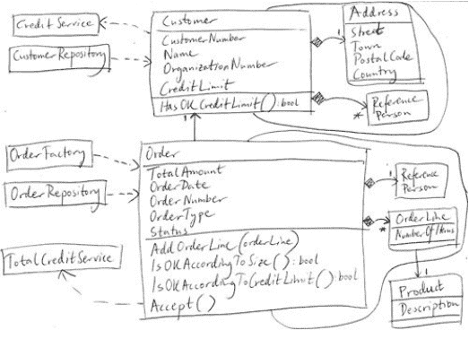

### 备注

`ReferencePerson` 类在 *图4-13* 中出现在两个不同的聚合中，但实例并不是。这说明了静态类图在表现力上的不足，但也可以通过一句简短的注释来解释。

什么？很乱？好吧，我同意，确实乱。当我们进一步深入细节时，我们会把模型划分得更好。

### 备注

*图4-13* 中显示的模型以及所有模型片段都是预先创建的，当我继续开发应用程序时，它们必定会得到大量改进。

另外需要说明的是，我只展示了核心领域模型，而没有展示更多与基础设施相关的内容，比如之前提到的工作单元（Unit of Work）[Fowler PoEAA]。当然，这完全是故意的。我们会在本书后面回到基础设施。现在我专注于领域模型。


我提到 Domain Model 模式的使用方式有很多种变体。为了展示一些其他风格，我请了几位朋友描述他们最喜欢的应用 Domain Model 的方式。你可以在附录 A 中找到这些内容。

为了更好地感受需求，我想从另一个角度来看待它们，并为即将推出的 UI 草拟几个表单。

```csharp
txtCustomerNumber.Text =
    _customer.CustomerNumber.ToString();
txtName.Text = _customer.Name;

// Paint the orders:
foreach (Order o in theOrders)
{
    // TODO...
}
```

值得指出的是，我期望在绘制订单时在之前的代码中使用 Null Object [Woolf Null Object]。因此，所有订单都将拥有一个 `ReferencePerson`（空的），即使尚未决定，这样我就不需要任何空值检查。在我看来，这是一个细节示例，展示了如何提高 UI 程序员的简易性。

手工编写填充 UI 的代码有点乏味。但回头看，难道到目前为止它不是极其简单易读吗？当然，我们正在尝试简单的事情，但仍然如此。

## 添加订单

另一个表单示例是为了使添加订单成为可能。我设想你首先选择了客户，然后会得到一个如 图 4-15 所示的表单。

**图 4-15. 添加订单的表单**

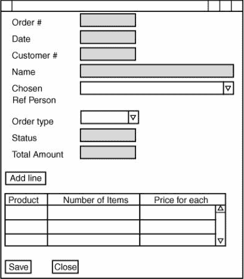

要实现这一点，首先实例化一个 `Order`，然后将订单发送到表单的构造函数。

`_PaintOrder()` 的代码可以如下所示：

```csharp
// OrderForm._PaintOrder()
txtOrderNumber.Text = _ShowOrderNumber(_order.OrderNumber);
txtOrderDate.Text = _order.OrderDate.ToString();
// And so on, the code here is extremely similar in
// principle to the one shown above for _PaintCustomer().
```

为了避免 `txtOrderNumber` 出现零值，我使用了一个辅助函数（`_ShowOrderNumber()`），它也许会显示 "New" 而不是 0。

## 我们刚刚看到了什么？

描述这种类型 UI 的一种方式是使用 Fowler 所称的 Separated Presentation [Fowler PoEAA2] 模式。其思想是将逻辑与操作呈现的代码分离。

这是一个长期以来一直被推荐的基本原则；然而，它*非常*经常被滥用。我们至少在一定程度上或多或少地自动免费获得了它，因为我们使用 DDD。

再次说明，本节主要是为了通过从另一个角度思考需求，即 UI，来更好地感受需求。从现在开始，直到我们进入 [第11章](#)，“Focus on the UI.” 为止，我们不会再讨论太多与 UI 相关的内容。

现在让我们转向关于需求的又一个视角。

## 又一个维度

到目前为止，在本章中，我主要谈论了 Domain Model 的逻辑结构，这当然只是图景的一个维度。当然还有其他维度。我还想讨论一段时间不同的执行风格。让我们从为功能列表设置的部署环境开始。在那里，我说我们正在创建一个富客户端（WinForms）应用程序，没有 Application Server。它可能看起来与图 4-16 相似。

**图 4-16. WinForms 且无应用程序服务器**

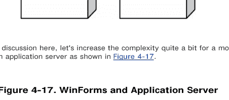

为了本次讨论的目的，让我们暂时大幅增加复杂性，并添加一个如 图 4-17 所示的应用程序服务器需求。

**图 4-17. WinForms 与应用程序服务器**

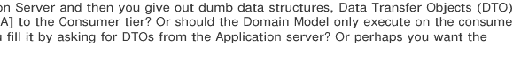

第一个问题是 Domain Model 应该在哪个层（或哪些层）执行？它是否只在 Application Server 上执行，然后你向 Consumer 层提供哑数据结构，即 Data Transfer Objects（DTO）[Fowler PoEAA]？或者 Domain Model 只在消费者端执行，你通过向 Application Server 请求 DTO 来填充它？或者你希望 Domain Model 在两个层上都执行？也许是两个不同的 Domain Model？

### 注意

思考 application server 的目的很重要，即它确实是需要的，并且你确实需要分发 Domain Model。记住 Fowler 的分布式对象设计第一定律：Don't distribute your objects! [Fowler PoEAA]

假设 Domain Model 应该（至少）在 Application Server 上执行。那么它应该是共享的 Domain Model 实例化，这样就有一个代表单个客户的实例供所有用户使用？还是应该每个用户或每个会话一个 Domain Model 实例化，这样在某个时间点就有多个实例代表某个客户？

第三个问题是，Domain Model 实例化在调用之间应该是 stateful 的，还是在每次调用后消失？

第四，是否应该尝试在每次请求时尽可能获取尽可能多的数据来构建完整的 Domain Model 实例化，并且永远不释放实例？

我们有很多问题，而且与往常一样，答案取决于具体情况。讨论的一个问题是，我还没有（以 DDD 的方式）对基础设施做出太多决定。

无论如何，我想说几句我通常如何处理这个问题的话。

### 注意

我所说的术语“Domain Model instantiation”是指 Domain Model 的实例集合，而不是其类。当然，我们在用户之间共享类远比共享实例更频繁。然而我认为这个术语增加了讨论的清晰度。

### Domain Model 的位置

首先，如果我同时控制消费者和 Application Server，我认为在消费者和 Application Server 两处都暴露并使用 Domain Model 可能是可以的。如果我们不在两处都使用它，就存在不必要的工作和能力下降的风险，因为那样我们可能会创建两个相似但略有不同的 Domain Model，一个用于消费者，一个用于 Application Server。我们还需要适配器来在两个 Domain Model 之间转换。（这里最重要的是可能要非常清楚你处于一个模型还是两个模型的情况。如果你认为是一个，但实际上是两个，你会遇到微妙的问题。）

值得一提的是，对于复杂场景，我很喜欢 Presentation Model [Fowler PoEAA2] 作为

### 注意

有一个名为 Prevayler [Prevayler] 的开源项目（还有其他类似的项目）支持 stateful、共享且完整的 Domain Model 实例化。这意味着 Domain Model 和数据库基本上是同一回事。为了实现这一点，我们需要大量的 RAM，但今天这不是什么大问题，因为内存价格正在下降，64 位机器变得普遍。

其思想是，每次数据库发生变化时，它都会写入一个顺序日志文件。如果断电，Domain Model 实例化可以通过读取某个时间点创建的映像并读取日志文件来恢复。这相当简单，并且在执行效率上极其高效，因为所有数据都在内存中。

我们得到的本质上是一个对象数据库，但是一个简单的对象数据库，因为不需要故障转移或其他此类事情。所有实例始终在内存中，并且不需要从/到关系数据库的 O/R 映射，甚至不需要从/到对象数据库的映射。只有 Domain Model 实例化。

好吧，从现在开始，在本书中我将放弃因 application server 而增加的复杂性，只是假设我们使用包含 Domain Model 的富客户端或 Web 应用程序，后者再次直接与 Domain Model 通信。

做出这一决定的一个原因是，我认为使用 application server 的经典方式正在以某种方式消失，或者至少在改变。推动这一点的驱动力是什么？也许是 SOA，但那是另一个故事（我们在第 10 章中会再次稍微谈到）。


## 从创建 *Order* 和 *OrderFactory* 开始

我们将从创建 `Order` 类和 `OrderFactory` 开始。除了图 5-2 所示的内容之外，我先不考虑其他任何事情。

### 图 5-2. 第一部分要实现的内容，`Order` 和 `OrderFactory` 的部分

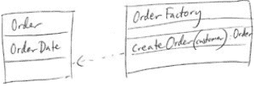

### 注意

最初的几个步骤对于正确创建领域对象是必要的。我们必须完成这些步骤，才能进入有趣且关键的部分，即测试和实现模型所促进的逻辑。

我将开始为此编写第一个测试。我要测试的是，当我请求工厂创建一个新订单时，确保不会得到 null。如下：

```csharp
[Test]
public void CanCreateOrder()
{
    Order o = OrderFactory.CreateOrder(new Customer());

    Assert.IsNotNull(o);
}
```

### 注意

你可能好奇我为什么这样命名测试？早期 xUnit 测试的命名约定是加上 "Test" 前缀，但对于 NUnit 来说这并非必要，例如，因为它能识别 `Test` 特性。相反，这意味着我们可以自由地按自己喜欢的方式命名测试。这也意味着我们可以抛开技术术语，将讨论集中在领域概念和设计上。

我喜欢将测试命名为对测试意图验证内容的陈述。这样，

你可能会认为我在这里违反了 TDD 的原则，因为我想得太多，而不是用测试、代码和重构去尝试。另一方面，在你花时间写出测试名称的过程中，许多想法和思考（以及决策）会以半意识的状态快速闪过你的脑海。（当然，这取决于你对当前问题的经验。）

无论如何，我们不要想太多，而是决定一个要尝试的解决方案。我就选第一个。添加一个带有公共默认构造函数的空 `Customer` 类实际上非常快速简单，所以我们就这么做吧。现在测试可以编译了，我得到了一个红条，因为我只写了签名，并且只在 `OrderFactory` 的 `CreateOrder()` 方法中返回了 null。

是时候实现 `CreateOrder()` 了。第一次尝试可能如下：

```csharp
//OrderFactory
public static Order CreateOrder(Customer customer)
{
    return new Order();
}
```

为了使其编译通过，我必须有一个可访问的 `Order` 默认构造函数。它可以是 `public`，但我决定让它为 `internal`，以阻止 `Order` 类的使用者除了通过 `OrderFactory` 之外实例化它。当然，这并非完美的保护，但至少错误的直接实例化只会发生在领域模型内部，在我看来这是朝着正确方向迈出的一步。

重构时间？工厂到底增加了什么价值？目前还没有。它只是增加了一点复杂性。我真的应该至少在没有工厂的情况下开始，因为如果它不增加价值，就不应该存在。现在，我仍然认为它要处理很多事，比如快照 `customer`、添加空对象、创建不同种类的订单，以及其他一些事情。

但到目前为止的代码有了工厂后感觉有点傻，你不觉得吗？它*可能*在以后增加价值，但现在它比原本更复杂。让我们直接改为使用最简单的构造方式：直接使用构造函数。

### 注意

从一个工厂重构出来感觉有点奇怪。但这只是表明我一时冲动，从一开始就采用了过于详细的设计。

另外值得一提的是，我在第 4 章的草图中有一个 `CreateOrderLine()` 方法，但没有它反而更简单。

```csharp
[Test]
public void CanCreateOrder()
{
    Order o = new Order(new Customer());

    Assert.IsNotNull(o);
}
```

还有其他测试要写吗？当然，我们一直在讨论的是如何处理 `customer` 参数。所以在我看来，一个有趣的测试是检查新创建的 `order` 是否有一个 `customer`。我目前还没有验证这一点。让我们为此添加一个测试。

```csharp
[Test]
public void CanCreateOrderWithCustomer()
{
    Order o = new Order(new Customer());

    Assert.IsNotNull(o.Customer);
}
```

这个测试告诉我，我需要在 `Order` 上添加一个 `Customer` 字段或属性。（我认为它不仅对我的测试有用，对某些需求也是必需的。）

为了降低复杂性，我决定在 `Order` 类中使用这样的只读属性：

```csharp
//Order
public readonly Customer Customer;
```

如果没有办法更改 `Order` 的 `Customer`，我们可以预期它始终存在（且永不改变），这将简化其他规则。如果你不需要这种灵活性……

现在一切编译通过，生活美好，我们确实得到了红条。这很容易通过修改构造函数来修复，使其使用 `customer` 参数。构造函数现在如下，我们得到了绿条：

```csharp
//Order
public Order (Customer customer)
{
    Customer = customer;
}
```

## 一些领域逻辑

在图 5-2 中，我提到还应该给 `Order` 添加 `OrderDate`。关于它的语义可能是什么呢？`order` 可能应该在首次创建时获得一个初始的 `OrderDate`，然后在 `order` 获得 Ordered 状态（或类似状态）时获得最终的 `OrderDate`。让我们在测试中表达这一点：

```csharp
[Test]
public void OrderDateIsCurrentAfterCreation()
{
    DateTime theTimeBefore = DateTime.Now.AddMilliseconds(-1);

    Order o = new Order(new Customer());

    Assert.IsTrue(o.OrderDate > theTimeBefore);
    Assert.IsTrue(o.OrderDate
        < DateTime.Now.AddMilliseconds(1));
}
```

这个测试的想法是设置一个时间点区间，然后检查 OrderDate 是否在这个区间内。

和往常一样，这无法编译。我需要添加一个公共的 OrderDate 属性。这次，我使用私有字段 + 公共 getter，因为我打算在生命周期后期更改 OrderDate 的值。而且这次，我让订单的构造函数设置 OrderDate 字段，而不向构造函数添加另一个参数。为清晰起见，代码如下：

```csharp
//Order
private DateTime _orderDate;

public Order (Customer customer)
{
    Customer = customer;
    _orderDate = DateTime.Now;
}

public DateTime OrderDate
{
    get {return _orderDate;}
}
```

我们得到了绿条。

在本节开始时，我用一个图描述了图 5-2 中模型的一个子集。模型稍微发展了一些，如图 5-3 所示，我在其中可视化代码。

### 图 5-3. 第一部分要实现的内容，Order，修订版


### 注意

你可能想知道为什么我有时用手绘图，有时用 UML 工具。原因是我想说明，在前期，我只是快速草绘，以帮助思考和沟通过程。当我实现了某个东西后，我可能会用 UML 工具将实现可视化。

当你在图 5-3 和图 5-2 之间比较时，可见差异并不大。实际上只是我必须实现 Customer 类的第一个版本以及 Order 到 Customer 的关系。这不是对模型的真正更改，只是对子集图的更改。

### 注意

我在图 5-3 中同样展示了构造函数，以便更详细地了解类如何工作。

在进入下一步之前，是时候进行重构了。首先，我想将对 Order 构造函数的调用移到 `SetUp` 中，但那样我就必须稍微修改最后一个测试中关于时间区间的部分，这会让它不那么切题。此外，目前展示的三个测试都只是关于创建的，所以我喜欢在测试方法本身中保留这些调用。让我们暂时搁置重构，继续完善领域模型。

## 第二个任务：OrderRepository + OrderNumber

在上一节中，我们讨论了 OrderFactory 为了满足我们从零创建新 Order 实例的需求可能是什么样，但随后决定暂时跳过工厂。在我看来，下一个问题自然就是 OrderRepository 应该如何运作。

在第 4 章中，我讨论了 OrderRepository 的 GetOrders()。目前，我认为最重要、最典型的方法是 GetOrder()，因此我想从该方法以及实体 Order 的标识符开始。

说到这个，OrderNumber 是什么？通常，订单会有某种形式的唯一标识，可供人们用来识别某个特定订单。一种常见的解决方案是，从一个不断递增的数字序列中为每个订单分配一个新数字。在图 5-4 中，我再次展示了修改后的 Order 类以及 OrderRepository 类中新增的方法。

### 图 5-4. Order 和 OrderRepository


```csharp
[Test]
public void OrderNumberCantBeZeroAfterReconstitution()
{
    int theOrderNumber = 42;
    _FakeAnOrder(theOrderNumber);

    Order o =
        _repository.GetOrder(theOrderNumber);

    Assert.AreEqual(theOrderNumber, o.OrderNumber);
}
```

像往常一样，整个代码无法编译。我没有 `OrderRepository` 类，所以我写了一个只有 `GetOrder()` 方法签名、没有实现的类。测试代码仍然无法编译，所以我必须在测试类中为 `_FakeAnOrder()` 提供一个桩（stub）。我得到了红灯。

我发现自己离原本想关注的问题越来越远了。为了能编写 `_FakeAnOrder()` 方法，我需要让 Repository 能够知道 Order 的存在。我可以继续在 OrderRepository 中实现一个新方法，仅用于支持其他测试，但我认为这是一个信号，表明我需要编写另一个测试。我需要测试保存 Order，或者至少让 Repository 意识到 Order 的存在。

## 说明

我不得不承认，关于保存究竟应该如何实现，我有很多想法，但我会在这里慢慢推进，编写一些我现在会大量重构的简单代码。请别对此感到不满；这不是最终的解决方案。

所以，我给 `OrderNumberCantBeZeroAfterReconstitution()` 测试添加了 `Ignore` 属性，这样它现在就不会给我红灯了。然后我编写了另一个测试，如下所示：

```csharp
[Test]
public void CanAddOrder()
{
    _repository.AddOrder(new Order(new Customer()));
}
```

像往常一样，它无法编译。我需要给 OrderRepository 添加 `AddOrder()` 方法。一如既往，我只是添加了签名，但这不足以触发红灯。事实上，`CanAddOrder()` 方法中根本没有任何测试代码。原因在于，我不太赞成让 Repository 为了外部测试类检查其内部状态而发布任何方法。当然，我可以使用 `GetOrder()` 方法，但这又成了“先有鸡还是先有蛋”的问题。而该方法的实现还远未开始。

```csharp
public void AddOrder(Order order)
{
    int theNumberOfOrdersBefore +1 = _theOrders.Count;

    _theOrders.Add(order);

    MyTrace.Assert(theNumberOfOrdersBefore
        == _theOrders.Count);
}
```

现在我们有了绿灯。我们到处写一些奇怪的代码，但我们在前进，并且一路创建着并不奇怪的测试，所以让我们继续。

## 说明

我本来也可以使用 mock 来验证被测系统（SUT）是否按预期工作，但你大概能从第 3 章“TDD 与重构”中想象出如何去做，所以我们继续前进吧。

现在该回到 `OrderNumberCantBeZeroAfterReconstitution()` 了，上次我遇到的障碍是我为测试编写的辅助方法 `_FakeAnOrder()`。它可能看起来像这样：

```csharp
//A test class
public void _FakeAnOrder(int orderNumber)
{
    Order o = new Order(new Customer());

    _repository.AddOrder(o);
}
```

哎呀，我们现在遇到了另一个问题。你看到了吗？是的，我们如何将伪造的 OrderNumber 放入订单实例中？OrderNumber 属性是只读的（这很合理），所以使用它是行不通的。

事实上，这是一个普遍问题。可以这样表述：我们如何从外部（例如在 Repository 中）为正在从持久化中重建（reconstituted）的实例设置值？

## 从持久化中重建实体：如何从外部设置值

我提到了通过读取持久化来重新创建实例时设置值的普遍问题。我们已经在本章中多次触及这个主题，因为 `Order` 和 `Customer` 是实体的例子，但让我们退后一步，专注于这个概念。

随着时间的推移，我们有必要跟踪领域中的某些事物。无论客户更改了姓名还是地址，他仍然是同一个客户，这是我们感兴趣并需要跟踪的。另一方面，如果客户的联系人（reference person）变了，我们可能并不关心去跟踪它。客户是实体（Entity）的一个典型例子 [Evans DDD]。再说一遍，实体是我们通过身份（identity）而非其所有值来跟踪的事物。

举一个极端例子来说明什么不是实体，让我们想想整数 42。我根本不关心 42 的身份，我只关心它的值。当值改变时，我不再认为这是 42 发生了变化——而是一个与旧值毫无关联的全新值。42 是一个值对象（Value Object）[Evans DDD]，而不是实体。

如果把这个极端例子带到我们的领域，我们或许可以说，按身份来跟踪 `Customer` 的 `ReferencePerson` 对我们来说并不重要。我们只根据值来跟踪它。本章稍后我们会再讨论值对象。

## 说明

当然，哪些应该按身份跟踪，哪些应该仅仅视为值，高度依赖于领域。举个例子。正如我上面所说，我认为在这个应用程序中，`ReferencePerson` 可以作为值对象来处理，但如果这个应用程序是，比如说，面向销售人员的销售支持应用程序，也许他们会把 `ReferencePerson` 视为实体。

## 再次回到主线

不幸的是，在我重写 `Equals` 之后，`CanFindOrdersViaCustomer()` 测试无法成功执行。原因在于测试中使用的所有客户都有相同的 `CustomerNumber`，即零，因此我找到了五个具有正确 `Customer` 的 `Orders`，而不是三个。我们需要稍微修改测试。我创建另一个名为 `_FakeACustomer()` 的小辅助方法，如下所示：

```csharp
//A test class
private Customer _FakeACustomer(int customerNumber)
{
    Customer c = new Customer();

    RepositoryHelper.SetFieldWhenReconstitutingFromPersistence
    (c, "_customerNumber", customerNumber);

    return c;
}
```

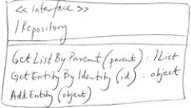

这种写法可能会让我逐渐喜欢，但目前我更喜欢图 5-8 中更具体的接口，因为它清楚地说明了需要什么。泛型的 `IRepository` 在使用时需要进行更多类型转换，并且可能错误地试图将所有未来的 Repository 统一成同一种形状。

另一种解决方案是在 `IRepository` 接口中使用泛型，再加上一个基类，从而至少获得类型安全（并避免代码重复），同时避免额外的类型转换。但一个问题是，我可能会向 Repository 添加 `Delete()` 方法，即使并非所有 Repository 都需要它。而且即便使用了泛型，`GetListByParent(parent)` 也很麻烦，因为如果一个实体有多个父级怎么办？好吧，这只是一个早期草图，当然是可以解决的。但我不禁觉得，最好让代码“现在尽可能清晰地表达”，并跳过这样的泛化。现在还感觉不到它的重要性。像往常一样，没有什么是板上钉钉的决定。我可以在以后更容易看出哪些部分可以泛化时，再次挑战这些决定，但就目前而言，我会继续使用 `OrderRepository`。

因此，我将 `OrderRepository` 类重命名为 `OrderRepositoryFake`，并让该类实现 `IRepository`。我还需要修改测试类中的 `[SetUp]` 代码。它目前如下所示：

```text
//A test class, the [SetUp]

_repository = new OrderRepository();
```

现在可以改成这样：

```text
//A test class, the [SetUp]

_repository = new OrderRepositoryFake();
```

`_repository` 的声明必须使用 `IOrderRepository` 作为类型。

而且测试仍然通过。

我想纯粹的 XP（极限编程）实践者对于我刚才做的重构可能会有些抱怨。我其实不必现在就做这个改动；这是为了未来做准备的改动，到时候我需要一个真正的 Repository 而不是这个假的。好吧，我同意这一点，但我还是忍不住会稍微考虑一下未来（读作：后续章节）当我需要接入基础设施的时候。

我祈祷这个准备将来被证明是正确的。我又落入了过早猜测的旧习惯……另一方面，我们当然可以自由选择自己的平衡点，而且不必……


## 关于保存的一些话

我之前提到过保存数据。`AddOrder()` 并不是真正的保存；它只是把 `Order` 添加到 `Repository` 中。还是说它也应该意味着保存？不，我不认为我想要那样的行为。我希望 `AddOrder()` 做的是，从那一刻起，`Repository`（以及底层基础设施）应该知道该实例，并在当我请求 `PersistAll()` 时对它进行处理。

我需要让基础设施来处理保存功能。现在的问题是，我是否应该将 `PersistAll()` 声明给 `Repository` 实例，还是声明给一个更高层的、监控所有 `Repositories` 实例的东西。再说一次，我觉得我正在偏离领域模型，进入基础设施部分。我很高兴这个问题被提出来，但部分讨论必须等到下一章。就这一点而言，我们有很多东西需要讨论。目前，我对 `AddOrder()` 作为让 `Repository` 知道该实例的方式感到满意。到目前为止所写的测试而言，该实例是瞬态的（但已准备好被持久化）并且在那个时间点不是持久的，这一点并不重要。

好的，我和你一样渴望写更多的测试。清单上有什么？嗯，在功能 2“查看特定客户时列出订单”中，我已经处理了大部分内容。我没有处理的是显示每个订单的总金额、订单类型和联系人。

我们一个一个来，先看每个订单的总金额。

## 每个订单的总金额

起初这似乎是一项微不足道的任务。我需要创建一个 `OrderLine` 类，作为列表挂接到 `Order` 类中。然后我就可以遍历 `OrderLine` 集合并计算总金额。当然，我实际上可以从消费代码中这样做，但我不想那样。那会把算法暴露给消费方，而且那样也不够清晰或没有目的性。实际上，随着时间的推移，算法会变得难得多，例如添加许多不同种类的折扣。相反，我想要在 `Order` 类上有一个名为 `TotalAmount` 的只读属性。同样，它可以在内部遍历 `OrderLine` 集合并计算值。

但作为“过早优化的人”（尽管我努力不这样），这对我来说有点太过分了。为了能够显示订单的 `TotalAmount` 而为每个 `Customer` 的每个 `Order` 实例化所有 `OrderLines`，这拉响了警报。这可能不会成为问题，具体取决于执行环境和所选的基础设施。另一方面，在分布式系统的情况下，这是一个问题，而且可能是一个大问题，会伤害数据库服务器、网络和垃圾回收器。

我必须承认，我必须强迫自己不要立即处理这个优化。直接修复很简单，但现在当我琢磨领域模型应该是什么样子的时候，这并不是真正重要的。现在更重要的是为了简单和清晰而设计，之后再用性能分析器来看它是否是一个*真正的*性能问题。所以我从最简单的解决方案开始，如果性能特性不够好，以后可以重构 `TotalAmount` 属性。

啊，我做到了！我现在跳过了一个优化。此刻感觉真好。

既然我们已经对 `TotalAmount` 有了一些思考，让我们退一步。是时候写一个测试了（迟到总比没有好）。我从我能想到的最简单的测试开始。

```csharp
[Test]
public void EmptyOrderHasZeroForTotalAmount()
{
    Order o = new Order(new Customer());

    Assert.AreEqual(0, o.TotalAmount);
}
```

让这个测试编译很简单。我只需在 `Order` 类中添加一个名为 `TotalAmount` 的公共只读属性，并让它返回 -1。它编译了，然后我得到了红灯。我把它改成返回 0，就得到了绿灯。

我现在可以暂时不管它，但因为上下文已经为我准备好了，我继续一点。下面是另一个测试：

```csharp
[Test]
public void OrderWithLinesHasTotalAmount()
{
    Order o = new Order(new Customer());

    OrderLine ol = new OrderLine(new Product("Chair", 52.00));
    ol.NoOfUnits = 2;

    o.AddOrderLine(ol);

    Assert.AreEqual(104.00, o.TotalAmount);
}
```

哎呀，仅仅这一个测试就做了很多设计，我现在需要创建两个类，并在旧类中添加新方法，才能让它编译。我想我最好暂时注释掉那个测试，从更简单的地方开始，专注于 `OrderLine` 类。

首先，我希望 `OrderLine` 默认从所选产品获取价格。让我们写一个测试。

```csharp
[Test]
public void OrderLineGetsDefaultPrice()
{
    Product p = new Product("Chair", 52.00);

    OrderLine ol = new OrderLine(p);

    Assert.AreEqual(52.00, ol.Price);
}
```

返回 0。它能编译，但红灯。然后我把 `TotalAmount` 改成这样：

```csharp
//OrderLine
public decimal TotalAmount
{
    get {return Price * NumberOfUnits;}
}
```

又绿灯了。

让我们看看刚刚做了什么。在*图 5-10*中，你可以看到 `OrderLine` 和 `Product` 的图示。

### 图 5-10. `OrderLine` 和 `Product`

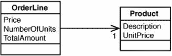

是时候回到我之前注释掉的测试了。你会在这里再次看到它，但这次我把它做得“大”了一点点，处理两个 `OrderLines`。

```csharp
[Test]
public void OrderWithLinesHasTotalAmount()
{
    Order o = new Order(new Customer());

    OrderLine ol = new OrderLine(new Product("Chair", 52.00));
    ol.NoOfUnits = 2;
    o.AddOrderLine(ol);

    OrderLine ol2 = new OrderLine(new Product("Desk", 115.00));
    ol2.NoOfUnits = 3;
    o.AddOrderLine(ol2);

    Assert.AreEqual(104.00 + 345.00, o.TotalAmount);
}
```

为了让它编译，我需要将 `AddOrderLine()` 和 `TotalAmount` 添加到 `Order`。我让只读属性 `TotalAmount` 暂时只返回 0。然后我在 `OrderWithLinesHasTotalAmount()` 测试上设置 `[Ignore]`。相反，我写另一个测试来专注于 `AddOrderLine()`。该测试可能如下所示：

```
theSum += ol.TotalAmount;

    return theSum;
}
}
```

简单、直接，而且绿灯。你注意到我抵制住了优化的冲动吗？我只是用我能想到的最简单的方式写了它，我甚至几乎没有抱怨地完成了它。毕竟，我目前将 Order 及其 OrderLines 视为聚合，因此也将其视为默认加载单元。

## 历史客户信息

我想是时候进行一些重构了。有什么坏味道吗？我不太喜欢的一点是 Order 与 Customer 存在关系。当然，Order 有一个 Customer，这没问题，但如果我在一年后查看一个 Order，我可能希望看到的是创建该 Order 时的客户信息，而不是现在的客户信息。

另一个问题是构造函数将 Customer 作为参数。这意味着 Order 可能会直接进入持久化对象图，而无需调用 `IOrderRepository.AddOrder()`，这可能不是一个好主意。（嗯，这也取决于你的基础设施，但很明显存在一个边界。）`AddOrder()` 是一种表明该订单在保存时应该被持久化的方式。

这些问题都不难处理，但我该如何清楚地传达这一点呢？我写一个测试，来尝试一个提议：

```
[Test]
public void OrderHasSnapshotOfRealCustomer()
{
    Customer c = new Customer();
    c.Name = "Volvo";

    Customer aHistoricCustomer = c.TakeSnapshot();

    Order o = new Order(aHistoricCustomer);

    c.Name = "Saab";
    Assert.AreEqual("Saab", c.Name);
    Assert.AreEqual("Volvo", o.Customer.Name);
}
```

但我不太确定这个解决方案……目前，Customer 是一个相当小的类型，但它可能会增长很多。即使它现在很小，跟踪 Customer 在那个时候有哪些联系人真的有意义吗？

我认为创建另一个只包含有意义的属性的类型可能是一个好的解决方案，因为它也会在聚合之间创建明确的边界，但尤其是因为这是底层模型所指示的。让我们创建一个 CustomerSnapshot（有点


问题，但我现在就这样开始。

让我们以对 Customer 的更新来结束这一节。参见图 5-11。

### 图 5-11. 为 Customer 添加的用于获取快照的方法


我想，又是重构的时候了。嗯……我对在查找 Order 时将 Customer 实例发送给 `GetOrders()` 这一点并不完全满意。实际上，对功能而言，重要的是客户的 ID，而使用当前客户去获取带有历史客户信息的订单，感觉有点奇怪。不管怎样，我还想再考虑一下。

另一个问题是，对于查看订单的历史客户信息，我们应该如何命名 Order 的属性。目前它叫 Order.Customer，但这并没有说明客户信息的时间特性。也许 Order.CustomerSnapshot 更好。我觉得确实如此，我做了这个更改，你可以在图 5-12 中看到新的 Order 类。

### 图 5-12. Customer 属性名称的变更

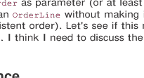

还有一件事是，Customer 是直接实例化的，而不是通过 CustomerFactory。我认为目前完全可以。我们在需要时才添加工厂，而不是提前添加！

也许我应该重新添加 OrderFactory，为它添加一个 CreateOrderLine() 方法，并让它同时接受 Product 和 Order 作为参数（或者至少是一个 Order）。另一方面，能够在不让 OrderLine 持久化的情况下处理它是很好的（当我将订单行添加到持久化订单时，这种情况才会发生）。我们看看以后是否需要更改，但这引出了另一个关注点。我想我需要在这里讨论实例的生命周期。

## 实例的生命周期

在上一节中，我说过一个订单行在被添加到持久化订单时就会变为持久化，这一点需要解释。我的意思是，一个实例开始其生命时为瞬态（transient），当

### 注意

Evans 也谈到了很多…… [Evans DDD]。对此有一个出色的解释，请务必阅读。Jordan/Russell [Jordan/Russell JDO] 也是如此。JDO 具有更复杂（且更灵活）的语义，但当然我以后可能会发现，我之前概述的简单语义是不够的。

不要将此与基础设施（例如 NHibernate）如何看待瞬态/持久化混淆。我在这里谈论的是我希望我的领域模型实例具有的生命周期语义。然后，由基础设施在幕后帮助我实现所需的语义。这将在后面的章节中详细讨论。

说到基础设施，眼尖的读者可能想知道我在[表 5-1](#)中的 `x.Persistent()` 是什么意思。我用 x 来象征那个未知的基础设施。同样，我们现在可以暂时忽略这一点。

回到功能 2，即列出客户的订单。下一个子功能是订单必须有一个订单类型。

## 订单类型

这里一个简单的解决方案是为每个 `Order` 添加一个 `OrderType` 实例，如[图 5-14](#)所示。


我考虑过 `OrderType` 是否真的是一个实体 [Evans DDD]，但我认为它不是一个值对象 [Evans DDD]。其可能值的集合对于整个应用程序来说是“全局”的，且非常小并且是静态的。

我可能在这里走错了方向。当然，我可以将 `OrderType` 实现为值对象，但很多迹象表明，使用枚举就足够了，尤其是目前已经足够，所以我定义了一个 `orderType` 枚举，并将其作为一个字段添加到 `Order` 中。

## 订单的参考人

是时候再次讨论一个 `Order` 的 `ReferencePerson` 了。我认为这里有一个值对象 [Evans DDD] 的例子，尽管它与 `OrderType`（它曾是值对象的候选）略有不同，因为参考人并不是整个系统的全局概念，而是针对每个 `Customer` 或 `Order` 特定存在的。（嗯，这很好地表明 `ReferencePerson` 不应该是枚举。）

在_图 5-15_中，你可以看到 `ReferencePerson` 的“实际运用”。

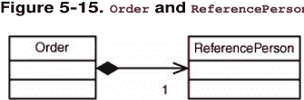

当我们采用值对象模式 [Evans DDD] 时，可能会觉得应该使用 .NET 中的结构体（struct）而不是类（class），但关于何时使用结构体、何时不使用，有基于大小的建议，而且使用结构体时会在基础设施方面遇到更多问题。此外，使用结构体时你会看到更多的装箱（boxing），所以决策并非一目了然。我实际上倾向于使用类，但大多数时候我会让它们不可变。如果你选择那条路，在重写 `Equals()` 时，你需要使用类的所有值。

这就是值对象 `ReferencePerson` 的 `Equals()` 可能的样子。（注意，我比较了值对象的所有字段，不像之前对实体那样。另请注意，无论是否有 Identity Map，对于值对象都需要重写 `Equals()`。）

```csharp
//ReferencePerson
public override bool Equals(object o)
{
    if (o == null)
        return false;

    if (this.GetType() != o.GetType())
        return false;
    ReferencePerson other = (ReferencePerson) o;

    if (!FirstName.Equals(other.FirstName))
        return false;
    if (!LastName.Equals(other.LastName))
        return false;

    return true;
}
```

添加一个 `orderLine` 作为用户操作的结果。那么对于添加 `orderLine`，我们可能更喜欢这样：

```csharp
newOrder.AddOrderLine("ABC").NumberOfUnits = 42;
```

这次 `AddOrderLine()` 返回的是 `orderLine` 而不是 `order`。如果我们希望能够设置 `orderLine` 的更多值，可以将 `NumberOfUnits` 改为一个同样返回 `orderLine` 的方法，这样可以更进一步，但你明白要点了。

本节要记住的重点是：如果你对 API 稍作调整，它可能会变得更好。


## 总结

所以，我们花了整章讨论模型的一些初始部分，但讨论相当详细。在我看来，详细的模型讨论最好通过代码和 TDD 来完成，而不是 UML 草图，本章正是遵循了这一思路。

我认为在结束本章之前，总结一下我们在功能列表中的进度是个好主意。到目前为止，我们已经处理了功能 2、3、7 和 9。不是很多，但进展明显。而且这些进展由相当多的测试来保证。很好。

我们将继续在第七章中完善领域模型。下一章的焦点会有所转移。你可能已经注意到，我们在本章中多次触及与基础设施相关的讨论，所以接下来让我们通过准备添加基础设施来处理这些问题。

此时我追求的第二个目标是能够为保存场景编写测试，同样无需处理真实数据库。你可能会问这有什么意义。我还是想专注于模型及其“周围”的语义等等。

我当然可以像到目前为止所做的那样，在仓储中逐个解决这个问题，但我认为保持一致性并只对所有仓储应用一种解决方案是有价值的。我还想要一种能够扩展到早期集成测试的解决方案，最重要的是，我现在就想编写真正的仓储，而不是那些应该被丢弃的愚蠢、临时的代码！

所以，尽管我一开始就说现在谈基础设施还为时过早，本章将涉及基础设施的*准备工作*，并且这样做是为了在添加基础设施时不必返工。我们想要的是编写与基础设施无关的代码。


-   使用框架专门提供的数据类型，例如用于集合的类型
-   实现特定的接口
-   提供特定的构造函数
-   提供强制性的特定字段
-   避免某些结构

至少还有一点，而且这一点太明显以至于我忘了。你不应该在领域模型类中编写数据库代码，比如调用存储过程。但这太明显了，我没有专门写。

让我们仔细看看其他各点。

## 继承某个基类

在框架中，支持持久化的一个非常常见的要求是，框架要求你继承由框架提供的某个基类。

下面这个例子看起来可能没那么糟：

```csharp
public class Customer : PersistentObjectBase
{
    public string Name = string.Empty;

    ...

    public decimal CalculateDepth()
    ...
}
```

嗯，确实不算太糟，但它确实承载了一些对你来说并非最优的语义和机制。例如，你使用了你的 `Customer` 类唯一的继承机会，因为 .NET 只支持单继承。这是否算一个大问题当然值得商榷，因为你通常可以“绕过”它来设计。

如果你已经开发了一个领域模型，现在想让它持久化，那问题就更严重了。继承的要求很可能需要对你的领域模型做一些改动。这和你用 TDD 开始开发领域模型的情况非常相似。你从一开始就受到限制，不能使用继承，必须把继承留给持久化需求。

你应该留意的一点是，如果继承给子类带来了大量公共功能，可能会让子类的使用者不得不费力去浏览那些与他无关的方法。

另外，通常情况并不像上面那个例子那样干净，大多数时候 `PersistentObjectBase` 会强制你为其中的某些方法提供实现，就像模板方法模式 [GoF 设计模式] 那样。好吧，这仍然不算灾难，但所有这些问题累积起来就麻烦了。

### 注意

这不一定非得是一个要求，但可以看作是一种便利，如果框架是那种风格的话，它能让你获得框架所需的大部分（即使不是全部）接口实现。我们将在后面的章节中讨论这个常见要求。

这就是我和 Christoffer Skjoldborg 开发的 Valhalla 框架的做法。但说实话，在那个案例中，名为 `EntityBase` 的基类承担了太多工作，以至于用自定义代码实现接口而不是继承 `EntityBase` 实际上只是一种理论上的选择。

## 只能通过提供的工厂实例化

别误会，我绝不对反对使用工厂。不过，当被迫使用它们而非出于我自己的合理决定时，我也并不会感到兴奋。这意味着，例如，我不能写这样的代码：

```csharp
Customer c = new Customer();
```

而必须写这样的代码：

```csharp
Customer c = (Customer)PersistentObjectFactory.CreateInstance(typeof(Customer));
```

### 注意

我知道，你觉得我故意用超长的名字来显得不公平，但下面这个也并没有更好，对吧？

```csharp
Customer c = (Customer)POF.CI(typeof(Customer));
```

再说一次，这不算灾难，但在大多数情况下也不是最优的。这段代码看起来比第一种实例化代码奇怪得多，不是吗？而且经常发生的情况是，这类代码会增加测试的复杂度。

通常强制使用提供的工厂的原因之一是，你因此可以得到脏检查方面的帮助。于是你的领域模型类会被动态地子类化，并且在

你还可以获得双向性方面的帮助，这样你就不必自己编写相关代码。这也是 AOP 解决方案可以为你处理的另一个例子。

## 实现特定接口

领域模型类要实现一个或多个基础设施提供的接口，才能被持久化，这也是一个非常常见的要求。

如果实现这些接口所需的代码很少，这自然是一个较小的问题；如果相反，那就是一个较大的问题。

一个基于接口功能的例子是：让实例能够从数据库填充值，而不经过 setter（因为 setter 中可能含有你在重建对象时不想执行的特定代码）。

另一个常见例子是提供用于优化访问实例状态的接口。

## 提供特定的构造函数

另一种从数据库重建实例时提供值的方式是要求特定的构造函数，这些构造函数与手头的业务问题毫无关系。

也可能需要一个默认构造函数，以便框架能够在数据库上执行 Get 操作后轻松地实例化领域模型类。再说一遍，这不是一个非常严重的问题，但仍然会让人分心。

## 提供强制性的特定字段

一些基础设施解决方案要求你的领域模型类提供特定字段，例如基于 Guid 的 Id 字段或基于 int 的 Version 字段。（所谓基于 Guid 的 Id 字段，我的意思是 Id 字段使用 Guid 作为数据类型。）这简化了基础设施，但可能让你的领域模型开发工作变得稍微困难一些。至少当它以一种你不希望的方式影响你的类时是如此。

## 避免某些结构/被迫使用某些结构

我已经提到过，即使你并不真的想要，也可能被迫使用虚属性。也可能有些结构你必须避免，一个典型的例子就是只读字段。只读字段（比如使用了 `readonly` 关键字的字段）无法从外部设置（除了通过构造函数），而这是创建 100% PI 领域模型类所必需的。

将私有字段与只读属性结合使用非常接近只读字段，但并不完全一样。

### 注意

Mark Burhop 评论如下：

嗯……这是 90 年代初 C 程序员反对 C++ 时的原始论据。“C++ 塞入了我没写过的代码。”“C++ 隐藏了真正发生的事情。”我不知道这个论点现在是否还站得住脚。

另外，对于 .NET 类来说，在字节码级别注入代码比 Java 更难。框架本身不支持，所以你得全靠自己，这在大多数情况下会变成阻碍。

更常见的做法是使用一些替代技术，比如我之前提到的运行时子类化配合提供的工厂，但这与注入代码并没有太大区别。让我们用“发出代码”这个词来做个总结。

## PI 实体/值对象的代价

我猜对于这一切，一种可能的反应是：“PI 看起来很棒，为什么不一直用呢？”自然规律（至少是软件领域的规律）是，当一切看起来整洁、干净、美好且无懈可击时，缺点就会出现。在这种情况下，我认为一个缺点就是开销。

我在本章前面提到过，为了高度的 PI 性，你需要牺牲一些速度，至少对于运行时 PI 来说是如此，因为你会被引导使用反射，而反射开销相当大。（如果你觉得编译时 PI 已经足够好，那么你不需要使用反射，而可以选择 AOP 解决方案，从而获得更好的性能表现。）

你可以很容易地在紧密循环中通过某个操作证明，使用反射读写字段/属性比普通方式调用要慢好几个数量级。然而，这个代价是否太高了？显然这取决于具体情况。你必须运行测试，看看它如何适用于你自己的场景。别忘了，与你在领域模型中做的许多操作相比，一次数据库跳转非常昂贵，但同时，你在这里比较的并不是同类事物。例如，比较的双方可能不是普通读取和基于反射的读取。

### 关于速度的典型例子

让我们举个例子，让你更好地理解整件事。持久化框架中的一个常见操作是，在场景结束时决定是否应该将一个实例存储到数据库。一种常见的解决方案是让实例负责在需要存储时发出 `IsDirty` 信号。或者更好的做法是，实例在变脏时也可以向工作单元发出信号，这样工作单元就会记住在需要存储更改时进行处理。

但是（你知道这里肯定要有个“但是”，对吧？）这需要对 PI 做一些滥用，除非你通过 AOP 付出了代价。


## 我们的存储库的 PI

我承认：说你也在存储库中使用 PI 有点牵强。这是因为存储库的目的基本上是让使用者产生一种错觉，即只要你遵守去存储库获取实例的协议，完整的领域模型实例集合就存在于那里。这种错觉是通过存储库在特定情况下与基础设施通信来实现的，而与基础设施通信并不是一件很符合 PI 精神的事情。

例如，存储库需要某些东西来拉取以使基础设施工作。这意味着包含存储库的程序集需要引用一个基础设施 DLL。而这反过来意味着你必须在存储库放在一个独立于领域模型的 DLL 中，还是让领域模型引用基础设施 DLL 之间做出选择（但我们很快会讨论一个解决方案，它将为此提供灵活性）。

## 测试存储库的问题

另外，当你想测试你的存储库时，它们是连接到 O/R Mapper 和数据库的。

### 注意

让我们暂时假设我们将使用一个 O/R Mapper。我们将在几章之内回到对不同选项的更深入讨论。

突然间，与单独测试实体和值对象相比，这为你提供了相当艰难的测试体验。

当然，你可以做的就是模拟你的 O/R Mapper。我自己没这么做过，但就“投入产出比”而言感觉有点不划算。相比回报，这可能需要相当多的工作。

## 进行小规模集成测试的问题

在之前的章节中，我实际上并没有展示任何专注于存储库的测试代码。大多数有趣的测试应该使用领域模型。如果不是这样，可能意味着你的领域模型没有达到应有的丰富程度，否则你无法充分利用它。

尽管如此，我在某些测试中确实使用了存储库，但更多的是作为小型集成测试，以查看使用者、实体和存储库之间的协作是否按计划进行。事实上，这就是存储库相比于为领域模型提供持久化能力的其他方法的一个优势，因为很容易编写存储库的 Fake 版本。问题是我写了大量愚蠢的代码，最终必须丢弃

它可能看起来像这样。首先，在领域模型程序集中有一个接口：

```
public interface ICustomerRepository
{
    Customer GetById(int id);
    IList GetByNamePattern(string namePattern);
    void Add(Customer c);
}
```

然后两个类（例如，`FakeCustomerRepository` 和 `MyInfrastructureCustomerRepository`）将位于两个不同的程序集中（但都在同一个命名空间中，即领域模型的命名空间，除非当然领域模型有多个分区）。参见图 6-1。

### 图 6-1. 两个存储库程序集

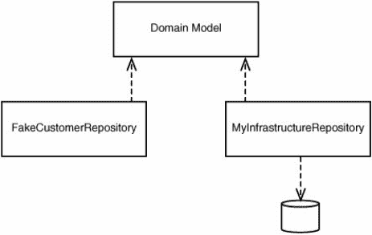

这意味着就存储库而言，领域模型本身不会受到所选基础设施的影响，如果这不需要成本的话，这很好。

但它确实有成本。这也意味着我必须为每个聚合根编写两个存储库，并且在每种情况下使用完全不同的存储库代码。

进一步说，这意味着存储库的生产版本位于另一个程序集中（Fake 存储库也是如此），尽管我认为存储库本身是领域模型的一部分。你说“两个额外的程序集，没什么大不了”。但对于领域模型被划分为多个不同程序集的大型应用程序，你会发现这通常并不意味着存储库有额外的两个程序集，而是领域模型程序集数量的三倍。这是因为每个领域模型程序集都有自己的存储库程序集。

尽管我认为这是一个负面因素，但它远没有 Fake 版本存储库中那些愚蠢的代码那么糟糕。那感觉真的很糟。

## 更好的解决方案？

我决定尝试的解决方案是创建一个我称之为 NWorkspace [Nilsson NWorkspace] 的抽象层。它是一组适配器接口，我为其编写了 Fake 形式的实现。Fake 只是两层哈希表，一组哈希表用于持久化实体（模拟数据库），另一组哈希表用于工作单元和标识映射。（标识映射跟踪当前已加载的标识，通常是主键。）

我编写的另一个实现是针对特定的 O/R Mapper。

### 注意

从现在开始，当我使用 NWorkspace 这个名字时，你应该把它看作是一个“持久化抽象层”。NWorkspace 只是一个示例本身并不重要。

多亏了这个抽象层，我可以将存储库移回领域模型，并且每个聚合根只需要一个存储库实现。相同的存储库既可以针对 O/R Mapper 工作，也可以针对一个不会持久化到数据库而只是在内存中保存实例哈希表的 Fake 工作，但语义与 O/R Mapper 情况相似。参见图 6-2。

### 图 6-2. 得益于抽象层的一组存储库

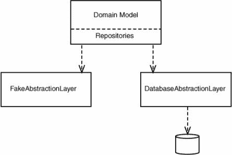

Fake 还可以序列化到/反序列化自文件，这对于创建非常称职、逼真且同时极易重构的应用程序早期版本非常棒。

另一个突然感觉可能很容易实现（至少对于一个小的抽象层 API 而言）的可能性是模拟基础设施而不是每个存储库。事实上，这不会是模拟一个基础设施产品的问题，而是所有在某个时候会有抽象层适配器实现的<|message|> 基础设施产品（如果发生这种情况，即除了我写的两个实现之外还有其他实现，这可能不太可能）。更准确地说，被模拟的是抽象层。

谈论 PI 存储库仍然有些牵强，但通过这个解决方案，我可以在领域模型中避免对基础设施的引用。话虽如此，在实际应用中我仍然将存储库保留在单独的程序集中。我认为这澄清了耦合，并且也使得某些 hack 更容易实现，然后让某些存储库方法在必要时使用原始 SQL（通过使用连接字符串作为是否应使用优化代码的标记）。

然而，与其引用持久化框架，我必须引用带有适配器接口的 NWorkspace DLL，但这似乎是一个很大的进步。存储库中几乎没有或没有干扰；它们相当“直接”（也就是说，如果你认为 NWorkspace API 至少还不错的话）。

所以，与其编写一组针对基础设施厂商 API 的存储库代码和另一组使用虚拟代码的存储库，不如编写一组针对（天真）标准 API 尝试的存储库。

### 注意

我为唠叨道歉，但我必须再说一次：我追求的是概念！我自己的实现完全不重要。

让我们为描述这些存储库找到另一个术语，而不是称之为 PI 存储库。如何称之为单集合存储库？好的，我们现在有一个术语来描述当我们构建一组存储库时，该组存储库既可在 Fake 场景中使用，也可在数据库场景中使用。比命名这些存储库更可能有趣的是看到它们在实际运行中。

## 单集合存储库中的一些代码

为了提醒你 Fake 版本存储库中的代码可能是什么样子，这里有一个来自第 5 章的方法：

```
//OrderRepository, a Fake version
public Order GetOrder(int orderNumber)
{
    foreach (Order o in _theOrders)
    {
        if (o.OrderNumber == orderNumber)
            return o;
    }
    return null;
}
```

好吧，这并不特别复杂，而是相当愚蠢的代码。

如果我们假设 OrderNumber 是 Order 的 Identity Field [Fowler PoEAA]（Identity Field 指的是将数据库中的行绑定到领域模型中实例的字段），当我们使用抽象层时，代码可能如下所示（以下代码中的 _ws 是 IWorkspace 的一个实例，而 IWorkspace 又是抽象层的主要接口）：

```
//OrderRepository, a single-set version
public Order GetOrder(int orderNumber)
{
    return (Order)_ws.GetById(typeof(Order), orderNumber);
}
```

我认为相当简单直接。并且再次，这个方法现在完成了，既适用于 Fake，也适用于使用真实基础设施时！

## 单集合存储库的成本

所以我又多了一个抽象。哎呀，我觉得它们变得相当多了，不是吗？另一方面，我相信每一个都增加了价值。


通知工作单元在下次调用 `PersistAll()` 时需要持久化一个新实例。我指的是我希望持久化实例所处的生命周期（这点我在第 5 章提过，这里不再赘述）。

我认为值得指出的是，如果我认为将聚合根关联到工作单元就足够了，那么当我们调用 `PersistAll()` 时，属于该聚合且聚合根能够到达的那些实例也会被持久化到数据库中。

同样，聚合对我们帮助很大；它们提供了一种工具，让我们知道将被持久化的对象图有多大，因为聚合根被标记为需要持久化。再者，聚合简化了问题。

### 注意

O/R 映射器通常可以配置“按可达性持久化”的深度。但即使这样配置，在我看来聚合仍然是一个非常好的指导。我的意思是，在做配置时，我用聚合来决定可达性应该达到多远。

让我们仔细看看目前为止所讨论决策背后的理由。

## 决策的理由

为什么我这样选择？首先，我想使用工作单元模式。我想要它的特性：创建一个逻辑工作单元。

这样你可以对领域模型做大量更改，将信息收集到工作单元中，然后请求工作单元将收集到的更改保存到数据库。

工作单元有几种使用风格。我倾向于尽可能对使用者透明，因此唯一需要的消息是向仓储调用 `Add()`（仓储再与工作单元交互）。

如果通过仓储进行重构，工作单元实现可以注入某个对象来收集更改信息。否则，可以在读取时拍摄快照，用于在持久化时由工作单元控制更改。

我还选择在仓储外部控制是否保存（`PersistAll()`）。在这个特定示例中，我本可以直接在 `CustomerRepository` 上调用 `PersistAll()`，但我没有这样做。为什么？为什么不完全让仓储隐藏工作单元？嗯，我可以这么做，但我经常发现，我希望在单个逻辑单元中同步多个聚合（因而也涉及多个不同仓储）的更改，这就是原因。因此，像这样的代码不仅可能写出来，而且非常典型：

```csharp
Customer c = new Customer();
_customerRepository.Add(c);
Order o = new Order();
_orderRepository.Add(o);

_ws.PersistAll();
```

另一种替代方案可能是：

```csharp
Customer c = new Customer();
_customerRepository.Add(c);
_customerRepository.PersistAll();

Order o = new Order();
_orderRepository.Add(o);
_orderRepository.PersistAll();
```

但那样我就有了两个不同的工作单元实例和两个身份映射（不一定非得如此，但为了讨论我们假设是这样），如果不够小心，可能会产生相当奇怪的效果。毕竟，第一个示例中的五行都属于同一个场景，因此在我看来，在处理工作单元和身份映射时，将其视为一个场景是最直观、最合适的。我的意思是，该场景应该只有一个工作单元和一个身份映射。

另一个可能的问题是，当仓储隐藏工作单元时，很可能意味着有两个数据库事务。这反过来又意味着，当场景结果不如预期时，你可能不得不准备添加补偿操作。在前一种情况下，如果客户被添加到数据库而订单没有被添加，可能还不至于太糟糕。然而，根据你的聚合设计，这可能是个问题。

话虽如此，聚合“应该”被设计成在 `PersistAll()` 时保持一致状态。但聚合之间的松散关系通常不受如此严格的要求约束。这可能会让你喜欢第二种方案。另一方面，如果两个完全无关的客户都关联到同一个仓储，第二种方案会把它们存储在同一个 `PersistAll()` 中。这实际上不如将客户及其订单分组在一起重要。聚合关乎的是对象，而不是类。

支持第二种示例方案的理由是，如果一个聚合来自一个数据库，而另一个聚合存储在不同数据库服务器上的另一个数据库中。那么无论如何，很可能最好有两个工作单元实例，每个数据库一个。因此，方案二的耦合度稍低。

### 注意

我甚至可以让 `Add()` 直接完成事务，但那样我得到的语义就与我目前讨论和表达的不同了。在正确的时间点调用 `Add()` 将变得至关重要。而对于我选择的方案，这一点并不那么重要，只要调用发生在 `PersistAll()` 之前即可。

如果由 `Add()` 完成事务，那也意味着这肯定不是“收集所有更改并在 `PersistAll()` 时全部持久化”，这又与我当前的方案大不相同。

既然说到这儿，为什么不干脆把整个过程封装到实体中，这样你就可以写出下面的代码？

```csharp
Customer c = new Customer()
c.Name = "Saab";
c.Save();
```

我认为这偏离了我喜欢的风格。我认为它违背了*单一职责原则*（SRP）[Martin PPP]，而且 PI 级别很低。我觉得这也进入了“口味问题”的领域。

如果一次保存成功而另一次失败，我也会遇到不一致的问题。（你可以争辩说物理事务和工作单元不必相同，但在我看来这增加了复杂性。我的看法是，如果你不必做某事，就不应该做。）

然而，通过使用我喜欢的技术，如果我真的想，也可以通过让仓储隐藏工作单元和身份映射来获得一次只存储一个聚合的效果。那样的话，代码可能如下：

```csharp
Customer c = new Customer();
_customerRepository.Add(c);
_ws1.PersistAll();

Order o = new Order();
_orderRepository.Add(o);
_ws2.PersistAll();
```

### 注意

对于前面的场景，使用单个 `_ws` 最终结果也是一样的，但这取决于具体示例。

我的意思是，我可以在我希望的时候有一个工作单元/身份映射，也可以在我希望的时候有多个。我认为这稍显灵活，我对此非常喜欢，这也是我选择的另一个原因；也就是说，我目前更倾向于将工作单元视为属于领域模型的使用者（即应用层或表现层），而不是领域模型本身。

如果我们假设每个仓储都有自己的身份映射，那么如果同一个订单被两个不同的仓储引用，事情可能会变得有点混乱——至少如果你在两个仓储中都对同一个逻辑订单（但两个不同实例）进行更改的话。

就风险而言，归根结底是你更偏好哪种风险。是承担“因为一次 `PersistAll()` 调用处理的实例比你预期的多，从而提交了你尚未处理完的实例”的风险？还是承担“因为必须记住要向哪些仓储请求执行 `PersistAll()`，从而忘记提交某项更改”的风险？

我并不是说这是一个没有问题的方案，但我再次强调，我更倾向于身份映射和工作单元归属于场景。

### 注意

决定你想要哪种编程模型，一如既往，由你决定。每种方案都有优缺点。

我反复将工作单元和身份映射相提并论。这是一种非常常见的组合，不仅出现在我的文字中，也出现在产品中。例如，JDO 中的 Persistence Manager [Jordan/Russell JDO] 和 Hibernate 中的 Session [Bauer/King HiA]。

我认为它值得成为一个模式，我曾考虑把它写下来，但当我与 Martin Fowler 讨论时，他告诉我他在 [Fowler PoEAA] 中讨论身份映射和工作单元时已经说过了。那已经足够了，所以我决定不再重复。

好了，现在说了很多，还没有行动。让我们开始构建 Fake 机制，看看最终会怎样。


到目前为止，我们已经谈论了很多对 NWorkspace 很重要、但对 NWorkspace 的 Fake 版本来说并不重要的功能。让我们回到正轨，暂时将注意力集中在 Fake 及其实现上。

## Fake 的实现

我不会带你深入 Fake 实现的细节——我只是打算从概念上讨论它是如何构建的，主要是为了让你对基本思想以及如何使用它有所了解。

Fake 实现使用了两层 Identity Map。第一层与持久化框架中的普通 Identity Map 非常相似，它会跟踪你在当前场景中读取的所有实体。第二层 Identity Map 用于模拟持久化引擎，因此这里的实例不是保存在场景级别，而是保存在全局级别（也就是说，所有场景共享同一组 Identity Map）。

因此，当你调用 `GetById()` 时，如果在所请求类型的 Identity Map 中找到了该 ID，就不会有到数据库的往返（对于 Fake 来说，就不会跳转至第二层 Identity Map）。另一方面，如果在第一层 Identity Map 中没有找到该 ID，则会从第二层获取，复制到第一层，然后返回给调用方。

`MakePersistent()` 非常简单；实例只是与第一层 Identity Map 关联。当需要调用 `PersistAll()` 时，第一层中的所有实例都会被复制到第二层。简单而干净。

以上描述的是基本功能。不过，再说说哪些方面比较麻烦也可能会很有趣。一个例子是，我不希望 Fake 以任何方式影响领域模型。如果它影响了，我们就又回到了原点，在领域模型中添加了与基础设施相关的干扰，甚至更糟，添加了与 Fake 相关的干扰。

一个例子是，我不知道一个类的标识字段是哪个（或哪些）。在真实的基础设施中，它可能会通过某些元数据知道这一点。我可以在 Fake 中读取相同的元数据来找出答案，但这样一来，Fake 必须知道如何处理（理论上）几种不同的元数据格式，而我绝对不喜欢那样。

我采用的简单化解决方案是假设存在一个名为 `Id` 的属性（或字段）。如果领域模型的开发者使用了其他约定，则可以在实例化 `FakeWorkspace` 时向 Fake 描述该约定。

再说一次，这些信息可能超出了你现在的需求，但它让我们认识到一个重要事实：与 NWorkspace 的基础设施实现相比，在 Fake 的实例化阶段，你可以/需要做一些额外的事情。

再举一个例子，你可以像这样从文件读取/保存到文件：

```csharp
//Some early consumer
IWorkspace ws = new
    NWorkspaceFake.FakeWorkspace("c:/temp/x.nworkspace");

//Do stuff...
```

## 与仓储相关的测试结构

处理这个问题的一种方法是为每一组影响仓储的测试编写一个基类。然后我使用模板方法模式，按照我想要的方式设置一个 IWorkspace。看起来可能是这样的，先看基类：

```csharp
[TestFixture]
public abstract class CustomerRepositoryTestsBase
{
    private IWorkspace _ws;
    private CustomerRepository _repository;

    protected abstract IWorkspace _CreateWorkspace();

    [SetUp]
    public void SetUp()
    {
        _ws = _CreateWorkspace();
        _repository = new CustomerRepository(_ws);
    }

    [TearDown]
    public void TearDown()
    {
        _ws.Clean();
    }
}
```

然后是子类，看起来像这样：

```csharp
public class CustomerRepositoryTestsFake :
    CustomerRepositoryTestsBase
{
    protected override IWorkspace _CreateWorkspace()
    {
        return new FakeWorkspace("");
    }
}
```

好了，以上是与仓储相关的测试的准备工作，但测试本身呢？其实有几种不同的风格可供选择，但我喜欢的是尽可能在基类中定义，同时让子类可以决定某个测试现在是否应该实现。我还希望子类不可能忘记实现某个测试。有了这些要求，我最喜欢的风格如下（首先，在基类中一个简化测试是什么样的）：

```csharp
[Test]
public virtual void CanAddCustomer()
{
```

这样，在测试执行期间，会清楚地表明这只是暂时忽略。

最后，如果你“永远”不打算在子类中支持该测试，可以在子类中像这样写：

```csharp
[Test]
public override void CanAddCustomer()
{
    Console.WriteLine
        ("CanAddCustomer() isn't supported by Fake.");
}
```

好吧，如果你刻意去做，仍然可能会忘记一个测试。你需要像这样写代码，跳过 `Test` 属性：

```csharp
public override void CanAddCustomer() { }
```

对此有一种解决方案，但我认为我展示给你的这种风格在代码量和“忘记”测试的风险之间取得了良好的平衡。

我知道，这不是 YAGNI 原则，因为目前除了 Fake 实现之外，我们没有任何其他实现，但请把这看作一个快速指示，说明后续会发生什么。

### 注意

这种风格同样可以用于每个仓储有多个实现的情况。

对于许多应用程序，通过这种方式处理整个系统可能几乎是不可能的，尤其是在生命周期后期。对于许多应用程序来说，这种方式可能只对早期开发测试和早期演示有用，但即便如此，如果它能对此有所帮助，那也是很好的。如果能一直有效，那就更好了。

在现实生活中，基本做法（总有例外）是，我专注于针对 Fake 实现编写核心测试。我也针对 Fake 实现编写 CRUD 测试，但在这些情况下，我也会继承用于数据库的测试。这样一来，我就能测试出映射细节。

话虽如此，无论你是否使用诸如抽象层之类的思想，你迟早都会遇到数据库测试的问题。我请我的朋友 Philip Nelson 写了一节关于这个问题的内容。如下。


- 在每次测试之前重置数据库。
- 在运行期间维护数据库的状态。
- 在运行前，只为你要运行的测试或测试集重置数据。
- 将单元测试与数据库调用测试分开。

## 在每次测试之前重置数据库

乍一看，这似乎是最理想但也可能是最耗时的选项。这种方法的优点是，整个系统在测试开始时处于已知状态。你不必担心测试运行期间出现奇怪的交互，因为它们都是从同一个地方开始的。缺点是时间。在项目度过了初始阶段之后，你会发现自己要等待测试套件运行。如果你正在进行单元测试，并在每次更改后运行测试，这会很快占据你大量的时间。有一些选项可以提供帮助。它们如何适用于你，取决于很多因素，从你使用的架构类型到你使用的数据库系统类型。

一种简单但缓慢的方法是在每次测试之前从备份中恢复数据库。对于许多数据库系统来说，由于需要花费大量时间，这并不实用。然而，在某些系统中这是可行的。例如，如果你针对基于文件的数据库进行编程，可能只需要关闭连接并复制一个文件即可恢复到原始状态。另一种可能的方法是使用内存数据库，比如 Java 的 HSQL，它可以非常快速地恢复。即使你使用的是像 Oracle 或 SQL Server 这样更标准的系统，如果你的数据访问设计足够灵活，你也可以在测试中切换到内存数据库或基于文件的数据库。如果你使用的是 O/R 映射器，由它负责为你构建实际的 SQL 调用并且支持多种数据库方言，这一点尤其如此。

DbUnit 项目提供了另一种在测试运行前重置数据库的方法。本质上，它是 JUnit 的一个框架，允许你定义“数据集”，这些数据集会在每次测试运行前加载到干净的表中。Ruby on Rails 也有一个类似的系统，允许你在开放的 YAML（YAML Ain't Markup Language）格式中描述测试类数据，并在测试设置期间应用它。这些工具可以很好地工作，但你也可能会遇到问题，因为这些数据库插入操作可能需要记录日志，因而可能非常慢。另一种可能有效的方法是使用批量加载实用程序，这些实用程序的日志记录可能不会那么详尽。下面是它在 SQL Server 中可能的工作方式。首先，在你的测试数据库上使用“简单恢复”数据库恢复选项。这会消除大部分日志记录并提高性能。然后，在测试设计期间，执行以下操作：

- 将数据插入到一个测试数据库中，该数据库仅作为测试的干净数据源
- 调用 Transact-SQL 命令将测试数据导出到文件
- 编写 Transact-SQL 命令以批量插入这些文件中的数据

然后在测试设置方法中，执行以下操作：

- 截断所有表。这不是一个记录日志的操作，而且可以非常快。


这种方法免除了你在测试调用前重置整个数据库的负担，也免除了系统的负担。相反，你在测试之前或之后向数据库发出一组命令，通常在 setup 和/或 teardown 方法中执行。好消息是，对于单个测试类，你需要做的工作要少得多。之前的技术仍然可以使用，但现在你还有额外选项可以发出简单的 insert、update 或 delete 语句。这样即使记录日志也痛苦更小，因为影响更小了。再次强调，如果你的系统支持，使用数据库设置选项减少日志记录工作仍然是个好主意。

不过也有缺点。一旦你开始假设自己确切知道测试会影响哪些数据，你就把自己绑定在了不仅要理解被测代码如何操作数据，还要理解被测代码调用的额外代码在做什么。这可能会在你未察觉的情况下被更改。测试可能会因此失效，而这并不表示代码坏了。可能会提交一个 bug 报告，而实际上根本不是 bug，只是维护工作罢了。

这种技术是可以成功使用的，但经过多年的测试编写，我发现这种方法最有可能在没有充分理由的情况下失效。不过你可以将其降到最低。如果你对被测代码调用的类进行 mock，那么这些代码就不会影响数据库。这在精神上更接近单元测试的含义。如果你在自动化系统测试，而真实类之间的交互正是你想要测试的内容，那么 mock 就没有用处。无论如何，这样做需要一个架构决策，以允许测试框架轻松替换外部类。如果你要这样做，你自然会发现自己正在朝着我在这里介绍的最终选项努力。

## 不要忘记不断演进的模式！

你无疑会发现自己随着时间的推移对数据库进行更改。在初始阶段，你可能只想直接修改数据库并根据需要调整代码，但在你拥有已发布系统之后，就该考虑这些更改如何成为你流程的一部分了。使用测试系统实际上使这变得更容易。

我更喜欢创建并运行针对数据库的 alter 脚本的方法。你可以在数据库重置后立即运行这些脚本，但由于所有数据库状态都包含在源代码控制的开发环境中，因此开发脚本并用它们来修改测试环境可能更有意义。当测试通过时，你将所有内容提交，然后让脚本自动设置以在需要时运行于 QA 环境。

如果这在你的构建服务器上发生会更好，因为 alter 脚本的运行会在应用到生产系统之前经常被测试。当然，这假设你会定期重置 QA 环境以匹配生产环境。我相信这个过程有很多变体，但最重要的是提前规划，以确保代码和数据库更改都能可靠发布。

## 将单元测试与数据库调用测试分离

在敏捷社区的邮件列表和论坛中，很少有话题比测试与数据库交互的代码更能引发讨论。在那些正在实践（并仍在定义）TDD 技术的人中，高度推崇的价值观是所有代码都可以作为单元独立测试，因为

## 查询

在不同的基础设施解决方案中，查询差异极大。它也是极易影响消费者的因素之一。一开始简单进行时可能并不明显，但过了一段时间后，你经常会发现大量查询需求，而在满足这些需求的同时，你通常会把自己绑定到所选的基础设施上。

让我们退一步，考虑另一种非基于查询的解决方案。之前，我向你展示了如何通过以下代码在 Repository 中按标识获取：

```csharp
//OrderRepository
public Order GetOrder(int orderNumber)
{
    return (Order)_ws.GetById(typeof(Order), orderNumber);
}
```

然而，如果 orderNumber 不是标识，Repository 方法的接口显然必须更改为返回列表，因为多个订单可能具有 orderNumber 0 但它们已达到某种状态。那又怎样？GetById() 现在没用了，因为 orderNumber 不是 Identity（并且假设它不是唯一的，因为我说了答案可能是一个列表）。我需要一种方法来访问 Fake 中 Orders 的第二层 Identity Maps。假设我可以用 GetAll(Type, typeOfResult) 来实现，如下所示：

```csharp
//OrderRepository
public IList GetOrders(int orderNumber)
{
    IList result = new ArrayList();
    IList allOrders = _ws.GetAll(typeof(Order));

    foreach (Order o in allOrders)
    {
        if (o.OrderNumber == orderNumber)
            result.Add(o);
    }

    return result;
}
```

这仍然是非常愚蠢的代码，而且当你已有基础设施时，绝对不是你想要编写的代码，至少对于真实世界的应用程序来说不是。

### 单一查询对象集

就像 Repository 一样，能够从第一天起就以单一实现“正确”地编写查询，并在 Fake 和真实基础设施中都使用它会很好。我们如何处理这个问题？

假设我们想要使用 Query Objects [Fowler PoEAA]（将查询封装为对象，提供面向对象的查询语法）并且我们还将签名从 `GetAll()` 改为调用 `GetByQuery()`，并让它接受 `IQuery`（在 NWorkspace 中定义）而不是。代码现在可以如下所示：

```csharp
//OrderRepository
public IList GetOrders(int orderNumber)
{
    IQuery q = new Query(typeof(Order));
    q.AddCriterion("OrderNumber", orderNumber);
    return _ws.GetByQuery(q);
}
```

好吧，这相当直接。你只需通过说明期望结果中的类型来创建 `IQuery` 实例。然后设置你想要的 criteria，以尽可能缩小结果集的大小，通常通过在数据库中处理查询（或在使用 Fake 实现时在 Fake 代码中处理）来实现。

### 注意

我们可以相当容易地使查询接口更流畅，但让我们暂时坚持最基本的做法。

当你想要实例化 Domain Model 的一部分时，这就是要做的事情。让我们回到之前讨论的 `_GetNumberOfStoredCustomers()`。使用我们新添加的查询工具后，这段代码会是什么样子？假设它调用 Repository 并使用以下方法：

```csharp
//CustomerRepository
public int GetNumberOfStoredCustomers()
{
    return _ws.GetByQuery(new Query(typeof(Customer))).Count;
}
```

**它能工作**，但对于生产场景来说，这个解决方案会让每个 DBA 都痛哭流涕。至少如果结果是一个 SELECT，只是为了统计行数而获取所有行的话就是这样。对大多数情况来说，这完全不可接受。

我们需要在查询 API 中添加更多功能。以下是一个示例，其中我们有可能返回简单类型，例如 `int`，并结合聚合查询（这次 aggregate 指的不是 DDD 模式中的 Aggregate，而是例如 SQL 中的 SUM 或 AVG 查询）：

```csharp
//CustomerRepository
public int GetNumberOfStoredCustomers()
{
    IQueryable q = new Query(typeof(Customer),
        new ResultField("CustomerNumber", Aggregate.Count));
    return (int)_ws.GetByQuery(q)[0];
}
```

有点粗糙和不成熟，但我认为这应该能让你了解 NWorkspace 中基本查询 API 的设计思路。

有一个标准的查询语言不是很好吗？也许正是缺少它才导致对象数据库并没有真正流行起来。当然，有 Object Query Language（OQL），但我认为它出现得相当晚，而且实现起来也是一个相当复杂的标准。它很 competent，但很复杂。（好吧，这可能是一系列阻碍对象数据库成为主流的因素的组合；不总是这样吗？）我将在第 8 章“基础设施 for Persistence”中更多地谈论对象数据库。

不过我现在想要的是一个针对持久化框架的查询标准，像 SQL 一样普及，但适用于 Domain Models。在我们拥有这样的标准之前，NWorkspace 版本至少可以为我搭起桥梁。这有成本吗？有免费的午餐这种事吗？

## 单一查询对象集的成本

当然，转换是有成本的，这也适用于这种情况。首先，从 IWorkspace 实现到基础设施解决方案存在性能成本。然而，在端到端场景的上下文中，性能成本可能相当低。

然后还有能力丧失的成本，因为 NWorkspace-API 被简化了，而成熟的基础设施解决方案能提供更多功能，这可能更糟。另一个成本是 NWorkspace 本身的 API 相当原始，可能没有你基础设施解决方案的查询 API 那么好。好吧，所有这些成本听起来都很公平，如果能获得很多好处，我可以接受它们。

我之前遗漏了一个关于查询和 Identity Map 的非常重要细节：查询时是否绕过缓存。

## 查询与缓存

我之前提到过，当你执行 GetById() 时，如果该操作必须通过访问持久化来完成，则获取的实例会在返回给消费者之前添加到 Identity Map 中。GetByQuery() 也是如此；也就是说，实例将被添加到 Identity Map。

然而，有一个很大的区别，那就是 GetByQuery() 在访问持久化之前不会检查 Identity Map。原因 partly 是我们想要利用后端的能力，但更重要的是我们不知道 Identity Map（或缓存，如果你

（我们会的）用于满足查询。要弄清楚我们是否拥有它，我们需要访问数据库。这又带来了另一个问题。`GetById()` 从标识映射开始；`GetByQuery()` 则不然。这完全是不同的行为，实际上意味着 `GetByQuery()` 绕过了缓存，这是有问题的。如果你要查找已经添加到标识映射/工作单元中、但尚未持久化的新 `Customer` Volvo，按 ID 查询时可以找到，但通过查询按名称查找时却找不到。很奇怪。

说实话，这是一个痛苦的决定，但我决定让 `GetByQuery()` 在访问数据库之前默认执行隐式的 `PersistAll()`。（`GetByQuery()` 有一个参数可以覆盖此行为以避免这种情况，但再次强调，默认情况下还是会隐式调用 `PersistAll()`。）我得出的结论是，这种默认风格很可能最符合 NHibernate 的其余部分及其追求简单和降低错误风险的目标。这就是为什么我在事务语义方面做出了一些牺牲。有些人可能会争辩说，这违反了最少惊讶原则。但我认为这取决于你的背景，以及在这种情况下什么才令人惊讶。

最大的缺点无疑是，在执行 `GetByQuery()` 时，你可能会遇到与保存相关的异常。多么痛苦的决定，但我现在必须做出决定才能继续前进。

你还记得简单且未优化的 `GetNumberOfStoredCustomers()` 版本吗？它不仅仅慢；当它看起来像下面这样时，可能无法按预期工作（优化版本也是如此）：

```csharp
public int GetNumberOfStoredCustomers()
{
    return _ws.GetByQuery(new Query(typeof(Customer))).Count;
}
```

它之所以不能满足我的目的，是因为 `GetByQuery()` 会执行隐式的 `PersistAll()`。相反，必须使用这样的重载，其中 `false` 是 `implicitPersistAll` 参数的值：

```csharp
public int GetNumberOfStoredCustomers()
{
    return _ws.GetByQuery(new Query(typeof(Customer), false)).Count;
}
```

### 注意

当然，我们也可以（而且应该）改用聚合版本。这里的重点是如何处理隐式的 `PersistAll()`。

所有这些都在一定程度上影响了编程模型。首先，当涉及到对同一个工作区实例进行查询和更改时，你绝对应该尝试采用分块工作的方式。因此，当你做出更改后，你应该在查询之前对这些更改感到满意，因为查询会使更改持久化。

## 一个还是两个仓储程序集？

有了以上所有这些，你就明白在如何组织仓储方面有很多不同的可能性，但你可能想知道在实际项目中是如何做的。

在我最近的一个大型项目中（该项目已投入生产，不是玩具项目），我使用了一组仓储，既用于 Fake 执行，也用于针对数据库的执行。有一些使用原生 SQL 的优化，但我在那里用了一点小技巧：如果优化的方法发现了注入的连接字符串，它就会调用另一个方法，在那里我完全靠自己。

否则，就会使用未优化的代码。这样，Fake 会使用未优化的版本，而与数据库相关的代码通常会使用优化版本。

同样，这仅在少数情况下使用。不是非常优雅和干净，但目前运行良好。

## 作为查询的规约

另一种查询方法是使用规约模式 [Evans DDD]（封装用于描述某些事物的概念性规约，例如不允许再购买东西的客户"长什么样"）。这个概念会得到一个描述性的名称，并且可以反复使用。

使用这种方法类似于创建类型安全的、特定于领域模型的查询，但它更进一步，因为我们追求的不是通用查询，而是基于领域特定概念的非常具体的查询。这比领域模型中的查询定义（如 `CustomerQuery`）高了一个层次。规约不是暴露用于过滤的通用属性，而是具有非常特定领域含义的概念。一个常见的例子是黄金客户的概念。规约描述了客户成为黄金客户所需的条件。

代码变得非常清晰且目的明确，因为这些概念被捕获并描述为规约类。

这些规约类甚至完全可以输出 `IQuery`，这样如果你喜欢抽象层的想法，就可以将它们与 `IWorkspace`（或等价物）的 `GetByQuery()` 一起使用。

## 其他查询替代方案

到目前为止，我们只是把查询对象视为我们需要的查询语言（尽管有时它们会嵌入到其他结构中）。事实上，当查询变得复杂时，能够用例如类似于 SQL 的基于字符串的语言来编写查询，通常会更强大。

### 规则的分类

如果我们尝试对规则进行分类，很快就会发现有多个维度需要考虑。例如，有如下属性：

- 在哪里执行（在哪一层）
- 何时执行
- 复杂程度（简单约束、跨多个字段、跨多个实例，等等）
- 是否启动操作
- 如此等等，不一而足

很抱歉，关于这个主题我不会讨论太多，只会推荐你去参考其他一些书籍，例如 von Halle 的书 [von Halle BRA]、Ross 的 [Ross BRB] 以及 Halpin 的 [Halpin IMRD]。你会发现这些书相当以数据为中心，但尽管如此，它们仍然非常有趣。

让我们尝试从另一个角度入手。让我们先定义一些原则，然后动手实践。

## 规则及其使用的原则

我认为"原则"这个词非常好，因为它并不严格。提出原则比提出分类要容易得多，这大概是因为原则本身就带有模糊性。尽管如此，原则在意图方面是描述性的。这正是我现在在这里所需要的。

## 双向规则检查：主动检查可选（可能），被动检查强制（且自动）

你应该能够提前（主动地）检查是否会出现问题（例如，尝试持久化当前的更改），以便采取纠正措施。这样，编程模型就会更简单。

如果你未能提前检查，那也毫不留情，但你会通过异常（被动地）得知存在问题。

## 所有状态，即使处于错误状态，也应可保存

用户讨厌从应用程序中得知：由于错误而无法保存当前的更改。我的一个朋友曾将其比作：如果你有拼写错误，就不允许保存文字处理文档。

"所有"是一个"大"词，但我们将努力至少接近这一目标。我们应尽量避免进入那些无法持久化的状态。

在这里，思考"错误"意味着什么也很重要。如果一个订单过大，它可能会被视为处于错误状态。但在用户尝试提交订单之前，这并不真正算是一个错误，只是他在提交之前需要处理的情况。而且他应该能够在提交之前保存该订单，这样他可以在之后继续处理它，解决问题，然后再提交。

## 规则的使用应富有成效

使用规则应该富有成效，无论是消费规则还是定义规则本身。

消费规则的生产力将通过以下方式实现：使获取用于设置 UI 的元数据成为可能。这将减少你在检查时发现问题的情况，因为 UI 已经帮助确保一些问题根本不会发生。（只是要当心，不要以为仅靠 UI 就能满足所有规则检查的需要。）

定义规则的生产力目标可以通过一个小型框架来实现，该框架让你专注于规则中有趣的部分，而样板代码则由框架为你处理。


## 数据库约束

尽管你可能会选择专注于将所有的规则都放在领域模型中，但最终仍然可能有一些规则会落到数据库里。一个典型的原因是效率。有些规则在数据库中进行检查效率最高；事实就是这样。你也许可以围绕其中的大多数规则进行设计，但仍会有少数情况不得不接受这个现实。

另一个原因是你可能无法设计新的数据库，或者无法完全按照自己的意愿来设计数据库，而必须适应现有的数据库设计。还有一个原因是，人们通常认为数据库能够自我管理是一件好事，尤其是当多个不同的系统使用同一个数据库时。

我们在第 1 章“从值到值”中讨论过的面向对象与关系数据库之间的阻抗不匹配，在这里也会出现。例如，数据库中的字符串很可能有静态最大长度，比如 `VARCHAR(50)`。某个字符串不允许超过该长度，这算是一种通用规则，但它主要与持久化相关。如果字符串太长，就不允许转换到已持久化状态。

因此，你很可能会遇到这样的规则：其无效性直到状态被持久化到数据库之后才会被发现。这反过来又会带来几个问题。

首先，解析错误信息很麻烦，尤其是当你考虑到典型的 O/R 映射解决方案通常希望能在不同的数据库之间移植时。更确切地说，问题的核心在于，当涉及错误时，O/R 映射器可能无法为你完成映射，并告诉你领域模型中哪个（哪些）字段导致了问题；例如，当出现重复键错误时。

此外，错误会发生在不合时宜的时刻。你的领域模型已经被修改，而且如果不完全重来，你很可能很难从问题中恢复。事实上，通常的规则往往是：你应该重来，而不是试图耍什么小聪明。

不过，我们确实喜欢能够随时保存实例这个想法。（无论如何，我们已经设定了一些*偏好*，即使无法 100% 遵守。极端情况往往代价极高。）

在我看来，要尽可能（或者适当地）进行前瞻性设计，这样数据库抛出的异常就会极少。对于那些仍然可能发生的异常，你要么做好准备在代码中逐一处理，要么准备好回滚事务、丢弃领域模型的更改并重新开始。这有点极端，但这就是我的看法。这一切的关键在于设计，从而把问题尽可能地降到最小。

好了，以上是纯粹技术层面的问题（即数据库可能会对我们表达不满）。但这不仅仅是规则*只*与基础设施相关或*只*与领域相关的问题。它们之间是有联系的。

## 将规则绑定到与*领域*或*基础设施*相关的转换？

到目前为止，我们所说的是，我们应该努力避免进入无效状态。如果我们遵循这一点，那么（暂时不考虑与基础设施相关的约束时）我们总是可以持久化。

这个原则是理想情况。在现实中，在多步骤操作中很难不违反某些规则。例如，你是否应该禁止将客户的名称改为规则认为过短的名称？嗯，也许应该，但这可能恰恰阻止了用户想做的事情：即删除旧名称并插入新名称。

这个问题可以通过一个名为 `Rename(string newName)` 的方法来解决，由它来完成这项工作。在方法执行期间，对象的状态是不正确的，但我们只在方法执行之前和之后才把它视为问题。

### 注意

这与*契约式设计* [Meyer OOSC] 中的不变量思想是一致的。这些不变量就像断言，实例在方法执行之前和之后都应当始终遵守。唯一的例外是*在*方法执行期间。

另一种方法是，在完成更改之前不设置该属性。让我想想还能不能举出另一个例子。假设有两个字段，要么两个字段都必须设置，要么两个都不设置。同样，用一个方法可以解决这个问题，但如果你把问题的规模扩大，或者考虑到 UI 更希望这些属性通过 setter 暴露，那么很明显，时不时进入不一致状态是难以避免的。

另一个问题可能是，我们是否应该相信我们*没有*进入无效状态？而且，*如果*我们尽管不太可能但还是确实进入了无效状态（一个*真正*无效的状态，例如当 `order` 的状态为 Ordered 时发生了错误的更改），我们是否应该允许将其存储？

在某些错误情况下，数据库可能不允许我们获得那样的保护。但即使你努力让数据库在某些规则上自我管理，你仍然可能会让一些东西漏过去；而且如果你已经转向以领域模型为中心的应用程序构建方式，你的数据库在自我保护方面可能就不会那么严格。毕竟，一些较为高级的领域规则，在领域模型中表达通常比在关系数据库中*容易得多*，你自己也*希望*把它们放在领域模型中。

问题是：我们能信任这个“环境”吗？我的意思是，我们能相信我们不会持久化一个本不应该达到的状态吗？例如，我们能期望没有任何 bug 吗？我们能期望使用者不会太有创造力、不会使用反射将某些字段设置为令人兴奋的值吗？

## 完善原则：“所有状态，即使处于错误中，也应可保存”

让我们看看能否举出一个例子，来说明我所说的“所有状态，即使处于错误中，也应可保存”这个原则。

再次假设一个订单可以处于两种状态：NewOrder 和 Ordered。我们只有一条与领域相关的转换规则：订单不能太大，否则不能进入 Ordered 状态。这样就得到了表 7-1 中的有效组合。

### 表 7-1. 订单状态与规则结果的有效组合

| 订单状态 | 规则结果 |
|---|---|
| New Order | 不会太大 |
| New Order | 太大 |
| Ordered | 不会太大 |

到目前为止，这既简单又正是我们想要的。让我们再加上“是否已持久化”这一维度，如表 7-2 所示。

### 表 7-2. 订单状态与规则结果的有效组合

| 订单状态 | 规则结果 | 是否持久化 |
|---|---|---|
| New Order | 不会太大 | 未持久化 |
| New Order | 不会太大 | 已持久化 |
| New Order | 太大 | 未持久化 |
| New Order | 太大 | 已持久化 |
| Ordered | 不会太大 | 未持久化 |
| Ordered | 不会太大 | 已持久化 |

首先，我想指出，我们预期“转换为 Ordered 状态”与“太大”的组合是不可能出现的。

更重要的是，如果出于某种原因它确实发生了，那这就是一个处于真正异常错误状态、不应该被保存的示例。

### 注意

至于在持久化时是否也检查与领域相关的转换规则，你的情况可能会有所不同。在很多情况下，这样做可能被认为有点极端。

## 与持久化相关的基本规则 API 的需求

既然我们现在已经确定了一个具体的上下文，即转换到已持久化状态，那么我们就开始讨论与此相关的 API。之后，我们会再回到其他（从模型的角度来看更有趣的）状态转换问题，包括一般性的和特殊性的。

### 注意

像往常一样，这里的讨论实际上更多是关于一些*通用*的想法，而不是 API 本身。我并不是想告诉你们应该如何创建自己的接口/API，而只是想给出我对这个主题的一些想法，并希望这能促使你们找到自己的解决方案。

我想举一个新的代码示例，在这个示例中，我们应用这样的理念：主动避免持久化那些会导致持久化引擎抛出异常的特殊状态错误和/或问题。

我选择后者：展示一种持久化引擎会抛出异常的情况。（再说一次，前一种问题应该是很难遇到的。如果一切正常，那个状态本不应该达到。）

假设 `Order` 有一个 `Note` 属性，而 `Note` 在数据库中被定义为 `VARCHAR(30)`。根据你的持久化方案，当你尝试保存长字符串时，可能会得到异常，或者信息会被静默丢失。这里重要的是，我会主动捕获这个问题。代码可能如下所示：

```csharp
[Test]
public void CantExceedStringLengthWhenPersisting()
{
    Order o = new Order(new Customer());
    o.Note = "0123456789012345678901234567890";

    Assert.IsFalse(o.IsValidRegardingPersistence);
}
```

因此，我没有询问订单是否为 `IsValid`，而是将属性名改为 `IsValidRegardingPersistence`，以非常明确地表明，在处于……的上下文中，订单是无效的。


第一个问题仍然适用。如果实例无效，弄清楚破坏了哪些规则可能会很有趣。聚合根将从其所有子项以及自身聚合破坏的规则，并将破坏的规则作为 IList 返回。

添加接口以处理此问题。它可能看起来像这样：

```
public interface IValidatableRegardingPersistence
{
    bool IsValidRegardingPersistence {get;}
    IList BrokenRulesRegardingPersistence {get;}
}
```

### 注意

我认为，破坏规则的列表是通知模式的实现 [Fowler PoEAA2]。

该模式提到的一个重要事项是，我们需要了解的不仅是错误，还有警告/信息。另一个浮现在脑海的想法是，我谈到的破坏规则列表相当集中在聚合上，但当然，我们可以将多个这样的列表聚合（双关语并非有意）到应用层 [Evans DDD] 中的一个列表中，例如来自多个聚合根实例。

## 我们允许了不正确的转换

当然，Note 变得太长了，这可以被视为向无效状态的转换。但我不能说我经常认为那件事很有趣。我可能会让订单在一段时间内保留过长的 Note，以便用户可以删除 Note 中的几个字母。

不幸的是，在这种情况下，过长的 Note 将无法保存。另一方面，未持久化和已持久化之间的转换在这里是有趣的。但它不会被允许。（正如我所说，我会得到一个异常，或者字符串会被静默截断。）

转换到已持久化状态有点“特殊”。我们很快会回到在领域相关规则的上下文中允许不正确的转换的问题。

## 如果我们忘记检查怎么办？

如果使用者不遵循先检查转换可能性再尝试转换的协议，我们就有一个异常情况，而异常情况会抛出异常。这里也同样适用。因此，如果我们尝试转换到已持久化状态，我们希望抛出一个继承自 ApplicationException 的异常，并且它会包含一个破坏规则的 IList。

再次强调，使用者没有遵循协议，这是一个异常情况。

我们陷入了一个特定的转换问题：转换到已持久化状态。是时候将焦点从基础设施相关的转换暂时转移到领域相关的转换上了，但我们会尝试带走一些想法，例如如果使用者不遵循协议则为异常。

## 专注于领域相关规则

让我们逐一处理第 4 章中剩余的功能需求。我们从功能需求编号 6 开始，它被称为“订单的总价值不得超过一百万瑞典克朗”，但我们在意识到草拟的 API 缺少上下文时被打断了。让我们看看是否可以稍微转换一下测试。它之前看起来像这样：

```
[Test]
public void CantExceedMaxAmountForOrder()
{
    Order o = new Order(new Customer());

    OrderLine ol;

    ol = new OrderLine(new Product());
    ol.NumberOfUnits = 2000000;
    ol.Price = 1;
    o.AddOrderLine(ol);

    Assert.IsFalse(o.IsValid);
}
```

正如你现在所知，我认为这段代码有几个问题。为了遵循到目前为止讨论的思路，我们可以添加一个转换到 Ordered 状态的方法；例如，该方法可以称为 OrderNow()。但我仍然不会满意，因为 OrderNow() 很可能在我们有机会检查之前就抛出异常。

再次，我想暂时不关注什么已持久化、什么未持久化。这里有趣的部分是，当我们尝试转换到 Ordered 时，我们不能这样做。让我们通过对测试进行一些更改来反映这一点。

```
[Test]
public void CantGoToOrderedStateWithExceededMaxAmount()
{
    Order o = new Order(new Customer());

    OrderLine ol = new OrderLine(new Product());
    ol.NumberOfUnits = 2000000;
    ol.Price = 1;
    o.AddOrderLine(ol);

    try
    {
        o.OrderNow();
        Assert.Fail();
    }
    catch (ApplicationException ex) { }
}
```

重要的是要考虑当我们处于 Ordered 状态时，是否会在 `AddOrderLine()` 中进行检查以免破坏规则。如果允许 `AddOrderLine()`，我可以让它将订单转换回 `NewOrder`。这样可以避免问题。

另一个问题是，如果在 Ordered 状态下其中一个 `OrderLines` 被更改，可能会破坏规则。这种情况下的典型解决方案是使用不可变的 `OrderLines`，以便它们无法被更改。让我们更改测试以反映这一点。

```
    [Test]
    public void CantGoToOrderedStateWithExceededMaxAmount()
    {
        Order o = new Order(new Customer());

        o.AddOrderLine(new OrderLine(new Product(), 2000000, 1));

        try
        {
            o.OrderNow();
            Assert.Fail();
        }
        catch (ApplicationException ex) { }
    }
```

### 注意

我可以使用 NUnit 的 `ExpectedException` 属性代替 `Try` `catch` 和 `Assert.Fail()` 构造。这样测试会更短。所用构造的唯一优势是我会检查预期的异常是否发生在 `OrderNow()` 调用处，而这实际上通常只是一个小的优势。

当 `OrderLine` 已被添加后，它就不能再被更改了，对于这个简单示例，规则现在只需要检查在 `OrderNow()` 和 `AddOrderLine()` 方法中。

继续进行列表。

## 需要协作的规则

功能编号 5 为：“客户欠我们的钱不得超过一定金额。” 这个规则乍一看极其简单，但魔鬼在细节中。让我们开始，看看会走到哪里。初始测试可以像这样：

```
    [Test]
public void CanHaveCustomerDependentMaxDebt()
{
    Customer c = new Customer();
    c.MaxAmountOfDebt = 10;

    Order o = new Order(c);
    o.AddOrderLine(new OrderLine(new Product(), 11, 1));

    try
    {
        o.OrderNow();
        Assert.Fail();
    }
    catch (ApplicationException ex) { }
}
```

然而，这可能根本行不通。为什么呢？嗯，订单需要能够找到特定客户的处于特定状态的其他订单，而通常解决这个问题的是 `OrderRepository`。

### 注意

如你可能回忆的，我选择了 `order` 和 `Customer` 类之间的单向关系。这就是为什么我请 `OrderRepository` 帮忙（作为模拟双向性的几种可能策略之一）从 `Customer` 导航到其 `Orders`。

我们可以通过在构造函数中像这样注入 `_orderRepository` 到订单来处理这个问题：

`Order o = new Order(c, _orderRepository);`

但这是一个好的解决方案吗？通常，这取决于特定的应用程序。让 `Order` 在 `OrderNow()` 时检查 `Customer` 的当前债务，对于用户的可用性来说可能有点晚。也许更好的解决方案是在创建订单之前询问新订单的最大金额可以是多少。然后用户创建新订单，用户可以在达到限制时在 UI 中获得反馈。这不会改变我们刚才看到的 API，但它更是一种便利。

责任位置的一个变体是询问 `Customer` 关于 `IsOrderOk(OrderToBeChecked)`。某种程度上，让 `Customer` 负责决定是自然的，因为 `Customer` 拥有做出判断所需的数据。如果我们思考领域并尝试以领域的精神进行编码，我们是否可能（或应该）让客户负责检查订单？也许是的，如果我们稍微不同地表述问题，说我们应该请客户接受订单。事实上，这与我们之前编写的代码非常相似，只是 `OrderNow()` 位于 `Order` 上。这可能是一个迹象。


Another problem with the solution shown in the code snippet is that the `_orderRepository` is injected in the `order` instance. If you reconstitute an order from persistence and you do that by using an O/R Mapper, you're not in charge of the creation of the `order` instance. You could inject the `_orderRepository` in the Repository during reconstitution, though, but it feels a little bit like a hack (consider, for example, when you read a list of orders and you have to inject the Repository into each instance of the list). After having thought about it, let's try to keep the responsibility in the order for checking itself, but provide the Repository via a setter instead or at the time of the check as a parameter to the `OrderNow()` method (but that strategy has a tendency of not scaling well).

代码片段中所示解决方案的另一个问题是 `_orderRepository` 被注入到 `order` 实例中。如果从持久化中重建订单，并且使用 O/R Mapper 来完成，那么你无法控制 `order` 实例的创建。虽然可以在重建期间将 `_orderRepository` 注入到 Repository 中，但这感觉有点像是一种 hack（例如，当你读取订单列表时，就必须将 Repository 注入到列表中的每个实例）。经过思考后，让我们尝试将检查自身的责任保留在订单中，但改为通过 setter 提供 Repository，或者在检查时将 Repository 作为参数传递给 `OrderNow()` 方法（但这种策略往往扩展性不佳）。

### Note
我认为这次讨论指出了至少某些 OR Mapper 的一个弱点：你在重建期间无法像希望的那样控制实例的创建，尤其是在考虑到依赖注入框架日益普及的情况下，我们将在 [第10章](#) 中讨论，“拥抱设计技术”。

## Locating Set-Based Processing Methods
定位基于集合的处理方法

No matter which of the styles previously discussed you prefer, you might think a minute or two about how to check the current debt. Of course, you could write code like this (assuming that we use orders and not invoices for determining the current debt, which is probably a bit twisted):

无论你更喜欢之前讨论的哪种风格，你可能需要花一两分钟思考如何检查当前债务。当然，你可以写这样的代码（假设我们使用订单而不是发票来确定当前债务，这可能有点牵强）：

```csharp
//Order, code for checking current debt for OrderNow()
decimal orderSum = 0;
IList<Order> orders = _orderRepository.GetOrders(c);

foreach (Order o in orders)
{
    if (_HasInterestingStateRegardingDebt(o))
        orderSum += o.TotalValue;
}
```

I think that code is a no-no! A better solution would be to expose a method on the `OrderRepository` with a method called something like `CurrentDebtForCustomer()`, taking a `Customer` instance as a parameter.

我认为这段代码是不可取的！更好的解决方案是在 `OrderRepository` 上公开一个方法，名称类似 `CurrentDebtForCustomer()`，并接受一个 `Customer` 实例作为参数。

### Note
With Repository interface design, it's often a good idea to provide overloads, such as `X(Customer)` and `X(Guid)`. It isn't handy to instantiate a `Customer` just to be able to call the method if you hold on to the ID of the `Customer`.

在设计 Repository 接口时，提供重载通常是个好主意，例如 `X(Customer)` 和 `X(Guid)`。如果你手头只有 `Customer` 的 ID，却为了调用方法而实例化一个 `Customer`，那就不方便了。

I know what the database guys are thinking right now. "What about real-time consistency? Will the Repository method execute with the transaction isolation level of serializable in an explicit transaction during save at least?" Well, it is possible, but there are problems.

我知道数据库人员现在在想什么。“实时一致性怎么办？Repository 方法至少在保存期间是否会在显式事务中使用可序列化事务隔离级别执行？”当然可以，但存在一些问题。

One problem is that the O/R Mapper you are using (if we assume for the moment that an O/R Mapper is being used more about that in later chapters) might not allow you to take detailed control of the persist process regarding validation, locking, and so on. Another problem is that the nature of the persist process means it might take some time if you have lots of dirty instances to be persisted, so the lock time for all orders for the customer might be pretty long.

一个问题是，你使用的 O/R Mapper（如果我们暂时假设使用 O/R Mapper，关于这一点将在后面的章节中详细介绍）可能不允许你对持久化过程进行详细控制，例如验证、锁定等。另一个问题是，持久化过程的性质意味着如果有大量脏实例需要持久化，可能需要花费一些时间，因此客户所有订单的锁定时间可能会相当长。

I think that in this case it’s usually OK not to expect real-time consistency here, only something pretty close to real-time consistency. I mean, check the sum of the other orders just before saving this order, but do not span the read with a high isolation level or not even do the check within the same transaction.

我认为在这种情况下，通常可以不期望这里有实时一致性，只需要接近实时的 一致性即可。我的意思是，在保存此订单之前检查其他订单的总和，但不要使用高隔离级别跨越读取，甚至不要在同一个事务中进行检查。

I think that goes pretty much hand in hand with what Evans says regarding Aggregates [Evans DDD]. He says something like strive for real-time consistency within an Aggregate, but not between Aggregates. Consistency problems between Aggregates can be dealt with a little later.

我认为这与 Evans 关于聚合的说法基本一致 [Evans DDD]。他说类似这样：在聚合内部追求实时一致性，但在聚合之间则不必。聚合之间的 一致性问题可以稍后再处理。

So if you find the approach acceptable (again, we are talking about a pretty low risk here, for a typical system at least), but you would like to detect the problem, you could create some batch program that kicks in every now and then and checks for problems like this and reports back. Or why not put a request on a queue at persist time that checks for problems like this regarding the particular customer? It's such an unlikely problem, so why should any user have to wait synchronously for it to be checked?

因此，如果你认为这种方法可以接受（再次强调，对于典型的系统而言，这里的风险相当低），但你希望检测到问题，你可以创建一个定期运行的批处理程序来检查此类问题并报告。或者为什么不在持久化时将请求放入队列，以检查与特定客户相关的此类问题呢？这是一个不太可能出现的问题，为什么要让任何用户同步等待检查呢？

The fact that I think the method is atomic signals that we should use a Service [Evans DDD] instead to make the whole thing more explicit. The Service could check the current debt and therefore be used proactively by the Order at good places in time. It could also be used pretty much reactively at save time, and some sort of request could be put on a queue and be used reactively after save. The Service would probably use the same Repository method as was just discussed, but that’s not anything the caller needs to know, of course.

我认为该方法具有原子性这一事实表明，我们应该使用 Service [Evans DDD] 来使整个过程更加明确。Service 可以检查当前债务，因此可以在合适的时间点被 Order 主动使用。它也可以在保存时几乎以反应方式使用，并且可以在保存后将某种请求放入队列并以反应方式使用。Service 很可能会使用刚才讨论的同一个 Repository 方法，但这当然不是调用方需要知道的事情。

What should it do reactively after the save? Perhaps move the order to one of two states so that when the user stores an order, it goes into state NewOrder. Then the Service kicks in and moves the order to state Accepted or Denied, as shown in Figure 7-1.

保存后它应该以反应方式做什么？也许将订单移动到两种状态之一，这样当用户保存订单时，它进入 NewOrder 状态。然后 Service 启动并将订单移动到 Accepted 或 Denied 状态，如图 7-1 所示。

### Figure 7-1. State graph
### 图 7-1. 状态图

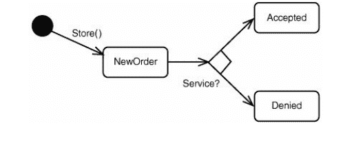

After all this rambling I think we have three decent solutions to the problem: one with pretty tight coupling (everything being done in real time, possibly with high transaction isolation level), one with less coupling (but that is perhaps a bit more complex because there are more "moving parts"), and finally one where we don't do anything extra beyond what was shown in the test (but with a small risk of inconsistency that we will have to track delayed). Would one of these suit you?

经过这一番长篇大论，我认为我们有三种不错的解决方案：一种耦合度相当紧密（所有操作实时完成，可能使用高事务隔离级别），一种耦合度较低（但可能更复杂，因为“活动部件”更多），最后一种是在测试中展示的内容之外不做任何额外操作（但存在少量不一致风险，我们需要延迟跟踪）。其中一种适合你吗？

OK, we touched upon using a Service for helping us out with a costly processing problem. Services in the Domain Model often arise from another necessity as well.

好的，我们谈到了使用 Service 来帮助解决耗时的处理问题。领域模型中的 Service 通常也源于另一个必要性。

## Service-Serviced Validation
服务化验证

Completely by coincidence, we do need such a rule that is by its very nature service-based. I'm thinking about feature 8, "Before a new customer is considered OK, his or her credit will be checked with a credit institute."

完全巧合的是，我们确实需要这样一条本质上基于服务的规则。我想到的就是功能 8，“在新客户被视为 OK 之前，其信用将由信用机构进行检查。”

We could very well call that credit institute service in the Grant() method, or we could use a solution similar to the one I just sketched, letting our Service kick in after persist, taking care of both calling the external service and moving the customer to one of two states. One problem with this approach is that I'm binding domain rules a bit too much to persistence.

我们完全可以在 Grant() 方法中调用该信用机构服务，或者使用我刚才草拟的类似解决方案，让我们的 Service 在持久化后启动，同时负责调用外部服务并将客户移动到两种状态之一。这种方法的一个问题是，我将领域规则绑定得过于紧密于持久化。

Another big problem with this approach of moving some functionality out of the sandbox of the current Unit of Work/Identity Map is that what you might have in your local cache will be out of sync with the database because processing takes place in the autonomous Service. Of course, that's the risk you always have with caching, if the cache could be bypassed.

将某些功能移出当前 Unit of Work/Identity Map 沙箱的这种方法的另一个大问题是，你在本地缓存中可能拥有的内容会与数据库不同步，因为处理是在自主 Service 中进行的。当然，如果缓存可能被绕过，这就是你在使用缓存时始终存在的风险。

If you know that the cache will be invalidated because of an explicit Service call in real time, it's pretty easy. Just kill the cache. It might be expensive to recreate it, though, or perhaps you even know exactly what needs to be refreshed. On the other hand, if you don't know when the operation that invalidates the cache will happen, you have to take extra care and refresh the cache as often as possible. As I see it, all this hints at being aggressive with your cache management and not letting the cache get too big and live for a long time, at least not for the data that changes quite frequently.

如果你知道缓存会因为实时显式的 Service 调用而失效，那就很简单。直接清除缓存即可。虽然重新创建可能很昂贵，或者你甚至可能确切知道需要刷新什么。另一方面，如果你不知道使缓存失效的操作何时发生，你就必须格外小心，尽可能频繁地刷新缓存。就我看来，所有这些都暗示着要积极管理缓存，不要让缓存变得过大并长期存在，至少对于经常变化的数据而言。

### Note
When I talk about cache here, I'm mostly thinking about the Identity Map [Fowler PoEAA].

### 注意
当我在这里谈论缓存时，我主要指的是 Identity Map [Fowler PoEAA]。

Let's focus some more on transitions.

让我们再多关注一下转换。

## Trying to Transition when We Shouldn’t
不应该转换时尝试转换

I used different states for increasing the fulfillment of the "always savable" principle before. But a
"critical" passage is when the user wants to make a transition in the state graph. Sure, we could
deal with this in a similar way to what we discussed before so that we move to a temporary state
and then a Service takes responsibility for moving to the real state or to a failure state. I guess
there are situations where this makes sense, but for feature 11, "Orders have an acceptance status
that is changed by the user," it might just feel ridiculous, depending on what the context is.

我之前使用不同的状态来提高“始终可保存”原则的满足度。但一个“关键”环节是当用户想要在状态图中进行转换时。当然，我们可以像之前讨论的那样处理它，以便移动到临时状态，然后由 Service 负责移动到真实状态或失败状态。我想在某些情况下这是有意义的，但对于功能 11，“订单具有由用户更改的接受状态”，这可能感觉很荒谬，具体取决于上下文。

### Note
Did you notice how it all came together? I talked about `OrderNow()` before, and that might
have seemed to be kind of a technical solution to the problem of "always savable," but it
was core to the requirements. And according to the requirements, `Accept()` might make
more sense.

### 注意
你注意到一切是如何联系起来的吗？我之前谈到了 `OrderNow()`，这可能看起来像是“始终可保存”问题的某种技术解决方案，但它实际上是需求的核心。根据需求，`Accept()` 可能更有意义。

OK, "ridiculous" is too strong a word, but if we assume that the rules for checking are just a couple
of simple constraints without the cross Aggregate broader problems, I would prefer to apply the
principle discussed earlier: that is, letting the user make a proactive check, and if the result is
positive, the state-changing method will execute successfully. A picture, I mean code, says more
than a thousand words:

好的，“荒谬”这个词有点过重，但如果我们假设检查规则只是几个简单的约束，没有跨聚合的更广泛问题，我更愿意应用之前讨论的原则：即让用户进行主动检查，如果结果为正，状态更改方法将成功执行。一幅图，我是说代码，胜过千言万语：

```csharp
[Test]
public void CanMakeStateTransitionSafely()
{
    Order o = new Order(new Customer());

    Assert.IsTrue(o.IsOKToAccept);

    //We can now safely do this without getting an exception...
    o.Accept();
}
```

Checking the `IsOKToAccept` property is optional, but not doing it and then calling `Accept()` at a time
when we shouldn't is exceptional, and we will get an exception. Exceptions are for exceptional
problems; for "expected problems" `bool` is fine.

检查 `IsOKToAccept` 属性是可选的，但如果不进行检查然后在不应该的时候调用 `Accept()`，那就是异常情况，我们将得到一个异常。异常用于异常问题；对于“预期问题”，`bool` 就足够了。

We often don’t just wonder if it will be OK or not, but we also want to get a list of reasons why it's

我们通常不仅仅想知道是否会 OK，还想获得一个原因列表，说明为什么它...

不行。在这些情况下，主动方法可以返回一个损坏规则的列表，像这样：

```csharp
[Test]
public void CanMakeStateTransitionSafely()
{
    Order o = new Order(new Customer());

    Assert.AreEqual(0, o.BrokenRulesIfAccept.Count);
    //We can now safely do this without getting an exception...
    o.Accept();
}
```

我更倾向于逐案处理。没有标准接口或需要实现的东西，只是一个接口设计的原则。所以这实际上只是一个协议，用于使主动检测损坏规则成为可能。

## 事务抽象

事务抽象是一个强大的抽象，而且被低估了。解决转换问题的另一种方案是也将事务抽象用于领域模型和验证。这样在事务期间，状态是否正确并不重要；而在事务之前和之后则很重要。例如，API 就可以像这样：

```csharp
//Some consumer...
DMTransaction dMTx = Something.StartTransaction();
c.Name = string.Empty;
c.Name = "Volvo";
dMTx.Commit();
```

在代码片段中，规则要到 `Commit()` 时才会被检查。如你所知，这打开了一个需要处理的潘多拉魔盒，但它可能是未来一个有趣的解决方案。

如果考虑到 .NET 2.0 的新 `System.Transaction` 命名空间，这个解决方案会变得更有趣。未来我们可能会得到事务性列表类、哈希表等等。考虑到跨越领域模型和数据库的事务，它会变得更有趣。同样，有很多问题，但很有趣。

显然，状态转换问题有很多变体。其中一个问题是决定何时应采取行动。敬请期待。

然而这打开了一个巨大的潘多拉魔盒，至少在系统偶尔承受压力的情况下，或者如果 OrderNumber 序列不允许有空洞时就会如此。这意味着 GetNextOrderNumber() 不会将更改写入数据库，或者至少不会提交它们。这意味着你需要在 Accept() 调用和随后的持久化方法周围加上一个昂贵的锁。

另一种方法是使用很可能为下一个的值，然后准备好处理如果其他人已经使用它而产生的重复。

如果你准备在持久化方法期间因重复键而捕获异常，那时你该怎么办呢？好吧，你可以再次调用 Accept()，但那样 Accept() 会像当前编写的那样抛出异常。

也许最好在尝试从重复键异常中恢复的代码中直接请求一个新的 OrderNumber。这反过来又会产生另一组问题，例如在持久化方法期间与数据库通信，或首先检测哪个实例有问题（如果实例有多个候选键，则是哪个列）。

所有这些问题都可以避免，如果你接受编号序列中的空洞，并且获取下一个数字的方法也以类似于 SQL Server 中 IDENTITY 的方式提交当前最大值。我的意思是，IDENTITY 允许空洞，如果你执行 ROLLBACK，它会浪费一个值。

为了更清楚地表明 GetNextOrderNumber() 实际上会立即对数据库进行更改，并且不会等待下一次对持久化方法的调用，我认为我们应该使用服务代替。我的存储库在执行提交等操作时不会为自己做决定，但服务会，因为服务应该是自治且原子的。

在这些更改到位后，Accept() 方法现在可以像这样（假设在调用之前已将 IOrderNumberService 注入到订单的 _orderNumberService 中）：

//Order
public void Accept()
{
    if (_status != OrderStatus.NewOrder)
        throw new ApplicationException
        ("You can only call Accept() for NewOrder orders");

    _status = OrderStatus.Accepted;
    _orderNumber = _orderNumberService.GetNextOrderNumber();
}

现在持久化方法期间出现问题的风险已降低到如此程度，以至于出现问题的情况是例外的。

如果你认为我通过接受序列中的空洞来回避了这个问题（这实际上在定义的需求中甚至被认为是 OK 的），你是对的，但有时这根本不可能。我强烈不喜欢这种序列，但仍有一些情况无法避免。那怎么办？好吧，我想我会回到原点。如果这还不够，我可能会将整个转换方法变成一个服务，改为将订单移动到已接受状态并设置订单号。这不如在领域模型中做工作那样纯粹或干净，但当现实呼唤时，我们应该做出回应。

好吧，到目前为止，我们已经讨论了在领域模型规则方面需要处理的相当多的不同问题。在继续之前，还有一个需要查看的问题。

## 避免问题

功能 9，“订单必须有一个客户；订单行必须有一个订单”，是一个很好的例子，我希望如果可能的话根本不要将其作为规则，而是更愿意在构造函数中强制执行它。这样就不需要检查它了。

清洁、简单、高效。就是好。我知道，我知道，这会让你警铃大作。当然也有问题。

例如，由于 UI 设计的原因，你可能希望在没有先决定客户的情况下拥有一个订单的实例。

### 备注

这当然可以在 UI 中以多种不同的方式处理。尽管如此，如果我们不必这样做，制造一个“问题”可能感觉不舒服。

另一个问题是创建代码可能变得如此复杂，以至于它本身就会抛出异常，然后我们又回到了如何暴露损坏规则等问题。我们也说过异常应该是例外的，所以在创建代码中为表示规则损坏而抛出异常感觉就不对。

有一件事可以稍微减轻负担。我们可以让功能请求谈论持久化实例而不是瞬态实例。例如，我想到了 `OrderLine`。在我的当前设计中，`OrderLine` 本身不是一个聚合，而是 `Order` 聚合的一部分。因此，使 `OrderLine` 持久化的唯一方法是使用 `AddOrderLine()` 将其关联到一个 `Order`。在此之前，我可能不在乎 `OrderLine` 没有 `Order`。`OrderLine` 无法存储，并且持久化方法也不会因为孤立的 `OrderLine` 而抛出异常（因为持久化方法根本不知道它）。

当然，可能 `OrderLine` 中的某些处理需要了解 `Order`，但如果不需要，我认为这是个不错的解决方案。

### 备注

而现在我认为是否 `OrderLine` 需要了解其 `Order` 值得商榷。我们很可能经常可以避免否则会有的那种双向关系。

我不知道你是否注意到了，但我一次又一次地回到 DDD 模式之一，即聚合。在继续之前，我想休息一下谈谈这个问题。

## 再次将聚合作为工具

检查规则的单位是……聚合！我发现聚合设计极其重要，而且是我在当前设计工作中花费大量时间的事情。

我在本章前面简要谈到了规则聚合，但让我们重申并深入探讨一下。

## 聚合根聚合规则

当聚合根的消费者询问关于是否可持久化的损坏规则时，他应该收到来自整个聚合的损坏规则，而不仅仅是根实例。

聚合不一定必须对子类使用相同的 `IValidatableRegardingPersistence` 接口；我实际上更喜欢不这样做，因为这会干扰我在持久化时对有效性进行反应式检查的策略。（我并不是说干扰是指造成严重问题，而更是指无缘无故地重复执行周期。）

此外，这样聚合根必须决定是否使用子类的普通规则。上下文为王。

## 一个明显的聚合级规则：版本控制

我想用关于功能 4 的几句话结束这个关于聚合的简短部分。并发冲突检测很重要。该功能可以被视为一种业务规则，但我更愿意将其视为技术问题多于业务问题。也是如此，大多数 O/R 映射器至少对并发冲突检测有一些支持，但我会在这里停止讨论，并推迟到第 8 章“持久化基础设施”和第 9 章“将 NHibernate 付诸行动”。

让我们稍微改变一下焦点。在讨论 API 实现之前，让我们先看看是否应该再添加任何东西。


## 扩展 API

我们已经讨论了关于持久化相关规则的规则 API，以及如何获取有关这些问题的信息。我们还需要 API 做什么？

嗯，取决于我们正在构建的应用程序，我们可能确实需要大量其他与规则相关的东西。受本章开头原则的启发，我脑海中浮现的一件事是，能够非常主动地检查规则该有多好，尤其是在 UI 中。另一件重要的事情是能够添加自定义规则，不仅是在编译时，而且在部署时。让我们先来看看如何在 UI 中使用规则。

## 请求规则用于设置 UI

我之前提到过 [Nilsson NED]，我希望在用户界面中重用逻辑层中的规则。不是重复，而是重用。现在是时候了。

我将在此使用的方法是让类暴露元数据，如果 UI 需要的话，可以使用这些元数据。

类似的方法是 Web 服务暴露 XSD Schema，提供对数据的要求。我打算从一种略有不同的方法开始，提供具有类似信息的实例列表。

### 注释

Martin Fowler 详细描述了这个问题的某些方面 [Fowler Fixed-LengthString]。他提出了一种略有不同的方法，例如，字符串对象本身知道最大长度。

## 让注入规则成为可能

能够针对具体情况定义规则会很好，因为某些规则显然会非常依赖上下文。

通常，您希望客户能够添加自己的特定规则，如果您创建并公开一种简单的语言供客户用来添加规则，那么让他这样做并不太难。

## 改进实现

到目前为止，我们一直从消费者的角度关注规则 API。我想写一些关于如何实现规则的想法也会很有趣。所以让我们深入 `Order` 类的内部，尝试一些想法。

在我们真正开始“改进”之前，我们需要想出一个非常简单的解决方案，以便我们有一些东西可以开始。

### 一个简单的实现

让我们看看……首先，我们需要一个测试。我们可以重用之前的东西并稍作修改。`CantExceedStringLengthWhenPersisting()` 测试就可以。它看起来像这样：

```csharp
[Test]
public void CantExceedStringLengthWhenPersisting()
{
    Order o = new Order(new Customer());
    o.Note = "0123456789012345678901234567890";

    Assert.IsFalse(o.IsValidRegardingPersistence);
}
```

我们需要在 `Order` 类上编写一个 `IsValidRegardingPersistence` 属性，测试才能编译。类似下面这样的代码应该可行：

```csharp
//Order
public bool IsValidRegardingPersistence
{
    get
    {
        if (Note.Length > 30)
            return false;

        return true;
    }
}
```

### 注释

当然，我没有忘记 TDD 的红、绿、重构、红、绿、重构的口诀。我只是不想在这里放慢你的阅读节奏。

好的，这可以工作。让我们复制一份测试（剪贴板继承），更改名称，并稍微扩展一下：

```csharp
[Test]
public void TryingIdeasWithTheRulesAPI()
{
    Order o = new Order(new Customer());
    o.Note = "012345678901234567890123456789";
    Assert.IsTrue(o.IsValidRegardingPersistence);

    o.OrderDate = DateTime.Today.AddDays(1);
    Assert.IsFalse(o.IsValidRegardingPersistence);

    o.OrderDate = DateTime.Today;
    Assert.IsTrue(o.IsValidRegardingPersistence);

    o.Note += "012345";
    Assert.IsFalse(o.IsValidRegardingPersistence);
}
```

正如你看到的，我添加了另一条规则，规定 `OrderDate` 不能是将来的日期，而且出于某种原因（这并不牵强），该规则对于持久化来说也是强制性的。

### 注释

为了使 `OrderDate` 规则明显且强制地与基础设施关联，它不应该小于或大于你的数据库在 DATETIME 中可以存储的范围（如果你的数据库存在这种差异的话）。

为了获得一个通过的测试，我们需要稍微修改 `IsValidRegardingPersistence`，如下所示：

```csharp
//Order
public bool IsValidRegardingPersistence
{
    get
    {
        if (Note.Length > 30)
            return false;

        if (OrderDate > DateTime.Today)
            return false;

        return true;
    }
}
```

我认为目前规则复杂性就这样就够了。不太复杂，对吧？

下一步是向用户反馈，所以我们需要编写一个 `BrokenRulesRegardingPersistence` 属性。再次，让我们做一些非常基础的东西，但首先我们需要对测试做一些改动：

```csharp
[Test]
public void TryingIdeasWithTheRulesAPI()
{
    Order o = new Order(new Customer());
    o.Note = "012345678901234567890123456789";
    Assert.IsTrue(o.IsValidRegardingPersistence);
    Assert.AreEqual(0, o.BrokenRulesRegardingPersistence.Count);

    o.OrderDate = DateTime.Today.AddDays(1);
    Assert.IsFalse(o.IsValidRegardingPersistence);
    Assert.AreEqual(1, o.BrokenRulesRegardingPersistence.Count);

    o.OrderDate = DateTime.Today;
    Assert.IsTrue(o.IsValidRegardingPersistence);
    Assert.AreEqual(1, o.BrokenRulesRegardingPersistence.Count);

    o.Note += "012345";
    Assert.IsFalse(o.IsValidRegardingPersistence);
    Assert.AreEqual(1, o.BrokenRulesRegardingPersistence.Count);
}
```

然后进行第一个实现：

```csharp
//Order
public IList BrokenRulesRegardingPersistence
{
    get
    {
        IList brokenRules = new ArrayList();

        if (Note.Length > 30)
            brokenRules.Add("Note is too long.");

        if (OrderDate > DateTime.Today)
            brokenRules.Add("OrderDate is in the future.");
        return brokenRules;
    }
}
```

状态转移也需要处理，所以让我们把它添加到测试中：

```csharp
[Test]
public void TryingTheAcceptTransitionWithTheRulesAPI()
{
    Order o = new Order(new Customer());
    Assert.IsFalse(o.IsOKToAccept);
    o.Customer.Accept();
    Assert.IsTrue(o.IsOKToAccept);
    o.OrderDate = DateTime.Today.AddDays(1);
    Assert.IsFalse(o.IsOKToAccept);
    try
    {
        o.Accept();
        Assert.Fail();
    }
    catch (ApplicationException ex) {}
}
```

### 注释

同时发生的是，新的 Order 的 OrderDate 默认在构造函数中被设置为 DateTime.Today。这就是为什么它直接就是 IsOKToAccept。

顺便说一下，我还展示了即使转移不该生效时尝试转移会发生什么。

我们需要在 Order 中为此做一些事情。首先，让我们在 `IsOKToAccept` 中做一些事情。

```csharp
//Order
public bool IsOKToAccept
{
    get
    {
        if (Customer.Status != CustomerStatus.Accepted)
            return false;
        return IsValidRegardingPersistence;
    }
}
```

正如你看到的，我首先检查了特定规则（在这种情况下是一条规则），然后检查持久化相关规则，因为我不想继续处理无法保存的东西；因此，我想要

关于 `ParticipatingLogicalFields` 的想法是，消费者应该能够标记出影响某个特定破坏规则的字段。

一个规则类可以看起来像下面的例子。这个用于检查日期是否在某个范围内：

```csharp
public class DateIsInRangeRule : RuleBase
{
    public readonly DateTime MinDate;
    public readonly DateTime MaxDate;

    //Note: Only the "largest" constructor is shown here.
    public DateIsInRangeRule(DateTime minDate, DateTime maxDate,
        int ruleId, string[] participatingLogicalFields,
        string fieldName, object holder)
        : base(ruleId, participatingLogicalFields, fieldName
        , holder)
    {
        MinDate = minDate;
        MaxDate = maxDate;
    }
    public override bool IsValid
    {
        get
        {
            DateTime value = (DateTime)base.GetValue();

            return (value >= MinDate && value <= MaxDate);
        }
    }
}
```

我还需要一个基类（`RuleBase`）来提供通用功能，例如通过反射读取值，以及从子类中去除基础设施部分。留给子类的只剩“有趣”的代码（以及一些构造函数！前面代码片段中只展示了一个）。

### 注释

顺便说一下，`fieldName` 可以是一个字段或一个属性。

如果你想知道 `holder` 是什么，它就是使用该规则对象的领域模型实例，例如一个订单实例。

我认为一张图有助于解释各个部分。见图 7-2。


这样一来，大部分工作就转移到了定义规则列表上（再说一次，这种方法能做的也就只有这么多，但实际上已经能走很远了）。

现在，我把所有规则都集中到了一个桶里（如果还有基于转换的列表，实际上可能是几个桶）：一个基于实例的桶。花点功夫的话，前面展示的两个规则示例（DateIsInRangeRule 和 MaxStringLengthRule）都可以改成静态规则列表。我需要修改日期规则，让它自己计算 DateTime.Today 的值，而不是在构造函数中获取。我也可以向构造函数传入相对日期 -1 和 1，表示今天的前一天和后一天。我还可以创建一些功能，让静态列表只存活到新的一天。当然，如果可能的话，你应该尽量把规则改为静态列表。那样可能会大大减少开销。话虽如此，这对原则本身影响不大，即使有影响也微乎其微。

我们还是继续往下看，不再深入那些关于作用域的细节了。

## 一个 API 改进

我的朋友 Ingemar Lundberg 指出，为 BrokenRulesRegardingPersistence 使用属性感觉有点奇怪，Christian Crowhurst 则建议，让一个方法使用收集参数并返回布尔值会更好。就像这样：

```
public bool CheckX(IList brokenRules)
```

还记得 IsOKToAccept 和 BrokenRulesIfAccept 吗？这个想法会缩小 API 的规模，并且不会把检查与详细的错误信息拆分成两个独立的部分。这两部分完全可以重写成一个方法，就像这样：

```
public bool CheckOKToAccept(IList brokenRules)
```

消费方代码会略微受到影响。以前是这样写的：

```
//Some consumer...
if (! o.IsOKToAccept)
    _Show(o.BrokenRulesIfAccept);
```

你通常会写成这样：

```
//Some consumer...
IList brokenRules = new ArrayList();
if (! o.CheckOKToAccept(brokenRules))
    _Show(brokenRules);
```

关于收集参数 brokenRules，如果在 CheckOKToAccept() 开始时它没有被初始化（为 null），CheckOKToAccept() 可以忽略它，只返回布尔值。这至少是

现在，你可以在实例化领域模型类时添加更多规则了，但正如我所说，实例化会有点混乱，你可能应该使用某种工厂（Factory）。

好消息是，我们刚才讨论的定制化可以与提取规则信息的能力无缝配合，这在创建表单时非常有用。

## 向消费方提供元数据

与持久化相关的规则应该被视为可以从领域模型实例中主动提取出来的东西。这是因为它们很容易被消费方使用。我给 IValidatableRegardingPersistence 接口添加了另一个方法：

```
interface IValidatableRegardingPersistence
{
    bool IsValidRegardingPersistence {get;}
    IList BrokenRulesRegardingPersistence {get;}
    IList PersistenceRelatedRules {get;}
}
```

然后，消费方可以用找到的规则来做一些有趣的事情。当新表单显示时，可能有些规则很容易被 UI 使用，例如必填字段、特定值范围、字符串长度等等。

从概念上讲，我喜欢这个解决方案。类似这样的东西应该会对大量项目很有用。但我不禁觉得它还是有点坏味道，尤其是对于特定于转换的规则，至少当问题规模增大时是这样。

## 一个适合用模式解决的问题？

你觉得在这里使用状态模式（State pattern）[GoF 设计模式] 怎么样？我们在第 2 章“模式入门”中已经讨论了很多。如果你问我的话，它相当吸引人，而且这意味着我可以把特定于转换的列表的责任委托给特定的状态类。这实际上正是状态模式非常适合解决的问题。

你还可以在继承层次结构中使用多个级别来处理不同的状态；例如，如果一个基于实例的规则定义对多个状态都是相同的。

## 那复杂规则呢？

正如我所说，我不介意手工编写复杂的规则。我想把时间花在这上面。

我认为对于复杂规则，应用规范模式（Specification pattern）[Evans DDD] 通常是个好主意。

我们在使用规范时想要实现的是在代码中表达重要的领域概念。DDD 的共同主题是注重概念。（重点是领域概念，而不仅仅是技术概念。例如，数值区间和字符串长度更多是技术

我还必须指出，被封装为规范的复杂规则在进行单元测试时是多么方便。单独测试这些规范非常容易。

## 绑定到持久化抽象

在上一章中，我谈到了如何通过一个我称之为 NWorkspace 的抽象层来为持久化基础设施做准备（当然，这只是一个此类抽象的例子）。你可能已经猜到，它也提供了一些验证支持，因为当我们调用 PersistAll() 时，需要处理这种响应式特性。

当然，我不希望持久化抽象期望聚合根上实现某个特定的接口。

## 让验证接口可插拔

因此，我让向 IWorkspace 注入 IValidator 成为可能。IValidator 接口如下所示：

```
public interface IValidator
{
    bool IsValidatable(object entity);
    bool IsValid(object entity);
    IList BrokenRules(object entity);
}
```

IWorkspace 的实现与 IValidator 的实现进行交互，然后由 IValidator 的实现决定在实体上查找哪些接口。在我的例子中，IValidator 的实现会查找 IValidatableRegardingPersistence 的实现，并且知道如何处理 IValidatableRegardingPersistence 的实现，以便在必要时于 PersistAll() 期间抛出异常。为了让这一点更具体一些，请看图 7-3。

图 7-3. 协作部件概览


## 泛型与匿名方法来救场

如果你使用的环境支持泛型（例如 .NET 2.0），你当然可以把泛型应用到前面讨论的解决方案中，并在明确性、类型安全和性能方面获得些许提升。顺便说一句，目前讨论过的大部分章节都是如此。

举个小例子，与其这样写：

```
IList BrokenRulesRegardingPersistence {get;}
```

使用泛型时，你可以这样写：

```
IList<IRule> BrokenRulesRegardingPersistence {get;}
```

这不是一个巨大的改进，也不是说没有它就不行（正如全书中展示的那样），但它是一个会影响（再次强调，是积极地影响）你代码中许多地方的改进。

另一种我在大部分工作环境中都不曾使用的技术是匿名方法（类似于其他语言中的块或闭包）。

其想法是能够将一段代码作为参数发送给方法，而这段代码可以使用接收到该代码块的方法作用域内的变量。

有些人已经讨论过，可以用它来实现规范而无需创建新类，尽管我认为那意味着你会失去规范命名带来的一些明确性和清晰度，而这是规范的一个强大特性。相反，我目前更多地认为匿名方法是为可复用资产提供变体的好技术。例如，你可以随意注入一个方法的部分实现。这是一种看待可定制性的不同方式。

为了让你对这一切有个初步感受，如果你还不熟悉这项技术，让我们把泛型和匿名方法用到前面讨论过的一段代码片段上，看看它是否能得到改进。你还记得用于判断某个客户是否需要开具发票的那个循环吗？它长这样：

```
//Customer
public IList OrdersToInvoice(ReadyToInvoiceSpecification
    specification)
{
    IList orders = _orderRepository.GetOrders(this);
    IList result = new ArrayList();
    foreach (Order o in orders)
    {
        if (specification.Test(o))
            result.Add(o);


```
}
    return result;
}
```

Here it is again in a slightly modified version:

```
//Customer
public List<Order>OrdersToInvoice(Predicate<Order>
readyToInvoicePredicate)
{
    List<Order> orders = _orderRepository.GetOrders(this);
    return  orders.FindAll(readyToInvoicePredicate);
}
```

This time, the parameter is a predicate for if an Order can be invoiced or not. The call provides an anonymous method as the parameter. The call could be like this, assuming a very simple algorithm at this point in time:

```
c.OrdersToInvoice(delegate(Order o) {return o.Status == OrderStatus.ToBeInvoiced;});
```

That "Specification" or predicate is sent to the FindAll() method of the generic List for filtering out orders that can be invoiced.

At the time of this writing, it's still early for me regarding both generics and anonymous methods, but I'm sure they will make a huge difference regarding how I design in the foreseeable future. I'm not just talking about tiny things as in the examples above, but more like a mind shift.

But at the same time, they are just some more tools for the toolbox; they won't change everything, of course.

## Summary

All these years and this topic still feels a bit immature and with no obvious solutions. That said, we have touched on several ideas for how to deal with rules, some typical and some a little more atypical.

We discussed quite a lot about rule objects as an implementation technique, but we have also touched on other variants. As always, no solution is the best for all situations. For example, the rule objects I sketched were probably most appropriate for pretty simple rules and if you have many rules.

The major takeaways in this chapter were probably that you should try to decouple persistence and the domain-related rules as much as possible. (Still, there are connections for some of the rules.) Working with different states is a very powerful solution for getting close to the "all states should be savable" goal. Finally, remember that the rules are very context-connected, and try to focus on the model meaning of the rules.

In this chapter, we have dealt with many of the feature requests defined in Chapter 4, but now we will move on to the needed infrastructure, with a focus on persistence support.

## Part III: Applying PoEaa

In this part, we put several of the patterns in Fowler's *Patterns of Enterprise Application Architecture* [Fowler PoEAA] into context by discussing what we need from the infrastructure for providing persistence support to our domain model. We will look at how those requirements are fulfilled by an example tool.

This part is about a distraction on the infrastructure. Yet the infrastructure is very valuable.


- Chapter 8 Infrastructure for Persistence
- Chapter 9 Putting NHibernate into Action

## Chapter 8. Infrastructure for Persistence

Where are we? We have built a Domain Model from the ground up, and it's in DDD [Evans DDD] style. So far, I've been pushing like crazy for delaying the decisions about infrastructure as long as possible. Sure, we did talk quite a lot about how we could prepare for simplifying the infrastructure addition in Chapter 6, "Preparing for Infrastructure," but now is the time to add the mechanics for supporting the Domain Model: the infrastructure. We will also make some modifications to the Domain Model we have been discussing as the answer to the feature list first mentioned in Chapter 4, "A New Default Architecture."

Important to note is that we will do this because we have to, not because we want to. That's not the same thing as saying it's not important. It's just that we want to put as much of our efforts as possible on the domain problems.

But before we start discussing the infrastructure, the obvious question is what infrastructure is needed? As a matter of fact, a great deal of infrastructure is needed, such as infrastructure for

- Authorization
- Integration (service requests and responses)
- Data management and access (persistence)
- Presentation (which might be a stretch to call that infrastructure)
- Logging

And so on, and so forth. I guess it might be my background as a database guy that makes me see it this way, but I think persistence is the most obvious and interesting infrastructure. At least this is what we will be focusing on in the upcoming chapters.

As we define the needed infrastructure for persistence, we will also make small changes to the current Domain Model design here and there in order to make it fit the typical choice of persistence infrastructure better.

### Note

A design approach that does not use iterations is very dangerous. Let's assume that you are responsible for nothing but the Domain Model and the persistence. Even so, you should work a little on the Domain Model, choose and try the persistence infrastructure, work on the Domain Model, check the persistence infrastructure, and so on. This is especially how you should proceed with your first couple of DDD projects, but is always a good idea to some extent.

## Requirements on the Persistence Infrastructure

Let's repeat again that I want the infrastructure to stay out of the way of the Domain Model as much as possible so that I can focus on creating a powerful Domain Model for solving the business problem without having more distractions than are necessary. For example, I believe that I should be able to work with as high a level of Persistence Ignorance (PI) as possible, so that's a requirement of the infrastructure.

At the same time, it's also important not to put too much responsibility on the consumer of the Domain Model. I want to provide the consumer with a very simple API so that the consumer programmer can focus on what is important to him: creating a good experience for consumer users.

I have already defined certain desirable features for the life cycle of the persistent entities in Chapter 5, "Moving Further with Domain-Driven Design," but let's repeat it again here in Table 8-1.

### Table 8-1. Summary of the Semantics for the Life Cycle of the Domain Model Instances

| Operation | Result Regarding Transient/Persistent |
|---|---|
| Call to new | Transient |
| Repository.Add(instance) or persistentInstance.Add(instance) | Persistent in Domain Model |
| x.PersistAll() | Persistent in Database |
| Repository.Get() | Persistent in Domain Model (and Database) |
| Repository.Delete(instance) | Transient (and instance will get deleted from database at x.PersistAll) |

Another way of thinking about the requirements of the persistence infrastructure is to look at the non-functional requirements I have. Typical examples are scalability, security, and maintainability.

Of course, this varies widely, not only concerning the requirements, but also because a certain persistence framework can sometimes fail and sometimes succeed for the same mix of non-functional requirements. The reason for this is that the success or failure depends on the type of application, the usage patterns, and so on. I have to leave it up to the reader to define her own mix of non-functional requirements and to check whether a certain persistence framework can fulfill the requirements by carrying out careful tests. Just remember that if your appetite for non-functional requirements becomes too big, it will cost you a lot somewhere else.

## Where to Store Data

Assume we start with a clean sheet of paper; how would we like to store the data? We have at least four choices:

- RAM
- File system
- Object database
- Relational database

### Note

I realize that this may be a case of apples and oranges because it is a two-part problem: what to store (Objects, Hierarchies, such as XML, or Tables) and where to store it: (RAM, File system, Object database, or Relational database). But that's not without problems, either. After thinking through it a couple of times, I think my original way of describing it is good enough, so let's move on.

I'll start with RAM.

### RAM

Storing the data in RAM isn't necessarily as silly as it might first sound. What I'm thinking about is seeing the Domain Model as the database itself while at the same time keeping persistent storage of all changes as a log on disk so that the Domain Model can be re-created in case of a system crash.

The beauty is that you avoid mapping from the Domain Model onto something else. The Domain Model is persistent by itself.

You could also store hierarchies in memory, with XML documents as a typical example. Then you do get some impedance mismatch because you are using two models and need to transform between them. On the other hand, you do get some functionality for free, such as querying if you find XPath and XQuery to be good languages for that.

No matter what you "store" in RAM, one problem is the size of RAM. If you have 2 GB of RAM in your machine leftover when the system and other applications have taken their part, your database


作品或正在被引入，这可能是一个解决问题的良好方案。

另一个问题是，没有明显的查询语言可供选择。有一些开源替代方案，但同样，这目前感觉有点不成熟。当考虑到报表以及由终端用户而非仅在应用程序内部执行的即席查询需求时，这个问题会变得更大。例如，在这种情况下，典型的面向终端用户的报表编写工具几乎没什么用。

### Note

如果可能，报表应该在专用的服务器和专用数据库上执行，因此这可能比最初预想的要小一些问题。另一方面，现实中通常至少存在一个灰色地带，即什么是报表，什么是用于支持日常事务工作的列表，换句话说。瞧，问题又回来了。

另一个问题是，领域模型中的导航通常基于遍历列表。可能没有内置的索引支持。当然，你可以在这里那里使用哈希表，但它们只解决了部分问题。当然，如果需要，你可以添加一个内存索引解决方案。另一方面，你应该注意，这肯定不会像磁盘解决方案那样早早成为问题。

最后，正如我已经说过几次，我认为这种方法有点不成熟，但非常有趣，并且对未来很有前景，至少在某些情况下是这样。

## File System

另一个解决方案是使用文件系统而不是 RAM。需要持久化内容与 RAM 相同，即领域模型对象或 XML。事实上，这个解决方案可能非常接近 RAM 解决方案。如果数据库很小，它可能相同，并且只有在 RAM 填满到一定程度时才“溢出”到磁盘。

这种方法与之前的方法有类似的问题，只是 RAM 的大小在这种情况下不是那么大的限制因素。另一方面，性能特征可能不会那么令人印象深刻。

我认为为持久化领域模型（或 XML 文档也一样）编写自己的解决方案可能相当有吸引力，但正如每次你决定自己构建基础设施时一样，你必须准备好投入大量工作。我知道没有什么比听到“太难”或“太复杂”更能激励开发者的了，所以如果他们还没有这样做，现在几乎每个人都会编写自己的基于文件系统的解决方案，对吧？只要做好准备，它一开始看起来会具有欺骗性的简单，但魔鬼在细节中，随着你推进，复杂性会增加。

如果你决定构建一个在持久化时可以溢出到磁盘的领域模型，你实际上创建的东西非常像一个对象数据库。（也许这能更好地说明工作量和复杂性的程度。）

## Object Database

历史上，存在许多不同风格的对象数据库，但共同点是它们试图避免对象与某种其他存储格式之间的转换。这是出于与我谈论延迟向领域模型添加基础设施时大致相同的理由，以及性能原因。

### Note

如果我们还考虑混合类型，例如对象关系数据库，风格的数量会进一步增加，但我认为这些混合类型大多来自关系背景和风格，而不是面向对象的一方。

结果发现，分心的因素并非为零。事实上，你可以说阻抗不匹配仍然存在，但与在对象和关系数据库之间架起桥梁相比，使用对象数据库相当干净。

到目前为止，对象数据库的问题如下：

- 缺乏标准
- 没有关键质量
- 成熟度
- 更像是一个利基产品
- 与其他系统的集成
- 报表

### Note

我的邪恶朋友 Martin Rosén-Lidholm 指出，考虑到 Microsoft 的应用程序块、论文、指南等等，实际上许多相同的论点也可以用来反对在 .NET 世界中与数据导向解决方案相比的 DDD 和 O/R 映射。

我假装没听见。并且对领域的关注也可能会在 Microsoft 的指导中变得越来越流行，而 Martin 完全同意这一点。

对于生成的代码和反射代码采用相同方法的特定场景，通常可以从生成的静态代码中挤出比反射代码更好的性能。

也许更糟糕的问题是新生成器版本的问题。我有一种直觉，很难将生成器的新版本投入生产，因为它必须重新生成所有代码。

此外，如果数据库模式发生变化，不可能在不重新编译的情况下在运行时进行更改。但无论如何，这很少被推荐。这些类型的更改应该涉及开发人员。

代码生成是往返式还是仅向前式，这是一个相当大的区别。如果是往返式，你对生成代码的更改将被保留，而在仅向前式的情况下，你永远不应该更改生成代码，因为更改将在下一次生成时丢失。

让我们以积极的语调结束。基于代码生成的解决方案的调试可能比基于元数据映射的解决方案更容易。所有代码都在“那里”，但代码可能难以理解，而且有很多。

想要进一步探索的催化剂通常是缺乏动态性，例如在查询方面。而且我也说过，如果我们决定实现动态查询、工作单元、身份映射等等，我认为我们应该好好看看下一个类别：O/R 映射器。

## Metadata Mapping (Object Relational (O/R) Mapper)

数据映射器模式的一种特定风格被称为元数据映射模式。你在元数据中定义领域模型与关系数据库之间的关系。其余工作会自动完成。

最典型的实现可能是 O/R 映射器。我将使用术语 O/R 映射器作为负责元数据映射的产品系列。

### Note

我的朋友 Mats Helander 将 O/R 映射描述为太极。

太极由两部分组成。第一部分是学习缓慢地抬起和放下手臂，与呼吸协调。第二部分是其他一切。这不是玩笑。不管你太极练得多好，你“被期望”或建议继续花费与所有其他动作加起来一样多的时间在第一个动作上。

O/R 映射也由两部分组成。第一部分是关于在内存中的对象和数据库中的行之间以及返回之间移动数据。另一部分是其他一切。

如你现在可能猜到的，大多数 O/R 映射器内置支持工作单元、身份映射、延迟加载和查询。

但没有无问题的解决方案。对 O/R 映射器的一个常见抱怨是它们无法创建真正好的 SQL 代码。让我们看看经常被提及的一些例子。首先是带有 **WHERE** 子句的 **UPDATE**。请看以下示例：

```sql
UPDATE Inventory
SET Balance = Balance - 1
WHERE Id = 42 AND Balance >= 1
```

这意味着我只想在有产品库存时更改余额。否则，我不想更改余额。这通常不被 O/R 映射器直接支持。相反，O/R 映射器在这里采取的方法是用乐观锁读取 Inventory 行，进行更改，然后写回，希望最好没有并发异常。

为了澄清，这里是乐观方法的示例（在这种情况下作为 SQL 批处理，但请注意我们没有持有任何锁，因为没有显式事务，所以这说明了该场景）：

```sql
--Remember the old Balance.
SET @oldBalance =
    (SELECT Balance
     FROM Inventory
     WHERE Id = 42)

--Calculate what the new Balance should be...

UPDATE Inventory
SET Balance = @newBalance
WHERE Id = 42 AND Balance = @oldBalance
--If @@ROWCOUNT now is 0, then the update failed!
```

另外，它会用悲观锁读取 Inventory 行，进行更改，然后写回。这两种方法都会导致可扩展性受损。

另一个关于 O/R 映射器的抱怨是它们通常对更新大量行无效。通过 O/R 映射器更新所有产品的方法可能是在列表中读取所有产品，循环列表，并逐一更新产品。如果可以用单个 UPDATE 语句完成，吞吐量会好得多。

另一个抱怨是很难平衡读取量。读取太少，因此在延迟加载时会有很多往返；或者读取的比必要多。类型爆炸是常见的结果，定义了类型定义的多个变体。

但我们也可以反过来想。一个人能把所有代码都写得极好且保持一致吗？团队里的所有开发人员都和最好的人一样好吗？即使是这样，如果我们用自动方法就能获得足够好的性能，我们应该为此花费人力吗？

### Note


## 分类

让我们更仔细地看看 O/R Mapper 是什么。我们将从两个不同的角度来讨论。首先，我们将从一个维度讨论：不同的特征。接下来，我们将讨论其中实现的某些 PoEAA 模式。我们将在下一章中举例说明它在特定 O/R Mapper 中的具体工作方式时重用这些分类。

明确地说，我即将讨论的一切即使在自定义代码的情况下也适用（映射风格除外）。这也适用于模式描述。但为了更具体，我们从现在开始将思考 O/R Mappers。

第一个分类是关于所支持的领域模型风格。

## 领域模型风格

我们必须在多大程度上以及以何种方式调整领域模型才能使其与 O/R Mapper 配合工作？最典型和最一般的三个方面是

- 持久化无知
- 继承
- 接口实现

### 持久化无知

持久化无知意味着为了使领域模型可持久化，你对领域模型完全不做任何更改。当然，这里存在一个程度问题，并非完全非黑即白。例如，基于反射的方法会设定一些要求。基于 AOP 的方法会设定其他要求。

### 继承

历史上一种常见的做法是要求领域模型类继承自持久化框架提供的超类。

### 接口实现

最后，历史上另一种常见的做法是要求领域模型类实现持久化框架提供的<|message|>一个或多个接口。

这只是说明你可能需要如何调整领域模型以适应持久化框架的一个方面。例如，关于版本控制和延迟加载，可能还需要做很多其他事情，但我们将在本章后面再讨论。

## 映射器风格

基于元数据的映射通常以两种不同的方式实现：

- 代码生成
- 框架/反射

细心的读者会注意到，我刚刚再次提到了代码生成，这次是在 O/R Mapper 的上下文中。然而，有一个重要的区别。现在的代码生成通常在编译前进行，通过读取元数据并输出映射代码。当然，自定义代码的代码生成也可以以类似的方式完成，但主要区别在于对支持内容的“胃口”各不相同。这个定义并不极其明确，但这是一个开始。

框架/反射意味着在编译时之前不会为映射工作生成源代码。相反，映射是通过在运行时读取元数据来处理的。

### 注

正如你可能怀疑的那样，事情甚至更模糊。例如，我们应该如何对静态 AOP 进行分类？我尽量保持描述和分类简单清晰。

还需要注意的是，代码生成和框架不一定是互斥的。

## 起点

当你使用某个 O/R Mapper 时，你通常可以从以下列表中选择一个或多个起点：

- 数据库模式
- 领域模型
- 映射信息

我所说的起点是指你在开始构建应用程序时所关注的内容。当然，如果 O/R Mapper 支持多个起点是有益的，因为这样你就可以在你会遇到的不同情况下使用它的可能性更大。

正如你现在所知，我更喜欢从领域模型开始工作；然而，你并不总是能这样做，可能必须改从数据库模式开始，或者至少密切关注数据库模式。你也可能必须改从映射信息开始工作，例如在类 UML 式的绘图工具中描述类与表的关联。

如果你更喜欢从领域模型开始，但你想尝试的持久化框架不支持这一点，你可以通过将 UML 编辑器或数据库设计视为编写领域模型的一种方式来绕过这个问题。尽管有点别扭。而且例如 TDD 就不会那么自然地应用。

### 映射遗留数据库

即使起点可能是数据库，这也不一定意味着它是被持久化框架强制的，或者设计师更喜欢这样工作。也可能是你有一个必须使用的遗留数据库。

做好准备，使用 O/R Mapper 走这条路会困难得多（除非它是专门为此而设计的），尤其是如果你完全不被允许更改数据库设计时。通常至少允许向数据库添加视图、列和表，即使不允许更改现有列。那会有帮助！（不会影响现有应用的更改很可能被允许，但要小心，因为现有应用可能不是最健壮的。）

如果遗留数据库设计状况不佳，尤其麻烦，这可能会发生在应用程序已投入生产几年之后。

关于这一点还有另外一个问题，当你完成了第一个（例如领域模型）之后，你如何继续前进？所选的 O/R Mapper 是否在创建另外两个部分方面提供任何帮助？例如，你有了领域模型，现在需要数据库和元数据。你能自动获得它们吗？如果不支持，这并不是致命问题；你通常可以相当容易地自己创建这样基础的工具。但如果这已经为你处理好了，那就是一个优势。

那么现在让我们假设领域模型、数据库和映射信息已经就位。让我们讨论 API 将是什么样的。

## API 聚焦

API 聚焦有两种替代方案：

- 关系表
- 领域模型

这有点牵强，因为从一开始 O/R Mapper 的全部目的就是让开发者使用对象而不是表。因此，对于典型的 O/R Mapper 来说，API 聚焦始终是领域模型。（一个更专注于关系表的 API 的例子是 Recordset 模式，使用 .NET 中的 DataTable 实现。）

API 的另一个非常重要方面，而且并非每个 O/R Mapper 都相同，那就是查询。

## 查询语言风格

我发现对这一项进行分类相当困难，但让我们试试看。从开发者的角度来看，使用 O/R Mapper 进行查询通常以以下一种或多种方式完成：

- 基于字符串、类 SQL
- 基于查询对象

我认为对每个进行一些更详细的解释是合适的。

### 基于字符串、类 SQL

我的意思是查询语言看起来与 SQL 非常相似，但使用的是领域模型中的类而不是数据库中的表。一些查询，尤其是高级查询，在这种语言中表达得非常好。另一方面，典型的缺点是缺乏类型安全。

不过需要注意的是，这种表述查询的方式在实现层面不一定是基于字符串的，只是在 API 层面是这样。

### 基于查询对象

第二种典型的查询语言是使用对象来表示查询，遵循 Query Object 模式 [Fowler PoEAA]。简单查询通常用这种方法表达得更好，可以具有类型安全，而且开发者不需要了解太多查询语义就能高效工作。问题是，复杂查询可能需要大量代码来表达，而且代码很快变得难以阅读。

### 原始 SQL

对于罕见情况来说，另一个不错的解决方案是能够用 SQL 表达查询，但以领域模型实例作为结果接收。当然，这会导致代码与数据库耦合的问题，但如果你找不到其他解决方案，至少有这个选项是很好的。这在你需要优化时非常方便。而且如果需要将实体作为结果获取，并且 SQL 集成可以为你处理，那么你需要编写的代码量就会减少。

当然我们也应该被允许跳到 SQL 而不以领域模型作为结果接收

实例也是如此。

## 哪种方法？

我认为理想情况下，工具应支持多种方法。这是因为有时基于字符串的表达式是最好的，而在其他情况下基于查询对象的表达式更合适。

查询风格本身只是故事的一部分。另一个重要方面是查询解决方案的能力。这将是下一个主题的一部分。

## 高级数据库支持

或者“DBA 会有多尊重你？”

为了让你不必总是跳出沙箱，O/R 映射器需要支持一些从领域模型角度看并不明显但接近数据库的操作。然而，在需要优化时它们非常有用。

一些例子是

- **聚合**
  SQL 的一个非常基本的功能是能够执行类似 `SELECT SUM(x), MIN(y), MAX(z)` 的操作。当你以领域模型为重点工作时，可能需要这些聚合的情况会少一些，但它们仍然非常有用，有时是必要的。
- **排序**
  可能在数据库中对结果集进行排序，而无需在领域模型中进行排序会更高效。
- **分组依据**
  使用 SQL 时还可以做的另一件事是使用 `GROUP BY`。它在临时查询和报表中尤其常见，但在以领域模型为重点的应用中偶尔也很有用。
- **标量查询**
  并非总是需要取回完整的实例。有时只需要字段值，也许来自一个类，也许来自另一个类。

如果有其他方式将功能移至数据库也很不错，这些功能最适合在数据库中，通常是数据密集型操作。我在这里想到的通常是调用存储过程的能力，但也可能包括其他自定义的移动功能的方式，例如用户定义函数。

这样做的主要问题是我们可能会失去应用程序和数据库的可移植性

## 另一种分类：基础设施模式

在分类的这一第二部分中，我将使用一些 PoEAA 模式 [Fowler PoEAA]，其中一些专注于基础设施。

即使你决定走自定义路线，这个描述也可以使用。谁知道呢，也许这个描述能帮助一两个读者避免创建自己的自定义解决方案，而是选择现有的解决方案。我认为这通常是个好主意，因为构建自己的完整解决方案工作量很大。经历过，尝试过。

## 元数据映射：元数据类型

我们需要在元数据中描述领域模型与数据库模式之间的关系；这正是元数据映射 [Fowler PoEAA] 的核心。O/R 映射器是元数据映射模式的实现，但不同的映射器使用不同类型的元数据。典型例子有

- XML 文档或其他文档格式
- 属性（注解可能是一个更清晰的术语；例如 C# 中的 `[MyAttribute]`）
- 源代码

通常，每个都有自己的问题。例如，XML 文档会遭受 XML 地狱。对于大多数开发者来说，XML 并不是一个非常高效的工作格式。常说 XML 不是为人们准备的，而是为解析器准备的，但工具在这方面仍然不够完善，所以我们经常发现自己在那里编辑巨大的 XML 文档。

XML 文档的另一个问题是它们位于领域模型源代码之外，因此很容易彼此不同步。而且许多 IDE 缺乏对 XML 文档语义的理解，因此重构不会无缝进行。

属性用于装饰领域模型，因此与领域模型不同步的风险会小一些。这种情况下更大的问题是领域模型与数据库的耦合度稍高。如果你想用同一个领域模型搭配两个不同的数据库，使用属性时你需要为领域模型准备两个不同版本的源代码的风险会更大，而如果使用某种外部类型的元数据则不会。这可能不是一个大问题，但也可能是。它也更难在此情况下获得映射的概览，但工具可以帮助。

是否将映射信息提供在源代码中作为一个独立类别值得商榷。它实际上只是另一种文档格式。无论如何，我认为只有两个类别有点太敷衍。我在这里追求的区别是，源代码以过程方式而非声明方式描述映射信息。我也认为这个选项介于

XML 文档和属性之间。元数据在源代码中并被编译，但它以一种让你能获得概览的方式编写。对一些人来说，这意味着“漂亮的 C# 代码而不是丑陋的 XML”。我不能说我完全不同意。尽管如此，这是一个晦涩的选项，并不常用。

而且和往常一样，不必是“一个且唯一”。例如，也许信息以属性提供，但可以被 XML 信息覆盖。

你在想元数据中要描述什么吗？它是领域模型与数据库之间的关系，但要具体化，我们需要一个例子。我们可以以 Identity Fields 为例。

## 标识字段

实体 [Fowler PoEAA] 的一个标识字段保存底层数据库表中主键的值。这就是实体实例与表行之间关系的处理方式。

对于新实体，标识字段的值可以在至少四个不同的层中生成：

- 消费者
- 领域模型
- 数据库
- O/R 映射器

从 O/R 映射器的角度看，前两个非常相似。对 O/R 映射器来说，值是提供的，并且不受 O/R 映射器控制。O/R 映射器只能希望消费者或领域模型遵循协议。如果让我选择，我更喜欢领域模型而不是消费者。这里的问题在于使用标识字段值来判断实例是否新建应插入或更新的 O/R 映射器。

### 注意

这是一个让一件事承担两个责任的好例子。它很简单，一开始看起来也不错，但问题正潜伏在拐角处。

第三个选项很常见，但它带来了一些语义问题。这意味着数据库使用类似 IDENTITY（SQL Server）或 Sequence（Oracle）之类的机制在实体持久化时设置主键的值。问题是这在生命周期中已经很晚了，当标识值发生变化时，你已将实体添加到集合中可能会出现问题。

最后，O/R 映射器本身可以负责生成标识字段的值，

这对 O/R 映射器来说是最方便的解决方案，至少对 O/R 映射器而言是这样。

所以所有这些归结起来，对于实体保留两个身份可能是一个好主意。一个是自然身份，我们称之为业务身份，它可以在生命周期的不同时间获得值，不一定从一开始（不过并非所有实体都有这样的身份）。每个类拥有多个此类标识也很常见。

第二个是标识字段，它更像是持久化 ID 或数据库 ID。如果我们将其与关系数据库术语进行比较，就会得到表 8-2。

### 表 8-2. 按关系数据库术语划分的领域模型术语

| 领域模型 | 关系数据库 |
|---|---|
| 业务 ID | 替代键 |
| 标识字段 | 主键 |

你可以在 [Bauer/King HiA] 中找到对此的良好讨论。

这实际上是我需要在当前领域模型中作为实现细节应用的东西。例如，`Order` 的 `OrderNumber` 是一个业务 ID 而不是标识字段。这在 `Equals()`/`HashCode()` 实现中非常明显，这会为集合等带来问题。因此，我还添加 `Id` 字段，其值由 O/R 映射器在新创建的实体实例与其存储库关联时生成。此后，该值永远不会再改变。我对这些 `Id` 字段使用 `Guid`，如图 8-1 中的图所示。

### 图 8-1. 为具有业务 ID 的实体添加标识字段


### 注意

`OrderNumber` 和 `CustomerNumber` 仍然存在。另请注意，由于此更改，存储库会略有变化。`GetOrder()` 和 `GetCustomer()` 将会有新的重载。


这次变更对于基础设施而言是非常必要的，因此它是一个典型的分心示例。我这么做并不单单是为了某一个特定的 O/R 映射器，而是为了对几乎所有 O/R 映射器进行简化。

### 注意

这很讽刺。当我们构建 Valhalla 时，我们决定强制使用 Guid。我们对这个决定并不十分满意，因为它给开发人员带来了一个“必须”，并且它被列入了我们未来的变更清单。现在，当我使用其他持久化框架时，我可以自由选择了。尽管如此，我仍然认为使用 Guid 作为标识字段通常是一个好主意。

让我们回到元数据，再看一个关于其所包含内容的例子。

## 外键映射

元数据中通常出现的另一件事是外键映射模式 [Fowler PoEAA]。它描述了外键以及领域模型中的相关关联。

与标识字段不同，这并不涉及领域模型中的复制值。相反，它只是一种元数据层面的东西。

可以使用的关系种类繁多，而 O/R 映射器所支持的关系可能差异很大。根据我的经验，大多数时候你只会使用相对较少的关系类型，但当你需要一些更专业的东西时，如果发现它能得到支持，你会很高兴。

## 嵌入值

弥补阻抗不匹配的一个非常重要的方式是，在领域模型中同时使用粗粒度表和细粒度类。这就是嵌入值模式 [Fowler PoEAA] 的用武之地。

这意味着，你应该能够将客户存储在数据库中的单个 Customers 表中，但在领域模型中却将客户作为 Customer 对象和 Address 对象来处理。（这个例子非常简单；实际上，差异通常非常大。）

在最简单的形式（让我们称之为第一级）中，你只能描述嵌入值与数据库表列之间的关系。第二级则是，你可能需要编写辅助代码来帮助处理高级场景的转换。

## 继承解决方案

领域模型中的继承层次结构在关系数据库中并没有完美的对应，因为继承并不是关系数据库的概念（至少不是在 SQL:1999 之前，而在撰写本文时很少有数据库产品支持 SQL:1999）。此外，领域模型中的继承可能比许多人预期的更不常用。话虽如此，当您需要使用它时，您应该能够通过 O/R 映射器来支持它。

针对这个问题有三种不同类型的解决方案，分别是单表继承、类表继承和具体表继承 [Fowler PoEAA]。我选择将它们归为一类，因为它们只是同一个问题的不同解决方案。

主要区别在于存储继承层次结构需要多少张表。假设 `Person` 是基类，`Student` 和 `Teacher` 是子类。那么不同的模式将产生以下典型表，如表 8-3 所示。从这里你可能很容易推断出哪些列该放在哪里。

### 表 8-3. 继承层次结构的持久化模式及所需的表

| 模式 | 数据库中的表 |
|---|---|
| 单表继承 | `People` |
| 类表继承 | `People, Students, Teachers` |
| 具体表继承 | `Student, Teachers` |

如果 O/R 映射器只支持其中一种，那么与三种都可选相比，你在数据库设计上的灵活性就降低了。你必须决定这是否重要。

## 标识映射

在我早期尝试创建 O/R 映射器时，我最初以为可以跳过标识映射，但我得出的结论是，那样会变得过于复杂，并且使用方程序员要承担太多责任。

另一方面，很多事情也取决于您的领域模型设计。如果您从来没有不同聚合中实体之间的关系，那么对标识映射的需求就会减少。因此，领域模型中的简化和解耦等 DDD 思想使人们在没有标识映射的情况下更容易生存。话虽如此，我仍然认为拥有一个活动的标识映射是有用的。

### 注意

如果你把 O/R 映射看作一匹在数据库和对象之间穿梭的驮马，那么标识映射可能并不重要。但这不是我们在这里要讨论的，因为那样我们就需要做更多的工作。在这里，我们只想以尽可能简单（或者说尽可能好）的解决方案来支持领域模型。

标识映射也可以用于其他事情，而不仅仅是控制使用方所了解的对象图。例如，在从数据库读取数据时，它可用于处理领域模型中对象的 M:N 关系构建。

### 注意

M:N 通过“多对多”来描述对象之间关于基数/多重性的关系。例如，一所房子里住着许多人，同时每个人可以拥有几套房子。

它也常常被视为出于性能原因而设置的缓存，但如你所知，我并不是特别热衷于缓存，所以我把标识映射视为编程模型上的一种便利，而不是提高性能的手段。

不同的 O/R 映射器在标识映射可以/必须处于哪个“会话”级别上有所不同。它可以是机器、进程和/或会话。

另一种模式通常与标识映射携手并进。我想到的是工作单元。

## 工作单元

大多数 O/R 映射器使用（或至少支持）工作单元模式。主要的区别在于工作单元对使用方来说有多透明。当 O/R 映射器属于“运行时持久性无关”风格时，使用方可能不得不显式地与工作单元通信，以注册一个新实例以便在下一次持久化时插入。其他 O/R 映射器则更为透明，但那样你可能必须使用 O/R 映射器提供的工厂来实例化。这些方法各有优缺点。

工作单元的“会话”级别也可能不同，至少在理论上是这样，正如我在标识映射中所说的那样。

## 懒加载/即时加载

我之前说过，我的领域模型风格并没有在我的聚合 [Evans DDD] 中大量使用懒加载 [Fowler PoEAA]。即便如此，它也是我们在持久化基础设施中需要的一块拼图，我们需要能够将其用作一种优化手段。

相反，作为我的聚合的默认策略，我使用立即加载。或者叫主动加载、贪婪加载、跨度加载、预加载，随你怎么称呼。从现在开始，我将称之为 Eager Load（即时加载）。

即时加载几乎与懒加载相反；你立即加载完整的对象图，而不是将对象图的部分加载延迟到以后。

在我看来，即时加载与聚合 [Evans DDD] 相辅相成，至少作为默认解决方案是这样。

### 注意

在读取场景方面，有人可能觉得我过分强调了聚合。我一直以聚合作为默认加载方案，并在发现需要时进行优化。

毕竟，聚合在写入场景中最为重要。这样看来，在修改聚合实例之前，向协议中添加类似 `GetForWrite()` 的需求可能是合理的。`GetForWrite()` 将加载聚合中的所有内容，并可能提供读一致性。

如果你确实有一个跨越多个实例的概念，并且希望将其视为一个整体，那么聚合就是正确之选，而且它会带来一系列影响。

我还认为，只读/可写（read-only/writable）的区别对用户来说往往是一件好事，用户必须主动选择进入写入模式。另一个好处是，在使用乐观并发控制时，用户不会开始修改一个已经过期的对象，这意味着冲突的风险变得更小。这种方法也能很好地适用于悲观并发控制方案。

即时加载有许多不同的实现变体。它通常通过 SQL 中的 `OUTER JOINS` 来解决，然后将结果集分解为对象图。另一种最常见的解决方案是连续批量执行多个 `SELECT` 语句。

一个称职的 O/R 映射器应该同时支持懒加载和不同的即时加载策略，对于列表和单个实例都如此。它甚至可能适用于单个实例字段组的懒加载，尽管我不认为那是至关重要的。这样的一组属性总是可以抽出并重构成一个值对象，这在大多数情况下都是非常有意义的。然后我们又回到了对实例的懒加载/即时加载。

## 控制并发

正如我已经多次说过的，聚合模式是控制并发的好工具。多亏了它，我得到了想要作为一个整体来使用和处理的那个单元。然而，这并不是完整的解决方案。我还需要避免冲突或检测是否发生了冲突，以便

我们不会得到不一致的数据（而且*尤其*不会在未通知的情况下出现）。

从 [Fowler PoEAA] 中，我们找到了该问题的以下解决方案：

- **粗粒度锁**
  
  与在实例级别上加锁不同，该模式建议锁定更粗粒度的单元。例如，我们可以在聚合根级别上使用它，从而隐式地锁定聚合的所有部分。
  
- **乐观离线锁**
  
  *预期不会冲突，但在提交前进行检查。*
  
- **悲观离线锁**
  
  *通过独占签出机制防止冲突。*

这让我想在领域模型中添加一些版本信息，以标明我们需要处理并发控制的地方，用于实现特性 4，“并发冲突检测很重要”。我认为我的聚合根应该获得一个 `Version` 字段来支持乐观离线锁。这*不是*自动操作。相反，你在需要的地方添加它。你可以在*图 8-2*中找到该更改。

### 图 8-2. 为部分聚合根添加了版本字段


如果你的 O/R Mapper 不支持悲观离线锁，也不是什么大问题。首先

## 摘要

现在我们在一定程度上讨论了持久化基础设施的需求。在介绍该主题并定义了所需持久化基础设施的一些需求后，我们从不同的角度讨论了该主题，例如分类和一些 PoEAA 模式。

但整个讨论相当抽象。一些示例将有助于使其更具体。这就是下一章的意图。在那里我们将使用 NHibernate 作为示例。

## 为什么选择 NHibernate？

你可能会想知道我为什么选择 NHibernate。嗯，并不是因为 NHibernate 必然是最好的可用解决方案。什么车最好？这是一个愚蠢的问题，对吧？标准答案永远是：“取决于情况。”

我选择在本章中使用 NHibernate 的动机如下：

- **Java 血统**
  
  NHibernate 是流行的 Hibernate [Hibernate] 的移植版；因此，许多人了解它，并且有大量书籍和其他资源可供参考。此外，对象关系映射在 Java 平台上相当成熟，与 .NET 平台相反。
- **开源**
  
  NHibernate 是开源的，这使得它非常易于接近和使用。

在任何情况下，本章都无意成为 NHibernate 的详尽指南。其目的只是使第 8 章的讨论不那么抽象。我也将避免逐一枚举功能；这并不有趣，而且本书的这一方面在撰写本章后的几周内就不会保持最新。

一种可能的效果，虽然不是我的主要意图之一，可能是本章也可以很容易地为任何其他持久化框架编写，从而使比较不同解决方案变得稍微容易一些。让我们看看是否会发生这种情况。（希望届时会有单独的部分标题为“比较中还应包含什么？”）

我也不会在抽象层的上下文中讨论 NHibernate，例如 NWorkspace [Nilsson Workspace]。这里的重点将是 NHibernate 本身及其 API。

让我们从对 NHibernate 的简要介绍开始。

## NHibernate 简介

我们即将讨论的产品是处理元数据映射 [Fowler PoEAA] 的 O/R 映射器，称为 NHibernate。

正如我所说，NHibernate 是从 Java 平台上非常流行的 O/R 映射器 Hibernate 移植而来的，最初由 Gavin King [Bauer/King HiA] 创建。该移植基于 Hibernate 的 2.1 版本，被认为是一个相当旧的版本，但移植并不严格只是移动该特定 Hibernate 版本的代码库。相反，后续版本的 Hibernate 的功能以及其他功能也在此基础上零散添加。

NHibernate（以及 Hibernate）是开源的。撰写本文时，NHibernate 发布为 1.0 版本。你可以从这里下载：[NHibernate]。

实践出真知，所以让我们看看 NHibernate 是如何使用的。

## 准备工作

假设你有一个领域模型，现在你想针对该领域模型编写一些消费者代码。

### 注意

另一个要求是你希望使领域模型持久化。因此，你也有一个数据库产品，但暂时不要考虑数据库模式。

首先，你需要在消费者中设置对 NHibernate 框架（即 nhibernate.dll）的引用。这并不太难。

然后你需要在领域模型的消费者中配置 NHibernate 的使用。你可以在代码中或在 .config 文件中进行。通常使用 .config 文件，所以我们假设是这样。配置的一些内容可以是所使用的数据库产品、数据库的连接字符串以及日志记录。你可以在 NHibernate 网站上找到大量可复制粘贴的 .config 文件示例，所以我在这里不详细说明，但我只是假定你已放置了合适的 .config 文件。

然后你尝试在每次应用程序执行中只做一次的事情是设置一个 SessionFactory。不创建多个的原因是成本相当高。SessionFactory 将分析所有元数据并为其构建基于内存的结构。正如其名称所示，SessionFactory 然后用于实例化实现 ISession 的新实例。

ISession 是为了对数据库执行工作而需要获取的东西，也是你从消费者角度来看将始终交互的接口。

接下来，如果你能使用一个 ISession 管理的助手就更好了。这可以用不同程度的复杂性来实现，但在这里一个简单的尝试对于我们的目的已经足够了。如果我们假设我们的领域模型称为 ADDP.Ordering.DomainModel，那么一个简化的助手 NHConfig 可能如下所示：

```
```csharp
public class NHConfig
{
    private static ISessionFactory _sessionFactory;

    static NHConfig()
    {
        Configuration config = new Configuration();
        config.AddAssembly("ADDP.Ordering.DomainModel");
        _sessionFactory = config.BuildSessionFactory();
    }

    public static ISessionFactory GetSessionFactory()
    {
        return _sessionFactory;
    }
}
```
```

在做更多假设后，我们现在正在处理一个富客户端应用程序；因此，我们认为拥有单个 ISession 实例就足够了。至少，我们先这样开始。然后以下代码可能适用于应用程序的开始，或者可能适用于单个窗体：

```
```csharp
_session = NHConfig.GetSessionFactory().OpenSession();
_session.Disconnect();
```
```

因此，当你想要获取一个 ISession 来操作时，你可以反复使用以下小片段：

```
```csharp
_session.Reconnect();

//Do stuff...

_session.Disconnect();
```
```

最后，当应用程序终止（或窗体关闭，取决于你选择的策略）时，你可以这样关闭 ISession：

```
```csharp
_session.Close();
```
```

有了这些，我可以随时重新生成开发数据库，甚至在每次测试执行之前（如果不会变得太慢的话）。

让我们逐一进行。首先，你需要描述文档，像这样：

```
Customer.hbm.xml:

<?xml version="1.0" encoding="utf-8" ?>
<hibernate-mapping xmlns="urn:nhibernate-mapping-2.0"
        namespace="ADDP.Ordering.DomainModel"
        assembly="ADDP.Ordering.DomainModel">
```

我在这里提供了 `namespace` 和 `assembly` 标签，因此其余的映射信息可以表达得不那么冗长，因为这些信息无需重复。

### 注意

如果你希望元数据在程序集中，请不要忘记将 XML 文件的属性设置为嵌入式资源。

然后你描述实体的类名和表名。例如，像这样：

```
<class name="Customer" table="Customers">
```

然后你描述标识字段 [Fowler PoEAA]，不仅是类和表中的名称（在即将到来的示例中，属性名和列名相同，因此不需要 `column` 标签），而且还描述用于创建新值的策略。它可能看起来像这样：

```
<id name="Id" access="field.camelcase-underscore"
        unsaved-value="00000000-0000-0000-0000-000000000000" >
        <generator class="guid" />
</id>
```

在这个特定示例中，当新实例与 `ISession` 关联时，`guid` 由 NHibernate 生成。

然后简单属性被映射，例如 `Name`，像这样：

```
<property name="Name" type="AnsiString" length="100"
        not-null="true" />
```


通常 NHibernate 可以通过反射检查类来理解属性应使用什么类型，但在字符串的情况下，我会提供特定的 `type`，以便在从映射信息自动生成模式时获得 `VARCHAR` 而不是 `NVARCHAR`。`length` 也用于根据映射信息生成 DDL，但由于我喜欢沿着这条路线走下去，所以我会额外花功夫添加这些信息。

### 注意

像这样的信息对于你的自定义验证也非常有用。

NHibernate 还可以映射的不仅是属性，还有字段。事实上，`Customer.Name` 并不是一个属性（NHibernate 将其视为默认值，因此无需显式表达），而是一个公共字段，所以我需要添加一个 `access` 标签，如下所示才能正确映射：

```xml
<property name="Name" access="field" type="AnsiString"
          length="100" not-null="true" />
```

它适用于所有访问器类型，甚至是私有类型，因此你可以 pretty 自由地选择策略。例如，你经常在属性中暴露一些略有不同的内容来获取存储的内容，或者在 get/set 上进行拦截。在这些情况下，你需要映射例如私有字段。

映射私有字段可能如下所示：

```xml
<property name="_customerNumber"
          access="field" not-null="true" />
```

假设你确实映射私有字段，使用命名规则是个好主意。这样你的查询代码就不必使用私有字段的名称（例如是 `_customerNumber`），而是使用普通、优雅的属性名称（如 `CustomerNumber`）。它可能如下所示：

```xml
<property name="CustomerNumber"
          access="field.camelcase-underscore" not-null="true" />
```

### 注意

当然，这里也有陷阱（总是如此），但我通常认为将私有字段映射起来已经足够好，而不是仅仅为了持久化方面而引入单独的私有属性。如果可行，就很好。如果不行，我可以在需要时随时更改。

不过这也是一个激烈争论的话题。很多人更喜欢映射到持久化特定的私有属性。

最后，（好吧，它完全可以在简单属性之前完成，只是这里碰巧是这样）我们需要描述使用的值对象如何映射到单个 Customers 表。在 Customer 的映射文件中，它可能如下所示（Address 类本身不会有任何映射信息，因为它是一个值对象而不是实体）：

```xml
<component name="Address" access="field">
    <property name="Street" access="field.camelcase-underscore"
        type="AnsiString" length="50" not-null="true" />
    
    <property name="PostalCode"
        access="field.camelcase-underscore"
        type="AnsiString" length="10" not-null="true" />
    
    <property name="Town" access="field.camelcase-underscore"
        type="AnsiString" length="50" not-null="true" />
    
    <property name="Country" access="field.camelcase-underscore"
        type="AnsiString" length="50" not-null="true" />
</component>
```

而像 ReferencePerson 这样的值对象列表可能如下所示：

```xml
<bag name="ReferencePersons" access="field.camelcase-underscore"
    cascade="all">
    <key column="OrderId" />
    <composite-element class="ReferencePerson">
        <property name="FirstName"
            access="field.camelcase-underscore" not-null="true"/>
        
        <property name="LastName"
            access="field.camelcase-underscore" not-null="true"/>
    </composite-element>
</bag>
```

让我们再举一个例子。在之前的章节中，我草拟了 OrderLine 应该是一个值对象。如果是这样，Order 中关于 OrderLine 的映射可能与刚才展示的类似。

但后来发现 OrderLine 可能有自己的列表，例如备注列表，这并不算太大的转折。如果是这样，这就是将 OrderLine 转换为实体而不是值对象的充分理由。也就是说，它是出于技术和基础设施原因而非概念原因被转换为实体。我们必须务实。如果是这样，Order 中的映射信息将改为如下（并且 OrderLine 将拥有自己的映射信息）：

```xml
<bag name="OrderLines" access="field.camelcase-underscore"
    cascade="all">
    <key column="OrderId" />
    <one-to-many class="OrderLine" />
</bag>
```

```
Customer c = new Customer();
c.Name = "Volvo";

_session.Reconnect();
_session.Save(c);
_session.Flush();
_session.Disconnect();
```

这种情况下，我明确告诉 ISession 它应该导致一次 INSERT（因为我调用了 Save()）。我本可以改用 SaveOrUpdate()，然后 NHibernate 会自行决定是执行 INSERT 还是 UPDATE。这种情况下使用的是 Identity Field 的值，并将其与映射文件中你为 unsaved-value 指定的值进行比较（在 Guid 的情况下为 "00000000-0000-0000-0000-000000000000"）。如果 Identity Field 与 unsaved-value 匹配，就是执行 INSERT 的时候；否则将是 UPDATE。

还必须指出，INSERT 是延迟的，不会在你调用 Save() 时发生，而是在你调用 Flush() 时发生。这样做的原因是，你应该能够在消费者中进行多次更改，然后尽可能晚地将它们全部一起持久化。

我们是否成功写入了数据库？检查的最简单方法是重新读取该实例，让我们这样做。

## CRUD-R (One)：读取单个

第二个示例是通过其 Identity Field 读取单个实例（数据库中的一行）。从现在开始，假设我们使用普通的 reconnect/disconnect 代码片段，只关注特定的代码即可。

像往常一样，你与 ISession 实例对话。你调用 Load()/Get() 并说明你要查找的类型及其 Identity Field 值。可以这样写：

```
Customer c = (Customer)_session.Load(typeof(Customer), theId);
```

但请注意。如果自上次 Flush() 以来你没有关闭 ISession，这并不能证明什么，因为当你调用 Load()/Get() 时，ISession 会从 Identity Map [Fowler PoEAA] 中提供实例，而不是去数据库。你可以强制进行数据库跳转（而不是打开新的 ISession）的方法是调用 Evict()，表示你不再希望 Identity Map 跟踪该实例。它可能如下所示：

```
_session.Evict(customer);
```

这很好，但如果不知道 identity 值怎么办？也许你只知道客户姓名的一部分，并希望获取所有匹配该名称模式的实例。这就引出了下一个示例，即读取多个。

## CRUD-R (Many)：读取多个

NHibernate 中有两种特定的查询语言。但在本示例中我们将使用 Hibernate Query Language（HQL）。它与 SQL 非常相似，但又有所不同。为了获取所有名字以 "Vol" 开头的客户，代码可能如下所示：

```
//A consumer
string hql = "select from Customer where Name like 'Vol%'";
IList result = _session.CreateQuery(hql).List();
```

因此，结果中你将得到一个名字以 "Vol" 开头的客户列表，正如你所期望的那样。

通常，你不会写如此静态的代码，而是会使用参数化。但再次强调，我只是想在这里展示非常简单的代码，以便让你快速了解如何实现。

## CRUD-U：更新

我们找到了很多名字以 "Vol" 开头的实例。我们看到其中一个需要进行一些更改。我们已对该实例的属性进行了更改，现在准备持久化这些更改。再次，我们可以使用 SaveOrUpdate()，但这里我们知道是 UPDATE 问题，所以我们改用 Update()，如下所示（接上一个代码片段）：

```
Customer c2 = (Customer) result[0];
c2.Name = "Ford";
_session.Update(c2);    //Can be skipped
_session.Flush();
```

事实上，因为我们是通过读取找到的实例，根本不需要调用 Update()。该实例已经与 ISession 关联，因此在 Flush() 时无论如何都会被处理。

## CRUD-D：删除

其中一个找到的实例是错误的，因此应该被删除。可以这样做：

```
//A consumer
Customer c3 = (Customer) result[1];
_session.Delete(c3);
_session.Flush();
```

正如你可能猜到的，Delete() 会延迟到 Flush() 时才执行。

这相当直接，不是吗？


## 事务

在我们离开API示例之前，我认为有必要了解一下在使用NHibernate时如何控制事务，因为事务被大量使用。

如果你熟悉其他手动事务控制的方式，那么也很容易理解NHibernate的做法。你要做的是获取一个`ITransaction`实例，然后可以使用它进行`Commit()`或`Rollback()`（默认情况下，`Commit()`会自动执行`Flush()`）。完整的代码片段如下所示：

```csharp
//A consumer
ITransaction tx = _session.BeginTransaction();
try
{
    tx.Commit();
}
catch (Exception ex)
{
    tx.Rollback();
}

...
```

### 注意

我突然在代码片段中使用了异常处理。原因是此时`Rollback()`最有意义。当然，其他代码片段也应该使用异常处理，但在书中这大多会分散注意力。

我认为这就完成了一个非常简短的介绍。有关如何入门的更多信息，请参阅NHibernate网站[NHibernate]。

我们现在继续，将所选的持久化框架示例与[第8章](#)中介绍的结构进行定位。首先，让我们看看总体需求。

优化对数据库的每次调用，因为通常这并不重要。相反，你总可以查看代码，在真正需要的地方进行优化。尽管如此，设定这个需求是因为我不想做超出必要限度的优化，而且当我进行优化时，我不想在非绝对必要的情况下求助于普通SQL。

### 注意

我希望这听起来不像是“不惜一切代价避免SQL”或“只使用功能极其丰富的O/R映射器”。

SQL很棒，当它是最佳解决方案时，我喜欢使用它。

那么，在使用NHibernate时需要注意哪些问题领域呢？我认为一个明显的问题是，当我们把处理过程从数据库中移出时，例如，我们避免在存储过程中包含逻辑（实际上完全避免存储过程）。这是有意的，因为我们希望通过将所有逻辑放在领域模型及其附近环境中来实现更好的可维护性。（再次强调，当我们确实需要时，我们可以用存储过程优化少数地方。）

另一个典型的问题领域是当我们进行通常基于集合的处理时，例如增加某个类的所有实例的列值（例如，将所有产品的Price设置为Price = Price * 1.1）。在SQL中这样做是完全正常且推荐的。而在NHibernate中，就数据库处理方式而言，这些集合将是单行集合。这也可能是一件好事，因为验证规则通常是基于实例的，并且我们也希望它们在大规模更新时得到处理。然而，代价可能太高。

第三个问题是，领域模型的使用者可能根本不关心数据库。他或她可能会在不知不觉中对后端造成巨大负载，实际上几乎无法察觉。这是领域模型提供的良好隔离和抽象的一个缺点。

第四个问题是当满足特定条件时进行选择性更新，例如

```
UPDATE x SET y = 42 WHERE y >= 1
```

这必须通过预读取来处理。

第五个问题是“读取过多”的问题，即尽管实际只需要少量信息，却读取了太多复杂类型。如果你没有使用相当谨慎的聚合设计，也没有使用延迟加载，这种情况尤其常见。

另一个经典问题是n+1选择。假设你获取数据库中所有的Orders，并且OrderLines是延迟加载的。然后你会接触到每个Order及其OrderLines。这样，每个Order的OrderLines都会发出一个新的SELECT。如果你不使用延迟加载，问题会小一些，但随后你可能会在某些情况下遇到刚才提到的获取过多的问题。

这些例子都不是NHibernate特有的，但对于O/R映射器来说相当常见。我认为一个与NHibernate更相关的问题示例是`IDENTITY`或序列。使用这样的标识字段会导致数据库中的`INSERTS`比你预期的更早。

总而言之，我认为NHibernate在满足这些总体需求方面做得很好，特别是如果你对O/R映射器通常的工作方式及其涉及的权衡感到满意的话！

也就是说，NHibernate *并不*使用代码生成。

该规则的一个例外是当我们查看为支持延迟加载[Fowler PoEAA]所做的工作时。

然后，在运行时，NHibernate会例如将你使用的列表类替换为某个代理。为了使这正常工作，你必须将列表暴露为接口，而不是具体类。

### 注意

请注意，在本章前面我并没有提到使用接口作为降低PI等级的手段。之所以这样决定，是因为延迟加载是一项功能，而不是你必须使用的东西。

对此看法不一，但在我看来，延迟加载是一种优化技术，而不是你必须一直使用的东西。

NHibernate使用框架/反射方法到底是好是坏？我真的相信，对于O/R映射器来说，这大多是一件好事。

## 起点

当你使用某个O/R映射器时，你通常可以从以下列表中选择一个或多个起点：

- 数据库模式
- 领域模型
- 映射信息

NHibernate允许你从其中任何一个开始，这不仅仅是权宜之计，而是设计上支持的。话虽如此，如果你必须从不允许更改的遗留数据库模式开始，那么看看像iBATIS [iBATIS]这样的东西可能是个好主意。

## API 焦点

API焦点有两种选择：

- 表
- 领域模型

但我说过，对于最常见的O/R映射器来说，这并不真正适用，因为它们的主要目的是在使用关系数据库进行持久化的同时，提供领域模型视角。所以这里的答案很简单。NHibernate使用领域模型作为API焦点。

## 查询语言风格

现在变得有趣了。查询能力类别是一个各种解决方案差异很大的类别。我在第8章中定义的子类别包括以下内容：

- 基于字符串的，类SQL的
- 基于查询对象的

NHibernate对这两种风格都有实现，分别称为HQL和Criteria对象。我已经给出了一个HQL查询的例子，用于搜索所有名字以“Vol”开头的Customers。如果我想用Criteria对象表达同样的事情，可以这样写：

```csharp
//A consumer
IList result = _session.CreateCriteria(typeof(Customer))
    .Add(Expression.Like("Name", "Vol%"))
    .List();
```

在前面的代码片段中，你还看到了几个方法调用链式连接的示例。这是可行的，因为Add()返回一个ICriteria，就像CreateCriteria()一样。这有助于使条件查询的使用稍微更具可读性。

### 注意

在本章中，我只是简要介绍了如何使用NHibernate完成不同的事情，但在任何其他情况下，我的简短都不如在庞大的查询主题上那么明显。更多信息请参阅[Bauer/King HIA]。

在第8章中，我还提到，作为一种最后手段，最好能够转向原始SQL，通常是为了解决性能问题，而你可以使用NHibernate做到这一点。两种变体都受支持，这样你可以取回实体，也可以访问原始连接并做任何你想做的事情。

NHibernate还提供了介于普通查询机制和原始SQL之间的东西，他们称之为报告查询（有时也称为扁平化查询）。实际使用起来可能如下所示：

```csharp
//A consumer
string hql = "select new CustomerSnapshot(c.Id, c.Name) " +
    "from Customer c";
IList result = _session.CreateQuery(hql).List();
```


因此，这里的结果不会包含 Customer 实例，而是 CustomerSnapshot 实例。要使其工作，你需要在值对象（上例中的 CustomerSnapshot）上提供一个匹配的构造函数，并通过导入指令在映射文件中提及 CustomerSnapshot，如下所示：

```
<import class="CustomerSnapshot" />
```

请注意，根据 NHibernate，CustomerSnapshot 仅保存扁平数据（通常是只读的）。标识不会被跟踪到标识映射中，更改也不会被跟踪到工作单元中。

说到查询，这实际上也正是下一类别的主题。

## 高级数据库支持

我在第 8 章中为“高级数据库支持”（对数据库人员来说并不高级，但对对象人员来说或许如此）提供的示例如下：

- 聚合
- 排序
- 分组
- 标量查询

NHibernate 中的 HQL 和 Criteria 对象都支持以上四种方式。让我们各举一个例子，首先是一个聚合查询，查找 Customer 实例的数量。在 HQL 中，它可能如下所示：

```
//一个消费者
string hql = "select count(*) from Customer";
int numberOfCustomers =
    (int)_session.CreateQuery(hql).UniqueResult();
```

### 注意

再次注意，HQL 中使用的不是表名而是类名。

第二个示例，在数据库中为结果集排序，这样就不必在领域模型中完成（这通常可能是一件好事），在 HQL 中可能如下所示。在本例中，我们按 Name 对所有客户的提取操作进行排序。

```
select from Customer order by Name
```

- **支持哪些后端？**

  这是一个典型的例子，可能会变成一项冗长而乏味的功能枚举，所以我不会在此详述。我们只需说 NHibernate 支持多种不同的数据库（大多数主流商业和开源数据库）。查看 [NHibernate] 网站获取最新信息。如果你缺少需要使用的数据库，也可以编写自己的插件。

- **不仅仅是 O/R 映射器**

  NHibernate 非常专注于成为一个 O/R 映射器，仅此而已。其理念是只做一件事，并把它做好。

### 注意

当然，NHibernate 也会做其他事情，但这些其他事情并不是重点。而且它们也不是太多或太大。

- **高级缓存**

  高级缓存是 NHibernate 与 Hibernate 相比并不真正达标的一个领域，但我认为它正在迅速变得更好。另一方面，对我来说，这通常不是什么大问题。二级缓存存在许多问题，因此该选项常常被排除。

- **对控制事务的高级支持**

  NHibernate 对手动事务控制的支持相当不错。在某些情况下，如果你不注意，可能会感到意外（例如，当你在事务中执行查询时，NHibernate 会在执行查询之前将更改 `flush()` 到数据库）。这是在查询不“通过”缓存和普通事务控制之间的权衡。好消息是，它可以通过你的代码进行控制。

  为了与第 8 章联系起来，NHibernate 中处理事务的典型方式是“手动控制”。

### 注意

在此基础上，你还可以构建使用第 8 章中提到的任何更自动化方法的东西。

- **开源**

  正如我已经说过的，NHibernate 是一个开源项目，因此你可以研究源代码，甚至可以构建自己的分支。

- **版本（代际）**

  很难确定 NHibernate 处于哪一代。在撰写本文时，构建它的团队称其为版本 1，但与此同时，我认为它的质量高于典型的第一个版本。NHibernate 也是从 Hibernate 移植而来的，而 Hibernate 已经是第二代，实际上现在是第三代了，但这并没有在 NHibernate 中体现出来。无论如何，让我们称它为第 1 代。

让我们从完全不同的角度——基础架构模式的角度——来看 NHibernate 在分类中如何定位。

## 另一种分类：基础架构模式

话不多说，让我们从元数据的类型开始。

## 元数据映射：元数据的类型

在第 8 章中，我为元数据映射模式定义了三种不同类型的元数据 [Fowler PoEAA]：

- XML 文档或其他文档格式
- 特性
- 源代码

这个类别对于 NHibernate 来说很简单，因为它的元数据通常是 XML 文档。你也可以在源代码中描述元数据，但这根本不是主流做法。

也有基于特性的方法，但它们会将元数据生成为 XML 文档。

## 标识字段

我已经谈到了如何在 NHibernate 中处理标识字段的问题，但我想更深入一些。之前我展示了如何映射 Guid 类型的标识字段。让我们看看 Product 实体，它的标识字段是 int 类型，并且该值由数据库中的 IDENTITY（自增列）生成。它可能如下所示：

```
<id name="Id" access="field.camelcase-underscore"
unsaved-value="0" >
    <generator class="identity" />
</id>
```

正如我在第 8 章中所说，对于新实体，标识字段的值可以在至少四个不同的层中生成：

- 消费者
- 领域模型
- 数据库
- O/R 映射器

对于 Guid，你可以在所有层中生成它，但建议在 O/R 映射器中生成。在刚才显示的 IDENTITY 示例中，该值是在数据库中生成的，这实际上对编程模型影响很大。首先，数据库跳转会比你预期更早发生。其次，可能仅仅为了获取 IDENTITY 值而执行一次 INSERT。我认为这两个例子都是问题，因此除非必要，否则我不喜欢使用 IDENTITY。

## NHibernate 支持 COMB

事实上，Guid 通常是一个非常不错的解决方案。但也许你们中有些人读过我的文章，关于使用 Guid 作为主键时 INSERT 可能带来的成本 [Nilsson COMB]。问题是，对于以 Guid 作为主键的表，其 INSERT 吞吐量可能比使用 int 的表低很多倍。这不是你通常会遇到的问题，但如果你有非常大的表和高 INSERT 负载，它可能会找上门来。我在我称之为“COMB”的文章中提出了一个解决方案。它基本上是一个 Guid，但有点像是顺序的。我非常惊讶地看到 NHibernate 在特定的 alpha 版本中添加了对 COMB 的支持。要使用 COMB 生成器，元数据可能如下所示（唯一的区别是生成器是 guid.comb 而不仅仅是 guid）：

```
<id name="Id" access="field.camelcase-underscore"
unsaved-value="00000000-0000-0000-0000-000000000000" >
    <generator class="guid.comb" />
</id>
```

让 NHibernate 为你生成 Guid 是最容易的，但当然，这并不总是可能的。有时你必须使用分配的标识字段，这使得事情变得更加困难。例如，你不能通过查看 unsaved-value 让 NHibernate 决定使用 UPDATE 还是 INSERT。相反，你通常会通过显式调用 Save() 或 Update() 而不是 SaveOrUpdate() 来告诉 NHibernate 做什么。

### 注意

正如我在本章前面所说，当你更愿意自己设置标识字段的值时，可以使用 version 标签和 unsaved-value 标签来帮助你。

这些只是标识字段策略的几个例子。NHibernate 支持更多策略。你也可以很容易地插入自己的策略。

## 外键映射


```html
</subclass>
```

由此可知，每种情况下的唯一区别在于一个特定的字段：`CustomerNumber` 和 `VendorNumber`。在这种情况下，我们只需一张 `Companies` 表，它看起来如下（这意味着我们使用了单表继承）：

```sql
create table Companies (
    Id UNIQUEIDENTIFIER not null,
    Type VARCHAR(8) not null,
    Version int not null,
    Name VARCHAR(100) not null,
    Street VARCHAR(50) not null,
    PostalCode VARCHAR(10) not null,
    Town VARCHAR(50) not null,
    Country VARCHAR(50) not null,
    CustomerNumber INT null,
    VendorNumber INT null,
    primary key (Id)
)
```

这意味着对于 `Vendors`，`CustomerNumber` 将为 `NULL`，反之亦然。`Type` 列将包含值 "Customer" 或 "Vendor"（通常是一些更短的符号）。

### 注意

我知道，你们中有些人会对这个示例感到不舒服，因为你们更倾向于使用类似 Party 原型模式 [Arlow/Neustadt Archetype Patterns] 之类的方案。或者至少，如果唯一的区别只是一个字段而没有其他任何不同，你们不会如此激进地使用继承。

我的目的只是想展示一个显而易见且清晰的例子。

正如你可能预料的那样，当继承映射就位后，使用方代码可以不必关心继承层次结构实际上是如何存储的，而只需专注于如何使用继承层次结构。

## 标识映射

NHibernate 在 `ISession` 级别使用标识映射。你可以很容易地看到这一点：通过 `Load()` 方法按 `Id` 读取一个实例，直接修改数据库中的行，然后（使用同一个 `ISession` 实例）再次用 `Load()` 读取该实例。你不会看到修改，因为 NHibernate 在第一次 `Load()` 之后并没有往返数据库，而是从标识映射中获取了该实例。

NHibernate 在查询时也会使用标识映射；不是为了查找实例，而是将标识放入映射中，以支持未来的 `Load()` 调用从标识映射中获取实例。

如果你想把某个实例从标识映射中移除，可以对 `ISession` 调用 `Evict()`，或者调用 `Clear()` 来清理标识映射中的所有实例，当然也可以 `Close()` 掉 `ISession`。

## 工作单元

了解到 NHibernate 也使用工作单元模式 [Fowler PoEAA]，可能不会让你感到惊讶，而且它同样在 `ISession` 中处理。话虽如此，其实现与大多数典型实现差别很大。NHibernate 并不是向工作单元注册已发生的事情，而是在从数据库读取实例时，为这些实例拍摄快照。在刷新（flush）时，将 `ISession` 已知的实例与快照进行比较，从而在那时形成一个工作单元。

需要明确的是，在一定程度上，删除操作会被注册，新实例的通知也会通过例如 `SaveOrUpdate()` 等方式注册。

和往常一样，这种解决方案有利也有弊，其中一个明显的缺点是：当有大量实例需要检查时，结果可能发现只有少数几个需要刷新。这也是 Hibernate（是的，是 Hibernate，不是 NHibernate，至少在我写这篇文章时是这样）3 在这方面做出修改的原因之一。

## 延迟加载/即时加载

如果你确实想在 NHibernate 中使用（自动）延迟加载 [Fowler PoEAA]，这点很容易实现。只需像下面这样在元数据中声明即可，例如：

```
<bag name="OrderLines" access="field.camelcase-underscore" cascade="all" lazy="true">
<key column="OrderId" />
<one-to-many class="OrderLine" />
</bag>
```

现在，当首次需要 OrderLines 时，Order 的 OrderLines 会被延迟加载。然而，要让这一点发挥作用，你必须有一个连接的 `ISession`。

如果你在元数据中不使用 `lazy="true"` 声明，实际上就会得到即时加载。NHibernate 支持几种不同的即时加载方式，例如 OUTER JOIN 以及多个连续批处理的 SELECT 语句。

可能需要注意的是，当你使用多个 SELECT 语句进行即时加载时，同样可能会出现读取不一致（在延迟加载的情况下可能更成问题）。这可以通过显式的事务控制并将事务隔离级别提升到 serializable [Nilsson NED] 来避免，但这通常不是什么严重问题，所以我就不在此详述了。

你还可以在代码中控制是需要即时加载还是延迟加载。这可以在使用查询时做到，不过我们对于本章已有的查询讨论已经感到满意了。

## 控制并发

最后，我们需要对并发控制的支持。Fowler [Fowler PoEAA] 描述了以下几种解决方案：

- 粗粒度锁
- 隐式锁
- 乐观离线锁
- 悲观离线锁

如果你给实体添加 `<version>` 标签，NHibernate 就能处理乐观离线锁，如下所示：

```
<version name="Version" access="field.camelcase-underscore" />
```

然后，如果在持久化时，数据库中的该行版本列的值与你预期的不一致，说明其他人已经更新了该行，这就存在并发冲突（你会得到一个 `StaleObjectStateException`）。

其他三种机制则需要你自己处理。NHibernate 并不直接支持它们。

## 额外奖励：验证钩子

验证钩子（validation hooks）是第 8 章没有讨论过、但我在这里作为一个小彩蛋添加的内容。NHibernate 有一个 `IValidatable` 接口，NHibernate 会在 `Flush()` 时调用它。

但那样的话，我就需要在领域模型中引用 `nhibernate.dll`，所以我更倾向于使用我在第 7 章“让规则说了算”中使用过的那种方案。我的意思是，我可以使用一个 `IInterceptor`（又一个 NHibernate 接口，但在这里并未被领域模型使用）的实现来隐式地检查规则，从而可以随意使用我领域模型类的任意接口。（而且，当然，领域模型类使用接口也完全没有必要。）

要使用自定义的 `IInterceptor` 实现，请在实例化 `ISession` 时将其作为参数传入，如下所示：

```
//A consumer
_session = NHConfig.GetSessionFactory()
.OpenSession(new MyCustomInterceptorImpl());
```

只是要注意，使用这种方法时，你无法在验证代码中完成所有事情；例如，你不能使用同一个 `ISession` 实例进行调用，这可能会在某些地方造成问题，不过我们在第 7 章已经讨论过一些可以用于解决这个问题的策略，这里就不再重复了。

请注意，现在领域模型不依赖于 NHibernate。不过，领域模型仍然可以在需要时使用仓库。一种方法是让仓库实现领域模型中的接口。然后，在适当的位置将这些接口实现（仓库）注入到领域模型实例中。

## ISession 与仓库

要让这一切正常工作，需要假设使用方将 `ISession` 实例注入到仓库中。这意味着下面的代码片段：

```
Customer c = (Customer)_session.Load(typeof(Customer), theId);
```

如果由仓库来处理一部分工作（在这个简单示例中不算多，但总归有一些），就可以转换成下面的代码：

```
Customer c = customerRepository.GetCustomer(theId);
```

该代码片段假定 `customerRepository` 是这样实例化的：

```
//A consumer
ICustomerRepository customerRepository =
    new CustomerRepository(_session);
```

因此，从那时起，仓库就拥有一个可用于与后端通信的 `ISession`。

## ISession、仓库与事务

最后，我更倾向于在使用方（仓库外部）控制工作单元的开始和结束。下面的代码片段展示了它可能的样子（事务代码非常紧凑，不推荐使用）：

```
//A consumer
customerRepository.Add(customer);
orderRepository.Add(order);
_session.BeginTransaction().Commit();
```

在该代码片段中，两个仓库共享同一个 `ISession`。

## 我们得到了什么？


让我们退一步。我们刚刚把 O/R Mapper 当作理所当然，并讨论了它如何与仓库的概念相契合。

反过来想想。我的意思是，我们有一个仓库，现在想要用真正的代码填充它。假设你决定在那里编写手工代码。仓库消费者的 API 可以与其他实现相同，当然，但与以下这行相比：

```
Customer c = (Customer)_session.Load(typeof(Customer), theId);
```

你可能需要编写相当多的代码。例如，你需要定义 SELECT 语句，以便获取重新构建客户实例所需的所有列。

然后你需要实例化客户实例，并将结果集行中的所有值搬运到该实例中。

当然，我们都能做到。问题不在于复杂性；而在于这通常是一件乏味的工作。而且还有更多内容。例如，客户还同时需要重建一个 ReferencePersons 列表以及一大堆其他东西。

当我们完成这段代码后，对模式或领域模型做的任何一次更改都会导致我们更多繁琐的工作。记住，这只是一个对象的单次获取操作。

如果我们改用 O/R Mapper，更改通常只需对映射信息做少量修改即可。我相信当我不手工编写这些乏味的持久化代码时，我处理更改的效率会*更高*。

这一想法也可以从更宏观的角度来看，因为如果我知道更改不会太昂贵，我就更倾向于进行重构，而不是相反的情况！

让我们用一个近期项目的短故事来结束这一节。我认为在该项目中，仅影响由 O/R Mapper 处理的部分（领域模型和数据库模式）的更改，与影响我们手工调优的持久化代码的更改相比，成本可能低一个数量级！（话虽如此，不要忘记 O/R Mapper *当然*不是万灵药。利弊兼有。）

## Summary

通过应用 NHibernate 等 O/R Mapper，我们在第 4 章《A New Default Architecture》中开始勾勒的设计和代码，以及之后的，可以被相当紧密且非侵入性地遵循。NHibernate 让我们能够以 PI 方式构建我们的领域模型。

我将这一类工具（O/R Mapper）视为使我们能够专注于 DDD 的使能器，但同时它们需要为我们在需要时手工打造持久化代码的部分提供开口。

当然，这不仅仅是金碧辉煌的森林。例如，我真的很希望像 NHibernate 这样的 O/R Mapper 能体现对 DDD 的认知，这将简化整个过程并带来更好的最终结果。尽管如此，我认为将 NHibernate 作为基础设施的一部分应用，是朝着正确方向迈出的重要一步。

那么，下一步是什么？本书的最后一部分，第 IV 部分《What's Next?》就是下一步。

该部分的第一章首先讨论更大的上下文，涉及多个模型在运行。之后将重点关注现在和未来有趣的设计技术。它们是*面向服务的架构*（SOA）、*控制反转/依赖注入*（IoC/DI）和*面向方面编程*（AOP）。

## Chapter 10. Design Techniques to Embrace

### Where are we?

我们现在已经花了相当多的时间讨论和应用 DDD 的基础。我们编写了许多单元测试，小心地设计了领域模型，并使用 O/R Mapper 使领域模型持久化。还剩下什么？

关于一家跨国公司知名行业领袖的故事是这样的。在公司利润、质量等方面创下历史新高后，他召开了一次会议，说了类似这样的话：“Now I want all of us to spend one minute thinking how good we are...” 一分钟后他重新开始，提出问题、批评等等。一切照旧。

在我们花了一分钟对自己进行美好思考之后，现在我们需要关注什么？

当然，有数十件事需要考虑。首先，我们远未完成领域模型的基础，更不用说细节了。但我们已经有了良好的开端，并且也为应对性能特征、并发问题、安全等方面的问题做好了准备。我实际上会把所有这些都留给读者作为练习，因为我希望你的胃口已经被调动起来，如果你之前没有尝试过，现在会被迫自己去尝试。

相反，在本章中我将首先简要讨论如何扩展迄今为止使用的 DDD 原则，主要是通过关注有界上下文模式 [Evans DDD]。之后我们将讨论三种我认为今天值得关注的设计技术。它们是服务导向、控制反转/依赖注入和面向方面。

我请了几位朋友撰写关于这些设计技术的文章，我们在此收录了他们的贡献，但本章的第一部分是我自己撰写的。接下来是“Context is King.”

由于对划分的兴趣增加，对分层的兴趣可能会减弱。对于一个微小的划分，采用严格的分层设计并不那么重要或有益。

让我们更仔细地看看划分的原因。

### Reasons for Partitioning

虽然分层通常基于技术原因，划分通常基于组织原因。当然，划分也可以出于技术原因；例如，某个划分可能会更快过时，并且是我们以后可能想要替换为另一种实现的部分。那时想法可能是让它在需要时显而易见且易于实现。

但再次强调，组织原因对划分很重要，例如因为一个团队负责这部分，另一个团队负责那部分。这完全符合我与一些同事关于分层动机的讨论。他们没有人认为分层是组织团队的好方法。我有时也这么做过（在我看来）很成功。我认为他们真正想表达的是，按划分来组织团队是更好的主意。然后每个划分内部的分层压力就小了。当然，我们仍然会看到不同的人有不同的主要兴趣和专长，我们不应该与之对抗。我们只需要不要创建一个庞大的 UI 开发部门为所有应用构建 UI，另一个领域模型开发部门，再加上一个数据库开发部门。在这两个维度中（如果必须选择），最重要的应该是需要解决的领域问题，而不是使用什么技术。组织团队时也要记住这一点。

是否需要划分还取决于开发工作的规模。对于一个微小系统，一个划分可能就足够了；对于一个大型系统，良好的划分设计可能对成功至关重要。

总结一下，我认为首先是划分的问题，然后在这些划分内部才是分层的问题，而不是相反。

让我们看看是否可以将这一点与 DDD 联系起来，这就引出了我对有界上下文模式 [Evans DDD] 的一些讨论。

### Bounded Context

一个常见的问题是“How should we deal with complexity?” 同样常见的一个答案是”divide and conquer.” 使用层次结构是分而治之的一种方式。

DDD 基本上就是关于层次结构的。我一直强调的一个非常有用的工具是聚合模式，它是一个相当粗粒度的单元。实体是另一个单元，值对象又是另一个单元（都在 [Evans DDD] 中进行了详细讨论）。

如果我们反向“向上”从聚合出发，我们会发现有界上下文与聚合不同，而更像是子系统或子模型。

有界上下文的基本思想是明确模型适用的上下文。你还应该在有界上下文内对模型及其概念非常严格；什么

是否在外部其实并不那么重要。

从狭义的角度来看，将领域划分为多个限界上下文的一个充分理由是，能够在一个模型内思考所有细节，并使其保持纯粹。同时，从更宽广的视角来看，我们可以思考那些易于把握、适合从整体上进行思考的“大型”抽象。

聚合的一个强大优势在于它的边界。边界简化了生活，降低了耦合，也让连接更加明确。我们再次看到了边界带来的好处，这一次是在更高层面上，即限界上下文。

### 注意

尽管我非常看重边界的价值，但它们也有代价。在通信和性能方面，你可能会引入大量开销。一如既往，保持简单，只有在收益大于成本时才增加复杂性。

如果把这个道理与我在前几章中使用的示例（即销售订单）结合起来，那么可能会有一个用于订购的限界上下文，另一个用于发货的限界上下文。我在小示例中并非从一开始就这样叙述，但在现实世界的大规模场景中，从技术角度看这可能是有意义的，而且组织中的不同部门很可能分别处理这些业务流程，这也可能是一个很好的拆分理由。

## 限界上下文与分区之间有何关系？

我一直在讨论分区和限界上下文，但这并不意味着我认为它们是同一回事。限界上下文可能与典型的分区相同，也可能一个限界上下文由多个分区构成，但反过来很可能不成立。

## 扩展 DDD 项目

应用限界上下文的一个典型原因是，它们提供了一种方法，使得 DDD 能够扩展到更大的上下文中。与其让一个庞大的团队去触碰一个巨大的领域模型，不如将模型拆分为若干较小的模型，让各个开发团队专注于自己的模型，这样模型理解的难度可能会大大降低。

限界上下文还有助于防止通用语言变得不精确、定义松散。相反，你会得到多种通用语言，每个限界上下文一种，这在一定程度上是糟糕的选择。但另一方面，这些语言中的每一种都会更有力、更精确。宁要两个好的，也不要一个坏的。

当你发现原本以为是一个模型的东西开始出现含义不同的概念，并且通用语言也不像以前那样清晰精确时，这很可能是一个信号，表明它实际上已经变成了两个模型。与其与它抗争，不如顺应这一演化并定义两个不同的限界上下文，这往往是明智之举。

现在该转移焦点，讨论划分领域模型的另一个原因了。

## 为什么要为 SO 划分领域模型？

假设我们已经有了一个大型领域模型，为什么还需要对它进行划分？这并不是一个新问题，但我认为 SO 让这个问题变得更加明显，相较于其他分布式系统解决方案（如 EJB 和 COM+）而言。在这些系统中，分区是有帮助的，但通常不像 SO 系统那样被严格强制执行。

### 注意

我知道许多 SO 人士不会从领域模型出发向外思考，而是从接口开始。在我看来，通常两者都有一点。

本书并不是关于集成或消息传递，而只是关于某个服务或某个应用程序的架构和设计。不过，我们会在其中一节放宽本书的焦点，看看 Udi Dahan 所写的一篇面向服务架构（SOA）的入门介绍。

## SOA 入门

作者：Udi Dahan

DDD 和 SOA 都是相对较新的概念，前者定义得相当清晰，后者则不那么清晰。虽然有人声称 SOA 早在 CORBA 初期就已存在，但从未有任何“仅仅是一种架构”能获得如此广泛的厂商和行业支持。

### 那么，SOA 到底是什么？

尽管人们提出了许多 SOA 的定义，但还没有哪个定义被宣布为赢家。大多数定义都基于这样一种思想：系统由独立的服务组成。然而，服务到底由什么构成并不清楚。一个无法反驳的 SOA 定义是：SOA 是一种开发软件的方式。具体而言，SOA 处理的是已经或可以分布式的系统或应用程序。承认分布式是一个主要的架构问题，是 SOA 背后的核心思潮之一。

### 为什么需要 SOA？

打算在分布式环境中运行的软件需要以不同的方式进行设计。这是与分布式对象思维的根本性转变，在那种思维下，应用程序会“透明地”使用非本地资源，而不知道这些资源的位置。分布式对象架构引发的问题主要体现在性能上。处理本地资源与远程资源的语义需要有所不同，这是分布式系统开发中一个惨痛教训，已经成为一条老生常谈的原则：“粗粒度优于细粒度。”

Chunky 接口（也称为粗粒度接口）在单次调用中完成的工作比细粒度接口更多，而细粒度接口需要多次调用才能完成同样多的工作。在细粒度接口之间需要进行的显式协调和资源锁定，被完全封装在单个粗粒度调用中。这使得客户端代码与服务器端代码实现的耦合度降低。

事实上，分布式系统架构的演进过程中一直伴随着新思想的引入以及现实/性能所带来的清醒效应。尽管摩尔定律多年来一直成立，而且显然还将继续成立，但大规模系统开发的世界仍然专注于性能。然而，架构师们努力最大化的与其说是作为静态衡量指标的性能，不如说是可扩展性，即在不同负载下对性能的动态衡量。

SOA 是架构演进阶梯上的下一步，它将使得新系统的构建和旧系统的利用能够在可扩展的解决方案中实现。

### SOA 有何不同？

虽然当前的分布式系统开发实践会设计层并将它们部署到物理层上，但 SOA 将这两个概念统一为“服务”，服务既是设计单元，也是部署单元。SOA 与当前实践不同的另一个方面在于服务之间通信的规范化；虽然层与层之间如何通信没有限制，但服务必须按照由模式（schema）定义的消息交换模式进行通信。对于在服务间通信中仅使用单向异步消息传递，也有理论和实践上的支持；然而，这尚未赢得全行业的支持。

### 注意

请注意，“模式”不一定指 XML，而是指服务之间流动的消息集合。

虽然 XML（以及扩展的 SOAP）并不是 SOA 的先决条件，但 XML 的可扩展性使得模式的版本管理容易得多。

### 什么是服务？

除了既是设计单元又是部署单元之外，服务的定义相对于围绕 SOA 的炒作规模来说出人意料地模糊。大多数文献不是定义服务是什么，而是描述服务的属性。一个例子是面向服务的四条原则：

- 服务是自治的
- 服务具有明确的边界
- 服务暴露的是模式和契约，而不是类或类型
- 服务的兼容性基于策略确定

虽然这些属性确实推动了可扩展服务的设计（并将在后面更详细地讨论），但显然它们对分布式系统的设计提供的指导很少。刚开始将面向服务的技术应用于设计的架构师们不知道应该将哪些元素组合到服务中，如何识别和定义服务边界，以及如何使用经典的面向对象模式来实现这些服务。最重要的是，围绕 SOA 的“纯粹”架构方面的技术仍在不断变化之中，而各个厂商的产品似乎不过是现有产品的重新包装。SOA 已经被斥为炒作，这还奇怪吗？

### 服务中应该包含什么？


## OO 在 SOA 中的位置

现在既然已经明确，一个应用程序实际上是一个服务，是一个更大整体的一部分，那么面向对象——应用程序开发的既定实践——如何在 SOA 中发挥作用？尽管有人宣称 SOA 是应用程序开发的下一代，有效取代 OO，但至今尚未发生此类情况。从过程式编程转向面向对象编程，主流开发花了二十多年时间。即使从 OO 到 SOA 的转变是可能的，也不太可能在更短的时间内发生。

事实上，SOA 和 OO 运行在不同的层面。OO 处理单个部署单元的设计和代码，而 SOA 处理由多个部署单元组成的解决方案。SOA 并未提出设计或编码给定应用程序或服务内部逻辑的新方法或替代方法。没有理由 SOA 和 OO 不能成为协作技术。当开发 OO 应用程序时，SOA 提出的问题是这些应用程序如何接受并响应来自用户以外来源的消息，甚至与用户活动并行。鉴于某个应用程序可以接收请求，同时向其他服务发出自己的请求，我们得出的结论是，交互不再遵循经典的“客户端-服务器”模式。

## 客户端-服务器与 SOA

不久前，大多数应用程序开发被描述为客户端-服务器。例如，客户端软件会向数据库服务器“发送请求”（SQL）并从中接收响应。后来，客户端-服务器失宠，被 3 层（或 N 层）取代，应用程序服务器开始兴起。同样，请求单向传输，响应反向传输。

然而，随着系统变得越来越庞大和互联，N 层概念变得模糊，因为应用程序服务器开始向充当其客户端的其他应用程序服务器发出请求。分层架构中固有的顺序在实践中不再可见。最终，客户端软件开始从其服务器异步接收事件，本质上是在响应请求，而这并非其明确设计的功能。

除了 SOA 理论指出客户端软件也应设计为服务之外，客户端代码能够接收消息的实际需求也存在。考虑服务器上的操作需要很长时间才能完成的情况，超过 HTTP 的超时持续时间，甚至可能长达数天。对于需要人工干预的操作来说，这并不罕见。虽然客户端可以轮询服务器以检查完成情况，但这会给服务器带来不必要的负载，需要在客户端上运行后台任务。如果我们利用同一个后台任务来监听有关工作完成的消息通知，我们就可以减轻服务器的负载。这一解决方案在当今技术下是可行的，并且易于实现。

以这种方式，客户端可能会接收任意数量类型的消息，有效地成为一个服务。事实上，这些消息交换更适合描述为发起方与目标方之间的对话，而非客户端与服务器之间的请求/响应对。没有任何固有约束规定哪些服务可以发起对话，哪些可以响应。

## 单向异步消息

我们已经看到，在响应时间较长的情况下，我们必须将响应消息与请求消息的流程分离。然而，发起服务能否知道目标响应请求需要多长时间？即使之前的响应很快到达，也不能保证未来的响应能力。从本质上讲，如果与服务的交互都基于这一想法，那么该服务的客户端将与服务负载的影响隔离开来。这种范式还有其他好处。

由于发起方不再需要同步响应，目标服务现在可以自由地在对它最有利的时间进行处理。如果目标服务负载过重，它可以安排稍后处理新消息。换句话说，我们能够随时间进行编程负载均衡。例如，我们可以编写代码，在安排未来处理时考虑请求的性质。

在之前的同步请求-响应范式中，发起方只能接收来自目标的响应。现在发起方正在监听响应，唯一只能由目标服务返回响应的限制被取消。目标服务现在可以将返回响应卸载给其他服务。

使用单向异步消息交换模式的优势众多。解决方案的灵活性和可扩展性都得到了提升。这些好处显然附带一定的成本，但我们稍后会看到成本并不大。

## SOA 如何改善可扩展性

通过使用单向异步消息传递，服务能够通过排队请求来调节负载。这导致服务在负载增加时性能不会下降，因为不会获取性能消耗资源（如线程）。通过在超过最大性能的任何负载下保持资源利用率接近恒定，使用单向异步消息传递开发的服务实现了更好的性能特征，如图 10-1 所示。

图 10-1. 单向异步与同步请求-响应/RPC 消息传递在负载下的性能

[查看大图]

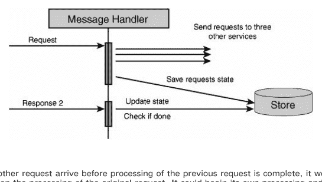

如果在前一个请求处理完成之前又有另一个请求到达，它不会对原始请求的处理产生任何影响。它可以开始自己的处理，并以相同的方式向任意数量的其他服务发送请求。我们可以用相同的资源交错处理多个请求（见图 10-5）。

### 图 10-5. 另一个传入请求不会影响仍在处理的第一个请求

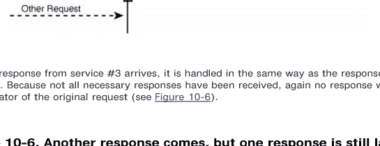

当来自服务 #3 的响应到达时，它的处理方式与来自服务 #2 的响应相同。由于并非所有必要的响应都已收到，再次不会向原始请求的发起方发送响应（见图 10-6）。

### 图 10-6. 又一个响应到来，但仍缺少一个响应

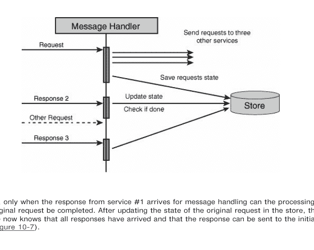

最后，只有当来自服务 #1 的响应到达以进行消息处理时，原始请求的处理才能完成。在存储中更新原始请求的状态后，服务现在知道所有响应都已到达，并且可以向发起方发送响应（见图 10-7）。

### 图 10-7. 第一个请求的最终响应到达，结果可以入队

[查看大图]

- 是否应使用这些的组合？
- 是否应无论消息如何都使用相同的行为？

使用之前设计构建服务而不是经典 RPC 风格设计的另一个优势是，当远程服务不可用时执行的领域逻辑与主消息处理路径清晰分离。在 RPC 风格设计中，异常会在消息处理代码中间抛出，而为处理前述问题中描述的各种方式而编写的代码会模糊领域逻辑的意图。

在图 10-8 所示的交互图中，我们可以看到处理超时的代码不仅与消息处理代码分离，而且在时间上也分离。请求和故障处理逻辑都被封装。

### 图 10-8. 应用超时监视器

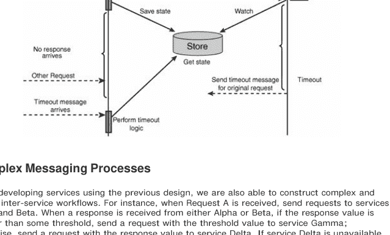

## 复杂消息流程

使用之前设计开发服务时，我们还可以构建复杂且健壮的服务间工作流。例如，当接收到请求 A 时，向服务 Alpha 和 Beta 发送请求。当从 Alpha 或 Beta 收到响应时，如果响应值大于某个阈值，则使用阈值向服务 Gamma 发送请求；否则，使用响应值向服务 Delta 发送请求。如果服务 Delta 不可用，则应返回部分结果。如果服务 Alpha 不可用或返回错误，则错误

## 控制反转与依赖注入

作者：Erik Dörnenburg

前面的章节讨论了领域对象以及相应的基础设施是如何设计和开发的。在本节中，我想介绍一种特定的设计技术或模式，它可以用于在运行时组装对象。这一通用原则被称为 *控制反转*，而具体的模式则被命名为 *依赖注入*。

### 没有对象是孤岛

几乎在应用程序中提供业务功能的任何对象都依赖于其他对象。这些对象可能提供数据或某种形式的服务。当我们使用 TDD 设计和开发对象时，通常需要显式提供所需的对象，并且常常使用桩（stub）或模拟（mock）对象来代替它们，以便隔离被测对象。然而，在运行时，我们的对象需要真正的实现，并且无论以何种方式，应用程序中的所有对象都必须被实例化并装配起来。

解决一个对象与另一个对象之间依赖关系的最常见方法，是将创建或获取被依赖对象的责任放在具有依赖关系的对象上。最简单的方式是让具有依赖关系的对象实例化它所需的对象。

作为一个例子，假设我们正在创建一个定价器（pricer），它是一个计算债券等金融工具价格的对象。当然，定价器需要被定价的债券，但我们决定这不属于定价器对象的状态的一部分，而是随着每个定价请求传入。因此，我们的类可能如下所示：

```csharp
public class BondPricer {
    public double GetPrice(Bond bond) {
        /* do something really complicated here */
    }
}
```

不过，债券的价格还取决于其他因素，其中一个例子就是所谓的贴现曲线（discount curve）。（你是否熟悉这个领域并不重要；在这个例子中，定价器也可以依赖于一只袋熊，结果也不会不同。）一条曲线可以用于为许多不同的债券定价，并且相对保持不变。因此，我们决定将该曲线作为定价器状态的一部分，并将其保存在一个成员变量中，该变量在构造函数中初始化。

```csharp
//BondPricer
private readonly DiscountCurve curve;

public BondPricer() {
    curve = new DiscountCurve();
}
```

请注意，我们本可以按需创建曲线，但有关何时使用延迟实例化更有用的讨论是另一个话题。无论如何，定价器现在对曲线有了直接的依赖。贴现曲线对象本身也很可能依赖于其他对象，并在适当的时候实例化它们。这看起来是一种可行的方法，但仔细审视后，问题就显现出来了：我们确实有一套能够为债券定价的对象，但我们的解决方案有多灵活、多可维护呢？

假设贴现曲线对象从数据库读取曲线的各个点。这正是用户想要的。在后续的迭代中，我们被要求构建一个允许用户分析假设（what-if）场景的功能。为此，用户希望在界面中指定曲线的点。没有比这更简单的了：我们从 `DiscountCurve` 类创建一个接口，并提供两个独立的实现：`DatabaseDiscountCurve` 和 `InMemoryDiscountCurve`。我们修改 `BondPricer` 类，使其只使用接口上的方法，从而不再与基于数据库的实现耦合。

不幸的是，即使债券定价器的计算代码只依赖于贴现曲线接口，我们仍然必须在某个时刻实例化 `DiscountCurve` 接口的具体实现，在本例中就是 `BondPricer` 的构造函数。在这一点上，我们必须决定要实例化这两个实现中的哪一个，但无论选择哪一个，我们的类都会同时耦合到接口和该实现。下图（图 10-9）展示了类设计，并清楚地说明了问题：`BondPricer` 和 `DatabaseDiscountCurve` 之间的 *创建* 链接。

**图 10-9. 使用直接实例化时的依赖关系**

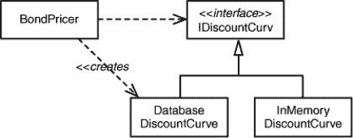

直接实例化的另一个问题是，应用程序中没有一个统一的位置来控制贴现曲线的创建，这使得无法为不同目的重用同一个实例。这可能相当麻烦，而且如果我们考虑到最初版本的曲线是从数据库加载信息的，那么很明显，反复创建新实例会对应用程序的性能产生严重影响。

在我们讨论控制反转和依赖注入之前，让我们先看看解决这些问题的另一种常见方法。

### 工厂、注册表和服务定位器

解决耦合问题的一种方式是使用工厂（Factory）模式。我们创建一个工厂类来提供所需的对象；在我们的例子中，就是一个实现贴现曲线接口的对象。

```csharp
public class DiscountCurveFactory {
    public static IDiscountCurve GetCurve() {
        return new DatabaseDiscountCurve();
    }
}

public class BondPricer {
    private readonly IDiscountCurve curve;

    public BondPricer() {
        curve = DiscountCurveFactory.GetCurve();
    }
}
```

有了这个工厂，定价器不再与某个曲线实现紧密耦合，这正是我们想要实现的目标。不幸的是，取而代之的是，工厂类本身现在紧密耦合到了特定的 IDiscountCurve 实现，因此在不同的定价器应用中使用不同的曲线实现仍然很困难。为了克服这个问题，我们可以创建一个工厂接口并传入不同的工厂实现，但这意味着我们必须解决如何获取正确的工厂的问题，这与获取正确的对象类似。换句话说，我们增加了一层间接性，提供了额外的灵活性，但只是把我们之前的关键问题转移了。

我们在代码中尚未展示的是，工厂模式还解决了实例管理的问题。因为我们的代码中有一个中心位置负责提供曲线实例，即 GetCurve() 方法，我们可以选择实现适用于整个应用程序的替代策略。例如，我们可以不总是创建新的曲线，而是维护一个单一实例，或者如果我们的应用程序是多线程的，我们可以选择管理一个实例池。

在迈向完全解耦的进一步步骤中，我们可以用注册表（Registry）模式 [Fowler PoEAA] 的实现来替换工厂。与工厂非常相似，注册表提供给定类型的对象，但它不会硬编码对象的类型，而是将这一决策外部化，并使用反射来实例化对象。就我们的目标而言，这种方法是对工厂模式的一种改进，因为我们现在分离了两个关注点：我们有一个负责提供对象的类，即注册表，并且我们可以将决定每种情况下使用哪个具体类的代码移到代码库中其他更合适的位置。

这种注册表的实现简单但有效，最终实现了我们的目标，即将 BondPricer 与 IDiscountCurve 的具体实现解耦。

一个重要的观察是，这段代码只依赖于与问题领域相关的概念，除此之外不依赖任何东西。它不需要引用工厂或注册表，也不关心查找或创建实例。因此，依赖注入促进了优雅软件的设计，这类软件通常会在领域关注点和基础设施关注点之间表现出良好的分离。

图 10-11 展示了使用依赖注入的设计。我们还包含了一个装配器（assembler）对象，负责创建定价器以及定价器所依赖的曲线。该图强调了这样一个事实：在这种设计下，任何特定领域对象都不依赖于诸如装配器之类的通用基础设施代码。

**图 10-11. 使用依赖注入时的依赖关系**

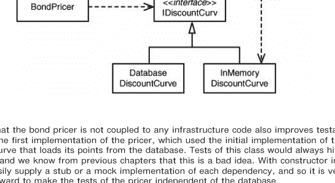

债券定价器不依赖于任何基础设施代码这一事实也提高了可测试性。考虑定价器的第一个实现，它使用了最初的贴现曲线实现，该实现从数据库加载其数据点。对这个类的测试总是会访问数据库，而我们从前面的章节中知道这是一个坏主意。通过构造函数注入，我们可以轻松地为每个依赖提供桩或模拟实现，因此使定价器的测试独立于数据库变得非常简单。

```csharp
[Test]
public void testPriceIncludesValuesForOutstandingCoupons() {
    IMock curveMock = new DynamicMock(typeof(IDiscountCurve));
    IDiscountCurve curve = curveMock.MockInstance as IDiscountCurve;
    BondPricer pricer = new BondPricer(curve);
    /* do actual test */
}
```


这种处理方式意味着假日日历是一个可选依赖。通过构造函数依赖注入，我们提供两个构造函数来表达这一点，每个构造函数对应一组有效的依赖。

```csharp
public class BondPricer {
    private readonly IDiscountCurve curve;
    private readonly IHolidayCalendar calendar;

    public BondPricer(IDiscountCurve aCurve) {
        curve = aCurve;
    }
    public BondPricer(IDiscountCurve aCurve
        , IHolidayCalendar aCalendar) : this(aCurve) {
        calendar = aCalendar;
    }
}
```

也可以使用一个包含所有参数的构造函数，并为可选参数传入 `null`，但这会降低契约的明确性，尤其是当依赖数量增加时。因此，建议始终为每一组有效的依赖提供一个构造函数，并且尽可能地在构造函数之间进行链式调用。如果这看起来不可行，那么所涉及的类很可能拥有过多的依赖，应该进行拆分。

## Setter 依赖注入

正如这个恰当名字所暗示的那样，Setter 依赖注入使用 setter 而不是构造函数来注入依赖。因此，定价器有一个默认构造函数，但需要提供一个带 setter 的额外属性。

```csharp
public class BondPricer {
    private IDiscountCurve curve;

    public BondPricer() {
    }
    public IDiscountCurve DiscountCurve {
        set { curve = value; }
    }
}
```

Setter 注入提供了与构造函数注入相同程度的解耦，并且不难看出，在单元测试中创建定价器对象与构造函数注入一样简单。一个重要的区别是，在调用 setter 方法之前，定价器处于无效状态，而这在构造函数注入中是不会发生的。此外，我们不能将 `curve` 变量声明为 `readonly`，因为它没有在构造函数中初始化；最后，使用 setter 注入实现需要在所有依赖注入之后运行的最终初始化功能会更加棘手且容易出错。

尽管存在这些缺点，Setter 注入仍有其用武之地，因为它在依赖较多的组件上具有更好的扩展性。对于一个有三个可选依赖且严格使用构造函数注入的组件，我们将需要八个构造函数。有人可能会说该组件需要重构，但这并不总是可行的；在这种情况下，手头有一个模式是很好的。类似地，许多现有对象都有默认构造函数和属性，因此我们只能将它们与支持 Setter 依赖注入的 IoC 容器一起使用。

还有更多 Setter 依赖注入的变体，例如接口驱动的 Setter 依赖注入（Interface Driven Setter Dependency Injection），它使用标记接口来区分描述依赖的 setter 方法和其他公共 setter 方法。这些变体要么未被广泛使用，要么没有显著改变 setter 注入的关键特性，因此我在此不做讨论。

## 控制反转

在讨论了依赖注入模式及其具体实现之后，现在让我们转向控制反转（Inversion of Control），它也被称为好莱坞原则（Hollywood Principle）：“别给我们打电话，我们会打给你！”严格来说，IoC 不是一种模式，而是一个通用原则，它简单地表明对象应该依赖于其环境来提供其他对象，而不是主动获取这些对象。

从历史上看，IoC 一词经常被用来描述某些容器在运行时创建组件所采用的方法。Martin Fowler 在审视这些容器时提出了一个重要问题，即“它们反转了控制的哪个方面？”他建议我们将这些容器所实现的基于 setter 和构造函数的方法视为一种具体模式，并为它使用更具体的名称——依赖注入 [Fowler Inversion-OfControl]。这也使人们能够区分依赖注入模式和其他类型的 IoC。

一种遵循 IoC 原则但不是依赖注入变体的广泛使用的模式是上下文相关依赖查找（Contextualized Dependency Lookup）。对于我们的债券定价器而言，使用这种模式意味着我们继续使用一个类似注册表的类（在此模式中通常称为 context），但让容器将该 context 提供给我们的对象，这就是控制反转的方面。在代码中，可以如下所示：

```csharp
public interface IServiceContext {
    public Object GetInstance(String name);
}

public interface IComponent {
    public void Initialize(IServiceContext context);
}

public class BondPricer : IComponent {
    private IDiscountCurve curve;

    public void Initialize(IServiceContext context) {
        curve = (IDiscountCurve)context
            .GetInstance("MyBank.IDiscountCurve");
    }
}
```

仔细审视后，这种模式看起来像是服务定位器（Service Locator）和 Setter 依赖注入模式之间的混合体。这并非偶然，因为从历史上看，这种模式是最早的 IoC 模式之一，并且被证明是通往更优雅的依赖注入模式的重要垫脚石。

## 使用 Spring.NET 框架的依赖注入

Spring.NET 应用程序框架 [Spring.NET] 是广泛使用的 Java Spring 框架 [Spring] 的一个移植版本，它提供了一个非常灵活的 IoC 容器，支持各种形式的依赖注入。这个容器只是一个组件，实际上是一个带有多个实现的接口，负责加载配置并相应地设置对象。从历史上看，容器一词被用来说明 IoC 容器可以替代 Java 平台上的标准 J2EE 容器。

回到前面描述的构造函数注入示例，让我们研究如何使用 Spring.NET 提供的容器来获取已配置的定价器实例。

使用 Spring.NET 描述组件及其依赖的首选方式是使用 XML 配置文件。我们按类型声明对象，包括它们所加载的程序集，然后通过定价器声明中的嵌套 `constructor-arg` 元素来解析定价器对折扣曲线的依赖。

```xml
<objects>
<object name="DbCurve" type="MyBank.DatabaseDiscountCurve, MyBank"/>
<object name="DbPricer" type="MyBank.BondPricer, MyBank">
<constructor-arg><ref local="DbCurve"/></constructor-arg>
</object>
</objects>
```

为了在代码中访问对象，我们可以创建 `IApplicationContext` 的实例，让它从配置文件中加载配置，然后按名称请求对象。上下文确保所有依赖对象都会被创建并注入到需要的地方。

```csharp
IApplicationContext context = new XmlApplicationContext("spring.xml");
BondPricer pricer = (BondPricer)context.GetObject("DbPricer");
```

在实际应用中，直接使用应用程序上下文并不常见，因为这使得创建定价器的代码依赖于上下文。这非常类似于我们想要避免的类与注册表（Registry）模式中注册表之间的依赖。如果我们假设需要定价器的类是一个 Windows 窗体，我们可以为窗体本身使用依赖注入，并将窗体添加到 XML 配置中。现在，当窗体被创建时，定价器由容器注入，窗体无需处理应用程序上下文。

然而，在这种情况下，必须有其他代码来创建窗体，而这段代码会从上下文中查找窗体，因此会与上下文耦合。显然，不能一直嵌套依赖下去。为了解决这个问题，大多数容器都提供了与应用程序框架的集成，例如 Spring.Web，这样最初的应用程序特定组件（Windows 窗体和 Web 页面）就可以直接使用依赖注入，而由应用程序框架负责使用上下文来创建它们。如果某个特定的容器/框架组合没有集成，最好尽可能多地使用依赖注入，并将对上下文的依赖限制在一个类中。


多样性，并且对于此容器，自动装配是首选方案。

使用 PicoContainer.NET，使容器能够解析依赖并创建对象所需的唯一步骤就是将具体的实现类注册到容器中。

```
IMutablePicoContainer pc = new DefaultPicoContainer();
pc.RegisterComponentImplementation (typeof(DatabaseDiscountCurve));
pc.RegisterComponentImplementation ("pricer", typeof(BondPricer));
```

通过将声明放入代码中，我们消除了冗余，并且获得了 IDE 的更好支持，因为它现在能够检测拼写错误的类名，并且可以在自动重构中安全地重命名类型。

对象是从容器中获取的，方式几乎与从 Spring.NET 中的 application context 获取的方式相同，因此关于对容器的依赖的相同考虑也适用：几乎所有类都应使用依赖注入，只留下一个中心类与容器交互以获取初始组件。

```
BondPricer pricer = (BondPricer)container.GetComponentInstance("pricer");
```

前面的示例还表明，除了使用类型系统之外，PicoContainer.NET 还支持命名组件：本例中的 pricer。这使得可以在不指定其类型的情况下查找对象，从而引入了另一个解耦程度。

可选依赖会自动处理，因为 PicoContainer.NET 使用它能够满足依赖的最复杂的构造函数。在前面的示例中，PicoContainer.NET 使用 BondPricer 的一个参数构造函数，它只接受一个曲线，但如果我们添加假日日历的注册，PicoContainer 在获取 pricer 对象时将使用两个参数的构造函数。

```
IMutablePicoContainer pc = new DefaultPicoContainer();
pc.RegisterComponentImplementation (typeof(DatabaseDiscountCurve));
pc.RegisterComponentImplementation(typeof(HolidayCalendar));
pc.RegisterComponentImplementation ("pricer", typeof(BondPricer));
```

就对象依赖而言，使用基于类型的自动装配而不是基于配置文件的方案并不会失去任何灵活性，同时我们还能受益于改进的开发体验。自动装配如果一个类在其构造函数中期望参数，例如主机名、端口号和超时时间，则效果不佳，因为原始类型并不能传达太多关于其预期用途的信息。如果我们向容器注册两个整数，一个指定端口号，另一个指定超时时间，容器将两者都视为整数，无法确定在接受一个整数的构造函数中使用哪一个。

根本问题在于容器是否应以与处理配置参数设置相同的方式支持必需组件的注入，或者是否将这两个需求视为不同的关注点，应针对每个关注点采用最合适的方案来处理。基于类型的自动装配在管理依赖关系时 arguably 比配置文件更有优势，因此可以为此目的使用自动装配。在同一场景中，配置参数可以用命名属性的 setter 设置，这对于该目的 arguably 更直观。

可用于 .NET 平台的第三个 IoC 容器是 Windsor，它是 Castle 项目 [Castle] 的一部分。Castle 项目的核心容器实现，开发者称之为 micro-kernel，使用基于类型的自动装配，但它也允许插件添加额外的依赖解析策略。基于 micro-kernel 的 Windsor 容器 [Windsor] 添加了对配置文件的支持，从而允许开发者选择最合适的机制。这是 NanoContainer [NanoContainer] 成功开创的一种方法，NanoContainer 是一个 Java 容器，构建在 PicoContainer 的 Java 版本之上。

## 嵌套容器

Spring.NET 中的容器被命名为 ApplicationContext 这一事实暗示了容器为从容器中检索组件的对象定义了一个上下文。这些对象与返回的对象交互，其行为取决于容器提供的具体实现；因此，容器可以被视为提供对象所作用的上下文的提供者。该名称进一步暗示，从配置文件创建的上下文是应用范围的，并且应用程序中的所有查找共享相同的上下文。

Web 应用程序使用多个上下文，大多数 Web 框架以 application、session 和 request 对象的形式明确表示它们。请求处理代码，例如 Web 页面背后的代码，通常依赖于多个组件。某些组件是应用程序上下文的一部分，因为它们可以被所有请求处理器共享，而其他组件是单个请求上下文的一部分，因为它们只能被单个请求使用。

一些 IoC 容器实现支持此模型并允许容器嵌套，这意味着一个容器可以有一个父容器，并且作为直接结果，有子容器。当容器无法满足创建组件所需的所有依赖项时，它会尝试从其父容器获取缺失的组件，而父容器反过来可以从其自己的父容器请求组件。这种设置大致类似于职责链设计模式 [GoF Design Patterns]。

例如，考虑创建具有数据库连接和记录器依赖的请求处理器或页面。数据库连接一次只能被一个请求使用，而记录器可以被所有请求共享。然而，这与请求处理器无关。

```
public ResultPage : Page {
    private Logger logger;
    private IDbConnection connection;

    public ResultPage(Logger aLogger, IDbConnection aConnection) : base() {
        logger = aLogger;
        connection = aConnection;
    }
}
```

在我们的应用程序中，一个容器与应用程序相关联。此外，每个会话都有一个子容器，并且对于会话中的每个请求，都会创建相应会话容器的子容器。我们的应用程序将请求 URL 映射到页面类型，并且包含以下通用代码，用于为给定页面类型创建新的请求处理器：

```
public RequestHandlerFactory {
    IPicoContainer sessionContainer;

    public Page CreatePage(Type pageType) {
        IImmutablePicoContainer reqContainer = CreateRequestContainer();
        reqContainer.RegisterComponentImplementation(pageType);
        return (Page)reqContainer.GetComponentInstance(pageType);
    }
    private IImmutablePicoContainer CreateRequestContainer() {
        IImmutablePicoContainer pc = new DefaultPicoContainer(sessionContainer);
        pc.RegisterComponentImplementation (typeof(SqlDbConnection));
        /* register all other components here that should be available
           to requests on a per request basis. */
        return pc;
    }
}
```

在 CreatePage() 方法中创建请求容器后，代码将页面类型注册到请求容器中，以便页面本身可以使用依赖注入。当它在第三行检索实际的页面实例时，请求容器尝试创建页面，但假设需要 ResultPage，它无法解析对 Logger 类的依赖，因为这未在请求容器中注册。在这种情况下，它将尝试从其父容器会话容器获取缺失的组件，会话容器中也没有记录器，因此会从其父容器应用程序容器请求记录器。只要在该容器中注册了记录器，页面的所有依赖项就可以得到满足，并且由请求容器创建。

这种方法的优点在于，一方面组件可以在适当的级别注册和共享，而另一方面从容器检索组件的对象只需处理一个容器，并且可以依赖它在容器链中找到所需的组件。

## 服务定位器与依赖注入

到目前为止，我们讨论了两种不同的模式，它们解决了本章开头描述的耦合和实例管理问题。剩下的问题是何时使用哪种模式。

可以肯定地说，服务定位器模式今天更常用，但这不一定是因为它更适合大多数应用程序。更可能的原因是服务定位器模式已经存在很长时间，而依赖注入是相对较新的模式，尚未广为人知。事实上，开发者在尝试改进服务定位器模式时得出了依赖注入模式。

依赖注入模式实现的组件与依赖解析机制的完全解耦提高了可测试性，因为测试不必设置定位器的专用版本来提供存根或模拟对象。它还有助于重用

在大系统中，它避免了将用于系统的不同组件绑定到不同定位器实现的问题情况。

依赖注入模式的另一个优点，特别是在使用构造函数依赖注入时，是对象的全部依赖在代码中很容易可见。现代 IDE 能够突出显示给定类中服务定位器的所有用法（通过按 Ctrl-Shift-F7），但即使使用复杂的 IDE，这也比查看构造函数困难。

经常有人说，依赖注入将具有依赖的对象 A 的生命周期与它所依赖的对象 B 和 C 的生命周期耦合在一起，因为在注入之前必须先创建 B 和 C。这对于服务定位器模式来说不是问题，因为 B 和 C 的创建可以推迟到 A 从定位器请求它们时为止。幸运的是，使用依赖注入模式也可以实现同样的效果，尽管没有那么自然，正如 PicoContainer 中组件适配器的一个用法所示。与其注入实际类的实例，容器注入一个代理，该代理仅在首次使用时创建真实实例，此后将所有方法调用转发给它。这对具有依赖的对象来说是完全透明的，但它有效地解耦了它们的生命周期。

## 摘要

在本节中，我们研究了在构建任何软件系统时出现的两个问题：依赖于其他对象的对象的耦合以及组件实例的管理。我们首先描述了如何使用常用的工厂、注册表和服务定位器模式来解决这些问题。认识到这些模式存在某些缺点后，我们讨论了依赖注入模式，该模式以一种新颖的方式解决了这些问题。该模式基于控制反转原则，提供更好的解耦，并且可以很好地扩展，从简单问题到非常复杂的依赖关系。它还提高了可测试性，这对 TDD 很重要，并允许领域模型与基础设施代码完全分离，这使其成为 DDD 的有用工具。

与几乎任何模式一样，依赖注入并不是灵丹妙药，不能普遍建议始终用依赖注入取代服务定位器模式的使用。了解每种模式的差异和优点并适当使用它们很重要。我们还看到依赖注入模式有几种风格，提供权衡。幸运的是，选择某种风格不会影响可测试性，这对开发很重要，并且在运行时使用的容器通常支持所有主要变体。因此我们可以根据需要选择，甚至混合使用不同的风格。

设计系统时最重要的考虑是分离关注点，在这里是组件的配置和使用，然后从丰富的目录中选择最合适的设计模式。

谢谢，Erik！

我只是想再次强调 Erik 最后的观点。你可以将依赖注入视为 Martin Fowler 在他的 DSL 文章 [Fowler LW] 中谈论的内容，当他说开发可以被视为创建良好的抽象然后配置它们时。依赖注入是处理配置部分的一种方法。

我不得不咬紧牙关不说出上一句话中的“配置方面”。你不会原谅我为下一个主题提供如此薄弱的线索吧，对吗？事实上，

一行代码必须拆分为结果赋值和返回，只是为了让结果能够在日志代码中打印出来。

- 如果你需要在某个时候删除日志代码，你将面临手动从类中删除或注释掉所有日志代码的艰巨任务。
- 如果你决定想要记录完整的类名，包括命名空间，你将不得不找到包含日志代码的所有方法并手动添加缺失的命名空间信息。
- 同样，如果你决定想要在发生溢出和除零等异常时记录异常——你将不得不在代码库的许多、许多地方添加 try/catch 块和记录异常的语句。

当然，有人可能会争辩说，如果你使用复杂的日志解决方案，例如 Log4Net [Log4Net] 或企业库日志应用程序块 [Enterprise Library Logging]，而不是简单的 `Console.Out.WriteLine` 语句，你可以通过简单地更改配置设置来关闭日志，而无需触及任何类。

虽然这完全正确，但在这种情况下它真的忽略了重点。你的核心逻辑仍然会与辅助日志代码交织在一起，如果你想对日志逻辑进行任何更改，你仍然必须手动编辑许多方法。此外，如果我们将示例从日志更改为安全策略执行或事务，你也不会那么容易地将其打开或关闭。

AOP 承诺为你做的是允许你将横切代码，例如日志或安全，分离到切面中，并轻松地将这些切面应用于需要它们的类和方法。当然，AOP 不止于此。它还允许你将业务规则与核心逻辑分离，并通过向现有对象添加状态和行为来更改它们。我们将在后面的章节中看到这些示例。

需要理解的重要一点是，AOP 不是 OOP 的替代品——它只是对它的扩展，允许你进入仅用 OOP 就难以到达的地方。良好的面向对象原则和实践仍然适用。实际上，在应用切面时拥有坚实的 OO 设计可能比以往任何时候都更重要，因为它将使切面的应用变得更容易。

## AOP 术语定义

在我们深入探讨并向你展示 AOP 实际运行的示例之前，了解基本的 AOP 术语很重要，这并不像乍看起来那么困难。因此我为以下术语提供一些定义：

- 一个 **通知**是你想要封装并重用的代码片段。例如，日志代码将作为通知实现，并在需要的地方应用。有几种类型的通知，例如 *前置*、*后置* 和 *环绕* 通知。
- 一个 **引入**是一种有点特殊的仅适用于类的通知。引入允许你向现有类引入新的成员，既有状态也有行为，并且可以在不支持它的语言中实现多重继承的好处，而没有其权衡。（在某些语言中，引入称为 *mixin*。）
- **一个连接点**是可以在代码中应用通知的任何位置。理论上，连接点可以是几乎任何东西 实例变量、`for` 循环、`if` 语句等等。然而，实际上，最常用的连接点是类、方法和属性。
- **一个切点**标识了一组应应用通知的连接点。例如，如果你想将事务通知应用于所有标记有 `transaction` 属性的方法，你将必须声明一个切点来标识这些方法。
- **一个切面**将通知及其适用的切点组合在一起，这在某种程度上类似于类将数据和相关行为组合在一起的方式。

## .NET 中的 AOP

够了理论，让我们看看 AOP 如何帮助我们解决开发过程中几乎每天都会遇到的现实问题。

本节中的示例使用 Spring.NET AOP 实现构建，因此你需要下载并安装最新的 Spring.NET 版本以便尝试。

### 注意

请注意，在本书撰写时，本节中的示例基于 Spring.NET 中 AOP 支持的计划实现。访问本书的网站（www.jnsk.se/adddp）了解更改信息，或查看官方 Spring.NET 文档，可在 www.springframework.net 找到。

## 使用切面模块化日志代码

那么让我们看看如何利用 AOP 来解决与之前日志代码相关的问题。

## 创建日志通知

我们需要做的第一件事是创建一个将封装日志代码的通知：

```
using System;
using System.Text;
using AopAlliance.Intercept;

namespace LoggingAspectDemo
{
    public class MethodInvocationLoggingAdvice
        : IMethodInterceptor
    {
```


要么直接实现行为，要么让它们继承自某个实现了核心锁定和解锁功能的基类。

第一种解决方案很糟糕，因为它会导致大量重复代码。第二种方案只有在需要锁定行为的类属于同一个类层次结构且所有这些类都需要支持锁定时才可行。如果它们属于不同的层次结构，或者你不想将锁定行为引入到所有这些类中，那么就又回到了原点。

更好的方法是利用AOP特性，以声明方式仅为需要锁定的类添加锁定支持。通过结合使用引入（introduction）和前置通知（before advice），可以轻松实现这一点。

## 实现锁定引入

这里的第一步是创建一个引入，用于向被通知的类添加状态和行为。为此，我们需要定义希望引入的接口。

```csharp
namespace LockableAspectDemo
{
    public interface ILockable
    {
        void Lock();
        void Unlock();
        bool IsLocked { get; }
    }
}
```

下一步是创建一个实现该接口的引入类。在本例中，我们假设正在编写一个 ASP.NET Web 应用程序，并将使用 HttpContext.Current.Session.SessionID 作为用于锁定的会话 ID。

```csharp
using AopAlliance.Aop;

namespace LockableAspectDemo
{
    public class LockableIntroduction : ILockable, IAdvice
    {
        private bool isLocked;
        private string sessionId;

        public void Lock()
        {
            isLocked = true;
            sessionId = HttpContext.Current.Session.SessionID;
        }

        public void Unlock()
        {
            isLocked = false;
            sessionId = null;
        }

        public bool IsLocked
        {
            get
            {
                return isLocked && sessionId
                    != HttpContext.Current.Session.SessionID;
            }
        }
    }
}
```

到目前为止，我们已经创建了想要使用的引入。现在需要创建一个通知，用于强制执行该引入所实现的锁定。

## 实现锁定强制通知

在特定情况下，我们不需要像日志示例中使用的那样完整的*环绕通知*。我们的通知所需要做的只是检查目标对象是否被锁定，如果是，则抛出异常。

为此，我们可以使用一种稍微简单的*前置通知*，它不需要我们调用 `MethodInvocation.Proceed()`：

```csharp
using System;
using System.Reflection;
using Spring.Aop;

namespace LockableAspectDemo
{
    public class LockEnforcerAdvice : IMethodBeforeAdvice
    {
        public void Before(MethodBase method, object[] args,
            object target)
        {
            ILockable lockable = target as ILockable;
            if (lockable != null && lockable.IsLocked)
            {
                throw new LockViolationException
                    ("Attempted to modify locked object.", target);
            }
        }
    }
}
```

## 将锁定切面应用于领域对象

有多个原因使得这个类适合基于代理的AOP。首先，属性是通过私有字段与属性getter和setter的组合实现的。如果你改用公有字段，AOP代理就不可能拦截属性访问。

其次，所有属性和方法都被声明为虚拟的。这允许Spring.NET通过继承`Account`类并注入拦截代码来创建动态代理。如果方法是final的，`Account`类就必须实现一个接口才能通过组合代理进行代理。如果既没有接口也没有虚拟方法，就不可能为`Account`类创建代理并对其应用AOP通知。

最后需要注意的一点是`StateModifier`特性的使用。我们定义这个特性主要是为了展示如何基于特性应用通知，但这也是使用特性非常有意义的一个案例。它提供了额外的元数据，使哪些方法修改对象状态变得一目了然。

我们本也可以在属性setter前面使用`StateModifier`特性，但在我看来这有些多余。此外，在属性的情况下省略`StateModifier`，让我们有机会向你展示如何定义复合切入点。

虽然可以仅使用代码方式来配置锁定切面，但这种方式有些繁琐，因此在这种情况下我们只展示声明式方法。

```xml
<aop:aspect name="LockEnforcementAspect">
    <aop:pointcut name="StateModifiers"
        expression="class(Account+)
        and (setter(*) or attribute(StateModifier))"/>
    <aop:advice type="LockableAspectDemo.LockableIntroduction"
        pointcut="class(Account+)"/>
    <aop:advice type="LockableAspectDemo.LockEnforcerAdvice"
        pointcut-ref="StateModifiers"/>
</aop:aspect>
```

声明中的大部分内容应该不言自明。值得注意的地方有：

- 切入点定义中类名后面的加号指定切入点应匹配指定类及其派生类。
- 表达式`"setter(*)"`用于匹配所有属性setter，无论其类型和名称如何。
- 表达式`"attribute(StateModifier)"`用于匹配所有标记了`StateModifier`特性的成员。

最后，我们需要创建一个客户端，它将利用引入的`ILockable`接口，就像该接口直接由`Account`类实现一样。

```csharp
using LockableAspectDemo.Domain;

namespace LockableAspectDemo.Services
{
    public class AccountManager
    {
        public void TransferFunds(Account from, Account to,
            double amount)
        {
            ILockable acctFrom = from as ILockable;
            ILockable acctTo = to as ILockable;

            try
            {
                acctFrom.Lock();
                acctTo.Lock();

                from.Withdraw(amount);
                to.Deposit(amount);
            }
            finally
            {
                acctFrom.Unlock();
                acctTo.Unlock();
            }
        }
    }
}
```

正如你所看到的，通过使用AOP，我们可以真正地模块化对象锁定功能，并在适当的地方应用它，而不存在纯OOP方法的缺点。

### 注意

尽管前面的示例在技术上与使用`lock`语句来同步多个线程对`acctFrom`和`acctTo`的访问没有区别，但两者在语义上存在很大差异。使用`ILockable`，我们可以在多个HTTP请求期间保持锁定，而不仅仅是单个请求。

## 将业务规则迁移到切面

本节要展示的最后一个示例演示了一种更为高级的AOP用法。我们不建议你通过将所有业务规则迁移到切面来开始尝试AOP。将AOP引入到你的项目中的最好方式可能是让它逐步处理明显的横切关注点，例如日志记录、安全性和事务。然而，我们认为重要的是你要理解它的全部潜力，以便在更加熟悉它之后能够有效地应用它。

每个业务应用程序都有各种业务规则，这些规则通常嵌入在应用程序逻辑中。虽然这对于大多数规则和大多数应用程序来说效果不错，但它使应用程序的灵活性低于实际需求，并且当业务规则发生变化时通常需要修改代码。通过将一些业务规则迁移到切面，你可以使应用程序更容易定制。与前面的示例不同，消除代码重复通常不是你将业务规则迁移到切面的主要原因——在这种情况下，主要驱动力是提高应用程序的灵活性。

最好的候选者是那些导致核心逻辑之外还要实现次要逻辑的规则。例如，前面示例中`Account.Withdraw()`方法的核心逻辑是减少账户余额。次要逻辑可能是强制执行最低余额要求，或者当余额低于某个金额时向账户持有人发送电子邮件提醒。

让我们看看，如果我们同时添加最低余额强制和余额提醒，`Account`类会是什么样子。

```csharp
using System;

namespace BusinessRulesDemo.Domain
{
    public class Account
    {
        private AccountHolder accountHolder;
        private string name;
        private double balance;
        private double minimumBalance;
        private double alertBalance;

        // Spring.NET IoC injected collaborators
        private INotificationSender notificationSender;

        public Account() { }

        public Account(string name, double balance)
        {
            Name = name;
            Balance = balance;
        }

        public virtual Person AccountHolder
        {
            get { return accountHolder; }
            set { accountHolder = value; }
        }

        public virtual string Name
        {
            get { return name; }
            set { name = value; }
        }

        public virtual double Balance
        {
            get { return balance; }
```

```csharp
set { balance = value; }
}

public virtual double MinimumBalance
{
    get { return minimumBalance; }
    set { minimumBalance = value; }
}

public virtual double AlertBalance
{
    get { return alertBalance; }
    set { alertBalance = value; }
}

// injected by Spring.NET IoC container
public virtual INotificationSender NotificationSender
{
    set { notificationSender = value; }
}
[StateModifier]
public virtual void Withdraw(double amount)
{
    if (balance - amount < minimumBalance)
    {
        throw new MinimumBalanceException();
    }

    balance -= amount;

    if (balance < alertBalance)
    {
        notificationSender.SendNotification
        (accountHolder.Email,
        "Low balance",
        "LowBalance.vm", this);
    }
}

[StateModifier]
public virtual void Deposit(double amount)
{
    balance += amount;
}
}
}
```

虽然你可以争辩说最低余额检查应保留在 `Account` 类中，但很明显，发送通知的代码并不是 `Withdraw()` 方法的主要功能，这使得它成为一个非常适合切面的候选。让我们对其进行重构。

在本示例中，我们使用了一个后置通知，它会检查新余额是否低于警戒余额水平，如果低于则发送通知。我们还在通知类上定义了若干属性，以便展示如何使用 Spring.NET IoC 容器配置通知。

在本例中，通知与我们的 Account 类之间的紧密耦合并不是问题，因为我们知道我们的通知只会应用于 Account 类的实例，我们只是利用通知将发送通知的规则移出 Account 类的核心逻辑之外。

这真正为我们带来的就是灵活性。如果我们将应用程序卖给另一位希望我们移除通知的客户，我们只需从配置文件中移除通知的应用即可轻松实现。同样，如果客户要求我们以这样的方式实现逻辑：每当余额低于允许的最低金额时，自动从信用额度账户转账，我们就可以轻松实现另一个通知并将其应用于我们的 Account 类，甚至可以与通知一起使用。

## 应用建议

与前一个示例一样，我们将只展示声明式切面配置来完成本示例。

```
<aop:aspect name="BalanceNotificationAspect">
    <aop:advice
        type="BusinessRulesDemo.AccountBalanceNotificationAdvice"
        pointcut="class(Account+) and method(Withdraw)">
        <aop:property name="Sender" ref="NotificationSender"/>
        <aop:property name="Subject" value="Low Balance"/>
        <aop:property name="Template"
            value="~/Templates/LowBalance.vm"/>
    </aop:advice>
</aop:aspect>
```

这里唯一值得指出的是，你可以使用 Spring IoC 功能来配置你的通知，就像你配置任何其他对象一样。在本示例中，我们利用它来指定通知主题、NVelocity 消息模板的文件名，以及要使用的通知发送器实例。

## 总结

AOP 可以帮助你解决每天面临的一些问题。虽然在语言和 CLR 层面获得对 AOP 的支持会很棒，但 .NET 开源社区中有工具可以为你提供一套不错的 AOP 功能。

了解更多关于 AOP 的最佳方式可能是下载这些工具并尝试使用它们，甚至可以开始将它们引入实际项目中，以帮助处理基本的用例，例如日志记录或性能分析。随着你对 AOP 了解得更多并且对所选工具更加熟悉，你可能会发现应用程序中许多其他可以利用切面帮助的领域。

谢谢，Aleksandar！

因此，通过将 AOP 应用于我在 Aleksandar 部分之前谈到的 Repository 设计问题，为 `CustomerRepository` 引入的一些接口可以是 `GetByIdable`、`Deletable` 等等。

挺不错的，不是吗？当然还有更明显的使用 AOP 的场景，例如日志记录的普通示例。正如 Aleks 指出的那样，这有点无聊，但毕竟是一种解决常见问题的非常有用的技术。

## 第 11 章 关注用户界面

测试数据库和用户界面（UI）都很困难。我们在第 6 章“为基础设施做准备”中讨论了数据库的测试，但我欠你们一些关于 UI 测试的材料。你们会在本章中找到很多相关内容。

我们还将讨论更符合 DDD 的 UI 设计，至少与 .NET 中的 *快速应用程序开发 (RAD)* 相比。我们将通过研究 *模型-视图-控制器 (MVC)* 和 *模型-视图-呈现器 (MVP)* 模式来实现这一点。

我们还将查看其他类型的映射：这次不是对象关系映射，而是对象到对象的映射和 UI 映射。

但首先，为了营造合适的氛围，这里有一篇我老朋友 Dan Byström 的“前序言”。你可能会问什么是“前序言”？它是一个早期或“前”的结语。我请 Dan 为我的书写一篇简短的结语。他写的内容很好且贴切，但回想起来，它更像是最后一章的引言，而不是书的结尾。所以这里是 Dan 的前序言。

## 一篇前序言

作者 Dan Byström

现在你坐在这里，欣赏着你的作品：有史以来最完美的领域模型。你成功完成了起初看起来不可能的任务：你将客户业务的很大一部分映射到了你的领域模型中。不仅如此，你还摆脱了相当多的特殊情况，并向客户展示了比他们能想象的更通用的业务视图。

如果这还不够，接口是干净的，代码甚至更干净。无论谁使用这个领域模型，都会对你的成就惊叹不已并暗自羡慕你。你还能要求什么更多呢？现在你可以安心而死！

“你说谁？在这种情况下，谁是谁呢？”

“嗯，”你说，“是任何使用 .NET 启用语言的程序员。”（或者你可以说它是所有 Java 开发者，或根据你的实现的其他群体。）

“所以成千上万的程序员可能会使用你的领域模型？这相当了不起！”

“是啊，不是很棒吗？”你回答道。“我已经将业务模型的大部分以及整个数据存储问题封装到这个模型中，这样就可以轻松使用而无需处理这些血腥的细节。”

“你确定除了程序员之外没有人会对使用你的领域模型感兴趣吗？”

“你是什么意思？”

“嗯，我只是好奇……你不觉得有很多用户希望从你的工作中受益吗？事实上，不正是这些用户最初订购了你的领域模型吗？”

“是的，这是真的。你想说什么？”

“你不觉得你需要一个用户界面来让这些用户接触到你全新的领域模型吗？”

“哦……”

我目前很幸运地与 Jimmy 在一个项目中合作，他专注于领域模型并进行 O/R 映射，而我专注于 UI。命运的巧合是，我们都觉得自己是赢家，并且认为对方抽到了最短的签。

当我开发应用程序时，我认为 UI 是核心部分，因为没有 UI，应用程序就……不可用。在大多数业务应用程序中，这对于数据表示和数据存储部分同样适用。归根结底，这只是视角、个人喜好和兴趣的问题。

有些程序员似乎并不介意将直接的 DB 访问混入 UI 中。这方面的一个极端例子显然是经典的数据绑定，其中你将用户控件直接绑定到数据库字段。我每次尝试过后都发誓再也不尝试了！（另一方面，我真的很期待找到一种直接绑定到领域模型的方法。）

随着应用程序的增长和需要维护，逻辑层就成了福音。

将 UI 的数据在单独的视图中逻辑上分离出来，即表示模型 [Fowler PoEAA2]，又是另一个极大的改进。

对于简单的 UI，我真的不能说我完全做到了这一点，但对于棘手的部分，我肯定是这样做的，即使并不总是完全纯粹。我遗憾地说我不从事预算无限的项目。（另一方面，如果问题很简单，只应使用简单的解决方案。）

事实上，我第一次面对 SQL 数据库时（在此之前我一直编写自己的存储机制，在可能的情况下我仍然更喜欢这样），我立即意识到需要在数据库和我的 UI 之间有某种层，尽管在遇到“领域模型”这个词之前花了十多年时间。

所以领域模型对 UI 程序员来说很棒。但它真的只是开始。乐趣从这里开始！

好！谢谢，Dan！

那么让我们再多想想在丰富领域模型的上下文中关于表示服务的主题，首先从丰富客户端的角度出发，并以测试为重点。

正如 Martin Fowler 所说 [Fowler PoEAA]，MVC 模式是周围最被误解的模式之一。尽管如此，它非常强大且广受欢迎。该模式的目的和基本思想并不难理解，但通常魔鬼在细节中。Christoffer Skjoldborg 将阐明如何应用 MVC，并将在详细示例的上下文中讨论它。


## 模型-视图-控制器模式

作者：Christoffer Skjoldborg

模型-视图-控制器模式（MVC）的意图是将用户界面行为拆分为独立的部分，以提高复用可能性和可测试性。这三个部分分别是视图（View）、模型（Model）和控制器（Controller）。

模型是实体状态的某种表示。它可以是从简单的数据结构（XML 文档、DataSet 和数据传输对象）到完整领域模型（如果你有的话）的任何形式。

视图应只包含与“在屏幕上绘制像素”直接相关的逻辑。在应用 MVC 时，让视图“尽可能愚钝”往往是一个主要的设计目标。其理由是，在实践中，视图/屏幕需要人眼来测试。与自动化单元测试相比，这是一个容易出错且成本高昂的过程。如果我们从一开始就尽量减少放入视图中的逻辑，就能降低引入只能通过手动测试才能发现的 bug 的风险；换句话说，我们就能尽量减少需要投入的手动测试工作量。

最后，控制器（Controller）才是 MVC 的真正核心，它是将模型和视图绑定在一起的粘合剂。当用户与视图交互时，控制器接收消息，将这些消息转换为对底层模型执行的操作，然后相应地更新视图。

MVC 模式起源于 20 世纪 70 年代和 80 年代 Smalltalk 社区 [MVC History]。

如前所述，引入 MVC 的主要原因之一是提高可测试性。其他好处如下：

- 显式地将代码从视图中提取出来这一过程本身，确实会迫使 UI 代码比原本更具有结构性。许多现代工具让开发者可以轻松地点击鼠标，快速在各种事件后面添加代码，而无需过多思考。通过采用 MVC 模式，人们必须付出更多努力，并非常明确地了解 UI 中发生的事情。
- 它使得更改外观和感觉，甚至支持全新的用户界面或平台变得更加容易。MVC 的复用价值有时被夸大了，尤其是在跨平台（富客户端/Web/手持设备）可移植性方面。通常，控制器必须大幅修改，才能充分利用目标平台的能力。
- 不同的团队成员可以同时在视图和控制器上工作，即使使用文件锁定型源代码控制系统也是如此，因为它们现在可以轻松分离。

## 示例：乔的鞋店

```
// Set expectations on view mock
viewMock.Expect("ClearGrid");
viewMock.Expect("AddShoeToGrid",new object[]{shoes[0]});
viewMock.Expect("AddShoeToGrid",new object[]{shoes[1]});
viewMock.Expect("AddShoeToGrid",new object[]{shoes[2]});
viewMock.Expect("SetSelectedShoeInGrid"
, new object[]{shoes[0]});

ctrl.LoadView();
viewMock.Verify();
}
```

所有测试都已就绪（虽然前面的代码清单中只展示了一个），剩下的就是展示 CatalogController 的实际实现了（见下面的代码清单）。

```
public class CatalogController
{
    ICatalogView _view;
    IList _shoes;
    Shoe _selectedShoe;

    public CatalogController(ICatalogView view, IList shoes)
    {
        _view=view;
        _shoes=shoes;
        view.SetController(this);
    }

    public void LoadView()
    {
        _view.ClearGrid();
        foreach(Shoe s in _shoes)
            _view.AddShoeToGrid(s);

        _view.SetSelectedShoeInGrid((Shoe)_shoes[0]);
    }
}
```

## 通过适配器简化视图接口

在乔的鞋店示例中，ICatalogView 为控制器需要访问的每个可能细节都公开了一个属性。这样做完全没问题，但如果你有 10 个输入框，并且需要能够控制每个输入框的可见性、启用状态、字体、背景色、前景色、边框样式等，那么你最终可能会得到非常庞大的接口。为了防止这个问题，你可以为你使用的每种 UI 控件创建一个适配器/包装器 [GoF Design Patterns]。TextBox 的适配器可以公开上述属性，这样视图接口就只需要为每个文本框公开一个 TextBoxAdapter 数据类型的属性。在幕后，视图会在实例化时将真实 UI 控件的引用提供给每个适配器，而适配器只需将收到的调用委托给实际实现即可。

## 将控制器与视图解耦

有时将控制器与视图解耦是有好处的。这可以通过多种方式实现。一种简单的解决方案是为控制器创建一个接口，并让视图只知道该接口，而不知道实际实现。更复杂的方式是让视图向匿名订阅者引发事件（观察者模式 [GoF Design Patterns]）。我个人不太喜欢这种方法，因为我无法想象为什么一个视图需要将用户交互传递给多个订阅者，更不用说未知类型的订阅者了！如果不同的控制器甚至其他视图需要了解某个视图的变化，那么该视图的控制器应该通知它们。如果需要，可以通过事件来完成。关键在于，控制器应该 100% 控制哪些人能够知道这些变化。

无论实现细节如何，将控制器与视图解耦的好处在于，我们可以在视图背后变更控制器。当同一个视图可能出现在许多不同的上下文中时，这非常有用，因为强制要求某个特定控制器始终伴随该视图可能并不合理。一个例子是，针对特定客户，可能需要在视图上应用特殊逻辑。在这种情况下，我们可以使用工厂方法，根据系统正在处理的客户来提供合适的控制器。

## 组合视图/控制器

更复杂的视图通常由多个较小的视图组成。例如向导（wizard），用户通过“下一步”和“上一步”按钮在一系列视图之间导航，甚至可能一次跳转好几个步骤。信息可能会在途中保存，但直到用户在最终屏幕上单击“保存”后才会真正提交。

另一个例子是主/从（Master/Details）视图，对从视图所做的更改可能也会导致主视图发生变化。

从技术上讲，这两个示例都可以用一个大型控制器来实现，但这很可能会让事情变得一团糟，并降低复用可能性。例如，我们可能希望在应用程序的其他地方使用向导中的某些步骤，或者可能希望在不显示从视图的情况下显示主视图。这里的解决方案显然是让视图和控制器拆分成更小的部分。（“如果你想吃掉一头大象，就必须一口一口地吃。”）对于向导，我们可以使用一个 FlowController 来控制向导中的基本前进/后退流程，而每个步骤都可以有自己的视图和控制器。

在主/从视图中，我们可以让从视图的控制器在发生更改时引发一个事件。任何其他控制器都可以订阅此事件，包括主视图的控制器。

## 这值得吗？

应用 MVC 模式的主要好处是使你的 UI 代码可测试。其次，它迫使 UI 的编码/设计过程采用非常结构化的方法，这本身最终可能会带来更干净的代码。可以这么说，你被迫多思考一些。

另一方面，应该指出的是，仅仅因为我们可以*测试*每一行代码，并不意味着我们*应该*测试。有了 MVC，可以为每个视图编写一套全面的测试，而且前几次看到 UI 逻辑获得一堆绿色条（通过）时，感觉确实很好。然而，对于那些测试非常简单、并且由于与系统其他部分耦合度低而不太可能在将来变更中出错的测试，其价值可能并没有那么大。尤其是当这些 UI 测试套件给代码库带来巨大的维护开销时。每次你稍微改变 UI，都必须对相应的 UI 测试进行大量修改。

谢谢，Chris！

不管我们是否想用严格的单元测试来测试 UI，我认为 Christoffer 刚才向我们展示的是一种非常有价值的技术，它可以让 Windows Forms 应用程序的视图部分变得更薄，使其只负责绘制窗体，并将部分表现逻辑提取到单独的层中。

这基本上也是下一节的主题，不过这次是在 Web 的背景下。Ingemar Lundberg 讨论了如何应用 MVP 模式 [Fowler PoEAA2] 作为测试 Web 应用程序的工具。


## 测试驱动 Web 表单

作者 Ingemar Lundberg

如何对 GUI 进行单元测试，从而也使用 TDD？

在本节中，我将尝试给出一个总体思路，说明如何对 GUI 进行单元测试。在此过程中，将展示诸如自移位 [Feathers Self-Shunt] 和模拟等技术。然而，TDD 过程本身并未描述。自移位（非常简要地）是一种技术，即让测试类也充当存根或模拟。

### 背景

典型的 GUI 代码由一组回调方法组成，这些方法是在用户对 GUI 执行某些操作（例如按下按钮）时被调用。通常，回调方法会操作域对象（或甚至执行一些 SQL）。问题在于，回调方法是由诸如 WinForms 或 ASP.NET 之类的环境调用的，而这些环境很难在你的 NUnit 测试中挂钩。你根本做不到。

目标是尽可能减少未测试的代码。首先要做的是将尽可能多的代码移出回调方法。如果代码没有纠缠在回调方法中，你就创造了单元测试它的可能性。

但这还不够。GUI 的状态怎么办？你知道，像如果用户选择了该行，这和那按钮应该被禁用之类的事情。这仅仅通过将代码移出回调方法是不够的。别误会，这是一个很好的第一步。

要更进一步，我们需要使用我们工具箱中最锋利的工具：抽象。我们需要一个交互模型，并且需要我们正在编程的表单的抽象。在这一点上，我将停止以一般术语谈论 GUI，开始谈论表单，更具体地说是 ASP.NET Web 表单。然而，这种技术也适用于 Windows Forms，而且甚至是平台中立的。

### 一个示例

在我看来，这是写编程文章中最困难的部分——找到一个问题场景来说明你的观点，而不会使读者分心。我需要一个使我的 GUI 改变状态的示例；换句话说，当用户执行某些特殊操作时，需要禁用某些东西。

在瑞典，我们有一种传统，即只在星期六让孩子们吃糖。假设我有一盒巧克力棒、一盒棒棒糖和一盒分装的花生袋。孩子们可以任选三种零食，但同一种不能超过两种。模型的简化是，我们永远不会缺糖。

这无疑是另一个愚蠢的例子，但希望它能发挥作用。在图 11-2 中你可以看到最终结果。我本可以向你展示我 GUI 的原始铅笔草图，但这也足够了。在左侧窗格中，我们有所有可用的糖果类型。用户（各年龄段的孩子）就是从这个窗格中挑选糖果放入他们的星期六糖果储备中，显示在右侧窗格中。你可以看到，当你可能挑选棒棒糖或一袋花生时，如何被阻止再挑选另一根巧克力棒。

### 图 11-2. 选择、限制和选择

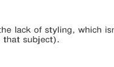

恳请读者忽略缺乏样式的问题，这里不涉及（而且我不应该对该主题发表任何意见）。

### 领域模型

为了继续今天的课程，我需要一个领域模型。它显示在图 11-3 中。

### 图 11-3. 领域模型

[查看全尺寸图像]


我已单独测试了此模型。OkToAdd() 检查了我之前所述的业务规则。可以添加三件物品，但同一种类型（candyType）只能有两种。这不是火箭科学。

### GUI 的 TDD

最后，我们要进入正题。在开始之前，我想提醒大家，尽管我们引入了表单的抽象，但我们对它将如何工作有一个相当具体的想法，如 [图 11-4](#) 所示。

### 图 11-4. UI 模型

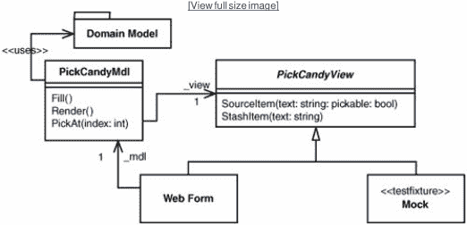

#### 显示糖果类型

当表单首次显示时，我们希望能够用所有糖果类型的名称填充左侧窗格。应该可以从所有来源进行选择。测试看起来像这样。（我将基于我对这种模式的先前经验在这里迈出相当大的一步，敢称之为模式。）

```csharp
[Test] public void FillSourcePanel()
{
    mdl.Fill();
    mdl.Render();
    // using A=NUnit.Framework.Assert
    A.AreEqual(srcPanel, "a> b> c> ");
}
```

它甚至无法编译。我需要在 `PickCandyMdl` 中添加 `Fill()` 和 `Render()`。这很容易；我只需添加两个空的公共方法，一个名为 `Fill()`，一个名为 `Render()`。但测试表达了什么？我断言了什么？断言以非常抽象的方式表达了“表单”现在应该是什么样子。字符串 `srcPanel` 被用作最终目标的 HTML 表格（表单中的左侧表格）的替代。

`srcPanel` 从哪里来？嗯，`srcPanel` 是测试夹具（类）中的一个字符串，由我的自移位 [Feathers Self-Shunt] 实现的 `PickCandyView` 操作。这是模拟视图时反复出现的模式。

```csharp
[TestFixture] public class PickCandyTests: PickCandyView
{
    void PickCandyView.SourceItem(string text, bool pickable)
    {
        SrcPanel += text + (pickable ? ">" : string.Empty) + " ";
    }

    PickCandyMdl mdl;
    string SrcPanel;

    [SetUp]
    protected void Setup()
    {
        mdl = new PickCandyMdl();
        SrcPanel = string.Empty;
    }
    ...snip...
```

它编译通过了，但变红了。缺少什么？嗯，表单模型 mdl，其类型为 PickCandyMdl，需要知道其视图。这很容易！我向模型添加一个 setView() 方法。（顺便说一下，这是我使用“接口实现”的少数几次之一，就像我对 PickCandyView.SourceItem() 所做的那样，即 {接口名称}.{成员名称}。）

#### 接口方法的私有或公共实现？

方法实现只能存在于类中。如果一个类 Foo 实现接口 Bar，则接口的方法是该类的一部分。在大多数情况下，我会在 Foo 上将 Bar 的成员实现为 public。请记住，类本身的接口就是其所有公共成员。Foo 是一个 Bar，因此 Bar 的成员是 Foo 的一部分。只是碰巧在其他情况下，我将接口的成员实现为 private，以解决名称冲突，例如自移位模拟的情况。在这里，我实际上并不认为接口（PickCandyView 和 CandySourceRetriever）是测试夹具接口的一部分。

表单模型需要知道如何获取所有 Candy Sources。这可以通过简单地向模型提供糖果来源列表来轻松解决。但相反，我将向你展示另一个小技巧，可以在一般情况下提高可测试性。我让表单模型（或更确切地说该包/程序集）拥有一个表示所需检索操作的接口。

```csharp
public interface CandySourceRetriever
{
    IList Retrieve();
}
```

#### 为什么不用 I-名称约定为接口命名？

让我问你，这对你有什么好处？这种约定来自一个环境，在那里接口的概念本身是一种约定、一种规则，而不是一等语言概念（这在 midl 中或多或少发生了变化）。当尝试实例化接口（使用 `new`）时，C# 编译器（至少我的版本）将抽象类和接口视为同一事物。

```csharp
[View full width] public interface Bar {}
public class Foo { public static void Main() { new Bar(); } }
ingo.cs(2,47): error CS0144: Cannot create an instance of the
abstract class or interface
'Bar'
```

为什么我们没有 A-名称约定用于抽象类？因为当你引用一个具有方法和属性的类型时，你不在乎它是否是接口、抽象类还是具体的类。I-名称约定似乎在没有进一步考虑的情况下被 *框架类库*（FCL）采用了。

#### 另一种解释/闲聊

I-名称约定在 COM 中是有意义的。COM 真的不是面向对象的，对吧？它是（好吧，*是*）组件导向的。是否有理由将组件的接口视为与组件本身本质上不同的东西？也许有，但要问的问题是 FCL 中的接口是组件的接口，还是对多重继承这一困难（编译器）问题的答案/妥协。如果是这样，CLR 中的接口非常接近抽象类。抽象类没有 A-名称约定。放弃 I-名称约定；它毫无用处。当你引用/使用一个具有方法和属性的类型时，你不在乎它是否是接口、抽象类还是具体的类。

我也会将此接口模拟为自移位。当然，表单模型需要知道其检索器。考虑到所有这些，测试夹具开始如下：

```csharp
[TestFixture] public class PickCandyTests: PickCandyView, CandySourceRetriever
{
    void PickCandyView.SourceItem(string text, bool pickable)
    {
        SrcPanel += text + (pickable ? ">"
            : string.Empty) + " ";
    }

    IList CandySourceRetriever.Retrieve()
    {
```


```
    return sources;
}

PickCandyMdl mdl;
ArrayList sources;
string SrcPanel;

[SetUp] protected void Setup()
{
    mdl = new PickCandyMdl();
    mdl.SetView(this);
    mdl.SetRetriever(this);
    sources = new ArrayList();
    sources.Add(new CandySource("a")); // think chocolate
    sources.Add(new CandySource("b")); // ... lollipop
    sources.Add(new CandySource("c"));
    SrcPanel = string.Empty;
}
...snip...
```

当然，测试仍然是红灯，因为我们还没有在 PickCandyMdl 中实现任何东西。现在让我们来实现它。

```
[Serializable] public class PickCandyMdl
{
    public void Fill()
    {
        _retrieved = _retriever.Retrieve();
    }

    public void Render()
    {
        foreach(CandySource s in _retrieved)
            _view.SourceItem(s.CandyType, true);
    }

    public void SetView(PickCandyView v)
    {
        _view = v;
    }

    public void SetRetriever(CandySourceRetriever r)
    {
        _retriever = r;
    }

    [NonSerialized] PickCandyView _view;
    CandySourceRetriever _retriever;
    IList _retrieved;
}
```

正如你所看到的，其中大部分都是琐碎的。在 `Fill()` 中，我们获取可用的糖果源；在 `Render()` 中，我们遍历它们并将信息传递给视图以供其显示。注意，到目前为止我们伪造了实现；糖果源并非在所有情况下都是“可拾取”的（即 true 常量）。`SetView()` 和 `SetRetriever()` 是琐碎的。当你在 ASP.NET 应用程序中对 `Session` 状态使用进程外处理时，`_view` 上的 `[NonSerialized]` 特性是必需的。

现在我们运行测试，它变成绿色了。万岁！

## 拾取糖果

我们需要能够从源列表中拾取糖果。让我们将其表达为一个测试。

```
[Test] public void PickingCandy ()
{
    mdl.Fill();
    mdl.PickAt(0);
    mdl.Render();
    A.AreEqual(SrcPanel, "a> b> c> ");
    A.AreEqual(StashPanel, "a ");
}
```

StashPanel 当然是测试夹具中右侧面板的表示，它显示你（我是说你的孩子们）到目前为止拾取的糖果（在真实表单中是一个 HTML 表格）。我们需要一个新方法 PickAt()。我们还需要在视图上添加一个新方法。

```
public interface PickCandyView
{
    void SourceItem(string text, bool pickable);
    void StashItem(string text);
}
```

PickAt() 是向表单模型引入 CandyStash 的绝佳契机，在下面的代码中仅以 _stash 作为提示：

```
public void PickAt(int index)
{
    Candy c = ((CandySource)_retrieved[index]).GrabOne();
    _stash.Add(c);
}
```

我们还需要补充 Render()。

```
public void Render()
{
    foreach(CandySource s in _retrieved)
        _view.SourceItem(s.CandyType, true);
}
```

```
A.AreEqual(SrcPanel, "a b c ");
A.AreEqual(StashPanel, "a a b ");
}
```

这立刻变成绿色。OkToAdd() 对“pickable”的检查真是天才之举，你觉得呢？我们不应该感到惊讶，因为它（OkToAdd()）捕捉到了我们业务规则的本质。

## Web 表单实现

在 Web 应用程序中有几种处理状态的方式。在这个场景中，我禁用了文档表单上的视图状态，并且完全依赖服务器上的 Session 对象。我在访问 Web 表单时构建页面，并在处理即将结束之前（在 PreRender 事件中）重新构建页面，以反映模型的当前状态。请记住，当我们为 stash 拾取糖果时，模型的状态会发生变化。

为此，我在 Visual Studio .Net 创建的 Web 表单的标准 OnInit() 方法中首先添加了对 MyInit() 的调用。

```
void MyInit()
{
    if (!IsPostBack)
    {
        _mdl = new PickCandyMdl();
        Session["PickCandyMdl"] = _mdl;
        _mdl.SetRetriever(CreateRetriever());
        _mdl.Fill();
    }
    else
    {
        _mdl = (PickCandyMdl)Session["PickCandyMdl"];
    }
    _mdl.SetView(this);
    MdlRender();
}

PickCandyMdl _mdl;
HtmlTable _srcTbl, _stashTbl;

void MdlRender()
{
    _srcTbl = new HtmlTable();
    srcpnl.Controls.Add(_srcTbl);
    _srcTbl.Width = "100%";

    _stashTbl = new HtmlTable();
    stashpnl.Controls.Add(_stashTbl);
    _stashTbl.Width = "100%";
    _mdl.Render();
}

private void WebForm1_PreRender(object sender, System.EventArgs e)
{
    srcpnl.Controls.Clear();
    stashpnl.Controls.Clear();
    MdlRender();
}
```

srcpnl（糖果源面板）和 stashpnl（糖果储藏面板）是我在 Visual Studio 中使用表单设计器添加的 Panel（WebControls 命名空间中的控件）。

当然，该表单实现了 PickCandyView。代码相当简单。所做的任何决定（if 语句）只关乎外观，而不关乎交互的状态。这一点至关重要。模型必须对后者负责。

```
void PickCandyView.SourceItem(string text, bool pickable)
{
    int index = _srcTbl.Rows.Count;
    HtmlTableRow tr = AddTR(_srcTbl);
    HtmlTableCell td = AddTD(tr);
    td.InnerText = text;

    td = AddTD(tr);
    if (pickable)
    {
        LinkButton lb = new LinkButton();
        td.Controls.Add(lb);
        lb.ID = "pick" + index.ToString();
        lb.Text = ">>";
        lb.Click += new EventHandler(Pick_Click);
    }
}
```

```
void PickCandyView.StashItem(string text)
{
    AddTD(AddTR(_stashTbl)).InnerText = text;
}
```

最后，这是拾取回调方法：

```
private void Pick_Click(object sender, EventArgs e)
{
    _mdl.PickAt(IndexFromID(sender));
}
```

是的，我相信你能领会言外之意。我留给你的唯一可能不算琐碎的事情是 CreateRetriever() 方法。你已经看到过与测试中所需类似的东西

```
data.SetupResult("Retrieve", sources);
}
```

DynamicMock(s) 的实例化施展了魔法，创建了符合指定接口的对象。mock 的动态“编码并编译”对象可通过 IMock.MockInstance 获得。通过 SetupResult()，我们告诉 data mock 在调用 Retrieve() 时返回 sources。

现在让我们看看前面第一个测试的等价形式。

```
[Test] public void FillSourcePanel()
{
    // Expectations
    view.Expect("SourceItem", "a", Pickable);
    view.Expect("SourceItem", "b", Pickable);
    view.Expect("SourceItem", "c", Pickable);
    view.ExpectNoCall("StashItem", typeof(string));
    // Execution
    mdl.Fill();
    mdl.Render();
    // Verification
    view.Verify();
}
```

代码中的注释只是为了向你展示使用 NMock 进行测试时（除设置之外）的一般阶段。我们声明期望 PickCandyView 的 SourceItem() 被调用三次，以及我们期望的值。我们还声明 StashItem() 不应该被调用。

在执行阶段，我们通过调用被测对象的一些方法来执行它。最后，我们要求 view mock 验证我们的期望在执行过程中是否得到满足。

我认为最好遵循 TDD 的红-绿（-重构）公式。至少在上一个测试中，如果你忘记调用 Verify()，无论期望是否得到满足，最终都会得到一个绿色的测试。如果你首先要求一次红灯运行，那么你就能确定你实际上在验证（断言）某些东西。

谢谢，Ingo！

再次强调，测试是一个极其重要的因素，值得为之准备和调整。现在我们已经讨论了关于 UI 的两种不同变体，但在实现方式上有相似之处。

最后但同样重要的是，我们将讨论一些关于 UI 数据与领域模型数据相比的方面。

有些人可能会觉得我的方法像是“我有一把锤子；让我找钉子”，在谈论表示层服务的映射时，仅仅因为映射是持久化服务的流行解决方案。但我认为，尽可能聚焦于核心——领域模型，然后为处理领域模型“周围”的基础设施问题（例如将领域模型转换为另一层的另一个模型）创建简单、灵活的解决方案，这非常符合 DDD 的精神。这就是为什么我认为对象到对象的映射和 UI 映射有很多


## 映射与包装

作者：Mats Helander

借助 O/R 映射，我们能够将领域模型连接到关系数据库。结合我们添加到领域模型类以及可能添加到服务层 [Fowler PoEAA] 的业务方法，我们就拥有了一个相当稳固的架构，为应用程序的结构和功能奠定了基础。

这就把我们带到了最后一段路程——*表示层*（PL）。尽管你我可能认为领域模型是应用程序的核心，但最终用户很可能将自己看到的内容视为评判的最终依据。

这意味着，无论你的领域模型（以及支持它的服务层）有多么出色，除非你通过某种炫酷的 UI 提供对模型的访问，否则没有人会为你的工作喝彩（除了同为开发者的同事）。

好消息是，如果你运气好，将表示层连接到领域模型可能是小菜一碟。坏消息是，当你运气不那么好时，这可能是一个相当大的挑战。

在最简单的情况下，你的领域模型已经“适合展示”了，你可以直接数据绑定到领域模型对象上。然而，应用程序的界面常常要求信息以比领域模型中更“用户友好”的形式呈现。

## 映射与包装

每当领域模型对象无法直接呈现时，你就必须做出选择：是直接*包装*你的领域模型对象，还是将一组新对象*映射*到它们之上？

例如，假设你有一个名为 `Person` 的领域模型类，包含 `FirstName` 和 `LastName` 属性。然而，在 UI 中，你希望用一个文本框来编辑一个人的全名。

当然，一种做法是在 UI 中编写一些代码，简单地从领域模型 `Employee` 对象读取名和姓并写入文本框；当用户点击保存时，再从文本框读取并写回 `Employee` 对象属性。

在所谓的“现实世界”中，很多时候 UI 需求就是这样被解决的——本质上靠的是一堆不断累积的临时补丁。

归根结底，这不是通往可维护应用程序的道路，这也促使我们寻找一种能够随着应用程序复杂性和规模增长而扩展的设计。

一种反复出现的解决方案是用一组新的对象来补充领域模型对象，这组对象通常被称为*表示模型*（PM）。

表示模型对象是表示层的一部分，其结构和行为应当符合表示层的要求（实际上是符合 UI 的需求）。在我们的示例中，PM Person 类会有一个 FullName 属性，而不是领域模型 Person 类中的 FirstName 和 LastName 属性。

为什么不直接把 GetFullName() 方法放在领域模型 Person 类中呢？如果它在某个业务逻辑操作中有用处，我们确实可以这样做，但是如果 GetFullName() 方法的唯一用途是在表示层中，那么该方法就应该放在 PM 中，而不是领域模型中。

让领域模型保持与展示和持久化等非业务方面的分离，其重要性丝毫不亚于当年让业务逻辑层与表示逻辑和数据访问逻辑分离，原因完全相同：让领域模型不受任何非业务方面的影响，是保持应用程序“核心”可理解和可维护的关键。

因此，在这个示例中，假设 GetFullName() 仅用于展示，那么它就是应该放在 PM 而不是领域模型上的方法的良好候选。

问题变成了我们如何将 PM 类与领域模型类连接起来，因此我们来到了选择的关键点：*映射*还是*包装*？

## 用表示模型包装领域模型

包装通常是更简单的解决方案，不需要额外的框架来管理 PM 中的状态。其思路是，你将领域模型 Employee 对象传递给 PM Employee 对象的构造函数。然后 PM Employee 在内部持有对该领域模型对象的引用，并将所有调用委托给领域模型的属性。请参见下面的代码清单。

```csharp
//Presentation Model wrapper object
namespace MyCompany.MyApplication.Presentation
{
    public class EmployeeWrapper
    {
        private Employee employee;

        public EmployeeWrapper (Employee employee)
        {
            this.employee = employee;
        }

        public int Id
        {
            get { return this.employee.Id; }
            set { this.employee.Id = value; }
        }

        public string FullName
        {
            get
            {
                return this.employee.FirstName + " " +
                    this.employee.LastName;
            }
            set
            {
                //This should of course be complemented with
                //some more cunning logic, as well as some
                //verification, but this is just an example.
                string[] names = value.Split(" ".ToCharArray()
                    , 2);
                this.employee.FirstName = names[0];
                this.employee.LastName = names[1];
            }
        }
    }
}
```

使用 `EmployeeWrapper` 类，只需从领域模型中取出一个 `Employee` 对象，然后将其传递给 `EmployeeWrapper` 构造函数即可（参见下面的代码清单）。

```csharp
//Using the Presentation Model wrapper object
Employee employee = employeeRepository.GetEmployeeById(42);
EmployeeWrapper employeeWrapper = new EmployeeWrapper(employee);

SomeControl.DataSource = employeeWrapper;
```

包装方法的巨大优势包括简单性和灵活性。你可以在包装器对象中编写几乎任何你想要的转换，如果需要，转换可以远比我们相对简单的 `FullName` 转换复杂。

一个很大的缺点是，你会在包装器类中发现自己需要编写大量重复的代码，来委托那些不需要任何转换的属性，比如前一个示例中的 `Id` 属性。

这可能会让你忍不住直接让表示模型对象继承领域模型对象，重写那些需要转换的属性，而其余属性保持不变。这样做的问题在于，你将被领域模型的公共 API 所束缚，因为超类的所有公共成员都会被子类继承。

在我们的示例中，我们可以让 PM `Employee` 继承领域模型 `Employee`，并可以在 PM `Employee` 上添加 `FullName` 属性，但 PM `Employee` 也会暴露领域模型 `Employee` 中的 `FirstName` 和 `LastName` 属性，因为这些公共属性会被继承。

包装领域模型对象而不是继承它们，能提供更高层次的封装，这通常值得你付出在 PM 与领域模型属性之间进行委托的额外工作——尽管这确实繁琐。

此外，对于那些不需要高级转换的属性的委托代码，可以有效地通过代码生成解决方案甚至代码片段模板来处理。如果其他方法都不奏效，那就让实习生来写样板代码吧！

## 将表示模型映射到领域模型

用 PM 对象包装领域模型对象的另一种选择，是在领域模型对象和 PM 对象之间来回拷贝数据。在这种情况下，你需要编写如下所示的代码：

```text
//Moving data manually between Presentation Model
//and Domain Model
Employee employee = employeeRepository.GetEmployeeById(42);
EmployeeView employeeView = new EmployeeView();

employeeView.Id = employee.Id;
employeeView.Salary = employee.Salary;
employeeView.FullName = employee.FirstName + " " +
employee.LastName;
```

与包装示例一样，拷贝数据的代码可以放在 PM 对象的构造函数中，此时构造函数会接受领域模型对象作为参数。为清晰起见，前面的示例只显示了关键代码行。

如果你和我一样患有同样的毛病——*抽象狂人症*，你就会立刻意识到将这项工作抽象成某种框架的潜力。简而言之，我们应该能够指定（比如说，在一个 XML 文件中）哪些 PM 属性映射到哪些领域模型属性，然后让框架使用反射来移动数据。

这样的框架需要将一组对象映射到另一组对象，因此这类框架的合理术语就是“对象/对象映射器”，简称 O/O 映射器！

如果你决定编写这样一个框架，你可能会意识到，解决非转换场景（例如在前面的场景中将 `Id` 映射到 `Id`、将 `Salary` 映射到 `Salary`）应该是一项相当直接的任务。另一方面，将 `FullName` 映射到 `FirstName` 和 `LastName` 则更加棘手。

这完全可以解决，但问题在于，试图在 O/O 框架中内置高级转换服务是否是正确的做法。

另一种选择是避免让 O/O 映射器承担实际结构转换的责任，而是让它专注于在结构相同或非常相似的对象之间来回移动数据。

在我们的示例中，解决方案是让 PM `Employee` 类除了 `FullName` 属性之外，再拥有 `FirstName` 和 `LastName` 属性，但同时将 `FirstName` 和 `LastName` 属性设为 protected。

O/O 映射器使用反射访问标记为 protected 的 PM 属性，应该没有任何问题，因此它能够从领域模型的 `FirstName` 和 `LastName` 属性映射到它们，但 PM 对象只会向客户端暴露 `FullName` 属性。


事实上，O/O 映射器甚至可以直接写入 PM 对象的私有字段，因此你根本不需要实现受保护的属性。事实上，映射器可能应该直接访问私有字段，以避免触发属性 getter 和 setter 中的副作用，而这些副作用只应在客户端代码访问属性时调用，而不是在框架想要移动数据时调用。

然而，一些 O/O 映射器可能提供高级功能（如 Lazy Loading），这些功能依赖于属性的存在以便拦截对其的访问，因此你可能出于这个原因而保留属性。以下代码列表展示了一个依赖于 O/O 映射的 PM 对象。

```csharp
//Presentation Model object that relies on O/O Mapping
namespace MyCompany.MyProject.Presentation
{
    public class EmployeeView
    {
        private int id;
        private decimal salary;
        private string firstName;
        private string lastName;

        public EmployeeView() { }

        public int Id
        {
            get { return this.id; }
            set { this.id = value; }
        }

        public decimal Salary
        {
            get { return this.salary; }
            set { this.salary = value; }
        }

        protected string FirstName
        {
            get { return this.firstName; }
            set { this.firstName = value; }
        }

        protected string LastName
        {
            get { return this.lastName; }
            set { this.lastName = value; }
        }

        public string FullName
        {
            get
            {
                return this.firstName + " " +
```

object with a reference property as shown in the following:

```csharp
//Naïve implementation of reference property in wrapper object
namespace MyCompany.MyApplication.Presentation
{
    public class EmployeeWrapper
    {
        private Employee employee;

        public EmployeeWrapper (Employee employee)
        {
            this.employee = employee;
        }

        public Project AssignedToProject
        {
            get { return this.employee.Project; }
            set { this.employee.Project = value; }
        }
    }
}
```

这里的问题是 PM `EmployeeWrapper` 对象的 `Project` 属性将返回一个 DM `Project` 对象，而不是 PM `ProjectWrapper` 对象。这通常完全不是我们想要的，因此我们必须小心按照以下方式编写 PM 引用属性：

```csharp
//Slightly less naïve implementation of reference property
//in wrapper object
namespace MyCompany.MyApplication.Presentation
{
    public class EmployeeWrapper
    {
        private Employee employee;

        public EmployeeWrapper (Employee employee)
        {
            this.employee = employee;
        }

        public ProjectWrapper AssignedToProject
        {
            get
            {
                return new
                    ProjectWrapper(this.employee.Project);
            }
            set
            {
                this.employee.Project =
                    value.GetDomainObject();
            }
        }

        public Employee GetDomainObject()
        {
            return employee;
        }
    }
}
```

注意在 `AssignedToProject()` setter 方法中使用的 `ProjectWrapper` 类上的 `GetDomainObject()` 方法。当你写入 PM `EmployeeWrapper` 对象的 `AssignedToProject` 属性时，你会向 setter 传递一个 `ProjectWrapper` 对象，但我们必须向被包装的 `Employee` 对象的 `Project` 属性传递一个领域模型 `Project` 对象。因此我们需要一种方法从传入的 `ProjectWrapper` 对象中获取所需的 `Project` 对象，而 `GetDomainObject()` 方法正好承担这一角色。

因此，当我们实现引用属性时，我们突然必须提供一种方法来获取 PM 对象内部引用的领域模型对象，而在其他情况下可能不需要这样做。

为了完整性，并且为了能够在 `ProjectWrapper` 类中实现相应的 `AssignedEmployees` 属性，我们还在 `EmployeeWrapper` 类上提供了 `GetDomainObject()` 方法。

但即使这样也不够。仔细审视代码，我们不禁注意到每次从 `AssignedToProject` 属性读取时，都会创建一个新的 `ProjectWrapper` 对象。假设我们的领域模型层中的身份映射正在工作，每次反复读取同一属性时创建的新 `ProjectWrapper` 对象都将包装同一个 DM `Project` 对象，因此我们不应该冒数据不一致和损坏的风险，但这仍然远非理想。

最终，我们可能想要一个完整的解决方案，它也能处理 PM 中的身份映射，确保在会话中永远不会出现两个不同的 PM 实例代表同一个领域模型实例的情况。

那么 `AssignedToProject` 属性中的代码就必须重写，使其不再自行创建 `ProjectWrapper` 对象的实例，而是向带有身份映射的 PM 仓库请求 `ProjectWrapper` 对象。

这意味着 `EmployeeWrapper` 对象将需要一个对 `ProjectRepository` 对象的引用。再见了，迄今为止一直点缀着表示模型的舒适简洁。最终结果是，我们在领域层管理引用属性时所记得的那一系列引人入胜且有趣的恐怖和艰辛将再次抬头。

一种“解决”这些引用属性问题的方法是简单地避免在 PM 对象中使用引用属性，而是使用“扁平化”的对象，它们只公开原始属性，很可能还包括来自引用对象的属性。请参阅以下代码列表。

```csharp
///"Flattened" Presentation Model object, exposing only primitive
//properties
namespace MyCompany.MyApplication.Presentation
{
    public class EmployeeWrapper
    {
        private Employee employee;

        public EmployeeWrapper(Employee employee)
        {
            this.employee = employee;
        }

        public int Id
        {
            get { return this.employee.Id; }
            set { this.employee.Id = value; }
        }

        public string AssignedToProjectName
        {
            get { return this.employee.Project.Name; }
            set { this.employee.Project.Name = value; }
        }
    }
}
```

这种方法通常非常有用，尤其是因为许多 UI 控件是为显示行表而设计的，而扁平化对象非常适合这种范式。但每当你有兴趣表示可导航的、深层结构而不是仅仅是数据的网格时，扁平化方法就不够用了。然而，你可能会经常发现自己用一些专门为应用程序中的某个网格编写的扁平对象来补充一个完全分区的 PM。

> “扁平化” PM 对象很好地说明了 PM 通常与领域模型看起来非常不同，而且，当然，差异越大，我们就越有动机拥有两个独立的模型，而不是仅仅向领域模型添加表示层所需的功能。

## Matters of State

在映射和包装之间做出选择时，应特别注意两种方法在处理状态方面的差异。

当包装你的领域模型对象时，应用程序只使用数据的单个实例。如果你同时有两个视图显示同一个员工，并且你在其中一个视图中更新了员工姓名，则被包装对象中的单个数据实例将被更新。如果随后刷新第二个视图，它应该显示更新后的数据，因为它也直接映射到同一个被包装的、已更新的对象。

然而，当将 PM 对象映射到领域模型对象时，你可能潜在地拥有多个不同的 PM 对象集代表同一个领域模型对象，但其中包含不同的状态。

即使你为 PM 提供了身份映射，你也可能拥有两个不同的 PM Employee 类，它们

对于不同的展示目的而略有不同，在这种情况下，Identity Map 完全帮不上忙。

这可能导致冲突。另一方面，它也为更复杂的、断开连接的数据管理提供了可能性。

例如，一组经过映射的 PM 对象可能在某个向导中长时间被孤立地使用。在向导的最后一步，用户可以决定将工作提交到领域模型（然后将更新后的领域模型提交到数据库），也可以丢弃更改。如果用户使用的是直接包装领域模型对象的 PM 对象集合，那么取消更改的选项将不可用，因为在用户在向导中操作时，领域模型对象会被持续更新！

当然，即使没有 PM，只要你的领域模型支持断开操作（例如，通过使用 Unit of Work [Fowler PoEAA]），取消更改以免其转发到数据库的选项仍然存在。然而，如果你在直接操作领域模型的向导末尾按下取消，即使数据库免受更改影响，你的领域模型仍然已被更改，因此当你在应用程序的下一屏中展示它时，更改是可见的。

如果你准备在用户取消时丢弃领域模型，就没有问题。如果 Unit of Work 支持对领域模型状态的完全回滚，也没有问题。但如果你正在编写一个富客户端，打算让领域模型在应用程序的整个生命周期内存在（例如，你不想在用户取消时丢弃 DM），而你的 Unit of Work 不支持完全回滚，你很可能会遇到这个问题。

在某些情况下，你会发现包装最适合你的需求，而在其他情况下映射效果更好。有时你会在同一个应用程序中使用两者，也许将包装作为默认方法，但仅对向导或其他应可丢弃而不提交的“批处理任务”使用映射。

## Final Thoughts

有时你只是运气好。当你能够立即（或仅通过少量辅助技巧）向用户展示领域模型时，你应该感谢你的好运，因为不可否认，将 PM 连接到领域模型可能相当令人头疼。

如果你决定使用“扁平化”的 PM 对象，头疼会显著减少，因为大多数更严重的问题直接源于试图管理引用属性。

在包装和映射之间的选择受多种因素影响，包括状态如何管理，以及通过代码生成（包装）或使用 O/O 映射框架（映射）来减少应用程序中样板代码的机会。

通过尝试将结构转换放在你所使用的任何框架或代码生成器的范围之外（而是将所有此类高级转换逻辑放在 PM 类的代码中，并在 PM 中通过将其设为 protected 来隐藏未转换的成员），你大大减少了此类框架/代码生成器所需的复杂性，从而提高了你自己编写有用内容或在线找到可用内容的几率。

如果你怀疑所有这些以 PM、O/O 映射器和转换逻辑方法形式存在的额外架构开销真的有必要——没问题，也许你很幸运地拥有一个可展示的领域模型。

然而，底线是，你应该*真的，真的*尽量避免修改领域模型以适应 PL 的需求——不要试图让领域模型兼作 PM，除非你可以在不更改领域模型的情况下做到这一点。

一旦你认识到你希望在应用程序核心中表示领域模型的方式与你希望向用户展示它的方式之间存在差异，你就认识到了 PM 的需求——至少只要你想遵循*绝不要让领域模型承担 PL 方面的负担*的建议。

我对保持我的领域模型对象完全对 PL 方面一无所知有点偏执。这意味着如果我的领域模型可以直接进行数据绑定，并且只是在属性上添加了一些属性（例如用于指定类别和绑定到属性网格的默认值），我会避免将这些 PL 属性添加到我的领域模型对象中。相反，即使它在每个细节上都与领域模型完全相同，除了属性之外，我也会选择用 PM 来补充我的领域模型。如果你不能认同这个极端边缘的人群，也许你会止步于此。

但我之所以一直这样做，是因为一旦 PM 存在——以及包装或映射到领域模型的支持基础设施——我通常会发现大量改进 PM 展示方面的机会，很快两者模型会变得越来越不同，使得用 PM 补充领域模型变得越来越容易证明。

谢谢，Mats！

## Summary

我想我的朋友们刚刚通过对展示服务的讨论描述了你如何再次从领域模型中受益。

即使你用领域模型关注核心，这并不意味着展示服务不那么重要。恰恰相反！展示服务的重要性是你应该努力完善领域模型的原因之一。通过将 PL 中只是干扰的尽可能多的东西移出，更容易或更有可能创建一流的 UI。

## Epilogue

所以我们以某种 DDD-ish 的方式思考了一个应用程序。这本书的结构几乎完全相同，我的意思是如下：

1. 首先我们尝试收集需求并理解问题。
2. 接下来我们思考如何构建主要逻辑的结构。根据 Fowler，我们可以从 Transaction Script、Table Module 和 Domain Model [Fowler PoEAA] 中选择。如果需求表明这是一个复杂（关于行为和/或关系）和长期存在的项目，我们很可能会选择领域模型。
3. 然后我们需要领域模型的一种特定风格，不仅为了避免常见陷阱，也为了创造真正强大的东西。这就是 DDD 发挥作用的地方。我们尝试确定通用语言 [Evans DDD]。我们努力完善领域模型，力求使其知识丰富。
4. 之后是时候思考干扰：所需的基础设施。最典型的问题是考虑如何处理持久化。如果可能，对象关系映射是 DDD 项目的流行选择。（取而代之使用有些 overloaded 的术语“基础设施”，让我们将其描述为它全部关于将模型映射到其他层，例如展示、持久化和集成服务。）
5. 最后，不用说，还有很多其他需要考虑的事情，例如如何处理展示。

我并不是认为这是一个瀑布过程，绝对不是，但一本书本质上是顺序的，因此描述也往往如此。重要的是要记住并强调迭代和增量的开发风格，这对于降低风险并实现成功项目是必需的。

好了，结束了。这本书，至少。但正如 Dan 所说，这只是开始。

再说一件事情：我开始这本书时谈到我重视“lagom”（有点像不多不少，而是平衡）。这本书“lagom”吗？好吧，我认为对一些人来说它在某些方向上是极端的，而在其他方面可能是“lagom”。

什么是平衡，完全取决于观察者的眼光和上下文。


## 附录 A. 其他领域模型风格

领域模型模式的使用方式有很多种变化。我请了几位朋友描述他们最喜欢的应用领域模型的方式。作为输入，他们得到了第 4 章，“一种新的默认架构，”中的需求列表，你可以在附录 A 中找到他们的答案。[1] 我会在这里为你重复这些需求：

[1] 请注意，当他们收到输入时，设想是在场景中要求一个应用服务器，这一点我在第 4 章中后来做了更改。

- 1. **按灵活且复杂的过滤条件列出客户。**

客户支持人员需要能够以非常灵活的方式搜索客户。他们需要在众多字段上使用通配符，例如姓名、位置、街道地址、联系人等等。他们还需要能够查询具有某种类型的订单、一定规模的订单、特定产品的订单等等。这里所说的是一个功能完善的搜索工具。结果是一份客户列表，每个客户包含客户编号、客户姓名和位置。

- 2. **查看特定客户时列出订单。**

列表中应显示每个订单的总价值，还应显示订单状态、订单类型、订单日期和联系人姓名。

- 3. **一个订单可以有多条不同的行。**

一个订单可以有多个订单行，每一行描述一种产品以及订购该产品的数量。

- 4. **并发冲突检测很重要。**

使用乐观并发控制是可以的。也就是说，当用户在完成一些工作后尝试保存时被通知，与之前的保存发生冲突是可以接受的。只有会导致真正不一致的冲突才应被视为冲突。因此解决方案需要为客户和订单确定版本控制单元。（这会略微影响其他一些功能。）

- 5. **客户欠我们的钱不得超过一定金额。**

限额是按客户指定的。我们在最初添加客户时定义限额，后续也可以更改金额。如果未付订单的总价值超过限额，则被视为不一致，但我们允许在一种情况下出现这种不一致，那就是用户降低限额时。降低限额的用户会被通知，但保存操作是允许的。然而，不允许添加订单或更改订单导致限额被超过。

- 6. 订单的总价值不得超过一百万瑞典克朗。

这个限制（与前一个不同）是系统范围的规则。（SEK 是瑞典货币，但这并不重要。）

- 7. 每个订单和客户都应有一个唯一且用户友好的编号。

系列中的间隙是可以接受的。

- 8. 在新客户被认为可以之前，其信用将由信贷机构进行检查。

也就是说，之前讨论的为客户定义的限额将被检查是否合理。

- 9. 订单必须有客户；订单行必须有订单。

不允许存在客户未定义的订单。订单行也一样，它们必须属于某个订单。

- 10. 保存订单及其行应该是原子的。

老实说，我并不确定这个功能是否必要。如果先创建订单然后再添加订单行也可以，但我希望规则是这样，以便我们有一个与事务保护相关的功能请求。

- 11. 订单具有由用户更改的接受状态。

该状态可以由用户在不同值之间更改（例如批准/拒绝）。对于其他状态值，更改是由领域模型中的其他方法隐式完成的。

首先是 Mats Helander，他称之为“面向对象的数据模型、智能服务层和文档”的变体。下面开始。

## 面向对象的数据模型、智能服务层和文档

作者 Mats Helander

有时，在漆黑的冬夜，我会隐约回忆起领域模型出现之前的时代。那种时候我会往热巧克力里倒一点干邑，再往火里添一根木柴。

我在应用程序中的架构演进，最终采用领域模型，遵循了一些读者可能感到熟悉的模式。我将快速概述这一演进过程，因为它有助于将我当前使用领域模型的方法置于上下文中。

### 起初

我最初编写的是客户端-服务器应用程序，所有应用程序代码都塞在客户端中，客户端直接与数据库通信。当我开始编写 Web 应用程序时，它们由 ASP 页面组成，页面中包含所有应用程序代码，包括调用数据库的代码。

由于这种应用程序架构的结果是，只要应用程序的复杂性超过“Hello World”示例的复杂性，就会无一例外地变成一团糟，我很快学会将大部分代码从表示层中分离出来，放到业务逻辑层（BLL）中。

立即，应用程序变得更容易开发、更易于维护，并且作为奖励，BLL 可以在不同的表示层之间重复使用。还应注意的是，在那个时代，将 Web 应用程序的大部分代码编译到组件中，对其性能和可扩展性会产生很大影响。

下一步是将 BLL 中负责与数据库通信的所有代码提取出来，放在它自己的层中，即数据访问层（DAL）。我记得我有点惊讶地发现 DAL 通常比 BLL 大得多，这意味着我的应用程序逻辑中处理数据库通信的部分比实际业务逻辑更多。

在这个时候，我几乎到了领域模型将进入方程的阶段。PL 会与 BLL 通信，BLL 与 DAL 通信，DAL 与数据库通信。然而，数据库中的所有数据都在应用程序中以 Recordsets 的形式传递，即数据库中行的内存表示（见图 A-1）。

图 A-1. 经典的、领域模型之前的分层应用程序架构


有时，以关系形式处理数据正是你想要的，在这种情况下，以上描述的架构仍然非常合适。但正如我所意识到的，关系数据结构并不总是理想的业务逻辑工作方式。

### 面向对象与关系数据结构

从我使用计算机协会的面向对象数据库 Jasmine 所做的工作中，我了解到面向对象的数据结构在开发业务逻辑时通常比相应的关系结构更容易使用。

实体之间的关系更简单。举例来说，多对多关系尤其如此，因为关系数据结构需要一个额外的表，而面向对象的数据结构不需要额外的类。

集合属性是另一个例子，在关系模型中使用一个额外的表，而在面向对象的数据结构中不需要额外的类。此外，面向对象的数据结构是类型安全的并支持继承。

### 领域模型与对象关系映射

问题是 OO 数据库并不常见。我遇到的大多数项目仍然围绕关系数据库展开。这就是对象关系映射登场的地方。

对象关系映射所做的是让你将面向对象的数据结构映射到关系数据库中的表。优点是你将能够像使用 Jasmine 这样的 OO 数据库一样使用面向对象的数据结构，而实际上你仍然使用关系数据库来存储所有数据。

此外，你可以以业务方法的形式向面向对象数据结构的类添加业务逻辑。正如你可能猜到的，我所说的带有业务方法的面向对象数据结构就是——没错——领域模型。

通过学习对象关系映射，我终于可以迈出在应用程序架构中包含领域模型的步伐。插入 BLL 和 DAL 之间，领域模型层现在允许我的业务逻辑使用面向对象的数据结构（见图 A-2）。

**图 A-2. 包含领域模型的更新的分层应用程序架构**


## 模型

| 层 |
|---|
| 表示层 |
| 业务逻辑层 |
| 领域模型层 |
| 数据访问层 |
| 关系数据库 |

这意味着，以前使用 `Recordset`（其中包含来自 `Employees` 表的一行）的 BLL 方法，现在将改用 `Employee` 领域模型类。我获得了类型安全性，代码变得更短、更易读，更不用说在开发期间我还可以使用 Microsoft 的 IntelliSense 功能浏览我的数据结构了！

从那以后，我一直是领域模型的忠实用户，除了那些寒冷、黑暗的冬夜之外，我从未回头。

正如我提到的，领域模型的另一个优点是它允许你将业务逻辑分布到领域模型类中。我在业务逻辑的放置位置上做了很多尝试。我曾将大部分业务逻辑放在业务逻辑层，后来又把它移到领域模型层，再后来又移回来，如此反复。

## 服务层

我也开始倾向于使用术语“服务层”[Fowler PoEAA] 而不是“业务逻辑层”，因为当我的大部分业务逻辑位于领域模型层时，它更能涵盖我所做的事情。当我的大部分业务逻辑位于服务层时，我认为没有理由改回“业务逻辑层”这个术语，尽管我有时会称其为“厚”服务层，以区别于更传统的“薄”服务层。

如今，我几乎总是把大部分业务逻辑放在一个“厚”服务层中。虽然一些面向对象纯粹主义者可能会争辩说结构和行为应该组合在一起，但我时常发现，将与业务逻辑相关的行为保留在服务层中是切实可行的。

这样做的主要原因是，根据我的经验，控制领域模型行为的业务规则通常与控制领域模型结构的规则以不同的节奏、在不同的时间变化。另一个原因是，它可以让你轻松地在不同的业务规则集合下重用领域模型。

通常，我会放在领域模型对象本身上的业务方法，仅限于那些我认为足够基础、在任何业务规则集合下都有效，并且可能随着领域模型结构的变化而以相同时间和速度变化的方法。

由于我的大部分业务逻辑都位于服务层，应用程序架构已经为进入 SOA 世界做好了充分准备。但在我们进入那里并看看我如何处理 Jimmy 的示例应用程序之前，我只想强调一下这种方法的另一个特别好处。

## 综合运用

正如我之前提到的，领域模型提供的面向对象数据结构并不是你所要执行的*每一项*操作都完美匹配。关系数据库仍然如此流行，以及许多人在真正使用面向对象数据库之前更喜欢使用对象关系映射，这是有原因的。对于许多任务来说，关系数据结构和 SQL 提供的基于集合的操作才是*完美契合*。

在这种情况下，把那些实际上直接在关系数据结构上执行基于集合操作的方法硬塞到领域模型对象上，可能看起来不是一种很自然的方式。

相比之下，让直接访问数据库（或通过 DAL 访问）的服务层方法与操作领域模型的方法并存，一点也不牵强。将服务层方法从一种实现方式转换为另一种也很容易实现。

简而言之，我可以自由地按照我认为合适的方式实现每个服务层方法，在领域模型层没有用处的地方绕过它，并在它*确实*有用时充分利用它（根据我的经验，这种情况相当常见）。

## Jimmy 的应用程序与 SOA

话虽如此，让我们回到 Jimmy 的应用程序和 SOA 这个美丽新世界。到目前为止，我只实际描述了应用程序架构在服务器端的样子，这对 Web 应用程序来说可能已经足够了，但现在我们要处理的是富客户端，而且我想把重点放在应用服务器上，作为本书其余部分的一种变体。

在大部分（如果不是全部）业务逻辑已分布在领域模型上的情况下，一种颇具吸引力的做法是尝试让富客户端访问领域模型，从而将数据和行为打包在一起导出到富客户端。在我使用的架构中，大部分行为都位于服务层，因此更自然的方式是将行为和数据分开暴露。

具体来说，服务层辅以一个 Web 服务外观（远程外观模式 [Fowler PoEAA] 的一种），它只是一个薄层，用于将服务层中的业务逻辑方法作为 Web 服务暴露出来。富客户端通过调用这些 Web 服务与服务器通信，交换包含序列化领域模型对象的 XML 文档。

对于我们的示例应用程序，这意味着每当富客户端需要新信息时，它都会调用服务器上的 Web 服务，该服务将以 XML 文档的形式返回信息。首先，让我们来看一个列出符合筛选条件的客户的案例。

我将从创建一个 `GetCustomersByFilter()` 服务层方法开始，实现实际的筛选。该服务层方法接收筛选参数，并返回匹配的领域模型对象。然后，我会添加一个 `GetCustomersByFilter()` Web 服务，将该服务层方法暴露给富客户端。

该 Web 服务接受相同的筛选参数，并在调用服务层方法时将其传递过去。然后，服务层方法返回的领域模型对象会被序列化为 XML 文档，最终由 Web 服务返回。富客户端随后可以使用 XML 文档中的信息向用户显示客户列表（参见*图 A-3*）。

### 图 A-3. 富客户端应用程序服务器分层应用程序架构（包括领域模型）

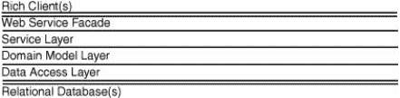

是否要创建一个可以用 XML 文档中的数据进行填充的客户端领域模型，完全取决于富客户端应用程序开发人员。他们还可以决定将信息存储起来以供离线使用。一种方法是将 XML 文档直接保存到磁盘上。另一种是将客户端领域模型持久化到客户端计算机上的离线数据库中。

请注意，最终的客户端领域模型不必与服务器上的领域模型一致。因此，如果客户端领域模型被持久化到离线数据库中，客户端数据库很可能会遵循客户端领域模型的设计，因此不必看起来像服务器端数据库。

### 注意

关于服务器端数据库和客户端数据库的架构，一个重要的区别是：如果服务器端数据库表使用自动递增的标识字段，那么相应的客户端数据库表通常不应该这样做。

假设在服务器上创建了一个新员工。当在 Employees 表中插入一行新记录时，该记录会自动获得一个自增 ID 列的值。然后该员工会被序列化并发送到客户端，客户端用这些数据填充客户端领域模型，并将其存储到客户端数据库中供离线使用。

客户端 Employees 表中的新行不应被分配新的 ID。应该使用服务器端数据库中为该员工分配的 ID。这意味着 ID 列的属性在客户端和服务器端可能不同。

这里的要点是，富客户端应用程序的开发人员可以自由决定是否使用领域模型，如果使用，他们可以自由地按照自己的设计来设计它。客户端和服务器之间的通信是 100% 面向文档的，任何一方都不会对另一方的领域模型做出假设。

例如，也许富客户端会调用许多不同公司的 Web 服务，这些服务都能够返回客户列表，但其 XML 文档中的字段略有不同。一种方法是


处理这个问题的方法是创建一个“superset”客户端 Customer Domain Model 对象，该对象包含所有被调用的公司返回的不同字段的属性。

接下来，我们希望 Rich Client 应用程序的用户能够查看特定客户所属的订单。每个客户的唯一 ID 当然包含在第一个 Web Service 返回的 XML 文档中，因此我们知道我们感兴趣的客户的 ID。

我需要实现一个 Web Service，它接收客户的 ID 并返回该客户的订单。同样，我首先创建 GetOrdersByCustomerID() Service Layer 方法，该方法接受客户的 ID 并返回属于该客户的 Domain Model Order 对象。

然后我将添加一个 GetOrdersByCustomerID() Web Service，它接收客户 ID，将其传递给 Service Layer 方法，最后将返回的订单对象序列化为 XML 文档，以便 Web Service 返回。

然而，在这种情况下，需要对 XML 序列化给予额外的关注。我们希望 XML 文档包含每个订单的总价值，但 Order Domain Model 对象不包含任何 TotalValue 属性，因为订单的总价值并未存储在数据库的任何字段中。

相反，总价值在需要时通过将订单行的值相加来计算。每个订单行的值依次通过将购买产品时的价格乘以购买的商品数量来计算。

由于订单行未包含在发送给客户端的 XML 文档中，客户端应用程序无法计算订单的总价值，这意味着计算必须在服务器上完成，并且结果必须包含在 XML 文档中。

计算订单行的价值和订单总价值的方法是许多人希望放在 OrderLine 和 Order Domain Model 对象上的方法类型的良好示例，但我更喜欢将其放在 Service Layer 中。

## Service Layer Design

这可能是个好时机提到，我通常围绕 Domain Model 中使用的相同实体来组织我的 Service Layer，而不是按任务组织，后者也是很流行的。这意味着如果我在 Domain Model Layer 中有一个 Employee 对象，我将在 Service Layer 中有一个 EmployeeServices 类。

对于不需要事务控制的服务，我通常也将 Service Layer 方法实现为静态方法，以便可以在不实例化 Service Layer 类的任何对象的情况下调用它们。

在本例中，我将在 OrderLineServices Service Layer 类上放置一个静态 GetValue() 方法，并在 OrderServices 类上放置一个静态 GetTotalValue() 方法。这些方法将接受它们应处理的对象的参数。这意味着我不会以以下方式在 Order 对象本身上调用方法：

```
myOrder.GetTotalValue();
```

其实现方式并无新意：客户端使用订单 ID 调用 Web Service，Web Service 将调用转发给 Service Layer 方法并将结果序列化为 XML。到目前为止，我们已经知道让客户端获取数据的流程。那么让客户端提交数据呢？

## Submitting Data

假设我们希望用户能够将订单状态从“Not inspected”更新为“Approved”或“Disapproved”。乍一看似乎是一个简单的请求，但当我们从只读访问转向读写访问时，我们实际上打开了并发问题的潘多拉魔盒。

所以让我们先坚持第一印象，暂时不要看得更深入。那么我们该怎么做呢？

首先要做的是创建一个 `UpdateOrderStatus()` Service Layer 方法以及对应的 Web Service。这些方法应接受订单 ID 和新的订单状态作为参数，并返回一个 bool 值，告知操作是否成功完成。（我们这里不会涉及任何高级跨平台异常处理，即使它非常有趣！）

到目前为止，一切顺利；Service Layer 方法很容易实现，而 Web Service 只是一个包装器，将调用转发给 Service Layer 方法。现在让我们看看我们将遇到的问题。

问题出现在两个用户同时尝试更新同一订单的状态时。假设用户 A 获取了一个订单，注意到其状态为“Not inspected”并继续检查它。稍后，用户 B 获取了同一订单，注意到同样的情况，也决定检查它。用户 A 然后注意到订单存在一个小问题，导致她在随后调用 `UpdateOrderStatus()` Web Service 时将订单标记为“Disapproved”。

就在用户 A 更新了订单状态后，用户 B 继续调用同一个 Web Service 来更新同一订单的状态。然而，用户 B 没有注意到订单的问题，想要将订单标记为“Approved”。用户 B 是否应该能够覆盖 A 赋予订单且现在存储在数据库中的状态？

标准答案是“否，因为用户 B 不知道用户 A 所做的更改。”如果用户 B 知道了用户 A 所做的更改并且仍然决定覆盖它，答案就是“是”，因为这样就可以信任 B 不会意外覆盖 A 的数据。因此挑战就在于：我们如何跟踪 B 或任何其他客户端“知道”什么？

一种方法是跟踪数据库中更新字段的原始值，然后在修改后的数据保存到数据库时，检查原始值是否与数据库中当前的值匹配。如果数据库中的值已更改，则客户端不知道这些更改，客户端的数据应被拒绝。

这种方法称为 *乐观并发*。让我们看一下乐观并发在当前情况下可以如何非常简单地实现。

首先，客户端应用程序必须编写代码，以便当用户更改订单状态时，通过 XML 文档从数据库中最初返回的状态仍然保留。

然后具有相同名称的 `UpdateOrderStatus()` Web Service 和 Service Layer 方法必须修改为接受原始订单状态值的额外参数。因此，当客户端调用 Web Service 时，会传递三个参数：订单的 ID、新的订单状态以及原始订单状态。

最后，`UpdateOrderStatus()` Service Layer 方法应更新为包含检查：数据库中订单的当前状态是否与传递给原始订单状态参数的值匹配，仅在值匹配时才执行更新。

这种乐观并发的版本，将更新字段的原始值与数据库中的值进行匹配，将提供良好的性能和可扩展性，但在 Rich Client 场景中实现起来可能有点繁琐。另一种使用乐观并发的方法是在数据库表上添加版本字段。

有时即使像乐观并发这样的策略也无法工作，因此在这些情况下必须应用特定于领域的解决方案。一个常见的主题是使用某种签入/签出系统，用户在获取对象进行写访问时将其标记为“checked out”或“locked”，防止其他用户在她完成之前更新它。其他更复杂的方案包括合并并发更新的数据。

唯一决定特定情况下哪种策略合适的方法是询问领域专家，即理解这些决策的业务影响并期望行为的人。没有通用的方法来选择并发策略。

即便如此，我猜测在这种情况下合适的做法是使用乐观并发，有或没有版本字段。关键是最终还是由了解其业务预期行为的人来决定。

我们在这里使用的方法最大的问题可能是我们要求客户端为我们跟踪原始值。这可能对客户端应用程序开发人员要求过高，因此更好的替代方案可能是在服务器上将原始值存储在 `Session` 变量或类似结构中。

## How Fine-Grained?

另一个需要考虑的问题是服务是否过于细粒度。与为订单中每个可更新字段提供单独的 Web Service 相比，我们是否可以实现一个单一的 `UpdateOrder()` Web Service 呢？

在这种情况下，与为每个可更新字段提供参数相比，Web Service 可以接受表示更新后订单的 XML 文档。也就是说，与其这样：

```csharp
[WebMethod]
public bool UpdateOrder(int orderID, int orderStatus, DateTime orderDate, int customerID)
```

你可以使用这个：

```csharp
[WebMethod]
public bool UpdateOrder(string xmlOrder)
```

这样，客户端通过 XML 文档的形式既接收数据也提交数据。这种严格面向文档的方式有助于保持 Web 服务 API 的粗粒度，并避免客户端与服务器之间出现过于“琐碎”的对话（参见图 A-4）。

**图 A-4.** 整体应用程序架构概览

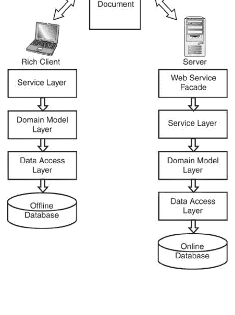

## 数据库模型即领域模型

作者：Frans Bouma

要在语义的基础上处理数据，通常需要为某段逻辑所操作的元素给出通用定义。例如，订单系统处理的元素中包括 `Order` 元素。为了能够定义这段逻辑的工作方式，对 `Order` 这一概念给出定义是很有实际意义的：我们可以通过指定对 `Order` 元素的操作，并补充对 `Order` 元素的定义，来描述系统的功能。

这个 `Order` 元素包含其他元素（如 `OrderID` 和 `ShippingDate` 等值），并且与另一个元素 `OrderRow` 紧密关联，而 `OrderRow` 本身也包含其他元素。你甚至可以说 `Order` 包含一组 `OrderRow` 元素，就像它包含值元素一样。那么，包含值 `OrderID` 与包含一组 `OrderRow` 元素之间有区别吗？这个问题的答案对于 `Order` 概念在后续用程序代码实现订单系统时以何种方式落地非常重要。

### 实体的栖息地

从 E.F. Codd 博士提出的关系模型 [Codd Relational Model] 来看，`Order` 和 `OrderRow` 应当被视为两个分离的元素，它们之间具有一种*关系*，而元素本身则基于它们包含的值（如 `OrderID`）构成一种*关系*。

然而，从 Martin Fowler [Fowler PoEAA] 等人开创的领域模型来看，情况未必如此。你可以将一组 `OrderRow` 元素视为 `Order` 的一个值，并将 `Order`（连同 `OrderRow` 元素）作为一个整体来操作。

### 什么是实体？

1970 年，Peter Chen 博士在其*实体关系模型* [Chen ER] 中定义了*实体*这一概念，该模型建立在 Codd 关系模型之上。实体的概念对于在关系模型中定义 `Order` 和 `OrderRow` 的形态非常有用。Chen 将*实体*定义为：

> **实体与实体集。** 设 *e* 表示我们头脑中存在的一个实体。实体被划分为不同的实体集，如 EMPLOYEE、PROJECT 和 DEPARTMENT。每个实体集都关联一个谓词，用于测试某个实体是否属于该实体集。例如，如果我们知道某个实体属于 EMPLOYEE 实体集，那么我们就知道它具有 EMPLOYEE 实体集中其他实体所共有的属性。在这些属性中，就包括前面提到的测试谓词。

通过使用实体关系模型，我们能够定义 `Order` 和 `OrderRow` 这样的实体，并将它们放入定义我们数据库的关系模型中。使用 Eric Evans 的定义

## 将类映射到表与将表映射到类

O/R 映射处理的是关系模型与对象模型之间的转换：即将对象转换为持久化存储中的实体实例，以及反向转换。从整体上看，可以将其定义为：

对象模型中类的一个字段与关系模型中实体的一个属性相关联，反之亦然。

这里出现了一个“先有鸡还是先有蛋”的问题：谁跟随谁？你是先定义实体类（即*表示*实体定义的类，例如表示 `Order` 实体的 `Order` 类），然后用这些类来创建带属性的关系模型实体；还是先定义关系模型，再在定义实体类时使用该关系模型？

与几乎所有事情一样，这个问题并没有一个明确的“就应该这样做”的答案。“视情况而定”可能是最好的答案。如果你遵循领域模型，你很可能从领域开始，用领域来定义类，其中一些类可能处于继承层次结构中。使用这个类模型，你只需要一个关系模型来存储数据，这个关系模型甚至可以是一张表，主键由对象 ID 组成，再加上一个用于存储对象的二进制大对象字段，以及一些描述对象的元数据元素。在确保关系模型的构建方式能够最好地服务于对象模型之后，将类映射到关系模型中的元素就是很自然的事情。

如果你从关系模型开始，并构建一个 E/R 模型，那么你很可能希望将关系模型中的一个实体映射到一个类。这与领域模型的方法有所不同，例如，因为关系模型不支持继承层次结构：你无法将 Person < Employee < Manager 这样的层次建模出来，使其同时也成为一个继承层次。当然，创建一个可以在语义上被解释为继承层次的关系模型是可能的；但它并不能在定义上表示一个继承层次。

这就是两种方法之间的根本区别。从类开始，然后逐步走向数据库，是将关系模型和数据库仅仅当作存储数据的地方；而从关系模型开始，再逐步走向类，则是以面向对象的方式使用类来处理关系模型。

由于我们选择采用 Chen 的方式定义实体，我们将采用先定义关系模型，再逐步上升到类的方法。稍后在“理想世界”一节中，我们将看到如何在这两种方法之间架起桥梁。

## 以面向对象方式处理数据

表示实体的类是开发者在代码中定义实体的方式，正如物理实现的、带有表结构的 E/R 模型在持久化存储中定义实体一样。使用前一节讨论的 O/R 映射技术，开发者能够通过放置在实体类实例中的内存镜像来操作持久化存储中的实体实例。由于开发者与持久化存储是断开的，这始终是一个批处理式的过程。控制环境是 O/R 映射器，它控制着持久化存储中的实体实例与实体类实例内部的内存镜像之间的连接。

开发者可能会要求 O/R 映射器将一组给定的 `Order` 实例加载到内存中。这将导致持久化存储中的每个 `Order` 实例都在实体类实例内有一个镜像。开发者现在可以操作每个实体实例镜像，通过实体类实例来实现，或者将实体实例镜像显示在表单中，或作为服务的输出提供。被操作过的实体实例镜像必须被持久化，才能使更改持久生效。从开发者的角度看，这就像将对象中被修改的实体实例数据保存到持久化存储中，如同用户将文字处理器中写好的文本保存到文件一样。O/R 映射器正在为开发者执行这一保存操作。但由于我们处理的是镜像，O/R 映射器实际执行的操作是使用从开发者代码收到的镜像中存储的更改来*更新*持久化存储中的实体实例。

关系模型中实体之间的关系在代码中由 O/R 映射器提供的功能来表示。这允许开发者从一个实体实例遍历到另一个实体实例。例如，在 `Order` 系统中，将 `Customer` 实例加载到内存后，开发者可以使用 O/R 映射器提供的功能遍历到该 `Customer` 的 `Order` 实体实例，无论是通过 `Customer` 对象内部的集合对象，还是向 O/R 映射器发起针对与给定 `Customer` 实例相关 `Order` 实例的新请求。

这种处理实体的方式相当静态：在运行时通过组合多个相关实体的属性来构造实体，并不会产生表示实体类的类，因为类必须在编译时就存在。这并不意味着通过属性组合（例如通过带外连接的选择查询）在运行时构造的实体实例不能加载到内存中；只是它们并不代表一个持久化的实体，而是代表一个虚拟实体。这一额外的抽象层主要用于只读场景，例如报表应用程序和只读列表，这些场景通常需要组合相关实体的属性。这类列表的定义示例是将 `Order` 实体的所有属性与 `Customer` 实体中的“公司名称”属性组合在一起。

要成功地以面向对象方式处理数据，关键在于：控制实体实例内存镜像与物理实体实例之间连接的功能必须提供足够的灵活性，使得报表功能和组合属性列表能够被定义并加载到内存中，而不必为了以更动态的方式使用实体实例中的数据而专门使用另一个应用程序。

## 功能研究作为应用程序的基础

要高效地建立关系模型、关系模型中实体定义与表示实体的类之间的映射，以及这些类本身，关键在于复用软件开发项目早期阶段——功能研究阶段——的工作成果。这一阶段在较为经典的软件开发方法中很典型。在此阶段，功能需求和系统功能被确定、以抽象方式定义并形成文档。多年来，已经定义了许多技术来辅助这一阶段；其中一种是 NIAM [Halpin/Nijssen Conceptual Schema]，T.A. Halpin [Halpin IMRD] 进一步发展了它，形成了*对象角色建模*（ORM）。NIAM 和 ORM 使得与客户沟通功能研究结果变得容易，可以使用诸如“Customer has Order”和“Order belongs to Customer”这样易于理解的句子。然后，这些句子被用来在抽象的 NIAM/ORM 模型中定义实体和关系。通常，这一步会使用可视化工具，例如 Microsoft Visio。

## 功能研究结果的重要性


使用 NIAM 或 ORM 等技术对研究结果进行建模的优势在于，抽象模型既能在功能研究阶段记录研究发现，同时它也是应用程序将要使用的关系模型的来源。借助 Microsoft Visio 等工具，可以从 NIAM/ORM 模型生成 E/R 模型，进而生成关系模型，该关系模型可用于在数据库系统中构建物理关系模型。然后，在数据库系统中构成关系模型定义的元数据可用于生成类并构造映射。

这样做的好处是，开发人员使用的类层次结构在项目启动时进行的研究中具有理论基础。这意味着，当应用程序设计中的某些内容发生变化（例如某项功能）时，可以遵循相同的路径：NIAM 模型发生变化，关系模型通过使用更新后的 NIAM 模型创建的新 E/R 模型进行调整，类也随之调整以符合新的 E/R 模型。反之亦然：为了找到开发人员必须处理的代码构造的原因。例如，对于遍历实体实例对象之间关系的代码构造，只需从类回溯到功能研究结果，代码构造的理论基础便会显现出来。理论基础与实际代码之间的这种紧密联系是成功、可维护的软件系统的关键。

## 作为数据消费者的功能流程和业务逻辑的位置

由于真实实体定义存在于关系模型中、数据库内部，而实体的内存实例只是数据库中真实实体实例的镜像，因此在这些实体中没有行为或业务逻辑规则的位置。当然，向实体类添加行为很容易。问题是，当实体类代表关系模型中的实体定义时，这样做是否符合逻辑。答案取决于您要作为行为添加到实体中的业务逻辑类别。大致有三类：

-   面向属性的业务逻辑
-   面向单实体的业务逻辑
-   面向多实体的业务逻辑

面向属性的业务逻辑包含诸如`OrderId > 0`之类的规则。这些是非常简单的规则，充当对单个实体字段的约束。当实体字段被设置为某个值时，可以强制执行此类别的规则。

面向单实体的业务逻辑类别包含诸如`ShippingDate >= OrderDate`之类的规则，这些规则也类似于约束。当实体被加载到内存中的实体对象、保存到持久存储或用于测试实体在给定上下文中是否有效时，可以强制执行此类别的规则。

面向多实体的业务逻辑类别包含跨越多个实体的规则：例如，检查`Customer`是否为 Gold Customer 的规则。要使该规则成立，必须查阅与该`Customer`相关的`Order`实体，以及这些`Order`实体相关的`Order Detail`实体。

所有三类都依赖于实体使用的*上下文*，尽管给定类别中的并非所有规则都是上下文相关的规则。面向属性的业务逻辑是包含最多不受实体使用上下文约束的规则的类别，它是作为行为添加到实体类的良好候选。面向单实体的业务逻辑通常不是作为行为添加到实体类的良好候选，因为该类别中用于使实体在给定*上下文*中*有效*的许多规则，在实体用于其他上下文时可能会发生变化。面向多实体的业务逻辑类别中的规则跨多个实体，因此无法放在单个实体中，此外它们也过于依赖于其所使用的上下文。

### 可插拔规则

为了保持实体作为一个不绑定到给定上下文的概念可用，面向属性的业务逻辑和面向单实体的业务逻辑类别中与上下文相关的业务逻辑规则问题可以通过*可插拔规则*来解决。可插拔规则是包含业务逻辑规则的对象，在运行时插入实体对象中。这样做的好处是，实体类不会绑定到它们所使用的上下文，而是可以用于系统设计所要求的任何上下文：只需为每个上下文创建一组可插拔规则对象，甚至每个实体更多，并且根据上下文状态，通过简单地设置对象引用即可将规则应用于实体。决定将哪些规则对象插入实体的过程是维护实体使用上下文的过程：即代表实际业务流程的过程。

### 功能流程

在上一节“功能研究结果的重要性”中，描述了功能研究阶段，并指出了在研究的功能与该功能的实际实现之间保持紧密联系的重要性。系统通常必须自动化某些*业务流程*，而功能研究将以抽象形式描述这些流程。为了尽可能保持研究与实现之间的联系，一个常见的步骤是根据抽象业务流程对实际实现进行建模，由此产生的类我们称之为*功能流程*，因为它们或多或少是无数据类，只包含功能。

功能流程是实现面向多实体的业务逻辑规则的理想场所。在我们的 Gold Customer 示例中，将 Customer 升级为 Gold Customer 的流程可以实现为一个功能流程，该流程消费 Customer 实体对象及其 Order 实体对象，更新 Customer 实体的某些字段，并在升级过程完成后持久化该 Customer 实体。此外，由于功能流程实际执行业务流程的步骤，它们也是实体被消费的上下文存在的地方，也是决定在给定时间 T 为给定上下文状态将哪些规则插入实体对象的唯一正确位置。

### 使用 NIAM/ORM 实现类和数据库的理想世界

对大多数人来说，现实并不总是与我们期望的理想世界同步，日常软件开发也不例外。在功能研究部分，使用物理关系模型元数据来生成映射和类，从而获得供开发人员使用的实体类定义。更理想的方法是，如果 NIAM/ORM

非常有效的是它有一个配套工具 BODef（关于其一部分的截图，请参阅后面的图 A-11），您可以在其中定义业务对象并生成样板代码。代码生成器不仅仅是一个向导，因为它让您可以一次又一次地生成，而不会丢失手动添加的代码。它使用 Generation Gap 模式 [Vlissides Pattern Hatching] 来实现这一点。在图 A-5 中，您可以看到当前问题的一个（部分）BO 定义。

**图 A-5. 示例的 BO**

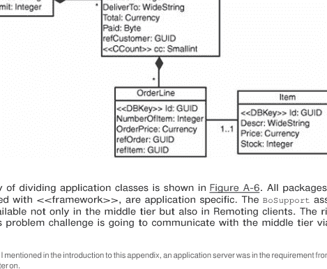

“标准”的应用程序类划分方式如图 A-6 所示。除标记为 <<framework>> 的那些之外，所有包/程序集都是特定于应用程序的。BoSupport 程序集应该不仅在中层可用，还应在 Remoting 客户端中可用。Jimmy 的问题挑战中所需的富客户端将通过 Remoting 与中间层通信。[3]

[3] Jimmy 注：正如我在本附录引言中提到的，从一开始就要求有应用服务器，但后来被移除了。

**图 A-6. 整体架构**


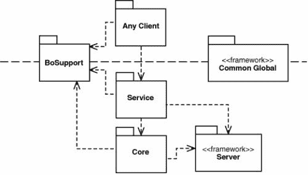

服务程序集至少应包含一个门面对象，该对象实现一些基本接口以支持基本的 CRUD 操作，其中最重要的是 `IVbDBOReq`；参见图 A-7。

### 图 A-7. 门面的架构

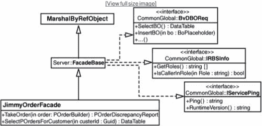

这个门面不是生成的；相反，你从 `FacadeBase` 继承了所有基本功能，包括上述接口的实现。

在持久化存储方面，关系数据库系统（RDBMS）的存在就像文件系统本身一样确定无疑。事实上，RDBMS 是一个不言而喻的需求，如果我想要对我的应用程序数据进行妥善的备份处理，最好使用它。

业务规则的最终执行和实施是核心业务对象（也称为流程对象）的工作。这些对象是无状态的，并且生命周期非常短。你可以在图 A-9 中看到 `POrder` 流程对象，并注意到它们遵循了生成间隔模式。这些对象在 `Core` 程序集中实现。由于我认为授权是业务规则的核心部分，因此在这些对象的（公共）方法上指定角色也就不足为奇了。

### 图 A-9. 在 POrder 中定位自定义规则，本例中为 TakeOrder() 方法

[查看完整尺寸图像]

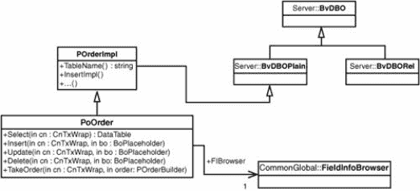

尽管业务规则的实施是核心对象的职责（其中之一是图 A-9 中的 `POrder`），但仍然完全可以在 `BoSupport` 程序集中实现业务规则，从而使其在富客户端中可用。但是，当我这样做时，我总是确保在持久化更改之前，在流程对象中再次检查规则。你看，客户端很可能在将订单提交给中间层的门面对象之前，通过反射覆盖了某个规则，比如订单上限。

流程对象通常会被传递 `BoPlaceholder`，并“隐藏”在门面对象后面。流程对象和占位符（如 `POrder` 和 `POrderPh`）在概念上是同一个（逻辑）业务对象的一部分。

## 元数据

你可能已经在前面的一些图中注意到，框架类中有大量的元数据可用。图 A-10 展示了元数据更完整的图景，尽管没有深入解释。元数据可以为你提供一些动态性，无论是在数据存储处理还是 UI 处理方面。

### 图 A-10. 元数据的完整图景

## 简单注册表处理

这个问题要求处理客户数据。这就是我所说的基本的注册表处理功能。我必须向你展示我的解决方案，因为它揭示了我的一些想法以及为业务对象包含元数据的潜力。

图 A-11 是我的业务对象定义工具 BODef 的截图，向你展示了 Customer 对象。你可以看到，除了字段名称和类型之外，字段还附带了更多信息。

### 图 A-11. BODef 中的 Customer 类

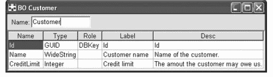

在图 A-12 中，显示了订单应用程序中的一个表单，标签来自元数据。使用这个网格，你可以添加、编辑和删除客户。实现此功能的代码相当简洁（参见下面的代码清单）。其神奇之处全在泛型 TableHandler 中，这个类利用了 Customer 业务对象的元数据、泛型门面接口 `IVbDBOReq`，以及架构中的 BOPlaceholder 和 DataRow 关系。

### 图 A-12. Customer 的默认实现

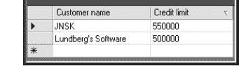

```csharp
public CustomerFormList()
{
    InitializeComponent();
    _tabHndlr = new TableHandlerGuid(SvcFactory.Facade,
        CustomerPh.FieldInfoBrowser.BOName);
    _tabHndlr.TableHandlerChanged += new
        TableHandler.TableHandlerEventHandler
        (TableHandlerEventHandler);
    _tabHndlr.HookUpGrid(grd);
    _tabHndlr.FillGrid();
}
TableHandler _tabHndlr;

string[] confirmString = new string[] {
    "Do you want to add Customer?",
    "Do you want to save changes to Customer?",
    "Do you want to delete Customer?" };

void TableHandlerEventHandler(object sender,
    TableHandler.TableHandlerChangedEventArgs args)
{
    args.AcceptChanges = MessageBox.Show(
        confirmString[(int)args.TableHandlerChangeType],
        "Confirm", MessageBoxButtons.YesNo) == DialogResult.Yes;
}
```

没有必要描述每个细节。你可能想从中汲取一些关于元数据可以做些什么的想法。这里没有展示的是，元数据还可以描述业务对象之间的关系。（关联对象在我的架构中是一等公民。）

## 订单下达业务规则

你可以从 Jimmy 的问题描述中解读出一些言外之意，并看到他希望我们这些客座作者深入探讨的地方。当然，我很乐意。

让我先说说我选择不在问题描述中评论的内容，这并不等于没有实现。搜索问题被忽略了。在我的优先级列表中，由于篇幅限制，它被排除了。按客户列出订单同样如此。新客户的信用评估也遭遇了同样的待遇。我把订单的唯一编号归类为我的模拟场景中的一个小挑战。我只是在订单提交时分配它，订单接收人在那时就能得到返回的编号，并且在那之前不需要它。

对订单接收/填写流程的良好支持是理所当然的。我想象了一个“构建器”[4]，用于操作订单表格（想象成一张纸），订单表格是我将要围绕推理的隐喻。我还把这个构建器想象成一个可序列化的对象，在完成时从客户端提交到中间层。

[4] 例如，你可以想到用于构建字符串的 StringBuilder 类。

多用户方面增加了一些棘手的问题需要解决。例如，当订单接收人与潜在的客户交谈时，如果某个商品的价格发生了变化，他应该立即知道吗？依赖商品存储库检查价格并没有帮助，因为如果你在上午 10:55 获取价格并显示在屏幕上，价格很可能在上午 10:56 就发生了变化。库存也存在同样的问题；商品是有货还是需要从供应商那里订购？

解决这个问题的一种方法是让中间层在价格或库存发生变化时立即通知所有客户端（订单接收人），以便客户端采取措施。然而，这会使事情变得相当复杂。客户端不再仅仅与中间层通信，中间层也可以说是主动地与所有（活跃的）客户端通信。而且，时序问题并没有被消除，只是被最小化了。

我想保持简单，但仍然支持需求。我需要审视业务流程。订单接收人与客户通过电话交谈。他们讨论客户需要什么，并沟通价格和可用性。最终客户决定购买，订单接收人将订单提交给中间层。作为响应，中间层返回一份报告。报告说明了最终的价格和可用性。后者会影响交货日期。所有与之前（口头）给出的事实不符之处都会在报告中标记（如果有的话）。订单接收人与客户讨论这些差异，如果客户不满意，订单可以被取消。取消订单本身就是一个事务，一个撤销/删除事务。

我理解，如果你向客户报了价，你可能至少在一定程度上必须遵守这个价格。[5] 这可以很容易地纠正。一个廉价的方法是把价格设定权留给少数人，他们只在工作时间之外更改价格。另一种方法是让系统本身将价格变更的生效推迟到下一个非需求时刻。如果客户端缓存了价格信息，她必须以某种方式知道在合适的/战略性的时机刷新（或丢弃）缓存。

[5] 如果你，一个订单接收人，在价格上多读或漏读了两个零，你是否需要承担责任？

然而，可用性（库存）的问题与价格不同，是一个动态的问题。因此，需要在提交订单后返回一份报告。即使已经实施了避免价格差异的策略，报告最好也报告发现的任何价格差异，以确保万无一失。该报告还将最终决定订单是否在全局最大限额之内，以及客户的信用是否超限。

当订单被持久化时，我们坚持使用给出的价格。我们不想用高于承诺价格的发票让客户生气。这迫使我们存储承诺的价格（**图 A-5** 中的 `OrderPrice`）以及订单，而不是仅仅引用商品（商品有价格）。另一种方案是维护商品的价格历史，但这太麻烦了。而且，是的，对于已提交的订单，我们不会“重新打开”来补充商品，比如客户在与我们交谈后不久意识到他想要三件而不是两件某物。我们可能会下一个免运费和/或免开票费用的订单来处理这种情况。[6] 将订单行更改为较少的商品数量则是另一回事，我们可以轻松处理（在现实世界中，这可能会影响大批量折扣）。

[6] 这是像这样的玩具示例中许多表述不清的问题之一。

## POrderBuilder

对采购订单的接收和处理支持在 `POrderBuilder` 类中。它是一个旨在客户端和中间层同时使用的类，并通过网络序列化传输。`POrderBuilder` 在多种情况下与仓库交互，例如在调用 `AddItemToOrder()` 创建订单行时。这种交互被封装在一个名为


`ItemStore` 由单个方法 `GetItem()` 组成。

不一致报告由 `POrderBuilder` 在调用方法 `CheckDiscrepancies()` 时创建。典型场景是客户端使用 `ItemStore` 的本地版本，详见 `ItemStore` 以及客户端、服务器和测试中的不同实现，在与客户交谈期间提供价格和库存。当订单完成后，接单员将其提交到中间层。此时中间层在传递的 `POrderBuilder` 上调用 `CheckDiscrepancies()` 以生成报告。此时 `ItemStore` 是位于靠近数据库的中间层中的对象。

将 `CheckDiscrepancies()` 作为 `POrderBuilder` 的方法在单元测试方面很有吸引力。请看下面的代码清单。`POrderBuilder`、`bldr` 在 `[SetUp]` 时创建，同时也填充了几条订单行。`itemStore` 是一个存根 `ItemStore`，也在 `[SetUp]` 期间创建并与 `bldr` 关联。测试在第一行模拟了在生成该不一致报告时 `ItemStore` 中关于库存的情况发生了变化。请看以下代码：

```csharp
[Test]
public void Stock()
{
    itemStore.Items[0].Stock = 1;

    POrderDiscrepancyReport r = bldr.CheckDiscrepancies();
    Assert.AreEqual(0, r.PriceCount);
    Assert.AreEqual(1, r.StockCount);
    Assert.AreEqual(1, r.GetStockAt(0).NumberOfMissingItems);
}
```

请想象不一致报告是在订单提交处理早期、在订单提交之前创建的。然而，这里存在一个关于事务处理的问题，这个问题经常被忽视或过度简化。如果你不小心，检查可能会顺利通过，也就是说没有任何不一致，但在提交订单时，例如库存中最后一件商品已被“分配”给另一位订单和客户。我要说的是，不一致检查应该在与订单提交相同的事务中进行，并且使用锁来防止其他人从你即将出售的仓库中“窃取”商品。

## 客户端、服务器和测试中的 ItemStore 不同实现

也许有意思更仔细地看看 `ItemStore`。我之前在文中谈到了本地客户端版本以及中间层的事务版本。这是怎么回事？好吧，让我来展示给你看。

在图 A-13 中，你可以看到 `POrderBuilder` 如何持有对 `ItemStore` 的引用。该引用被实现为一个公共属性，由应用程序代码赋值。在客户端，我使用的 `ItemStore` 实现与我在订单提交期间在中间层使用的事务实现非常不同，我很抱歉如果我夸大了这一点。`ItemStore` 在方法数量方面并不是一个难以实现的接口；然而，它对 `POrderBuilder` 来说非常核心。`ItemStore` 例如被图 A-13 中显示的所有方法使用。

**图 A-13.** `POrderBuilder` 与 `ItemStore` 之间的关系

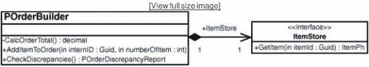

我将客户端版本的 `ItemStore` 实现为简单的“从商店读取所有商品并缓存”。只要商品数量不是太大，这种策略就很好。如果到了那一步，实现一个查询中间层“更智能”的版本也不是什么大问题。在客户端，当接单员有权限“处理订单”时，会实例化一个 `POrderBuilder` 并分配一个客户端 `ItemStore` 实现的实例。随时都可以使用客户端 `ItemStore` 进行 `CheckDiscrepancies()` 检查。

如果客户接受，下一步就是将订单提交到中间层。`POrderBuilder` 实例通过线路序列化，但 `ItemStore` 实例不序列化。`ItemStore` 的引用被标记为 `[NonSerialized]`。在外观对象中，创建连接/事务，并将接收订单的工作交给进程对象（业务对象）。这里展示如下：

```csharp
public POrderDiscrepancyReport TakeOrder(POrderBuilder order)
{
    POrder bo = new POrder();
    CnTxWrap cn =
        CnTxWrap.BeginTransaction(bo.CreateConnectionForMe() );
    try
    {
        POrderDiscrepancyReport res = bo.TakeOrder(cn, order);
        cn.Commit();
        return res;
    }
    catch
    {
        cn.Rollback();
        throw;
    }
}
```

顺便说一下，让我们看看进程对象的 `TakeOrder()` 方法在下面的清单中：

```csharp
[PrincipalPermission(SecurityAction.Demand, Role = Roles.User)]
[PrincipalPermission(SecurityAction.Demand, Role =
    @"InternalUnitTesting")]
public POrderDiscrepancyReport TakeOrder(CnTxWrap cn,
    POrderBuilder order)
{
    ItemStore itmStore = new TxItemStore(cn);
    order.ItemStore = itmStore;
    POrderDiscrepancyReport res = order.CheckDiscrepancies();

    POrderPh ordr =
        ((POrderBuilder.IOrderInternal)order.POrder).POrder;
    new POrder().InsertNoRBS(cn, ordr);

    OrderLine olproc = new OrderLine();
    for(int i=0; i<order.OrderLineCount; i++)
    {
        OrderLinePh ol =
            ((POrderBuilder.IOrderLineInternal)order[i]).OrderLine;
        olproc.InsertNoRBS(cn, ol);
    }

    return res;
}
```

你可以看到 ItemStore 实际上是一个 TxItemStore 的实例，它接收参数 cn，该参数包含/包装数据库连接和正在进行的事务。此 ItemStore 实现使用 UPDLOCK 提示读取商店（或你偏好的任何方法），导致此时商店被锁定以供其他人更新。 granted，这有点瓶颈，但正确性很高。

如果存在严重的业务规则违规，例如超出全局最大限制，`CheckDiscrepancies()` 将抛出异常。如果唯一的不一致是价格差异或库存不足，这些将在报告中记录，但订单仍会被完全放置。

你还记得我说的关于在客户端和服务器上都“运行”的业务规则的双重检查吗？精髓是永远不要信任客户端。好吧，检查是在 `CheckDiscrepancies()` 中完成的。例如，客户端对价格的任何篡改都会显示为不一致。在这种特定情况下，客户端运行在受控环境中，但你仍应谨慎。服务器上执行的代码比客户端上的代码更安全。记住服务器通常无法知道调用者是你的程序通过线路发送信息，还是另一个程序。

## 一些最后的要点

让我们诚实一点。这不是大多数人会称之为纯 OO 的东西。例如，我并不害怕使用比语言本身提供的“更弱”一些的对象引用。看看我在图 A-13 中以 Guid 形式表示的商品引用。但如果你有点大胆，就问问自己使用“指针”引用有什么显而易见的。将其与代理引用进行比较，后者为你提供了延迟/懒惰实例化的选项。

我想说的是，不要纠结于什么是对什么是错。一般来说，并不存在这样的东西（我确信 Jimmy 同意）。把工作做完。为你的业务提供它需要的软件。知道你的设计目标是什么（例如，将业务规则放在一个地方），并实现它们。

## 附录 B. 讨论的模式目录

本附录是书中讨论的模式目录。这里没有新信息；相反，这旨在为读者提供服务。你可以在这里找到模式的来源以阅读更多内容，一个 *非常* 精简的描述，以及最常见的情况下一个 URL，可以立即获取更多信息。

### 注意

如果你希望它可点击，你也可以在线找到本附录：

[www.jnsk.se/addpp/patterns](http://www.jnsk.se/addpp/patterns)

当描述写在引号之间时，这意味着描述直接取自提供的 URL（或在某些 [GoF Design Patterns] 的情况下取自提到的书籍的内封面）。


## 类表继承 [Fowler PoEAA]

> "表示类继承层次结构，每个类一个表。"

[http://www.martinfowler.com/eeaCatalog/classTableInheritance.html](http://www.martinfowler.com/eeaCatalog/classTableInheritance.html)

## 粗粒度锁 [Fowler PoEAA]

> "使用单个锁锁定一组相关对象。"

http://www.martinfowler.com/eaaCatalog/coarseGrainedLock.html

## 收集参数模式 [Beck SBPP]

将对象传递给方法以收集方法的信息。

## 数据映射器 [Fowler PoEAA]

> "映射器层在对象和数据库之间移动数据，同时保持它们彼此独立以及与映射器本身的独立。"

[http://www.martinfowler.com/eaaCatalog/dataMapper.html](http://www.martinfowler.com/eaaCatalog/dataMapper.html)

## 数据传输对象 [Fowler PoEAA]

> "在进程间携带数据的对象，以便减少方法调用次数。"

http://www.martinfowler.com/eaaCatalog/dataTransferObject.html

## 嵌入值 [Fowler PoEAA]

> "将一个对象映射到另一个对象表的多个字段中。"

[http://www.martinfowler.com/eaaCatalog/embeddedValue.html](http://www.martinfowler.com/eaaCatalog/embeddedValue.html)

## 实体 [Evans DDD]

> "许多对象并非从根本上由其属性定义，而是由连续性和身份的线索定义。"

[http://patternshare.org/default.aspx/Home.DDD.Entities](http://patternshare.org/default.aspx/Home.DDD.Entities)

## 工厂 [Evans DDD]

> "当对象的创建，或整个聚合变得复杂或暴露了太多内部结构时，工厂提供封装。"

http://patternshare.org/default.aspx/Home.DDD.Factories

## 工厂方法 [GoF Design Patterns]

> "为创建对象定义一个接口，但让子类决定实例化哪个类。
> 工厂方法让一个类将实例化延迟到子类。"

## 外键映射 [Fowler PoEAA]

> "将对象之间的关联映射到表之间的外键引用。"

[http://www.martinfowler.com/eaaCatalog/foreignKeyMapping.html](http://www.martinfowler.com/eaaCatalog/foreignKeyMapping.html)

## 生成间隙 [Vlissides Pattern Hatching]

> "无论重新生成多少次，都只需修改或扩展一次生成的代码。"

http://www.research.ibm.com/designpatterns/pubs/gg.html

## 标识字段 [Fowler PoEAA]

> "在对象中保存数据库 ID 字段，以在内存对象和数据库行之间保持标识。"

http://www.martinfowler.com/eaaCatalog/identityField.html

## 标识映射 [Fowler PoEAA]

> "通过将每个已加载对象保存在映射中，确保每个对象仅加载一次。在引用它们时使用映射查找对象。"

http://www.martinfowler.com/eaaCatalog/identityMap.html

## 隐式锁 [Fowler PoEAA]

> "允许框架或层超类型代码获取离线锁。"

[http://www.martinfowler.com/eaaCatalog/implicitLock.html](http://www.martinfowler.com/eaaCatalog/implicitLock.html)

## 层超类型 [Fowler PoEAA]

> "一种充当其层中所有类型的超类型的类型。"

http://www.martinfowler.com/eaaCatalog/layerSupertype.html

## 层 [POSA]

(Also in [Fowler PoEAA].)

> "将应用程序结构化为可分解为子任务组的应用程序，其中每个子任务组处于特定的抽象级别。"

[http://patternshare.org/default.aspx/Home.POSA.Layers](http://patternshare.org/default.aspx/Home.POSA.Layers)

## 延迟加载 [Fowler PoEAA]

> "一个不包含所需所有数据但知道如何获取数据的对象。"

http://www.martinfowler.com/eaaCatalog/lazyLoad.html

## 元数据映射 [Fowler PoEAA]

> "在元数据中保存对象关系映射的详细信息。"

http://www.martinfowler.com/eaaCatalog/metadataMapping.html

## 模型视图演示者 [Fowler PoEAA2]

> "在允许视图接收用户事件的同时，将演示的行为与视图分离。"

http://www.martinfowler.com/eaaDev/ModelViewPresenter.html

## 通知 [Fowler PoEAA2]

> "一个收集领域层中关于错误和其他信息的对象，并将其传达给表示层。"

http://www.martinfowler.com/eaaDev/Notification.html

## 乐观离线锁 [Fowler PoEAA]

> "通过检测冲突并回滚事务，防止并发业务事务之间的冲突。"

[http://www.martinfowler.com/eaaCatalog/optimisticOfflineLock.html](http://www.martinfowler.com/eaaCatalog/optimisticOfflineLock.html)

## 参与者原型 [Arlow/Neustadt Archetype Patterns]

表示人员和组织信息的一种方式。

## 悲观离线锁 [Fowler PoEAA]

> "通过一次只允许一个业务事务访问数据，防止并发业务事务之间的冲突。"

http://www.martinfowler.com/eaaCatalog/pessimisticOfflineLock.html

## 演示模型 [Fowler PoEAA2]

> "独立于界面中使用的 GUI 控件表示演示的状态和行为。"

[http://www.martinfowler.com/eaaDev/PresentationModel.html](http://www.martinfowler.com/eaaDev/PresentationModel.html)

## 代理 [GoF Design Patterns]

> "为另一个对象提供代理或占位符以控制对其的访问。"

http://patternshare.org/default.aspx/Home.GOF.Proxy

## 查询对象 [Fowler PoEAA]

> "表示数据库查询的对象。"

[http://www.martinfowler.com/eaaCatalog/queryObject.html](http://www.martinfowler.com/eaaCatalog/queryObject.html)

## 记录集 [Fowler PoEAA]

> "表格数据的内存表示。"

http://www.martinfowler.com/eaaCatalog/recordSet.html

## 远程外观 [Fowler PoEAA]

> "在细粒度对象上提供粗粒度外观，以提高网络上的效率。"

[http://www.martinfowler.com/eaaCatalog/remoteFacade.html](http://www.martinfowler.com/eaaCatalog/remoteFacade.html)

## 仓储 [Evans DDD]

(Also in [Fowler PoEAA].)

用于定位处于生命周期中间的某个实体（或一组实体）的对象。

[http://patternshare.org/default.aspx/Home.DDD.Repositories](http://patternshare.org/default.aspx/Home.DDD.Repositories)

## 分离表示 [Fowler PoEAA2]

> "确保任何操作表示的代码仅操作表示，将所有领域和数据源逻辑推入程序中明确分离的区域。"

http://www.martinfowler.com/eaaDev/SeparatedPresentation.html

## 服务定位器 [Alur/Crupi/Malks Core J2EE Patterns]

> "使用服务定位器来实现并封装服务和组件查找。服务定位器隐藏查找机制的实现细节并封装相关依赖项。"

[http://www.corej2eepatterns.com/Patterns2ndEd/ServiceLocator.htm](http://www.corej2eepatterns.com/Patterns2ndEd/ServiceLocator.htm)

## 服务 [Evans DDD]

不自然地适合实体或值对象的职责可以提取到服务中。

[http://patternshare.org/default.aspx/Home.DDD.Services](http://patternshare.org/default.aspx/Home.DDD.Services)


## 规格 [Evans DDD]

（另见于 [Fowler Analysis Patterns]。）

捕获并揭示具有概念描述名称的谓词。

## 状态 [GoF Design Patterns]

“允许一个对象在内部状态改变时改变其行为。该对象看起来就像改变了其类一样。”

## 表模块 [Fowler PoEAA]

“一个处理数据库表或视图中所有行的业务逻辑的单一实例。”

[http://www.martinfowler.com/eaaCatalog/tableModule.html](http://www.martinfowler.com/eaaCatalog/tableModule.html)

## 模板方法 [GoF Design Patterns]

“定义一个操作中算法的骨架，将一些步骤延迟到子类。模板方法使得子类可以在不改变算法结构的情况下重新定义算法的某些步骤。”

http://patternshare.org/default.aspx/Home.GOF.TemplateMethod

## 事务脚本 [Fowler PoEAA]

“通过过程来组织业务逻辑，其中每个过程处理来自表现层的一个请求。”

http://www.martinfowler.com/eaaCatalog/transactionScript.html

## 工作单元 [Fowler PoEAA]

“维护由业务事务影响的对象列表，并协调变更的写出以及并发问题的解决。”

[http://www.martinfowler.com/eaaCatalog/unitOfWork.html](http://www.martinfowler.com/eaaCatalog/unitOfWork.html)

## 值对象 [Evans DDD]

（另见于 [Fowler PoEAA]。）

“许多对象没有概念上的身份。这些对象描述事物的某些特征。”

[http://patternshare.org/default.aspx/Home.DDD.ValueObjects](http://patternshare.org/default.aspx/Home.DDD.ValueObjects)

## 参考文献

- [Alexander Pattern Language] Alexander, Christopher, Sara Ishikawa, and Murray Silverstein with Max Jacobson, Ingrid Fiksdahl-King, and Shlomo Angel. *模式语言：城镇、建筑、构造*. New York: Oxford University Press, 1977.
- [Alur/Crupi/Malks Core J2EE Patterns] Alur, Deepak, John Crupi, and Dan Malks. *核心J2EE模式，第二版：最佳实践与设计策略*. New Jersey: Prentice Hall, 2003.
- [Arlow/Neustadt Archetype Patterns] Arlow, Jim, and Ila Neustadt. *企业模式与MDA：使用原型模式与UML构建更好的软件*. Boston, MA: Addison-Wesley, 2004.
- [AspectJ] http://eclipse.org/aspectj/
- [AspectSharp] http://www.castleproject.org/index.php/AspectSharp
- [Astels TDD] Astels, David. *测试驱动开发：实用指南*. New Jersey: Prentice Hall, 2004.
- [Bauer/King HiA] Bauer, Christian, and Gavin King. *Hibernate实战*. Greenwich, CT: Manning, 2005.
- [Beck SBPP] Beck, Kent. *Smalltalk最佳实践模式*. New Jersey: Prentice Hall, 1997.
- [Beck TDD] Beck, Kent. *测试驱动开发：通过示例*. Boston, MA: Addison-Wesley, 2003.
- [Beck XP] Beck, Kent. *极限编程解析：拥抱变化*. Boston, MA: Addison-Wesley, 2000.
- [Bloch Effective Java] Bloch, Joshua. *有效Java编程语言指南*. Boston, MA: Addison-Wesley, 2001.
- [Booch OOAD] Booch, Grady. *面向对象分析与设计：应用，第二版*. Reading, MA: Addison-Wesley, 1994.
- [Bosch Product Line] Bosch, Jan. *软件架构的设计与使用：采用和演进产品线方法*. Boston, MA: Addison-Wesley, 2000.
- [POSA] Buschmann, Frank, Regine Meunier, Hans Rohnert, and Peter Sommerlad, and Michael Stal. 面向模式的软件架构：模式系统. New York: Wiley, 1996.
- [Castle] http://www.castleproject.org/
- [Cattell ODM] Cattell, R.G.G. 对象数据管理：面向对象和扩展关系数据库系统. Reading, MA: Addison-Wesley, 1994.
- [CC.NET] http://confluence.public.thoughtworks.org/display/CCNET
- [Chen ER] Chen, P. “面向数据统一视图的实体-关系模型.” ACM Transactions on database systems, vol.1 no.1, 1976.
- [Cockburn Agile] Cockburn, Alistair. 敏捷软件开发. Boston, MA: Addison-Wesley, 2002.
- [Codd Relational Model] Codd, E. F. “大型共享数据库的关系数据模型.” Communications of the ACM, vol. 13, no. 6, 1970.
- [Connolly/Begg DB Systems] Connolly, Thomas M. and Carolyn E. Begg. 数据库系统，第四版：设计、实现与管理的实用方法. Boston, MA: Addison-Wesley, 2004.
- [Demeyer/Ducasse/Nierstrasz OORP] Demeyer, Serge, Stéphane Ducasse, and Oscar Nierstrasz. 面向对象再工程模式. San Francisco: Morgan Kaufmann, 2002.
- [Enterprise Library Logging] http://msdn.microsoft.com/library/default.asp?url=/library/en-us/dnpag2/html/entlib.asp
- [Evans DDD] Evans, Eric. 领域驱动设计：应对软件核心的复杂性. Boston, MA: Addison-Wesley, 2004.
- [Ewald TxCOM+] Ewald, Tim. 事务性COM+：构建可扩展应用程序. Boston, MA: Addison-Wesley, 2001.
- [Feathers Humble Dialog Box] Feathers, Michael. “谦逊对话框.” http://www.objectmentor.com/resources/articles/TheHumbleDialogBox.pdf
- [Feathers Self-Shunt] Feathers, Michael. “‘自我’分流单元测试模式.” http://www.objectmentor.com/resources/articles/SelfShunPtrn.pdf
- [Gregor Kiczales] http://www.cs.ubc.ca/~gregor/
- [Halpin IMRD] Halpin, Terry. 信息建模与关系数据库：从概念分析到逻辑设计. San Francisco: Morgan Kaufmann, 2001.
- [Halpin/Nijssen Conceptual Schema] Halpin, T.A. and G.M. Nijssen. 概念模式与关系数据库设计：面向事实的方法. New Jersey: Prentice Hall, 1989.
- [Hay Data Model Patterns] Hay, David. 数据模型模式：思维约定. New York: Dorset House, 1996.
- [Hibernate] http://hibernate.org
- [Hohpe/Woolf EIP] Hohpe, Gregor and Bobby Woolf. 企业集成模式：设计、构建和部署消息传递解决方案. Boston, MA: Addison-Wesley, 2004.
- [iBATIS] http://ibatis.apache.org/
- [Jacobson OOSE] Jacobson, Ivar, Magnus Christerson, Patrik Jonsson, and Gunnar Overgaard. 面向对象软件工程：用例驱动方法. Reading, MA: Addison-Wesley, 1992.
- [Johnson J2EE Development without EJB] Johnson, Rod with Juergen Hoeller. 专家一对一：无EJB的J2EE开发. Indianapolis, IN: Wiley, 2004.
- [Jordan/Russell JDO] Jordan, David, and Craig Russel. Java数据对象. Sebastopol, CA: O'Reilly, 2003.
- [Kerievsky R2P] Kerievsky, Joshua. 重构到模式. Boston, MA: Addison-Wesley, 2005.
- [Lhotka BO] Lhotka, Rocky. 专家C#业务对象. Berkeley, CA: Apress, 2004.
- [Log4Net] http://logging.apache.org/log4net/
- [Loom.NET] http://www.dcl.hpi.uni-potsdam.de/research/loom/
- [Löwy Programming .NET Components] Löwy, Juval. 编程.NET组件。第二版. Cambridge, MA: O'Reilly, 2005.
- [Martin PPP] Martin, Robert C. 敏捷软件开发：原则、模式与实践. New Jersey: Prentice Hall, 2002.
- [POCMock] http://www.prettyobjects.com/pocmock.aspx
- [Prevayler] http://www.prevayler.org/wiki.jsp
- [Refactor] http://www.devexpress.com
- [ReSharper] http://www.jetbrains.com
- [Richter .NET Framework] Richter, Jeffrey. *应用Microsoft .NET Framework编程*. Redmond, Wash: Microsoft Press, 2002.
- [Ross BRB] Ross, Ronald. *业务规则手册：对规则进行分类、定义和建模。第二版*. Houston, TX: Business Rule Solutions, 1997.
- [Rumbaugh OMT] Rumbaugh, James R., Michael R. Blaha, William Lorensen, Frederick Eddy, and William Premerlani. *面向对象建模与设计*. New Jersey: Prentice Hall, 1990.
- [SnapDAL] http://sourceforge.net/projects/snapdal
- [Spolsky Leaky Abstractions] Spolsky, Joel. *泄漏抽象定律*. http://www.joelonsoftware.com/articles/LeakyAbstractions.html
- [Spring] http://www.springframework.org/
- [Spring.NET] http://www.springframework.net/
- [Szyperski Component Software] Szyperski, Clemens. *组件软件，第二版*. Boston, MA: Addison-Wesley, 2003.
- [Testdriven.net] http://www.testdriven.net
- [Valhalla] http://www.jnsk.se/weblog/posts/part7.htm
- [Vlissides Pattern Hatching] Vlissides, John M. *模式孵化：设计模式应用*. Reading, MA: Addison-Wesley, 1998.
- [von Halle BRA] von Halle, Barbara. *业务规则应用：利用业务规则方法构建更好的系统*. New York: Wiley, 2001.
- [Windsor] http://www.castleproject.org/index.php/Container


- [Woolf 空对象] Woolf, Bobby. "空对象模式," in *程序设计模式语言 III*. By Robert C. Martin, Dirk Riehle, and Frank Buschmann (Eds.). Reading, MA: Addison-Wesley, 1998.

- [XtUnit] http://weblogs.asp.net/rosherove/archive/2004/10/05/238201.aspx

## Index

A B C D E F G H I J K L M N O P Q R S T U V W X Y

- **API**
  - 创建 2nd
    - *上下文*
    - *数据库约束*
    - *决定何时将规则绑定到与域相关的转换或*
    - *状态，可保存状态*
  - 改进
  - **NHibernate**
    - *创建 (CRUD)*
    - *删除 (CRUD)*
    - *读取多个 (CRUD)*
    - *读取一个 (CRUD)*
    - *事务*
    - *更新 (CRUD)*
  - O/R 映射器
  - 持久化
    - *发现问题*
    - *忘记检查转换*
    - *错误的转换*
  - TDD
- **应用程序，识别应用程序是否会长期存在**
- **应用程序服务器，WinForms 和**
- **应用程序状态**
- **架构模式**
  - 领域模型模式
  - 层 (示例)
    - *问题*
    - *解决方案一：应用层*
  - **架构**
    - Lundberg, Ingemar 示例
    - 前期架构设计
      - *一致性*
      - *MDA*
      - *重用思想*
      - *软件工厂*
- **面向方面编程 (AOP)** 2nd 3rd
  - .NET
    - *向现有类添加状态和行为*
    - *使用方面模块化日志代码*
    - *将业务规则移入方面*
  - advice
  - aspect
  - Decorator 模式
  - 介绍
  - 连接点
  - 切点
  - 问题
- **AspectJ**
  - **方面**
    - AOP
    - 模块化日志代码
    - 将业务规则移入
- 程序集，NHibernate
- 原子性，一致性，隔离性，持久性 (ACID) 2nd
- 属性导向的业务逻辑
- 审计机制
- 自动装配 PicoContainer.NET
- 避免问题，域相关规则
- Bar
- BDUF (前期大设计)
- BeginReadTransaction()
- 行为，向现有类添加
- 前期大设计 (BDUF)
- BLL (业务逻辑层)
- BO (业务对象)
  - 占位符
- Booch, Grady
- BoSupport
- Bouma, Frans; 数据库模型即领域模型
- 有界上下文 2nd
- 弥合差距
- BrokenRulesRegardingPersistence
- Burhop, Mark
- 业务逻辑层 (BLL)
- 业务逻辑，功能研究
  - 功能流程
  - 可插拔规则
- 业务对象 (BO)
- 业务流程
- Bystrom, Dan
- C++
- 缓存，查询和
- 回调方法
- CanAddOrder()
- CanFindOrdersViaCustomer()
- CantExceedStringLengthWhenPersisting()
- CatalogController
- 分类规则
- CC.NET (Cruise Control.NET)
- 责任链
- CheckDiscrepancies()
- CheckOKToAccept()
- Chen, Peter
- 粗粒度接口
- 类
  - 向...添加状态和行为
  - 表示实体的类
  - 将类映射到表与将表映射到类
- 分类
  - NHibernate
    - 高级数据库支持
    - API
    - 领域模型
    - 功能
    - 映射器样式
    - 查询语言
    - 起始点
  - O/R 映射器
    - 高级数据库支持
    - API
    - 领域模型
    - 功能
    - 基于元数据的映射
    - 查询语言
    - 起始点
- 类表继承
- 客户端数据库与服务器端数据库
- 客户端控制，TDD
- 客户端服务器，SOA 和
- 客户端领域模型
- 粗粒度锁 2nd
- Codd, E.F.
- 自定义代码的代码生成
  - 数据映射器模式
- 代码坏味道 2nd
  - 重构
  - 清理工具
  - 防止问题增长
    - 防止问题增长：表单模板方法
    - 防止问题增长：内联单例
  - 常规清理
    - 常规清理：封装集合
    - 常规清理：封装字段
    - 常规清理：提取方法
- CollectBrokenRules()
- _CollectBrokenRulesRegardingAccepted()
- 收集参数模式 2nd
- 组合视图/控制器 (MVC 模式)
- 组件，NHibernate
- 编译时与运行时，P1
- 完整领域模型实例化
- 复杂规则
- 编译器，TDD
- 组件适配器
- 组件，TDD
- 具体表继承
- 并发
  - 控制
    - NHibernate
  - 领域模型 2nd
  - 乐观并发
- 配置
- 配置建议
- 后果，模拟对象和存根
- 一致性，前期架构设计
- 约束，数据库约束 (创建 API)
- 构造函数依赖注入
- 构造函数，P1
  - 从持久化重建实体
- 构造，P1
- 消费者，提供元数据
- 仓库的消费者，查询的位置
- 容器，控制反转
  - 嵌套容器
- 上下文
  - 有界上下文
  - 创建 API
  - 层
  - 分区 2nd
    - 使用原因
  - 扩展 DDD 项目
- 上下文化依赖查找
- Dahan, Udi
- DAL (数据访问层)
- 数据
  - 检索，示例
  - 存储 (持久化基础设施) 2nd
    - 选择如何存储数据
    - 文件系统
    - 对象数据库
    - RAM
    - 关系数据库
    - 资源管理器
  - 提交，示例
  - 以面向对象的方式处理数据
- 数据访问代码
- 数据访问层 (DAL)
- 数据访问，测试
- 数据库约束，创建 API
- 数据库
  - 高级数据库支持：NHibernate
  - 在具有庞大参数列表的数据库中过滤
  - 遗留数据库映射
  - 可维护性
  - 性能
  - 关系数据库 2nd
    - 与领域模型的不匹配
    - NHibernate
    - 存储数据 (持久化基础设施)
  - 数据库模式
  - 数据库支持，O/R 映射器
  - 数据库测试
    - 演进的模式
    - 在运行期间维护数据库状态
    - 在测试前重置测试使用的数据
    - 在每次测试前重置数据库
    - 将单元测试与调用测试分离
- 数据绑定
- 数据映射器 2nd 3rd
  - 选择方法
  - 自定义代码的代码生成
  - 自定义手动代码
  - 元数据映射
- 数据传输对象 (DTO) 2nd
- 数据类型，特殊数据类型 (P1)
- DbUnit
- DDD (领域驱动设计) 2nd
  - 分层
  - 模型关注
  - NHibernate 和
    - 程序集
    - ISession
    - 仓库
    - 事务
  - 重构
- 装饰器模式 2nd 3rd
- 解耦控制器与视图 (MVC 模式)
- 依赖，TDD
- 依赖注入 2nd 3rd 4th 5th
  - 构造函数依赖注入
  - 注册表
  - Setter 依赖注入
  - Spring.NET
  - 与服务定位器对比
- 设计模式 2nd
  - 查询对象 (示例) 2nd
    - 问题
    - 解决方案一：在领域内过滤
    - 解决方案三：查询对象
    - 解决方案二：在数据库中过滤
  - 状态模式 (示例) 2nd
    - 问题
    - 解决方案四
    - 解决方案一
    - 解决方案三
    - 解决方案二
  - 策略
- 设计模式 (ital)
- 开发者
- 诊断
- 方向性
- 折扣曲线
- 显示动态，单元测试示例
- 显示对象类型，单元测试示例
- 分布
  - 容错
  - 可扩展性
  - 安全性
- 文档，TDD
- 领域驱动设计 (DDD) 2nd
  - 分层
  - 模型关注
  - NHibernate 和
    - 程序集
    - ISession


- *仓储*
- *事务*
- *重构*
- **领域相关规则**
  - 聚合
  - 避免问题
  - 协作
  - ID
  - 定位基于集合的处理方法
  - 服务验证
  - 转换
- **领域模型，处理功能列表的起点**
- **领域模型 2nd 3rd**
  - 客户端领域模型
  - 完整或子集实例化
  - 并发 2nd
  - DDD
    - *分层*
    - *模型焦点*
    - *NHibernate 与*
    - *重构*
  - 执行
  - 与关系数据库的阻抗不匹配
  - 实例的生命周期
  - 隔离实例
  - 位置
    - *查询*
  - 映射表示模型
  - 模型焦点
  - NHibernate：分类
  - O/R 映射器
  - 对象关系映射与
  - 订单
  - 分区
  - PL 与
  - 问题/特性
    - *向信用机构核查*
    - *并发冲突检测*
    - *客户欠款不得超过一定金额*
    - *通过灵活复杂的过滤器列出客户*
    - *查看特定客户时列出订单*
    - *订单总金额不得超过一百万*
    - *订单和客户应具有唯一编号*
    - *订单具有验收状态*
    - *订单必须有客户，订单行必须有*
    - *具有许多不同订单行的订单*
    - *保存订单*
  - 查询对象（示例），在领域模型内进行过滤
  - 细化
    - *历史客户信息*
    - *订单*
    - *订单日期*

## 索引

A B C D E F G H I J K L M N O P Q R S T U V W X Y

- 立即加载
  - NHibernate
- Effective Java
- 效率
- 嵌入值 2nd
  - NHibernate
- 封装集合，常规清理（代码坏味）
- 封装字段，常规清理（代码坏味）
- 实体 2nd 3rd
  - 位置
  - PI
- 表示实体的类
- 实体关系模型
- Equals()
- Evans, Eric 2nd 3rd
- Execute() 方法
- 执行领域模型
- 提炼函数，常规清理（代码坏味）
- 极限编程（XP）2nd

## 索引

[A] [B] [C] [D] [E] [F] [G] [H] [I] [J] [K] [L] [M] [N] [O] [P] [Q] [R] [S] [T] [U] [V] [W] [X] [Y]

- 工厂
  - 通过提供的工厂实例化，PI
  - TDD
- 工厂模式
  - 工厂方法 2nd
  - 工厂模式 2nd
  - 控制反转
  - 通过灵活复杂的过滤器列出客户
  - 问题
  - 解决方案建议一
  - 解决方案建议三
  - 解决方案建议二
- Fake（伪造对象）
  - 聚合
  - 构建
  - GetById()
  - 实现
  - 日志记录
  - PersistAll()
  - 仓储的 PI
  - 单元测试
  - 仓储相关测试的结构
- 伪造对象
  - _FakeACustomer()
  - _FakeAnOrder()
- 伪造对象
  - 伪造 OrderRepository
  - 容错，分布式
- 领域模型的特征 2nd
  - 问题/特性
    - 向信用机构核查
    - 并发冲突检测
    - 客户欠款不得超过一定金额
    - 通过灵活复杂的过滤器列出客户
    - 查看特定客户时列出订单
    - 订单总金额不得超过一百万
    - 订单和客户应具有唯一编号
    - 订单必须有客户，订单行必须有
    - 订单具有验收状态
    - 具有许多不同订单行的订单
    - 保存订单

- 获取订单列表
- 字段
  - PI
  - 公共字段
- 文件系统，存储数据（持久化基础设施）
- Fill()
- 过滤
  - 在具有大量参数列表的数据库中
  - 在领域模型内
- 过滤器 2nd
  - 通过列出客户应用（领域模型）
- 查找 API 中的问题
- 分布式对象设计第一定律
- 闪回
- 扁平化的 PM 对象
- 灵活性，机制
- 流程，TDD 2nd
- FlowController
- 流式接口
- Foo
- 外键映射 2nd
  - NHibernate
- 构造模板方法
- Fowler, Martin
  - 分布式对象设计第一定律
  - MVC 模式
- 功能流程，业务逻辑
- 功能研究
  - 业务逻辑
    - 功能流程
    - 可插拔规则
  - 结果

## 索引

[A] [B] [C] [D] [E] [F] [G] [H] [I] [J] [K] [L] [M] [N] [O] [P] [Q] [R] [S] [T] [U] [V] [W] [X] [Y]

- 代沟 2nd
  - 泛型
- GetById() 2nd
  - Fake
- GetByQuery()
- GetDomainObject()
- GetMethodSignature()
- GetOrders()
- getTestData()
- Gielens, Paul
- GoF 设计模式
- 粒度，关系模型
- 分组（group by）
  - 高级数据库支持
  - NHibernate
- 防止问题扩大
  - 构造模板方法
  - 内联单例
- GUI，单元测试
- Gupta, Neeraj

- 标识字段
- 标识映射
- 继承层次
- 延迟加载
- 元数据映射
- NHibernate
  - 控制并发
  - 嵌入值
  - 外键映射
  - 标识字段
  - 标识映射
  - 继承
  - 延迟加载
  - 元数据映射
  - 工作单元
  - 校验钩子
- 工作单元
- 继承
  - 继承自某个基类，PI
  - 类表继承
  - NHibernate
  - 单表继承
- 继承层次
- 继承，领域模型
- 注入规则
- 内联单例
- Insert()
- 实例
  - 隔离或共享
  - 生命周期
- 通过提供的工厂实例化，PI
- 集成，持续集成
- 接口实现，领域模型
- 接口方法的实现
- 接口
  - 粗粒度接口
  - 流式接口
  - I 开头命名约定
  - PI
  - 从持久化重建实体
  - TDD
  - 使校验接口可插拔
- AOP 简介
- 不变式
- 控制反转（IoC）2nd 3rd
  - 容器
  - 容器：嵌套容器
  - 服务定位器
- invocation.Proceed()
- IOrderRepository
- IQuery
- IRepository

应用

创建

日志代码

使用切面进行模块化

LSP（里氏替换原则）

Lundberg, Ingemar 2nd

实用主义与非传统方法

背景与历史

概述

## 3. 角动量定理 角动量守恒定律

### 1. 质点的角动量

前面已经定义了动量，它适合描述平动。对于转动问题，用动量描述物体的运动状态就不方便了。例如，一个绕固定轴转动的飞轮，各点的速度不同，动量大小也就难以概括整个飞轮的运动状态。为此，引入角动量的概念。

$$\vec{L} = \vec{r} \times \vec{p} = \vec{r} \times m\vec{v}$$

称为质点对给定点的角动量（动量矩）。大小 $L = rmv\sin\theta$，方向由右手螺旋定则确定。


### 2. 质点角动量定理

设质量为 $m$ 的质点，位矢为 $\vec{r}$，受合力 $\vec{F}$，则 $\vec{F} = \frac{d\vec{p}}{dt}$。对 $\vec{r}$ 叉乘，有：

$$\vec{r} \times \vec{F} = \frac{d}{dt}(\vec{r} \times \vec{p})$$

令 $\vec{M} = \vec{r} \times \vec{F}$ 为力矩，反映力对物体的转动效果。

$$\vec{M} = \frac{d\vec{L}}{dt}$$

质点角动量定理（对同一参考点）的积分形式：$\int_{t_1}^{t_2} \vec{M}\,dt = \vec{L}_2 - \vec{L}_1$，其中 $\int_{t_1}^{t_2} \vec{M}\,dt$ 称为冲量矩。

### 3. 质点角动量守恒定律

若 $\vec{M}=0$，则 $\vec{L}$ 为恒矢量。条件：$\vec{M}_外=0$（对某定点）。

| 质点直线运动 | 刚体定轴转动 |
| --- | --- |
| 速度 $v = \frac{dx}{dt}$ | 角速度 $\omega = \frac{d\theta}{dt}$ |
| 加速度 $a = \frac{dv}{dt}$ | 角加速度 $\alpha = \frac{d\omega}{dt}$ |
| 质量 $m$ | 转动惯量 $J$ |
| 力 $F$ | 力矩 $M$ |
| 牛顿第二定律 $F=ma$ | 转动定律 $M=J\alpha$ |
| 动量 $p=mv$ | 角动量 $L=J\omega$ |
| 动量定理 $\int F\,dt = mv_2 - mv_1$ | 角动量定理 $\int M\,dt = J\omega_2 - J\omega_1$ |
| 动量守恒定律 $\sum \vec{F}=0$ 时，$\sum m\vec{v}=$ 恒矢量 | 角动量守恒定律 $\sum \vec{M}=0$ 时，$\sum J\vec{\omega}=$ 恒矢量 |


- 单向异步消息传递
- 元数据
- 映射
- 在 NHibernate 中 2nd
- O/R 映射器
- 向消费者提供
- 元数据映射 2nd
- 数据映射器模式
- NHibernate
- 从持久化存储中重建实体的方法
- 微软事务服务器（MTS）
- 使用 NMock 进行模拟
- 模拟对象 2nd
- 结果
- 模拟 2nd
- 模拟语句
- 模型焦点 2nd
- DDD
- 领域模型
- 用例
- 模型驱动架构（MDA）
- 模型-视图-控制器（MVC 模式）2nd 3rd
- 优点
- 组合视图/控制器
- 将控制器与视图解耦
- Joe 的鞋店示例
- 通过适配器简化视图接口
- 模型-视图-展示器（MVP 模式）2nd
- 模型
- 定义
- 与客户讨论
- 使用切面模块化日志代码
- MTS（微软事务服务器）
- 面向多实体的业务逻辑
- MVC（模型-视图-控制器）2nd 3rd
- 优点
- 组合视图/控制器
- 将控制器与视图解耦
- Joe 的鞋店示例
- 通过适配器简化视图接口
- MVP（模型-视图-展示器）模式
- MyInit()
- MyTrace.Assert()

## 索引
A B C D E F G H I J K L M N O P Q R S T U V W X Y

- O/O 映射器
- O/O 映射，PM 对象
- O/R 映射器
  - 分类
    - 高级数据库支持
    - API
    - 领域模型
    - 功能性
    - 基于元数据的映射
    - 查询语言
    - 起点
  - 数据映射器模式
  - 立即加载
  - 标识字段
  - 延迟加载
  - 关系模型中实体间的关系
  - 以面向对象方式处理数据
- 面向对象数据结构
- 对象关系映射，领域模型和
- 对象数据库，存储数据（持久化基础设施）
- 对象图
- 对象建模技术（OMT）
- 对象关系映射
  - 分类
    - 高级数据库支持
    - API
    - 领域模型
    - 功能性
    - 基于元数据的映射
    - 查询语言
    - 起点
  - 数据映射器模式
  - 立即加载
  - 标识字段
  - 延迟加载
  - 关系模型中实体间的关系
  - 以面向对象方式处理数据
- 对象角色建模（ORM）
  - 对象
    - 伪造对象
    - 扁平化 PM 对象
- 模拟对象 2nd
- 裸对象
- 选择，单元测试示例
- 过程对象
- 查询对象 2nd
- 设计模式
  - 通过应用灵活且复杂的过滤条件列出客户
  - 单组查询对象
- OCP（开闭原则）
- OkToAdd()
- OMT（对象建模技术）
- 单向异步消息传递，SOA
- OnInit()
- 面向对象
  - SOA
  - 以面向对象方式处理数据 2nd
- 面向对象编程
- 开源，NHibernate
- 开闭原则（OCP）
- 乐观并发
- 乐观离线锁 2nd
- 订单 2nd
- O/R（对象关系）映射
  - 分类
    - 高级数据库支持
    - API
  - 领域模型
  - 功能性
  - 基于元数据的映射
  - 查询语言
  - 起点
- 数据映射器模式
- 立即加载
- 标识字段
- 延迟加载
- 关系模型中实体间的关系
- 以面向对象方式处理数据
- OrderDate
- OrderFactory
- 排序高级数据库支持
- OrderLine 2nd 3rd 4th
- Orderline
- OrderNumber
- OrderNumberCantBeZeroAfterReconstitution() 2nd 3rd
- 订单编号
- 下单业务规则
- OrderRepository 2nd 3rd 4th
  - 获取
  - GetOrders()
- OrderRow
- 订单
  - 验收状态
- OrderRow
- 添加
- 领域模型
- 获取订单列表
- 保存
- 每个订单的总金额
- OrderSnapshot
- OrderType 2nd
- OrderWithLinesHasTotalAmount()
- ORM（对象角色建模）
- O/R 映射器
- O/R 映射
- Osherove, Roy
- TDD 问题概述
- 解决方案二
- Generation Gap 2nd
- GoF
- 标识映射
- 基础设施模式
- 控制并发
- 立即加载
- 嵌入式值
- 外键映射
- 标识字段
- 标识映射
- 继承层次结构
- 延迟加载
- 元数据映射
- NHibernate
- 工作单元
- 延迟加载模式
- 在查看特定客户时列出订单
- MVC 模式 2nd
- 优点
- 组合视图/控制器
- 将控制器与视图解耦
- Joe 的鞋店示例
- 通过适配器简化视图接口
- 通知规则
- 过度设计
- 查询对象
- 学习模式的原因
- 注册表，控制反转
- 远程门面
- 可重用性
- 分离表现
- 服务定位器 2nd 3rd 4th
- 控制反转
- 与依赖注入的对比
- 规格模式 2nd
- 复杂规则
- 泛型
- 查询
- 状态
- 模板方法
- 工作单元
- 企业应用架构模式 2nd
- 性能监控
- 性能，数据库
- Perrone, Claudio
- 持续集成
- 单元测试
- PersistAll() 2nd
- Fake
- 持久化
- API
- 仓库
  - 单组仓库的成本
  - Fake
  - 测试问题
  - 小规模集成测试的问题
- 运行时与编译时
- 特殊数据类型
- PickAt()
  - 选择对象，单元测试示例
- PicoContainer.NET，自动装配
- 管道 2nd
- PL（表示层）
  - 领域模型和
- 占位符，BO 占位符
- 普通 CLR 对象（POCO）
- 普通 Java 对象（POJO）
- 平台特定模型（PSM）
- 可插拔规则，业务逻辑
- PM（表示模型）2nd
  - 管理关系
  - 映射到领域模型
  - 包装领域模型
- PM 对象
  - 扁平化 PM 对象
  - O/O 映射
- POCMock
- POCO（普通 CLR 对象）
- PoEAA（企业应用架构模式）2nd
- 切入点，AOP
- POJO（普通 Java 对象）
- 策略，服务（SOA）
- POrderBuilder 2nd
- 表示层（PL）
  - 领域模型和
- 表示模型（PM）2nd
  - 管理关系
  - 映射到领域模型
  - 包装领域模型
- 表示服务
- Prevayler
- 防止问题增长
  - 形成模板方法
  - 内联单例
- 定价器
- 规则原则
  - 可配置性
  - 状态中的位置
  - 防止进入不良状态
  - 生产力
  - 状态
  - 可测试性
  - 双向规则检查
- 私有字段，反射
- 问题
- 通过领域相关规则避免
- 测试仓库，PI
- 领域模型的问题/特性
- 与信用机构核查
- 并发冲突检测
- 客户欠款不得超过一定金额
- 通过应用灵活且复杂的过滤条件列出客户
- 在查看特定客户时列出订单
- 订单总额不得超过一百万
- 订单和客户应有唯一编号
- 订单必须有客户，订单行必须有
- 订单具有验收状态
- 具有许多不同订单行的订单
- 保存订单
- 过程
- 瀑布式过程
- XP 2nd
- 过程对象
- 生产力，规则原则
- ProjectWrapper
- 属性，公共属性
- 向消费者提供元数据
- 代理
- PSM（平台特定模型）
- 公共字段
- 公共属性


## 索引
A B C D E F G H I J K L M N O P Q R S T U V W X Y

查询
聚合
位置
  在 Repositories 的消费者中
  在领域模型中
  在 Repositories 中
NWorkspace
规范模式
查询构造器
查询
  缓存和
  标识映射
  单一集合的查询对象
    成本
查询语言
  NHibernate
  O/R Mapper
查询对象模式
查询对象
  设计模式
  通过应用灵活且复杂的过滤器列出客户
  单一集合的查询对象
    成本

## 索引
A B C D E F G H I J K L M N O P Q R S T U V W X Y

- RAD（快速应用开发）
- RAM，存储数据（持久化基础设施）
- 快速应用开发（RAD）
- 可达性
- 响应式验证
- 识别应用程序是否会长期存在
- 从持久化中重建实体
  - 反射私有字段
  - 特定构造函数
  - 特定方法
- 记录集
- 记录集模式
- 重构！
- 重构 2nd 3rd 4th
  - 代码坏味道
    - 清理工具
    - 防止问题增长 2nd
    - 防止问题增长：Form Template Method
    - 防止问题增长：Inline-Singleton
    - 例行清理
    - 例行清理：封装集合
    - 例行清理：封装字段
    - 例行清理：提取方法
  - DDD
  - 模拟对象
  - TDD
- ReferencePerson 2nd
- 细化领域模型
  - 历史客户信息
  - Order
  - OrderDate
  - OrderFactory
  - OrderRepository
  - OrderType
  - ReferencePerson
  - 通过 TDD 实验
  - 每个订单的总金额
- 反射 2nd 3rd
  - 私有字段
  - 从持久化中重建实体
- Register()
- 注册表
- Registry，处理示例
- 注册表
- Registry 模式，控制反转
- 关系数据结构
- 关系数据库
  - 与领域模型的不匹配
  - NHibernate
  - 存储数据（持久化基础设施）
- 关系模型
  - 粒度
  - 导航
- 关系
  - 领域模型与关系数据库之间的不匹配
  - 管理
- 远程外观
- 远程外观模式
- 重命名
- 替换
  - 使用模拟对象替换协作者
  - 使用测试存根替换协作者
- 仓储
  - 决定结构
  - 应用过滤器列出客户
  - 查询位置
  - NHibernate
  - PI
    - 单一集合仓储的成本
    - 伪造
    - 进行小规模集成测试的问题
    - 测试问题
    - 仓储相关测试的结构
- 领域模型的要求
- 测试前重置数据库
- ReSharper
- 资源管理器，存储数据（持久化基础设施）
- 结果，功能研究
- 检索数据，示例
- 可重用性
  - 模式
  - TDD
- 重用
  - 映射元数据
  - 规则
- 重用想法，前置架构设计
- 富客户端应用程序，SOA
- Rollback()
  - NHibernate
- Rosen-Lidholm, Martin
- 路由清理，代码坏味道
  - 清理工具
  - 封装集合
- Web 服务
- 服务验证，领域相关规则
- SessionFactory
- 基于集合的处理方法
  - 定位
- SetController()
- SetFieldWhenReconstitutingFromPersistence() 2nd
- Setter 依赖注入
- 无共享集群
- 共享实例
- 单一职责原则（SRP）2nd 3rd
- 单表继承
- 单实体导向业务逻辑
- 单例 2nd
- Skjoldborg, Christoffer
  - MVC 模式
- SnapDAL
- 快照
- SO（服务导向）
  - 划分领域模型
- SOA 2nd
  - 客户端服务器和
  - 复杂消息处理
  - 单向异步消息
- OO
- 富客户端应用程序
- 可扩展性
- 扩展服务
- 服务
  - 设计
  - 与其他服务的交互
  - 策略
  - 模式
  - 不可用的服务
  - Web 服务
- Web 服务
- 软件工厂，前置架构设计
- 规范 2nd
  - 复杂规则
  - 泛型
  - 查询
- 速度，PI（成本）
- Spolsky, Joel
- Spring.NET，依赖注入
- SQL，O/R Mapper
- SrcPanel
- SRP（单一职责原则）2nd 3rd
- StashPanel
- 状态 2nd
  - 添加到现有类
  - 应用程序状态
  - 用户状态

有状态领域模型实例化

无状态领域模型实例化

StateModifier

状态模式

状态

位置，规则原则

规则原则

可保存状态，创建 API

存储数据（持久化基础设施）2nd

选择如何存储数据

文件系统

对象数据库

RAM

关系数据库

资源管理器

策略，设计模式

字符串

存根 2nd

测试存根

样式

子结果，TDD

子类化

子列表

提交数据，示例

子集领域模型实例化

Szyperski

## 索引
[A] [B] [C] [D] [E] [F] [G] [H] [I] [J] [K] [L] [M] [N] [O] [P] [Q] [R] [S] [T] [U] [V] [W] [X] [Y]

- 表模块 2nd
  - 表，映射类到表与映射表到类
  - TakeOrder()
- TDD（测试驱动开发）2nd 3rd
  - API
  - 编译器
  - 演示
  - 设计影响
    - 客户端控制
    - 耦合
    - 接口/工厂
      - 子结果
  - 文档
  - 领域模型
  - 流程 2nd
  - 独立性
  - 维护
  - 模拟对象
  - 问题
    - 失去全局概览
    - 维护代码
    - 持久数据
    - 安全
    - UI
  - 使用原因
  - 重构 2nd
  - 可重用性
  - 测试存根
  - 单元测试 GUI
    - 显示动态
    - 显示对象类型
    - 选择对象
  - 单元测试
    - 处理困难组件
- 模板方法
  - 测试
    - 数据访问
    - 数据库测试
      - 演进的模式
      - 运行期间维护数据库状态
      - 测试前重置测试使用的数据
- 每次测试前重置数据库
- 将单元的测试与调用的测试分离
- 进行小规模集成测试的问题。Repositories
- 测试 Repositories 的问题
- 单元测试
  - 领域模型
  - 示例
  - GUI
  - 使用 NMock 进行模拟
  - GUI 的 TDD
- 测试存根
  - 后果
- 测试，命名
- 测试存根
- 超时监视器
- ToString()
- TotalAmount
- TotalCredit
- TotalCreditService
- 每个订单的总计
- 追踪
  - 机制
  - 无追踪
- 权衡
- 事务抽象
- 事务脚本 2nd 3rd
- 事务 2nd
  - NHibernate
- 转换
  - 领域相关规则
  - 不正确的转换，API
- 双向规则检查
- 类型爆炸
- 用户界面（UI）
  - 领域模型
    - 添加订单
    - 为客户列出订单
    - 分离表示模式
    - 重用规则
    - TDD 问题
    - 测试
- 用户数量
- 用户状态


## 索引
A B C D E F G H I J K L M N O P Q R S T U V W X Y

- 验证，响应式验证
- 验证钩子，NHibernate
- 验证接口，使其可插拔
- 值对象 2nd
  - PI
- 值
  - 模型焦点
    - DDD
    - 用例
- VariationPoint()
- 变体
- VB6 (Visual Basic 6)
- VB6，数据库中用巨大参数过滤
- 版本控制
  - 聚合
  - 服务，SOA
- 版本，NHibernate
- 视图接口，通过适配器简化 (MVC 模式)
- viewMock
- 视图
  - 与控制器结合 (MVC 模式)
  - 解耦控制器
- Visual Basic 6 (VB6)

## 索引
A B C D E F G H I J K L M N O P Q R S T U V W X Y

XML，元数据映射模式

XP (极限编程) 2nd

## 索引
A B C D E F G H I J K L M N O P Q R S T U V W X Y

YAML

Young, Gregory 2nd

代码异味

快照
