# 在 SAP 环境中应用真实世界 BPM


Snabe, Rosenberg, Møller, Scavillo
业务流程管理——SAP 路线图
2009 年，411 页，精装
ISBN 978-1-59229-231-8

Carsten Ziegler, Thomas Albrecht
BRFplus——面向 ABAP 应用程序的业务规则管理
2010 年，约 350 页，精装
ISBN 978-1-59229-293-6

Jan Rauscher, Volker Stiehl
SAP NetWeaver 组合环境开发者指南
2008 年，365 页，精装，附 DVD
ISBN 978-1-59229-171-7

Stefan Hack, Markus A. Lindemann
企业 SOA 路线图
2008 年，417 页，精装
ISBN 978-1-59229-162-5

## 前言

过去十年里，我们看到地球变得越来越小，因为公司、其客户和世界经济变得更加相互关联。这些商业网络的兴起极大地加快了业务节奏，从而增加了快速应对挑战和机遇的需求。

没有任何近期事件比2008年秋季世界经济 literally 陷入自由落体更能说明这一点，公司及其客户突然发现自己缺乏信贷或流动性。随着世界应对这些经济挑战，我们面临着新的不确定性。现在，比以往任何时候都更需要企业领导者具备适应变化的能力，不仅是防御性的，还要实现增长机会并在竞争对手落后时抢占市场份额。

近40年来，超过10万家全球公司依赖SAP为其核心运营提供软件，使他们能够基于最佳实践优化业务流程。基于这一基础，SAP现在努力帮助其客户管理其完整商业网络中的流程，打破单个组织的界限。

业务流程管理（BPM）通过以业务视角理解和管理的方式协调人员和软件系统的工作，直接改善业务绩效。BPM是SAP战略的关键支柱，帮助我们的客户变得更敏捷。这种方法及其相关方法论、预包装的基于流程的实现内容、工具和技术为客户快速部署新的以人为中心业务应用提供了基础，以支持业务流程改进、商业网络优化和商业模式转型。

我很自豪向您介绍我们关于SAP BPM方法的第二本书，这是SAP环境中真实世界BPM应用的综合参考，其中包含与SAP一起进行流程转型之旅的SAP客户的见解。

## 序言

通过遵循本书概述的方法，如他人经验所示，我们希望您能找到自己的转型机会，获得追求卓越的灵感，并找到明确的成功路径。

谨致问候，
**Jim Hagemann Snabe**
SAP AG 联合首席执行官

## 引言

业务流程管理正达到主流接受的状态，并且是当今SAP为中心业务IT环境中的关键学科。SAP PRESS关于该主题的第一本书，*业务流程管理–SAP路线图* by Jim Hagemann Snabe, Ann Rosenberg, Charles Møller, and Mark Scavillo (SAP PRESS 2009)，帮助读者为启动BPM计划的冒险做好公司和团队的准备。它帮助回答诸如：战略前提是什么？我们应在组织内为BPM设定哪些目标？BPM治理框架应如何设置？是否可以将这一巨大的转型分解为参与者可以消化的部分？SAP为支持此类计划提供什么？

我们今天看到的是，越来越多的公司已准备好真正开始改造其流程和系统的项目。因此，本新书主要关注如何在SAP实施项目中应用BPM。它解释了BPM和标准软件如何协同工作，如何为项目准备公司，以及如何将BPM技术、方法论、治理及其背后的理念付诸实践。来自知名SAP客户的广泛用例，其中包括技术和流程细节，使本书成为真正的现实世界体验。

本书分为四个部分：

在第一部分，我们将业务流程管理作为推动创新和价值创造的方法来介绍。我们通过探索当今许多BPM项目中缺失的重要方面来推进这一主题：价值识别、创造和实现的概念，以及如何识别提供竞争差异化的关键流程和活动。在此基础上，我们随后建议一种创新商业模式和业务流程以实现进一步业务价值的方法。第一部分通过探索BPM的业务驱动因素、将价值生命周期与流程生命周期连接的重要性以及如何定义流程和价值驱动因素而结束。

第二部分介绍了来自SAP客户的现实案例，解释了每家公司如何利用BPM改善其业务。这些故事深入揭示了他们的业务挑战、BPM支持的解决方案、他们学到的经验教训以及实现的收益。我们还探讨了BPM实施中的共同点，并为您提供识别和评估潜在BPM项目的实用方法。

第三部分提供了在SAP为中心的业务IT环境中以所有方面应用BPM的必要指导。它解释了如何为基于流程的实施准备公司；以及如何在实践中应用SAP的新实施方法论、实施技术、预包装的基于流程的实施内容、治理框架、技能以及BPM背后的理念。

在第四部分，我们介绍了SAP研究人员和其他思想领袖感兴趣的话题，探讨与BPM相关的潜在未来趋势。您将探索可以成为BPM未来的六个核心思想，并能够通过多篇BPM文章探索深入细节。这些文章是补充材料，可在本图书在 www.sap-press.com 或 www.sap-press.de 的目录页面上获取。

虽然本书完全可以从头到尾阅读，但根据您在BPM之旅中的位置，您可能希望选择不同的路径。如果您的公司准备开始BPM项目，或已开始其旅程，请从第一部分开始，了解整体BPM方法中一些重要但经常被忽视的组成部分。如果您正在寻找灵感，我们建议从第二部分开始，您将在那里发现其他公司在BPM之旅中的动机和成果。最后，当您开始规划包括SAP实践的BPM计划或基于流程的实施时，第三部分将为您提供所需的所有指南。

第四部分为希望探索超越我们今天所拥有的结构化流程的BPM未来一瞥的每个人提供了未来展望。

**Ann Rosenberg, Greg Chase, Rukhshaan Omar,**
**James Taylor, and Mark von Rosing**

# 第一部分
业务流程
转型

如果市场有一个不变的因素，那就是事物总是在更快地变化并且更加动态。全球组织和企业跟上这些变化的压力正在增加。市场拥挤；利润被挤压。新挑战似乎在一夜之间在各方面出现。所有这些都不是什么新鲜事，但问题仍然是：公司如何在全球化、生产力、创新、合规、信息过载以及人员和工作的变化性质等多重业务变化中应对，同时不忘记商业的黄金法则：客户第一？

大多数公司认为流程有效性、效率和创新以使其与业务模式和战略保持一致，是创造长期竞争优势的基本答案之一。价值创造和实现的需求当然不是新鲜事，尤其与流程建模、流程优化和流程创新相关的话题。但公司在这一加速的步伐上努力调整其业务模式，以确定在哪里以及如何创造所需价值。周围的一切似乎都在以比他们能够跟上更快的速度变化。在这样的变化时期，当你想要创造卓越价值时，有许多重要因素需要考虑。而且内部变革对齐（主动和被动）可以从许多领域启动，以在组织内创造所需价值。

这解释了为什么业务流程管理（BPM）正从炒作周期成长为成熟概念，据许多市场分析师称，BPM是当今IT市场增长最快的举措。兴趣水平和

围绕BPM的讨论已达到高潮，Gartner集团宣称BPM“赢得了省钱、省时、增值的‘三冠王’”。真正的问题是如何兑现这一承诺，以及如何实现交付显著价值的潜力，因为BPM既不是一种技术，也不是业务流程重组（BPR）、六西格玛或精益的升级版本。它是一种IT赋能的管理学科，因为业务价值创造与公司管理流程的方式之间的关系是共生的。对于企业交付给客户、员工或股东的每一部分价值，他们都必须管理支持其业务模式的流程。

因此，我们将在第一部分详细阐述：公司调整其业务模式的重要需求（第1章）；BPM与面向服务的架构（SOA）如何携手并进，以实现所需的业务创新和转型（第2章）；价值生命周期与流程生命周期和应用生命周期在定义绩效和价值驱动因素方面的重要联系（第3章）；以及将BPM与企业架构、价值管理、SOA和治理相结合的重要需求（第4章）。通过这种方式，这些章节将涵盖当今太多项目实践中所缺失的关键步骤、方法和思维过程。

> “最白的天鹅仍会投下暗影。”
> – Johann Helge Benthin，艺术家

# 1 业务模式的重要性

Henrik von Scheel, Ann Rosenberg, Mark von Rosing

理论与实践中的一个核心问题是：是什么解释了组织之间整体产出绩效的差异？许多不同且实用的理论和方法已在不同的管理理论中被提出和讨论，其中许多令人惊讶地与两种观点之一相一致，我们将在本章中重点讨论这两种观点。

第一种观点是行业观。它认为，行业因素如市场规模和进入壁垒，构成了绩效异质性最重要的解释。经济学中的产业组织和战略领域的行业分析就是这种观点的例子 [如 Porter, 1980]。

第二种是企业观。它认为，组织的资源禀赋和胜任力/能力，以及复制这些的难度，是组织在绩效方面表现出不同产出的原因。资源基础观就是这种观点的一个例子。

大量文献都在论证和检验这两种观点中哪一种能更好地解释企业整体绩效产出的差异。在本章中，我们将详细阐述整体产出和绩效如何与公司的业务模式相关联。

## 1.1 解释整体产出绩效的差异

组织绩效异质性的行业观通常与产业组织（IO）理论相关。Porter [1980] 将早期IO的“结构-行为-绩效”框架发展为竞争优势的基础。在这种观点下，企业绩效主要由行业层面的因素决定，如市场份额、行业进入壁垒和相对成本地位。Schmalensee 和 Rumelt 对行业观进行了综述。

企业观对绩效异质性提供了不同的解释。它有许多变体，其中一个重要的变体是资源基础观 [Amit et al., 1993]。如果组织拥有有价值、稀缺、不可模仿、不可替代的要素获取渠道或胜任力/能力，它们就能产生持续的卓越绩效。其他变体包括与企业观一致的动态理论，如 Hannan 和 Nelson 关于组织种群和演化经济学的理论，以及 Teece 的动态胜任力/能力视角。实证文献专注于厘清行业和企业对绩效异质性的解释。

Schmalensee [1985] 使用业务线数据报告称，行业观解释了资产回报率（ROA）异质性的20%，而企业观——以市场份额作为代理变量——的解释力可忽略不计。然而，他的研究仍有80%的绩效差异无法解释。

部分由于巨大的未解释方差，Rumelt [Bowman et al., 2001] 使用了四年的联邦贸易委员会（FTC）数据和综合的企业效应指标。与 Schmalensee 不同，他报告称企业（业务单元）效应占已解释ROA异质性的34%至46%，而行业效应仅占8%至18%，其中约一半是暂时性的（以行业效应与年份效应的交互作用来度量）。Rumelt 还纳入了母公司效应，发现其可忽略不计。这被解释为与企业观一致：塑造行业并将企业定位于该行业中的公司战略并不重要 [Carroll, 1993; Ghemawat et al., 1993]。

Rumelt 的论文引发了一系列关注其研究结果稳健性的后续研究 [如 Bowman et al., 2001]。最近的论文一致认为企业效应主导行业效应 [Amit et al., 2001; Lubatkin et al., 2001; McNamara et al., 2003; Vilmos et al., 2006]，但也存在一些不同意见 [Hawawini et al., 2005]。实证文献中还有一个重要分支认为，持续性才是关键，而在这个指标上，行业效应占主导地位 [如 Denrell, 2004; McGahan et al., 1999; McGahan et al., 2009]。

可以得出结论，行业因素和组织的胜任力都很重要，因为正是组织的胜任力被定位于市场中，从而使它们与行业中竞争对手的胜任力进行竞争。我们将详细阐述这一主题，并探讨其与组织业务模式之间的联系，尤其是麻省理工学院的 Thomas W. Malone 发现，在1998年至2002年美国最大组织组成的数据集中，某些业务模式确实比其他业务模式表现更好。

IDC、Gartner集团、Forrester、埃森哲和IBM的许多研究都证实了这一点。其中最新的是IBM的CEO研究，该研究分析了来自在美洲、欧洲和亚洲证券交易所上市的2000多个组织的独特数据集。作为这项全球研究的一部分，代表公共和私营部门所有主要国家的1765位CEO和2936位业务领导者参加了调研。在这项研究中，研究人员在五年期间收集了财务表现优异者与表现不佳者之间回应差异的信息。对于有公开财务信息的公司，研究人员将其收入和利润记录与同行业平均水平进行了比较。

在特定财务基准上表现高于平均水平的公司被标记为表现优异者，低于平均水平的公司被标记为表现不佳者（见图1.1）。

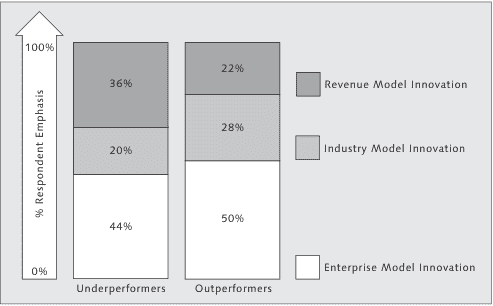

**图1.1** 表现优异者更可能是行业和企业模式创新者。

以下是当前业务模式创新和转型的类型：

- **收入模式创新**
  通过改变价值主张（产品/服务/价值组合）和定价模式，创新公司赚钱的方式。
- **行业模式创新**
  重新定义现有行业、进入新行业或创造一个全新行业。
- **企业业务模式创新**
  创新组织的运营方式，重新思考内部完成工作与通过协作和合作伙伴关系完成工作之间的组织边界。

成功公司通过以下三种方式创新其业务模式，以利用新经济环境中出现的机会：

1. 许多组织在经济低迷时期重新审视其企业业务模式，通过新的协作和合作模式以及重新配置资产组合来降低成本。
2. 拥有强大财务资源的行业领导者利用前所未有的行业转型，引入替代性行业模式并颠覆竞争对手。
3. 许多公司还重新思考其收入模式和价值主张，以应对不同的客户行为和市场要求。

虽然任何类型的业务模式创新都可能带来成功，但财务表现优异者更可能是行业和企业业务模式创新者，而非收入模式创新者（见图1.1）。企业业务模式创新和转型是最显著的创新类型，尤其是在经济形势严峻的时期。

行业模式创新不太常见，但更可能由拥有强大财务实力和行业地位的行业领导者所采用，他们可以利用大胆举措来扩大其领导地位。收入模式创新被认为是最容易的，但往往不会产生同样的财务收益，因为这些创新不太具有防御性或持久性。


## 1.2 经济动荡期间重新审视企业模式

企业模式创新在经济衰退期间尤为突出，因为公司寻求新的方式来获得成本和灵活性优势（见图 1.2）。企业模式创新者专注于企业中具有优势并能创造价值的领域，并在业务的其他领域进行广泛的合作。

尽管图 1.2 中描绘的许多案例发生在之前的经济周期中，但它们说明了组织如何在衰退期间利用企业模式创新来降低成本并提高灵活性。我们在撰写本书时的经济环境中再次看到了这一情况的发生。

大型跨国公司越来越有兴趣将非核心活动和 IT 功能外包到劳动力成本低的国家。地方政府也在利用外包和技术转型来大幅降低其成本基础。在制药和生物技术等行业中，协作和合作伙伴关系日益突出，在这些行业中，对资本和资源的获取减少推动了对新资金和合作伙伴关系的需求。

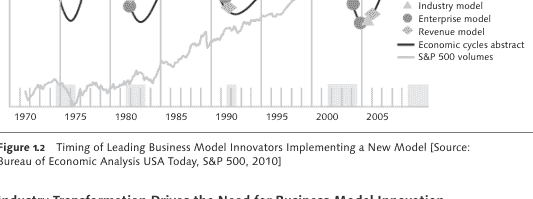

图 1.2 领先的商业模式创新者实施新模式的时间 [来源: Bureau of Economic Analysis USA Today, S&P 500, 2010]

### 行业转型推动商业模式创新的需求

在行业格局相对稳定的时期，公司可以在较长的时间内对其商业模式进行渐进式调整。它们可以继续实现现有商业模式的经济效益。

然而，在行业发生广泛变化的时期，公司必须选择要么震动其行业——利用颠覆性技术、瞄准新的客户细分市场、挤掉竞争对手——要么面临自身的衰亡。在整个分析过程中，信息是基于这些上半部分和下半部分的分组收集的，并得出了结论。分析结果表明，商业模式对所有公司的绩效都很重要。然而，研究清楚地显示了优胜者和落后者在服务/产品、运营和商业模式方面的关注点差异（见图 1.1、图 1.2 和图 1.3）。

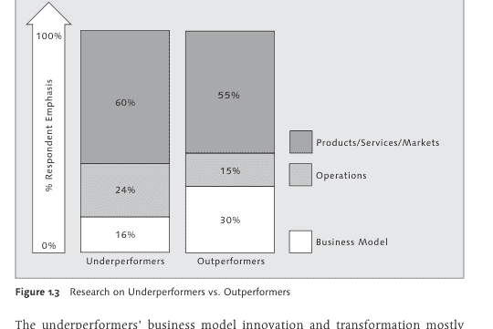

落后者的商业模式创新和转型主要集中在：

-   产品/服务资产价值主张
-   产品/服务创新
-   运营创新
-   成本削减

尽管优胜者的商业模式创新和转型也关注产品/服务资产价值主张，但对商业模式一致性的关注是竞争优势的主要焦点。

虽然 96% 的所有 CEO 明确表示他们的商业模式必须改变和适应，以变得更专注、灵活、响应迅速和稳健，但落后者与优胜者处理方式截然不同。这强调了虽然商业模式对所有人都很重要，但落后者认为创新意味着开发新产品和服务，而优胜者则清楚地认识到商业模式——及其核心竞争能力和核心差异化能力——很重要。理解自己的商业模式并知道应使用什么来定义该模式的挑战是本章的目标。

## 1.3 核心竞争和核心差异化定位

组织力求在行业 *竞争力量* 中实现战略竞争力和差异化，这是一个高管经常使用的术语，用来指企业为响应其外部环境而具备的核心竞争能力和核心差异化能力 [Hamel and Prahalad, 1994; Sull, 2009]。战略竞争力和差异化在文献中被定义为组织识别外部环境中的重大变化、迅速将资源和能力投入到新的行动方案中，并在需要停止或逆转此类能力和资源投入时及时采取行动的能力 [Shimizu and Hitt, 2004]。在图 1.4 中，我们总结了影响组织内部和外部环境的各种竞争力量 [von Rosing, 2010]。

每个行业的组织都面临图 1.4 所示的竞争力量，这些力量来自供应商、客户、竞争对手、潜在新进入者、互补者以及替代产品。这些竞争力量越强，该行业组织的盈利能力就越低 [Afuah, 2003]。

当行业组织的竞争力量较低，使这些组织平均比其他行业的组织更盈利时，如制药行业的情况，该行业被称为有吸引力的行业——但前提是你拥有能够竞争的核心竞争能力以及能够实现差异化的核心差异化能力。然而，如果这些力量很高，如航空业的情况，它们会降低该行业组织的平均盈利能力，因此该行业被称为无吸引力的行业。在任何情况下，制定和执行商业模式的任何企业都应关注其竞争环境，因为它决定了将执行哪些活动来为客户创造和提供价值，以及如何从价值中获利的战略。

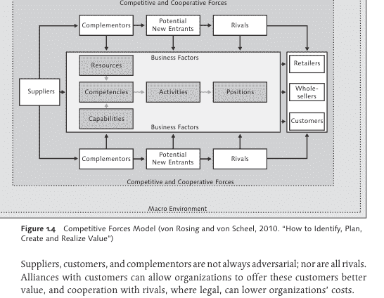

图 1.4 竞争力量模型 (von Rosing and von Scheel, 2010. "How to Identify, Plan, Create and Realize Value")

供应商、客户和互补者并不总是对立的；竞争对手也并非全部如此。与客户结盟可以使组织为这些客户提供更好的价值，而在合法的情况下与竞争对手合作可以降低组织的成本。

任何地区或国家的竞争环境也受到该地区或国家的文化、政府政策、财政和货币政策、司法和法律制度以及技术变革的影响。

在几乎每个行业中，都有某些因素会对竞争力和/或差异化产生或最有可能产生重大影响。我们将这些因素称为关键核心能力 (CCCs)，因为它们对创造价值并由组织提供给客户的活动有很大影响。企业在行业中的定位包括：

-   企业为客户提供的价值
-   其价值所面向的市场细分
-   每个市场细分中的收入来源
-   企业相对于其供应商、客户、竞争对手、潜在新进入者、替代产品和互补者的相对定位
-   其向客户收取的价格

正是组织专注、灵活、响应迅速且稳健的 CCCs 使其能够超越竞争对手。组织可以通过更新其核心竞争能力和核心差异化能力以及结构性商业模式创新和转型变革来实现能力专注、灵活性、响应性和稳健性 [Burgelman, 1983]。

实践导向的文献对商业模式创新作为提高战略灵活性并取得非凡成果的机制表示热情 [Markides, 2008; Osterwalder et al., 2005]。例如，在过去四分之一世纪中创建的 27 家公司中，有 11 家在过去 10 年里通过商业模式创新成长为财富 500 强企业 [Johnson et al., 2008]。尽管管理者本能地理解他们的商业模式，但学术研究将商业模式定义为组织结构的设计，以实现商业机会 [George and Bock, 2010; Teece, 2010; Amit and Zott, 2001]。

## 1.4 商业模式的历史视角

上述关于盈利能力决定因素的讨论中出现了两个关键点，有助于我们探索商业模式。第一点是，企业盈利能力由行业因素和企业特定能力（定位、活动/能力以及资源）共同决定。因此，由于商业模式关乎赚钱，商业模式也必须取决于决定企业盈利能力的因素。也就是说，企业商业模式是其定位、CCCs 和非核心能力 (NCCs) 以及附属的主要和支持流程与行业因素的函数。如前所述，商业模式关乎能力，这些能力结合在一起构建了一个框架

为了赚钱。它是指利用企业在 *所* 执行的一组活动中的能力、*如何* 执行它们以及 *何时* 执行它们，以向客户提供他们想要的利益并赚取利润。因为商业模式是关于运用能力来赚钱，让我们来探讨商业模式的定义。

从历史角度来看，最古老也是最基本的商业模式是在人们定居下来并开始为商业建造建筑物之前很久就发展起来的。游牧民族在营地相遇并交换货物，要么通过以物易物，要么使用食物和石头等交换媒介，然后是金属、金或稀有贝壳。在新西兰，欧洲人到来之前没有商店，也没有欧洲意义上的货币，但商业仍在进行，并且可以证明商业模式已经在运作。钱的词是 utu。复仇的词也是 utu。Utu 的意思是类似于“平衡”。（想想商业中使用的天平和司法中使用的天平。）商业词 utu 然后就相当于“交换价值”。

商业模式包括以物易物，其可以定义为使用产品和/或服务，该产品和/或服务是用货币或其他交换媒介交换的。它们应同时解决财富创造和财富转换。例如，游牧民族将太阳能转化为人类财富：太阳使草生长。他们捕获并驯化绵羊、牛、马和其他吃草的动物，从而创造了基于“动产”的财富。财富转换发生在其他游牧民族意识到如果他们骑着马并携带武器就可以偷走动产时。从中出现了帮派，然后是军队，然后是以设防城镇为基地的民族国家。种植农作物的农民创造了财富（使用太阳、雨水和土壤）。从设防城镇之一来的士兵说“如果你给我一些食物，我会保护你免受来自另一个城镇的另一个士兵的侵害，那个士兵想偷你的食物”，他就是财富转换者。他实际上并没有产生财富。

东印度公司的商业模式是技术上的转变，他们使用船只而不是商队，从而避免了在回程途中向沿途的设防城镇支付费用。为了保护这些船只免受海盗和其他国家的侵害，英国皇家海军成为世界强国，东印度公司的商业模式包括建立殖民地和任命总督。尽管东印度公司已经不复存在，但经营它的家族至今仍是世界上最有权势的家族之一。他们只是将商业模式从一家公司转变为多家公司。但必须记住，他们的财富来自伊丽莎白一世女王于 1600 年 12 月 1 日授予的垄断权。垄断是一种主要的商业模式（专利给予某人若干年的“版税”，因此价格取决于市场承受能力）。就东印度公司而言，大部分利润来自鸦片和咖啡因（茶叶）、烟草、酒精、火器以及奴隶和奴隶制相关产业，这对其基于渴望和控制的商业模式是一个有趣的评论。

从商品交换到推销员，多年来，商业模式变得更加复杂。诱饵和钩子商业模式（也称为“剃须刀和刀片商业模式”或“捆绑产品商业模式”）在 20 世纪早期引入。这涉及以非常低的成本提供基本产品，通常以亏损出售（诱饵），然后对补充产品或相关产品或服务收取补偿性经常性费用（钩子）。示例包括：剃须刀（诱饵）和刀片（钩子）、手机（诱饵）和通话时间（钩子）、电脑打印机（诱饵）和墨盒补充（钩子）、以及相机（诱饵）和照片冲印（钩子）。这种模式的一个有趣变体是软件开发商免费赠送其文字处理器阅读器，但对其文字处理器编写器收取数百美元的费用。

多年来，商业变得更加复杂，这在许多方面影响了组织的本质、设计、创新和转型。1950 年代，麦当劳和丰田带来了新的商业模式。1960 年代，创新者是沃尔玛和其他大卖场。1970 年代出现了联邦快递和玩具反斗城的新商业模式；1980 年代来自百视达、家得宝、英特尔和戴尔电脑；1990 年代来自西南航空、奈飞、eBay、亚马逊.com 和星巴克。

术语 *商业模式* 本身是管理文献中的一个新添内容，在很大程度上是 dot com 时代的产物。由于许多 dot-com 公司存在商业模式设计不周的问题，该术语在 1990 年代中期至晚期的所有关于组织设计、商业战略、商业经济学和商业理论的最有影响力的书籍中完全缺席。然而，它在许多关于电子商务的书籍和文章中被提及。Hamel [Hamel, 2000]、Linder 和 Cantrell [Linder and Cantrell, 2000]、Petrovic 和 Kittl [Petrovic and Kittl, 2001]、Weill 和 Vitale [Weill and Vitale, 2001]、Gordijn [Gordijn, 2002]、Afuah 和 Tucci [Afuah and Tucci, 2004]、Fetscherin 和 Knolmayer [Fetscherin and Knolmayer, 2004] 以及 Osterwalder、Pigneur 和 Smith [Osterwalder, 2004]，随后在 2009 年再次与 Y. Pigneur 和 A. Smith 合作 [Osterwalder, Pigneur and Smith in 2009]，都关注商业模式创新。正如 Hawkins 所说，“随着 [dot com] 泡沫的增长，市场充斥着关于商业模式的书籍和文章，从略带分析性的到准教学性的——如何构建可行的商业模式以及如何避免柠檬。商业模式似乎填补了一个空白，即使没有人能确切解释它是什么” [Hawkins, 2004, p. 65]。在最根本的层面上，商业模式是对企业如何赚钱并在一段时间内维持其利润流的研究 [Stewart and Zhao, 2000]。

其他方法是以价值主张和价值生成架构为基础。商业模式是组织创造价值的核心逻辑 [Linder and Cantrell, 2000]。根据 Petrovic [Petrovic et al., 2001] 的说法，“商业模式描述了商业系统创造价值的逻辑，该逻辑存在于实际流程背后”。2002 年，Magretta [Magretta, 2002] 将商业模式定义为解释企业如何运作的故事；商业模式作为一个系统描述了企业各部分如何契合，但它们没有考虑到绩效的一个关键维度：竞争。她认为商业模式与战略并不相同，尽管今天许多人互换使用这两个术语，而且某种程度上，公司如何能将其商业模式与其想要实现的目标分开。然而，需要注意的是，它们是相互关联的，但并不相同。

今天，人们普遍认为商业模式与战略相互关联，并且它们是竞争和差异化的基础，这常被用来解释为什么有些组织表现更好于其他组织 [例如，Kaplan et al., 2004; Slywotzky et al., 1997; Timmers, 1998; Tapscott et al., 2000]。在理论和实践中，eBay、戴尔、谷歌、IBM 和沃尔玛等组织的成功归因于，不仅是其行业或其特定于企业的能力，还归因于其独特的商业模式。而且在高管中，“产品、服务和商业模式的创新”是推动全球商业环境变化加速的最重要因素，超过了与信息和互联网、人才、贸易壁垒、更廉价劳动力的更大获取以及资本相关的其他因素 [McKinsey, 2009]。

当 IBM 首席执行官 Louis Gerstner 在 2001 年的年度分析师讲话中谈论公司的新战略举措和他们需要经历的变化时，他总结说新的战略方向“鉴于当前的商业环境和 IBM 的商业模式更有意义” [2001]。这种对商业模式的提及并非 IBM 独有。在以下资料中得到了很好的理解：
- 作为 2001 年成功的一个所谓来源，“戴尔的商业模式在竞争对手之上” [Gurley, 2001]。而该行业其他商业模式失败的根源在于“惠普、康柏、IBM 的 PC 部门‘存在商业模式问题’” [Spooner, 2002]。


- 在信息技术组织和工业组织中，Bair [Bair, 2003] 报告称，“在创造一种新飞机（新型波音7E7）的同时，我们也在为他们的行业创造一种新的商业模式。”
- 在大型企业的年度报告中——“通用电气商业模式” [Welch, 2003]——被视为在分析师、风险投资家和顾问中引入供应商参与方式的领先者。

### 1.4.1 商业模式概念的发展

在商业模式发展的同时，现有文献中的概念和定义也通过明确商业模式的主要元素及其相互关系而不断演进。一个典型且广为人知的定义是：商业模式代表了产品、服务和信息流的架构，包括对各种商业参与者及其角色的描述、这些参与者可能获得的利益以及收入来源 [Timmers, 1998]。根据 Timmers 的定义，商业模式包括竞争和利益相关者。类似地，其他研究者 [Weill and Vitale, 2001] 将商业模式定义为对企业消费者、客户、联盟伙伴和供应商之间角色与关系的描述，这些关系确定了产品、信息和资金的主要流向以及参与者获得的主要利益。

此外，被称为商业网络的商业创新模式正在创造新的价值主张、改变竞争规则，并将人员和资源动员到前所未有的绩效水平。然而，所有这些方法和定义都汇聚并一致认同这样一个事实和方法：商业模式与战略以及若干发展组织业务能力的管理概念相关。它捕捉了商业计划的关键能力，但商业计划涉及多个战略、战术以及某些层面上的运营问题，这些问题超越了商业模式本身。商业模式不是战略，但它融入了战略并包含若干战略要素。同样，它也不是一组活动集合，尽管活动集合支持了商业模式的每个元素。这些不同的方法和途径还一致认为，商业模式可以被定义为一种商业蓝图，或一个故事，讲述企业变量如何在战略、业务能力、业务运营架构和经济等领域中相互关联，并作为一个运作系统整合在一起。在这一意义上，商业模式管理学科代表了概念化这种运作描述的框架，该描述包含了关于企业战略和运营的一般细节。

### 1.4.2 商业模式组件的开发

最新的文献强调了定义商业模式组件的重要性。商业模式领域的早期先驱 Horowitz [Horowitz, 1996] 认为，商业模式应基于战略、核心能力和商业模式的组件来构建。Horowitz 提出的组件包括价格、产品、分销、组织特征和技术。根据 Staehler [Staehler, 2001] 的观点，商业模式由三大组件构成：价值主张、价值架构和收入模式。Alt 和 Zimmerman 将建议的组件数量增加到六个：使命、结构、流程、收入、技术和法律问题。Afuah 和 Tucci [Afuah et al., 2001] 采用了一种更广泛的商业模式方法，定义了八个能力：客户、价值、范围、定价、收入来源、关联活动、实施、能力和可持续性。Timmers 的分类则大不相同：电子商店、电子邮件、信息服务提供商、电子拍卖、价值链服务提供商、虚拟社区、第三方市场和价值链整合者 [Timmers, 1999]。一个有趣的观点 [Chesbrough et al., 2000] 认为，商业模式在技术领域和经济领域之间起中介作用，并通过定义商业模式必须处理的六个主要功能来明确商业模式的组件：

1. 阐明价值主张；也就是说，基于技术，通过产品/服务为用户创造的价值。
2. 识别市场细分；也就是说，技术对哪些用户有用，以及用于何种目的。
3. 定义企业内部用于创造和交付产品/服务的价值链结构。
4. 在给定价值主张和所选价值链结构的情况下，估算生产该产品/服务的成本结构和利润潜力。
5. 描述企业在连接供应商和客户的价值网络中的位置，包括识别潜在的互补者和竞争者。
6. 制定竞争战略，使创新企业能够获得并保持相对于竞争对手的优势。

许多作者遵循这一方法并开发了不同或额外的组件。一位相当成功的作者是 Alexander Osterwalder [Osterwalder, 2004]，他提出了九个构建模块的方法，分为四个主要领域：

### 1. 基础设施

- **核心资源/能力：** 执行公司商业模式所必需的资源/能力，以及由此所需的能力。
- **合作网络：** 补充商业模式其他方面的商业联盟。
- **价值配置：** 为客户创造价值所必需的活动和资源的安排。

### 2. 产品/服务

- **价值主张：** 企业提供的产品和服务。引用 Osterwalder [2004] 的话，价值主张“是对……产品和服务的整体看法，这些产品和服务共同代表了特定客户细分群体的价值。它描述了一家公司在竞争中脱颖而出方式，也是客户为何从某家公司而非其他公司购买的原因。”

### 3. 客户

- **目标客户：** 企业产品和服务的受众群体。
- **分销渠道：** 公司将产品和服务交付给客户的方式。这包括公司的营销和分销策略。
- **客户关系：** 公司与其客户细分群体之间建立的联系。管理客户关系的过程被称为客户关系管理。

### 4. 财务

- **成本结构：** 商业模式中所采用方式带来的货币后果；即公司的成本。
- **收入：** 公司通过各种收入流赚钱的方式；即公司的收益。

2009年，这一方法略有调整，并分为四个主要领域：价值架构、价值主张、收入模式和文化/价值观（图1.5）[Osterwalder et al., 2009]。

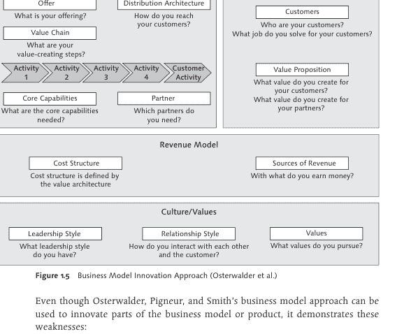

图1.5 商业模式创新方法（Osterwalder 等人）

尽管 Osterwalder、Pigneur 和 Smith 的商业模式方法可用来创新商业模式或产品的某些部分，但它也展现了以下弱点：

- 该方法主要建立在其他作者关于商业模式能力发展的研究以及 Kaplan 和 Norton [Kaplan and Norton, 2007] 的平衡计分卡之上。该理论无法应用于完整的商业模式框架。
- 它没有考虑商业模式设计或商业模式转型（该方法主要侧重于商业模式创新）。
- 它没有包含商业模式的改进和开发方法论。
- 它没有包含公司结构和责任，而商业模式应当包含这些内容。
- 它没有包含主要业务目标的表示，例如战略业务目标、关键成功因素和关键绩效指标，而一个整体的商业模式方法应当包含这些内容。
- 它没有包含主要业务问题/痛点的表示，因此也没有包含企业弱点的表示，而一个整体的商业模式方法应当包含这些内容，因为这些因素代表了对公司商业模式的威胁。
- 它基于这样一种理论：在产生成本的活动和产生收入的活动之间是价值主张。这种观点过于简单化，因为不能仅凭可见的成本和收入数字来构建商业模式，尽管成本和收入应当是商业模式的一部分。
- 能力、测量和结果之间的联系不够明确。
- 能力、期望结果和测量之间缺乏清晰的因果关系。因此，该商业模式可能有助于可能的战略决策。
- 它没有考虑绩效测量的问题，而这对商业模式建模至关重要。
- 它没有考虑目标设定这一重要问题，而这对商业模式开发至关重要。
- 它没有足够重视商业模式管理，从而缺少对商业模式的持续改进和治理方法。
- 它没有包含核心差异化和核心竞争能力的表示（仅包含与价值主张相关的能力），而这是构建商业模式的基础，因为它们代表了一些最重要的独特性来源。这些是公司能够独特做好的事情，也是其他人无法迅速复制以影响竞争的事情。

可以得出结论，尽管 Osterwalder、Pigneur 和 Smith 的商业模式方法可用来创新商业模式或产品的某些部分，但它并不是一个整体的商业模式方法。事实上，他们的模型不能被视为一种商业模式方法，而更像是一种商业模式创新方法。


## 1.5 商业模式概念的新形式

随着组件化发展，*逻辑*和*价值*成为商业模式文献中的关键词。近年来，IBM 全球服务部和 IBV（IBM 商业价值中心）开发了一种创新的商业模式方法，其中包括商业模式设计、商业模式创新和商业模式转型。IBM 的商业模式方法被称为组件业务模型（CBM）。这是首次有人不仅使用通用方法来识别核心竞争力（资源和能力）、合作伙伴网络、价值主张、客户细分和关系，从而确定成本和收入，而且使用逻辑表示和技术将企业映射在一页上。该 CBM 方法可用于分析企业战略与组织能力及投资之间的一致性，识别冗余或重叠的业务竞争力/能力，分析不同组件的采购选项（买入或自建），确定转型选项的优先级，并在并购后制定统一的路线图。该模型按列组织业务组件，按行组织“运营层级”。业务组件被定义为具有特征性技能、资源、流程和竞争力的较大业务领域。

三个运营层级（取决于行业）为规划、监控和执行。它们将业务组件上的战略决策（规划）、管理检查（监控）和业务行动（执行）区分开来。这种新的业务建模方法将商业模式的概念提升到了更高、更具战略性的层面。商业模式方法之间开始出现分化，其中许多业务建模方法仍继续关注功能组件需求，而没有足够重视其他非功能性问题。结果是最终产品不令人满意，未能符合其用户的战略业务目标。因此，商业模式创新和转型的视角并未得到共同统一。

其他发展方法侧重于资源（资产）、能力和由此产生的竞争力，即公司需要以有效和高效的方式规划、创造和实现价值的综合竞争力（见图 1.6）。

为了以有效和高效的方式规划、创造和实现价值，公司应识别创新的关键价值驱动因素（见第 3 章），这些驱动因素应在构建此类竞争力时带来回报而非额外成本。了解设计、创新和转型自身业务竞争力以匹配所需愿景和战略所需的流程和举措，不仅有助于公司实现成本改善，还能获得差异化优势。

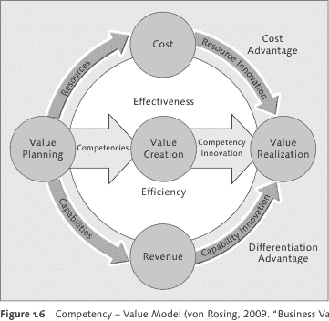

为了获得差异化优势，应选择一种或多种竞争战略。成为领先企业是通过采取进攻或防御行动来创造开创性竞争力，从而在行业或市场中占据主导地位，以便成功应对行业同行所选择的竞争力量和选择，并因此产生超额投资回报。当应用竞争优势战略的原则（来自 Porter [Porter, 1998]）时，存在两种基本的竞争优势类型：

- 成本领先（低成本）
- 差异化

两者都可以更广泛地应用或缩小范围以更具体，这就产生了第三种可行的竞争战略：聚焦。

当企业能够以比竞争对手更低的成本提供相同的竞争力和利益（成本优势），或提供超过竞争组织的竞争力（差异化优势）时，就存在竞争优势。因此，竞争优势使组织能够为其客户创造更优的竞争力和由此产生的价值，并为自身创造更高的利润。成本和差异化优势被称为定位优势，因为它们描述了企业在行业中作为成本或差异化领导者的地位。

然而，与 Porter 的理性化相反，Kim Chang 在 1997 年、1998 年和 1999 年的当代研究表明，企业实践低成本和差异化战略的成功混合具有证据。Prajogo [Prajogo, 2007] 的研究文献指出，采用混合商业战略（低成本和差异化战略）的企业优于采用单一通用战略的企业。持有相同观点的 Charles Hill 在其论文 “Corporate strategy and Firm Performance,” 中认为，这两种战略的成功结合将带来长期竞争优势。例如，将这两种战略结合到自身的竞争力中是成功的，当将市场细分战略与产品差异化战略相结合时，是将企业产品战略（供给方）与目标市场细分特征（需求方）相匹配的有效方式。

然而，如成本领先和差异化等在自身竞争力中的组合难以（但并非不可能）实施，因为成本最小化与增值差异化带来的额外成本之间存在潜在冲突。为了获得竞争优势，企业必须以创造比竞争对手更多的整体价值的方式执行一项或多项创造价值的竞争力活动。卓越的价值是通过更低的成本或为消费者提供更优的利益（差异化）创造和实现的。在这种情况下，公司需要在高层面上定义竞争优势是如何创造的。在选择成本和差异化领先战略之后，许多作家 [Robert M. Dibrell; C. Clay; Kim, Eunsoo Nam; Daeil, Allen; R. Helms, M. Takeda; M. White C.; Stimpert, J.L.] 认为需要指定并应用具体的多项业务战略，以便公司执行所选择的战略。根据资源基础观 [Wernerfelt, B., Hoopes, D.G.; Madsen, T.L.; Walker, G]，为了开发支持成本优势和差异化优势的不同基础竞争优势战略，企业必须将战略应用于资源和能力，从而应用于公司的竞争力。如图 1.6 所示，资源（资产）和能力，即综合竞争力，都需要创新，以便以有效和高效的方式创造和实现价值。如果不将成本和/或差异化方法应用于自身的竞争力，竞争对手只需复制组织正在做的事情，任何优势都可能迅速消失。

让我们深入探讨竞争力-价值模型中每个能力/资源创新要素的细节。我们将从资源开始。

### 1.5.1 资源

资源（也称为资产）可分为有形、无形和人力三类。有形资产可以是实物，如厂房和设备，或金融资产，如现金。这些是在财务报表中通常在“资产”类别下识别和核算的资产类型。无形资产是非实物和非金融资产，如专利、品牌、版权、商业秘密、市场研究成果、与客户的关系、数据库中的知识以及与供应商的关系。它们通常不会在财务报表中识别，但可以成为利润的优秀来源。例如，赋予企业对产品或工艺独家访问权的专利或商业秘密可能使企业成为唯一生产具有某些特征产品的企业，从而使产品高度差异化且盈利。一段时间以来，Intel 微代码的版权使该公司能够向个人电脑制造商提供差异化的微处理器。人力资产是员工所携带的技能和知识 [Afuah, 2003]。如图 1.6 所示，大多数情况下资源与成本相关，因此资源创新带来成本优势。资源是有助于创造成本优势的组织特定资产；然而，某些资源/资产也可以应用于差异化优势，这些资源/资产很少有竞争对手可以轻松复制或获取。资源是企业流程的投入，如资本、设备、员工个人技能、专利、财务和优秀管理者。随着有效性的提高，企业可用的资源集合往往变得更大。单个资源可能不会带来竞争优势。竞争优势是通过资源集合的协同组合和整合而形成的。以下是对此类资源的若干示例：

- 专利和商标
- 专有技术
- 员工关系和承诺
- 员工士气


- 已安装的客户群
- 公司的声誉
- 品牌资产

### 1.5.2 能力与才干

尽管资源/资产很重要，但通常仅靠资源和资产还不足以向客户提供价值。其中一个额外的价值就是公司的能力。

### 能力

能力是指公司有效利用其资源的本领。能力是一组资源交互式地执行一项有挑战性的任务或活动的能力。通过持续使用，能力会变得更强，也更难被竞争对手理解和模仿。作为竞争优势的来源，能力既不能过于简单以至于极易被模仿，也不能过于复杂以至于难以进行内部引导和控制[Schoemaker and Amit, 1994]。如图1.6所示，能力在很大程度上与收入潜力相关；因此，能力创新应当带来任何形式的差异化，从而使公司获得差异化优势。

能力的一个例子是比竞争对手更快地将可持续产品推向市场的能力。这种能力内嵌于组织的流程和活动中，并且应当从主流程组到子流程进行文档化记录，因此竞争对手难以复制。公司的资源与能力共同构成其独特竞争力。这些竞争力映射到商业模式层面，如第三部分第13章所述。为了主动发展自身的能力（资源与能力），公司必须：

- 分析当前与目标竞争力
- 定义流程价值驱动因素
- 实施流程衡量
- 定义流程持续改进
- 制定流程绩效指标
- 创新流程
- 启动流程治理模型

主动规划、创建和实现这类竞争力，能够强化公司的品牌和声誉，促进创新，满足客户的可持续性需求，建立员工关系，提升生产力、效率和质量，所有这些都可以被利用来创造成本优势或差异化优势。

我们可以得出结论：由于商业模式的目标是盈利，因此组织必须关注的任务之一就是追求商业模式。因此，公司的注意力必须集中在那些最有可能发展出关键核心竞争力的能力和资源/资产类型上，这些竞争力是组织创造和实现预期价值所需要的，以确保商业模式能够盈利。此外，公司必须认识到哪些能力和资源/资产属于非核心竞争力，而这些非核心竞争力最有可能确保低成本，例如标准化和自动化，这是组织的商业模式为了保持竞争力和盈利所需的条件。

### 才干

公司需要具备将资源和资产转化为能够创造价值（内部和外部）的竞争力的才干。客户不会仅仅因为公司拥有现代化的资源和资产（如工厂、天才和专利）就争先恐后地登门。公司必须利用工厂、天才以及专利中包含的知识，向客户提供他们看重的东西。患者不会从制药公司购买专利或聘请有技术的科学家；他们购买的是由有技术的科学家利用专利知识开发出来的药物。资产必须转化为客户想要的东西。公司将资源转化为客户价值和利润的能力或才干通常被称为竞争力。竞争力通常涉及对组织的能力和资源/资产的运用或整合。LG快速将其“核心”转化为客户想要产品的能力就是一种竞争力，这种竞争力可以是核心的，也可以是非核心的。英特尔开发微处理器、利用其拥有版权的微码并与其已安装的微处理器基座兼容的能力，是一种核心差异化竞争力。同样，可口可乐将其秘密配方和品牌转化为许多客户认为优于竞争对手产品的产品的能力，也是一种核心差异化竞争力[Afuah, 2003]。

由于商业模式的目标是盈利，因此组织必须关注的问题是：哪些类型的能力和资源/资产最有可能发展出关键核心竞争力，从而帮助组织创造和实现预期价值，并确保商业模式盈利？

## 1.6 基于竞争力的商业模式框架逻辑

正如我们所讨论的，商业模式对业务设计、创新和转型至关重要。但是，要以正确的运营模式将业务创新和转型付诸实践，需要高管们以不同的方式思考，不仅要思考组织的结构，还要思考他们依赖的为客户提供价值的资产之间的相互关系。商业模式提供了一种经过验证的方法，可以在内部和外部同时推动关键核心竞争力聚焦。在内部，竞争力帮助组织重新思考如何利用其拥有的资产和能力来获得杠杆效应。在外部，竞争力帮助组织获取那些自身无法实际创造的专门能力。

将这些类型的业务创新和转型结合起来，组织能够在行业巨变中重新定位竞争地位，同时实现规模、灵活性和效率等相互竞争的利益。在图1.7中，我们看到一个通用商业模式的示例，其中包含业务竞争力，这些竞争力是构成商业模式的模块化构件。

| 综合行政 | 人力资源管理 | 信息技术 | 运营支持 | 业务发展 | 运营 | 分销 | 市场营销、销售与服务 |
|---|---|---|---|---|---|---|---|
| 战略规划 | 组织规划 | IT规划 | 运营支持规划 | 研发规划 | 运营规划 | 分销规划 | 细分规划 |
| 法律与合规事务 | 招聘 | 部署 | 资产 | 产品设计 | 零部件制造 | 调度 | 销售 |
| 信息分析 | 行政管理 | IT业务管理 | 质量 | 研究 | 运营采购 | 订单履行 | 市场分析 |
| 项目管理 | 福利 | 风险与合规 | 环境与健康 | 生产准备 | 产品制造 | 运输 | 渠道 |
| 财务 | 绩效评估 | 信息管理 | 寻源与采购 | 知识产权 | 入库库存 | 进出口 | 品牌管理 |
| 设施管理 | 薪酬 | 服务交付 | 安全与安保 | 产品部署 | 产品组装 | 分销 | 客户账户 |
| 会计 | 教育 | 开发 | 设备与工厂 | 内容 | 精炼 | 成品库存 | 客户获取 |
| 差旅管理 | 工资 | 支持与关系 | 数据管理 | 产品维护 | 包装 | 成本核算 | 服务 |

图1.7 结合业务竞争力的通用商业模式（von Rosing, 2009. “业务价值管理”）

商业模式的每个竞争力都包含七个维度（见图1.8）：

- 1. 竞争力的目的和服务——竞争力在组织中存在的逻辑原因，由服务定义，并由此为其他竞争力提供价值。
- 2. 每个竞争力执行一组互斥的活动，以实现其业务目的并创造价值。这是流程相互连接的地方。
- 3. 为了创造价值，竞争力需要资源——支持其活动和流程的人员、知识和资产。
- 4. 每个竞争力由使用不同资源的能力组成，因此也使用不同的公司资产。
- 5. 每个竞争力作为独立实体进行管理，基于自身的治理模型，以确保绩效和价值实现。

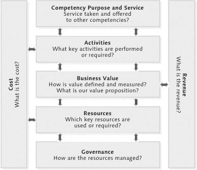

**图1.8** 竞争力的七个维度


- 6. 不同的能力各自都有一个成本，该成本可以根据其是核心能力还是非核心能力而被衡量、优化或开发。这里的基本原则是，成本削减在很大程度上应仅在非核心能力内部进行。

- 7. 能力产生的收入可以根据其是核心能力还是非核心能力而被衡量、开发和创新。

确定能力边界时，重要的是要考虑各种维度，而不仅仅是一两个维度，即使一两个维度可能是成本削减、价值创造和/或治理的驱动因素。所有能力都具有高度协作性，与公司内部和外部的其他能力共同工作。协作是通过所有能力的服务、活动以及输入和输出的交换来实现的。当一个能力需要输入来完成特定活动时，它会将其作为服务从另一个能力处获取。这样它就可以获得所需的全部输入范围。该能力随后会提供输出，其他能力可以将其用作其输入。预定义的服务水平协议——涵盖格式、时间、数量、质量、付款和供应等各方面——为所有这些交易设定标准。

业务能力的大部分优势源于两个相关但不同的特征：能力之间松散耦合的链接提供了灵活性、适应性和响应性，而每个能力内部活动的凝聚力则提供了效率和增强的质量。

### 1.6.1 能力的灵活与自由连接

能力之间的交互和连接以灵活、松散和自由耦合为特征。不同于基于专有或定制连接的“硬连线”僵化链接，能力通过明确定义的服务边界进行交互，在彼此发起和响应服务请求时形成和中断连接。灵活耦合还依赖于共同共享原则，使得即使底层系统不兼容，也可基于能力增值通信进行连接。能力共享以及由此带来的发展这一方面，使组织在彼此之间提供的服务和使用方面具有更大的可扩展性，并在决定是企业内部还是外部获取能力时具有更大的灵活性。在任何一种情况下，以服务形式请求输入的能力都是

按业务能力对活动进行分类，可根据能力为企业提供的价值类型获得能力的宏观视图。不同行业的不同公司对能力建模方式不同，但在每种情况下，每个活动都应归属于某个特定能力之下。

能力的示例有 HR、运营、分销、业务发展（见图 1.6 和图 1.7）。

将每个活动分配到三个问责级别之一——战略、战术和运营——也有助于高管开始完善业务能力发展愿景/路线图（见图 1.9）。给定能力的级别应该是直观的，尽管存在例外情况。三个问责级别定义如下：

- 1. **战略**
此级别的能力为其他能力提供战略方向、规划和公司政策。它们还有助于与其他能力进行协作。这些战略能力提供了推动企业价值规划的业务行动。

- 2. **战术**
这些中层能力在战略和运营层级之间充当控制、监控、检查和制衡。它们监控绩效、管理例外情况并充当资产和信息的守门人。这些战术能力提供了推动企业价值规划、监控和治理的业务行动。

- 3. **运营**
这些低层级能力提供了推动企业价值识别和创造的业务行动。它们处理资产和信息以供其他能力或客户使用。

三个问责级别意味着不同的优先事项。例如，在运营层面，重点是让人员保持充分占用和高效。从技术角度来看，数据输入速度和实时可用性很重要。将其与战略层相关的活动形成对比，在该层级处理诸如规划和推出新产品等高层级活动。该层级容纳的人数很少，但对股东价值的影响非常大。

为了从业务模型能力发展中尽可能多地推动收入、价值创造和实现，企业范围内仅汇总核心竞争和核心差异化能力。一个组织的 CCC 使其能够超越竞争对手。这些能力连同其附带的七个维度，在被自动化并由 IT 系统支持时，应被视为自身实践。太多的此类能力是用 IT 系统的最佳实践自动化的，因此其独特性<|message|>和差异化可能遭到破坏。

而 IT 系统最佳实践对于削减成本至关重要，例如快速实施、更少错误、标准化和更低风险，因为它已被证明有效，但这不能应用于使核心竞争和核心差异化能力得以实现的 CCC 领域。然而，即使一家公司为正确的市场细分提供了正确的客户价值，并且做得比竞争对手更好，公司仍可能无利可图。也就是说，面向正确客户细分市场的相对优越客户价值虽然必要，但并不总是盈利的充分条件。因此，赚钱的成本是成功的关键因素。为正确的客户细分市场提供正确的价值并相对于供应商、客户、竞争对手、潜在新进入者和替代产品处于有利地位，可能仍不足以使公司获得其地位所暗示的收入。为了保持成本低，公司应标准化其 NCC，并据此将 IT 系统最佳实践应用于所有 NCC 及其附带的主要和支持流程。

## 1.8 总结与结论

我们讨论了业务模型不是战略这一重要事实。模型与战略的分离是业务模型概念的优势和弱点。因为业务模型是战略的产物，业务模型只能与你的战略业务目标（SBOs）、关键成功因素（CSFs）和关键绩效指标（KPIs）一样强大。如果一家公司想要业务-IT 对齐，它需要将战略与业务模型对齐，业务模型与流程模型对齐，流程模型与其系统对齐——并且所有这些都需具备正确的架构和治理框架。

战略如何以及应如何与业务模型相互关联的重要性，在迈克尔·波特有影响力的战略框架和价值链框架中显而易见。请参阅参考文献中对 Porter [1994] 的提及，了解他对竞争战略思维演变的自身综合，该综合旨在融合他所描述的战略的两个主要且相互矛盾的观点，一个强调通过现在所称的核心竞争和核心差异化能力实现的组织差异化，另一个“竞争优势由单一变量定义：成本”。波特自己的结论是，战略“必须从为企业宣布一个明确的目标开始：在我们看来，这应该是优越的、长期的投资回报”[Porter, 2004, p. 251]。由此产生了他的行业五力模型，随后是价值链。波特最核心的论点之一触及了业务模型概念化出现的一个原因：“制定战略的基本分析单位是行业”[Porter, 1994, p. 290]。

行业实际上是业务模型的输入以及其应如何竞争。业务模型只是一个工作描述，其中包括有关企业运营的一般细节。作为业务模型的一部分，需要解决与公司持续运营相关的内部因素。业务模型中包含的能力涉及职能、目的、产品和服务，包括以下因素：

- 公司结构、基础设施、职责
- 主要业务目标，例如战略业务目标、关键成功因素和关键绩效指标
- 业务问题、痛点和弱点集群
- 核心和非核心能力
- 价值规划、识别、创造和实现
- 财务指标：收入和成本

使用一个业务模型有助于公司在保持对非核心能力的比较优势的同时，专注于核心竞争力和核心差异化。定期审查和更新有助于使业务模型与当前竞争、市场变化、经济状况和消费者需求保持相关性。一般而言，与公司战略决策和运营相关的绝大部分内容都可以说是业务模型的一部分。

每个组织都需要仔细审查是否到了重新审视其业务模型的时候，无论是为了在行业中追求新的机会，还是为了应对对其现有模型构成的竞争或技术威胁。对能力进行开发、优化和创新以实现成本削减以及价值创造和实现的机会对于一个组织来说是巨大的。See


同时参见第三部分第14章，我们在那里开发了一种结构化方法，帮助您完成这一旅程。

| 更多信息 |
|---|
| 如需了解更多关于业务建模、商业模式示例和商业模式模板的信息或疑问，请访问 www.openroundtable.org。 |

> “尽量不要谈论变革，而是去促成变革。”
> —— 托基尔·隆德（Thorkil Lund），丹麦银行，董事，1989年（署名）

# 2 迈向面向服务型企业的商业模式转型

Carsten Linz、Patrik Fiegl、Mark von Rosing

正如我们在第一部分的引言中所讨论的，商业模式创新与转型是公司竞争优势中最为关键的部分之一。但要将业务创新与转型付诸实践，需要高管们以不同的方式思考，不仅要考虑组织的架构，还要考虑他们赖以创造和实现价值的能力之间的相互关系和服务。尽管控制成本和维持运营效率的压力仍然是各行各业、各种规模企业的优先事项，但大多数企业都表示重新重视增长。全球化与技术进步带来了前所未有的竞争水平，同时也创造了差异化的绝佳机会。

对许多公司而言，增长——甚至生存——都取决于其商业模式的创新与转型。商业模式创新与转型是一个被广泛认可的重要概念。如前所述，如今大多数CEO都将商业模式创新与转型视为应对激烈商业竞争、日益提高的客户期望以及全球化的答案。企业服务导向能够实现灵活的信息技术（IT）基础设施，并在支持商业模式创新与转型方面发挥着重要作用。本章阐明了面向服务的架构（SOA）在重塑和转型商业模式中的作用，同时我们聚焦于业务视角。

在本章中，我们首先讨论三个推动企业面向服务转型的特定趋势，从而促成业务创新与转型。本章还从业务和IT两个视角探讨了那些正积极转型为面向服务型企业的公司。从业务角度来看，我们将首先讨论驱动此类转型的趋势及市场力量。其次，我们将更详细地阐述变革参数，以便更好地理解面向功能的企业与面向服务的 企业之间的差异。第三，转型案例研究将具体展示向面向服务型企业转型的实践。

随后，我们将采用IT视角，讨论如何在适当的服务与流程实现方法及信息技术的支持下，使面向服务型企业成为现实。首先，我们将探讨哪些方法有助于我们捕捉业务雄心与意图，使IT能够理解它们。其次，我们将研究流经这些方法的内容要素。第三，我们将探讨IT需要具备哪些新能力，才能利用所捕获的内容有效地创新和转型业务，迈向面向服务型企业。

## 2.1 面向服务型企业的适应性调整

创新的、开发并优化您的能力，从而转型您的商业模式，历来被视为一个缓慢而艰难的过程，但业务流程管理（BPM）领域的专业知识与面向服务的架构这一赋能技术的结合，正在缩短变革的时间障碍。商业模式创新与转型被定义为在业务结构和/或财务模式上的创新，并能够以变革性的方式执行这一创新。商业模式创新与转型的重点通常集中在以下三个领域之一：

- 1. **以客户为中心的业务能力创新与转型**  
  在合作伙伴、客户和供应商之间构建新的协作解决方案。
- 2. **以核心业务能力为重点的创新与转型**  
  通过创新性的内部业务流程方法，实现更好的客户服务和更高效的资源利用。
- 3. **以供应商为中心的业务能力创新与转型**  
  通过全球服务组装线以及价值链中的先进规划与优化，实现新的成本效率水平和一流的解决方案交付。

通常，商业模式创新与转型可以被视为对扩展价值链中各种能力的转型。SOA和BPM范式可以通过双重方式应用于业务/IT关系：

- 1. 将SOA作为企业设计和管理的一种范式。价值链被理解为可重新组合的“服务”阵列（将人员、流程和技术相结合，向业务网络交付产品和服务）。
- 2. 将SOA作为一种技术架构概念，基于功能组件化、提供者与消费者契约以及复用（允许以模块化方式进行设计技术）的理念。

本章将进一步说明，日益激烈的竞争正在推动面向服务的商业模式兴起，而纯粹的架构性SOA（专注于技术的智能设计）是不够的。

在这种背景下，SOA赋能的业务服务构成了新一类松耦合、以网络为中心的业务应用的构建模块。业务服务网络帮助企业在企业内部或跨企业之间，围绕包括人员、流程和系统在内的各项能力建立强大而松耦合的连接。SOA为IT向业务交付价值提供了一种渐进式、可降低风险的方法。这种方法不同于《业务流程管理——SAP路线图》[Snabe等人，2008]一书中所描述的“大爆炸”式方法。本书建议和描述的方法更多地采用逐流程和/或逐项目的方式。SOA项目侧重于复用现有服务并创建新服务，使业务能够以新的创造性方式使用这些服务，构建下一代松耦合的业务流程和应用。因此，企业可以通过后续项目从SOA中持续获得更高的价值。我们将其称为企业级业务服务的*价值倍增器*。

如今，领先的组织是围绕服务优化的端到端流程的提供者，并高效地为利益相关者提供服务。此外，通过由业务服务和信息技术（IT）服务构成的服务二元性，服务成为关键的联结与纽带要素。这一点在提供者与客户之间，以及提供者为创建解决方案而在业务网络中与供应商和合作伙伴之间都同样适用。在这一视角下，SOA使企业能够以前所未有的速度和便捷度来概念化与定义（业务视角）并实施与调整（技术架构视角）业务流程，同时还能将流程分解为更小的流程步骤，形成可复用的企业服务，从而轻松适应不断变化的业务需求。

### 2.1.1 适应驱动力：增强的服务导向

您面临着所在行业特有的挑战。您需要克服传统上用于支持业务目标的僵化、静态IT方法的束缚，并且需要以这样一种方式来实现：当市场力量发生变化时，您能够迅速而无缝地作出调整。服务就是新的产品。几十年来，我们一直知道“所有行业实际上都是服务行业；一些行业只是比其他行业拥有更多的服务成分” [Levitt，1972]。然而今天，我们目睹了全球服务的显著增长，以及从“围绕产品的服务”向“围绕服务的产品”的转变。所谓的混合体（hybrids）——以产品与服务之间紧密而有效的互动为特征——已成为解决方案的事实标准。由于服务的二元性，业务服务一方面在兴起，技术服务的普及（如基于IT的Web服务和企业服务）则在另一方面不仅反映了这一趋势，而且加速了其发展。随着服务复杂性的增加，我们正在从服务支持产品、服务赋能产品，转向服务最终成为产品本身。这些因素提升了服务的重要性，并最终推动了一个易于消费的独立服务市场的演进。

### 2.1.2 适应驱动力：网络化业务

网络凭借其市场协调机制，正日益取代层级化的协调机制。公司专注于少数但具有差异化的核心能力，并且由于规模不经济或范围不经济，它们将价值链分解为各个子要素，交由不同的公司处理。传统行业边界正在模糊，因为在这张网络化经济中，一个客户解决方案可以跨越公司和行业边界，由众多提供者聚合而成。不断演进的业务网络具有以下特征：关系是资产，风险是共担的，创新是由协作驱动的——通常基于开放架构。

作为网络范式的结果，以下问题变得至关重要：作为提供者，我的定位是什么？我对整个网络的整体价值贡献又是什么？这既适用于消费市场，也适用于企业对企业（B2B）市场。以Twitter和Facebook为例，您对他人的吸引力可以直接通过您拥有的“关注者”或“好友”数量来衡量。企业对企业市场的核心在于与业务伙伴互动，以跨越公司边界扩展业务流程并推动创新。在网络化经济中，可能会出现这样的格局：


companies must cooperate in one step of the value creation and compete in another, which is referred to as co-opetition [Brandenburger and Nalebuff, 1996]. The fundamental idea of a network-based business model is not to grow your own market share only, but to grow the entire market for the business network via network externalities. Hence, in a networked economy, business is no longer a zero-sum game [Neumann and Morgenstern, 1928]. The end result is that companies are required to capitalize on relationships to maximize customer value brought together from different contributors across business networks.

### 2.1.3 适应驱动因素：从供给端到需求端的权力转移

在网络化市场中，客户认识到他们可以轻松连接以共享信息、协作并联合起来增加智力或议价能力。我们见证了从供给端到需求端的权力转移 [Cluetrain, 2000]，这体现为客户的力量。受互联网驱动的网络化市场以及由社区提供的知情买家的推动，当今客户对“足够好”解决方案的标准已显著提高。消费者寻求与提供商的紧密互动，客户可以成为共同创新者和共同创造者。日益增长的是，客户甚至愿意接管提供商价值链的一部分，以客户个体化方式创造解决方案的最后一公里，这被称为生产者消费者主义 [Toffler, 1980]。

### 2.1.4 以服务型企业为目标——转型即旅程

随着企业寻求战略优势，当今的企业在高度网络化的世界中蓬勃发展，其中只有最聪明的——而非 necessarily 当今最大的——企业才能生存。在上述三个适应驱动因素的加速下，我们见证了业务从自上而下、层级化的工作和管理方式向分布式、敏捷、协作的业务形式转变。越来越多的证据表明，企业正转向以结果为导向的解决方案范式，该范式以客户为中心网络中来自分布式提供商的服务消费为核心。

服务型企业以“其可靠交付新服务或增强服务以最大化新业务机会的能力……服务驱动型企业围绕服务进行优化，围绕高效服务客户、员工、合作伙伴、所有利益相关者；迅速响应其需求，并迅速适应新要求、行业变化、市场变化”为特征 [Gold-Bernstein, 2009]。

在此架构中，服务——以业务和/或技术服务的形式（服务的二元性）——成为提供商与客户之间，以及提供商与商业网络中用于解决方案创建的供应商和合作伙伴之间的关键粘合要素和连接器。此外，提供商必须遵守其与客户达成的服务水平协议（SLAs），并随后也与其供应商和合作伙伴建立 SLAs。这些服务型企业可以充当网络化解决方案的协调者。

受此雄心激励，越来越多的公司为自己设定了雄心勃勃的目标，即转型为服务型企业并成为网络化解决方案的提供商。因为这意味着商业模式和相关业务流程的实质性转变，这种转型不会一蹴而就；它更关乎引领一场变革之旅。

## 2.2 业务转型变革杠杆

成功地将公司转型为服务型企业需要对最相关的变革杠杆有扎实的了解，以及如何有效管理它们。图 2.1 对比了职能型企业与服务型企业的关键特征。

在左侧，职能型企业主要针对单一产品进行优化，其特征在于对每个职能的卓越性关注，例如开发、采购、采购、生产、营销、销售和服务。这种职能导向在组织上也通过沿着企业价值链活动步骤的垂直聚焦实体的层级协调得以体现。收入与交易挂钩；盈利能力在很大程度上取决于高效生产和规模经济。

在右侧，服务型企业提供（网络化）解决方案，这些解决方案通常以服务形式被客户消费（SLA）并由分布式贡献者协调。这些各种解决方案贡献既可以来自自身职能和部门，也可以从其他供应商、合作伙伴和第三方提供商处外部采购，所有这些再次通过商业网络中的服务水平相连。当操作得当时，解决方案中更高的服务占比和基于消费的定价机制可以带来可预测的经常性收入和以服务驱动的盈利能力。

provider aims for the end result of the "job to be done" [Johnson et al., 2008] or, in other words, the root cause of the customer problem to be resolved. Both the integrated view of tightly integrated services and products in the form of a hybrid and the lifecycle perspective are pivotal to meeting the total solution value or problem coverage expected by the consumer. In this context, service excellence can be understood as offering high-value services from plan to run, which make up a unique selling proposition for the provider. Leading service-oriented enterprises invest where they can excel in more advanced solution dimensions such as consumability, adoption experience, and lifecycle cost (total cost of ownership [TCO]).

When transforming from a function-oriented enterprise into a service-oriented enterprise, direct customer access with tight provider-consumer collaboration and even co-creation, differentiating service capabilities, and leading project management skills for customer-individual business problem resolution are required.

### 2.2.2 变革杠杆：商业模式

在职能型企业中，以产品驱动的收入基于交易且波动较大，因为它们在某种程度上与所服务客户行业的经济周期相关。当标准化生产中充分利用规模经济时，可达到盈利上限，因为服务盈利能力相对较低，源于其产品支持和商品属性。由于大批量产品以低接触的交易方式销售给匿名市场，因此可以解释普遍存在的巨大营销投资及其对底线的冲击。

遵循服务型企业的范式，提供商盈利能力的提升与通过所提供的解决方案更好地满足特定客户端到端业务流程需求从而实现差异化相关。以服务驱动的收入流占主导，它们是经常性的因此可预测。定价越来越多地与服务水平的实际消费挂钩（pay as you go）。除了对收入的影响外，更强的利润率位置也是可实现的，这由独特的增值服务及其更高的盈利能力驱动。基于 SLA，客户现在找到了一家与其自身目标战略一致的供应商。这可能意味着基于联合路线图和多年合同框架的战略关系，并伴随经常性合作，在此框架中提供商最终可成为客户的受信任顾问。

从职能型企业转型为服务型企业时，适当管理范围与规模之间的平衡——解决方案的个性化与再利用/标准化——变得至关重要。这也被称为大规模定制 [Pine, 1992]。这对于专业服务也同样适用。在服务型企业中，优化整体并避免次优是战略上的当务之急。

### 2.2.3 变革杠杆：价值创造协调

在职能型企业中，垂直一体化的价值链占主导地位。开发、生产、销售和支持的独立职能以及通常的流程按区域进行优化，因此需要自上而下的层级协调以优化企业的整体战略意图。尽管存在合作伙伴关系，业务架构往往是封闭的，资产为自有，诸如生产基地等有形资产发挥着重要作用——也在企业内部重要性指标方面如此。

在服务型企业中，保持 SLA 承诺需要代表其客户在自身职能和部门之间以及在商业网络内的供应商、合作伙伴和第三方提供商之间协调端到端业务流程。用于端到端流程编排所需的水平台层组织结构是开放业务架构的结果——因此更具网络性，最佳描述为与提供商现有组织松散耦合。网络中的每个提供商直接或间接地朝着 SLA 的共同目标交付，最终将各种解决方案贡献联系在一起。预计部分提供商为“虚拟”型（cloud-based），因为它们提供高度自动化和专业化的解决方案贡献，而不以传统意义上的企业存在。通常，创新以更分布式甚至开放的方式驱动，依赖于企业边界之外贡献者的才华 [Chesbrough, 2003; Surowiecki, 2004; Hippel, 2006]。最终，关系资产超过自有资产主导地位，服务型企业生态系统的管理成为竞争优势的重要来源。

从职能型企业转型为服务型企业时，提供商需要对交付给客户的最优编排解决方案的所有相关构建模块有深刻理解，无论这些构建模块来自其自身职能和部门，还是来自第三方提供商甚至竞争对手。因此，整合能力

|  | 功能导向型企业 | 服务导向型企业 |
|---|---|---|
| 商业模式 | 由于产品收入直接与航空业的经济周期挂钩，收入波动 | 由于服务盈利能力更高，收入流可预测，收入和利润率地位更强 |
| 价值创造协调 | ► 具有松散耦合的功能性孤岛的层级结构<br>► 维护部门的工作是维护，支持部门的工作是支持，制造部门的工作是生产，等等 | ► 整合型企业为端到端流程绩效编排业务网络<br>► 具备监测并主动应对可能影响其 SLA 的变化的度量和分析能力 |

表 2.1 罗尔斯·罗伊斯 功能导向型企业 vs. 服务导向型企业（续）

### 2.3.2 案例研究：Arvato 领先物流服务

Arvato Logistics Services 是 Arvato AG 的子公司，Arvato AG 是 Bertelsmann 集团的国际媒体服务提供商。作为领先物流提供商（也是第四方物流提供商），他们代表客户设计、编排和管理外包供应链的重大部分 [Arvato, 2010; ARC, 2005]。

目标是受益于外包制造商、内部物流服务提供商与其合作伙伴/供应商生态系统之间的边界模糊，并进入更复杂、更复杂、利润率更高的物流服务（参见表 2.2）。

Arvato Logistics Services 成立于 1964 年，最初名为 Bertelsmann Distribution。他们已转型其商业模式，现在作为全球供应链管理者运作。其服务提供包括端到端供应链解决方案，包括客户服务、采购、生产、采购、仓储、订单录入、分销、售后服务和金融服务。其核心竞争力是从多个专业提供商编排各种物流服务（运输、仓储、增值服务），而无需必然拥有相关资产。客户价值通过端到端流程可见性和编排创造。

|  | 功能导向型企业 | 服务导向型企业 |
|---|---|---|
| 客户方案 | ▸ 区域性方案专注于一类基础服务（例如运输、仓储）；部分扩展到更复杂的服务（例如履约、全球贸易、增值服务）<br>▸ 短期、战术性地关注交易成本 | ▸ 全球端到端供应链解决方案（一站式商店）<br>▸ Arvato Logistics 协调各种物流和信息密集型服务，包括产品开发、采购、融资和物流<br>▸ 与客户建立深厚关系，并基于多年期的长期合同 |
| 商业模式 | ▸ 以交易驱动的收入部分<br>▸ 由于价格压力高以及资产和人力密集，商品化服务利润率低 | ▸ 由于供应链设计和管理及其相关增值服务带来的更高盈利能力，收入流可预测，利润率地位更强<br>▸ 通过提高灵活性创造了新的商业模式和收入来源 |
| 价值创造协调 | 专门的物流提供商，通常通过自有人员和资产提供垂直整合的价值链 | Arvato Logistics 管理遍布价值链的合作伙伴和供应商的全球业务网络（生态系统），以完成特定客户的端到端供应链流程 |

**表 2.2**  Arvato 功能导向型企业 vs. 服务导向型企业

### 2.3.3 案例研究：Hewlett Packard 管理打印解决方案

Hewlett Packard 作为托管打印服务的提供商，今天代表其客户在一份或多年的合同期内提供完整的办公解决方案 [HP, 2006, 2010; IDC, 2010]。这涉及打印机、扫描仪、复印机和传真机的机队管理，并包括增值服务——超出简单的故障修复和墨粉/墨盒补充——例如安装服务、生命周期管理、设备使用监控/报告、帮助台支持以及咨询/实施服务。

Hewlett Packard 已从主要硬件设备的垂直整合生产商和销售商转型为解决方案提供商，整合工作流程知识和技术能力，以提供整体且客户定制的办公打印解决方案（见表 2.3）。

|  | 功能导向型企业 | 服务导向型企业 |
|---|---|---|
| 客户方案 | ► 以设备为导向，包含（个人）打印机和外设以及设备保证<br>► 基础设施的安装和维护不在范围内，但由客户组织本地管理 | ► 以打印解决方案/工作流程为中心，包括增值服务和现场人员<br>► 凭借打印回报保证，HP 对预计的效率提升做出承诺 |
| 商业模式 | 类似刀片与剃刀的商业模式，通过（相对昂贵的）正品备件和耗材产生经常性现金流 | ► 由于增值服务尤其是盈利能力更高，收入流可预测，利润率地位更强<br>► 外包管理的可规划的一年或多年合同 |
| 价值创造协调 | ► 为规模经济优化的产品导向型组织实体<br>► 不同的销售和市场组织以其打印和成像产品面向大型企业客户 | 自 2006 年起整合的业务单元企业打印和成像解决方案，编排客户在技术、服务、工作流程和垂直应用以及 HP 能力方面的专业中心之间的端到端业务流程需求 |

表 2.3 HP 功能导向型企业 vs. 服务导向型企业

### 2.3.4 案例的经验教训

Rolls Royce Total Care、Arvato Logistics Services 和 Hewlett Packard Managed Printing Solutions 提供了三个案例研究，在这些案例中，这些公司已转型为服务导向型企业。尽管所有这些案例都源自不同的行业，并且在商业模式方面略有差异，但它们都依赖于相同的模式：以 SLA 管理端到端流程是服务导向型企业的核心。现在问题仍然是：如何实现这种转型？IT 发挥什么作用，服务导向型企业的典型业务特征，如服务导向、横向网络编排和开放架构，是否也适用于 IT 方面？

从这些案例中我们可以推断，服务和流程自动化使企业能够将战略背景以及组织流程和技术背景结合起来，以实现成本优化和敏捷性：

- 战略背景：扩展您之前资产投资的价值。
  - 减少不必要的冗余和复杂性。
  - 消除低效率。
  - 优化成本。
  - 确保合规。
  - 提高生产力。
- 组织背景：通过互动和协作实现效率。
  - 连接传统组织边界之外的固定和移动人员和系统。
  - 从您的应用程序组合中提取可重用的业务功能。
- 技术背景：实现访问复杂、异构数据源。
  - 启用信息。
  - 启用灵活、无边界、任意互联的连接。
  - 利用共享的信息和应用程序投资构建 IT 能力以匹配不断变化的业务需求。
- 流程背景：提供工具和服务以帮助简化业务流程管理。
  - 通过流程，不同的服务在不同的应用程序、人员和系统之间进行编排。
  - 流程自动化提供完全的灵活性，包括临时任务、处理人类工作流程复杂性的能力以及执行工作场所管理政策。


- 持续改进背景：
  - 将人员、流程和信息联系起来，为您的业务创造新的未开发的业务绩效和价值。
  - 使对竞争优势和差异化至关重要的各种业务能力能够共享信息和服务，从而创造一种新的持续改进和竞争优势形式。

该列表提供了大幅提高IT与业务的契合度和价值的手段。服务导向改变了我们应对和满足业务不断变化需求的方式——为更智能地利用IT、业务流程和整体业务模式提供了基础。

## 2.4 信息技术作为业务赋能的动态能力

正如我们迄今所见，按SLA管理端到端流程是服务型企业的核心。对这种愿景进行推测是一回事；但在公司中有效实施它则是另一回事。因此，让我们从技术上如何实现的角度来看服务型企业的雄心。让我们从按SLA管理流程开始。做到这一点需要我们定义合适类型的服务水平，然后将其与流程体系的每个层级相关联。业务服务水平反过来需要被翻译成IT服务水平，可用于在整个生命周期中控制IT资产，从设计到运营再到改进，例如，应用的选择、信息服务的可用性、其执行期间的性能等等。

然而，将业务服务水平翻译成IT术语并不是简单的正向映射练习：首先，我们需要在两者之间建立一种共同语言，我们称之为翻译框架。翻译框架使我们能够在公司的所有层级上表示业务现实，包括目标、所需的企业能力、业务服务及其SLA等等。其次，我们希望IT的能力，特别是应用提供的信息服务，在该框架中得以体现，以便业务能够“看到它们”并根据其需求选择它们。这种从IT到业务术语的自下而上映射将有助于使从业务需求到IT解决方案的自上而下映射变得容易。第三，通过这种业务到IT翻译过程确定的IT解决方案必须具有可行性——必须能够从规划经实施到运营并持续改进——在给定的业务时间与成本约束范围内实现。

将业务需求基于业务概念（如目标和指标）翻译成IT本身并不是新想法。事实上，企业资源规划（ERP）正是作为一种手段推出来的，通过提供现成的业务解决方案来解决企业问题，这些解决方案被期望能够运行业务。这种翻译是通过以功能性业务术语重新构建IT的使用来实现的：应用以企业职能领域命名，目标是使每个领域作为整体运行得更好：物流、会计等等。

对于服务型企业而言，这一概念的挑战在于ERP的设计基于这样一个假设：一旦实施，企业就永远不会停止使用它——这在需求已被刻在石上时是正确的；然而，认为这种情况可以或永远不会改变的假设是错误的。今天，变化是商业中唯一的常数。但变化对ERP来说消化成本高昂：由于其包罗万象且集成化，在颗粒度层面进行定制相对困难，因此ERP与其说是变化的朋友，在某些情况下反而成为阻力因素。作为一种开箱即用的解决方案来带来更好的变化，它后来却阻碍了渐进式变化。

快进到服务型企业的时代：随着变化速度不断增加，IT面临的压力与日俱增。变化尤其不再局限于单一企业，因此应对变化不是选择问题而是需求问题。今天的业务流程不再局限于单一公司；它们已被商业世界中互联网的无处不在彻底打碎，现在跨越多个公司、甚至时区和大陆。如今，典型的价值链包含十多家公司。因此，ERP的局限性已从企业的价值链蔓延开来，传染到横跨我们业务网络的整个价值网络。

因此，今天IT面临的挑战是，它需要在应对业务模式变化和业务合作伙伴网络可扩展性的同时弄清如何将业务映射到IT，或者换句话说，如何使价值、物料和信息在多合作伙伴的活供应和需求网络中流动。

为了达到这样的期望，IT需要重新发明自己。本章的其余部分将向我们展示实现这一目标的途径。

## 新的流程中心式IT范式的要求

让我们更仔细地看看成功业务到IT翻译过程的两个关键要求：准确沟通和快速翻译。

IT和业务需要学会准确沟通。仍然普遍采用的需求收集和翻译方法——涉及专家互动和书面规范的创建——在众多利益相关者和迭代翻译的海洋中迷失。在此过程中，所代表的业务现实失去了业务意义，变得不恰当地“技术化”。IT需要确保业务目标贯穿服务型企业的整个沟通始终。

除了准确沟通之外，我们还需要快速翻译。预计IT对不断变化的业务条件做出响应的需求将不亚于极其苛刻。例如，考虑所见即所得类型的业务建模以及对实时“what-if”变更的处理。这要求翻译框架是算法化的；也就是说，它可以自动处理，甚至可能无需人工干预。

这两个要求都可以通过实现一个翻译框架来解决，该框架展示了业务视角和IT视角如何相互映射。将两个视角相互映射的理想载体是业务流程层：正是在流程体系中，业务战略与执行相遇。如果我们要改进战略的执行，我们就应该通过支持流程来改进其价值贡献和执行有效性。这无论给定流程是手动执行还是以支持性IT解决方案自动执行都成立。在后一种情况下，并从我们的翻译框架视角来看，被支持的流程成为业务战略与支撑其执行的IT之间的关键纽带：在流程层面，我们偏好的翻译框架理解IT应在何处以及如何被用于支持和执行业务战略。

这就引出了我们如何在翻译框架中表示这一业务到IT关键纽带的问题。我们必须回到对快速翻译框架的要求；我们将以正式方式表示流程模型，使用一种正式语言，采用成熟的建模惯例来描述流程，使其能够被机器处理。

总之，新的IT核心的翻译框架必须以建模语言实现，其中心是流程定义（见表2.4）。

| 实际实体 | 建模方面 | 示例 |
|---|---|---|
| 业务目标 | 目标和衡量指标 | 外部驱动因素 |
| 业务能力 | 对客户的服务水平 | 服务绩效 |
| 业务流程 | 内部和外部结构 | 活动、事件、参与者、输入、输出 |
| 支持性IT能力 | 服务水平 | 服务可用性 |
| 技术架构 | 基础IT组件 | 现有应用 |

表 2.4 业务到IT翻译框架的层级

提供上述建模要素的翻译框架以表示业务和IT的基本层，并确保模型可被机器读取和处理是不够的。如我们所说，我们需要框架具有业务流畅性，以便能够直观地捕捉需求。这要求所有业务现实方面（目标、能力和流程）都在框架的正确层级被捕捉。但仅仅表示它们是不够的；它们还需要在正确的方式下连接起来。让我们从顶部开始分解这种联系。

如第1章所述，当你分析业务模型时，你会发现它们包含有关未来收入、毛利率、营运资金、投资等的信息。将这些类型的信息视为已陈述的业务雄心。每种雄心都对应一组业务能力，定义企业需要具备的能力以便实现它们。

就我们的目的而言，至关重要的是要理解哪些能力是必须具备的关键能力。除了列出和分类企业能力之外，你必须确定哪些CCCs对实现战略至关重要，并将其与仅支持NCCs的能力区分开来。通过识别CCCs和NCCs并理解什么是关键与什么是支持业务能力列表，我们建立了一个顶层标准，用于评估企业应如何运作（流程的选择和执行），以支持其应做的事情（履行其业务模型，即实现其战略）。

为了将这一标准分解到从业务模型到业务执行的较低层级，描述于第III部分第14章以及第3章关于价值驱动因素的内容中，一个

我们是否能够维持翻译框架为我们如此出色地提供的对齐？一旦建立，所有对齐都将受到业务变化的挑战，导致战略与执行脱节以及价值贡献中断。我们仍然需要为 IT 配备持续向战略重新对齐的能力。没有这种动态能力，新商业模式的构思和采用很容易变得毫无意义，因为企业将面临运营瘫痪的风险。

在框架作为“管道”就位且内容（指标）流经其内部的情况下，我们仅实现了自上而下的映射和对齐。IT 在此映射过程中的作用是支持有效创建和维护描述企业（人员、流程、技术）的模型。那么，建模流程的执行呢？监控呢？

分析建模现实、创建正式模型、调整和完善它们、部署和运行它们，并在执行中监控它们的能力，单独来看，是当代 IT 的基本要求。与其在仅用于捕获和维护它们的建模环境中创建流程描述，然后通过配置和增强业务应用程序来实现流程，不如说为了使业务-IT 对齐可持续，如我们现在所考虑的那样，我们需要 IT 不作为一系列工具，而作为一个整体，作为翻译框架的一种灵活骨架，不仅能够实现基于工具的业务建模，还能实现包括所有分析在内的基于模型的执行。

这需要将定义的业务流程以原生方式在 IT 术语中表示，使其能够运行内容。IT 需要从当前的业务流程管理中发展，而在当前管理中，IT 从业务接收信息，然后将信息功能的建模与执行分离。由于这种分离，本应围绕业务视角旋转的闭环循环最终被拆分成碎片，显示了所使用 IT 工具和应用程序的实际局限性。这种流程管理仅发生在特定应用程序和 IT 服务实际能够支持的循环部分的范围内。

我们在此描述的转型框架使我们能够超越现状，真正将流程置于嵌入指标和执行模型的基于工具的生命周期的中心。

为执行提供可编辑和更改的模型并非新鲜事。然而，我们的目标是一个框架，它提供企业的模板，可以轻松地根据变化的需求进行调整，一个不需要

这些服务将变得更加灵活且随时间推移维护成本更低。它们将使企业在响应能力、成本效益和盈利能力方面取得显著更好的成果，如下所示的益处列表所示：

- 重用通用功能以鼓励可重复的业务行为并降低流程执行或数据捕获中出错的可能性。
- 减少为业务举措必须创建的新代码量。
- 通过消除冗余系统降低维护成本。
- 通过在应用程序内部创建可共享的复合服务和功能，加快新业务功能的推广。
- 将遗留应用程序执行的任务集成到更广泛的业务功能中，以建立一种简单有效的方式来增强基于后端的信息的实用性，并在更多业务范围内提供该能力。
- 识别现有应用程序和流程中已存在的函数，例如 CRM 访问。
- 将绿屏应用程序扩展到 Web 或 SOA，以实现即时回报，减少终端用户培训并提高员工生产力。
- 通过更快、更简单的响应能力解决挑战，例如技术过时、技能短缺或重大业务事件，包括合并或收购。
- 通过最大化服务复用，增强业务灵活性并提供投资回报。

## 2.7 总结与建议

在加速变化和不确定性增加的时代，越来越多的公司在产品中增加服务部分，采用按需付费和基于消费的商业模式，并在以客户为中心的业务网络中与贡献利益相关者共同创造价值。换句话说，越来越多的公司正在采用面向服务的企业范式的要素。

面向服务的企业需要在所有层面上得到明确且持续地与业务服务保持一致的 IT 部门的支持。这是通过采用端到端的翻译框架实现的

如图 2.3 所示，了解哪些流程是差异化来源以及它们如何融入业务架构对于保持竞争力至关重要。因此，有必要将业务能力视为一个价值产生整体，并认识到组织结构在何处阻碍或增加了不必要的成本。仔细查看业务模型和相关流程的流程架构视图，因为它们跨越组织边界，并使用模拟来测试上游和下游改进的影响。连接衡量组织定义的 CSF 和 SBO（而非仅部门或职能）结果的 PPI 和 KPI。尽早部署仪表板以提供所需的信息可见性并提醒流程所有者注意变化的条件和问题。使用一种方法将业务模型、与服务关联的业务流程、附加业务规则的定义、自动化工作流以及价值和绩效驱动因素进行对齐，您可以建立面向服务的企业并实现业务与 IT 的凝聚但灵活的对齐（见图 2.3）。

如图 2.3 所示，业务模式创新和转型以及面向服务的企业，需要得到与业务服务保持一致的 IT 支持。在成功实施之前，业务必须完成以下具体任务：

- 定义业务能力服务需求，如第 1 章第 1.7 节所述。
- 识别将为您的业务能力增值 的服务。
- 在将 SBO 和 CSF 层层分解为可衡量的绩效驱动因素时定义价值驱动因素，这些驱动因素定义了应通过 PPI 衡量的运营和财务 KPI，例如效率、产量、成本、时间和质量。
- 将现有服务技术映射到业务流程。
- 将流程与其各自的架构关联：
  - 业务架构
  - 信息架构
  - 数据架构
- 制定并应用治理原则。
- 设定实施优先级并评估新的 SOA 环境对遗留系统的影响。
- 为流程制品提供高效、可靠的存储库。
- 支持实时持续改进。
- 将设计转化为执行。

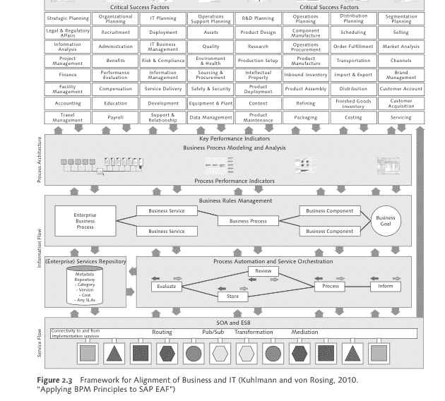

图 2.3 业务与 IT 对齐框架（Kuhlmann and von Rosing, 2010. "Applying BPM Principles to SAP EAF"）

> “一家公司不监控、衡量和控制的事情，它很可能就不会看到发生。”
> – Johan Troels Benthin, CWT, Chief Operations (attributed)

# 3 实践示例：如何开发绩效和价值驱动因素

Mark von Rosing, Ann Rosenberg, Ferry Bogaards

价值创造和实现可能是当今公司面临的最常见困境和挑战之一，无论规模、收入、行业、地区或商业模式如何。对 IT 赋能流程进行大规模投资的决策，以及确保这些投资有效并高效转化为不同能力以实现具体业务价值的复杂挑战，需要得到管理。在太多情况下，这种业务价值根本没有实现。近年来，一项又一项调查显示，30% 至 70% 的大规模投资（例如 IT 赋能变革）被浪费、受到挑战或未能为公司带来回报。事实上，一项关于衡量成本和价值的调查发现，在许多企业中，少于 8% 的 IT 预算实际用于为公司带来价值的举措 [Butler Group, 2005]。德勤 [Deloitte, 2004] 的另一项调查报告称，124 名财务高管声称，几乎 80% 的 IT 项目并未积极促进其企业中的价值创造和实现。2009 年 IBM 对财富 1000 强 CIO 的调查发现，平均而言，CIO 认为 40% 的 IT 支出未为其组织带来回报 [IBM, 2009]。2007 年 The Standish Group 进行的一项研究发现，只有 35% 的 IT 项目成功，而其余 65% 的项目要么受到挑战，要么失败 [Cook, 2007]。

然而，这种价值创造和实现的缺乏并非仅限于 IT 投资的问题，因为很少有公司积极管理其价值。克兰菲尔德管理学院进行的研究表明，最大公司中不到 30% 的公司实际上拥有正式的价值管理流程 [Peppard,


Ward, 2003]。他们并没有建立正式的价值规划、价值创造和价值实现方案，也没有相应的识别、监控或衡量流程。

由于这些问题，许多组织都在思考如何才能实现价值。对大多数公司而言，创造绩效和真正价值的问题并不新鲜，其中包括更激烈的成本竞争、产品同质化以及传统市场增长放缓。2009年和2010年的经济与商业环境使解决这些问题变得日益紧迫。然而，敏捷的公司会坚持到底，并最终利用这一经济周期为自己谋利。在人们对惊人效率、卓越绩效和出色商业表现的期望不断攀升的背后，是一股信息洪流，它创造了一套全新的资产，正等待着被加以利用。

组织在实时信息流的滋养下，如饥似渴地吸收信息，就像主根寻找水分一样。例如，业务领导者需要知道关键物资的精确位置。他们希望更深入地洞察客户的购买行为。他们寻求更好地理解自身运营以及合作伙伴的财务健康状况，同时还要了解近期和远期事件所带来的经济和环境后果。正确的信息推动组织前进，而不是拖累它们。分析学描述的是在流程中利用信息来发现模式、识别新可能性、创造新流程、新场景，进行预测并规定行动。然而，只有当整个组织都支持这些洞察所产生的决策，并做出实现“突破”所需的改变时，这些决策才会结出硕果。当然，这种转变不会一蹴而就。

## 3.1 绩效与价值创造的必要性

在绩效和管理文献中，提到了公司为何要以经济价值进行管理的各种原因。首先，人们认识到传统的会计衡量标准存在缺陷，例如可能采用不同的会计方法、排除了风险、排除了投资需求，并且忽略了货币的时间价值。其次，三大发展推动了对企业进行管理的需求：股东积极主义、资本积极主义和管理者积极主义。第三，缺乏股价（对于未上市公司）或竞争，成为除了监管要求之外，基于经济价值创建基准的原因。

尽管过去30年来，绩效和价值管理已在实践和理论中得到讨论（见附录A），但关于战略、商业模式、关键成功因素、价值驱动因素和绩效驱动因素的信息披露，在近年来的重要性已远超以往，并且相关理论和方法也已发展以纳入这一变化。

价值创造与公司价值最大化的目标以及管理者的目标相一致。它有助于更好的资源配置，并防止仅追求增长而忽视盈利能力。它为高管薪酬提供了良好基础，从而进一步协调了所有者与经理人的目标 [Rappaport, 2008]。当协调得当，它可以作为公司及各个业务单元的战略 [Salter and Zwirlein, 2009]。然而，你需要考虑完整的价值生命周期，这意味着要明白：未被规划的价值很难被识别。如果你尚未确定在何处或如何创造价值，那么价值又如何能被创造出来？此外，你只能实现与你所创造的价值相等的价值。在第1章关于核心差异化能力的讨论中，我们阐述了通过最佳实践创造的价值要少于试图与最佳实践竞争时创造的价值：与差异化竞争相比，前者实现的价值更少（见图3.1）。

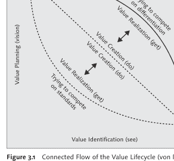

图3.1 价值生命周期连通流程（von Rosing, 2009. “商业价值管理”）

ROI（投资回报率）是一种绩效衡量指标，用于评估投资效率或比较不同投资的效率。它只能用于计算可能的回报，因为投资的收益（回报）除以投资成本，结果以百分比或比率表示。因此，ROI只考虑可衡量的财务指标。价值驱动因素是可衡量的运营变量，这些变量一旦改变，就会对一个或多个可评估价值产生影响。此类变量可包括成本节省、时间节省、人员调整或服务改进。如果在启动IT项目时ROI是关键目标，那么价值驱动因素就是帮助你实现该目标的关键。这使得价值驱动因素成为帮助公司创造并实现其所期望价值的最重要主题之一。

如前所述，价值驱动因素是任何显著影响公司价值的重要因素 [Amit and Zott, 2001; von Rosing, 2009]。研究人员对这些价值驱动因素的数量意见不一：五类 [Ruhl and Cowen, 1990]、六类 [Moskowitz, 1988]、七类 [Rappaport, 1998; Mills and Print, 1995; Mills, et al., 1992]。Turner [1998] 确定了八类价值驱动因素。我们建议的框架结合了许多现有方法和途径；然而，它更侧重于将战略业务目标（SBO）与关键成功因素（CSF）以及关键绩效指标（KPI）和流程绩效指标（PPI）联系起来。

一个最重要的因素是清晰理解投资能够且应当交付的驱动因素、业务因素以及经济商业价值的细分。在组织中引入或改进真正的价值管理实践并非易事，而且需要时间。它可能需要在围绕决策、价值管理、绩效管理和问责制的价值思维和行动方面进行重大变革。组织应正式化这种细分，如图3.2所示，将战略业务目标（SBO）及其附带的业务绩效指标（BPI）层层分解到关键成功因素（CSF），并关联关键绩效指标（KPI）和附带的流程绩效指标（PPI），以便建立正确的识别和监控或衡量流程 [von Rosing, 2009]。

一个示例性例子可能如下所示：

- ► SBO = 加速盈利性增长
- ► BPI = 增长+17%市场份额 利润+9%

### 3.2.1 价值规划与识别

对于价值规划与识别，你必须考虑到当今的商业环境不仅仅是应对，更是主动行动，其中专注于创造可持续价值是主要目标。因此，识别主要的业务能力类别和能力组群至关重要，以探索：

- 业务的哪些要素能够创造价值，以支持战略业务目标？
- 业务的哪些要素能够进行优化，从而削减成本，以支持战略业务目标？
- 业务的哪些要素可能破坏价值？
- 谁将是这些价值驱动因素的业务负责人？

在这一层面上进行适当的价值规划，是揭示和识别公司战略业务目标中什么创造价值并驱动价值的关键要素。表3.1展示了主要战略业务目标、相关关键成功因素以及业务负责人的示例。

| 战略目标 | 关键成功因素 |
|---|---|
| 提升股东价值 – CFO | ▸ 通过数量优化增加收入 – CFO, CMO<br>▸ 通过价格优化增加收入 – CFO, CMO<br>▸ 降低销售和管理费用 – CFO, COO<br>▸ 降低销售成本 – CFO, COO<br>▸ 降低所得税 – CFO<br>▸ 资本优化 – CFO |
| 提升竞争力 – CEO | ▸ 加强创新 – CMO, CRDO<br>▸ 加快上市时间 – CMO, CRDO<br>▸ 提高响应能力 – CFO, CMO<br>▸ 改善客户互动 – COO, CMO<br>▸ 提高客户满意度和忠诚度 – COO, CMO<br>▸ 提升品牌知名度 – CMO<br>▸ 加强合作伙伴与关系协作 – CFO, COO |

**表3.1** 战略业务目标和关键成功因素示例（von Rosing, 2010. “构建新水平的卓越”）


| 战略目标 | 关键成功因素 |
|---|---|
| 降低风险 – CEO | ► 优化情报 – CFO, COO<br>► 优化法规遵从 – CFO<br>► 改进风险规划 – CFO, CRSO<br>► 改进风险管理 – CFO, CRSO<br>► 改进业务恢复 - CRSO, CIO |
| 提高运营效率 – CEO | ► 改进开发与生产 – COO<br>► 改进物流、物料和服务 – COO<br>► 改进企业服务 – CFO, COO<br>► 改进人力资本管理 – CHRO<br>► 改进资本管理 – CFO<br>► 改进数据管理 – CFO, CIO |

表3.1 战略业务目标和关键成功因素示例（von Rosing, 2010. "Building New Levels of Excellence"）（续）

价值识别阶段可以通过对组织业务模式进行有针对性的审查和分析，从四种不同的方法入手：

- **方法1**
  与管理团队、关键人员、客户、供应商或其他业务伙伴进行访谈或举办研讨会，以了解战略业务目标和关键成功因素，以及负责不同业务模式能力（例如 CFO、COO、CMO、CHRO 等）的人员所面临的业务问题和痛点。
- **方法2**
  审查财务和管理报告及报表，并进行高管分析，以识别潜在的价值缺口，进而识别诸如高库存水平或收入下降等驱动因素。
- **方法3**
  将前提和标杆管理能力或端到端流程与类似组织进行比较，以识别潜在的价值驱动因素。评估改进组织当前和未来绩效基准的每个方面的价值创造潜力。
- **方法4**
  这是一种流程审查方法，系统地检查组织能力或端到端流程，以发现相关的价值驱动因素。这些职能可以包括：业务战略；市场营销、销售和业务发展；人力资源管理；信息系统；财务；研发；质量；运营、物流和采购；成本会计；组织结构；风险管理；客户服务与支持；以及项目管理。

方法1和2更侧重于自上而下，因此更侧重于价值管理；方法3和4则更多体现自下而上的方法，侧重于绩效管理。然而，所有这些方法的目标不仅是识别价值驱动因素，还要识别价值缺口。核心弱点识别方法，即我们所知的新 ASAP 方法论框架（详见第三部分，第14章，第14.3节），侧重于弱点聚类识别和映射。这种弱点聚类映射基于当前的痛点状况（PPS）以及流程中的任何弱点。使用带有痛点/收益影响评估（P/G-IE）的当前弱点聚类视图来映射和分析 PPS，并得出痛点效应（PPE）或不良效应（UDE），从结果和组织的可能根本问题角度进行，从而确定其对业务模式的影响。PPE 或 UDE 是任何妨碍组织实现其目标的重大问题，因此是价值潜力的重要来源，如表3.2所示。

如表3.2所示，许多PPE和UDE包含问题，也因此包含其他方法所揭示的弱点聚类症状，以及详细或新的UDE。区分状况、问题和症状至关重要，因为真正的价值创造潜力在于解决核心问题，而不是状况或症状。

### 3.2.2 价值创造

我们意识到，对许多读者而言，我们在表3.2中展示的价值驱动因素可能显得非常高层级。但总而言之，价值规划应该纳入战略方向，以及不同 C 级高管（如 CEO、CFO、COO、CMO、CIO）所面临的挑战，这表明了对流程进行重组、精简和创新，并支持其他高管领域的巨大需求，这些高管的战略方向和挑战可能相互关联，指向可能的共同业务问题、痛点和弱点聚类。

正如利益相关者所面临的挑战所示，挑战的范围相当广泛，而且在许多情况下很可能相互关联。因此，价值生命周期和流程生命周期不应被分离。我们识别出的高管战略涵盖了支持增长、资本优化、成本削减、提高竞争力、降低风险和运营效率等主题，这些都涉及在运营层面发展绩效和价值驱动因素。这意味着要重新思考组织内业务流程执行的许多方面，以创造价值。然而，许多 BPM 计划远未达到其可能的价值创造潜力。主要原因是大多数组织采用现有流程（as-is），并将其改进为更优的目标流程（to-be）定义。这与许多组织实施其系统的方式类似（如今仍有太多公司这样做）。这种方法之所以如此有限，是因为一般来说，这类技术的哲学方法将基本流程形态（现状）视为有效，并试图在当前受限的流程模型内优化和完善该流程形态。

业务流程再造（BPR）之父迈克尔·哈默（Michael Hammer）发现了这个问题，并指出 BPR 仅适用于在现有约束模型内对流程进行优化和完善；对于新流程开发或流程创新，应运用业务流程工程（BPE）原则。尽管这并非众所周知，但大多数企业如果没有近期的业务建模工作，实际上并不真正了解其业务流程的深度和广度。这是因为，大多数多年前设计的常见流程已经为适应业务量变化、例外情况、管理层更迭和新增区域活动而进行了调整。由于流程熵（非工程人员称之为“衰减”），流程往往会变得成本高昂且负担沉重。在经济低迷时期，流程建模所显示的成本节约机会正是企业在艰难时期所渴求的。这是一个持续存在的机会，但当经济繁荣、新机会涌现时，企业往往会忘记这一点。

在上一节中，我们讨论了将价值生命周期与流程生命周期相连接，从而弥合价值规划、价值识别和价值创造之间差距的必要性。价值创造的程度以及客户通过实施复杂系统所能获得的收益，取决于组织能够多好地调整其流程，范围从提高效率到增强业务意识。因此，重要的是不要满足于 BPM 显而易见且易于实现的好处，而应瞄准完整的价值驱动因素水平。图3.4展示了一个如何执行此类价值驱动方法的工作流示例。

以正确的方式处理价值驱动因素是成功的关键；因此，在接下来的页面中，我们将分享并建议一些关于“该做什么”和“不该做什么”的实践经验。

## 价值驱动因素实施

理想情况下，价值驱动因素以及价值识别应在项目开始前完成，或在项目准备期间以“精简版”形式完成。最迟应在蓝图阶段开始时完成。战略或商业案例（如果存在）是价值规划的起点。基于业务利益相关者和/或流程负责人的输入，制定痛点分析弱点清单，并确定关键流程变更。因此，关键流程变更驱动项目的价值。价值树（有时称为价值图）将战略业务目标、关键成功因素和运营关键绩效指标，以及痛点、关键流程变更和流程绩效指标关联起来，以衡量成功。因此，已定义的价值驱动因素是价值识别和价值创造的核心交付物。根据所定义的实施范围，价值识别及其确定以精简版或全面方式执行。新 ASAP 核心方法论的交付成果侧重于价值确定的精简版。因此，至关重要的是要了解，ASAP 价值确定的结果会根据需要映射到流程和解决方案设计中。通过价值图来维护这种联系，在价值图中定义 KPI 和 PPI，从而发展运营价值驱动因素。

正是在价值创造阶段将识别的关键流程变更，决定了运行系统的价值实现。价值驱动因素与痛点、关键流程变更和绩效指标相关联，因此是价值创造乃至价值实现的核心交付物——新 ASAP 核心方法论包括整个价值生命周期（价值规划、价值识别、价值创造和价值实现）。有关新 ASAP 核心方法论的更多详情，请参见第三部分，第13章，第13.3节。因此，你可以得出结论：前面说明的价值识别的深度定义了价值创造的可能性，即价值生命周期和流程生命周期与应用生命周期交汇之处。结果就是映射到流程和解决方案设计的价值驱动因素，这些通过表3.1所述价值驱动因素与图3.4所示流程的联系得以维护，即战略业务目标和关键成功因素与运营价值驱动因素（KPI 和 PPI）之间的关联。在业务流程领域和流程组层面，与 PPI 相互关联的运营和财务 KPI 开始发挥作用。


play, 在流程层面，PPIs 是价值驱动因素的链接，而这些价值驱动因素现在已成为绩效驱动因素。

在实施项目中，可选的现状分析可以编目现有的流程文档，作为参考材料支持目标流程建模。此时现状流程模型大多未创建或未更新。可选地，还可以创建解决方案转型路线图或蓝图，以说明整体解决方案如何在实施周期中排序。BPM 原则可用于利用流程量和效率指标识别表现优劣者。在价值驱动流程模型中，这些指标可用于与类似的内部或外部流程进行基准比较。此外，它们还被用作财务和运营 KPI 的主要来源。在业务流程和业务流程变体层面，流程信息用于控制流程。对资源消耗成本、异常处理质量和吞吐量时间进行汇总的信息有助于管理者掌控其流程，并有助于改进规划和采购活动。

在业务流程步骤和业务流程活动中，实时或近实时的流程数据可用于指导流程执行，避免瓶颈和不必要的延迟，以确保价值实现。重要的是，如果一家公司希望在衡量价值之外衡量绩效，则需要了解与该流程在运营层面相关的活动。这些活动的成果提供了有关流程有效性、效率、时间、量和成本的丰富信息。通过将价值生命周期与流程生命周期连接起来，公司可以获得杠杆来在运营、战术甚至战略层面控制组织。

价值创造的关键在于将战略业务目标与关键成功因素 CSFs、关键绩效指标 KPIs 和流程绩效指标 PPIs 关联起来。在流程环境中在战略、战术和运营层面实施 PPIs，为关闭从价值规划、价值识别到通过流程绩效实现价值创造的持续改进循环奠定了基础。附录 B 说明了流程如何以及应如何按战略、战术和运营活动进行排序，然后在所有层级都与关键绩效指标、关键成功因素和战略业务目标相链接——包括将获得价值的业务负责人。请注意，正如我们在新的 ASAP 7 方法论框架中已所述，我们将在第三部分第 15 章第 15.3 节详细介绍，该框架中此类价值驱动因素的价值生命周期输入为工作说明书、范围确定、商业案例、适用时的举措路线图、现有的目标解决方案设计以及现状分析。

然而，实际的价值创造和绩效改进始于识别在业务流程步骤和活动中使用的流程特征和资源。当这些参数被识别后，就有了关于时间、成本和/或质量的流程绩效指标的基础。

如第 1 章所述，战略、商业模式以及由此产生的价值管理之间存在直接联系，战略业务目标、关键成功因素、关键绩效指标和 PPIs 之间也存在直接联系。因此，在战略流程层面，仅使用与业务能力实施相关的 PPIs。战略流程层面的管理者使用基准比较、流程分析和流程参数模拟来确定流程改进的方向和所需行动方案。

流程数据的视角从可操作视角成本、时间、质量转变为战略视角，其中数据被汇总为分析视角量、效率。这是因为数据用于支持关键决策和关于在商业模式中定义为 KPI 的已实施业务能力的战略决策。权重因子将用于确定 PPIs 对财务和运营 KPI 的贡献。

## 3.3 PPI 测量的维度

测量需要在运营层面并在两个维度内进行。第一个维度是流程流活动中活动的管控。这为流程参与者提供了有关流程步骤内活动状态的重要信息。根据活动的处理方式，结果可以是预期或非预期的。预期结果具有预期输出。请记住，这并不能告诉你该输出的质量。如果活动错误，它仍会产生预期输出。非预期结果可以在活动期间是升级结果无资源在正确时间内处理活动或异常结果人为取消或处理活动失败。因此，一个活动始终有三种结果需要处理。预期结果直接进入下一个功能。非预期结果由替代活动或流程步骤处理，甚至停止流程。对于持续改进，测量全部三个结果非常重要；否则我们将无法改进流程以创造目标价值。

第二个维度是特定时间范围内流程流的汇总管理数据。这为流程负责人提供了基于量、平均周期时间、涉及参与者以及基于超时、取消和失败的质量等活动和完整流程的重要信息。效率、有效性和成本无法直接测量，但可以根据我们可测量的信息计算得出。活动的预期输出质量也不能直接测量，而必须基于分析。

从这两个维度可以看出，测量、计算和分析可能变得非常复杂，因此你必须问自己测量 PPIs 是否值得付出努力。答案非常简单：是的。它使你能够将价值驱动因素、业务流程、流程步骤和活动在运营层面直接与战略层面的战略业务目标关联起来。你可以构建与战略一致的商业案例，通过模拟变更并在实施前分析结果来改进运营。此外，它还有助于中层管理通过基于历史数据的预测来监控和管理组织内的活动投入。

## 3.4 总结与结论

如本章所述，通过将价值驱动因素与流程互联，你可以解锁新的可能性。通过将价值驱动因素应用于流程，你可以获得有关流程的深入信息，并通过衡量与商业模式的核心能力以及组织 KPI、CSFs 和 SBOs 关联的真实 PPIs 来提高流程控制能力。通过测量和模拟，组织可以简化其流程并创造由战略业务目标 SBOs 定义所需的价值输出。如定义所述，有两种截然不同的方法：

- 1. 第一种方法是自下而上的方法，可能包括：
  - 分析低效流程非常困难且成本高
  - 分析外部和内部流程变化
  - 分析无效流程稍容易，但仍非常昂贵
  - 分析流程弱点集群
  - 优先考虑流程改进并将变更应用于整个组织大爆炸以及逐个流程或逐个项目
- 2. 第二种方法是自上而下的方法，可能包括：
  - 在商业模式层面达成一致


-   确定高管战略业务目标
-   业务问题、挑战以及痛点情况（PPSs）以及痛点效应（PPEs）和非期望效应（UDE）
-   确定需要调整的核心竞争力和核心差异化能力
-   确定应尽可能具有成本效益和效率的能力，并将变更应用于整个组织（大爆炸）以及逐个流程或逐个项目

今天，第一种方法是最常应用的，它存在多重挑战和缺点。其中一些是与高管业务问题的联系；挑战和痛点的关联非常低甚至不存在；与战略的联系并不强，尽管它非常耗时；与商业模式的联系非常低，因此所需的商业模式创新和转型往往不会发生；运营方法非常复杂，因此难以控制且成本高昂，因为它涉及运营层面的流程，除非对运营流程的输入和输出进行衡量，否则高管很难监控和衡量正在发生的价值创造和实现情况，并且从公司对所需变更的反应中建立持续改进反馈循环非常复杂。

我们并不是说定义价值驱动因素很容易，但它是值得付出的努力，我们希望这些示例能提供一些正确的方向的动力。

**更多信息**
如需了解有关绩效管理、绩效和/或价值驱动因素和价值管理的更多信息或问题，请访问 www.openroundtable.org。

> “你真正能看到的第一个未来，就是你能得到的未来。”
> – 尊者，第十四世达赖喇嘛

# 4 全面方法：将 BPM 与价值和绩效管理、企业架构、治理和 SOA 相结合

*Robert Eijpe, Caspar Laar, Ann Rosenberg, Sascha Kuhlmann, Mark von Rosing*

过去几年，SAP 客户涌现出许多举措：来自面向服务架构（SOA）、业务流程管理（BPM）、价值管理（VM）、企业架构（EA）的举措，并且不仅包括技术架构和信息架构，还包括业务架构。此外，SAP 的新 ASAP 实施方法论已为 ASAP 7 版本进行了彻底改造。有关更多信息，请参阅第三部分，第 15 章，第 15.3 节。

这有很多需要处理的内容，超过一个客户因方法数量之多而感到困惑。他们开始思考所有这些部分如何契合在一起，并担心所有这些都需要治理到位。看到基于发展能力和运营卓越的业务流程带来的成本削减和价值创造潜力，客户仍愿意投资这些产品并踏上重组和精简业务的旅程。然而，客户面临很多问题。一些最常见的问题大致如下：这些框架、方法和方法是否彼此互补？它们是重叠还是矛盾？我可以在不关注另一项的情况下进行一项吗？最重要的是：我从哪里开始？

## 4.1 应用不同方法

首先，没有确定的答案说明先做什么或客户应从何处开始。然而，每个客户都应清楚准确地了解业务战略、商业模式和业务架构。所有方法都侧重于战略、组织、流程之间的联系，以及如何将所有内容整合到技术中以创造绩效和价值。它们侧重于改进业务活动的组织或执行方式，并具有循环方法来提高运营模式实施的效率和有效性。BPM、企业架构、价值管理和面向服务架构从不同角度解决类似主题，并实现不同形式的绩效和价值创造（见图 4.1）：

-   **企业架构（EA）**侧重于为业务设计设定框架并制定标准、指南、政策和程序，以确保业务整体的设计、完整性，以及如果被识别和规划，则确保绩效、价值创造和实现。
-   **业务流程管理（BPM）**侧重于业务流程生命周期的管理，概述组织可以和将如何执行其能力。真正的绩效发生在活动层面，因此大多数价值创造也发生在这一层面。向流程引入 BPM 原则的真正好处之一是，您可以将持续改进的原则添加到流程生命周期中。
-   **价值管理（VM）**增加了价值生命周期形式，即价值规划、价值识别、价值创造和价值实现，并在运营和战略层面进行基准测试，从而识别成本削减和改进潜力。这样做改进了流程生命周期和 EA 设置。它还通过添加用于设置绩效测量的特征和指标，使运营卓越的概念具体化。
-   **面向服务架构（SOA）**侧重于为基于可重用组件（服务）和灵活编排层的应用程序架构提供设计原则，这些原则在将业务流程需求转化为支持的 IT 解决方案的解决方案转换过程中应用。
-   **治理**侧重于以结构化和受控的方式持续应用原则。治理应用于企业的各个层面，并且需要在业务、流程和 IT 治理之间实现协调。

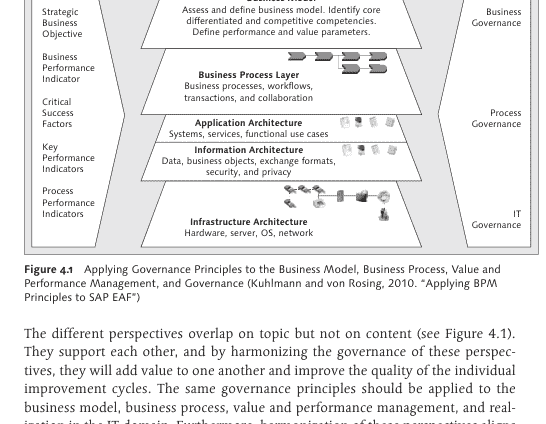

图 4.1 将治理原则应用于业务模型、业务流程、价值和绩效管理以及治理（Kuhlmann and von Rosing, 2010. "Applying BPM Principles to SAP EAF"）

不同视角在主题上重叠但内容不重叠（见图 4.1）。它们相互支持，并且通过协调这些视角的治理，它们将相互增值并提高各个改进周期的质量。相同的治理原则应应用于业务模型、业务流程、价值和绩效管理以及 IT 领域的实现。此外，这些视角的协调使业务和 IT 举措保持一致，因为它们基于共同的标准、政策和程序以及对业务流程的共同导向。因此，业务治理是能够为业务模型、EA、BPM 和价值管理学科的各个业务领域增加巨大价值的原则之一，因为它结合了不同的业务领域。

## 4.2 利用 BPM 和价值与绩效管理原则创新您的 EA 框架

2007 年标志着企业架构 20 周年纪念。在此期间，出现了几种企业架构方法论。今天，四个方法论主导该领域：企业架构的 Zachman 框架、开放集团架构框架（TOGAF），SAP 客户建议使用、联邦企业架构框架（FEAF）和 Gartner（前身为 Meta Framework）。

你可以问自己是否应该关心一个超过 20 年的领域。一个好且正确的咨询回答是：“视情况而定。”企业架构领域是为了应对当时已显现的 IT 中的两个主要问题而创立的。第一个问题是管理信息技术系统日益增长的复杂性。第二个问题是越来越难以将业务与 IT 协调一致，以利用这些系统实现真正的业务价值。遗憾的是，今天大多数企业架构师只关注 EA 愿景的第一部分，而忽视了更侧重于 IT 协调的重要第二部分。一个很好的例子是，大多数企业架构师几乎不了解业务模型、业务运营模型、价值图、价值树和价值驱动因素，这些都是业务架构的学科。然而，过去几年业务领域的发展对 IT 灵活性和业务-IT 协调提出了新的要求，使这一话题再次成为焦点。

系统越复杂，如果没有与商业模式和战略的联系，就越不可能实现最大业务价值。组织管理复杂性越好，组织实现真正业务价值的机会就越大。那么组织是否应该关心 EA、BPM、治理、SOA 和业务建模领域？这取决于组织对价值识别、创造和实现以及由此对“底线”产生积极影响的看法。如果管理系统复杂性和交付业务价值是组织的重点，那么他们应该关心这些主题。

### 价值管理

将所讨论材料结合起来的关键在于，企业架构的原则、政策和标准在整个企业连续体中应用于流程以及绩效和价值需求的定义。这有助于组织协调业务模型、业务流程、应用、信息和基础设施领域，这些领域都是企业架构的一部分。了解业务架构是任何企业架构的第一步，也是协调对同一架构域的不同视角的关键。业务架构是结合并纳入业务战略、从而确定组织方向、其商业模式和运营模式的学科。核心（竞争性和差异化）和非核心能力被识别，业务活动是

根据它们对组织绩效和价值创造的重要性进行优先级排序。因此，业务架构不仅引导业务模型和运营业务模型的定义与实施，还设定了在业务（战略和战术）层面以及运营层面衡量绩效所需的目标和指标。这使得业务架构成为定义业务模型、绩效和价值需求的最重要学科之一（参见图4.2 [Kuhlmann and von Rosing, 2010]）。

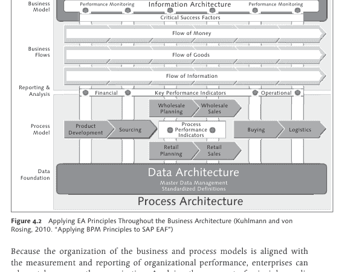

图4.2 在整个业务架构中应用EA原则（Kuhlmann and von Rosing, 2010. “将BPM原则应用于SAP EAF”）

由于业务模型和流程模型的构建与组织绩效的衡量和报告保持一致，企业可以充分管理组织。因此，在整个组织中应用同一套原则、政策和标准，成为实现卓越运营的价值驱动力。然而，我们经常看到这些原则并未得到充分应用。

将BPM与EA相结合的主要好处之一是它能同时为两者增值。BPM缺乏在架构生命周期中产生和发展的架构原则、政策和标准。另一方面，BPM的原则和规范可以为任何企业的企业架构框架增添大量价值。以下是企业架构中缺失部分的一些示例[Kuhlmann and von Rosing, 2010]。尽管企业架构框架的成熟度多年来不断发展，但这些部分仍然缺失。

- **标准交付物**

  这些内容被提议用于不同的框架（类似于每个项目方法论中都包含的项目计划）：针对实际架构内容（如业务能力/胜任力模型、价值树、流程模型、数据模型等）的通用“翻译器”或采用指南。如今，每个人都在利用来自APQC等组织的最佳实践或开箱即用的内容，但这并不是最佳做法。

- **变更管理**

  尽管在EA框架中有一个阶段，如TOGAF中的架构变更管理，但这些阶段不足以应对任何类型的变更。如果你成功开展了一项业务架构计划，所制定的企业需求可能会导致大量的变更请求，不仅涉及IT部门，还涉及业务单元甚至事业部（例如，引入新的业务能力或将某项业务外包）。根据对企业的影响，这些项目在项目开始前就需要或多或少地强调变更管理。

- **TOGAF B阶段**

  作为TOGAF B阶段的业务架构，缺少了开发上述业务架构的关键部分：

  - 缺少与业务模型的联系，这导致了战略对齐的缺失，而战略对齐是任何EA计划的前提。
  - 缺少业务模型与流程全景（流程层级）之间的联系，这导致了战略层面与运营层面之间缺乏对齐，而这是任何EA计划都需要的。

- **EA领域**

  来自业务架构、信息架构和技术架构的EA领域都缺少一种正式的价值管理和绩效管理方法，用于识别、规划、创造和实现价值。如果应用这些原则，它们也是各自独立定义和开发的。让每位企业架构师反复开发相同所需的方法和手段，成本非常高，而且完全低效、无效。

当今的企业架构框架和方法采用项目式方法。这本身是可以接受的，尤其是当组织刚刚开始实施企业架构计划时。然而，如果一个组织已经实施了企业架构计划，这就不够了，因为组织需要围绕其EA计划采用持续改进和治理的方法——而不仅仅是EA项目方法。如果EA计划按项目逐一处理，持续改进和治理的整个概念就会丢失。

好消息是，当你将BPM（流程生命周期）原则应用于架构生命周期时，上述识别出的缺失领域可以被添加到组织的企业架构计划和/或框架中。图4.3 [Kuhlmann and von Rosing, 2010] 说明了价值原则（价值识别、价值规划、价值创造和价值实现）以及持续改进和治理是如何被添加到TOGAF方法中的。

这就是如何将流程生命周期应用于企业架构：基本原则是，每次经历架构生命周期时，都有一组固定的EA项目目标，从而在整个迭代/阶段（A到H）中应用相应的原则。在架构生命周期各阶段的迭代中，价值管理原则的规划、识别、创造、实现和治理均得到应用。为了实现业务价值，会启动流程生命周期的各个迭代。当我们进入这样的迭代时，治理和项目方法（如流程管理生命周期（PML））开始发挥作用。这一业务绩效持续改进过程由业务治理指导。重要的是，在每个周期结束时，经验教训、获得的洞察以及应用或开发的标准都应被纳入企业架构的原则、政策和标准中，以便在下一个周期中使用。SAP开发这些方法，是为了从业务创新到业务转型（业务模型、业务价值和业务绩效），再到运营模型，并支持IT解决方案所需的解决方案转型。

帮助组织公平竞争的关键原则之一是TOGAF自带的元模型。与所有TOGAF内容一样，元模型应根据企业的具体需求进行调整，以最大程度地实现架构领域之间的协调。元模型可用作定义通用数据模型和创建流程的基础

图4.4 将绩效管理和价值管理原则应用于TOGAF元模型B流程架构（Kuhlmann and von Rosing, 2010. “将BPM原则应用于SAP EA”）

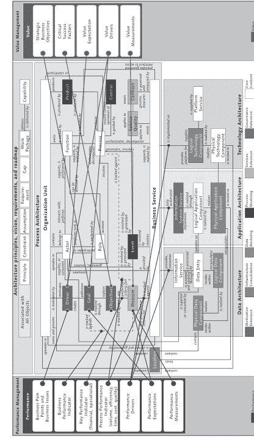

## 4.3 解决方案转型 – 协调企业架构、BPM与SOA

为了确保流程和IT解决方案的运营组织与业务战略、模型和价值主张保持一致，解决方案转型应直接与业务架构相关联。在新的ASAP 7方法论和治理方法中，通过将BPM流程生命周期融入项目方法，保证了这种联系。以业务流程和流程步骤作为转型设计的起点，IT解决方案至少具有面向流程的基础。在解决方案转型阶段加入SOA，进一步加强了IT解决方案与业务流程的联系，并提供更适用、更灵活的IT解决方案。

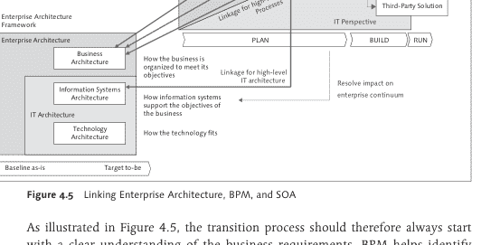

图4.5 连接企业架构、BPM与SOA

如图4.5所示，转型过程因此应始终从清晰理解业务需求开始。BPM通过ASAP方法论的校准、现状分析和目标分析阶段，帮助识别这些需求（更多详情请参见第三部分第14章14.3和14.4.3节）。这些分析的来源始终是企业架构中提供的业务战略和模型，以及价值管理视角下的目标和指标。EA与BPM方法之间的这种联系，确保了贯穿所有环节的一致自上而下的方法

你的项目并提高现有信息的复用率。将 BPM 方法和思路应用于 EA，你可以以新的方式增加 SOA 能力，并在各阶段甚至定义其价值，如图 4.6 所示。

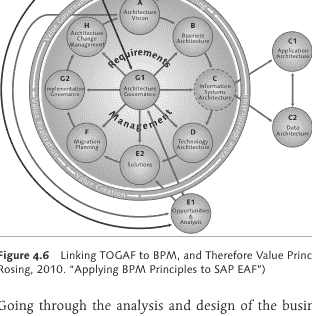

图 4.6 将 TOGAF 与 BPM 关联，进而关联价值原则和 SOA (Kuhlmann and von Rosing, 2010, "Applying BPM Principles to SAP EAF")

通过对业务流程的分析和设计，逐步增加了有关业务活动的细节和信息。在业务蓝图阶段，新的 ASAP 7 核心方法中的 BPM 工作流：流程步骤变体被分解为活动，并将 SAP 和非 SAP 解决方案与之对应。在这里，业务流程建模符号（BPMN）建模通过描述流程活动流和所需的数据流，并识别活动中涉及的自动化和人工任务，从而丰富了解决方案设计。

从 SOA 角度来看，在这一层级上，可以执行所涉及业务对象和领域服务的初步识别和建模。一旦对设计的解决方案达成一致，就需要在实施层级上进一步详细说明解决方案。在这里，识别出各个核心、非核心和面向服务的组件；设计服务定义、定制和增强；并对现有解决方案进行评估。结果是完整的所需解决方案文档，在 ASAP 7 核心中称为业务蓝图文档，其中纳入了组织的流程和服务需求（见图 4.7）。

图 4.7 通过流程层级从业务模型分解到应用

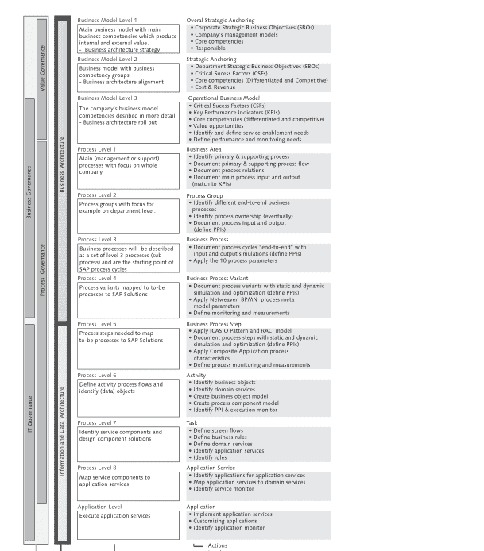

将相关输出反馈回企业架构对于保证一致性以及评估 BPM 项目对整体业务架构的影响至关重要。

## 4.4 摘要与结论

规划流程对齐、价值创造、持续改进、架构原则、标准、规则和治理对于大多数现代组织而言是必要的，但由于缺乏如何做到的方法而从未执行的计划，其规划成本非常高，而运营价值却非常低。本章各节的安排和推导均源于对重叠原则的方法中规划与执行之间适当协调。反过来，这需要对企业生命周期的充分理解，并建立适当的协作和治理方法，以确保所描述方法的相互衔接。

虽然价值管理、业务流程管理、面向服务架构、企业架构和业务治理各自都有价值，但我们描述了它们之间自然的协同性，并且在共同使用时能为更好的业务绩效和价值成果以及业务与 IT 的战略对齐发挥最佳作用。当这些方法一起使用时，价值工程（VE）提供了基准和高影响策略，从而确定可能的改进领域。BPM 提供了业务背景，概述了在何处改变输入-输出模型，并提供了在何处创造价值以及如何和在何处衡量绩效的理解。SOA 提供了解决方案转型的设计原则，而 EA 提供了将业务愿景和战略转化为架构变革的纪律。虽然治理原则可以应用所需的标准和规则，但所有这些对于可持续的持续改进、优化和创新都是必需的。

认识跨所描述边界的直接协作的价值是很重要的。只有在适当的协作和治理流程支持下，BPM、SOA 和 EA 角色才能有效地共同努力，实现企业的共同目标。业务-IT 对齐的关键以及将一切粘合在一起的是流程和活动。业务流程优化和方法的整合概念出现的时间甚至早于 VE、SOA、EA 和治理。就在 EA 和治理在业务与 IT 对齐的背景下成为主流话题的同时，许多流程优化社区的关注点也微妙地转向了 BPM，以超越优化方法。


BPM 作为一门学科的关键区别在于增加了对灵活和动态流程设计以及通过 IT 使能的流程编排和自动化的关注。除了通过持续改进和自动化降低成本外，BPM 还为融合和敏捷的业务与 IT 响应能力提供了基础，也是应用本章所讨论原则的关键。图 4.8 从流程管理生命周期视角展示了这些原则，在整合业务建模、流程建模、治理、所有权、业务价值和业务绩效方面。

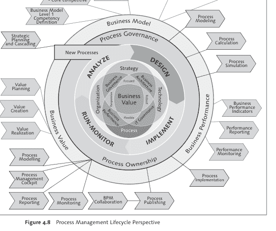

图 4.8 流程管理生命周期视角

虽然每个学科本身都有价值，但图 4.8 说明了学科之间自然的协同性。结合起来，它们在绩效、价值创造、业务架构和治理方面提供更好的业务成果，所有这些都关乎业务与 IT 的战略对齐。为此，新的 ASAP 方法论和治理框架（将在第 13 章第 13.3 和 13.4.3 节中描述）是一个良好的起点。ASAP 7 核心结合了应用生命周期、流程生命周期、项目生命周期和价值生命周期；ASAP 的业务附加组件为 BPM、SOA、EA、价值管理等提供了治理框架。

## 更多信息

如需了解有关如何使用业务建模、流程建模、企业架构、治理、所有权、业务价值和业务绩效的更多信息或问题，请访问 *www.openourtable.org*。

> “人获得知识的速度有多快，他得救的速度就有多快。”
> – Joseph Smith, 1843

# 5 结论

在过去的四章中，我们涵盖了当今太多项目参与中缺失的重要知识、方法和方法。其中我们涵盖的知识包括价值识别、创造和实现的重要性——以及业务模型应成为组织核心竞争力和差异化能力的创新和转型的首要目标。我们讨论了业务模型不是战略这一重要事实。模型与战略的分离是业务模型概念的优势和弱点。因为业务模型是战略的产物，业务模型只能强于你的战略业务目标（SBOs）、关键成功因素（CSFs）和关键绩效指标（KPIs）。如果一家公司想要业务-IT 对齐，他们需要将战略与业务模型对齐，业务模型与流程模型对齐，流程模型与系统对齐——并且所有这些都需要在正确的架构和治理框架下进行。鉴于业务模型创新和转型的潜在影响，我们讨论了仔细审视你的能力以识别让你脱颖而出的少数关键流程和活动的重要性——并找到创造和实现价值的创新方式。

此外，我们还探讨了如何将 C 级需求和期望（驱动因素）链接到组织的 BPM 项目中，然后开发绩效和价值驱动因素的重要缺失环节。

SAP 在流程（价值、项目以及流程和应用生命周期）中支持的所有机会都将在第二部分的使用案例中进行说明和演示。此外，你将在本书第三部分中介绍各种 SAP 方法、框架、BPM 工具、基于流程的预包装实施内容、使能措施和方法，在那里你将找到指导，帮助你在以 SAP 为中心的业务和 IT 环境中以其所有方面应用 BPM。


我们现在进入第二部分，探讨来自世界各地的BPM用例集。本节旨在分享已收集的经验/知识，以及SAP客户执行BPM计划所获得的价值驱动因素和经验教训。您将了解如何从管理和技术两个角度来应对BPM。

# 第二部分
BPM案例研究
来自现实世界

在本书的第一部分，我们讨论了BPM的业务驱动因素和核心主题，如业务模型、业务模型转型、服务导向，以及BPM如何结合企业架构（EA）、面向服务的架构（SOA）、治理、绩效和价值管理等重要方法。在本部分，我们展示了来自SAP客户的实际BPM用例汇编，这些用例分享了不同行业的经验和教训。您将获得从管理或技术角度应对BPM所需的必要见解。这些用例将为您的项目提供可能的起点思路、需要注意的障碍和挑战，以及可能带来的收益。

在审视SAP客户如何采用各种方式管理业务流程并在特定用例中应用它之前，更广泛地考察客户与合作伙伴在BPM实施上的共性，有助于理解每种场景的利弊。例如，阅读我们对程序中某个功能或快捷方式的描述，可能无法帮助您理解在特定企业中实施该程序时可能涉及的细微差别或困难。您如何预见经验的缺乏或成熟度不足、缺失的先决条件、急于求成，或需要调整方法以适应环境的其他因素？在本节中，我们通过展示一些关于早期SAP客户群中BPM采用情况的定性观察，尝试绕过没有现实案例而难以理解概念理论的问题。

> “没有理论的经验是盲目的，但没有经验的理论仅仅是智力游戏。”
> ——伊曼努尔·康德

# 6 观察SAP客户如何应对BPM：BPM项目中业务与IT之间的差距

Greg Chase, Rukhshaan Omar, James Taylor, Mark von Rosing, Gregor Müller

许多SAP客户多年来一直在尝试或使用来自非SAP供应商的BPM工具。2009年和2010年对SAP客户进行的市场调查显示，至少50%的客户正在进行某种业务流程管理计划。在某些情况下，这些客户甚至已经在公司内部署了基于BPM的项目，但这些项目极少与其SAP核心应用程序关联或集成。根据我们的观察，这些实验几乎总是测试BPM技术的概念验证，通常不会在客户组织内建立BPM能力——至少不是一种能与SAP核心流程以及支持性的SAP IT和SAP Basis团队合作的能力。相比之下，对于绝大多数基于SAP的团队来说，BPM还非常新颖。在本书编写时，SAP已经提出了将BPM作为即将推出的工具集SAP NetWeaver BPM的一种方法，已有数年时间——该组件的第一个版本于2009年6月正式面向市场。尽管有这一公开公告，支持SAP安装的核心IT团队和服务集成商仍然对即将到来的变化毫不在意。

因此，当SAP发布SAP NetWeaver业务流程管理时，SAP突然出现在BPM供应商名单上，当业务部门要求IT部门支持BPM计划时，IT部门不得不考虑这些供应商。SAP Basis团队发现自己忙于建立新的IT采购周期，以寻找尽可能最好的BPM流程建模工具。当IT采购团队被问及这一新的BPM计划将解决什么业务问题或实现什么业务目标时，他们通常回答：“我们不知道”，或“我们被要求开始做BPM。”

其中许多客户未能在内部保留这种以流程为导向的能力，因此发现他们的流程图已经过时。此外，流程图往往侧重于SAP应用程序的范围，而不是涉及客户所有员工、供应商和客户的端到端流程。

在上述几乎所有情况中，SAP或竞争对手的产品都被选作该公司的解决方案。然而，要么购买并未真正发生，要么所购产品被束之高阁，仍在寻找要解决的业务问题。而且，由于没有考虑问题的业务方面，在这些情况下，IT团队面临着所获工具与为解决问题而设计的方案之间仍存在重大差距的风险。

缺乏纪律的IT团队“工具优先”的倾向，是缺乏业务方法、漫无目的的BPM计划的症状。由于计划和团队没有明确地朝着实现优先级业务目标的方向努力，而这些目标是通过映射的关键绩效指标（KPI）或度量来衡量的，因此该计划存在无法为业务带来任何快速回报的风险。

另一方面，IT聚焦于“组合”取得了良好的开发成果，但并未带来持续改进。SAP客户和合作伙伴内部一组具有前瞻性思维的SAP NetWeaver能力团队，致力于完善组合的开发方法论。他们开发了自定义应用程序，这些应用程序通常通过调用面向服务的架构（SOA）功能来桥接多个SAP和非SAP系统，然后为业务用户提供一个友好的界面。

此外，支持SAP环境的开发人员通常利用SAP NetWeaver CE等工具集和Scrum等敏捷开发方法。这些项目的结果通常包括更高的业务接受度，以及总体上更快的完成时间。

然而，这些项目在公司内部很少得到更新和维护。事实证明，IT部门在实施这些工具时很难展示投资回报率或朝着业务目标的可衡量的改进。没有明确的业务目标导向，没有映射到度量或衡量体系，也没有承诺审查和评估业务价值。换句话说，这种流程方法论缺乏商业意识。如今，这种商业意识已被纳入新的ASAP方法论中，该方法论将在第三部分第14章14.3节中介绍。

来自Patrimonio Hipotecaria、Coca-Cola、GISA和Siemens IT Solutions and Services的案例故事反映了这一点。

BPM也适用于SAP更传统的行业。这些行业最为成熟且财务稳定，因此不一定需要满足它们多年来运行的现有SAP系统已经充分满足的需求。为了说明BPM在这些行业中的应用，我们介绍了来自RS Components（第8章）以及Braskem和KAESER KOMPRESSOREN（第9章）的BPM用例故事。

### 6.1.2 BPM最常见的应用

BPM作为一种方法和工具包，也与应用程序无关。话虽如此，我们确实看到了BPM在以下领域中的聚集：

- 管理企业信息管理（EIM）的业务流程——尤其是主数据治理（见第7章的描述）
- 供应商协作与付款（见第9章的描述）

这些应用领域的需求特别成熟，非常适合BPM实施。此外，有两个因素有利于这些类别中应用的聚集：

- SAP NetWeaver主数据管理（MDM）的最新版本专为与BPM协同工作而设计，其功能来自自定义用户体验和Web服务函数。示例用例包括：
  - INVISTA
  - Ericsson
  - SAP
- 与供应商和客户建立更紧密的关系是许多公司的业务目标。无论是与需求计划、更快的付款还是服务相关，BPM都能帮助公司增加其关系的灵活性。示例用例包括：
  - RS Components
  - Braskem
  - KAESER KOMPRESSOREN


> **更多信息**
> 
> 尽管我们已经描述了 BPM 最常见的应用领域，您可以在 SAP 业务流程专家社区找到许多已识别的用例：
> http://wiki.sdn.sap.com/wiki/display/BPX/Business+Process+Management+Use+Cases

## 6.2 BPM 满足的典型业务需求

虽然所有业务问题都将从 BPM 风格的方法中受益，但只有部分问题需要使用 BPM 工具实现。只要与特定案例的独特性相关的未满足需求不存在，使用标准最佳实践和技术来解决许多典型问题是完全可以的。

### 6.2.1 明确并优先排序业务目标和问题

为了确定某个业务问题是否可能成为 BPM 的潜在用例，您必须首先明确阐述您的业务目标。询问任何业务部门负责人，他们通常都能轻松说明其前三大业务问题。通常这些陈述将旨在改善或减少与以下相关的业务状况：

- 速度/流程周期时间
- 规模
- 运营质量
- 责任或合规
- 收入机会或损失

另一个重要考虑因素是确定业务问题的相对优先级。有时这很容易，因为公司的 senior 管理层已经将其命名为战略要务。其他时候，您可以通过考虑特定流程实例或周期的“规模”来确定流程重要性的粗略衡量，规模以收入、成本或涉及的员工人数衡量，再乘以一年的发生次数。这意味着发生次数相对较少但涉及大量收入的流程很重要，同样，每次发生成本相对较低但每年涉及数千次请求的流程也很重要。这种经验法则不能替代正式的价值工程研究，该研究应在 BPM 项目选定后作为商业案例评估的一部分进行。

### 6.2.2 启动 BPM 项目的资格评估问题

在分析业务问题并确定需求后，可以使用以下问题来帮助判断项目是否适合采用 BPM：

1. 活动是否是一系列相互依赖的行动？
2. 这些行动是否跨越多个系统？
3. 这些行动是否跨越多个组织或业务合作伙伴？
4. 我是否需要考虑流程周期频繁的差异或变化？
5. 我是否需要让不同类型的用户参与流程步骤？
6. 流程周期的度量和监控有多重要？

第一个问题需要回答“是”。如果没有流程，则 BPM 不适用。对剩余问题的回答中“是”的越多，与 BPM 方法和工具的契合度越好。以下问题与 SAP 客户使用 BPM 解决的主要需求类别相关：

- 按序列编排依赖的行动
- 编排跨越多个系统的行动
- 编排组织间的行动
- 为变化设计流程架构
- 流程特定的用户界面
- 度量和监控业务流程

### 6.2.3 按序列编排依赖的行动

业务流程管理是关于以序列形式查看、处理和优化业务行动。但当序列步骤之间存在依赖关系却没有协调方式时，企业中的用户和员工会观察到以下症状：

- 跨职能团队之间任务交接无效
- 工作重复
- 无法及时发现问题
- 工作负载瓶颈（过载或欠载）

这类问题是由相关团队各自为政、缺乏明确的协作定义所造成的。而且由于流程缺乏全局协调或治理，这些团队的工作方式存在不必要的局部差异。

BPM 方法通过提供应发生的一切的明确地图来帮助协调流程中的依赖行动。该地图提供了合理化并优化流程的机会，为流程步骤之间的流动自动化提供媒介，并提供流程中每个实例状态的可见性。一个常见的用例示例是需要管理录入和审批的工作流，例如主数据治理。来自 INVISTA 的案例研究，一家全球聚合物和纤维生产商（第 7 章），是供应商和材料主数据治理的绝佳示例。

### 6.2.4 编排跨越多个系统的行动

BPM 是关于协调端到端流程，特别是那些跨越异构系统的流程——需要从多个来源提取数据，经由某些人工操作进行转换或处理，然后分发到下游系统。当这些流程未得到充分解决时，客户会看到以下症状：

- 用户必须登录多个系统才能执行流程任务或决策。
- 在流程早期使用的系统中捕获的信息会丢失或必须重新输入到下游系统。

当流程中重要的数据必须从多个非集成、无关联的系统中提取，然后人工决策的结果被分发到一个或多个下游系统时，就会出现这类问题。BPM 方法允许从多个系统自动汇总数据以在流程、步骤特定的用户界面中显示，为记住与流程实例相关的数据提供上下文，并编排将这些数据分发到下游系统。

一个很好的例子是 RS Components 的客户折扣管理器。该系统从 SAP 客户关系管理（CRM）的旧版本、SAP ERP 和商业智能系统中提取数据以管理客户折扣（第 8 章中介绍）。另一个例子是 KAESER KOMPRESSOREN 创建的客户服务流程。其程序从多个系统提取信息以创建单一屏幕，这使得电话支持代理和现场服务工程师在响应客户支持请求时的工作变得更加容易（第 9 章中介绍）。

### 6.2.5 编排组织间的行动

典型的 BPM 用例通常需要协调公司内部部门或供应商、厂商和客户之间的依赖行动。没有这种协调，就缺乏接收主动通知的手段，也缺乏对流程实例（状态和度量）的透明度。组织之间的分离加剧了编排的需求，导致以下症状：

- 通过电话和电子邮件不断检查状态
- 问题发现过晚，无法缓解
- 业务合作伙伴表现不佳，造成意外责任

BPM 方法通过流程模型明确定义步骤和责任、通过 BPM 工具跟踪每个实例的流程状态、通过工作列表和其他通信为流程参与者提供主动通知，以及允许度量流程性能以执行服务水平协议，从而帮助编排组织间的行动。

一个例子可以在 Braskem S.A. 的用例中找到（第 9 章），该用例涉及在供应商、外包服务提供商、Braskem 的多个校区和全球共享服务中心之间编排开票和付款。

### 6.2.6 为变化设计流程架构

BPM 对于需要考虑决策频繁变化或实例之间差异的流程尤其有用。流程需要更有效地管理变化的指标包括：

- IT 部署支持自动化响应时间过慢。
- 后端系统变更导致用户需要大量再培训。
- 决策仍然是人工步骤，因为政策变化过于频繁。


这些症状是依赖核心企业系统的结果，这些系统通常需要大量的测试周期或自定义编码才能修改，这表明用户界面与这些系统的耦合过于紧密。

BPM 方法提供了这样一种能力：通过支持流程建模并同时生成执行流的工具，来架构一个能够处理频繁变更的流程。这些工具使业务部门能够快速描述流程变更，并使 IT 部门能够快速部署新的自动化。将业务规则嵌入 BPM 流程，还可以通过自动化决策来简化和整合流程。借助嵌入式业务规则实现决策自动化，使得业务部门在新政策变更推出时能够快速更改规则，而无需 IT 部门提供服务。

爱立信的主数据治理实现最好地展示了这种架构。该项目通过应用智能将主数据创建整合到一个单一的全球流程中，其应用智能可帮助用户输入新供应商的特定国家税务信息。更多详细信息，请参阅第 7 章中介绍的爱立信案例研究。

## 6.2.7 特定于流程的用户界面

基于 BPM 的编排为业务流程流中的每个人工步骤简化用户体验提供了机会。用户体验过于复杂的症状包括：

- 业务用户不愿采用应用程序
- 依赖超级用户将所有流程相关数据输入系统
- 后端系统的变更，由于用户体验的变化，需要对用户进行耗时的再培训
- 错误率上升以及用户的支持/培训需求增加

通过 BPM 对流程的编排，可以了解用户正在承担的角色、任务和工作上下文。这样可以简化用户界面，使其专门聚焦于要执行的操作，以及流程上下文特有的所有可用信息。这让普通用户更容易参与到与流程相关的自动化中，从而有可能将业务流程从核心应用扩展到实际参与者。BPM 业务流程也与系统任务解耦。如果同时使用解耦的用户界面，就可以创建独立于后端系统的流程用户体验。在这种情况下，即使后端系统发生更改，也可以保持流程及其相关用户体验不变。

SAP IT 部门的并购后数据迁移业务流程 BPM 用例（在第 7 章中介绍）就是一个很好的例子——它简化了原本复杂流程的用户体验，使数据管理员能够高效工作，并让业务经理参与到数据治理中。

## 6.2.8 度量和监控业务流程

如果没有一个统一的框架，就很难进行明确的度量。BPM 实施提供了查看流程实例在流程流中状态的机会，以及根据映射到业务目标的 KPI 来衡量其进展的能力。缺乏这种可见性和度量的流程的症状包括：

- 需要与参与者手动核对他们的进度或状态
- 缺乏明确的任务优先级
- 没有显示错过最后期限或缺失依赖关系
- 缺乏关于 IT 实施所获得业务价值的数据

这些症状源于缺乏在编排中管理流程实例的统一框架，也源于流程执行中没有内置任何显式度量，因此你无法跟踪指标和 KPI。

BPM 实施工具天生具备通过流程模型跟踪流程实例进度的能力，包括任何步骤中当前处理者的状态。此外，当步骤完成耗时过长、资源过载或不可用以及存在缺失依赖时，系统能够生成通知。简单的流程度量，如步骤周期时间和流程周期时间，通常易于实现。流程上下文还可以为实现更复杂的度量提供机会，例如异常流程与标准流程运行的数量和比率。

来自 Braskem S.A.（第 9 章）的用例跟踪“付款及时性”KPI（指付款在发票目标付款日期内完成的频率），就是这方面的一个很好的例子。

# 7 首批应用：企业信息管理

*Greg Chase, Rukhshaan Omar, Darwin Deano, Jan Hvass, Stacey Drinan, James Taylor, Oktavian Wagner, Wayne Morris*

刚开始实施 BPM 的公司通常会从优化其 IT 部门内的运营业务流程，或某些基础性子流程（如数据治理）开始。完成这些项目可以立即提供业务价值（与概念验证不同），同时即使失败，对业务的风险也相对较低。

简化 MDM 治理流程是一个不错的首个项目，因为这类项目往往会在范围上限制用户数量。因此，这是最常见的用例之一，即 SAP 的 BPM 技术在 SAP 环境中的应用（例如，创建显式流程来管理和治理主数据）。目标是减少进入系统的不完整和低质量主数据的数量，同时提高主数据在系统中可用的速度。这些项目可立即提供业务价值，因为低质量的主数据会严重阻碍任何流程改进举措。缺少一个涵盖物料、供应商和客户主数据的准确全局存储库，会影响新产品的上市时间，在供应链中造成问题，并导致与客户的低效互动。

那么，为什么这么多公司都会遇到与主数据质量相关的问题呢？许多公司要么有机成长，要么拥有复杂的业务运营（例如，在多个地区运营）、与国际合作伙伴合作，或提供各种不同的产品。这使得描述和维护企业信息变得更加复杂。

以下是三个示例，展示了 SAP 客户如何使用 BPM 方法以及 SAP NetWeaver BPM 工具创建流程来治理其主数据。客户方法的一个根本性转变是将主数据的治理——无论是定义还是运营——交还给业务用户，而不是由 IT 部门掌握。

在第一个案例中，全球生产商 INVISTA 启动了一项卓越采购流程改进计划。该公司迅速确定有效的主数据治理流程是该计划的关键第一步。他们部署了 BPM 方法和工具来编排所需活动，以确保对通用全球供应商和物料主记录进行有效治理。

第二个案例涉及爱立信，一家世界领先的电信设备及相关服务提供商。该公司面临着双重挑战：精简流程，以及找到管理其特定国家要求的方法。除了使用 BPM 编排相关操作外，他们还利用业务规则管理来确保流程能够执行与供应税和注册号相关的特定国家政策。

在第三个案例中，SAP 本身展示了如何将 SAP NetWeaver BPM、SAP NetWeaver 业务规则管理（BRM）和 SAP Business Objects Data Services 相结合，以实现端到端的并购后数据迁移流程，从而使 SAP 能够在提高数据质量的同时，更快地并行迁移多个收购项目的主数据。

### 7.1 INVISTA：实现跨系统主数据管理

> > BPM 使得跨多个具有不同版本、语言和配置的 SAP 系统实施针对供应商和物料的标准主数据请求流程成为可能。结果是数据错误更少、重复数据减少，并且由于流程自动化而提高了效率。
> > – Cynthia Bailey Grunewald，INVISTA PEP 项目负责人

INVISTA 是一家全球性的聚合物和纤维生产商，它启动了一个卓越采购项目（PEP），目标是打造世界一流的采购组织，以提供全球竞争优势。其中一个关键工作流是主数据管理，用于跨多个 SAP 系统标准化数据治理，并减少数据错误和重复，以支持采购运营。INVISTA 将 BPM 与 MDM 结合使用，以标准化和


在 SAP ERP 的多个版本和配置中简化供应商和物料主数据记录的管理。

## 7.1.1 背景

INVISTA 是全球最大的聚合物和纤维一体化生产商之一，主要从事尼龙、氨纶和聚酯应用。INVISTA 在北美、南美、欧洲和亚太地区超过 20 个国家开展业务。

2007 年最后一季度，INVISTA 启动了采购卓越项目，其最终目标是创建一家世界级的采购组织，通过利用全球采购方法、技术驱动的战略采购以及采购专业人员的知识和经验，提供全球竞争优势。

### 业务案例

作为采购卓越项目的一部分，INVISTA 希望在多个 SAP ERP 系统中简化主数据管理流程，以标准化程序、强制执行一致性并提高整个 INVISTA 组织中供应商和物料主数据记录的质量。该活动被认为对实现采购卓越项目（PEP）的全部业务效益至关重要。INVISTA 认识到，要获得并维持精简采购流程的全部效益，必须定义、实施并持续改进有效的数据治理流程。

### 现状流程

在 PEP 项目之前，INVISTA 在其组织的四个 SAP 系统中维护供应商和物料主数据有各种业务流程。文件中共有超过 366,000 条供应商记录，其中约有 50,000 条为活跃供应商主数据记录。此外，物料主数据记录超过 110 万条，其中约 60 万条为活跃记录。重复记录和主数据不一致是一个巨大问题，由于在四个 SAP 系统之间整合报告的困难。最后，每个系统都配置不同，以支持各种特定站点和区域需求。表 7.1 描述了现状流程：

| 特征 | 现状条件 |
|---|---|
| 业务流程管理工具 | 多种多样的流程——大多为手动，部分站点使用 Lotus Notes |
| 业务流程 | 多种多样的流程；每个站点都有自己的流程和审批级别 |
| 全局字段标准化 | 治理不一致 |

*表 7.1：INVISTA 的现状流程*

## 7.1.2 BPM 解决方案

为实现 PEP 业务目标，INVISTA 请 Deloitte（Deloitte Consulting LLP，Deloitte LLP 的子公司）帮助他们利用 SAP 的 BPM 和 MDM 能力。目标是定义一个解决方案，该方案可简化业务流程执行、管理全局通用数据，并标准化供应商和物料主数据记录的本地数据维护流程。该解决方案需要对 INVISTA 组织所有主要区域的所有主要业务流程进行分析。

### 实施方案

INVISTA IT 团队面临的最大挑战之一是克服从技术/工具角度处理此工作的倾向，而非将之视为改善主数据的业务转型项目。将 BPM 方法付诸实践所需的关键第一步是根据 PEP 倡议设定的业务需求定义未来的业务流程。INVISTA 利用了 Deloitte Consulting 的 Industry Print 工具——一种符合业务流程建模符号（BPMN）的流程模型，用于捕获未来理想流程的图表（见图 7.1）。

在设计流程后，了解实现流程设计所需的概念架构的组件和层至关重要（见表 7.2）。

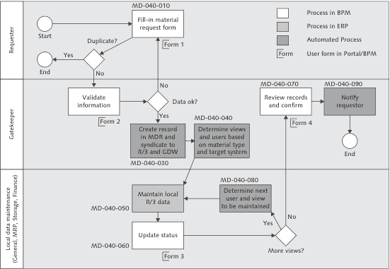

**图 7.1** 在 Deloitte Consulting Industry Print 工具中设计的物料请求流程

| 层 | 需求 | 方法 |
|---|---|---|
| 编排 | 在各个参与方（请求者、审批者、本地数据维护）之间协调端到端流程 | 利用业务流程管理来促进编排 |
| 表现层 | 尽可能将终端用户从底层应用程序的复杂性中抽象出来 | 利用门户在各种应用程序之上提供单一、一致、简单的前端 |
| 应用层 | 利用 SAP ERP 和 SAP NetWeaver MDM 的必要功能 | 利用 MDM 和版本中立的 ERP 功能 |

**表 7.2** 流程设计

### 实现选项 1：BPM 与直接服务消费

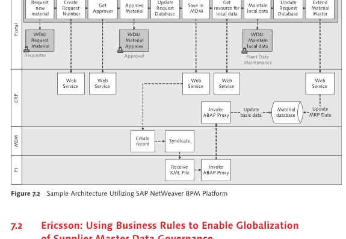

图 7.2 使用 SAP NetWeaver BPM 平台的示例架构

## 7.2 爱立信：利用业务规则实现供应商主数据治理全球化

> 众多的国家特定要求使得全球整合供应商主数据治理变得困难。通过利用 BPM 和业务规则引导用户完成这些要求，该项目提供了一个稳健且用户友好的解决方案。
> 
> – Stacey Drinan，IT 平台区域经理，Ericsson AB

爱立信是一家全球电信设备供应商，一直致力于多年的主数据流程持续改进计划。在其最新项目中，爱立信寻求为其供应商主数据流程增加额外的可用性。公司将其业务规则纳入流程自动化，以指导供应商数据的正确用户输入，而这些数据对供应商所在国家有特定的和单独的需求。预计该项目将使主数据流程加速超过 50%——并且具有较高的业务用户接受率。

## 7.2.1 背景

爱立信是面向移动和固定网络运营商的电信设备及相关全球服务的世界领先提供商。超过 1,000 个网络在 175 多个国家使用其网络设备，40% 的所有移动电话呼叫通过爱立信系统进行。爱立信是全球少数几家能够为所有主要移动通信标准提供端到端解决方案的公司之一。有关更多信息请访问 www.ericsson.com。

### 业务案例

爱立信是一家真正的全球公司，因此其采购组织也是全球性的，与 200 多个国家的供应商进行互动并达成协议。协议范围从适用于整个爱立信的全球协议到仅适用于特定本地爱立信运营的协议不等。

从战略角度来看，爱立信正在将其业务支持系统整合为几个全球系统。关于采购流程，爱立信拥有：

- 两个全球 SAP 系统（当时正在合并为一个），所有采购均在此进行
- 用于跟进和报告的全球 SAP 业务仓库
- 全球合同管理系统
- 全球战略采购工具

在这种环境下，准确且高质量的供应商主数据是确保业务流程顺利运行并能够进行准确报告的关键。它也是确保在全球采购系统中识别供应商以确保流程和报告质量的关键。

爱立信多年来一直在全球系统中处理主数据质量。爱立信决定实施 BPM 时，一个中央全球主数据管理组负责根据业务部门的要求维护全球业务系统中的主数据。

该项目的业务案例包括两个目标：首先，提高主数据质量以提高整体业务流程效率和分析准确性；其次，提高创建和维护供应商主数据的特定流程的效率。全球主数据管理组每月处理约 3,000 条供应商主数据更新请求。业务案例计算基于每项请求处理时间减少 50%。解决方案目标是捕获每项请求的请求处理时间，以便于对这一重要 KPI 进行报告。

### 现状流程

在原始流程中，供应商主数据的变更请求是通过向全球主数据管理组发送 Excel 表单来提出的。请求中的任何问题都通过请求变更的业务用户与全球主数据管理组的负责人之间来回电子邮件处理。一旦请求得到验证，全球主数据管理组的负责人必须根据请求类型手动在多达四个不同的系统中输入数据。

按照典型的业务方式，详细说明必须输入到供应商主数据中的信息的许多业务规则分散在不同的操作手册中以及员工的脑海中。业务规则说明数据是强制性的还是可选的，是否符合默认值，是否需要特定格式的数据，等等。其中许多业务规则取决于供应商所在国家或供应商将被使用的国家。全球和区域对齐导致这些规则和要求经常变化。对于供应商主数据，此类业务规则与以下类型的数据相关：

- 付款方式
- 银行详细信息
- 税号
- 预扣税
- SAP 中的业务伙伴角色
- DUNS 编号
- 供应商退货

## 7.2.2 BPM 解决方案

该项目的愿景是通过以下解决方案精简（见图 7.3）和自动化（见图 7.4）流程：


1. **自助服务创建**

   业务用户可以在 SAP NetWeaver Portal 中访问在线请求表单。表单会根据场景和其他关键选择标准（即国家）引导用户正确输入数据。

2. **智能引导**

   在线表单引导用户正确输入数据，并通过业务规则为表单添加“智能”，帮助有特定需求（如某国的税务信息）的业务用户。

3. **编排的请求路由**

   请求通过使用 SAP NetWeaver BPM 的工作流路由到全球主数据管理组，以进行数据丰富和验证。

4. **自动数据同步**

   请求获批后，数据将自动过账到 SAP NetWeaver 主数据管理（MDM）中，并自动同步到所有相关消费系统。

通过此解决方案，只需最少的人工干预，且无需在任何阶段复制粘贴数据，即可确保数据完整性和数据质量。此外，该解决方案还能引导业务用户从一开始就在请求中正确输入数据，从而显著缩短处理请求的整体交付周期，并提高业务用户对请求处理的满意度。

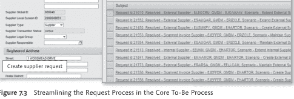

图 7.3 在核心目标流程中简化请求流程

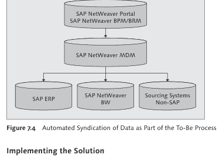

图 7.4 数据自动同步作为目标流程的一部分

## 实施解决方案

该项目运行了约 1.5 年，分为以下阶段：

1. 预研/商业论证：四个月。业务案例的开发与爱立信对 SAP NetWeaver BPM 和 SAP NetWeaver 业务规则管理（BRM）的 beta 测试同步进行，以评估即将开展项目的可行性。在可行性评估期间，部分现有基于引导式流程（guided procedures）的场景被移植到 BPM，以了解其对爱立信需求的支持程度。
2. 需求收集：五个月。该阶段重点关注数据模型和流程方面。与此同时，IT 团队正进入 SAP NetWeaver BPM 的推广计划阶段。
3. 迭代式设计-原型-测试周期：六个月
4. 最终构建：一个月
5. 最终测试和上线准备：两个月
6. 上线和业务推广：一个月

SAP NetWeaver BPM 和 SAP NetWeaver BRM 的架构支持一种非常高效的项目开发模式，使首席开发人员和首席业务用户在快速的设计-原型-测试周期中进行大量互动。这确保了所有关键业务需求都能在流程早期被捕获，并使关键业务用户能够及早感受新流程和解决方案。

为了让新流程更快推广和采用，我们在设计精简流程和良好用户体验方面投入了大量精力。可用性专家在整个项目期间参与其中。此外，还专门开展了一周的可用性测试，共有 12 位熟悉现有业务流程但不了解新解决方案的业务用户参加。这项活动收集到了对可用性改进至关重要的信息。

推广按照紧凑的三波计划在全球范围内完成。这使得项目能够在六周内完成全部全球推广。为支持推广，项目在最终开发的同时制作了在线培训材料。

该项目以业务与 IT 联合交付项目的形式运行，业务部门负责需求收集、业务协调、测试和业务推广。IT 交付团队负责解决方案的设计、构建和部署。来自 SAP 合作伙伴 Ecenta AG 的专家承担了围绕 SAP NetWeaver BPM、SAP NetWeaver BRM 和 SAP NetWeaver 主数据管理的主要设计和构建工作。这是由爱立信的外包合作伙伴 IBM 管理的整体 IT 项目的一部分。

## 项目成果

在整理本用例信息时，该项目已上线一周，并已处理了第一批在线请求。最近一周的生产环境经验以及用户培训和业务测试环节清楚地表明，业务用户认为该解决方案直观易用。业务用户还赞赏引导式方法以及利用业务规则对输入数据进行即时验证。现在，正确输入的数据正在帮助爱立信实现其业务流程“零错误”的愿景。对请求处理时间的测量还表明，项目将请求处理时间缩短 50% 以上的目标显然触手可及。

## SAP 环境的示例解决方案架构

该解决方案建立在爱立信现有的企业 IT 架构之上，其中包括以下 SAP 系统（另见图 7.5）：

- SAP NetWeaver MDM 作为供应商主数据的单一事实来源存储库
- SAP NetWeaver Portal 用于所有最终用户与解决方案的交互
- SAP NetWeaver Process Integration 用于集成解决方案的不同组件
- SAP NetWeaver BPM 作为新流程的主要工作流和编排引擎
- SAP NetWeaver BRM 用于管理和维护与主数据相关的业务规则

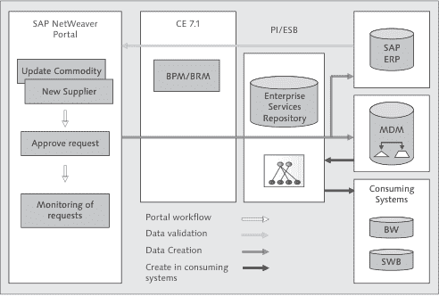

**图 7.5** 解决方案架构概览

解决方案的架构由四个职责明确划分的层级组成：

1. 门户层用于所有最终用户与解决方案的交互。该层管理对解决方案以及最终用户通过企业门户界面访问的所有屏幕/工作流的访问控制。

2. CE 环境是 SAP NetWeaver BPM 和 SAP NetWeaver BRM 组件的宿主。SAP NetWeaver BPM 是执行业务流程逻辑和工作流的流程引擎；规则引擎同样位于该环境中，负责在运行时执行业务规则。SAP NetWeaver 组合环境（CE）还承载基于 Java 的企业服务，以管理 BPM 与 MDM/ERP 系统之间的交互。

3. SAP NetWeaver PI 用作解决方案的通信中间件。企业服务注册在 SAP NetWeaver PI 的服务注册中心中，由其管理运行时执行。

4. 消费系统是最后一级，它们从主数据管理解决方案中获取新的和更新的主数据。消费系统包括 SAP 系统（SAP ERP 和 SAP NetWeaver BW）以及一个非 SAP 系统——采购工作台（SWB）——一种供应商/采购管理解决方案。

该流程是使用 SAP NetWeaver BPM 构建的请求与审批工作流（见图 7.6）。相关的流程步骤实现包括标准 Web 服务和定制构建的 Web 服务。

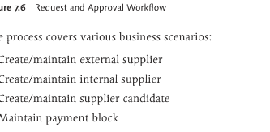

图 7.6 请求与审批工作流

该流程涵盖多种业务场景：

- 创建/维护外部供应商
- 创建/维护内部供应商
- 创建/维护候选供应商
- 维护付款冻结
- 创建“其他”请求

所有业务场景共享相同的基本工作流结构，以及相同的可输入或修改属性超集。对于每个场景，还定义了若干其他关键属性，例如供应商、国家、采购组织/采购国家，以及若干业务规则。业务规则规定了应采集哪些信息和属性、这些信息是必填还是可选，以及适用的默认值和验证规则。所有业务规则都在 SAP NetWeaver BRM 组件中集中定义、维护和执行。允许的值范围取自 SAP NetWeaver MDM 或 SAP ERP


系统。支付和发货详情等 ERP 相关属性的验证，通过调用 SAP ERP 系统的服务完成。

图 7 展示了如何根据所执行的业务场景在 SAP NetWeaver BRM 中定义业务规则。对于特定场景（例如，创建外部供应商）和特定属性（例如，订单货币），规则定义了该属性是必填、可选、隐藏还是只读（存在）。

在该项目中，爱立信的另一个需求是准确获取供应商的法定税务登记号和注册号。这些信息的业务规则因全球不同国家而异。编号的类型、所需数量和格式因国家而异，但同时，准确获取这些信息对于确保与关键供应商保持顺畅关系至关重要。爱立信使用 SAP NetWeaver BRM 按国家定义了应输入哪些字段以及如何验证这些字段的规则。图 7.7 展示了这些规则定义的示例。


图 7.7 规则定义

获取税务登记号和注册号的规则预计会频繁变更（和改进）。借助 SAP NetWeaver BRM 这样的集成工具，预计爱立信全球主数据管理团队的主数据业务专家将能够直接维护这些规则、进行验证，然后将更新后的规则应用于生产应用，而无需每次都启动大型 IT 项目。

## 7.3 SAP IT：加速并购后数据增强与迁移

> 我们的目标是加快整合收购公司的速度。其中的关键环节是快速将被收购公司的数据迁移到我们的核心系统并提升数据质量。使用 BPM 使我们能够定义并持续改进最佳实践数据迁移流程，并能轻松地使其适应项目的独特需求。
> ——Oliver Bussman，SAP AG 首席信息官

任何收购的股东回报都与被收购公司的整合速度相关，因此 SAP AG 一直在寻找改进其并购后整合方法的方式。其中一个改进领域是被收购公司的业务流程和数据迁移到 SAP 核心系统的速度。为了满足管理层将这一流程速度至少提升 50% 的要求，SAP 全球 IT 部门选择利用 BPM 方法来简化其并购后数据迁移流程，并求助于 SAP 的价值原型团队来实施这一流程。

### 7.3.1 背景

SAP AG 是全球领先的商业软件解决方案提供商，也是全球第四大软件公司。SAP 总部位于德国沃尔多夫，在全球设有区域办事处，提供各种应用和服务，使超过 25 个行业、各种规模的企业都能成为卓越运营的企业。

### 业务案例

虽然 SAP 的战略主要依赖于内生增长，但 SAP 也通过战略性收购来寻求增长机会。从重大收购中实现价值的一个关键因素是尽可能快地成功整合被收购公司，并尽可能减少对员工、客户和产品的影响。这项工作在很大程度上是一项战略性的 IT 任务——支持、调整和整合收购方系统中的业务流程，高质量地迁移数据，同时尽快降低 IT 运营成本并简化 IT 复杂性。

SAP 将被收购公司的整合视为一项持续改进的能力。这种观点与持续流程改进的理念相呼应，而持续流程改进正是业务流程管理方法的核心。因此，SAP 全球 IT 业务流程与应用迁移团队自然而然地选择了 BPM 来优化和持续改进其并购后数据迁移的业务流程。

SAP 对数据质量保持着非常高的标准，从历史上看，被收购公司的数据质量需要经过整改才能达到 SAP 的标准。此外，被收购公司的主数据和交易数据通常需要进行转换和扩展，以符合 SAP 的系统和数据治理要求，并且需要与 SAP 系统中已有的重复数据进行核对。由于许多数据涉及收入考量以及对客户的承诺和义务，业务部门经理需要参与新迁移数据对象的验收。

在 2008 年收购 BusinessObjects 之后，SAP 管理层设定了一个总体目标，即将并购后数据迁移速度提升 50%。流程改进的其他目标包括：

- 显著提高每次迁移的数据质量
- 支持多个数据迁移/收购项目并行运行
- 改善用户体验，让数据管理员和业务部门经理都参与到自动化中
- 实现流程自动化，尽可能减少人工操作
- 将并购后迁移流程视为不断演进的最佳实践

### 现状流程

在 SAP 收购 BusinessObjects 之前，数据迁移是在自定义和第三方工具的支持下进行的，这些工具是手动的——并未完全集成。这种手动流程耗时且容易出错，并且无法持续提高从遗留系统迁移的数据的质量。

收购 BusinessObjects 是 SAP 第一次经历大型并购后数据迁移项目。因此，数据迁移的业务流程不得不迅速建立起来。该流程由 IT 部门主导。IT 团队发现，在原有流程中，业务部门经理通过电子邮件发送的电子表格手动参与数据验收流程。数据存续和匹配的业务规则没有进行全局定义。

图 7.8 描述了 SAP 在迁移前提高被收购公司数据质量的现状流程。通常，每个步骤之间的推进都是人工操作，需要在运行任何批处理之前进行人工干预以复制或设置数据，或配置工具。首先，数据迁移团队从被收购公司的系统中提取数据，然后利用第三方数据源（如 Dun & Bradstreet）对数据进行增强。随后，数据分析师对增强后的数据进行设置，以评估重复项和数据质量。基于此评估，数据被分为三组：唯一记录、明确重复记录，以及“待人工处理记录”，这些记录具有歧义，需要人工判断以确定它们是唯一记录还是部分重复记录。唯一记录被保留。歧义记录，包括潜在重复记录或不完整记录，由数据分析师手动解析以进行处理。建议的处理方案被汇总到电子表格中，并通过电子邮件发送给业务经理审批；存续业务规则通常只存在于业务经理的头脑中，有时不同经理之间的规则并不一致。当业务经理返回变更后，最终保留的数据具有接近 SAP 要求的结构和质量标准。

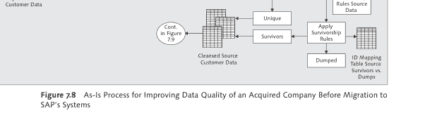

图 7.8 迁移至 SAP 系统前改进被收购公司数据质量的现状流程

图 7.9 显示了将被收购公司清洗后的数据与 SAP 数据进行匹配的子流程。与数据改进流程类似，数据与 SAP 现有记录进行匹配。明确的匹配结果被汇总到电子表格中，通过电子邮件发送给业务经理，由他们决定哪些重复数据应保留并上传到 SAP 系统，哪些应删除。明确且唯一的条目直接传入系统。可能匹配但不属于明确重复的记录（例如，地址不同）由数据分析师手动审查和解决。数据分析师将处理方案汇总到电子表格中，并通过电子邮件发送给业务经理审批。

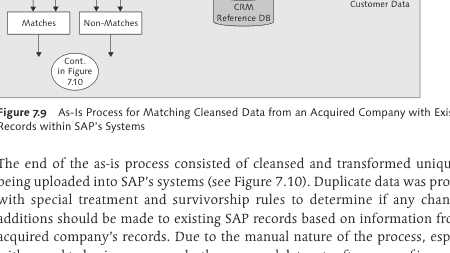

图 7.9 将被收购公司的已清洗数据与 SAP 系统内现有记录进行匹配的现状流程

现状流程的最后阶段是将经过清洗和转换的唯一数据上传到 SAP 系统（见图 7.10）。重复数据通过特殊处理和存续规则进行处理，以确定是否应根据被收购公司记录中的信息对 SAP 现有记录进行任何更改或补充。由于该流程的人工特性，尤其是在业务审批方面，批准的数据集质量往往不一致，需要在之后进行进一步的返工或整改。此外，迁移过程缓慢，需要耗费大量 IT 人员的时间来执行。


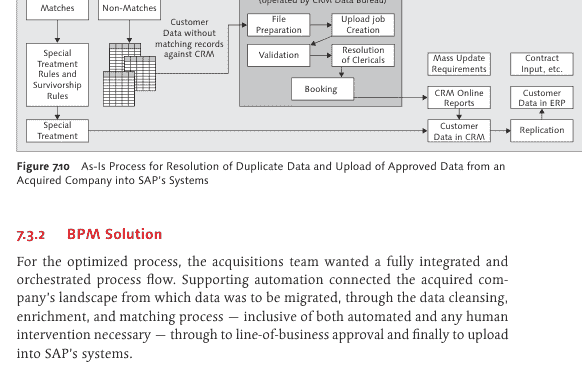

图7.10 解决重复数据并将收购公司经批准的数据上传到SAP系统的现有流程

## 7.3.2 BPM解决方案

对于优化后的流程，收购团队希望获得一个完全集成和编排的流程流。支持性自动化将收购公司的环境（从中迁移数据）连接到数据清理、增强和匹配流程——包括自动化以及任何必要的人工干预——再到业务部门审批，最后上传到SAP的系统中。

此外，新流程将为数据迁移提供可演进的基线最佳实践，并能够灵活地适应未来其他被收购公司的不同环境架构。该流程的另一个重大改进在于，从数据分析师到业务部门经理的所有参与者如何被编排和调动，以促进流程每一步的具体任务。具体到该流程，销售经理和客户支持经理等业务部门经理参与数据对象的验收，因为他们对迁移数据的质量有着切身利益。

### 实施方案

新的数据迁移流程利用SAP NetWeaver BPM来编排系统和用户之间的流程流，利用SAP BusinessObjects Data Services来自动化大部分数据清理和改进步骤，并利用Web Dynpro在需要时促进用户交互。BPM架构能够处理多个实例，这意味着来自多次收购的多个数据迁移项目可以并行处理。

新流程（见图7.11）从收购公司的系统中提取数据，并将对象转换为符合SAP系统模式的格式。然后，提取的数据被上传到暂存数据库。经过SAP BusinessObjects Data Services执行的自动验证检查，以及人工概览检查以确保暂存数据库中的一切看起来正确后，流程会自动检查提取数据中的必填字段，然后使用在线服务执行地址查找和数据增强，包括邓白氏（Dunn & Bradstreet）。

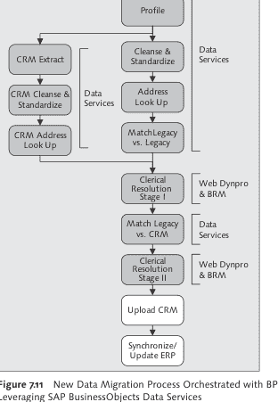

图7.11 使用BPM编排的新数据迁移流程，其中自动化步骤利用SAP BusinessObjects Data Services

然后，对提取的数据在其自身数据中检查重复并进行清理。在新流程中，此步骤自动开始，无需任何人工干预或设置。与现有流程类似，一些模糊匹配需要人工干预来解决。然后，数据分析师被分配解决模糊匹配的任务，而相应的业务部门经理（按区域）被分配批准数据管家提出的解决方案的任务，如图7.12所示。

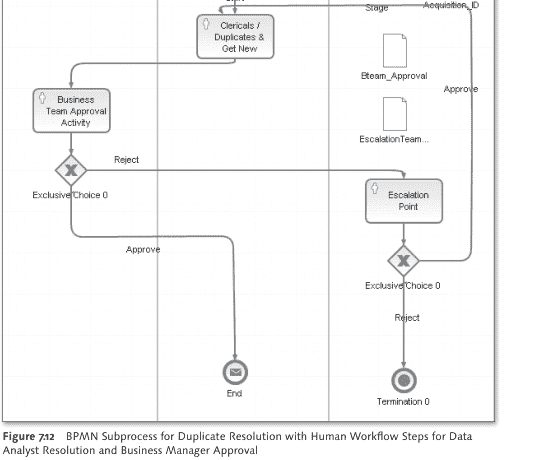

图7.12 用于重复数据解决的BPMN子流程，包含数据分析师解决和业务经理审批的人工工作流步骤

经理审批路由基于与相关客户位置相关的业务规则。BPM流程调用存活业务规则，这些规则也用于定义处理重复数据时的协议——根据数据质量和与主数据对象相关的交易数量等标准，决定保留哪条记录、丢弃哪条记录。

新流程为每个流程步骤提供特定任务的Web Dynpro界面，例如数据分析师的解决流程（见图7.13）。

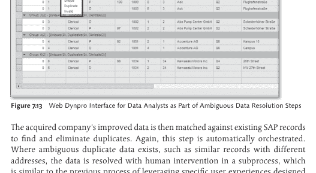

图7.13 用于数据分析师处理模糊数据解决步骤的Web Dynpro界面

然后，将收购公司改进后的数据与SAP现有记录进行匹配，以查找并消除重复项。同样，这一步也是自动编排的。当存在模糊的重复数据时，例如地址不同的相似记录，数据会通过子流程中的人工干预来解决，该子流程类似于之前利用为此任务设计的特定用户体验的流程。与之前的子流程类似，业务经理参与已解决的模糊重复项的审批过程。

接下来，高质量的原始数据被上传到相应的SAP Business Suite解决方案中，例如SAP客户关系管理。作为最后一步，新客户在SAP ERP中被标记为活跃客户。

新流程的一个有益特性是，它通过集成的用户安全、访问控制和日志记录来支持企业控制和合规审计。只有适当的用户才有权修改客户和合同等关键数据，并且这些更改的记录可在审计历史中查看。

为了加速流程开发，SAP全球IT部门聘请了SAP价值原型团队，这是一个使用SAP技术并与SAP客户和合作伙伴合作的专家咨询团队，致力于开发创新解决方案的概念验证实现。SAP全球IT业务流程与应用迁移团队与价值原型团队合作，与流程参与者和经理举办了研讨会。在此过程中，他们设计了一个优化的数据迁移业务流程，以实现数据迁移速度提高50%同时保持高数据质量标准的目标。

随后，价值原型团队利用其快速开发方法，在项目启动后的六周内提供了一个支持该流程的自动化原型，并集成了SAP BusinessObjects Data Services。该原型随后被用于收集流程各参与方的反馈，包括业务部门审批人和数据分析师。

### 项目成果

在本书编写期间，该流程已准备就绪，等待即将进行的收购交易完成交割。

这一新解决方案将持续扩展，以纳入超越数据和流程集成的其他并购（M&A）流程，例如员工入职、供应商和银行数据迁移，以及交易数据迁移。

### SAP环境示例解决方案架构

使用SAP NetWeaver Composition Environment、SAP NetWeaver BPM、SAP NetWeaver BRM和SAP BusinessObjects Data Services技术创建了一个新解决方案，使SAP能够标准化和自动化此流程（见图7.14）。如图7.14所示，SAP NetWeaver CE管理运行时流程自动化，包括BPM引擎，该引擎管理流程编排、业务规则（定义重复数据接受规则）以及Web Dynpro屏幕，流程参与者在其中相互交互以完成流程中的任务。SAP BusinessObjects Data Services提供数据质量改进和重复匹配批处理作业的功能，这些作业由BPM编排调用。SAP BusinessObjects Data Services还作为最后一步管理向SAP系统上传数据。其余系统包括被收购公司的遗留环境（未在图中显示），该环境是待迁移数据的来源，以及接收经业务经理批准后的已清理、去重数据的SAP核心系统。

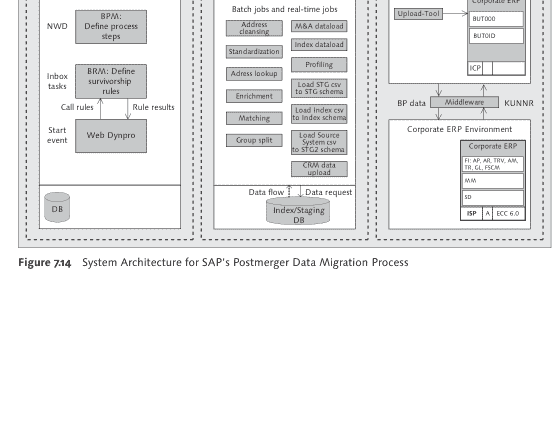

图7.14 SAP合并后数据迁移流程的系统架构

# 8 行业特定流程

*Greg Chase, Rukhshaan Omar, Gerardo Morales, Manish Argarwal, Alexander Grobe, Gregor Müller, Hans Ludwig Reinecke, Christian Heuer, Fin Jennrich, Owen Pettiford, Graham Wiffen*

如今，组织正受益于SAP深厚的行业洞察力，这些洞察力包含在行业特定的SAP Business Suite应用程序中。这些应用程序提供了全面、经过验证的、行业特定的、预打包的同类最佳流程（最佳实践）。借助SAP NetWeaver BPM，组织可以扩展这些最佳实践，以创建差异化流程（自有实践），从而编排和扩展SAP Business Suite应用程序内的业务逻辑。使用NetWeaver BPM可确保组织不会在流程的通用化方面浪费不必要的精力，而是专注于创新以实现差异化。

一般来说，BPM适用于所有行业。然而，SAP BPM产品正被那些同时也是SAP产品整体增长最快的行业部门率先采用。所有这些行业都面临激烈的竞争、价格和增长压力。我们看到特别关注那些必须处理频繁变化的业务流程和独特需求的行业，例如金融服务、消费品、公用事业和高科技行业。此外，所有对法规遵从性有高度需求的行业都与BPM相关。让我们看看这些行业的主要驱动因素和示例应用：

- **金融服务**

  激烈的竞争、增长和成本压力是金融服务行业简化面向客户流程的驱动力。业务流程管理工具变得至关重要，因为银行需要简化其流程，以便在服务质量和速度方面与竞争对手区分开来。在贷款管理的示例中，银行需要提供必要的跟踪和可追溯性，以确保贷款处理中的瓶颈和问题得到快速高效的处理。由于这一需求，我们正看到银行业领导者选择


基于现代 SOA 的应用程序，例如 SAP for Banking 解决方案套件，为其使用 BPM 构建灵活流程提供坚实基础。

第 8.1 节以墨西哥抵押银行 Patrimonio Hipotecaria 为例，该银行应用 BPM 简化了政府资助的抵押贷款处理业务流程。该银行业务领域每年以双位数增长，使其成为 BPM 的绝佳首个项目。实施 BPM 通过提升运营卓越性和客户满意度展示了立即可见的业务价值。

## 消费品

成本不断攀升、消费者不断变化以及零售商偏好是迫使消费品制造商专注于跨部门流程精简以提升品牌知名度和客户忠诚度的趋势。我们在第 8.2 节中包含了可口可乐的德国装瓶商（与可口可乐企业公司为不同公司）的案例，该公司通过在营销、销售和采购之间无缝整合活动开发了本地化需求规划流程。该公司使用 BPM 工具和方法有效地实施了装瓶商特定的全球化举措本地化，包括处理语言和当地法律要求。

## 公用事业

传统公用事业正在转变为一个复杂的生态系统，包括发电、输电、配电、零售和计量运营，这增加了跨多个利益相关方的流程复杂性。此外，能源价格波动、智能电网/智能电表等创新、需求曲线变化以及积极的消费者，都推动了提高效率以获取和留住客户的需求。所有这些都要求公用事业在公用事业供应链中创建动态协作流程，以适应电力、天然气、供水和区域供热提供商之间的差异。以下是两个 SAP 合作伙伴的示例，他们使用 SAP NetWeaver BPM 的流程模板来有效满足该行业的需求：

- GISA 是一家为公用事业、媒体和公共部门客户提供 IT 相关咨询服务的提供商，已创建 BPM 流程模板以简化其新服务连接流程（见第 8.3 节）。
- 西门子 IT 解决方案和服务是西门子的一部分，西门子是电气工程和电子领域的全球巨头。他们已开发出一个用于战略电网管理的抽象业务概念，由流程、关键绩效指标（KPI）和参考数据模型组成（见第 8.4 节）。

## 高科技

产品生命周期缩短、提供完整解决方案的压力以及苛刻的客户，正在推动高科技公司启动流程改进计划。此外，高科技领域的趋势是构建创新的多层业务网络以提高制造和分销流程的效率。因此，沿价值链的高效协作对高科技公司而言至关重要。因此，他们正在应用 BPM 工具和方法来简化制造商、物流服务提供商、分销商和客户之间的互动。我们包含了 RS Components 的案例，该公司通过自动化供应链协作来优化库存水平。RS Components 是 Electrocomponents plc 的交易品牌，后者是全球最大的电子元件目录和网络分销商之一（见第 8.5 节）。

## 8.1 Patrimonio Hipotecaria：支持附加到 SAP for Banking 的独特抵押流程

> *在银行业，竞争差异体现在服务速度、质量和效率上，因为银行业务本质上是一种商品。SAP NetWeaver 技术平台是我们敏捷性和响应市场需求能力的关键推动因素。BPM 方法和基于 SOA 的 SAP for Banking 解决方案帮助我们快速实施协作流程，以提高业务流程质量和效率，从而支持我们的金融和抵押贷款产品。*
> 
> - Alejandro Marroquin，Patrimonio Hipotecaria 首席信息官

Patrimonio Hipotecaria 是一家成立于 1995 年、拥有 17 个区域分支的墨西哥抵押银行，因其高效运营而受到标准普尔的认可，这得益于其集成且灵活的核心 IT 系统。为了跟上其快速增长的步伐，Patrimonio 制定了用 SAP IS-Banking 和 SAP NetWeaver 技术平台取代 20 多个遗留应用的战略。为了支持其在 SAP for Banking 与非 SAP 应用之间跨越的独特端到端金融流程，Patrimonio 利用了 SAP NetWeaver 业务流程管理。

### 8.1.1 背景

Patrimonio Hipotecaria 是墨西哥领先的抵押和建筑贷款公司之一。他们专注于住房和房地产开发领域，拥有多区域覆盖，在墨西哥不同州提供贷款服务，并积极从事住宅抵押贷款服务，管理资产总额达 12 亿美元。

Patrimonio 双位数的年增长开始过度消耗公司复杂的 20 多个自研内部应用，威胁到公司的增长和竞争优势。2009 年，Patrimonio 选择 SAP for Banking 来管理其业务和技术需求。除了提供核心银行解决方案外，Patrimonio 还选择利用 SAP 技术平台来实现其金融流程的流程自动化和跨应用集成。Patrimonio 决定实施该项目，期望借此加深对业务的洞察，从而能够为客户创建创新新产品。其目标是加快这些新银行产品的上市时间。

### 业务案例

Patrimonio 打算使用 SAP NetWeaver BPM 来自动化支持其金融和银行产品的流程，例如抵押贷款的贷款发起流程。对于第一个项目，Patrimonio 选择自动化其“FOVISSSTE 流程”——一种政府资助的住房开发融资模式，其中贷款发起流程外包给 Patrimonio。通过 FOVISSSTE 流程的贷款申请数量每年以双位数增长，这使其成为 BPM 的绝佳首选。FOVISSSTE 流程与 Patrimonio 其他更复杂的金融流程具有共同特征：

- **跨部门依赖**
  业务流程和实物文件交换跨越墨西哥城的当地分支机构和中央办公室。
- **全公司范围**
  FOVISSSTE 流程已部署到大多数银行分支机构。
- **长期运行的流程**
  完成贷款发起的最后一步预计从贷款启动之日起需要六个月。

Patrimonio 将 FOVISSSTE 流程作为更广泛的流程改进计划的首次迭代。该流程在全组织范围内的部署使 Patrimonio 员工能够熟悉用户体验，该体验计划成为其他流程的基础。该项目通过帮助建立以下内容，使 Patrimonio 能够在 BPM 方法上培养能力：

- 流程建模最佳实践
- SAP NetWeaver BPM 的实施流程和方法
- SAP NetWeaver BPM 的监控和生产支持指南
- 流程用户体验的开发和后端集成指南
- SOA 和服务治理

### 现状流程

Patrimonio 大多数贷款发起流程通过其 Lotus Notes 平台获得了自动化工作流支持——他们最初使用的软件。然而，FOVISSSTE 贷款发起流程高度手动；它通过多年来复杂性不断演进的电子表格进行管理。当文件在分支机构之间交换时，其跟踪记录在 Excel 中进行，贷款申请相关的所有未解决问题和澄清也同样如此。

跟踪电子表格未标准化，公司发现不同用户已根据个人偏好对其进行了定制。贷款申请的异常情况必须手动跟踪。因此，无法在整个 FOVISSSTE 流程中实现集中跟踪和可见性。该流程本身与后端 SAP 系统脱节；与贷款申请相关的相关财务交易必须由超级用户手动输入到 SAP for Banking 系统中，导致流程出现运营瓶颈。资金收付对账耗时费力。运营和管理报告数据需要大量人工工作，从各分支机构汇总需要超过一天的时间。表 8.1 说明了现状流程参数。


在FOVISSSTE业务流程建模过程中，捕获当前业务流程并将其简化为目标状态是一个关键目标。在发现阶段，访谈了关键流程负责人，以建立现状（as-is）和目标（to-be）业务流程模型。使用SAP NetWeaver CE中的Web Dynpro开发了用户界面原型，以模拟最终用户体验。该业务流程提供了处理业务异常的能力，例如分支机构之间协作解决与特定贷款申请相关的问题。此外，还开发了运营报告，以提供流程统计数据和KPI，例如每个分支机构或地区等待业务步骤的流程数量。

在目标流程中（见图8.1），流程参与者包括来自17个分支机构的支行主管、总部负责FOVISSSTE流程的执行官以及商业部门。

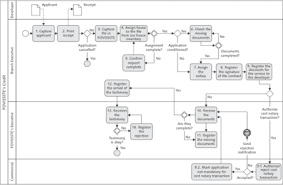

支行主管处理贷款申请档案的各个阶段。所有来自不同分支机构的档案均被发送至墨西哥城的FOVISSSTE执行官，随后由其在墨西哥联邦政府提供的FOVISSSTE门户网站中登记。商业部门授权向第三方公证服务提供商付款。在收到房产所有权文件（“证明”）后（最迟六个月），FOVISSSTE贷款申请流程即告完成。

为未来流程实施建立参考架构是该项目的另一个关键目标。表8.2给出了参考架构的总体视图。

| 能力 | 产品/架构原则 |
|---|---|
| 业务流程建模与编排 | SAP NetWeaver BPM：提供跨角色和用户配置文件实施以用户为中心的业务流程的能力。 |
| UI展示平台 | SAP NetWeaver CE：提供门户功能，实现对后端应用的安全、一致、统一访问。 |
| 每个业务活动的UI技术 | Web Dynpro：每个流程步骤的UI独立开发，允许在具有类似任务的其他业务流程中重用。 |
| 面向服务的架构 | 利用SAP for Banking和基于Microsoft .NET的旧版应用程序中的企业级服务来实现流程步骤。 |
| 自定义企业服务 | 在需要时，自定义企业服务在企业服务库中建模，在后端应用程序中实现，并发布到服务注册中心。 |
| 业务规则 | SAP NetWeaver BRM将实现自动化，以强制检查必备贷款文件的存在性、检查与贷款期限相关的文件有效期，以及检查房屋是否存在未偿还贷款。 |

表8.2 FOVISSSTE参考架构

## 解决方案的实施

由于BPM对Patrimonio而言是一种新方法，实施分阶段进行，以便在每个阶段完成时实现特定的里程碑。SAP NetWeaver CE环境按照典型的三个实例配置安装，包括开发、质量和生产实例。

对于每个BPM步骤，用户界面屏幕根据屏幕元素、信息捕获逻辑、业务逻辑和最终用户交互来定义。随后，每个步骤的用户体验在Web Dynpro中作为模拟用户界面屏幕实现，并与BPM流程流中相应的手动步骤相关联。

随后，FOVISSSTE流程负责人走查了流程的屏幕流；BPM模型根据他们提供的反馈进一步细化和简化。用户界面原型捕获了银行分支机构和总部之间的交接，使所有流程参与者能够可视化流程编排。关键流程负责人批准基线业务流程后，即开始SAP NetWeaver BPM实现阶段。每个BPM活动都作为独立的Web Dynpro组件实现；输入和输出上下文参数保持简单和通用，以促进其他类似贷款发起业务流程的重用。敏捷开发过程确保每个Web Dynpro组件独立开发，从而让客户在更短的时间内看到最终流程的组装过程。

关键流程负责人参与了所开发BPM流程的验收测试。测试完成后，生产环境上线以“软启动”的方式在少数分行进行；随后该流程逐步部署到所有银行分行。

## 项目成果

FOVISSSTE流程在Patrimonio的生产部署立即带来了业务价值。流程跟踪和可追踪性得到了极大改善。运营报告提供整个公司流程的宏观指标，并突出流程瓶颈。该流程与SAP IS-Banking平台集成，消除了手动输入贷款申请信息的需求。用户采纳速度很快；采用了“培训培训师”的方法，由核心实施团队对各分支机构的重点用户进行培训。该流程不断通过子流程进行完善，以处理更多场景，例如管理为贷款申请提供公证服务的第三方公证代理。

Patrimonio目前正致力于实施更多使用SAP NetWeaver BPM管理的业务流程，例如个人贷款发起、贷款服务和催收管理。

## SAP环境的示例解决方案架构

图8.2映射了用于在Patrimonio实施类似FOVISSSTE流程的SAP组件。

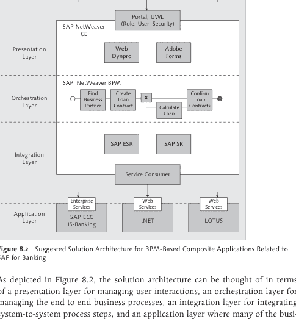

图8.2 基于SAP for Banking的BPM组合应用的建议解决方案架构

如图8.2所示，解决方案架构可分为表示层（用于管理用户交互）、编排层（用于管理端到端业务流程）、集成层（用于集成系统到系统的流程步骤）和应用层（其中驻留自动流程步骤所需的许多业务功能）。表示层包括用于显示数据、获取用户输入、验证前端数据和打印数据的用户交互功能。部署的SAP组件包括SAP NetWeaver Portals、Universal Worklist、Web Dynpro和Adobe Forms。

在编排层中，SAP NetWeaver BPM提供以用户为中心的工作流功能。该工作流允许通过基于角色的授权将活动分配给不同的参与者。

集成层处理SAP NetWeaver CE服务器与企业系统（如SAP ERP Central Component (SAP ECC)）之间的集成。FOVISSSTE实施通过直接消费使用SAP企业服务和Web服务。企业服务存储库（ES Repository）和服务注册中心（Services Registry）是支持SOA集成的基础组件。

应用层内驻留着参与业务场景的企业系统，如SAP ECC、Microsoft .NET和Lotus。需要根据企业系统能力探索集成选项，以实现最佳集成。

## 8.2 Coca-Cola Erfrischungsgetränke AG：促销物料计划与采购——作为SAP贸易促销管理的扩展

> *SAP NetWeaver BPM增强了我们的全球标准流程，以应对我们的独特需求。优化后的需求计划流程提供了营销、销售和采购活动的无缝集成。*  
> *—— Alexander Grobe，CCE AG企业架构与创新经理*

Coca-Cola Erfrischungsgetränke AG（CCE AG）需要一种经济高效且节省时间的方法来本地化名为Coke One的全球模板解决方案。他们使用BPM工具和方法来有效实施装瓶商特定语言，并定义法律和本地业务需求。促销物料的需求确定是CCE AG使用SAP NetWeaver BPM实施的第一个实际流程。其目标是优化促销物料的营销预算分配，而解决方案是创建一个用于规划和订购促销物料的单一环境。

### 8.2.1 背景

CCE AG是德国最大的饮料公司，每年销售约34亿升（2009年）。自2007年以来，CCE AG一直是可口可乐公司（TCCC，亚特兰大）在德国的唯一特许经营商。CCE AG的业务是将可口可乐产品生产和分销到约95,000个


零售客户及其他贸易渠道的55万客户，并拥有11000名员工的支持。除了经典软饮料外，产品组合还包括水、果汁、茶、运动饮料和能量饮料，以及冰咖啡饮品。

Coca-Cola GmbH（CC GmbH）是TCCC的子公司，负责全国消费者营销和品牌管理，以及产品和包装开发等其他核心职能。两个德国实体紧密合作，以便在竞争激烈的德国市场中取得成功。

## 业务案例

SCALE项目（系统协作方法，发挥卓越优势）的目标是为参与的瓶装商提供标准化的可口可乐瓶装运营模式，即Coke One。Coke One是集最佳实践业务流程于一体的组合方案，由增强型SAP Business Suite（包括SAP合作伙伴附加组件和一些非SAP解决方案）提供支持。

Coke One作为全球模板方案交付，必须在每个瓶装商上线前进行本地化。本地化意味着实施瓶装商特定的语言、法律以及独特的本地业务需求。促销计划场景是第一个需要本地化的流程。

简而言之，CCE AG从TCCC购买所需浓缩液，添加水、糖和二氧化碳，然后将瓶装饮料交付给客户。产品利润率直接取决于浓缩液的采购价格和成品的销售价格。由于CCE AG无法影响这两个价格点，因此必须实施尽可能高效的业务流程。此外，销售量的增长只能通过增加新产品供应和促销活动来实现。

## 现状流程

CCE AG的促销计划是年度业务计划流程的一部分。业务计划包含计划的促销活动，包括高层级的客户目标群体、计划活动、时间安排和预算。它也是与全国客户进行年度谈判的基础。

当CCE AG决定实施BPM时，业务挑战是基于业务计划中给定的直接营销费用预算，找到促销活动的最佳分配方案。由于该预算的主要部分涉及购买和交付促销材料的成本，因此这些物品的需求计划和采购流程显然非常重要。

该流程最初以中央营销部门的促销项目经理（PPM）为起点，自上而下启动。PPM定义目标群体、促销材料以及计划在促销中使用的预期数量。然后，他将这些信息交给采购部门，采购部门向促销材料供应商发出提案请求，供应商根据请求的数量返回初始报价。此时，PPM可能会根据采购经理的输入重新调整计划，这会导致另一个循环。高层级流程描述见图8.3。

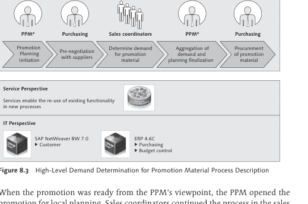

图8.3 促销材料需求确定的高层级流程描述

当PPM认为促销准备就绪时，PPM会开放促销进行本地规划。销售协调员在销售中心继续该流程，通过自下而上的规划步骤调整自上而下的分解计划。这包括销售团队关于选定目标群体中哪些客户网点与该促销相关的本地知识。

Coca-Cola Erfrischungsgetränke AG决定实施BPM，原因是流程中存在几个会耗费时间、金钱和资源的弱点。旧流程无法轻易修改以纳入新的业务需求，例如集成外部处理中心来外包促销材料的交付。在流程执行过程中，流程参与者对流程进度和当前规划结果的可见性非常有限。

该流程主要通过电子邮件和内联网网站进行控制。在流程执行过程中，发生了多次手动合并、导出和导入步骤，导致数据丢失和不一致。此外，该流程与主数据和预算控制没有集成，导致大量手动准备工作。

最大的弱点之一是缺乏与采购的集成。一次促销的促销材料规划通常会产生包含数百个行项目的采购订单。

## 8.2.2 BPM解决方案

BPM解决方案的合理性通过流程相关改进和战略价值两个维度得到了论证：

- **基于流程的收益**
  - 时间是促销规划与执行成功的关键。为了确保所有里程碑都能实现，流程参与者需要流程可见性和可追溯性。
  - PPM需要端到端的责任，并且需要能够专注于处理流程异常，减少沟通和协调工作。
  - 现有主数据（客户、供应商、物料组等）的复用加快了准备过程，并防止了手动操作导致的错误。
  - 实时预算检查功能的集成确保了在规划和采购周期内有可用预算。
  - 采购集成节省了大量沟通和手动录入工作。
  - 外部处理中心将所购促销材料的交付外包给客户网点，节省了销售代表前往CCE AG地点领取促销材料的时间。
  - 简化的流程和角色特定的用户界面确保了更高的生产力和解决方案接受度。
- **战略收益**
  - 与其他本地化全球模板的方法相比，缩短了场景实施的价值实现时间。
  - 将解决方案交付与后端发布周期解耦。
  - 基于通用语言（BPMN流程模型和用户界面原型）的快速原型制作带来了更高的用户接受度。
  - 对Coke One模板采用非侵入式本地化方法。
  - 灵活的部署场景，可将新的创新流程和解决方案纳入全球模板。

## 实施方案

不出所料，参与项目的各部门基于旧解决方案提出了自己的需求，并帮助团队识别了相应文档中的差距。IT项目团队没有直接开始实施，而是通过快速原型制作技术展示了他们的理解。流程和用户界面设计被展示给相关部门。误解得以提前澄清，并确保了对需求的共同理解。这导致项目后期只有少量变更。

在快速原型制作项目并行进行的同时，架构也准备好了：解决方案架构反映了相关系统及相应的通信协议。组件架构描述了相关组件及其关系。企业服务仓库用于描述服务接口。

图8.4显示了解决方案的高层级架构。重要构件包括SAP NetWeaver业务流程管理和后端系统：SAP NetWeaver业务仓库和SAP ERP。

为了允许最终用户访问解决方案，使用了轻量级门户。BPM流程引擎执行技术上增强的流程模型，并通过门户中的通用工作清单交付任务。该执行涉及编排后端服务和用户与前端技术的交互，前端技术使用Web Dynpro Java开发。

由于促销计划数据本身与后端系统无关，因此使用了本地持久化。借助Java持久化API（JPA）技术，仅在本地保留相关数据结构。规划的结果——创建所需采购订单——通过ERP中的服务执行。服务还用于在选择的偏好客户目标群体时实现实时预算检查。


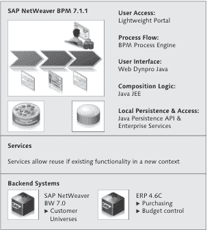

**图8.4** 高层架构

功能和技术的描述都完成后，实施就可以开始了。对于CCE AG来说，一个关键的成功因素是让自身的IT团队能够参与这个BPM项目。这一点通过以下要素实现：

- 开展了前期培训措施。
- 解决方案架构必须将工作划分为小型、可管理且边界清晰的工作包。结合在岗培训和辅导，这使CCE AG的员工能够做出重大贡献。

在开发进行的同时，测试管理也启动了。项目团队就角色、流程和工具达成一致，以进行严格的测试。测试包括准备好模块测试和集成测试的测试用例。采用分阶段的方式，开发团队首先进行测试，然后将结果移交给职能部门。

## 目标流程模型：示例解决方案架构

图8.5展示了BPMN中可执行的目标流程模型。为了便于理解，我们在表8.3中更详细地描述了所有流程步骤。

## 促销规划

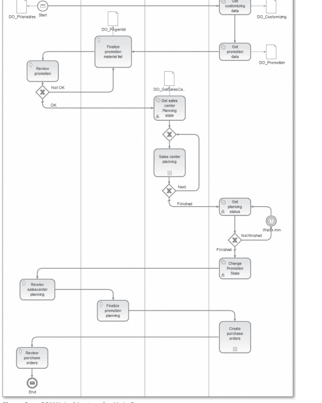

图8.5 主流程的BPMN架构

| 角色 | 负责行为 | 负责数据集 |
|---|---|---|
| 促销项目经理 | 发起促销 | 促销基础数据 |
| 采购经理 | 洽谈初步价格 | 促销物料清单及集中预估需求 |
| 销售中心计划员 | 详细规划参与客户及所用物料 | 本地计划 |
| 销售中心经理 | 审批本地计划 | 本地计划 |
| 销售代表 | 在店内布置促销物料 | 参与客户门店清单 |
| 配送中心 | 将促销物料配送至客户门店 | 参与客户门店清单 |

**表8.3** 主流程的活动

## 项目成果

通过这个项目，市场和采购部门得以实现更快的规划流程，专注于异常处理，并为所有相关流程参与者提供进度透明度。通过自动化正式的手工流程步骤和端到端的流程集成，流程得到了精简。由于直观且用户友好的界面，所需的最终用户培训也减少了。

该解决方案被接受用于SAP贸易促销管理（SAP TPM）的Coke One本地化。对于此次本地化，复用了已有的开发成果。

SAP NetWeaver组合环境所支持的BPM和组合将用于若干其他场景的本地化，例如主数据管理（SAP NetWeaver BPM）和签字规则自动化（SAP NetWeaver BRM）。中期来看，它将取代CCE AG的遗留解决方案，从而降低总拥有成本（TCO）。这种组合方式也可能被采用于Coke One模板开发。

## 8.3 GISA：公用事业领域竞争加剧要求高效的客户服务连接

> *采用BPM和SOA，我们可以提供流程链的灵活性，以整合不同的市场参与者。这正是企业在自由化的能源市场中所需要的。*
> 
> – Hans Ludwig Reinecke，GISA GmbH SAP经理

GISA GmbH是德国中部最大的独立IT、流程和外包供应商。GISA拥有超过100家客户，重点聚焦于德国的公用事业领域。因此，GISA具备得天独厚的条件，可以利用其专业知识提供创新的流程模板，帮助公用事业客户满足新服务连接的法规限制。由此产生的模板简化并自动化了跨多个利益相关者的手工、纸质活动。该流程模板使用SAP NetWeaver BPM和SAP NetWeaver BRM开发，这两个组件是SAP NetWeaver组合环境的组成部分，并利用了SAP Business Suite的服务启用功能。

基于模型的流程开发确保了项目在（与传统编程相比）一半的时间内交付，并且GISA通过利用标准企业服务，使集成成本降低了20-30%。此外，为满足客户特定需求而对这些流程所做的更改是通过整合业务规则来实现的。这使GISA客户能够在之前所需时间的三分之一内对运行中的流程进行更改。这带来了更快的开发和更低的成本，GISA预计在未来三年内收回其开发成本。

### 8.3.1 背景

GISA GmbH提供广泛的IT相关咨询服务，客户涵盖公用事业、媒体和公共部门。该服务提供商总部位于德国，拥有430名员工，2008年收入为7300万欧元。为了在改善客户支持的同时加速增长，GISA GmbH是率先采用基于SOA的前瞻性IT架构的企业之一。

### 业务案例

市场自由化消除了有保障的区域垄断。随着现有能源供应商与新进入者之间竞争的加剧，预计消费者更换供应商的情况将会增加。假设平均客户群为190万，估计客户流失率为10%，公用事业公司每年预计将额外处理190,000个必须人工处理的查询。这正推动公用事业分销商实现新服务连接查询的自动化。此外，能源生产、输送和分配已被拆分，从而通过将流程扩展到多个利益相关者（即生产商、网络和能源零售商）进一步增加了流程的复杂性。此外，该流程因电力、天然气、供水和区域供热供应商的不同而有所差异。

GISA通过提供支持BPM的流程模板来应对这一市场机遇，这些模板使其客户能够自动化新服务连接查询流程，并灵活连接不同的市场参与者。

### 现状流程

当消费者请求电力连接时，可能需要基础设施增强，包括以下步骤：检查可行性、获取成本估算和报价、提出方案、创建服务订单、触发新连接的安装以及计费（见图8.6）。该流程是手工的、基于纸张的，需要与多个系统交互，如SAP ERP、SAP记录管理、外部系统、地理信息系统（GIS）等，并且由单一供应商负责。能源自由化带来了跨多个利益相关者的复杂交接，以及新服务连接的严格监管期限。

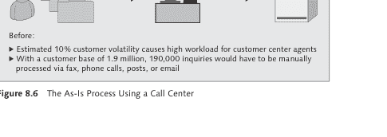

之前：
- 估计10%的客户流失率给客户中心代理带来了高工作量
- 以190万客户群计算，190,000个查询必须通过传真、电话、邮政或电子邮件人工处理

图8.6 使用呼叫中心的现状流程

### 8.3.2 BPM解决方案

GISA使用SAP NetWeaver BPM创建了创新的流程模板，以满足公用事业特定的市场需求。他们通过用自动化工作流和决策取代手工纸质活动，简化了管理新电力连接客户查询的流程。

该流程分为三个阶段：

- 1. 客户查询
- 2. 报价、请购和建设完工
- 3. 开票、启动和控制

第二流程阶段通过利用SAP ECC 6.0 EhP4和SAP for Utilities解决方案组合的功能以传统方式执行，而第一和第三阶段则利用SAP ECC 6.0 EhP4的企业服务来组合流程。面向服务的方法使GISA能够创建具有最大灵活性的流程，同时无缝集成商务和技术任务，如报价生成和技术审查。该流程消除了使用手工填写表格的变通方法（见图8.7）。此外，它还支持更快地整合不断变化的市场参与者，例如，在网络容量在线检查期间实现更快的集成。

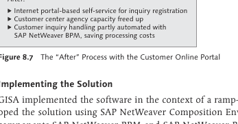

图8.7 使用客户门户的“改造后”流程

### 实施解决方案

GISA在一个起步项目（ramp-up project）的背景下实施了该软件。他们使用SAP NetWeaver组合环境，并利用其组件SAP NetWeaver BPM和SAP NetWeaver BRM开发了该解决方案。整个流程链由SAP NetWeaver BPM中定义的规则进行建模和控制（见图8.8）。例如，流程可以根据客户数据确定

是否需要标准连接还是单独连接，从而请求自动定向给负责处理的专家。此过程利用了由服务启用型应用（如 SAP Business Suite）提供的最佳实践。

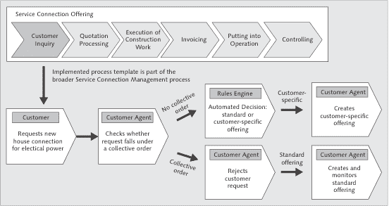

**图 8.8**  新服务连接的流程模板概览

### 项目成果

这种灵活的方法使 GISA 能够比使用传统编程工具扩展 SAP 业务应用提供的服务启用型流程快两倍地实现该流程。更重要的是，通过纳入业务规则实现了对这些流程的更改以满足客户特定需求。这使得 GISA 客户能够在以前所需时间的三分之一时间内对正在运行的流程进行更改。

BPM 方法带来了更快且成本更低的开发，GISA 预计在未来三年内摊销其开发成本（见表 8.4）。

SOA 和 BPM 使灵活的方法成为可能。接下来，GISA 计划整合地理信息系统（GIS）的数据，以便电力供应商能够直接在地图上标示连接。还计划为燃气和水供应商提供扩展。

表 8.4 GISA 的关键绩效指标

| KPI | Impact |
|---|---|
| 新服务连接流程执行时间 | 减少 |
| 流程透明度和修订安全性 | 增加 |
| 客户满意度 | 增加 |
| 服务连接报价时间 | 减少 |
| 流程可扩展性 – 客户数量 | 增加 |
| 基于模型的流程开发 | 比编程快两倍 |
| 实现对运行中流程的更改 | 可在三分之一的时间内实现 |
| 集成成本降低 | 通过利用标准企业服务降低 20–30% |

### SAP 环境的示例解决方案架构

图 8.9 描述了实现流程步骤的各个阶段（包）的范围。它还突出了每个流程步骤的企业服务。

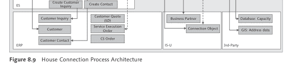

图 8.9 住宅连接流程架构

## 8.4 西门子 IT 解决方案与服务：在新解决方案中平衡标准化和可定制性

> 业务流程管理和面向服务架构的独特能力使我们能够开发一个新的业务概念和模板实现，作为在 T&D 公司建立战略电网管理项目的加速器。
> - Christian Heuer，西门子股份公司、西门子 IT 解决方案与服务 智能电网全球负责人

SAP 未提供任何利用电网公司独特特征的战略资产管理标准解决方案。西门子 IT 解决方案与服务为输电和配电（T&D）公司开发了战略电网管理，利用 SOA 和 BPM 能力加速客户项目。

### 8.4.1 背景

西门子是电气工程和电子领域的全球巨头。该公司拥有 405,000 名员工，致力于开发和制造产品、设计和安装复杂系统，以及为各种行业发起项目。西门子为遍布 190 多个国家的客户提供开创性技术和全面的专业知识。

西门子 IT 解决方案与服务是西门子的跨行业业务。它提供 IT 运营服务，并通过 IT 将西门子和其他行业领导者的专业创新技术与核心业务流程连接起来，从而开发全面的行业特定 IT 解决方案。在 2009 财年，西门子 IT 解决方案与服务在全球约有 35,000 名员工，销售额约为 €4.7 billion。

### 业务案例

放松管制改变了电网运营商的商业模式，从仅专注于可靠能源交付的成本中心运营，转变为必须追求盈利。虽然许多现有电力基础设施资产已接近使用寿命末期，但有限的预算迫使他们采用更有效的策略来维护和更换电网资产。

直到现在，市场上还没有利用电网公司独特特征（如拓扑结构存在）的战略资产管理标准解决方案。其原因之一是监管将有限的市场分割为更小的本地市场。西门子必须在标准化和可定制性之间找到新的平衡，以提供新的产品——面向 T&D 公司的战略电网管理。

SAP NetWeaver 技术平台的最新发展带来了控制和定制流程以及集成已部署应用现有功能的新能力。利用新技术使西门子能够为战略电网管理定义一个抽象的业务概念，包括流程、关键绩效指标（KPI）、参考数据模型等。然后他们使用 SAP NetWeaver 技术平台开发了这些流程的参考实现，并将其作为平台的内容进行打包。

SAP NetWeaver 技术平台使西门子能够充分利用其领域知识作为客户项目的加速器，具有全球可重用的流程以及轻松将其适应本地公司和监管要求的能力。如果没有业务流程管理（BPM）和面向服务架构（SOA），这种解决方案加速器将无法具有竞争力。

### 现状流程

与离散制造等其他行业相比，能源行业运营的公司数量相对较少。因此，战略资产管理解决方案的市场更小。该市场的业务还因以下两个方面而变得更加复杂：

- 1. 本地法规将小市场分割为多个更小的子市场，具有单独的（在某些情况下经常变化的）要求。
- 2. 电网运营商倾向于基于多年的个人经验建立业务，因此通常要求专门设计以满足其需求的单独解决方案。

这些情况是西门子和其他大型竞争对手标准化战略电网管理解决方案和产品业务潜力受限的主要原因。单独的解决方案更符合情况；然而，它们有成本和工作量更高的缺点。此类定制解决方案可以满足小本地市场中电网运营商的个人需求，但由于几乎完整的职能范围必须为每个客户专门开发，因此往往更昂贵；实践共享只能在有限程度上利用。此外，这些解决方案不易重复使用，这降低了它们对西门子等全球解决方案提供商的吸引力。

### 8.4.2 BPM 解决方案

在挑战的推动下，为 T&D 公司创建战略电网管理的新产品，西门子必须找到在标准化和可定制性之间取得平衡的新方法。

从内容角度来看，新产品的基础需要一个业务概念。业务概念包含模块化流程蓝图、预定义 KPI、所需能力、业务杠杆以及解决方案的概念数据模型。这将确保内容在抽象层面上标准化，但仍可根据个人需求进行定制。

仅凭业务概念的引入并不能使西门子克服所有挑战。缺少的需求是一个能够支持可重用模板实现并提供定制灵活性的平台。SOA 和 BPM 平台的最新技术进步非常契合。此类平台提供多种功能，如流程和能力的建模、控制和定制，以便轻松地将它们与已部署产品和解决方案的现有功能集成。

业务概念和平台共同使西门子能够为战略电网管理构建参考实现。以这种方式，流程蓝图被分为几个业务包，这些是可部署的内容包，包含面向 SOA/BPM 平台的流程模板。

### 实施解决方案

西门子构建了 *网格资产管理套件 (GAMS)* 解决方案作为战略电网管理的参考实现。

利用 BPM 在很大程度上使西门子能够采用新的解决方案开发方法。在业务概念开发的同时，流程模型直接使用能够进行业务流程建模符号（BPMN）的建模工具进行建模。与经典流程设计相比，这是一个重大变化。使用此类建模器具有显著优势。以前流程必须在一个地方设计，然后在别处实现，而采用新方法后，每个流程模型直接

可执行，并且抽象模型与可执行模型之间的脱节将被避免。此外，这种方法还促进了业务专家与开发人员之间更紧密的合作。流程维度为他们提供了一个双方都能理解的共同层。这有助于防止技术专家与业务专家之间误解等经典问题。

总体而言，业务概念与参考实现的发展之间存在很强的并行性。采用快速原型方法，业务概念相关的进展已直接转移到实施中。来自不同原型和由此过程得出的改进的经验通过反馈渠道回流到业务概念中。

## Results of the Project

回顾来看，将 SOA 和 BPM 平台作为模块化内容包的载体，对西门子来说是一个巨大的进步。这将有力地支持未来解决方案开发的竞争力。

如今，西门子可以基于作为全球可重用解决方案加速器的参考实现，为不同市场的客户提供战略电网管理的个性化解决方案。预定义和已实现的流程模板允许以高效且经济的方式根据客户需求定制解决方案。同时，在单个客户项目中重用标准化的解决方案核心，确保了实践共享的竞争方式。

利用 SAP NetWeaver 技术平台作为西门子领域知识的基础和载体，使西门子能够克服各种挑战，并实现了实现战略电网管理的参考实现——电网资产管理套件所需的标准化与可定制性之间的平衡。

总之，GAMS 帮助西门子的客户在平衡资产可靠性与优化资本支出和运营支出之间，最优地运营其电网。

## Sample Solution Architecture for an SAP Landscape

解决方案开发的一个基本要求是明确的流程重点，这与传统应用程序不同，在传统应用程序中，流程逻辑是隐式实现的，因此对用户是隐藏的。因此，从架构角度来看，必须分别检查两个维度。


第一个维度关注流程模型及其以独立业务包形式提供的配置。第二个维度涉及平台作为内容包载体的作用。两者对西门子的解决方案同等重要。

作为业务概念的一部分，高层参考流程模型是利用 SAP Solution Composer 定义的，而详细的流程建模则直接在 SAP NetWeaver Developer Studio (NWDS) 中执行。除了流程建模之外，开发工作室的不同视角也是几乎所有开发活动的核心组件，例如流程、规则、持久性、Web 服务和用户界面的实现（见图 8.10）。

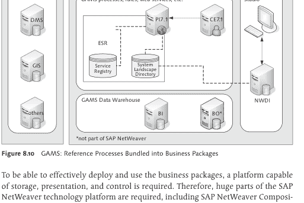

图 8.10 GAMS：参考流程捆绑到业务包中

为了能够有效部署和使用业务包，需要一个具备存储、展示和控制能力的平台。因此，需要 SAP NetWeaver 技术平台的大部分组件，包括具有 SAP NetWeaver 业务流程管理 和 SAP NetWeaver 业务规则管理 功能的 SAP NetWeaver Composition Environment、具有企业服务总线的流程集成、作为中央数据仓库的商业智能，以及作为基于 Web 的展示层的门户。该环境由负责软件生命周期管理的 SAP NetWeaver Development Infrastructure (NWDI) 完成（见图 8.11）。

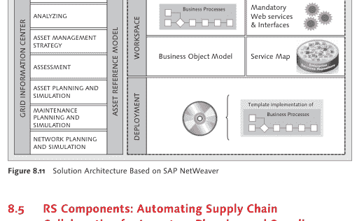

图 8.11 基于 SAP NetWeaver 的解决方案架构

## 8.5 RS Components: Automating Supply Chain Collaboration for Inventory Planning and Supplier Performance Management

> > CompriseIT 的 BPM 方法使我们能够自动化产品交期的标准供应链协作——进一步提高了库存可用性承诺的准确性，并让我们的供应链团队有更多时间专注于改进供应商绩效。
> >
> > - Graham Wiffen，RS Components SAP 业务经理

RS Components 在 27 个国家运营并销售数十万种产品。供应链团队不断寻找提高供应链敏捷性的方法，主要目标是降低库存成本并提高货架可用性。

影响 RS Components 绩效的一个关键领域是供应商交期的准确性，因为这对规划最佳库存水平有重大影响。RS Components 与 CompriseIT 合作，利用 SAP NetWeaver BPM 自动化流程，使供应商能够维护自己的交期，同时通过供应商特定的业务规则保持控制。

### 8.5.1 Background

Electrocomponents plc 是全球最大的电子、机电和工业元件目录和网络分销商之一。在 RS Components、Radiospares、Radiomics 以及美国的 Allied Electronics 等交易品牌下运营，Electrocomponents plc 在全球 80 多个国家服务近 160 万客户。

通过在 27 个国家和 17 个仓库的运营，RS Components 从超过 2,500 家供应商分销 50 万多种产品。RS Components 是 Electrocomponents 集团内的运营公司之一，它满足通常是企业中的电子或维护工程师的客户的小批量产品需求。大量高质量商品有库存，并在收到订单当天发货。该集团每天管理着全球客户的数万份订单。

### Business Case

RS Components 通过增加为客户提供的元件的市场份额和数量不断拓展业务。他们通过优化供应可用性并从不断增加的供应商处提供更广泛的选择来实现这一目标。

高效管理不断增长的供应商基础并优化元件的可用性对于最大化销售机会非常重要。为了实现上述目标，RS Components 需要增加与供应商之间的自动化，因为数据的庞大使得手动处理不切实际。

交期是 RS Components 与其供应商之间共享的关键信息。这些信息为规划和执行系统提供了关键输入，因为它们驱动安全库存水平。通过保持这些信息最新，RS Components 可以对其供应链计划充满信心，从而减少手头库存，使营运资金更易获取。

使用 CompriseIT 复合应用检查清单，RS Components 的流程被确定为 SAP NetWeaver BPM 的候选流程；如表 8.5 所示，该流程在所有五个维度上均获得高分。有关复合应用的更多详细信息，请参阅第三部分，第 17 章，第 17.8 节。

| 流程需求 | SAP NetWeaver BPM 适用性评级 |
|---|---|
| 流程跨越内部或外部边界 | High |
| 流程需要使用或创建信息 | High |
| 流程需要执行特定步骤 | High |
| 流程跨越系统 | High |
| 流程需要新渠道 | High |

表 8.5 CompriseIT 复合应用检查清单

### As-Is Process

在 BPM 实施时，所有交期更新均由供应链人员手动输入到标准属性变更请求 (ACR) 表单中，不论其格式如何。内容数据团队收到 ACR 表单并通过多个 Excel 宏处理它，将数据格式化以输入到其现有的 SAP R/3 系统中。由于流程的手工性质，供应商的更新通常每年进行一次，这意味着交期通常不准确。供应商反馈的延迟直接影响 RS Components 持有的库存和产品的货架可用性。

### 8.5.2 BPM Solution

要求供应商每月通过电子数据交换 (EDI) 向 RS Components 发送文件，其中包含其供应的产品的交期。他们也可以向 RS Components 发送临时变更。这些文件以供应商特定的格式发送，但集成层用于将数据转换为规范（通用）格式。

一旦收到该文件，就会通过一组业务维护的规则进行处理，以确定系统是否可以自动更新，如图 8.12 所示。


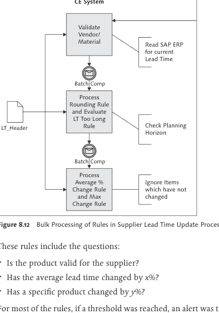

## 图 8.12 RS Components 供应商交期更新流程中的规则批量处理

这些规则包括以下问题：

- 该产品是否对供应商有效？
- 平均交期是否变化了 x%？
- 特定产品是否变化了 y%？

对于大多数规则，如果达到阈值，就会向负责该产品的计划员触发警报，以便他获知对下一次计划运行的潜在影响。供应计划员随后可以确定是否需要与供应商沟通以协商更有利的交期。当规则被更大程度地违反时，会引发异常，将交期的更新推迟，直到得到该产品计划员的批准，如图 8.13 所示。

任何技术异常都会被检查，例如物料在 ERP 系统中被锁定，这些问题会被路由到技术支持以便解决。图 8.14 显示了这些检查和警报集。

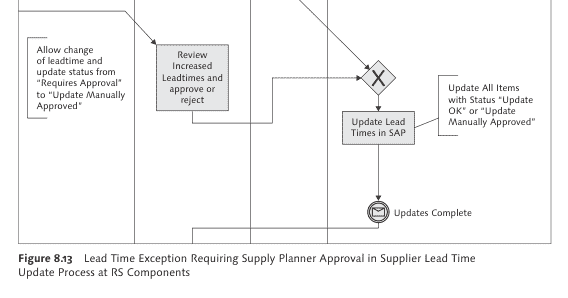

图 8.13 RS Components 供应商交期更新流程中需要供应计划员批准的交期异常

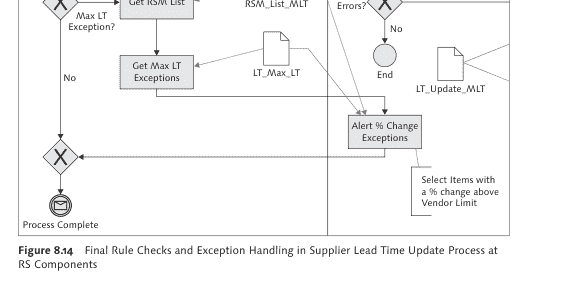

图 8.14 RS Components 供应商交期更新流程中的最终规则检查和异常处理

更新的状态可以在流程的每个阶段进行报告。然后可将此信息用于追踪每个供应商的交期绩效。此信息从 SAP ERP 和 SAP NetWeaver BPM 收集到 SAP NetWeaver Business Warehouse 中。

## 解决方案实施

在项目开始时，使用 BPMN 在为期三天的半天研讨会上反复对将要实施的供应商更新流程进行建模，参与者包括业务流程参与者和 IT。第一周设计结束时，创建了需求文档，其中描述了流程中的每个步骤以及与特定流程步骤中决策相关的任何业务规则。

联合研讨会和易于理解的流程模型有助于在业务与 IT 之间建立一致的目标理解，这使得所有相关方（业务、RS Components IT 和 CompriseIT）能够自信地对需求签字确认。

遵循 Scrum 敏捷方法论，这些需求随后被分为两个开发迭代，关键需求在为期三周的时间内开发。实施敏捷开发方法意味着项目的具有挑战性的时间线得以实现（迭代 1），关键功能在数周内上线。然后业务可以对解决方案添加额外功能（迭代 2），而无需重构迭代。

## 项目成果

在本书开发时，解决方案接近第一轮迭代的结束并即将上线。解决方案的早期原型得到了业务的良好反馈，并且“他们想象中会得到的内容”与解决方案之间的匹配度非常接近，因为他们对 BPMN 模型和 SAP NetWeaver Visual Composer 屏幕 mock-up 都已签字确认。

解决方案的未来计划是增加“small”供应商版本，这将使小型供应商能够通过网络直接上传文件。文件随后将被集成到上面为大型供应商使用的同一 BPMN 流程中。这种情况说明了由 SOA 驱动的再利用的绝佳示例。

在撰写本用例时，其他功能已计划并将在并行结构中开发，并在业务测试后部署。

## SAP 环境的示例解决方案架构

图 8.15 描述了解决方案的架构。供应商或供货商每月通过诸如 EDI 之类的业务对业务（B2B）枢纽发送交期更新文件（可包含数千条记录）。文件随后被企业应用集成（EAI）层拾取，在该层中数据被转换为通用格式。然后数据通过 Java 消息服务（JMS）队列传递到 SAP NetWeaver BPM 系统，在那里数据被输入到 BPM 流程中。流程执行多项规则来检查数据，然后要么将更新处理到 SAP 系统中，要么引发异常，这些异常会被路由到负责的产品经理以供信息或批准。

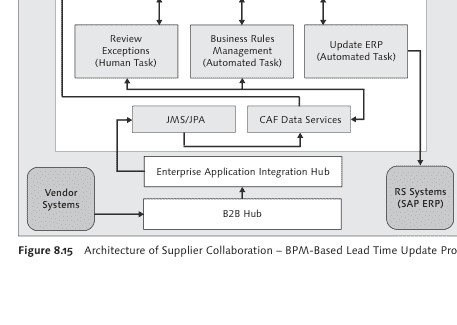

图 8.15 供应商协作架构 – 基于 BPM 的交期更新流程

# 9 BPM、业务转型与持续流程改进

Greg Chase, Rukhshaan Omar, Jewgeni Kravets, Alberto Carrera, Marcelo Santa Rita

今天大多数 BPM 应用通过自动化手动步骤实现快速成果。然而，BPM 工具和方法真正的长期价值在于采取持续改进的方法来优化端到端的流程，并使用价值工程方法来识别应精简的流程。接下来是两家将 BPM 应用于业务转型的公司示例。

第一个示例是 KAESER KOMPRESSOREN，工业空气压缩机的领导者。KAESER 精简了压缩空气即服务的交付流程。该公司建立了一个高效、响应迅速的服务交付流程，涉及公司的每个部门以及全球的供应商和合作伙伴。

第二个示例是 Braskem S.A.，拉丁美洲领先的热塑性树脂制造商。他们首先为其 BPM 项目建立了坚实的商业案例并确定了 13 个关键业务流程。Braskem 成功部署 BPM 以精简其高优先级的应付账款流程。

### 9.1 KAESER KOMPRESSOREN：从产品公司向服务公司转型

> 通过 BPM，KAESER KOMPRESSOREN 重建了一个高效、响应迅速的服务交付流程，涉及公司的每个部门，以及全球的供应商和合作伙伴。
> – Falko Lameter，首席信息官，KAESER KOMPRESSOREN GmbH

KAESER KOMPRESSOREN 是工业空气压缩机及其配套产品的领导者之一，希望成为压缩空气即服务的供应商。这需要精简和统一其分散的服务交付流程并创建更灵活、模块化的 IT 基础设施。KAESER 首先通过采用来自 SAP 的服务导向架构（SOA）和企业服务建立了坚实的基础。然后部署业务流程管理与业务规则管理技术以自动化流程流。由此产生的流程现在更高效（参与者之间服务转移更顺畅），从而带来服务交付效率的提升。已建立的软件使公司能够更快地解决问题，从而牢固地确立了公司作为压缩空气即服务行业领先供应商的地位。

### 9.1.1 背景

KAESER KOMPRESSOREN GmbH 提供产品、服务和完整的系统，用于以压缩空气形式生成、处理和输送能量。该公司成立于 1919 年的德国科堡，目前拥有约 4,000 名员工，并在德国和法国设有三家制造工厂。KAESER 在 80 多个国家运营，在欧洲、中东和非洲；美洲；以及亚太地区的销售区域拥有 40 家子公司和 30 家合作伙伴。

### 商业案例

凭借对产品创新和质量的承诺，KAESER 已成为压缩空气行业最大、最成功的公司之一。其产品被各行各业的各种规模的公司使用。然而，近年来，随着竞争加剧和利润率下降，该公司意识到无论产品多么创新，仅靠这一因素不足以支持公司的增长和成功目标。KAESER 意识到其客户越来越多地希望购买压缩空气效益，而无需成为压缩空气产品专家。为了利用这一市场机会提升收入和利润率，KAESER 决定以服务形式销售压缩空气。然而，这要求 KAESER 从产品供应商转型为服务提供商。表 9.1 列出了服务交付流程的业务目标。

| 业务目标 | 流程 KPI |
|---|---|
| 流程执行时间 | 最长 2 天 |
| 设备停机时间 | 最长 1 天 |
| 技术人员访问 | 最多 1 次访问 |

表 9.1 服务交付流程的业务目标


**表9.1 服务交付流程的业务目标（续）**

| 业务目标 | 流程KPI |
|---|---|
| 提高客户满意度 | - |
| 无事件发生 | - |

## 现状流程

KAESER 的服务交付价值链非常复杂，不仅涉及公司内部的每个部门，还涉及全球的供应商和合作伙伴。服务交付包括故障排除、投诉处理、维护、合同管理、备件交付和技术支持活动。这些活动需要灵活、高效的后台支持，用于订单和物流规划、服务调度以及零件和信息供应。他们现有的服务交付流程冗长、脱节且零散。因此，有时紧急情况会暂时得不到处理。

## 9.1.2 BPM 解决方案

业务目标是通过消除媒介中断来提升客户满意度，从而确保所有服务请求都在既定的服务时限内得到处理。因此，KAESER 必须提高整个价值链中服务交付的效率、透明度和质量。他们面临以下关键挑战：

- 协调全球服务和供应链服务规划、物流及IT流程
- 提供服务物料和信息的准时制供应
- 统一并优化服务履行流程

业务部门采用价值工程方法来确定哪些流程应被精简。这些模型提供了部门间待实现流程（to-be process）的高层业务视角。

随后，KAESER 借助 SAP 顾问的专业知识，将 IDS Scheer 在 SAP Enterprise Modeling 中建模的高层流程转化为可实现灵活、响应迅速的服务流程的实施。团队使用了 BPM 方法和工具，如图 9.1 所示，即紧急维护、计划维护、备件可用性、备件物流、提前发货、紧急访问的时段查找、问题分类、经济协商、服务确认、销售移交和主数据创建支持。

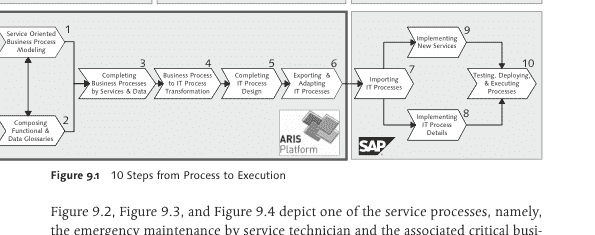

**图 9.1** 从流程到执行的 10 个步骤

图 9.2、图 9.3 和图 9.4 从高层描述了其中一个服务流程，即由服务技术员执行的紧急维护以及相关的关键业务因素。

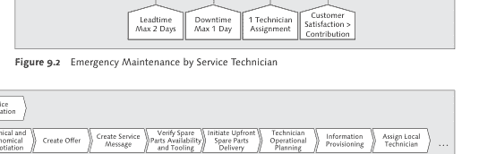

**图 9.2** 服务技术员执行的紧急维护


**图 9.3** 服务技术员执行的维修流程

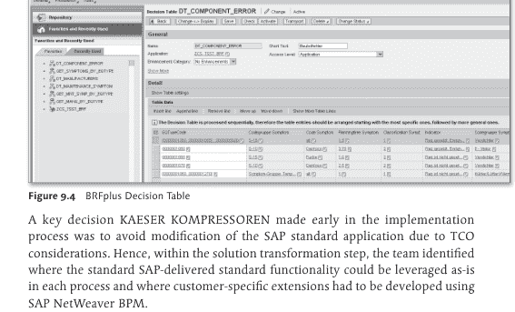

**图 9.4** BRFplus 决策表

KAESER KOMPRESSOREN 在实施过程早期做出的一个关键决策是，出于总体拥有成本（TCO）的考虑，避免修改 SAP 标准应用程序。因此，在解决方案转换步骤中，团队确定了每个流程中哪些可沿用 SAP 标准交付的功能，以及哪些需要利用 SAP NetWeaver BPM 开发客户特定的扩展。

例如，客户从其他供应商处购买了设备，致电提出服务请求。SAP 标准功能要求创建服务消息时，相关的客户主数据（业务合作伙伴和设备）必须已存在于后端应用程序中。这意味着在使用 SAP 标准流程时，呼叫中心操作员必须先捕获客户和/或设备的主数据，然后才能创建服务消息。

KAESER 的需求需要创建一个 BPM 流程扩展，用于捕获必要的客户和设备详细信息，将数据转发给主管，以便在后端系统中创建主数据并完成履行。同样，该流程扩展允许使用基于 BRFplus 的自动化规则驱动故障分类（见图 9.4 的决策表），将症状与故障匹配。如果在通话过程中规则未找到匹配项，BPM 流程扩展会将通话转接给专家进行手动分类。在 BRFplus 中使用规则可以实现与流程模型的松散耦合，从而可以在不更改底层业务流程的情况下即时扩展此类规则。当 KAESER 生产新型压缩机时，业务部门只需为新型压缩机添加必要的规则，测试规则（见图 9.5），然后部署它们，之后呼叫中心才能处理客户关于新型压缩机的咨询。

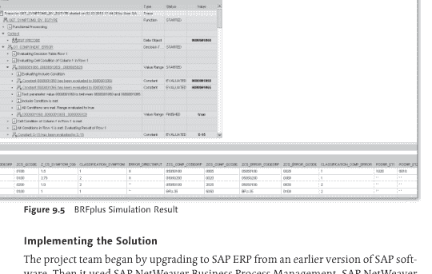

**图 9.5** BRFplus 仿真结果

## 实施解决方案

项目团队首先从较早版本的 SAP 软件升级到 SAP ERP。然后，它使用 SAP NetWeaver Business Process Management、SAP NetWeaver Business Rules Management 和 SAP NetWeaver Composition Environment 作为主要工具。结合 SAP 的 50 个标准企业服务，团队构建了一个包含多个用例（业务服务）的复合应用程序。用户无需接受复杂多个 ERP 屏幕导航的培训，这些业务服务会将用户引导至具有相关数据的相关屏幕。同时，团队使用 SAP NetWeaver BPM 设计流程，利用这些业务服务取代冗长的手动流程。由此产生的流程高度自动化，具有一致的基于角色的任务、顺畅的交接且无中断。

团队采用价值工程和 SAP 的 ASAP 方法论来实现该解决方案。包括：

- 将待实现流程建模为标准事件流程链（EPC）
- 识别服务启用的需求
- 通过服务增强流程（服务供给）
- 识别缺失的服务并验证现有服务
- 创建业务服务，实现在基于角色的工作中心之间共享业务对象和数据（这些服务可以轻松地复用于 BPM 流程流中的流程步骤）
- 使用 BPMN 通过 SAP NetWeaver BPM 对流程扩展进行建模
- 实现消费层

以下因素确保了项目的成功：

- 拥有流程全景图，从而可以清楚地理解流程之间的依赖关系和相互连接
- 清理客户、设备和其他业务主数据，以提供单一事实来源
- 关于解决方案架构的清晰且强有力的方法
- 早期原型设计，用于验证架构的各个部分（例如，BPM 与 ERP 之间的交集、BRFplus 与 BPM 之间的交集）
- 可用性设计和界面原型（mock-up）准备，改善了与业务部门的沟通，使用户能够从屏幕/导航角度直观地看到流程
- 早期采用 SAP NetWeaver CE 7.1，参与 ramp-up 计划，确保产品相关问题由 SAP 开发团队解决

## 项目成果

服务呼叫中心的员工现在可以在首次客户联系时记录每一次故障的详细信息。他们可以将所有必要信息（包括采购订单和技术数据）沿着流程链传递给下一级参与者。

精简、集成的流程大幅缩短了 KAESER 满足服务请求所需的时间。KAESER 现在能够可靠、立即地响应紧急情况，而以前由于处理时间，这些紧急情况可能暂时得不到处理。故障在第一次就被正确诊断，并且通常可以现场修复。解决后，客户可以签署服务订单，该订单会以电子方式发送以进行快速发票处理。这些显著的改进正在提升客户满意度。


满意度并推动公司成为行业的压缩空气即服务首要供应商。

表 9.2 说明了项目实现的财务和战略效益。

| 关键绩效指标 | 影响 |
|---|---|
| 紧急事件响应时间 | -33% |
| 每次紧急事件停机时间 | -67% |
| 服务执行速度 | +60% |
| 服务订单处理时间 | -60% |
| 服务订单错误 | 已消除 |
| 发票处理时间 | -87% |
| 开票生产率 | +500% |
| 每位技术人员服务订单数 | +50% |

表 9.2 项目实现的财务和战略效益

该解决方案还提升了以下服务水平：

- 标准化服务事件记录。
- 在整个服务链中提高了效率、透明度和质量水平。
- 提高了灵活性以及对新业务需求的响应能力。
- 缩短了扩展协作网络以接纳新合作伙伴的时间框架。

该解决方案显著降低了 KAESER 的总体拥有成本，从而提高了利润率：

- 通过代码重用和减少新编码将开发成本削减了 50%。
- 通过简化用户界面减少了培训时间。
- 使用模块化架构实现更长的应用生命周期以及更快、成本更低的扩展。
- 通过盘活现有资产避免了对新办公设备和用品的需求。
- 使用模型驱动的流程工具显著提高了 IT 与业务的契合度以及对公司战略的响应能力。

## SAP 景观的示例解决方案架构

图 9.6 说明了 KAESER 的模块化架构。有了这种面向服务的架构，KAESER 开发了一套软件基础设施，能够在整个价值链中构建高效且响应迅速的流程。

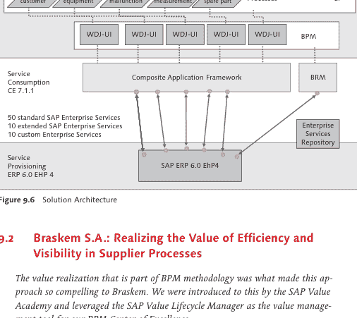

图 9.6 解决方案架构

## 9.2 Braskem S.A.：实现供应商流程中的效率和可见性价值

> BPM 方法论中包含的价值实现正是使这种方法对 Braskem 如此具有吸引力的原因。我们是由 SAP Value Academy 引入这一方法的，并将 SAP Value Lifecycle Manager 作为我们 BPM 卓越中心的价值管理工具加以利用。
> – Marcos Antonio Miliani，流程与系统经理，Braskem S.A.

Braskem S.A. 是拉丁美洲领先的热塑性树脂制造商，由多家公司的合并而成。为了支持其运营的整合和简化，Braskem 与 SAP 合作伙伴 Firstteam 合作使用 SAP 的 BPM 方法论，并利用 SAP NetWeaver Business Process Management 组件部署更集成、更透明的业务流程。该大规模项目的初步改进已带来了新的运营效率和成本降低。

### 9.2.1 背景

Braskem S.A. 总部位于巴西圣保罗，按生产能力计算是美洲最大的石化公司，也是全球第七大公司。作为拉丁美洲热塑性树脂的领导者，Braskem 理解技术的变革力量。这家创新巴西公司生产的塑料用于数千种产品，从牙刷和婴儿奶瓶到汽车零件和计算机组件。

市场领导力、竞争力以及与促进可持续发展承诺相一致的技术自主性是 Braskem 战略的基础。Braskem 在其制造运营中以及为支持其业务目标使用领先技术。作为这一愿景的一部分，Braskem 发起了一项公司范围的计划，通过面向服务架构的力量简化、集成和激活其业务流程。

### 业务案例

Braskem S.A. 成立于 2002 年，由多家公司合并而成，是巴西石化行业大规模整合的一部分。此后，Braskem 收购了其他公司以扩展其产品组合和运营区域。因此，Braskem 的主要关注点是整合和简化运营和业务流程，以纳入所收购公司的业务。

Braskem 的 IT 部门被要求制定整合业务运营并加强业务管理模式的系统化方法。这将为 Braskem 的进一步增长和国际化奠定基础。

首先，Braskem 需要在业务领导者和 IT 之间建立共同的沟通和目标设定机制，以便 IT 实施与公司的战略愿景保持一致并满足业务运营需求。此外，Braskem 的 IT 部门需要学习业务价值识别的方法以及优先排序 IT 需求的方式。

Braskem 还需要能够通过实现流程运营的度量和监控来主动识别效率低下和优化机会。此外，Braskem 希望通过为流程自动化创建一致的用户体验来简化员工培训并提高 IT 系统的用户采用率。怀着这些目标，公司在参加 SAP Value Academy 计划并使用 SAP 的价值生命周期管理工具来识别具体业务利益后，为项目制定了坚实的商业案例。商业案例策略遵循 SAP 价值工程方法论。通过这种策略，他们比较了使用 SAP NetWeaver BPM 的开发成本与通过编写代码进行传统定制开发的方法。对于第一个项目，Braskem 估计通过自动化首个目标流程并在共享服务中心集中运营所能获得的生产率提升。

Braskem 决定设立一个业务流程卓越中心用于流程再设计，并选择 SAP NetWeaver BPM 组件来帮助建模和部署新的流程自动化。

该公司确定了 13 个关键业务流程进行再造，并选择了高优先级的服务供应商应付账款流程作为起点——这是合乎逻辑的选择，因为 Braskem 存在以下业务场景：

- 在整个巴西分布着超过 3,000 家服务供应商
- 每月收到 20,000 张 notas fiscais（巴西特有的向政府报送的发票）
- 约 1,200 名合同经理
- 高度手动的流程，处理错误导致返工和损失
- 付款未在规定期限内收到
- 缺乏可追溯性和控制的流程

Braskem 对解决方案的愿景是消除不必要的付款延迟并提高其对成本和费用的可见性和控制。具体业务目标包括：

- 更好地了解每个供应商的支出以及付款的可追溯性
- 执行付款流程时提高效率
- 通过按时付款和利用提前付款折扣实现成本优化
- 自动符合巴西对登记合法发票文件的要求
- 学习并实现 BPM 方法在持续流程优化方面的益处

为映射这些目标而选择的指标包括：

- 流程周期时间的度量
- 按时付款率的跟踪
- 流程设计的平均设计工时

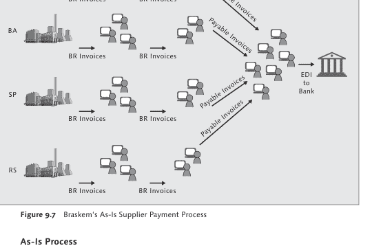

图 9.7 Braskem 的现状供应商付款流程

### 现状流程

如 Braskem 在图 9.7 中所示的现状供应商付款流程（分散且手动的发票接收、在公司工厂和区域中心接受，以及集中应付账款）所示，Braskem 的旧付款流程是一个高度手动的流程，分散在许多团队中，因此缺乏

可见性和控制。发票由 Braskem 各地工厂的合同经理接收，并发送至多个区域发票录入团队之一，手动将发票录入 SAP ERP。核对发票与 SAP 系统中的数据以及众多相关跟踪电子表格中与合同、到期日、价值和数量不匹配的情况是一个手动流程。每当发现错误（偏差）时，发票必须退回给合同经理以修正错误。这一特定的人工例外是付款延迟的主要原因。

## 9.2.2 BPM 解决方案

作为流程再设计的一部分，Braskem 决定将发票处理集中到一个共享服务中心，如图 9.8 所示。该图说明了外包发票数字化以及用于审批和支付发票的共享服务中心的应有流程。


图 9.8 Braskem 供应商付款的应有流程

如图所示 9.8 中所示，供应商提交给 Braskem 的 notas fiscais（发票）被扫描并发送给服务提供商 eNOVI，后者对发票进行数字化并将信息电子传输给 Braskem。发票会自动与采购订单匹配。当发现差异或无法匹配时，合同经理处理例外情况并与供应商合作修正发票。当自动化显示匹配且无差异时，以及合同经理解决的发票问题时，发票随后发送至应付账款团队。

在分析和优化后，发票验证和审批的自动化流程在 SAP NetWeaver BPM 中设计（见图 9.9）。


图 9.9 Braskem 的新发票匹配和付款流程

## 实施解决方案

对于业务蓝图，所选的方法是 SAP SOA 实施路线图。这是显而易见的选择，因为当时可用的 ASAP 方法版本不包括 SOA 和 BPM 加速器。（编辑注：本书中所述的新 ASAP 方法 7.0 已纳入 SAP SOA 实施路线图，现在支持 BPM 和 SOA 实施。）

一个复杂因素是 Braskem 需要升级其 SAP 石油和天然气解决方案组合，以利用现有功能实施其 BPM 流程并利用 SAP 支持的企业服务。该解决方案的升级周期导致 BPM 实施时间比通常更长，同时在测试增强包期间，SAP 正在修复巴西本地化中的一些错误。

在实现阶段解决的另一个问题是根据对象所有者将流程实例发送给不同数量的审批者的需求。此功能在 SAP NetWeaver BPM 7.11 的第一个版本中未开箱即用，因此使用 BPM 对象和 Web Dynpro 编程的混合开发了变通方法。开发的变通方法如图 9.11 所示。

另一个复杂因素是，如果特定发票处理例外与合同人员管理的合同相关，则每个合同经理都需要收到特定的任务提醒。这因以下流程信息关系而变得复杂：

- 发票与 n 张录入表相关
- 录入表与采购订单相关
- 采购订单与服务合同相关
- 服务合同有 n 名合同经理

为了管理涉及如此多层级的任务，流程需要能够为可能与特定发票相关的可变数量的合同经理动态分支同步并行任务。

解决方案子流程为每位经理动态创建每个必要的任务并包含特定信息，并控制任务的执行。子流程仅在处理完所有处理例外后结束，然后同步来自多个步骤的信息以发送回主流程。


图 9.11 针对可变数量审批者的变通子流程

## 项目成果

项目初始阶段完成后，Braskem 已部署了一个集成付款流程，涵盖从发票接收和审批到付款处理的完整工作流程。因此，发票登记和处理成本下降了 30%，95% 的供应商付款现在按时完成，这有助于 Braskem 利用折扣并避免罚款。更高效地处理电子发票的能力也使单个交易更易于跟踪（见表 9.3）。

| 关键绩效指标 | 影响 |
|---|---|
| 重新设计流程所需时间 | -20% 至 -30% |
| 培训成本 | -20% |
| 发票登记和处理成本 | -30% |
| 按时付款率改善 | 60% 至 95% |

表 9.3 KPI 跟踪

Braskem 的流程转型计划才刚刚开始。该公司现在将注意力转向剩余的 12 个流程。Braskem 的目标包括增强合同的可追溯性、简化销售订单录入以及简化公司的关键出口流程。此类改进将在塑造这家不断成长的化工公司的未来成功方面发挥重要作用。

## SAP 环境的示例解决方案架构

凭借 Braskem 广泛的 SAP 软件环境，SAP NetWeaver BPM 是一个特别有吸引力的选择，提供原生集成以及比替代技术更低成本和更简单的实施。

如图 9.12 所示，付款流程始于巴西发票的数字化。数字发票图像发送给服务提供商，后者通过 OCR 流程识别发票图像中的字段并将其发送回 Braskem，通过与 SAP NetWeaver PI 的接口集成。

服务提供商将发票图片作为 PDF 文件发送，并将从发票图像中识别的字段作为 xml 数据发送。SAP NetWeaver PI 接收此信息。然后 PDF 文件存储在 SAP 内容服务器中，发票数据发送到自定义 Web 服务，该服务在 SAP NetWeaver CE 中启动 BPM 流程。


图 9.12 Braskem 服务供应商发票检查和付款流程的系统架构

# 10 BPM 的好主意

*Greg Chase, Rukhshaan Omar, Andreas Muno, Wayne Morris, Gregor Müller*

虽然 BPM 采用往往集中在某些应用和行业中，但该方法和工具广泛适用于简化许多不同应用中的业务流程。本节根据 SAP 专家的理论用例提出了 BPM 的两个优秀应用。

第一个示例建议在公共部门实施。公共部门采用 BPM 的主要驱动因素是希望通过减少文书工作和手动活动来帮助政府更高效地运行。公共部门示例探讨了 BPM 工具和技术如何简化公共行政和关键任务的业务流程，以实现可持续的长期公共价值。该用例演示了 BPM 如何自动化并加快公民服务请求的处理，同时减少劳动力和纸质活动。

第二个示例虽然适用于多个行业，但设定在航空业。该示例演示了如何应用 BPM 通过在多个角色和 IT 系统之间平衡维护能力和需求来简化维护流程。它满足高度监管的预防性维护和随机纠正性维护需求。

### 10.1 公共部门：坑洼和绿地维护 – 纳税人获得更多回报

> 政府正面临来自选民日益增长的压力，要求提高可见性并优化其运营。BPM 是一种管理学科，SAP 提供支持技术，可为政府将运营转变为持续改进的业务流程提供绝佳方式。
> – Mike De La Cruz, SVP Public Sector, SAP

首席维护官可以通过以下方式在提高公民满意度和提供更高质量服务的同时实现显著节约：

- 实施维护卓越原则
- 通过以服务质量和及时性为重点的服务水平为核心的完善协议外包非计划性维护
- 通过个人互动改善与市民的关系

将 BPM 应用于此次业务转型的核心，将使 CMOs 能够迅速调整战略并显著改善运营。

## 10.1.1 背景

公共服务机构常因运营效率低下而受到指责。然而，在地方层面，即市民最能感受到政府行动（或不作为）影响的地方，政府努力与选民保持高度响应互动的方式有很多示例。例如：

- 各城市已设立呼叫中心，市民只需知道一个中央号码即可获取所需的所有服务，例如 311。
- 城市网站允许 24/7 在线提交服务请求，将市民的可用性扩展到工作时间之外。
- 各城市越来越多地为市民提供智能手机应用。用户可以从应用商店免费下载。应用包括报告坑洼、堵塞的人行道、行人安全、涂鸦和垃圾清理等。

有时在线服务请求以发送给政府代理的电子邮件形式出现，但从那里开始，相同的官僚程序可能仍然存在，有效地阻止了客户在与优秀企业打交道时所期望的快速、顶级体验。

## 业务案例

我们将以某市公共工程部门为例。维护卓越的概念是我们对最佳运营公共服务维护部门建议的核心。在我们的示例中，公共工程负责绿地、公共公园、游乐场、树木林立的街道、 pothole 维修，以及更换街道和交通灯的灯泡。长期以来，维护工作的重要性不足以使其拥有独立的组织。尽管有一些计划性维护，但质量往往很低，因此同一问题必须在初步维修后不久就临时修复——有时一而再再而三地修复。工作氛围紧张，压力水平高，负担过重的员工有时会避免接听电话。因此，向服务请求市民的人寻求服务，被一些员工视为麻烦，而不是维护部门提供的服务的合法客户。

需要一种新方法，使其能够建立健全的业务流程，紧密连接市民、员工和外部服务提供商。维护人员应仅专注于计划性维护，并对质量给予高度重视。市民必须被视为客户。他们应获得优质服务和来自真人的客户支持。最佳业务实践例如将非计划性维护外包给外部服务提供商，需要建立起来，而不是不断引入外部提供商来处理紧急维修。

我们建议一次优化一个业务流程并覆盖所有流程步骤端到端，展示 SAP 的 BPM 工具如何将业务部门经理置于主导地位，朝着维护卓越的目标迈进。维护卓越的概念由在该领域从业多年的实践者转变为研究人员，经过数十年的发展，涵盖了客户满意度、服务质量、维护自豪感、生产率以及将健全的规划纳入关键绩效指标的方面，从而实现可靠的成功衡量。

## 现状流程

示例维护部门的许多当前流程都是非结构化的、纸质的，并且缺乏控制，因此维护成本不断增加，而市民满意度却下降。该镇的主页为市民提供投诉表格，但背后只有电子邮件地址，因此没有后续跟进。这不是一个明确且透明的流程。

处理这些问题的第一步是建立衡量指标和指标，以根据报告的目标显示业务的实际状态。这就是我们引入维护经理仪表板的地方，它汇总了维护卓越的多个指标（见图 10.1）。它还包括过去 12 个月的历史数据，显示成本和绩效的趋势。

随着非计划性维护的高比例和不断增长、导致成本增加的低于标准的生产率、平庸的质量以及不满意的客户，维护卓越的指标仍然牢牢处于红色区域。

非计划性维护会占用执行计划性维护的资源，并可能增加加班时间，从而导致成本更高。当非计划性维护成为常态而非例外时，压力水平增加可能导致员工病假天数增加。虽然不可能完全避免非计划性维护，但非计划性维护的持续增加表明过去存在持续的管理失误。


图 10.1 基于过去 12 个月的成本趋势

图 10.2 一目了然地展示了维护部门的现状。通过实施 BPM 工具和流程，公共部门可以快速高效地转换为目标情况。

### 现状
- 市民对本镇服务的满意度低
- 由于流程效率低下，维护工作成本高
- 维护工作质量差
- 没有针对非计划性维护工作的明确定义流程
- 由于临时维护工作数量高，人员满意度低

### 目标情况
- 市民在整体流程中的参与度更好
- 通过流程步骤自动化实现成本节约
- 维护工作质量改善
- 非计划性维护工作的流程明确定义
- 内部人员摆脱非计划性维护工作的负担

使用 SAP NetWeaver 业务流程管理实施新流程

图 10.2 现状与目标

## 10.1.2 BPM 解决方案

快速分析显示，市民报告的大多数问题可以以类似方式处理，通常需要临时维修作业。SAP NetWeaver BPM 提供了快速、简便的方式来可视化通用流程步骤和偏差。从市民报告诸如坑洼、闪烁的路灯或损坏的游乐场设备等问题开始，维护部门人员随后将决定采取何种行动。他们还将估算所请求服务的价值。超过系统中的预定义阈值后，市资金经理必须批准临时维护。

经验表明，维护工作如果规划和执行良好，可降低资产的总拥有成本，并使员工保持高效和满意。管理非计划性维护的一种快速有效的最佳业务实践措施是外包。在我们市的维护部门，我们计划逐步开始外包，从非计划性维护开始。

如图所示 10.4，当维护服务的资金获批后，SAP NetWeaver BPM 流程会提示 SAP ERP 系统使用 SAP 企业服务自动创建维护订单（如果服务外包，则为服务订单）。服务完成后，内部或外部服务提供商将锁定所需时间和相关支出，上限为之前的成本估算。维护部门随后检查所提供服务的质量，并在验收后通知市民。根据采购订单，服务提供商随后可以提交其电子发票，该发票将自动处理并付款。

在这种类型的业务流程中，公共行政部门充当公共事务的管理者，建立服务水平协议，确保质量，并将市民需求与私营部门解决方案结合起来（图 10.3）。


图10.4 使用BPM的新流程概览

## 实施方案

2009年，SAP面向市场推出了基于SAP NetWeaver CE 7.11的全新BPM产品。公共部门解决方案管理团队负责在我们的原型SAP演示环境（称为IDES）中创建客户演示。事实证明，使用SAP NetWeaver BPM对标准业务流程和界面进行建模是整个工作中最容易的部分。

2009年项目中最困难的部分是弄清楚如何使用企业服务（ES）。在SAP开发者网络（SDN）上找到它们并不难，但要了解不同的参数、判断哪些是必填项、长度是多少、产品编号是否需要前导零等等——这确实令人痛苦。当我们向SAP的ES和SDN同事提出这个问题时，他们承诺改进。最近改版的SDN ES工作区现在包含每个ES的示例数据，使得评估企业服务这一步骤变得容易得多。

我们使用了五个ES：创建维修工单和采购订单（PO）（参见图10.5和图10.6）、下达维修工单、维修工单确认，以及参照采购订单的收货。


图10.5 BPMN流程模型

- 1. 市民浏览其所在城镇的网站并提交请求
- 2. 市民致电其所在城镇的311服务中心，呼叫中心代理录入服务
- 3. 市民在智能手机上使用311应用程序

在原生ERP环境中进行了测试，只在工厂维护和采购方面进行了最必要的定制，这些ES在后台运行得非常好。


图10.6 流程上下文中的ES创建采购订单

业务规则决定了哪些维护活动由当地公司提供，哪些活动在内部完成（参见图10.7）。

许多参数可以使用默认值填充；只有动态参数需要映射（参见图10.8）。

当流程因规则和网关而变得稍微复杂时，可能需要一些时间和多次迭代才能确定如何正确组合它们。对BPM的“语言”BPMN的良好理解会有所帮助。它足够直观，业务人员能够据此提出初步的流程模型。

## 项目成果

经过精简并缩减到最少的用户交互，建立了一个完整的、标准化的非计划维护端到端流程，从而实现了非常短的周转时间。我们加入了质量控制流程步骤，激励供应商和员工只产出高质量结果，并加入了市民个人反馈步骤，结合短周转时间，旨在提高市民满意度。将非计划维护外包，使成本保持在可预测的低水平，且部门员工可以专注于高质量的计划维护。这反过来减轻了他们的压力；他们更愿意按时上班，工作效率也更高。业务流程中的简单规则和SAP NetWeaver BPM的灵活性使得类似的维护流程能够以类似的方式运行，无需额外编程。该项目仅有两名全职员工，团队在使用SAP NetWeaver BPM后仅仅两个月就取得了切实的成果。

## SAP环境的示例解决方案架构

大多数地方当局已经拥有允许市民提交各类问题报告的公共网站。或者，可以使用SAP NetWeaver Portal作为面向市民的网站。问题报告表单应支持输出格式Web服务描述语言（WSDL），例如Adobe Interactive Forms或Web Dynpro。

这些报告中的数据将通过城镇防火墙传输到镇办事员的工作场所，在这些场所，问题报告将成为BPM提供的通用工作列表（UWL）中的工作项。BPM有自己的门户基础设施，但如果已经有了企业内部门户工作场所，BPM工作项也可以发送到这些UWL。

用户从工作列表中打开工作项，并在BPM Web Dynpro界面中处理它们。这些界面是针对当前任务专门设计的，非常直观。


图10.9 场景建议IT架构

城镇ERP后台中的实际事务通过BPM触发，采购订单发送给供应商。根据供应商的软件，他可能通过纸质、电子邮件、EDI、XML或Web服务方式收到采购订单，并自动在其系统中触发销售订单。订单包含指向供应商自助服务网站的链接，供应商可在该网站输入已执行的服务数据。该界面是另一个Web Dynpro界面。通常，政府机构将自助服务网站置于其防火墙之外。

回到维护部门，用户收到包含供应商服务数据的工作项，检查所提供服务的质量，并批准服务。批准后，将在城镇ERP系统中触发维护接收和收货确认的企业服务过账。然后通知市民其报告的问题已解决。

## 10.2 航空业：使用BPM简化运输行业的维护流程

> 满足客户运营可用性要求需要业务网络的支撑。从零部件、熟练劳动力，到专业工具和设施，必须在高度监管的环境中以极高的效率和效果协调必要的维护资源。业务流程管理（BPM）提供了建立强大而敏捷的业务网络的手段，以响应迅速、灵活的方式提供维护服务，满足客户的严格要求。– 鲍勃·考利（Bob Cowley），美国海军（退役）少将，全球防务与航空航天行业解决方案管理高级副总裁

考虑一家大型航空公司，它按照紧凑的时刻表在全球运营数百架飞机。维护需求要么来自高度监管的预防性维护，要么来自随时随机发生的纠正性维护。维护需求由多个维修基地承担，这些基地提供必要的工作能力。能力是固定的，变更需要进行长期规划，而需求可能因法规变化、供应商召回或季节而波动。平衡维护能力和需求非常复杂，需要涉及多个角色和IT系统的精细流程。维护团队的背景通常参差不齐，有些员工习惯于使用复杂系统，而另一些则完全不了解信息技术。还有一个复杂因素是，维护过程还涉及其他利益相关者和机构，他们是业务网络的一部分，但可能来自公司外部。

### 10.2.1 背景

航空公司最昂贵的资产是飞机，而要盈利就必须最大限度地提高飞机利用率。将飞机停飞进行维护代价高昂，因为他们始终需要在航班收入与备用来保障乘客安全的额外飞机之间取得平衡。这是简单的看法。如上所述，大型航空公司还面临着管理强制性预防性维护和故障修复的复杂性，当某些设备未能按设计运行时需要处理。当你开始将所有其他变量（如地点、零件可用性、员工技能以及不同品牌和型号的飞机）考虑在内时，你很快就会看到这个过程可能是调度员的噩梦。在完美世界里，所有这些都会以同步的方式无缝衔接，但不确定性经常出现，使得计划过时。

为了更好地理解当前的问题，我们首先关注在维护过程中起关键作用的应用程序：维护系统，管理服务周期和问题（包括其优先级）；ERP系统，维护备件库存；供应商关系管理（SRM）系统，负责采购流程。除了这些应用程序之外，调度系统确定何时可以进行维护，而人力资源（HR）系统可以确定某个维修基地中何时有具备特定资质的资源可用。文档管理系统存储每架飞机的记录，并确定在何时、由谁执行了哪些维护措施，包括更换备件的证书。


在维护流程中，所有角色和系统都履行着各自特定的任务。下一节将介绍一种优化整个流程的方法，该方法将所有涉及的角色纳入一个连贯的流程中，并在新的情境下复用上述系统的现有功能。

# 业务案例

利用BPM精简维护流程，可以提高维护人员在计划和执行方面的工作效率。因此，从业务角度来看，维护流程追求多个目标：

- 1. 平衡不同维修基地之间的工作量。
- 2. 避免人员与IT系统之间的媒介断层。
- 3. 实现流程洞察与可追溯性。
- 4. 对未满足的期限做出响应。
- 5. 无需复杂的用户界面即可实现协作和任务执行。
- 6. 保护现有IT系统的投资。

首先，平衡不同维修基地之间的工作量具有重要价值：超负荷运转的维修基地会导致维护延误，并可能影响计划进度。这样可以避免繁忙基地的加班时间，也可以避免利用不足基地的闲置时间。此外，均衡的产能利用率有助于在采购新飞机时获得规划安全性，同时为其规划所需的维护能力。除此之外，天气可能导致航班延误，进而使飞机错过计划中的维护预约。人员需要能够使用所有可用工具来重新规划并为该飞机寻找替代的维护预约。

其次，当信息以非结构化方式（如复制粘贴、传真、邮件或电话）在人与人之间或系统与系统之间传递时，就会出现媒介断层。考虑一个维护计划场景：计划人员必须关联来自不同系统的信息。维护系统提供需要维护哪些内容的信息。从这些信息中可以得出资源和备件需求。这些资源的可用性可以分别在HR和ERP系统中找到。如果所需备件不可用，则必须在SRM系统中下订单。使用单个应用程序时，所有信息都必须从一个系统复制到下一个系统。但媒介断层也可能发生在人与人之间。例如，工程师需要来自之前流程步骤的信息，即：维护了什么？更换了哪些备件？他的输入，例如飞机的里程数和放行许可，必须传递给后台办公室，以保持飞机记录最新。

这些媒介断层使流程洞察变得复杂。要查看特定飞机的计划或确定备件是否可用，必须检查所有系统。然而，负责任的管理者希望清晰地了解流程绩效指标（如计划时间和流程绩效指标的异常情况），以便更好地规划和优化流程。这就引出了第三点。持续进行流程优化是保持和培养竞争优势的关键。这类信息应该一键即可获得，但如果系统未进行编排，则可能需要数小时手动汇编。此外，可追溯性是一个与复核安全相关的话题。能够在几秒钟内通过单个屏幕重建整个流程（哪个供应商交付了特定备件，谁更换了该备件，谁进行了放行检查），在审计人员需要这些信息时可以节省大量时间。

第四个目标是简化用户界面，使其广泛适用于所有维护人员，无论他们身在何处。用户界面通常非常复杂，需要大量培训才能高效使用。然而，在维护和检查过程中，信息通常在没有计算机的场所由不熟悉IT的人员记录在纸上。设想一名维护技术员记录特定部件的里程数。为什么不通过在移动设备上提供简化的用户界面将他纳入流程呢？或者设想一名乘务员在飞行途中使用离线解决方案报告小问题。这样可以避免媒介断层，并减少培训需求。

最后，航空公司已在IT基础设施上投入了数百万资金：许可证、定制与开发、支持、变更等。这些软件完全满足了公司在端到端流程各个部分的需求。这些系统应该能够以协调的跨系统方式支持此维护流程，允许以新的方式使用功能，同时不对现有流程产生负面影响。服务允许通过标准化的服务接口，在新的环境中复用现有功能。

# 现状流程

该航空公司维护着许多高度专业化的应用程序，这些程序承担端到端流程中的任务（见图10.10）。目前，工作人员不得不花费时间和金钱来绕过手动操作中出现的媒介断层。例如，维护计划人员必须访问维护系统以查找所需的维护措施，然后必须访问调度系统以查找可能的维护窗口。之后，他会遍历每一个可能的维护窗口，以确保相应的维修基地具备所需的能力。典型的员工使用许多应用程序，并将信息从一个应用程序复制粘贴到另一个应用程序。无法以结构化方式处理这些信息会导致专注力错误。这些错误又必须手动调整。缺失的数据通过电话或电子邮件来获取，这会打断工作流程。维护计划人员不是一次完成一项任务，而是不得不在许多任务之间切换，这耗费大量调整时间。


图10.10 航空公司现状流程

# 10.2.2 BPM解决方案

BPM如何在跨越多个IT系统并赋能多个手动角色的同时优化流程？图10.11显示了纠正性维护流程的四个主要步骤。这些步骤中的每一个都可以跨越不同的IT系统，并让不同角色的多个员工以协调编排的方式共同工作。BPM可用于弥合跨越系统和组织边界的流程步骤。流程始于维护计划人员选择一架需要维护措施的飞机。她必须在一个系统中确定时间范围、可能的维修基地以及所需的服务。选定维修基地后，流程中的下一个员工也随之确定，流程在BPM的支持下继续进行：选定的维修基地人员审查维护请求，并检查工作场所、具备相应资质的资源和必要备件的可用性。BPM可以驱动这些流程步骤中的每一步，包括在任一依赖项不可用时循环回调度人员。根据所有项目的可用性，可以接受或拒绝请求。一旦飞机抵达维修基地，所有后续处理步骤也可以通过BPM进行编排，包括飞机再次离开维修基地的放行许可。这确保了所有数据在源头通过满足员工需求的用户界面和工具进行捕获，从而防止媒介断层。


图10.11 纠正性维护流程

# 流程步骤：请求纠正性维护

缺陷会定期报告到维护系统中。较小的缺陷仅被记录，而高优先级的缺陷会阻止飞机飞行。在这种情况下，必须立即进行纠正性维护。可以使用业务规则引擎来评估中小型缺陷，并向维护计划人员推荐在不久的将来需要进行维护措施的飞机。计划人员可以访问飞机记录，包括来自维护系统的缺陷以及未来计划的维护措施。计划人员可以选择扩展现有维护请求或创建新请求。来自调度系统的信息对于创建新请求非常有帮助。随时了解飞机的位置有助于在给定时间范围内提出维护窗口。将可能的时间范围和地点与相应维修基地的产能利用率信息合并，可以得出关于哪个时间范围更有利的初步建议，这反过来又有助于平衡各维修基地的利用率。

在我们的维护场景中，在维护系统中实施BPM将使业务规则引擎能够快速从系统中提取所有相关信息并对其进行评估，从飞机记录生成报告、提交请求、选择地点和调整时间范围。在这种情况下，我们让业务规则引擎评估维护需求并提出需要维护的相关飞机。与编码相比，规则可以在运行时更改，无需编程、大量测试或传输管理，因此可以快速适应新的外部事实。将BPM与SOA相结合，允许通过访问在单个用户界面上组合来自各种来源的信息

来自不同后端系统的现有功能，并将其转发给流程中的下一个人。

## 流程步骤：维护计划

协调维护服务的所有要求就像指挥一支管弦乐队。设施（维修基地）必须可用，并配备所有正确的工具和设备，而所有可变资源——人员、部件、文档、证书——就像管弦乐队的成员一样，必须准时到场。只要缺少一项资源，整个维护任务就可能被推迟。

在BPM场景中，负责维修的维修基地会收到维护请求。这以任务的形式出现在一个屏幕上，包含所有信息。我们从各种后端系统中组合信息：从维护系统获取计划措施和可用工作区，从HR系统获取可用且合格的人员，从ERP系统获取备件可用性，并在需要时通过SRM系统创建采购订单。此外，SOA既提供了从后端系统访问信息的选项，也提供了后端系统发出警报（例如，如果交付无法及时用于维修）并将该警报关联回BPM流程的能力。

BPM流程的下一步要求当班的维护员工检查他的日常任务。他需要检查工作场所分配是否仍然有效，然后将具备所需技能的人员分配到不同的维护任务中，并创建工单。此外，他还要从库存中领取所需物料。BPM系统允许员工在移动设备上查看任务分配，移动设备还可以访问蓝图、经验教训或特定任务的规章制度。完成后，他们可以登记任务相关信息，如里程。此外，通过确认特定部件的更换，他们可以触发证书从文档管理系统传输到飞机记录中。

为了完成维护流程，移动设备提供对所有流程相关信息的访问，例如计划的和已完成的服务措施，以及来自文档管理系统中飞机记录的附加信息。采用诸如 SAP Interactive Forms by Adobe 等新前端技术来生成审批表单，这些表单可以与后端系统通信，同时也是打印后需要签名以满足法律要求的文档。此审批会将流程转发给后台办公室，由其相应地维护飞机记录。

## 实施解决方案

BPM流程的实际实施始于对端到端流程的现状分析，包括现有弱点、媒介中断和错误。描述目标流程，重点关注业务目标，包括流程绩效指标。

功能蓝图完成后，对BPMN流程进行建模，并确定所需的技术服务和用户界面。用户界面应进行建模，呈现给重要利益相关者，并根据需要进行迭代。同时，根据SOA设计时治理对技术服务进行建模，并确定提供方系统。所有这些都是后续实施的输入。

## SAP环境的示例解决方案架构

图10.12显示了示例解决方案架构。SAP NetWeaver BPM将用于执行流程模型，这些模型通过基于Web的前端技术和企业服务调用协调人工交互。企业服务存储库用于根据SOA设计时治理对设计企业服务进行建模和设计。各种后端应用通过企业服务提供其现有功能。


图10.12 示例解决方案架构

# 11 规划BPM转型

*Torben Claus Dahl, Kim Peiter Jargensen, Jens Theodor Nielsen, Raghavendra Subbarao, Mark von Rosing*

在前面的BPM用例中，我们从业务流程管理和/或技术角度学习了不同的实际案例。在接下来的两个BPM用例示例中，我们将从一个视角来学习，其中BPM被用作组合不同模型的核心工具，这些模型将管理概念之间的相互关系——如业务建模、企业架构、绩效管理、价值管理、业务治理和业务架构——链接并结合起来，从而使组织能够进行BPM转型。这一过程的目的是将重要学科相互连接以创造价值，即业务建模、流程建模、定义价值驱动因素以及调整企业架构的方法，这些已在第一部分中描述。

## 11.1 Hospira：整合架构以实现以流程为中心

> > 我们无法用创造问题时的思维来解决问题。
> > —— 阿尔伯特·爱因斯坦

企业架构与业务流程管理之间是共生关系；业务流程管理为业务需要架构什么提供了上下文和背景，而企业架构则帮助业务流程以可持续和敏捷的方式得以实现。只解决其一而忽略另一个，充其量只能获得部分结果。然而，如果要想创造绩效和价值，就需要在业务模型和运营流程执行中启用并构建流程。自动化IT流程和非自动化流程在培养业务能力以创造所需绩效和价值方面都发挥着关键作用。业务架构和信息架构这两个架构领域的整合至关重要。如图11.1所示，连接这两个架构领域的关键是流程架构。


图11.1 流程架构（Kuhlmann 和 von Rosing，2010年，“将BPM原则应用于SAP EAP”）

在以下章节中，我们将了解Hospira在整合其架构工作以成为以流程为中心的组织方面所做的努力。

在《业务流程管理——SAP路线图》（SAP PRESS 2009）一书的引言中，第一章开头引用了安托万·德·圣埃克苏佩里的一句话：“如果你想造船，不要召集人去收集木材、分配工作并下达命令。相反，教他们渴望浩瀚无垠的大海。”Hospira正是以这种方式开始将BPM作为全组织范围的学科来拥抱，并成功推动了其企业架构实践。

> “如果你想造船，不要召集人去收集木材、分配工作并下达命令。相反，教他们渴望浩瀚无垠的大海。”

## 11.1 公司简介

Hospira是一家全球性专业制药和药物输送公司，总部位于伊利诺伊州莱克福斯特。Hospira的产品组合包括仿制急症护理和肿瘤注射剂，以及综合输液治疗和药物管理系统。Hospira的产品组合被医院和其他替代场所供应商（如诊所、家庭医疗保健提供者和长期护理机构）使用。他们明白，要调整其业务模型和流程模型，只能通过业务架构来实现。因此，Hospira开始了其BPM之旅，并认识到要使企业架构取得成功，BPM是先决条件，应该先行发展。凭借投入的所有精力和领导团队的支持，Hospira业务架构项目目前正朝着成为企业其他部门的流程冠军方向前进。

## 11.1.2 对业务流程管理规范的需求

自2004年Hospira分拆，随后于2006年重大收购Mayne Pharma以来，Hospira信息技术部门一直专注于帮助业务稳定为一家独立的全球性组织。再加上监管要求和不断变化的业务环境，这导致IT组织高度专注于技术，而对战略架构和业务流程的重视不足。IT组合包含数百个自定义应用程序以及SAP ECC与遗留系统之间的数千个接口。

如今，一个单一的SAP ECC全球实例作为Hospira的业务流程平台。除SAP ECC外，SAP环境还包括SAP Solution Manager、SAP Advanced Planning & Optimization、SAP NetWeaver Business Warehouse、SAP NetWeaver Portal、SAP NetWeaver PI和SAP NetWeaver Composition Environment。

2009年，Hospira启动了一项全组织范围的战略举措，涉及优化其产品组合、评估非战略资产、精简组织结构等。在IT方面，这导致了某些IT功能的联合外包、新技术的引入等。鉴于整个组织正在发生的一切变化，领导团队意识到业务流程是唯一100%处于管理层控制之下的要素，因为流程代表了企业关于资产如何被使用以及工作如何完成的记忆。

一般而言，在组织内部，一个或多个人对IT环境、其所支持的业务流程以及各自职能部门的复杂性有着广泛的了解。这种信息的孤立会造成*知识孤岛*，导致创新停滞并给组织带来风险。此外，虽然只有摆脱职能孤岛才能实现卓越业务，但通常职能部门试图优化其流程，却没有适当地理解


理解上下游流程的影响。这常常导致信息不完整，并产生不尽人意的结果。

或许，IT组织（以及业务部门）面临的最大挑战是验证由IT解决方案支持的流程是否按照蓝图设计阶段定义的方式来执行。即使有详尽的蓝图文档、高效的实现和精心的培训，流程往往仍会被人们以多种方式执行。业务方的流程所有者需要了解其团队如何执行流程的信息，而IT组织即使其流程由IT系统支持，也难以提供这些信息。

这些正是BPM试图解决的一些关键问题，它通过使组织与流程对齐（而非职能）、并以一致的方式集中管理流程、角色和系统的知识，从而促进协作。

为了更好地支持业务转型并降低因组织重组而产生的风险，解决方案交付与集成（SD&I）总监克雷格·鲍姆加德纳（Craig Baumgardner）发起了一个项目，旨在使BPM在组织内成熟为一门学科。

通过与SAP内部各技术战略小组合作，Hospira意识到SAP正在转型其业务套件，不仅支持整个企业范围内的端到端流程，还通过推动标准化和组合来跨价值链交换业务流程和信息。

## 11.1.3 架构实践与BPM

如果没有业务背景，IT内部的架构活动就仅仅聚焦于技术解决方案。为了说明这一点，我们可以将企业比作一座城市，其中有高速公路、社区、管道、电力、自然保护区等。（用行业术语来说，企业架构（EA）和流程参考模型通常被称为城市规划、企业模型等。）正如城市的道路、公用设施、建筑、排污系统等之间存在依赖关系一样，企业内部的职能、业务流程、技术、组织文化等之间也存在相互依赖关系。（我们可不想在埋有主要电力线路的地方挖地基，对吧？）无论职能部门是供应链、IT还是财务，它都是这座“城市”的一部分，并与其他部门存在相互依赖关系。仅仅满足其中一个部门的需求，可能会对其他一个或多个部门产生负面影响。

为了纵观全局并理解相互依赖关系，架构师必须理解影响企业的各种因素，包括人员、流程、客户、技术等。对所有这些因素拥有可见性，有助于架构师和决策者更好地预测蝴蝶效应（即一个微小的行动如何对更大事件的过程产生巨大影响）。

BPM是架构的组成部分，因为它允许IT使用正确的技术适当地实现业务能力，并在业务背景下衡量绩效。通过将BPM与架构实践相结合，组织可以实现整个企业的透明度，从而直接追溯IT组织对业务的价值并衡量它（见图11.2）。


图 11.2 业务与IT对齐的挑战

为了确保业务与IT的对齐，至关重要的是，代表业务目标的整体企业战略必须直接与各项IT举措关联，并且应以可重复、一致的方式监控和衡量结果。

### Hospira的业务架构实践价值

随着环境日新月异，Hospira的IT组织必须提高其在业务中的存在感，而业务架构师也因此有机会成为IT在整个组织其他部分的耳目。业务架构师通过与业务客户建立关系，成为业务与IT之间的联络人。与业务建立信任和伙伴关系，增加了IT参与初始规划的机会，而不是仅仅被指派去执行项目。

这帮助Hospira的架构师理解最终客户面临的挑战，这些挑战在常规IT项目讨论中通常不会出现。

Hospira意识到，业务架构师通过成为业务客户的合作伙伴而非服务提供商，帮助业务客户从更广阔的视角认识到IT组织所面临的挑战。这有助于消除因IT未能满足期望而产生的不满。此外，Hospira还意识到，在业务内部传达IT所面临的挑战，与业务架构师将业务中的发现传达给IT组织其他成员同样重要。这有助于基础设施架构师和程序员等下游职能的人员看到业务客户面临的广泛挑战，并理解全局。

业务架构师为组织其他部分如何应对BPM学科制定了指导方针。例如，以下是一些Hospira为其流程设计师和业务流程专家确立的关键指导原则：

- 在设计流程时融入3C原则：清晰、全面、一致。
- 只使用大家都熟悉的术语，仅在必要时使用缩写。
- 在每次战略讨论开始时，重申BPM之旅的最终状态。每次蓝图设计会议开场时，如有适当实践，应描绘最终状态会是什么样子。
- 流程模型不是为了建模者，而是为了最终用户。

### BPM 与 SOA

面向服务的架构正成为SAP众多产品的事实标准。由于组织需要在价值链上共享信息和流程，对业务流程的成熟理解以及全面的治理对于企业级SOA的成功推出至关重要。

如图11.3所示，企业架构在业务和技术之间占有一席之地。为了便于说明，对于N个业务场景中的每一个，IT产品组合中可能存在N+M种技术，而这些技术又可能由N+M+O种解决方案（服务等）来支持。但是，对这样一个端到端组合（业务、架构、应用和技术）的有力管理将确保IT与业务之间的对齐。


图11.3 BPM – 企业架构 – 流程赋能（Kuhlmann和von Rosing，2010年，“Applying BPM Principles to SAP EAF”）

高效的流程管理是SOA的先导，因为流程意识会带来服务的实现。回到从业务上下文角度实现可追溯性的目标，在构建服务时，需要清晰理解与服务相关的业务模型、流程和事件。

要实现真正的面向服务架构，具有商业敏锐度的流程专家应成为干系人群体和治理过程的一部分。这将有助于SOA的组成组件，如规范数据模型、服务质量、投资回报率（ROI）衡量等，与业务目标和业务能力保持一致。

## 11.1.4 BPM 解决方案

实现流程卓越和架构成熟的第一步是创建流程透明度。为了构建可持续的BPM和架构实践，Hospira将BPM作为一个战略项目启动，而这趟旅程的第一步是仔细审视当前状态（成熟度评估），并为BPM实践应如何以及何时成熟制定路线图。

组织在尝试BPM举措时面临的最常见挑战是：

- 长期保持领导层的支持和承诺。根据分析机构的数据，实现BPM卓越需要八个月到三年的时间。在如此长的时间内保持承诺和支持颇具挑战性，因为在早期阶段很难衡量成功和附加值。
- 一些组织将BPM视为一个项目或项目孤岛，而非转型式方法。因此，一旦项目完成，可能出现所有权和问责制的缺失。
- 在以流程为导向的组织结构建立时，缺乏BPM相关的纪律和支持框架。这导致BPM实践无法持续。
- 正如史蒂芬·柯维（Stephen Covey）所说：“以终为始”，BPM工作需要最终状态愿景和实现愿景的路线图。一些组织倾向于将最终状态视为包含所有流程和技术信息的存储库。BPM和流程存储库的价值不在于存储所有数据，而在于如何应用这些信息来提高效率。
- 人员因素，如核心胜任能力、行为规范和文化，可能成就BPM愿景，也可能使其失败。对于干系人来说，在BPM之旅的整个过程中确保持续的组织认可至关重要。

### 实施解决方案

在初步的成熟度评估和同行访谈之后，Hospira选择了Software AG（前身为IDS Scheer）的ARIS作为业务流程和架构产物的中央全球存储库，主要原因是其与SAP的集成能力。

为了确保成功采用，Hospira进行了关键影响者分析，包括识别组织内具有公信力的有影响力人物，并让他们认可该举措，从而将其转变为干系人。

以下关键产物有助于快速启动可持续的BPM实践。

- 为不同用户定制的ARIS培训材料


-   ARIS – SAP Solution Manager 集成标准
-   SAP Solution Manager 变更请求流程变更
-   用于流程设计的 ARIS 方法与约定
-   项目交付和系统开发生命周期（SDLC）方法论中的 BPM 活动
-   流程治理框架
-   战略关联，例如业务模型
-   ARIS 发布周期管理
-   业务能力
-   流程参数
-   支持 BPM 的组织角色与职责
-   SAP 流程和流程框架（例如 SAP 流程库或 APQC）的对齐
-   已定义的价值驱动因素
-   已识别的绩效参数
-   ARIS 许可证管理流程
-   安全和访问管理标准

以上各点的设置和集成对项目成功至关重要。下面是一些关键点和三个简单步骤：

-   1. 定义战略对齐，包括业务架构设置、业务模型、业务架构创新和转型需求——做什么
-   2. 在识别将在哪些流程和活动中实现这一路径时，转化所选路径——在哪里做
-   3. 确定应该由谁来做以及如何做——负责的人

如图 11.4 所示，上述三点的对齐与融合对于将其整合为一种同质且兼容的方法至关重要。

## 11.5 BPM 卓越中心（CoE）

要成为真正的流程驱动型组织，需要有一个由组织各利益相关者组成的强大人员框架。与创建集中式 CoE 组织的传统方法不同，只要所有利益相关者与路线图和目标状态保持一致，BPM 就可以在虚拟 CoE 下蓬勃发展。图 11.6 展示了一个支持 BPM 的 CoE 模型示例。


图 11.6 BPM 卓越中心（von Rosing 和 von Scheel，2010 年。“如何识别、规划、创造并实现价值”）

BPM 需要企业内广泛人员的支持。这些个人（或团体）需要协作并共同运作，以使企业目标直接输入到组织其他部门所有层级的活动（战术或战略）中。此外，BPM CoE 中的每个层级都有一整套这些人员需要负责的职责。当相关人员协同行动时，这样的 CoE 模型便成为企业架构实践的基石。

作为构建 BPM CoE 的第一步，Hospira 在全球需求管理组织下设立了一个专门的业务流程架构小组。该小组的职责是促进 BPM，并与架构和业务合作伙伴等其他战略小组合作，以完善 BPM 学科。

在 CoE 中将 BPM 原则与 EA 原则相结合，为 EA 方法带来了实际价值。其中一个价值是，它为 EA 提供了任何现有 EA 框架或方法中最薄弱的环节之一。无论你查看 Zachman Framework、对象管理组织、Gartner EA 方法，还是 TOGAF Framework 企业架构方法和框架，它们在当今时代都缺乏持续改进的视角和方法。这正是 BPM 流程管理生命周期（PML）可以发挥作用的地方（见图 11.7）。


图 11.7 流程管理生命周期

将 BPM 和 EA 结合起来，对许多公司来说是一次重大的方法和思维方式变革。成功的变革不仅仅需要经过验证的项目方法论。你需要考虑多个要素，并重点关注四大支柱：

-   1. 分析
-   2. 设计
-   3. 实施
-   4. 运行-监控

正如第一本 SAP BPM 书籍《业务流程管理——SAP 路线图》（SAP PRESS 2009）第 10 章所述，BPM 是一个持续改进的阶段，其核心原则是流程工作不是一次性的项目举措，而是一种必须嵌入组织才能成功的理念。当一个转型周期成功完成，并对流程方法进行了必要调整后，公司就可以开始进入持续改进阶段。在这一流程治理阶段，所有权与业务模型、绩效和价值管理的发展密不可分。任何企业架构设置都会定期调整和重复，确保 EA 被制度化，以实现战略、组织、技术和流程背景的对齐，从而创造所需的价值。

将持续改进方法及其阶段应用于企业架构 CoE，可能如图 11.8 所示。


图 11.8 企业架构示例（Kuhlmann 和 von Rosing，2010 年。“将 BPM 原则应用于 SAP EAF”）

### 11.1.6 建立 BPM 实践社区

非洲有句古老的谚语：“如果你想走得快，就独自前行；如果你想走得远，就结伴同行。”这句话在这里同样适用。如果没有全组织的广泛采用，BPM 就无法走远。除了高层管理的支持外，组织各层级的员工都需要认同其价值并加以采用。因此，Hospira 建立了一个可以有机成长的 BPM“实践社区”。在 Etienne Wenger 等人所著的《实践社区培养》一书中，实践社区的结构模型由三个基本要素组成：

-   **知识领域**
    创造共同基础与共同认同感。
-   **社区**
    由关心该领域的人们组成的学习社交网络。
-   **实践**
    使社区在该领域有效运作，包括一套框架、工具、语言等。

目标是建立一个不仅仅将 BPM 视为又一项任务，而是以热情、认同和专业特长紧密联系的社区。

为了推广该社区，Hospira IT 设立了奖励计划以表彰具有流程思维的思考者。结果是员工自愿表现出兴趣，为建立集中式知识库和完善 BPM 学科做出贡献。这为业务流程专家打开了大门，使他们能够相互之间以及与客户讨论如何最佳地编排和优化流程。

### 11.1.7 经验教训

以下是关于 BPM 和企业架构的一些关键经验教训：

-   业务流程管理最符合业务的利益。确保业务负责人认识到这一点并拥有该学科。制定战略，使业务成为流程数据的所有者。确定每个流程的正式业务负责人并对其负责。
-   架构师应培养一种文化（纪律），让整个组织产生承诺和参与感。不要让人们觉得这是被强加给他们的。针对每个群体回答“这对我有什么好处？”这一问题。
-   提高全公司对业务流程管理的好处和方法论的认知。快速且频繁地展示价值。建立信誉。
-   不要低估 BPM 的“软性方面”。建立实践社区。准备好面对阻力。
-   将 BPM 学科嵌入组织的各类方法论中，包括项目管理方法论。在 Hospira，多个阶段关卡的退出标准中都包含 BPM 相关交付物。
-   提前规划以应对项目团队将面临的 BPM 挑战。建立并发布业务流程管理的“流程”。这就像为蓝图绘制蓝图。
-   积极招募有推动变革记录的利益相关者——即在组织各层级都拥有信誉的人。
-   在 BPM 投入运营之前，与业务领导者和关键影响者进行沟通并寻求认同。这将防止他们认为 BPM 只是现在必须做的又一件额外事情。
-   建立 BPM 卓越中心——即使是虚拟的也可以。
-   确定面向流程的角色所需技能，如业务架构师、分析师、流程负责人等。鼓励组织内的流程导向思维（及思考者）。
-   确定绩效参数和价值驱动因素。

### 11.1.8 未来展望

Hospira 的架构团队与业务流程架构小组及关系经理合作，计划通过将 BPM 与各种架构活动集成，进一步扩展其价值。

通过建立 BPM-EA 知识库作为单一事实来源，并将其与流程监控和执行平台（如 SAP Solution Manager、SAP NetWeaver、配置管理数据库（CMDB）等）集成，目标是：

-   提升 IT 效率和生产力
-   展示 IT 支出占收入的百分比
-   展示流程自动化效率和渗透率
-   将技术消费扩展到各个业务部门


- 从流程背景创建服务水平协议指标
- 识别并创造价值，如第一部分引言所述

作为 BPM 成熟度的下一步，Hospira 计划将正确的信息带到正确的用户桌面。目标是创建基于订阅的复合体，其中解决方案将允许业务用户“订阅”感兴趣的事件，从而避免他们在 SAP 和非 SAP 系统中搜寻信息。

## 11.2 丹麦国防：企业业务中的价值驱动因素

> 自我准备者必胜。故有言：知己知彼，百战不殆。
> – 《孙子兵法》孙武 [SunZi]，公元前500年

本节介绍丹麦国防如何在其组织中使用 BPM 作为管理学科。丹麦国防案例中的核心工具是一种综合方法，如第一部分第 1、3 和 4 章所述，这些章节描述了诸如业务建模、绩效管理、价值管理、业务治理等管理概念之间的相互关系，并强调了 BPM 的重要作用和相互联系。

该模型的开发灵感来自作者在丹麦国防司令部日常业务流程管理的工作以及他们对国防行业的了解。然而，该模型本身是通过外部网络的对话开发的，从而结合了不同行业最佳实践知识和原则以及自身实践，所有这些都是支持和促进当今最复杂的行业之一所必需的。军事业务在某些领域必须拥有尽可能成本效益最高的流程，但在其他领域则必须拥有一些最具创新性和竞争力的流程。

可以说，在某种程度上，竞争力和由此带来的专注、灵活性和响应能力，同时保持稳健性，是军事业务的基础。因此，如何识别正确的价值驱动因素以使业务模式保持一致、创新、改变和转型，其原则适用于盈利和非盈利组织。

丹麦王国武装部队，即丹麦国防（丹麦语：Forsvaret）负责保卫丹麦王国。

国防部长是丹麦武装部队首长，也是国防司令部首长，国防司令部由国防部管理，国防部有三个目的和六项任务。其主要目的是防止冲突和战争，维护丹麦的主权，并确保丹麦王国作为独立国家的持续存在和完整性，以及在尊重人权的前提下促进世界和平发展。其主要任务是根据联盟战略参与北约；侦测并击退对丹麦领土（包括格陵兰和法罗群岛）的任何主权侵犯；与非北约国家，特别是中东欧国家的防务合作；在冲突预防、危机控制、人道主义任务、缔造和平和维和等领域的国际任务；与民用资源合作参与“总体防御”，并随时保持一支足够大的力量来执行这些任务。

编写本案例具有挑战性，因为它涉及最复杂的行业之一。在该行业中，政治、军事和技术格局比以往任何时候都更强调国防组织的效率、效能和能力。这比以往任何时候都更需要一个专注、灵活、响应迅速且稳健的业务模式，以及一个能够在项目和计划中运作的组织，所有这些都具有完全集成的成本效益流程。仿佛这还不够，在这种行业中，流程管理还包括对以下方面的全面治理控制：

- 各种信息管理流程：确保数据安全、可信、有用，并在需要时可供需要的人使用。
- 涵盖技术和基础设施的共享服务战略。
- 企业和资产管理流程：在复杂的供应链场景中优化国防后勤。
- 高性能计算环境：推动新国防流程的研究与开发，并与服务和技术相结合。
- 总体成本状况：当前金融状况不仅对整体经济构成威胁，也对国家国防组织构成威胁。即使国防工业也受到经济影响，预计其商业行为在全球范围内将趋于节制。尽管国家国防组织比其他行业更不易受经济衰退的影响，但国防支出可能会被转移到其他联邦优先事项上。从长远来看，金融救助很可能会将可用资金从国防重新分配到其他需求。成本重点将比以往任何时候都更成为生存的一部分。

以下页面的概述将描述所学经验教训以及必要的以流程为中心的转型的激动人心的历程。首先，我们将介绍业务模式的参数和价值驱动因素。接下来，我们将研究在进行此类变革时，如何在不失去其专注度、责任感、灵活性和稳健性的情况下改变动态组织的工具和方法。在本节中，我们将追踪价值流，并关注组织中在何处能获得最多的绩效和资金价值。

### 11.2.1 拥有正确的业务模式的重要性

为了使我们的武装部队、联军部队和民间组织能够在全球环境中有效联络，我们需要高效、经济地管理我们的流程，并确保其在组织边界之间开放和互动。将以前未连接的流程整合在一起，使团体和组织能够提高重要信息的可见性和可用性。在丹麦武装部队业务流程转型的早期阶段，很明显，如果在没有正确业务模式管理的情况下部署流程变更，所使用的模型就无法提供所需的好处。国防行业的性质以及诸如《萨班斯-奥克斯利法案》等最近更广泛的监管立法，使得治理、风险和合规（GRC）的管理不仅重要，而且是强制性的。施加于该行业的政府合规法规远远超出了施加于大多数其他行业的法规。

《武器出口管制条例》（ITAR）；《化学品注册、评估、授权和限制法规》（REACH）；《出口管理条例》（EAR）；以及唯一识别（UID）和射频识别（RFID）只是国家国防组织必须证明合规的法规和强制性要求的冰山一角。

作为分析的出发点，我们将根据本书第一部分中 Mark von Rosing 的讨论以及卡尔·冯·克劳塞维茨的观点，将业务治理定义为“重心”。这一概念面向组织的外部和内部核心。克劳塞维茨对其解释如下：

> 重心是组织从中获得行动自由、物质力量或为市场而战并赚钱的意愿的特征、能力或位置。

在战略层面，重心可能包括联盟的实力、一组关键能力或职能，或组织战略。它还需要在特征、能力和位置之间做出选择，而实际上这三者同时存在并相互依存。

在给定位置运作的组织如果没有必要的特征和能力就无效。此外，使用术语 such as *能力基础*、*所有权力的枢纽* 和 *运动或主导特征* 已经足够模糊。更糟糕的是，它们不可避免地伴随着一个庞大的例子列表，其中包括联盟、利益共同体、公众舆论以及良好商业的国际规则。使国防组织中的业务治理具有挑战性的原因是，它包括远不止特征、能力和位置之间的选择。国防组织中的业务治理框架包括决策过程、直接资金流、主要流程、直接和间接任务以及以结果为衡量标准的成果（见图 11.9）。


图 11.9 业务治理：决策过程


## 11.2.2 描述业务模型的必要性

业务模型的目的是描述核心生产如何与能力需求以及产能和资源需求相互作用。业务模型被视为一种战略工具，用于可视化组织中的基本战略关系。在丹麦国防军中，业务模型具有第三个目的：展示国防如何从以金钱为驱动创造解决方案的政府思维型组织，转变为现代政府组织，其重点关注能力、后勤、武器平台、基础设施和信息技术的需求，以实现最佳解决方案。业务模型开发项目始于1994年，其成果模型至今仍被用作未来发展的指导方针。

为什么要关注能力？组织中的每个人都需要独特的知识和独特的技能来实现优化生产。技能和知识可以通过两种方式获得：你可以招聘合适的人才，或者你可以教育和发展员工。无论哪种方式，你都需要资源、产能和时间来获得合适的配置。

在全球化世界中，时间是主要参数。好的企业很快就会面临市场其他参与者的竞争，因此生产效率越高，企业存续的可能性就越大，只要流程有效运行。为此你需要正确的能力。同一原则适用于国防工业。部署兵力需要多种能力的协作。由于来自不同业务单元的投入，需要作战区域来使兵力部署取得成功，使能力协作成为关键要求。为了从不同的业务模型能力中尽可能发挥最大效能，仅汇总组织范围内的核心关键能力（CCCs）（例如核心竞争能力和核心差异化能力）。竞争法则确实适用于国防工业，因为一个组织的 CCCs 使其能够超越竞争对手。有关国防工业中此类详细业务模型及其核心竞争和核心差异化能力以及价值机会的示例，见图 11.10。

业务建模并不是定义和发展部署武装力量绩效的唯一工具，例如，或定义在不同国防业务线中价值可在何处以及如何创造和实现。


图 11.10 国防业务模型示例 (von Rosing and von Scheel, 2010. "How to Identify, Plan, Create and Realize Value")

第二个主要参数是始终保持流程一致。重点必须放在如何衡量生产能力和生产周边流程的改进上。测量或信息是业务治理的一种生命线，它创造了价值管理。价值管理创造了对变革以及有时对技术新实施的需求。

## 11.2.3 业务治理的必要性

无论你在大国还是小国拥有大型的还是小型的国防组织，都无关紧要，因为在任何情况下，雄心勃勃的业务治理，加上有效的军事指挥和控制，都是实现上述目标并确保组织内业务模型管理（BMM）与业务流程管理（BPM）之间正确连接所必需的。

企业管理层和其余管理层负责确保持续产生关于组织核心流程绩效的信息。这可以以商业智能报告或关于可能支持生产和行政需求的技术能力发展的更新的形式出现。

商业智能信息可用于评估，例如，组织内部用技术替代人力​​的可能性，尽管应将注意力集中在独特的业务需求上作为起点——在尝试自动化生产或行政活动之前。

## 组织领导与管理

就领导和管理而言，国防组织是独特的。军事和民用人员共同努力，确保国防力量得到良好管理、良好训练、良好装备，并做好充分准备，以在家中和国外保护国家及其国家利益。强有力的领导是实现这一目标在作战和非作战环境中的关键。

领导和管理技能是任何国防组织及其任务成功的基石。国防致力于发展所有人员、军事和民用人员的领导和管理技能。国防组织有趣的地方在于，在职业生涯中的某个阶段，组织中的每个人都可能承担领导责任，并且必须有能力从其在组织中的职位有效领导和管理。领导在国防组织中是影响他人以获得服从命令的意愿的过程，而不质疑领导者的决定。

作为国防组织中领导和管理活动的基石，执行层管理必须建立必要的直线管理和组织中的任务重点。高级管理层还必须关注流程和流程管理方面的领导和效率。在执行这项工作的工具箱中，可以找到流程管理、流程部署和流程实施作为使组织更具成本导向、更有效和更高效的工具。

下一步是，如第 6 章所述，构建绩效和价值管理系统以获得必要的业务信息。正如我们已经描述的那样，价值管理可能是当今公司面临的最常见困境和挑战之一，无论规模、收入、行业、地区和业务模式如何。在任何组织中，但在国防组织中尤其如此，使用信息的时机也很重要。一旦企业管理层对信息做出响应并通过转型过程启动变革，组织中的变革将被简化，变革所花费的时间将被缩短。

## 组织与价值驱动因素

在国防组织中，价值可以以多种方式理解。例如，组织的内部价值观反映了传统组织及其使命的悠久传统和独特身份。其中一些特定的国防价值观可能是专业精神、忠诚、诚信、勇气、创新和团队合作。

这些价值观的建立是为了为国防组织内所有人员提供一个共同而统一的线索。由高级国防领导层制定并通常由议会国防委员会重新确认，国防价值观是指导组织行为的重要组成部分。在国防组织中，以价值观为基础的行为涉及各层级个人准备接受其任务的责任和问责，并清楚地思考其行动对任务、项目或任务的影响。价值观是良好绩效的基础。

然而，在本节中，术语 *organizational value drivers* 不应与上述国防组织的内部价值观混淆。组织价值驱动因素是机制，例如，可以帮助丹麦国防通过所有

第 3 章，即未能认识到价值规划、价值创造和价值实现之间简单而直接的联系。

## 价值管理

公司必须理解业务价值一词，如第一部分第 3 章所定义，是其投资以保持在当今快速变化的商业世界中竞争力的价值。收益、流程成本、收入潜力以及可能的价值点通常是隐藏的，很少被关注（见图 11.11）。


图 11.11 用价值管理衡量业务价值

同样在国防领域，涵盖所有业务线中价值的规划、创造和实现价值管理的先决条件应体现在对组织所有主要流程领域（例如，管理流程、核心流程和支持流程）的价值驱动因素的完整定义中，以及随后对这些价值驱动因素的监控，以便在必要时做出反应。

这种价值实现方法需要组织不同层级各种角色和职责的参与。角色之间的相互关系可以通过丹麦国防中角色的简化表示来说明，如图 11.12 所示。


图 11.13 价值驱动模型

价值驱动模型基于两个维度：领域和价值驱动字段（VDFs）：

领域包括：

- Business governance
- Core business (organization, tasks, and limitations)
- Business process management
- Technology delivery

VDFs 包括：

- Line management
- Value management
- Technology management
- Automation

模型中三个业务管理领域的平衡都是当今业务管理议程上已知的主题，但将它们全部整合到一个模型中，与技术和 IT 的交付一起，特别是将 BPM 作为企业治理和业务线管理的平等伙伴放在地图上，突出了组织的新接口。领域之间的重叠区域构成了可以为价值驱动因素分配操作空间的领域。

业务治理朝三个方向看：

- Market (via management of business opportunities)
- Core business (via line management)
- Business process management (via value management)

核心业务朝三个方向看：

- Technology delivery (via technology management)
- Business process management (via balancing)
- Business governance (via line management)

业务流程管理朝三个方向看：

- Technology delivery (via automation)
- Core business (via balancing)
- Business governance (via value management)

在国防组织中，对其价值驱动因素的系统性解读应在对兵力部署规划或执行、运营、制造或后勤活动做出任何变更决定之前，为业务治理提供最佳的绩效反馈。此外，业务治理必须确保正在进行的项目和计划，就像兵力部署一样，努力以尽可能低的价格寻求新的组织有效性和效率。

所有公司都有战略、目标，以及仅仅因其存在而隐含的某种价值驱动因素，但很少有公司以确保物有所值的方式追踪价值驱动因素。本研究项目在丹麦国防司令部的其中一个主要目标就是确定如何改变这一点。界定丹麦国防价值驱动因素的目标是：

- Step 1: to describe the flow of value inside the organization.
- Step 2: to analyze how the flow and the processes in the organization could be optimized.
- Step 3: to describe how ongoing continuous improvement could be implemented without losing adaptability, efficiency, and flexibility.

丹麦国防司令部研究的一个成果是流程管理手册，应有助于引入通用标准并作为持续流程改进的指南。

历史表明，公司高层管理通常忽视了协调企业流程并利用整体情况做出决策的可能性。BPM 可以成为更好地做到这一点的工具，通过利用上述各领域提供的反馈。从非营利组织或政府机构内部来看，“成为同类最佳”的需求在很大程度上与私营组织相似。基本上，要求以客户眼中必须的方式做工作的要求是相同的（在公共部门生产公民愿意为其纳税的服务）。政治中发生的变革可能与市场中的变革一样迅速，而敏捷性的需求在私营和公共部门都得到接受。

然而，组织的最高管理层经常做出不一定符合对有效性和效率的官方承诺的决策。例如，存在大量新 IT 解决方案在未检查更广泛流程视角下的需求的情况下被采购的例子，其后果往往是实施失败、成本增加、收入减少。

此类例子也可以在旨在实现业务领域现代化的高调数字化倡议中找到。一个丹麦的例子可以是财政部将政府机构的所有 IT 支持集中化的倡议。第一步是建立一个通用学习管理系统，以：

- Store all governmental employees' competencies
- Provide a platform for E-learning
- Provide an IT system for booking

该系统的商业案例并非基于对组织环境的分析。例如，我们在丹麦武装部队已经运营一个用于记录所有员工能力的集成系统（SAP HR），并且在同一系统中具有良好的预订和活动管理功能。电子学习平台在武装部队已存在超过 15 年，但这一时期的国防经验并未完全纳入商业案例。

政府 IT 集中的愿景是建立联合企业资源规划（ERP）解决方案。这对于国防司令部来说也将很困难，因为丹麦大多数公共服务使用 Microsoft Navision 的财务模块，而国防部下属机构则全方位使用 SAP。

简而言之，从价值驱动模型的角度来看，这种一刀切方法的关键风险在于，IT 交付直接从顶层治理发起，忽视了各个业务领域的核心业务，且没有统一的流程架构，也没有超越财务记账的价值管理驱动因素，将导致决策、管理以及实际运营的碎片化。基本上，在这种方法中，业务治理、IT 治理和流程治理与自动化绩效和价值治理之间没有联系。

在以下章节中，我们将介绍由 Dahl 和 Nielsen 在丹麦武装部队开发的价值驱动模型，并将重点关注实现价值有效性、效率和价值最大化所需的信息。为此，我们必须查看上述四个领域各自的内部联系，以及价值驱动因素在模型中的运转方式。

## Core Production

业务治理领域通过战略流程关注外部和内部因素（见图 11.14）。外部视图显示市场潜力，内部视图提供核心生产的图景。下一步是在决定组建组织之前，将核心生产与组织以及能力需求和能力的前提需求相协调。

组织和可用的生产能力通常限制生产，但其他限制可能包括政府法规、环境法规等。从业务治理到核心业务的流程描述了生产的维度。虽然这本身并不能带来价值，但对于理解管理限制和约束的整个过程是必要的。

在动态的核心业务领域，重点由相关的 VDF 塑造。核心业务与业务流程管理之间的平衡 VDF 在两个方向上工作以寻求平衡。两个领域都需要另一个领域提供反馈和容忍度，并利用获得的知识进行优化。


图 11.4 丹麦国防能力与资源模型

核心业务与技术交付之间的价值驱动字段（VDF）（技术管理）在许多组织中并未有意识地管理。因此，核心业务错失了一个可优化的领域，系统与核心业务之间的评估和运行成本 consequently 未经调整且失衡。

## Lessons Learned from the Industry

通常当前运营遵循众所周知的组织模式，坚持已知的、经过验证的做法。成本保持不变并随市场价格发展，市场潜力下降，高管有三个选择，或其组合：

- Drop out of the market
- Use more money for perfection
- Optimize the processes


最便宜的方式通常是优化，但若核心业务已是动态的，那么这很可能已经做过了。在国防组织中，这一点同样间接适用。在这种情况下，通过业务流程管理专注于核心业务的优化，将因提供相关的业务价值驱动因素而降低挑战难度，同时还能在流程早期提供优化收益的机会。

## 11.2.4 在丹麦国防军中实施 BPM

目前，术语*业务流程管理*在各种商业环境中已获得大量关注。全球各地的研讨会、期刊和网络媒体上正在进行大量讨论。然而，术语及其认知因论坛而异，而且一个权威的、可遵循的好的实施范例仍然缺失。在一些组织中，对于最基本的问题——BPM 究竟意味着什么——的答案也有些模糊，尽管管理者和员工都参加了多次会议。因此，一些公司和组织，无论是私营的还是政府的，都面临从讨论转向专注行动的问题。

我们在丹麦武装部队得出的结论是：BPM 在组织中需要时间成熟，如果方向看起来有吸引力，那么如何走上成熟阶梯的第一步呢？

### 在组织与高层管理内推动 BPM 成熟

在丹麦武装部队，我们很早就意识到，BPM 计划的成功离不开高层管理某种形式的支持。如果 BPM 这一概念与战略和业务模型完全整合，前进的道路就可能接近教科书式的路线图；但如果高层管理不支持 BPM 的需求，即使有准备充分的案例，BPM 也难以以完整的形式进行推广和实施。

诚然，如今流程确实很受欢迎，尤其是在大型政府组织中，由于数字化法律要求或成本削减，许多日常工作流程都由 IT 支持。通常，即使在使用像 SAP ERP 这样的 ERP 系统的组织中，职能领域内的局部优化举措可能已经在进行。这些活动可以为 BPM 提供良好的平台，因为在这种情况下，流程改进通常得到支持，而且当它包含简化、标准化、建立新的流程关系、优化和削减成本时，通常也会受到称赞。

然而，现有的流程项目也对引入流程管理构成了严峻挑战，因为项目通常是在局部发起，并且关注职能而非流程。这通常导致对价值概念的关注不足，而对财务经济的关注过多，结果是太多投资实例所花资金价值有限。在狭窄的职能边界内的流程开发项目可能失去跨组织的视角，从而导致次优化。遗憾的是，这一点通常不被认识到——无论是管理层还是组织自身。

### 有成功前景的前进之路

如果不存在一个理想起点，即由高层管理赞助的明确的 BPM 项目，那么唯一真正的替代方案就是采取更缓慢、更具战术性的方法来建立它。如果要在上述环境中让适当的 BPM 站稳脚跟，符合逻辑的方法是开展一个示范案例——基本上是一个 BPM 启动项目。

负责 BPM 的业务部门（BPM 团队）应建立或寻找一个已经规划的、具有跨职能项目授权的业务改进项目，并让流程团队与该项目团队紧密合作。项目应优先对业务流程进行扎实分析，然后再开发最终的 IT 功能。

BPM 启动项目还必须确保企业管理层的参与，以获得战略锚定，并确保业务代表理解国防核心流程。

丹麦武装部队高层管理的这种参与确保了自上而下的方法，而这种方法默认最适合高度等级化的组织，并确保与组织价值驱动因素相结合。

丹麦武装部队的 BPM 团队确保对流程进行建模（见图 11.15），既用于内部项目目的，也用于外部沟通目的。我们从以往的经验中了解到，图形往往比文字更有说服力。


**图 11.15** 流程模型

### BPM 与促进 VDF

BPM 仍然是一个新的管理学科，要向那些认为它只是炒作的管理者解释其真正价值仍然是一个挑战。然而，推广 BPM 的一个方法是解释价值驱动因素模型，并指出模型中仅因 BPM 的存在而存在的 VDF。我们了解到，如果没有对 BPM 的认识，这些领域将无法得到妥善处理。

我们将解释 BPM 与其他领域之间的关系以及 VDF 中的工作。

### BPM 与业务治理

如价值驱动因素模型所示，BPM 构成了另外两个关键业务领域。在公司领导层可以通过传统的直线管理确保核心业务中预期产出的交付时，用于确保组织以尽可能少的价值流失运行的 VDF 就是价值管理。相应地，BPM 旨在确保在整个组织中以首选且最佳的方式生产成果和产品。

在价值管理中，执行层的 VDF 指导 BPM 领域的活动——而 BPM 活动的价值焦点相应地为实现最高层的基于价值的管理提供了基础。

### 经验教训

在很大程度上，很难让高层管理者相信 BPM 的承诺是可信的，而管理层——相应地也相当合理——不愿意为此投入过多资金并实施较大的变革。因此，我们意识到需要一个示范项目来证明所提出的流程架构和业务流程之间的相互关系是有效的。

另一个典型且合理的摩擦原因是，大多数武装部队和国防组织本质上都是非常以命令和结构为驱动的。高层管理成员之所以拥有权威，是因为他们在组织内负责某个职能线/分支。由于恰当的 BPM 会将焦点转向取得成果以及随之而来的跨职能流程和问题，BPM 将被视为对既定权力结构的威胁。未来作为流程所有者的角色在一定程度上可能引起兴趣，但由于在 BPM 早期阶段对这种角色的理解还有些模糊，它无法与核心业务或常规业务竞争。同样，采用渐进式方法，将管理、核心（主要）和支持流程进行分解似乎是合理的。

衡量并提供基于数据的流程绩效信息也很困难。BPM 套件（BPMS）以开箱即可提供流程智能为卖点。然而，如果 BPM 尚未开展，此类 BPMS 不太可能被大规模部署，而流程智能也不太可能说服高层管理者转向 BPM。在这种情况下，基于价值的管理基本上无法到位。

### 价值管理 VDF

正如第一部分第 3 章所定义的，企业管理层将设定战略业务目标（SBOs），例如“削减国防预算成本”。此外，在这种情况下，业务绩效指标（BPIs）的目标可能是“在 6 个月内将国防预算成本削减 30%。”在如此高的层面上，这需要进一步分解为关键成功因素（CSFs），以使其更接近运营层面。这样的分解可能产生以下结果：

- 1. 降低兵力运作和行政成本
- 2. 降低兵力部署成本
- 3. 改善资本防御管理
- 4. 资本防御优化

为了从运营角度理解，以上四个方面都必须分解为关键绩效指标（KPIs）。这些 KPI 是组织必须寻求实现的目标。表 11.2（von Rosing, Dahl, and Nielsen, 2010. “国防行业的业务流程管理,” SAP whitepapers）展示了从 SBOs 到 CSF 再到 KPIs 的级联示例。

### 表 11.2 防御价值驱动因素示例

| 战略业务目标 | 关键成功因素 | 关键绩效指标 |
|---|---|---|
| 削减国防预算成本 | 降低兵力运作和行政成本 | 整合或外包国防采购职能 |
|  |  | 完善供应商策略 |
|  |  | 整合或外包 IT 设计和开发职能 |
|  |  | 整合或外包 IT 设计、开发和部署服务 |
|  |  | 整合或外包 IT 终端用户支持 |
|  |  | 整合国防运营和维护服务 |
|  |  | 整合或外包国防福利管理职能 |
|  |  | 整合或外包国防学习与发展职能 |
|  |  | 整合国防招聘职能 |
|  |  | 改善国防战略与企业武装力量战略的对齐 |
|  |  | 改善国防结构与国防指挥战略的对齐 |
|  |  | 整合国防薪酬职能 |
|  |  | 整合或外包国防物业管理职能 |
|  |  | 改善政治财务决策/战略与企业国防指挥战略的对齐 |
|  |  | 分析敌方目标市场和细分 |
|  |  | 合理化部署组合 |
|  |  | 分析目标兵力部署细分 |
|  |  | 选择并进入成功的联合国/欧盟国防项目并退出不成功的项目 |
|  |  | 整合国防订单履行职能 |
|  |  | 加强对敌方洞察和前瞻性信息的关注 |
|  |  | 通过“自愈”恢复能力最小化恢复成本 |
|  |  | 加强对高价值国防能力的关注 |
|  |  | 增加低成本国防能力的使用 |
|  |  | 最小化恢复成本 |
|  |  | 更好地对齐运营部署规划、管理与报告职能 |
|  |  | 最小化与外部冲击相关的成本 |
|  |  | 更好地对齐财务会计和分析职能 |
|  |  | 整合国防房地产/设施 |
|  |  | 改善政治允许预算和项目计划与运营优先事项的对齐 |
|  |  | 增加低成本活动的使用 |
|  |  | 通过按使用付费而非按可用性付费来降低固定 IT 成本 |
|  |  | 加强全军财务报告标准 |
|  |  | 设计更易用/自助式运营 |
|  |  | 加强对兵力部署包装/运输效率设计的重视 |
|  |  | 标准化目录 |
|  |  | 整合国防服务和支持运营 |
|  |  | 撤出无利可图的国防项目 |
|  |  | 加强对项目质量和服务便捷性的重视 |
|  |  | 合理化并/或重新聚焦服务组合 |
|  |  | 重新定位项目和服务并管理项目产出 |
|  |  | 整合计费运营 |
|  |  | 在国家国防基础上管理 MRO 采购 |
|  |  | 合理化/整合 MRO 供应商组合 |
|  |  | 整合 IT、国防电信和兵力部署网络设备及设施 |
|  |  | 在组织边界间实施集成应用 |
|  |  | 合理化 IT 应用组合 |
|  |  | 加强对军人员工保留的关注 |
|  |  | 改善人力资源实践 |

正如我们在第一部分第 3 章中所讨论的，定义具有所需战略联系的绩效和价值驱动因素是一项具有挑战性的工作。这可能是大多数组织难以将价值生命周期与流程生命周期结合起来，进而与应用生命周期结合起来的原因之一。除了结合三个生命周期外，还需要纳入组织、角色以及由此产生的他们所使用的能力，以确保与业务模型层级的联系，如性能和价值驱动因素方法所示，见表 11.3（von Rosing, Dahl, and Nielsen, 2010）。ABPM 工作组或 BPM 卓越中心（CoE），取决于公司的流程重点和成熟度，将能够将这些 KPI 目标分解为流程绩效指标（PPIs）以及相关的 IT 应用领域，以将价值驱动因素与 IT 运营相结合。

### 表 11.3 定义绩效和价值驱动因素示例

| 关键成功因素 | 关键绩效指标 | BPM 关键重点 | 业务模型层级 | SAP | SAP 第二层级 |
|---|---|---|---|---|---|
| 降低兵力运作和行政成本 | 整合或外包国防采购职能 | 1. 战略流程 | 战略 | SAP SRM | 战略采购与供应 |
|  | 完善供应商策略 | 1. 战略流程 | 战略 | SAP SRM | 战略采购与供应 |
|  | 整合或外包 IT 设计和开发职能 | 1. 战略流程 | 战略 | SAP PLM | 生命周期协作与分析 |
|  | 整合或外包 IT 设计、开发和部署服务 | 1. 战略流程 | 战略 | SAP PLM | 生命周期协作与分析 |
|  | 整合或外包 IT 终端用户支持 | 1. 战略流程 | 运营 | SAP ERP | 运营：价值创造 |
|  | 整合国防运营和维护服务 | 1. 战略流程 | 运营 | SAP ERP | 运营：价值创造 |
|  | 整合或外包国防福利管理职能 | 1. 战略流程 | 运营 | SAP ERP | 人力资本管理 |
|  | 整合或外包国防学习与发展职能 | 1. 战略流程 | 运营 | SAP ERP | 人力资本管理 |
|  | 整合国防招聘职能 | 1. 战略流程 | 战略 | SAP ERP | 人力资本管理 |
|  | 改善国防战略与企业武装力量战略的对齐 | 1. 战略流程 | 战略 | SAP ERP | 分析、报告和运营 BI |
|  | 改善国防结构与国防指挥战略的对齐 | 1. 战略流程 | 战略 | SAP ERP | 分析、报告和运营 BI |
|  | 整合国防薪酬职能 | 1. 战略流程 | 运营 | SAP ERP | 人力资本管理 |
|  | 整合或外包国防物业管理职能 | 1. 战略流程 | 战略 | SAP ERP | 企业服务 |
|  | 加强对敌方洞察和前瞻性信息的关注 | 2. 兵力部署流程 | 战术 | NetWeaver | 信息集成 |
|  | 通过“自愈”恢复能力最小化恢复成本 | 2. 兵力生产流程 | 运营 | NetWeaver | 流程使能和服务库 |
|  | 加强对高价值国防能力的关注 | 2. 兵力生产流程 | 运营 | SAP CRM | 分析 |
|  | 增加低成本国防能力的使用 | 2. 兵力生产流程 | 运营 | SAP CRM | 销售 |
|  | 最小化恢复成本 | 2. 兵力生产流程 | 运营 | SAP ERP | 分析、报告和运营 BI |
|  | 更好地对齐运营部署规划、管理与报告职能 | 2. 兵力生产流程 | 战略 | SAP ERP | 分析 |


| 关键成功因素 | 关键绩效指标 | BPM 关键重点 | 商业模式层级 | SAP | SAP 二级层级 |
|---|---|---|---|---|---|
|  | 最小化外部冲击相关成本 | 2. 生产流程 | 运营层 | SAP ERP | 分析、报告与运营商业智能 |
|  | 更好地协调财务会计与分析职能 | 2. 生产流程 | 战术层 | SAP ERP | 分析 |
|  | 整合国防不动产/设施 | 2. 生产流程 | 战术层 | SAP ERP | 企业服务 |
|  | 改进政治批准预算和项目计划与运营优先事项的一致性 | 2. 生产流程 | 运营层 | SAP ERP | 企业服务 |
|  | 增加低成本活动的使用 | 2. 生产流程 | 战术层 | SAP ERP | 运营：支持 |
|  | 通过按使用付费而非按可用性付费来降低固定IT成本 | 2. 生产流程 | 运营层 | SAP ERP | 分析、报告与运营商业智能 |
|  | 加强国防范围的财务报告标准 | 2. 生产流程 | 运营层 | SAP ERP | 财务 |
|  | 设计更易于使用/自助服务的运营 | 5. 产品与服务流程 | 战略层 | SAP PLM | 生命周期协作与分析 |
|  | 加强对兵力部署包装/运输效率的设计重视 | 5. 产品与服务流程 | 运营层 | SAP PLM | 生命周期协作与分析 |
|  | 标准化目录 | 5. 产品与服务流程 | 战略层 | SAP PLM | 生命周期数据管理 |
|  | 整合国防服务与支持运营 | 5. 产品与服务流程 | 运营层 | SAP CRM | 服务 |
|  | 撤出非盈利的国防项目 | 5. 产品与服务流程 | 运营层 | SAP CRM | 分析 |
|  | 加强对项目质量和服务便捷性的重视 | 5. 产品与服务流程 | 战术层 | SAP PLM | 质量管理 |
|  | 合理化及/或重新聚焦服务组合 | 5. 产品与服务流程 | 运营层 | SAP CRM | 服务 |
|  | 重新定位项目和服务并管理项目产出 | 5. 产品与服务流程 | 战术层 | SAP CRM | 销售 |
|  | 整合计费运营 | 5. 产品与服务流程 | 战略层 | SAP ERP | 运营：价值创造 |
|  | 以国防为基础管理MRO采购 | 7. 供应商流程 | 战术层 | SAP SRM | 战略采购与寻源 |
|  | 合理化/整合MRO供应商组合 | 7. 供应商流程 | 战术层 | SAP SRM | 战略采购与寻源 |
|  | 整合IT、国防电信和兵力部署网络设备与设施 | 3. 技术流程 | 运营层 | SAP NetWeaver | 信息集成与应用平台 |
|  | 跨组织边界实施集成应用 | 3. 技术流程 | 战略层 | SAP NetWeaver | 信息集成与应用平台 |
|  | 合理化IT应用组合 | 3. 技术流程 | 运营层 | SAP NetWeaver | 信息集成与应用平台 |
|  | 加强对军人留任的关注 | 4. 组织流程 | 运营层 | SAP ERP | 人力资本管理 |
|  | 改进人力资源实践 | 4. 组织流程 | 运营层 | SAP ERP | 人力资本管理 |

**表 11.3** 定义绩效与价值驱动因素的示例（续）

一个完全运行的BPM卓越中心可以报告这些目标，并向企业领导者提供及时可靠的信息，说明组织表现良好或欠佳。逻辑上，BPM工作组或BPM卓越中心也可以评估流程情报图景，并就应将管理层注意力引导至何处或投资分配方向提供建议。

基于价值的管理概念在组织中的引入可能几乎与BPM一样具有挑战性，但通过解释两者之间的联系，或许可以同时促进两者的引入。因此，如果“价值管理与流程管理相辅相成”的信息得到广泛传播，这两个概念可能都更容易被接受。

## 11.2.5 BPM与核心业务

能够促进核心业务与BPM之间联系的VDF通常未得到足够重视。它尚未真正获得一个恰当的名称。有人建议使用类似*平衡*的术语，例如，确保组织内活动的目的和绩效能够以某种方式进行管理，从而能够以在市场上具有竞争力的价格向客户交付最终产品，并为组织带来尽可能多的利润。

## 经验教训

如前所述，扎根于某个职能业务领域的流程优化和创新项目存在失去跨组织视角的风险，并可能导致次优化。我们了解到，BPM推动者很难向丹麦武装部队管理层警示这些风险，因为改变业务传统并让决策者相信新方法的必要性非常困难。尤其是，当迄今为止所有流程举措都是职能性的且被视为成功时，很难推销集中引入BPM及其新术语和方法论的必要性。此外，如果组织仅按分配给职能业务部门的严格预算运行，跨职能项目的资金也将难以获得。

BPM专家面临的另一个众所周知的挑战是消除“BPM是IT问题”这一误解。通常，流程优化的需求被分配给IT部门处理，或者可能是“IT资源有限”的看法成为业务部门不运行最优流程的舒适借口。本章反复提出的基于价值驱动因素的业务基础，对于成功实施BPM及其底层流程至关重要。

尽管由于上述原因，组织中的抵触情绪可能会减缓BPM自身建立的进展，但对流程优化价值的日益增长的认识可用于为预期的首个破冰式跨职能BPM启动项目争取支持和资金。那些已经参与组织流程工作的人员，通常是工作描述中包含某些IT任务的人员，应有机会以某种方式为项目做出贡献。他们最终将在各自单位中成为流程方法的重要大使。首个启动项目所促成的对话至关重要，因为它将跨职能BPM的概念提上议程，并为接受BPM与核心业务之间的平衡VDF奠定基础。

## 平衡VDF

当组织建立了合适的BPM结构，并且流程架构已被建模和记录后，就可以进行流程监控。组织现在在其成熟度阶梯上又迈出了重要一步。流程的透明度和对BPM的理解有所提高，随着组织的成熟，核心业务与BPM之间的利益冲突逐渐消退。利益平衡逐步发展，核心业务参与者开始意识到BPM对他们而言的意义。

关键下一步是将恰当的BPM付诸实践，并在非常谨慎的时机下确定流程负责人。当然，管理特定流程会涉及不同类型的人员，但只有一个人应持有


流程负责人的地位，是参与BPM组织的最高级别人员，理想情况下应为管理委员会成员。当流程负责人和BPM卓越中心（CoE）就位后，真正的BPM才能发挥作用。

平衡当然意味着需要来自支点两侧的输入。例如，监控KPI和PPI并解读这些指标，应在密切合作中完成。识别可能的干预措施以弥补流程中的不足，也应在BPM卓越中心与职能部门业务领域的代表之间的对话中进行。

然而，在识别新的流程改进项目时，项目授权的决策不应在这个平衡价值驱动域（Balancing VDF）内决定。从联合监控和分析中产生的优秀想法必须提交给流程负责人，由他们在高管层面提出这些问题。在管理委员会中——所有流程负责人理想情况下都有一席之地——应决定发展举措的组合。因此，作为BPM工作的结果，新的战略发展项目和计划将启动，相关的持续改进将在BPM卓越中心的大力支持下进行。

如果在局部或职能领域内识别出特定的流程优化需求，例如作为精益举措，BPM卓越中心的参与将确保协调，并确保该举措的重点与组织的完整流程架构保持一致，且所有相关方面都传达给流程负责人和其他利益相关方。

BPM卓越中心通常充当流程负责人的一种秘书处，为其角色提供所需的服务。以高级业务经理作为流程负责人，并建立了BPM结构，流程成熟的组织就有很好的机会保持这种平衡。

## 11.2.6 丹麦国防军BPM与技术交付

为了确保最佳的BPM参考模型，还需要额外的业务流程模型和流程架构。该业务流程模型将帮助流程负责人在顶层开展工作，同时通过逻辑分解，提升对流程的运营认知。因此，它在卓越中心内部服务于流程管理的多个目的，此外，作为一种可视化语言，它是定义和沟通工作规范、开发最终用户手册等最强大的工具。

业务模型和业务流程模型相辅相成，共同为管理层和更广泛的沟通提供了非常核心的参考基础。即使对于流程架构的自动化，业务模型也可以帮助BPM找到简化、标准化和开发新流程的关键，而BPM在实施时可能会激发创新——这里的创新是指对资源和能力的最优利用，从而发挥业务的竞争力。

然而，为了建立最佳的流程自动化并配置SAP ERP系统，真正发挥作用的是业务流程架构。

## 经验教训

如前所述，流程管理传统上与IT紧密相连，这种认知在BPM领域之外仍然普遍存在。在讨论自动化价值驱动域（VDF）时，关于流程管理的讨论通常会引发最初的主导权之争：是BPM还是IT（见图11.16）。

毫无疑问，业务优先于任何IT议程，但由于BPM思维在很大程度上是ERP发展和IT内部流程能力培训的结果，这种冲突不难理解。

解决之道在于，在整个成熟度阶段，促进自动化VDF中的谨慎互动，并让整个组织（包括IT）中对BPM有兴趣的资源参与进来。当适当的BPM结构最终建立后，应重新评估技术专业知识的独特角色。因为通常的估计认为流程中只有大约20%到25%可以自动化，这一估计很可能成立，因此毫无疑问，进一步的ERP开发应由BPM卓越中心支持的战略发展计划来控制。


**图11.16** 以流程（业务）为中心的视角与以IT为中心的视角之间的差异（von Rosing，2009年《商业价值管理》）

## 其他人如何应用丹麦国防军自动化价值驱动域

任何IT系统的文档都应链接到业务流程模型，包含所有不同的流程级别，并系统性地分解到最低级别。例如，将SAP Solution Manager与ARIS等BPMS进行同步，只有在建模正确的情况下才有意义。在BPM早期阶段，实现真正用户指南或自动化测试的前景可能是一个梦想，但不应被忽视。

组织必须拥有其流程模型的生产版本，以及流程模型控制的设置，以确保整个流程架构的完整性由BPM卓越中心负责。顶层三到四个级别的建模标准应在自动化VDF的对话中决定，但BPM的要求应该优先。满足较低流程级别的需求则只由IT负责。从逻辑上讲，BPMS的保管人角色也应由IT承担。

为确保流程架构的持续维护，可能需要一个常设的建模委员会或BPMS工作组。这也将确保IT专家对业务流程改进举措的贡献，并总体上促进自动化VDF中的对话。

## 11.2.7 术语与约定

由于BPM作为概念的松散解释，试图向BPM迈进的组织会立即意识到，建立精确的内部术语和连贯的方法论是迫切需要的。如果没有共同语言，BPM的商业案例怎么可能以不仅对坚定的爱好者、而且对高级管理者来说都显得合理的方式呈现？下面的文本建议如何安排一些典型问题。

### 丹麦国防军流程级别

如果要使流程模型兼容，最需要标准化的术语是流程级别。术语“业务流程”非常通用且被广泛使用，但同时也产生了不同的联想，如果对各个级别的粒度和目的没有共同理解，新的BPM倡导者与组织其他成员之间的对话注定是低效的。

存在不同的级别定义，但典型的方法（见图11.17）包括五个或六个级别，组织顶层（级别1）的主要流程被系统性地分解到对特定流程而言合理的程度。

参照价值驱动模型，这种分解是有意义的，因为它支持已识别的业务领域和VDF的逻辑。流程级别1，即业务领域流程，确保当从流程视角解读时，对组织业务模型的引用保持完整。

| 级别 | 描述 | 详情 |
|---|---|---|
| **业务模型级别1**<br> | 主要业务模型，包含产生内部和外部价值的主要业务能力 | **整体战略锚定**<br>- 公司战略业务目标（SBO）<br>- 公司管理模式<br>- 核心能力<br>- 负责人 |
| **业务模型级别2**<br> | 具有业务能力组的业务模型 | **战略锚定**<br>- 部门战略业务目标（SBO）<br>- 核心能力（差异化和竞争性）<br>- 关键成功因素（CSF）<br>- 成本与收入 |
| **业务模型级别3**<br> | 更详细描述的公司业务模型能力 | **战术锚定**<br>- 关键成功因素（CSF）<br>- 关键绩效指标（KPI）<br>- 核心能力（差异化和竞争性）<br>- 价值机会<br>- 识别和定义服务使能需求<br>- 定义绩效和监控需求 |
| **流程级别1**<br> | 主要（管理或支持）流程，关注整个公司 | **主要流程组**<br>- 识别主要流程<br>- 记录主要流程流向<br>- 记录主要流程关系<br>- 记录主要流程输入和输出（匹配KPI） |
| **流程级别2**<br> | 核心流程，例如关注部门层面 | **核心流程**<br>- 识别不同的端到端业务流程<br>- 识别流程所有权（最终）<br>- 记录核心流程输入和输出（定义PPI） |
| **流程级别3**<br> | 业务流程将被描述为一组级别3流程（子流程），并且是SAP流程周期的起点 | **业务流程**<br>- 使用输入和输出模拟记录“端到端”流程周期（定义PPI）<br>- 应用10个流程参数<br>- 应用NetWeaver BPMN流程元模型 |
| **流程级别4**<br> | 将目标流程映射到SAP解决方案所需的子流程 | **子流程**<br>- 使用静态和动态模拟及优化记录流程活动（定义PPI）<br>- 应用SAP复合应用流程特性（包括服务定义）<br>- 定义监控和测量 |
| **流程级别5**<br> | 将目标流程映射到SAP解决方案所需的流程步骤 | **子活动流程**<br>- 使用静态和动态模拟及优化记录子活动（定义PPI）<br>- 应用SAP复合应用流程特性（包括服务定义）<br>- 定义监控和测量 |

**图11.17** 流程级别及主要内容（von Rosing，2009年《商业价值管理》）


Process level 2, the actual business processes, should be an identification of relevant processes, grouped within management, production, and support processes and given a clear relation to one of the main processes. The number of processes would most likely be 70 to 80, and it will be at this level that process ownership should be identified and overall performance indicators assigned. Business architecture at this level will support the value management VDF.

流程层级 2，即实际业务流程，应是对相关流程的识别，按管理、生产和支持流程分组，并与其中一个主流程建立明确关系。流程数量很可能为 70 至 80 个，并且流程所有权应在这一层级确定，并分配整体绩效指标。这一层级的业务架构将支持价值管理 VDF。

Process level 3 represents the value chain of subprocesses within the business process, a flow from start to end, with the possibility of assigning all relevant information, including PPIs, as objects in the BPMS. The properly developed flow description, based on consultations between interested parties, becomes the reference for managing, assessing, and reporting on the business processes. At this level, subprocesses will all have a reference to a primary level 2 process, but at the same time subprocesses will also reoccur in different process flows. Visualizing these occurrences contributes to breaking up the traditional functional silo approach in the organization and facilitates the balancing VDF.

流程层级 3 代表业务流程内子流程的价值链，从开始到结束的流程，并有可能将所有相关信息，包括 PPIs，作为 BPMS 中的对象进行分配。基于利益相关方之间协商的完善流程描述，成为管理、评估和报告业务流程的参考。在这一层级，所有子流程都将引用一个主要的一级 2 流程，但同时子流程也会在不同的流程中重复出现。可视化这些出现有助于打破组织中传统的职能孤岛方法，并促进平衡 VDF。

Process level 4 breaks down a subprocess into an end-to-end activity flow. If the subprocess is to be automated by the SAP functionality, activities in the process flow can be linked to, for example, a transaction code in different SAP applications. The link between business and IT is then created, and the core issue of automation VDF is put in play.

流程层级 4 将子流程分解为端到端的活动流程。如果子流程要由 SAP 功能自动化，则流程中的活动可以链接到例如不同 SAP 应用中的事务代码。这样就建立了业务与 IT 之间的联系，并使自动化 VDF 的核心问题得以发挥作用。

Synchronization of a BPMS and SAP Solution Manager can take place, and documentation at lower levels will also have a clear reference.

BPMS 与 SAP Solution Manager 的同步可以进行，并且较低层级的文档也将具有明确的参考。

Process level 5 is a description of the steps in the activities, and in the SAP system the customization can in theory be documented. Again, this fits into the value driver model's identification of the sphere of technology delivery.

流程层级 5 是对活动步骤的描述，并且在 SAP 系统中，定制理论上可以被记录。同样，这也符合价值驱动模型对技术交付领域的识别。

### Lessons Learned

### 经验教训

Because BPM is new to most people and the terminology is not always agreed upon, process champions should be careful to control the release of new definitions and only use terminology that is required in a certain context and that reflects the maturity of the organization.

由于 BPM 对大多数人来说是新的，而且术语并不总是达成一致，流程倡导者应谨慎控制新定义的发布，并且只使用在特定上下文中所需且反映组织成熟度的术语。

The literature often stresses the importance of process owners, but some concern should be raised in relation to timing. Thus, the process ownership should not be allocated before the role can be given any useful practical content. If fancy titles and terminology are being used to excess at an early stage when the organization

文献经常强调流程所有者的重要性，但在时机方面应提出一些担忧。因此，在该角色能够赋予任何有用的实际内容之前，不应分配流程所有权。如果在组织早期阶段过度使用花哨的头衔和术语时

Another failure risk arises when core business implements new technology. There are many situations in which the top managers have misunderstood their responsibility for a dynamic change process. Usually, they make a learning program, where employees learn to use the technology, and then business governance expects a fast payback. Normally, they will have to wait quite a long time before the payback, due to the challenges encountered within core business and business process management.

当核心业务实施新技术时，另一个失败风险就会出现。在许多情况下，高层管理人员误解了他们对动态变革过程的责任。通常，他们会制定一个学习计划，让员工学习使用技术，然后业务治理期望快速回报。通常，由于核心业务和业务流程管理中遇到的挑战，他们必须等待相当长的时间才能获得回报。

The real changes depend on the employees’ level of willingness to accept changes.

真正的变革取决于员工接受变革的意愿程度。

The challenge in continuous improvement is to:

持续改进的挑战在于：

- Make the changes fast
- 快速做出改变
- Involve all employees when you start the project
- 在项目启动时让所有员工参与
- Try to maintain the internal power structure, or you might lose good employees
- 尽量维持内部权力结构，否则可能会失去优秀员工
- Build up a win-win situation for the employees
- 为员工建立双赢局面
- Reallocate employees if it's possible, or try to help them get a new job
- 如果可能重新分配员工，或尝试帮助他们找到新工作

### Danish Armed Forces Development Management Methodologies

### 丹麦武装部队开发管理方法论

Large development projects like the ones conducted in defense organizations and elsewhere are typically conducted as large IT and SAP projects. Typically, they are just that — IT projects — and not business development projects. Even projects perfectly completed according to methodologies such as PRINCE2 often turn out to have far less effect on business than expected. This reflects the fact that the IT sphere in an organization is simply just another functional silo in the organization, but it also illustrates that all significant modifications to the design or configuration of an SAP system need a strategic rather than a functional anchor.

防务组织及其他机构开展的大型开发项目通常作为大型 IT 和 SAP 项目进行。通常，它们就是 IT 项目，而不是业务开发项目。即使是按照 PRINCE2 等方法论完美完成的项目，往往对业务的影响也远低于预期。这反映了组织中 IT 领域仅仅是组织中另一个职能孤岛的事实，但它也说明了对 SAP 系统设计或配置的所有重大修改都需要战略而非职能的锚点。

If BPM is introduced, such a strategic anchor is provided. As illustrated by the value driver model, it becomes clear that IT ultimately serves the corporate management through BPM, making use of the value management and automation VDFs.

如果引入 BPM，就会提供这样的战略锚点。如价值驱动模型所示，很明显 IT 最终通过 BPM 为企业管理服务，利用价值管理和自动化 VDF。

This situation also requires new methodological approaches, such as program management and portfolio management. Highly professional project management is not enough.

这种情况也需要新的方法论方法，例如项目组合管理和投资组合管理。高度专业的项目管理是不够的。

The experience in the Danish Defense is that the initiative to introduce BPM into the organization would be a good example of a strategic program. The medium-term perspective of a program fits nicely with the organization’s need for time to mature the organization and prepare for BPM, and the projects within such a program will contribute to the gradual development of the organization.

丹麦国防部的经验是，将 BPM 引入组织的举措将是战略项目的良好范例。项目的中期视角很好地契合了组织需要时间成熟并为 BPM 做准备的需求，而该项目中的项目将有助于组织的逐步发展。

### 11.2.10 Conclusion

### 11.2.10 结论

In the previous sections of this chapter we have gone through the value drivers seen from the point of view of a defense organization. The value driver model has been promoted as the way to not just understand various business issues, but also to identify the process opportunities for improvement and innovation in an organization.

在本章的前几节中，我们从防务组织的角度探讨了价值驱动因素。价值驱动模型被推广为不仅理解各种业务问题，而且识别组织中流程改进和创新的机会的方法。

The value driver model thereby gives an organization a unique approach to identify, create, and realize the goals and results. For the most part, this is in the main area of cost-efficient and effective processes and innovative and competitive processes. Once in place, BPM fulfills its purpose through interaction with all of the other business spheres in the value driver model: business governance, core business, and technology delivery.

因此，价值驱动模型为组织提供了一种独特的识别、创造和实现目标和成果的方法。在很大程度上，这主要是在成本高效和有效的流程以及创新和竞争性流程领域。一旦建立，BPM 通过与价值驱动模型中的其他业务领域互动来履行其目的：业务治理、核心业务和技术交付。

In a perfect world value drivers will be balanced, BPM can monitor performance, and value-based management can assist executives keep the perspective of the core business wider than just the functional silos. The executives will also, through BPM, be able to ensure that the professionally managed IT capacities result in optimal support of business processes through the automation VDF. The continuous improvement of business processes will, on a smaller scale, be handled by BPM as day-to-day business, whereas larger process changes, like all other business changes, will be handled through development programs within the fields of corporate continuous improvement.

在完美的世界中，价值驱动因素将保持平衡，BPM 可以监控绩效，而基于价值的管理可以帮助高管将核心业务的视角扩展到不仅仅是职能孤岛。高管还将通过 BPM 确保专业管理的 IT 能力通过自动化 VDF 对业务流程提供最佳支持。业务流程的持续改进在较小规模上将由 BPM 作为日常业务处理，而较大的流程变更，如所有其他业务变更，将通过企业持续改进领域的开发项目来处理。

Ultimately, a situation is established in which continuously improved business governance can function, assisted by BPM and probably also by the value driver model.

最终，建立了一种情况，即持续改进的业务治理可以发挥作用，在 BPM 的协助下，可能还有价值驱动模型。

All together this should help convince corporate management that BPM has a very good business case. In this exciting journey, we have encountered the following benefits from implementing and using BPM:

总体而言，这应该有助于说服企业管理层 BPM 具有非常好的商业案例。在这段激动人心的旅程中，我们遇到了实施和使用 BPM 的以下好处：

- Improved visibility of vital processes and thereby information, enabling enhanced operational effectiveness
- 关键流程及其信息的可见性提高，从而实现运营效率的提升
- Establishment of an organization-wide process methodology and a framework to identify the different value drivers, creating the possibility to demonstrate value planning, creation, and realization of the different defense lines of business
- 建立全组织流程方法论和识别不同价值驱动因素的框架，创造了展示不同防务业务线价值规划、创造和实现的可能性
- Improved operational effectiveness through the integration of operational processes that facilitate shared situation awareness
- 通过整合促进共享态势感知的运营流程，提高运营效率
- Potential savings of millions across the organization, derived from process integration efficiencies
- 通过流程整合效率在整个组织中节省数百万的潜在节约

> "Action is eloquence."
> – William Shakespeare

> “行动即雄辩。”
> – 威廉·莎士比亚

# 12 Conclusion

## 12 结论

In this part of the book you have seen how some SAP customers are leveraging a BPM approach, including the related BPM tools and methodology frameworks to innovate and transform business processes into seamless end-to-end operations.

在本书的这一部分中，您已经看到一些 SAP 客户如何利用 BPM 方法，包括相关的 BPM 工具和方法论框架，以创新并将业务流程转变为无缝的端到端运营。

This process of interconnecting important disciplines is fundamental to creating performance and value, which we have already mentioned. The aspects of business architecture, with the connected process and value architecture, are one of the most vital parts in today's organizations to ensure business-IT alignment. While defining value drivers are without doubt the answer to the missing value realization that many organizations are looking for, they are also the key to bring the needed strategic link to the process and application lifecycle.

这种将重要学科相互连接的过程对于创造绩效和价值至关重要，我们已经提到过。业务架构方面的内容，连同相关的流程和价值架构，是当今组织确保业务与 IT 对齐的最重要部分之一。虽然定义价值驱动因素无疑是许多组织寻求的缺失价值实现的答案，但它们也是将所需的战略联系带入流程和应用生命周期的关键。

In Part II we have presented numerous examples of industry-specific and cross-industry processes, along with details of the methodology that was followed, the technical implementation that was rolled out, and challenges that the customers dealt with in the implementation. Each of the stories is unique, not only in the business problems they are solving, but also in exemplifying one or more aspects of classic BPM implementation. The stories in Chapter 7 from INVISTA, Ericsson, and SAP IT illustrate how to implement business processes for various information management applications. These are great examples of first projects for a burgeoning BPM competency center to cut its teeth on. The use cases from Chapter 8 provide excellent examples of companies using BPM to implement processes that cover white spaces between a company's enterprise systems. Especially notable in Chapter 8 is the case from Siemens IT solutions, which shows an example of a company providing an ISV solution that is based on BPM tools. Additionally, the RS Components use case shows that you can apply SOA-based BPM implementations against even non-SOA SAP legacy versions.

在第二部分，我们介绍了众多行业特定和跨行业的流程示例，以及所遵循的方法论细节、技术实施的推出情况以及客户在实施中遇到的挑战。每个故事都是独特的，不仅在于它们解决的业务问题，还在于它们举例说明了经典 BPM 实施的一个或多个方面。第七章中来自 INVISTA、爱立信和 SAP IT 的故事说明了如何为各种信息管理应用程序实施业务流程。这些是蓬勃发展的 BPM 能力中心可以磨练的第一批项目的绝佳范例。第八章的用例提供了公司使用 BPM 实施覆盖公司企业系统之间空白流程的优秀示例。第八章中特别值得注意的是来自西门子 IT 解决方案的案例，它展示了一个公司提供基于 BPM 工具的 ISV 解决方案的示例。此外，RS Components 用例表明，您甚至可以针对非 SOA 的 SAP 旧版本应用基于 SOA 的 BPM 实施。

The latter chapters show more profound transformations using BPM. The case from KAESER KOMPRESSOREN shows the transformation of a company's entire

后面的章节展示了使用 BPM 进行的更深刻的转型。来自 KAESER KOMPRESSOREN 的案例展示了公司整个

客户服务流程，融合了前面描述的一些较小项目，例如主数据治理。第10章介绍了SAP及合作伙伴的BPM专家提出的更多机会，这些都是BPM的绝佳应用。

最后，第11章详细展示了两个关于以流程为导向进行重大业务创新和转型的准备案例：在Hospira构建业务架构，以及在丹麦国防部优先考虑价值驱动因素。在这两个案例中我们涵盖的独特知识包括项目如何将BPM作为其战略、战术和运营业务举措的一部分来应用的信息。这些举措专注于识别绩效和价值潜力，然后通过有效性、效率和/或创新流程方法来实现它们。我们希望通过探索第二部分中的不同用例，您能获得灵感，开始探索自身的创新和转型机会。为了支持这一转型，在第三部分您将探索指南，该指南将使您能够在以SAP为中心的业务和IT环境中以其所有方面应用BPM。第三部分包含的章节将解释BPM与标准软件如何协同工作，如何为项目准备公司，以及如何将实施方法、实施技术、基于流程的实施内容、治理、技能以及BPM背后的理念付诸实践。

# 第三部分
BPM实施解剖

本书的第三部分是指南，将使您能够在以SAP为中心的业务和IT环境中以其所有方面应用业务流程管理（BPM）。各章节根据新的基于流程的方法论和治理框架（第13章）、将支持实施的BPM技术（第15章）以及新的技能和思维方式（第16章）进行结构化。基于流程的实施内容（第15章）和使能，包括可以获取额外信息的社区（第16章），也得到了详细阐述。图1为您提供了第三部分内容的概览。

|  |  |
|---|---|
| 技能与思维方式 | 通过利用基于流程的预建资产进行流程编排 |
| 方法论与治理 | ASAP 7提供了一种经过验证的、全面、可重复且丰富的实施方法论，以简化项目 |
| BPM工具 | Solution Manager、BPM技术（从业务建模到建模执行） |
| 基于流程的实施内容 | 内容包：ASAP的业务附加组件、快速部署解决方案以及内容组件：Solution Manager内容、最佳实践.... |
| 培训 | 教育：ASA380、TBPM10、TBPM20、SOA200、EA100、VD100、OCM100、TEC001... Associate和专业认证：项目管理、BPX、EA、TEC... |
| 社区 | http://www.sdn.sap.com/irj/sdn http://www.sdn.sap.com/irj/bpx http://service.sap.com/asap http://ecohub.sdn.sap.com/ SAP建模手册 外部BPM网络研讨会 https://www.sdn.sap.com/irj/ bps/starterskit-for-bpm http://www.sdn.sap.com/irj/sdn/ soa-kit |

图1 在以SAP为中心的业务和IT环境中应用BPM

方法论、BPM、SOA、价值管理以及企业架构（EA）治理和战略框架。在第13.4节，我们将介绍提供方法论和治理的ASAP业务附加组件，并在第15.1节介绍提供实施内容以及小型基于BPM和SOA的实施内容包的ASAP业务附加组件。

### 13.1 SOA调查

SAP于2008年推出的面向服务架构（SOA）加速转型方法论，解决了将组织的IT环境转变为基于企业服务的环境所需的典型活动，其中SAP业务流程平台作为关键构建块。该方法论旨在帮助客户在企业层面（涉及战略、治理和基础设施等关键主题）和项目层面（涉及规划、构建和运行基于SOA的复合应用等主题）简化其SOA采用活动。

该方法论的计划和运行阶段不仅与SOA转型相关，也适用于所有其他解决方案，并且独立于为解决方案选择的特定技术实施选项。该方法论的构建阶段构成了SOA方法论的核心，并描述了在业务流程平台之上实施以用户为中心的复合应用所涉及的典型活动。

### 13.11 方法论反馈调查

SOA方法论发布一年半后，进行了一项调查，以更好地了解加速SOA方法论的使用情况。尽管调查的最初范围是收集有关方法论的反馈，但其范围后来扩展到收集一般SOA实施项目经验，目的是捕捉此类SOA项目的任何趋势。

通过调查收集到的反馈有助于塑造ASAP方法论的新版本以及ASAP的业务附加组件，这些组件提供BPM/SOA预包装实施内容包和敏捷方法论，包括SOA KIT，即ASAP的附加组件，我们将在以下章节中详细介绍。

### 项目管理与成本估算

SOA基于实施项目面临的挑战之一是估算开发复合应用所需的工作量。有三个重要方面使SOA实施项目与传统的SAP实施项目区别开来：

- **1. 新技术**
  开发基于SOA的复合应用涉及部署和使用一套新的工具，如企业服务存储库（ES Repository）、服务注册表、带BPM/BRM的SAP NetWeaver组合环境（CE）、SAP NetWeaver管理员、SAP NetWeaver开发基础设施（NWDI）、Web Dynpro和SAP NetWeaver Visual Composer，大多数项目经理都不熟悉这些工具。

- **2. 时间限制**
  与标准SAP实施项目（运行数月至数年）相比，实施复合应用的时间线相对较短。客户开展的第一个SOA项目通常是试点项目，组织通过这些项目评估基于SOA的解决方案的潜力。

- **3. 配置与开发**
  SOA项目的重点较少放在配置上，而更多放在代码创建上，这需要项目团队完全不同的技能集。

调查项目中用于得出实施基于SOA应用的合理准确成本估算的主要指标是项目中需要开发的用户界面屏幕数量和服务接口数量。这两者衡量了复合应用的核心，可能非常耗时且资源密集。因此，对这两个数字的准确计算通常会提高整个项目估算的准确性。

该观察的一个关键收获是，在SOA实施项目中投入一些前期工作很重要，即编写包含服务接口和用户界面元素详细规范的架构蓝图。

### 定制治理

SAP建议采用流程集成内容（PIC）治理模型，以确保统一的企业模型并提高组织内部企业服务的可重用性。然而，对于许多组织来说并不清楚

他们是否需要在前期采用完整的PIC流程，还是可以绕过治理主题以便快速启动服务。

SAP建立了PIC治理流程用于企业服务的创建和定义。在该治理模型中，服务定义在引入企业服务存储库（ES Repository）之前需经过由四个阶段（PIC-0、PIC-1、GDT-PIC、PIC-3）组成的评审流程。该治理模型的主要目标是确保：

- 在可能的情况下实现服务的可重用性
- 跨解决方案的语义一致性
- 相同的建模和文档规则
- SAP业务流程平台的高质量内容

SAP确保其企业服务遵循统一的服务建模和实施指南，并将所有服务开发置于上述专门的评审流程及其质量门之下。如此严格的治理流程对于保持SAP业务套件跨产品语义的一致性以及确保数千名SAP客户对服务的可重用性至关重要。

然而，并非所有组织都像SAP那样开发数千个服务，也没有与SAP相同的服务可重用性和一致性目标。

调查显示，大多数组织将其服务接口定义治理模型基于服务的可重用性。因为组织通常从试点项目开始或为专门的复合应用构建服务，可重用性和协调一致性不是主要关注点。重点在于让IT人员熟悉新工具和技术，将工具与既定的IT流程集成，并确保SOA相关投资的早期回报。

尽管如此，这些组织在踏上SOA之旅之前仍确保一定程度的技术治理到位。这种技术治理包括：

- ES Repository中定义的软件组件的命名约定
- 根据SAP的PIC治理模型，对服务接口、业务对象和数据类型进行命名约定
- ES Repository中软件组件内服务接口对象的目录结构


这面向最终用户（例如，通过工作中心中的用户界面组件）。这直接导致了底层应用程序所需服务的定义。

在服务提供和消费发生在两个应用程序（A2A）或两个业务单元（B2B）之间的集成场景中，服务定义较少由特定消费场景驱动，而更多地取决于保持服务尽可能通用的需求，以最小化公共接口的数量。因此，在这些情况下，自下而上的方法（即独立于任何特定业务场景定义服务）被认为更实用。

## IT 组织设置

传统上，在 SAP 客户的 IT 组织中通常可以看到两个团队——开发团队和 Basis 团队。开发团队精通 SAP 应用程序，并参与应用程序的配置和定制。Basis 团队负责 SAP 应用程序平台，并为可能正在处理不同 SAP 解决方案的多个开发团队提供服务。

在这种传统设置中，开发任务在这两个团队之间明确划分，开发团队在典型的三系统环境（包括开发、质量和生产）中的“开发”系统上工作，而 Basis 团队负责将开发成果从开发系统传输到质量和生产系统。在涉及两个 SAP 系统之间以及 SAP 系统与外部系统之间的数据通信场景中，Basis 团队通常负责维护必要的技术连接。

随着一组新工具在组织环境中的部署，关于职责的问题必须在这些 SOA 项目的范围内加以解决。调查表明，开发团队和 Basis 团队之间传统的职责划分可以轻松地转移到新的 SOA 和复合应用世界。

开发人员在开发 NetWeaver CE 服务器上开发他们的服务和复合应用。在这个开发系统上，配置服务接口和复合应用是开发团队的职责，例如，配置在复合应用中消费的服务组。

一旦开发完成，Basis 团队将服务定义和复合应用沿着流程传输到其他系统，即质量

2009 年全球商业研究中，IBM 商业价值研究院揭示，尽管流程改进和优化创建了触及多个业务单元的互联，但复杂性也随之增加，导致集成成本以二次方程的函数形式上升。因此，随着流程改进和优化的成熟，这最终可能增加企业的复杂性。一些基于流程的优化结果包括：

- 更高的成本
- 更低的灵活性
- 更慢的上市时间

大多数 SAP 客户已经知道这一点并已对此进行了研究，许多研究人员也主张同样的发现，即尽管跨多个流程的活动增加，从而适得其反并破坏价值，所有这些结论在很多方面都可能是公司规模或行业复杂性导致这种情况的证据。Shanker 和 Robinson 在他们的研究和出版物《简化以成功》中，用实证数据表明，公司规模与股本回报率之间几乎没有相关性。一些研究甚至发现了负相关，这意味着规模较大的公司为股东带来的价值回报更低。图 13.1 展示了这种负相关的一个示例。

| 微型股 | 小盘股 | 中盘股 | 大盘股 |
|---|---|---|---|
| 12.7% | 11.7% | 11.3% | 10.4% |

**图 13.1** 流程改进与成熟度

往好了说，这表明规模的好处远比大多数高管想象的更难捉摸；往坏了说，这表明传统的流程优化确实有效，但许多大型组织与 IT 系统的连接已经摧毁了巨额的股东价值。无论如何，在 SAP 实施的背景下，以流程为中心的改进和优化远非万能药，因为它与战略没有直接联系，因为如图 13.2 所示，将战略与流程联系起来非常困难。

1. **阶段 1：观察阶段**
   识别核心业务能力（价值规划）。
2. **阶段 2：执行阶段**
   创建运营模型（价值创造）。
3. **阶段 3：获取阶段**
   定义转型路线图（价值实现）。

## 13.2.5 将战略与业务模式、业务模式与运营模式（流程）相连接的商业模式方法

### 价值规划 – 识别核心业务能力

战略与运营效率之间的差异已被识别。战略涉及承诺执行一组行动而非另一组行动，并在此过程中创造一个独特且有价值的定位，使公司能够比竞争对手表现更好。因此，业务建模的第一步是分析战略。

要分析战略，可以使用一系列战略工具，例如：

- 使命、价值观和愿景（MVV）声明
- 外部竞争、经济和环境分析
- 方法论，如迈克尔·波特的五力模型和竞争定位框架、基于资源的战略观以及蓝海战略
- 情景规划、动态模拟和兵棋推演

在此类组织战略分析中需要回答的六个关键问题是：

- 我们从事什么业务，为什么？
- 我们的竞争对手是谁？
- 我们如何才能最好地竞争？
- 我们选择的战略是什么？
- 我们面临的主要问题/挑战是什么？
- 关键成功因素是什么？

表 13.2 给出了典型战略及参与战略业务目标（SBO）的高管的示例。

| 战略 | 战略业务目标 |
|---|---|
| 增加股东价值 – CEO | 通过销量优化增加收入 – CFO, CMO |
| 增加股东价值 – CEO | 通过价格优化增加收入 – CFO, CMO |
| 增加股东价值 – CEO | 降低销售和管理成本 – CFO, COO |
| 增加股东价值 – CEO | 降低销售成本 – CFO, COO |
| 增加股东价值 – CEO | 降低所得税 – CFO |
| 增加股东价值 – CEO | 资本优化 – CFO |
| 提升竞争力 – CEO | 加强创新 – CMO, CRDO |
| 提升竞争力 – CEO | 加快上市时间 – CMO, CRDO |
| 提升竞争力 – CEO | 提高响应能力 – CFO, CMO |
| 提升竞争力 – CEO | 改善客户互动 – COO, CMO |
| 提升竞争力 – CEO | 提高客户满意度和忠诚度 – COO, CMO |
| 提升竞争力 – CEO | 提升品牌知名度 – CMO |
| 提升竞争力 – CEO | 改善合作伙伴和关系协作 – CFO, COO |
| 降低风险 – CEO | 优化情报 – CFO, COO |
| 降低风险 – CEO | 优化合规性 – CFO |
| 降低风险 – CEO | 改进风险规划 – CFO, CRSO |
| 降低风险 – CEO | 改进风险管理 – CFO, CRSO |
| 降低风险 – CEO | 改进业务恢复 – CRSO, CIO |
| 提高运营效率 – CEO | 改进开发和生产 – COO |
| 提高运营效率 – CEO | 改进物流、物料和服务 – COO |
| 提高运营效率 – CEO | 改进企业服务 – CFO, COO |
| 提高运营效率 – CEO | 改进人力资本管理 – CHRO |
| 提高运营效率 – CEO | 改进资本管理 – CFO |
| 提高运营效率 – CEO | 改进数据管理 – CFO, CIO |

表 13.2 SBO 示例（von Rosing, 2010，《建立新的卓越水平》）

由于上述战略不断受到外部和内部因素的冲击并因此发生变化，因此使公司的业务模式适应这些变化至关重要，因为成功的边际越来越取决于绝对优势。关注第 1 部分第 2、3 和 5 章中描述的关键核心能力（CCC）及相关活动，成为生存的关键。接下来的


因此，步骤与商业模式是什么以及应执行哪些能力和活动相关。根据迈克尔·波特的说法，竞争优势是通过比竞争对手更好地、更快地、更便宜地和/或以不同的方式执行类似活动而获得的。这涉及识别你的核心竞争和核心差异化业务能力，然后确定如何例如利用运营流程更快地或更少错误地执行这些能力的活动。许多人会说这关乎把正确的事情做对。然而，我们认为这关乎在正确的事情上实现卓越，实际上更关乎把正确的事情做得更好。

这里的主要问题是，这不仅仅是把事情做对。为此，公司必须知道哪些核心竞争和核心差异化业务能力需要发挥最佳水平以创造最大价值。因为商业模式包括企业执行的活动、执行方式以及何时执行以实现盈利，因此在此阶段的商业模式分析包括价值识别的盈利导向方面（在何处以及如何创造最大价值）。图13.4说明了在商业模式方法中，如何以核心竞争或核心差异化能力以及价值机会/驱动因素的角度识别CCCs。


图13.4 具有核心竞争或核心差异化能力以及价值机会/驱动因素的商业模式（von Rosing, 2009. "Business Value Management"）

为了实现价值捕获。也就是说，竞争优势是运营活动在多大程度上使企业能够实现以下目标的函数：

- 创建战略商业模式以获得并维持正确的位置。
- 创建能够与行业的竞争力量竞争的运营商业模式。
- 更好地构建和利用其能力。
- 识别业务问题和痛点，从而找出可能的弱点集群以加强最薄弱的环节。
- 识别并优先考虑价值驱动因素，以支持企业是追求基于非核心能力的最佳实践/低成本策略，还是基于核心能力的自主实践/差异化策略。

## 价值实现 – 定义转型路线图

最后，在“获取”阶段，企业决定如何缩小价值实现差距。这是企业制定并执行其转型路线图的地方。它通常必须选择其业务系统和价值系统中的哪些活动想要执行，哪些活动不想要执行。因为价值的创造和捕获是通过执行业务活动实现的，因此相关流程被识别出来。请注意，活动是流程（流程步骤）的一部分，并且直接与核心和差异化能力相关。然而，当我们在商业模式阶段谈论活动时，我们指的是业务活动，例如业务活动客户账户管理 versus 流程活动创建销售订单。

选择执行哪些业务活动和流程对企业的盈利能力起着重要作用。选择正确的业务活动不仅使企业能够提供卓越的客户价值，还能解决其行业的弱点，从而使其更好地处于捕获已创造和实现的价值的有利位置。在此阶段，你应审查：

- 1. 企业在其SAP系统和价值系统中可用的业务活动和流程选项。
- 2. 选择能够为企业带来竞争优势的业务活动和流程的标准（基于核心竞争和核心差异化能力）。
- 3. 不选择业务活动的标准。在我们对商业模式方法第3项的讨论中（参见图13.3），我们将强调选择不执行的活动的重要性可能与选择执行的活动一样重要，因为执行某些活动的机会成本可能非常高。


图13.5 商业模式能力要素以及主要流程和支持流程可以/应该相互关联（von Rosing, 2009. "Business Value Management"）

为了实现业务流程相对于核心能力的优先级排序，商业模式层级与流程模型层级相关联以识别主要和支持流程（参见图13.5）。此外，这些流程必须使用标准目录进行评估，该目录将能力与流程关联到在价值规划和价值创造步骤中定义的、如第一部分第3章所述的关键成功因素（CSFs）和关键绩效指标（KPIs）。

将核心和非核心能力要素与其各自的业务流程层级关联起来是评估和优先排序流程的第一步。在下一步中，你使用标准目录来识别每个业务单元的首选能力发展及其附带的流程。该目录将价值规划和价值创造步骤中识别的关键成功因素和关键绩效指标与已识别的流程组相关联。

实际上，业务流程通过商业模式与组织的战略相关联，并为价值创造以及相对于已定义价值的流程绩效评估奠定了基础。这为公司提供了“SAP最佳洞察”（流程智能和业务智能）。图13.6显示了实现这一目标以根据所需的能力发展对流程进行优先排序的主要步骤。


一旦流程基于你的能力进行优先排序并且对活动的优先级做出决策后，就可以在自动化和标准化讨论中提供指导。

SAP实施项目需要从设计与公司商业模式相链接的流程模型和业务蓝图开始。我们经常遇到这样的观点，即蓝图类似于商业模式，因此可以使用流程活动图或流程模型来指定。这是一种误解。这种误解的根源在于，商业模式不是关于流程，而是关于能力，从而是关于角色及其能力之间交换的价值。未能做出这种关注点的分离会导致糟糕的业务决策和不充分的业务需求，更不用说价值输入-输出模型未被考虑。流程模型倾向于以关系和工作流为导向：它们显示应执行的活动序列以及执行这些活动的角色（参与者）。此外，它们还可以显示工作流序列中的分支、并行线程和同步。因此，流程模型显示特定SAP解决方案应如何定制。

我们并不认为流程模型在SAP开发项目中没有用。我们知道它们至关重要，因为对跨组织业务流程的模型对于解释商业模式如何运作以及为待开发的SAP定制信息系统产生许多需求是必要的。然而，这里需要关注点的分离，因为流程模型是需要的，但不应成为识别业务利益相关者/高管层业务驱动因素、战略业务目标、业务问题和挑战以及由此产生的需求和期望的起点。我们可以总结，业务活动与核心竞争和核心差异化能力相关，是定制解决方案的候选者，应由SAP自主实践（例如复合应用）支持。另一方面，非核心活动适合标准化，可以由SAP最佳实践支持。

不幸的是，你经常会发现大多数错误都出现在上述步骤中。这些步骤中可能出现的错误非常关键且影响持久。如果一家公司选择“旧式”的IT系统实施方式，并主要基于最佳实践进行实施，甚至将其应用于其核心能力，那么公司所拥有的独特性与差异化可能会丧失，因为它们在应该差异化的领域实施了行业标准流程和活动。

这一原则至关重要，但大多数情况下并未被理解或应用于流程。因此，公司所追求的运营有效性、效率和创新往往无法实现。更糟糕的是，组织的核心竞争和差异化能力，这些能力对于竞争、生存和获胜至关重要，并未被识别为此类。因此，这些能力在SAP系统中被不充分地标准化和自动化。在接下来的几页中，我们将因此集中讨论如何结合上述原则来识别自主实践（核心能力和附带流程）和最佳实践（非核心能力和附带流程），以在组织的战略、战术和运营层面对其进行协调和/或标准化。


图 13.8 业务模型能力以及与管理、主要和支持流程的连接

流程图仅根据类别描述流程。管理流程、主要流程和支持流程仅在流程图的业务领域层级（第 1 级）和流程组层级（第 2 级）中描述，并且它们与业务模型能力相连接。

## 13.2.7 战术层面的流程识别与协调

战术和运营层面的流程视图对齐更具挑战性。流程必须更详细地描述，并且存在不同的潜在视图，因为企业基于职能分类而非流程型组织。

对齐甚至更困难，因为流程对齐不仅需要在类别、业务流程层级（第 3 级）上进行，还需要在相关的流程特征上进行，例如流程流、触发器以及信息、人员和系统等资源。

除此之外，与公司绩效相悖的是，人们并不总是按描述或计划的方式工作。正因如此，并且由于构成流程步骤的活动可能以不同方式执行，相似的业务流程可能具有各种底层流程流。

这些相同的业务流程的不同流程构成业务流程变体层级（第 4 级）。请参阅图 13.9 中第 3 级和第 4 级的示例。


图 13.9 第 3 级和第 4 级流程的国防示例

许多公司已将流程写在纸上并绘制图片来表示它们。这些举措的主要驱动因素是支持员工、进行质量管理认证例如 ISO 90002，或支持 IT 系统的实施。一些公司甚至开始在基于存储库的工具例如 ARIS 中表示其流程。通过该存储库，他们可以找到流程与其资源之间的关系，这有助于简化并标准化这些流程。

这是一个很大的优势，但仅仅建模流程仅描述了某一特定时间点的状况。此外，它并不能指导或支持员工操作和管理这些流程。使流程可执行有助于人们以他们工作的方式工作。这还带来了许多额外的优势，例如透明度、对流程和资源消耗的洞察力（包括预测），以及基于模拟的改进调查。组织可以看到优势，但在详细描述其流程时面临问题。如果我们还想执行或外包这些流程、在其上应用（监控）仪表板，并选择正确的建模视图，则变得更加复杂。

流程层级大多从通用类别描述到流程执行。标准化组织例如 APQC（2009）和 SCOR（2008）通常描述顶层，并不深入详细流程特征。在业务流程定义期间，优先考虑并专注于通用流程设计以及相对较少数量的流程至关重要，这些流程能提供最大的改进和影响。可量化的业务收益应在定义过程开始时突出显示，并由所有关键利益相关者达成一致，以促进相对无缝的采用。需要考虑的一些因素是组织在价值链中对劳动力的最佳利用、流程管理/共享服务的未来战略、可能的并购、供应商整合以及客户体验战略。

然而，在流程模型中实现协调确实可以实现一个与组织战略相关并与组织业务模型保持一致的集成业务流程层级。此外，流程定义和约定的协调在运营层面上允许流程执行和监控与流程建模的集成。这些关系在新的 ASAP 方法论和治理框架以及 BPM 工具（从业务到模型和从建模到执行）中表示（见图 13.10），我们将在以下章节中详细介绍。


图 13.10 业务模型、流程模型、价值和绩效驱动因素到 Solution Manager 的连接（Kuhlmann and von Rosing, 2010. "Applying BPM Principles to SAP EAF"）

## 13.2.8 使用 ICASIO 方法通过简单模式实现协调

在第一部分第 3 章中，我们介绍了 ICASIO 模式作为围绕流程绩效驱动因素以及价值驱动因素的流程方法。在本小节中，我们将解释如何使用相同的 ICASIO 模式方法来协调流程。然而，对于流程的成功协调和转型路线图的实施，都需要对业务流程变体的建模、分析和详细说明采用标准化方法。当我们想深入流程变体细节、描述流程（变体）步骤并盘点相关资源和特征时，这一点是必需的。为了在这一层级协调流程建模和分析，我们使用标准化活动的简单模式。

在真正的业务流程中，组织有手动步骤来收集和批准数据，并通知人们有关自动化活动链的信息。为了捕捉这些流程步骤细节，我们开发了 ICASIO 模式：输入、收集、批准、存储、通知和输出（见图 13.11）。这是一个简单的模式，描述了在流程步骤层级（第 5 级）人们的工作方式。


图 13.11 流程步骤的 ICASIO 模式

由于企业由分布在不同国家、具有不同政府规则和文化的多个业务单元组成，企业对同一流程步骤有多种实现方式。我们将流程步骤的实现称为“流程步骤变体”（第 5.1 级）。

ICASIO 模式帮助企业识别与流程步骤及其变体相关的资源和特征。使用 ICASIO 模式描述流程步骤和流程步骤变体为企业带来许多优势：

-   **咨询（收集）**：那些被咨询以检查和补充此流程步骤数据的对象
-   **通知（通知）**：那些必须被告知流程步骤结果的对象

基于这些定义，我们可以识别与流程步骤（变体）活动执行相关的责任角色（见表 13.3）。

| | 角色 1 |
| --- | --- |
| 收集 | C |
| 批准 | A |
| 存储 | R |
| 通知 | I |

*表 13.3 交易模式的 RACI 模型*

大多数软件供应商通过单个交易描述流程步骤，如表 13.4 所示。RACI 模型表明，当完成流程步骤所需的所有活动仅涉及一个角色时这是可行的。这发生在流程步骤的执行者被直接触发（例如，通过电话）、收集所有信息（例如，通过提问）并将信息存储在系统中的情况下。通过这样做，执行者通过点击保存按钮隐式批准数据，并且他通过屏幕上返回的成功消息得到通知。

| | 角色 1 | 角色 2 | 角色 3 | 角色 4 | 角色 5 | 角色 6 | 角色 7 |
| --- | --- | --- | --- | --- | --- | --- | --- |
| 收集 | C | C |  | C |  |  | C |
| 批准 |  | A | A |  |  | A | A |
| 存储 |  | R |  |  | R | R |  |
| 通知 |  |  | I | I |  |  |  |

*表 13.4 流程步骤的 RACI 模型*

然而，完成流程步骤通常涉及多个角色。在这种情况下，仅通过所涉及的交易描述流程步骤是不够的，流程步骤必须描述为活动流。将使用 ICASIO 模式识别出的所有流程步骤活动映射到责任

所涉及的责任角色构成了 RACI 模型。该矩阵提供了有关流程步骤中执行活动的简单和复杂角色的信息。如果 RACI 角色包含不同的活动，则必须确定这些活动是否可以组合。表13.5显示了可以组合在单个责任角色中的活动。

表13.5 有效的组合活动

| 组合活动 |
|---|
| 收集 + 批准 |
| 收集 + 批准 + 存储 |
| 收集 + 批准 + 存储 + 通知（事务模式） |
| 批准 + 存储 |
| 批准 + 存储 + 通知 |
| 存储 + 通知 |

其他组合通常需要不同的参与者参与流程步骤，并且常常导致额外或变更的活动流的发展。当涉及后续审批步骤或由不同参与者执行数据收集时，可能会出现这种情况。因此，将 RACI 模型与 ICASIO 模式结合使用，可以识别流程步骤活动流描述中的遗漏，并导致流程步骤变体的定义。这些流程步骤变体产生的原因可以在本地化、法规和/或应用支持中找到。请记住，一个流程步骤变体只能有一个“存储”活动（单独的或组合的），才能正确定义。

一个很好的例子是销售订单流程，该流程可以由客户（网上商店）全自动处理，也可以通过公司的后台办公室处理。对于在线变体，客户负责流程（创建订单、存储订单），并收集相关信息（产品信息、地址和支付数据）。在后台，执行实时库存检查，创建销售订单，并通过电子邮件发送生成的 PDF 格式的销售订单确认。订单的隐式批准来自业务规则，而支付处理由在线支付提供商负责。在另一端，客户可能决定使用更传统的方式并联系他的客户经理。客户经理现在负责销售订单流程。他收集所需信息，并与仓库核对库存，与客户支持台进行信用检查。公司的后台办公室负责在销售应用程序中输入数据，而部门经理必须在订单执行之前批准订单。在这两个极端之间，可能存在许多变体，涉及不同的人员，并且通过将 RACI 模型与 ICASIO 模式结合使用，出现了职责转移。

使用 ICASIO 模式并为流程步骤创建 RACI 模型有助于识别活动流的差异，并为流程和流程步骤的协调机会提供洞察。

现在我们理解了 RACI 与 ICASIO 模式之间的关系，让我们总结一下。ICASIO 模式帮助您以通用方式识别业务流程中的流程步骤及其活动。流程步骤根据其活动流具有不同的变体。RACI 帮助您识别流程步骤及其变体的完整性。每个角色必须是一个或多个流程步骤变体的一部分，并且所有活动必须至少有一个角色。RACI 和 ICASIO 共同简化和验证您的流程工作，并可用于研讨会中以收集有关流程的相关信息。

## 13.2.10 运营层面的流程识别与协调

现在，我们知道了流程步骤（变体）协调的重要性，并确定了使用 ICASIO 模式和 RACI 模型详细描述流程步骤（变体）的优势，让我们更仔细地研究运营层面的流程协调。


图13.12 第5级流程的防御示例

为了进一步说明运营层面，如图13.12所示，让我们更仔细地研究一个创建订单的流程步骤示例。

## 运营层面 – 流程步骤

在运营层面，我们有以下描述的带有变体的流程步骤：

- **变体1**
  例如，如果呼叫中心销售员工接到电话（输入），他会询问客户姓名和所需产品（收集），检查价格并给予折扣（批准），完成销售订单（存储），并向客户确认订单（通知）。
- **变体2**
  SAP 系统从客户处接收电子数据交换（EDI）订单（输入）。系统搜索其他信息以在系统中创建订单（收集）。基于定价规则，订单自动批准或设置标志以进行手动批准（批准），销售订单发布（存储），并向客户发送 EDI 确认（通知）。
- **变体3**
  客户发送包含其订单的电子邮件（输入）。呼叫中心员工检查并按照建议的折扣履行订单（收集）。将离线表单发送给经理进行手动批准（批准），销售订单在批准的表单上创建并发布（存储），并向客户发送电子邮件确认（通知）。

所有三个流程步骤变体的结果是相似的，但活动的实施和所需资源（技术和人员）不同。这些示例向您展示了描述流程的难度。变体1描述了一个人在办公桌后工作的方式。变体2描述了系统如何自动处理请求，变体3显示了人们如何协作以将订单录入系统。第5级是业务流程需求与实现可以解耦的唯一层级。它是衡量流程性能和以通用方式比较流程步骤的首选位置。

## 运营层面 – 流程活动

从业务角度来看，流程流使用事件和功能来描述，例如，在 ARIS 中使用事件驱动流程链（EPC）。流程步骤变体具有一个或多个流程活动（第6级）的流程。有关第6级流程的示例，请参见图13.13。


**图13.13** 第6级流程的防御示例

流程步骤变体由以下活动类型描述：

- **收集**
  收集履行活动或任务所需的数据。
- **批准**
  确认所收集数据的正确性和完整性。
- **存储**
  将收集的数据持久化到应用程序中。
- **通知**
  向参与流程步骤的参与者提供活动反馈，或将这些类型组合到一个活动中。
- **会议**
  与更多审批人（人员）并行进行收集和批准。
- **事务**
  在单个活动中进行收集、批准、存储和通知。

可以找到可在其他变体中重复使用的模式，这些模式使得跨不同流程活动测量和比较流程特性成为可能。图13.14显示了从流程组到业务流程步骤变体和活动的示例。


图13.14 从流程组到业务流程步骤的示例

变体和活动

IT 必须实现图13.14中所示的流程步骤流程的流程活动。需要一个规范数据模型作为现有 IT 环境的覆盖层。它应该以通用方式描述业务对象及其属性和方法，独立于底层 IT 解决方案。这些通用业务对象描述活动的流程数据（输入/输出），并用于定义业务领域的业务对象的独立定义。这为松散耦合的领域服务奠定了基础。业务流程建模符号（BPMN）可用于描述这些详细流程（见图13.15），因为它将资源分配给活动，处理错误和异常，并且适合执行。

## 运营层面 – 流程任务

三个流程步骤变体示例向我们表明，对于可执行的流程，仅描述活动是不够的。为了转化为 IT 需求，我们需要知道该活动是人工任务、自动任务、决策任务还是任务组合。流程步骤中的活动

它是作为一个或多个任务（第8级）的流程来实现的，包括错误处理和升级。


图13.15 收集活动中的任务流和流程绩效指标（PPI）测量（BPMN模型）

任务是业务与IT之间讨论的最低层级。如果标准解决方案不适用，业务方可以描述任务的需求，并且必须描述人工任务的屏幕流和数据字段。此外，还必须描述决策任务、业务规则和领域服务。领域服务用于以标准化的方式从IT后端系统读取和存储数据。领域服务基于（特定领域的）规范数据模型，并在SOA架构的服务层中实现。企业

| 层级 | 描述 |
|---|---|
| 1 | 业务领域 |
| 2 | 流程组 |
| 3 | 业务流程 |
| 4 | 业务流程变体 |
| 5 | 流程步骤 |
| 5.1 | 流程步骤变体 |
| 6 | 活动 |
| 7 | 任务 |
| 7.1 | 屏幕流（人工任务） |
| 7.2 | 业务规则（自动化任务） |
| 7.3 | 领域服务（自动化任务） |
| 8 | 应用服务 |

表13.6 流程层级

流程映射到SAP解决方案和服务的价值创造与实现，都依赖于一个核心前提：公司必须将自身实践应用于其核心关键能力（CCC），将最佳实践应用于其非核心能力（NNC），并通过仪表板和报告获得最佳洞察，以确保组织应对复杂环境的能力，或者用管理者的话说，使其业务模式保持专注、灵活、响应迅速且稳健。大多数SAP项目应始于业务模式的设计，明确说明由谁向谁提供什么，而不是这些服务如何被选择、协商、签约和运营履行——正如流程模型所解释的那样。

流程模型中描述的实施方式支持关键绩效指标和流程绩效指标的跨公司对齐，改进流程的衡量和监控。

这使企业能够更好地适应业务环境的变化，持续改进现有的业务模式和流程，并更轻松地创造绩效和价值。我们现在将详细讨论新的ASAP框架，该框架充分考虑了这一方法。

## 更多信息

有关如何进行业务建模、流程协调、ICASIO模式、在业务案例中使用该模式、业务流程改进、服务级别协议，以及为流程协调而对业务流程、流程步骤和活动进行建模的问题和深入信息，请访问 *www.openundtable.org*。

## 13.3 ASAP 7 核心方法

2009年，为了协调SAP实施项目管理的方式，进行了幕后工作。其成果是新的ASAP 7实施方法，于2010年2月发布。新的ASAP方法融合了之前的ASAP方法、商业智能解决方案加速器（BISA）方法、价值交付原则、业务流程管理方法以及面向服务的架构方法。

ASAP实施方法是一种分阶段、面向可交付成果的方法，它简化了实施项目，降低了风险，并减少了实施的总成本。ASAP在SAP解决方案实施中采用了纪律严明的方法，涵盖项目管理、组织变革管理、解决方案管理、业务流程管理、价值管理以及其他相关学科。新的ASAP方法有两个非常显眼的组成部分。

ASAP路线图7核心覆盖了整个项目生命周期——从评估到交付，再到项目解决方案管理和运营——以及图13.16中所示的价值、流程和应用生命周期。新的ASAP路线图7核心更加精简，提高了实用性，通过一致的业务案例反思提供价值交付的透明度，并确保为面向服务的架构（SOA）、业务流程管理（BPM）和传统实施项目提供高效指导。

## 更多信息

您可以通过不同的工具查看和显示ASAP路线图7核心。您可以通过SAP Service Marketplace http://service.sap.com/asap、SAP BPX社区 http://www.sdn.sap.com/irj/bpx/asap 以及SAP Solution Manager将其下载为HTML提取文件，在项目管理员事务SOLAR_PROJECT_ADMIN中可以将ASAP路线图7核心分配到您的项目，如图13.17所示，并在事务RMMMAIN中部署，如图13.18所示。


图13.16 新的ASAP方法支持四个生命周期：流程、应用、项目和价值


图13.17 在SAP Solution Manager的项目管理（SOLAR_PROJECT_ADMIN）中分配ASAP 7路线图


**图13.18** SAP Solution Manager中的ASAP 7路线图（R/MAIN）

ASAP方法的第二组显眼组成部分是ASAP的业务插件，它们通过模块化的业务实施内容扩展了ASAP路线图。这些业务插件为各种行业解决方案、解决方案包以及敏捷方法、BPM、SOA和企业架构（EA）治理与战略框架等相关领域提供了经过验证的实施内容。我们将在13.4节中详细描述ASAP的业务插件。

在以下各节中，我们将介绍ASAP路线图7核心中的各个ASAP阶段，如图13.19所示，并描述价值交付、业务流程管理和面向服务的架构如何在新方法中得到体现，以及当您实施SAP解决方案时如何应用它，您需要同时考虑启用最佳实践和启用自身实践（也称为复合应用程序）。您可以在SAP Business Suite的最佳实践之上，利用应用核心流程以及任意后端系统构建复合应用程序。复合应用程序遵循SOA的“非侵入性”范式，这意味着这些应用程序必须为核心业务应用提供无修改的流程扩展。本节还将描述项目团队成员实践新的ASAP方法需要具备哪些技能，该方法现在涵盖了价值、流程、应用和项目生命周期。


**图13.19** ASAP 7包括六个阶段

我们将从第1阶段“项目准备”开始，描述价值交付、业务流程管理和面向服务的架构如何在该阶段得到体现，包括项目团队成员的技能要求。

### 13.3.1 项目准备

项目准备是实施项目的第一个阶段，在此阶段对所有相关项目管理学科进行预先规划，并记录在项目管理计划中，例如，综合变更控制、问题管理、范围、时间、成本、质量、项目人员、沟通、风险以及合同资源和服务的程序。定义这些程序有助于在后续项目阶段进行结构化的项目执行、监控和控制，并有助于确保项目成功。如图13.20所示，项目准备包括七个工作流：

- 1.1 项目管理
- 1.2 组织变革管理
- 1.3 培训
- 1.4 数据管理
- 1.5 业务流程管理
- 1.6 技术解决方案管理
- 1.7 集成解决方案管理


**图13.20** 项目准备——七个工作流

项目管理工作流完全符合项目管理协会（PMI）项目管理标准（定义于PMI项目管理知识体系（PMBOK）中）。本阶段定义或开始定义各个阶段各种活动的项目标准：

- 1.1.5.1 SAP Solution Manager使用指南
- 1.1.5.2 业务流程建模标准（新增）
- 1.1.5.3 初始开发管理标准


- 1.1.5.4 SAP 服务部署计划
- 1.1.5.5 软件系统配置标准
- 1.1.5.6 增强与修改标准
- 1.1.5.7 支持包与升级标准
- 1.1.5.8 变更请求与传输管理标准
- 1.1.5.9 测试管理标准
- 1.1.5.10 实施后服务与支持标准
- 1.1.5.11 企业服务设计标准（新增）
- 1.1.5.12 复合应用程序设计与开发标准（新增）

我们建议在实施 SAP 解决方案时制定这些标准。请注意，已新增若干标准。有关这些标准的更多详细信息，请参阅本章后续内容。

项目准备阶段包括若干可交付成果、里程碑和关键决策，如表 13.7 所示。对于每个可交付成果，ASAP 路线图均详细说明了其目的、输入、输出及其适用场景，并提供了有关预期结果的更多详细信息。

| 目的 | 可交付成果 | 里程碑与关键决策 |
|---|---|---|
| 初始规划与准备 | 定义项目范围 | 完成公司评审 |
| 确定项目目标、范围和目的 | 实施计划和推广策略 | 定义范围 |
| 识别、引入并培训团队成员 | 详细范围文档 | 项目团队配备人员并接受培训 |
|  | 成本与收益验证 | 项目团队组织、职责和地点 |
|  | 项目标准 | 推广计划要求/约束 |
|  | 项目基础设施 | 项目组织策略 |
|  | 知识转移方法 | 系统退役目标/要求/约束 |

**表 13.7** 项目准备阶段的可交付成果

价值交付的目标是确保项目按照初始业务案例中设定的目标实现价值预期。这种基于价值的方法在项目准备阶段具有以下目的：

1. 根据业务案例或价值图目标执行项目。
2. 基于初始业务案例或价值图监控和跟踪项目价值交付，并在质量门（Q-Gates）的早期阶段报告价值交付状态。

基于价值的解决方案设计在确定实施项目的价值驱动因素和关键流程变更方面发挥着关键作用。为了实现该举措的预期业务价值，必须处理关键成功因素，并为项目价值创造建立一套清晰、共同的期望；通过有效的基于价值的治理实现项目的快速启动；通过定义设计要务、关键绩效指标（KPI）和流程绩效指标（PPI），使业务案例具有可操作性和可衡量性；建立持续的价值管理纪律，以确保业务蓝图阶段（紧随项目准备阶段之后）和实施过程反映设计要务。

项目准备阶段进行价值确定所需的输入，是通过清晰识别业务案例中内置的价值而创建的基于价值的机会故事线，其中包括收益目标、相关流程和关键流程变更、用于衡量的财务运营 KPI 和 PPI，以及预期价值和成本。我们还建议通过以下方法建立项目管理和价值跟踪：纳入价值专家、整合价值计划表，以及报告价值交付。另一项建议活动是建立项目价值框架，该框架包括收益目标、相关流程和关键流程变更、KPI、价值潜力和成本等关键输入。通过正确完成基于价值方法的建议活动，项目将获得一个整体的基于价值的解决方案提案。

现在，让我们仔细看看项目准备阶段中的业务流程管理注意事项。

## 项目准备中的业务流程管理注意事项

业务流程管理是项目准备阶段的七个工作流之一。图 13.22 显示了 BPM 工作流。


**图 13.22** 业务流程管理工作流

项目准备阶段中业务流程管理工作流的目的是协同价值确定，构建高层级的未来业务流程地图，并交付业务场景设计。

工作流的可交付成果得到增强，以扩展业务案例并确保将价值驱动因素纳入解决方案设计中。除了识别价值驱动因素外，还识别关键流程变更，作为业务蓝图 BPM 工作流中解决方案转型设计可交付成果的输入。业务流程地图的创建有助于项目团队验证已商定的项目范围，并为业务蓝图研讨会内容提供输入。业务流程地图为业务流程建模提供了框架，从而有助于控制项目范围。在项目准备阶段对业务场景进行分解是起点，也是业务蓝图阶段进行详细业务流程分解的基础。因此，项目准备阶段业务流程管理的主要变化涉及新的工作包：

- 价值确定：见第 13.3.1 节。


**图 13.24** 交付业务现状分析方法的业务插件，已合并到 ASAP 核心中

您还可以从 ASAP 的业务插件获得帮助，该插件使用 SAP Solution Manager 和 IDS Scheer 的 SAP Enterprise Modeling 提供重新文档化，以识别和分析您的自动化现状业务流程。图 13.25 展示了该插件。有关更多信息，请访问 SAP EcoHub：http://ecohub.sdn.sap.com/。


**图 13.25** 使用 SAP Solution Manager 和 SAP Enterprise Modeling 交付重新文档化的业务插件

最后一个输入是定义业务流程建模标准和业务流程建模工具。对于此活动，我们借助项目标准（1.1.5）和业务流程建模标准（1.1.5.2）。

业务流程建模标准的目的是为执行流程建模提供一种标准方法。SAP 提供了一本标准建模手册，在 ASAP 中作为加速器链接到此可交付成果。

**更多信息**

SAP 标准建模手册以 wiki 形式在 BPX 社区中提供。有关更多信息，请访问 http://wiki.sdn.sap.com/wiki/display/ModHandbook/SAP+Modeling+Handbook++Modeling+Standards。

为了支持测试管理标准（1.1.5.9）以及实施过程中的各种测试活动，可使用以下 ASAP 业务插件来交付测试内容：

- Testing Strategy
- SAP Quality Center by HP
- TAO for SAP
- TDMS
- SAP LoadRunner by HP

**更多信息**

有关更多信息，请访问 SAP EcoHub：http://ecohub.sdn.sap.com/。

现在我们已经深入了解了价值交付和业务流程管理的注意事项，接下来我们将进一步研究项目准备阶段中面向服务架构的注意事项。

## 项目准备中的 SOA 注意事项

实施 SOA 的决定通常代表公司（业务和 IT 组织内部）的一次重要架构范式转变。SOA 实施的负担通常最重地落在企业的组织层面，在此需要引入新的技能和职责，同时重点关注业务需求（包括新的 IT 能力）以及 IT 与业务之间更紧密的关系。ASAP

并调整企业业务战略、IT战略以及与面向服务架构（SOA）解决方案相关的规划和运营活动。这种方法涵盖人员、流程和技术。在大多数公司中，企业SOA治理的某些要素已经存在。例如，您可以将IT治理作为企业SOA治理基础的一部分加以利用。但企业SOA治理远不止于此；它涉及与业务需求保持一致的组织结构、技能和程序。要建立企业面向服务架构战略和治理，您可以借助ASAP的业务加载项，该加载项提供了企业面向服务架构战略和治理框架。有关此ASAP业务加载项的更多详细信息，请参阅13.4.3节。

由于这是本节的最后一部分，我们将探讨项目团队成员需要具备哪些技能来实践新的ASAP方法。

## 顾问、业务流程专家、项目经理和团队负责人——项目准备阶段的注意事项

在项目准备阶段加入项目的顾问和业务流程专家在项目中所扮演的角色比以前更为重要。他们不仅要协助项目经理验证高层级范围，还必须从基于价值和流程的实施角度进行思考，协助准备目标流程度量，并为价值交付做好准备。团队负责人在项目准备期间参与进来，以启动自己的工作流。在项目准备期间，仅依靠项目经理和技术架构师来创建可交付成果已经不够了。项目准备中的基础可交付成果为项目的其余部分设定了范围、战略和价值重点。在当今的全球经济和严峻的经济环境下，顾问团队负责人和项目经理需要具备业务导向。仅仅在时间、成本和质量约束内交付项目是不够的。必须在业务背景下从战略角度看待项目，并提供可衡量的价值。实施那些可能要到几年后才能产生预期价值的项目非常具有挑战性，这将要求团队负责人掌握与新范式协作的知识。

我们现在进入下一阶段——业务蓝图——并描述价值交付、业务流程管理和面向服务架构如何在该阶段中体现，包括项目团队成员所需的技能赋能要求。

业务蓝图通常不是单个文档，而是一组包含多种设计元素的文档，这些元素包括需求、模型、功能解决方案设计、差距分析以及技术和集成设计。

推荐的方法是在SAP Solution Manager中管理和创建蓝图文档。但是，根据实施范围以及是否缺少SAP Solution Manager，可以选择基于文档的方法或极简方法，并且有现成的模板可用。

所有蓝图变体都遵循蓝图工作流中规定的内容和蓝图交付成果。业务蓝图阶段包括若干交付成果、里程碑和关键决策，如表13.8所示。

| 用途 | 交付成果 | 里程碑与关键决策 |
|---|---|---|
| 使业务需求与SAP业务模型保持一致 | 完整且有文档记录的业务设计：<br>► 项目计划更新<br>► 子流程定义文档<br>► 子流程流<br>► 业务活动脚本<br>► 关键功能规格<br>► 业务流程主列表 | 完成设计 |
| 识别额外功能需求 | 组织和业务流程变更评估 | 阶段质量评估 |
| 识别数据输入需求 | 报告和转换清单 | 沟通计划 |
| 业务流程文档 | 实施日期确认 |  |

表13.8 业务蓝图阶段——交付成果

在对业务蓝图阶段进行了简要介绍之后，我们将深入探讨该阶段的价值交付考量。

## 业务蓝图的价值交付考量

基于价值的解决方案设计的目的是确定实施项目的价值驱动因素和关键流程变更。图13.27用白色显示价值交付成果，用灰色显示流程管理和技术解决方案设计交付成果。


**图13.27** 业务蓝图阶段——价值交付考量

价值实现的输入基于项目准备阶段价值确定的结果。如果有业务案例，则它是价值确定的起点。基于流程所有者和业务利益相关者的输入，进行痛点分析，并确定关键流程变更。关键流程变更驱动项目价值。价值图将痛点、关键流程变更和绩效指标关联起来，因此是价值确定的核心交付成果。项目价值确定的深度取决于所定义的实施范围。ASAP方法论的交付成果侧重于简化版本的价值确定。

价值确定的结果被映射到流程和解决方案设计中。通过价值图、关键绩效指标（KPI）和流程绩效指标（PPI）保持联系。在场景层面，财务KPI发挥作用；在流程层面，PPI是与价值驱动因素的联系。

*价值实现增强*了项目团队以下方面的能力：

- 确定解决方案设计的优先级并管理范围
- 确定开发需求，以确保每次解决方案增强都对应一个价值驱动因素
- 推动解决方案设计的关键决策
- 跟踪关键流程变更的进度
- 帮助将流程绩效指标（PPI）与业务流程层级结构联系起来

现在让我们仔细看看业务蓝图阶段中的业务流程管理考量。

## 业务蓝图的BPM考量

蓝图设计描述了包含技术和流程组件的解决方案设计。业务流程管理的目标是从业务角度描述解决方案。流程模型是描述设计的核心沟通工具。项目准备阶段侧重于定义和分解业务流程级别1至2的场景。蓝图设计细化了流程层级，并将价值驱动因素关联到流程级别3至5的流程层级，这些级别对应于SAP Solution Manager中的流程和流程步骤级别。

业务蓝图记录了解决方案设计，因此是实施阶段所构建解决方案的基础。流程模型是项目团队的核心沟通工具。建模有助于定义需求、职责和依赖关系。蓝图设计期间业务流程管理的主要变更包含在图13.28所示的五个交付成果中。


图13.28 蓝图阶段——业务流程管理

### 蓝图设计方法

蓝图设计基于一种展示与讲解（show-and-tell）方法，该方法在适用的情况下利用SAP演示环境和可视化技术。子交付成果“解决方案管理器与业务流程管理”的目的是将设计好的业务流程转移到SAP Solution Manager中。该方法取决于在早期阶段是否使用了建模工具来建立业务流程结构。如果使用了IDS Scheer的SAP企业建模工具，则可以激活ASAP的业务加载项，该加载项提供解决方案管理器与IDS Scheer的SAP企业建模的集成。以下七个用于IDS Scheer的SAP企业建模应用程序的ASAP交付内容业务加载项可用：

- 使用SAP Solution Manager和IDS Scheer的SAP企业建模进行重新文档化
- SAP Solution Manager与IDS Scheer的SAP企业建模的集成
- 针对IDS Scheer的SAP企业建模的企业服务仓库集成
- 由IDS Scheer提供的SAP业务流程优化
- 针对IDS Scheer的SAP流程绩效管理提供流程智能
- 针对SAP业务服务器和发布器的流程发布（由IDS Scheer提供）
- IDS Scheer的SAP企业建模（整合加载项）

### 更多信息

有关这七个用于IDS Scheer的SAP企业建模应用程序的ASAP交付内容业务加载项的更多信息，请访问SAP EcoHub，网址为 http://ecohub.sdn.sap.com/。

### 价值实现

已在上一小节中介绍。

### 业务对象建模

在此交付成果中，您需要识别与实施范围相关的所有业务对象，例如组织结构、主数据等。业务对象与流程相关联，并体现在应用程序中。理解这些关系对于整体集成和跨流程完整性至关重要。业务对象建模还


设计和开发。必须将这些服务需求与 SAP 标准企业服务进行比较，以识别差距和匹配，这意味着要区分可重复使用的服务、必须新实施的服务以及需要增强的服务。

如果您正在使用 IDS Scheer 的 SAP 企业建模，您可以使用 ASAP 的业务插件，该插件为 IDS Scheer 的 SAP 企业建模提供企业服务仓库集成，如图 13.29 所示。


**图 13.29** 为 IDS Scheer 的 SAP 企业建模提供企业服务仓库集成的业务插件

用于 IDS Scheer 的 SAP 企业建模的企业服务仓库集成插件支持流程驱动的需求分析、业务流程需求与 SOA 的对齐、业务蓝图与服务实现的链接、现有接口和服务的重用，以及在实施前在 SAP 企业建模中建模和共享多个规划场景，需求分析可以定义对新服务的需求。

## 更多信息

有关 ASAP 业务插件（用于为 IDS Scheer 的 SAP 企业建模提供企业服务仓库集成）的更多详细信息，请访问 SAP EcoHub，网址为 http://ecohub.sap.com/。

技术解决方案管理工作流规定了安装一个可行的技术开发环境，供项目团队使用以开始实现阶段。一旦确定了 SOA 需求并设计了技术和集成 SOA 解决方案，您需要继续规划并设置开发环境（SAP

| 目的 | 可交付成果 | 里程碑与关键决策 |
|---|---|---|
| 构建并测试完整的业务和系统环境 | 测试数据和配置 | 项目团队已培训（实现） |
| 开发培训材料和最终用户文档 | 业务流程程序 | 最终设计和配置 |
| 获得业务批准 | 质量保证系统环境 | 集成测试 |
|  | 生产系统环境 | 最终用户系统基础设施 |
|  | 开发和测试接口、转换和报告 | 用户验收 |
|  | 评估和增强安全与控制 | 阶段质量评估 |
|  | 最终用户培训材料和计划 | 就绪审查 |
|  | 最终用户培训系统环境 |  |
|  | 数据转换计划 |  |
|  | 用户验收测试 |  |

**表 13.9** 实现阶段 – 可交付成果

在对实现阶段进行简短介绍之后，我们现在将更详细地了解实现阶段中的价值交付和业务流程管理注意事项。

## 实现阶段的价值交付和 BPM 注意事项

在实现阶段，业务流程管理工作流的目的在于，基于业务蓝图阶段创建的流程和解决方案设计来构建解决方案，并通过在基线和最终配置期间构建功能性业务流程、“实现”解决方案设计，完成 SOA 和组合开发，完成工作流、报表、接口、转换、增强、表单（WRICEF）开发，并创建测试以确保生产解决方案的一致性和连续性。业务流程程序和最终用户培训也在该阶段创建，包括

实现阶段业务流程管理的主要变更包含在以下工作包中：

### 3.5.1 价值审计

价值审计有助于在项目的每个阶段跟踪、监控和控制价值驱动因素和关键流程变更。价值审计确保项目达到初始业务案例中定义的初始价值期望。价值审计增强了项目团队管理期望和关注关键可交付成果的能力。它们支持项目期间价值交付的透明度，并有助于跟踪项目期间的关键流程变更。价值审计的关键可交付成果包括价值状态（价值和成本实际值与目标和问题的对比），并确定实现价值目标的措施，并在整个项目阶段定期更新。

### 3.5.9 业务流程监控

如图 13.31 所示，业务流程监控描述了从 IT 和业务角度定义业务流程监控要求所需的考虑因素，涉及业务流程稳定、业务流程改进以及业务流程优化和创新。该可交付成果还需要选择并设置业务流程监控工具。


**图 13-31** 业务流程管理 – 业务流程监控

改进意味着当前输出水平在未来得到提升，理想情况下达到初始流程设计所能实现的最优水平。

### 业务流程优化

您的业务流程稳定运行，并且上述所有改进都已实现；也就是说，如图 13.32 所示，流程的输出水平按计划达到 100%。但通过将您的各种业务 KPI 和 PPI 与行业基准或竞争对手进行比较，您发现您的流程仍然不够好，或者您缺少竞争优势。您的流程需要进一步的流程创新，或者流程需要优化，以将流程输出水平的标准设定得比当前 100% 更高。当前的流程设计必须改变。


**图 13.32** 业务流程稳定与改进

逻辑流程可以如下。公司 X 实施 SAP 解决方案，目标是标准化和改进当前业务流程，从而在基于优化和标准化流程的特定时间范围内获得一定的投资回报率（ROI）。只有当新实施的业务流程平稳稳定地运行时，这一初始计划才能实现；也就是说，接口和后台处理中的错误应最小化，功能错误应避免。从这个意义上说，业务流程稳定阶段保护了公司 X 的初始投资。为了尽快实现 ROI，业务流程应以 100% 的输出水平运行。在这里，业务流程改进阶段应帮助确保业务流程按计划以最优水平运行。如果公司 X 随后决定其业务流程应以更高的输出水平或更高的效率运行，则需要额外投资，在业务流程优化阶段对现有流程进行重新设计或创新。

从目标群体角度来看，通常可以说，业务流程稳定主要是 IT 部门的任务，而业务流程优化显然是业务部门的任务。业务流程改进是一个灰色地带，IT 和业务部门必须协作，尽管通常业务部门承担更多责任，如图 13.33 所示。


**图 13-33** 业务流程监控

从业务流程监控工具的角度来看，业务流程监控可以支持两个阶段（业务流程稳定和改进）


如果您从业务角度审视流程效率分析，并使用专门的流程绩效指标（PPIs），您可以使用 IDS Scheer 提供的 SAP 流程绩效管理来识别流程再造合适的环节，以优化业务流程并达到比最初计划更高的流程效率或更高的产出水平。IDS Scheer 提供的 SAP 流程绩效管理可作为 ASAP 的业务附加组件通过 SAP EcoHub 获取，http://ecohub.sdn.sap.com/，如图 13.34 所示。


图 13.34 向 ASAP 提供 IDS Scheer 流程绩效管理的业务附加组件

实现阶段业务流程管理所需的输入是来自业务蓝图阶段的已完成交付物。任何未完成因此未通过业务蓝图质量门控的待办交付物必须完成，才能作为实现阶段的输入。

现在我们已经更详细地审视了价值交付和业务流程管理方面的考虑，接下来我们将研究实现阶段的面向服务架构考虑因素。

## 面向实现阶段的 SOA 考虑因素

在业务蓝图阶段开发的 SOA 技术设计和规范对服务如何以最佳方式实现具有重大影响。操作得当，蓝图阶段的 SOA 工作会考虑各种设计和实现替代方案。实现阶段旨在为每个服务正式确定最终的实现决策并提供选择的理由。

实现阶段 SOA 工作流的目的是在业务蓝图阶段定义的基础上开发、实施和记录企业服务和复合应用。在实现阶段实施 SOA 的方法分为两条不同的技术路径：

- **Path 1**
  说明企业服务的输入、技术和加速器。这些代表了一种基于标准的方式，将企业功能封装并作为可重用的业务服务公开，可与其他服务组合以满足新需求。
- **Path 2**
  该路径通过聚合企业服务来构建新应用并使新的业务流程成形。

每个路径的起点、输入技术和加速器都非常不同。企业服务来源于服务提供商，例如企业服务存储库（ES Repository），而复合应用通常旨在在以人为中心的情况下聚合这些相同的系统中心服务。

通过正确完成实现阶段规定的 SOA/复合交付物，您不仅能确保整体复合解决方案的完整性，还将记录构建活动并确认您的复合解决方案满足蓝图交付物规定的要求和设计。

ASAP 的新版本包含以下 SOA 交付物，这些交付物包含在业务流程管理工作流中：第一个是 SOA/组合（3.5.6）。SOA 和组合交付物的目的是实施和记录企业服务，包括开发和实现复合应用。业务流程、功能设计和来自业务蓝图阶段的规范作为输入。工作流有两个子流：

### 3.5.6.1 企业服务开发

企业服务开发子交付物的目的如图所示 13.35 所示，是实施和记录在业务蓝图阶段建模的企业服务。

建模的企业服务可以从 ES Repository 以 Web Services Description Language（WSDL）格式导出。这些可以导入到后端，并生成相应的实现代理（或存根）。必须在生成的实现代理中编码必要的服务逻辑以完成服务实现。


图 13.35 业务流程管理 – SOA 和组合 – 企业服务开发

企业服务文档是基于 SOA 的解决方案的重要活动。由于企业服务的重用是成功面向服务架构的基石之一，即使以最佳方式建模的服务也需要附带详尽的文档以确保广泛重用。

企业服务文档应描述服务提供商与消费者之间的技术契约。这对于详细了解服务的行为是必需的。通常，这些契约将服务描述文档和技术图表分组在一起，并可由其他非技术文档补充。

在设计活动中创建的 ES Repository 中的服务模型是消费者与服务提供商之间的约束性契约。因此，这些模型为记录企业服务提供了非常好的起点。确保 ES Repository 中的服务模型包含以下组件：流程组件模型、集成场景模型、流程组件交互模型和签名定义（契约）。

治理在服务实施中发挥着核心作用。SOA 实施的治理必须包括通过建立明确的设计和编程范式和准则来标准化企业服务及其静态模型的通用运行时行为。例如，异常报告和处理策略应在各种服务实现中保持一致。这种治理是确保易于使用、可重用的服务并在实施期间实现更高生产率的先决条件。如本章前面所述，我们建议交付物项目标准（1.1.5）具有企业服务设计标准（1.1.5.11）。

### 3.5.6.2 开发的组合应用

开发的组合应用子交付物的目的如图所示 13.36 所示，是开发和实现复合应用，其中解决方案设计、开发规范、解决方案架构、开发流程、指南等作为输入。


图 13.36 业务流程管理 – SOA 和组合 – 开发的组合应用

复合应用是在企业 SOA 系统环境中典型的消费者，通常建立在现有服务和基础设施之上。它们将这些服务组合成以用户为中心的流程和视图，并由自己的业务逻辑和特定用户界面支持。这些通常跨越多个应用领域，甚至可能跨越企业边界。复合应用与它们所基于的后端系统松散耦合，形成了一个新的逻辑应用层，可以独立于后端基础设施进行部署和升级。在许多情况下，复合应用与业务集成场景相结合，以建立相应的业务网络解决方案。

以人为中心的复合场景通常包括以下内容：

- **User interface**
  这通常采用图形建模方法创建（SAP NetWeaver BPM、BRM、Visual Composer、Web Dynpro 开发环境、Adobe Forms 等），因此可以轻松调整以满足特定需求。
- **Composite process**
  流程流使用图形工具建模，工作流可以从可重用块组装。
- **Business objects and local services**
  复合逻辑在建模的业务对象上实现，基于导入的企业服务。

在某些情况下，以人为中心的复合场景主要与系统中心的集成场景相结合，这意味着整体复合流程包括以人为中心和系统中心的部分。有关更多详细信息，请参阅第 14 章第 14.1 节。

企业服务实施的起点是服务模型，这是业务蓝图阶段的输出。在收集 WBS 3.5.6.1 中规定的输入并彻底审查该部分路线图后，请熟悉名为 Building an End-to-End Enterprise SOA Scenario 的加速器。该文档将解释您理解企业服务生命周期概念所需的 SOA 服务提供商和消费者模型。下一步是参考第二个加速器 SAP Enterprise Service Enhancement Guide，该指南是必需的，用于修改从企业服务存储库（ES Repository）导出的开箱即用服务的行为以适应您项目的要求。


我们将要讨论的最后一个主题是项目团队成员为实践新的 ASAP 方法论所需具备技能的考虑因素。

## 顾问、业务流程专家、项目经理和团队负责人 – 实现阶段的考虑因素

实现阶段的目的是基于上一阶段完成的业务蓝图实施业务场景和流程需求。如前所述，团队成员继续开展以下活动，但均在价值交付框架内进行：配置系统、继续定义系统角色和授权，无论是离岸还是本地，均进行项目团队的三级培训和终端用户培训。项目团队与项目经理一起需要确保解决方案已为客户做好准备。

在实现阶段，顾问在业务蓝图阶段创建的交付成果基础上进行工作，并以集成的方式与技术团队合作。最终，执行配置、开发和复合应用的团队需要确保系统满足业务蓝图文档中定义的所有业务需求，以便项目经理和审计人员能够满足可追溯性要求并获得解决方案的用户验收。

项目经理需要将项目更作为交付成果的连续体来运行，而非孤立的交付成果。交付成果以链条形式相互关联，项目经理的职责是确保团队在交接的适当时间做好准备。

我们现在将进入最后三个阶段：最终准备、上线支持和运行阶段，并描述业务流程管理与面向服务架构如何体现在这些阶段中，包括项目团队成员的技能使能要求。

## 13.3.4 最终准备、上线支持和运行

最终准备阶段的目的是最终确定解决方案及其支持工具和流程的生产上线就绪状态。这包括但不限于系统测试、终端用户培训、系统管理以及切换活动（包括数据迁移）。该阶段的交付成果也有助于解决所有关键的未决问题。在成功完成该阶段后，企业即可运行实时的 SAP 软件系统。在此阶段，还完成以下活动：确保组织变革管理（OCM）计划的执行以及确保生产系统的功能和技术支持。最终准备的主要工作流为：项目管理、组织变革管理、培训、生产支持就绪、已批准的非功能测试以及生产切换。

支持组织已建立到位，终端用户培训已完成。该阶段的交付成果也有助于解决所有关键的未决问题。在本阶段结束时，生产系统被启动，业务运营在新环境中开始。

上线支持阶段的目的是在生产切换后立即提供对解决方案的支持。此类特殊项目，如额外的生产支持、特殊的业务监控流程和非凡的技术支持，均在此阶段进行规划和执行。此外，在向新解决方案过渡过程中遇到的所有问题的处置情况均被确定并记录在案。

在指定的额外关注期结束时，在最终准备阶段规划并作为上线支持一部分执行的持续生产支持流程，成为持续改进中解决方案的核心支持。上线支持的主要工作流为项目管理、组织变革管理、培训、生产支持以及转移到解决方案。

最终准备和上线支持在阶段期间有交付成果、里程碑和关键决策需要处理，如表 13.10 和表 13.11 所示。在最终准备阶段，交付成果反映了解决方案的集成性质——因此数据管理、业务流程管理、技术解决方案管理和集成解决方案管理的工作流合并为以下内容的原因：

- 生产支持就绪
- 已批准的技术和运营测试
- 生产切换

在上线支持中，这些工作流变为：

- 生产支持
- 转移到解决方案

| Purpose | Deliverables | Milestones & Key Decisions |
|---|---|---|
| 为生产发布准备系统 | 数据已转换 | 组织变更已实施 |
| 为上线准备内部和外部组织 | 切换计划 | Go/no-go 决策 |
|  | 终端用户已培训 |  |
|  | 终端用户系统 ID 已创建 |  |
|  | 系统支持组织已到位<br>▸ 服务台<br>▸ 技术支持 |  |
|  | 可操作的生产系统环境 |  |

**表 13.10** 最终准备阶段的交付成果

| Purpose | Deliverables | Milestones & Key Decisions |
|---|---|---|
| 业务拥有并执行新的业务流程和系统 | 实时生产环境 | 上线 |
| 监控业务流程结果 | 运行中的服务台 | 项目关闭 |
| 监控生产环境 | 切换和转换活动已完成 |  |
| 建立支持和增强的卓越中心 | 上线后终端用户培训 |  |
|  | 更新的商业案例 |  |
|  | 经验教训 |  |

**表 13.11** 上线支持阶段的交付成果

对于每个交付成果，ASAP 路线图详细解释了目的、输入和输出，并在适用情况下提供有关预期结果的进一步细节和信息。

让我们现在更仔细地审视最终准备和上线支持阶段中的业务流程管理考虑因素。

## 最终准备和上线支持的 BPM 考虑因素

项目的最终准备和上线支持阶段，就业务流程管理而言，包括业务和支持流程为切换和生产上线做好最终准备，以及完成所有项目文档，以便将项目内容移入 SAP Solution Manager 中的解决方案。在方法论的此阶段，随着解决方案的设计和构建完成、测试正在最终确定以及切换准备工作正在进行中，许多工作流开始集成。

在最终准备和上线支持阶段没有正式的业务流程管理工作流，而是运营的最终确定和准备工作作为生产支持就绪（4.4）和生产支持（5.4）工作包的一部分进行。

最终准备阶段的交付成果反映了解决方案的集成性质，数据管理、业务流程管理、技术解决方案管理和集成解决方案管理的工作流合并为以下工作流：

- **4.4 生产支持就绪**  
  确保在切换后支持解决方案的资源和流程已到位。这包括子工作流业务流程运营（4.4.1.5）。该工作流包含与业务流程管理相关的交付成果，旨在确保流程已到位以监控和管理业务关键运营和核心业务流程。
- **4.5 已批准的技术和运营测试**  
  包括确认解决方案已准备好在生产中使用。
- **4.6 生产切换**  
  包括切换到生产和上线。项目的组织业务、功能、技术和系统方面均已准备好投入生产。

上线支持阶段的交付成果进一步整合了之前的工作流，简化为：

- 生产支持
- 转移到解决方案


验证完成后，可以使用 SAP Solution Manager 项目中的内容来构建解决方案。

一旦业务流程转移到解决方案中，解决方案的内容便用于从 IT 和业务两个视角对业务流程进行运营、维护和优化。本章前面所述的业务流程监控 (3.5.9) 现在可以激活，以启动监控，支持业务流程稳定、业务流程优化和业务流程改进。同样在此阶段，您可以准备将业务流程发布给不同的受众。

> **更多信息**
> 
> 为支持此活动，您可以向 ASAP 应用业务插件，这些插件实现了 IDS Scheer 的 SAP Business Server 和 Publisher，如图 13.37 所示。更多详情请访问 SAP EcoHub：http://ecohub.sdn.sap.com/。


图 13-37 ASAP 业务插件，为 IDS Scheer 的 SAP Publisher 提供内容

您可以运行报告（可从事务码 SOLAR_EVAL 运行），以验证项目中的所有文档均已分配“已发布”状态并准备好进行传输。项目管理完成其项目收尾活动，所有未决问题均已解决或已有解决方案计划。解决方案已设置好，准备好接收业务流程层次结构 (BPH)，项目内容已转移，项目随即关闭。

请记住，前几个阶段的所有可交付成果都必须在此阶段完成，不完整的可交付成果将对项目上线和/或交付业务流程运营支持的能力产生不利影响。

既然我们已经仔细了解了业务流程管理的注意事项，接下来我们将仔细了解面向服务的架构（SOA）在最终准备和上线支持阶段的注意事项。

## 最终准备与上线支持的 SOA 注意事项

ASAP 方法在最终准备和上线支持阶段引入了一系列需要考虑的面向服务的架构（SOA）工作。这些工作建立在上一阶段可交付成果的基础上，同时引入了与运营治理模型相关的新的 SOA 注意事项。

那些将 SOA 确定为 IT 战略组成部分的 SAP 项目，必须在最终准备和上线支持阶段对以下注意事项采取全面的方法：运营治理模型通过新技术和 SOA 促进了业务灵活性的扩展，同时也增加了单个应用程序管理任务的复杂性。端到端运营治理模型包括组织模型、运营流程、协作平台、质量管理和持续改进，每一项都与客户的 SOA 战略相关联。设立客户卓越中心 (CoE) 来监督治理模型，需要一个具有专业化角色的组织，以采用集成方法进行解决方案运营的质量管理、实现端到端的运营流程，并拥有能够匹配解决方案复杂度的技术平台。

在最终准备阶段和上线支持中，您开始实际投入生产——打包和部署 SOA 应用程序、配置应用程序的运行时（以适应 IT 环境）、测试和验证应用程序，以及执行已部署的 SOA 应用程序。为使企业 SOA 兑现这一承诺，ASAP 提倡为您的 SOA 计划创建一种整体性的良好治理方法。运营治理模型旨在描述应用于 SOA 运行时方面的治理。它通常包括服务监控、安全性以及带有运行时治理策略系统的管理。

随着规模扩大以及需要多个应用服务服务器来支持工作负载，SOA 运营治理模型变得更加重要。您的起点应该是最终准备阶段 WBS 4.4.1.4 中的运营治理模型部分。请注意，您会在上线支持阶段的 WBS 5.4.1.4 中看到相同的内容。在每个 WBS 区域中，ASAP 方法都提倡按照每个 WBS 中 SOA 就绪链接所述的程序，创建一个运营治理模型集。

WBS 4.4.1.5 和 5.4.1.4 中规定的子可交付成果在运营治理模型的其他方面共享，不一定直接针对 SOA。尽管如此，您仍应在 SOA 治理方法中考虑以下各项：
- 确定的成熟度级别
- 明确的愿景和战略
- 明确的实施路线图
- 明确的治理基础（例如，董事会、组织模型、采购模型）
- 明确的流程模型和相关流程
- 明确的基本架构标准

这些因素是一组工作包可交付成果的一部分，它们共同构成了运营治理模型。在每个 WBS 的“主题”(Topics) 部分下，您会找到每个子可交付成果的详细信息以及支持文档的链接。更多详情请参阅第 14 章第 14.1 节。

> **更多信息**
> 
> 对于 SOA 治理模型，您还可以向 ASAP 应用实现 SOA 治理和战略的业务插件。您可以在第 13.4.3 节中找到有关此插件的更多信息。其中包括 SOA 工具包（ASAP 的一个插件），http://www.sdn.sap.com/irj/sdn/soa-kit，在第 16 章第 16.4 节中进行了描述。

我们最后要了解的是项目团队成员在实践新的 ASAP 方法时所需技能的注意事项。

## 顾问、业务流程专家、项目经理和团队负责人——最终准备与上线支持的注意事项

参与最终准备阶段的所有工作流负责人协助项目经理确保项目准备阶段在价值交付框架内确立的 KPI 和 PPI 均已记录、完整并签署确认；与技术团队合作，确保建立生产支持流程，即执行容量测试和压力测试；协助完善和验证切换计划；并协助知识转移和文档编制。

顾问还应牢记，全面的最终用户培训是此阶段的重要组成部分，负责人可能被要求与培训团队合作，协助最终用户培训和文档编制。

领域，而且还必须具备有关组织和流程的公司特定知识。

KPI/PPI 管理不会在上线后结束；如本章前面所述，改进业务流程的活动仍在继续。应将测量结果与目标值进行比较。如果结果不令人满意，则应定义并实施适当的业务流程改进活动。此后，可以启动后续测量。应重复这种测量与活动的循环，直到达到既定目标。在上线支持期间及之后，应定期衡量改进或优化活动的成效。

为了项目团队成员的正式签核，必须解决并关闭问题管理系统中的所有未决问题。将审查项目开始时（第 1 阶段）定义的价值驱动因素和业务衡量指标，以对照项目初始设定的目标检查项目成果。然后，将此审查提交给高层管理层。应建立持续的评估程序，以长期监控 SAP 实施带来的收益。

为确保您所实施的 SAP 解决方案的可操作性，我们建议您通过运行 SAP 方法（Run SAP methodology）来使用 SAP 解决方案运营标准。您需要确保日常运营正常执行，并确保最初设计的运营流程得到优化并适应新的挑战。Run SAP 方法将支持解决方案运营标准的范围界定、设计、设置和优化。Run SAP 方法是 ASAP 方法的最后一个阶段。

在表 13.12 中，您可以查看运行阶段的关键可交付成果、里程碑和关键决策。

表 13.12 运行阶段摘要

| 目的 | 可交付成果 | 里程碑与关键决策 |
|---|---|---|
| 运行已实施的 SAP 解决方案 | 评估运营标准，以实现优化的解决方案运营
► 确定范围
► 制定实施项目日程 | 确定运营标准，以实现优化的解决方案运营 |


| Purpose | Deliverables | Milestones & Key Decisions |
|---|---|---|
| 通过实施 SAP 操作标准优化解决方案运行 | 针对每个相关操作标准：
- 流程、组织和角色的设计；工具使用的蓝图
- 流程、组织和角色的设置；工具设置
- 包括培训和推广的投产过渡
- 运行解决方案 | SAP 操作标准的 设计、设置和运行 |
| | | 工具实施（主要是用于操作的 SAP Solution Manager 场景） |

表 13.12 运行阶段摘要（续）

我们现在已完成对新 ASAP 核心 7 方法论中每个阶段的描述，包括价值交付、业务流程管理以及面向服务架构如何在六个阶段中体现，并包括项目团队成员的能力培养要求。下一步是深入介绍 ASAP 方法论的第二个可见组件的细节：扩展 ASAP 路线图并提供模块化业务实施内容的 ASAP 业务附加组件。

## 13.4 ASAP 的业务附加组件

ASAP 的业务附加组件通过模块化业务实施内容和额外的流程和方法治理框架扩展了 ASAP 方法论。业务附加组件为各种行业解决方案、解决方案包以及其他相关领域（如敏捷方法、BPM、SOA、价值管理、企业架构治理和战略框架）的实施提供了经过验证的实施内容。业务附加组件的概念是执行基于流程且更易于消费的解决方案的门户，包括实现更简单、更短且干扰更小的实施。第一个 ASAP 业务附加组件于 2010 年 6 月 7 日发布给 SAP 社区。

在以下各节中，我们将介绍 ASAP 业务附加组件的概念、内容“调味”的方式、所使用的工具集、业务附加组件与业务流程管理之间的直接联系，以及可以从这种方法中获得的价值，包括如何在 SAP 实施项目中查看和激活业务附加组件。

### 13.4.1 ASAP 的业务附加组件 – 一种新的“调味”方法

ASAP 实施方法论重新设计中的一个基本步骤是删除所有行业解决方案和其他相关内容。此过程有助于显著简化 ASAP 实施方法论，同时也使 ASAP 实施方法论变得无“调味”。

为了适应 SAP 实施项目中可能出现的各种解决方案和行业解决方案以及其他类型的范围，我们引入了 ASAP 业务附加组件的概念。业务附加组件为 SAP 实施项目的范围提供“调味”。例如，如果实施项目的范围被定义为需要为零售客户提供销售点（POS）解决方案，则 SAP 提供了一个 ASAP 业务附加组件，该组件提供 POS 实施内容，其中预先打包了此类实施所需的所有相关 POS 内容。

如果实施的范围包含行业解决方案、如果选择多个业务附加组件则为解决方案，以及另一个 SAP 相关组件，则此添加 ASAP 业务附加组件相关“调味”的概念会得到扩展。在这种情况下，将组合使用多个 ASAP 业务附加组件以创建满足实施范围的正确“调味”。图 13.38 更详细地描述了 ASAP 业务附加组件的概念。

该图的关键信息是，ASAP 实施路线图与 ASAP 业务附加组件的结合为每个单独项目基于其范围提供了详细的 WBS。

使用业务附加组件时的主要要素包括以下特征：

- 可根据项目需求开启/关闭
- 以 ASAP 路线图内容为基础

### 关键信息：

- ASAP 核心不包含解决方案或行业特定内容；业务附加组件包提供此内容
- 带有附加组件的 ASAP 核心定义了特定的项目交付成果（例如，WBS）


- 整个交付项目生命周期的标准交付成果
- 精简 – 降低复杂性
- 强调新的和战略性领域，例如集成服务交付、价值交付、建模、SOA 等
- 包含标准全球服务参考
- 增值加速器、模板和示例
- 为解决方案/行业/项目类型附加组件建立“锚”点

- 提供解决方案或行业特定的实施内容
- 可根据项目需求开启/关闭
- 设计为支持可实施的步骤/解决方案
- 以 ASAP 核心内容为基础
- 明确定义的负责人、交付计划和维护策略

图 13.38 ASAP 新的业务附加组件概念

### 可根据项目需求开启/关闭

在我们快速变化的经济、政治和社会环境中，项目灵活性至关重要。项目的范围可能在项目的不同阶段增加或减少。因此，业务附加组件具有适应所需各种灵活性水平的能力。

每个业务附加组件都配备了与附加组件名称相匹配的特定“调味”。业务附加组件的“调味”会添加到 SAP Solution Manager 系统中的路线图“调味”或您可以通过 https://service.sap.com/asap-business-add-ons 从 SAP Service Marketplace 查看或下载的 HTML 提取中。期间

- SAP EcoHub (*http://ecohub.sap.com/*)
在 SAP EcoHub 上，业务附加组件可按行业、业务线、解决方案类型和热门主题进行排序。
- SAP Service Marketplace (*https://service.sap.com/asap-business-add-ons*)
在 SAP Service Marketplace 上的 ASAP 业务附加组件登陆页面上，业务附加组件可按行业、解决方案类型、平台和技术以及跨解决方案进行排序。

对于每个业务附加组件，可用信息分为：

- 了解业务附加组件
- 向他人学习
- 下载区域
- 反馈

您可以通过以下方式激活和使用业务附加组件：

- SAP Solution Manager
- 通过数据库的 IDS Scheer 的 SAP Enterprise Modeling
- SAP Service Marketplace 和 SAP EcoHub，您可以在其中下载 HTML 提取

这些工具在展示和交付业务附加组件方面各自具有独特的作用和功能，我们将在以下各节中详细介绍，首先从 SAP Solution Manager 开始。

### SAP Solution Manager

SAP Solution Manager 是一个集成工具集，涵盖用于 SAP 解决方案实施和运营的内容、工具和方法论。业务内容辅以灵活的功能，有助于项目团队在 SAP 解决方案整个生命周期中工作。ASAP 的业务附加组件包含在 SAP Solution Manager 内容支持实施包（ST-ICO）中。

业务附加组件通过 SAP Solution Manager 中的两个步骤交付。您需要在 SAP Solution Manager 项目管理中激活这两个步骤。首先，业务附加组件通过 SAP Solution Manager 路线图选择交付（见图 13.43），其次通过模板选择交付（见图 13.44）。在这些图中，您将看到如何通过

两个步骤激活业务附加组件。我们以零售的品类规划和促销管理业务附加组件为例。


图 13.43 步骤 1：在项目管理中路线图选择中激活业务附加组件


图 13.44 步骤 2：在项目管理中模板选择中激活业务附加组件

包含在模板项目中的业务附加组件内容涵盖了该特定 SAP 实施范围所需的所有相关业务流程内容。模板包含增强业务蓝图（SOLAR01）和实现（SOLAR02）阶段交付成果开发和执行的业务流程内容。


此流程在 SAP Solution Manager 内同时提供方法论（业务附加组件路线图）和业务流程内容（业务附加组件模板包），极大地提升了 SAP 实施项目的整体交付效果。

对于未使用 SAP Solution Manager 进行项目实施的客户和合作伙伴，已制作了每个业务附加组件的 HTML 提取文件。该 HTML 提取文件已如前所述可在 SAP Service Marketplace 和 SAP EcoHub 中获取。

## SAP Enterprise Modeling Applications by IDS Scheer 与 SAP Solution Manager

业务附加组件可通过 SAP Solution Manager 与 IDS Scheer 的 SAP 企业建模应用之间的继承同步，或通过恢复可通过 SAP Service Marketplace 或 SAP EcoHub 下载的 ARIS 数据库，与 IDS Scheer 的 SAP 企业建模应用相链接。在图 13.45 中，您可通过 IDS Scheer 的 SAP 企业建模查看业务附加组件。该示例使用了同步到 SAP Solution Manager 的向 ASAP 交付国防装备管理的业务附加组件。


IDS Scheer 的 SAP 企业建模中的业务附加组件包括如图 13.46 所示的模型增值链图、EPC 栏显示图和功能分配图。


**图 13-46** IDS Scheer 的 SAP 企业建模中业务附加组件中的模型

## SAP Service Marketplace 和 SAP EcoHub

在业务附加组件的开发中，很明显以加速器形式的内容（指南手册、白皮书、模板等）需要存储在 SAP 客户、合作伙伴和内部员工可访问的位置。SAP Service Marketplace 和 SDN/BPX 社区已被选为与加速器相关的所有业务附加组件内容的存储库。SAP Service Marketplace 和 SAP EcoHub 也是获取业务附加组件 HTML 版本的地方。每个交付以供使用的业务附加组件都有一个描述该业务附加组件的页面，并提供指向在线和离线 HTML 版本的链接。

- TAO for SAP
- TDMS

向 ASAP 交付的业务附加组件为 IDS Scheer 的 SAP 企业建模应用提供内容：

- 使用 SAP Solution Manager 和 IDS Scheer 的 SAP 企业建模进行再文档化
- SAP Solution Manager 与 IDS Scheer 的 SAP 企业建模集成
- IDS Scheer 的 SAP 企业建模的企业服务仓库集成
- IDS Scheer 的 SAP 业务流程优化
- IDS Scheer 的 SAP 流程绩效管理流程智能
- IDS Scheer 的 SAP Business Server 和 Publisher 流程发布
- IDS Scheer 的 SAP 企业建模应用（合并附加组件）

## 更多信息

有关本节所述附加组件的更多详细信息，请访问 SAP EcoHub，http://ecohub.sdn.sap.com/，SAP Service Marketplace，https://service.sap.com/asap-business-add-ons，或 SAP Solution Manager，在那里您可以查看和激活每个附加组件。

现在我们将详细介绍向 ASAP 交付敏捷方法论的业务附加组件。

## 向 ASAP 交付敏捷方法论的业务附加组件

当前的经济环境要求快速投资回报和更低的实施总成本。在项目生命周期中，由于业务环境或业务优先级的改变，项目需求演变甚至完全改变的情况相当常见。

新的 ASAP 实施方法论应对这种不确定性的一种方式是通过采用选定的加速技术和实践，旨在建立对需求及其验证的共同理解。有了这些技术，项目团队可以快速响应不断变化或演进的业务需求，如前几章所述。为补充内置于 ASAP 核心的加速技术，新的业务附加组件

如第 13.3 节所述，SAP 已重新设计 ASAP 实施方法论，以实现行业、解决方案和其他类型的业务附加组件内容的创建。有了业务附加组件，标准的 ASAP 实施方法论可以扩展，不仅为特定行业或解决方案提供实施内容和方法论指导，还可以调整传统的实施方法，以实现在 SAP 实施项目中有效的选定、经过验证的敏捷方法论原则的使用。

尽管这种方法并不适用于每个实施项目，但有大量 SAP 项目可以从使用短时间盒周期（冲刺）频繁交付可行解决方案的所有或选定技术中受益。请注意，SAP 已将一套加速技术提取到核心 ASAP 方法论中。

让我们看看敏捷方法和技术如何在业务附加组件中实现，以及它们如何扩展或修改 ASAP 实施方法论。敏捷的业务附加组件叠加在核心 ASAP 方法论之上；它保留了 ASAP 的关键组件和交付物，同时以新概念对其进行扩展。

项目始于标准的项目准备阶段，在此阶段项目团队完成标准交付物集，例如，高层项目 WBS、高层项目进度计划、项目范围说明书等。项目范围的关键驱动因素是在项目准备阶段早期确定的初始项目范围说明书。

这是驱动业务蓝图阶段后续活动的关键交付物，在该阶段团队完成项目待办事项。项目待办事项是按照蓝图加速技术和 ASAP 蓝图方法构建的。这些标准技术得到扩展，以支持明确的优先级排序需求并与业务流程所有者进行验证的方式。

项目待办事项反过来构成了确定单个冲刺范围的基础，这些冲刺实现了在短时间盒周期内构建或工作解决方案的迭代过程。每个冲刺范围随后在冲刺待办事项中表示。

在每个冲刺期间，项目团队处理冲刺待办事项中概述的功能、功能集或配置。每个冲刺都是详细设计、开发、组合、配置和测试的循环。在完成冲刺之前，项目团队通过演示或成果展示以及正式签署，与最终用户对冲刺待办事项中指定的功能进行验证。

但也利用了经过验证的加速技术，帮助项目团队更好地理解项目中需要实现的需求和业务目标。

这些加速技术被内置到核心 ASAP 实施方法论中，因为它们不仅使使用敏捷业务附加组件的项目团队受益，也使遵循传统 ASAP 循环方法的团队受益。

以下列表概述了内置于 ASAP 方法论中的关键加速技术：

- **IP 复用**

    SAP 提供不同的资产，可加速项目中的特定活动。一个例子是使用向 ASAP 交付实施内容的业务附加组件，使项目团队能够利用预包装内容作为实施的起点。另一个例子是使用 SAP 最佳实践，它们在构建预配置解决方案中发挥关键作用。最佳实践基于业务配置集（BC 集）和解决方案文档，使项目团队能够及早访问完全功能的业务流程场景，以建立对需求和需要的共同理解。

- **通过解决方案可视化消除返工**

    在蓝图阶段对解决方案的早期可视化有助于更好地理解需求和解决方案能力。迭代开发与会议室试点相结合，通常用于在实现阶段全面实施开始前验证解决方案设计。这消除了项目后期因项目团队、业务流程所有者和 IT 团队之间误解而常导致的高成本返工。

- **服务的使用**

    SAP 提供许多服务，可用于解决项目的特定挑战领域。例如，价值原型服务通常用于协助更复杂环境的开发或配置；范围基于客户的关注领域和痛点。通常，这种方法用于发现阶段或蓝图阶段早期。价值原型团队经历 n 个时间盒实施周期（四周），并使用实验室环境来配置首选解决方案或解决方案的一部分，该解决方案通常会带回项目。该服务的一个例子是需要在预定义时间内处理的庞大交易量，或为高风险遗留系统构建接口。


等等。你可以在第16章16.6节找到更多关于BPM价值原型的信息。

我们概述了ASAP业务插件中所内置原则的关键概念，该插件提供了敏捷方法以及核心ASAP实施方法论中包含的加速技术。本节试图总结上述技术对项目团队和组织的主要好处：

- 通过冲刺和频繁发布逐步交付软件，从而更快地获得结果
- 基于业务流程所有者的优先级交付软件
- 清晰可见每次冲刺的成本和价值
- 通过持续监控项目待办列表和冲刺待办列表，实现更高的透明度
- 频繁的会议和同步点使项目团队保持参与和一致
- 业务用户持续密切参与解决方案的塑造
- 更高的灵活性——项目团队能够针对每个冲刺的优先级或业务需求变化做出响应。

## LM Wind Power的SAP实施中的敏捷方法

让我们探讨一下SAP客户LM Wind Power如何运用敏捷实施方法，在其环境中成功部署解决方案。LM Wind Power是全球领先的风力涡轮机玻璃纤维叶片供应商。公司总部位于丹麦科灵，在9个国家拥有约5,000名员工。LM Wind Power于2009年首次开始敏捷实施，上线日期为2010年1月。

在实施SAP集成解决方案之前，LM Wind Power集团一直在业务中运行同类最佳应用程序。

该公司高度关注绿色能源。在金融危机爆发的同时，公司执行了一项积极的全球增长战略，这需要一套企业HR系统来优化组织。对于LM Wind Power的人力资源总监Norbert Stein而言，SAP自然是首选。LM Wind Power决定全面实施HR系统，并分为几个阶段。

本客户案例仅涉及阶段1，其中包括：在项目准备期间。这些领域内的活动必须在项目启动后立即开始。实施项目的SAP Solution Manager配置也在该阶段完成。

由于LM Wind Power是初次接触SAP软件，在如此早期阶段，适当的管理关注是推动这些领域获得必要重视的关键因素。

在范围界定阶段，项目范围在项目范围说明书中进行了概述。为了完成这一可交付成果，团队举办了详细的范围界定研讨会，记录所需详细程度的范围。该研讨会以匹配/差距分析研讨会的形式进行，涵盖了所有业务流程的梳理。由于该研讨会是后续构建内容的基础，因此还需要确定表格内容。

这一活动的成果是形成需求文档，并将其作为产品待办列表进行管理。产品待办列表中的需求必须按优先级排序，明确哪些需求应首先实现。

在LM Wind Power，项目范围不算太大，团队在一次冲刺中实现了全部范围。详细的范围界定研讨会为期两天，范围界定阶段设定为两周。整合研讨会成果包括生成已澄清的问题以及最终产品待办列表的其他客户可交付成果。随后，LM Wind Power团队对产品待办列表进行了签核。最终的产品待办列表被视为指导解决方案规划和执行业务蓝图。

在技术方面，系统环境文档最终定稿，并安装了开发系统。

在设计和构建阶段，SAP团队规划了冲刺，完成了最终设计，并实施了解决方案。冲刺规划包括获取最终产品待办列表，并定义在不同冲刺中构建什么，例如制定冲刺计划。由于LM Wind Power的范围有限，定义发布计划相当直接，因为范围可以在一次冲刺中实现。根据经验教训，冲刺应为两到四周。

最终设计是在团队详细说明构建解决方案的每项任务时完成的。每项任务都估算到小时级别，任务持续时间反映在冲刺计划中。这是项目中最困难且最重要的任务之一，因为冲刺计划为项目经理衡量解决方案构建进度设定了基线。由于顾问们对敏捷实施方法不熟悉，项目经理花费了额外时间培训团队。在启动冲刺之前，团队进行了“就绪检查”，以确认所有必需元素都已到位，团队已准备就绪。

冲刺启动后，通过燃尽图衡量进度，并在每日Scrum会议中讨论项目状态。

项目团队决定在冲刺期间进行演示，不仅是为了展示项目进展，也是为了获得业务流程所有者对解决方案的初步认可。

随后，冲刺团队在研讨会上向LM Wind Power的全球HR管理团队展示了已构建的解决方案。这一活动确定了六项额外的需求，这些需求在展示已构建的解决方案后不久便得以实现，并且客户团队签核了该解决方案。

此阶段完成的其他可交付成果包括传统的ASAP可交付成果，如测试计划、测试用例、培训计划、培训材料、最终用户角色概念、角色映射、详细数据管理计划等。

在转换阶段，项目团队对解决方案进行了质量保证，准备了生产系统，培训了最终用户，并组建了支持组织，以进行持续运营和支持解决方案。在SAP Solution Manager测试功能的帮助下，计划并执行了功能测试和集成测试。客户在切换活动开始之前签核了解决方案。

在切换期间，团队受益于大量的模拟测试迁移，生产数据加载运行顺利。系统的新最终用户接受了培训，在LM Wind Power进行了简短的用户验收测试后，生产系统按计划获准上线。最初，丹麦和波兰的业务上线；其余业务在一个月后相继上线。

在上线和支持阶段，试点国家使用新系统的初期天数和周数按预期进行。项目团队从最终用户社区收到了有用的反馈，这有助于微调其余国家的上线活动。其余业务于2010年1月初上线。项目团队在上线后又提供了一个月的解决方案支持，然后将运营移交给客户团队。

LM Wind Power和SAP都认为此次实施是成功的，并且使用基于传统ASAP与Scrum方法相结合的混合方法论，有望为成功的项目开辟新的天地。LM Wind Power已决定对其余范围的部分采用相同的实施方法论。SAP已从该项目及其他敏捷项目中汲取经验教训，并将其反映在核心ASAP方法论和ASAP业务插件所交付的敏捷方法论中。有关此案例的更多详细信息，请参阅SAP公司网站上的客户成功案例 (http://www.sap.com)。

## 13.4.4 提供方法论、治理框架和实施内容的业务插件：第二部分

现在，我们将介绍一些可用的治理插件，其中包括ASAP业务插件，这些插件提供价值管理组织、项目管理办公室、客户卓越中心、业务流程管理办公室、SOA战略与治理等，如图13.48所示。


图13.48 SAP价值合作伙伴框架中包括的治理框架插件


治理附加组件也包含在价值合作伙伴关系（VPS）框架中，该框架包括定制化的 SAP 服务，以满足您特定的业务和 IT 转型需求。SAP VPS 框架在第 16.7 节中介绍。

让我们现在详细了解 ASAP 的业务附加组件的细节，这些附加组件提供 SOA 策略和治理以及 BPM 策略和治理框架。

> **更多信息**
> 
> 有关这些附加组件的更多详细信息，请访问 SAP EcoHub，http://ecohub.sdn.sap.com/、SAP Service Marketplace，http://service.sap.com/asap-business-add-ons，或 SAP Solution Manager，在那里您可以查看和激活每个附加组件。

## 用于 ASAP 的业务附加组件，提供 SOA 策略和治理框架

本章前面提到，有效的面向服务架构（SOA）治理对于确保基于 SOA 的 SAP 实施项目的成功非常重要。有效的 SOA 治理需要一种整体管理方法，将企业业务战略、IT 战略以及与面向服务解决方案相关的规划和运营活动进行整合和协调。该方法涵盖人员、流程和技术。在大多数公司中，SOA 治理的某些要素已经存在。例如，您可以利用 IT 治理作为 SOA 治理的基础。但 SOA 治理在组织结构、技能和程序中包含额外的能力，这些能力与业务的契合度更紧密。

有效的 SOA 治理建立在四个要素之上。第一个要素是治理管理，其中包括与公司特定需求相一致的组织结构、技能组合和程序。第二个要素是工具集和生命周期管理，其中包括支持良好治理所需的所有工具，并实现自动化治理的最终目标。第三个要素是设计和建模方法，其中包括贯穿服务设计、协调和实施所有阶段的方法。最后一个要素是社区建设，其中包括在公司内部和外部持续分享想法和最佳实践，以实现更快的价值实现时间和持续成功。为了构建或改进您现有的面向服务架构治理，您可以应用提供 SOA 策略和治理框架的 ASAP 业务附加组件。该附加组件是一个

可通过 SAP EcoHub、SAP Service Marketplace 和 SAP Solution Manager 访问的路线图。

附加组件内的面向服务架构框架（如图 13.49 所示）由三个阶段组成：SOA 分析、SOA 设计和 SOA 转换。每个阶段都包括实现首选 SOA 策略和治理状态所需的步骤说明。


图 13.49 SOA 策略和治理附加组件

让我们来看一下这些阶段：

### SOA 分析阶段

SOA 策略和治理路线图分析阶段的目的有三方面：

- 阐明为实现 SOA 目标需要改变什么。
- 理解企业战略的重点和目标（包括了解所有相关方并将 SOA 策略和治理活动与组织的战略联系起来）。

### 更多信息

有关提供面向服务架构策略和治理框架的 ASAP 业务附加组件的更多详细信息，请访问 SAP EcoHub，http://ecohub.sdn.sap.com/、SAP Service Marketplace，http://service.sap.com/asap-business-add-ons，或 SAP Solution Manager，在那里您可以查看和激活该附加组件。

## 用于 ASAP 的业务附加组件，提供 BPM 策略和治理框架

附加组件 BPM 治理与策略使组织能够转向以流程为中心的思维，并管理其业务流程的完整改进周期，从流程设计到监控和优化，并能够更频繁地更改业务流程以适应不断变化的情况。附加组件 BPM 治理与策略是一个治理框架，其中包括以下阶段：BPM 策略、BPM 设置、BPM 过渡和 BPM 支持。BPM 治理与策略附加组件的目的是为组织提供策略和治理框架，用于制定与整体企业使命相链接的 BPM 策略和 BPM 目标及路线图；建立具有明确角色和任务定义的组织和治理结构以实现高效的 BPM（流程所有者、BPX、以流程为中心的 IT 等）；建立流程建模、仿真、优化和度量的框架，包括流程成熟度评估；建立方法和 BPM 工具环境以运行和管理业务流程生命周期项目；使公司向以流程为中心转型；并创建持续业务改进的结构。

### 更多信息

提供 BPM 策略和治理的 ASAP 业务附加组件基于 *Business Process Management — the SAP Roadmap* 第二部分中详细描述的 BPM 路线图，该路线图可在 http://www.sap-press.com 获取。

> > “光有愿望是不够的——你必须问问自己将要做什么来实现你想要的东西。”  
> > — 富兰克林·D·罗斯福

# 14 BPM 工具——从建模到执行

Ann Rosenberg, Ulf Fildebrandt, Andrey Housanov, Bernhard Drabant, Bogdan Vatkov, Emil Simeonov, Erik Dick, Jens Intel, Kesavparakash Vasudevan, Matthias Steiner, Nikolay Kabadhzov, Penka Tatarova, Ulrich Keil, Volker Stiehl, Wolfgang Hilpert, Thomas Volmering, James Taylor, Carsten Ziegler, Christoph Gollmick

在本章中，我们将探讨一些关键的从建模到执行的工具，我们建议您在以 SAP 为中心的业务和 IT 环境中使用这些工具。在第 14.1 节中，我们将详细介绍 SAP NetWeaver Composition Environment（CE）的复合开发架构指南，该环境针对两个不同的领域。首先，SAP NetWeaver CE 能够以模型驱动的方式开发“自有实践”，也称为复合应用程序。复合应用程序可以构建在 SAP Business Suite 最佳实践的应用核心流程之上以及任意后端系统之上。复合应用程序遵循 SOA 的“非侵入性”范式，这意味着这些应用程序必须为核心业务应用程序提供免修改的流程扩展。此外，客户能够使用 SAP NetWeaver Composition Environment 按照 JEE 标准设计、部署和运行 Java 应用程序。

在第 14.2 节中，我们提供了 SAP NetWeaver BPM 和 SAP NetWeaver BRM 提供的创新亮点。然后我们将详细介绍业务规则管理，涉及在 BPM 方法中处理决策和业务规则（第 14.3 节）以及来自 SAP 的业务规则管理系统，其中我们将详细了解业务规则框架 plus 和 SAP NetWeaver Business Rules Management（第 14.4 节）。最后，我们将探讨企业服务消费的简单示例（第 14.5 节），这些是基于最常用的企业服务和各种 SAP 消费技术的即用型应用程序。

### 14.1 复合开发架构指南

复合开发架构指南是基于使用 SAP NetWeaver Composition Environment 的首批客户的反馈和经验创建的。指南包括建议，可帮助您按照 SOA 原则实施应用程序。

### 14.1.1 SAP NetWeaver CE 的价值主张

SAP NetWeaver Composition Environment（CE）针对两个不同的领域。首先，SAP NetWeaver CE 能够以模型驱动的方式开发自有实践，也称为复合应用程序。其次，客户能够使用 SAP NetWeaver Composition Environment 按照 JEE 标准设计、部署和运行 Java 应用程序。

### 14.1.2 平台概述

SAP NetWeaver Composition Environment 被设计和实现为 SAP NetWeaver Java 堆栈的一种使用类型，该堆栈在不同层面上与完整 SAP NetWeaver 堆栈的各个组件集成（见图 14.1）。因此，一旦 SAP NetWeaver Composition Environment 安装在客户环境中，它就会利用已存在的组件：

- **SAP NetWeaver Portal**  
  复合应用程序可以通过联邦门户网络（FPN）纳入客户门户。
- **知识管理（KM）**  
  SAP NetWeaver CE 框架可以连接到远程 KM 及其内容。
- **SAP NetWeaver Business Warehouse（BW）**  
  可以从远程服务器检索数据并在复合应用程序中使用。
- **SAP NetWeaver Development Infrastructure（NWDI）**  
  SAP NetWeaver CE 可以托管自己的 NWDI，但也可以配置 SAP NetWeaver CE 使用远程 NWDI。

除了精简的运行时之外，SAP NetWeaver CE 还提供基于标准的开发时环境，即基于 Eclipse 的 SAP NetWeaver Developer Studio（NWDS）。SAP NetWeaver CE 开发时环境的目标是通过以下方式降低理解的总成本并加快价值实现时间：


## 服务器架构

虽然乍一看似乎显而易见，SAP NetWeaver CE 不能简单地划分为在服务器上运行的运行时栈和在 Eclipse 中运行的设计时。Eclipse 部分都与设计时目的相关；然而，服务器上的并非所有组件都仅与运行时相关。完整设计时解决方案在服务器上运行，主要使用 SAP NetWeaver Visual Composer。

应用程序仍在 Java EE 5 栈上运行并利用标准，这意味着 Java EE 5 标准之上的运行时使用 Java 服务器的概念。运行在 Java EE 运行时之上的最重要的框架是：

- Web Dynpro 运行时与 Web 容器集成，并且每个 Web Dynpro 应用程序都在 Web Dynpro servlet 中运行。
- BPM 运行时在 Java EE 基础设施上运行。特别是在执行流程时，服务器的集群功能被用来扩展许多流程实例的执行。

## SAP NetWeaver Developer Studio 中的设计时架构

复合应用程序主要在 Eclipse 环境中开发。引导式流程和 SAP NetWeaver Visual Composer 模型在服务器上开发。特定的 SAP NetWeaver Composition Environment 框架具有最适合其用例的工具，以减少应用程序的开发时间。

如前所述，服务器上有几个设计时，但目标是将这些工具集带到 Eclipse。最近，Eclipse 中的 SAP NetWeaver Visual Composer 有了一些改进。SAP NetWeaver Visual Composer 在 Eclipse 中本地运行，不再需要连接到服务器来建模 UI 或门户内容。

领域特定模型的工具集捆绑在复合设计器中。此工具提供复合应用程序的一致概览，显示依赖关系并检查各个域中各个对象之间的契约是否被违反。

## SAP NetWeaver CE 编程模型

SAP NetWeaver CE 像所有平台一样提供编程模型。域（用户界面、流程、业务逻辑等）有特定的框架，但域的实体以定义的方式连接。图 14.3 显示了它们如何连接。


图 14.3 SAP NetWeaver CE 编程模型

域对整体编程模型贡献以下实体：

- **BPM**
  - 提供流程和任务定义。流程可以使用服务和任务。
  - 任务本身可以使用用户界面。
- **Web Dynpro**
  - 提供可独立运行的 Web Dynpro 应用程序并提供

2024年9月27日 星期五 晴

## 设计模式

今天，我们学校举行了语文教研活动，全体语文教师都参加了本次活动。活动分上课和评课两个环节。先由一年级的杨老师执教《zh ch sh r》，再由五年级的李老师执教《落花生》。

杨老师的课堂教学设计环环相扣，亲切自然的教态、生动形象的语言，给学生营造了轻松和谐的学习氛围，学生在课堂上积极发言，课堂气氛活跃。

李老师紧紧围绕“落花生”的特点，引导学生抓关键词句理解课文蕴含的道理，并适时进行朗读指导，让学生读中感悟、读中思考，真正做到了以读促悟、以读促思。

评课环节，老师们畅所欲言，既肯定了两位老师课堂上的亮点，也诚恳地提出了自己的建议。大家在交流中碰撞出思维的火花，在研讨中收获成长的喜悦。

本次教研活动，为教师们搭建了一个相互学习、共同进步的平台，有效地促进了教师的专业成长。我们将以此次活动为契机，不断优化课堂教学，提高教育教学质量。


- 业务流程的定义和执行：SAP NetWeaver BPM
- 用户界面的定义和执行：SAP NetWeaver Portal、Web Dynpro Java、Java EE（JSP、JSF）和 SAP NetWeaver Visual Composer
- 业务实体的定义和使用：SAP CAF、Service Composer 和 Java EE（EJB、JPA）

业务实体在 CE 架构中尚未（还）是一个具体的建模构件，但从消费角度抽象出某个业务关注点。在 SAP NetWeaver CE 中，我们主要将业务实体视为以数据为中心的构件，以及在访问操作关联业务数据的服务时作为中介。

### 替代方法

如果您选择了松耦合方法，请利用业务实体概念将业务数据从服务提供商的类型系统（例如 SAP 后端 BO）转换到复合上下文中的规范数据类型系统，反之亦然。

根据所选的实现技术，业务实体具有各种特征。非常突出的实现/使用模式是：

- 为本地执行上下文（SAP CAF、Java EE）提供中间数据存储；参见图 14.4。


图 14.4 中间存储

- 提供外观以简化方式访问单个或多个更复杂的实体，例如企业服务或业务对象（Service Composer）；参见图 14.5。

尽管存在一些可能的重叠。例如，数据可以持久化在 SAP CAF 业务对象或流程上下文中。因此这两种解决方案都有各自的优点和缺点（参见表 14.1）。

| 在流程上下文中存储数据的论据 | 通过 ID 在流程中引用它并在 SAP CAF BO 中存储数据的论据 |
|---|---|
| 整个流程所需的数据通过在流程中定义它而与流程本身相连。 | - 数据可以独立于流程实例访问。数据有自己的生命周期。<br>- 大量数据不会在活动之间传输。流程步骤之间只传递 ID。 |

表 14.1 数据存储

## 复杂性

复杂性是设计复合应用程序的关键问题之一。它可能存在于不同的地方：

- 在控制流中
- 在数据流中

### 避免控制流中的复杂性

SAP NetWeaver BPM 提供了一个图形化设计工具。流程图显示控制流、数据对象及其在流程步骤中的使用。如果流程的大小保持可管理，则可以快速概览流程的整体情况。可管理意味着流程设计师一次不必查看并同时理解超过 25 到 50 个图形对象之间的交互。因此我们的第一个建议是：

*建议：保持流程模型复杂性在 25 到 50 个流程步骤。*

如果您的模型超过 50 个步骤，将会有明确的重用候选，即封装了值得放入单独流程的有意义的（集合）功能的部分。在 SAP NetWeaver CE 7.20 中尽可能使用引用的子流程形式的子流程来封装可重用功能。在 SAP NetWeaver CE 7.11 中，使用自动活动来调用另一个流程。您还可以在 SAP NetWeaver CE 7.20 中利用嵌入式子流程来管理流程模型的复杂性，即使您的子流程不打算重用。

请注意，此建议还具有运行时方面。流程可视化（图形日志）看起来与您的设计时模型一样复杂，但另外还具有实例数据。业务日志（流程实例的文本表示）需要在文本形式中传达此信息；在那里，看到步骤之间复杂的关联会更困难。

与模型复杂性在大小（步骤数量）方面的密切相关的是模型在图方面的形状。一个漂亮紧凑的图会吸引第二次查看，而一个庞大、混乱的图很容易让人分心，偏离它想要传达的内容：您的业务流程的想法可能在一张图片中。BPMN 是一种非常强大的图形表示法，您应谨慎使用。特别是有一个特性，如果使用过度往往会让人失去对图表的整体把握——因此我们的下一个建议是：

*建议：尽可能采用块式建模。*

利用 BPMN 意味着您使用 *面向流程* 的建模技术，这非常适合描述真实的业务流程。尽管如此，*面向块* 的建模概念有时也很有用：块是图表中具有一条入口线和一条出口线的一部分。这使其成为图表的一部分，易于重构，例如可以轻松转换为子流程并从图表的一部分轻松复制到另一部分。面向块的图表具有典型的嵌套和缺乏交叉线，往往看起来更简单，更容易传达现有结构。BPMN 允许您将图表中的任何步骤连接到任何其他步骤：此功能往往会使图表变得杂乱，如果源和目标不在同一屏幕上，很容易让人失去对控制流的跟踪。因此应谨慎使用。

### 避免数据流中的复杂性

BPMN 图表清楚地显示了流程的控制流。然而，数据流仅针对顶级数据元素进行可视化。要找出大型结构化数据对象的某个属性在哪里填充、在哪里被操作，以及实际在哪些步骤中被消费，需要导航到每个步骤并检查输入和输出映射。

因此，明智的做法是仔细规划流程的数据上下文（*全局数据*）和每个步骤的数据上下文。流程设计师必须考虑实际需要“驱动”流程的数据（例如，流程中做出决策所需的状态变量、需要监控的截止日期、相关的用户信息）：我们称之为 *主要数据*。与此相反的是次要数据，它只是由流程“携带”，因为流程充当数据中介

在步骤之间（例如，通过服务调用读取的详细信息随后传递给 UI），或作为便捷的通用持久化层。

## 建议：将主要数据明确命名

使用有意义的名称、注释或你自己的约定来实现这一点。主要数据，尤其是状态变量，必须被任何尝试使用、操作或重构该流程的人所理解。忽视或误解主要数据会导致难以捕获的应用程序错误和对流程的误用。

## 建议：最小化流程中辅助数据的数量

如果你重用服务或 UI，你就必须处理需要填充或解释的给定接口集，这意味着你必须提供或接受的数据选择是有限的。但是，你应该能够在流程中使用精简（瘦身）的数据结构，只存储你实际需要的属性。在 SAP NetWeaver Composition Environment [7.20] 中，你可以使用 CE 服务适配来将庞大的接口瘦身为你真正需要的数据。请参阅性能和数量章节以充分理解此建议的含义。另请参阅业务实体的概念/表示法。

如果你自己确定服务和 UI 的接口，例如因为你是作为项目的一部分来设计它们，那么你应该尽一切努力遵循这条准则。特别是：

## 建议：设计签名较小（参数较少）的新接口

让这些接口暴露少于 25 个参数，并且偏好按引用传递而不是按值传递。虽然建议的第一部分不言自明（更小的接口 = 更少的依赖、更低的复杂度和更少的数据开销），但第二部分值得举例说明，因为它对服务和 UI 都有效。传递引用（例如，对业务对象的引用）通常在接收方应用程序能够解释引用并能有效访问被引用对象的数据时效果良好。传递引用通常意味着你在流程的不同参与者之间只传输业务实体的 ID/键。例如，如果你将服务合同的引用（例如合同编号）传递给 UI，UI 应用程序可以使用这个键来读取所需的合同详细信息，如签发日期、合同价值等，而不会产生性能损失。因此，UI 的接口只包含合同编号，而不是一个完整合同业务对象可能具有的 75 个属性。

复制数据（而不是引用数据）还有其他一些不受欢迎的影响，例如：

通信以及故障转移机制已到位，以确保高效利用整个集群资源。

引擎以事务性和故障安全的方式执行流程实例。这意味着，只要流程逻辑、技术约束或一般监控需求要求，流程的状态就会在保存点存储在数据库（DB）中。由于引擎执行任意数量的不同流程模型，所有这些模型都有不同的数据上下文定义，因此它无法使用专用的（透明的）数据库表来存储这些数据。相反，在每个保存点，流程的数据上下文都会序列化为 XML，并作为一个“blob”存储。当需要读回数据时，会从数据库中获取并解析，以在内存中重新实例化数据对象。这种引擎持久化存储是必需的，以便在 Java 引擎或硬件发生故障时实现流程实例的故障转移。如果发生这种情况，引擎将重新加载其先前状态，并从先前的保存点继续执行流程。

每当流程实例发生上下文切换时，整个实例必须在当前执行它的节点上序列化，然后在要继续执行的节点上反序列化。当传入请求在流程实例当前未运行的集群节点上发出时，就会发生这样的上下文切换。这类请求包括服务请求、BPMN 事件（通过关联）或导致任务状态变更的人工交互。

出于审计原因，请注意流程中的每个活动至少有两个保存点：一个是创建后输入数据可用时，另一个是完成后输出数据可用时。人工任务可能比自动化活动有更多的保存点，通常在每次状态变更后都有一个（例如，任务已创建、任务已启动、任务已认领、任务失败、任务已完成等）。另请注意，对流程实例及其活动的所有重大更改（包括更改的流程数据）都会写入业务日志，这些日志是提供有关流程历史和当前状态（以图形或文本形式）信息的基础。

在内存中，数据对象使用符合标准的服务数据对象（SDO）实现来表示。

因此，流程数据上下文的大小和复杂性会通过三种方式直接影响引擎性能：

- 当前正在执行的每个流程实例的数据上下文都必须保存在主内存中。非常大的数据上下文（>1MB）会显著影响可同时执行的流程实例数量。
- 达到保存点时，流程实例必须序列化并写入数据库。序列化会消耗应用服务器的 CPU 时间，而序列化的数据流会消耗数据库服务器的 CPU 时间和数据库空间。
- 当从数据库重新加载流程实例时，其数据会被反序列化，并重建 Java 运行时对象。

请注意，全局数据上下文中的每个属性只要发生变化，就会被序列化并存储到业务日志中。流程中的每个活动至少有两个保存点，分别序列化并存储完整的输入和输出数据。

## 容量规划

请注意，从 7.20 版开始的 SAP NetWeaver BPM 的专用容量规划过程文档可在 SAP Service Marketplace 上获取。

## 结构

组合应用程序的工件可以根据 SAP 组件模型以多种不同方式进行结构划分。以下是对如何构造组合应用程序的说明。

在开发组合应用程序时，最重要的问题之一是应用程序在项目中如何进行结构组织，特别是将使用多少个软件组件（SC）和开发组件（DC）。此外，考虑构建时过程和内容聚合的可能性有助于解决结构化问题。

### 软件组件粒度

如果组合应用程序的各个部分需要在不同服务器上执行（因为 SC 定义了部署粒度），或者组合应用程序的某个部分可以独立部署（例如，某些功能是可选的），则通常创建一个 SC。

每个软件组件归档（SCA）都定义了一个分发归档。因此，SC 粒度的依据是部署。我们绝对不建议仅仅为了将业务相关部分打包在一起（或分开）而创建不同的 SC。如果组合应用程序的各部分应在同一台服务器上执行，并且完全没有在不同服务器上部署的意图，则应将内容放入同一个 SC。

如果应用程序设计使得不同部分可以独立分发，我们建议将应用程序各部分放入不同的 SC，因为软件物流中最小的分发粒度是软件组件。SC 也是被版本化的实体，因此 SC 是用于构造部署的实体。

还有其他定义 SC 的原因，例如项目组织和语义上的原因。

### 开发组件粒度

不同的领域提供不同的 DC 类型。因此，将不同领域的内容放在单独的 DC 中是一个不错的选择（有时也是唯一的选择）。因此，所有流程内容都位于流程编辑器 DC 中，所有 Web Dynpro 内容都是 Web Dynpro DC 的一部分，依此类推。

DC 是复用的原子，即最小的不可分割的功能单元。因此，组合应用程序开发人员必须规划复用，并将可复用的部分适当地隔离到最少数量的 DC 中。对于通用功能，应创建单独的 DC 以促进其复用性，并将该功能的所有必需元素集中在此 DC 中。

因此，用于复用的部分应放入单独的 DC 中，包括用于规划 API 和单独 API 实现的充分定义时间。你可以通过以下方式将 API 添加到 DC 的公共部分：

- 根据 DC 的功能而不是责任开发人员的组织结构来选择 DC 结构。
- 选择 DC 时要确保相关开发人员在同一个团队、同一地点工作。只有满足这些条件，你才能使用对象的非活动状态，而这对于分布式职责是强制性的。

这两条准则看起来相互矛盾，但你应该同时使用它们，这样它们共同定义了 DC 的最小结构。

更改后，你必须重建整个 DC。因此，你应仔细选择大小，使其不包含太多对象。这是一个非常笼统的陈述，因此需要更多细节。

### 构建时间

本节提供了更多细节，说明如何构建内容的一般建议，以及这些建议在……

| 合并的 Web Dynpro DC | 分离的 DCs |
|---|---|
| \all (一个由四个 WD 连接组成的 WD DC) | 31.609 秒 |
| \change | 7 秒 |
| \create | 6.328 秒 |
| \result | 11.141 秒 |
| \search | 25.578 秒 |
| 总计 | 50.47 秒 |

表 14.2 构建时间比较

很明显，构建 DC 会产生一定的开销。因此选择过多的 DC 会在构建时造成问题。

复合应用的 DC 结构因此始终是在 DC 中业务逻辑分离的指导原则（根据业务需求尽可能小）和每个 DC 的基础设施开销之间的一种权衡。通常存在冲突，即优化 DC 数量以实现最快的整体构建（尽可能少的 DC）或为开发人员实现最快的构建（尽可能多的 DC）。表中的数字应为开发额外开销提供一些指导。如果决定使用更粗粒度的 DC 设计，开发人员的构建时间将会增加。如果决定使用细粒度的 DC，则基础设施的开销（构建时间和 DC 之间 DC 依赖关系的维护）将会增加。因此做出平衡的决策很重要。

实际的指导原则高度依赖于应用用例，但在复合应用结构决策过程中仍需考虑构建时间和基础设施方面。

## 内容聚类

通常复合应用包含大量一种编程模型的实体，例如 Web Dynpro 组件和 EJB。建议将高度相关的实体放在一个 DC 中。这并不意味着所有组件都放在一个 DC 中。原则上，这是关于如何在 DC 中对组件进行聚类的问题。一个聚类属于一个 DC。如果两个潜在聚类之间的连接非常弱（只有一两个依赖关系），则组件放在两个 DC 中。该建议可定义如下：

► 如果一组组件使用相同的外部组件集，则该组组件应放在一个 DC 中（参见图 14.6）。它们属于一个组件聚类。


图 14.6 消费者的捆绑

► 如果一组组件被分组在一起并且只有一个组件在外部可访问（定义公共 API），则这些组件应放在一个 DC 中（参见图 14.7）。它们属于一个组件聚类。


图 14.7 使用组件的捆绑

因此，在复合应用设计过程开始时，你需要考虑组件以及它们如何连接。

## 使用服务

复合应用通常使用来自各种其他系统的服务。本节描述了如何使用这些服务。

通常在为业务功能和所需的用户界面完成应用设计后，下一个问题是如何消费所需的服务。有时可用的服务不足以满足复合应用的业务需求，因此需要在远程系统中定义和实现服务。此设计步骤在此未描述，也未描述这些解决方案的定义和实现。你应用下方的环境 constantly 变化。如果没有为松耦合做好准备，你将被迫一次又一次地调整你的应用。

## 服务消费中松耦合的具体实现

在复合应用中松耦合原则的具体实现可以按如下方式进行：

- 企业服务仅通过 EJB 中的 WS 代理或 SAP CAF 外部服务使用。
- 存在一个中间层，从底层企业服务抽象出来，以便仅将使用的数据暴露给复合应用。中间层向上层定义服务契约，而这些接口的实现称为服务契约实现层。
- 复合应用的上层（Web Dynpro、SAP NetWeaver Visual Composer 或 SAP NetWeaver BPM）仅使用服务契约。

图 14.8 显示了松耦合原则的具体实现架构。


**图 14.8** 松耦合架构

通过服务契约层，可以实现与具体环境、数据类型结构、通信协议等的解耦。服务契约实现层可以以不同的方式实现。首先，复合应用设计必须明确是否需要完全解耦。在这种情况下 SAP 提供了以下解决方案：

- **SAP NetWeaver BPM**
  服务契约实现层通过使用 BPM 建模功能实现接口，以允许异步执行服务调用（参见第 14.1.5 节中的异步写入）。如果在调用企业服务期间发生错误，可以实现包括用户步骤在内的完整错误处理。
- **SAP NetWeaver Process Integration (PI)**
  服务契约实现层的实现不是通过 SAP NetWeaver CE 进行的；它是通过 SAP 的流程集成中心进行的。好处与 SAP NetWeaver CE 的情况相同；唯一的区别是可以利用 SAP NetWeaver Process Integration 的功能（例如路由、ccBPM 等）。
- **Java Message Service (JMS)**
  服务契约实现层包含服务契约的非常小的实现，并且仅通过 JMS 引发一个事件，该事件在 Java 服务器本身上处理，因此消息队列用于解耦功能。好处是仅使用 Java EE 技术。

上述选项将企业服务调用的执行与基础复合应用解耦。如果异步行为不是要求，则可以使用 SAP NetWeaver CE 的其他技术（SAP CAF、服务组合、EJB）将企业服务提供的数据转换到复合应用中。此解决方案的缺点是复合应用的 UI 部分的完全解耦无法实现；它朝着紧密耦合的方向发展，并带有所有缺点。

## 复合应用中服务契约层的结构

服务契约和服务契约实现层必须以实现真正解耦的方式进行结构化。图 14.9 显示了解耦复合应用的结构。


图 14.9 解耦复合应用的结构

复合应用的实体和服务契约定义包含在一个软件组件（SC）中，而服务契约实现包含在另一个 SC 中。契约和实现位于不同的 SC 中，因为这允许切换实现。这些软件组件没有任何依赖关系，因为它们是松耦合的，并且复合应用与服务契约实现之间的通信仅通过接口以及复合应用中使用的服务的配置进行。

## 服务消费方面紧密耦合的具体实现

松耦合并不总是最佳架构。如果不需要灵活性，性能表明不允许中间层，或者后端系统的依赖关系不是问题，SAP NetWeaver CE 允许所有框架（Web Dynpro、SAP NetWeaver BPM、SAP NetWeaver Visual Composer 等）直接调用服务。图 14.10 显示了架构。


可扩展性配置框架要求应用程序具有特定的结构。应用程序必须准备好可扩展。

SAP CAF 和 EJB 必须遵循相同的原则。即使 EJB 仅是一个占位符，从 EJB 中现有实现的重定向只能在 EJB 容器中发生。因此，需要重定向的 EJB 必须由另一个 EJB 调用。

这一限制的后果是，被 Web 应用程序（Web Dynpro、servlet 等）消费的 EJB 必须由另一个 EJB 包装，因为第一个 EJB 的调用是由 Web 容器执行，而不是 Java EE 引擎的 EJB 容器。

扩展组件（替换复合应用程序功能的组件）必须放在客户产品中。原始产品不包含扩展；扩展放在具有对原始产品依赖关系的客户产品中。

## 14.1.4 功能分离

SAP NetWeaver CE 为不同的目的提供框架。存在用于业务逻辑实现、用户界面建模和流程建模的框架。这些框架的功能有时会重叠，您需要决定何时使用哪个框架。以下解释将提供一些指导。

### UI 流程 (SAP NetWeaver BPM 和 Web Dynpro)

问题：用户界面的各个步骤可以以不同的方式实现。特别是，Web Dynpro 和 SAP NetWeaver BPM 可用于建模用户界面步骤。本节描述如何决定如何建模这些步骤。

总体而言，Web Dynpro 和 SAP NetWeaver BPM 两者对于业务流程或复合体的实现配合良好。如何将它们连接在一起或单独使用取决于业务流程的具体需求。如前所述，业务流程可以有多种表现形式。在本章中，我们将仅关注人类交互，因为 SAP NetWeaver BPM 和 Web Dynpro 在此方面是互补的。

这两个技术方案最好通过它们所属的领域来描述。SAP NetWeaver BPM 允许您建模和执行工作流（通常它是一个

原始组件的修改不需要对现有应用程序进行任何修改。

### 表达式

在 SAP NetWeaver Visual Composer 中，表达式可用于几乎所有属性的值。通过这样做，SAP NetWeaver Visual Composer 提供了无需详细了解编程语言即可进行大量更改的简便方法。表达式语言类似于 Excel 中用于公式等的表达式语言。要在 Web Dynpro 中实现类似的行为，需要 Java 编码。

### 基于原生语言的实现

Web Dynpro 基于 Web 容器实现并提供 Java API，以便几乎所有实体都可以通过 Java 调用进行编辑。这使用户能够完全自由地实现所有 UI 应用程序。

### 开发者生产力

开发者生产力的范围非常广。为了解释 Web Dynpro 工具和 SAP NetWeaver Visual Composer 之间的差异，解释框架的起点很有帮助。Web Dynpro 起初是一个完整的编程模型，旨在实现企业应用程序 UI 的轻松开发。SAP NetWeaver Visual Composer 起初是为业务用户创建用于报告的小型 UI 的组合工具。基于不同的用户群体——Web Dynpro 面向开发人员，SAP NetWeaver Visual Composer 面向业务用户——重点放在不同的领域。

Web Dynpro 提供了实现强大应用程序所需的所有实体和 API，并支持开发人员实现复杂应用程序。多年来，Web Dynpro 在开发工具方面有所改进，但迄今为止尚未达到 SAP NetWeaver Visual Composer 在简单 UI 方面的同等简易程度。尽管如此，Web Dynpro 在开发复杂 UI 时为开发人员提供了极佳的支持。

不幸的是，SAP NetWeaver Visual Composer 模型无法转移到 Web Dynpro 组件。这使得无法先利用更好的开发者生产力开始，然后再转向 Web Dynpro。在应用程序设计期间，开发人员必须决定哪些用户界面足够简单，可以在 SAP NetWeaver Visual Composer 中建模，哪些过于复杂。我们已经在上面列出并描述了这些附加功能。

这两种用户界面编程模型并非完全隔离。简单的 UI 可以在 SAP NetWeaver Visual Composer 中建模，而复杂部分则在 Web Dynpro 中开发，并通过黑盒集成集成到 SAP NetWeaver Visual Composer 中。

### 数据转换 (SAP CAF、SAP NetWeaver BPM、服务适配)

SAP NetWeaver CE 包含用于数据转换的不同编程模型。本节描述何时使用哪一种。

如果复合应用程序开发人员需要设计应用程序，他首先必须考虑紧密耦合或松散耦合。在此领域，针对可用于数据转换的特定框架有许多建议。

紧密耦合在以下情况下推荐：

- *单点消费* 在复合应用程序范围内需要特定服务。在这种情况下，我们建议导入并转换（适配/简化/映射）服务，或直接在 Web Dynpro/ SAP NetWeaver VC/ SAP NetWeaver BPM 中使用它们。
- *高性能* 在服务被消费时是必需的。与直接服务消费相比，使用 SAP CAF 或 Service Composer 的中介步骤被视为开销。

松散耦合在以下情况下推荐：

- *服务适配复用* 在复合应用程序的多个位置（屏幕、流程等）中是必需的。然后我们建议在 SAP CAF 或 Service Composer 中中介/包装此服务。服务被消费、转换（适配/简化/映射），然后使用 SAP CAF 或 Service Composer 暴露，从而使转换逻辑可复用。我们建议在转换逻辑复杂度较低至中等并且可以用简单的流程图和结构映射建模时使用 Service Composer。我们不建议使用 Service Composer 实现业务逻辑，因为条件和错误处理行为建模尚未得到支持。我们建议在转换逻辑过于复杂且使用 Java 编码实现更容易时使用 SAP CAF（或如果高性能是先决条件；当前性能测量表明 Service Composer 比 SAP CAF 慢）。我们还建议在仅消费后端服务不足且需要管理额外数据（特定于复合体，例如在本地数据库中）时使用 SAP CAF。
- *服务组合复用* 在复合体中的多个位置是必需的。我们建议导入、转换（适配/简化/映射）或使用该集合

| 功能/工具 | CAF | Service Composer | Java EE |
|---|---|---|---|
| 数据转换映射 | 建模并生成为静态代码，一对一，常量映射 | 建模并解释，仿真，表达式语言，一对一，一对多，多对多，常量映射，映射函数，迭代（730），集合处理，类型转换，类型转换（730），内置函数，自定义函数，函数嵌套 | 编码实现 |
| 服务提供 | 建模并生成以利用 JAX-WS 和 EJB | 建模并生成以利用 JAX-WS 和 EJB | JAX-WS |
| 持久性 | 远程持久化，实体级权限，实例级权限，语言相关属性，生成的 JPA 实体，跨 BO 节点的多项（批量）操作，SAP NetWeaver BW 集成，业务数据传输，自定义 findBy 操作建模，运行时测试的 ServiceBrowser，图形建模器（7.11） | n/a | JPA |

表 14.4 数据转换技术比较（续）


| 能力/工具 | CAF | Service Composer | Java EE |
|---|---|---|---|
| Java 中的自定义编码 | 受控 | 仅限于映射函数 | 无限制 |
| 写操作 | 逻辑已实现，因此可以在链中实现多个服务调用的执行，以便能够处理错误 | 如果模型中存在许多写操作，则很难进行足够好的错误处理，因为没有触发用户交互的方式。只有当错误被暴露并且模型外部的某些实现对其做出反应时才可以 | 逻辑已实现，因此可以在任何程度上进行错误处理 |

表 14.4 数据转换技术比较（续）

SAP CAF 和 Service Composer 都是用于服务开发的模型驱动架构（MDA）工具，但它们提供不同的设计时和运行时功能，从而带来相应的优势。根据具体用例，使用其中一种技术可能更合适。

## 服务消费

在 SAP CAF 中，可以导入 WSDL 工件以消费 Web 服务，以及导入 SAP JCo 模型以消费 RFC 和业务应用程序编程接口（BAPI）。从已消费的服务模型中，它随后生成 JAX-WS 和 RFC 静态代理，从而提高消费性能。由于使用了通信技术特定的代理，一旦服务接口被导入，就无法切换已消费服务的类型（WS/RFC）。Service Composer 使用 WSDL 工件来描述导入的服务，适用于 WS 和 RFC 类型。与在 SAP CAF 中生成静态代理不同，WSDL 描述由 SCA 运行时和相应的 SDO 数据访问服务（用于 WS 或 RFC）在运行时解释，这与静态代理相比会导致性能降低，但使得可以在已消费服务的 WS 和 RFC 类型之间切换。还可以应用简单的服务模拟。Service Composer 提供带增量检测功能的服务接口重新导入，从而保留现有的服务流和数据转换映射模型。

## 类型重用和冲突处理

SAP CAF 和 Service Composer 都提供类型重用功能，但它们提供不同的冲突解决方式。在 SAP CAF 中，冲突的类型定义无法导入，且第一个类型定义获胜。在 Service Composer 中，可以导入冲突的类型定义。系统会提示用户选择其中一个冲突的类型版本，并且——如果选择了新导入的版本——则将现有（先前导入的）WSDL 和 XSD 文档中冲突版本的全部出现位置替换为新版本。

## 服务简化

Service Composer 提供向导，可从现有服务接口创建新的（简化）服务。新的服务接口定义首先采用待消费并简化的服务的服务接口，然后有选择地删除输入和输出数据类型的一部分。这会生成一个完全实现的简化服务代理，代理原始服务。它包含新的（简化）服务接口、原始服务的导入以及相应的数据转换映射。在 SAP CAF 中，所有步骤都必须手动执行：建模新的（简化）服务接口、导入原始服务、定义映射。

## 服务执行流

Service Composer 提供图形建模工具，使用 BPMN 的最小子集来定义服务执行流，其中仅支持无条件转换。在 SAP CAF 中，执行流无法建模，而是使用专用的自定义代码段用 Java 编码，从而允许更复杂的流——条件、错误处理等。

## 数据转换映射

SAP CAF 提供图形工具用于建模数据转换映射，从而生成实现实际转换的 Java 代码。这允许获得更高的运行时性能。SAP CAF 仅支持一对一和常量映射。Service Composer 提供易于图形建模的更复杂的映射定义。除了一对一、一对多、多对多和常量映射样式外，还具有映射函数、内置函数库、自定义函数、函数嵌套、迭代、集合寻址、类型转换、类型转换（SAP NetWeaver CE 7.30）以及设计时评估等功能。Service Composer 映射在运行时动态解释，与 SAP CAF 中的静态映射相比性能较差。

### 服务提供

SAP CAF 服务使用 JAX-WS 和 JAXB 以 Web 服务和 EJB 形式生成。除 JAX-WS 和 JAXB 服务实现外，Service Composer 还生成基于 SDO 的 EJB，并通过 SCA 运行时作为 Web 服务公开。

### 数据持久性

Service Composer 不提供数据持久性功能，因为它仅专注于服务适配（如简化）和组合。在 SAP CAF 中，可以使用图形和基于表单的建模来定义持久化数据类型的模型，然后用于生成 JPA 实体。JPA 实体之上还有服务，例如数据类型和数据实例级别权限、语言相关属性、批量操作（仅在 SAP NetWeaver 7.3 中）、SAP NetWeaver BW 集成（SAP NetWeaver BW 从 SAP CAF BO 节点提取数据）以及业务数据传输。SAP CAF 还提供 findBy 操作的建模，其功能不如 Java 持久化查询语言（JPQL），但定义起来容易得多。还有 Service-Browser Web 工具用于在运行时测试使用 SAP CAF 开发的服务。

### 自定义编码

Service Composer 中的自定义编码仅限于自定义数据映射函数领域，其中函数可以用 EJB 实现，而 SAP CAF 提供了更多受控的自定义代码机会。在 SAP CAF 中，您可以为声明的应用程序服务操作创建自定义编码，并可以覆盖 BO 节点和外部服务中的任何操作。您还可以添加 EJBMODULE 文件夹中任何模型未涵盖的代码。

### 写操作

Service Composer 是一个模型驱动工具，因此所有功能都必须建模。不幸的是，这甚至适用于错误处理，因此与 SAP NetWeaver BPM（其中人工活动可以进行错误处理和错误状态以开始补偿成功的服务调用（参见第 14.1.5 节中的错误解决：补偿））相比，错误处理确实存在一些限制。这些限制使得在 Service Composer 中处理链中许多服务调用变得困难，因此通常最好在允许自定义编码和处理所有情况的框架中处理写操作（SAP CAF、Java EE）。

SAP CAF 在运行时提供更好的整体性能，而 Service Composer 提供更好的可用性。下面，您可以找到一些示例场景测量结果，比较 Service Composer 和 SAP CAF 在运行时性能方面的表现。

为了说明这一事实，表 14.5 和表 14.6 列出了性能指标。测量是在一台 PC 上进行的，因此指标彼此可比，尽管不能保证每台性能相同的 PC 都能达到相同的性能。

| 技术 | 测试持续时间 | 交易数量 | 平均响应时间 | Java AS CPU | 每个交易的内存 |
|---|---|---|---|---|---|
| SC | ~2 hours | 126,296 | 113 ms | 60% | 14.2 MB |
| CAF | ~2 hours | 127,062 | 45 ms | 39% | 5.9 MB |

*技术场景定义：组合服务的平均有效载荷大小：12 KB，本地 Java 服务，协议 HTTP*

表 14.5 Service Composer 和 SAP CAF 本地服务的性能比较

| 技术 | 测试持续时间 | 交易数量 | 平均响应时间 | Java AS CPU | 每个交易的内存 |
|---|---|---|---|---|---|
| SC | ~2 hours | 125,845 | 117 ms | 57% | 12.5 MB |
| CAF | ~2 hours | 126,503 | 70 ms | 35% | 5.2 MB |

*技术场景定义：组合服务的平均有效载荷大小：12 KB，远程 Java 服务，协议 HTTP*

表 14.6 Service Composer 和 SAP CAF 远程服务的性能比较

类型在 SAP NetWeaver CE 的服务消费中使用。所有框架都能够消费 Web 服务和 XSD 数据类型定义，但如果消费 SAP 企业服务，则存在一些限制。


根据 XML Schema 规范，任何具有全局作用域的 XSD 实体（类型定义、元素声明、属性声明等）都由其 QName 唯一定义，即目标命名空间和实体名称的有序对。实体可以通过比较其 QName 来区分。换句话说，就规范而言，两种相同类型的实体（例如类型定义）如果其目标命名空间和名称相等，则被视为相等。

在 SAP 企业服务中，存在这种情况：某个实体——通常是类型定义——在一个服务接口中以一种方式定义，而在另一个服务接口中以不同的方式（结构上）定义。根据模式规范，由于它们的 QName 相同，它们应该彼此相等。实际上，这些实体的结构定义不同，这通常会导致服务消费执行期间在运行时出现不可预测的行为。

## 数据持久性 (SAP CAF, JPA)

SAP NetWeaver Composition Environment 包含多种用于持久化数据的编程模型。本节说明何时使用哪一种。

在 SAP NetWeaver CE 中，SAP Composite Application Framework (CAP) 基于标准的 Java EE 5 特性，因此使用 Java Persistence API (JPA) 进行对象关系映射 (ORM) 和数据存储。

JPA 提供对象关系映射功能，使 Java 开发者能够专注于 Java 对象，而无需担心如何将它们存储在数据库中等等。JPA 屏蔽了所有与 Java Database Connectivity (JDBC) 驱动程序和 (Open)-SQL 相关的低级细节。被持久化的对象是纯 Java Bean（普通旧 Java 对象 [POJOs]）。

SAP Composite Application Framework 在 SAP NetWeaver Developer Studio (NWDS) 中提供了一个独立的 Eclipse 透视图作为设计时建模环境。在这里，您可以图形化地建模业务对象 (BOs)。在生成期间，必要的数据库表（在字典 DC 中）和相应的 Java 类（在 EJB 模块 DC 内）会自动生成。这使开发人员免于重复且繁琐的 CRUD 操作（创建、读取、更新和删除）等编程。简而言之，SAP CAF 生成一个无状态会话 Bean，它充当外观并提供 CRUD 操作。

像 SAP CAF 这样的模型驱动开发工具必然要定义一组共同的假设和标准用例，因为否则工具的处理复杂度将与底层技术一样复杂。

SAP CAF 支持 JPA Persistence Manager 的有限配置选项：

- 1. SAP CAF 用户无法控制“lazy/eager”加载策略机制。如果需要更改默认值（延迟加载），只能通过在 JPA XML 描述符中定义该值来完成。
- 2. JPA EntityManager 能够缓存多个数据库操作，而无需立即直接对数据库执行这些操作。相应的数据库操作（SQL 语句）在 EntityManager 被刷新时执行。这通常是在操作运行的事务上下文中进行的。
- 3. SAP CAF 在每次操作后刷新缓存。在 SAP NWDS 7.30 中，针对同时处理同一类型多个实例的操作有部分改进，但刷新仍在每次操作后调用。这种行为可能导致性能问题，但它是为保证出现异常时进行正确的错误处理而引入的。普通的 JPA 应用程序可以选择何时此用例最重要并相应地刷新缓存——可能并不频繁。因此，SAP CAF 并非用于大规模数据库操作的工具。

以下准则可作为具体建议，说明何时使用纯 JPA 比使用 SAP CAF 持久化更可取：

- 1. 如果需要使用复杂的任意查询，请选择 JPA。
- 2. 如果在每次操作后刷新实体管理器缓存不可取和/或数据库修改性能至关重要，请选择 JPA。
- 3. 如果应用程序数据库设计需要使用 SAP CAF 不支持的关系，请选择 JPA。

尽管如此，由于 SAP CAF 使用 Java EE 标准，因此有方法将 SAP CAF 和 JPA 结合起来。框架之间的交互基于 JPA 可以引用 SAP CAF 生成的实体的概念。

直接，并且很可能只有具有特殊系统授权的用户（例如系统管理员或账户管理员）或系统支持提供者才能修复它。我们建议通过适当的 UI 通知用户有关问题以及修复问题所需的立即步骤（配置系统、联系支持中心、提交错误报告等）。

## 外部库

外部库在 SAP NetWeaver Composition Environment 中的 Java 开发中通常很重要。本节介绍如何使用外部库。

在 SAP 组件模型中使用外部库是一项相当复杂的任务。本节介绍使用 SAP NetWeaver CE 7.1 在 Java 应用程序中使用外部库 DC 所需的步骤。

您可以在 AS Java 上以两种方式部署外部库。

- **作为独立库**
  在这种情况下，应用程序作为企业存档 (EAR) 部署，并且 AS Java 上的其他应用程序也可以使用此外部库。
- **作为捆绑库**
  外部库与您自己的应用程序一起打包和部署。

### 独立情况

在独立场景中，您拥有由三个 DC 组成的自己的应用程序。这些是 Web 模块 DC（web DC）、EJB 模块（EJB DC）和 EAR 项目（EAR 1 DC）。您的外部库打包在 extLib DC 中，该 DC 打包在相应的 EAR 2 DC 中。现在您可以像部署任何其他应用程序一样部署外部库（EAR 2 DC）。要从应用程序中使用外部库，您必须从 EAR 1 DC 到 EAR 2 DC 设置运行时依赖关系。

如果您想独立部署外部库，您必须创建一个外部库 DC 和一个新的 EAR 2 DC，后者引用外部库 DC 的程序集公共部分。在定义此依赖关系后，外部库文件（jar 文件）会自动添加到 EAR 2 归档中。EAR 2 DC 现在可以像普通应用程序一样部署。


要使用外部库类，例如在您的 web DC 中，您还需要从 web DC 到外部库 DC 的编译公共部分添加依赖关系。

## 日志记录

复合应用程序中有各种日志记录方法。本节介绍如何执行日志记录。

复合应用程序通常实现一个或多个业务流程。常见需求是提供从业务角度出发的流程执行信息。SAP NetWeaver CE 是多个组件的集合，其中没有通用的设施（开箱即用）来执行业务活动日志记录。业务日志旨在向业务用户提供有关流程执行的相關信息（在某些情况下，它可以指示技术问题发生的位置）。要深入了解流程执行的技術方面，您需要检查相关组件的跟踪设施。

如果整个业务流程由 SAP NetWeaver BPM 模型驱动或作为其执行，则可以利用该引擎的业务日志来提供有关流程的所需信息。使用精益分析，可以以不同的报告样式提供业务数据的更好可视化。您可以使用 SAP NetWeaver Visual Composer 为已记录的业务数据提供报告 UI。SAP NetWeaver Visual Composer 提供的 BI 工具包可以使用本地持久化业务数据作为数据源。BI 工具包使用 BI Consumer Services (BICS)，它将数据源从消费客户端抽象出来（见图 14.12）。


图 14.12 流程日志记录


如果未使用 BPM，则可以使用 SAP CAF BO 构建此类业务数据记录功能（参见图 14.13）。SAP CAF 与 BI 的集成支持提取 SAP CAF 服务数据并将其加载到 BI 系统中。SAP CAF 运行时自动提供 SAP CAF 应用数据的提取。如果要自定义数据源和提取逻辑，则应使用应用程序服务 BI 提取器方法。SAP CAF 运行时自动为每个方法提供数据源，并在启动提取时调用该方法。通过这种集成，可以生成 SAP BI 支持的所需报告。SAP NetWeaver Visual Composer BI 工具包也可用于生成报告。

日志记录的集成有不同的级别。所有场景都使用 BI 系统记录数据。


图 14.13 通过 SAP CAF BO 进行日志记录

紧耦合是组合场景中的典型情况，其中 BI 应用程序无缝嵌入到组合应用程序中。这样做有一些好处，例如，事务型和分析型内容使用一个集成的设计时环境，以及一个覆盖事务型和分析型内容的集成 UI 运行时。

## 松耦合

日志记录通过简单地提供在独立应用程序中使用数据的功能来实现松耦合。因此，数据在 BI 系统中可用，但未以任何方式集成到组合应用程序中。可以松耦合的独立 BI 应用程序示例包括：

- 格式化报告（Crystal Reports）
- 基于 Excel 的分析（SAP Business Explorer [BEx] Excel 分析器工具）
- 多维分析（Pioneer）
- 仪表盘（Xcelsius）

## 14.1.5 SOA 模式

SOA 开发需要特定的应用程序设计模式。本节介绍最常见的模式。

面向服务的架构基于服务以及服务的组装。因此，在流程领域和用户界面领域中有多种方式来组织服务。以下概念为如何组织组装以及服务如何连接提供了指导原则。这些原则按照计算机科学中常见的架构模式方法进行组织，重点面向 SOA。

### ID 交叉引用

组合应用程序使用来自不同后端系统的数据。这些数据通过服务进行检索或持久化（在本例中，使用 Web 服务技术还是 RFC 并不重要）。但将数据保存在不同的后端系统中，并通过组合应用程序将其汇集在一起，意味着数据的来源实际上并未改变；关于客户的数据仍存储在一个后端系统中，但其他系统中的数据会引用该数据。

因此，组合应用程序将来自不同系统的数据汇集在一起，并尝试将它们关联起来。不幸的是，一个系统中的数据集与另一个系统中的数据之间总是存在关联问题。一个非常常见的问题是，不同系统的数据集标识符必须在系统之间进行映射。

为了解决组合应用程序中的 ID 映射问题，我们建议使用一个保存映射信息的 SAP CAF BO。数据结构始终相同：

- 组合应用程序中的唯一标识符——键字段
- 系统 A 中数据的标识符
- 系统 B 中数据的标识符

如果组合应用程序的设计遵循解耦原则，并引入了服务契约和服务契约实现层，那么 ID 的映射功能将成为服务契约实现层的一部分，因为所有必须处理不同远程系统的功能都必须属于服务契约层实现的一部分。

如果组合应用程序未以松耦合方式实现，则必须从组合应用程序本身访问不同远程系统中的数据。这里的 ID 引用问题类似，因此下一节将解释如何在紧耦合情况下实现该模式。尽管如此，还是建议尽可能地将组合应用程序与后端系统解耦，以尽可能保持灵活性（SOA 原则）。

如果组合应用程序必须在一个系统中创建新数据，而该数据又被传输到另一个系统或在另一个系统中使用，则必须在映射 SAP CAF BO 中创建一条记录。通常，在远程系统中录入和请求新对象是通过用户界面组件完成的，这意味着映射 SAP CAF BO 必须以用户界面层可消费的方式提供访问操作（至少是 CRUD 操作）。这并不意味着在 UI 中处理用于 ID 存储的 SAP CAF BO；ID 及其映射的持久化是组合应用程序中的一个独立实体。

之后，当流程需要处理这些数据时，应检索映射信息，以便将从系统 A 检索到的数据与系统 B 中的数据进行关联（反之亦然）。

通常，ID 引用模式被用在服务契约实现层中（参见“松耦合”），因为该层负责对具体远程系统的抽象，但这两个架构模式并不强制要求耦合在一起。

该模式的外观如图 14.14 所示。

该模式具有以下特征：

- 同步调用本地持久化服务。
  - 快速
  - 终端用户立即获得反馈
  - 用于请求生成的内部 ID
- 流程关联不同系统中同一数据的不同 ID。

图 14.17 描述了异步写入的轮询版本。图 14.18 显示了通知版本。


**图 14.17** 操作完成状态的轮询


**图 14.18** 操作完成状态的通知

### 延迟写入

组合应用程序是基于各种技术创建的。在 SAP NetWeaver CE 编程模型中，有流程层和 UI 层。所有技术都具备使用服务的潜力，因此所有层都可以对任何后端进行调用，无论是同步还是异步调用。

现在的问题在于，服务写入操作是直接从用户界面调用的。这种直接调用在组合应用程序中会造成一些缺陷：

- 无法添加额外的步骤，例如其他用户的审批或检查。如果写入操作成功，但更新流程状态失败，则流程会处于不一致的状态。
- 写入操作通常比读取操作更耗时，因为后端系统中存在锁定等情况。因此，建议将耗时的操作与 UI 解耦，以避免应用程序用户等待。

一如既往，关于组合应用程序的设计，并没有绝对的对或错。然而，对于后端系统的写入操作，有一些可以遵循的指导原则。

用户界面与写入操作调用是解耦的，这意味着用户界面只负责获取用户输入并将其存储在流程上下文中。写入操作作为后续步骤执行，也就是说，与用户界面直接调用相比，写入操作被延迟了。这类似于图 14.19。

将特定的服务调用解耦并非没有代价。将服务调用分离到专门的流程步骤中会带来额外的工作，例如错误处理。只有修改类的服务调用才应分离到后续流程步骤中，因为这些调用会改变后端数据状态。进一步分离则没有必要。例如，检查类服务可以由 UI 组件直接调用，因为检查服务是无状态的，因此不会影响后端系统的数据一致性。


The solution for achieving consistency in an SOA landscape with subsequent service calls is to introduce a compensation service. A compensation service is designed to roll back all changes (even partial changes) made by a service call in the corresponding system. This means the service and the compensation service always form a pair.

实现 SOA 架构中后续服务调用的一致性的解决方案是引入补偿服务。补偿服务旨在回滚服务调用在对应系统中所做的所有更改（即使是部分更改）。这意味着服务和补偿服务始终构成一对。

In real process modeling, this would mean error handling always calls the compensation service if the original service call fails. So far, this is not a very complex infrastructure, because it only involves manual modeling for the process designer.

在实际流程建模中，这意味着如果原始服务调用失败，错误处理始终会调用补偿服务。迄今为止，这并不是一个非常复杂的架构，因为它仅涉及流程设计人员的手动建模。

It becomes a little bit more difficult, however, if there are subsequent service calls that belong together to achieve a consistent state in the connected systems. If one of the calls fails, all changes have to be rolled back. As a result, service call A, which happened before service call B and which failed, has to be rolled back too. In this case, the compensation services for B and A therefore have to be invoked, because otherwise the state in System A is not consistent with the state in System B. The modeling for a pattern of this kind looks like Figure 14.20.

然而，如果存在属于一起以实现连接系统中的一致状态的后续服务调用，则会变得稍微复杂一些。如果其中一个调用失败，所有更改都必须回滚。因此，在服务调用 B 之前发生的服务调用 A 且失败的，也必须回滚。在这种情况下，必须调用 B 和 A 的补偿服务，否则系统 A 中的状态与系统 B 中的状态不一致。此类模式的建模如 图 14.20 所示。


## Error Resolution: Retry

## 错误解决：重试

Because composite applications are applications that call services at different back-end systems in a probably loosely coupled way, a requirement is that service calls may need to be re-launched if the initial call fails. Usually in SOA, HTTP is used as the protocol, and within this protocol the failure can occur at the delivery of the information packages. The retry of a service is accompanied by a retry policy. If the condition of the policy evaluates true, a retry is triggered; otherwise other measures such as compensation patterns may take effect.

由于复合应用程序是以松散耦合的方式调用不同后端系统服务的应用程序，因此要求如果初始调用失败，服务调用可能需要重新启动。通常在 SOA 中，使用 HTTP 作为协议，而在此协议中，故障可能发生在信息包的传递过程中。服务的重试伴随着重试策略。如果策略的条件评估为真，则会触发重试；否则，其他措施（如补偿模式）可能会生效。

There are two kinds of failures for which the service consumer cannot be sure that the request has been processed properly:

服务消费者无法确定请求是否已正确处理的失败有两种类型：

- 1. **Undelivered request**
  The message is sent but does not reach the provider (see Figure 14.21).

- 1. **未送达请求**
  消息已发送但未到达提供方（参见 图 14.21）。


**Figure 14.21** Undelivered Request

**图 14.21** 未送达请求

- 2. **Undelivered response**
  The message is sent and the response is sent, but the response does not reach the consumer (see Figure 14.22).

- 2. **未送达响应**
  消息已发送且响应已发送，但响应未到达消费者（参见 图 14.22）。

The retry pattern describes the infrastructure rather than a particular behavior of one of the involved components. Thus, it is not a matter of how customers using services can resolve the issue, but rather the solution of the issue affects all communicating and mediating components.

重试模式描述的是基础设施，而不是所涉及组件中的某个特定行为。因此，这不是服务使用者如何解决问题的事，而是问题的解决方案影响所有通信和中介组件。

Nonetheless, evaluation of the conditions of retry policies can be handled in a process model; no particular requirements of the infrastructure need to be taken into account. At the end of this chapter a process model we depict a sample that demonstrates the usage of retry policies.

尽管如此，重试策略条件的评估可以在流程模型中处理；无需考虑基础设施的特殊要求。本章末尾我们描绘了一个流程模型示例，演示了重试策略的使用。


Figure 14.22 Undelivered Response

图 14.22 未送达响应

In general, the infrastructure issue can be described as follows:

总体而言，基础设施问题可以描述如下：

- 1. The service call is routed over an ESB or messaging mediators to the service provider or an alternative provider.
- 1. 服务调用通过 ESB 或消息中介路由到服务提供方或替代提供方。
- 2. The consumers and service providers communicate via ESB or mediators that intercede between consumer and provider.
- 2. 消费者和服务提供方通过 ESB 或在消费者和提供方之间介入的中介进行通信。
- 3. An ESB acts as an intermediate service requestor.
- 3. ESB 充当中间服务请求方。
- 4. The ESB intercepts the request messages, evaluates the provider's retry policy, and may even determine alternative providers.
- 4. ESB 拦截请求消息，评估提供方的重试策略，甚至可能确定替代提供方。

Reliable messaging, as specified for instance by the WS-RM standard, is an example of such mediated communication:

可靠消息传递，例如由 WS-RM 标准指定，是此类中介通信的一个示例：

- 1. The service is idempotent, and another call with the same payload and ID will not cause additional state changes in the corresponding backend system.
- 1. 服务是幂等的，使用相同负载和 ID 的另一次调用不会导致对应后端系统中产生额外的状态更改。
- 2. A service call/message will be identified by a unique ID (e.g., UUID) attached to the message.
- 2. 服务调用/消息将由附加到消息的唯一 ID（例如 UUID）标识。

There are two fault scenarios:

存在两种故障场景：

- The service provider receives the message and caches or persists the ID and sends the response the first time the request arrives at the provider. However, the consumer does not obtain the message, due to transmission errors.
- 服务提供方接收到消息并缓存或持久化 ID，并在请求首次到达提供方时发送响应。然而，由于传输错误，消费者未获得该消息。
- The service provider does not receive the message, due to transmission errors.
- 由于传输错误，服务提供方未接收到消息。

The fault situations can be handled in this way:

故障情况可以按以下方式处理：

- 1. If the consumer does not receive the response, it will retry the request with the same message ID.
- 1. 如果消费者未收到响应，它将使用相同的消息 ID 重试请求。
- 2. The consumer evaluates the retry policy and retries its response accordingly.
- 2. 消费者评估重试策略并据此重试其响应。
- 3. The service provider provides the response message for the given ID. The payload for the response is evaluated from scratch, or it may be retrieved from cached data if the provider successfully received the request in a previous call.
- 3. 服务提供方为给定 ID 提供响应消息。响应的负载从头开始评估，或者如果提供方在之前的调用中成功接收到请求，则可以从缓存数据中检索。
- 4. The service is not idempotent but will provide an operation by which the service consumer may poll or request again the response for the initially sent request.
- 4. 服务不是幂等的，但会提供一种操作，通过该操作服务消费者可以轮询或再次请求初始发送请求的响应。

This pattern is very similar to the one for idempotent calls. The only difference is that a service provider has to keep track of already obtained messages/IDs, and the cache has to be in sync. This pattern is similar to the previous pattern, but instead of the request being sent again, a lightweight repetition request is sent.

该模式与幂等调用的模式非常相似。唯一的区别是服务提供方必须跟踪已获取的消息/ID，并且缓存必须保持同步。该模式与前一种模式类似，但不是再次发送请求，而是发送轻量级重复请求。

The lightweight request contains the previous message ID. The provider sends either the response or a notification that the request for the message ID has not arrived at the service provider. In the latter case the consumer needs to send another request containing the initial payload.

轻量级请求包含之前的消息 ID。提供方发送响应或通知，表明该消息 ID 的请求未到达服务提供方。在后一种情况下，消费者需要发送包含初始负载的另一个请求。

As in the previous pattern, additional infrastructure on both the provider and consumer side is required.

与前一种模式一样，提供方和消费者双方都需要额外的基础设施。

Apart from these infrastructure considerations, a retry policy may be evaluated in a dedicated evaluation activity in a process model. The activity precedes the service consumption. If the policy condition evaluates true and the service will be consumed successfully, the normal flow will be followed. Otherwise a compensation flow will be chosen, for instance. Figure 14.23 depicts an example of this pattern where a timer determines the timeout for the request-response time.

除了这些基础设施方面的考虑之外，重试策略可以在流程模型中的专用评估活动中进行评估。该活动先于服务消费。如果策略条件评估为真且服务将成功被消费，则将遵循正常流程。否则，例如将选择补偿流程。图 14.23 描述了该模式的一个示例，其中计时器确定请求-响应时间的超时。

There are more variants of the pattern. For instance, it might be crucial that both the consumer and provider need to commit their state changes. In this case some sort of two-phase commit patterns may be additionally applied.

该模式还有更多变体。例如，可能至关重要的是消费者和提供方都需要提交其状态更改。在这种情况下，可能还会额外应用某种两阶段提交模式。

## 14.2 Highlights of the Innovation Provided by SAP NetWeaver BPM and BRM

## 14.2 SAP NetWeaver BPM 和 BRM 提供的创新亮点

The second released version of SAP NetWeaver Business Process Management provides several innovations to customers and partners who want to extend the value of their SAP applications.

SAP NetWeaver Business Process Management 的第二个发布版本为希望扩展其 SAP 应用程序价值的客户和合作伙伴提供了多项创新。

These innovations address the needs of business process analysts and experts, process developers, and process participants. Additionally, interoperability with SAP applications and other task user interfaces has been improved.

这些创新满足了业务流程分析师和专家、流程开发人员以及流程参与者的需求。此外，与 SAP 应用程序和其他任务用户界面的互操作性已得到改进。

SAP NetWeaver BPM provides a comprehensive business process management system, unifying human and system automation processing steps, where a business process is more than just several orchestrated services. This BPM system supports the composition of event-driven processes through a seamless combination of service, event, and human task with business rules through a tight integration with SAP NetWeaver Business Rules Management (BRM). SAP NetWeaver BPM includes a business-friendly graphical modeler based on the standard Business Process Modeling Notation (BPMN) that is used to define and drive the business process execution by the process server. People starting or participating within processes interact with SAP NetWeaver BPM via the process desk.

SAP NetWeaver BPM 提供了一个全面的业务流程管理系统，统一了人工和系统自动化处理步骤，其中业务流程不仅仅是几个编排的服务。该 BPM 系统通过服务、事件和人工任务与业务规则的无缝组合，支持事件驱动流程的组合，通过与 SAP NetWeaver Business Rules Management (BRM) 的紧密集成实现。SAP NetWeaver BPM 包含一个基于标准业务流程建模符号（BPMN）的业务友好型图形建模器，用于由流程服务器定义和驱动业务流程执行。启动或参与流程的人员通过流程桌面与 SAP NetWeaver BPM 交互。

SAP NetWeaver BPM benefits from the fact that it ships as part of an integrated composition environment, SAP NetWeaver Composition Environment, which supports model-driven development via an integrated toolset including out-of-the-box Enterprise Service Repository (ESR) integration and consistent lifecycle management for all composite design artifacts. Next we will present some of the highlights of the innovation provided by SAP NetWeaver BPM and BRM 7.2.

SAP NetWeaver BPM 的优势在于它作为集成组合环境 SAP NetWeaver Composition Environment 的一部分发布，该环境通过集成工具集支持模型驱动开发，包括开箱即用的企业服务存储库（ESR）集成以及对所有复合设计工件的一致生命周期管理。接下来我们将介绍 SAP NetWeaver BPM 和 BRM 7.2 提供的创新亮点。

### 14.2.1 Business Analyst Experience

### 14.2.1 业务分析师体验

In SAP NetWeaver BPM 7.2, the business-friendly modeling has been enabled through various capabilities. A new, dedicated process modeling perspective for process sketching has been introduced (see Figure 14.24).

在 SAP NetWeaver BPM 7.2 中，通过各种功能启用了业务友好型建模。引入了一个新的、专用的流程建模视角用于流程草图（参见 图 14.24）。

This business-friendly perspective focuses on the nontechnical aspects of the process model and the hand-over to the process development perspective that developers use to complete an initial process model resulting from that process sketching effort with implementation details.

这种业务友好型视角专注于流程模型的非技术方面以及向流程开发视角的交接，开发人员使用该视角在流程草图工作产生的初始流程模型中添加实现细节。


**图 14.24** 新业务分析师视角

流程性能报告和监控已作为模型制品引入，以支持获得更好的流程性能洞察，从而帮助改进流程质量。

已引入基于浏览器的规则管理器，使流程分析师能够直接修改业务规则，而无需使用完整的开发人员体验。此外，通过添加通用定义、规则的有效日期和覆盖项，增强了规则的表现力。

## 14.2.2 流程开发人员体验

在 SAP NetWeaver BPM 7.2 中，复合流程设计的各个阶段得到了更有效的支持，从快速原型设计开始，能够通过包含默认任务和模拟服务来构建和部署不完整的流程模型，以提高开发人员生产力。如图 14.25 和图 14.26 所示，已包含以下改进：


**图 14.27** 中间消息事件支持将事件消息与正在运行的流程实例相关联

## 14.2.5 与其他任务用户界面的互操作性

开发人员为作为 SAP NetWeaver BPM 流程一部分定义的人工任务创建专用 UI。在 SAP NetWeaver BPM 的第一个版本中，这些 UI 是使用 SAP 的模型驱动 Java UI 技术 Web Dynpro for Java 开发的。在 SAP NetWeaver BPM 7.2 中，使用 SAP NetWeaver Visual Composer 创建的任务 UI 也得到支持。SAP NetWeaver Visual Composer 是一款功能强大的设计工具，支持图形化、模型驱动的 UI 定义，而非编码。虽然简单到足以让一些高级业务用户使用，但 SAP NetWeaver
Visual Composer 提供了与 SAP 应用的丰富连接。这两种 UI 技术都可以直接从 BPM 模型的流程上下文中使用，并且在向导的帮助下，UI 可以自动生成，这大大提高了开发人员生产力，尤其是在流程上下文中包含复杂数据结构时。

SAP NetWeaver BPM 7.2 还提供对 Adobe 离线表单的支持，允许任务参与者通过电子邮件离线与业务流程交互。对离线表单的紧密集成支持将 SAP NetWeaver BPM 的覆盖范围扩展到一类新的任务工作者，包括大部分工作时间在外勤的销售专业人员。

SAP NetWeaver BPM 是 SAP NetWeaver Composition Environment（CE）的一部分。有关如何利用 SAP NetWeaver CE 功能的更多详细信息，请参阅第 14.1 节。

## 14.3 在 BPM 方法中处理决策和业务规则

在本章中，我们探讨了将决策和业务流程作为同等对象进行管理如何创建更简单、更敏捷的流程和更灵活的业务应用。将运营决策从流程设计中外部化并应用 SAP 的业务规则产品以有效管理这些决策背后的逻辑，可提高可见性，使业务能够自行维护政策，建立变革能力，并有助于确保业务与 IT 的一致性。关键在于除了流程本身之外，还要关注流程内的决策。这使这些决策及其中的业务规则显性化，并为业务部门负责人主张对这些决策的控制提供了基础。

许多业务流程都是关于做出决策。它们定义了做出决策所需的协作以及信息和文档的收集。决策也是许多运营业务流程的核心。要执行注册流程，我们必须知道某人是否符合产品的资格。要向公司销售复杂且高度配置的产品，我们必须知道产品配置是否有效，以及该客户的价格会是多少。要处理索赔或纳税申报，我们必须能够决定是否应快速处理、审查或调查欺诈。我们必须在每次执行流程时做出这些可能复杂的决策。其他运营流程涉及

以图 14.28 所示的流程为例。在这种情况下，流程的设计中没有明确的决策，而是使用一系列分支来从各种选项中选择——根据申请人的风险不同而不同地处理申请人的活动。可以很容易看出，流程可能最初只有一个网关，也许基于年龄，随着时间的推移，随着更多具体性的增加而逐渐变得更加复杂。即使只有几个简单的检查，这个流程也已经变得混乱且难以遵循。


**图 14.28** 由隐式决策导致的复杂性

将其与图 14.29 对比。在这种情况下，流程已明确识别出一个决策——一个用于判断申请人风险程度的活动。流程更简单，只有一个网关，除非我们决定添加第四个风险类别及其相关的风险特定处理，否则无需更改。我们决定对如何确定申请人的风险程度所做的任何更改都发生在决策活动内部，不会影响流程设计。例如，如果政府发布禁止使用年龄的新规则，流程无需更改，因为我们可以简单地更新决策活动以反映这一新法规。我们已将这些关注点分离，允许我们独立更改它们，并极大地简化了流程。

奖金将被限制。将忠诚度奖励决策外部化为显式组件并使用业务规则来管理其行为（在本例中为 SAP CRM 忠诚度管理中的 BRF-plus 函数）将解决此问题。

### 增强的变革能力

硬编码的决策和手动决策都会降低你的变革能力。难以更改的系统，即需要投入大量 IT 资源来更改程序逻辑的系统，无法快速更改，而且许多 IT 组织积压严重，以至于只能考虑业务关键型更改。如果你依赖手动决策，你就不依赖于瓶颈化的 IT 资源。然而，更新政策手册和重新培训员工既耗时又昂贵。确保决策变化在整个组织中得到传达并且决策得到一致做出可能是一项庞大而昂贵的任务。由手动决策部分实施变化导致的不一致决策可能导致罚款、糟糕的客户服务和不必要的损失。

要对变化做出响应，你需要保持关键业务决策可见、可理解且可更改。关键决策不能埋藏在软件代码或公司手册中，在那里业务对它们所代表的行为没有任何可见性。明确识别决策并描述其背后的逻辑，允许该逻辑与流程和系统分开管理，从而提高你的变革能力。

业务用户喜欢业务流程管理软件，因为它允许他们轻松更改工作流程；它提高了流程的变革能力。管理决策进一步提高了这种能力，因为业务变化通常涉及对业务决策的更新——例如定价、资格或风险评估决策。这些决策通常是流程中最动态的部分，也是变化最频繁的部分。

例如，公司的定价规则可能比其订单到现金流程变化更频繁。添加业务用户可以控制的明确定价决策使他们能够在不影响流程的情况下进行定价更改。他们可以分别管理流程和决策。

### 改善的对齐

鉴于系统和流程对当今组织的重要性，业务和 IT 专业人员必须保持一致。IT 部门在

开发、管理和确保组织所需的系统。然而它无法指定这些系统的行为。毕竟，行为是 *业务* 行为。期望 IT 部门能够准确地指定这种行为是不合理的。

大多数组织依赖某种需求收集流程，让业务 owner 指定他们需要的行为。这种流程几乎总是比任何人希望的都要慢，并且更容易出现错误和遗漏。然而，大多数允许业务 owner 构建自己的系统并指定自身行为的工具很少能作为替代品发挥作用，因为它们缺乏运营流程所需的健壮性和可扩展性，并造成了重大的治理问题。

为了实现一致性，业务 owner 必须能够与 IT 部门有效协作，以定义和管理其系统和流程的行为。明确管理决策和流程可以实现这种一致性，因为系统和流程中的工作流是明确的，逻辑必须应用的点——决策点——也是明确的。

## 14.3.2 识别运营决策

管理决策和流程会带来更简单、更智能、更敏捷的业务流程。第一步是识别对所管理流程而言重要的运营决策。当你分析现有流程时，许多决策会很清晰。只要工作被放到某人的工作列表上，尤其是该工作列表用于“审查”或“批准”时，就意味着做出了决策。大多数分析师一旦意识到这一点，就能相当容易地找到流程中的大部分决策。存在许多不同类型的决策，了解这些不同类型的决策有助于其识别和描述。

在管理决策时，尤其是在业务流程管理背景下管理决策时，最关键的步骤之一是正确识别运营决策。这些决策是运营业务流程和交易系统的一部分。如果要使流程简化并变得更敏捷，管理和自动化这些决策是必不可少的。

## 定义决策

基本的决策过程很简单。收集用于做出决策的数据。对这些数据进行一些分析，并应用源自公司政策、法规、最佳实践和经验的规则。采取行动方案，即做出决策。运营决策通常相当有限；决策并不复杂。运营决策的可重复性和其通常直接明了的性质正是使这些决策的管理既可能又值得的原因。

这种可重复性的一个或多或少的直接推论是，运营决策是高频的。因为这些可重复的决策是关于如何对交易采取行动或如何在特定交互点对待客户，所以必须经常做出。因为客户通常在这些交互点等待，并且流程在决策做出前处于暂停状态，所以运营决策通常是低延迟的，必须快速做出。

单个运营决策的价值通常相当低。做出一个好或坏的单个运营决策不太可能使或毁掉一个组织。然而，由于运营决策是高频做出的，好决策（或坏决策）的累积效应是显著的。

由于运营决策通常涉及客户、消费者或公民，其中许多受法规约束。例如，税款必须正确计算，国家对税款应如何计算以及在何种情况下计算施加法规和程序。监管程度因行业而异，金融服务、医疗保健和公用事业是最受监管的行业之一。此外，公司会制定关于运营决策的政策，以确保其得到一致且适当的处理。运营决策必须遵守这些政策，就像必须遵守所涉及的法规一样。

一旦得到管理，运营决策可以个性化组织对特定客户的响应。原本应用于所有客户的通用决策可以被替换为针对客户细分甚至单个客户量身定制的决策。对运营决策的有效管理还允许直通处理和完全自动化的流程，这些流程不再需要等待人工干预，而可以在决策一经做出后继续执行。

## 寻找运营决策

在定义和建模运营业务流程时，许多运营决策是显而易见的。当活动使用诸如选择、挑选、计算、确定、评估、验证或决定等词语时，它们几乎肯定是决策。定义这些决策涉及找到该活动应回答的问题。“这张发票有效吗？”（参见第 9 章中的 Braksem 案例研究）或“这些症状暗示什么故障？”（参见第 9 章中的 KAESER KOMPRESSOREN 案例研究）。

当决策不太明显时，尤其是在记录现状流程时，有许多快速简便的方法可以找到决策：

-   当某件事被放到工作列表上时，通常是因为有人必须做出决策。当流程停止以要求人类做某事时，通常要么是因为需要与现实世界交互（与客户交谈、访问地点或类似活动），要么是因为流程需要做出决策。
-   具有程序或备忘单的步骤，尤其是在数据收集步骤之后，往往是决策制定。BPM 通常用于改进收集和呈现决策所需信息的流程。切勿低估完全自动化决策或为决策者提供智能建议或指导的潜力。
-   任何时候有人必须请求批准或升级到 2 级，就有改进决策的潜力。如果原始流程执行者可以从系统中获得决策，而不是等待更有经验或更高级别的人做出决策，那么流程就会更快、更顺畅地进行。利用自动化决策可以经常提高升级的阈值，减少必须升级的数量。
-   流程中用于更改数据或驱动路由的交易或客户信息的点：例如，为此订单定价或对该客户进行交叉销售。
-   导致其他分支或与其它网关连接的网关的分支，所有这些都旨在以某种方式将交易通过流程路由。这种复杂的分支逻辑几乎总能被消除并替换为决策。

最常见的方式之一是过于关注影响许多客户的战略或管理决策，就好像这是一个单一决策，从而错过运营决策。更合理的做法是将影响所有客户的任何决策视为许多 *微决策* 的集合，每个微决策影响单个客户。概念首次在 Smart (Enough) Systems 中引入，微决策一次关注一个客户，将高层决策（如何留住高价值客户）分解为许多客户特定的决策（我们如何留住这位特定的高价值客户）。

例如，考虑向 10,000 名客户发送营销信件涉及多少决策。可以认为只有少数设计决策——发送什么类型的信件、信件中提出什么优惠等等。然而，已经做出了 10,000 个微决策——每个客户一个。公司决定向每个客户发送特定的信件——每个一个决策。即使它选择以相同的方式做出全部 10,000 个决策，它仍然做出了 10,000 个决策。毕竟，每个客户都会像信件只发给他们一样对信件做出反应。他们不知道收到它的其他客户，也不会意识到他们的存在。

收件人会将信件的发送及其内容的选取视为公司做出的深思熟虑的决定。通过关注这些微决策，公司可以确保每封信都是深思熟虑的决策的结果。分解流程并单独考虑每个决策，允许它们针对每个客户进行定制和定位。

任何时候流程对流程的所有实例（所有客户、所有订单、所有索赔或所有纳税申报）都一视同仁，就有通过将处理决策分解为其构成的微决策来引入差异化的潜力。例如，公司可能对每个客户使用相同的价格。然而，每个客户都将其视为公司愿意为其个人提供的价格。如果公司考虑这些微决策并考虑为每个客户调整价格，它可能会发现不同客户对产品的估值不同。

许多战略决策只有在做出许多支持性的微决策时才能实施。例如，增加客户保留率的战略决策要求许多单独的微决策——如何留住这位特定客户——得到改进。战略决策如果微决策没有得到改进，将不会产生任何影响。

在审查流程以寻找运营决策时，考虑组织中通常存在的各种运营决策类型也可能有所帮助。最常见的类型是资格决策、计算、基于风险的决策和基于机会的决策：

### 资格决策

资格决策如“该客户是否有资格获得该产品？”是最基本、最常见的运营决策类型之一。资格决策必须反复且一致地做出，以便对每个客户和公民应用相同的规则来确定其是否符合资格。驱动这些决策的政策和法规可能很广泛，关键挑战


可能需要的变更可以预先详尽地指定。因此，任何未计划到的变更都将需要修改代码，从而消除了参数化的价值。

在许多情况下，这两种方法都无法成功。如果决策基于许多政策或法规，那么对结果逻辑的管理——能够找到需要修改的内容——至关重要，而庞大的参数表或冗长的程序在这方面都不是好的工具。同样，如果相关逻辑频繁变化，那么查找、修改和部署变更所需的时间就至关重要。参数化可以应对这种场景，但代码的适用性尤其差。如果逻辑复杂且交互复杂，这两种方法都不有效。例如，代码会变得越来越复杂，包含深度嵌套的 IF/THEN 逻辑。由于需要考虑一个参数的变化对复杂关系中其他参数的影响，对这种逻辑进行参数化是不现实的。

最后，这两种方法都不允许业务用户真正参与和协作，因此，如果逻辑需要业务领域知识才能理解（例如，需要医学知识的药物相互作用检查，或需要车辆使用经验的重型设备维护规则），那么这两种方法都不合适。此外，有时业务用户坚持要求能够更改系统中的逻辑。随着业务用户自行开发越来越多的小型应用程序，他们逐渐习惯于能够自己进行更改。当这些系统被功能相同的更企业化的版本所取代时，业务用户拥有权的需求将变得明确。

在上述每种情况下，以及每当业务逻辑需要在多个决策中复用时，最有效的决策管理方式是以业务规则的形式来定义这些决策。业务规则是独立的语句或业务逻辑片段，由一组条件以及在满足这些条件时采取的行动组成。以业务规则的形式定义逻辑，并将这些规则分组到规则集中，可以使逻辑得到理解和控制。

使用业务规则来管理决策逻辑，代表了业务逻辑与系统其他方面分离的下一步自然演进——也是单体系统分解的最后一步。这长期以来一直被视为软件开发中的最佳实践，开发人员越来越多地将应用程序分解为独立的数据访问、用户体验、业务流程等架构元素。将业务逻辑作为决策组件分离出来，在架构上完全合理，同时也使 IT 部门尽可能地从对业务逻辑的持续维护中抽身。

使用业务规则管理系统（BRMS）管理业务规则和规则集，并将用于特定决策的正确规则作为决策服务部署，将有效管理与兼容 BPM 和 SOA 的部署方法相结合。这是管理决策的四个关键概念——业务规则、规则集、决策服务和业务规则管理系统。SAP 有两个业务规则管理系统——SAP NetWeaver BRM 和 BRFplus——可用于管理业务规则和开发决策服务，这些将在第 14.4 节中描述。

## 业务规则

业务规则是您开展业务所依据的规则。更正式地说，业务规则是业务逻辑的陈述，规定在其条件满足时执行一个或多个操作。

每条业务规则都应该是原子的，即应该独立存在。每条业务规则都可以单独阅读和理解，并且应该能够识别出一组有限的业务规则来代表特定政策或法规中的某个条款。由于业务规则是业务规则方法中最低级别的组件，因此应该对业务规则进行版本控制，并且对业务规则的更改应该被记录并捕获在审计跟踪中。将策略追溯到实现它们的业务规则、分析业务规则变更的影响等，都依赖于对单个业务规则的有效管理。话虽如此，业务规则很少单独使用。它们以规则集的形式使用。

## 规则集

管理业务规则的现实是需要一个分组结构来组织和控制它们。仅仅有一个单独管理的规则列表是不够的。规则数量太多，难以轻松导航，而且在单个规则级别定义访问控制、所有权等的开销太高。同样，虽然决策和决策服务（下文定义）代表了其他系统的有效集成点和业务规则的有效部署聚合，但它们通常是一种不佳的管理结构。决策通常基于组织中不同团队拥有的规则，因此需要协作方式。这使得很难明确决策中规则的所有者。

为了将决策和决策服务与业务规则关联起来，需要额外的层——规则集。规则集是业务规则的连贯分组，可以而且应该一起使用。通常，单个业务规则对业务系统中的任何内容帮助不大，而规则集则是必需的。例如，一条业务规则可能描述一组指示欺诈的条件。然而，实际上可能存在许多这样的规则。更有用的单元是由指示（比如说）第一方欺诈的所有规则组成的规则集。可以定义其他规则集来管理不同类型的欺诈规则，以便不同的团队可以拥有和管理自己的规则。当新的法规或新政策推动决策变更时，将需要修改多条规则。大多数更改将涉及规则集内的一组规则，因此版本控制和发布管理应应用于规则集级别。

规则集在 SAP 的业务规则产品中可以以多种格式表示。它们可以表示为简单的规则列表、决策表或决策树。这些表示将在第 14.4.3 节中描述。最佳表示方式在一定程度上取决于特定的业务规则。无论表示方式如何，规则集中的业务规则都作为一组执行，并作为一组被复用。

多个决策通常使用共同的规则集。单个规则集决策也可能是更复杂决策的一部分，而复杂决策通常使用多个规则集。例如，这种复用允许多个决策使用客户细分逻辑，而无需强制调用客户细分服务；每个决策都使用共享的规则集。这允许决策使用业务中多个部门拥有的业务规则。这一点很重要，因为法律、客户服务、营销和生产部门都可能拥有对单个决策有贡献的业务规则。

由于规则集是单一主题上连贯的业务规则集合，因此它们通常有一个明显的所有者——个人或团队。这样可以清晰地分离规则管理（按规则集）和规则执行（按决策）。不仅更容易为规则集定义所有权和编辑权限，而且以这种方式管理规则可以为每套业务规则和每个用户组提供不同的规则维护环境。

如图 14.30 所示，每个决策服务使用几个不同的规则集。每个规则集包含一组连贯且相关的规则，出于这些目的可以将这些规则视为一个单元。

规则集决策列出了决策中涉及的步骤、任何分支或循环，并将这些步骤映射到特定的规则集。例如，使用 SAP NetWeaver BRM，可以使用流程规则集来定义这些步骤（参见第 14.4.4 节）。

决策与构成它们的规则集和业务规则是分开的。决策的更改可以独立于规则的更改而进行，而且这些更改在性质上更具结构性——例如，更改决策中步骤的顺序或添加规则集以处理新情况。

就像规则集是基本的规则管理组件一样，决策服务是基本的实现组件。决策服务在支持所使用的业务流程管理系统的同一平台上执行。在 ABAP 环境中，决策服务作为 BRFplus 函数实现（参见第 14.4.3 节），而在 Java 环境中，它们作为使用 SAP NetWeaver BRM 的 Web 服务实现（参见第 14.4.4 节）。

决策服务是具有单一目的的服务——做出决策。它们可以被视为为其他服务和流程回答业务问题（做出业务决策）的服务。因此，它们将一组信息作为输入，执行必要的决策逻辑，并返回要采取的行动或所做的选择。这可能简单到批准/拒绝决策，也可能复杂到客户有资格获得的产品有序列表。

决策的复杂性封装在决策服务中，允许任何其他服务或流程访问该决策，只要它拥有所需的最少数据——这些数据被定义为决策服务标准服务契约的一部分。

决策服务具有一些关键特征：
- 它们的行为以一种非技术业务用户可以使用业务规则和业务规则管理系统理解的方式来定义。
- 它们支持快速变更而不会造成中断，允许在不宕机且不引入不稳定性的情况下实现代表新政策或法规的规则。
- 它们的设计考虑了多渠道和多流程使用，以便跨渠道和流程一致地做出决策。从 ATM 或智能手机到呼叫中心应用程序和账单打印，各种系统都可能需要决策。
- 它们能够很好地管理异常，以便在无法做出自动化决策时与手动决策流程集成。很少有


每条业务规则在编写时，也应确保相对于其他业务规则没有隐式的顺序依赖——即规则应是声明式的。如有必要，可将规则重构为多个规则集，然后编排顺序，例如使用 SAP NetWeaver BRM 流程规则集（参见第 14.4.4 节）。业务规则可以按顺序执行，但每条规则应能独立表达其含义。

规则的编写可以基于哪些条件包含在内以触发某个动作（定义什么是“好的”），或者反过来，哪些情况不应发生（定义什么是“坏的”）。业务用户倾向于从包含的角度思考规则，因此这种方式更受青睐。例如，如果业务在客户为女性时采取不同处理，那么业务规则应写成检查性别等于女性，而不是检查性别不等于男性。

规则的编写应尽可能详细且语义丰富，以便包括程序员和非程序员在内的所有人都能达成共同理解。业务规则还应使用业务用户熟悉的业务对象名称。如果被操作的对象无法被识别，那么无论规则如何编写，都会显得复杂。SAP NetWeaver BRM 提供了一项功能，允许对技术对象设置别名，从而使用更友好的业务名称（参见第 14.4.4 节）。

> **提示**
> 
> 不要将编程风格指南用于业务规则。程序员倾向于编写非常简洁的代码，使用短变量名、诸如 `++` 之类的编程简写以及技术缩写。这会导致业务规则难以阅读，在业务用户看来就像代码。如果业务规则看起来像代码，业务人员就会“退出”并拒绝参与。

始终考虑这条黄金法则：

> *在考虑编写规则的替代方式时，始终选择对业务最有意义的方法。*

## 决策服务设计

在大多数组织中，许多决策服务会被多个流程和多个服务使用。由于决策的一致性很重要，因此安全有效地复用决策服务的能力至关重要。为此，开发决策服务时需具备两个特定特性：它们应该是无状态的，并且不应有任何副作用。

无状态决策服务可以在流程执行的任意时刻被调用，并且流程可以确信要么会得到答案，要么会及时超时，从而能够继续执行。确保决策服务不会调用有状态服务或访问可能不易获得的数据至关重要。如果决策服务是有状态的（例如因为它依赖于某个有状态服务），那么它的实用性和可复用性将受到影响。

这并不是说有状态决策服务从来都不是好主意，只是说使决策服务无状态应该是首选方法，组织在构建有状态决策服务之前应该慎重考虑。当决策服务需要来自多个不同来源的数据时，出于性能方面的考虑，组织可能会决定违反这一准则，本章后面将对此进行讨论。

类似地，要确保决策服务没有任何副作用。它不应更新客户记录、发送电子邮件或采取其他操作。它应该返回推荐或适当的操作，以便调用进程或服务可以据此行动，但它不应改变业务本身的状态。将决策服务视为其他服务的顾问是很有帮助的——始终可以回答问题，但对执行没有直接影响。

以计算建筑许可正确成本的决策服务为例，该成本基于建筑项目的多个不同方面。一个无状态且无副作用的决策服务可以用于发放许可的流程，也可以用于允许建筑公司估算许可成本的网站（让他们了解项目变更是否会对成本产生重大影响），还可以用于修订流程以使用相同的计算。如果决策服务被构建为直接采取行动——比如在数据库中更新许可成本——那么它将只能在初始许可创建流程中使用，这将限制其价值。

决策服务还应具有简单的接口。调用决策服务、传入一组连贯的信息并获得一组连贯的信息返回，应该很容易。BPFplus 函数和 SAP NetWeaver BRM 服务都支持显式定义这些信息，如第 14.4.3 节所述。除了传入的数据之外，决策服务在被调用后自行收集数据的程度也各不相同。许多决策服务只需要少量数据作为决策依据。当数据量较小且各种调用系统都可能拥有所需数据时，这些数据可以作为决策服务调用的一部分传入。它

规则可以处理交互、显示不同的问题，并调整用户界面以收集所需数据。

良好的决策服务设计需要清晰理解两方面的内容：从需求角度看需要什么，从架构和技术角度看什么是可行的。选项 1 是最简洁且最常见的，但在涉及大量可选数据时可能受到限制。选项 2 到 4 提供了更大的灵活性，但也增加了挑战：故障点的数量增加，如果管理不善可能会造成严重影响；由于维护、监控和错误处理的需求，复杂性会迅速增加；并且必须投入更多资源来管理基础设施中的额外集成点。

## 业务规则管理

大多数采用业务规则的组织发现，不同的规则集需要不同类型的业务规则管理。有时业务人员在生产环境中更改业务规则，有时业务人员在开发环境中更改业务规则，有时业务分析师或 IT 人员进行更改，等等。SAP 的业务规则产品支持多种编辑方法，这些方法专为业务用户和 IT 用户设计，并提供必要的访问控制，如第 14.4.4 节所述。

虽然每种方法都有优缺点，但重要的是要记住，从根本上说，业务规则和业务规则管理系统的价值在于协作。由谁进行更改并不重要，更重要的是谁能进行协作以确保在正确的时间做出正确的更改。

SAP 的业务规则语法提供了传统编程语言所不具备的灵活性和强大功能。这使得业务决策者可以与实施团队并肩工作，直接阅读和讨论业务规则。无论采用哪种业务规则管理方法，这一点都成立。

每个规则集都必须做出几个不同的选择：

- 谁应该能够修改规则？
- 这些更改需要多快投入生产环境？
- 在这些更改进入生产环境之前，检查和测试需要多严格？

每个规则集可以有不同答案，尽管许多规则集具有相同的答案集，可以以相同方式处理。但是，你不应假设新的规则集可以与现有规则集一样处理，而应该经过一番思考来确定对该规则集什么样的处理是合适的。

编辑规则集主要有三种选择：由业务用户、业务分析师或程序员进行更改。业务用户直接进行更改的情况相当少见。更常见的是业务分析师或程序员进行更改，而业务用户作为协作者和评审者参与。大多数组织最初会发现所有更改都由程序员完成，但渐渐地越来越多的规则集由业务分析师编辑。

程序员可以并且将会使用标准设计环境来完成大多数业务规则更改。例如，在 SAP NetWeaver Composition Environment 中，他们可以使用 SAP NetWeaver Business Rules Management（参见第 14.4.4 节）访问完整的业务规则功能。一些业务分析师也习惯在此环境中进行业务规则更改。并不少见的是，业务分析师一旦学习了语法，就能熟练且胜任地编写业务规则。然而，许多人会觉得规则旁边呈现的大量技术信息难以招架，因此像 Rules Manager Web 界面这样更精简的环境会更合适。利用 SAP 业务规则产品的内置功能，专注于业务规则而不暴露技术细节，并使用决策表和决策树等隐喻，使业务分析师能够自行管理规则。

如果业务用户要直接进行规则更改，他们需要一个界面，能够使业务规则变更以业务用户视为其业务运营一部分的方式呈现，而不是系统更改的一部分。例如，关于产品资格的规则应与产品定义一起编辑，这样指定这些规则就只是定义新产品的一部分。

一些决策服务包含这样的规则集，其中敏捷性非常重要，以至于规则更改直接在生产系统中进行。然而，这种情况很少见。更常见的情况是，通常在某些预生产环境中进行更改，但在紧急情况下需要在生产中做出更改。可能受到法律裁决或竞争对手行为影响的业务规则通常属于这一类。通常，做出更改并让其在第二天生效是可以接受的，但偶尔也需要立即进行更改。

与实现它的系统构件相关联。通常在创建这些业务规则时定义一个词汇表——一组术语——是非常有帮助的。这有助于确保每个人在规则中谈论的是同一件事，从而提高一致性和协作性。这一业务词汇表可以在蓝图中其他地方使用，并可作为 SAP NetWeaver BRM 中使用的词汇的基础。一些组织发现使用更正式的语言来记录业务规则是有帮助的，例如 RuleSpeak 或基于业务词汇和业务规则语义 SBVR 标准 的语言。这些方法规范了底层词汇以及业务规则如何针对该词汇编写，而不考虑业务规则的技术实现。

决策也可以建模为决策层级。这种方法将决策分解为子决策，然后对每个决策或子决策所需的数据和知识进行建模。决策和子决策经常被重用，因此决策被建模为无环网络而不是严格的层级。在数据源和知识类别（法规、政策、分析模型）中进行映射有助于界定每个决策的范围并识别规则发现的来源。随着决策的分解和建模，可以为每个决策和子决策捕获其属性。

> **提示**
> 
> 业务规则必须只管理一次至关重要。因此，业务蓝图中的每个元素都需要引用所涉及的决策和业务规则，而不是重复它们。通常，决策是最有用的交叉引用点。

## 影响分析

开发决策服务的 IT 部门需要意识到，当业务用户改变决策方式时，他们对测试变更的兴趣较小，而更关注评估其影响。例如，如果业务希望放宽产品的资格规则（更改返回合格产品列表的决策服务），那么他们将希望了解这可能如何影响上个月或去年的客户。他们希望了解，在新规则下，一定数量被判定为不合格的客户将符合资格。他们希望了解不合格客户发生了什么——产品列表展示后他们做了什么。他们希望估算这种新的资格方法将产生的额外产品销售数量等等。

使这种分析成为可能，甚至变得容易，对于决策的有效管理至关重要，因为除非业务负责人能够进行此类分析，否则他们会不愿对决策进行更改。这需要使选择历史或样本数据变得容易，使比较决策服务的两个版本对其数据的影响变得容易，并使决策结果向后续处理传递变得容易。例如，对欺诈检测决策的更改会影响欺诈调查部门必须调查的交易数量。这决定了人员配置和工作量，并影响完成时间指标。

由于影响分析非常具体于业务问题，因此需要在 SAP 业务规则产品提供的功能之上构建合适的环境，这需要开发工作。BRFplus 的仿真功能（见第 14.4.3 节）为影响分析提供了理想平台，允许在规则投入生产之前评估规则更改的影响。如果将历史数据作为测试用例提供并创建一些报告基础设施，SAP 业务规则产品的测试设施也可以用于提供影响分析。

当规则更改既频繁又重要时，应考虑投资扩展预建的测试和仿真功能，以显示更改对业务跟踪的关键绩效指标的影响。平均值和总数的标准报告可以使用，因为它们可以很好地表明整体影响。报告显示规则更改时哪些客户或客户细分将被不同对待也非常有力，因为它向业务用户展示了谁将受到影响。

## 决策分析

决策制定应纳入绩效管理和报告环境。例如，如果仪表板显示有关客户保留的信息，那么能够深入客户记录，查看那些被提供优惠但未被保留的客户，查看向他们提供的优惠，以及决策服务向客户展示的替代方案，将非常有用。这将允许进行比较和分析，以了解未来如何改进优惠。

许多决策也需要实验来提高决策质量。你不断地了解更多关于客户的信息并收集更多关于他们行为的信息。新的见解和市场趋势来自你、你的竞争对手和第三方。对决策方式进行持续审查和改进的过程使你能够在无需启动特殊项目的情况下检测并响应客户行为的变化，并帮助你展示收集和分析数据的投资回报率。

虽然影响分析可以比较更改的结果以查看过去是否会更好，但它不允许对两种方法进行实时比较。虽然报告显示一种方法的效果越来越差，但它并不能自动允许将这种方法与替代方案进行比较。对于这两种重要活动，有必要在决策服务中内置实验。

支持实验和自适应控制的基本方法是允许决策服务为每个交易在几种不同的决策方法中进行选择。每个交易随机分配给一种方法，该方法用于决策，结果返回——包括所选操作和有关使用哪种方法的信息。随着时间的推移，可以比较应用不同方法的结果。由于运营决策以大量重复，因此可以找到已通过每种方法运行的相似交易。这使得可以识别出更有效的方法。

两种 SAP 业务规则产品都可用于构建这种随机分配到几种方法之一。在单个 BRFplus 函数或 SAP NetWeaver BRM 流程集中，可以为每种方法创建不同的规则集，并可使用额外规则随机将每个交易分配到测试组，以便应用相关规则。每个案例中执行的规则照常记录，而分配交易的规则应将此分配添加到日志中以供将来分析。涉及预测分析或组织判断的决策服务通常应从一开始就设计为支持这种实验。相比之下，实现严格监管决策的决策服务，例如政府福利资格决策，则不需要此功能。

## 14.3.5 治理

业务规则和业务规则管理系统的使用有助于促进敏捷性和清晰度，同时促进变革和一致性。以相当临时和不受控制的方式使用这些工具对于第一个项目通常是可以的。边界和决策很明确，业务规则的所有权也很直接，等等。随着组织超越第一个项目并且业务规则开始被重用时，需要采用更正式的方法。此时多个组明确拥有不同的规则集，不同组拥有的规则集需要组合起来，以便它们能为特定决策做出贡献。了解业务规则更改对它们所属的各种决策的影响并提供在更改之前审查和同意更改的机制变得至关重要。

围绕各种利益相关者、他们的角色和职责以及所需的治理流程可能会出现问题。大多数组织决定他们需要一个组织来管理所有这些。然而，重要的是要记住，过早地这样做（例如组织缺乏使用 BRMS 的经验，并且没有规则重用的实际示例）和过晚地这样做（例如重叠的项目在争论变更控制）同样危险。组织不应在拥有一些经验和示例之前尝试定义所有这些内容，但也不应拖延到成为问题为止。重构一些已开发的规则集是意料之中的，也是可以接受的。混乱则不可接受。

## 利益相关者、角色和职责

广泛使用业务规则的组织发现他们需要包括多个利益相关者——从业务高管到程序员——并且重要的是明确定义谁参与做出更改、谁负责审查更改以及谁在治理委员会中。

特别是，重要的是定义谁拥有哪些业务规则，通常按规则集划分。所有者可能有权创建、修改和删除业务规则，也可能仅参与审查和影响分析。一般来说，至少有一名业务专家属于这些所有者，即使只是作为审查者。除了拥有所有权或编辑权限的人之外，第二组人被允许访问规则集。他们是可能需要了解规则集做什么以及如何工作的业务和技术人员，但无权修改规则集。一般来说，这一群体应尽可能广泛，仅基于安全或策略需求进行限制（例如，仅允许在欺诈组工作的员工查看用于检测欺诈的规则）。大多数规则集可以广泛阅读，即使只有少数人可以进行更改。SAP 的业务规则产品集成了标准 SAP 访问控制和安全功能，使得使用现有组和角色控制对业务规则的访问变得容易。

## 规则生命周期

部分有效管理业务规则的工作是为不可避免的更改做好准备。毕竟，业务规则对组织有价值，部分原因在于此类更改


更容易管理。所有信息系统在其生命周期中都会发生变化，而决策服务比其他组件更可能经历更迅速、更广泛的变化。不同的规则集具有不同的规则生命周期，反映了不同的变化驱动因素。

每个组织都需要为其必须管理的各种规则定义自己的规则生命周期。然而，考虑生命周期分为各个阶段通常是有帮助的。首先，有规则在准备投入生产之前所经历的阶段或状态。这些涉及发现和文档化、编写，以及审查——既验证规则是否满足需求，也验证规则是否一致且完整。在规则部署之前，通常会进行一系列测试和部署到不同环境，例如用户验收测试。

部署后，业务规则进入维护或演进阶段。在此阶段，业务或监管环境的变化、竞争需求的变化或客户期望的变化可能会促使组织考虑更改规则。在此阶段，规则的新版本被描述并进行更改，进行影响分析，如果更改似乎有益，则规则在生产环境中更新（通常经过各种测试和 QA 系统）。

最终，一些规则会被退役，这也需要考虑。

此过程描述了由法规或政策驱动的规则的生命周期。然而，许多组织也拥有极其短暂的规则。这些规则符合某种结构或风格。系统中始终存在特定类型的规则，但任何时刻生效的具体规则变化很大。示例包括营销或促销规则、客户偏好规则，以及（在非常动态的市场中）定价规则。对于这类规则，部署前阶段完全不同，因为在分析开始时发现的规则没有价值成为首先实施的规则。它们到上线时就会完全过时。

相反，生命周期的早期阶段应侧重于规则的结构和所涉及的规则类型，使用当时现有的规则作为示例。部署的是规则的模板或结构——例如一个空的决策表。只有在此可用后，规则才会被实际编辑和更新。这些生产规则甚至可能直接在生产系统中更改，尽管这种情况并不常见。它们肯定会经过更简化和自动化的验证和测试过程，因为在这种动态情况下，实施时间过长的规则会自动变得错误。在这种情况下，快速识别问题和回滚比测试更重要。

## 治理流程

随着组织扩大和深化对业务规则和业务规则管理系统的使用，它们需要制定各种治理流程。特别是需要制定变更管理流程、发布管理流程和整体治理流程。这些流程与为其他技术开发的类似流程有很多共同之处。例如，业务规则的发布管理流程与标准的 IT 发布管理流程有很多共同之处。

即使它们基于现有流程并源于现有流程，业务规则也需要自己独特的流程。发布管理流程应调整以反映更频繁的更新和更本地化的范围。它还应更改为让业务用户和业务分析师更早地参与流程，而不是让他们充当 mostly passive approvers。业务规则的使用使业务用户更容易理解和协作涉及的逻辑，发布管理流程应利用这一点。

业务规则对许多组织来说代表了一种新方法，它们需要创建支持其随着时间推移不断加深理解的流程。确保一组利益相关者参与讨论所采取的治理方法以及它如何以及应如何演进，对于最大化业务规则的价值非常重要。

## 14.3.6 管理组织影响

决策方法以及业务规则管理系统使 IT 和业务用户能够比以往更紧密地合作，从而显著改变这两个群体的对齐方式。业务决策对业务管理至关重要。它们是业务运营的核心。然而，它们必须嵌入到高交易量的事务系统和流程中。虽然像 SAP 的业务规则产品这样的产品有助于业务和 IT 人员协作，但将这两个群体对齐也存在文化方面。一些业务部门根本不信任其 IT 部门，而一些 IT 部门则回报这种怀疑。


## 14.4 SAP 的业务规则管理

本节介绍 SAP 在业务规则管理领域的产品。它解释了 SAP 关于 Business Rule Framework plus 和 SAP NetWeaver Business Rules Management 的战略，并为不同场景提供使用建议。

### 14.4.1 Business Rule Framework Plus 的起源

在 2005 年，SAP 调查了在 SAP Business ByDesign 的新技术平台中使用业务规则的情况。人们一致认为业务规则的重要性以及高度灵活且无需代码的配置的优势。然而，现有产品似乎不够强大，无法构建通用 BRMS。因此，开发开始了今天所知的 Business Rule Framework plus（BRFplus）。尽管现有工具和引擎存在局限性和问题，但很明显这些工具拥有丰富的经验和专业知识，必须在 BRFplus 的架构中保留。BRFplus 是一个新的代码行，但其名称表明了来自 BRF 的巨大架构影响是显而易见的。

### 14.4.2 SAP NetWeaver BRM 的起源

2007 年 10 月，SAP 宣布收购 Yasu Technologies 及其旗舰产品 Yasu QuickRules，这是一款领先的 BRMS，尤其适用于 Java 堆栈。该产品更名为 SAP NetWeaver Business Rules Management（BRM）。此后，它已被适配并集成到 SAP NetWeaver Composition Environment（CE）中。它可以单独使用，也可以与 SAP NetWeaver Business Process Management（BPM）结合使用，以便在建模的业务流程上下文中组合和集成规则。

今天，凭借 BRFplus 和 SAP NetWeaver BRM，SAP 提供了成对的业务规则管理系统，可将业务规则和决策能力嵌入到业务应用程序中。

### 14.4.3 Business Rule Framework Plus

BRFplus 为业务分析师和 IT 专家提供工具，通过集成用户界面查找、理解、更改、测试和组织业务规则。BRFplus 促进业务分析师和 IT 专家之间的无缝协作。

BRFplus 与 SAP NetWeaver Application Server 以及 SAP Business Suite 和 SAP Business ByDesign 中的基于 ABAP 的应用程序完美集成。最佳性能、高灵活性和通过与现有概念和方法的最佳集成实现的最低总拥有成本（TCO）是影响 BRFplus 的设计原则。

BRFplus 函数充当决策服务定义。函数是编排或硬编码流程与业务规则中包含的灵活决策逻辑之间的接口。业务规则按规则集组织，规则集附加到函数，如图 14-31 所示。


图 14-31 BRFplus 架构

BRFplus 是 SAP Basis 软件组件的一部分，该组件包含在 SAP NetWeaver 中，因此在所有基于 ABAP 的应用程序中均可用。

### BRFplus 组件

BRFplus 由三个组件组成：

- 规则工作台
- 规则引擎
- 规则存储库

在 BRFplus 中，*规则授权*借助 BRFplus *工作台*完成。工作台通过协作式基于 Web 的用户界面将管理业务规则资产所需的所有工具集中在一个地方，该界面使用 Web Dynpro for ABAP 开发，可通过 ABAP 事务 BRFplus 启动。工作台支持建模、编辑和管理业务规则及相关工件 such


规则集、规则和数据对象构成了编写规则所基于的词汇表。整个工作台或其选定部分可以嵌入到其他应用程序的用户界面中。由于工作台完全在浏览器中运行，后端是 SAP NetWeaver Application Server ABAP 的一部分，因此无论是在客户端还是服务器端，都无需额外安装。

工作台包含配置功能以及各种目录（类似于文件夹），用于组织所有规则工件，以便更轻松地访问，并允许用户专注于各自的职责。

用于业务逻辑建模的构建块称为规则、表达式和操作。它们拥有自己的用户界面，并提供对业务用户友好的丰富规则格式。这种方法有两个优点：

- 针对特定问题提供最佳的视觉效果和方法
- 可以轻松地通过自定义 UI 进行扩展

最流行的规则格式有：

- 决策表
- 决策树
- `IF-THEN` 规则
- 公式

工作台提供日志和视图，用于跟踪规则的变更和执行情况，以支持审计和法规遵从性。工作台还提供对多种工具的访问，例如对象目录、模拟、一致性检查、依赖分析、XML 和 Microsoft Excel 数据交换，以及 Web 服务创建向导。特别是，作为集成环境一部分的模拟功能，可以帮助在发布前直接测试更改。

工作台是根据模型-视图-控制器范式（MVC）开发的。几乎所有的后端方法都已发布。因此，可以在后台创建和激活规则，甚至可以创建自定义 UI。

BRFplus 允许业务用户找到与其业务相关的规则，探索和理解规则，更改和模拟/测试规则，并最终使用 BRFplus 工作台管理规则。

BRFplus *规则引擎* 提供了多种调用规则的方式：

- ABAP 对象 API
- 启用 RFC 的功能模块（生成的）
- Web 服务（生成的）

在标准场景中，通常使用 ABAP 对象 API 进行规则处理。但是，当需要从 ABAP 环境外部访问时，也可以通过 RFC 或 Web 服务来调用处理过程。

BRFplus 具有内置的代码生成功能，可以即时创建可执行代码以获得最高性能。有时，在 BRFplus 中评估规则甚至比在数据库中进行缓冲的单次选择还要快。通常，数据检索和准备或远程通信对整体性能的影响远大于 BRFplus 中实际的规则处理。代码生成的输出是一个类，其方法包含所有定义和执行指令。生成的代码还可以支持运行时跟踪，以业务用户友好的格式记录规则执行日志和决策依据。这有助于用户理解规则何时被执行以及为何得出结果。BRFplus 规则引擎还可以使用完全版本化的存储库，提供时间旅行能力——允许用户执行在特定时间点生效的规则。

*规则存储库* 是保存所有工件和相关信息（如文档）的地方。可以使用 SAP 的变更和传输系统（CTS）将业务规则和相关实体（如规则集、目录和数据对象）作为本地或可传输对象存储在数据库中。此外，存储库可以将工件保存在依赖客户端或不依赖客户端的数据库表中，以影响不同客户端中的可更改性和可见性，并支持广泛采用的三系统方法。这种方法包括一个开发系统、一个测试系统和一个生产系统，并使用 CTS 来管理源代码、数据字典和定制对象的更新。所有存储库服务都可以通过 BRFplus 工作台访问。存储库还提供更多的版本控制功能和访问控制。

BRFplus 提供了极大的部署灵活性。主要有两种场景：

- 分布式
- 集中式

在分布式场景中，规则在一个实例中管理，并通过 CTS 或 XML 数据交换传输到连接的实例，从而实现本地规则处理。连接通过 RFC 功能模块调用或（地址列表）完成。

数据对象也用于定义函数的结果参数。上下文和结果定义了编写规则所依据的词汇表。两者都是可选的。数据对象可以引用数据字典（DDIC）创建，从中可以检索类型定义、文档和值帮助，这使业务词汇表的创建自动化，并节省了大量工作。

图 14.32 显示了函数 PRICE CALCULATION。它有两个输入：四个基本上下文数据对象，以及一个名为 FINAL PRICE 的结果数据对象。


图 14.32 “价格计算”函数

## 规则集

函数不承载任何业务逻辑。所有逻辑都包含在分组为规则集的业务规则中。一个函数可以分配多个规则集，从而可以将任务划分到不同的规则集中，或者以更好的方式组织规则，例如每个客户分类、国家等对应一个规则集。规则集提供了定义前提条件的可能性，以确保规则集内的规则仅在其构建目的下被调用。只要存在一个评估不为真的前提条件，规则集中所有规则的处理都会被跳过，并继续处理下一个规则集。通过在规则集级别定义优先级，如果为一个函数分配了多个规则集，则可以影响处理顺序。

图 14.33 显示了规则集 PRICE CALC. RULES，它被分配给函数 PRICE CALCULATION。它包含三个规则，这些规则都处于活动状态，由规则描述前面的绿色图标指示。


**图 14.33** “价格计算规则”规则集

该规则集包含两个规则集变量。规则集变量可用于扩展函数的上下文，这意味着为规则定义添加可用的业务词汇表。这对于一系列规则步骤中的中间值，或者当上下文中提供的数据不足以定义所有业务规则时非常有用。在这种情况下，规则集变量包含缺失的数据，以便业务专家可以像使用上下文的一部分一样使用它，例如，一个包含客户数据但缺少客户组的上下文。可以定义一个客户组的规则集变量，然后在第二步中分配一个初始化表达式，用于将客户组读入该变量。初始化表达式可以在数据库中查找缺失数据，或使用 ABAP 代码。通常，IT 专家帮助设置变量初始化。完成后，这些变量可以像任何其他上下文数据对象一样使用。

如图 14.34 所示，规则集 Price Calc. Rules 包含两个变量：客户折扣和促销折扣。


图 14.34 “Price Calc. Rules”规则集中的变量

## 规则

一个规则集可以包含许多规则。这些规则按照规则集中的顺序进行评估。规则可以通过其状态（启用/禁用）、时间或动态前提条件来限制，从而被排除在评估之外。

规则集 Price Calc. Rules 中有三个规则，如图 14.34 所示：

1. 获取客户折扣
2. 获取促销折扣
3. 应用折扣

该规则集已展开，以便可以看到规则的内容。在此视图中，很容易理解业务逻辑是如何被捕获到业务规则中的。


```
IF condition
THEN operation(s)
ELSE operation(s)
```

首先，对条件进行求值。条件是可选的。条件可以通过三种方式定义：

- 来自上下文中具有布尔（true/false）类型的基本数据对象
- 内置取值范围表达式（用于简单条件）
- 返回布尔结果的表达式（用于复杂条件）

当条件留空或条件求值为真时，执行 THEN 块。如果条件求值为假，则执行可选的 ELSE 块。两个块都提供相同的功能：

- 为上下文中的数据对象赋值
- 处理表达式并根据表达式结果更新上下文数据对象
- 处理其他规则
- 执行动作

一个块可以包含按顺序执行的许多操作。因此，可以先执行一个表达式来计算规则集变量的值，然后在同一规则块内的另一个表达式中使用该值。规则是独立的对象，可以在规则集之间重用。规则可以嵌入到规则集中进行维护，也可以单独维护。

## 表达式

规则可以调用表达式、动作和其他规则。有几种表达式类型可用。表达式类型定义了 BRFplus 的计算能力。每种表达式类型都是一个独立的计算单元，具有明确定义的逻辑。要通过表达式类型处理的数据由表达式定义。因此，可以将表达式视为表达式类型的一个实例，其行为遵循表达式类型的逻辑。

通常，表达式使用一些输入来计算或推导出某个输出，即结果。输入源可以是上下文数据对象，也可以是嵌套表达式的结果。BRFplus 附带了一组常用的表达式类型，并定期通过改进或新增的表达式类型进行增强。表14.7列出了 BRFplus 中最常用的表达式类型。

| 表达式类型 | 描述 |
|---|---|
| Boolean | 对任意数量的操作数进行布尔运算（支持与、或、非的所有组合） |
| BRMS connector | 连接到外部业务规则管理系统（BRMS），例如 SAP NetWeaver BRM |
| Case | 根据输入值返回任意数量的结果；类似于 ABAP 的 CASE 语句 |
| Constant | 返回一个常量值 |
| DB lookup | 从数据库检索值或执行存在性检查 |
| Decision table | 按顺序处理由条件和结果组成的表；返回条件匹配的第一行或所有行 |
| Decision tree | 遍历一棵二叉树，节点携带条件，叶节点携带结果 |
| Formula | 允许定义复杂的公式并在运行时求值 |
| Loop | 对数据数组重复执行一系列操作 |
| Procedure call | 调用 ABAP 过程（方法或功能模块） |
| Random number | 返回一个随机值，或指示是否达到指定的概率 |
| Search tree | 遍历一棵非二叉树，节点携带条件，叶节点携带结果 |
| Table operation | 对整个表进行操作，以执行聚合、存在性检查和行计数 |
| Value range | 检查给定值是否位于某个范围内 |

**表14.7** 表达式类型

规则集 Price Calc 中的规则。规则使用四个表达式，其中两个是决策表，两个是公式：

- 决策表 DecTab Cus. Discount
- 决策表 DecTab Promo Discount
- 公式 Apply Promotion
- 公式 Apply Cus Discount

图14.35展示了一个决策表表达式，用于根据上下文中的两个输入 Item 和 Customer 确定数值属性 Customer Discount。对于客户 SAP 有两行。空白单元格表示接受所有值且不进行检查。该表从上到下处理。当一行中的所有单元格求值为真时，返回结果并停止处理。在这种情况下，您可以将决策表理解为“如果物料是圆珠笔或钢笔且客户是 SAP，则客户折扣为 0.12”。


图14.35 DecTab Cus. Discount 决策表

决策表用于规则结构相似的场景——相同的条件元素和结果以不同的规则组合。决策表允许有许多条件列和结果列，即使有数千行也能高效执行。它具有处理完整性和一致性以及与 Microsoft Excel 交换的功能。

图14.36显示了一个公式表达式，用于根据货架价格和客户折扣计算最终价格。该客户折扣是由前一条规则中的决策表 DecTab Cus. Discount 确定的。公式表达式的功能类似于计算器，此外还可以使用上下文数据对象作为变量。还有多种公式函数可用于计算持续时间、绝对值、平方根等。

| 动作类型 | 描述 |
|---|---|
| Call procedure | 调用 ABAP 过程（方法或功能模块） |
| Log message | 将消息写入消息日志 |
| Raise event | 引发业务事件 |
| Send email | 向指定的收件人列表发送电子邮件 |
| Start workflow | 触发 SAP 业务工作流 |

**表14.8** 动作类型

## 模拟

业务规则中建模的业务逻辑可能变得非常复杂。此时，使用 BRFplus 的模拟功能对照示例数据测试规则会非常有帮助。该工具会生成一个对话框，用于定义函数上下文中各个数据对象的输入。图14.37显示了模拟价格计算函数的对话框。还可以从 Microsoft Excel 文件上传数据。


**图14.37** 价格计算函数的模拟对话框

模拟工具允许使用测试数据以两种模式进行功能测试：

- 仅显示结果
- 同时显示中间步骤的结果

特别是第二种带中间步骤的模式，在处理输出不符合预期时有助于找到问题根源。图14.38显示了模拟的结果协议。根节点表示函数。在图14.38中，您可以看到分配给函数的上下文值和规则集。在规则集中有规则以及对表达式（如果有动作，还包括动作）的调用。每个值更改都在值列中突出显示。结果显示在最顶部。


图14.38 价格计算函数的模拟结果

## 目录

目录通过隐藏存储库并仅显示在给定业务场景中维护业务规则所必需的相关对象，简化了业务用户的规则维护过程。目录由三种节点类型组成：

- 结构节点
- 对象节点
- 链接节点

结构节点提供了以文件夹形式组织目录内容的选项；对象节点引用 BRFplus 对象，如表达式、规则集或函数；链接节点引用其他目录中的节点，并允许您将一个目录或一个目录中的节点嵌入到另一个目录中。在目录中处理和组织 BRFplus 对象可以比作在 Microsoft Explorer 中工作，后者也允许您创建文件夹和组织文件。

图14.39显示了一个包含价格计算示例所有对象的目录。左侧的目录结构显示了文件夹和 BRFplus 工件是如何组织的。右侧用于显示或更改目录中的特定对象。结合配置和授权，目录可以成为简化用户界面以及管理不同用户组对对象和功能的可见性的有效方式。


图14.39 定价规则目录


## BRFplus 采用

因此，BRFplus 允许业务用户找到与其业务相关的规则，探索并理解这些规则，更改并模拟/测试它们，最终管理这些规则。

BRFplus 已包含在 SAP ERP 和 SAP Business ByDesign 中的许多 SAP 标准应用程序中，例如 SAP CRM 忠诚度管理、SAP CRM 区域管理、SAP 运输管理、SAP 高级计量基础设施、SAP BusinessObjects 治理、风险和合规解决方案、风险管理以及 SAP 主数据治理。 其使用范围从非常简单的决策场景到高度复杂的规则处理不等。 一个简单的例子是，例如，在 SAP Business ByDesign HR 模块中，费用报告中计提变体的确定基于一个简单的决策表。

与此相反，BRFplus 在 SAP ERP 6.0 增强包 5 起在 Grantor Management 中的使用。Grantor Management 是公共部门领域中的一个 SAP 解决方案，包含管理拨款所需的过程，从申请到拨款关闭。业务规则是 Grantor Management 解决方案如此重要的功能，以至于规则组件的质量和可用性决定了整体应用程序的质量和可用性。

SAP 公共部门社会服务管理是类似的情况。BRFplus 用于管理货币社会福利。福利确定和扣除计算的规则在 BRFplus 中进行管理。 此决策发生在流程早期，使得流程的其余部分可以直接从净额计算执行到账单文档、会计、开票和付款，并在必要时进行账户管理跟进。BRFplus 规则处理福利申请的验证、案件分配、资格确定以及所有各种计算。 最终结果将前台决策流程与自动化后台解决方案相结合，利用 SAP CRM 中的社会案件管理组件功能以及 SAP ERP 中的公共部门收款和支付组件功能。

与 BRFplus 的紧密集成允许以操作和表达式类型以及自动数据对象创建和将表单与 BRFplus 功能捆绑的形式进行特定于应用程序的增强。 只有 BRFplus 提供最佳性能和无缝集成。开箱即用的集成、无需额外安装以及无缝嵌入的 UI 保证了最低的总拥有成本。

业务规则必须在整个应用程序堆栈中可用以供使用。业务规则是一个无处不在的概念。它们被各种业务应用程序使用：

- 复合应用程序
- 建模业务流程
- 后端应用程序

因此，提供了以下使用规则引擎的可能性：

- JEE 应用程序可以查找并作为无状态会话 Bean 调用规则引擎。
- 可以创建一个 Web 服务（决策或规则服务），它将在内部查找并作为无状态会话 Bean 调用规则引擎。此 Web 服务可以作为可重用的 Web 服务公开。

## 使用 SAP NetWeaver BRM 编写业务规则

使用 SAP NetWeaver BRM 建模规则非常容易。以下是根据需要创建规则的一系列步骤：

1. 创建业务规则词汇表。
2. 创建定义。
3. 创建枚举。
4. 创建别名。
5. 创建规则集。
6. 创建规则。
7. 创建决策表。
8. 创建流程规则集。
9. 创建规则脚本。
10. 创建规则流。
11. 测试规则。

以下文本将借助学生费用计算的简化示例描述这些步骤。

### 规则集

规则集是规则的逻辑集合。规则集帮助您将管理特定功能的业务规则分组。简单的 If-Then 规则集由 If-Then 规则和决策表组成。图 14.41 显示了规则 Composer 中的一个规则集。它包含多个规则和两个决策表。


图 14.41 规则 Composer 中的带规则的规则集

### 规则

规则是一组条件和在条件满足时执行的关联操作。规则可以用两种形式编写：

- If-Then 语句
- 决策表

简单的 if-then 规则包含条件部分和操作部分，其中条件是规则的 "If" 部分，具有 LHS（左侧）值、比较器和 RHS（右侧）值。如果 LHS 值和 RHS 值满足比较关系，则条件被认为求值为真。

操作是规则的 "Then" 部分。这些是在规则满足时应采取的步骤。有六种操作类型：assert、assign、execute、reevaluate、retract、和 evaluate decision table。 其中 execute 和 assign 与应用程序相关，而 assert、retract 和 reevaluate 影响其他规则的评估方式。图 14.42 显示了规则 Approve Platinum Card，具有条件（If）和操作（Then）。


图 14.42 规则 Composer 中的一个规则

### 决策表

决策表是相关规则的表格表示。 与维护对同一定义进行操作的具有条件和操作的规则列表相比，将规则转换为决策表更为合适。图 14.43 显示了一个包含许多资格规则的决策表。 与这种井然有序的表格格式相比，规则也可以使用条件和操作模式编写，例如：

- "如果申请的信用历史为 GOOD 且申请人年收入 <50000 且申请人总资产 <100000 则信用评分 = 42"
- 如果申请的信用历史为 MODERATE 且申请人年收入 < 50000 且申请人总资产 <1000000 则信用评分 = 37


### 流程规则集

流程规则集是一种规则集，提供将业务规则按流程图方式分组执行的能力。它始终有一个流程，被指定为主流程，并且可能还有许多其他规则流程。流程规则集的执行从主流程开始。流程规则集使用别名和定义。它还包括：

- If-Then 规则
- 决策表
- 规则流
- 规则脚本

图 14.44 显示了用于信用卡资格检查的流程规则集。它包含一个主流程、三个规则脚本、两个决策表和多个规则。


图 14.44 规则 Composer 中的流程规则集

### 规则脚本

规则脚本是流程规则集内的可重用构件，是一系列操作。它与流程规则集中的其他活动相关联，并在前序活动中列出的条件满足时触发。规则脚本可以包含以下任何操作类型：assign、assert、evaluate decision table、execute、execute ruleset、execute rule、for each、if-else-if、while、retract、break、和 continue。图 14.45 显示了一个用于白金卡资格检查的规则脚本作为可重用构件。


图 14.46 规则管理器中的规则流

流程规则集始终有一个规则流，被指定为主流程，并且可能还有许多其他规则流。规则集的执行从主流程开始。

### 规则测试

规则测试功能允许业务规则开发人员和分析人员在规则进入生产阶段之前测试和验证规则的正确性。测试基于 XML 模式，由测试目标和测试数据组成。

因为任何业务规则项目的可执行单元都是规则集，所以测试目标是 if-then 规则集或流程规则集，其中包含在给定一组输入数据和预期输出数据的情况下需要测试的规则。图 14.47 显示了规则 Composer 中测试用例的定义。测试数据是测试规则所需的输入和预期输出数据。输入数据可以是历史数据或捕获在 CSV 文件中的模拟数据。测试目标针对每个测试数据行被调用。


图14.47 规则设计器中的测试用例编辑器

## 集成到 SAP NetWeaver BPM

应用程序核心流程代表了业务流程的最佳实践，而复合业务流程则是差异化流程，随着时间的推移，它们也可能演变为应用程序核心流程。复合业务流程要么以人为中心（协作流程），要么以系统为中心（集成流程）。许多组织认识到，在特定功能领域的应用核心边缘需要复合应用程序。SAP NetWeaver业务流程管理（BPM）作为SAP NetWeaver组合环境的一部分，支持业务流程专家以模型驱动的方式开发业务流程。

SAP NetWeaver BRM 通过在业务流程中自动执行决策活动，补充了 SAP NetWeaver业务流程管理（BPM）。

业务流程中的决策活动可以使用统一工具，在业务流程模型中通过业务规则进行建模。通过业务规则实现的自动化决策消除了业务流程中人工干预的需要，从而将业务流程的自动化水平提高到80%至90%。

在此背景下，让我们来看一下制造业和汽车行业中的一个常见业务流程——保修索赔处理。长期以来，X公司一直与经销商网络合作，将产品推向市场。他们与许多供应商建立了合作伙伴关系，不同供应商的合同也各不相同。不同的经销商与制造商有不同的合同协议，而与供应商或经销商的合同也随着时间的推移不断变化。新的经销商或供应商不断加入该业务生态系统。

对于X公司来说，产品通常因类型和数量而异；保修索赔可能从客户流向经销商，再到制造商和供应商，如果保修索赔管理不当，库存成本通常会很高。此外，整个流程通常涉及多个部门，包括IT、库存、采购、回收等，这些部门使用不同的IT系统也屡见不鲜。保修索赔处理中的一些主要问题如下：

-   保修索赔的处理、验证和审核都是手动且容易出错的活动。在某些情况下，整个流程可能需要长达六到八周的时间。
-   保修政策和合同通常未得到严格执行。这可能导致虚假索赔、错误计费和过度支付。
-   当供应商合同发生变化时，这些变化可能不会立即反馈到系统中，从而导致错误的计费。
-   所涉及的多个部门（IT、库存、采购、回收）可能无法对系统具有相同的可见性，甚至可能使用不同的系统。这可能导致已批准索赔的付款延迟。
-   未能正确区分公司的保修责任与供应商或分销商的责任，会导致公司承担本应由他人承担的成本。

不提高流程效率的后果总结如下：

-   手动处理所花费的时间和资源增加了上市成本。
-   这些资源无法被用于开展其他重要活动，从而增加了机会损失。
-   未实现的索赔价值可能约为20%，每年可能累积数万起索赔。
-   低效的索赔管理意味着必须保持库存。财务余额显示，其后果可能非常严重。

沟通差距导致缺陷数据共享不畅。低效的索赔管理可能会影响与经销商和供应商的关系，甚至可能对客户满意度产生不利影响。

显然，这些政策和合同可能会发生变化，因此业务流程模型应适应这些变化。此外，此类决策无法通过流程中的人工干预来处理。业务规则和 SAP NetWeaver BRM 可以解决这些问题。

SAP NetWeaver BRM 能够以敏捷、精准、一致、合规且可审计的方式实现运营策略决策的自动化，同时赋予业务用户影响业务规则的控制权。对于需要以简洁、一致、及时的方式执行大规模人工和自动化活动的类似业务场景，SAP NetWeaver BRM 是一种有效的解决方案，因为它能够以透明和敏捷的方式实现关键指导方针和策略驱动决策的自动化。

## 14.4.5 使用建议

SAP业务规则产品——包括 BRFplus 和 SAP NetWeaver BRM——在灵活性、性能和总拥有成本方面为应用程序提供了最佳支持。BRFplus 和 SAP NetWeaver BRM 为不同用例提供了集成且整体的解决方案，例如：

-   SAP Business Suite 应用程序和扩展中的业务规则
-   独立的业务规则管理
-   跨 SAP 和非 SAP 解决方案的异构环境中的分布式业务规则执行

针对特定用例选择使用哪种规则产品通常并非易事，需要基于要解决的具体挑战。通常，规则引擎的选择大致取决于以下因素的组合：

-   应用程序的技术栈（执行环境）
-   应用程序数据所在的技术栈
-   功能（例如 Rete 和流程规则，或扩展 BRMS 的能力）

根据经验，为了获得最佳性能和集成的规则编辑体验，我们建议使用与业务应用程序执行技术栈深度集成的规则引擎。因此，SAP 提供了两个分别与 ABAP 和 Java 技术栈无缝集成的规则引擎。对于纯 ABAP 技术栈用例，随 SAP Business Suite 提供的 BRFplus 是最合适的；而 SAP NetWeaver BRM 最适合纯 Java 用例。例如，当客户希望在 SAP Business Suite 应用程序中利用业务规则或为 SAP Business Suite 流程增加灵活性时，BRFplus 是理想的选择。对于使用 SAP NetWeaver CE 创建复合应用程序和业务流程的客户来说，SAP NetWeaver BRM 是理想的选择。选择使用哪个规则引擎的决定可能超出技术栈的考虑范围，而取决于特定用例的要求。

图14.48 展示了五项使用建议，可帮助决定使用哪种规则产品。横轴表示规则引擎 SAP NetWeaver BRM 和 BRFplus，纵轴表示 SAP Business Suite 核心流程和复合应用程序（建模流程）。


图14.48 SAP业务规则产品的使用建议

### 象限1：使用 BRFplus 定制开发的 SAP Business Suite 应用程序

象限1 描述的是标准用例，其中 BRFplus 用于解决定制开发应用程序的业务规则需求，这些应用程序扩展了业务套件的功能。定制开发的应用程序可以使用 BRFplus 将业务逻辑外部化，从而大幅提高灵活性。由于执行环境和应用程序数据都位于 ABAP 技术栈上，因此在这种情况下 BRFplus 是自然而然的技术选择，可提供深度集成和最佳性能。

### 象限2：使用 SAP NetWeaver BRM 定制开发的 SAP Business Suite 应用程序

象限2 描述的是以下用例：套件（ABAP 技术栈）中定制开发的应用程序使用 SAP NetWeaver BRM 来管理业务规则。在这种情况下，应用程序可能需要 BRFplus 中不提供的 Rete 规则功能。或者，应用程序可能需要与异构环境中的非 SAP 系统交互，而业务规则处理所需的数据大多分布在该环境中。当 ABAP 技术栈中的应用程序使用 SAP NetWeaver BRM 时，可以通过使用针对 SAP NetWeaver BRM 优化的 BRFplus BRMS 连接器表达式原生连接到 SAP NetWeaver BRM，从而使使用方式透明化。

### 象限3：使用 SAP NetWeaver BRM 的复合应用程序

象限3 描述的是以下用例：使用 SAP NetWeaver Composition Environment (CE) 开发的复合应用程序原生使用 SAP NetWeaver BRM。SAP NetWeaver BRM 与 SAP NetWeaver 业务流程管理紧密集成，因此建模的业务流程可使用 SAP NetWeaver BRM 解决决策问题。

### 象限4：使用 BRFplus 的复合应用程序

象限4 描述的是以下用例：使用 SAP NetWeaver CE 开发的复合应用程序以及 SAP NetWeaver BPM 中建模的业务流程，使用核心套件应用程序中通过 BRFplus 设计的现有业务规则。在这些用例中，复合应用程序通过将 BRFplus 中的现有规则作为 Web 服务调用来加以利用。

### 圆圈1：BRFplus 和 SAP NetWeaver BRM 的混合使用场景

除了四个象限中仅使用 BRFplus 和仅使用 SAP NetWeaver BRM 的场景之外，对混合使用场景的需求日益增长，即在涉及 SAP 和非 SAP 系统的异构环境中同时使用 BRFplus 和 SAP NetWeaver BRM。一些用例要求业务规则在单个位置建模，并在同一场景中由 BRFplus 和 SAP NetWeaver BRM 执行。


这里介绍的五条使用建议是针对上述特定用例特征的。大多数客户用例都符合这些象限。因此，这五条使用建议可以作为决定使用哪个 SAP 业务规则产品的参考计划。

BRFplus 和 SAP NetWeaver BRM 在异构客户环境中独立支持多个业务规则用例。越来越多的情况下，BRFplus 和 SAP NetWeaver BRM 被同时用于解决决策问题。

存在几种混合使用场景，其中套件中的开箱即用核心业务流程在使用 SAP NetWeaver 组合环境 (CE) 的组合应用中得到增强或定制。支撑核心业务套件流程和应用程序的业务规则必须被复用或增强以用于组合应用，从而导致混合使用。

为了支持混合使用场景并支持 SAP 的 BRM 产品（BRFplus 和 SAP NetWeaver BRM）之间的紧密集成，已定义了对齐活动。这些活动围绕以下五个主题展开。

- **业务规则建模的词汇对齐**
  拥有共同的业务词汇表——一组术语和定义——对于业务规则建模非常重要。目标是支持在 BRFplus 和 SAP NetWeaver BRM 之间使用共同词汇表来定义业务规则。业务词汇表应使用 ABAP 数据字典对象 (DDIC)、SAP 全局数据类型 (GDT) 和原生 XSD 模式来指定，并用于在 BRM 和 BRFplus 中定义业务规则。

- **面向业务用户的统一用户体验**
  业务用户更喜欢易于使用、直观的用户界面来修改和维护业务规则。目标是支持 SAP NetWeaver BRM 和 BRFplus 中面向业务用户的统一用户体验，尤其是对于决策表等与业务用户相关的工件。

- **规则工件的统一搜索**
  在复杂异构的 IT 环境中，搜索和导航分布在多个系统和存储库中的业务规则的能力至关重要。这种能力最终将带来更高程度的控制、自动化和更好的决策。我们将支持统一的搜索界面，用于搜索来自 BRFplus 和 SAP NetWeaver BRM 存储库的业务规则工件，如规则、规则集、表达式、操作和词汇对象。

- **规则工件的交换和交叉调用**
  目前可以从 BRFplus 调用 SAP NetWeaver BRM 规则。下一步是使用简单的 FIND-INVOKE 模型，通过优化的基础架构支持从 SAP NetWeaver BRM 调用 BRFplus 规则。此外，还计划支持业务规则工件（如决策表）从 SAP NetWeaver BRM 到 BRFplus 以及反向的交换。

- **规则管理、分析和预置内容**
  以管理控制台的形式提供中央管理功能，用于管理 SAP NetWeaver BRM 和 BRFplus 中规则工件的生命周期，完善了对齐能力。业务规则管理控制台应支持集中授权、规则交换，并支持监控规则执行，包括规则分析。此外，还计划支持可通过简单开关启用或禁用的预置规则内容。

我们相信，上述五个对齐主题将使两个 SAP 业务规则产品紧密结合，并在客户环境中更无缝地支持混合使用场景。然而，在撰写本书时，这些主题仍是将 BRFplus 和 SAP NetWeaver BRM 结合起来的意向性战略，其中一些可能会根据反馈和更新的需求（既来自 SAP 产品内部，也来自客户反馈的外部）而发生变化。

## 14.5 企业服务消费的简单示例应用程序

借助面向服务的架构和 SAP NetWeaver 的 SOA 平台，可以将业务逻辑封装起来并作为企业服务公开——这些较小的功能组件能够快速组合满足不断变化的业务需求的业务解决方案。

SAP 提供了大量的企业服务，可处理各种各样的业务任务。大多数企业服务具有复杂的接口，包含许多参数；每个参数都需要特定的数据类型，并且有自己的业务语义。因此，如果没有正确的信息、示例和测试数据，理解和消费企业服务是相当困难的。

在以下各节中，我们将介绍用于企业服务消费的简单示例应用程序和 SAP 的企业服务工作台站点。然后，我们将更详细地描述如何利用简单示例附带并免费提供的各种资源。

订单在后台更新。结果通知会发送回客户经理。

### 外部质量检验（质量管理）

外部质量检验流程是指创建物料检验并将检验发送到外部实验室进行检验。此简单示例演示了如何使用企业服务和 SAP NetWeaver BPM 快速轻松地执行外部质量检验的以下部分：创建物料检验、记录结果、记录缺陷和创建使用决策。流程启动后，质量检验员为要检验的物料创建物料检验，并为外部实验室技术员创建工作项。接下来，实验室技术员审核检验批并记录指定检验计划的结果。如有必要，实验室技术员会记录结果中的任何缺陷。然后，工作项被发送回质量检验员，以做出最终使用决策。

### 管理请假请求（人力资本管理）

此简单示例演示了如何处理请假请求。涉及两个角色：员工和对应的经理。在第一个流程步骤中，员工创建请假请求并将其转发给经理审批。在第二个流程步骤中，经理批准或拒绝员工的请假请求。

### 设备分阶段引入（企业资产管理）

流程中的设备分阶段引入通常指创建设备主数据（安装）。此 BPM 简单示例演示了如何使用企业服务轻松完成此操作。流程从流程发起人开始，他请求分阶段引入特定设备。然后，维护工程师按照路线图创建设备主数据。随后，维护计划员按照路线图创建测量设备和维护计划。

### 意外退货处理（销售和 CRM）

如果仓库文员收到客户的意外退货，退货必须由客户经理批准，并由质量文员检查以决定后续用途。此 BPM 简单示例演示了如何简化和自动化此流程。仓库文员通过识别物料和客户来准备意外客户退货。信息被转发给客户经理审批。如果退货获得批准，则会在后台创建客户退货、客户退货交货和收货过账。下一步，质量文员必须检查退货商品的状态，并决定它们是可用于不受限制的发货还是必须报废。基于此决定，自动步骤会相应地创建货物移动。

简单示例应用程序端到端地演示了使用 SAP 提供的企业服务和消费技术为典型但非标准的用例构建小型组合应用所需的全部内容。您可以将它们作为自己 SOA 项目的起点，以降低应对新技术的门槛。尽管如此，简单应用仅用于教育目的，不打算用于生产环境。因此，SAP 不承担与它们相关的维护义务。

简单示例产品是 SAP 企业服务工作台站点（ES Workplace）的一部分。ES Workplace 站点 (http://esworkplace.sap.com/) 是查看 SAP 提供的所有可用企业服务综合信息的中心位置（参见图 14.49）。它为从开发人员到流程专家的不同角色提供了各种入口点。ES Workplace 是采用 SOA 的起点，从服务发现到服务评估，再到试用简单示例应用程序。


**图 14.49**   ES 工作台概览页面


为了能够免费访问托管环境，您只需通过 SDN 为 ES Workplace 系统注册一次即可。

每个简单示例应用都提供以下资产：

-   **在线演示版本**
    托管在沙盒环境中的演示，适用于所有带有 IDES 示例数据的 SAP Business Suite 解决方案，可用于试运行示例应用和服务。
-   **文档**
    包含有关业务流程的全面技术与非技术信息、实现细节以及服务的调用方式（例如，使用了哪些字段和示例数据）。
-   **源代码文件（SCA）**
    可直接导入到本地 SAP NetWeaver Developer Studio 的源代码。
-   **企业服务列表**
    简单示例中所消费的服务，并附有服务文档的链接。
-   **测试数据**
    使用可供下载的数据测试您的应用程序（针对所有已消费的企业服务），并包含在 SAP 沙盒环境中执行简单示例的链接。

ES Workplace 提供的沙盒环境包含带有 SAP ERP、SAP CRM、SAP SCM、SAP SRM 和 SAP NetWeaver Process Integration (PI) 最新增强包的 SAP Business Suite 系统，并预装了 IDES 数据。在您注册 ES Workplace 后，可以自由访问和使用这些系统，以便：

-   使用托管的 Web Service Navigator（WS Navigator）或任何其他消费工具试运行所有可用的企业服务。
-   在同样托管的 SAP NetWeaver Composition Environment (CE) 上运行简单示例应用。
-   从本地安装的测试应用（例如，下载的简单示例）中调用企业服务。
-   通过 WebGUI 直接登录，检查 IDES 数据和服务执行结果。

在每个简单示例页面上，您会找到一个“RUN THIS SAMPLE”按钮，使用 ES Workplace 账户登录后，该按钮会在 SAP 托管的 SAP NetWeaver CE 上启动示例。对于基于 SAP NetWeaver BPM 的简单示例，您将被重定向到集成的 SAP Portal，在那里您可以访问您的通用工作列表（UWL）和其他 BPM 简单示例（参见图 14.50）。所有其他简单示例则直接以新窗口中的第一个屏幕启动，因为它们不需要门户中的通用工作列表。


图 14.50 运行 BPM 简单示例

为了能够仅使用一个 ES Workplace 账户演示具有不同角色的 BPM 流程，BPM 示例将其活动映射到登录用户。在生产系统中您不会这样做，但出于教学目的，这种特殊配置最为合适。

此外，屏幕中的大多数必填输入字段都预先填入了已知可用的测试数据。有时您需要输入自定义名称或描述文本，但通常您只需单击“Next”按钮并从 UWL 中选择新项目即可运行简单示例。这使您可以快速入门，无需先通读文档。但是，文档详细描述了流程和步骤，并包含面向开发人员的有关简单示例中所用服务字段和测试数据的附加信息。

除了在线演示之外，每个基于 Java 的简单示例都可以作为源代码（软件组件归档）下载。随后可以将 SCA 导入到本地安装的 SAP NetWeaver Developer Studio (NWDS) 系统中，您可以在其中探索和修改流程模型和屏幕（参见图 14.51）。如果您这样做，请记住，简单示例仅用于教学目的，SAP 对它们不承担任何维护义务。对于基于 ABAP 技术的简单示例，您可以通过 WebGUI 使用 Web Application Builder 直接查看源代码。


**图 14.51** SAP NetWeaver Developer Studio

要在本地运行简单示例，SAP NetWeaver CE 7.1 增强包 1 就足够了，并且可以从 SDN 免费获取，同时还可以免费获得 SAP NWDS 作为预览。安装和配置指南将引导您完成运行简单示例所需的其他步骤，尤其是如何配置本地 SAP NetWeaver CE 系统以使用 SAP 的沙盒系统执行服务。您可以从每个简单示例的单独网页下载该指南。

每个服务文档和简单示例页面都提供使用 SAP Web Services (WS) Navigator 工具调用企业服务测试的功能（参见图 14.52）。当您单击链接时，您需要登录两次：首先登录 SAP NetWeaver CE Server（以启动 WS Navigator），然后使用您的 ES Workplace 账户登录后端（以授权即将进行的服务调用）。成功登录后，屏幕会呈现参数输入树，您可以在其中指定服务执行的输入值。如果您从简单示例测试数据页面点击链接进入，则树中将预先填充源自简单示例业务上下文的测试数据。单击“NEXT”按钮将针对相应的 ES Workplace 后端执行服务，结果将显示在右侧，以树格式呈现，并可作为 XML 下载。


图 14.52 WS Navigator

ES Workplace 团队将进一步扩展简单示例的组合。请加入 SDN 上关于简单示例的讨论。为了帮助 SAP 改进其简单示例产品，我们鼓励您在 ES Workplace 网站上填写简单示例反馈表。

> “取得成功的秘诀在于开始行动。”
> ——马克·吐温

# 15 基于流程的实施内容

Ann Rosenberg、Oleg Figlin、Rogan Morrison、Steve Rittinghaus

在本章中，我们将探讨基于 SAP Business Suite 最佳实践、最佳洞察和自身实践（也称为复合应用程序）的预打包实施内容。复合应用程序可以构建在 SAP Business Suite 最佳实践的核心应用流程之上，也可以构建在任意后端系统之上。复合应用程序遵循 SOA 的非侵入性范式，这意味着这些应用程序必须为核心业务应用提供无需修改的流程扩展。这种预打包内容使您能够在以 SAP 为中心的业务和 IT 环境中构建基于流程且更易于消费的解决方案。预打包内容还支持更简单、更快捷、干扰更少的实施。

如果我们仔细审视汽车平台并借鉴其过去几十年的成功经验，就会发现其主要的成功因素之一是其由预定义的模块化部件构建的结构，这种结构使得组装更容易、更快且质量更高。这种模式为客户和公司都带来了巨大好处，那么为什么不将这种方法采纳并转化为 SAP 实施呢？

在 SAP 实施中，这些预定义的模块化部件是基于流程的实施内容和服务，项目经理和顾问可以像在汽车行业中那样访问和组装它们。SAP 使用不同的实施内容概念（如图 15.1 所示），这些概念可用于不同的消费场景。在本章中，我们将介绍其中一些概念：为 ASAP 提供实施内容的业务插件（参见 15.1 节）和快速部署解决方案（参见 15.2 节）。我们将从 ASAP 的业务插件开始。

让我们从实施内容包类别的一个示例开始，我们将介绍为 ASAP 提供贸易领域内 SAP 销售点（Point of Sales）实施内容的业务插件。15.1.1 节中示例的目的是说明如何在 SAP 实施中消费基于流程的实施内容，包括配置、SOA Composite 等。然后，我们将探讨最后一类，即小型的、创新的基于 BPM/SOA 的内容包，我们将介绍为 ASAP 提供的实施内容，涵盖社交媒体（Twitter 客户服务和营销活动）、BlackBerry 工作流以及供应网络规划（SNP）主数据工作台。

**更多信息**

有关可用插件的更多详细信息，请访问 SAP EcoHub：http://ecohub.sdn.sap.com/、SAP Service Marketplace：http://service.sap.com/asap-business-add-ons，或 SAP Solution Manager，您可以在其中查看并激活每个插件。

### 15.11 提供销售点实施内容的 ASAP 业务插件

我们现在将详细介绍提供销售点实施内容的 ASAP 业务插件，该插件的激活从项目准备阶段开始。在此阶段，项目的高层范围通常已经确定，项目启动已经开始。要访问此业务插件，有两个访问点：SAP Solution Manager（ASAP 业务插件包含在 Solution Manager 内容支持包（ST-ICO）中）以及来自 SAP Service Marketplace 的 HTML 提取文件，如第 13 章 13.4.2 节所述。在本示例中，我们将使用 SAP Solution Manager，它是一个集成的工具集，包含用于 SAP 解决方案实施和运维的内容、工具和方法论。提供销售点实施内容的 ASAP 业务插件需要通过 SAP Solution Manager 项目管理工作区中的两个步骤来激活。首先，在 ROADMAP SELECTION 选项卡上选择“POS and Core ASAP”，如图 15.2 所示。


图 15.2 路线图选择选项卡 – Solution Manager 项目管理

接下来转到 TEMPLATE SELECTION 选项卡并选择 POINT OF SALES 模板场景，如图 15.3 所示。


图 15.3 模板选择选项卡 – Solution Manager 项目管理

在您选择模板场景后，系统景观的逻辑组件、产品实例和产品版本将自动为销售点解决方案设置，如图 15.4 所示。


图 15.4 逻辑组件、产品实例和产品版本设置

现在当您在事务 RMMAIN 中访问 ASAP 方法学路线图时，可以看到 POS 特定的实施方法学内容已合并到 ASAP 核心中。在图 15.5 中可以看到项目启动（1.1.2）中项目规划的项目章程、范围说明和进度安排的附加方法学内容。


图 15.5 销售点附加方法学内容

在图 15.6 中您还可以看到针对业务流程图（1.5.2）和业务场景设计（1.5.3）的特定销售点内容。


图 15.6 销售点附加内容

此附加 POS 特定实施内容在 ASAP 路线图的各阶段中均可用。您可以找到诸如 POS 规模指南、POS 项目团队技能要求、POS 流程描述、POS 配置和核心增强指南、POS 样本集成测试用例等信息。

现在当您访问业务蓝图事务 SOLAR01 时，您将已经拥有销售点实施的建议流程结构，包括流程描述、事务等。这在 GEN. DOCUMENTATION 选项卡、TRANSACTION 选项卡中可用，如图 15.7 所示。此信息来自您在 SAP Solution Manager 项目管理模板选择中激活 POS 模板场景。

这是创建销售点实施业务蓝图的良好起点。当您完成业务蓝图阶段并进入实现阶段时，您将能够访问 POS 的配置、增强、测试和最终用户培训材料信息，这些信息是 Configuration、Development、Test Cases 和 Training Materials 选项卡以及相关流程步骤的链接。


图 15.7 Business Blueprint SOLAR01 建议的流程结构

## 更多信息

有关本节所述附加组件以及其他交付实施内容的 ASAP 业务附加组件的进一步详细信息，请访问 SAP EcoHub，http://ecohub.sdn.sap.com/，SAP Service Marketplace，https://service.sap.com/asap-business-add-ons，或 SAP Solution Manager，在那里您可以查看和显示每个附加组件的实施内容。

## 15.1.3 交付小型 SOA/BPM 基于实施内容包的 ASAP 业务附加组件

在本节中，我们将介绍 ASAP 的最后一类附加组件，它交付小型 SOA/BPM 基于实施内容包。

以下选择是 SOA/BPM 实施内容包的一个小片段，这些内容包正在迅速增长。

### 交付社交媒体预包装实施内容的 ASAP 业务附加组件

可以在 SAP CRM 中利用新兴的社交媒体渠道（如 Twitter）来接收客户的公开反馈、提供卓越的客户服务并监控客户对产品或服务的感受。这些实施包包括 SOA 和 BPM 内容。此外，它们还支持在 SAP CRM 中通过社交媒体渠道（如 Twitter）运行的营销活动，以接触更广泛的客户网络、开展更有效的营销活动并对其进行跟踪。实施此社交媒体业务附加组件的一些关键业务优势是：

- 利用新兴的社交媒体渠道，如 Twitter。
- 通过 SAP CRM 应用程序内部发送推文与客户互动。
- 提供企业（运营和社交洞察）的综合视图，涉及服务质量和营销举措。这允许对客户、竞争对手和贵公司进行 360 度视图。
- 利用社交媒体渠道执行计划和临时活动，从而扩大信息触达客户的范围。

两个附加组件在 SAP EcoHub 上的图 15.8 中进行了说明，您可以在那里查看和显示所有内容。


图 15.8 交付社交媒体（Twitter 客户服务 + 营销活动）实施内容的 ASAP 业务附加组件

### 交付 BlackBerry 或 iPhone 工作流的 ASAP 业务附加组件

通过 BlackBerry 或 iPhone 上的移动工作流审批，您可以提高工作流流程的成本效率。工作流被推送到移动设备，在那里可以随时进行审批，即使当前没有网络连接。简单的审批包含注释字段和接受或拒绝的两个按钮。更复杂的审批可以包含单选按钮、下拉列表或更多输入字段，例如用于评估供应商。

实施此用于 BlackBerry 或 iPhone 工作流的业务附加组件的一些关键业务优势在于它：

- 启用您 BlackBerry 或 iPhone 设备上的审批工作流。
- 通过缩短执行时间来提高工作流的成本效率。
- 通过更快地访问决策者并直接将工作流信息推送到 BlackBerry 或 iPhone 设备来缩短开票周期。
- 允许将所有工作流流程和项目（如请假请求、供应商评估、发票、购物车、商机等）移动化。

图 15.9 显示了 SAP EcoHub 上的附加组件，您可以在那里查看和显示所有内容。


图 15.9 交付 BlackBerry 业务工作流实施内容的 ASAP 业务附加组件

### 交付 SCM 主数据 Cockpit 预包装实施内容的 ASAP 业务附加组件

主数据维护是一项关键且耗时的任务。随着异构系统景观的出现，维护主数据所涉及的复杂性会增加。在对象级别，主数据可以存储在中央存储库中，例如 SAP NetWeaver 主数据管理（MDM）。尽管使用中央数据存储库，每个系统可能仍需要以略有不同的方式使用主数据。

通过 SCM 主数据 Cockpit，您可以以简化和用户友好的方式维护供应商管理库存流程的所有相关主数据。目标是提高可用性并简化最终用户的主数据创建和维护流程，从而减少错误并减少主数据维护所花费的时间。通过 SCM 主数据 Cockpit，最终用户可以腾出时间用于更重要的供应规划活动。

实施此业务附加组件的一些关键业务优势是：

- 改进的主数据在供应商管理库存流程的背景下可带来更准确的规划结果。
- 它提供易于学习的界面。
- 供应商管理库存流程中的每个步骤都可以单独启动。
- 您可以一步创建多个位置产品。
- 可以为产品维护补货参数。
- 您可以创建和维护运输通道。

图 15.10 显示了 SAP EcoHub 上的附加组件，您可以在那里查看和显示所有内容。


图 15.10 交付 SCM 主数据 Cockpit 业务实施内容的 ASAP 业务附加组件

## 更多信息

有关这些附加组件以及其他交付 BPMN/SOA 基于实施内容的 ASAP 业务附加组件的进一步详细信息，请访问 SAP EcoHub，http://ecohub.sdn.sap.com，SAP Service Marketplace，https://service.sap.com/asap-business-add-ons，或 SAP Solution Manager，在那里您可以查看和显示每个附加组件的实施内容。


除非您使用的是 ASAP 方法论核心，否则在此处看不到业务蓝图阶段，其原因之一是所有 SAP Rapid Deployment 解决方案都有预定义的范围，这意味着无需进行需求和设计研讨会，但客户可以选择实施完整的 SAP Rapid Deployment 解决方案或根据自身情况选择不同的变体。

## 更多信息

以下 SAP Rapid Deployment 解决方案可供使用：SAP Customer Relationship Management（CRM）、SAP Business Communications Management 以及 SAP Supplier Relationship Management（SRM）。后续还将推出更多解决方案。

有关这些解决方案及其他解决方案的更多详细信息，请访问 SAP Service Marketplace 上的 SAP Rapid Deployment 主页：

*https://websmp207.sap-ag.de/solutionpackages*

> > “知识投资总是获得最好的回报。”  
> > – 本杰明·富兰克林

# 16 赋能与社区

*Ann Rosenberg, Frank Klees, Mark von Rosing, Arno Onnen, Steven Rittinghaus, Roman Hayer, Hosin Min, Alexander Friedrich Holzmann, Owen Pettiford, Gregor Müller, Marilyn Pratt*

正确的赋能是获取并运用新的思维方式、技能、方法论、治理框架、BPM 工具以及预包装的实施内容所必需的。此类赋能通过不同来源提供；在第 16.1 节中，介绍了 SAP 全新的、综合的 BPX 助理、专业人员和项目管理助理课程以及其他关键技能，这使组织能够提升员工的关键角色、技能和能力。此提升对于在整个组织中成功推广 BPM 实践至关重要，包括通过 SAP University Alliances 计划运行基于流程的 SAP 实施，该计划是一个学术业务流程管理课程（参见第 16.2 节）。BPM 课程正在全球各地的大学中推广。

另一个赋能来源是 Business Process Management Starter Kit，即 ASAP 的附加组件，以及 SOA kit，即 ASAP 的附加组件，它提供了一种结构化的方法来吸收 SAP 广泛的 BPM 和 SOA 内容，并提供便捷消费的渠道。它是所有 BPM 和 SOA 相关信息的“一站式”服务，提供愿景和指导。我们将在本章第 16.3 和 16.4 节中解释 BPM Starter Kit 和 SOA Kit。作为 SOA kit 的一部分，您还将找到 *SOA CIO Guide*，它介绍了基于 SAP 产品在面向服务架构和业务流程管理中各种场景类别的参考架构。该文档针对多个读者群体，目标略有不同：首席信息官（CIOs）将得到支持以将业务需求转化为 IT 战略决策，而企业架构师将得到支持以规划整体系统架构并推导/优化项目特定的变体。在第 16.5 节中，我们将为您提供该文档内容的摘要——在撰写本书时，该文档仍在开发中。

接下来我们要提到的三个赋能来源是价值原型设计、SAP ValuePartnership 服务以及 Composite in a Day 研讨会。价值原型设计（第 16.6 节）提供最佳的高层解决方案设计和量身定制的原型系统，将业务、行业、解决方案和技术融为一体。SAP ValuePartnership（VPS）（第 16.7 节）包括定制的 SAP 服务，以解决您特定的业务和 IT 转型。SAP VPS 框架包含一套标准参与要素，例如建立价值管理办公室、业务流程管理办公室等。Composite in a Day 研讨会（第 16.8 节）使业务流程所有者和 IT 能够通过在 SAP 平台上建模和执行其组织特定的业务流程，快速评估 SAP 的 BPM 能力。最后一个赋能来源（第 16.9 节）包括我们建议您加入以获得额外赋能的多个社区。让我们更仔细地看看这些赋能选项。

### 16.1 赋能：人是关键成功因素

将业务和 IT 战略联系起来是世界领先公司的首要战略之一。在复杂且不断变化的经济环境中，改善业务与 IT 之间的关系以实现业务优先事项（如降低运营成本或增加收入）非常重要。

组织必须能够快速感知并响应客户和市场变化。成本结构和业务流程必须以灵活的方式进行调整，以保持生产力并降低风险。技术对支持业务至关重要。其价值因公司的核心业务优先事项而异，例如其是否旨在实现组织转型或运营卓越。技术成为创新、变革和经济成功的推动者。

基于技术实施新的流程和业务功能以改善经济绩效，需要在 IT 与业务之间的界面领域工作的员工具备新的技能组合。需要新的知识和新能力来获得所需的转型和变革过程的适应性。因此，人力赋能是转型过程和组织变革的关键成功因素。

### 16.1.1 IT 与业务之间的联系

执行集成且协调的 IT 和业务规划流程是一项关键的业务能力，有助于公司定义如何从当前状态向战略迈进。以这种方式，许多组织中 IT 的角色必须从支持业务演变为赋能业务。

业务和技术变化继续以加速的速度增加。这需要一支适应性强的工作队伍，并提高了对 IT 员工除技术之外还应具备业务和沟通技能的期望。公司必须向员工明确未来重要的内容以及确保成功的因素。合格资源缺乏会导致以下挑战：

- 质量问题
- 成本增加
- 项目周期延长
- 增量收入增长放缓

许多项目因缺乏熟练资源和管理层的承诺而失败。成功建立同时具备技术技能和业务技能的劳动力的公司将比那些没有这样做的公司更具竞争力和盈利能力。

为了满足这些新要求，IT 和业务的角色和职责变得更加模糊。但同时，也需要在业务与 IT 之间的界面领域运作的新角色。根据这一发展，IT 尤其是 SAP 环境中的技能要求正在发生变化。

我们已经可以看到对专家服务和商品化服务需求的转变。专家服务的需求正在增加，这类服务需要专业角色，如业务流程专家或架构师，而商品化服务将被外包给离岸服务提供商。

软件或技术特定角色（如开发人员或应用顾问）被鼓励拓宽现有技能并获取新技能。与此同时，新角色将代表纯业务与纯 IT 角色之间的联系，并将业务需求转化为技术架构。

职责范围将扩展到：

- 业务/IT 战略对齐
- 流程/应用战略定义
- 商业案例开发
- 绩效管理
- 变革管理
- 关系管理
- 业务流程管理
- 企业架构定义
- 价值与项目管理
- 风险管理

这些技能与沟通、领导力和冲突管理等软技能相结合。IT 专业人员必须了解业务优先事项，并以业务术语定义和衡量价值。他们必须主动提出业务-IT 倡议。

在这些新角色中，我们可以找到企业架构师、业务流程专家、技术架构师和变革管理专家。

这些角色在软技能方面有很多共同点并共享相同的职责。但也有角色特定的任务和技能，如特定的方法论和技术知识，这些已在引言和第 14 章和第 15 章中介绍。

项目成功的关键，除了相关知识的可用性外，还在于不同角色之间的互动以及个人知识的利用和集体智慧的发挥。

### 16.1.2 基于角色的教育以实现组织绩效

一个能够从传统角色向新业务导向角色搭建桥梁的培训计划是成功过渡阶段的关键要素。这样的计划基于现有技能和知识，支持进一步的业务架构知识、方法论和软技能的发展。它提供角色特定的学习地图，以获得必要的知识并实现持续学习。

今天的知识只有有限的、甚至非常短暂的有效期。持续学习的培训计划可确保员工的知识保持最新并始终处于完全运作状态。


SAP 提供了一项培训和继续教育项目，既支持从现有角色向业务导向角色的转型，也为专业人士提供高级知识，如图 16.1 所示。


## 图 16.1 转向业务和架构角色

作为 SAP 教育和培训项目的一部分，技术顾问和项目经理可以获得应对新挑战所需的知识，而经验丰富的架构师可以专业化并更新知识。

与合作伙伴和客户合作，已开发出混合培训项目，为初学者和专业人士提供课程。时长、内容和交付渠道据此根据市场需求和学习者的要求进行调整。

许多培训项目以享有盛誉的 SAP 认证结束，该认证在咨询服务市场具有很高的价值。认证确保参与者具备必要的知识，并且该知识经过了测试。想要执行转型项目的公司面临着选择要聘请哪家咨询服务供应商的问题。认证项目支持公司为其项目找到具备所需技能的合适顾问。不同顾问资料的客观比较也变得简化。

SAP 提供多层级认证项目。这使顾问有机会在其特定主题领域内的适当层级验证其技能。雇主可以根据明确定义的基准分配资源，这些基准基于工作任务进行映射和验证，并为员工受益于预定义的职业发展路径。


图 16.2 SAP 认证项目

如图 16.2 所示，多层级认证项目包括三个层级：

- 1. **入门级助理认证**
- 该认证和培训项目涵盖特定角色的基本知识要求。它确保广泛的解决方案、技术和业务知识与技能的成功获取。助理认证是 SAP 应用或技术顾问进入新架构角色的合适培训项目。

- 2. **专业认证**
- 这是高级认证和培训项目，要求具备经证实的项目经验、业务流程知识以及对 SAP 解决方案或技术的更深入理解。拥有专业级认证的顾问展示了经验和专业知识。在架构或业务流程专家角色中拥有三到五年的实际经验，结合持续学习和教育后，员工可以为高级专业认证做准备。

## **大师认证**

该最终层级涉及展示对 SAP 软件特定领域的专家级理解，以及通过深入的知识和视野推动创新和解决方案优化的能力。持有大师证书证明了广泛的项目经验；在业务、架构或技术领域的全面知识；以及在复杂项目环境中创建未来 IT 愿景的能力。大师级认证是进入由知名专家和思想领袖组成的精选社区的入口。

## 16.1.3 角色与所需技能

### **项目经理**

当今的项目管理需要具备制定概念和路线图的能力，以动员、交付并衡量业务成果，以按时、在预算内、具备质量和价值地实现项目目标。项目经理必须具备先进的业务技能以及应用方法和工具的能力。除了高级的沟通和演示技能外，项目经理还需要管理内部和外部利益相关者的技能。

项目经理对变革管理流程及其沟通有基本了解。他们管理项目从项目准备到运行的端到端过渡。项目经理为项目执行以及测试和质量管理制定路线图。特别是对于 SAP 项目，项目经理应用 SAP 特定方法路线图和工具，如 ASAP 和 SAP Solution Manager。最后，他们负责风险和质量管理。

SAP 针对项目管理提供以下课程：

- ASA380: 管理 SAP 项目
- BPM/SOA: 面向项目经理的 BPM 和 SOA 以及 SAP 认证助理项目经理认证

### **更多信息**

有关更多详细信息，请访问 SAP 教育门户：_http://www.sap.com/services/education/index.epx_.

目标和目标。企业架构师与内部和外部利益相关者开展研讨会，并在高级管理层展示成果。因此，企业架构师需要强大的沟通和演示技能以及扎实的 IT 背景。

SAP 为企业架构师提供两个层级的认证：

- 面向希望转型到此新角色的应用顾问的助理级认证
- 面向经验丰富的架构师的专业认证

| 更多信息 |
|---|
| 对于这两种认证，SAP 都提供量身定制的培训项目。有关更多详细信息，请访问 SAP 教育门户：http://www.sap.com/services/education/index.epx. |

### Technology Architect

技术架构师是最新开发技术、平台技术、工具和标准及其对行业（如企业 SOA）影响方面的专家。技术架构师审查现有环境并将目标 IT 环境与客户路线图保持一致。他推动客户环境中的技术和基础设施变革以及通用解决方案和企业服务的推广。技术架构师负责在客户现场定义与行业相关的技术项目。他推动 SAP 以及与合作伙伴和客户的原型或早期采用项目，并支持客户评估和概念验证项目。他审查战略客户项目并与合作伙伴和客户支持企业 SOA 项目。

技术架构师需要对当前 SAP 技术、开发工具和开发方法论有一般知识和经验。他需要在多种信息技术、标准、方法论以及 BPM 概念和服务方面有广泛知识，并在 SAP 架构和企业架构框架方面具有专业知识。

| 更多信息 |
|---|
| 为准备助理级技术架构师认证，SAP 提供独特的培训学院。有关更多详细信息，请访问 SAP 教育门户：http://www.sap.com/services/education/index.epx. |

可于 2011 年从 Open Group 获得，以及 SAP 业务流程专家 (BPX) 助理认证。这确实是一种创新方法；这是一个大学 BPM 课程，可实现三种认证。

## 16.3 使能：业务流程管理入门套件，ASAP 的附加组件

为帮助客户推动业务流程转型，SAP 推出了业务流程管理入门套件，作为 ASAP 的附加组件。该套件可轻松访问开始 BPM 之旅所需的最相关数据。业务流程管理入门套件提供了一种结构化方法来吸收 SAP 广泛的 BPM 方案。入门套件的目标不仅是帮助 SAP 社区开始使用 BPM，还充当随时可用的参考资料，指导他们完成整个 BPM 之旅。入门套件可在 SAP 的 BPX 社区区域在线获取，并将持续更新以反映新可用的 BPM 内容。

> 更多信息
> 
> 您可以在以下位置访问业务流程管理入门套件，作为 ASAP 的附加组件：https://www.sdn.sap.com/irj/bpx/starterkit-for-bpm.

### 16.3.1 优势和目标受众

Starter Kit for BPM 的主要目的是为 SAP 社区的成员提供一站式体验，这些成员要么对更好地理解整体 BPM 学科感兴趣，要么希望详细了解如何最好地应用 SAP 的能力来支持自身的业务转型。

在入门套件中，您将找到有关概念的详细信息，涵盖不同用例、方法论、真实用例、分步方法，以及 SAP 和系统实施合作伙伴提供的支持使能方案。

实施有针对性的业务流程管理并应用所有相关的 IT 活动将改变您实施 SAP 项目的方式。虽然 SAP 已提供大量关于如何最好地实施其软件产品的信息，但需要一种更整体的方法，考虑整个业务流程管理学科，同时仅突出相关内容


## 16.3.2 赋能：业务流程管理入门套件

本报讯（记者 张航）北京大学昨日发布的《未来网络发展报告》建议，应通过技术手段避免“信息茧房”，让网络受众能够获取更全面的信息。

报告认为，随着算法推荐成为网络信息分发的主要方式，受众容易被困在由个人兴趣和点击行为构成的“信息茧房”中，难以接触多元化的观点和信息。

报告建议，网络平台应优化算法推荐机制，增加推荐内容的多样性，同时加强用户隐私保护，避免过度采集用户数据。

> “技术本身是中性的，关键在于如何使用。我们希望通过技术手段，让用户接触到更多有价值的信息，而不是被算法‘圈养’。”——报告主要执笔人、北大教授李强

此外，报告还建议相关部门加强对网络信息分发平台的监管，推动行业自律，共同营造清朗的网络空间。

首先，对用例的介绍说明了实施该用例的好处、用例背后的主要驱动因素（业务或IT），以及实现用例的典型预算范围。

入门套件中还提供了其他已实现该用例的组织的参考案例及其详细方法。在适用情况下，还展示了SAP的实施示例，使您能够立即看到已实施用例的积极成果。

最后，一份便捷的指南帮助组织在其自身业务环境中开始实施该用例。其中列出了执行用例的主要步骤，并提供了相关白皮书、指南和方法的直接参考，以简化用例的实现。

还列出了SAP提供的与该用例相关的咨询服务。教育产品也采用了类似的方法。所有相关材料都以易于处理、可消费的包的形式呈现。

## 16.4 启用：SOA KIT——ASAP的附加组件

面向服务的架构（SOA）在起步阶段仅被拥有充足战略性IT预算的公司所使用。如今，它已成为日常业务的一部分。它能够将创新、新应用、流程和功能连接到您的系统，例如在移动设备上启用流程，同时保持您的传统业务持续运行。面向服务的架构为企业提供了必要的灵活性，为创新铺平道路，同时不影响日常业务运营。

SOA使企业能够以前所未有的速度和简便性实施和调整业务流程，实现可持续转型。它支持将流程分解为更小的流程步骤，形成可复用的企业服务，这些服务可以轻松适应不断变化的业务需求。

SOA KIT是ASAP的一个附加组件，是集成加速器的“一站式商店”，补充了新的ASAP 7方法论框架。SOA KIT为SAP社区提供了广泛的加速器，以补充ASAP 7，这些加速器与您SOA之旅的战略、计划、构建和运行阶段保持一致，如图16.5所示。

它将带来的好处以及如何支持价值实现、衡量和监控。

### 方法论、治理与解决方案架构

为了利用SOA承诺带来的好处（降低运营成本、加速盈利增长、支持业务敏捷性等），企业需要良好的治理实践。获取有关如何规划IT环境、实施SOA相关服务和组合，以及最优地运行和管理所有这些的信息。SOA参考架构描述了广泛的SOA相关概念。

### 启用

探索如何最好地利用支持研讨会和材料的现有课程。

### 组合与集成

探索对基于SOA的应用进行建模、构建和集成所需的工具和方法。

### 运营

探索哪些工具和资产可用于保持业务快速高效运行。

### 合作伙伴产品

了解您如何基于业务流程平台从SAP宝贵的合作伙伴社区中受益于面向服务的架构。

SOA工具包提供了基于阶段和角色的结构，这是在公司的实施项目中有效指导、启用和利用SOA所必需的。该SOA工具包使SAP社区具备端到端的SOA知识，以支持在业务套件之上构建以用户为中心的应用，并实现更简单、更短、更少干扰的基于SOA的实施。

### 更多信息

有关SOA工具包（ASAP的附加组件）的更多信息，只需访问 http://www.sdn.sap.com/iri/sdn/soa-kit。

所提供的内容通过内容wiki页面提供了协作的可能性，以确保持续改进，并帮助您保持正确的焦点，以最好地支持您的实施项目需求。

## 图16.6 SOA能力划分

| 计划 | 构建 | 运行 | 管理 |
|---|---|---|---|
| 包括用于记录、分析、规划和优化企业业务流程演进的能力、工具和方法论，涵盖人工和自动化流程以及随时间推移的治理。 | 提供基于计划以迭代步骤建模和开发自动化流程支持的环境。 | 枚举IT运行已规划和构建的自动化流程支持所需的能力。 | 包括用于管理正在运行的自动化业务流程的所有工具和程序。 |

### 计划

规划企业通过SOA转型的旅程是成功实施SOA不可或缺的一部分。企业建模是理解和分析当前状况的一种切实方法，其目标是优化人工和自动化流程。由于SOA引入了新的范式，企业必须调整其组织，即流程、结构和人员发展。这些变化应基于被接受和认可的方法论，如开放组织架构框架（TOGAF）或SAP的增强版SAP企业架构框架。最后，项目组合规划对于通往SOA的成功之路至关重要，其成熟度和增量业务价值收益不断提高。

### 构建

执行计划意味着创建有效支持业务流程的软件工件。根据技能和可用技术，重要的是提供生产性和面向质量的开发环境和存储库，以最大限度地降低开发总成本（TCD）。集成的测试环境支持高质量软件开发流程的要求。

### 运行

根据OASIS SOA参考模型，消费者有需求，这些需求可以通过服务提供的能力来满足。这种关系不是一对一的，因此一个给定的需求可能需要组合多种能力，而任何一种能力都可以满足多个需求。SOA的期望是提供一个强大的框架，用于匹配和组合能力以满足现有和未来的需求。这使我们得出执行能力的三层架构视图。

### 服务消费

用于消费服务以满足消费者需求的功能。服务消费既可以以用户界面为中心的服务消费形式由人类使用，也可以以系统集成的形式由系统使用。

- **服务集成**
  在所提供的服务和所需的消费之间进行调解的功能。
- **服务提供**
  以服务形式提供能力的功能。
- **管理**
  保持软件堆栈运行需要额外的配置、管理和监控能力。这些包括软件物流、生命周期管理、监控、技术/业务配置、系统环境管理、流程分析以及许多其他管理任务。

图16.7给出了所有已描述能力的高级概述。


图16.7 SOA能力概览

我们将使用此概览图和更详细的图，在最终的SOA CIO指南中概述SAP产品映射和路线图规划。

## 16.5.2 参考架构与成熟度模型

规划和实施基于SOA的解决方案需要一定的架构规划。在没有适当架构基础的情况下开始可能是第一个


step into problems. To avoid this, we need to identify, understand, and negotiate the requirements and constraints that drive the architecture. It is also essential to transform this input into appropriate architecture decisions.

## Architecture Definition Framework

The quality of the architecture decision depends heavily on the experience and analytical skills of the architect. To support this process we developed a framework of a typical SOA pattern, which is segmented into the three runtime layers: service consumption, service integration, and service provisioning.

For each of the layers, we introduce architecture variants and architecture options and provide quality- and constraint-based assessment. This supports the architect's decision-making and leverages him on a higher experience level by reusing the broad experience of the enterprise architect community. Figure 16.8 provides an overview of the framework.


SAP has already completed some tasks that are necessary to apply this framework, and customers can use the results. SAP delivers:

- 1. Descriptions of a set of typical architecture patterns and assessments of key qualities and drawbacks
- 2. Categorization of typical SOA use cases into a manageable number of SOA process patterns
- 3. Creation of architecture blueprints/reference architectures for a typical set of process patterns under typical constraints
- 4. Mapping of SAP product portfolio to the reference architectures

Based on the results of SAP's applications, the customer is then able to:

- 1. Analyze the use case to be implemented and identify the best-matching SOA process pattern
- 2. Select the best-fitting reference architecture by using his quality requirements and design constraints as a filter criterion
- 3. Derive the use-case-specific architecture from the selected reference architecture
- 4. Finish the major architecture definition work by fine-tuning the architecture based on the underlying pattern framework

Let's go through a simple example to understand the principles:

► Step 1
Within our portfolio management we decide to create a new vacation request application. We know the attitudes of our users, and thus we explicitly formulate high-end user performance as an important quality requirement. Additionally, we know our backend landscape and decide to use the functionality of our existing R/3 system, which is not on the newest version and thus not yet service-enabled.

► Step 2
The architect matches the requirements against the catalog of SOA process patterns, provided by SAP, and identifies the UI simplification as best-matching pattern.

► Step 3
Based on the additional constraints and quality requirements, he chooses the appropriate reference architecture for this SOA process pattern.

► Step 4
The reference architecture proposes encapsulation of the backend by a dedicated frontend server and an enterprise service bus to transform remote function calls to enterprise services. SAP NetWeaver Composition Environment and SAP NetWeaver Process Integration seem to be good offerings for this purpose.

- **Step 5**
  To optimize the performance of the solution, the architect explores the pattern catalog and identifies backend service adaptation as an additional architecture option to fine-tune the solution.

## SOA Process Pattern

Identifying most typical process pattern is an ongoing exercise. Analysis of more than 100 customer projects, interviews with consultants, regional implementation group surveys, development product owner expertise, and other inputs are constantly reviewed to keep the pattern up to date.

Figure 16.9 provides an overview of the currently identified SOA process pattern.


**Figure 16.9** SOA Process Pattern

We distinguish primarily composition process patterns and integration process patterns. We know that the boundaries are not sharp, but at least it helps to structure our thoughts on use cases. A key differentiator between these process patterns is the consumer type. Human end users are assumed to be consumers of composition implementations, and systems are the consumers of integrations.

The composition process patterns are:

- **Backend abstraction**
  Service enabling of backend systems
- **Dashboard**
  Information access to single or multiple systems
- **UI simplification**
  Role-based UI simplification on a single system
- **Backend multiplexing**
  Role-based UI simplification on multiple systems
- **Offline client**
  Occasionally offline role-based UI simplification on a single system
- **Offline multiplexing**
  Occasionally offline role-based UI simplification on multiple systems

The integration process pattern are:

- **A2A integration**
  Integration of internal systems to connect business activities and exchange information
- **B2B partner integration**
  Integration of systems across company boundaries based on common standards
- **Dominated B2B integration**
  Integration of systems across company boundaries with one dominating partner, for example, manufacturer – supplier integration

To find appropriate architectures for these process patterns, we start to identify bigger building blocks, which deliver dedicated qualities. These building blocks are provided for each of the layers: service consumption, service integration, and service provisioning. They are then composed into reference architectures per SOA process pattern and assessed against typical qualities.

## Variants and Options

The pattern catalog provides a set of architecture building blocks, which are aggregated from smaller structural elements. These aggregated building blocks are assessed for their respective architecture qualities and drawbacks to assist the architect in deciding whether a certain building block should be included in a specific use case architecture or not. We distinguish two types of architecture building blocks: architecture variants and architecture options.

An architecture variant represents the basic architecture topology of a layer. Variants are typically mutually exclusive for a single use case but can coexist in a system landscape.

### Example
For your specific use case you must decide whether you want to have:
- Frontend UI server or use the UI technology within a backend
- Peer-to-peer or enterprise service bus (ESB) hub or distributed ESB as the integration topology
- Service-enabled backend or legacy API usage

These alternatives can be treated as the architecture variants of the three layers: service consumption, service integration, and service provisioning.

An architecture option is an additional architecture building block, which can be added to an architecture variant. Options are additive. One option might be dependent on another option.

### Example
An option is independent if you do service integration peer to peer. With an ESB hub or a distributed ESB you can add the following options to add additional qualities:
- Service registry
- Service virtualization

The creation of an architecture pattern catalog is an ongoing task, and we'll introduce an early example from the consumption layer to show the way forward.

The quality assessment for each architecture pattern (variants and options) is structured as follows:

- Preconditions describe necessary constraints to apply the building block.

- Developing replicated solutions adds additional effort to a project. You need mapping of a local data structure to the information providers’ structure, conflict management, replication scheduling, and so on.
- Replication data (mapping, scheduling) must be maintained. Conflict resolution might even cause manual resolutions. This all leads to slightly increased TCO.

## Reference Architectures

How can the framework above be used in a specific project situation to help find an appropriate architecture?

The described framework delivers powerful but numerous alternatives, and it is not trivial to find an appropriate architecture for a given input. The input of a planned project can be separated in several groups:

- Functional requirements
- Nonfunctional requirements, also called quality attribute requirements (security, scalability, etc.) following Software Engineering Institute methodology
- Design constraints, also called external forces and boundary conditions, which are given by laws, corporate rules, or technical limitations

Besides the approach to use this input, explore the pattern catalog, and compose an architecture blueprint based on the architecture variants and options, we want to analyze typical project situations and create an architecture blueprint for these typical situations upfront. We call such a preassessed architecture blueprint the reference architecture. This would be a very mature starting point for further enhancements.

A weak but self-explanatory analogy can be found in car purchasing: You can either select your favorite model, start a car configurator, and define your major requirements such as engine, color, interior color, multimedia equipment, security features, and much more, or the manufacturer can offer you preselected compositions (such as the models business, family, or sports), which all are optimized combinations of basic features for typical usage situations.

To outline the idea, we introduce a more detailed assessment of the example referenced in Section 16.5.2.


## 参考架构示例 – 单一遗留后端上的 UI 简化

在我们的示例中，我们假设典型的项目情况：我们有一个具有业务功能和本地/远程编程接口技术的后端系统，但它在 SOA 意义上并未实现服务使能。假设我们需要为该后端系统所支持的某个业务流程提供一个简化的用户界面。基于模式目录，我们可以草拟许多架构草案来满足这些需求。对于此类用例，最典型的解决方案如下。

要么使用后端 UI 技术提供一个额外的用户界面，该界面是给定用户界面的字段或功能的子集（见图 16.12），要么通过专用的消费前端丰富系统景观，该前端采用先进的用户界面技术，并将此前端连接到后端系统，后端系统必须首先实现服务使能（见图 16.13）。或者，我们可以通过额外的企业服务总线来替代服务使能，该总线提供适配器以转换后端系统的遗留编程接口（见图 16.14）。


图 16.12 UI 简化参考架构 – 简单系统


图 16.13 UI 简化参考架构 – 消费服务器 P2P


图 16.14 UI 简化参考架构 – ESB 上的消费服务器

- 使用先锋项目来演进单一维度。
- 在业务价值与 SOA 演进步骤之间平衡项目组合决策：不要大爆炸式服务使能，也不要极度务实的专有集成解决方案。

### 16.5.3 SAP 产品实施指导

SAP 产品实施指导将把 SAP 产品映射到参考架构，并概述有关 SAP 产品的一些重要定位问题。例如，我们比较提供流程流能力的 SAP 产品：

- 1. SAP NetWeaver BPM 旨在跨多个系统编排自动化流程。人类交互和服务编排是重点活动类型。
- 2. SAP Business Workflow 在与单个 ABAP 为基础的系统紧密集成方面具有显著优势。当开发仅在单个系统上运行的 ABAP 应用程序时，它是最好的选择。
- 3. Guided Procedures 主要设计用于引导用户在多个系统间进行后续交互式处理步骤。SAP 旨在用 SAP NetWeaver BPM 取代该产品。
- 4. ccBPM 针对编排服务进行了优化，尤其适用于集成流程。它是 SAP NetWeaver Process Integration 的内置部分。

图 16.15 说明了这一评估。


图 16.15 SAP NetWeaver BPM 产品

对 SOA CIO Guide 的概述，该指南将于 2010 年底在 SOA kit 中发布，SOA kit 是 ASAP 的一个附加组件。

## 16.6 使能：价值原型设计

价值原型设计提供最佳的高层解决方案设计和定制原型系统，将业务、行业、解决方案和技术合为一体。包含这种整体方法并专注于快速的切实成果，它在投入现实世界之前提供深入的洞察和信心。业务和 IT 都可以探索和解决诸如模糊且不断变化的需求、技术复杂性和意外错误，甚至来自业务用户的怀疑等不确定性。这有助于减少猜测，并在项目进展过远之前尽早解决关键问题。换句话说，我们为意见领袖和关键用户搭建支架，使其基于亲身经历共同设计、共同构建，并通过他们的经验而非基于逻辑假设的分析来证明其有效性。


图 16.16 提供价值原型设计方法学的 ASAP 业务附加组件的特征

原型系统也可以用作参考系统或开发模板（有限制）。这使复杂项目提速，约可减少三分之一的设计和实施工作。此外，关键用户和思想领袖（意见领袖）的早期经验激发了建设性和精确的反馈，并建立了可行的变革环境；关键用户在为期两周的原型迭代期间接受了密集教育并积极参与变革，并且他们通常是推动项目成功的核心团队成员。价值原型设计是 ASAP 的方法学业务附加组件。图 16.16 显示了该附加组件的特征。

价值原型设计始于愿景研讨会，该研讨会旨在通过动态和迭代的方法批判性和系统地审查客户需求，并确认他们真正想要设想的内容。然后，原型系统在 SAP 密集实验室环境中动态实施，将所有专业知识、硬件、软件和迭代原型设计方法学集中在一个地方，以回答在愿景研讨会中确定的证明点。每两周举行一次检查点会议/研讨会，以确认和重新聚焦并最终构建客户想要的东西。图 16.17 说明了该流程。


图 16.17 标准价值原型设计方法流程

交付物通常包括：

- 原型系统
- 演示系统环境（可通过互联网访问）
- 文档：高层解决方案文档、配置指南、开发指南（如有）以及演示脚本（可选）

在执行价值原型设计后，建立了包含演示系统环境的原型系统，其中包含高层解决方案文档。

Composite in a Day 分为三个步骤。第一步是准备，在此讨论流程的评估标准；理想情况下，客户有一个利用 BPM 能力的示例流程。此外，还介绍运行时系统的选项，并澄清所需的基础设施要求。


图 16.8 为小型供应商创建 ASN 的 BPMN 示例流程

第二步是与两位 SAP 顾问进行为期一天的研讨会：一名业务流程专家和一名具有强大编程背景的解决方案架构师。研讨会始于 SAP NetWeaver BPM 能力和典型使用场景以及业务流程建模符号（BPMN）的介绍。接下来讨论客户流程和涉及的角色以及敏捷开发方法。因此，SAP NetWeaver Developer Studio (NWDS) 是


图 16.20 用户界面示例

除了用户界面之外，后端服务也是一个重要方面。因此，候选服务从 BPMN 和用户界面中识别出来。凭借数据模型和所需属性，可以在企业服务工作区中发现现有企业服务，如图 16.21 所示。除了利用现有服务外，企业服务（ES）存储库中的企业服务构建器还用于演示服务的建模和设计。这允许根据 SAP 的设计时治理构建自定义企业服务（SAP 用于发布其企业服务的相同方法）。这些允许在 BPM 流程中集成 SAP 和非 SAP 应用程序。

在流程和数据模型以及用户界面和服务稳定后，解决方案架构师完成流程中的技术增强，使其可执行。与此同时，业务流程专家与客户讨论价值实现、流程生命周期和流程治理相关事宜。

第三步也是最后一步是将流程展示给观众，并通过 Screencam 或在本地引擎上部署进行移交。许多客户利用这一启动来投资随后使流程投入生产。


图 16.21 探索 ES 工作区

## 16.9 赋能：社区

类似 SAP 开发者网络 (SDN)、业务流程专家 (BPX)、大学联盟社区 (UAC) 和 SAP EcoHub 等社区，它们都属于 SAP 社区网络 (SCN) 的一部分，为您提供信息、指南和培训资源，使您能够在以 SAP 为中心的业务和 IT 环境中从各个方面应用 BPM，并让您获得真正的协同创新的力量。SAP 社区网络 (SCN) 是 SAP 的专业社交网络。它为我们充满活力的 SAP 客户、合作伙伴、员工和专家社区提供值得信赖的连接。它在鼓励创新和分享最佳运营业务实践的协作环境中，提供关于 SAP 解决方案和服务的无与伦比的深度、广度和丰富内容。

加入 SCN 后，您将直接与一个多元化的成员群体建立联系，该群体进行前所未有的知识共享。您将参与促进创新的协调协作，并可访问解决方案、服务、创意和工作岗位的市场。作为成员，您参与得越多，

> “采取一种方法去尝试是常识。如果失败了，坦率承认并尝试另一种。但最重要的是，尝试点什么。”
> – 富兰克林·D·罗斯福

# 17 结论

您刚刚收到一份全面指南，介绍如何在以 SAP 为中心的业务和 IT 环境中从各个方面应用 BPM。该指南详细介绍了新的方法论和治理框架。您首先探索了一个框架，用于将您的战略连接到您的业务模式，并将业务模式连接到您的运营业务流程，包括如何通过这种连接识别、创造和实现价值，而这种连接是您在运营业务流程环境中执行的任何业务流程变更或创建新业务流程的起点。

您还了解了新的 ASAP 7 方法论和治理框架，它将之前的 ASAP 方法论、商业智能解决方案加速器 (BISA) 方法论、价值交付原则、业务流程管理方法论和面向服务架构方法论整合在一起。您探索了新的 ASAP 7 方法论框架的两个高度可见的组成部分：首先是 ASAP Roadmap 7 核心方法论，涵盖四个生命周期：业务流程、应用、项目和价值。ASAP Roadmap 7 核心中的每个 ASAP 阶段（项目准备、业务蓝图、实现、最终准备、上线支持和运行）都详细解释了价值交付、业务流程管理以及面向服务架构如何在每个阶段体现。您还了解了项目团队成员使用新的 ASAP 方法论所需的额外技能。

您了解到的第二个可见组件是 ASAP 的业务附加组件，它通过模块化业务实施内容扩展 ASAP Roadmap，为各个行业、跨行业解决方案包以及敏捷方法论、BPM、SOA、价值管理以及 EA 治理和战略框架等其他相关领域提供经过验证的实施内容。您探索了三种不同的附加组件类别：提供方法论和治理框架的业务附加组件、提供实施内容的业务附加组件，以及提供小型基于 BPM/SOA 的实施内容包的业务附加组件。我们深入介绍了方法论和治理附加组件的细节，其中我们向 ASAP 介绍了以下附加组件：业务流程扫描方法论、敏捷方法论、测试内容、IDS Scheer 的 SAP 企业建模应用内容、面向服务架构战略和治理框架，以及 BPM 战略和治理框架。

作为指南的一部分，该指南将使您能够从各个方面应用 BPM，我们还详细介绍了我们在 SAP 实施项目中建议您应用的一些关键建模到执行工具。我们首先深入介绍了 SAP NetWeaver Composite Environment (CE) 的复合开发架构指南，该指南针对两个不同的领域：复合应用和 Java 应用。首先，SAP NetWeaver CE 能够以模型驱动的方式开发自有实践，也称为复合应用。复合应用可以基于 SAP Business Suite 最佳实践的应用核心流程以及任意后端系统构建。复合应用遵循 SOA 的非侵入性范式，这意味着这些应用必须为核心业务应用提供免修改的流程扩展。其次，客户能够使用 SAP NetWeaver Composition Environment 按照 JEE 标准设计、部署和运行 Java 应用。这套新的复合开发指南是根据使用 SAP NetWeaver Composite Environment 的首批客户的反馈和经验创建的。指南包括有助于您按照 SOA 原则实施应用的建议：您收到了关于层、服务器架构、SAP NetWeaver Developer Studio 中的设计时架构以及 SAP NetWeaver Composition Environment 的编程模型的详细介绍，包括组合的结构和功能分离。您还探索了 SOA 模式的细节。

其次，您了解了 SAP NetWeaver BPM 和 BRM 提供的创新亮点，其中增加了面向业务分析师体验的业务友好型建模的额外创新能力，例如用于流程草图的新的专用流程建模视角。这种建模视角专注于流程模型的非技术方面以及向流程开发视角的交接，开发人员使用该视角根据流程草图工作产生的初始流程模型添加实施细节。

我们介绍了流程性能报告和监控作为模型构件，以支持获得更好的流程性能洞察，从而帮助改进流程质量。我们还介绍了一个基于浏览器的规则管理器，使业务分析师能够直接修改业务规则，而无需使用完整的开发人员体验。此外，通过添加通用定义、规则生效日期和覆盖，规则的表现力得到了增强。从流程开发人员角度来看，增加了创新能力，例如自动用户界面生成，以显著加速人工任务 UI 的创建；默认任务和服务，允许开发人员即使在任务和服务设计不完整的情况下也能快速草拟和运行流程；通过服务组简化配置，改进了对 Web 服务（包括 SAP 企业服务）的使用；用于复杂决策流程的规则流建模；新的规则开发工具（在 Microsoft Excel 中编辑规则、报告、差异比较、一致性检查、服务生成）；以及免代码、自动化的批量规则测试。

我们提供的第三个建模执行工具领域深入介绍了业务规则管理，其中我们研究了在 BPM 方法中处理决策和业务规则的方式，您将探索如何将决策和业务流程作为对等实体进行管理，从而创建更简单、更敏捷的流程和更灵活的业务应用。我们还了解了来自 SAP 的业务规则管理系统方面的细节，其中我们研究了 Business Rules Framework Plus 和 SAP NetWeaver Business Rules Management，并了解了不同的使用场景。

最后，我们探索了用于企业服务消费的简单示例，它们端到端地演示了使用企业服务构建小型复合应用所需的步骤以及 SAP 今日提供的不同消费技术。您可以将简单示例作为您自己的 SOA 项目的起点，以降低处理新技术的门槛。简单示例仅用于教育目的，不用于生产使用。

指南的另一个关键组件使您能够从各个方面应用 BPM，我们也介绍了该组件，即基于流程的预包装实施内容。此内容基于 SAP Business Suite 最佳实践、最佳见解和自有实践，也称为复合应用。如前所述，复合应用可以基于 SAP Business Suite 最佳实践的应用核心流程以及任意后端系统构建。此预包装内容使您能够构建基于流程且更易于消费的

在您以SAP为核心的企业和IT环境中提供解决方案。预打包内容还使得实施更简单、更快捷，且对业务的中断更小。

您已经了解了SAP的各种实施内容概念，它们可在不同的消费场景中使用。您详细探索了ASAP的业务附加组件，这些组件提供了两类实施内容：第一类是小型基于SOA/BPM的实施内容包，您在其中了解了社交媒体（Twitter客户服务+营销活动）以及黑莓或iPhone上的工作流预打包实施内容。第二类是预打包实施内容，包括行业或跨行业内容，我们描述了针对贸易的附加组件：销售点。我们还介绍了快速部署解决方案，其中包括预配置软件、预定义服务、加速器以及SAP最佳实践内容。

最后一个关键组件（赋能与社区）介绍了九种良好的赋能来源，这是获得并运用新思维、技能、方法论、治理框架、面向服务的架构、SAP NetWeaver组合环境以及预打包实施内容所必需的。我们介绍的第一个来源是SAP全新的综合性BPX助理、专业和项目管理助理课程体系，这些课程使组织能够提升员工的关键角色、技能和能力，这对于在整个组织成功推广BPM实践（包括运行基于流程的SAP实施）至关重要。我们介绍的第二个教育赋能来源是SAP大学联盟，这是一套学术性业务流程管理课程体系，正在向全球大学推广。第三个和第四个赋能来源是业务流程管理入门工具包（ASAP的附加组件）和SOA工具包（ASAP的附加组件），它们提供了一种结构化的方法来吸收SAP丰富的BPM和SOA内容，并提供了一个易于消费的渠道。它们与新的ASAP 7实施和治理框架相辅相成，为与BPM和SOA相关的信息提供了一站式资源，既提供愿景，也提供指导。

赋能来源之五是一份名为《SOA CIO指南》的文档概述，该文档将于2010年底在SOA工具包（ASAP的附加组件）中发布。该SOA CIO指南旨在帮助CIO和企业架构师找到正确的平衡点，将不断提高的SOA成熟度与增量业务价值收益相结合。来源之六是SAP价值伙伴（VPS），其中包括定制的SAP服务，以应对您的业务和IT转型需求。来源之七是价值原型设计，它提供尽可能最佳的高层解决方案设计
以及量身定制的原型系统，将业务、行业、解决方案和技术融为一体。来源之八是“一日组合”研讨会，它使业务流程负责人和IT人员能够通过在SAP平台上建模并执行其组织的业务流程，快速评估SAP的BPM能力。最后一个赋能来源（之九）是几个我们建议您加入的社区，以获取更多赋能。

我们现在将进入第四部分，该部分将重点讨论BPM的未来展望。

# 第四部分 未来展望

在我们所处的世界中，以功能性且富有成效的方式将业务和IT结合起来以优化我们的业务，比以往任何时候都更为重要。本书阐述了如何在以SAP为中心的业务IT环境中应用BPM。在第一部分中，我们描述了业务模型应如何成为组织核心竞争力和差异化能力创新与转型的主要目标。我们指出当今许多BPM项目缺少关键方面：价值驱动因素的概念，以确保价值识别、创造和实现，以及如何识别提供差异化竞争优势的基本流程和活动。除了BPM中缺失组件的问题之外，以整体性的方法进行实施也很重要，这一点贯穿全书。要成功运用整体性方法，必须将BPM与价值和绩效管理、企业架构、治理和SOA相结合。在此基础上，我们定义了业务模型对于为公司识别和创造价值的重要性，并提出了一种创新和转型业务模型与业务流程的方法，以实现更大的业务价值。我们希望通过阅读第一部分，每个人都能理解能力在识别使您的公司脱颖而出的少数关键流程和活动中所发挥的关键作用——并找到创造和实现价值的创新方法。

第二部分提供了SAP客户在不同行业实施BPM的真实用例。我们展示了BPM能为公司带来的真正价值，以及SAP的贡献和价值。我们知道，有时阅读产品或想法并想象其应用方式是很困难的。因此，我们与这些公司进行了接洽，以深入洞察每家
公司的业务挑战、BPM驱动的解决方案、他们学到的经验教训以及实现的好处。我们还探讨了BPM实施中的共性，以帮助您识别和评估潜在的BPM项目。

在第三部分中，我们提供了基本指导，使您能够在以SAP为中心的业务IT环境中全面应用BPM。作为本书中最侧重方法论和技术的部分，该部分介绍了新的方法论和治理框架，并详细探讨了新的ASAP 7框架，该框架还包括敏捷方法论、BPM、SOA、价值管理以及企业架构治理和战略框架。我们还花了一些时间推荐在您自己的SAP实施项目中使用的关键建模执行工具，其中包括NetWeaver BPM/BRM和SAP NetWeaver CE中的领域。在为您提供这些工具之后，我们通过强调SAP的各种基于流程的实施内容概念提供了指导。我们通过引导您了解九种良好的赋能来源来结束这一综合性部分。

我们现在将总结本书，讨论我们以及其他BPM专家所预见的BPM未来趋势和增长领域。我们还包括关于业务趋势及其技术和发展主题的信息。这些主题在本书目录页面上可供下载的几篇额外文章中有更详细的讨论，网址为 www.sap-press.com 和 www.sap-press.de。

> “关于未来最美好的事情是它只会一天一天地到来。”
> ——亚伯拉罕·林肯

# 18 BPM的未来趋势

*安·罗森伯格，鲁克什安·奥马尔，马克·冯·罗辛，格雷格·蔡斯，桑迪·凯姆斯利，格雷戈里·普里克里尔*

在本书的最后一组成部分中，我们将就BPM的前景和未来（包括当前趋势）提出一些建议。我们将从桑迪·凯姆斯利的六个想法开始，它们可以成为BPM未来发展的核心。在18.2节中，我们将解释这些未来BPM趋势如何最大化知识工作者（公司发展的关键贡献者）的潜力。18.3节概述了BPM技术发展的更多领域及其所支持的业务趋势。

### 18.1 BPM未来展望：六个想法

业务流程管理正达到主流接受的状态：如今很少有组织不参与某种形式的流程改进，无论是通过纯人工方式还是应用技术。然而，这种主流接受并不意味着停滞：BPM仍在响应新的业务驱动因素而不断发展。我们现在将仔细研究一些可以成为BPM未来核心的想法：

- 1. 支持知识工作者
- 2. 促进协作
- 3. 快速响应不断变化的情况
- 4. 随时随地工作
- 5. 培养流程技能
- 6. 将控制权交给业务


### 18.1.1 支持知识工作者

在当今的商业环境中，随着许多简单的常规任务变得完全自动化，甚至通过自助服务门户由客户自行完成，常规工作正日益被知识工作所取代。这使得那些需要具备更多知识的工作者去处理更复杂的情况，他们不仅要执行单个任务，还要决定为实现目标应该执行哪些任务。

BPM方法论和技术正在改变，以支持这种知识工作者环境，只需较少的前期流程建模和设计，并在工作处理过程中给予工作者更多自主权。这需要更加敏捷和动态的BPM系统，允许参与者即时修改流程，甚至预先未定义任何结构化流程。更重要的是，这要求管理层将流程控制权——这需要高度信任——交到知识工作者手中，而不是要求每个人都遵循预先定义的流程。

由知识工作者管理的动态过程有可能极大地提高客户满意度，因为工作者有权做对客户有利的事情，而不仅仅是执行系统预设的操作。

### 18.1.2 促进协作

当今企业日益重视工作场所的协作，这部分源于消费类社交软件以及社交网络世界中发展出的新互动形式。在生产协作（利用协作创造工作产品）和社交互动（利用社交网络寻找技能）的概念中，我们可以看到各类组织正在使用Wiki等企业社交软件。

在流程发现和设计阶段，业务与IT之间的协作能够创造出根本性的更好流程，利用“群体的智慧”来确保所有利益相关者的关切都得到解决，并确保可能只存在于少数人头脑中的知识被捕获为流程的一部分。为促进这一点，BPM系统可以包含协作式流程发现工具，允许业务和IT部门的多方利益相关者——甚至组织外部的相关者——为共享的流程视图做出贡献。

协作式BPM的第二个新兴趋势是能够在运行时（即流程执行过程中）进行协作。与上文讨论的动态BPM相关，运行时协作利用了组织内部人与人之间的弱联系。

随着云作为业务平台的接受度不断提高，更多的业务流程将迁移到基于云的BPM系统。

### 18.1.5 提升流程技能

新的方法论和技术要求新的员工技能，从业务到IT领域。业务用户和管理者需要达到一定的流程认知水平，才能充分参与流程建模和动态BPM：他们必须能够看到自己的任务在更大的流程上下文中的位置，并能够产生和执行流程改进的想法。业务分析师需要理解流程分析的复杂性，以及通过模拟和优化技术与工具，流程分析与其他形式的业务分析有何不同。即使是在开发和维护BPM系统的IT团队中，也需要特定的流程管理新技能。

这一技能培养的核心焦点是BPM卓越中心，有远见的组织正在建立BPM卓越中心（CoE），既作为流程相关信息和技能培养材料的存储库，也作为流程专家核心团队的大本营，帮助业务用户、业务分析师和开发人员熟练掌握相关技能。

### 18.1.6 将控制权交给业务

贯穿这些BPM趋势的一个关键主线是赋予业务用户和管理者更大的流程控制权。协作式BPM允许用户参与流程建模和设计，动态BPM允许他们根据当前情况即时修改流程。基于云的BPM解决方案使业务部门能够在IT最少参与的情况下配置自己的BPM系统，从而在管理业务方面获得更大的独立性。同时，培养必要的流程相关技能将造就一支具备流程意识的员工队伍，随时准备在优化业务流程方面发挥作用。

这要求企业文化向更加协作的方向转变，并允许某些类别的业务用户和管理者获得更大程度的控制权，而不是要求IT部门实施所有业务流程变更。

反过来，这要求用于业务主导活动的工具针对业务使用进行优化，而不是针对技术人员的使用。

### 18.1.7 总结

那么，这些想法正是BPM未来的核心：

- 支持敏捷流程的动态BPM
- 允许设计时和运行时协作的社交BPM
- 事件驱动的智能流程
- 用于地理分布部署的云BPM
- 业务主导的BPM

从协作到动态BPM，再到更智能的流程，再到云端，新技术正在不断演进以应对新的业务挑战，然而许多组织尚未充分利用这些技术。BPM的未来取决于在适当的地方采用这些新方法和新技术，同时不能抛弃那些已被证明能够带来最大效益的成熟结构化BPM方法。对于实施BPM系统的组织来说，挑战在于决定将BPM未来的哪些部分分发给哪些人，以实现最大收益。

## 18.2 面向知识工作者的BPM

“知识工作者”一词由管理大师彼得·德鲁克提出，用来形容那些因运用自身知识和专长解决问题而备受重视的人，与之相对的是任务工作者，后者主要通过高效执行预定义活动来衡量。由于知识工作者在许多组织中承担着大部分差异化职责，释放他们的潜力是各种规模组织在竞争激烈的全球商业环境中谋求增长所面临的关键挑战之一。SAP认为，BPM应在最大化知识工作者的潜力方面发挥重要作用，但现有方法和技术可能需要扩展才能最好地满足他们的需求。

### 18.2.1 什么是业务流程？

简单来说，流程将输入转化为输出。业务流程是从业务角度进行描述的流程。由于现有业务流程管理软件的特性，人们通常将BPM等同于传统的工作流方法，在这种方法中，人工和自动化的活动流被表示为方框（活动），并通过箭头连接，箭头指示

流程的方向。业务流程管理符号（BPMN）是基于这种方法的标准符号。图18.1展示了使用BPMN表达的传统工作流模型。


图18.1 业务流程控制流的传统图形表示

这些模型适用于许多场景，但往往难以表达许多流程中常见的可变性，这些流程由知识工作者协作执行，例如创造产品愿景或执行企业并购等流程。这些流程会被重复，但通常会根据业务情境，利用执行团队的集体经验进行调整；也就是说，它们是基于实践而非传统的正式业务流程来执行的。

为了强调传统流程与实践之间的区别，我们可以根据流程基于先验定义的可重复程度对其进行分类。图18.2描绘了业务流程结构连续体。


图18.2 业务流程在结构上的连续体

在最左侧，业务流程由临时协作支持，这是一种知识工作者经常使用的方法，用于执行他们参与的大部分（如果不是全部）流程。这些流程的执行通常


## 18.2.2 什么是业务实践？

首先，业务实践是业务流程；也就是说，它们将输入转化为输出，并从业务角度进行描述。然而，业务实践与传统结构化业务流程的不同之处在于，它们通常更注重提供指导，而非强调一致性。业务实践具有以下关键特征：

- **它们无法事先被完全描述**
业务实践介于必须事先详细描述的高度结构化业务流程与通常在没有事先描述或计划的情况下执行的临时协作之间。知识工作者执行的大多数任务都是重复性的，因此对于流程如何执行，我们有所了解，但并非所有与流程执行相关的细节都能提前描述。

- **它们由知识工作者驱动**
由于业务实践无法被完全事先描述，它们往往由知识工作者驱动，知识工作者必须在流程执行过程中运用其判断力和经验来填补空白。

- **它们具有协作性**
知识工作者完成的大部分工作都具有协作性，充分利用集体的经验、知识和判断力。尽管协作几乎可以为任何业务流程做出贡献，但业务实践被假定为协作性的，因此默认会在协作工具中展现用户交互。

- **它们用简单的概念来描述**
为了简化业务实践相关业务知识的获取，业务实践使用一套非常简单的概念来描述，这些概念对知识工作者来说易于理解。诸如 BPMN 之类的传统表示法面向的是被称为业务分析师的特定业务用户类型，因此对许多知识工作者来说过于复杂。

### 如何描述业务实践？

业务实践使用一套非常简单的概念来描述，这些概念旨在让知识工作者直觉地理解。首先，业务实践被描述为一组相当高层级的活动，称为阶段。阶段是顺序进行的，不代表具体的工作项，而是容纳推进流程所需的一组相关工件和活动的容器。图 18.3 描绘了执行企业收购的各个阶段。


图 18.3 企业收购流程的典型高层表示

即使对收购流程只有基本了解的人，也很容易看出每个阶段都可以分解为多个活动，这些活动实现阶段名称所隐含的更高层级目标。例如，尽职调查阶段可能包含执行财务尽职调查的活动或一组活动，以及执行技术尽职调查的另一组活动。这种简单的图形表示提供了几乎任何业务用户都能理解的流程概览。与客户打交道的经验表明，许多业务流程在生成更详细的描述之前，都是在这种高抽象层级上描述的。例如，尽管 SAP NetWeaver BPM 能够描述复杂的工作流，但客户已要求提供如同图 18.3 那样简化业务流程表示的能力。

为了进一步细化业务实践，可以将一组阶段项与每个阶段关联。阶段项表示以用户为中心的实体，例如任务、检查清单、文档甚至与完成该阶段相关的应用程序 UI。例如，出价阶段可能包含一个名为“法律审查”的任务，以及一个指向正式出价文字处理模板的链接。

一般来说，阶段项旨在为业务实践参与者提供指导，而不是将他们限制在预定的活动序列中。阶段项也可以由用户在运行时添加。

### 需要什么类型的软件来管理业务实践？

为了更好地管理业务实践，软件必须超越当今市场上可用的 BPM 和工作流产品。此外，关键的支持能力必须在连贯而整体的产品中紧密集成。一个为业务实践生命周期提供丰富支持的软件平台必须提供以下关键能力：

- 1. **协作平台**
由于假定大多数实践是协作性的，因此在像 SAP 的 12sprints 这样的协作环境中展现用户交互非常重要。业务实践极大地受益于这类平台的用户管理、文档管理、线程讨论和其他协作设施。工作区也为参与实践的用户提供了直观的入口点。虽然工作区可以被视为实践的默认入口点，但业务实践的状态、活动任务或关键文档等各种信息也可以在业务应用程序等其他用户体验中展现。

- 2. **业务流程执行**
虽然某些业务实践是手动管理的，不需要复杂的 BPM 执行能力，但其他实践需要丰富的任务管理和执行约束，例如完成阶段的最大可用时间。

- 3. **集成服务**
与更传统的可执行业务流程一样，某些业务实践需要与现有业务系统集成。例如，在协作实践被设计为履行自定义销售订单后，可以在业务应用程序中创建相应的业务对象。

- 4. **模板**
为了使业务实践成为最佳实践，知识工作者必须能够轻松创建可供其组织中的团队使用的模板。用户还应能够将业务实践的实例转换为模板。

- 5. **简单建模**
知识工作者需要一种非常简单的体验来描述业务实践，使其可以执行。这种建模体验不一定是图形化的，但可以利用简单的 UI 范式，例如项目符号列表，其中列表项的缩进和缩出表示阶段和阶段项。由于假定业务实践通常在运行时进行调整，因此业务实践建模体验应模糊显式设计时和运行时之间的界限。

- 6. **分析**
与任何业务流程一样，知识工作者对其最佳实践的性能感兴趣，例如整个实践的持续时间或单个任务的持续时间。由于实践通常在使用过程中进行调整，因此分析能力还应允许业务用户针对业务实践组成或结构的这些变化进行推理。例如，一个简单的查询可以显示哪些任务在运行时被添加到业务实践中，并分配给会计部门的用户。共性或差异分析可以帮助识别最佳实践。

- 1. 他邀请适当的同事加入工作区。
- 2. 他将“完成准备检查清单”分配给小组的运营经理 Bob。
- 3. 他附件中附上从制造商收到的信的扫描件，以供参与者参考。

随着业务实践的展开，Jann 可以从工作区本身，或者从思维导图（见图 18.4）等传统知识工作者工件中创建的可视化中获取活动历史。在这些工件中，你可以看到最佳实践的贡献者、输入和阶段。


图 18.4 可供业务消费的业务实践监控仪表板（思维导图）

### 监控业务实践

产品开发总监 Peter 从企业门户打开“零件更换监控”页面（见图 18.5）。他可以查看整个组织内所有正在进行的零件更换，包括其状态。他注意到一个涉及压缩机螺钉的零件更换已经进行了数周，并处于红色状态，因为团队无法获得适当的批准来引入新供应商。他打开相关工作区以获取更多背景信息，然后向 CFO 发送电子邮件以帮助推动实践进展。


## 图 18.5 活动业务实践的监控视图

## 从已完成的业务实践中学习

为了推动从业务实践执行中学习，Ellen 可以利用丰富的分析功能，这些分析涉及知识工作者对实践工作区和模板所做的更改。例如，她可以轻松查询所有已添加到实践工作区的文档，并按创建者角色进行分类。这样的查询可能让她深入了解来自参与者或她未曾意识到的角色的贡献。例如，她可能会看到“产品专员”角色经常将技术规格说明文档添加到零件更换工作区。然后，她可以轻松地使用新角色和任务更新模板，为未来的团队提供宝贵的指导，否则这些团队可能仍然意识不到技术规格说明对业务实践执行所能增加的价值。

## 18.2.4 SAP ASAP 方法论

定义流程本身就是一个流程，这一点并不常被承认。SAP ASAP 方法论帮助客户从他们与 BPM 相关的努力中获得最大价值。

许多业务实践需要与企业系统交互，例如检索信息以驱动决策或在后端系统中创建信息。

## 18.2.5 总结

在许多组织中，知识工作者创造了大部分的差异化优势，但他们的工作方式灵活，传统 BPM 方法并不总能很好地支持这种工作方式。SAP 正在深入思考如何扩展传统 BPM 方法，并将其与社会计算和协作相融合，以帮助组织将隐性的实践转化为显性的最佳实践。通过允许组织快速捕获业务实践描述、在执行过程中调整这些实践，并系统地从中学习，SAP 可以帮助其客户最大化知识工作者的影响力。

## 18.3 探索更多未来的 BPM 和 SOA 趋势

为了增进您对未来 BPM 趋势的理解和认识，我们将重点介绍几篇由热衷于 BPM 和 SOA 的作者撰写的文章。本书读者可以从 www.sap-press.com 和 www.sap-press.de 上本书的目录页面免费下载这些附录材料。在以下各小节中，您将看到每篇文章的简短摘要：

- “业务流程管理与语义互操作性”，作者：Alexander Dreiling
- “面向业务网络的 SOA – 服务交付框架”，作者：Alistair Barros
- “语义业务流程建模的需求框架”，作者：Alistair Barros 和 Ingo M. Weber
- “以流程为中心的决策支持”，作者：Mathias Fritzsche、Wasif Gilani 和 Michael Picht
- “语义技术：智能业务流程的推动者”，作者：Ivan Markovic
- “客户和合作伙伴对 BPM 未来的看法：两位 SAP 导师的观点”，作者：Twan van den Broek 和 Richard Hirsch

### 18.3.1 “业务流程管理与语义互操作性”
作者：Alexander Dreiling

业务流程管理和语义互操作性（BPM&SI）研究源于三个不同的领域：业务流程管理、语义学和互操作性。如今，我们对这些领域的各个方面已经有了深入的理解。虽然*业务流程管理*一词已经相当成熟，但语义互操作性尽管过去曾被寄予过高的期望，却是一个最近才出现的概念。在欧盟最近提供的研究路线图中，这一概念在医疗保健领域得到了具体描述：除非所有相关利益相关者都能安全地访问这些电子健康记录，并且含义能在不同系统之间正确且不失真地传递——即使格式和语言不断变化、使用不同协议等——否则创建电子健康记录的所有努力都毫无意义。

业务或最终用户掌握着组织中流程和运营的专业知识。系统地将他们纳入 BPM 计划，不能仅仅局限于让他们参与关于流程如何执行的访谈。理解和支持业务或最终用户的需求，直接引出了第二个研究主题——社区。人类长期以来一直在形成社区，但通过技术进步推动的一个不可否认的社会趋势是，许多此类社区变成了虚拟社区。消费领域的例子告诉我们，人们看到了加入由技术驱动的网络并在其中建立社区的价值。到目前为止，没有理由相信那些在 Facebook、MySpace 等平台上行之有效的机制，不能为了协作以及支持组织内部和组织间的业务流程而在组织环境中同样发挥作用。

文章《业务流程管理与语义互操作性》表达了这样一种信念：业务流程管理与语义互操作性领域的研究需要超越当前的方向。至关重要的是要关注业务用户的赋能以及社区的赋能。这意味着我们需要了解业务用户能够理解和表达哪些 BPM 方面。同样，我们需要了解如何构建技术和工具，以支持他们深度参与 BPM 计划。这也意味着我们需要了解如何在 BPM 计划中，就技术而言，有效促进业务用户之间的协作。鉴于当代组织在地理上日益分散，从技术角度看，云架构可能有助于实现有效的社区赋能。为了从用于 BPM 解决方案的云架构中受益，我们需要了解如何将 BPM 迁移到云中（不仅仅是部署），并有效利用其他公司也在云上这一事实。

### 18.3.2 “面向业务网络的 SOA – 服务交付框架” 作者：Alistair Barros

下一代 SOA 需要扩展以支持灵活的服务消费，超越组织边界和当前的 B2B 应用，进入社区、生态系统和业务网络。在更广泛乃至最终全球化的环境中，需要新的能力，以便业务合作伙伴能够高效、可靠地启用、调整和公开服务，使这些服务能够通过全球“村”中第三方驱动的新应用和新机会被发现、订购、消费、计量和付费。这一趋势已经以不同方式在各个早期采用者细分市场中展开。在中小企业细分市场，Google、Intuit-Microsoft 等公司已经推出了应用商店，通过应用商店，无限制的托管应用阵列来自开发社区，并作为市场商品被采购。在企业领域，市场模型和业务网络枢纽正建立在连接和网络编排投资之上，以将服务资本化为可交易资产，这在银行/金融（如 American Express Intelligent Marketplace）、物流（如 E2open 中心）和公共部门（如英国 DirectGov 的政府整体公民服务交付）中都有体现。

为了补充当前在按需应用和业务网络编排方面的发展，并加速其未来有效性，需要一个通用的集成平台，用于在社区、生态系统和业务网络中供应和交付服务——即服务交付框架（SDF）。SDF 旨在支持多个行业和部署场景，在这些场景中，协作合作伙伴和多样化的消费者需要 SOA 交付平台。具体而言，SDF 允许提供商将其服务发布到网络目录中，以便这些服务可以被重新利用、交易和消费。与当前用于支持当今应用商店和服务市场的平台不同，SDF 旨在撮合更复杂的企业和业务服务，并允许利用业务网络中的公用设施，将服务托管开放给多种云的选择，并通过多种 B2B 网关服务来调整服务。超越当今的“围墙花园”，SDF 允许第三方（如聚合商和


通过渠道合作伙伴扩展服务并将其定位到新的变现点。文章《SOA for Business Networks – Service Delivery Framework》，作者 Alistair Barros，讨论了下一代 SOA 需要扩展以实现灵活的服务消费的需求，超越组织边界和当前的 B2B 应用，扩展到社区、生态系统和业务网络。作者随后提出了一个服务交付框架，以支持对通用集成平台的需求，该平台可在社区、生态系统和业务网络中支持服务的配置和交付，以补充截至今日正在进行的发展。

## 18.3.3 “语义业务流程建模的需求框架” by Alistair Barros and Ingo M. Weber

语义技术用于处理事物的底层含义，而非纯粹的句法表示的出现，已在多个领域带来了新的发展，包括业务流程建模。受人工智能研究的启发，语义 Web 服务技术已被提出并扩展到流程建模。然而，语义 Web 服务在语义业务流程中的适用性有限，因为业务流程涵盖了比 Web 服务更广泛的业务需求。特别是，流程关注任务的组合，即活动执行的顺序，而不考虑其实现细节；分配用于执行任务的资源，如机械、人员和货物；数据交换；以及安全和合规问题。

语义可用于支持业务流程设计者，他们更关注业务需求而非建模的技术能力。借鉴业务流程语言构造的见解，我们可以识别出对业务流程建模进行语义扩展的若干需求。这份需求清单可被视为一份愿望清单，其赋予经典业务流程建模以语义上下文，例如任务的语义正确排序、为流程活动绑定正确的实现级构件（例如服务操作），以及模型与企业上下文的对应，例如在搜索业务流程模型所需构件时考虑政策和法规。

本文中提出的需求清单并不详尽，但基于轶事证据以及 BPM 领域的记法、标准和最佳实践。

## 18.3.5 “语义技术：智能业务流程的推动者” by Ivan Markovic

业务流程管理作为管理 IT 支持的业务运营执行的方法，近年来已引起行业的高度关注。然而，BPM 中出现了两个重要问题：

- BPM 中的自动化程度非常有限。
- BPM 未能提供组织流程空间的统一视图。

通过提高 BPM 中的自动化水平，诸如将服务发现和组合到流程中的任务可由机器执行，并且更智能的 BPM 工具支持成为可能。通过提供流程空间的统一视图，我们将允许管理者对业务流程空间提出智能查询，以更好地支持其决策。

为了实现 BPM 中更高程度的自动化并提供流程空间的统一表示，组织的业务流程需要在语义层面上进行描述。语义技术代表了将含义和知识与数据、内容和应用程序代码分开表示的方法和工具。基于语义技术的应用程序以语义模型为其运行的基础。在此上下文中，对语义模型的使用通常被称为“对模型的推理”。

语义模型将领域知识与数据、内容和应用程序代码分开表示这一事实显著提高了应用程序的灵活性。在使用标准信息技术时，领域知识需要在设计时预先定义并硬编码到数据格式和应用程序代码中。如果需要更改，人类必须介入。数据结构和应用程序逻辑需要重新编码，然后更改需要应用于数据库和应用程序。在使用语义模型时，更改和实现新的关系或以不同方式互连应用程序只需要更改应用程序共享的语义模型即可。然后应用程序在执行时参考此外部语义模型。

通过实现对领域模型进行智能推理的可能性，语义技术允许构建能够基于经验学习和调整行为的应用程序。相比之下，在标准信息技术中，推理算法硬编码在应用程序代码中。如果学到了新东西，因而算法必须更改，人类必须离线重新编程其逻辑。

语义技术所提供的益处已在信息集成、信息检索、知识管理和软件工程等领域得到证明。近年来，语义技术已用于业务流程管理（BPM），以解决 BPM 中自动化程度有限的问题并提供组织流程空间的统一视图，从而产生了一个名为语义业务流程管理的新研究领域。

本文重点关注 BPM 生命周期早期阶段，并展示语义技术如何特别促进业务流程建模。

## 18.3.6 “客户和合作伙伴对 BPM 未来的看法：两位 SAP 导师的观点” by Twan van den Broek and Richard Hirsch

BPM 指的不仅仅是所涉及的技术。它还包括此类工作所基于的方法论以及影响流程相关工作的“组织”因素。合作伙伴和客户对 BPM 的需求可能并不相同。不仅这两组人群与 SAP 作为公司或其技术的关系不同，而且他们彼此之间的关系也会影响他们对该主题的看法。例如，客户可能对流程环境的可用性提高感兴趣。另一方面，合作伙伴可能对按时按预算提供满足终端用户需求的 BPM 相关项目的能力感兴趣。这些利益可能相互冲突，因此必须引起重视。对这些不同视角的统一看法是必要的。

如果你审视所讨论的每个群体——客户和合作伙伴——你会发现它们并非同质群体，而是由不同的视角组成，每个视角都有特定的需求。例如，“客户”可能包括使用 BPM 技术的员工的管理者以及日常使用该技术的终端用户。这两个不同群体也可能有冲突的目标。管理者可能专注于实现其 KPI 或流程相关工作的更高效率，而终端用户可能要求更愉快使用的流程相关用户界面。其他区别可能在于经常使用工具的重度用户与其他偶尔使用流程环境的知识工作者之间。对于“合作伙伴”，也存在不同的可能视角。这些区别可能与所涉合作伙伴公司的规模或公司的技术重点有关。

本文解释了如何将这些不同的视角汇聚成统一的观点。特别是两个最近受到大量关注且作者认为将在未来五年产生最大影响的主题——敏捷流程方法论和社会化 BPM——将进行详细讨论。


# 附录

- **A** IT绩效与价值管理研究 ................. 639
- **B** 按战略、战术和运营层面分类的价值驱动流程 ................. 641
- **C** 参考文献 ................. 657
- **D** 作者简介 ................. 673

### A IT绩效与价值管理研究

该表提供了过去30年间绩效与价值管理研究和讨论的来源。

| 层级 | 跨行业 | 制造业 | 服务业 |
|---|---|---|---|
| 总体层面的研究 | Jonscher [1983, 1994] | Morrison and Berndt [1991] | Brand and Duke [1982] |
| 经济整体和行业层面 | Baily [1986b], Baily & Chakrabarti [1988], Baily and Gordon [1988]<br>► Roach [1987, 1988, 1989b]<br>► Brooke [1992]<br>► Lau and Tokutsu [1992]<br>► Oliner and Sichel [1994]<br>► Jorgenson and Stiroh [1995]<br>► Brynjolfsson [1995]<br>► Peppard and Ward [2003]<br>► Brynjolfsson [2005]<br>► Butler Group [2005]<br>► IBM CEO study [2006, 2008, 2009, 2010]<br>► von Rosing [2010] | ► Berndt et al. [1992], Berndt and Morrison [1995]<br>► Siegel and Griliches [1992]<br>► Siegel [2004]<br>► Dahl, Jensen, and von Rosing [2010] | ► Baily [1986]<br>► Roach [1987, 1991, 2001] |
| 微观层面的研究 | ► Osterman [1986] <br> ► Dos Santos [1993] <br> ► Krueger [1993] <br> ► Pfeffer and Sutton [2000] <br> ► Brynjolfsson [2005] <br> ► Butler Group [2005] <br> ► Cook [2007] | ► Loveman [1994] <br> ► Weill [1988, 1992] <br> ► Dudley and Lasserre [1989] | ► Cron and Sobol [1983] <br> ► Pulley and Braunstein [1984] <br> ► Bender [1986] |
| 企业与员工 | ► Brynjolfsson and Hitt [1994] <br> ► Lichtenberg [1995] <br> ► Pfeffer and Sutton [2000] <br> ► Peppard and Ward [2003] <br> ► von Rosing [2009, 2010] | ► Barua, Kriebel, and Mukhopadhyay [1991] <br> ► Brynjolfsson and Hitt [1993, 1995] <br> ► Brynjolfsson [2005] | ► Bresnahan [1986] <br> ► Franke [1987] <br> ► Strassmann [1985, 1990] <br> ► Harris and Katz [1999] <br> ► Parsons et al. [2007] <br> ► Diewert and Smith [2008] |

### B 按战略、战术和运营层面分类的价值驱动流程

该表展示了流程应如何按照战略、战术和运营活动进行分类。然后所有层级都与关键绩效指标、关键成功因素和战略业务目标相关联，包括将获得价值的业务负责人。

| 业务模型层级 | BPM关键重点 | 流程 | 活动 | 关键绩效指标 | 关键成功因素 | 战略与目标 |
|---|---|---|---|---|---|---|
| 1. 战略 | 1. 战略流程 | 评估现有产品/服务相对于市场机会的绩效 | — | 改进产品与服务的平台和组合策略 | 加强创新 – CMO、CRDO | 提升竞争力 – CEO |
|  |  | 管理销售伙伴与联盟 | 评估伙伴/联盟结果 | 加强对伙伴关系、并购机会的关注 | 改进伙伴与关系协作 – CFO、COO |  |
|  |  | 制定生产与物料战略 | 定义生产网络与供应约束条件 | 开发低库存业务模式 | 改进物流、物料与服务 – COO | 提升运营效率 – CEO |
|  |  | 开发与管理媒体 | 定义目标受众 | 进入新的细分市场与市场 | 通过数量优化增加收入 – CFO、CMO | 增加股东价值 – CEO |
|  |  | 制定IT开发战略 | 为IT开发建立采购战略 | 整合或外包IT设计与开发职能 | 降低销售与管理成本 – CFO、COO |  |
|  |  | 发展销售伙伴/联盟关系 | 设计联盟计划以及选择和管理关系的方法 | 提高识别和评估合作机会的能力 |  |  |
|  |  | 按渠道/细分市场建立产品目标、目的和指标 | – | 改进营销和广告绩效管理方法与工具 | 提升品牌知名度 – CMO |  |
|  |  |  | – | 优化和/或重新聚焦渠道/媒体使用 |  |  |
|  |  | 设计、构建和评估产品与服务 | 与供应商和合同制造商协作设计 | 更加注重模块化、可扩展、可伸缩的设计 | 降低销售成本 – CFO、COO | 增加股东价值 – CEO |
|  |  | 开发与管理业务弹性 | 制定业务弹性战略 | 更有效的损害处理路线图 | 改进业务恢复 – CRSO、CIO | 降低风险 – CEO |
|  |  |  |  | 改进业务规划中风险分析的应用 | 改进风险规划 – CFO、CRSO |  |
|  |  |  | 维持业务持续运营 | 有效的业务连续性路线图 | 改进业务恢复 – CRSO、CIO |  |
|  |  | 制定IT服务与解决方案交付战略 | 选择交付方法与工具 | 建立恢复与维护计划 |  |  |
|  | 2. 产品与服务流程 | 设计并启动知识管理（KM）项目 | 设计知识共享、获取和使用的流程 | 为创新蓬勃发展提供更好的环境 | 加强创新 – CMO、CRDO | 提升竞争力 – CEO |
|  |  | 开展探索性研究 | 识别新技术 | 更加注重研发、产品创新和产品领先地位 |  |  |
| 1. 战略 | 2. 产品与服务流程 | 定义产品/服务开发需求 | 识别现有产品与服务的潜在改进 | 设计易于使用/自助服务的产品 | 降低销售与管理成本 – CFO、COO | 增加股东价值 – CEO |
|  |  | 衡量客户对请求/咨询处理的满意度 | 分析产品与服务的满意度数据并识别改进机会 | 优化和/或重新聚焦产品与服务组合 | 降低销售成本 – CFO、COO |  |
| 2. 战术 | 2. 客户流程 | 评估外部环境 | 分析和评估竞争 | 改进竞争研究 | 加强创新 – CMO、CRDO | 提升竞争力 – CEO |
|  |  | 管理与准政府机构的关系 | – | 跨价值链的最佳协作 | 加快上市速度 – CMO、CRDO |  |
|  |  | 调查市场并确定客户需求与期望 | 进行定性/定量评估 | 改进市场情报 |  |  |
|  |  | 创建企业测量系统模型 | 建立绩效衡量标准 | 改进关键绩效指标与目标的确定 | 优化情报 – CFO、COO | 降低风险 – CEO |
|  | 2. 公司内部流程 | 创建组织设计（结构、治理、汇报等） | 设计组织单位之间的关系 | 加强公司治理结构 | 改进风险管理 – CFO、CRSO |  |
|  |  | 开发与管理业务弹性 | 制定业务弹性战略 | ► 改进全公司范围的风险监控与管理 ► 更加重视风险识别与管理 |  |  |
|  |  | 制定信息与内容管理战略 | 评估新技术对信息与内容管理的影响 | 改进行业与市场趋势的识别和预测 | 优化情报 – CFO、COO |  |
|  |  | 制定知识管理战略 | 开发核心知识管理方法 | 改进管理信息的分析 |  |  |


| 业务模式层级 | BPM 关键关注点 | 流程 | 活动 | 关键绩效指标 | 关键成功因素 | 策略与目标 |
|---|---|---|---|---|---|---|
|  |  | 制定总体使命宣言 | 定义当前业务 | 提高项目/计划治理模型的效能 | 改进风险规划 – CFO, CRSO |  |
|  |  | 制定税务策略和计划 | 监控税务合规 | 确保税务规划活动和税务申报符合监管环境 | 优化法规合规 – CFO |  |
|  |  | 制定 IT 开发战略 | 建立 IT 开发的采购策略 | 改进监管合规的监控和管理 |  |  |
|  |  | 建立内部控制、政策和程序 | 定义并传达行为准则 | 加强对内部控制和监管合规的关注 |  |  |
|  |  |  | 定义业务流程目标和风险 | 使内部审计实践与业务和风险目标保持一致 | 改进风险管理 – CFO, CRSO |  |
|  |  |  | 成立董事会和审计委员会 | 改进/实施内部控制框架和政策 | 改进风险规划 – CFO, CRSO |  |
|  |  | 执行成本管理 | 确定关键活动 | 提高公司资源对高优先级举措的关注度 | 改进风险管理 – CFO, CRSO |  |
|  |  | 执行客户和市场情报分析 | 分析竞争组织、竞争/替代产品 | 改进机会和威胁的识别 | 优化情报 – CFO, COO |  |
| 2. 战术 | 2. 内部公司流程 | 执行客户和市场情报分析 | 分析市场和行业趋势 | 确保使用准确且实时的信息 | 优化情报 – CFO, COO | 降低风险 – CEO |
|  | 2. 产品和服务流程 | 设计、构建和评估产品和服务 | 进行内部产品/服务测试并评估可行性 | 增加产品和服务发布的数量和质量 | 加快上市时间 – CMO, CRDO | 提高竞争力 – CEO |
|  |  | 开发和管理奖励、认可和激励计划 | 制定薪酬/补偿结构和计划 | 改进产品开发和创新的激励措施 | 改进人力资本管理 – CHRO | 提高运营效率 – CEO |
|  |  | 定义产品/服务开发需求 | 识别现有产品和服务的潜在改进 | 加强对产品质量和服务便捷性的重视 | 降低销售和管理费用 – CFO, COO | 提高股东价值 – CEO |
|  |  | 制定生产和材料战略 | 定义制造目标 | 改进质量保证计划 | 改进风险管理 – CFO, CRSO | 降低风险 – CEO |
|  | 4. 组织聚焦流程 | 进行差距分析以了解变革需求及程度 | — | 识别组织的局限性和弱点 | 优化情报 – CFO, COO |  |
| 3. 运营 | 1. 战略流程 | 评估和优先考虑市场机会 | 量化市场机会 | 开发、分拆和出售新业务 | 改进资本管理 – CFO | 提高运营效率 – CEO |
|  |  | 按渠道/细分市场为产品制定目标、目标和指标 | — | 更好地、更快地渗透新市场 | 通过销量优化增加收入 – CFO, CMO | 提高股东价值 – CEO |
|  |  | 评估和优先考虑市场机会 | 量化市场机会 | 在他人从外部冲击中恢复时获得市场份额 |  |  |
|  |  | 调查市场并确定客户需求和期望 | 进行定性/定量评估 | 提高开发和分拆新业务的能力 | 资本优化 – CFO |  |
|  | 2. 客户流程 | 定义产品供应和客户价值主张 | 为目标细分市场制定包括品牌定位在内的价值主张 | 根据客户细分定制营销方法 | 提高品牌知名度 – CMO | 提高竞争力 – CEO |
|  |  | 定义产品/服务开发需求 | 识别潜在的新产品和服务 | 更好地匹配趋势和购买模式 | 加强创新 – CMO, CRDO |  |
|  |  | 设计、构建和评估产品和服务 | 与供应商和合同制造商合作设计 | 通过合作减少研发时间 | 加快上市时间 – CMO, CRDO |  |
|  |  | 开发和管理业务弹性 | 制定业务弹性战略 | 改进风险识别和评估 | 改进风险管理 – CFO, CRSO | 降低风险 – CEO |
|  |  |  |  | 改进对监管要求的理解 | 优化法规合规 – CFO |  |
|  |  | 制定人力资源战略 | 识别战略性人力资源需求 | 通过提高在选定活动和市场方面的专业知识来最小化风险 | 改进风险规划 – CFO, CRSO | 降低风险 – CEO |
|  |  | 制定信息和内容管理战略 | 评估新技术对信息和内容管理的影响 | 改进分析流程和工具 | 优化情报 – CFO, COO |  |
|  |  | 制定总体使命宣言 | 传达使命 | 加强并传达使命、愿景、价值观和道德 | 改进风险管理 – CFO, CRSO |  |
|  |  |  |  | 改进董事会、管理层、股东和公众之间的沟通 |  |  |
|  |  |  | 定义当前业务 | 提高治理模型的效能 | 改进风险规划 – CFO, CRSO |  |
|  |  | 管理游说活动 | — | 提高立法/游说工作的有效性 | 改进风险管理 – CFO, CRSO |  |
|  | 2. 产品和服务流程 | 定义产品/服务开发需求 | 识别潜在的新产品和服务 | 根据新客户细分定制产品和服务 | 通过销量优化增加收入 – CFO, CMO | 提高股东价值 – CEO |
|  |  | 设计、构建和评估产品和服务 | 识别/设计/开发绩效指标 | 合理化并/或重新调整产品开发工作 | 降低已售商品成本 – CFO, COO |  |
|  |  | 开发和管理包装战略 | 执行促销活动 | 改进市场驱动和供应驱动促销的执行 | 通过价格优化增加收入 – CFO, CMO |  |
|  |  |  | 完善促销绩效指标 | 改进促销的结构和定价 |  |  |
|  |  | 开发客户服务细分/优先级（例如层级） | 分析客户需求反馈 | 整合服务和支持运营 | 降低销售和管理费用 – CFO, COO |  |
|  |  | 评估实现目标的战略选择 | 制定风险缓解和管理战略 | 产品和服务全范围的风险管理 | 改进风险管理 – CFO, CRSO | 降低风险 – CEO |
|  | 3. 技术聚焦流程 | 执行资本规划和项目审批 | 进行项目审批的财务论证 | 避免昂贵的恢复性投资 | 改进企业服务 – CFO, COO | 提高运营效率 – CEO |


| 业务模式层级 | BPM 关键关注点 | 流程 | 活动 | 关键绩效指标 | 关键成功因素 | 战略与目标 |
|---|---|---|---|---|---|---|
|  |  | 开发 IT 服务和解决方案交付战略 | 选择交付方法论和工具 | ► 有效且高效的备份系统<br>► 高效的回退系统<br>► 高效的恢复解决方案 | 改善业务恢复 – CRSO, CIO | 降低风险 – CEO |
| 3. 运营 | 4. 以组织为中心的流程 | 创建和制定员工招聘需求 | 将人员配置计划与劳动力计划和业务单元战略/资源需求保持一致 | 改善高管发展、招聘和继任规划 | 改善人力资本管理 – CHRO | 改善运营效率 – CEO |
|  |  | 制定和实施人力资源计划 | 制定其他人力资源项目 | 改善人才管理模型和项目 |  |  |
|  |  | 制定道德政策 | — | 将价值观和道德融入企业文化 | 改善风险规划 – CFO, CRSO | 降低风险 – CEO |
|  |  | 制定客户服务政策和程序 | — | 改善组织变革管理以支持举措 | 改善风险管理 – CFO, CRSO |  |
|  |  | 制定总体使命宣言 | 传达使命 | 改善战略方向和优先事项的沟通 |  |  |

## C 参考文献

### 第一部分

Afuah, A. 2003. 商业模式：战略管理方法. McGraw-Hill/Irwin.

Aiken, L. S. and S. G. West. 1991. 多元回归：检验与解释交互作用. Sage: Thousand Oaks, CA.

Aldrich, H. E. 1979. 组织与环境. Prentice Hall: Englewood Cliffs, NJ.

Aldrich, H. E. 1999. 组织演进. Sage: Thousand Oaks, CA.

Amit, R. and C. Zott. 2001. “电子商务中的价值创造。” 战略管理期刊 22, 493–520.

ARC. 2005. LSP 行业的运营卓越：实现盈利增长和差异化的战略. http://www.sap.com/uk/images/bankinginsight/ARCReport.pdf.

Arvato. 2010. Arvato – 尽在您的服务. Retrieved March 11, 2010, from http://www.arvato.de/wms/arvato/Home.html?language=2.

Ashton, H. and D. Kelly. BPM 与 SOA 的业务影响：构建 BPM 与 SOA 投资回报案例. pp. 9–10. http://www-01.ibm.com/software/info/bpmsoa/pdf/UR-IBM-BPM_Business_Case-Final-1.pdf.

Bhide, A. 2000. 新企业的起源与演进. Oxford University Press: New York.

Brandenburger, A. and B. Nalebuff. 1996. 共创竞争：融合竞争与合作的革命性思维. Doubleday: New York.

Brandenburger, A. M. and H. Stuart. 1996. “基于价值的商业战略。” Journal of Economics & Management Strategy 5, 5–25.

Bresnahan, T., E. Brynjolfsson, and L. Hitt. 2002. “信息技术、工作场所组织和对熟练劳动力的需求：企业层面的证据。” Quarterly Journal of Economics 117, 339–376.

Brynjolfsson, E. 2010. “IT 推动创新的 4 种方式：与 Eric Brynjolfsson 的访谈。” MIT Sloan Management Review, February.

Brynjolfsson, E., L. Hitt, and S. Yang. 2004. “无形资产与计算机的经济影响。” In W. Dutton, B. Kahin, R. O’Callaghan, and A. Wyckoff (eds.), 转变企业. MIT Press: Boston, pp. 27–48.

Business Process Management Survey. 2009. http://www.global360.com/xres/uploads/resource-center-documents/BPM_Survey_final_1.pdf.

Butler Group. “衡量 IT 成本和价值。” East Yorkshire: England, Butler Group Press, September 2005.

Campa, J. M. and S. Kedia. 2002. 解释多元化折价. Journal of Finance LVII:1731–1762.

Cantara, M. 2008–2010. 市场趋势：业务流程管理对全球咨询与开发及集成服务的影响. Gartner, http://www.gartner.com/DisplayDocument?doc_cd=163729&ref=g_rss.

Chesbrough, H.W. 2003. 开放创新：创造和从技术中获利的新要务. Harvard Business Press: Boston.

Chesbrough, H. and R. Rosenbloom. 2002. “商业模式在从创新中捕获价值中的作用：来自施乐公司技术分拆企业的证据。” Industrial and Corporate Change 11, 529–555.

Christensen, C.M. 2001. “竞争优势的过去与未来。” MIT Sloan Management Review 42, 105–109.

Clemons, E.K. and M.C. Row. 1992. “信息技术与工业合作：协调与所有权经济的变化。” Journal of Management Information Systems 9, 9–28.

Cluetrain. 2000. 《Cluetrain宣言》：地球上的人们. Retrieved March 16, 2000, from http://www.cluetrain.com/.

Cook, R. “如何识别失败的 IT 项目。” CIO Magazine, 17 July 2007.

Coff, R. L. 1999. “当竞争优势不带来绩效时：基于资源的观点与利益相关者议价能力。” Organization Science 10, 119–133.

Cohen, J. and P. Cohen. 1983. 应用多元回归：行为科学的相关分析，第二版. Lawrence Erlbaum: Hillsdale, NJ.

Daft, R.L. and A.Y. Lewin. 1993. “‘新’组织形式的理论在哪里？一篇编者论文。” Organization Science 4, i – vi.

Daft, R.L. 2004. 组织理论与设计. 8th ed. Thomson South-Western: Mason, OH.

Davidow, W. H. and M. S. Malone. 1992. 虚拟公司：为 21 世纪构建和振兴公司. HarperBusiness: New York.

Deephouse, D. L. 1999. "与众不同还是保持相同？这是一个战略平衡的问题[和理论]." Strategic Management J. 20, 147-166.

Deloitte. 2004. 推动企业价值. Deloitte Press: New York.

Dess, G. and D.W. Beard. 1984. "组织任务环境的维度." Administrative Science Quarterly 29, 52-74.

Dess, G. G. and R. Robinson. 1984. "在没有客观衡量标准的情况下衡量组织绩效." Strategic Management J. 5, 265-273.

Dibrell, R.M. and C. Clay. 1999. "国际宏观和微观一致性通用战略的概念和实证证据：日本与美国的研究." Advances in Competitive Research. http://www.allbusiness.com/government/398366-1.html

Dowling, M. J. and J. E. McGee. 1994. "商业和技术战略与新企业绩效：电信设备行业的研究." Management Science 40, 1663-1677.

Drucker, P. 1985. 创新与创业. Harper & Row: New York.

Eijpe, R.A., C. Laar, and M. Gerritsen. 2010. Het ICASIO patroon, internal paper (Dutch only), NL for Business, Retrieved July 31, 2010.

Filson, D. 2004. "电子商务战略对企业价值的影响：来自亚马逊及其早期竞争对手的经验教训." Journal of Business 77, 135-154.

Finegan, P. 2009. Dot Cloud：21 世纪商业平台. Meghan-Kiffer Press: Tampa, FL.

Fornell, C. and D. F. Larcker. 1981. "评估具有不可观察变量和管理误差的结构方程模型." Journal of Marketing Research 18, 39-50.

Foss, N. J. 2002. "导论：新组织形式——批判性视角." International Journal of the Economics of Business 9, 1-8.

Gartner EXP Worldwide CIO Survey, 2009. http://www.gartner.com/it/page.jsp?id=855612.

Gatignon, H. 2003. 管理数据的统计分析. Kluwer Academic: Boston.

Gatignon, H., M. Tushman, W. Smith, and P. Anderson. 2002. "评估创新的结构化方法：创新位置、类型和特征的构念开发." Management Science 48, 1103-1122.

Gold-Bernstein, B. 2009. "服务驱动型企业：名称恰当." Retrieved September 23, 2009, from http://www.ebi.../topics/bpm/features/4596.html?rss.

Greene, W. 2003. 计量经济学分析. Prentice-Hall: Upper Saddle River, NJ.

Hargadon, A. B. and Y. Douglas. 2001. "当创新遇到制度时：爱迪生与电灯的设计." Administrative Science Quarterly 46, 476-501.

Hawawini, G., V. Subramanian, and P. Verdin. 2003. "绩效是由行业特定因素还是企业特定因素驱动的？对证据的新审视." Strategic Management Journal 24, 1-16.

Hill, C.W.L. and S.A. Snell. 1988. "外部控制、企业战略与研究密集型行业的企业绩效." Strategic Management Journal 9, 577-590.

Hill, J. 2008. 在危机时期为 BPM 提出论证. Gartner Keynote, London.

Hite, J. M. and W. S. Hesterly. 2001. "企业网络的演变：从出现到企业早期成长." Strategic Management Journal 22, 275-286.

Hitt, M. A., R. D. Ireland, S. M. Camp, and D. L. Sexton. 2001. "战略创业：创造财富的创业战略." Strategic Management Journal 22, 479-491.

HP. 2010. 智能打印：HP 打印回报保证. Retrieved March 14, 2010, from http://www.hp.com/large/campaign/guarantee/index.html?jumpid=re_r11400_us/en/large/IPG/ipg20_ppg_int_staticimage.

HP. 2006. HP 通过 revitalized 销售方法、扩展产品组合推动企业成像和打印增长. Retrieved September 25, 2006, from http://h30261.www3.hp.com/phoenix.zhtml?c=71087&p=irol-newsArticle&ID=911663&highlight.


Linz, C. 2001. *企业集团作为创业企业：加速市场中的革命性创新管理*. Gabler: 德国威斯巴登.

MacCormack, A., R. Verganti, and M. Iansiti. 2001. “在‘互联网时间’上开发产品：灵活开发过程的解剖。” *管理科学* 47, 133–150.

Maddala, G. S. 1986. *计量经济学中的受限依赖变量与定性变量*. Cambridge University Press: 英国剑桥.

Marquis, C. 2003. “过去的压力：企业间社区中的网络印记。” *行政科学季刊* 48, 655-689.

McArthur, A. W. and P. C. Nystrom. 1991. “环境动态性、复杂性和慷慨性作为战略-绩效关系的调节因素。” *商业研究杂志* 23, 349-361.

McGahan, A. and M. Porter. 2002. “我们对会计盈利能力差异的了解有多少？” *管理科学* 48, 834-851.

McGrath, R. and I. MacMillan. 2000. *创业心态*. Harvard Business School Press: 波士顿.

Mendelson, H. 2000. “组织架构与信息技术行业的成功。” *管理科学* 46, 513–529.

Meyer, A. D., A. S. Tsui, and C. R. Hinings. 1993. “客座联合编辑导言：组织分析的构型方法。” *管理学会期刊* 36, 1175–1195.

Miles, R. E. and C. C. Snow. 1978. *组织结构、战略与过程*. McGraw-Hill: 纽约.

Miles, R. E. and C. C. Snow. 1986. “组织：新形式的新概念。” *加州管理评论* 28, 62–73.

Milgrom, P. R. and J. Roberts. 1992. *经济学、组织与管理*. Prentice-Hall: 新泽西州上鞍河.

Miller, D. 1996. “构型再探。” *战略管理期刊* 17, 505–512.

Mirow, M. and C. Linz. 2000. “从系统理论视角看创新的规划与组织。” G. E. Häfliger and J. D. Meier (eds.). *创新管理中的当前趋势*. 249–268. Physica: 德国海德堡.

Mizik, N. and R. Jacobson. 2003. "在价值创造与价值捕获之间权衡：战略重点转移的财务影响。" 营销学杂志 67, 63–76.

Mullins, J. and R. Komisar. 2009. 走向B计划：突破到更好的商业模式. Harvard Business Press: 马萨诸塞州波士顿.

Neumann, J. and O. Morgenstern. 1944. *博弈论与经济行为*. Princeton University Press: 新泽西州普林斯顿.

Nonaka, I. and H. Takeuchi. 1995. 知识创造型公司. Oxford University Press: 纽约.

Nunnally, J. C. 1978. 心理测量理论. McGraw-Hill: 纽约.

Nystrom, P. C. and W. H. Starbuck. 1981. 组织设计手册. Oxford University Press: 伦敦.

Prajogo, D.I. and M. Goh. 2007. "服务企业中的运营管理活动与运营绩效." IJSTM 8, 478–490.

Park, N. K. and J. Mezias. 2005. "技术板块崩盘前后：电子商务组织联盟的股市反应." 战略管理期刊 26, 987–1007.

Pastor, L. and P. Veronesi. 2004. "20世纪90年代后期是否存在纳斯达克泡沫？" 工作论文, University of Chicago: 芝加哥.

Peloquin, J. 2007. 下一代ERP与敏捷组织的崛起. http://www.itjungle.com/tfh/tfh011507-story03.html.

Peppard, J. and J. Ward. 2003. 从IT投资中释放持续的业务价值. Cranfield School of Management: 英国.

Pfeffer, J. and G. R. Salancik. 1978. 组织的外部控制. Harper & Row: 纽约.

Pine, B. J. 1992. 大规模定制：商业竞争的新前沿. Harvard Business Press: 马萨诸塞州波士顿.

Poppo, L. and T. Zenger. 1998. "检验企业的替代理论：信息服务中自制或外购决策的交易成本、知识基础和计量解释." 战略管理期刊 19, 853–877.

Porter, M. E. 1980. *竞争战略：分析产业与竞争对手的技术*. Free Press/Macmillan: 纽约.

Rajgopal, S., M. Venkatachalam, and S. Kotha. 2002. “管理行为、股票回报与收益：企业对企业互联网组织的案例。” *会计研究期刊* 40, 529–556.

Rajgopal, S., M. Venkatachalam, and S. Kotha. 2003. “网络优势的价值相关性：电子商务组织的案例。” *会计研究期刊* 41, 135–162.

Randolph, W. A. and G. G. Dess. 1984. “组织设计的契合视角：概念模型与多元研究方法。” *管理学会评论* 9, 114–128.

Reinartz, W., M. Krafft, and W. Hoyer. 2004. “CRM流程：其衡量与绩效。” *营销研究期刊* 41, 293–305.

Rindova, V. and S. Kotha. 2001. “持续‘变形’：通过动态能力/资源、形式与功能竞争。” *管理学会期刊* 44, 1263–1280.

Rolls-Royce. 2010. 公司介绍. Retrieved January 11, 2010, from http://www.rolls-royce.com/images/2009_h1_presentation_appendices_tcm92-13336.pdf.

Romanelli, E. 1991. “新组织形式的发展。” *社会学年度评论* 17, 79–103.

Romme, A. G. L. 2003. “有所作为：组织即设计。” *组织科学* 14, 558–573.

Ross, J. 2005. “忘记战略。” CISR V(3), http://web.mit.edu/cisr/resbrfgs/2005_12_3C_OperatingModels.pdf.

Ross, J., C. Curran, and J. Chapman. 2008. “重用与SOA：重新校准期望。” *MIT斯隆管理*. VIII, Article 3A. Retrieved from http://web.mit.edu/cisr/resbrfgs/2008_12_3A_SOA_RossCurranChapman.pdf.

Rumelt, R. 1987. “理论、战略与创业。” In D. J. Teece (ed.), *竞争挑战*, pp. 137–158. Ballinger: 马萨诸塞州剑桥.

Rumelt, R. 1991. “产业重要性有多大？” *战略管理期刊* 12, 167–185.

Scheel, H., A. Rosenberg, M. von Rosing. 2009. "流程的演进." Copenhagen Business School Press.

Schoemaker, P.J.H. and Amit, R. 1994. "对战略资产的投资：行业与企业层面的视角." 战略管理期刊.

Schumpeter, J. A. 1934. 经济发展理论：利润、资本、信贷、利息与商业周期的研究. Harvard University Press: 马萨诸塞州剑桥.

Shleifer, A. and R. W. Vishny. 1991. "60年代和80年代的并购：证据与含义." 战略管理期刊 12, 51–61.

Siemens. 2010. 下一代企业. Retrieved February 18, 2010, from http://www.medical.siemens.com/webapp/wcs/stores/servlet/ProductDisplay~q_catalogId~e~1~a_catTree~e_100010,1008631,1025982,1025984~a_langId~e~1~a_productId~e_191004~a_storeId~e_10001.htm.

Silverman, B. 2001. "组织经济学." In J. A. C. Baum (ed.), pp. 465–493. 组织黑威尔伴侣. Blackwell: 伦敦.

Sorensen, J. 2002. "企业文化的强度与企业绩效的可靠性." 行政科学季刊 47, 70–91.

Sorenson, O. and J. Sorensen. 2001. "找到合适的组合：特许经营、组织学习与连锁绩效." 战略管理期刊 22, 713–724.

Stinchcombe, A. 1965. "社会结构与组织." J. G. March (ed.). 组织手册, 142–193. Rand McNally: 芝加哥.

Stuart, T. E., H. Hoang, and R. C. Hybels. 1999. "组织间认可与创业企业绩效." 行政科学季刊 44, 315–349.

Surowiecki, J. 2004. 群体的智慧：为何多数人比少数人更聪明以及集体智慧如何塑造商业. Doubleday: 纽约.

Teubner, C. 2007. Forrester Wave：面向Java平台的人本中心BPM，2009年第三季度. Forrester Research. http://www.forrester.com/rb/Research/wave%26trade%3B_human-centric_bpm_for_java_platforms%2C_q3/q/id/38886/t/2.

Thompson, J. D. 1967. 行动中的组织. McGraw-Hill: 纽约.


Toffler, A. 1980. 《第三波》. Collins: 纽约.

Turban, E. and L. Volonino. 2009. 《管理信息技术》. Wiley Press.

Tushman, M. L. and P. Anderson. 1986. "技术不连续性与组织环境." Administrative Science Quarterly 31, 439-465.

Unhelkar, B., A. Ghanbary, and H. Younessi. 2010. 《协作业务流程工程与全球组织：服务集成框架》. Business Science Reference Book News, Inc.: 波特兰, OR.

Van de Ven, A., D. Hudson, and M. Schroeder. 1984. "设计新业务初创企业：创业、组织和生态学考虑." Journal of Management 10, 87-107.

von Hippel, E. 2006. 《创新民主化》. MIT Press: 波士顿, MA.

von Hippel, E. and R. Katz. 2002. "通过工具包将创新转移给用户." Management Science 48, 821-833.

von Rosing, M. 2009. "业务价值管理：规划、创造和实现价值的方法." IT University: 丹麦. http://www.valueteam.biz/downloads/article_value_management.pdf. (仅丹麦语.)

von Rosing, M. 2010. "通过正确的业务绩效管理框架建立新的卓越水平." Copenhagen Business School Press.

von Rosing, M. and H. von Scheel. 2010. "如何识别、规划、创造和实现价值." Copenhagen Business School Press: 丹麦.

Wernerfelt, B. 1984. "企业的资源基础观." Strategic Management Journal 5(2), 171-180.

Williamson, O. E. 1975. 《市场与层级：分析与反垄断含义》. The Free Press: 纽约.

Williamson, O. E. 1983. "组织创新：交易成本方法." J. Ronen (ed.). Entrepreneurship, 101-133. Lexington Books: Lanham, MD.

Winkler, M. 2010. "全速前进." SAP Spectrum, 一月, 38-40.

Zimmerman, M. A. and G. J. Zeitz. 2002. "超越生存：通过建立合法性实现新企业成长." Academy of Management Review 27, 414-431.

Britz, G., D. Emerling, L. Hare, R. Hoerl, and J. Shade. 1996. "统计思维." A Special Publication of the ASQC Statistics Division (spring).

Chrissis, M. B., M. D. Konrad, and S. Shrum. 2006. CMMI：流程集成与产品改进指南，第 2 版. Addison-Wesley: 波士顿, MA.

Clark, B. K. 2000. "量化流程改进对工作量的影响." IEEE Software 17(6):65–70.

Crosby, P. B. 1979. 《质量免费》. McGraw-Hill: 纽约.

Curtis, B., W. E. Hefley, and S. Miller. 1995. 《人员能力成熟度模型》. CMU/SEI-95-MM-02. Carnegie Mellon University, Software Engineering Institute: 匹兹堡, PA.

Deming, W. E. 1986. 《走出危机》. MIT Center for Advanced Engineering Study: 剑桥, MA.

DOD. 1988. "摘自 1987 年秋季国防科学委员会军事软件特别工作组报告." ACM Ada Letters 七月/八月:35–46.

Eijpe, R. A., C. Laar, and M. Gerritsen. 2010. Het ICASIO patroon, 内部论文 (仅荷兰语). NL for Business, 检索于 2010 年 7 月 31 日, http://master.nl4b.com:50000/irj/go/km/docs/portaldrive/het%20ICASIO%20patroon.doc.

Emam, K. and D. R. Goldenson. 1999. 《软件过程评估的实证回顾》. NRC/ERB-1065 (NRC 43610). National Research Council Canada, Institute for Information Tech.

Gallagher, B. P., M. Phillips, K. J. Richter, and S. Shrum. 2009. 《CMMI-ACQ：改进产品和服务采购指南》. Addison-Wesley Professional: 波士顿.

Harter, D. E., M. S. Krishnan, and S. A. Slaughter. 2000. "流程成熟度对软件产品开发质量、周期时间和工作量的影响." Management Science 46(4):451–466.

Hays, D. W. 1994. "质量改进及其在科学管理中的起源." Quality Progress 27(6):89–90.

Hefner, R. 1997. "使用系统安全工程能力成熟度模型的经验教训." Proceedings of the 19th International Conference on Software Engineering, 波士顿, pp. 566–567.

Humphrey, W. S. 1987. *表征软件过程：成熟度框架.* CMU/SEI-87-TR-11. Carnegie Mellon University, Software Engineering Institute: 匹兹堡, PA.

Humphrey, W. S. and W. L. Sweet. 1987. *评估承包商软件工程能力的方法.* CMU/SEI-87-TR-23. Carnegie Mellon University, Software Engineering Institute: 匹兹堡, PA.

Humphrey, W. S. 1988. "表征软件过程." *IEEE Software* 5(2):73–79.

Humphrey, W. S. 1989. *管理软件过程.* Addison-Wesley: 雷丁, MA.

Humphrey, W. S. 2002. "三种过程视角：组织、团队和个人." *Annals of Software Engineering* 4:39–72.

IBM Institute for Business Value Analysis. 2009. IBM Press: 纽约.

ISO. 2008. *ISO/IEC 15504-7. 技术：过程评估。第 7 部分。组织成熟度评估.* International Organization for Standardization and International Electrotechnical Commission: 日内瓦, 瑞士.

Juran, J. M. 1988. *朱兰论质量规划.* Macmillan: 纽约.

Krasner, H. 2001. "积累软件过程改进回报的证据基础 – 1997." In *软件过程改进*, R. B. Hunter and R. H. Thayer (eds.), pp. 519–539. IEEE Computer Society Press: 纽约.

Paulk, M. C., B. Curtis, M. B. Chrissis, E. L. Averill, J. Bamberger, T. C. Kasse, M. D. Konrad, J. R. Perdue, C. V. Weber, and J. V. Withey. 1991. *软件能力成熟度模型.* CMU/SEI-91-TR-24. Carnegie Mellon University, Software Engineering Institute: 匹兹堡, PA.

Paulk, M. C., W. S. Humphrey, and G. J. Pandelios. 1992. "软件过程评估：问题与经验教训." In *Proceedings of ISQE92*, Juran Institute, 三月, 4B/41–58.

Paulk, M. C., B. Curtis, M. B. Chrissis, and C. V. Weber. 1993a. *软件能力成熟度模型，第 1.1 版.* CMU/SEI-93-TR-24. Carnegie Mellon University, Software Engineering Institute: 匹兹堡, PA.

SEI. 2009. *CMMI for Services, Version 1.2*. CMU/SEI-2009-TR-001. Carnegie Mellon University, Software Engineering Institute: 匹兹堡, PA.

SpecJ. 2010. SPECjEnterprise2010. http://www.spec.org/jEnterprise2010/.

Steiner, M. 2009. *使用 SAP 构建可扩展复合应用*. SAP Press: Braintree, MA.

Steiner, M. "动态二人组：CAF 与 JPA 交互." http://www.sdn.sap.com/irj/scn/weblogs?blog=/pub/wlg/16879.

Opgenorth, J., S. Volker, and P. Zimmer. 2008. TS-5748 "复合应用设计模式," pp. 21-24. http://developers.sun.com/learning/javaoneonline/f1sessn.jsp?session=TS-5748&yr=2008&track=soa

Volker, S. "SAP 最佳构建应用指南：一个简短句子带来的巨大影响." http://www.sdn.sap.com/irj/scn/weblogs?blog=/pub/wlg/16224.

Volker, S. "认真审视 SOA 中的 'A' 并获得灵活、可适应的架构." http://www.sappro.com/article.cfm?session=&id=5081.

Volker, S. "SAP NetWeaver Composition Environment 7.2 的新功能改进了松耦合 SOA 基于应用的开发."

Walker, B. "新机器的内在." *New York Times*. 2003 年 11 月 30 日.

## D 作者


### Chase, Greg

- SAP BPM 解决方案营销总监

Greg Chase 是 SAP 导师，担任 SAP 业务流程管理 BPM 解决方案营销总监。Greg 的专业领域包括客户使用案例和采用 BPM 方法的解决方案开发、BPM 背景下的价值工程，以及企业信息管理 EIM 的 BPM。他负责与 SAP 合作伙伴合作，利用 SAP 开发者技术创建和定位服务产品。Greg 在软件行业拥有超过 20 年的经验，曾在多家初创公司和全球领先企业工作，包括 SAP 和 Oracle。他拥有加州大学戴维斯分校的学士学位。


### Omar, Rukhshaan

- BPM 产品营销专家

Rukhshaan（Ruks）Omar 是一名独立的全球营销专家，负责 SAP NetWeaver BPM 的行业定位。Ruks 根据采用者的早期项目和分析市场研究，汇编了全面的行业相关 BPM 使用案例集。她拥有超过 20 年的 IT 经验，曾与领先的全球软件供应商合作。她拥有德班-西威尔大学和南非大学的计算机科学和数学学位。


### Rosenberg, Ann

- 全球业务流程管理负责人，GPMO
- ASAP 业务支持首席业务附加组件
- SOA 实践全球 KM 冠军
- SAP 区域服务
- 哥本哈根 IT 大学外部讲师
- 领导 SAP 大学联盟 BPM 圆桌会议
- Open Group 业务架构组副主席

作为 SAP 的全球业务流程管理负责人以及全球项目管理组织、现场服务部门中 ASAP 业务附加组件的业务支持负责人，Ann Rosenberg 负责在全球 SAP 社区中提供并使用的业务流程管理、业务架构和 SOA 方法论，以及治理框架，包括 ASAP 业务附加组件工厂。

她设计了面向助理和专业人员的 SAP BPX 认证项目，该项目在全球范围内教授给 SAP 社区，并且她是 SAP 全球大学联盟 BPM 课程的负责人和联合创始人，该课程正在全球 900 所大学推广。Ann 也是 SOA 实践的全球知识管理[content]
作为 SAP 的全球业务流程管理负责人以及全球项目管理组织、现场服务部门中 ASAP 业务附加组件的业务支持负责人，Ann Rosenberg 负责在全球 SAP 社区中提供并使用的业务流程管理、业务架构和 SOA 方法论，以及治理框架，包括 ASAP 业务附加组件工厂。

她设计了面向助理和专业人员的 SAP BPX 认证项目，该项目在全球范围内教授给 SAP 社区，并且她是 SAP 全球大学联盟 BPM 课程的负责人和联合创始人，该课程正在全球 900 所大学推广。Ann 也是 SOA 实践的全球知识管理冠军。

她是 Open Group 业务架构组副主席、哥本哈根 IT 大学业务流程管理外部讲师，以及哥本哈根商学院助教。

Ann Rosenberg 著有书籍《Business Process Management — the SAP Roadmap》。


## Taylor, James
- CEO and Principal Consultant, Decision Management Solutions

作为 Decision Management Solutions 的首席执行官和首席顾问，James 与客户合作开发行动导向、灵活、前瞻性的系统，使其能够学习和适应。拥有超过 20 年的软件开发经验，James 是决策管理以及业务规则和分析技术有效使用的领先专家之一。James 于 2008 年创立了 Decision Management Solutions，并积极担任顾问、培训师、主题演讲者和博主。作为决策管理方法的最佳倡导者，James 在过去八年里一直在帮助创建新兴的决策管理市场。James 在 FICO、PeopleSoft R&D 拥有经验，并曾担任 Ernst and Young 的战略业务顾问。

James 是《Smart (Enough) Systems: How to Deliver Competitive Advantage by Automating Hidden Decisions》（Prentice Hall, 2007）与 Neil Raden 合著的首席作者，并为《The Decision Model》、《The Business Rules Revolution: Doing Business the Right Way》以及《Business Intelligence Implementation: Issues and Perspectives》（2006）贡献了章节。


## von Rosing, Mark
- 资深讲师，哥本哈根商学院
- 资深讲师，丹麦 IT 大学
- Managing Director, Value Team ApS

作为业务模型管理、业务流程管理、业务可持续性管理和价值管理的教授，Mark 在本科和硕士层面讲授课程。Mark von Rosing 也是 Value Team ApS 的董事总经理，并且还担任：
- SAP 全球大学联盟企业架构课程项目的主席和创始人
- SAP 全球大学联盟 BPM 课程项目的联合创始人
- 全球 TOGAF 业务架构开发组的成员和共同开发者
- 新 SAP BPX 认证项目面向助理和专业级别的设计者和共同开发者
- SAP LEAD 企业架构项目的共同开发者
- 为 The Open Group（TOGAF）开发的胜任力成熟度模型的开发者
- 价值管理方法（包括价值树）的开发者
- 业务模型管理、业务流程管理、价值管理和可持续性领域众多出版物的作者
- 由 200 多家公司组成的欧洲 BPM 用户组的创始人（www.openroundtable.org）
- 因在 EMEA 地区作为最强增长推动者做出贡献而获得 IBM 享有盛誉的 2009/2010 年度增长奖的获得者。

## Andersen, Bettina Haven
- 学生助理
- SAP Denmark

## Argarwal, Manish (Chapter 8.1)
- SAP 实践负责人
- Nagarro, Inc.

## Dick, Erik (Chapter 14.1)
- 开发架构师，SOA 基础设施基金会
- SAP AG

## Drabant, Bernhard (Chapter 14.1)
- 开发架构师，SOA 基础设施
- SAP AG

## Dreiling, Alexander (Online Article, Business Process Management and Semantic Interoperability)
- 研究项目经理，业务流程管理
- SAP Research/SAP Australia Pty Ltd

## Drinan, Stacey (Chapter 7.2)
- IT 平台区域经理
- Ericsson AB

## Eijpe, Robert (Chapters 4, 13.2)
- NL for Business 的总经理兼联合创始人
- 资深业务流程管理顾问，Value Team Consulting

## Fiegl, Patrik (Chapter 2)
- 首席解决方案架构师；SAP 架构与创新服务，SAP AG
- 专业顾问，应用专业研究，DePaul University

## Figlin, Oleg (Chapter 15.1)
- 全球项目管理办公室总监，SAP 现场服务
- SAP AG

## Fildebrandt, Ulf (Chapter 14.1)
- 首席开发架构师，SOA 基础设施
- SAP AG

## Jennrich, Fin (Chapter 8.4)
- 智能电网管理顾问
- Siemens IT Solutions and Services

## Johansen, Patrick Arendal
- 学生助理
- SAP 现场服务，丹麦

## Jørgensen, Kim Peiter (Chapter 11.2)
- 高级合伙人，Value Team ApS
- 外部讲师，哥本哈根 IT 大学
- 助教，哥本哈根商学院

## Kabadhzov, Nikolay (Chapter 14.1)
- 高级开发人员，SOA 基础设施
- SAP Labs Bulgaria

## Keil, Ulrich (Chapter 14.1)
- 开发架构师，SOA 基础设施基金会
- SAP AG

## Kemsley, Sandy (Chapter 18.1)
- 独立分析师
- Kemsley Design Ltd.

## Klees, Frank (Chapter 16.3)
- 项目管理办公室负责人
- 项目总监，Center for BPM-/SOA-Based Practices
- SAP AG

## Min, Hosin (Chapter 16.6)
- 首席业务架构师（业务顾问），项目教练
- 价值原型设计，卓越中心
- SAP 现场服务交付美国

## Morales, Gerardo (Chapter 8.1)
- 高级项目经理
- Patrimonio Hipotecaria

## Morales, Marco-Antonio (Chapter 13.3)
- 高级项目经理，SAP 现场服务
- SAP Sweden

## Morris, Wayne (Chapters 7.3, 10.2)
- 项目总监
- SAP America

## Morrison, Rogan (Chapters 13.4, 15.1)
- 全球项目管理知识管理，GPMO
- 高级项目经理，ASAP 业务附加组件
- SAP 现场服务，SAP 南非

## Mørup, Ida Martinsen
- 学生助理
- SAP Denmark

## Müller, Gregor (Chapters 6.3, 8.2, 10.2, 16.8)
- 业务发展经理
- SAP Consulting Germany

## Muno, Andreas (Chapter 10.1)
- 解决方案管理，公共部门战略 IT
- SAP Labs LLC

## Musil, Jan (Chapters 13.3, 13.4.3)
- 全球项目管理办公室总监
- SAP 现场服务
- SAP America

## Nielsen, Jens Theodor (Chapter 11.2)
- 首席顾问，ERP 规划分支
- 丹麦国防指挥部

## Onnen, Arno (Chapter 16.1)
- 全球教育投资组合经理
- SAP 现场服务，SAP AG
- 外部讲师，DHBW Mosbach

## Pettiford, Owen (Chapters 8.5, 16.8)
- 联合首席执行官
- CompriseIT

## Picht, Michael (Online Article, Process-Centric Decision Support)
- 开发项目经理
- SAP On-Premise 制造业行业平台
- SAP AG

## Pfeiffer, Ingo (Chapter 13.3)
- 高级业务转型顾问和项目经理
- SAP 现场服务瑞典

## Pratt, Marilyn (Chapter 16.9)
- 社区倡导者，SAP 社区网络
- 全球生态系统和合作伙伴集团
- SAP AG

## Prickril, Greg (Chapter 18.2)
- 首席产品设计师，SAP NetWeaver Composition Environment
- SAP NetWeaver SOA & BPM
- SAP AG

## Reinecke, Hans Ludwig (Chapter 8.3)
- SAP 经理
- GISA GmbH

## Rittinghaus, Steve (Chapters 15.1.2, 16.4)
- 高级项目经理，业务转型服务
- SAP AG

## Roeleven, Sven (Chapters 13.3, 13.4.3)
- BPM 解决方案负责人，荷兰
- IDS Scheer

## Santa Rita, Marcelo (Chapter 9.2)
- Director de Soluções SAP NW
- FirTeam Consulting

## Simeonov, Emil (Chapter 14.1)
- 开发架构师，SOA 基础设施基金会
- SAP Labs Bulgaria


## Volmering, Thomas (第14.2章)
- 副总裁
- 产品管理 SOA 组合
- SAP AG

## von Gloeden, Volker (第13.3章)
- 白金支持顾问
- SAP AG

## von Scheel, Henrik (第13.2章)
- 副总裁
- IBM 软件集团，北欧东北部

## Wagner, Oktavian (第7.3章)
- 并购业务流程与应用迁移负责人
- SAP 全球 IT，SAP AG

## Weber, Ingo (在线文章，《语义业务流程建模的需求框架》)
- 高级研究员，计算机科学与工程学院
- 新南威尔士大学

## Wiffen, Graham (第8.5章)
- SAP 实践经理
- RS Components

## Ziegler, Carsten (第14.4章)
- 首席产品负责人，BRFplus 开发经理
- 业务规则布道者
- SAP AG

## 索引
- BPM, 21, 73, 96, 106, 233, 619
  - 采用, 123
  - 基于编排, 133
  - 专业中心 (CoE), 246, 274
  - 能力, 125
  - 领域, 632
  - 未来展望, 615
  - 实施, 123
  - 举措, 112
  - 之旅, 236
  - 方法方法, 114
  - 方法论, 205
  - 方法和工具, 199
  - 原则和学科, 110
  - 流程流, 203
  - (流程生命周期) 原则, 111
  - 项目, 176, 427
  - 路线图, 248
  - 解决方案, 143, 154, 174, 191
  - 套件 (BPMS), 271
  - 特遣队, 274
  - 技术, 297
  - 工具, 171, 426
  - 工具, 565
- 业务流程建模符号 (BPMN), 176, 186, 194, 203, 226, 335, 620
  - 工件, 427
  - 合规流程模型, 138
  - 图表, 424
  - 建模, 115
  - 流程, 234
  - 流程模型, 175
- BPMS, 286
  - 特遣队, 287
- BPX, 565, 574
- Braksem S.A., 205
  - BPM 付款流程, 211
  - 流程转型计划, 214
- 巴西石油化工行业, 206
- BRFplus, 201, 203, 513, 514, 515, 524, 527, 528, 529, 543, 545
- BRM, 145, 147, 158
  - 决策表, 211
- BRMS, 498, 529
- 构建, 300
- ASAP 敏捷方法学的业务附加组件, 399
- 业务分析师, 530
- 业务架构, 105, 108, 110, 117, 236
- 业务蓝图, 115, 353
- 业务蓝图阶段, 359, 362
- 商业案例, 142, 145, 164, 190, 198
- 业务能力, 46, 243
- 业务能力发展愿景/路线图, 50
- 业务配置集 (BC 集), 403
- 业务治理, 251, 262
- 业务创新与转型, 46, 55
- 商业智能报告, 257
- 商业智能系统, 131
- 业务-IT 对齐, 52, 74, 80, 108
- 业务逻辑实现, 443
- 业务模型, 28, 35, 252, 308, 327
  - 分析, 319
  - 方法, 38
  - 设计, 40
  - 改进和优化, 314
  - 创新, 31, 33
  - 创新和转型, 26, 55
- 业务建模, 49, 251, 316, 319
- 业务模型管理 (BMM), 257, 337
- 业务网络, 58
- BusinessObjects, 151
- 业务绩效指标 (BPI), 271
- 业务实践, 622
- 业务流程, 114, 151, 321, 619
  - 专家, 249, 568, 570, 572
  - 层次结构, 322, 382
  - 改进, 367, 368, 369
  - 管理, 185, 198, 206, 235, 249, 250, 257, 266, 356, 634, 635
- 业务流程管理
  - SAP 路线图, 57
- 业务流程管理 (BPM), 21, 74, 105, 106, 117
  - 原则, 311
- 业务流程图, 348
- 业务流程建模, 632
- 业务流程监控, 367
- 业务流程运营支持, 382
- 业务流程优化, 367
- 业务流程需求, 112

## E
## F
- 决策, 512
- 决策方法, 511
- 决策, 480, 492
- *服务, 494*
- *服务设计, 499*
- 国防工业, 251
- 国防组织, 252
- 定义价值驱动因素, 243
- 定义, 532, 535
- Deloitte, 138
- 业务流程设计者, 632
- 开发组件 (DC), 430
- 开发组, 307
- 开发基础设施 (NWDI), 189
- 文档, 549
- 互联网泡沫时代, 33
- 尽职调查阶段, 623
- Dunn & Bradstreet, 155
- EA, 107, 247
  - *治理和战略框架, 341*
  - *元模型, 112*
  - *愿景, 108*
- EAI, 195
- Ecenta AG, 146
- Eclipse 环境, 417
- 经济谈判, 199
- EDI, 191, 195
- 效率, 199
- 电气工程和电子学, 184
- Electrocomponents plc, 190
- 紧急维护, 199, 200
- 以结果为导向的解决方案范式, 59
- 端到端, 142, 163
  - *运营, 206*
  - *流程, 131*
  - *流程集成, 178*
- 终端用户, 146, 167, 635
- eNOVI, 210
- 企业应用集成层, 195
- 企业架构师, 568, 572, 597
- 企业架构方法论, 107
- 企业架构, 73, 105, 106, 107, 117, 235, 236, 240
  - *CoE, 248*
  - *框架, 110, 111, 573*
  - *实践, 246*
- 企业资产管理, 546
- 企业业务模型, 26
  - *创新和转型, 26*
- 企业信息管理 (EIM), 128
- 企业 IT 架构, 146
- 企业 JavaBeans (EJBs), 442
- 企业门户, 147
- 企业核心流程, 324
- 企业资源规划, 70
- 企业资源规划 (ERP) 解决方案, 266
- 企业服务总线, 586
- 企业服务导向, 55
- 企业服务, 198, 415, 545, 546, 547, 549
- 企业服务存储库, 175, 234, 302, 303, 304
- 企业 SOA 体验研讨会, 305
- 企业 SOA 治理, 597
- 枚举, 532
- EPC, 202
- Ericsson, 141
- ERP, 148, 175, 203, 209, 229
  - *系统环境, 223*
  - *范式, 75*
  - *系统, 211, 228, 233*
- ES 存储库, 171
- ES 工作区, 548
- ES 工作区系统, 549
- 执行, 74
- Facebook, 58
- 快速翻译, 71
- 联邦企业架构框架 (FEAF), 108
- 最终准备阶段, 377
- 最终价格, 518
- 财务流程, 163, 164
- 金融服务, 161
- 平面文件, 370
- 灵活的 IT 解决方案, 114
- 灵活骨架, 74
- 以流程为导向的建模技术, 424
- 流程规则集, 529, 535
- FOVISSSTE, 165, 167, 169, 170, 171
  - 流程, 164
- 能力组织框架, 49
- 完全结构化流程, 621
- 以功能为导向的企业, 56, 60
- Hospira 信息技术, 237
- HR, 229
  - 系统, 228, 233
- 人力资本管理, 546

## G
## I
- Gartner EA 方法, 247
- Gartner（前身为 Meta 框架）, 108
- 通用急性护理, 236
- GIS, 180
  - 系统, 182
- GISA GmbH, 179
- 全球化, 141
- 全球主数据管理, 144, 150
- 以目标为导向的流程, 621
- 上线支持阶段, 378
- 治理, 106
  - 运营模型, 383
  - 流程, 511
- 治理、风险和合规 (GRC)
  - 管理, 253
- 政府思维组织, 255
- 电网资产管理套件 (GAMS), 186
- 电网资产, 184
- 电网运营商, 184
- IBM, 146, 621
- ICASIO 模式, 328, 332
- 识别价值机会, 319
- 识别绩效参数, 243
- IDES, 222
- ID 映射, 463
- IDoc, 370
- IDS Scheer, 199, 371
- 行业模型创新, 26
- 行业特定 IT 解决方案, 184
- 信息架构, 105, 236
- 信息技术, 56, 108
- 信息技术系统, 108
- 集成变更控制, 342
- 集成输液治疗, 236
- 集成付款流程, 214
- 知识资本 (IC), 88
- 互联网支持的网络市场, 59
- 库存管理, 546
- INVISTA, 136
- IO 结构-行为-绩效框架, 23
- IS-Banking, 169
- IT, 146, 150, 151, 194, 204
  - 对齐, 108
  - 后端系统, 336
  - 部门, 135
  - 领域, 107
  - 使能, 118
  - 环境, 498
  - 灵活性, 108
  - 基础设施, 55
  - 架构, 398, 572
  - 市场, 21
  - 流程和外包供应商, 179
  - IT 相关咨询服务, 179
  - 解决方案, 111, 112, 335
  - 战略, 359

## H
- Hewlett Packard, 66
- Hewlett Packard 受管打印解决方案, 64, 67
- 高科技, 163
- 整体方法, 337, 383
- 整体业务模型方法, 39
- 整体解决方案, 64
- Hospira, 235


## J

- Java, 546
  - 编码, 440
  - EE 框架 (EJB, JSP/JSF), 415
  - EE 标准, 457
  - 持久性 API, 175
  - Web Dynpro, 175
- JEE 应用, 531
- JMS 消息传递, 469
- JMS 队列, 195
- JPA 持久性管理器, 457
- 即时, 199

## K

- KAESER KOMPRESSOREN, 197
- 关键绩效指标 (KPIs), 52, 89, 100, 143, 166, 167, 185, 204, 272, 368, 635
- 知识管理 (KM), 414
- 知识工作者, 622, 624
- KPI 跟踪, 211

## L

- 主导制品, 422
- 提前期, 190
- 学习计划, 568
- 遗留系统, 237
- 法律审查, 623
- 减少终端用户培训, 178
- 轻量级门户, 175
- 企业服务列表, 549
- LM Wind Power, 404
- 物流规划, 199
- Lombardi, 621
- 长期竞争优势, 21
- 松耦合, 48
- Lotus, 171, 621
- Lotus Notes, 165

## M

- M&A, 158
- 维护部门, 218
- 维护工程师, 547
- 维护经理仪表板, 219
- 维护计划员, 231
- 维护系统, 232
- 报价阶段, 623
- 管理学科, 251, 270
- 问题管理, 342
- 管理流程, 324
- 管理业务规则, 494
- 制造, 546
- 大规模定制, 63
- 主数据, 142, 201
- 主数据维护, 561
- 主数据管理, 136, 148
- 主数据流程, 141
- Mayne Pharma, 237
- MDM, 144, 146, 148
  - *治理流程*, 135
  - *解决方案*, 140
- 流程周期时间测量, 208
- 药物管理系统, 236
- 元模型, 111
- 微软, 621
- Microsoft Navision, 266
- Microsoft .NET, 171
- MIRO 交易, 211
- 移动通信, 142
- 移动工作流审批, 370, 561
- 模型驱动架构 (MDA) 工具, 452
- 模型驱动开发, 414
- 模型驱动流程工具, 204
- 建模业务流程, 531
- 建模, 74
- 现代政府组织, 255
- 抵押银行, 163

## N

- Nagarro, 166
- NetWeaver, 628
- 网络化经济, 59
- 网络化市场, 59
- 新的 ASAP 实施方法, 339
- Nimble IT, 76
- 非核心竞争力 (NNCs), 52
- 非 SAP 应用, 163
- 非 SAP 系统, 148
- NW BRM, 545

## O

- 对象管理组, 247
- OCM 专家, 574
- OCR 流程, 214
- 开放集团架构框架 (TOGAF), 107
- 运营业务流程, 135
- 运营模型, 106
- OPEX, 187
- 优化, 237
- 组织角色, 243
- 组织商业模式, 25
- 大纲式体验, 625
- 整体治理流程, 511

## P

- 参数化, 493
- 零件更换, 625
  - 监控, 626
  - 模板, 625
- Patrimonio Hipotecaria, 163
- 支付流程, 214
- 绩效与真实可持续价值, 86
- 绩效与价值管理, 87
- 绩效异质性, 23
- 绩效改进, 101
- 绩效管理, 110, 251
- 石化, 206
- 计划, 300
- 计划维护, 199
- 投资组合管理, 292
- 并购后数据, 150
- 并购后数据迁移, 150
- 并购后整合, 150
- 关键用户, 635
- 强势供应商, 621
- PPM, 173, 174
- 实践, 620
- 价格计算, 518
- PRINCE2, 292
- 私营部门解决方案, 221
- 问题分类, 199
- 流程, 619
  - 对齐, 117
  - 架构, 236
  - 自动化, 141, 164
  - 选择, 309
  - composer DC, 131
  - 部署, 258
  - 流程, 198
  - 治理, 327
  - 治理框架, 243
  - 协调, 339
  - 实施, 258
  - 发起人, 547
  - 集成内容, 302
  - 管理, 235, 252, 258
  - 映射框架, 572
  - 成熟度评估, 572
  - 建模, 465
  - 优化、协调和标准化, 310
  - 所有者, 284
  - 所有权, 572
  - 参数, 243
  - 绩效, 90
  - 重新设计, 209
- 以流程为中心的 IT 生命周期管理, 77, 84
- 以流程为中心的组织, 236
- 流程管理生命周期 (PML), 111
- 流程绩效指标 (PPI), 100, 101, 274, 371
- 流程绩效测量, 572
- 采购, 546
- 采购卓越项目 (PEP), 136
- 生产性解决方案, 381
- 项目管理, 292
- 项目灵活性, 389
- 项目管理计划, 342
- 项目经理, 571
- 项目准备阶段, 401
- 零售促销管理, 395
- 生产者消费者主义, 59
- 公共行政, 217
- 公共部门, 217
- 采购订单, 175
- 采购员, 546

## Q

- qRFC, 370
- 质量管理, 546
- 服务质量, 241

## R

- RACI, 329
  - 模型, 331
- Radiospares, 190
- 爬坡, 203
- 房地产开发行业, 164
- 房地产管理, 546
- 实现阶段, 360
- 发布管理流程, 511
- 请求者, 546
- 资源基础观, 24
- 投资回报率, 368
- RFC, 516
- RFC 启用功能模块, 516
- 风险, 528
- 风险管理, 528
- ROI 测量, 241
- Rolls Royce Total Care, 64, 67
- RS Components, 189, 194
- 规则生命周期, 510
- 规则管理, 495
- 规则组合器, 529
- 规则组合, 514
- 规则引擎, 514
- 规则集, 495, 529, 533
- 规则库, 514

## S

- SAP, 150, 199, 201
- SAP 12prints, 625
- SAP 高级计量基础设施, 528
- SAP APO, 370
- SAP Basis 软件, 514
- SAP Best Insight, 322
- SAP 最佳实践, 341
- SAP 最佳实践、自身实践和最佳洞察, 342
- SAP BPM, 236, 248
- SAP BRM, 168
- SAP 业务应用, 182
- SAP Business ByDesign, 513, 514, 528
- SAP Business ByDesign HR 模块, 528
- SAP BusinessObjects, 390
  - Data Services, 158
  - Governance, 528
- SAP 业务流程平台, 300
- SAP 业务规则, 545
- SAP Business Suite, 166, 179, 514, 577, 628
  - 应用, 161
  - 最佳实践, 553
- SAP 业务仓库, 142
- SAP CAF, 450
  - 应用, 440
  - 业务对象, 423
- 以 SAP 为中心的业务和 IT 环境, 20, 297, 413, 553
- SAP 认证, 569
- SAP 复合应用框架 (CAF), 416, 442
- SAP Consulting, 576
- SAP 核心应用, 125
- SAP CRM, 370, 528, 549
  - 忠诚度管理, 528
  - 区域管理, 528
- SAP 客户群, 123
- SAP 客户关系管理, 157
- SAP ECC, 171, 237
- SAP EcoHub, 394, 399, 559, 562
- SAP 企业建模应用, 396
- SAP 企业建模应用 by IDS Scheer, 398, 399
- SAP 企业服务, 221, 456
- SAP ERP, 137, 148, 157, 175, 180, 194, 202, 370, 528, 549
- SAP ERP 系统, 221, 285
- SAP for Automotive, 370
- SAP for Banking, 162, 163, 370
- SAP for Oil and Gas, 212
- SAP for Retail, 370
- SAP for Utilities, 181, 370
- SAP HR, 265
- SAP 实施项目, 388
- SAP 实施, 339
- SAP IS-Banking, 163
- SAP BPX Community, 576
- SAP BRMS 方案, 544
- SAP 更改和传输系统, 516
- SAP 企业服务工作场所站点, 545, 548
- SAP ASAP 实施方法, 105
- SAP IT, 125, 158
- SAP IT 业务流程和应用迁移团队, 158
- SAP 景观, 126, 158, 170, 195
- SAP 主数据治理, 528
- SAP NetWeaver, 163, 166, 171, 178, 205, 514, 549
  - 管理员, 302
  - 应用服务器, 514
- SAP NetWeaver BI, 414
- SAP NetWeaver BPM, 125, 140, 148, 161, 162, 168, 201, 221, 234, 421, 438
- SAP NetWeaver BPM 和 SAP NetWeaver BRM 7.2, 411
- SAP NetWeaver BPM 方法, 244
- SAP NetWeaver BPM 模型, 461
- SAP NetWeaver BPM 流程, 221, 441
- SAP NetWeaver BRM, 147, 148, 149, 179, 202, 413, 513, 529
- SAP NetWeaver 业务流程管理, 125, 144, 158, 163, 175, 202, 207, 305, 530, 621
- SAP NetWeaver Business Warehouse, 175, 194, 237
- SAP NetWeaver CE, 126, 158, 413, 426, 445, 461, 468, 550
- SAP NetWeaver CE 7.1, 203
- SAP NetWeaver CE 7.11, 423
- SAP NetWeaver CE 7.20, 423
- SAP NetWeaver CE 框架, 435
- SAP NetWeaver 组合环境, 158, 166, 179, 181, 202, 237, 361, 413, 414, 513, 529, 543, 544
- SAP NetWeaver Developer Studio (NWDS), 188, 551
- SAP NetWeaver 开发基础设施, 302, 414
- SAP NetWeaver SOA, 545
- SAP NetWeaver Java 堆栈, 414
- SAP NetWeaver 主数据管理 (MDM), 128, 146
- SAP NetWeaver PI, 148, 214, 237
- SAP NetWeaver Portal, 144, 226, 237, 414
- SAP NetWeaver 流程集成, 147, 304, 370, 438
- SAP NetWeaver 技术, 250
- SAP NetWeaver 技术平台, 185
- SAP NetWeaver Visual Composer, 546
- SAP 自有实践, 323
- SAP 销售点, 555
- SAP Portals, 170
- SAP 流程和流程框架 (APQC 对齐), 243
- SAP PS 模块, 291
- SAP 快速部署解决方案, 562
- SAP 记录管理, 180
- SAP SCM, 549
- SAP 服务市场, 389, 399, 430, 559, 562
- SAP SOA 实施路线图, 212
- SAP 公共部门社会服务管理, 528
- SAP 解决方案, 341
- SAP 解决方案组合器, 188
- SAP Solution Manager, 237, 286, 353, 363, 381, 389, 559, 562
- SAP SRM, 370, 549
- SAP 供应链管理, 625
- SAP 系统, 136, 209
- SAP 促销管理, 178
- SAP 运输管理, 528
- SAP 大学联盟, 565, 574
- SAP Value Academy 项目, 207
- SAP Value Partnership Service (VPS), 600
- SAP Web Dynpro, 226
- SCM, 546


## S

- SCM系统，228，229
- Scrum，126，400
  - 敏捷方法论，194
- SDN，549
- 安全与访问管理标准，243
- 语义正确排序，632
- 语义业务流程，632
- 业务词汇与业务规则语义，506
- 语义技术，632
- 服务与流程自动化，68
- 服务组合器，450，455
- 服务消费，304
- 服务交付，199
- 服务交付框架（SDF），631
- 服务驱动型企业，59
- 服务接口，302
- 服务级别协议（SLA），60，376
- 面向服务的架构（SOA），55，105，117，168，185，206，300，336，383，463，545，579
- 面向服务的架构方法论，339
- 面向服务的架构（SOA）影响，359
- 面向服务的企业，55，56，59，67，70
- 面向服务的企业范式，79
- 服务供给，304
- 服务注册表，171，302
- 服务技术人员，200
- 共享服务中心，209
- 股东积极主义，86
- 西门子IT解决方案与服务，184
- 简单示例，545，552
- 简单示例应用程序，546
- SLA，60，62，68，69
- SLA承诺，63
- 中小企业细分市场，631
- SNP主数据驾驶舱，562
- SOA，232，308，572
- 基于SOA的，302
- 基于SOA的应用，162
- 基于SOA的流程，84
- SOA能力，115
- SOA CIO指南，582，598
- SOA考虑因素，351
- SOA设计时治理，234
- 启用SOA的业务服务，57
- SOA环境，469
- SOA实施，350
- SOA实施项目，301
- SOA工具包，579，598
- SOA布局，469
- SOA方法论，301
- SOA范式，553
- SOA视角，115
- SOA原则，464
- SOA流程模式，586，588
- SOA战略与治理，409，555
- SOA工作包，372
- 社交BPM，636
- 软技能，568
- Software AG，242
- 软件组件存档，551
- 软件组件（SC），430
- 软件生命周期管理，189
- Solar_Eval，382
- 解决方案架构，158，170，195
- 解决方案管理器，399
- 解决方案转型，111，201
- 解决方案转型设计，347
- 源代码文件（SCA），549
- 采购工作台，148
- 电子表格，621
- SRM系统，233
- 阶段项，623
- 标准应用程序，201
- 标准属性变更请求，191
- 标准普尔，163
- 业务流程管理入门套件，576
- 业务与IT的战略对齐，119
- 战略资产管理，184
- 战略业务目标（SBOs），52，271
- 战略竞争力，29
- 战略差异化因素，319
- 战略网格管理，185，186
- 战略关联
  - 商业模式，243
- 以供应商为重点的能力流程
  - 创新与转型，56
- 供应商主数据，146
- 供应商主数据治理，141
- 供应商绩效管理，189
- 供应商，190
- 供应链，189，191
- 供应链协作，189
- 支持流程，324
- SWB，148

## T

- 有形业务收益，326
- TCCC，171，172
- TCO，178，201
- T&D公司，185
- 技术治理，303
- 技术解决方案管理，359
- 技术架构师，568
- 技术架构，105
- 技术平台，164
- 电信设备，142
- 测试数据，549
- 测试SAP NetWeaver业务流程管理，145
- 测试规则，531
- 热塑性树脂，206
- SAP路线图，236，248
- 上市时间，164
- 目标流程，199
- TOGAF，111
  - 架构域，244
  - 框架企业架构方法，247
- 总体拥有成本，204
- 培训师培训，169
- 事务数据迁移，158
- 转型设计，114
- 转型路线图，328
- 过渡流程，114
- 翻译框架，69
- 透明度，199
- tRFC，370
- Twitter，58，560

## U

- UI范式，624
- UI技术，421
- 通用工作列表，170
- 预先发货，199
- 上下游流程，238
- 以用户为中心的实体，623
- 用户界面原型，175
- 用户界面屏幕，302
- 公用事业，127，162
- 公用事业部门，179
- UWL，550

## V

- 增值链图，324
- 基于价值的方法，346
- 基于价值的管理，271
- 基于价值的解决方案设计，346
- 价值链，199
- 价值创造流程与绩效，88
- 价值创造，101，117
- 价值创造协调，61
- 价值交付，346
  - 原则，339
- 价值确定，347
- 价值驱动因素领域，267
- 价值驱动模型，292
- 价值驱动因素，88
- 价值工程，199
- 价值工程方法，197
- 价值生命周期，87
  - 输入，100
  - 管理工具，207
- 价值管理，105，106，110，117，251
  - 学科，107
  - 组织，408
  - 视角，114
- 价值规划，100
- 价值原型设计，150，598
- 价值原型设计团队，158
- 价值实现差距，320
- 供应商，625
- 供应商和银行数据迁移，158
- 垂直聚焦实体，60

## W

- Web Dynpro，157，158，166，167，169，170，302，305，417，441，514，546
- Web Dynpro编程，212
- Web服务，516，531
- WebGUI，549，551
- 工作流，147，165
- 编写业务规则，499

## Z

- 企业架构Zachman框架，107

## 服务页面

以下部分包含如何联系我们。

### 赞扬与批评

我们希望你喜欢阅读这本书。如果它符合你的期望，请推荐它，例如在 http://www.sap-press.com 上写评论。如果你认为还有改进空间，请与本书编辑联系：florian.zimniak@galileo-press.com。我们欢迎每一个改进建议，当然也欢迎任何赞扬！

你也可以通过访问本书的网络目录页面提交反馈，或通过Facebook、Google+、Twitter、电子邮件或撰写书评分享你的阅读体验。只需点击此链接：http://www.sap-press.com/H3134。

### 补充材料

补充材料（示例代码、练习材料、列表等）可在你的在线图书馆和本书的网络目录页面上获取。你可以通过以下链接直接访问该页面：http://www.sap-press.com/H3134。如果我们发现影响含义的错别字或内容错误，我们也会在那里提供更正列表。

### 技术问题

如果你在使用SAP PRESS的电子书或电子书账户时遇到技术问题，请随时联系我们的读者服务：customer@sap-press.com。

## 法律说明

本节包含本电子书的详细且具有法律约束力的使用条件。

### 版权说明

本出版物整体受版权保护。所有使用和利用权利均由作者和Galileo Press保留，特别是复制权和发行权，无论是印刷形式还是电子形式。

© 2011 Galileo Press Inc.，波士顿（马萨诸塞州）

### 用户权利

你仅有权将本电子书用于个人目的。特别是，你可以出于个人使用打印电子书或复制它，只要你将副本存储在一台由你个人单独使用的设备上。你无权进行任何其他使用或利用。

特别是，不允许将电子或印刷副本转发给第三方。此外，不允许在互联网、内联网或以任何其他方式分发电子书或向第三方提供。任何公开展示、其他出版或超出个人使用范围的复制均被明确禁止。上述规定不仅适用于完整电子书，也适用于其部分内容（例如图表、图片、表格、文本段落）。

不得从电子书中移除版权说明、商标和其他法律保留信息以及数字水印。

### 数字水印

本电子书副本包含一个**数字水印**，一个表明谁可以使用此副本的签名。如果亲爱的读者你不是此人，那么你正在侵犯版权。因此，请停止使用本电子书并告知我们此侵权行为。发送一封简短的电子邮件至 customer@sap-press.com 即可。谢谢！


## 商标

本出版物中使用的通用名称、商品名称、商品描述等可能为未特别标明的商标，并受相关法律规范约束。

本书中重现的所有截图和图形均受版权保护 © SAP AG, Dietmar-Hopp-Allee 16, 69190 Walldorf, Germany。SAP, the SAP logo, mySAP, mySAP.com, SAP Business Suite, SAP NetWeaver, SAP R/3, SAP R/2, SAP B2B, SAPtronic, SAPscript, SAP BW, SAP CRM, SAP EarlyWatch, SAP ArchiveLink, SAP HANA, SAP GUI, SAP Business Workflow, SAP Business Engineer, SAP Business Navigator, SAP Business Framework, SAP Business Information Warehouse, SAP interenterprise solutions, SAP APO, AcceleratedSAP, InterSAP, SAPoffice, SAPfind, SAPfile, SAPtime, SAPmail, SAP-access, SAP-EDI, R/3 Retail, Accelerated HR, Accelerated HiTech, Accelerated Consumer Products, ABAP, ABAP/4, ALE/WEB, Alloy, BAPI, Business Framework, BW Explorer, Duet, Enjoy-SAP, mySAP.com e-business platform, mySAP Enterprise Portals, RIVA, SAPPHIRE, TeamSAP, Webflow, and SAP PRESS 均为 SAP AG, Walldorf, Germany 的注册或未注册商标。

## 责任限制

无论在编写文本、图表和程序时已采取何种谨慎措施，出版商、作者、编辑或译者均不对可能出现的错误及其后果承担任何法律责任或责任。
