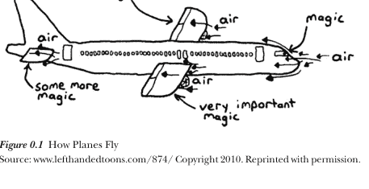
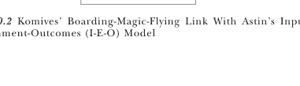
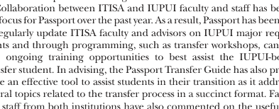
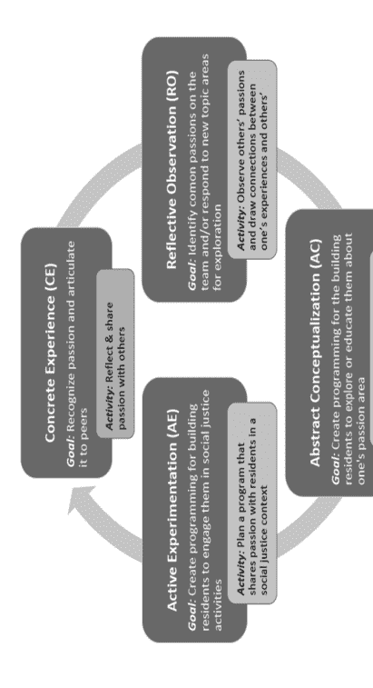

# 高等教育中整体应用学生发展理论的示范实践

**Katie Branch** 是美国罗德岛大学人类发展与家庭研究系的副教授。

**Jeanne S. Hart-Steffes** 是美国西部新英格兰大学学生事务副校长兼学生院长。

**Christine M. Wilson** 是美国康涅狄格大学学生事务助理副校长兼学生活动主任。
## 前言：这不是魔法

*Susan R. Komives*

我儿子是一名火箭科学家——真的！他从小就热爱飞机，画飞机，去史密森尼国家航空航天博物馆参观，在马里兰大学的风洞里做高中毕业项目，加入美国空军预备役军官训练队，最近还在明尼苏达大学获得航空工程博士学位。他现在是美国空军少校 Jeffrey R. Komives，USAF，PhD，在俄亥俄州赖特-帕特森空军基地的空军技术学院研究和教授高超音速技术。与此同时，我是他母亲，坐在装满数百人的大型飞机靠窗座位上起飞时想着，“这只是魔法。” Jeff 给了我很多教训，我基本上理解升力和推力；然而，正如图 0.1（Boyd，2010）所示，我仍然暗自认为，“这架庞大的飞机起飞并保持飞行一定是魔法！”

从登机到降落之间，飞机如何起飞并保持飞行对我来说是神秘的黑箱（即未知之箱；图 0.2）。我并不完全了解那个箱子里发生了什么，但相信它能正常工作。幸运的是，对我和其他乘客来说，有像 Jeff 这样的专家，他们既知道它如何运作，又知道如何使其发生！他责备我，“妈妈，这不是魔法！”

飞机如何飞行

图 0.1 飞机如何飞行

来源：www.lefthandedtoons.com/874/ 版权所有 2010。经许可转载。

### 大学成果

多年前，我亲爱的朋友 Alexander 'Sandy' Astin 提出了他所称的介于学生投入（即他们是谁以及他们带来什么）与他们取得的大学成果之间的“黑箱”。Astin 的大学影响模型，即投入-环境-产出，或 I-E-O（1993；见图 0.2），探讨了环境体验的影响，包括有意设计的教学实践，这些实践与学生投入的相关维度相互作用，从而导致期望的大学成果。

图 0.2 Komives 的登机-魔法-飞行与 Astin 的投入-环境-产出（I-E-O）模型的联系

正如本书许多章节所述，Astin（1993）使大学教育者意识到学生参与，即他们在具有发展力量的体验中花费的时间和精力，对实现这些期望成果至关重要。对 I-E-O 模型的改进当然也说明了投入对产出的直接影响，但本书的重点（以及飞机如何飞行的隐喻）最好以线性关系来理解。

本书的读者都清楚，过去 30 年来大学在建立和评估学习和发展成果方面所采取的重点。大学教育者因向学生、家庭、雇主和公众提供这些成果而承担责任。在过去几十年的有意学生事务实践中，教育者成功地解决了学生成功方面的众多复杂问题，如坚持、成就和发展认知复杂性。诸如《大学如何影响学生》第三版（Mayhew et al., 2016）之类的汇编综合了对学生学习和发展产生影响的众多干预和参与，以及个人和群体差异对该过程的影响。

在本书中，Katie Branch、Jeanne S. Hart-Steffes 和 Christine M. Wilson 及其才华横溢的撰稿人展示了教育者如何通过有意地将理论和研究应用于环境为多元化学生提供的体验，从而塑造大学环境。基于对学生及其个人发展的了解，本书中的教育者使用了各种学生成功和发展理论以及关于环境因素的广泛研究，包括高影响力实践（Kuh，2008），以应对期望的成果。

### 高影响力教育实践

George Kuh 及其同事通过国家学生参与调查研究开展的研究确定了 10 项有助于学生学习和发展的 高影响力实践（HIPs）（Kuh, Kinzie, Schuh, Whitt, & Associates, 2005）。由美国学院与大学协会推进（见 www.aacu.org/resources/high-impact-practices），这些具有发展力量的体验包括：

- 第一学年体验
- 共同智力体验
- 学习共同体
- 重视写作的课程
- 协作性作业和项目
- 本科生研究
- 多元化/全球学习
- 服务学习、社区为本学习
- 实习
- 毕业设计课程和项目

对本书而言重要的是 Kuh（2008）归纳出的六个行为主题，这些主题支撑着那些产生其所体现影响的 HIPs。这些主题是：

- 投入时间和精力
- 就实质性问题与教师和同伴互动
- 体验多元化
- 对更频繁的反馈做出回应
- 反思和整合学习
- 通过现实世界应用发现学习的关联性

教育者取得的进展的一个例子体现在我们自己在学生领导力发展的工作中。大学已将学生领导力理论（如领导力发展的社会变革模型 [SCM；Higher Education Research Institute, 1996]）与相关的理论输入框架（如种族认同、领导力自我效能）相结合，并利用多机构领导力研究（MSL；见 www.leadershipstudy.net）的数据，该研究考察 SCM 和众多校园参与体验，以确定促进领导力能力成长的体验。众多校园环境实践，如让学生参与关于社会政治问题的讨论、指导、担任职位领导角色以及社区服务，都是发展领导力能力的高影响力实践（Dugan, Kodama, Correia, & Associates, 2013）。结合对领导力身份发展（LID：见 Komives, Owen, Longerbeam, Mainella, & Osteen, 2005）的理解，校园现在正在利用 MSL 研究等研究中确定的领导力 HIPs，对其领导力项目进行支架式搭建，以构建发展复杂性。

### 学生发展理论在实践中

在高等教育标准促进委员会（Council for the Advancement of Standards in Higher Education）标准与指南（2015）中的政策等支持的推动下，以 *大学如何影响学生*（Mayhew et al., 2016）为代表的研究成果，以及本书中呈现的学生发展理论，今天的学生事务教育工作者已应对了学生在教育中面临的诸多挑战。而且这并非魔法；我们正是因为这些干预措施所体现的理论基础，才理解它们为何以及如何发挥作用。

我们仍面临着应对深层次且普遍的社会问题的挑战，如仇恨行为、种族主义、酒精和药物滥用以及性暴力。我们的学术研究有助于我们理解这些问题的根源，但将干预措施推广到规模化以实现成功解决仍然难以捉摸。希望读者能够迎接挑战，应对这些普遍而困难的问题。本书中的案例提供了来自其项目的经验教训，可以被利用或规模化，以应对复杂的议程。

Branch、Hart-Steffes 和 Wilson 以及本书中的作者提供了明确将有用理论与有意设计的项目和实践相联系的案例，这些项目和实践能够实现期望的学生成果。每位读者都应在此停顿并反思自己对相关理论的个人知识、对相关研究的了解、将该学术成果应用于实践的技能，以及从实践中学习以重新设计项目的能力。每位专业人士都需要成长型思维（Dweck, 2008），我们才能在这个过程中变得熟练。需要我们所有人分享良好的实践，才能推进任何一个人的工作。

每位从业者/教育工作者必须采用一种专业身份，其中包含学者和从业者的某种组合。几年前，我写过关于专业取向连续体的内容（图 0.3；Komives, 1998）。

许多工作人员是坚实的从业者。他们可能在行政技能方面娴熟，基于非正式理论和强有力的常识运作，但很大程度上缺乏理论且不受证据指导。将学术研究带入工作的从业者会寻求指导其实践的理论和研究。从业者-学者更认同学术研究，并善于将理论和研究应用于实践。学者-从业者以相关理论和证据为基础来支持或修改其项目。在最极端的情况下，学者通过发展理论、实践模式和开展原创研究而茁壮成长，向实践提出建议但不参与实践的设计或应用。所有读者都应在该连续体上定位自己的专业身份。我衷心希望该身份包括成为学者-从业者。

*图 0.3* 专业取向连续体

来源：Komives (1998)。经许可使用。

学生发展应用并非魔法。它们以理论和相关研究为基础，确保它们能够促进大学经历中期望的结果。请继续分享您自己的良好实践，以及那些成效不佳的实践的经验教训，以推进这项专业工作。学生值得拥有。

## 参考文献

- Astin, A. W. (1993). *大学中什么最重要？* San Francisco, CA: Jossey-Bass.
- Boyd, J. (2010, November 15). 左撇子漫画（由右撇子创作）。 *飞机如何飞行。* Retrieved from www.lefthandtoons.com/874
- Council for the Advancement of Standards in Higher Education (2015). *高等教育 CAS 专业标准* (9th ed.). Washington, DC: Author.
- Dugan, J. P., Kodama, C., Correia, B., & Associates. (2013). *多机构领导力研究洞察报告：领导力项目交付。* College Park, MD: National Clearinghouse for Leadership Programs.
- Dweck, C. S. (2008). *心态：成功的全新心理学。* New York, NY: Ballantine Books.
- Higher Education Research Institute. (1996). *领导力发展的社会变革模式指南手册* (Version 3). Los Angeles, CA: Author, University of California.
- Komives, S. R. (1998). 将学生事务准备与实践相联系。 In N. Evans & C. Phelps (Eds.), *学生事务专业教育与实践的现状：另一次审视* (pp. 177–200). Washington, DC: American College Personnel Association.
- Komives, S. R., Owen, J. E., Longerbeam, S., Mainella, F. C., & Osteen, L. (2005). 发展领导力身份：一种扎根理论。 *大学学生发展杂志, 46,* 593–611.
- Kuh, G. D. (2008). *高影响力教育实践：它们是什么，谁能获得访问权，以及为何重要。* Washington, DC: Association of American Colleges and Universities.
- Kuh, G. D., Kinzie, J., Schuh, J. H., Whitt, E. J., & Associates. (2005). *大学中的学生成功：创造重要的条件。* San Francisco, CA: Jossey-Bass.
- Mayhew, M. J., Rockenbach, A. N., Bowman, N. A., Seifert, T. A., Wolniak, G. C., Pascarella, E. T., & Terenzini, P. T. (2016). *大学如何影响学生：高等教育有效运作的21世纪证据* (Vol. 3). San Francisco, CA: Jossey-Bass.

本书的主要读者是攻读学生事务和高等教育项目的研究生，他们正在修读成人发展、大学对学生的影响、学生事务领导力以及高等教育中的项目或政策发展等课程。另一类读者是当前的高等教育专业人士，他们需要更新其理论知识或寻求理论与实践联系的灵感。因此，本书既可用于学术课程，也可用于专业发展计划。

本书的内容是其他出版物的理想伴侣，这些出版物提供了在高等教育中使用的详细的人类发展理论描述。例如，本书中许多理论家和理论建构的名称在作为主要课程教材的书籍中都有讨论（例如，Jones & Abes, 2013；Patton, Renn, Guido, & Quaye, 2016；Strange & Banning, 2015；Strayhorn, 2016）。此外，由于潜在的理论重叠与先前获得的知识，本书的内容可以融入旨在鼓励有意且整体地使用理论知识和评估技术的专业员工发展计划。

本书内容的独特之处在于展示了从业者如何将近期学术出版物和会议演讲中的理论应用于与21世纪大学生工作的实践中，评估是如何进行的，以及在多维度、整体地应用人类发展理论的复杂性方面学到了什么。作者提供了在以专业意图开展理论与实践循环时所学到的见解，提出了建议，并提供了资源建议。

章节分为三个部分，与研究中关于大学生发展的理论分组相平行：

- 心理社会与社会认同（即：我是谁？）
- 认知结构过程（即：我如何建构意义？）
- 环境影响（即：哪些外部因素影响我的发展？）

每个部分都包含以高等教育专业人士工作中基础或新兴理论为基础的章节。在第一部分中，

总之，这些九章连同本书的导言和结尾章节，将既激励高等教育和学生事务专业人士，又提供整体应用学生发展理论的工具。

## 参考文献

- Jones, S. R., & Abes, E. S. (2013). *大学生身份发展：推进多维度身份的框架。* San Francisco, CA: Jossey-Bass.
- Patton, L. D., Renn, K. A., Guido, F. M., & Quaye, S. J. (2016). *大学中的学生发展：理论、研究与实践* (3rd ed.). San Francisco, CA: Jossey-Bass.
- Strange, C. C., & Banning, J. H. (2015). *为学习而设计：创建有效的校园学习环境* (2nd ed.). San Francisco, CA: Jossey-Bass.
- Strayhorn, T. L. (2016). *高等教育中的学生发展理论：一种社会心理方法* [*高等教育核心概念系列*]. New York, NY: Routledge.

## 致谢

一本关于在高等教育环境中整体应用学生发展理论的书籍，只有让最有可能使用它的人参与进来，才能获得成功：这些人是为培养新兴学术实践者而设立的研究生项目中的学生。四名研究生直接提升了本书的内容，他们参与了收集理论到实践项目及其他举措范例的过程，并对章节内容提供了深思熟虑的反馈。罗德岛大学的硕士研究生 Melissa Ferris、Haley McConville 和 Maira Pantoja 协助我们征集可能章节的提案、审阅提交的提案，并参与了最终遴选。在我们挑选那些运用相关理论展示万花筒般多元视角、涵盖多种职能领域并考察各类院校环境的范例时，她们的分析极具价值。康涅狄格大学的博士生 Monique Golden 在我们收到撰稿人提交的章节并开始完善内容后加入了本书项目。她对细节的关注，同时始终着眼于最终成品，做出了不可估量的贡献。

此外，我们要感谢 Routledge/Taylor and Francis Group 工作人员给予的反馈、指导和帮助。高级编辑 Heather Jarrow 在与我们合作时提出的富有洞察力的建议和耐心，既以学习为中心又令人鼓舞。高级编辑助理 Rebecca Collazo 通过回答相关问题提供了协助。

## 图表目录

### 图

| 序号 | 标题 | 页码 |
|---|---|---|
| 10.1 | 从激情到行动的宏观循环：说明体验式学习过程每个阶段相关目标与活动的推进 | 141 |

### 表

| 序号 | 标题 | 页码 |
|---|---|---|
| 1.1 | 理论集群、服务对象与核心学术成果 | 7 |
| 7.1 | 个性化问责计划摘录 | 100 |
| 7.2 | 面向学生员工的个性化问责计划样例题 | 103 |

## 引言：发展理论作为示范性项目指南

*Katie Branch 和 Monique N. Golden*

高等教育环境（尤其是课外活动环境）中的学生成功，强调潜在的人类发展成果。指导理解这类成果的理论，为复杂的大学生发展轨迹提供了洞见。二十一世纪的大学生遭遇到无数的经历和挑战，要求我们在当代实践中整体运用理论，以促进他们沿着独特的发展道路前进。本章为整体运用大学生发展理论提供了理由，并描述了本书的写作动因。接下来，我们解释了收集本书所收录的当代理论实践范例的过程，并概述了后续章节中讨论的理论和模型。此外，我们概述了各撰稿作者分享视角时所用的模板。最后，我们提醒读者，整体运用理论并非魔术，而是常常微妙但不断变化的学术知识与有意识的实践的交汇——就像透过万花筒观看鲜活的图像一样。

你职业上的“为什么”是什么？这个问题及其变体与 Simon Sinek 在2009年发表的激励性TED [技术、教育、设计] 演讲有关（见 https://startwithwhy.com/；Challenging, 2017）。*《学生人事观点》*（美国教育委员会，1937）被誉为帮助美国确立大学生人事这一学科的文件，它呼吁重视学生的整体发展。近期的出版物也强调需要回应多种形式的成人发展，并继续采用多维度的知识应用方法（ACPA, 1996; Keeling, 2004）。通过将研究与实践相融合，从而对人类发展和学习产生积极影响所实现的协同效应，往往是当今学生事务从业者的*存在的理由*（即，存在的缘由）。在对1937年至1999年间发表的13份学生事务哲学文件进行深入分析后，Evans 和 Reason（2001）指出，其标志包括对学生的整体视角，以及对学生人事工作如何开展的整体视角。“在所有被审阅的陈述中发现的最普遍、最基础的概念是：必须在每一项教育工作中考虑‘完整’的学生”（第370页）。

本书的首要前提是推动运用人类发展理论知识，以提升学生和社会参与高等教育的积极成果。正如 Kuh、Kinzie、Schuh、Whitt 及同事（2005/2010）所解释的，大学生成功不仅包括学业坚持和学业完成率，还包括学生学习的质量维度，其中包含发展。*《整体应用学生发展理论》*的目的是提供大学生发展理论综合应用的实例，尤其是由在课外职能领域工作的高等教育专业人员进行实施和评估的项目。由于本书选用的理论应用以二十一世纪大学生为参与者，多样性与社会正义是核心概念。在进入撰稿作者提供的示例之前，本章进一步解释了促使我们产生出版这本书愿望的原因，描述了征集和遴选来稿的流程，简要总结了后续章节中使用的理论，并提供了组织后九章的模板。

### 本书的必要性：为何是现在？

一本阐释高等教育环境中学生发展理论整体应用的书籍，其需求来源多种多样。一个来源是我们作为教授大学生发展学术学分课程和非学分工作坊系列课程者的个人经历。修读学术课程的学生以及参加专业发展活动的人，常常会询问理论在当前实际实践场域中的运用范例。学生希望从那些正在运用所学知识的高等教育专业工作者那里获得启发；本书满足了这一需求。此外，旨在鼓励有意识地、整体地运用理论知识的专业员工发展举措，也可以通过考察该领域其他人的工作而受益。

本书内容在此时此地的另一个动因是，我们不仅注意到研究生对大学生发展心理社会层面的持续兴趣，还注意到强调社会认同的出版物（例如，Jones & Abes, 2013; Patton, Renn, Guido, & Quaye, 2016）。虽然心理社会和社会认同理论及相关举措很重要，但它们并未完整涵盖全面、有效的专业实践所需的知识和范例范围。本书有助于将理论发展和应用的学术焦点重新校准到与高等教育教育使命密切一致的多维、整体方法上。

### 注意事项：理论覆盖的深度与滞后时间

我们设想，本书内容将成为其他详述人类发展理论及配套研究的出版物的补充读物。理想情况下，学术实践者会关注并阅读发表在同行评审期刊和书籍中的研究者原创著作。然而，鉴于当今世界知识产生的数量和信息流动的速度，可以合理地假设许多学术实践者通过提供理论与相关研究分析性概述的出版物来保持跟进。例如，*《大学生发展：理论、研究与实践》*（Patton et al., 2016）就是一本在许多研究生层面的学生发展课程中用作主要教科书的著作。我们书中使用的理论与该著作中讨论的几个理论相契合；然而，我们内容的独特之处在于，它展示了实践者如何在他们当前的工作中使用这些理论、如何开展评估，以及以多维、整体方式应用人类发展理论的复杂性给我们带来了哪些启示。此外，我们还提供了在进行理论与实践之间转化工作时可使用的建议和资源。

在考察理论的应用时，从促成理论的研究、理论在同行评审出版物中的发表、提出修正原理论的研究，到理论的实际应用，这之间的滞后时间往往显而易见。这种滞后带来的一个结果是，有必要审视理论的社会历史背景，以及它们在当代实践中被使用的时间、方式和原因。例如，传统上，基于心理学的发展理论将*整体性*理解为自我中面向个体的方面，以及理解世界的内部方式。尽管有强调情境影响的补充理论，但这种解释可能低估了一个影响人类如何驾驭和互动其周围世界的社会生态维度。我们宽泛地将这一社会生态维度定义为各种力量（如文化、权力、刻板印象、社会规范、规则）之间的相互作用，这些力量决定了一个人的位置性，而位置性受地方、国家和全球背景的影响。社会生态维度为“整体性学生发展”的含义增加了相当大的复杂性，后者通常被表述为支持“完整的学生”（Evans, Forney, Guido-DiBrito, Patton, & Renn, 2010）。在缺乏社会生态维度的情况下支持完整学生，是一种不完整、不充分的做法。因此，如果未能或拒绝承认权力与特权会影响学生的自我意识以及他们对整个社会的解读，就不可能实现真正的整体性学生发展。批判种族理论（Ladson-Billings & Tate, 1995）和交叉性（Crenshaw, 1989；参见 Bartlett, 2017; Tefera, Powers, & Fischman, 2018）等学术成果帮助我们审视制度体系如何将权力与特权赋予某些群体，使主流意识形态长期存在，并促成对个人、声音和经验的抹除。阿贝斯（2016）出版的*《学生发展理论中的关键问题》*旨在帮助学术型实践者理解这些复杂概念。

最后，理论概念的某些较新方面太过新近，除了用于发表新兴理论或后续应用这些知识的研究外，尚无更多研究。例如，将神经科学方面的学术工作纳入学生事务实践的做法尚未广泛普及（参见 Blimling, 2013; Bresciani Ludvik, 2016; Kartoshkina, 2017; Schwitzer, 2015）。正如埃夫拉尔、安内塞和布雷夏尼·卢德维克（2016）所言，“对大脑的迷恋无处不在，因此现在确实是有意将神经科学发现纳入高等教育的设计、实施和评估的时候了”（第 27 页）。

### 收集理论实践案例的流程

本书的联合编辑从不同作者群体中招募并遴选了稿件，这些作者代表了多种高等教育背景。我们收到了来自学术型实践者（scholarly practitioners）的各种投稿，所谓学术型实践者是指那些以理论和研究为基础开展工作、但不常在研究期刊上发表成果的人。撰稿人的知识和专长对于实现本书宣示的目标至关重要。在征集本书投稿提案的过程中，联合编辑特意联系了个人和各类论坛，以期发现更新的想法。在征稿过程中，我们向专业协会的邮件列表、教师以及不同类型高等教育机构中其他高等教育和学生事务领导者发送了信息，也联系了最近在两大学生事务伞式组织（即 ACPA：学生事务教育者国际协会与 NASPA：高等教育学生事务管理者协会）年度聚会上就学生发展理论相关主题做过报告的个人。

在我们的*征稿启事*中，联合编辑请潜在撰稿人分享其项目、实践或其他当代应用大学生发展理论的举措；机构背景，包括学生群体的社会人口构成；项目、实践或举措的具体情况；预期的发展和学习成果；评估与评价；以及关于理论与实践联系的经验教训。同时说明，被选入本书的稿件将重点涉及以下列出的一个或多个理论或模型，或者可以联系联合编辑提出其他建议。

-   对于心理社会与社会认同：奇克林与赖瑟（认同：大学影响）、克罗斯与法根-史密斯（黑人性、黑人认同）、赫尔姆斯（白人种族身份状态）、菲尼（少数族裔认同）、金（亚裔美国人认同）、托雷斯（拉丁裔认同）、鲁特（多种族血统）、卡斯（同性恋认同——以男性为重点）、法辛格（男同性恋、女同性恋认同）、德奥杰利（女同性恋、男同性恋、双性恋认同）、沃辛顿等人（异性恋认同）、贝姆或莱夫（性别认同与角色）、吉布森或福伯-普拉特与阿拉贡（残障学生）、赫斯特或奥斯特罗夫（社会阶层）、以及戴维斯（第一代大学生身份）。
-   对于认知发展：佩里（一般智力推理）、贝伦基等人（*女性的认知方式*）、巴克斯特·马戈尔达（认识论反思）、基奇纳与金（反思判断）、科尔伯格或雷斯特（道德——公正声音）、吉利根（道德——关怀声音）、福勒（信仰）、帕克斯（精神性、意义建构）、以及巴克斯特·马戈尔达（自我创作）。
-   对于发展影响：布朗芬布伦纳（发展生态学）、施洛斯伯格（过渡）、科尔布（体验式学习）、荣格或迈尔斯与布里格斯（人格类型）、克利夫顿与安德森（人格优势）、塞德拉塞克（非认知变量）、以及斯特雷霍恩（归属感）。

### 理论集群

为了最大限度地发挥本书的效用，我们将理论实践案例组织为三个部分或理论集群，这些集群与学生事务文献有着历史渊源：心理社会、认知和发展影响（Evans, Forney, & Guido-DiBrito, 1998; Mayhew, Rockenbach, Bowman, Seifert, & Wolniak, 2016）。每个集群在相关章节中代表一种发展重点，涵盖所服务的学生群体，并使用前文列出的一个或多个理论、模型或框架。例如，第一部分的章节被赋予“我是谁？：心理社会与社会认同发展”的集群标签。四个相关章节中描述的项目和举措所服务的群体包括新生、第一代大学生、国际学生、有色人种学生和黑人男性。用于指导实践的核心学术成果包括奇克林与赖瑟的认同发展理论、阿斯丁的学生参与理论、克罗斯与法根-史密斯的黑人认同发展模型、斯特雷霍恩的归属感理论以及菲尼的族裔认同发展模型。表 1.1 总结了每个理论集群、所服务的群体和核心学术成果。随后，提供了各章撰稿人所用理论或模型的概述。

**表 1.1** 理论集群、所服务群体与核心学术成果

| 理论集群 | 所服务群体 | 核心学术成果 |
|---|---|---|
| **我是谁？：** 心理社会与社会认同发展 | 新生、第一代大学生、国际学生、有色人种学生和黑人男性 | • 奇克林与赖瑟的认同发展理论 • 阿斯丁的学生参与理论 • 克罗斯与法根-史密斯的黑人认同发展模型 • 斯特雷霍恩的归属感理论 • 菲尼的族裔认同发展模型 |
| **我如何构建意义？：** 认知发展 | 学生雇员及全校学生 | • 佩里的智识与道德发展图式 • 科尔伯格的道德发展理论 • 吉利根的妇女道德发展理论 • 基根的意识演化理论 • 巴克斯特·马戈尔达的自我创作理论 • 施洛斯伯格的过渡理论 |
| **发展影响** | 社区学院学生和住宿学生 | • 奇克林与赖瑟的认同发展理论 • 科尔布的体验式学习理论 |

### 理论或模型概述（按出现顺序）

#### 奇克林与赖瑟（1993）的认同发展理论（“七向量”）

该理论基于这样的假设：学生认同发展的过程是复杂的，本质上不一定是线性的，而且是流动的。此外，奇克林与赖瑟强调制度环境是影响认同发展的一个因素。该理论以七个向量的形式呈现，描述了学生如何在心理社会层面发展：发展能力、管理情绪、从自主走向相互依赖、建立成熟的人际关系、确立认同、发展目标、发展诚信。

#### 阿斯丁（1999）的学生参与理论

阿斯丁（1999）将学生参与定义为“学生投入到学业中的生理和心理能量的总量”。

经验"（第518页）。根据 Astin 的观点，学生参与度可以被概念化为一个连续体，从未参与的学生（他们将最少的时间和精力投入到学术和课外活动中）到高度参与的学生（他们投入大量的时间和精力）。Astin 指出，学生的学习和发展"与学生参与的质量和数量成正比"（第519页）。

#### Cross 和 Fhagen-Smith（2001）的黑人身份发展模型（Nigrescence）

这个六部分模型详细描述了确定作为黑人意味着什么以及发展个人黑人身份的过程。第5部分“成人黑人意识形成”描述了个体对种族的看法从不重要到在自身及他人黑人身份背景下构建全新世界观的轨迹。这四个阶段是：接触前、接触、沉浸/浮现和内化/承诺。

#### Strayhorn（2012）的归属感

根据 Strayhorn（2012）的说法，归属感是指“学生感知到的校园社会支持，一种联系感，一种感到自己重要、被关心、被接纳、被尊重、被重视，并对校园中的群体或他人重要的体验”（第3页）。Strayhorn 的概念模型包含七个核心要素：归属感作为一种基本人类需求、一种基本动机，足以驱动人类行为；归属感在某些情境下具有更高的重要性；归属感与“重要感”的关系及其后果；社会身份交叉影响归属感；归属感与积极结果的关联；以及对归属感持续存在的必要性，以及随着环境、条件和情境的变化而改变的可能性。

#### Phinney（1989, 1993）的族群身份发展模型

这个三阶段模型描述了族群身份达成的过程。第一阶段是未经审视的族群身份，学生被描述为处于两种状态之一：扩散或早闭。这两种状态都反映了个人的感受或态度尚未探索，或者与具有相似族群身份的人之间的互动尚未探索。下一阶段是探索期，指促使族群身份探索的遭遇，同时处理收集到的信息所产生的各种情绪和反应。在最后阶段，身份达成，个体形成了积极的双文化身份——建立对其他族群的认识和欣赏。

#### Perry（1970）的智力和道德发展图式

该理论描述了学生如何从简单的、二元的...形式中移动。Gilligan 提出了一个以女性道德发展和推理为中心的理论。与 Kohlberg 的理论类似，该理论包含三个层次（关注个体生存、善良作为自我牺牲、非暴力道德）。通过两个过渡阶段（从自私到责任，从善良到真理）实现层次间的递进。

#### Kegan（1994）的意识演化理论

Kegan 的五种意识秩序概述了“影响思维、情感以及与他人和自我关系的心理组织原则”（Love & Guthrie, 1999, 第67页）。每一种秩序都包含补充秩序认知性质的内在个人和人际维度。秩序0到1特指幼儿（0-2岁）。秩序2到5与我们通常服务的大学校园中的成人群体更相关。它们是：秩序2：工具性思维；秩序3：社会化思维；秩序4：自我主导思维；秩序5：自我转化思维。

#### Baxter Magolda（2001）的自我主导理论

自我主导被定义为“定义个人信念、身份和社会关系的内部能力”（Evans et al., 2010）。Baxter Magolda 的理论描述了年轻成年人与自我意识和他人关系相关的认识论发展。该理论探讨了三个总体问题：我如何知道？我是谁？我想如何与他人建立关系？通往自我主导的旅程由四个阶段描述，这些阶段解释了个体如何从外部赋予的价值观和信念体系转向定义自己的：遵循公式、十字路口、成为自己生活的作者，以及内在基础。

#### Schlossberg（1984）的过渡理论

生活有时会抛出曲线球，导致关系、惯例和角色发生变化（即过渡），这些变化可能是预期的、意外的，或是一个非事件。Schlossberg 的理论提供了对个体如何解读和应对过渡的见解。有效的应对取决于个人对四个方面资源（情境、自我、支持和策略）的评估，以促进进入、穿越和离开的过渡过程。

#### Kolb（1984）的体验学习理论

根据 Kolb（1984），学习被定义为“通过经验的转化创造知识的过程”（第38页）。该理论提出了一个四阶段循环学习过程，“结合了经验、感知、认知和行为”（第21页）。这四个阶段是：具体经验、观察与反思、形成抽象概念，以及在新情境中检验。

### 后续章节模板

为了可读性和跨示例比较的能力，接下来的九章由撰稿作者撰写，采用一致的模板呈现。每章都围绕一个框架组织，该框架强调了高等教育和学生事务从业者将理论、模型和其他学术成果融入工作的当代视角。模板（即第2至10章中提供的信息和视角的顺序）如下：

- 摘要
- 简要介绍，为理论实践应用设定机构和地方背景
- 描述[项目或倡议的名称/标识短语]
  - 指导理论
  - 实施细节
  - 评估与评价
- 巧妙应用理论的经验教训
- 建议与资源
- 参考文献

本书最后一章，第11章，不遵循此模板。相反，它总结了为本书提交的提案数据，并从撰稿作者的经验教训和建议中提炼出主题视角。本书提出了一些关于在当代情境中应用学生发展理论的结论，强调了学术型高等教育和学生事务从业者参与的必要性。此外，还指出了一些将理论应用迁移到多种情境和学生群体时的注意事项。

### 这不是魔法

正如 Susan R. Komives 在前言中指出的那样，全面地应用理论来促进大学生发展和学习并不是魔法。相反，它涉及往往是微妙但不断变化的学术知识与有意识的实践的汇合——就像透过万花筒观看鲜艳的图像。在接下来的九章中，学术型从业者分享了他们对理论实践工作复杂性的看法。所描述的万花筒般的反思和角度展示了他们作为投入的、学术性的高等教育和学生事务从业者的专业知识。

### 参考文献

- Abes, E. (编). (2016). _学生发展理论的关键问题_（学生发展理论新视角，第154期）. 旧金山，加利福尼亚州：Jossey-Bass.
- 美国大学人事协会. (1996). _学生学习要务：对学生事务的启示_. 华盛顿，哥伦比亚特区：作者.
- 美国教育委员会. (1937). _学生人事视角_（美国教育委员会研究，系列1，第1卷，第3号）. 华盛顿，哥伦比亚特区：作者.
- Astin, A. W. (1999). 学生参与：高等教育的发展理论. _学院学生发展杂志，40_(5), 518–529.
- Bartlett, T. (2017, May 26). 当一个理论走红。交叉性现在无处不在。这是好事吗？ _[高等教育]纪事评论，63_(37).
- Baxter Magolda, M. B. (2001). _走自己的路：改造高等教育以促进自我发展的叙事_. 斯特灵，弗吉尼亚州：Stylus出版社.
- Bliming, G. S. (2013). 传统年龄大学生心理社会发展的新维度. _校园，18_(5), 10–16. doi:10.1002/abc.21132
- Bresciani Ludvik, M. J. (编). (2016). _学习与发展的神经科学：在高等教育中增强创造力、同理心、批判性思维与和平_. 斯特灵，弗吉尼亚州：Stylus出版社.
- 挑战我们的假设：执行主编 Frank Shushok, Jr. 和 Simon Sinek 谈论影响美国大学校园学生生活和学生学习的教育实践. [访谈]. (2017). _校园，22_(4), 3–12. doi:10.1002/abc.21297
- Chickering, A. W., & Reisser, L. (1993). _教育与身份_（第2版）. 旧金山，加利福尼亚州：Jossey-Bass.
- Crenshaw, K. (1989). 去边缘化种族与性别的交叉性：对反歧视原则、女性主义理论和反种族主义政治的黑人女性主义批判. _芝加哥大学法律论坛，189_, 139–167.
- Cross, W. E., & Fhagen-Smith, P. (2001). 非裔美国人身份发展的模式：生命全程视角. 载于 C. L. Wijeyesinghe, B. W. Jackson III. (编), _种族身份发展的新视角_（第1版，第243–268页）. 纽约，纽约州：纽约大学出版社.
- Evans, N. J., & Reasor, R. D. (2001). 指导原则：学生事务哲学陈述的回顾与分析. _学院学生发展杂志，42_(4), 359–377.
- Evans, N. J., Forney, D. S., & Guido-DiBrito, F. (1998). _大学生发展：理论、研究与实践_. 旧金山，加利福尼亚州：Jossey-Bass.
- Evans, N. J., Forney, D. S., Guido-DiBrito, F., Patton, L. D., & Renn, K. A. (2010). _大学生发展：理论、研究与实践_（第2版）. 旧金山，加利福尼亚州：Jossey-Bass.

- Schwitzer, A. M. (2015年3月–4月). 从僵尸到额叶：一份关于大脑的阅读清单. *校园*, 20(1), 25–31. doi:10.1002/abc.21882
- Schlossberg, N. K. (1984). *过渡期成人咨询*. 纽约州纽约市：施普林格出版社.
- Strayhorn, T. L. (2012). *大学生的归属感：所有学生学业成功的关键*. 纽约州纽约市：塞奇出版社.
- Tefera, A., Powers, J. M., & Fischman, G. E. (2018). 教育中的交叉性：概念性诉求与研究使命. *教育研究评论*, 42, vii–xvii. doi:10.3102/0091732X18768504

Marcus Mayes、Donald D. Gilliam 和 Curtis Taylor, Jr. 开发了“*密苏里黑人男性倡议*”，这是一个多层面的导师计划，以 William Cross 和 Peony Fhagen-Smith（2001）的黑人身份发展模型为结构基础。该计划包括一门学术课程，以及与校园和社区项目及领导者的深度联系。

第三个项目来自爱荷华大学，这是另一所大型公立大学。Jennifer A. Blair 和 Gordon S. Louie 运用 Jean Phinney（1993）的族群认同发展模型，创建了“*蒂皮伙伴*”，这是一个面向商学院学生的相互辅导项目。国际学生与国内学生（即美国公民或授权永久居民）配对，并在结构化活动和非正式场合中使用提示语来促进学生的成长。

本部分的第四个也是最后一个项目实际上是一个学生社团。Sarah E. Schoper、Emily N. Davidson 和 Christine Nguyen 与学生共同创建了“西方第一代大学生”（*WIGS*），他们利用 Jeff Davis（2010）在《*第一代大学生经历*》中阐述的诠释，来确定该学生组织的结构和活动。

这些项目都成功帮助学生回答了那个重要的问题：**我是谁？**

## 提高保留率与发展能力的入学前静修营

Kelly Carter Merrill

“Launch”是弗吉尼亚州一所小型私立文理学院——伦道夫-梅肯学院——举办的入学前静修营。Launch 的设计以心理社会发展为重点，旨在提高该学院的学生保留率。这一总体目标通过四个预期发展目标得以实现：缓解新生的社会过渡、让他们做好迎接学业挑战的准备、鼓励对毅力的反思，以及创建一个重视并保护学生多样性的同伴社交社区。四个理论构念指导了 Launch 的设计和课程：发展能力（Chickering & Reisser, 1993）、学生参与理论（Astin, 1999）、心态与毅力（Dweck, 2012），以及微侵犯与多样性氛围（Sue, 2010）。

伦道夫-梅肯学院（RMC）是位于弗吉尼亚州中部的一所小型（1,400名学生）、私立、择优录取的文理学院，生源以本地区为主（州内学生占73%）。这是一所住宿制学院，92%的一年级学生和80%的全体学生住校。RMC 最初是一所男子学院，1830年创立，带有卫理公会使命。如今，该校女学生占53%（自1971年起实行男女同校），并且是持续办学的最古老的卫理公会相关学院（院校研究办公室，2017；SCHEV，2017）。该校的卡内基分类为“学士学院——文理类”，其体育联盟是老自治领体育联盟（ODAC），隶属于全国大学体育协会（NCAA）第三分区。

伦道夫-梅肯学院三分之一的学生是运动员，近三分之一（29%）参加希腊字母社团。78%的学生认同为白人，8%为黑人，4%为西语裔/拉丁裔，4%为多种族，2%为亚裔美国人，4%为其他或未知。超过一半（55%）的学生获得基于需求的经济资助。六年毕业率为58%（院校研究办公室，2017；SCHEV，2017）。

2010年，RMC 历年的平均大一到大二保留率约为75%，而在2015年*Launch*静修营之前的两年，该比率已升至77%（2013届）和78%（2014届）（SCHEV，2017）。2015年，RMC 的教师、员工和管理人员将注意力转向解决新生的发展需求，*Launch* 便是为了继续提高保留率而构思的。

### LAUNCH 项目简介

2015年和2016年的夏天，新生们受邀参加一个为期四天、入住前举办的静修营，名为“*Launch*”。共有68名学生参加（2015年28人，占新生班级的6%；2016年42人，占10%）。最初的邀请对象是有色人种学生、社区学院转学生和第一代大学生——这些学生在学院和大学中的保留率通常较低（国家学生信息交换中心研究，2017；国家学生信息交换中心研究，2012；Engle & Tinto, 2008）。

希金斯学术中心的学生过渡事务主任负责管理“*Launch*”。该学术中心通过提供免费的学业辅导、导师指导和无障碍支持服务，帮助学生完成学业和社会过渡。学术中心拥有强大的高年级学生工作人员队伍，包括37名辅导员和36名导师，其中一些人兼任两职。辅导和导师项目均获得大学阅读与学习协会的认证；其成员须满足严格的国家级选拔和培训要求。*Launch* 的学生导师从辅导员和导师团队中选拔，并接受了针对 *Launch* 发展目标的额外培训。

### 指导理论

直到20世纪70年代，低保留率一直归因于学生自身（例如动机、技能和特质）（Tinto, 2006）。那些没有

而是允许他们偶尔提供支持，但仅限于学生们经历了挣扎或人际协商之后。

身体与动手能力：虽然导师小组的经历为参与者提供了发展人际交往能力的机会，但重点培养学生们身体和动手能力的，是挑战的*内容*。导师小组的挑战包括：一场介绍性的公告栏装饰比赛，评判标准是创意和向组员进行介绍的成功程度（宿舍小屋里有八块公告栏）；每日冒险挑战，包括高空绳索、低空绳索、滑索和湖上蹦床；为整个 *Launch* 团队计划、采购并准备两餐，并在两次用餐后负责清理；以及最后一场以小组创意为评判标准的短剧比赛。这些挑战中的每一项都为展现学生的各种身体和动手优势提供了机会。

智力能力：可以理解的是，许多 *Launch* 参与者怀疑自己是否具备在第一学年取得成功的智力能力。针对这一担忧，项目内嵌了三种策略。帮助学生为秋季学期设定现实的 GPA 期望非常重要。在一次晨会上，每个学生都得到了一张带信封的大学信笺。工作人员引导大家讨论了从高中到大学学术生活的差异，以及这一变化对 GPA 的潜在影响。接着，参与者被指示在信封上写上家庭住址，并写一封信，内容包括秋季学期的 GPA 目标以及两条给自己的留言：*如果达成了目标，你想对自己说什么？如果没能达成目标，你想对自己说什么？* 这些信件在秋季成绩提交后于12月份寄出。

第二，通过利用学术中心的学生导师和学生辅导员担任 *Launch* 导师，*Launch* 学生被有意地与受过高度训练、能够协助学业过渡的学生建立联系。这样做的目的是让 *Launch* 学生已经与学术中心的工作人员建立了社交联系，从而减轻他们在学年后期意识到自己需要帮助时，向学术中心寻求帮助可能产生的焦虑。

第三，*Launch* 学生学习了一种自由写作技巧，以提升他们的写作流畅度。RMC 的学生在写作方面会收到大量反馈。学生几乎在每类课堂上都要写论文，包括大一历史、政治学，甚至生物学和微积分。鉴于平均班级人数为16人，教授们

能够布置许多论文。写作中心主任指出，新生将受益于一项旨在提高写作流畅度的入门训练（Elbow, 1973），也就是把文字落到纸上的练习。

在*Launch*活动中，每个学生都得到了一本日记本和一支笔。第一天，他们学习了自由写作的技巧（Elbow, 1973; Lamott, 1994），并被要求始终保持笔尖移动。每天早晨，全体成员必须进行集体日记写作。包括*Launch*工作人员在内的每个人都被告知要找一处地方，静坐，并写作20分钟。如有需要，每天会提供示例提示，但他们不必拘泥于这些提示。示例提示包括：*列出三个描述你现在感受的形容词，指出一个你想进一步了解的人并解释原因，以及说出三件你明天一定要做的事。*

鉴于奇克林和赖瑟（Chickering & Reisser, 1993）所描述的大学生心理社会发展第一向量的三项能力考量，其目的是满足新生最紧迫的发展需求。通过这些设计元素，*Launch*参与者能够在秋季学期开始时已经拥有若干友谊，有机会发现身体和动手能力方面的优势，并调整他们对学业成功的期望。

### 学生参与理论

尽管静修营在校外举办，工作人员仍希望确保学生与校园以及彼此之间保持联系。他们邀请了多位嘉宾演讲者，向参与者介绍RMC的各种参与机会，以便学生能够自在地寻找机会，并最终参与到自己感兴趣的活动之中。每次晨会都会邀请一位嘉宾演讲者：学生事务副院长、残障支持服务主任、职业中心主任及两位年轻校友，以及校园牧师。

在参与者大一第二学期初，举办了一次特别的*Launch*重聚会议，以介绍各种学生领导职位，参与者可能想考虑申请这些职位。在RMC，宿舍助理、迎新负责人、导师和辅导员以及校园导游职位的申请截止日期为二月下旬。会上回顾了职位描述，并讨论了学生在选拔过程中可以期待什么，例如这些职位的竞争激烈程度。

他们参加了一个简短的*Launch*说明会，随后登上巴士前往附近的探险静修基地。该基地没有电话和互联网服务。在静修营地内，学生和大学工作人员可以使用两间上下铺小屋、一间设施齐全的厨房、两间公共休息室、一个游泳池、一个湖泊，以及能够指导学生完成探险课程的静修基地工作人员（即高空绳索、低空绳索、滑索和水上蹦床）。团队在宿舍楼向其余新生开放当天返回校园。

每天以学生准备的早餐开始。当天的第一个活动是有指导的日记写作。随后是两个小时的晨间环节，包括嘉宾演讲、活动或小组讨论。在学生准备的午餐后，小组进行不同的探险活动（例如湖上活动、低绳挑战或高空绳索）。下午晚些时候是自由活动时间，可以选择去杂货店购物、徒步旅行、游泳或闲逛。在学生准备的晚餐后，一名志愿*Launch*参与者会生起篝火。所有工作人员、学生导师和参与者齐聚篝火旁，进行反思圈时间。在反思圈中，每位参与者都被邀请回答一个分享提示（例如“你对*Launch*有什么希望和担忧？”）。反思圈结束后，参与者解散享受晚间自由活动，而*Launch*工作人员和学生导师则进行夜间反思会议，为第二天做准备。

*Launch*活动结束后，全年还举办了多项活动。每项活动都邀请参与者带朋友参加。一个月后，举行了一次重聚。两个月后，参与者和他们的客人前往华盛顿特区的美国大屠杀纪念馆进行实地考察。四个月后，学生们去游乐园郊游。六个月后，也就是他们大一的二月，又举行了一次重聚。在这次重聚中，讨论了校园内现有的领导职位，以及申请和选拔流程是怎样的。

### 评估与评价

在*Launch*开始时，参与者分享了他们参加的原因。参加的学生似乎有两类共同特征：一类是对大学生活过渡感到担忧，另一类是对自身能力感到担忧。一些学生对过渡有现实的担忧，因为作为*Launch*设计基础的是具有挑战性的个人和理论建构：能力与社会融合。

评估数据显示，学生们对与校园人际交往能力和社会融合相关的理论建构的反响最为明确和积极。在描述对这些理论建构的影响时，他们并没有提及具体活动，而是针对整个*Launch*。简而言之：他们担心在校园里没有朋友或支持，而*Launch*给了他们交朋友和在校园里寻找支持的机会。

基于*Launch*的总体目标和关于学生保留率的文献，与智力能力、面对学业挑战时的毅力，以及建立一个保护多样性的同伴社区相关的目标也很重要。通过学生的反思，我们收集到一些数据，表明学生们很感激出席活动的校园资源工作人员，以及那些在满足学业需求和校园氛围方面发挥作用的工作人员。如果能创建一种方式来收集评估数据，明确涵盖该项目的所有四个发展目标及相应成果，以及提高参与者保留率这一总体目标，将会很有帮助。

*Launch*将那些在大学中保留率较低的学生聚集在一起。在静修期间，学生们对大学过渡和自身能力表现出极大的担忧。工作人员推测，故意将一群有这些担忧的学生聚在一起可能会适得其反。学生们可能会互相强化和混淆彼此的担忧。工作人员决定，在宣传材料的信息传达和项目设计考量中需要几乎持续不断地关注，以明确静修营的总体目标、发展目标和成果，以及*Launch*的*充满希望*的本质。

### 建议与资源

#### 确保招生宣传材料积极且以学生为中心

基于工作人员需要确保参与者理解*Launch*的充满希望基调的经验，第二年对宣传材料进行了调整，工作人员建议

## 一项面向黑人男性的身份发展与支持计划

Jonathan A. McElderry, Jordan Williams, Marcus Mayes, Donald D. Gilliam, and Curtis Taylor, Jr.

密苏里黑人男性倡议（Mizzou Black Men's Initiative）是一项面向密苏里大学一年级、自我认同为黑人男性的学生的项目。指导该项目创建的学生发展理论是黑人身份发展理论（Cross & Phagen-Smith, 2001）和归属感理论（Strayhorn, 2012）。在理论的指导下，该项目帮助这些学生顺利过渡到大学环境，重点关注支持、发展和参与。本章介绍了该项目、指导理论以及评估与评价技术。此外，还讨论了从应用理论中获得的经验教训，以及影响大学环境中黑人男性身份发展和归属感所必需的建议与资源。

密苏里大学（“Mizzou”或MU）位于密苏里州哥伦比亚市，成立于1839年。它是一所赠地研究型大学，也是密西西比河以西第一所公立大学。密苏里大学拥有19个学院和学校，提供300多个学位课程，是美国仅有的五所提供法律、医学、兽医学和核研究反应堆的大学之一（University of Missouri, 2014）。根据2016年秋季学生概况（University of Missouri, 2016），总注册人数为33,266人。密苏里大学是一所以白人为主的院校（PWI）。共有20,273名本科生自我认定为白人，其中9,814名为白人男性。共有2,005名学生自我认定为黑人/非裔美国人；其中796人自我认定为黑人男性（University of Missouri, 2016）。密苏里黑人男性倡议（MBMI），

一个旨在支持黑人男性向密苏里大学（Mizzou）校园环境过渡的项目，最初由外部拨款和哥伦比亚市企业的捐赠资助。目前，MBMI 主要由机构资金、拨款和校友捐款支持。

### 密苏里大学黑人男性倡议简介

MBMI 是由盖恩斯/奥尔德姆黑人文化中心（Gaines/Oldham Black Culture Center）实施的一项领导力发展项目。该中心的工作人员深知，离开家乡来到一所白人主导的院校（PWI）对有色人种学生而言可能充满挑战。该项目旨在有效帮助一年级黑人男性顺利过渡到密苏里大学的校园环境。支持、发展和参与是指导该项目运作的三大支柱。

在全国范围内，黑人男性在种族群体和性别分类中的毕业率都是最低的（Harper, 2006）。MBMI 创建于 2009 年，以应对密苏里大学黑人男性学生保留率和毕业率低的问题。该项目的第一个版本面向所有黑人男性本科生开放。2013 年，项目范围调整为仅针对即将入学的黑人一年级男性。随着时间的推移，项目负责人增加了更多结构，引入学分，并增加了一个目标：在密苏里大学校园内培养下一代学生领袖。

当前版本的项目包括一门为期两个学期、带学分的课程，其中包括：
-   与校园领袖和成功的黑人男性进行演讲和讨论
-   领导力培训和参与服务项目
-   加入校园学生组织

课堂讨论、活动和作业旨在促进参与者的反思和意义建构。

### 指导理论

根据 *校园中代表性不足群体与多样性的氛围*（Hurtado & Ruiz, 2012），有五分之一的黑人学生在大学校园中感受到某种排斥。此外，黑人学生直接或间接地将种族动态视为在 PWI 就读期间影响其心理健康的一个因素（Hurtado & Ruiz, 2012）。一个能够实现强烈归属感的空间：该项目确保参与者与一群身份多元、背景多样且积极参与校园和社区活动的黑人男性互动。

### 实施细节

#### 领导团队

MBMI 项目由一支团队领导，包括一名专业教职员工、两名助教和六名同伴导师。该教职员工在包容、多样性与公平部门（Division of Inclusion, Diversity, and Equity）旗下的盖恩斯/奥尔德姆黑人文化中心（GOBCC）工作。助教通常是曾担任过同伴导师角色的本科高年级学生，由 GOBCC 的专业教职员工选拔。六名同伴导师从往年的 MBMI 项目中挑选；他们在春季学期接受选拔和培训，为秋季的项目做准备。同伴导师需以身作则，每两周与其分配的学员会面一次，并计划实施社区服务活动、自习室和社交活动。

#### 招募与选拔

MBMI 参与者的招募既有非正式途径（如口碑、社交媒体、电子邮件等），也有正式途径（如夏季迎新活动以及向所有即将入学的黑人一年级男性发送信件）。有意参与 MBMI 的学生需要完成一份申请表，该表旨在评估他们对项目的兴趣、自身优势与不足、如何定义领导力、服务和导师关系、认为自己能为项目做出哪些贡献，以及他们的个人目标和预期在大学生活中可能遇到的挑战。在审阅申请表后，领导团队会将来自不同背景、拟修专业和地理位置的学生组成小组。该项目每年每个小组招收 25 至 30 名学生，约占当年入学黑人一年级男生的 10%。小组规模受限于人员配备和资金资源。

#### 结构

MBMI 包含一门为期两个学期的课程，名为 *SSC 1150：学生成功中心*。课程目标包括培养归属感、促进学生参与大学的课程和课外生活、鼓励自我责任，并通过分析每个学生的预期 GPA 与实际 GPA 来促进理解；该分析在第一学期末完成。还会跟踪参与者的保留率和毕业率。在整个项目过程中，还使用了若干其他形成性和总结性评估方法。

### 支持

对学生支持的衡量部分通过项目早期和整个学期中实施的需求评估来实现。参与者需要阐明他们总体上希望从 MBMI 项目中学到什么，以及他们对领导团队的期望。参与者还与同学共同建立社区规范，以营造积极的学习环境。在与领导团队成员的一对一会议中，会重新审视这些需求和期望。目标是确保 MBMI 项目始终关注参与者已识别的需求。虽然提供一般性资源和信息与学生的入学过程相关，但项目会调整课程以满足学生的个人需求。

学生每学期都需要定期与同伴导师会面。在会面期间，同伴导师会与其分配的学员进行对话，了解他们的个人、社交和学业过渡情况。根据会面中讨论的内容，同伴导师会就 MBMI 参与者如何调整和改善他们的体验提出建议。同伴导师还根据已识别的需求和障碍组织小组导师会议。通过这种方式，参与者可以在关系脆弱性和透明度的基础上，与同伴建立个人层面的联系。参与者还被要求每学期至少与指导老师会面一次，讨论学业障碍和进展。

在参加校园活动并完成反思论文后，参与者会参与由同伴主导的讨论，分享他们在作业中学到的内容和所写的内容。这些小组讨论让学生们能够相互肯定彼此的经历，同时以有助于营造支持性学习环境的方式挑战彼此的观点。反思论文有助于领导团队深入了解参与者的需求。反过来，领导团队成员可以在他们的一对一会议中利用从论文中获取的信息。

### 发展

MBMI 成员的发展通过旨在全面关注学生的课程和课外活动来促进，特别是针对学生在经历成人黑人身份发展（adult nigrescence）过程中形成健康黑人身份的需要（Cross, 1971）。鉴于学生很可能处于接触（Encounter）和浸入-浮现（Immersion-Emersion）阶段，课外和课内活动（如反思论文）为学生提供了体验和机会，让他们挑战自己对黑人身份的感受，并沉浸在黑人文化中。此外，MAB 体验让参与者参与各种服务机会，促进个人成长，并增强群体的凝聚力。在旅途中，当学生作为黑人男性在集体和个人层面挑战自我时，各种活动的组合会引发讨论、反思和发展。这些挑战通常在旅途中的夜间反思和讨论中得到突出体现。

课堂反思论文鼓励参与者批判性地审视和反思多个学术和社会话题，同时关注他们的黑人身份发展和归属感问题。虽然学生没有被要求明确指出自己在黑人身份发展模型（Cross & Phagen-Smith, 2001）中所处的具体阶段，但反思有助于塑造一对一会议、课堂讨论和未来反思论文的讨论方向。例如，一个积极参与课程和课外活动的学生可能表现出对改变的承诺（浸入-浮现阶段）。领导团队随后可以鼓励他们过渡到拥抱身为黑人的意义并流露自我关爱的状态（内化/内化-承诺阶段）。

Harper 和 Quaye（2007）提出，更高水平的课外参与直接有助于黑人男性学生形成更强烈的种族认同态度。由于 MBMI 项目是盖恩斯/奥尔德姆黑人文化中心的一项倡议，参与者及其家人能够立即与工作人员建立联系，并获得丰富的活动安排。GOBCC 是帮助参与者发展的直接支持来源。这些联系和机会有助于参与者从接触（Encounter）阶段推进到浸入-浮现（Immersion-Emersion）阶段。

### 参与

为了帮助他们顺利过渡到 MU 校园，MBMI 参与者被鼓励参与校园活动。参与指的是在各种活动中投入身体和心理能量（Astin, 1984），并且对培养归属感和健康的黑人身份有积极影响（Strayhorn, 2008）。高度参与的学生也往往处于黑人身份的浸入-浮现和内化/内化-承诺阶段

发展（黑化）模型（Taylor & Howard-Hamilton, 1995; Harper & Quaye, 2007）。

作为密苏里大学社区中的活跃成员，参与者不仅支持同伴的努力，还倡导并推动各种项目，以丰富黑人学生的体验和整个校园社区。Harper 和 Quaye（2007）指出，积极参与能够塑造强大的黑人身份认同，从而在以白人为主的校园中激发富有成效的行动主义。学生在追求学业的同时致力于回馈社区，这可以反映出一种健康的黑人身份认同（内化/国际化-承诺阶段）。其重点是对密苏里大学校园内黑人事务的长期承诺与投入。

为了衡量归属感，领导团队会跟踪参与者的校园参与情况，包括学生组织成员身份、社区服务项目、社交活动以及校园活动的出席情况。反思论文、课堂讨论和社交活动中也会考虑参与度和归属感。

### 巧妙运用理论的经验教训

我们继续开展MBMI项目的目标并不仅仅依赖于数据分析，还依据 Strayhorn 和 Terrell（2010）的研究中所提出的需求。与黑人男性经历不一致的教育环境，会给他们的升学体验带来巨大挑战（Strayhorn & Terrell, 2010）。在像MBMI这样的项目中，为黑人男性在以白人为主的场所中取得成功开辟空间，是迫切的。然而，尽管我们迄今已付出了努力和资源，但我们认识到，仍需进一步的评估和重新考量，以提升并保持项目的成功。

这种评估有可能解决项目面临的部分挑战，并改善参与者的体验。首先，扩大项目规模以吸纳更多参与者，可能有助于密苏里大学黑人男性获得更强的归属感和身份探索。MBMI项目为参与者提供的发展机会虽然影响深远，但只覆盖了大学里黑人男性群体的一小部分。一个常见的问题是：“那些没有参与项目的人会怎样？”一个逐步但可持续的增长阶段将是吸纳更多参与者的理想方案。其次，增加预算可以提供更丰富的项目

- Cross, W. E., & Fhagen-Smith, P.（2001）。非裔美国人身份发展模式：全生命周期视角。载于 C. L. Wijeyesinghe 和 B. W. Jackson III（编），《种族身份发展的新视角》（第1版，第243–268页）。纽约，纽约：纽约大学出版社。
- Downing, S.（2011）。《在课程中：创造大学与生活成功的策略》（第6版）。波士顿，马萨诸塞：沃兹沃思出版社。
- Evans, N. J., Forney, D. S., Guido, F. M., Patton, L. D., & Renn, K. A.（2010）。《大学中的学生发展：理论、研究与实践》（第2版）。旧金山，加利福尼亚：乔西-巴斯出版社。
- Harper, H.（2006）。《致年轻兄弟的信：掌握你的命运》。纽约，纽约：企鹅图书。
- Harper, S. R.（2006）。非裔美国男性大学成就的同伴支持：超越内化的种族主义与“表演白人”的负担。《男性研究杂志》，14(3)，337–358。
- Harper, S. R.（2012）。高等教育中的黑人男性学生成功：来自全国黑人男性大学成就研究的报告。费城，宾夕法尼亚：宾夕法尼亚大学，教育研究生院，种族与教育公平研究中心。
- Harper, S. R., & Quaye, S. J.（2007）。学生组织作为非裔美国男性学生领袖中黑人身份表达与发展的场所。《大学学生发展杂志》，48(2)，127–144。
- Hurtado, S., & Ruiz, A.（2012）。校园中代表性不足群体与多样性的氛围。《美国政治与社会科学学会年鉴》，634(1)，190–206。
- Moore, W.（2010）。《另一个韦斯·摩尔：一个名字，两种命运》。纽约，纽约：企鹅兰登书屋。
- Strayhorn, T. L.（2012）。《大学生的归属感：面向所有学生教育成功的关键》。纽约，纽约：劳特利奇出版社。
- Strayhorn, T. L.（2008）。支持性关系在促进非裔美国男性大学成功中的作用。《学生事务研究与实践杂志》，45(1)，26–48。
- Strayhorn, T., & Terrell, M.（编）。（2010）。《黑人大学生面临的挑战演变：实践与研究的新见解》。斯特林，弗吉尼亚：斯泰勒斯出版公司。
- Taylor, C. M., & Howard-Hamilton, M. F.（1995）。非裔美国男性的学生参与和种族认同态度。《大学学生发展杂志》，36，330–340。
- 密苏里大学。（2014）。2014年秋季招生汇总报告。取自 https://musi2.missouri.edu/enrollment_sum_report/enrollment_summary_reports.cfm
- 密苏里大学。（2016）。2016年秋季学生群体概况。取自 https://enrollment.missouri.edu/wp-content/uploads/2017/02/Fall-2016.pdf

## 建立关系作为通往跨文化意识之路

珍妮弗·A·布莱尔和高登·S·卢伊

随着全国范围内国际学生（即美国F-1签证类别）入学人数的快速增长，爱荷华大学蒂皮商学院本科项目设立了一个专门负责开发和协调相关项目的职位。该职位的目标侧重于在学院内建立社区和促进文化意识。作为这些努力的一部分，创建了一个“伙伴”项目。国际学生和本土学生被配对进行为期一个学期的友谊互动。每对伙伴都获得以下支持：有组织的活动以获取文化知识并支持大群体互动；与当地企业合作以激励伙伴之间的一对一会面；以及一个安全且半结构化的环境，在其中进行与种族和族裔相关的困难但有反思性的对话。该项目已进入第八个学期，其创建和持续发展以 Phinney（1993）的族裔身份发展模型为指导。该项目将处于该模型各个阶段的学生置于文化差异之中，旨在提供一个支持性环境，让他们进行互动、参与对话，并鼓励批判性自我反思，将项目内外的经历与他们的整体大学经历、职业抱负和个人目标联系起来。

爱荷华大学是一所位于爱荷华州东部爱荷华城的公立研究型大学。爱荷华大学拥有33,564名学生和200多个学术研究领域，吸引了来自114个国家和美国50个州的学生。在2017年秋季入学的24,503名本科生中，57.7%（14,160人）来自爱荷华州，26%（6,382人）来自相邻各州，7.8%（1,899人）来自其他州和美国领地。其余8.4%（2,062人）来自外国。在总入学人数中，17.8%认同自己属于少数群体（爱荷华大学注册主任，2017a, d）。

蒂皮商学院（“Tippie”）是爱荷华大学的11个学院之一。蒂皮学院的本科生注册人数为2,726人。其中，1,730名学生被认定为商科预科生。在蒂皮学院的本科生总数中，12.1%认同自己属于少数群体（爱荷华大学注册主任，2017b, c）。

蒂皮学院的本科生注册包括365名国际学生（13.4%）。另有309名国际学生为商科预科生（17.9%）。在蒂皮学院入学的国际学生中，80.5%（294人）来自中国，7.9%（29人）来自韩国，其余11.6%来自大约15个其他国家（爱荷华大学注册主任，2017a, d）。虽然2007年至2014年间，爱荷华大学的国际学生人数增长了一倍多，但蒂皮学院的国际本科生注册人数却增长了近10倍，这反映出全国范围内攻读商科学位的国际本科生入学人数增加的趋势（国际教育协会，2014）。

### 蒂皮伙伴项目描述

为了应对国际学生入学人数的快速增长，2012年，蒂皮学院本科项目设立了全球社区参与助理主任一职，旨在加强本土与国际本科生之间的社区建设。2013年秋季，助理主任创建并召集了一个新的学生组织，名为全球参与学生顾问委员会（GESAB），由蒂皮学院的国际学生和本土学生均衡组成。GESAB的任务是创建项目、提高意识，并作为跨文化互动的倡导机构。GESAB成员的首要任务是在蒂皮学院创建一个伙伴项目。

蒂皮国际伙伴项目（Tippie Buddies）是GESAB构思的结对项目。该项目由助理主任监督，并得到两名学生助理或全球大使（Ambassadors）的支持，将国际和本土商科学生配对参加为期一学期的项目，以促进跨文化友谊，并提供反思种族和族裔身份的机会。

### 指导理论

Tippie Buddies 的构想与持续发展以 Phinney (1993) 的族群认同发展模型为指导。与 Phinney 的定义相似，族群认同发展与种族认同发展之间应有明确区分。这项任务可能很困难，因为两者经常被混为一谈。这种并置因美国对种族与族群持续缺乏区分，以及达到“后种族”时代的说法而进一步加剧 (Johnston-Guerrero, 2016)。在将该模型付诸实践时，我们认为重要的是指出，族群认同是以批判性、交叉性的视角来定义的，该视角承认影响学生身份认同的权力系统以及他们如何在校园中 navigating 大学生活。从这个意义上说，该项目旨在让来自各背景的学生，包括白人学生，参与需要反思并与他人分享作为各自族群成员的意义的活动。

Phinney (1993) 的模型包含三个阶段：

- 未审视的族群认同，即个人尚未探索其族群与自我认同之间的关系
- 族群认同探索/中止期，即遭遇差异（例如，针对自己或他人、少数族群的公开歧视/种族主义、揭示特权的情境）会提高人们对族群在日常生活中的作用的认识，并将此类经历与自身认同整合
- 族群认同达成，即对差异经历的解决与自我认同的其他方面融合，形成对其族群文化成员身份的接纳

个人会参与引导其在每个阶段或状态下理解的过程。探索期在一个人了解自己群体和他人的积极与消极方面时出现。中止期可在探索过程中出现，当一个人对在群体中的归属感不确定，以及是否完全认同与群体成员相关联时。承诺是接纳发生的过程，通常与积极的群体态度相关联。

Phinney (1993) 的模型常用于族群少数群体的背景下，但被采纳为 Buddies 的指导理论，因为它能增进对自我和他人的理解，同时认识到该过程没有具体的终点。

- 建立友谊，促进学院内所有本科生的融合。具体而言，正如我们所指出的，即使不认同为种族少数群体的学生，也可能拥有使其孤立或造成障碍的族群认同。通过建立点对点网络，我们希望缓解与过渡和留存相关的问题。
- 创建一个安全且半结构化的环境，以便进行与种族和族群相关的困难对话，既广泛地，也特别是在美国大学校园的背景下。
- 为所有学生提供批判性自我反思的空间，并鼓励他们将项目中的见解与整个大学经历、职业抱负和个人目标联系起来。

### 实施细节

如今已进入第八学期，Tippie Buddies 是一个自愿配对项目，整个学期有多样化的接触点。设计策略以之前提到的预期发展成果为指导，总体目标是创建一种结构，使学生有很大机会参与意义建构的体验。

学生通过简单的在线申请加入项目，该申请收集诸如专业、年级、性别、爱好和个人形容词等信息（例如，“你的朋友会如何描述你？”）。在学期第二周结束的申请截止日期后，助理主任和大使根据学生的申请创建配对。配对完成后，参与者会收到其伙伴的姓名和电子邮件地址。下周，配对在启动活动中首次见面，该活动旨在兼具社交和信息性。

在学期剩余时间里，伙伴们通过结构化活动和独立会面的激励措施与项目保持联系。伙伴们预计每学期至少见面五次。接触点包括以下内容：

以具有指导性、积极且共享的方式体验和反思差异的机会。

### 评估与评价

Tippie Buddies 的设计旨在让来自各背景的学生参与自我探索，并与他人分享作为各自族群成员的意义。在下一节中，我们描述了这些成果如何被评估。

#### 通过参与后调查和顾问观察进行评估

自项目启动以来，参与者的反馈和见解一直影响着项目的发展方向。Tippie Buddies 项目的评估数据主要来自匿名参与后“离场”调查，该调查在项目结束后提供给参与者。调查项目为开放式，提示学生阐述他们认为项目做得好的方面以及可以改进的方面。此外，调查还邀请参与者反思项目提供的益处（如有）。多个学期的总体反馈为积极。例如，自 2014 年春季以来每个学期进行的历次调查的受访者中，81% 表示同意或强烈同意“该项目帮助减少了我与伙伴之间对其各自文化的误解”这一陈述。同一时间段收集的数据显示，超过 97% 的受访者同意或强烈同意“我会向朋友推荐 Tippie Buddies 项目”这一陈述。

评估数据通过个别咨询会议非正式收集，在这些会议中，学生经常公开讨论并披露与项目相关的积极和消极经历。助理主任及同事既是 Tippie Buddies 的协调员，也是本科生学术顾问的双重角色，在征求参与者反馈时证明很有用。这使专业人员能够在面对面会议中获得更深入的见解，以进一步说明离场调查中出现的趋势，例如。

#### 体验差异的机会

许多参与者明确指出，他们选择来到爱荷华大学是因为他们知道这将提供充足的机会与不同的人建立联系，正如一位学生所说，“拓展我的文化视野”。我们了解到，作为伙伴项目的一部分的日常互动可以激发学生的更深层反思。例如，一些学生回忆起个人空间问题，以及在与他人互动时其文化背景意味着什么，促使他们更批判性地审视如何对他人的偏好保持敏感。

同样，学生们经常声称项目的最大价值之一是提供，正如另一位学生所说，“关于文化差异的开放对话空间”。调查回复的额外示例包括以下内容：

- “在伙伴活动中我从未感到尴尬，因为我们都知道我们在做一些与我们习惯不同的事情，正因为如此，我觉得我真的学到了理解来自另一个国家的人是什么感觉。”
- “它为伙伴们创造了一个积极且安全的空间，可以一对一分享，而不会感到任何潜在的学术或社交压力。”
- “我喜欢我们被鼓励在不使用闲聊的情况下讨论彼此的文化和个性。我们感到足够舒适，可以在爱荷华大学期间讨论挑战、刻板印象、恐惧和希望。”
- “我了解到国际学生与我并无不同——我喜欢我的伙伴和我拥有完全相同的道德和价值观，即使我们来自世界的两端。”

#### 国际学生在欢迎的支持结构中体验差异

对于国际学生而言，该项目似乎有益，因为尽管大学努力，在以白人为主的机构（PWI）尤其如此，建立与不同文化背景学生的有意义友谊可能很困难。对于许多国际学生而言，差异的概念从他们在大学注册时就已存在，其中很大一部分源于规范其居留的严格规定。然而，与许多本土学生一样，这仍然是他们发展中的关键时期，我们看到许多学生的身份仍在变化。然而，我们的数据表明，该项目为学生提供了支持

他们探索了自己的身份认同，甚至在确定自己最认同的亲和群体这一过程中。学生表示，有一个可以求助的朋友意味着有机会反思那些使他们独一无二的差异，并提供了必要的支持和鼓励，让他们看到这些独特的差异应该被庆祝和接纳，而不是被忽视或以负面视角看待。

### *超越差异以反思族群身份*

尽管我们的调查数据总体表明学生与来自另一种文化的学生有有意义的交流，我们曾问过，“Tippie Buddies 是否为学生反思自身族群身份提供了平台？” 为回答这个问题，我们征求了已在项目中完成至少一个学期、并有至少一个学期时间反思其经历的参与者的开放式反馈。我们发现许多学生认为参与该项目促进了他们对自身族群身份的更深入理解：

- “该项目通过我的伙伴指出我们在这里做的‘不同’和‘奇怪’的事情，帮助我更好地理解了自己的族群身份。我们的对话通常围绕着讨论我们文化之间的相似性和差异性。我的伙伴提出某些我认为是我们文化独有的规范和信念，这让我更好地理解了我所持有的族群身份。”
- “它确实让我意识到我是谁以及我属于哪里。它让我与周围其他人进行比较，也让我意识到我在...方式上与他人有所不同。”

也许最大的挑战是试图在项目的成长性成果与机构中出现的细微差别之间取得平衡。 这所大学，这些资源帮助服务国际学生的员工了解他们对高等教育的期望，以及他们如何描述自己的经历，这可以为指导项目的设计和组成部分提供参考。

其他机构也有类似 Tippie Buddies 的项目，其中许多旨在帮助缓解新国际学生的过渡。正在考虑国内-国际学生伙伴项目的 higher education 和学生事务专业人士应考虑查阅佐治亚州立大学的国际交流学生伙伴项目 (https://cas.gsu.edu/international-exchange-student-buddy/) 和哥伦比亚学院芝加哥分校的国际学生伙伴项目 (https://students.colum.edu/student-diversity-and-inclusion/international-student-scholar-services/buddy-program.php)。

在本章中，我们提出了众多可创建环境和机会让本科生探索其族群身份的方法中的一种。我们认为我们对该项目的成功在情境上（甚至在机构上）受限，但伙伴项目相对容易创建，这使其在各机构环境中成为可行的选择。

研究表明，了解个人所持有的多重身份以及身份不同组成部分的整体影响很重要（例如，Iwamoto & Liu, 2010）。族群身份的探索和发展作为一个过程可能无论是否有意编程都会发生，但我们的希望是，通过提供机会和结构化、支持性的环境，鼓励学生互动并参与对话，可以使这一过程既积极又有意义。

### REFERENCES

- Astin, A. W. (1977). *四年关键期*. San Francisco, CA: Jossey-Bass.
- Astin, A. W. (1984). 学生参与：高等教育的发展理论. *大学学生事务人员杂志, 25*(4), 297–308.
- Hook, J. N., Davis, D. E., Owen, J., Worthington Jr., E. L., & Utsey, S. O. (2013). 文化谦逊：衡量对文化多元客户的开放性. *咨询心理学杂志, 60*(3), 353–366.
- Institute of International Education (IIE). (2014). *开放之门报告*. 检索自 www.iie.org/Why-IIE/Announcements/2014-11-17-Open-Doors-Data
- Iwamoto, D. K., & Liu, W. M. (2010). 种族身份、族群身份、亚洲价值观和种族相关压力对亚裔美国人和亚裔国际学生心理健康的影響. *咨询心理学杂志, 57*(1), 79–91.
- Johnston-Guerrero, M. P. (2016). 拥抱混乱：关于种族和族群多样性的批判性和多元视角. In E. S. Abes (Ed.), *学生发展理论的批判性视角* (New Directions for Student Services, No. 154, pp. 43–55). doi:10.1002/ss.20174
- Kuh, G. D., Schuh, J. H., Whitt, E. J., & Associates. (1991). *让学院参与：促进课堂外学生学习与发展的成功方法*. San Francisco, CA: Jossey-Bass.
- Phinney, J. S. (1990). 青少年和成人的族群身份：研究综述. *心理公报, 108*(3), 499–514.
- Phinney, J. S., & Alipuria, L. L. (1990). 来自四个族群的大学生中的族群身份. *青春期杂志, 13*(2), 171–183.
- Phinney, J. S., & Chavira, V. (1992). 族群身份与自尊：探索性纵向研究. *青春期杂志, 15*(3), 271–281.
- Phinney, J. S. (1993). 青春期族群身份发展的三阶段模型. In M. E. Bernal & G. P. Knight (Eds.), *族群身份：西班牙裔和其他少数群体中的形成与传递* (pp. 61–79). Albany, NY: State University of New York Press.
- Phinney, J. S., Jacoby, B., & Silva, C. (2007). 积极的群体间态度：族群身份的作用. *行为发展国际杂志, 31*(5), 478–490.
- Pope, R. L., Reynolds, A. L., & Mueller, J. A. (2004). *学生事务中的多元文化胜任力*. San Francisco, CA: Jossey-Bass.
- Torres, V., Howard-Hamilton, M. F., & Cooper, D. L. (2003). 多元群体的身份发展：对高等教育教学和管理的启示. *ASHE-ERIC 高等教育报告, 29*(6), 1–117.
- University of Iowa Registrar. (2017a). *按地理来源划分的总入学人数摘要*. 检索自 https://public.tableau.com/profile/iowaregistrartableau#!/v/izhome/SummaryofTotalEnrollmentbyGeographicOrigin/Pg14Dashboard
- University of Iowa Registrar. (2017b). *2013年至今按级别划分的少数族裔历史入学人数*. 检索自 https://public.tableau.com/profile/iowaregistrartableau#!/v/izhome/HistoricalEnrollmentByLevelwithMinority/Pg7Dashboard
- University of Iowa Registrar. (2017c). *按主要学习项目、院系和项目划分的本科入学人数*. 检索自 https://public.tableau.com/profile/iowaregistrartableau#!/v/izhome/UndergraduateGraduateEnrollmentbyPrimaryProgramofStudyDepartmentandProgramCollege/

按主修院系和项目代码划分的本科生注册人数。取自
爱荷华大学注册处。(2017d). *按项目学院划分的各大洲国际学生*。取自 https://public.tableau.com/profile/iowaregistrar#!/vizhome/InternationalStudentsbyCountrybyContinentbyProgramCollege/Pg15Dashboard
Webber, K. L., Krylow, R. B., & Zhang, Q. (2013). 参与真的很重要吗？大学生成功与满意度的指标. *大学生发展杂志，54*(6), 591–611.

FGS（WIU 2017）。我们怀疑这个百分比可能偏低，因为其统计方式确实包含了父母未上过大学的学生，但不包含有哥哥姐姐上过大学的学生。在整个文献中，由于对FGS身份的构成没有统一定义，因此有一系列学生被视为FGS（Davis, 2010）。

本章探讨了西部第一代学生协会（W1GS），这是西伊利诺伊大学（WIU）为FGS设立的一个注册学生组织。W1GS的顾问团队及本章作者包括来自WIU大学生人事学院的教师和研究生（顾问团队成员同时也是本章作者）。

在创建W1GS期间，我们考虑的一个关键因素是财务。我们了解到，在全国范围内，与非FGS学生相比，FGS学生的家庭收入中位数较低，且未得到满足的经济需求更多（高等教育国家研究所，2016）。尽管研究表明并非所有FGS都是低收入者（Davis, 2010），但我们认为将W1GS的成本保持在最低限度非常重要。因此，W1GS的创建和实施对学生来说几乎没有或没有成本。

## 西部第一代学生协会简介

W1GS的想法源于本章的主要作者。因为我曾在学生活动中工作过，所以创建学生组织是解决未满足需求的熟悉流程。“最重要的是，FGS在开始大学生涯时需要有一个可去的地方，一个可以做自己的地方。找到一个可以去学习、与朋友闲逛的地方，通过直接解决从家庭空间到大学空间的过渡，加速了适应过程”（Davis, 2010, p. 72）。虽然FGS学生的某些需求可能通过文化中心等资源得到满足，但FGS也有多重身份影响他们的成功。似乎为FGS量身定制的体验能更好地支持他们的成功。

W1GS的初步实施和持续发展以五个核心价值观为中心：奉献、坚毅、好奇、社群和诚信。顾问团队基于关于思维模式、刻板印象威胁、行为以及FGS在大学生活中取得成功所用技能的研究选择了这些价值观（Davis, 2010; Steele, 2011; Ward, Siegal, & Davenport, 2012）。这些价值观中的每一个都被认为是FGS可以学习或已经具备的能力，但需要帮助将其转移到大学环境中（Davis, 2010; Steele, 2011; Ward et al., 2012）。

### 指导理论

W1GS的设计以三种理论为指导：戴维斯（2010）关于第一代学生经历的内容理论，以及两个过程理论：巴克斯特·马戈尔达（2001）的自我作者身份理论和科尔布（1984）的体验学习理论。戴维斯（2010）的理论帮助我们理解FGS的独特需求是什么。当同时使用时，自我作者身份（Baxter Magolda, 2001）和体验学习（Kolb, 1984）促使我们思考如何创建和实施一项满足这些需求的倡议。

根据戴维斯（2010）的观点，FGS在很大程度上没有得到高校的充分服务。在公立四年制院校尤其如此，那里的学生“更可能被允许对教育保持被动，并可能变得心理上不满，或掉入裂缝”（第20页）。戴维斯还强调了FGS在高等教育环境中面临的、影响其成功的具体问题。每个问题都为W1GS制定的发展成果以及实现这些成果的过程提供了信息。

戴维斯（2010）还指出，“FGS不熟悉大学文化，并且在某种程度上不熟悉作为大学生意味着什么”（第29页）。为了向他们介绍大学文化，FGS需要的是“向导”而不是“专家”（第32页）。W1GS顾问作为学生组织中的学生向导。

#### 冒充者综合征

研究表明，“许多FGS在课堂内外都遭受冒充者现象的困扰”（Davis, 2010, p. 48）。他们“在事情进展不顺利时和进展顺利时”都会受苦（第48页）。FGS常常说服自己不相信自己应得积极的经历，而消极的经历则强化了他们的信念，即他们“正在占据本应属于更有价值的人的位置”（第49页）。与非FGS同龄人相比，FGS对不适应环境的焦虑更为强烈（Davis, 2010）。

缺乏大学文化向导，加上冒充者情绪，常常导致FGS向同龄人求助以决定该怎么做。“FGS总是在观察他们的非FGS同龄人；这常常对于

### 实施细节

最初，顾问团队制定了招募和宣传的想法，并确定了组织的价值观。W1GS将向所有自我认同的FGS开放。我们一致认为，如果该组织没有吸引到学生，就不会进一步推进；我们希望W1GS是一个由学生创建、为学生服务的组织。宣传活动包括在校园中央设置展台，我们在那里招募了第一批学生成员。第一天，就有60多名学生报名加入该组织。

在最初的学期中，我们与学生成员一起创建了名称、标志和座右铭。“西部第一代学生协会”成为我们的名称，“先行者”成为座右铭。我们还思考了核心价值观（即奉献、坚毅、好奇、社群和诚信）对整个组织的意义。在这个过程中，成员们能够建立一种普遍的社群感，而不同小组成员和顾问在每次会议上分享个人FGS故事则进一步增强了这种社群感。我们创建这个组织的方式成为了每个人通过共同经历建立联系的途径，这就是为什么我们决定每学期都采用这个过程。

第二学期，W1GS成员和顾问致力于为组织制定管理文件。学生们选举了主席和财务主管，并将W1GS注册为官方学生组织。这一过程中的一项主要任务是起草章程，其中包括发展成果。章程还定义了一种非传统的会议结构；每周会议以成员之间的协作方式运行，而不是按职位运作。W1GS每周在业务会议和社交会议之间交替进行。社交会议让成员继续建立彼此之间、与校园以及社区的联系。业务会议为成员提供时间讨论想法并做出组织和后勤决策。

如今，W1GS拥有超过165名成员。大约有10到15名FGS定期参加每周会议。该组织的所有成员每周都会收到包含FGS资源和即将举行的W1GS会议议程的电子邮件。成员们还被邀请加入W1GS Facebook群组，并通过GroupMe®短信应用程序进行交流。这种成员结构是有意为之；我们从研究中得知，FGS参与度低于非FGS同龄人

#### 成果四：鼓励和支持W1GS成员的整体发展

管理他们的日程。W1GS成员与同伴和顾问一起，与校园及周边社区建立联系，这是FGS成功的重要组成部分。

#### 成果五：创建并充当W1GS成员的资源社区

成员拥有超越W1GS会议本身的支持与资源社区。例如，在期中考试和期末考试前后，成员们通过GroupMe®短信应用程序请求对即将到来的考试或作业的支持。顾问们参与该短信应用程序，以便了解成员们请求了哪些支持。当学生们表示他们在特定领域需要帮助时，成员们共同识别和汇编可用资源，然后通过该应用程序分享。同样，当世界上发生问题（例如飓风）或个人生活中发生问题（例如家庭成员去世）时，该短信应用程序用于帮助彼此寻找个人支持。

### 评估与评价

预期的发展成果通过顾问观察、每周议程的共同创建（顾问

（与学生一起工作），并发布到组织的Facebook群组。每项实践都追踪组织的业务和活动，用以了解成员在多大程度上坚守五项核心价值观。

具体而言，第一个成果——坚守五项核心价值观——通过每次WIGS会议和每次小组活动来落实。成员坚守五项核心价值观的证据体现在他们持续要求在会议上讨论这些价值观，并在没有顾问提示的情况下将自己的经历与这些价值观联系起来。这还体现在他们如何个人化地定义并连接这些价值观。

成员人数的增加，以及受邀向WIU各个团体介绍FGS的机会增多，都体现了该团体为提升FGS认知度所做的持续努力——这是我们的第二个成果。个别成员也会与新成员分享他们作为FGS的自豪经历。他们还分享了自己的一些行为想法，这些行为是“典型的”FGS行为，但对于在大学期间实现目标并无帮助。例如，许多成员能够清晰地阐述他们如何在大学文化和家庭之间周旋，以及这种周旋所带来的挑战。

第三个成果——探索校园及周边社区——通过整理WIGS成员参加的所有活动清单来记录。此外，个别成员可以表达他们希望获得的体验，并由此协调步骤，共同创造或参与这些体验。进一步地，成员之间会分享社区资源的信息，如校园辅导，以提高对其他成员的认识并鼓励使用这些服务。

第四个成果——鼓励并支持WIGS成员的整体发展——在GroupMe®对话和成员参与每周签到活动中得到了体现和记录。一位成员在此成果上取得进展的例子是，现任主席分享说她不再需要顾问就她的待办事项清单进行持续跟进。她现在能够管理好在校时间，既能享受与家人在一起的时光，也能实现学业目标。

最后，顾问们每周开会讨论如何鼓励成员相互成为资源。顾问们也分享应对生活挑战的经验，以便学生们看到资源对每个人都是可用的，并且使用这些资源很重要。证据

要意识到我们对各种身份的偏见、这些偏见的来源，并迅速而持续地加以解决。处理个人偏见需要大量的自我反思和自我意识，这并非易事。然而，这项工作对于让我们为学生创造一个安全的空间，并以有意义的方式与他们建立联系至关重要。

尽管自我反思的过程对我们作为顾问来说充满挑战，但经验告诉我们，对学生来说这是一项更困难的任务，因为自我反思可能会在他们的脑海中浮现并确认自己与同龄人之间的差异。然而，Kolb（1984）的经验学习理论告诉我们，反思是学习过程中不可或缺的组成部分。反思经历的行为与拥有经历本身同样重要，因为正是通过反思才产生意义。我们认为，为学生创造有意的反思机会——例如签到——非常重要。

在我们的角色中，我们强调需要准备好抵制任何可能出现的羞耻感信息，这种羞耻感常常伴随涉及社会阶层的讨论。重新构建讨论，使其无评判地包容每个学生的现实，这一点至关重要。例如，这可能意味着回应“没有钱确实很糟糕，而且似乎一切都太贵了”，而不是陷入围绕金钱对话时常见的尴尬沉默。这也可能意味着对诸如Kalief Browder事件等时事保持敏感并进行讨论。Browder是一名黑人男性，他在缺乏证据的情况下被指控犯罪并入狱；获释后自杀身亡；监狱改革倡导者将他的故事视为需要变革的证据。在讨论这一悲剧后，我们开放了对话，讨论男性学生和有色人种学生的种族偏见和心理健康挑战。

对于一个致力于第一代学生的组织而言，LPM与经验学习周期的融合要求顾问们专注于帮助使组织变得“真实”，而非“好看”。有时，我们可能需要停下手中的事情，就正念活动对管理压力的重要性进行对话，或在期中考试周安排学习会议。然而，我们还必须同时平衡成员当前的心态。不断提醒他们关注未来，同时又要专注于当前任务，这颇具挑战性。这种以学习为中心的方法的一个缺点是效率问题，因为变革性的学习体验需要充足的时间。我们需要定期重新调整对所能完成之事的期望。

最后，邀请外部演讲者到组织需要与演讲者进行有意义的准备，以便他们能够从“知识”的角度而非“缺失”（即“无知识”）的角度与学生互动。顾问们通常是第一个向演讲者提问的人，以此向学生示范可以提出哪些类型的问题，以及如何提出这些问题。

WIGS（及其所包含的一切）正推动WIU校园朝着对FGS身份更加积极的气候发展。教职员工现在开始自豪地将自己认定为FGS，我们也开始看到学生中出现类似趋势。这种认识的提高有助于WIGS作为学生组织的可持续性和长久性。

### 建议与资源

#### 为FGS创建支持结构

FGS报告称，与非FGS同龄人相比，他们感觉更不自信、更孤立，并且更可能在校外工作和生活（Davis, 2010）。对校园内FGS空间的支持验证了FGS的经历，重申了他们与生俱来的学习能力，并帮助他们感到自己的生活经验是有价值的。在创建这些空间时，请记住FGS标签与其他身份共存：种族、性别、性取向和残疾（dis/ability）等。如果FGS除了其FGS身份之外还拥有其他边缘化身份，他们可能更容易受到压迫和支配体系的复合影响。因此，理解FGS的多重身份（Orbe, 2008）和身份显著性（Orbe, 2004）如何影响他们成功驾驭大学校园的能力，可能在与FGS打交道时有所帮助。

#### 创造让FGS更容易获取资源的环境

FGS通常不会寻求帮助，并且意识到自己的经历与其他学生的差异（Davis, 2010）。Parker（2014）发现，谈论这些差异，尤其是社会经济差异，有助于提高GPA和大学资源的使用率。谈论FGS的经历使FGS能够在大学教育中发挥积极作用。尽管FGS的经历中存在独特的障碍，但FGS拥有众多优势。如前所述，学生们在解决问题、批判性思维和个人支持方面成为了同龄人的倾听者（sounding boards）。

#### 塑造环境以具体满足贵校FGS的需求

来自FGS的反馈和参与对于塑造组织环境，并有望塑造机构环境以满足其需求至关重要。在任何特定机构中，很难预测FGS的需求和人口统计特征。WIGS学生组织存在于一所中型、四年制、地区性公立大学中——因此，需要更多关于其他机构FGS经历的研究。在各种机构中创建FGS学生支持系统，有助于开展更全面的关于FGS学生经历的研究，进而更好地支持FGS。

#### 考虑如何最好地支持贵校的FGS

寻求创建类似WIGS的学生组织的实践者，不妨咨询学生参与办公室，了解如何创建学生组织以及获得组织认可的要求。

#### 探索其他关于支持FGS的资源

WIGS的创建主要源于Davis（2010）的*《第一代学生经历：对校园实践的意义，以及》*

### 参考文献

- 学生机会中心. (2017). *我先！* 引自 https://imfirst.org/#!
- Davis, J. (2010). *第一代学生体验：对校园实践的启示，以及提高坚持性和成功的策略*. Sterling, VA: Stylus Publishing.
- 教育咨询委员会. (2016). *转变第一代大学生体验工具包*. Washington, DC: 作者.
- Keeling, R. P. (编). (2004). *重新思考学习*. Washington, DC: National Association of Student Personnel Administrators and American College Personnel Association.
- Keeling, R. P. (编). (2006). *重新思考学习 2：实施以学生体验为重点的校园范围实践指南*. Washington, DC: American College Personnel Association, Association of College and University Housing Officers-International, Association of College Unions International, National Academic Advising Association, National Association for Campus Activities, National Association of Student Personnel Administrators, & National Intramural Recreational Sports Association.
- Kolb, D. A. (1984). *体验式学习：经验作为学习与发展的源泉*. Englewood Cliffs, NJ: Prentice Hall.
- Kolb, D. A. (2014). *体验式学习：经验作为学习与发展的源泉* (第2版). Upper Saddle River, NJ: Pearson FT Press.
- Kuh, G. D. (2008). *高影响力教育实践：它们是什么，谁能获得，以及为什么重要*. Washington, DC: Association of American Colleges and Universities.
- Orbe, M. P. (2004). 在多重框架中协商多重身份：对第一代大学生的分析. *传播教育, 53*(2), 131-149.
- Orbe, M. P. (2008). 理论化多维身份协商：对第一代大学生亲身经历的反思. *儿童与青少年发展新方向, 120*, 81-95.
- Parker, C. B. (2014, 4月22日). Stanford 研究员：第一代大学生通过讨论阶级差异受益. 引自 http://news.stanford.edu/news/2014/april/first-gen-resources-042214.html
- Pascarella, E. T., Pierson, C. T., Wolniak, G. C., & Terenzini, P. T. (2004). 第一代大学生：关于大学经历和结果的额外证据. *高等教育期刊, 75*(3), 249-284.
- Postsecondary National Policy Institute. (2016). *第一代学生事实表*. 引自 https://pnpi.org/factsheets/first-generationstudents/
- Ward, L., Siegel, M. J., & Davenport, Z. (2012). *第一代大学生：从招生到毕业理解和改善体验*. San Francisco, CA: Jossey-Bass.
- Steele, C. M. (2011). *吹奏维瓦尔第：刻板印象如何影响我们以及我们可以做什么*. New York, NY: W. W. Norton.
- U.S. Department of Education. (2010, 九月). National Center for Education Statistics [NCES]. 网上表格：*2007–2008年本科生概况*. 引自 http://nces.ed.gov/pubs2010/2010205.pdf
- WIU Fact Book. (2017). 引自 www.wiu.edu/IRP/FactBook17_Full.pdf
- World Population Review. (2018, 1月19日). *伊利诺伊州人口*. 引自 http://worldpopulationreview.com/states/illinois-population/

Perry 的 (1970) *智力和道德发展方案* 提供了一个结构，用以理解我们对智力能力各异的学生应抱有何种期望，以及学生如何解读并赋予不同伦理挑战以意义 (in Evans, Forney, Guido, Patton, & Renn, 2010). Kohlberg 的 (1981) *道德发展阶段* 增进了我们对道德发展如何发生以及哪些思想/行为/选择表明发展阶段间的移动的理解，尤其是当推理者以正义和自主的眼光看待时 (in Evans et al., 2010; in Gilligan, 1982). Gilligan 的 (1982) 基于关系的“关怀伦理”工作拓宽了我们的视野，使其在推理时纳入关怀（共情）和责任的声音。重要的是，在推理时提出 8KQ 的前提，Gilligan 认识到一种声音可能在某人的思维中占主导，“both ‘justice’ and ‘care’ voices are inherent in the life cycle, constituting alternative grounds on which to evaluate the moral” (Pascarella & Terenzini, 2005, p. 44).

在 Perry 的 (1970) 认知发展框架中，许多入学的传统年龄大学生是 *二元论* 思维者，他们以简单的对错概念来构想伦理及其他决策，或将父母/权威人物视为拥有答案的个体 (Pascarella & Terenzini, 2005). 随着学生在大学学习新的探究方法，他们进入 *多元性* 阶段，在此阶段同伴成为有效的信息来源，他们将多种思想和观点视为正确或对的，并且不加以区分以确定哪一个最真实。 随着认知能力的持续增长，学生能够评估信息以区分谁是有效权威并据此构建论证，称为 *相对主义*。 最终，Perry (1970) 提出学生将进入 *相对主义中的承诺*，在周围世界的情境中做出决策。

如同 Perry (1970)，Kohlberg (1981) 和 Gilligan 的 (1982) 发展模型为 Ethical Reasoning in Action 提供了依据。两位理论家概述了学生在不同阶段如何做出伦理决策。 在两个模型的初始阶段，*前习俗* (Kohlberg, 1981) 和 *个体生存取向* (Gilligan, 1982)，学生做出以自我为中心的决策：最大限度地减少对自身的伤害、避免惩罚以及满足个人欲望或需求 (Evans et al., 2010; Pascarella & Terenzini, 2005). 随着学生开始看到他人在伦理情境中扮演的角色并考虑决策如何影响他人，他们进入各自模型中的下一个阶段，*社会成员* 和 *善良即自我牺牲*。他人变得极其重要

随着学生在智力和道德能力上的成长，他们可能会更广泛地参与 8KQ，并假设性地从以自我为中心的世界观逐步转向更具包容性的世界观，反映了从 SLO One and Two 到 SLO Three 的转变。 例如，对公平问题的肤浅、以自我为中心的运用，“*How can I act equitably and balance all interests,*” 可能会认为对某种物品进行平等分配，最好有利于决策者。 而，善良即自我牺牲 (Gilligan) 或习俗 (Kohlberg) 对公平问题的运用会引发关于正义分配或对所有相关人员公平实践的问题。 正如 Gilligan (1982) 所指出的，这一阶段可能以自我牺牲为代表，摆向以自我为中心钟摆的另一端，导致暂时放弃对自身的关怀。

SLO Three 最密切地反映了多元性、社会成员以及善良即自我牺牲/从善良到真理的中期发展阶段的进步。 在这些阶段，思考者质疑权威的合法性，同伴可能在决策中变得相关。 具备将自己视为决策者的能力，学生可以深入理解并将关键问题应用于情境。 他们可以挑战自己的思维当答案对这些问题冲突时，提供认知失调。

同样，转向 Kohlberg 的 (1981) 后习俗阶段应反映对公平的进一步细致理解，例如，可能通过在保持共情方法的同时现实地平衡多种不平等，或旨在在可能包括或不包括自我的多个群体之间创造正义来体现。 在高级 8KQ 伦理推理中，思考者（决策者）会提出关于适用于情况中所有相关方的权利、结果、品格、自由、权威和责任的额外问题。 The Ethical Reasoning in Action program adds additional “voices” to the important moral conversations and decisions in a sea of ill-structured problems that require complex, nuanced, and informed decisions.

与智力和道德发展的最高水平相一致，SLO Four 的熟练程度。 *For a specific ethical situation or dilemma,* 学生将通过应用 (*weighing and, if necessary, balancing*) KQ 提出的问题来评估行动方案，以及 SLO Five. Students will apply SLO Four to their own personal, professional, and civic ethical cases, would indicate students’ ability to think through multiple ethical considerations, balance competing considerations in the decision process, and

资金用于兼职聘请某人或以津贴形式支持研究员。两位工作人员和研究员每隔一周会面一次。

《行动中的伦理推理》项目在 JMU 的校园范围内应用方面独一无二。教育干预发生在课外课程中（例如，学生员工培训、学生领导力项目、职业选择与准备讨论、学生主导的工作坊、学生开展的教育工作坊、住宿顾问培训）和课程中（例如，通识教育课程、专业及准专业课程、研究生和博士课程）。众多教职员工和学生设计并实施针对一个或多个学习成果的干预措施。

弥合道德发展理论与实践之间的差距具有挑战性。这在一定程度上也是开发《行动中的伦理推理》的团队将伦理推理视为一种*技能*的原因，该技能可以培养和练习。对伦理准则或哲学理论的传统讲授能够鼓励对某个问题的复杂思考，但不一定能培养做出伦理决策的技能。通过体验式学习活动，学生与伦理推理的内容和过程建立联系。案例情景是主要的体验式载体。许多案例讨论利用带有发言棒的圆圈流程，以鼓励学生开放地进行对话，表达自己的想法并以尊重的方式相互挑战，同时以 8KQ 作为结构。通过这些同伴互动，学生可能会被挑战去超越主导其世界观的权威，将他人视为有效的信息来源。

除了吉莉根（1982）与同理心问题或科尔伯格（1981）与公平问题的表面联系之外，当考虑到学生的认知和道德发展是由伦理推理教育干预推动时，理论才变得鲜活起来。通过提问 8KQ，学生的自我聚焦思维过程会被有意中断和挑战，从而产生“啊哈”时刻。他们可以通过将对他人的思考带入决策中，并在虚构和现实生活中的问题及伦理困境中得到支持，从而被挑战在道德发展上更进一步。以下是五个项目特定的教育干预措施。

### 同伴互助工作坊
一群《行动中的伦理推理》志愿者同伴教育者为其他学生提供互动式伦理推理工作坊，以促进道德发展。与迎新办公室的长期合作使*事情很复杂*在后勤上成为可能并取得反复成功。

### 大学项目委员会的学生员工招聘与培训
校园大学项目委员会的招聘和培训流程包括对伦理推理的关注。在执行委员会小组面试过程中，要求学生使用 8KQ 在圆圈流程中决定在基于委员会曾面临的关于在校园放映有争议电影的事件的情景中该怎么做。面试官（目前担任该职位的员工和学生）观察面试者在回答中引用了 8KQ 中的哪些问题，他们质疑自己直觉的能力如何，以及他们如何共同做出决策。

一旦学生被聘用，他们会参与更长时间的培训，使用 8KQ 分析并就他们在角色中可能面临的其他伦理情景做出决策，包括组织成员问题和不当表演者。整个学年中，学生使用 8KQ 对实际出现的伦理情景进行辩论以确定行动方案。

### 学生行为教育工作坊
作为对轻微学生行为违规的教育项目的一部分，学生问责与修复实践办公室的工作人员利用 8KQ 帮助学生审视自己的价值观和行为。在*价值观在行动*项目中，他们讨论两种或两种以上价值观冲突的情景，并使用 8KQ 来理解该情况。学生还被要求反思个人伦理决策，以及如果使用 8KQ 会有什么不同。这两种活动都支持帮助学生在行动前考虑自身价值观的总体目标。在*掌控局面*项目中，在学生参与讨论酒精使用的利弊后，他们提问 8KQ 以帮助他们识别并考虑是否饮酒决策中的更广泛复杂性。

该办公室还围绕对社区造成各种伤害的问题开展小型和大型修复性圆圈。在反思论文和小组圆圈流程中，要求学生使用这些问题来考虑对他人造成的伤害以及这些伤害如何有效修复。

理想情况下，在 8KQ 的所有项目化应用中，学生将保留 8KQ 的概念，使他们成为更有思想的社区成员，并能够将其应用于未来的情况。

### 评估与评价
作为一项校园范围的项目，学生学习评估在机构层面使用纵向设计进行：第一次评估发生在第一年迎新最后一天，第二次评估在二年级二月份进行。三个评估工具是在与 JMU 评估与研究中心合作下开发的；这些工具衡量五个学生学习成果（SLOs）。针对特定教育活动的评估由个人教师和学生事务专业人员设计，以衡量特定教育干预的有效性。

项目评估侧重于学生广泛区分和应用 8KQ 概念的能力，而非难以捉摸的学生“伦理行为”评价。定义问题测验-2（Rest, Narvaez, Thomas, & Bebeau, 1999），衡量道德发展的首选工具，未被使用，因为它过于狭窄地聚焦于正义导向的道德判断，无法满足《行动中的伦理推理》评估需求。论文评估评分奖励对伦理情况的识别、对关键问题的广泛（且准确）应用、对每个 KQ 与决策相关性或不相关性的解释，以及对伦理考量的权衡与平衡的展示。JMU 伦理推理量规©（2014）提供了针对 8KQ 熟练程度的特定评估参数。

总体而言，自项目开始以来，伦理推理技能有所提高，如横断面分析所示，该分析将 2012 年秋季在任何伦理推理干预之前收集的基线数据与学生在后续年份中至少经历过*事情很复杂*入门项目的数据进行比较（Bashkov, Smith, Fulcher, & Hawk, 2014; JMU, 2016; Pyburn, Smith, & Ames, 2016; Smith, Fulcher, & Pyburn, 2015）。然而，纵向分数在回忆工具《伦理推理回忆测验》（衡量 SLO 一）上在第一次和第二次之间略有下降或没有显著变化，如年度评估报告所示（Bashkov et al., 2014; Pyburn et al., 2016; Smith et al., 2015）。我们认为这与内容、参与机会和个人生活有关。任何（在任何大学或组织）对 8KQ 有基本了解的人都可以将其融入与学生或员工的工作中。这不需要伦理或心理学方面的专业知识，或认知或道德推理发展理论方面的知识即可帮助学生成长。然而，由于该项目的灵活性和广泛分布，实施并不总是保持一致，这可能会影响学习和评估。

《行动中的伦理推理》源于大学的再认证流程，该流程要求构思、资助和实施一个旨在增强学生学习的新想法（JMU, 2012）。因此，我们在机构范围内实施方面具有显著优势。然而，该项目最棒之处之一是其可扩展性。规模较小且面向特定受众的项目由致力于发展学生伦理推理能力的员工创建。大型项目的规模如果没有机构支持，很难在整个校园实施，但一个办公室或专业员工完全可以围绕此内容开发一个项目。除了时间和人员配备外，项目成本很小：材料复印件和书写用具。

8KQ 框架的一个非预期结果与以证实性（Haidt, 2001）而非探索性的方式应用 8KQ 有关，这可能会阻碍成长。问题应在做出决定之前使用，而不是用来描述一个人已经做过的事情。这导致第二个警告：8KQ 不应用来评判或分析他人的行为，而应作为个人能动性和对决策负责的提示。虽然伦理推理可用于理解他人的行为，但它是一种前瞻性思考和行动的工具。

从该项目的实施中获得的一个重要经验是学生认知发展随时间的局限性。作为从业者，我们将理论视为学生成长的地图，并且知道它并不总是那么直接，但实施这样的大规模项目强调并使这种局限性变得真实。我们必须问自己：我们实际上可以期望学生能够思考和做什么？毕业时，一些学生将达到伦理推理的先进水平，但许多人不会。我们的希望是，通过培养提问的习惯，该项目的“加一”特性将继续帮助他们挑战自己快速思考并提供反复的成长机会。

### 建议与资源

重要的是要灌输对8KQ的细致理解，并确保学生理解每个问题更广泛的概念，而不仅仅是项目中所陈述的关键词或短语。为实现这些目标，我们提出以下建议。

#### 为发展分配充足时间

全面且非确认性地使用这些问题也需要大量时间。当学生分析一个情境时，要留出充足的时间进行自我审视；拓展思维是一个过程。我们鼓励学生承认自己的即时反应，将其搁置一旁，并在每个伦理领域提出问题，以养成这种习惯。

#### 提供重复的8KQ应用机会

与8KQ的多次互动可以让学生养成将提问作为决策一部分的习惯，并识别伦理困境何时出现。在小组中使用8KQ也是一种重要的发展工具，可以让学生接触多样化的观点并激发认知冲突。

#### 探索关于该项目的资源

项目网站上提供的资源包括《八关键问题手册》（麦迪逊协作组，2013），该手册解释了8KQ中的每一个问题；JMU伦理推理评分标准©（2014），用于评定学生的评估论文并了解JMU认为何种水平算作精通伦理推理；以及一个索取8KQ教育材料的链接。

作为为新生策划和实施“It’s Complicated”项目的合作伙伴，迎新办公室负责托管网站，供学生访问其入学前与伦理推理相关的作业。在该网站上，您可以阅读当前用于该项目的案例研究的文字版本，并观看视频。每年为“It’s Complicated”引导员设计的详细指南或脚本可应要求提供。

- Knefelkamp, L. L., Widick, C. C., & Stroad, B. (1976). 认知发展理论：女性咨询指南。*《咨询心理学家》，6*（2），15–19。
- 麦迪逊协作组：伦理推理在行动。(2013年11月1日). *《八关键问题手册》*. 检索自 www.jmu.edu/mc/Docs/131101%20%20%20%20Handout%20%20Revision.pdf
- 麦迪逊协作组：伦理推理在行动。(无日期). 检索自 www.jmu.edu/mc/
- Pascarella, E. T., & Terenzini, P. T. (2005). *大学如何影响学生：第三个十年的研究*. 旧金山，加利福尼亚州：Jossey-Bass。
- Perry, W. G., Jr. (1970). *大学期间智力和伦理发展的形式：一种图式*. 纽约，纽约州：Holt, Rinehart, & Winston。
- Pyburn, L., Smith, K., & Ames, A. (2016). *麦迪逊协作组年度评估报告第3期*. 哈里森堡，弗吉尼亚州：詹姆斯·麦迪逊大学评估与研究中心。
- Rest, J., Narvaez, D., Thomas, S., & Bebeau, M. (1999). DIT2：设计并测试一种修订后的道德判断工具。*《教育心理学杂志》，91*（4），644–659。
- Smith, K. L. (2017). *整合实施保真度与学习改进以提升学生的伦理推理能力*. 未发表的博士论文，詹姆斯·麦迪逊大学，哈里森堡，弗吉尼亚州，美国。
- Smith, K., Fulcher, K., & Pyburn, L. (2015). *麦迪逊协作组年度评估报告第2期*. 哈里森堡，弗吉尼亚州：詹姆斯·麦迪逊大学评估与研究中心。

## 使用个性化问责计划促进自我主导

Erik Sorensen 和 Elizabeth K. Walsh

学生工作人员对于高等教育中大学生活部门的成功至关重要。宿管助理、迎新负责人和其他学生领袖处于与其他学生开展工作的最前沿。因此，他们在岗位上的发展和有效性至关重要。一种促进发展的具体工具和技术是使用个性化问责计划（IAPs），该计划基于Kegan（1994）的意识秩序和Baxter Magolda（2004）的自我主导理论视角。IAPs帮助学生工作人员及其主管共同制定行动计划，以指导他们的工作，并决定每位成员如何被问责。共同制定此类计划本身就是一种发展实践——类似于Baxter Magolda（2004）的学习伙伴模型。本章阐述IAPs的哲学和理论背景、实施IAPs的过程、评估IAPs有效性的可能方法，以及进一步完善IAP流程的建议。

个性化问责计划（IAPs）是由主管和被督导者共同制定的行动计划，帮助工作人员对自己的职位负责，包括他们如何对待工作以及如何被问责。本章描述了作者如何在俄亥俄州迈阿密大学与学生工作人员实施IAPs。Erik担任迈阿密大学住宿生活助理主任；他与宿管助理（RAs）密切合作，并督导全职及研究生宿舍工作人员。Elizabeth，人称“Liz”，担任迎新与过渡项目助理主任，与学生迎新本科生领袖（SOULs）合作；Liz曾在迈阿密大学担任住宿生活部门工作，与RAs在一起。Erik和Liz都在迈阿密大学学习学生事务与高等教育项目：Liz是硕士生，Erik是博士生。两位作者都在课程学习和专业经验的指导下，与学生工作人员实施了IAPs。

迈阿密大学主要位于俄亥俄州牛津市这个中西部小镇。该大学成立于1809年，其章程早于牛津市的建立。因此，迈阿密大学的牛津校区高度住宿化。这是一所四年制公立大学，拥有约17,000名本科生。大约40%的迈阿密学生是州内学生。从人口统计看，51.5%的学生为女性，48.5%为男性。国内学生占人口的87%，而国际学生占学生总数的13%。国内有色人种学生占学生总数的14.3%。由于迈阿密大学深厚的传统，传承学生（例如校友的子女、兄弟姐妹）占学生的11.7%（迈阿密大学招生办公室，2017年）。

Moll（1985）将迈阿密大学称为“公立常春藤”，指出该类别中的学校以公立学校的经济成本提供常春藤联盟式教育。其卡内基基本分类为具有较高研究活动的博士大学。迈阿密大学在学术和课外生活方面拥有深厚的传统和价值观，使其成为挑战学生找到自己的声音、价值观和热情的好地方。这可以包括与学生合作，在课堂内外共同创造体验。

### 个性化问责计划描述

IAPs起源于住宿生活办公室，是宿管主任在宿管助理（RA）岗位上积极参与学生学习和个人成长的工具。此后，IAPs被应用于不同学生工作人员职位的多种情境中，以使人类发展与学生事务实践紧密结合。使用IAPs的目标是帮助学生工作人员在个性化层面上理解其工作和领导角色的意义，从而推动他们走向自我主导的建构。IAPs作为一种策略，赋予学生工作人员更大的自主权，并鼓励他们在面临变化时通过两类挑战来描述世界问题的复杂性：适应性挑战和技术性问题。技术性问题可以通过专业知识解决，而适应性挑战则需要新的学习来解决。Kegan和Lahey（2009）提出，用技术解决方案应对适应性挑战往往对相关人员不利。这些解决方案最终无法像更具创造性、以学习为中心的解决方案那样得到优化。同样重要的是，适应性解决方案往往会导致学习者发展能力的成长。学生工作人员的角色需要应对一系列适应性挑战，其中包括与人共事这一不可预测的因素。通过其角色应对适应性挑战的学生工作人员，往往在没有直接监督的情况下完成大量工作，因此他们需要能够独立做出复杂而成熟的决策。自我主导的思维形式有助于工作人员做出真正内化的决策（Baxter Magolda, 2004）。

主管可以用来培养学生工作人员自我主导发展能力的一个框架是通过学习伙伴模型（LPM；Baxter Magolda, 2004）。LPM的三个关键原则是：肯定学生作为认知者，将学习置于学习者的经验之中，以及共同建构意义（Baxter Magolda, 2004）。LPM营造了一个促进挑战和支持的环境，但始终与伙伴关系中他人的参与相一致。

两位作者用于与学生工作人员建立学习伙伴关系的一个具体策略是制定个性化问责计划。IAPs为学生工作人员提供了对其工作承担额外所有权和责任的机会。关于学生工作人员实施IAPs的细节和建议是本章剩余部分的重点。

### 实施具体事项

在每个学年开始时，学生工作人员被要求在其学生工作人员角色背景下思考他们的个人目标。然后，学生工作人员会得到其角色参数以及IAPs要求的基本规则。根据经验分享，在共同创建过程中可能存在一种看法，即RAs或SOULs主导着

过程可由他们自行选择。然而，主管会设定参数和适当的边界，供学生工作人员在此范围内进行规划。透明度在此过程中非常重要，因为发展性成长需要理解不同视角。

基本工作职能需要在 IAP 中包含（例如，RAs 完成宿舍巡查、根据需要撰写事件报告、建设社区；SOULS 招募、选拔和培训迎新团队）。其中许多工作参数可能由部门或分部的期望通过政策或专业标准的形式设定。迈阿密大学的 RAs 有特定的项目要求和参数，但每个参数如何实现是每个 RA 的决定。住宿助理会选择如何对 IAP 的及时性和完成情况负责。每个 RA 拥有一个独一无二的计划是完全可以接受的，正如问责计划中“个性化”标签所指出的那样。IAP 的目标是鼓励并庆祝学生工作人员已经了解自己的方式，以及他们的优势、挑战和成长领域。通过这种方法，学生工作人员更投入于自己的角色，因为他们帮助创建并推动自己工作的方式。这使他们能够识别有助于他们利用作为学生、领导者和校园工作人员所已有的知识和专业知识做出决策的经历。

从根本上说，IAP 的结构和内容会根据主管以及学生被督导者的需求和期望而有所不同。在表 7.1 提供的示例中，一名 RA 被督导者决定通过写博客来理解自己的经历、工作角色和价值观。另一名学生则通过在电子表格上跟踪实现目标的进展，然后口头处理或庆祝自己的工作来理解自己的角色。这些评估工具均由主管和被督导者共同创建，以最好地满足住宿社区、员工团队以及 RA 本人的需求。

尽管 IAP 是共同创建的，但决定和传达学生工作人员可以在其中发挥创造性的参数是主管的工作。例如，住宿主任可能会计划在其规划中包含一些具体的期望和举措。在迈阿密大学，一些参数包括：

-   满足部门期望和合同义务
-   在宿舍执行值班/巡查
-   出席员工会议
-   遵守学生行为准则
-   维护并实施与项目要求相一致的项目
-   实施与社区建设、文化胜任力、人际发展和学业成功相关的策略

显而易见的是，学生工作人员并不被要求自行创建其角色的期望；相反，他们有机会在更大参数的背景下塑造其特定经历在日常中的样子和感受。

为了创建 IAP，学生工作人员会接受主管设定的参数并审视实现这些期望的最佳方式。在迈阿密大学的若干案例中，RAs 被要求回答一份问题清单，以便形成其 IAP 的样子。问题的示例列在本章建议和资源部分（见表 7.2）。这些问题可以指导与任何学生工作人员创建 IAP，或根据使用者的需求进行修改。

从这份问题清单开始为开发 IAP 的初步对话提供了方向。表 7.1 显示了与迈阿密大学 RAs 共同设计并使用的 IAP 的摘录。

如表 7.1 所示，IAP 可以采用多种格式。利用 IAP 进行督导的一个困难是员工很可能会有不同的自我问责方式，这给主管带来了额外的工作，以跟上每个员工正在做的事情。然而，每位学生对其学习所承担的所有权和责任，从而带来个人和职业发展，为角色的有效性提供了长远的益处，使这项努力物有所值。

### 评估与评价

自我作者性和意义建构作为复杂概念，需要复杂的评估方法（Baxter Magolda & King, 2007）。衡量自我作者性的三种方法包括使用现有的认知变化测量方法、使用评分方法衡量学生成果，或使用半结构化访谈和学生叙述（Pizzolato, 2007）。因此，为了评估 IAP，我们有决策；通过考虑最、最小、最优和最差的极端来推进思考的边缘；并以不同方式提出相同问题以获得更深入的反思和理解。

评估自我作者性的过程本身就可以是一种发展性活动（Baxter Magolda & King, 2007）。在评估 IAP 时，我们也在评估学生的学习、发展能力和意义建构。作为主管，我们关注学生工作人员的 intentional 反思，以提高其发展能力和作为学习者的自我理解。我们在学生工作人员在职位中的整个经历期间、在与其职位相关的学术课程中，以及他们离职时的离职访谈中评估我们的学生工作人员，包括 RAs 和 SOULs。

### 巧妙运用理论的经验教训

总体而言，根据我们的经验，与学生工作人员实施 IAP 对主管和学生双方都有回报。使用 IAP 的学生工作人员获得了对其发展历程和工作的更多所有权，为这些学生创造了明确的学习环境。对于主管而言，学生工作人员承担的额外所有权和责任减少了直接的持续监督。RAs 和 SOULs 在面对适应性挑战时在各自的角色中有效，而这些挑战在这些角色中经常出现。

IAP 需要时间来开发和实施，并且必须是鲜活的、呼吸的计划。因为举措和计划如此个性化，主管必须愿意将 IAP 作为员工动态的焦点，保持 IAP 在工作的最前沿。如果不重新审视和优先考虑，IAP 就变得毫无意义。主管必须在一年中对变化和修改持开放态度。这与 LPM 如何与 IAP 保持一致的关键联系。在 LPM 中，意义是共同建构的，这意味着它必须灵活且适应性强，因为新的需求出现或学生准备迎接更大的挑战。如果主管坚持认为自己是知识的分配者，其被督导者必须在交易性关系中简单接收，那么发展的机会就有限。随着学生的成长和发展，以及环境事件影响学生的生活和对所处世界的理解，调整 IAP 在学生工作人员任期内可能是有意义的。如果 RA 或 SOUL 认为某种方式可以让他们负责但实际上不行，也很重要进行更改。主管不应犹豫鼓励学生工作人员重新审视该计划，如果它无效的话。

管理这种迭代的 IAP 过程增加了学生工作人员对其工作的所有权，而 IAP 必须高度依赖于、因此也是学生工作人员的责任。然而，需要注意的是，根据每个学生工作人员的发展能力和经验，学生在该过程中可能需要主管更多或更少的支持。不能期望所有学生工作人员都有独立完成此项任务的发展能力，主管应为每位员工提供适当的支持水平，以帮助建立健全且有意义的 IAP。

这种适当的支持可以采取不同的形式。Baxter Magolda 和 King（2007）建议主管必须为有效的访谈或对话提供时间、空间和鼓励。如果不为学生工作人员思考和反思提供时间和沉默，那么他们可能会缩短重要的处理时间。虽然有策略可以把这些对话作为发展性实践来开展，但要理解某人的发展能力，没有简单程序可循，而无需投入大量时间去理解他们如何建构意义。通过我们作为主管和访谈者的自身学习和成长，我们可以变得更有效，但这需要我们自身的反思和成长工作。

### 建议与资源

#### IAPs 对校园整体推进至关重要

继续利用 IAPs 通过使用 LPM 将自我作者性与学生工作人员督导联系起来存在重大机会。IAPs 可以扩展到包括大学校园内的整个部门或学生生活领域。为了获得最大益处，这需要整个组织承诺使用这种方法。

#### 建立一套强有力的发展性问题

无论其实施范围如何，拥有一个强有力发展性问题集对于学习伙伴关系都是有帮助的

利用个性化问责计划（IAP）的项目。作者与学生工作人员一起使用的IAP问题示例列于表7.2。

需要提醒的是，让学生工作人员参与IAP流程的每个部分至关重要。如果主管不愿在合作关系（工作关系）中放弃部分权力，以分担创建IAP的责任，那么学生工作人员可能难以理解如何在自己的角色中掌控自身经历。有些学生工作人员可能期望随时被明确告知该做什么和怎么做。

#### 表7.2 面向学生工作人员的个性化问责计划示例问题

| | |
|---|---|
| 反思： | 上个学期我的IAP有哪些进展顺利？我想在哪些方面做得更好？这个学期我为自己设定的目标是什么？ |
| 你的IAP应包括： | RA（宿舍助理）工作的个人目标。项目规划要求，包括你个性化的日期。专业发展与文化能力促进。组织系统：你将如何记录日期/时间/邮件信息/口头信息？ |
| 我将如何管理我的时间？ | 你将如何让主管知道你已完成工作？当你没有完成任务时会发生什么？我们如何解决这个问题？注意：当存在部门期望时，有时主管无法灵活变通。你将如何了解自己的任务量并在需要帮助时表达出来？如果你需要更多时间处理一项任务，你如何与Liz或工作人员（在适当的情况下）沟通？你会提前多久沟通这一需求？当你阅读一封包含大量信息和指示的电子邮件时，你如何确保自己理解了所有信息？ |

#### 探索可帮助员工推进IAP流程的资源

对于实施IAP的专业工作人员来说，通过记录日志、叙事性评估和对话来持续评估每位员工的IAP效果至关重要。以下网站提供了创建有效反思提示的建议和思路：

- www.facultyfocus.com/articles/teaching-professor-blog/prompts-help-students-reflect-approach-learning/ (Weimer, 2014)
- https://ww2.kqed.org/education/2017/05/16/8-ways-for-students-to-reflect-on-their-learning/ (Chen, 2017)
- www.edutopia.org/discussion/scaffolding-student-reflections-sample-questions (Alrubail, 2015)

有几本书对专业工作人员很有帮助，这些工作人员致力于尊重、支持并帮助来自不同背景的学生茁壮成长（尤其是在以白人为主的院校就读的学生）。两个范例是Quaye和Harper（2015）编辑的*《高等教育中的学生参与：多元群体的理论视角与实践方法》*，以及Museus和Jayakumar（2012）编辑的*《创建校园文化：促进不同种族学生群体的成功》*。Roper（2012）在“跨文化督导：应对多样性与多元文化”中分享了有用的信息，该文是专著*《支持与督导中层专业人员》*中的一章。

IAP是一种最大化学生工作人员发展成长的策略，可以帮助他们应对其角色中的适应性挑战。通过主管与被督导者共同制定行动计划的过程，学生工作人员将有机会批判性地思考他们的成长、发展、工作风格，以及这些如何受到其身份和历史的影响。IAP的本质允许学生工作人员以适合其独特需求和背景的复杂方式思考自己的角色。在有意识地实施下，IAP可以帮助学生工作人员有效应对其复杂岗位中的适应性挑战。

### 参考文献

Alrubail, R.（2015年1月3日）。*搭建学生反思的脚手架及示例问题*。取自 www.edutopia.org/discussion/scaffolding-student-reflections-sample-questions

Baxter Magolda, M. B.（2004）。自我主导：21世纪教育的共同目标。见 M. B. Baxter Magolda & P. M. King（编），《学习伙伴关系：为自我主导而教育的理论与实践模式》（第1–35页）。斯特林，弗吉尼亚州：Stylus出版社。

Baxter Magolda, M. B., & King, P. M.（2007）。评估自我主导的访谈策略：构建对话以评估意义构建。《大学生发展杂志》，48(5)，491–508. doi:10.1353/csd.2007.0055

Berger, J. G.（2012）。工作中变革：为复杂世界培养领导者。斯坦福，加利福尼亚州：斯坦福大学出版社。

Chen, A.（2017年5月16日）。学生反思其学习的8种方法。取自 https://ww2.kqed.org/education/2017/05/16/8-ways-for-students-to-reflect-on-their-learning/

Heifetz, R. A., Linsky, M., & Grashow, A.（2009）。适应性领导实践：改变你的组织与世界的工具和策略。波士顿，马萨诸塞州：哈佛商业出版社。

Kegan, R.（1994）。超出我们头脑：现代生活的心理需求。剑桥，马萨诸塞州：哈佛大学出版社。

Kegan, R., & Lahey, L. L.（2009）。对变化的免疫力：如何克服它并释放你和你组织的潜力。波士顿，马萨诸塞州：哈佛商业出版社。

迈阿密大学招生办公室。（2017）。取自 http://miamioh.edu/admission/high-school/admitted-student/stats/index.html

Moll, R.（1985）。公立常春藤：美国最佳公立本科院校指南。纽约，纽约州：维京出版社。

Museus, S. D., & Jayakumar, U. M.（编）。（2012）。创建校园文化：促进不同种族学生群体的成功。纽约，纽约州：劳特利奇出版社。

Pizzolato, J. E.（2007）。评估自我主导。《教学与学习新方向》，31–42. doi:10.1002/tl.263

Pizzolato, J. E.（2008）。做好陪伴：咨询中学习伙伴关系的文化考量。《今日学业咨询》，31(3)。取自 www.nacada.ksu.edu/Resources/Academic-Advising-Today/View-Articles/On-Being-Good-Company-Cultural-Considerations-in-Learning-Partnerships-for-Advising.aspx

Roper, L. D.（2012）。跨文化督导：应对多样性与多元文化。见 L. D. Roper（编），《支持与督导中层专业人员》 [《学生服务新方向》，第136号]（第69–80页）。霍博肯，新泽西州：约翰·威利父子出版社。

Quaye, S. J., & Harper, S. R.（编）。（2015）。高等教育中的学生参与：多元群体的理论视角与实践方法（第2版）。纽约，纽约州：劳特利奇出版社。

Weimer, W.（2014年11月12日）。帮助学生反思其学习方法的提示。取自 www.facultyfocus.com/articles/teaching-professor-blog/prompts-help-students-reflect-approach-learning/

## 学生工作人员的自我主导与批判实践

*切尔西·富勒顿和斯科特·伯登*

本章介绍了一个课程框架，该框架将自我主导和批判实践的要素融入学习伙伴模型（LPM；Baxter Magolda，2004）中，该模型用于一个女同性恋、男同性恋、双性恋、跨性别、酷儿/质疑、间性人、无性恋+（LGBTQIA+）中心的本科学生工作人员。所利用的学生发展理论是Baxter Magolda（1999）的自我主导发展过程。此外，该框架利用了Crenshaw（1989）和May（2015）对交叉性的定义和描述，以支持超越单一轴思维、转向更复杂思维方式的前提。为补充这些理论，专业工作人员开发了就业能力特质评分表，该评分表与自我反思、主管评估和全面审查过程一起，促进自我主导。

理海大学是一所位于宾夕法尼亚州伯利恒的中型私立非营利研究机构，约有5,000名本科生和2,000名研究生攻读学士、硕士和博士学位。理海大学是一所白人为主的院校（PWI），有色人种美国国内学生占26%，国际学生占9%。学生主要来自三州地区（即新泽西州、纽约州和宾夕法尼亚州）；26%来自美国其他地区（机构研究与战略分析办公室，2018）。学生文化深受兄弟会和姐妹会的影响，因为希腊字母社团附属的学生占本科学生总数的40%（兄弟会和姐妹会事务办公室，2017）。约10%至12%的理海大学学生认同为LGBTQIA+（机构研究与战略分析办公室，2017）。理海大学的学生

这一框架揭示了实际身份与压迫、不平等和从属制度互动时的物质现实（Crenshaw, 1989; May, 2015）。交叉性植根于黑人女性独特的从属地位，并且“任何不考虑交叉性的分析都无法充分解决黑人女性受到从属的特殊方式”（Crenshaw, 1989, p. 140）。作为一个概念，交叉性源于批判种族理论和黑人女性主义思想，这些思想早于该术语的提出。在*《追求交叉性，动摇主流想象》*中，May（2015）将交叉性描述为一种“两者兼有”的思维方式，超越单一轴思维，走向更复杂的矩阵式思维。我们利用交叉性作为指导框架，来考虑权力、特权和压迫对因各种社会身份而被推向边缘的学生的现实生活的影响。在与学生讨论特权、社会正义和公平问题时，必须使用批判性视角；因此，我们的课程融入了培养这种细致入微方法的阅读材料和活动。

我们认为交叉性框架与自我主导的概念密切相关，这是我们在学生员工工作中的另一个基础理论概念。自我主导是建构发展教学法的一个例子，根据 Baxter Magolda（1999）的说法，“这不仅仅是让学生发言并产生自己的想法。而是要创造发展条件，使他们能够有效地产生自己的想法，本质上发展他们的思想、他们的声音、他们自己”（第7–8页）。May（2015）对交叉性的描述中强调的矩阵式思维与 Baxter Magolda（2008）的自我主导过程密切相关，特别是在学生反思和审视自己所持有的价值观和信念方面。解构压迫性信息也是自我主导的关键部分（Baxter Magolda, 2008）；在与学生员工进行一对一对话时，我们积极挑战学生去审视内化压迫如何影响了他们的范式和信念。

最后，这一实践基于 Baxter Magolda（2004）概述的 LPM。LPM 主张项目必须承认学习者知道和建构知识的能力。学习还必须置于学习者的经验中，并期望共同建构知识。为了在与员工共同促进者的午餐学习讨论中创造最佳的学生对话，并与多元文化事务办公室的学生共同创建倡议。

第四个成果是让员工掌握可迁移技能，为他们在理海大学之后的职业生涯做好准备。与骄傲中心副主任和研究生助理的一对一对话提供了充分的机会，反思骄傲中心的工作如何与学生的职业抱负联系起来。

该模式课程的实施始于学年开始时的员工静修会。在静修会上，专业员工表达了社区将学习视为非等级制度的期望，并挑战员工探索自己的社会身份和相应的位置性。静修之后，所有员工开始每周轮班。员工每周工作一个两小时的班次，并被分配特定任务和合作项目。学生员工指导中心的项目工作，这些工作基于我们的核心信念：除非以所有边缘化社区的解放为中心，否则我们无法为 LGBTQIA+ 社区争取解放。除了每周轮班外，员工每周还聚集一次，进行一小时的会议。员工会议遵循一种在以下四个要素之间轮换的模式：
- 一位客座演讲者，
- 一场由学生主导的专业发展对话，
- 一个自我关怀亮点，
- 以及一次与多元文化事务办公室联合举行的员工会议，期间员工团队围绕包容和公平的主题进行对话。

为了通过反思和自我审视进一步培养自我主导的学习者，骄傲中心与多元文化事务办公室合作，开发了 ETR，其灵感来自北卡罗来纳大学阿什维尔分校（UNC Asheville Student Affairs, 2018）和大峡谷州立大学（GVSU, 2018）使用的工具。该评分量表概述了五个具体的就业能力特质，这些特质是根据全国大学与雇主协会（2016）列出的雇主最希望求职者具备的顶级属性选择的，以培养学生员工在实习和工作面试中可以讨论的技能：
- 沟通能力，
- 团队合作能力，
- 批判性思维能力，
- 跨文化能力，
- 以及行政/组织管理能力。

这五个特质紧密相连。我们将沟通定义为一个人展示积极倾听、通过书面和口头形式清晰地表达想法，并考虑具体的沟通策略以满足目标受众的需求和期望的能力。我们将团队合作定义为一个人与同伴有效互动，并与校园内的个人和其他单位/办公室建立关系的能力。为了培养这种关系，必须有效运用沟通技能。批判性思维技能在整个学生员工经历中得以发展，包括做出明智的决定、从不同角度看待问题、创造对想法的替代解释，以及确定解决问题的多种方法。第四个特质——跨文化能力，深深植根于学生员工的经历中，并以交叉性框架为基础。我们将跨文化能力的一个基本组成部分定义为积极寻找机会，增加个人对与自己不同的文化和生活经历的理解。我们挑战学生员工，要求他们超越将跨文化能力视为个人过程的认识，承认压迫和边缘化的制度和系统性组成部分。我们将最后一个特质——行政与组织管理，定义为坚持个人和职业行为的高标准，积极应对变化，并表现出学习新方法和组织行政任务的意愿。

ETR 旨在支持骄傲中心和多元文化事务办公室本科学生员工的学习和发展，并在全年中作为反思和评估工具使用。全年中，学生员工被要求通过他们在骄傲中心、课堂、其他领导职务以及个人方面的努力来强化这五个特质。学生员工定期在与同事和主管的一对一会议中反思这五个特质。ETR 也被纳入每半年一次的全面评估中。这些评估基于多评价者反馈的概念，挑战传统的单向绩效评估方法（Bracken, Dalton, Jako, McCauley, & Pollman, 1997），以及 LPM 的原则，后者将学习视为共同创造和非等级制的（Baxter Magolda, 2004）。

虽然学生员工被要求达到高标准，但我们认识到需要与学生员工一起学习，并在评分量表概述的各种特质中达到我们自己的期望。每学期结束时，专业员工和学生员工都要经历融入评分量表语言的全面评估过程，我们以此评估自己、同事、主管以及（如适用）被督导者。全面评估和每周一对一会议有助于确保员工对成长负责，以实现我们整体的、适合发展的成果。

### 评估与评价

评估是骄傲中心学生员工模式的一个组成部分。通过使用正式和非正式的评估技术，我们确认了优势和成长机会。我们的评估方法是多层面的；我们首先让每位学生员工完成一份自我评估，要求他们在 ETR 的背景下反思自己的优势和成长边缘。完成评分量表后，每两周一次的一对一会议成为讨论项目和评分量表各个方面的机会，以确保学生正在努力发挥自己的优势，并更多地了解个人成长领域。最后，我们在每学期结束时采用全面评估流程，所有员工（包括专业员工）都要为每位团队成员完成一份评价。如果员工希望获得生活中其他领域人士的反馈，他们可以将表格发送给其他人。

从轶事来看，我们见证了学生在理解交叉性实践方面的进步，因为他们愿意接受对自己社会身份以及这些身份如何与权力、特权和压迫制度互动的批判性反思过程。我们发现，每两周一次的检查，以及使用全面评估和 ETR，帮助学生以越来越深入、越来越有意识的方式批判性地反思成长领域。许多学生员工在由骄傲中心员工指导的学生组织中担任领导职务。我们看到这些学生员工鼓励他们的执行委员会思考领导决策如何影响可能持有与自己不同身份的一般成员。在规划骄傲中心项目时，员工们互相挑战，批判性地思考他们的偏见可能如何影响他们规划此类活动的方式。这些只是两个例子，展示了学生在通往自我主导和交叉性领导者的道路上取得的进步。

该模式自2015年才开始实践，因此我们拥有的纵向数据有限。然而，我们对通过累积经验继续完善这一模式的可能性充满希望。

学生员工队伍中的许多人整个本科生涯都留在自己的岗位上。

### 巧妙运用理论的经验教训

学习伙伴模式（LPM）与交叉性概念的融合真正改变了我们在骄傲中心的工作。自2015年实施以来，骄傲中心的活动项目参与度显著提升。这种参与度的提升很大程度上归功于学生员工团队内部发生的深度学习与社区建设（以及由此带来的更多投入和更高效率）。诚然，这一模式的制定与实施并非易事。在我们的机构中，学生员工通常被赋予以任务为导向的角色，以满足部门内的需求；勤工助学或带薪岗位很少被视为发展机会。正因为如此，该办公室一直面临着在一个几乎没有先例的机构环境中创造独特而有影响力的体验的挑战。

尽管我们的模式有意创造并推进发展性成果，但我们也力求在这些成果与我们空间的核心功能之间保持平衡。这种平衡包括为校园社区规划大型和小型活动项目。因此，我们面临的挑战是如何有意识地对与学生员工共处的有限时间进行结构安排。例如，在大型标志性活动前的几周里，许多例行事务需要在学生员工会议上讨论和执行。然而，我们确保为自我探索和自我关怀留出时间和空间。在学期中活动要求较低的时期，我们将更多时间用于专业发展、关于个人身份的讨论和社区建设。贯穿学生员工体验全程的这种投入最终使活动执行更具影响力，因为学生员工所产生的想法扎根于交叉性思维，而我们团队的协同社区也使其想法的执行更有意义。最重要的是，我们所创造的环境使得每项活动执行后都可以进行有意识的反思，既可以单独反思，也可以集体反思。当学生以批判性的视角看待自己及同伴的工作并建构意义时，深度学习便会发生。广泛的身份和经历多样性为挑战与支持并存的环境搭建了舞台。然而，仅仅创建一支多元化的团队是不够的；同样关键的是要营造一个环境，让所有学生都知道自己得到支持，并让那些排他性行为——无论是有意还是无意——都得到正视和处理。为此，我们积极招募最边缘化的人群，同时关注我们自身身份如何影响我们的工作。

#### 向学生清晰地陈述该模式的学习成果

在骄傲中心，将学生视为协作伙伴意味着尽可能以身作则地展现透明，包括在目标方面。鉴于学生员工职位很少包含有意识学习的机构背景，这一点也极其重要；向员工清晰传达意图，能让他们看到专业员工对他们作为个体和集体的投入，这种投入超越了其开发和执行活动的角色。当然，为了陈述学习成果，我们必须花时间精心设计这些成果，并将其纳入更宏观的整体课程计划。

#### 建立协作学习的规范

协作性、多向度的学习是学习伙伴模式的核心原则（Baxter Magolda, 2004）。为了在学生员工团队中将自己定位为既是教师又是学习者，我们经常鼓励学生员工自行寻找问题的答案，并创造性地解决问题，而不是依赖那种全知型上级的等级观念。

#### 为发展性体验、反思性对话与自我关怀留出时间

在制定学生员工模式的早期，我们学到的关键教训是，仅关注任务本身不利于构建发展性体验。通过时间和用心的投入，我们找到了创造性的方法来最大化利用学生员工的时间，使团队既能专注于反思、教育和自我关怀，同时也能确保任务完成。无论是用自我关怀活动开启每次员工会议、反思执行标志性活动中的学习时刻，还是利用员工会议深入探讨种族正义议题，对发展性体验的优先考量都贯穿于整个模式之中。

#### 对反馈与批评保持开放

骄傲中心的学生员工模式仍在不断完善中，我们发现对学生员工的意见保持开放至关重要，这样才能最大限度地提升他们体验的有效性。通过全面的审查流程、一对一谈话和定期评估，我们获得了宝贵的信息，使我们能够以更好地满足学生需求的方式对模式进行调整；此外，纳入学生的意见也能确保他们感受到自己是自身体验的共同创造者。

#### 探索与批判性实践和学习伙伴模式相关的资源

我们受到了北卡罗来纳大学阿什维尔分校（UNC Asheville Student Affairs, 2018）和大峡谷州立大学（GVSU, 2018）使用的ETR工具，以及全国大学与雇主协会（2016）研究得出的五大就业能力特质（即沟通能力、团队协作、批判性思维技能、跨文化能力以及行政/组织管理）的启发。

为了陈述学习成果，我们必须花时间精心设计这些成果，并将其纳入更大的整体课程计划；美国大学人事协会的住宿课程研究所为这项工作提供了重要资源。

团队管理方法的灵感来自富勒顿（Fullerton, 2017）在NASPA视频中描述的监督工作中的交叉性女性主义实践原则：www.youtube.com/watch?reload=9&v=sMB3To1LJZY。此外，贝尔·胡克斯（bell hooks, 1994）的*教学越界*和保罗·弗莱雷（Paolo Freire, 1970/1996）的*被压迫者教育学*（1970/1996）都对我们在监督过程中收集和回应反馈的方式产生了重要影响。

最后，布琳·布朗（Brené Brown, 2010）的*不完美的礼物*一直是一个激励我们的框架，促使我们在与学生的所有互动中成为真诚的实践者。

尽管我们还有很多需要学习的地方，但我们相信这一模式在其他跨文化中心及更广泛场景中的应用可能性，并希望继续打磨我们的实践，以更好地满足学生的发展需求。最终，我们期待与学生继续结伴学习，共同走向更具批判性思维、更加自我主导的自我版本。

### 参考文献

巴克斯特·马戈尔达，M. B.（1999）。*创造学习与自我主导的情境：建构-发展教学法。* 纳什维尔，田纳西州：范德堡大学出版社。

巴克斯特·马戈尔达，M. B.（2004）。自我主导作为21世纪教育的共同目标。载于M. B. 巴克斯特·马戈尔达和P. 金（主编），*学习伙伴关系：为自我主导而教育的理论与实践模式*（第1–36页）。斯特灵，弗吉尼亚州：Stylus出版社。

巴克斯特·马戈尔达，M. B.（2008）。自我主导的三个要素。*大学生发展杂志，49*（4），269–284。

布拉克恩，D. W.，道尔顿，M. A.，贾科，R. A.，麦考利，C. D.，和波尔曼，V. A.（1997）。*360度反馈是否应仅用于发展目的？* 格林斯伯勒，北卡罗来纳州：创新领导力中心。

布朗，B.（2010）。*不完美的礼物。* 中心城，明尼苏达州：哈泽尔登出版社。

康巴希河集体（1983）。康巴希河集体声明。载于B. 史密斯（主编），*家乡女孩：黑人女性主义文选*（第272–282页）。纽约，纽约州：厨房餐桌与有色人种女性出版社。

克伦肖，K.（1989）。*将种族与性的交叉去边缘化：对反歧视原则、女性主义理论和反种族主义政治的黑人女性主义批判。* 检索自 http://chicagounbound.uchicago.edu/ucl/vol1989/iss1/8

弗莱雷，P.（1970/1996）。*被压迫者教育学。* 伦敦，英格兰：企鹅教育出版社。

富勒顿，C.（2017年3月）。*将女性主义实践融入督导。* 在得克萨斯州圣安东尼奥市举行的全国学生人事管理者协会“SA Speaks”演讲。

大峡谷州立大学（2018年5月16日）。*学生员工学习计划。* 检索自 www.gvsu.edu/selp/take-the-selp-7.htm

在适应过程中，经历“*匮乏状况*”的可能性，这是新环境中的一种不稳定过渡状态（Schlossberg, 1981）。过渡理论的研究通过引入被称为“*4S*”的应对因素而得到延续和扩展：情境、自我、支持与策略（Schlossberg et al., 1995）。Passport 增强了其转学前的咨询服务，以应对 Schlossberg、Waters 和 Goodman 在“*4S*”框架中提出的情境应对变量。能够促成积极过渡适应结果的情境因素包括角色变化、情感、来源、时机、发生方式和持续时间（Schlossberg, 1981）。Passport 运用过渡理论，通过转学前的咨询服务来支持 ITISA 学生，并开发转学资源和相关服务以进一步帮助这些学生。

Chickering 和 Reisser（1993）提出的前两个向量——“*能力发展*”和“*情绪管理*”——也是 Passport 设计和优化其项目与资源的核心影响因素。“*能力发展*”向量可分为三个分支：智力能力、身体能力和人际能力。智力能力涉及扩展个人技能以理解和解读信息，并深入掌握所呈现的内容（Chickering & Reisser, 1993）。人际能力涉及获取信息并有效与他人沟通（Chickering & Reisser, 1993）。“*情绪管理*”向量则涉及学生识别可能影响自身情绪的触发因素，并以恰当的方式有效应对此类情况（Chickering & Reisser, 1993）。

为了补充 Schlossberg（1981，1984；Schlossberg et al., 1995）以及 Chickering 和 Reisser（1993）的研究，Passport 将近期研究中的实际联系应用于实践。Flaga（2006）关于社区大学转学过程的研究，通过以下转学过渡维度指导了 Passport 的服务与项目：*学习资源*、*建立联系*和*熟悉感*。*学习资源*侧重于学生通过三种学习方式（即正式学习、非正式学习和主动学习）收集信息，以帮助他们理解校园资源和文化的途径（Flaga, 2006）。在转学前的咨询预约中与学生分享的信息和资源就是正式学习的例子：即通过校园工作人员和校园项目获得的信息（Flaga, 2006）。*建立联系*侧重于学生如何与那些在学业、社交和物理环境中发挥作用的人员建立关系（Flaga, 2006）。*熟悉感*侧重于学生在校园参观后、与本校专业相关的 IUPUI 顾问联系后、参加在 ITISA 校园举办的 IUPUI 转学工作坊后，以及通过参加符合自身兴趣参与度的活动而融入 IUPUI 学生文化后所感受到的自在程度。结合 Flaga（2006）在转学过程中提出的“*建立联系*”维度，Passport 努力通过建议学生访问校园、与教师和工作人员会面以及参与 IUPUI 社交活动，帮助学生感受到与 IUPUI 社区的紧密联系。

Passport 顾问还在靠近 IUPUI 校区的 ITISA 学术咨询中心内设有办公空间，每周四天在此进行咨询。Wyner 等人（2016）建议，“在合作院校建立可见的存在是另一项高回报的投资”（第 9 页）。通过在 ITISA 设立驻点，Passport 能够在学生的本校区为他们提供转学咨询，为顾问提供内部支持以解答有关 IUPUI 课程或招生流程的问题，并参加 ITISA 每周的咨询人员会议以获取最新动态。

此外，Passport 每年与 IUPUI 和 ITISA 的学术部门举行会议，以了解课程变化和最佳的学生咨询策略。Flaga（2006）建议，暑期在两个院校进行学术部门访问是维持顾问之间关系的关键。Passport 随后将信息汇编成通讯，与 ITISA 和 IUPUI 的教职员工分享，以保持院校之间的沟通。通讯的重点内容包括 ITISA 和 IUPUI 学术部门的更新以及按专业划分的课程转学政策。

Passport 发现，在转学前的咨询工作中，校外咨询对于服务庞大的、对 IUPUI 感兴趣的 ITISA 学生群体至关重要。除了北梅里迪安校区（这是 Ivy Tech 最大的校区，距离 IUPUI 仅三英里）之外，Passport 还在其他四个 ITISA 地点提供咨询服务。Passport 还扩大了其内部咨询日的覆盖面，服务于 ITISA 的学习社区。诸如 TRiO、Nina/Bowen 学者、21 世纪学者、Phi Theta Kappa 荣誉学会以及 ITISA 中的男性赋权计划等学习社区，允许 Passport 顾问每学期在其项目套件内安排预约。这些合作积极促进了这些项目内部的转学文化，并鼓励联合咨询。

为了支持 Schlossberg（1981）所指出的“转学前与转学后环境的特征”，内部咨询通过 Passport 为 IUPUI（*转学后环境*）和 ITISA 学习社区（*转学前环境*）提供了机会，使学生获得积极、协调的机构性转学支持。Wyner 等人（2016，第 29–40 页）也证实了《转学手册》中的三项策略对学生的成功至关重要，这些策略包括量身定制转学咨询以讨论专业探索，例如举办内部互动活动。

## 过渡性项目、顾问培训与资源

过渡性项目、顾问培训和 Passport 资源均由 Passport 的助理主任根据 ITISA 和 IUPUI 学生、教师、工作人员及管理人员的需求而开发。助理主任负责监督两份资源的汇编与分发：通讯（如前所述）和《Passport 转学指南》。《Passport 转学指南》的关键主题包括学生可获得的转学选项、IUPUI 录取要求、申请截止日期和奖学金。

通过学生轶事和与学生日常咨询互动，一些学生对转学过程的复杂性表达了沮丧。这些轶事表明，学生在处理转学过程时可能会体验到复杂的情绪，这可能表明一些学生仍在发展 Chickering 和 Reisser（1993）七向量中的“情绪管理”向量。Passport 创建了《Passport 转学指南》，作为一份简洁的资源来应对转学过程的主要组成部分，从而尽可能使学生的过渡顺利而简单，以此减轻学生的挫败感。

Schlossberg 等人（1995）确定的应对变量也在 Passport 的资源中得到了体现。《Passport 转学指南》通过“为转学搭台”提供了转学旅程的渐进式开端。该指南的整体基调鼓励学生关注转学到 IUPUI 的积极情感，并将学生重新确立为引导自身过渡的内在动力来源。

在整个秋季和春季学期，Passport 会访问 ITISA 的“大学转学学生成功”课程（如 IVYT 111）和顶点课程，与学生分享 IUPUI 的转学信息。由于这些课程在 ITISA 各处有多种授课形式，Passport 为教师提供了现场演示或带配音的信息图 Microsoft PowerPoint 演示两种选择。这些演示可能成为学生与 Passport 的首次接触点。由此建立起的联系使学生主动寻求 Passport 的咨询服务，并参加旨在帮助其过渡的补充活动。

2+2 衔接协议是通过 Passport 与各自的 ITISA 和 IUPUI 学术单位之间的合作创建的。

### 评估与评价

*Passport Report* 由 IUPUI 机构研究与决策支持办公室每年编制，用于报告先前 ITISA 学生在 IUPUI 的学位完成情况、GPA 和保留率。例如，与来自其他院校的 IUPUI 转学生相比，ITISA 学生平均带入的学分一直更多。ITISA 在 2016–2017 学年占转入学分的 40.7%，2017 年秋季学期占 35.5%（Passport Office & IUPUI IRDS, 2017）。通过了解 ITISA 学生带入的学分，Passport 可以倡导 ITISA 与 IUPUI 之间持续协调，以增加课程衔接并创建 2+2 衔接协议。该报告驳斥了关于 ITISA 学生准备好进入 IUPUI 的迷思。2016–2017 学年的数据显示，77.7% 以大三或大四身份转入 IUPUI 的 ITISA 学生被保留至下一学年秋季，而所有外部转学生以大三或大四身份进入的平均保留率为 76.5%（Passport Office & IUPUI IRDS, 2017, p. 10）。

为了更好地让办公室了解其服务和资源提供情况，以及学生如何根据 Schlossberg（1981）的理论看待其转学前环境体验，Passport 创建了学术咨询调查，该调查为改进 Passport 的转学前咨询提供建设性反馈。2017 年秋季，Passport 对目前在 IUPUI 注册的先前 ITISA 学生进行了调查，以收集其转学体验数据。在收到的回复中，56% 的人将整体转学至 IUPUI 的体验评为“非常满意”，24% 为“满意”（Passport Office, personal communication, October 30, 2017）。这些结果表明，Passport Office 的努力与减轻 Schlossberg（1981）对 ITISA 学生过渡到 IUPUI 时的赤字状况担忧一致——在新环境和学生身份中不稳定（p. 6）。

### 巧妙运用理论的经验教训

通过有意应用学生发展理论和最新研究，Passport 在通过其各种服务、支持和资源解决传统学生群体的学生过渡方面取得了成功，这意味着强调从一所四年制院校过渡到另一所的学生。Schlossberg 的工作也植根于成人发展理论，包括 18 岁及以上以及各种生活经历。然而，社区学院正在采用吸引高中生入学的项目，例如荣誉项目，其中可能有 18 岁以下的学生。此外，该理论没有考虑到学生的成熟度，无论年龄如何，都可能是成人的。Schlossberg 转学理论的一个主要局限性是对交叉身份方面如何影响学生过渡缺乏关注。因此，转学理论可能无法为从业者提供全面的理解，关于我们在与日益多元的学生群体合作时遇到的各种障碍和考虑。

### 连接体问题

在解决连接体问题时，我们常采用整体法与隔离法进行分析。整体法适用于求解外力或系统加速度，隔离法适用于求解物体间的相互作用力。

**例1.** 如图所示，两个质量分别为 $m_1=2\,\text{kg}$、$m_2=3\,\text{kg}$ 的物体 A、B 叠放在光滑水平面上，用水平恒力 $F=10\,\text{N}$ 拉物体 B。求 A、B 间的摩擦力大小。（已知 A、B 间动摩擦因数 $\mu=0.5$，$g=10\,\text{m/s}^2$）

**解析：**
先以整体为研究对象，由牛顿第二定律：
$$F=(m_1+m_2)a$$
代入数据得：
$$a=\frac{F}{m_1+m_2}=\frac{10}{2+3}=2\,\text{m/s}^2$$
再隔离物体 A，A 在水平方向只受摩擦力 $f$，由牛顿第二定律：
$$f=m_1 a=2\times 2=4\,\text{N}$$

因为 $f=4\,\text{N} < \mu m_1 g=10\,\text{N}$，所以 A、B 间摩擦力大小为 $4\,\text{N}$，二者未发生相对滑动。

> 注意：当外力超过临界值时，物体间将发生相对滑动，此时摩擦力为滑动摩擦力 $f=\mu N$，且两物体加速度不再相同。

- 整体法：适合求解系统加速度或外部作用力，不考虑系统内物体间的相互作用。
- 隔离法：适合求解物体间的内力（如摩擦力、弹力），需对单个物体进行受力分析。

Passport 无法完全确信转学生在预约或转学工作坊期间所分享内容的掌握程度，因为并非所有与 Passport 预约的学生都会回复 Passport 调查。此外，Passport 目前没有调查来评估转学工作坊的有效性。这些是 Passport 发展并可能扩展对学生服务的两个机会。

Passport 与转学研究建立了许多联系，例如 Flaga（2006）的过渡维度以及 Wyner 等人（2016）的 *The Transfer Playbook*。可以认为，Flaga（2006）研究的最后两个维度 *negotiating* 和 *integrating* 可能与学生的转学后体验联系更紧密，而非 Passport 作为学生转学前资源的作用。Passport 有机会与 IUPUI 的转学生服务办公室合作，探讨学生如何通过 Flaga（2006）的过渡维度进展，以及如何改进服务以帮助学生在转学前建立与 IUPUI 的强烈联系感。

### 建议与资源

#### 利用多种举措

对转学生支持的坚定承诺至关重要。Passport 在 Ivy Tech 与 IUPUI 之间创建了众多举措，包括合作伙伴关系、Passport 转学指南、Passport 新闻通讯、量身定制的校园参观、Ivy Tech 校园内的转学前咨询，以及衔接和课程协议。

Bailey, T. R., Smith Jaggars, S., & Jenkins, D. (2015). *重塑美国社区学院：通往学生成功的更清晰路径*. Cambridge, MA: Harvard University Press.

Bentley, R., & Williams, J. (2017, September). *在 Ivy Tech 的评估与合作机会*. Presentation at the Meeting of IUPUI Program and Review Assessment Committee, Indianapolis, IN.

Chickering, A. W., & Reisser, L. (1993). *教育与身份* (2nd ed.). San Francisco, CA: Jossey-Bass.

Community College Week. (2016, September 20). *副学士学位：所有学科总计*. Retrieved from http://ccweek.com/article-5305-associate-degrees-all-disciplines-%25E2%2580%2584grand-total.html

Flaga, C. T. (2006). The process of transition for community college transfer students. *社区学院研究与实践期刊, 30*, 3–19. doi:10.1080/10668920502484845

Indiana Commission for Higher Education. (2017). Retrieved from www.in.gov/che/

Moldoff, D. K. (n.d.). *什么是衔接协议？AskCT——简化大学转学*. Retrieved from www.collegetransfer.net/AskCT/WhatisanArticulationAgreement

Passport Office & IUPUI Office of Institutional Research and Decision Support. (2017). *Passport 报告*. Retrieved from https://irds.iupui.edu/students/passport-report.html

Schlossberg, N. K. (1981). A model for analyzing human adaptation. *咨询心理学家, 9*(2), 2–18.

Schlossberg, N. K. (1984). *辅导过渡期的成人*. New York, NY: Springer.

Schlossberg, N. K., Waters, E. B., & Goodman, J. (1995). *辅导过渡期的成人* (2nd ed.). New York, NY: Springer.

Wyner, J., Deane, K. C., Jenkins, D., & Fink, J. (2016). *转学手册：两年制和四年制学院的基本实践*. Washington, DC: The Aspen Institute, College Excellence Program. Retrieved from http://ccrc.tc.columbia.edu/publications/transfer-playbook-essential-practices.html

## 通过体验式学习培养社会正义参与

*B. Ashley Staples, Ben Jones, and Vanessa Perez*

Passion to Action 项目采用体验式学习框架设计，旨在培养准专业学生员工个人参与社会正义的能力，并实施实现社会正义学习成果的项目。该项目在纽约大学（NYU）的高年级学生宿舍中实施了四年。Passion to Action 是一个两部分项目，通过“Props for Passion”活动建立信心、知识和技能，并通过“Passion Projects”活动后续实施符合部门和机构优先事项的社会正义项目。该项目根据 Kolb（1984）的体验式学习阶段构建，并在学年时间线上进行促进；每个阶段的学习成果均使用 Anderson 和 Krathwohl（2001）更新的 Bloom 教育目标分类法构建。

Passion to Action 在纽约大学（NYU）的宿舍中促进了对社会正义主题的参与。NYU 是一所私立研究型大学，招收近 60,000 名来自不同人口统计背景的学生，涵盖所有学位层次的项目（NYU at a Glance, n.d.）。住宿生活与住房服务（RLHS）容纳超过 11,000 名学生，并雇佣约 350 名学生和 100 名专业工作人员。Lafayette Hall 容纳 1,100 名住户，约占 NYU 总住宿人口的 10%（Lafayette Hall, n.d.）。Lafayette Hall 是住宿校园的缩影，并且

期末调查，以及对项目报告的审查显示，他们在围绕社会正义的讨论和项目策划方面遇到挑战。阻碍他们参与这些话题的问题包括缺乏共同语言（例如，“包容性”被用来描述对他人体贴和欢迎，而非承认和认可他人的社会身份）、自信心（例如，仅为多元相关项目聘请外部引导者），以及对话能力（例如，因不适而有意回避关于多元的闲聊）。

我们创建并实施了“Props for Passion”以应对这些挑战，希望它能促成更多面对面的讨论，并最终提升住宿社区的社会正义文化。参与干预后，我们的本科兼职专业员工报告称，他们进行了更多面向社会正义的对话，合作策划社会正义相关项目的机会增强，以及与居民和同事讨论多元话题时的信心更大。基于这些评估以及返校本科兼职专业员工对该项目的热情，我们将该倡议重组为 *Passion to Action*，一个两部分组成的项目，秋季学期为“Props for Passion”（分享个人故事），春季学期为“Passion Projects”（与社区分享并带入社区的社会正义活动）。

### Guiding Theories

我们根据 Kolb’s (1984) 的体验式学习阶段构建了 *Passion to Action*。*Passion to Action* 的项目目标为两方面：（a）本科兼职专业员工能够联系并分享自己的热情，以及（b）本科兼职专业员工能够在社区实施更具人际、情感和智力挑战性的社会正义项目。我们使用了《教育目标分类学》修订版（Anderson & Krathwohl, 2001）中的成果语言来制定项目的学习成果；本科兼职专业员工将能够：（a）认识自己的热情并向同伴阐述，（b）识别本科兼职专业员工团队中的共同热情和/或回应探索的新主题领域，（c）create

Figure 10.1 The Passion to Action Macro-Cycle, Illustrating the Progression of the Goals and Activities Associated With Each Stage of the Experiential Learning Process

the building through the “Passion Projects.” Finally, they solidified their programs and implementation teams and submitted their proposals to their supervisors for approval.

本阶段的活动需要批判性思维、概念化和实施，并以布鲁姆修订版认知和知识维度中的高阶成果为依据，包括 *carry out, use, integrate, design,* 和 *create*（Anderson & Krathwohl, 2001）。对于许多本科兼职专业员工而言，“integration”这一高阶活动具有挑战性，尤其是“my passion”和“what I do with my residents”这两个看似不相关的概念。对于一些人来说，这一阶段比在团队面前展示更需要脆弱性，因为它需要与楼内更广泛的居民受众分享。CK reflected, “Connecting my passion to my work with residents wasn’t something I expected to do before becoming an RA, but something I think many residence halls could benefit from.”

全体员工（即专业员工、研究生、教职研究员）的参与对于支持本科兼职专业员工至关重要。一位教职研究员分享道，“It was also very helpful to discover commonalities with other members of the staff, including undergraduate paraprofessional staff members, through their own passions, and it actually led me to approach some of them with ideas to program together.” 一些本科兼职专业员工迅速将热情与项目策划想法联系起来，例如 Riya who reflected that she knew she wanted the program to “serve as a vehicle for educating others on the critical gaps present in the healthcare system.” 对于其他人来说，这涉及处理分享热情的亲密性、将热情概念化为与居民的结构化活动的问题，或获得项目准备技能。

#### Stage 4: Active Experimentation

最终目标是让本科兼职专业员工为楼内居民设计能让他们参与社会正义的项目。我们要求每位本科兼职专业员工参与一项主动实验活动，并考虑吸引参加其项目活动的居民参与社会正义工作的所需细节。对于此活动，我们使用了受布鲁姆修订分类法（Anderson & Krathwohl, 2001）启发的成果语言，如 *generate, assemble, design,* 和 *create*，来构建该领域的学习。该活动聚焦于理解社会正义工作、项目概念与流程以及实施技能。

对于许多本科兼职专业员工来说，这一目标具有挑战性，尤其是设想自己作为此类项目的引导者或领导者。将热情话题与社会正义项目联系起来通常是可行的，但难度取决于最初的“Props for Passion”（即个人分享重要话题）话题与社会正义概念的相关程度。例如，一些本科兼职专业员工笼统地介绍了“family”，并必须批判性地审视以找到社会正义的联系。对于其他人来说，过程很顺畅，因为热情话题直接相关。例如，Rolah shared that he facilitated a program about disabilities called *Walk a Day in My Shoes*。他设置了站点来模拟不同的残疾。他说这是一个完全不同于他曾经做过、见过或参加过的项目。他表示这感觉像是一个更大的成就，因为他让人们更多地思考自己和自己的生活，并对事物有了更清晰的认识。

随着时间的推移，我们观察到这一成果通常在他们第二年实现，因为本科兼职专业员工参与了 *Passion to Action* 的后续循环。首先，*Passion to Action* 让本科兼职专业员工接触到关于多元、包容和社会正义的新思想、概念和话题。其次，持续讨论“Passion to Action Macro-Cycle”为员工提供了在角色之外使用的路线图。最终，返校的本科兼职专业员工在秋季与“Props for Passion”同时策划社会正义项目，并在春季完成关于新主题的“Passion Projects”。

### Implementation Specifics

我们对全年 *Passion to Action* 项目有两个项目目标：（a）本科兼职专业员工能够联系并分享自己的热情，以及（b）本科兼职专业员工能够在宿舍楼实施更具情感、人际间和智力挑战性的项目。我们的设计在秋季学期针对第一个项目目标，在春季学期针对第二个项目目标。This initiative

members. 机会包括员工会议、一对一会议、居民反馈（例如，调查、行为会议、宿舍政府）以及“Passion Projects”的项目提案和评估。在“Props for Passion”期间，员工在大量同伴面前展示自己的热情领域时表现出高度的脆弱性。这种脆弱性得到了认可，正如本科兼职专业员工相互支持的方式，以及所分享的信息与许多不同同事产生共鸣的方式所示。Ninga shared, "The more vulnerable the topic, the more supportive they were! It was very cathartic." 同样，Riya reflected, "While sharing my story and becoming emotional, I heard murmurs of agreement and support from the audience—something that emboldened me."

在“Passion Projects”期间，我们观察到项目通常质量更高（例如，规划更先进、营销更好、利益相关者更多），比春季学期开发的其他项目更出色。Hyland shared, "I was way more invested in this particular program because I felt that I was actually sharing a part of myself, and not just meeting program/event quota." 本科兼职专业员工经常一起策划项目，支持彼此的愿景以及参加他们活动的居民。Bryanna shared, "Helping on other Passion Projects, and even thinking about my own, I made lasting connections with residents who were genuinely interested in the topic and gave us a 'common bond' regarding the program."

在自我评估调查中，本科兼职专业员工展示了阐述这些倡议如何实现他们为居民设定的学习成果的能力。例如，Rolah articulated, "The goal was to teach residents about different disabilities that many people have to live with . . . people came in not taking it seriously but were the most vocal . . . talking about their feelings and why the activity resonated with them."

### LESSONS FROM APPLYING THEORY ARTFULLY

我们从应用理论艺术性中学到的第一个教训是，当时多元化和社会正义培训不足以让我们的团队成为有效的社会正义项目策划者。本科兼职专业员工认识到自己在 Lafayette Hall 参与和实施这些机会方面的知识、信心和技能差距。

虽然我们的实践基于两个著名的理论，但我们推测，如果以学生发展理论来构建“热情行动”，或者描述部门学习成果如何实现，我们无法获得本科准专业员工的支持。我们认为需要一个更贴近个人、更能引起共鸣的切入点。

在头脑风暴可能激励我们的本科准专业员工接受新举措的多媒体内容时，我们偶然发现了Kid President的YouTube频道，这是一个小男孩创建的频道，制作了一系列关于领导力、同情心和人际关系等主题的视频。其中题为《来自Kid President的励志讲话》(2013) 的视频成为引入“为热情点赞”的火种。视频中，Kid President 向人类发出了行动号召：“不要无聊”，“做点什么”，“走在通往卓越的路上”。他发出了一个深刻的呼吁：永不放弃，因为放弃限制了人生重大成功的潜力，并使人局限于自己的舒适区。我们以这些情感作为“为热情点赞”的灵感，并提出了一个鼓舞人心的问题：“你会创造什么让世界变得卓越？”这个宽泛的问题让我们的员工能够以个人的方式、并在不同层次的对多样性话题的舒适度和熟悉度上参与这项倡议，同时推进科尔布(1984)的体验式学习阶段，并使用布鲁姆修订版教育目标分类学（安德森和克拉思沃尔，2001）来制定“热情项目”的学习成果。

我们的第二个教训是理解语言的力量。Kid President 使用的语言，我们希望能引导我们的团队思考多样性、包容性和社会正义，尽管他没有明确说出这些词。我们发现，使用一个流行社交媒体平台符合我们本科准专业员工的日常习惯，并通过诸如磨练沟通技巧、制作有影响力的演示文稿以及将“卓越”融入其节目策划等成果进一步吸引他们。这让我们能够自由地使用简单易懂的语言，同时基于布鲁姆分类学（安德森和克拉思沃尔，2001）为他们的项目制定学习成果。在开发“热情行动”时，我们一直将这段视频作为持续一致的动力，并在秋季和冬季的职前培训中播放。

我们的最后一个教训是理解“热情行动”的时机将如何反映在短期和长期的项目变更中。

这个新项目最初将我们大部分的项目工作放在春季学期，然后逐步发展为让回归的本科准专业员工准备好领导秋季的社会正义项目。在一年的不同时段，有时感觉没有一个预期成果得到实现，但令人欣慰的是，我们有一个强大的理论框架和致力于成为社会正义教育者的本科准专业员工。

### 建议与资源

创建“热情行动”项目是为了回应本科准专业员工在多样性和社会正义工作的理解与实施方面存在的明显差距。为确保该计划或类似计划具有可持续性，我们建议如下：

#### 与部门目标对齐

纽约大学的RLHS提供了五个部门项目学习目标：生活技能、多元视角、社区、多样性和健康。每栋宿舍楼的领导团队都定义了如何在这些社区中实现这些目标。在“*热情行动*”之前，拉法叶特宿舍的本科准专业员工提交的项目方案中，大量涉及生活技能、多元视角、社区和健康，但很少涉及多样性目标。“*热情行动*”的目标之一是加强部门期望与楼宇内提供的项目之间的一致性，并促进支持多样性目标的项目。

#### 制定正式评估计划

“*热情行动*”是一个评估挑战，因为其项目成果涉及三个层面：部门、宿舍楼和本科准专业员工。最初，我们只通过一对一的督导谈话和审查项目方案进行非正式评估。我们的

- AAC&U的VALUE评分量表：www.aacu.org/value-rubrics
- 住宿课程登录页面：www.residentialcurriculum.com

我们希望，通过分享“*热情行动*”，其他从事学生事务的专业人士能够提供循序渐进的体验，满足其学生员工的成长需求，并增加他们对社会正义主题和活动的参与。

### 参考文献

Anderson, L. W., & Krathwohl, D. R. (Eds.). (2001). *A taxonomy for learning, teaching, and assessing: A revision of Bloom’s Taxonomy of educational objectives* (Complete ed.). New York, NY: Longman.

*A pep talk from Kid President to you* (2013, January 24). [video file]. Retrieved from www.youtube.com/watch?v=l-qLOY9f4o

Evans, N. J., Forney, D. S., Guido, F. M., Patton, L. D., & Renn, K. A. (2010). *Student development in college: Theory, research, and practice* (2nd ed.). San Francisco, CA: Jossey-Bass.

Kolb, D. A. (1984). *Experiential learning: Experience as the source of learning and development* (Vol. 1). Englewood Cliffs, NJ: Prentice-Hall.

Lafayette Hall (n.d.). Retrieved from www.nyu.edu/students/student-information-and-resources/housing-and-dining/on-campus-living/residence-halls/lafayette-hall.html

Moghaddam, F. M. (2002). *The individual and society: A cultural integration*. New York, NY: Worth.

NYU *At a glance* (n.d.). Retrieved from www.nyu.edu/about/news-publications/nyu-at-a-glance.html

## 使用中的理论核心概念：来自学者型实践者的观点

Katie Branch 与 Jeanne S. Hart-Steffes

*前几章提供的促进学生成功的项目和实践中使用的学生发展理论的例子展示了一系列整体协同效应。本章总结了为本书提交的提案中的数据，并从撰稿作者的经验教训和建议中提炼出主题观点。重点介绍了在当代高等教育背景下应用学生发展理论的核心概念，并指出了学者型实践者参与的重要性。对于将理论使用转移到多种背景和多样化学生群体中的注意事项或提醒也予以给出。最后，在高等教育环境中应用理论并非魔法；相反，它依赖于致力于学生整体福祉的实践者的知识、技能和自觉性。*

在分析本书收到的提案以及最终选择出版的撰稿章节中提供的信息时，出现了一些模式和主题。在我们发出征集提案通知并开始最终筛选的两个月内，我们收到了26份完整提案。我们将这些提案归入所概述的理论类别：心理社会和社会身份发展、认知发展以及发展影响。提案作者确定了四种用于当代实践的心理社会和社会身份理论，其中最常被引用的是奇克林和赖瑟（1993）的身份发展理论（即七个向量）。提案还引用了克罗斯和法根-史密斯（2001）的黑人身份发展模型、菲尼（1989）的民族身份发展模型，以及戴维斯（2010）关于第一代学生经历的学术研究。正如在主要被认定为心理社会性质的理论类别中所预期的那样，一些提案也纳入了强调发展*影响*的框架中的观点（与描述成人发展序列的理论相对）。

在认知发展理论中，有九种框架被用于实践：佩里（1970）的智力和道德发展图式；贝伦基、克林奇、戈德伯格和塔鲁尔（1986）在*女性的认知方式*中的类别；科尔伯格（1981）的道德发展理论；吉利根（1982）的女性道德发展理论；基奇纳和金（1981）的反思判断模型；基根（1994）的意识进化理论；以及巴克斯特·马戈达（1992）的认识论反思模型、自我作者身份理论（2001）和学习伙伴关系模型（2004）。认知类发展理论是提案作者引入了我们征集提案通知中未列出的框架（即基根的意识进化理论和巴克斯特·马戈达的学习伙伴关系模型）的一类，这表明学者型实践者理解了这些理论的提出者之间的联系以及基础认知构念。巴克斯特·马戈达的学术研究被频繁引用；学者型实践者接受了研究、理论以及将理论应用于实践的模型（即她的学习伙伴关系模型）之间的直接联系。

在标为*发展影响*的理论类别中，收到的提案与征集提案通知中列出的所有七个框架以及阿斯汀（1999）的学生参与理论都建立了实用联系。这些框架如下：布朗芬布伦纳（发展生态学）、施洛斯伯格（过渡）、科尔布（体验式学习）、荣格或迈尔斯和布里格斯（人格类型）、克利夫顿和安德森（性格优势）、塞德拉克（非认知变量）以及斯特雷霍恩或其他人（归属感）。由于施洛斯伯格的过渡理论（1981, 1984）和科尔布的体验式学习理论（1984）在提案中的普遍性，我们选择了强调整体应用这两种理论的当代实践。

除了仔细关注提案中所使用的理论之外，我们还考察了高等教育学生事务专业人员开展工作的“功能领域”或实践共同体，他们的

关于机构特征，所有提案都涉及四年制高等教育机构——尽管其中一项还直接与美国中西部地区的一所两年制社区学院有关。美国本土的所有地理区域都由提案中确定的高等教育机构代表。机构控制包括美国州立（即公立）机构以及被视为私立的机构；没有收到来自营利性机构的提案。在私立机构中，大多数是独立机构——尽管也有宗教附属学院。根据学生招生人数视为小型、中型和大型的机构都有代表。所有小型机构都是私立的，几乎所有大型机构都是公立大学。

纵观收到的所有完整提案，显然，当代理论实践应用关注的是作为工作人员的学生以及其他学生领袖。高等教育和学生事务从业者对其机构学术使命（即学生学习支持和保留）的强调是明确的。协助进入、在校期间和离开机构的过渡；建立人际关系和关注社区动态；以及理解知识和经验的意义，是整体应用学生发展理论的范例的标志。

### 各章主题

在对收到的所有提案进行全面审查后，选出了九篇编入本书。筛选过程纳入了罗德岛大学大学生人事研究生项目中在读理学硕士研究生的反馈和建议；这些新兴学生事务专业人士的观点有助于确保理论实践示例的适用性和可理解性。前几章中的理论实践范例展示了运用相关理论的多种方法，涵盖了一系列职能领域，并考察了多种机构类型的环境。在纵观各章的*经验教训与建议*和*资源*部分，寻找模式和独特视角时，出现了以下主题。

#### 目的性

对运用学生发展理论和模式的刻意、有目的的关注显而易见，尤其是在成果设计方面。虽然未必直接表述为项目目标，但对学生发展和学习的影响不断得到强化。从业者还在监测和应对基于负面刻板印象的缺陷取向时展现了目的性和洞察力。

#### 结构

对预期成果以及项目组成部分的组织和清晰性，提供了具有实践意义的结构化指导。经常出现的模式是，告知并提醒参与倡议（即学生）或与之相关的人（如职员、教师、校友、市政领导人）预期成果。这些成果虽然包含人类发展目标，但并不纯粹是发展性的。

#### 反思

反思是核心组成部分，无论对学生还是对参与具体实施的人来说都是如此。正如教育哲学家和改革者约翰·杜威（1933）所言，经验与反思的强大结合影响成长。项目实施者展现的深刻反思与目的性和结构紧密相联。

#### 实施不一致性

一些从业者指出，项目或倡议中的实施细节并未得到一致执行。这既是可接受的，有时也有助于促进学生的学习和发展。有时，不同职员使用不同技巧，这可以作为学生的可教时刻。在其他情况下，不一致性则体现了对学生独特性的适应。

适应学生不同的发展水平导致了项目执行方式的改变。从业者关注人的能动性（即尊重个人决定），并指出学生发展缺乏直接的线性。因此，项目自愿参加或在项目内设置灵活元素非常重要。

#### 评估与资源可持续性的挑战

由于潜在的发展成果不仅具有累积性，而且只有经过一段时间后才能显现，因此对具体发展成果的评估颇具挑战性。因此，大多数评估和相应的评价决策主要用于改进实施方面——尤其是流程。此外，富有成效的评估来自作为项目或倡议自然组成部分的成果或流程。

资源分配是一个持续存在的挑战。从业者提到了为支持项目实施所需人员而筹集资金的困难，以及参与某些项目可能给学生带来的潜在财务机会成本（例如，一项入学前指导项目可能导致即将入学的新生比同龄人更早结束暑期工作）。对于项目的可持续性，机构支持是关键；因此，从业者评论了与其职能领域、部门、学院或机构使命（或愿景）的明确联系。为了获得财务支持，从业者建议与机构发展官员合作；在人员需求方面，寻求当地社区成员是一种选择。与机构内资源建立联系对于告知相关利益群体、获得支持以及提高预期成果的实现程度非常重要。

#### 整体性要素

理论实践应用的整体性要素是复杂的，需要学术视角。了解和使用学生发展理论虽然很有意义，但通常与其他相关学术研究（如内容相关理论、研究发现、专业协会出版物）相结合。扫描、建立和解释各种观点与组成部分之间的联系

学习者的认知能力、将学习置于学习者的经验之中，以及将学习定义为共同建构意义。对于挑战，LPM包括将知识描绘为复杂的、社会建构的（内部信念系统），承认自我是知识建构的核心（内部身份），并分享权威和专业知识（相互关系）。LPM与自我作者理论的直接一致性对从业者来说非常有用。

#### 一些注意事项或提醒

虽然本书的作者们可能让学生发展理论的应用看起来“容易”，但没有人用这个形容词——或者副词“容易地”——来描述他们的工作。相反，从业者分享的观点强调了复杂性和情境性决策。整体应用学生发展理论是科学与艺术的结合。读者需要记住，本书提供的示例并非为了完全或直接迁移到他们自己的高等教育机构；没有简单复制的现成方法。然而，其中有一些想法可供思考、反思和讨论，可以激发可迁移性。

尽管高等教育和学生事务专业人士使用的成人发展理论数量大幅增长，读者需要记住，这些学术研究大多是在美国进行的。随着学生事务*实践*的全球化（参见Mikk & Steglitz, 2017），人们可能容易忽视这些*理论*产生的社会历史背景。了解这些信息并不意味着将这些理论用于世界其他地区的学生就缺乏有效性，但需要谨慎对待跨文化情境中的理论相关性。

其他注意事项包括：要注意语言不断变化的本质，它会改变理论术语的解释（例如，交叉性；参见Bartlett, 2017），以及需要运用多个学科的理论（如咨询、管理）来提升效果。最后，虽然本书提供了在项目层面应用理论的示例，但重要的是要记住，高等教育和学生事务专业人士的许多工作每天都在与个别学生进行。与每位遇到的学生应用学生发展和学习理论同样有意义。

### 有意的意外发现与位置性

*有意的意外发现*是我们（即 Branch、Hart-Steffes 和 Wilson）为这本关于将理论应用于实践的书籍所考虑的备选书名之一。当我们回顾整个职业生涯中以多层次、整体性的方式运用大学生发展理论的经验时，我们惊讶于有多少“啊哈”时刻似乎如此机缘巧合。然而，若非我们强调理论运用的学术背景，这些时刻很可能不会发生。这种有意为之与有益偶然之间的悖论，描述了整体性运用大学生发展理论这门科学的艺术。本书的共同主编及许多撰稿作者，都曾被培养成 Komives（1998）所谓的学者型实践者。虽然我们拥有在研究生教育及后续专业发展中所学理论的有效应用知识和倾向，但我们认识到这些应用的结果取决于众多因素——包括偶然性。有效应用理论所需的技能，在某种程度上是一门艺术。

随着我们在高等教育领域的职业发展，我们得以进一步培养整体性应用学生发展理论的艺术，并强调学生成功的成果。这些成果包括学生学习与发展以及教育目标的实现（参见 Kuh, [Branch] Douglas, Lund, & Ramin-Gyurnek, 1994）。2005年春季的一个日子，在马里兰大学公园市的一家小餐馆里，时任 ACPA-College Student Educators International 候任主席的 Jeanne 与 ACPA 前任主席 Susan Komives 会面，讨论如何参与和推动该专业发展的想法。Komives 建议，其中一个想法是编写一本针对《学习再思考：全校关注学生体验》（Keeling, 2004）的实用指南。正如 Dungy（2006）所说，“这种对实用帮助的需求可以追溯到《学习再思考》最初的工作标题：《行动蓝图》。学生事务教育工作者认同这些概念；现在，他们想要实施这些建议”（p. 2）。这成为出版《学习再思考2：实施全校关注学生体验的实用指南》（Keeling, 2006）的推动力。自该出版物问世以来，已有新一代新兴专业人士进入高等教育学生事务的研究与实践领域。

在反思即将到来的《学生学习要务：对学生事务的启示》（1996；与

- Bartlett, T. (2017, May 26). When a theory goes viral. Intersectionality is now everywhere. Is that a good thing? The Chronicle [of Higher Education] Review, 63(37).

- Baxter Magolda, M. B. (1992). Knowing and reasoning in college: Gender-related patterns in students’ intellectual development. San Francisco, CA: Jossey-Bass.

- Baxter Magolda, M. B. (2001). Making their own way: Narratives for transforming higher education to promote self-development. Sterling, VA: Stylus Publishing.

- Baxter Magolda, M. B. (2004). Learning partnerships model: A framework for promoting self-authorship. In M. B. Baxter Magolda & P. M. King (Eds.), Learning partnerships: Theory and models of practice to educate for self-authorship (pp. 37–62). Sterling, VA: Stylus Publishing.

- Belenky, M. F., Clinchy, B. M., Goldberger, N. R., & Tarule, J. M. (1986). Women’s ways of knowing: The development of self, voice, and mind. New York, NY: Basic.

- Chickering, A. W., & Reisser, L. (1993). Education and identity (2nd ed.). San Francisco, CA: Jossey-Bass.

- Council for the Advancement of Standards in Higher Education (CAS). (2015). CAS professional standards for higher education (9th ed.). Washington, DC: Author.

- Cross, W. E., & Fhagen-Smith, P. (2001). Patterns of African American identity development: A life span perspective. In C. L. Wijeyesinghe & B. W. Jackson III (Eds.), New perspectives on racial identity development (1st ed., pp. 243–268). New York, NY: New York University Press.

- Davis, J. (2010). The first-generation student experience: Implications for campus practice, and strategies for improving persistence and success. Sterling, VA: American College Personnel Association & Stylus Publishing.

- Dewey, J. (1933). How we think: A restatement of the relations of reflective thinking to the educative process. Lexington, MA: D. C. Heath & Co.

- Dungy, G. J. (2006). Learning reconsidered: Where have we come? Where are we going? In R. P. Keeling (Ed.), Learning reconsidered 2: A practical guide to implementing a campus-wide focus on the student experience (pp. 1–2). Washington, DC: American College Personnel Association (ACPA). Association of College and University Housing Officers-International (ACUHO-I), Association of College Unions-International (ACUI), National Academic Advising Association (NACADA), National Association for Campus Activities (NACA), National Association of Student Personnel Administrators (NASPA), & National Intramural-Recreational Sports Association (NIRSA).

- Gilligan, C. (1982/1993). In a different voice: Psychological theory and women’s development. Cambridge, MA: Harvard University Press.

- Keeling, R. P. (Ed.). (2004). Learning reconsidered: A campus-wide focus on the student experience. Washington, DC: National Association of Student Personnel Administrators & American College Personnel Association.

- Keeling, R. P. (Ed.). (2006). Learning reconsidered 2: A practical guide to implementing a campus-wide focus on the student experience. Washington, DC: American College Personnel Association (ACPA), Association of College and University Housing Officers-International (ACUHO-I), Association of College Unions-International (ACUI), National Academic Advising Association (NACADA), National Association for Campus Activities (NACA), National Association of Student Personnel Administrators (NASPA), & National Intramural-Recreational Sports Association (NIRSA).

- Kegan, R. (1994). In over our heads: The mental demands of modern life. Cambridge, MA: Harvard University Press.

- Kitchener, K. S., & King, P. M. (1981). Reflective judgment: Concepts of justification and their relationships to age and education. Journal of Applied Developmental Psychology, 2(2), 89–116.

- Kohlberg, L. (1981). Essays on moral development: The philosophy of moral development (Vol. 1). San Francisco, CA: Harper & Row.

- Kolb, D. A. (1984). Experiential learning: Experience as the source of learning and development (Vol. 1). Englewood Cliffs, NJ: Prentice-Hall.

- Komives, S. R. (1998). Linking student affairs preparation with practice. In N. Evans & C. Phelps (Eds.), The state of the art of professional education and practice in student affairs: Another look (pp. 177–200). Washington, DC: American College Personnel Association.

- Kuh, G. D., [Branch] Douglas, K. B., Lund, J. P., & Ramin-Gyurnek, J. (1994). Student learning outside the classroom: Transcending artificial boundaries. (ASHE-ERIC Higher Education Report No. 8). Washington, DC: George Washington University & School of Education and Human Development.

- Mikk, B. K., & Steglitz, I. E. (Eds.). (2017). Learning across cultures: Locally and globally (3rd ed.). Washington, DC: NAFSA: Association of International Educators and Stylus Publishing.

- Perry, W. G., Jr. (1970). Forms of intellectual and ethical development in the college years: A scheme. New York, NY: Holt, Rinehart, & Winston.

- Phinney, J. S. (1989). Stages of ethnic identity development in minority group adolescents. Journal of Early Adolescence, 9(1–2), 34–49.

- Reason, R. D., & Kimball, E. W. (2012). A new theory-to-practice model for student affairs: Integrating scholarship, context, and reflection. Journal of Student Affairs Research and Practice, 49(4), 359–376. doi:10.1515/jsarp-2012-6436.

- Sanford, N. (Ed.). (1962). The American college: A psychological and social interpretation of the higher learning. New York, NY: John Wiley & Sons.

- Schlossberg, N. K. (1981). A model for analyzing human adaptation. The Counseling Psychologist, 9(2), 2–18.

- Schlossberg, N. K. (1984). Counseling adults in transition. New York, NY: Springer.

- Strange, C. C., & King, P. M. (1990). The professional practice of student development. In D. G. Creamer & Associates (Eds.), College student development: Theory and practice of the 1990s (pp. 9–24). Alexandria, VA: American College Personnel Association.

## 戈登·S·路易
戈登·S·路易在内华达大学拉斯维加斯分校获得历史学学士学位和硕士学位，以及高等教育研究生证书。读研期间，他通过一项项目开发/评估拨款开始从事高等教育工作，此后在学术支持服务、招生/财务援助、学术咨询和国际项目方面积累了经验。除担任爱荷华大学蒂皮商学院全球社区参与助理总监外，他目前还是爱荷华大学教育政策与领导力研究项目的博士生。他当前的研究兴趣和项目包括国际学生的族裔认同探索，以及校园多元化和国际化政策中的交叉/分歧点。

## 马库斯·梅斯
马库斯·梅斯毕业于密苏里大学，获得工商管理学士学位和教育领导与政策分析硕士学位。他于2009年共同创立了“密苏里大学黑人男性倡议”项目，并担任项目协调员至2013年，为从高中过渡到大学的项目参与者提供指导、支持和辅导。在现任得克萨斯大学奥斯汀分校学生活动协调员的职位上，马库斯负责协调“40英亩”校园内注册学生组织的发展与表彰项目，并共同指导学生自治会、学院理事会参议院和研究生代表大会。

## 乔纳森·A·麦克尔德里
乔纳森·A·麦克尔德里担任维克森林大学学生事务助理院长兼跨文化中心主任。他在高等教育领域的经验聚焦于提升大学校园的多样性、公平性和包容性。此外，他的研究旨在提高人们对以白人为主的院校中未被充分代表学生经历的认识，并提供策略以增强他们的学业和社交成功。他曾在国内外进行演讲，在美国大学人事协会中担任过领导职务，并因其在高等教育领域的工作获得了多项奖项。乔纳森在密苏里大学获得教育领导与政策分析博士学位（主攻高等教育方向），并在俄亥俄大学获得大学生人事教育硕士学位。

## 沙里·L·迈里克斯
沙里·L·迈里克斯是印第安纳大学与普渡大学印第安纳波利斯联合分校（IUPUI）与常春藤理工学院协调项目（Passport）办公室的助理主任。她在德克萨斯A&M大学完成了高等教育学生事务管理专业的教育硕士学位。在高等教育领域，沙里利用其多元经验与学生、教师、员工和社区伙伴成功协作。沙里撰写过多篇出版物，并定期在全国学生人事管理员协会会议上发表演讲，主题侧重于提升高等教育中新晋专业人员的职业发展和组织领导力。此外，她的研究关注高等教育中女性的韧性。

## 克里斯汀·阮
克里斯汀·阮最初来自爱荷华州，在康奈尔学院获得心理学本科学位。她在西伊利诺伊大学完成了大学生人事专业的硕士学位，并在那里获得了职业发展、领导力发展和住宿生活方面的辅助专业经验。在她的第一个专业职位中，她曾在印第安纳州安哥拉的特莱恩大学担任健康与保健服务主任。她目前是俄亥俄州立大学文理学院荣誉项目的学术顾问。

## 瓦妮莎·佩雷斯
瓦妮莎·佩雷斯自2012年起一直从事高等教育工作。她获得罗格斯大学公共政策硕士学位，并曾在纽约大学阿布扎比分校和纽约大学纽约校区担任学生事务职务。她目前在纽约大学牙科学院专注于国际项目和继续教育，并与高级领导层合作。瓦妮莎的多元经历使她有机会在各种专业环境中将理论应用于实践，从而激发了她工作中的反思、评估和创新。瓦妮莎是新泽西州本地人，热衷公平与包容，并计划未来攻读博士学位。

## 洛里·K·派尔
洛里·K·派尔在詹姆斯麦迪逊大学获得博士学位，目前担任该校“行动中的伦理推理”项目的副主任。自2013年该项目启动以来，她一直参与这一课程和课外项目，旨在教授伦理推理技能，并提升全校对伦理推理的理解和讨论。洛里在校园及当地和区域社区主持伦理推理工作坊，指导伦理推理同伴教育小组，并规划大一新生的伦理推理入门体验。

## 安娜·伦道夫·莱嫩
安娜·伦道夫·莱嫩在鲍林格林州立大学获得大学生人事专业硕士学位。她目前在詹姆斯麦迪逊大学的大学项目委员会工作，担任“行动中的伦理推理”项目的学生事务研究员。她在学生活动、领导力项目和住宿生活方面有经验。她的研究兴趣包括理解校园项目的影响、领导力发展，以及批判性思维发展与课外参与之间的联系。她经常就大学生领导力发展项目和培训发表演讲。

## 萨拉·E·肖珀
萨拉·E·肖珀在马里兰大学获得博士学位，目前是西伊利诺伊大学大学生人事项目的教员。肖珀博士此前曾在多所院校担任实务工作者，从事过领导力发展、兄弟会和姐妹会生活、学生活动、学生自治会、学生组织行为、通勤生生活和新生项目等工作。萨拉的研究领域包括促进课堂内外的变革性学习、新晋专业人员的发展、第一代大学生的经历，以及残障学生事务专业人员的经历。萨拉定期在各种学生事务会议上演讲，并就如何更加以学习为中心为院校和组织提供咨询。

## 埃里克·索伦森
埃里克·索伦森在佐治亚南方大学获得咨询教育硕士学位，目前是俄亥俄州迈阿密大学学生事务与高等教育项目的博士候选人。他在咨询、危机管理和自杀预防方面有经验。埃里克曾担任佐治亚南方大学研究生驻楼主任和俄勒冈大学宿舍区主任。在目前的迈阿密大学住宿教育助理主任职位上，埃里克负责监督管理专业员工、监督宿舍助理培训，以及其办公室的研究与评估工作。

## B·阿什莉·斯特普尔斯
B·阿什莉·斯特普尔斯在本科阶段发现了学生事务领域，在她为期四年的生活学习项目中担任宿舍助理，并且

## 克里斯蒂娜·M·威尔逊
克里斯蒂娜·M·威尔逊担任康涅狄格大学学生事务助理副校长兼学生活动主任。她在罗德岛大学获得教育博士学位，研究重点是培养教师以适应多元文化环境。威尔逊在印第安纳州立大学获得理学硕士学位和文学学士学位。她最近与苏·桑德斯（2017年）合著了第六版*学生服务：专业手册*中的伦理实践章节。她在高等教育领域拥有30年经验，曾任职于宾夕法尼亚州立大学、纽约州立大学新帕尔茨分校、巴尔的摩大学、罗德岛大学、新英格兰学院和康涅狄格大学，从事学生事务和学术事务工作。

## 索引

页码用 *斜体* 表示图，页码用 **粗体** 表示表。

- Abes, E.: *关于学生发展理论的关键问题* 4
- 抽象概念化 140, 143–144
- 积极实验 140, 144–145
- American Council on Education: *学生人事观点* I
- Anderson, L. W. 6, 137, 155
- Annese, J. 4
- 衔接协议 131–132, 133, 135
- Astin, A. W.: 输入-环境-输出 (I-E-O) 模型 viii–ix; 学生参与理论 6, 7–8, 19, 20, 26, 155
- Bailey, T. R. 127–128
- Baxter Magolda, M. B.: 认识论反思模型 5–6, 155; 学习伙伴关系模型 (LPM) 65, 70, 71, 74, 78, 94, 97, 108, 109, 110–111, 155, 160–161; 自我作者理论 6, 10, 62, 64, 65, 67, 78, 94, 96, 102, 108, 110, 155
- Belenky, M. F.: *女性认知之道* 5, 155
- Berger, J. G. 100
- 黑人学生政府 37
- Blair, J. A. 16
- Bloom, B.: 认知和知识维度 143, 144; 低阶成果 142; 教育目标分类学 137, 139, 140, 144–145, 150, 152
- Bresciani Ludvik, M. J. 4
- Browder, K. 71
- Brown, B.: *不完美的礼物* 119
- Burden, S. 78
- 大学学生保留研究中心 30
- Chickering, A. W. 5, 135; 发展能力 7, 17, 20–22, 26, 126, 128, 133; *启动* 15, 17–30 (*另见* *启动*); 管理情绪 7, 126, 130; 身份发展理论（“七个向量”） 6–7, 26, 123, 125, 126, 154
- Clinchy, B. M.: *女性认知之道* 5, 155
- 认知发展 5–6, 77, 81, 89, 90, 121, 154, 155
- 大学阅读与学习协会 18
- Columbia University Teachers College: 社区学院研究中心 127
- 所服务的社区 6, 7
- 社区学院 123, 125, 126, 128, 134, 135, 157; *另见* Ivy Tech Community College
- 社区学院研究中心（Columbia University Teachers College） 127
- 具体经验 140, 142–143
- 高等教育标准促进委员会 (CAS) 156
- Crenshaw, K. 108, 109
- 批判种族理论 4, 110
- Cross, W. E.: *成人-尼格雷森斯* 8, 34, 40; 黑人身份发展模型 (尼格雷森斯) 5, 6, 8, 16, 34, 154–155; *另见* Mizzou Black Men’s Initiative
- 跨文化意识 *见* Tippie Buddies
- Davidson, E. N. 16
- Davis, J.: *第一代学生体验* 5, 16, 62, 64, 70, 73–74, 155
- Deane, K. C.: *转学手册* 123, 125, 127, 129, 130, 134, 135
- DePree, A. F. 121
- 发展能力 7, 17, 20–22, 26, 126, 128, 133
- Dewey, J. 158
- Downing, S.: *在正轨上* 36
- Dweck, C. S. 23
- 经济或财务成本 30, 43
- Education USA Network 58
- 八个关键问题 (8KQ) 77, 79, 80, 81, 82–83, 84, 85, 86–88, 89–90, 91
- *八个关键问题手册* 91
- 认识论反思模型 5–6, 155
- 行动中的伦理推理 77, 79–92; 为发展分配充足时间 91; 评估与评价 88–89; 描述 80–89; 指导理论 80–84; 实施细节 84–88; *这很复杂* 86, 87, 88, 89, 91; 精妙应用理论的经验教训 89–90; 同伴互助研讨会 85–86; 建议与资源 91–92; 关于该项目的资源 91–92; 8KQ 应用机会 91; 面向所有一年级学生的 8KQ 伦理推理 86–87; 学生行为教育研讨会 87–88; 大学项目委员会的学生员工招聘与培训 87; 学生学习成果 (SLO) 82, 83, 84, 88; *另见* James Madison University
- 伦理推理回忆测试 88
- 族裔身份发展模型 5, 6, 8–9, 16, 46, 48, 155; *另见* Tippie Buddies
- Evans, N. J. 2
- 意识演化理论 9–10, 78, 94, 96, 97, 155, 160
- Evrard, M. R. 4
- 体验式学习 49, 71, 85, 138; *另见* Kolb, D. A.: *体验学习*; 体验学习理论; Passion in Action
- 女性主义实践， 118
- Fagen-Smith, P.: 黑人身份发展模型 6, 8, 16, 32, 34, 154–155; *另见* Mizzou Black Men’s Initiative
- Fink, J.: *转学手册* 123, 127, 129, 130, 134, 135
- 第一代学生 (FGS) 16, 62–74, 155; *另见* Western 1st Generation Society
- Flaga, C. T. 123, 125, 126–127, 129, 134, 135
- Fullerton, C. 78, 118
- Gaines/Oldham 黑人文化中心 33, 46
- Gilligan, C. 77, 81, 82, 83, 85; 道德关怀之声 6; *基于关怀伦理的道德发展理论* 77, 79; *女性道德发展理论* 9, 155
- Gilliam, D. D. 16
- 全球参与学生咨询委员会 (GESAB) 47, 58
- 全球化与跨文化语境 161
- Goldberger, N. R.: *女性认知之道* 5, 155
- Grashow, A. 96
- GroupMe® 66, 68, 69
- 成长型思维 xi, 23
- Harper, H.: *致年轻兄弟的信* 38
- Harper, S. R. 34, 40, 41, 44; *高等教育中的学生参与* 106
- Heifetz, R. A. 96
- 高影响力实践 (HIPs) ix–x
- Higgins 学术中心 18, 21
- 身份发展理论（“七个向量”） 6–7, 26, 123, 125, 126, 154
- 冒名顶替综合征 64–65
- 印第安纳大学-普渡大学印第安纳波利斯分校 (IUPUI) 121–122, 123, 124–125, 127, 128–130, 131–133; 转学生服务办公室 134; *另见* Passport
- 个性化问责计划 (IAPs) 78, 94–106, **100**; 评估与评价 99–101; 真实的关系是监督的重要方面 105; 挑战是学习的机会 104–105; 文化与身份 105; 描述 95–101; 发展性问题 102–104; 指导理论 96–97; 实施细节 97–99; 对校园范围方法至关重要 102; 精妙应用理论的经验教训 101–102; 建议与资源 102–106; 帮助员工推进流程的资源 106; 面向学生员工的示例问题 103–104
- 输入-环境-输出 (I-E-O) 模型 viii–ix
- 课程方法研究所 156
- 智力能力 21, 28, 126, 128, 133
- 国际学生 7, 16, 47–48, 53, 59
- 人际能力 20–21, 26, 28, 126, 133
- 交集性 4, 48, 110, 118, 161
- ITSA *见* Ivy Tech Community College
- *这很复杂* 86, 87, 88, 89, 91
- IUPUI *见* 印第安纳大学-普渡大学印第安纳波利斯分校
- Ivy Tech 社区学院：印第安纳波利斯服务区 (ITSA) 121, 123, 124–125, 126, 127, 128, 129–133, 134; *另见* Passport
- Jacoby, B. 49
- James Madison University (JMU): 评估与研究中心 88; 行动中的伦理推理 77, 79, 80, 88, 89, 90, 91; *这很复杂* 86, 87, 88, 89, 91; *另见* Ethical Reasoning in Action
- Jayakumar, U. M.: *创建校园文化* 106
- Jenkins, D. 127–128; *转学手册* 123, 125, 129, 130, 134, 135
- JMU *见* James Madison University
- Jones, B. 122
- Keeling, R. P. *重新思考学习* 74, 162; *重新思考学习* 2, 74
- Kegan, R.: 意识演化理论/意识秩序 9–10, 78, 94, 96, 97, 155, 160
- Kimball, E. W. 160
- King, P. M. 102, 160; 反思判断模型 6, 155
- Kinzie, J. 2
- Kitchener, K. S.: 反思判断模型 6, 155
- Kohlberg, L.: 道德发展理论 6, 79, 81, 82, 83, 85, 97, 155
- Kolb, D. A.: *体验学习* 74; *体验学习理论* 6, 10, 62, 64, 65, 67, 70, 71, 122, 137, 139, 140–145, 150, 155
- Komives, S. R. 11, 162, 163, 170
- Kuh, G. D. 2; *高影响力教育实践* ix–x, 74
- Lahey, L. L. 97
- Landaw, J. M. 121
- 启动 15, 17–27: 评估与评价 25–27; 校园多元化氛围 23–24; 描述 18–27; 发展能力 20–22; 经济成本 29–30; 指导理论 18–19; 实施细节 24–25; 智力能力 21, 28, 126, 128, 133; 人际能力 20–21, 26, 28, 126, 133; 精妙应用理论的经验教训 27–28; 微侵犯 23–24; 心态与坚持 22; 身体与动手能力 21; 建议与资源 28–30; 招聘材料 28–29; 资源 30; 学生参与理论 22
- 学习伙伴关系模型 (LPM) 65, 70, 71, 74, 78, 155, 160–161; 协作学习 117; 自我作者 94, 96, 97, 101, 102, 105, 108, 109, 110–111, 113, 115, 117, 161
- 黑人大学生军团 37
- 里海大学 78, 108–109, 112; *另见* 性取向与性别多样性骄傲中心
- Lehner, A. R. 77, 79
- LGBTQIA+ 109, 112, 138
- Linsky, M. 96
- Louie, G. S. 16
- 管理情绪 7, 126, 130
- May, V. M. 108, 110
- Mayes, M. 16
- McElderry, J. A. 15
- Merrill, K. C. 15
- 迈阿密大学 78, 94–95, 98, 99; 学生 orientation 本科生领袖 (SOULs) 95, 97–98, 101; *另见* 个性化问责计划
- 微侵犯 23–24
- 心态与坚持 17, 19, 22, 23
- 密苏里学生协会 37
- Mizzou 黑人男性倡议 16, 32–44; 评估与评价 38–39; 确保机构认可和财政支持 43; “黑人男性气质”论文 38; 课程 36–38; Mizzou 的黑人 37; 关键对话 37; 描述 33–41; 发展 39–40; 在校内和校外建立支持网络 43; 探索关于校园黑男性的其他资源 43–44; 指导理论 33–35; 实施细节 35–41; 参与 40–41; 领导团队 35; 精妙应用理论的经验教训 41–42; Mizzou 替代性假期 37, 38; Mizzou 领导力学院 37; Naugu 36; “美国的种族”论文 38;

物理和操作能力 21
位置性 4, 162
以白人为主的机构 (PWI) 32, 33–34, 36, 49, 53, 57
入学前定向营 15, 17–30; *另见* Launch
性取向与性别多样性骄傲中心 78; 评估与评价 114–115; 明确向学生说明该模式的学习成果 117; 协作学习规范 117; 为发展性体验、反思性对话和自我关怀安排时间 117–118; 学生员工学习模式描述 109–115; 反馈与批评 118; 指导理论 109–111; 实施具体细节 111–114; 艺术性应用理论的经验教训 115–116; 建议与资源 116–119; 与批判性实践和学习伙伴关系模式相关的资源 118–119; 自我作者身份与批判性实践 108–119
收集理论实践案例的过程 5–6
激情道具 122, 137, 138, 139, 142, 145, 146–147, 148, 149, 150, 152; *Kid President 给你的鼓励谈话* 146, 150, 152
心理社会与社会身份发展 3, 5, 6, 15–16, 154
大学的宗旨 77–78
PWI *参见* 以白人为主的机构
Pyle, L. 77, 80

Quaye, S. J. 40, 41; *高等教育中的学生参与* 106

Randolph-Macon College (RMC): Higgins 学术中心 18, 21; Launch 15, 17, 18, 19, 20, 21, 22, 27, 29, 30 (*另见* Launch)
Reason, R. D. 2, 160
反思性观察 140, 143
Reisser, L. 5, 135; 发展能力 7, 17, 20–22, 26, 126, 128, 133; *Launch* 15, 17–30 (*另见* Launch); 管理情绪 7, 126, 130; 身份发展理论（“七个向量”） 6–7, 26, 123, 125, 126, 154
建立关系作为跨文化意识的途径 *参见* Tippie Buddies
住宿课程研究所 (RCI) 156
Roper, L. D.: *支持与监督中层专业人员* 106

可扩展性 xi, 90
支架式教学 20, 106
智力与伦理发展方案 9, 77, 81, 82, 155
Schlossberg, N. K.: 过渡理论 6, 10, 122, 123, 125–126, 127, 128, 129, 130, 131, 132, 133–134, 135, 155 (*另见* Passport)
Schoper, S. 16
学者型实践者 xi–xii, xiii, 154, 160, 162
Schuh, J. H. 2
自我作者心智 10, 78, 96
自我作者身份 6, 62, 64, 65, 78, 160; 定义 10; 学习伙伴关系模式 161; *另见* Baxter Magolda, M. B.
自我作者理论 6, 10, 62, 64, 65, 67, 78, 94, 96, 102, 108, 110, 155
自我作者身份与批判性实践与学生员工 108–119; 明确向学生说明该模式的学习成果 117; 为发展性体验、反思性对话和自我关怀安排时间 117–118
