# TIBCO 复杂事件处理解决方案架构


致 Mugs 和 Willie

本页特意留空

# 前言
### 复杂事件处理
复杂事件处理是一种非传统的构建解决方案的方式。这种方式使得能够解决传统方法（如实时情况分析）难以处理的难题。更广泛地说，复杂事件处理使企业能够以新的创新方式感知、分析和响应其业务情况——这些方式提供极高的价值和竞争优势。

在复杂事件处理解决方案中，单词 complex 以两种非常不同的方式出现。第一种是指感知、分析和响应正在发生的事情。它不仅仅是，“哦，这个事件发生了，因此我需要做 <some activity>。”比这更复杂：它需要将该事件与其他事件和上下文信息相关联，以便了解是否存在重要的业务情况，然后决定需要做些什么（如果有的话）。感知中的复杂性，分析中的复杂性，响应中的复杂性。

复杂性适用的另一种方式是复杂事件处理涉及各种计算技术。没有单一的感知、分析和响应方法适用于所有类型的情况。每种方法都有其自身的优势和劣势，所有这些都需要理解，以便您构建解决方案。

### 关于本书
本书介绍了复杂事件处理领域以及 TIBCO BusinessEvents® 提供的计算方法。它分为四个部分：入门、技术、设计模式和部署。

第一部分“入门”提供了对复杂事件处理领域的概念概述。它讨论了如何在业务环境中采用复杂事件处理以提供竞争差异化，涵盖了复杂事件处理的术语，并探讨了复杂事件处理与传统计算的不同之处。它还探讨了复杂事件处理的多种业务应用。

第二部分“技术”涵盖了 TIBCO Business Events™ 产品套件的功能。它涵盖了 TIBCO Business Events 产品套件，并介绍了基于这些产品的解决方案的生命周期概述。TIBCO Business Events 可执行文件，即 Java 虚拟机（JVM），可以配置为五种功能组件的组合：推理代理、缓存代理、查询代理、流程代理和仪表板代理。推理代理处理规则，缓存代理在 TIBCO BusinessEvents 内提供信息共享机制。查询代理提供缓存信息的快照和连续查询。流程代理提供编排功能，而仪表板代理提供实时可视化功能。每个代理类型的架构和功能都将被探讨。

第三部分“设计模式”探讨了使用 TIBCO BusinessEvents 构建复杂事件处理解决方案时使用的构建块设计模式。探讨了识别情况变化、与参考数据的比较和变化、记录系统、处理重复输入、运行时规则更改以及编排操作的设计模式。涵盖了模式识别、集成、解决方案模块化、信息共享、锁定、负载分配和排序的设计模式。

第四部分“部署”涵盖了将解决方案投入生产的重要架构方面。Nouveau Health Care 案例研究是一个现实的设计问题，说明了架构师需要解决的许多问题。它被用作示例来探讨性能、部署的模块化、缓存和后备存储的管理、定义部署模式和监控。讨论了解决方案容错、高可用性和站点灾难恢复的设计模式，以及复杂事件处理项目的最佳实践。

本书的组织结构如图 P-1 所示。

### 在线示例
本书中的许多示例取自可在线获取的实际 TIBCO BusinessEvents 项目。所有这些项目都以 ACEPST 为前缀，可在 informit.com/title/9780321801982 找到。


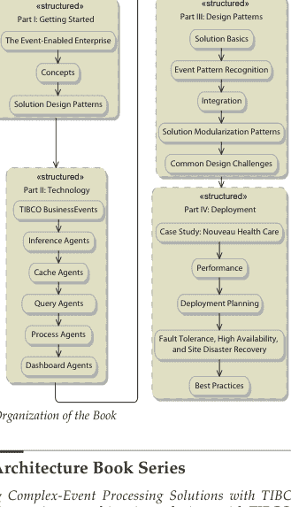

图 P-1：本书的组织结构

## TIBCO 架构图书系列

《使用 TIBCO® 构建复杂事件处理解决方案》是关于使用 TIBCO 产品构建解决方案的系列图书中的第三本（图 P-2）。它在《TIBCO® 架构基础》所涵盖内容的基础上展开，后者提供了适用于所有基于 TIBCO 设计的通用材料。包括本册在内的每本更高级的图书都探讨了基于 TIBCO 技术的不同解决方案风格。每本都探讨了与该解决方案风格相关的额外 TIBCO 产品。每本都定义了与该风格相关的更大且更专业的架构模式，所有这些模式都建立在《TIBCO® 架构基础》中介绍的基础设计模式集合之上。

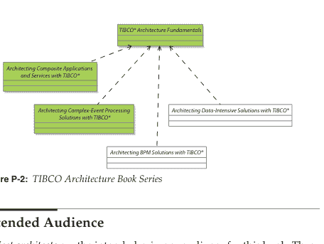

图 P-2：TIBCO 架构图书系列

## 目标读者

项目架构师是本书的主要目标读者。他们是负责定义整体复杂事件处理解决方案并指定支持该解决方案所需的组件和服务的个人。经验丰富的架构师会发现其中有很多有趣的内容，但写作时并未假定任何特定的架构先验知识。这是为了确保材料也能让初级架构师和高级设计师理解。然而，对于后者群体，强烈建议阅读《TIBCO® 架构基础》¹ 和《使用 TIBCO® 构建复合应用和服务》²。这些图书探讨了集成和服务以及解决方案架构规范和文档等更广泛主题。

在复杂事件处理卓越中心工作的 TIBCO 专家会发现其中有价值的材料，包括有关 TIBCO BusinessEvents 产品套件的背景信息以及相关的最佳实践设计模式。关于性能和调优的材料为基于该产品套件构建高性能应用奠定了基础。

1. Paul C. Brown, TIBCO® Architecture Fundamentals, Boston: Addison-Wesley (2011).
2. Paul C. Brown, Architecting Composite Applications and Services with TIBCO®, Boston: Addison-Wesley (2013).

*企业架构师也会发现其中有价值的内容。与《TIBCO® 架构基础》中介绍的设计模式相结合的模式集合，为企业提供了一套标准设计模式的基线。*

## 详细学习目标

阅读本书后，你将能够

-   描述事件驱动型企业的特征
-   解释与复杂事件处理相关的概念
-   列举复杂事件处理解决方案的示例
-   描述 TIBCO BusinessEvents 产品套件
-   解释 TIBCO BusinessEvents 代理的运行和调优
-   解释如何识别情况及其变化
-   描述如何在运行时更改规则
-   解释活动如何编排
-   描述如何识别事件模式
-   对复杂事件处理解决方案进行模块化以促进可维护性和可扩展性
-   描述如何在复杂事件处理解决方案的分布式组件之间共享信息
-   选择并应用适用于负载分配、容错、高可用性和站点灾难恢复的适当模式
-   解释设计选择如何影响代理性能
-   定义复杂事件处理解决方案的部署模式
-   描述开展复杂事件处理项目的最佳实践

本页特意留空

我谨向 Addison-Wesley 的各位表示衷心的感谢。我的编辑 Peter Gordon 在五本书中一直是深思熟虑的指引者。Kim Boedigheimer 继续在幕后施展魔法让事情发生。制作团队 Julie Nahil、Megan Guiney 和 Diane Freed 一如既往地出色地工作，使本书成为现实。

最后，我要感谢我的妻子 Maria 和我的孩子 Jessica 和 Philip 的爱与支持。

## 作者简介


Dr. Paul C. Brown 是 TIBCO Software Inc. 的首席软件架构师。他的工作集中在企业和大规模解决方案架构、架构师的角色以及围绕这些角色的组织和管理问题。他的整体架构方法，即业务流程和信息系统的并发设计，可将项目周期缩短 25%。他曾设计用于设计分布式控制系统、过程控制接口、内燃机和 NASA 卫星任务的工具。Dr. Brown 是 *Succeeding with SOA: Realizing Business Value Through Total Architecture*（2007）、*Implementing SOA: Total Architecture in Practice*（2008）、*TIBCO® Architecture Fundamentals*（2011）、*Architecting Composite Applications and Services with TIBCO®*（2012） 和 *Architecting Complex-Event Processing Solutions with TIBCO®*（2014）的作者，均由 Addison-Wesley 出版，并是 *SOA Manifesto*（soa-manifesto.org）的合著者。他在 Rensselaer Polytechnic Institute 获得计算机科学博士学位，在 Union College 获得电气工程学士学位。他是 IEEE 和 ACM 的会员。

本页特意留空

# 第一部分

## 入门

本页特意留空

## 第 1 章

### 事件驱动型企业

### 目标

在业务背景下讨论复杂事件处理时出现的一个务实问题是：“为什么？”这种方法有什么特点使其成为一项有趣的业务投资？

回答这个问题是本章的重点。阅读本章后，你将能够解释事件驱动型企业的概念，并描述此类企业如何通过对其感知、分析和响应业务环境能力的创新来获得竞争优势。

### 极致价值

企业，无论是商业公司还是政府机构，都存在于为其利益相关者提供价值。停止提供价值的企业很快就会不复存在。继续提供适度价值的企业得以生存。Vivek Ranadivé 所称的提供极致价值的企业很快就会超越竞争对手并繁荣发展。

iPhone 就是极致价值的一个例子。当 iPhone 于 2007 年推出时，其成本远高于基础手机。

然而人们购买了 iPhone——甚至连勉强够吃饭钱的人也买了。为什么？iPhone 提供了什么价值，以至于人们明明买不起却仍然购买？

答案是 iPhone（以及其他类型的智能手机）使人们能够以新的创新方式与周围世界互动。它使人们能够感知正在发生的事情、分析情况并响应世界——并且能够实时进行，无论身在何处。用户以新的方式感知，不再只是接收电话呼叫，现在还接收短信、电子邮件、社交媒体帖子和来自应用的提醒。用户以新的方式分析正在发生的事情，不仅使用地址簿和其他个人参考信息，还使用网络浏览器、社交媒体和应用。用户不仅可以通过电话呼叫响应，还可以通过这种新技术与其他人交流、购买产品和预订。iPhone 使用户能够随时随地按自己的选择感知、分析和响应周围的世界。这就是 iPhone 提供的极致价值。

那么极致价值对你的企业意味着什么？极致价值将客户转变为粉丝——粉丝更偏爱你的企业的产品和服务而排斥竞争对手。粉丝的态度正如 1960 年代的广告所说：“宁愿打仗也不换！”（图 1-1）。粉丝对你的企业的忠诚促进了其成长和盈利。那么复杂事件处理如何使你的企业能够提供极致价值？


图 1-1：“宁愿打仗也不换！”


## 感知、分析与响应

iPhone 用户之所以能获得极大价值，在于其创新能力，尤其是在用户与世界的交互方式上。企业也可以通过类似的创新来获益——具体而言，就是在如何感知、分析和响应客户及业务合作伙伴的需求方面进行创新。

企业通过业务流程向客户传递价值。如果你思考业务流程如何做到这一点，就会发现每个流程都在感知正在发生的事情，分析情况以确定是否需要采取行动以及应采取什么行动，然后通过执行这些行动来做出响应。企业感知来自客户的订单，通过验证订单并检查公司信用来对其进行分析，然后通过发货并向客户开具发票来做出响应。企业感知到库存水平的变化，对其进行分析以确定是否需要订购新库存，并在必要时补充库存。企业所做的一切都通过业务流程完成，而业务流程无非是一种以有组织的方式感知、分析和响应企业生态系统的手段。

企业获得竞争优势的一个重要途径就是改进其业务流程。企业响应速度更快，不再让客户等待六到八周，而是提供次日达或当日达配送。企业感知客户需求并提供增值服务。汽车经销商为客户寻找合适的融资方案，节省客户的时间和麻烦。企业深入了解客户偏好。零售商利用客户忠诚度计划提供精准优惠，这不仅通过只提供客户真正感兴趣的优惠来取悦客户，还提高了营销流程的效率，从而降低了销售成本。

每一项业务流程改进都是对流程感知、分析和响应周围世界方式的一种改变。有时这意味着更快地做事——立即完成。有时这意味着做得更好——在正确的时间拥有正确的信息。有时这意味着降低成本——使用更具成本效益的资源来完成任务。获得竞争优势——两秒优势——需要在感知、分析和响应方面通过创新来改进业务流程。

## 感知、分析与响应中的创新

计算机出现之前的业务流程完全由人力活动驱动。每个流程始于某个人的行动：客户下订单；店员记录库存检查结果。其他人感知这一初始活动：销售人员记录订单；商店经理收到更新的库存信息。有人分析所感知到的信息以确定适当的响应：销售人员验证订单和价格；商店经理确定哪些商品需要重新订购。有人针对这种情况做出响应：销售人员提交订单以供履约；商店经理订购补充库存。

这种感知-分析-响应模式无处不在。每个业务流程中的每个参与者都执行这三项职能。参与者相互互动，每个人都感知其他参与者已完成的操作并做出相应的响应。当您将信息系统作为业务流程的参与者时，每个系统都必须感知某些活动，分析其所感知到的内容，并做出相应的响应。这些参与者（无论是人员还是系统）之间的协作，构成了一个整体业务流程，从整体上看，它定义了企业如何感知、分析和响应。

谈到改进业务流程时，对每个业务流程的每项改进都是对该业务流程中某个环节的感知、分析或响应的改进。让我们看看可以应用哪些类型的创新。

### 感知创新

许多业务流程的感知功能是被动的；流程会等待某人或某系统提交请求。销售流程等待客户下订单；库存补充流程等待员工更新库存水平。

主动感知——感知业务重大事件——可以加快流程速度。以库存补充流程为例。无需手动盘点，您可以维护一个实时库存，每售出一件商品就自动更新，然后利用该库存自动订购补充库存。实施这样的创新需要更改三个业务流程：销售流程、库存管理流程和补货流程。销售流程的变更包括：

-   感知正在销售的产品（例如，使用条形码扫描）
-   通过生成标识所售产品和数量的销售点交易记录来响应

库存管理流程的变更包括：

-   在销售点交易发生时感知这些交易
-   分析每笔交易以确定需要更新哪些产品的库存
-   通过更新库存记录来响应

补货流程的变更包括：

-   感知库存水平的变化
-   分析该变化以确定是否需要订购新库存
-   通过按需订购新库存来响应

主动感知（自动化）需要感知业务重大事件，并对这些事件进行后续分析和响应。在上面的示例中，有三个重大事件：所售商品的识别、商品的销售以及库存的更新。

在主动感知中，您经常面临的一个挑战是缺乏可观察的事件。例如，在条形码扫描出现之前，收银台实际上无法识别正在销售的商品。只有汽车和家电等高价值商品才有标识所售具体商品的销售收据。主动感知通常需要对流程进行更改，使感兴趣的事件能够以自动化的方式被观察到。

主动感知和被动感知之间的一个关键区别是及时性。被动模式下，销售点交易可能会累积在文件或数据库中，感知可能通过定期读取这些记录来完成。主动模式下，销售点交易可能会在发生时即时发布（宣告）。订阅者（宣告监听者）会在交易发生时立即收到通知。

另一个关键区别是数据质量。被动模式下，在两次定期库存更新之间，库存数据是过时的。主动模式下，在实际交易发生后的几秒钟内，甚至在商品尚未离开商店之前，库存数据就已是最新的。数据错误可能导致错误的决策，从而对企业产生不利影响。

总而言之，感知方面有两种可能的创新。一种是自动化感知业务重大事件，从而提供有关已发生事件的信息。另一种是实时传播这些事件，在事件发生的同时进行传播，从而促进及时的响应并提高数据质量。

### 分析创新

一旦感知到业务重大事件，可能需要进行一些评估，以确定需要采取什么行动（如果有的话）。这种分析通常需要访问参考信息，这引出了两个问题：如何访问参考信息？分析何时进行？两者都提供了创新机会。

参考信息通常需要检索。如果需要重复检索相同的参考信息，访问其在计算上可能代价高昂。处理这一问题的一种方法是累积所感知的事件，并定期对事件批次进行分析。这种批处理会导致分析和后续响应的延迟。

另一种方法是以某种方式暂存参考信息，使得对事件的分析能够立即进行，而无需显著的计算开销。这使得在事件发生时能够立即进行分析，从而也能立即做出响应。

如果事件能足够快地得到分析，就有可能在实际发生之前识别出正在出现的情况。这正是维韦克·拉纳迪夫所称的“两秒优势”。^1^ 这种预见使人们能够采取行动，要么利用该情况，要么改变结果。例如，银行可能会观察到其一位优质客户使用网站上的按揭计算器，并主动向该客户提供按揭贷款。

总而言之，分析方面有两种可能的创新。一种是定位参考信息，使其检索不会对分析构成计算障碍。另一种是实时执行分析，在事件发生时进行分析。做到这两点，就可以在情况发生之前进行预见，并通过适当的行动利用这种预见。

1.  维韦克·拉纳迪夫和凯文·马尼，《两秒优势：我们如何通过预见未来而成功——恰到好处》，伦敦：Hodder & Stoughton出版社，2011年。


## 响应创新

对事件进行分析，可以认识到特定情况的存在，并确定是否需要以及需要何种类型的响应。响应创新在于改进执行分析的一方与执行行动的一方之间的互动。在所有情况下，请求（仅仅是事件的另一种形式）必须发送给执行工作的一方。然而，有两个选择会影响工作执行的及时性。一个选择在于请求的传递方式：请求可以立即发送，也可以累积起来定期发送。另一个选择在于工作执行的及时性：工作可以在收到请求后立即执行，也可以在稍后的时间执行。

工作执行的延迟可能会抵消预先判断情况所获得的任何优势。这并不是说所有工作都必须立即执行，而是说工作执行的时机必须适合当前的情况。

总之，响应方面有两种可能的创新。一种是在确认需要工作时立即发送工作请求。另一种是立即执行工作，或在适合利用已识别情况的时限内执行工作。这些创新共同使企业能够做出更恰当的响应。

## 事件驱动型企业

从业务角度来看，感知、分析和响应方面的创新使企业不仅能够更快、更恰当地对情况做出反应，还能积极主动地预见情况并利用这种预见。这两方面都能使企业提高为客户和业务合作伙伴提供的价值，并获得竞争优势。要实现这种业务价值，需要将感知、分析和响应活动自动化，并恰当地定位参考信息以供即时高效使用。

那么，什么是事件驱动型企业？简单来说，就是具备相应基础设施，能够在事件发生时感知、分析和响应事件，并已定位参考信息以支持这种实时活动的企业。因此，事件驱动型企业能够在感知、分析和响应周围世界的方式上进行高效创新。通过在这些领域的持续创新，事件驱动型企业将自己与竞争对手区分开来，建立竞争优势。如果做得好，这些创新会为客户提供极致价值，将他们转变为忠实粉丝。

## 总结

极致价值使您的企业从同行中脱颖而出，并将客户转变为忠实粉丝。业务流程改进是提供这种极致价值的一种方式。这些改进通过企业在感知、分析和响应周围世界方面的创新，使企业对客户群更加灵敏。最重要的创新在于实时执行这些活动。主动感知事件——识别出已发生的事情，而不是被动等待告知——是这类流程改进的重要推动因素。事件驱动型企业能够识别此类事件，并在分析和响应方面持续创新。它为客户提供极致价值。

## 第 2 章

### 概念

### 目标

事件驱动型企业的概念本身建立在许多思想之上。作为有意义地讨论实现事件驱动型企业这一话题的前提，必须首先清楚地理解这些基础概念。这正是本章的目的。

读完本章后，您将理解事件驱动型企业背后的基本概念：事件、复杂事件、复杂事件处理、上下文、事件响应和事件驱动流程。

### 概述

事件驱动型企业（图 2-1）在感知、分析和响应周围世界的方式上进行创新。它感知世界上正在发生的事件。当它感知到企业外部发生的事件时，会向企业内部通报这一事实。这种通报成为企业内部的一个内部事件。该通报触发对事件的分析，确定其业务重要性以及是否需要业务响应。关于需要响应的通报是另一个事件，一个触发实际响应的事件。响应是一种行动，而且

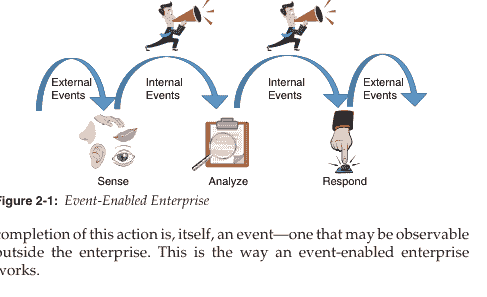

图 2-1：事件驱动型企业

这一行动的完成本身就是一个事件——一个可能在企业外部被观察到的事件。事件驱动型企业就是这样运作的。

### 事件

事件就是发生的某件事情：下了订单、交付了服务、客户到达现场。要对事件采取行动，您需要知道发生了什么，或许还要知道何时发生，但首先也是最重要的，您需要识别出它已经发生。问题是，如何识别？

### 识别事件

从表面上看，识别事件似乎微不足道：客户下了订单。但深入探究，一些挑战便浮现出来。如果您使用商用现成（COTS）软件包来管理订单，该怎么办？您所寻找的事件是软件包内部的，即支撑系统的数据库的一次更新。如果系统没有提供一种机制——回调——来通知其他组件订单已下达，该怎么办？

在这种情况下，您必须确定一种机制来识别此类事件。有许多标准技术可以做到这一点。这些技术及其实现方式在配套书籍 TIBCO® Architecture Fundamentals.¹ 中进行了讨论。

新出现的可观察事件。改进服务恢复流程管理所带来的最终成本节省，远远超过这项工作的成本。

## 简单事件识别可能不够充分

有时，您试图识别的具有业务重要性的情况并不对应于一个可观察的单一事件。如果您正在查找账户上的潜在欺诈行为，单次登录失败可能并不重要：用户经常在输入用户ID和密码时出错。重要的是，在短时间内出现了重复的登录失败尝试：例如，五分钟内三次登录失败。为了识别具有业务重要性的情况，当前事件（最近一次登录失败尝试）必须与之前的登录失败事件相关联。需要某种分析才能识别出具有业务重要性的事件，被称为复杂事件，稍后将对此主题进行更详细的讨论。

## 事件的类别

事件可以用多种方式分类。这些分类通常会影响您用来感知、分析和响应事件的方法，因此在构思解决方案时必须牢记这些分类。

### 技术事件和业务事件

可以直接观察到的事件称为*技术事件*。通常检测到的是应用程序中的状态变化（例如数据库更新）或组件之间的通信。*业务事件*表示具有业务重要性的发生情况。但技术事件和业务事件之间并不总是一一对应。

一些技术事件代表具有业务重要性的发生情况，而其他技术事件（实际上，大多数技术事件）则不代表。网站上每个链接的每次点击以及系统之间发送的每条消息都是可以被观察到的发生情况。然而，这些技术事件中只有一部分可能具有业务重要性。

### 简单事件和复杂事件

*简单事件*是同时作为技术事件的业务事件。但有些业务事件并不对应单个技术事件：它们的


识别是分析的结果，它确定发生了具有业务意义的事件。需要此类分析的事件称为*复杂事件*。

## 点事件和区间事件

通常，当您想到一个事件时，您会将事件的发生与某个时间点联系起来：提交订单的时间或断电的时间。通常，这是捕获技术事件的时间。此类事件称为*点事件*。

然而，有些事件会在一段时间内发生。例如，TIBCO用户大会（TUCON）是一场持续数天的事件。电视节目在30分钟或一小时内发生。在一段时间内发生的事件称为*区间事件*。

为什么这种区别很重要？当您需要比较两个事件之间的时间关系时，这一点很重要：比较区间事件比比较点事件更复杂。对于一对点事件，只有三种可能的关系：之前、同时或之后。对于区间事件，两个事件之间有十五种可能的关系（图2-2）。最后两种关系是特殊情况，其中一个事件退化为与剩余区间的开始或结束重合的点事件。

## 缺失事件

有时，您正在寻找的业务相关事件是观察到某个其他事件未被观察到，至少在其预期发生时未被观察到。当存在关于事件应何时发生的服务级别协议，且预期事件在该时间间隔内未发生时，就会出现这些情况。通常，此时间间隔的开始与某个先前事件重合：标记产品交付截止日期的时钟从下订单时开始计时。

有时识别更复杂：一个事件应该按一定的时间间隔发生，而观察到的是预期事件在一段时间内没有出现。这是活性测试的常用方法：组件定期发送心跳，表明其运行正常。这些心跳在一段时间内的缺失表明存在问题。

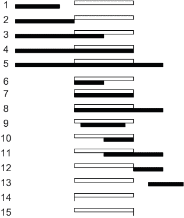

**图2-2：** *两个区间之间的可能关系*

请注意，标记缺失事件识别的事件始终是复杂事件：它的生成是由另一个事件（即计时器到期）触发的分析结果。该分析表明预期事件尚未发生，并导致生成一个标记此识别的事件。

## 复杂事件

复杂事件是指其识别需要分析的事件（图2-3）。分析本身由作为分析触发事件的事件到达所触发。例如，计时器到期可以作为分析触发事件，用于确定预期事件是否确实发生。触发事件可以是技术事件或业务事件，它表明世界的某种状态已发生变化，因此有必要进行分析。

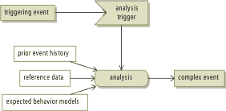

**图2-3：** *复杂事件*

所需分析的复杂性和性质差异很大。有时分析很简单：它只检查当前事件以确定其业务意义。例如，当前事件可能是一笔银行交易，分析确定交易金额是否超过10,000美元，因此需要向美国国税局提交货币交易报告。²有时分析很复杂，要确定是否已识别出表明欺诈的模式，或者流程是否正在按预期执行。事实上，可以执行多种类型的分析，每种分析都适合识别不同类型的情况。实际上，正是可能分析类型的多样性导致了TIBCO BusinessEvents®的多样化功能集。

## 复杂事件处理（CEP）

复杂事件处理是一个术语，用于描述由事件驱动的计算活动。导致复杂事件识别的分析是复杂事件处理的一个例子。事件识别后采取的行动编排也属于这一类。

复杂事件处理之所以具有挑战性，有几个原因。一是事件发生的速率。Twitter每天处理数亿条消息，这对试图跟踪Twitter上对话性质的应用构成了挑战。在高峰期，Visa处理超过20,000笔交易

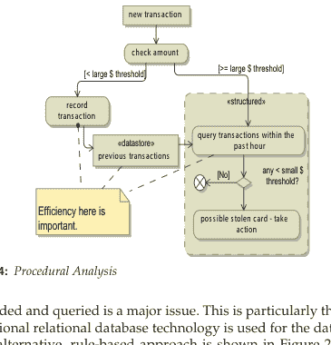

**图2-4：** *过程分析*

这些交易被记录和查询是一个主要问题。如果数据存储使用传统的关系数据库技术，情况尤其如此。

另一种基于规则的替代方法如图2-5所示。到达的新交易被放入内存，并且只将最近一小时的事务保留在内存中。交易到达后触发一条规则。该规则检查新交易是否超过10,000美元的阈值。然后检查内存中是否有另一个交易具有相同的账号、金额低于5美元阈值，并且发生在新交易之前。

这里不仅仅是使用规则进行评估：数据保存在内存中，而不是磁盘上。将数据保留在内存中的策略是只保存过去一小时的数据；评估规则的触发器是内存中数据的更改。以高速率执行复杂事件处理需要在数据存储、共享和分析方式上进行此类专门化。更复杂的是，没有一种专门化适用于所有情况。本书的一个主要焦点是探索各种类型的计算专门化，特别强调TIBCO Business Events如何支持这些专门化。

将事件与参考数据相关联可以提供更广泛的分析视角。使用事件中的账号访问有关账户的其他信息，或使用客户ID访问有关客户的信息，可以将这些相关信息用作分析的一部分。

也许最丰富的关联形式是事件与预期观察到的行为模型之间的关联。业务流程正确执行的模型能够识别在执行过程中应该观察到的事件，为解释实际发生的事件提供了极好的参考。这种视角使得确定流程是否按计划执行成为可能。

分析通常组合多种类型的关联。例如，您可能希望分析拨打客户支持中心的电话，以识别那些在解决问题时遇到异常困难的客户。给定一个指示来电的初始事件，您可以将事件中的电话号码与客户记录相关联，以识别正在呼叫的客户。您还可以将此事件与其他来电事件相关联，查看在同一小时内是否有来自同一客户的其他电话。如果您发现三个或更多事件以这种方式关联，您可能会得出结论，该客户遇到了严重问题，并采取行动将电话升级给主管。请注意，通过将每个电话与客户相关联，您为识别和关联同一客户恰好从不同电话（例如家庭电话、手机、工作电话）发起的其他电话奠定了基础。

关联是CEP分析的基础。因此，当您开展CEP项目时，明智的做法是将初始注意力集中在识别需要关联的事物以及它们将基于什么进行关联上。这种理解将指导您设计数据结构，并为设计的其余部分提供信息。

## 上下文

事件的分析总是需要某种形式的上下文信息。前面的示例涉及上下文，例如参考数据和预期行为模型。通常，上下文分为三大类：

1. 常量  
2. 数据  
3. 元数据  


## 常量

常量通常用作决策的阈值。之前使用的 $5 和 $10,000 美元值就是典型例子。用作决策阈值的值通常具有一定的随意性，并且可能随着条件变化和理解的演进而发生变化。因此，确定这些值是否实际上会随时间变化非常重要。

你对值是否会发生变化的理解将改变你的设计思路。你可以将常量固化到设计中，但如果这样做，后续更改它们的唯一方法就是修改并重新部署设计。这就是一个 IT 项目。

更灵活的做法是设计解决方案，使其值可以在运行时更改而无需修改设计。这可能涉及在值被使用时进行查找（并且可能缓存）的值。为了解决这类需求，TIBCO BusinessEvents 提供了一种特殊构造，即规则模板，可在运行时修改引用值。无论你选择哪种方法，如果值可能发生变化，明智的做法是在设计中加入变更机制。

## 数据

最常见的上下文类型是数据。企业中使用了大量可用于支持分析的数据。其中一些是相对静态的参考数据：客户数据、产品数据、合作伙伴数据等等。其他数据是动态变化的交易数据：订单、发货、库存等等。

无论是参考数据还是交易数据，你都必须考虑数据的来源、如何访问它，以及如何为分析的高效使用而分层数据。效率通常要求将数据的副本缓存以便便捷访问，但当然，缓存的准确性和一致性随之成为关键。

经常需要的另一种数据形式是事件的近期历史，无论是事件本身还是关于这些事件的信息摘要。例如，过去一小时内发生的交易数量或这些交易的美元交易量可能有助于解释当前事件。

## 元数据

元数据是关于数据的信息。你可能熟悉的一种常见元数据形式是模式：关于数据结构的信息。在复杂事件处理中，其他形式的元数据也发挥作用。

CEP 中一种有用的元数据形式是数据查询的结构。查询指定如何识别与当前分析相关的数据集。查询的元数据（即查询的定义）可以在设计时直接编码到分析逻辑中，但这要求你能够提前制定查询。有时查询无法提前制定：定义查询所需的信息要到运行时才可用，要么是因为业务逻辑的动态变化，要么是因为查询基于当前信息。TIBCO BusinessEvents 支持这两种方法，允许在设计时和运行时定义查询。这些方法在第 7 章中有讨论。

另一种 CEP 元数据是预期行为的描述，以预期事件模式的形式表达。该模式描述随后为识别模式的发生或未发生提供上下文。与查询类似，一些模式可以在设计时定义，而其他模式要到运行时才能定义。第 11 章展示了 TIBCO BusinessEvents 如何支持这两种方法。

另一种 CEP 元数据形式是流程描述。TIBCO BusinessEvents 具有两种不同的元模型来描述流程。状态模型，在第 5 章中描述，非常适合监控非托管流程并确定其是否正确执行。业务流程建模符号（BPMN）模型，在第 8 章中描述，非常适合编排（管理）流程执行。

## 分析需要上下文

到现在应该很明显，没有适当的上下文信息就不会有分析。上下文信息类型可能各不相同，从常量到数据再到元数据，但上下文为分析提供了基础。确保所需的上下文信息能够随时用于高效分析，是每个 CEP 解决方案架构的主要要求。

对同一事件进行不同目的的分析并不罕见。例如，客户给杂志出版商的电话可能对客户服务部门感兴趣，但也可能对市场营销部门感兴趣。这些目的中的每一个可能都需要不同的上下文信息来支持相关的分析（图 2-6）。虽然两个部门都需要了解客户是谁（假设是客户），但呼叫中心有兴趣知道该客户是否有之前的来电、由谁处理以及转给了谁。另一方面，市场营销部门有兴趣知道客户的任何订阅是否即将到期，以便利用这一机会提供订阅续订。

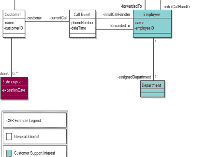

图 2-6：杂志出版商来电事件的上下文信息

## 选择分析方法

到目前为止的讨论已涉及分析的各个方面：分析是按过程式还是声明式定义，以及可能需要哪种上下文信息。但核心问题尚未解决：分析中需要得出什么结论，以及得出这些结论的适当方法是什么？这些是每个基于 CEP 的解决方案的核心问题。

一些分析很简单。如果你想知道服务水平协议是否被违反，将实际执行任务所需的时间与该任务的 SLA 目标进行比较。这就是简单的阈值检测——将变化的值与基准进行比较，以确定是否超过阈值。

其他分析需要更多的数据获取和计算。识别出使用银行网站抵押贷款计算器的人是客户并且信用评级优秀，需要做更多的工作。进一步将这一识别与银行正在积极推广新抵押贷款的事实相关联，然后利用这一相关性在客户在线时向其提供优惠，还需要更多的设计。

CEP 分析可能比这复杂得多，以至于有时甚至会引发可行性问题。如果你无法清楚地说明你试图得出的结论并阐述得出该结论的方法，你就是在薄冰上行走。例如，检测银行账户所有可能类型的欺诈的一般问题是不可能解决的：问题本身甚至没有得到很好的定义。甚至不清楚你能否表述出所有欺诈形式，更不用说识别所有可能实施欺诈的方式了。这是一个开放性问题：罪犯总是在想出新的方法来击败系统并实施欺诈。检测银行账户所有可能的欺诈形式对于 IT 项目来说不是一个现实的目标。

然而，这并不意味着欺诈——某些特定类型的欺诈——无法被检测。恰恰相反。有许多活动模式是可能欺诈的重要指标。其中两种已经讨论过：在短时间内多次登录失败，以及在短时间内出现非常小的交易后紧跟非常大的交易。

关键在于，每个项目都必须明确其分析目标——CEP 解决方案将被要求得出的结论——并确定用于得出这些结论的技术。


事件响应通常由业务规则决定。有时这些规则并不明显，因为它们被嵌入在既定的实践中。在这种情况下，需要付出一些努力来理解并提取业务规则，以便将其作为解决方案的一部分重新实现。在其他情况下，业务规则可能已以明确的公式、决策树或决策表形式编纂好，可直接纳入解决方案。

在 CEP 解决方案中，事件响应具有与事件分析（图 2-8）相似的结构。指示某种情况存在（该情况可能是简单也可能是复杂）的事件到来会触发分析，以确定对此情况应采取何种适当响应。该分析通常需要一些上下文信息。分析的结果是触发行动的事件——即对触发事件的企业响应。

一个简单的例子是这样一条业务规则：如果订单金额超过 500 美元，则需要审批。触发事件是订单的到来。分析只是将订单金额与阈值进行比较。根据设计决策，阈值本身可能固定在分析逻辑中，也可能是一项上下文信息。行动是如有需要则启动审批流程。

尽管这个例子很简单，但它确实提出了一个关于审批的有趣设计问题：执行响应分析的组件在多大程度上还应负责确保后续的审批活动得到执行？决定哪个组件负责是一个对整个解决方案都很重要的问题，因为答案会影响解决方案的健壮性。

一个更丰富的例子是这样一条业务规则：除非收到的 99% 数据有效，否则应拒绝该数据。这里的触发事件是数据的到来。然而，验证数据很可能需要大量上下文信息和对验证规则的详细说明。响应规则也可能很复杂。如果数据不符合标准，则显然应拒绝数据；但如果数据符合标准，则应启动正常处理。同样，必须考虑 CEP 组件在监控此后续处理中的作用。

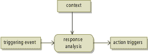

**图 2-8：** *事件响应*

3. 有关设计模式选择及其对整体解决方案健壮性影响的深入讨论，请参阅 *TIBCO® 架构基础*。

在之前的讨论中，隐含的假设是执行验证所需的信息只是作为上下文的一部分而存在。但如果验证涉及调用执行验证部分工作的服务会怎样？现在分析带有了编排其他组件服务的味道，至少在验证的一部分中如此。执行这种类型编排的方法略有不同，并在第 8 章中进行了描述。

## 事件驱动流程

事件以及基于接收事件触发活动的可能性，使得能够实现事件驱动流程，而非请求驱动流程。

在请求驱动流程（图 2-9）中，一个方（图中为 A 方）做两件事：（1）识别出某种条件已经发生，以及（2）决定应采取何种行动并随后启动该行动。

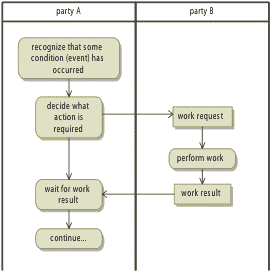

**图 2-9：** *请求驱动过程*

图 2-10 是请求驱动流程的一个示例。你的车坏了。你意识到它坏了并决定把车送到修理店。你要求修理店修车。修理店诊断问题并确定你的车需要一些需要授权的工作。它要求你授权该工作。一旦你授权了工作，修理店意识到需要零件并要求零件供应商送来零件。一旦维修完成，修理店要求你支付服务费用。一旦你付款，修好的车就归还给你。这是对初始请求的最终响应。整个流程都由请求驱动。

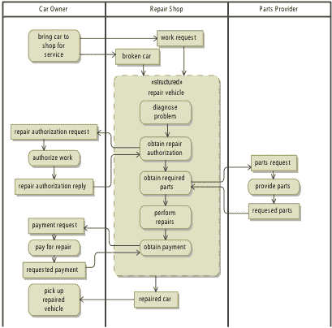

**图 2-10：** *请求驱动过程示例*

在事件驱动流程（图 2-11）中，识别情况和决定采取何种行动的角色由不同的方承担。在图中，A 方识别出特定条件存在并宣布该条件的存在。该公告即为事件。B 方通过确定其认为适当的行动并启动该行动来响应事件。

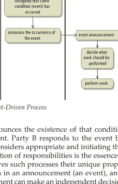

**图 2-11：** *事件驱动过程*

这种职责分离是事件驱动流程的本质，并赋予此类流程其独特属性。由于识别导致公告（即事件），任何收听该公告的方都可以独立决定采取何种行动。这使得可以在不影响其他组件的情况下添加、删除或修改单个行动决策。相比之下，在请求驱动流程中，一个方做出所有行动决策；任何更改都需要修改该组件。

许多事件驱动流程是对请求驱动流程的增强。图 2-12 显示了一个事件驱动的欺诈检测流程增强了请求驱动的用户登录流程。图示显示了与欺诈检测相关的请求驱动流程的部分。黑客提交登录请求。在检查账户是否处于活动状态（初始时应为活动状态）之后，网站尝试验证凭据。如果登录失败，则显示失败登录屏幕并发布失败登录的公告。这是事件驱动欺诈检测流程的触发器。

失败登录公告被添加到内存中维护的最近登录记录中。新条目的到来触发分析，以确定过去五分钟内是否发生了三次失败登录。如果是，则生成安全警报（另一个事件），并将账户状态设置为禁用。此操作将影响请求驱动流程的后续执行：黑客下次尝试登录时，将显示账户已禁用屏幕。黑客甚至不会有机会尝试另一组用户 ID/密码组合。

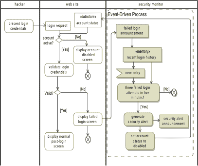

**图 2-12：** *事件驱动过程示例*

当然，这里没有涉及的一些场景在实际应用中是必需的。这些将涉及诸如重新启用用户账户和更新用户凭据等问题。

## 事件使能企业能力

本章讨论的概念提供了一种简单的方式来解释事件使能企业的能力。事件使能企业具备以下能力：

- 识别并公告事件。这并不一定意味着每个事件都被识别和公告。这意味着企业已具备必要的<|message|> 基础设施，可在需要时识别事件并提高其可见性。
- 立即在适当上下文中分析和解释事件。
- 识别复杂事件。
- 执行依赖上下文的分析以确定适当行动。
- 启动所需行动。

这些能力使事件使能企业能够创新其感知、分析和响应周围世界的方式。此类创新有助于其建立竞争优势并将客户转变为粉丝。

## 摘要

事件是发生的事情。技术事件是可以直接观察到的事件。业务事件是其识别具有业务价值的事件。某些业务事件对应于单个技术事件。

一些事件被称为复杂事件，是将一个或多个技术事件与上下文信息关联起来进行分析的结果。分析确定是否发生了具有业务意义的事情。不同的方可能需要不同的上下文信息来确定事件的重要性。

这种涉及关联和参考数据的分析被称为复杂事件处理。它既可用于识别情况，也可用于确定适当响应。

上下文信息有多种形式，包括常量、参考数据和元数据。复杂事件处理中的一个重要挑战是识别所需上下文信息并确保其可用性，以支持高效的实时分析。

当事件驱动流程时，结果是事件驱动流程而非请求驱动流程。在请求驱动流程中，单一方既识别情况已发生，又确定应如何响应。在事件驱动流程中，这两个角色被分离，一个方识别情况并

宣布事件，并由另一方决定因此应采取何种行动。这种分离使得架构能够优雅地演进。

事件驱动型企业能够以创新的方式感知、分析并响应周围的世界。这些创新可用于获得竞争优势。

## CEP 架构中的可变性

CEP 核心流程（图 3-1）始终如一：感知某个事件，结合某些参考数据对其进行分析，以判断是否发生了具有业务意义的事情，然后就应对措施的性质做出决策。然而，尽管核心流程始终相同，复杂事件处理却存在多种不同的架构。为什么？

CEP 架构存在可变性的两个主要原因：参考数据的处理以及功能划分。

### 参考数据的处理

第一个可变性领域围绕着参考数据与被分析事件之间的关系：事件流是否会改变用于解释后续事件的参考数据？事件流不改变参考数据的应用相对简单。这些应用的主要挑战在于获取参考数据——这些数据几乎总是来自其他系统——并在分析和响应活动期间高效地访问这些数据。

另一方面，事件流会修改参考数据的应用则复杂得多。代表先前事件历史的参考数据部分没有系统记录，至少在没有额外设计的情况下是如此。如果在系统关闭或发生故障时不能丢失这些历史数据，那么 CEP 解决方案现在必须为历史数据包含一个系统记录。该系统记录需要精心且巧妙的设计，以确保其能够高效且稳健地处理数据变更流——同时仍然使数据能够被分析和响应活动高效访问（图 3-2）。


*图 3-1：CEP 核心流程*

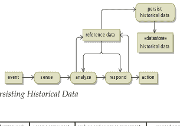

*图 3-2：持久化历史数据*

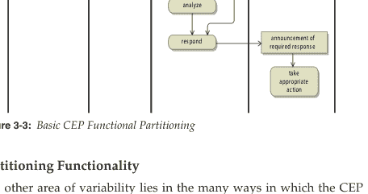

*图 3-3：基本 CEP 功能划分*

### 功能划分

另一个可变性领域在于 CEP 功能可以被划分并分配给不同组件的多种方式。CEP 解决方案中的基本划分如图 3-3 所示。通常，驱动流程的事件是某个业务过程中参与者（人或系统）的可观察行为。这些参与者中的大多数不会宣布其活动，至少不会向未参与该业务过程的组件宣布。因此，CEP 解决方案通常有一个或多个组件专门负责感知这些行为并宣布其观察结果。

用于这些观察的技术与传统应用集成中使用的技术相同。这些技术及支持这些技术的产品在 TIBCO® Architecture *Fundamentals*¹ 中有详细说明。然而，这里相关的观察是，用于感知的产品在很大程度上并不是用于 CEP 分析和响应的产品。因此，执行感知的参与者通常不是执行分析和响应的参与者。

附带说明，事件驱动型企业的一个特征是，其架构既包含感知和宣布行为所需的组件类型，也包含分析和响应这些宣布所需的组件类型。

在许多情况下，许多 CEP 解决方案处理的事件量使得由一个组件处理所有事件并执行所有分析和响应处理变得不切实际。一旦达到这一点，就有多种方法可以提高性能。一种方法是简单地部署多个执行分析和响应组件的实例。如果参考数据在事件发生时不被更新，这是一种直接的方法。但当参考数据被事件更新时，跨多个分析和响应组件实例共享历史记录需要额外的设计。相关设计模式在第 14 章讨论。

另一种可扩展性方法是将功能划分到更多组件上。图 3-4 显示了一种可能的划分，其中导致情况识别的分析由一个组件执行，而所需响应的确定由另一个组件执行。当分析和响应计算也更新参考数据时，划分模式也会变得更加复杂。第 13 章将讨论这一点以及其他划分方式，以及需要考虑的权衡。

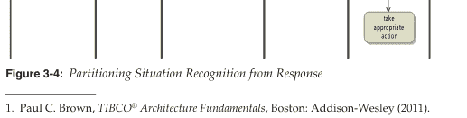

*图 3-4：将情况识别与响应分离*

1. Paul C. Brown, TIBCO® Architecture Fundamentals, Boston: Addison-Wesley (2011).

到目前为止应该显而易见的是，CEP 解决方案有许多可能的功能划分。有些划分带来简单直接的实现。其他划分则需要清晰的架构思考，才能以稳健且高度可扩展的方式实现所需的行为。

接下来的章节将讨论许多 CEP 解决方案设计模式，每种模式都专注于提供一种常见的业务能力。在大多数情况下，这些模式大致按照复杂度递增的顺序排列。本章最后简要讨论了一些可能没有成熟设计模式的问题。

为简洁起见，这些设计模式中没有显示感知组件：假定它始终存在。

### 条件检测

你在复杂事件处理中会遇到的最简单解决方案模式是阈值检测（图 3-5）。在此模式中，一个组件采取可观察的行动，并产生一个技术事件。条件检测器正在监听该事件，其到达即作为分析触发器。分析将事件传递的值与阈值进行比较，如果事件值超过阈值，则生成一个业务事件来宣布此情况。作为模式的收尾，另一个组件监听这些宣布并采取相应行动。


*图 3-5：阈值检测模式*

在使用此模式时，必须考虑阈值的位置。一种选择是将阈值永久固定在分析逻辑中。另一种选择是将其作为上下文信息，由条件检测器在启动时或每次分析事件时查找。还有一种选择是使用基础设施，使其能够在运行时更改该值。TIBCO BusinessEvents® 规则模板提供了此功能，如第 10 章所述。

此模式的更一般形式是条件检测模式（图 3-6）。在此模式中，被检测的条件由若干定义条件边界的值确定。分析中考虑的信息通常是事件数据与上下文数据的组合。如果检测到该条件，则生成一个业务事件来宣布该条件的存在。

使用此模式时，必须考虑定义边界条件的参数来源以及检测条件所需的上下文数据，同时还需要考虑在运行时更改其中某些值的潜在需求。为访问源自其他系统的信息并使其高效可用所需的设计工作，通常是 CEP 项目的重大组成部分。

在条件检测模式中，所使用的参考数据不会被事件处理所修改：它不反映先前历史。所使用的唯一状态信息是由

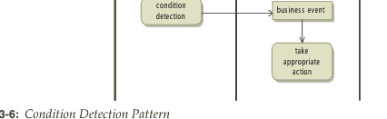

*图 3-6：条件检测模式*


触发事件。这使得条件检测器无状态，因此易于扩展和实现高可用性。

## 情境识别

情境识别模式（图 3-7）在表面上看起来与条件检测模式非常相似。然而存在一个主要区别：在情境识别模式中，用于在触发事件到达时识别情境的上下文数据包含历史信息。许多到达的触发事件并不会产生业务事件，但其发生会导致上下文数据的修改。更新后的上下文数据随后为评估下一个到达的事件提供上下文。

由于该模式中的上下文数据包含历史信息，如果历史数据丢失，该模式识别情境的能力可能会受损。这种丢失可能发生在情境识别组件将上下文数据保存在内存中且组件重新启动时。因此，使用该模式几乎总是需要持久化历史信息，并在组件重新启动时恢复这些信息。第 6 章中关于对象持久化的讨论介绍了实现此目的的技术。

该模式在上下文数据跟踪先前历史的方式以及历史信息用于解释当前事件的方式上存在许多变体。第 10 章讨论了可用于此目的的多种设计模式。

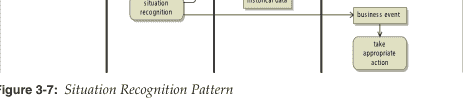

图 3-7：情境识别模式

## 跟踪与追溯

跟踪与追溯模式（图 3-8）是情境识别模式的一种特例。该模式涉及两个上下文要素：预期流程的模型以及该流程现有实例的状态。如果触发事件标志着新流程执行的开始，则会创建初始流程状态。对于其他事件，事件中的信息用于定位已在执行的流程的状态（在任何给定时间点可能有许多流程实例正在执行）。一旦当前状态被识别，流程模型随后就用于在该状态的上下文中解释触发事件。

此简化示例省略了一个常见挑战：乱序事件的处理。在许多现实世界情况下，事件可能乱序到达。在某些情况下，第一个到达的事件可能不是流程中的初始事件。在完整解决方案中，必须添加额外逻辑来处理这些情况。第 14 章讨论了一些设计考虑因素。

状态机方法提供了对流程执行的丰富多样的解释。如果触发事件对应于

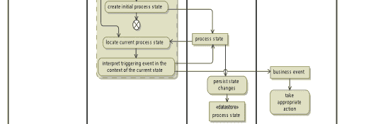

图 3-8：跟踪与追溯模式

状态机中（给定当前状态）的预期转换，则结论是流程正在以预期方式执行——至少在此时如此。分析可以设计为在达到特定状态时宣布业务事件（即宣布已达到里程碑）。

如果触发事件不对应于预期转换，则发生了意外的事件。同样，分析可以设计为发出业务事件，宣布这种意外情况。

这种类型的分析适用于监控任何类型的非受管流程。从最初取件到最终交付的包裹跟踪是一个例子。从你在出发机场票台放下行李到你在最终目的地行李转盘取行李的时间段内跟踪你的行李是另一个例子。

总体而言，这种方法非常适合监控责任从一个参与者移交给另一个参与者的任何流程。你把行李交给柜台代理——一次责任移交。柜台代理把袋子放在传送带上，作为将责任移交给行李处理员的手段。流程一直持续到最终移交，即从最终目的地的行李处理员把袋子放在通往行李转盘的传送带上开始，到你取行李时结束。

在跟踪与追溯情况下被监控的事件是各个移交已成功的证据。大多数情况下的挑战是找到证据。在安全要求强制要求对飞机上的行李进行扫描和跟踪之前，证据很少：你在放下行李时（即把行李交给航空公司时）会拿到行李收据，而你（希望）会在目的地取到行李。对于任何中间进展，可用的证据很少。

行李在相关乘客不在飞机上时不得搭乘飞机的安全要求导致了对行李进展的更好跟踪——更好的证据。行李跟踪标签在行李装上飞机或放入随后将装上飞机的箱子时会被扫描。它在卸下时再次被扫描。这些扫描提供了进展的中间证据。

在设计跟踪与追溯解决方案时，你的挑战将是找到适当的进展证据。期望拥有的完整证据集通常不可用并不罕见。当这种情况发生时，你可能希望实施当前可用证据所支持的跟踪程度，并独立启动一项最终将提供更详细进展证据的举措。这正是第 2 章中描述的电信案例研究中所发生的情况。

## 业务流程及时性监控

业务流程及时性监控（图 3-9）是跟踪与追溯模式的扩展。状态机模型可以扩展，以便能够识别在某段时间内预期事件的缺失。当然，你可以将此方法应用于识别整体流程未按时完成，但最大的好处来自于识别某个中间事件未按时发生，从而整体流程有延误的风险。识别结果可用于触发纠正整体流程进程并使其重新回到按时完成轨道上的行动。第 2 章中讨论的电信案例研究就是该模式应用的例子。

检测事件的缺失需要建立服务等级协议，规定流程完成或停留在每个中间状态所需的最长时间。当监控流程的状态机启动或进入特定中间状态时，会启动一个计时器。当整体流程完成或中间状态退出时，对应的计时器停止。然而，如果计时器在

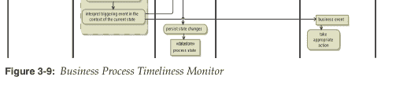

图 3-9：业务流程及时性监控

流程完成或中间状态退出之前过期，则会生成超时事件。这表明某些预期事件未发生。

在识别此情况时，计时器的过期充当分析的触发器。可能需要对状态机进行一些内省以识别哪些事件未发生，但更大的设计需求是确定在这种情况下应通知哪些方，以及这些方将采取什么行动使整体流程重新回到正轨。

## 情境响应

本章迄今为止的所有模式都有一个共同特征：它们只是识别某些条件存在，并通过事件宣布这一事实。其他独立参与者接收这些通知并决定采取什么行动。

在某些情况下，确定适当的响应应该是什么存在额外挑战（图 3-10）。通常需要进一步分析，以使行动集中于实现特定的业务目标。分析需要参考数据，通常包含历史信息。分析的结果通常是一个或多个指令，实际执行已识别的行动。

考虑销售某种易腐商品的情况：新鲜农产品和肉类、飞机座位或酒店客房——任何在某个时间点未售出就会变得毫无价值的东西

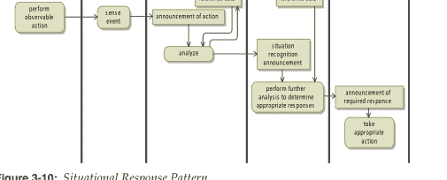

图 3-10：情境响应模式


时间。期望的业务策略是根据剩余库存和商品变得一文不值前的剩余时间动态设定商品价格。在这些情况下所应对的情况是存在易腐商品的潜在消费者。

对商品定价的简单方法是设定一个固定时间点进行促销。其想法是这将提高需求并确保商品不会浪费。该方法的问题在于它既不能最大化收入，也不能最小化商品浪费的可能性。如果商品销售良好且很可能售罄，打折促销将导致收入损失。另一方面，如果商品销售非常糟糕，在固定时间点按固定金额降价可能无法确保商品实际售罄。

更复杂的方法是跟踪商品的销售速率与商品价格之间的关系。通过这种方法，商品的报价可以动态调整。这种方法常应用于在线产品销售。它需要复杂事件处理来在消费者购物以及商品库存变化时进行动态价格调整。请注意，销售速率和当前库存成为参考数据的一部分——这是一个动态部分，其时效性必须及时维护——最可能通过事件实现！

## 决策即服务

在决策即服务模式（图 3-11）中，做出决策所需的逻辑被分解到一个独立组件中。服务消费者收集决策所需的所有相关当前状态输入数据并将其传递给服务。这通常是同步请求-回复交互，但也可能是异步的。在任何情况下，决策服务都会使用适当的静态参考数据从输入数据计算输出数据。输出数据反映决策结果。

该模式的价值在于它将决策逻辑封装为服务。这简化了服务消费者和决策服务的维护。特别是，它允许在无需修改服务消费者的情况下更新服务的实现（即业务规则）。

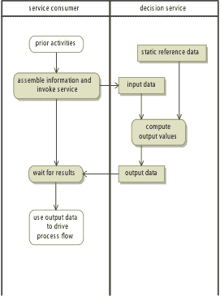

**图 3-11：** *决策即服务模式*

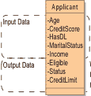

**图 3-12：** *信用卡决策服务数据结构*

然而，要实现这一点，输入和输出数据结构必须保持固定。

让我们考虑银行业的一个例子。银行需要评估信用卡申请，以确定是否应发放信用卡以及账户的信用额度。在这种情况下，输入和输出使用相同的数据结构，不同之处在于某些字段值由信用卡决策服务计算。图 3-12 显示了该数据结构。输入数据包括申请人的年龄、信用评分、指示申请人是否持有驾照的标志、指示其是否已婚的另一个标志以及申请人的收入。计算输出值包括一个布尔值，指示申请人是否符合条件，一个指示当前状态的字段，以及如果状态被接受则指示信用额度的另一个字段。

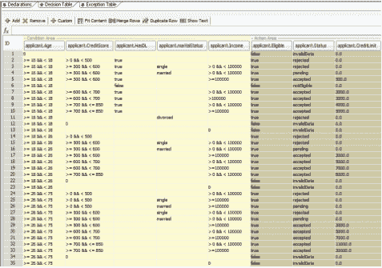

**图 3-13：** *信用卡决策服务的决策表*

描述该服务逻辑的决策表如图 3-13 所示。此示例使用 TIBCO BusinessEvents® Decision Manager 开发，该管理器在第 10 章中进行了描述。表的每一行定义了输入值的条件集（条件区域）以及相应的计算输出值（操作区域）。

决策即服务模式在业务规则经常变化但用于驱动决策的数据和决策输出可以固定时很有用。

## 编排响应

虽然流程编排并不是复杂事件处理的传统重点，但编排 CEP 解决方案活动部分的需求变得越来越重要（图 3-14）。在这种相对常见

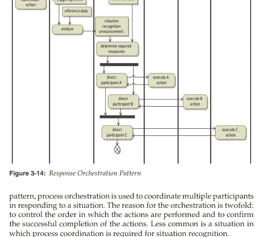

**图 3-14：** *响应编排模式*

模式中，流程编排用于协调多个参与者对情况做出响应。编排的原因有两个：控制操作执行的顺序并确认操作的成功完成。较少见的情况是流程协调对于情况识别是必需的。

该模式是事件驱动和请求驱动交互的混合体。直到接收到情况识别公告为止的所有交互都是事件驱动的。然而，响应编排组件使用请求驱动交互，不仅要求每个参与者执行其工作，还确认该工作的成功完成。

使用该模式时，必须就响应编排所使用的技术类型做出选择。传统上，这将是专门为流程编排设计的组件，例如 TIBCO ActiveMatrix BusinessWorks™ 或 TIBCO ActiveMatrix® BPM。采用这种方法，如果编排中需要基于规则的推理，则使用决策即服务模式。服务返回的值随后指导后续流程执行。

然而，将流程编排与复杂事件处理分离可能会成为性能瓶颈，特别是如果每次调用都必须向决策服务传递大量重复信息。在这种情况下，最好由 CEP 组件直接执行流程编排。这就是 TIBCO BusinessEvents® Process Orchestration 产品的作用。它为 TIBCO BusinessEvents® 增加了流程编排功能。

## 开拓性解决方案

我们以谨慎的语气结束本章。早期的探险家绘制了他们熟悉的领土地图，并在这些地图未探索的角落画上龙，警告后来的地图阅读者提防那些未探索的空间。更糟糕的是，许多探险家甚至从未达到他们的目标：哥伦布在发现美洲时正在寻找亚洲，许多探险家曾徒劳地寻找西北航道，该航道将提供从大西洋到太平洋的北美航线。

这里的相关性在于，复杂事件处理有许多类型已得到充分探索的应用。如果您正在其中一个领域工作，问题是明确定义的，实现您的解决方案将是一项直接的工程练习。然而，如果您正在工作的领域尚未明确定义，即情况识别或行动确定的分析方法尚未建立，请谨慎行事。其中一些（但并非全部）领域是真正的科研课题——在您承诺构建解决方案之前，需要投入一些时间来确定您特定的问题是否已明确定义。请记住，找到西北航道花了 400 多年！

如何判断您是否处于安全地带？请自问以下问题：

- 问题相关信息是否已足够理解，以创建高质量的信息模型（包括相关状态信息）？
- 是否有一组明确定义（即可衡量）的标准来定义需要识别的情况？
- 是否存在明确定义的触发器来识别进行情况识别分析的时间点？


- 用于此识别分析所需的信息是否易于获取？
- 是否有明确阐述的方法来利用可用信息识别情况？
- 一旦情况被识别，是否有明确定义（即可衡量）的方法来应对该情况？
- 确定响应所需的参考信息是否易于获取？
- 所得的情境识别和响应能力带来的业务价值是否值得投入解决方案？

如果你对所有这些问题都回答“是”，那么你就站在了坚实的基础上。如果对其中任何一个问题回答“否”，你可能是在开拓新领域。你需要在承诺交付解决方案之前消除这种不确定性。集中最初的努力来回答这些问题，特别是最后一个：结果是否值得付出努力？然后，也只有在那时，你才应该承诺构建解决方案。

列表中最具风险的问题是第一个：你试图识别的是什么？请基于可靠的分析结果定义你的目标，并警惕开放式标准。例如，你永远无法识别所有形式的金融欺诈：坏人不断发明新的方式来诈骗金融系统并规避现有的检查。一般来说识别欺诈并不是一个可实现的目标。

另一方面，存在一些特定的行为模式，它们相当可靠地表明可能正在发生欺诈。对登录模式的分析可能会识别出这些行为模式，而在发生时识别这些模式绝对是一个明确且可衡量的目标。

如果你在试图具体定义识别目标时发现自己在含糊其辞——停下来！你是在薄冰上行走。做好你的分析功课，并说服自己能够精确地说明要识别的内容。

## 摘要

有两个因素导致复杂事件处理架构的差异性。一个是参考数据的处理以及事件流在多大程度上修改了用于解释后续事件的参考数据。另一个是必要的感知、分析和响应活动可以被划分并分配给组件的多种方式。复杂事件处理没有一刀切的架构。

最简单的架构是参考数据不受事件流影响的架构。阈值检测和条件检测模式就是这些模式的例子。

当事件流可以改变参考数据时，架构会变得稍微复杂一些。参考数据现在包含一些历史信息。如果这些信息对分析至关重要，解决方案现在必须成为这些信息的记录系统。这需要持久化这些信息。

情境识别模式在分析中使用历史数据。一些事件只是导致历史数据的更新。另一些事件在分析后表明识别出必须宣布的业务重要条件。Track-and-Trace 是该模式的特化，用于对流程进行里程碑级别的跟踪。业务流程及时性监控器扩展了 Track-and-Trace 以确定里程碑是否按时完成。

一些应用需要的不仅仅是宣布某个条件存在。情境响应模式应用上下文分析来确定特定情况下所需的操作。决策即服务模式使这些分析能力可供非 CEP 组件使用。有时需求超出了简单地识别所需操作，还包括对其执行的管控。结果就是编排响应模式。

构建一个其中待识别的情境、期望的响应以及要使用的分析技术都已明确定义的解决方案是一项直接的（尽管有时复杂）工程练习。当其中任何一项未明确定义时构建解决方案则具有很大的不确定性。在这些情况下，在承诺交付解决方案之前，应开展初步工作以明确识别和响应的方法。一旦初步工作完成，应估算实施解决方案所需的努力，以确保其由预期的业务收益所证实。

# 第二部分：技术

## 第 4 章：TIBCO BusinessEvents®

### 目标

TIBCO BusinessEvents® 是一个支持复杂事件处理的产品套件。本章提供了产品套件的概述，描述了基础产品及其五个可用的功能扩展。它还描述了 TIBCO BusinessEvents 项目的生命周期。接下来的五章专门用于更详细地研究内部产品架构。

### TIBCO BusinessEvents® 产品套件

TIBCO BusinessEvents® 产品套件由六个产品组成（图 4-1）。核心产品是 TIBCO BusinessEvents 本身。五个功能扩展是 TIBCO BusinessEvents® Views、TIBCO BusinessEvents® Data Modeling、TIBCO BusinessEvents® Decision Manager、TIBCO BusinessEvents® Event Stream Processing 和 TIBCO BusinessEvents® Process Orchestration。核心产品 TIBCO BusinessEvents 是所有功能扩展所必需的。

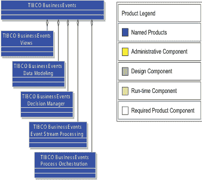

**图 4-1：** *TIBCO BusinessEvents 产品套件*

### TIBCO BusinessEvents®

核心产品 TIBCO BusinessEvents®（图 4-2）提供基础事件处理、规则引擎以及概念和事件的建模。主要运行时组件是处理单元，它是一个配置为支持称为代理的功能单元的 Java 虚拟机（JVM）。核心产品提供两种类型的代理。*推理代理* 提供处理规则的功能。*缓存代理* 提供可跨多个处理单元扩展的分布式数据网格。还有三种额外的代理类型，它们是后面描述的功能扩展的一部分。

TIBCO BusinessEvents 附带 TIBCO BusinessEvents® Studio，这是一个基于 Eclipse 的设计环境，带有集成调试器。它提供两种管理选项。一个是 TIBCO Administrator™ 及其支持的 TIBCO Runtime Agent™。另一个是 TIBCO BusinessEvents Monitoring and Management 组件（BEMM）。

一个可选组件是规则管理服务器。该服务器及其关联的 Web Studio 界面提供了在运行时更改规则中使用的值的能力。

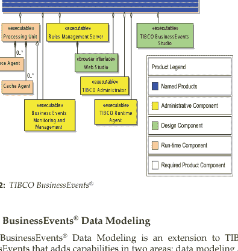

图 4-2：TIBCO BusinessEvents®

### TIBCO BusinessEvents® Data Modeling

TIBCO BusinessEvents® Data Modeling 是 TIBCO BusinessEvents 的扩展，在两个领域增加了功能：数据建模和状态机建模（图 4-3）。

数据建模功能包括 TIBCO BusinessEvents Studio 能够导入关系数据库模式定义并自动定义相应的驻留内存 TIBCO BusinessEvents 概念（这些在第 5 章中讨论）。在推理代理上添加了功能扩展，使其能够查询和更新数据库。在缓存代理上添加了功能扩展，使其能够将信息从数据库加载到缓存中。支持与数据库的事务性交互。

状态建模功能包括使用 UML 1.2 状态机表示法定义状态机的能力。状态机表示用于建模业务流程和概念的生命周期（这些在第 5 章中进一步讨论）。状态机建模功能包括超时建模（未能达到

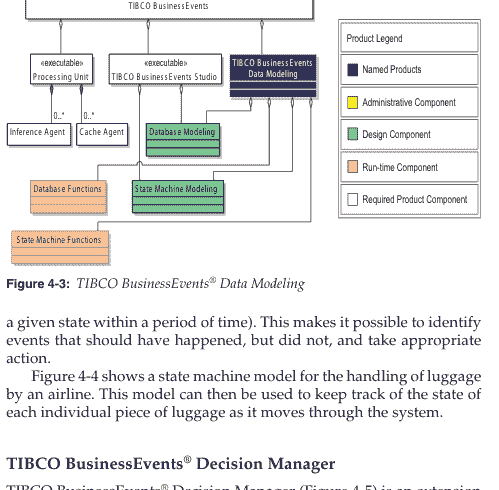

图 4-3：TIBCO BusinessEvents® 数据建模

在一段时间内处于给定状态）。这使得能够识别本应发生但未发生的事件并采取适当措施。

图 4-4 显示了航空公司处理行李的状态机模型。然后该模型可用于跟踪每件行李在系统中移动时的状态。

## TIBCO BusinessEvents® 决策管理器

TIBCO BusinessEvents® 决策管理器（图 4-5）是 TIBCO BusinessEvents 的扩展，旨在使业务用户能够定义业务规则。它包括 TIBCO BusinessEvents Studio 的插件，提供类似电子表格的界面来定义和测试业务规则。它提供从 Microsoft® Excel 电子表格导入和导出规则的功能，以便业务用户可以直接使用电子表格。工作室扩展可以检查规则的完整性和一致性，并可根据规则自动生成测试数据。还包括决策管理器浏览器界面，这是 Web Studio 的扩展，使 BusinessEvents 解决方案运行时能够更新决策表。图 4-6 显示了决策管理器插件提供的 TIBCO BusinessEvents Studio 用户界面。该界面在第 5 章中描述。

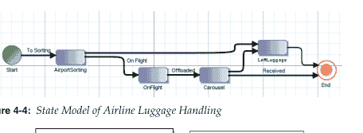

图 4-4：航空行李处理状态模型

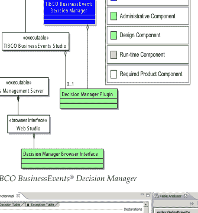

图 4-5：TIBCO BusinessEvents® 决策管理器

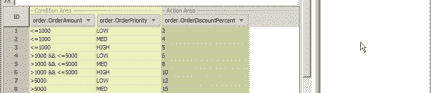

图 4-6：TIBCO BusinessEvents 决策管理器用户界面

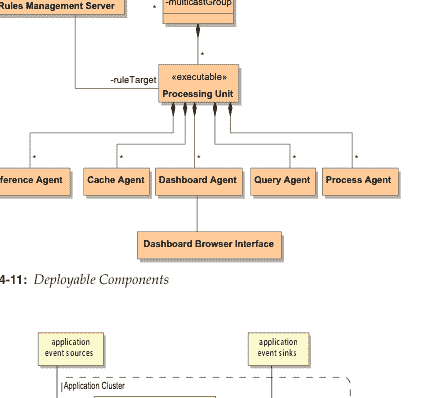

图 4-11：可部署组件

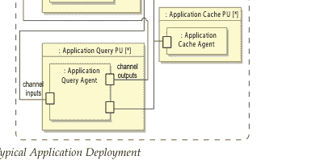

图 4-12：典型应用程序部署

## BusinessEvents 解决方案生命周期

TIBCO BusinessEvents 解决方案始于 TIBCO BusinessEvents Studio（图 4-13）。在此创建解决方案设计并保存为 EAR 文件，部署描述保存为 CDD 文件。然后这些文件会被 TIBCO Administrator 拾取。在部署期间，管理员使用 TIBCO Rendezvous® 或 TIBCO Enterprise Message Service™（EMS）与将在其上部署处理单元的每台机器上的 TIBCO Runtime Agent（TRA）进行通信。TRA 将所需配置信息放置在本地机器的文件系统上，执行启动和停止引擎的命令行，并与引擎通信以获取状态信息。

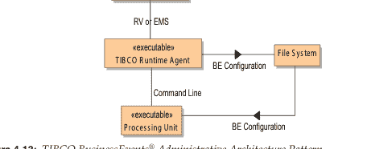

图 4-13：TIBCO BusinessEvents® 管理架构模式

图 4-14 详细说明了生命周期中这些组件之间的交互。TIBCO BusinessEvents Studio 用于设计应用程序，设计保存为 EAR 文件。它还用于定义应用程序组件的部署打包，此打包保存为集群部署描述符（CDD）文件。从 TIBCO Administrator 上传这些文件。EAR 文件加载后，其属性和全局变量可在部署前设置。同样，CDD 文件上传后，可指定组件在单台机器上的部署。在部署时，管理员与每台相关机器上的 TRA 通信，将配置文件和可执行文件放置在机器上。当管理员启动应用程序时，它指示每个相关 TRA 执行要启动的每个处理单元的命令行。启动后，每个处理单元从本地机器读取其配置文件并开始处理。

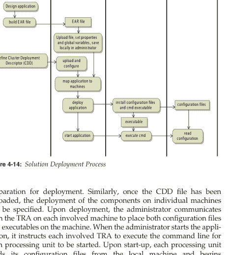

图 4-14：解决方案部署过程

TIBCO BusinessEvents 提供了另一种部署和管理选项：TIBCO BusinessEvents® 监控和管理（MM）。监控和管理本身是一个基于 TIBCO BusinessEvents 的应用程序，由两个处理单元和一个 TIBCO Hawk® 代理组成（图 4-15）。要监控应用程序，MM 需要与 TIBCO Administrator 管理应用程序时所使用的相同 EAR 和 CDD 文件。然后 MM 可以直接管理集群中的应用程序处理单元。它使用 SSH 部署处理单元。它使用 SSH 或 Hawk 启动和停止处理单元，并使用 JMX 启动、停止和暂停单个代理以及在代理内启用和禁用规则。它使用 Hawk 收集性能数据并监控应用程序集群的健康状况。

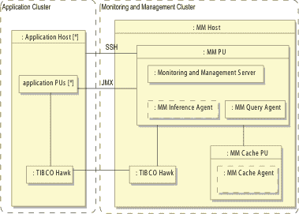

图 4-15：TIBCO BusinessEvents® 监控和管理（MM）部署

TIBCO Administrator 和 TIBCO BusinessEvents 监控和管理均提供脚本化部署功能。请参阅产品手册了解这些选项的更多详细信息。

## 摘要

TIBCO BusinessEvents 产品套件由 TIBCO BusinessEvents 产品和五个扩展产品组成：TIBCO BusinessEvents 数据建模、TIBCO BusinessEvents 决策管理器、TIBCO BusinessEvents 事件流处理、TIBCO BusinessEvents 流程编排和 TIBCO BusinessEvents 视图。TIBCO BusinessEvents 数据建模使数据库信息能够在内存中缓存以供 TIBCO BusinessEvents 使用，并增加了状态机建模功能。TIBCO BusinessEvents 决策管理器增加了用于定义规则的类似电子表格的界面以及在运行时更改这些规则的能力。TIBCO BusinessEvents 事件流处理增加了查询功能和识别事件模式的能力。TIBCO BusinessEvents 流程编排增加了管理活动性能的能力。TIBCO BusinessEvents 视图增加了实时显示表格和图形信息的能力。

TIBCO BusinessEvents 解决方案部署在一台或多台逻辑上分组为集群的处理单元上。每个处理单元运行一个或多个代理，其中有五种类型：推理代理、缓存代理、查询代理、流程代理和仪表板代理。

TIBCO BusinessEvents 解决方案在 TIBCO BusinessEvents Studio 中定义。这些设计及其附带的部署描述符由 TIBCO Administrator 拾取。TIBCO Administrator 用于配置设计的部署，并借助每台目标机器上的 TIBCO Runtime Agent（TRA）部署设计并启动引擎。TIBCO BusinessEvents 监控和管理（BEMM）和脚本提供了部署和监控的替代方法。

## 第 5 章：推理代理

### 目标

推理代理是 TIBCO BusinessEvents® 的核心。它为复杂事件处理提供分析功能，将信息暂存在内存中并使用规则对该信息进行操作。它通过多种通道与其外部环境交互，可感知并响应环境中的活动。

阅读本章后您将能够描述

- TIBCO BusinessEvents 中推理代理的作用
- 信息如何以事件、概念和记分卡数据结构的形式表示
- 事件、概念和记分卡如何在推理代理中创建和消费
- 规则如何结构化并对事件、概念和记分卡进行操作
- 推理代理如何使用通道与外部环境交互
- 推理代理的线程模型和可用的调优选项

### 推理代理概述

推理代理的内容相当多，一次全部呈现会令人困惑。我们将从图 5-1 的简化概述开始，然后逐步添加组件直到图完整。

推理代理的功能核心是执行规则的运行至完成函数（RTC）。它对工作内存中保存的事件、概念和记分卡进行操作。通道提供输入和输出功能，缓存接口提供代理间的信息共享。我们稍后会介绍通道和缓存，但现在让我们先看看工作内存中信息的表示方式以及 RTC 函数执行规则时对其的分析。

### 事件、概念和记分卡

推理代理使用的三种主要内存驻留数据结构是：事件、概念和记分卡（图 5-2）。事件是描述事件信息的静态表示，无论是源自其他地方的事件还是源自推理代理本身的事件。事件一旦放置在工作内存中，就不可编辑。

概念是除事件之外规则所需的信息表示。这可能是从其他来源导入的信息，或由推理代理累积和维护的信息

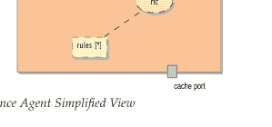

图 5-1：推理代理简化视图


**图 5-2：工作内存**

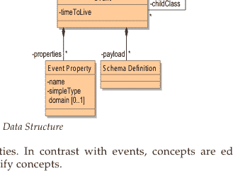

**图 5-3：事件数据结构**

与其他各方相比。与事件不同，概念是可以编辑的：规则可以修改概念。

记分卡是一种特殊的概念，通常用于累积汇总信息。

以下各节探讨这些数据结构及其预期用途。

## 事件

事件数据结构（图 5-3）旨在表示一个事件：在某个时间点对情况的快照。请确保为事件命名，使其能够描述其旨在表示的发生情况。事件可以具有 timeToLive、一些属性和有效载荷。事件也可以从其他事件派生子类。

timeToLive 参数如其名所示，表示事件数据结构将持续多长时间。正值以时间单位表示，表示事件数据结构保持可用的时间段。值为零表示事件数据结构仅在第一次 RTC 周期完成前保留。负值表示事件数据结构将保留直到被显式删除。选择 `timeToLive` 参数值的含义在第 6 章关于内存管理模式的讨论中进行了探讨。当然，任何事件都可以通过调用 `consumeEvent()` 目录函数随时显式删除。

事件属性是具有简单数据类型的命名值：`String`、`int`、`long`、`double`、`boolean` 或 `DateTime`。可选地，可以限制值，使其只能从指示的域提供的枚举值中取值。事件属性可通过规则中的条件表达式高效访问。

事件有效载荷是一个可选的数据结构，其结构由 XML 模式定义（XSD）指定。有效载荷的元素可以在规则中使用 XPath 表达式引用，但这种访问不如访问属性高效。因此，当需要在规则中访问有效载荷的元素且性能是重要考虑因素时，通常的做法是在事件创建时将这些元素值复制到属性中。这是在预处理期间完成的，本章后面会讨论。

除两种例外情况外，事件是创建它的代理的本地事件（其他类型的代理也可以创建事件）。其中一个例外是通过通道显式外部发送的事件。另一个例外是具有非零 `timeToLive` 且还声明使用仅缓存内存管理模式（第 6 章所述）的事件。此类事件将对在查询代理（第 7 章）中运行的查询可见。除这两种例外情况外，事件严格属于创建它的代理的本地。

图 5-4 显示了三个相关的事件。父事务事件具有指示交易金额的属性和

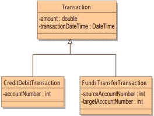

**图 5-4：** *事件示例*

`transactionDateTime`。还有两个子类。`CreditDebitTransaction` 子类添加了 `accountNumber` 属性以指示资金被取走或添加的账户。`FundsTransferTransaction` 具有两个账户号码属性：`sourceAccountNumber` 用于指示资金被取走的账户，`targetAccountNumber` 用于指示资金被添加到的账户。

## 概念

概念是一种可编辑的数据结构，可用于多种目的（图 5-5）。概念的名称应表示概念旨在表示的内容。每个概念实例都有一个可选的外部标识符（`extID`）属性，可在概念实例化时设置。¹ 建议为 `extID` 分配一个在所有概念实例中唯一的值。它用作唯一标识符，可在需要时用于检索概念（本章后面讨论），并在需要锁定概念时用作锁定键（第 6 章讨论）。

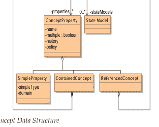

图 5-5：概念数据结构

1. TIBCO BusinessEvents® 中的所有对象实际上都有此属性，但在概念上尤其重要。

概念有一组属性。每个属性都有一个名称，该名称在概念内必须是唯一的。属性可能与其关联多个值，如 multiple 标志所示。例如，一个人可能有几个替代名称（即别名）。

属性还可以维护先前值历史。例如，Account 概念可能具有 balance 属性，对于统计或分析目的，保留先前账户余额的历史可能很有用。历史是通过指定要保留的历史值的数量来指定的。policy 属性决定是保留所有历史值（即使值未更改）还是仅保留不同的值。历史的使用存在一些限制。其中之一是规则条件只能通过目录函数访问历史，而在条件中使用这些函数效率低下。另一个是当概念的 XML 表示自动生成时，不包括历史。

属性可以是三种类型：简单类型、包含的概念和引用的概念。简单类型与事件相同：String、int、long、double、boolean 或 DateTime。可选地，这些值可以被约束为在指定域中找到的值。

包含的概念由其父概念拥有，并且包含的概念只能由一个父概念拥有。包含的概念的实例与父实例具有相同的生命周期。删除父实例也会删除包含的实例。然而，包含的实例可以添加和删除，而不影响父实例的生命周期。

引用概念是指向概念的指针。一个概念可以被许多其他概念引用。被引用实例的生命周期与其持有引用的实例之间没有联系——任一实例都可以被删除而不影响另一个。然而，如果被引用实例被删除，引用将变为 null 指针。

图 5-6 显示了三个示例概念，均与银行账户相关。Account 具有 accountNumber 属性和 balance 属性。在此上下文中，账户余额的历史可能很有趣。Account 包含记录每次交易金额和 dateTime 的 Transaction 概念。Transaction 概念提供了交易的持久记录，与图 5-4 中仅宣布交易的 Transaction 事件相比，

如果部署了三个推理代理使用此欺诈记分卡，则在三个代理中的每一个中都会有一个此记分卡的实例（图 5-9）。

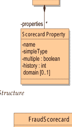

图 5-7：记分卡数据结构

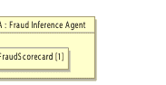

图 5-8：欺诈记分卡示例

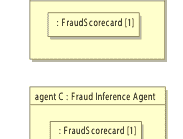

图 5-9：欺诈记分卡部署

## 规则

TIBCO BusinessEvents 中的规则（列表 5-1）有四个子句：属性、声明、条件和动作。

**列表 5-1：** *带分离条件的欺诈规则*

```text
rule Rules.Fraud {
    attribute {priority = 5; forwardChain = true; }
    declare {
        Events.Transaction transA;
        Events.Transaction transB;
    }
    when {
        transB.transactionAmount <= 5.0; /* C1 */
        transA.transactionAmount >= 10000; /* C2 */
        transA.accountNumber == transB.accountNumber; /* C3 */
        transA.transactionDateTime > transB.transactionDateTime ; /*
            C4 */
    }
    then {
        System.debugOut("Fraud!");
    }
}
```

### 属性

属性子句由 `attribute` 关键字标记。有三个可能的属性：`forwardChain`、`priority` 和 `rank`。`forwardChain` 属性决定规则所做的对象更改是否会导致规则议程被重新评估。通常应始终将此属性设置为 true。priority 和 rank 属性决定规则应用的相对顺序。priority 属性是一个整数，其值在设计时固定。rank 属性指定将在运行时调用的规则函数。此函数返回一个 double 值。eligible 运行的规则按 priority 作为主要排序键、rank 作为次要排序键进行排序。此排序是本章后面描述的运行至完成（RTC）周期的一部分。

### 声明

声明子句由 `declare` 关键字标记。它按类型标识工作内存中规则使用的对象。这些对象可以是事件、概念或记分卡。在此列表中，两个声明的对象都是 Transaction 事件。


- 调用外部服务
- 调用规则函数、虚拟规则函数、目录函数和自定义函数

## 运行至完成（RTC）行为

运行至完成函数的基本行为如图 5-10 所示。某些实体将事件和概念断言到工作内存中（此过程将在后面讨论）。出现在等价连接条件中的对象在被添加到工作内存时，会根据用于连接的值进行索引。这大大提高了等价连接操作最终执行时的效率。接下来，识别出由于规则声明子句中的事件、概念或记分卡发生变化而被触发的所有规则。然后按前面所述的优先级和等级值对触发的规则进行排序。此排序列表称为规则议程。

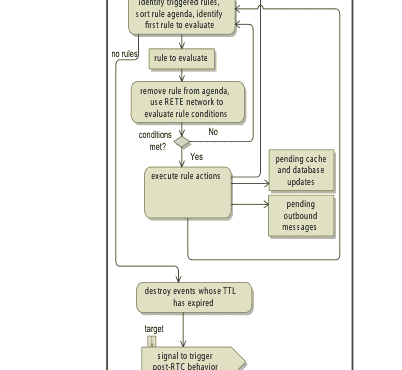

图 5-10：运行至完成（RTC）行为

一旦规则议程排序完成，就会选择一条规则进行评估并从规则议程中移除。该规则本身用于构建所谓的修改版 Rete 网络（参见 Rete Networks 侧边栏），它提供了一种针对一组对象高效评估规则的方法。对于每种有效的输入对象组合，规则的动作子句随后会被执行。

## Rete 网络

有关原始 Rete 概念的描述，可在 Charles L. Forgy 的经典论文《Rete：多模式/多对象模式匹配问题的快速算法》中找到。2

然而，Forgy 论文中描述的方法并未涵盖条件包含对象之间连接的规则，包括 TIBCO BusinessEvents 规则中发现的等价和非等价连接。

能够处理连接的网络被称为修改版 Rete 网络。不幸的是，没有公开的论文描述此类网络的操作。此外，对此类网络及其背后的原理的深入讨论已远远超出了本书的范围。

好消息是，要有效地使用 TIBCO BusinessEvents 推理代理，并不需要对修改版 RETE 网络有详细的理解。你只需要对条件子句如何处理有一个大致的了解。这在对推理代理 RTC 行为的讨论中以示例的形式提供。

在动作子句中，任何需要超出推理代理范围进行通信的动作都会被排队以便稍后执行。其他动作可能会影响工作内存：删除事件、修改记分卡，以及创建、更新或删除概念。

一旦所有动作完成，规则议程会再次被评估和排序。如果 `forwardChain = true`，工作内存的变化可能会导致规则被添加到议程中或从议程中移除。由于概念属性的值可以被更新，而这些值可用于计算规则的等级，因此规则议程的排序也可能被改变。

此过程会一直持续，直到规则议程中不再有规则。此时，任何时间-生存期已过期的事件（包括所有时间-生存期为零的事件）都会从工作内存中移除。会向后 RTC 线程发送信号，开始执行执行规则动作所产生的全部待处理通信。

## ACEPSTConditionsSeparate³ 示例

让我们看一个使用 ACEPSTConditionsSeparate 项目的示例。该项目实现了来自列表 5-1 的欺诈规则。该项目在 TIBCO BusinessEvents® Studio 调试器中运行时的配置如图 5-11 所示。此配置包含一个处理单元，其中包含一个已部署欺诈规则的推理代理。然后调试器用于直接将测试数据插入到代理的工作内存中。

该项目的测试数据如图 5-12 所示。

调试器将测试数据交易逐一插入工作内存进行处理。这些交易的断言会使欺诈规则（列表 5-1）进入规则议程。当规则被选中处理时，会构造一个 RETE 网络来执行规则的条件部分（图 5-13）。

Rete 网络中的第一个节点是源自规则声明子句的过滤器节点。子句中提到的每种类型在 Rete 网络中都会产生相应的类型过滤器。类型过滤器的结果随后会馈送到过滤器 C1 和 C2，每个过滤器都查看金额但与不同的值进行比较。C1 和 C2 的结果集是 C3 等价连接节点的输入，其中两个输入被比较以查看它们是否具有相同的账户值。C3 的结果被馈送到 C4，这是一个非等价连接节点，用于比较两个交易的时间。出现在 C4 结果集中的任何内容都已满足所有条件，并且规则动作将被应用于它。

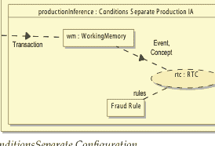

图 5-11：ACEPSTConditionsSeparate 配置

| T1 : 交易 | T2 : 交易 |
|---|---|
| 账户 = "123" | 账户 = "123" |
| 金额 = "1.5" | 金额 = "10000" |
| 时间 = "0" | 时间 = "0.1" |

图 5-12：ACEPSTConditionsSeparate 测试数据

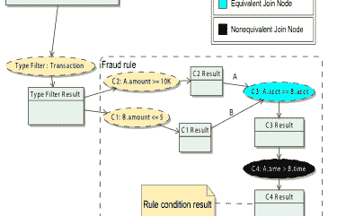

图 5-13：ACEPSTConditionsSeparate 欺诈规则 RETE 网络

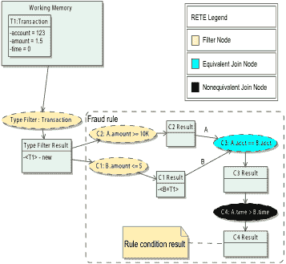

图 5-14：ACEPSTConditionsSeparate 第一次交易处理

图 5-14 显示了交易 T1 插入工作内存后 Rete 网络的状态。由于 T1 的类型为 Transaction，T1 最终出现在类型过滤器结果集中。由于 T1 的金额小于 5，它出现在 C1 结果集中，但未出现在 C2 结果集中。由于 C2 中没有结果，C3 无连接可执行，处理停止。

图 5-15 显示了引入 T2 后的状态。请注意，处理 T1 的结果仍然存在。T2 通过类型过滤器并最终出现在类型过滤器结果集中。由于 Rete 处理完全由变化驱动，只有新出现的 T2 会被 C1 和 C2 过滤器处理，并且 T2 现在出现在 C2 结果集中。C3 等价连接有两个交易可供比较。由于它们具有相同的账户值，T1 和 T2 的配对最终出现在 C3 结果集中。配对的出现现在触发了 C4 非等价连接的评估。由于满足了时间条件，该配对最终出现在 C4 结果集中。C4 结果集中出现结果现在触发了与欺诈规则相关联的动作的执行。

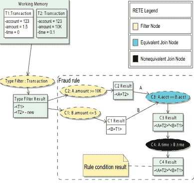

图 5-15：ACEPSTConditionsSeparate 第二次交易处理

## 规则条件与 Rete 网络效率

列表 5-1 中显示的规则将每个条件作为以分号结尾的单独子句。这种子句的分离允许构建一个 Rete 网络，其中相对高效的过滤器节点首先出现，其次是等价连接节点，最后是不高效的非等价连接节点。但让我们看看当子句不分离时会发生什么。

列表 5-2 显示了对列表 5-1 中显示的规则的一个看似无害的变化。唯一的变化是，前三个条件末尾的分号被替换为“&&”“与”操作。规则现在有一个条件，其中恰好包含四个子句。那么区别是什么呢？让我们看看 ACEPSTConditionsAnded 示例。

列表 5-2：条件与运算的欺诈规则

```rule
rule Rules.Fraud {
    attribute (priority = 5; forwardChain = true; )
    declare (
        Events.Transaction transA;
        Events.Transaction transB;
    )
}
when {
  transB.transactionAmount <= 5.0 &&
  transA.transactionAmount >= 10000 &&
  transA.accountNumber == transB.accountNumber &&
  transA.transactionDateTime > transB.transactionDateTime ;
  /* C1 */
}
then {
  System.debugOut("Fraud!");
}
```

## ACEPSTConditionsAnded 示例

此示例与 ACEPSTConditionsSeparate 示例完全相同，只是欺诈规则本身不同。但为评估该规则而创建的 Rete 网络却大不相同（图 5-16）。在此网络中，在类型过滤器之后，只有一个节点评估整个条件。为什么这不好？让我们看看随着交易的引入会发生什么。

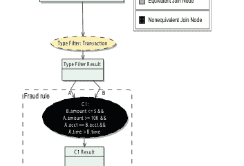

图 5-16：ACEPSTConditionsAnded Rete 网络


图 5-17 显示了引入 T1 后 Rete 网络的情况。由于 T1 出现在类型过滤器结果集中，而该集合是 C1 的唯一输入，C1 的条件实际上在节点尝试将 T1 与自身连接时被评估！当然连接失败了，但计算资源仍然被消耗了。

图 5-18 显示了引入 T2 后网络的情况。T2 在类型过滤器结果集中的出现触发了 C1 的评估——三次！它会尝试将 T2 与自身连接，并会尝试 T1 和 T2 的两种组合。只有其中一种组合会产生所寻求的结论。

值得注意的是，随着更多交易被引入到该网络中会发生什么：C1 将尝试交易的所有可能组合。因此计算复杂度为 n²，其中 n 是工作内存中存在的交易数量。这并不是你在解决方案中想要的那种计算复杂度。

正如这两个示例所说明的，你在规则中构造条件子句的方式对 Rete 网络评估规则条件时所做的工作量有显著影响。你越是思考规则条件如何被转换为用于执行的 Rete 网络，你的解决方案就越高效。

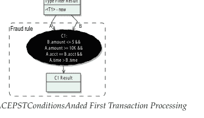

图 5-17：ACEPSTConditionsAnded 第一次交易处理

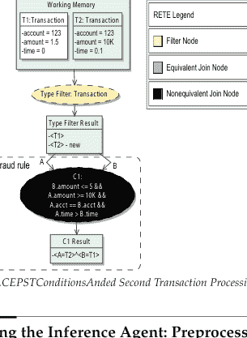

图 5-18：ACEPSTConditionsAnded 第二次交易处理

## 完成推理代理：预处理和后处理

RTC 循环对工作内存中的对象进行操作，但我们尚未考虑这些对象是如何进入其中的。该功能在产品手册中称为 pre-RTC 处理，简称为预处理（图 5-19）。预处理处理传入通信。这些通信通常（但不总是）会导致工作内存发生变化，进而触发 RTC 循环中规则的评估。RTC 处理会执行需要传出通信的操作。这些操作的执行称为 post-RTC 处理，简称为后处理。

有三种类型的传出通信，仅在 RTC 处理完成后发生。一种是通过通道向其他组件和代理发送事件。第二种是更新缓存中的对象：被配置为在缓存中且由推理代理创建或修改的对象必须更新其缓存表示。第三种是更新缓存后端存储，如果其以特定方式配置（即共享全部缓存旁路）。缓存更新和后端存储操作在第 6 章中详细介绍。


**图 5-19：** *推理代理完整视图*

### 通道

有多种类型的通道可用，包括：

- Java 消息服务 (JMS)
- TIBCO Rendezvous®
- HTTP
- TCP
- TIBCO ActiveSpaces®
- TIBCO Hawk®
- 本地

JMS 和 TIBCO Rendezvous 通道提供发送和接收消息的能力。HTTP 和 TCP 通道使代理能够在这两种协议中同时充当服务器和客户端。TIBCO ActiveSpaces 通道让代理充当外部空间的寄生者（不要与使用相同技术实现的 TIBCO BusinessEvents 缓存混淆）。TIBCO Hawk 通道让代理与 Hawk 代理和 Hawk 启用的组件进行交互，提供组件状态和性能信息。最后，本地通道可用于同一处理单元中共置的代理之间的交互。该通道的特殊之处在于，使用该通道时交换的数据结构不会被编组和解编组（序列化与反序列化）：解析后的驻留内存数据结构的引用直接从一个代理传递到另一个代理。

### 目标

每个通道都有一个或多个与其关联的逻辑目标（图 5-20）。非本地目标具有与其关联的默认事件类型和反序列化器。当发生传入通信时，反序列化器会创建默认事件类型的实例，并用来自传入通信的信息填充该实例。以这种方式创建的事件会自动断言到工作内存中。

在传出方向上，每个事件类型都可以有一个与其关联的默认目标。当创建并发送该类型的事件时（Event.sendEvent()），它会被发送到默认目标，其序列化器会为传出通信创建适当的格式。


图 5-20：通道和目标

使用 `Standard.Event.replyEvent()` 的输入。事件可以通过调用 `Standard.Event.routeTo(<destination>)` 发送到与其默认目标不同的目标。

### 预处理行为

默认预处理行为如图 5-21 所示。外部事件源生成一条消息，该消息由通道接收并由通道线程处理。通道线程从传入消息创建事件并将其放置在共享队列上。


断言事件和概念到工作内存的操作要等到该线程运行 RTC 时才会生效。

如果 RTC 配置为单线程操作，则会发生锁定。

图 5-21：默认预处理行为

通道的类型决定了有多少个通道线程。对于 JMS，有一个。对于 HTTP，有一个通道线程池。你应查阅产品手册以了解与每种通道类型关联的线程的详细信息。

每个目标指定用于预处理的线程池。有三种可能性：

- 1. 共享队列：这是默认值。事件被放置在该代理中所有目标共享的队列中。有一个共享的线程池用于执行预处理器活动，事件在共享队列中等待，直到该池中的一个线程可用。
- 2. 目标队列：事件被放置在特定于此目标的队列中。有专门用于此目标的线程池，事件在目标队列中等待，直到这些线程中的一个可用。
- 3. 调用者线程：此替代方案没有队列。创建事件的通道线程（即）立即执行预处理器活动。

当线程可用时，如果已为该目标的事件关联了预处理器函数，则执行该函数。

如果推理代理配置中未选中“并发 RTC”框（这是默认值），则线程会被放置在等待轮到执行 RTC 活动的线程队列中。如果选中该框，线程会立即继续。

一旦线程准备好执行，如果未选中“并发 RTC”框，线程将获取 Rete 锁。这会阻止其他线程执行 RTC 活动。从缓存中创建或检索的任何对象都会被断言到工作内存中。请注意，尽管可能已在预处理器函数中调用了 Event.assertEvent()，但事件实际上要到达到此点时才会被放置到工作内存中。一旦工作内存已更新，就会执行 RTC 行为（前面已描述）。

RTC 完成后，锁会被释放（允许其他线程执行其他 RTC），会发送信号以触发与刚刚完成的 RTC 相关的后处理，并且（如果需要）会确认初始 JMS 消息的接收。线程现在准备好处理另一个事件。


## 后处理行为

一旦 RTC 周期完成，还需要执行许多后处理活动。根据 CDD 文件中布尔属性 `Agent.<agentName>.enableParallelOps` 的值，这些活动可以单线程执行，也可以并行执行。

图 5-22 显示了单线程选项的行为。如果对选择了 cache-aside 对象管理选项的对象进行了更改，则首先执行所需的数据库更新（详见第 6 章）。接下来执行缓存更新。这种顺序确保了在数据库操作成功完成之前，对象更改不会在缓存中暴露。接下来发送出站事件，然后是待处理的消息确认。最后，释放对象锁（对象锁定在第 6 章中讨论）。


图 5-22：后处理行为——单线程


图 5-23：后处理行为——多线程

图 5-23 显示了多线程处理的行为。所有活动并行运行，其中事件输出和缓存更新活动使用来自 `Agent.threadcount` 线程池的线程，数据库更新（如果需要）使用来自 `Agent.dbthreadcount` 线程池的线程。

## ACEPSTLocalChannel 示例

ACEPSTLocalChannel 示例说明了几个功能，包括：

-   使用两个推理代理配置处理单元
-   本地通道的使用
-   规则操作发布事件
-   预处理器函数创建和消费事件


### 图 5-24：ACEPSTLocalChannel 示例配置

图 5-24 显示了此示例的配置。它包含一个名为 inferenceProcUnit 的处理单元，其中包含两个推理代理：testDriverInference 和 productionInference。这两个推理代理之间配置了一个本地通道。

测试驱动推理代理的存在仅仅是为了向生产推理代理提供交易事件。当示例项目在调试器中运行时，测试数据被直接馈送到测试驱动推理代理的工作内存中。测试数据包含 SourceTransaction 事件，这些事件触发源交易规则（清单 5-3）。规则操作使用传入事件中的数据创建 Transaction 事件，并将该事件发送到其默认目的地，该目的地与本地通道关联。这导致新创建的事件被发送到生产推理代理。

### 清单 5-3：源交易规则

```
rule Rules.SourceTransaction {
    attribute {
        priority = 5;
        forwardChain = true;
    }
    declare {
        Events.SourceTransaction sourceTransaction;
    }
    when {

}
then {
        // Create the real transaction to drive
            the test
        Events.Transaction newTransaction =
            Events.Transaction.Transaction(
                null,
                null,
                sourceTransaction.accountNumber,
                sourceTransaction.
                    transactionAmount,
                sourceTransaction.
                    transactionDateTime);
        Event.sendEvent(newTransaction);
    }
}
```

Transaction 事件到达生产推理代理。与本地通道关联的目的地配置了 newTransaction 规则函数（清单 5-4）作为此事件的预处理器函数。此函数接收传入的交易，并确定其金额是低于 5 美元阈值还是高于 10,000 美元阈值。如果低于 5 美元阈值，则创建并断言 TinyTransaction；如果大于 10,000 美元，则创建并断言 GiantTransaction。在所有情况下，它都会消费原始交易。

### 清单 5-4：*newTransaction* 规则函数

```
void rulefunction RuleFunctions.newTransaction {
    attribute {validity = ACTION;}
    scope {Events.Transaction transaction; }
    body {
        if (transaction.transactionAmount <= 5.00) {
            TinyTransaction tinyTransaction =
                Events.TinyTransaction.TinyTransaction(
                    null,
                    null,
                    transaction.accountNumber,
                    transaction.transactionAmount,
                    transaction.transactionDateTime);
            System.debugOut("Created tiny transaction:
                " + tinyTransaction@id);
            Event.assertEvent(tinyTransaction);
            System.debugOut("Asserted tiny transaction:
                " + tinyTransaction@id);
        }
        else if (transaction.transactionAmount >=
            10000.00) {
            GiantTransaction giantTransaction =
Events.GiantTransaction.
    GiantTransaction(
        null,
        null,
        transaction.accountNumber,
        transaction.transactionAmount,
        transaction.transactionDateTime);
    System.debugOut("Created giant transaction: " + giantTransaction@id);
    Event.assertEvent(giantTransaction);
    System.debugOut("Asserted giant transaction: " + giantTransaction@id);
}
System.debugOut("About to consume transaction: " + transaction@id);
Event.consumeEvent(transaction);
System.debugOut("Consumed transaction: " + transaction@id);
}
```

此预处理器函数做了两件事：它既对交易进行分类，又对交易进行过滤。通过对交易进行分类，它向规则清楚地表明哪些交易低于较低阈值，哪些交易高于较大阈值。它还过滤交易：任何介于两个阈值之间的交易都会被直接消费。

对 tiny 和 giant 交易（配置了 1 小时的生存时间）进行断言会触发新版本的欺诈规则（清单 5-5）。该规则仅比较账户号并确定交易发生的顺序。关于每个交易是低于较低阈值还是高于较高阈值的判断已在预处理器中完成。此外，事件只会存在一个小时，因此无需确定交易的时效。

### 清单 5-5：ACEPSTLocalChannel 欺诈规则

```
rule Rules.Fraud {
    attribute {
        priority = 5;
        forwardChain = true;
    }
    declare {
        Events.GiantTransaction giantTransaction;
        Events.TinyTransaction tinyTransaction;
    }
    when {
        tinyTransaction.accountNumber ==
            giantTransaction.accountNumber;
        giantTransaction.transactionDateTime >
```

转换规则可以具有与常规推理代理规则关联的相同类型的操作。此外，可以指定在进入状态和退出状态时执行的操作。一种可能的操作类型是启动或停止另一个状态机。

## 超时

状态可以具有与之关联的超时。计时器在进入状态时启动。如果在状态退出之前计时器到期，则执行指定操作，并且状态机转换到指定状态。

尽管状态机启动了计时器，但计时器本身不是状态机的一部分。每个计时器都是一个对象，默认情况下以仅缓存模式运行，并保存到后备存储（如果进行了相应配置）。

集群中的一个推理代理（自动确定）运行调度程序。调度程序定期检查计时器以查看哪些已过期，并执行与超时关联的状态机逻辑。请注意，此超时事件不会经过预处理器，但仍然可能需要锁定才能安全地执行逻辑。为了支持这一点，可以注册状态机超时回调，其作用与预处理器函数相同。当超时事件需要锁定（或其他预处理器功能）时，必须定义并注册必要的函数。_TIBCO BusinessEvents 数据建模开发人员指南_ 提供了详细信息。

## 启动和停止状态机

每个概念都可以有一个与之关联的主状态机。默认情况下，此状态机配置为在概念创建时自动启动。作为例外，可以使用目录函数 `startStateMachine()` 启动状态机。

有关状态机的更多信息，请参阅 _TIBCO BusinessEvents 数据建模开发人员指南_。


## 摘要

推理代理提供使用规则评估对象的能力。每条规则标识该规则所使用对象的类型、这些对象必须满足的条件，以及条件满足时要执行的动作。

推理代理操作三种关键类型的对象：事件、概念和评分卡。事件是某种外部发生的表示，除在与其创建关联的预处理函数中之外，不可修改。事件对于创建它们的代理是局部的（查询代理除外），除非事件通过通道显式发送。

概念是可修改的表示，旨在通过缓存共享。它们可以在预处理函数中创建，也可以在规则动作中创建、修改和删除。

评分卡是特殊类型的概念。对于每种评分卡类型，在使用该评分卡的每个推理代理中恰好有一个该评分卡的实例。评分卡用于在处理代理中累积历史信息。

规则对推理代理工作内存中的对象进行操作。工作内存中新创建或修改的对象会触发规则。规则评估发生在运行至完成（RTC）周期中。该周期首先识别所有已触发的规则，并将它们放入称为规则议程的列表中。然后，规则议程按规则的优先级和等级排序。接着选择一条规则进行评估，并组装评估其条件所需的Rete网络。工作内存中的对象逐个插入Rete网络，Rete网络的输出是满足条件的对象集合。规则的动作应用于这些对象。其中一些动作可能会改变工作内存的内容。

当一条规则的评估完成后，再次组装规则议程。使用正向链接时，工作内存的变化可能导致议程中的某些规则被移除，另一些被添加。议程被排序，并再次评估一条规则。此过程持续进行，直到议程中没有更多规则为止。

通道为推理代理与外部组件及其他代理交互提供机制。有用于JMS、TIBCO Rendezvous、HTTP、TCP、TIBCO ActiveSpaces、TIBCO Hawk的通道，以及用于在同一处理单元中托管的代理之间进行通信的本地通道。

通道有一个或多个与之关联的目标。对于传入事件，每个目标指定要构造的事件的默认类型以及在其构造中使用的反序列化器。目标标识事件创建后要调用的可选预处理函数。事件可以标识事件可能发送到的默认目标。目标标识用于执行预处理活动的线程类型。

无论哪个线程执行与事件关联的预处理活动，该线程也会为该事件执行RTC周期。如果未选择并发RTC选项，该线程必须等待轮到自己才能执行RTC。使用并发RTC选项需要谨慎使用锁定，以避免执行RTC周期的线程之间的意外交互。

后处理活动包括：更新已更改的缓存驻留对象的缓存（以及缓存旁数据库）、发送出站事件、确认接收到的入站消息，以及释放可能已经获得的对象锁。后处理可以单线程或多线程执行。

概念可以具有与之关联的状态机。状态机由多个状态和转换组成。转换可以具有与之关联的规则，这些规则定义将进行转换的条件。当规则触发以及进入或退出状态时，可以执行动作。可以为单个状态和整个状态机指定超时。如果计时器在状态退出（或机器达到其结束状态）之前到期，则执行指定的动作并进入指定的状态。

此页面有意留空


**图 6-2：** *选择对象管理模式*

可以为单个对象类型或类型组选择管理模式。以下各节描述各个模式。

## 仅缓存

仅缓存是推荐的默认操作模式。在此模式下，对象驻留在缓存中，必须由预处理函数显式加载到推理代理的工作内存中。

当仅缓存对象被带入工作内存时，最初仅加载其标识符。与该对象关联的数据在推理代理实际访问之前不会被加载。

如果对缓存对象进行了更改，而该对象恰好也在工作内存中，则无论RTC处理的状态如何，该对象的工作内存副本都会被更新。可以使用锁定（本章稍后讨论）来防止这种情况。

仅缓存对象在RTC周期结束时自动从工作内存中移除，除非选中了“常量”复选框（这应仅作为例外情况执行——切勿用于默认配置）。当选中此框时，一旦对象被带入工作内存，它将一直保留在那里，直到被显式移除。这些对象通常由启动函数加载。

## 仅内存

使用此模式配置的对象仅驻留在工作内存中，不会出现在缓存中。此类对象恰好驻留在一个推理代理中。


**图 6-5：** *ACEPSTAccountConcept 处理*

如果交易金额低于小额阈值，预处理程序将确保存在Account概念（如有必要则创建一个），并添加一个包含的Transaction概念。但是，交易事件会被消费。

此示例的欺诈规则如清单6-1所示。

## 清单 6-1：ACEPSTAccountConcept 欺诈规则

```
rule Rules.Fraud {
    attribute {
        priority = 5;
        forwardChain = true;
    }
    declare {
        Events.Transaction transaction;
        Concepts.Account account;
    }
    when {
```

如果需要锁定多个对象，则存在死锁的可能性：X锁定了A，然后试图锁定B，而Y已锁定B，并且正在尝试锁定A。X和Y都无法继续。因此，为锁指定超时并提供适当的异常处理非常重要。

遵循另一种编程约定可以大大降低死锁的可能性：如果你计划锁定多个对象，则获取它们的所有键，对键进行排序，然后按排序顺序获取锁。

请记住，锁的有效性完全取决于它们使用的一致性！

## 缓存对象复制

可以将缓存配置为自动复制对象，对象的副本驻留在不同的缓存代理中（图6-6）。此配置有两个设置。一个是“备份副本数”，它确定缓存中将维护的额外副本（除原始副本外）的数量。默认值为一。另一个设置是“缓存代理法定人数”，它确定集群开始运行前必须运行的最小缓存代理数量。如果对象的所有备份副本都存在同一个缓存代理中，那么拥有备份副本就没有意义，因此该数字应至少比备份副本数大一。如果希望在缓存代理宕机时仍保持复制，请增大此数字。一旦集群启动，此设置对操作没有影响，除非实际运行的缓存代理数量低于此数字时会导致记录一条日志条目。


图 6-6：配置缓存对象复制


Figure 6-8: Selecting Shared-All Options
图 6-8：选择共享全部选项

performs the database update. If the box is not checked, the cache agent performs the update. This is referred to as “Write Behind.” Note that the Cache-Aside option is not available for the Berkeley DB.
执行数据库更新。如果未勾选该框，则缓存代理执行更新。这被称为“写后”。请注意，Cache-Aside 选项在 Berkeley DB 中不可用。

### Cache-Aside Behavior
### Cache-Aside 行为

With Cache-Aside, the inference agent performs the database update. This activity is performed in the postprocessing after the RTC cycle has completed. The details of this update are described in Chapter 5.
使用 Cache-Aside 时，推理代理执行数据库更新。此活动在 RTC 周期完成后在后处理中执行。有关此更新的详细信息请参见第 5 章。

A key parameter driving this update is the `Agent.<agentName>.enableParallelOps` property in the CDD file for the agent that will be performing the update. Figure 5-22 shows the behavior when this property is set to `false`, and Figure 5-23 shows the behavior when the property is set to true.
驱动此更新的一个关键参数是执行更新的代理的 CDD 文件中的 `Agent.<agentName>.enableParallelOps` 属性。图 5-22 显示了将此属性设置为 `false` 时的行为，图 5-23 显示了将属性设置为 true 时的行为。

When Cache-Aside is selected, database operations may be batched together and executed as a single transaction for efficiency. With `enableParallelOps = false`, all database updates occur before any cache updates.
选择 Cache-Aside 时，数据库操作可以批量组合并作为单个事务执行以提高效率。当 `enableParallelOps = false` 时，所有数据库更新都在任何缓存更新之前发生。

### Write-Behind Behavior
### Write-Behind 行为

If the Cache Aside box is not checked, the result is Write-Behind behavior (Figure 6-9). In this mode, the inference agent updates the cache, and the cache agent, in turn, updates the database. In this mode, each individual cache object update results in a separate database transaction.
如果未勾选 Cache Aside 框，则结果为 Write-Behind 行为（图 6-9）。在此模式下，推理代理更新缓存，然后缓存代理更新数据库。在此模式下，每个单独的缓存对象更新都会导致一次单独的数据库事务。

reside in working memory and never enter the cache. In Cache-Only mode, objects reside in the cache and must be explicitly brought into working memory when needed. In Cache + Memory mode, objects reside in both working memory and the cache. This mode must be used with caution, as any change to an object may trigger every rule in every agent that uses that object.
驻留在工作内存中且永不进入缓存。在 Cache-Only 模式下，对象驻留在缓存中，需要时必须显式带入工作内存。在 Cache + Memory 模式下，对象同时驻留在工作内存和缓存中。此模式必须谨慎使用，因为对对象的任何更改都可能触发使用该对象的每个代理中的每条规则。

Because objects can be accessed from multiple agents or multiple threads within one agent, a locking mechanism is required. The locks provided by TIBCO BusinessEvents are logical: The objects themselves are not locked, key values are. A convention associates the key being locked with the object, with the common convention being the use of the object's extID as the lock key. Programming discipline is required to ensure the consistent use of locks.
由于对象可以从多个代理或一个代理内的多个线程访问，因此需要锁定机制。TIBCO BusinessEvents 提供的锁是逻辑上的：对象本身并未被锁定，而是键值被锁定。一种约定将锁定的键与对象关联起来，常见约定是使用对象的 extID 作为锁键。需要编程规范以确保锁的一致使用。

The cache provides the ability to replicate objects in memory, with each copy of the object residing in a different cache agent. This guarantees that the object will survive the loss of a cache agent.
缓存提供了在内存中复制对象的能力，每个对象的副本驻留在不同的缓存代理中。这保证了对象在缓存代理丢失时仍然存活。

Objects in cache may be optionally persisted, either in a database (Shared-All option) or in files (Shared-Nothing option). With Shared-All, there are two sub-modes: Cache-Aside and Write-Behind. With Cache-Aside, the inference agent does the database update, while in Write-Behind the cache agent does the database update. In the Shared-Nothing option, each cache agent persists the objects in its memory to a separate file.
缓存中的对象可以可选地持久化，要么在数据库中（共享全部选项），要么在文件中（共享无选项）。在共享全部中，有两种子模式：Cache-Aside 和 Write-Behind。在 Cache-Aside 中，推理代理执行数据库更新，而在 Write-Behind 中，缓存代理执行数据库更新。在共享无选项中，每个缓存代理将内存中的对象持久化到单独的文件中。

## Chapter 7: Query Agents
## 第 7 章：查询代理

### Objectives
### 目标

Query agents are part of the TIBCO BusinessEvents® Event Stream Processing product, an add-on to the core TIBCO BusinessEvents® product (Chapter 4).
查询代理是 TIBCO BusinessEvents® Event Stream Processing 产品的一部分，该产品是核心 TIBCO BusinessEvents® 产品（第 4 章）的附加组件。

After reading this chapter you will be able to describe the capabilities and appropriate uses for query agents and how snapshot and continuous queries work.
阅读本章后，您将能够描述查询代理的功能和适当用途，以及快照查询和连续查询的工作方式。

### Snapshot Queries
### 快照查询

A snapshot query is a query of the cache contents that is executed on-demand. The demand comes in the form of an event sent to a channel on the query agent (Figure 7-1).
快照查询是对缓存内容执行的按需查询。需求以发送到查询代理通道上的事件的形式出现（图 7-1）。


Figure 7-1: Query Agent Snapshot Configuration
图 7-1：查询代理快照配置

### Snapshot Query Execution
### 快照查询执行

The processing associated with the query execution is split between the cache agent and the query agent (Figure 7-2). The cache agent performs filtering operations involving concepts in a manner similar to the inference agent’s Rete network filters. Any objects that satisfy the filter conditions are forwarded to the query agent where joins are performed.
与查询执行相关的处理在缓存代理和查询代理之间拆分（图 7-2）。缓存代理以类似于推理代理 Rete 网络过滤器的方式执行涉及概念的过滤操作。满足过滤条件的任何对象都会转发到查询代理，在那里执行连接。


Figure 7-2: Snapshot Query Execution
图 7-2：快照查询执行

Objects that pass all conditions are added to the query results.
通过所有条件的对象将被添加到查询结果中。

An example query is shown in Listing 7-1. There is one where clause in the query, accountNumber = $acctNo. This is a filter condition: the accountNumber is compared against a variable whose value is fixed at the time the query is executed. The filter condition is passed to the cache agent, and the cache agent will return all accounts whose accountNumber matches the condition (hopefully only one!).
示例查询如清单 7-1 所示。查询中有一个 where 子句，accountNumber = $acctNo。这是一个过滤条件：accountNumber 与在查询执行时值固定的变量进行比较。过滤条件传递给缓存代理，缓存代理将返回 accountNumber 与条件匹配的所有账户（希望只有一个！）。

Listing 7-1: Snapshot Query Example
清单 7-1：快照查询示例

```
select account
from /Concepts/Account account
where accountNumber = $acctNo
```

The query agent can query all of the contents of the cache. In addition to concepts, this may include events and scorecards present in the cache, even though they are otherwise inaccessible to other agents.
查询代理可以查询缓存的所有内容。除了概念之外，这可能还包括缓存中存在的事件和评分卡，即使它们对其他代理而言通常无法访问。

### Snapshot Query Life Cycle
### 快照查询生命周期

The configuration and execution of a snapshot query is done by executing code (Figure 7-3). The first step in the process is to create (define) the query using the Query.create() function. The function parameters are the name you choose for the query and a string containing the query definition (Listing 7-1 is an example of such a string). The query definition is parsed, and the function will throw an exception if there is an error in the query definition.
快照查询的配置和执行是通过执行代码完成的（图 7-3）。过程中的第一步是使用 Query.create() 函数创建（定义）查询。函数参数是您为查询选择的名称和包含查询定义的字符串（清单 7-1 是此类字符串的示例）。查询定义将被解析，如果查询定义中存在错误，函数将抛出异常。

There are two places you might put the query creation code: in a rule function that is designated as a start-up function or in the preprocessor function that will eventually execute the query. If the query definition will not change, the start-up function is a good choice: The process of parsing the query definition will occur only once. But if the query definition depends upon the current context, it will have to go in the preprocessor function.
您可能将查询创建代码放在两个位置之一：在被指定为启动函数的规则函数中，或在最终执行查询的预处理器函数中。如果查询定义不会更改，启动函数是很好的选择：解析查询定义的过程只会发生一次。但如果查询定义取决于当前上下文，则必须放在预处理器函数中。

Once the query has been created, the next step is to create an instance of the query using the Query.Statement.open() function. Creating instances of the query allows multiple queries of the same type to be executed concurrently. If there are variables in the query (e.g., $acctNo in Listing 7-1), the third step is to set the values of these variables using the Query.Statement.setVar() function.
一旦查询被创建，下一步就是使用 Query.Statement.open() 函数创建查询的实例。创建查询实例允许并发执行同一类型的多个查询。如果查询中有变量（例如清单 7-1 中的 $acctNo），第三步是使用 Query.Statement.setVar() 函数设置这些变量的值。

The query is actually executed with the Query.Statement.execute() function. An argument to this function is the identifier that you want to assign to the ResultsSet data structure that will be returned. Once the query has executed, you can use the Query.ResultsSet.xxx functions to examine the contents of the results set. Optionally, you can close the statement and delete the query if desired.
查询实际使用 Query.Statement.execute() 函数执行。此函数的参数是您希望分配给将返回的 ResultsSet 数据结构的标识符。查询执行后，您可以使用 Query.ResultsSet.xxx 函数检查结果集的内容。可选地，如果需要，您可以关闭语句并删除查询。


Figure 7-3: Snapshot Query Life Cycle
图 7-3：快照查询生命周期

### ACEPSTSnapshotQuery Example
### ACEPSTSnapshotQuery 示例

Figure 7-4 shows the configuration of this example.
图 7-4 显示了此示例的配置。


Figure 7-4: ACEPSTSnapshotQuery Configuration
图 7-4：ACEPSTSnapshotQuery 配置

When the InferenceQueryPU is started, it executes the start-up function in Listing 7-2. This start-up function creates the FraudQuery.
当 InferenceQueryPU 启动时，它执行清单 7-2 中的启动函数。此启动函数创建 FraudQuery。

Listing 7-2: ACEPSTSnapshotQuery Query Agent Start-up Function
清单 7-2：ACEPSTSnapshotQuery 查询代理启动函数

```
void rulefunction RuleFunctions.queryStartup {
    attribute {
        validity = ACTION;
    }
    scope {
    }
    body {
        Query.create("FraudQuery","select account from /Concepts/Account account where accountNumber = $acctNo");
    }
}
```


Figure 7-5: Concepts Used in ACEPSTSnapshotQuery
图 7-5：ACEPSTSnapshotQuery 中使用的概念

The Account concept and associated tinyTransaction Transaction concept used in the example in Listing 7-2 are shown in Figure 7-5.
清单 7-2 中示例使用的 Account 概念和关联的 tinyTransaction Transaction 概念如图所示 7-5 所示。


Figure 7-6: ACEPSTSnapshotQuery Behavior
图 7-6：ACEPSTSnapshotQuery 行为

An overview of this example's behavior is shown in Figure 7-6. The TestDriverInference agent is used as the insertion point for test data. A rule in this agent generates a Transaction event, which is sent to the ProductionInference inference agent.
图 7-6 显示了此示例行为的概述。TestDriverInference 代理用作测试数据的插入点。该代理中的一条规则生成 Transaction 事件，该事件发送到 ProductionInference 推理代理。

The ProductionInference agent has a preprocessor function associated with this event. The function first checks to see whether the amount exceeds the small threshold. If it does, it forwards the transaction to the query agent. If it does not, it attempts to retrieve the Account concept from the cache, and if one is not found, it creates it. Next, it appends a Transaction concept as the Account. tinyTransaction, consumes the event, and allows the cache to be updated.
ProductionInference 代理具有与此事件关联的预处理器函数。该函数首先检查金额是否超过小阈值。如果超过，则将交易转发给查询代理。如果未超过，则尝试从缓存中检索 Account 概念，如果未找到则创建它。接下来，它将 Transaction 概念附加为 Account.tinyTransaction，消费事件，并允许缓存更新。

The preprocessor in the SnapshotQueryAgent checks the transaction to see whether it exceeds the large threshold. If it does, it queries the cache to see if there has been a tiny transaction within the past hour. If one is found, it announces the fraud.
SnapshotQueryAgent 中的预处理器检查交易是否超过大阈值。如果超过，则查询缓存以查看过去一小时内是否发生过微小交易。如果找到，则宣布欺诈。

The preprocessor function for the SnapshotQueryAgent is shown in Listing 7-3. It synthesizes unique identifiers for both the statement and the result set. It opens the statement (i.e., creates an instance of the query) and sets the value of the acctNo variable. It executes the query and examines the results to see if there is an account with a tiny transaction that occurred within the past hour. If one is found, it makes an announcement both with a System.debugOut() statement and the sending of a fraudEvent.
SnapshotQueryAgent 的预处理器函数如清单 7-3 所示。它为语句和结果集合成唯一标识符。它打开语句（即创建查询的实例）并设置 acctNo 变量的值。它执行查询并检查结果，以查看是否存在过去一小时内发生的微小交易的账户。如果找到，则通过 System.debugOut() 语句和发送 fraudEvent 两种方式进行公告。


**清单 7-3：** *ACEPTSSnapshotQuery 查询代理预处理器函数*

```text
void rulefunction RuleFunctions.recognizeFraudWithQuery {
  attribute {validity = ACTION;}
  scope {
    Events.Transaction transaction;
  }
  body {
    // We must create a unique identifier for this
    // instance of the query and for the result set
    if (transaction.transactionAmount >= 10000) {
      String id = String.valueOfInt(transaction.id);
      String statementId = "S" + id;
      String resultSetId = "R" + id;
      Query.Statement.open("FraudQuery", statementId);
      Query.Statement.setVar(statementId,
        "acctNo", transaction.accountNumber);
      Query.Statement.execute(statementId,resultSetId);
      while (Query.ResultSet.next(resultSetId)) {
        Concepts.Account account = Query.ResultSet.
          get(resultSetId,1);
        // If the large transaction is within an hour
        // of the account's tiny transaction,
        // announce that we have fraud.
        if (transaction.transactionDateTime < DateTime.addHour(
            account.tinyTransaction.transactionDateTime,1)) {
          System.debugOut("Fraud on account number: " +
            String.valueOfInt(transaction.accountNumber));
          Events.FraudAnnouncement fraudEvent =
            Events.FraudAnnouncement.FraudAnnouncement(
              null,null,transaction.accountNumber);
          Event.sendEvent(fraudEvent);
        }
      }
    }
  }
}
```

## 持续查询

持续查询在位于查询代理中的对象缓冲区上运行。缓冲区由两个可能的来源提供数据：缓存代理和通道。

查询的 from 子句指定感兴趣的对象类型以及它们在缓冲区中的保留策略。在清单 7-4 中，该子句表明需要关注 GiantTransaction 和 TinyTransaction 事件，应添加新事件，并且它们应在缓冲区中保留一小时。每当缓冲区内容发生变化时，where 子句都会被重新求值。


图 7-7：查询代理持续查询配置

**清单 7-4：** *持续查询示例*

```text
select
  giantTransaction.accountNumber
from
  /Events/GiantTransaction {
    policy: maintain last 1 hours;
    accept: new
  } giantTransaction,
  /Events/TinyTransaction {
    policy: maintain last 1 hours;
    accept: new
  } tinyTransaction
where
  giantTransaction.accountNumber = tinyTransaction.accountNumber and
  giantTransaction.transactionDateTime >
  tinyTransaction.transactionDateTime;
```

## 缓冲区管理

确定缓冲区内容的逻辑在查询的 from 子句中定义。有两种管理策略：显式和隐式。

### 显式

在显式缓冲区管理中，policy 子句定义了对象将被添加的条件以及定义其保留时长的逻辑。清单 7-4 表示将接受（添加）新对象，并且对象将保留一小时。有三种可用的保留策略类型。

1. 滑动：将保留满足指定条件的最近 n 个对象。
2. 滚动：最多保留 n 个对象，达到上限后缓冲区将被清空以重新开始。
3. 时间窗口：对象在指定的时间段内保留在缓冲区中。

清单 7-4 中包含两个使用时间窗口的显式缓冲区管理示例。

### 隐式

在隐式缓冲区管理中，查询中没有 policy 子句。满足指定条件的新对象会被添加到缓冲区，被删除的对象会被移除。更改的对象会首先从缓冲区中移除（不触发查询求值），然后被添加（这将触发查询求值）。

## 持续查询生命周期

持续查询的生命周期如图 7-8 所示。该周期以调用 Query.create() 开始。此函数的参数之一是定义查询的字符串。请注意，如果查询定义中存在错误，此函数可能会抛出异常。

查询创建后，通过 Query.Statement.open() 创建查询的实例，并通过调用 Query.Statement.setVar() 设置变量的值。使用 Query.Statement.execute() 执行查询需要一个用户定义的回调函数。这是一个用户定义的规则函数，必须具有查询语句回调所需的类型签名。函数体包含指示如何处理查询结果的逻辑。每次查询被重新求值时都会调用该函数。

一旦执行，查询将保持活动状态，直到代理关闭或调用 Query.Statement.close()。


图 7-8：持续查询生命周期

通常的做法是在代理启动时运行的启动函数中创建查询。如果您希望查询始终处于活动状态，也可以在此处创建并执行实例。如果您只希望查询在某些时候处于活动状态，请定义事件来触发查询的启动和停止，并为这些事件使用预处理器函数来调用所需的功能。

## ACEPSTContinuousQuery 示例

ACEPSTContinuousQuery 示例（图 7-9）涉及三个代理。TestDriverInference 代理获取测试数据并生成 Transaction 事件，该事件被发送到 ProductionInference 代理。ProductionInference 代理筛选这些事务并生成 TinyTransaction 和 GiantTransaction 实例，这些实例被发送到 queryAgent。


图 7-9：ACEPSTContinuousQuery 配置


图 7-10：ACEPSTContinuousQuery 执行

queryAgent 中的预处理器将传入的事务添加到缓冲区，每次缓冲区被修改时都会重新求值查询。该查询是清单 7-4 中显示的查询，它在来自线程池的某个线程上执行，线程池的大小可以通过 be.agent.query.continuous.threadpoolsize 参数设置。

## 总结

查询代理执行两种类型的查询：快照查询和持续查询。快照查询在由事件接收触发的预处理器函数中执行。快照查询检查缓存的内容。运行查询的预处理器函数决定如何处理查询结果，要么以事件的形式发送结果，要么分析结果并采取适当的操作。

持续查询在对象缓冲区上运行。查询指定缓冲区中的对象类型以及添加和移除这些对象的条件。对象可以来自缓存或查询代理通道。当缓冲区内容发生变化时，查询会被重新求值。用户定义的回调函数会随查询结果一起被调用，并决定要采取的操作。

快照查询和持续查询都通过调用函数来定义、实例化和执行。通常，查询定义在查询代理的启动函数中执行。快照查询的实例化和执行通常在预处理器函数中完成。始终运行的持续查询的实例化通常在启动函数中完成。如果查询只运行部分时间，这些函数将在预处理器函数中被调用，以响应传入事件来启动和停止查询。

## 流程代理

## 目标

本章介绍流程代理的操作。读完本章后，您将能够描述流程代理的预期用途、流程的定义方式、可用的流程任务类型以及流程的执行方式。您还将能够解释流程检查点与恢复，以及流程代理部署的一些限制。

## 预期用途

虽然规则为分析情况和得出结论提供了非常强大的范例，但有些事情实际上很难用规则来完成。其中之一是编排由其他组件执行的多个活动，特别是当某些活动涉及异步交互时。流程代理的目的是为实施此类流程编排提供一种便捷的方法。

流程代理的一个常见应用是为事件提供编排响应（图 8-1）。在此类应用中，某个其他组件（例如，推理代理）已宣布存在需要编排响应的情况。在此示例中，对潜在欺诈的识别导致了生成


**图 8-1**: 编排操作示例


**图 8-2**: 流程代理设计用于编排操作

关于欺诈通知。所需响应是禁用账户并发送欺诈警报。账户管理器和警报系统的特性要求这些交互是异步的。流程代理发送这两个请求，然后在终止其流程之前等待相应的确认。图 8-2 显示了此示例的流程代理设计。

另一个应用是分析需要编排的情况。在图 8-3 的示例中，交易最初被分类以识别 TinyTransactions 和 GiantTransactions，正如上一章所做的那样。这些已分类的交易随后被分析以确定是否存在潜在欺诈。如果有，则从数据库中检索额外信息并进行进一步分析，以得出是否存在实际欺诈的最终结论。


**图 8-3**: 编排分析


**图 8-4**: 编排分析的实现

此分析的流程代理配置如图 8-4 所示。


**图 8-5**: 流程代理行为

当流程执行线程可用时，它从队列头部取出一个任务并执行它。如果任务隐式需要检查点或已勾选检查点框，则流程会被检查点到缓存中，如果已配置，也会检查点到后备存储中。已获取的任何对象锁将被释放，任何待处理的报文接收确认将被发送。

检查点是取检查点时流程的完整状态。它包含流程执行的 状态和与流程关联的所有变量的值。流程采用仅缓存方法进行管理（见第 6 章所述），而检查点是对缓存副本的更新。

当出现以下任何条件时都会执行检查点。

- 执行了其检查点框已勾选的任务
- 执行发送报文任务
- 执行接收报文任务
- 执行调用活动
- 执行网关任务（分叉、汇合或条件分支）
- 流程结束


**图 8-6**: 流程代理部署

需要注意的是，每当发生检查点时，流程获得的所有锁都会被释放。如果流程代理在已检查点的流程执行完成之前失败或被关闭，则该流程将由下一个启动的流程代理恢复。

### 部署

由于缓存对象标识可能发生冲突，流程代理不能与推理代理部署在同一集群中（图 8-6）。因此，需要同时使用推理代理和流程代理的解决方案需要为每个代理配备单独的集群，每个集群都有自己的缓存代理。

### 摘要

流程代理提供编排任务的能力，包括需要异步交互的任务。代理执行的流程使用行业标准 BPMN 记法的子集定义。

每个流程都有一个启动任务。一些启动任务标识一种事件类型，其发生将导致流程实例的创建。没有此类任务的流程要么通过另一个流程的调用活动显式调用，要么作为流程代理的启动或关闭活动。

一旦流程启动，其准备运行的任务将被放入队列。当流程执行线程可用时，它从队列中取出一个任务并执行该活动。

流程作为缓存对象进行管理。流程中的某些任务会启动检查点以更新缓存。当检查点发生时，流程获得的任何锁都会被释放。如果流程代理在已检查点的流程完成之前被关闭或失败，下一个启动的流程代理将恢复任何未完成的流程。

流程代理不能与推理代理部署在同一集群中。

本页特意留空

## 仪表板代理

### 目标

仪表板代理提供以图形和表格形式实时可视化信息的能力。阅读本章后，您将能够描述仪表板代理的功能和适当用途。

### 仪表板配置

仪表板代理用于在浏览器中提供信息的实时显示（图 9-1）。该代理显示由推理代理创建的指标信息。指标信息源自传入事件中的信息。典型的配置涉及多个处理单元，推理、缓存和仪表板代理各自部署在专用处理单元中。

用于 TIBCO BusinessEvents® Views 的处理单元使用一个特殊的可执行文件：be-views.exe。这是一个标准可执行文件，已扩展以包含与浏览器交互以进行仪表板显示所需的接口。


**图 9-2**: TIBCO BusinessEvents® Views 行为


**图 9-3**: 指标元数据

### 仪表板

累积的指标数据可以在 Web 浏览器中以表格或图形形式显示。每个图表或图形定义一个查询，用于选择要显示的指标。格式信息在设计时提供。也可以配置视觉警报，指定触发警报的阈值以及用于可视化警报的视觉特征。

### TickerTracker 示例

TickerTracker 示例随 TIBCO BusinessEvents Views 产品一起分发，通过展示股票市场信息如何显示来说明指标和仪表板代理的使用。该示例监听 Ticker 事件（图 9-4），其中包含股票代码、股票交易价格、交易股票数量和完整的公司名称。

推理代理的预处理器接收此事件并更新图 9-5 所示的 M_TickerTracker 指标。Price 和 Volume 指标字段是聚合字段，每个传入的价格和成交量都会被累加。Ticker，即股票市场代码，是一个分组字段：Price 和 Volume 按其关联的股票代码分组。最后，CompanyName 是一个跟踪字段，具有提供公司信息链接的 URL。

结果的仪表板显示如图 9-6 所示。最新价格和成交量信息同时显示在表格和图表中。

单击表格中的任何行或图表中的列将显示完整指标的显示，显示与该指标关联的完整价格和成交量数据（图 9-7）。


**图 9-4**: TickerTracker Ticker 事件


**图 9-5**: M_TickerTracker 指标定义


**图 9-6**: 仪表板显示


**图 9-7**: M_TickerTracker 下钻

### 部署

如果指标信息经常变化，则可能需要大量资源来维护仪表板的实时显示。因此，建议用于维护视图的整个代理集在与显示信息的解决方案分开的集群中执行。两个集群之间的通信可以使用 JMS 作为传输。管理视图的集群应与解决方案集群在不同的机器上运行，以避免资源冲突。

将推理和仪表板代理运行在不同的处理单元中是良好的实践。由于它们的资源需求可能会以不同的速率增长，这将允许它们独立调优。

### 摘要

TIBCO BusinessEvents Views 提供了一种维护解决方案信息实时显示的方法。数据在指标中累积


由推理代理创建和更新的对象。生成的指标驻留在缓存中。

仪表板代理负责维护浏览器中的实时数据展示。数据以图表和图形形式显示。每个图表或图形的配置包括定义一个查询，用于标识将要显示的指标。可选地，图表和图形可以配置为显示视觉警报。

一个特殊的可执行文件用于运行仪表板代理的处理单元。为获得最佳效果，用于维护仪表板的推理代理、缓存代理和仪表板代理应部署在与被监控解决方案所在集群相分离的集群中。最好该集群也部署在不同的机器上。这样可以避免解决方案与仪表板之间的资源需求冲突。

# 第三部分
## 设计模式

本页有意留空

## 第 10 章
### 解决方案基础
### 目标

本章重点介绍使用 TIBCO BusinessEvents® 构建解决方案时所需的基本能力。阅读本章后，您将能够：

- 描述识别人为状况变化并对其采取行动的各种方式
- 描述如何管理操作的排序或条件执行
- 描述如何在不停机的情况下在运行时修改规则
- 解释异常报告和日志记录的可用选项
- 解释规则和规则函数的命名指南

### 识别人为状况变化

复杂事件处理解决方案的核心是识别需要采取行动的人为状况。通常这不仅需要识别出某个状况已经出现，还需要更深入地理解该状况是如何变化的。通常，这种变化识别会成为进一步分析的触发器。

本章介绍了几种识别人为状况变化的常见设计模式：

- 参考数据比较模式
- 参考数据变更模式
- 状态机变更识别模式
- 连续查询变更识别模式

## 参考数据比较模式

识别变化的一种方法是将当前状态与参考数据进行比较（图10-1）。例如，将患者当前的血压与较早的读数进行比较，以确定是否存在显著变化。


图 10-1：参考数据比较模式

### 参考数据的记录系统

参考数据比较模式中使用的参考数据通常是历史数据。该模式中出现的主要设计问题是如何维护历史数据。在构建解决方案时，您需要回答三个问题：

- 1. 参考数据的记录系统是什么？
- 2. 当参考数据发生变化时，记录系统如何更新？
- 3. 参考数据如何提供给 CEP 引擎？

有几种可能的方法。

### TIBCO BusinessEvents® 作为参考数据记录系统

当您使用 TIBCO BusinessEvents 时，回答第一个问题归结为您希望 TIBCO BusinessEvents 还是其他系统作为记录系统。如果 TIBCO BusinessEvents 作为记录系统，您最终会得到类似于图10-2 的模式来维护参考数据。在这里，推理代理有一个更新缓存的规则，而缓存又更新后备存储。如果您使用第6章中讨论的共享无（shared-nothing）选项或带写后（write-behind）的共享全部（shared-all）选项，就会得到这种模式。


**图 10-2：** *TIBCO BusinessEvents® 作为参考数据记录系统*

## 数据库作为参考数据记录系统

另一种选择是使用数据库作为记录系统（图10-3）。TIBCO BusinessEvents® 数据建模扩展提供了根据数据库模式自动定义参考数据的缓存概念表示的功能，以及更新数据库和从数据库更新缓存的操作。这种模式也使参考数据可供其他系统使用。

## 外部系统作为参考数据记录系统

第三种选择是使用外部系统作为参考数据的记录系统。图10-4 显示了一种看似简单的方法，但存在一个缺点：如果其他实体更改了外部系统中的数据，则没有机制将更改传回缓存。


图 10-3：数据库作为参考数据记录系统


图 10-4：外部系统作为参考数据记录系统——简单方法


图 10-5：外部系统作为参考数据记录系统——稳健方法

图10-5 显示了一种更稳健的方法。在这里，推理代理更新记录系统，而适配器（如 TIBCO ActiveMatrix® Database 适配器）识别该更改并发布更改通知。推理代理通过通道接收此更改通知，并相应地更新参考数据。

## 参考数据变更协调模式

将状态与参考数据进行比较以及更新参考数据的活动必须以某种方式协调。在基于规则的系统中，执行这些活动最简单的方法是为每个活动使用单独的规则（图10-6a）。这种方法存在竞争条件，无法保证比较会在参考数据更新之前完成（甚至开始）。

更稳健的方法是协调这两个活动，以确保比较在更新开始之前完成（图10-6b）。TIBCO BusinessEvents 提供了三种可用于确保此顺序的机制。

- 1. 将这两个活动保留为单独的规则，并使用规则优先级来确保正确的执行顺序（本章稍后讨论）。
- 2. 使用单个规则，在规则的操作部分按顺序执行这两个活动。
- 3. 使用第8章所述的过程编排。

除非某些预处理器逻辑已显式将对象带入代理的工作内存，否则代理不会看到该对象。典型的顺序是：事件的到达触发一个更新对象的规则：该事件的预处理器会将缓存的对象带入工作内存。

为了使规则随后因该对象的更改而被触发，该规则必须与对该对象进行更改的规则部署在同一个推理代理中。如果规则被拆分并部署到不同的推理代理（在复杂应用程序中经常这样做），则在决定将哪些规则部署到哪些推理代理时，必须牢记：由对象更改触发的规则必须与修改该对象的规则部署在同一代理中。

请注意，此考虑适用于所有类型的对象：事件、概念（包括具有关联状态机的概念）、评分卡、流程和指标。如果您有一个由对象更改触发的推理代理规则，该规则必须与对该对象进行更改的推理代理部署在同一代理中。

## 状态机变更识别模式

当您监控的状况使用状态机建模时，状态机本身可用于宣布状况的变化（图10-7）。可以配置转换以发送通知。例如，当事件1发生时从“开始”到“状态X”的转换，可以配置为在转换发生时发送通知A。状态也可以配置为在进入或退出时发送通知。例如，状态X配置为在进入时发送通知B，在退出时发送通知C。


图 10-7：状态机变更识别模式


一个更实际的例子是图 10-8 的销售订单生命周期。这里的挑战在于，当销售订单已完全交付时通知会计部门，以便从销售中确认收入。由于可能存在部分发货，识别订单是否已完全交付可能比较复杂，因此使用状态机来跟踪情况。注意 Shipping Notice 和 Delivery Notice 事件转换上的条件，这些条件用于检查订单是部分还是完全发货或交付。


图 10-8：销售订单生命周期

## 连续查询变更识别模式

连续查询（第7章）也可用于识别变化（图 10-9）。满足查询选择条件的缓存对象更改或定向到缓存代理的事件会进入缓冲区。缓冲区内容的更改会触发查询的重新评估。然后，查询的回调函数检查查询结果，并确定是否有必要发出变更通知。

在调查账户欺诈活动时，有时需要在账户有活动时实时收到通知。该通知用于提示调查人员立即检查该活动，并可能收集足够的信息来逮捕嫌疑人。图 10-10 显示了如何通过设置为监控该账户的连续查询生成活动警报。请注意，在任意给定时间可能会有多个此类查询在运行，每个查询监控不同的账户。

## 处理重复事件

当使用 JMS 作为消息传输时，即使使用 JMS 队列，消息也可能被传递多次。原因是，默认情况下，代理在消息接收触发的工作完成之前不会确认消息接收。这种情况发生在推理代理的 RTC 周期结束时，或流程代理中取得检查点时。


图 10-9：连续查询变更识别模式

要认识到，解决这个问题没有万能的灵丹妙药。在设计中所需要做的事情在很大程度上取决于不可重复活动的性质。不过，TIBCO BusinessEvents 使您能够识别消息已被重新传递。传入的 JMS 消息属性 `JMSRedelivered` 表示消息已被重新传递。但是，如果您希望在逻辑中访问此值，则需要在事件上定义一个布尔类型的 `JMSRedelivered` 属性。

当存在非幂等活动时，处理消息重新传递的一般策略如图 10-11 所示。当消息似乎已被重新传递时，第一步是调查以确定正常处理完成了多少。有了这些信息，就可以确定并执行所需剩余活动。

当然，这只是方法的一个概要——细节决定成败。根据您的设计，您可以在预处理器函数、规则条件或流程编排排他网关中实现此逻辑，或组合使用这些方式。还需要一些判断。处理这些情况可能会耗费大量时间和精力。请确保您清楚地了解重复活动的负面后果，并调整您的设计工作量，使其与后果相称。


**图 10-11：** *处理非幂等活动的消息重新传递*

## 启用运行时规则更改

有些业务需求的变化速度比正常的 IT 项目发布周期快。通常这些是控制决策的业务规则需求，频繁变化的原因是为了响应不断变化的市场条件。为了实现这一点，需要一种机制，允许在不要求 IT 变更和后续部署的情况下更改业务规则。理想情况下，这种类型的更改可以由业务用户直接完成，无需 IT 参与。

TIBCO BusinessEvents® Decision Manager 扩展提供了两种实现此能力的机制：规则模板和决策表，以及管理这些运行时修改的规则管理服务器。

## 规则模板

规则模板是规则的一种变体，添加了可在运行时更改变量的变量（清单 10-1）。这些变量在规则模板的 bindings 部分声明。在本例中，tinyThreshold 和 giantThreshold 已被声明为变量。两个变量都有初始值，但可以使用规则管理服务器在运行时更改这些值。因此，使用此模式识别潜在欺诈的阈值可以在运行时更改。

## 清单 10-1：ACEPSTRuleTemplate 示例

```
ruletemplate Rules.FraudRuleTemplate {
 attribute {priority = 5;forwardChain = true;}
 views{
  bindings{
    double tinyThreshold = 5.0;
    double giantThreshold = 10000.0;
  }
 declare {
   Events.Transaction transactionA;
   Events.Transaction transactionB;
 }
 when {
   transactionB.transactionAmount <= tinyThreshold;
   transactionA.transactionAmount >= giantThreshold;
   transactionA.accountNumber == transactionB.accountNumber;
   transactionA.transactionDateTime > transactionB.transactionDateTime;
 }
 actionContext {
    System.debug("Fraud!");
 }
}
```

规则模板的执行方式与普通规则完全相同。当变量值更改时，更改会在 RTC 周期结束时应用。更改值的技术细节在“规则管理服务器”一节中讨论。

## 决策表

*决策表*提供了图 3-11 中“决策即服务模式”的一种实现。该实现采用虚拟规则函数的形式（清单 10-2）。规则函数中的 scope 子句定义了构成决策服务输入和输出的数据结构。请注意，虚拟规则函数的主体是空的——它使用决策表来定义。

**清单 10-2：** *ACEPSTDecisionTable 虚拟规则函数*

```text
virtual void rulefunction RuleFunctions.VirtualFraud {
  attribute {validity = ACTION;}
  scope {
    Events.Transaction transactionA;
    Events.Transaction transactionB;
    Concepts.FraudRuleResult fraudruleresult;
  }
  body {
  }
}
```

虚拟规则函数的主体使用决策表（图 10-12）来指定。表格的列标识来自规则作用域的输入数据元素（条件区域）和输出数据元素（操作区域）。条件区域中的条目表示规则的条件。例如，第一列标题为 transactionA.transactionAmount，第一行（也是唯一一行）中的条目是 >=10000；也就是说，该行的第一个条件是事务 A 的金额大于或等于 10000。

操作区域指定了当该行所有条件均评估为 true 时计算每个输出值的公式。在示例中，结果字段接收字符串值“Fraud!”，并且 fraud 布尔值设置为 true。


**图 10-12：** *ACEPST 决策表虚拟规则函数实现*


**图 10-13：** *规则管理服务器（RMS）管理配置*

## 规则管理服务器（RMS）

规则模板和决策表为运行时更改做好了准备，但实际的运行时修改是通过规则管理服务器（RMS）实现的。使用 RMS 时，解决方案的生命周期略有不同（图 10-13）。RMS 项目放在一个特殊配置的目录中（详细信息请参阅 *《开发者指南》*），而 EAR 文件实际上是由规则管理服务器生成的。这使项目具有 RMS 感知能力，并为规则模板和决策表的运行时修改做好准备。


如果规则确实相互独立，这种方法可以简化各个动作调用及其相关逻辑的维护。但同样也存在一些缺点。

一个缺点是，由于逻辑现在分布在多个规则中，理解整体行为变得更加困难。从性能角度来看，与在单个规则动作中执行所有逻辑相比，以这种方式分布逻辑在开销方面明显效率较低，特别是当多个规则之间存在公共条件时。

但最大的缺点可能是假设每个动作的逻辑确实是相互独立的。如果你试图实现 if-then-else 逻辑，就存在顺序依赖：“else”子句仅在“if”子句未执行时才会执行。这需要一定的顺序协调和额外的设计工作来实现这种排序。

## 规则执行的排序

在 TIBCO BusinessEvents 中，有两种机制用于管理规则的顺序执行：优先级（priority）和排名（rank）。规则优先级在设计时确定，而规则排名则在运行时当规则被放入规则议程时动态计算（参见第 5 章）。当规则议程被排序时，规则首先按优先级排序，然后在同一优先级内按排名排序。

优先级和排名带来的挑战在于清晰性。理解整体的优先级和排名方案可能很复杂，尤其是在有多种情况需要排序时。任何创建与排序相关的规则的人都必须清楚理解这一方案。而且，由于产生正确的排序要求在每个规则中正确应用该方案，因此测试是否确实实现了预期的排序可能会更加复杂。

由于这些原因，涉及优先级和排名的方案应谨慎使用。两个常见的应用是执行清理逻辑和检测异常。在这两种情况下，这些功能都应在所有正常处理完成之后执行。由于默认情况下规则以优先级 5 运行，你可能希望将清理逻辑规则设置为以优先级 9 运行，将异常检测逻辑设置为以优先级 10 运行（假设它不需要成为主流工作的一部分）。当然，这些优先级策略必须得到所有相关人员的清楚理解，它们才能发挥作用！

## 在显式编排组件中实现的编排

编排组件旨在协调多个活动的执行，因此非常适合这项任务。TIBCO BusinessEvents® Process Orchestration、TIBCO ActiveMatrix BusinessWorks™ 和 TIBCO ActiveMatrix® BPM 都是此角色的可行候选者。总的来说，TIBCO BusinessEvents Process Orchestration 适用于规则驱动逻辑发挥重要作用的场景，ActiveMatrix BusinessWorks 适用于编排涉及大量集成的场景，而 ActiveMatrix BPM 适用于涉及人工参与的场景。

使用显式编排组件需要发起工作的 TIBCO BusinessEvents 代理与编排组件之间进行协调。启动编排工作只需向编排组件发送一个请求（事件）。但是，你需要考虑将要使用的协调模式，以及你的选择如何影响解决方案在过程中检测故障的能力。基本选择如下：

- 即发即弃：只发送请求；无法检测故障
- 请求-应答（同步或异步）：应答确认协调工作成功完成；需要超时来检测故障
- 带确认的委派：立即应答表示责任已转移；最终的异步确认表示协调工作成功完成；需要超时来检测故障

有关这些协调模式的更详细描述，请参阅 TIBCO™ Architecture Fundamentals.¹

异步请求-应答和带确认的委派模式都需要一些逻辑来跟踪响应，并确定响应是否在预期时间范围内送达。这是状态机的理想应用（图 10-14）。当该状态机启动时，它会发送请求事件并进入请求已发送状态，同时启动计时器。它保持该状态，直到以下两种情况之一发生：收到响应事件或发生


图 10-14：异步请求-响应状态机

超时。收到响应事件后，状态机执行完毕。如果发生超时，则会发送一条超时警报，但后续行为仍然需要添加到该状态机中。在设计仍处于形成阶段时，探索关键流程的恢复行为非常重要；这些行为可能难以在后期改造中添加到设计中。

## 日志记录与异常报告

实际上，你定义的每个解决方案都需要某种形式的日志记录和异常报告。每个处理单元在集群的 CDD 文件中定义了日志文件配置。日志级别的选择决定了记录的信息量。CDD 文件定义了默认级别，但可以在运行时使用 Hawk AMI 接口或 BEMM 接口更改日志级别。

缓存代理底层的 Data Grid 是 TIBCO ActiveSpaces® 的一种实现。其日志设置通过 CDD 属性进行设置（有关详细信息，请参阅《开发人员指南》）。

对于推理、查询和流程代理，可以通过规则函数管理额外的报告。在这里，可以添加逻辑来生成事件或写入日志文件条目。但是，请务必考虑性能影响——磁盘活动可能会拖慢设计！

## 命名指南

在事件驱动系统中，人们倾向于以标识触发其执行的事件或情况的方式来命名规则和规则函数。不幸的是，就理解设计而言，这种命名方式并不是特别有用：你最终必须查看每个规则和规则函数才能了解其功能。因此，有以下最佳实践建议：

- 规则的名称应指明规则条件所识别的情况类型。
- 规则函数的名称应指明规则函数的预期用途。特别是，打算用作预处理函数或启动函数的规则函数应如此标注。
- 事件的名称应标识该事件所宣告存在的情况。

## 总结

情况的变化可以通过多种方式识别。简单地说，事件本身就可以宣告变化。在更复杂的情况下，你可能需要将事件对当前状态的表示与参考数据进行比较，以确定是否发生了变化。

如果参考数据不是静态的，你用来与参考数据进行比较的事件也可能导致参考数据更新。在这里，必须考虑比较操作与参考数据更新之间的协调，以及参考数据的权威记录系统（system-of-record）。

当被监控的情况很复杂时，使用状态机或连续查询可能是必要的。

当使用 JMS 消息传递处理输入事件时，突然关闭可能导致消息的重复投递。可以通过向传入事件添加 JMSRedelivered 属性来检测重复。然后，该属性可用于触发附加逻辑，以确定已完成多少先前工作，并相应地调整活动性能。

有些情况需要在运行时更改业务逻辑。TIBCO BusinessEvents 提供了两种实现此功能的机制：允许更改规则中常量值的规则模板，以及允许在运行时修改输入数据到结果映射的决策表。

有些情况需要执行多个活动。有几种方法可用于协调这些活动：在规则的动作部分中执行所有活动；为每个动作使用单独的规则，可能使用优先级和排名来控制


执行顺序；或使用外部编排组件。在后一种情况下，如果流程是关键的，可以使用状态机来管理与协调组件的对话并检测故障。

TIBCO BusinessEvents 具有内置日志，可在 CDD 文件中进行配置。还可通过推理、查询和流程代理中的规则函数添加额外的日志记录和异常报告。

命名最佳实践将使您的设计更易于理解。规则的名称应表示规则识别的条件。函数的名称应表示其在解决方案中的预期作用。事件的名称应标识事件所宣布存在的情况。

## 事件模式识别

### 目标

TIBCO BusinessEvents® 事件流处理扩展包含用于识别事件模式的功能。本章探讨这些功能。阅读本章后，您将能够描述这些模式是如何定义的以及模式识别是如何部署的。您还将能够描述模式如何用于组件存活监控。

### 事件模式识别的需求

使用规则识别某些事件模式很困难。请考虑以下示例：

- 三个红球
- 其后是两个蓝球
- 其后是一个黄球

当然，您可以设计一个状态机来识别此模式（图 11-1）。这种方法的问题在于，随着模式变得


**图 11-1：** *状态机模式识别器*

越来越复杂，设计状态机变得越来越困难和繁琐——并且验证其识别的模式是否正是您想要识别的模式。

复杂性的另一个维度是引入时间约束。请考虑以下变体：

- 五分钟内三个红球
- 其后在 30 秒内两个蓝球
- 其后在一小时内一个黄球

再次，您可以设计一个状态机来识别此模式（图 11-2），但这样做的复杂性不断增加开始变得明显。

从识别的角度来看，状态机是合适的工具。问题在于机器的构建。计算机科学对这一问题的传统答案是定义一种模式语言，以及一个随附的编译器，可自动生成


**图 11-2：** *带超时的状态机模式识别器*

状态机，以及可在其中应用状态机来识别模式的运行时环境。TIBCO BusinessEvents 事件流处理扩展提供了识别事件模式的这些功能。


**图 11-3：** *模式元素*


**图 11-4：** *模式部署*

（类的实例）被创建。每个实例需要两个回调函数，一个在识别到模式时调用，另一个在模式失败时调用。这些回调函数的签名是固定的。实例创建后，可以为模式定义中的任何变量分配值。

模式部署在推理代理中（图 11-4）。模式的处理由专用于模式匹配器的线程池处理。事件可通过预处理器函数或规则操作使用 `Pattern.IO.toPattern()` 函数发送到模式匹配器。模式回调函数可以创建事件并将其发送到通道，但不能与概念交互。模式匹配器线程池的大小可通过 `Pattern.Manager.Advanced.setPoolSize()` 函数设置。


- 1) 注册欺诈模式。
  - `Pattern.Manager.register(<pattern>)`
- 2) 创建模式的实例。
  - `Pattern.Manager.instantiate()`
- 3) 绑定完成和失败监听器并设置参数。
  - `Pattern.Manager.setCompletionListener(<instance>, <function>)`
  - `Pattern.Manager.setFailureListener(<instance>, <function>)`
  - `Pattern.Manager.setParameter<parameterType>(<value>)`
- 4) 部署模式。
  - `Pattern.Manager.deploy(<instance>, <deploymentInstanceName>)`
- 5) 向模式发送事件。
  - `Pattern.IO.toPattern(<event>)`

图 11-5：模式生命周期

实际部署过程由在推理代理中运行的代码管理（图 11-5）。该过程始于对 `Pattern.Manager.register(<pattern>)` 的调用，该调用创建表示模式的类。通常，此调用在启动函数中进行，但也可以在任何可以调用目录函数的地方进行。通过调用 `Pattern.Manager.instantiate()` 创建模式的实例。对于应持续运行的模式，此调用在启动函数中进行。对于仅在特定情况下运行的模式，此调用要么在预处理器函数中响应宣布这些情况存在的事件而进行，要么在识别这些情况的规则的操作部分中进行。不论实例化在哪里进行，都必须设置完成监听器和失败监听器以及任何参数的值。一旦这些操作完成，模式即可部署。

### 存活监控

模式的一种应用是存活监控。有时可能需要确定特定组件是否正在运行。一种方法是让组件发送周期性心跳并使用模式识别来


*图 11-6：心跳识别*

确定组件是否仍在运行（图 11-6）。例如，组件可能每三秒发送一次心跳事件。模式可能是十秒滑动时间窗口内至少应有一个心跳。十秒内没有心跳则构成模式失败。

### 摘要

使用规则和手工制作的状态机识别复杂模式可能很困难。因此，TIBCO BusinessEvents 事件流处理器扩展提供了一种模式识别语言，使定义感兴趣的模式变得容易。该语言用于自动创建识别指定模式的状态机。

模式由推理代理部署。事件必须显式地由预处理器或规则的操作部分发送到模式匹配器。当匹配成功时，完成监听器回调函数将被调用；如果模式匹配失败，则失败监听器回调函数将被调用。

模式的生命周期由在推理代理中运行的代码管理。此代码定义模式、创建实例、设置回调函数和变量值，并部署模式。执行这些功能的代码可以位于启动函数、预处理器函数或规则的操作部分中。

模式可用于组件存活监控。如果组件预期定期发送心跳，则可以使用模式识别心跳的缺失并得出组件不再运行的结论。

## 集成

### 目标

提供复杂事件处理能力的组件不能孤立存在。它们所反应的大多数事件源自其他系统，它们所采取的许多操作由其他系统实现。与这些系统的集成至关重要。

集成是一个广泛的主题，其中大部分超出了本书的范围。集成和服务的基础知识在 TIBCO™ Architecture Fundamentals¹ 中有所介绍；更高级的相关主题在 Architecting Composite Applications and Services with TIBCO™ ² 中有所介绍。这些书籍描述了一些与 TIBCO BusinessEvents™、TIBCO ActiveMatrix BusinessWorks™、TIBCO ActiveMatrix® Adapter for Database、TIBCO ActiveMatrix® Adapter for Files 和 TIBCO Enterprise Message Service™ 等一起常用的 TIBCO™ 产品。它们还涵盖涉及这些产品的 SOA 概念和设计模式。

1. Paul C. Brown, TIBCO® Architecture Fundamentals, Boston: Addison-Wesley (2011).
2. Paul C. Brown, Architecting Composite Applications and Services with TIBCO®, Boston: Addison-Wesley (2012).


TIBCO BusinessEvents® 当然可以通过其通道，使用受支持的传输方式与任何组件进行交互。此外，该产品还具备其他集成能力。本章将探讨这些额外的集成能力。阅读本章后，您将能够描述 TIBCO BusinessEvents® 如何与以下组件交互：

- TIBCO ActiveMatrix BusinessWorks™
- Web 服务
- 数据库

## 与 TIBCO ActiveMatrix BusinessWorks™ 交互

TIBCO ActiveMatrix BusinessWorks™ 提供了一个插件，用于简化与 TIBCO BusinessEvents® 的交互。使用该插件可使 ActiveMatrix BusinessWorks 定义 RuleServiceProvider 配置。每个配置都包含指向您要交互的 TIBCO BusinessEvents 项目中的 EAR 和 CDD 文件的指针。该配置还会标识 CDD 文件中定义的处理单元。当 ActiveMatrix BusinessWorks 引擎运行时，它将在与 ActiveMatrix BusinessWorks 引擎相同的 JVM 中运行该处理单元的一个实例。³

³ 类似这种在同一个 JVM 中运行 TIBCO ActiveMatrix BusinessWorks 实例与处理单元的集成方式，自 TIBCO BusinessEvents 5.x 版本起已弃用。

该插件提供了四个可在 ActiveMatrix BusinessWorks 进程中使用的活动：(1) 发送事件，(2) 接收事件，(3) 等待事件，以及 (4) 调用规则函数。

### TIBCO ActiveMatrix BusinessWorks™ 发送事件

发送事件活动使 ActiveMatrix BusinessWorks 能够将事件发送到处理单元中的特定目的地（图 12-1）。此活动的配置会显示事件数据结构，以便将值直接映射到事件属性。执行该活动会将事件发送到指定的目的地。


**图 12-1：** *TIBCO ActiveMatrix BusinessWorks™ 发送事件*


**图 12-2：** *TIBCO ActiveMatrix BusinessWorks™ 等待事件*

### TIBCO ActiveMatrix BusinessWorks™ 等待事件

等待事件活动是 ActiveMatrix BusinessWorks 进程中的阻塞活动（图 12-2）。当进程执行该活动时，它会等待 TIBCO BusinessEvents 发送事件。该事件的属性可供 ActiveMatrix BusinessWorks 进程使用。

等待事件活动可以与发送事件活动结合使用，以实现 ActiveMatrix BusinessWorks 与 TIBCO BusinessEvents 之间的同步请求-应答交互。

### TIBCO ActiveMatrix BusinessWorks™ 接收事件

TIBCO ActiveMatrix BusinessWorks 接收事件活动是一个 ActiveMatrix BusinessWorks 进程启动器（图 12-3）。当 TIBCO BusinessEvents 发送指定类型的事件时，ActiveMatrix BusinessWorks 进程启动器接收该事件，并创建一个使用该事件作为进程启动器的进程实例。该事件的属性可在进程中使用。


(a) 同步交互


(b) 异步交互

图 12-5：TIBCO BusinessEvents® 作为服务提供方

socket 连接。通常使用推理代理作为服务提供方，但流程代理甚至查询代理也可以扮演此角色。

在大多数情况下，当代理扮演服务提供方的角色时，请求的接收是生成结果所需的全部处理的触发事件。收到请求后，处理会持续进行，直到产生结果。

在某些情况下，当代理扮演异步提供方的角色时，请求的接收并不会触发所有工作：部分剩余工作是响应另一个事件而执行的。在某些情况下，该事件与请求直接相关——例如计时器到期或来自某个后端系统的异步响应。在其他情况下，另一个事件可能是对缓存概念的更新，而该概念的变化会触发响应的生成（参见第 10 章中的“参考数据变更协调”模式）。

## TIBCO BusinessEvents® 作为异步服务消费方

使用 TIBCO BusinessEvents 进行异步交互的服务消费是相当直接的。然而，异步交互通常需要保留处理响应所需的上下文信息。有三种设计模式可用于维护此上下文：

- 概念维护异步上下文
- 状态机维护异步上下文
- 流程维护异步上下文

### 概念维护异步上下文

使用此方法时，推理代理在规则的操作部分或预处理函数中发送请求（图 12-6）。同时，还会创建或更新一个概念，用于保存处理应答所需的任何上下文信息。

当返回应答时，应答事件的预处理函数会从缓存中检索该概念（假设使用了仅缓存模式）。为了使检索成为可能，必须将概念的标识符（通常是 extID）包含在请求中，并在应答中返回。服务提供方还必须设计为在应答中返回请求中的标识符。如果使用 JMS 作为传输方式，并将概念的 extID 用作请求的 JMSCorrelationID，则 JMS 规范要求服务提供方在应答的 JMSCorrelationID 中返回相同的值。随后，应答将在预处理函数中或由应答事件到达所触发的规则中进行处理。


图 12-6：概念维护异步上下文

在发送请求时，如果用于保存上下文的 概念已存在，则必须在规则的操作部分发送请求，因为预处理函数不能修改现有概念——它只能创建新概念。

### 状态机维护异步状态

TIBCO BusinessEvents® 数据建模扩展为概念增加了状态机功能。这使得一种使用状态机来维护异步状态并管理整个交互的模式成为可能。图 12-7 展示了这种状态机的草图。

回想一下，状态机由概念拥有（第 5 章）。当状态机启动时，它发送的请求包含一个数据元素，即拥有该状态机的概念的 extID。这个 extID 预期会在应答中返回，并将用于将该应答与此特定状态机实例相关联。然后状态机进入等待应答的状态。当收到带有匹配 extID 的应答时，状态机进行另一次转换。

至于收到应答后要采取的操作，有两种可能的方法。一种是将操作作为状态机结构的一部分，在状态转换时或进入/退出状态时执行。另一种方法是将操作放在规则的 action 部分，该规则在状态机发生变化时触发。从规则的角度来看，这是对拥有状态机的概念的一种更改。

这种方法的一个优点是状态机具有计时器基础设施，可用于识别在指定时间段内未收到应答的情况。


图 12-7：状态机维护异步状态

## HTTP 发送请求调用

此模式使用目录 HTTP 函数 `sendRequest()`。它既可用于传统的 HTTP 请求-应答交互，也可用于 SOAP 交互（图 12-9）。在使用此模式时应谨慎，因为发起调用的线程在等待应答期间会被占用。当有大量线程可用时（例如在执行预处理函数时），被阻塞的线程可能只是在决定线程池大小时需要考虑的一个条件。但是，当该函数在规则的操作部分执行，且 RTC 配置为单线程时，所有 RTC 处理都将被阻塞，直到请求完成。

## TIBCO BusinessEvents® 流程编排

### Web 服务调用

TIBCO BusinessEvents 流程编排扩展包含一个 Web 服务任务，用于同步服务调用（图 12-10）。回想一下，所有任务都由线程池执行：


图 12-9：HTTP 发送请求调用


图 12-10：TIBCO BusinessEvents® 流程编排 Web 服务调用


图12-11：自定义函数调用模式

进程代理（第8章）。从性能角度来看，增加此池中的线程数可以弥补调用期间线程被阻塞的情况。

## 自定义函数调用

TIBCO BusinessEvents 提供了定义自定义函数的能力。这些函数使用 Java 编写，可以使用 Java 库，从而利用所有 Java I/O 功能。因此，您可以实现一个对服务提供者进行同步调用的自定义函数（图12-11）。与 HTTP 发送请求调用模式一样，应谨慎使用此模式：执行该函数的线程将被占用，等待服务提供者响应。如果该线程来自并发运行的线程池（例如，在预处理器函数中），则增加线程数可以弥补这一点。另一方面，如果该函数在规则的操作部分执行，并且 RTC 配置为单线程，则在执行此函数期间，所有 RTC 处理都将被阻塞。

## 与数据库交互

TIBCO BusinessEvents 可以使用三种模式与数据库交互。包括：

- 1. 使用数据库概念进行数据库交互
- 2. 使用 TIBCO ActiveMatrix® Adapter for Database 进行数据库交互
- 3. 使用 TIBCO ActiveMatrix BusinessWorks™ 进行数据库交互

## 使用数据库概念进行数据库交互

TIBCO BusinessEvents 数据建模扩展提供了自动定义与数据库表对应的概念的能力。数据库表中的行对应于数据库概念的实例。该扩展还提供了一组相关的 RDBMS 目录函数。

### 数据库概念与内存管理

数据库概念的操作方式与普通概念不同。数据库概念的默认内存管理模式为仅内存（Memory Only）——概念仅驻留在推理代理中。此外，作为 RDBMS 查询结果而创建或更新的数据库概念不会自动放入工作内存。必须使用 Database.assertDBInstance() 目录函数显式断言。

作为例外，数据库概念可以配置为仅缓存（Cache Only）或缓存+内存（Cache + Memory）。但是，后备存储（backing store）绝不是数据库概念的选项。即使集群配置了后备存储，这些设置对于数据库概念也会被忽略。

### 数据库查询

数据库查询针对数据库运行，并返回数据库概念作为结果（图12-12）。随后，这些概念可用于代理中的后续处理。有多个 RDBMS 函数可用于查询。如果预期结果集较大，可以使用目录函数来处理数据库游标并遍历结果集。


图12-12：数据库查询

### 数据库更新与删除

虽然推理代理可以更改数据库概念，但这些更改不会自动保存到数据库中。需要显式调用 RDBMS 目录函数 Database.update()（图12-13）。

相反，数据库本身的变化不会自动反映到数据库概念中，也没有任何自动机制来感知数据库是否已更改（参见使用 TIBCO ActiveMatrix® Adapter for Database 一节）。要将更新后的数据库信息放入数据库概念中，需要再次执行查询。

可以通过调用 RDBMS 函数 Database.delete() 来执行数据库删除。数据库本身中的删除不会自动反映到数据库概念中。识别数据库删除需要先从内存中移除数据库概念，然后重新执行查询。

## 使用 TIBCO ActiveMatrix® Adapter for Database 进行数据库交互

TIBCO ActiveMatrix® Adapter for Database 也可用于数据库交互（图12-14）。该适配器使用 JDBC 或 ODBC 协议与目标数据库通信。

该适配器支持三种交互模式：

- 1. 推理代理发布
- 2. 推理代理请求-应答
- 3. 推理代理订阅


图12-13：数据库更新


图12-14：数据库适配器配置


图12-15：推理代理发布

### 推理代理发布

在此模式中，推理代理向适配器发布请求（图12-15）。适配器随后执行所请求的数据库操作。这是一个仅入站（in-only）操作：不会为请求生成应答。适配器提供了多种可通过此方式调用的 SQL 操作：

- Insert
- Update
- Delete
- Insert/Update（如果行存在则更新，否则插入）

### 推理代理请求-应答

适配器支持通过请求-应答交互来执行 SQL 语句和存储过程（图12-16）。在使用此功能时，推理代理将使用本章前面描述的异步消费者模式之一。

### 推理代理订阅

此模式用于将数据库的更改通知推理代理（图12-17）。在适配器配置为发布数据库表的更改时，会在数据库中放置一个触发器。当数据库发生更改时，受影响数据库记录的快照会被放入发布表。适配器定期检查发布表中是否有条目，如果有，则为每个条目发布一条消息。如果推理代理订阅了这些消息，它将收到数据库更改通知，并可以针对应用程序采取任何适当的操作。


图12-16：推理代理请求-应答


图12-17：推理代理订阅

## 使用 TIBCO ActiveMatrix BusinessWorks™ 进行数据库交互

使用 TIBCO ActiveMatrix BusinessWorks 执行数据库交互需要结合使用前面描述的两种或三种设计模式：

- TIBCO BusinessEvents 作为异步服务消费者
- ActiveMatrix BusinessWorks 接收事件
- ActiveMatrix BusinessWorks 发送事件

使用异步服务消费者模式，TIBCO BusinessEvents 将请求发送给 ActiveMatrix BusinessWorks，后者使用 ActiveMatrix BusinessWorks 接收事件模式启动一个进程，该进程将执行数据库更新以及可能进行的其他操作。可选地，该进程可以使用 ActiveMatrix BusinessWorks 发送事件模式将结果报告回 TIBCO BusinessEvents。

此模式的优势在于可以充分发挥 ActiveMatrix BusinessWorks 的完整集成能力。数据库更新可以作为 XA 事务的一部分执行，并且还可以与其他活动进行协调。

## 总结

TIBCO BusinessEvents 处理单元可以部署在 TIBCO ActiveMatrix BusinessWorks 引擎中。ActiveMatrix BusinessWorks 活动面板使 ActiveMatrix BusinessWorks 能够与 TIBCO BusinessEvents 通道交互。ActiveMatrix BusinessWorks 可以使用这些活动发送事件、等待事件以及调用 TIBCO BusinessEvents 规则函数。还有一个进程启动器活动，可用于定义一个可由 TIBCO BusinessEvents 通过发送消息来启动的进程。

TIBCO BusinessEvents 可以使用通道作为服务接口来扮演服务提供者的角色。它也可以扮演服务消费者的角色，支持异步和同步交互。有许多设计模式可用于此目的。当 TIBCO BusinessEvents 是同步服务消费者时，必须仔细考虑在何处执行操作，因为在等待操作完成期间会占用执行线程。

TIBCO BusinessEvents 有多种与数据库交互的选项。TIBCO BusinessEvents 数据建模扩展提供了与数据库表对应的概念的自动定义，以及一组用于与数据库交互的 RDBMS 目录函数。数据库概念的行为与普通概念不同。默认情况下，它们以仅内存方式管理，并且除非显式断言，否则不会出现在工作内存中。必须显式地从数据库加载数据库概念，并且对数据库概念的更改必须显式地应用到数据库。

TIBCO ActiveMatrix Adapter for Database 也可用于数据库交互，使用消息通道（JMS 或 TIBCO Rendezvous®）作为与适配器之间的接口。可以使用三种交互模式。使用适配器可以通知 TIBCO BusinessEvents 数据库的变化。

与数据库的交互也可以委托给 ActiveMatrix BusinessWorks。这提供了执行 XA 事务并将数据库更新与其他活动进行协调的能力。


## 解决方案模块化模式

### 目标

尽管基于规则的方法功能强大且灵活，但如果在组织基于规则的解决方案时缺乏条理性，最终可能会陷入意大利面条式代码的噩梦。本章介绍了一些可用于组织解决方案并避免此问题的模式。阅读本章后，您将能够：

- 解释可用于划分（模块化）解决方案的两大原则
- 解释由划分产生的设计模式
- 解释划分的优点和缺点
- 描述划分的经验法则

### 将情境识别与动作分离

事件驱动过程的典型模式（图2-11）也是设计中逻辑划分的最佳实践（图13-1）。在此模式中，识别特定情境是否存在的逻辑与在情境被识别后该做什么的逻辑是分开的。情境存在的识别通过发送事件来宣告，随后动作由该事件的到达触发。


图13-1：将情境识别与采取行动分离

当情境识别和动作执行都涉及复杂逻辑时，将逻辑混合在一起会使两者背后的逻辑都难以清晰理解。将两者分离不仅增加了清晰度，还简化了逻辑维护。此外，它还使得响应事件添加额外动作变得非常容易。

以这种方式划分并不一定要求两个角色由不同的代理扮演。情境宣告事件可以由推理代理本地断言，触发同一代理中管理所需动作的单独规则（图13-2）。在这种情况下，划分主要提供了规则的模块化，以便于理解和维护。


图13-2：单代理部署的划分

第二种替代方案是将规则部署到同一处理单元中运行的两个代理，并使用本地通道进行通信（图13-3）。由于每个代理都有自己的工作内存，如果识别和动作需要不同的概念，工作内存的管理可以更简单。由于每个代理都有自己的RTC周期，只要整个处理单元拥有足够的资源，一个代理的操作不会对另一个代理产生不利影响。


图13-3：单处理单元部署的划分

第三种替代方案是将两个代理部署在不同的处理单元中（图13-4）。虽然这会带来进程间通信的开销，但两个角色现在可以独立调整和扩展。实际上，可以根据需要部署多个任一或两个处理单元的实例来处理负载。


图13-4：多处理单元部署的划分

当采用此模式时，过滤和增强推理代理通常在预处理函数中执行过滤和/或增强，并将生成的事件直接发送到输出通道。这使得代理能够为此类活动使用共享线程池。通常不会有规则部署到此代理。

在使用此模式进行增强时，还有一个额外的考虑：附加信息将如何传递给规则执行推理代理。这种情况下的最佳实践是定义一种新的事件类型，该类型同时包含技术事件中的信息和处理所需的附加信息。此新事件成为传递给规则执行推理代理的业务事件类型。

### 使用 TIBCO ActiveMatrix BusinessWorks™ 进行过滤和增强

当过滤和增强活动需要访问其他组件和系统时，使用 TIBCO ActiveMatrix BusinessWorks™ 进行这些活动可能是有利的（图13-6）。ActiveMatrix BusinessWorks 的集成能力可以显著减少实现这些功能所需的设计时间，并且所得到的效率与在 TIBCO BusinessEvents® 中执行这些活动相当。


*图13-6：* *使用 TIBCO ActiveMatrix BusinessWorks™ 进行过滤和增强*

### 划分的优点和缺点

划分提供以下优点：

- 简化维护：对一个活动的更改独立于对另一个活动的更改。
- 提供部署灵活性：只要每个活动的规则集和函数是分开的，更改部署模式就是一项简单的任务，可以增强独立调整和资源配置每个活动的能力。

应当注意，通常无状态活动比有状态活动更容易划分。划分的缺点是：

- 复杂性：当活动部署在单独的代理中时，会涉及额外的组件。这可能会使部署过程复杂化，并可能使可追溯性成为挑战。
- 通信开销：将活动部署在单独的组件中会增加通信开销。当两个活动部署在同一代理中，或者两个代理部署在同一处理单元并使用本地通道进行通信时，这种开销是最小的。

### 划分经验法则

- 在设计时始终将不同活动的规则和规则函数分开。使用单独的文件夹。这将简化维护，并在需要时为划分奠定基础。
- 仅在能够确定积极优势时才进行划分。该优势必须超过通信开销。通常，当活动量超过单个代理优雅处理负载的能力时，会发现这种优势。所获得的优势是能够独立调整和资源配置活动。
- 整合状态管理。不要划分维护某个概念或其从属状态机所需的逻辑。这样做会引入严重的锁定和协调问题。有关替代方案，请参阅第14章中的排序挑战讨论。

### 总结

模块化复杂事件处理解决方案对于解决方案的可理解性和可维护性都至关重要。一种模块化方法是将控制情境识别的逻辑与控制情境识别后该做什么的逻辑分开。另一种模块化方法是将事件的过滤和增强与随后对这些事件的分析分开。在这两种情况下，都使用事件在模块之间进行通信。

模块化提供了部署选择。两个模块可以部署在单个代理中；也可以部署在同一处理单元中运行的两个代理中；或者部署在两个代理中，每个代理运行在单独的处理单元中。最后一种替代方案在调整和可扩展性方面提供了最大的灵活性，因为可以部署额外的处理单元实例来增加容量。当过滤和增强需要与其他组件集成时，在 TIBCO ActiveMatrix BusinessWorks 中执行这些功能可能具有优势。

最佳实践是始终对设计进行模块化。这为部署灵活性打开了大门。然而，只有在能够证明有明确收益的情况下，才应将模块部署到单独的代理中。

## 常见设计挑战

### 目标

复杂事件处理解决方案通常会带来一些重大的设计挑战。本章涵盖您在设计中很可能遇到的挑战。阅读本章后，您将能够：

- 描述信息如何共享
- 描述如何使用锁定来维护数据完整性
- 描述管理排序约束的方法
- 描述管理事件重复的方法

### 信息共享

一旦解决方案被模块化并且这些模块部署在不同的代理中，就会出现模块之间共享信息的问题。信息共享有两种主要方法。一种是使用事件将信息从一个模块直接传递到另一个模块。另一种是使用缓存作为中介。


## 使用事件进行信息共享

最直接的信息共享方式是将信息加载到事件中并发送给需要该信息的各方（图 14-1）。

尽管这种方法很简单，但也有其缺点。事件是暂时的：它存在于接收它的代理的内存中。如果代理重新启动，信息就会丢失。事件的分发是有限的：发送到队列的事件只会被传递给单个代理。

## 使用缓存进行信息共享

另一种信息共享方法是使用缓存。在这种方法中，一个代理将信息加载到以“仅缓存”模式管理的概念中。这会导致该概念被放置在缓存中，缓存可选择性地配置复制和备份存储以确保信息的存活。

根据消费信息的代理类型，这种方法有两种变体。图 14-2 显示了当消费代理是推理代理或流程代理时的模式。


图 14-1：通过事件进行信息共享


图 14-2：通过缓存进行推理或流程代理的信息共享

消费代理并不会自动感知缓存的信息：它必须显式地从缓存中加载概念。这要求触发该代理中活动的事件中包含足够的信息以识别需要加载的概念。这一定模式也描述了当消费代理是执行快照查询的查询代理时的行为。

该模式的一个潜在问题是，如果在消费代理正在使用概念的过程中，生产代理对概念进行了后续更改。这一问题导致了对锁定的需求，相关内容将在本章后面描述。

当消费代理是运行连续查询的查询代理或仪表板代理时（图 14-3），模式略有不同。在这种情况下，当缓存对象发生变化时，消费代理会自动收到通知。对于查询代理而言，该对象可能是缓存的事件或概念。对于仪表板代理而言，该对象是度量指标。锁定通常不是该模式的问题。

当有多个代理可以修改同一概念时（图 14-4），会出现这些模式的变体。在这里，显然需要锁定来维护概念中驻留的信息的一致性。


图 14-3：通过缓存进行连续查询或仪表板代理的信息共享


图 14-4：多个生产者

这种情况在实践中尤其难以管理。锁定不仅会增加开销，还会导致代理等待其他代理释放锁时出现延迟的可能性。更可取的方法是确保不超过一个代理实例更新特定概念。本章后面关于管理排序约束的章节中描述的模式可用于此目的。

对于所有这些变体来说，一个最佳实践是保持生产者与消费者分离。在单个代理中混合这两种角色会不必要地使锁定复杂化，并可能导致严重的性能问题。

## 锁定

每当进行并行处理时，如果多个线程尝试访问同一对象，就存在冲突的可能性。图 14-4 中的多生产者场景就是一个很好的例子。当此类冲突不可避免时，可以使用锁来管理这种情况。锁可确保一次只有一个线程可以访问对象。

## 锁

TIBCO BusinessEvents® 中的锁实际上并不是对对象本身的锁——真正被锁定的是一个值。为了使锁有用，该值必须以某种方式与要锁定的对象相关。推荐的最佳实践是使用对象的 extID 作为锁值。extID 是在对象创建时指定的值，并且必须在整个集群中的所有对象中唯一。

锁有两种可能的范围：本地（在代理内部）和全局（跨所有代理）。当对象仅在单个代理中使用，但代理内部有多个线程可以使用该对象时，使用本地锁。这发生在推理代理和流程代理中启用并发 RTC 时出现。全局锁用于对象可能被多个代理使用时。从性能角度来看，本地锁比全局锁更高效。

在推理代理中，锁通常在预处理器函数中获取，并在 RTC 周期结束时自动释放。在流程代理中，锁在脚本任务中获取，并在每次执行检查点时自动释放（参见第 8 章）。

## 锁定需要编程纪律

由于对象并未物理锁定，有效使用锁需要编程纪律。每个需要访问需要锁定的对象的线程都必须获取锁。只要有一个遗漏，锁定方案就会失效。因此，良好做法是在其描述和随附的设计文档中明确标识需要锁定的对象。

## 避免死锁

死锁可能发生在两个代理各自等待对方当前持有的锁时。以下是一个示例。

- 代理 X 已锁定对象 A 并尝试锁定对象 B；与此同时，
- 代理 Y 已锁定对象 B 并尝试锁定对象 A。

这种情况通常被称为致命拥抱。处理这种情况有三种方法，所有方法都应常规采用。

- 如果对象之间存在自然层次结构，则按从上到下的顺序锁定。
- 在锁定之前，获取所有需要锁定的对象的 extID。按对象层次结构进行主要排序，按 extID 值进行次要排序，对 extID 列表进行排序。排序后，按排序顺序获取锁。这最大限度地降低了发生致命拥抱的可能性。
- 对锁调用始终使用超时，并为超时场景提供异常处理。

## 锁定与数据结构

概念数据结构的設計会对锁定的复杂性产生重大影响。考虑一个运输应用程序，其中包裹装入集装箱，而集装箱本身装载到飞机上。表示包裹、集装箱和飞机的两种可能数据（概念）结构如图 14-5 所示。自然结构是源自经典面向对象建模方法的结构，也是大多数人认为能代表该情况的结构。


*图 14-8：使用 TIBCO BusinessEvents® 负载均衡器分发负载*

## 使用 TIBCO BusinessEvents® 负载均衡器分发负载

基本 JMS 队列负载分发的一种替代方案是使用 TIBCO BusinessEvents 负载均衡器分发负载（图 14-8）。在此模式中，有两种类型的推理代理：负载均衡器 IA 和工作器 IA。两者都配置了相同的通道和 JMS 目标配置。每个代理部署在单独的处理单元中。

负载均衡器 IA 订阅队列并接收事件。对于每个事件，它选择一个目标工作器 IA，并使用幕后的 TCP 传输将事件传递到目标工作器的目标。从工作器 IA 的角度来看，看起来就像通道已接收事件并将其放置在目标中一样。

在没有进一步配置的情况下，其行为与每个工作器 IA 代理直接订阅队列的情况大致相同。然而，正如您将在下一节中看到的那样，负载均衡器中还有额外的功能。

## 将相关工作定向到单个代理

从设计简洁性和性能的角度来看，同时分发 将与特定概念实例相关的工作集中在单个代理中具有优势

跨多个代理工作。例如，在将与银行账户相关的工作分发到多个代理时，您可能希望确保与特定账户相关的所有工作都在单个代理中执行。主要优势之一是，由于与某个实例相关的所有工作都在同一个代理中进行，锁定可以是本地的，因此更高效。总的来说，这是在管理任何有状态对象（尤其是状态机）时首选的方法。

TIBCO BusinessEvents 提供了实现这种类型负载分发的机制：内容感知负载均衡。这是图 14-8 中所示负载均衡的一种变体。负载均衡配置不仅指定路由和工作推断代理，还指定用于将事件定向到工作者的事件属性。负载均衡器确保具有相同属性值（例如，账户号码）的所有事件都被发送到同一个工作者。

您可能会遇到传入事件不包含您想要用于控制分发的精确值的情况。在这种情况下，您可以指定一个预处理器函数来计算该值并将其分配给事件的属性。除了这种类型的预处理器函数之外，负载均衡器 IA 没有业务逻辑。工作者 IA 代理执行处理事件所需的所有逻辑。

## 管理排序

许多应用程序都存在需要保持操作顺序的情况。例如，如果您正在对银行账户执行交易，那么存款和取款实际上必须按照发起时的相同顺序执行。

当有多个参与方并行执行工作时（图 14-9），排序就会成为挑战。尽管源先发送请求 1 再发送请求 2，但在没有协调的情况下，无法保证结果 1 会在结果 2 之前产生。因此问题就变成了如何在利用并行处理的同时保持排序。

这个问题可以分解为两个子问题：当工作者内部使用并行处理时，如何在单个工作者内保持排序，以及当存在多个工作者时如何保持排序。当 TIBCO ActiveMatrix® Service Grid 组件（包括 TIBCO ActiveMatrix BusinessWorks™）充当工作者时，这些问题在《使用 TIBCO® 构建复合应用程序和服务》中有所涉及。让我们看看当推断代理充当工作者时，这些问题是如何处理的。


图 14-9：排序问题

### 在单个推理代理内保持排序

默认情况下，推断代理中的预处理使用共享线程池。这种默认配置本质上是并行的，无法保持排序。为了在推断代理内保持排序，需要做到以下两点。

1. 使用 JMS 队列（以及对应的 JMS 目标）来传递请求。JMS 保证在单个发布者和单个订阅者之间，消息将按发送顺序交付。
2. 在 CDD 中 JMS 目标的配置中，选择调用者线程线程模型。对于 JMS 目标，有一个单一线程处理输入消息，此选择将该线程用于执行预处理和 RTC 周期执行。

这些选择共同确保推断代理在处理请求时能够保持排序。

### 跨多个推理代理保持排序

为了确保顺序处理，您需要使用本章前面描述的内容感知负载均衡以及一些额外的配置要求。

- 使用 JMS 队列（以及对应的 JMS 目标）来传递请求。JMS 保证在单个发布者和单个订阅者之间，消息将按发送顺序交付。
- 使用配置为路由器的推断代理。在 CDD 中其 JMS 目标的配置中，选择调用者线程线程模型。对于 JMS 目标，有一个单一线程处理输入消息，此选择确保预处理（执行路由）为单线程。
- 对于每个工作推断代理，在 CDD 中其 JMS 目标的配置中，选择调用者线程线程模型。对于 JMS 目标，有一个单一线程处理输入消息，此选择将该线程用于执行预处理和 RTC 周期执行。

### 恢复时间排序（重新排序）

当事件到达目的地时顺序错误且您希望恢复原始顺序时，就会出现这种情况。请注意，这从根本上是一个难题，没有通用解决方案。

这个问题的最困难部分在于知道何时已接收到所有相关事件。即使有一个特殊的事件本应是序列中的最后一个，如果它乱序到达，您也不会意识到管道中仍有其他事件。除非您对此有一个可行的方案，否则甚至无法开始解决这个问题。

如果您使用事件中的时间戳作为建立排序的基础，您可能会遇到另一个挑战：时钟偏差。当时间戳由不同机器生成时就会出现此问题。在多台机器上保持时钟同步是一个 notoriously 困难的问题。由此产生的错误称为时钟偏差，会导致时间戳错误，进而导致排序错误。

一种常见策略是根本不尝试恢复序列；相反，丢弃除最新事件之外的所有事件。在使用

## 摘要

信息可以在代理之间直接共享，使用事件，或间接使用缓存中的对象。如果使用缓存，推断和流程代理必须显式从缓存中检索信息。此检索必须由事件触发，并且该事件必须包含足够的信息来识别必须检索的对象。

当多个代理在缓存中共享信息时，必须使用锁定以确保数据完整性。锁是逻辑上的：被锁定的内容是与被锁定对象对应的标识符，通常是对象的 extID。如果设计确保被锁定的对象只能存在于本地代理中，则可以使用本地锁；否则必须使用全局锁。

确保对象仅存在于单个代理的一种机制是以这样的方式分发负载：涉及给定对象的所有工作始终发送到同一个代理。内容感知负载分发可用于此目的。

在某些情况下，按接收顺序处理事件可能很重要。在推断代理内部，这可以通过使用 JMS 队列和调用者线程来处理事件来实现。这使得代理相对于该队列是单线程的。当涉及多个代理时，还必须采用内容感知负载分发。

使用 JMS 队列可能导致代理意外关闭时事件重复交付。可以通过向事件添加 JMSRedelivery 属性来检测重复交付。如果正在执行非幂等活动，则在重新交付时必须添加逻辑以确定活动是否已先前完成并采取适当的替代操作。

# 第四部分：部署

## 第 15 章：案例研究：Nouveau 健康护理

### 目标

在撰写关于架构和架构模式的内容时，面临的挑战之一是选择示例，这些示例足够丰富以激发讨论，足够真实以代表现实世界的挑战，同时又足够简单易于解释。

Nouveau Health Care 案例研究就是为此目的而创建的。尽管与现实世界的对应物相比，其业务流程有所简化，但仍足够复杂，能够呈现其现实世界对应物中发现的大多数常见设计挑战。现实的一个重要方面是，流程及其相应的解决方案实现并非孤立运行；相反，它们相互交互并与其他业务流程交互，就像在现实世界中一样。

Nouveau Health Care 示例的不同方面在整个架构图书系列中都有使用。本章提供了公司及其业务流程的概念概述，然后介绍了索赔跟踪器及其相关业务流程，这些流程用于说明本书中的许多要点和设计原则。

阅读本章后，您将能够描述索赔跟踪器的需求和架构。


## Nouveau Health Care 解决方案架构

Nouveau Health Care 是一家传统的医疗保险公司。它销售医疗保险单，并利用从保费中收取的收入支付理赔。它还负责管理理赔的处理。

有些因素增加了 Nouveau 业务的复杂性。在某些情况下，Nouveau 为其提供医疗福利的雇主也提供支付理赔的资金：Nouveau 只是管理保单。在其他情况下，专门服务（视力保健和牙科保健）的管理被外包给其他公司。这两种变体都带来了一些有趣的设计挑战。

## Nouveau Health Care 业务流程

我们对 Nouveau 的使用聚焦于其四个业务流程（图 15-1）：

- 1. 验证会员资格及其底层的验证会员资格服务
- 2. 管理付款，它管理向医疗服务提供者的理赔付款
- 3. 处理理赔及其发起者路由理赔，二者共同处理保险理赔
- 4. 监控理赔处理，该流程监控理赔处理的执行


图 15-1：*Nouveau Health Care 业务流程*

“验证会员资格”流程由授权方（医疗服务提供者、雇主和会员）使用，用于验证某个人在指定日期是否受保单保障。该业务流程使用底层的“验证会员资格服务”，该服务也被“处理理赔”业务流程使用。“验证会员资格”在 *TIBCO® 架构基础* 一书中作为示例使用。

“管理付款”流程管理因医疗理赔而产生的对医疗服务提供者的付款。[^1] 该流程的有趣之处在于，在正常情况下，对医疗服务提供者的付款是按周期（例如每月）进行的。这意味着付款经理必须跟踪未付的款项。作为例外，针对特定理赔向医疗服务提供者的付款可能会立即进行。该流程的设计在 *使用 TIBCO® 构建复合应用和服务* 中探讨。

“处理理赔”及其相关的“路由理赔”流程实际上负责处理医疗理赔。之所以需要路由，是因为一些理赔由 Nouveau 自己处理，而另一些则由合作伙伴公司处理。“处理理赔”既是“验证会员资格服务”的消费者，也是“付款经理”服务的消费者。“处理理赔”和“路由理赔”在即将出版的书 *使用 TIBCO® 架构 BPM 解决方案* 中作为示例使用。

“监控理赔处理”跟踪理赔处理的进度。这是必要的，因为一些理赔处理由合作伙伴公司完成。监控提供了对所有医疗理赔的统一跟踪，无论理赔是由 Nouveau 还是其合作伙伴之一处理。该流程在本书中作为示例使用。

## Nouveau Health Care 架构模式

Nouveau Health Care 的业务流程由一组组件执行（图 15-2）。“理赔路由器”为“账单提供者”提供了提交理赔的接口。它通过“会员服务”验证会员资格，将理赔路由到“理赔处理器”，并向“理赔跟踪器”报告状态。“理赔处理器”（可能不止一个）对理赔进行裁决，通过“会员服务”验证会员资格，通过“付款经理”请求理赔付款，并向“理赔跟踪器”报告状态。


图 15-2：Nouveau Health Care 理赔处理架构模式

“付款经理”向服务提供者付款，从“福利服务”获取与计划关联的账户，从“提供者服务”获取与医疗服务提供者关联的账户，并使用“银行服务”进行付款。它还向“理赔跟踪器”报告状态。

## 上下文中的 Nouveau Health Care

Nouveau Health Care 是一个更大环境的一部分，该环境包括提交理赔的医疗服务提供者和处理部分理赔的合作伙伴公司（图 15-3）。在这里我们看到可能有多个理赔处理器，这解释了为什么需要“理赔路由器”。


图 15-3：上下文中的 Nouveau Health Care 理赔处理

## 处理来自提供者的理赔

医疗理赔可以由医疗服务提供者或接受服务的会员提交。在 Nouveau Health Care 示例中，我们专注于提供者提交的理赔以及对那些提供者的付款。

图 15-4 概述了由医疗服务提供者提交的理赔的处理过程。这个顺利场景展示了通过美国准标准 HIPAA 交易[^2] 进行的提供者交互，并展示了对提供者的延迟付款。该过程模型显示了付款方和提供方的账户引用，但没有显示为获取这些引用而需要与“福利服务”和“提供者服务”进行交互的细节。同样，它显示了在哪里验证会员资格，但没有显示与实际执行验证的“会员服务”的交互。最后，为简单起见，与“理赔跟踪器”的所有交互都被省略了。

图 15-4：处理来自提供者的理赔


协调图例

- 同步交互
- 异步交互
- 委派交互

## 理赔跟踪器

“理赔跟踪器”是第 3 章所述的“跟踪与追溯”解决方案的一个示例。至少有三个与“理赔跟踪器”相关的流程（图 15-5）。显而易见的流程是“监控理赔处理”——毕竟，这才是“理赔跟踪器”的全部意义所在。但如果得到的“理赔状态”不能提供给其他参与者，监控就没有任何意义。因此，还需要一个次要流程“获取理赔状态”。然而，这还不够。如果“理赔跟踪器”确定流程没有正确执行，最好主动发送异常通知。这意味着还有第三个流程“解决理赔处理异常”。


**图 15-5：** *理赔跟踪流程*

虽然“理赔跟踪器”负责“监控理赔处理”和“获取理赔状态”可能是显而易见的，但同样显而易见的是，跟踪器不会解决导致异常的问题。图 15-6 显示了“理赔跟踪器”的配置，澄清了通信渠道，并表明异常解决者角色由一个人和某个尚未指定的接口扮演。


图 15-6：理赔跟踪器配置

虽然我们不打算在这里探讨异常解决者角色，但在实践中，探讨这个角色非常重要，原因有几个。探讨这个角色将澄清必须存在于异常事件中或可通过其他接口获得的信息，以便诊断和修复问题。其中一些接口可能不存在！此外，采取纠正措施所需的接口也可能不存在！探讨异常解决将帮助你发现将需要的额外接口，并更好地理解项目的真正范围。

此设计假设理赔处理参与者正在提供必需的“理赔状态通知”。下一节将更详细地探讨需要什么通知以及“理赔状态”中保留了哪些信息。

## 理赔状态概念

对于任何跟踪与追溯解决方案，一项关键任务是识别被跟踪项的重要状态。这些状态最好被视为被跟踪过程中的里程碑。这将帮助你确定适当的详细程度。图 15-7 显示了理赔跟踪的状态机。这些状态表示里程碑。转换用“理赔状态通知”事件中所报告的状态进行标记。

当然，这仅仅是顺利场景。流程崩溃最可能的情况是流程在某个特定状态中卡住。要检测这种崩溃，请添加 SLA 定时器，在每个状态进入时启动（图 15-8）。

[^1]: 在现实世界中，“管理付款”流程也会管理对会员的付款，报销他们已经自行支付的与理赔相关的费用。

[^2]: 在实践中，企业实现的每个 HIPAA 交易接口都会扩展，以适应该企业的特定要求。


图15-7：无异常情况下的理赔状态机

除了理赔处理的基本状态之外，还需要额外的信息来监控理赔（图15-9）。这些信息包括理赔的标识符（也应该是该概念的extID）、提交日期，以及针对该理赔已提交的状态报告列表。

## 理赔跟踪接口

理赔跟踪接口如图15-10所示，其中还包含所报告状态的允许值枚举。理赔状态接口如图15-11所示。实际上，在理赔状态响应中可能还需要更多信息。为了理解这些需求，应探讨该接口在各种流程中的使用。


图15-8：


图15-9：理赔状态概念数据结构

## 监控理赔处理

图15-13展示了理赔状态通知事件的处理过程。此处理假设理赔状态概念具有按图15-8配置的状态机。RTC 周期将评估状态机的转换。

图15-14展示了SLA 计时器到期时发生的行为。由于该事件没有关联的通道和目的地，必须使用`Cluster.registerStateMachineTimeoutCallback()`目录函数专门注册预处理函数。


图15-12：异常报告接口


图15-13：监控理赔处理行为


图15-14：SLA 超时行为


图15-15：获取理赔状态行为

## 获取理赔状态

获取理赔状态的行为如图15-15所示。

## 摘要

Nouveau Health Care 案例研究为TIBCO Press 架构图书系列提供了一套协调的示例问题。该案例研究的主要焦点是健康保险理赔的处理。借助案例研究中描述的业务模型，理赔处理可以分布在多个参与方之间。这就产生了对理赔跟踪器的需求，以便集中跟踪理赔状态。

理赔跟踪器涉及三个流程：(1) 监控理赔处理；(2) 根据请求获取并返回理赔状态；(3) 将异常报告给解决异常的流程。

理赔跟踪器功能的核心由状态机表示，该状态机与保存在缓存中的理赔状态概念相关联。该状态机既显示了正常理赔处理的预期里程碑，也显示了当服务水平协议被违反时进入的异常状态。违反这些服务水平协议会导致发送一个理赔处理异常事件。状态机还显示了异常发生后可能采取的恢复操作。

由于大部分监控逻辑嵌入在状态机中，理赔状态通知的处理非常简单。如果是新理赔，则创建理赔状态概念。否则，从缓存中检索现有状态。无论哪种情况，都会锁定该对象，并附加一条包含报告详细内容的状态报告。然后，RTC 周期可以处理该事件并驱动状态机中的转换。

状态机中的超时要求对其关联的预处理函数进行专门注册。与正常处理一样，超时处理需要在 RTC 周期中评估状态机转换之前，先从缓存中检索理赔状态并锁定它。

## 性能

### 目标

如果你的解决方案无法满足性能要求，那么即使功能完备也无济于事。本章探讨影响性能的设计选择、TIBCO BusinessEvents® 中可用的调优机制，并介绍一种性能估算方法。最后，本章还给出了一些在缺乏详细信息时可使用的经验性规模估算规则。读完本章后，你将能够：

- 描述如何使用性能分析器获取 RTC 性能数据
- 描述设计选择如何影响代理性能
- 解释如何执行需求分析
- 列出一些适用于开发环境的经验性规模估算准则

## TIBCO BusinessEvents® 性能分析器

TIBCO BusinessEvents® 包含一个性能分析器，可提供有关 RTC 周期执行的性能信息。这些信息不仅可用于了解时间花在了哪里，还可用于比较不同规则设计的性能特征。

有几种方式可以打开和关闭性能分析器，包括以下这些：

- TIBCO BusinessEvents 监控与管理：该应用程序提供了一种交互式机制，用于打开和关闭性能分析。
- 代理属性：`be.engine.profile...` 属性族可用于静态配置性能分析。这些属性在代理启动时生效。
- TIBCO Hawk®：每个代理都嵌入了 Hawk 微代理接口，其中包含用于打开和关闭性能分析的操作。可以使用 Hawk 控制台交互式地控制性能分析，也可以编写 Hawk 规则，在特定条件存在时打开或关闭性能分析。
- 目录函数：提供了一些用于打开和关闭性能分析的目录函数。这些函数可以集成到预处理函数或规则操作中。

性能分析是理解设计对性能影响的重要工具。然而，仅仅打开性能分析器不一定能提供你所需的信息。除非内存和/或缓存中存在大量对象，否则许多性能问题不会显现出来。你需要分析解决方案，确定最坏情况下峰值条件下的对象数量，然后在这些条件下观察行为。这可能需要进行特殊测试来模拟这些条件。

## 设计选择与代理性能

有许多影响性能的设计选择，包括：

- 构建规则条件
- 组织决策表
- 访问大型 XML 事件负载
- 锁定对象
- 选择线程模型
- 在规则操作中使用同步 I/O 调用

### 构建规则条件

规则条件有三种基本类型：过滤器、等值连接和非等值连接。过滤器是将对象属性与固定值进行比较。过滤器操作消耗的资源最少。例如：

```
transaction.amount <= 5.00;
```

等值连接使用相等运算符比较两个对象的值。由于进行了连接操作，它在计算上比简单的过滤操作更昂贵，但用于比较的运算符相对高效。例如：

```
transaction.accountNumber == account.accountNumber;
```

非等值连接使用不等式运算符比较两个对象的值。这是效率最低的条件类型。例如：

```
transactionA.amount < transactionB.amount;
```

当你编译项目并创建 EAR 文件时，TIBCO BusinessEvents 会对条件进行排序，使过滤条件首先执行，其次是等值连接，然后是非等值连接。但是，在每个类别内部不进行排序：条件按其在规则定义中出现的顺序进行求值。

如果你认为某个条件会比另一个条件更高效，就应相应地排列各条件子句。这一点非常重要：如果规则中有多个等值连接，你会收到一条日志文件警告，指出规则中存在多个等值连接。该警告旨在提醒你需要仔细考虑顺序。在这种情况下，强烈建议使用性能分析器——它能让你更深入地了解 RTC 周期中实际发生的情况。

除了简单地对子句进行排序外，你还可以在设计上选择如何构建规则条件。通常的最佳实践是将每种条件类型分开，各自单独一行，并以分号结尾。如果这样做，编译器将按上述方式对条件进行排序。但是，你也可以选择将子句合并为更大的表达式。这通常用于处理空值：

```
Account.tinyTransaction != null && Account.tinyTransaction.
amount < 5.00;
```


如果你在表达式中放置多个子句，系统将按指定顺序对其进行求值。但在构建复合表达式时务必小心：你可能会迫使系统采用效率较低的求值方式。清单 5-2 就展示了这种低效设计的一个示例。

## 组织决策表
决策表会被编译成决策树，在运行时用于计算返回值。该树可以在 TIBCO BusinessEvents® Studio 中可视化。树会展示条件的求值顺序。与规则条件一样，你应当合理组织决策表，使筛选条件先于等价连接被求值，等价连接先于非等价连接被求值。具体考量因素与规则条件完全相同。

有时你会遇到这样的情况：将决策表拆分为两个或多个表反而能获得更好的性能。一种常见的情况是，部分输入数据字段用于计算得分或排名，而该计算结果又作为决策表其余逻辑的一部分。在这种情况下，如果将评分逻辑独立为一个决策，再将评分结果输入另一个决策表以做出最终决策，执行效率通常会更高（图 16-1）。


## 访问大型 XML 事件负载
当在规则条件中访问 XML 事件负载中的某个值时，需要使用 XPath 表达式来标识该值。为获取该值，必须对该表达式进行求值，并且条件表达式中每出现一次该值，就要对其求值一次。此外，求值成本会随着 XML 数据结构中嵌套深度的增加而增加。

当某个特定值被频繁访问时，向事件添加一个属性以降低访问该值的成本可能会带来好处。可以使用预处理函数在事件创建时计算该属性的值。通过这种方法，访问 XML 结构中该值的成本只 incur 一次，之后该值便位于一个可以以最低成本访问的位置。

## 锁定对象
只要某个可变对象在多个规则或规则函数中使用，就必须采用锁来确保对象中信息的完整性和一致性。回想一下，锁可以是单个代理本地的锁，也可以是跨多个代理的全局锁，本地锁比全局锁更高效。

规则和规则函数的放置位置将决定所需的锁定类型。如果你的设计确保某个给定对象只会被某个代理的单个实例访问，那么你可以安全地使用本地锁并由此获得更高的效率。另一方面，如果你无法保证该对象只会被一个代理实例访问，那么你别无选择，只能使用全局锁。

全局锁定会带来性能损失。通常，当同一类型的多个代理被部署以分担负载时，就会产生全局锁定的需求。目标是提高容量，但全局锁定带来的额外开销可能会显著抵消预期收益。在这种情况下，可以采用内容感知负载均衡（在第 14 章中讨论）将工作定向分配给各个代理，从而使本地锁能够提供足够的保护。

## 选择推理代理线程模型
关于推理代理线程，你需要做三种选择：RTC 前（pre-RTC）、RTC 和 RTC 后（post-RTC）。每种选择都有各自的性能影响。

### RTC 前选择
每个目标指定用于处理到达该目标的事件的线程。这些线程不仅执行预处理函数，还执行随后的 RTC 周期。有三种选择：

- 1. 共享池线程（默认）
- 2. 专用工作线程池
- 3. 调用方线程

共享池由所有选择此选项的目标共享。在高峰期，到达不同目标的事件可能会竞争这些线程。虽然此选项很方便，但它不能保证一定能获得线程来处理来自某个给定目标的输入。

专用工作线程池是特定于某个目标的。创建专用池可以保证处理到达该目标的事件的线程可用。然而，这种方法并非万能。给定的 Java 虚拟机（JVM）能够有效支持的线程数量存在实际限制。该限制因所用硬件和 JVM 制造商的不同而有所差异。在高性能场景下，有必要进行一些研究和/或实验，以了解这些实际限制。

第三种选择，即调用方线程，使用实际接收到事件的线程来完成所有预处理和 RTC 执行活动。调用方线程的数量因所使用的通道传输方式而异。许多通道调用方（如 HTTP 和 TCP）是多线程的。其他通道，特别是 JMS 通道，则是单线程的。对于 JMS 通道使用调用方线程，是确保相关预处理和 RTC 执行保持单线程的一种方式。当排序成为需求时，这一点可能非常重要。

仅仅因为你选择的线程模型具有多个线程，并不一定意味着所有这些线程都会积极处理输入。线程可能会因多种原因而被阻塞：进行同步 I/O 调用、等待对象锁，或者如果 RTC 配置为单线程，则等待执行 RTC 周期。在选择线程模型和确定线程池大小时，所有这些因素都需要考虑。

### RTC 选择
RTC 有两种线程选择：单线程（默认）或并发。选择并发选项会创建这样一种情况：多个 Rete 网络（每个网络在不同的线程中运行）可能同时操作相同的工作内存内容。由

## 需求分析
事件驱动流程（图 16-2）遵循一种模式：某个触发事件启动组件之间的连锁交互。最终活动逐渐平息，直到下一个触发事件出现。一旦识别出触发事件并理解了随之而来的组件交互模式，确定每个组件将面临的需求就相对简单了。

需求分析过程分解如下。

- 识别触发事件。这些事件大多数是外部事件，但定时器事件也属于触发事件。确定每个触发事件发生的峰值速率。其次，确定这些峰值是发生在相同时间还是不同时间。
- 确定每个触发事件所导致的组件交互模式。这些模式应已在解决方案架构中记录。
- 确定交互模式中非触发事件相对于触发事件发生的速率。在某些情况下，该比率为 1:1，但在其他情况下，单个触发事件要么有条件地导致一个非触发事件，要么导致多个非触发事件。
- 确定每个组件必须响应传入事件的速率。确定该组件的单个实例是否能够处理负载，还是需要某种形式的负载分配。该分析不仅应涉及所需的计算量，还应涉及数据保留问题。
- 确定每个通信通道上的负载。


以下各节将这种方法应用于第 15 章所述的 Claim Tracker 分析。

### 触发事件
Claim Tracker 中有三种触发事件。其中两种源自外部：`Claim Status Notification`（索赔状态通知）和 `Claim Status Request`（索赔状态请求）。第三种触发事件来源是与 `Claim Status State Machine`（索赔状态状态机）关联的定时器。这些定时器用于识别逾期的索赔状态事件。

### 索赔状态通知速率
Nouveau Health Care 在其保险计划下拥有 3000 万会员，每天处理多达 440 万件索赔。在高峰时段，索赔提交速率可达 620 件/秒。一项索赔的正常处理会产生七个 `Claim Status Notification` 事件。其中六个事件对应的步骤有服务级别协议（SLA）完成目标（见表 16-1）。

流程中不同步骤的通知事件具有不同的到达模式。有两个活动高峰期。在索赔提交期间，直到“索赔付款已启动”为止的所有状态将在 16 分钟内遍历完毕。这意味着在高峰期，`Claim Status Notification` 事件将以 3720 件/秒的速率到达。

第二个高峰期发生在月末支付索赔时。按每天 440 万件索赔计算，每月为 1.364 亿件索赔。这些付款发生在八小时的时间段内，

### 表 16-1：索赔状态通知处理步骤
| 步骤 | SLA | 典型延迟时间 |
|---|---|---|
| 索赔已提交 | 5 分钟 | 1 分钟 |
| 索赔已受理 | 1 小时 | 5 分钟 |
| 服务裁决已开始 | 8 小时 | 5 分钟 |
| 服务裁决已完成 | 1 小时 | 5 分钟 |
| 索赔付款已启动 | 33 天 | 16 天 |
| 索赔已关闭 | 1 小时 | 5 分钟 |


每次支付完成时都会发生一个事件。这使得在这四个小时内的平均事件速率达到每秒4,736个事件。这些事件总是发生在索赔提交活动较低的时段。因此，出于分析目的，正常峰值速率为每秒4,736个事件。

通信中断可能导致额外的活动峰值（此处有必要进行更多分析）。出于本分析的目的，我们认为处理预期峰值速率（每秒4,736个事件）的能力是足够的，同时充分认识到状态报告积压的清除需要时间。我们假设EMS服务器将充当缓冲区来吸收这些积压。

## 索赔状态超时率

Nouveau预计1%的索赔会遇到导致超时事件的问题。在正常情况下，这些超时的峰值速率将遵循与通知事件相同的模式，产生每秒6.2个索赔的峰值速率。

然而，中断可能导致显著更高的峰值速率。如果通信中断阻止了通知的传递，超时速率可能开始接近索赔提交速率，即每秒620个事件。

## 索赔状态请求率

Nouveau计划向其医疗保健计划的成员提供索赔状态信息。预计1%的索赔会产生索赔状态请求。这相当于每天44,000个索赔状态请求。在没有更好信息的情况下，Nouveau假设这些请求中的一半将在四个小时内发生。这相当于大约每秒三个请求。

从性能角度来看，与状态通知事件相比，该速率非常低，因此在需求分析中我们将忽略它们。

## 分析

### 索赔处理

用于监控索赔处理的组件交互模式如图15-13所示。索赔流程中的每一步都会产生一个相应的通知事件。其中有六个步骤具有相关的SLA：

- 文件系统在最坏情况下的峰值写入速率为9.3 MB/秒。
- EMS消息服务器将以每秒620个的速率接收异常消息。
- 网络负载将包括来自消息传递的5 Mb/秒和来自缓存的149 Mb/秒，总计154 Mb/秒。

### 分析解读

缓存必须保留大约1TB的数据。在最坏情况下，将所有数据驻留在内存中，并假设每个缓存代理可以管理64GB内存，这将需要17个缓存代理。将使用无共享（shared-nothing）后备存储。进一步分析仅在内存中保存部分数据对性能的影响，可能会表明可以减少缓存代理的数量。

处理变更通知的推理代理需要每秒处理4,736个事件。在一台笔记本电脑（8核）上进行的初步性能测试，模拟了通知事件的完整生命周期及相应的状态机更新，产生的吞吐量为每秒425个事件。基于这一初步分析，大约需要12个推理代理，并需要一种负载分配机制。

处理超时通知的推理代理必须以每秒620个事件的速率处理事件。虽然未对此活动进行模拟，但根据之前的性能测试，初步估计需要两个推理代理来完成此任务。

EMS服务器需要处理每秒5,356个1KB消息，这对于单个EMS实例来说是合理的。需要注意存储配置以达到此吞吐量。

网络需要处理798 Mb/秒。必须注意网络设计，以确保该带宽的可用性。

这些只是初步估计。为了更准确地确定规模，需要对将要使用的实际硬件进行性能测试。

### 规模估算经验法则

由于获取硬件的周期较长，您可能会被要求为开发环境提供规模信息，而对实际应用没有任何了解。在这种情况下，可以使用以下经验法则：

- 推理代理：每个代理1至2 GB RAM
- 查询代理：每个代理1至2 GB RAM
- 缓存代理：每个代理4至8 GB RAM

生产代理的实际规模信息将在很大程度上取决于所部署的实际解决方案。查询代理的内存需求将在很大程度上取决于返回的数据集的大小。缓存代理的内存大小将取决于缓存中并发活动对象的数量以及这些对象的大小。对象的生命周期将决定缓存的总大小。

### 总结

要使解决方案成功，它必须能够以令人满意的方式执行。要获得令人满意的结果，既需要理解性能需求，也需要理解您的设计达成这些性能目标的能力。

TIBCO BusinessEvents 附带的性能剖析器（profiler）是了解推理代理规则在运行时如何被评估的有用工具。当规则复杂且规则之间存在显著交互时，该工具不可或缺。它提供的信息可用于优化您的设计，以获得更好的性能。

您所做的其他设计决策也会影响性能。这些决策包括：

- 规则条件的组织方式
- 决策表的组织方式
- 规则条件中访问大型 XML 事件负载的方式
- 锁定策略的选择
- 对 pre-RTC、RTC 和 post-RTC 处理的线程模型的选择
- 规则操作中同步 I/O 的使用

为了评估您的解决方案支持性能需求的能力，有必要将这些需求转化为对其各个组件所提出需求的理解。这可以通过以下方式完成：

1. 识别触发事件及其发生的峰值速率，
2. 评估每个触发事件的交互模式，并确定其对涉及的每个组件所产生的影响，以及
3. 基于对需求的这种理解，确定需要多少每种类型的代理来支持该需求。

## 部署规划

### 目标

在规划基于 TIBCO BusinessEvents® 的复杂事件处理解决方案的部署时，作为架构师，您需要定义许多事项。功能应如何模块化？对象应如何管理和持久化？您对解决方案的实际部署有何意图？支持运行时可配置性的部署要求是什么？在监控解决方案方面需要考虑什么？

本章重点讨论这些问题。阅读本章后，您将能够描述架构师需要就以下方面阐述的内容：

- 模块化
- 对象管理配置
- 部署模式
- 运行时可配置性的部署要求
- 监控

### 模块化

当您对设计进行模块化时，您是在将设计分解为更易于维护、管理和调优的单元。在决定解决方案是否成功方面，设计的模块化可能与功能本身一样重要。

### 模块化单元

在 TIBCO BusinessEvents® 解决方案中有三个层级的模块化（图17-1）。最高层级是集群。每个集群包含一个或多个处理单元，每个处理单元包含一个或多个代理。

每个解决方案至少需要一个集群，有些解决方案可能涉及多个集群。例如，同时使用推理代理和流程代理的解决方案必须至少有两个集群，因为推理代理和流程代理不能部署在同一集群中。出于性能原因，使用仪表板代理进行可视化的解决方案，应为参与管理可视化的代理（包括推理、缓存和仪表板代理）设置一个单独的集群。这些代理应位于与执行解决方案功能部分的集群不同的集群中。

模块化在很大程度上是关于功能的打包。它反映了您对不同功能块放置位置的决策


图17-1：TIBCO BusinessEvents® 模块化单元


（例如，规则和规则函数）应被定位。应有多少种不同的代理类型，以及每个代理包含什么功能？应有多少种不同的处理单元类型，以及每种处理单元中包含哪些类型的代理？最后，需要多少个集群，以及每个集群中包含哪些类型的处理单元？

模块化不仅仅是打包决策。当你将需要交互的功能块放置在不同的模块中时，你还需要定义这些单元如何交互，以及需要交换哪些事件和/或概念。当交换事件时，你需要定义用于其传递的通道和目标。

## 代理

在每个集群的集群部署描述符中，你定义可用于部署的代理类。模块化的最简单方法就是为每种类型的代理（推理、缓存、查询、流程和仪表板）各设置一个类。然而，这可能不适用于更复杂的设计。性能考虑通常需要对功能进行划分，从而为某些类型的代理创建不同的类。

划分可防止一个功能块与另一个功能块竞争相同的资源。通常，当你将功能划分为不同的类时，其意图是每个类最终将部署在不同的处理单元中，并且可能也在不同的机器上。通过这种方式部署，类的实例可以独立扩展和调优。

例如，如果采用第 13 章中讨论的划分模式，你可能会定义三种不同的推理代理类（图 17-2）。其中一个类，即 Filtering IA，执行过滤和丰富逻辑。第二类，即 Situation Recognition IA，执行识别情况所需的逻辑。第三类，即 Action IA，执行确定所需操作所需的逻辑。


**图 17-2：** *跨多个推理代理划分功能*


**图 17-3：** *索赔跟踪器代理模块化*

图 17-3 显示了索赔跟踪器代理模块化。存在三个功能块：Monitor Claim Processing、SLA Timeout Processing 和 Obtain Claim Status。TIBCO BusinessEvents 要求状态机的超时处理必须在与正常转换处理相同的推理代理中执行，因此 Monitor Claim Processing 和 SLA Timeout Processing 共同位于 Monitor Claim Processing IA 中。

正如第 16 章所确定的，初步估计解决方案需要十二个代理来支持 Monitor Claim Processing 和两个代理来支持 SLA Timeout Processing，因此总共需要十四個 Monitor Claim Processing IA 代理。需要十七个 Claim Tracker Cache Agents，每个代理都有自己的后备存储文件。需要一个 Obtain Claim Status IA 代理。

## 处理单元

处理单元是 TIBCO BusinessEvents 解决方案的引擎。设计中应有多少种处理单元类型的一些决策由技术限制驱动。例如，托管缓存代理的处理单元不能托管超过一个缓存代理，也不能托管任何其他类型的代理。

将代理进一步划分为处理单元通常由性能考虑驱动。虽然每个代理都有很多调优能力，但在处理单元中能做的事情存在实际限制，而处理单元只是一个 JVM。


图 17-4：处理单元模块化示例

图 17-4 显示了索赔跟踪器示例的处理单元模块化。请注意，每个处理单元恰好包含一个代理。根据之前的需求分析，必须有十七个 Cache PU 和十四個 Monitor Claim Processing PU 处理单元来支持预期的活动量。

## 集群

集群是 TIBCO BusinessEvents 的最高组织级别。在某种程度上，你选择的代理类型将决定所需的最小集群数量。例如，如果你决定同时使用流程代理和推理代理，你别无选择，只能使用至少两个集群，因为两者不能混合在同一个集群中（参见第 8 章）。

然而，更常见的是，你决定使用多个集群将由性能考虑驱动。默认情况下，集群内缓存代理与其他代理之间的通信通过定义该集群的多播地址进行。如果你的解决方案涉及彼此无关且不共享逻辑的缓存对象，为每个缓存对象组及其相关逻辑使用不同的集群具有性能优势。然后可以使用通道在集群之间进行通信。其理由是


**图 17-5：** *索赔跟踪器处理单元模块化*

将监控解决方案（尤其是 BEMM）分离到单独的集群中（图 17-5）。同样，如果 Claim Tracker 正在监控也在 TIBCO BusinessEvents 中执行的流程，将 Claim Tracker 部署在其自己的集群中将是良好的实践。

## 对象管理配置

你为设计中的各种对象选择的 object management 模式将影响规则函数和

的详细设计

未标记为保存在后备存储中的对象。配置选项为

- 无后备存储
- 共享全部（数据库）采用 cache-aside
- 共享全部（数据库）采用 write-behind
- 共享无（文件）

你选择的后备存储方法决定了在代理意外终止时可能出现的不一致类型。因为这会影响设计的细节，后备存储决策应在进行任何详细设计之前做出。

## 索赔跟踪器对象管理配置

表 17-1 显示了索赔跟踪器示例的对象管理配置。由于索赔跟踪器不是状态信息的记录系统（它存在的目的是加快索赔定位并加速处理问题的识别），因此容错不是要求，因此不会有复制。由于活动量大，出于效率考虑选择了 Shared-Nothing 后备存储。入站事件仅用作触发器，发出的出站事件不再需要，因此所有事件均以 Memory Only 模式管理。Claim Status 和 Status Report 概念以 Cache Only 管理。

表 17-1：索赔跟踪器对象管理配置

| 对象 | 管理模式 | 复制 | 后备存储 |
|---|---|---|---|
| 索赔状态概念 | Cache Only | none | Shared Nothing |
| 状态报告概念 | Cache Only | none | Shared Nothing |
| 索赔状态通知事件 | Memory Only, ttl=0 | none | none |
| 索赔处理异常事件 | Memory Only, ttl=0 | none | none |
| 索赔状态请求事件 | Memory Only, ttl=0 | none | none |
| 索赔状态响应事件 | Memory Only, ttl=0 | none | none |

## 部署模式

你已执行的性能分析和做出的模块化决策本身不足以确保你的解决方案部署后将满足性能目标。为了确保这一点，你需要说明关于解决方案组件在机器上部署的意图，指出哪些组件可以共享机器，哪些应位于单独的机器上。你还应指出所需的最低机器类别。

虽然部署模式可能很简单，但以应用程序应如何部署的方式清晰传达你的设计意图很重要。图 17-6 显示了索赔跟踪器解决方案的预期部署。这清楚地表明每个处理单元应部署在单独的机器上。

表 17-2 显示了在索赔跟踪器部署模式中使用的每台机器的预期配置以及所需数量。

除了指定初始部署外，提供容量如何扩展的指南是明智的。在索赔跟踪器示例中，每台缓存机器保存 4.26 百万份索赔的状态信息。因此，初始部署容量为 76.7 百万份索赔，预计初始需求为 70.4 百万份索赔。随着需求开始接近部署容量，可以部署额外的缓存机器，每台增加 4.26 百万份索赔的容量。

同样，每台监控机器可以处理 425 事件/秒，提供 5,950 事件/秒的容量。预计初始需求为 5,356 事件/秒（4,736 个正常事件 + 620 个超时事件）。随着需求增长，可以添加监控机器，每台增加 425 事件/秒的容量。

**表 17-2：索赔跟踪器机器配置**

| 机器 | 内存 | CPU | 所需数量 |
|---|---|---|---|
| 监控机器 | 16GB | 8 核 | 14 |
| 缓存机器 | 64GB | 8 核 | 18 |
| 索赔状态机器 | 16GB | 8 核 | 1 |
| EMS 机器 | 8GB | 4 核 | 1 |


*图 17-6：索赔跟踪器部署*

The EMS server, properly configured, should be able to handle 10,000 messages/second with asynchronous persistence. The initial solution demand will be 5,356 messages/second. It is not anticipated that the message volume will exceed the capacity of the server. Should this occur, message traffic would have to be partitioned.

Some of the EMS message traffic is coming from business partners. Further design is required for the business partner communication.

## 运行时可配置性的部署要求

Rule templates and decision tables provide the ability to modify decision logic at runtime. However, doing so requires the deployment of the Rule Management Server. The Rule Management Server has its own CDD file and runs as a separate cluster. Its deployment must be planned as with any other cluster.

Another option for supporting run-time changes is to select Hot Deployment on the processing unit configuration in the solution's CDD file. When this box is checked, the processing unit monitors the EAR files for changes. If it discovers a change, it halts inference agents at the end of the RTC cycle, loads the changes, and resumes execution.

The types of changes that are supported for hot deployment are limited. You can't, for example, add a state machine to an existing concept, as this would change existing instances of the concept. Consult the TIBCO BusinessEvents® Administration manual for the specifics regarding allowed types of changes.

## 监控

An important part of deployment planning is the determination of the monitoring that will be required for the solution. It almost goes without saying that liveness monitoring of the individual executables is a requirement. In addition, there should be monitoring to indicate when the solution is getting into performance trouble. This monitoring should indicate whether service-level agreements are being met and further track whether actual activity volumes remain within the planned-for bounds.

The architect's tasks in this regard are to

- Identify the measurements that need to be made
- Define the mechanism(s) for making the required measurements
- Define the mechanism(s) for determining whether the measurements lie within expected bounds
- Define the mechanism(s) for alerting personnel when measurements exceed the bounds

For the Claim Tracker solution, the rate at which events are being processed is a key indicator of both the solution's ability to keep up with demand and the demand itself. A secondary measure is the backlog of Claim Status Notification events waiting to be processed.

To make the measurement of the event processing rate, a Monitoring Scorecard is used (Figure 17-7). Each Monitor Claim Processing IA inference agent has its own instance of this scorecard. The preprocessing for each `Claim Status Notification` event increments the count. A timer event periodically (say, every five minutes) reads the count, updates the rate, and resets the count to zero. Thus each agent has a scorecard containing the current rate at which events are being processed.


*图 17-7：监控记分卡*

The TIBCO Hawk® agent running on each `Monitoring Machine` uses the Hawk microagent embedded in the `Monitor Claim Processing PU` to periodically read the rate and compare it against a preestablished performance threshold (e.g., 425 events/second) and sends an alert if the threshold is exceeded.

The TIBCO Hawk agent running on the `EMS Machine` monitors the `ReportClaimStatus` queue and sends an alert if the queue backlog exceeds a preestablished threshold (e.g., 20,000 events).

Further design is required to connect the Hawk alerts to the customer's system monitoring solution.

## 摘要

Functionality in TIBCO BusinessEvents solutions can be modularized at three different levels: cluster, processing unit, and agent. At the agent level, different classes of agents can be defined, each executing a subset of the functionality. These agent classes are then grouped into processing units, each of which represents a JVM configuration. Finally, each cluster contains a number of processing unit configurations.

Partitioning functionality into different processing units sets the stage for scaling and tuning the solution. When different processing units are deployed on different machines, you can be assured that they will not compete with one another for machine resources.

Multiple clusters may be required for technical or performance reasons. Inference and process agents, for example, cannot be run in the same cluster. Monitoring solutions (BEMM, for example) are usually run in a separate cluster from the solution they are monitoring so that monitoring resource demands do not adversely impact the solution being monitored.

The configuration of object management impacts the detailed design of rules and rule functions. Because of this, it is good practice to define the object management mode, replication, and backing store for each type of object before detailed design is started.

The need to change logic at runtime impacts both detailed design and deployment. If rule templates or decision tables are to be used, the logic to be changed must be represented using these constructs. Furthermore, the Rule Management Server must be deployed as part of the solution to enable the run-time changes. Another approach is to enable processing units to pick up changes at runtime by monitoring the EAR file for changes. However, there are restrictions as to the types of changes that can be accommodated with this approach.

The architect needs to specify the intended run-time deployment pattern for the solution. This should indicate the different machine types required, what is installed on each, and the number of each that will be required. The manner in which the solution will be monitored should also be defined.

This page intentionally left blank

## 解决方案容错

Fault tolerance in TIBCO BusinessEvents® solutions depends upon a number of things:

- The cache's backing store configuration
- The use of appropriate coordination patterns
- The use of JMS channels with persistence for interactions between agents
- The use of appropriate fault-tolerance patterns for the JMS message service when it is being used as a transport
- The use of a fault-tolerant database configuration when a database is being used as the backing store
- The use of a fault-tolerant storage subsystem when files are being used as the backing store

### 用于容错的备份存储配置

There are two backing store configurations that can support fault tolerance:

1. Shared All Cache Aside
2. Shared Nothing with SYNC persistence policy

With both of these configurations, when an inference agent does a cache update prior to acknowledging the receipt of a request, the persistence of information in the backing store is confirmed as part of the operation. Thus the acknowledgment indicates successful persistence.

### 协调模式

Inference, query, and process agents are not fault tolerant. At best, depending upon their configuration, they are highly available. Because of this, the coordination patterns in which they participate are critical to achieving overall fault-tolerant behavior.

There are two principal coordination patterns, depending upon the type of transport being used for the event. If the solution uses HTTP, TCP, or other type of transport that does not itself persist the event, the request-reply pattern of Figure 18-1 must be used. In this pattern the requesting party sends a request and waits for a reply. The agent performing the work does the work, sends any required messages, updates the cache and backing store, and only then returns the reply.


*图 18-1：用于容错的请求-回复模式*

With this pattern, the reply indicates not only that the initial work has been accomplished but also that any cache updates and required messages have been performed in a manner that will survive the shutdown of any software components. This pattern places an obligation on the requesting party to confirm that the interaction was successful and take appropriate action if it was not. The most common action is to resend the request.

The fact that the request might be resent must be considered in the design of the agent's work performance. If there are non-idempotent activities (activities that cannot be repeated), the agent must have logic to determine whether these activities have already been performed and alternative logic to handle the case when they have.

The other coordination pattern is used when the source of the event is a JMS message server (Figure 18-2). This pattern is similar to the previous one. The difference is that the message server already has logic to handle the case in which the message is not acknowledged: It will re-deliver the message. This pattern requires that the JMS destination


*图 18-2：用于容错的持久事件模式*

使用 `EXPLICIT CLIENT ACKNOWLEDGE` 模式。这将确保在所有挂起的缓存更新完成且待发送消息已发送之前，不会发送确认。

## 代理间通信

第三个设计要求是，所有代理间通信都使用 JMS 消息传递。这确保了消息不会丢失。特别是，您不希望使用本地通道进行代理之间的通信。使用本地通道时，从消息发送到工作完成、缓存更新和出站消息发送之间发生的任何故障都将导致进行中的工作丢失。

## 站点灾难恢复

为解决方案启用站点灾难恢复，需要在缓存和消息服务器后面提供一个存储子系统，用于在站点之间复制文件。如果遵循刚刚讨论的解决方案容错准则，所有必要的状态信息都存储在这些文件中，并且可以在远程站点恢复该解决方案。

## 摘要

使用 TIBCO BusinessEvents 创建容错解决方案需要使用适当的后备存储配置，使用具有消息持久性的 TIBCO Enterprise Message Service，并使用适当的代理工作协调模式。所有代理间交互都必须使用持久消息传递。

站点灾难恢复要求存储子系统将后备存储和消息服务底层的文件复制到远程站点。

本页有意留白

## 对象管理模式、线程和锁定

在每个项目中，您都必须做出三个高度相关的架构选择：为每个对象选择对象管理模式，为每个目标选择线程模型，以及为每个对象建立锁定策略。您为每种对象类型和目标所做的组合选择将对解决方案的实现细节产生深远影响。这些选择应在项目早期做出，并通过分析进行验证。您的大部分测试工作应致力于确保锁定策略已正确实现，并且不存在与竞争条件相关的问题。这类问题在已部署的系统中几乎无法排查。它们值得进行扎实的测试投入。

## 设计规则

保持规则简单。

-   为了提高效率，将条件中的概念数量保持在最少。请记住，多个概念需要进行连接，而连接是开销很大的操作。
-   避免复杂条件。
-   选择带有中间事件的多个简单规则，而不是一个复杂规则。

这些准则适用于整个应用程序。在复杂情况下，可得出中间结论并将其作为事件公布。然后使用此事件触发进一步分析。如有必要，可以使用瞬态概念在规则之间传递信息。瞬态概念是指使用仅内存管理定义的概念。

请记住，条件子句的结构会影响性能。尽可能使用过滤器来缩小将在后续连接子句中尝试的对象数量。类似地，使用等价连接来进一步减少将在非等价连接中尝试的对象数量。涉及的对象越多，这一点就越重要。

## 测试最佳实践

理解基于规则的系统的行为一直是一项挑战。因此，在编写规则时，遵循以下做法是很好的：

-   明确定义您为所实现的每个功能块（规则表、规则和规则函数集合、流程设计等）期望的行为。
-   定义您如何让自己确信已达到预期行为。
-   实现测试场景以验证预期行为。

请记住，您指定的行为包括缓存更新和出站事件。请务必测试对象的整个生命周期：创建、修改和删除。如果行为取决于当前信息状态（无论是在缓存中还是在其他地方），请确定如何在测试开始时创建此状态，以及如何在测试结束时检查状态。

虽然这种级别的测试看起来工作量很大，但通常比弄清为什么整个解决方案没有按预期工作的工作量要少。

## 摘要

复杂事件处理解决方案……很复杂！通常有很多事情并行发生，还有很多细节需要考虑。很容易迷失在细节中。为了避免迷失，你必须始终关注全局。解决方案的架构决定了这个全局。在任何人深入编写规则和规则函数的细节之前，必须清楚明确地阐述并透彻理解这一架构。

首先，确保你的问题被明确定义并充分理解。在这个层面上的不确定性是混乱的根源。一旦目标和方案确定，先考虑数据：事件中包含什么信息，需要哪些参考数据来分析这些事件？其中有多少参考数据由事件流动态更新？分析需要哪些元数据（例如，流程的状态模型）？

理解数据后，现在考虑如何处理数据处理的组织方式。哪些处理流将并行发生？需要什么对象锁定？将使用哪些对象管理模式？

在设计规则时，请记住，规则条件结构会对性能产生重大影响。一般来说，简单更好。

最后，测试、测试、再测试（特别是探索边界条件）。基于规则的方法和并行处理都以表现出意外行为而闻名，尤其是在边界情况下。做好充分准备，你将会得到一个堪称典范的解决方案，为企业提供宝贵的能力！

本页有意留白

# 索引

- **A**
  - 账户变更识别，151–152
  - 动作
    - 将情形识别与响应分离，188–189
    - 规则议程，81
    - 推理代理的规则子句，78–79
    - 顺序和条件，157–160
    - 规则动作中的同步 I/O 调用，231
  - 主动感知，6–7
  - ActiveMatrix
    - BPM，49–50, 159
    - BusinessWorks。*参见* BusinessWorks
    - 数据库适配器。*参见* Adapter for Database
    - 与 ActiveMatrix 集成，172
    - 流程编排，49–50, 159
    - 资源信息，171
    - Service Grid，204
  - ActiveMatrix BPM，49–50, 159
  - ActiveSpaces
    - 通道类型，88
    - 数据网格，160
  - Adapter for Database
    - 数据库交互，182–183
    - 推理代理发布模式，183
    - 推理代理请求-应答模式，183
    - 推理代理订阅模式，184–185
    - 在外部系统上更新参考数据，147
  - TIBCO 管理员，56, 68
  - 代理
    - 缓存代理。*参见* 缓存代理
    - 仪表板代理。*参见* 仪表板代理
    - 死锁和，199
    - 部署中的，241–242
    - 将相关工作引导到单个代理，202–203
    - 推理代理。*参见* 推理代理
    - 代理间通信，256
    - 模块化和，240–241
    - 启用探查器的选项，226
    - 分区和，188–189
    - 流程代理。*参见* 流程代理
    - 处理单元和，243
    - 查询代理。*参见* 查询代理
    - TIBCO BusinessEvents，56
    - 类型，63–64
  - 警报，显示选项，137
  - 分析。*另请参阅* 感知-分析-响应模式
    - 事件分析方法，25–26
    - 事件驱动型企业的能力，31–32
    - CEP（复杂事件处理），17–19
    - 需要分析的复杂事件，16–17
    - 事件分析所需的上下文，23–24
    - 相关性分析，21
    - 事件驱动型企业，11
    - 推理代理，69
    - 创新，4
    - 解释，236
    - 性能分析，234–236
    - 基于规则的，19–20
    - 跟踪与追溯模式，43
    - 触发器，261
  - *《使用 TIBCO 架构复合应用和服务》*（Brown），xx, 171, 203
  - 架构
    - 规划最佳实践，259–260
    - Nouveau Health Care 案例研究，213–214
    - CEP 架构的差异性，36
  - 异步服务消费者模式
    - 与 BusinessWorks 的交互，185
    - TIBCO BusinessEvents 作为服务消费者，175–178
  - attribute 关键字，77


- 属性，规则子句中，77
- 感知自动化，7
- 可用性。*另请参阅* 容错
  - 负载分布，201
  - 解决方案的，253

## B
- 后备存储
  - 为容错进行配置，254
  - 配置对象管理，245–246
- 备份副本，复制缓存对象，110
- 行为模型，事件关联，21
- BEMM（BusinessEvents 监控与管理）
  - 管理日志记录，160
  - 概述，56
  - 解决方案生命周期，66–68
  - 启用 Profiler，226
- Berkeley DB，111
- 最佳实践
  - 架构规划，259–260
  - 按概念设计数据模型，260–261
  - 对象管理，261
  - 概述，259
  - 规则设计，261
  - 总结，262–263
  - 测试，262
- BPM，49–50, 159
- BPMN（业务流程建模表示法）
  - 定义流程，130
  - 管理流程执行，23
  - 流程描述的元数据模型，23
  - TIBCO Business Events Studio 的插件，62
- 浏览器界面，Decision Manager，58
- 缓冲区
  - 在其上运行的连续查询，121
  - 管理，122–123
- 业务流程建模表示法。*另见* BPMN（业务流程建模表示法）
- 业务流程及时性监控器模式，CEP 设计模式，44–45
- 业务流程。*另见* 流程
- 业务规则。*另见* 规则
- BusinessEvents
  - 作为异步服务消费者，175–178
  - BusinessWorks 接收事件作为流程启动器，173–174
  - 核心功能，55–57
  - 数据建模，57–58
  - Decision Manager。*另见* Decision Manager
  - 部署解决方案，63–65
  - 事件流处理。*另见* 事件流处理
  - 负载均衡器，202
  - 管理日志记录，160
  - 元数据，23
  - 概述，55, 56
  - 流程编排。*另见* 流程编排
  - 产品套件，55–56
  - Profiler，225–226
  - 参考数据变更协调模式，147–148
  - 与 ActiveMatrix BusinessWorks 的请求-应答交互，173–174
  - 规则模板，22, 40, 154–155
  - 作为服务提供者，174–175
  - 解决方案生命周期，65–68
  - 解决方案生命周期，66–68
  - Studio。*另见* Studio
  - 总结，68–69
  - 对计算特化的支持，19
  - 作为同步服务消费者，178–180
  - 作为参考数据的系统记录，145
  - 启用 Profiler，226
  - 功能集的多样性，17
  - 视图。*另见* 视图
- BusinessEvents 监控与管理。*另见* BEMM（BusinessEvents 监控与管理）
- BusinessWorks
  - 数据库交互，185
  - 用于过滤和富集，191
  - 集成，172
  - 流程编排，49–50, 159
  - 接收事件活动，173–174
  - 资源信息，171
  - 发送事件活动，172
  - 等待事件活动，173

## C
- 缓存
  - 缓存代理，104
  - 使用示例，106–109
  - 导致需要缓存的因素，103
  - 容错，254
  - 用于信息共享，196–198
  - 解读性能分析，236
  - 识别缓存对象的变化，148–149
  - 在 TIBCO BusinessEvents 核心中，56
  - 部署流程代理，132
  - 使用示例，106–109
  - 导致需要缓存的因素，103
  - 功能数据建模扩展，57
  - 仅内存模式，105–106
  - 模块化，242
  - 对象锁定，109–110
  - 对象管理模式，104–105
  - 对象持久化，111
  - 对象复制，110
  - 处理单元，243
  - 全部共享持久化选项，111–113
  - 无共享持久化选项，113
  - 大小估算经验法则，237
  - 快照查询执行，115
  - 解决方案部署，63–64
  - 总结，113–114
  - 为连续查询提供缓冲区，121
  - 超时通知，236
- Cache-Aside
  - 行为，112
  - 配置后备存储，246
  - 更新策略，111–112
- Cache + 内存模式
  - 数据库概念配置，181
  - 对象管理模式，106
- 仅缓存模式
  - 配置对象管理，244–246
  - 数据库概念配置，181
  - 信息共享，196–198
  - 对象管理，105
  - 流程管理，131
- 调用活动，130
- 调用方线程，推理代理的线程模型，230
- 目录函数，启用 Profiler，226
- CDD 文件
  - 日志记录和异常报告，160
  - 对象管理模式，104–105
  - 解决方案生命周期，65–66
- CEP（复杂事件处理）
  - 关联性，21
  - 可行性，25–26
  - 功能分区，37–39
  - 处理参考数据，36–37
  - 元数据，23
  - 概述，17–20
  - 响应复杂事件，26–28
  - 架构的变异性，36
- CEP 设计模式
  - 业务流程及时性监控器，44–45
  - 条件检测，39–41
  - 创建新解决方案，50–51
  - 决策即服务模式，46–48
  - 功能分区，37–39
  - 处理参考数据，36–37
  - 概述，35
  - 响应编排，48–50
  - 情境识别，41
  - 情境响应，45–46
  - 总结，51–52
  - 追踪与追溯模式，42–44
  - CEP 架构的变异性，36
- 变更管理
  - 协调参考数据变更，147–148
  - 识别缓存对象的变化，148–149
  - 识别连续查询的变化，151
  - 识别状态机的变化，149–150
  - 运行时规则更改，154
- 通道
  - 集群之间的通信，243
  - 目标，89
  - 快照查询，115
  - 为连续查询提供缓冲区，121
  - 与通道类型关联的线程，92
  - 用于服务传输，174–175
  - 类型，88–89
- 图表，指标数据的显示选项，137
- 检查点，流程代理行为，131
- 理赔处理，在 Nouveau Health Care 案例研究分析中，234–236
- 理赔状态通知，217
- 理赔跟踪器，217–218
- 理赔跟踪器接口，219–221
- 监控理赔处理流程，219–221
- 获取理赔状态流程，223–224
- 概述，214–216
- 理赔状态通知
  - 配置对象管理，246
  - 监控，249–250
  - 转换，218
  - 触发理赔处理事件，233–234
- 理赔状态请求
  - 配置对象管理，246
  - 触发理赔流程事件，234
- 理赔状态超时，234
- 理赔跟踪器
  - 代理模块化，242
  - 配置对象管理，246
  - 部署模式，247
  - 监控，249–250
  - 概述，217–218
  - 触发其中的事件，233–234
- 理赔跟踪器接口，219–221
- 集群
  - 部署，243–244, 248
  - 模块化，240
- 通信
  - 代理间，256
  - 电信服务恢复案例，13–14
- 竞争优势
  - 事件驱动型企业，9
  - 通过改进业务流程，5
- 复杂事件
  - 复杂事件处理。*另见* CEP（复杂事件处理）
  - 定义，14
  - 部署，239
  - 设计挑战，195
  - 事件类别，15
  - 分析可行性，25–26
  - 集成，171
  - 概述，16–17
  - 一般处理，xvii
  - 使用 TIBCO BusinessEvents 处理，55
  - 识别需要操作的情况，143
  - 响应，26–28
- 计算
  - 在分析方法中，25
  - 指标，136
- 概念数据结构，在推理代理中
  - 动作，78
  - 示例，74–75
  - 概述，70–71
  - 引用指针，74
  - 属性，73–74
  - 作为特殊概念类型的计分卡，75
- 概念保持异步上下文，176–177
- 概念
  - AccountConcept 示例，106–109
  - 数据库查询，181
  - 按概念设计数据模型，260–261
  - 使用数据库概念的交互，181
  - 连接条件，261
- 条件检测模式，CEP 设计模式，39–41
- 条件
  - 操作性能，157–160
  - 避免复杂条件，261
  - 检查点，131
  - 过滤条件，115–117
  - Rete 网络效率，83–87
  - 推理代理的规则类，78
  - 用于访问 XML 事件负载的规则条件，228–229
  - 为性能构建规则条件，227–228
  - 规则条件的类型，227
- 配置
  - 后备存储的配置，254
  - 仪表板代理的配置，135–136
  - 数据库概念，181
  - 对象管理，244–246
  - 运行时配置要求，248–249
- 常量，作为决策阈值，22
- 内容感知负载均衡，203
- 内容
  - 条件检测模式，40
  - 事件分析需要的内容，23–24
  - 事件的内容，21–23
  - 情境检测模式，41
  - 追踪与追溯模式，42
- 连续查询
  - 缓冲区管理，122–123
  - 连续查询变更识别模式，151
  - 示例，122, 124–126
  - 信息共享，197
  - 生命周期，123–124
  - 概述，121–122
- 协调模式，容错，254–256
- 关联，事件的，20–21
- 信用卡欺诈，CEP 示例，18–19
- 自定义函数，定义，180
- 客户，将极致价值转化为粉丝，4

## D
- 仪表板代理
  - 行为，136
  - 配置，135–136
  - 部署，139
  - 显示选项，137
  - 信息共享，197
  - 指标，136–137
  - 概述，135
  - 解决方案部署，63–64
  - 总结，139–140
  - TIBCO BusinessEvents 视图，63
  - TickerTracker 示例，138–139


- **数据**
  - 用于分析的采集，25
  - 聚合，136
  - 作为分析的上下文，22
  - 感知和数据质量的创新，7–8
- **数据网格，ActiveSpaces**，160
- **数据建模**
  - 通过概念设计模型，260–261
  - 状态机建模，57–58
  - 使用数据库作为参考数据的记录系统，146
- **数据结构**
  - Claim Status 示例，220
  - 概念，73–75
  - 事件，71–73
  - 推理代理的，70–71
  - 锁和，199–200
  - 概述，70–71
  - 计分卡，75–76
- **数据库**
  - 概念和内存管理，181
  - 使用 ActiveMatrix Adapter for Database 集成，182–183
  - 集成，180–181
  - 对象持久化选项，111
  - 查询，181
  - 作为参考数据的记录系统，146
  - 更新和删除，182
- **DB2**，111
- **死锁。** *另请参见* 锁，199
- **决策即服务模式**
  - 在决策制定中，46–48
  - 决策表，155–156
  - 流程编排和，49
- **决策管理器**
  - 决策即服务模式和，48
  - 概述，58–60
  - 运行时规则更改，154
- **决策表**
  - 定义流程和，130
  - 为性能组织，228
  - 用于虚拟规则，155–156
- **决策树**，使用 TIBCO BusinessEvents Studio 可视化，228
- **声明**，在规则子句中，77–78
- **declare 关键字**，77–78
- **专用工作池线程**，230
- **带确认的委托**，协调模式，159
- **删除**，数据库，182
- **需求分析**，232–233
- **部署**
  - 代理，241–242
  - 集群中，243–244
  - 配置对象管理，244–246
  - 仪表板代理的，139
  - 模块化单元中，240–241
  - 监控，249–250
  - 视图的，239
  - 模式的，167，247–248
  - 流程代理的，132
  - 处理单元和，242–243
  - 运行时配置的要求，248–249
  - 摘要，250–251
- **TIBCO BusinessEvents 解决方案**，63–65
- **设计**
  - 规则设计的最佳实践，261
  - 用于信息共享的缓存，196–198
  - CEP 模式。*参见* CEP 设计模式
  - 将相关工作定向到单个代理，202–203
  - 用于重复事件处理，206–207
  - 用于信息共享，195–196
  - 用于负载分配，201–202
  - 用于锁定，198–200
  - 概述，195
  - 用于性能，226
  - 用于排序，203–206
  - 摘要，207
- **目标**
  - 通道和，89
  - 预处理和，92
  - 通过选择线程模型，261
  - 发送事件到，172–173
- **灾难恢复。** *另请参见* 容错，256–257
- **显示选项**，仪表板代理，137
- **重复事件**，处理，151–153，206–207

## E

- **EAR 文件**
  - RMS 生成，156–157
  - 解决方案生命周期和，65–66
- **EMS（企业消息服务）**
  - Claim Tracker 分析，235
  - Claim Tracker 部署，248
  - 解释性能分析，236
  - 资源信息，171
  - 解决方案生命周期和，65
  - 超时通知和，236
- **增强/丰富**
  - BusinessWorks 用于，191
  - 从规则处理中分区，190–191
- **企业架构师**，本书的预期读者，xxi
- **企业消息服务。** *参见* EMS
- **等值连接**
  - 推理代理条件，78
  - 规则条件类型，227
- **事件数据结构**，推理代理
  - 操作和，78–79
  - 概述，70
  - timeToLive、属性和负载，71–73
- **事件驱动流程**
  - 需求分析和，232
  - 概述，28–31
  - 分区和，188
- **事件驱动型企业**
  - 能力，31–32
  - 极值交付和，3–4
  - 分析创新，8
  - 响应创新，9
  - 感知创新，6–8
  - 概述，3
  - 感知-分析-响应模式，5–6
  - 摘要，10
  - 它是什么，9
- **事件模式识别**
  - 监控组件的存活，168–169
  - 需要，163–165
  - 概述，163
  - Event Stream Processing 中的模式语言，166
  - 将模式付诸使用，166–168
  - 摘要，169
- **事件流处理**
  - 事件模式识别，163，165
  - 概述，60–61
  - 其中的模式语言，166
  - 查询代理和，115
- **事件**
  - 访问 XML 事件负载，228–229
  - 分析需要上下文，23–24
  - 分析方法，25–26
  - 事件驱动型企业的能力，31–32
  - 类别，14–15
  - 规则块之间通信，260
  - 复杂。*参见 复杂事件*
  - 复杂事件处理。*参见 CEP（复杂事件处理）*
  - 上下文，21–23
  - 相关性，20–21
  - 定义，12
  - 将预处理器函数中创建的事件定向，90–91
  - 事件驱动流程，28–31
  - 处理重复，151–153，206–207
  - 用于信息共享，196
  - 用于中间结论，261
  - 缺失或未能识别，15–16
  - 模块化和，241
  - 处理 TIBCO BusinessEvents，56
  - 识别，12–14
  - 响应，26–28
  - 基于规则的分析，19–20
  - 摘要，32–33
- **Excel 电子表格**，58
- **异常处理**
  - 异常报告接口，221–222
  - Resolve Claim Processing Exception，217，221
  - 解决方案，160
- **预期行为**，CEP 元数据，23
- **显式缓冲区管理**，用于连续查询，123
- **外部系统**，作为参考数据的记录系统，146–147
- **极值**，成功企业交付，3–4

## F

- **容错**
  - 配置备份存储，254
  - 协调模式和，254–256
  - 代理间通信，256
  - 对象复制提供，111
  - 摘要，257
- **文件系统**
  - Claim Tracker 分析，235
  - 超时通知和，236
- **过滤器/过滤**
  - BusinessWorks 用于，191
  - 推理代理条件，78
  - 从规则处理中分区，190–191
  - 快照查询执行和，115–117
  - 为性能构建规则条件，261
  - 规则条件类型，227
- **Fire and Forget 协调模式**，159
- **Forgy, Charles L.**，80

## G

- **全局锁定**，性能影响，229
- **图表**
  - 仪表板代理和，135
  - 指标数据的显示选项，137

## H

- **Hawk**
  - 通道类型，88
  - MM（监控和管理）中的 Hawk 代理，66
  - 监控中的 Hawk 代理，250
  - Hawk 代理启动/停止处理单元，68
  - 管理日志，160
  - 打开分析器的选项，226
- **高可用性。** *另请参见* 容错
  - 请求-回复协调模式，254–255
  - 解决方案的，253
- **历史数据**，近期历史作为分析上下文，22
- **热部署**，249
- **HTTP**
  - 通道类型，88
  - 自定义函数调用，180
  - 用于负载分配的 IP 重定向器，201
  - 多线程通道和，230
  - 用于交互的 sendRequest()，179
  - TIBCO BusinessEvents 作为服务提供者，174
- **HTTP 发送请求调用**，179

## I

- **I/O 调用**，规则操作中使用的同步 I/O 调用，231
- **隐式缓冲区管理**，用于连续查询，123
- **推理代理**
  - Claim Tracker 分析，235
  - 通道，88–89
  - 概念数据结构和，73–75
  - ConditionsSeparate 示例，81–84
  - TIBCO BusinessEvents 核心中，56
  - 使用的数据结构，70–71
  - 定义流程，130
  - 部署模式，167
  - 部署流程代理，132
  - 将预处理器函数中创建的事件定向，90–91
  - 事件数据结构和，71–73
  - 功能数据建模扩展和，57
  - Inference Agent 发布模式，183
  - Inference Agent 请求-回复模式，183
  - Inference Agent 订阅模式，184–185
  - 解释性能分析，236
  - 缺乏容错，254
  - 负载均衡器和，202
  - LocalChannel 示例，94–98
  - 锁和，109，198
  - 概述，69–70
  - 分区和，190–191，241
  - 后处理行为，93–94
  - 预处理和后处理，87–88
  - 预处理行为，91–92
  - 预处理器函数，90
  - 跨多个保持序列，205
  - 在单个内保持序列，204
  - 处理超时，235–236
  - RTC（运行至完成）行为，79–81
  - 规则操作，78–79
  - 规则属性，77
  - 规则条件，78
  - 规则条件和 Rete 网络效率，83–87
  - 规则声明，77–78
  - 计分卡数据结构和，75–76
  - 经验法则大小，237
  - 解决方案部署和，63–64
  - 启动/停止状态机，99
  - 状态模型，98
  - 状态转换，98–99
  - 摘要，100–101
  - 线程模型，229–231
  - 超时，99
  - 在外部系统上更新参考数据，147
  - 工作内存，103
- **信息**
  - 用于共享的缓存，196–198
  - 用于共享的事件，196
  - 规划架构和，259–260
  - 共享，195
- **创新**
  - 在分析中，8
  - 极值和，5
  - 在响应中，9
  - 在感知中，6–8
- **集成**
  - 与 ActiveMatrix Adapter for Database 集成，182–183
  - 与 ActiveMatrix BusinessWorks 集成，172
  - BusinessWorks Receive Event 活动，173–174
  - BusinessWorks Send Event 活动，172
  - BusinessWorks Wait for Event 活动，173
  - 数据库概念和内存管理，181
  - 数据库查询，181
  - 数据库更新和删除，182
  - 与数据库集成，180–181
  - Inference Agent 发布模式，183
  - Inference Agent 请求-回复模式，183
  - Inference Agent 订阅模式，184–185
  - 为集成调用规则函数，174
  - 概述，171–172
  - 摘要，185–186
  - TIBCO BusinessEvents 作为异步服务消费者，175–178


## 集成

- TIBCO BusinessEvents 作为服务提供者，第 174–175 页
- TIBCO BusinessEvents 作为同步服务消费者，第 178–180 页
- 间隔事件，第 154 页
- 用于负载分配的 IP 重定向器，第 201 页
- iPhone，极端价值示例，第 3–4 页

## J

- Java，定义自定义函数，第 180 页
- Java 虚拟机 (JVMs)
  - 解决方案部署，第 63 页
  - 线程模型，第 230 页
- JDBC，第 182 页
- JMS（Java 消息服务）
  - 通道类型，第 88 页
  - 容错中的协调模式，第 255 页
  - 处理重复事件，第 151–153、206–207 页
  - 代理间通信，第 256 页
  - 跨多个推理代理保持顺序，第 205 页
  - 在单个推理代理内保持顺序，第 204 页
  - 用于负载分配的队列，第 201 页
  - 使用 TIBCO BusinessEvents 作为服务提供者，第 174 页
- 连接条件
  - 概念，第 261 页
  - 推理代理条件，第 78 页
  - 规则条件的类型，第 227 页
- JVMs（Java 虚拟机）
  - 解决方案部署，第 63 页
  - 线程模型，第 230 页

## L

- 生命周期
  - 连续查询，第 123–124 页
  - 模式的，第 168 页
  - 快照查询，第 117–118 页
  - TIBCO BusinessEvents，第 65–68 页
- 活性监控，第 168–169 页
- 负载均衡器，TIBCO BusinessEvents，第 202 页
- 负载分配
  - 内容感知负载均衡，第 203 页
  - 用于负载分配的 IP 重定向器，第 201 页
  - 用于负载分配的 JMS 查询，第 201 页
  - TIBCO BusinessEvents 负载均衡器，第 202 页
- 本地
  - 通道类型，第 88–89 页
  - LocalChannel 示例，第 94–98 页
- 锁
  - 避免死锁，第 199 页
  - 数据结构，第 199–200 页
  - 为对象建立锁定策略，第 261 页
  - 信息共享，第 197–198 页
  - 对象锁定，第 109–110 页
  - 概述，第 198 页
  - 性能，第 229 页
- 日志记录，第 160 页

## M

- 维护，模块化便于，第 260 页
- 管理支付流程，Nouveau Health Care 案例研究，第 212–214 页
- 内存管理，数据库，第 181 页
- 仅内存
  - 配置对象管理，第 244–246 页
  - 作为默认内存管理模式，第 181 页
  - 概述，第 105–106 页
  - 瞬态概念，第 261 页
- 消息
  - 检查点，第 130 页
  - 定义流程，第 130 页
- 元数据，第 23 页
- 度量字段，第 136 页
- 度量
  - 仪表板代理，第 136–137 页
  - 确定监控内容，第 249 页
  - 显示选项，第 137 页
  - 规划架构，第 259 页
- Microsoft Excel 电子表格，第 58 页
- MM（监控和管理）
  - 管理日志记录，第 160 页
  - 概述，第 56 页
  - 解决方案生命周期，第 66–68 页
  - 启用分析器，第 226 页
- 模块化
  - 部署中的，第 240–241 页
  - 便于维护，第 260 页
- 模块化模式
  - 用于过滤和富集的 BusinessWorks，第 191 页
  - 概述，第 187 页
  - 分区优缺点，第 192 页
  - 从规则处理中分区过滤和增强，第 190–191 页
  - 分区经验法则，第 192 页
  - 从响应中分区情境识别，第 188–189 页
  - 小结，第 193 页
- 监控理赔处理流程，Nouveau Health Care 案例研究，第 212-213、217、222、242 页
- 监控
  - 部署，第 249-250 页
  - 活性监控，第 168-169 页
  - 监控理赔处理流程，第 212-213、217、222、242 页
  - 跟踪追溯模式，第 43 页
- 监控和管理。参见 MM（监控和管理）

## N

- 规则命名指南，第 160-161 页
- 网络
  - Claim Tracker 分析，第 235 页
  - 解读性能分析，第 236 页
  - Rete 网络，第 81、83-87 页
  - 超时通知，第 236 页
- 不等值连接条件，第 78、227 页
- 通知事件
  - Claim Status 示例，第 222、233-235 页
  - 超时，第 235-236 页
- Nouveau Health Care 案例研究
  - 架构模式，第 213-214 页
  - 业务流程，第 212-213 页
  - 理赔处理，第 215-216 页
  - 理赔状态通知，第 217 页
  - 理赔跟踪器，第 217-218 页
  - 理赔跟踪器接口，第 217-221 页
  - 监控理赔处理流程，第 222 页
  - 获取理赔状态流程，第 223-224 页
  - 概述，第 211-212 页
  - 小结，第 224 页

## O

- 对象数据管理组，第 61 页
- 对象查询语言 (OQL)，第 61 页
- 对象
  - 管理最佳实践，第 261 页
  - Cache + Memory 模式，第 106 页
  - 仅缓存模式，第 105 页
  - 配置对象管理，第 244-246 页
  - 锁定，第 109-110 页
  - 锁定策略，第 261 页
  - 管理模式，第 104 页
  - 仅内存模式，第 105-106 页
  - 识别缓存对象的更改，第 148-149 页
  - 缓存对象的复制，第 110 页
  - Shared-All 持久化选项，第 111-113 页
  - Shared-Nothing 持久化选项，第 113 页
- 获取理赔状态流程，第 217、223-224、242 页
- ODBC，第 182 页
- 本书在线示例的访问，第 xviii-xix 页
- OQL（对象查询语言），第 61 页
- Oracle DB，第 111 页
- 编排响应模式。参见响应编排模式
- 乱序事件的处理，第 42 页

## P

- 分区。另见模块化模式
  - 优缺点，第 192 页
  - 部署，第 241 页
  - 从规则处理中过滤和增强，第 190、191 页
  - 经验法则，第 192 页
  - 从响应中识别情境，第 38-39、188-189 页
  - CEP 架构的差异性，第 37-39 页
- 模式语言
  - 事件流处理中的，第 166 页
  - 模式识别，第 164-165 页
  - 将模式付诸使用，第 166-168 页
- Pattern.10.toPattern() 函数，第 167 页
- 模式
  - 异步服务消费者模式，第 175-178、185 页
  - CEP。参见 CEP 设计模式
  - 连续查询变更识别模式，第 149-151 页
  - 带确认的委派协调模式，第 159 页
  - 部署，第 247-248 页
  - 推理代理发布模式，第 183 页
  - 推理代理请求-回复模式，第 183 页
  - 推理代理订阅模式，第 184-185 页
  - 匹配，第 60-61 页
  - 模块化模式。参见模块化模式
  - 识别事件模式。参见事件模式识别
  - 参考数据变更协调模式，第 147-148 页
  - 参考数据比较模式，第 144 页
  - 请求-回复协调模式，第 254-255 页
  - 感知-分析-响应模式。参见感知-分析-响应模式
  - 同步服务消费者模式，第 178-180 页
- 载荷
  - 访问 XML 事件载荷，第 228-229 页
  - 推理代理事件数据结构的载荷，第 72 页
- 性能
  - 分析，第 234-236 页
  - 需求分析，第 232-233 页
  - 影响性能的设计选择，第 226 页
  - 解读分析，第 236 页
  - 负载分配，第 201 页
  - 锁定，第 229 页
  - 组织决策表，第 228 页
  - 概述，第 225 页
  - 配置文件，第 225-226 页
  - 规模设定经验法则，第 237 页
  - 构建规则条件，第 227-228 页
  - 小结，第 237-238 页
  - 规则操作中使用的同步 I/O 调用，第 231 页
  - 推理代理的线程模型，第 229-231 页
  - 触发事件，第 233-234 页
  - XML 事件载荷，第 228-229 页
- 持久化
  - 后备存储提供，第 245-246 页
  - 对象持久化概述，第 111-113 页
  - 用于容错的持久化事件模式，第 256 页
- 点事件，第 15 页
- 后处理
  - 行为，第 93-94 页
  - RTC 周期，第 87-88 页
- 预处理
  - 行为，第 91-92 页
  - 引导预处理函数中创建的事件，第 90-91 页
  - 对象锁定，第 109 页
  - 模式的预处理，第 167 页
  - 预处理函数，第 90 页
  - RTC 周期，第 87-88 页
  - 快照查询示例，第 119-120 页
- 流程代理
  - 行为，第 130-132 页
  - 定义流程，第 130 页
  - 部署，第 132 页
  - 预期用途，第 127-129 页
  - 缺乏容错能力，第 254 页
  - 概述，第 127 页
  - 流程编排，第 61 页
  - 解决方案部署，第 63-64 页
  - 小结，第 132-133 页
- 处理理赔，Nouveau Health Care 案例研究，第 212-213 页
- 流程保持异步状态，第 178 页
- 流程编排
  - 向 TIBCO BusinessEvents 添加流程编排，第 50 页
  - 操作编排选项，第 159-160 页
  - 概述，第 61-62 页
  - Web 服务调用，第 179-180 页
- 流程。另见流程代理
  - BusinessWorks 接收事件作为流程启动器，第 173-174 页
  - 定义，第 130 页
  - 事件驱动，第 28-31、188、232 页
  - 用于提高竞争优势，第 5 页
  - 管理执行，第 23 页
  - 在仅缓存模式下管理，第 131 页
  - 在 Nouveau Health Care 案例研究中，第 212、213、221-224 页
  - 编排，参见流程编排
  - 请求驱动，第 28-29 页
  - 时效性监控模式，第 44-45 页
- 处理单元
  - 缓存代理，第 104 页
  - 集群中的，第 240 页
  - 部署，第 242-243 页
  - 热部署，第 249 页
  - 将事件发送到目标，第 172-173 页
  - 解决方案部署，第 63 页
  - TIBCO BusinessEvents，第 56 页
  - 视图，第 135 页
- 产品套件，TIBCO BusinessEvents，第 55-56 页
- 分析器，TIBCO BusinessEvents，第 225-226 页
- 配置文件，性能，第 225-226 页
- 项目架构师，本书的目标读者，第 xx 页
- 推理代理事件数据结构的属性，第 72 页
- 发布模式，推理代理，第 183 页

## Q

- 查询
  - CEP 元数据与查询结构，第 23 页
  - 连续。参见连续查询
  - 数据库，第 181 页
  - 事件流处理，第 60-61 页
  - 快照。参见快照查询
- 查询代理
  - 连续查询中的缓冲区管理，第 122-123 页
  - 连续查询，第 121-122 页
  - 连续查询示例，第 124-126 页
  - 连续查询生命周期，第 123-124 页
  - 事件流处理，第 61 页
  - 信息共享，第 197 页
  - 缺乏容错能力，第 254 页
  - 概述，第 115 页
  - 规模设定经验法则，第 237 页
  - 快照查询，第 115 页
  - 快照查询示例，第 118-121 页
  - 快照查询执行，第 115-117 页
  - 快照查询生命周期，第 117-118 页
  - 解决方案部署，第 63-64 页
  - 小结，第 126 页


- Query.create() 函数, 117, 123
- Query.Statement.close() 函数, 124
- Query.Statement.execute() 函数, 118, 123
- Query.Statement.open() 函数, 118, 123

## R

- Ranadivé, Vivek, 3, 8
- RDBMS
  - 内存管理, 181
  - 更新和删除, 182
- 实时分析
  - 分析创新, 8
  - TIBCO BusinessEvents 视图, 62-63
- 接收事件活动, BusinessWorks, 173-174
- 识别。参见 感知
- 参考数据
  - 变化关联模式, 147-148
  - 作为分析的上下文, 22
  - 与事件关联, 21
  - 分析创新, 8
  - 参考数据变化模式, 148
  - 参考数据比较模式, 144
  - 情境响应模式, 45
  - 记录系统, 145-147
  - CEP 架构的可变性, 36-37
- 参考数据变化模式, 148
- 参考数据比较模式, 144
- 关系数据库, 数据建模, 57-58
- Rendezvous
  - 通道类型, 88
  - 解决方案生命周期, 65
- 复制
  - 缓存对象, 110
  - 配置对象管理, 245
- 存储库。参见 缓存
- 请求驱动流程
  - 事件驱动增强, 30-31
  - 与事件驱动比较, 28-29
- 请求-应答模式
  - 协调模式, 159-160
  - 高可用性中的, 234-255
  - 推理代理请求-应答模式, 183
- 解决索赔处理异常, 217, 221
- 响应。另见 感知-分析-响应模式
  - 事件驱动企业的能力, 31-32
  - 决策即服务模式, 46-48
  - 事件驱动企业, 11-12
  - 对事件的响应, 26-28
  - 响应创新, 9
  - 响应编排模式, 48-50, 127-129
  - 情境响应模式, 45-46
- 响应编排模式, 48-50, 127-129
- 职责分离, 在事件驱动流程中, 30
- 结果集, 查询, 118
- Rete 网络
  - 概述, 81
  - 规则条件与效率, 83-87
- RMS（规则管理服务器）, 56, 156-157, 248
- 路由索赔, Nouveau Health Care 案例研究, 212-213
- RTC（运行至完成）行为
  - 选择线程模型, 229-231
  - 执行推理代理规则, 70
  - 用于避免冲突的锁, 109-110
  - 相关性能信息, 225-226
  - 后处理行为, 93-94
  - 前处理和后处理, 87-88
  - 前处理行为, 92
- 基于规则的分析
  - 概述, 19-20
  - 功能与灵活性, 187
  - 流程编排, 49
- 规则引擎, 56
- 规则模板, 在运行时更改值, 22, 40, 154-155
- 规则
  - 访问 XML 事件负载, 228-229
  - 操作, 78-79
  - 议程, 80-81
  - 属性, 77
  - 设计最佳实践, 261
  - 执行 BPML 脚本, 130
  - 条件, 78
  - 条件与 Rete 网络效率, 83-87
  - 虚拟规则的决策表, 155-156
  - 声明, 77-78
  - 由规则确定的事件响应, 27-28
  - 调用规则函数, 174
  - 锁定对象, 229
  - 命名指南, 160-161
  - 编排, 157-160
  - 分区, 190-192
  - 参考数据变化协调模式, 147-148
  - RMS（规则管理服务器）, 156-157
  - 运行时规则更改, 154
  - 执行顺序, 158
  - 为性能构建规则条件, 227-228
  - 规则操作中的同步 I/O 调用, 231
  - 模板, 40, 154-155
  - 测试最佳实践, 262
- 规则管理服务器（RMS）, 56, 156-157, 248
- 运行至完成。参见 RTC（运行至完成）
- 运行时
  - 配置, 248-249
  - 规则更改, 154
  - TIBCO 运行时代理, 56

## S

- 可伸缩性, 分区, 38
- 计分卡数据结构
  - 操作, 78
  - 示例, 73-76
  - 监控计分卡, 249
  - 概述, 71
  - 用于汇总活动, 75
- 脚本
  - 部署中的, 68
  - 规则执行中的, 130
- 发送事件活动, BusinessWorks, 172
- SendRequest(), HTTP 和 SOAP 交互, 179
- 感知-分析-响应模式
  - 事件驱动企业, 9-10
  - 分析创新, 8
  - 响应中的, 9
  - 感知创新, 6-8
  - 概述, 5-6
- 感知。另见 感知-分析-响应模式
  - 业务流程及时性监控模式, 44-45
  - 事件驱动企业的能力, 31-32
  - 与参考数据的比较, 144
  - 条件检测模式, 39-41
  - 事件驱动企业, 11
  - 事件模式识别。参见 事件模式识别
  - 感知创新, 6-8
  - 遗漏或未能识别事件, 15-16
  - 识别缓存对象的更改, 148-149
  - 识别事件, 12-14
  - 识别情境变化, 143-144
  - 参考数据变化协调, 147-148
  - 参考数据记录系统, 145-147
  - 情境识别模式, 41
  - 跟踪和追踪模式, 42-44
- 职责分离, 在事件驱动流程中, 30
- 序列
  - 操作执行, 157-160
  - 管理, 203-204
  - 跨多个推理代理保留, 205
  - 在单个推理代理内保留, 204
  - 恢复时间顺序（重排序）, 205-206
- 服务网格, ActiveMatrix, 204
- 服务级别协议（SLA）, 13-14
- 服务
  - 调用 Web 服务, 130, 179-180
  - TIBCO BusinessEvents 作为异步服务消费者, 175-178
  - TIBCO BusinessEvents 作为服务提供者, 174-175
  - TIBCO BusinessEvents 作为同步服务消费者, 178-180
- Shared-All
  - 缓存对象持久化, 111-113
  - 配置后备存储, 245-246
  - 容错, 254
- Shared-Nothing
  - 缓存对象持久化, 113
  - 配置后备存储, 245-246
  - 容错, 254
- 共享池线程, 选择线程模型, 250
- 简单事件, 14
- 站点灾难恢复。另见 容错, 256-257
- 情境识别模式, 41
- 情境响应模式
  - 概述, 45-46
  - 将情境识别与响应分离, 38-39, 188-189
  - 跟踪和追踪模式作为特例, 42-44
- 规模确定, 经验法则, 237
- SLA 超时处理, 242
- SLA（服务级别协议）, 13-14
- 快照查询
  - 示例, 118-121
  - 执行, 115-117
  - 生命周期, 117-118
  - 概述, 115
- SOAP
  - 用于负载分配的 IP 重定向器, 201
  - 使用 sendRequest() 进行交互, 179
  - 使用 TIBCO BusinessEvents 作为服务提供者, 174
- **解决方案**
  - 集群, 240
  - 与参考数据的比较, 144
  - 连续查询变化识别模式, 151
  - 决策表, 155–156
  - 重复事件处理, 151–153
  - 日志记录和异常报告, 160
  - 模块化模式。参见 *模块化模式*
  - 命名指南, 160–161
  - 概述, 143
  - 识别缓存对象变化, 148–149
  - 识别情境变化, 143–144
  - 参考数据变化协调, 147–148
  - 参考数据记录系统, 145–147
  - RMS（规则管理服务器）, 156–157
  - 规则模板, 154–155
  - 运行时规则更改, 154
  - 顺序和条件操作执行, 157–160
  - 状态机变化识别模式, 149–150
  - 摘要, 161–162
  - 电子表格, 决策管理器界面, 58
- **SQL**
  - 推理代理发布模式, 183
  - 对象持久化选项, 111
  - 状态机变化识别模式, 149–150
- **状态机维护异步状态**, 177–178
- **状态机**
  - 变化识别模式, 149–150
  - 索赔状态示例, 220, 223–224
  - 事件模式识别, 164–165
  - 维护异步状态, 177–178
  - 建模, 57–58
  - 分区经验法则, 192
  - 启动/停止, 99
  - 状态转换, 98–99
  - 超时, 99
- **状态模型**
  - 管理状态, 192
  - 用于流程描述的元数据模型, 23
  - 状态机建模, 57–58
  - 概述, 98
  - 启动/停止状态机, 99
  - 状态转换, 98–99
  - 超时, 99
- **Studio**
  - BPMN（业务流程建模符号）插件, 62
  - 数据建模, 57
  - 基于 Eclipse 的设计环境, 56
  - 解决方案生命周期, 66
  - 电子表格式界面, 58
  - 使用决策树可视化, 228
- 子流程, 执行, 130
- 订阅, 推理代理订阅模式, 184–185
- 同步 I/O 调用, 用于规则操作, 231
- 同步消费者模式, 178–180
- 参考数据的记录系统
  - 数据库作为, 146
  - 外部系统作为, 146–147
  - TIBCO BusinessEvents, 145

## T

- 表格数据, 仪表盘代理, 135
- TCP, 230
- 技术事件, 14
- 电信服务恢复案例, 13–14
- 模板, 规则模板, 22, 40, 154–155
- 时间顺序（重排序）, 恢复, 205–206
- 测试, 262
- then 关键字, 推理代理的操作子句, 78–79
- 线程
  - 与通道类型关联, 92
  - 为推理代理选择线程模型, 229–231
  - 后处理行为, 93–94
  - 按目的地选择线程模型, 261
- 阈值
  - 条件检测模式, 39–40
  - 决策中常量的使用, 22
  - 事务和, 106–109
- TIBCO
  - ActiveMatrix。参见 *ActiveMatrix*
  - ActiveSpaces。参见 *ActiveSpaces*
  - Administrator（管理员）, 56, 68
  - BusinessEvents。参见 *BusinessEvents*
  - Enterprise Message Service。参见 *EMS（企业消息服务）*
  - Hawk。参见 *Hawk*
  - Rendezvous。参见 *Rendezvous*
- TIBCO 架构基础（Brown）, 12–13, 171, xix–xx
- TIBCO 运行时代理（TRA）, 56, 65–66
- 及时性, 感知创新, 7–8


- **超时**
  - 避免死锁，199
  - 声明状态超时示例，233–234
  - 声明跟踪器示例，223
  - 通知事件，235–236
  - 对象锁定和，109
  - 状态建模和，99
- **超时参数，推理代理**
  - 事件数据结构，71–72
- **TRA（TIBCO 运行时代理），** 56, 65–66
- **跟踪与追溯模式**
  - 业务流程时间线监视器模式作为扩展，44–45
  - CEP 设计模式，42–44
  - 声明跟踪器示例，217–218
  - 交易数据，作为分析的上下文，22
- **事务**
  - 管理排序，203–206
  - 阈值，106–109
- **触发器**
  - 用于分析，261
  - 条件检测模式和，39
  - 需求分析及，232
  - 事件驱动流程，28
  - 性能事件和，233–234
  - 规划架构和，260
  - 情况检测模式和，41
  - 跟踪与追溯模式和，42–43
- **调优机制。另见**
  - 性能，225
- **两秒优势（Ranadivé 和 Manev），** 8
- **U**
  - UML 1.2 状态机表示法，57
  - 数据库更新，182
- **V**
  - 验证成员资格流程，Nouveau Health Care 案例研究，212–213
  - **视图**
    - be-views.exe，135
    - 行为，136–137
    - 概述，62–63
    - TickerTracker 示例，138–139
  - 虚拟规则，155–156
  - 可视化警报，指标数据的显示选项，137
- **W**
  - 等待事件活动，BusinessWorks，173
  - Web 服务，调用，130, 179–180
  - when 关键字，78
  - 工作，时间，8
  - **写后行为**
    - 配置备份存储，246
    - 对象持久化和，112
- **X**
  - XML 事件负载，228–229

本页特意留空

## TIBCO 教育

## 您已阅读本书...现在采取行动！

TIBCO Education 正在为 TIBCO Press 出版的架构系列中的每本书提供强化配套课程和专业认证。每个课程将在其配套书籍出版时发布。计划的系列包括：

- ARC 701：TIBCO 架构基础
  (现已推出)
- ARC 702：使用 TIBCO 构建复合应用程序和服务（现已推出）
- ARC 703：使用 TIBCO 构建 BPM 解决方案
- ARC 704：使用 TIBCO 构建复杂事件处理解决方案（现已推出）
- ARC 705：使用 TIBCO 构建数据中心解决方案

## 通过 TIBCO 认证加速您的职业生涯。

TIBCO Certified Architect 认证是 TIBCO Certified Professional Program 中的最高级别认证。这些享有盛誉的资质认可那些对所选 TIBCO 产品有清晰理解、对架构概念、方法论和原则有扎实掌握以及如何将它们结合起来解决实际或具有挑战性需求的人。

_要了解有关课程和认证的更多信息，请访问 TIBCO Education 网站 http://www.tibco.com/services/educational_
